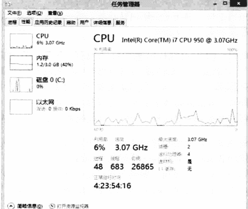
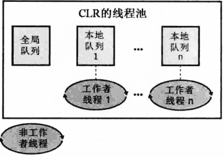

## 第二十六章 线程基础

本章内容：

- Windows 为什么要支持线程
- 线程开销
- 停止疯狂
- CPU 发展趋势
- CLR 线程和 Windows 线程
- 使用专用线程执行异步的计算限制操作
- 使用线程的理由
- 线程调度和优先级
- 前台线程和后台线程
- 继续学习

本章将介绍线程的基本概念，帮助开发人员理解线程及其使用。我将解释 Microsoft Windows 为什么引入线程的概念、CPU 发展趋势、CLR 线程和 Windows 线程的关系、线程开销、Windows 如何调度线程以及公开了线程属性的 Microsoft .NET Framework 类。

本书第 V 部分“线程处理”的各个章节将解释 Windows 和 CLR 如何协同提供一个线程处理架构。希望通过这些内容帮你打下一个良好的基础，学会高效使用线程来设计和构建响应灵敏的、可靠的、可伸缩的应用程序和组件。

### 26.1 Windows 为什么要支持线程

在计算机的早期岁月，操作系统没有线程的概念。事实上，整个系统只运行着一个执行线程，其中同时包含操作系统代码和应用程序代码。只用一个执行线程的问题在于，长时间运行的任务会阻止其他任务执行。例如，在 16 位 Windows 的那些日子，打印文档的应用程序很容易“冻结”整个机器，造成 OS(操作系统)和其他应用程序停止响应。有些应用程序的 bug 会造成死循环，同样会造成整个机器停止工作。

遇到这个问题，用户只好按 Reset 键或电源开关重启计算机。用户对此深恶痛绝(事实上，他们现在一样会)，因为所有正在运行的应用程序都会终止。更重要的是，这些应用程序正在处理的数据都会无端地丢失。

Microsoft 明白 16 位 Windows 不是理想的操作系统。随着计算机工业的持续进步，它不足以使 Microsoft 保持领先地位。所以，他们计划构建一个新的 OS 来满足企业和个人的需要。这个新的 OS 必须健壮、可靠、易于伸缩和安全，而且它必须弥补 16 位 Windows 的许多不足。新的 OS 内核最初通过 Microsoft Windows NT 发布。经过多年的发展，它已进行了大量改进，增加了大量功能。Microsoft 每次发布客户端和服务器 Windows 操作系统的最新版本时，都在其中采用了这个内核的最新版本。

Microsoft 设计这个 OS 内核时，决定在一个进程中运行应用程序的每个实例。进程实际是应用程序的实例要使用的资源的集合。每个进程都被赋予了一个虚拟地址空间，确保在一个进程中使用的代码和数据无法由另一个进程访问。这就确保了应用程序实例的健壮性，因为一个进程无法破坏另一个进程使用的代码或数据。此外，进程访问不了 OS 的内核代码和数据；所以，应用程序代码破坏不了操作系统代码或数据。由于应用程序代码破坏不了其他应用程序或者 OS 自身，所以用户的计算体验变得更好了。除此之外，系统变得比以往更安全，因为应用程序代码无法访问另一个应用程序或者 OS 自身使用的用户名、密码、信用卡资料或其他敏感信息。

听起来不错，但 CPU 本身呢？应用程序发生死循环会发生什么？如果机器只有一个 CPU，它会执行死循环，不能执行其他任何东西。所以，虽然数据无法被破坏，而且更安全，但系统仍然可能停止响应。Microsoft 需要修正这个问题，他们拿出的方案就是线程。作为一个 Windows 概念，线程的职责是对 CPU 进行虚拟化。Windows 为每个进程都提供了该进程专用的线程(功能相当于一个 CPU)。应用程序的代码进入死循环，与那个代码关联的进程会“冻结”，但其他进程(它们有自己的线程)不会冻结，它们会继续执行！

### 26.2 线程开销

线程很强大，因为它们使 Windows 即使在执行长时间运行的任务时也能随时响应。另外，线程允许用户使用一个应用程序(比如“任务管理器”)强制终止似乎已经冻结的应用程序(它也有可能正在执行一个长时间运行的任务)。但和一切虚拟化机制一样，线程有空间(内存耗用)和时间(运行时的执行性能)上的开销。

下面更详细地探讨这种开销。每个线程都有以下要素。

- **线程内核对象(thread kernel object)**
  OS 为系统中创建的每个线程都分配并初始化这种数据结构之一。数据结构包含一组对线程进行描述的属性(本章后面讨论)。数据结构还包含所谓的线程上下文(thread context)。上下文是包含 CPU 寄存器集合的内存块。对于 x86，x64 和 ARM CPU 架构，线程上下文分别使用约 700，1240 和 350 字节的内存。

- **线程环境块(thread environment block，TEB)**
  TEB 是在用户模式(应用程序代码能快速访问的地址空间)中分配和初始化的内存块。TEB 耗用 1 个内存页(x86，x64 和 ARM CPU 中是 4 KB)。TEB 包含线程的异常处理链首(head)。线程进入的每个 try 块都在链首插入一个节点(node)；线程退出 try 块时从链中删除该节点。此外，TEB 还包含线程的“线程本地存储”数据，以及由 GDI(Graphics

- 1. 将 **CPU** 寄存器的值保存到当前正在运行的线程的内核对象内部的一个上下文结构中。
- 2. 从现有线程集合中选出一个线程供调度。如果该线程由另一个进程拥有，Windows 在开始执行任何代码或者接触任何数据之前，还必须切换 **CPU**“看见”的虚拟地址空间。
- 3. 将所选上下文结构中的值加载到 **CPU** 的寄存器中。

上下文切换完成后，CPU 执行所选的线程，直到它的时间片到期。然后发生下次上下文切换。Windows 大约每 30 毫秒执行一次上下文切换。上下文切换是净开销；也就是说，上下文切换所产生的开销不会换来任何内存或性能上的收益。Windows 执行上下文切换，向用户提供一个健壮的、响应灵敏的操作系统。

现在，假如一个应用程序的线程进入死循环，Windows 会定期抢占(preempt)它，将新线程分配给 CPU，让新线程有机会运行。假定新线程是“任务管理器”的线程，用户就可利用“任务管理器”终止包含了死循环线程的进程。之后，进程会终止，它处理的所有数据会被销毁。但系统中的其他所有进程都继续运行，不会丢失它们的数据，用户当然也不需要重启计算机。所以，上下文切换通过牺牲性能换来了好得多的用户体验。

事实上，上下文切换对性能的影响可能超出你的想象。是的，当 Windows 上下文切换到另一个线程时，会产生一定的性能损失。但是，CPU 现在是要执行一个不同的线程，而之前的线程的代码和数据还在 CPU 的高速缓存(cache)中，这使 CPU 不必经常访问 RAM(它的速度比 CPU 高速缓存慢得多)。当 Windows 上下文切换到新线程时，这个新线程极有可能要执行不同的代码并访问不同的数据，这些代码和数据不在 CPU 的高速缓存中。因此，CPU 必须访问 RAM 来填充它的高速缓存，以恢复高速执行状态。但在 30 毫秒之后，一次新的上下文切换又发生了。

> **重要提示** 一个时间片结束时，如果 Windows 决定再次调度同一个线程(而不是切换到另一个线程)，那么 Windows 不会执行上下文切换。相反，线程将继续运行。这显著改进了性能。注意，在设计自己的代码时，上下文切换能避免就要尽量避免。

> **重要提示** 线程可自主提前终止其时间片。这经常发生，因为线程经常要等待 I/O 操作(键盘、鼠标、文件、网络等)结束。例如，“记事本”程序的线程经常都会处于空闲状态，什么事情都不做；这个线程是在等待输入。如果用户按键盘上的 J 键，Windows 会唤醒“记事本”线程，让它处理按键操作。“记事本”线程可能花 5 毫秒处理按键，然后调用一个 Win32 函数，告诉 Windows 它准备好处理下一个输入事件。如果没有更多的输入事件，Windows 使“记事本”线程进入等待状态(时间片剩余的部分就放弃了)，使线程在任何 CPU 上都不再调度，直到发生下一次输入事件。这增强了系统的总体性能，因为正在等待 I/O 操作完成的线程不会在 CPU 上调度，所以不会浪费 CPU 时间，而节省出来的时间则可以供 CPU 调度其他线程。

选择“性能”选项卡，会看到如图 26-1 所示的结果。



图 26-1 任务管理器的“性能”选项卡

看来我的机器正在运行 48 个进程，所以可认为机器上至少运行着 48 个线程，因为每个进程都至少有一个线程。但“任务管理器”显示我的机器实际有 683 个线程！这意味着仅仅是线程栈就需要分配 683 MB 内存，而我的机器总共才 3 GB RAM！另外，这还意味着每个进程平均有大约 14.2 个线程，而我的 4 核电脑理想情况下不应该是每进程 4 线程吗？

再来看看 CPU 利用率读数：它显示我的 CPU“忙”的时间是 6%。这意味着在 94%的时间里，这 683 个线程什么事情都没做——它们白白霸占着内存；线程未运行时，这些内存是不会使用的。你肯定会问：这些应用程序真的需要这些在 94%的时间里什么事情都不做的线程吗？答案明显是否定的。要知道哪些进程最浪费，请单击“详细信息”标签，添加“线程”列①，再按降序对这个列进行排序，如图 26-2 所示。

如你所见，System 创建了 111 个线程，CPU 利用率为 0%。Explorer(资源管理器)创建了 82 个线程，CPU 利用率为 0%。Visual Studio(Devenv.exe)创建了 38 个线程，CPU 利用率为 0%。Microsoft Outlook 创建了 17 个线程，CPU 利用率为 0%；我可以一直列举下去。到底发生了什么事情？

在 Windows 中，进程是十分“昂贵”的。创建一个进程通常要花几秒钟的时间，必须分配大量内存，这些内存必须初始化，EXE 和 DLL 文件必须从磁盘上加载，等等。相反，在 Windows 中创建线程则十分“廉价”。所以，开发人员决定停止创建进程，改为创建线程。这正是我们看到有这么多线程的原因。但是，虽然线程比进程廉价，它们和其他系统资源相比仍然十分昂贵，所以还是应该省着用，而且要用得恰当。

① 右击现有的列，选择“选择列”。

版的著作，比如我和 Christophe Nasarre 合写的 *Windows via C/C++*(Microsoft Press, 2007)①。

**注意** 在.NET Framework 的早期岁月，CLR 团队认为有朝一日 CLR 会提供不一定会映射到 Windows 线程的逻辑线程。但大约在 2005 年的时候，这个尝试宣告失败，CLR 团队放弃了在这方面的努力。所以，今天的 CLR 线程完全等价于 Windows 线程。但.NET Framework 仍然留下了一些能看出当年努力成果的一些东西。例如，**System.Environment** 类公开了 **CurrentManagedThreadId** 属性，返回线程的 CLR ID；而 **System.Diagnostics.ProcessThread** 类公开了 **Id** 属性，返回同一个线程的 Windows ID。**System.Threading.Thread** 类的 **BeginThreadAffinity** 和 **EndThreadAffinity** 方法则处理 CLR 线程没有映射到 Windows 线程的情况。

**注意** Microsoft 为 Windows Store 应用移除了和线程处理有关的一些 API，因为它们鼓励不好的编程实践(就像 26.3 节“停止疯狂”描述的那样)，或者是因为它们不利于达成 Microsoft 为 Windows Store 应用设立的目标。例如，整个 **System.Threading.Thread** 类都不开放给 Windows Store 应用，因为其中有许多不好的 API(比如 **Start**、**IsBackground**、**Sleep**、**Suspend**、**Resume**、**Join**、**Interrupt**、**Abort**、**BeginThreadAffinity** 和 **EndThreadAffinity**)。我个人赞成这个做法，而且认为早就该这么做。所以，第二十六章到第三十章讨论了适合桌面应用但不适合 Windows Store 应用的一些 API 和功能。阅读过程中能清楚地认识到为何有一些 API 不适合 Windows Store 应用。

### 26.6 使用专用线程执行异步的计算限制操作

本节展示如何创建线程来执行异步的计算限制(compute-bound)操作。虽然会展示完整过程，但强烈建议避免使用这个技术。而且事实上，由于 **Thread** 类不可用，所以构建 Windows Store 应用时根本用不了这个技术。相反，应尽量使用线程池来执行异步的计算限制操作，这方面的详情将在第二十七章“计算限制的异步操作”讨论。

但极少数情况下，你可能想显式创建线程来专门执行一个计算限制的操作。如果执行的代码要求线程处于一种特定状态，而这种状态对于线程池线程来说是非同寻常的，就可考虑创建专用线程。例如，满足以下任何条件，就可显式创建自己的线程。

> **注意（PowerShell 适用性）**　PowerShell 中不能把脚本块直接交给 Thread 构造函数（`[System.Threading.Thread]::new({ ... })` 会因找不到匹配的重载而报 `MethodException`）。即使用 `[System.Threading.ThreadStart]{ ... }` 转换成委托，`Start()` 虽然成功，但脚本块在新线程中没有可用的 Runspace，会抛出 `PSInvalidOperationException`（“此线程中没有可用于运行脚本的运行空间”），实测会导致进程崩溃。纯脚本场景下应改用 `Start-ThreadJob`（自带 Runspace）或 `ForEach-Object -Parallel`。

- 线程需要以非普通线程优先级运行。所有线程池线程都以普通优先级运行；虽然可以更改这个优先级，但不建议那样做。另外，在不同的线程池操作之间，对优先级的更

① 简体中文版是《Windows 核心编程(第 5 版)》，繁体中文版是《Windows 应用程序开发经典》。分别由清华大学出版社和悦知文化出版。我参与了它的翻译。——译注

让 10 台机器以 50%的 CPU 利用率运行，也不愿意让 5 台机器以 100%的利用率运行。这是由于全速运行的 CPU 会变成散热大户，由此带来的散热成本的大幅提升反而不美。虽然数据中心维护多台机器的费用也不算低(每台机器都要定期进行软硬件升级和监视)，但必须把这方面的费用同运行高级散热系统所需的费用比较。

如果你同意我的观点，那么下一步是决定应该让 CPU 做什么。在我给出我自己的想法之前，先来说一些别的东西。过去，开发人员和最终用户总是觉得计算机不够强劲。所以，除非最终用户通过 UI 元素(比如菜单项、按钮和复选框)给开发人员权限，允许应用程序开始消耗 CPU 资源，否则开发人员绝对不会擅自决定让代码开始执行。

但今非昔比。如今的计算机一般都配备了强大的计算能力。而且可以预见，在不久的将来，计算能力还会大幅提高。本章早些时候，我演示了通过“任务管理器”查看我的 CPU 的利用率只有 6%。如果我的计算机使用的是八核 CPU，而不是现在的四核，那么“任务管理器”可能只会报告 3%的利用率。等 80 核处理器问世时，我的机器看起来会在几乎所有时间里都什么都不做！对于计算机的购买者来说，这感觉就像是花了更多的钱购买了更强大的 CPU，但计算机做的工作变得越来越少！

这正是用户升级电脑动力不足的原因：软件没有充分地利用硬件，用户没有从额外的 CPU 中获益。我认为现在的计算能力有很大的富余，而且还会越来越富余，所以开发人员应该大胆消费它。是时候转变思维了——过去，除非最终用户确定想要获得计算结果，否则我们根本不敢提前计算。但现在有了额外的计算能力，所以开发人员完全不必像以前那样畏手畏脚。

举一个例子：在 Visual Studio 的编辑器中停止输入的时候，Visual Studio 会自动运行编译器并编译代码。这极大提高了开发人员的开发效率，因为他们能在输入时看到源代码的警告和错误，并可立即修正问题。事实上，传统的“编辑-生成-调试”模式逐渐变成“编辑-调试”，因为生成(编译)代码的动作一直都在发生。作为最终用户，你是注意不到这一点的，因为有充足的计算资源可供使用，而且编译器的频繁运行一般不会影响你正在做的其他事情。事实上，我希望 Visual Studio 未来的版本完全移除“生成”菜单，因为这个过程变得完全自动化。这不仅能使应用程序的 UI 变得更简单，还能自动向用户提供“答案”来提高他们使用软件的效率。

移除菜单项这样的 UI 元素后，计算机对最终用户来说变得更简单。他们面临的选项变得更少，需要阅读和理解的概念也变得更少。多核革命使我们能够消除菜单项这样的 UI 元素，进而使软件变得更简单好用，让我的奶奶有一天也能舒舒服服地用上计算机。对于开发人员，移除 UI 元素之后，所需的测试次数一般会变得更少。另外，向最终用户提供更少的选项简化了代码库。如果需要对 UI 元素和文档进行本地化(就像 Microsoft 那样)，那么移除 UI 元素意味着需要写的文档变少了，需要本地化的文档也变少了。这一切能为你的公司节省大量时间和金钱。

下面是更多主动消费计算能力的例子：文档拼写检查和语法检查、电子表格重新计算、磁盘文件索引以提高搜索速度以及硬盘碎片整理以提升 I/O 性能。

### 表 26-1 “进程优先级类”和“相对线程优先级”如何映射到“优先级”值

| 相对线程优先级 | Idle | Below Normal | Normal | Above Normal | High | Realtime |
|---|---|---|---|---|---|---|
| Time-Critical | 15 | 15 | 15 | 15 | 15 | 31 |
| Highest | 6 | 8 | 10 | 12 | 15 | 26 |
| Above Normal | 5 | 7 | 9 | 11 | 14 | 25 |
| Normal | 4 | 6 | 8 | 10 | 13 | 24 |
| Below Normal | 3 | 5 | 7 | 9 | 12 | 23 |
| Lowest | 2 | 4 | 6 | 8 | 11 | 22 |
| Idle | 1 | 1 | 1 | 1 | 1 | 16 |

例如，Normal 进程中的一个 Normal 线程的优先级是 8。由于大多数进程都是 Normal 优先级，大多数线程也是 Normal 优先级，所以系统中大多数线程的优先级都是 8。

High 优先级进程中的 Normal 线程的优先级是 13。将进程优先级类更改为 Idle，线程的优先级变成 4。记住，线程优先级是相对于进程优先级类的。更改一个进程的优先级类，线程的相对优先级不会改变，但它的绝对优先级值会改变。

注意，表中没有值为 0 的线程优先级。这是因为 0 优先级保留给零页线程了，系统不允许其他线程的优先级为 0。而且，以下优先级也不可获得：17, 18, 19, 20, 21, 27, 28, 29 或者 30。以内核模式运行的设备驱动程序才能获得这些优先级；用户模式的应用程序不能。还要注意，Realtime 优先级类中的线程优先级不能低于 16。类似地，非 Realtime 的优先级类中的线程优先级不能高于 15。

正常情况下，进程根据启动它的进程来分配优先级。大多数进程都由 Windows 资源管理器启动，后者在 Normal 优先级类中生成它的所有子进程。托管应用程序不应该表现为拥有它们自己的进程；相反，它们应该表现为在一个 AppDomain 中运行。所以，托管应用程序不应该更改它们的进程的优先级类，因为这会影响进程中运行的所有代码。例如，许多 ASP.NET 应用程序都在单个进程中运行，每个应用程序都在它自己的 AppDomain 中。类似的还有 Silverlight 应用程序，它在一个 IE 浏览器进程中运行。还有托管的存储过程，它在 Microsoft SQL Server 进程中运行。

> **注意** “进程优先级类”的概念容易引起混淆。人们可能以为 Windows 在调度进程。事实上 Windows 永远不会调度进程，它只调度线程。“进程优先级类”是 Microsoft 提出的抽象概念，旨在帮助你理解自己的应用程序和其他正在运行的应用程序的关系，它没有别的用途。

对于桌面应用(非 Windows Store 应用)，我要强调的是 **System.Diagnostics** 命名空间包含 **Process** 类和 **ProcessThread** 类。这两个类分别提供了进程和线程的 Windows 视图。用托管代码写实用程序(utility)，或者建构代码来帮助自己进行调试时，就可以使用这两个类。事实上，这正是为什么这两个类都在 **System.Diagnostics** 命名空间中的原因。应用程序需要以特殊的安全权限运行才能使用这两个类。例如，Silverlight 或 ASP.NET 应用程序便用不了这两个类。

另一方面，应用程序可使用 **AppDomain** 和 **Thread** 类，它们公开了 AppDomain 和线程的 CLR 视图。一般不需要特殊安全权限就可以使用这两个类，虽然某些操作仍需提升权限才可以使用。

### 26.9 前台线程和后台线程

CLR 将每个线程要么视为前台线程，要么视为后台线程。一个进程的所有前台线程停止运行时，CLR 强制终止仍在运行的任何后台线程。这些后台线程被直接终止；不抛出异常。

所以，应该用前台线程执行确实想完成的任务，比如将数据从内存缓冲区 flush 到磁盘。非关键性任务则使用后台线程，比如重新计算电子表格的单元格，或者为记录建立索引等。这是由于这些工作能在应用程序重启时继续，而且如果用户想终止应用程序，就没必要强迫应用程序保持活动。

CLR 需要提供前台和后台线程的概念来更好地支持 **AppDomain**。我们知道，每个 AppDomain 都可运行一个单独的应用程序，而每个应用程序都有自己的前台线程。如果应用程序退出，造成它的前台线程终止，则 CLR 仍需保持活动并运行，使其他应用程序能继续运行。所有应用程序都退出，它们的所有前台线程都终止后，整个进程就可以被销毁了。

以下代码演示了前台和后台线程之间的差异：

```
using System;
using System.Threading;

public static class Program {
    public static void Main() {
        // 创建新线程(默认为前台线程)
        Thread t = new Thread(Worker);

        // 使线程成为后台线程
        t.IsBackground = true;

        t.Start(); // 启动线程
        // 如果 t 是前台线程，则应用程序大约 10 秒后才终止
        // 如果 t 是后台线程，则应用程序立即终止
        Console.WriteLine("Returning from Main");
    }
}
```

① flush 在文档中翻译成“刷新”，本书保留原文未译。其实 flush 在技术文档中的意思和日常生活中一样，即“冲(到别处)”。例如，我们会说“冲水”，不会说“刷尿”。——译注


### 27.1 CLR 线程池基础

如第二十六章所述，创建和销毁线程是一个昂贵的操作，要耗费大量时间。另外，太多的线程会浪费内存资源。由于操作系统必须调度可运行的线程并执行上下文切换，所以太多的线程还对性能不利。为了改善这个情况，CLR 包含了代码来管理它自己的线程池(thread pool)。线程池是你的应用程序能使用的线程集合。每个 CLR 一个线程池；这个线程池由 CLR 控制的所有 AppDomain 共享。如果一个进程中加载了多个 CLR，那么每个 CLR 都有它自己的线程池。

CLR 初始化时，线程池中是没有线程的。在内部，线程池维护了一个操作请求队列。应用程序执行一个异步操作时，就调用某个方法，将一个记录项(entry)追加到线程池的队列中。线程池的代码从这个队列中提取记录项，将这个记录项派发(dispatch)给一个线程池线程。如果线程池中没有线程，就创建一个新线程。创建线程会造成一定的性能损失(前面已讨论过了)。然而，当线程池线程完成任务后，线程不会被销毁。相反，线程会返回线程池，在那里进入空闲状态，等待响应另一个请求。由于线程不销毁自身，所以不再产生额外的性能损失。

如果你的应用程序向线程池发出许多请求，线程池会尝试只用这一个线程来服务所有请求。然而，如果你的应用程序发出请求的速度超过了线程池线程处理它们的速度，就会创建额外的线程。最终，你的应用程序的所有请求都能由少量线程处理，所以线程池不必创建大量线程。

如果你的应用程序停止向线程池发出请求，池中会出现大量什么都不做的线程。这是对内存资源的浪费。所以，当一个线程池线程闲着没事儿一段时间之后(不同版本的 CLR 对这个时间的定义不同)，线程会自己醒来终止自己以释放资源。线程终止自己会产生一定的性能损失。然而，线程终止自己是因为它闲得慌，表明应用程序本身就没有做太多的事情，所以这个性能损失关系不大。

线程池可以只容纳少量线程，从而避免浪费资源；也可以容纳更多的线程，以利用多处理器、超线程处理器和多核处理器。它能在两种不同的状态之间从容地切换。线程池是启发式的。如果应用程序需要执行许多任务，同时有可用的 CPU，那么线程池会创建更多的线程。应用程序负载减轻，线程池线程就终止它们自己。

### 27.2 执行简单的计算限制操作

要将一个异步的计算限制操作放到线程池的队列中，通常可以调用 **ThreadPool** 类定义的以下方法之一：

```csharp
static Boolean QueueUserWorkItem(WaitCallback callBack);
static Boolean QueueUserWorkItem(WaitCallback callBack, Object state);
```

这些方法向线程池的队列添加一个“工作项”(work item)以及可选的状态数据。然后，所有方法会立即返回。工作项其实就由 callBack 参数标识的一个方法，该方法将由线程池线程调用。可向方法传递一个 state 实参(状态数据)。无 state 参数的那个版本的 QueueUserWorkItem 则向回调方法传递 null。最终，池中的某个线程会处理工作项，造成你指定的方法被调用。你写的回调方法必须匹配 System.Threading.WaitCallback 委托类型，后者的定义如下：

```csharp
delegate void WaitCallback(Object state);
```

> 注意：WaitCallback 委托、TimerCallback 委托(参见本章 27.8 节“执行定时计算限制操作”的讨论)和 ParameterizedThreadStart 委托(在第二十六章“线程基础”中讨论)签名完全一致。定义和该签名匹配的方法后，使用 ThreadPool.QueueUserWorkItem、System.Threading.Timer 和 System.Threading.Thread 对象都可调用该方法。

> **注意（PowerShell 适用性）**　在 PowerShell 中不能把一个脚本块直接交给 `ThreadPool.QueueUserWorkItem` 或 `Thread` 构造函数：脚本块需要执行它的 Runspace，而线程池线程默认没有 Runspace，会抛出 `PSInvalidOperationException`（“此线程中没有可用于运行脚本的运行空间”）。PowerShell 中并行的做法是使用 `Start-ThreadJob`（每个作业自带 Runspace）、`ForEach-Object -Parallel`（PowerShell 7+）或 `Start-Job`；若确实要调用 `QueueUserWorkItem`，传入的必须是编译好的 .NET 委托（例如通过 `Add-Type` 生成的方法）。

以下代码演示了如何让一个线程池线程以异步方式调用一个方法：

```csharp
using System;
using System.Threading;

public static class Program {
    public static void Main() {
        Console.WriteLine("Main thread: queuing an asynchronous operation");
        ThreadPool.QueueUserWorkItem(ComputeBoundOp, 5);
        Console.WriteLine("Main thread: Doing other work here...");
        Thread.Sleep(10000);  // 模拟其他工作(10 秒)
        Console.WriteLine("Hit <Enter> to end this program...");
        Console.ReadLine();
    }

    // 这个方法的签名必须匹配 WaitCallback 委托
    private static void ComputeBoundOp(Object state) {
        // 这个方法由一个线程池线程执行

        Console.WriteLine("In ComputeBoundOp: state={0}", state);
        Thread.Sleep(1000); // 模拟其他工作(1 秒)

        // 这个方法返回后，线程回到池中，等待另一个任务
    }
}
```

编译并运行上述代码得到以下输出（PowerShell 中没有编译步骤，直接运行脚本即可；下文的“编译”均应按此理解）：

```text
Main thread: queuing an asynchronous operation
Main thread: Doing other work here...
In ComputeBoundOp: state=5
```

有时也得到以下输出：

```text
Main thread: queuing an asynchronous operation
In ComputeBoundOp: state=5
Main thread: Doing other work here...
```

之所以输出行的顺序会发生变化，是因为两个方法相互之间是异步运行的。Windows 调度器决定先调度哪一个线程。如果应用程序在多核机器上运行，可能同时调度它们。

像下面这样：

```csharp
public sealed class CancellationTokenSource : IDisposable { // 一个引用类型
    public CancellationTokenSource();
    public void Dispose(); // 释放资源(比如 WaitHandle)

    public Boolean IsCancellationRequested { get; }
    public CancellationToken Token { get; }

    public void Cancel(); // 内部调用 Cancel 并传递 false
    public void Cancel(Boolean throwOnFirstException);
    ...
}
```

这个对象包含了和管理取消有关的所有状态。构造好一个 **CancellationTokenSource**(一个引用类型)之后，可从它的 **Token** 属性获得一个或多个 **CancellationToken**(一个值类型)实例，并传给你的操作，使操作可以取消。以下是 **CancellationToken** 值类型最有用的成员：

```csharp
public struct CancellationToken { // 一个值类型
    public static CancellationToken None { get; } // 很好用

    public Boolean IsCancellationRequested { get; }  // 由非通过 Task 调用的操作调用
    public void    ThrowIfCancellationRequested();   // 由通过 Task 调用的操作调用

    // CancellationTokenSource 取消时，WaitHandle 会收到信号
    public WaitHandle WaitHandle { get; }
    // GetHashCode, Equals, operator== 和 operator!=成员未列出

    public Boolean CanBeCanceled { get; } // 很少使用

    public CancellationTokenRegistration Register(Action<Object> callback, Object state,
        Boolean useSynchronizationContext); // 未列出更简单的重载版本
}
```

**CancellationToken** 实例是轻量级值类型，包含单个私有字段，即对其 **CancellationTokenSource** 对象的引用。在计算限制操作的循环中，可定时调用 **CancellationToken** 的 **IsCancellationRequested** 属性，了解循环是否应该提前终止，从而终止计算限制的操作。提前终止的好处在于，CPU 不需要再把时间浪费在你对结果不感兴趣的操作上。以下代码将这些概念全部梳理了一遍：

```csharp
internal static class CancellationDemo {
    public static void Go() {
        CancellationTokenSource cts = new CancellationTokenSource();

        // 将 CancellationToken 和 “要数到的数” (number-to-count-to) 传入操作
        ThreadPool.QueueUserWorkItem(o => Count(cts.Token, 1000));

        Console.WriteLine("Press <Enter> to cancel the operation.");
        Console.ReadLine();
        cts.Cancel(); // 如果 Count 方法已返回，Cancel 没有任何效果
        // Cancel 立即返回，方法从这里继续运行...

        Console.ReadLine();
    }

    private static void Count(CancellationToken token, Int32 countTo) {
        for (Int32 count = 0; count < countTo; count++) {
            if (token.IsCancellationRequested) {
                Console.WriteLine("Count is cancelled");
                break; // 退出循环以停止操作
            }
        }
    }
}
```

会抛出一个 **AggregateException**，该异常实例的 **InnerExceptions** 属性被设为已抛出的所有异常对象的集合。如果登记的所有回调方法都没有抛出未处理的异常，那么 **Cancel** 直接返回，不抛出任何异常。

> **重要提示** 没有办法将 **AggregateException** 的 **InnerExceptions** 集合中的一个异常对象和特定的操作对应起来；你只知道某个操作出错，并通过异常类型知道出了什么错。要跟踪错误的具体位置，需要检查异常对象的 **StackTrace** 属性，并手动扫描你的源代码。

**CancellationToken** 的 **Register** 方法返回一个 **CancellationTokenRegistration**，如下所示：

```csharp
public struct CancellationTokenRegistration :
    IEquatable<CancellationTokenRegistration>, IDisposable {
    public void Dispose();
    // GetHashCode, Equals, operator==和 operator!=成员未列出
}
```

可以调用 **Dispose** 从关联的 **CancellationTokenSource** 中删除已登记的回调；这样一来，在调用 **Cancel** 时，便不会再调用这个回调。以下代码演示了如何向一个 **CancellationTokenSource** 登记两个回调：

```csharp
var cts = new CancellationTokenSource();
cts.Token.Register(() => Console.WriteLine("Canceled 1"));
cts.Token.Register(() => Console.WriteLine("Canceled 2"));

// 出于测试的目的，让我们取消它，以便执行 2 个回调
cts.Cancel();
```

运行上述代码，一旦调用 **Cancel** 方法，就会得到以下输出：

```text
Canceled 2
Canceled 1
```

最后，可以通过链接另一组 **CancellationTokenSource** 来新建一个 **CancellationTokenSource** 对象。任何一个链接的 **CancellationTokenSource** 被取消，这个新的 **CancellationTokenSource** 对象就会被取消。以下代码对此进行了演示：

```csharp
// 创建一个 CancellationTokenSource
var cts1 = new CancellationTokenSource();
cts1.Token.Register(() => Console.WriteLine("cts1 canceled"));

// 创建另一个 CancellationTokenSource
var cts2 = new CancellationTokenSource();
cts2.Token.Register(() => Console.WriteLine("cts2 canceled"));

// 创建一个新的 CancellationTokenSource，它在 cts1 或 cts2 取消时取消
var linkedCts = CancellationTokenSource.CreateLinkedTokenSource(cts1.Token, cts2.Token);
linkedCts.Token.Register(() => Console.WriteLine("linkedCts canceled"));

// 取消其中一个 CancellationTokenSource 对象 (我选择 cts2)
cts2.Cancel();

// 显示哪个 CancellationTokenSource 对象被取消了
Console.WriteLine("cts1 canceled={0}, cts2 canceled={1}, linkedCts={2}",
    cts1.IsCancellationRequested, cts2.IsCancellationRequested,
    linkedCts.IsCancellationRequested);
```

```csharp
t.ContinueWith(task => Console.WriteLine("Sum threw: " + task.Exception.InnerException),
    TaskContinuationOptions.OnlyOnFaulted);

t.ContinueWith(task => Console.WriteLine("Sum was canceled"),
    TaskContinuationOptions.OnlyOnCanceled);
```

#### 27.5.4 任务可以启动子任务

最后，任务支持父/子关系，如以下代码所示：

```csharp
Task<int[]> parent = new Task<int[]>(() => {
    var results = new int[32]; // 创建一个数组来储存结果

    // 这个任务创建并启动 3 个子任务
    new Task(() => results[0] = Sum(10000), TaskCreationOptions.AttachedToParent).Start();
    new Task(() => results[1] = Sum(20000), TaskCreationOptions.AttachedToParent).Start();
    new Task(() => results[2] = Sum(30000), TaskCreationOptions.AttachedToParent).Start();

    // 返回对数组的引用（即使数组元素可能还没有初始化）
    return results;
});

// 父任务及其子任务运行完成后，用一个延续任务显示结果
var cwt = parent.ContinueWith(
    parentTask => Array.ForEach(parentTask.Result, Console.WriteLine));

// 启动父任务，便于它启动它的子任务
parent.Start();
```

在本例中，父任务创建并启动三个 **Task** 对象。一个任务创建的一个或多个 **Task** 对象默认是顶级任务，它们与创建它们的任务无关。但 **TaskCreationOptions.AttachedToParent** 标志将一个 **Task** 和创建它的 **Task** 关联，结果是除非所有子任务（以及子任务的子任务）结束运行，否则创建任务（父任务）不认为已经结束。调用 **ContinueWith** 方法创建 **Task** 时，可指定 **TaskContinuationOptions.AttachedToParent** 标志将延续任务指定成子任务。

#### 27.5.5 任务内部揭秘

每个 **Task** 对象都有一组字段，这些字段构成了任务的状态。其中包括一个 **Int32** ID（参见 **Task** 的只读 Id 属性）、代表 **Task** 执行状态的一个 **Int32**、对父任务的引用、对 **Task** 创建时指定的 **TaskScheduler** 的引用、对回调方法的引用、对要传给回调方法的对象的引用（可通过 **Task** 的只读 **AsyncState** 属性查询）、对 **ExecutionContext** 的引用以及对 **ManualResetEventSlim** 对象的引用。另外，每个 **Task** 对象都有对根据需要创建的补充状态的引用。补充状态包含一个 **CancellationToken**、一个 **ContinueWithTask** 对象集合、为抛出来处理异常的子任务而准备的一个 **Task** 对象集合等。说了这么多，重点在于虽然任务很有用，但它并不是没有代价的。必须为所有这些状态分配内存。如果不需要任务的附加功能，那么使用 **ThreadPool.QueueUserWorkItem** 能获得更好的资源利用率。

**Task** 和 **Task<TResult>** 类实现了 **IDisposable** 接口，允许在用完 **Task** 对象后调用 Dispose。如今，所有 Dispose 方法做的都是关闭 **ManualResetEventSlim** 对象。但可定义从 **Task** 和 **Task<TResult>** 派生的类，在这些类中分配它们自己的资源，并在它们重写的 **Dispose**

方法中释放这些资源。我建议不要在代码中为 Task 对象显式调用 Dispose；相反，应该让垃圾回收器自己清理任何不再需要的资源。

每个 Task 对象都包含代表 Task 唯一 ID 的 Int32 字段。创建 Task 对象时该字段初始化为零。首次查询 Task 的只读 Id 属性时，属性将一个唯一的 Int32 值分配给该字段，并返回该值。任务 ID 从 1 开始，每分配一个 ID 都递增 1。在 Microsoft Visual Studio 调试器中查看 Task 对象，会造成调试器显示 Task 的 ID，从而造成 Task 分配 ID。

该 ID 的意义在于每个 Task 都可用唯一值进行标识。事实上，Visual Studio 会在“并行任务”和“并行堆栈”窗口中显示这些任务 ID。但由于不能在自己的代码中分配 ID，所以几乎不可能将 ID 和代码正在做的事情联系起来。运行任务的代码时，可查询 Task 的静态 CurrentId 属性来返回一个可空 Int32(Int32?)。调试期间，可在 Visual Studio 的“监视”或“即时”窗口中调用它，获得当前正在调试的代码的 ID。然后，可在“并行任务”或“并行堆栈”窗口中找到自己的任务。如果当前没有任务正在执行，查询 CurrentId 属性会返回 null。

在一个 Task 对象的存在期间，可查询 Task 的只读 Status 属性了解它在其生存期的什么位置。该属性返回一个 TaskStatus 值，定义如下：

```csharp
public enum TaskStatus {
    // 这些标志指出一个 Task 在其生命周期内的状态
    Created,              // 任务已显式创建；可以手动 Start() 这个任务
    WaitingForActivation, // 任务已隐式创建；会自动开始

    WaitingToRun,         // 任务已调度，但尚未运行
    Running,              // 任务正在运行

    // 任务正在等待它的子任务完成，子任务完成后它才完成
    WaitingForChildrenToComplete,

    // 任务的最终状态是以下三个之一：
    RanToCompletion,
    Canceled,
    Faulted
}
```

首次构造 Task 对象时，它的状态是 Created。以后，当任务启动时，它的状态变成 WaitingToRun。Task 实际在一个线程上运行时，它的状态变成 Running。任务停止运行，并等待它的任何子任务时，状态变成 WaitingForChildrenToComplete。任务完成时进入以下状态之一：RanToCompletion(运行完成)、Canceled(取消)或 Faulted(出错)。如果运行完成，可通过 `Task<TResult>` 的 `Result` 属性来查询任务结果。`Task` 或 `Task<TResult>` 出错时，可查询 `Task` 的 `Exception` 属性来获得任务抛出的未处理异常；该属性总是返回一个 `AggregateException` 对象，对象的 `InnerExceptions` 集合包含了所有未处理的异常。

为简化编码，`Task` 提供了几个只读 `Boolean` 属性，包括 `IsCanceled`, `IsFaulted` 和 `IsCompleted`。注意当 `Task` 处于 `RanToCompletion`, `Canceled` 或 `Faulted` 状态时，`IsCompleted` 返回 `true`。判断一个 `Task` 是否成功完成最简单的办法是使用如下所示的代码：

```csharp
if (task.Status == TaskStatus.RanToCompletion) ...
```

调用 **ContinueWith**，**ContinueWhenAll**，**ContinueWhenAny** 或 **FromAsync** 等方法来创建的 **Task** 对象处于 **WaitingForActivation** 状态。通过构造 **TaskCompletionSource<TResult>** 对象来创建的 **Task** 也处于 **WaitingForActivation** 状态。该状态意味着 **Task** 的调度由任务基础结构控制。例如，不可显式启动通过调用 **ContinueWith** 来创建的对象。该 **Task** 在它的前置任务(antecedent task)执行完毕后自动启动。

#### 27.5.6 任务工厂

有时需要创建一组共享相同配置的 **Task** 对象。为避免机械地将相同的参数传给每个 **Task** 的构造器，可创建一个任务工厂来封装通用的配置。**System.Threading.Tasks** 命名空间定义了一个 **TaskFactory** 类型和一个 **TaskFactory<TResult>** 类型。两个类型都派生自 **System.Object**；也就是说，它们是平级的。

要创建一组返回 **void** 的任务，就构造一个 **TaskFactory**；要创建一组具有特定返回类型的任务，就构造一个 **TaskFactory<TResult>**，并通过泛型 **TResult** 实参传递任务的返回类型。创建上述任何工厂类时，要向构造器传递工厂创建的所有任务都具有的默认值。具体地说，要向任务工厂传递希望任务具有的 **CancellationToken**，**TaskScheduler**，**TaskCreationOptions** 和 **TaskContinuationOptions** 设置。

以下代码演示了如何使用一个 TaskFactory：

```csharp
Task parent = new Task(() => {
    var cts = new CancellationTokenSource();
    var tf = new TaskFactory<Int32>(
        cts.Token,
        TaskCreationOptions.AttachedToParent,
        TaskContinuationOptions.ExecuteSynchronously,
        TaskScheduler.Default);

    // 这个任务创建并启动 3 个子任务
    var childTasks = new[] {
        tf.StartNew(() => Sum(cts.Token, 10000)),
        tf.StartNew(() => Sum(cts.Token, 20000)),
        tf.StartNew(() => Sum(cts.Token, Int32.MaxValue)) // 太大，抛出 OverflowException
    };

    // 任何子任务抛出异常，就取消其余子任务
    for (Int32 task = 0; task < childTasks.Length; task++)
        childTasks[task].ContinueWith(
            t => cts.Cancel(), TaskContinuationOptions.OnlyOnFaulted);

    // 所有子任务完成后，从未出错/未取消的任务获取返回的最大值。
    // 然后将最大值传给另一个任务来显示最大结果
    tf.ContinueWhenAll(
        childTasks,
        completedTasks => completedTasks.Where(
            t => !t.IsFaulted && !t.IsCanceled).Max(t => t.Result),
        CancellationToken.None)
            .ContinueWith(t => Console.WriteLine("The maximum is: " + t.Result),
                TaskContinuationOptions.ExecuteSynchronously);
});

// 子任务完成后，也显示任何未处理的异常
```

而要像这样写：

```csharp
// 线程池的线程并行处理工作
Parallel.ForEach(collection, item => DoWork(item));
```

如果既可以使用 **For**，也可以使用 **ForEach**，那么建议使用 **For**，因为它执行得更快。

最后，如果要执行多个方法，那么既可能像下面这样顺序执行：

```csharp
// 一个线程顺序执行所有方法
Method1();
Method2();
Method3();
```

也可并行执行，如下所示：

```csharp
// 线程池的线程并行执行方法
Parallel.Invoke(
    () => Method1(),
    () => Method2(),
    () => Method3());
```

**Parallel** 的所有方法都让调用线程参与处理。从资源利用的角度说，这是一件好事，因为我们不希望调用线程停下来(阻塞)，等线程池线程做完所有工作才能继续。然而，如果调用线程在线程池线程完成自己的那一部分工作之前完成工作，调用线程会将自己挂起，直到所有工作完成。这也是一件好事，因为这提供了和使用普通 **for** 或 **foreach** 循环时相同的语义：线程要在所有工作完成后才继续运行。还要注意，如果任何操作抛出未处理的异常，你调用的 **Parallel** 方法最后会抛出一个 **AggregateException**。

但这并不是说需要对自己的源代码进行全文替换，将 **for** 循环替换成对 **Parallel.For** 的调用，将 **foreach** 循环替换成对 **Parallel.ForEach** 的调用。调用 **Parallel** 的方法时有一个很重要的前提条件：工作项必须能并行执行！所以，如果工作必须顺序执行，就不要使用 **Parallel** 的方法。另外，要避免会修改任何共享数据的工作项，否则多个线程同时处理可能会损坏数据。解决这个问题一般的办法是围绕数据访问添加线程同步锁。但这样一次就只能有一个线程访问数据，无法享受并行处理多个项所带来的好处。

另外，**Parallel** 的方法本身也有开销；委托对象必须分配，而针对每个工作项都要调用一次这些委托。如果有大量可由多个线程处理的工作项，那么也许能获得性能的提升。另外，如果每一项都涉及大量工作，那么通过委托来调用所产生的性能损失是可以忽略不计的。但如果只为区区几个工作项使用 **Parallel** 的方法，或者为处理得非常快的工作项使用 **Parallel** 的方法，就会得不偿失，反而降低性能。

注意 **Parallel** 的 **For**、**ForEach** 和 **Invoke** 方法都提供了接受一个 **ParallelOptions** 对象的重载版本。这个对象的定义如下：

```csharp
public class ParallelOptions {
    public ParallelOptions();

    // 允许取消操作
    public CancellationToken CancellationToken { get; set; } // 默认为 CancellationToken.None

    // 允许指定可以并发操作的最大工作项目数目
    public Int32 MaxDegreeOfParallelism { get; set; } // 默认为-1 (可用 CPU 数)
    // 允许指定要使用哪个 TaskScheduler
    public TaskScheduler TaskScheduler { get; set; } // 默认为 TaskScheduler.Default
}
```

除此之外，**For** 和 **ForEach** 方法有一些重载版本允许传递 3 个委托。

- 任务局部初始化委托(localInit)，为参与工作的每个任务都调用一次该委托。这个委托是在任务被要求处理一个工作项之前调用的。
- 主体委托(body)，为参与工作的各个线程所处理的每一项都调用一次该委托。
- 任务局部终结委托(localFinally)，为参与工作的每一个任务都调用一次该委托。这个委托是在任务处理好派发给它的所有工作项之后调用的。即使主体委托代码引发一个未处理的异常，也会调用它。

以下代码演示如何利用这三个委托计算一个目录中的所有文件的字节长度。

```csharp
private static Int64 DirectoryBytes(String path, String searchPattern,
    SearchOption searchOption) {
    var files = Directory.EnumerateFiles(path, searchPattern, searchOption);
    Int64 masterTotal = 0;

    ParallelLoopResult result = Parallel.ForEach<String, Int64>(
        files,

        () => { // localInit: 每个任务开始之前调用一次
            // 每个任务开始之前，总计值都初始化为 0
            return 0; // 将 taskLocalTotal 初始值设为 0
        },

        (file, loopState, index, taskLocalTotal) => { // body: 每个工作项调用一次
            // 获得这个文件的大小，把它添加到这个任务的累加值上
            Int64 fileLength = 0;
            FileStream fs = null;
            try {
                fs = File.OpenRead(file);
                fileLength = fs.Length;
            }
            catch (IOException) { /* 忽略拒绝访问的任何文件 */ }
            finally { if (fs != null) fs.Dispose(); }
            return taskLocalTotal + fileLength;
        },

        taskLocalTotal => { // localFinally: 每个任务完成时调用一次
            // 将这个任务的总计值(taskLocalTotal)加到总的总结值(masterTotal)上
            Interlocked.Add(ref masterTotal, taskLocalTotal);
        });

    return masterTotal;
}
```

每个任务都通过 `taskLocalTotal` 变量为分配给它的文件维护它自己的总计值。每个任务在完成工作之后，都通过调用 `Interlocked.Add` 方法(参见第二十九章“基元线程同步构造”)，以一种线程安全的方式更新总的总结值(master total)。由于每个任务都有自己的总计值，所以在一个工作项处理期间，无需进行线程同步。由于线程同步会造成性能的损失，所以不

### 27.7 并行语言集成查询(PLINQ)

Microsoft 的语言集成查询(Language Integrated Query, LINQ)功能提供了一个简捷的语法来查询数据集合。可用 LINQ 轻松对数据项进行筛选、排序、投影等操作。使用 LINQ to Objects 时，只有一个线程顺序处理数据集合中的所有项；我们称之为顺序查询(sequential query)。要提高处理性能，可以使用并行 LINQ(Parallel LINQ)，它将顺序查询转换成并行查询，在内部使用任务(排队给默认 TaskScheduler)，将集合中的数据项的处理工作分散到多个 CPU 上，以便并发处理多个数据项。和 Parallel 的方法相似，要同时处理大量项，或者每一项的处理过程都是一个耗时的计算限制的操作，那么能从并行 LINQ 获得最大的收益。

静态 System.Linq.ParallelEnumerable 类(在 System.Core.dll 中定义)实现了 PLINQ 的所有功能，所以必须将 System.Linq 命名空间导入源代码（在 C# 中通过 using 指令，在 PowerShell 中通过 `using namespace System.Linq` 或直接使用完整类型名）。尤其是这个类公开了所有标准 LINQ 操作符(Where, Select, SelectMany, GroupBy, Join, OrderBy, Skip, Take 等)的并行版本。所有这些方法都是扩展了 System.Linq.ParallelQuery<T>类型的扩展方法。要让自己的 LINQ to Objects 查询调用这些方法的并行版本，必须将自己的顺序查询(基于 IEnumerable 或者 IEnumerable<T>)转换成并行查询(基于 ParallelQuery 或者 ParallelQuery<T>)，这是用 ParallelEnumerable 的 AsParallel 扩展方法来实现的①，如下所示：

```csharp
public static ParallelQuery<TSource> AsParallel<TSource>(this IEnumerable<TSource> source)
public static ParallelQuery AsParallel(this IEnumerable source)
```

下面是将顺序查询转换成并行查询的例子。查询返回的是一个程序集中定义的所有过时 (obsolete)方法：

```csharp
private static void ObsoleteMethods(Assembly assembly) {
    var query =
        from type in assembly.GetExportedTypes().AsParallel()

        from method in type.GetMethods(BindingFlags.Public |
            BindingFlags.Instance | BindingFlags.Static)

        let obsoleteAttrType = typeof(ObsoleteAttribute)

        where Attribute.IsDefined(method, obsoleteAttrType)

        orderby type.FullName

        let obsoleteAttrObj = (ObsoleteAttribute)
            Attribute.GetCustomAttribute(method, obsoleteAttrType)

        select String.Format("Type={0}\nMethod={1}\nMessage={2}\n",
            type.FullName, method.ToString(), obsoleteAttrObj.Message);

    // 显示结果
    foreach (var result in query) Console.WriteLine(result);
}
```

① ParallelQuery<T>类派生自 ParallelQuery 类。


费更多线程，但可以用更少的时间生成最终结果。同步 I/O 操作在客户端应用程序中没什么问题，但我强烈建议不要在服务器应用程序中执行同步 I/O 操作。

PLINQ 分析一个查询，然后决定如何最好地处理它。有的时候，顺序处理一个查询可以获得更好的性能，尤其是在使用以下任何操作时：Concat，ElementAt(OrDefault)，First(OrDefault)，Last(OrDefault)，Skip(While)，Take(While)或 Zip。使用 Select(Many)或 Where 的重载版本，并向你的 selector 或 predicate 委托传递一个位置索引时也是如此。然而，可以调用 WithExecutionMode，向它传递某个 ParallelExecutionMode 标志，从而强迫查询以并行方式处理：

```csharp
public enum ParallelExecutionMode {
    Default = 0,          // 让并行 LINQ 决定处理查询的最佳方式
    ForceParallelism = 1  // 强迫查询以并行方式处理
}
```

如前所述，并行 LINQ 让多个线程处理数据项，结果必须再合并回去。可调用 WithMergeOptions，向它传递以下某个 ParallelMergeOptions 标志，从而控制这些结果的缓冲与合并方式：

```csharp
public enum ParallelMergeOptions {
    Default       = 0,  // 目前和 AutoBuffered 一样(将来可能改变)
    NotBuffered   = 1,  // 结果一旦就绪就开始处理
    AutoBuffered  = 2,  // 每个线程在处理前缓冲一些结果
    FullyBuffered = 3   // 每个线程在处理前缓冲所有结果
}
```

这些选项使你能在某种程度上平衡执行速度和内存消耗。NotBuffered 最省内存，但处理速度慢一些。FullyBuffered 消费较多的内存，但运行得最快。AutoBuffered 介于 NotBuffered 和 FullyBuffered 之间。说真的，要想知道应该为一个给定的查询选择哪个并行合并选项，最好的办法就是亲自试验所有选项，并对比其性能。也可以“无脑”地接受默认值，它对于许多查询来说都工作得非常好。请参见以下博客文章，进一步了解 PLINQ 如何在 CPU 内核之间分配工作：

- http://blogs.msdn.com/pfxteam/archive/2009/05/28/9648672.aspx
- http://blogs.msdn.com/pfxteam/archive/2009/06/13/9741072.aspx

### 27.8 执行定时计算限制操作

System.Threading 命名空间定义了一个 Timer 类，可用它让一个线程池线程定时调用一个方法。构造 Timer 类的实例相当于告诉线程池：在将来某个时间(具体由你指定)回调你的一个方法。Timer 类提供了几个相似的构造器：

```csharp
public sealed class Timer : MarshalByRefObject, IDisposable {
    public Timer(TimerCallback callback, Object state, Int32 dueTime, Int32 period);
    public Timer(TimerCallback callback, Object state, UInt32 dueTime, UInt32 period);
    public Timer(TimerCallback callback, Object state, Int64 dueTime, Int64 period);
    public Timer(TimerCallback callback, Object state, TimeSpan dueTime, TimeSpan period);
}
```

```csharp
public static void Main() {
    Console.WriteLine("Checking status every 2 seconds");

    // 创建但不启动计时器。确保 s_timer 在线程池线程调用 Status 之前引用该计时器
    s_timer = new Timer(Status, null, Timeout.Infinite, Timeout.Infinite);

    // 现在 s_timer 已被赋值，可以启动计时器了，
    // 现在在 Status 中调用 Change，保证不会抛出 NullReferenceException
    s_timer.Change(0, Timeout.Infinite);

    Console.ReadLine(); // 防止进程终止
}

// 这个方法的签名必须和 TimerCallback 委托匹配
private static void Status(object state) {
    // 这个方法由一个线程池线程执行
    Console.WriteLine("In Status at {0}", DateTime.Now);
    Thread.Sleep(1000); // 模拟其他工作(1 秒)

    // 返回前让 Timer 在 2 秒后再次触发
    s_timer.Change(2000, Timeout.Infinite);

    // 这个方法返回后，线程回到池中，等待下一个工作项
}
```

如果有需要定时执行的操作，可利用 **Task** 的静态 **Delay** 方法（配合等待操作）来编码。原书此处用的是 C# 的 **async** 和 **await** 关键字（第二十八章讨论），PowerShell 不支持这两个关键字，只能通过 `.GetAwaiter().GetResult()` 或 `Task.Wait()` 同步等待。下面重写了前面的代码。

```csharp
internal static class DelayDemo {
    public static void Main() {
        Console.WriteLine("Checking status every 2 seconds");
        Status();
        Console.ReadLine(); // 防止进程终止
    }

    // 该方法可获取你想要的任何参数
    private static async void Status() {
        while (true) {
            Console.WriteLine("Checking status at {0}", DateTime.Now);
            // 要检查的代码放到这里...

            // 在循环末尾，在不阻塞线程的前提下延迟 2 秒
            await Task.Delay(2000); // await 允许线程返回
            // 2 秒之后，某个线程会在 await 之后介入并继续循环
        }
    }
}
```

### 计时器太多，时间太少

遗憾的是，FCL 事实上提供了几个计时器，大多数程序员都不清楚它们有什么独特之处。让我试着解释一下。

- **System.Threading 的 Timer 类**  
  这是上一节讨论的计时器。要在一个线程池线程上执行定时的（周期性发生的）后台任务，它是最好的计时器。
- **System.Windows.Forms 的 Timer 类**  
  构造这个类的实例，相当于告诉 Windows 将一个计时器和调用线程关联(参见 Win32 SetTimer 函数)。当这个计时器触发时，Windows 将一条计时器消息(WM_TIMER)注入线程的消息队列。线程必须执行一个消息泵来提取这些消息，并把它们派发给需要的回调方法。注意，所有这些工作都只由一个线程完成——设置计时器的线程保证就是执行回调方法的线程。还意味着计时器方法不会由多个线程并发执行。
- **System.Windows.Threading 的 DispatcherTimer 类**  
  这个类是 **System.Windows.Forms 的 Timer 类**在 Silverlight 和 WPF 应用程序中的等价物。
- **Windows.UI.Xaml 的 DispatcherTimer 类**  
  这个类是 **System.Windows.Forms 的 Timer 类**在 Windows Store 应用中的等价物。
- **System.Timers 的 Timer 类**  
  这个计时器本质上是 **System.Threading 的 Timer 类**的包装类。计时器到期(触发)会导致 CLR 将事件放到线程池队列中。**System.Timers.Timer 类**派生自 **System.ComponentModel 的 Component 类**，允许在 Visual Studio 中将这些计时器对象放到设计平面(design surface)上。另外，它还公开了属性和事件，使它在 Visual Studio 的设计器中更容易使用。这个类是在好几年前，Microsoft 还没有理清线程处理和计时器的时候添加到 FCL 中的。这个类完全应该删除，强迫每个人都改为使用 **System.Threading.Timer 类**。事实上，我个人从来不用 **System.Timers.Timer 类**，建议你也不要用它，除非真的想在设计平面上添加一个计时器。

### 27.9 线程池如何管理线程

现在讨论一下线程池代码如何管理工作者线程和 I/O 线程。但我不打算讲太多细节，因为在这么多年的时间里，随着 CLR 的每个版本的发布，其内部的实现已发生了显著变化。未来的版本还会继续变化。最好是将线程池看成一个黑盒。不要拿单个应用程序去衡量它的性能，因为它不是针对某个单独的应用程序而设计的。相反，作为一个常规用途的线程调度技术，它面向的是大量应用程序；它对某些应用程序的效果要好于对其他应用程序。目前，它的工作情况非常理想，我强烈建议你信任它，因为你很难搞出一个比 CLR 自带的更好的线程池。另外，随着时间的推移，线程池代码内部会更改它管理线程的方式，所以大多数应用程序的性能会变得越来越好。

### 27.9.1 设置线程池限制

CLR 允许开发人员设置线程池要创建的最大线程数。但实践证明，线程池永远都不应该设置线程数上限，因为可能发生饥饿或死锁。假定队列中有 1000 个工作项，但这些工作项全都因为一个事件而阻塞，等第 1001 个工作项发出信号才能解除阻塞。如果设置最大 1000 个线程，第 1001 个工作项就不会执行，全部 1000 个线程会一直阻塞，用户将被迫终止应

的线程，所以无需同步锁，而且在队列中添加和删除 **Task** 的速度非常快。这个行为的副作用是 **Task** 按照和进入队列时相反的顺序执行。



图 27-1 CLR 的线程池

> **重要提示** 线程池从来不保证排队中的工作项的处理顺序。这是合理的，尤其是考虑到多个线程可能同时处理工作项。但上述副作用使这个问题变得恶化了。你必须保证自己的应用程序对于工作项或 **Task** 的执行顺序不作任何预设。

如果工作者线程发现它的本地队列变空了，会尝试从另一个工作者线程的本地队列“偷”一个 **Task**。这个 **Task** 是从本地队列的尾部“偷”走的，并要求获取一个线程同步锁，这对性能有少许影响。当然，希望这种“偷盗”行为很少发生，从而很少需要获取锁。如果所有本地队列都变空，那么工作者线程会使用 **FIFO** 算法，从全局队列提取一个工作项(取得它的锁)。如果全局队列也为空，工作者线程会进入睡眠状态，等待事情的发生。如果睡眠了太长时间，它会自己醒来，并销毁自身，允许系统回收线程使用的资源(内核对象、栈、TEB 等)。

线程池会快速创建工作线程，使工作者线程的数量等于传给 **ThreadPool** 的 **SetMinThreads** 方法的值。如果从不调用这个方法(也建议你永远不调用这个方法)，那么默认值等于你的进程允许使用的 CPU 数量，这是由进程的 **affinity mask**(关联掩码)决定的。通常，你的进程允许使用机器上的所有 CPU，所以线程池创建的工作者线程数量很快就会达到机器的 CPU 数。创建了这么多(CPU 数量)的线程后，线程池会监视工作项的完成速度。如果工作项完成的时间太长(具体多长没有正式公布)，线程池会创建更多的工作者线程。如果工作项的完成速度开始变快，工作者线程会被销毁。
