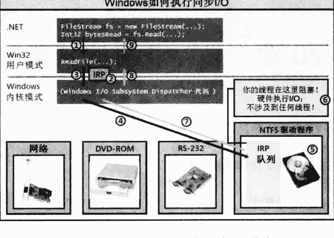
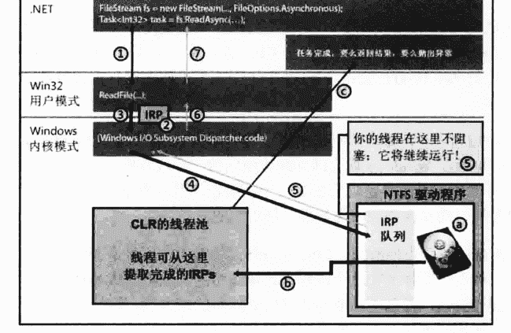
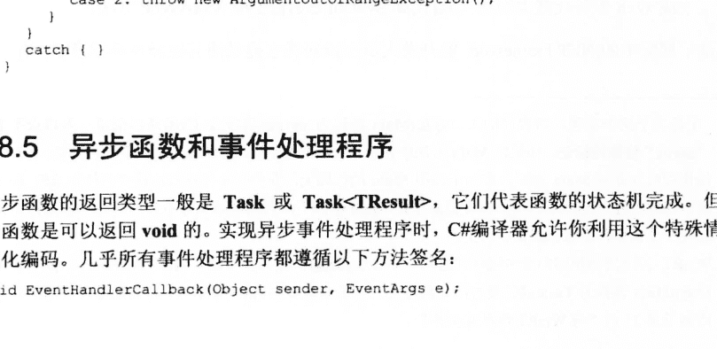

### 第二十八章 I/O 限制的异步操作

**本章内容：**

- Windows 如何执行 I/O 操作
- C# 的异步函数
- 编译器如何将异步函数转换成状态机
- 异步函数扩展性
- 异步函数和事件处理程序
- FCL 的异步函数
- 异步函数和异常处理
- 异步函数的其他功能
- 应用程序及其线程处理模型
- 以异步方式实现服务器
- 取消 I/O 操作
- 有的 I/O 操作必须同步进行
- I/O 请求优先级

> **编者说明**　本章内容是 C# 语言的异步编程模型（`async`/`await` 与编译器生成的状态机）。PowerShell 语言本身不支持 `async`/`await`，也没有“编译器把方法改写成状态机”这一步骤。因此，本章中关于状态机生成、编译器转换、`ConfigureAwait`、异步 lambda 等的讨论，均属于 C# 层面的知识；在 PowerShell 中做异步 I/O 时，可以调用 .NET 提供的 Task 返回型 API，并通过 `.GetAwaiter().GetResult()`、`Task.Wait()` 等方式同步等待，或借助 `Start-ThreadJob` 等机制在后台执行。凡是“编译器”相关表述，均应理解为 C# 编译器。

第二十七章重点讲述了如何异步执行计算限制的操作，允许线程池在多个 CPU 内核上调度任务，使多个线程能并发工作，从而高效率地使用系统资源，同时提升应用程序的吞吐能力。本章重点讲述如何异步执行 I/O 限制的操作，允许将任务交由硬件设备处理，期间完全不占用线程和 CPU 资源。然而，线程池仍然扮演了一个重要的角色，因为如同你马上要看到的那样，各种 I/O 操作的结果还是要由线程池线程来处理的。

### 28.1 Windows 如何执行 I/O 操作

首先讨论 Windows 如何执行同步 I/O 操作。图 28-1 是连接了几个硬件设备的计算机系统。每个硬件设备都有自己的电路板，每个电路板都集成了一个小型的、特殊用途的计算机，它知道如何控制自己的硬件设备。例如，硬盘驱动器就有一个小的电路板，它知道如何旋转碟片、寻道、在碟片上读写数据以及和计算机内存交换数据。

程序通过构造一个 **FileStream** 对象来打开磁盘文件，然后调用 **Read** 方法从文件中读取数据。调用 **FileStream** 的 **Read** 方法时，你的线程从托管代码转变为本机/用户模式代码，**Read** 内部调用 Win32 **ReadFile** 函数(①)。**ReadFile** 分配一个小的数据结构，称为 I/O 请求包(I/O Request Packet, IRP)(②)。IRP 结构初始化后包含的内容有：文件句柄，文件中的偏移量(从这个位置开始读取字节)，一个 Byte[] 数组的地址(数组用读取的字节来填充)，要传输的字节数以及其他常规性内容。



图 28-1 Windows 如何执行同步 I/O 操作

然后，ReadFile 将你的线程从本机/用户模式代码转变成本机/内核模式代码，向内核传递 IRP 数据结构，从而调用 Windows 内核(③)。根据 IRP 中的设备句柄，Windows 内核知道 I/O 操作要传送给哪个硬件设备。因此，Windows 将 IRP 传送给恰当的设备驱动程序的 IRP 队列(④)。每个设备驱动程序都维护着自己的 IRP 队列，其中包含了机器上运行的所有进程发出的 I/O 请求。IRP 数据包到达时，设备驱动程序将 IRP 信息传给物理硬件设备上安装的电路板。现在，硬件设备将执行请求的 I/O 操作(⑤)。

但要注意一个重要问题：在硬件设备执行 I/O 操作期间，发出了 I/O 请求的线程将无事可做，所以 Windows 将线程变成睡眠状态，防止它浪费 CPU 时间(⑥)。这当然很好。但是，虽然线程不浪费时间，但它仍然浪费了空间(内存)，因为它的用户模式栈、内核模式栈、线程环境块(thread environment block, TEB)和其他数据结构都还在内存中，而且完全没有谁去访问这些东西。这当然就不好了。

最终，硬件设备会完成 I/O 操作。然后，Windows 会唤醒你的线程，把它调度给一个 CPU，使它从内核模式返回用户模式，再返回至托管代码(⑦、⑧和⑨)。FileStream 的 Read 方法现在返回一个 Int32，指明从文件中读取的实际字节数，使你知道在传给 Read 的 Byte[] 中，实际能检索到多少个字节。

假定要实现一个 Web 应用程序，每个客户端请求抵达服务器时，都需要发出一个数据库请求。客户端请求抵达时，一个线程池线程会调用你的代码。如果以同步方式发出数据库请求，线程会阻塞不确定的时间，等待数据库返回结果。在此期间，如果另一个客户端请求抵达，线程池会创建另一个线程，这个线程在发出另一个数据库请求后，同样会阻塞。随着越来越多的客户端请求抵达，创建的线程也越来越多，所有这些线程都阻塞并等待数据库的响应。结果是 Web 服务器分配的系统资源(线程及其内存)基本上都浪费了！

更糟的是，当数据库用结果来响应请求时，线程会被解锁，全都开始执行。但由于可能运行了大量线程，同时 CPU 内核只有区区几个，所以 Windows 被迫执行频繁的上下文切换，这进一步损害了性能。这和实现一个可伸缩应用程序的初衷是完全背道而驰的。

现在讨论一下 Windows 如何执行异步 I/O 操作。图 28-2 删除了除硬盘之外的所有硬件设备，引入了 CLR 的线程池，稍微修改了代码。打开磁盘文件的方式仍然是通过构造一个 **FileStream** 对象，但现在传递了一个 **FileOptions.Asynchronous** 标志，告诉 Windows 我希望文件的读/写操作以异步方式执行。



图 28-2 Windows 如何执行异步 I/O 操作

现在调用 **ReadAsync** 而不是 **Read** 从文件中读取数据。**ReadAsync** 内部分配一个 **Task<Int32>** 对象来代表用于完成读取操作的代码。然后，**ReadAsync** 调用 Win32 **ReadFile** 函数(①)。**ReadFile** 分配 IRP，和前面的同步操作一样初始化它(②)，然后把它传给 Windows 内核(③)。Windows 把 IRP 添加到硬盘驱动程序的 IRP 队列中(④)。但线程不再阻塞，而是允许返回至你的代码。所以，线程能立即从 **ReadAsync** 调用中返回(⑤，⑥和⑦)。当然，此时 IRP 可能尚未处理好，所以不能够在 **ReadAsync** 之后的代码中访问传递的 **Byte[]** 中的字节。

那么，什么时候以及用什么方式处理最终读取的数据呢？注意，调用 **ReadAsync** 返回的是一个 **Task<Int32>** 对象。可在该对象上调用 **ContinueWith** 来登记任务完成时执行的回调方法，然后在回调方法中处理数据。当然，也可利用 C# 的异步函数功能简化编码，以顺序方式写代码(感觉就像是执行同步 I/O)。**（PowerShell 没有异步函数，只能使用 ContinueWith 或 `.GetAwaiter().GetResult()` / `Task.Wait()` 等等待手段。）**


如果操作以异步方式完成，**IsCompleted** 将返回 **false**。状态机调用 awaiter 的 **OnCompleted** 方法并向它传递一个委托(引用状态机的 **MoveNext** 方法)。现在，状态机允许它的线程回到原地以执行其他代码。将来某个时候，封装了底层任务的 awaiter 会在完成时调用委托以执行 **MoveNext**。可根据状态机中的字段知道如何到达代码中的正确位置，使方法能从它当初离开时的位置继续。这时，代码调用 awaiter 的 **GetResult** 方法。执行将从这里继续，以便对结果进行处理。

这便是异步函数的工作原理，开发人员可用它轻松地写出不阻塞的代码。

### 28.4 异步函数扩展性

在扩展性方面，能用 **Task** 对象包装一个将来完成的操作，就可以用 **await** 操作符来等待该操作。用一个类型(**Task**)来表示各种异步操作对编码有利，因为可以实现组合操作(比如 **Task** 的 **WhenAll** 和 **WhenAny** 方法)和其他有用的操作。本章后面会演示如何用 **Task** 包装一个 **CancellationToken**，在等待异步操作的同时利用超时和取消功能。

我想和你分享另外一个例子。下面是我的 **TaskLogger** 类，可用它显示尚未完成的异步操作。这在调试时特别有用，尤其是当应用程序因为错误的请求或者未响应的服务器而挂起的时候。

```csharp
public static class TaskLogger {
    public enum TaskLogLevel { None, Pending }
    public static TaskLogLevel LogLevel { get; set; }

    public sealed class TaskLogEntry {
        public Task Task { get; internal set; }
        public String Tag { get; internal set; }
        public DateTime LogTime { get; internal set; }
        public String CallerMemberName { get; internal set; }
        public String CallerFilePath { get; internal set; }
        public Int32 CallerLineNumber { get; internal set; }
        public override string ToString() {
            return String.Format("LogTime={0}, Tag={1}, Member={2}, File={3}({4})",
                LogTime, Tag ?? "(none)", CallerMemberName, CallerFilePath, CallerLineNumber);
        }
    }

    private static readonly ConcurrentDictionary<Task, TaskLogEntry> s_log =
        new ConcurrentDictionary<Task, TaskLogEntry>();
    public static IEnumerable<TaskLogEntry> GetLogEntries() { return s_log.Values; }

    public static Task<TResult> Log<TResult>(this Task<TResult> task, String tag = null,
        [CallerMemberName] String callerMemberName = null,
        [CallerFilePath] String callerFilePath = null,
        [CallerLineNumber] Int32 callerLineNumber = -1) {
        return (Task<TResult>)
            Log((Task)task, tag, callerMemberName, callerFilePath, callerLineNumber);
    }

    public static Task Log(this Task task, String tag = null,
        [CallerMemberName] String callerMemberName = null,
        [CallerFilePath] String callerFilePath = null,
        [CallerLineNumber] Int32 callerLineNumber = -1) {
        if (LogLevel == TaskLogLevel.None) return task;
        var logEntry = new TaskLogEntry {
            Task = task,
            LogTime = DateTime.Now,
            Tag = tag,
            CallerMemberName = callerMemberName,
            CallerFilePath = callerFilePath,
            CallerLineNumber = callerLineNumber
        };
        s_log[task] = logEntry;
        task.ContinueWith(t => { TaskLogEntry entry; s_log.TryRemove(t, out entry); },
            TaskContinuationOptions.ExecuteSynchronously);
        return task;
    }
}
```

以下代码演示了如何使用该类。

```csharp
public static async Task Go() {
#if DEBUG
    // 使用 TaskLogger 会影响内存和性能，所以只在调试生成中启用它
    TaskLogger.LogLevel = TaskLogger.TaskLogLevel.Pending;
#endif

    // 初始化为 3 个任务：为了测试 TaskLogger，我们显式控制其持续时间
    var tasks = new List<Task> {
        Task.Delay(2000).Log("2s op"),
        Task.Delay(5000).Log("5s op"),
        Task.Delay(6000).Log("6s op")
    };

    try {
        // 等待全部任务，但在 3 秒后取消；只有一个任务能按时完成
        // 注意：WithCancellation 扩展方法将在本章稍后进行描述
        await Task.WhenAll(tasks).
            WithCancellation(new CancellationTokenSource(3000).Token);
    }
    catch (OperationCanceledException) { }

    // 查询 logger 哪些任务尚未完成，按照从等待时间最长到最短的顺序排序
    foreach (var op in TaskLogger.GetLogEntries().OrderBy(tle => tle.LogTime))
        Console.WriteLine(op);
}
```

在我的机器上生成并运行上述代码得到以下结果。

```
LogTime=7/16/2012 6:44:31 AM, Tag=6s op, Member=Go, File=C:\\CLR via C#\\Code\\Ch28-1-IOOps.cs (332)
LogTime=7/16/2012 6:44:31 AM, Tag=5s op, Member=Go, File=C:\\CLR via C#\\Code\\Ch28-1-IOOps.cs (331)
```

除了增强使用 **Task** 时的灵活性，异步函数另一个对扩展性有利的地方在于编译器可以在 **await** 的任何操作数上调用 **GetAwaiter**。所以操作数不一定是 **Task** 对象。可以是任意类型，只要提供了一个可以调用的 **GetAwaiter** 方法。下列展示了我自己的 **awaiter**，在异步方法的状态机和被引发的事件之间，它扮演了“粘合剂”的角色。

```csharp
public sealed class EventAwaiter<TEventArgs> : INotifyCompletion {
    private ConcurrentQueue<TEventArgs> m_events = new ConcurrentQueue<TEventArgs>();
    private Action m_continuation;

    #region 状态机调用的成员
    // 状态机先调用这个来获得 awaiter：我们自己返回自己
    public EventAwaiter<TEventArgs> GetAwaiter() { return this; }

    // 告诉状态机是否发生了任何事件
    public Boolean IsCompleted { get { return m_events.Count > 0; } }
}
```

#### 



中断异步函数。要在状态机运行完毕前对调用方法进行调试，在调用方法中插入断点并运行至断点(F5)即可。

有的异步操作执行速度很快，几乎瞬间就能完成。在这种情况下，挂起状态机并让另一个线程立即恢复状态机就显得不太划算。更有效的做法是让状态机继续执行。幸好，编译器为 **await** 操作符生成的代码能检测到这个问题。如果异步操作在线程返回前完成，就阻止线程返回，直接由它执行下一行代码。

到目前为止一切都很完美，但有时异步函数需要先执行密集的、计算限制的处理，再发起异步操作。如果通过应用程序的 **GUI** 线程来调用函数，UI 就会突然失去响应，好长时间才能恢复。另外，如果操作以同步方式完成，那么 UI 失去响应的时间还会变得更长。在这种情况下，可利用 **Task** 的静态 **Run** 方法从非调用线程的其他线程中执行异步函数。

```csharp
// Task.Run 在 GUI 线程上调用
Task.Run(async () => {
    // 这里的代码在一个线程池线程上运行
    // TODO: 在这里执行密集的、计算限制的处理...

    await xxxAsync(); // 发起异步操作
    // 在这里执行更多处理...
});
```

上述代码演示了 C# 的异步 lambda 表达式。可以看出，不能只在普通的 lambda 表达式主体中添加 **await** 操作符完事，因为编译器不知道如何将方法转换成状态机。但同时在 lambda 表达式前面添加 **async**，编译器就能将 lambda 表达式转换成状态机方法来返回一个 **Task** 或 **Task<TResult>**，并可赋给返回类型为 **Task** 或 **Task<TResult>** 的任何 **Func** 委托变量。**（PowerShell 无 async lambda，也无状态机转换，这段讨论不适用于脚本。）**

写代码时，很容易发生调用异步函数但忘记使用 **await** 操作符的情况。以下代码进行了演示。

```csharp
static async Task OuterAsyncFunction() {
    InnerAsyncFunction(); // Oops，忘了添加 await 操作符

    // 在 InnerAsyncFunction 继续执行期间，这里的代码也继续执行
}
static async Task InnerAsyncFunction() { /* 这里的代码不重要 */ }
```

幸好，C#编译器会针对这种情况显示以下警告（PowerShell 无对应编译期警告）：

由于此调用不会等待，因此在此调用完成之前将会继续执行当前方法。请考虑将 “await” 运算符应用于调用结果。

这个警告大多数时候都很有用，但极少数情况下，你确实不关心 **InnerAsyncFunction** 在什么时候结束，上述代码正是你想要的结果，不希望看到警告。

其实，只需将 **InnerAsyncFunction** 返回的 **Task** 赋给一个变量，然后忽略该变量，就可以避免这个警告。①

```csharp
static async Task OuterAsyncFunction() {
    var nowarning = InnerAsyncFunction(); // 故意不添加 await 操作符

    // 在 InnerAsyncFunction 继续执行期间，这里的代码也继续执行
}
```

① 幸好编译器不会为从不使用的局部变量显示警告。

我个人更喜欢定义如下所示的扩展方法。

```csharp
[MethodImpl(MethodImplOptions.AggressiveInlining)] // 造成编译器优化调用
public static void NoWarning(this Task task) { /* 这里没有代码 */ }
```

然后像下面这样使用它。

```csharp
static async Task OuterAsyncFunction()
{
    InnerAsyncFunction().NoWarning(); // 故意不添加 await 操作符

    // 在 InnerAsyncFunction 继续执行期间，这里的代码也继续执行
}
```

异步 I/O 操作最好的一个地方是可以同时发起许多这样的操作，让它们并行执行，从而显著提升应用程序的性能。以下代码启动我的命名管道服务器，然后向它发起大量的客户端请求。

```csharp
public static async Task Go() {
    // 启动服务器并立即返回，因为它异步地等待客户端请求
    StartServer(); // 返回 void，所以编译器会发出警告

    // 发起大量异步客户端请求：保存每个客户端的 Task<String>
    List<Task<String>> requests = new List<Task<String>>(10000);
    for (Int32 n = 0; n < requests.Capacity; n++)
        requests.Add(IssueClientRequestAsync("localhost", "Request #" + n));

    // 异步地等待所有客户端请求完成
    // 注意：如果 1 个以上的任务抛出异常，WhenAll 重新抛出最后一个抛出的异常
    String[] responses = await Task.WhenAll(requests);

    // 处理所有响应
    for (Int32 n = 0; n < responses.Length; n++)
        Console.WriteLine(responses[n]);
}
```

上述代码启动命名管道服务器来监听客户端请求，然后，**for** 循环以最快速度发起 10000 个客户端请求。每个 **IssueClientRequestAsync** 调用都返回一个 **Task<String>** 对象，这些对象全部添加到一个集合中。现在，命名管道服务器使用线程池线程以最快的速度处理这些请求，机器上的所有 CPU 都将保持忙碌状态。每处理完一个请求，该请求的 **Task<String>** 对象都会完成，并从服务器返回字符串响应。

在上述代码中，我希望等待所有客户端请求都获得响应后再处理结果。为此，我调用了 **Task** 的静态 **WhenAll** 方法。该方法内部创建一个 **Task<String[]>** 对象，它在列表中的所有 **Task** 对象都完成后才完成。然后，我等待 **Task<String[]>** 对象，使状态机在所有任务完成后继续执行。所有任务完成后，我遍历所有响应并进行处理（调用 **Console.WriteLine**）。

如果希望收到一个响应就处理一个，而不是在全部完成后再处理，那么用 **Task** 的静态 **WhenAny** 方法可以轻松地实现，下面是修改后的代码。

```csharp
public static async Task Go() {
    // 启动服务器并立即返回，因为它异步地等待客户端请求
```

> ① 我观察到的一个有趣的现象。我在一台 8 核电脑上测试代码，所有 CPU 的利用率都达到 100%，这是理所当然的。由于所有 CPU 都非常忙，所以电脑变得更热，风扇变得更吵！处理结束后，CPU 利用率下降，风扇重新变得安静了。我感觉可以根据风扇噪声来验证代码是否正常工作。


```csharp
StartServer();

// 发起大量异步客户端请求；保存每个客户端的 Task<String>
List<Task<String>> requests = new List<Task<String>>(10000);
for (Int32 n = 0; n < requests.Capacity; n++)
    requests.Add(IssueClientRequestAsync("localhost", "Request #" + n));

// 每个任务完成都继续
while (requests.Count > 0) {
    // 顺序处理每个完成的响应
    Task<String> response = await Task.WhenAny(requests);
    requests.Remove(response); // 从集合中删除完成的任务

    // 处理一个响应
    Console.WriteLine(response.Result);
}
```

上述代码创建 **while** 循环，针对每个客户端请求都迭代一次。循环内部等待 **Task** 的 **WhenAny** 方法，该方法一次返回一个 **Task<String>** 对象，代表由服务器响应的一个客户端请求。获得这个 **Task<String>** 对象后，就把它从集合中删除，然后查询它的结果以进行处理(把它传给 **Console.WriteLine**)。

### 28.9 应用程序及其线程处理模型

.NET Framework 支持几种不同的应用程序模型，而每种模型都可能引入了它自己的线程处理模型。控制台应用程序和 Windows 服务(实际上也是控制台应用程序；只是看不见控制台而已)没有引入任何线程处理模型；换言之，任何线程可在任何时候做它想做的任何事情。

但 GUI 应用程序(包括 Windows 窗体、WPF、Silverlight 和 Windows Store 应用程序)引入了一个线程处理模型。在这个模型中，UI 元素只能由创建它的线程更新。在 GUI 线程中，经常都需要生成一个异步操作，使 GUI 线程不至于阻塞并停止响应用户输入(比如鼠标、按键、手写笔和触控事件)。但当异步操作完成时，是由一个线程池线程完成 Task 对象并恢复状态机。

对于某些应用程序模型，这样做无可非议，甚至可以说正好符合开发人员的意愿，因为它非常高效。但对于另一些应用程序模型(比如 GUI 应用程序)，这个做法会造成问题，因为一旦通过线程池线程更新 UI 元素就会抛出异常。线程池线程必须以某种方式告诉 GUI 线程更新 UI 元素。

ASP.NET 应用程序允许任何线程做它想做的任何事情。线程池线程开始处理一个客户端的请求时，可以对客户端的语言文化(**System.Globalization.CultureInfo**)做出假定，从而允许 Web 服务器对返回的数字、日期和时间进行该语言文化特有的格式化处理。此外，Web 服务器还可对客户端的身份标识(**System.Security.Principal.IPrincipal**)做出假定，确保只能

① 欲知详情，请访问 http://msdn.microsoft.com/zh-cn/library/bz9tc508.aspx。注意，帮助文档将 culture 翻译成“区域性”。——译注

Task<TResult>类提供了一个 ConfigureAwait 方法，它的签名如下所示。

```csharp
// 定义这个方法的 Task
public ConfiguredTaskAwaitable ConfigureAwait(Boolean continueOnCapturedContext);

// 定义这个方法的 Task<TResult>
public ConfiguredTaskAwaitable<TResult> ConfigureAwait(Boolean continueOnCapturedContext);
```

向方法传递 true 相当于根本没有调用方法。但如果传递 false，await 操作符就不查询调用线程的 SynchronizationContext 对象。当线程池线程结束 Task 时会直接完成它，await 操作符后面的代码通过线程池线程执行。

虽然我的 GetHttp 方法不是类库代码，但在添加了对 ConfigureAwait 的调用后，死锁问题就不翼而飞。下面是修改过的 GetHttp 方法。

```csharp
private async Task<String> GetHttp() {
    // 发出 HTTP 请求，让线程从 GetHttp 返回
    HttpResponseMessage msg = await new
        HttpClient().GetAsync("http://Wintellect.com/").ConfigureAwait(false);
    // 这里能执行到了，因为线程池线程可以执行这里的代码，
    // 而非被迫由 GUI 线程执行

    return await msg.Content.ReadAsStringAsync().ConfigureAwait(false);
}
```

如上述代码所示，必须将 ConfigureAwait(false)应用于等待的每个 Task 对象。这是由于异步操作可能同步完成，而且在发生这个情况时，调用线程直接继续执行，不会返回至它的调用者；你根本不知道哪个操作要求忽略 SynchronizationContext 对象，所以只能要求所有操作都忽略它。这还意味着类库代码不能依赖于任何特定的应用程序模型。另外，也可以像下面这样重写 GetHttp 方法，用一个线程池线程执行所有操作。

```csharp
private Task<String> GetHttp() {
    return Task.Run(async () => {
        // 运行一个无 SynchronizationContext 的线程池线程
        HttpResponseMessage msg = await new HttpClient().GetAsync("http://Wintellect.com/");
        // 这里的代码真的能执行，因为某个线程池线程能执行这里的代码

        return await msg.Content.ReadAsStringAsync();
    });
}
```

在这个版本中，注意，GetHttp 不再是异步函数；我从方法签名中删除了 async 关键字，因为方法中没有了 await 操作符。但是，传给 Task.Run 的 lambda 表达式是异步函数。

### 28.10　以异步方式实现服务器

根据我多年来和开发人员的交流经验，发现很少有人知道.NET Framework 其实内建了对伸缩性很好的—些异步服务器的支持。本书限制篇幅无法一一解释，但可以列出 MSDN 文档中值得参考的地方。

- 要构建异步 ASP.NET Web 窗体，在.aspx 文件中添加 `Async="true"` 网页指令，并参考 `System.Web.UI.Page` 的 `RegisterAsyncTask` 方法。
- 要构建异步 ASP.NET MVC 控制器，使你的控制器类从 **System.Web.Mvc.AsyncController** 派生，让操作方法返回一个 **Task<ActionResult>** 即可。
- 要构建异步 ASP.NET 处理程序，使你的类从 **System.Web.HttpTaskAsyncHandler** 派生，重写其抽象 **ProcessRequestAsync** 方法。
- 要构建异步 WCF 服务，将服务作为异步函数实现，让它返回 Task 或 Task<TResult>。

### 28.11 取消 I/O 操作

Windows 一般没有提供取消未完成 I/O 操作的途径。这是许多开发人员都想要的功能，实现起来却很困难。毕竟，如果向服务器请求了 1000 个字节，然后决定不再需要这些字节，那么其实没有办法告诉服务器忘掉你的请求。在这种情况下，只能让字节照常返回，再将它们丢弃。此外，这里还会发生竞态条件——取消请求的请求可能正好在服务器发送响应的时候到来。这时应该怎么办？所以，要在代码中处理这种潜在的竞态条件，决定是丢弃还是使用数据。

为此，我建议实现一个 **WithCancellation** 扩展方法来扩展 **Task<TResult>**（需要类似的重载版本来扩展 **Task**），如下所示：

```csharp
private struct Void { } // 因为没有非泛型的 TaskCompletionSource 类

private static async Task<TResult> WithCancellation<TResult>(this Task<TResult> originalTask,
    CancellationToken ct) {

    // 创建在 CancellationToken 被取消时完成的一个 Task
    var cancelTask = new TaskCompletionSource<Void>();

    // 一旦 CancellationToken 被取消，就完成 Task
    using (ct.Register(
        t => ((TaskCompletionSource<Void>)t).TrySetResult(new Void()), cancelTask)) {

        // 创建在原始 Task 或 CancellationToken Task 完成时都完成的一个 Task
        Task any = await Task.WhenAny(originalTask, cancelTask.Task);

        // 任何 Task 因为 CancellationToken 而完成，就抛出 OperationCanceledException
        if (any == cancelTask.Task) ct.ThrowIfCancellationRequested();
    }

    // 等待原始任务（以同步方式），若任务失败，等待它将抛出第一个内部异常，
    // 而不是 AggregateException
    return await originalTask;
}
```

现在可以像下面这样调用该扩展方法。

```csharp
public static async Task Go() {
    // 创建一个 CancellationTokenSource，它在 5 秒后取消自己
    var cts = new CancellationTokenSource(5000); // 更快地取消请调用 cts.Cancel()
    var ct = cts.Token;

    try {
        // 我用 Task.Delay 进行测试：把它替换成返回一个 Task 的其他方法
```

另一方面，可在创建 **FileStream** 对象时指定 **FileOptions.Asynchronous** 标志。然后，可以调用 **FileStream** 的 **Read** 方法执行一个同步操作。在内部，**FileStream** 类会开始一个异步操作，然后立即使调用线程进入睡眠状态，直至操作完成才会唤醒，从而模拟同步行为。这同样效率低下。但相较于不指定 **FileOptions.Asynchronous** 标志来构造一个 **FileStream** 并调用 **ReadAsync**，它的效率还是要高上那么一点点的。

总之，使用 **FileStream** 时必须先想好是同步还是异步执行文件 I/O，并指定（或不指定）**FileOptions.Asynchronous** 标志来指明自己的选择。如果指定了该标志，就总是调用 **ReadAsync**。如果没有指定这个标志，就总是调用 **Read**。这样可以获得最佳的性能。如果想先对 **FileStream** 执行一些同步操作，再执行一些异步操作，那么更高效的做法是使用 **FileOptions.Asynchronous** 标志来构造它。另外，也可针对同一个文件创建两个 **FileStream** 对象；打开一个 **FileStream** 进行异步 I/O，打开另一个 **FileStream** 进行同步 I/O。注意，**System.IO.File** 类提供了辅助方法（**Create**、**Open** 和 **OpenWrite**）来创建并返回 **FileStream** 对象。但所有这些方法都没有在内部指定 **FileOptions.Asynchronous** 标志，所以为了实现响应灵敏的、可伸缩的应用程序，应避免使用这些方法。

还要注意，NTFS 文件系统设备驱动程序总是以同步方式执行一些操作，不管具体如何打开文件。详情参见 http://support.microsoft.com/default.aspx?scid=kb%3Ben-us%3B156932。

### 28.13　I/O 请求优先级

第二十六章“线程基础”介绍了线程优先级对线程调度方式的影响。然而，线程还要执行 I/O 请求以便从各种硬件设备中读写数据。如果一个低优先级线程获得了 CPU 时间，它可以在非常短的时间里轻易地将成百上千的 I/O 请求放入队列。由于 I/O 请求一般需要时间来执行，所以一个低优先级线程可能挂起高优先级线程，使后者不能快速完成工作，从而严重影响系统的总体响应能力。正是由于这个原因，当系统执行一些耗时的低优先级服务时（比如磁盘碎片整理程序、病毒扫描程序、内容索引程序等），机器的响应能力可能会变得非常差。①

Windows 允许线程在发出 I/O 请求时指定优先级。欲知 I/O 优先级的详情，请参考以下网址的白皮书：http://www.microsoft.com/whdc/driver/priorityio.mspx。遗憾的是，FCL 还没有包含这个功能；但未来的版本有望添加。如果现在就想使用这个功能，可以采取 P/Invoke 本机 Win32 函数的方式。以下是 P/Invoke 代码：

```csharp
internal static class ThreadIO {
    public static BackgroundProcessingDisposer BeginBackgroundProcessing(
        Boolean process = false) {

        ChangeBackgroundProcessing(process, true);
        return new BackgroundProcessingDisposer(process);
    }
}
```

① Windows SuperFetch 功能就利用了低优先级 I/O 请求。

多个线程同时对共享数据进行只读访问是没有任何问题的。例如，许多应用程序都会在它们初始化期间创建一些数据结构。初始化完成后，应用程序就可以创建它希望的任何数量的线程；如果所有线程都只是查询数据，那么所有线程都能同时查询，无需获取或释放一个锁。**String** 类型便是这样的一个例子：一旦创建好 **String** 对象，它就是“不可变”(immutable)的。所以，许多线程能同时访问一个 **String** 对象，**String** 对象没有被破坏之虞。

### 29.1 类库和线程安全

现在，我想简单地谈一谈类库和线程同步。Microsoft 的 Framework Class Library(FCL)保证所有静态方法都是线程安全的。这意味着假如两个线程同时调用一个静态方法，不会发生数据被破坏的情况。FCL 必须在内部做到这一点，因为开发不同程序集的多个公司不可能事先协商好使用一个锁来仲裁对资源的访问。Console 类包含了一个静态字段，类的许多方法都要获取和释放这个字段上的锁，确保一次只有一个线程访问控制台。

要郑重声明的是，使一个方法线程安全，并不是说它一定要在内部获取一个线程同步锁。线程安全的方法意味着在两个线程试图同时访问数据时，数据不会被破坏。**System.Math** 类有一个静态 **Max** 方法，它像下面这样实现：

```csharp
public static Int32 Max(Int32 val1, Int32 val2) {
    return (val1 < val2) ? val2 : val1;
}
```

这个方法是线程安全的，即使它没有获取任何锁。由于 **Int32** 是值类型，所以传给 **Max** 的两个 **Int32** 值会复制到方法内部。多个线程可以同时调用 **Max** 方法，每个线程处理的都是它自己的数据，线程之间互不干扰。

另一方面，FCL 不保证实例方法是线程安全的，因为假如全部添加锁定，会造成性能的巨大损失。另外，假如每个实例方法都需要获取和释放一个锁，事实上会造成最终在任何给定的时刻，你的应用程序只有一个线程在运行，这对性能的影响是显而易见的。如前所述，线程构造对象时，只有这个线程才拥有对象引用，其他线程都不能访问那个对象，所以在调用实例方法时无需线程同步。然而，如果线程随后公开了这个对象引用——把它放到一个静态字段中，把它作为状态类参数传给一个 **ThreadPool.QueueUserWorkItem** 或 **Task**——那么在多个线程可能同时进行并只读访问的前提下，就需要线程同步。

建议你自己的类库也遵循 FCL 的这个模式；也就是说，使自己的所有静态方法都线程安全，使所有实例方法都非线程安全。这个模式有一点要注意：如果实例方法的目的是协调线程，则实例方法应该是线程安全的。例如，一个线程可能调用 **CancellationTokenSource** 的 **Cancel** 方法取消一个操作，另一个线程通过查询对应的 **CancellationToken** 的 **IsCancellationRequested** 属性，检测到它应该停止正在做的事情。这两个实例成员内部通过一些特殊的线程同步代码来协调两个线程。①

① 具体地说，两个成员访问的字段被标记为 **volatile**，这是本章稍后要讨论的一个概念。


### 29.2　基元用户模式和内核模式构造

本章将讨论基元线程同步构造。基元(primitive)是指可以在代码中使用的最简单的构造。有两种基元构造：用户模式(user-mode)和内核模式(kernel-mode)。应尽量使用基元用户模式构造，它们的速度要显著快于内核模式的构造。这是因为它们使用了特殊 CPU 指令来协调线程。这意味着协调是在硬件中发生的(所以才这么快)。但这也意味着 Microsoft Windows 操作系统永远检测不到一个线程在基元用户模式的构造上阻塞了。由于在用户模式的基元构造上阻塞的线程池线程永远不认为已阻塞，所以线程池不会创建新线程来替换这种临时阻塞的线程。此外，这些 CPU 指令只阻塞线程相当短的时间。

所有这一切听起来真不错，是吧？确实如此，这是我建议尽量使用这些构造的原因。但它们也有一个缺点：只有 Windows 操作系统内核才能停止一个线程的运行(防止它浪费 CPU 时间)。在用户模式中运行的线程可能被系统抢占(preempted)，但线程会以最快的速度再次调度。所以，想要取得资源但暂时取不到的线程会一直在用户模式中“自旋”。这可能浪费大量 CPU 时间，而这些 CPU 时间本可用于执行其他更有用的工作。即便没有其他更有用的工作，更好的做法也是让 CPU 空闲，这至少能省一点电。

这使我们将眼光投向了基元内核模式构造。内核模式的构造是由 Windows 操作系统自身提供的。所以，它们要求在应用程序的线程中调用由操作系统内核实现的函数。将线程从用户模式切换为内核模式(或相反)会招致巨大的性能损失，这正是为什么要避免使用内核模式构造的原因。①但它们有一个重要的优点：线程通过内核模式的构造获取其他线程拥有的资源时，Windows 会阻塞线程以避免它浪费 CPU 时间。当资源变得可用时，Windows 会恢复线程，允许它访问资源。

① 29.4.1 节“Event 构造”最后会通过一个程序来具体测试性能。

对于在一个构造上等待的线程，如果拥有这个构造的线程一直不释放它，前者就可能一直阻塞。如果是用户模式的构造，线程将一直在一个 CPU 上运行，我们称为“活锁”(livelock)。如果是内核模式的构造，线程将一直阻塞，我们称为“死锁”(deadlock)。两种情况都不好。但在两者之间，死锁总是优于活锁，因为活锁既浪费 CPU 时间，又浪费内存(线程栈等)，而死锁只浪费内存。②

② 之所以说分配给线程的内存被浪费了，是因为在线程没有取得任何进展的前提下，这些内存不会产生任何收益。

我理想中的构造应兼具两者的长处。也就是说，在没有竞争的情况下，这个构造应该快而且不会阻塞(就像用户模式的构造)。但如果存在对构造的竞争，我希望它被操作系统内核阻塞。像这样的构造确实存在；我把它们称为混合构造(hybrid construct)，将在第三十章详细讨论。应用程序使用混合构造是一种很常见的现象，因为在大多数应用程序中，很少会有两个或多个线程同时访问相同的数据。混合构造使你的应用程序在大多数时间都快速运行，偶尔运行得比较慢是为了阻塞线程。但这时慢一些不要紧，因为线程反正都要阻塞。

CLR 的许多线程同步构造实际上只是 “Win32 线程同步构造” 的一些面向对象的类包装器。毕竟，CLR 线程就是 Windows 线程，这意味着要由 Windows 调度线程和控制线程同步。Windows 线程同步构造自 1992 年便存在了，人们已就这个主题撰写了大量内容。①所以，本章只是稍微提及了一下它。

① 事实上，在 Christophe Nasarre 和我合写的《Windows 核心编程（第 5 版）》中，有几章就是专门讲这个主题的。

### 29.3 用户模式构造

CLR 保证对以下数据类型的变量的读写是原子性的：Boolean、Char、(S)Byte、(U)Int16、(U)Int32、(U)IntPtr、Single 以及引用类型。这意味着变量中的所有字节都一次性读取或写入。例如，假定有以下类：

```csharp
internal static class SomeType {
    public static Int32 x = 0;
}
```

然后，如果一个线程执行这一行代码：

```csharp
SomeType.x = 0x01234567;
```

x 变量会一次性（原子性）地从 0x00000000 变成 0x01234567。另一个线程不可能看到处于中间状态的值。例如，不可能有别的线程查询 SomeType.x 并得到值 0x01230000。假定上述 SomeType 类中的 x 字段是一个 Int64，那么当一个线程执行以下代码时：

```csharp
SomeType.x = 0x0123456789abcdef;
```

另一个线程可能查询 x，并得到值 0x0123456700000000 或 0x0000000089abcdef 值，因为读取和写入操作不是原子性的。这称为一次 torn read②。

虽然对变量的原子访问可保证读取或写入操作一次性完成，但由于编译器和 CPU 的优化，不保证操作什么时候发生。本节讨论的基元用户模式构造适用于规划好这些原子性读取/写入操作的时间。此外，这些构造还可强制对 (U)Int64 和 Double 类型的变量进行原子性的、规划好了时间的访问。

有两种基元用户模式线程同步构造。

- **易变构造③ (volatile construct)**：在特定的时间，它在包含一个简单数据类型的变量上执行原子性的读或写操作。
- **互锁构造(interlocked construct)**：在特定的时间，它在包含一个简单数据类型的变量上执行原子性的读/写操作。

所有易变和互锁构造都要求传递对包含简单数据类型的一个变量的引用(内存地址)。

### 29.3.1 易变构造

早期软件是用汇编语言写的。汇编语言非常繁琐，程序员要事必躬亲，清楚地指明：将这个 CPU 寄存器用于这个，分支到那里，通过这个来间接调用等。为了简化编程，人们发明了更高级的语言。这些高级语言引入了一系列常规构造，比如 if/else、switch/case、各种循环、局部变量、实参、虚方法调用、操作符重载等。最终，这些语言的编译器必须将高级构造转换成低级构造，使计算机能真正做你想做的事情。

换言之，C#编译器将你的 C#构造转换成中间语言(IL)。然后，JIT 将 IL 转换成本机 CPU 指令，然后由 CPU 亲自处理这些指令。此外，C#编译器、JIT 编译器、甚至 CPU 本身都可能优化你的代码。例如，下面这个荒谬的方法在编译之后会消失得无影无踪：

> **注意（PowerShell 适用性）**　这段讨论针对 C# 编译器。PowerShell 的执行方式不同：脚本先被解析成语法树，再由 PowerShell 自己的编译器转换成表达式树、编译成可调用的委托（这一步也会产生 IL，但走的是完全不同的编译管线，且不做本节描述的那种跨语句的静态分析）。因此“C# 编译器发现某方法恒定返回、于是把整个方法优化掉”的情形在 PowerShell 中并不直接对应。不过 JIT 与 CPU 层面的优化依然存在，`Volatile`/`Interlocked` 的语义仍然适用。

```csharp
private static void OptimizedAway() {
    // 常量表达式在编译时计算，结果是 0
    Int32 value = (1 * 100) - (50 * 2);

    // 如果 value 是 0，循环永远不执行
    for (Int32 x = 0; x < value; x++) {
        // 不需要编译循环中的代码，因为永远都执行不到
        Console.WriteLine("Jeff");
    }
}
```

在上述代码中，编译器发现 value 始终是 0；所以循环永远不会执行，没有必要编译循环中的代码。换言之，这个方法在编译后会被“优化掉”。事实上，如果一个方法调用了 OptimizedAway，在对那个方法进行 JIT 编译时，JIT 编译器会尝试内联(嵌入)OptimizedAway 方法的代码。但由于没有代码，所以 JIT 编译器会删除调用 OptimizedAway 的代码。我们喜爱编译器的这个功能。作为开发人员，我们应该以最合理的方式写代码。代码应该容易编写、阅读和维护。然后，编译器将我们的意图转换成机器能理解的代码。在这个过程中，我们希望编译器能有最好的表现。

C#编译器、JIT 编译器和 CPU 对代码进行优化时，它们保证我们的意图会得到保留。也就是说，从单线程的角度看，方法会做我们希望它做的事情，虽然做的方式可能有别于我们在源代码中描述的方式。但从多线程的角度看，我们的意图并不一定能得到保留。下例演示了在优化之后，程序的工作方式和我们预想的有出入：

```csharp
internal static class StrangeBehavior {
    // 以后会讲到，将这个字段标记成 volatile 可修正问题
    private static Boolean s_stopWorker = false;

    public static void Main() {
        Console.WriteLine("Main: letting worker run for 5 seconds");
        Thread t = new Thread(Worker);
        t.Start();
        Thread.Sleep(5000);
        s_stopWorker = true;
        Console.WriteLine("Main: waiting for worker to stop");
        t.Join();
    }

    private static void Worker(Object o) {
        Int32 x = 0;
        while (!s_stopWorker) x++;
        Console.WriteLine("Worker: stopped when x={0}", x);
    }
}
```

在上述代码中，**Main** 方法创建一个新线程来执行 **Worker** 方法。**Worker** 方法会一直做数，直到被告知停止。**Main** 方法允许 **Worker** 线程运行 5 秒，然后将静态 **Boolean** 字段设为 **true** 来告诉它停止。在这个时候，**Worker** 线程应显示它数到多少了，然后线程终止。**Main** 线程通过调用 **Join** 来等待 **Worker** 线程终止，然后 **Main** 线程返回，造成整个进程终止。

看起来很简单，但要注意，由于会对程序执行各种优化，所以它存在一个潜在的问题。当 **Worker** 方法编译时，编译器发现 **s_stopWorker** 要么为 **true**，要么为 **false**。它还发现这个值在 **Worker** 方法本身中永远都不变化。因此，编译器会生成代码先检查 **s_stopWorker**。如果 **s_stopWorker** 为 **true**，就显示“Worker: stopped when x=0”。如果 **s_stopWorker** 为 **false**，编译器就生成代码来进入一个无限循环，并在循环中一直递增 x。所以，如你所见，优化导致循环很快就完成，因为对 **s_stopWorker** 的检查只有循环前发生一次；不会在循环的每一次迭代时都检查。

要想实际体验这一切，请将上述代码放到一个 .cs 文件中，再用 C# 编译器 (csc.exe) 的 **/platform:x86** 和 **/optimize+** 开关来编译。运行生成的 EXE 程序，会看到程序一直运行。注意，必须针对 x86 平台来编译，确保在运行时使用的是 x86 JIT 编译器。x86 JIT 编译器比 x64 编译器更成熟，所以它在执行优化的时候更大胆。其他 JIT 编译器不执行这个特定的优化，所以程序会像预期的那样正常运行到结束。这使我们注意另一个有趣的地方：程序是否如预想的那样工作要取决于大量因素，比如使用的是编译器的什么版本和什么开关，使用的是哪个 JIT 编译器，以及代码在什么 CPU 上运行等。除此之外，要看到上面这个程序进入死循环，一定不能在调试器中运行它，因为调试器会造成 JIT 编译器生成未优化的代码 (目的是方便你进行单步调试)。

> **注意（PowerShell 适用性）**　PowerShell 没有 csc.exe 这一步，无法按上述方式重现该实验；而且 PowerShell 的变量访问语义与 C# 的字段访问并不一一对应，不能假定“循环不退出”这一现象会原样出现。要表达易变语义，应在脚本中显式使用 `[System.Threading.Volatile]::Read([ref]$s_stopWorker)` 和 `[System.Threading.Volatile]::Write([ref]$s_stopWorker, $true)`。

再来看另一个例子。在这个例子中，有两个字段要由两个线程同时访问：

```csharp
internal sealed class ThreadSharingData {
    private Int32 m_flag = 0;
    private Int32 m_value = 0;

    // 这个方法由一个线程执行
    public void Thread1() {
        // 注意：以下两行代码可以按相反的顺序执行
        m_value = 5;
        m_flag = 1;
    }

    // 这个方法由另一个线程执行
    public void Thread2() {
        //注意：m_value 可能先于 m_flag 读取
        if (m_flag == 1)
```

```csharp
private Int32 m_value = 0;

// 这个方法由一个线程执行
public void Thread1() {
    // 注意：在将 1 写入 m_flag 之前，必须先将 5 写入 m_value
    m_value = 5;
    Volatile.Write(ref m_flag, 1);
}

// 这个方法由另一个线程执行
public void Thread2() {
    // 注意：m_value 必然在读取了 m_flag 之后读取
    if (Volatile.Read(ref m_flag) == 1)
        Console.WriteLine(m_value);
}
```

首先，注意我们遵守了规则。**Thread1** 方法将两个值写入多个线程共享的字段。最后一个值的写入（将 **m_flag** 设为 1）通过调用 **Volatile.Write** 来进行。**Thread2** 方法从多个线程共享的字段读取两个值，第一个值的读取（读取 **m_flag** 的值）通过调用 **Volatile.Read** 来进行。

但是，这里真正发生了什么事情？对于 **Thread1** 方法，**Volatile.Write** 调用确保在它之前的所有写入操作都在将 1 写入 **m_flag** 之前完成。由于在调用 **Volatile.Write** 之前的写入操作是 **m_value = 5**，所以它必须先完成。事实上，如果在调用 **Volatile.Write** 之前要对许多变量进行修改，它们全都必须在将 1 写入 **m_flag** 之前完成。注意，**Volatile.Write** 调用之前的写入可能被优化成以任意顺序执行；只是所有这些写入都必须在调用 **Volatile.Write** 之前完成。

对于 **Thread2** 方法，**Volatile.Read** 调用确保在它之后的所有变量读取操作都必须在 **m_flag** 中的值读取之后开始。由于 **Volatile.Read** 调用之后是对 **m_value** 的读取，所以必须在读取了 **m_flag** 之后，才能读取 **m_value**。如果在调用 **Volatile.Read** 之后有许多读取，它们都必须在读取了 **m_flag** 的值之后才能开始。注意，**Volatile.Read** 调用之后的读取可能被优化成以任何顺序执行；只是所有这些读取都必须在调用了 **Volatile.Read** 之后发生。

### C#对易变字段的支持

> 本节标题与内容针对的是 C# 的 `volatile` 关键字。PowerShell 没有该关键字，下方代码仅作原理说明。

如何确保正确调用 **Volatile.Read** 和 **Volatile.Write** 方法，是程序员最为头疼的问题之一。程序员很难记住所有这些方法和规则，并搞清楚其他线程会在后台对共享数据进行什么操作。为了简化编程，C#编译器提供了 **volatile** 关键字，它可应用于以下任何类型的静态或实例字段：**Boolean**、**(S)Byte**、**(U)Int16**、**(U)Int32**、**(U)IntPtr**、**Single** 和 **Char**。还可将 **volatile** 关键字应用于引用类型的字段，以及基础类型为 **(S)Byte**、**(U)Int16** 或 **(U)Int32** 的任何枚举字段。JIT 编译器确保对易变字段的所有访问都是以易变读取或写入的方式执行，不必显式调用 **Volatile** 的静态 **Read** 或 **Write** 方法。另外，**volatile** 关键字告诉 C#和 JIT 编译器不将字段缓存在 CPU 的寄存器中，确保字段的所有读写操作都在 RAM 中进行。

下面用 **volatile** 关键字重写 **ThreadSharingData** 类。

```csharp
internal sealed class ThreadSharingData {
    private volatile Int32 m_flag = 0;
    private        Int32 m_value = 0;

    // 这个方法由一个线程执行
    public void Thread1() {
        // 注意：将 1 写入 m_flag 之前，必须先将 5 写入 m_value
        m_value = 5;
        m_flag = 1;
    }

    // 这个方法由另一个线程执行
    public void Thread2() {
        // 注意：m_value 必须在读取了 m_flag 之后读取
        if (m_flag == 1)
            Console.WriteLine(m_value);
    }
}
```

一些开发人员(包括我)不喜欢 C# 的 **volatile** 关键字，认为 C#语言就不该提供这个关键字。大多数算法都不需要对字段进行易变的读取或写入，大多数字段访问都可以按正常方式进行，这样能提高性能。要求对字段的所有访问都是易变的，这种情况极为少见。例如，很难解释如何将易变读取操作应用于下面这样的算法：

```csharp
m_amount = m_amount + m_amount; // 假定 m_amount 是类中定义的一个 volatile 字段
```

通常，要倍增一个整数，只需将它的所有位都左移 1 位，许多编译器都能检测到上述代码的意图，并执行这个优化。如果 **m_amount** 是 **volatile** 字段，就不允许执行这个优化。编译器必须生成代码将 **m_amount** 读入一个寄存器，再把它读入另一个寄存器，将两个寄存器加到一起，再将结果写回 **m_amount** 字段。未优化的代码肯定会更大、更慢；如果它包含在一个循环中，更会成为一个大大的桎梏。

另外，C#不支持以传引用的方式将 **volatile** 字段传给方法。例如，如果将 **m_amount** 定义成一个 **volatile Int32**，那么试图调用 **Int32** 类型的 **TryParse** 方法将导致编译器生成一条如下所示的警告信息：

```csharp
Boolean success = Int32.TryParse("123", out m_amount);
// 上一行代码导致 C# 编译器生成以下警告信息：
// CS0420：对 volatile 字段的引用不被视为 volatile
```

> **注意（PowerShell 适用性）**　PowerShell 没有 `volatile` 关键字，因此也不存在“字段被标记为 volatile”这一语义；脚本中要表达易变读写，只能显式调用 `[System.Threading.Volatile]::Read([ref]$x)` 和 `[System.Threading.Volatile]::Write([ref]$x, $value)`（已验证在 PowerShell 7.x 中可用）。上面的 `Int32.TryParse("123", [ref]$m_amount)` 在 PowerShell 中同样可用，但不会产生任何编译期警告，因为 PowerShell 没有编译期检查。

### 29.3.2 互锁构造

**Volatile** 的 **Read** 方法执行一次原子性的读取操作，**Write** 方法执行一次原子性的写入操作。也就是说，每个方法执行的是一次原子读取或者原子写入。本节将讨论静态 **System.Threading.Interlocked** 类提供的方法。**Interlocked** 类中的每个方法都执行一次原子读取以及写入操作。此外，**Interlocked** 的所有方法都建立了完整的内存栅栏(memory fence)。换言之，调用某个 **Interlocked** 方法之前的任何变量写入都在这个 **Interlocked** 方法调用之前执行；而这个调用之后的任何变量读取都在这个调用之后读取。

对 **Int32** 变量进行操作的静态方法是目前最常用的方法，如下所示：

```csharp
public static class Interlocked {
    // return (++location)
}
```

```csharp
} else {
    // 在线程池线程上处理 I/O 完成，
    // 在此添加自己的计算密集型算法...
    result = task.Result.Length; // 本例只是返回长度
}

// 保存结果(exception/sum)，指出 1 个操作完成
m_servers[server] = result;
m_ac.JustEnded();
}

// 调用这个方法指出结果已无关紧要
public void Cancel() { m_ac.Cancel(); }

// 所有 Web 服务器都响应、调用了 Cancel 或者发生超时，就调用该方法
private void AllDone(CoordinationStatus status) {
    switch (status) {
        case CoordinationStatus.Cancel:
            Console.WriteLine("Operation canceled");
            break;

        case CoordinationStatus.Timeout:
            Console.WriteLine("Operation timed-out");
            break;

        case CoordinationStatus.AllDone:
            Console.WriteLine("Operation completed; results below:");
            foreach (var server in m_servers) {
                Console.Write("{0} ", server.Key);
                Object result = server.Value;
                if (result is Exception) {
                    Console.WriteLine("failed due to {0}.", result.GetType().Name);
                } else {
                    Console.WriteLine("returned {0:N0} bytes.", result);
                }
            }
            break;
    }
}
```

可以看出，上述代码并没有直接使用 Interlocked 的任何方法，因为我将所有协调代码都放到可重用的 AsyncCoordinator 类中。该类会在以后详细解释。我想先说明一下这个类的作用。构造一个 MultiWebRequests 类时，会先初始化一个 AsyncCoordinator 和包含了一组服务器 URI(及其将来结果)的字典。然后，它以异步方式一个接一个地发出所有 Web 请求。为此，它首先调用 AsyncCoordinator 的 AboutToBegin 方法，向它传递要发出的请求数量。然后，它调用 HttpClient 的 GetByteArrayAsync 来初始化请求。这会返回一个 Task，我随即在这个 Task 上调用 ContinueWith，确保在服务器有了响应之后，我的 ComputeResult 方法可通过许多线程池线程并发处理结果。对 Web 服务器的所有请求都发出之后，将调用 AsyncCoordinator 的 AllBegun 方法，向它传递要在所有操作完成后执行的方法(AllDone)以及一个超时值。每收到一个 Web 服务器响应，线程池线程都会调用 MultiWebRequests

- ① 可改写代码，在 for 循环前调用一次 m_ac.AboutToBegin(m_requests.Count)，而不是每次循环迭代都调用 AboutToBegin。

这个类最重要的字段就是 **m_opCount** 字段，用于跟踪仍在进行的异步操作的数量。每个异步操作开始前都会调用 **AboutToBegin**。该方法调用 **Interlocked.Add**，以原子方式将传给它的数字加到 **m_opCount** 字段上。**m_opCount** 上的加法运算必须以原子方式进行，因为随着更多的操作开始，可能开始在线程池线程上处理 Web 服务器的响应。处理好 Web 服务器的响应后会调用 **JustEnded**。该方法调用 **Interlocked.Decrement**，以原子方式从 **m_opCount** 上减 1。无论哪一个线程恰好将 **m_opCount** 设为 0，都由它调用 **ReportStatus**。


> **注意**　**m_opCount** 字段初始化为 1（而非 0），这一点很重要。执行构造器方法的线程在发出 Web 服务请求期间，由于 **m_opCount** 字段为 1，所以能保证 **AllDone** 不会被调用。构造器调用 **AllBegun** 之前，**m_opCount** 永远不可能变成 0。构造器调用 **AllBegun** 时，**AllBegun** 内部调用 **JustEnded** 来递减 **m_opCount**，所以事实上撤消（undo）了把它初始化成 1 的效果。现在 **m_opCount** 能变成 0 了，但只能是在发起了所有 Web 服务请求之后。

**ReportStatus** 方法对全部操作结束、发生超时和调用 **Cancel** 时可能发生的竞态条件进行仲裁。**ReportStatus** 必须确保其中只有一个条件胜出，确保 **m_callback** 方法只被调用一次。为了仲裁赢家，要调用 **Interlocked.Exchange** 方法，向它传递对 **m_statusReported** 字段的引用。这个字段实际是作为一个 **Boolean** 变量使用的；但不能真的把它写成一个 **Boolean** 变量，因为没有任何 **Interlocked** 方法能接受 **Boolean** 变量。因此，我用一个 **Int32** 变量来代替，0 意味着 **false**，1 意味着 **true**。

在 **ReportStatus** 内部，**Interlocked.Exchange** 调用会将 **m_statusReported** 更改为 1。但只有做这个事情的第一个线程才会看到 **Interlocked.Exchange** 返回 0，只有这个线程才能调用回调方法。调用 **Interlocked.Exchange** 的其他任何线程都会得到返回值 1，相当于告诉这些线程：回调方法已被调用，你不要再调用了。

#### 29.3.3 实现简单的自旋锁¹

**Interlocked** 的方法很好用，但主要用于操作 **Int32** 值。如果需要原子性地操作类对象中的一组字段，又该怎么办呢？在这种情况下，需要采取一个方法阻止所有线程，只允许其中一个进入对字段进行操作的代码区域。可以使用 **Interlocked** 的方法构造一个线程同步块：

```csharp
internal struct SimpleSpinLock {
    private Int32 m_ResourceInUse; // 0=false（默认），1=true

    public void Enter() {
        while (true) {
            // 总是将资源设为“正在使用”（1），
            // 只有从“未使用”变成“正在使用”才会返回
            if (Interlocked.Exchange(ref m_ResourceInUse, 1) == 0) return;
            // 在这里添加“黑科技”...
        }
    }

    public void Leave() {
        // 将资源标记为“未使用”
        Volatile.Write(ref m_ResourceInUse, 0);
    }
}
```

下面这个类展示了如何使用 **SimpleSpinLock**：

```csharp
public sealed class SomeResource {
    private SimpleSpinLock m_sl = new SimpleSpinLock();

    public void AccessResource() {
        m_sl.Enter();
        // 一次只有一个线程才能进入这里访问资源...
        m_sl.Leave();
    }
}
```

SimpleSpinLock 的实现很简单。如果两个线程同时调用 Enter，那么 Interlocked.Exchange 会确保一个线程将 m_resourceInUse 从 0 变成 1，并发现 m_resourceInUse 为 0，然后这个线程从 Enter 返回，使它能继续执行 AccessResource 方法中的代码。另一个线程会将 m_resourceInUse 从 1 变成 1。由于不是从 0 变成 1，所以会不停地调用 Exchange 进行“自旋”，直到第一个线程调用 Leave。

第一个线程完成对 SomeResource 对象的字段的处理之后会调用 Leave。Leave 内部调用 Volatile.Write，将 m_resourceInUse 更改回 0。这造成正在“自旋”的线程能够将 m_resourceInUse 从 0 变成 1，所以终于能从 Enter 返回，终于可以开始访问 SomeResource 对象的字段。

这就是线程同步锁的一个简单实现。这种锁最大的问题在于，在存在对锁的竞争的前提下，会造成线程“自旋”。这个“自旋”会浪费宝贵的 CPU 时间，阻止 CPU 做其他更有用的工作。因此，自旋锁只应该用于保护那些会执行得非常快的代码区域。

自旋锁一般不要在单 CPU 机器上使用，因为在这种机器上，一方面是希望获得锁的线程自旋，一方面是占有锁的线程不能快速释放锁。如果占有锁的线程的优先级低于想要获得锁的线程（自旋线程），局面还会变得更糟，因为占有锁的线程可能根本没机会运行。这会造成“活锁”情形。Windows 有时会短时间地动态提升一个线程的优先级。因此，对于正在使用自旋锁的线程，应该禁止像这样的优先级提升：请参考 **System.Diagnostics.Process** 和 **System.Diagnostics.ProcessThread** 的 **PriorityBoostEnabled** 属性。超线程机器同样存在自旋锁的问题。为了解决这些问题，许多自旋锁内部都有一些额外的逻辑；我将这些额外的逻辑称为“黑科技”(Black Magic)。这里不打算过多讲解其中的细节，因为随着越来越多的人开始研究锁及其性能，这些逻辑也可能发生变化。但我可以告诉你的是：FCL 提供了一个名为 **System.Threading.SpinWait** 的结构，它封装了人们关于这种“黑科技”的最新研究成果。

- ① 从 0 变成 1 才返回（结束自旋），从 1 变成 1 不返回（继续自旋）。——译注
- ② 本节稍后会在正文中描述“黑科技”（Black Magic）。——译注
- ③ Interlocked.Exchange 方法将一个存储位置设为指定值，并返回该存储位置的原始值。详情请参考文档。——译注
- ④ 活锁和死锁的区别请参见 29.2 节“基元用户模式和内核模式构造”。——译注

FCL 还包含一个 **System.Threading.SpinLock** 结构，它和前面展示的 **SimpleSpinLock** 类相似，只是使用了 **SpinWait** 结构来增强性能。**SpinLock** 结构还提供了超时支持。很有趣的一点是，我的 **SimpleSpinLock** 和 FCL 的 **SpinLock** 都是值类型。这意味着它们是轻量级的、内存友好的对象。例如，如果需要将一个锁同集合中的每一项关联，**SpinLock** 就是很好的选择。但一定不要到处传递 **SpinLock** 实例，否则它们会被复制，而你会失去所有同步。虽然可以定义实例 **SpinLock** 字段，但不要将字段标记为 **readonly**，因为在操作锁的时候，它的内部状态必须改变。

### 在线程处理中引入延迟

“黑科技”旨在让希望获得资源的线程暂停执行，使当前拥有资源的线程能执行它的代码并让出资源。为此，**SpinWait** 结构内部调用 **Thread** 的静态 **Sleep**，**Yield** 和 **SpinWait** 方法。在这里的补充内容中，我想简单解释一下这些方法。

线程可告诉系统它在指定时间内不想被调度。这是调用 **Thread** 的静态 **Sleep** 方法来实现的：

```csharp
public static void Sleep(Int32 millisecondsTimeout);
public static void Sleep(TimeSpan timeout);
```

这个方法导致线程在指定时间内挂起。调用 **Sleep** 允许线程自愿放弃它的时间片的剩余部分。系统会使线程在大致指定的时间里不被调度。没有错——如果告诉系统你希望一个线程睡眠 100 毫秒，那么会睡眠大致那么长的时间，但也有可能会多睡眠几秒、甚至几分钟的时间。记住，Windows 不是实时操作系统。你的线程可能在正确的时间唤醒，但具体是否这样，要取决于系统中正在发生的别的事情。

可以调用 **Sleep**，并为 **millisecondsTimeout** 参数传递 **System.Threading.Timeout.Infinite** 中的值(定义为-1)。这告诉系统永远不调度线程，但这样做没什么意义。更好的做法是让线程退出，回收它的栈和内核对象。可以向 **Sleep** 传递 **0**，告诉系统调用线程放弃了它当前时间片的剩余部分，强迫系统调度另一个线程。但系统可能重新调度刚才调用了 **Sleep** 的线程(如果没有相同或更高优先级的其他可调度线程，就会发生这种情况)。

线程可要求 Windows 在当前 CPU 上调度另一个线程，这是通过 **Thread** 的 **Yield** 方法来实现的：

```csharp
public static Boolean Yield();
```

如果 **Windows** 发现有另一个线程准备好在当前处理器上运行，**Yield** 就会返回 **true**，调用 **Yield** 的线程会提前结束它的时间片①，所选的线程得以运行一个时间片。然后，调用 **Yield** 的线程被再次调度，开始用一个全新的时间片运行。如果 **Windows** 发现没有其他线程准备在当前处理器上运行，**Yield** 就会返回 **false**，调用 **Yield** 的线程继续运行它的时间片。

**Yield** 方法旨在使“就绪”状态的、具有相等或更低优先级的线程有机会运行。如果一个线程希望获得当前由另一个线程拥有的资源，就调用这个方法。如果运气好，**Windows** 会调度当前拥有该资源的线程，而那个线程会让出资源。然后，当调用 **Yield** 的线程再次运行时就会拿到资源。

调用 **Yield** 的效果介于调用 **Thread.Sleep(0)** 和 **Thread.Sleep(1)** 之间。**Thread.Sleep(0)** 不允许较低优先级的线程运行，而 **Thread.Sleep(1)** 总是强迫进行上下文切换，而由于内部系统计时器的解析度的问题，**Windows** 总是强迫线程睡眠超过 1 毫秒的时间。

事实上，超线程 CPU 一次只允许一个线程运行。所以，在这些 CPU 上执行“自旋”循环时，需要强迫当前线程暂停，使 CPU 有机会切换到另一个线程并允许它运行。线程可调用 **Thread** 的 **SpinWait** 方法强迫它自身暂停，允许超线程 CPU 切换到另一个线程。

```csharp
public static void SpinWait(Int32 iterations);
```

调用这个方法实际会执行一个特殊的 CPU 指令；它不告诉 **Windows** 做任何事情（因为 **Windows** 已经认为它在 CPU 上调度了两个线程）。在非超线程 CPU 上，这个特殊 CPU 指令会被忽略。

要更多地了解这些方法，请参见它们的 Win32 等价函数：**Sleep**、**SwitchToThread** 和 **YieldProcessor**。另外，要想进一步了解如何调整系统计时器的解析度，请参考 Win32 **timeBeginPeriod** 和 **timeEndPeriod** 函数。

#### 29.3.4　Interlocked Anything 模式

许多人在查看 **Interlocked** 的方法时，都好奇 **Microsoft** 为什么不创建一组更丰富的 **Interlocked** 方法，使它们适用于更广泛的情形。例如，如果 **Interlocked** 类能提供 **Multiple**、**Divide**、**Minimum**、**Maximum**、**And**、**Or**、**Xor** 等方法，那么不是更好吗？虽然 **Interlocked** 类没有提供这些方法，但一个已知的模式允许使用 **Interlocked.CompareExchange** 方法以

- ① 这正是 yield 一词在当前上下文中的含义，即放弃或叫停；而不是文档中翻译的“生成”或“产生”。例如，文档将 “If this method succeeds, the rest of the thread's current time slice is yielded.” 这句话翻译成“如果此方法成功，则生成该线程当前时间片的其余部分。”（参见 MSDN 的 **Thread.Yield** 方法）。我不得不说，“翻译记忆”害死人，因为它不区分上下文。相应地，C# 的 yield 关键字就确实有“生成”的意思。——译注


原子方式在一个 Int32 上执行任何操作。事实上，由于 **Interlocked.CompareExchange** 提供了其他重载版本，能操作 Int64、Single、Double、Object 和泛型引用类型，所以该模式适合所有这些类型。

该模式类似于在修改数据库记录时使用的乐观并发模式[¹]。下例使用该模式创建一个原子 **Maximum** 方法。

```csharp
public static Int32 Maximum(ref Int32 target, Int32 value) {
    Int32 currentVal = target, startVal, desiredVal;

    // 不要在循环中访问目标(target)，除非是想要改变它时一个线程也在动它
    do {
        // 记录这一次循环迭代的起始值(startVal)
        startVal = currentVal;

        // 基于 startVal 和 value 计算 desiredVal
        desiredVal = Math.Max(startVal, value);

        // 注意：线程在这里可能被“抢占”，所以以下代码不是原子性的：
        // if (target == startVal) target = desiredVal

        // 而应该使用以下原子性的 CompareExchange 方法，它
        // 返回 target 在(可能)被方法修改之前的值
        currentVal = Interlocked.CompareExchange(ref target, desiredVal, startVal);

        // 如果 target 的值在这一次循环迭代中被其他线程改变，就重复
    } while (startVal != currentVal);

    // 在这个线程尝试设置它之前返回最大值
    return desiredVal;
}
```

现在解释一下实际发生的事情。进入方法后，**currentVal** 被初始化为方法开始执行时的 **target** 值。然后，在循环内部，**startVal** 被初始化为同一个值。可用 **startVal** 执行你希望的任何操作。这个操作可以非常复杂，可以包含成千上万行代码。但最终要得到一个结果，并将结果放到 **desiredVal** 中。本例判断 **startVal** 和 **value** 哪个最大。

现在，当这个操作进行时，其他线程可能更改 **target**。虽然机率很小，但仍是有可能发生的。如果真的发生，**desiredVal** 的值就是基于存储在 **startVal** 中的旧值而获得的，而非基于 **target** 的新值。这时就不应更改 **target**。我们用 **Interlocked.CompareExchange** 方法确保在没有其他线程更改 **target** 的前提下将 **target** 的值更改为 **desiredVal**。该方法验证 **target**

值和 **startVal** 值匹配(**startVal** 代表操作开始前的 **target** 值)。如果 **target** 值没有改变，**CompareExchange** 就把它更改为 **desiredVal** 中的新值。如果 **target** 的值被(另一个线程)改变了，**CompareExchange** 就不更改 **target**。

**CompareExchange** 在调用的同时会返回 **target** 中的值[²]，我将该值存储到 **currentVal** 中。然后比较 **startVal** 和 **currentVal**。两个值相等，表明没有其他线程更改 **target**，**target** 现在包含 **desiredVal** 中的值，**while** 循环不再继续，方法返回。相反，如果 **startVal** 不等于 **currentVal**，表明有其他线程更改了 **target**，**target** 没有变成 **desiredVal** 中的值，所以 **while** 循环继续下一次迭代，再次尝试相同的操作，这一次用 **currentVal** 中的新值来反映其他线程的更改。

我个人在自己的大量代码中用的都是这个模式。甚至专门写了一个泛型方法 **Morph** 来封装这个模式：[³]

```csharp
delegate Int32 Morpher<TResult, TArgument>(Int32 startValue, TArgument argument,
    out TResult morphResult);

static TResult Morph<TResult, TArgument>(ref Int32 target, TArgument argument,
    Morpher<TResult, TArgument> morpher) {

    TResult morphResult;
    Int32 currentVal = target, startVal, desiredVal;
    do {
        startVal = currentVal;
        desiredVal = morpher(startVal, argument, out morphResult);
        currentVal = Interlocked.CompareExchange(ref target, desiredVal, startVal);
    } while (startVal != currentVal);
    return morphResult;
}
```

### 29.4　内核模式构造

Windows 提供了几个内核模式的构造来同步线程。内核模式的构造比用户模式的构造慢得多，一个原因是它们要求 Windows 操作系统自身的配合，另一个原因是在内核对象上调用的每个方法都造成调用线程从托管代码转换为本机(native)用户模式代码，再转换为本机(native)内核模式代码。然后，还要朝相反的方向一路返回。这些转换需要大量 CPU 时间；经常执行会对应用程序的总体性能造成负面影响。

但内核模式的构造具备基元用户模式构造所不具备的优点。

- 内核模式的构造检测到在一个资源上的竞争时，Windows 会阻塞输掉的线程，使它不占着一个 CPU “自旋”（spinning），无谓地浪费处理器资源。
- 内核模式的构造可实现本机(native)和托管(managed)线程相互之间的同步。
- 内核模式的构造可同步在同一台机器的不同进程中运行的线程。
- 内核模式的构造可应用安全性设置，防止未经授权的帐户访问它们。
- 线程可一直阻塞，直到集合中的所有内核模式构造都可用，或直到集合中的任何内核模式构造可用。
- 在内核模式的构造上阻塞的线程可指定超时值；指定时间内访问不到希望的资源，线程就可以解除阻塞并执行其他任务。

事件和信号量是两种基元内核模式线程同步构造。至于其他内核模式构造，比如互斥体，则是在这两个基元构造上构建的。[⁴]欲知 Windows 内核模式构造的详情，请参考我和 Christophe Nasarre 合著的《Windows 核心编程(第 5 版)》。

System.Threading 命名空间提供了一个名为 WaitHandle 的抽象基类。WaitHandle 类是一个很简单的类，它唯一的作用就是包装一个 Windows 内核对象句柄。FCL 提供了几个从 WaitHandle 派生的类。所有类都在 System.Threading 命名空间中定义。类层次结构如下所示：

```text
WaitHandle
    EventWaitHandle
        AutoResetEvent
        ManualResetEvent
    Semaphore
    Mutex
```

WaitHandle 基类内部有一个 SafeWaitHandle 字段，它容纳了一个 Win32 内核对象句柄。这个字段是在构造一个具体的 WaitHandle 派生类时初始化的。除此之外，WaitHandle 类公开了由所有派生类继承的方法。在一个内核模式的构造上调用的每个方法都代表一个完整的内存栅栏[⁵]。下面是 WaitHandle 的一些有意思的公共方法(未列出某些方法的某些重载版本):

```csharp
public abstract class WaitHandle : MarshalByRefObject, IDisposable {
    // WaitOne 内部调用 Win32 WaitForSingleObjectEx 函数
    public virtual Boolean WaitOne();
    public virtual Boolean WaitOne(Int32 millisecondsTimeout);
    public virtual Boolean WaitOne(TimeSpan timeout);

    // WaitAll 内部调用 Win32 WaitForMultipleObjectsEx 函数
    public static Boolean WaitAll(WaitHandle[] waitHandles);
    public static Boolean WaitAll(WaitHandle[] waitHandles, Int32 millisecondsTimeout);
    public static Boolean WaitAll(WaitHandle[] waitHandles, TimeSpan timeout);

    // WaitAny 内部调用 Win32 WaitForMultipleObjectsEx 函数
    public static Int32 WaitAny(WaitHandle[] waitHandles);
    public static Int32 WaitAny(WaitHandle[] waitHandles, Int32 millisecondsTimeout);
    public static Int32 WaitAny(WaitHandle[] waitHandles, TimeSpan timeout);
    public const Int32 WaitTimeout = 258; // 超时就从 WaitAny 返回这个

    // Dispose 内部调用 Win32 CloseHandle 函数 - 自己不要调用
    public void Dispose();
}
```

这些方法有几点需要注意。

- 可以调用 **WaitHandle** 的 **WaitOne** 方法让调用线程等待底层内核对象收到信号。这个方法在内部调用 Win32 **WaitForSingleObjectEx** 函数。如果对象收到信号，返回的 **Boolean** 是 **true**；超时就返回 **false**。
- 可以调用 **WaitHandle** 的静态 **WaitAll** 方法，让调用线程等待 **WaitHandle[]** 中指定的所有内核对象都收到信号。如果所有对象都收到信号，返回的 **Boolean** 是 **true**；超时则返回 **false**。这个方法在内部调用 Win32 **WaitForMultipleObjectsEx** 函数，为 **bWaitAll** 参数传递 **TRUE**。
- 可以调用 **WaitHandle** 的静态 **WaitAny** 方法让调用线程等待 **WaitHandle[]** 中指定的任何内核对象收到信号。返回的 **Int32** 是与收到信号的内核对象对应的数组元素索引；如果在等待期间没有对象收到信号，则返回 **WaitHandle.WaitTimeout**。这个方法在内部调用 Win32 **WaitForMultipleObjectsEx** 函数，为 **bWaitAll** 参数传递 **FALSE**。
- 在传给 **WaitAny** 和 **WaitAll** 方法的数组中，包含的元素数不能超过 64 个，否则方法会抛出一个 **System.NotSupportedException**。
- 可以调用 **WaitHandle** 的 **Dispose** 方法来关闭底层内核对象句柄。这个方法在内部调用 Win32 **CloseHandle** 函数。只有确定没有别的线程要使用内核对象才能显式调用 **Dispose**。你需要写代码并进行测试，这是一个巨大的负担。所以我强烈反对显式调用 **Dispose**；相反，让垃圾回收器（GC）去完成清理工作。GC 知道什么时候没有线程使用对象，会自动进行清理。从某个角度看，GC 是在帮你进行线程同步！

> **注意**　在某些情况下，当一个 COM 单线程套间[⁶]线程阻塞时，线程可能在内部醒来以 pump 消息。例如，阻塞的线程会醒来处理发自另一个线程的 Windows 消息。这个设计是为了支持 COM 互操作性。对于大多数应用程序，这都不是一个问题——事实上，反而是一件好事。然而，如果你的代码在处理消息期间获得另一个线程同步锁，就可能发生死锁。如第三十章所述，所有混合锁都在内部调用这些方法。所以，使用混合锁存在相同的利与弊。

不接受超时参数的那些版本的 **WaitOne** 和 **WaitAll** 方法应返回 **void** 而不是 **Boolean**。原因是隐含的超时时间是无限长(**System.Threading.Timeout.Infinite**)，所以它们只会返回 **true**。调用任何这些方法时都不需要检查返回值。

如前所述，**AutoResetEvent**、**ManualResetEvent**、**Semaphore** 和 **Mutex** 类都派生自 **WaitHandle**，因此它们继承了 **WaitHandle** 的方法和行为。但这些类还引入了一些自己的方法，下面将进行解释。

首先，所有这些类的构造器都在内部调用 Win32 **CreateEvent**（为 **bManualReset** 参数传递 **FALSE** 或 **TRUE**）、**CreateSemaphore** 或 **CreateMutex** 函数。从所有这些调用返回的句柄值都保存在 **WaitHandle** 基类内部定义的一个私有 **SafeWaitHandle** 字段中。

其次，**EventWaitHandle**、**Semaphore** 和 **Mutex** 类都提供了静态 **OpenExisting** 方法，它们在内部调用 Win32 **OpenEvent**、**OpenSemaphore** 或 **OpenMutex** 函数，并传递一个 **String** 实参（标识现有的一个具名内核对象）。所有函数返回的句柄值都保存在从 **OpenExisting** 方法返回的一个新构造的对象中。如果指定名称的内核对象不存在，就抛出一个 **WaitHandleCannotBeOpenedException** 异常。

内核模式构造的一个常见用途是创建在任何时刻只允许它的一个实例运行的应用程序。这种单实例应用程序的例子包括 Microsoft Office Outlook、Windows Live Messenger、Windows Media Player 和 Windows Media Center。下面展示了如何实现一个单实例应用程序：

```csharp
using System;
using System.Threading;

public static class Program {
    public static void Main() {
        Boolean createdNew;

        // 尝试创建一个具有指定名称的内核对象
        using (new Semaphore(0, 1, "SomeUniqueStringIdentifyingMyApp", out createdNew)) {
            if (createdNew) {
                // 这个线程创建了内核对象，所以肯定没有这个应用程序
                // 的其他实例正在运行。在这里运行应用程序的其余部分...
            } else {
                // 这个线程打开了一个具有相同字符串名称的、现有的内核对象；
                // 表明肯定正在运行这个应用程序的另一个实例。
                // 这里没什么可以做的事情，所以从 Main 返回，终止应用程序
                // 的这个额外的实例。
            }
        }
    }
}
```

上述代码使用的是 **Semaphore**，但换成 **EventWaitHandle** 或 **Mutex** 一样可以，因为我并没有真正使用对象提供的线程同步行为。但我利用了在创建任何种类的内核对象时由 Windows 内核提供的一些线程同步行为。下面解释一下代码是如何工作的。假定这个进程的两个实例同时启动。每个进程都有自己的线程，两个线程都尝试创建具有相同字符串名称（本例是 **"SomeUniqueStringIdentifyingMyApp"**）的一个 **Semaphore**。Windows 内核确保只有一个线程实际地创建具有指定名称的内核对象；创建对象的线程会将它的 **createdNew** 变量设为 **true**。

[¹]: 乐观并发控制（又名“乐观锁”，Optimistic Concurrency Control，缩写“OCC”）是一种并发控制的方法。它假设多用户并发的事务在处理时不会彼此相互影响，各事务能够在不产生锁的情况下处理各自影响的部分数据。在提交数据更新之前，每个事务会先检查在该事务读取数据后，有没有其他事务又修改了该数据。如果其他事务有更新的话，正在提交的事务会进行回滚。乐观事务控制最早是由 H. T. Kung 教授提出。乐观并发控制多用于数据争用不大、冲突较少的环境中，这种环境中，偶尔回滚事务的成本会低于读取数据时锁定数据的成本，因此可以获得比其他并发控制方法更高的吞吐量。——维基百科

[²]: 更准确地说，是返回 **target**(第 1 个参数)的原始值。**CompareExchange** 方法比较第 1 个和第 3 个参数，相等就将用第 2 个参数的值替换第 1 个参数的值。与此同时，方法返回第 1 个参数的原始值。——译注

[³]: **Morph** 方法由于调用了 **morpher** 回调方法，所以肯定会招致一定的性能惩罚。要想获得最佳性能，只能以内联或嵌入(inline)方式执行操作，就像 **Maximum** 的例子一样。

[⁴]: 在文档中，semaphores 翻译成“信号量”，mutex 翻译成“互斥体”。本书采用了文档的译法。——译注

[⁵]: 之所以用栅栏这个词，是表明调用这个方法之前的任何变量写入都必须在这个方法调用之前发生；而这个调用之后的任何变量读取都必须在这个调用之后发生。——译注

[⁶]: 套间(apartment)定义了一组对象的逻辑组合，这些对象共享同一组并发性和重入限制。一个线程要想使用 COM，必须先进入一个套间。COM 规定，只有运行在对象套间中的线程才能访问该对象。COM 的两种套间分别是：STA(单线程套间)和 MTA(多线程套间)。——译注


对于第二个线程，Windows 发现具有指定名称的内核对象已经存在了。因此，不允许第二个线程创建另一个同名的内核对象。不过，如果这个线程继续运行的话，它能访问和第一个进程的线程所访问的一样的内核对象。不同进程中的线程就是这样通过内核对象来通信的。但在本例中，第二个进程的线程看到它的 `createdNew` 变量设为 `false`，所以知道有进程的另一个实例正在运行，所以进程的第二个实例立即退出。

#### 29.4.1 Event 构造

事件(event)其实只是由内核维护的 Boolean 变量。事件为 false，在事件上等待的线程就阻塞；事件为 true，就解除阻塞。有两种事件，即自动重置事件和手动重置事件。当一个自动重置事件为 true 时，它只唤醒一个阻塞的线程，因为在解除第一个线程的阻塞后，内核将事件自动重置回 false，造成其余线程继续阻塞。而当一个手动重置事件为 true 时，它解除正在等待它的所有线程的阻塞，因为内核不将事件自动重置回 false；现在，你的代码必须将事件手动重置回 false。下面是与事件相关的类：

```csharp
public class EventWaitHandle : WaitHandle {
    public Boolean Set();       // 将 Boolean 设为 true；总是返回 true
    public Boolean Reset();     // 将 Boolean 设为 false；总是返回 true
}

public sealed class AutoResetEvent : EventWaitHandle {
    public AutoResetEvent(Boolean initialState);
}

public sealed class ManualResetEvent : EventWaitHandle {
    public ManualResetEvent(Boolean initialState);
}
```

可用自动重置事件轻松创建线程同步锁，它的行为和前面展示的 SimpleSpinLock 类似：

```csharp
internal sealed class SimpleWaitLock : IDisposable {
    private readonly AutoResetEvent m_available;

    public SimpleWaitLock() {
        m_available = new AutoResetEvent(true); // 最开始可自由使用
    }

    public void Enter() {
        // 在内核中阻塞①，直到资源可用
        m_available.WaitOne();
    }

    public void Leave() {
        // 让另一个线程访问资源
        m_available.Set();
    }

    public void Dispose() { m_available.Dispose(); }
}
```

① 正是因为发生竞争时，没有竞争赢的线程会阻塞，所以这种方式能最有效地节省资源。——译注

可采取和使用 SimpleSpinLock 时完全一样的方式使用这个 SimpleWaitLock。事实上，外部行为是完全相同的；不过，两个锁的性能截然不同。锁上面没有竞争的时候，SimpleWaitLock 比 SimpleSpinLock 慢得多，因为对 SimpleWaitLock 的 Enter 和 Leave 方法的每一个调用都强迫调用线程从托管代码转换为内核代码，再转换回来——这是不好的地方。但在存在竞争的时候，输掉的线程会被内核阻塞，不会在那里“自旋”，从而浪费 CPU 时间——这是好的地方。还要注意，构造 **AutoResetEvent** 对象并在它上面调用 **Dispose** 也会造成从托管向内核的转换，对性能造成负面影响。这些调用一般很少发生，所以一般不必过于关心它们。

为了更好地理解性能上的差异，我写了一些代码：

```csharp
public static void Main() {
    Int32 x = 0;
    const Int32 iterations = 10000000;  // 1000 万

    // x 递增 1000 万次，要花多长时间？
    Stopwatch sw = Stopwatch.StartNew();
    for (Int32 i = 0; i < iterations; i++) {
        x++;
    }
    Console.WriteLine("Incrementing x: {0:N0}", sw.ElapsedMilliseconds);

    // x 递增 1000 万次，加上调用一个什么都不做的方法的开销，要花多长时间？
    sw.Restart();
    for (Int32 i = 0; i < iterations; i++) {
        M(); x++; M();
    }
    Console.WriteLine("Incrementing x in M: {0:N0}", sw.ElapsedMilliseconds);

    // x 递增 1000 万次，加上调用一个无竞争的 SpinLock 的开销，要花多长时间？
    SpinLock sl = new SpinLock(false);
    sw.Restart();
    for (Int32 i = 0; i < iterations; i++) {
        Boolean taken = false; sl.Enter(ref taken); x++; sl.Exit();
    }
    Console.WriteLine("Incrementing x in SpinLock: {0:N0}", sw.ElapsedMilliseconds);

    // x 递增 1000 万次，加上调用一个无竞争的 SimpleWaitLock 的开销，要花多长时间？
    using (SimpleWaitLock swl = new SimpleWaitLock()) {
        sw.Restart();
        for (Int32 i = 0; i < iterations; i++) {
            swl.Enter(); x++; swl.Leave();
        }
        Console.WriteLine("Incrementing x in SimpleWaitLock: {0:N0}", sw.ElapsedMilliseconds);
    }
}

[MethodImpl(MethodImplOptions.NoInlining)]
private static void M() { /* 这个方法什么都不做，直接返回 */ }
```

在我的机器上运行上述代码，得到以下输出：

```
Incrementing x: 8                              最快
Incrementing x in M: 69                        约慢 9 倍
Incrementing x in SpinLock: 164                约慢 21 倍
Incrementing x in SimpleWaitLock: 8854          约慢 1107 倍
```

由此可以看到，单纯递增 x 只需 8 毫秒。递增前后多调用一个方法，就要多花约 9 倍的时间。然后，在用户模式的构造中执行递增，代码变慢了 21 倍(164 / 8)。最后，如果使用内核模式的构造，程序更是慢得可怕，慢了大约 1107 倍(8854 / 8)！所以，线程同步能避免就尽量避免。如果一定要进行线程同步，就尽量使用用户模式的构造。内核模式的构造要尽量避免。

#### 29.4.2 Semaphore 构造

信号量(semaphore)其实就是由内核维护的 Int32 变量。信号量为 0 时，在信号量上等待的线程会阻塞；信号量大于 0 时解除阻塞。在信号量上等待的线程解除阻塞时，内核自动从信号量的计数中减 1。信号量还关联了一个最大 Int32 值，当前计数绝不允许超过最大计数。下面展示了 Semaphore 类的样子：

```csharp
public sealed class Semaphore : WaitHandle {
    public Semaphore(Int32 initialCount, Int32 maximumCount);
    public Int32 Release(); // 调用 Release()；返回一个计数
    public Int32 Release(Int32 releaseCount); // 返回上一个计数
}
```

下面总结一下这三种内核模式基元的行为。

- 多个线程在一个自动重置事件上等待时，设置事件只导致一个线程被解除阻塞。
- 多个线程在一个手动重置事件上等待时，设置事件导致所有线程被解除阻塞。
- 多个线程在一个信号量上等待时，释放信号量导致 releaseCount 个线程被解除阻塞（releaseCount 是传给 Semaphore 的 Release 方法的实参）。

因此，自动重置事件在行为上和最大计数为 1 的信号量非常相似。两者的区别在于，可以在一个自动重置事件上连续多次调用 Set，同时仍然只有一个线程解除阻塞。相反，在一个信号量上连续多次调用 Release，会使它的内部计数一直递增，这可能解除大量线程的阻塞。顺便说一句，如果在一个信号量上多次调用 Release，会导致它的计数超过最大计数，这时 Release 会抛出一个 SemaphoreFullException。

可像下面这样用信号量重新实现 SimpleWaitLock，允许多个线程并发访问一个资源(如果所有线程以只读方式访问资源，就是安全的)：

```csharp
public sealed class SimpleWaitLock : IDisposable {
    private Semaphore m_available;

    public SimpleWaitLock(Int32 maxConcurrent) {
        m_available = new Semaphore(maxConcurrent, maxConcurrent);
    }

    public void Enter() {
        // 在内核中阻塞直到资源可用
        m_available.WaitOne();
    }

    public void Leave() {
        // 让其他线程访问资源
        m_available.Release(1);
    }

    public void Dispose() { m_available.Close(); }
}
```

#### 29.4.3 Mutex 构造

互斥体(mutex)代表一个互斥的锁。它的工作方式和 **AutoResetEvent**(或者计数为 1 的 **Semaphore**) 相似，三者都是一次只释放一个正在等待的线程。下面展示了 **Mutex** 类的样子：

```csharp
public sealed class Mutex : WaitHandle {
    public Mutex();
    public void ReleaseMutex();
}
```

互斥体有一些额外的逻辑，这造成它们比其他构造更复杂。首先，**Mutex** 对象会查询调用线程的 **Int32 ID**，记录是哪个线程获得了它。一个线程调用 **ReleaseMutex** 时，**Mutex** 确保调用线程就是获取 **Mutex** 的那个线程。如若不然，**Mutex** 对象的状态就不会改变，而 **ReleaseMutex** 会抛出一个 **System.ApplicationException**。另外，拥有 **Mutex** 的线程因为任何原因而终止，在 **Mutex** 上等待的某个线程会因为抛出 **System.Threading.AbandonedMutexException** 异常而被唤醒。该异常通常会成为未处理的异常，从而终止整个进程。这是好事，因为线程在获取了一个 **Mutex** 之后，可能在更新完 **Mutex** 所保护的数据之前终止。如果其他线程捕捉了 **AbandonedMutexException**，就可能试图访问损坏的数据，造成无法预料的结果和安全隐患。

其次，**Mutex** 对象维护着一个递归计数(recursion count)，指出拥有该 **Mutex** 的线程拥有了它多少次。如果一个线程当前拥有一个 **Mutex**，而后该线程再次在 **Mutex** 上等待，计数就会递增，这个线程允许继续运行。线程调用 **ReleaseMutex** 将导致计数递减。只有计数变成 0，另一个线程才能成为该 **Mutex** 的所有者。

大多数人都不喜欢这个额外的逻辑。这些“功能”是有代价的。**Mutex** 对象需要更多的内存来容纳额外的线程 ID 和计数信息。更要紧的是，**Mutex** 代码必须维护这些信息，使锁变得更慢。如果应用程序需要(或希望)这些额外的功能，那么应用程序的代码可以自己实现；代码不一定要放到 **Mutex** 对象中。因此，许多人都会避免使用 **Mutex** 对象。

通常，当一个方法获取了一个锁，然后调用也需要锁的另一个方法，就需要一个递归锁。如下代码所示：

```csharp
internal class SomeClass : IDisposable {
    private readonly Mutex m_lock = new Mutex();

    public void Method1() {
        m_lock.WaitOne();
        // 随便做什么事情...
        Method2(); // Method2 递归地获取锁
        m_lock.ReleaseMutex();
    }

    public void Method2() {
        m_lock.WaitOne();
        // 随便做什么事情...
        m_lock.ReleaseMutex();
    }

    public void Dispose() { m_lock.Dispose(); }
}
```

在上述代码中，使用一个 **SomeClass** 对象的代码可以调用 **Method1**，它获取 **Mutex**，执行一些线程安全的操作，然后调用 **Method2**，它也执行一些线程安全的操作。由于 **Mutex** 对象支持递归，所以线程会获取两次锁，然后释放它两次。在此之后，另一个线程才能拥有这个 **Mutex**。如果 **SomeClass** 使用一个 **AutoResetEvent** 而不是 **Mutex**，线程在调用 **Method2** 的 **WaitOne** 方法时会阻塞。

如果需要递归锁，可以使用一个 **AutoResetEvent** 来简单地创建一个：

```csharp
internal sealed class RecursiveAutoResetEvent : IDisposable {
    private AutoResetEvent m_lock = new AutoResetEvent(true);
    private Int32 m_owningThreadId = 0;
    private Int32 m_recursionCount = 0;

    public void Enter() {
        // 获取调用线程的唯一 Int32 ID
        Int32 currentThreadId = Thread.CurrentThread.ManagedThreadId;

        // 如果调用线程拥有锁，就递增递归计数
        if (m_owningThreadId == currentThreadId) {
            m_recursionCount++;
            return;
        }

        // 调用线程不拥有锁，等待它
        m_lock.WaitOne();

        // 调用线程现在拥有了锁，初始化拥有线程的 ID 和递归计数
        m_owningThreadId = currentThreadId;
        m_recursionCount = 1;
    }

    public void Leave() {
        // 如果调用线程不拥有锁，就出错了
        if (m_owningThreadId != Thread.CurrentThread.ManagedThreadId)
            throw new InvalidOperationException();

        // 从递归计数中减 1
        if (--m_recursionCount == 0) {
            // 如果递归计数为 0，表明没有线程拥有锁
            m_owningThreadId = 0;
            m_lock.Set(); // 唤醒一个正在等待的线程(如果有的话)
        }
    }

    public void Dispose() { m_lock.Dispose(); }
}
```

虽然 **RecursiveAutoResetEvent** 类的行为和 **Mutex** 类完全一样，但在一个线程试图递归地获取锁时，它的性能会好得多，因为现在跟踪线程所有权和递归的都是托管代码。只有在第一次获取 **AutoResetEvent**，或者最后把它放弃给其他线程时，线程才需要从托管代码转换为内核代码。


