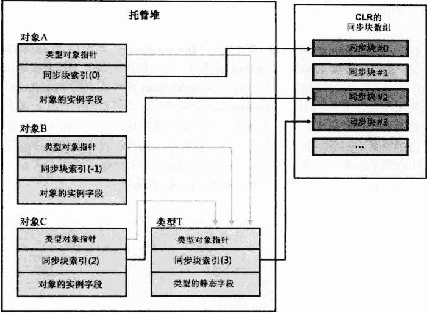

## 第三十章　混合线程同步构造

**本章内容：**

- 一个简单的混合锁
- 自旋、线程所有权和递归
- FCL 中的混合构造
- 著名的双检锁技术
- 条件变量模式
- 异步的同步构造
- 并发集合类

第二十九章“基元线程同步构造”讨论了基元用户模式和内核模式线程同步构造。其他所有线程同步构造都基于它们而构建，而且一般都合并了用户模式和内核模式构造，我们称为混合线程同步构造。没有线程竞争时，混合构造提供了基元用户模式构造所具有的性能优势。多个线程竞争一个构造时，混合构造通过基元内核模式的构造来提供不“自旋”的优势（避免浪费 CPU 时间）。由于大多数应用程序的线程都很少同时竞争一个构造，所以性能上的增强可以使你的应用程序表现得更出色。

本章首先展示了如何基于各种基元构造来构建混合构造。然后展示了 FCL 自带的许多混合构造，描述了它们的行为，并介绍了如何正确使用它们。我还提到了一些我自己创建的构造，它们通过 Wintellect 的 Power Threading 库免费提供给大家使用，请从 http://wintellect.com/Resource-Power-Collections-Library 下载。

本章末尾展示了如何使用 FCL 的并发集合类来取代混合构造，从而最小化资源使用并提升性能。最后讨论了异步的同步构造，允许以同步方式访问资源，同时不造成任何线程的阻塞，从而减少了资源消耗，并提高了伸缩性。

### 30.1　一个简单的混合锁

言归正传，下面是一个混合线程同步锁的例子：

```powershell
# 原书“internal sealed class ... : IDisposable”的限定在 PowerShell 类中没有对应物，
# 类默认 public、非密封；Interlocked 方法作用于 [ref] 字段上可用（实测 PS 7.6）。
class SimpleHybridLock {
    # Int32 由基元用户模式构造（Interlocked 的方法）使用
    hidden [int] $m_waiters = 0

    # AutoResetEvent 是基元内核模式构造
    hidden [System.Threading.AutoResetEvent] $m_waiterLock = [System.Threading.AutoResetEvent]::new($false)

    [void] Enter() {
        # 指出这个线程想要获得锁
        if ([System.Threading.Interlocked]::Increment([ref]$this.m_waiters) -eq 1) { return } # 无竞争，直接返回
        # 另一个线程拥有锁（发生竞争），使这个线程等待
        [void]$this.m_waiterLock.WaitOne()  # 这里产生较大的性能影响；WaitOne 返回后拿到锁
    }

    [void] Leave() {
        # 这个线程准备释放锁
        if ([System.Threading.Interlocked]::Decrement([ref]$this.m_waiters) -eq 0) { return } # 无等待线程
        # 有其他线程正在阻塞，唤醒其中一个
        [void]$this.m_waiterLock.Set()      # 这里产生较大的性能影响
    }

    [void] Dispose() { $this.m_waiterLock.Dispose() }
}
```

SimpleHybridLock 包含两个字段：一个 Int32，由基元用户模式的构造来操作；以及一个 AutoResetEvent，它是一个基元内核模式的构造。为了获得出色的性能，锁要尽量操作 Int32，尽量少操作 AutoResetEvent。每次构造 SimpleHybridLock 对象就会创建 AutoResetEvent；和 Int32 字段相比，它对性能的影响大得多。本章以后会展示混合构造 AutoResetEventSlim：多个线程同时访问锁时，只有在第一次检测到竞争时才会创建 AutoResetEvent，这样就避免了性能损失。Dispose 方法关闭 AutoResetEvent，这也会对性能造成大的影响。

SimpleHybridLock 对象在构造和 dispose 时的性能能提升当然很好，但我们应该将更多精力放在它的 Enter 和 Leave 方法的性能上，因为在对象生存期内，这两个方法要被大量地调用。下面让我们重点关注这些方法。

调用 Enter 的第一个线程造成 Interlocked.Increment 在 m_waiters 字段上加 1，使它的值变成 1。这个线程发现以前有零个线程正在等待这个锁，所以线程从它的 Enter 调用中返回。值得欣赏的是，线程获得锁的速度非常快。现在，如果另一个线程介入并调用 Enter，这个线程将 m_waiters 增加到 2，发现锁在另一个线程那里。所以，这个线程会使用 AutoResetEvent 对象来调用 WaitOne，从而阻塞自身，调用 WaitOne 造成线程的代码转变成内核模式的代码，这会对性能产生巨大的影响。但线程反正都要停止运行，所以让线程花点时间来完全停止，似乎也不是太坏。好消息是，线程现在会阻塞，不会因为在 CPU 上“自旋”而浪费 CPU 时间。(29.3.3 节“实现简单的自旋锁”引入的 SimpleSpinLock 的 Enter 方法就会这样“自旋”。)

再来看看 Leave 方法。一个线程调用 Leave 时，会调用 Interlocked.Decrement 从 m_waiters 字段减 1。如果 m_waiters 现在是 0，表明没有其他线程在调用 Enter 时发生阻塞，调用 Leave 的线程可以直接返回。同样地，想象一下这有多快：离开一个锁意味着线程从一个 Int32 中减 1，执行快速的 if 测试，然后返回！另一方面，如果调用 Leave 的线程发现 m_waiters 不为 0，线程就知道现在存在一个竞争，另外至少有一个线程在内核中阻塞。这个线程必须唤醒一个(而且只能是一个)阻塞的线程。唤醒线程是通过在 AutoResetEvent 上调用 Set 来实现的。这会造成性能上的损失，因为线程必须转换成内核模式代码，再转换回来。但这个转换只有在发生竞争时才会发生。当然，AutoResetEvent 确保只有一个阻塞的线程被唤醒；在 AutoResetEvent 上阻塞的其他所有线程会继续阻塞，直到新的、解除了阻塞的线程最终调用 Leave。


> **注意**　在实际应用中，任何线程可以在任何时间调用 Leave，因为 Enter 方法没有记录哪一个线程成功获得了锁。很容易添加字段和代码来维护这种信息，但会增大锁对象自身需要的内存，并损害 Enter 和 Leave 方法的性能，因为它们现在必须操作这个字段。我情愿有一个性能高超的锁，并确保我的代码以正确方式使用它。你会注意到，事件和信号量都没有维护这种信息，只有互斥体才有维护。

### 30.2 自旋、线程所有权和递归

由于转换为内核模式会造成巨大的性能损失，而且线程占有锁的时间通常都很短，所以为了提升应用程序的总体性能，可以让一个线程在用户模式中“自旋”一小段时间，再让线程转换为内核模式。如果线程正在等待的锁在线程“自旋”期间变得可用，就能避免向内核模式的转换了。

此外，有的锁限制只能由获得锁的线程释放锁。有的锁允许当前拥有它的线程递归地拥有锁(多次拥有)，Mutex 锁就是这样的一个例子。①可通过一些别致的逻辑构建支持自旋、线程所有权和递归的一个混合锁，如下所示：

```powershell
# internal sealed 在 PowerShell 类中无对应；C# 的 goto 改写为 break + 标志；其余逐一映射。
class AnotherHybridLock {
    # Int32 基于用户模式构造（Interlocked 的方法）使用
    hidden [int] $m_waiters = 0

    # AutoResetEvent 是基元内核模式构造
    hidden [System.Threading.AutoResetEvent] $m_waiterLock = [System.Threading.AutoResetEvent]::new($false)

    # 这个字段控制自旋，希望能提升性能
    hidden [int] $m_spinCount = 4000        # 随便选择的一个计数

    hidden [int] $m_owningThreadId = 0      # 指出哪个线程拥有锁
    hidden [int] $m_recursion = 0           # 以及拥有了它多少次

    [void] Enter() {
        # 如果调用线程已经拥有锁，递增递归计数并返回
        [int] $threadId = [System.Threading.Thread]::CurrentThread.ManagedThreadId
        if ($threadId -eq $this.m_owningThreadId) { $this.m_recursion++; return }

        # 调用线程不拥有锁，尝试获取它
        $spinwait = [System.Threading.SpinWait]::new()
        $gotLock = $false
        for ([int] $spinCount = 0; $spinCount -lt $this.m_spinCount; $spinCount++) {
            # 如果锁可以自由使用，这个线程就获得它：设置状态并跳出循环
            if ([System.Threading.Interlocked]::CompareExchange([ref]$this.m_waiters, 1, 0) -eq 0) { $gotLock = $true; break }
            # 黑科技：给其他线程运行的机会，希望锁会被释放
            $spinwait.SpinOnce()
        }
        if (-not $gotLock) {
            # 自旋结束，锁仍未获得，再试一次
            if ([System.Threading.Interlocked]::Increment([ref]$this.m_waiters) -gt 1) {
                # 仍然是竞争条件，这个线程必须阻塞
                [void]$this.m_waiterLock.WaitOne()   # 等待锁；性能有损失；醒后拥有锁
            }
        }
        # 一个线程获得锁时，记录它的 ID，并指出线程拥有锁一次
        $this.m_owningThreadId = $threadId; $this.m_recursion = 1
    }

    [void] Leave() {
        # 如果调用线程不拥有锁，表明存在 bug
        [int] $threadId = [System.Threading.Thread]::CurrentThread.ManagedThreadId
        if ($threadId -ne $this.m_owningThreadId) {
            throw [System.Threading.SynchronizationLockException]::new('Lock not owned by calling thread')
        }
        # 递减递归计数。如果这个线程仍然拥有锁，那么直接返回
        $this.m_recursion--
        if ($this.m_recursion -gt 0) { return }

        $this.m_owningThreadId = 0            # 现在没有线程拥有锁
        # 如果没有其他线程在等待，直接返回
        if ([System.Threading.Interlocked]::Decrement([ref]$this.m_waiters) -eq 0) { return }
        # 有其他线程正在等待，唤醒其中 1 个
        [void]$this.m_waiterLock.Set()        # 这里有较大的性能损失
    }

    [void] Dispose() { $this.m_waiterLock.Dispose() }
}
```

> ① 线程在 Mutex 对象上等待时不会“自旋”，因为 Mutex 的代码在内核中。这意味着线程必须转换成内核模式才能检查 Mutex 的状态。

可以看出，为锁添加了额外的行为之后，会增大它拥有的字段数量，进而增大内存消耗。代码还变得更复杂了，而且这些代码必须执行，造成锁的性能的下降。29.4.1 节“Event 构造”比较了在各种情况下对一个 Int32 进行递增的性能，这些情况分别是：无任何锁，使用基元用户模式构造，以及使用内核模式构造。这里重复了那些性能测试的结果，并添加了使用 SimpleHybridLock 和 AnotherHybridLock 的结果。结果从快到慢依次是：

| 测试 | 性能比较 |
|---|---|
| Incrementing x: 8 | 最快 |
| Incrementing x in M: 69 | 约慢 9 倍 |
| Incrementing x in SpinLock: 164 | 约慢 21 倍 |
| Incrementing x in SimpleHybridLock: 164 | 约慢 21 倍（类似于 SpinLock） |
| Incrementing x in AnotherHybridLock: 230 | 约慢 29 倍（因为所有权/递归） |
| Incrementing x in SimpleWaitLock: 8854 | 约慢 1107 倍 |

注意，AnotherHybridLock 的性能不如 SimpleHybridLock。这是因为需要额外的逻辑和错误检查来管理线程所有权和递归行为。如你所见，在锁中添加的每一个行为都会影响它的性能。

### 30.3 FCL 中的混合构造

FCL 自带了许多混合构造，它们通过一些别致的逻辑将你的线程保持在用户模式，从而增强应用程序的性能。有的混合构造直到首次有线程在一个构造上发生竞争时，才会创建内核模式的构造。如果线程一直不在构造上发生竞争，应用程序就可避免因为创建对象而产生的性能损失，同时避免为对象分配内存。许多构造还支持使用一个 CancellationToken(参见第二十七章“计算限制的异步操作”)，使一个线程强迫解除可能正在构造上等待的其他线程的阻塞。本节将向你介绍这些混合构造。

#### 30.3.1 ManualResetEventSlim 类和 SemaphoreSlim 类

先来看看 System.Threading.ManualResetEventSlim 和 System.Threading.SemaphoreSlim 这两个类。①这两个构造的工作方式和对应的内核模式构造完全一致，只是它们都在用户模式中“自旋”，而且都推迟到发生第一次竞争时，才创建内核模式的构造。它们的 Wait 方法允许传递一个超时值和一个 CancellationToken。下面展示了这些类(未列出部分方法的重载版本):

```csharp
public class ManualResetEventSlim : IDisposable {
    public ManualResetEventSlim(Boolean initialState, Int32 spinCount);
    public void Dispose();
    public void Reset();
    public void Set();
    public Boolean Wait(Int32 millisecondsTimeout, CancellationToken cancellationToken);

    public Boolean IsSet { get; }
    public Int32 SpinCount { get; }
    public WaitHandle WaitHandle { get; }
}
public class SemaphoreSlim : IDisposable {
    public SemaphoreSlim(Int32 initialCount, Int32 maxCount);
    public void Dispose();
    public Int32 Release(Int32 releaseCount);
    public Boolean Wait(Int32 millisecondsTimeout, CancellationToken cancellationToken);

    // 该特殊方法用于 async 和 await(参见第二十八章)
    public Task<Boolean> WaitAsync(Int32 millisecondsTimeout, CancellationToken
        cancellationToken);

    public Int32 CurrentCount { get; }
    public WaitHandle AvailableWaitHandle { get; }
}
```

#### 30.3.2 Monitor 类和同步块

或许最常用的混合型线程同步构造就是 Monitor 类，它提供了支持自旋、线程所有权和递归的互斥锁。之所以最常用，是因为它资格最老，C#有内建的关键字支持它，JIT 编译器对它知之甚详，而且 CLR 自己也在代表你的应用程序使用它。**（PowerShell 没有 `lock` 语句这样的内建语法，只能用 `[System.Threading.Monitor]::Enter($obj)` / `::Exit($obj)` 显式配对调用，并自行用 `try/finally` 保证释放。）** 但正如稍后就要讲到的那样，这个构造存在许多问题，用它很容易造成代码中出现 bug。我先解释这个构造，然后指出问题以及解决问题的方式。

堆中的每个对象都可关联一个名为同步块的数据结构。同步块包含字段，这些字段和本章前面展示的 AnotherHybridLock 类的字段相似。具体地说，它为内核对象、拥有线程(owning thread)的 ID、递归计数(recursion count)以及等待线程(waiting thread)计数提供了相应的字段。Monitor 是静态类，它的方法接受对任何堆对象的引用。这些方法对指定对象的同步块中的字段进行操作。以下是 Monitor 类最常用的方法：

```csharp
public static class Monitor {
    public static void Enter(Object obj);
    public static void Exit(Object obj);

    // 还可指定尝试进入锁时的超时值（不常用）：
    public static Boolean TryEnter(Object obj, Int32 millisecondsTimeout);

    // 稍后会讨论 lockTaken 实参
    public static void Enter(Object obj, ref Boolean lockTaken);
    public static void TryEnter(Object obj, Int32 millisecondsTimeout,
        ref Boolean lockTaken);
}
```

显然，为堆中每个对象都关联一个同步块数据结构显得很浪费，尤其是考虑到大多数对象的同步块都从不使用。为节省内存，CLR 团队采用一种更经济的方式提供刚才描述的功能。它的工作原理是：CLR 初始化时在堆中分配一个同步块数组。本书第四章说过，每当一个对象在堆中创建的时候，都有两个额外的开销字段与它关联。第一个是“类型对象指针”，包含类型的“类型对象”的内存地址。第二个是“同步块索引”，包含同步块数组中的一个整数索引。

一个对象在构造时，它的同步块索引初始化为 -1，表明不引用任何同步块。然后，调用 Monitor.Enter 时，CLR 在数组中找到一个空白同步块，并设置对象的同步块索引，让它引用该同步块。换言之，同步块和对象是动态关联的。调用 Exit 时，会检查是否有其他任何线程正在等待使用对象的同步块。如果没有线程在等待它，同步块就自由了，Exit 将对象的同步块索引设回 -1，自由的同步块将来可以和另一个对象关联。

图 30-1 展示了堆中的对象、它们的同步块索引以及 CLR 的同步块数组元素之间的关系。Object-A、Object-B 和 Object-C 都将它们的类型对象指针成员设为引用 Type-T（一个类型对象）。这意味着三个对象全都具有相同的类型。如第四章所述，类型对象本身也是堆中的一个对象。和其他所有对象一样，类型对象有两个开销成员：同步块索引和类型对象指针。这意味着同步块可以和类型对象关联，而且可以将一个类型对象引用传给 Monitor 的方法。顺便说一句，如有必要，同步块数组能创建更多的同步块。所以，同时同步大量对象时，不必担心系统会用光同步块。




图 30-1　堆中的对象（包括类型对象）可使其同步块索引引用 CLR 同步块数组中的记录项

以下代码演示了 Monitor 类原本的使用方式：

```powershell
# C# 中是 internal sealed 类且锁住 this；PowerShell 类默认 public、非密封，直接锁 $this。
# 注意：PowerShell 类不支持只读属性，原书 LastTransaction 属性改写为同名方法。
class Transaction {
    hidden [System.DateTime] $m_timeOfLastTrans

    [void] PerformTransaction() {
        [System.Threading.Monitor]::Enter($this)   # 进入锁
        try {
            # 以下代码拥有对数据的独占访问权...
            $this.m_timeOfLastTrans = [System.DateTime]::Now
        }
        finally { [System.Threading.Monitor]::Exit($this) }   # 确保释放
    }

    [System.DateTime] LastTransaction() {
        [System.Threading.Monitor]::Enter($this)
        try {
            # 以下代码拥有对数据的独占访问权...
            return $this.m_timeOfLastTrans
        }
        finally { [System.Threading.Monitor]::Exit($this) }
    }
}
```

表面看很简单，但实际存在问题。现在的问题是，每个对象的同步块索引都隐式为公共的。以下代码演示了这可能造成的影响。

```csharp
public static void SomeMethod() {
    var t = new Transaction();
    Monitor.Enter(t); // 这个线程获取对象的公共锁

    // 让一个线程池线程显示 LastTransaction 时间
    // 注意：线程池线程会阻塞，直到 SomeMethod 调用了 Monitor.Exit!
    ThreadPool.QueueUserWorkItem(o => Console.WriteLine(t.LastTransaction));

    Monitor.Exit(t);
}
```

> **注意（PowerShell 适用性）**　`ThreadPool.QueueUserWorkItem` 的回调是 .NET 委托；PowerShell 脚本块无法在 .NET 回调节点上直接执行（缺运行空间会抛 `PSInvalidOperationException`），所以这一并发场景在脚本中不能原样改写。这里保留 C#，只是为了说明“每个对象的同步块索引（可用作锁）是公共的”这一要点。

```csharp
lock (this) {
    // 这里的代码拥有对数据的独占访问权...
}
```

> **注意（PowerShell 适用性）**　C# 的 `lock` 语句在 PowerShell 中没有对应语法，只能写成下面的 `Monitor.Enter`/`Monitor.Exit` 显式配对（并用 `try/finally` 保证释放）。

它等价于像下面这样写方法：

```csharp
private void SomeMethod() {
    Boolean lockTaken = false;
    try {
        // 这里可能发生异常(比如 ThreadAbortException)...
        Monitor.Enter(this, ref lockTaken);
        // 这里的代码拥有对数据的独占访问权...
    }
    finally {
        if (lockTaken) Monitor.Exit(this);
    }
}
```

第一个问题是，C# 团队认为他们在 finally 块中调用 Monitor.Exit 是帮了你一个大忙。他们的想法是，这样一来，就可确保锁总是得以释放，无论 try 块中发生了什么。但这只是他们一厢情愿的想法。在 try 块中，如果在更改状态时发生异常，这个状态就会处于损坏状态。锁在 finally 块中退出时，另一个线程可能开始操作损坏的状态。显然，更好的解决方案是让应用程序挂起，而不是让它带着损坏的状态继续运行。这样不仅结果难以预料，还有可能引发安全隐患。第二个问题是，进入和离开 try 块会影响方法的性能。有的 JIT 编译器不会内联含有 try 块的方法，造成性能进一步下降。所以最终结果是，不仅代码的速度变慢了，还会造成线程访问损坏的状态。①我的建议是杜绝使用 C# 的 lock 语句。（PowerShell 本身就没有 lock 语句，这一建议自动得到遵守；但同理，也不应自己手工写出 `Monitor.Enter`/`Monitor.Exit` 包住可能抛异常的状态修改代码。）

现在终于可以开始讨论 Boolean lockTaken 变量了。下面是这个变量试图解决的问题。假定一个线程进入 try 块，但在调用 Monitor.Enter 之前退出（参见第二十二章）。现在，finally 块会得到调用，但它的代码不应退出锁。lockTaken 变量就是为了解决这个问题而设计的。它初始化为 false，假定现在还没有进入锁（还没有获得锁）。然后，如果调用 Monitor.Enter，而且成功获得锁，Enter 方法就会将 lockTaken 设为 true。finally 块通过检查 lockTaken，便知道到底要不要调用 Monitor.Exit。顺便说一句，SpinLock 结构也支持这个 lockTaken 模式。

#### 30.3.3　ReaderWriterLockSlim 类

我们经常都希望让一个线程简单地读取一些数据的内容。如果这些数据被一个互斥锁（比如 SimpleSpinLock、SimpleWaitLock、SimpleHybridLock、AnotherHybridLock、Mutex 或者 Monitor）保护，那么当多个线程同时试图访问这些数据时，只有一个线程才会运行，其他所有线程都会阻塞。这会造成应用程序伸缩性和吞吐能力的急剧下降。如果所有线程都希望以只读方式访问数据，就根本没有必要阻塞它们；应该允许它们并发地访问数据。另一方面，如果一个线程希望修改数据，这个线程就需要对数据的独占式访问。

① 顺便说一句，虽然仍然会对性能造成影响，但假如 try 块的代码只是对状态执行读取操作，而不是试图修改它，那么在 finally 块中释放锁是安全的。

**ReaderWriterLockSlim** 类封装了解决这个问题的逻辑。具体地说，这个类像下面这样控制线程。

- 一个线程向数据写入时，请求访问的其他所有线程都被阻塞。
- 一个线程从数据读取时，请求读取的其他线程允许继续执行，但请求写入的线程仍被阻塞。
- 向数据写入的线程结束后，要么解除一个写入线程（writer）的阻塞，使它能向数据写入，要么解除所有读取线程（reader）的阻塞，使它们能并发读取数据。如果没有线程被阻塞，锁就进入可以自由使用的状态，可供下一个 reader 或 writer 线程获取。
- 从数据读取的所有线程结束后，一个 writer 线程被解除阻塞，使它能向数据写入。如果没有线程被阻塞，锁就进入可以自由使用的状态，可供下一个 reader 或 writer 线程获取。

下面展示了这个类（未列出部分方法的重载版本）：

```csharp
public class ReaderWriterLockSlim : IDisposable {
    public ReaderWriterLockSlim(LockRecursionPolicy recursionPolicy);
    public void Dispose();

    public void       EnterReadLock();
    public Boolean    TryEnterReadLock(Int32 millisecondsTimeout);
    public void       ExitReadLock();

    public void       EnterWriteLock();
    public Boolean    TryEnterWriteLock(Int32 millisecondsTimeout);
    public void       ExitWriteLock();

    // 大多数应用程序从不查询以下任何属性
    public Boolean IsReadLockHeld             { get; }
    public Boolean IsWriteLockHeld            { get; }
    public Int32 CurrentReadCount             { get; }
    public Int32 RecursiveReadCount           { get; }
    public Int32 RecursiveWriteCount          { get; }
    public Int32 WaitingReadCount             { get; }
    public Int32 WaitingWriteCount            { get; }
    public LockRecursionPolicy RecursionPolicy { get; }
    // 未列出和 reader 升级到 writer 有关的成员
}
```

以下代码演示了这个类的用法：

```powershell
# 与前面的 Transaction 同名会冲突：同一个脚本里 PowerShell 类名必须唯一，
# 若需同时定义请给其中一个改名。原书 LastTransaction 是只读属性，这里改为方法。
class Transaction {
    hidden [System.Threading.ReaderWriterLockSlim] $m_lock = [System.Threading.ReaderWriterLockSlim]::new([System.Threading.LockRecursionPolicy]::NoRecursion)
    hidden [System.DateTime] $m_timeOfLastTrans

    [void] PerformTransaction() {
        $this.m_lock.EnterWriteLock()
        try {
            # 以下代码拥有对数据的独占访问权...
            $this.m_timeOfLastTrans = [System.DateTime]::Now
        }
        finally { $this.m_lock.ExitWriteLock() }
    }

    [System.DateTime] LastTransaction() {
        $this.m_lock.EnterReadLock()
        try {
            # 以下代码拥有对数据的共享访问权...
            return $this.m_timeOfLastTrans
        }
        finally { $this.m_lock.ExitReadLock() }
    }

    [void] Dispose() { $this.m_lock.Dispose() }
}
```

这个类有几个概念要特别留意。首先，**ReaderWriterLockSlim** 的构造器允许传递一个 **LockRecursionPolicy** 标志，它的定义如下：

```csharp
public enum LockRecursionPolicy { NoRecursion, SupportsRecursion }
```

如果传递 **SupportsRecursion** 标志，锁就支持线程所有权和递归行为。如同本章早些时候讨论的那样，这些行为对锁的性能有负面影响。所以，建议总是向构造器传递 **LockRecursionPolicy.NoRecursion**（就像本例）。reader-writer 锁支持线程所有权和递归的代价非常高昂，因为锁必须跟踪曾允许进入锁的所有 reader 线程，同时为每个线程都单独维护递归计数。事实上，为了以线程安全的方式维护所有这些信息，**ReaderWriterLockSlim** 内部要使用一个互斥的“自旋锁”，我不是在开玩笑！

**ReaderWriterLockSlim** 类提供了一些额外的方法（前面没有列出）允许一个 reader 线程升级为 writer 线程。以后，线程可以把自己降级回 reader 线程。设计者的思路是，一个线程刚开始的时候可能是读取数据。然后，根据数据的内容，线程可能想对数据进行修改。为此，线程要把它自己从 reader 升级为 writer。锁如果支持这个行为，性能会大打折扣。而且我完全不觉得这是一个有用的功能。线程并不是直接从 reader 变成 writer 的。当时可能还有其他线程正在读取，这些线程必须完全退出锁。在此之后，尝试升级的线程才允许成为 writer。这相当于先让 reader 线程退出锁，再立即获取这个锁以进行写入。

> **注意**　FCL 还提供了一个 **ReaderWriterLock** 类，它是在 Microsoft .NET Framework 1.0 中引入的。这个类存在许多问题，所以 Microsoft 在 .NET Framework 3.5 中引入了 **ReaderWriterLockSlim** 类。团队没有对原先的 **ReaderWriterLock** 类进行改进，因为他们害怕失去和那些正在使用它的应用程序的兼容性。下面列举了 **ReaderWriterLock** 存在的几个问题。首先，即使不存在线程竞争，它的速度也非常慢。其次，线程所有权和递归行为是这个类强加的，完全取消不了，这使锁变得更慢。最后，相比 writer 线程，它更青睐于 reader 线程，所以 writer 线程可能排起好长的队，却很少有机会获得服务，最终造成“拒绝服务”（DoS）问题。

- 如果 WW>0：将状态设为 ReservedForWriter，WW--，释放 1 个阻塞的 writer 线程，返回。
- 如果 RW==0 && WW == 0：将状态设为 Free，返回。

下面说明了一个线程进入锁进行独占访问时发生的事情。

- 如果锁的状态为 Free：将状态设为 OwnedByWriter，返回。
- 如果锁的状态为 ReservedForWriter：将状态设为 OwnedByWriter，返回。
- 如果锁的状态为 OwnedByWriter：WW++，阻塞 writer 线程。线程醒来时，循环并重试。
- 否则：将状态设为 OwnedByReadersAndWriterPending，WW++，阻塞 writer 线程。线程醒来时，循环并重试。

下面说明了进行独占访问的一个线程离开锁时发生的事情。

- 如果 WW==0 && RW==0：将状态设为 Free，返回。
- 如果 WW > 0：将状态设为 ReservedForWriter，WW--，释放 1 个阻塞的 writer 线程，返回。
- 如果 WW==0 && RW>0：将状态设为 Free，RW=0，唤醒所有阻塞的 reader 线程，返回。

假定当前有一个线程（reader）正在锁中进行读取操作，另一个线程（writer）想进入锁进行（独占的）写入操作。writer 线程首先检查锁是否为 Free，由于不为 Free，所以线程会继续执行下一项检查。然而，在这个时候，reader 线程可能离开了锁，而且在离开时发现 RW 和 WW 都是 0。所以，线程会将锁的状态设为 Free。这便造成了一个问题，因为 writer 线程已经执行过这个测试，并且走开了。简单地说，这里发生的事件是，reader 线程背着 writer 线程改变了 writer 线程访问的状态。我需要解决这个问题，使锁能够正确工作。

为了解决这个问题，所有这些位操作都要使用 29.3.4 节 “Interlocked Anything 模式” 描述的技术来执行。这个模式允许将任何操作转换成线程安全的原子操作。正是因为这个问题，才使得这个锁的速度是如此之快，而且其中维护的状态比其他 reader-writer 锁少。比较 **OneManyLock** 类与 FCL 的 **ReaderWriterLockSlim** 和 **ReaderWriterLock** 类的性能，我得到以下结果：

| 操作 | 耗时 | 说明 |
| --- | ---: | --- |
| Incrementing x in OneManyLock | 330 | 最快 |
| Incrementing x in ReaderWriterLockSlim | 554 | 约慢 1.7 倍 |
| Incrementing x in ReaderWriterLock | 984 | 约慢 3 倍 |

当然，由于所有 reader-writer 锁都执行比互斥锁更多的逻辑，所以它们的性能可能要稍差一些。但在比较时不要忘记这样一个事实：reader-writer 锁允许多个 reader 线程同时进入锁。

结束本节的讨论之前，我想指出的是，我的 Power Threading 库提供了这个锁的一个稍微不同的版本。

```csharp
public void RemoveParticipants(Int32 participantCount);    // 减去参与者
public Boolean SignalAndWait(Int32 millisecondsTimeout,
    CancellationToken cancellationToken);

public Int64 CurrentPhaseNumber { get; }                  // 指出进行到哪一个阶段（从 0 开始）
public Int32 ParticipantCount { get; }                    // 参与者数量
public Int32 ParticipantsRemaining { get; }               // 需要调用 SignalAndWait 的线程数
}
```

构造 **Barrier** 时要告诉它有多少个线程准备参与工作，还可传递一个 `Action<Barrier>` 委托来引用所有参与者完成一个阶段的工作后要调用的代码。可以调用 **AddParticipant** 和 **RemoveParticipant** 方法在 **Barrier** 中动态添加和删除参与线程。但在实际应用中，人们很少这样做。每个线程完成它的阶段性工作后，应调用 **SignalAndWait**，告诉 **Barrier** 线程已经完成一个阶段的工作，而 **Barrier** 会阻塞线程（使用一个 **ManualResetEventSlim**）。所有参与者都调用了 **SignalAndWait** 后，**Barrier** 将调用指定的委托（由最后一个调用 **SignalAndWait** 的线程调用），然后解除正在等待的所有线程的阻塞，使它们开始下一阶段。

#### 30.3.7　线程同步构造小结

我的建议是，代码尽量不要阻塞任何线程。执行异步计算或 I/O 操作时，将数据从一个线程交给另一个线程时，应避免多个线程同时访问数据。如果不能完全做到这一点，请尽量使用 **Volatile** 和 **Interlocked** 的方法，因为它们的速度很快，而且绝不阻塞线程。遗憾的是，这些方法只能操作简单类型。但可以像 29.3.4 节“**Interlocked Anything** 模式”描述的那样在这些类型上执行丰富的操作。

主要在以下两种情况下阻塞线程。

- **线程模型很简单**：
  阻塞线程虽会牺牲一些资源和性能，但可顺序地编写应用程序代码，无需使用回调方法。不过，C# 的异步方法功能现在提供了不阻塞线程的简化编程模型。**（PowerShell 无异步方法功能；如需不阻塞，只能借助后台作业（`Start-ThreadJob`/`Start-Job`）或直接使用 Task API。）**
- **线程有专门用途**：
  有的线程是特定任务专用的。最好的例子就是应用程序的主线程。如果应用程序的主线程没有阻塞，它最终就会返回，造成整个进程终止。其他例子还有应用程序的 GUI 线程。Windows 要求一个窗口或控件总是由创建它的线程操作。因此，我们有时写代码阻塞一个 GUI 线程，直到其他某个操作完成。然后，GUI 线程根据需要对窗口和控件进行更新。当然，阻塞 GUI 线程会造成应用程序挂起，使用户体验变差。

要避免阻塞线程，就不要刻意地为线程打上标签。例如，不要创建一个拼写检查线程、一个语法检查线程、一个处理特定客户端请求的线程等。为线程打上标签，其实是在告诫自己该线程不能做其他任何事情。但由于线程是如此昂贵，所以不能把它们专门用于某个目的。相反，应通过线程池将线程出租相当短暂的时间。所以正确方式是让一个线程池线程开始拼写检查，再改为语法检查，再代表一个客户端请求执行工作，以此类推。

如果一定要阻塞线程，为了同步在不同 AppDomain 或进程中运行的线程，请使用内核对象。

构造。要在一系列操作中原子性地操纵状态，请使用带有私有字段的 Monitor 类。①另外，可以使用 reader-writer 锁代替 Monitor。reader-writer 锁通常比 Monitor 慢，但它们允许多个线程并发执行，这提升了总体性能，并将阻塞线程的几率降至最低。

此外，避免使用递归锁(尤其是递归的 reader-writer 锁)，因为它们会损害性能。但 Monitor 是递归的，性能也不错。②另外，不要在 finally 块中释放锁，因为进入和离开异常处理块会招致性能损失。如果在更改状态时抛出异常，状态就会损坏，操作这个状态的其他线程会出现不可预料的行为，并可能引入安全隐患。

当然，如果写代码来占用锁，注意时间不要太长，否则会增大线程阻塞的几率。后面的 30.6 节“异步的同步构造”会展示如何利用集合类防止长时间占有锁。

最后，对于计算限制的工作，可以使用任务(参见第 27.5 节“任务”)避免使用大量线程同步构造。我喜欢的一个设计是，每个任务都关联一个或多个延续任务。某个操作完成后，这些任务将通过某个线程池线程继续执行。这比让一个线程阻塞并等待某个操作完成好得多。对于 I/O 限制的工作，调用各种 XxxAsync 方法将造成你的代码在 I/O 操作完成后继续；这其实类似于任务的延续任务。

### 30.4 著名的双检锁技术

双检锁(Double-Check Locking)是一个非常著名的技术，开发人员用它将单实例(singleton)对象的构造推迟到应用程序首次请求该对象时进行。这有时也称为延迟初始化(lazy initialization)。如果应用程序永远不请求对象，对象就永远不会构造，从而节省了时间和内存。但当多个线程同时请求单实例对象时就可能出问题。这个时候必须使用一些线程同步机制确保单实例对象只被构造一次。

该技术之所以有名，不是因为它非常有趣或有用，而是因为它曾经是人们热烈讨论的话题。该技术曾在 Java 中大量使用，后来有一天，一些人发现 Java 不能保证该技术在任何地方都能正确工作。这个使它出名的网页对问题进行了清楚的说明：http://www.cs.umd.edu/~pugh/java/memoryModel/DoubleCheckedLocking.html。

无论如何，一个好消息是，CLR 很好地支持双检锁技术，这应该归功于 CLR 的内存模型以及 volatile 字段访问(参见第二十九章)。以下代码演示了如何用 C# 实现双检锁技术③：

> **注意（PowerShell 适用性）**　下面这段 C# 代码中的 `volatile` 关键字在 PowerShell 中没有对应物；脚本中若要写双检锁，需要用 `[System.Threading.Volatile]::Read([ref]$s_value)` 和 `[System.Threading.Volatile]::Write([ref]$s_value, $temp)` 显式表达。但更实际的做法是直接用 `[System.Lazy[object]]::new([System.Func[object]]{ ... })`，由它替你完成线程安全的延迟初始化（实测在 PowerShell 7.6 中可用）。`[System.Threading.LazyInitializer]` 因重载解析问题，在 PowerShell 中难以直接调用。

```csharp
public sealed class Singleton {
    // s_lock 对象是实现线程安全所需要的。定义这个对象时，我们假设创建单实例对象的
    // 代价高于创建一个 System.Object 对象，并假设可能根本不需要创建单实例对象。
    // 否则，更经济、更简单的做法是在一个类构造器中创建单实例对象。
    private static Object s_lock = new Object();

    // 这个字段引用一个单实例对象
    private static Singleton s_value = null;

    // 私有构造器阻止这个类外部的任何代码创建实例
    private Singleton() {
        // 把初始化单实例对象的代码放在这里...
    }

    // 以下公共静态方法返回单实例对象（如有必要就创建它）
    public static Singleton GetSingleton() {
        // 如果单实例对象已经创建，直接返回它（这样速度很快）
        if (s_value != null) return s_value;

        Monitor.Enter(s_lock);  // 还没有创建，让一个线程创建它
        if (s_value == null) {
            // 仍未创建，创建它
            Singleton temp = new Singleton();

            // 将引用保存到 s_value 中（参见正文的详细讨论）
            Volatile.Write(ref s_value, temp);
        }
        Monitor.Exit(s_lock);

        // 返回对单实例对象的引用
        return s_value;
    }
}
```

- ① 可用 SpinLock 代替 Monitor，因为 SpinLock 稍快一些。但 SpinLock 比较危险，因为它可能浪费 CPU 时间。而且在我看来，它还没有快到非用不可的地步。
- ② 部分是由于 Monitor 用本机代码(而非托管代码)来实现。
- ③ 两个 if 语句即是两次检查。——译注

双检锁技术背后的思路在于，对 **GetSingleton** 方法的一个调用可以快速地检查 **s_value** 字段，判断对象是否创建。如果是，方法就返回对它的引用。这里的妙处在于，如果对象已经构造好，就不需要线程同步；应用程序会运行得非常快。另一方面，如果调用 **GetSingleton** 方法的第一个线程发现对象还没有创建，就会获取一个线程同步锁来确保只有一个线程构造单实例对象。这意味着只有线程第一次查询单实例对象时，才会出现性能上的损失。

现在，让我解释一下为什么这个模式在 Java 中出了问题。Java 虚拟机(JVM)在 **GetSingleton** 方法开始的时候将 **s_value** 的值读入 CPU 寄存器。然后，对第二个 if 语句求值时，它直接查询寄存器，造成第二个 if 语句总是求值为 **true**，结果就是多个线程都会创建 **Singleton** 对象。当然，只有多个线程恰好同时调用 **GetSingleton** 才会发生这种情况。在大多数应用程序中，发生这种情况的概率都是极低的。这正是该问题在 Java 中长时间都没有被发现的原因。

在 CLR 中，对任何锁方法的调用都构成了一个完整的内存栅栏，在栅栏之前写入的任何变量都必须在栅栏之前完成；在栅栏之后的任何变量读取都必须在栅栏之后开始。对于 **GetSingleton** 方法，这意味着 **s_value** 字段的值必须在调用了 **Monitor.Enter** 之后重新读取；调用前缓存到寄存器中的东西作不了数。

**GetSingleton** 内部有一个 **Volatile.Write** 调用。下面让我解释一下它解决的是什么问题。假定第二个 if 语句中包含的是下面这行代码：

```csharp
s_value = new Singleton(); // 你极有可能这样写
```

你的想法是让编译器生成代码为一个 **Singleton** 分配内存，调用构造器来初始化字段，再将引用赋给 **s_value** 字段。使一个值对其他线程可见称为发布(publishing)。但那只是你一厢情愿的想法，编译器可能这样做：为 **Singleton** 分配内存，将引用发布到(赋给)**s_value**，再调用构造器。从单线程的角度出发，像这样改变顺序是无关紧要的。但在将引用发布给 **s_value** 之后，并在调用构造器之前，如果另一个线程调用了 **GetSingleton** 方法，那么会发生什么？这个线程会发现 **s_value** 不为 **null**，所以会开始使用 **Singleton** 对象，但对象的构造器还没有结束执行呢！这是一个很难追踪的 bug，尤其是它完全是由于计时而造成的。

对 **Volatile.Write** 的调用修正了这个问题。它保证 **temp** 中的引用只有在构造器结束执行之后，才发布到 **s_value** 中。解决这个问题的另一个办法是使用 C# 的 **volatile** 关键字来标记 **s_value** 字段（PowerShell 无此关键字，须改用 `Volatile.Read/Write`）。这使向 **s_value** 的写入变得具有“易变性”。同样，构造器必须在写入发生前结束运行。但遗憾的是，这同时会使所有读取操作具有“易变性”，这是完全没必要的。因此，使用 **volatile** 关键字，会使性能无谓地受到损害。

- ① 所以对字段的读取也要同步了。——译注

本节开头指出双检锁技术无关有趣。在我看来，是开发人员把它捧得太高，在许多不该使用它的时候也在用它。大多数时候，这个技术实际上会损害效率。下面是 **Singleton** 类的一个简单得多的版本，它的行为和上一个版本相同。这个版本没有使用“著名”的双检锁技术：

```csharp
internal sealed class Singleton {
    private static Singleton s_value = new Singleton();

    // 私有构造器防止这个类外部的任何代码创建一个实例
    private Singleton() {
        // 将初始化单实例对象的代码放在这里...
    }

    // 以下公共静态方法返回单实例对象（如有必要就创建它）
    public static Singleton GetSingleton() { return s_value; }
}
```

由于代码首次访问类的成员时，CLR 会自动调用类型的类构造器，所以首次有一个线程查询 **Singleton** 的 **GetSingleton** 方法时，CLR 就会自动调用类构造器，从而创建一个对象实例。此外，CLR 已保证了对类构造器的调用是线程安全的。我已在 8.3 节“类型构造器”对此进行了解释。这种方式的缺点在于，首次访问类的任何成员都会调用类型构造器。所以，如果 **Singleton** 类型定义了其他静态成员，就会在访问其他任何静态成员时创建 **Singleton** 对象。有人通过定义嵌套类来解决这个问题。

下面展示了生成 **Singleton** 对象的第三种方式：

```csharp
internal sealed class Singleton {
    private static Singleton s_value = null;

    // 私有构造器阻止这个类外部的任何代码创建实例
    private Singleton() {
        // 把初始化单实例对象的代码放在这里...
    }

    // 以下公共静态方法返回单实例对象（如有必要就创建它）
    public static Singleton GetSingleton() {
        if (s_value != null) return s_value;

        // 创建一个新的单实例对象，并把它固定下来（如果另一个线程还没有固定它的话）
        Singleton temp = new Singleton();
        Interlocked.CompareExchange(ref s_value, temp, null);

        // 如果这个线程竞争失败，新建的第二个单实例对象会被垃圾回收

        return s_value; // 返回对单实例对象的引用
    }
}
```

如果多个线程同时调用 **GetSingleton**，这个版本可能创建两个（或更多）**Singleton** 对象。然而，对 **Interlocked.CompareExchange** 的调用确保只有一个引用才会发布到 s_value 字段中。没有通过这个字段固定下来的任何对象都会在以后被垃圾回收。由于大多数应用程序都很少发生多个线程同时调用 **GetSingleton** 的情况，所以不太可能同时创建多个 **Singleton** 对象。

虽然可能创建多个 **Singleton** 对象，但上述代码有多方面的优势。首先，它的速度非常快。其次，它永不阻塞线程。相反，如果一个线程池线程在一个 **Monitor** 或者其他任何内核模式的线程同步构造上阻塞，线程池就会创建另一个线程来保持 CPU 的“饱和”。因此，会分配并初始化更多的内存，而且所有 DLL 都会收到一个线程连接通知。使用 **CompareExchange** 则永远不会发生这种情况。当然，只有在构造器没有副作用的时候才能使用这个技术。

FCL 有两个类型封装了本节描述的模式。下面是泛型 **System.Lazy** 类（有的方法没有列出）：

```csharp
public class Lazy<T> {
    public Lazy(Func<T> valueFactory, LazyThreadSafetyMode mode);
    public Boolean IsValueCreated { get; }
    public T Value { get; }
}
```

以下代码演示了它是如何工作的：

```powershell
# C# 的 Main 在脚本中可以直接写顶层语句；Lazy[string] 在 PowerShell 中可用（实测 PS 7.6）
$s = [System.Lazy[string]]::new([System.Func[string]]{ [System.DateTime]::Now.ToLongTimeString() }, $true)

[System.Console]::WriteLine($s.IsValueCreated)    # 还没有查询 Value，所以返回 False
[System.Console]::WriteLine($s.Value)             # 现在调用委托
[System.Console]::WriteLine($s.IsValueCreated)    # 已经查询了 Value，所以返回 True
[System.Threading.Thread]::Sleep(10000)           # 等待 10 秒，再次显示时间
[System.Console]::WriteLine($s.Value)             # 委托没有调用；显示相同结果
```

在我的机器上运行，得到以下结果：

```text
False
2:40:42 PM
True
2:40:42 PM  ← 注意，10 秒之后，时间未发生改变
```

上述代码构造 Lazy 类的实例，并向它传递某个 **LazyThreadSafetyMode** 标志。下面总结了这些标志：

```csharp
public enum LazyThreadSafetyMode {
    None,                         // 完全没有线程安全支持（适合 GUI 应用程序）
    ExecutionAndPublication,      // 使用双检锁技术
    PublicationOnly,              // 使用 Interlocked.CompareExchange 技术
}
```

内存有限时可能不想创建 **Lazy** 类的实例。这时可调用 **System.Threading.LazyInitializer** 类的静态方法。下面展示了这个类：

```csharp
public static class LazyInitializer {
    // 这两个方法在内部使用了 Interlocked.CompareExchange:
    public static T EnsureInitialized<T>(ref T target) where T: class;
    public static T EnsureInitialized<T>(ref T target, Func<T> valueFactory) where T: class;

    // 这两个方法将同步锁(syncLock)传给 Monitor 的 Enter 和 Exit 方法
    public static T EnsureInitialized<T>(ref T target, ref Boolean initialized,
        ref Object syncLock);
    public static T EnsureInitialized<T>(ref T target, ref Boolean initialized,
        ref Object syncLock, Func<T> valueFactory);
}
```

另外，为 **EnsureInitialized** 方法的 syncLock 参数显式指定同步对象，可以用同一个锁保护多个初始化函数和字段。下例展示了如何使用这个类的方法：

```csharp
public static void Main() {
    String name = null;
    // 由于 name 为 null，所以委托执行并初始化 name
    LazyInitializer.EnsureInitialized(ref name, () => "Jeffrey");
    Console.WriteLine(name);  // 显示"Jeffrey"

    // 由于 name 已经不为 null，所以委托不运行；name 不改变
    LazyInitializer.EnsureInitialized(ref name, () => "Richter");
    Console.WriteLine(name); // 还是显示"Jeffrey"
}
```

### 30.5 条件变量模式

假定一个线程希望在一个复合条件为 **true** 时执行一些代码。一个选项是让线程连续“自旋”，反复测试条件。但这会浪费 CPU 时间，也不可能对构成复合条件的多个变量进行原子性的测试。幸好，有一个模式允许线程根据一个复合条件来同步它们的操作，而且不会浪费资源。这个模式称为条件变量(condition variable)模式。我们通过 **Monitor** 类中定义的以下方法来使用该模式：

```csharp
public static class Monitor {
    public static Boolean Wait(Object obj);
    public static Boolean Wait(Object obj, Int32 millisecondsTimeout);

    public static void Pulse(Object obj);
    public static void PulseAll(Object obj);
}
```

下面展示了这个模式：

```powershell
# 条件变量模式通过 Monitor.Wait/Pulse/PulseAll 实现，这些 API 在 PowerShell 中可用；
# 但脚本块无法作为 .NET 线程回调直接运行，实际多线程场景需借助运行空间（如线程作业）。
class ConditionVariablePattern {
    hidden [object] $m_lock = [object]::new()
    hidden [bool] $m_condition = $false

    [void] Thread1() {
        [System.Threading.Monitor]::Enter($this.m_lock)   # 获取一个互斥锁
        try {
            # 在锁中，“原子性”地测试复合条件
            while (-not $this.m_condition) {
                # 条件不满足，就等待另一个线程更改条件
                [void][System.Threading.Monitor]::Wait($this.m_lock)  # 临时释放锁，使其他线程能获取它
            }
            # 条件满足，处理数据...
        }
        finally { [System.Threading.Monitor]::Exit($this.m_lock) }    # 永久释放锁
    }

    [void] Thread2() {
        [System.Threading.Monitor]::Enter($this.m_lock)   # 获取一个互斥锁
        try {
            # 处理数据并修改条件...
            $this.m_condition = $true
            # [void][System.Threading.Monitor]::Pulse($this.m_lock)    # 锁释放之后唤醒一个等待的线程
            [void][System.Threading.Monitor]::PulseAll($this.m_lock)   # 锁释放之后唤醒所有等待的线程
        }
        finally { [System.Threading.Monitor]::Exit($this.m_lock) }    # 释放锁
    }
}
```

在上述代码中，执行 **Thread1** 方法的线程进入一个互斥锁，然后对一个条件进行测试。在这里，我只是检查一个 **Boolean** 字段，它可以是任意复合条件。例如，可以检查是不是三月的一个星期二，同时一个特定的集合对象是否包含 10 个元素。如果条件为 **false**，你希望线程在条件上“自旋”。但自旋会浪费 CPU 时间，所以线程不自旋，而是调用 **Wait**。**Wait** 释放锁，使另一个线程能获得它并阻塞调用线程。

**Thread2** 方法展示了第二个线程执行的代码。它调用 **Enter** 来获取锁的所有权，处理一些数据，造成一些状态的改变，再调用 **Pulse** 或 **PulseAll**，从而解除一个线程因为调用 **Wait** 而进入的阻塞状态。注意，**Pulse** 只解除等待最久的线程（如果有的话）的阻塞，而 **PulseAll** 解除所有正在等待的线程（如果有的话）的阻塞。但所有解除阻塞的线程还没有醒来。执行 **Thread2** 的线程必须调用 **Monitor.Exit**，允许锁由另一个线程拥有。另外，如果调用的是 **PulseAll**，其他线程不会同时解除阻塞。调用 **Wait** 的线程解除阻塞后，它成为锁的所有者。由于这是一个互斥锁，所以一次只能有一个线程拥有它。其他线程只有在锁的所有者调用了 **Wait** 或 **Exit** 之后才能得到它。

执行 **Thread1** 的线程醒来时，它进行下一次循环迭代，再次对条件进行测试。如果条件仍为 **false**，它就再次调用 **Wait**。如果条件为 **true**，它就处理数据，并最终调用 **Exit**。这样就会将锁释放，使其他线程能得到它。这个模式的妙处在于，可以使用简单的同步逻辑（只是一个锁）来测试构成一个复合条件的几个变量，而且多个正在等待的线程可以全部解除阻塞，而不会造成任何逻辑错误。唯一的缺点就是解除线程的阻塞可能浪费一些 CPU 时间。

下面展示了一个线程安全的队列，它允许多个线程在其中对数据项(item)进行入队和出队操作。注意，除非有了一个可供处理的数据项，否则试图出队一个数据项的线程会一直阻塞。

```csharp
internal sealed class SynchronizedQueue<T> {
    private readonly Object m_lock = new Object();
    private readonly Queue<T> m_queue = new Queue<T>();

    public void Enqueue(T item) {  // 入队
        Monitor.Enter(m_lock);

        // 一个数据项入队后，就唤醒任何/所有正在等待的线程
        m_queue.Enqueue(item);
        Monitor.PulseAll(m_lock);

        Monitor.Exit(m_lock);
    }

    public T Dequeue() {  // 出队
        Monitor.Enter(m_lock);

        // 队列为空(这是条件)就一直循环
        while (m_queue.Count == 0)
            Monitor.Wait(m_lock);

        // 使一个数据项出队，返回它供处理
        T item = m_queue.Dequeue();
        Monitor.Exit(m_lock);
        return item;
    }
}
```

> **注意（PowerShell 适用性）**　PowerShell 类不能声明泛型类型参数（`class SynchronizedQueue<T>`），所以这个泛型队列类无法在脚本中定义；这里保留 C#，展示的是条件变量模式在泛型集合上的应用。脚本中如需线程安全队列，可直接使用 `System.Collections.Concurrent` 命名空间的并发集合。

### 30.6 异步的同步构造

任何使用了内核模式基元的线程同步构造，我都不是特别喜欢。因为所有这些基元都会阻塞一个线程的运行。创建线程的代价很大。创建了不用，这于情于理都说不通。下面这个例子能很好地说明这个问题。

假定客户端向网站发出请求。客户端请求到达时，一个线程池线程开始处理客户端请求。假定这个客户端想以线程安全的方式修改服务器中的数据，所以它请求一个 reader-writer 锁来进行写入(这使线程成为一个 writer 线程)。假定这个锁被长时间占有。在锁被占有期间，另一个客户端请求到达了，所以线程池为这个请求创建新线程。然后，线程阻塞，尝试获取 reader-writer 锁来进行读取(这使线程成为一个 reader 线程)。事实上，随着越来越多的客户端请求到达，线程池会创建越来越多的线程，所有这些线程都傻傻地在锁上面阻塞。服务器把它的所有时间都花在创建线程上面，而目的仅仅是让它们停止运行！这样的服务器完全没有伸缩性可言。

更糟的是，当 writer 线程释放锁时，所有 reader 线程都同时解除阻塞并开始执行。现在，又变成了大量线程试图在相对数量很少的 CPU 上运行。所以，Windows 开始在线程之间不停地进行上下文切换。由于上下文切换产生了大量开销，所以真正的工作反而没有得到很快的处理。

观察本章介绍的所有构造，你会发现这些构造想要解决的许多问题其实最好都是用第二十七章讨论的 **Task** 类来完成。拿 **Barrier** 类来说：可以生成几个 **Task** 对象来处理一个阶段。然后，当所有这些任务完成后，可以用另外一个或多个 **Task** 对象继续。和本章展示的大量构造相比，任务具有下述许多优势。

- 任务使用的内存比线程少得多，创建和销毁所需的时间也少得多。
- 线程池根据可用 CPU 数量自动伸缩任务规模。
- 每个任务完成一个阶段后，运行任务的线程回到线程池，在那里能接受新任务。
- 线程池是站在整个进程的高度观察任务。所以，它能更好地调度这些任务，减少进程中的线程数，并减少上下文切换。

锁很流行，但长时间拥有会带来巨大的伸缩性问题。如果代码能通过异步的同步构造指出它想要一个锁，那么会非常有用。在这种情况下，如果线程得不到锁，可直接返回并执行其他工作，而不必在那里傻傻地阻塞。以后当锁可用时，代码可恢复执行并访问锁所保护的资源。我当年在为客户解决一个重大的伸缩性问题时有了这个思路，并于 2009 年将专利权卖给了 Microsoft，专利号是 7603502。

**SemaphoreSlim** 类通过 **WaitAsync** 方法实现了这个思路，下面是该方法的最复杂的重载版本的签名。

> **注意（PowerShell 适用性）**　本节代码依赖 `async`/`await`，PowerShell 没有这两个关键字。在脚本中调用 `WaitAsync` 后，只能通过 `$task.GetAwaiter().GetResult()` 或 `$task.Wait()` 同步等待，这样又会阻塞线程，失去异步同步构造的本意。换句话说，“异步的同步构造”这种不阻塞线程的编程模型在 PowerShell 中无法完整实现；PowerShell 中若要不阻塞，应改用后台作业（`Start-ThreadJob`）。

```
public Task<Boolean> WaitAsync(Int32 millisecondsTimeout, CancellationToken cancellationToken);
```

可用它异步地同步对一个资源的访问（不阻塞任何线程）。

```
private static async Task AccessResourceViaAsyncSynchronization(SemaphoreSlim asyncLock)
{
    // TODO: 执行你想要的任何代码...

    await asyncLock.WaitAsync(); // 请求获得锁来获得对资源的独占访问
    // 执行到这里，表明没有别的线程正在访问资源
    // TODO: 独占地访问资源...

    // 资源访问完毕就放弃锁，使其他代码能访问资源
    asyncLock.Release();

    // TODO: 执行你想要的任何代码...
}
```

**SemaphoreSlim** 的 **WaitAsync** 方法很有用，但它提供的是信号量语义。一般创建最大计数为 1 的 **SemaphoreSlim**，从而对 **SemaphoreSlim** 保护的资源进行互斥访问。所以，这和使用 **Monitor** 时的行为相似，只是 **SemaphoreSlim** 不支持线程所有权和递归语义（这是好事）。

但 reader-writer 语义呢？.NET Framework 提供了 **ConcurrentExclusiveSchedulerPair** 类。

```
public class ConcurrentExclusiveSchedulerPair {
    public ConcurrentExclusiveSchedulerPair();

    public TaskScheduler ExclusiveScheduler { get; }
    public TaskScheduler ConcurrentScheduler { get; }

    // 未列出其他方法...
}
```

这个类的实例带有两个 **TaskScheduler** 对象，它们在调度任务时负责提供 reader/writer 语义。只要当前没有运行使用 **ConcurrentScheduler** 调度的任务，使用 **ExclusiveScheduler** 调度的任何任务将独占式地运行（一次只能运行一个）。另外，只要当前没有运行使用 **ExclusiveScheduler** 调度的任务，使用 **ConcurrentScheduler** 调度的任务就可同时运行（一次运行多个）。以下代码演示了该类的使用。

```csharp
private static void ConcurrentExclusiveSchedulerDemo() {
    var cesp = new ConcurrentExclusiveSchedulerPair();
    var tfExclusive = new TaskFactory(cesp.ExclusiveScheduler);
    var tfConcurrent = new TaskFactory(cesp.ConcurrentScheduler);

    for (Int32 operation = 0; operation < 5; operation++) {
        var exclusive = operation < 2; // 出于演示的目的，我建立了 2 个独占和 3 个并发

        (exclusive ? tfExclusive : tfConcurrent).StartNew(() => {
            Console.WriteLine("{0} access", exclusive ? "exclusive" : "concurrent");
            // TODO: 在这里进行独占写入或并发读取操作...
        });
    }
}
```

> **注意（PowerShell 适用性）**　`TaskFactory.StartNew` 接受的是 .NET 委托；PowerShell 脚本块无法在 .NET 回调/任务线程上直接执行（缺运行空间），此例作为 C# 编程模型描述保留。另需注意，脚本中取 `TaskScheduler` 与这组 API 可用，但传入的委托必须是能脱离当前运行空间的代码（如事先用 `Add-Type` 编译的 C# 类）。

遗憾的是，.NET Framework 没有提供具有 reader-writer 语义的异步锁。但我构建了这样的一个类，称为 **AsyncOneManyLock**。它的用法和 **SemaphoreSlim** 一样。下面是一个例子。

```csharp
private static async Task AccessResourceViaAsyncSynchronization(AsyncOneManyLock asyncLock) {
    // TODO: 执行你想要的任何代码...

    // 为想要的并发访问传递 OneManyMode.Exclusive 或 OneManyMode.Shared
    await asyncLock.AcquireAsync(OneManyMode.Shared); // 要求共享访问
    // 如果执行到这里，表明没有其他线程在向资源写入；可能有其他线程在读取
    // TODO: 从资源读取...

    // 资源访问完毕就放弃锁，使其他代码能访问资源
    asyncLock.Release();

    // TODO: 执行你想要的任何代码...
}
```

下面展示了 **AsyncOneManyLock** 类。

> **注意（PowerShell 适用性）**　`AsyncOneManyLock` 是原书作者自行实现、依赖 `async`/`await` 状态机、`TaskCompletionSource` 与 `SpinLock` 结构的类，PowerShell 中没有与之对应的构造，此处保留 C# 原样。

```csharp
public enum OneManyMode { Exclusive, Shared }

public sealed class AsyncOneManyLock {
    #region 锁的代码
    private SpinLock m_lock = new SpinLock(true); // 自旋锁不要用 readonly
    private void Lock() { Boolean taken = false; m_lock.Enter(ref taken); }
    private void Unlock() { m_lock.Exit(); }
    #endregion

    #region 锁的状态和辅助方法
    private Int32 m_state = 0;
    private Boolean IsFree { get { return m_state == 0; } }
    private Boolean IsOwnedByWriter { get { return m_state == -1; } }
    private Boolean IsOwnedByReaders { get { return m_state > 0; } }
    private Int32 AddReaders(Int32 count) { return m_state += count; }
    private Int32 SubtractReader() { return --m_state; }
    private void MakeWriter() { m_state = -1; }
    private void MakeFree() { m_state = 0; }
    #endregion

    // 目的是在非竞态条件时增强性能和减少内存消耗
    private readonly Task m_noContentionAccessGranter;

    // 每个等待的 writer 都通过它们在这里排队的 TaskCompletionSource 来唤醒
    private readonly Queue<TaskCompletionSource<Object>> m_qWaitingWriters =
        new Queue<TaskCompletionSource<Object>>();

    // 一个 TaskCompletionSource 收到信号，所有等待的 reader 都唤醒
    private TaskCompletionSource<Object> m_waitingReadersSignal =
        new TaskCompletionSource<Object>();
    private Int32 m_numWaitingReaders = 0;

    public AsyncOneManyLock() {
        m_noContentionAccessGranter = Task.FromResult<Object>(null);
    }

    public Task WaitAsync(OneManyMode mode) {
        Task accessGranter = m_noContentionAccessGranter; // 假定无竞争

        Lock();
        switch (mode) {
            case OneManyMode.Exclusive:
                if (IsFree) {
                    MakeWriter(); // 无竞争
                } else {
                    // 有竞争：新的 writer 任务进入队列，并返回它使 writer 等待
                    var tcs = new TaskCompletionSource<Object>();
                    m_qWaitingWriters.Enqueue(tcs);
                    accessGranter = tcs.Task;
                }
                break;

            case OneManyMode.Shared:
                if (IsFree || (IsOwnedByReaders && m_qWaitingWriters.Count == 0)) {
                    AddReaders(1); // 无竞争
                } else { // 有竞争
                    // 竞争：递增等待的 reader 数量，并返回 reader 任务使 reader 等待
                    m_numWaitingReaders++;
                    accessGranter = m_waitingReadersSignal.Task.ContinueWith(t => t.Result);
                }
                break;
        }
        Unlock();

        return accessGranter;
    }

    public void Release() {
        TaskCompletionSource<Object> accessGranter = null; // 假定没有代码被释放

        Lock();
        if (IsOwnedByWriter) MakeFree(); // 一个 writer 离开
        else SubtractReader(); // 一个 reader 离开

        if (IsFree) {
            // 如果自由，唤醒 1 个等待的 writer 或所有等待的 readers
            if (m_qWaitingWriters.Count > 0) {
                MakeWriter();
                accessGranter = m_qWaitingWriters.Dequeue();
            } else if (m_numWaitingReaders > 0) {
                AddReaders(m_numWaitingReaders);
                m_numWaitingReaders = 0;
                accessGranter = m_waitingReadersSignal;

                // 为将来需要等待的 readers 创建一个新的 TCS
```

```csharp
m_waitingReadersSignal = new TaskCompletionSource<Object>();
        }
    }
    Unlock();

    // 唤醒锁外面的 writer/reader，减少竞争几率以提高性能
    if (accessGranter != null) accessGranter.SetResult(null);
}
}
```

如同我说过的一样，上述代码永远不会阻塞线程。原因是我在内部没有使用任何内核构造。这里确实使用了一个 **SpinLock**，它在内部使用了用户模式的构造。但第二十九章讨论自旋锁的时候说过，只有执行时间很短的代码段才可以用自旋锁来保护。查看我的 **WaitAsync** 方法，会发现我用锁保护的只是一些整数计算和比较，以及构造一个 **TaskCompletionSource** 并把它添加到队列的动作。这花不了多少时间，所以能保证锁只是短时间被占有。

类似地，查看我的 **Release** 方法，会发现做的事情不外乎一些整数计算、一个比较以及将一个 **TaskCompletionSource** 出队或者构造一个 **TaskCompletionSource**。这同样花不了多少时间。使用一个 **SpinLock** 来保护对 **Queue** 的访问，我感觉非常自在。线程在使用这种锁时永远不会阻塞，使我能构建响应灵敏的、可伸缩的软件。

### 30.7 并发集合类

FCL 自带 4 个线程安全的集合类，全部在 **System.Collections.Concurrent** 命名空间中定义。它们是 **ConcurrentQueue**、**ConcurrentStack**、**ConcurrentDictionary** 和 **ConcurrentBag**。以下是它们最常用的一些成员。

```csharp
// 以先入先出（FIFO）的顺序处理数据项
public class ConcurrentQueue<T> : IProducerConsumerCollection<T>,
    IEnumerable<T>, ICollection, IEnumerable {

    public ConcurrentQueue();
    public void Enqueue(T item);
    public Boolean TryDequeue(out T result);
    public Int32 Count { get; }
    public IEnumerator<T> GetEnumerator();
}
```

```csharp
// 以后入先出（LIFO）的方式处理数据项
public class ConcurrentStack<T> : IProducerConsumerCollection<T>,
    IEnumerable<T>, ICollection, IEnumerable {

    public ConcurrentStack();
    public void Push(T item);
    public Boolean TryPop(out T result);
    public Int32 Count { get; }
    public IEnumerator<T> GetEnumerator();
}
```

```csharp
// 一个无序数据项集合，允许重复
public class ConcurrentBag<T> : IProducerConsumerCollection<T>,
    IEnumerable<T>, ICollection, IEnumerable {

    public ConcurrentBag();
    public void Add(T item);
    public Boolean TryTake(out T result);
    public Int32 Count { get; }
    public IEnumerator<T> GetEnumerator();
}
```

```csharp
// 一个无序 key/value 对集合
public class ConcurrentDictionary<TKey, TValue> : IDictionary<TKey, TValue>,
    ICollection<KeyValuePair<TKey, TValue>>, IEnumerable<KeyValuePair<TKey, TValue>>,
    IDictionary, ICollection, IEnumerable {

    public ConcurrentDictionary();
    public Boolean TryAdd(TKey key, TValue value);
    public Boolean TryGetValue(TKey key, out TValue value);
    public TValue this[TKey key] { get; set; }
    public Boolean TryUpdate(TKey key, TValue newValue, TValue comparisonValue);
    public Boolean TryRemove(TKey key, out TValue value);
    public TValue AddOrUpdate(TKey key, TValue addValue,
        Func<TKey, TValue> updateValueFactory);
    public TValue GetOrAdd(TKey key, TValue value);
    public Int32 Count { get; }
    public IEnumerator<KeyValuePair<TKey, TValue>> GetEnumerator();
}
```

所有这些集合类都是“非阻塞”的。换言之，如果一个线程试图提取一个不存在的元素（数据项），线程会立即返回；线程不会阻塞在那里，等着一个元素的出现。正是由于这个原因，所以如果获取了一个数据项，像 **TryDequeue、TryPop、TryTake** 和 **TryGetValue** 这样的方法全都返回 **true**；否则返回 **false**。

一个集合“非阻塞”，并不意味着它就不需要锁了。**ConcurrentDictionary** 类在内部使用了 **Monitor**。但是，对集合中的项进行操作时，锁只被占有极短的时间。**ConcurrentQueue** 和 **ConcurrentStack** 确实不需要锁；它们两个在内部都使用 **Interlocked** 的方法来操纵集合。一个 **ConcurrentBag** 对象（一个 bag）由大量迷你集合对象构成，每个线程一个。线程将一个项添加到 bag 中时，就用 **Interlocked** 的方法将这个项添加到调用线程的迷你集合中。一个线程试图从 bag 中提取一个元素时，bag 就检查调用线程的迷你集合，试图从中取出数据项。如果数据项在那里，就用一个 **Interlocked** 方法提取这个项。如果不在，就在内部获取一个 **Monitor**，以便从另一个线程的迷你集合提取一个项。这称为一个线程从另一个线程“窃取”一个数据项。

注意，所有并发集合类都提供了 **GetEnumerator** 方法，它一般用于 C# 的 **foreach** 语句，但也可用于 LINQ（PowerShell 中对应 `foreach` 语句，或直接使用管道 `ForEach-Object`；两者都会通过 `IEnumerable` 接口枚举集合）。对于 **ConcurrentStack、ConcurrentQueue** 和 **ConcurrentBag** 类，**GetEnumerator** 方法获取集合内容的一个“快照”，并从这个快照中返回元素；实际集合的内容可能在使用快照枚举时发生改变。**ConcurrentDictionary** 的 **GetEnumerator** 方法不获取它的内容的快照。因此，在枚举字典期间，字典的内容可能改变；这一点务必注意。还要注意的是，**Count** 属性返回的是查询时集合中的元素数量。如果其他线程同时正在集合中增删元素，这个计数可能马上就变得不正确了。

**ConcurrentStack、ConcurrentQueue** 和 **ConcurrentBag** 这三个并发集合类都实现了 **IProducerConsumerCollection** 接口。接口定义如下：

```csharp
public interface IProducerConsumerCollection<T> : IEnumerable<T>, ICollection, IEnumerable {
    Boolean TryAdd(T item);
    Boolean TryTake(out T item);
    T[] ToArray();
    void CopyTo(T[] array, Int32 index);
}
```

实现了这个接口的任何类都能转变成一个阻塞集合。如果集合已满，那么负责生产（添加）数据项的线程会阻塞；如果集合已空，那么负责消费（移除）数据项的线程会阻塞。当然，我会尽量不使用这种阻塞集合，因为它们生命的全部意义就是阻塞线程。要将非阻塞的集合转变成阻塞集合，需要构造一个 **System.Collections.Concurrent.BlockingCollection** 类，向它的构造器传递对非阻塞集合的引用。**BlockingCollection** 类看起来像下面这样（有的方法未列出）：

```csharp
public class BlockingCollection<T> : IEnumerable<T>, ICollection, IEnumerable, IDisposable {
    public BlockingCollection(IProducerConsumerCollection<T> collection,
        Int32 boundedCapacity);

    public void Add(T item);
    public Boolean TryAdd(T item, Int32 msTimeout, CancellationToken cancellationToken);
    public void CompleteAdding();

    public T Take();
    public Boolean TryTake(out T item, Int32 msTimeout, CancellationToken cancellationToken);

    public Int32 BoundedCapacity { get; }
    public Int32 Count { get; }
    public Boolean IsAddingCompleted { get; } // 如果调用了 CompleteAdding，则为 true
    public Boolean IsCompleted { get; } // 如果 IsAddingCompleted 为 true，而且 Count==0，则返回 true

    public IEnumerable<T> GetConsumingEnumerable(CancellationToken cancellationToken);

    public void CopyTo(T[] array, int index);
    public T[] ToArray();
    public void Dispose();
}
```

构造一个 **BlockingCollection** 时，**boundedCapacity** 参数指出你想在集合中最多容纳多少个数据项。在基础集合已满的时候，如果一个线程调用 **Add**，生产线程就会阻塞。如果愿意，生产线程可调用 **TryAdd**，传递一个超时值（以毫秒为单位）和/或一个 **CancellationToken**，使线程一直阻塞，直到数据项成功添加、超时到期或者 **CancellationToken** 被取消（对 **CancellationToken** 类的讨论请参见第二十七章）。

**BlockingCollection** 类实现了 **IDisposable** 接口。调用 **Dispose** 时，这个 **Dispose** 会调用基础集合的 **Dispose**。它还会对类内部用于阻塞生产者和消费者的两个 **SemaphoreSlim** 对象进行清理。

生产者不再向集合添加更多的项时，生产者应调用 **CompleteAdding** 方法。这会向消费者发出信号，让它们知道不会再生产更多的项了。具体地说，这会造成正在使用 **GetConsumingEnumerable** 的一个 **foreach** 循环终止。下例演示了如何设置一个生产者/消费者环境，以及如何在完成数据项的添加之后发出通知：

```csharp
public static void Main() {
    var bl = new BlockingCollection<Int32>(new ConcurrentQueue<Int32>());

    // 由一个线程池线程执行“消费”
    ThreadPool.QueueUserWorkItem(ConsumeItems, bl);

    // 在集合中添加 5 个数据项
    for (Int32 item = 0; item < 5; item++) {
        Console.WriteLine("Producing: " + item);
        bl.Add(item);
    }

    // 告诉消费线程（可能有多个这样的线程），不会在集合中添加更多的项了
    bl.CompleteAdding();

    Console.ReadLine(); // 这一行代码是出于测试的目的（防止 Main 返回）
}

private static void ConsumeItems(Object o) {
    var bl = (BlockingCollection<Int32>)o;
    // 阻塞，直到出现一个数据项。出现后就处理它
    foreach (var item in bl.GetConsumingEnumerable()) {
        Console.WriteLine("Consuming: " + item);
    }

    // 集合已空，没有更多的项进入其中
    Console.WriteLine("All items have been consumed");
}
```

> **注意（PowerShell 适用性）**　`ThreadPool.QueueUserWorkItem` 传入的是 C# 方法组委托，PowerShell 脚本块不能在 .NET 回调节点上直接执行，故这个生产者/消费者演示无法原样改写；脚本中可用 `Start-ThreadJob`/`Wait-Job` 模拟后台消费线程。

在我自己的机器上执行上述代码，得到以下输出：

```text
Producing: 0
Producing: 1
Producing: 2
Producing: 3
Producing: 4
Consuming: 0
Consuming: 1
Consuming: 2
Consuming: 3
Consuming: 4
All items have been consumed
```

你自己执行上述代码时，“Producing”和“Consuming”行可能交错出现。但“All items have been consumed”这一行必然最后出现。

**BlockingCollection** 类还提供了静态 **AddToAny**、**TryAddToAny**、**TakeFromAny** 和 **TryTakeFromAny** 方法。所有这些方法都获取一个 **BlockingCollection<T>[]**，以及一个数据项、一个超时值以及一个 **CancellationToken**。（Try）AddToAny 方法遍历数组中的所有集合，直到发现因为容量还没有达到（还没有满），而能够接受数据项的一个集合。（Try）TakeFromAny 方法则遍历数组中的所有集合，直到发现一个能从中移除一个数据项的集合。


