# 小组认知疗法：实践指南与资源

加入讨论：`p2p.wrox.com`

为了我的女儿 Bethany 和 Emily，以及妻子 Jackie。忍受一个极客并不容易，尤其是当这种职业意味着经常旅行和远离家时。同时也献给上帝，一切智慧、智能和学习的源泉。我们对创造物的理解越深，理解创造主的机会就越大。

正如经所载：

> “我必除去智者的智慧，废掉聪明人的机谋。智者在哪里？学者在哪里？这个时代的哲学家在哪里？上帝难道不是叫世界的智慧为愚拙吗？因为神的愚昧比人的智慧更有智慧，神的软弱比人的力量更强。”

*哥林多书* 第 1 章第 19、20 和 25 节

## 关于作者

**Steve Parker** 是一位拥有 20 年 Unix 经验和 15 年 GNU/Linux 经验的 Unix 顾问。他编写并维护着在线 Shell 脚本教程 `http://steve-parker.org/sh/sh.shtml`。

Steve 提供 IT 咨询服务，还可以提供 Shell 脚本以及 Unix 和 Linux 技术的培训。可以通过 `http://sgpit.com/` 与他联系。

## 关于技术编辑

John Kennedy 自 1997 年起一直担任 Linux（以及 Unix）系统管理员。他曾服务于 Red Hat、SUSE、Debian、Ubuntu、Solaris 和 HP-UX。他从 2000 年开始编写 `bash` 脚本，因为他觉得工作量太大，想要有些东西能帮他处理那些繁琐的工作。

在学习 Linux 和 Unix 的乐趣之前，John 曾在美国空军服役九年的通信系统操作员，并在德国、德克萨斯州和英国工作过。离开军队后，他曾住在内布拉斯加州和宾夕法尼亚州，现在回到了英国。

John 目前在一家位于伦敦的媒体公司担任基础设施工程师。他与妻子 Michele 和儿子 Kieran 住在牛津福附近。他 一个女儿 Denise，她刚刚在美国完成了大学学位业。

当 John 不在电脑前时，他喜欢和儿子一起看足球，与家人度过时光并放松心情。

## 致谢名单

**执行编辑**
Mary James

**副总裁兼执行小组**

**发行商**
Richard Swadley

**项目编辑**
Christina Haviland

**副总裁兼执行发行人**
Neil Edde

**技术编辑**
John Kennedy

**助理发行商**
Jim Minatel

**制作编辑**
Rebecca Anderson

**封面协调员**
Katie Crocker

**校对**
Nancy Rapoport

**排版**
Jeff Litle, Happenstance Type-O-Rama

**编辑经理**
Beth Wakefield

**校对**
Louise Watson, Word One New York
Paul Sagan, Word One New York

**自由职业编辑经理**
Rosemarie Graham

**索引员**
Robert Swanson

**营销副经理**
David Mayhew

**封面设计师**
Ryan Sneed

**业务经理**
Amy Knies

**封面图片**
©mika makkonen / istockphoto.com

**制作经理**
Tim Tate

## 致谢

如果没有 Wiley 的人员提供的帮助，这本书就不可能出版。过程中的每一步都是新的体验，Christina Haviland 在每一步中都是非常出色的导师。John Kennedy 在整个过程中提供了反馈和鼓励，Nancy Rapoport 展示了对细节的敏锐眼光。

从个人角度来说，我想感谢 20 世纪 80 年代 Acorn、Sinclair 以及其他公司的所有人，为孩子们制作了负担得起的计算机来学习真正的编程。还要感谢 BBC 对整个 BBC 项目的远见、他们制作的电视节目以及他们完善的工作。下一代需要像 BBC 项目这样的东西；不是使用花哨的 IDE 为手机应用，而是使用真实开发者使用的裸机（bare metal）。Arduino 项目在硬件层面促进这一点值得赞誉；这是一个非常优秀的项目，让人们能够轻松处理硬件，而不需要精通如何转换电阻值。自由软件基础设施，特别是最近对 `Google of Code` 的注入，是另一个理想的温床，让这种对黑客行为的热爱的新的（GNU）世代中重新发芽。整代人只会使用设备就长大的想法是令人不安的。上述提到的项目为未来提供了希望。

我也想感谢 ICL

在 ICL 与内核开发者以及用户开发者处于同一家公司，我所获得的东西现在对所有使用 GNU/Linux 操作系统的用户可用。在编写这本书的过程中，我能够在讨论 Unix、Linux 等功能时，引用我从未谋面过（且可能永远不会相面）的人所写的邮件。在专业背景下，我有幸与 Linux 内核的关键开发人员在线聊天，讨论他们在不同版本的 Linux 内核中如何实现这些功能，如果用不同的开发模式，这些都是无法实现的。同样，`bash` shell 的维护者 Chet Ramainer 也回复了关于实现细节的邮件。

从专业和 IT 社区的角度，我想感谢 Ken Thompson、Daniel Ritchie、Kernighaugh、David McIlroy、David Korn 和 Steve Bourne（致许多人），感谢 C、Unix 以及那个被认为理所当然的环境。这些是远见者们使用了 40 多年的概念。

我感谢 Richard M. Stallman 博士将 GNU 项目交给 GPL 和自由软件基金会，终生致力于软件自由。世界需要理想主义者，而 Stallman 就是其中之一。我相信 Stallman 仍然能够自由地保持正确，即分享开发成果比隐藏它们更好。这是科学传统，如果计算机科学要被视为一项科学事业，它也必须这样应用。

感谢所有的 GNU 程序员和 Linux 内核开发者，他们将所有这些自由软件部分组合成各种不同的可用且的操作系统。还要感谢其他 Unix 开发者，他们为各种雇主在各种许可下编写代码。

最后，感谢 Bill Joy、Vinod Khosla、Andy Bechtolsheim 和 Scott McNealy，感谢 Sun Microsystems 和 Solaris 操作系统。还要感谢 Jonathan Schwartz 让公司大部分软件开源（甚至购买了 StarDivision 以发布 OpenOffice.org），以及 JDS 在许多业内还不理解这种模式时对 GNOME 项目的贡献。愿 Sun Microsystems 安息。

引言 xxix

# 第一部分：关于成分

## 第 1 章：UNIX、GNU 和 Linux 的历史

- Unix 3
- “万物皆文件”

## 第 2 章：入门

## 第 3 章：变量

## 第 4 章：通配符扩展

## 第 5 章：条件执行

## 第 6 章：使用循环进行流程控制

## 第 7 章：变量续

## 第 8 章：函数与库

## 第 9 章：数组

# 第 10 章：进程

## `ps` 命令

- `ps` 命令行长度
- 准确解析进程表
- `killall`

## `/proc` 伪文件系统

- `prstat`

## I/O 重定向

- 将输出追加到现有文件
- 重定向的权限

## `exec`

- 使用 `exec` 替换现有的程序
- 使用 `exec` 更改重定向

## 管道

## 后台处理

- `wait`
- 使用 `nohup` 捕获挂起

## `/proc` 和 `/sys` 的其他特性

- 版本
- `SysRq`
- `/proc/meminfo`
- `/proc/cpuinfo`
- `/sys`
  - `/sys/devices/system/node`
- `sysctl`

## 总结

# 第 11 章：选择与使用 Shell

- Bourne Shell (`sh`)
- KornShell (`ksh`)
- C Shell (`csh`)
- Tenex C Shell
- Z Shell (`zsh`)
- Bourne Again Shell (`bash`)
- Debian Almquist Shell (`dash`)

## 点文件 (Dotfiles)

- 交互式登录 Shell
- 交互式非登录 Shell
- 非交互式 Shell
- 退出脚本

## 命令提示符

- `PS1` 提示符
- `PS2`、`PS3` 和 `PS4` 提示符

## 别名 (Aliases)

- Timeshavers
- 修改行为

## 历史

- 回想命令
- 搜索历史
- 时间戳

## Tab 补全

- `ksh`
- `tcsh`
- `zsh`
- `bash`

## 前台、后台与作业控制

- 后台进程
- 作业控制
- `nohup` 和 `disown`

## 总结

# 第二部分：使用与扩展系统工具的食谱

# 第 12 章：文件操作

## `stat`

## `cat`

- 显示行号
- 处理空行
- 不可打印字符

## `cat` 反过来写是 `tac`

## 重定向

- 重定向输出：单大于号箭头 (`>`)
- 追加：双大于号箭头 (`>>`)
- 输入重定向：单小于号箭头 (`<`)
- 在此文档中 (Here Documents)：双小于号箭头 (`<< EOF`)

## `dd`

## `df`

## `mktemp`

## `join`

## `install`

- `grep` 300
- `grep` Flags 300
- `grep` 正则表达式 301
- `split` 303
- `tee` 304
- `touch` 306
- `find` 307
- `find-exec` 310
- 总结 313

# 第 13 章：文本处理

- `cut` 315
- `echo` 316
- `dial1` 316
- `dial2` 319
- `fmt` 320
- `head` 和 `tail` 323
- 奖项 323
- 世界杯 324
- `od` 328
- `paste` 331
- `pr` 334
- `printf` 335
- `shuf` 337
- 掷骰子 337
- 发牌员 338
- 旅行规划师 340
- `sort` 341
- 按键排序 342
- 按日期和时间排序日志文件 344
- 对可读数字排序 345
- `tr` 346
- `uniq` 350
- `wc` 351
- 总结 352

# 第 14 章：系统管理工具

- `basename` 353
- `date` 355
  - `date` 的典型用法 355
  - `date` 更趣的用法 359

# 目录

- `dirname` 360
- `factor` 362
- `identity`, `groups` 和 `getent` 364
- `logger` 367
- `md5sum` 368
- `mkfifo` 370
  - 主与从进程 371
  - 反转顺序 373
- 网络 375
  - `telnet` 376
  - `netcat` 376
  - `ping` 378
  - 编写 `ssh` 和 `scp` 脚本 381
  - `OpenSSL` 383
- `nohup` 390
- `seq` 391
  - 整数序列 391
  - 浮点数序列 393
- `sleep` 394
- `timeout` 394
  - 关机脚本 396
  - 网络超时 399
- `uname` 400
- `uuencode` 401
- `xargs` 402
- `yes` 405
- 总结 406

# 第三部分：系统管理食谱

# 第 15 章：Shell 特性

## 食谱 15-1：安装 Init 脚本

- 使用的技术
- 概念
- 潜在陷阱
- 结构
- 食谱
- 调用
- 总结

## 食谱 15-2：RPM 报告

- 使用的技术
- 概念
- 潜在陷阱
- 结构
- 食谱
- 调用
- 总结

## 食谱 15-3：安装后脚本

- 使用的技术
- 概念
- 潜在陷阱
- 结构
- 食谱
- 调用
- 总结

# 第 16 章：系统管理

## 食谱 16-1：init 脚本

- 使用的技术
- 概念
- 潜在陷阱
- 结构
- 食谱
- 调用
- 总结

## 食谱 16-2：CGI

- 使用的技术
- 概念
- 潜在陷阱
- 结构
- 食谱
- 调用
- 总结

## 食谱 16-3：配置文件

- 使用的技术
- 概念
- 潜在陷阱
- 结构
- 食谱
- 调用
- 总结

## 食谱 16-4：锁

- 使用的技术
- 概念
- 潜在陷阱
- 结构
- 食谱
- 调用
- 总结

# 第 17 章：演示

## 食谱 17-1：游戏

- 使用的技术
- 概念
- 潜在陷阱
- 结构
- 食谱
- 调用
- 总结

# 第 18 章：数据存储与检索

## 食谱 18-1：HTML

- 使用的技术
- 概念
- 潜在陷阱
- 结构
- 食谱
- 调用
- 总结

## 食谱 18-2：CSV

- 使用的技术
- 概念
- 潜在陷阱
- 结构
- 食谱
- 调用
- 总结

# 第 19 章：数字

## 食谱 19-1：斐波那契序列

- 使用的技术
- 概念
- 潜在陷阱
- 结构
- 食谱
- 调用
- 总结

## 食谱 19-2：启动

- 使用的技术
- 概念
- 潜在陷阱
- 结构
- 食谱
- 调用
- 总结

# 第 20 章：进程

## 食谱 20-1：进程控制

- 使用的技术
- 概念
- 潜在陷阱
- 结构
- 食谱
- 调用
- 总结

# 第 21 章：国际化

## 食谱 21-1：国际化

- 使用的技术
- 概念
- 潜在陷阱
- 结构
- 食谱
- 调用
- 总结

# 第四部分：参考

# 附录：延伸阅读

- Shell 教程
- 数组
- 工具
- Unix 家族
- Shell 服务

# 术语表

# 索引

# 引言

生命短暂，技艺精进。

—— 乔叟

**Shell 是每个 Unix 和 Linux 系统的标准接口**；用户和管理员对 Shell 都有经验，将命令组合成脚本是一个自然的演进过程。然而，这只是冰山一角。

Shell 实际上是一个完整的编程语言，拥有变量和函数，以及所有高级结构（如数组），由于它与内核紧密相，它内置了原生 I/O 原语，以及进程和作业控制。

这本书的编写是为了充分利用 Shell 的功能，并且无论读者背景如何，都能带给他们启发。这本书面向中级和高级 Unix/Linux 管理员，同时也假设你熟悉至少一类 Unix 系统，并可能编写过一些 脚本，但希望提高自己的技艺。

丰富的读者可能想跳过前两章；丰富的读者可能想跳过前四章，尽管其中可能包含某些值得重新回顾的细节。

## 本书内容

本书涵盖了 Shell 脚本，专注于 Bourne Shell 和 POSIX 兼容性，但对大多数最新进展进行了广泛介绍，特别是 Bash Shell，它在 GNU/Linux 操作系统中几乎无处不在。

## 本书的结构

本书分为四部分：第一部分涵盖了 Shell 的基础特性和语法；第二部分探讨了 Shell 利用的可用工具；第三部分提供了涵盖广泛主题的食谱。最后，第四部分包含参考信息。

# 引言

## 源代码

在学习本书中的示例时，您可以选择手动输入所有代码，也可以选择使用随书附带的源代码文件。书中使用的所有源代码均可在 `www.wrox.com` 下载。您会发现源代码中的代码片段旁边带有一个下载图标，并注有程序名称，这样您就知道它是可下载的，并且可以轻松地在下载文件中找到它。进入网站后，只需通过搜索框（或列表）找到该书的标题，然后点击书籍详情页上的“Download Code”（下载代码）链接，即可获取该书的所有源代码。

> 由于许多书的标题相似，您可能会发现通过 ISBN 搜索是最方便的；本书的 ISBN 是 `978-1-118-02448-5`。

下载完代码后，请使用您喜爱的压缩工具对其进行解压。或者，您也可以访问 Wrox 代码下载主页 `www.wrox.com/dynamic/books/download.aspx` 查看此本书以及所有其他 Wrox 书籍的代码。

## 勘错

我们尽全力确保文本或代码中没有错误。然而，没有人是完美的，错误在所难免。如果您在我们的书籍中发现错误（例如拼写错误或错误的代码），我们将非常感谢您的反馈。通过发送勘错信息，您可以节省他人几个小时的沮丧时间，同时，也将帮助我们提供更高质量的信息。

要找到本书的勘错页面，请访问 `www.wrox.com` 并使用搜索框或列表之一找到标题。然后，在书籍详情页上点击“Book Errata”（书籍勘错）链接。在该页面上，您可以查看 Wrox 编辑人员提交的所有此类书籍勘错。您也可以在 `www.wrox.com/misc-pages/booklist.html` 找到包含每本书勘错链接的完整列表。

如果您在“书籍勘错”页面上没有“找到”错误，请访问 `www.wrox.com/contact/techsupport.html` 并填写表单向我们发送您发现的错误。我们将检查这些信息，并在适当的情况下在书籍的勘错页面发布消息，并在书籍的后续版本中修复问题。

## P2P.WROX.COM


如需与作者及同行讨论，请加入 `p2p.wrox.com` P2P 论坛。论坛是一个基于 Web 的系统，您可以在其中发布与 Wrox 书籍及相关技术有关的消息，并与其他读者和技术用户互动。论坛提供了订阅功能，当论坛上有新帖子发布时，会将您感兴趣的内容通过电子邮件发送给您。Wrox 的作者、编辑、行业专家以及您的其他读者都活跃在论坛中。

在 `p2p.wrox.com`，您将发现许多不同的论坛，它们不仅在您阅读本书时为您提供帮助，还能帮助您开发自己的应用程序。如需加入论坛，请遵循以下步骤：

1. 访问 `p2p.wrox.com` 并点击“Register”（注册）链接。
2. 阅读使用条款并点击“Agree”（同意）。
3. 填写加入所需的各种信息以及您希望提供的任何可选信息，并点击“Submit”（提交）。
4. 您将收到一封电子邮件，其中包含如何验证账户和完成加入过程的信息。

> 您可以在不加入 P2P 的情况下阅读论坛中的消息，但为了发布自己的消息，您必须加入。

一旦加入，您就可以发布新消息并回复其他用户发布的消息。您可以随时在 Web 上阅读消息。如果您希望将特定论坛的新消息通过电子邮件发送给您，请点击论坛列表中论坛名称旁的“Subscribe to this Forum”（订阅此论坛）图标。

有关如何使用 Wrox P2P 的更多信息，请务必阅读 P2P FAQ，以获取有关论坛软件如何工作的问题以及许多针对 P2P 和 Wrox 书籍问题的答案。要阅读 FAQ，请点击任何 P2P 页面上的 FAQ 链接。

# Shell 脚本编程

## Linux、Bash 及更多专家配方

# 第一部分

## 关于材料（章节）

- 第 1 章：Unix、GNU 和 Linux 的历史
- 第 2 章：入门
- 第 3 章：变量
- 第 4 章：通配符扩展
- 第 5 章：条件执行
- 第 6 章：使用循环进行控制
- 第 7 章：变量进
- 第 8 章：函数与库
- 第 9 章：数组
- 第 10 章：进程
- 第 11 章：选择与使用 Shell

# Unix、GNU 和 Linux 的历史

Unix 传统历史悠久，而 Linux 源自 Unix 传统，因此要理解 Linux 必须理解 Unix，而要理解 Unix 必须理解它的历史。在 Unix 出现之前，开发者会提交一打孔片，每张卡片代表一个命令或命令的一部分。这些卡片由计算机按顺序读取并执行。开发者在任务完成后会收到生成的输出。这通常在任务提交几天之后；如果代码中有错误，输出将只有错误信息，开发者必须重新开始。后来，电打字机交互式 Shell 改变了这一过程。

电打字机的引入允许用户与计算机实时交互。这导致了 Shell 的开发，Shell 是提供命令行界面的程序。Unix Shell 变成了一种强大的自动化和脚本编写工具，因为它提供了一种脚本语言，允许用户编写自己的程序。

Unix 哲学基于“编写只做一件事并将其做好”的理念。这导致了许多小型简单工具的创建，这些工具可以组合起来完成复杂的任务。管道（pipe）是一项关键创新，它允许将一个程序的输出作为另一个程序的输入。这一概念是 Unix 设计的核心，并持续影响着如今的操作系统。

Unix 传统对计算机系统的发展产生了深远影响。许多现代操作系统都基于 Unix，包括 Linux 和 macOS。Unix 背后的思想，如模块化、可移植性和使用开放标准，在计算领域仍然具有极高的影响力。

此外，这种系统让你无需学习每个单独的工具是如何实现它的“字数统计”功能的。有几个事实上的标准开关；`-q` 代表典型模式，`-t` 通常意味着详细（Verbose），以此类推。但如果 `wc -c` 意味着“统计条目数量”，然后使用 `cut -c <n>`，就可以截取“前 n 个字符”。这比让代码自己完成工作更好，因为我们为所有工具统一进行计数。

一个更复杂的例子是 `sort` 工具按字母顺序或数字顺序排序（区别在于，在字母顺序上 "10" 排在 "9" 之前，但在数字排序中则排在之后），它不搜索内容，也不一次只显示一页。`grep` 和 `more` 可以与 `sort` 结合，在管道中实现这一功能：

```
grep /path/to/file | sort -n k 3 | more
```

此管道将对 `/path/to/file` 进行排序。来自命令的输出（stdout）将输入到 `sort` 的标准输入（stdin）。想象从 `grep` 提取出一个花园并将其连接到 `sort` 的输入端。`sort` 获取来自 `grep` 的过滤后的列表，并将结果输出到 `more` 的标准输入，`more` 读取经过过滤和排序后的数据并进行分页显示。

准确理解这里发生了什么是有用的：这与人们直觉上的恰恰相反。首先，启动了 `more` 工具，将其输出连接到管道上。创建了第二个管道，并将标准输入连接到该管道。然后运行 `grep`，将其标准输出连接到连接 `sort` 进程的管道。

当 `grep` 开始运行并输出数据馈给 `sort` 时，`sort` 对输入进行排序并将输出到 `more`，最后由 `more` 对整个过程进行分页。这可能会影响发生错误时的情况；如果你误用了 `more`，无能为力。如果你用的是 `grep`，那么在检测到错误时，`more` 和 `sort` 已经启动。在这个例子中这并不重要，但如果管道下游的命令具有某些永久影响（例如，如果它们创建或修改了文件），那么系统状态已经发生改变，尽管管道从未被执行。

## 一切皆文件与管道

Unix 中还有几个逐渐发展出来的概念。其中一个是著名的“一切皆文件”设计，设备驱动程序、目录、内核参数和进程在文件系统中都被表示为文件。无论是纯文本文件（例如 `/etc/hosts`）、块设备或特殊设备驱动程序（例如 `/dev/sda`），还是内核状态和配置（例如 `/proc/proc/cpuinfo`），都被表示为一个文件。

管道的存在导致了这样一个系统：工具的编写时假设它们将处理文本流，而且事实上，大多数系统配置都是文本形式的。配置文件可以进行搜索、排序、重新排序、差异比较和重新组合，而这一切都可以使用现有的工具完成。

“一切皆文件”的概念（即对 Unix 提供的文件可以使用打开、关闭、读取、写入操作）提供了一个非常干净简洁的系统设计。Shell 脚本本身是另一个也是文本的系统工具示例。它可以创建如下这样的程序：

```
#!/bin/sh
cat $0
echo "===="
tac $0
```

这段代码使用了 `cat` 功能，它简单地输出文件内容，以及 `tac` 工具，它执行相同的操作但顺序是反的。（这个名字是对工具功能的非常字面的解释，也是一个典型的幽默示例。）变量 `$0` 是一个系统定义的特殊变量，包含了当前运行程序被调用时的名称。

该命令的输出是：

```
#!/bin/sh
cat $0
echo "===="
tac $0
=====
tac $0
echo "===="
cat $0
```

前几行是 `cat` 的结果，第五行是 `echo` 语句的结果，最后几行是 `tac` 的输出。

## BSD

AT&T/贝尔实验室无法销售 Unix，因为他们是一家电信公司。因此，这导致了垄断，并且很难扩展到其他行业，如计算领域。AT&T 将 Unix 赠送了出去，特别是送给了大学，而这些大学自然非常渴望免费获得一个操作系统。学校还能获得源代码，这一事实是一个额外的福利，特别是对管理员和学生来说是如此。不仅是用户和管理员运行该操作系统，他们还可以查看并（修改）它所产生的代码。提供源代码访问权限对 AT&T 来说是一个很容易的选择；他们（在那个阶段）并不特别感兴趣开发和支持它，而且用户有自自足的方法。在我们的经验中，当他们工作需要操作系统时，他们会建议使用 Unix。随后，Unix 的使用传播开了，因为许多毕业生由于其在用户中受欢迎而进入该行业（用户喜欢它的设计），而且因为其恰好的分发方式。

尽管 Unix 经常免费或低成本提供并包含源代码，但根据自由软件基金会的定义，Unix 并不是“自由软件”，这关乎自由，而非免费。许可证禁止将 Unix 分发给他人，尽管许多用户开发了自己的补丁，并将这些共享的补丁与 Unix 许可持有者分享。（这些补丁对于那些没有 Unix 和 AT&T 许可的人来说是有用的。核心代码仍然是 Unix；任何补丁都只是对它的修改。）伯克利大学创建并分发了许多补丁，修复了漏洞，添加了功能并在总体上改进了 Unix。“自由软件”和“开源”这两个词在很长之后才出现，但所有这一切的分发都是基于一种理解：如果某物是自由的，它就可以免费使用。TCP/IP 作为互联网的两个核心协议，竞标进入 Unix，DNS（域名命名系统）服务器和终端 MTA（邮件传输代理）取代了原始版本的 Unix 源代码。

GNU 代表“GNU's Not Unix（GNU 不是 Unix）”，这是一个递归缩写；如果你展开缩写“IBM”，你会得到“International Business Machines（国际商业机器）”，这就结束了。如果你展开“GNU”，你得到“GNU's Not Unix's Not Unix”。继续展开，你就会得到“GNU's Not Unix's Not Unix”，以此类推。这是“黑客幽默”的例子，这种幽默通常非常冷涩，其中带有一点点聪明或异于寻常的元素。在 grep 地图的底部，“NOTES”（注释）章节标题下有一条注释：GNU 不是 Unix，但 Unix 是一头猛兽；它的复数形式是 Unixen，是对 Unix 的一种友好调侃。

理查德·斯尔曼（Richard Stallman）是一个性格刚毅的人（他曾自嘲为“边缘自闭症”），他的逻辑思维非常严密，并决定通过他唯一知道的方法来解决问题：创建一个新的操作系统，保持所有未成文的自由，允许对系统进行平等访问，包括其运行的代码。由于当时还不存在这样的东西，他必须亲手编写它。于是，他写了。

# 斯尔曼全速前进！

- 发件者：`Csvax-pur@eeunix!xn5clihnp4!huxm!mhuxi!eagle!mit-vax!mit-eddieRMS@MIT-OZ`
- 新闻组：`net.unix-wizards.net.usoft`
- 组织：MIT AI 实验室，Cambridge, MA
- 发件者：`RMS%MIT-OZ@mit-eddie`
- 主题：新的 Unix 实现
- 日期：1983年9月27日，周二 12:35:59 EST

自由的 Unix！

从这个感恩节开始，我将编写一个完全兼容 Unix 的系统，命名为 GNU（代表 GNU Not Unix），并将其免费送给每一个可以使用它的人。我们迫切需要时间、金钱和设备的贡献。

首先，GNU 将包含一个内核以及编写和运行 C 程序所需的所有工具：编辑器、外壳、编译器、链接器、汇编器以及其他几个。之后，我们将添加文本格式化器、YACC、一个帝国游戏、一个电子表格以及数百种其他工具。我们希望最终能提供 Unix 系统通常附带的所有工具，以及任何其他有用的东西，包括在线和纸质文档。

GNU 能够运行 Unix 程序，但不会与 Unix 完全相同。我们将根据对其他操作系统的经验，做出一些方便的改进。特别是，我们计划支持更长的文件名、文件版本号、防崩溃文件系统、可能还有文件名补全、终端无关显示支持，并最终实现基于 Lisp 的窗口系统，通过该系统，几个 Lisp 程序和普通的 Unix 程序可以共享屏幕。C 和 Lisp 都将作为系统编程语言可用。我们将基于 MIT 的 chaosnet 协议开发网络软件，远超 UUCP。我们可能会拥有某些与 UUCP 兼容的东西。

我是谁？

我是理查德·斯尔曼，原始且被大量模仿的 EMACS 编辑器的发明者，目前任职于 MIT 人工智能实验室。我在编译器、编辑器、调试器、命令解释器、不兼容分时系统（ITS）和 Lisp 机器操作系统上做过大量工作。我在 ITS 中开创了终端无关显示的支持。此外，我还为 Lisp 机器实现了一个防崩溃文件系统和两个窗口系统。

# 为什么我必须编写 GNU

我认为黄金法则要求：如果我喜欢一个程序，我就应该把它分享给其他喜欢它的人。我无法从良心上签署任何保密协议或软件许可协议。

为了让我能够在不违反我的原则的情况下继续使用计算机，我决定组织一套足够的自由软件，这样我就可以在不需要任何非自由软件的情况下生存。

# 你可以如何贡献

我正在向计算机制造商请求捐赠机器和资金。我向个人请求捐赠程序和工作。

已经有一个计算机制造商提议提供一台机器。但我们需要更多。如果你捐赠了机器，你可以预期的一个结果是 GNU 将在早期日期运行。这台机器最好位于居住区，且不需要复杂的冷却或电力支持。

个人程序员可以通过编写某些 Unix 工具的副本并将其交给我来贡献。对于大多数项目，兼职的分布式工作很难协调；独立编写的部分将无法协同工作。但对于替换 Unix 这一特定任务，这个问题并不存在。大多数接口由 Unix 兼容性固定。如果每项贡献都能与 Unix 的其他部分兼容，它可能也能与 GNU 的其他部分兼容。

如果我得到资金捐赠，我可能会聘用几个人兼职。工资很高，我寻找的是那些认为帮助人类与金钱同样重要的人。我将其视为一种方式，让专注的人能够将精力投入到 GNU 的工作中，而无需他们通过其他方式维持生计。

更多信息，请联系我。

# 第 1 章 UNIX、GNU、LINUX 的历史

Unix 已经存在，非常成熟，并且具有良好的模块化。因此，GNU 项目的启动目标是用自由软件对等品替代 Unix 过时的工具。内核是整体目标的另一个部分，尽管人们不能孤立地拥有内核——内核需要一个编辑器、一个编译器来构建，以及一个链接器用于启动过程中的某种初始化过程。因此，现有的专有系统被用来构建一个足以自我发展的自由生态系统，并最终编译出一个内核。这个主题并没有被忽视；根据操作系统设计的最新思想，Mach 微内核已被选中，而 HURD 内核已可用一段时间，尽管它已被一个较新的启动内核所超越，该内核也是在 GNU 工具的支持下开发的，并能与之工作。HURD 是一个递归缩写，它的注释写是“GNU 不是 Unix，但 Unix 是一头猛兽”。这是“黑客幽默”的例子，这种幽默通常是一种非常冷涩的幽默，其中带有一点点聪明或异于寻常的元素。在 grep 地图的底部，“NOTES”（注释）章节标题下有一条注释：GNU 不是 Unix，但 Unix 是一头猛兽；它的复数形式是 Unixen，是对 Unix 的一种友好调侃。

理查德·斯尔曼是一个性格刚毅的人（他曾自嘲为“边缘自闭症”），他的逻辑思维非常严密，并决定通过他唯一知道的方法来解决问题：创建一个新的操作系统，保持所有未成文的自由，允许对系统进行平等访问，包括其运行的代码。由于当时还不存在这样的东西，他必须亲手编写它。于是，他写了。

# 斯尔曼全速前进！

- 发件者：`Csvax-pur@eeunix!xn5clihnp4!huxm!mhuxi!eagle!mit-vax!mit-eddieRMS@MIT-OZ`
- 新闻组：`net.unix-wizards.net.usoft`
- 组织：MIT AI 实验室，Cambridge, MA
- 发件者：`RMS%MIT-OZ@mit-eddie`
- 主题：新的 Unix 实现
- 日期：1983年9月27日，周二 12:35:59 EST

自由的 Unix！

从这个感恩节开始，我将编写一个完全兼容 Unix 的系统，命名为 GNU（代表 GNU Not Unix），并将其免费送给每一个可以使用它的人。我们迫切需要时间、金钱和设备的贡献。

首先，GNU 将包含一个内核以及编写和运行 C 程序所需的所有工具：编辑器、外壳、编译器、链接器、汇编器以及其他几个。之后，我们将添加文本格式化器、YACC、一个帝国游戏、一个电子表格以及数百种其他工具。我们希望最终能提供 Unix 系统通常附带的所有工具，以及任何其他有用的东西，包括在线和纸质文档。

GNU 能够运行 Unix 程序，但不会与 Unix 完全相同。我们将根据对其他操作系统的经验，做出一些方便的改进。特别是，我们计划支持更长的文件名、文件版本号、防崩溃文件系统、可能还有文件名补全、终端无关显示支持，并最终实现基于 Lisp 的窗口系统，通过该系统，几个 Lisp 程序和普通的 Unix 程序可以共享屏幕。C 和 Lisp 都将作为系统编程语言可用。我们将基于 MIT 的 chaosnet 协议开发网络软件，远超 UUCP。我们可能会拥有某些与 UUCP 兼容的东西。

我是谁？

我是理查德·斯尔曼，原始且被大量模仿的 EMACS 编辑器的发明者，目前任职于 MIT 人工智能实验室。我在编译器、编辑器、调试器、命令解释器、不兼容分时系统（ITS）和 Lisp 机器操作系统上做过大量工作。我在 ITS 中开创了终端无关显示的支持。此外，我还为 Lisp 机器实现了一个防崩溃文件系统和两个窗口系统。

# 为什么我必须编写 GNU

我认为黄金法则要求：如果我喜欢一个程序，我就应该把它分享给其他喜欢它的人。我无法从良心上签署任何保密协议或软件许可协议。

为了让我能够在不违反我的原则的情况下继续使用计算机，我决定组织一套足够的自由软件，这样我就可以在不需要任何非自由软件的情况下生存。

# 你可以如何贡献

我正在向计算机制造商请求捐赠机器和资金。我向个人请求捐赠程序和工作。

已经有一个计算机制造商提议提供一台机器。但我们需要更多。如果你捐赠了机器，你可以预期的一个结果是 GNU 将在早期日期运行。这台机器最好位于居住区，且不需要复杂的冷却或电力支持。

个人程序员可以通过编写某些 Unix 工具的副本并将其交给我来贡献。对于大多数项目，兼职的分布式工作很难协调；独立编写的部分将无法协同工作。但对于替换 Unix 这一特定任务，这个问题并不存在。大多数接口由 Unix 兼容性固定。如果每项贡献都能与 Unix 的其他部分兼容，它可能也能与 GNU 的其他部分兼容。

如果我得到资金捐赠，我可能会聘用几个人兼职。工资很高，我寻找的是那些认为帮助人类与金钱同样重要的人。我将其视为一种方式，让专注的人能够将精力投入到 GNU 的工作中，而无需他们通过其他方式维持生计。

更多信息，请联系我。

# 第 1 章 UNIX、GNU、LINUX 的历史


...[/content]` 包裹。

**处理细节预览**：
- `grep` -> `grep`
- `HURD`, `Mach`, `GNU`, `Unix`, `Linux` 等专有名词在作为系统/工具指代时，通常在技术文档中视为命令或术语，加反引号更符合技术文档规范（参照示例中 `List` 的处理）。
- 路径 `/etc/sysconfig` -> `/etc/sysconfig`
- 命令 `tar xzf` -> `tar xzf`
- 邮件头部分整理为代码块或列表。

以下是处理后的结果：

[content]
# 第 1 章 UNIX、GNU、LINUX 的历史

`Unix` 已经存在，非常成熟，并且具有良好的模块化。因此，`GNU` 项目的启动目标是用自由软件对等品替代 `Unix` 过时的工具。内核是整体目标的另一个部分，尽管人们不能孤立地拥有内核——内核需要一个编辑器、一个编译器来构建，以及一个链接器用于启动过程中的某种初始化过程。因此，现有的专有系统被用来构建一个足以自我发展的自由生态系统，并最终编译出一个内核。

这个主题并没有被忽视；根据操作系统设计的最新思想，`Mach` 微内核已被选中，而 `HURD` 内核已可用一段时间，尽管它已被一个较新的启动内核所超越，该内核也是在 `GNU` 工具的支持下开发的，并能与之工作。`HURD` 是一个递归缩写，它的注释写是“`GNU` 不是 `Unix`，但 `Unix` 是一头猛兽”。这是“黑客幽默”的例子，这种幽默通常是一种非常冷涩的幽默，其中带有一点点聪明或异于寻常的元素。在 `grep` 地图的底部，“NOTES”（注释）章节标题下有一条注释：`GNU` 不是 `Unix`，但 `Unix` 是一头猛兽；它的复数形式是 `Unixen`，是对 `Unix` 的一种友好调侃。

`Richard Stallman`（理查德·斯尔曼）是一个性格刚毅的人（他曾自嘲为“边缘自闭症”），他的逻辑思维非常严密，并决定通过他唯一知道的方法来解决问题：创建一个新的操作系统，保持所有未成文的自由，允许对系统进行平等访问，包括其运行的代码。由于当时还不存在这样的东西，他必须亲手编写它。于是，他写了。

## 斯尔曼全速前进！

```text
From: Csvax-pur@eeunix!xn5clihnp4!huxm!mhuxi!eagle!mit-vax!mit-eddieRMS@MIT-OZ
Newsgroups: net.unix-wizards.net.usoft
Organization: MIT AI Laboratory, Cambridge, MA
From: RMS%MIT-OZ@mit-eddie
Subject: New implementation of Unix
Date: Tue, 27 Sep 1983 12:35:59 EST
```

自由的 `Unix`！

从这个感恩节开始，我将编写一个完全兼容 `Unix` 的系统，命名为 `GNU`（代表 `GNU` Not `Unix`），并将其免费送给每一个可以使用它的人。我们迫切需要时间、金钱和设备的贡献。

首先，`GNU` 将包含一个内核以及编写和运行 `C` 程序所需的所有工具：编辑器、外壳、编译器、链接器、汇编器以及其他几个。之后，我们将添加文本格式化器、`YACC`、一个帝国游戏、一个电子表格以及数百种其他工具。我们希望最终能提供 `Unix` 系统通常附带的所有工具，以及任何其他有用的东西，包括在线和纸质文档。

`GNU` 能够运行 `Unix` 程序，但不会与 `Unix` 完全相同。我们将根据对其他操作系统的经验，做出一些方便的改进。特别是，我们计划支持更长的文件名、文件版本号、防崩溃文件系统、可能还有文件名补全、终端无关显示支持，并最终实现基于 `Lisp` 的窗口系统，通过该系统，几个 `Lisp` 程序和普通的 `Unix` 程序可以共享屏幕。`C` 和 `Lisp` 都将作为系统编程语言可用。我们将基于 `MIT` 的 `chaosnet` 协议开发网络软件，远超 `UUCP`。我们可能会拥有某些与 `UUCP` 兼容的东西。

### 我是谁？

我是 `Richard Stallman`，原始且被大量模仿的 `EMACS` 编辑器的发明者，目前任职于 `MIT` 人工智能实验室。我在编译器、编辑器、调试器、命令解释器、不兼容分时系统（`ITS`）和 `Lisp` 机器操作系统上做过大量工作。我在 `ITS` 中开创了终端无关显示的支持。此外，我还为 `Lisp` 机器实现了一个防崩溃文件系统和两个窗口系统。

### 为什么我必须编写 GNU

我认为黄金法则要求：如果我喜欢一个程序，我就应该把它分享给其他喜欢它的人。我无法从良心上签署任何保密协议或软件许可协议。

为了让我能够在不违反我的原则的情况下继续使用计算机，我决定组织一套足够的自由软件，这样我就可以在不需要任何非自由软件的情况下生存。

### 你可以如何贡献

我正在向计算机制造商请求捐赠机器和资金。我向个人请求捐赠程序和工作。

已经有一个计算机制造商提议提供一台机器。但我们需要更多。如果你捐赠了机器，你可以预期的一个结果是 `GNU` 将在早期日期运行。这台机器最好位于居住区，且不需要复杂的冷却或电力支持。

个人程序员可以通过编写某些 `Unix` 工具的副本并将其交给我来贡献。对于大多数项目，兼职的分布式工作很难协调；独立编写的部分将无法协同工作。但对于替换 `Unix` 这一特定任务，这个问题并不存在。大多数接口由 `Unix` 兼容性固定。如果每项贡献都能与 `Unix` 的其他部分兼容，它可能也能与 `GNU` 的其他部分兼容。

如果我得到资金捐赠，我可能会聘用几个人兼职。工资很高，我寻找的是那些认为帮助人类与金钱同样重要的人。我将其视为一种方式，让专注的人能够将精力投入到 `GNU` 的工作中，而无需他们通过其他方式维持生计。

更多信息，请联系我。

### 系统演变与现状

它们都是 `GNU` 工具。因此，一些人倾向于使用“`GNU/Linux`”这个术语来描述 `GNU` 用户空间加 `Linux` 内核的结合。本书的目的是在技术准确的同时，避免过度的政治狂热。`RedHat` `Linux` 是 `RedHat` 认为的发行版，因此被称为 `RedHat` `Linux`。`Debian` 倾向于承认 `GNU` 的内容，所以当我们谈论内核时，我们会称之为“`Linux`”；当我们谈论工具时，我们会这样称呼它。就像任何大家一样，它也有自己的分歧——通常在公开场合讨论——但我们将试图煽起火焰。

`Unix` 的设计初衷是它由工程师操作的；如果有人想使用它，他们就会准备好学习如何工作以及如何操作它。`Unix` 的优雅设计（“一切皆文件”，“做好一并做好”等）意味着在系统部分学的原理可以应用于其他部分。

`GNU/Linux` 系统的普及，特别是在桌面 `PC` 和笔记本电脑上的广泛使用——而不仅仅是在数据中心运行——带来了一代基于这种共享哲学的新工具，但并不一定将历史背景考虑在内。

`Microsoft` `Windows` 有完全不同的哲学：用户无需关心底层系统如何工作，而且由于软件的闭源许可证，即使对于丰富的专业人士，这应该是预见的。这不是质量或数量的区别；这是一种不同的方法，假设开发者知道一切而用户一无所知。

结果，许多丰富的 `Windows` 用户查看了 `GNU/Linux` 发行版，并发现要“显然”配置某些，他们需要手动编辑文件或指定某些参数。这种灵活性是系统的优点，而不是弱点。在 `Windows` 模型中，用户不需要做重要的决策：哪个内核、哪个文件系统、哪个窗口管理器。这些决策都由开发者完成了“一种尺寸适合所有人”的。

#### 总结

虽然在不知道其背后的历史的情况下，管理和为 `GNU/Linux` 系统编写脚本是完全可能的，但典型的 `Linux` 发行版（如 `RedHat`、`SuSE` 或 `Ubuntu`）与嵌入式设备（这更像运行 `busybox` 的完整 `GNU` 工具集）之间存在差异。商业 `Unix` 的脚本又略有不同，由于 `Web` 开发者必须确保在多个平台的多个浏览器上运行，需要一定量的测试来编写稳健的跨平台脚本。

即使是为典型的 `Linux` 发行版编写，了解东西在哪里以及如何变成那里是有用的。是否存在 `/etc/sysconfig`？`init` 脚本是在 `/etc/rc.d/init.d` 还是 `/etc/init.d`，或者它们以那种方式存在？可以识别哪些特征是该特定发行版遵循的传统？了解系统的历史有助于理解语法是 `tar xzf` 还是 `tar -xzf`；使用 `/etc/fstab` 还是 `/etc/vfstab`；运行 `killall httpd` 会仅仅停止你的 `Apache` 进程（在 `GNU/Linux` 下）还是停止整个系统（在 `Solaris` 上是！）

下一章将根据这些检查的历史，比较选择 `Unix` 或 `GNU/Linux` 环境的各种选择。

# 第 2 章 开始

在你可以运行并测试书中的代码之前，你需要运行某种类 `Unix` 环境。既然你正在阅读这本书，你可能已经访问了 `Unix` 或 `Linux` 系统，但本章提供了可用选择的概述、如何获取它们以及如何让你的测试环境运行起来。在处理本书中的代码时，考虑虚拟机或在你的现有系统上创建一个单独账户可能也是值得的。

尽管 `GNU/Linux` 和 `Bash` `Shell` 可能是目前最常用的操作系统和 `Shell` 组合，且该组合是本书的重点，但许多其他可用的操作系统以及各种 `Shell` 也有。操作系统的选择在大多数时候并没有产生巨大差异，因此本章更多关注操作系统和编辑器的选择。

## 选择操作系统

首先，值得提到的是 `Linux` 并不是唯一的选择；免费可用的操作系统包括 `BSDs`（`FreeBSD`, `NetBSD`, `OpenBSD`）、`Solaris` `Express`、`Nexenta` 等。然而，有许多可用的 `GNU/Linux` 发行版，这些发行版通常对最广泛的硬件和软件的支持。这里提到的大多数发行版都可以完全合法地下载并用于生产环境。在本文提到的 `Linux` 发行版中，`RedHat` `Enterprise` `Linux` (`RHEL`) 和 `SuSE` `Linux` `Enterprise` `Server` (`SLES`) 的可用性和获取更新受到限制；`Oracle` `Solaris` 的生产使用限制为 90 天试用期。

## GNU/Linux

`RHEL` 是基于社区的发行版。`SLES` 是基于 `Fedora`，在北美和欧洲非常受欢迎。由于 `SLES` 是发行版，它包含了 `GNOME`，以及一些特性。

`RHEL` 是社区发行版，基于 `Fedora`。`RedHat` `Enterprise` `Linux` (`RHEL`) 和 `SuSE` `Linux` `Enterprise` `Server` (`SLES`) 的可用性及更新访问受到限制。

这些软件包，但没有不稳定分支那样的不可预测性。`Debian` `CD`/`DVD` 镜像可以直接从 `www.debian.org/CD/` 下载，也可以通过 `BitTorrent` 下载。

目前有数百个 `GNU/Linux` 发行版可供选择。网站 `http://distrowatch.com` 是一个极佳的资源，包含了几乎每一个存在的发行版的信息，以及其他类 `Unix` 软件。其他一些流行的发行版重点介绍了 `Gentoo`、`Damn` `Small` `Linux`、`Knoppix`、`Slackware` 和 `Mandriva`。

## BSD 系列

`Berkeley` `Software`（伯克利软件），简称 `BSD` 是最老的分支之一。它分成了几个不同的开发版本，这里列出了主要的三个。每种 `BSD` 版本都有不同的侧重点，这决定了它们的开发风格。

`FreeBSD` 可能是 `BSD` 中最容易获取的，支持更广泛的硬件。`OpenBSD` 是 `FreeBSD` 的一个分支，通常被认为可用最安全的 `Unix` 系统，尽管它的开发速度较慢，但生成的系统极其稳定且安全。`OpenBSD` 被广泛用作路由器或防火墙。对于 2011 年 5 月发布的 4.9 版本，默认安装的 `OpenBSD` 仅发现过两个可远程利用的安全漏洞。而某些操作系统在一个月内就能发现许多。

`NetBSD` 是 `BSD` 中可移植性最好的，运行在 `PC`、`Alpha`、`PowerPC` 以及 `ARM`、`HPPA`、`SPARC/SP64`、`Vast` 等许多平台上。

## 专有 Unix

`Oracle` 的根源追溯到 1983 年，可以说是目前市场上功能最全、开发最活跃的企业操作系统。`SunOS` 最初基于 `BSD`，但随着 `Solaris`，它切换到了 `System` `V` 版本的 `Unix`。`Solaris` 带有原始的 `Bourne` `shell` 作为 `/bin/sh`，以及 `ksh93`、`bash`、`csh`、`tsh` 和 `z` `shells`。`Solaris` 支持 `SPARC` 和 `x86` 架构。


Oracle Solaris 可以从 `http://www.oracle.com/network/server-storage/solaris/downloads/index.html` 下载，可以在生产环境中免费使用，或进行 90 天试用。Solaris 是正在开发中的 Solaris 版本的技术预览。还有 `OpenIndiana`，它是 Solaris 的一个分支，位于 `http://openindiana.org/`，以及 `Nexenta`，另一个具有 GNU 用户空间的版本，位于 `http://nexenta.org/`。

IBM AIX 是 IBM 针对 Power 架构开发的 Unix，基于 System V。它提供 Expression Edition（限制 CPU 核心和 8GB 内存）、Standard Edition（不具有可扩展性限制）以及 Enterprise Edition（增加了额外的监控工具和功能）。在本文写作时，当前版本是 AIX 7.1，于 2010 年 9 月发布。

## 微软 Windows

Cygwin 是一个运行在微软 Windows 下的环境，它为你提供了一套相当全面的 GNU 工具集。如果你想切换到一个使用原生层的操作系统，Cygwin 是一个在不离开 Windows 的情况下获取功能完备 `bash` shell 和核心实用程序（`ls`, `dd`, `cat` —— 只要你在 GNU/Linux 发行版中预期的所有程序）的方便方法。这意味着像 `grep`、`sed`、`awk` 和 `sort` 等 GNU 工具的运行方式与在 Linux 上完全一致。注意，`cygwin` 并不是仿真器——它提供了一个 Windows DLL (`cygwin.dll`) 和一组主要为 (GNU) 工具并编译为 Windows 可执行文件 (`.exe`) 的程序。这些程序在 Windows 下原生运行；微软 DOS 和 Windows 没有对其进行任何扩展使用。图 2-1 显示了 `cygwin` 的使用情况。注意某些二进制文件带有 `.exe` 扩展名。

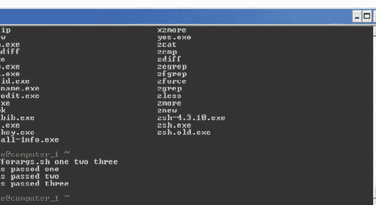

图 2-1

`Cygwin` 可以从 `http://www.cygwin.com/` 获取。

# 第 2 章 入门

## 选择编辑器

在许多提到的 OSS 中都有多种文本编辑器。文字处理软件（如 OpenOffice、Abiword 或 Microsoft Word）并不适合编程，因为这些程序经常会对文本进行更改，例如检查拼写、大小写转换、格式化等，这可能会以意想不到的方式破坏脚本。最好使用纯文本编辑器，你将看到其中最常见的几种。仅仅因为它们没有向实际文件添加格式，并不意味着这些编辑器都缺乏强大的功能；大多数编辑器提供语法高亮，并可能为编辑 shell 脚本以及文本文件提供进一步的功能。

## 图形化文本编辑器

对于图形化环境，基于 GUI 的编辑器可能更容易使用。但在无法使用 GUI 的情况下（X Window 系统配置损坏、远程 `ssh` 连接到服务器、访问服务器等），了解如何使用非图形化编辑器仍然至关重要。然而，对于日常使用，有些人发现图形编辑器的便利性是有用的。

## Gedit

GNOME 默认的文本编辑器是 `gedit`，通常位于“应用程序 > 附件 > 文本编辑器”下。`Gedit` 提供基本的语法高亮，这在检查脚本错误时非常有用。它还有标签页并支持不同的文本文件格式（Windows、Linux、Mac OS 换行和字符编码）。图 2-2 显示了 `gedit` 的运行。

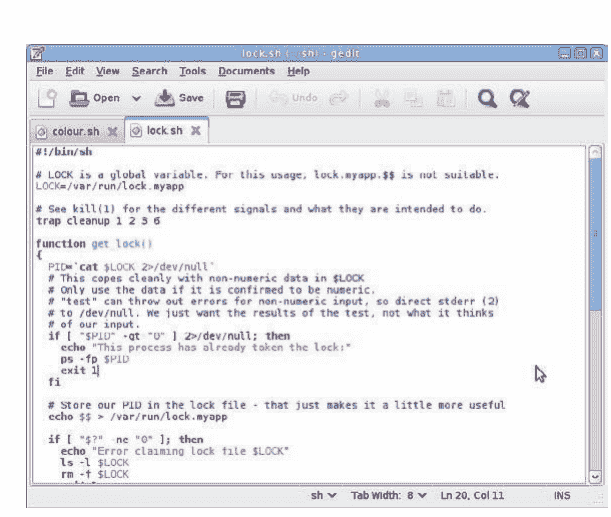

## 选择编辑器

KDE 默认的文本编辑器是 `kate`。它提供语法高亮、多标签，还具有非常棒的 shell，你可以在其中编辑脚本。图 2-3 显示了 `kate`。

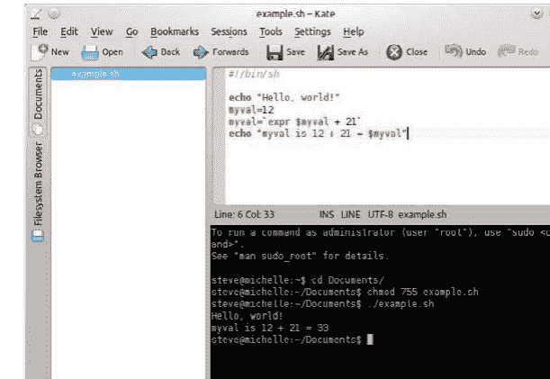

图 2-3

默认 KDE 文本编辑器。它提供语法高亮、多标签，还具有非常棒的 shell，你可以在其中编辑脚本。

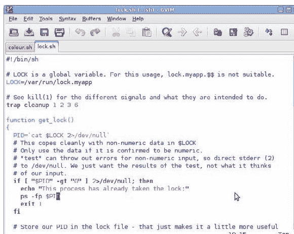

图 2-4

默认 KDE 文本编辑器。它提供语法高亮、多标签，还具有非常棒的 shell，你可以在其中编辑脚本。

## Eclipse

`Eclipse` 是 IBM 开发的完整 IDE（集成开发环境）。它是为了 Java 开发而设计的，但对于大多数任务来说可能过过了。

## Windows 版 Notepad++

`Notepad++` (`http://notepad-plus-plus/`) 是 Windows 环境下非常强大的（免费）编辑器。它提供了语言语法高亮、搜索选项以及通过插件提供的许多功能。图 2-5 显示了 `Notepad++`

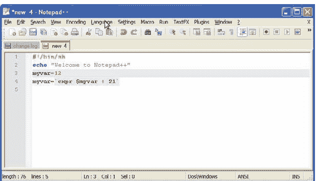

图 2-5

## 终端仿真

GNOME 有 `gnome-terminal`；KDE 有 `console`。XFCE 有一个名为“Terminal”的终端仿真器，目标是成为 `gnome-terminal` 的有效替代方案且无需 GNOME 依赖。它还有 `xterm`、`rxvt` 等。还有原生的“linux”终端仿真，这是你登录到没有图形会面的 Linux 系统时得到的。

`Gnome-terminal` 是 GNOME 环境的默认终端。它使用配置文件以便根据用途定义不同的外观设置。它还使用标签页，可以进行排序并从原始窗口中分离。

`Console` 是 KDE 环境中默认且非常灵活的终端仿真器。它位于系统菜单下。`Console` 一些特别好的特性包括：当终端保持沉默 10 秒时接收 KDE 的弹出警告（例如，运行中的作业完成向终端写入数据），或者当沉默结束时（例如，运行中的作业结束沉默并开始向终端写入数据）。

另一个突出的功能是可以通过配置设置定义在双击时什么构成一个“单词”。如果你希望能够通过双击选择电子邮件地址，请确保 `@` 和句号 (`.`) 在列表中；如果你希望能够双击 `$1` 并仅选择数字，请确保 `$` 不在列表中。

用于图形化会话的原始终端是 `xterm`。虽然它现在没有那么常用，但在没有更完整的图形环境的情况下，熟悉 `xterm` 是非常值得的。

# 第 2 章 入门

当你登录到一个没有图形界面的 Linux 系统时，通过按下 `Ctrl+Alt+F1`，你可以获得原生的 Linux 终端仿真器。这是基础终端仿真器，是活动操作系统的一部分。它支持颜色以及高亮和闪烁文本。

## 非图形化文本编辑器

还有许多基于命令行的编辑器，每个都有不同的优处。

`Vi` 是系统管理员中最常用的文本编辑器——它的学习曲线非常陡峭，很多是因为它可以在两种不同的模式下运行——插入模式（insert mode，你可以像正常一样输入文本）和命令模式（command mode，你的按键被解释为对文本执行的命令），而且很难在任何时候判断你处于哪种模式。关于模式，你真正需要知道的是按 `Escape` 键进入命令模式，在命令模式下按 `` `i` `` 键插入文本。`Vim` 带有 `` `Escape+` ``，可以始终让你进入插入模式。一旦你掌握了它，并学会了 `vi` 许多强大命令中的前几个，其他编辑器就会显得缓慢、笨拙且相比之下。虽然 `vi` 是大多数发行版的一部分，但 GNU/Linux 发行版包含了 `vim`（改进版 Vi），并带有 `vim` 的别名。`Vim` 兼容 `vi`，并提供了额外的功能。图 2-6 显示了 `vim` 教程的第一页，它通过一些简单的示例带你了解教程。

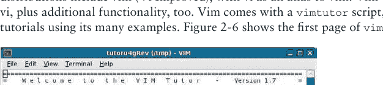

```
File Edit View  Terminal  Help
Welcome  the Vim Tutor  Version 1.7

Vim 是一个非常强大的编辑器，拥有许多命令。本教程旨在以非常简单的方式向你解释，让你能够迅速将 Vim 当作全能编辑器来使用。

完成本教程需要 20-30 分钟，取决于你花在实验上的时间。

注意：
课程将修改文本。请创建一个文件的副本进行练习（如果你是以副本方式启动“vim tutor”的）。
记住这一点很重要，这个教程不能只用来读——你需要执行命令才能正确地学习它们。如果你只读文本，你会忘记这些命令的！
如何移动光标：使用 h 键向左移动，按 j 键向下移动到屏幕的第 1 行命令行。
/tmp/vimdebug 37 lines, 19264 characters
```

## 图 2-6

`Emacs` 是另一个流行的文本编辑器，拥有惊人的插件数量。有了完全配置的 `emacs` 设置，就不需要去别处了！它的帮助功能被描述为“热核处理器”。和 `vi` 一样，`emacs` 最初是一个控制台非图形化文本编辑器，但现在有了图形版本。同样，由于从一开始就是跨平台的，`emacs` 不对你键盘上可用的键做假设，因此 PC `Ctrl` 键用作 Control，`Alt` 键被称为 Meta 键。这些分别被写为 `C-` 和 `M-`，因此 `C-f`（即按住 Control 和 f 键）会让光标向向前移动一个字符，而 `M-f`（或按住 Alt 和 f 键）会让光标向前移动一个单词。使用 `C-s` 保存，使用 `C-c` 退出。

## 选择编辑器 23

`vi` 和 `emacs` 之间存在着一种长久但通常很轻松的竞争；因为没有人被强迫使用“另一种”编辑器，`vi` 和 `emacs` 通常对分歧达成了共识。图 2-7 显示了在 KDE 桌面环境下运行的图形化 `Emacs` 会话。

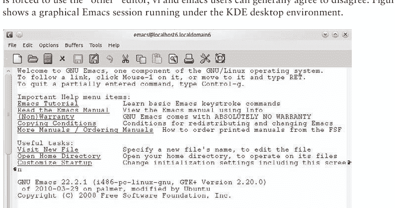

欢迎使用 GNU Emacs，它是 GNU/Linux 系统的一个组件。要跟随链接，在它上点击左键，或移动到那里并按 RET。在部分模型模式下退出，按 Ctrl-x Ctrl。

- 重要菜单项：

- Emacs 教程

- 阅读菜单！

- [无保修]

- 复制会话

- 更多菜单

学习 Emacs 键盘命令

使用 info 查看 Emacs 手册

Emacs 绝对没有任何保修

或自定义和更改 Emacs

如何从 PSF 打印手册

- 有用的任务：

- 访问文件

- 打开主目录

- 自定义启动

定义新文件以编辑该文件

打开你的主目录以操作其中的文件

（更改包括此屏幕在初始化设置）

```
Emacs 22.2.1 (x86_64-linux-gnu) GTK+ Version 2.20.0)
2010-03-29 modified by Ubuntu
Copyright (C) 2000 Free Software Foundation, Inc.
```

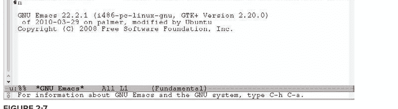

`Pico` 和 `nano` 是更容易上手的文本编辑器。`Pico` 最初是华盛顿松邮件客户端的编辑器；`nano` 是 `pico` 的 GNU 克隆，通常在 Ubuntu 论坛上被推荐。和 `emacs` 一样，命令通过 `Ctrl` 键发送（例如 `Ctrl-X` 退出），但屏幕底部有一个常量敏感的菜单，使得可用选项变得更加明显。图 2-8 显示了如何编辑 `/etc/hosts`。

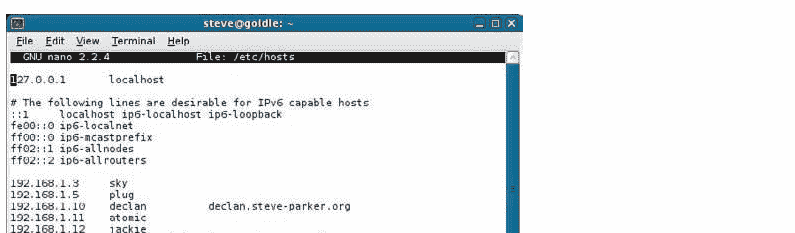

FIGURE 2-8

## 设置环境

Unix 和 Linux 是高度可定制的系统。你可以通过多种方式根据喜好设置环境和变量。如果你发现自己反复设置或更改某些设置，那么这些设置是很有用的。

## Shell 配置文件

放置个性化设置的主要位置之一是 `.profile`。当一个新的交互式 shell 启动时，执行 `/etc/profile`，然后是 `~/.profile`，最后是 `~/.bashrc`。这些文件位于主目录并以点开头，它们通常被称为“点文件”（dotfiles）。

## 环境变量

许多工具都有自己的变量；`less` 将 `$LESS` 的值传递给命令。`ls` 使用 `LS_OPTIONS`。你的配置文件可以通过设置这些环境变量来定义有用的快捷方式。

```
# 定义工具特定的设置
export LS_OPTIONS='--color=yes'
# 整理 less 的外观
export LESS='X'
```

`less` 还会读取 `LESS_TERSCAP*`，这些关于终端的能力。这是一个非常有用的序列，隐藏在帮助页中（由 `less` 格式化）的代码会被解释为颜色变化。

```
# 彩色帮助页
```

## PS1

`PS1` 是提示符。你可以自定义提示符以显示你的用户名、主机名和当前目录。例如：

```bash
PS1='\u@\h:\w\$ '
```

- \u 是用户名。

- \h 是主机名。

- \w 是当前工作目录。

# 第 2 章 入门

某些工具（如 `mail`）应该使用该值。你也可以指定你偏好的分页工具——`less` 和 `more` 是最常用的。

```bash
# 定义首选工具
export EDITOR=vim
export PAGER=less
```

你自己的脚本可以使用这些变量来对用户更具活性。只需使用 `$EDITOR:-vim` 语法，这样如果 `$EDITOR` 已设置则将使用它；如果没有设置，你可以为你的应用程序提供一个默认值：


edit.sh

此脚本将在你偏好的 `$EDITOR` 中编辑一个文件，然后用你预设的 `$PAGER` 将其显示出来。

## 别名 (Aliases)

别名为频繁使用或难以记忆的命令提供了助记符。在命令不支持配置文件或环境变量的情况下，别名对于指定一组默认选项也很有用。你可以将这些别名放入你的启动脚本中，以让日常打字变得简单。

## less

`less` 有一个 `-X` 选项，它可以在完成后停止刷新屏幕。这很大程度上取决于个人喜好；如果你想查看一个文件，然后在终端显示文件内容的情况下继续工作，你将希望使用 `-X` 来停止屏幕刷新（就像你对文件使用 `cat` 一样——命令完成后其内容仍然可见）。然而，如果你想看到在调用 `less` 之前终端上显示的内容，你就不想要 `-X` 选项。尝试两种方法并在你的 `~/.bashrc` 文件中设置别名。

```bash
alias less='less -X'
```

由于 `less` 命令从之前提到的 `$LESS` 环境变量获取参数，你可以改为设置该变量。

## cp, rm, 和 mv 别名

由于它们是 RedHat Enterprise Linux 的二进制兼容命令，某些发行版——特别是 RedHat、CentOS 和 Oracle Linux——为 `cp` 和 `mv` 命令定义了非常谨慎的别名。这些别名都被映射为 `-i` 选项，这使得它们在交互式 shell 中于删除或覆盖文件之前提示确认。这是一个非常实用的安全特性，但很快就会变得令人厌烦。如果你觉得默认设置很讨厌，可以在 `~/.bashrc` 中取消这些别名。`unalias rm` 命令会移除此别名，同样，`unalias cp` 和 `unalias mv` 也会恢复这些命令到标准行为。

## ls 别名

由于这是一个非常常用的命令，有几个 `ls` 别名，最常用的两个是用于 `-l` 的 `ll` 和用于 `ls -a` 的。你的发行版甚至为你设置了这些。一些流行的 `ls` 别名包括：

- # 保存手指信息！

`alias ls='ls'`

# ls 长列列表

`alias ll='ls -l'`

## 颜色和文件类型

`alias lf='ls -CF'`

## 按文件名排序

`alias lx='ls -XB'`

## 按大小排序

`alias ks='ls -lS'`

## 显示隐藏文件

`alias la='ls -A'`

## 按日期排序

`alias lt='ls -ltr'`

## 其他命令快捷方式

还有许多你可能频繁使用并为其定义别名的命令。在图形化会话中，你可以启动网络浏览器并将其定向到公共网站。

- # 从终端启动网页

`alias bbc='firefox http://www.bbc.co.uk/ &'`

`alias sd='firefox http://slashdot.org/ &''`

`alias www='firefox'`

另一个非常有用的命令是 `ssh`。有时这简单到 `ssh hostname`，但有时会使用复杂的 `ssh` 命令行，在这种情况下别名再次非常有用。

- # 只需输入名称即可 ssh 到常用目的地

`alias decl='ssh decl'`

# 使用非标准端口 (222) 登录工作


```bash
alias work='ssh work.example.com -p 222'
# 登录工作并将内部代理隧道到 localhost:80
alias workweb2='ssh work.example.com -p 222 -L 80:proxy.example.com:8080'
```

## 修改历史记录

shell 的另一个可以在个性化设置中更改的功能是 `history` 命令。它受某些环境变量和 shell 选项 (shopt) 的影响。当你同时打开多个窗口，或者从不同系统为该用户登录多个会话时，历史记录的记录方式可能会变得有点复杂，某些可能会被新的事件覆盖。你可以使用 `histappend` 选项来防止这种情况发生。

历史记录的另一个问题是，如果你的个人文件没有足够的配额，它可能会占用大量的磁盘空间。`HISTSIZE` 变量定义 shell 会话应该在历史文件中存储多少条目；`HISTFILESIZE` 定义了历史文件的总大小。

`HISTIGNORE` 是一个冒号分隔的命令列表，这些命令不应存储在历史记录中；这些是如 `ls` 等常见的命令，对审计来说没有意义。从审计的角度来看，保留 `rm`、`ssh` 和 `scp` 命令更有用。此外，`HISTCONTROL` 可用于忽略领先空格（这样这两个命令都被存储为 `rm` 而不是 ` rm`）

```bash
$ rm /etc/hosts
$ rm /etc/hosts
```


`HISTCONTROL` 还可以用于忽略重复，如果同一个命令运行了多次。

```bash
# 追加到历史记录
shopt -s histappend
HISTSIZE=1000
HISTFILESIZE=2000
HISTCONTROL=ignoredups:ignorepace
## 忽略常见命令
HISTIGNORE="ls:cd:history:clear"
```

`set visualbell`

- 为不同类型的文本文件设置默认值。

- `FileType c` 设置 `c` 缩进 `tw=79`
- `FileType sh` 设置 `et sw=4 sts=4 noexpandtab`
- `FileType vim` 设置 `ai et sw=2 sts=2 noexpandtab`
- 将新行自动缩进到当前缩进位置

`set autoindent`

- 不将制表符替换为空格

`set noexpandtab`

- 在行首使用制表符，其他地方使用空格

`set smarttab`

- 显示语法高亮

`syntax on`

- 显示行尾的空白字符

`highlight WhitespaceEOL ctermbg=blue guib=`

`match WhitespaceEOL /\s*$/`


## 总结

有很多操作系统、shell 和编辑器可供选择。通常情况下，编辑器的选择取决于个人喜好。在某些方面，操作系统的选择可能非常重要，尽管对于 shell 脚本编写，如今许多环境（所有的 GNU/Linux 发行版、`Cygwin` 以及某些专有的 `Unix`，特别是 `Solaris`）都使用 `GNU bash` 和标准 `Unix` 工具（如 `bc`、`grep`、`diff` 等）的 `GNU` 实现。本书侧重于 `GNU/Linux`、`bash` 和 `GNU` 工具，但大部分内容也适用于非 `GNU` 的等效工具。

我希望本章第二部分中的某些自定义可以在你调整环境以适应个人喜好时被证明是有用的；计算机存在是为了让你的生活更轻松，而不是相反；如果通过设置一个别名（`alias`）意味着你不需要记住某些复杂的语法，你的大脑就能免受干扰，你可以专注于你真正想要实现的目标，而不是去记忆某些晦涩命令的精确语法。

这几个介绍性的章节应该已经为你编写 shell 脚本做好了准备；第一部分的其余部分涵盖了可用工具以及如何使用它们。书的其余部分将在这些介绍材料的基础上，提供真实世界的配方，你可以使用并在此基础上构建，从而激发你编写自己的脚本来执行真实世界的任务，解决你所面临的情况。

# 3

# 变量

没有变量，很难完成很多工作：你无法计数、循环或从用户或环境中读取输入，也无法进行太大改变。没有变量，你写的不会超过基础的 `bash` 脚本（做一件事，然后做另一件事，再做第三件事）。有了变量，你可以根据这些变量的状态修改脚本的行为，还可以修改变量本身来反映脚本之外的世界。

本章引入了 shell 中变量的使用，以及设置和读取变量的语法。它还列出了一些常见的预设和标准变量，以及一些实用的 shell 选项。尽管这些变量中有些是 `bash` 特有的，但本章大部分适用于所有 shell。第 7 章将深入探讨 `bash`（以及某些其他 shell）可以实现的更高级的内容，例如数组和更强大的参数扩展功能。

## 使用变量

变量是一个内存块，可以在其中存储任意数据，并通过引用其名称再次检索它。不需要显式地分配所需的内存，也不需要在需要消失后释放内存。尽管某些语言具有复杂的垃圾收集功能，但 shell 通常倾向于处理相对较少的数据且持续时间较短，因此一个简单得的模型就足够了。

shell 在使用变量的语法上有些独特。许多语言（如 `Perl`、`PHP` 等）在每次引用变量时都使用美元符号前缀；而其他语言（如 `Java` 或 `C`）则不使用特定的标记来识别变量；上下文足以让代码明确引用了一个变量。

# 第 3 章 变量

有时你需要美元符号来引用变量（`echo $variable`），而有时你不需要美元符号（`variable=foo`）。有时你需要在名称周围加上大括号（`echo ${variable}bar`），而有时这并不重要（`echo $variable bar`）。这些看似任意的规则背后有逻辑支持，所以不要恐慌；它们完全是可以理解的。

在 shell 中，当你引用由变量所存储的值时，在变量名称前面加一个美元符号：

```
$ echo $PATH
```

当你向变量写入内容时，只需使用它的名称（这里的美元符号是提示符，而不是变量引用的部分）：

```
$ PATH=/usr/sbin:/usr/bin:/bin:/bin
```

这意味着你可以引用变量的名称，并在需要值时使用美元符号，但当它不属于赋值语句的一部分时，单独的名称将被视为一个普通字符串：

```
$ YOUR_NAME=steve
echo "The variable YOUR_NAME is $YOUR_NAME"
The variable YOUR_NAME is Steve
```

## 类型

在许多语言中，变量与某种“类型”相关，无论是字符串、整数、布尔值、浮点数还是其他。某些语言是强类型的，这意味着它们不允许整数与浮点数比较，或不允许将字符串赋值给数值，此类推（或者会强制你将它们转换为适当的类型，这样至少可以清楚程序员的意图）。在 shell 中，完全没有“类型”的概念；你可以说任何东西都是字符串，但某些函数会像处理其内容实际上是数字一样对字符串进行处理。在其他语言中，这些错误会在编译时捕获；因为脚本是解释执行的，这永远是不可能的。

shell 中变量的另一个奇特之处是，在使用变量之前不需要显式声明它们——当你引用一个未定义的变量时，它等同于空字符串：

```
$ cat unset.sh
!/bin/bash
echo "The variable YOUR_NAME is $YOUR_NAME"
YOUR_NAME=steve
echo "The variable YOUR_NAME is $YOUR_NAME"
$
```

## 为变量赋值

有三种主要方法给变量赋值：

- 显式定义：`VAR=value`
- 读取：`read VAR`
- 命令替换：``VAR=`date` ``，`VAR=$(date)`

# 显式定义：VAR=value

你可以使用 `=` 语法来定义变量的值（并在此过程中如果它在环境中不存在则创建它），如之前的 `unset.sh` 示例所示。这里的语法很重要，因为一个常见的错误是添加空格，这会彻底改变语法。

等号周围不允许有空格。这会让那些在不区分空格的语言背景下的人感到恼恼——使用空格是为了让代码更清晰、易读。shell 语法之所以这样是有原因的，你将在接几段中看到；三个示例展示了等号 (=）周围放置空格的不同方式，以及为什么它们不是变量赋值：

```
variable = foo
```

上述代码被视为一个带有两个参数（`=` 和 `foo`）的单一命令（`variable`）；其语法与 `ls -1 foo` 完全相同。没有规则规定不能用其第一个参数调用命令，因此 shell 无法判断意图是变量赋值。然而，显然在脚本运行的任何系统中都没有名为 `variable` 的命令，你不希望脚本因为某个用户创建了一个名为 `variable` 的文件而崩溃。

```
variable=foo
```

再次，这是完全有效的语法，等同于 `ls=foo`，因此不是变量赋值。

```
variable=foo
```

这是一个相对广泛的技术的特例。为了在不改变 shell 环境的情况下运行命令，你可以在调用命令前加上变量赋值：

```
LD_LIBRARY_PATH=/usr/mozilla/lib firefox
```

这是调用 `Firefox` 并让其带有 `LD_LIBRARY_PATH` 设置为 `/usr/mozilla/lib` 运行（默认系统库路径将仅为 `/usr/lib`）。所以 `LD_LIBRARY_PATH firefox` 将带有空的 `LD_LIBRARY_PATH` 运行 `Firefox`，这与 `variable=foo` 语法中发生的情况完全相同；命令 `foo` 将带有名为 `variable` 的空变量调用。

一旦你通过这种方式分配了变量，就可以在它前面加上美元符号 `$` 来访问它：

```
$ variable-foo
echo $variable
foo
$
```

## 阅读：read var

设置变量的一种交互方式是使用 `read` 命令：

```
$ cat first.sh
#!/bin/bash
```

```
read myvar
echo "myvar is $myvar"
```

如果你运行此脚本，它会提示你输入一行，并将 `myvar` 变量设置为你输入的内容。

你可以在最后通过 `echo` 一个初始提示来让这一过程变得简单。`echo` 的 `-n` 选项告诉 `echo` 不要输出换行符，这样提示内容和输入的内容将显示在同一行：

```
echo -n "Enter your name: "
read myvar
echo "Hello $myvar"
```

在交互式运行时，它看起来如下：

```
$ ./first.sh
Enter your name: Steve
Hello Steve
./first.sh
Enter your name: Steve Parker
Hello Steve Parker
```

注意我们读取到变量 `myvar` 中的内容——你也可以使用 `read` 在一行中读取到多个变量：

```
echo -n "Please enter your first name and last name: "
read firstname lastname
echo "Hello, $firstname. How is the $lastname?"
```

前面的代码将读取这两个变量，并忽略任何空格。行的最后一个变量将占据该行中任何所有未读取的文本，因此无意中很好地处理了双姓的情况：

```
$ ./firstlast.sh
Please enter your first name and last name: Steve Parker Smith
Hello, Steve. How is the Parker Smith family?
$
```

然而，它无法处理输入过少的情况——`lastname` 变量会存在环境中（你可以通过在脚本中添加 `set | grep name=` 来看到），但它被设置为空字符串：

```
$ cat firstlast.sh
#!/bin/bash

echo "-Please enter your first name and last name:"
read firstname lastname
echo "Hello, $firstname. How is the $lastname family?"

echo "-Relevant environment variables:"
set;name=""
$ ./firstlast.sh
Please enter your first name and last name: Steve Parker
Hello, Steve. How is the Parker family?
Relevant environment variables:
firstname=Steve
lastname=Parker
$ ./firstlast.sh
Please enter your first name and last name: Steve
Hello, Steve. How is the family?
Relevant environment variables:
firstname=Steve
lastname=$
```

在前面的代码中，"the" 和 "family" 之间有两个空格，所以脚本显示 "How is the Slastname family," 但这两个空格之间是一个长度为零的字符串 "Slastname"。这种情况将在本章稍后部分进行更详细的。

## 从文件中读取

你也可以使用该命令从文件中读取行（实际上，从终端读取仍然是从文件中读取，因为 `Unix` 中一切皆是文件）。下面的代码清楚地说明了如何这样做：

```
$ read message < /etc/motd
$ echo $message
Linux goldie 2.6.32-5-amd64 #1 SMP Fri Oct 15 00:56:30 UTC 2010 x86_64
$
```

然而，`/etc/motd` 中有多行。下面的代码将该行读取到名为 `message` 的变量中，循环直到没有更多输入（如果到达文件末尾则返回非零值，而 `while` 循环结束——这将在第6章中详细讨论）。

```
$ while read message
do
  echo $message
done < /etc/motd
Linux goldie 2.6.32-5-amd64 #1 SMP Fri Oct 15 00:56:30 UTC 2010 x86_64
```

包含 `GNU/Linux` 系统的程序是免费软件；每个程序的准确术语描述在 `/usr/share/**/copyright` 的单独文件中。`Debian GNU/Linux` 不提供任何保证，在法律允许的范围内。

这会将 `/etc/motd` 的内容重入循环，循环继续从 `/etc/motd` 读取另一行（并将其输出），以显示时间已被完全消耗。这种逐行的性质通过在循环的每一步引入短暂的暂停得到了更好的展示：

```
$ while read message
do
  echo $message
  sleep 1
  date
done < /etc/motd
```

显示这些文本需要8秒钟时间，这在书中很难显示，因此 `date` 命令也可以运行以显示时间确实在每一行都在进展：

```
Linux goldie 2.6.32-5-amd64 #1 SMP Fri Oct 15 00:56:30 UTC 2010 x86_64
Mon Oct 25 19:49:32 BST 2010
```

## 命令替换：VAR=date, VAR=$(date)

设置变量的另一种常见方法是将值设置为给定命令的输出。这真的是第一格式的变体：`VAR=value`。如果你想在周一将变量设置为“Monday”，周二设置为“Tuesday”，你可以使用 `date` 命令的 `%A` 标志，它告诉 `date` 在当前语言区域提供今天正确的单词（`date` 命令将在第4章详细讨论）。

> 大多数 shell 支持 `VAR=$(date)` 语法，但原始的 `Bourne` shell 不支持

## 使用变量

```
$ cat today.sh
#!/bin/bash

TODAY=`date +%A`
echo "Today is $TODAY"
$ ./today.sh
Today is Monday
$
```

## 位置参数

调用脚本时，向脚本传递参数（或参数）是非常用的——例如你想让脚本处理的文件名。这些在脚本内部通过它们在命令行上的位置被引用：`$0` 是命令本身，`$1` 是第一个参数，`$2` 是第二个，依此类推。你不能更改这些变量的值，它们是一个特殊情况（通常，变量不能以数字开头，所以 shell 不会将 "hello" 解释为变量赋值）。

一个使用位置参数的典型脚本如下——`basename` 去掉了路径信息，`$0` 结果为 `params.sh`：

```
$ cat params.sh
#!/bin/bash

echo "My name is $0"
echo "My first parameter is $1"
echo "My second parameter is $2"
$ ./params.sh one two
My name is ./params.sh
My first parameter is one
My second parameter is two
```

## 使用变量

```
echo "Parameter number $count is: $1"
let count=$count+1
shift
done
```

我的名字是 `params.sh` - 我被调用的方式是 `./params.sh`

我被传入了 3 个参数。

参数 1 是: `one`

参数 2 是: `two`

参数 3 是: `three`

`$ ./params.sh one two three four five six eight nine ten eleven eleven twelve`

我的名字是 `params.sh` - 我被调用的方式是 `./params.sh`

我被传入了 12 个参数。

参数 1 是: `one`

参数 2 是: `two`

参数 3 是: `three`

参数 4 是: `four`

参数 5 是: `five`

参数 6 是: `six`

参数 7 是: `seven`

参数 8 是: `eight`

参数 9 是: `nine`

参数 10 是: `ten`

参数 11 是: `eleven`

参数 12 是: `twelve`

你可以一次性移动几个变量，使用 `shift n`。要移动三个变量，`shift 3` 等同于 `shift; shift; shift;`；虽然你可能会更频繁地看到后一种语法，因为它更具移植性，而且对于某些人来说，它对意图的表达更清晰。

## 所有参数

读取传递参数的最后两个变量是 `*` 和 `$`。它们非常相似，且经常被混淆。如下面的代码所示，前四行在输入方面看起来完全相同，区别是如果当传递给脚本时使用了双引号，则空格会被保留，并且在脚本处理时也会处于双引号中。在 "two" 和 "three" 之前的多个空格，只有当脚本在双引号内处理 `"$@"` 时才能被正确保留（下方示例中的最后一个）。


# 处理 Shell 参数：`$*` 与 `$@`

```bash
# cat star.sh
#!/bin/bash
echo Dollar Star is $* 
echo "Dollar Star in double quotes is $*"
echo Dollar At is $$
echo "Dollar At in double quotes is $@"
echo
echo "Looping Dollar Star"
for i in $@
do
  echo "Parameter is $i*"
done
```

```bash
echo
echo "Looping through Dollar Star with double quotes"
for i in "*"
do
    echo "Parameter is $i"
done
echo "Looping through Dollar Star At"
for i in $0
do
    echo "Parameter is $i"
done
echo "Looping through Dollar Star with double quotes"
for i in "$0"
do
    echo "Parameter is $i"
done
```

| 命令 | 结果 |
| :--- | :--- |
| `./star.sh one two three four` | 空格被保留 |
| `Dollar Star is one two three five` | 引号内的空格被保留 |
| `Dollar Star in double quotes is one two three five` | 空格显然被保留 |
| `Dollar At in double quotes is one two three five` | 引号内的空格被保留 |

遍历 `Dollar Star`

`Parameter is one two is three is four is is five` 因为没有引号，每个单词都被视为一个独立的单词

带双引号的遍历 `Dollar Star`

`Parameter is one two three four five` 整个列表被视为一个单一参数

遍历 `Dollar At`

`Parameter is one two is three is four is is five` 因为没有引号，行为与参数相同

带双引号的遍历 `Dollar At`

`Parameter is one two three four five` 只有一个参数，其间的空格被保留

## 返回状态码

在 Unix 和 Linux 中，每个命令都会返回一个 0 到 255 之间的数值代码——0 表示成功，-1 回绕为 255。这是一种指示成功或失败的方法，有时也能提供更详细的信息。Shell 将 `$?` 变量设置为上一个命令的返回码。例如，`grep` 有许多失败的方式——最常见的是字符串在文件中并不存在：

```bash
$ grep /etc/hosts
$ $?
```

或者发生了错误，例如文件不存在、不可读等：

```bash
$ grep /etc/host
grep: /etc/host: No such file or directory
$?
```

在实践中，对于 `grep`，返回码 1 表示“未匹配”，2 表示 `grep` 内部发生了某些错误，例如未找到文件。如果命令成功——执行过程中没有错误且找到了匹配项——那么按照传统，它将返回退出代码零，表示成功：

```bash
$ grep /etc/hosts
192.168.1.13
$?
```

## 后台进程

虽然第 10 章会更详细地处理后台进程，但在这里值得提一下，你可以在后台运行进程并在 `$!` 变量中找到它们的进程 ID (PID)。这对于跟踪后台进程很有用。请注意，如果不小心，可能会出现竞态条件：

```bash
#!/bin/sh
ls -R /tmp &
sleep 10
strace -p $!
```

在这个（诚然是人为的）示例中，如果 `ls` 命令执行时间超过 10 秒，你会发现使用 `strace` 跟踪的时间比这短，你的 `ls` 的 PID 就会过期——当前进程树中可能没有该 PID，因此 `strace` 将失败。还有一种可能，特别是在负载很高的系统中，在你睡眠期间另一个进程被分配了 PID。你最终将跟踪到一个完全无关的进程。

# 同时读取多个变量

脚本从数据文件中读取第一行并将单词赋值给命名的变量：

```bash
$ cat datafile
the quick brown fox
$ read field1 field2 field3 < datafile
$ echo one is $field1
Field one is the
$ echo Field two is $field2
Field two is quick
$ echo three is $field3
Field three is brown fox
```

如果输入字段不足，则某些变量将为空：

```bash
$ echo the quick < datafile
$ read field1 field2 field3 < datafile
$ echo one is $field1
Field one is the
$ echo Field two is $field2
Field two is quick
$ echo three is $field3
Field three is
```

> **注意**
>
> 一个常见的错误是使用如下语法来设置 `$one=1`, `$two=2`, `$three=3` 和 `$fourth=4`：
>
> `echo 1 2 3 4 | read one two three four`
>
> 这并不符合预期：管道 `read` 命令只在管道本身有效，调用的 Shell 无法获取这些变量。

# 使用 `while` 读取

此配方读取 `/etc/hosts` 每一行的前两个单词。由于 `read` 的工作方式，`aliases` 会获取所有的别名。注意它没有处理意外的输入，例如注释行（“IP is # - its name is They”）。在实际操作中，`grep -v "^#" | while read` 是更好的方法：

```bash
$ while read name aliases
do
  if [ ! -z "$name" ]; then
    # 使用 -en 抑制换行；
    # 别名可能仍添加
    echo -en "IP is $ip - its name is $name"
    if [ ! -z "$aliases" ]; then
        echo "Aliases:$aliases"
      else
        # 仅打印一个空行
        echo
      fi
  fi
done < /etc/hosts
```

# 第 3 章 变量

> 某些变量无法取消设置；这些被称为“只读”变量。

你无法取消 `$1`, `$2`, `$$` 等变量。

其他变量（`RANDOM`, `SECONDS`, `LINENO`, `HISTCMD`, `FUNCNAME`, `GROUPS`, 和 `DIRSTACK`）可以被取消，但你无法找回它们之前拥有的特殊功能（例如，`$RANDOM` 在被取消后将不再返回随机数，以此类推）。

请注意，在给 `myvar` 变量赋值之前访问该变量的第一行代码，执行 `echo $myvar` 命令时并没有报告任何错误。Shell 中没有“声明变量”的概念：因为它们没有类型，因此不需要指定你需要 `int`、`char`、`float` 等，变量在第一次被赋值时会被隐式声明。访问不存在变量的值只会返回空字符串或零，具体取决于上下文。

这使得 Shell 脚本编写比大多数语言都简单，尽管这是付出了代价的：例如，在调试脚本时很难找到拼写错误的变量名。在以下计算勾股三角形斜边长度的代码中，错误到底在哪里？

```bash
$ cat hypotenuse.sh
#!/bin/sh

# 计算勾股三角形斜边的长度
# 使用 hypotenuse^2 = adjacent^2 + opposite^2
echo -n "Enter the length: *"
read adjacent
echo -n "Enter the opposite: *"
read opposite
osquared=$((opposite ** 2)) # 获取 o^2
osquared=$((adjacent ** 2)) # 获取 a^2
hosquared=$((osquared + $osquared)) # h^2 = a^2 + o^2
hypotenuse=$(echo "scale=3;sqrt($osquared)" | bc)
# bc 执行 sqrt
echo "The Hypotenuse is $hypotenuse"
```

在这个例子中，这种错误类型是你正在寻找一个拼写错误。如果你不知道是变量名写错还是语法错误，它可能非常难以追踪。更糟糕的是，你可能没有注意到有错误，运行脚本时不会报告错误，并且会产生输出。

如果你错过了这个错误（除了这个简单的脚本只接受整数之外），错误在这一行：

```bash
hsquared=$($osquared + $osquared)
```

`$osquared` 应该是 `$osquared`。并没有名为 `$osquared` 的变量，所以它被替换为零。结果是输出完全取消了，你得到的是该值的平方根的平方，这将始终返回直角（Adjacent）的原始值，加上零，然后对结果开平方根。

# 预设和标准变量

Shell 本身提供了一些变量。它们的性质差异很大：有些是纯粹信息性的，例如 `$BASH_VERSION`，它告诉你你正在运行的 `bash` 版本（例如 `4.1-release`），但你可以通过设置它们来覆盖它们。另一些根据环境返回不同的值，例如 `$PIPESTATUS`，它告诉你上一次运行的管道线中命令的返回码，并且根据其自身的功能返回不同的值（例如 `$SECONDS`，一个每秒加 1 的整数）。此外，某些这些变量在你设置（或取消）后会失去其特殊含义；`$RANDOM` 在你对其赋值之前将一直返回随机数，赋值之后它将不再产生随机数。`$SECONDS` 将一直保持计数；如果你设置 `$SECONDS=35` 并在 5 秒后再次读取 `$SECONDS`，它将计数到 40。还有一些是完全不可写的；如 `TIMEFORMAT`，它们本身不起作用，但被用于影响其他命令的工作方式。

以下示例包含了一些常见的预定义变量，以及一些较为人知的变量。

## `BASH_ENV`

`BASH_ENV` 是一个文件名（可能是相对路径，在这种情况下，请非常小心运行脚本的位置！）它在执行文件之前会被解析，就像启动交互式 Shell 之前的 `~/.bashrc` 一样。

## `BASHOPTS`

`BASHOPTS` 于 `bash 4.1` 引入。它是已启用选项（opts）的列表。它提供的信息与 `shopt | grep -w on` 相同，但采用更易于机器解析的形式。这是一个只读变量；你可以使用 `shopt` 内置命令（`-s` 设置标记，`-u` 取消）来更改它：

```bash
$ shopt mailwarn
mailwarn               off
$ echo $BASHOPTS
checkwins:cmdhist:expand_aliases:extquote:force_ignore:hostcomplete:interactive
comments:prog:promptvars:sourcepath
$ shopt -s mailwarn
$ shopt mailwarn
mailwarn               on
$ echo $BASHOPTS
checkwins:cmdhist:expand_aliases:extquote:force_ignore:hostcomplete:interactive
comments:prog:promptvars:sourcepath
$ shopt -u mailwarn
$ shopt mailwarn
mailwarn               off
$ echo $BASHOPTS
checkwins:cmdhist:expand_aliases:extquote:force_ignore:hostcomplete:interactive
comments:prog:promptvars:sourcepath
$
```

`bash 4.1` 中有 40 个 Shell 选项，均在 `bash` 手页中有所记录；一些最实用的选项是：

- `errexit`: 如果任何命令返回非零状态，则退出。
- `checkwins`: 更新窗口状态。
- `cmdhist`: 控制命令历史。
- `expand_aliases`: 决定是否扩展别名。
- `extquote`: 允许使用扩展引号。
- `force_ignore`: 强制忽略某些错误。
- `hostcomplete`: 启用主机名补全。
- `interactive`: 设置 Shell 是否为交互式模式。
- `comments`: 控制如何处理注释。
- `prog`: 设置程序名变量。
- `promptvars`: 控制提示符变量如何扩展。
- `sourcepath`: 设置源文件的搜索路径。
- `noglob`: 禁用通配符扩展。
- `monitor`: 如果设置（默认开启），当后台命令完成时，会收到一条输出。
- `login_shell`: 检查 Shell 是否为登录 Shell。
- `pipefail`: `PIPESTATUS` 的替代方案；如果关闭（默认关闭），管道的返回码将是最后一个返回非零状态的命令的返回码。
- `vi`: 在执行时从 `emacs` 切换到 `vi`。
- `x`: 在执行每个命令之前显示该命令。

```bash
echo "Hurray, it worked!"
else
    echo "Oh no, echo failed!"
fi
  $ sh -x x.sh
  + echo Hello, world!
Hello, world!
  + [0 -eq 0]
  + echo Hurray, it worked!
Hurray, it worked!
$
```

在这里你可以看到测试 `[ $? -eq 0 ]` 被扩展为具体的值了，因此被评估的测试是 `[ 0 -eq 0 ]`。

## `BASH_COMMAND`

`BASH_COMMAND` 是当前正在执行命令的名称。在大多数情况下，这没什么大用，但内置 Shell（作为 `trap` 触发时）是不计在内的。在 `trap` 中，它可以非常有用，用来解释中断发生时发生了什么。这个简单的脚本运行了一系列命令，并会在你按下 `^C` 中断它时告诉你脚本正在做什么。你最可能会在 `sleep` 调用期间捕获这个脚本：

```bash
$ cat trap.sh
#!/bin/bash

trap cleanup 1 2 3 15

cleanup() {
    echo "当你中断我时，'我正在运行 \$BASH_COMMAND'"
    echo "正在退出。"
    exit 1
}

while :
do
    echo -en 'hello. '*
    sleep 1
    echo -en 'my '*
    sleep 1
    echo -en 'name '*
    sleep 1
    echo -en 'is '*
    sleep 1
    echo -en "$"
done
$ ./trap.sh
hello. my name is ./trap.sh
hello. my ' ' 当你中断我时，'我正在运行 'sleep 1''
正在退出。
$
```

如果你删除了 `sleep` 命令，你将在 `echo` 中或对 `while` 循环的 `:` 测试处理中捕获到它：

```bash
$ ./trap.sh
hello. my name is ./trap.sh
hello. my name is ./trap.sh
hello. my name is ./trap.sh
*hello. 当你中断我时，'我正在运行 *echo -en *hello. *'
quitting.
$
```

## `BASH_SOURCE`, `FUNCNAME`, `LINENO` AND `BASH_LINENO`

`BASH_SOURCE`、`FUNCNAME`、`LINENO` 和 `BASH_LINENO` 是极其有用的调试变量，即使在你使用多个文件时，它们也能告诉你处于脚本的什么位置。`LINENO` 仅给出脚本中的当前行号：

```bash
$ cat lineno.sh
#!/bin/bash

echo "Hello, World"
echo "This is line $LINENO"
$ ./lineno.sh
Hello, World
This is line 4
$
```

这对于调试以及实际上从终端用户那里获取有用信息非常有帮助。与其报告“在第四个调试点发生错误”，不如你的脚本可以给出精确的行号，让你能够精确定地诊断脚本中的任何问题。然而，知道你当前处于哪个函数中很有用，`FUNCNAME` 正告诉了你这一点。它还提供了完整的堆栈，显示了你最初是如何进入该函数的：

```bash
$ cat funcname.sh
#!/bin/bash

function func1() {
  echo "func1: FUNCNAME[0] is ${FUNCNAME[0]}"
  echo "func1: FUNCNAME[1] is ${FUNCNAME[1]}"
  echo "func1: FUNCNAME[2] is ${FUNCNAME[2]}"
  echo "func1: LINENO is ${LINENO}"
}

function func2() {
  echo "func2: FUNCNAME[0] is ${FUNCNAME[0]}"
  echo "func2: FUNCNAME[1] is ${FUNCNAME[1]}"
  echo "func2: FUNCNAME[2] is ${FUNCNAME[2]}"
  echo "func2: LINENO is ${LINENO}"
}
}
```


## BASH_COMMAND

`BASH_COMMAND` 是当前正在执行命令的名称。在大多数情况下，这没什么大用，但内置 shell（作为 `trap` 触发时）是不计在内的。在 `trap` 中，它可能非常有用，用来解释中断发生时发生了什么。这个简单的脚本运行了一系列命令，并会在你按下 `^C` 中断它时告诉你脚本正在做什么。你最可能会在 `sleep` 调用期间捕获这个脚本：

```bash
$ cat trap.sh
#!/bin/bash

trap cleanup 1 2 3 15

cleanup() {
    echo "当你中断我时，'我正在运行 $BASH_COMMAND'"
    echo "正在退出。"
    exit 1
}

while :
do
    echo -en 'hello. '*
    sleep 1
    echo -en 'my '*
    sleep 1
    echo -en 'name '*
    sleep 1
    echo -en 'is '*
    sleep 1
    echo -en "$"
done
$ ./trap.sh
hello. my name is ./trap.sh
hello. my ' ' 当你中断我时，'我正在运行 'sleep 1''
正在退出。
$
```

如果你删除了 `sleep` 命令，你将在 `echo` 中或对 `while` 循环的 `:` 测试处理中捕获到它：

```bash
$ ./trap.sh
hello. my name is ./trap.sh
hello. my name is ./trap.sh
hello. my name is ./trap.sh
*hello. 当你中断我时，'我正在运行 *echo -en *hello. *'
quitting.
$
```

## BASH_SOURCE, FUNCENAME, LINENO AND BASH_LINENO

`BASH_SOURCE`、`FUNCENAME`、`LINENO` 和 `BASH_LINENO` 是极其有用的调试变量，即使在你使用多个文件时，它们也能告诉你处于脚本的什么位置。`LINENO` 仅给出脚本中的当前行号：

```bash
$ cat funcname.sh
#!/bin/bash

echo "Hello, World"
echo "This is line $LINENO"
$ ./lineno.sh
Hello, World
This is line 4
$
```

这对于调试以及实际上从终端用户那里获取有用信息非常有帮助。与其报告“在第四个调试点发生错误”，不如你的脚本可以给出精确的行号，让你能够精确定地诊断脚本中的任何问题。然而，知道你当前处于哪个函数中很有用，而 `FUNCENAME` 正告诉了你这一点。它还提供了完整的堆栈，显示了你最初是如何进入该函数的：

```bash
$ cat funcname.sh
#!/bin/bash

function func1() {
  echo "func1: FUNCENAME0 is ${FUNCNAME[0]}"
  echo "func1: FUNCENAME1 is ${FUNCNAME[1]}"
  echo "func1: FUNCENAME2 is ${FUNCNAME[2]}"
  echo "func1: LINENO is ${LINENO}"
}

function func2() {
  echo "func2: FUNCENAME0 is ${FUNCNAME[0]}"
  echo "func2: FUNCENAME1 is ${FUNCNAME[1]}"
  echo "func2: FUNCENAME2 is ${FUNCNAME[2]}"
  echo "func2: LINENO is ${LINENO}"
}
$ ./funcname.sh
func1: FUNCTIONNAME0 is func1
func1: FUNCTIONNAME1 is main
func1: FUNCTIONNAME2 is 8
func1: LINENO0 is func2
func2: FUNCTIONNAME1 is func1
func2: FUNCTIONNAME2 is main
func2: LINENO is 17
$
```

因此在 `func2` 中，你可以看到 `FUNCTIONNAME[0]` 是你所处的函数名称，`FUNCTIONNAME[1]` 是调用你的函数，而 `FUNCTIONNAME[2]` 是调用 `func1` 的函数（实际上是主脚本，因此是特殊的 "main"）。这非常有用且有趣，但当你有包含不同函数的各种库文件时该如何处理？

```bash
$ cat main1.sh
#!/bin/bash
. lib1.sh
. lib2.sh
```

```bash
$ cat lib1.sh
function func1()
{
echo "func1: FUNCTIONNAME0 is ${FUNCTIONNAME[0]}"
echo "func1: FUNCTIONNAME1 is ${FUNCTIONNAME[1]}"
echo "func1: FUNCTIONNAME2 is ${FUNCTIONNAME[2]}"
echo "func1: BASH_SOURCE0 is ${BASH_SOURCE[0]}"
echo "func1: BASH_SOURCE1 is ${BASH_SOURCE[1]}"
echo "func1: BASH_SOURCE2 is ${BASH_SOURCE[2]}"
echo "func1: LINENO is ${LINENO}"
func2
}
```

```bash
$ cat lib2.sh
function func2()
{
echo "func2: FUNCTIONNAME0 is ${FUNCTIONNAME[0]}"
echo "func2: FUNCTIONNAME1 is ${FUNCTIONNAME[1]}"
echo "func2: FUNCTIONNAME2 is ${FUNCTIONNAME[2]}"
echo "func2: BASH_SOURCE0 is ${BASH_SOURCE[0]}"
echo "func2: BASH_SOURCE1 is ${BASH_SOURCE[1]}"
echo "func2: BASH_SOURCE2 is ${BASH_SOURCE[2]}"
echo "func2: LINENO is ${LINENO}"
}
```

```bash
echo "Hurray, it worked!"
else
    echo "Oh no, echo failed!"
fi
  $ sh -x x.sh
  + echo Hello, world!
Hello, world!
  + [0 -eq 0]
  + echo Hurray, it worked!
Hurray, it worked!
$
```

在这里你可以看到测试 `[ $? -eq 0 ]` 被扩展为具体的值了，因此被评估的测试是 `[ 0 -eq 0 ]`。


## BASH_SOURCE, FUNCENAME, LINENO AND BASH_LINENO

`BASH_SOURCE`、`FUNCENAME`、`LINENO` 和 `BASH_LINENO` 是极其有用的调试变量，即使在你使用多个文件时，它们也能告诉你处于脚本的什么位置。`LINENO` 仅给出脚本中的当前行号：

```bash
$ cat funcname.sh
#!/bin/bash

echo "Hello, World"
echo "This is line $LINENO"
$ ./lineno.sh
Hello, World
This is line 4
$
```

这对于调试以及实际上从终端用户那里获取有用信息非常有帮助。与其报告“在第四个调试点发生错误”，不如你的脚本可以给出精确的行号，让你能够精确定地诊断脚本中的任何问题。然而，知道你当前处于哪个函数中很有用，而 `FUNCENAME` 正告诉了你这一点。它还提供了完整的堆栈，显示了你最初是如何进入该函数的：

```bash
$ cat funcname.sh
#!/bin/bash

function func1() {
  echo "func1: FUNCENAME0 is ${FUNCNAME[0]}"
  echo "func1: FUNCENAME1 is ${FUNCNAME[1]}"
  echo "func1: FUNCENAME2 is ${FUNCNAME[2]}"
  echo "func1: LINENO is ${LINENO}"
}

function func2() {
  echo "func2: FUNCENAME0 is ${FUNCNAME[0]}"
  echo "func2: FUNCENAME1 is ${FUNCNAME[1]}"
  echo "func2: FUNCENAME2 is ${FUNCNAME[2]}"
  echo "func2: LINENO is ${LINENO}"
}
}
```

```bash
$ ./funcname.sh
func1: FUNCTIONNAME0 is func1
func1: FUNCTIONNAME1 is main
func1: FUNCTIONNAME2 is 8
func1: LINENO0 is func2
func2: FUNCTIONNAME1 is func1
func2: FUNCTIONNAME2 is main
func2: LINENO is 17
$
```

因此在 `func2` 中，你可以看到 `FUNCTIONNAME[0]` 是你所处的函数名称，`FUNCTIONNAME[1]` 是调用你的函数，而 `FUNCTIONNAME[2]` 是调用 `func1` 的函数（实际上是主脚本，因此是特殊的 "main"）。这非常有用且有趣，但当你有包含不同函数的各种库文件时该如何处理？

```bash
$ cat main1.sh
#!/bin/bash
. lib1.sh
. lib2.sh
```

```bash
$ cat lib1.sh
function func1()
{
echo "func1: FUNCTIONNAME0 is ${FUNCTIONNAME[0]}"
echo "func1: FUNCTIONNAME1 is ${FUNCTIONNAME[1]}"
echo "func1: FUNCTIONNAME2 is ${FUNCTIONNAME[2]}"
echo "func1: BASH_SOURCE0 is ${BASH_SOURCE[0]}"
echo "func1: BASH_SOURCE1 is ${BASH_SOURCE[1]}"
echo "func1: BASH_SOURCE2 is ${BASH_SOURCE[2]}"
echo "func1: LINENO is ${LINENO}"
func2
}
```

```bash
$ cat lib2.sh
function func2()
{
echo "func2: FUNCTIONNAME0 is ${FUNCTIONNAME[0]}"
echo "func2: FUNCTIONNAME1 is ${FUNCTIONNAME[1]}"
echo "func2: FUNCTIONNAME2 is ${FUNCTIONNAME[2]}"
echo "func2: BASH_SOURCE0 is ${BASH_SOURCE[0]}"
echo "func2: BASH_SOURCE1 is ${BASH_SOURCE[1]}"
echo "func2: BASH_SOURCE2 is ${BASH_SOURCE[2]}"
echo "func2: LINENO is ${LINENO}"
}
```

## TIMEFORMAT

`time` 命令通常输出一种机器易于读取的格式，但其描述并不十分详尽。虽然可以编写额外的脚本来解释并重新格式化数据，但 `TIMEFORMAT` 变量已经为你完成了大多数你可能遇到的场景处理。它的格式与 `printf` 类似，其中 `%` 符号标记特殊字符，并替换为相应的值。`%s` 显示进程在用户模式（非操作系统系统调用）下花费的时间，`%S` 显示在系统模式下的时间，`%R` 显示总运行时间。这些每一项都可以通过添加 "l"（小写 "L"）进行修改，将时间扩展为分钟和秒，并/或添加精度修饰符（0-3），显示你希望秒精确到几位小数。

标准时间格式如下：

```bash
$ time ls > /dev/null
real 0m.007s
user 0m.001s
sys 0m.001s
```

实际上，使用这种格式是因为当 `TIMEFORMAT` 未设置时，`bash` 会使用以下设置：

```bash
'nreal%3R%nuser%3LU%nsys%3S'
```

如果 `TIMEFORMAT` 未设置，`time` 将完全没有任何输出。

POSIX 时间格式是标准格式，通过 `-p` 参数访问：

```bash
$ time -p ls > /dev/null
real 0.00
user 0.00
sys 0.00
```

为了以更易读的格式显示 CPU 占用率，可以如下设置 `TIMEFORMAT` 变量：

```bash
$ TIMEFORMAT="%2U user + %2S system / %2R elapsed = %%%f CPU Utilisation"
$ time sleep 2
0m.00s user + 0m.00s system / 0m.02s elapsed = 0.04% CPU Utilisation
$ time -R /var > /dev/null
0m.07s user + 0m.05s system / 0m.31s elapsed = 9.97% CPU Utilisation
$ time ls > /dev/null
0m.00s user + 0m.00s system / 0m.00s elapsed = 100.00% CPU Utilization
```

同样，`TIMEFORMAT` 可以用来比标准时间输出更自然的方式显示经过的时间。

```bash
$ TIMEFORMAT="%U user + %1S system = %1R elapsed time"
$ time ls -R /var > /dev/null&1
0m.036s user + 0.020s system 0m.056s elapsed time
$
```

`sleep` 不消耗太多用户时间或系统时间，因此数字并不完全对等。剩余的时间将用于等待系统处理任务：

```bash
$ time sleep 1
0.001 user + 0.000 system total = 0m.002s total elapsed time
$ time expr 123 \*321
39483
0.001 user + 0.002 system = 0m.043s total elapsed time
```

从 `/dev/urandom` 读取 512MB 需要花费大量时间。这是因为 `/dev/urandom` 提供的是从环境中生成的随机数据，而足够的随机性可能需要时间来排序。

```bash
$ time dd if=/dev/urandom of=randomfile bs=1024 count=512
512=0 records in
512=0 records out
536870912 bytes (512 MB) copied, 63.5919 seconds, 8.4 MB/s
0.003 user + 56.113 system = 1m.614s elapsed time
$
```

## PPID

`PPID` 设置为调用此 shell 脚本的进程 ID。`$$` 是另一个特殊变量，提供 shell 自身的进程 ID。`$$` 是创建临时文件（唯一文件名）的一种几乎安全的方法。`$$` 对于对于脚本在多个副本同时运行时识别自身也非常有用：

> `mkdir`（在第 12 章介绍）通常是创建临时文件的更好方法。

```bash
$ cat pid.sh
#!/bin/bash
echo "Process $$: Starting with arguments $0 for my parent, $$PPID"
sleep 10
$ ./pid.sh 1 & ./pid.sh 2 & ./pid.sh 3
[1] 2529
[2] 2530
Process 2531: Starting with arguments 3 for my parent, 2484
Process 2529: Starting with arguments 1 for my parent, 2484
Process 2530: Starting with arguments 2 for my parent, 2484
[1]- Done
$ ./pid.sh 1
[2]+ Done ./pid.sh
$
```

## RANDOM

`RANDOM` 产生一个 0 到 32767 之间的随机数。这个简单的配方产生 200 到 500 之间的随机数：

```bash
$ cat random.sh
#!/bin/bash
MIN=200
MAX=500
let scope = $MAX - $MIN
if [ $scope -le "0" ]; then
  echo "Error - MAX is less than MIN!"
fi
for i in $(seq 10)
do
  let result=$RANDOM % $scope + $MIN
  echo "A random number between $MIN and $MAX is $result"
done
$ ./random.sh
A random number between 200 and 500 is 462
A random number between 200 and 500 is 400
A random number between 200 and 500 is 350
A random number between 200 and 500 is 279
A random number between 200 and 500 is 339
A random number between 200 and 500 is 401
A random number between 200 and 500 is 465
A random number between 200 and 500 is 320
A random number between 200 and 500 is 290
A random number between 200 and 500 is 277
```

首先使用取模运算符计算范围（`scope`），以确保值在范围内。然后将 `$MIN` 值加到随机数，以产生范围内的数字。

## REPLY

在未提供变量时，`REPLY` 是 `read` 的默认变量名。

```bash
$ read
hello world
$ echo $REPLY
hello world
```

## SECONDS

`SECONDS` 返回 shell 运行的秒数（整数）。对于 shell 脚本，这是脚本本身的运行时间，而不是调用它的 shell 的运行时间。如果你将 `SECONDS` 的值改为非整数，它将将其设置为零。如果你取消设置 `SECONDS`，它将失去特殊功能并变成一个普通变量，即使你之后再次设置它。

`SECONDS` 有很多用途，而不只是计时：如果 shell 脚本需要偶尔且不可预测的数字，它可以使用 `(sleep 1; echo $SECONDS)` 获取一个之前未使用过的数字。`SECONDS` 的另一个用途是由于 `timeout(1)` 命令返回它执行的命令的退出状态，除非它超时，此时它会返回 124。因此，无法判断命令是实际上超时了，还是它本身返回了 124。`SECONDS` 可以帮你准确判断命令是否超时：

```bash
#!/bin/bash
SECONDS=0
timeout 60s slow_command
timeout_res=$?
# 如果超时则返回 124，但 124 也可能是 slow_command 的返回码
if [ "$SECONDS" -ne 0 ]; then
  # 它没有超时；值来自 slow_command。
  echo "The command did not time out; it returned $SECONDS seconds."
fi
```

### 秒钟 | 61

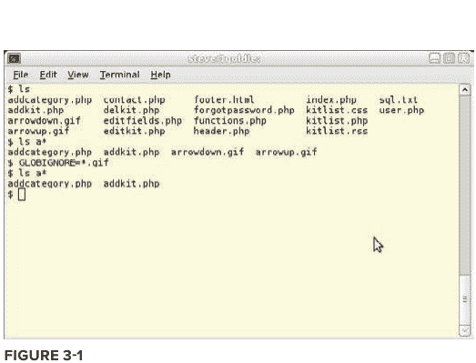

这涉及到更复杂的匹配匹配，如图 3-2 所示：

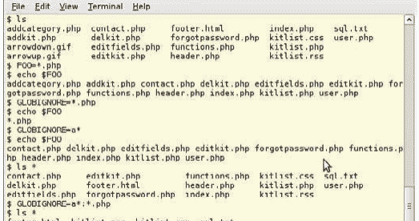

**图 3-2**

在图 3-2 中，第一个 `ls` 显示目录中的文件。目录 `FOO/*.php` 表示 `echo $FOO` 将匹配所有的 .php 文件。设置 `GLOBIGNORE=*.php` 意味着 `echo $FOO` 就像没有找到匹配的文件一样——它输出实际的、意外之外的值，即字符串 "*.php"。

当你设置 `GLOBIGNORE=a*` 时，`echo $FOO` 会忽略以 "a" 开头的文件，而设置 `GLOBIGNORE=*.php` 则会导致任何匹配这些模式之一的文件被忽略。

这在使用版本控制系统时也很有用。例如，图 3-3 显示了一些带有 "~" 后缀的备份文件：

### 第 3 章 变量

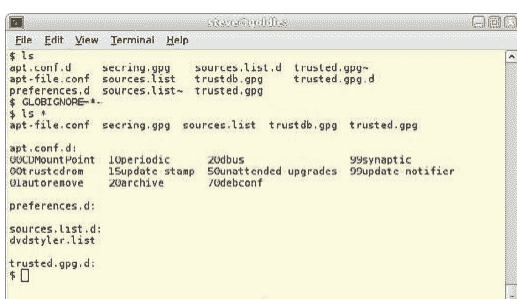

**图 3-3**

## HOME

`HOME` 是当前用户主目录的路径。如果你单独运行 `cd`，它将切换到 `$HOME` 的值。`$HOME` 也可以被表示为 "~"，所以这些命令指向 `HOME` 变量的值：

```bash
cd ; grep proxy .wgetrc
cd $HOME ; grep proxy .wgetrc
grep proxy ~/.wgetrc
grep proxy $(HOME)/.wgetrc
```

所有这些都会在当前用户的 `$(HOME)/.wgetrc` 文件中进行 `grep`。

## IFS

`IFS` 是内部字段分隔符（Internal Field Separator）：它列出了可能用作空白字符的字符集。它的默认值是换行符 `<newline>`。当你在本章之前查看 `VAR` 时，你会看到 `read firstname lastname` 可以用于第一个单词（`firstname`），后面跟着零或多个序列（所有序列都被读入 `lastname` 变量）。这是由于 `IFS` 的原因，如果你将 `IFS` 改为其他内容，你就可以改变它的工作方式。这非常有用，例如在读取冒号分隔的 `/etc/passwd` 文件，或读取由点号分隔的 IP 地址时：

```bash
$ cat ifs1.sh
#!/bin/bash
# 保存原始 IFS
IFS=$IFS
IFS=": "
# /etc/passwd 仅由冒号分隔。
while read login password uid home shell
do
# 忽略那些使用 /bin/false 或主目录在 /var 下的账户
if [ "$shell" = /bin/false ] && [ -z "$home/var*" ]; then
echo "User $login ($(name)) lives in $home and uses $(basename $shell)"
fi
done < /etc/passwd
# 虽然不需要，因为我们正在编辑脚本，但这是一个良好的习惯；
# 后续命令将需要正常的 IFS 值。
IFS=$IFS
$ ./ifsl.sh
User root (root) lives in /root and uses bash
User daemon (daemon) lives in /usr/sbin and uses sh
User bin (bin) lives in /bin and uses sh
User sys (sys) lives in /dev and uses sh
User sync (sync) lives in /bin and uses sync
User game (games) lives in /usr/games and uses sh
User proxy (proxy) lives in /bin and uses sh
```


`User nobody` (`nobody`) lives in `/nonexistent` and uses `us sh`

`User steve` (`Peter Parker,`) lives in `/home/steve` and uses `bash`

`$`

在显示输出时，`$IFS` 中第一个分隔符列表字符中的一个实例将用于填充字符，这（结合输入中所有 `IFS` 字符都会被剥离的事实）解释了为什么如果需要保留空格，在 `echo` 语句的开头或结尾需要双引号：

```
$ echo hello
hello world
$
```

## `PATH`

`PATH` 是一个用冒号分隔的目录列表，用于查找文件。它从左到右搜索，因此如果 `PATH=/home/steve/bin:/usr/local/bin:/usr/bin:/usr/bin/X11`，那么 `ls`（通常位于 `/bin`）将会在搜索 `/home/steve/bin/ls`，然后是 `/usr/local/bin/ls`，接着是 `/usr/bin/ls`，直到找到或到达 `/bin/ls`。shell 会哈希这些值，所以下次调用 `ls` 时，它会记住它是 `/bin/ls`。如果你创建了 `/home/steve/bin` 并想使用它，可以通过运行 `hash -r` 强制 shell 忘记它。你可以使用 `hash -1` 读取已哈希的路径列表。

在 `PATH` 中，`()` 用于表示调用程序的当前目录。较为人知的是，双冒号（`::`）的作用相当于逗号，而 `PATH` 变量开头或结尾的单冒号也会扩展为当前目录。因此，如果 `PATH=:usr/bin/bin`，那么当你调用 `ls` 时，当前目录下的任何 `ls` 都会被执行。这种做法会导致一些意外（一个命令的行为突然与你预期的不同）以及一个重大的安全问题（特别是当你以 `root` 身份登录时）：攻击者可以在 `/tmp` 中放置一个恶意的 `ls`。

## `TMOUT`

`TMOUT` 用于空闲超时，它可以设置为以秒为单位的值。如果设置 `TMOUT`，shell 将在该时间后退出。如果将 `TMOUT` 设置为 `0`，shell 将不会超时。这是一个实用的安全功能，防止用户离开终端未关闭。

## 用户识别

确定运行脚本的用户身份通常非常有用。`UID` 在 shell 启动时会自动被设置为用户的数字 ID，并且是只读的，因此用户无法伪造它。`GROUPS` 是当前用户组 ID 的数组。`GROUPS` 数组是可写的，但一旦它分配了值，就无法重新获得其特殊属性。

注意，`$USER` 并不是由 `bash` 定义的，虽然它被设置并且可能准确，但它可能被设置为任何内容：它对 `bash` 没有任何特殊含义。检查 `$USER` 不是准确识别用户的推荐方法。

## `TMPDIR`

`TMPDIR` 用于临时文件；如果未设置，则使用 `/tmp`。除了 shell 本身外，某些应用程序也会使用 `TMPDIR`，因此如果某个应用程序不断向 `/tmp` 填充大量文件，值得为该应用程序更改 `TMPDIR`，将其专门放在其他地方（也许在外部存储上，远离操作系统）。

## 摘要

除了条件执行外，变量是使一种语言变得真正实用的必备特性之一。能够从环境中读取数据并根据结果执行不同的代码，这意味着 shell 是一门真正实用的编程语言，而不仅仅是一个批处理器。shell 与大多数语言略有不同，其赋值和读取变量的语法是不相同的，而且由于它几乎没有不同类型变量的概念。

某些变量是由系统预定义的，其中一些变量（如 `UID`）只能读取而不能写入。另一些变量（如 `RANDOM`）在被赋值后会失去其特殊含义。

第 7 章将对变量进行深入探讨，包括许多 `bash` 特有的功能。
第 9 章将处理数组，这是一种在 `bash`、`ksh` 和 `zsh` 中均可使用的特殊变量类型。

# 第 4 章

## 通配符扩展

在编写 shell 脚本时，通配符有两种不同的使用方式。shell 本身使用通配符进行文件名扩展，因此你可以指定 `a*` 来匹配所有以字母 `a` 开头的文件，用 `*.txt` 匹配所有文件。此外，还有许多 shell 工具（如 `sed`、`awk` 和 `grep`）使用的更强大的表达式。这些工具使用了比简单的 shell 更形式化的语言和语法。`bash` shell 提供了更强大的通配符扩展，可以将其扩展为匹配当前目录下的文件，而不是将通配符本身直接传递给 `sed`。

与正则表达式相关的还包括影响对 shell 特别重要的引号字符的规则。当你需要将 `a*` 传递给 `sed` 时，你可能不希望 shell 扩展当前目录中的文件，而是将通配符本身直接传递给 `sed`。本章的“引号”（Quoting）部分涵盖了实现这一点的各种技术和特殊字符。

### 文件名扩展 (GLOBBING)

这个不太听的词 `globbing` 来源于由 Unix 作者之一的 `Dennis Ritchie` 编写的原始命令 `/etc/glob`。`glob` 之所以被称为“global”（全局），似乎因为它在被引入时将搜索整个 `$PATH`。原始的实现在 `/bin` 中搜索，这可能是一个错误。今天，`which` 命令承担了 `glob` 的角色，但我们现在是因为 `glob` 才有了 `globbing` 这个词，它的意思是“使用通配符扩展搜索文件”。它仍然没有引用 `PATH` 变量。

文件名扩展中的两个字符是问号 (`?`) 和星号 (`*`)。`?` 匹配任意字符；`*` 匹配任意字符序列。给定一组包含各种模式的文件，你可以使用这些通配符找到匹配的文件。

```
$ ls
abc abcdef abcdefghi abc.php abc.txt ABC.txt def mydoc.odt xyz.xml
abc ABCdef abcdef.odt abctxt abc.TXT alphabet xyz
$ ls a*
abc abcdef abcdefghi abc.php abc.txt alphabet
abc abcdef abcdef.odt abctxt abc.TXT
$ ls *\
```

`ABC ABCDEF ABC.txt`
```
$ ls A??
ABC
$ ls a??
abc
```

此功能用于查找所有具有给定扩展名的文件。注意 `*.txt` 与 `.txt` 是不同的。

> 虽然文件名末尾的 `.txt`、`.sh` 或 `.conf` 混淆在 Unix 和 Linux 中被广泛使用，但扩展名本身并没有某些操作系统（最尤其是微软 Windows）所赋予的特殊意义。你可以将你的 OpenOffice 文档 `myfiguration` 重命名为 `myconfiguration.bin`，它在 OpenOffice 中仍然可以完美运行。文件工具通过其内容识别文件，不会被文件名扩展所误导。

```
$ ls *.txt
abc.txt ABC.txt
$ ls *??
abcdef.odt abc.txt ABC.txt mydoc.odt
$ ls *txt
abcbxt abc.txt
$
```

因为 `*` 匹配任意字符序列，所以它可以进行匹配，而问号 (`?`) 不同，问号始终必须精确匹配某一个字符。

```
$ ls *b*
abc abcgh abc.php abc.txt
abcdefdef abctxt ABC.TXT
$ ls *ab
No such file or directory
$
```

这个示例显示通配符可以出现在任何地方，而不仅仅是文件的开头或结尾。此命令列出了所有包含字母 `h` 的文件。注意 `abc.php` 被包含在内；如前提到的，文件名包含点这一事实并没有意义。

```
$ ls *h
abcdefgh abc.php alphabet
$
```

虽然这不是文件名扩展，但另一个实用的 `bash` 功能是扩展大括号内包含的字符串列表。使用 `/etc/rc*` 可以通过数字更精确地匹配：

```
$ ls -d /etc/rc{0,1,2,3,4,5,6}
/etc/rc0 /etc/rc1 /etc/rc2 /etc/rc3 /etc/rc4 /etc/rc5 /etc/rc6
$
```

### 文件名扩展 (Globbing)

```
$ mkdir -p /opt/domains/domain{1,2,3}
$ ls -ld /opt/domains/*
/opt/domains/domain1 /opt/domains/domain2 /opt/domains/domain3
$
```

尽管 `?` 和 `*` 是文件名扩展的两个元字符，但还有 `[...]` 结构。它有三种略有不同的用法。其中最流行的是定义范围的能力。文件名中的点没有特殊意义，而连字符 (`-`) 被几乎每个 Unix 和 Linux 命令使用。当面对一个名为 "rf" 或更糟的文件时，你该如何删除它？答案是 `rm --`，但这将删除从当前目录向下的所有内容。许多命令将两个双横线 (`--`) 解析为选项的结束。

#### 字符类

表 4-1 字符类

| CLASS | MEMBERS |
| :--- | :--- |
| Alnum | A-Z, a-z, 0-9 |
| Alpha | A-Z, a-z |
| Blank | Space, Tab |
| Cntl | ASCII字符 0-31（非打印字符） |
| Digit | 0-9 |
| Graph | A-Z, a-z, 0-9 以及标点符号 |
| Lower | a-z |
| Print | ASCII字符 32-127（打印字符） |
| Punct | 标点符号 |
| Space | Space |
| Upper | A-Z |
| xdigit | 0-9, A-F |

如果范围不再适用，你也可以通过在括号内列出字符列表来匹配。`[aeiou]` 匹配任何元音，`[1579]` 匹配任何奇数，依此类推。你可以使用感叹号 (`!`) 或开头的脱字符 (`^`) 来取反项。

```
$ # 以小写元音开头的文件
ls [aeiou]*
abcdefghijk abc.php abc.txt alphabet
abcdef abcdef abtxt
$ # 不以小写元音开头的文件
ls [^aeiou]
ABC ABC.txt DEF
$
```

最后，如果你需要匹配字符 `[`，你需要将其放入列表中，如 `[[aeiou]]`。如果你需要匹配字符 `-`，可以放在开头或其他地方，这样 `[-aeiou]` 或 `[aeiou-]` 就可以工作。

#### Glob 功能

有时你需要完全禁用文件名扩展；`bash` 指令 `set -o noglob`（可选 `set -f`）会禁用它，而 `set +o noglob`（或 `set +f`）会重新启用它。这里有两个文档；如果你想创建一个文件 `d*.odt`，文件名扩展将拦截 `touch d*.odt` 命令并将其视为 `touch abcdef.odt mydoc.odt`。注意文件的时间戳发生了变化。

```
$ ls -l d*.odt
-rw-rw-r-- 1 steve 505 Nov 10 13:13 abcdef.odt
-rw-rw-r-- 1 steve 355 Dec 20 09:17 mydoc.odt
$ touch d*.odt
ls -l
-rw-rw-r-- 1 steve 505 Dec 22 11:51 abcdef.odt
-rw-rw-r-- 1 steve 355 Dec 22 11:51 mydoc.odt
$
```

你可以通过禁用通配符（`globbing`）来达到预期效果。`d*.odt` 现在被视为字面量。


## Shell 选项

Shell 选项改变了 shell 的工作方式。有些 shell 选项会影响文件名扩展。它们可以使用命令 `shopt -s optionname` 进行设置，并使用 `shopt -u optionname` 取消。如果你需要使用某个 shell 选项，可以使用 `shopt optionname` 查询设置，或者通过编程方式使用 `shopt -q optionname`，后者不会显示任何内容，但如果设置则返回 0，未设置则返回 1。

```bash
$ shopt nullglob
nullglob off

$ shopt -q nullglob
$ echo $?
1

$ shopt -s nullglob
$ shopt nullglob
nullglob on

$ shopt -q nullglob
$ echo $?
0
```

shell 使用的一个防止意外更改的功能是：所谓的“隐藏”文件——那些以点开头的文件，例如 `~/.bashrc`、`~/.ssh/` 等——不会被 shell 文件名扩展所匹配。只要你理解它的存在，这是一个非常实用的功能；否则，它可能会非常令人沮丧。为什么 `rm -rf /tmp/files` 没有导致目录变空？因为存在 `/tmp/files/.config`。你不能使用 `rm -rf /tmp/files/*`，因为它会匹配 `/tmp/files/.`（如果是在设置了 `dotglob` 的情况下）。你可以使用 `rm -rf /tmp/files`，这将删除 `/tmp/files` 及其所有内容，但如果你想保留该目录，可以使用 `dotglob` shell 选项。

```bash
$ ls *
abc abcdef abcdefghijk abc.php abc.txt ABC.txt def *d*.odt xyz
ABC ABCDEF abcdef.odt abctxt ABC.txt alphabet DEF mydoc xyz.xml
```

```bash
$ shopt -dotglob
```

# 第 4 章 通配符扩展

```bash
$ ls *
abcdef abcdefijk abctxt ABC.txt .def mydoct
.abc .abcdef abc.txt alphabet DEF xyz
ABC ABC abc.php ABC.TXT def *.odt xyz.xml
```

shell 的另一个功能在某些情况下可能会带来不便：即当模式不匹配任何文件时，它将保持原样。对于上述列出的文件，`a*` 扩展为 "abc abcdefijk abc.php abc.txt alphabet abcdef abcdef.odt abct abc.TXT" 会扩展为 "a"，即包含通配符的字面字符串。你可以通过 `nullglob` 选项强制将其扩展为空字符串，这样你就不需要处理通配符本身了。

```bash
$ for filename in a b*
do
  mdsum $filename
done

674ea002dabf89916e280f7d15560d abc
14d9a8e544e842b0097c8746cd484273 abcdef
b7f0f3b8706ae1bc3cfa3fab0371c abcdefijk
8116e5a8b3493c04974cd305f45c86 abcdef.odt
a10c0d9f44e842b0097c8746cd484273 abcdef
d41c8d9f0f2b04d3a9e809986ef8427e abctxt
e45f65832ea2acffe82d55b5c8e0ae90 abc.txt
a60b9079671bf18d88c1fab09fb90e abc
3d0f5469f7267c3cd50d48b41352fc80b alphabet
mdsum; b*: No such file or directory
```

```bash
$ for filename in a b*
do
  mdsum $filename
done

674ea002dabf89916e280f7d15560d abc
14d9a8e544e842b0097c8746cd484273 abcdef
b7f0f3b8706ae1bc3cfa3fab0371c abcdefijk
8116e5a8b3493c04974cd305f45c86 abcdef.odt
a10c0d9f44e842b0097c8746cd484273 abcdef
d41c8d9f0f2b04d3a9e809986ef8427e abctxt
e45f65832ea2acffe82d55b5c8e0ae90 abc.txt
a60b9079671bf18d88c1fab09fb90e abc
3d0f5469f7267c3cd50d48b41352fc80b alphabet
```

## 正则表达式概述

正则表达式由如 `sed` 等命令解释，以实现非常强大的效果。虽然这些命令在本书的各种配方中都会用到，但它们的实际用法已超出了本书的范畴。http://sed.sourceforge.net/sedline.txt 是一份优秀的单行 `sed` 配方列表；有许多教程和书籍详细地涵盖了这些命令。本文将简要介绍这些细节，以讨论如何结合 shell 中使用它们。

```bash
$ cat myfile
foo="hello bonjour"
bar="goodbye aurevoir*"

$foo
fool=$foo
barl=$bar

$ foo=bonjour
$ bar=aurovoir

$ sed s/$foo*/$bar/g myfile
foo="hello aurevoir"
bar="goodbye aurevoir"
fool=$foo
barl=$bar

$ sed s/$foo*/*/$bar/g myfile
foo="hello aurevoir"
bar="goodbye aurevoir"
fool=$foo
barl=$bar
```

这个简单的示例被传递给 `sed` 的 `s/bonjour/aurovoir/g`，它会将输入中的任何 `bonjour` 替换为 `aurovoir`。然而，如果你在变量引用周围加上单引号，这种解释就不会被遵循。相反，字面字符串 `$foo` 被替换为 `$bar`；调用 shell 时这些变量的值不会被使用。传递给 `sed` 的命令是 `s/$foo$/bar/g`，`sed` 对调用中的变量一无所知。

> `sed` 是一个流编辑器（Stream EDitor）。它不会更改磁盘上的文件内容；它只读取文件（或标准输入）并将修改后的版本写入标准输出。GNU `sed` 拥有 `-i` 选项，可以直接原地更新文件。

```bash
$ sed s/'$foo'/'bar'/g myfile
foo="hello bonjour"
bar="goodbye aurevoir"
fool=$foo
barl=$bar
```

这意味着，理解不同类型的引号工作原理，以及结果传递给调用命令的内容是非常重要的。引号的规则有时非常复杂，而且并不总是显而易见的。

## 引号

参数如何从 shell 传递到外部命令是非常重要的。引号主要有三种形式——单引号、双引号和反斜杠。每种形式都有其用处，尽管在很多情况下这些技术中的任何一种就足够了，但你可能需要使用其中一种形式提供的功能，而这些功能无法通过其他形式实现。

## 单引号

最简单的单引号，它阻止 shell 解释其内部的任何内容。除了闭合引号外，shell 不会解析任何内容。

```bash
$ echo 'hello'world
Helloworld

$ echo 'hello world'
hello world

$ echo '$hello'$world
$hello

$ echo 'hello'
> 'world'
hello

$ echo *
cc2.0ds CH3_PE0 docx keyring-VH3EqR MozillaMailnews orbit-root echo-steve plugmp pulse-case5EDFkeDRJ sh-aRPhoSI183 virtual-steve.Vql1hrc

$ echo '*'
*
```

第一个示例显示引号本身被忽略了，但除此之外，`hello` 和 `world` 被视为整个输入。第二个示例显示空格在引号内被保留。第三行显示 `$hello` 被视为字面量，但未定义的变量 `$world`（它不在引号内）被显示为 —，即空白。第四行显示即使是换行也不会结束 `echo` 语句——shell 正在寻找单引号来闭合引号，没有任何内容被视为重要的，甚至换行符也不例外。最后两个示例显示 `echo *` 会扩展为当前目录下的所有文件，而 `echo '*'` 仅表示一个星号。

## 双引号

shell 中可用的第二种引号形式是使用双引号；通过这种方式，某些字符会被 shell 解析，但并非全部。变量会被解释，文件名则不会。

```bash
$ echo "hello"
hello

$ echo *
cc2.0ds CH3_PE0 docx keyring-VH3EqR MozillaMailnews orbit-root echo-steve plugmp pulse-case5EDFkeDRJ sh-aRPhoSI183 virtual-steve.Vql1hrc

$ echo "*"
*

$ echo "$hello"
$hello

$ echo "$world"
$ echo "hello"
hello
```

查看 `$PATH` 并将其替换为变量的值，但 `declan` 上的 shell 执行的是 `$PATH` 并对其进行适当展开：- 使用 `declan` 存储的 `$PATH` 的值。

```bash
stevegoldie:-$ echo $PATH
/home/steve/bin:/usr/local/bin:/usr/bin:/bin:/usr/bin/X11:/usr/games

declan:-$ echo $PATH
/usr/local/bin:/usr/bin:/bin:/usr/bin/X11:/usr/games:/home/steve/bin
declan:--$

stevegoldie:-$ ssh declan echo $PATH
declan's password:
/home/steve/usr/local/bin:/usr/bin:/bin:/usr/bin/X11:/usr/games

stevegoldie:-$ ssh declan echo \$PATH
declan's password:
/usr/local/bin:/usr/bin:/bin:/usr/bin/X11:/usr/games/home/steve
stevegoldie:--$
```

## 总结

通配符可以非常灵活且有用，但代价是需要警惕；每当使用任何非标准字符时，你都需要考虑 shell 将如何处理它。在某些情况下，它会被直接传递；而在其他情况下，它会被解释为具有特殊含义。这并不总是显而易见的——规则非常复杂，且并不总是容易理解。

确保你如何处理用户生成或外部来源的字符串非常重要。例如，如果你在所有的测试中都预期用户提供不包含空格的文件名，那么当你没有给文件名加引号时，用户传递了一个包含空格的文件名，你的脚本就会崩溃。

下一章将介绍“条件执行”，它通过对环境状态进行多种测试来控制 shell 脚本的流。

# 第 5 章 条件执行

条件执行意味着你可以选择仅在满足特定条件时执行代码。没有这种能力，你所能做的只是一个接一个地执行命令。测试关于系统状态以及进程环境变量的各种属性的能力，意味着 shell 脚本可以完成比其他情况下强大得多的事情。

## IF/THEN

几乎每种编程语言都有 `if/then/else` 结构，shell 也不例外。语法使用方括号来执行测试，并且 `then` 和 `fi` 语句是必须的，作用就像 C 和某些其他语言中的 `{` 和 `}` 大括号。

```bash
if [ condition ]
then  statement(s)
fi
```

除了 `then` 单词后面的换行外，所有这些换行都是必须的，或者可以被分号替换。`{` 和 `}` 符号周围的空格也是必须，因此最理想的情况下可以简化为：

```bash
if [ condition ];then statement(s);fi
```

使用分号将 `then` 与 `if` 放在同一行是常见的做法。将单词反转以表示其相反含义的技术——例如，使用 `fi` 来结束 `if` 语句——在本章后面还会再次出现，那时 `case` 语句以 `esac` 结束。同样，正如你在第 12 章中看到的，`cat` 的反转是 `tac`。

> Unix、Linux 和自由软件传统有很多许多（有意识的）双关语。除了第一章提到的 GNU 和 HURD 背后的文字游戏外，Perlmong 在“又一次 Perl 会议”(YAPC) 之后，SuSE 使用了“又一个软件工具”(YaST)，而 `abcde` 是“一个更好的 CD 编码器”。拉丁美洲的 GNU 用户组是 GNU^2 (Grupos Nacionales de Usuarios GNU)；这个列表几乎是无止尽的。

你可以通过编写一段仅在条件不满足时执行的代码来让这段代码变得有用：

```bash
if [ condition ]
then
  条件为真时的执行语句
else
  条件为假时的执行语句
fi
```

在这里，如果条件测试通过，将执行第一组语句；如果失败，则执行第二组语句。这些代码块中恰好有一个会被执行——绝不会两个都执行，可能一个都不执行。

你可以通过检查 `$?` 返回变量来测试失败，该变量在成功时置为零，失败时为非零。对于这些测试，让我们使用 `-r` 测试，当且仅当文件存在且可读时，它返回真。这段代码片段尝试将文件作为第一个参数进行 `cat`（在其周围加上双引号以允许包含空格的文件名），如果失败，则输出一条错误信息。（`cat` 也会向标准输出显示它自己的错误信息）。

```bash
#!/bin/bash
## 测试失败
cat "$1"
if [ $? -ne 0 ]; then
  echo "Error: Reading $1 failed."
fi
```

这在尝试访问文件之前测试文件是否存在以及是否可读。这是一种更安全的方法；更好的方法仍然是在 `cat` 命令运行后检查任何未预见的失败状况（例如，`cat` 可能不在 `$PATH` 中）。

```bash
#!/bin/bash
# 测试可能的失败原因
if [ ! -r $1 ]; then
  echo "Error: $1 不是一个可读的文件。"
  echo "Error: Quitting."
  exit 1
fi

cat "$1"
```

## ELSE

你可以选择仅在条件不满足时执行代码。没有这种能力，你所能做的只是一个接一个地执行命令。测试关于系统状态以及进程环境变量的各种属性的能力，意味着 shell 脚本可以完成比其他情况下强大得多的事情。

## IF/THEN

几乎每种编程语言都有 `if/then/else` 结构，shell 也不例外。语法使用方括号来执行测试，并且 `then` 和 `fi` 语句是必须的，作用就像 C 和某些其他语言中的 `{` 和 `}` 大括号。

```bash
if [ condition ]
then  statement(s)
```

除了 `then` 单词后面的换行外，所有这些换行都是必须的，或者可以被分号替换。`{` 和 `}` 符号周围的空格也是必须，因此最理想的情况下可以简化为：

```bash
if [ condition ];then statement(s);fi
```


## 条件执行基础

`if [ condition ];`

使用分号将 `then` 与 `if` 放在同一行是常见的做法。将单词反转以表示其相反含义的技术——例如，使用 `fi` 来结束 `if` 语句——在本章后面还会再次出现，那时 `case` 语句以 `esac` 结束。同样，正如你在第 12 章中看到的，`cat` 的反转是 `tac`。

# 第 5 章 条件执行

> Unix、Linux 和自由软件传统有很多许多（有意识的）双关语。除了第一章提到的 `GNU` 和 `HURD` 背后的文字游戏外，Perlmong 在“又一次 Perl 会议”(YAPC) 之后，`SuSE` 使用了“又一个软件工具”(YaST)，而 `abcde` 是“一个更好的 CD 编码器”。拉丁美洲的 `GNU` 用户组是 `GNU^2` (Grupos Nacionales de Usuarios GNU)；这个列表几乎是无止尽的。

你可以通过编写一段仅在条件不满足时执行的代码来让这段代码变得有用：

```bash
if [ condition ]
then
  条件为真时的执行语句
else
  条件为假时的执行语句
fi
```

在这里，如果条件测试通过，将执行第一组语句；如果失败，则执行第二组语句。这些代码块中恰好有一个会被执行——绝不会两个都执行，可能一个都不执行。

```bash
elif "$OS" = "Linux"; then
    echo "This is Linux"
else
    echo "Failed to identify this OS"
fi
```

要向此代码添加新的操作系统，你只需向脚本中再次添加两行。没有缩进问题，没有可读性问题，而且含义完全清晰。

## `TEST()`

本章的第一个示例使用了 `-r test` 来检查文件是否存在并可读。对于该示例来说这是一个非常有用的测试，但还有很多测试，都记录在 `test` 的帮助页中。没有必要重复整个 `test` 手页；而是查看一些利用 `test` 优势的技巧，并为当前任务选择最合适的测试。由于有许多选择，经常会看到某些 shell 特意去复制 `test` 的功能，这仅仅是因为编写者不知道 `test` 有多好用。

首先，让我们承认 `test` 实现方式中的狡猾之处，这解释了本文开头提到的空格规则。`test` 本身是一个程序，通常被实现为 shell 命令。虽然磁盘上通常有一个 `/usr/bin/test`，但通常不会调用它，因为发现了 shell 的内置命令。`test` 的另一个名字是 `[`。当 `{[` 出现时，它要求在其参数周围有一个 `]`，否则它会执行工作。

```bash
$ type test
test is a shell builtin

$ type [
[ is a shell builtin

$ which test
/usr/bin/test

$ which [
/usr/bin/

$ ls -l /usr/bin/test /usr/bin/
33625 -rwxr-xr-x 1 root root 30136 Apr 28 2010 /usr/bin/
33634 -rwxr-xr-x 1 root root 30136 Apr 28 2010 /usr/bin/test
```

这个示例表明，如果你从 `bash` 调用 `test` 或 `[`，你将获得 `bash` 对这些内容的实现。在磁盘上，你也拥有 `test` 和 `[`，它们的大小非常相似但是不同的文件。

这种奇怪的配置意味着 shell 似乎具有与其他语言相同的语法，但解析器要简单得多。

这一切的结果是，代码对于习惯了其他语言的程序员来说看起来整洁且易于识别，但最终处理方式却完全不同。在大多数语言中，`{` 和 `}`（或等等物）是语言构造。在 shell 中，`{` 是一个程序，而 `}` 仅仅是它的参数，是必需的但会被丢弃。它对 shell 没有任何意义。

这意味着你可以通过多种方式测试 `/etc/hosts` 是否为普通文件：

```bash
$ test -f /etc/hosts
$ echo $?
0
/usr/bin/test -f /etc/hosts
$ echo $?
0
[ -f /etc/hosts ]
$ echo $?
0
```

这是三个不同的程序，都在执行相同的测试，并且都返回零（表示成功）。你还可以测试 `/etc/stsoh` 是否不是一个普通文件：

```bash
$ test -f /etc/stsoh
$ echo $?
1
/usr/bin/test -f /etc/stsoh
$ echo $?
1
[ -f /etc/stsoh ]
$ echo $?
1
```

在这里，三个程序同意返回码为 `1`（任何非零值即可）。了解幕后发生了什么可以让 `test` 稍微更容易理解。

## Test 的标志

要测试文件是否存在，使用 `-e` 标志（容易记忆，`e` 代表“exists”，存在）。`-a` 标志是 `name` 的同义词。

```bash
if [ -e /etc/resolv.conf ]; then
    echo "DNS Configuration:"
    cat /etc/resolv.conf
else
    echo "No DNS resolv.conf exists."
fi
```

在 Unix 中，这并不像 `-e` 那样具体，因为它首先出现在驱动器、目录、网络挂载和虚拟内存空间。一个类似的 `test` 是 `-f`，它测试文件是否存在且为普通文件。同样，`-b` 测试它是否为块设备，而还有 `-c` 测试它是否为字符设备。块设备是用于像硬盘之类的驱动器，字符设备是用于读写如终端或 `/dev/random` 的设备。文件也可以是硬链接或符号链接（指向实际文件的指针），使用 `-L` 标志测试它是否为符号链接，或者可选的 `-h` 测试它是否为符号链接。`-f` 也会确认它是一个为普通文件，`-b` 也会测试它是否为块设备，等等。`-L` 在之前会测试它是否为符号链接。其他事物可以是 socket（使用 `-s` 标志测试），以及 FIFO 管道（使用 `-p` 标志）。socket 等高级进程间通信功能超出了本书的范围，但管道将在第 14 章介绍。此脚本测试了所有可能性：

```bash
#!/bin/bash
while read -p "What file do you want to test? " filename
do
  if [ ! -e "$filename" ]; then    echo "The file does not exist."
    continue
  fi
  # Okay, the file exists.
  ls -ld "$filename"
  if [ -L "$filename" ]; then
    echo "$filename is a symbolic link"
  elif [ -f "$filename" ]; then
    echo "$filename is a regular file."
  elif [ -b "$filename" ]; then
    echo "$filename is a block device"
  elif [ -c "$filename" ]; then
    echo "$filename is a character device"
  elif [ -d "$filename" ]; then
    echo "$filename is a directory"
  elif [ -p "$filename" ]; then
    echo "$filename is a named pipe"
  elif [ -S "$filename" ]; then
    echo "$filename is a socket"
  else
    echo "I don't know what kind of file that is. Is this a Linux system?"
  fi
done
```

```bash
$ /character.sh
What file do you want to test? /etc/foo
The file does not exist.
What file do you want to test? /etc/hosts
-rw-r-- 1 root root 458 Dec 3 00:23 /etc/hosts
/etc/hosts is a regular file.
What file do you want to test? /dev/sda
brw---- 1 root root 8, 0 Dec 13 09:22 /dev/sda
/dev/sda is a block device
What file do you want to test? /dev/null
crw-rw-rw 1 root root 3, Dec 13 09:22 /dev/null
/dev/null is a character device
What file do you want to test? /etc
drwxr-xr-x 1 root root 12288 Dec 13 09:24 /etc
/etc is a directory
What file do you want to test? /etc/motd
lrwxrwxrwx 1 root root 13 Jun 5 2010 /etc/motd -> /var/run/motd
/etc/motd is a symbolic link
/tmp/OSL_PIPE_1000_SingleOfficeIPC_54f1d855767a73f9
What do you want to test? /tmp/bc36a8c3028b0
srwrwx-r1 steve devec 0 Dec 10:32 /tmp/OSL_PIPE_1000_SingleOfficeIPC_54f1d857767a73f9bc36a8c3028b0
/tmp/OSL_PIPE_1000_SingleOfficeIPC_54f1d855767a73f9bc36a8c3028b0 is a socket
What do you want to test? /tmp/myfifo
prw--r steve devec 0 Dec 14 12:47 /tmp/myfifo
/tmp/myfifo is a named pipe
What do you want to test? *
$
```

`-d` 标志的另一个用法是在 `/etc/profile` 脚本，它可以根据可用情况自定义用户环境。这会将 `/bin` 添加到 `PATH` 中，但前提是目录存在：

```bash
if [ -d /bin ]; then
  PATH=$PATH:-/bin
fi
```

文件除了其类型外，还可以有许多属性，包括大小、权限、时间戳和模式。Unix 权限存储在三个独立的块中，每个文件都有一个所有者和一个所属组（通常重叠，但并不总是重叠）。每个块定义了读、写、执行位；按照惯例，这些位列为 `rwx`，未设置的标记为横杠（`-`）。第一个字符是文件类型，为前面的代码设置。之后，字符表示文件的权限。第一个块定义了文件所有者可以做什么；第二个块定义了所属组成员可以做什么；第三个块定义了上述任何一类中的任何人可以做什么。例如，此配置的所有者是 `root`，它可以读取和写入（`rw-`）。组只能读取文件（`r--`）。最后的三个横杠`---`）意味着其他人无法进行任何操作。

```text
-rw------ 1 root Jun 21 2010 /etc/fuse.conf
```

虽然让 `fuse` 用户拥有该文件似乎显而易见，但通过这种方法应用程序可以读取配置，但配置只能由 `root` 修改，这有助于防止被利用。这并不是一种安全措施，而是合理的深度防御策略的一部分，这是 Unix 和 Linux 防御意外攻击的许多方法之一。

`rwxrwxwx`，但如果它位于一个用户没有权限的目录中，该文件将完全无法访问。

```bash
$ cat rwx.sh
#!/bin/bash
while read -p "What file do you want to test?" filename
do
  if [ ! -e "$filename" ]; then
    echo "The file does not exist."
    continue
  fi
  # 好的，文件存在了。
  ls -ld "$filename"
  if [ -r "$filename" ]; then
    echo "$filename is readable."
  fi
  if [ -w "$filename" ]; then
    echo "$filename is writable"
  fi
  if [ -x "$filename" ]; then
    echo "$filename is executable"
  fi
done
$ ./rwx.sh
What file do you want to test? /home/steve
drwx-xr-x 70 steve teste 4096 Dec 13 11:52 /home/steve
/home/steve is readable.
/home/steve is writable
/home/steve is executable
What file do you want to test? /etc
drwx-xr-x 141 root 12288 Dec 13 11:40 /etc
/etc is readable
/etc is executable
What file do you want to test? /etc/hosts
-rw-r--r-- 1 root 458 Dec 3 00:23 /etc/hosts
/etc/hosts is readable.
What file do you want to test? /etc/shadow
-rw-r---------- 1 root shadow 1038 Nov 4 18:32 /etc/shadow
What file do you want to test? ^C
$
```

你也可以分别通过 `-O` 和 `-G` 标志来查找一个文件是否属于当前用户和/或组 ID。这比查找你的有效用户 ID 或组 ID、获取文件信息并进行比较要直观得多。

```bash
$ cat owner.sh
#!/bin/bash
while read -p "What file do you want to test?" filename
do
```

# 第 5 章 条件执行

```bash
if [ -e $filename ]; then
  echo "The file does not exist."
fi
# 好的，文件存在了。
ls -d $filename
if [ -O $filename ]; then
  echo "You own $filename"
else
  echo "You don't own $filename"
fi
if [ -G $filename ]; then
  echo "Your group owns $filename"
else
  echo "Your group doesn't own $filename"
fi
$ ./owner.sh
What file do you want to test? /home/steve
drwxr-xr-x 70 steve 4096 Dec 13 23:24 /home/steve
You own /home/steve
Your group owns /home/steve
What file do you want to test? /etc/hosts
-rw-rw-r-- 1 root 458 Dec 3 00:23 /etc/hosts
You don't own /etc/hosts
Your group doesn't own /etc/hosts
What file do you want to test? ^C
```

Unix 风格文件权限的另一个特性是 suid（设置用户 ID）和 sgid（设置组 ID）。这些位允许程序以文件所有者（或组）的身份运行，而不是运行程序的用户（或组）。在 `rwx` 风格的文件权限显示中，这显示为 `s` 而不是 `x`。你可以分别使用 `-g` 和 `-u` 标志对其进行测试。

```bash
$ cat suid.sh
#!/bin/sh
while read -p "What file do you want to test?" filename
do
  if [ -e $filename ]; then
    echo "The file does not exist."
    continue
  fi
  # 好的，文件存在了。
  ls -d $filename
  if [ -u $filename ]; then
    echo "$filename will run as user $(stat --printf=%U $filename)"
  fi
  if [ -g $filename ]; then
    echo "$filename will run as group $(stat --printf=%G $filename)"
  fi
done
$ ./suid.sh
What file do you want to test? /usr/bin/procmail
-rws-sr-x 1 root main 89720 Apr 25 2010 /usr/bin/procmail
```


`/usr/bin/procmail` will run as user 'root'

`/usr/bin/procmail` will run as group 'mail'

What file do you want to test? `/bin/ping`

`-rwxr-sr-x 1 root root 34268 Oct 14 07:21 /bin/ping`

`/bin/ping` will run as user 'root'

What file do you want to test? ^C

```
在某些情况下，例如检查日志文件是否已写入，查找一个文件是否有任何内容是有用的。`test` 命令的 `-s` 标志可以告诉你文件是否存在且大小是否大于零。如果失败，则说明文件不存在或长度为零。取决于你具体需要知道什么信息，仅用 `-s` 就足够了，但你可以将其与 `-e` 结合来查看文件是否存在。在系统中，`/var/log/mcelog` 包含了所有检测到的消息。如果没有消息，它是空的。你可以通过 `-s` 检查。

## 检查文件是否为空

```bash
if [ -s /var/log/mcelog ]; then
  echo "The log is not empty."
else
  echo "The log is empty or does not exist."
fi
```

仅比较修改时间（`mtime`）；这些测试不使用访问时间（`atime`）和 `inode` 变化（`ctime`）。

```bash
$ echo old file > old
$ sleep 60
$ echo newer file > new
$ ls -l new old
-rw-rw-r-- 1 steve 11 Dec 14 13:21 new
-rw-rw-r-- 1 steve 9 Dec 14 13:20 old
$ if [ -nt nt old ]; then
  echo "new is newer"
else
  echo "old is newer"
fi
new is newer
$ if [ -ot old new ]; then
  echo "new is older"
else
  echo "old is older"
fi
old is older
$
```

如果文件的时间戳相同，两个测试都将报告 `false`，这是正确的；它们互不比对方新或旧。此外，如果其中一个文件不存在，两个测试都将报告 `true`。如果两个都不存在，两个测试都将报告 `false`。

## 字符串比较测试

字符串可以进行四种测试。你可以测试它们是否相同，也可以测试它们在字母数字顺序上哪一个在前。此脚本比较两个字符串并报告它们是否相同。如果不相同，它会告诉你哪一个在字母顺序上在前。为了实现这一点，你使用的语法与目前看到的略有不同。字符串比较 `<` 和 `>` 仅在 `[ ]` 命令内部有效。你可以在单括号或双括号中使用 `==` 和 `!=`，但单括号测试是唯一支持单个等号 `=` 的测试。这种复杂性的原因是为了在保持与 Bourne shell 兼容的同时，添加更强大的 `[ ]` 命令。

```bash
$ cat alphanum.sh
#!/bin/bash
if [ "$1" = "$2" ]; then
  echo "$1 is the same as $2"
else
  echo "$1 is not the same as $2"
fi
```

## 既然它们不同，让我们来看看哪个在前面：

```bash
if [ "$1" < "$2" ]; then
  echo "$1 comes before $2"
else
  echo "$1 comes after $2"
fi

./alnum.sh apples bananas
apples is not the same as bananas
apples comes before bananas

./alnum.sh bananas apples
bananas is not the same as apples
bananas comes after apples

./alnum.sh oranges oranges
oranges is the same as oranges
$
```

`alnum.sh` 的第二行使用单个 `=` 符号测试相等性。`bash` shell 以及其他 shell 也接受双 `==`，这与其他语言（特别是 C）一致。然而，它不符合 POSIX 标准，传统的 Bourne shell 不识别这种语法。最好使用单个 `=`，因为它在任何处都是被理解的。

缺失的这个配方是不不等测试。这是通过 `!=` 测试完成的：

```bash
if [ "one" = "two" ]; then
  echo "These are not the same"
fi

These are not the same
```

这两个测试字符串与文件测试相似。`-z` 测试在字符串长度为零时返回 `true`，`-n` 测试在字符串长度非零时返回 `true`。由于你正在测试可能为空字符串，你需要在变量名周围加上引号；否则测试 `[ -z $input ]` 将简化为 `[ -z ]`，这在语法上是无效的。只有 `[ -z "" ]` 在语法上是有效的。

```bash
$ cat nz.sh
#!/bin/bash
# 设置输入为已知值，因为我们在设置之前进行测试
input=""
while [ -z "$input" ]; do
  read -p "Please give your input: " input
done
echo "Thank you for saying $input"
$ nz.sh
```

## 正则表达式测试

从 `bash` 3 开始的一个新功能是 `=~` 运算符，它的作用类似于 perl 的对应运算符。它将右侧视为扩展正则表达式，`bash` 现在可以做到这一点以前需要通过 perl、`sed` 或 `grep` 才能实现。这意味着你可以识别匹配模式 `*.deb` 的文件名，检查 `[[ $pkgname == *.deb ]]`。注意需要使用双括号语法 `[[ ]]`。

```text
Please give your input:
Please give your input:
Please give your input: something
Thank you for saying something
$
```

```bash
$ cat isdeb.sh
#!/bin/bash
for pkg in pkgs/*
do
  pkgname=$(basename $pkg)
  if [[ $pkgname == *.deb ]]; then
    echo "$pkgname is a .deb package"
  else
    echo "File '$pkgname*' is not a .deb package"
  fi
done
$ ls pkgs/
deb-linux-free-1.2.24-4_amd64.deb
firmware-desktop-linux-free-2.26.32-29_all.deb
gnome-desktop-1.023.x86_64.rpm
libgnomeprint-2.18-2.6.x86_64.rpm
libgnomeui2-2.24-3.imv2010.1.i586.rpm
linux-headers-2.6.32-5-amd64.deb
linux-headers-2.6.32-5-common.deb
```

`/usr/bin/bash` 3.0.19-7.ubuntu1.04

Package `libgnomeui2-2.24.3` Version `1mdv2010.1` 是一个针对 `i586` 架构的 RPM 包。

`linux-headers-2.6.32-5-amd64_2.6.32_29_amd64.deb`
Package `linux-headers-2.6.32-5-amd64` Version `2.6.32-29` 是一个针对 `amd64` 架构的 Debian 软件包。

`linux-headers-2.6.32-5-common_2.6.32_29_amd64.deb`
Package `linux-headers-2.6.32-5-common` Version `2.6.32-29` 是一个针对 `amd64` 架构的 Debian 软件包。

`linux-libc-dev-2.6.32-29_amd64.deb`
Package `linux-libc-dev` Version `2.6.32-29` 是一个针对 `amd64` 架构的 Debian 软件包。

`linux-source-2.6.32_2.6.32_29_all.deb`
Package `linux-source-2.6.32` Version `2.6.32-1` 是一个针对所有架构的 Debian 软件包。

`README`
文件 "README" 不符合标准的 `.deb` 或 `.rpm` 命名规范。

## 数值测试

共有六种数值比较方法可用。`-eq` 在两个数字相等时返回真，而 `-ne` 在它们不相等时返回真。`-lt` 和 `-gt` 分别用于比较一个数是否小于或大于另一个数。如果你需要测试值是否小于或等于，`-le` 和 `-ge` 执行了互补测试，以检查一个数字是否大于或等于另一个。接下来的配方是一个猜数字游戏，它通过告诉你你从目前为止的游戏中中学到了什么来为你提供帮助。

```bash
$ cat numberguess.sh
#!/bin/bash
MAX=50
guess=$((RANDOM % $MAX))
let answer=$($MAX)
let answer+=1
ceiling=$MAX
floor=0
guesses=0

while [ "$guess" -ne "$answer" ]
do
echo "The magic number is between $floor and $ceiling."
echo -en "Make your guess:"
read guess
guesses=expr $guesses + 1

if [ "$guess" -lt "$answer" ]; then
echo "$guess is too low"
if [ "$guess" -gt "$floor" ]; then
floor=$guess + 1
fi
if [ "$guess" -gt "$answer" ]; then
echo "$guess is too high"
if [ "$guess" -lt "$ceiling" ]; then
ceiling=$guess - 1
fi
fi

done
echo "You got it in $guesses!"
$ ./numberguess.sh
```

The magic number is between 1 and 50.
Make your guess: `25`
25 is too low
The magic number is between 26 and 50.
Make your guess: `37`
37 is too low
The magic number is between 38 and 50.
Make your guess: `46`
46 is too high
The magic number is between 38 and 45.
Make your guess: `43`
43 is too low
The magic number is between 44 and 45.
Make your guess: `45`
45 is too high
The magic number is between 44 and 44.
Make your guess: `44`
You got it in 6 guesses!

这会在每次错误的猜测时调整“下限”和“上限”，因此你可以对范围进行有效的二分排序，直到锁定正确答案。这虽然减少了一些趣味性，但它是这些功能的实用示例。

> 你使用 `-lt` 和 `-gt`，除非 `-ge` 匹配正确答案。然而，在 `[ "$guess" -gt "$floor"` 更好。

## 组合测试

可以使用 `&&` 和 `||` 运算符来组合测试。这些执行逻辑与、逻辑或以及 `-s` 测试。为了测试文件是否可读且非空，你可以组合 `-r` 和 `-s` 测试。在这个例子中，除非两个条件都真，否则将不会执行。`etc/hosts` 通常是有内容的，所以它需要默认。

```bash
$ md5-if-possible.sh
#!/bin/bash
filename=${1:-etc/hosts}
if [ -r $filename ] && [ -s $filename ]; then
    md5sum $filename
else
    echo "$filename cannot be processed"
fi
# 显示文件如果可能
ls $filename 2>/dev/null
$ ./md5-if-possible.sh /etc/hosts
785ae78cf4a4ed0346204f90a275 /etc/hosts
-rw-r--r-- 1 root 458 Dec 3 00:23 /etc/hosts
$ ./md5-if-possible.sh /etc/shadow
etc/shadow cannot be processed
-rw-r----- 1 root 1038 Nov 4 21:04 /etc/shadow
```

`case` 提供了一种了一种远比 `if/then/else` 结构更清晰的替代方案，特别是当有很多值需要测试时。在 `case` 中，你列出想要识别并处理的值，并为每个值提供一个代码块。基础 `case` 块如下所示：

```bash
$ case fruit.sh
#!/bin/bash
read -p "What is your favorite fruit?" fruit
case $fruit in
  orange) echo "The fruit is orange";
  banana) echo "The fruit is yellow";
  pear) echo "The fruit is green";
  *) echo "I don't know what color a fruit is";
esac
```

```bash
$ ./fruit.sh
What is your favorite fruit?: banana
The banana is yellow
$ ./fruit.sh
What is your favorite fruit?: apple
I don't know what color a apple is
$
```

# 第 5 章 条件执行

```bash
Minix echo "This is Minix" ;;
Linux echo "This is Linux" ;;
*) echo "Failed to identify this OS" ;;
esac
```

`uname-case.sh`

尽管它看起来像是一个特殊设备，但 `*` 只是是最通用的通配符，因为它将匹配几乎任何字符串。这你可能可以进行高级的模式匹配，而你确实可以做到：

```bash
$ cat surname.sh
#!/bin/bash
read -p "What is your surname?:" surname
case $surname in
  [a-g]* | [A-G]*) file=1 ;;
  [h-m]* | [H-M]*) file=2 ;;
  [n-s]* | [N-S]*) file=3 ;;
  [t-z]* | [T-Z]*) file=4 ;;
  *) file=0;;
esac
if [ "$file" -gt "0" ]; then
  echo "$surname goes in $file"
else
  echo "I have nowhere to put $surname"
fi
$ ./surname.sh
What is your surname?: Apple
Apple goes in file 1
$ ./surname.sh
What is your surname?: apple
apple goes in file 1
$ ./surname.sh
What is your surname?: Parker
Parker goes in file 3
$ ./surname.sh
What is your surname?: 'ougho
I have nowhere to put 'ougho
$
```


`surname.sh`

这允许建立一个归档系统，根据姓氏的首字母将客户详情存储在不同的文件中。它还展示了匹配模式，例如 `[A-G]*` 或 `[a-g]*` 会导致文件 1。如果设置了 shell 选项 `nocasematch`，这种重复是不必要的，因为在任何情况下这种比较都不区分大小写。默认情况下，对于大多数 Unix 工具，大小是敏感的。你也可以在测试之前强制将 `surname` 为全大写或全小写来避免此，但这种形式在定义不明确的情况下提供了灵活性。

`bash` 实现中 `case` 的一个不太为人知的特性是，你可以用 `&&` 或 `||` 结束语句，而不仅仅是 `;;`。虽然 `;;` 意味着其他语句都不会被执行，但如果你用 `&&` 结束语句，后续所有的 cases 仍会被评估。如果你用 `;&` 结束语句，接下来的 case 将视为已匹配。这个示例描述了它接收到的所有输入（分类为大写、小写、数字或其他）。一个普通的 `case` 语句会在第一次匹配后停止；而使用 `;;` 的代码会在它想要继续执行的语句结束处之后停止。

> 此特性是 `bash` shell 特有的；它不是 Bourne shell 的标准功能，所以如果你需要编写可移植的脚本，不要期望它能工作。它在其他 shell 中会导致语法错误信息。

```bash
$ cat case1.sh
#!/bin/bash
read -p "Give me a word: " input
echo -en "You gave me *"
case $input in
  *[:lower:]*) echo -en "Lowercase ";&&
  *[:upper:]*) echo -en "Uppercase ";&&
  *[:digit:]*) echo -en "Numerical ";&&
  *) echo "input.";;
esac

$ ./case1.sh
Give me a word: HELLO
You gave me some Uppercase input.

$ ./case1.sh
Give me a word: 123
You gave me some Numerical input.

$ ./case1.sh
Give me a word: Hello 123
You gave me some Lowercase Numerical input.

$ ./case1.sh
Give me a word: !#
You gave me some input.
```

另一个 `bash` 特有的结尾是 `;&` 结尾。这会导致接下来的代码块像匹配成功一样被执行。你可以利用它来让 "Ramsey Street" 就像它匹配了 `Melbourne | Canberra | Sydney` 测试一样，使得 Ramsey Street 被视为澳大利亚的一部分，正如 Melbourne、Canberra 和 Sydney 一样。这个示例还展示了 `;&;&;` 的相关事件，例如你可以独立于国家匹配来对首都城市进行匹配。

```bash
$ cat case2.sh
#!/bin/bash
read -p "Which city are you closest to?:" city
case $city in
  "New York|London|Paris|Tokyo")
    # 你可以识别首都并仍然穿透到
    # 匹配下方的特定国家。
    echo "That is a capital city";&&
  Chicago|Detroit|New York|Washington)
    echo "You are in the USA";&&
  London|Edinburgh|Cardiff|Dublin)
    echo "You are in the United Kingdom";&&
  "Ramsey Street")
    # 这是澳大利亚未指定位置的一条街道。
    # 你仍然可以使用 &;&; 结尾来穿透
    # 并运行通用的澳大利亚代码。
    echo "G'Day Neighbour!";&&
  Melbourne|Canberra|Sydney)
    echo "You are in Australia";&&
  Paris)
    echo "You are in France";&&
  Tokyo)
    echo "You are in Japan";&&
  N*)
    # 我们已经匹配了 "New York" 并用 && 结束了它；
    # 匹配下方的特定国家。
    ...
    ;;
esac
```

### 108 | 第 5 章 条件执行

这个示例也展示了 `;&;&` 的更多相关事件，例如你可以独立于国家匹配来匹配首都城市。

```bash
$ cat case2.sh
#!/bin/bash
read -p "Which city are you closest to?:" city
case $city in
  "New York|London|Paris|Tokyo")
    # 你可以识别首都并仍然穿透到
    # 匹配下方的特定国家。
    echo "That is a capital city";&&
  Chicago|Detroit|New York|Washington)
    echo "You are in the USA";&&
  London|Edinburgh|Cardiff|Dublin)
    echo "You are in the United Kingdom";&&
  "Ramsey Street")
    # 这是澳大利亚未指定位置的一条街道。
    # 你仍然可以使用 &;&; 结尾来穿透
    # 并运行通用的澳大利亚代码。
    echo "G'Day Neighbour!";&&
  Melbourne|Canberra|Sydney)
    echo "You are in Australia";&&
  Paris)
    echo "You are in France";&&
  Tokyo)
    echo "You are in Japan";&&
  N*)
    # 我们已经匹配了 "New York" 并用 && 结束了它；
    # 匹配下方的特定国家。
    ...
    ;;
esac
```

### For 循环 | 15

`do`

```bash
echo "I really like ${fruit}"
done
echo "Let's make a salad!"
```

`$ ./fruit-read.sh`
请告诉我你喜欢的水果：奇异果 香蕉 葡萄 苹果
我很喜欢奇异果
我很喜欢香蕉
我很喜欢葡萄子
我很喜欢苹果
我们来做沙拉吧！

`fruit-read.sh`

> 就像第 5 章中的 "a apple" 一样，这些脚本太简单，无法处理示例中将 "cherry"变为复数 "cherries"。

```bash
$ cat fruit-cmdline.sh
#!/bin/bash
for fruit in $*
do
echo "I really like ${fruit}"
done
$ ./fruit-cmdline.sh satsuma apricot cherry
我很喜欢无金橘
我很喜欢杏桃
我很喜欢樱桃
我们来做沙拉吧！
```

`fruit-cmdline.sh`

可以用另一种方式处理命令行参数；语法中的 `in` 列表是可选的。运行以下脚本是完全有效的。它处理 `$` 变量的工作方式与 `fruit-cmdline.sh` 相同。

```bash
$ cat for.sh
#!/bin/bash
for fruit
do
echo "I really like $fruit"
done
echo "Let's make a salad!"
$ ./for.sh apples oranges bananas
我很喜欢苹果
我很喜欢橙子
我很喜欢香蕉
我们来做沙拉吧！
```

`for.sh`

相同的技术也适用于函数。这个 `for` 循环的最后一个示例演示了函数内部的相同原理；`$@` 被替换为函数本身的参数。

```bash
$ cat for-function.sh
#!/bin/bash
do_i_like() {
    for fruit
    do
        echo I really like $fruit
    done
}
do_i_like bananas oranges
do_i_like satsumas apricots cherries
echo "Let's make a salad!"
$ ./for-function.sh
我很喜欢苹果
我很喜欢香蕉
我很喜欢橙子
我很喜欢无金橘
我很喜欢杏桃
我很喜欢樱桃
我们来做沙拉吧！
```

这仍然是一个手动过程——所有这些循环只处理了一个静态的水果列表。Unix 的设计原则是：许多工具，每个工具只做一件事并把它做好。有很多小型简单的工具可以用于数据输入到 `for` 循环。最理想的工具之一是 `seq` 命令，它将在第 14 章进行详细介绍。`seq` 仅适用于基于 GNU 的系统（如 Linux），尽管它非常有用，但请注意它在许多不同的操作系统之间并不可移植。它可以用于监控网络上哪些机器响应了 ping 信号。

```bash
$ cat ping.sh
#!/bin/bash
UPHOSTS=/var/log/uhosts.$(date +%m%d%Y)
DOWHOSTS=/var/log/dhosts.$(date +%m%d%Y)
PREFIX=192.168.1
for OCTET in `seq 1 254`;
do
    echo -n "Ping ${PREFIX}.${OCTET}..."
    ping -cl -w 1 ${PREFIX}.${OCTET} > /dev/null 2>&1
    if [ $? -eq 0 ]; then
        echo "OK"
        echo "${PREFIX}.${OCTET}" >> ${UPHOSTS}
    else
        echo "Failed"
        echo "${PREFIX}.${OCTET}" >> ${DOWHOSTS}
    fi
done
```

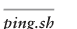

你可以看到，反引号（`` ` ``）获取 `seq` 命令的输出并将其作为循环的输入。如果它对 `seq` 有效，它对任何命令都有效。这开启了更大的可能性。在这里，我们将 `grep 192.168.1.*` 的输出通过到 `awk` 以获取第二个字段，即主机名。这并非万无一失，但假设主机名设置是合理的，这可以为你提供 192.168.1.0/24 网络上所有机器的名字。生成主机列表的命令是整个流水线：

```bash
$ grep "^192\.168\.1.*" /etc/hosts | awk '{ print $2 }'
```

在特定的机器上，此流水线产生了要测试的主机列表：

```bash
$ cat mynet.sh
#!/bin/bash
for host in `grep "^192\.168\.1.*" /etc/hosts | awk '{ print $2 }'`
do
  ping -cl -1 $host > /dev/null 2>&1
  if [ "$?" -eq "0" ]; then
    echo "$host is up"
  else
    echo "$host is down"
  fi
done
./mynet.sh
router is up
plug is down
declan is down
atomic is down
jackie is up
goldie is up
elvis is down
$
```

该语法的另一种用途是为操作选择某些文件。`mcelog` 工具列出了自上次运行以来记录的所有机器检查异常（Machine Check Exceptions）。这通常会定期运行，例如 `mcelog >> /var/log/mcelog`。

从本章开始的 `fruit-read.sh` 脚本；你可以看到它是如何处理不同数量输入的——首先是两个单词，然后是一个，最后是没有任何。对于最后的测试，只需按回车键即可不提供任何输入。

```bash
$ ./fruit-read.sh
Please tell me some of your favorite fruits: apple banana
I like apples
I really like bananas
Let's make a salad!

$ ./fruit-read.sh
Please tell me some of your favorite fruits: apple
I really like apples
Let's make a salad!

$ ./fruit-read.sh
Please tell me some of your favorite fruits: (just press return)
$
```

## C 风格循环

`bash` 也有 C 风格的 `for` 循环。任何熟悉 C 编程语言的人都能识别出 `for (i=1; i<10; i++)` 这种结构。这与我们让你查看的 shell 不同，因此 `bash` 版本几乎相同；它额外增加了一对括号，这与 C 版本不同。不需要使用 `$` 符号来引用变量的值，`i++` 运算符是有效的，并且可以使用逗号分隔多个语句，例如：

```bash
$ cat cfor.sh
#!/bin/bash
for ((i=1,j=100; i<10; i++,j-=2))
do
    printf "%i=%03d j=%03d\n" $i $j
done
$ ./cfor.sh
i=001 j=100
i=002 j=098
i=003 j=096
i=004 j=094
i=005 j=092
i=006 j=090
i=007 j=088
i=008 j=086
i=009 j=084
i=010 j=082
$
```

`cfor.sh`

此循环开始时定义 `i=1,j=100`。只要满足 `i<=10` 的条件，它就会持续循环，每次循环时，它都会执行修改器 `i++, j-=2`，这会让 `i` 加 1 并让 `j` 减 2。循环的每次迭代都使用 `printf` 显示 `$i` 和 `$j`，每个都是三位整数。

## WHILE 循环

shell 中另一种最常见的循环形式是 `while` 循环。正如其名所示，只要它测试的条件为真，就会持续执行循环体中的代码。当你无法预测你所寻找的条件何时发生时，这非常有用。此外，`while` 循环的结构是你定义条件，然后是当条件为真时执行的代码。此循环不断增加变量的值，直到它超过 100。

```bash
$ cat while.sh
#!/bin/bash
i=1
while [ "$i" -lt 100 ];
do
	echo "i is $i"
	i=$(expr $i \* 2)
done
echo "Finished because i is now $i"
$ ./while.sh
i is 1
i is 2
i is 4
i is 8
i is 16
i is 32
i is 64
Finished because i is now 128
```

因为条件是 `i` 小于 100，`i` 达到了 64 并且循环回到测试，测试通过了。再次进入循环体，设置 `i=128`，当执行回到八次回到测试时，测试失败了。shell 退出循环，继续执行 `echo` 语句，它显示了 `i` 的当前值，即 128。循环并没有阻止变量超过 100，但在 `i` 超过 100 时会拒绝运行循环。

### 何时使用 While 循环

当你没有想要迭代的项的列表，但当你想要结束时有一个可测试的条件时，`while` 循环最为有用。数学计算、比较和缩放适用于 `while` 循环。一个会持续显示并读取输入的菜单系统是 `while` 循环的良好人选；它可以在用户选择“退出（quit）”选项时退出。另一方面，如果你有一组列表要操作，`for` 循环可能更有用。

### 如何使用 While 循环

本节展示了 `while` 循环非常通用，可以以多种方式使用。`while` 循环最常用的功能是 `for` 循环本身测试某些正在变化的...

## 第 6 章 流循环

如下代码所示，它测试了一个 /24 (C 类) 网络。测试是检查最后一个字节是否小于 255（测试广播地址没有意义）。循环体的最后一条语句将字节加 1；否则循环将永远地 ping 192.168.1.1。你之前看到的这个基本的循环是：

```bash
$ cat white-ping.sh
#!/bin/bash
PREFIX=192.168.1
OCTET=1
while [ $OCTET -lt 255 ]; do
  echo "Pinging $PREFIX.$OCTET..."
  ping -c 1 $PREFIX.$OCTET >/dev/null 2>&1
  if [ $? -eq 0 ]; then
    echo "OK"
  else
    echo "Failed"
  fi
  let OCTET=$OCTET+1
done
```


### While 循环

`while` 的另一个常见用途是逐行读取文本文件的内容。下面的脚本读取文件并显示关于文件的信息；整个 `read/do` 命令在 shell 中作为一个单一命令工作（这等同于 `read $filename`）。

```bash
$ cat readfile.sh
#!/bin/bash

filename=$1

if [ ! -r $filename ]; then
  echo "Error: Cannot read $filename"
  exit 1
fi

echo "Contents of $filename:"

while read line
do
  echo "$line"
done < $filename

echo "End of $filename".

echo "checksum: $(md5sum $filename)"
```

```
$ ./readfile.sh /etc/shadow
Error: Cannot read /etc/shadow
```

```
$ ./readfile.sh /etc/hosts
Contents of /etc/hosts:
127.0.0.1      localhost
# 以下行对于支持 IPv6 的主机是理想的
::1         localhost ip6-localhost ip6-loopback
fe00::0 ip6-localnet
ff00::0 ip6-castprefix
ff02::1 ip6-allnodes
ff02::2 ip6-allrouters

192.168.1.3      router
192.168.1.5      plug
192.168.1.10     declan
192.168.1.11     atomic
192.168.1.12     jackie
192.168.1.13     goldie smf
192.168.1.227    elvis

192.168.1.210     d
```

这是对 `hosts` 文件更智能的处理；`cat` 无法以这种方式解释文件。`while` 可以比 `cat` 做更多，其中之一就是匹配字符串。

```bash
$ cat readhosts.sh
#!/bin/bash

while read aliases
do
	echo $aliases | grep '[0-9]*.[0-9]*.[0-9]*' > /dev/null
	if [ "$?" -eq 0 ]; then
		# 看起来是一个 IPv4 地址
		echo "name is $aliases"
	fi
done < /etc/hosts
```

```
$ ./readhosts.sh
127.0.0.1      localhost
::1         localhost ip6-localhost ip6-loopback
fe00::0 ip6-localnet
ff00::0 ip6-castprefix
ff02::1 ip6-allnodes
ff02::2 ip6-allrouters
192.168.1.3      router
192.168.1.5      plug
192.168.1.10     declan
192.168.1.11     atomic
192.168.1.12     jackie
192.168.1.13     goldie smf
192.168.1.227    elvis
192.168.1.210     d
```

`partitions.txt` 文件。不需要向文件追加内容；使用单个 `>` 即可，因为整个循环是一条命令，因此是一次写入操作。

```bash
$ cat while-tofile.sh
#!/bin/bash

i=1
while [ $i -lt 5 ];
do
  echo "*date : Partition $i"
  ls -ld /dev/sda$i
  sleep 1.5
  let i=$i+1
done > partitions.txt
```

```
$ ./while-tofile.sh
$ cat partitions.txt
Tue Jan 4 21:54:48 GMT 2011 : Partition 1
1 root disk 8, 1 Jan 18:39 /dev/sda1 brw-rw--
Tue Jan 4 21:54:49 GMT 2011 : Partition 2
1 root disk 8, 2 Jan 18:39 /dev/sda2 brw-rw--
Tue Jan 4 21:54:51 GMT 2011 : Partition 3
1 root disk 8, 3 Jan 21:43 /dev/sda3 brw-rw--
Tue Jan 4 21:54:53 GMT 2011 : Partition 4
1 root disk 8, 4 Jan 18:39 /dev/sda4 brw-rw--
```

另一个有用的命令是内置命令或 `/bin/true` 命令，它始终返回值 0，表示成功。这可以让循环无限执行。考虑以下两个替代循环，它们通过 `ping` 命令测试远程主机是否存活。第一个和 `date` 一样，会一直运行直到主机停止响应。第二个会持续运行，并检测主机何时再次上线。

```bash
$ cat ping1.sh
#!/bin/bash
host=${1:-declan}

while ping -c3 -w4 $host
do
  sleep 30
  echo "$host has stopped responding to pings"
done
```

```
$ ./ping1.sh
PING (192.168.1.110) 56(84) bytes of data.
64 bytes from declan (192.168.1.110): icmp_req=1 ttl=64 time=1.50 ms
64 bytes from declan (192.168.1.110): icmp_req=2 ttl=64 time=1.73 ms
64 bytes from declan (192.168.1.110): icmp_req=3 ttl=64 time=1.77 ms

--- declan ping statistics ---
3 packets transmitted, 3 received, 0% packet loss, time 2003ms
rtt min/avg/mdev = 1.502/1.671/1.775/0.120 ms
```

这可能正是人们想要的；为了永久测试，有一个永不停止的 `while` 循环可能会更有用。你也可以知道目标何时重新上线。你必须通过按下 `Ctrl-C`（在此处显示为 `^`）来结束这个循环。

```bash
$ cat ping2.sh
#!/bin/bash

host=${1:-declan}

while :
do
  ping -c3 -w 4 $host > /dev/null 2>&1
  if [ "$?" -eq "0" ]; then
    echo "*date*: $host is up"
  else
    echo "*date*: $host is down"
  fi
  sleep 30
done
```

```
$ ./ping2.sh
Wed Dec 29 12:10:57 GMT 2010: declan is up
Wed Dec 29 12:11:29 GMT 2010: declan is up
Wed Dec 29 12:12:03 GMT 2010: declan is down
Wed Dec 29 12:12:36 GMT 2010: declan is down
Wed Dec 29 12:13:08 GMT 2010: declan is up
^
```

更整洁的控制循环的方法是在循环外部对条件进行测试。这可以是识别循环运行的原因，也可以简单地使用一个控制文件来控制此循环。如果文件中未找到主机名，测试停止。在示例中，使用一个包含待测试主机列表的文件，在测试四分钟后将 `declan` 从 `/tmp/hosts-to-ping.txt` 中移除。

```bash
$ cat ping3.sh
#!/bin/bash

host=${1:-declan}

while grep -q $host /tmp/hosts-to-ping.txt
do
    ping -c3 -w 4 $host > /dev/null 2>&1
    if [ "$?" -eq 0 ]; then
        echo "$date*: $host is up"
    else
        echo "$date*: $host is down"
    fi
    sleep 30
done

echo "Stopped testing $host as it has been removed from /tmp/hosts-to-ping.txt"
```

```
$ ./ping3.sh declan
Wed Dec 29 12:41:19 GMT 2010: declan is up
Wed Dec 29 12:41:53 GMT 2010: declan is down
Wed Dec 29 12:42:25 GMT 2010: declan is down
Wed Dec 29 12:42:57 GMT 2010: declan is down
Wed Dec 29 12:43:29 GMT 2010: declan is up
Wed Dec 29 12:44:01 GMT 2010: declan is up
Wed Dec 29 12:44:33 GMT 2010: declan is up
Wed Dec 29 12:45:05 GMT 2010: declan is up
Stopped testing declan as it has been removed from /tmp/hosts-to-ping.txt
```

你可能会注意到，尽管使用了 `sleep 30` 命令来间隔消息，但时间戳显示间隔超过了 30 秒。这是因为 `ping` 命令运行需要几秒时间。`-c3` 标志告诉 `ping` 发送三个包，`-w 4` 告诉它等待四秒获取响应。当目标在线时，三个 `ping` 包为循环增加了约两秒。当它离线时，它为循环增加了四秒，因为它等待四秒直到超时。

### 嵌套循环

可以将一个循环放在另一个循环内部，甚至可以将不同类型的循环相互嵌套。虽然嵌套循环的数量没有限制，但缩进会变得复杂，因此难以跟踪循环何时结束。嵌套循环非常有用，因为你可以使用任何所需类型循环的最佳属性。在这里，`while` 循环适合持续运行直到用户输入“quit”退出循环。在 `while` 循环内部，`for` 循环适合遍历一组固定项目（后续代码中是水果）。虽然 `fruit` 在循环末尾，但第一次迭代是空的（`myfruit=""`），所以第一次运行只列三个水果。随后的运行会将用户喜爱的水果包含在列表末尾。

```bash
$ cat nest.sh
#!/bin/sh

myfruit=""

while [ "$myfruit" != "quit" ]
do
  for fruit in apples bananas pears $myfruit
  do
    echo "I like $fruit"
  done # end of the for loop
  read -p "What is your favorite fruit? " myfruit
done # end of the while loop

echo "Okay, bye!"
```

```
$ ./nest.sh
I like apples
I like bananas
I like pears
What is your favorite fruit? grapes
I like apples
I like bananas
I like pears
I like grapes
What is your favorite fruit? plums
I like apples
I like bananas
I like pears
I like plums
What is your favorite fruit? quit
Okay, bye!
```

### 终止和继续循环执行

尽管前面的功能提供了非常整洁且受控的循环执行，但有时使用 `break` 和 `continue` 更实用。`break` 用于提前退出循环，而 `continue` 用于跳过当前迭代的剩余部分并移动到下一个。

```bash
$ cat break.sh
#!/bin/bash

for number in 1 2 3 4 5
do
```


# 第 6 章 使用循环进行流程控制

## 循环

```bash
if [ $number -eq 3 ]; then
    break
fi
echo "number: $number"
done

$ ./break.sh

number: 1

number: 2
```

## 中断并继续循环执行

```bash
$ cat continue.sh

#!/bin/bash

for number in 1 2 3 4 5
do
  if [ $number -eq 3 ]; then
    continue
  fi
  echo "number: $number"
done

$ ./continue.sh

number: 1

number: 2

number: 4

number: 5
```

更整洁的控制循环的方法是在循环外部对某些条件进行测试。这可以是识别循环运行的原因，也可以简单地使用一个控制文件来控制此循环。后续代码使用一个包含待测试主机列表的文件。如果文件中未找到主机名，测试停止。

```bash
$ cat break.sh

#!/bin/bash

host=${1:-declan}

for number in 1 2 3 4 5
do
  if ! grep -q $host /tmp/hosts-to-ping.txt; then
    break
  fi
  echo "number: $number"
done
```

*注：原文后部分存在大量重复和 OCR 错误，译文已根据逻辑进行了清理和去重处理。*

## WHILE CASE

这次第二次运行显示了，在外部层循环中按下`b`（这会导致调用无参数的`break`）与在内层循环中按下`2`（这会导致调用`break 2`）的效果相同。

```bash
$ ./break.sh

In the number loop - 1

Press b to break out of this loop: z

Now in the outer loop... 1 a

Press 1 to break out of this loop, 2 to break out totally: z

Now in the outer loop... 1 b

Press 1 to break out of this loop, 2 to break out totally: z

Now in the outer loop... 1 c

Press 1 to break out of this loop, 2 to break out totally: z

Now in the outer loop... 1 d

Press 1 to break out of this loop, 2 to break out totally: z

Now in the outer loop... 1 e

Press 1 to break out of this loop, 2 to break out totally: z

Now in the outer loop... 1 f

Press 1 to break out of this loop, 2 to break out totally: z

In the number loop - 2

Press b to break out of this loop: z

That's all, folks

$
```

`break`命令的搭档是`continue`命令。它也是一个内置命令。`continue`与退出当前循环有关，它会直接跳转到控制循环的测试语句。与`break`类似，你可以指定一个数值参数来继续某些层级的外部循环。第一个示例展示了`continue`的典型用法；当执行`continue`时，当前运行的剩余部分将被跳过，你将返回结尾。该循环的结尾包含一个`echo`语句，显示“This is the end of the loop.”。当你按下`r`重复循环时，紧后的语句会被跳过。否则，该语句将执行且循环正常继续。

## 中断并继续循环执行

```bash
$ ./continue.sh

i is 1

Press r to repeat, any other key to continue: r

Skipping the end of the loop.

i is 2

Press r to repeat, any other key to continue: a

This is the end of the loop.

i is 3

Press r to repeat, any other key to continue: r

Skipping the end of the loop.

i is 4

Press r to repeat, any other key to continue: b

This is the end of the loop.

$
```

`continue.sh`

以下代码展示了一个稍微没那么明显的用法；因为你在注释计数器`i`之前就返回了循环，你可以重复循环的这部分而无需更改任何内容——它实际上在主循环中创建了一个额外的循环。

```bash
$ cat continue-backwards.sh

#!/bin/bash

i=1

while [ $i -lt 5 ]; do
  echo "i is $i"
  read -p "r to repeat, any other key to continue: " x
  if [ "$x" == "*" ]; then
    echo "Going again..."
    continue
  fi
  i=$i+1
done

$ ./continue-backwards.sh

i is 1

Press r to repeat, any other key to continue: a

i is 2

Press r to repeat, any other key to continue: r

Going again...

i is 2

Press r to repeat, any other key to continue: b

i is 3

Press r to repeat, any other key to continue: r

Going again...

i is 3

Press r to repeat, any other key to continue: c

i is 4

Press r to repeat, any other key to continue: d

$
```

`continue-backwards.sh`

你在第 5 章中看到的`case`语句的一种常见用法是放入`while`循环中。此时`case`语句是一个非常有用的工具，用于决定循环每次迭代中做什么。循环本身通常使用之前介绍的`break`语句退出。当你想要继续读取输入，直到在当前行找到特定条件或到达输入末尾时，这非常有用。这个示例实现了一个非常简单的命令解析器，它可以回显`echo`、`upper`、`lower`和`quit`。第一个`echo`完全输出输入，第二个转换为大写，第三个转换为小写。当发现`quit`命令时，它使用`break`跳出循环。

```bash
$ cat while-case.sh

#!/bin/bash

quit=0

while read command data
do
  case $command in
    echo)
      echo "Found an echo command: $data"
      ;;
    upper)
      echo -en "Found an upper command:"
      echo $data | tr '[:lower:]' '[:upper:]'
      ;;
    lower)
      echo -en "Found a lower command:"
      echo $data | tr '[:upper:]' '[:lower:]'
      ;;
    quit)
      echo "Quitting as requested."
      quit=1
      break
      ;;
    *)
      echo "Read $command which is not valid input."
      echo "Valid commands are echo, upper, lower, or quit."
      ;;
  esac
done

if [ $quit -eq 1 ]; then
  echo "Broke out of the loop as directed."
else
  echo "Got to the end of the input without being told to quit."
fi

$ ./while-case.sh

Hello

Read Hello which is not valid input.

Valid commands are echo, upper, lower, or quit.

echo Hello

Found an echo command: Hello

upper Hello

Found an upper command: HELLO

lower Hello

Found a lower command: hello

quit

Quitting as requested.

Broke out of the loop as directed.
```

## UNTIL 循环

```bash
That's all, folks

$
```

`break`的搭档是`continue`。它也是一个内置命令。

在这次第二次运行中，我没有输入“quit”，而是按了`Ctrl-D` (^D) 来提供输入，所以循环按需结束了。

```bash
$ while-case.sh
Read Hello which is not valid input.
Valid commands are echo, upper, lower, or quit.
```

## UNTIL 循环

`until`循环与`while`循环完全相同，但测试是反的。这在某些情况下提高了可读性。

```bash
$ cat until.sh

#!/bin/bash

i=1

until [ $i -gt 5 ]; do
  echo "i is $i"
  read -p "r to repeat, any other key to continue: " x
  if [ "$x" == "*" ]; then
    echo "Going again..."
    continue
  fi
  i=$i+1
done

$ ./until.sh

i is 1

Press r to repeat, any other key to continue: a

i is 2

Press r to repeat, any other key to continue: r

Going again...

i is 2

Press r to repeat, any other key to continue: b

i is 3

Press r to repeat, any other key to continue: r

Going again...

i is 3

Press r to repeat, any other key to continue: c

i is 4

Press r to repeat, any other key to continue: d

$
```

## SELECT 循环

一种用于菜单的非常有用的工具叫做`select`。它源于Korn，但在`bash`中也可以找到。`select`循环的一个有趣特点是它完全没有条件测试；退出循环的唯一方法是使用`break`或`exit`。`select`会持续循环、显示提示符并将变量设置为循环提供的值。它还会将`$REPLY`设置为用户输入的数字。如果用户按下回车键，`select`会重新显示循环接受的项目。如果用户输入了无效选项，变量将不会设置，因此你可以轻松判断所选项目是否有效。理解`select`的最好方法是看它的运行。

```bash
$ select1.sh

#!/bin/bash

select item in one two three four five
do
if [ -z "$item" ]; then
  echo "You chose option number $REPLY which \$item"
else
  echo "$REPLY is not valid."
fi
done

$ ./select1.sh

1) one
2) two
3) three
4) four
5) five

#? 1
You chose option number 1 which is "one"

#? 4
You choose option number 4 which is "four"

#? (enter)
1) one
2) two
3) three
4) four
5) five

#? two
two is not valid.

#? 6
6 is not valid.

#? ^C
```

## 第 6 章 使用循环进行流程控制

这个简单的循环测试了菜单项是什么（在本例中为“一”到“五”），它所做的仅仅测试`$item`变量是否已赋值。如果是，它确定是列表中的单词之一，对应于用户输入的数字。无论用户输入了什么（有效或无效），都会进入预留变量`$REPLY`。如果输入无效，`$item`将为空白，因此很容易测试。这个简单的脚本看起来是一个相当巧妙的、尽管只是一个测试菜单。

`select`循环的功能比这个简单示例暗示的要多得多。它可以使用`PS3`变量作为提示符，这使得用户体验变得更易于理解。如果没有设置`PS3`变量，`select`将显示“#?”作为提示符。此脚本使用了`select`循环中可用的其他选项；包括设置`PS3`提示符，并根据情况将`$REPLY`读取为`$movie`变量。在适当的情况下，`select`循环会将较长的项目作为其列数据包装。此脚本还展示了`select`和`case`是如何配合得非常好的。

```bash
$ cat select2.sh

#!/bin/bash

echo "Please select a Star Wars movie; enter 'quit' to quit,"
echo "or type 'help' for help. Press ENTER to list the options."
echo

# 保存 PS3 的现有值
PS3=$PS3
PS3="Choose a Star movie: "

select movie in "A New Hope" \
"The Empire Strikes Back" \
"Return of the Jedi" \
"The Phantom Menace" \
"Attack of the Clones" \
"Revenge of the Sith" \
"The Clone Wars"
do
	if [ "$REPLY" == "quit" ]; then
		# 这个 break 必须在循环中其他内容运行之前。
		echo "okay, quitting. Hope you found it informative."
		break
	fi
	if [ "$REPLY" == "help" ]; then
		echo "Please select a Star Wars movie; enter 'quit' to quit,"
		echo "or type 'help' for help. Press ENTER to list the options."
		echo

		# 如果我们在这里继续，循环的其余部分将执行
		# 我们将收到“help is not a valid option.”的消息
		# 那样就不好了。continue 让我们回到开头。
		continue
	fi
	if [ ! -z "$movie" ]; then
		echo "You chose option number $REPLY, which is '$movie,' released in"
		case $REPLY in
			1) echo "1977" ;;
			2) echo "1980" ;;
			3) echo "1983" ;;
			4) echo "1999" ;;
			5) echo "2002" ;;
			6) echo "2005" ;;
			7) echo "2008" ;;
		esac
	else
		echo "$REPLY is not a valid option."
	fi
done

# 将 PS3 还原原来的值
PS3=$PS3
```


# 脚本示例：select2.sh

```bash
$ ./select2.sh

请选择一部星球大战电影；输入 "quit" 退出，或输入 "help" 获取帮助。按回车列出选项。

+ 1) A New Hope 5) Attack of the Clones
+ 2) The Empire Strikes Back 6) Revenge of the Sith
+ 3) Return of the Jedi 7) The Clone Wars
+ 4) The Phantom Menace

Choose a Star Wars movie: 2
你选择了选项 2，即 "The Empire Strikes Back"，发行于 1980

Choose a Star Wars movie: help
0 不是一个有效选项。

请选择一部星球大战电影；输入 "quit" 退出，或输入 "help" 获取帮助。按回车列出选项。

+ Choose a Star Wars movie: (回车)
+ 1) A New Hope 5) Attack of the Clones
+ 2) The Empire Strikes Back 6) Revenge of the Sith
+ 3) Return of the Jedi 7) The Clone Wars
+ 4) The Phantom Menace

Choose a Star Wars movie: 5
你选择了选项 5，即 "Attack of the Clones"，发行于 2002
Choose a Star Wars movie: quit
好的，退出。希望你觉得很有帮助。
```

再次，一个非常短的脚本被弄得比实际上要聪明得多。这个示例增加了一个额外的选项——显示每部电影的年份。另一种实现方案可以为每部电影设置几个变量（发行日期、票房收益等），然后用单一的“显示”部分输出这些变量的当前值。

你通过 `select` 循环可以做的事情远不止于此——你可以为每个选项关联具体的动作。这个最后的示例展示了一些基本的表格查找功能，作为一个简单的示例，说明了如何方便地编写菜单来管理系统或其他用户任务。注意，某些选项会提示用户提供更多数据；我们并不局限于通过菜单结构来获取用户的输入。

```bash
$ cat select3.sh

#!/bin/bash

# 保存 PS3 的现有值

PS3=$PS3

PS3="Please choose a task (ENTER to list options): *"

select task in Quit "View hosts" "Edit hosts"

do

	if [ -z "$task" ]; then

		case $REPLY in

			1) echo "Quiting..."; break ;;

			2) echo "Viewing hosts..."; cat /etc/hosts ;;

			3) echo "Editing hosts..."; vi /etc/hosts ;;

		esac

	else

		echo "You chose $task"

	fi

done
```

# 第 7 章 变量（续）

> 在字符串的语境下，未定义的变量会被解释为空字符串。如果它被处理为数字，则会被解释为零。

去掉大括号后，脚本的运行情况如下：

```bash
$ cat mb1.sh

echo -n "Enter a size in Kb: "

read kb

bytes= expr $kb \* 1024

mb= expr $kb / 1024

echo "$Kb is $bytes bytes, or approx $mMb."

$ ./mb1.sh

Enter a size in Kb: 12345

is 12641280 bytes, or approx
```

在书中很难表现出这一点，但在 "is" 单词之前有一个空格。空变量实际上什么也没做。`$Bytes` 是正常的，因为它们被空白字符包围，因此被视为变量 `$Bytes`，这是符合预期的。而由于对 `$Kb` 和 `$Mb` 的引用实际上指向了未定义的变量 `$Kb` 和 `$mMb`。Shell 无法知道你是否是指其他意思。

关于变量命名的规则并不多；它们必须以字母或下划线开头，并包含字母、数字和下划线。点、逗号、空格和其他字符在变量名中是无效。此外，变量名的第一个字符必须是字母或下划线（而不是数字）。传统上，系统变量全用大写，并用下划线分隔：`BASH_EXECUTION_STRING`、`LC_ALL`、`LC_MESSAGES` 等。

虽然技术上没有规定这样做，但非系统变量通常使用小写，尽管某些脚本编写者会遵循系统变量的示例，对所有变量使用大写。

通常，包含常量、字符串有时以及文件名的变量使用大写，而包含数字、用户输入或其他“数据”的变量使用小写：

```bash
MESSAGES=/var/log/messages

LOGFILE=/tmp/output_log.

echo "$0 Started at $date" > $LOGFILE

while read message_line from $MESSAGES

do

    echo "$message_line | grep -i "USB" >> $LOGFILE

done

echo "$0 Finished at $date" >> $LOGFILE
```

没有所谓的“正确”或“错误”方法，尽管保持一致是好的。

## 变量类型

在大多数编程语言中，字符串、整数、浮点数、字符等之间存在区别。在 Shell 中，变量的存储方式没有本质区别。

然而，某些工具需要这种区别——当期望一个数值时，非数值会被视为零。这通过一些数学运算表现得最清楚——首先只使用整数来演示预期行为：

```bash
$ echo $((1 + 2))

3

$ x=1

$ y=2

$ echo $(($x + $y))

3
```

对于不支持内置 `((...))` 语法进行简单数学运算的 Shell（如 Bourne shell），另一种方法是使用 `expr` 进行计算：

```bash
$ x=1

$ y=2

$ expr $x + $y

3
```

> 在本书中，为了可移植性，通常使用 `expr` 进行简单的数学运算，但也使用了 `((...))` 语法和 `let` 关键字。在本节中，三种类型都使用了。

再次，这种运行运行完美，因为仍然是对数字进行数值操作，所以一切都非常清晰。当替换变量中的文本时，Shell 会将文本替换为零。

```bash
$ x=hello

$ y=2

$ echo $(($x + $y))

2
```

Shell 已将 `hello` 替换为零，因此这等同于以下：

```bash
$ echo $((0 + 2))

2
```

同样，使用 `let` 具有相同的效果。因为它是由 Shell 处理的，`let` 关键字知道在此语境下 `$x` 的求值为数字 `0`，而不是字符串 `hello`。

```bash
$ x=hello

$ y=2

$ let z=$x+$y

$ echo $z
```

然而，如果你使用 `expr` 来为你进行计算，Shell 并没有内置知识知道 `expr` 作为外部工具期望的是数字[而不是]字符串，因此它不会进行替换。

```bash
$ x=hello

$ y=2

$ expr $x + $y

expr: non-numeric argument
```

Shell 留了 `hello` 原样，因此它仍然是有效的 Shell 语法，但不是 `expr` 工具的有效输入。

```bash
$ expr hello + 2

expr: non-numeric argument
```

值得注意的是，当变量未保留时，引号不保留；声明时引号也不保留，因为无论如何声明，变量的处理方式都是相同的（除非值中包含空格，在这种情况下需要引号）：

```bash
$ x="hello"

$ y=2

$ echo $((x + $y))

$ expr $x + $y

expr: non-numeric argument

$ x="hello world"

$ echo $x+$y

hello world+2

$ expr $x + $y

expr: syntax error

$ let z=$x+$y

$ echo $z
```

## 变量的长度

要计算变量中的字符数，使用了 `${variable}` 结构。这等同于 `strlen()`，而 `${variable:length}` 用于获取子字符串。

```bash
$ var=hello

$ echo ${#var}

5
```

`${variable:offset:length}` 结构用于提取子字符串。这等同于其他语言中的 `substr()`。

```bash
$ var=hello world

$ echo ${var:0:5}

hello
```

`offset` 是起始位置，`length` 是要提取的字符数。如果省略了 `length`，则提取到字符串末尾。

```bash
$ var=hello world

$ echo ${var:6}

world
```

`offset` 也可以是负数，从字符串末尾开始。

```bash
$ var=hello world

$ echo ${var:-3}

world
```

`length` 也可以是负数，意味着“除去最后的 $n$ 个字符”。

```bash
$ var=hello world

$ echo ${var:0:-6}

hello
```

`${variable/pattern/replacement}` 结构用于替换模式的第一次出现。

```bash
$ var=hello world

$ echo ${var/hello/orange}

orange world
```

`${variable//replacement}` 结构用于替换模式的所有出现。

```bash
$ var=hello world

$ echo ${var//hello/orange}

orange orange
```

`${variable%pattern}` 结构用于删除末尾的最短匹配。

```bash
$ var=hello world

$ echo ${var%*}

hello
```

`${variable%%pattern}` 结构用于删除末尾的长匹配。

```bash
$ var=hello world

$ echo ${var%%*}

hello
```

`${variable#pattern}` 结构用于删除开头的最短匹配。

```bash
$ var=hello world

$ echo ${var#hello}

world
```

`${variable##pattern}` 结构用于删除开头的长匹配。

```bash
$ var=hello world

$ echo ${var##*}

world
```

`${variable:-default}` 结构用于在变量未设置或为空时提供默认值。

```bash
$ unset var

$ echo ${var:-default}

default
```

`${variable-default}` 结构仅在变量未设置时提供默认值。

```bash
$ var=""

$ echo ${var-default}

""
```

`${variable:+value}` 结构用于在变量设置且不为空时提供值。

```bash
$ var=hello

$ echo ${var:+set}

set
```

`${variable:value}` 结构用于在变量设置但为空时提供值。

```bash
$ var=""

$ echo ${var:null}

null
```

`${variable?word}` 结构用于在变量未设置或为空时报错退出。

```bash
$ unset var

$ echo ${var?variable is not set}

bash: variable is not set
```

`${variable?::word}` 结构用于在变量为空时报错退出。

```bash
$ var=""

$ echo ${var?::variable is empty}

bash: variable is empty
```

## 特殊字符串运算符

当变量被视为字符串时，有一些特殊的运算符可以用于字符串。如果字符串恰好是 `123` 或 `3.14`，情况类似，但这基本上是字符串操作，而不是数值操作。这种功能使用了 Shell 特有的 `[[ ]]` 语法——它在外部 `/usr/test` 程序中或 Bourne shell 中不存在，但如果你使用 `bash` 或 `ksh`，可以使用这种语法。

```bash
$ [[ "hello" == "hello" ]]

0

$ [[ "hello" != "world" ]]

0

$ [[ "hello" == h* ]]

0

$ [[ "hello" == *o* ]]

0
```

`==` 运算符用于字符串相等。

```bash
$ [[ "hello" == "hello" ]]

1
```

`!=` 运算符用于字符串不相等。

```bash
$ [[ "hello" != "world" ]]

1
```

`-z` 运算符用于检查字符串是否为空。

```bash
$ [[ -z "hello" ]]

1

$ [[ -z "" ]]

1
```

`-n` 运算符用于检查字符串是否不为空。

```bash
$ [[ -n "hello" ]]

1

$ [[ -n "" ]]

1
```

`=` 运算符用于模式匹配。

```bash
$ [[ "hello" = h* ]]

1

$ [[ "hello" = *o* ]]

1
```

`!=` 运算符用于模式否定。

```bash
$ [[ "hello" != h* ]]

1

$ [[ "hello" != *o* ]]

1
```

`==*` 运算符用于检查字符串是否以模式开头。

```bash
$ [[ "hello" == h* ]]

1
```

`==*` 运算符用于检查字符串是否以模式结尾。

```bash
$ [[ "hello" == *o ]]

1
```

`==*` 运算符用于检查字符串是否包含模式。

```bash
$ [[ "hello" == *o* ]]

1
```

`-lt` 运算符用于检查一个字符串是否小于另一个。

```bash
$ [[ "a" -lt "b" ]]

1
```

`-gt` 运算符用于检查一个字符串是否大于另一个。

```bash
$ [[ "b" -gt "a" ]]

1
```

`-le` 运算符用于检查一个字符串是否小于等于另一个。

```bash
$ [[ "a" -le "b" ]]

1
```

`-ge` 运算符用于检查一个字符串是否大于等于另一个。

```bash
$ [[ "b" -ge "a" ]]

1
```

`-eq` 运算符用于检查数字是否相等。

```bash
$ [[ 1 -eq 1 ]]

1
```

`-ne` 运算符用于检查数字是否不相等。

```bash
$ [[ 1 -ne 2 ]]

1
```

# 使用变量 | 145

`bash` 文档将变量称为“参数”（`parameter`），并将它的特殊操作符称为“单词”（`word`），因此 `$(var:-default)` 在抽象上被称为 `$(parameter:-word)`。这种命名方式对于 shell 用户来说并不特别直观；根据我的经验，如果将 `parameter` 替换为更容易理解的词 `variable`（变量），人们会更容易理解发生了什么。`parameter` 这个词从 `bash` 的开发者的角度来看（即编写其本身源代码的人）是有用的，但对于实际使用 shell 的人来说并没有帮助。

传统的 `substr` 调用定义为 `substr(string, offset [,length])`，在 C 语言中是：

```c
myvar = "foobar"

substr(myvar, 3);      // foobar 变成 bar

substr(myvar, 2);      // foobar 变成 ba
```

第一个 `substr` 从字符串中挖掘三个字符，并从第四个开始输出。第二个也是，但将输出限制为两个字符。`bash` 的实现使用了函数，语法略有不同，但可以得到相同的结果：

```bash
$(variable:3)      # foobar 变成 bar

$(variable:3:2)      # foobar 变成 ba.
```

这种用法的一个实际场景是你对日志中某些特定位置包含文本的行感兴趣：例如，你可能想更改 `diff` 命令输出的格式。`diff` 比较两个文件并显示差异，用 `<` 标记文件2 中的行，用 `>` 标记文件1 中的行。

```bash
$ cat file1

ABC

def

$ cat file2

ABC

DEF

$ diff file1 file2

2c2

<

---

> DEF
```

`diff` 是收集补丁的有用工具，但它在输出周围增加了一些杂乱。如果你只对添加或删除的行感兴趣，而不是额外的 diff 语法，你可以这样做：

```bash
$ cat diff1.sh

#!/bin/bash

diff $1 $2 | while read diffline

do

	if [ "${diffline:0:2}" == "< " ]; then

	echo "Remove line: ${diffline:2}"

	fi
```


# Bash 字符串处理与默认值

## 基于 Diff 的脚本处理

以下是一个处理 diff 输出的脚本片段。

```bash
if [ "${diffline:0:2}" == ">" ]; then

	echo "Add line: ${diffline:2}"

fi

done
```

执行 `./diff.sh file1 file2` 后，输出如下：

```
Remove line: def

Add line: DEF
```

另一种更简洁的演示使用符号 `+` 和 `-` 来表示文件行的添加或删除。`diff2.sh` 通过替换 `echo` 语句中的文本来实现这一点。输出清晰一些。

```bash
$ cat diff2.sh

#!/bin/bash

diff $1 $2 | while read diffline

do

if [ "${diffline:0:2}" == "<" ]; then

echo "-: ${diffline:2}"

fi

if [ "${diffline:0:2}" == ">" ]; then

echo "+: ${diffline:2}"

fi

done

$ ./diff2.sh file1 file2

-: def

+: DEF
```

> `/bin/sh` 在某些 GNU/Linux 发行版中是 `dash`（而不是 `bash`）的符号链接——Ubuntu（从 6.10 版本“Edgy Ett”开始）和 Debian GNU/Linux（从 5.0 版本“Lenny”开始）。`Dash` 是一个更小、更快的 `bash`，但功能较少。虽然 Ubuntu 做出这一更改引起了一些争议，但它的真正意义在于如果你的脚本需要 `bash` 功能，它必须以 `#!/bin/bash` 开头，而不是 `#!/bin/sh`，因为 `#!/bin/sh` 意味着符合 POSIX 标准且仅此而已。`Dash` 不支持子字符串截取。

## 从字符串末尾截取

`Bash` 还具有截取字符串结尾的能力，而不仅仅是从开头。注意 `:` 和 `-4` 之间的空格。这个空格是至关重要的；否则它将等同于 `:-`，正如你将在“提供默认值”章节中看到的，它会在变量未设置时提供一个默认值。这种特殊之处是少数几个迹象之一，表明语法随着时间不断增长和变化以增加了新功能。

```bash
$ ${variable:-4}    # foobar 变成 obar
```

这种方法与 `$(variable:4)` 语法的方法相同，是从字符串的另一端开始。你可以搜索字符串的最后 $n$ 个字符。在这种情况下，`foobar -4` 变成 `obar`，就像 `$(variable:4)` 得到 `foob` 一样。

## 使用模式截取字符串

通常，数据带有多余的填充——前导零、空格等，这可能会带来不便。`Bash` 包含一个从字符串开头或结尾移除模式的功能。这可以通过两种不同的方式实现：“贪婪”和“非贪婪”模式匹配。贪婪模式匹配意味着将选择匹配表达式的最长模式。非贪婪模式匹配意味着将选择匹配表达式的最短模式。

- `$(variable#)` 语法在字符串开头使用非贪婪模式匹配。
- `$(variable##)` 语法在字符串开头使用贪婪模式匹配。
- `$(variable#*)` 语法在字符串末尾使用非贪婪模式匹配。
- `$(variable%%*)` 语法在字符串末尾使用贪婪模式匹配。

由于这使用了模式匹配而不仅仅是文本匹配，因此这是一个非常灵活的功能。要截取 `xxx-xxxx` 格式中数字的第一部分，`$(variable#*)` 语法是合适的。

### 使用模式从字符串开头截取

将 `#*` 视为“截取直到第一个”。这是非贪婪的字符串开头搜索，它将去掉开头的内容。

```bash
$ echo ${variable#*}
```

要截取字符串开头直到最后一个之前，使用 `$(variable##)` 语法。

```bash
$ echo ${variable##*}
```

要截取字符串开头除了第一个以外的所有部分，使用 `$(variable#*)` 语法。这更符合 POSIX 兼容性标准且仅此而已。

```bash
$ echo ${variable#* }
```

### 从字符串末尾截取

将 `%%*` 视为“截取直到最后一个”。这是非贪婪的字符串结尾搜索，它将去掉结尾的内容。

```bash
$ echo ${variable%%*}
```

要截取字符串末尾直到最后一个之前，使用 `$(variable%*)` 语法。

```bash
$ echo ${variable%*}
```

要截取字符串末尾的所有部分，使用 `$(variable%%*)` 语法。

```bash
$ echo ${variable%%*}
```

## URL 解析脚本演示

在实际上只有三行代码的情况下，该脚本处理了所有看似复杂的 URL。
每行输入的不一致风格都得到了控制，并为每个网站返回一个 IP 地址，以显示已找到有效域名。首先，`http://flickr.com/` 删除了开头的协议和末尾的斜杠。同样，`http://del.icio.us` 在处理时，域名名后面没有任何后续数据。

```bash
$ ./url.sh http://flickr.com/

http://flickr.com/ becomes flickr.com/

flickr.com/ 

flickr.com becomes flickr.com

68.142.214 flickr.com

$ ./url.sh http://del.icio.us

http://del.icio.us becomes del.icio.us

del.icio.us becomes del.icio.us

del.icio.us becomes del.icio.us

76.13.6.175 del.icio.us
```

对于更模糊的 Google URL，可能会变得相当复杂。简单的搜索是容易的；这里没有太多的通配符。

```bash
$url.sh search://www.google.com/search?q=shell+scripting

www.google.com/search?q=shell-scripting becomes www.google.com/search?q=shell+scriptting

www.google.com/search/q=shell-scripting becomes www.google.com

www.google.com becomes www.google.com

74.125.230.115 www.1.google.com.com
```

Google 邮箱有一个复杂的 URL，但搜索并不不为所动。简单的规则足以应对一些难以预测的输入：

```bash
$url.sh https://mail.google.com/a/steve-park.org/#inbox/12e01805b72f74c9e

https://mail.google.com/a/steve-park.org/#inbox/12e01805b72f74c9e becomes mail.google

com/a/steve-park.org/#inbox/12e01805b72f74c9e becomes mail.google.com

mail.google.com/a/steve-park.org/#inbox/12e01805b72f74c9e becomes mail.google.com

mail.google.com becomes mail.google.com

209.85.229.19 googlmail.mail.google.com
```

更复杂的 URL 需要对参数加上引号，否则 `shell` 在进入脚本之前就会将其解释为后台命令。一旦成功进入脚本，代码中的特殊字符（如 `B:ONA:GB:1123`）存在与否引起混淆：

```bash
$url.sh "http://cgi.ebay.co.uk/ws/eBayISAPI.dll?ViewItem&Item=270423192066ssPageName=AME:B:ONA:GB:1123"

://cgi.ebay.co.uk/ws/eBayISAPI.dll?ViewItem&Item=270423192066ssPageName=AME:B:

ONA:GB:1123 cgi.ebay.co.uk/ws/eBayISAPI.dll?ViewItem&Item=270423192066ssP

agemame:B:ONA:GB:1123

cgi.ebay.co.uk/ws/eBayISAPI.dll?ViewItem&Item=270423192066ssPageName=AME:B:ONA:GB

1123 becomes cgi.ebay.co.uk
```

## 搜索字符串

`cgi.ebay.co.uk` `cgi.ebay.co.uk` `66.135.202.12` `cgi-intl.ebay.com` `cgi.ebay.co.uk`

作为最后的测试，让我们来看一个带有端口和末尾数据的 URL。这个简单的脚本能够解析其他似乎是 Perl 专属演示的字符串。

```bash
$ ./url.sh https://127.0.0.1:6789/login.jsp

https://127.0.0.1:6789/login.jsp becomes 127.0.0.1:6789/login.jsp

127.0.0.1:6789/login.jsp becomes 127.0.0.1:6789

127.0.0.1:6789 becomes 127.0.0.1

127.0.0.1 localhost
```

通过所有这些命令，如果没有匹配项，则会进行更改。这并不是一个糟糕的结果；许多场景都得到了正确处理，并且证明只需三行代码就能实现。

## 使用 sed 进行搜索和替换

`sed`，“流流编辑器”，提供了一个灵活的搜索和替换功能，可用于替换文本。例如，你可以通过将 Wintel 替换为 Linux 来一次性升级你的数据中心：

```bash
sed s/Wintel/Linux/g datacenter
```

`sed` 极其强大，但基础的搜索和替换功能也是 `bash` 的特性。启动额外的进程需要时间，这在运行 100 次或 1000 次的循环中会进一步放大。由于 `sed` 是一个相对较大的程序，为了替换某些文本，使用内置功能要高效得多。这种语法与 `sed` 语法不同。`$datacenter` 是变量，任务是再次将 Wintel 替换为 Linux，之前的 `sed` 代码等同于：

```bash
echo $(datacenter/Wintel/Linux)
```

### 使用搜索和替换

考虑 `/etc/passwd` 中一个名为 Fred 的行。这种语法可以将模式更改为 wilma。

```bash
$ user=$(grep /etc/passwd)

$ echo $user

fred:x:1000:1000:Fred Flintstone:home/fred:/bin/bash

$ echo ${user/fred/wilma}

wilma:x:1000:1000:Fred Flintstone:bash
```

## 变量继续

这只更改了单词的第一个实例。要将所有 fred 更改为 wilma，使用 `#`（或者如文档所示，在搜索字符串的开头添加一个额外的斜杠）。这会将搜索模式的每个实例替换为新文本。

```bash
$ echo $(user/#fred/wilma)

wilma:x:1000:1000:Fred Flintstone:home/fred:/bin/bash

$ echo $(user//fred/wilma)

wilma:x:1000:1000:Fred Flintstone:home/fred:/bin/bash
```

这更改了用户名字段并将家目录 fred 到 wilma。它还没有更改 GCOS 字段（可读部分，仍显示为 Flintstone）。遗憾的是这并不可。如果模式必须匹配变量值的开头，标准的正则表达式语法将是 `^fred/wilma`。然而，`shell` 不支持正则表达式，变量修改的语法是使用 `#` 而不是 `^`。在这里，最后的搜索尝试替换 1000 为 1001，因为它不在行的开头：

```bash
$ echo $(user/#fred/wilma)

fred:x:1000:1000:Fred Flintstone:home/fred:/bin/bash

$ echo $(user//fred/wilma)

wilma:x:1000:1000:Fred Flintstone:home/fred:/bin/bash

$ echo $(user/#1000/1001)

fred:x:1001:1001:Fred Flintstone:home/fred:/bin/bash

$ echo $(user//1000/1001)

fred:x:1001:1001:Fred Flintstone:home/fred:/bin/bash
```

同样，为了匹配行的末尾，在搜索字符串的开头使用 `%`，而不是在使用正则表达式时在搜索字符串结尾使用 `@`，`shell` 从 `bash` 变为 `ksh`：

```bash
$ echo $(user/@bash/ksh)

fred:x:1000:1000:Fred Flintstone:home/fred:/bin/ksh
```

这可以用更实用的方法更改文件名的扩展名，文件名可能包含任何内容，搜索的模式是名称本身。要将所有 `.TXT` 文件重命名为类 Unix 的 `*.txt`，使用 `%.TXT.txt`：

```bash
#!/bin/bash

for myfile in *.TXT

do

mynewfile=$(myfile%.TXT)

echo "Renaming $myfile to ${mynewfile}..."

mv $myfile $mynewfile

done
```

文件列表可能包含 `FILE.TXT`，`%` 符号的确保只替换最后的 `.TXT`。`FILE.TXT` 将被重命名为 `FILE.TXT.txt`，而不是 `FILE.txt.txt`。保留点可以确保 `fileTXT` 不被更改为 `filetxt`，但 `file.TXT` 确实会被更改为 `file.txt`。

## 替换模式

搜索模式中也可以使用通配符，但只有“贪婪匹配”样式。将 `f*d` 替换为 wilma 将尽可能匹配星号；在这种情况下，`red:x:1000:1000:Fred Flintstone:home/fre`。相反，可以用 `f??d` 匹配 `fred`。

```bash
$ echo $user

red:x:1000:1000:Fred Flintstone:home/fred:/bin/bash

$ echo ${user/f*d/wilma}

wilma:/bin/bash

$ echo ${user/f??d}

wilma:x:1000:1000:Fred Flintstone:home/fred:/bin/bash
```

## 删除模式

当你只需要删除模式时，只需不提供任何替换文本（最后的 `/` 是可选的）。适用相同的模式匹配规则，单斜 `/` 只匹配行开头，`%` 只匹配行尾，而 `//` 匹配所有实例：

```bash
$ echo ${user/fred}

x:1000:1000:Fred Flintstone:home/fred:/bin/bash

$ echo ${user//fred}

x:1000:1000:Fred Flintstone:home/fred:/bin/bash

$ echo ${user/bash}

fred:x:1000:1000:Fred Flintstone:home/fred/bin/
```

## 更改大小写

`bash` `shell` 还提供了大写和小写之间的转换。要转换为大写，使用 `${variable^^}`；转换为小写，使用 `${variable,,}`。

```bash
$ echo ${variable^^}

RED:X:1000:1000:FRED FLINTSTONE:/HOME/FRED:/BIN/BASH

$ echo ${variable,,}

fred:x:1000:1000:fred flintstone:/home/fred:/bin/bash
```

还有另一种语法 `${variable,pattern}` 将模式转换为大写，`${variable,,pattern}` 将其转换为小写。然而，这仅在单词级别有效，并且跨整个变量。

## 提供默认值

通常，你需要变量包含一个值，但你不知道它目前是否已设置。如果相关的变量未设置，定义一个默认值可能是很有用的。

如果你编写一个需要用户编辑文件的脚本，你可以这样做：

```bash
echo "You must now edit the file $myfile"

sleep 5

vi "$myfile"

echo "Thank you for editing $myfile"
```

但并不是所有人都喜欢 `vi`。他们可能想使用 `emacs`、`nano`、`edit`、`kate` 或任何其他编辑器。

实现此点的一种方法是允许用户设置一个变量（俗上称为 `EDITOR`）来定义他们喜欢的编辑器。通过将：

```bash
vi "$myfile"
```

变为：

```bash
$(EDITOR) "$myfile"
```

这很好地解决了问题；用户可以在 `EDITOR` 中定义他们想要的任何内容，脚本也会变得灵活得多。但如果 `EDITOR` 没有设置怎么办？因为变量不需要声明，所以不会发生；`EDITOR` 将被替换为空字符串：

```bash
"$myfile"
```

如果 `$myfile` 是 `/etc/hosts`，系统将尝试执行 `/etc/hosts`，这将失败，因为 `/etc/hosts` 没有（或者至少，不应该！）设置执行权限：

```bash
$ ls -l /etc/hosts

-rw-r--r-- 1 root root 1994 2008-05-22 00:04 /etc/hosts
```


# Shell 变量高级特性

如果 `$myfile` 是 `"rm -rf"`，那么它将被执行而不是编辑，这与预期的操作相去甚远。为了避免这种情况，请为变量提供一个默认值。这种语法是 `${parameter:-word}`。大括号是必须的，`word` 在需要时由 shell 扩展。因此，这将完成工作，在没有设置其他编辑器的情况下，提供 `/usr/bin/vim` 作为默认值：

```bash
${EDITOR:=/usr/bin/vim} "${myfile}"
```

如果你不确定 `vim` 是否始终位于 `/usr/bin/vim`，你可能想使用反引号命令来查找 `vim` 的位置。shell 会展开反引号内的命令，因此这是一个更健壮的版本：

```bash
${EDITOR:=`which vim`} "${myfile}"
```

每次都这样做会很笨拙，因此 shell 还允许你在需要时通过 `${parameter:=word}` 设置默认值。这样，后续对该变量的引用就不再需要特殊处理了：

```bash
${EDITOR:=`which vim`} "${myfile}"
$(EDITOR) "$myfile"
```

在脚本中为调用脚本时的参数赋予有意义的名称是有用的，因为这有助于提高脚本的可读性。例如，这个脚本将检查给定文件系统的占用程度，但默认指向根（`/`）文件系统：

```bash
#!/bin/sh
FILESYSTEM=${1:-}
df -h $FILESYSTEM
```

在更实用的层面上，你可能希望脚本能够以自定义的文件存储日志，但如果没有提供，则为日志文件提供一个默认的唯一（或合理的）名称。当前时间是实现此点的常用方法，但脚本无法在每次写入日志文件时都重新评估日期和时间——它最终会导致每分钟写入不同的文件。默认值非常适合这种状态。在这里，`LOGFILE` 被设置为当前日期和时间，或者由命令行界面提供的任何路径：

```bash
$ cat default.sh
#!/bin/bash
LOGFILE=$1:/tmp/log.$(basename $0)-$(date +%h%d-%H%M)
echo "Logging to $LOGFILE"

$ ./default.sh
Logging to /tmp/log.default.sh-Feb1.2313

$ ./default.sh /tmp/logfile.txt
Logging to /tmp/logfile.txt
```

### 取消变量设置

查看如何取消变量设置。你可以使用 `-z` 测试检查变量的状态，看它的长度是否为零：

```bash
$ myvar=hello
$ if [ -z "$myvar" ]; then
  echo "myvar is empty"
else
  echo "myvar is set to $myvar"
fi
myvar is set to hello
```

测试结果符合预期。将变量设为空并再次测试。

```bash
$ myvar=
$ if [ -z "$myvar" ]; then
  echo "myvar is empty"
else
  echo "myvar is set to $myvar"
fi
myvar is empty
```

将其与取消变量设置进行对比。它没有长度，但这次是因为它不存在于环境中。

```bash
$ unset myvar
$ if [ -z "${myvar}" ]; then
  echo "myvar is empty"
else
  echo "myvar is set to $myvar"
fi
myvar is empty
```

啊——`?` 测试无法区分空变量和未设置的变量。对于这种特殊情况，变量上的 `?` 操作符可以派上用场。如果变量未设置，它可以显示备用文本（例如示例中的 `"goodbye"`）。注意，它不是单独显示文本，而是带有对未设置变量的引用：

```bash
$ myvar=hello
$ echo ${myvar?goodbye}
hello

$ myvar=
$ echo ${myvar?goodbye}

```

```bash
$ unset myvar
$ echo ${myvar?goodbye}
bash: myvar: goodbye
$
```

类似的情况可以用 `+` 运算符处理。如果 `$myvar` 有值，加号后面的表达式将显示它。如果没有，则返回空字符串。

配置文件本身看起来如下所示。这些文件可以由系统管理员或软件轻松编辑，当系统启动期间需要时，变量包含了所有相关的选项。

```bash
root@redhat# cat /etc/sysconfig/network
NETWORKING_IPV6=no
host-redhat.example.com
NETWORKING=yes
GATEWAY=192.168.32.1

root@redhat# cat /etc/sysconfig/ntpd
# Drop root to id 'ntp:ntpd' by default.
OPTIONS=-u ntp:-p /var/run/ntpd.pid

# Set to 'yes' to sync hw clock after successful ntpdate
SYNC_HWCLOCK=no

# Additional options for ntpdate
NTPDATE_OPTIONS=""

root@redhat#
```

`/etc/init.ntpd` 脚本包含了带有 `$OPTIONS` 的 `ntp` 二进制文件，在这种情况下，该变量的值为 `u ntp:ntpd -p /var/run/ntpd.pid`。系统管理员可以编辑文本文件，而不需要编辑 `init` 脚本本身。这对系统管理员来说更容易，而且由于 `init` 脚本本身没有更改，如果发行版作为系统更新更新了 `init` 脚本，设置也不会丢失。

## 总结

变量是任何编程语言中不可或缺的一部分，虽然 shell 的语法有时很复杂，但它提供了强大的功能，这些功能在其他语言中被视为算术或特定特性。shell 变量语法允许你通过直接对变量本身的操作来获取子字符串、基本正则表达式等。这意味着不需要许多函数，如 `substr()`、`strlen()` 等。

第 3 章探索了几乎所有的预定义变量，包括 `PATH` 和 `PS1`；`COLUMNS` 和 `ROWS`；`RANDOM`、`$0`、`$1`、`$2` 等；`*` 以及它们所有的用途。本章进一步探讨了用户定义变量以及 shell 对其值的强大转换。

变量用于任何非复杂的脚本，因此良好地理解基础至关重要。对于更复杂的语法，手头有一个基础参考是有用的。

下一章将介绍函数和库，它们经常使用变量。通过将变量与函数结合，可以实现复杂的计算。

# 8 函数与库

函数是任何编程语言中一个非常实用的特性。通过将代码的特定部分定义为函数，该代码可以在脚本的不同部分重用，为一致性、可读性和可维护性提供相同的功能。通常，将一组函数封装在库中是有用的，可以在一个方便的地方提供一组相关函数。本章涵盖了函数的各种用途，定义了什么是 shell 函数（以及什么不是函数），然后涵盖了函数库。

## 函数

函数是将脚本的特定部分分拆为更小、更易于管理的代码块的方法。函数使你的代码模块化，这是一项良好的设计原则，因为函数可以：

- 从主脚本中隐藏实现细节，简化 shell 脚本的主体代码
- 允许在脚本内部、甚至在几个脚本之间一致地重用代码
- 如果其处理的底层细节发生变化，可以进行替换
- 可以作为大脚本的一个小部分进行测试和覆盖，通过更改输入值来证明代码的正确性

这些都有助于保持你的代码的灵活性、可读性和可维护性。

> 在开发作为函数的代码段时，将其单独放在一个文件中，并让脚本的“主”部分使用不同的测试值反复调用该函数，可能是很有用的。这可以显著加快开发和测试周期。

## 定义函数

在文件开头定义函数是惯例，尽管这并非绝对。为了调试和维护，包含一个注释来标记函数定义结束和实际代码执行开始的地方是有帮助的，以避免读者在进入主代码之前阅读所有的定义。定义为函数的代码块可以用三种不同的方式之一进行声明，取决于所使用的具体 shell。Bourne shell 使用函数名，后紧跟一对圆括号 `()` 并在代码周围包上大括号 `{}`。

```bash
$ cat myfunction.sh
#!/bin/bash
myfunction() {
    echo "This is the myfunction function."
}

## Main code starts here
echo "Calling myfunction..."
myfunction
echo "Done."

$ ./myfunction.sh
Calling myfunction...
This is the myfunction function.
Done.
$
```

这里还有第二种语法，Bourne shell 不接受，但 `bash` 和 `ksh` 都接受。它不是在函数名后紧跟一对括号，而是在函数名之前加上关键字 `function`：

```bash
function myfunction
```

另一种仅被 `bash` 接受的语法是结合这两个元素。

```bash
function myfunction()
```

由于 Bourne 语法被所有 shell 接受，因此它是最常用的。第二种语法也经常被使用，通过使用 `function` 关键字，它提供了更清晰的声明，表明这是一个函数。

## 函数输出

某些语言区分过程（procedures）和函数（functions）；函数返回结果且不应有任何其他副作用，而过程不返回结果但可能有副作用。像 C 语言一样，shell 不做这种区分——没有过程，尽管函数可能选择不返回值（在这种情况下它实际上返回零），或者调用者可能简单地决定不接收返回值。在实践中，shell 函数通常有副作用。

## 返回码

指示成功或失败的最简单方法是使用返回码。返回码为 0 表示成功，非零表示失败。这是 Unix 类系统的标准约定。

```bash
my_function() {
    if [ "$1" -eq 10 ]; then
        return 0
    else
        return 1
    fi
}

my_function 10
echo $?
```

你可以使用 `$?` 变量检查上一个执行命令的返回码。

```bash
my_function 5

if [ $? -eq 0 ]; then
    echo "Success"
else
    echo "Failure"
fi
```

## 返回字符串

由于返回码限制为整数（0-255），返回字符串或其他数据是通过将其打印到标准输出来实现的。调用者捕获这些输出。

```bash
get_data() {
    if [ "$1" == "linux" ]; then
        echo "Linux kernel"
    else
        echo "Unknown OS"
    fi
}

result=$(get_data "linux")
echo "The result is: $result"
```

## 写入文件

函数可以将其输出写入文件。此示例展示了一个函数，它简单地将其第二个参数（数字）写入第一个参数（文件名）。调用脚本首先尝试将 1, 2, 3 写入 `file1`，将 2, 3, 4 写入 `file2`。然后它失败了，并调用函数，将 11, 12, 13 写入 `file1`，将 14 写入 `file2`。

在这个示例中，`file2` 使用 `mktemp` 随机生成的唯一文件名；`file` 始终被称为 `/tmp/file.1`。另一个进程只要知道名称就可以挂载到该文件。

要访问的文件。在运行脚本之前，在另一个窗口中运行 `tail -F /tmp/file.1` 并观察输出。`tail -F` 的输出显示在脚本本身输出的下方。

```bash
$ cat writetofile.sh
#!/bin/sh
myfunc() {
  thefile=$1
  echo Hello number >> $thefile
}

file1=/tmp/file.1
file2=`mktemp`

for i in 1 2 3; do
  myfunc $file1 $i
  myfunc $file2 `expr $i + 1`
done

echo "FILE 1 says:"
cat $file1
echo "FILE 2 says:"
cat $file2

for i in 11 12 13; do
  myfunc $file1 $i
  myfunc $file2 `expr $i + 1`
done

echo "FILE 1 says:"
cat $file1
echo "FILE 2 says:"
cat $file2

rm -f $file1 $file2

sh ./writetofile.sh

FILE 1 says:
Hello number 1
Hello number 2
Hello number 3

FILE 2 says:
Hello number 2
Hello number 3
Hello number 4

FILE 1 says:
Hello number 11
Hello number 12
Hello number 13

FILE 2 says:
Hello number 2
Hello number 3
Hello number 4
Hello number 12
Hello number 13
Hello number 14
```

当文件不存在时，`tail -F` 会输出注释，但它会继续运行。此外，如果 `tail` 进程在 11、12, 13 写入文件后才启动，它将无法获取 1, 2, 3 的输出，因为脚本在那个阶段已经截断了文件。

## $ tail -F /tmp/file.1

```bash
tail: cannot open '/tmp/file.1': No such file or directory
tail: '/tmp/file.1' has become inaccessible

Hello number 1
Hello number 2
Hello number 3

tail: /tmp/file.1: file truncated

Hello number 11
Hello number 12
Hello number 13

tail: '/tmp/file.1' has become inaccessible: No such file or directory
```

其他更复杂的语言允许函数返回一组复杂的值。Shell 并不足以实现这种功能，但通过将输出写入到文件可以获得类似的效果。这个简单的函数计算所提供数字的平方和立方，并将结果写入临时文件。由于文件中写入了两行，因此使用简单的 `head -1` 和 `tail -1` 就能从函数中获取这两项数据。这些数据可以读取到变量中，以实现与由函数直接设置相同的效果。这种方法并不优雅，但可以实现所需的结果。

## $ cat square-cube.sh

```bash
#!/bin/bash
squarecube() {
  echo "$2 * $2" | bc $1
  echo "$2 * $2 * $2" | bc >> $1
}

output=`mktemp`
for i in 1 2 3 4 5
do
  squarecube $output $i
  square='head -1 $output'
  cube='tail -1 $output'
  echo 'The square of $i is $square'
  echo 'The cube of $i is $cube'
done
rm -f $output

./square-cube.sh

The square of 1 is 1
The cube of 1 is 1
The square of 2 is 4
The cube of 2 is 8
The square of 3 is 9
The cube of 3 is 27
The square of 4 is 16
The cube of 4 is 64
The square of 5 is 25
The cube of 5 is 125
```

## 重定向整个函数的输出

与其让函数本身重定向到文件，不如让函数将标准输出（stdout）重定向到文件更为合适。这意味着函数可以根据调用方式带或不带重定向。这个简短函数采用了 `lspci` 的格式（显示系统中每个 PCI 设备的路径、空格以及厂商标识字符串）和 `lscpu` 的格式（显示 PCI 路径、各种 CPU 属性）。通过替换 `lspci` 的第一个空格和 `lscpu` 的第一个冒号，可以创建一个逗号分隔值 (.csv) 文件，在电子表格中查看时格式非常漂亮。

```bash
$ cat pci.sh
#!/bin/bash
getconfig() {
	echo "PCI Devices:"
	lspci | sed 's/ //g'
	echo "CPU Specification:"
	lscpu | sed 's/:;//g' | tr -d ' '
}
```


## 获取系统详情

```bash
}

echo -en "Getting system details..."

getconfig > pci.csv

echo "Done."

ls -l pci.csv
```


## 执行 `/pci.sh`

```
Getting system details...Done.
-rw-rw-r-- 1 steve steve 297 Jan 24 pci.csv
```

当函数的输出可能让调用者感兴趣，同时也需要存储到文件中，`tee` 命令可以将输出重定向到标准输出以及文件。当操作员需要看到输出，又想将其存储到文件中以便查看运行时的系统状态时，这非常有用。

```bash
$ cat pid.sh

#!/bin/bash

process_exists() {

  pid -x "$1" && echo "This $1 found." ||

  echo "No $1 found."

}

echo "Checking processes..."
```

# 函数 | 169

```bash
process_exists apache2 | tee apache2.log
process_exists mysqld | tee mysql.log
process_exists squid | tee squid.log
$ ./pid.sh
Checking processes...
This apache2 found.
No mysql found.
No squid found.
$ cat apache2.log
This apache2 found.
$ cat mysql.log
No mysql found.
$ cat squid.log
No squid found.
```


定义一个通用的日志函数在脚本执行时获取诊断报告通常很有用。在任何脚本中都可以很有用，特别是在进行系统管理时，常见任务是运行多个命令（或一组命令）并记录。这里的输出是为了说明一个观点：脚本完全不需要担心输出的整洁性；它只是记录并继续运行。脚本作者可能没有时间写一个漂亮显示每个命令结果的脚本，但想记录发生了什么。`uname -a` 这一行在加上脚本名称、日期后超过 80 个字符限制，对于这个日志文件来说并不重要。在这种情况下，`uname -a` 的输出是 81 个字符，因此是可以避免的。

```bash
$ cat debugger.sh

#!/bin/bash

LOGFILE=/tmp/mysql.log

# VERBOSE 的值越高，日志文件越详细。

# VERBOSE 的低值意味着文件越短。

# VERBOSE 的高值意味着文件越长。

VERBOSE=10

APPNAME=basename $0

function logmsg($APPNAME)

{

    echo "$APPNAME): `date`" >> $LOGFILE

}

function debug()

{

    verbosity=$1

    shift

    if [ "$VERBOSE" -gt "$verbosity" ]; then

    echo "$(APPNAME): `date` DEBUG Level $verbosity: $0" >> $LOGFILE

# 第 8 章函数与库

fi

}

function die() {

echo "$(APPNAME): `date` FATAL ERROR: $*" >> $LOGFILE

exit 1

}

logmsg Starting script $0

uname -a || die uname command not found.

logmsg 'uname -a'

cat /etc/redhat-release || debug Not a RedHat-based system

cat /etc/debian/version || debug Not a Debian-based system

cd /proc || debug /proc not found

grep -q 'physical id' /proc/cpuinfo || debug /proc/cpuinfo not found

logmsg 'physical id' /proc/cpuinfo | sort -u | wc -l physical CPUs.

unset IPADDR

/etc/sysconfig/network-scripts/ifcfg-eth0 || debug ifcfg-eth0 not readable

logmsg eth0 IP address defined as

logmsg Script $0 finished.
```

```bash
$ ./debugger.sh

Linux goldie 2.6.32-amd64 #1 SMP Dec 10 15:35:08 UTC 2010 x86_64 GNU/Linux

cat: /etc/redhat-release: No such file or directory

./debugger.sh: line 39: /etc/sysconfig/network-scripts/ifcfg-eth0: No such file or directory
```

如果你运行脚本并查看 `/tmp/myscript.log` 中的输出，你会发现通过少少努力就提供了结构化的日志格式：

```bash
$ cat /tmp/myscript.log

debug.sh: Mon Jan 24 23:46:40 GMT 2011: Starting script ./debugger.sh

debug.sh: Mon Jan 24 23:46:40 GMT 2011: Linux goldie 2.6.32-amd64 #1 SMP Dec 10 15:35:08 UTC 2010 x86_64 GNU/Linux

debug.sh: Mon Jan 24 23:46:40 GMT 2011: DEBUG Level 8: Not a RedHat-based system

debug.sh: Mon Jan 24 23:46:40 GMT 2011: DEBUG Level 8: Not a Debian-based system

debug.sh: Mon Jan 24 23:46:40 GMT 2011: DEBUG Level 8: /proc not found

debug.sh: Mon Jan 24 23:46:40 GMT 2011: DEBUG Level 8: /proc/cpuinfo not found

debug.sh: Mon Jan 24 23:46:40 GMT 2011: DEBUG Level 8: Found 1 physical CPUs.

debug.sh: Mon Jan 24 23:46:40 GMT 2011: DEBUG Level 1: ifcfg-eth0 not readable

debug.sh: Mon Jan 24 23:46:40 GMT 2011: eth0 IP address defined as

debug.sh: Mon Jan 24 23:46:40 GMT 2011: Script ./debugger.sh finished.
```

此脚本定义了三个函数：`logmsg`，它简单地记录所有传递给它的消息；`debug`，在脚本全局变量 `VERBOSE` 允许的情况下记录传递给它的消息；以及 `die`，它记录一条消息并结束脚本。脚本的主体部分测试了各种命令，其中大多数命令会被记录，有些则注定会失败。注意以下这一行：

```bash
logmsg Found 'grep physical id' /proc/cpuinfo | sort -u | wc -l physical CPUs.
```

这显示任何内容都可以传递给函数，包括带有前缀的字符串和系统命令的输出。统计已安装 CPU 的唯一 ID 可以得到物理 CPU 的总数——随着多核芯片变得越来越常见，它通常用于精确确定系统中到底安装了多少个实际 CPU。

## 使用 `trap` 的函数

`trap` 是 shell 脚本中早期定义的一个有用调用。它可以有许多形式，但最常见的用法是让脚本在被中断时定义一个用于 `trap` 的清理函数。如果你的脚本使用了临时文件，无论脚本中断的原因是什么，你都可以用一个通用函数来删除它们。该脚本遍历目录，寻找 `ldd` 可以找到库的文件。如果找到了库，`ldd` 会显示这些库并返回零代码（成功）。

```bash
$ ldd /bin/ls

linux-vdso.so.1 => (0x00007fff57fd3000)

libselux.so.1 => /lib/libselux.so.1 (0x00007f5c716a1000)

librt.so.1 => /lib/librt.so.1 (0x00007f5c71499000)

libc.so.1 => /lib/libacl.so.1 (0x00007f5c71291000)

libc.so.6 => /lib/libc.so.6 (0x00007f5c70f57000)

libbd2.so.2 => /lib/libbd2.so.2 (0x00007f5c70de8000)

ld-64/ldd-linux-x86-64.so.2 (0x00007f5c70bd2000)

libthread.so.0 => /lib/libthread.so.0 (0x00007f5c70b0f000)

libattr.so.1 => /lib/libattr.so.1 (0x00007f5c7090b000)
```

这种对文件系统的扫描可能花费很长时间，因此允许脚本在有机会完成之前被杀死是明智的。这意味着如果脚本被启动了多次但从未完成，文件系统也能保持整洁。它还可以确保脚本的后续运行不会读取到来自旧的、未完成的文件。

```bash
$ cat ldd.sh

#!/bin/bash

# mktemp 将获取一个类似 /tmp.U3XOAI92IZZ 的模式

tempfile=$(mktemp)

echo "Temporary file is $tempfile"

logfile=/tmp/libraries.txt

[ -f $logfile ] && rm -f $logfile
```

# `trap` 信号
- `1` `SIGHUP` (控制终端挂起)
- `2` `SIGINT` (键盘中断)
- `3` `SIGQUIT` (来自的退出信号)
- `6` `SIGABRT` (由中止引起)
- `9` `SIGKILL` (发送了 `kill` 命令)

```bash
trap cleanup 1 2 3 6 9

function cleanup

{

  echo "Caught signal - tidying up..."

  rm -f $tmpfile

  echo "Done. Exiting."

}

find . -type f -print | while read filename
do
  ldd $filename > $tmpfile
  if [ $? -eq 0 ]; then
    let total=$total+1
    echo "File $filename uses:" >> $logfile
    cat $tmpfile >> $logfile
  fi
done
echo "Found $total files in libraries."
```

```bash
$ ./ldd.sh /bin
Temporary file in /tmp.EYk2nNp6W.
Found 7 files in libraries.
Results in /tmp/libraries.txt.
$ ls -l /tmp/EYk2nNp6W
ls: Cannot access /tmp/EYk2nNp6W: No such file or directory
```

`ls` 命令显示临时文件已被删除。再次运行脚本时，在完成前按下 `"q"` 会导致 `SIGINT`。`ls` 再次确认临时文件已被删除，尽管脚本尚未完成。`/tmp/libraries.txt` 仍然存在；它是唯一被删除的文件。

```bash
$ ./ldd.sh /bin
Temporary file in /tmp.nh09N3W.
Caught signal - tidying up...
Done. Exiting.
Found 2 files in libraries.
Results in /tmp/libraries.txt.
$ ls -l /tmp/nh09N3W
ls: /tmp/nh09N3W: No such file or directory
$ ls -l /tmp/nh09N3W.txt
-rw-r--r-- 1 steve steve Mar 9 14:49 /tmp/libraries.txt
$
```

## 递归函数

递归函数是在执行过程中会调用自身的函数。一个简单的示例是阶乘函数。整数的阶乘是 1 到自身所有整数的乘积。因此，6 的阶乘写为 `6!` 是 `1x2x3x4x5x6`，结果为 720。可以通过递归方式来实现，因为 `6!` 是 `(5! × 6)`，而 `5!` 是 `(4! × 5)`，以此类推，一个简单的函数可以这样写：

```bash
$ cat factorial.sh
#!/bin/bash
factorial()
{
  if [ "$1" -gt 1 ]; then
    previous=$(expr $1 - 1)
    parent=$(factorial $previous)
    result=$(expr $1 \* $parent)
    echo $result
  else
    echo 1
  fi
}
```

```bash
$ ./factorial.sh 6
```

这个脚本的情况并不明显。增加一些日志和 `sleep`（带有时间戳可以更清楚地标记发生了什么）有助于演示函数的输出以及副作用。`factorial` 在 `echo` 语句之前被调用说明了什么。当计算完成后，日志的前六行显示 `factorial 6` 调用了 5，调用了 4，以此类推直到 11:50:12 的 `factorial 1`，它返回了 1。

```bash
$ cat recursive-log.sh

#!/bin/bash

LOG=/tmp/factorial-log.txt

> $LOG

factorial()

{

  echo "$(date): Called with $1" >> $LOG

  if [ "$1" -gt 1 ]; then

    previous=$(expr $1 - 1)

    parent=$(factorial $previous)

    result=$(expr $1 \* $parent)

    echo "$(date): Passed $1 is ${parent}" >> $LOG

    echo "$(date): Sleeping for 2 seconds." >> $LOG

    sleep 2

    echo $result

  else

    echo "$(date): Passed $1 returning 1." >> $LOG

    echo "$(date): Sleeping for 5 seconds." >> $LOG

    sleep 5

    echo 1

  fi

}

read -p "Enter a number: " x

echo "Started at $(date)"

factorial $x

echo "Where is my working:"

cat $LOG

rm -f $LOG

echo "Finished at $(date)"
```

```bash
$ ./recursive-string.sh

Enter a number: 6

Started at Wed Jan 26 11:50:07 GMT 2011

720

Here is my working:

Wed Jan 26 11:50:07 GMT 2011: Called with 6

Wed Jan 26 11:50:08 GMT 2011: Called with 5

Wed Jan 26 11:50:09 GMT 2011: Called with 4

Wed Jan 26 11:50:10 GMT 2011: Called with 3

Wed Jan 26 11:50:11 GMT 2011: Called with 2

Wed Jan 26 11:50:12 GMT 2011: Called with 1

Wed Jan 26 11:50:12 GMT 2011: Passed 1 - returning 1.

Wed Jan 26 11:50:13 GMT 2011: Sleeping for 5 seconds.

Wed Jan 26 11:50:18 GMT 2011: Passed 2 - the factorial of 1 is 1. * 2 * 1 is 2.

Wed Jan 26 11:50:18 GMT 2011: Sleeping for 2 seconds.

Wed Jan 26 11:50:20 GMT 2011: Passed 3 - the factorial of 1 is 2. * 3 * 2 is 6.

Wed Jan 26 11:50:20 GMT 2011: Sleeping for 2 seconds.

Wed Jan 26 11:50:22 GMT 2011: Passed 4 - the factorial of 3 is 6. * 4 * 6 is 24.

Wed Jan 26 11:50:22 GMT 2011: Sleeping for 2 seconds.
```


Wed Jan 26 11:50:24 GMT 2011: Passed 5 - the factorial of 4 is 24. `5 * 24` is 120.

Wed Jan 26 11:50:24 GMT 2011: Sleeping for 2 seconds.

Wed Jan 26 11:50:26 GMT 2011: Passed 6 - the factorial of 5 is 120. `6 * 120` is 720

$

Finished at Wed Jan 26 11:50:28 GMT 2011

```

# 176 | 第 8 章 函数与库

```

Wed Jan 26 11:54:03 GMT 2011: Passed 4 - 1 的阶乘是 6. `4 * 6` 是 24.

Wed Jan 26 11:54:03 GMT 2011: Sleeping for 2 seconds.

Wed Jan 26 11:54:05 GMT 2011: Passed 5 - 1 的阶乘是 24. `5 * 24` 是 120.

Wed Jan 26 11:54:05 GMT 2011: Sleeping for 2 seconds.

Finished at Wed Jan 26 11:54:07 GMT 2011

$

`recursive-byte.sh`

当你向该脚本传递数字 `6` 时，它会产生值 `208`，因为 `720` 模 `256` 的结果是 `208`。通过计算，脚本得到了答案，但当 shell 函数将该值传回时，它会被压缩成单个字节，而 `720` 的有效位构成了 `208`。

> 因为一个字节由 8 位组成，超过 255 就会回绕。在二进制中，`120` 是 `1111000`，共 8 位；`720` 是 `1011010000`，共 10 位。前两位被丢弃，留下了 `1011000`，这在十进制中即是 `208`。

```
$recursive-byte.sh

Enter a number: 6

Started at Wed Jan 26 11:54:46 GMT 2011

Answer: 208

Here is my working:

Wed Jan 26 11:54:46 GMT 2011: Called with 6

Wed Jan 26 11:54:47 GMT 2011: Called with 5

Wed Jan 26 11:54:48 GMT 2011: Called with 4

Wed Jan 26 11:54:49 GMT 2011: Called with 3

Wed Jan 26 11:54:50 GMT 2011: Called with 2

Wed Jan 26 11:54:51 GMT 2011: Called with 1

Wed Jan 26 11:54:52 GMT 2011: Passed 1 - returning 1.

Wed Jan 26 11:54:52 GMT 2011: Sleeping for 5 seconds.

Wed Jan 26 11:54:55 GMT 2011: Passed 2 - 1 的阶乘是 1. 2 * 1 是 2.

Wed Jan 26 11:54:57 GMT 2011: Sleeping for 2 seconds.

Wed Jan 26 11:54:59 GMT 2011: Passed 3 - 1 的阶乘是 2. 3 * 2 是 6.

Wed Jan 26 11:55:01 GMT 2011: Passed 4 - 1 的阶乘是 6. 4 * 6 是 24.

Wed Jan 26 11:55:01 GMT 2011: Sleeping for 2 seconds.

Wed Jan 26 11:55:03 GMT 2011: Passed 5 - 1 的阶乘是 24. 5 * 24 是 120.

Wed Jan 26 11:55:03 GMT 2011: Sleeping for 2 seconds.

Wed Jan 26 11:55:05 GMT 2011: Passed 6 - 1 的阶乘是 120. 6 * 120 是 720.

Wed Jan 26 11:55:05 GMT 2011: Sleeping for 2 seconds.

Finished at Wed Jan 26 11:55:07 GMT 2011

$
```

递归是一种在得当使用时非常灵活的技术。理解何时会进行调用以及循环何时退出至关重要。此外，小心不要过度消耗资源也很——如果函数的每个实例都打开一个文件，你最终打开的文件数量可能会超过系统允许的限制。

*

## 变量范围

函数传统上只返回一个值。shell 的操作并不那么简单，因此某些副作用偶尔会让人感到意外。由于只有一个 shell 在执行该脚本，因此函数内部的变量在函数外部会继续存在。此脚本有三个变量：`GLOBALVAR`、`myvar` 和 `uniquevar`。在某些语言中，在类似的情况下 `GLOBALVAR` 会被视为全局变量，因为它在函数之外已定义。在某些语言中，函数内部的 `myvar` 将是函数的局部变量，并与外部的 `myvar` 隔离开来。在许多语言中，如果先调用 `uniquevar`，它会失败，因为在调用之前它从未被定义过。在 shell 中，这是没问题的，`uniquevar` 在函数外部仍然是不可见的，因为在函数出现之前它从未存在过。

这些偶尔出现但被广泛理解的标准在许多编程语言中都很常见。shell 略有不同，因为它不是一种严格的编程语言。在运行以下脚本之前，你可以预测结果，并准备好解释结果为什么是那样。你可以使用表 8-1 来。

**表 8-1: `GLOBALVAR`、`myvar` 和 `uniquevar` 的预测值**

| 变量 | 初始值 | 预测最终值 | 原因 |
| :--- | :--- | :--- | :--- |
| `$GLOBALVAR` | 1 | | |
| `$myvar` | 500 | | |
| `$uniquevar` | 未定义 | | |

```bash
$ cat scope.sh

#!/bin/sh

the_function() {

  echo "This is the_function. I was passed $# arguments:"

  echo "$1, $2, $3"

  myvar=100

  echo "GLOBALVAR as $GLOBALVAR"

  echo "EXPLVAR $GLOBALVAR + 1"

  echo "myvar started as $myvar"

  myvar=expr $myvar + 1

  echo "myvar is now $myvar"

  echo "uniquevar started as $uniquevar"

  uniquevar=expr $uniquevar + 1

  echo "uniquevar is $uniquevar"

  echo "Leaving_function"

}

GLOBALVAR=1

myvar=500

echo "This is the main script."

echo "GLOBALVAR is $GLOBALVAR"

echo "myvar is $myvar"
```

`myvar` 被视为全局变量可能是一个特殊的问题。函数通常需要使用自己的变量，而没有覆盖调用者值的值的风险，且函数不需要一定了解调用者的任何信息。将局部变量命名为 `the_function_variable_one`、`the_function_variable_two` 等，甚至是 `the_function_stock` 和 `the_function_price`，很快就会变得难以管理。`bash` shell 通过添加 `local` 关键字来解决这个问题。当你添加 `local myvar=to_function` 时，结果就会不同。

```bash
the_function()

{

  echo "This is the_function. I was passed $# arguments:"

  echo "$1, $2, $3"

  local myvar=100

  echo "GLOBALVAR as $GLOBALVAR;"

  echo "EXPLVAR $GLOBALVAR + 1"

  echo "myvar started as $myvar;"

  myvar=expr $myvar + 1

  echo "myvar is now $myvar"

  echo "uniquevar started as $uniquevar"

  uniquevar=expr $uniquevar + 1

  echo "uniquevar is $uniquevar"

  echo "Leaving_function."

}
```

`scope2.sh`

这个额外的关键字告诉我们 `myvar` 与同名的外部变量不是同一个。`the_function` 内部对 `myvar` 发生的任何操作都不会影响另一个也叫作 `myvar` 的变量。这意味着 `the_function` 可以放心地使用它，而无需包含外部变量名。

> 显然，如果 `the_function` 需要引用另一个 `myvar` 变量的值，必须为它的局部变量使用不同的名称。

```bash
$ ./scope.sh a b c

This is the main script.

GLOBALVAR is 1

myvar is 500

I passed 3 arguments: "a", "b", "c".

****************

Calling_the_function with 1 2 3 ...

This is the_function. I was passed 3 arguments: "1", "2", "3",

GLOBALVAR started as 1;

GLOBALVAR is now 2

myvar started as 100;

myvar is now 101

uniquevar started as

uniquevar is 1

Leaving_the_function.

GLOBALVAR is 2

myvar is 101

Calling_the_function with 3 2 1 ...

This is the_function. I was passed 3 arguments: "3", "2", "1",

GLOBALVAR started as 2;

GLOBALVAR is now 3

myvar started as 100;

myvar is now 101

uniquevar started as 1

uniquevar is 2

Leaving_the_function.

GLOBALVAR is 3

myvar is 101

Calling_the_function with a b c ...

This is the_function. I was passed 3 arguments: "a", "b", "c".

GLOBALVAR started as 3;

GLOBALVAR is now 4

myvar started as 100;

myvar is now 101

uniquevar started as 2

uniquevar is 3

Leaving_the_function.

GLOBALVAR is 4

myvar is 101

All Done.

GLOBALVAR is 4

myvar is 101

uniquevar is 3

$
```

`scope.sh`

第一个，`GLOBALVAR` 是在调用 `the_function` 时传递的环境的一部分，预计 `the_function` 获取了它的初始值。因为它是全局变量，`GLOBALVAR` 会增加，在随后的对 `the_function` 的调用中，`GLOBALVAR` 会增加。第二个，`myvar` 与 `GLOBALVAR` 不同，因为它在 `the_function` 内部定义。最后，`uniquevar` 具有最大的问题，因为它从未被定义过。shell 会将其视为空字符串，在第一次被引用时，它是 `uniquevar=expr + 1`。这被传递为 `uniquevar=expr + 1`，这非常方便评估为 1。`uniquevar` 现在是 1，下次被引用时它会增加到 2，以此此类推。`uniquevar` 在主脚本结束时 echo 时保留了它的值。

```
myvar is 500

Calling_function with 3 2 1 ...

This is the_function. I was passed 3 arguments: "3", "2", "1".

GLOBAL started as 2;

GLOBAL is now 3

myvar started as 100;

myvar is now 101

uniquequevar started as i

uniquequevar is 2

Leaving_the_function.

GLOBAL is 3

myvar is 500
```

```
Calling_function with a b c ... "a", "b", "c".

This is the_function. I was passed 3 arguments:

GLOBAL started as 3;

GLOBAL is now 6

myvar started as 100;

myvar is now 101

uniquequevar started as 2

uniquequevar is 3

Leaving_the_function.

GLOBAL is 4

myvar is 500
```

```
All Done.

GLOBAL is 4

myvar is 500

uniquequevar is 3

$
```

`local` 关键字的加入使得 `bash` 成为编写更复杂函数和库的实用 shell。标准行为（即函数可以改变任何变量的值）也应该被清晰理解，而且调试它可能会变得非常困难。

函数是编写代码的一种实用方法，无需将其写出来，也不必将每个代码块编写为独立的 shell 脚本。当将相关的函数组合成库时，它们会变得更加有用。

# 库 (LIBRARIES)

shell 并没有像 `Perl` 和 `C` 那样真正的库概念。在 `C` 中，你可以通过包含头文件并链接库来引入 Math 库（在接后的 `gcc` 调用中简单地称为 "m"，即使用 `-lm`）。程序可以使用 `cos()`、`sin()` 和 `tan()` 等额外函数。

```bash
$ cat math.c

#include <stdio.h>

#include <math.h>

int main(int argc, char *argv[])

{
```

```
int arg=atoi(argv[1]);

printf("%cos(%d)=%0.8f\n", arg, cos(arg));

printf("%sin(%d)=%0.8f\n", arg, sin(arg));

printf("%tan(%d)=%0.8f\n", arg, tan(arg));

return 0;
```

```bash
$ gcc -lm -o math math.c

$ math 30

cos(30)=0.1524515

sin(30)=-0.98803162

tan(30)=-6.40533120

$ math 60

cos(60)=-0.95241298

sin(60)=-0.30481062

tan(60)=0.32004039

$ math 90

cos(90)=-0.44807362

sin(90)=0.89399666

tan(90)=-1.99520041

$


## 创建和访问库 (Creating and Accessing Libraries)

这段 C 代码对其输入没有进行任何合理性测试，在这里仅仅是为了展示 C 语言中如何链接到库。此外，如果结果看起来不对，那是因为它是以弧度而非角度运行的。

shell 定义标准设置的方法很少——别名（aliases）、变量和函数，这些创建了一个几乎与一组库无异的环境。当你交互式地调用 shell 时，它会加载（取决于具体的 shell 用）`~/.profile`、`~/.bashrc`、`~/.zshrc` 或类似文件。使用这种方法，你的脚本可以调用（source）其他文件来获取它们的内容，而无需运行任何实际代码。这些文件中定义的函数将对脚本可用。

正如 `~/.bashrc` 定义内容但通常不会实际执行任何代码一样，库在执行时应该什么都不做，除了读取它们包含的函数定义。

如果你的脚本可以读取它定义的变量和大多数用途——函数，那么它就可以从自定义环境中获益，并获得在本章开头提到的模块化优势。

将此推向逻辑结论，可以在环境中定义一个脚本函数库，并供所有 shell 脚本和交互式会话使用，或者仅作为特定脚本的一组库。

创建一个库与创建一个 shell 脚本相同，只不过没有实际的起点——你对库所做的只是定义函数。实际调用将放在主 shell 脚本中，此外，函数当然可以调用同一库中的其他函数，甚至是其他库中的函数。

看起来函数不能调用在同一库文件中定义的另一个函数是显而易见的。然而，只要代码在语法上合理，函数直到稍后才会执行，即使库中先定义的函数在主脚本调用时调用了库中后定义的函数也没有关系，因为两个函数都已定义在环境中。这与脚本调用一个缺失的二进制文件是一样的。语法是正确的，所以 shell 能够解析它。

shell 文件名以 `.sh` 结尾（甚至可以是 `.bash`、`.ksh`、`.zsh`）。这些文件只是包含 shell 执行的命令的文本文件。通过将相关的函数分组为库，你可以创建一个可以被许多脚本复用的实用工具集。随着库的增长，它可以被组织成不同的模块。例如：

| 模块 | 描述 |
| :--- | :--- |
| Math | 数学运算和计算 |
| String | 字符串处理函数 |
| Stack | 栈操作，如 push, pop, peek |
| File | 文件处理和搜索 |

注意，此示例也模拟了 C 语言约定：系统（库）变量名以下划线开头。以下划线开头的变量与其他任何变量之间没有技术上的区别，但它使其作为系统变量或元变量脱颖而出，避免与存储某些用户数据混淆。当这些示例被调用 `lib1` 和 `lib2` 时，如果脚本处理的是库存控制，一个库可能命名为 `stock`，另一个库可能命名为 `store`。这些也很可能是数据变量的候选者，因此通过遵循这一约定，你可以避免元变量 `$_stock` 和 `$_store` 冲突的风险。

```bash
$ cat calling.sh

#!/bin/sh

./lib1

func1

echo "I also get func2 for free..."

func2

$ cat lib1

_lib1=1

[ -z "$_lib2" ] && ./lib2

func()

{

echo func1

func2

}

anotherfunc()

{

echo More stuff here.

}

$ cat lib2

_lib2=1

[ -z "$_lib1" ] && ./lib1

func2()

{

echo func2

anotherfunc

}

$ ./calling.sh

func1

func2

More stuff here.

I also get func2 for free...

func2

More stuff here.

$
```

这是一个处理该问题的更健壮的解决方案。如果可以使用单个库文件，或者将库之间的依赖减少到最低，那是首选。如果这不可能，通过这种方式设置标志变量可以将依赖控制在范围内。

## 网络配置库

现在你已经了解了库是如何工作的，让我们制定一个更健壮的脚本。该脚本包含一个配置新网络接口的中央脚本。它依赖于一个库，该库根据发现相应的操作系统决定如何完成此任务。注意，由于脚本保持了通用性，这种结构可以大幅扩展，形成一个可扩展、可维护的跨平台 shell 库。该库包含四个文件和一个 shell 脚本：

- `network.sh`
- `definitions`
- `debian-network`
- `redhat-network`
- `solaris-network`

前两个文件定义了基本结构：通用定义在 `definitions` 文件中，而 `network.sh` 本身是顶层脚本。

```bash
# cat definitions

# Various error conditions. It is better to

# provide generic definitions so that the

# individual libraries are that much clearer.

_WRONG_IP=2

_NO_IP=2

_NO_CONFIG=3
```

```bash
# Success is a variant on failure - best to define this for consistency.

SUCCESS=0

$
```

```bash
# cat network.sh

#!/bin/bash

[ -z "$_definitions" ] && . ./definitions

[ -f /etc/redhat-release ] && . /redhat-network

[ -f /etc/debian_version ] && . ./debian-network

[ "uname" == "SunOS" ] && . ./solaris-network

for thisis in "$@"

do

  thisip=$(getipaddr $thisis)

  case $? in

    $SUCCESS) echo "The IP Address configured for $thisis is $thisip"; ;;
```

# 第 8 章 函数与库

```bash
$_WRONG_PLATFORM) echo "This does not seem to be running on the expected platform";;

$_NO_IP) echo "No IP Address defined for $thisnis";;

$_NO_CONFIG) echo "No configuration found for $thisnic";;

esac

done

$
```

`network.sh` 那么是否存在三个不同的库文件，每个文件包含一个 `getipaddr` 的定义？只有相应的那个会在任何运行系统上被定义。每个系统对 `getipaddr` 有完全不同的实现，但这对库来说并不重要。

```bash
$ cat redhat-network

[ -z "$_definitions" ] && ./definitions

# Redhat-specific getipaddr() function

getipaddr()

{

 [ -d /etc/sysconfig/network-scripts ] || return $_WRONG_PLATFORM

 if [ -f /etc/sysconfig/network-scripts/ifcfg-$1 ]; then

unset IPADDR

 . /etc/sysconfig/network-scripts/ifcfg-$1

 if [ -z "$IPADDR" ]; then

 return $_NO_IP

else

 echo $IPADDR

 fi

else

 return $_NO_CONFIG

 fi

 # Not strictly needed

 return $SUCCESS

}

$
```

可在 Wrex.com 下载 `redhat-network`

```bash
$ cat debian-network

[ -z "$_definitions" ] && ./definitions

# Debian-specific getipaddr() function

getipaddr()

{

 [ -f /etc/network/interfaces ] || return $_WRONG_PLATFORM

found=0

while read read k keyword argument m mostuff

do

#echo "Debug: k $keyword argument m $mostuff"

 if [ "$_keyword" = "iface" ]; then

 if [ "$_found" -eq "1" ]; then
```

```bash
# we had already found ours, but no address found.

return $_NO_IP

else

if [ "$Argument" == "$1" ]; then

  found=1

fi

fi

if [ "$found" -eq "1" ]; then

  if [ "$keyword" == "address" ]; then

    # Found the address of this interface.

    echo $argument

    return $SUCCESS

  fi

done < /network/interfaces

if [ "$found" -eq "0" ]; then

  return $_NO_CONFIG

fi

# Not strictly needed

return $SUCCESS
```

```bash
$ cat solaris-network

[ -z "$_definitions" ] && ./definitions

# Solaris-specific getipaddr() definition

getipaddr() {

  uname | grep /dev/null || return $_WRONG_PLATFORM

  [ -f /etc/hostname ] || return $_NO_CONFIG

  [ -s /etc/hostname ] && return $_NO_IP

  cat /etc/hostname | cut -d' ' -f1

  return $SUCCESS

}
```

主脚本随后可以从其库中调用函数，而无需操作系统之间的差异或库处理它们的方式。它只需调用 `getipaddr` 并获取结果。在仅定义了 `eth0` 的 Debian 系统上，结果如下：

```bash
network.sh eth0 bond1 eri0 wlan0

The IP Address configured for eth0 is 192.168.1.13

No configuration found for eth1

No configuration found for bond0

No configuration found for bond1

No configuration found for eri0
```

在 Red Hat 系统上，如果只定义了 `eth0`，结果如下：

```bash
network.sh eth0 bond1 eri0 wlan0

The IP Address configured for eth0 is 192.168.1.13

No configuration found for eth1

No configuration found for bond0

No configuration found for bond1

No configuration found for eri0
```

在 Solaris 系统上，如果配置了 `eth0` 和 `bond1`，结果如下：

```bash
network.sh eth0 bond1 eri0 wlan0

The IP Address configured for eth0 is 192.168.1.13

No configuration found for eth1

No configuration found for bond0

No configuration found for bond1

No configuration found for eri0
```

*纠正：由于原文文本后半部分存在重复性描述，以下是翻译后对应的描述部分：*

主脚本随后可以从其库中调用函数，而无需了解操作系统之间的差异或库处理它们的方式。它只需调用 `getipaddr` 并获取结果。在仅定义了 `eth0` 的 Debian 系统上，结果如下：

```bash
network.sh eth0 bond1 eri0 wlan0

The IP Address configured for eth0 is 192.168.1.13

No configuration found for eth1

No configuration found for bond0

No configuration found for bond1

No configuration found for eri0
```


在 `Red Hat` 系统上，如果只定义了 `eth0`，结果如下：

（此处对应原文对 `Red Hat` 的描述部分）

在 `Solaris` 系统上，如果配置了 `eth0` 和 `bond1`，结果如下：

（此处对应原文对 `Solaris` 的描述部分）

# 库的使用

库是非常有用的；许多系统管理员都会收集自己的脚本、函数和别名工具箱，使日常工作更简单更高效。在复杂的脚本中使用任务特定的库也可以使开发、调试和维护变得简单得多。跨团队共享库可以是知识共享的一种形式，尽管在实践中大多数管理员倾向于独立维护自己的工具集，由团队维护更健壮的共享工具集。这有助于标准化、加速任务交付并确保交付一致性。

# `GETOP`

函数、脚本和其他程序接收参数的方式都是相同的：`$1` 是程序、脚本或函数的第一个参数。调用脚本很难判断它是在调用外部程序、脚本还是函数。让函数表现得像脚本是有意义的。

`mkfile` 是 `dd` 的封装，提供了与 `Unix` 中 `mkfile` 二进制文件类似的语法。它在主脚本中使用 `getsopts` 来解析参数，展示了 `getsopts` 的基本用法。该脚本的有效选项：

*   `-i infile`（从文件复制输入的文件名；默认值为 `/dev/zero`）
*   `b blocksize`（每个块读取和写入的大小；默认值为 `512KB`）
*   `-q` 让脚本静默运行
*   `-?` 显示帮助信息

## 错误处理

如果你不想让 `getopts` 显示自己的错误信息，可以设置 `OPTERR=0`（默认值为 `1`）。你无法将此变量导出到已存在的脚本中；每当启动新的 shell 或脚本时，`OPTERR` 都会重置为 `1`。设置 `OPTERR=0` 可以帮助脚本通过只显示相关消息来显得更加流畅；如果脚本能报告错误并说“未指定输入文件；请在使用 `-i` 时指定输入文件”，效果会更好。

在函数中的工作方式与 shell 脚本中相同。这使得将现有脚本转换为函数（反之亦然）非常容易。

将相关的函数组合在库（libraries）中可以扩展该语言，并有效地为当前特定任务提供定制的命令。库让编程变得更容易、更抽象、更方便，它将实现细节从脚本中移除，并将其隐藏在更合适的位置。这使得更改库的工作方式变得透明，使得对底层方法的更改和升级能够无缝衔接。

数组是一种特殊的变量类型，可以非常灵活，尽管它们与函数的配合效果并不理想。下节章节将详细介绍。

## 数组

数组是一种特殊的变量类型，包含一组值，通过键（也称为索引）进行访问。除非另有说明，数组从 `0` 开始索引，因此数组中的第一个元素是 `$array[0]`，而不是 `$array[1]`。这并不是所有人都能直观理解的，但由于 `bash` 是用 `C` 语言编写的，而 `C` 语言也是这种工作方式。

可以使用稀疏数组，对于非连续的数据（例如将几个 `PID` 映射到它们的进程名），你可以存储 `pid(35420)=httpd -k ssl`，而无需在数组中存储其他 `35,419` 个项目。这可能很有用，尽管很难知道哪些索引实际上存储了值。

shell 中的数组只有一维的。如果你想做一个棋盘，无法访问 `c${chessboard[5]}` 格。相反，你必须找到某种方法将棋盘平化为一条包含 `64` 个元素的线性行，因此 `chessboard[0]` 到 `chessboard[7]` 是第一行，`chessboard[8]` 到 `chessboard[15]` 是第二行，以此类推。另一种方法是拥有 `8` 个 `8` 元素的数组，这在 `Recipe 17-1` 中处理多行字符。

`bash` 版本 `4` 新引入了关联数组。这些数组使用文本而不是数字作为索引，因此你可以跟踪比赛结果 `points[Ferrari]` 和 `points[McLaren]`，而不是 `points[0]` 和 `points[1]`，然后通过一个将 `0` 映射到“Ferrari”并将 `1` 映射到“McLaren”的查找表。本章讨论了可用的不同类型的数组，以及如何访问和操作它们。

## 给数组赋值

有许多方法可以给数组赋值。有些是相同主题的变体，但有三种赋值方法，在这里被拆分为“一次一个”、“一次性全部”或“通过索引”（介于前两者之间）。你还可以使用通配符扩展和程序输出从源给数组赋值。

如果数组是通过“一次一个”或“一次性全部”声明的，shell 会自动检测到正在声明数组。否则，需要 `declare -a myArray` 语句来告诉 shell 该变量应被视为数组。

### 一次一个

设置数组值最简单、最直接的方法是一个一个赋值每个元素。就像普通变量一样，赋值时不需要美元 (`$`) 符号，只有在引用它时需要。在变量名末尾将索引放在方括号中：

```bash
numberarray[0]=zero
numberarray[1]=one
numberarray[2]=two
numberarray[3]=three
```

除了简单清晰之外，这种形式的额外优势是你可以定义稀疏数组。在下面的示例中，数组中没有第三项（“two”）：

```bash
numberarray[0]=zero
numberarray[1]=one
numberarray[3]=three
```

作为普通变量，你可以在值中包含空格，但需要加引号，无论是使用引号还是反斜杠：

```bash
country[0]="United States of America"
country[1]="United\ Kingdom"
country[2]="Canada"
country[3]="Australia"
```

### 一次性全部

一种更高效的赋值方法是在单个命令中列出所有值。你可以通过简单地将值放在括号括起来的空格分隔列表中来实现：

```bash
students=(Dave Jennifer Michael Alistair Lucy Richard Elizabeth
```

这种方法的一个缺点是稀疏数组无法通过这种方式赋值。另一个缺点是你必须预先知道所需的值，并能够将其硬编码到脚本中或在脚本中计算它们。

可以使用任何字符的 `IFS` 来分隔元素，包括换行符。将数组定义跨越多行是完全有效的。在下面的代码中，学生被拆分成单独的行，并注释了每组学生代表的列表子集。

> `IFS` — 内部字段分隔符在第 3 章介绍。

```bash
$ cat studentarray.sh
#!/bin/bash
students=(Dave Jennifer Michael      # year 1
Alistair Lucy Richard Elizabeth # year 2
```

### 给数组赋值

```bash
for name in ${students[@]}
do
  echo -en "$name"
done
echo
./studentarray.sh
```

Dave Jennifer Alistair Lucy Richard Albert Roger Dennis James Roy
Rory Jim Andi Elaine Clive
$


在实践中，通常是硬编码。

### 通过索引

一种更高效的数组赋值方法是在单个命令中列出所有值。你可以通过简单地将值放在括号括起来的空格分隔列表中来实现：

```bash
students=(Dave Jennifer Michael Alistair Lucy Elizabeth
```

这种方法的一个缺点是稀疏数组无法通过这种方式赋值。另一个是你必须预先知道所需的值，并能够将其硬编码到脚本中或在脚本中计算它们。可以使用任何字符的 `IFS` 来分隔元素，包括换行符。将数组定义跨越多行是完全有效的。在下面的代码中，学生被拆分成单独的行，并注释了每组学生代表的列表子集。

> `IFS` — 内部字段分隔符在第 3 章介绍。

```bash
$ cat studentarray.sh
#!/bin/bash
students=(Dave Jennifer Michael      # year 1
Alistair Lucy Richard Elizabeth # year 2
```

### 给数组赋值

```bash
for name in ${students[@]}
do
  echo -en "$name"
done
echo
./studentarray.sh
```

Dave Jennifer Alistair Lucy Richard Albert Dennis James Roy
Rory Jim Andi Elaine Clive
$


在实践中，通常是硬编码。

### 通过索引

一种更高效的数组赋值方法是在单个命令中列出所有值。你可以通过简单地将值放在括号括起来的空格分隔列表中来实现：

```bash
students=(Dave Jennifer Michael Alistair Lucy Elizabeth
```

这种方法的一个缺点是稀疏数组无法通过这种方式赋值。另一个是你必须预先知道所需的值，并能够将其硬编码到脚本中或在脚本中计算它们。可以使用任何字符的 `IFS` 来分隔元素，包括换行符。将数组定义跨越多行是完全有效的。在下面的代码中，学生被拆分成单独的行，并注释了每组学生代表的列表子集。

> `IFS` — 内部字段分隔符在第 3 章介绍。

```bash
$ cat studentarray.sh
#!/bin/bash
students=(Dave Jennifer Michael      # year 1
Alistair Lucy Richard Elizabeth # year 2
```

### 给数组赋值

```bash
for name in ${students[@]}
do
  echo -en "$name"
done
echo
./studentarray.sh
```

Dave Jennifer Alistair Lucy Richard Albert Dennis James Roy
Rory Jim Andi Elaine Clive
$


在实践中，通常是硬编码。

# 数组赋值 203

```bash
> echo "MP3 File: $mp3"
> done
```

MP3 File: 01 - The MC5 - Kick Out The Jams.mp3

MP3 File: 02 - Velvet Underground - I'm Waiting For The Man.mp3

MP3 File: 03 - The Stooges - No Fun.mp3

MP3 File: 04 - The Doors - L.A..mp3

MP3 File: 05 - The New York City - Jet Boy.mp3

MP3 File: 06 - Patti Smith - Gloria.mp3

MP3 File: 07 - The Damned - Neat Neat.mp3

MP3 File: 08 - X-Ray Speh - On Bounded Up!.mp3

MP3 File: 09 - Richard Hell & The Voidsoids - Blank Generation.mp3

MP3 File: 10 - Dead Boys - Sonic Reducer.mp3

MP3 File: 11 - Iggy Pop - Lust For Life.mp3

MP3 File: 12 - The Saints - This Perfect Day.mp3

MP3 File: 13 - Ramones - Sheena A Punk Rock.mp3

MP3 File: 14 - The Only Ones - Another Girl, Another Planet.mp3

MP3 File: 15 - Siouxie & The Banshees - Hong Kong Garden.mp3

MP3 File: 16 - Blondie - One Another.mp3

MP3 File: 17 - Magazine - Shot By Sides.mp3

MP3 File: 18 - Buzzcocks - Ever Fallen In Love (With Someone Shouldn't've).mp3

MP3 File: 19 - XTC - This Is Pop.mp3

MP3 File: 20 - Television - Marquee Moon.mp3

MP3 File: 21 - David Bowie - 'Heroes'.mp3

$


> 注意这些文件名中所有潜在的麻烦字符：存在空格、逗号、和符号、单引号、括号和句号。数组结构在这个简单的示例中能够轻松处理这些内容：在本章的后续部分，它对这些字符串进行更复杂的操作，而无需担心任何特殊的引号问题。

# 从输入读取

`bash` 内置命令在带有 `-a` 标志调用时可以将元素读入数组。这是一种定义数组非常简单的方法，无论是从输入还是从文件。

```
$ -a dice

4 2 6

$ echo "you rolled ${dice[0]} then ${dice[1]} then ${dice[2]}"

you rolled 4 2 6

$
```

`read` 命令在很多情况下都非常有用，当使用 `IFS` 变量时效果会更好。下面的示例说明 `IFS` 与其默认值`<空格><制表符><换行>` 不同，为了读取以冒号分隔字段的 `/etc/passwd`，需要在 `read` 命令之前设置 `IFS=`。请注意，最好不要与想要修改 `IFS` 的命令在同一行内使用 `IFS=`，因为这只会作用于 `read` 命令，而不作用于循环中的其他命令。

# 204 | 第 9 章 数组

GECOS 字段可能包含末尾逗号；按照惯例，它应该是 `Steve Parker,The Lair,202-456-1414, Author`，但这里显示为 `Steve Parker,,,`，看起来不太理想，因此使用 `%` 语法剔除末尾逗号。某些系统没有定义 GECOS 字段，因此脚本回退到第一个字段（名称）来定义 `$user` 变量，如果第五个字段（GECOS）未设置。

```
$ cat user.sh

#!/bin/bash

while IFS= read -a userdetails
do
    unset user
    gecos=${userdetails[4],%}
    username=${userdetails[0]}
    user=$gecos-$username
    if [ -d "${userdetails[5]}" ]; then
        echo "${user}\'s directory ${userdetails[5]}" exists
    else
        echo "${user}\'s directory ${userdetails[5]}" doesn't exist
    fi
done < /etc/passwd

$ ./user.sh

root's directory /root exists
deamon's directory /usr/sbin exists
bin's directory /bin exists
sys's directory /dev exists
sync's directory /bin exists
games's directory /var/cache/games exists
man's directory /var/man exists
lp's directory /var/spool/lp doesn't exist
mail's directory /var/mail exists
news's directory /var/spool/news doesn't exist
uucp's directory /var/spool/uucp doesn't exist
proxy's directory /bin exists
www-data's directory /var/www exists
backups's directory /var/backups exists
Miling list's directory /var/list doesn't exist
circd's directory /var/run/ircd doesn't exist
Gnats Bug-Reporting System (admin)'s directory /var/lib/gnats doesn't exist
nobody's directory /nonexistent doesn't exist
liuid's directory /var/lib/liuid exists
message's directory /var/run/dbus exists
Avahi daemon's directory /var/lib/avahi-autoipd exists
fifestival's directory /var/home/festival doesn't exist
Gnome Display Manager's directory /var/lib/avahi-autoipd exists
Gnome Display Manager's directory /var/home/festival doesn't exist
...
```

# 访问数组 | 207

脚本随后添加了第四个元素，索引为 5，创建一个稀疏数组（元素 4 缺失），这样 `Stuart Cutcliffe`（或者应该是 `Pete Best`？）就不会被此循环选中。

```bash
$ index.sh
#!/bin/bash

beats=(John Paul Ringo George)
for index in $(seq 0 $((${#beats[@]} - 1)))
do
    echo "Beatle is ${beats[$index]}"
done

echo "Now again with the fifth beatle..."
beats[5]=Stuart

for index in $(seq 0 $((${#beats[@]} - 1)))
do
    echo "Missed; Beatle 5 is ${beats[5]}"
done
```

Beatle 0 is John.
Beatle 1 is Paul.
Beatle 2 is Ringo.
Beatle 3 is George.

现在再次带有第五位披士...

Beatle 0 is John.
Beatle 1 is Paul.
Beatle 2 is Ringo.
Beatle 3 is George.
Beatle 4 is =
Missed; Beatle 5 is Stuart.

```bash
$index.sh
```

只要数组不是关联性数组，你也可以在 `[]` 括号内进行基础数学运算。这不仅使代码更具可读性而且更容易编写。冒排序算法将元素与其相邻元素进行比较，这段代码比包含额外计算 `j-1` 行的代码更易读。使用 C 风格的 `for` 循环使其看起来不像 Shell（如果真的完全不像的话）。

```bash
$ bubblesort.sh
#!/bin/bash

function bubblesort() {
    n=${#data[@]}
    for i in $(seq 0 $n)
    do
        for (( j=n; j > i; j-=1 ))
        do
            if [[ ${data[j-1]} > ${data[j]] ]]
then
temp=${data[j]}
data[j]=${data[j-1]}
data[j-1]=temp
fi
done
done
```

```bash
data=( roger oscar charlie kilo indigo tango )

echo "Initial state:"
for i in ${data[@]}
do
  echo "$i"
done

bubblesort
echo
echo "Final state:"
for i in ${data[@]}
do
  echo "$i"
done
```

$ ./bubblesort.sh

Initial state:

roger

oscar

charlie

kilo

indigo

tango

Final state:

charlie

indigo

kilo

oscar

roger

tango

$

> 这种形式的缺点是变量 `$(n)` 必须在 `for` 循环之外计算。

# 从数组中选择项目

从数组中选择单个项目是一回事，但有时从数组中检索一个范围也是很有用的。这是通过类似于 `substr` 的方式实现的，提供起始索引和要检索的项数。简单的 `$food[0]:0:1` 获取第一个项目；`:1:1` 获取第二个，`:2:1` 获取第三个，以此类推。也就是说，使用 `$food[0]`、`[1]` 和 `[2]`，这似乎并不非常有用。

> 正如 7:1 示例所示，数组中不存在的第八个元素（`$food[0]:7`）不会导致任何错误；它只是返回一个空字符串。

```bash
$ food=( apples bananas cucumbers eggs fajitas grapes )
$ echo $food[0]:0:1
apples
$ echo $food[0]:1:1
bananas
$ echo $food[0]:2:1
cucumbers
$ echo $food[0]:7:1
```

```bash
$ echo $food[0]:2:4
cucumbers dates eggs fajitas
$ echo $food[0]:0:3
apples bananas
```

如果进一步这样做，初始数字可以省略。这将从提供的偏移量开始检索数组的元素。

```bash
$ echo $food[0]:1:3
dates eggs fajitas
$ echo $food[0]:1:1
bananas cucumbers fajitas
$ echo $food[0]:6
grapes
```

# 显示整个数组

要显示整个变量，简单的 `echo $array[]` 就足够了，但并不吸引人：

```bash
$ echo ${distros[@]}
Ubuntu Debian openSUSE Arch Puppy
```

更灵活的选项是使用 `printf` 为输出添加文本和格式。`printf` 使用相同的格式字符串格式数组中的每一项，从而模拟了循环：

```bash
$ printf "Distro: %s\n" "${distros[@]}"
Distro: Ubuntu
Distro: Debian
Distro: openSUSE
Distro: Arch
Distro: Puppy
```

# 关联数组 (ASSOCIATIVE ARRAYS)

关联数组是 `bash` 4 版本中的新功能。关联数组将值和索引关联到一起，因此你可以使用它将元数据与其关联。关联数组必须这样声明：

```bash
$ cat musicians.sh
#!/bin/bash

declare -A beats
beats=( [singer]=John [bassist]=Paul [drummer]=Ringo [guitarist]=George )

for musician in "${!beats[@]}";
do
    echo "The $musician is ${beats[$musician]}"
done
The singer is John.The bassist is Paul. The drummer is Ringo. The guitarist is George.
$
```

> 在 `bash` 引入关联数组之前，`beats[index]` 显然是不可能的；它会被自动解释为 `beats[$index]`。但是由于关联数组可以使用文本作为索引，`beats["index"]` 现在是有效的，因此 `$` 符号是强制性的。

关联数组非常有用的地方是可以引用索引名称。这意味着给定索引名，你可以获得乐手的名字，但同样给定乐手的名字，你可以确定他的乐器。为了这一点，使用 `${array[@]}` 语法。

```bash
$ cat instruments.sh

#!/bin/bash

declare -A beats

beats=( [singer]=John [bassist]=Paul [drummer]=Ringo [guitarist]=George )

for instrument in "${!beats[@]}";

do

  echo "The $instrument is ${beats[$instrument]}"

done
```

```bash
$ singer is John is Paul is Ringo is George.
```

# 操作数组 (MANIPULATE ARRAYS)

数组在结构上与变量不同，这意味着需要新的语法来操作数组。在可能的情况下，操作方式与处理字符串相似，但在某些情况下语法是不够的。

# 复制数组

将一个数组复制到另一个数组是简单的。使用 `${array[@]}` 格式而不是 `${array[]}` 并且对整个部分加上双引号很重要。这些演示最清晰地展示了使用后者时会发生什么。

```bash
$ activities=("water skiing" "white-water rafting" "surfing")

$ for act in "${activities[@]}";
do
  echo "Activity: $act"
done

Activity: water skiing
Activity: white-water rafting
Activity: surfing

$
```

# 第 9 章：数组 (ARRAYS)

这里发生的情况是因为列表没有加双引号，“swimming”、“water” 和“skiing” 都被视为独立的单词。在整个部分加上双引号修复了这个问题：

```bash
$ for act in "${activities[@]}"
do
  echo "Activity: $act"
done

Activity: swimming
Activity: water skiing
Activity: white-water rafting
Activity: surfing

$
```

同样，`*` 在没有引号的情况下也不适用。没有引号，整个数组会被浓缩为单个字符串。

```bash
$ for act in ${activities[*]}
do
  echo "Activity: $act"
done

Activity: swimming
Activity: water
Activity: skiing
Activity: canoeing
Activity: white-water
Activity: rafting
Activity: surfing
```

```bash
$ for act in "${activities[*]}"
do
  echo "Activity: $act"
done

Activity: swimming water skiing white-water rafting surfing

$
```

因此，要复制数组，使用 `"${activities[@]}"` 的值定义新数组。保留空格的方式就像前面的代码中的 `for` 循环对空格进行了正确处理一样。这在下面的代码所示。

```bash
$ hobbies=("${activities[@]}")

for hobby in "${hobbies[@]}"
do
  echo "Hobby: $hobby"
done

Hobby: swimming
Hobby: water skiing
Hobby: canoeing
Hobby: white-water rafting
Hobby: surfing

$
```

然而，这对于稀疏数组并不正常。索引的实际值没有通过这种方式传递，因此 `hobbies` 数组不能是 `activities` 数组的副本。

```bash
$ activities[10]="scuba diving"

$ hobbies=("${activities[@]})

$ for act in seq 0 10
do
  echo $act : ${activities[$act]} / ${hobbies[$act]}
done

0 : swimming / swimming
1 : water skiing / water skiing
2 : canoeing / canoeing
3 : white-water rafting / white-water rafting
4 : surfing / surfing
5 : /
6 : /
7 : /
8 : /
9 : /
10 : scuba diving /

$
```

# 追加到数组 (APPEND TO AN ARRAY)

向数组追加内容与复制非常相似。向数组添加的最简单方法是扩展复制数组的语法。

```bash
$ hobbies=("$($activities[@]) diving")

for hobby in "${hobbies[@]}"
do
  echo "Hobby: $hobby"
done

Hobby: swimming
Hobby: water skiing
Hobby: canoeing
Hobby: white-water rafting
Hobby: surfing
Hobby: scuba diving
Hobby: diving
```

## 214 | 第 9 章 数组

- 爱好：水上滑雪
- 爱好：独木舟
- 爱好：白水漂流
- 爱好：冲浪
- 爱好：潜水
- 爱好：潜水
- 爱好：划船

`bash` shell 有一种内置的语法来合并两个数组。通过类似于 C 语言的 `+=` 符号，这种方法简洁且允许代码非常清晰。

```bash
$ airports=($flying gliding parachuting)
```


```bash
$ activities+=$(for act in "${airports[@]}";
    echo "Activity: $act"
  )

Activity: swimming
Activity: water skiing
Activity: canoeing
Activity: white-water rafting
Activity: surfing
Activity: scuba diving
Activity: climbing
Activity: walking
Activity: cycling
Activity: flying
Activity: gliding
Activity: parachuting
$
```

## 从数组中删除元素

从数组中删除元素与删除变量相同；你可以使用 `myArray[3]=` 或 `unset myArray[3]`。同样，你可以 `unset` 整个数组。然而，`myarray=` 本身只会清除数组中第一个元素的值。所有这些情况在后续代码中得到了演示。

```bash
$ for act in seq 0 $((${activities[@]} - 1));
  do
    echo "Activity $act: ${activities[$act]}"
  done

Activity 0: swimming
Activity 1: water skiing
Activity 2: canoeing
Activity 3: white-water rafting
Activity 4: surfing
Activity 5: scuba diving
Activity 6: climbing
Activity 7: walking
Activity 8: cycling
Activity 9: flying
Activity 10: gliding
```

### 数组数组 | 25

```bash
Activity 11: parachuting
$ activities[7]=
$ for act in seq 0 $(($#activities[@]) - 1))
  do
    echo "Activity $act: ${activities[$act]}"
  done

  Activity 0: swimming
Activity 1: water skiing
Activity 2: canoeing
Activity 3: white-water rafting
Activity 4: surfing
Activity 5: scuba diving
Activity 6: climbing
Activity 7:
Activity 8: cycling
Activity 9: flying
Activity 10: gliding
Activity 11: parachuting
```

这种效果是产生一个稀疏数组。使用 `unset activities[7]` 有很大程度上相同的效果。正如第 7 章讨论的，将变量设置为空字符串与完全 `unset` 它之间存在区别，但在使用 `${variable+string}` 或 `$(variable?string)` 形式时这种区别显而易见。

```bash
$ echo ${activities[7]}
$ echo ${activities[7]+"Item 7 is set"}

Item 7 is set

unset activities[7]
echo ${activities[7]+"Item 7 is set"}
```

再次，不带索引的数组会被解释为对数组第一个元素的引用。通过这种方式清除数组只会删除第一项。

```bash
$ activities=
$ for act in seq 0 $(($#activities[@]) - 1))
  do
    echo "Activity $act: ${activities[$act]}"
  done

  Activity 0:
Activity 1: water skiing
Activity 2: canoeing
Activity 3: white-water rafting
Activity 4: surfing
Activity 5: scuba diving
Activity 6: climbing
Activity 7:
Activity 8: cycling
Activity 9: flying
Activity 10: gliding
Activity 11: parachuting
```

如果你 `unset` `activities` 本身，该对象就会消失。这是 `unset` 数组的正确方法，尽管你可以使用 `unset myarray[]`。

```bash
$ unset activities
for act in seq 0 $((#activities[@]} - 1))
> do
> echo "Activity: ${activities[$act]}"
> done
$
```

## 高级技巧

在本章前面的“全部来自源”部分中，`MP3` 文件被列出了一个清晰的模式，而 `make` 对于排序几乎很有用，但并不理想。那些分隔艺术家和歌曲编号的连字符本应可以创建一个自动标记 `MP3` 文件的完美视图，但 `cut` 或 `awk` 命令将它们剥离得有些尴尬。冒号是比空格-连字符-空格更好的分隔字段的方法。歌名或艺术家名称中没有完美的字符，但这个简短脚本将复杂的文件名列表简化为了基础。

语句本身从文件名中剥离 `.mp3`，方法与第 7 章所示相同，但这次替换了整个数组。之后，`echo` 访问它替换的 `$mp3` 变量并同时将连字符 (`-`) 替换为冒号。这并不意味着在单独完成这些任务后代码需要更改，但这是编写代码的一种清晰简单的方法。最重要的是代码易于理解。

```bash
$ mp3 in "${mp3[@]}\.mp3"
do
> echo "${mp3//\/:}"
```

- 01:The MC5:Kick Out The Jams
- 02:Velvet Underground:I'm Waiting For The Man
- 03:The Stooges:No Fun
- 04:The Doors:L.A. Woman
- 05:The New York Dolls:Jet Boy
- 06:Patti Smith:Gloria
- 07:The Damned:Neat Neat Neat
- 08:X-Ray Spec:Oh Bondage Up Yours!
- 09:Michael Case & The Voidoids:Blank Generation
- 10:Dead Boys:Sonic Red
- 11:Iggy Pop:Lost Life
- 12:The Saints:Perfect Day
- 13:The Ramones:Sheena Is Punk Rock
- 14:The Only Ones:Another Girl, Another Planet
- 15:Sioux & The Banshees:Garden
- 16:Blondie:One Way
- 17:Magazine:Shot By
- 18:Buzzcocks:Ever Fallen In Love (With Someone've)
- 19:XTC:This Is Pop
- 20:Television:Marquee
- 21:David Bowie:'Heroes'

## 总结

关联数组比数组更灵活。它们实际上类似于稀疏数组，使用名称而不是数字。这允许你在数据中存储键对。将数组中的每个元素视为单独字符串并使用高级 `bash` 特性提供了极大的灵活性，可以使用 `perl`、`awk` 或 `sed`。下一章查看进程以及内核如何管理它们。涵盖了前台和后台进程、信号以及 I/O 重定向和管道。内核负责控制系统上的所有进程、它们如何运行以及如何交互。`Linux` 内核通过 `/proc` 文件系统暴露了它的许多内部机制，这对于 `shell` 脚本访问内部数据非常有用。

## 进程

操作系统的主要任务之一是代表用户运行进程、服务和应用程序。这些在内核的进程表中被跟踪，跟踪每个进程的状态，系统调度程序决定何时将其分配给 `CPU`。`ps` 命令查询进程表。遵循 `Unix` 模型并良好运行，`ps` 具有精细调整显示内容的切换器。`/proc` 文件系统提供了对运行内核的进一步洞察；`/proc` 下为进程表中的每个进程有一个目录。`Linux` 内核暴露了比进程表更多的信息，即内核与用户空间之间的双向交互。

## PS 命令

`ps` 命令与不同的 `Unix` 版本不一致。普通的连字符 (`-`) 标记选项，因此 `ps -ef` 是列出所有进程的命令，同时也识别不同的切换器；`ps aux` 是列出所有进程的常用方法。通常情况下，`GNU/Linux` 兼顾两种传统，`ps` 的 `GNU` 实现接受 `System V` 和 `BSD` 选项，例如 `--user`。`System V` 可能是最广泛使用的格式，本章使用了 `System V` 风格。

```bash
$ ps -fp 3010
       UID  PID  PPID C TTY          TIME CMD
     mysql 3010  2973  0 Oct24 ?      00:11:23 /usr/sbin/mysqld --basedir=/adir=/var/lib/mysql --user=mysql --pid-file=/var/run/mysqld.pid --skip-extnallocking --port=3306
```

标题有点晦涩；`UID`、`PID` 和 `PPID` 分别是用户名、进程 ID 和父 PID。`STIME` 是进程启动的时间（或日期）。关联的终端在 `TTY` 下报告。`TIME` 是进程使用的 `CPU` 时间，`CMD` 是执行文件的全名。`C` 是代表进程所占 `CPU` 时间百分比的粗略数字。

在命令行可以选择许多 `ps` 选项；显示与第三个伪终端关联的所有进程，`ps -ft /dev/pts/3` 只显示那些。同样，`ps -fou` 只显示用户 "oracle" 的进程。

`-f` 标志提供了这些；所有列在 `ps` 手页中都有描述，但增加了 `SZ`、`RSS` 和 `PSR` 字段。`SZ` 是整个进程的页数（`x86` 上通常为 4KB）；`RSS` 是进程持有的物理内存（包括交换数据）。`PSR` 是进程运行的当前 `CPU` 的 ID。

```bash
$ ps -fp 3010
       UID  PID  PPID C  SZ  RSS PSR TTY          TIME CMD
     mysql 3010  2973  0 40228 22184  0 Oct24 ?      00:11:23 /usr/sbin/mysqld basedir=/adir=/var/lib/mysql --user=mysql --pid-file=/var/run/mysqld.pid.skip-external-locking --port=3306
```

## ps 行长度

`ps` 将输出长度限制为终端的宽度。当写入到不是终端 (`tty`) 的内容时，它不会限制输出宽度，而是显示完整的命令行。这意味着脚本将获得完整的细节；例如，`ps -fp 18611 | grep jrockit` 将看到完整的命令行。如果你正在使用交互式终端测试某些内容，`ps -fp 18611` 可能会限制 18611 进程的 `jrockit` 命令的长度，尽管存在。

相反，运行 `ps -fp 18611 | cat -` 将显示 `ps` 本身运行在管道中（没有输出到 `tty`），这也是使用该语法的唯一理由。

## 准确解析进程表

在 `SysV` 风格中，`ps -ft <terminal>` 和 `ps -fu <user>` 分别是从内核进程表中获取每个终端记录和用户记录的最佳方法。然而，没有任何可以

`ps` 命令的过滤选择选项。需要更具创意的技巧。目前已经发现了一些方法，但它们并非 100% 有效，同时也创建了一些命令来提供对进程列表的准确解析。

```bash
$ steve steve@weblogic: ps -f 18661
      USER       PID  PPID TTY  TIME  CMD
     steve    18661     1  ?   00:00/01 /usr/java6/opt/weblogic/middleware/jrekit

steve@weblogic: ps -f 18661 | grep
      USER       PID  PPID TTY  TIME  CMD
     steve    18661     1  ?   00:00/01 /usr/java6/opt/weblogic/middleware/jrekit

d18661 1 0 ? 00:00/01 /usr/java6/opt/weblogic/middleware/jrekit

dwt-1.4.0-2028-R01.1.0-0/lib/bin.jar/opt/weblogic/middleware/jrekit-1.6.0_2028-K1.0.0.0/lib/bin.jar/opt/weblogic/middleware/weblogic_103/patch

weblogic_103.3.0.0/lib/bin.jar/opt/weblogic/middleware/weblogic_103/patch

weblogic/oracle/demog/bin/weblogic.server -Djava.class.class=./

weblogic/oracle/demog/bin/weblogic.server -Djava.class.path=/usr/java6/opt/weblogic/middleware/weblogic_103/patch

weblogic/oracle/demog/bin/weblogic.server -Djava.class.path=/usr/java6/opt/weblogic/middleware/weblogic_103/patch

weblogic/oracle/demog/bin/weblogic.server -Djava.class.path=/usr/java6/opt/weblogic/middleware/weblogic_103/patch

weblogic/oracle/demog/bin/weblogic.server -Djava.class.path=/usr/java6/opt/weblogic/middleware/weblogic_103/patch

weblogic/oracle/demog/bin/weblogic.server -Djava.class.path=/usr/java6/opt/weblogic/middleware/weblogic_103/patch

weblogic/oracle/demog/bin/weblogic.server -Djava.class.path=/usr/java6/opt/weblogic/middleware/weblogic_103/patch

weblogic/oracle/demog/bin/weblogic.server -Djava.class.path=/usr/java6/opt/weblogic/middleware/weblogic_103/patch

weblogic/oracle/demog/bin/weblogic.server -Djava.class.path=/usr/java6/opt/weblogic/middleware/weblogic_103/patch

weblogic/oracle/demog/bin/weblogic.server -Djava.class.path=/usr/java6/opt/weblogic/middleware/weblogic_103/patch

weblogic/oracle/demog/bin/weblogic.server -Djava.class.path=/usr/java6/opt/weblogic/middleware/weblogic_103/patch

weblogic/oracle/demog/bin/weblogic.server -Djava.class.path=/usr/java6/opt/weblogic/middleware/weblogic_103/patch

weblogic/oracle/demog/bin/weblogic.server -Djava.class.path=/usr/java6/opt/weblogic/middleware/weblogic_103/patch

weblogic/oracle/demog/bin/weblogic.server -Djava.class.path=/usr/java6/opt/weblogic/middleware/weblogic_103/patch

weblogic/oracle/demog/bin/weblogic.server -Djava.class.path=/usr/java6/opt/weblogic/middleware/weblogic_103/patch

weblogic/oracle/demog/bin/weblogic.server -Djava.class.path=/usr/java6/opt/weblogic/middleware/weblogic_103/patch

weblogic/oracle/demog/bin/weblogic.server -Djava.class.path=/usr/java6/opt/weblogic/middleware/weblogic_103/patch

weblogic/oracle/demog/bin/weblogic.server -Djava.class.path=/usr/java6/opt/weblogic/middleware/weblogic_103/patch

weblogic/oracle/demog/bin/weblogic.server -Djava.class.path=/usr/java6/opt/weblogic/middleware/weblogic_103/patch

weblogic/oracle/demog/bin/weblogic.server -Djava.class.path=/usr/java6/opt/weblogic/middleware/weblogic_103/patch

weblogic/oracle/demog/bin/weblogic.server -Djava.class.path=/usr/java6/opt/weblogic/middleware/weblogic_103/patch
```


```
weblogic/oracle/demog/bin/weblogic.server -Djava.class.path=/usr/java6/opt/weblogic/middleware/weblogic_103/patch
```

# 图 10

> 对于自动杀死进程的脚本，能够识别出你感兴趣的进程是至关重要的，特别是当脚本以“root”用户身份运行时。

以前查找（所有）Apache Web 服务器进程的方法是运行：

```
ps -ef | grep apache2
```

但那会（出乎意料且遗憾地）返回：

```
root             1742 1 09:46 ? 00:00:00 /usr/sbin/apache2 -k start
www-data          1757 1 09:46 ? 00:00:00 /usr/sbin/apache2 -k start
www-data          1758 1 09:46 ? 00:00:00 /usr/sbin/apache2 -k start
www-data          1759 1 09:46 ? 00:00:00 /usr/sbin/apache2 -k start
```

`pgrep` 有许多其他标志。在为人类输出时，非常有用的标志是 `-l`。在这里，搜索包含“ii”名称的进程，而不是只获取 `PID`，也会获取进程名。

`pgrep` 的另一个常用标志是 `-d` 来指定分隔符。通常每个 `PID` 独占一行；使用 `-d ' '` 可以获取空格分隔的结果（如 `pidof`），或者使用 `-d ','` 获取逗号分隔的结果。注意这两个命令中 `PID` 的顺序是反的。

```
$ pidof apache2
2510 2509 2507 2502 1536 1535 1534 1532 1495
$ pgrep -d'apache2'
1495,1532,1533,1534,1535,1536,2502,2507,2509,2510
$
```

`pgrep` 有许多其他标志，在 `man` 手页中都有详细说明。一个在人类阅读时非常有用的标志是 `-l`，用于包含进程名。在这里，与其只获取 `PID`，搜索包含“ii”名称的进程也会获取进程名。

```
$ pgrep -l ii
8402 iimerge
8421 iirc
8376 iimerge
8439 iird
8387 iimerge
8216
```

`pgrep` 的另一个常用标志是 `-d` 来指定分隔符。通常每个 `PID` 独占一行；使用 `-d ' '` 可以获取空格分隔的结果（如 `pidof`），或者使用 `-d ','` 获取逗号分隔的结果。注意这两个命令中 `PID` 的顺序是反的。

```
$ pidof apache2
2510 2509 2507 2502 1536 1535 1534 1532 1495
$ pgrep -d'apache2'
1495,1532,1533,1534,1535,1536,2502,2507,2509,2510
$
```

| NUMBER | SIGNAL | MEANING |
| :--- | :--- | :--- |
| 0 | O | |
| 1 | SIGHUP | |
| 2 | SIGINT | |
| 3 | SIGQUIT | |
| 6 | SIGABRT | |
| 9 | SIGKILL | |
| 14 | SIGALRM | |

一种实用快捷方法是使用 `killall` 匹配特定准则的进程。与 `pgrep` 及其工具类似，`killall` 非常灵活。首先，一个警告：你永远不应该考虑在没有 `-e`（精确匹配）选项的情况下运行 `killall`，除非你非常清楚自己在做什么，以及系统上可能运行的哪些进程。另一个常用开关是 `-u`，允许你指定用户 ID 以限制搜索。如果你的应用程序是以该用户身份运行的，那么通过指定 `-u`，你可以确保不会影响其他用户的进程（参考前面的 `pgrep` 示例）。`killall -u` 本身会杀死该用户的所有进程。你可以通过 `-s` 开关传递不同的信号——所以 `killall -i -u` 会向进程发送 `SIGHUP` 信号，使其重启。

## 224 | 第10 章 进程

```bash
# 然而，除非涉及这些，否则它们将由 myapp 用户所有
;;
**) killall -u myapp
# 这将杀死由 myapp 用户运行的*所有内容*。
;
**) echo "用法: \basename $0" start|stop
esac
$
```

许多服务会启动一组进程，作为系统管理员，你可能甚至不知道这些进程的名称，而且这些名称可能会随着应用程序版本的更新而变化。另一种情况是，应用程序用户以 `myapp` 身份登录并运行了交互式 shell，当你关闭服务时，他们并不希望这些 shell 被杀掉。

如果你知道你的应用程序 “myapp” 所有的所有主进程（`myapp_monitor`、`myapp_server`、`myapp_broker` 等），可以通过指定：`killall -u myapp` 来让脚本变得更具细粒度。

在 Unix (GNU/Linux) 系统上运行时——`killall` 将杀死系统上的每一个进程（或内核任务及其父进程）。GNU/Linux 提供了 `killall5` 来实现此功能。`killall5` 与 `pidof` 是同一个程序；`pgrep` 仅查找二进制文件本身的名称，而 `pidof` 通过其身份查找。如果 `pidof /usr/bin/apache2` 匹配，那么 `pgrep /usr/bin/apache2` 和 `pidof /usr/bin/apache2` 将找不到任何内容。相反，当 `gnome-terminal` 位于进程表中但没有路径时，`pgrep` 将无法通过 `/usr/bin/gnome-terminal` 找到它，而 `pidof` 可以匹配它。

```bash
$ ps -af | egrep "apache|gnome-terminal"
root 1476 0 18:36 ? 00:00:00 /usr/bin/apache2 -k start
www-data 1580 1476 0 18:36 ? 00:00:00 /usr/bin/apache2 -k start
www-data 1581 1476 0 18:36 ? 00:00:00 /usr/bin/apache2 -k start
www-data 1582 1476 0 18:36 ? 00:00:00 /usr/bin/apache2 -k start
www-data 1583 1582 0 18:36 ? 00:00:00 /usr/bin/apache2 -k start
www-data 1584 1583 0 18:36 ? 00:00:00 /usr/bin/apache2 -k start
steve 2461 1 0 18:37 ? 00:00:02 gnome-terminal
$ pgrep /usr/bin/apache2
$ pgrep apache2
1476
1580
1581
1582
1583
1584
$ pidof /usr/bin/apache2
$ pidof apache2
1584 1583 1582 1581 1580 1476
1584 1583 1582 1581 1580 1476
$ pgrep /usr/bin/gnome-terminal
$ pgrep gnome-terminal
2461
```

## /PROC 伪文件系统


内核进程表以及其中所有的进程都可以在 `/proc` 文件系统中可用，并通过它们的 PID 进行识别。如果你想获取关于 PID 2874 的信息，那么 `/proc/2874/` 就包含了相关信息。这里还有一个名为 `/proc/self` 的符号链接：对于任何引用 `/proc/self` 的进程，它都会显示为指向该进程的符号链接。这并不总是容易发现的：

```bash
echo $$
2168
ls -ld /proc/self /proc/$
dr-xr-xr-x 1 root root 64 Nov 12 15:56 /proc/self -> 2171
```

发生的情况并不一定直观。shell 的 PID 是 2168，shell 将 `$$` 的值传递给 `ls`。在示例中，`/proc/self` 是 `/proc/2171`，因为 `ls` 是以 PID 2170 运行的。所以这两个数字并不相同。

这利用 `/proc` 虚拟文件系统获取给定进程的状态以及它最近运行的 CPU。当然，你可以用它几乎做任何事情，Linux 内核中的进程除外，即 `/fs/array.c` 它包含了 `do_task_stat()` 函数，这就是 `/proc/<pid>-stat` 的来源。

```bash
$ cat stat.sh
!/bin/sh
# devel (2.6.18内核) 上的示例。
$2367 (bash) S 23256 23267 23267 34018 23541 402496 3305 20756 1 6 43 15 15 20 0
1 0206697054 724176448 1846647040 705734070559516 4194022610 740374630266057216 2230894 0 17 0 20 3
```

```bash
PIDs($1)
if [ -z "$PID" ]; then
  read pid tcomm state ppid uid tty_nr tty_prgrp flags min_fl cmin_fl
  maj_fl cmaj_fl utime size vsime cutime priority num_threads
  it_real_value start rss startime start_code end_node stack eis is
  pending blocked sign sigct when ooul out2 exit_signal cpu rt_priority
  policy ticks < /proc/$PID/stat
  echo "* $PID \$state on CPU $cpu*"
fi
```

这将显示类似以下的内容：

`Pid 208 (bash) 处于 S 状态并运行在 CPU 1 上`

由于 Linux 内核开发模式的影响，它不提供 API 保证，因此 `/proc/*/stat` 等内容会随时间改变。

## 第10章 进程

```
total 0
lrwx------ 1 steve steve 64 Jan 27 21:50 0 -> /dev/pts/1
lrwx------ 1 steve steve 64 Jan 27 21:50 1 -> /tmp/ls-output.txt
lrwx------ 1 steve steve 64 Jan 27 21:50 2 -> /tmp/ls-err.txt
lr-x------------ 1 steve steve 64 Jan 27 21:50 3 -> /proc/5858/fd
$ cat /tmp/ls-err.txt
$
```

`/proc/self` 是演示重定向如何工作的一种有用方法。为了做到极致，你还可以重定向标准输出 (0)，并设置让 `ls` 同时产生错误和输出。将标准输出重定向到 `ls-output.txt`，将错误重定向到不存在的文件 `ls-err.txt`。

```
ls -l /proc/self/fd/nosuchfile > /tmp/ls-output.txt 2> /tmp/ls-err.txt
$ cat /tmp/ls-output.txt
/proc/self/fd:
total 0
lrwx------ 1 steve steve 64 Jan 27 21:54 0 -> /dev/pts/1
lrwx------ 1 steve steve 64 Jan 27 21:54 1 -> /tmp/ls-output.txt
lrwx------ 1 steve steve 64 Jan 27 21:54 2 -> /tmp/ls-err.txt
lr-x------------ 1 steve steve 64 Jan 27 21:54 3 -> /proc/5863/fd
$ cat /tmp/ls-err.txt
ls: cannot access fd/nosuchfile: No file or directory
$
```

最后的测试是使用某些内容作为输入；`ls` 是此项非常有用的工具，它不从标准输入读取，但你可以从自身重定向它的输入。首先将 `/etc/hosts` 的内容发送到 `/etc/hosts`，然后重定向标准输出，最后通过 `2>` 重定向标准错误。使用其他组合时，可能会出现复杂的情况并导致意外的输出。

```
ls -l /proc/self/fd/nosuchfile < /etc/hosts \
> /tmp/ls-output.txt 2> /tmp/ls-err.txt
$ cat /tmp/ls-output.txt
/proc/self/fd:
total 0
lrwx------ 1 steve steve 64 Jan 27 22:52 0 -> /etc/hosts
lrwx------ 1 steve steve 64 Jan 27 22:52 1 -> /tmp/ls-output.txt
lrwx------ 1 steve steve 64 Jan 27 22:52 2 -> /tmp/ls-err.txt
lr-x------------ 1 steve steve 64 Jan 27 22:52 3 -> /proc/2623/fd
$ cat /tmp/ls-err.txt
ls: cannot access fd/nosuchfile: No file or directory
$
```

在 `ls` 打开的任何文件中都没有提到终端设备。所有输入和输出都已重定向到其他文件。如果发生这种情况，除了 `/proc/self/fd` 之外，这些都在 `/proc` 伪文件系统之外。

## 向现有文件追加输出

`>` 语法会创建一个长度为零的目标文件；使用 `>>`，它将保留任何现有内容，但如果文件不存在则仍会创建它。

```
$ cat names.txt
Homer
Marge
Bart
$ echo Lisa >> names.txt
$ cat names.txt
Homer
Marge
Bart
Lisa
$ echo Lisa > names.txt
$ cat names.txt
Lisa
$
```

> `>` 语法的另一个用途是故意清空一个现有文件。在清理已满载的文件系统时，一个可以理解的错误是删除一个仍在被应用程序使用的日志文件。在应用程序关闭文件之前，文件系统不会释放空间。使用 `>` 截断文件可以将其大小减为零，而无需应用程序关闭文件。

## 重定向上的权限

回看上面的链接，你可以发现这些不是标准的符号链接。符号链接通常具有 777 权限——没有理由让符号链接的概念拥有自己的权限或所有者。因为内核会在重定向期间强制语义权限，这些链接具有受限的权限：标准输入不可写，标准输出和错误均不可读，就像普通终端一样。在随后的“Exec”部分将进行更深入的处理。

只读打开的文件将具有 `r--` 权限。写打开的文件将具有 `-rw-` 权限，读写打开的文件将具有 `rw-` 权限。作为标准，这些文件将不会授予组（Group）或其他（Other）权限。

## EXEC

`exec` 内置命令调用底层的 `exec(3)` 系统调用主要有两个目的。第一个是 shell 最常用的使用方式——用当前运行的进程替换为不同的进程。这意味着 shell 本身将被不同的程序替换，无论是另一个 shell 或任何其他程序。当 `exec` 程序终止时，控制权不会返回给调用的 shell。第二个用途是导致重定向作为 `exec` 调用的副作用。

## 使用 exec 替换程序

示例显示了一个典型的登录会话，当用户从 `node1` 登录 `node2` 时。主机名在 shell 提示符，`%` 提示符反映 `csh` 会话，而 `$` 提示符反映 `bash` 会话。

```
steve@node1:- ssh node2
steve@node2's password:
You have new mail
Last login: Jan 17 15:19:23 2011
steve@node2% bash
steve@node2:-$ do stuff in bash
steve@node2:-$ echo SHELL
/bin/bash
steve@node2:-$ exit
steve@node2% % exit
Connection to node2 closed.
steve@node1:-
```

> 用户从 `node1` 登录 `node2`，看到的是 `csh` 提示符。倾向于 `bash`，用户随后从提示符调用 `bash`。在 `bash` shell 中完成任务后，用户退出 shell 而不是关闭连接，退回到 `csh` 会话：调用 `bash` 只是另一个运行的程序，现在已完成执行。当 `exec` 构建时，用户在退出 `bash` 时没有返回 `csh` 会话。`csh` 进程完全被 `bash` 程序替换。

```
steve@node1:- ssh node2

steve@node2's password:

You have new mail

Last login: Jan 31 11:23:43 2011

steve@node2% do stuff in bash

steve@node2:-$ echo SHELL

/bin/bash

steve@node2:-$ exit

Connection to node2 closed.

steve@node1:-
```

更简洁地，这显示为单行 `ssh` 命令。

```
$ steve@node1:~ uname -a

Linux 2.6.32-5-amd64 #1 SMP Dec 10 15:35:08 UTC 2010 x86_64 GNU/Linux

steve@node1:- ssh node2

steve@node2's password:

You have new mail

Last login: Jan 31 11:26:14 2011

steve@node2% exec uname -a

Linux 2.6.26-2-amd64 #1 SMP Jun 20 16:30 UTC 2010 x86_64 GNU/Linux

steve@node1:~ $
```

## 使用 exec 更改重定向

使用 `exec` 内置命令的第二个用途是更改当前执行 shell 的重定向设置。这是 `exec` 一个更有趣的用法，虽然它可能非常晦涩且令人困惑，但只要正确理解原理，它也很清晰。因为使用这种技术的脚本本身相当复杂，其副作用在现场很难调试。

理解 `exec` 重定向如何工作的最佳方法是处理一些非常简单的示例，其中脚本除了 `exec` 几个文件外什么都不做。这仍然可能令人困惑，而且在每情况下 `exec` 并不总是像你预测的那样运行。每个示例都通过查看 `/proc/*/fd` 目录来实现，该目录显示了运行 shell 打开的文件（符号链接）。

```
$ ls -l /proc/*/fd

total 0

lrwxr-xrx 1 steve 64 Jan 31 11:56 0 -> /dev/pts/1

lrwxr-xrx 1 steve 64 Jan 31 11:56 1 -> /dev/pts/1

lrwxr-xrx 1 steve 64 Jan 31 11:56 2 -> /dev/pts/1

lrwxr-xrx 1 steve 64 Jan 31 11:58 25 -> /dev/pts/1

$ 
```

打开的文件 `0` (`stdin`)、`1` (`stdout`) 和 `2` (`stderr`) 是 bash 用在它们被重定向时保留其副本的一个小技巧。这是 bash 特有的。其他 shell 也会执行这些操作，但没有文件描述符 `255`。

`stdin`、`stdout` 和 `stderr` 的名称在 `/dev` 文件系统中反映出来。它们是指向 `/proc/self/fd/0`、`1` 和 `2` 的符号链接。这是由于 `/proc/self` 指向当前运行的进程所提供的许多便利之一，因为 `/proc` 文件系统实际上是与运行内核的交互，而不仅仅是 `/proc` 向内核暴露某些数据。

```
$ ls -l /dev/fd*

lrwxr-xrx 1 root 15 Jan 31 08:17 /dev/stderr -> /proc/self/fd/2

lrwxr-xrx 1 root 15 Jan 31 08:17 /dev/fd -> /proc/self/fd/0

lrwxr-xrx 1 root 15 Jan 31 08:17 /dev/stdout -> /proc/self/fd/1

$
```

## 以写打开文件

当你运行 `exec 3 > /tmp/testing` 时，会创建一个新的文件描述符指向 `/tmp/testing`。文件 `/testing` 也会被创建并以写方式打开。

## 232 | 第10 章 进程

"3" 和 ">" 之间不能有空格，否则该命令将被解释为执行命令 "3" 并将其标准输出重定向到 `/tmp/testing`。"3"（实际上任何紧跟在 ">" 后面的数字）确实是 shell 的语法。

```
$ exec 3 > /tmp/testing

$ ls -1 /proc//$fd

total 0

lrwx------ 1 steve steve 64 Jan 31 11:56 1 -> /dev/pts/1

lrwx------ 1 steve steve 64 Jan 31 11:56 2 -> /dev/pts/1

lrwx------ 1 steve steve 64 Jan 31 11:58 255 -> /dev/pts/1

lrwx------ 1 steve steve 64 Jan 31 11:56 3 -> /tmp/testing

$
```

`stdin`、`stdout` 和 `stderr` 的工作方式如以往，命令 `echo hello >3` 被重定向到文件三，即 `/tmp/testing`。文件 `/tmp/testing` 也可以像往一样读取——它只是一个文件。

```
$ echo hello

hello

$ echo hello >3

$ cat /tmp/testing

hello

$ echo testing >3

$ cat /tmp/testing

hello

testing

$
```

连续向 `&3` 写入会导致文本追加，而不是覆盖。这与 `&3` 被替换为 `/tmp/test-two` 不同，因为单符号 `>` `/tmp/test-two` 每次都会创建文件。向文件描述符写入更像是向网络设备或打印机写入。一旦数据被发送到那里，就无法像文件系统中的文件那样被截断。要追加到普通文件，必须使用双符号 `>>`。

```
$ echo hello /tmp/test-two

$ cat /tmp/test-two

hello

$ echo hello > /tmp/test-two

$ cat /tmp/test-two

testing

$

$ echo hello > /tmp/test-two

$ echo testing >> /tmp/test-two

$ cat /tmp/test-two

hello

testing

$
```

## 打开文件进行读取

向文件描述符写入内容很好，但输入和输出同样重要。反转箭头的方向就会反转数据流。语法 `exec 4< /tmp/testing` 创建文件描述符 `4`，它也指向 `/tmp/testing`，但作为打开的文件而不是写入的文件。

```
$ cat /tmp/testing

ls -l /proc/*/fd

total 0

lrwx-xr-x 1 steve steve 64 Jan 31 11:56 0 -> /dev/pts/0

lrwx-xr-x 1 steve steve 64 Jan 31 11:56 1 -> /dev/pts/1

lrwx-xr-x 1 steve steve 64 Jan 31 11:56 2 -> /dev/pts/2

lrwx------ 1 steve steve 64 Jan 31 25:58 - -> /dev/pts/

l-rwx------ 1 steve steve 64 Jan 31 11:56 3 -> /tmp/testing

l-xr-xr-- 1 steve steve 64 Jan 31 12:05 4 -> /tmp/testing

$ cat /tmp/testing

hello

testing

$ cat <<4

hello

testing
```

## 跟踪文件位置

从普通文件读取和从文件描述符读取是有区别的。你可以任意次数读取文件，其内容不会改变。从文件描述符读取会消耗输入，就像 `read` 命令在 while 循环中运行时消耗其输入一样。

```
$ cat /tmp/testing

hello

testing

$ cat <<4

$
```

这通过对文件描述符的进一步读取和写入得到了证明。将文件描述符视为流，而不是文件内容本身，有助于明确这一点。

> 可以说 Unix 中存在隐藏的水流比喻。数据从一个地方流到另一个地方，并沿着管道传输。这种比喻也适用于 `<`、`>` 和 `>>` 符号；数据通过这些漏斗向所示的方向流动。

```
$ echo more testing >3

$ cat /tmp/testing

hello

testing


## 第 10 章 进程

向文件描述符 `3` 写入内容会追加到 `/tmp/testing`，因为文件描述符 `4` 已经在第 3 行，`cat <4` 只返回新数据，而 `cat /tmp/testing` 每次调用时都会重新打开文件。运行中的 shell 知道它在描述符 `4` 中的位置并始终保持该位置。无论是追加文件 `/tmp/testing` 还是写入文件描述符 `3`，情况都是如此。

```bash
$ echo append to the file itself >> /tmp/testing

$ cat /tmp/testing

hello

testing

more testing

append to the file itself

$ cat <&4

append to the file itself

$
```

如果文件系统被清空并向其写入了新数据，文件描述符 `4` 仍然保持其位置，尽管文件已被通过 `>` 重定向截断了：

```bash
$ echo new data to the file > /tmp/testing

$ cat /tmp/testing

new data to the file

$ cat <&4

$
```

随着获取内容的增加，在这些情况下，`exec` 的工作方式可能会变得困惑，并导致意外的结果。在下面的示例中，“even more data” 最终让文件比截断时长；额外的字符 "ore data" 被显示出来，旧的文件描述符 `4` 赶上了当前内容。

```bash
$ echo lots more data >> /tmp/testing

$ echo and data >> /tmp/testing

$ cat <&4

$ echo more data >> /tmp/testing

$ cat <&4

ore data

$
```

同样，如果文件被删除，也会发生严重的后果。内核会跟踪这一点，并在 `/proc$$/fd` 列表中显示 "deleted" 字样。

```bash
$ ls -l /proc$$/fd

total 0

-rw------- 1 steve steve 64 Jan 31 11:56 0 -> /dev/pts/1
-rw------- 1 steve steve 64 Jan 31 11:56 1 -> /dev/pts/1
-rw------- 1 steve steve 64 Jan 31 11:56 2 -> /dev/pts/1
-rw------- 1 steve steve 64 Jan 31 11:56 255 -> /dev/pts/1
-rw------- 1 steve steve 64 Jan 31 11:56 3 -> /tmp/testing (deleted)
lr-x------ 1 steve steve 64 Jan 31 12:05 4 -> /tmp/testing (deleted)
```

## Exec | 235

```bash
lr-x------ 1 steve steve 64 Jan 31 12:05 4 -> /tmp/testing

$ rm /tmp/testing

$ ls -l /proc$$/fd

total 0

lrwx------------ 1 steve steve 64 Jan 31 11:56 0 -> /dev/pts/1
lrwx------------ 1 steve steve 64 Jan 31 11:56 1 -> /dev/pts/1
lrwx------------ 1 steve steve 64 Jan 31 11:56 2 -> /dev/pts/1
lrwx------------ 1 steve steve 64 Jan 31 11:56 255 -> /dev/pts/1
lrwx------------ 1 steve steve 64 Jan 31 11:56 3 -> /tmp/testing (deleted)
lr-x------------ 1 steve steve 64 Jan 31 12:05 4 -> /tmp/testing (deleted)

$
```

这对文件系统使用和其他事项有重大影响。文件已被删除（可能是系统管理员删除的，因为 `/tmp` 文件系统满了且 `/tmp/testing` 是一个大文件），但进程仍将其作为打开的文件。无论所有进程是 shell、Apache 服务器、Oracle 数据库还是任何其他程序都适用。尽管文件已从文件系统中移除，但在进程关闭之前，它存在于内核的文件驱动中。文件系统的空间没有释放，进程仍然像没有被删除一样读取和写入文件，即使没有显式调用 `ls` 程序来显示文件并不存在。

```bash
$ ls -l /proc$$/fd

total 0

lrwx------------ 1 steve steve 64 Jan 31 11:56 0 -> /dev/pts/1
lrwx------------ 1 steve steve 64 Jan 31 11:56 1 -> /dev/pts/1
lrwx------------ 1 steve steve 64 Jan 31 11:56 2 -> /dev/pts/1
lrwx------------ 1 steve steve 64 Jan 31 11:56 255 -> /dev/pts/1
lr-wx------------ 1 steve steve 64 Jan 31 11:56 3 -> /tmp/testing (deleted)
lr-x------------ 1 steve steve 64 Jan 31 12:05 4 -> /tmp/testing (deleted)

$ echo line one >4

$ echo line two >&3

$ cat <4

line one

line two

line three

$ cat /tmp/testing

cat:/tmp/testing: No such file or directory

$ echo line four >&3

$ cat <4

line four

$
```

正因为如此，系统管理员显然无法不杀死此进程（至少让其关闭文件）的情况下释放空间。实际上，管理员可以通过向文件写入来释放文件系统空间；这是在本节之前的文件描述符 `4` 示例中看到的现象。如果后面的循环继续写入磁盘，它最终将填满文件系统。

## 236 | 第 10 章 进程

> 对于此示例，整个 `while` 循环必须是一个保持 `date.log` 打开状态的单一进程；相反，如果每次调用 `date` 都在循环时打开文件进行追加，行为将会有不同。典型的应用程序进程会以这种方式保持文件打开，而不是每次都打开进行追加。如果应用程序关闭文件，更新或删除它将是一项简单的任务。

```bash
while :
  do
    date
    sleep 1
  done >> date.log
```

时间流逝，磁盘满了：

```bash
date: write error: No space left on device
date: write error: No space left on device
date: write error: No space left on device
date: write error: No space left on device
date: write error: No space left on device
date: write error: No space left on device
```

删除文件没有意义，因为前面的代码所示，进程将保留该文件的副本。释放空间的方法是写入文件。

```bash
[root@server]# tail date.log

Mon Feb 7 12:46:23 GMT 2011
Mon Feb 7 12:46:24 GMT 2011
Mon Feb 7 12:46:25 GMT 2011
Mon Feb 7 12:46:27 GMT 2011
Mon Feb 7 12:46:28 GMT 2011
Mon Feb 7 12:46:29 GMT 2011
Mon Feb 7 12:46:30 GMT 2011
Mon Feb 7 12:46:31 GMT 2011
Mon Feb 7 12:46:32 G[root@server]#

[root@server]# df -k
```

在这个阶段，文件系统已满，12:46:32 这一行无法被驱逐。操作员重置了 `date.log`，释放了八个区块：

```bash
[root@server]# date.log

[root@server]# df -k

Filesystem      1-blocks      Used Available Use% Mounted on
/dev/sdb1       61636          61636        0 100% /var/datatelog

[root@server]# date.log

Mon Feb 7 12:46:58 GMT 2011
Mon Feb 7 12:46:53 GMT 2011
Mon Feb 7 12:46:54 GMT 2011
```

## 挂断信号 (Hangups) 与 nohup

在运行如上一节下载等长时间后台任务时，可以使用 `nohup` 确保当用户注销或会话，或者因为网络连接中断而注销时，作业不会被终止。`nohup` 命令在包装器中运行，保护它们免受接收会导致其终止的信号。


## 第 10 章 进程

它们并不总是在一起使用的，但将 `nohup` 进程放入后台运行非常常见，同样地，将后台进程使用 `nohup` 也很常见。

默认情况下，命令的输出将去向 `nohup.out`。然而，如果 `stderr` 和 `stdout` 都重定向到其他处，则不会创建 `nohup`。

通过将所有这些整合在一起，可以创建一个脚本来自动下载并验证 ISO 镜像。以下代码将其输出记录到相同的文件中（每个镜像一个文件），最后进行适当的 `md5sum` 检查。


可在 `Wget.com` 下载。

```bash
$ cat getisos.sh

#!/bin/bash

MIRROR=http://mirror.ox.ac/sites/mirror.centos.org/5.5/isos/x86_64

IMAGE=CentOS-5.5-x86_64-bin-

wget ${MIRROR}/md5sum.txt > md5.out 2>&1

for image in ${IMAGE}{1,2,3,4,5,6,7};do

nohup wget ${MIRROR}/${image} > ${image}.out 2>&1 &

grep md5sum.txt files-to-check.txt

done

echo "Waiting for files to download..."

jobs

wait

echo "Verifying MD5 sums..."

md5sum -c files-to-check.txt

if [ "$?" -eq "0" ]; then

echo "All files downloaded successfully."

else

echo "Some files failed."

exit 1

fi

$
```

`getisos.sh`

```bash
# $ ./getisos.sh

+   Waiting for files to download... nohup wget ${MIRROR}/${image} > ${image}.out 2>&1 &
[1] Running nohup wget ${MIRROR}/${image} > ${image}.out 2>&1 &
[2] Running nohup wget ${MIRROR}/${image} > ${image}.out 2>&1 &
[3] Running nohup wget ${MIRROR}/${image} > ${image}.out 2>&1 &
[4] Running nohup wget ${MIRROR}/${image} > ${image}.out 2>&1 &
[5] Running nohup wget ${MIRROR}/${image} > ${image}.out 2>&1 &
[6] Running nohup wget ${MIRROR}/${image} > ${image}.out 2>&1 &
[7] Running nohup wget ${MIRROR}/${image} > ${image}.out 2>&1 &
[8]+ Running nohup wget ${MIRROR}/${image} > ${image}.out 2>&1 &
```

由于 ISO 镜像是并行下载的，会有长时间延迟。最终，当所有文件下载完成后，将通过 `md5sum` 工具进行检查。

```bash
Verifying MD5 sums...
CentOS-5.5-x86_64-bin-108f.iso: OK
CentOS-5.5-x86_64-bin-208f.iso: OK
CentOS-5.5-x86_64-bin-3f8.iso: OK
CentOS-5.5-x86_64-bin-4f8.iso: OK
CentOS-5.5-x86_64-bin-5f8.iso: OK
CentOS-5.5-x86_64-bin-6f8.iso: OK
CentOS-5.5-x86_64-bin-7f8.iso: OK
CentOS-5.5-x86_64-bin-8f8.iso: OK
All files downloaded successfully.
```

如果下载没有成功，很容易看到该特定下载的输出。在这个例中，镜像 `6` 的输出失败非常详细，因此使用 `head` 检查下载是否成功开始，使用 `tail` 显示其是否正常完成。

> 此外，`wget` 是那些能够检测输出是否没有发送到终端的程序之一，在这种情况下它会更加详细。对于终端，它会显示进度条，但在重定向时，它会提供更详细的进度更新。

```bash
Verifying MD5 sums...
CentOS-5.5-x86_64-bin-1f8.iso: OK
CentOS-5.5-x86_64-bin-2f8.iso: OK
CentOS-5.5-x86_64-bin-3f8.iso: OK
CentOS-5.5-x86_64-bin-4f8.iso: OK
CentOS-5.5-x86_64-bin-5f8.iso: OK
CentOS-5.5-x86_64-bin-6f8.iso: FAILED
CentOS-5.5-x86_64-bin-7f8.iso: OK
CentOS-5.5-x86_64-bin-8f8.iso: OK
md5sum: WARNING: 1 of 8 checksums did NOT match
Some files failed.
```

```bash
$ head CentOS-5.5-x86_64-bin-6f8.out

--2011-02-12 23:53:20 (115K/s) http://mirror.ox.ac/sites/mirror.centos.org/5.5/isos/CentOS-5.5-x86_64-bin-6f8.iso

Resolving mirror.ox.ac.uk [163.224]:

Connecting to mirror.ox.ac.uk [163.224]: connected.

HTTP request received, awaiting response ... 200 OK

Length: 6574362 (627M) [application/octet-stream]

Saving to "CentOS-5.5-x86_64-bin-6f8.iso"

OK 0% 113M 94s

50K 0% 223K 71ms

100K 0% 204K 65ms

$ tail -n 20 CentOS-5.5-x86_64-bin-6f8.out

638200 99% 141M 0s

638250 99% 180M 0s

638300 100% 173M 0s

2011-02-12 23:12:26 (115K/s) 'CentOS-5.5-x86_64-bin-6f8.iso' saved [656832]
```

这显示文件似乎成功下载了，但由于是通过互联网传输，可能损坏了。运行 `md5sum` 工具确认校验和不匹配。

```bash
$ grep CentOS-5.5-x86_64-bin-6f8.iso md5sum.txt

f0b4f0d05017c9053dbaaef2688

$ md5sum CentOS-5.5-x86_64-bin-6f8.iso

05ef685abedb986476c64dcf3
```

## /PROC 和 /SYS 的其他特性

如前，Linux 中的 `/proc` 文件系统暴露了关于内核的细节，这看起来似乎是启动时创建的一组静态文件，但它是内核的直接钩子。因此，某些文件可以写入、可以读取，也可以读可写。许多文件在 `proc(5)` 手册中都有描述；这些文件对于 shell 脚本非常有用，因为 shell 脚本可以非常接近内核的内部，这在 Unix 类系统中是不寻常的。

### 版本

`/proc/version` 是内核版本的只读列表，包括其编译详细信息。这是一种比 `uname` 更完整、更准确的检测内核版本的方法。尽管它在这里看起来那样，但实际上是一行文本。

```bash
$ cat /proc/version
```


## Linux Version

Linux version 2.6.32-amd64 (Debian 2.6.32-29) (ben@decadent.org.uk) (gcc version 4.3.5 (Debian 4.3.4)) #1 SMP Dec 10 15:35:08 UTC 2010

```
$ uname -a

Linux goldie 2.6.32-amd64 #1 SMP Dec 10 15:35:08 UTC 2010 x86_64 GNU/Linux
```

## SysRq

PC 键盘上有一个不常用的键标记为 `SysRq`。它的历史可以追溯到大型机系统，但 Linux 内核使用它在正常方法（如 `echo` 到 `/proc`）不可用时与内核通信。如果启用，当用户按下“魔法组合键 `Ctrl+Alt+SysRq` 并加上一个指定内核执行操作的键时，内核可以执行可用的最基础任务——同步文件系统、内存使用情况或重启系统。任务列表出现在表 10-2 中。

### 表 10-2：常用 `SysRq` 命令

| KEY | 用途 |
| --- | --- |
| `c` | 使系统崩溃。 |
| `m` | 显示系统内存。 |
| `h` | 显示帮助。 |
| `r` | 将控制台设置为 `Raw` 模式。 |
| `s` | 同步所有文件系统。 |
| `i` | 向所有进程（`init` 外）发送 `KILL` 信号。 |
| `u` | 卸载所有文件系统。 |
| `b` | 重启机器。 |
| `e` | 向所有进程（`init` 外）发送 `TERM`。 |

有一个常用的口诀“训练瘦象极其无聊”（Raising Skinny Elephants Is Uterly Boring）。为了安全地重启挂起的系统，这将控制台设置为 `raw` 模式，同步文件系统，向所有进程发送 `TERM`，卸载所有文件并重启机器。图 10-2 显示了一个控制台，其中按下了 `Control-Alt-SysRq` 组合来显示 `SysRq` 帮助，并通过 `Control-Alt-SysRq` 同步磁盘。

`sysrq` 特性在 `/proc/sys-trigger` 和 `/proc/kernel/sysrq` 下有两个文件。后者启用 `sysrq` 特性，对所有用户可读对 `root` 用户写。`1` 表示该功能已启用；`0` 表示该功能已禁用。`/proc/sys-trigger` 文件接收一个输入并表现就像用户在系统上按了 `Ctrl+Alt+SysRq` 一样。这在控制台位于远程数据中心时特别有用。

```
$ echo 1 > /proc/sys/kernel/sysrq

$ echo 0 > /proc/sys/kernel/sysrq
```

## /proc/meminfo

`/proc/meminfo` 提供了当前内存和虚拟内存系统状态的相当详细的概述。后续代码中突出了一些更直接感兴趣的元素。`MemTotal` 和 `MemFree` 非常通而易懂；它们分别表示可用物理内存和空闲内存。虚拟内存子系统包括交换空间（swap space），在这里也会显示。`/proc/meminfo` 可以作为系统信息的有用来源，并且和 `/proc` 中的大多数文件一样，它被设计为便于人类和脚本解析。本章稍后介绍 `/sys/devices/system/node` 部分显示了稍微高级的内容。

| 字段 | 值 |
| :--- | :--- |
| `MemTotal` | 206242 kB |
| `MemFree` | 46984 kB |
| `Buffers` | 201248 kB |
| `Cached` | 157542 kB |
| `SwapTotal` | 1951856 kB |
| `SwapFree` | 1951004 kB |

## /proc/cpuinfo

只读文件 `/proc/cpuinfo` 显示系统中安装的处理器信息。严格来说，它显示的是系统上的线程，一个超线程多处理器系统可能会列出 `CPU` 列表。要计算系统中有多少个物理 `CPU`，或者一个 `CPU` 有多少核心，已经不再那么直观了。“physical id” 字段从 `0` 开始向上计数核心，如果最高物理 ID 为 `3`，那么机器内部就有四个芯片。同样，“core id” 字段计算核心数量，如果一个 `CPU` 拥有核心 `0-5`，那么它就是一个六核 `CPU`。超线程技术使可用的执行线程数翻倍，但超线程核心在 `/proc/cpuinfo` 中仅列出一次。

`cpuinfo.sh` 脚本解析 `/proc/cpuinfo` 以给出一个人类可读的系统描述。

```bash
$ cat cpuinfo.sh

#!/bin/bash

hyperthreads=1

grep -w "flags" /proc/cpuinfo | grep -q ht && hyperthreads=2

phys=$(grep "physical id" /proc/cpuinfo | sort -u | wc -l)

cores=$(grep "core id *" /proc/cpuinfo | sort -u | wc -l)

texpr=$phys * | grep '^$hyperthreads'

detail=$(grep name * /proc/cpuinfo | sort -u | cut -d: -f2- | cut -c2- | tr -s ' ')

echo " $hostname has $phys physical CPUs ($detail) each with $cores cores. *"

echo "  Each core has $hyperthreads threads: total $threads threads"

$ /cpuinfo.sh

webserver has 2 physical CPUs (Intel(R) Xeon(R) CPU L5420 @ 2.50GHz) with 4 cores.

Each core has 2 threads: total 16 threads
```

## /sys

`/sys` 是一个与 `/proc` 密切相关的伪文件系统；两者之间存在重叠，因为 `/proc` 有一个 `/sys` 子目录，其中包含类似的项。`cpu.sh` 脚本读取和写入 `/sys/devices/system/node/tree`。本章中的 `mem` 脚本从同一个树读取内存配置。

```bash
$ cat cpu.sh

#!/bin/bash

if [ ! -f /sys/devices/system/node/node0/cpu0/online ]; then
    echo "node0/cpu0 is always Online."
fi

function showcus() {
    cpu=${1#cpu-*}
    for node in $(ls -d /sys/devices/system/node/*cpu* | \
        cut -d '-' -f6 | sort -u)
    do
        grep . /sys/devices/system/node/$(node)/cpu*/ /dev/null | \
        cut -d '-' -f6 | sed "s:$1$/ is Online/g" | sed "s:0$/ is Offline/g"
    done
}

function online() {
    if [ ! -f /sys/devices/system/node/cpu$(1)/online ]; then
        echo "CPU$1 does not have online/offline functionality"
    else
        grep -q 1 /sys/devices/system/node/cpu$(1)/online
        if [ "$?" -eq "0" ]; then
            echo "CPU$1 is already Online *"
        else
            echo -en "* showcus cpu$1 ... *"
            echo -en "Onlining CPU$1 ..."
            echo 1 > /sys/devices/system/node/cpu$(1)/online 2> /dev/null
            if [ "$?" -eq "0" ]; then
                echo "OK"
            else
                echo "Failed to online CPU$1"
            fi
        fi
    fi
}

function offline() {
    if [ ! -f /sys/devices/system/node/cpu$(1)/online ]; then
        echo "CPU$1 does not have online/offline functionality"
    else
        grep -q 0 /sys/devices/system/node/cpu$(1)/online
        if [ "$?" -eq "0" ]; then
echo "CPU$cpu is already Offline"
else
echo -en "showcpus $cpu - "
echo -en "Offlining CPU$cpu ... "
echo 0 > /sys/devices/system/node/cpu${1}/online 2>/dev/null
if [ "$?" -eq "0" ]; then
echo "OK"
else
echo "Failed to offline CPU$1"
fi
fi
fi
}

case $1 in
show)
    showcpus
;;
on)
    shift
    for cpu in *
    do
        online $cpu
    done
;;
off)
    shift
    for cpu in *
    do
        offline $cpu
    done
;;
*)
    echo "Usage: $0 [ cpu ] shows all CPUs by that node ("
    echo "$0 on { cpu ... } )
    echo "$0 off { cpu ... } )"
    ;;
esac
```

脚本的主体是一个 `case` 语句，读取传递给脚本的参数（`on`, `off`, `show` 关键字）并调用相应的函数。`cpu` 可选参数将输出限制为单个 `CPU`。如果没有提供，`showcpus` 函数开头的 `cpu` 值被设置为星号 `*`。这个星号随后被用通配符来匹配系统中的所有 `CPU`。`NUMA` 代表非统一内存访问架构（Non-Uniform Memory Architecture）；它指的是像集群之类的机器，系统的一部分内存绑定到一个 `CPU`，而另一部分内存绑定到另一个 `CPU`。

## 第10章 进程

对于 `on` 和 `off` 键，`shift` 获取 `CPU` 列表。这些数字被传递给相应的函数（`online` 或 `offline`），它们分别将 `0`（离线）或 `1`（在线）写入 `/sys/devices/system/node/node*/cpu(online)`。因为每个 `CPU` 都有唯一的 ID，无论它位于哪个节点。在执行这些之前，函数进行了两次健康检查。第一个检查是查看 `online` 文件是否存在。在 `x86` 系统上，可能没有 `online/offline` 功能；如果 `CPU` 已经是在线状态，则显示“`CPU` is already Online”（或 Offline）。在 `echo` 语句之后，测试返回码以查看是否成功，如果检测到错误，则向用户报告。

在这种函数中，嵌套的 `if` 语句是被允许的；在较大的函数中，第一个错误检查 `online` 文件是否存在，而不是显式返回，这让读者清楚地知道 `online` 文件不存在。

在这些示例中，本节之前的 `cpuinfo.sh` 脚本也用于识别可用的 `CPU`。在笔记本电脑上，`cpu.sh` 产生太大影响，因为 `CPU0` 无法关闭或开启。

```bash
laptop# ./cpu.sh
node0/cpu0 is always Online.
Usage:
cpu.sh show [ cpu ] shows all CPUs by that node
cpu.sh on { cpu ... }
cpu.sh off { cpu ... }
laptop# ./cpuinfo.sh
laptop has 4 physical CPUs (Pentium(R) Dual-Core CPU T4400 @ 2.20GHz) each with 2 cores.
Each core has 2 threads: total 4 threads
laptop# ./cpu.sh show
node0/cpu0 is always Online.
node0/cpu1 is Online
laptop# ./cpu.sh off 1
node0/cpu0 is always Online.
node0/cpu1 is Online - Offlining CPU1 ... OK
laptop# ./cpu.sh
node0/cpu0 is always Online.
node0/cpu1 is Offline
laptop# ./cpu.sh on 1
node0/cpu0 is always Online.
node0/cpu1 is Offline - Onlining CPU1 ... OK
laptop# ./cpu.sh show
node0/cpu0 is always Online.
node0/cpu is Online
laptop# ./cpu.sh off 0
node0/cpu0 is always Online.
CPU does not have online/offline functionality
laptop# ./cpu.sh show
node0/cpu0 is always Online.
node0/cpu is Online
laptop#
```

在具有八个核心的较大的系统中，脚本更有趣。可以根据需要启用和禁用各个内核。每个核心仍然属于同一个 `NUMA` 节点，这基本上意味着这是一个全 `NUMA` 架构。

```bash
minnow# ./cpuinfo
minnow has 2 physical CPUs (Intel(R) Xeon(R) CPU L5420 @ 2.50GHz) with 4 cores. Each core has 2 threads: total 16 threads
minnow# ./cpu.sh show
node0/cpu0 is always Online.
node0/cpu1 is Online.
node0/cpu2 is Online.
node0/cpu3 is Online.
node0/cpu4 is Online.
node0/cpu5 is Online.
node0/cpu6 is Online.
node0/cpu7 is Online.
minnow# ./cpu.sh off 2 5 7
node0/cpu0 is always Online.
Offlining CPU2 ... OK
Offlining CPU5 ... OK
Offlining CPU7 ... OK
minnow# ./cpu.sh show
node0/cpu0 is always Online.
node0/cpu1 is Online.
node0/cpu2 is Offline
node0/cpu3 is Online.
node0/cpu4 is Online.
node0/cpu5 is Offline
node0/cpu6 is Online.
node0/cpu7 is Online
minnow#
```

如果你无法直接访问此类机器，可以使用带有 `128GB` 内存和 `8` 个 `CPU` 的 `SunFire X4640` 输出作为参考。

```bash
whopper# ./cpuinfo
whopper has 8 physical CPUs (Six-Core AMD Opteron(tm) Processor 8435) each with 6 cores. Each core has 2 threads: total 96 threads
whopper# ./cpu.sh show
node0/cpu0 is always Online.
node0/cpu1 is Online.
node0/cpu2 is Online.
node0/cpu3 is Online.
node0/cpu4 is Online.
node0/cpu5 is Online.
node0/cpu6 is Online.
node0/cpu7 is Online.
```


```
node1/cpu10 is Online
node1/cpu11 is Online
node1/cpu6 is Online
node1/cpu7 is Online
node1/cpu8 is Online
node1/cpu9 is Online
node2/cpu12 is Online
node2/cpu13 is Online
node2/cpu14 is Online
node2/cpu15 is Online
node2/cpu16 is Online
node2/cpu17 is Online
node3/cpu18 is Online
node3/cpu19 is Online
node3/cpu20 is Online
node3/cpu21 is Online
node3/cpu22 is Online
node3/cpu23 is Online
node4/cpu24 is Online
node4/cpu25 is Online
node4/cpu26 is Online
node4/cpu27 is Online
node4/cpu28 is Online
node4/cpu29 is Online
node5/cpu30 is Online
node5/cpu31 is Online
node5/cpu32 is Online
node5/cpu33 is Online
node5/cpu34 is Online
node5/cpu35 is Online
node6/cpu36 is Online
node6/cpu37 is Online
node6/cpu38 is Online
node6/cpu39 is Online
node6/cpu40 is Online
node6/cpu41 is Online
node7/cpu42 is Online
node7/cpu43 is Online
node7/cpu44 is Online
node7/cpu45 is Online
node7/cpu46 is Online
node7/cpu47 is Online
whopper# ../cpu.sh off 0 3 7 9 12 24 31 42 45
node0/cpu0 is not always Online.
CPU does not have online/offline functionality
Offlining CPU3 ... OK
Offlining CPU7 ... OK
Offlining CPU9 ... OK
Offlining CPU12 ... OK
Offlining CPU24 ... OK
Offlining CPU31 ... OK
Offlining CPU42 ... OK
Offlining CPU45 ... OK
whopper# ../cpu.sh show
```

```
node0/cpu0 is always Online.
node0/cpu1 is Online
node0/cpu2 is Online
node0/cpu3 is Offline
node0/cpu4 is Online
node0/cpu5 is Online
node1/cpu10 is Online
node1/cpu11 is Online
node1/cpu6 is Online
node1/cpu7 is Offline
node1/cpu8 is Online
node1/cpu9 is Offline
node2/cpu2 is Offline
node2/cpu13 is Online
node2/cpu14 is Online
node2/cpu15 is Online
node2/cpu16 is Online
node2/cpu17 is Online
node3/cpu18 is Online
node3/cpu19 is Online
node3/cpu20 is Online
node3/cpu21 is Online
node3/cpu22 is Online
node3/cpu23 is Online
node4/cpu24 is Offline
node4/cpu25 is Online
node4/cpu26 is Online
node4/cpu27 is Online
node4/cpu28 is Online
node4/cpu29 is Offline
node5/cpu30 is Online
node5/cpu31 is Offline
node5/cpu32 is Online
node5/cpu33 is Online
node5/cpu34 is Online
node5/cpu35 is Online
node6/cpu36 is Online
node6/cpu37 is Online
node6/cpu38 is Online
node6/cpu39 is Online
node6/cpu40 is Online
node6/cpu41 is Online
node7/cpu42 is Offline
node7/cpu43 is Online
node7/cpu44 is Online
node7/cpu45 is Offline
node7/cpu46 is Online
node7/cpu47 is Online
```

## `/sys/devices/system/node`

`mem.sh`脚本检查每个`CPU`节点可用的内存。在真正的`NUMA`系统中，如果一个节点的所有`CPU`都处于离线状态，该节点关联的内存将不可用。然而，在`x86_64`架构的`Linux`上，内存仍然可用，尽管`CPU`被标记为离线以处理任务。

```bash
$ cat mem.sh
#!/bin/bash

kb=`head -1 /proc/meminfo | awk '{ print $2 }'`
mb=`echo 'scale=2; $kb / 1024' | bc`
gb=`echo 'scale=2; $mb / 1024' | bc`
echo "Server has $gb Gb ($kb KB)"

cd /sys/devices/system/node
grep MemTotal node meminfo | while read name node memtotal kb
do
mb=`echo 'scale=2; $kb / 1024' | bc`
gb=`echo 'scale=2; $mb / 1024' | bc`
echo "Node $node has $gb Gb.
* grep -w 1 /sys/devices/system/node/node/cpu[0-9]* | wc -1 CPUs online"
done
```


`mem.sh`脚本检查每个`CPU`节点可用的内存。在真正的`NUMA`系统中，如果一个节点的所有`CPU`都处于离线状态，该节点关联的内存将不可用。然而，在`x86_64`架构的`Linux`上，内存仍然可用，尽管`CPU`被标记为离线以处理任务。

```bash
$ cat mem.sh
#!/bin/bash

kb=`head -1 /proc/meminfo | awk '{ print $2 }'`
mb=`echo 'scale=2; $kb / 1024' | bc`
gb=`echo 'scale=2; $mb / 1024' | bc`
echo "Server has $gb Gb ($kb KB)"

cd /sys/devices/system/node
grep MemTotal node meminfo | while read name node memtotal kb
do
mb=`echo 'scale=2; $kb / 1024' | bc`
gb=`echo 'scale=2; $mb / 1024' | bc`
echo "Node $node has $gb Gb.
* grep -w 1 /sys/devices/system/node/node/cpu[0-9]* | wc -1 CPUs online"
done
```


```
node1/cpu10 is Online
node1/cpu11 is Online
node1/cpu6 is Online
node1/cpu7 is Online
node1/cpu8 is Online
node1/cpu9 is Online
node2/cpu12 is Online
node2/cpu13 is Online
node2/cpu14 is Online
node2/cpu15 is Online
node2/cpu16 is Online
node2/cpu17 is Online
node3/cpu18 is Online
node3/cpu19 is Online
node3/cpu20 is Online
node3/cpu21 is Online
node3/cpu22 is Online
node3/cpu23 is Online
node4/cpu24 is Online
node4/cpu25 is Online
node4/cpu26 is Online
node4/cpu27 is Online
node4/cpu28 is Online
node4/cpu29 is Online
node5/cpu30 is Online
node5/cpu31 is Online
node5/cpu32 is Online
node5/cpu33 is Online
node5/cpu34 is Online
node5/cpu35 is Online
node6/cpu36 is Online
node6/cpu37 is Online
node6/cpu38 is Online
node6/cpu39 is Online
node6/cpu40 is Online
node6/cpu41 is Online
node7/cpu42 is Online
node7/cpu43 is Online
node7/cpu44 is Online
node7/cpu45 is Online
node7/cpu46 is Online
node7/cpu47 is Online
whopper# ../cpu.sh off 0 3 7 9 12 24 31 42 45
node0/cpu0 is not always Online.
CPU does not have online/offline functionality
Offlining CPU3 ... OK
Offlining CPU7 ... OK
Offlining CPU9 ... OK
Offlining CPU12 ... OK
Offlining CPU24 ... OK
Offlining CPU31 ... OK
Offlining CPU42 ... OK
Offlining CPU45 ... OK
whopper# ../cpu.sh show
```

```
node0/cpu0 is always Online.
node0/cpu1 is Online
node0/cpu2 is Online
node0/cpu3 is Offline
node0/cpu4 is Online
node0/cpu5 is Online
node1/cpu10 is Online
node1/cpu11 is Online
node1/cpu6 is Online
node1/cpu7 is Offline
node1/cpu8 is Online
node1/cpu9 is Offline
node2/cpu2 is Offline
node2/cpu13 is Online
node2/cpu14 is Online
node2/cpu15 is Online
node2/cpu16 is Online
node2/cpu17 is Online
node3/cpu18 is Online
node3/cpu19 is Online
node3/cpu20 is Online
node3/cpu21 is Online
node3/cpu22 is Online
node3/cpu23 is Online
node4/cpu24 is Offline
node4/cpu25 is Online
node4/cpu26 is Online
node4/cpu27 is Online
node4/cpu28 is Online
node4/cpu29 is Offline
node5/cpu30 is Online
node5/cpu31 is Offline
node5/cpu32 is Online
node5/cpu33 is Online
node5/cpu34 is Online
node5/cpu35 is Online
node6/cpu36 is Online
node6/cpu37 is Online
node6/cpu38 is Online
node6/cpu39 is Online
node6/cpu40 is Online
node6/cpu41 is Online
node7/cpu42 is Offline
node7/cpu43 is Online
node7/cpu44 is Online
node7/cpu45 is Offline
node7/cpu46 is Online
node7/cpu47 is Online
```

## `/sys/devices/system/node`

`mem.sh` 脚本检查每个 `CPU` 节点可用的内存。在真正的 `NUMA` 系统中，如果一个节点的所有 `CPU` 都处于离线状态，与该节点关联内存将无法像 `Linux` 在 `x86_64` 架构上工作那样可用——内存仍然可用，尽管 `CPU` 被标记为离线以进行处理任务。

```bash
$ cat mem.sh
#!/bin/bash

kb=`head -1 /proc/meminfo | awk '{ print $2 }'`
mb=`echo 'scale=2; $kb / 1024' | bc`
gb=`echo 'scale=2; $mb / 1024' | bc`
echo "Server has $gb Gb ($kb KB)"

cd /sys/devices/system/node
grep MemTotal node meminfo | while read name node memtotal kb
do
mb=`echo 'scale=2; $kb / 1024' | bc`
gb=`echo 'scale=2; $mb / 1024' | bc`
echo "Node $node has $gb Gb.
* grep -w 1 /sys/devices/system/node/node/cpu[0-9]* | wc -1 CPUs online"
done
```


```
node1/cpu10 is Online
node1/cpu11 is Online
node1/cpu6 is Online
node1/cpu7 is Online
node1/cpu8 is Online
node1/cpu9 is Online
node2/cpu12 is Online
node2/cpu13 is Online
node2/cpu14 is Online
node2/cpu15 is Online
node2/cpu16 is Online
node2/cpu17 is Online
node3/cpu18 is Online
node3/cpu19 is Online
node3/cpu20 is Online
node3/cpu21 is Online
node3/cpu22 is Online
node3/cpu23 is Online
node4/cpu24 is Online
node4/cpu25 is Online
node4/cpu26 is Online
node4/cpu27 is Online
node4/cpu28 is Online
node4/cpu29 is Online
node5/cpu30 is Online
node5/cpu31 is Online
node5/cpu32 is Online
node5/cpu33 is Online
node5/cpu34 is Online
node5/cpu35 is Online
node6/cpu36 is Online
node6/cpu37 is Online
node6/cpu38 is Online
node6/cpu39 is Online
node6/cpu40 is Online
node6/cpu41 is Online
node7/cpu42 is Online
node7/cpu43 is Online
node7/cpu44 is Online
node7/cpu45 is Online
node7/cpu46 is Online
node7/cpu47 is Online
whopper# ../cpu.sh off 0 3 7 9 12 24 31 42 45
node0/cpu0 is not always Online.
CPU does not have online/offline functionality
Offlining CPU3 ... OK
Offlining CPU7 ... OK
Offlining CPU9 ... OK
Offlining CPU12 ... OK
Offlining CPU24 ... OK
Offlining CPU31 ... OK
Offlining CPU42 ... OK
Offlining CPU45 ... OK
whopper# ../cpu.sh show
```

```
node0/cpu0 is always Online.
node0/cpu1 is Online
node0/cpu2 is Online
node0/cpu3 is Offline
node0/cpu4 is Online
node0/cpu5 is Online
node1/cpu10 is Online
node1/cpu11 is Online
node1/cpu6 is Online
node1/cpu7 is Offline
node1/cpu8 is Online
node1/cpu9 is Offline
node2/cpu2 is Offline
node2/cpu13 is Online
node2/cpu14 is Online
node2/cpu15 is Online
node2/cpu16 is Online
node2/cpu17 is Online
node3/cpu18 is Online
node3/cpu19 is Online
node3/cpu20 is Online
node3/cpu21 is Online
node3/cpu22 is Online
node3/cpu23 is Online
node4/cpu24 is Offline
node4/cpu25 is Online
node4/cpu26 is Online
node4/cpu27 is Online
node4/cpu28 is Online
node4/cpu29 is Offline
node5/cpu30 is Online
node5/cpu31 is Offline
node5/cpu32 is Online
node5/cpu33 is Online
node5/cpu34 is Online
node5/cpu35 is Online
node6/cpu36 is Online
node6/cpu37 is Online
node6/cpu38 is Online
node6/cpu39 is Online
node6/cpu40 is Online
node6/cpu41 is Online
node7/cpu42 is Offline
node7/cpu43 is Online
node7/cpu44 is Online
node7/cpu45 is Offline
node7/cpu46 is Online
node7/cpu47 is Online
```

## `/sys/devices/system/node`

`mem.sh`脚本检查了每个CPU节点可用的内存。在真正的NUMA系统中，如果一个节点的所有CPU都处于离线状态，与该节点关联的内存将无法像Linux在`x86_64`架构上工作那样可用——内存仍然可用，尽管CPU被标记为离线以进行处理任务。

```bash
$ cat mem.sh
#!/bin/bash

kb=`head -1 /proc/meminfo | awk '{ print $2 }'`
mb=`echo 'scale=2; $kb / 1024' | bc`
gb=`echo 'scale=2; $mb / 1024' | bc`
echo "Server has $gb Gb ($kb KB)"

cd /sys/devices/system/node
grep MemTotal node meminfo | while read name node memtotal kb
do
mb=`echo 'scale=2; $kb / 1024' | bc`
gb=`echo 'scale=2; $mb / 1024' | bc`
echo "Node $node has $gb Gb.
* grep -w 1 /sys/devices/system/node/node/cpu[0-9]* | wc -1 CPUs online"
done
```

`img/5be99b1df3e45de85e6ef34fc3870_287_0.png`

`mem.sh` 脚本检查了每个 CPU 节点可用的内存。在真正的 NUMA 系统中，如果一个节点的所有 CPU 都处于离线状态，与该节点关联内存将无法像 Linux 在 `x86_64` 架构上工作那样可用——内存仍然可用，尽管 CPU 被标记为离线以进行处理任务。

```bash
$ cat mem.sh
#!/bin/bash

kb=`head -1 /proc/meminfo | awk '{ print $2 }'`
mb=`echo 'scale=2; $kb / 1024' | bc`
gb=`echo 'scale=2; $mb / 1024' | bc`
echo "Server has $gb Gb ($kb KB)"

cd /sys/devices/system/node
grep MemTotal node meminfo | while read name node memtotal kb
do
mb=`echo 'scale=2; $kb / 1024' | bc`
gb=`echo 'scale=2; $mb / 1024' | bc`
echo "Node $node has $gb Gb.
* grep -w 1 /sys/devices/system/node/node/cpu[0-9]* | wc -1 CPUs online"
done
```

`img/5be99b1df3e45de85e6ef34fc3870_287_0.png`


`img/5be99b1df3e45de85e6ef34fc3870_287_0.png`

`mem.sh`脚本检查了每个`CPU`节点可用的内存。在真正的`NUMA`系统中，如果一个节点的所有`CPU`都处于离线状态，与该节点关联内存将无法像`Linux`在`x86_64`架构上工作那样可用——内存仍然可用，尽管`CPU`被标记为离线以进行处理任务。

```bash
$ cat mem.sh
#!/bin/bash

kb=`head -1 /proc/meminfo | awk '{ print $2 }'`
mb=`echo 'scale=2; $kb / 1024' | bc`
gb=`echo 'scale=2; $mb / 1024' | bc`
echo "Server has $gb Gb ($kb KB)"

cd /sys/devices/system/node
grep MemTotal node meminfo | while read name node memtotal kb
do
mb=`echo 'scale=2; $kb / 1024' | bc`
gb=`echo 'scale=2; $mb / 1024' | bc`
echo "Node $node has $gb Gb.
* grep -w 1 /sys/devices/system/node/node/cpu[0-9]* | wc -1 CPUs online"
done
```

`img/5be99b1df3e45de85e6ef34fc3870_287_0.png`

```
node1/cpu10 is Online
node1/cpu11 is Online
node1/cpu6 is Online
node1/cpu7 is Online
node1/cpu8 is Online
node1/cpu9 is Online
node2/cpu12 is Online
node2/cpu13 is Online
node2/cpu14 is Online
node2/cpu15 is Online
node2/cpu16 is Online
node2/cpu17 is Online
node3/cpu18 is Online
node3/cpu19 is Online
node3/cpu20 is Online
node3/cpu21 is Online
node3/cpu22 is Online
node3/cpu23 is Online
node4/cpu24 is Online
node4/cpu25 is Online
node4/cpu26 is Online
node4/cpu27 is Online
node4/cpu28 is Online
node4/cpu29 is Online
node5/cpu30 is Online
node5/cpu31 is Online
node5/cpu32 is Online
node5/cpu33 is Online
node5/cpu34 is Online
node5/cpu35 is Online
node6/cpu36 is Online
node6/cpu37 is Online
node6/cpu38 is Online
node6/cpu39 is Online
node6/cpu40 is Online
node6/cpu41 is Online
node7/cpu42 is Online
node7/cpu43 is Online
node7/cpu44 is Online
node7/cpu45 is Online
node7/cpu46 is Online
node7/cpu47 is Online
whopper# ../cpu.sh off 0 3 7 9 12 24 31 42 45
node0/cpu0 is not always Online.
CPU does not have online/offline functionality
Offlining CPU3 ... OK
Offlining CPU7 ... OK
Offlining CPU9 ... OK
Offlining CPU12 ... OK
Offlining CPU24 ... OK
Offlining CPU31 ... OK
Offlining CPU42 ... OK
Offlining CPU45 ... OK
whopper# ../cpu.sh show
```

```
node0/cpu0 is always Online.
node0/cpu1 is Online
node0/cpu2 is Online
node0/cpu3 is Offline
node0/cpu4 is Online
node0/cpu5 is Online
node1/cpu10 is Online
node1/cpu11 is Online
node1/cpu6 is Online
node1/cpu7 is Offline
node1/cpu8 is Online
node1/cpu9 is Offline
node2/cpu2 is Offline
node2/cpu13 is Online
node2/cpu14 is Online
node2/cpu15 is Online
node2/cpu16 is Online
node2/cpu17 is Online
node3/cpu18 is Online
node3/cpu19 is Online
node3/cpu20 is Online
node3/cpu21 is Online
node3/cpu22 is Online
node3/cpu23 is Online
node4/cpu24 is Offline
node4/cpu25 is Online
node4/cpu26 is Online
node4/cpu27 is Online
node4/cpu28 is Online
node4/cpu29 is Offline
node5/cpu30 is Online
node5/cpu31 is Offline
node5/cpu32 is Online
node5/cpu33 is Online
node5/cpu34 is Online
node5/cpu35 is Online
node6/cpu36 is Online
node6/cpu37 is Online
node6/cpu38 is Online
node6/cpu39 is Online
node6/cpu40 is Online
node6/cpu41 is Online
node7/cpu42 is Offline
node7/cpu43 is Online
node7/cpu44 is Online
node7/cpu45 is Offline
node7/cpu46 is Online
node7/cpu47 is Online
```

## /sys/devices/system/node

`mem.sh` 脚本检查了每个 `CPU` 节点可用的内存。在真正的 `NUMA` 系统中，如果一个节点的所有 `CPU` 都处于离线状态，与该节点关联内存将无法像 `Linux` 在 `x86_64` 架构上工作那样可用——内存仍然可用，尽管 `CPU` 被标记为离线以进行处理任务。

```bash
$ cat mem.sh
#!/bin/bash

kb=`head -1 /proc/meminfo | awk '{ print $2 }'`
mb=`echo 'scale=2; $kb / 1024' | bc`
gb=`echo 'scale=2; $mb / 1024' | bc`
echo "Server has $gb Gb ($kb KB)"

cd /sys/devices/system/node
grep MemTotal node meminfo | while read name node memtotal kb
do
mb=`echo 'scale=2; $kb / 1024' | bc`
gb=`echo 'scale=2; $mb / 1024' | bc`
echo "Node $node has $gb Gb.
* grep -w 1 /sys/devices/system/node/node/cpu[0-9]* | wc -1 CPUs online"
done
```

`img/5be99b1df3e45de85e6ef34fc3870_287_0.png`

`mem.sh` 脚本检查了每个 `CPU` 节点可用的内存。在真正的 `NUMA` 系统中，如果一个节点的所有 `CPU` 都处于离线状态，与该节点关联内存将无法像 `Linux` 在 `x86_64` 架构上工作那样可用——内存仍然可用，尽管 `CPU` 被标记为离线以进行处理任务。

```bash
$ cat mem.sh
#!/bin/bash

kb=`head -1 /proc/meminfo | awk '{ print $2 }'`
mb=`echo 'scale=2; $kb / 1024' | bc`
gb=`echo 'scale=2; $mb / 1024' | bc`
echo "Server has $gb Gb ($kb KB)"

cd /sys/devices/system/node
grep MemTotal node meminfo | while read name node memtotal kb
do
mb=`echo 'scale=2; $kb / 1024' | bc`
gb=`echo 'scale=2; $mb / 1024' | bc`
echo "Node $node has $gb Gb.
* grep -w 1 /sys/devices/system/node/node/cpu[0-9]* | wc -1 CPUs online"
done
```

`img/5be99b1df3e45de85e6ef34fc3870_287_0.png`

```
node1/cpu10 is Online
node1/cpu11 is Online
node1/cpu6 is Online
node1/cpu7 is Online
node1/cpu8 is Online
node1/cpu9 is Online
node2/cpu12 is Online
node2/cpu13 is Online
node2/cpu14 is Online
node2/cpu15 is Online
node2/cpu16 is Online
node2/cpu17 is Online
node3/cpu18 is Online
node3/cpu19 is Online
node3/cpu20 is Online
node3/cpu21 is Online
node3/cpu22 is Online
node3/cpu23 is Online
node4/cpu24 is Online
node4/cpu25 is Online
node4/cpu26 is Online
node4/cpu27 is Online
node4/cpu28 is Online
node4/cpu29 is Online
node5/cpu30 is Online
node5/cpu31 is Online
node5/cpu32 is Online
node5/cpu33 is Online
node5/cpu34 is Online
node5/cpu35 is Online
node6/cpu36 is Online
node6/cpu37 is Online
node6/cpu38 is Online
node6/cpu39 is Online
node6/cpu40 is Online
node6/cpu41 is Online
node7/cpu42 is Online
node7/cpu43 is Online
node7/cpu44 is Online
node7/cpu45 is Online
node7/cpu46 is Online
node7/cpu47 is Online
whopper# ../cpu.sh off 0 3 7 9 12 24 31 42 45
node0/cpu0 is not always Online.
CPU does not have online/offline functionality
Offlining CPU3 ... OK
Offlining CPU7 ... OK
Offlining CPU9 ... OK
Offlining CPU12 ... OK
Offlining CPU24 ... OK
Offlining CPU31 ... OK
Offlining CPU42 ... OK
Offlining CPU45 ... OK
whopper# ../cpu.sh show
```

```
node0/cpu0 is always Online.
node0/cpu1 is Online
node0/cpu2 is Online
node0/cpu3 is Offline
node0/cpu4 is Online
node0/cpu5 is Online
node1/cpu10 is Online
node1/cpu11 is Online
node1/cpu6 is Online
node1/cpu7 is Offline
node1/cpu8 is Online
node1/cpu9 is Offline
node2/cpu2 is Offline
node2/cpu13 is Online
node2/cpu14 is Online
node2/cpu15 is Online
node2/cpu16 is Online
node2/cpu17 is Online
node3/cpu18 is Online
node3/cpu19 is Online
node3/cpu20 is Online
node3/cpu21 is Online
node3/cpu22 is Online
node3/cpu23 is Online
node4/cpu24 is Offline
node4/cpu25 is Online
node4/cpu26 is Online
node4/cpu27 is Online
node4/cpu28 is Online
node4/cpu29 is Offline
node5/cpu30 is Online
node5/cpu31 is Offline
node5/cpu32 is Online
node5/cpu33 is Online
node5/cpu34 is Online
node5/cpu35 is Online
node6/cpu36 is Online
node6/cpu37 is Online
node6/cpu38 is Online
node6/cpu39 is Online
node6/cpu40 is Online
node6/cpu41 is Online
node7/cpu42 is Offline
node7/cpu43 is Online
node7/cpu44 is Online
node7/cpu45 is Offline
node7/cpu46 is Online
node7/cpu47 is Online
```

## /sys/devices/system/node

`mem.sh` 脚本检查了每个 `CPU` 节点可用的内存。在真正的 `NUMA` 系统中，如果一个节点的所有 `CPU` 都处于离线状态，与该节点关联内存将无法像 `Linux` 在 `x86_64` 架构上工作那样可用——内存仍然可用，尽管 `CPU` 被标记为离线以进行处理任务。


## `/sys/devices/system/node`

`mem.sh` 脚本检查了每个 CPU 节点可用的内存。在真正的 NUMA 系统中，如果一个节点的所有 CPU 都处于离线状态，与该节点关联的内存将无法像 Linux 在 `x86_64` 架构上工作那样可用——内存仍然可用，尽管 CPU 被标记为离线以进行处理任务。

```bash
$ cat mem.sh
#!/bin/bash

kb=`head -1 /proc/meminfo | awk '{ print $2 }'`
mb=`echo 'scale=2; $kb / 1024' | bc`
gb=`echo 'scale=2; $mb / 1024' | bc`
echo "Server has $gb Gb ($kb KB)"

cd /sys/devices/system/node
grep MemTotal node meminfo | while read name node memtotal kb
do
mb=`echo 'scale=2; $kb / 1024' | bc`
gb=`echo 'scale=2; $mb / 1024' | bc`
echo "Node $node has $gb Gb.
* grep -w 1 /sys/devices/system/node/node/cpu[0-9]* | wc -1 CPUs online"
done
```


# `/sys/devices/system/node`

The `mem.sh` script inspects the memory available to each CPU node. In a true NUMA system, if all of a node's CPUs were offline, the memory associated with that node would not be available. The way that Linux works on `x86_64` architecture, the memory is still available, although the CPU is marked as being offline for processing duties.

```bash
$ cat mem.sh
#!/bin/bash

kb=`head -1 /proc/meminfo | awk '{ print $2 }'`
mb=`echo 'scale=2; $kb / 1024' | bc`
gb=`echo 'scale=2; $mb / 1024' | bc`
echo "Server has $gb Gb ($kb KB)"

cd /sys/devices/system/node
grep MemTotal node meminfo | while read name node memtotal kb
do
mb=`echo 'scale=2; $kb / 1024' | bc`
gb=`echo 'scale=2; $mb / 1024' | bc`
echo "Node $node has $gb Gb.
* grep -w 1 /sys/devices/system/node/node/cpu[0-9]* | wc -1 CPUs online"
done
```

`mem.sh` 脚本检查了每个 CPU 节点可用的内存。在真正的 NUMA 系统中，如果一个节点的所有 CPU 都处于离线状态，与该节点关联内存将无法像 Linux 在 `x86_64` 架构上工作那样可用——内存仍然可用，尽管 CPU 被标记为离线以进行处理任务。

```bash
$ cat mem.sh
#!/bin/bash

kb=`head -1 /proc/meminfo | awk '{ print $2 }'`
mb=`echo 'scale=2; $kb / 1024' | bc`
gb=`echo 'scale=2; $mb / 1024' | bc`
echo "Server has $gb Gb ($kb KB)"

cd /sys/devices/system/node
grep MemTotal node meminfo | while read name node memtotal kb
do
mb=`echo 'scale=2; $kb / 1024' | bc`
gb=`echo 'scale=2; $mb / 1024' | bc`
echo "Node $node has $gb Gb.
* grep -w 1 /sys/devices/system/node/node/cpu[0-9]* | wc -1 CPUs online"
done
```

```
node1/cpu10 is Online
node1/cpu11 is Online
node1/cpu6 is Online
node1/cpu7 is Online
node1/cpu8 is Online
node1/cpu9 is Online
node2/cpu12 is Online
node2/cpu13 is Online
node2/cpu14 is Online
node2/cpu15 is Online
node2/cpu16 is Online
node2/cpu17 is Online
node3/cpu18 is Online
node3/cpu19 is Online
node3/cpu20 is Online
node3/cpu21 is Online
node3/cpu22 is Online
node3/cpu23 is Online
node4/cpu24 is Online
node4/cpu25 is Online
node4/cpu26 is Online
node4/cpu27 is Online
node4/cpu28 is Online
node4/cpu29 is Online
node5/cpu30 is Online
node5/cpu31 is Online
node5/cpu32 is Online
node5/cpu33 is Online
node5/cpu34 is Online
node5/cpu35 is Online
node6/cpu36 is Online
node6/cpu37 is Online
node6/cpu38 is Online
node6/cpu39 is Online
node6/cpu40 is Online
node6/cpu41 is Online
node7/cpu42 is Online
node7/cpu43 is Online
node7/cpu44 is Online
node7/cpu45 is Online
node7/cpu46 is Online
node7/cpu47 is Online
whopper# ../cpu.sh off 0 3 7 9 12 24 31 42 45
node0/cpu0 is not always Online.
CPU does not have online/offline functionality
Offlining CPU3 ... OK
Offlining CPU7 ... OK
Offlining CPU9 ... OK
Offlining CPU12 ... OK
Offlining CPU24 ... OK
Offlining CPU31 ... OK
Offlining CPU42 ... OK
Offlining CPU45 ... OK
whopper# ../cpu.sh show
```

```
node0/cpu0 is always Online.

node0/cpu1 is Online
node0/cpu2 is Online
node0/cpu3 is Offline
node0/cpu4 is Online
node0/cpu5 is Online

node1/cpu10 is Online
node1/cpu11 is Online
node1/cpu6 is Online
node1/cpu7 is Offline
node1/cpu8 is Online
node1/cpu9 is Offline

node2/cpu2 is Offline
node2/cpu13 is Online
node2/cpu14 is Online
node2/cpu15 is Online
node2/cpu16 is Online
node2/cpu17 is Online

node3/cpu18 is Online
node3/cpu19 is Online
node3/cpu20 is Online
node3/cpu21 is Online
node3/cpu22 is Online
node3/cpu23 is Online

node4/cpu24 is Offline
node4/cpu25 is Online
node4/cpu26 is Online
node4/cpu27 is Online
node4/cpu28 is Online
node4/cpu29 is Offline

node5/cpu30 is Online
node5/cpu31 is Offline
node5/cpu32 is Online
node5/cpu33 is Online
node5/cpu34 is Online
node5/cpu35 is Online

node6/cpu36 is Online
node6/cpu37 is Online
node6/cpu38 is Online
node6/cpu39 is Online
node6/cpu40 is Online
node6/cpu41 is Online

node7/cpu42 is Offline
node7/cpu43 is Online
node7/cpu44 is Online
node7/cpu45 is Offline
node7/cpu46 is Online
node7/cpu47 is Online
```


```
node0/cpu0 is always Online.
node0/cpu1 is Online
node0/cpu2 is Online
node0/cpu3 is Offline
node0/cpu4 is Online
node0/cpu5 is Online
node1/cpu10 is Online
node1/cpu11 is Online
node1/cpu6 is Online
node1/cpu7 is Offline
node1/cpu8 is Online
node1/cpu9 is Offline
node2/cpu2 is Offline
node2/cpu13 is Online
node2/cpu14 is Online
node2/cpu15 is Online
node2/cpu16 is Online
node2/cpu17 is Online
node3/cpu18 is Online
node3/cpu19 is Online
node3/cpu20 is Online
node3/cpu21 is Online
node3/cpu22 is Online
node3/cpu23 is Online
node4/cpu24 is Offline
node4/cpu25 is Online
node4/cpu26 is Online
node4/cpu27 is Online
node4/cpu28 is Online
node4/cpu29 is Offline
node5/cpu30 is Online
node5/cpu31 is Offline
node5/cpu32 is Online
node5/cpu33 is Online
node5/cpu34 is Online
node5/cpu35 is Online
node6/cpu36 is Online
node6/cpu37 is Online
node6/cpu38 is Online
node6/cpu39 is Online
node6/cpu40 is Online
node6/cpu41 is Online
node7/cpu42 is Offline
node7/cpu43 is Online
node7/cpu44 is Online
node7/cpu45 is Offline
node7/cpu46 is Online
node7/cpu47 is Online
```

# `/sys/devices/system/node`

`mem.sh` 脚本检查每个 `CPU` 节点可用的内存。在真正的 `NUMA` 系统中，如果一个节点的所有 `CPU` 都处于离线状态，与该节点关联的内存将不可用。但在 `Linux` 在 `x86_64` 架构上的工作方式中，内存仍然可用，尽管 `CPU` 被标记为离线以执行处理任务。

```bash
$ cat mem.sh
#!/bin/bash

kb=`head -1 /proc/meminfo | awk '{ print $2 }'`
mb=`echo 'scale=2; $kb / 1024' | bc`
gb=`echo 'scale=2; $mb / 1024' | bc`
echo "Server has $gb Gb ($kb KB)"

cd /sys/devices/system/node
grep MemTotal node meminfo | while read name node memtotal kb
do
mb=`echo 'scale=2; $kb / 1024' | bc`
gb=`echo 'scale=2; $mb / 1024' | bc`
echo "Node $node has $gb Gb.
* grep -w 1 /sys/devices/system/node/node/cpu[0-9]* | wc -1 CPUs online"
done
```

`(img/5be99b1df3e45de85e6ef34fc3870_287_0.png)`

`mem.sh` 脚本检查每个 `CPU` 节点可用的内存。在真正的 `NUMA` 系统中，如果一个节点的所有 `CPU` 都处于离线状态，与该节点关联的内存将不可用。但在 `Linux` 在 `x86_64` 架构上的工作方式中，内存仍然可用，尽管 `CPU` 被标记为离线以执行处理任务。

```bash
$ cat mem.sh
#!/bin/bash

kb=`head -1 /proc/meminfo | awk '{ print $2 }'`
mb=`echo 'scale=2; $kb / 1024' | bc`
gb=`echo 'scale=2; $mb / 1024' | bc`
echo "Server has $gb Gb ($kb KB)"

cd /sys/devices/system/node
grep MemTotal node meminfo | while read name node memtotal kb
do
mb=`echo 'scale=2; $kb / 1024' | bc`
gb=`echo 'scale=2; $mb / 1024' | bc`
echo "Node $node has $gb Gb.
* grep -w 1 /sys/devices/system/node/node/cpu[0-9]* | wc -1 CPUs online"
done
```

`(img/5be99b1df3e45de85e6ef34fc3870_287_0.png)`


```
node1/cpu10 is Online
node1/cpu11 is Online
node1/cpu6 is Online
node1/cpu7 is Online
node1/cpu8 is Online
node1/cpu9 is Online
node2/cpu12 is Online
node2/cpu13 is Online
node2/cpu14 is Online
node2/cpu15 is Online
node2/cpu16 is Online
node2/cpu17 is Online
node3/cpu18 is Online
node3/cpu19 is Online
node3/cpu20 is Online
node3/cpu21 is Online
node3/cpu22 is Online
node3/cpu23 is Online
node4/cpu24 is Online
node4/cpu25 is Online
node4/cpu26 is Online
node4/cpu27 is Online
node4/cpu28 is Online
node4/cpu29 is Online
node5/cpu30 is Online
node5/cpu31 is Online
node5/cpu32 is Online
node5/cpu33 is Online
node5/cpu34 is Online
node5/cpu35 is Online
node6/cpu36 is Online
node6/cpu37 is Online
node6/cpu38 is Online
node6/cpu39 is Online
node6/cpu40 is Online
node6/cpu41 is Online
node7/cpu42 is Online
node7/cpu43 is Online
node7/cpu44 is Online
node7/cpu45 is Online
node7/cpu46 is Online
node7/cpu47 is Online
whopper# ../cpu.sh off 0 3 7 9 12 24 31 42 45
node0/cpu0 is not always Online.
CPU does not have online/offline functionality
Offlining CPU3 ... OK
Offlining CPU7 ... OK
Offlining CPU9 ... OK
Offlining CPU12 ... OK
Offlining CPU24 ... OK
Offlining CPU31 ... OK
Offlining CPU42 ... OK
Offlining CPU45 ... OK
whopper# ../cpu.sh show
```

```
node0/cpu0 is always Online.
node0/cpu1 is Online
node0/cpu2 is Online
node0/cpu3 is Offline
node0/cpu4 is Online
node0/cpu5 is Online
node1/cpu10 is Online
node1/cpu11 is Online
node1/cpu6 is Online
node1/cpu7 is Offline
node1/cpu8 is Online
node1/cpu9 is Offline
node2/cpu2 is Offline
node2/cpu13 is Online
node2/cpu14 is Online
node2/cpu15 is Online
node2/cpu16 is Online
node2/cpu17 is Online
node3/cpu18 is Online
node3/cpu19 is Online
node3/cpu20 is Online
node3/cpu21 is Online
node3/cpu22 is Online
node3/cpu23 is Online
node4/cpu24 is Offline
node4/cpu25 is Online
node4/cpu26 is Online
node4/cpu27 is Online
node4/cpu28 is Online
node4/cpu29 is Offline
node5/cpu30 is Online
node5/cpu31 is Offline
node5/cpu32 is Online
node5/cpu33 is Online
node5/cpu34 is Online
node5/cpu35 is Online
node6/cpu36 is Online
node6/cpu37 is Online
node6/cpu38 is Online
node6/cpu39 is Online
node6/cpu40 is Online
node6/cpu41 is Online
node7/cpu42 is Offline
node7/cpu43 is Online
node7/cpu44 is Online
node7/cpu45 is Offline
node7/cpu46 is Online
node7/cpu47 is Online
```

## `/sys/devices/system/node`

`mem.sh` 脚本检查每个 CPU 节点可用的内存。在真正的 NUMA 系统中，如果一个节点的所有 CPU 都处于离线状态，与该节点关联的内存将无法像 Linux 在 `x86_64` 架构上工作那样可用——内存仍然可用，尽管 CPU 被标记为离线以处理任务。

```bash
$ cat mem.sh
#!/bin/bash

kb=`head -1 /proc/meminfo | awk '{ print $2 }'`
mb=`echo 'scale=2; $kb / 1024' | bc`
gb=`echo 'scale=2; $mb / 1024' | bc`
echo "Server has $gb Gb ($kb KB)"

cd /sys/devices/system/node
grep MemTotal node meminfo | while read name node memtotal kb
do
mb=`echo 'scale=2; $kb / 1024' | bc`
gb=`echo 'scale=2; $mb / 1024' | bc`
echo "Node $node has $gb Gb.
* grep -w 1 /sys/devices/system/node/node/cpu[0-9]* | wc -1 CPUs online"
done
```


# /sys/devices/system/node

The `mem.sh` script inspects the memory available to each CPU node. In a true NUMA system, if all of a node's CPUs were offline, the memory associated with that node would not be available. In the way that Linux works on `x86_64` architecture, the memory is still available, although the CPU is marked as being offline for processing duties.

```bash
$ cat mem.sh
#!/bin/bash

kb=`head -1 /proc/meminfo | awk '{ print $2 }'`
mb=`echo 'scale=2; $kb / 1024' | bc`
gb=`echo 'scale=2; $mb / 1024' | bc`
echo "Server has $gb Gb ($kb KB)"

cd /sys/devices/system/node
grep MemTotal node meminfo | while read name node memtotal kb
do
mb=`echo 'scale=2; $kb / 1024' | bc`
gb=`echo 'scale=2; $mb / 1024' | bc`
echo "Node $node has $gb Gb.
* grep -w 1 /sys/devices/system/node/node/cpu[0-9]* | wc -1 CPUs online"
done
```

`mem.sh` 脚本检查了每个 CPU 节点可用的内存。在真正的 NUMA 系统中，如果一个节点的所有 CPU 都处于离线状态，与该节点关联内存将无法像 Linux 在 `x86_64` 架构上工作那样可用——内存仍然可用，尽管 CPU 被标记为离线以进行处理任务。

```bash
$ cat mem.sh
#!/bin/bash

kb=`head -1 /proc/meminfo | awk '{ print $2 }'`
mb=`echo 'scale=2; $kb / 1024' | bc`
gb=`echo 'scale=2; $mb / 1024' | bc`
echo "Server has $gb Gb ($kb KB)"

cd /sys/devices/system/node
grep MemTotal node meminfo | while read name node memtotal kb
do
mb=`echo 'scale=2; $kb / 1024' | bc`
gb=`echo 'scale=2; $mb / 1024' | bc`
echo "Node $node has $gb Gb.
* grep -w 1 /sys/devices/system/node/node/cpu[0-9]* | wc -1 CPUs online"
done
```


```bash
mb=`echo 'scale=2; $kb / 1024' | bc`
gb=`echo 'scale=2; $mb / 1024' | bc`
echo "Server has $gb Gb ($kb KB)"

cd /sys/devices/system/node
grep MemTotal node meminfo | while read name node memtotal kb
do
    mb=`echo 'scale=2; $kb / 1024' | bc`
    gb=`echo 'scale=2; $mb / 1024' | bc`
    echo "Node $node has $gb Gb. $(grep -w 1 /sys/devices/system/node/node/cpu[0-9]* | wc -1) CPUs online"
done
```

`(img/5be99b1df3e45de85e6ef34fc3870_287_0.png)` `(img/5be99b1df3e45de85e6ef34fc3870_287_0.png)`

```text
node1/cpu10 is Online
node1/cpu11 is Online
node1/cpu6 is Online
node1/cpu7 is Online
node1/cpu8 is Online
node1/cpu9 is Online
node2/cpu12 is Online
node2/cpu13 is Online
node2/cpu14 is Online
node2/cpu15 is Online
node2/cpu16 is Online
node2/cpu17 is Online
node3/cpu18 is Online
node3/cpu19 is Online
node3/cpu20 is Online
node3/cpu21 is Online
node3/cpu22 is Online
node3/cpu23 is Online
node4/cpu24 is Online
node4/cpu25 is Online
node4/cpu26 is Online
node4/cpu27 is Online
node4/cpu28 is Online
node4/cpu29 is Online
node5/cpu30 is Online
node5/cpu31 is Online
node5/cpu32 is Online
node5/cpu33 is Online
node5/cpu34 is Online
node5/cpu35 is Online
node6/cpu36 is Online
node6/cpu37 is Online
node6/cpu38 is Online
node6/cpu39 is Online
node6/cpu40 is Online
node6/cpu41 is Online
node7/cpu42 is Online
node7/cpu43 is Online
node7/cpu44 is Online
node7/cpu45 is Online
node7/cpu46 is Online
node7/cpu47 is Online
whopper# ../cpu.sh off 0 3 7 9 12 24 31 42 45
node0/cpu0 is not always Online.
CPU does not have online/offline functionality
Offlining CPU3 ... OK
Offlining CPU7 ... OK
Offlining CPU9 ... OK
Offlining CPU12 ... OK
Offlining CPU24 ... OK
Offlining CPU31 ... OK
Offlining CPU42 ... OK
Offlining CPU45 ... OK
whopper# ../cpu.sh show
```

```text
node0/cpu0 is always Online.
node0/cpu1 is Online
node0/cpu2 is Online
node0/cpu3 is Offline
node0/cpu4 is Online
node0/cpu5 is Online
node1/cpu10 is Online
node1/cpu11 is Online
node1/cpu6 is Online
node1/cpu7 is Offline
node1/cpu8 is Online
node1/cpu9 is Offline
node2/cpu2 is Offline
node2/cpu13 is Online
node2/cpu14 is Online
node2/cpu15 is Online
node2/cpu16 is Online
node2/cpu17 is Online
node3/cpu18 is Online
node3/cpu19 is Online
node3/cpu20 is Online
node3/cpu21 is Online
node3/cpu22 is Online
node3/cpu23 is Online
node4/cpu24 is Offline
node4/cpu25 is Online
node4/cpu26 is Online
node4/cpu27 is Online
node4/cpu28 is Online
node4/cpu29 is Offline
node5/cpu30 is Online
node5/cpu31 is Offline
node5/cpu32 is Online
node5/cpu33 is Online
node5/cpu34 is Online
node5/cpu35 is Online
node6/cpu36 is Online
node6/cpu37 is Online
node6/cpu38 is Online
node6/cpu39 is Online
node6/cpu40 is Online
node6/cpu41 is Online
node7/cpu42 is Offline
node7/cpu43 is Online
node7/cpu44 is Online
node7/cpu45 is Offline
node7/cpu46 is Online
node7/cpu47 is Online
```

## `/sys/devices/system/node`

`mem.sh` 脚本检查每个 CPU 节点可用的内存。在真正的 NUMA 系统中，如果一个节点的所有 CPU 都处于离线状态，与该节点关联的内存将不可用。在 `x86_64` 架构上 `Linux` 的工作方式不同，内存仍然可用，尽管 CPU 被标记为离线以进行处理任务。

```bash
$ cat mem.sh
#!/bin/bash

kb=`head -1 /proc/meminfo | awk '{ print $2 }'`
mb=`echo 'scale=2; $kb / 1024' | bc`
gb=`echo 'scale=2; $mb / 1024' | bc`
echo "Server has $gb Gb ($kb KB)"

cd /sys/devices/system/node
grep MemTotal node meminfo | while read name node memtotal kb
do
    mb=`echo 'scale=2; $kb / 1024' | bc`
    gb=`echo 'scale=2; $mb / 1024' | bc`
    echo "Node $node has $gb Gb. $(grep -w 1 /sys/devices/system/node/node/cpu[0-9]* | wc -1) CPUs online"
done
```

`(img/5be99b1df3e45de85e6ef34fc3870_287_0.png)` `(img/5be99b1df3e45de85e6ef34fc3870_287_0.png)`

`mem.sh` 脚本检查每个 CPU 节点可用的内存。在真正的 NUMA 系统中，如果一个节点的所有 CPU 都处于离线状态，与该节点关联的内存将不可用。在 `x86_64` 架构上 `Linux` 的工作方式不同，内存仍然可用，尽管 CPU 被标记为离线以进行处理任务。

```bash
$ cat mem.sh
#!/bin/bash

kb=`head -1 /proc/meminfo | awk '{ print $2 }'`
mb=`echo 'scale=2; $kb / 1024' | bc`
gb=`echo 'scale=2; $mb / 1024' | bc`
echo "Server has $gb Gb ($kb KB)"

cd /sys/devices/system/node
grep MemTotal node meminfo | while read name node memtotal kb
do
    mb=`echo 'scale=2; $kb / 1024' | bc`
    gb=`echo 'scale=2; $mb / 1024' | bc`
    echo "Node $node has $gb Gb. $(grep -w 1 /sys/devices/system/node/node/cpu[0-9]* | wc -1) CPUs online"
done
```

`(img/5be99b1df3e45de85e6ef34fc3870_287_0.png)` `(img/5be99b1df3e45de85e6ef34fc3870_287_0.png)`


`mem.sh` 脚本检查了每个 CPU 节点可用的内存。在真正的 NUMA 系统中，如果一个节点的所有 CPU 都处于离线状态，与该节点关联内存将无法像 Linux 在 `x86_64` 架构上工作那样可用——内存仍然可用，尽管 CPU 被标记为离线以进行处理任务。

```bash
$ cat mem.sh

#!/bin/bash

kb=`head -1 /proc/meminfo | awk '{ print $2 }'`

mb=`echo 'scale=2; $kb / 1024' | bc`

gb=`echo 'scale=2; $mb / 1024' | bc`

echo "Server has $gb Gb ($kb KB)"

cd /sys/devices/system/node

grep MemTotal node meminfo | while read name node memtotal kb

do

mb=`echo 'scale=2; $kb / 1024' | bc`

gb=`echo 'scale=2; $mb / 1024' | bc`

echo "Node $node has $gb Gb.

* grep -w 1 /sys/devices/system/node/node/cpu[0-9]* | wc -1 CPUs online"

done
```

## 波恩壳 (THE BOURNE SHELL)

当 Unix 最初诞生时，它由 Unix 的创建者之一 Ken Thompson 编写了一个非常基础的 shell。Bourne shell 由 Steve Bourne 于 1979 年编写，是一种可脚本的 Unix shell。所有其他 shell 都有一个前缀来区分它们的类型——如 `k`、`csh`、`zsh` 等——而 Bourne shell 并不称自己为 `bash`，因为它简单就是“壳（the shell）”，其规范路径为 `/bin/sh`。其他 shell 后陆续出现并带有更多功能，同时保持与 Bourne shell 兼容——其中某些比其他的更强大。

Bourne shell 提供的最重要的概念之一是管道（pipeline），这种结构允许一个进程将其输出传递给另一个进程的输入。这在 shell 命令的能力上是一个巨大的飞跃。Bourne 还引入了变量和流程控制，将 shell 从一个非常简单的命令解释器转变为一种灵活的脚本语言。

## 恩壳 (THE KORNELL)

Kornshell (`ksh`) 由 David Korn 于 1983 年编写。它是一个非常流行的脚本编写和交互式 shell，特别是在 Unix 上。与 `bash` 和 `zsh` 一样，它与 Bourne shell 向后兼容，但增加了新功能和语法。`ksh` 引入了 shell 历史记录的光标键导航，并提供了数组和浮点数学运算。在很长一段时间，`ksh` 是 AT&T 的专有软件；`pdsh`（现在称为 `mksh`，http://mirbed.de/mksh）是 `ksh93` 的自由软件等效版本。`ksh93` 在 2005 年 IBM 通用许可证后发布；GNU/Linux 发行版也包含了 `ksh93` 而不是 `pdsh`。每当你在最近的系统中发现 `ksh` 时，它可能是 `ksh93` 而不是克隆。

`ksh` 和 Bourne 功能之间的共同点被用于定义 `/bin/sh` 的 POSIX 标准；`ksh` 是一种重要的脚本语言。在传统的 Unix 系统中，将根用户的 shell 设置为 `/bin/ksh` 是可以接受的。它是 IBM AIX Unix 默认 shell；`/etc/init.d` 脚本将在 Bourne shell 下运行，但交互式 shell 可以是 `ksh`（通常带有 `-o` 选项以查看类 vi 历史记录）。

微软的 Unix 服务（SFU——现已停用）为 Windows 环境提供了一个几乎完整的 `ksh` shell，它基于 `msh`，而 `msh` 在当时与原始 `ksh` 并不兼容。在 http://lists.blu.org/pipemail/discuss/1998-August/002393.html，你可以读到 Korn 如何在关于 SPU 的演示中向一位产品经理询问他选择 Kornshell 实现方案的故事。Korn 对这种实现方案的选择表示批评，因为它与通用 `ksh` 不兼容，并询问微软是否考虑过任何更具兼容性的 `ksh` 变体。只有那个可怜的微软代表试图声称他们的 Kornshell 实现与 Kornshell 完全兼容；最终他被指出，那个对 Kornshell 兼容性提出棘手问题的人恰是 David Korn 本人。

## C 壳 (THE C SHELL)

C shell (`csh`) 由 Bill Joy 在 20 世纪 70 年代编写，他是 Sun 系统的创始人之一，也是一位著名的 BSD Unix 黑客。`csh` 的吸引力之一是它的语法看起来更像 C 语言，许多程序员对此非常熟悉。它也是比 Bourne shell 更好的交互式 shell，首次提供了 `history` 命令。它还添加了作业控制以及使用波浪号 (`~`) 表示当前用户目录的概念。所有这些功能（但不包括 C 语法）都被这里列出的所有其他 shell 所采纳。

1996 年，Thomas Christians 编写了一篇广传的文章《Csh 编程是有害的》（http://www.faqs.org/faqs/shell/csh-whynot/），文章指出 `csh` 语法在某些方面对系统程序员来说是不符合直觉的，而程序员特别关注重定向和进程控制领域。

## TENEX C 壳 (THE TENEX C SHELL)

Tcsh 是 'ex Csh'，它对标准 `csh` 进行了许多改进，同时保持与 `csh` 完全兼容。它对 `csh` 的改进包括更好的历史记录控制；`pushd` 和 `popd` 目录位置堆栈；终端锁定；以及 `which`、`where` 和只读变量。它还提供了拼写检查；交互式 `tcsh` 如果怀疑用户发生了拼写错误，会向用户提示建议的选项。

除了命令和文件名自动补全外，`tcsh` 还增加了变量名的自动补全。它可以配置为大小写敏感或不敏感模式。

## Z 壳 (THE Z SHELL)

Z shell (`zsh`) 由 Paul Falstad 于 1990 年编写。它旨在成为一个类似于 `ksh` 的 shell，但也包含了一些类似于 `csh` 的功能，因为 `csh` 在 20 世纪 70 和 80 年是非常流行的交互式 shell。它作为交互式 shell 特别出色。它并不保证完全兼容 POSIX 或 Bourne，这使得添加新功能时具有更大的灵活性，尽管它的目标是兼容 `ksh`。它可以通过 `emulate` 命令改变行为，或者在被调用 `/bin/sh` 或 `/bin/ksh` 时表现得更像它们。

`Zsh` 在交互使用方面非常像 `bash`，但在某些方面功能更多：历史回溯和命令补全。可以使用 `compctl` 命令来自定义补全方式。通配符语法（Globbing）与 `ksh` 和 Bourne shell 略有不同，数组索引从 1 开始，而不是 0。

## 再波恩壳 (THE BOURNE AGAIN SHELL)

`Bash` 是 GNU/Linux 和 Mac OS 系统上的标准交互式 shell，并在 Windows 环境中变得流行。它与 Bourne shell 兼容，但增加了许多额外功能，大部分功能在书中都有介绍。“Bourne Again shell”的名字是对 Bourne 名字的谐音。

`Bash` 最初由 Brian Fox 于 1988 年为自由软件基金（FSF）编写；它借鉴了包括 `csh` 和 `ksh` 在内的各种想法。如果作为 `sh` 调用，它的行为更像它们。

## Debian 壳 (THE DEBIAN ALMOIST SHELL)

`Dash` 起于 1989 年的 Alquist shell (`ash`)，由 Kenneth Alquist 编写。1999 年由 Herbert Xu 移植到 Debian 项目。像 `bash` 一样，它的目标是符合 POSIX 标准；与 `ash` 不同，它比 `bash` 更轻量、更快。

GNU/Linux 上 `/bin/sh` 的长期可用在迁移到 `dash` 时导致了一些问题，因为许多系统脚本预期 `bash` 功能。网站 https://bugs.launchpad.net/+source/dash/61463 列出了 Ubuntu 6.10 在 2006 年迁移 `dash` 时遇到的问题。

## 点文件 (DOTFILES)


操作系统以标准格式提供了由发行版和项目针对各个 shell 选择的各种设置。系统管理员可以通过编辑 `/etc` 目录下的配置文件对这些进行自定义。所有兼容 Bourne 的 shell 使用的主配置文件是 `/etc/profile`。它根据是否以 `root` 运行设置提示符为 `$` 或 `#`；设置 `umask`；设置 `PATH` 以及其他有用变量。它可能还会做一些有用的事情，如显示 `/etc/motd`（今日公告）文件、通知用户是否有新邮件，并在用户登录时显示“幸运饼”消息。它还可以调用其他脚本，通常位于 `/etc/profile.d/` 目录。这些脚本用于自定义特定的功能、应用程序和工具，这种方式允许包管理器随应用程序添加或删除调整，而无需编辑 `/etc/profile` 脚本本身。所有这些配置文件都是被源（sourced）的而不是简单执行。这意味着这些文件定义的任何变量或函数都会被运行中的 shell 继承。

由于个人用户想要按照自己的方式自定义 shell，每个用户都有一组文件，与全局的 `/etc` 文件不同，可以按自己的方式进行编辑。为了系统稳定性，首先解析 `/etc` 文件，然后是用户自己的文件。每个 shell 倾向于有自己的一套

因此，读取的文件名，例如，可以将特定于 `bash` 的命令放入 `~/.bashrc`，这样如果用户在某时刻选择运行 `ksh`，则不会导致错误，因为 `ksh` 会读取 `~/.khrc`。兼容 Bourne 的 shell 无论自身的约定如何，都会引用 `/etc/profile` 和 `~/.profile`。极简主义的 `tsh`，`csh` 会根据与 `csh` 的兼容性读取 `/etc/login` 和 `~/.cshrc`（或者 `/etc/login.login` `/etc/login.std`）。

这提供了极大的定制性和灵活性，但文件结果 —— `/etc/profile`, `/etc/login`, `/etc/bashrc`, `/etc/csh`, `/etc/ksh`, `/etc/profile/*`, `~/.profile`, `~/.bashrc`, `~/.khrc`, `~/.login`, `~/.tcsh` 等 —— 让许多 shell 用户和管理员感到困惑。与所有这些组合相比，绕口令“She sells sea shells on the sea shore” 简直是太容易处理得多。不同类别的 shell 发明包括交互式 shell、交互式非登录 shell 和非交互式 shell。每种都有其自己的定义，并且每种 shell 在这些情况下都会读取不同的文件。接下来的章节将按类别组织所有这些组合并在文中进行说明。

> 因为 `dash` 作为所有这些的 Bourne shell (`sh`)，因此它在这些表中被省略了。

## 交互式登录 shell (Interactive Login Shells)

登录 shell 是由于登录事件而执行的 shell；它本质上是交互式的。登录 shell 会为 `su` 启动（但不仅仅是 `su`；那被视为交互式 shell 而不是 shell 登录）以及 `ssh` 会话、控制台和终端登录话。对于交互式 shell，profile 脚本执行 `eval ssh-agent` 等操作非常有用，它可以持有你在登录会话中所有命令的 `ssh` 私有密钥（尽管在图形环境中，窗口系统可能被配置为 `ssh-agent` 自身的客户端）、定义别名等。

它也可以用于：当你对系统只有非 `root` 访问权限，且系统提供了一个你不想要的交互式 shell 的 shell 时，使用合适的点文件（dotfile）将提供的替换为你选择的。为了确保你的 Bourne shell 被 `bash` shell 替换，`~/.profile` 最后的这段代码确保了你获得了可以找到的内容。

```bash
if [ -x /usr/bin/bash ]; then
    echo "Replacing SHELL with bash"
    exec /usr/bin/bash
fi
```

在 Debian GNU/Linux 系统中，`etc/profile` 配置为调用 `/etc/bash.bashrc`，默认的 `~/.profile` 配置为调用 `~/.bashrc`，以便交互式登录 shell 也能加载交互式非登录 shell 的所有文件。

表 11-1 显示了每个 shell 如何配置交互式登录 shell。

### 表 11-1: 交互式登录 shell 配置

| SHELL | 读取的配置文件 |
| :--- | --- |
| `bash` | `/etc/profile`，`~/.bash_profile`, `~/.bash_login` 和 `~/.profile` 中找到第一个。 |
| `csh` | `/etc/cshrc`，然后是 `/etc/csh.login`, `/etc/login`, `/etc/login.std` 或 `/etc/cshrc`，取决于操作系统。然后是 `~/.cshrc` 和 `~/.login`。 |
| `sh` | `/etc/profile` 然后是 `~/.profile`。 |
| `tcsh` | 与 `bash` 类似，但如果 `~/.tcsh` 存在，则使用它代替 `~/.csh`。 |
| `ksh` | `/etc/profile`, `~/.profile`, `~/.etc/ksh.kshrc`，然后是 `~/.ksh`。 |
| `zsh` | `/etc/zenv`, `$ZDOTDIR/.zenv`, `/etc/zsh/profile`, `$ZDOTDIR/.profile`, `/etc/zshrc`, `$ZDOTDIR/.zrc`, `/etc/zsh/login`, `$ZDOTDIR/.login`. |

## csh 兼容性 (Csh Compatibility)

`csh` 的组合实际上更加均衡；`tcsh(1)` 手页中的 FILES 部分提供了详尽列表，涵盖了 NeXt, Solaris, ConvexOS, Stellix, Intel, A/UX, Cray 和 Irix 全部的 `csh`，以及 `tcsh` 在这些组合上的变化。

## zsh 兼容性 (Zsh Compatibility)

取决于 `zsh` 如何构建，`/etc/zsh` 实际上可能是 `/etc/`。Solaris 的 `zsh` 构建时没有启用 `enable_etcdir` 配置，因此 `/etc/zsh` 仅位于 Solaris 上。这也发生在其他发行版的 `zsh` 构建中：Red Hat 使用而 Debian 使用 `/etc/zsh`。此外，如果未设置 `ZDOTDIR`，则使用 `$HOME` 作为默认值。在 `/etc/.zenv` 中自定义 `ZDOTDIR`，如果未设置，则在 `~/.zenv` 中设置。

## 交互式非登录 shell (Interactive Non-Login Shells)

非登录 shell 是为已经登录的用户启动的 shell，但不代表新的登录实例。这发生在你直接在现有的交互式 shell 中输入“`bash`”时、对于 `su`（当不作为 `su -` 调用时），以及当在图形会话中打开新的终端模拟器窗口或标签页时。

这是一个自定义 `PATH` 变量、设置 `PS1` 提示符等的地方。表 11-2 显示了每个 shell 如何配置交互式非登录 shell。

### 表 11-2: 交互式非登录 shell 配置文件

| SHELL | 读取的配置文件 |
| :--- | --- |
| `bash` | `~/.bashrc`，或者类似 `sh` |
| `csh` | `~/.cshrc` |
| `sh` | （无） |
| `tcsh` | `~/.tcsh` |
| `ksh` | `~/.kshrc` |
| `zsh` | `~/.zshrc` |

在这里，如果设置了，则提示符是基于变量的。

## 非交互式 shell (Non-Interactive Shells)

非交互式 shell 是为后台任务启动的 shell，且不提供交互提示符。这发生在你运行脚本或 `cron` 任务时。表 11-3 显示了每个 shell 如何配置非交互式 shell。

### 表 11-3: 非交互式 shell 配置

| SHELL | 配置文件 |
| :--- | --- |
| `bash` | （无） |
| `csh` | （无） |
| `sh` | （无） |
| `tcsh` | （无） |
| `ksh` | （无） |
| `zsh` | （无） |

## 退出脚本 (Logout Scripts)

退出脚本是用户注销时执行的 shell。这可以清理资源或设置环境变量。表 11-4 显示了每个 shell 如何配置退出脚本。

### 表 11-4: 退出脚本配置

| SHELL | 读取的配置文件 |
| :--- | --- |
| `bash` | `~/.bash_logout` |
| `csh` | `~/.cshlogout` |
| `sh` | （无） |
| `tcsh` | `~/.tcshlogout` |
| `ksh` | `~/.kshlogout` |
| `zsh` | `~/.zshlogout` |

## 命令提示符 (COMMAND PROMPTS)

shell 有四个默认命令：`PS1`, `PS2`, `PS3` 和 `PS4`。`PS` 代表提示符字符串（Prompt String）。`PS1` 几乎总是自定义的，其他的不是。

### `PS1` 提示符 (The `PS1` Prompt)

`PS1` 介绍于第 2 章“入门”。它是你在每行开头看到的标准提示符。在本书示例中，它通常显示为美元符号后跟一个空格（`" "`），这是指示非特权用户的标准。`root` 显示用户设置的 `PS1` 提示符或以 `"# "` 结尾。在 `bash` 中，提示符可以包含文本，但大多数 shell 也有特殊字符。默认的非特权提示符是 `\u@$`，显示 shell 的名称 (`\u`) 和版本 (`\v`) —— 例如“`bash-4.1`”。一些最有用的元素是 `\u`（用户名）、`\h`（主机名）、`\t`（当前时间）和 `\d`（日期）。

`PS1` 的完整特殊字符集在 `bash(1)` 手页的 PROMPTING 部分有描述。一种更有有趣的字符序列允许你通过使用标准的 `\x` 表示法设置带颜色的提示符。此 `PS1` 设置了一个带有普通输入行的提示符：

```bash
PS1=\033[1;31m\u@\h\033[0m *
```

第一个 `\033[1;31m` 中的数字 `31` 代表红色；`\033[0m` 中的 `0` 是灰色，因此将输入恢复为正常；提示符本身是红色的。加上 `4` 背景颜色；因此对于红色背景是 `41` 而不是 `31`。

表 11-4 和 11-5 列出了各种颜色和样式对应的数字。根据你的意愿组合这些数字以获得所需的效果。

### 表 11-4: 提示符颜色 (y)

| 数字 (八进制) | 颜色 |
|--- | :--- |
| `30` | 黑色 |
| `31` | 红色 |
| `32` | 绿色 |
| `33` | 黄色 |
| `34` | 蓝色 |
| `35` | 品红色 |
| `36` | 青色 |
| `37` | 灰色 |
| `39` | 默认 |

### 表 11-5: 外观设置 (x)

| 数字 (八进制) | 外观 |
|--- | :--- |
| `0` | 深 |
| `1` | 亮 |
| `4` | 下划线 |
| `5` | 闪烁 |
| `7` | 反转 |

这些长字符串实际上非常简单；`\033[x;ym]` 用 `y` 定义颜色，用 `x` 定义外观。如果 `x` 是 `0`，输出为深色，`1` 为亮色。`4` 是下划线，`5` 是闪烁（如果你的终端支持），`7` 是默认色的反转。你可以组合这些选项，包括完整的序列。灰色文本是 `0;37`，在红色背景上是 `1;41`（红色是 `31 + 10`），所以你可以这样将两者结合起来：

```
PS1="\033[0;37m\033[1;41m@u\h:\w$"
```

> shell 在处理行尾文本的换行方面表现良好，但当引入这些控制字符时，它的计算就会出错。结果，你可能会发现当你到达窗口最右侧时，它不会滚动到下一行，而是文本会发生重叠。

## `PS2`、`PS3` 和 `PS4` 提示符

`PS2` 是次级提示符；它主要用于交互式编写的循环，例如 `while` 循环。默认值是 `>`，通常没有理由更改它。

`PS3` 变量由内置的 `select` 命令使用。这在第 6 章中介绍过。只有在使用 `select` 内置命令时才需要设置此变量。它可以让一个原本单调的菜单系统看起来更完整、更具吸引力。

当在 shell 中使用 `+` 和 `-` 选项（用于脚本追踪）时，会显示 `PS4` 变量。默认值是 `+`，像 `PS2` 一样，通常不需要更改它。下面的脚本显示了如何通过 `PS4` 的缩进数量查看间接层；脚本本身获得一个 `+`，而外部命令 (`expr`) 获得双符号 `++` 标识。进一步的命令（如果为它们设置了 `-x` ——此选项不会被第一个子进程继承）将具有三连符号前缀。

```bash
$ cat while.sh
#!/bin/bash

i=1
while [ "$i" -lt 100 ]
do
    echo "i is $i"
    i='expr $i \* 2'
done
echo "Finished x i is now $i"
$ bash -x while.sh
+ i=1
+ '[' 1 -lt 100 ]'
+ echo 'i is 1'
+ i is 1
++ expr 1 '*' 2
+ i=2
+ '[' 2 -lt 100 ]'
+ echo 'i is 2'
+ i is 2
++ expr 2 '*' 2
+ i=4
+ '[' 4 -lt 100 ]'
+ echo 'i is 4'
+ i is 4
++ expr 4 '*' 2
+ i=8
+ '[' 8 -lt 100 ]'
+ echo 'i is 8'
+ i is 8
++ expr 8 '*' 2
+ i=16
+ '[' 16 -lt 100 ]'
+ echo 'i is 16'
+ i is 16
++ expr 16 '*' 2
+ i=32
+ '[' 32 -lt 100 ]'
+ echo 'i is 32'
i is 32
++ expr 32 '*' 2
+ i=64
+ '[' 64 -lt 100 ]'
+ echo i 64
i is 64
++ expr 64 '*' 2
+ i=128
+ '[' 128 -lt 100 ]'
+ echo 'Finished because i is now 128
Finished because i is now 128
$
```

## 别名 (ALIASES)

别名是交互式 shell 特有的。它们在 shell 脚本中不会被展开，这有助于确保脚本的可预测性，意味着你可以放心地为交互式使用定义别名，而不必担心会破坏任何 shell 脚本。此类别名是节省击键的理想方式，让你能够重复输入相同的复杂单词或命令序列，并让你能够自动调整正确使用的命令的行为。

### 省时利器 (Timesavers)

一些省时利器包括 `ssh` 到特定主机的快捷方式、编辑某些文件等。一个方便的方法是为需要登录的系统设置别名。通过别名，你可以通过 `apache` 用户登录 web 服务器，并通过简单输入 `web`、`dns1` 或 `dns2` 以 `member` 用户身份登录每个 DNS 服务器。

```bash
$ alias web='ssh apache@web.example.com'
$ alias dns1='ssh bind dns1.example.com'
$ alias dns2='ssh bind dns2.example.com'
```

你可以通过添加更多选项来进一步利用这一点。以下别名模拟将服务器的端口转发到本地的 `8080`；关于端口的更多信息请查看文档。

```bash
$ vpn='ssh -q -L 8080:192.168.1.10 steve@example.com'
$ vpn
password:
Linux-2.6 SMP Jun 20 UTC
Last login: Mar 16 21:45 from steve@intranet
```

### 修改行为 (Modifying Behaviors)

别名可以用于修改命令的行为。对于新用户来说，别名是非常方便的：`alias rm='rm -i'`，这会在删除文件之前强制要求确认任何操作；`alias echo='echo'`，这可以让你在执行 `echo` 时看到它打印的内容。通过感叹号来找回历史中的命令，如下所示：

```bash
$ alias echo='echo'
```

## 历史记录 (HISTORY)

`history` 命令列出执行过的命令，无论是在当前 shell 会话还是其他会话中。它通常将这些信息存储在用户家目录下的 `<shellname>history` 文件中。这对于审计和检查执行过的命令非常有用，但它并不是一种安全功能；该文件是纯文本，任何访问该文件的人都可以轻松编辑。

```bash
$ history | tail -7
557 pwd
558 cd
559 cd bin
560 ls
561 cat dos2unix
562 id
563 history
```

## 回调命令 (Recalling Commands)

你可以通过多种方式回调命令；最标准、基础的方法是运行 `history` 命令。它显示当前历史缓冲区中的命令，每个命令左侧都有数字：

```bash
$ history | tail -7
557 pwd
558 cd
559 cd bin
560 ls
561 cat dos2unix
562 id
563 history
```

这些命令可以使用感叹号或感叹号 (`!`) 符号回调，因此输入 `!562` 会再次执行 `id`。或者，`!n` 回调倒数第 `n` 个命令，从这个起始点开始，`!1`（或其快捷方式 `!!`）会再次调用 `history`，`!2` 会调用 `id`，而 `!-3` 会调用 `dos2unix`。

## 搜索历史记录 (Searching History)

有很多方法可以搜索历史记录。第一种使用箭头键；按向上键向上滚动，按向下箭头向下滚动。当你找到想要执行的命令时，按回车键按原样执行，或按左/右箭头开始编辑命令。

或者，如果你确切知道命令是如何开始的，可以通过输入 `!` 加上命令的开头来回调它。在命令行末尾添加额外文本，输入你想要调用的命令。这仅适用于命令，不适用于其参数。


```
$ echo Hello World
Hello World
$ echo Goodbye
Goodbye
$ !e <--
echo Goodbye
$ !echo
echo Goodbye
Goodbye
$ !echo H <--
echo Goodbye H
$
```

搜索历史记录的第三种方法（跨整个命令行搜索）是按下 `Control` 键使用 `"r"` (`^R`)，然后在你想搜索的命令行部分输入。这会在历史记录中反向搜索并找到该文本的最新行。

你输入的内容。从那里开始，继续按 `"R"` 获取下一个最近的匹配行。与使用方向键浏览一样，你可以在执行选定行之前按下左或右箭头开始编辑它。

## 时间戳

如果设置了 `HISTTIMEFORMAT` 变量，`bash` 将在历史文件中保存命令行本身的时间戳。然后，当你运行 `history` 时，它将包含 `HISTTIMEFORMAT` 变量指定的格式。该变量的值在 `strftime(3)` 手页中定义；`%F` 使用本地区域设置的首选格式，或 `%m/%d/%y`（月/日/年），`%Y` 为 `%Y-%m-%d`，而 `%T` 为 `%H:%M:%S`（小时:分钟:秒）。这里有许多更多格式（完整列表请参见 `strftime(3)` 手页），但这些是 `HISTTIMEFORMAT` 最常用的格式。

如果未设置 `HISTTIMEFORMAT`，则不会保存时间戳。由于这无法事后补充，如果之前没有保存，看起来每个早期的命令都是在设置 `HISTTIMEFORMAT` 之前的最后一个命令同一时间运行的。在这个示例中，`HISTTIMEFORMAT` 以前从未设置过，因此当它在 `21:19:19` 设置时，所有早期的事件的时间戳都为当前 shell 启动的时间（`21:19:08`），尽管它们实际上早于那时执行。

```
# history
1 cd /boot/grub
2 vi menu.lst
3 cat menu.lst
4 date
5 ls
6 cat /etc/hosts
7 ssh steveve@node4
8 vi /boot/grub/menu.lst
9 /sbin/reboot
10 PS1=$# 
11 history
```

```
# date
Thu Mar 17 21:19:19 GMT 2011
# HISTTIMEFORMAT="%T %F "
# history
1 21:19:08 2013-03-17 cd /boot/grub
2 21:19:08 2013-03-17 vi menu.lst
3 21:19:08 2013-03-17 cat menu.lst
4 21:19:08 2013-03-17 date
5 21:19:08 2013-03-17 ls
6 21:19:08 2013-03-17 cat /etc/hosts
7 21:19:08 2013-03-17 ssh steveve@node4
8 21:19:08 2013-03-17 vi /boot/grub/menu.lst
9 21:19:08 2013-03-17 /sbin/reboot
10 21:19:13 2013-03-17 PS1=$# 
11 21:19:14 2013-03-17 history
12 21:19:19 2013-03-17 date
13 21:19:30 2013-03-17 HISTTIMEFORMAT="%T %F"
14 21:19:31 2013-03-17 history
```

当前 shell 的历史记录会被缓存，直到 shell 退出，因此你无法实时看到文件的更新。通过注销并重新登录，历史文件会显示一些带时间戳的条目（以井和数字开头）以及较旧的未标记时间戳的条目。

```
# cat .bash_history
cd /boot/grub
vi menu.lst
cat menu.lst
date
ls
cat /etc/hosts
ssh steve@node4
vi /boot/grub/menu.lst
/sbin/reboot
#13009653
PS1=""
#13009654
history
#13009659
HISTTIMEFORMAT="%T %F"
#13009671
history
#13009689
cat ~/.bash_history
#
```

时间戳开始

## TAB 补全

所有现代 shell 都通过 `<TAB>` 提供命令和文件名补全。`Bourne` shell 和 `csh` 不支持，但 `ksh`、`bash`、`tcsh` 和 `zsh` 都有不同程度的 tab 补全。所有 shell 的基本原理相同：输入单词开头，按两次 `<TAB>`，显示可能的命令或文件列表。具体实现有所不同，以下概述了如何在这些 shell 中完成这些操作。

## ksh

输入 `ca` 然后按 `<TAB>` 会得到一个类似于 `select` 命令产生的列表。每个项目都经过编号，只需输入选择的数字再按 `<TAB>` 即可完成选择。

```
ksh$ ca<TAB>
1) /usr/bin/cancel
2) /usr/bin/callgrind_annotate
3) /usr/bin/camaterop
4) /usr/bin/callgrind_control
5) /usr/bin/cancel.cups
6) /usr/bin/cal
7) /usr/bin/captoinfo
8) /usr/bin/catchsegv
9) /usr/bin/card
10) /sbin/cacertdir_rehash
11) /sbin/callback
12) /usr/bin/cat
```

文件名补全的方法完全相同：

```
ksh$ cat /etc/host<TAB>
1) host.conf
2) hosts
3) hosts.allow
4) hosts.deny
ksh cat /etc/hosts
```

## tcsh

`tcsh` 的工作方式相同，但选项以更高效的列格式显示。此外，不需要按两次 `<TAB>`；`tcsh` 按一次 `<TAB>` 即可。文件名补全与命令补全完全一样。

```
tcsh-> ca<TAB>
calibrate-ppa  canberra-gtk-play  extract  extractgrind__cancel  catch  v

  callgrind_control  captainman
```

## zsh

`zsh` 的显示与 `tcsh` 非常相似；当你按一次 `<TAB>` 时，选项会在光标下方按类别列出：外部命令、保留字、shell内置命令等。每次按 `<TAB>`，当前行都会切换不同的命令；你只需按回车键选择当前显示的选项。当你选择了命令后，选项列表会被隐藏，因此界面更加干净。

## bash

`bash` 的 tab 补全方式与其他类似。再次考虑 `cal` 命令：输入 `<TAB><TAB>` 看起来和之前一样，尽管对于 `bash` 需要两次 `<TAB>`。文件名补全的方式也一样；输入 `cat /etc/ho<TAB>` 会展开为 `/etc/home`，然后双击 `<TAB>` 列出所有选项。这样可以减少选项数量。

```
$ ca-<TAB>
abextract  calibrate_ppa  captainfo 
cal  caller  case  catman
calendar  cancel  cat
$ /etc/ho<TAB>/etc<TAB>
host.conf  hostname  hosts.allow hosts.deny
$ /etc/hosts
```

`bash` 补全还可以通过 `bash_completion` 包进行编程。`/etc/bash_completion` 和 `/etc/bash_completion.d/` 已经包含了各种命令的脚本。例如，`bash_completion` 知道 `ssh` 选项，它可以自动展开它们。下面的代码段显示了 `bash` 自动补全的一些 `ssh` 选项。这比单纯的文件名补全要深刻得多，因为它专门针对命令 shell 设计；对于 `gzip`，它提供适用于 `gzip` 的选项，等等。

```
$ ssh -o F-Tab=ward<TAB>
ForwardAgent= ForwardXl1Trusted=
$ ssh -o ForwardX<tab>ll <TAB><TAB>
ForwardXl1Trusted=
$ ssh -o ForwardXl1=no
```

## 前台、后台和作业控制

运行交互式命令很有用，但为了利用操作系统的多任务功能，每个命令都需要一个新的会话，或者某些进程将在不占用终端的情况下执行。这通过在后台运行任务来实现。这些命令将正常运行，但当后台进程结束或停止时，你会收到其状态的消息（如果是停止），否则收到其退出码。

## 后台进程

要在后台执行命令，可以在命令末尾添加安培符 `&`。shell 会在方括号显示作业以及后台进程的 PID。此外，你可以通过 `$!` 访问你的进程 ID（PID）。这意味着你可以在进程完成之前杀死该进程，或者选择等待特定的进程。

`wait` 命令可以等待所有后台进程完成，这是不带参数时的默认操作。在这种情况下，当所有属于当前 shell 的后台进程都完成后，`wait` 返回 0。如果进程 ID (PID) 或作业规范不存在，或者不是当前 shell 的父，它将立即以返回码 127 退出。否则，`wait` 的返回码与所等待进程或作业的返回码相同。交互式用户或脚本可以启动一组后台任务，选择其中一个，并等待该任务完成。

```
$ sleep 600 &
[1] 13651
$ one=$!
$ sleep 600 &
[2] 13652
$ two=$!
$ sleep 600 &
[3] 13653
$ three=$!
$ echo PIDs $one $two $three
PIDs are 13651 13652 13653
$ ps -fp $!
UID PID PPID C STIME TIME CMD
steve 13652 13639 0:21:00/6 00:00:00 sleep 600
$ kill -9 $two
```

### 作业控制

```
$ [2]- Killed sleep 600
$
```

`fg` 和 `bg` 命令分别将指定的作业（如果没有指定则为当前作业）带到前台或后台。按下 `Control-z` 会停止当前进程，使用户返回交互式提示符。前台作业是与当前终端输入输出绑定的作业，因此它可以从键盘获取交互式输入并写入屏幕。下面的交互显示了三个 `gzip` 实例正在并发压缩三个 ISO 镜像。这可能需要几分钟，这提供了充足的时间来更改和检查这三个后台作业的状态。`sleep` 命令可以用于此类演示，但 `gzip` 是一个更真实的例子，你也可以通过观察 `gzip` 文件是否持续增长来查看进度是否在进行和/或者是否可以杀死它。

```
$ 1
gzip5-cd1.iso OEL5-cd2.iso OEL5-cd3.iso
$ gzip *cd1.iso & gzip *cd2.iso & gzip *cd3.iso & \
[1] 3224
[2] 3225
[3] 3226
```

```
$ jobs -1
[1] 3224 Running
[2] 3225 Running
[3] 3226 Running
```

```
$ fg %2
gzip cd2.iso
*Z
[2]+ Stopped
gzip cd2.iso
$ bg %2
[2]+ gzip cd2.iso & 
$ kill -9 %3
```

```
$ jobs -1
[1] 3224 Running
[2] 3225 Running
$ kill -9 %-
[2] 3225 Running
$ jobs -1
[1] 3224 Running
```

```
gzip cd1.iso &
```

```
gzip cd2.iso &
```

```
gzip cd3.iso &
```

将作业 `%2` 调入前台 (`fg`)

然后置到后台

```
gzip cd3.iso
```

作业 3 已被其特定信号杀死；现在杀死当前作业

```
gzip cd1.iso &
```

```
gzip cd2.iso &
```

```
gzip cd2.iso
```

```
gzip cd1.iso &
```

```
$ fg
$ gzip *cdl.iso
^Z
[1]+ Stopped gzip *cdl.iso
$ bg
[1]+ gzip *cdl.iso & 等最后一个作业完成
$ wait
[1]+ Done gzip *cdl.iso
$ jobs -l
$
```

当后台作业需要交互式输入时，其状态可能会从运行（Running）变为停止（Stopped）。此时你需要将该作业调回前台并提供所需的输入。然后你可以通过按下 `"Z"` 停止它，再次使用 `bg` 命令将其重新置于后台。下面的短脚本会在睡眠 3 秒后询问用户的姓名。然后它再睡眠 3 秒后做出响应。这是许多脚本和程序（例如第三方软件安装程序）的简化，这些程序在长时间沉默后可能会突然且无意地变为交互式。

```bash
# cat slowinstaller.sh
#!/bin/bash

sleep 3
read -p "What is your name? " name
sleep 3
echo Hello $name
./slowinstaller.sh
What is your name? Steve
Hello Steve
#
```

在后台运行时，作业在请求交互式输入时会停止。在以下代码中，用户会看到提示符 `"What is your name?"` 并回答。然而，由于脚本在后台运行，答案 `"Bethany"` 直接发送到了交互式 shell（它报告 `"Bethany: command not found"`）。

```bash
# ./slowinstaller.sh &
[1] 10661
# What is your name? Bethany
-bash: Bethany: command not found
[1]+ Stopped ./slowinstaller.sh
```

脚本已经停止，因此必须将其调回前台 (`fg`) 以接受输入。在这里，用户意识到发生了什么，并将进程调回前台以继续交互式会话。

```bash
# ./slowinstaller.sh &
[1] 10683
# What is your name? fg
./slowinstaller.sh
Bethany
Hello Bethany
#
```

如果用户意识到提示符来自后台任务，她只需按回车键键即可显示下一个提示符，在那个阶段她也会看到后台作业状态的变化。然后她可以将该作业调回前台并与其交互直到它结束，如下方的代码所示。之后，它可以被停止 (`&`) 并再次置于后台 (`bg`)，直到它需要进一步的交互输入，或者在此例中，它成功完成，如 `[1]+ Done` 消息所示。

```bash
# /slowinstaller.sh
^Z
[1]+ Stopped
# bg
./slowinstaller.sh
What is your name? Emily
^Z
[1]+ Stopped /slowinstaller.sh
# bg
[1]+ ./slowinstaller.sh &
# Hello Emily
[1]+ Done /slowinstaller.sh
```

## nohup 和 disown

按照标准，当登录 shell 退出时，它会向所有子进程发送 `HUP`（挂断）信号。这样做的效果是当交互式登录 shell 终止时，所有后台任务都会终止。`bash` 可以使用 `hupxit` shell 选项绕过这一点，但提前处理此问题的标准方法是使用 `nohup`（不挂断）命令。`nohup` 确保任务在其 shell 退出时不会终止，这对于长时间运行的任务特别有用；能够连接到系统、启动任务并立即断开连接是非常好的。如果没有 `nohup`，你必须保持交互式 shell 活跃，这意味着要确保网络连接保持通畅且机器运行不掉电、崩溃或因任何原因结束你的交互会话。

```bash
$ nohup /usr/local/bin/makemirrors.sh > /var/tmp/mirror.log 2>&1 &
[1] 14322
$ cat /var/tmp/mirror.log
Wed 16 22:27:31 GMT 2011: 开始同步磁盘镜像。
不要中断此过程。
$ exit
logout
Connection to node3 closed.
```

关于 `nohup` `disown`：已经在运行的命令剥离的方式与 `nohup` 进程自动剥离的方式相同。

```bash
node1$ sleep 500 &
[1] 
node1$ disown
node1$ exit
logout
```

# 第 12 章 文件操作

```
Access: (0644--rw-r--) Uid: ( 0 root) Gid: ( 0 root)
Access: 2011-03-30 19:35:48.000000000 +010
Modify: 2010-06-05 19:52:18.000000000 +010
Change: 2010-06-05 19:52:18.000000000 +010
```

虽然 `stat` 非常有趣，而且可以从中解析出细节，但 `stat` 拥有许多格式切换选项，这将其输出精确限制在你正在查找的信息上。这意味着你可以创建自己的“超级 `stat`”，并以你喜欢的方式报告任何你喜欢的任何内容。

```
$ stat -c "%a %U %n" /etc/nswitch.conf
644 root /etc/nswitch.conf
$ stat -c "%n is owned by %u and has permissions %A" /etc/nswitch.conf
/etc/nswitch.conf is owned by root and has permissions 644 (-rw-r--)
```

RPM 格式使用文件规范（file spec）来描述包。该文件的头部是一个简单的“字段:值”列表；这些内容非常简单，如段来自 OpenSSH 的代码片段所示：

- `Name` : `openssh`


`RPM` 在列出文件时开始变得复杂。虽然可以为所有文件指定默认所有者、组和权限，但在实践中，任何相当复杂的包都不可能通过手工来构建；相比之下，更准确（且）同样易于处理的方法是使用一个配置适当的系统并读取每个文件的属性。`stat` 是将这些内容格式化为 `RPM` 文件规范恰恰需要格式的完美工具；即，例如 `%attr(permissions,owner,group) filename`。遵循最佳实践，尽管 `RPM` 将安装到 `/opt`，但此包将由特权用户账户从包的家目录构建。通过这种方式处理根目录更容易，只需在 `stat` 输出中文件名前添加一个斜杠（`\/` 而不仅仅是 `\`）。

```bash
$ pwd
/home/steve
$ find -ls
155660 4 dr-xr-x 3 steve steve 4096 Mar 23 12:54 .
155661 4 dr-xr-x 4 steve myapp 4096 Mar 28 18:31 ./opt/myapp
155662 4 dr-xr-x 2 steve myapp 4096 Mar 30 12:52 ./opt/myapp
155663 4 dr-xr-x 2 myapp 4096 Mar 30 12:52 ./opt/myapp
155664 4 -rw------- 1 myapp 2092 Mar 12 30:52 ./opt/myapp/myapp.conf
155665 4 dr-xr-x 2 myapp 4096 Mar 30 12:52 ./opt/myapp/bin
155668 8 -rw-xr-x 1 steve 4368 Mar 30 12:52 ./opt/myapp/bin
155669 4 dr-xr-x 1 steve 111 Mar 30 12:54 ./opt/myapp/packager.sh
```

```bash
$ cat packager.sh
#!/bin/bash
find /opt -name "*" | while read filename
do
  stat -c "%attr(a,%u,%G) "$filename"
done
```

## `cat`

```bash
$ ./packager.sh | tee -a myapp.rpm
%attr (755,myapp.myapp) /opt/myapp
%attr (755,myapp.myapp) /opt/myapp/etc
%attr (600,myapp.myapp) /opt/myapp/etc/conf
%attr (755,myapp.myapp) /opt/myapp/bin
%attr (750,myapp.myapp) /opt/myapp/bin/myapp
$
```

`cat` 是 `Unix/Linux` 工具箱中最简单的工具之一。它被广泛使用，其功能远超你可能已经了解到的基础描述。我们将从 `cat` 的基本操作开始，它是“concatenate”（连接）的缩写。例如，命令 `cat file1 file2` 将显示所有作为参数传递的文件的内容。

```bash
$ cat file1
this is file1
```

它有四行。

第二行是空的。

```bash
$ cat file2
this is file2
```

它总共有六行（其中三个是空行），

其中这一是第六行。

```bash
$ cat file1 file2
this is file1
```

它有四行。

第二行是空的。

它总共有六行（其中三个是空行），

其中这一是六行。

```bash
$
```

> 文件不需要是文本文件；`cat` 同样可以处理二进制文件。

这看起来可能不是特别实用的功能，而且它很可能是 `cat` 命令最不常用的用法！本节将介绍几个使用了 `cat` 工具不同功能的脚本。在设计 Shell 脚本时，使用这些功能可能很有用。

# 打印行号

在处理文件时，为内容添加行号是有用的。在处理代码文件时，显示行号非常方便。使用 `cat` 的 `-n` 选项可以：

```bash
$ cat -n file1
1 this is file1
2 
3 
4 

$ cat -n file2
1 this is file2
2 
3 
4 
5 
6 

$ cat -n file1 file2
1 this is file1
2 
3 
4

1 this is file2
22 
3 
4 
5 
6

$
```

> 这里的文件不需要是文本文件；`cat` 同样可以处理二进制文件。

这看起来可能不是特别实用的功能，而且它很可能是 `cat` 命令最不常用的用法！本节将介绍几个使用了 `cat` 工具不同功能的脚本。在设计 Shell 脚本时，使用这些功能可能很有用。

# 处理空行

显示非空行是有帮助的。

```bash
$ cat -b file1
1 this is file1
2 
3 
4 

$ cat -b file2
1 this is file2
2 
3 
4
5
6

$ cat -b file1 file2
1 this is file1
2 
3 
4

1 this is file2
2 
3 
4
5
6

$
```

`-s` 选项会将连续的空行合并。

```bash
$ cat -s file1
this is file1

$ cat -s file2
this is file2

$ cat -s file1 file2
this is file1

this is file2

$
```

# 显示行尾符

在每行末尾显示 `$` 。

```bash
$ cat -E file1
this is file1$
$ 
$ 
$ 

$ cat -E file2
this is file2$
$ 
$ 
$ 
$ 

$ cat -E file1 file2
this is file1$
$ 
$ 
$

this is file2$
$ 
$ 
$ 
$ 

$
```

# 显示制表符

在制表符处显示 `^I` 是很有用的。

```bash
$ cat -T file1
this is file1^
$^
$^
$^ 

$ cat -T file2
this is file2^
$^
$^
$^
$^ 

$ cat -T file1 file2
this is file1^
$^
$^
$^

this is file2^
$^
$^
$^
$^ 

$
```

# 显示所有字符

显示所有字符（包括不可见字符）很有用。

```bash
$ cat -A file1
this is file1$
$M 
$M 
$M 

$ cat -A file2
this is file2$
$M 
$M 
$M 
$M 

$ cat -A file1 file2
this is file1$
$M 
$M 
$M 

this is file2$
$M 
$M 
$M 
$M 

$
```

# 反向显示文件

`tac` 会反向显示文件内容。

```bash
$ tac file1
4 
3 
2 
1 this is file1

$ tac file2
6 
5 
4 
3 
2 
1 this is file2

$ tac file1 file2
4 
3 
2 
1 this is file1
6 
5 
4 
3 
2 
1 this is file2

$
```

# 替换内容

使用 `sed` 替换文件中的字符串非常有用。

```bash
$ sed 's/file1/file3/' file1
this is file3

$ sed 's/file2/file3/' file2
this is file3

$ sed 's/file1/file3/' file1 file2
this is file3

this is file3

$
```

# 原地修改文件

使用 `sed -i` 选项可以直接修改文件内容。

```bash
$ sed -i 's/file1/file3/' file1
this is file3

$ sed -i 's/file2/file3/' file2
this is file3

$ sed -i 's/file1/file3/' file1 file2
this is file3
this is file3

$
```

# 删除行

使用 `sed` 删除特定的行。

```bash
$ sed '2d' file1
this is file1
$ 
$ 

$ sed '2d' file2
this is file2
$ 
$ 
$ 
$ 

$ sed '2d' file1 file2
this is file1
$ 
$ 
$

this is file2
$ 
$ 
$ 
$ 

$
```

# 删除匹配的行

使用 `sed` 删除包含特定内容的行。

```bash
$ sed '/file1/d' file1
$ 
$ 
$ 

$ sed '/file2/d' file2
$ 
$ 
$ 
$ 

$ sed '/file1/d' file1 file2
$ 
$ 
$ 

$ 
$ 
$ 
$ 
$ 

$
```

# 替换所有匹配

使用 `sed` 替换行中的所有匹配项。

```bash
$ sed 's/file/file3/g' file1
this is file3

$ sed 's/file/file3/g' file2
this is file3

$ sed 's/file/file3/g' file1 file2
this is file3
this is file3

$
```

# 重定向输出

使用 `>` 将输出重定向到文件。

```bash
$ cat file1 > file3
$ cat file2 > file3
$ cat file1 file2 > file3

$ cat file3
this is file1
$ 
$ 
$ 
this is file2
$ 
$ 
$ 
$ 

$
```

> `>` 会覆盖文件。

# 追加输出

使用 `>>` 将输出追加到文件末尾。

```bash
$ cat file1 >> file3
$ cat file2 >> file3

$ cat file3
this is file1
$ 
$ 
$ 
this is file2
$ 
$ 
$ 
$ 

$
```

# 重定向输入

使用 `<` 将文件内容重定向到命令的输入。

```bash
$ cat < file1
this is file1
$ 
$ 
$ 

$ cat < file2
this is file2
$ 

$ 
$ 
$ 

$ cat < file1 file2
this is file1
$ 
$ 
$ 

this is file2
$ 
$ 
$ 
$ 

$
```

# 使用 tee 重定向

使用 `tee` 同时将输出显示在屏幕上并写入文件。

```bash
$ cat file1 | tee file3
$ cat file2 | tee file3
$ cat file1 file2 | tee file3

$ cat file3
this is file1
$ 
$ 
$ 
this is file2
$ 
$ 
$ 
$ 

$
```

# 使用 tee -a 追加

使用 `tee -a` 将输出追加到文件。

```bash
$ cat file1 | tee -a file3
$ cat file2 | tee -a file3

$ cat file3
this is file1
$ 
$ 
$ 
this is file2
$ 
$ 
$ 
$ 

$
```

## 管道

使用管道 `|` 将一个命令的输出作为另一个命令的输入。

```bash
$ cat file1 | wc -l
4

$ cat file2 | wc -l
6

$ cat file1 file2 | wc -l
10

$
```

## 追加：双大于号箭头 (>>)

```bash
date > $LOGFILE
echo "Testing $LOGFILE for the third and final time."
showfile $LOGFILE
```

```bash
$ ./create.sh
Testing /tmp/log.txt for the first time.
The file does not exist.
Writing to /tmp/log.txt
Testing /tmp/log.txt for the second time.
-rw-rw-r-- 1 steve steve Mar 29 28 14:45 /tmp/log.txt
the contents are:
Mon Mar 28 14:45:52 BST 2011
 end of file.
Writing to /tmp/log.txt again.
Testing /tmp/log.txt for the third and final time.
-rw-rw-r-- 1 steve steve Mar 29 28 14:46 /tmp/log.txt
the contents are:
Mon Mar 28 14:46:02 BST 2011
$ end of file.
```

一对大于号箭头会在文件已存在时将其追加，而不是截断。如果单大于号的文件不存在，且没有权限创建或追加该文件，则整个命令行将失败，且完全不会执行。修改之前的脚本会显示不同的结果。`create.sh` 和 `append.sh` 脚本之间的唯一区别是 `echo` 语句写的是“Appending to”而不是“Writing to”，并且 `date` 命令使用了双大于号结构，如下：

```bash
date >> $LOGFILE
```

> 两个箭头之间不能有空格。它们必须是 `>>`，而不是 `>`。后者将由于语法错误而失败。

这次，由于在运行之前删除了 `/tmp/log.txt` 文件，`append.sh` 脚本会在第一次运行时创建该文件，并且在第二次运行时，它是追加内容而不是截断文件。

```bash
$ append.sh
#!/bin/bash

LOGFILE=/tmp/log.txt

function showfile
{
  if [ -f "$1" ]; then
    ls -l "${1}"
    echo "--- the contents are:"
    cat "${1}"
    echo "--- end of file."
  else
    echo "The file does not currently exist."
  fi
fi

echo Testing $LOGFILE for the first time.
showfile $LOGFILE

echo 'Appending to $LOGFILE'
date >> $LOGFILE

echo Testing $LOGFILE for the second time.
showfile $LOGFILE

sleep 10

echo 'Appending to $LOGFILE again.'
date >> $LOGFILE

echo Testing $LOGFILE for the third and final time.
showfile $LOGFILE
$ ./append.sh
Testing /tmp/log.txt for the first time.
The file does not currently exist.
Appending to /tmp/log.txt
Testing /tmp/log.txt for the second time.
-rw-rw-r-- 1 steve maze 29 Mar 28 14:53 /tmp/log.txt
--- the contents are:
end of file.
Mon Mar 28 14:53:04 BST 2011
Appending to /tmp/log.txt again.
Testing /tmp/log.txt for the third and final time.
-rw-rw-r-- 1 steve maze 38 Mar 28 14:53 /tmp/log.txt
--- the contents are:
Mon Mar 28 14:53:04 BST 2011
Mon Mar 28 14:53:14 BST 2011
end of file.
```

这特别有用，因为它保留了文件中可能存在的任何其他数据，无论其格式如何。用任意文本预填充文件可以看出，现有内容永远不会受到影响。它还显示在追加文件时，权限不会改变。

```bash
$ echo "Hello, this is some test data." > /tmp/log.txt

$ chmod 600 /tmp/log.txt

$ ls -1 /tmp/log.txt

-rw------- 1 steve maze 31 Mar 28 14:57 /tmp/log.txt

$ ./append.sh


## 输入方向：单小于号箭头（`<`）

指向相反的方向，将文件重定向到输入而不是输出。这种方法可以方便地将文件传递给命令。将文件重定向到输入而不是输出。通过将文件重定向到输入，循环可以重定向左侧。

```bash
#!/bin/bash

function showfile
{
  if [ -f "$1" ]; then
    ls -l "${1}"
    echo "--- the contents are:"
    cat "${1}"
    echo "--- end of file."
  else
    echo "The file does not currently exist."
  fi
}

echo Testing $LOGFILE for the first time.
showfile $LOGFILE

echo 'Appending to $LOGFILE'
date >> $LOGFILE

echo Testing $LOGFILE for the second time.
showfile $LOGFILE

sleep 10

echo 'Appending to $LOGFILE again.'
date >> $LOGFILE

echo Testing $LOGFILE for the third and final time.
showfile $LOGFILE
```

## Here Documents：双小于号箭头（`<< EOF`）

`EOF` 语法不是从文件读取，而是从当前标准输入读取，直到找到 `EOF` 标记。不需要字面上的 `EOF`，通常可以使用 `ping`、`bang` 或感叹号（`!`）。在 `<<` 和该行末尾之间的界符文本必须成行提供。在 `<EOF` 和 `EOF` 标记之间的文本被称为在此处文档（here document），而不是外部文件，变量会被展开，`$(command)` 和反引号会被执行。算术展开在脚本中是有价值的。

```bash
$ cat heredoc.sh

#!/bin/bash

HOST=$1
shift
PORT=$1
COMMAND=$$(@:-HEAD /)

echo "Sending \$COMMAND\* to $HOST port $PORT"

netcat $(HOST) $(PORT)<<EOF
$(COMMAND)
EOF
echo "Done!"
```

```
$ ./heredoc.sh example.com
Sending "HEAD /" to example.com port 80
HTTP/1.0 302 Found
Location: http://www.iana.org/domains/example/
Server: BigIP
Connection: close
Content-Length: 0

Done!
$ ./heredoc.sh www.iana.org HEAD http://www.iana.org/domains/example/ HTTP/1.0
Sending "HEAD http://www.iana.org/domains/example/ HTTP/1.0*" to www.iana.org port 8
HTTP/1.1 200 OK
Date: Mon, 28 Feb 2011 21:35:20 GMT
Server: Apache/2.2.3 (CentOS)
Last-Modified: Wed, 09 Feb 2011 17:13:15 GMT
Content-Length: 2945
Connection: close
Content-Type: text/html; charset=UTF-8

Done!
$
```

此处文档（here document）的内容会按原样发送；但将其放入 shell 脚本中可能不方便，因为缩进会错乱。你可以选择将缩进发送给接收的程序（这可能可以接受也可能不可接受），或者将此处文档的所有内容（以及 `EOF` 隔符）左对齐。`Bash` 有一种变通方法解决这个问题；通过添加一个连字符（`<<-EOF`），它将忽略此处文档本身或 `EOF` 标记之前的任何领先制表符。对前述脚本的这种细微重写展示了此文档如何提高显示效果和可读性。在第一次尝试时，脚本报错了，因为在行尾没有找到 `EOF`：

```bash
$ cat manyhosts.sh

#!/bin/bash
function reread
{
HOST=$1
shift
PORT=80
COMMAND="HEAD http://${HOST}/ HTTP/1.0"
echo "Sending \$COMMAND" to $HOST port $PORT"
netcat ${HOST} ${PORT} <<EOF
$(COMMAND)
EOF
}

for host in $@
do
  read host $sh
done
```

```
$ ./myhosts.sh example.com example.org

./myhosts.sh: line 21: warning: here-document at line 11 delimited by end-of-file
(wanted 'EOF')

./myhosts.sh: line 22: syntax error: unexpected end of file
```

```
$ sed -i s/<<EOF/<<EOF>>/1 myhosts.sh
$ ./myhosts.sh example.com example.org

Sending "HEAD http://example.com/ HTTP/1.0" to example.com port 80

HTTP/1.0 302 Found

Location: http://www.iana.org/domains/example/

Server: BigIP

Connection: close

Content-Length: 0

Done!

Sending "HEAD http://example.org/ HTTP/1.0" to example.org port 80

HTTP/1.0 302 Found

Location: http://www.iana.org/domains/example/

Server: BigIP

Connection: close

Content-Length: 0

Done!
```

## `dd`

`dd` 命令从一个文件或设备流字节到另一个。它会向 `stderr` 报告读取和写入了多少记录，以及过程耗了多久。这使其成为监控存储设备性能的理想工具。如果怀疑某个设备或分区偶尔运行缓慢，通过运行这样的脚本可以在白天任何时候捕捉该事件：

```bash
# dd if=/dev/sda of=/dev/null bs=1024 count=1024

1024 records in

1024 records out

1073741824 bytes (1.1 GB) copied, 16.8678 s, 63.7 MB/s

#
```

`dd` 的语法有点晦涩；`if=` 指定输入文件，`of=` 指定输出文件。`bs` 指定复制的块大小，`count` 指定复制的块数。所使用的设备将极大地影响性能。极端例子包括 `/dev/zero`（读取最快）、`/dev/null` 和 `/dev/urandom`，后者读取速度可能非常慢，因为它必须等待系统产生足够的熵来生成随机数据。

存储控制器中的缓存可能会产生巨大影响；如果你正在进行性能测试（特别是在 `Linux` 下），`Linux` 系统缓存也可能非常大；在每次读取之前执行 `echo 3 > /proc/sys/vm/drop_caches` 以确保缓存被正确刷新。

```bash
$ cat checkpaths.sh

#!/bin/sh

DEV1=$($1-day)
DEV2=$($2-sdu)
DEV3=$($2-sddc)
DEV4=$($2-sddg)

EXPECTED=350

cd /var/tmp
rm -f dd.pid

for DEV in $DEV1 $DEV2 $DEV3 $DEV4
do
  if dd if=$DEV of=/dev/null bs=8192 count=100000 2>&1|grep -w copied
  >> $dd.DEV &
  echo >> dd.pid
done

sleep $EXPECTED
CHILDREN=2
while [ "$CHILDREN" -gt "0" ];
do
  echo "date:"
  sleep 5
  CHILDREN=$(cat dd.pid | wc -l)
done

MAILOUT=0
df -k | sort -n | awk '{ print $4,$6 } | grep -v "Available" |
while read available filesystem
do
  if [ "$available" -gt "$EXPECTED" ]; then
    echo "Good news: $filesystem has available Kb" | tee $fs
  fi
done

if [ ! -s $fs ]; then
  echo "No filesystems were found with sufficient space."
  exit 1
fi

rm -f $fs
fi
```

## `df`

`df` 报告每个挂载文件系统的可用磁盘空间。传统上以易读格式报告，例如 1024KB 为 1MB，1024MB 为 1GB 等。较新版本的 `sort` 能够对这种输出进行排序，但由于 GB 大于 900MB，安全的做法是使用 KB 进行报告并使用 `-k` 进行排序。

这个简短脚本使用 `df` 来确定哪个文件系统的可用空间最大，以及是否足够安装镜像。这可以计划安装或管理工作；如果服务器完全没有可用的文件系统，则在尝试安装之前需要修复工作。然而，即使 `/var` 满了，此脚本在 `/home` 中找到了足够的空间，管理员可以选择安装到那里。

## `mktemp`

创建一个临时文件通常有用，并且可以保证它是唯一的。许多脚本使用 `/tmp/programname.$$` 创建临时文件，其中 `$$` 是返回当前运行进程 PID 的特殊变量。这通常足够，但并非真正健壮。例如，如果你从 `/tmp/programname.$$` 读写数据，恶意用户可以在 `/tmp` 中创建大量 `programname.1`、`programname.2` 等文件，导致 `/tmp/programname.$$` 创建失败（且可能难以检查）、脚本将数据写入不受信用户拥有的文件，或者从不受信用户提供的文件读取数据。

一个真正健壮的解决方案必须检查文件名是否被占用，并为你创建该文件，最后返回文件名。`mktemp` 正做到了这一点，它可以创建文件或目录，这正是你需要的。

默认情况下，`mktemp` 在 `/tmp` 目录下创建一个文件并在标准输出上返回其名称。然而，你可以为文件指定自己的模板；默认文件名为 `$TMPDIR-tmp.XXXXXXXXXX`，如果未定义 `$TMPDIR`，则是 `/tmp/tmp.XXXXXXXXXX` —— 即 `/tmp/` 后面跟着 10 个随机生成的字符（大小写字母和数字），但 `mktemp /var/tmp` 将在 `/var/tmp` 中创建一个以 "hello" 开头、后跟三个随机字符的文件。

```bash
$ ls -1 'mktemp'
-rw------- 1 steve steve 0 8 16:47 /tmp/temp.9e0M1DjLRfW
$ cat mktemp.sh
#!/bin/sh

TEMPFILE='mktemp' || exit 1
ls -1 $TEMPFILE
echo "This is definitely my temporary file" > $TEMPFILE
cat $TEMPFILE
rm -f ./mktemp.sh
$ ./mktemp.sh
-rw------- 1 steve steve 0 8 16:49 /tmp/FqsOiJihvK
This is definitely my temporary file
$
```

你还可以指定一个后缀，可以使用 `--suffix` 标志，或者通过以 `x` 以外的字符结尾模板。此示例通过提供参数 `--suffix .txt` 来创建一个 `.txt` 文件。

```bash
$ cat mktemp.sh
#!/bin/sh

TEMPFILE='mktemp --suffix .txt' || exit 1
ls -1 $TEMPFILE
echo "This is definitely my temporary file" > $TEMPFILE
cat $TEMPFILE
rm -f ./mktemp.sh
$ ./mktemp.sh
-rw------- 1 steve steve 0 8 16:49 /tmp/AaqySc7moc.txt
This is definitely my temporary file
$
```

> 为了让 `mktemp` 成功，其创建文件或目录的目录必须存在。`mktemp` 不创建父目录（尽管 `mkdir -p` 可以创建）。

```bash
$ cat mktemp.sh
#!/bin/sh

TEMPDIR='mktemp -d' || exit 1

echo "This is a file in my temporary directory" > $TEMPDIR/file1
echo "This is another file in my temporary directory" > $TEMPDIR/file2
ls -la $TEMPDIR
rm -rf $TEMPDIR
$ mktemp.sh
total 16
dr------ 2 steve steve 4096 Oct 8 16:50
drwxrxr-x 10 root root 4096 ..
-rw-rw-r-- 1 steve steve 41 Oct 8 16:50 file1
-rw-rw-r-- 1 steve steve 47 Oct 8 16:50 file2
$
```

> 最多情况下，创建的文件将具有 0600 权限 —— 即所有者可读可写，但没有其他权限可用。如果 `umask` 比此更严格，则将应用更严格的权限。

## `join`

`join` 是一个根据两个文件中的公共键合并两个不同文件的实用。为了完成这项工作，两个文件都必须对键进行排序，即使这意味着要从原始输入创建一个临时文件也可以安排。另一个局限性是，两个输入文件以及输出都使用同一个公共分隔符。如果你能接受这些限制，`join` 将是一个非常有用的工具。使用相同的输入数据库。接面的示例展示了两个文件：`hosts` 和 `ethers`。它们根据键 2（主机名）进行排序，因此它们的彼此顺序一致。`join` 命令通过主机名合并这些文件。

```bash
$ cat hosts
127.0.0.1 localhost
192.168.1.5 plug
192.168.1.10 declan
192.168.1.11 atomic
192.168.1.13 goldie
192.168.1.227 elvis
$ cat ethers
04:00:27:00:00:00 plug
01:00:3a:10:21:fe declan
71:1f:04:e3:1b:13 atomic
01:01:08:07:3a:ea goldie
01:03:31:09:2a:fe elvis
$ sort -k2 ethers > ethers.sorted
$ sort -k2 hosts > hosts.sorted
$ join -j2 -al hosts.sorted ethers.sorted atomic
```


# `grep` | 301

```
Web:http://steve-parker.org/
$ grep -i steve contacts.txt
Name:Steve Parker
Email:steve@steve-parker.org
Web:http://steve-parker.org/
$ grep -1 Steve * 
contacts.txt
$ grep -v e -e Steve -e http contacts.txt
```

- 指定不区分大小写的搜索。

这显示当前目录下还有另一个文件，其中也包含 `STORE` 单词。

`Name:Richard Stallman`

`Email:rms@stallman.org`

许多 `<EXPRESSION>` 调用都被 `-V` 标志反转了。任何匹配这些表达式中任何一个的行都不会被列出。

`Name:Linus Torvalds`

`Email:torvalds@osdl.org`

`GNU grep` 中可用的其他三个（但不太常用）标志是 `-A`、`-B` 和 `-C`。它们分别提供匹配行周围之前（Before）、之后（After）和（上下文，Context）的若干行。这些可以用于为搜索结果提供上下文。

```
$ grep -A2 steve contacts.txt
Name:Steve Parker
Phone:44 789 777 2100
Email:steve@steve-parker.org
$ grep -C4 steve contacts.txt
Name:Steve Parker
Phone:44 789 777 2100
Email:steve@steve-parker.org
$
```

匹配行之后的两行是电话和电子邮件。

最后一次匹配项之前的四行组成了该联系人的完整记录。

# `grep` 正则表达式

当使用正则表达式时，`grep` 按照以下规则来匹配模式。它将匹配尽可能长的内容（贪婪匹配）。

- `*` 前一个项目是可选的，最多匹配一次。
- `*` 前一个项目将匹配零次或多次。
- `*` 前一个项目将匹配一次或多次。
- `* (n)` 前一个项目恰好匹配 `n` 次。
- `* (n,)` 前一个项目将匹配 `n` 次或多次。
- `* {,m}` 前一个项目最多匹配 `m` 次。
- `* (n,m)` 前一个项目至少匹配 `n` 次，但不超过 `m` 次。

下面的 `contacts.sh` 脚本使用正则表达式 `"Name:.*$(name)"` 来搜索任何以标签 `Name:` 开头的行，然后 `.*` 匹配任何字符的任意次数，随后包含用户输入的字符串。它还使用了 `-i` 来为了方便起见进行不区分大小写的搜索。

```
$ cat contacts.sh
#!/bin/bash
CONTACTS=contacts.txt

PS3="Search For: *"

select task in "Show All Information" "Show Phone" "Show Email" "Show Web"
do
  names="*"
  if [ "$REPLY" -le 4 ] && [ "$REPLY" -ge 1 ]; then
    while [ -z "$name" ]; do
      read -p "Enter a name to search for: " name
      case $REPLY in
        1)
          grep -A3 -i "^Name:.*${name}" $CONTACTS
          ;;
        2)
          grep -A1 -i "^Name:.*${name}" $CONTACTS | cut -d: -f2-
          ;;
        3)
          grep -A2 -i "^Name:.*${name}" $CONTACTS | \
          grep -e "^Email:.*" -e "^Name:.*" | cut -d: -f2-
          ;;
        4)
          grep -A3 -i "^Name:.*${name}" $CONTACTS | \
          grep -e "^Web:.*" -e "^Name:.*" | cut -d: -f2-
          ;;
      esac
    done
  fi
done
```

```
$ ./contacts.sh
1) Show All Information 3) Show Email
2) Show Phone 4) Show Web
Search For: 1
Enter a name to search for: steve
Name:Steve Parker
Phone:44 789 777 2100
Email:steve@steve-parker.org
Web:http://steve-parker.org/
Search For: 4
Enter a name to search for: s
Steve Parker
http://steve-parker.org/
Richard Stallman
http://stallman.org/
Linus Torvalds
http://www.cs.helsinki.fi/-torvalds
Search For: C
```

第一次搜索在 `contacts.txt` 文件中列出了唯一的 `"Steve"`。第二次搜索在文件的任何地方查找 `"^Name:.s"`。它对该正则表达式执行了 `grep -A3 -i`，匹配了 `Steve`、`Stallman`、`Linus Torvalds`。这些匹配行中的每一个及其方的三行都会被输出，在显示之前，`grep -e` 仅单独选出 `Name` 和 `E-mail` 行。最后，出于演示的考虑，当每次只显示一个项目时，会从输出中剥离行名。

# `SPLIT`

在管理和传输文件时，可以传输的文件大小通常有限制。无论是具有 2MB 或 10MB 限制的电子邮件、具有 4GB 限制的 FAT 文件系统，还是将大量数据保存到 4GB DVD 上，当你习惯于处理能够处理比这大得多的灵活且强大的操作系统时，会发现许多现代基础设施并没有现代 Linux 或 Unix 系统那样强大。解决这个办法是使用 `split` 工具；它可以将文件拆分成行。你可以指定 K、M、G、P、E 甚至 10 的倍数作为大小。默认选项被广泛认可，它创建一个 `xaa, xab, xac` 等序列，直到它变成 `xax, xay, xbd...`。然而，`-d` 标志使用数字 `x01, x02, x03` 代替 `xaa, xab, xac`，你也可以定义自己的前缀。在前缀末尾添加下划线是一个好习惯，这样你可以很容易看到默认后缀。如果文件被拆分成超过 10 个块，你需要指定更长的长度，例如 `-a3` 用于 1000 个块，`-a4` 用于 10000 个块，以此类推。`split` 在使用所有可用后缀后会报错“文件已耗尽”。考虑下面的 Solaris 10 虚拟镜像（它只是 4GB），使用 `Split10u9` 和数字后缀 (01)。事实证明，此操作大约需要 4 分钟。

```
$ ls -1
-rwxrxr-x 1 steve 33278280 Oct 20 11:16 Solaris 10.vdi
$ ls -1
-rwxrxr-x 1 steve 4.1G Oct 20 11:16 Solaris 10.vdi
$ split -b 1G - Solaris:10u9.vdi Split10u-
$ ls -1
-rw-rw--r 1 steve 107341824 Dec 1 10:20 Solaris10_u9_*
```

你可以使用 `cat` 命令将这些文件合并，它对二进制文件和文本文件同样有效。下面的示例显示结果文件与原始文件相同。

```
$ cat Sol10u9_* > Sol10.vdi
total 12.2G
-rw-r-r-- 1 steve steve 1.0G Dec 1 10:20 Solaris10_u_00
-rw-r-r-- 1 steve steve 1.0G Dec 1 10:21 Solaris10_u_01
-rw-r-r-- 1 steve steve 1.0G Dec 1 10:23 Solaris10_u_02
-rw-r-r-- 1 steve steve 1.0G Dec 1 10:24 Solaris10_u_03
-rw-r-r-- 1 steve steve 37M Dec 1 10:24 Solaris10_u_04
-rwxrxr-x 1 steve steve 4.1G Oct 20 11:16 Solaris 10 u.vdi
$ diff Solaris_10u9.vdi Sol10.vdi
$ echo $?
$
```

# `TEE`

`tee` 是另一个被忽视的工具，它可以让你的脚本变得有用、简单且整洁。它将输入传递给标准输出 (`stdout`)，同时也写入文件。使用 `-a` 标志，它可以追加到文件中。你只需要编写两个 `echo` 语句分别写入标准输出和日志文件，在这种情况下，你需要确保对某一行的任何更改在匹配行中重复。个人经验告诉这种情况并不会发生，这在输出有显著差异时会引起困惑。脚本足够简单，两行之间的三个差异并不易于察觉，而且仍然，仍然看不出哪一行有错误。

```
$ cat bad.sh
#!/bin/bash

for i in $(seq -w 1 10 14 19 13
do
  j=$(expr $i \$i)
  echo "*date: I am $(basename $i) and I can count of ${$i},*" \
  "which is not particularly impressive, especially as I get a bit*" \
```

## 查看

`*数到十以后我就变得很困惑。我知道 $(i) 平方的质因数 factor $i | cut -d. -f2 cut -c2 | tr ' ' 'x' | sed $*/*(non)*1 这要更令人印象深刻。*`

`echo: 我是 $ basename $0 ，我能数到 $(i)，这并不特别了不起，尤其是当我数到十以后会变得有点困惑。我知道 $(i) 平方的质因数 factor $i | cut -d. -f2 cut -c1 | tr ' ' 'x' | sed $*/*(non)*1 这要更令人印象深刻。* >> temp/count.log`

`sleep $`

这里引入的三个错误是 `factor $i`、`cut -d.` 和 `cut -cl`。显示此脚本的输出没有意义，因为标准输出（`stdout`）和 `count.log` 都是错误的且格式错误的。

重复运行同一行命令的问题是，如果命令（或管道）运行需要很长时间，那么在这样的循环中，总时间将翻倍。更好的方法是使用同一个命令将其输出同时重定向到输出和日志文件。这个简单的脚本创建了一组 ISO CD 镜像的 MD5 检查，并写入日志文件。由于它的存在，它可以同时向用户产生有用输出，同时创建日志文件可以直接被 `mdsum --check` 使用，而完全没有代码重复。

```
$ cat tee.sh
#!/bin/bash
LOGFILE=/tmp/iso.md5
> $LOGFILE
find /iso -type f -name "*.iso" -print | while read filename
do
echo Checking mdsum of $filename
mdsum $filename | tee -a $LOGFILE
done ./tee.sh
Checking mdsum of /iso/SLES-11-DVD-1586-GM-DVD1.iso
5d7a8d3a8e29625f6a3409878fe88cd /iso/SLES-11-DVD-1586-GM-DVD1.iso
6d07f5f7ae6f4ec6c0d7eb8b4a778473a87 /iso/Fedora-14-1686-Live-Desktop.iso
Checking mdsum of /iso/oi-dev-147-x86.iso
217bc2b9d64e6bc12ecbc1ce277ffbed238 /iso/oi-dev-147-x86.iso
Checking mdsum of /iso/solaris/sol-11-exp-201011-x86.iso
5050e2ec4c4a06c5bda1b73744 /iso/solaris/sol-11-exp-201011-x86.iso
Checking mdsum of /iso/solaris/sol-10-u9-ga-x86-dvd.iso
80f9c551a4f39b3a2ea88ef7538 /iso/solaris/sol-10-u9-ga-x86-dvd.iso
$ cat temp/iso.md5
5d7a8d3a8e29625f6a3409878fe88cd /iso/SLES-11-DVD-1586-GM-DVD1.iso
6d07f5f7ae6f4ec6c0d7eb8b4a778473a87 /iso/Fedora-14-1686-Live-Desktop.iso
217bc2b9d64e6bc12ecbc1ce277ffbed238 /iso/oi-dev-147-x86.iso
0550ece2efc4a46c0b5da71b3744 /iso/solaris/sol-11-sxp-201011-text-x86.iso
8094ce0ef8ab3093aelbeaf8aef75d /iso/solaris/sol-10-u9-ga-x86-dvd.iso
```

## `TOUCH`

`touch` 是一种创建文件或更新其时间戳的方法，而无需向其写入内容。这起初有点没用，但实际上非常有用。有些工具只需检查文件是否存在；当 Solaris 重启并发现 `/reconfigure` 文件时，它将自动进行重新配置重启。许多 `init` 脚本会检查 `/var/lock/subsys` 文件以指示服务正在运行。那里只需要一个空文件即可。用当前时间戳刷新文件也很有用；`make` 会根据源文件和二进制文件的足够新程度来修改其行为。`find` 命令可以仅报告比提供的示例文件新的文件。

`touch` 也可以让某些事物看起来与实际上不同。这对于备份工具非常有用，它们会带原始时间戳恢复文件。如果系统管理员不小心对文件做了错误的更改，他也可以通过不更改时间戳来隐藏它。

## `FIND`

`find` 工具遍历文件，检查文件（特别是其节点），并可以对它们执行各种测试，然后对匹配指定测试的文件执行某些操作。虽然 `find` 的语法可能难以理解，但使用 `find` 遍历文件系统来尝试构建自己的等效方法要高效得多。如果你只需要通过名称查找特定文件，并且 `updated` 已经在你的系统上运行（通常由 `cron` 定期调用），那么命令 `name-of-file` 几乎会立即返回结果。这取决于是否存在当前系统中文件名的最新数据库（如果存在），并且你只对文件的名称感兴趣。

`find` 的参数基本上分为表达式（expressions）和动作（actions）。大多数表达式列在表 12-1 中。

| 表达式 (`EXPRESSION`) | 用途 (`USED FOR`) |
| :--- | :--- |
| `-maxdepth levels` | 仅遍历文件系统树中指定深度的文件。 |
| `-mount` (or `-xdev`) | 不进入不同的文件系统。 |
| `-newer filename` or `-cnewer filename` or `-newer filename` | 查找访问 (`-newer`)、更改 (`-cnewer`) 或修改 (`-newer`) 晚于参考文件的文件。 |
| `-mmin u` or `-mtime n` | 查找在 `n` 分钟 (`-mmin`) 或 `n` 天 (`-mtime`) 前修改过的文件。 |
| `-uid u` or `-user u` | 查找用户 ID (`-uid`) 或用户名 (`-user`) 所有的文件。 |
| `-gid` or `-group` | 查找组 ID (`-gid`) 或组名 (`-group`) 的文件。 |
| `-nouser` or `-nogroup` | 查找没有匹配用户或组的文件。 |
| `-name n` or `-iname n` | 查找名为 `n` 的文件（`-iname` 不区分大小写）。 |
| `-perm g=w` | 查找具有组可写位的文件。 |
| `-perm o=r` | 查找权限恰好为其他用户可读的文件。 |

## 表 12-1（续）

| 表达式 (`EXPRESSION`) | 用途 (`USED FOR`) |
| :--- | :--- |
| `-size n` | 查找大小为 `n` 的文件（允许 `b`, `k`, `M` 等）。 |
| `-size +n` or `-size -n` | 查找大于 (`+n`) 或小于 (`-n`) `n` 的文件。 |
| `-type t` | 查找类型为 `t` 的，`t` 可以 `d`(目录)、`l`(链接)、`f`(文件)或 `b`, `c`, `p`, `s`。 |

这些表达式可以组合；`find(1)` 手册中有示例，尽管代码示例显示了如何使用它们。

`find` 常用的动作相对容易理解。`-ls` 的输出与 `ls` 命令非常相似。`-print0` 在第 14 节中介绍。还有 `-exec` 动作，将在本节后面介绍。

增量索引器可以使用 `find` 来识别自上次运行以来修改过的文件。然而，并非如此。`touch` 无法让你修改文件时间，因此某些人以此隐藏踪迹。例如，一个基于静态文件的网站可能由不同的贡献者更新，但每次上传新文件都重新索引数据库将是低效的。每天重新索引所有文件也是低效的，因为某些文件很大且从不改变。通过使用 `-newer` 选项，索引器可以定期运行（可能每天一次），识别新更新的文件并重新索引它们。此脚本识别哪些文件适合索引。它通过 `find . -type f -newer LASTRUN` 实现。这会查找比 `LASTRUN` 时间戳更新的普通文件（不是目录、块设备驱动等）。在第一次调用或如果 `LASTRUN` 不存在，它将索引所有内容。


```bash
# cat reindexer.sh
#!/bin/bash
LASTRUN=/var/run/web.lastrun
# 如果要求显示详细信息。
START_TIME=`date

function reindex
{
  # 执行任何所需的将此新/更新
  # 文件添加到数据库的魔法操作。
  add_to_database "$"
}

if [ ! -f "$LASTRUN" ]; then
  echo "错误: 未找到 $LASTRUN。将索引所有内容。"
  # 从 Epoch开始索引。
  touch -d "1 Jan 1970" "$LASTRUN"
  if [ "$?" -ne 0 ]; then
    echo "错误: 无法更新 $LASTRUN"
  fi
fi
```

`fi`

```bash
cd $WEBROOT
find . -type f -newer $LASTRUN -print | while read filename
do
  reindex `$filename`
done
```

```bash
# ./reindex.sh
/var/run/web.lastrun not found. Will reindex everything.
Mon 28 09:19:51 BST: Added to database: ./images/sgp_title_bg.jpg
Mon 28 09:19:52 BST: Added to database: ./images/vcss-blue.gif
Mon 28 09:19:53 BST: Added to database: ./images/shade2.gif
Mon 28 09:19:54 BST: Added to database: ./images/dcontentwide.gif
Mon 28 09:20:00 BST: Added to database: ./images/shade4.gif
Mon 28 09:20:03 BST: Added to database: ./images/sgp_services.gif
Mon 28 09:20:04 BST: Added to database: ./images/sgp_content_bg.jpg
[ some output omitted for brevity]
Mon 28 09:20:52 BST: Added to database: ./services.txt
Mon 28 09:20:53 BST: Added to database: ./sgp_style.css
Mon 28 09:20:54 BST: Added to database: ./i
Mon 28 09:20:55 BST: Added to database: ./common-services.txt
Run complete at Tue Mar 28 09:20:57 BST 201
Subsequent runs will pick up only files updated since this reindexing
which was started at Tue Mar 28 09:19:49 BST 201
-rw-r--r-- 1 root 0 Mar 28 09:19:08 /var/run/web.lastrun
```

当脚本在第二天早晨运行时，它将选取更新后的文件。请注意，脚本最后一次运行是从 `09:04` 到 `09:05`，但 `web.lastrun` 文件更新的时间戳是 `09:04` 开始的时间，而不是 `09:05` 的结束时间。在脚本运行期间更新的文件将被后续运行捕到。

```bash
# ./reindex.sh
Tue 29 09:04:46 BST: Added to database: ./images/shade2.gif
Tue 29 09:04:51 BST: Added to database: ./images/shade1.gif
Tue 29 09:04:58 BST: Added to database: ./services.txt
Tue 29 09:05:01 BST: Added to database: ./sgp_style.css
Run complete at Tue Mar 29 09:05:06 BST 201
Subsequent runs will pick up only files updated since this reindexing
which was started at Tue Mar 29 09:04:46 BST 201
-rw-r--r-- 1 root 0 Mar 29 09:04:00 /var/run/web.lastrun
```

`WeiNH`

## `FIND-EXEC`

`find` 命令的 `-exec` 标志会对每个匹配的文件执行给定的命令，并将文件名放在你放置 `{}` 占位符的位置。命令必须以分号结尾，分号必须在 shell 中转义，写为 `\;` 或 `"\;"`。在下面的脚本中，每个文件都计算了 `md5sum` 并存储在临时文件中。这是通过脚本中的 `find -exec` 命令实现的：

```bash
find ${DIR} $SIZE -type f -exec md5sum {} | sort > MD5
```

> `$SIZE` 变量可选地为找到的文件添加 `size +0`，因为对一组长度为 `0` 的文件计算 `md5sum` 意义不大；空文件的 `md5sum` 为 `d4d1dc8d9f0b204e980099ecf427e`。

请参考第 13 章中的 `uniq` 问题，详细解释 `uniq` 如何过滤结果。简而言之，`-w32` 告诉它只查看校验和，而 `-a` 告诉它忽略唯一行。

高效定位重复文件的问题并不像表面看起来那么简单。对于潜在的 GB 或 TB 数据，将每个文件与所有文件进行比较是不高效的。通过对每个文件计算校验和，初始成本相对较高，但通过有效使用 `sort` 和 `uniq`，可以很快地获得可能的匹配集。此脚本的 `-c` 标志获取额外的行，并且仍然对任何具有相同 MD5 校验和的文件对进行 `diff`。这可能是执行此操作的最佳方法，因为 `diff` 可以快速识别不相同的文件，但在声明它们确实相同之前必须比较每一个字节。鉴于不同文件具有相同校验和的风险较低，是否值得使用该选项取决于情况。

正如脚本注释中所提到的，`md5sum` 与许多命令一样可以接受一组文件名作为输入，但当处理的文件多于内核允许分配的参数时，它将无法工作。因此，`-exec` 是解决此问题的完美方案。只需获取少量文本并通过管道传递给 `sort` 后再转储，任务就几乎完成了。`find -exec` 的填充只是为了提供更整洁的输出。

```bash
check_duplicate_files.sh
#!/bin/bash
MD5=mktemp /tmp/md5.XXXXXX
SAME=mktemp /tmp/samplefiles.XXXXXX
matches=0
comparisons=1

VERSION=*
SIZE=*
DIR=.
diff=0

function logmsg() {
  echo "[$1] $2"
}

{
  if [ "$VERBOSE" -ge 1 ]; then
    shift
    echo "$@"
  fi

  function cleanup() {
    echo "Cleaning up."
    rm -f $MD5 "$SAME"
    exit 0
  }

  function usage() {
    echo "Usage: $0 [-e] [-v] [-c] [-d directory]"
    echo " -e ignores empty files"
    echo " -v sets verbosity (silent to diagnostics)"
    echo " -c checks the files"
  }

  # Parse options
  while getopts ev:d:c: opt; 
    case $opt in
      e) SIZE=-size +0;;
      v) VERBOSE=$OPTARG;;
      d) DIR=$OPTARG;;
      c) diff=1;;
      *) usage ;;
    esac
  done

  logmsg 3 "$basename starting."
  kickoff=$(date +%s)

  # Make sure temporary files can be created
  touch $MD5 || exit 1

  start_md5=$(date +%s)
  logmsg 3 "Gathering MD5 Sums."
  find $DIR $SIZE -type f -exec md5sum {} + | sort > MD5
  # md5sum $DIR $SIZE -type f -print > $MD5
  # cutting out is faster, but limited to few thousand files
  done_md5=$(date +%s)
  logmsg 3 "MD5 Sums gathered. Comparing results..."
  logmsg 2 "md5sum took $((done_md5-start_md5)) seconds"

  unique -d32 $MD5 | while read md5 file
  do
    logmsg 1 "Checking $file"
    grep ^$md5 $MD5 | grep -v "$md5.$file" | cut -c35- $MD5
  done
}
```

```bash
cat $SAME | while read file2
do
  duplicate=0
  if [ "$diff" -eq "1" ]; then
    diff "$file1" "$file2" > /dev/null
    if [ "$?" -eq 0 ]; then
      duplicate=1
    else
      duplicate=2
    fi
  else
    duplicate=1
  fi
  case $duplicate in
    0);
    1)
      if [ "$VERBOSE" -gt 5 ]; then
        echo "$file2 is duplicate of $file1"
      else
        echo "$file2"
      fi
    2) echo "$file1 and $file2 have the same md5" ;;
  esac
done
entime=$(date +%s)
```

`logmsg` 2 "Total Elapsed Time expr $((entime - $kickoff)) seconds."

`logmsg` 2 "Done. $basename found matches in comparisons."

`logmsg` 2 "Compared $(wc -l < $MD5 | awk '{ print $1 }') files; that makes for combinations."

```bash
rm -f $MD5 > /dev/null
```

`find` 命令产生了下面的代码。通过 `sort` 管道可以看到最终结果：

```bash
$ find -type f -exec md5sum {} \; 
288e591425992c4247ea5bbc52dc229 /My Photos/DCIM0003.doc
698e8f96726c92d9fb48b5e4a973d /My Photos/DCIM0001.jpg
337b8569c1d5e4f007cca52d45a9fdb /My Photos/DCIM0002.jpg
d4d1dc8d9f0b204e980099ecf427e /etc/config
```

## 12 文件操作

## `FIND-EXEC`

`find` 命令的 `-exec` 标志会对每个匹配的文件执行给定的命令，并将文件名放在你放置 `{}` 占位符的位置。命令必须以分号结尾，分号必须在 shell 中转义，写为 `\;` 或 `"\;"`。在下面的脚本中，每个文件都计算了 `md5sum` 并存储在临时文件中。这是通过脚本中的 `find -exec` 命令实现的：

```bash
find ${DIR} $SIZE -type f -exec md5sum {} | sort > MD5
```

> `$SIZE` 变量可选地为找到的文件添加 `size +0`，因为对一组长度为 `0` 的文件计算 `md5sum` 意义不大；空文件的 `md5sum` 为 `d4d1dc8d9f0b204e980099ecf427e`。

请参考第 13 章中的 `uniq` 问题，详细解释 `uniq` 如何过滤结果。简而言之，`-w32` 告诉它只查看校验和，而 `-a` 告诉它忽略唯一行。

高效定位重复文件的问题并不像表面看起来那么简单。对于潜在的 GB 或 TB 数据，将每个文件与所有文件进行比较是不高效的。通过对每个文件计算校验和，初始成本相对较高，但通过有效使用 `sort` 和 `uniq`，可以很快地获得可能的匹配集。此脚本的 `-c` 标志获取额外的行，并且仍然对任何具有相同 MD5 校验和的文件对进行 `diff`。这可能是执行此操作的最佳方法，因为 `diff` 可以快速识别不相同的文件，但在声明它们确实相同之前必须比较每一个字节。鉴于不同文件具有相同校验和的风险较低，是否值得使用该选项取决于情况。

正如脚本注释中所提到的，`md5sum` 与许多命令一样可以接受一组文件名作为输入，但当处理的文件多于内核允许分配的参数时，它将无法工作。因此，`-exec` 是解决此问题的完美方案。只需获取少量文本并通过管道传递给 `sort` 后再转储，任务就几乎完成了。`find -exec` 的填充只是为了提供更整洁的输出。

## 13 文本处理

在 Unix 和 Linux 中，万一切皆文件。Unix 中有许多处理文本的工具。这是“工具应该只做一件事并将其做好”这一原则的另一个示例。本章介绍了一些最知名的文本处理工具以及一些非常有用的工具。

这些转换过滤器通常可以从标准输入（`stdin`）或命令行指定的文件中接收输入。然后它们将输出发送到标准输出（`stdout`）。这意味着，尽管它们可以直接对文件进行操作，但在管道（`pipeline`）中使用它们通常更有用。`cut -d: -f7 /etc/passwd | sort | uniq` 将在单个管道中列出在 `/etc/passwd` 中配置的所有不同 shell。

本章详细介绍了 Unix 和 GNU/Linux 环境中一些最好、最常用且实用的处理工具。在 GNU 部分，这些工具大部分现在都包含在 `coreutils` 软件包中；以前曾有 `fileutils`、`shellutils` 和 `textutils`，直到它们都被合并到 `coreutils` 软件包中。

## `CUT`

`cut` 命令在 shell 脚本中被广泛使用。它是 `paste` 命令的互补，“cut”和“paste”在这种语境下与将数据移动到剪贴板再贴回的 GUI 隐喻无关。与 `awk` 等更重量级的替代方案相比，它的优势是体积小得多、更简单，因此执行速度更快。这看起来可能微不足道，但在循环中可能会产生显著差异。在最简单的形式中，`cut -cn` 只切取第 `n` 列，而 `cut -cm n` 切取输入（或作为参数传递的文件）每行的前 `n` 个字符。它还可以根据分隔符进行切分，例如，`cut -d: -f5 /etc/passwd` 将提取 `/etc/passwd` 中每行的第五个冒号分隔的字段。以下脚本将文件名作为冒号分隔列表的第一个字段，并从第一个 `>` 开始到下一个 `>` 之前截取页面标题。这种文件格式一点也不愚蠢，尽管更好地理解了……


```bash
$ cat gettitle.sh
#!/bin/bash

grep "<title>" *.html | while read html
do
    filename=$(echo $html | cut -d'-' -f2- | cut -d'<' -f1)
    title=$(echo $html | cut -d'>' -f2)
    echo "$filename = $title"
done
grep "<title>" *.html
Aliases.html:<title>Aliases - Bash Reference Manual</title>
ANSI_002-DC-Quoting.html:<title>ANSI-C Quoting - Bash Reference Manual</title>
Arrays.html:<title>Arrays - Bash Reference Manual</title>
Bash-Builtins.html:<title>Bash-Builtins - Bash Reference Manual</title>
Bash-Features.html:<title>Bash-Features - Bash Reference Manual</title>
Bash-POSIX-Mode.html:<title>Bash-POSIX Mode - Bash Reference Manual</title>
$ ./gettitle.sh
Aliases.html = Bash Reference Manual
ANSI_002-DC-Quoting.html = ANSI-C Quoting - Bash Reference Manual
Arrays.html = Arrays - Bash Reference Manual
Bash-Builtins.html = Bash Builtins - Bash Reference Manual
Bash-Features.html = Bash Features - Bash Reference Manual
Bash-POSIX-Mode.html = Bash POSIX Mode - Bash Reference Manual
```

## ECHO

大多数人对 `echo` 命令相当熟悉。它的用途不仅是向终端播放文本序列。这些 `dial2` 脚本向你展示了如何让交互式用户保持更新，并确保在长时间运行或睡眠期间某些操作仍在进行——脚本可能正在执行复杂的操作，但用户不知道可能需要多久。

## dial1

这个“dial”的第一个实现实际上是显示当前时间，每秒显示一次，但不会用时间戳序列填充屏幕。通过在日期本身向终端发送一个 Control-M (`^M`) 字符，并禁用 `echo` 在每行末尾添加 `\r\n` 序列的默认行为，使得随后的输出将位于屏幕上新行的开头。

Control-M 是回车字符（Carriage Return，通常也称为 CR 或 `\r`），它后面通常跟着 `\n`（换行）。使用 Control-M 意味着光标将回到行首，然后显示日期，光标将停留在原处而不是下一行的开头，如果它在终端底部，则会将当前行向上移动。

> 默认情况下，bash 内置的 `echo` 将反斜杠视为普通字符。`-e` 选项告诉 `echo` 将反斜杠序列解释为标记特殊字符序列。这在脚本中并不是严格要求的，但两者是配套的。Bourne `echo` 默认解释反斜杠字符；`echo -e` 有效让 bash `echo` 行为像 Bourne 一样。

`echo` 的默认行为是显示输入内容后跟 `\r\n`。这可以通过 `-n` 选项禁用。尝试这些选项以熟悉它们的作用；下面的代码段提供了一些起始点。

```bash
$ echo "this line is followed by a newline"
this line is followed by a newline
$ echo -n "but this one is not."
but this one is not.\
$ echo "another way to omit the newline\c"
another way to omit the newline\c
$ echo -e "but it requires the e\c"
but it requires the e\c
$ echo "backslash is nothing. \r\n"
backslash is nothing. \r\n
$ echo -e "unless you use the -e switch.\r\n"
unless use the -e switch.
```

要输入 Control-M 字符，在日期之前向终端发送 Control-M 字符，并禁用 `echo` 在每行末尾添加 `\r\n` 序列的默认行为，使得随后的输出将位于屏幕上新行的开头。

Control-M 是回车字符（通常也称为 CR 或 `\r`），它后面通常跟着 `\n`（换行）。使用 Control-M 意味着光标将回到行首，然后显示日期，光标将停留在原处而不是下一行的开头，如果它在终端底部，则会将当前行向上移动。

> 默认情况下，bash 内置的 `echo` 将反斜杠视为普通字符。`-e` 选项告诉 `echo` 将反斜杠序列解释为标记特殊字符序列。这在脚本中并不是严格要求的，但两者是配套的。Bourne `echo` 默认解释反斜杠字符；`echo -e` 有效让 bash `echo` 行为像 Bourne 一样。

`echo` 的默认行为是显示输入内容后跟 `\r\n`。这可以通过 `-n` 选项禁用。尝试这些选项以熟悉它们的作用；下面的代码段提供了一些起始点。

```bash
$ echo "this line is followed by a newline"
this line is followed by a newline
$ echo -n "but this one is not."
but this one is not.\
$ echo "another way to omit the newline\c"
another way to omit the newline\c
$ echo -e "but it requires the e\c"
but it requires the e\c
$ echo "backslash is nothing. \r\n"
backslash is nothing. \r\n
$ echo -e "unless you use the -e switch.\r\n"
unless use the -e switch.
```

要输入 Control-M 字符，在日期之前向终端发送 Control-M 字符，并禁用 `echo` 在每行末尾添加 `\r\n` 序列的默认行为，使得随后的输出将位于屏幕上新行的开头。

（注：此处原文存在重复段落，已按要求去重，仅翻译逻辑部分）

```bash
$ cat dial1.sh
#!/bin/bash

if [ -z "$DIALPID" ]; then
  kill -9 $DIALPID
  unset DIALPID
fi
function dial()
{
  echo -en "^Mdate"
  while :
  do
    echo -en "^Mdate"
    sleep 1
  done
}

trap stop signal
stop()
{
  seq 1 63 | xargs -I {} sleep 1
  echo "**: Doing something complicated..."
}

dial &
DIALPID=$!
sleep 10
stop
echo "**: Finished the complicated. That was hard!"
echo Done
$ ./dial.sh
Starting
Fri Mar 4 17:57:39 2011: Doing something complicated...
Fri Mar 4 17:57:43 2011
$ echo stopped it
stopped
Fri Mar 4 17:57:51 2011
Fri Mar 4 17:57:59 2011
Fri Mar 4 17:58:07 2011
$ echo it came back
it came back
```

最后的 `echo` 语句在 `dial` 函数中是不必要的，因为 `while` 循环永远不会停止。然而，将终端恢复到一致状态是一个良好的习惯，如果循环因为某种原因停止，那么你会希望在函数退出时终端是干净的。在 `dial2` 脚本中，这个 `echo` 被移动到了 `stop` 函数中，该函数更多负责清理显示。

## dial2

不断更新的日期命令是向用户保证某些操作仍在进行的一种方法。更酷的方法是使用旋转的 ASCII 拨盘。这是一个按顺序显示拨盘数组中每个字符的单字符，产生顺时针旋转的视觉效果。

`dial` 函数的另一个微小变化是它使用计数器 `$d` 来跟踪要显示的字符。它还发送了 Control-H 字符（退格字符）而不是 Control-M，它的额外好处是，与 Control-M 不同，拨盘可以从行的任何位置开始，这意味着可以先有一个介绍性的 `echo`（再次使用 `-n` 选项）来介绍拨盘。

```bash
while :
  do
    echo -en "${dial[\$d]}"
    d=$(expr $d + 1)
    d=$(expr $d % 8) # dial[] 的大小
    sleep 1
  done
echo
}

# 接收任何信号时停止 dial 子进程
trap stopdial `seq 1 63`

echo Starting
echo "*date*: 正在执行长时间复杂的任务..."
```

```bash
echo -en "这里有一个拨盘让你感到乐趣: "

dial &

DIALPID=$$

sleep 10

stopdial
```

```bash
echo "*date*: 完成了复杂的部分。这真不容易！”

echo Done

$ ./dial2.sh

Starting
Fri Mar 4 18:05:51 GMT 2011: 正在执行长时间复杂的任务...
这里有一个拨盘让你感到乐趣:
Mar 4 18:06:01 GMT 2011: 完成了复杂的部分。这真不容易！
Done
$
```

再次，虽然在屏幕上显示这种效果很困难，但在“让你感到乐趣: ”消息之后，有一个拨盘每秒旋转圆周的八分之一。`stopdial` 函数中额外的 `echo -en ^H` 确保光标退格到拨盘位置，并在其上方写入一个空格，这样在停止旋转后，最后显示的字符就不会残留在屏幕上。`dial` 函数中的最后一个 `echo` 也已经根据示例进行了清理。

GNU `coreutils` 软件包中的 `fmt` 是一个实用但鲜少为人知的系统工具的经典示例。它的作用是格式化文本行，类似于第 7 章中的 `trimline.sh` 脚本。除了能够拆分行并合并短行之外，它在 `-p` 选项上还有一个非常实用的功能，这对于使用标记进行整行注释的语言（带有 `#` 符号的 Shell，或带有 `//` 符号的 C/C++）非常有用。`fmt` 也可以进行一些基础格式化；`-u` 标志告诉它每个单词之间恰好有一个空格，句号后有两个空格。

这个第一个单行脚本通过《格列佛游记》中的一小段调用了 `fmt`。如 `cat` 命令所示，原始的 `gulliver.txt` 没有任何真正的格式，但 `fmt -ut` 修复了自动换行、间距甚至缩进。

## `$ cat gulliver.txt`

第一章。

作者对自己和家人做了一些介绍。他旅行的第一个诱因是遭遇海难，为了保命而游泳。最终在利利普浦岛岸安全上岸；成为一名囚犯，并带出了该国。

我的父亲在诺丁汉郡拥有一处小庄园：我是五个儿子中的第三个。在我十四岁时，他将我送到剑桥的伊曼纽尔学院，我在那里住了三年，并专心学习；但尽管我的生活费非常少，维持我的开支对于他贫乏的家产来说还是太大了，于是我向伦敦著名的外科医生詹姆斯·贝茨做学徒，并在那里学了四年。

## `$ fmt -ut gulliver.txt`

第一章。

作者对自己和家人做了一些介绍。他旅行的第一个诱因是遭遇海难，为了保命而游泳。最终在利利普浦岛岸安全上岸；成为一名囚犯，并带出了该国。

我的父亲在诺丁汉郡拥有一处小庄园：我是五个儿子中的第三个。在我十四岁时，他将我送到剑桥的伊曼纽尔学院，我在那里住了三年，并专心学习；但尽管我的生活费非常少，维持我的开支对于他贫乏的家产来说还是太大了，于是我向伦敦著名的外科医生詹姆斯·贝茨做学徒，并在那里学了四年。

$

第二个单行脚本通过 `-p` 标志调用 `fmt` 来格式化 Shell 脚本中的注释。使用 `-s` 标志，`fmt` 只会折叠过行；如果不使用 `-s`，它会将短行合并在一起。一旦 `fmt` 处理完毕，它会确保每个注释都以 `#` 号开头。非注释行保持原样。

## `$ cat code.sh`

```bash
#!/bin/bash

# 这是一个非常有用的脚本

...
```

（注：由于原始文本存在大量重复和 OCR 错误，以上内容已基于核心逻辑进行了重构。）

# 头与尾 | 325

```bash
grep -v **** Group | while read opponent
do
    grep "^$(opponent) vs $(team)$*" $played > /dev/null
    if [ "$?" -ne "0" ]; then
        echo "$team vs $opponent" | tee -a $played
    fi
done
rm -f $played
```

```bash
##################### 在此处输入脚本 #################
TEAMS=teams.txt
RANDOMIZED=$(mktemp | awk '{ print $1}')
NUMTEAMS=4
```

```bash
# 每个小组必须有偶数支队伍
TEAMSINGUP=$($NUMTEAMS / $NUMGROUPS | bc"
echo scale=1; echo "$NUMGROUPS / 2 | bc | grep \.0$" > /dev/null 2>&1
if [ "$?" -ne "0" ]; then
    echo "$NUMTEAMS 无法被 $NUMGROUPS 整除除。"
fi
```

```bash
shuffle $TEAMS $RANDOMIZED
```

```bash
for group in seq 1 $NUMGROUPS
do
    echo **** Group $group **** > /tmp/$group
    grouphead=-expr \* $TEAMSINGUP
    head -$grouphead $RANDOMIZED | tail -$TEAMSINGUP >> /tmp/$group
done

echo "Groupings:"
pr -t -m /tmp/group/*
echo
```

```bash
for group in seq 1 $NUMGROUPS
do
    echo **** Qualifying groups in Group $group ****
    # 随机化顺序可以让队伍有更长的休息。
    arrangements $group | shuf | pr -t -c2
done

$ ./world.sh
Groupings:
```


| 小组 1 *** | 小组 2 *** | 小组 3 *** | 小组 4 *** |
| --- | --- | --- | --- |
| 加纳 | 意大利 | 乌拉圭 | 喀麦隆 |
| 科特迪瓦 | 墨西哥 | 丹麦 | 日本 |
| 希腊 | 美国 | 德国 | 韩国 |
| 巴西 | 智利 | 斯洛伐克 | 尼日利亚 |
| 葡萄牙 | 荷兰 | 西班牙 | 瑞士 |
| 新西兰 | 斯洛文尼亚 | 阿根廷 | 洪都拉斯 |
| 澳大利亚 | 法国 | 南非 | 塞尔维亚 |
| 巴拉圭 | 英国 | 朝鲜 | |

# 326 第13 章文本处理

+ *** 第 1 小组的预选赛 ***

- 葡萄牙 vs 澳大利亚
- 葡萄牙 vs 新西兰
- 加纳 vs 巴西
- 科特迪瓦 vs 新西兰
- 希腊 vs 澳大利亚
- 科特迪瓦 vs 巴拉圭
- 希腊 vs 巴西
- 巴西 vs 巴拉圭
- 巴西 vs 澳大利亚
- 新西兰 vs 澳大利亚
- 新西兰 vs 巴拉圭
- 加纳 vs 新西兰
- 希腊 vs 新西兰
- 澳大利亚 vs 巴拉圭
- 巴西 vs 新西兰
- 希腊 vs 巴拉圭
- 科特迪瓦 vs 葡萄牙
- 希腊 vs 澳大利亚
- 科特迪瓦 vs 希腊
- 加纳 vs 巴拉圭
- 巴西 vs 葡萄牙
- 科特迪瓦 vs 巴西
- 加纳 vs 希腊
- 科特迪瓦 vs 科特
- 加纳 vs 葡萄牙
- 加纳 vs 澳大利亚
- 葡萄牙 vs 巴拉圭

+ *** 第 2 小组的预选赛 ***

- 意大利 vs 美国
- 美国 vs 英国
- 意大利 vs 英国
- 意大利 vs 法国
- 法国 vs 英国
- 荷兰 vs 英国
- 美国 vs 智利
- 墨西哥 vs 美国
- 墨西哥 vs 法国
- 美国 vs 荷兰
- 墨西哥 vs 智利
- 斯洛文尼亚 vs 英国
- 智利 vs 斯洛文尼亚
- 美国 vs 法国
- 墨西哥 vs 斯洛文尼亚
- 意大利 vs 法国
- 斯洛文尼亚 vs 法国
- 美国 vs 斯洛文尼亚
- 荷兰 vs 斯洛文尼亚
- 意大利 vs 荷兰
- 智利 vs 荷兰
- 意大利 vs 智利
- 智利 vs 斯洛文尼亚
- 墨西哥 vs 英国
- 智利 vs 法国
- 墨西哥 vs 荷兰
- 荷兰 vs 法国

+ *** 第 3 小组的预选赛 ***

- 德国 vs 南非
- 阿根廷 vs 阿尔利亚
- 乌拉圭 vs 丹麦
- 斯洛伐克 vs 南非
- 德国 vs 阿根廷
- 西班牙 vs 阿根廷
- 乌拉圭 vs 阿根廷
- 西班牙 vs 阿尔利亚
- 德国 vs 斯洛伐克
- 南非 vs 阿尔利亚
- 丹麦 vs 阿根廷
- 德国 vs 西班牙
- 德国 vs 丹麦
- 丹麦 vs 南非
- 阿根廷 vs 南非
- 乌拉圭 vs 西班牙
- 丹麦 vs 西班牙
- 德国 vs 阿尔利亚
- 乌拉圭 vs 德国
- 丹麦 vs 阿尔利亚
- 斯洛伐克 vs 阿尔利亚
- 乌拉圭 vs 阿尔利亚
- 斯洛伐克 vs 西班牙
- 斯洛伐克 vs 斯洛文尼亚
- 丹麦 vs 斯洛伐克
- 西班牙 vs 南非
- 乌拉圭 vs 南非
- 斯洛伐克 vs 阿根廷

+ *** 第 4 小组的预选赛 ***

- 瑞士 vs 塞尔维亚
- 韩国 vs 朝鲜
- 韩国 vs 瑞士
- 日本 vs 塞尔维亚
- 尼日利亚 vs 瑞士
- 喀麦隆 vs 朝鲜
- 尼日利亚 vs 朝鲜
- 韩国 vs 尼日利亚
- 韩国 vs 瑞士
- 尼日利亚 vs 塞尔维亚
- 洪都拉斯 vs 朝鲜
- 瑞士 vs 朝鲜
- 喀麦隆 vs 韩国
- 喀麦隆 vs 塞尔维亚
- 塞尔维亚 vs 朝鲜
- 日本 vs 洪都拉斯
- 日本 vs 瑞士
- 韩国 vs 塞尔维亚
- 洪都拉斯 vs 塞尔维亚
- 尼日利亚 vs 洪都拉斯
- 喀麦隆 vs 日本
- 日本 vs 尼日利亚
- 瑞士 vs 洪都拉斯
- 喀麦隆 vs 瑞士
- 日本 vs 韩国
- 喀麦隆 vs 尼日利亚
- 日本 vs 朝鲜
- 喀麦隆 vs 洪都拉斯

# 头与尾 | 37

`tail` 命令在使用 `-f` 和 `-F` 选项时也非常有用。它们会在文件追加新行时跟踪该文件。`-F` 与 `-f` 的区别在于，当使用 `-F` 时，如果文件不存在，或者在 `tail` 运行时文件被删除或截断，`tail` 将等待它的出现。这在交互式监控日志文件时特别有用，但也可以用于 shell 脚本，特别是通过将 `tail -f` 进程放入后台运行以便进行更新。

分区的位置（`f1`, `f2`, `f3`, `11`, `11`, `12`, `13`）、第一个扇区的 `LBA`，以及分区中的扇区数量。该脚本分别使用字节 `0`、`4` 和 `13–16` 来显示启动标志位、分区类型和扇区大小。

通过 `bc` 和 `printf` 的一些巧妙操作，将小写十六进制大小转换为十进制；之所以之所以有效，是因为扇区大小为 `512` 字节，两个扇区为 `1` 千字节，除以 `1000` 即可得到 `GB` 数（存储周期，`1GB` 是 `1000MB`，而不是 `1024MB`）。

```bash
# cat mbr.sh

#!/bin/bash

if [ -b $1 ]; then

  mbr=$(mktemp)

  echo "Reading MBR from device $1"

  dd if=$1 of bs=512 count=1

  mbr_is_temporary=1

else

  mbr=$1

  if [ -r "$mbr*" ]; then

    echo "Reading MBR from file $mbr"

  else

    echo "Readable MBR required."

    exit 1

  fi

fi

dv -v xt l1 -An -j 510 $mbr |grep -q * 55 aa

if [ "$?" -ne "0" ]; then

  echo "MBR signature not found. Not valid MBR."

  exit 1

fi

partition=1

dv -v xt l1 -An -j446 -N 64 $mbr | \

while read read status f1 f2 f3 parttype 11 12 13 lba1 lba2 lba3 s1 s2 s3 s4

do

  if [ "$parttype" == "00" ]; then

    echo "Partition $partition is not defined."

  else

    case $status in

      00) bootable="unbootable";;

      80) bootable="bootable";;

      *) bootable="invalid";

    esac

    printf "Partition %s is type %02s and %s.\n" "$partition" "$parttype" "$bootable"

    sectors=$(printf "%02x%02x%02x%02x" $s4 $s3 $s2 $s1 | tr '[:lower:]' '[:upper:]')

    bytes=$(echo "ibase=16; $sectors / 2" | bc)

    gb=$(echo "scale=2; $bytes / 1000 / 1000" | bc)

    printf " * Size: %.2f GB\n" $gb

  fi

  partition=$((partition + 1))

done

if [ "$mbr_is_temporary" ]; then

  rm -f $mbr

fi
```

# # .mbr.sh /dev/sda

```
Reading MBR from device /dev/sda
1+0 records in
1+0 records out
512 bytes (512 B) copied, 7.5848e-05 s, 6.8 MB/s
Partition 1 is type 07 and is bootable. Size 25.70 GB
Partition 2 is type bf and is bootable. Size 32.95 GB
Partition 3 is type 05 and unbootable. Size 58.55 GB
Partition 4 is not defined.
```

```bash
# fdisk -l /dev/sda
```

```
/dev/sda: 120.0 GB, 120034123776 bytes

255 heads, 63 sectors/track, 14593 cylinders

Units = cylinders of 16065 * 512 = 8225280

Disk identifier: 0x8b2132c
```

| Device Boot | Start | End | Blocks | Id | System |
|---|---|---|---|---|---|
| /dev/sda | | 3200 | 2507396* | 7 | HPFS/NTFS |
| /dev/sda2 | | 7303 | 32957347+ | bf | Solaris |
| /dev/sda3 | | 7304 | 14593 | 5 | Extended |
| /dev/sda5 | | 7304 | 10342 | 2410736 | 83 | Linux |
| /dev/sda7 | | 10343 | 1951866 | 82 | Linux swap / Solaris |
| | 10586 | 14593 | 32194228+ | 83 | Linux |

```bash
# .mbr.sh /tmp/mspectral-mbr.bin

Reading MBR from file /tmp/mspectral-mbr.bin

Partition 1 is type 27 and is bootable. Size 12.58 GB

Partition 2 is type 07 and is bootable. Size 0.10 GB

Partition 3 is type 07 and is unbootable. Size 58.59 GB

Partition 4 is type 05 and unbootable. Size 172.91 GB
```

Solaris x86 分区表与 Linux 相同。Linux 系统倾向于每个分区一个文件系统，而 Solaris x86 使用一个 `fdisk` 将整个磁盘切分成切片（slices），并将每个切片配置为文件系统。第一个分区 `c07dp` 的 `MBR` 位于该设备的开头，这与 Linux 不同；`c07dp` 等于 `/dev/sda1`。

```bash
# solaris/.mbr.sh /dev/disk/c07dp

Reading MBR from /dev/disk/c07dp

1+0 records in

1+0 records out

Partition 1 is type 82 and is bootable. Size 14.23 GB

Partition 2 is not defined.

Partition 3 is not defined.
```

## 

`paste` 命令与 `cut` 相反；它通过制表符将文件合并（默认）。这很容易与 "cut" 混淆。`paste` 命令从多个文件中创建一个表格，第一个文件的列、第二个文件的中间列以及第三文件的最后一列。它可以接受任意数量的输入文件。

## 操作

该脚本读取一个 hosts 文件列表，并存储每个主机的 IP 地址。为了确保在 `grep` 或 `getent` 失败时，设置了 `pipefail` 选项。因此，脚本向 `$IPS` 和 `$ETHERS` 写入准确的一行，无论成功还是失败。由于设置了 `pipefail`，整个管道的失败取决于 `cut` 命令的返回值，`cut` 总是返回 `0` 表示成功。

```bash
$ cat hosts
localhost
declan
goldie
elvis
$ cat /etc/ethers
0a:00:27:00:00 plug
01:00:3a:10:21:fe declan
71:1f:04:e3:eb1:b3 atomic
01:01:8d:07:ea goldie
01:01:31:09:f2 elvis
```

```bash
$ cat gethosts.sh
#!/bin/bash
HOSTS=hosts
ETHERS=ethers
IPS=ips

set -o pipefail
for host in $(cat $HOSTS); do
  echo "$host"
  getent hosts "$host" | cut -d "*" -f1 >> $IPS || echo "missing" >> $IPS
  grep -w "$host" /etc/ethers | cut -d "*" -f2 >> $ETHERS
done
paste $HOSTS $IPS $ETHERS
```

```bash
$ ./gethosts.sh
localhost...plug...declan...atomic...goldie...elvis...
localhost:: missing
plug 192.168.1.5 0a:00:27:00:00
declan 192.168.1.10 01:00:3a:10:21:fe
atomic 192.168.1.11 71:1f:04:e3:eb1:b3
broken missing missing
goldie 192.168.1.13 01:01:8d:07:ea
elvis 192.168.1.227 01:01:31:09:f2
```

默认的分隔符是 TAB 字符，但可以通过 `-d` 标志进行更改。`cut` 使用分隔符中的第一个字符标记第一列，第二个字符标记第二、第三列，以此此类推。如果列多于分隔符字符，`cut` 会循环使用分隔符。`-d` 选项提供逗号分隔值（CSV）输出，可由电子程序编辑。`-s` 选项一次合并一个文件，有效地将列数据转换为行数据。

> CSV 作为一种格式从根本上是有缺陷的；它无法处理字段内的逗号，或者如果需要，引号本身也需要引号。《Unix 艺术》（ISBN 0131249029;Eric S. Raymond, 2008）在 http://www.catb.org/~esr/taup/tcp/ch0502.html 讨论了各种文本格式及其影响。Joel Spolsky 在 http://www.joelensource.com/articles/Biculturalism.html 有了一篇良好的后续文章。

```bash
$ -d, - hosts ips ethers >> ip.csv
localhost,:1,missing
plug,192.168.1.5,0a:00:27:00:00
declan,192.168.1.11,01:00:03a:10:21:fe
atomic,192.168.1.11,71:1f:04:e3:eb1:b3
goldie,192.168.1.13,01:01:d3:07:ea
elvis,192.168.1.227,01:01:31:09:2a:f2
$ -d, - hosts ips ethers
ip.csv
```

图 1 显示了该脚本的结果。

| A | B | C | D | E | F | G |
|---|---|---|---|---|---|---|
| 1 | localhost | missing | 192.168.1.5 | 0a:00:27:00:00 | | |
| 2 | plug | | | | | |
| 3 | declan | 192.168.1.10 | 01:00:3a:10:21:fe | | | |
| 4 | atomic | 192.168.1.11 | 71:1f:04:e3:eb1:b3 | | | |
| 5 | broken | missing | | | | |
| 6 | goldie | 192.168.1.13 | 01:01:d3:07:ea | | | |
| 7 | elvis | 192.168.1.227 | 01:01:31:09:fa:f2 | | | |
| 8 | localhost plug | 192.168.1.5 | 0a:00:27:00:00 | | | |
| 9 | declan | | | | | |
| 10 | missing | 0a:00:27:00:00:71 | 01:00:03a:10:21:71 | missing 01:01:d3a:07:ea:f7 | | |

```
192.168.1.10(declan)01:00:3a:21:fe
192.168.1.11(atomic)71:0f:04:e3:1b:13
missing(broken)missing
192.168.1.13(goldie)01:01:08:07:3a:ea
192.168.1.227(elvis)01:01:31:09:fa2
$
```

最后，得助于 `\n` 字符，分隔符还可以将文本分组为固定数量的列。`\n` 表示换行，而 `\t` 表示 TAB。作为“制表符制表符换行”的分符（即 `\t\t\t`），它将通过制表符分割前三列，并在第四列后放置换行，从而将项目分组为四列。此示例使用了来自 `seq` 的管道，它提供了数字 `1–27`，因此文件正在被处理，表示为 `-`

```bash
$ seq 1 2 | paste -s -d "\t\t\t"
1 2 3 4
5 6 7 8
9 10 11 12
13 14 15 16
17 18 19 20
21 22 23 24
25 26 27
$
```

# PR


`pr` 是另一个不那么为人知的格式化命令，但在合适的情况下它非常有用。头部信息并不经常使用，因此 `pr -t` 是一个很好的起点。你也可以通过 `-t` 省略分页器（paging），这在屏幕上显示而不是进行打印布局时，这通常更有用。在 `wordpress.sh` 中，`pr` 的作用类似于 `join`，而 `join` 通常用于将四列文本合并到单个页面中。它还可以将单行输入拆分为多列，就像 `ls` 命令在交互模式下执行的那样。一个 30 行的列表逐个列出太麻烦了，但 `pr` 可以自动将它们拆分为所需的整齐列数。

```bash
$ wc -l rivers.txt
30 rivers.txt
$ pr -T -4 rivers.txt
Alamance Deschutes Koochicking Rappahannock
Asotin Escambia Latah Scioto
Beaver Greenberry Merritt Tallapoosa
Boise Humboldt Mississippi Tensas
Brazos Iowa Neosho Vermillion
Cassia Judith Basin Osage Wabash
Chattahochee Kalamazoo Platte Yamill
Clearwater Kankee
$ pr -T 5 rivers.txt
Alamance Chattahooche Iowa Merriam Scioto
Asotin Clearwater Judith Basin Mississippi Tallapoosa
Beaver Deschutes Kalamazoo Tensas
Boise Descheutes Neosho
Boise Escambia Kankee Osage Vermillion
Brazos Greenberry Koochicking Plate Wabash
Cassia Humboldt Latah Rappahannock Yamill
$
```

如果这得过头了，`pr` 将修剪文本以适应。如果列输出需要的话，可以使用 `-J` 选项，而不需要一定对所有输出进行对齐。在不修剪某些文本的情况下，没有足够的空间进行六列输出。使用 `-J`，`pr` 设法将它们全部挤进去。

```bash
$ pr -T -6 rivers.txt
Alamance Cassia Greenbier Kankee Neosho Tallapoosa
Asotin Chattahooche Humboldt Koochiching Osage Tenaska
Beaver Clearwater Iowa Latah Platte Vermillion
Boise Desches Judith Basis Merrimack Rappahannock Wabash
Brazos Escambia Kalamazoo Mississippi Sciott Yamill
$ pr -T -6 rivers.txt
Alamance Cassia Greenbier Kankee Neosho Tallapoosa
Asotin Chattabeeee Humboldt Koochiching Osage Tenaska
Beaver Clearwater Iowa Latah Platte Vermillion
Boise Desches Judith Basis Merrimack Rappannock Wabash
Brazos Escambia Kalamazoo Sciill
$
```

## PRINTF

`printf` 可能比 `echo` 用，尽管 `echo` 稍微直接。`printf` 的主要功能之一是处理 C 风格的文本填充。这对于显示列数据或将数据与其他元素对齐非常有用。例如，格式字符串 `%10s` 使一个左对齐的字符串宽度为 10 个字符。从 `/etc/password` 轻松读取时，该脚本使用分隔符 `:`，并将这些变量传递给 `printf`，从而以适当的填充显示它们。注意 `username` 和 `name` 字段超过了十个字符，因此输出向右对齐且未修剪。

```bash
$ cat printf.bash
#!/bin/bash

printf "%-10s %10s %10s\n" "Username" "Name" "Shell"
cut -d: -f1,7 /etc/password | while IFS=: -r username shell; do
    printf "%-10s %10s %10s\n" "$username" "$username" "$shell"
done

Username Name Shell
root /bin/bash
daemon /bin/sh
bin /bin/sh
sys /bin/sh
sync /sync
games /bin/sh
ip /bin/sh
gnats /bin/sh
nobody /bin/sh
```

## 第 13 章 文本处理

`printf` 比 `length` 更理解变量。它可以以有用的方式对齐数值输出。此脚本使用 `echo` 显示 1-10 的平方数，然后使用 `printf` 来突出显示。最后，它计算 1-10 数字的平方根并保留十位小数（`scale=10`）。然而，`printf` 接收格式 `%.4f`，所以无论如何都会精确显示四位小数。

```bash
$ cat printf2.sh
#!/bin/bash
for i in `seq 1 10`; do
    echo "$i squared is `expr $i \* $i`"
done
for i in `seq 1 10`; do
    printf "%2d squared is %d\n" "$i" `expr $i \* $i`"
done
for i in `seq 1 10`; do
    printf "The square root of %2d is %.4f\n" "$i" `echo "scale=10;sqrt($i)"|bc`
done
$ ./printf2.sh
1 squared is 1
2 squared is 4
3 squared is 9
4 squared is 16
5 squared is 25
6 squared is 36
7 squared is 49
8 squared is 64
9 squared is 81
10 squared is 100
square root of 1 is 1.0000
square root of 2 is 1.4142
square root of 3 is 1.7321
square root of 4 is 2.0000
square root of 5 is 2.2361
square root of 6 is 2.4495
square root of 7 is 2.6458
square root of 8 is 2.8284
square root of 9 is 3.0000
square root of 10 is 3.1623
```

## SHUF

`shuf` 是一个实用的排序器，通常处理随机输入产生随机输出，尽管你可以提供自己的“随机”源，以便每次都产生可重复的结果。它可以作用于输入文件或数字范围。处理数组也非常有用。

### 掷骰子

此脚本掷三个骰子并给出总和。这还向你展示了将内容放入函数使其更灵活且更容易集成到脚本中；不仅代码主体简单易读，而且你可以更改一次实现，影响就会渗透到脚本其余。

```bash
$ cat dice.sh
#!/bin/bash

# 甚至可以这样做作为别名。
function rolldice {
    return `shuf -i 1-6`
}

total=0
rolldice
roll=$?
total=`expr $total + $roll`
echo "First roll was $roll"

rolldice
roll=$?
total=`expr $total + $roll`
echo "Second roll was $roll"

rolldice
roll=$?
total=`expr $total + $roll`
echo "Third roll was $roll"

echo "Total is $total"

$ ./dice.sh
First roll was 5
Second roll was 3
Third roll was 2
Total is 10

$ ./dice.sh
First roll was 3
Second roll was 4
Third roll was 5
Total is 12

$ ./dice.sh
First roll was 4
Second roll was 2
Third roll was 2
Total is 8
```

### 发牌

一个稍微高级点的随机抽取扑克牌程序。此脚本使用 `shuf` 配合两个数组将花色和点数随机化。它通过拒绝前三张牌来展示随机化，并将第四张设置为变量，以确保其值不会丢失。

```bash
$ cat cards.sh
#!/bin/bash

suits=( diamonds clubs hearts spades )
values=( one two three four five
seven eight nine ten
jack queen king )

function randomcard() {
  echo "the `shuf -n1 ${values[@]}` of `shuf -n1 ${suits[@]}]`"
}

echo "You rejected 'randomcard' and put it back in the deck."
echo "You rejected 'randomcard' and put it back in the deck."
echo "You rejected 'randomcard' and put it back in the deck."
YOURCARD=randomcard
echo "You picked YOURCARD."
echo "I remember YOURCARD so it is no longer random."
```

`echo "It will always be $YOURCARD."`

```
$ ./cards.sh
你拒绝了黑花J，并把它放回牌组。
你拒绝了红菱7，并把它放回牌组。
你拒绝了红心4，并把它放回牌组。
你选择了黑桃3。
我记得这张黑桃3了，所以它不再是随机的。
它将始终是黑桃3。
$ ./cards.sh
你拒绝了红心10，并把它放回牌组。
你拒绝了红菱2，并把它放回牌组。
你拒绝了黑桃Q，并把它放回牌组。
你选择了红菱6。
我记得这张红菱6了，所以它不再是随机的。
它将始终是红菱6。
$
```

因为你可以定义自己的随机源，代码的微小变化就会使随机性降低或更具不可性。对 `randomcard` 函数的更改意味着（在我的系统上）它选择了黑花J。你的系统会有一个不同的 `/etc/hosts`，所以它会和我的不同，但每次运行时都会产生相同的结果。

```
function randomcard {
  echo "$SHUF --random-source=/etc/hosts -nl 1 -e ${values[@]}" of
    * ) echo "$SHUF --random-source=/etc/hosts -nl -e ${suits[@]}"
esac
$ ./cards-lessrandom.sh
你拒绝了黑花J，并把它放回牌组。
你拒绝了黑花J，并把它放回牌组。
你拒绝了黑花J，并把它放回牌组。
你选择了黑花J。
我记得这张黑花J了，所以它不再是随机的。
它将始终是黑花J。
$
```

通过创建一个完全已知值的随机源，高度可预测的序列可以被操纵。例如，值 `23549ecritortogti4354gt9dfogtire`（通过敲击键盘获得）将始终导致红心Q。在 `randomcard` 中将 `/etc/hosts` 替换为 `/tmp` 即可重现。

```
$ echo 23549ecritortogti4354gt9dfogtire > /tmp/random
$ ./cards-lessrandom.sh
你拒绝了红心Q，并把它放回牌组。
你拒绝了红心Q，并把它放回牌组。
你拒绝了红心Q，并把它放回牌组。
你选择了红心Q。

我记得这张红心Q了，所以它不再是随机的。

它将始终是红心Q。

$
```

### 旅行规划器

最后，一个更复杂的脚本以惊人的一致性生成随机旅行计划。当它建议去纽约时，它可能会建议访问自由女神，但当它建议去悉尼时，可能会建议歌剧院，所以随机性并不是真正的随机。这个脚本使用子目录 `places/`，其中包含以每个已知目的地命名的文件。该文件的每一行包含该地的一个旅游景点。`tourism.sh` 中的 `while` 循环确保最后一个景点前面没有“and”字，这意味着你可以通过在命令行中提供天数来计数，且英语语法依然通顺。它在最后的合并之前放置了逗号，并在最后一个项目之间放置了逗号，在显示旅行行程时表现正常。

```
$ ls -1 places/
total 32
-rw-rw-r-- steve steve 46 Feb 19 12:04 Amsterdam
-rw-rw-r-- steve steve 38 Feb 18 18:36 London
-rw-rw-r-- steve steve 65 Feb 19 12:08 Microsoft
-rw-rw-r-- steve steve 61 Feb 19 12:06 New York
-rw-rw-r-- steve steve 38 Feb 18 18:49 Paris
-rw-rw-r-- steve steve 72 Feb 19 12:08 Seattle
-rw-rw-r-- steve steve 72 Feb 19 12:03 Sydney
-rw-rw-r-- steve steve 47 Feb 19 12:08 Unix
$ cat places/Paris
the Eiffel Tower
the Seine
$ cat tourism.sh
#!/bin/bash
cd places
place=$(shuf -e *)
days=${1:-2}

echo "Let's go to $place and check out"
count=1
shuf -n "$place" | while read trip
do
  count=$((count+1))
  if [ "$count" -le 1 ]; then
    echo -n ","
  elif [ "$count" -le "$days" ]; then
    echo -n " "
  else
    echo -n "*"
  fi
done
```

```
$ ./turism.sh
Let's go to Sydney and check out the Opera House and Sydney Bridge
$ ./turism.sh 1
Let's go to New York and check out the Empire State Building
$ ./turism.sh 3
Let's go to Paris and check out Notre Dame, the Eiffel Tower and the Seine
$ ./turism.sh 4
Let's go to London and check out the London Eye, the Houses of Parliament, Big Ben and Covent Garden
```

## 排序

`sort` 是 Unix/Linux 工具箱中非常强大的实用。它可以根据各种标准进行排序，甚至可以根据键中的不同字符进行排序。它还可以去除重复，从而消除了对 `uniq` 的需求。

`sort` 的开关分为两类。有些开关用于修改 `sort` 的行为；`-u` 去除重复结果并检查输入是否排序。`-t` 指定空格以外的字段分隔符，否则按行在输入中的顺序保留。其他开关修改 `sort` 实际使用的排序策略。

### 表 13-1：修饰符

|  | 结果 |
|---|---|
| `-M` | 按月份排序；未知 < `Dec`（取决于 `locale`）。 |
| `-b` | 忽略领先空格。 |
| `-d` | 字典排序；忽略标点符号。 |
| `-f` | 忽略大小写排序。 |
| `-g` | 通用数值排序。大多数情况下使用 `-n`。 |
| `-i` | 忽略打印字符。 |
| `-h` | 对人类可读文件排序。 |
| `-n` | 数值排序；9 在 10 之前。 |
| `-R` | 随机排序。 |
| `-r` | 反转排序结果。 |
| `-V` | 一种理解软件版本的排序算法，例如 `foo-1.23a.9`。 |

`sort -M` 功能依赖于当前的 `locale`，特别是 `LC_TIME` 变量。你可以通过 `locale -a` 命令查看安装了哪些 `locale`。

### 按键排序

`-k` 开关告诉 `sort` 使用哪些字段（字段）作为排序键。默认分隔符是任意数量的空格，所以对于一个相当凌乱的 `musicians.txt` 文件，`sort -k 2` 命令将按姓氏字母排序。字段排列不整齐没有关系；`sort` 默认将任意数量的空格作为字段分隔符。

`-k` 的格式在很多年前已经更改，旧格式非常罕见，因此在现代书中不再被提及。

### sort | 343

| 姓名 | 角色 | 日期 |
| :--- | :--- | :--- |
| Brian May | Queen 吉他手 | 1947年7月19日 |
| Roger Taylor | Queen 鼓手 | 1949年7月26日 |
| Agnestha Faltkog | Abba 歌手 | 1950年4月5日 |
| John Deacon | Queen 贝斯手 | 1951年8月19日 |


一个更实用的例子是排序 `/etc/hosts`。按主机名排序会非常有用；如果能按 IP 地址对文件进行数值排序会更好。这稍微复杂一点；IP 地址由点分隔，因此可以使用 `-t` 切换开关来指定分隔符。数据可以按键 1、键 2、键 3，然后是键 4 进行排序。这有点不那么直观，因为 `sort -t -k1 -k2 -k3 -k4` 的结果并不是你预期的那样。由于键 1 被视为整行条目的“127”，因此当时间排序到达键 4 时，它会根据 IP 地址的最终偏移量（.1,.210,.227 等）重新排序，从而抵消了前三次排序的结果。

```
$ cat hosts
127.0.0.1 localhost
192.168.1.1 sky
192.168.1.11 atomic
192.168.1.10 declan declan.example.com
192.168.0.210 dgoldie ksg dalston
192.168.1.5 plug
192.168.1.227 elvis
192.168.1.13 dgoldie goldie.example.com smi sgp
$ sort -t -k1 -k2 -k3 -k4 hosts
127.0.0.1 localhost
192.168.0.210 dgoldie ksg dalston
192.168.1.11 declan declan.example.com
192.168.1.11 atomic
192.168.1.13 dgoldie goldie.example.com smi sgp
192.168.1.227 elvis
192.168.1.3 sky
192.168.1.5 plug
```

为了解决这个问题，你可以告诉 `sort` 每个键的起始和结束字段。在这种情况下，第一个字段包含到 1，第二个字段包含到 2，以此类推。这将得到想要的结果；IP 地址在它们的子集中被分组，并在内部进行数值排序。`-n` 标志还告诉 `sort` 进行数值排序（这样 5 就会在 10 之前，这在字母排序中是不可能的）。

```
$ sort -t -k1,2n -k3,3n -k4,4n hosts
127.0.0.1 localhost
192.168.0.210 dgoldie ksg dalston
192.168.1.3 sky
192.168.1.5 plug
192.168.1.10 declan declan.example.com
192.168.1.11 atomic
192.168.1.13 dgoldie goldie.example.com smi sgp
192.168.1.227 elvis
```

# 按日期和时间排序文件

字段拆分可以进一步进行，通过对字段内的特定字符进行排序。标准的 Apache 访问日志文件存储访问日期和时间为 `[02/Mar/2011:13:06:17 -0800]`。这并不容易按字母顺序排序；第一个键是 2011，第二个是 Mar，然后是 Dec。之后是 06，然后是 17。除了值错序（2011/Mar/02/13:06/17）会更容易之外，March（三月）的单词排在 Apr 之前，但在 Dec 之后，这完全没有道理。

幸运的是，正如你在本节开头的音乐家示例中看到的，`sort` 可以从区域设置（locale）中确定月份名称，只要你当前的区域设置使用了日志文件中的名称，`sort` 就可以使用 `-m` 标志按照日历年份的顺序（1月到12月）排序月份。为了显示这些是如何排序的，请看这个检查三个日志文件的系统示例。相关页面（文章 928，通过 URL 片段 `art=928` 识别）出现在两个日志文件中，而不是当前的 `access_log`。简单的 `grep` 按照“错误”顺序处理这些文件，因为 `access_log.processed` 排在较旧的 `access_log.processed.2` 之前，而且文件名扩展本身按字母顺序排序。然后日志就错序了。

```
$ ls -tr access*
-rw-r--r-- 1 steve 22249808 2 04:42 access_log.processed.2
-rw-r--r-- 1 steve 4549010 4 04:49 access_log.processed.1
-rw-r--r-- 1 steve 19457016 5 21:56 access_log
$ grep art=928 *
access_log.processed.1 [02/Mar/2011:13:06:17 -0800] GET /urandom/comment.php?art=928 HTTP/1.1 200 1159 "Mozilla/5.0 (compatible; YandexBot/3.0; +http://yandex.com/)
access_log.processed.2 [02/Mar/2011:13:06:34 -0800] GET /urandom/comment.php?art=928 HTTP/1.1 200 1159 "Mozilla/5.0 (compatible; YandexBot/3.0; +http://yandex.com/)
access_log.processed [04/Mar/2011:01:18:32 -0800] GET /urandom/comment.php?art=928 HTTP/1.1 200 1158 "Mozilla/5.0 (compatible; GoogleBot/2.1; +http://google.com/)
access_log.processed.2 [04/Mar/2011:06:26:32 -0800] GET /urandom/comment.php?art=928 HTTP/1.1 200 1159 "Mozilla/5.0 (compatible; Yahoo!; http://help.yahoo.com/search/)
access_log.processed [01/Mar/2011:07:25:41 -0800] GET /urandom/comment.php?art=928 HTTP/1.1 200 1151 "Mozilla/4.0 (http://help.google.ne.jp/jp/or/crawler.html)
access_log.processed [01/Mar/2011:07:33:54 -0800] GET /urandom/comment.php?art=928 HTTP/1.1 200 1159 "Mozilla/4.0 (http://help.google.ne.jp/jp/or/crawler.html)
access_log.processed [01/Mar/2011:13:06:17 -0800] GET /urandom/comment.php?art=928 HTTP/1.1 200 1151 "Mozilla/5.0 (compatible; YandexBot/3.0; http://yandex.com/)
access_log.processed [01/Mar/2011:16:30:04 -0800] GET /urandom/comment.php?art=928 HTTP/1.1 200 1159 "Mozilla/5.0 (compatible; Googlebot/2.1; http://google.com/)
access_log.processed [04/Mar/2011:13:30:04 -0800] GET /urandom/comment.php?art=928 HTTP/1.1 200 1159 "Mozilla/5.0 (compatible; Googlebot/2.1; http://google.com/)
```

在这种实例中，文件的时间戳是正确的，管理员可以使用 `-lt` 配合 `grep art=928 'ls -tr'` 对文件进行正确排序。实际上，日志是从远程服务器下载的并且具有相同的时间戳，它们的名称可能符合逻辑顺序。此示例显示了如何按日期排序这些文件。后续代码随 `sort` 的默认语法而变化。类型可以是字段的开头、结尾或两者。`4.10,4.13` 等于 `4.10, 4.13`。

在下一个示例中，`sort -k 4.10.4.13` 将最重要的字段视为年份（位于第四字段的第10-13字符），并告诉它进行数值排序。第二个 `-k 4.6.8m` 告诉 `sort` 第四个字段的第6-8字符应被视为三字母缩写。其余部分在前节所述：月、日、时、分。这产生了如下结果：

```
$ sort 928 * | sort -k 4.10.4.13 -k 4.6.8m -k 4.3.4.22n -k 4.15.16 -k 4.18.4.19n
access_log.processed:217.695.117.13 [01/Mar/2011:06:26:32 -0800] GET /urandom/m/comment.php?title=Number-of-the-day=928 HTTP/1.1 200 1159 "Mozilla/5.0 (compatible; Yahoo! Slurp; http://help.yahoo.com/help/search/
access_log.processed:218.213.130.168 [01/Mar/2011:07:25:41 -0800] GET /urandom/m/comment.php?title=928 HTTP/1.1 200 1151 "Mozilla/4.0 (http://help.google.ne.jp/jp/or/crawler.html)
access_log.processed:218.213.130.168 [01/Mar/2011:07:33:54 -0800] GET /urandom/m/comment.php?title=Number-of-the-day=928 HTTP/1.1 200 1159 "Mozilla/4.0 (http://help.google.ne.jp/jp/or/crawler.html)
access_log.processed:77.88.31.247 [01/Mar/2011:13:06:17 -0800] GET /urandom/m/comment.php?title=928 HTTP/1.1 200 1151 "Mozilla/5.0 (compatible; YandexBot/3.0; http://yandex.com/bots)
access_log.processed:77.88.31.247 [01/Mar/2011:16:30:04 -0800] GET /urandom/m/comment.php?title=928 HTTP/1.1 200 1159 "Mozilla/5.0 (compatible; Googlebot/2.1; http://google.com/bots)
```


## 排序与分组

为了解决这个问题，你可以告诉 `sort` 每个键的起始和结束字段。在这种情况下，第一个字段包含到 1，第二个字段包含到 2，以此类推。这将得到想要的结果；IP 地址在它们的子集中被分组并在内部进行数值排序。`-n` 标志还告诉 `sort` 进行数值排序（这样 `5` 就会在 `10` 之前，这在字母排序中是不可能的）。

```bash
$ sort -t " " -k1,2n -k3,3n -k4,4n hosts
127.0.0.1 localhost
192.168.0.210 dgoldie ksg dalston
192.168.1.3 sky
192.168.1.5 plug
192.168.1.10 declan declan.example.com
192.168.1.11 atomic
192.168.1.13 dgoldie goldie.example.com smi sgp
192.168.1.227 elvis
```

### 系统参数与文本转换

每当系统启动时都会应用。您需要运行 `sysctl -p` 来从 `/etc/sysctl.conf` 动态加载新值。注意 `sys.fs.file-max` 在 `/proc` 文件系统中被表示为 `/sys/file-max`。

这对于 `tr` 来说非常理想；它有一个单字符（已知仅用作分隔符），目标是将其替换为另一个单字符，该字符同样仅用于分隔符。

`tr` 的另一个用途是将字符范围转置到第二个范围的相关位置。这通常用于将 `[A-Z]` 转换为 `[a-z]`，尽管它可以转换任何字符。它还可以使用定义的范围，例如 `[:alnum:]` 表示所有字母和数字，`[:digit:]` 代表数字，`[:space:]` 代表任何空白字符。`tr(1)` 手页上列出的也是如此。

### 安装脚本示例

此脚本获取当前的发行说明（`relnotes.txt`）和每个 `echo value : /proc/tunable.subsys.subval` 命令，并将它们转换为 `/etc/sysctl.conf` 适用于 `.subsys.subval=value` 条目。它使用 `tr '^[A-Z]' '[a-z]'` 将任何大写文本转换为小写，因为内核元组是小写的。它通过 `tr ' /' '.'` 将 `/proc/s//kernel/shmax` 作为输入转换为有效的格式，输出系统内核 `.shmax`。

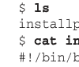

```bash
$ ls
installproduct.sh
$ cat installproduct.sh
#!/bin/bash
VERSION=$(1:12.4.3*)
DOWNLOAD=downloads.vendor.com
URL=http://$DOWNLOAD/product/v($VERSION)
```

```bash
echo "Retrieving release notes..."
wget -nd $(URL)/relnotes.txt
```

```bash
echo "Got release notes:"
echo "**** START OF RELEASE NOTES"
cat relnotes.txt
echo "**** END OF RELEASE NOTES"
```

```bash
grep "*" relnotes.txt | tr -s "/" | while read params
do
value=$(echo $params | cut -d"=" -f1)
version=$(echo $params | cut -d"=" -f2 | cut -d"=" -f3-)
sysctl=$(echo $params | tr '^[A-Z]' '[a-z]' | tr ' /' '.')
echo "Setting sysctl to value..."
sysctl $value=$version | tee -a /etc/sysctl.conf
done
echo "Loading new kernel values."
sysctl -p /dev/null 2>&1
```

执行结果：

```bash
$ ./installproduct.sh
Retrieving release notes...
2011-03-07 17:19:08 - http://downloads.vendor.com/product/v2.4.3/relnotes.txt
Resolving downloads.vendor.com...192.168.1.13
Connecting to downloads.vendor.com|192.168.1.13|80... connected.
HTTP request sent, awaiting response... 200 OK
Length: 292 [text/plain]
Saving to: `relnotes.txt`
100%[=================================>] 292      KB/s in 0s
2011-03-07 17:19:08 (21.9 MB/s) - `relnotes.txt` saved [292/292]
```

获取的发行说明内容：

```text
*** START OF RELEASE NOTES

在安装 Thing 之前，按如下方式调整内核：

echo 65536 >/proc/sys/fs/file-max
echo 2097152 >/proc/sys/kernel/shmall
echo 2147483648 >/proc/sys/kernel/shmmax
echo 4096 >/proc/sys/kernel/shmmni
echo 250000 100 128 > /proc/sys/kernel/sem

然后运行 installAllRouter。

*** END OF RELEASE NOTES
```

脚本输出设置值：

```text
Setting sys.fs.file-max = 65536
sys.fs.file-max = 65536

Setting sys.kernel.shmall = 2097152
sys.kernel.shmall = 2097152

Setting sys.kernel.shmmax = 2147483648
sys.kernel.shmmax = 2147483648

Setting sys.kernel.shmmni = 4096
sys.kernel.shmmni = 4096

Setting sys.kernel.sem = 250000 100 128
sys.kernel.sem = 250000 100 128
```


### 日志解析

如前所述，`tr` 的功能不仅是大大写转换。使用定义的字符可以满足更多需求。这个 `access_log` 包含大量相关数据，但不容易解析。在示例中，该命令从日志中提取 URL：

```bash
$ cut -d'"' -f2 access_log
GET /view.php?f2 HTTP/1.1
GET /templates/subSilver/images/folder_lock.gif HTTP/1.1
GET /templates/subSilver/images/folder_lock.gif HTTP/1.1
GET /view.php?p=8840a&id=273b9cf272c90aa47291b HTTP/1.1
GET /view.php?f2=a273b9cf70511ccd8a11lc67deeb03 HTTP/1.0
GET /profile.php?id=70511ccd8a11lc67deeb03 HTTP/1.0
GET /view.php?p=8840a&id=8c87f9c2ffba72a88 HTTP/1.1
GET /view.php?p=848
```

如果 `tr` 语句将任何字母数字替换为空格，就可以轻松地将文本传递给 `read` 语句：

```bash
$ cut -d'"' -f2 access_log | tr '[:upper:]' ' '

GET /view.php?f2 HTTP/1.1

GET /templates/subSilver/images/folder_lock.gif HTTP/1.1

GET /templates/subSilver/images/folder_lock.gif HTTP/1.1

GET /view.php?p 884 sid a723bf4c49276ac290aa7a9472b HTTP/1.1

GET /view.php f 2 sid a70516cd318a11a67deeb03 HTTP/1.0

GET /profile.php mode register sid a70516cd318a11a67deeb03 HTTP/1.0

GET /profile.php mode newtopic f 2 sid a70516cd318a11a67deeb03 HTTP/1.0

GET /login.php arguments redirect.php mode newtopic f 2 sid a70516cd318a11a67deeb03 HTTP/1.0

GET /posting.php mode newtopic f 2 sid a70516cd318a11a67deeb03 HTTP/1.0
```

结合 `while read` 进行解析：

```bash
$ cut -d'"' -f2 access_log | tr '[:upper:]' ' ' | while read PAGE ARGUMENTS
do
    echo "Page requested $PAGE"
    echo "Arguments were $ARGUMENTS"
done
Page requested /view.php
Arguments were f2 HTTP/1.1
Page requested /templates/subSilver/images/folder_lock_new.gif
Arguments were HTTP/1.1
Page requested /templates/subSilver/images/folder_lock.gif
Arguments were HTTP/1.1
Page requested /view.php
Arguments were p 884 sid a723bf4c49276ac290aa7a9472b HTTP/1.1
Page requested /view.php
Arguments were f 2 sid a70516cd318a11a67deeb03 HTTP/1.0
Page requested /profile.php
Arguments were mode register sid a70516cd318a11a67deeb03 HTTP/1.0
Page requested /profile.php
Arguments were mode newtopic f 2 sid a70516cd318a11a67deeb03 HTTP/1.0
Page requested /login.php
Arguments were redirect.php mode newtopic f 2 sid a70516cd318a11a67deeb03 HTTP/1.0
Page requested /posting.php
Arguments were mode newtopic f 2 sid a70516cd318a11a67deeb03 HTTP/1.0
Page requested /view.php
Arguments were p 840 sid 8c87f946c29ee6bdfff8fba9c72a88 HTTP/1.1
Page requested /view.php
Arguments were p 848
```

## UNIQ

乍看，`uniq` 似乎是一个显示唯一行的工具。实际上，它删除了连续的行，但如果相同的行在稍后出现，它会再次显示。问 `uniq` 有什么用似乎是一个合理的问题，答案是，如果在命令行上传递第二个文件名，`uniq` 也非常灵活，它会将输出写入文件而不是标准输出。

`-d` 的互补选项是 `-u`，而 `uniq` 通常会打印一次每行，但 `-u` 只打印唯一的行；如果一个条目列出两次，它将完全不显示。这三种调用——`uniq` 本身、`-u` 和 `-d` 提供了过滤几乎任何输入的灵活方法。其他主要的过滤器用于跳过字符和定义要比较的字段。

正如你在上一章中看到的，`-w` 只计算前 N 个字符。`-w N` 的互补选项是 `-f N` 标志，它跳过前 N 个字段，字段由空格和制表符分隔。可以使用 `-i` 标志进行不区分大小写的文本比较。此外，`uniq` 可以给出每行输出的计数；使用 `-c` 时它总是大于 1。

### 最低唯一拍卖

在这种情况下，不是最高出价者，而是出价最低的人赢得拍卖，这是 `uniq -u` 标志的完美选择。通过对出价进行数值排序，`uniq -u -f1` 跳过第一个字段（竞价者名称）并剔除非唯一的出价，只留下唯一的出价。在接下来的示例中，理查德、安吉拉和弗雷德都出了唯一的出价。由于数据已经按时间排序，通过 `uniq` 后第一条记录必须是最低唯一出价。最低唯一出价起初是一个很难理解的概念，但由于 `uniq`，可以通过简单的单行命令轻松实现：

```bash
$ cat bidders
Dave 1.39
Bob 2.31
Albert 0.91
Elizabeth 1.39
Angela 1.09
Fred 3.13
Caroline 2.31
Rodger 0.91
Richard 0.98
```

```bash
$ sort -k2 -n bidders | uniq -u -f1 | head -1
Richard 0.98
```

## wc

`wc` 代表 Word Count（字数计数），尽管它也可以计算字符和行数。这使其成为一个统计任何类型条目的灵活工具。它最常用于统计文件的行数，或者（配合许多 Unix 工具）统计发送到任何其他数据的行数，但它也可以计算字符和单词。

尽管它通常只用于单个文件，或者通过管道解析标准输入，但 `wc` 能够同时统计多个文件。三个主要的标志是 `-w`（计数单词）、`-c`（计数字符）和 `-l`（计数行数）。在这些选项中，统计文件的行数通常有用；统计管道结果的数量则非常有用。书中的许多代码和配方使用 `wc -l` 作为统计结果数量的自动方法。

所有的 `wc` 实现在处理多个文件时都会对其输出进行填充，以便列对对齐。这在编写脚本时可能会是件麻烦，因为如果没有填充，“14”将无法被正确解释为十四。Unix 的 `wc` 实现总是会填充，因此可以工作；而 `awk` 则会乐意去除空格，下面的命令显示了带有填充的多文件，以及这种填充如何影响文件长度赋值的常用任务。

```bash
$ wc -l /etc/hosts
     18 /etc/hosts
     14 /etc/hosts.allow
     87 /etc/hosts.deny
    119 total
$ wc -l /etc/hosts
     18 /etc/hosts
$ num_hosts=`wc -l /etc/hosts | cut -d' ' -f1`
echo $num_hosts
18
$ num_hosts=`wc -l /etc/hosts | awk '{ print $1 }'`
echo $num_hosts
18
```


如果只有 `stdin`（标准输入）、单个文件或列表，`GNU` 的 `wc` 实现不会进行任何填充。这意味着如果只有一个文件，直接从 `wc` 输出设置 `num_hosts` 的最朴素尝试在 `GNU` 环境下是有效的。在其他的 `wc` 实现上，则必须使用 `awk` 来获取实际数字并忽略填充。

在本章之前的世界杯 脚本中，最安全的做法是假设 `NUMTEAMS` 变量是这样定义的。为了编写可移植的脚本，最稳妥的方法是确保 `wc` 的输出不经过安全填充；如果脚本要在相对现代的机器上运行且不在密集的循环中，那么额外的开销是微乎其微的

```bash
NUMTEAMS=`wc -l $TEAMS | awk '{ print $1 }`
```

这个示例完全没有产生主要开销，并确保了脚本具有更好的跨平台移植性。在解析 `wc` 输出时，使用这种方法是最好的，除非你确定它将在单个输入上由 `GNU` 的 `wc` 实现 运行。在这种情况下，你可以使用更轻量级的 `cut` 工具，如下：

```bash
NUMTEAMS=`wc -l $TEAMS | cut -d ' ' -f1`
```

## 总结

`Unix` 和 `Linux` 在处理文本方面非常灵活。大多数配置设置都以文本格式存储，且方式与工具无关，因此可以使用任何工具来处理它们。这赋予了用户和系统管理员巨大的权力，因为他们不再被局限于使用单一工具来编辑 `/etc/hosts`，并使用另一个自定义工具来编辑 `/etc/passwd`。相反，有一整套工具可以处理任何内容，而且这些工具可以用各种不同的方式组合。这种让一切都开放且可访问的清晰设计决策是 `Unix` 模型的一个核心优势。

下一章将建立在本章和上一章的基础上，介绍实用的系统管理任务。

# 系统管理工具

系统管理是 `Shell` 脚本应用最常见的任务。`Unix` 和 `Linux` 中的许多命令起初是为了配置系统本身而存在的，因此大多数脚本为此目的编写，这并不意外。本章旨在提供一些真实世界的示例，说明如何使用这些命令，特别是如何在 `Shell` 脚本中有效使用它们，以实现系统管理任务自动化、扩展和简化。它还讨论了与工具相关的某些陷阱和“坑”，以及它们在现实生活中是如何实际使用的。这将为书的其余部分奠定坚实的基础，其余部分由完整、深入的配方组成，更多关注配方实际做了什么，而不是工具本身。

# basename

`basename` 返回文件的实际文件名，并剥离任何目录路径。它最常用的用法是配合脚本的 `$0` 变量使用，以确定它是如何被调用的。这对于调试和通用输出消息非常有用。确定程序被调用的名称的功能也被某些系统实用程序用于修改它们的实际行为。`mount` 和 `unmount` 命令共享一组公共代码，但运行 `/home` 的效果与运行 `/` 非常不同——完全相反。单个程序通过检查它被调用的名称并在同一程序中执行相应的代码来实现此功能。一个直观的例子是 `dos2unix` 转换工具。`DOS`（以及 `Windows`）文本文件格式使用 `CR+LF`，而 `Unix`（以及 `Linux`）仅使用 `LF`。这种差异影响深远，并且可能永远无法调和。存在两个转换工具，`unix2dos` 和 `dos2unix`，用于在两种文本文件之间进行简单转换。

# 第 3 章 系统管理工具

`date` 命令在系统管理中的两种常用用途可能是记录结果和状态消息，特别是在记录到文件、创建有意义的临时文件时。这里提供了这两种技术的脚本，随后是使用 `date` 高级功能实现的某些更复杂的用法。第一个配方模拟了本章后将描述的 `logger` 功能。第二个使用 `date` 创建一组唯一但具有信息量的日志文件。例如，时间戳对于追踪 `Web` 服务器的错误非常有用。常用的 `NTP` 服务器也特别有用，尽管在建立了它们之间的时间差的情况下，独立的系统也可以进行比较。

# date

`date` 命令是一个异常非常有用的工具。它最常用于创建时间戳，特别是在记录事件发生时。`syslog` 工具会向它记录的事件添加时间戳，包括 `/var/log/messages`、`syslog`、`auth.log` 以及其他行首包含关键要素的文件。这对于分析不同日志文件或不同机器捕获的事件之间的时间差至关重要。

# date 的典型用法

`date` 命令在系统管理中的两种常用用途可能是记录结果和状态消息，特别是在记录到文件、创建有意义的临时文件时。这里提供了这两种技术的脚本，随后是使用 `date` 高级功能实现的某些更复杂的用法。第一个配方模拟了本章后将描述的 `logger` 功能。第二个使用 `date` 创建一组唯一但具有信息量的日志文件。例如，时间戳对于追踪 `Web` 服务器的错误非常有用。常用的 `NTP` 服务器也特别有用，尽管在建立了它们之间的时间差的情况下，独立的系统也可以进行比较。

```bash
$ cat getuptime.sh
LOG=/var/tmp/uptime.log
echo ':date: Starting the $0 script.' | tee -a $LOG
echo ':date: Getting today's uptime reports.' | tee -a $LOG
wget http://intranet/uptimes/index.php?get=today >> $LOG 2>&1
echo ':date: Getting this week's uptime reports.' | tee -a $LOG
wget http://intranet/uptimes/index.php?get-thisweek.csv >> $LOG 2>&1
```

# 356 | 第 14 章 系统管理工具

```bash
echo `date`: 正在获取本月的运行时间报告.* | tee -a $SLOG
wget http://intranet/utimes/index.php?get=thismonth.csv >> $SLOG 2>&1
echo `date`: 正在获取今年的运行时间报告.* | tee -a $SLOG
wget http://intranet/utimes/index.php?get=thisyear.csv >> $SLOG 2>&1
echo `date`: 完成了 0 脚本.* | tee -a $SLOG
```

```bash
$ ./getuptime.sh
Tue 22 14:15:01 GMT: 正在启动 ./getuptime.sh 脚本。
Tue 22 14:15:01 GMT: 正在获取今天的运行时间报告。
Tue 22 14:15:07 GMT: 正在获取本周的运行时间报告。
Tue 22 14:15:13 GMT: 正在获取本月的运行时间报告。
Tue 22 14:15:19 GMT: 正在获取今年的运行时间报告。
Tue 22 14:15:22 GMT: 完成了 ./getuptime.sh 脚本。
```

```bash
$ cat /var/tmp/uptime.log
Tue 22 14:15:01 GMT: 正在启动 ./getuptime.sh 脚本。
Tue 22 14:15:01 GMT: 正在获取今天的运行时间报告。
--2011-03-22 14:15:01-- http://intranet/utimes/index.php?get=today.csv
Resolving intranet... 192.168.0.210
Connecting to intranet[192.168.0.210]:80... connected.
HTTP request sent, awaiting response... 200 OK
Length: 4398 (4.3K) [text/html]
Saving to: intranet/utimes/index.php?get=today.csv

OK ... 100% 168MB/0s
2011-03-22 14:15:07 -- `http://intranet/utimes/index.php?get=today.csv` saved [d] [4398]
Tue 22 14:15:07 GMT: 正在获取本周的运行时间报告。
--2011-03-22 14:15:07-- http://intranet/utimes/index.php?get=thisweek.csv
Resolving intranet... 192.168.0.210
Connecting to intranet[192.168.0.210]:80... connected.
HTTP request sent, awaiting response... 200 OK
Length: 4398 (4.3K) [text/html]
Saving to: intranet/utimes/index.php?get=thisweek.csv

OK ... 100% 173M-0s
2011-03-22 14:15:13 -- `http://intranet/utimes/index.php?get=thismonth.csv` save THE "THEMONTH" FOR SOME REASON CAUSES AN INTERNAL SERVER ERROR AT 14:15:13.
Tue 22 14:15:13 GMT: 正在获取本月的运行时间报告。
--2011-03-22 14:15:13-- http://intranet/utimes/index.php?get=thismonth.csv
Resolving intranet... 192.168.0.210
Connecting to intranet[192.168.0.210]:80... connected.
HTTP request sent, awaiting response... 501 Internal Server Error
2011-03-22 14:15:16 Error 501: Internal Server Error
Tue 22 14:15:16 GMT: 正在获取今年的运行时间报告。
--2011-03-22 14:15:16-- http://intranet/utimes/index.php?get=thisyear.csv
Resolving intranet... 192.168.0.210
Connecting to intranet[192.168.0.210]:80... connected.
HTTP request sent, awaiting response... 200 OK
Length: 4398 (4.3K) [text/html]
Saving to: 'intranet/utimes/index.php?get=thisyear.csv'

OK 100% 185M=0s
- 'intranet/utimes/index.php?get=thisyear.csv' saved d [4398/4398]
```

```bash
2011-03-22 14:15:22 (185 MB/s)

Tue Mar 22 14:15:22 GMT 2011: 完成了 ./getuptime.sh 脚本。

$ tail -4 /var/log/apache2/access.log

192.168.5.103 - 22/Mar/2011:14:15:16 +0000 "GET /utimes/index.php?get=today.csv HTTP/1.1" 200 4398
```

`getuptime.sh` 获取系统的内存快照。当然，有更强大的工具可用，但这只是简单的脚本。该脚本每分钟获取一次 `/proc/meminfo` 的副本，以查看内存的使用情况。每个文件命名为 `mem.(年)(月)(日).(小时)`。

```bash
while do
  cat /proc/meminfo > /var/tmp/mem.$(date +%Y%m%d.%H%M)
  sleep 60
done
```

`monitor.sh` 每天创建一个新文件。这可以很容易地解析为电子表格并显示：

```bash
grep MemFree /var/tmp/mem.*
```

```
mem.2011-03-22.14:15:15:MemFree: 13217092 kB

mem.2011-03-22.14:15:16:MemFree: 12930240 kB

mem.2011-03-22.14:15:17:MemFree: 12468194 kB

mem.2011-03-22.14:15:18:MemFree: 11788144 kB

mem.2011-03-22.14:15:19:MemFree: 12503736 kB

mem.2011-03-22.14:15:20:MemFree: 12337314 kB

mem.2011-03-22.14:15:21:MemFree: 11023464 kB

mem.2011-03-22.14:15:22:MemFree: 106036032 kB

mem.2011-03-22.14:15:23:MemFree: 91997924 kB

mem.2011-03-22.14:15:24:MemFree: 78725428 kB

mem.2011-03-22.14:15:25:MemFree: 78719628 kB

mem.2011-03-22.14:15:26:MemFree: 78720700 kB

mem.2011-03-22.14:15:27:MemFree: 78720376 kB

mem.2011-03-22.14:15:28:MemFree: 77418280 kB

mem.2011-03-22.14:15:29:MemFree: 73464744 kB

mem.2011-03-22.14:15:30:MemFree: 80239176 kB

mem.2011-03-22.14:15:31:MemFree: 78710298 kB

mem.2011-03-22.14:15:32:MemFree: 78710792 kB

mem.2011-03-22.14:15:33:MemFree: 66421840 kB

mem.2011-03-22.14:15:34:MemFree: 48610120 kB

mem.2011-03-22.14:15:35:MemFree: 36769560 kB

mem.2011-03-22.14:15:36:MemFree: 36695348 kB

mem.2011-03-22.14:15:37:MemFree: 36694500 kB

mem.2011-03-22.14:15:38:MemFree: 36694984 kB

mem.2011-03-22.14:15:39:MemFree: 36698632 kB

mem.2011-03-22.14:15:40:MemFree: 36703592 kB

mem.2011-03-22.14:15:41:MemFree: 36660852 kB

mem.2011-03-22.14:15:42:MemFree: 36661928 kB

mem.2011-03-22.14:15:43:MemFree: 36685028 kB

mem.2011-03-22.14:15:44:MemFree: 36686388 kB

mem.2011-03-22.14:15:45:MemFree: 36676812 kB

mem.2011-03-22.14:15:46:MemFree: 36685308 kB

mem.2011-03-22.14:15:47:MemFree: 36685056 kB

mem.2011-03-22.14:15:48:MemFree: 36685088 kB

mem.2011-03-22.14:15:49:MemFree: 36685056 kB

mem.2011-03-22.14:15:50:MemFree: 36685432 kB
```

# dirname | 36

`Linux`

```bash
for rpm in `dirname` $0$/rpms/*.rpm

do

    rpm -Uvh $rpm 2>&1 | tee `dirname` $0$/logs/`basename $(rpm)`.log

    echo "${PIPETATUS[0]} $rpm" >> `dirname` $0$/logs/status

done

SunOS

for pkg in `dirname` $0$/pkgs/*.pkg

do

    pkgadd -d $pkg 2>&1 | tee `dirname` $0$/logs/`basename $(pkg)`.log

    echo "${PIPETATUS[0]} $pkg" >> `dirname` $0$/logs/status

done

    *) 不支持的操作系统。仅提供 RPM 和 PKG 格式。

    exit 2;

esac
```

```bash
echo

# 检查错误... grep -v "^0" 如果*存在*任何不以 "0 *" 开头字符的行，则返回 1

grep -v "^0" `dirname` $0$/logs/status

if [ $? -ne 1 ]; then

    echo "在安装上述软件包时遇到错误。"

    echo "请在安装软件前进行调查。"

else

    echo "软件安装成功。"

fi
```


在对上述 `install.sh` 脚本的测试中，root 用户知道安装程序已下载到用户的家目录，而这不是编写脚本的 `install.sh` 能猜到的路径。如果 root切换到 `funky-1.40/`，配置文件的正确相对路径将是 `etc/install.cfg`。由于 root 实际上是从 `/home/teste` 调用它的，正确的相对路径将是 `funky-1.40/etc/install.cfg`。通过使用 `dirname`，你不需要担心这些问题，更不需要在脚本中硬编码绝对路径 `/home/teste/funky-1.40/etc/install.cfg`。

```bash
# cd teste

# /home/teste

# tar xzvf /tmp/funky-1.40.tar.gz

funky-1.40/
```


`funky-1.40/install.sh`

`funky-1.40/rpms/`

`funky-1.40/rpms/fnkygroovyycapps-1.40-x86_64.rpm`

`funky-1.40/rpms/fnkygroovyycfg-1.40-x86_64.rpm`

`funky-1.40/pkgs/`

`funky-1.40/pkgs/FNKYgroovycfg.pkg`

```


funky-1.40/pkgs/FNKYgroovyapps.pkg
funky-1.40/pkgs/FNKYgroovy
funky-1.40/etc/
funky-1.40/etc/install.cfg
funky-1.40/LICENSE.TXT
```

```bash
# cat funky-1.40/etc/install.cfg

ACCEPT_LICENSE

# echo ACCTFP_LICENSE-1 > funky-1.40/etc/install.cfg

# funky-1.40/install.sh
```

读取配置中...
完成。
准备中... ############################ [100%]
1:fnkygroovy ############################ [100%]
准备中... ############################ [100%]
1:fnkygroovyapps ####################### [100%]
准备中... ############################ [100%]
1:fnkygroovycfg ######################## [100%]
软件安装成功。


> `dirname` 只剥离文件名，这并不总是有用。有时运行 `cd `dirname $0`; BASEDIR=$(pwd)` 来获取目录的绝对路径是有用的。

# FACTOR（因子分解）

`Factor` 工具是一个相当聪明的工具（尽管由于它可以处理的数字大小，在严肃的加密工作方面有限），它可以产生一个数的质因数。质数只能被 1 和自身整除，因数无法进一步分解。这产生了一些相当惊讶的结果；即使是像 43,674,876,546 这样的大数字只有五个质因数。

```bash
$ factor 43674876546

43674876546: 2 3 7 141 71663

$ factor 71663

71663: 71663

$
```

该脚本重新格式化 `factor` 的输出使其看起来相当聪明。在它的实现中，它接近于函数式语言而非过程式语言。它从纯答案列表开始（省略冒号及其之前的任何内容），每次它将两个数字相乘，并将剩余的因数传递给自身的下一个实例。这是递归循环到未知长度的良好用法。如果 `factorize` 只带一个参数调用，那必须是最后的 `$sum`，这意味着所有其他因数已经相乘完成。为了更好地理解它，请取消 "Parsing" 行以查看每个阶段的情况。

```bash
$ cat factorize.sh

#!/bin/bash

function factorize

# echo "Parsing $0"

if [ "$#" -gt 1 ]; then

    sum=`expr $1 * $2`

    echo "$1 x $2 = $sum"

    shift 2

    factorize $sum

fi

# GNU says: 72: 2 2 2 3

# UNIX says: 72 2 2 3
```

```bash
factor --version | grep GNU > /dev/null

if [ "$?" -eq 0 ]; then

    factorize `factor 1 | cut -d: -f2`

else

    factorize `factor 1 | grep -v ^0`

fi
```

```bash
$ factorize.sh 72

2 x 2 = 4

4 x 2 = 8

8 x 3 = 24
```

```bash
$ factorize.sh 913

11 x 83 = 913
```

```bash
$ factorize.sh 24952

2 x 2 = 6

4 x 2 = 8

8 x 7 = 56

56 x 23 = 1288
```

```bash
$ factorize.sh 43674876546

2 x 3 = 6

6 x 7 = 42

42 x 1451 = 60942

60942 x 71663 = 43674876546
```

# 第14 章：系统管理工具

GNU `factor` 程序将其输出显示在同一行，最终数字与其因数之间有冒号。Unix `factor` 将最终数字显示在开头，每个因数单独占一行并缩进两个空格。脚本在 `--version` 输出中（实际上仅存在于 GNU 版本）查找如何重新格式化；对于 GNU，跳到第一个冒号；对于其他 `factor` 实现，则取以初始数字开头的行。


# IDENTITY, GROUPS AND GETENT

`id` 命令的一个常用用途是确保脚本以适当的权限运行。这对于强制安全机制并不有用，因为脚本可以被复制和编辑，但有时告知用户如果他们不是 `root`，脚本将无法按预期工作是有用的。例如，此脚本显示配置的网络适配器及其当前速度。`ethtool` 命令需要 `root` 执行任务，因此退出比无法正常工作要合理。

```bash
$ cat nicspeed.sh

#!/bin/bash

# 此脚本仅对 root 用户有效。

if [ $(id -u) -ne 0 ]; then

  echo "Error: 此脚本必须由 root 运行。"

  exit 2

fi
```


```bash
for nic in `/sbin/ifconfig | grep "encap:Ethernet" |
grep "^eth" | awk '{ print $1 }'`;
do

  echo -en $nic

  ethtool $nic

done

$ ./nicspeed.sh

Error: 此脚本必须由 root 运行。

# ./nicspeed.sh
```

```
eth0 Speed: 1000MB/s
eth1 Speed: 1000MB/s
eth4 Speed: 1000MB/s
```

> 当是非特权用户时，它拒绝继续。
>
> 当作为 `root` 时，脚本有效。

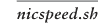

另一个与通用命名服务（但包括密码数据库）相关的命令是 `getent`，它从某些命名服务（列在 `/etc/nss.conf`）检索值。某些数据库可以完整输出；`get passwd` 等于 `cat /etc/passwd`，它与使用的命名服务无关。其他 `getent` 需要一个参数（接受名称或 MAC 地址，因为两者都是键）。

自由和开源软件的好处之一是，如果你想确切知道它是工作的，通常很容易获取源码并阅读它的执行内容。在研究这个主题时，我想检查 `getent group` 如何处理组名完全是数字的情况。只需访问 `http://ftp.gnnu.org/gnu/glibc/glibc-2.13.tar.gz`，解压 `getent.c`，并找到第 224 行的相关代码。

```c
224        gid_t arg_gid = strtol(key[i], &ep, 10);

225

226    if (errno == EINVAL && *key[i] != '\0' && *ep ==

227    '\0');

228        /* 有效数字 gid. */

229        grp = getgrgid(arg_gid);

230    else

231        grp = getgrnam(key[i]);
```

前面的代码检查 `key` 是否为有效的组名，如果是，将其视为名称；否则将其视为数字。

以下脚本分别使用一次 `groups` 和 `id` 命令。对于所有其他查找，它分别使用 `getent group` 或 `getent passwd`。这应该是一个收集各种组成员信息的有用代码库。

```bash
$ cat groups.sh

#!/bin/bash

function get_groupname

{

    [ -z "$1" ] && getent group $1 | cut -d: -f1

}

function get_groupid

{

    [ -z "$1" ] && getent group $1 | cut -d: -f3

}

function get_username

{

    [ -z "$1" ] && getent passwd $1 | cut -d: -f1

}

function get_userid

{

    [ -z "$1" ] && getent passwd $1 | cut -d: -f3

}

function get_user_group_names

{

    [ -z "$1" ] && groups $1 | cut -d: -f2

}
```

```bash
NOW=`date +%d%b%y%H%M%S`

for FILE in syslog dmesg daemon.log
do
  prev=$(cat ${SAVEDIR}/${FILE}.md5 || echo 0)
  if [ -s ${FILE} ]; then
    # 如果文件存在且有内容
    md5=$(md5sum ${FILE} | cut -d ' ' -f1)
    if [ "$md5" != "$prev" ]; then
      # 如果校验和不同，则告警
      echo "文件 $FILE 已发生变化"
      echo "$md5" > "${SAVEDIR}/${FILE}.md5"
    fi
  fi
done

while :
do
done
```

```bash
$ $log

echo "My PID is $pid"

mkfifo $fifo

while :
do
  echo -en "Give me a command for one of my minions: *"
  read cmd
  echo $cmd > $fifo
done

rm -f $log $fifo
```

```bash
$ cat minion.sh

#!/bin/bash

master=$1

fifo=/tmp/fifo.$master

log=/tmp/log.$master

while :
do
  read cmd args < $fifo

  if [ ! -z "$cmd" ]; then
    if [ "$cmd" == "quit" ]; then
      echo "Very good, master.*" | tee -a $log
      exit 0
    fi
    echo "*date: Executing \$cmd for the master.*" | tee -a $log
    if [ ! -z "$args" ]; then
      for arg in $args; 
        do
          echo -en "$arg*" | tee -a $log
          sleep 1
        done
      echo tee -a $log
    fi
  fi
sleep 10
done
```

运行时，这些从属（minions）会将输出显示在终端，同时也（通过未使用但非常方便的 `tee -a` 工具）写入日志文件。底部窗口观察写入的内容；注意图 14-3（之前已给出），命令“a b c d e f g h”开始执行的时间略比“count 1 2 3 4 5 6”完成的时间早了一点；count 命令的最后一个 echo 会在时间戳和 `say` 命令写入初始 `a` 之后写入日志文件。图 14-3 显示了这些配方的示例运行情况。

## 反转顺序

在相反的方向上，有很多许多独立的进程向 FIFO 写入，由主节点（甚至是多个主节点）从管道的另一端读取。其中一个进程可以收集要执行的任务片段，而其他进程像上一个示例中的从属一样获取下一个可用任务。这个配方有多个收集者，从不同的文件系统并发运行，并在每发现一个 zip 文件时就写入 FIFO。在这种情况下，主节点是一个从 FIFO 读取内容的脚本。以下脚本从 FIFO 读取 zip 文件并查找包含“chapter”字样的文件名。

```bash
#!/bin/bash

fifo=/tmp/zips.fifo

rm $fifo

mkfifo $fifo

searchstring=$$
```

```bash
while read filename
do
  unzip -l "$filename" | grep $searchstring > /dev/null 2>&1
  if [ "$?" -eq 0 ]; then
    echo "$searchstring in $filename"
  fi
done < $fifo

echo "Finished."
```

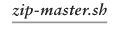

`zip-gatherer.sh` 脚本包含一个搜索函数，该函数会在指定的文件系统内进行查找（因此，例如搜索 `/` 不会跨越 `/home` 文件系统），对于发现的每个类型为 `crypt`、`ext` 或 `fuseblk` 的文件系统，都会后台执行该函数的一个实例。

```bash
#!/bin/bash

fifo=/tmp/zips.fifo

function searchfs

{

  temp=`mktemp`
```

```bash
find $1 -mount -type f -iname "**zip*" -exec file {} \ + | \
  grep "Zip archive data" | cut -d: -f1 > $temp
cat $temp > $fifo
rm -f $temp
echo "Finished searching $1."
```

```bash
for filesystems in `mount -t crypt,ext3,ext4,fuseblk | cut -d " " -f3`;
do
  echo "Spawning a child to search $filesystems"
  searchfs $filesystems &
done

  # 等待子进程完成
  wait

  # 向主节点发送 EOF 以关闭 fifo
  printf "%c" 0 > $fifo
```


搜索函数将内容写入临时文件，然后将其转到 FIFO。这个 `find` 命令可能运行很长时间，该函数的不同实例之间可能会相互重叠，导致 FIFO 中的文件名乱码。

`zip-gatherer.sh` 脚本通过向 FIFO 发送一个 0 (EOT) 字符来结束。这会关闭文件，导致 `while` 循环停止。从属进程在完成任务后会退出，主脚本会等待所有从属进程完成后，向主节点发送 EOF 以关闭 FIFO。

# 使用 netcat 测试连接

`netcat` 可以用于类似于 `telnet` 的方式与基于文本的协议（如 HTTP, SNMP, POP, IMAP）的服务器进行通信。它对 EOF（文件结束符）并不特殊，也不会显示关于转义字符等的消息，因此其输出可以直接保存到文件中。

```
$ telnet net=example.com 80

Trying 192.0.32.10...

Connected to example.com.

Escape character is '^]'

HEAD /HTTP/1.0
```

接下来的三行来自 TELNET，而不是服务器。

```
HTTP/1.0 302 Found
Location: http://www.iana.org/domains/example/
Server: BigIP
Connection: close
Content-Length: 0
```

由远程主机关闭了连接

```
$ netcat www.example.com 80

HEAD /HTTP/1.0
```

等等，文本写着：
所有输出都来自服务器本身。

```
HTTP/1.0 302 Found
Location: http://www.iana.org/domains/example/
Server: BigIP
Connection: close
Content-Length: 0
```

```
$
```

# netcat 作为端口扫描器

`nmap` 是一个功能强大得多的工具，但 `netcat` 也可以作为端口扫描器。同样，它的输出在自动化脚本中比 `netcat` 容易解析得多。

```


`nmap 192.168.0.210`

```
Starting Nmap 5.00 ( http://nmap.org ) at 2011-03-24 19:41 GMT
内网网上的有趣端口 (192.168.0.210):
Not shown: 997 closed ports
```

| PORT | STATE SERVICE |
| :--- | :--- |
| 22/tcp | open ssh |
| 80/tcp | open http |
| 111/tcp | open rpcbind |

```
Nmap done: 1 IP address (1 host up) scanned in 0.08 seconds
```

`netcat -vz 192.168.0.210 1-1024`

```
intranet [192.168.0.210] 111 (sunrpc) open
intranet [192.168.0.210] 80 (www) open
intranet [192.168.0.210] 22 (ssh) open
```

# 使用 netcat 传输数据

`netcat` 也可以用于在系统之间传输数据。因为它直接接收数据，它可以直接将输出写入文件。在接收端，启动 `netcat -l`（监听）并指定端口号。通过 `pv` 管道并不是必须的，但它会显示传输进度状态；`pv -t` 显示管道活跃的时间；`pv -b` 显示通过了多少字节。

```
recipient$ netcat -l -p 8888 | pv -t > fedora.iso
0:39:17
$
```

在发送端，`cat` 放入管道的文件，因为可以方便地显示进度。否则，由于 `netcat` 忽略 EOF，没有方便的方法判断传输已完成。因此，传输完成后需要（从任一端）按下 `Ctrl-C` 来结束连接。某些发行版会自动为 `netcat` 提供 `-q` 选项，但这会降低它在传输二进制文件时的易用性。

```
sender$ cat /Fedora-14-i686-Live-Desktop.iso | pv -b | netcat recipient 8888
669MB
^C
$
```

完成最后一步后，你也可以通过 `netcat` 发送 `tar` 包或 `cp` 归档。在以下示例中，你对 `tar` 使用了 `-v` 标志，以便在放入和解压存档时两端都会显示文件。

```
recipient$ netcat -l -p 8888 | pv -t | tar xvf
iso=0/
iso/debian-504-amd64-DVD-1.iso
iso/solaris-cluster-3_3-ga-x86.zip
iso/solaris-cluster-3_3-ga-sparc.zip
0:32:21

sender$ tar cvf - /iso | pv -b | netcat recipient 8888
tar: Removing leading / from member names
iso/
iso/debian-504-amd64-DVD-1.iso
iso/solaris-cluster-3_3-ga-x86.zip
iso/solaris-cluster-3_3-ga-sparc.zip
4.52GB
^C
$
```

# ping

`ping` 是一个基础的网络诊断工具，它向另一个主机发送 `ICMP` 包并请求回显。远程主机（除非是偏执系统或防火墙）应该返回 `ICMP` 回应。这主要用于判断远程主机是否在线，但主要的副作用是如果它们在同一个子网，远程主机的 MAC 地址会被添加到本地 ARP 缓存中。传统 `ping` 实现的缺陷之一是它们会发送四个包并等待长时间响应。要测试整个子网，需要像这样的脚本：

```
$ cat simpleping.sh

#!/bin/bash

LOG=ping.log

PREFIX=192.168.1

i=1

while [ "$i" -lt 8 ]; do
    echo "Pinging $PREFIX.$i..."
    ping $PREFIX.$i > /tmp/ping.$i 2>&1 &
    sleep 2
    kill $!
    grep "received" /tmp/ping.$i
    if [ "$?" -eq 0 ]; then
        echo "$PREFIX.$i is alive" | tee -a $LOG
    else
        echo "$PREFIX.$i is dead" | tee -a $LOG
    fi
    rm -f /tmp/ping.$i
    i=$((i + 1))
done
```

```
$ ./simpleping.sh
192.168.1.1
./ping.sh: line 20: 4 packets Killed /tmp/ping.1 2>&1
192.168.1.1 is alive

Pinging 192.168.1.2
./ping.sh: line 20: 4 packets Killed /tmp/ping.2 2>&1
192.168.1.2 is dead

Pinging 192.168.1.3
./ping.sh: line 20: 4 packets Killed /tmp/ping.3 2>&1
192.168.1.3 is alive

Pinging 192.168.1.4
./ping.sh: line 20: 4 packets Killed /tmp/ping.4 2>&1
192.168.1.4 is dead

Pinging 192.168.1.5
./ping.sh: line 20: 4 packets Killed /tmp/ping.5 2>&1
192.168.1.5 is dead

Pinging 192.168.1.6
./ping.sh: line 20: 4 packets Killed /tmp/ping.6 2>&1
192.168.1.6 is dead

Pinging 192.168.1.7
./ping.sh: line 20: 4 packets Killed /tmp/ping.7 2>&1
192.168.1.7 is dead
```

`simpleping.sh` 仅测试了网络上的前七台设备，简直是浪费资源。更好的方法是指定超时和最大包数；`GNU ping` 提供此功能，通过 `-w` 和 `-c` 选项。前面的测试运行了大约八分钟；下面的只需要一秒（通常更短，因为单个 `ping` 请求不需要整整一秒）。为了准确，使用 `-w1` 到 `-w2`；如果第一个包在一秒内丢失响应，将发送两个包。`time` 命令显示了命令消耗的（实际）时间，下面的测试运行显示整个过程花费了超过四分之一秒。

```
$ cat ping2.sh

#!/bin/bash

LOG=ping.log

PREFIX=192.168.1

# 可以在 Wrox.com 下载

for i in `seq 1 25`
do
  ping -c1 -w1 $PREFIX.$i && \
  echo "$PREFIX.$i is alive" | tee -a $LOG || \
  echo "$PREFIX.$i is dead" | tee -a $LOG &
done
```

```
$ time ./ping2.sh > /dev/null 2>&1

real
00.255s
user
00.008s
sys
0.028s
$
```

```
$ wc -l ping.log
254.ping.log

$ grep alive ping.log
192.168.1.1 is alive
192.168.1.3 is alive
192.168.1.10 is alive
$
```

`ping2.sh`

> 还有一种称为广播 `ping` (`ping -b`) 的技术；它通过本地子网发送一个指向广播地址的单个 `ping` 请求。子网上的每个节点都应该响应这个 `ping` 请求。那会更简单，尽管单个节点可以配置为忽略广播请求，即使它们会响应定制的 `ping` 请求。

# 脚本化 ssh 和 scp

在过去的某个时代，`rcp` 是在系统间拷贝文件的有用实用程序。它很容易设置，使得 shell 可以从一台机器拷贝文件到另一台机器，而无需任何尴尬的问题。现在的网络不再像以前那样被信任，因此 `rcp`、`login` 以及它们那些天真的朋友（通常称为 `r-tools`）已经过时了。虽然许多人熟悉交互式使用 `scp`，但它也可以用于提供无密码身份验证。这里的关键是公密钥基础设施 (`PKI`)。`PKI` 意味着你可以拥有非对称密钥；意味着其中一个被安全地保存并称为私钥。另一个密钥可以安全地与任何人共享，即使是不可信任的敌人，并称为公钥。用公钥加密的数据可以用私钥解密，反之亦然。这意味着实际上，你可以向远程主机证明你是私钥的所有者，而无需向任何人透露该密钥。

现在尝试登录该机器，使用 `ssh example.com` 并检查：

```bash
.ssh/authorized_keys
```

以确保我们没有添加你意料之外的额外密钥。

```bash
home$ ssh example.com
Enter passphrase for key '/home/steve/.ssh/id_rsa': ssh-password
Last login: Fri Dec 11 11:01:33 2009 from home
example.com$ ls -l ~/.ssh/authorized_keys
-rw---- 1 steve 395 Jun 3 2011 authorized_keys
example.com$
```

下一步是将密钥添加到你的环境环境中。如果你正在运行带有 `GNOME` 或 `KDE` 的图形化会话，`SSH agent` 应该已经在为你运行了。如果没有运行，你需要让你当前的 shell 传递 `ssh-agent` 命令的输出。这将为 `ssh-agent` 提供的它所需的所有密钥信息，而 `ssh-agent` 会由于你调用它而自动在后台启动。然后你可以使用 `ssh-agent` 命令手动添加密钥。这会提示输入密钥的密码，并将密钥存储在内存中供以后连接。

```bash
home$ eval `ssh-agent`
Agent pid 3996

home$ ps -fp 3996
UID PID PPID CTIME TIME CMD
steve 3996 1 0 19:43 ? 00:00:00 ssh-agent

home$ ssh-add
```

```bash
Enter passphrase for /home/steve/.ssh/id_rsa:
Identity added: /home/steve/.ssh/id_rsa (/home/steve/.ssh/id_rsa)
steve@example.com:-$ uname -n
example.com:
steve@example.com:-$
```

整个设置过程只需要几分钟——只需要几分钟，它就为你提供了一个连接远程机器的安全基础设施。该脚本可以用于提供机器之间类似 `rcp` 的无缝文件复制。接下来的脚本将检查身份验证机制是否正常，如果不起工作则显示错误消息。一旦建立了基础设施，它将使用 `scp` 将命令行上列出的任何文件复制到远程主机。因为调用它的 shell 有活跃的 `ssh-agent`，所以在过程的任何阶段都不需要密码。

```bash
$ cat scp.sh

#!/bin/bash

user=$1
host=$2
shift 2
files=$@

echo "Testing connection to ${host}..."

ssh -n -o NumberOfPasswordPrompts=0 ${user}@${host}

if [ "$*" -ne 0 ]; then
  echo "FATAL: You do not have passwordless ssh working."
  echo "Try running ssh-add."
  exit 1
fi
```

```bash
echo 'Okay. Starting the scp'

scp -B ${files} ${user}@${host}:

if [ "$?" -ne "0" ]; then
  echo 'An error occurred'
else
  echo 'Successfully copied files to $host'
fi
```

```bash
echo "I can do ssh as well."

ssh ${user}@${host} ls -l ${files}
```

```bash
$ ./scp.sh wronguser example.com scp.data

Testing connection to example.com...
Pseudo-terminal will not be allocated because stdin is not a terminal.
Permission denied (publickey,password,keyboard-interactive).
FATAL: You do not have password ssh working.
Try running ssh-add.
```

```bash
$ ./scp.sh example.com hosts scp.data

Testing connection to example.com...
Pseudo-terminal will not be allocated because stdin is not a terminal.
Okay. Starting the scp.
```

| hosts | Progress | Speed | Time |
| :--- | :--- | :--- | :--- |
| hosts | 100% 479 | 0.5KB/s | 00:00 |
| scp.sh | 100% 436 | 0.4KB/s | 00:00 |
| data | 100% 4096 | 105KB/s | 00:00 |

```bash
echo "I can do ssh as well."

Successfully copied hosts to $host

-rw-r--r-- 1 user 1684 Mar 21 22:06 server.key
-rw------- 1 user 1024 Mar 21 22:06 server.crt
-rw-r--r-- 1 user 2048 Mar 21 22:06 server.pem
```

# 网络 | 387

你现在已经准备好使用你的 `SSL Web` 服务器了。在当前目录下创建一个名为 `README` 的文本文件，并放入一些已运行的签名密钥对！设置完成后，运行 `openssl s_server`，正如你在代码段中的脚本配方所示。在提示提示时提供密钥密码语。

> 如果 `server.pem` 不在当前目录下，请像示例那样使用 `-cert /var/tmp/server.pem`。默认情况下，它将使用 `./server.pem`。

```
openssl s_server -cert /var/tmp/server.pem -accept 4433 -W
password for server.pem: welcome123
Using default DH parameters
Using default ECDH parameters

ACCEPT
```

现在启动 Web 浏览器并指向：`https://localhost:4433/README`。（请务必指定 `https`，而不仅仅是 `http`！）你应该会收到一个警告，因为该密钥不是由浏览器知的权威机构签名的。它将显示你在使用密钥时输入的详细信息。这用于证明身份——你可以在链接时编辑创建的任何细节。它被 `SSL` 协议证书、加密使用。

# 第14 章 系统管理工具

接受此证书后，浏览器应该继续并检索文件。这将在浏览器窗口中显示，就像显示任何其他文件一样。服务器显示连接状态，消息显示已请求 `README` 文件。如图 14-5 所示。

```
$ openssl s_server -accept 4433 -W
Enter pass for server.pem:
Using default DH parameters
Using default ECDH parameters
error:14090411:SSL routines:SSL3_read_bytes:handshake failure
error:14090412:SSL routines:SSL3_alert_number:bad number
error:14090413:SSL routines:SSL3_read_alert:alert unknown
error:14078025:SSL routines:SSL3_alert_lib:certificate verify failed
```


# NOHUP

你也可以使用 `openssl client` 来测试你的 `openssl s_server web`。`s_server` 的响应（当处于 `-www` 模式时）是适当的 HTTP 头部，随后是 `README` 文件。同样，服务器将显示该证书是自签名的事实。它记录了验证错误，但继续进行加密会话。在服务器上，你可以启动 `openssl s_server` 监听入入的数据。在远程服务器上，你可以发送文件、某些数据或你想要的任何内容。为了安全，你可能接入身份验证机制，因此这是一个测试双向 SSL 连接的强大工具。

下面的示例设置了一个服务器（带有服务器提示符），监听端口 `4433` 并将其想要接收的任何内容保存到 `/tmp/data.bin`。客户端（带有客户端提示符）将二进制文件通过网络发送到服务器。

```bash
$ openssl s_server -quiet accept 4433 > /tmp/data.bin

$ cat /tmp/data.bin | openssl client -quiet -connect localhost:4433

$ server$ ls -lh /tmp/data.bin

-rwxr-xr-x root root 106K Apr 28 2010 /tmp/data.bin
```

文件是相同的。

```bash
-rw-r-- 1 steve 106K Mar 1 23:14 /tmp/data.bin

server$ md5sum /tmp/data.bin

d265cc0520a94a3e5f07cca43c594f /tmp/data.bin

d265cc0520a94a3e5f07cca43c594f /bin/ls
```

> 文件的校验和是相同的。网络上没有发生损坏。

如果你（交互式或作为 shell 的一部分）希望一个进程运行完毕而不因为你注销而被杀死，`nohup` 命令通知 shell 忽略当控制终端注销系统时它发送的“挂起”（HUP）信号。它仍然可以使用 `kill -9` 杀死，但如果网络故障导致你与系统的连接断开，或者你连接的客户端崩溃，或其他数百万可能导致连接中断的原因，你的进程将继续运行。

这对于在远程服务器上执行长时间运行命令或在多个远程服务器上并行执行非常有用。通过使用身份验证或简单的系列 `ssh` 命令，你可以登录到机器，运行 `nohup /path/to/command &` 然后注销。命令将在后台运行；通常，如果你不需要等待执行结果，将其作为后台进程运行是有意义的。这意味着你拿回了 shell 提示符并可以注销。

默认情况下，进程所需的任何输入将从 `/dev/null` 重定向，输出和错误将重定向到文件。这留下了最后一个字节作为主机地址，即地址中识别特定主机的部分。

# SEQ

`seq` 按顺序显示数字，类似于 for 循环的实现，并且还可以接受不同的格式和可选的步长。这对于固定宽列很有帮助，而不是从 1 数到 100。

## 整数序列

下面的脚本使用了两个 `seq` 语句。外层循环使用 `seq 10 40` 为 for 循环提供输入。`seq 10 40` 从 10 到 40，步长为 10。这些子网是 `192.168.10.0/24`、`192.168.20.0/24`、`192.168.30.0/24` 和 `192.168.40.0/24`，分别用于生产、备份、应用和心跳。

`/24` 表示法意味着前 24 位（3 个 8 位字节，`192.168.10`、`192.168.20` 等）是地址的网络部分。这留下了最后一个字节作为主机地址，即地址中识别特定主机的部分。

```bash
#!/bin/bash

for subnet in $(seq 10 10 40)
do
  case $subnet in
    10) suffix=prod
      description=Production
    20) suffix=bkp
      description=Backup
    30) suffix=app
      description=Application
    40) suffix=hb
      description=Heartbeat
  esac

  echo "192.168.$subnet.0 - $description"

done
```

```bash
description=Application ;;
40) suffix=hb
description=Heartbeat ;;
esac

cat << EOF > /tmp/hosts.$subnet

# Subnet 192.168.$0/24

# This is the $description subnet.

EOF

for address in $(seq 30 35)
do
  # For Production network, also add the row name
  if [ "$suffix" == "prod" ]; then
    printf "192.168.%d.%d-node%03d-node%03d-%s\n"
    echo $subnet $address $suffix >> /tmp/hosts.$subnet
  else
    printf "192.168.%d.%d-node%03d-node%03d-%s\n"
    echo $subnet $address $suffix >> /tmp/hosts.$subnet
  fi
done

cat /tmp/hosts.$subnet

done
```

```bash
./hosts.sh

# Subnet 192.168.10.0/24
# This is the Production subnet.
192.168.10.30 node030 node030-prod
192.168.10.31 node031 node031-prod
192.168.10.32 node032 node032-prod
192.168.10.33 node033 node033-prod
192.168.10.34 node034 node034-prod
192.168.10.35 node035 node035-prod

# Subnet 192.168.20.0/24
# This is the Backup subnet.
192.168.20.30 node030 node030-bkp
192.168.20.31 node031 node031-bkp
192.168.20.32 node032 node032-bkp
192.168.20.33 node033 node033-bkp
192.168.20.34 node034 node034-bkp
192.168.20.35 node035 node035-bkp

# Subnet 192.168.30.0/24
# This is the Application subnet.
192.168.30.30 node030 node030-app
192.168.30.31 node031 node031-app
192.168.30.32 node032 node032-app
192.168.30.33 node033 node033-app
192.168.30.34 node034 node034-app
192.168.30.35 node035 node035-app

# Subnet 192.168.40.0/24
# This is the Heartbeat subnet.
192.168.40.30 node030-hb
192.168.40.31 node031-hb
192.168.40.32 node032-hb
192.168.40.33 node033-hb
192.168.40.34 node034-hb
192.168.40.35 node035-hb
```

`hosts.sh`

## 点数序列

`seq` 命令不仅作用于整数。这个简单的脚本可以将英里数转换为公里。

```bash
# cat miles.sh

#!/bin/bash

# 1 mile = 1.609 km

for miles in $(seq 1 0.25 5)
do
  km=$(echo "scale=2; $miles * 1.609" | bc)
  printf "%0.2f miles is %0.2f kilometers\n" $miles $km
  echo "$miles miles is $km km"
done
```

```bash
./miles.sh
1.00 miles is 1.61 kilometers
1.25 miles is 2.01 kilometers
1.50 miles is 2.41 kilometers
1.75 miles is 2.82 kilometers
2.00 miles is 3.22 kilometers
2.25 miles is 3.62 kilometers
2.50 miles is 4.02 kilometers
2.75 miles is 4.42 kilometers
3.00 miles is 4.83 kilometers
3.25 miles is 5.23 kilometers
3.50 miles is 5.63 kilometers
3.75 miles is 6.03 kilometers
4.00 miles is 6.44 kilometers
4.25 miles is 6.84 kilometers
4.50 miles is 7.24 kilometers
4.75 miles is 7.64 kilometers
5.00 miles is 8.05 kilometers
```

# SLEEP

`sleep` 在书中被广泛使用，`sleep` 和 `date` 结合可以提供有用的信息。GNU 的实现也可以接受小数以及分钟（`m`）、小时（`h`）和天（`d`）。通过在脚本中插入 `sleep`，你可以有效地暂停执行并观察发生了什么。书中后面的 `timeout` 部分利用了 `sleep` 命令来模拟不同的场景。

`sleep` 的另一个常见用法是在循环中；为了每分钟执行一次命令，简单的 `sleep 60` 比 `cron` 调度要简单。要每 90 秒运行一次任务，`sleep` 语句完美符合这一需求。

```bash
$ memory.sh
#!/bin/bash
LOGFILE=/tmp/memory.txt
while :
do
  RAM=$(grep MemFree /proc/meminfo | awk '{ print $2 }')
  echo "$(date '+%H:%M %d') $RAM free on $(hostname -s)" | tee -a $LOGFILE
  sleep 60
done
```

```bash
$ memory.sh
At 12:45 on May 25 2011 500896 Kb free
At 12:46 on May 25 2011 441336 Kb free
At 12:47 on May 25 2011 213736 Kb free
At 12:48 on May 25 2011 82936 Kb free
At 12:49 on May 25 2011 96996 Kb free
At 12:50 on May 25 2011 87240 Kb free
At 12:51 on May 25 2011 493826 Kb free
```

经常被忽视的是，`sleep` 是一个如果没有扩展就无法管理的小型工具。GNU 的扩展使其变得更容易管理；`sleep 1h` 比 `sleep 3600` 更具可读性，`sleep 2d` 比 `sleep 17200` 更简单。在没有实时操作系统的情况下，睡眠秒的能力可能并不十分有用；`sleep` 保证的是它不会在请求的时间之后返回（除非被杀死）。书中的 Recipe 7 利用了秒级 `sleep` 来加速游戏进程。

# TIMEOUT

`read` 和 `select` 命令尊重变量 `$TIM$`，它定义了等待交互式输入的最大秒数。其他命令没有内置此功能，但对于脚本操作来说这是一个基本功能。这个简单的脚本用于演示 `timeout` 并不按照你预期的那样工作。

```bash
$ cat longcmcd.sh
#!/bin/bash
trap 'echo "date": ouch!' 15
echo 'date': Starting'
sleep 20
echo 'date': Stage Two'
sleep 20
echo 'date': Finished'
```

`longcmcd.sh`

在第一次运行时，`-s 15` 让 `timeout` 在 3 秒后向脚本发送 `SIGTERM`（信号 15）。这个信号会被脚本捕获，但它的效果是杀死第一个 `sleep` 命令。因此，启动 3 秒后，脚本处理了陷阱。脚本继续执行下一个命令，该命令输出日期（仍为 13:33:46），睡眠 20 秒，并在 13:34:06 结束。

```bash
$ timeout -s 15 3 ./longcmcd.sh; date
Thu Mar 24 13:33:46 GMT 2011: Starting
Terminated
Thu Mar 24 13:33:46 GMT 2011: ouch!
Thu Mar 24 13:33:46 GMT 2011: Stage Two
Thu Mar 24 13:34:06 GMT 2011: Finished
Thu Mar 24 13:34:06 GMT 2011
```

> GNU coreutils 直到第7版本才有 `timeout` 工具。在此之前，发行版包含了来自 The Coroner's Toolkit (http://www.porcupineine.org/forensics/tct.html) 的 `timeout`。它的语法不同。RHEL、Debian、Ubuntu 或 CentOS 中没有 `-s` 标志。GNU coreutils 没有 `-k` 选项。`-s` 标志告诉 `timeout` 在 3 秒后向脚本发送 `SIGTERM`（信号 15）。这个信号会被脚本捕获，但它的效果是杀死第一个 `sleep` 命令。因此，启动 3 秒后，脚本处理了陷阱。脚本继续执行下一个命令，该命令输出日期（仍为 13:33:46），睡眠 20 秒，并在 13:34:06 结束。

```bash
$ timeout -s 15 3 ./longcmcd.sh; date
Thu Mar 24 13:33:46 GMT 2011: Starting
Terminated
Thu Mar 24 13:33:46 GMT 2011: ouch!
Thu Mar 24 13:33:46 GMT 2011: Stage Two
Thu Mar 24 13:34:06 GMT 2011: Finished
Thu Mar 24 13:34:06 GMT 2011
```

同样，通过向 `-s` 标志指定 `9`（或 `KILL`），可以将第一个信号设为 `SIGKILL`。它的效果是立即杀死进程。

```bash
$ timeout -s 9 3 ./longcmcd.sh; date
Thu Mar 24 13:33:46 GMT 2011: Starting
Killed
Thu Mar 24 13:33:46 GMT 2011
```

# 关脚本

关闭脚本可以通过 `timeout` 包裹来处理棘手的进程。这提供了一个明确、已知的关闭过程所需的最大时间。示例关闭程序 `/usr/local/bin/stop.myapp` 最多需要 50 秒完成（返回码为 20），如果它捕获了信号，它将在睡眠 20 秒后以返回码 20 退出。

`timeout` 手页提到，如果命令超时，它将以代码 124 退出。然而，如果命令超时且必须用 `SIGKILL` (9) 杀死，则 `timeout` 命令本身会退出，退出码为 137（即 128 加上发送以杀死它的信号值）。因此，检查 137 比检查 124 更有用。

这类此类问题的应用程序可能很难定位，因此此脚本每次关闭时都会将返回码记录到 `/var/log/myapp.log`，以便记录超时发生的频率。此外，注意退出码 10 永远不会发生。一旦执行到代码部分，它就已经被归类为超时，因此 `timeout` 将返回 124 或 139，取决于是否需要杀死该程序。


# 3398 | 第 14 章 系统管理工具

```bash
$ cat /etc/init/myapp.sh
function killapp
{
  # 如果我们进入这里，说明应用程序拒绝关闭。
  kill -9 'cat /var/run/myapp.pid'
}
case $1 in
start)
  echo "Starting myapp..."
  /usr/local/bin/myapp &
  echo $! > /var/run/myapp.pid
  ;
stop)
  echo "Stopping myapp..."
  timeout -s 15 -k 10 20 /usr/local/bin/stop.myapp
  res=$?
  echo "myapp returned with exit code $res" > /var/log/myapp.log
  case $res in
    0) echo "NOTE: myapp stopped by itself.";
    124) echo "NOTE: myapp timed out when stopping.";
      killapp;
    137) echo "NOTE: myapp was killed when timing out.";
      killapp;
    *) echo "Note: myapp exited with return code $res";
  esac
  rm -f /var/run/myapp.pid
  )
*)
  echo "Usage: $(basename $0) start | stop"
  exit 2
esac
```

```bash
$ cat /usr/local/bin/stop.myapp
#!/bin/bash
trap may_die 1 3 9 15

function may_die {
  SLEEP=`expr $RANDOM % 20`
  echo "Sleeping for $SLEEP seconds (but you don't know that)"
  sleep $SLEEP && exit 10
}

TIME=`expr $RANDOM % 50`
echo "STOPPING MYAPP. (likely to take $TIME seconds, but you don't know that!)"
for i in `seq 1 $TIME`;
do
  echo -en "."
  sleep 1
done

exit 20
$
```

可在 Wins.com 下载。

18 秒的关闭不受 `timeout` 影响：

```bash
$ ./myapp.sh stop
Stopping myapp...
STOPPING MYAPP. (likely to take 18 seconds, but you don't know that!)
..................Note: myapp exited with return code 20
```

44 秒的关闭注定超时。因为进一步关闭超过了允许的秒数，关闭程序会被杀死：

```bash
$ ./myapp.sh stop
Stopping myapp...
STOPPING MYAPP. (likely to take 44 seconds, but you don't know that!)
..................Terminated
Sleeping for 11 seconds (but you don't know that)
./myapp.sh line 3: 6071 Killed timeout -s 15 -k 10 20 /usr/local/bin/stop.myapp
NOTE: myapp was killed when timing out.
```

超时后较短的退出仍被归类为超时，但它免于被杀死。

```bash
$ ./myapp.sh stop
Stopping myapp...
STOPPING MYAPP. (likely to take 26 seconds, but you don't know that!)
..................Terminated
Sleeping for 2 seconds (but you don't know that)
NOTE: myapp timed out when stopping.
$
```

## 网络超时

上一节给出的示例是一个依赖于完全外部因素的系统或进程，例如从远程服务器下载。如果该服务器或到它的网络出现问题，脚本本身无法处理，但可以使用 `timeout` 来管理解决方案。例如，如果预计传输时间为 10 秒，如果传输在了一分钟后仍未完成，可以使用 `timeout` 来终止该传输。

```bash
$ cat downloader.sh
#!/bin/bash

for file in file1.zip file2.zip file3.zip
do
  timeout -n 9 60 wget http://unreliable.example.com/$file
  if [ $? -ne 0 ]; then
    echo "An error occurred when downloading $file"
  fi
done
```

```bash
$ ./downloader.sh
Resolving unreliable.example.com...192.0.32.10
Connecting to unreliable.example.com[192.0.32.10... connected.
HTTP request sent, awaiting response...200 OK
Length: 84263304 (80M) Saving to 'unreliable.example.com/file1.zip'
100%=84263304 (80M) 0s
Resolving unreliable.example.com...192.0.32.10
Connecting to unreliable.example.com[192.0.32.10... connected.
HTTP request sent, awaiting response...200 OK
Length: 13396910 (39M) Saving to 'unreliable.example.com/file2.zip'
59%=24529715 (36.9M)
Resolving unreliable.example.com...192.0.32.10
Connecting to unreliable.example.com[192.0.32.10... connected.
HTTP request sent, awaiting response...200 OK
Length: 70108444 (669M) Saving to 'unreliable.example.com/file3.zip'
17%=12183142 (22.0M)
downloader.sh: line 3: 348 Killed timeout -s 9 60 http://unreliable.example.com/$file
an error occurred when downloading file.zip
$
```

## uname

`uname` 与 `hostname` 相关，但它更灵活。在 x86 架构上，它发现的信息比其设计的硬件要少；SunFire E25k 报告的 `uname -i` 为 SUNW，Enterprise-142900-02，而 T5240 报告的 `uname -i` 为 Generic。通过选项，它可以报告主机名 (-n)、内核版本 (-r) 和版本 (-v)、CPU 架构 (-m)、处理器 (-i) 以及硬件平台 (-a)。这些结合 `-a` 选项几乎等同于 `uname -all`。

`uname` 是脚本确定其运行环境的有用词。此片段定义了 CPU 的能力并相应报告。本章前面的 `dirname` 也使用 `uname` 来确定运行的操作系统，并对包系统做了大致的假设。

```bash
$ cat uname.sh
#!/bin/sh
case $(uname -m) in
  amd64|x86_64) bits=64 ;;
  i386|i586|i686) bits=32 ;;
  *) bits=unknown ;;
esac
echo "You have a $(bits)-bit machine."
```

```bash
$ ./uname.sh
You have a 64-bit machine.
$
```

了解 `uname` 的预期预期，表 14-1 展示了来自不同操作系统和架构的示例。前三个是 Linux 的不同发行版，接两个是 Solaris SPARC，下一个是 Solaris x，最后一个是 OpenBSD 服务器。

### 表 14-1：不同操作系统的 uname 输出

| OS | UNAME-S | UNAME-N | UNAME-R | UNAME-M |
|---|---|---|---|---|
| RedHat 6 | Linux | hattie | 2.6.32-71.el6.i686 | i686 |
| Debian 5 | Linux | goldie | 2.6.32-5-amd64 | x86_64 |
| Ubuntu 10.10 | Linux | elvis | 2.6.35-25-generic | x86_64 |
| Solaris 10 | SunOS | db9 | Generic_142900-02 | sun4u |

## uu

LibreOffice 文档不可管理的二进制文件被编码为可打印（尽管人类不可读！）的 7 位文本。这被附加到电子邮件正文中，以便方便地传输给接收者。在这里，我通过显示文档消息（“这里”）向自己发送文档。

## 402 | 第 14 章 系统管理工具

这是您需要的文档。此致，Steve") 并且在子 shell 中运行 `uuencode`，其输出将作为单个文本流通过管道传递给 `mailx` 命令。

```bash
$sender$ ( echo "Here is the document you wanted."; \
> echo "Regards, Steve." | \
> uuencode sample.odt mydocument.odt ) | \
> mailx -s "Document attached" steve@steve-parser.org\nsender$
```


如果本地机器已正确配置以发送电子邮件，则此消息将发送给命令中指定的收件者。由于电子邮件的性质，只要语法正确，`mailx` 命令就会返回成功；它无法检测电子邮件投递过程中的任何问题。您需要自行检查。收到的电子邮件如图 14-6 所示。


# XARGS

当调用的命令带有许多参数（通常是文件名）时，内核必须将这些数据存放在某处供命令引用。有时（通常当使用 `find` 命令遍历大型文件系统时），此列表的长度超过了内核的限制。这会导致“rm: Argument list too long”（参数列表过长）的消息。许多人使用这种方法并知道解决方法是使用 `xargs`，但并不是每个人都理解它的原理，这可能会产生许多重大影响。

```bash
$ rm `find -name *.core** -print'
bash: /bin/rm: Argument list too long
$ find -name *.core** -print0 | xargs -0 rm
$
```

为了解决这个问题，`xargs` 将读取其标准输入（标准输入没有这种限制），并将这些内容以可管理的分块传递给被要求传递的命令。这个简单的 `listfiles` 脚本展示了这种操作对正在运行命令的影响。在这里，`-L 3` 选项 `xargs` 将输入拆分为每次调用三个文件。这并不是大家认为 `xargs` 的工作方式，结果可能会令人意料。

```bash
$ cat listfiles
#!/bin/bash
echo "$Listfiles (PID $$) was called with $# arguments:"
while [ -a $1 ]
do
  echo "$($i): $((i))"\n    shift
done
```


```bash
$ find . -print
./etc
./etc/hosts
./etc/config.txt
./bin
./bin/ls
./sh
./listfiles
$ find -print | xargs -L 3 ./listfiles
Listfiles (PID 17088) was called with 3 arguments:
1:
2: ./etc
3: ./etc/hosts
Listfiles (PID 17089) was called with 3 arguments:
1: ./etc/config.txt
2: ./bin
3: ./bin/ls
Listfiles (PID 17090) was called with 2 arguments:
1: ./sh
2: ./listfiles
$
```

`find` 命令产生的前三个结果作为三个参数传递给 `listfiles`：

1. `./etc`
2. `./etc`
3. `./etc/hosts`

然后，接下来的三个传递给了另一个 `listfiles` 实例，这显然是一个不同的实例，因为它的 PID 不同。最后只剩下两个文件，因此它们被传递给 `listfiles` 的最后一次。

这一切都很正常，直到文件名开始包含奇怪字符，比如无无空格符号。在目录中添加 `My Photos` 和 `My Documents` 文件夹会让 `xargs` 感到非常困惑。第一个实例调用时带有三个参数：

1. `/My Photos`
2. `/My Photos\DCIM0001.jpg`
3. 

然而，它将这些解释为五个不同的单词：

1. `/My`
2. `/My`
3. `Photos`
4. `/My`
5. `Photos\DCIM0001.jpg`

在这些中，只有第一个是实际的文件（实际上是一个目录）。其他四个未能通过 `[-a "1"]` 测试，因此完全没有显示它们的输出。困惑一直持续，直到回到完全没有空格的路径。

```bash
$ find -print
/My Photos
/My Photos\DCIM0001.jpg
/My Photos\DCIM0002.jpg
/My Documents
/My Documents/doc1.doc
/My Documents/cv.odt
/etc
/etc/hosts
/etc/config.txt
/bin
/bin/ls
/sh
/listfiles
$ find -print | xargs -L 3 ./listfiles
Listfiles (PID 1706) was called with 5 arguments:
1:
Listfiles (ID 1707) was called with 6 arguments:
Listfiles (ID 1708) was called with 4 arguments:
Listfiles (ID 1709) was called with 3 arguments:
1: /etc/config.txt
2: /bin
3: /bin/ls
Listfiles (PID 1710) was called with 2 arguments:
1: /sh
2: ./listfiles
$
```

为了解决这个问题，`xargs` 将读取其标准输入（标准输入没有这种限制），并将这些以可管理的分块传递给被要求传递的命令。这个简单的 `listfiles` 脚本展示了这种操作对正在运行命令的影响。在这里，`-L 3` 选项 `xargs` 将输入拆分为每次调用三个文件。这并不是大家认为 `xargs` 的工作方式，结果可能会令人意料。

```bash
$ find . -print
./etc
./etc/hosts
./etc/config.txt
./bin
./bin/ls
./sh
./listfiles
$ find -print | xargs -L 3 ./listfiles
Listfiles (PID 17088) was called with 3 arguments:
1:
2: ./etc
3: ./etc/hosts
Listfiles (PID 17089) was called with 3 arguments:
1: ./etc/config.txt
2: ./bin
3: ./bin/ls
Listfiles (PID 17090) was called with 2 arguments:
1: ./sh
2: ./listfiles
$
```

`find` 命令产生的前三个结果作为三个参数传递给 `listfiles`：

1. `./etc`
2. `./etc`
3. `./etc/hosts`

然后，接下来的三个传递给了另一个 `listfiles` 实例，这显然是一个不同的实例，因为它的 PID 不同。最后只剩下两个文件，因此它们被传递给 `listfiles` 的最后一次。

这一切都很正常，直到文件名开始包含奇怪字符，比如无无空格符号。在目录中添加 `My Photos` 和 `My Documents` 文件夹会让 `xargs` 感到非常困惑。第一个实例调用时带有三个参数：

1. `/My Photos`
2. `/My Photos\DCIM0001.jpg`
3. 

然而，它将这些解释为五个不同的单词：


1. `/My`
2. `/My`
3. `Photos`
4. `/My`
5. `Photos\DCIM0001.jpg`

在这些中，只有第一个是实际的文件（实际上是一个目录）。其他四个未能通过 `[-a "1"]` 测试，因此完全没有显示它们的输出。困惑一直持续，直到回到完全没有空格的路径。

```bash
$ find -print
/My Photos
/My Photos\DCIM0001.jpg
/My Photos\DCIM0002.jpg
/My Documents
/My Documents/doc1.doc
/My Documents/cv.odt
/etc
/etc/hosts
/etc/config.txt
/bin
/bin/ls
/sh
/listfiles
$ find -print | xargs -L 3 ./listfiles
Listfiles (PID 1706) was called with 5 arguments:
1:
Listfiles (ID 1707) was called with 6 arguments:
Listfiles (ID 1708) was called with 4 arguments:
Listfiles (ID 1709) was called with 3 arguments:
1: /etc/config.txt
2: /bin
3: /bin/ls
Listfiles (PID 1710) was called with 2 arguments:
1: /sh
2: ./listfiles
$
```

为了解决这个问题，`xargs` 将读取其标准输入（标准输入没有这种限制），并将这些以可管理的分块传递给被要求传递的命令。这个简单的 `listfiles` 脚本展示了这种操作对正在运行命令的影响。在这里，`-L 3` 选项 `xargs` 将输入拆分为每次调用三个文件。这并不是大家认为 `xargs` 的工作方式，结果可能会令人意料。

```bash
$ cat listfiles
#!/bin/bash
echo "$Listfiles (PID $$) was called with $# arguments:"
while [ -a $1 ]
do
  echo "$($i): $((i))"\n  shift
done
```


```bash
$ find . -print
./etc
./etc/hosts
./etc/config.txt
./bin
./bin/ls
./sh
./listfiles
$ find -print | xargs -L 3 ./listfiles
Listfiles (PID 17088) was called with 3 arguments:
1:
2: ./etc
3: ./etc/hosts
Listfiles (PID 17089) was called with 3 arguments:
1: ./etc/config.txt
2: ./bin
3: ./bin/ls
Listfiles (PID 17090) was called with 2 arguments:
1: ./sh
2: ./listfiles
$
```

`find` 命令产生的前三个结果作为三个参数传递给 `listfiles`：

1. `./etc`
2. `./etc`
3. `./etc/hosts`

然后，接下来的三个传递给了另一个 `listfiles` 实例，这显然是一个不同的实例，因为它的 PID 不同。最后只剩下两个文件，因此它们被传递给 `listfiles` 的最后一次。

这一切都很正常，直到文件名开始包含奇怪字符，比如无无空格符号。在目录中添加 `My Photos` 和 `My Documents` 文件夹会让 `xargs` 感到非常困惑。第一个实例调用时带有三个参数：

1. `/My Photos`
2. `/My Photos\DCIM0001.jpg`
3. 

然而，它将这些解释为五个不同的单词：

1. `/My`
2. `/My`
3. `Photos`
4. `/My`
5. `Photos\DCIM0001.jpg`

在这些中，只有第一个是实际的文件（实际上是一个目录）。其他四个未能通过 `[-a "1"]` 测试，因此完全没有显示它们的输出。困惑一直持续，直到回到完全没有空格的路径。

## 总结

系统管理需要对一套复杂且相互关联的工具进行精通。我希望本章展示了这些工具如何在 shell 脚本中自动化系统管理任务，使复杂任务变得更简单、更快且可重复，并帮助基础操作更加灵活和有用。

书的前几个部分涵盖了 Unix 和 Linux 生态系统中特定工具和功能的理论、概念和细节。书的剩余部分由食谱组成，侧重于任务本身以及以及以及这样做。这些食谱建立在之前介绍的知识和信息之上，构建了一套可靠、实用的 shell 脚本，这些脚本可以直接使用或根据特定需求进行修改。这些食谱还提供了如何将 shell 的工具和功能组合以实现各种目的有用示例。

## 第三部分

## 系统管理食谱

- 第 15 章：`shell` 特性
- 第 16 章：系统管理
- 第 17 章：演示
- 第 18 章：数据存储与检索
- 第 19 章：数字
- 第 20 章：进程
- 第 21 章：国际化

# 15

## `Shell` 特性

本章探讨了三个特定任务：在任何 `Linux` 或 `Unix` 发行版上安装 `init` 脚本、报告 `RPM` 包，以及一个 `Kickstart` 安装后脚本。

第一个配方（`recipe`）指出了处理移植性问题的一些技巧。从这个配方中可能最重要的收获是，它像“结构”（`Structure`）部分概述的那样被分为四个不同的步骤。虽然在确定发行版后立即将脚本复制到相关位置似乎更高效，但通过意识到这些是独立任务并一次只执行一步，可以使代码具有更高的可维护性。

`RPM` 报告配方使用了第 7 章的源码来生成一些复杂的结构，从而产生一个相当简短且简单的脚本来执行监控任务。它还展示了如何在 `shell` 脚本中应用简单的 `HTML` 格式，以利用图形化浏览器强大的显示能力，实现比纯文本输出更专业的演示效果。

`Kickstart` 安装后配方使用了函数库，并利用了在此文档（`here documents`）和重定向来创建一个简单且可维护的 `Kickstart` 环境。它还演示了如何使用不同形式的条件执行来匹配情况；有时通过 `$? command && command` 测试返回码可以让代码更整洁，有时随着时间和经验的积累，对特定表达式选择语法的选择变得更加直观。

## 配方 15：安装 `init` 脚本

此配方使用条件执行——`if`、`test` 和 `case` 来决定如何在启动时自动启动进程。如今大多数 `GNU/Linux` 系统将 `init` 脚本安装到 `/etc/init.d`，但并非所有系统如此，而且实际注册（如果有）和启动进程的方法在发行版之间也不同。第 16 章中的配方 16-1“`Init` 脚本”描述了 `init` 脚本本身。

## 使用的技术

- `if`, `else`, `elif`
- `case`
- `[ expression ] && command`

## 概念

脚本是一个简单的 `shell` 脚本，在系统启动时启动服务，并在服务停止时干净地关闭。此配方用于通用的软件安装例程，以便在软件包管理系统之外安装软件时自动安装 `init` 脚本。`http://lwn.net/Distributions` 列出了超过 500 种不同的发行版。大多数属于少数几个类别之一（`Red-Hat`、基于 `Debian` 等），但很少有是完全独特的。

## 潜在陷阱

脚本本身存在一些陷阱；最坏的情况是在未察觉的情况下且未向用户报告失败。此脚本会对未成功检测到的发行版进行猜测，作为辩护，它会显示一条消息说明它正在做什么。遵循标准的 `Unix` 传统，它是一个非常安静的脚本，在成功时保持沉默，只有在有内容要告诉用户或发生错误时，才会显示消息。

另一个更具体的陷阱是获取错误的发行版需求；这在某种并不总是容易避免的，因为有很多发行版可用，而且其中任何一个都可能因为某种原因改变其实现方式。较大、更稳定的发行版比其他版不太随意更改，`Upstart` 和 `SMP` 是 `Ubuntu` 和 `Solaris` 中的两个显著变化（后者的系统启动工厂在几十年里一直是如此的）。此配方的结构专门设计用于防止此类问题随着时间推移渗透到脚本中。

## 结构

此类脚本的结构对它的运行方式以及随时间推移的维护具有极大影响。因为它是一个无关要的基础设施脚本，不太可能获得与它启动的实际软件同水平的细节关注或质量控制。这甚至不是 `init` 脚本本身；这只是一个用于安装它的一次性脚本。显而易的问题是：“那为什么要关注它的质量呢？”原因是随着时间的推移，它会被修改得很糟糕，以至于此类脚本变成不可维护的代码块，很快变得不可管理且充满漏洞。这类脚本在添加新发行版的支持时不可避免地会破坏另一个发行版，而修复代码的一个部分会破坏另一部分。从开始就确定正确的结构意味着脚本在未来将具有灵活性和可维护性，来修改代码的新开发者可以看到他们应该做什么以及在哪里做。可能的倾向是检测 `Red Hat`（例如）并立即将 `init` 脚本复制到 `/etc/init.d`，运行 `chkconfig` 然后大功告成。这对于 `Red Hat` 确实有效，但它忽略了脚本还必须处理的更复杂的微妙之处。

此脚本被分为四个不同的步骤：

1. 确定发行版。
2. 安装到相应的目录。
3. 注册服务。
4. 启动服务。

## 确定发行版

大多数发行版提供了一种方便的方法来确定系统是由特定发行版提供的；通常这是 `/etc` 中的一个文件，其存在性确认了发行版。该文件的内容通常提供更详细的信息，因此，如果你依赖 `SuSE 10.0` 或更新版本的某个功能，解析 `/etc/SUSE-release` 将以程序化的方式告诉你该功能是否应该工作。这一步只确定是什么发行版；其他特定发行版的工作在此阶段不完成，而是在步骤2中。这允许脚本将相似的发行版合并处理该任务。

在确定发行版时，`if/elif/else` 结构是理想的，因为每个发行版可能有自己的工作要做，无论是通过检查特定文件还是执行其他类似的处理任务。最后的 `else` 语句设置 `distro=unknown`，这对于后续处理很有。

## 安装到 `Init` 目录

确定发行版后，第二部分安装到相应的目录。

## 注册服务

## 启动服务

```bash
# SuSE and RedHat don't need rc_dir.
init_dir=/etc/init.d
rc_dir=/etc
case
slackware)
  init_dir=/etc/rc.d
  rc_dir=/etc/rc.d
*)
  echo - "Unknown distribution; guessing init directory..."
  for init_dir in /etc/rc.d /etc/init.d unknown
    [ -d ${init_dir} ] && break
  done
  if [ "${init_dir}" == "unknown" ]; then
    echo "Failed"
  else
    echo "Found ${init_dir}."
    rc_dir=${init_dir}
  fi
esac
```

```bash
if [ ${init_dir} != unknown ]; then
  cp $service ${init_dir}
else
  echo "Error: Can not determine init.d directory."
  echo "Initialization script has not been copied."
  exit 1
fi
```

```bash
# Step 3: Register the service
case $distro in
suse|redhat)
  chkconfig --add service
  ln -sf ${init_dir}/${service} ${rc_dir}/rc2.d/S90${service}
  ln -sf ${init_dir}/${service} ${rc_dir}/rc3.d/S90${service}
  ln -sf ${init_dir}/${service} ${rc_dir}/rc0.d/K10${service}
  ln -sf ${init_dir}/${service} ${rc_dir}/rc6.d/K10${service}
  ;;
esac
```

```bash
# Step 4: Start the service
[ autostart == yes ] && case $distro in
suse|redhat)
  chkconfig service on
  ;;
unknown)
  echo "Unknown distribution; attempting to start up..."
  ${init_dir}/${service} start
  ;;
# Debian, Slack
  ${init_dir}/$service start
  ;;
esac
```

# `install-init.sh`

# `Invocation`

This script would normally be invoked by another script, such as an installation routine, but the (almost totally silent) invocation is shown here for completeness. The “starting the application!” message is displayed by the `myapp` `init` script itself, not by `install-init.sh`.

```bash
# /install-init.sh -a myapp
/etc/init.d/myapp called with start; starting the application!
# ls -l /etc/init.d/myapp
-rwxr-xr-x 1 root 429 Apr 12:56 /etc/init.d/myapp
# ls -l /etc/rc3.d/S90myapp
-rwxr-xr-x 1 root 429 Apr 12:56 /etc/rc3.d/S90myapp
```

# `Summary`

Different distributions have taken slightly different approaches over time to address the problem of starting and stopping systems. These are all basically the same, but they have the kind of small, subtle differences that can be harder to work around than the big, more obvious differences which tend to attract attention. Abstracting all complexity into a single script means the rest of the system (the installation routine of the application, in this case) does not need to worry about these different implementations or how the shell script takes care of them. Also, any change to the implementation details in this script can be easily tested in isolation from the main installer.

This recipe uses different flow controls in the shell to achieve the individual parts of the script. Often when it is being used a lot, particularly when it uses multiple `elif` statements, it should be replaced by `case`. In this case, `case` is the ideal tool for identifying the `distro`, and `case` is the best tool for taking specific action, depending on which `distro` was identified.

# `RECIPE 15-2: RPM REPORT`

This recipe does a useful task in that it compares `RPMs` installed on different machines and provides a reasonably easy-to-read report on the findings. This is often made more difficult by the way that `RPM` filenames work: a dash is a valid (and fairly common) part of the package name, as well being used to separate the same name, version, and release from one another.


本报告的输入是 `rpm -qa` 的输出，该命令可以在多台机器上运行，或在同一台机器的不同时间运行，以便分别查看机器之间或不同时间点的包列表对比。在所有文件中相同的包以白底黑字显示。安装了不同版本多样化的包则以灰底显示，以便于识别。

# 使用的技术

- 参数展开，特别是 `%` 和 `##`
- 关联数组（这些仅在 bash 版本 4 或更高版本中有效）
- 函数
- Here 文档
- `HTML`

# 概念

`RPM` 文件名 `gnome-panel-2.16.1-7.e15` 是软件的版本 `2.16.1`，但该版本的发布号为 `7.e15`。由于文件名的部分由连字符分隔，而连字符在包名中很常见，因此很难确定文件名的哪部分是名称，哪部分是版本。唯一的方法是解析版本-发布字符串，通过获取最后一个连字符之后的所有内容并剥离名称和版本（`gnome-panel-2.16.1`），然后获取字符串中最后一个之前的所有内容以得到 `2.16.1`。可以轻松获取发布号。

## 菜谱 15-2：`RPM` 报告

当安装了一个或多个 `RPM` 包时，将它们单独放在一行中会更整洁，因此在 `readership` 函数添加空格的地方插入了 `<br />` 标签。`readrpms` 本可以自己插入该 `<br />`，但最好将数据结构与输出格式分离。这样一来，如果最终输出是纯文本、`RTF`、`CSV` 或其他合适的格式，就可以使用相同的代码。

由于脚本会将结果同时显示到标准输出（`stdout`）和 `HTML` 文件，如果未安装 `RPM`，第一个输出将指向标准输出。接下来的几行写入 `HTML`。`${version[idx]}-NotInstalled` 显示版本号，或者在数组为空时显示 "NotInstalled"。版本号中的任何空格（表示有多个版本）都会被 `sed` 替换为 `<br />` 标签。最后，“NotInstalled”标记被转换回 "Not Installed"。

## 菜谱


```bash
#!/bin/bash

declare -A version
HTML=report.html
function rpmnames
  for rpm in `cat $*` | sort -u
  do
    echo ${rpm%--*}
  done | sort -u

function readrpms
{
  for node in rpm* gnome-panel-2.161.7-el15
  do
    while read rpm
    do
      rpmname=${rpm%--*} # rpm is gnome-panel
      rpmversion=${rpm##*-}-} # gnome-panel-2.161
      rpmversion=${rpmversion##*}-} # 2.161.1
      rpmrelease=${rpm##*}-} # 7.el15
      idx=$(node);s ${rpmname}
      if [ -z "${version[$idx]}" ]; then
        version[$idx]="${rpmversion}-${${rpmrelease}"
      else
        version[$idx]="${version[$idx]}-${${rpmrelease}"
      fi
    fi
  done
}

function showrpms
{
  for rpm in `rpmnames $*`
  do
    idx=$1_${rpmname}
    template="${version[$idx]}"
    allsame=1
```

## 418 | 第 15 章 `SHELL` 特性

```bash
if [ $allsame -eq 1 ]; then
echo "RPM MATCH: $rpmname $template*"
echo "<tr class=\"\"> >> $HTML"
else
echo "RPM $rpmname"
echo "<tr class=\"notsame\"> >> $HTML"
fi
```

```bash
for node in $$
do
idx=$($node)_-eq 0 && echo $node : ${version[$idx]:-Not Installed}
echo "<td class=${version[$idx]:-Not Installed}></td> | |\
sed s/="<br />"/g |\
sed s/="NotInstalled" Installed/g >> $HTML
done
echo "</tr>" >> $HTML
```

```bash
function startthtml
```

```bash
cat <<-EOF > $HTML
<!DOCTYPE HTML PUBLIC "//W3C/DTD HTML 4.01 Transitional//EN"
n"http://www.w3.org/TR/html4/loose.dtd">
```

```html
<html>
<head>
<meta http-equiv="Content-Type" content="text/html;charset=utf-8">
<title>Report on $*</title>
<style type="text/css">
tr.heading { background-color: #f2f2f2; font-size: 1.2em; }
tr.same { background-color: white; }
tr.notsame { background-color: #c2c2c2; }
td { font-family: sans-serif; font-size: 0.8em; }
th { font-family: serif; font-size: 0.8em; }
</style>
</head>
<body><body>
<table border="1">
<tr class="heading"><th>$RPM</th>th
```

```bash
EOF

for node in $$
do *rpmname
```

```bash
echo "<th>$node</th>" >> $HTML
done
echo "</tr>" >> $HTML

function endhtml() {
  echo "<tr class=\"header\><th>node</th>" >> $HTML
  for node in \$
  do
    echo "<th>$node</th>" >> $HTML
  done
  echo "</tr></table>" >> $HTML
  echo "</body></html>" >> $HTML
}
```

```bash
starthtml *
readpms *
showrpms *
endhtml *
```


## 调用

`./rpm-report.sh node1 node2 node3 node4 node5`

`RPM MATCH: a2ps 4.13b-57.2.e15`

`RPM acl`

`node1 : 2.2.39-3.e15`

`node2 : 2.2.39-6.e15`

`node3 : 2.2.39-3.e15`

`node4 : 2.2.39-3.e15`

`node5 : 2.2.39-3.e15`

`RPM acpid`

`node1 : 1.0.4-9.e15_4.2`

`node2 : 1.0.4-9.e15_4.2`

`node3 : 1.0.4-7.e15`

`node4 : 1.0.4-9.e15_4.2`

`node5 : 1.0.4-9.e15_4.2`

`RPM aide`

`node1 : Not Installed`

`node2 : 0.136-6.e15`

`node3 : Not Installed`

`node4 : Not Installed`

`RPM alchemist`

`node1 : 1.0.36-2.e15`

`node2 : Not Installed`

`node3 : 1.0.36-2.e15`

`node4 : 1.0.36-2.e15`

`node5 : 1.0.36-2.e15`

`RPM MATCH: alsa-lib 1.0.17-1.e15 1.0.17-1.e15`

## 418 | 第 15 章 `SHELL` 特性

```bash
if [ $allsame -eq 1 ]; then
echo "RPM MATCH: $rpmname $template*"
echo "<tr class=\"\"> >> $HTML"
else
echo "RPM $rpmname"
echo "<tr class=\"notsame\"> >> $HTML"
fi
```

```bash
for node in $$
do
idx=$($node)_-eq 0 && echo $node : ${version[$idx]:-Not Installed}
echo "<td class=${version[$idx]:-Not Installed}></td> | |\
sed s/="<br />"/g |\
sed s/="NotInstalled" Installed/g >> $HTML
done
echo "</tr>" >> $HTML
```

```bash
function startthtml
```

```bash
cat <<-EOF > $HTML
<!DOCTYPE HTML PUBLIC "//W3C/DTD HTML 4.01 Transitional//EN"
n"http://www.w3.org/TR/html4/loose.dtd">
```

```html
<html>
<head>
<meta http-equiv="Content-Type" content="text/html;charset=utf-8">
<title>Report on $*</title>
<style type="text/css">
tr.heading { background-color: #f2f2f2; font-size: 1.2em; }
tr.same { background-color: white; }
tr.notsame { background-color: #c2c2c2; }
td { font-family: sans-serif; font-size: 0.8em; }
th { font-family: serif; font-size: 0.8em; }
</style>
</head>
<body><body>
<table border="1">
<tr class="heading"><th>$RPM</th>th
```

```bash
EOF

for node in $$
do *rpmname
```

```bash
echo "<th>$node</th>" >> $HTML
done
echo "</tr>" >> $HTML

function endhtml() {
  echo "<tr class=\"header\><th>node</th>" >> $HTML
  for node in \$
  do
    echo "<th>$node</th>" >> $HTML
  done
  echo "</tr></table>" >> $HTML
  echo "</body></html>" >> $HTML
}
```

```bash
starthtml *
readpms *
showrpms *
endhtml *
```


## 总结

这个报告非常有用，因为它使用了数组、结构和 `HTML` 页面，并且可以方便地查看。这种方法可以处理很多 `RPM` 包，而且非常高效。


## 使用的技术

- `Kickstart`
- `Red Hat Linux` 下的网络配置
- 网络绑定
- 函数
- `ping`

## 概念

网络是计算机配置的关键部分。如果系统在网络不可见，无论系统如何都没用。网络绑定是防止某些故障导致系统离线的方法。如果某个地方发生故障，可以使用另一个接口。

`Linux` 有五种不同的绑定模式，每种模式都有其属性。在加载内核模块时指定模式。

- 模式 0，或 `balance-rr`：轮询，用于负载均衡和容错。
- 模式 1，或 `active-backup`：主备模式，用于容错。这是本教程配置的模式。两个网络适配器（任何时间只有一个激活）以及第三个（虚拟）设备 `bond0` 配置 `IP` 地址。
- 模式 2，或 `balance-xor`：使用源目的 `MAC` 地址的异或来决定每个输出包使用哪个网络适配器。
- 模式 3，或 `broadcast`：同时在所有接口上传输，用于容错。
- 模式 4，或 `802.3ad`：链路聚合，用于容错和负载均衡。
- 模式 5，或 `balance-tlb`：将数据包发送到最忙的网络适配器，用于负载均衡。
- 模式 6，或 `balance-alb`：通过欺骗远程 `ARP` 缓存将入站包发送到适配器或另一个，从而实现入站负载均衡。

## 菜谱 15-3：`POSTINSTALL` 脚本

使用 `Kickstart` 进行自动安装是程序许多机器的有效方法。许多机器的不同之处在于 `IP` 地址；`Kickstart` 可以配置网络，但无法配置额外的网络。此菜谱可以放入 `Kickstart` 文件的 `%post` 部分，以新值配置网络。

互联网上有许多相关指南，尽管 `http://www.kernel.org/doc/Documentation/networking/bonding.txt` 以及 `/usr/share/doc/kernel-doc-*/Documentation/networking/bonding.txt` 中的内核文档提供了非常简洁且有用的信息。这些选项通过 `miimon=100` 设置，它告诉 `bond` 每隔 100 毫秒检查一次链路（每秒 10 次），而 `fail_over_mac=1` 意味着每个网络接口保留自己的 `MAC` 地址，并在发生故障转移后更新 `ARP` 请求。这些选项在上述的 `bonding.txt` 文件中有更详细的文档说明，可以在上述位置找到该文件。

在系统运行时，可以通过 `cat /proc/net/bonding/bond0` 检查 `bond` 的状态。这提供了关于 `bond` 本身及其从设备（underslave）状态的详细信息。

# 潜在陷阱

自动化网络配置最糟糕的结果之一是机器最终无法通过网络访问。更糟糕的是如果机器因为使用了其他设备占用的 `IP` 地址而无法访问。将新机器引入网络需要进行一些完整性检查，此库在配置设备之前会执行这些检查。

网络设备的命名并不总是完全可预测的；有多种方法可以配置 `udev` 子系统，使特定端口命名为 `eth0` 或 `eth1`，具体取决于需求。

# 结构

`kickstart` 文件定义了一个 `:post` 部分，由 `bash` 执行。这允许你以任何需要的方式调整系统配置。如果你在安装服务器上提供一个简单的库，就不就不在每台服务器的 `kickstart` 文件的 `:post` 部分中编写复杂的脚本。

该库提供了三个函数。文件中的第一个函数 `addroute` 为设备添加静态网络路由。在 `Red Hat` 上，这是通过 `route-NIC` 文件实现的，路由被添加到 `/etc/sysconfig/network-scripts` 中。尽管在安装阶段，你可以安全地假设该文件并不存在，但使用 `>>` 追加内容到文件比使用 `>` 写入更安全，因为不会丢失现有的路由。

文件中的第二个函数 `makeslave` 只是为了让第三个函数简单一点。它使用此处的文档为网络适配器创建配置文件，将其配置为虚拟 `bond` 设备的从设备。它接受两个参数：要创建的网络适配器和它将作为从设备的 `bond`。最好使用单例以确保任何现有配置...

> 因为它仅从库内部调用，所以 `makeslave` 假设它已经运行在 `/etc/sysconfig/network-scripts` 目录下是安全的。与其他脚本或库提供接口的脚本不应做此类假设。


# 脚本 15-3: 安装后脚本 423

第三个函数是该库的主要部分。此 `addbond` 函数配置一个带有浮动 IP 地址的虚拟 bond 设备，该地址将由此时最合适的网卡使用，并根据检测到的故障在适配器之间漂移。

该函数的开始部分读取它所接收的变量，并作为完整性测试检查所有预期的参数都已提供。如果 `$5` 长度不为零，则预计它之前的参数也应该有值。这不是一个面向用户的脚本，期望提供的参数是已经给出的是不合理的。脚本接着执行另一个基础测试；因为系统上已经配置了网络（只有一个网络适配器），理应能够确认网络上没有其他主机配置了要分配给正在安装机器的 IP 地址。这是一个例外——通常情况下，bond 的 IP 地址可能已经用作执行安装的 IP 地址了。脚本验证输出中是否列出了 `$IP`。如果该 IP 地址未被正在安装的机器使用，则通过快速 `ping` 确认它在网络其他地方未被使用。这个简单的测试确保机器不会带有网络上另一个机器的 IP 地址重新上线。

由于安装环境是完全自动的且可能包含各种意外配置，因此需要更多的完整性测试来确保 bond 本身没有被配置过。如果在 `/etc/sysconfig/network-scripts` 中存在 `$IF=$BOND0`，或者在 `/etc/modprobe.conf` 中有条目，则脚本会在人工干预之前退出。

要创建 bond，需要从设备。之前提到的 `makesave` 函数处理此问题并存在于 `addbond` 函数中。使用此处的文档创建 bond 设备的条目。这添加了 IP 地址和网络配置。`/etc/modprobe.conf` 中也会添加一个条目。这是为了在启动时将 bonding 模块加载到内核中，并设置模块选项。

最后，关闭现有的从接口，加载 bonding 模块，并启动新配置的 bond 设备。最后阶段并非绝对必须，因为系统已经能够与 kickstart 服务器通信，且新设备将在首次重启时上线，这发生在 kickstart 文件的 `$post` 脚本完成后完成后。

`client-ks.cfg` 文件显示了 kickstart 文件的 `$post` 脚本，将 `bond0` 设置为 `eth0` 和 `eth4`（在具有四个板载网络端口的系统中，这些应该是板载第一个端口和系统中安装的 PCI 网卡的第一个端口），`bond1` 使用 `eth1` 和 `eth5`，这些应该是相邻第一个的两个端口。

# 配方


## 库函数

### `addroute:`

- 为设备添加静态网络路由。在 Red Hat 上通过 `route-NIC` 文件实现，路由添加到 `/etc/sysconfig/network-scripts`。尽管在安装阶段，你可以安全地假设该文件并不存在，使用 `>>` 追加内容到文件比使用 `>` 写入更安全，因为不会丢失现有的路由。

### `makeslave:`

- 只是为了让第三个函数简单一点。它使用此处的文档为网络适配器创建配置文件，将其配置为虚拟 bond 设备的从设备。它接受两个参数：要创建的网络适配器和它将作为从设备的 bond。最好使用单例以确保任何现有配置。（因为它仅从库内部调用，所以 `makeslave` 假设它已经运行在 `/etc/sysconfig/network-scripts` 目录下是安全的。）

### `addbond:`

- 库部分。此函数配置一个带有浮动 IP 地址的虚拟 bond 设备，该地址将由此时最合适的网卡使用，并根据检测到的故障在适配器之间漂移。
- 读取变量，对参数进行完整性测试，并验证 IP 地址在网络上未未使用。
- 检查 bond 是否已在 `/etc/sysconfig/network-scripts` 或 `/etc/modprobe.conf` 中配置以避免冲突。
- 通过绑定设备、添加 IP/网络配置和加载 bonding 模块来创建 bond。
- 最后，关闭现有从接口，加载模块并启动新的 bond 设备。

## 使用示例

```bash
%post
./mnt/source/netlib
makebond bond0 eth0 eth4 192.168.1.53 255.255.255.0
addroute bond0 192.168.9.0 192.168.1.1
makebond bond1 eth1 eth4 192.168.2.53 255.255.255.0
```

## 摘要

安装期间的环境相当精简，但在安装的后处理阶段可以进行大量的自定义。网络组绑（Network bonding）可以在此阶段进行配置，而使用代码库是实现此点的一种非常有效的方法，因为它能让 Kickstart 文件本身保持简洁简单。此外，对脚本的任何修复都只需要应用到 Kickstart 服务器上的副本，而不需要应用于数百个（甚至数千个）特定客户端的 Kickstart 文件。

# 16

# 系统管理

本章提供了四种常用系统管理任务的配方。第一个是一个 init 脚本示例，用于在系统启动时自动启动应用程序。它展示了 `case` 的用法，并使用 `/var/run` 文件系统来存储 PID 文件。

第二个配方提供了两个相关的 CGI 脚本，用于处理 `GET` 和 `POST` 请求。这将展示了如何处理这两种将数据传递给服务器的方法。同时也讨论了处理用户提交数据时的安全性影响。

第三个配方展示了如何使用配置文件来提供默认值，并将它们显示给终端用户，同时记住用户之前选择的值。

最后，第四个配方实现了一种锁定机制，以确保多个并发进程共享一个关键资源，而不会相互干扰对资源的使用。

# 配方 16-1：INIT 脚本

系统启动脚本通常被称为 init 脚本，因为它们通常由 `/etc/init.d` 目录下的守护进程（daemon）启动。这个配方为此类 init 脚本提供了一个基本结构。进程在后台启动并作为守护进程运行，并通过杀死同一个进程来停止守护进程。这并不适用于所有的应用程序；例如，可能是 `$INSTDIR/$APP` 启动另一个进程并立即退出。Apache Web 服务器的 `apachectl` 命令这就是一个典型的例子。在这种情况下，需要对应用程序有更深入的了解。如何监控这些子进程，并在需要时停止它们？然而，对于守护进程类型的程序，这个配方应该是一个非常有用的起点。

> 后台进程通常被称为 demons 或 daemons。

# 使用的技术

* `init`
* `chkconfig`
* `case`

# 概念

最近，某些操作系统（特别是 Ubuntu 和 Solaris）已开始弃用传统的 init 脚本，转而使用更具并行性的系统，分别对应 `Upstart` 和 `SMF`。另外一种 Unix 变体 `BSD` 也在 init 脚本上使用了略有不同的变体，`Slackware` 同样使用了类似 `BSD` 的风格，尽管 `Slackware` 现在也支持大多数当前 Linux 发行版首用的 `SysV` init scripts。

init 脚本负责启动、停止，以及最近的监控和维护特定应用程序的状态。脚本的两个标准选项是 `start` 和 `stop`。当调用 `chkconfig` 来检查所有已安装 init 脚本的状态时，它会带上 `status` 选项调用每个脚本。如果非常简单的第三方启动脚本在没有被调用 `stop` 选项的情况下默认启动其服务，那么在每次测试系统状态时，它们都会启动一个自己的新副本。

Linux 标准基础 (`LSB`) 还要求实现 `restart`、`force-reload` 和 `status`。`LSB` 建议的其他选项包括 `try-restart`（它将仅在服务已运行时尝试重启服务）和 `reload`（它将在不实际停止和重新启动服务的情况下重新加载配置）。你可以在线上阅读完整的规范；当前的 4.1.0 规范地址为：`http://refspecs.freestands.org/LSB_4.1.0/LSB-Core-generic/LSB-Core-generic/tocysinit.html`。这里不是了解所有字段含义的地方，但本节中的 `lsb-ourdb` 模板涵盖了后续章节中的“潜在陷阱”，这适用于大多数应用程序。只需编辑服务名称，并更改两行 `Description` 内容以显示合适的内容。

> 安装和注册服务在配方 15-1“安装 Init 脚本”的“注册服务”部分中有所描述。

# 启动

当带有 `start` 调用时，脚本会检查状态。

# 停止

当带有 `stop` 调用时，脚本会检查状态。

# 状态

当带有 `status` 调用时，脚本会检查状态。

# 重启和强制重载

当带有 `restart` 调用时，脚本会检查状态。

# 默认

# 潜在陷阱

# Provides 和 Required-Start

有一个 `Provides` 字段，它定义了此初始化脚本提供的服务名称。还有 `Required-Start` 和 `Required-Stop` 字段，它们与 `Provides` 配合使用，确定脚本运行的顺序。如果 `/etc/init.d/udev` 声明 `Provides: udev` 而 `/etc/init.d/network-manager` 声明 `Required-Start: $remote_fs dbus udev`，那么 `/etc/init.d/udev` 将在 `/etc/init.d/network-manager` 之前运行。

另一个特殊字段是 `$remote_fs`。这是一个系统定义的设施，开头带有美元符号 `$` 标记。目前定义了七个系统设施，如表 16-1 所示。

# 表 16-1：系统设施

| 名称 | 描述 |
| --- | --- |
| `$local_fs` | 所有本地文件系统已成功挂载。 |
| `$network` | 网络子系统已可用。 |
| `$named` | IP / 主机名查找（例如 DNS）可用。 |
| `$portmap` | RPC 服务可用。 |
| `$remote_fs` | 远程（网络）文件系统可用。 |
| `$syslog` | 系统日志器可用。 |
| `$time` | 认为系统时钟是准确的。 |

# Recipe（配方）

```bash
#!/bin/bash

### BEGIN INIT INFO
# Provides: myapp
# Required-Start: $local_fs $network $remote_fs
# Required-Stop: $local_fs $network $remote_fs
# Default-Start: 2 3 4 5
# Default-Stop: 0 1 6
# Short-Description: start and stop myapp
# Description:MyApplication 是一个用于系统事务的实用工具。
### END INIT INFO

INSTDIR=/usr/local/bin
PIDFILE=/var/run/myapp.pid
APP=myapp

case $1 in
 start)
  if [ -f $PIDFILE ]; then
  echo "Error: $PIDFILE already exists."
exit 1
fi
$STDIR/$APP &
PID=$! 
echo $PID > $PIDFILE
exit 0
;;
 stop)
$0 status || exit 1
PID='cat $PIDFILE 2>/dev/null'
if [ "$" -eq "0" ]; then
kill -9 $PID && rm -f $PIDFILE || exit 1
else
exit 1
fi
exit 0
;;
 status)
PID='cat $PIDFILE 2>/dev/null'
if [ "$" -ne "0" ]; then
exit 1
fi
if [ -f $PIDFILE ]; then
if [ "*ps -o comm -p $PID*" != "$APP*" ]; then
echo "Error: PID is not $APP"
exit 1
fi
ps -p $PID > /dev/null 2>&1
exit $?
else
exit 1
fi
;;
 restart)
$0 stop && $0 start
;;
 force-reload)
$0 restart
;;
 *) echo "Argument \* not implemented."
exit 2
;;
esac
```

# Invocation（调用）

- `# /etc/init.d/myapp status`
- `# echo $?`
- 1
- `# /etc/init.d/myapp start`
- `# cat /var/run/myapp.pid`

当应用程序未运行时，状态参数返回非零值。启动应用程序会将 PID 写入 `MYAPP.PID`。

```
9024
# ps -fp /cat/var/run/myapp.pid
UID PID PPID C STIME TTY TIME CMD
root 9024 1 0 12:04:pts/3 00:00:00 /bin/bash /etc/init.d/myapp start
# /etc/init.d/myapp restart
# /cat/var/run/myapp.pid
9040
# ps -fp /cat/var/run/myapp.pid
UID PID PPID C STIME TTY TIME CMD
root 9040 1 0 12:09:pts/3 00:00:00 /bin/bash /etc/init.d/myapp start
# /etc/init.d/myapp restart
# /cat/var/run/myapp.pid
cat /var/run/myapp.pid: No such file or directory
# /etc/init.d/myapp restart
# /cat/var/run/myapp.pid
cat /var/run/myapp.pid: No such file or directory
```

> 重启应用程序将产生一个新的 PID
> 旧的实例已停止，新的实例
> 在 12:09 启动。
> 停止应用程序也会
> 移除 `MYAPP.PID`。
> 如果应用程序没有运行，
> `RE` 则不会启动。

# Summary（总结）

初始化脚本通常是简单的，但它们在不同系统之间有所不同。此配方提供了一个足够简单的框架，在大多数设置中都可以工作，但如果在脚本开头的注释中提供了额外信息，某些系统在并行启动和依赖检查方面可能会更具灵活性。

# RECIPE 16-2: CGI 脚本

通用网关接口（CGI）是定义数据如何传递给 Web 服务器的协议，最显著的形式是 `http://www.example.com/pagename?steve&shell=bash`。

# Technologies（使用的技术）

- `HTTP`
- `CGI`

# Concepts（概念）

通用网关接口（CGI）是定义数据如何传递给 Web 服务器的协议，最显著的形式是 `http://www.example.com/pagename?steve&shell=bash`。


# Forms（表单）

表单通过 `action` 和 `method` 属性来指定，CGI 脚本接收数据。

# GET

当应用程序未运行时，状态参数返回非零值。启动应用程序会将 PID 写入 `MYAPP.PID`。

写入 `/var/run/myapp.pid`。

`index.html` 包含两个表单，如调用部分的图 16-1 所示。第一个是 GET 表单，它包含两个文本输入，名为 `one` 和 `two`，以及三个复选框，名为 `check1`、`check2` 和 `check3`。这些名称对于页面上的其他用户是不可见的，并且位于 GET 请求的 URL 中。将这些字段标记为“First Text”、“Second Text”和“Check These”。表单定义为 `action="cgi-bin/hello.cgi" method="get"`。

# POST

POST 数据位于请求主体。

写入 `/var/run/myapp.pid`。

# Potential Pitfalls（潜在陷阱）

CGI 脚本接收数据时，主要的陷阱是安全性。数据必须被视为潜在的。所有输入都必须被视为潜在的。

# 列表

- `$local_fs`
- `$network`
- `$remote_fs`
- `$named`
- `$portmap`
- `$syslog`
- `$time`

# Structure（结构）

首先，假设你使用的是 Apache 服务器，在 Apache 配置中添加如下内容以启用 CGI。根据具体设置，文件名和目录会有所不同，关键是要定义 `/cgi-bin` 别名，并为该目录设置 `+ExecCGI` 选项。

```apache
ScriptAlias /cgi-bin /var/www/cgi-bin/
<Directory /var/www/cgi-bin>
AllowOverride None
Options +ExecCGI -MultiViews +SymLinksIfOwner
Order allow, deny
Allow from all
</Directory>
```

将 `index.html` 文件放在文档目录的任何地方，并将两个 CGI 文件放在 `cgi-bin` 目录。

> 为了获得这些截图，使用了 `example.com` 域名，我在 `/etc/hosts` 中定义了一个项目并在 Apache 中创建了虚拟主机以响应该名称。你可以在此配方后续 POST 部分的原始 `/etc/hosts` 输出看到。

# Headers（头部）

脚本必须只输出 HTML，所有内容都将发送给浏览器。这必须从两行头部开始。第一行定义内容类型，第二行始终是空行。这标记了头部的结束和内容的开始。

```http
Content-type: text/html
```

此头部由此配方在“显示头部”部分发送，包括设置标题栏和显示 H1 的初始 HTML 代码。

> 值得通过调用 `readfiles` 并取消脚本末尾处 `<pre>` 命令的注释来测试此脚本。这会显示脚本接收到的原始数据。

# 菜谱 16-2：CGI 脚本

发送的原始数据包括一个随机生成的边界字符串，以及每个文件之前的一些包含文件名和变量名的头信息。此处输出的示例所示：理解这种结构对于脚本如何解析它至关重要。

```text
--------------------------------925445291694807925411075
Content-Disposition: form-data; name="fileone"; filename="hosts"
Content-Type: application/octet-stream

127.0.0.1 localhost www.example.com
192.168.1.3 router
192.168.1.5 plug
192.168.1.10 declan
192.168.1.11 atomic
192.168.1.13 goldie
192.168.1.227 elvis

--------------------------------925445291694807925411075
Content-Disposition: form-data; name="filetwo"; filename="resol.conf"
Content-Type: application/octet-stream

nameserver 192.168.1.3

--------------------------------925445291694807925411075
Content-Disposition: form-data; name="filethree"; filename="" evenContent-Type: application/octet-stream
```

`upload.cgi` 脚本从读取第一行开始，该行定义了边界。它被用作文件之间的标记。它也被用于输入末尾，通过末尾的 `--` 来标记输入结束。`line boundary=$(BOUNDARY)` 删除了边界中的 Control-M。这是有必要的，因为 Web 浏览器发送的是 DOS 格式的文本，由于 DOS 和 Unix 文本之间的差异，每行末尾都有额外的 `^M`。

`readfiles` 函数处理第一种情况，并在 `upload` 子目录中创建一个空文件。这相对于 `upload.cgi` 脚本在文件系统中的位置。`while` 循环一次读取一行，并将读取到的上一行存储在 `$previous_line` 变量中。在读取时，会删除每行中的 `^M`。该函数一次读取一行输入，并使用 `case` 语句判断属于这三种情况中的哪一种：

- 当找到边界时，获取已完成文件的 MD5 校验和，并读取下一组头信息。如果由于某种原因失败，脚本将退出。
- 如果发现边界后紧跟 `--`，则获取最后几行的 `md5sum`，并返回函数。
- 在所有其他情况下，将上一行追加到当前文件中，并将 `$previous_line` 变量设置为最近读取的行。

使用 `$previous_line` 这种变通（hack）的原因是，否则处理每组文件名头信息将更加复杂。每行在发送时都带有一个空行，随后是边界，因此让 `case` 语句滞后接收到的输入操作一步操作会清晰得多。

> 在 `case` 语句的默认匹配句中有一个被注释掉的 `tee`。这可以用于在 Web 浏览器中显示上传文件的内容。显示文件内容不是本菜谱的目的，但提供它是为了展示如何通过对脚本进行微小且简单的更改来实现该任务。

# 菜谱

```html
<html>
<head>
  <title>example.com</title>
</head>
<body>
<h1>CGI Scripting</h1>
<table>
  <form action="/cgi-bin/bin/hello.cgi" method="get">
    <tr><td colspan="2">Submit Text (GET) </td></tr>
    <tr><th>First Text:</th><td><input type="text" name="one"></td></tr>
    <tr><th>Second Text:</th><td><input type="text" name="two"></td></tr>
    <tr><th>Check These:</th>
    <td>
      1. <input type="checkbox" name="check1">
      2. <input type="checkbox" name="check2">
      3. <input type="checkbox" name="check3">
    </td></tr>
    <tr><td>&nbsp;</td><td><input type="submit" value="Submit Form"></td></tr>
  </form>
</table>
<form action="/cgi-bin/upload.cgi?foo=bar" method="post" enctype="multipart/form-data">
  <tr><td colspan="2">File Upload (POST) </td></tr>
  <tr><th>File One:</th><td><input type="file" name="fileone"></td></tr>
  <tr><th>File Two:</th><td><input type="file" name="filetwo"></td></tr>
  <tr><th>File Three:</th><td><input type="file" name="filethree"></td></tr>
  <tr><td>&nbsp;</td><td><input type="submit" value="Upload Files"></td></tr>
</form>
</body>
</html>
```

`index.html`

```bash
#!/bin/bash
echo "Content-type: text/html"
cat
```

图 16-6 再次显示了初始网页，内容已填充，准备好通过 POST 表单向 Web 服务器发送两个文件。这些文件的名称和内容将作为网络请求的一部分发送。

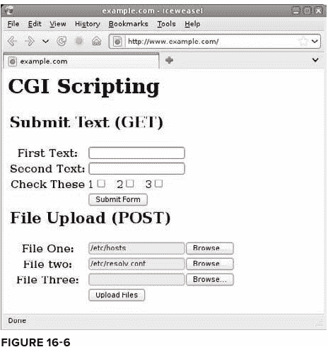

图 16-6

在图 16-7 中，CGI 脚本在处理文件时显示更新，并显示每个文件的 MD5 检查结果。

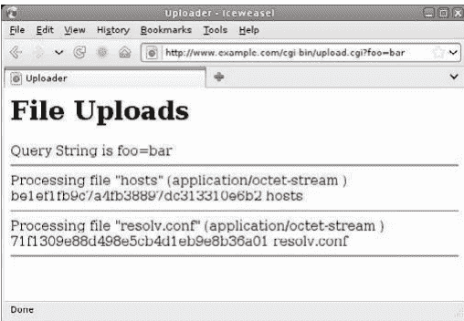

图 16-7

## 总结

CGI 是一个非常有用的工具，但它的设计假设是互联网是相当可靠的。因此，人们创建了如 PHP 之类的复杂框架或庞大的 Perl 库来驾驭它。最近，Ajax 已被通过提供更灵活、更透明的服务器端处理，在很大程度上取代了 CGI。尽管如此，Shell 中的 CGI 脚本仍然非常有用，因为它们除了 Web 服务器本身外不需要任何第三方软件，组合非常快速简单，并且可以提供至关重要的调试信息。

CGI 允许你根据发送的输入编程地更改 Web 服务器的响应。处理 CGI 脚本有两种方法：GET 更透明且易于调试，而 POST 允许将文件发送到服务器。浏览器插件可以将表单转换为 GET，反之亦然。

## 食谱 16-3：配置文件

配置文件是每个操作系统通用的。某些系统偏于二进制文件，因为这对于转储应用程序和读取状态更方便。Unix/Linux 的传统是使用文本文件。这对于 Shell 脚本来说要方便得多，而且意味着文件可以通过人工干预、其他脚本或其他软件进行。

### 概念

一个 Shell 脚本可以封装在一个文件中，包括其所有的代码和配置。如果将这些项目存储在单独的文件中，脚本将更加灵活。用户可以直接编辑配置，因为脚本会读取并解释这些内容。这种情况发生在所有层面，从编辑 `/etc/hosts` 或 `/etc/sysconfig/network-scripts/eth0` 等系统管理任务。这些本质上都是配置文件。配置文件最简单的格式之一是使用与 Shell 相同的语法：`source` 会写出其当前值。因为文件将由 Shell 读取，所以 Shell 语法意味着以 # (# 开头的注释将被忽略。

### 食谱


```bash
#!/bin/bash
# 食谱 16-3：这展示了分配变量的不同方法。在脚本开始，变量是配置且可读的。`-p` 选项在 `read` 命令中包含一个提示符 `Name:`：在提示符中添加 `$(NAME)` 设置了一个默认值，如果用户按回车键而不是输入值，将使用该默认值。这是通过 `-z` 测试实现的，该测试检查变量是否为空，如果是，则将值设置为小写的变量名。这在 Shell 中并不是一个定义的标准，但在方便使用两个同名不同变量时，这是一个实用的命名约定。在随后的“调用”部分中，使用了默认值“Manchester”（曼彻）。最后，脚本将其当前值写入文件。

DEBUG=0
NAME=Steve
LOCATION=Manchester
COLOR=
CFG=$(dirname $0)/name.cfg
[ -r $CFG ] && . $CFG

read -p "What is your name? $(NAME): " name
[ -z "$NAME" ] && NAME=$NAME
read -p "Where are you? $(LOCATION): " location
[ -z "$LOCATION" ] && location
```

锁文件和资源本身；锁文件只是脚本使用的一种自愿机制，用以确保它有权限使用关键资源。

进程获取锁，然后执行一些关键工作，最后释放锁。当一个进程持有锁时，其他尝试获取锁的进程将处于循环中，直到锁可用。当进程释放锁时，多个尝试获取锁的进程之间可能会发生竞争。这个问题的解决方案是原子性。虽然原子性通常仅由低级组件强制执行（例如 CPU 微内核实现的硬件测试并设置（test-and-set）调用），但原子性也可以通过文件系统的内部一致性来实现。不同的进程向同一个文件写入它们的 PID（PID 一定小于文件系统的最小块大小——通常为 8KB），它们之间不会相互干扰。通过追加而不是覆盖，所有参与的进程都能看到锁的状态，这是该脚本实现实际锁机制的关键，正如本章稍后“结构（Structure）”部分所解说 true样样。

## 潜在陷阱 (Potential Pitfalls)

在 shell 中实现锁的问题在于，锁的操作必须视为一个原子过程，但 shell 中没有单一的“写入并检查”函数。如果两个脚本实例看到锁是可用的，那么这两个实例都会去抢占锁，哪一个会赢呢？这个配方包含一个循环，等待锁文件被删除，然后在锁可用时获取锁。

```bash
#!/bin/bash
LOCK=/tmp/myapp.lock

function get_lock() {
  MYPID=$1
  DELAY=2
  while [ -f "$LOCK" ];
  do
    sleep $DELAY
  done
  echo $MYPID > $LOCK
}

function release_lock() {
  rm -f $LOCK
}

echo "I am process $$"
get_lock $$
echo "'date' > /tmp/keyfile.txt
sleep 5
release_lock
cat /tmp/keyfile.txt
```

问题出现在 `while` 循环的末尾。如果两个实例同时运行，调度程序会在任何时间运行或暂停每个进程。大部分情况下这是没，但偶尔执行顺序可能会如表 16-2 所示。

表 16-2：非原子锁 (A Non-Atomic Lock)

| 脚本一 | 脚本二 | 锁文件内容 |
| :--- | :--- | :--- |
| | 读取锁 | 空 |
| 读取锁 | | 空 |
| 写入锁 | 写入锁 | PID #2 |
| | | PID #1 |
| 写入关键文件 | 写入关键文件 | PID #1 |

脚本的第二个实例结束了关键文件的写入，尽管锁中包含第一个实例的 PID。这是一个坏事，而这正是锁系统建立时为了避免的情况。如果它无法阻止这种情况，那么锁机制真的只是一个尽而其次的方案，而不是完全健壮的方案。

由于该脚本的工作原理，可能会出现一个进程从锁中“移除”自己，而另外两个进程正在尝试移除自己。如果第一个进程最后完成（仅有 9 次系统调用重叠），它可能会将其他进程的 PID 写入锁中，显然同时授予了它们两个锁。那两个进程可能会继续执行，认为它们拥有锁的排他访问权限。这在实践中极不可能发生，但如果没有硬件中的写入-检查函数，这是不可避免的。

这里提供的配方的另一个弱点是，它可能会无限期等待一个锁，可以使用 `timeout` 工具来解决，这样脚本至少可以优雅地退出并报告问题。然而，`timeout` 作用于函数，只作用于可以执行（作为外部程序本身）会超时的脚本和程序。这是完全可能的，只是 `get_lock` 必须实现为单独的脚本而不是函数。

## 结构 (Structure)

这个配方展示了两个脚本：`domain-nolock.sh` 和 `domain.sh`。它们执行的任务相同。然而，`domain.sh` 使用锁来控制脚本的主体。这确保了最终输出更加整洁。

`domain.sh` 显示了实际脚本的主要工作。它非常简单的脚本，对互联网域名进行查询，并检索创建日期、过期日期以及权威 DNS 服务器的列表。它的效率很低，因为它运行了三次，导致对 whos 服务器进行了三次独立的查询。这还会导致你的 IP 地址被临时封禁进一步的 whos 查询。即使没有插入 `sleep` 语句来确保在这里清晰显示效果（搜索大约需要 2 秒），更好的做法也是只获取一次记录，然后搜索三次锁副本。

脚本使用 `tee -a` 将内容写入记录，并追加到日志文件中。这产生了一些严重的后果，锁系统处理了这些问题。

> Whos 记录的结构并不理想，因此简单地通过 `grep` 过滤输出实际上并不是获取信息的非常可靠的方法。

`domain.sh` 脚本有三个函数：`get_lock`、`release_lock` 和 `cleanup`。脚本的主体与 `domain-nolock.sh` 相同，只是先调用 `get_lock`，并在完成后调用 `release_lock`。


`get_lock`是主函数。它等待锁释放，将自己的 PID 添加到锁中，并确保它是锁中的唯一 PID。锁的前所有者可能在没有清理锁的情况下崩溃，因此它从锁中移除 PID。释放 PID 而不是移除整个锁允许第三个进程已经注意到之前的 PID 已完成并已经获取了锁。当前实例在下一次循环之前不做任何假设，直到它发现文件是空的。

如果 PID 仍在运行，`get_lock`会报告状态、睡眠延迟并循环。合适的延迟时间很大程度上取决于应用程序。定义一个上限可能是很有用的；如果循环了 360 次，延迟将是 6 分钟，然后是 6 分钟 1 秒、6 分钟 2 秒，以此类推。

一旦完成了初始 while 循环，锁文件中没有正在运行的进程，然后检查锁是否包含任何内容。如果包含，则另一个进程正在同一时间执行相同的操作。然而，由于 `grep` 命令在文件中发现另一个进程，`grep` 和随后的查询可以是原子的，那么文件是以干净状态被找到的，锁也被获取。在操作系统层面，`grep` 不是原子命令；它是一个需要时间运行的进程，并在任何阶段被切换。写入-检查过程结合文件系统的并发性，确保了这在实际上是有效的，因为另一个实例将会退让。表 16-3 对表 16-2 的内容提供了更详细的观察，并查看了最坏情况下的情况。

## 452 | 第 16 章 系统管理

## 表 16-3: 原子性

| 脚本一 | 脚本二 | 锁文件内容 |
| --- | --- | --- |
| `echo $$ >> $LOCK` | | PID #1 |
| `grep -vw $MYPID $LOCK` (被中断) | | PID #1 |
| | `echo $$ >> $LOCK` | PID #1, PID #2 |
| `grep` (继续，返回失败；未发现其他进程正在使用锁); | | PID #1, PID #2 |
| | `grep -vw $MYPID $LOCK` (成功；由于在此 `grep` 启动之前，锁中已有两个 PID) | PID #1, PID #2 |
| 调用 `if` 检查 `grep` 的返回码。发现失败，明知它拥有该锁，尽管另一个脚本已写入了锁文件。 | | PID #1, PID #2 |
| | 调用 `if` 检查 `grep` 的返回码，并移除自己的 PID | PID #1 |
| 为了万起见见将自己的 PID 写入锁文件。这本应是不必要的。 | | PID #1 |

如果 `grep` 命令执行成功，意味着它找到了另一个也在尝试获取锁的进程。调用 `release_lock` 会从锁文件中移除当前进程的 PID，通过 `sleep`（最长 5 秒）确保两个进程不会发生碰撞，由于 `GOT_LOCK` 未被设置，循环将继续。可能两个实例都将自己从锁中移除，但这不会造成任何危害。

`release_lock` 函数使用一个简单的 `sed` 命令从锁文件中删除一行。`^` 和 `$MYPID` 分别表示行的开始和结束，整行必须与 PID 精确匹配。从文件中移除 PID 123 也会移除另一个针对 PID 1234 的条目。移除文件的另一种常用技术是使用 `grep -v $LOCK > /tmp/tempfile.$` 然后使用 `mv /tmp/tempfile.$ $LOCK` 将新文件移动回覆盖原始文件。这并不是原子的，在 `grep` 和 `mv` 命令之间，另一个进程可能已经向文件写入了内容。这样一来这些更改就会丢失。虽然 `sed -i` 执行相同的操作，但它的重叠发生在系统层级，比这些进程的运行速度快数百倍。

如果脚本被中断，将调用 `cleanup`。这是通过 `trap` 调用的，用于在脚本完成前终止移除锁。

## 配方

```bash
#!/bin/bash
KEYFILE=/tmp/domains.txt
MYDOMAIN=$1
echo "$MYDOMAIN Creation Date:" | tee -a $KEYFILE
sleep 2
whois $MYDOMAIN | grep -i created | cut -d:" -f2- | tee -a $KEYFILE
sleep 2
echo "$MYDOMAIN Expiration Date:" | tee -a $KEYFILE
sleep 2
whois $MYDOMAIN | grep "Expiration Date:" | cut -d:" -f2- | tee -a $KEYFILE
sleep 2
echo "$MYDOMAIN DNS Servers:" | tee -a $KEYFILE
sleep 2
whois $MYDOMAIN | grep "Name Server:" | cut -d:" -f2- | grep -v | tee -a $KEYFILE
sleep 2
echo "-- end of $MYDOMAIN information ..." | tee -a $KEYFILE
```

```bash
#!/bin/bash

# LOCK 是全局变量。对于这种用法，lock.app.$ 并不合适。
# /var/run 适用于 root 拥有的进程；其他可以使用 /tmp 或 /var/tmp
# 或者它们的家目录或应用文件系统
# LOCK=/var/run/lock.myapp
LOCK=/tmp/lock.myapp
KEYFILE=/tmp/domains.txt
MYDOMAIN=$1
mydomain=/tmp/$($MYDOMAIN).$

# 查看 kill(1) 了解不同信号及其意图。
trap cleanup 2_3 6

function release_lock() 
{
MYPID=$1
echo "Releasing lock.*"
sed -i "^/$($MYPID)$/d" $LOCK
}

function get_lock() 
{
DELAY=2
GOT_LOCK=0
MYPID=$1

while [ "$GOT_LOCK" -ne "1" ]
do
PID=
while [ -s "$LOCK" ]
do
PID=$(cat $LOCK 2>/dev/null)
name=$(ps -o comm -p $PID 2>/dev/null)
if [ -z "$name" ]; then
    echo "Process $PID 声称占有了锁，但并未运行。"
    release_lock $PID
else
    echo "Process $PID ($name) 已经占有了锁:"
    ps -fp $PID | sed -e l1
    date
    echo
    sleep $DELAY
    let DELAY=$DELAY + 1
fi
# 将 myPID 写入锁文件

echo $MYPID > $LOCK

# 如果另一个实例也写入了锁，它将包含
# 多个 $SH 和 $PID

# 如果 PID 为空，则用引号括起来。
# 否则 $PID 会变成 "-e $LOCK" 且不传递文件名
grep -v -e "$LOCK" /dev/null 2>&1
if [ "$?" -ne 0 ]; then
# 如果 $? 是 0，则 grep 在文件中找到了内容：
echo "发生了一个错误。另一个进程已经占有了锁:"
sleep $(( (RANDOM % 5) ))
fi
done

function cleanup
{
echo "$$: 收到信号。"
release_lock
exit 0
}

# 主脚本从这里开始
# 在脚本完成前移除锁以确保清理
get_lock

## 配方 16-4: 锁

# 执行操作
echo "$MYDOMAIN Creation Date:" | tee -a $KEYFILE
sleep 2
whois $MYDOMAIN | grep -i created | cut -d:" -f2- | tee -a $KEYFILE
sleep 2
echo "$MYDOMAIN Expiration Date:" | tee -a $KEYFILE
sleep 2
whois $MYDOMAIN | grep "Expiration Date:" | cut -d:" -f2- | tee -a $KEYFILE
sleep 2
echo "$MYDOMAIN DNS Servers:" | tee -a $KEYFILE
sleep 2
whois $MYDOMAIN | grep "Name Server:" | cut -d:" -f2- | grep -v | tee -a $KEYFILE
sleep 2
echo "-- end of $MYDOMAIN information ..." | tee -a $KEYFILE

# 在完成后释放锁
# 干净退出
exit 0
```

## 调用

以下输出显示了两个不同的 shell。第一个 shell 提示符为 Instance One，运行 `domain-nolock.sh` 处理 "example.com"。它运行完成，一切看起来正常。

```bash
Instance One$ domain-nolock.sh example.com

example.com Creation Date:

1992-01-01

example.com Expiration Date:

13-aug-2011

example.com DNS Servers:

A.IANA-SERVERS.NET

B.IANA-SERVERS.NET

end of example.com information ...

Instance One$
```

第二个 shell 提示符为 Instance Two，运行 `domain-nolock.sh` 处理 "steve-parker.org"。再次，一切看起来正常。

```bash
Instance Two$ domain-nolock.sh steve-parker.org

steve-parker.org Creation Date:

20-Jun-2000 13:48:46

steve-parker.org Expiration Date:

20-Jun-2011 13:48:46

steve-parker.org DNS Servers:

NS.123-REG.UK

NS2.123-REG.UK

end of steve-parker.org ...

Instance Two$
```

只有在回读输出文件时，问题才显现。两个脚本都写入了内容，现在成了一团乱糟：两个脚本同时向同一个文件写入。

```bash
Instance One$ cat /tmp/domains.txt

example.com Creation Date:

1992-01-01

steve-parker.org Creation Date:

example.com Expiration Date:

20-Jun-2000 13:48:46

13-aug-2011

steve-parker.org Expiration Date:

20-Jun-2011 13:48:46

example.com DNS Servers:

A.IANA-SERVERS.NET

B.IANA-SERVERS.NET

NS.123-REG.UK

NS2.123-REG.UK

... end of example.com information ...

... end of steve-parker.org

Instance One$
```

更好的解决方案是使用锁。这次，`domain.sh` 带有 `domain example.com` 被调用。它运行完成，再次看起来没有任何异常，除了结尾处释放锁的注释外。

```bash
Instance One$ ./domain.sh example.com

example.com Creation Date:

1992-01-01

example.com Expiration Date:

13-aug-2011

example.com DNS Servers:

A.IANA-SERVERS.NET

B.IANA-SERVERS.NET

... end of example.com information ...

Releasing lock.

Instance One$
```


## 总结

锁（Locks）是确保运行代码的一个实例与所有其他实例区别对待的有用方法，因为只有该实例持有该锁。一旦持有了锁，对该独占权限的用途将没有任何限制。它可以用于写入文件（如本食谱所示），也可以用于确保整个过程中只有一个进程实例在运行。对于任何希望执行某些特定动作的进程知道其他进程在它执行时不会干扰它的情况，都可以使用锁。

正如调用示例所展示的那样，无论是否加锁，第一个进程都会继续运行，它完全不知道另一个进程甚至在运行，更不用说访问第一个实例正在使用的相同资源了。两者的区别在于，加锁的版本知道它已经安排了对资源的独占访问。

## 17 演示

### 演示

演示效果（Presentation）可以对用户对 Shell 脚本的印象产生巨大影响，还能使其使用变得显著容易。并不是所有的 Shell 脚本都是为了完成一次性任务的临时权宜之；有些脚本会使用多年，并在此期间被各种人士使用。因此，脚本不仅限于在黑色背景上打印顺序行的白色文本是一件好事。本章展示了 Shell 脚本能够实现的一些功能，而无需任何复杂的技巧或对其他子系统的依赖。

## 食谱 17-1：太空大战游戏

这个食谱的灵感来自 20 世纪 70 年代经典的街机游戏《太空侵略者》（Space Invaders）。目标是在星人到达地球（由屏幕底部表示）之前杀死它们。你可以使用“a”和“l”键左右移动你的飞船，并通过按下“l”键发射激光。你一次只能发射一次炮弹。

### 使用的技术

- `kill`、`trap` 和 `SIGALRM` 用于计时
- `read` 的高级用法，用于对按键做出及时响应
- `tput` 控制终端
- 用于显示的 ANSI 颜色
- 数组，特别是将数组传递给函数
- 用于计算位置和碰撞检测的基础数学

## 概念

游戏本身背后的概念相当简单。星人从左向右来回移动，并从屏幕向下向你移动；每当他们到达屏幕右侧时，就会移动一行。这是通过每次增加天花板变量（`ceiling`）来实现的；星人渲染在 `(row*2) + ceiling` 处；乘以 2 意味着每波星人之间有一个空行，而在这个值上加上不断增加的天花板意味着整个游戏随着时间的推移变得越来越难。

你有一个激光炮，它由一对变量 `cannonX` 和 `cannonY` 表示，用于跟踪它的位置。`cannonX` 是必要的，因为在你移动后激光一直沿直线运行，它从你的飞船位置开始，但在发射后与飞船保持独立。这种实现意味着在上一次射击命中星人或到达屏幕顶部之前，你不能发射另一击。你可以通过实现一个数组 `(cannonX, cannonY)` 来绕过此限制，但这并不忠于原始游戏，并且让用激光喷射敌人变得太容易了。

数据结构非常简单；星人和激光都有与其位置关联的简单整数变量。每一行星人在内部都由一个数组表示，该数组存储每个星人的分值。这也被用于跟踪哪些星人还存活——当一个星人被杀死时，数组中的值用于增加分数，星人中的值会被降为零，`drawrow` 函数将其理解为星人不在那里，因此在进行碰撞检测时不，应该绘制它或考虑它。

`alien1` 和 `alien2` 数组包含了简单的 ASCII 艺术颜色和设计。使用两个不同的数组以及取模 2 函数 `(( offset % 2 == 0 ))`，如果星人从一个位置移动到另一个位置，它们看起来在屏幕上移动得更有动画感。

## 食谱 17：太空游戏 43

键盘，如果按键是“左”或“右”指令（“a”和“l”），则更新飞船的位置以匹配。飞船将被重绘制。如果按下发射按钮（“f”），且大炮未在使用中 `[cannonY-eq 0]`，则变量 `cannonX` 相对于你飞船当前的 X 位置，且 `cannonY` 被设置为飞船的 Y 轴（固定在屏幕顶部）。

每当按键移动你的飞船时，主循环都会调用 `drawship`。此函数使用打印语句清除整行，并作为装饰性处理，对飞船内的大炮进行颜色编码，以显示其是否已就绪。与 `move` 函数分离，可以为你的飞船移动提供实时更新，而不是速度较慢的外星船的单调更新。`drawship` 也作为 `move` 函数的一部分调用，这样即使飞船没有移动，大炮也能定期反映。

主循环上方是 `move` 函数。`move` 函数使用 `SIGALRM` 在 `DELAY` 时间结束后调用自己，外星人会向你移动更快。每每次调用 `move`，外星人都会沿着它们的方向再移动一个格子。当它们到达屏幕边缘时，方向变量会反转，以便它们向相反方向移动。每当它们碰到屏幕右侧时，它们还会向下移动（增加天花板值）。

`move` 然后对每一行外星人调用 `drawrow`。由于 bash 没有多维数组，外星人的行数在脚本中是硬编码的。如果有一个循环来遍历这些行就好了，但对于六行外星人，调用六次 `draw` 函数并不算繁琐。`drawrow` 返回在渲染期间大炮命中的任何外星人，或者如果当前行没有外星人被命中。这会对数组结构产生影响；数组 `row0` 到 `row5` 存储了外星人的位置；不要使用索引 `index[0]`，这可能有点笨拙，但它意味着每个 `draw` 之后的行只需简单地设置 `row[i]=0`。如果 `i` 为零，则更新 `index [0]`，这对 `else` 没有影响。如果 `i` 大于零，则指向一个外星人，存储其得分的外星人变量被设置为零，随后的 `draw` 调用将不会在该位置绘制外星人，且碰撞检测将允许大炮射穿该间隙而不是停止。更整洁的实现需要每次调用 `drawrow` 只在实际命中外星人时才返回值。本食谱所使用的方法执行起来稍微简单一些，更重要的是，更容易阅读和维护。

程序会统计剩余的外星人数量，如果你消灭了所有入侵力量，将显示祝贺消息并退出游戏。也许游戏在下一波即使外星人数量相等时也应该继续；这很容易实现，但会增加一些复杂性并使代码略长。

最后，`move` 调用了 `drawcannon` 函数。它可以写在 `move` 函数内部，但将其抽象为自己的函数会更整洁。`drawcannon` 简单地在之前的位置上方放置一个空格字符，计算新位置（比之前高一个单元格），并重新绘制大炮。

`drawrow` 函数执行着重工作。除了渲染外星人外，它还执行碰撞检测，以查看你是否成功命中。它的第一个参数告诉要绘制什么种类的外星人

第 17 章 演示

其余的是相应 `row()` 数组的值。如前所述，将数组传递给函数很困难，这不是唯一的方法，但它保持了代码简单。`shift` 将 `alientype` 参数移出；剩下的 `$` 是重新绘制哪些外星人仍然存活的值列表，以及它们值多少分。这种实现还允许能够经受多次击的开放外星人；不是将值减为零，`redraw` 可以从外星人的健康值中减去固定值，可能使其留在零以上，从而在随后的运行中仍然被渲染，直到被完全摧毁。

函数首先计算此行是否有要绘制的外星人。如果该行没有要绘制的外星人，则该行不计入外星入侵尝试，在进行任何进一步测试之前退出。如果仍在运行，它将处理如何绘制当前行。如果这等于 `$bottom` 变量（定义了你飞船的 Y 位置），则说明入侵成功了，你输掉了游戏，并带有相应的消息退出。否则，脚本继续执行。

对于每个外星人，如果它存在，外星人占据的空间将与激光大炮的位置进行比较。如果它们匹配，则由 `$avatar` 变量定义的外星人显示图标将被替换为三颗星号，以指示结果性的爆炸。玩家得分将根据存储的值增加增加，`$killed` 变量存储该外星人在数组中的索引，以便于通过调用 `draw` 函数将其删除。这种 `redraw` 避免了不需要知道数组名称即可将索引返回给调用者，并让调用者维护状态并使用索引更新相应的数组以绘制下一个外星人。如果 bash 支持多维数组，这就不会是调用者的问题了，但由于每行都是一个独立的数组，外星人（或相应的空间）被显示，然后循环返回绘制行中的下一个外星人。

## 食谱

```bash
#!/bin/bash

stty -echo

# 使光标不可见 (man terminfo)

tput cnorm

clear

cat - << EOF

SPACE

LEFT: a

RIGHT: l

FIRE: f

QUIT: q

      按任意键。

EOF

read -s n 1

row0=( 0 30 30 30 30 30 30 )

row1=( 0 20 20 20 20 20 20 20 )

row2=( 0 15 15 15 15 15 15 15 )

row3=( 0 10 10 10 10 10 10 10 )

row4=( 0 5 5 5 5 5 5 5 )

row5=( 0 1 1 1 1 1 1 1 )
```

## 食谱 17-1：太空游戏 | 45

```bash
function drawrow {

  local alientype=$1

  shift

  local row=("$@")

  local offset=$bottom

  local killed=0

  local score=0

  local i

  local value

  local avatar

  local LEFT

  local RIGHT

  # 不要在循环中进行此计算，即使使用 expr 也很慢

  if (( offset % 2 == 0 )); then

    thisalien=${aliens[1][${alientype]}

  else

    thisalien=${aliens[2][${alientype}]}

  fi

  # 每行有 8 个外星人。

  for i in $(seq 1 8); do

    value=${row[$i]}

    avatar=${thisalien}

    if [ $value -gt 0 ]; then

      # 检测并标记碰撞

      if [ $row -eq $cannon ]; then

        let LEFT="$i * 4 + ${offset} - 4"

        let RIGHT="$i * 4 + ${offset} - 1"

        if [ $cannon -ge $LEFT ] && [ $cannon -le $RIGHT ]; then

          killed=$1

          avatar="\033[1;31m\033[0m"

          ((score=$score + $value))

          cannon=0

        fi

      fi

      if [ $value -eq 0 ]; then

        printf " *"

      else

        echo -en "*${avatar} *"

      fi

    fi

  done

  return $killed

}

function drawcannon {

  # drawcannon 简单地在之前的位置上方放置一个空格字符，

  # 计算新位置（比之前高一个单元格），并重新绘制大炮。
}
```

```bash
{

  # 将大炮 向上移动一格

  if [$cannonY -eq 0 ]; then

    # 掉出了屏幕顶部

    return

  fi

  tput cup $cannonY $cannonYX

  printf " *"

  ((cannonY=cannonY-1))

  tput cup $cannonY $cannonYX

  echo -en "\033[1;31m\033[0m"

}

function drawback {

  tput cup $bottom 0

  printf "%8s*"

  tput cup $bottom $ship

  # 通过飞船中的的颜色显示大炮状态

  if [$cannonY -eq 0 ]; then

    col=31

  else

    col=30

  fi

  echo -en "*|--\033[1;${col}m\033[0m--|"

}

function move {

  # 让外星人向左或右移动

  # 移动大炮，检查碰撞

  (sleep $DELAY && kill -ALRM $) &

  # 如果撞到屏幕边缘，则改变方向

  if [$offset -gt MAXRIGHT] && [$direction -eq 1 ]; then

    # 如果撞到屏幕右侧，则加速

    DELAY=$(echo $DELAY * 0.9 | bc)

    direction=-1

    ((ceiling($offset)))

  elif [$offset -eq 0] && [$direction -eq -1 ]; then

    direction=1

  fi

  (offset=$offset+$direction)

  drawrow 0 ${row0[@]}

  row0[$]=0

  drawrow 1 ${row1[@]}

  row1[$]=0

  drawrow 2 ${row2[@]}

  drawrow 3 ${row3[@]}

  row3[$]=0

  drawrow 4 ${row4[@]}

  drawrow 5 ${row5[@]}

  row5[$?]=0

  aliensleft=$(echo ${row0[@]} ${row1[@]} ${row2[@]} ${row3[@]} ${row4[@]} | tr ' ' bc

  if [$aliensleft -eq 0 ]; then

    tput cup 5

    trap exit ALRM

    echo "YOU WIN"

    sleep $DELAY

    tput echo

    tput cvis

    echo; echo; echo

    exit 0

  fi

  drawcannon

  drawship

}

trap move ALRM

clear

drawship

# 开始外星人的移动...

move

while :

do

  read -s -n 1 key

  case $key in

    a)

      [ $ship -gt 0 ] && ((ship=ship-1))

      drawship

      ;;

    d)

      [ $ship -lt $FARRIGHT ] && ((ship=ship+1))

      drawship

      ;;

    f)

      if [ $cannon -eq 0 ]; then

        let cannonX=$ship + 3

        cannonY=$bottom

      fi

      ;;

    q)

      echo "Goodbye!"

      tput cvis

      stty echo

      trap exit ALRM

      sleep $DELAY

      ;;

  esac

done
```

# 调用

游戏以正常方式运行，在带有彩色的终端中应该会显示全彩色的游戏，且闪烁极少。图 17-1 显示了正在进行的游戏。

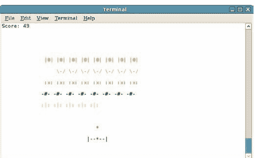

图 17-1

图 17-2 显示了外星飞器被击中时的爆炸效果。三个红色星号标记了爆炸。

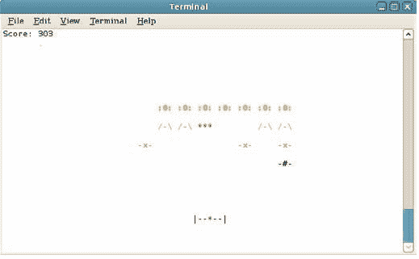

图 17-2

图 17-3 显示了外星飞器降落在地球上时游戏结束。

# 第 17 章演示

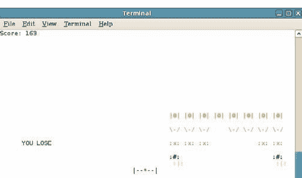

图 17-3

图 17-4 显示了玩家消灭所有入侵者后的胜利。

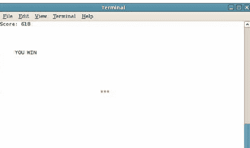

图 17-4

## 总结

虽然这只是好玩，但这个配方展示了创建比通常视为非交互式 Shell 脚本的、更交互且更复杂的“按 1 继续，按 2 退出”类型系统的 Shell 脚本。Shell 的功能比通常利用的要多得多，尽管 Shell 远不是游戏开发的完美语言，但我希望这个配方能激发人们更多使用 Shell 脚本，特别是 bash Shell 中可用的新功能（如数组）以及 GNU 环境中的特性（例如 `sleep` 能够执行亚秒睡眠，如果没有它，这个玩法的趣味性会大大降低）。

# 18

## 数据存储与检索

检索、处理和存储数据是计算的核心。本章介绍了两个执行此项任务的不同配方。第一个处理 HTML 文档以识别并使用文档中包含的任何链接。这看起来并不那么简单，因此这个配方涵盖了为了确保不遗漏任何链接而必须进行的一些工作。

# 474 第 18 章 数据的存储与检索

```bash
suffix=1

while [ -f "$(download)/$(filename)" ]

do

  filename=$(origame).$(suffix)*

  ((suffix++))

done

  echo "Retrieving link as $filename"

  # 如果无效有效，则前加上 BASE_URL

  firstchar=$(echo $link | cut -c1)

  case '$firstchar' in

    '*/') link=$(BASE_URL)\$link;

    *) link=$(BASE_URL)\$link;

  esac

  wget -O "$(download)/$(filename)" "$link" > /tmp/wget.\$ 2>&1

  if [ "$?" -eq 0 ]; then

    ls -ld "$(download)/$(filename)"

  else

    echo "Retrieving link failed."

    cat /tmp/wget.\$$

  fi

fi

state=
```


```bash
if [ "$tag" == 'A' ] || [ "$tag" == 'a' ]; then

  # 只有在不在锚点中时才执行此操作；

  # <a href="#*"> 已经在锚点中；

  if [ "$state" != "anchor" ]; then

    link=$(echo $label label | grep -i "href=" | tr [:blank:] '\n' | grep -io "href.*" | tr -d 'c6-' | tr -d '*"')

    [ -z "$link" ] && state=anchor

  fi

fi

fi

done

rm /tmp/wget.\$$ /dev/null
```

## 调用

多个空格可能会导致问题；配方使用 `tr` 去除这些空格——

```html
$ cat eg.html

<a href="/eg.html">example pages</a>

<a href="/eg2.html">pages</a>
```

`<a href="/eg.html">example pages</a>`
`<a href="/imagel1.html"></a>`
`<a href="/imagel2.html"></a>`
`<a bar="foo"none"></a>`

这是 `<a href="#more"></a>` 看起来的样子
这是 `<a href="#marker"></a>` 看起来的样子

图片作为锚点文本可能会很尴尬；配方使用 "IMG" 作为文件名。

```html
<a href="/eg.html">more

<a href="/more.html"></a
```

这看起来像是一个链接，但它没有 `HREF`，所以它被忽略了。

配方将实际上关闭，因为它并没有搜索 `<a>`。


`downloader.sh`

* 带有

# 配方 18-1：解析 HTML 示例

```bash
<a class="pad" href="/examples.shtml" title="eg">further examples</a>

$ ./downloader.sh eg.html

Retrieving /eg.shtml as example pages

-rw-r--r one steve 10421 May 1 12:58 /tmp/download/example pages

-rw-r--r /eg.shtml as a pages

-rw-f--r one steve 402 May 1 12:58 /tmp/download/a pages

-rw-r--r /eg.shtml as example pages

-rw-f--r one steve 2409 May 1 12:58 /tmp/download/eg pages

-rw-f--r /imagelink1.html as img

-rw-f--r one steve 94522 May 1 12:58 /tmp/download/img

-rw-f--r /imagelink2.html as img.1

-rw-f--r one steve 10533 May 1 12:58 /tmp/download/img.1

-rw-f--r # a as a href

-rw-f--r one steve 3407 May 1 12:58 /tmp/download/a href

-rw-f--r #more as a marker

-rw-f--r one steve 5933 May 1 12:58 /tmp/download/a marker

-rw-f--r /eg.shtml as marker2

-rw-f--r one steve 5488 May 1 12:58 /tmp/download/more

-rw-f--r /moreimages.html as img

-rw-f--r one steve 5930 May 1 12:58 /tmp/download/img.2

-rw-f--r /examples.shtml as further examples

-rw-f--r one steve 50395 May 1 12:58 /tmp/download/further examples

./downloader.sh eg.html

./downloader.sh

/eg.shtml as example pages

-rw-f--r one steve 10421 May 1 13:04 /tmp/download/example pages.1

-rw-f--r one steve 402 May 1 13:04 /tmp/download/a pages.1

-rw-f--r /eg.shtml as example pages

-rw-f--r one steve 2409 May 1 13:04 /tmp/download/eg pages.1

-rw-f--r /imagelink1.html as img

-rw-f--r one steve 94522 May 1 13:04 /tmp/download/img.3

-rw-f--r /imagelink2.html as img.4

-rw-f--r one steve 10533 May 1 13:04 /tmp/download/img.4

-rw-f--r # a as a href

-rw-f--r one steve 3407 May 1 13:04 /tmp/download/a href.1

-rw-f--r #more as a marker

-rw-f--r one steve 5933 May 1 13:04 /tmp/download/a marker.1

-rw-f--r /eg.shtml as marker2

-rw-f--r one steve 5488 May 1 13:04 /tmp/download/more

-rw-f--r /moreimages.html as img

-rw-f--r one steve 5930 May 1 12:58 /tmp/download/img.2

-rw-f--r /examples.shtml as further examples

-rw-f--r one steve 50395 May 1 12:58 /tmp/download/further examples
```

## 第 18 章 数据存储与检索

由于 `plot-graph.sh` 对数据的格式化处理比 `grab-meminfo.sh` 更好，`stat.sh` 任务稍微简单一些。每行 `Memory` 后面都跟着一行 `Swap` 行，而在 `while` 循环内部，通过第二次 `read` 获取激活的 `Swap` 数据。计算出总和和峰值，并增加计数器。然后将其保存到临时文件，因为 `while` 循环本身是一个子壳，当循环结束时，子壳及其所有的环境变量也会随之结束。主脚本从临时文件中读取循环的状态，计算平均值，并将其写入 `CSV` 文件。正如本节的调用所示，图 18-2 清楚地描述了存在一种规律模式，每周一都有一个峰值。顶行是峰值内存（Peak RAM），然后是平均内存、峰值交换（Peak Swap），以及底部的平均交换。这些信息随后可以用来精确确定周一的具体不同之处，从而解决问题。可能是周一是负载高峰，服务器需要更多内存来应对负载，或者是程序的某个部分仅在周一使用导致了需要修复的内存泄漏。

## 菜谱 (Recipe)

```bash
#!/bin/bash

count=1

while; do

  date +%D:%H:%M > /var/tmp/$count.meminfo

  cat /proc/meminfo >> /var/tmp/$count.meminfo

  ((count++))

  sleep 20

done
```


```bash
#!/bin/bash

LOG=/var/tmp/memory.log

echo "Date,Time,Memory Used,Swap Used,Gb Memory Used,Gb Swap Used"

for MEMINFO in ls /var/tmp/*.meminfo | sort -n; do

  timestamp=$(head -n 1 "$MEMINFO" | awk '{ print $2 }')

  memtotal=$(grep 'MemTotal:' "$MEMINFO" | awk '{ print $2 }')

  memfree=$(grep 'MemFree:' "$MEMINFO" | awk '{ print $2 }')

  swaptotal=$(grep 'SwapTotal:' "$MEMINFO' | awk '{ print $2 }')

  swapfree=$(grep 'SwapFree:' "$MEMINFO" | awk '{ print $2 }')

  ramused=$((memtotal - memfree))

  swappused=$((swaptotal - swapfree))

  date=$(echo $timestamp | cut -d: -f1-)

  time=$(echo $timestamp | cut -d: -f2-)

  echo "$date $time $ramused KB in use" >> $LOG

  echo "$DATE $time $swappused KB in use" >> $LOG

  ramused=$(echo "$ramused" | awk 'scale=2;$ramused / 1024 / 1024' | bc`
```

## 菜谱 18-2: CSV 格式化

```bash
gbswappedused=`echo "scale=2;$swapped / 1024 / 1024"| bc`

echo `$date,$time,$ramused,$swapped,$gbramused,$gbswapped`

done
```


```bash
#!/bin/bash

LOG=$(1:-memory.log)

CSV=$(2:-stats.csv)

echo "Date, Peak RAM, Peak Swap, Mean RAM, Mean Swap, Peak RAM (GB), \
Peak (GB), Mean RAM (GB), Mean Swap (GB)* > $CSV

totals=/tmp/total.$

for date in $(cat $LOG | cut -d":" -f1 | sort -u)

do

count=0

peakram=0

peakswap=0

totalram=0

totals=0

echo "Processing $date" $LOG | while read timestamp ramused text

grep "*$date" $LOG | cut -d":" -f2

if [ "$Hour" -lt "9" ] [ "$Hour" -gt "17" ]; then

continue

read timestamp swapped text

((count++))

echo count=$count

let totalram=$totalram+$ramused

let totals=$totals+$swapped

[ $ramused -gt $peakram ] && peakram=$ramused

[ $swapped -gt $peakswap ] && peakswap=$swapped

echo totalram=$totalram >> $totals

echo totals=$totals >> $totals

echo peakram=$peakram >> $totals

echo peakswap=$peakswap >> $totals

echo count=$count >> $totals

done

meanram=`echo "$totalram / $count" | bc`

meanswap=`echo "$totals / $count" | bc`

peakramgb=`echo "scale=2;$peakram / 1024 / 1024" | bc`

peakswapgb=`echo "scale=2;$peakswap / 1024 / 1024" | bc`

meanramgb=`echo "scale=2;$meanram / 1024 / 1024" | bc`

meanswapgb=`echo "scale=2;$meanswap / 1024 / 1024" | bc`

echo `$date,$peakram,$peakswap,$meanram,$meanswap,$peakramgb,$peakswapgb,

$meanramgb,$meanswapgb >> $CSV

done

rm -f $totals
```

## 调用 (Invocation)

```bash
$ nohup ./grab-meminfo.sh &

$ nohup: ignoring input and appending output to `nohup.out`

$ ./plot-graph.sh > memory.csv
```

| Date | Time | Memory Used | Swapped Used | Mb Memory Used | Gb Swap Used |
| :--- | :--- | :--- | :--- | :--- | :--- |
| 1 | 08/15/11 | 12:13 | 8490160 | 72368 | 8.08 | 0.06 |
| 2 | 08/15/11 | 12:14 | 8460160 | 73568 | 8.08 | 0.06 |
| 3 | 08/15/11 | 12:15 | 1634356 | 275024 | 15.58 | 0.26 |
| 4 | 08/15/11 | 12:16 | 1634452 | 716088 | 15.58 | 0.51 |
| 5 | 08/15/11 | 12:15 | 1134192 | 698712 | 10.79 | 0.69 |
| 6 | 08/15/11 | 12:16 | 1726212 | 1629996 | 1.74 | 1.55 |

图 18-1

```bash
$ ./stats.sh

Processing 08/15/11

Processing 08/16/11

Processing 08/17/11

Processing 08/18/11

Processing 08/19/11

Processing 08/20/11

Processing 08/21/11

Processing 08/22/11

Processing 08/23/11

Processing 08/24/11

Processing 08/25/11

Processing 08/26/11

Processing 08/27/11

Processing 08/28/11

Processing 08/29/11

Processing 08/30/11

Processing 08/31/11

Processing 09/01/11

Processing 09/02/11

Processing 09/03/11

Processing 09/04/11

Processing 09/05/11

Processing 09/06/11

$ cat stats.csv
```

峰值与平均虚拟内存
webserver3

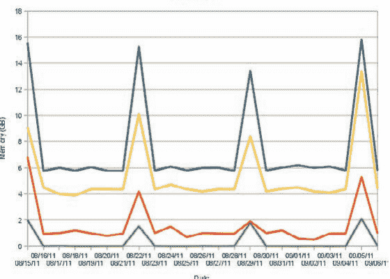

Peak RAM (GB) Peak Swap (GB) Mean RAM (GB) Mean Swap (GB)

图 18-2

## 总结 (Summary)

`Shell` 是收集和传递数据的有用工具，但对于正式展示，其纯文本界面是有局限性的。让 `Shell` 输出数据到桌面应用程序（如你在第 15 章菜谱 15-2 中看到的浏览器）和电子表格（在本菜谱中），分别使用 `HTML` 和 `CSV` 文本格式，可以使文本到图形的转换变得毫不费力。这种数据处理在其他环境中是不可能的；如果数据最初是以 `Excel` 表格和宏形式存在的，它将永远被困在 `Excel` 中。通过使用常用的文本格式，可以对数据进行重构。

# 19 数字 (Numbers)

数字对计算至关重要，但本章涵盖了数字的一些问题。第一个菜谱查看了不同进制之间的转换。

## 使用的技术 (Technologies Used)

- 函数 (`Functions`)
- `((count++))`

```bash
$(( x + y ))

[ x -lt y ]

expr
```


# 第 19 章

## 概念 (Concepts)

叠加的概念非常简单，但它无处不在。图 19-1 显示了斐波那契序列产生产生的螺旋。每个正方形的边长等于序列中的对应长度，因此前两个正方形是 1x1，然后是 2x2、3x3、5x5、8x8、13x13、21x21，以此类推。通过每个正方形内画一个四分之一，螺旋就出现了。


## 潜在陷阱 (Potential Pitfalls)

处理大数字时主要的陷阱是存储会“回环”。计算机内部使用二进制，其中位要么是开启（`1`），要么是关闭（`0`）。单个 8 位字节可以表示高达 255 的数字。之后，它会再次绕回零。

在普通的十进制数学运算中，`9999` 之后的下一个数字是 `10000`，然后是 `10001`、`10002` 等。在一个只有显示器右侧四位数字可以正常运行的计算器上，这看起来就像是 `9999` 后面跟着 `0000`、`0001`、`0002`。这种情况在计算机数字的内部表示中同样会发生。

## 菜谱 19-1：斐波那契序列 (THE FIBONACCI SEQUENCE)

斐波那契序列是一个非常简单的数字相加序列，传统上从 `0` 和 `1` 开始，所以 `F(0)` 是 `0`，`F(1)` 是 `1`，然后 `F(2) = F(0) + F(1)`，结果为 `1`。`F(3) = F(1) + F(2)`，结果为 `2`。`F(4)` 是 `3`，`F(5)` 是 `5`，`F(6)` 是 `8`，`F(7)` 是 `13`，而 `F(8)` 是 `21`。

### 表 19-1：位溢出 (Bit Wrapping)

| 二进制值 | 十进制值 |
|---|---|
| `0000 0000` | 0 |
| `0000 0001` | 1 |
| `0000 0010` | 2 |
| `0000 0011` | 3 |
| `0000 0100` | 4 |
| `0000 0101` | 5 |
| `0000 0110` | 6 |
| `0000 0111` | 7 |
| `1111 1100` | 252 |
| `1111 1101` | 253 |
| `1111 1111` | 254 |
| `0000 0001 0000 0000` | 256 或 0 |
| `0000 0001 0000 0001` | 257 或 1 |
| `0000 0001 0000 0010` | 258 或 2 |

这个问题在方法 1 的配方中使用单字节获取来解决，而在随后的序列中使用 4 字节字。最长的 4 字节字由 32 个连续的 `1` 组成，代表 `4,294,967,295`。之后，32 位容器将绕回零。在 64 位中，最大值为 `18,446,744,073,709,551,615`，但正如方法 2 的配方所示，整个范围并不总是可用的。

## 方法 1 的结构

第一个配方的构建方式与其他略有不同；它使用使用 `seq` 的 `for` 循环进行计数。

因为后续更健壮的版本使用了无限 `while` 循环（`while` 中的冒号始终求为 `true`），这允许它们持续运行，直到在开始失败时获得更高的值。

第一个配方使用 `fibonacci` 函数，它返回两个参数之和。这是函数传统的计算机科学用法；它接受值作为输入，并返回计算结果的单个值。遗憾的是，返回码旨在作为状态报告而不是长整数，因此在处理超过 255 的值时，这种方法在 shell 中没有用。该配方包含一个基本的合理性测试，以检查是否发生了绕回；数字应该总是更大的。`144 + 233 = 377`，在二进制中为 `1 0111 1001`。丢失第 9 位后，它变为 `0111 1001`，十进制为 `121`。`121` 小于之前的数字 `233`，所以答案 `121` 显然是错误的。必须有更好的方法，随后的方法演示了替代技术。

每次调用一个 0.1 秒的 `sleep` 以使输出更易读；否则，输出的滚动速度将比你阅读的速度快。当然，这种人工延迟可以根据需要更改或删除。在运行 15 次时这区别不大，但在运行数万次迭代时差异会很大。第 17 章提到，并非所有 `sleep` 的实现都能进行秒级延迟，在这种情况下，必须使用秒级延迟，或者不使用。

## 方法 1 的配方

```bash
#!/bin/bash

function fibonacci
{
  return $(( $1 + $2 ))
}

F0=0
F1=1
echo "0: $F0,"
echo "1: $F1,"

for count in $(seq 2 17)
do
  fibonacci $F0 $F1
  F2=$?
  if [ "$F2" -lt "$F1" ]; then
    echo "$count: $F2 (WRONG),"
  else
    echo "$count: $F2,"
  fi
  F0=$F1
  F1=$F2
  sleep 0.1
done

fibonacci $F0 $F1
echo "$count: $?"
```

## 方法 1 的调用

```bash
$ ./fibonacci1.sh
0: 0,
1: 1,
2: 1,
3: 2,
4: 3,
5: 5,
6: 8,
7: 13,
8: 21,
9: 34,
10: 55,
11: 89,
12: 144,
13: 233,
14: 121 (WRONG!),
15: 98 (WRONG!),
16: 219,
17: 61 (WRONG!),
18: 24,
19: 5
```

## 方法 2 的结构

第二个斐波那契配方忽略了函数的返回码，简单地让 `fibonacci` 函数 `echo` 结果。`shell` 本身可以处理超过 255 的整数；只有返回码限制在一个字节。这绕过了限制，并且调用函数的代码定义了 `F2=$(fibonacci $F0 $F1)`，使得 `F2` 捕获了结果。该配方替换了 `for` 循环，使用 `while` 循环。`count` 变量通过 `((count++))` 递增。该配方获取了第 92 个斐波那契数字，`7,540,113,804,746,346`。使用补码表示负数，允许存储负值，直到 `18,446,744,073,709,551,615` 的范围。64 位补码可以是任何值，直到 shell 内部表示发生溢出。

## 方法 2 的配方

```bash
#!/bin/bash

function fibonacci
{
  echo $(( $1 + $2 ))
}

F0=0
F1=1
echo "0: $F0,"
echo "1: $F1,"
count=2

while :
do
  F2=$(fibonacci $F0 $F1)
  if [ "$F2" -lt "$F1" ]; then
    echo "$count: $F2 (WRONG!)"
  else
    echo "$count: $F2,"
  fi
  ((count++))
  F0=$F1
  F1=$F2
done
```

## 方法 2 的调用

```bash
$ ./fibonacci2.sh
0: 0,
1: 1,
2: 1,
3: 2,
4: 3,
5: 5,
6: 8,
7: 13,
# ... 省略了 81 行输出 ...
89: 179979416004741889,
90: 288006719437081620,
91: 46604461037550309,
92: 75401138047634629,
93: -62465836585767478 (WRONG!),
94: 12931034143671551,
95: -49505315242903327 (WRONG!),
96: -365952336272031776,
97: -86125768769933501 (WRONG!),
98: 61746438273988437,
99: -243793049545036 (WRONG!),
```

## 方法 3 的调用

```bash
$ /fibonacci-without-tr.sh
0:
1:
2:
3:
4:
5:
6:
13:
# ... 省略了 36 行 ...
324: 230148385524168262209064829640107510167466804960753029098361285,
325: 372810935260089887944480449585325185428855972502037736912825,
326: 602336831712850674173058499273456094420035235799136510527293,
327: 967052950707255690611780031572610756837233947019627391742115618,
328: 1579286774985518031266182000002119677390835293881903748131841
```

```text
(standard_in): 语法错误
329: (standard_in): 非法字符:

^C

$ . /fibonacci.sh
0:
1:
2:
3:
4:
5:
6:
13:
# ... 省略了 4364 行 ...
4375: 22103418764695471120617471083988442171890536430092193410454703062634718192
4376: 1168297254961649571120617471083988442171890536430092193410454703062634718192
...
```

## 总结

有多种方法从 Unix 标准中获取结果。这种方法是结果是一个单个代码，为了与 Unix 兼容，但这不是将值传回给调用者的理想方法。按照顺序，结果可以写入标准输出（`stdout`）或所需的任何其他文件。我们想要演示的方法是找到计算结果。

`shell` 能够处理简单级别的基础数学运算，但对于非常大的数字，将使用专用工具。如果你处理复杂的函数，`bc` 本身是可以编程的，因此不仅够用；`bc` 的数学库包含了三角函数和其他函数。

# 配方 19-2：PXE 启动

需要假设服务器将通过软盘、CD 或 DVD 启动进行安装，操作员将回答一系列问题以安装操作系统。这在今天可能有所帮助，但大型组织没有时间这样做。

```bash
CLIENT_IP=$(get hosts $CLIENT | awk '{ print $1 }')
if [ -z "$CLIENT_IP" ] || [ -z "$CLIENT" ]; then
    echo "查找 $CLIENT* 时发生错误"
    exit 2
fi
# 192.168.1.42 是 C0 08 01 2A
CLIENT_HEXADDR=$(printf "%02X%02X%02X%02X" $CLIENT_IP | tr ' ' '')
if [ -z "$CLIENT_HEXADDR" ]; then
    echo "解析 $CLIENT* 的十六进制 IP 地址时发生错误"
    echo "IPv 地址"
    exit 1
fi
```

```bash
echo "客户端详情: $CLIENT 位于 IP 地址 $CLIENT_IP ($CLIENT_HEXADDR)"
echo "计算出的十六进制 IP 地址: $CLIENT_HEXADDR"
exit 1
```

```bash
function create_pxelinux_file() {
    cat > $(TFBOOT)/($CLIENT_HEXADDR) <<EOF
    default boot
    timeout 600
    prompt 1
    display messages/$($CLIENT).txt
    F1 messages/$($CLIENT).txt
    F2 messages/$($CLIENT)-F2.txt

label boot
    localhost 0
label install
    kernel $OSNAME/vmlinuz
    append initrd=$OSNAME/initrd.img ks=nfs=$SERVER:$NFS/($CLIENT).cfg
EOF
}
```

```bash
ls -ld $(TFBOOT)/($CLIENT_HEXADDR)
function create_kickstart() {
    mkdir -p $NFS
    if [ "$?" -ne 0 ]; then
        echo "创建 $NFS* 失败"
        exit 1
    fi
    cat > $NFS/($CLIENT).cfg <<EOF
    # $CLIENT 从 $SERVER 启动的 kickstart
    text install
    # 你可能想在这里放置更多细节
    # 但这是一个 shell 脚本配方而不是 kickstart 配方
    %post
    echo 这是安装后例程
    printf "10.2.2.2\ttimeserver" >> /etc/hosts
    /net/$SERVER/$NFS/($CLIENT).postinstall
EOF
}
```

```bash
ls -ld $NFS/($CLIENT).cfg
function create_msgs() {
{
    CLIENTFILE=$(TFTPBOOT)/messages/client.txt
    CLIENTFILE2=$(TFTPBOOT)/messages/client-f2.txt
    MYFILE=$(TFTPBOOT)/messages/$(CLIENT).txt
    MYF2=$(TFTPBOOT)/messages/$(CLIENT)-f2.txt
    if [ ! -r "$CLIENTFILE" ]; then
      echo "读取 $CLIENTFILE 错误"
      exit 1
    fi

    sed s/$CLIENT_NAME_HERE/$CLIENTFILE/g | \
    sed s/$SERVER_NAME_HERE/$SERVER/g | \
    sed s/$OSNAME/$OSNAME/g $(MYFILE) | \
    sed s/$CLIENT_NAME_HERE/$CLIENTFILE2/g | \
    ls -ld $(MYFILE)
    ls -ld $(sed s/$SERVER_NAME_HERE/$SERVER/g) $(MYF2)
}

calc_client_details

create_msgs
create_kickstart
create_pxelinux_file
```

这是 `CLIENT_NAME_HERE`，从 `SERVER_NAME_HERE` 启动。

类型：

- 输入 `boot` 以从本地硬盘启动
- 输入 `install` 以通过网络安装 `OSNAME`

按 `F1` 进入此屏幕

按 `F2` 获取安装过程的相关信息

这是 `CLIENT_NAME_HERE`，从 `SERVER_NAME_HERE` 启动。

此页面提供了有关启动过程的信息。

`CLIENT_NAME_HERE` 将通过网络安装，这将破坏内部磁盘上当前安装的操作系统。

这从从 `SERVER_NAME_HERE` 安装。如果这不是你想要的，请输入 `boot` 从内部磁盘启动。

按 `F1` 进入主安装屏幕

按 `F2` 进入此屏幕

# 调用

```bash
goldie# ./netbook.sh declan

查找 'declan' 时发生错误

goldie# ./netbook.sh declan

declan 位于 IP 地址 192.168.1.10 (C0A8010A)
```


```
-rw-r--r-- i root 219 Apr 26 12:21 /tftpboot/linux-install/pxelinux.cfg/message/declan-f2.txt
-rw-r--r-- i root 419 Apr 26 12:21 /tftpboot/linux-install/pxelinux.cfg/message/declan-f2.txt
-rw-r--r-- i root 174 Apr 26 12:21 /kickstart/declan.cfg
-rw-r--r-- i root 245 Apr 26 12:21 /tftpboot/linux-install/pxelinux.cfg/C0A80100
```

```bash
goldie# cat /tftpboot/linux-install/pxelinux.cfg/messages/declan.txt
这是 declan，从 goldie 启动。
类型：

- 输入 boot 以从本地硬盘启动
- 输入 install 以通过网络安装 OSNAME

按 F1 进入此屏幕
按 F2 获取安装过程的相关信息
```

```bash
goldie# cat /tftpboot/linux-install/pxelinux.cfg/messages/declan.txt

这是 declan，从 goldie 启动。

此页面提供了关于启动过程的信息。

CLIENT_NAME_HERE 将通过网络安装，这将破坏内部磁盘上当前安装的操作系统。

这从 SERVER_NAME_HERE 安装。如果这不是你想要的，请输入 boot 从内部磁盘启动。

按 F1 进入主安装屏幕

按 F2 进入此屏幕
```

```bash
goldie# cat /tftpboot/linux-install/pxelinux.cfg/messages/declan.txt
```

# 配方 20-1：进程控制

其必须像主 HA Monitor 脚本一样复杂。这意味着 `Friar Tuck` 可以用于描述监控进程的基本操作，而主 HA Monitor 脚本可以用于更深入的内容，并为进程监控和控制提供通用代码。

`Friar Tuck` 也被用作通信点；你通过调用 `friartuck.sh` 开始，向 `Friar Tuck` 发送信号来启动服务或强制其刷新配置。如果没有这一点，将很难停止整个框架；所有进程都必须在短时间内被杀死，否则进程会重新恢复。这正是《术语术典》（Jargon File）中的罗宾·胡德和法师塔克所做的。向 `Friar Tuck` 发送信号也是主脚本动态重新读取其配置的方式。这意味着一个启用的服务如果由于重复失败而被停用，可以通过强制 HA Monitor 脚本刷新其配置来重新启用。

# 潜在陷阱

这样的系统有很多陷阱。最糟糕的情况之一是两个进程都能在同一时间被有效地杀死。在这种集群层级，对此完全无能为力。更高级的集群系统可以直接挂钩操作系统来实现集群的某些关键方面，但这个简单的配方仅能保持其进程存活。

系统配置的另一个问题是放弃和重启进程之间的平衡。如果一个进程由于配置问题、常规内存泄漏或其他代码故障而持续失败，那么让服务对外部用户可用但又不断离线可能是适得其反的。在这种情况下，允许服务失败并要求人工干预来修复底层问题可能更好。

一个最近失败的时间戳数组可以对此类问题提供更准确的诊断；如果在 3 分钟内发生了两次失败，但在此之前的最后失败是在 3 个月前，那么再次重启服务是合理的。然而，如果服务不断失败，那么完全禁用服务可能更好。每次洗牌失败时间戳数组实现起来相当容易。

# 结构

系统的基本结构在 HA Monitor 中，其简单版本嵌入在 `Friar Tuck` 进程中。此配方的另一个关键方面是涉及的数据结构。这些将在接下来的材料中讨论。

# 数据结构

主 `hamon.sh` 广泛使用数组来跟踪它可以监控的无限数量进程的不同方面。`Friar Tuck` 脚本不需要这些任何内容，对它来说简单得多，添加数组使得 HA Monitor 脚本灵活得多。因为 shell 不支持多维数组，进程的每个方面都有自己的数组。脚本没有使用 `stopcmd`、`min` 和 `max` 数组；此处列出它们是为了完整性，并暗示了如果你愿意，此脚本可以很容易修改为其他内容。`pid` 数组跟踪进程正在使用的 PID；如果在收集 PID 之前有延迟，则将其设置为负值。

脚本使用的使用的另一个变量是 `tag`；它被 `logger` 用于识别正在运行的进程。通过 `logger -t "$tag"`，脚本可以准确地识别自己。`"$tag"` 周边的引号非常重要；标签后面的冒号，意味着如果没有引号，它会显示 `friartuck: (8357) ./friartuck.sh FINISHING`，这不如 `friartuck (8357): friartuck.sh FINISHING` 晰。

- `Apr 20 10:00:20 goldie friartuck (8357): ./friartuck.sh FINISHING`
- `Apr 20 10:00:21 goldie hamonitor (8323): /etc/ha/hamonitor.sh FINISHING`
- `Apr 20 10:00:25 goldie friartuck (8357): ./friartuck.sh FINISHED.`

这对于调试和诊断脚本特别有用。在这里，很容易看出 `friartuck.sh` 正在向 PID 8323 发送信号，那是 `hamonitor.sh` 脚本。

# Friar Tuck

`Friar Tuck` 控制一切，包括启动监控系统和向 HA Monitor 发送信号。`Friar Tuck` 捕获信号 3 和 4，并使用 `/tmp` 文件与此 HA Monitor 通信。这在接收到 `SIGQUIT` (3) 时监控两个进程的关闭，或在接收到 `SIGILL` (4) 时指示 HA 重新加载配置。

```
if pgrep find hamonitor running then start it. 如果是，但 [后续文本根据逻辑继续]...
```

## 506 | 第20 章 进程

如果发现一个或多个之前监控的 PID 缺失，将调用 `failurecount` 函数。如果该进程最近已经失败过，这将对其禁用监控。`pid` 元素将被设置为进程的 PID，或者如果 `startdelay` 非零，则设置为 `(0 - startdelay)`。这使得进程在需要时有一个稳定时间。

还提供了一个 `stopha.sh` 脚本。它仅是向 `friartuck.sh` 进程（或命令行传递的另一个 PID）发送信号数 3 (`SIGQUIT`)。`Friar Tuck` 将触发此失败，关闭 HA 主节点并终止自身。

## Recipe（配方）

```bash
#!/bin/bash

function bailout {
    logger -t tag $0 FINISHING. 正在通知 $pid 执行相同操作.
    touch /tmp/hstop.$pid
    while [ -f /tmp/hstop.$pid ]
    do
        sleep 5
    done
    logger -t tag $0 FINISHED.
    exit 0
}

function reread {
    logger -t tag $0 正在通知 $pid 重新读取配置.
    touch /tmp/haread.$pid
}

trap bailout 3
trap reread 4

tag="friartuck *"
debug=9
DELAY=10
pid=0
cd `dirname $0`
logger -t tag "Starting HA Master Monitoring"

while; do
    sleep $DELAY
    if [ "$tag" -gt "2" ] && logger -t tag "Checking hamonitor.sh"; then
        NewPID=$(pgrep -u root hamonitor.sh)
        if [ -z "$NewPID" ]; then
            # 未找到进程；则子进程已死。
            logger -t tag "No HA process found!"
            logger -t tag "Starting $pwd/hamonitor.sh"
            nohup $pwd/hamonitor.sh >/dev/null 2>&1 &
            pid=$!
        elif if [ "$NewPID" != "$pid" ]; then
            logger -t tag "HA Process rediscovered as $NewPID (原为 $pid)"
            pid=$NewPID
        fi
    else
        # 一切正常。
        [ "$debug" -gt "3" ] && logger -t "hamonitor.sh is running"
    fi
done
```

friartuck.sh

```bash
#!/bin/bash

function readconfig
{
    # 读取配置
    logger -t $tag Reading Configuration
    for proc in ${CONFDIR}/*.conf
    do
        # 此文件名为 web.conf (Bash 4)，否则为 1.conf, 2.conf 等
        unset ENABLED START STOP MIN MAX STARTDAY STOPPABLE
        index=$(basename $proc)
        echo Reading "index configuration"
        sproc
        startcmd[$index]=$START
        stopcmd[$index]=$STOP
        process[$index]=$PROCESS
        min[$index]=$MIN
        max[$index]=$MAX
        startday[$index]=$STARTDAY
        user[$index]=USER
        enabled[$index]=ENABLED
        idx[$index]=index
        lastfailure[$index]=0
        stoppable[$index]=${STOPPABLE:-1}
        pid=$(pgrep -d ' ' -u ${user[$index]} $PROCESS)
        if [ -z "$PID" ]; then
            # 已经在运行
            logger -t $tag "${PROCESS} is already running;"
            # 监控 ${user[$index]}' 的 $PID $PID
            pid[$index]=$PID
        else
            pid[$index]=1
            if [ "$ENABLED" ]; then
                startproc ENABLED USER $START
            fi
        fi
    done
    logger -t $tag "Monitoring ${idx[@]}"

    # 设置默认值
    DELAY=10
    FAILWINDOW=180
    debug=9
    $($CONFDIR)/ha.cfg
}
```

## 如果 Bash 版本低于 4，使用 declare -a 声明数组

```bash
declare -A process
declare -A startcmd
declare -A stopcmd
declare -A min
declare -A max
declare -A pid
declare -A user
declare -A startdelay
declare -A enabled
declare -A lastfailure
declare -A stoppable
# v4 之前的 Bash 需要保留一个索引数组（没有关联数组）
declare -A idx
```

```bash
function failurerecount {
  index=51
  interval=$(expr $(date +%s) ${lastfailure[$index]})
  lastfailure[$index]=$(date +%s)
  if [ "$interval" -lt "$FAILWINDOW" ]; then
    if [ "$stoppable[$index]" -eq 1 ]; then
      logger -t tag "$process[$index]" 在 $interval* 秒内失败了两次。"
      enabled[$index]=0
    else
      logger -t tag "$process[$index]" 在 $interval* 秒内失败了两次，但无法禁用。"
    fi
  fi
}
```

```bash
function startproc {
  if [ "$*" -ne "*" ]; then
    shift 2
    logger -t tag "Not starting $0" 因为其已被禁用。
    return
  fi
  user=$2
  shift 2
  logger -t tag "$0" 以 "$user" 运行
  nohup sudo -u $user $ >/dev/null 2>&1 &
}
```

```bash
CONFDIR=/etc/ha
tag=hamonitor($$)
STOPFILE=/tmp/hastop.$
READFILE=/tmp/head.$$
cd `dirname $0`
logger -t tag "Starting HA Monitoring"
readconfig

```bash

while :

  do

    if [ -f $STOPFILE ]; then

      case `stat -c %u $STOPFILE` in

        0)

          logger -t tag *$0 FINISHING

          rm -f $STOPFILE

          exit 0

        *)

          logger -t tag *$0 non-root $STOPFILE

      esac

    fi

    if [ -f $READFILE ]; then

      case `stat -c %u $READFILE` in

        0)

          readconfig

          rm -f $READFILE

        *)

          logger -t tag *$0 ignoring $READFILE

      esac

    fi

    sleep $DELAY

    for index in ${idx[@]};

    do

      if [ ${enabled[$index]} -eq 0 ]; then

        [ "$debug" -gt 3 ] && logger -t "${process[$index]} is disabled."

        continue

      fi

      # 检查守护进程是否运行；未运行则启动。

      if [ ${pid[$index]} -lt -1 ]; then

        # 仍在等待启动。

        logger -t tag "Checking ${process[$index]}..."

        pid[$index]=$(expr ${pid[$index]} + 1)

      elif [ ${pid[$index]} = -1 ]; then

        pid[$index]=$(pgrep -d ' ' -u ${user[$index]})

        if [ -z "${pid[$index]}" ]; then

          logger -t tag "${process[$index]} 未在规定时间内启动。"

          failurecount

        fi

        logger -t tag "PID of ${process[$index]} is ${pid[$index]}."

      fi

      if [ "$debug" -gt 2 ] && logger -t tag "Checking ${process[$index]}..."

        NewPID=$(pgrep -d ' ' -u ${user[$index]})

        if [ -z "$NewPID" ]; then

          # 未找到进程，进程已死。

          logger -t tag "No process for ${process[$index]}!"

          failurecount

          startproc ${enabled[$index]} ${user[$index]}

          if [ ${startdelay[$index]} -eq 0 ]; then
```


```
            pid[$index]=$(pgrep -d ' ' -u ${user[$index]})

          else

            pid[$index]=$(expr 0 - ${startdelay[$index]})

          fi

          [ "$debug" -gt 4 ] && logger -t tag "Start Delay for ${process[$index]} is ${startdelay[$index]}."

        elif [ "$NewPID" -ne "${pid[$index]}" ]; then

          # PID 已变化。是新进程吗？

          failed=0

          for thispid in ${idx[@]}; do

            echo "$NewPID" | grep $thispid /dev/null

            if [ "$?" -ne "0" ]; then

              # 缺少一个 PID

              ((failed++))

            fi

          done

          if [ "$failed" -gt 0 ]; then

            failurecount=$index

            logger -t tag "PID changed for ${process[$index]} was $NewPID"

            if [ ${startdelay[$index]} -eq 0 ]; then

              pid[$index]=$NewPID

            else

              pid[$index]=$(expr 0 - ${startdelay[$index]})

            fi

          else

            # 一切正常。

            [ "$debug" -gt 3 ] && logger -t tag "${process[$index]} is running"

          fi

        fi

      fi

    done

done
```

## Invocation（调用）

要启动框架，只需运行 `friartuck.sh` 脚本。这里 `/var/log/messages` 文件会记录发生的所有事件。`sleep` 进程被启动，但发现另外两个监控的进程已经在运行。`friartuck.sh` 脚本已经在运行了，因为它刚刚从命令行启动。

取决于 syslog 如何配置，示例中的消息可能会去到：

```
# /etc/ba/friartuck.sh

Apr 20 11:03:36 goldie friartuck (10521): Starting HA Master Monitoring

Apr 20 11:03:36 goldie friartuck (10521): Checking hamiltonor.sh

Apr 20 11:03:36 goldie friartuck (10521): No HA process found!

Apr 20 11:03:36 goldie friartuck (10521): Starting "/etc/ha/hamonitor.sh"

Apr 20 11:03:36 goldie hamiltonor (10531): Starting HA Monitoring

Apr 20 11:03:36 goldie hamiltonor (10531): Reading Configuration

Apr 20 11:03:36 goldie hamiltonor (10531): apache2 is already running; will monitor

root's PID(S) 7663

Apr 20 11:03:36 goldie hamiltonor (10521): friartuck.sh is already running; will monitor root's PID(S) 10521

Apr 20 11:03:36 goldie hamiltonor (10531): sleep is already running; will monitor

steve's PID(S) 10272
```

# 512 | 第 20 章 进程

```
Apr 20 11:03:56 goldie hamonitor (10531): Checking friartuck.sh

Apr 20 11:03:56 goldie hamonitor (10531): friartuck.sh is running

Apr 20 11:03:56 goldie hamonitor (10531): Checking sleep

Apr 20 11:03:56 goldie hamonitor (10531): sleep is running

Apr 20 11:03:56 goldie hamonitor (10531): Checking apache2

Apr 20 11:03:56 goldie hamonitor (10531): apache2 is running
```

现在可以杀死 `friartuck.sh` 的命令行调用进程。它将由 `hamonitor.sh` 脚本重启。整个过程在没有控制终端的情况下运行，且任何一个脚本都可以自主地重启另一个。

```
Apr 20 11:04:36 goldie hamonitor (10531): Checking friartuck.sh

Apr 20 11:04:37 goldie hamonitor (10531): No process for friartuck.sh found!

Apr 20 11:04:37 goldie hamonitor (10531): Starting "friartuck.sh >/dev/null 2>&1" as "root"

Apr 20 11:04:37 goldie hamonitor (10531): Start Delay for friartuck.sh is 0.

Apr 20 11:04:37 goldie hamonitor (10531): Checking sleep

Apr 20 11:04:37 goldie hamonitor (10680): Starting HA Monitoring

Apr 20 11:04:37 goldie hamonitor (10680): sleep is running

Apr 20 11:04:37 goldie hamonitor (10531): Checking apache2

Apr 20 11:04:47 goldie hamonitor (10531): apache2 is running

Apr 20 11:04:47 goldie hamonitor (10680): Checking hamonitor.sh

Apr 20 11:04:47 goldie hamonitor (10680): HA Process rediscovered as 10531 (was 0)
```

随后杀死 `sleep` 进程将强制它像重启 `friartuck.sh` 一样的方式进行重启。由于其配置文件中的参数设置，`sleep` 只能在 3 分钟后重启一次，否则将被标记为失败。

```
Apr 20 11:05:47 goldie hamonitor (10531): Checking sleep

Apr 20 11:05:47 goldie hamonitor (10531): No process for sleep found!

Apr 20 11:05:47 goldie hamonitor (10531): Starting "sleep 600" as "steve"

Apr 20 11:05:47 goldie hamonitor (10531): Start Delay for sleep is 0.

Apr 20 11:05:47 goldie hamonitor (10531): Checking apache2

Apr 20 11:05:47 goldie hamonitor (10531): apache2 is running

Apr 20 11:05:57 goldie hamonitor (10680): Checking hamonitor.sh

Apr 20 11:05:57 goldie hamonitor (10680): hamonitor.sh is running

Apr 20 11:05:57 goldie hamonitor (10531): Checking friartuck.sh

Apr 20 11:05:57 goldie hamonitor (10531): Checking sleep

Apr 20 11:05:57 goldie hamonitor (10531): sleep is running
```

在 3 分钟窗口内再次杀死 `sleep` 会导致其禁用。HA 监控会在重新读取配置之前尝试重启它。

```
Apr 20 11:07:08 goldie hamonitor (10531): Checking sleep

Apr 20 11:07:08 goldie hamonitor (10531): No process for sleep found!

Apr 20 11:07:08 goldie hamonitor (10531): sleep has failed twice within 81 seconds

Disabling.

Apr 20 11:07:08 goldie hamonitor (10531): Not starting "sleep 600" as it is disabled.

Apr 20 11:07:08 goldie hamonitor (10531): Start Delay for sleep is 0.
```

## 谱 20-1：进程控制

由于 `friartuck` 在其配置文件中具有 `STOPP=0` 属性，数组 `stoppable[friartuck]` 的值也是 0。但与 `sleep` 进程不同，`Friar Tuck` 被杀死后总是会被重启的。

```
Apr 20 11:08:38 goldie hamonitor (10531): Checking friartuck.sh

Apr 20 11:08:38 goldie hamonitor (10531): No process for friartuck.sh found!

Apr 20 11:08:38 goldie hamonitor (10531): Starting "nohup /friartuck.sh >/dev/null 2>&1" as "root"

Apr 20 11:08:38 goldie hamonitor (10531): Start Delay for friartuck.sh is 0.
```

```
Apr 20 11:09:18 goldie hamonitor (10531): Checking apache.sh

Apr 20 11:09:19 goldie hamonitor (10531): No process for apache.sh found!

Apr 20 11:09:19 goldie hamonitor (10531): friartuck.sh has failed twice within 41 seconds cannot be denied.

Apr 20 11:09:19 goldie hamonitor (10531): Starting "nohup /friartuck.sh >/dev/null 2>&1" as "root"

Apr 20 11:09:19 goldie hamonitor (10531): Start Delay for friartuck.sh is 0.
```

从表面上看，Apache 似乎一样；通过 `apachectl` 命令停止会导致进程终止。HA 监控像处理 `sleep` 那样重启 Apache。

```
Apr 20 11:12:20 goldie hamonitor (10531): Checking apache2

Apr 20 11:12:20 goldie hamonitor (10531): No process for apache2 found!

Apr 20 11:12:20 goldie hamonitor (10531): Starting "/usr/sbin/apache2 start" as "root"

Apr 20 11:12:20 goldie hamonitor (10531): Not checking apache2.

Apr 20 11:12:20 goldie hamonitor (10531): Start Delay for apache2 is 2.

Apr 20 11:12:20 goldie hamonitor (10531): PID of apache2

Apr 20 11:12:20 goldie hamonitor (10531): PID of apache2 is 11935.
```

然而，如果独立于这些脚本调用 `apachectl restart`，Apache 将以不同的 PID 重新出现，而 HA 框架并不知。因此，只要在上次失败的 3 分钟窗口内，这就会被记录并监控新的 PID。

```
Apr 20 11:17:32 goldie hamonitor (10531): PID changed for apache2; was "11935" now "12868"

Apr 20 11:17:42 goldie hamonitor (10531): Not checking apache2.

Apr 20 11:17:52 goldie hamonitor (10531): PID of apache2 is 12868.

Apr 20 11:18:03 goldie hamonitor (10531): Checking apache2

Apr 20 11:18:03 goldie hamonitor (10531): apache2 is running
```

在这种状态下，`friartuck.sh` 被杀死，每个脚本都会重启另一个。在这一节中提到的，如果它们同时被杀死，没有任何一个脚本有机会重启另一个，但存在一个一个在另一个被杀死之前重启另一个。

```
Apr 20 11:21:34 goldie hamonitor (10531): Checking friartuck.sh

Apr 20 11:21:34 goldie hamonitor (10531): No process for friartuck.sh found!

Apr 20 11:21:34 goldie hamonitor (10531): Starting "nohup /friartuck.sh >/dev/null 2>&1" as "root"

Apr 20 11:21:34 goldie hamonitor (10531): Start Delay for friartuck.sh is 0.

Apr 20 11:21:34 goldie hamonitor (13564): Checking sleep

Apr 20 11:21:34 goldie hamonitor (13564): Starting HA Monitoring

Apr 20 11:21:34 goldie hamonitor (13564): Checking hamonitor.sh

Apr 20 11:21:34 goldie hamonitor (13564): HA Process rediscovered as 13620 (was 0)

Apr 20 11:21:34 goldie hamonitor (13564): No hamonitor.sh found!

Apr 20 11:21:34 goldie hamonitor (13564): Starting "/etc/ha/hamonitor.sh"

Apr 20 11:21:34 goldie hamonitor (13620): Checking apache2

Apr 20 11:21:34 goldie hamonitor (13620): apache2 is running

Apr 20 11:21:34 goldie hamonitor (13620): Checking friartuck.sh

Apr 20 11:21:34 goldie hamonitor (13620): friartuck.sh is running

Apr 20 11:21:34 goldie hamonitor (13620): Checking sleep

Apr 20 11:21:34 goldie hamonitor (13620): sleep is running

Apr 20 11:21:34 goldie hamonitor (13620): Starting "sleep 600" as "steve"

Apr 20 11:21:34 goldie hamonitor (13620): Start Delay for sleep is 0.

Apr 20 11:21:34 goldie hamonitor (13564): Checking apache2

Apr 20 11:21:34 goldie hamonitor (13564): apache2 is running
```


`Apr 20 11:21:34 goldie hamonitor (13620): Checking hamonitor.sh`

`Apr 20 11:21:34 goldie hamonitor (13620): hamonitor.sh is running`

`Apr 20 11:21:34 goldie hamonitor (13564): Checking friartuck.sh`

`Apr 20 11:21:34 goldie hamonitor (13564): Checking sleep`

`Apr 20 11:21:34 goldie hamonitor (13564): sleep is running`

`Apr 20 11:21:44 goldie hamonitor (13564): Checking apache2`

`Apr 20 11:21:44 goldie hamonitor (13564): apache2 is running`

`Apr 20 11:21:44 goldie hamonitor (13620): Checking hamonitor.sh`

`Apr 20 11:21:44 goldie hamonitor (13620): hamonitor.sh is running`

`Apr 20 11:21:44 goldie hamonitor (13564): Checking friartuck.sh`

`Apr 20 11:21:44 goldie hamonitor (13564): Checking sleep`

`Apr 20 11:21:44 goldie hamonitor (13564): sleep is running`

`Apr 20 11:21:44 goldie hamonitor (13564): Checking apache2`

`Apr 20 11:21:44 goldie hamonitor (13564): apache2 is running`

`Apr 20 11:21:44 goldie hamonitor (13620): Checking hamonitor.sh`

`Apr 20 11:21:44 goldie hamonitor (13620): hamonitor.sh is running`

```
所以尽管进程被杀死了，操作仍然如初。需要注意的是，这次在 `hamonitor.sh` 启动时脚本被重启了。禁用状态仅存储在 `hamonitor.sh` 脚本的数组中。`hamonitor.sh` 可以可以将禁用状态更新到 glef 配置文件或其他发现状态跟踪文件中。然而，下一次将以相同的方式重新启用。杀死两次 apache 即可解决问题。
```

## 配方 20-1：进程控制

`Apr 20 11:25:06 goldie hamonitor (13620): Checking apache2`

`Apr 20 11:25:26 goldie hamonitor (13620): apache2 is running`

`Apr 20 11:25:26 goldie hamonitor (13620): No process for apache2 found!`

`Apr 20 11:25:26 goldie hamonitor (13620): apache2 has failed twice within 50 seconds Disabling.`

`Apr 20 11:25:26 goldie hamonitor (13620): Not starting /usr/sbin/apachectl start as it is disabled.`

`Apr 20 11:25:26 goldie hamonitor (13620): Start Delay for apache2 is 2`

向 `friartuck.sh` 发送 -4 信号会导致 Friar Tuck 创建一个文件 `/tmp/friartuck.sh.pid`，其中 `.pid` 是 `hamonitor.sh` 的 PID。`hamonitor.sh` 脚本会在下次循环时注意到该文件的存在，并重新读取其配置文件。

`Apr 20 11:27:27 goldie hamonitor (13620): Skipping apache2 as`

`Apr 20 11:27:35 goldie friartuck (13564): /friartuck.sh signalling 13620 to reread config`

`Apr 20 11:27:35 goldie hamonitor (13564): hamonitor.sh is running`

`Apr 20 11:27:35 goldie hamonitor (13564): hamonitor.sh is running`

`Apr 20 11:27:37 goldie hamonitor (13620): friartuck.sh is running`

`Apr 20 11:27:37 goldie hamonitor (13620): friartuck.sh is running`

`Apr 20 11:27:37 goldie hamonitor (13620): sleep`

`Apr 20 11:27:37 goldie hamonitor (13620): sleep is running`

`Apr 20 11:27:37 goldie hamonitor (13620): apache2 as it is disabled.`

`Apr 20 11:27:37 goldie hamonitor (13620): Reading Configuration`

`Apr 20 11:27:37 goldie hamonitor (13620): Starting /usr/sbin/apachectl start as root`

`Apr 20 11:27:37 goldie hamonitor (13620): friartuck.sh is already running; will monitor monitor's PID(s) 13638`

`Apr 20 11:27:37 goldie hamonitor (13620): sleep is already running; will monitor it's PID(s) 13638`

`Apr 20 11:27:37 goldie hamonitor (13620): Monitoring friartuck sleep`

`Apr 20 11:27:47 goldie hamonitor (13620): PID of apache2 is 14711.`

`Apr 20 11:28:07 goldie hamonitor (13620): Checking apache2`

`Apr 20 11:28:07 goldie hamonitor (13620): apache2 is running`

最后，要停止整个框架，向 `friartuck.sh` 发送 -3 信号会导致 Friar Tuck 创建 `/tmp/hstop.pid`，其中包含 `hamonitor.sh` 的 PID 以将其移除。两个脚本都会创建并退出。这是通过 `hashop.script` 完成的。

`Apr 20 11:29:35 goldie friartuck (13564): /friartuck.sh FINISHING. Signalling 13620 to do the`

`Apr 20 11:29:38 goldie hamonitor (13620): Checking friartuck.sh`

`Apr 20 11:29:38 goldie hamonitor (13620): friartuck.sh is running`

`Apr 20 11:29:38 goldie hamonitor (13620): sleep`

`Apr 20 11:29:38 goldie hamonitor (13620): sleep is running`

`Apr 20 11:29:38 goldie hamonitor (13620): apache2 is running`

`Apr 20 11:29:38 goldie hamonitor (13620): apache2 is running`

`Apr 20 11:29:38 goldie hamonitor (13620): /etc/hamonitor.sh FINISHING`

`Apr 20 11:29:40 goldie friartuck (13564): /friartuck.sh FINISHED.`


# 总结

高可用性（High Availability）是一个复杂的领域。

## 技术栈

- 国际化 (i18n)
- 本地化 (L10n)
- `gettext`
- `eval_gettext`
- `eval_ngettext`
- `xgettext`
- `msgfmt`

## 概念

翻译是一个四个步骤的过程。首先，字符串被国际化，然后被翻译成许多不同的语言，进行编译，最后在运行时自动本地化为目标语言。国际化通常缩写为 `i18n`，而本地化被称为 `L10n`。这源于这些词写太长了；“18” 代表 “i” 和 “n” 之间的 18 个字符，而 “10” 代表 “L” 和 “n” 之间的 10 个字符。

在安装过程中可以可用。这为北美开发者提供了一种他们可以进行测试的语言，而无需开发者精通外语。在此类翻译中，很容易无意间混入政治不正确的文本，因为从定义上来说，它跨越了语言/文化的边界，请务必记住保持尊重。）

> `Red Hat Linux` 5.1（注意，这与 `RHEL` 5.1 不同）安装指南在第 37 页有一个脚注，其中对“Redneck”（红脖子人）语言的解释如下：
>
> “Redneck”条目代表了 `Red Hat` 公司的 `Donnie Barnes` 所使用的一种美国英语方言，在为安装程序添加国际化支持期间被用作测试用例。包含它仅是为了娱乐目的（并为了说明实际上与 `Donnie` 交流有多么困难）。

第三，一旦字符串完成翻译，就会使用 `gettext` 工具中的 `msgfmt` 将单个文本文件编译为二进制的 `.mo` 文件。然后，可以将这些文件放置在 `$TEXTDOMAIN` 目录下的 `locale` 子目录下，此时系统将使用适当的文件来匹配当前的区域设置。

文本域（text domain）是 `gettext` 翻译集所使用的标识。如果系统有不同的应用程序，且每个程序对英语短语“No Change”有自己的翻译，那么售货机应用程序需要该短语的某种翻译（意思是“如果你提供了所需的精确金额，将不会获得找零”），而状态跟踪应用程序需要的另一种翻译（意思是“状态与上次检查时相同”）。文本域确保了使用了相关的翻译。

本地化是第四步，也是最后一步。这发生在用户的机器上，当脚本执行并将控制权交给 `gettext` 时，它会字面上地获取相关的本地化文本并显示给用户。在 `GUI` 系统中，这意味着菜单、对话框和弹出消息将以适当的语言显示。对于 `shell` 脚本，这意味着文本将以正确的语言显示。

## 潜在陷阱

一个不那么明显的陷阱完全不是技术性的。随着脚本随时间的演变，每当产生新输出或不同输出的更改，都需要对翻译进行修订。这可能会产生重大影响，特别是对于拥有完整翻译的语言百分比。脚本的单一改动就可能破坏此前已达到 100% 翻译率的语言，并进一步恶化那些已有部分支持的语言的状况。

在商业驱动的项目中，如果支持五种语言，可能需要重新联系五位翻译人员来翻译新文本。与他们将翻译的文本行数相比，与其谈判的时间成本可能很高。在社区项目中，也需要同样的努力，尽管可能某些翻译人员不再有兴趣维护该脚本了，因此必须为该语言寻找替代的志愿者，否则该语言的翻译将不完整。如果支持 50 种语言，可能需要寻找并鼓励 50 位翻译人员，因此无论翻译人员的动力如何，问题都会增加十倍。

在技术方面，人们首先注意到的之一是，虽然 `echo` 输出以换行符结束，但 `gettext` 则不然，因此直接用 `gettext` 替换 `echo` 语句不会产生相同的结果。取决于上下文，在 `gettext` 之后紧跟一个 `echo` 来在输出中插入换行符是最简单的解决方法。在其他情况下，使用其他更灵活的工具（如 `printf`）可以比 `echo` 产生更整洁、易读的代码。

更重要的是，`gettext` 并不认识 `shell` 可以使用的任何结构。这并不是全是坏事；这意味着翻译人员不需要任何关于 `shell` 脚本的知识。从这个角度来看，`gettext` 有一个名为 `eval_gettext` 的“大哥”，它可以评估简单的变量语法，使得内容变量可以是可翻译的字符串。这可以处理简单的变量，如 `$a` 或 `$(a)`，但不能处理更复杂的，例如 `$(a:-1)`。它也无法处理其他结构，例如 ``。这类工作应该在 `outside_gettext` 之外完成，这给开发者增加了一些小负担，但也意味着非技术性的翻译人员更容易翻译。

在示例中，脚本 `for` 循环将数字 2、4 和 6 翻倍，并通过命令 `ans=$i*` 将答案放入 `$ans`。这被传递给 `eval_gettext`，`$i` 和 `$ans` 中的美元符号必须经过转义，以免它们被 `shell` 扩展。传递精确的文本（包括美元符号）是非常重要的，因为 `msgid` 是 "Twice i is $ans" 而不是 "Twice 2 is $4"。

在复数形式上存在进一步的问题。许多语言的单数和复数项目使用同一个单词。例如，在英语中，"sheep" 一词既是单数也是复数。相反，"child" 的英语复数是 "children"。这种结构没有逻辑性，也不可编程，因此必须根据是否为复数来翻译。某些语言根据是单数还是复数来处理语法差异。`eval_ngettext` 可以处理这种差异，正如脚本末尾的 "I have n children" 引文所示。

## 结构

这个示例只是一个简单的 33 行脚本。它创建了一个备份目录 `~/.savedfiles`；欢迎用户进入脚本；创建了两个随机数；并将它们乘以 2、4 和 6。最后，它必须声称 1、2 或 3。这些内容一个都不特别费力，但它们为这些目的展示了充足的国际化知识，并且保持脚本本身尽可能简单有助于专注于翻译。

首先，`gettext` 找到脚本中所有可翻译的字符串并创建 `messages.po`，其中包含了所有适合翻译格式的字符串。每种语言都会获取该文件的副本。根据工作量，开发者可能会为每种语言创建一个副本。翻译提交后可能会运行 `msgfmt` 命令创建 `$TEXTDOMAIN.mo` 文件，其中包含了头部信息。为了演示，文本域是 `myscript`，而脚本本身是 `script.sh`。通常情况下，文本域是项目名称，而单个脚本只是其中的一小部分。

## Recipe

```bash
steve@goldie:~/script$ cat script.sh

#!/bin/bash

  gettext.sh

  export TEXTDOMAIN=myncript

  cd $(dirname $0)

  export TEXTDOMAINDIR='$(pwd)'/po

savedir=$(gettext "savedfiles")

  mkdir -p $savedir

gettext "Hello, world!"

  echo

  gettext "Welcome to the script."

  echo

###i18n: Thank you for translating this script;

###i18n: Please leave $RANDOM intact :-)

  eval_gettext "Here's a random number: \$RANDOM"

  echo

  eval_gettext "Here's another: \$RANDOM"

  echo

  for i in 2 4 6

  do

    ans=$(expr $i \* 2)

    eval_gettext "Twice \$i is \$ans"

    echo

  done
```

`img/5be99b1df3e454de85e6ef3c64fc3870_556_0.png`

```
"PO-Revision-Date: YEAR-MO-DA-MI+ZONE\n"
"Last-Translator: 全名 <EMAIL@ADDRESS>\n"
"Language-Team: 语言 <<lli.org>>\n"
"Language: \n"
"MIME-Version: 1.0\n"
"Content-Type: text/plain; charset=CHARSET\n"
"Content-Translator-Encoding: 8bit\n"

# script.sh:7

msgid savedfiles

msgstr

# script.sh:10

msgid "Hello世界!"

msgstr

# script.sh:12

msgid "欢迎来到脚本。"

msgstr

#.18: 感谢翻译此脚本！

#.18: 请保持 $RANDOM 不变 :-)

# script.sh:17

#, sh-format

msgid "这里有一个随机数: $RANDOM"

msgstr

# script.sh:19

#, sh-format

msgid "还有一个: $RANDOM"

msgstr

# script.sh:25

#, sh-format

msgid "两次 i 是 $ans"

msgstr
```

```
steve@goldie:$script$ mkdir -p po/de/LC_MESSAGES
steve@goldie:$script$ cp messages.po po/de/script.po
steve@goldie:$script$ vi po/de/script.po
steve@goldie:$script$ cat po/de/script.po
# 我的酷脚本

# Copyright (C) 2011 Steve Parker
# 本文件按 PACKAGE 包相同的许可证发布。
# Steve Parker <steve@steve-parker.org>, 2011

#, fuzzy

msgid

msgstr
```


"Project-Id-Version: 1.0\n"

"Report-Msgid-To: i8n@example.com\n"

"POT-Creation-Date: 2011-04-06 19:47+0100\n"

"Po-Revision-Date: 2011-05-11 12:32+0100\n"

```

# 教程 21-1: 国际化 | 523

```

*Last-Translator: 全名 <EMAIL@ADDRESS>\n

*Language-Team: 德语翻译 <de@example.org>\n

*Language: de\n

*MIME-Version: 1.0\n

*Content-Type: text/plain; charset=iso-8859-1\n

*Content-Transfer-Encoding: 8bit\n

# script.sh:7

msgid "%savedfiles"

msgstr "%已保存的文件"

# script.sh:12

msgid "Hello世界!"

msgstr "Hallo Welt!"

# script.sh:13

msgid "欢迎来到脚本。"

msgstr "willkommen, das Skript"

# ##18n: 感谢翻译此脚本！

##i18n: 请保持 $RANDOM 不变 :-

# script.sh:16

#, sh-format

msgid "这里有一个随机数: $RANDOM"

msgstr "Hier ist eine Zufallszahl: $RANDOM"

# script.sh:17

#, sh-format

msgid "还有一个: $RANDOM"

msgstr "Hier ist eine andere: $RANDOM"

# script.sh:22

#, sh-format

msgid "两次 i 是 $ans"

msgstr "zweimal i ist $ans"

# script.sh:31

#, sh-format

msgid "我有 i 个孩子。"

msgid_plural "我有 i 个孩子。"

msgstr[0] "Ich habe i Kind."

msgstr[1] "Ich habe i Kinder."

```

```

编译德语字符串

stevegold:~/5 msgfmt -p po/de/LC_MESSAGES/myncript.po po/de/script.po

stevegold:~/5 mkdir -p po/fr/LC_MESSAGES

stevegold:~/5 cp messages.po po/fr/script.po

stevegold:~/5 vi po/fr/script.po

stevegold:~/5 cat po/fr/script.po

```

# 我的酷脚本。
# Copyright (2001) Steve Parker
# 本文件按 PACKAGE 包相同的许可证发布。
# Steve Parker <steve@steve-parker.org>, 2011

# fuzzy

# 524 | 第 21 章 国际化

编译法语字符串

```

stevegoldie:~/script msgfmt -o po/fr/LC_MESSAGES/myncript.mo po/fr/script.po

```

## 调用

请注意接下来的示例，“文件已存在”的消息是由命令报告的，而不是由脚本报告。这是 `mkdir` 的本地化。为了进行这些测试，我确保了目录已经存在（在所有语言中），以显示这种行为。目录名 `savedfiles` 被脚本翻译成了本地语言。如果脚本决定所有名称都使用英语，那么在德语中的名称将是 `mkdir /home/steve/.savedfiles nicht anlegen: Die existiert bereits`。这应该是按文件进行的；由于显而易，无法将 `/etc/hosts` 重命名为 `/home/steve/.savedfiles`，因为你处于匈牙利语环境中。然而，用户主目录下的这些保存文件更适合翻译，尽管这取决于应用程序。

`Andrew` `Arensberger` 的 `Ooblick` 站点有一个关于 shell 的优秀页面，包含一些幻灯片：

```
http://ooblick.com/text/sh/
```

`Philip` `Brown` 的 `Bolthole` 网站包含大量信息，包括一个 `ksh` 教程：

```
http://www.bolthole.com/solaris/ksh.html
```

`Greg` `Wooledge` 的 `Bash` 指南包含很多有用信息：

```
http://mywiki.wooledge.org/BashGuide
```

`ARNnet` 有一个对 `Steve` `Bourne` 的真实采访：

```
http://www.arnet.com.au/article/279011/a-z_programming_languages_bourne_shell_sh/
```

`Dotfiles` 是一个包含 `dotfiles` 示例的资源：

```
http://dotfiles.org/
```

以下是指向《高级 Bash 脚本指南》中通用信息的直接链接：

- `http://www.faqs.org/docs/abs/HTML/assortedtips.html`
- `http://www.faqs.org/docs/abs/HTML/contributed-scripts.html`

Linux 文档项目（Linux Documentation Project）包含大量有用信息，其中《Bash 初学者指南》尽管其名称如此，但它涵盖了大量 shell 编程的内容：

```
http://www.tldp.org/LDP/Bash-Beginners-Guide/html/Bash-Beginners-Guide.html
```

最后，我自己的 shell 教程主要关注兼容 Bourne 的 shell 脚本，偶尔会引用 bash 特有的功能。我的博客偶尔发布关于 Unix 和 Linux shell 特定地点的文章：

- `http://steve-parker.org/sh/sh.shtml`
- `http://nshell.wordpress.com/`

# 数组 (Arrays)

`Greg` `Wooledge` 在他的 `Bash` 指南中提供了关于 `bash` 数组的非常有用的信息：

```
http://mywiki.wooledge.org/BashGuide/Arrays
```

# 工具 (Tools)

`find`、`sed` 和 `awk` 是 shell 脚本调用的一些复杂的工具。接下来的链接提供了对这些每个工具更详细的解释。关于 `awk` 和 `sed` 的细节有很多书籍可用。

## find

此页面包含了一些 `find` 的有用示例：

```
http://www.kingcomputerservices.com/unix_101/using_find_to_locate_files.htm
```

## sed

`Sourceforge` 上的 `sed` 站点有几个推荐教程的链接。`sedline.txt` 文件也是使用 `sed` 快速完成常用任务的非常有用的参考：

- `http://sed.sourceforge.net/sedline.txt`
- `http://sed.sourceforge.net/grabbag/tutorials/`
- `http://www.faqs.org/faqs/editor-faq/sed/`

`Lev` `Selector` 有一个常用的 `sed` 页面，包含了指向其他 `sed` 信息的链接：

`http://www.selectorweb.com/sed_tutorial.html`

## awk

`IBM` `DeveloperWorks` 站点包含一些常用的 `awk` 信息：

`http://www.ibm.com/developerworks/linux/library/l-awk/`

`Greg` `Goebel` 有一个常用的 `awk` 入门：

`http://www.vectorsite.net/tsawk.html`

# Unix 变体 (Unix Flavors)

`http://www.bhami.com/rosetta.html`

# shell 服务 (SHELL SERVICES)

有两种类型的 shell 服务；传统的是 shell 宿主机，你必须在他们的服务器上拥有账户，可以通过 `ssh` 登录。最近出现了一种新形式，例如 `anygetterm.org` — `http://simpleshell.com` 就是这样一个实例 —— 使用 `AJAX` 在浏览器和服务器之间传递文本，将 shell 变成网络服务。`Fabric` `Webber`（来自 `QEMU` 模拟器）编写了一个基于 `Javascript` 的 `486` `CPU` 模拟器，可以在浏览器中运行原生 `Linux`，地址为 `http://bellard.org/js-linux`。

`http://shells.red-pill.eu/` 有一份长的 shell 提供者列表，`http://www.eghelp.org/shells.html` 也是如此。我个人偶尔使用 `siencelsiefs.occasionally`（我的用户名是 `stevepark`）。他们提供至少 1 美元的一次性捐赠换取对 `OpenBSD` 服务器的访问。

不言而喻，获得任何系统的访问权限都是一种荣幸，使用条款始终反映了这一点。将此类服务视作在别人家里做客人是正确的。唯一的区别在于，你应该预期并接受你的宿主有权按照他们的意愿检查你的文件和活动。使用这些服务来发送垃圾邮件、进行拒绝服务攻击（DoS）、端口映射、破解、托管 `warez` 或尝试匿名，以及所有脑海中浮现的其他明显的滥用行为都是不可接受的，例如从内部（例如 `Bittorrent`、`DoS`）或外部（例如托管）泛洪宿主网络，或消耗过多的 `CPU`、内存或其他系统资源。这些在很大程度上是自动化的，因此此类尝试会被阻止。

# 词汇表 (GLOSSARY)

- 美元符号（Dollar）在 shell 中用于引用变量。在正则表达式中，它也表示文本行的结束。
- 管道符号（pipe）用于连接流水线中的命令。
- 反斜杠（Backslash）用于指示其其后的字符应被视为字面量，且字符串可能会被扩展。这有几个例外；当 `\` 是字面量上的反斜杠时，例如为了嵌入字符串 `\"`，格式为 `\\\\`。另一个主要异常是反斜杠后紧跟换行符时。这表示行续接，即当前行。

- **美元符号 (Dollar)**：美元符号在 shell 中用于引用变量。在正则表达式中，它也表示文本行的结束。
- **管道 (Pipe)**：管道符号用于连接流水线中的命令。
- **反斜杠 (Backslash)**：反斜杠用于指示其其后的字符应被视为字面量，且字符串可能会被扩展。这有几个例外；当 `\` 是字面量上的反斜杠时，例如为了嵌入字符串 `\"`，格式为 `\\\\`。另一个主要异常是反斜杠后紧跟换行符时。这表示行续接，即当前行。
- **命令替换 (command substitution)**：将一个命令的输出插入另一个的行为。有两种形式。标准形式使用反引号（backticks）；较新的形式使用 `$()`。

```
$ foo=ls -l `grep /usr/bin`

$ echo FOO: "$foo"

FOO is:-rxr-xx i root 11928 Apr 22 2010 /usr/bin

-rxr-xx i root 30136 Apr 28 2010 /usr/bin

```
$ bar=$(ls -l $(test))
$ echo BAR: "$bar"
BAR is:-rxr-xx i root 11928 Apr 22 2010 /usr/bin
-rxr-xx i root 30136 Apr 28 2010 /usr/bin
```

- **编译型语言 (compiled language)**：编译型语言编写为文本文件，通过编译器产生二进制文件，生成的二进制文件特定于编译它的操作系统和架构。

- **dash**：Debian Shell 现在是 Debian 及其他派发版的默认 shell。它是一个比 bash 更小、更轻量但符合 POSIX 标准的 shell。

- **设备驱动程序 (device driver)** 实现特定设备类细节的内核代码。驱动程序通常位于 /dev 目录中，取决于操作系统，可能是磁盘上的也可能是虚拟文件系统。驱动程序通常是块设备或字符设备。块设备如磁盘驱动器，按块读写。绝大多数其他设备是字符设备，如终端、音频驱动程序、内存、网络设备等。

- **环境 (environment)**：进程的环境是指称的；这包括它的当前工作目录、它持有的、子进程以及为该进程设置的环境变量。

- **FIFO**：先进先出管道。此类示例可在第 14 章找到。

- **数据**：由文件系统项表示的数据；这通常与存储在物理磁盘上的数据相关，尽管如 /proc 和 /dev。文件还有元数据，存储在它的 inode 中，以及名称，存储在它的目录项中。

- **FSF**：自由软件基金由理查德·M·斯托曼博士创立，是斯托曼博士创立的 GNU 项目的主要赞助商。

- **函数 (function)**：定义时不执行的执行块（尽管 shell 在解析函数时会报告发现的任何语法错误），但它们实际上变成了 shell 可用的额外命令，并可以这样调用。第 8 章详细介绍了函数。

# GNU

GNU 项目（The GNU's Not Unix）重写并扩展了大部分原始 Unix 工具，将其变为自由软件。

在此处文档（here document）中文档使用 `<<` 语法向命令提供标准输入。其主要用途是向命令提供多行输入，而无需将这些行写入文件再从该文件进行重定向。在 `<<` 之后，你定义一个分隔符；分隔符行本身标记了输入的结束。随后的代码展示了在此文档的使用。

```
$ cat > /tmp/output.txt << END_IT_HERE
> hello
> this is a test.
END_IT_HERE
$ cat /tmp/output.txt
hello
this is a test.
$ 
```

在此处字符串（here string）的语法为 `<<<`；它与在此文档类似，区别在于不是分隔符，`<<<` 右侧的文本是待执行的命令。如下代码所示，文本是按字面意思取的，但可以使用命令替换来提供命令的输出。为了保留命令输出中的换行符，你必须将表达式放在双引号中。脚本简单地读取两行输入作为 `$foo` 和 `$bar`，并将它们显示在标准输出上。

```
$ cat /tmp/herestring.sh
!/bin/bash
read foo
echo Foo is $foo
read bar
echo Bar is $bar
$ /tmp/herestring.sh <<< 'ls' /tmp
Foo is ls
Bar is ls
$ /tmp/herestring.sh <<< "ls" /tmp
Foo is chris.txt keyversion-vchP9t MozillaMailnews orbit-steve-shd-1303560934 ssh-PhaCK2245 virtual-steve.NgnWujy
Bar is
$ /tmp/herestring.sh <<< "ls" /tmp
Foo is chris.txt.
Bar is herestring.sh
$ 
```

无限递归 参见递归，无限

节点（inode）文件系统中的每个文件都有一个索引（inode），它存储了关于文件本身的关键元数据，链接到文件内容的位置。存储在 inode 中的关键数据是：

- 所有者 (Owner)

- 组 (Group)

- 权限 (Permissions)

- 文件大小 (File size)

- 链接计数 (Link count)

- 最后更改时间 (ctime)、修改时间 (mtime)、访问时间 (atime)

这种结构意味着一个文件可以出现在多个目录中和/或具有多个名称；对于文件的“拷贝”，不需要额外的磁盘空间（目录条目除外），链接计数会增加。当所有拷贝都被删除时，链接计数将减为零并可以释放空间。然而，如果删除删除链接时文件处于打开状态，inodes 将反映这一事实；文件对于打开了它的进程仍然是可用的，直到所有此类进程关闭该文件。

**解释型语言**（interpreted language）解释型语言（与编译型语言相反）是逐行解析并执行的。这种语言的一个副作用是该语言通常可以交互式使用。解释型语言程序可以在任何支持该语言的系统上执行（尽管系统之间的细微差异会增加这种复杂性）。这就是其中一种语言。将其与`编译型语言`形成对比。

**内核**（kernel）操作系统的核心。内核在任何进程之前启动；它对硬件具有完全控制权，对于 80386 上的 x86 架构，具有将 CPU 切换到保护模式的独占能力。这允许它提供抢占式多任务、中断处理和内存管理服务。

**ksh** KornShell 是由 AT&T & Unix 的 David Karn 编写的。它现在是一个开源项目，许多 GNU/Linux 发行版以及 Unix 变体也是如此。

**Linux** 一种类 Unix 操作系统，最初由 Linus Torvalds 开发并仍由其管理。

**null**（null）NULL 字节是一个 ASCII 字符。`/dev/null` 被称为“比特桶”（bit bucket）——它会丢弃发送到它的任何内容。当 `/dev/null` 输出为空时，`/dev/zero` 提供恒定的 NULL 字符流。这两个设备都是设备驱动程序的特殊实例，不提供指向特定硬件的接口。

**进程**（process）操作系统正在执行的一个项。每个进程都有一个进程 ID（PID），其中包含进程的状态，例如它拥有的文件。在 shell 脚本中，shell 是一个进程，它在内部执行内置命令。外部命令（如 `grep`）会产生新进程，该进程执行并返回一个返回码，该返回码被 shell 在 `$?` 变量中获取。

**递归**（recursion），无限 参见递归


# 重定向与路径

**重定向**（`redirection`）发送一个文件内容的行为（最常见的是输入或输出流，例如从 `stdin` 到 `stdout`）。这在第 10 章中介绍。

**相对路径**（`relative path`）相对路径不以斜线开头；`../etc/hosts` 指向 `etc` 目录中的 `hosts` 文件，该目录与当前运行进程位于同一个父目录中。`etc/hosts` 指向当前运行进程所在目录下方的 `etc` 目录中的 `hosts` 文件。

**sh** 默认系统。这通常是 `Bourne shell` 或符合 `POSIX` 标准的 `shell`。它是用户和内核之间的接口。标准输入 (`stdin`)、标准输出 (`stdout`) 和标准错误 (`stderr`) 是所有进程启动时带有的三个文件描述符。它们分别是 `0`、`1` 和 `2`。`echo` 输到 `stdout`；`echo >&2` 输出到 `stderr`。

**Unix** 一种多任务类操作系统，首次开发于 1969 年，仍在在使用。`Unix` 是 `Open Group` (http://opensource.org/) 的商标。空格、制表符和换行符被归类为空白字符。默认情况下，内部字段分隔符 (`IFS`) 设置为这些字符。

## 符号和数字

- `:` (冒号), 203
- `::` (双冒号), 63
- `,` (逗号), 203
- `.` (点), 203
- `-` (连字符), 219
- `--` (双连字符), 69
- `$` (美元符号), 229
- `$!` (美元符号/带感叹号), 43
- `$$` (美元符号/双), 214
- `$*` (美元符号), 148
- `$?` (美元符号), 264
- `$((` (美元符号), 156
- `'` (单引号), 212
- `*` (星号), 247
- `\` (反斜杠), 78
- `\\` (反斜杠), 290
- `` ` `` (反引号), 115
- `^` (脱字符), 452
- `()` (括号), 148
- `)` (括号), 148
- `{` (大括号), 205
- `@` (at符号), 74
- `<` (小于号), 296
- `>` (大于号), 461
- `>>` (双大于号), 344
- `?` (问号), 57
- `+` (加号), 190
- `++` (双加号), 264
- `+++` (三加号), 264
- `&` (和符号), 79
- `&&` (和符号/双), 103–104
- `&` (`&`), 258
- `;` (分号), 88
- `<` (左尖角括号), 144
- `=` (等号), 214
- `=` (等号/双), 字符串测试, 双引号, 212
- `!` (感叹号), 77
- `~` (波浪号), 290
- `'` (单引号), 203
- `#` (井号)/`/etc/profile`, 258
- `##` (双井号), `RPM`, 415
- `%` (百分号), 140
- `_` (下划线), 140
- `|` (竖线), 74
- `||` (竖线/双), 测试组合, 103–146
- `[` (中括号), 155
- `]` (中括号), 155
- `}` (大括号), 205
- `(` (圆括号), 148
- `)` (圆括号), 148
- `{` (大括号), 205

# () (括号/双括号), `bash` – `[a-z]`

```
() (括号/双重), bash, 258
-0 vi, 30
2>stderr, 227
802.3ad, 221
```

```
赋值, 199–205
关联数组, 210–211, 501
RPM, 415
bash, 461
拷贝, 211–213
删除, 214–216
显示, 209–210
echo, 205
rfs, 200–201
索引, 257
ksh, 256
操作, 211–216
printf, 205, 210
进程控制, 503
选择项目, 209
空间游戏, 459
substr, 209
时间戳, 503
教程, 530
unset, 214
值, 199–205
文件名, 201–203
索引, 201
引号, 200
read, 203–205
通配符, 199
zsh, 257
```

# A

```
-a, 88, 203, 304
&A, 38
"$[@]", 461
access_log, 344
actionis.zip, 375
主备模式, 221
addbond, 423
addroute, 422
```

```
AIX, 276
AJAX, 531
alias rm='rm -1', 265
```

```
别名 (aliases)
行为修改, 265–266
环境, 26–30
库, 182
```

```
timesavers, 265
别名 (aliases), 44
Alquist, Kenneth, 258
Alquist shell, 258
[:alpha], 73
锚点, 473
AND, 103
-anewer filename, 307
anotherfunc, 184
Apache mod_cgi, 433
apachechtl, 427
$APP, 429
ARNet, 530
$(array), 206
数组, 199–217
访问, 205–210
索引, 205–206
变量索引, 206–348
追加, 213–214
```

```
ASCII, 201
cat, 283
xargs, 404
ash. 见 Alquist shell
关联数组, 210–211
进程控制, 501
RPM, 415
自动启动, 412
awk, 11
Microsoft Windows, 182
prstat, 226
正则表达式, 75
教程, 531
通配符, 67
```

```
[a-z], 73
```

# -b - 字节 (`bytes`)

`-b`, 88, 341

`^B` 块大小, 191

后台进程, 43, 237–242, 272–273, 478

`&` (和符号), 79, 237

`nohup`, 239–242

`PID`, 237–238

`wait`, 237–239

`balance-alb`, 221

`balance-rr`, 221

`balance-tlb`, 221

`balance-xor`, 221

`basename`, 11, 355–360

`bash`, 11, 257–258

`$` (美元符号符号), 229

`-0` `vi`, 30

数组,

关联数组, 230

`case`, 107

`exec`, 236

`glob`, 70–71

间接引用, 157–158

交互式登录 Shell, 260

交互式非登录 Shell, 261

`local`, 181

`logout`, 262

`myvar`, 180

非交互式 Shell, 261

`readarray`, 205

`sed`, 151

`<TAB>`, 271–272

教程, 529

变量, 145

`.bash`, 183

`BASH_COMMAND`, 50–51

`$BASH_ENV`, 262

`BASH_ENV`, 274

`BASH_LINENO`, 51–54

`BASHOPTS`, 47–48

```
~/.bashrc, 182, 259
alias, 27
配置文件, 445
Debian, 24
历史, 28
profile, 260
BASH_REMATCH[], 99
BASH_SOURCE, 51–54
BASH_VERSION, 47
BASH_TRACEFD, 59–60
bc, 477, 490
Bellard, Fabrice, 531
Berkeley Software Distribution (BSD), 15
csh, 256
init, 428
ps, 219
安全, 137
Unix, 6
bg, 238, 274
bigfile, 238
~/bin, 24, 25
~/bin/ksh, 90
~/bin/sh, 10
dash, 146
函数, 162
GNU/Linux, 255, 257
strings, 144
~/bin/true, 223
块设备, 88
Bolthole, Philip, 530
Bourne, Steve, 256, 530
Bourne Again. 见 bash
Bourne shell. 见 /bin/sh
< />, 417
break
循环, 126–129
select, 133
广播, 421
BSD. 见 Software Distribution
字节, 174–176
```

# C - `cpu.sh`

`C`, 186, 214

`-c`, 88, 351, 389

`c`, 50

`C shell` (`csh`), 256–257

`c`, 124, 172

`Ca`. 见 `Authority`

`calc_client_details`, 494

`calling.sh`, 185

`case`, 247, 430

`CGI`, 433–434

条件执行, 105–109, 409–414

进程控制, 501

`select`, 134

`tee`, 438

`while`, 130–131

`cat`, 6, 17

`files`, 280–284

`pipefail`, 49

`while`, 122

`cat -n`, 283

`cat -v`, 354

`d`, 62

`CentOS`, 15–16

证书机构 (`CA`), 383–384

`CGI`. 见 `Common Interface`

`/cgi-bin`, 435

`checkhash`, 48

`checkwins`, 48

`chkconfig`

`GNU/Linux`, 411

`init`, 428, 430

`Christensen, Tom`, 257

`-ci-`, 305

`cleanup`, 451, 452

`client$`, 389

`client-ks.cfg`, 423

`close`

# `create_msgs` - `domain.sh`

`create_msgs`, 494

`.csv`. 见 `Comma-Separated Values`

`CSV` 格式, 476–481

`CTSS`. 见 `Compatible System`

`Debian`, 16–17

`~/.bashrc`, 24

`libraries`, 189–190

`networks`, 164

`Ubuntu`, 16

`uname`, 400

`Debian Alquist shell` (`dash`), 258

`pipefile`, 49

`tee`, 305

`text manipulation`, 315–316

```
/bin/sh, 146
debian-network, 187, 190
debug, 171
declan, 48
declares -a array, 199
definitions, 187–188
$DELAY, 463
$dev, 231
$dev/null, 374, 390
$dev/sda, 73
$dev/sdb, 73
$dev/urandom, 57, 238
Cygwin, 17–18
cygwin.dll, 118
-d
/etc/profile, 90
pgrep, 223
sort, 341
tee, 305
unique, 350
```

`df`, 294–295

`die()`, 170

`diff`, 11, 146

`-e`, 88, 223, 283, 300

`echo`, 6

`BASH_COMMAND`, 51

`case`, 107

`count`, 372

`diff`, 11, 146

`DISPLAY`, 156–157

`/etc/motd`, 38

`Fibonacci` 数列, 408

`FIFO`, 371

`-n`, 36

`offline`, 248

`online`, 248

`PIPE_APS`, 55

`printf`, 335

`select`, 135

`sysctl`, 253

`tee`, 304

`test`, 103

`text manipulation`, 316–320

`uniquevar`, 178

`while`, 122–123

`echo $[array[@]]`, 209

`echo $myvar`, 46

`EDITOR`, 154

`$ENV`, 262

`environment`, 24–31

`aliases`, 26–30

`commands`, 35

`libraries`, 182

`variables`, 24–26

`<<EOF`, 290–292

`-eq`, 101

`errexit`, 48

`Escape+i`, 22

`Esc-k`, 30

`/etc`, 258

`etcash.bashrc`, 24

`etc/bash.bashrc`, 260

`etc/hosts`, 44

`for`, 117

`etc/init.d/ntptd`, 159

`etc/inputrc`, 29

`etc/install.cfg`, 361

`etc/modprobe.conf`, 423

`etc/motd`, 37–38, 258

`etc/passwd`, 62, 335

`etc/profile.d`, 24, 90, 258, 260

`etc/security`, 184

`etc/sysconfig/network`, 158

`etc/sysctl.conf`, 253

`etc/wgetrc`, 299

`etc/zsh`, 260

`ettool`, 364

`eval`, 433

`eval_get`, 518, 520

`eval_gettext`, 518, 520

`every is a file`, 5–6

`exe`, 18

`exec`, 229–237

`bash`, 230

`BASH_TRACEFD`, 60

`csh`, 230

`I/O redirection`, 229, 231–237

`keeping track of file position`, 233–237

`opening file for reading`, 233

`opening file for writing`, 231–232

`-exec`, 310–313

`exec(3)`, 229

`ExecCGI`, 435

`existing`, 298–300

`exit.select`, 133

`expr`

`Fibonacci Sequence`, 487

`uniquever`, 178

`variables`, 141–142

`[ ] $`, process control, 501

`extglob`, 73–75, 373

`failurecount`, 505

`Falad, Paul`, 257

`fdisk`, 331

`Fedora`, 15–16

`Fg`, 238, 274

`fi`, 83–84

`Fibonacci Sequence`, 483–492

`FIFO`. 见 `First In, First Out`

`files`. 见 `deftereg; log files`

`cat`, 280–284

`comparisons, test`, 95–96

`configuration files`, 445–448, 301

`descriptors`, 233–234

`every is a file`, 5–6

`functions`, 164–167

`hard links`, 88

`I/O redirection`, 227

`libraries`, 184

`manipulation`, 279–313

`read`, 37–358

`stat`, 279–281

`symbolic links`, 88

`tac`, 248

`File exists`, 525

`filename`, 285, 307

`filenames`, 183, 201–203

`FILES`, 262

`filesystem`, 5, 75

`kill`, 171

`locks`, 448

`symbolic links`, 88

`/tmp`, 235

`find`, 11, 307–309

`-exec`, 310–313

`nuhop`, 390

`pipelines`, 237

`touch`, 306

`tutorials`, 530

# F

`-F`, 220

`-f`, 88, 222, 341

`factor`, 362–364

`factorial`, 173

`factorize`, 362

# `dos2unix` - `/etc/modprobe.conf`

`dos2unix`, 353, 354

`do_task_stat()`, 225

`dotfiles`, 24, 258–262

`Interactive Login Shells`, 259–260

`Interactive Non-Login Shells`, 260–261

`Non-Interactive Shells`, 261–262

`tutorials`, 530

`dotglob`, 71

`downloader.sh`, 471

`$EDITOR`, 26

`editors`, 18–23

`graphical text`, 18–23

`nonographical text`, 22–23

`terminal emulators`, 21–22

`Edubuntu`, 16

`-ef`, 95

`egrep`, 300

`elif`, 85–87, 105

`elise`, 85, 472

`EMACS`, 9

`emacs`, 23–24, 154

`$empdata`, 158

`emulate`, 257

`enable_etcdir`, 264

`endhtml`, 415, 466

`-e`, 88, 223, 283, 300

`echo`, 6

`BASH_COMMAND`, 51

`case`, 107

`count`, 372

`diff`, 11, 146

`DISPLAY`, 156–157

`/etc/motd`, 38

`Fibonacci` 数列, 408

`FIFO`, 371

`-n`, 36

`offline`, 248

`online`, 248

`PIPE_APS`, 55

`printf`, 335

`select`, 135

`sysctl`, 253

`tee`, 304

`test`, 103

`text manipulation`, 316–320

`uniquevar`, 178

`while`, 122–123

`echo $[array[@]]`, 209

`echo $myvar`, 46

`EDITOR`, 154

`$ENV`, 262

`environment`, 24–31

`aliases`, 26–30

`commands`, 35

`libraries`, 182


`variables`, 24–26

`<<EOF`, 290–292

`-eq`, 101

`errexit`, 48

`Escape+i`, 22

`Esc-k`, 30

`/etc`, 258

`etcash.bashrc`, 24

`etc/bash.bashrc`, 260

`etc/hosts`, 44

`for`, 117

`etc/init.d/ntptd`, 159

`etc/inputrc`, 29

`etc/install.cfg`, 361

`etc/modprobe.conf`, 423

`etc/motd`, 37–38, 258

`etc/passwd`, 62, 335

`etc/profile.d`, 24, 90, 258, 260

`etc/security`, 184

`etc/sysconfig/network`, 158

`etc/sysctl.conf`, 253

`etc/wgetrc`, 299

`etc/zsh`, 260

`ettool`, 364

`eval`, 433

`eval_get`, 518, 520

`eval_gettext`, 518, 520

`every is a file`, 5–6

`exe`, 18

`exec`, 229–237

`bash`, 230

`BASH_TRACEFD`, 60

`csh`, 230

`I/O redirection`, 229, 231–237

`keeping track of file position`, 233–237

`opening file for reading`, 233

`opening file for writing`, 231–232

`-exec`, 310–313

`exec(3)`, 229

`ExecCGI`, 435

`existing`, 298–300

`exit.select`, 133

`expr`

`Fibonacci Sequence`, 487

`uniquever`, 178

`variables`, 141–142

`[ ] $`, `process control`, 501

`extglob`, 73–75, 373

`failurecount`, 505

`Falad, Paul`, 257

`fdisk`, 331

`Fedora`, 15–16

`Fg`, 238, 274

`fi`, 83–84

`Fibonacci Sequence`, 483–492

`FIFO. 见 First In, First Out`

`files. 见 defterog;; files`

`cat`, 280–284

`comparisons, test`, 95–96

`configuration files`, 445–448, 301

`descriptors`, 233–234

`every is a file`, 5–6

`functions`, 164–167

`hard links`, 88

`I/O redirection`, 227

`libraries`, 184

`manipulation`, 279–313

`read`, 37–358

`stat`, 279–281

`symbolic links`, 88

`tac`, 248

`File exists`, 525

`filename`, 285, 307

`filenames`, 183, 201–203

`FILES`, 262

`filesystem`, 5, 75

`kill`, 171

`locks`, 448

`symbolic links`, 88

`/tmp`, 235

`find`, 11, 307–309

`-exec`, 310–313

`nuhop`, 390

`pipelines`, 237

`touch`, 306

`tutorials`, 530

# F

`-F`, 220

`-f`, 88, 222, 341

`factor`, 362–364

`factorial`, 173

`factorize`, 362

## GNU/Linux

- `GNU/Linux`, 15–17 `/bin/sh`, 255, 257
- `chkconfig`, 411
- `配置文件`, 445
- `dash`, 146, 258
- `ps`, 219
- `gnu.org`, 529
- `Google`, 150, 266
- `GPL. 参见 GNU 通用许可证`
- `grab-meminfo`, 476
- `图形化文本编辑器`, 18–21
- `grep`, 4, 11, 300–303
- `HOME`, 62
- `if`, 451, 452
- `锁`, 15
- `Microsoft Windows`, 318
- `mv`, 452
- `在线`, 252
- `pipefail`, 49
- `管道`, 237
- `prstat`, 226
- `ps`, 221
- `正则表达式`, 75, 301–382
- `sort`, 5
- `strings`, 63
- `while`, 122
- `通配符`, 67
- `组`, 364–367
- `-group g`, 307
- `-gt`, 101
- `gzip`, 116, 237
- `HIRD, 参见 代表深度的接口守护进程 (Hurd)`
- `替换 Unix 的守护进程 (HURD), 10`
- `HISTAGIGNORE`, 28
- `HISTCONTROL`, 28
- `HISTFILESIZE`, 28
- `历史`, 28, 266–269
- `n! (感叹号)`, 79
- `sh`, 257
- `回想命令`, 267
- `搜索`, 267–268
- `时间戳`, 268–269
- `HISTRIZE`, 28
- `HISTTIMEFORMAT`, 268
- `HOME`, 62
- `$HOME`, 260
- `$HOME/bin`, 24
- `${HOME}/lib`, 183
- `$HOME/scripts`, 24
- `hostcomplete`, 48
- `HOSTNAME`, 55
- `HOSTYPE`, 55
- `HPU-UX`, 17
- `HTML`
- `nparsing`, 471–476
- `RPM`, 415
- `HTTP`, 376, 433
- `人可读数字`, 345–346
- `huponexit`, 275
- `HURD. 参见 替换 Unix 的守护进程`
- `代表深度的接口守护进程 (HURD), 10`
- `超线程`, 245

## H

- `-h`, 88, 341
- `Hamilton, Bruce`, 531
- `hamonitor.sh`, 503, 504–506
- `硬链接`, 88
- `hash -r`, 63
- `head`, 241, 323–383
- `头文件`, 435
- `高可用性`, 257
- `$i`, 305
- `i++`, 118
- `-i`, 26
- `ngrep`, 300
- `sed`, 76
- `sort`, 341
- `unique`, 350

## I

## `-i infile - killall`

- `-i infile`, 191
- `id`, 364–367
- `IDE. 参见集成开发环境`
- `if`
- `国际化`, 517–528
- `Red Hat`, 518–519
- `/O 重定向`, 227–229, 285–292
- `> (大于号)`
- `>> (大于号/双重)`, 266–288
- `< (小于号)`, 280–290
- `exec`, 229, 231–237
- `权限`, 229
- `/proc/self`, 228
- `条件执行`, 409–414
- `grep`, 451
- `嵌套循环`, 248
- `参数`, 39–40
- `进程控制`, 501
- `test`, 104
- `I/O 等待`, 225
- `$IPADDR`, 164
- `if...else`, 472
- `IFS. 参见内部字段分隔`
- `if/then`, 83–84, 105
- `ignorebirth`, 28
- `ignoredups`, 29
- `ignorespace`, 28
- `~il`, 354
- `ITS. 参见 不兼容时间系统`
- `IMAP`
- `iname, n`, 307
- `不兼容时间系统 (ITS)`, 7
- `缩进`, 323
- `作业控制`, 273–275
- `作业`, 273
- `join`, 297–298
- `Joy, Bill`, 256
- `数组`, 257
- `访问`, 205–206
- `关联数组`, 211
- `变量`, 206–208
- `+ -k, sort`, 342
- `kate`, 19, 154
- `DE`, 19
- `konsole`, 21
- `ubuntu`, 16
- `Kickstart`, 121, 492
- `kill`, 171
- `nohup`, 390
- `进程`, 221
- `killall`, 223–225
- `控制`, 501
- `sleep`, 394
- `game`, 459
- `-e`, 223
- `myapp`, 224
- `misc`, 226
- `index.html`, 436
- `间接`, 157–158
- `chkconfig`, 430–433
- `条件执行`, 409–414
- `_dir=/etc/init.d`, 411
- `/inputrc`, 29
- `安装`, 298–300
- `install.sh`, 361
- `$STDIR/$APP`, 427–433
- `整数序列`, 391–393
- `集成开发环境 (IDE)`, 20
- `交互式 Shell`, 260–262
- `非登录式 Shell`, 260–261
- `内部字段分隔 (IFS)`, 62–63
- `数组`, 200–201
- `read -a`, 203

## `killall (继续) – logmsg`

- `killall (继续)`
- `IGHUP`, 223
- `UID`, 224
- `www`, 223
- `konsole`, 21
- `Korn, David`, 256
- `Kornshell (iksh)`
- `AI`, 256
- `交互式登录 Shell`, 260
- `非登录式 Shell`, 261
- `非交互式 Shell`, 261
- `-o vi`, 256
- `POSIX`, 256
- `root`, 269–270
- `<TAB>`, 256
- `Kornshell`, 183
- `ksh93`, 256
- `~/.kshrc`, 182, 259
- `ubuntu`, 16
- `kwrite`, 20
- `files`, 184
- `functions`, 190
- `循环`, 184
- `网络`, 187–191
- `Perl`, 181
- `递归`, 184
- `Red Hat`, 190
- `Solaris Express`, 190
- `source`, 183
- `结构`, 183–188
- `LINENO`, 51–54
- `Linux. 参见特定的 Linux`
- `/etc/profile.d`, 116
- `GNU`, 12
- `历史`, 11–12
- `内内核 API`, 226
- `/proc`, 219, 225
- `网络`, 164
- `状态码`, 42–45
- `终端器`, 22
- `Linux 项目`, 530
- `Linux 标准基础 (LSB)`, 428
- `listfiles`, 403
- `本地`, 180, 181
- `$local_fs`, 431
- `locate -0`, 405
- `锁`, 448–458
- `grep`, 451, 452
- `PID`, 448, 451
- `sed`, 448
- `while`, 449–456
- `日志文件`, 93
- `date`, 237
- `diff`, 145
- `sort`, 344–345
- `wc`, 237
- `less`, 11, 26, `$LESS`, 25
- `less -X`, 266
- `$LESS_TERMCAP_*`, 255
- `let`, 141
- `lib/`, 183
- `库`, 181–191
- `.(点)`, 186
- `_(下划线)`, 186
- `C`, 181–182
- `创建`, 183
- `Debian`, 189–190
- `LOGFILE`, 155
- `logger: 进程控制`, 501, 504
- `系统管理`, 367–386
- `login_shell`, 48
- `logmsg`, 171

## `logout - myvar`

- `logout`, 262
- `长期支持 (LTS)`, 16
- `循环`, 111–137
- `break`, 126–129
- `continue`, 126–129
- `库`, 184
- `嵌套循环`, 248
- `控制控制`, 501
- `小写`, 130
- `ls`, 11, 17, 228
- `I/O 重定向`, 227
- `alias`, 27
- `-maxdepth`, 307
- `Mc-Ilroy, Doug`, 3–4
- `md5sum`, 143
- `nohup`, 240–241
- `系统管理`, 368–370
- `MemFree`, 245
- `meminfo`, 470
- `mem.sh`, 251
- `MemTotal`, 245, 252
- `message`, 37
- `messages.po`, 251
- `Microsoft Windows`, 17–18
- `Notepad++`, 20–21
- `SFU`, 256
- `进程`, 235
- `/tmp`, 63
- `ls -a`, 27
- `ls -1`, 27
- `ls-err.txt`, 228
- `ls-output.txt`, 228
- `LSB. 参见 Linux Base`
- `-lt`, 101, 132
- `min`, 503
- `mkdir`, 525
- `mkfifo`, 370–375
- `mkfile`, 191, 194
- `mktemp`, 295–297
- `-mtime`, 307
- `-m/-o monitor`, 49
- `more`, 4, 26
- `mount`, 353
- `mount`, 307
- `mp*`, 148
- `MTA. 参见邮件传输代理`
- `multipart/form-data`, 436, 437
- `多路用信息与计算系统 (MULTICS)`, 3
- `mv`, 26–27, 452
- `myapp`, 224
- `myarray= 214`
- `$MYPID`, 452
- `myvar`, 177–181
- `-M`, 341, 344
- `-m`, 298–300
- `-m`, 354, 437
- `({m)`, 301
- `Mac OS`, 257
- `机器检查异常`, 115
- `邮件传输代理 (MTA)`, 6
- `mailx`, 402
- `make`, 306
- `makesave`, 422
- `man`, 49
- `max`, 503

## `!-n - OpenSUSE`

- `!-n`, 267
- `-N`, 93
- `-n`, `数组`, 205
- `dial2`, 319
- `echo`, 36
- `sort`, 341
- `{n}`, 301
- `&NAME`, 446
- `-name, n`, 307
- `$named`, 431
- `nano`, 23, 154
- `-ne`, 101
- `嵌套循环`, 125–126
- `if`, 248
- `NetBSD`, 159
- `netcat, 网络`, 376–378
- `openssl`, 389
- `$network`, 431
- `网络, Debian`, 164
- `库`, 187–191
- `Linux`, 164
- `netcat`, 376–383
- `openssl`, 383–390
- `uname`, 301
- `Uid`, 15–17
- `Uid`, 224
- `UID`, 224
- `Unix`, 224
- `Uid`, 224
- `Uid`, 224
- `管道`, 4
- `一切都是文件`, 5–6
- `Unix`, 233
- `wc`, 351
- `pipefile`, 49
- `管道`, 237, 255–257
- `/bin/sh`, 256
- `ps`, 220
- `PIPSTATUS`, 49
- `PKI 参见公密钥基础设施`
- `plot-graph.sh`, 478
- `POP`, 376
- `popd`, 257
- `$portmap`, 431
- `位置参数`, 39–42

# `POSIX – ps`

- `ash`, 258
- `dashash`, 146
- `dashsh`, 256
- `zsh`, 257
- `POST`, 434, 436–438, 441, 442
- `%post`, 422
- `postinstall`, 421–426
- `PPID`, 220
- `pr`, 334–335
- `<pre>`, 436
- `预执行环境 (PXE)`, 492–498
- `当前工作目录 (PWD)`, 55
- `set变量`, 427
- `$variable_line`, 492
- `printf`, 56
- `数组`, 205, 210
- `国际化`, 520
- `PXE 启动`, 492
- `空间游戏`, 463
- `文本操作`, 335–337
- `私钥`, 381
- `/proc`
  - `Linux 内内核`, 219, 225
  - `PID`, 225
  - `/sys`, 246
  - `sysctl`, 251
  - `/proc/cpuinfo`, 245
  - `进程`, 219–254. 另见后台进程
- `进程 ID (PID)`, 43
- `$!`, 237–238
- `后台进程`, 237–238, 232
- `FIFO`, 373
- `塔克修士 (Friar Tuck)`, 504–506
- `get_lock`, 450–451
- `hamonitor.sh`, 505–506
- `init`, 428
- `作业控制`, 273
- `kill`, 429
- `锁`, 448, 452
- `PPID`, 57
- `/proc`, 225
- `进程控制`, 502
- `ps`, 220
- `lease_lock`, 451–452
- `start`, 428
- `status`, 429
- `timeout`, 396
- `处理器核心`, 249


## /proc/meminfo
245, 357, 476–477

## /proc/pid-stat
225

## /proc/sysrq-trigger
244

## /proc/self
225, 228

## /proc/*/stat
226

## /proc/sys/kernel/sysrq
244

## /proc/version
242

## -.profile
260
24, 182, 259, 445

## -.profile($HOME)/.profile
24

## progrep
221–222

## pratstat
226

## ps
219–223

## $!
238

## BSD
219

## 命令行长度
220

## -F
220

## GNU/Linux
219

## grep
221

## 长度
220

## 管道
220

## 正则
222

## Unix
219

## 控制
501–516

## exec
229–237

## /O 重定向
227–229

## kill
221

## killall
223–229

## 锁
448, 235

## 管道
237

## /proc
225–226

## pratstat
226

## ps
219–223

## 配方
501–516

## 信号
222

## ps aux
219

## ps -ft <terminal>
220

## ps -fu <user>
220

## PS1
24, 262–263

## PS2
264–265

## PS3
134, 264–265

## PS4
264–265

## psmisc
226

## PSR
220

## pstree

## 公钥基础结构 (PKI)
381

## pushd
257

## PWD
见工作目录

## PXE
见预执行环境

## 读、写和执行 (rwx)
90, 92, 229

## readarray
205

## readconfig
504

## readfiles
437

## README
377–388

## readrpms
415, 416

## /configure
306

## 函数
173–176

## Unix
174–176

## recursive-byte.sh
174

## recursive-string.sh
174

## Red Hat
12

## /etc/sysconfig/network
158

## 国际化
518–519

## 网络
164

## uname
400

## Red Hat Enterprise Linux (RHEL)

## CentOS
15–16

## Fedora
15–16

## redhat-network
187–190

## grep
301–302

## Perl
148

## ps
222

## test
98–101

## release_lock
451, 452

## $remote_fs
431

## $REPLY
58–59

## $REPLY
134

## restart
428, 429

## 状态码
42–45, 163–166

## RFC 375
433

## RHEL
见 Red Hat Linux

## Ritchie, Dennis
3, 67

## rm
26–27, 286

## f
266

## root
90, 256, 361

## root directory
155

## Rosetta Stone
531

## -q
5, 191

## netcat
378

## QUERY_STRING
434–436

## quit
130

## 数组值
200

## 通配符
77–81

## -R
341

## -r
84, 90, 341

## Ramey, Chet
258, 529

## RANDOM
58

## read
5

## -a
203

## 数组值
203–205

## CGI
433–434

## files
37

## message
37

## TMOUT
64, 394

## 变量
36–38

## while
44–45, 121–122, 233, 288

## RPM – shopt -q
### RPM
100–101, 414–420

### endth
415, 416

### readprms
415, 416

### showrmps
415, 416–417

### starttml
415, 416

### stat
280

### rpm -qa
414

### RSS
220

### rsync
381

### r-w
229

### rwx
见读、写和执行

### regular expressions
75, 76

### lease_lock
451, 452

### strings
151

### tutorials
531

### wildcards
67

### select

#### break
133

#### case
134

#### echo
135

#### irection
158

#### loops
133–137, 264

#### PS3
134, 264

#### $REPLY
134

#### TMOUT
64, 394

#### self-signed certificate
260

## 5

### -s
89

### -s
93, 97, 282

### arrays
205

### else
85

### SAN
见 Storage Area Network

### sbin
244

### scale
477

### s_client
384, 389

#### cp
28

#### network
381–383

#### openssl
389

#### TMOUT
65

#### for
114–115

#### `backtick`
115

#### floating-point math
393

#### integer sequences
391–393

#### systems administration
391–393

#### serv.crt
386

#### server.key
386

#### server.pem
386, 387

#### services
531–532

#### Services For Unix (SFU)
256

#### set, man
49

#### set | grep name=37

#### Set GroupID (sg)
92

#### Set UserID (suid)
92

#### SFU
见 Services For Unix

#### sgid
见 GroupID

## sh

### search

#### history
267–268

#### strings
151–153

#### wildcards
153

### searchfs
373–374

### Secure Shells Layer (SSL)
383–390

### security

#### . (dot)
259

#### BSD
177

#### PATH
25, 63

#### sed
11

#### / (slash)
80

#### bash
151

#### -i
76

#### locks
448

### Interactive Shells
260

### Non-Login Shells
261

### Non-Interactive Shells
261

### .sh
183

### SHELL
55

### shift
248

### variables
40–41

### shopt
47–48

#### shopt -q optionname
71

#### shopt -s optionname
71

#### shopt -u optionname
71

### show
247

### showcus
247

### showmps
415, 416–417

### shuf
337–341

### shutdown
396–398

### sigABET
222

### sigALRM
222, 459, 462

### sigHUP
222

### sigINT
223

### sigKILL
222

### sigQUIT
222

### sigTERM
222

### split
303–304

### source
183, 185

### sort -n
477

### stdout
5

### text manipulation
341–346

### timeout
395–396

### TIMEFORMAT
57

### timeout
395

### stdin (continued)

## stdin (continued) – tan ()

### stdin (continued)

#### ls
227, 228

#### symbolic links
231

#### /tmp/testing
232

### stdio.h
185

### _STDIO_H_
185

### stout
4, 227

#### /dev
231

#### exec
231

#### functions
167

#### nohup
240

#### sort
5

#### symbolic links
231

#### tee
168

#### /tmp/testing
232

### stopcmd
503

### Storage Area Network (SAN)
73

### strace
43, 228

### strings
34

#### functions
164

#### grep
43

#### patterns
147–151

#### search
151–153

#### sed
151

#### test
96–98

#### variables
140, 144–333

#### strlen()
142

### su-
259

### substr()
144–145

### substr
209

### ((suffix+))
471, 476

### suid
见 UserID

### $sum
362

### SunOS
17

### SuSE Linux (SLES)
15, 16

### solaris-network
187, 189, 190

### sort
5

#### human-readable numbers
345–346

#### log files
344–345

#### stdin
4

#### /dev
231

#### exec
231

## Tanenbaum, Andrew – trimline

### Tanenbaum, Andrew
11

### tar
378

### TCP/IP
6

### tcs

#### Interactive Login Shells
260

#### Non-Login Shells
261

#### Non-Interactive Shells
261

### <TAB>
270

### tee
304–306

#### case
438

#### sidou
168

#### tee -a
451

### telnet
376

### Tenex shell (tsch)
257

### TERM
258

### Terminal
21

### terminal emulators
21–22

### [] brackets)
87–88

#### combining
103–105

#### conditional execution
87–105, 409–414

#### echo
103

#### file comparisons
95–96

#### if
104

#### numerical
101–102

#### regular expressions
98–101

#### -s
93

#### timestamps
96

### text manipulation
315–352

#### cut
315–316

#### echo
316–320

#### fmet
320–323

#### head
323–328

#### od
328–381

#### paste
331–334

#### pr
334–335

#### printf
335–337

#### shuf
337–341

#### sort
341–346

#### tail
323–328

#### tr
346–349

#### uniq
350–351

#### wc
351–352

## 特洛伊马 - 变量

### 特洛马
63

### tsc h.
参阅 Tenex C shell

### tty
220

### 教程
529–531

### -type t
308

### unzip
375

### uupload.cgi
436, 437

### upper
130

### URLs

#### Google
150

#### 协议
149–151

#### url_without_proto
149

### $USER
65

### -uset
219

### 用户标识变量
65

#### + -u
92, 350

### Ubuntu
16, 146, 258, 301

### UID
65, 220, 223

### -uid u
307

### umount
353

### alias cp
27

### alias mv
27

### alias rm
27

### uname
242, 400–401

### 未定义变量
34

### uniq
350–351

### iquevar
177–181

#### + -user u
307

### -/usr/bin
24, 25

### -/usr/binbash
255

### -/usr/bin/gnome-terminal
224

### -/usr/bin/vim
154

### -/usr/local/bin
24

### -/usr/local/myapp
183

### -/usr/sbin
24

### uuencode
401–402

#### + /bin/sh
255

### BSD
6

### 字节
174–216

### 配置文件
445

### 一切皆文件
5–6

### GNU
4

### h
3–6

### killall
224

### mkfile
191

### myvar
178

### 权限
90

### 管道
233

### ps
219

### 递归函数
174–256

### 返回码
42–45

### 教程
531

### unix2dos
353, 354

### unset
214

### until
131–133

### nile
132

#### + -V
341

#### -v
5, 300, 378

### 值

#### 数组
199–205

#### 文件名
201–203

#### 索引
201

#### 用
200

#### 读取
203–205

#### 变量
35–39

#### VAR=$(date)
38–39

#### 变量
35

#### $(variable)
142

#### 变量
33–66, 139

#### $(dollar sign)
33–34

### bash
145

### 配置文件
445

### 默认值
153–157

### 环境
24–26

### expr
141–142

## 变量 $(n) - 通配符

### + 索引, 数组访问
206–208

### 间接
157–158

### 长度
142–143

### let
141

### 库
182

### 数字
141–142

### 参数
145

### 预设
47

### 读取
36–38

### 范围
177–181

### 偏移
40–41

### 源
158–159

### 标准
47

### 字符串
140, 144–153

### tesch
257

### 类型
34–142

### 未定义
34

### 取消
45–46, 155

### 用户标识
65

### 值
35–39

#### 默认
153–157

#### 空格
36

### 变量 $(n)
208

### /var/run/-app
448

### VAR=value
35–36

### VERBOSE
171

### Veritas Volume Manager
148

### --version
364

### VFAT
75

### vi
20, 22

### ViImproved (VIM)
20

### vim
22

### " (quotes, (double)
30

### /usr/bin/vim
154

### -/.vimrc
30

### vimtur, Vim
22

#### + -w32
350

### wait
238–239, 272

### watchfile.sh
94

### wc
4, 5, 237, 351–352

### wget
239, 241, 266

### HTML 解析
471, 473

### -/.wget
29, 266

### where
257

### which
67, 257

### while
119–125

### ~c
124

### BASH_COMMAND
51

### case
130–131

### cat
122

### CSV 格式
778

### date
122, 236, 358

### date.log
236

### echo
122–123

### grep
122

### hamonitor.sh
504, 505

### HTML 解析
472

### locks
448–449

### 进程控制
501

### PS2
264

### read
44–45, 121–122, 233, 289

### 时间戳
125

### unique
350

### until
132

### 空格

#### for
212

#### 数组
212

#### sort
342

#### 变量
36

### who
4

### whois
450

### 通配符
67–81

#### 数组
199

#### awk
67


- `glob`, 67–71
- `grep`, 673
- 用, 77–81
- 正则表达式, 75–776
- 搜索, 75
- `sed`, 75
- 管道, 233
- `ps`, 219
- 递归函数, 174–256
- 返回码, 42–45
- 教程, 531
- `unix2dos`, 353, 354
- `unset`, 214
- `until`, 131–133
- `nile`, 132
  - `+ -V`, 341
  - `-v`, 5, 300, 378

### 值
- 数组, 199–205
- 文件名, 201–203
- 索引, 201
- 用, 200
- 读取, 203–205
- 变量, 35–39
- `VAR=$(date)`, 38–39
- 变量, 35
- `$(variable)`, 142
- 变量, 33–66, 139
- `$(dollar sign)`, 33–34

### 其他术语
- `bash`, 145
- 配置文件, 445
- 默认值, 153–157
- 环境, 24–26
- `expr`, 141–142

## 变量 $(n) - 通配符
- `+ 索引`, 数组访问, 206–208
- 间接, 157–158
- 长度, 142–143
- `let`, 141
- 库, 182
- 数字, 141–142
- 参数, 145
- 预设, 47
- 读取, 36–38
- 范围, 177–181
- 偏移, 40–41
- 源, 158–159
- 标准, 47
- 字符串, 140, 144–153
- `tesch`, 257
- 类型, 34–142
- 未定义, 34
- 取消, 45–46, 155
- 用户标识, 65
- 值, 35–39
  - 默认, 153–157
  - 空格, 36
- 变量 `$(n)`, 208

### 路径与配置
- `/var/run/-app`, 448
- `VAR=value`, 35–36
- `VERBOSE`, 171
- `Veritas Volume Manager`, 148
- `--version`, 364
- `VFAT`, 75
- `vi`, 20, 22
- `ViImproved (VIM)`, 20
- `vim`, 22
- `" (quotes, (double)`, 30
- `/usr/bin/vim`, 154
- `/.vimrc`, 30
- `vimtur`, `Vim`, 22
  - `+ -w32`, 350

### 命令与工具
- `wait`, 238–239, 272
- `watchfile.sh`, 94
- `wc`, 4, 5, 237, 351–352
- `wget`, 239, 241, 266
- `HTML 解析`, 471, 473
- `/.wget`, 29, 266
- `where`, 257
- `which`, 67, 257
- `while`, 119–125
- `~c`, 124
- `BASH_COMMAND`, 51
- `case`, 130–131
- `cat`, 122
- `CSV 格式`, 778
- `date`, 122, 236, 358
- `date.log`, 236
- `echo`, 122–123
- `grep`, 122
- `hamonitor.sh`, 504, 505
- `HTML 解析`, 472
- `locks`, 448–449
- 进程控制, 501
- `PS2`, 264
- `read`, 44–45, 121–122, 233, 289
- 时间戳, 125
- `unique`, 350
- `until`, 132

### 空格
- `for`, 212
- 数组, 212
- `sort`, 342
- 变量, 36

### 用户与网络
- `who`, 4
- `whois`, 450

### 通配符
- 数组, 199
- `awk`, 67
- `glob`, 67–71
- `grep`, 673
- 用, 77–81
- 正则表达式, 75–776
- 搜索, 75
- `sed`, 75
- 管道, 233
- `ps`, 219
