# Compaq Tru64 UNIX V5 实用程序与命令学生指南

# 3 自定义你的工作区

- 概览
- 查看权限
- 修改所有者
- 使用 `cat` 创建文件
- 删除文件和目录（CLI）

## Korn Shell 选项

- 定义 Korn Shell 启动文件
- 设置默认打印机
- 执行 Korn Shell 脚本
- 根据失败执行
- 信号捕获
- 总结

- 6-5 硬链接
- 6-6 符号链接
- 6-7 进程
- 7-1 环境
- 8-1 模式
- 9-1 约定
- 11-1 前置面板
- 11-2 默认
- 11-3 查看
- 11-4 选项
- 13-1 前置面板
- 13-2 默认
- 13-3 编辑器
- 13-4 使用打印机
- 13-5 设置选项
- 13-6 使用文件管理器
- 13-7 使用文件管理器
- 13-8 状态
- 13-9 显示选项
- 13-10 任务
- 13-11 添加打印机

## 表格

| 索引 | 描述 | 页码 |
| :--- | :--- | :--- |
| 0-1 | 课程 | XXX |
| 0-2 | 约定 | XXX |
| 2-1 | 激活 | 2-5 |
| 2-2 | 前面板控制 | 2-6 |
| 2-3 | 面板行为 | 2-7 |
| 2-4 | 打印面板行为 | 2-8 |
| 2-5 | 帮助面板行为 | 2-8 |
| 2-6 | man 参考页 | 2-12 |
| 2-7 | 终端字符 | 2-41 |
| 3-1 | 样式管理器控制项 | 3-5 |
| 3-2 | 选择的键盘设置 | 3-14 |
| 6-1 | `touch` 选项 | 6-15 |
| 6-2 | 解读权限字段 | 6-23 |
| 6-3 | `chmod` 选项 | 6-26 |
| 7-1 | Tuf4 Shell 功能摘要 | 7-4 |
| 7-2 | 由内核设置的变量 | 7-11 |
| 7-3 | 不由内核设置的变量 | 7-12 |
| 7-4 | 用于 `typeset` 的属性 | 7-14 |
| 7-5 | 某些 `kshrc` 命令 | 7-21 |
| 8-1 | 标准 UNIX 选项 | 8-3 |
| 8-2 | 中断、取消和退出 `vi` | 8-6 |
| 8-3 | 按行移动光标 | 8-8 |
| 8-4 | 在屏幕内移动光标 | 8-8 |
| 8-5 | 光标移动：分页和滚动 | 8-9 |
| 8-6 | 搜索模式 | 8-10 |
| 8-7 | 插入文本 | 8-11 |
| 8-8 | 修改文本 | 8-12 |
| 9-1 | `wc` 命令选项 | 9-5 |
| 9-2 | `sort` 命令常用选项 | 9-7 |
| 9-3 | `sort` 命令的字段位置选项 | 9-8 |
| 9-4 | 匹配任意字符 | 9-13 |
| 9-5 | `awk` 程序表达式 | 9-20 |
| 9-6 | `awk` 的比较运算符 | 9-20 |
| 10-1 | 进程状态信息分类 | 10-9 |
| 10-2 | `ps` 命令的备选选项 | 10-13 |
| 10-3 | Tru64 `kill` 信号 | 10-15 |
| 10-4 | 有用的优先级级别 | 10-17 |
| 10-5 | 等待命令的 Korn Shell 选项 | 10-19 |
| 10-6 | 命令选项 | 10-23 |
| 10-7 | Some-cron 命令选项 | 10-25 |
| 11-1 | 常用的邮件函数 | 11-5 |
| 11-2 | 邮件查看函数 | 11-8 |
| 11-3 | 电子邮件地址 | 11-8 |
| 11-4 | 选项分类 | 11-9 |
| 11-5 | 常用的 `finger` 命令选项 | 11-13 |
| 11-6 | 在邮件中选择你的编辑器 | 11-16 |
| 11-7 | 波浪号转义函数 | 11-17 |
| 11-8 | 邮件符号 | 11-19 |
| 11-9 | 读取邮件命令 | 11-19 |
| 11-10 | 发送邮件命令 | 11-19 |
| 11-11 | 删除与恢复命令 | 11-20 |
| 11-12 | 退出与帮助命令 | 11-20 |
| 11-13 | 二进制选项（开启或关闭） | 11-22 |
| 11-14 | 数值选项（`option=value`） | 11-22 |
| 11-15 | 文件夹操作 | 11-24 |
| 12-1 | 登录选项 | 12-3 |
| 12-2 | `rsh` 选项 | 12-5 |
| 12-3 | `rcp` 选项 | 12-6 |
| 12-4 | 常用的 `ftp` 命令 | 12-7 |
| 12-5 | 常用的 `telnet` 命令 | 12-9 |
| 12-6 | 远程访问命令 | 12-14 |
| 14-1 | `Ip` 命令选项 | 14-5 |
| 14-2 | `Ipr` 命令选项 | 14-6 |
| 14-3 | `Ipq` 命令选项 | 14-8 |
| 14-4 | `Istat` 选项 | 14-10 |
| 14-5 | `Ipc` 用户命令 | 14-12 |
| 14-6 | `Iprm` 选项 | 14-14 |
| 15-1 | 设备特殊文件 | 15-3 |
| 15-2 | Tru64 UNIX 磁带、磁盘、CD-ROM 设备助记符 | 15-4 |
| 15-3 | 名称元素 | 15-4 |
| 15-4 | 常用的 `D` 选项 | 15-7 |
| 15-5 | 常用的选项 | 15-9 |
| 15-6 | 常用的 `tar` 选项 | 15-11 |
| 16-1 | Korn Shell 历史缓冲区与命令召回变量 | 16-3 |
| 16-2 | `vi` 插入模式命令 | 16-12 |
| 17-1 | 数值关系运算符 | 17-14 |
| 17-2 | 字符串关系运算符 | 17-14 |
| 17-3 | 位置参数 | 17-15 |
| 17-4 | Korn Shell 逻辑运算符 | 17-16 |
| 17-5 | Tru64 UNIX `kill` 信号 | 17-21 |
| 18-1 | `stty` 命令参数：控制模式 | A-2 |
| 18-2 | `stty` 命令参数：输入模式 | A-3 |
| 18-3 | `stty` 命令参数：输出模式 | A-4 |
| 18-4 | `stty` 命令参数：本地模式 | A-4 |
| 18-5 | `stty` 命令参数：组合模式 | A-6 |
| 18-6 | `stty` 命令参数：兼容模式 | A-6 |
| 18-7 | 从历史文件中获取命令 | C-3 |
| 18-8 | 命令执行 | C-3 |
| 18-9 | 使用光标 | C-4 |
| 18-10 | 删除或替换字符、单词和行 | C-5 |
| 18-11 | 进入 `vi` 插入模式 | C-6 |
| 18-12 | 使用大写和小写字母 | C-6 |
| 18-13 | 路径扩展或补全 | C-6 |
| 18-14 | 杂项命令 | C-7 |
| 18-15 | 缓冲区列表 MR 列 | D-21 |
| 18-16 | 缓冲区列表命令 | D-22 |
| 18-17 | 在 `emacs` 中使用鼠标 | D-26 |

- 16-4 从历史文件中回想命令
- 16-5 设置命令行编辑器
- 16-6 在临时缓冲区中编辑 Korn Shell 命令
- 17-1 简单 Korn Shell 脚本
- 17-2 修改 `PATH` 以执行脚本
- 17-3 修改变量的脚本
- 17-4 修改参数的脚本
- 17-5 交互式脚本
- 17-6 内置变量的返回值
- 17-7 用于设置变量的命令
- 17-8 定义全局变量
- 17-9 子 Shell 中的全局变量
- 17-10 ksh 脚本中的关系操作
- 17-11 ksh 脚本中的逻辑运算符
- 17-12 ksh 脚本 While 循环
- 17-13 ksh 脚本 Until 循环
- 17-14 ksh For 循环
- 17-15 基于成功的条件执行


- 17-16 基于失败的条件执行 ................................................... 17-20
- 17-17 ksh 脚本信号捕获 .......................................................................... 17-20
- 17-18 使用 `ksh -x` 调试 Korn Shell 脚本 ......................................................... 17-21
- 17-19 使用 `nl` 显示行号 ...................................................... 17-22
- 18-1 emacs 状态行 ................................................................................... D-5
- 18-2 缓冲区列表 ...................................................................................... D-21

# 关于本课程

## 简介

本节介绍了课程的内容，建议了如何最有效地使用这些材料，并设定了课程中术语使用的规范。它包括：

- 课程描述 — 课程内容的简要概述
- 目标读者 — 谁应该参加本课程
- 先决条件 — 确保你在此课程中成功所需的技能和知识
- 课程目标与非目标 — 本课程将提供或不提供的技能或知识
- 课程结构 — 课程的结构
- 课程地图 — 你应该学习每个章节的顺序
- 章节描述 — 每个章节的简要描述
- 时间安排 — 涵盖章节材料和实验练习所需时间的估算
- 课程规范 — 本课程中使用的符号和标记的说明
- 资源 — 帮助你成功完成本课程的手册书籍

## 课程描述

Tru64 UNIX V5 工具与命令是一门入门课程。它提供了有效使用 UNIX 操作系统所需的基础技能，包括 Tru64 UNIX、UNIX System V 或基于 BSD 的系统。

这里介绍的概念适用于任何 UNIX 环境的用户，并让学生能够在任何 UNIX 操作系统上使用通用桌面环境 (CDE) 和 Korn shell。示例、练习（ejercicios）和解决方案都是基于使用 CDE 和 Korn shell 的 Tru64 UNIX 5.0 系统。

## 在课程中的位置

本课程是基础用户课程。它也是 UNIX 运维课程和 UNIX 编程课程的先决条件。

## 目标读者

本课程介绍的概念适用于任何 UNIX 环境的用户，也适用于服务技术人员和客户。

## 先决条件

本课程没有先决条件。

## 课程目标

为了使用 UNIX 系统，你应该能够：

- 登录和注销
- 启动桌面应用程序
- 设置你的工作空间
- 管理文件和目录
- 使用 shell 命令
- 在系统上使用编辑器
- 使用重定向、过滤器、管道和 `awk` 命令
- 管理软件进程
- 与其他用户通信
- 跨 TCP/IP 网络传输文件并执行命令
- 打印文件并管理打印作业
- 向磁带写入文件并从磁带提取文件
- 编写入门级 Korn shell 脚本

## 非目标

本课程不涵盖以下主题：

- 编程工具或语言
- 详细的 shell 编程
- 系统管理

## 学习课程

## 课程结构

本指南分为若干章节，旨在涵盖某技能或相关技能组以实现课程目标。使用图示展示概念性材料。提供示例来演示概念和命令。

在本课程中，每个章节包含：

- 对该章节主题的介绍
- 一个或多个描述章节目标的目标
- 资源列表或供进一步参考的材料。其中一些手册已包含在你的课程中。其他可能可以在你的教室或实验室中获得
- 每个章节的正文，包括大纲、插图和示例
- 总结强调了章节中的主要要点
- 练习让你练习技能并衡量对所学知识的掌握程度

## 课程地图

课程地图显示了每个章节与其他章节以及整个课程之间的关系。在学习某个章节之前，你应该掌握其先决章节。先决章节在课程地图上位于后续章节之前。箭头的方向指示了学习章节的顺序。

### 图 0-1：课程地图


## 章节描述

列出了每个章节的简要描述。

- **入门 Tru64 UNIX**：包含 UNIX 简史、Tru64 UNIX 操作系统的基本描述以及通用桌面环境的介绍。还包括登录注销、更改密码以及使用 Tru64 UNIX 文档。
- **使用 CDE**：描述 CDE 前面板、如何获取帮助以及如何使用 CDE 中的时钟、文本编辑器、计算器和终端应用程序。
- **自定义你的工作空间**：描述如何使用 Style Manager 自定义工作空间。对于命令行界面，章节描述了如何设置终端。
- **文件系统概念简介**：描述目录树结构、通用桌面环境和命令行界面使用的文件类型和文件规范；还介绍了访问权限。
- **使用 CDE 管理文件**：讨论如何使用文件管理器访问、列出、查找、创建、删除、复制、移动、重命名、链接和控制文件及目录的内容。
- **使用 CLI 管理文件**：讨论使用基本命令访问、列出、查找、显示、创建、删除、复制、移动、重命名、链接和控制文件及目录的内容。

## 学习本课程

- **简介 UNIX Shell**：描述了 shell 的用途、Tru64 UNIX 提供的 shell，以及这些 shell 的通用特性。本章还从介绍性水平讨论了 Korn shell 变量和启动文件。
- **使用 vi 编辑器**：介绍了 Tru64 UNIX 提供的编辑器，并对 vi 文本编辑器进行了详尽描述。
- **重定向、过滤和管道**：涵盖了输入和输出重定向、常用的过滤器（如 `wc`、`sort` 和 `grep`）以及管道的使用。还介绍了使用 `awk` 进行简单文本处理的方法。
- **控制进程**：涵盖了进程的概念以及如何管理进程。理解本章中的信息对于您在 Korn shell 特性上取得成功至关重要。主题包括进程的定义、如何创建进程、控制进程的命令，以及如何在后台和按计划时间运行进程。
- **与用户通信**：教授了 CDE 邮件应用程序，以及在命令行界面（CLI）中显示谁登录了系统的命令。本章介绍了 Tru64 UNIX 操作系统功能的概览，并进一步讨论了 `talk` 和 `write` 工具。
- **使用 TCP/IP 网络**：描述了如何与远程系统交换文件、在上面执行命令以及如何登录远程系统。
- **CDE 打印**：讨论了如何确定使用什么名称访问系统上的可用打印机、哪些文件正在等待打印，以及如何使用常用桌面环境（CDE）删除打印请求。
- **CLI 打印**：讨论了如何确定使用什么名称访问系统上的可用打印机、如何打印文件、确定哪些文件正在等待打印以及如何使用命令行界面删除打印请求。
- **使用磁带和磁盘**：定义了如何识别设备类型和名称、用于处理磁带的 `tar` 和 `ltf` 命令，以及 `df` 和 `du` 命令。
- **回溯和编辑 Korn Shell 命令**：定义了与 Korn shell 命令回溯、命令编辑和历史缓冲区相关的变量，并描述了如何从历史缓冲区回溯命令以及重新执行 Korn shell 命令。
- **简介 Korn Shell 脚本**：介绍了 Korn 脚本及其创建和执行。本章还涵盖了 Korn shell 编程环境的特性。

## 时间安排

本课程所需的时间取决于每个学生的背景知识、经验以及对各种主题的兴趣。请参考下表作为指南。

表 0-1：课程安排

| 天 | 课程章节 | 授座/阅读耗时 | 实验/练习耗时 |
|---|---|---|---|
| 1 | 入门 Tru64 UNIX | 1 | .5 |
| | 使用 CDE | 1 | .5 |
| | 自定义您的工作区 | 1 | .5 |
| | 简介文件系统概念 | .5 | .5 |
| | 使用 CDE 管理文件 | 1 | .5 |
| 2 | 使用 CLI 管理文件 | 1 | 1 |
| | 简介 UNIX Shells | 1.5 | .5 |
| | 使用 vi 编辑器 | 1.5 | 1 |
| 3 | 重定向、过滤、管道 | 2 | 1 |
| | 控制进程 | 1 | 1 |
| | 与其他用户通信 | 1 | 1 |
| 4 | 使用 TCP/IP 网络 | 1 | .5 |
| | CDE 打印 | .5 | .5 |
| | CLI 打印 | .5 | .5 |
| | 使用磁带和磁盘 | 1 | 1 |
| 5 | 回溯和编辑 Korn Shell 命令 | 1.5 | 1 |
| | 简介 Korn 脚本 | 2 | 1.5 |

## 课程惯例

本书使用了以下惯例。

表 0-2：课程惯例

| 惯例 | 描述 |
|---|---|
| `keyword` | 关键字和新概念以此类字体显示。 |
| `example` | 示例、命令和路径以此类字体显示。 |

### 表 0-2：课程惯例（续）

| 惯例 | 描述 |
|---|---|
| `command (n)` | 交叉引用如 `command(5)`。 |
| `$` | `$` 符号表示用户提示符。 |
| `%` | `%` 符号表示用户提示符。 |
| `#` | `#` 号表示超级用户提示符。 |
| `Ctrl/D` | 按住 `Ctrl` 和 `D` 键。 |
| `Esc` | 按住 `Esc` 键。 |
| `.` | 点号表示省略。 |
| `[ ]` | 方括号表示可选。 |
| `variable` | 斜体表示变量。 |

### 资源

有关本课程主题的更多信息，请参考：

- *Tru64 UNIX 概述*
- *常用桌面环境用户手册*
- *CDE 随附*
- *用户手册*

如果您想了解更多关于 Korn shell 的信息，请参考以下书籍：

- *Korn Shell 教程*
  Barry Rosenberg
  Addison-Wesley Co., Englewood Cliffs, NJ
  (c) 1989
  ISBN 0-23-51697-0

- *Korn 编程*
  Philip E. Bourne
  Prentice Hall, MA
  (c) 1991
  ISBN 0-201-5632X

如果您有 OpenVMS 经验，请参考 *UNIX for Bourne*。

# 入门 Tru64 UNIX

## 单元概述

本单元是一个概述。它概述了 UNIX 的历史，并对 Tru64 UNIX 操作系统进行了介绍。

本单元讨论了：

- 如何登录和退出系统
- Tru64 UNIX 的特性
- Tru64 UNIX 概述
- 如何修改密码

### 目标

为了开始学习 Tru64 UNIX，您应该能够：

- 描述 UNIX 的历史及其 Tru64 UNIX 的关系
- 简述操作系统的特性
- 操作系统的界面
- 使用常用桌面环境 (CDE) 或命令行界面 (CLI) 登录和退出系统
- 修改密码

### 资源

有关本单元主题的更多信息，请参考：

- *Tru64 UNIX 技术概述*
- *常用桌面环境用户手册* 第 1、2 章
- *CDE 随附*
- *索引*

## 介绍 Tru64 UNIX 操作系统

### 概述

Tru64 UNIX 操作系统是一个多用户、交互式的通用操作系统。它允许您同时运行多个程序。

### UNIX 创建者

- UNIX 于 1969 年由 Thompson 在贝尔实验室创建，最初是用 PDP-7 汇编语言编写的。
- C 语言开发者 Ritchie 加入，Thompson 和 Ritchie 用 C 语言重写了 UNIX。
- UNIX 是使用高级语言编写的操作系统之一。

### UNIX 演变

下图显示了自 1969 年以来 UNIX 的演变。

图 1-1：UNIX 演变


## 介绍 Tru64 UNIX 操作系统

### 标准 UNIX

Tru64 UNIX 操作系统是一种 64 位高级内核架构。它基于梅隆大学的 Mach V2.5 内核，包含了 Berkeley 软件发行 (BSD) 4.3 和 4.4、UNIX System V 以及其他来源。Tru64 UNIX 提供了 OSF/R1.0、R1.1 和 R1.2 技术。完全支持 X Window 系统版本 11 发布 6 (X11R6) 的功能。发布 6.1 (X11R6.1) 的部分功能也受支持。

更多信息请参见 *Tru64 UNIX 产品描述*。

Tru64 UNIX 操作系统是一个多用户/多任务、64 位高级内核架构。它支持对称多处理 (SMP) 以及实时用户编程环境。它提供了多种用户界面，包括图形界面和命令行界面。

Tru64 UNIX 包括工具和命令：

- 电子邮件和电话通信功能
- 文件管理、组织和保护
- 文本处理
- 文件搜索
- 文件的排序和合并
- 编程工具
- 记录搜索和报告工具

shell 是系统的命令解释器，是与系统通信的翻译器。shell 包含一种完整的编程语言，用于编写命令过程和脚本形式的原型。

### Tru64 UNIX 特性

Tru64 UNIX 提供对称多处理 (SMP)、实时支持以及许多功能，帮助应用程序开发者开发使用共享库、多线程支持和内存映射文件的应用程序。

## 介绍 Tru64 UNIX 操作系统

- **常用桌面环境 (CDE)**

Tru64 UNIX 提供 CDE 图形用户界面，这是新的行业标准 UNIX 桌面。

- **Motif 和 X Window 系统**

Motif 和 X Window 系统为应用程序开发者提供了一个编程环境，其中包含了大量的库和工具。

- **编程环境**

Tru64 UNIX 提供了可选的编程环境，并具备了 System V 和 BSD UNIX 系统的编程环境特性。

- **实时支持**

Tru64 UNIX 提供了一个符合 POSIX 1003.1b-1993 实时标准的用户和编程环境。

- **文件系统**

Tru64 分级文件系统架构基于 OSF/1 虚拟文件系统 (VFS)，并支持多种文件系统：

- POLYCENTER 高级文件系统 (AdvFS)
- UNIX 文件系统 (UFS)
- 网络文件系统 (NFS)
- 内存文件系统 (MFS)
- ISO 9660 紧凑磁盘文件系统 (CDFS)
- 挂载文件系统 (FFM)
- 基于文件的管道 (File Based Pipes)
- `/proc` 文件系统

- **国际化与本地化**

Tru64 UNIX 提供国际化环境和工具，以及本地化功能，可以在无需重新工程应用程序的情况下开发和执行国际化软件。

- **系统管理**

Tru64 UNIX 提供了一套图形配置和管理应用程序，用于管理 Tru64 UNIX 系统。

- **安全**

Tru64 UNIX 超过了 DoD 5200.28-STD《可信计算机系统评估标准》中的 C2 类评估，包括扩展密码、审计和访问控制列表 (ACL)。

### 描述用户界面

### 概述

Tru64 UNIX 操作系统为用户提供了两种与操作系统交互的方法：

- 图形用户界面 (GUI)
  - 适用于带有位图显示的工作站用户或智能终端
- 命令行界面 (CLI)
  - 适用于字符单元终端用户或终端模拟器

理解这些界面之间的区别至关重要。你可能在 Tru64 UNIX 上工作时同时使用两者。

### 常用桌面环境

当前版本 Tru64 UNIX 的默认图形用户界面是常用桌面环境 (CDE)。CDE 是一种行业标准的图形用户界面 (GUI)，可在多个供应商的平台上提供通用的用户界面。CDE 的开发是 HP、IBM、SunSoft 和 Novell 等公司合作的成果。它基于 X Window 系统 (X11R6) 和 Motif R1.2.3。

当你登录时，CDE 会将你的显示器转换为桌面背景。在背景上，你有前面板 (Front Panel) 控制器，它可以访问各种应用程序和工具。桌面有多个工作空间。你可以配置每个工作空间以适应你的工作需求。

### 命令行界面

在 GUI 出现之前，用户界面是命令行解释器 (CLI)。要使用 CLI 与操作系统交互，当系统提示输入时输入命令。每个命令执行后，系统会提示你输入更多内容。命令通常按顺序执行。你必须等待一个命令完成后才能执行另一个命令。

UNIX 将 CLI 称为 shell（壳）。UNIX 系统上可用许多不同的 shell。典型的 shell 有：

- C shell (`csh`)
- Korn shell (`ksh`)

### 何时使用 CLI 界面

使用 CLI 界面的两种情况是：

- 使用字符单元终端或哑终端时
- 通过终端模拟器窗口访问系统

### DECwindows

在 DIGITAL UNIX 4.0 版本之前，默认用户界面是 DECwindows。

DECwindows 基于开放软件基金会 (Open Software Foundation) 开发于 1989 年发布的 OSF Motif 界面。Motif 由 OSF 提供硬件供应商、软件开发者和最终用户组织。

通过 DECwindows，你可以使用多个窗口，通过鼠标按钮、菜单和键盘运行应用程序。DECwindows 和 CDE 之间显著的区别在于 3D 视觉效果（如窗口框和按钮）的外观和感受。

DECwindows 图形用户界面可以通过 CDE 登录管理器作为 Tru64 UNIX 的可选 GUI 可用。DECwindows 应用程序也可用。

### 登录和注销系统

### 概述

在登录 UNIX 操作系统之前，你的系统管理员必须为你提供用户名和密码信息。

根据系统请求或提示输入信息。登录提示和系统响应提示取决于所使用的终端类型。

> **注意**
>
> UNIX 对大小写字母敏感，并将它们视为不同的字符。

本课程使用了两种类型的命令：

- **Enter（输入）**：输入命令并按回车键
- **Type（打字）**：输入字符且不按回车键

### 使用 CDE 登录


要开始桌面会话，请登录 CDE。要结束会话，请注销。你在事件之间的工作由名为会话管理器 (`Session Manager`) 的 CDE 应用程序管理。注销时，会话管理器 own 你的会话状态，并在下次登录时在新会话中恢复该状态。

**图 1-2：** 登录界面

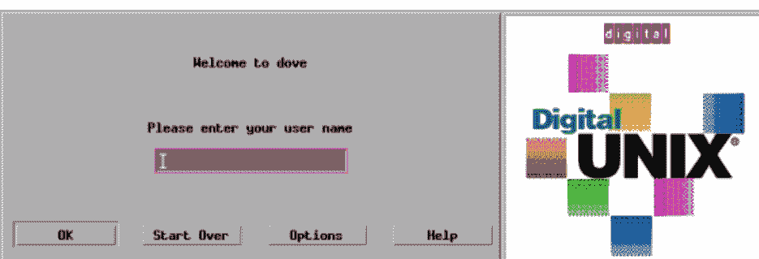

当登录管理器显示登录界面时，你有以下选项：

- 登录 CDE 会话。
- 登录安全会话 (`failsafe session`)。
- 安全会话提供一个终端窗口，以便你输入命令。

### 登录和注销系统

### 现在试一试！

要登录并退出 CDE，请执行以下步骤：

1. 输入你的名字并按回车键。
2. 输入你的密码并按回车键。
3. 点击前面板注销。

### 帮助

当你成功登录后，会话将启动桌面会话。如果你是第一次登录，将获得一个新的会话。如果登录管理器由于用户名或密码错误拒绝了你的会话，请重新开始并重新输入信息。

### 现在试一试！

要登录并退出安全会话：

1. 从选项菜单选择会话 (`Session`)。
2. 从子菜单选择安全会话 (`Failsafe`)。
3. 提供用户名和密码。
4. 注销。

### 帮助

当你提供用户名和密码后，会话管理器会打开终端窗口。你可以在提示符处执行命令。要退出命令行模式，在提示符处输入 `exit` 并按回车键。

### 使用不同语言登录

系统管理员设置系统的默认语言。如果系统中安装了多种语言，你可以在选项菜单选择不同的语言。此操作将为你的会话设置 `LANG` 环境变量。

## 登录系统

### 现在试一试！

使用不同语言登录和注销：

1. 在登录界面上的选项菜单选择语言 (`Language`)。
2. 选择包含你需要语言的语言组。
3. 设置语言。
4. 登录。
5. 点击退出控制或从工作空间菜单选择注销。

### 使用 CLI 登录

使用命令行解释器可以：

- 通过终端模拟器从另一个系统远程登录
- 从选项菜单使用安全会话

> 注意
>
> 本课程使用美元符号 (`$`) 作为 shell 提示符。shell 提示符符号是可以自定义的，在你的系统中可能不是美元符号。

### 现在试一试！

要登录和注销命令行会话：

1. 从登录界面面的选项菜单选择命令行登录 (`Command Line Login`)。
2. 输入你的名字并按回车键。
3. 输入密码并按回车键。密码不会显示在终端上。

```
登录界面消失，取而代之的是控制提示符：
login:
```

```
Last login: Mon Jun 15 10:07:00 ...
$
```

你会看到上次登录的日期和时间。可能还有欢迎消息。你现在进入系统，可以在 shell 提示符 (`$`) 下开始输入。

### 帮助

在某些系统中，你需要按几次回车键才能显示 `login:` 提示符。

如果你在登录过程中出错，系统会响应“登录错误”并并给你再次登录的机会。

## 会话类型

有两种会话：当前会话和主会话。

- 当前会话

当你登录系统时，会话管理器 (`Session Manager`) 会为你创建一个会话。这就是你的当前会话。如果你在会话期间更改了桌面特性，会话管理器会在注销时捕捉这些信息，并在登录时恢复它们。

- 主会话

主会话是你显式保存的会话。你可以选择让会话管理器在你登录时始终恢复主会话，而不是当前会话。

### 现在试一试！

要在登录时启动主会话：

1. 点击前面板上的样式管理器 (`Style Manager`) 控制。
2. 点击样式管理器中的“启动” (`Startup`) 控制。
3. 选择“返回主会话” (`Return to home session`)。
4. 点击“确定” (`OK`)。

你也可以在每次登录时通过在样式管理器的启动对话框中选择“退出时询问” (`Ask Me at Logout`)，在当前会话和主会话之间进行切换。

### 现在试一试！

要保存主会话：

1. 点击前面板上的样式管理器控制。
2. 点击样式管理器中的“启动”控制。
3. 在启动对话框中点击“设置主会话” (`Set Home Session`)。
4. 在弹出的确认对话框中点击“确定”。

## 选择密码

### 概述

当你获得系统账户时，你也会获得一个密码。当你第一次登录账户时，应该设置或更改密码。你的密码是保密的。一旦设置了密码，你就是唯一有权访问该账户的人。

## 选择密码

在选择密码时，不要：

- 选择字典中存在的单词
- 使用个人信息
- 使用你的默认（原始）密码
- 选择容易猜到或难以记忆的密码
- 写下你的密码

## 密码指南

密码可以包含非字母数字字符，以及字母和数字。你应该选择一个易于记忆但又不显而易见的密码。出于安全考虑，最好选择长度大于六个字符的密码。

密码：

- 必须包含至少五个字符
- 长度可以超过八个字符，但只有前八位会被识别
- 不能完全由小写字母组成；必须包含至少一个大写字母、一个数字或一个符号
- 应该频繁更改

## 更改密码

使用 `passwd` 命令更改你的密码。系统将提示你输入：

- 旧密码（以验证你的身份）
- 新密码
- 再次输入新密码（用于确认）

如果你在确认密码时出错，你的原始密码不会发生更改。

## 选择密码

密码确认确保你不会将密码设置为由于打字错误导致的未知单词——除非你连续犯两次相同的错误。

### 现在试一试！

将你的密码更改为独特的密码。记住这个密码！你将在整个课程的练习中使用它。

1. 在系统提示符处输入 `passwd` 命令：

```
n$ passwd
正在为 [username] 更改密码
```

2. 旧密码：输入你当前的密码。它不会显示在屏幕上。
3. 新密码：输入你的新密码。它不会显示在屏幕上。
4. 再次输入新密码：再次输入新密码。它不会显示在屏幕上。

## 一些实用提示

当你输入密码时，屏幕上不会回显（显示）。

如果你在输入旧密码时出错，系统会显示信息“Sorry（抱歉）”。

如果你在确认密码时出错，系统会显示信息“Mismatch – passwd not changed（不匹配——密码未更改）”。

如果发生这些问题，请重新输入 `passwd` 命令重新开始过程。

如果你忘记了密码，你的系统管理员可以为你重置。

Tru64 UNIX 入门 1-13

## 列出 Tru64 UNIX 文档

### 概述

Compaq 为每个 Tru64 UNIX 操作系统套件提供全套手册。这些文档以在线文档集的形式以及软件文档套件中的纸质版的形式提供。Tru64 UNIX 命令在参考页中也有记录。

Tru64 UNIX 文档也可以在万维网上获取：`http://www.UNIX.digital.com/faqs/publications/pub_page/pubs_page.html`

## 使用文档

在线文档存储在 Tru64 UNIX 文档 CD-ROM 中，采用可以使用 Web 浏览器读取的格式。要使用 Tru64 UNIX 操作系统随带的 Netscape 浏览器读取这些 HTML 文档，请从 CDE 应用程序面板启动 Netscape 软件。然后选择 Tru64 UNIX 主页上的文档链接。

Tru64 UNIX 文档集分为两类：

- 用户套件 (`End User Kit`)——适用于普通用户以及系统和网络管理员
- 开发套件 (`Developer's Kit`)——适用于程序员

## 用户套件

终端用户文档套件包含了安装和使用 Tru64 UNIX 系统所需的所有信息。该套件分为以下三个子包：

- 启动文档套件
  - 发布说明 (`Release Notes`)
  - 安装指南 (`Installation Guide`)
  - 更新安装快速参考卡
  - 技术概述 (`Technical Overview`)
  - 文档地图 (`Documentation Map`)
  - 快速参考卡 (`Quick Reference Card`)
  - 文档概述、词表和主索引 (`Documentation Overview, Glossary, and Master Index`)

- 系统和网络管理文档套件
  - 系统管理 (`System Administration`)
  - 性能管理器 (`Performance Manager`)
  - DECEvent 翻译与报告程序 (`DECEvent Translation and Reporting Utility`)
  - 系统配置与调 (`System Configuration and Tuning`)
  - 网络管理 (`Network Administration`)
  - X Window 系统管理员指南 (`X Window System Administrator's Guide`)
  - X Window 系统环境 (`X Window System Environment`)
  - 软件许可管理 (`Software License Management`)
  - 逻辑存储管理器 (`Logical Storage Manager`)
  - 内核调试 (`Kernel Debugging`)
  - Prestoserve 指南 (`Guide to Prestoserve`)
  - 局域网软件共享 (`Sharing Software on a Local Area Network`)

- 用户文档套件
  - 桌面环境：用户指南 (`Common Desktop Environment: User's Guide`)
  - 桌面环境：高级用户指南 (`Common Desktop Environment: Advanced User's Guide`)
  - CDE 伴侣 (`CDE Companion`)
  - 命令行用户指南 (`Command and Shell User's Guide`)
  - Windows 用户指南 (`windows User's Guide`)
  - 安全 (`Security`)

## 开发套件

开发者文档套件包含了为 Tru64 UNIX 开发应用程序的开发者信息。该套件由三个子包组成：

- 通用编程套件

该套件包含了关于编程语言、调试器、网络编程、国际化和标准的手册。

- Windows 编程套件

该套件包含了为 Tru64 UNIX 开发 Windows 应用程序的手册。

- 编写驱动程序套件

该套件包含了为 Tru64 UNIX 开发驱动程序的手册。

有关开发套件的完整列表，请参考 Tru64 UNIX 文档概述、词表和主索引。

## 使用在线文档

在线文档随操作系统提供，并以以下方式提供帮助：

- 帮助管理器

  一个显示系统注册在线帮助的特殊应用程序

- 应用程序帮助

  标准 CDE 应用程序特定的帮助

- 手动页查看器

  在 CDE 环境中查看 UNIX 参考页的应用程序

- 在线参考页

可以使用 `man` 命令从命令行查看参考页。[现在试一试！（尝试访问在线帮助。）

> 如果你运行的是安全会话，你应该有一个系统提示符。如果你运行的是 CDE，请点击个人应用程序中的终端。

在提示符处输入 `man date` 并按回车。

按空格键直到提示符返回。

## 总结

## 介绍 Tru64 UNIX 操作系统

Tru64 UNIX 是一个多用户、交互式的通用操作系统。它允许你在执行其他任务的同时运行多个程序。

Tru64 UNIX 是一个基于 OSF 操作系统的开放系统，称为 OSF/1。它具有 UNIX 的“外观和感受”。

### 描述用户界面

Tru64 UNIX 操作系统为用户提供了两种与之交互的方法：

- 图形用户界面 (`GUI`)

  适用于具有位图显示器的工作站用户

- 命令行界面 (`CLI`)

  适用于字符终端用户或终端模拟器

### 登录和注销系统

系统管理员必须先为你提供用户名和密码信息，你才能登录 UNIX 操作系统。

根据系统请求或提示输入信息。登录提示符根据使用的终端类型而异。

UNIX 对大写和小写字母敏感，并将它们视为不同的字符。本课程使用了两种类型的命令：

| 输入 | 输入命令并按回车 |
| --- | --- |
| 类型 | 输入字符但不按回车 |

- Tru64 UNIX 命令行由自定义符号（如 `$$`）指示。
- 使用 `exit` 命令注销系统。
- 使用 `passwd` 命令更改密码。保持密码保密。
- `man` 命令显示关于命令的信息。

## 摘要

## 选择密码

在选择密码时，请**不要**：

- 选择字典中找到的单词
- 使用个人信息
- 使用您的默认（原始）密码
- 选择易于猜想或难以记忆的密码
- 写下您的密码

## 列出 Tru64 UNIX 文档

Compaq 为每套 Tru64 UNIX 操作系统的套件都提供了一套完整的手册。文档可以通过在线文档集的形式提供，也可以通过软件文档套件 (`Software Documentation Kit`) 中的纸质版提供。Tru64 UNIX 命令在参考页中也有在线文档说明。

## 使用 CDE

## 单元概述

### 简介

公共桌面环境 (`CDE`) 是一种基于 X 窗口系统 (`X Window System`) 的新型行业标准。CDE 允许您使用鼠标或键盘启动应用程序并选择功能，而不是在命令行中输入长长的命令。

Microsoft Windows 和 Apple Macintosh 是其他图形用户界面，它们使用图标、菜单和鼠标提供与系统交互的窗口环境。

本单元将讨论如何使用 CDE 用户界面调用您系统中的桌面应用程序。

### 目标

为了使用桌面应用程序，您能够：

- 使用前面板 (`Front Panel`)
- 使用 CDE 和命令行 (`CLI`) 界面获取帮助
- 使用文本编辑器 (`Text Editor`) 创建和编辑文本文件
- 使用日历 (`Calendar`) 安排预约、制作事项列表、浏览其他日历并安排小组预约
- 使用终端模拟器应用程序执行 UNIX 命令
- 从 CDE 桌面运行应用程序

### 资源

有关本章主题的更多信息，请参考以下内容：

- 《公共桌面环境：用户指南》，第 3、4 和 6 章
- 《CDE 伴侣》，第 1 和第 3 章

## 使用 CDE 前面板

### 概述

当您开始 CDE 会话时，您会看到一个由工作区和一个包含控制的前面板组成的虚拟桌面。本节将讨论前面板的元素，并描述如何自定义桌面以满足您的需求。

### 前面板

前面板是一个特殊的窗口，包含以下控制：

- 启动应用程序
- 包含切换到其他工作区的按钮
- 显示系统状态
- 投放区域
- 可以包含子面板

前面板：

- 可以放置在桌面的任何位置
- 可以最小化
- 属于所有工作区
- 可以自定义

前面板包含主面板（包括工作区切换器）和子面板。

**图 2-1：** 前面板

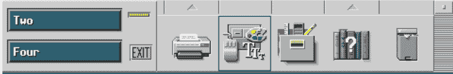

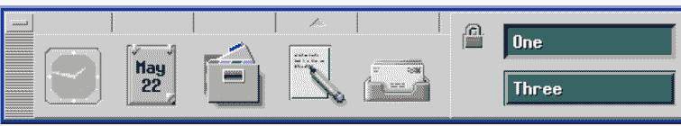

使用 CDE 前面板

## 工作区切换器

**工作区切换器**是前面板的一部分，包含：

- 从一个工作区切换到另一个工作区的按钮
- 锁定工作区的控制
- 退出系统的控制
- 显示系统活动的控制

每个工作区都可以根据特定用途进行自定义。例如，如果您正在处理两个不同的项目，可以为每个项目自定义一个工作区，包含您所需的文件和工具。

### 子面板

**子面板**是与控件关联的菜单。它通过控件上方的箭头按钮指示。子面板：

- 包含一个安装图标 (`Install Icon`) 以自定义子面板
- 包含一个带标签的前面板控件副本
- 可以删除或添加到前面板控件中

此图显示了一个个人应用程序 (`Personal Applications`) 子面板。

**图 2-2：** 子面板

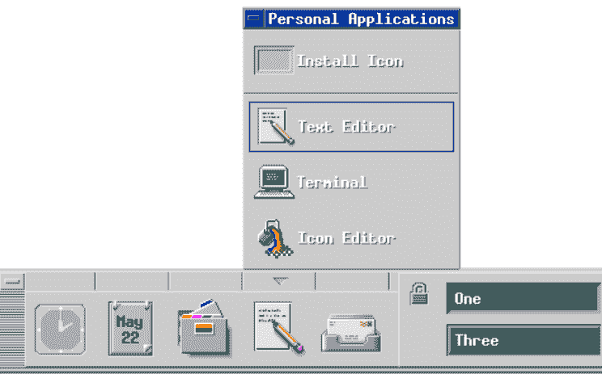

### 激活控件

下表描述了如何激活控件、子面板和弹出菜单。

表 2-1：激活控件

| 名称 | 动作 |
| --- | --- |
| 激活前面板 | 点击控件 |
| 激活子面板 | 点击控件上方的箭头 |
| 关闭子面板 | 点击控件左角的箭头 |
| 激活前面板弹出菜单 | 指向控件 |
| 切换工作区 | 点击控件 |
| 激活前面板 | 点击控件 |
| 切换工作区 | 点击 |

### 使用前面板控件

前面板包含多个控件，如图所示。

图 2-3：前面板控件


每个控件具有以下行为：

- 点击：点击控件时发生的情况
- 投放：将对象投放到控件时发生的情况
- 指示：控件显示的内容

## 使用前面板

下表显示了前面板每个控件的行为。

表 2-2：前面板控件

| 名称 | 点击行为 | 投放行为 | 指示行为 |
| --- | --- | --- | --- |
| 时钟 | 无 | 无 | 时间 |
| 日历 | 启动日历应用程序 | 投放文件打开日历 | 日期 |
| 文件管理器 | 启动文件管理器 | 投放文件夹打开文件管理器 | |
| 个人应用程序（文本编辑器） | 启动文本编辑器 | 在新的文本编辑器窗口中打开文件 | 无 |
| 邮件服务器 | 启动邮件服务器 | 无 | 邮件到达 |
| 锁定 | 锁定会话和键盘 | 无 | 无 |
| 工作区切换器 | 切换工作区 | 无 | 当前工作区 |
| 忙碌灯 | 无 | 无 | 系统执行操作时闪烁 |
| 退出 | 从会话注销 | 无 | 无 |
| 打印机（默认） | 显示打印机状态 | 打印文件 | 无 |
| 样式管理器 | 启动样式管理器 | 无 | 无 |
| 管理器 | 启动应用程序窗口 | 无 | 无 |
| 帮助管理器 | 启动帮助查看器 | 投放文件打开帮助查看器 | 无 |
| 垃圾桶 | 启动垃圾桶窗口 | 将文件移动到垃圾桶 | 空/非空 |

## 现在尝试！

此练习目的是让您熟悉前面板控件。

- 1. 点击每个控件并观察结果。点击时钟控件发生了什么？


## 使用 CDE 前面板

2. 点击控件上方的子面板指示器。

3. 点击最小化窗口按钮。

### 使用 CDE

4. 将前面板移动到不同的位置。

5. 点击工作区切换器并观察结果。

6. 点击帮助控件查找有关前面板的信息。

### 答案

1. 时钟控件和忙碌灯是指示器。时钟显示当前时间，忙碌灯在系统执行操作时闪烁。

2. 并非所有控件都有子面板。您可以在控件上添加或删除子面板。子面板并不固定在控件上，您可以将其放置在桌面的任何位置。

3. 点击最小化按钮后前面板关闭。双击图标即可恢复前面板。

4. 无特定答案。

5. `dtconsole` 窗口与主工作区相关。

6. 无特定答案。

## 个人应用程序控件

个人应用程序控件及其子面板包含常用的应用程序。子面板上有三个默认应用程序：

- 文本编辑器
- 终端
- 图标编辑器

文本编辑器是个人应用程序控件的默认应用程序，其图标显示在前面板上。

您可以通过将最常用的应用程序添加到子面板来自定义此控件。您还可以更改控件的默认应用程序。

此表显示了子面板控件的行为。

**表 2-3：个人应用程序子面板控件行为**

| 名称 | 点击行为 | 投放行为 | 指示行为 |
| --- | --- | --- | --- |
| 安装图标 | 无 | 安装拖入子面板的图标 | 无 |
| 文本编辑器 | 启动文本编辑器 | 在新的文本编辑器窗口中打开文件 | 无 |
| 终端 | 启动终端 | 无 | 无 |
| 图标编辑器 | 启动图标编辑器 | 在图标编辑器中打开位图或像素图文件 | 无 |

## 打印机控制

打印机控制包含以下默认子面板控件：

- 安装图标 (Install Icon)
- 默认打印机 (Default Printer)
- 打印管理器 (Print Manager)

此表显示了打印机子面板控件的行为。

**表 2-4：打印机子面板控制行为**

| 名称 | 点击行为 | 下拉行为 | 指示器行为 |
| --- | --- | --- | --- |
| 安装图标 | 无 | 在子面板上安装图标 | 无 |
| 默认打印机 | 显示默认打印机状态 | 在默认打印机上打印文件 | 无 |
| 打印管理器 | 开始打印 | 在默认打印机上打印文件 | 无 |

## 帮助控制

帮助控制及其子面板提供了访问 CDE 帮助程序的界面。此表显示了帮助子面板控件的行为。

**表 2-5：帮助子面板控制行为**

| 名称 | 点击行为 | 下拉行为 | 指示器行为 |
| --- | --- | --- | --- |
| 安装图标 | 无 | 在子面板上安装图标 | 无 |
| 帮助管理器 | 打开帮助查看器窗口 | 投放主卷文件 (`*.sdl`) 以打开它 | 无 |
| 桌面介绍 | 显示“介绍桌面” | 无 | 无 |
| 前面板 | 显示前面板卷 | 无 | 无 |

## 更改工作空间

工作空间是屏幕显示区域。通过工作空间，你可以设置多个工作区域。例如，一个工作空间可以管理邮件，另一个用于项目管理，以此类推。

你可以点击工作空间按钮切换到另一个工作空间。每个工作空间都有弹出菜单，允许你添加、删除或重命名工作空间，并获取工作空间的帮助。

默认工作空间数量为四个。你的系统管理员会在系统范围内设置。你可以根据需要添加更多工作空间。

## 获取帮助

### 概述

CDE 提供以下帮助方式：

- 使用上下文敏感的帮助键
- 在应用程序的帮助菜单中
- 通过帮助管理器
- 通过帮助页查看器 (Man Page Viewer)

在 CLI 中，你可以通过发布 `man` 命令获取帮助。

本节将介绍如何使用这些方法来获取帮助。

### 使用帮助键

CDE 提供上下文敏感的帮助。按下帮助键（或功能键 `F1`），你正在使用的应用程序将显示与高亮窗口、按钮或对话框相关的最合适主题。帮助键是选择菜单或对话框中帮助的快捷键。

### 使用应用程序的帮助菜单

大多数应用程序都有一个帮助菜单，其中包含：

- 帮助主题的概览
- 大多数应用程序操作的任务说明
- 窗口、对话框、菜单和应用程序资源的参考摘要
- 所在帮助，允许你点击某项并查看该项的描述
- 关于如何使用帮助窗口的帮助
- 提供应用程序版本信息和版权信息的帮助

### 使用帮助管理器

点击前面板帮助管理器控件显示在线帮助。

帮助查看器窗口显示主题树。点击某个主题以显示相关的帮助信息。帮助管理器会构建你的访问历史。选择回溯 (Backtrack) 按钮可以返回上一个主题。

帮助系统显示主主题或所选主题的帮助。在此显示中，超文本允许你跳转到相关的帮助主题。

#### 获取帮助

**图 2-4：帮助查看器**

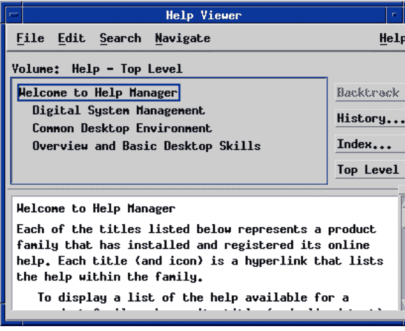

“使用帮助”主题提供了如何获取帮助的信息。

**图 2-5：关于帮助的帮助**

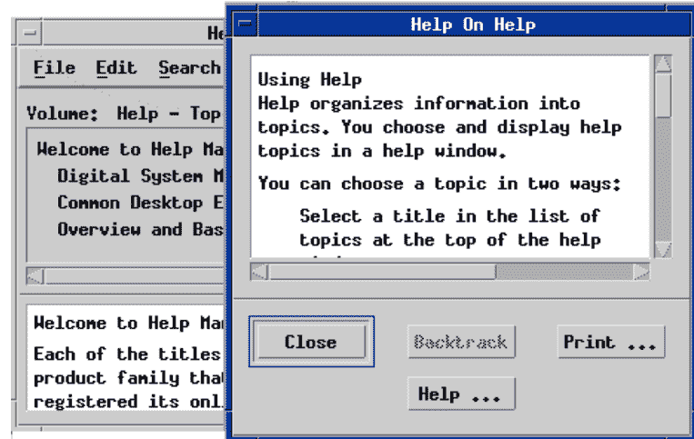

### 现在试试看！

探索在线帮助：

1. 点击前面板上的帮助管理器。
2. 点击超文本通用桌面环境 (Common Desktop Environment)。
3. 点击超文本介绍桌面 (Introducing the Desktop)。
4. 点击回溯按钮。
5. 点击索引（Index）按钮。这提供了搜索功能。
6. 点击带有条目（Entries with）按钮并输入 Front Panel。
7. 点击所有卷（All Volumes）按钮。
8. 点击开始搜索（Start Search）。它应该显示几条条目。
9. 你可以继续探索帮助管理器。在文件菜单上选择关闭退出帮助。

## 使用帮助页查看器

从应用程序管理器 — Desktop_Apps 窗口选择帮助页查看器来查看传统的手册参考页。双击帮助查看器图标，系统会提示你输入参考页。

**图 2-6：帮助页查看器**

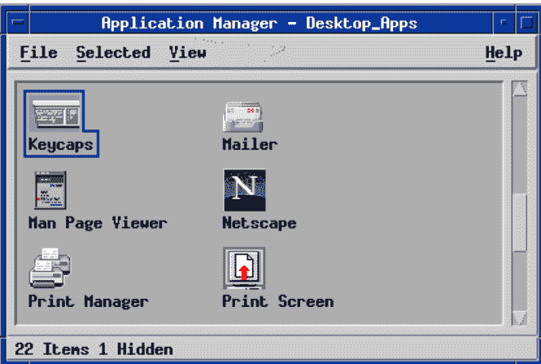

下一图显示了 `ls` 参考页的显示。

**图 2-7：获取 ls 命令的帮助**

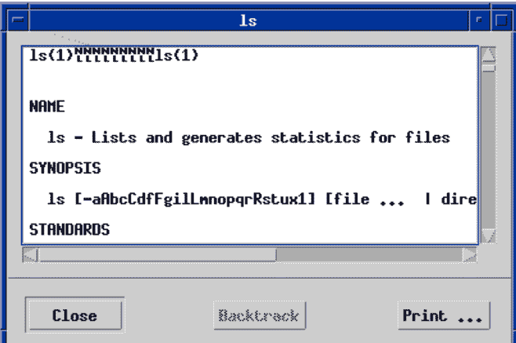

## 使用 CLI man 命令

当你在终端窗口中使用命令行界面工作时，你可以通过使用 `man` 命令访问标准参考页。

## 参考页的组织

参考页根据功能组织成章节，如下所示。

**表 2-6：man 参考页**

| 章节 | 主题 |
| --- | --- |
| man (1) | 所有用户都可以输入的命令 |
| man (2) | 操作系统程序接口 |
| man (3) | 子程序 |
| man (4) | 头文件、程序文件和某些系统文件 |
| man (5) | 杂项主题 |
| man (7) | 文本处理宏包 |
| man (8) | 系统维护和操作 |

注意：没有 man(6) 章节，某些 UNIX 记录在系统中。因此，`cat(1)` 意味着命令在第 1 节。你可能需要指定章节。

## 使用 man 命令

当你在终端窗口中使用命令行界面工作时，你可以通过 `man` 命令访问标准参考页。

`man` 命令提供特定命令的信息。例如，要获取密码命令的帮助，输入 `man password`。帮助信息一次显示屏。

- 按回车键显示更多信息
- 按空格键显示一屏信息
- 按 `Q` 或 `q` 停止显示信息并返回命令行提示符

进入 `man` 显示密码命令的参考页，如下所示。

**示例 2-1：使用命令**

```
$ man password
password(1)          OSF
NAME
    password, chfn, chsh - 密码
SYNOPSIS
    password [-f|s] [username]
    fn [username]
    sh [username]
DESCRIPTION
password 命令更改或安装与你的用户（默认）或指定用户相关的密码。chfn 命令更改你的用户或指定用户的 GECOS 信息。chsh 命令更改用户或指定用户的登录 shell。
FILES:
    /etc/passwd 包含用户信息。
    /etc/shells 允许的 shell 列表。
REFERENCES
Commands: finger(1), login(1).
FILES: password(4).
```

## 使用 apropos 获取相关命令

`apropos` 命令列出与特定主题相关的命令。例如，要列出与密码相关的命令，输入 `apropos password`。

`man -k` 命令等效。

## 使用 help 命令

Tru64 UNIX 命令行界面没有帮助功能。但是，如果你输入 `help` 命令，系统会提供简要的有用命令列表及其功能，如下例。

**示例 2-2：help 命令的输出**

```
$ help
```

命令：

`man -k keyword` 列出与关键词相关的命令

`man command` 打印命令的手册页

其他基本命令有：

`cat` - 合并文件（并将其打印出来）

`vi` - 文本编辑器

`finger` - 用户信息查询程序

`ls` - 列出目录内容

`mail` - 发送和接收邮件

`passwd` - 更改登录密码

`sscshelp` - 查看源码控制系统信息

`tset` - 设置终端模式

`who` - 谁在系统中

`write` - 向另一个用户写入内容

你可以通过命令找到关于邮件的程序：`man -k mail`

通过 `man mail` 打印 man 命令文档

你可以输入 "exit" 退出登录。

```
$
```

## 使用文本编辑器

### 概述

前面板上的文本编辑器（`dt_pad`）是一个基础文本编辑器，允许你结合使用键盘和鼠标执行文件创建和编辑功能。编辑器的某些功能包括：

- 用于编辑和文件操作的下拉菜单
- 简单格式化
- 查找和替换
- 拼写检查
- 显示光标所在行号位置的状态行，以及通过行号定位光标的能力
- 如果文本编辑器异常终止，自动保存编辑会话
- 撤销编辑操作
- 覆盖模式
- 自动换行适应窗口功能

本主题介绍了文本编辑器，并展示了如何使用其中的某些功能。

### 启动文本编辑器

点击前面板上的文本编辑器控件，它将显示文本编辑器主窗口，其中包含标题、菜单、滚动条以及可选的状态行。

**图 2-8：文本编辑器的主窗口**

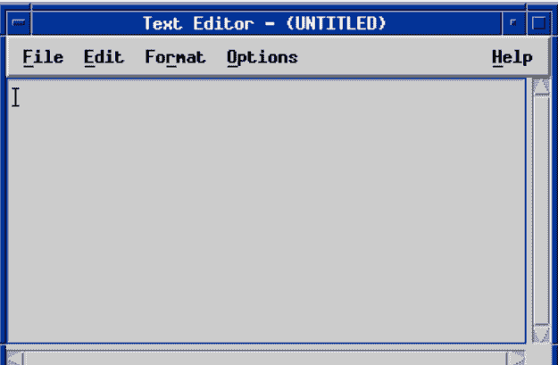

标题栏显示当前文档的名称。如果是新文档，标题栏将显示（UNTITLED）。

菜单栏通过下拉菜单提供编辑功能，包括文件访问、格式化和选项更改功能。

文本区域是你输入文档文本的地方。对于新文档，此区域是空白的；如果读取现有文档，它将显示在这里。

在窗口底部，你可以选择性地显示状态行，该行显示：

- 包含插入点的行号
- 文档的总行数
- 文本编辑器消息
- 如果编辑器处于覆盖模式，则显示覆盖指示

### 输入文本

当文本编辑器启动时，它会为你提供一个名为“UNTITLED”的新文档，插入光标位于窗口顶部，等待你输入文本。插入光标的形状像字母“I”，它始终显示显示输入文本的当前位置。状态行指示文件中的行号。

**图 2-9：在文本编辑器中输入文本**

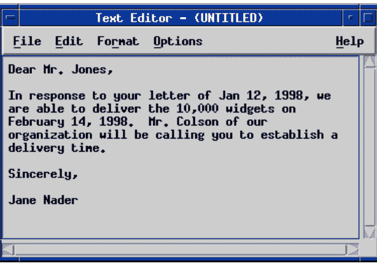

要输入文本，点击文档并开始打字。默认情况下，文本编辑器处于插入模式，因此文本将从光标位置开始插入。

如果你选择覆盖模式，当把光标置在文本行内时，任何新文本将覆盖从光标位置开始的行中的现有文本。按 `Insert` 键可以在插入模式和覆盖模式之间切换。

按 `Return` 键开始新的一行。

当文本编辑器的“自动换行适应”（Wrap To Fit）选项开启时，文本将在窗口边缘自动换行。要使用此功能，你必须按 `Return` 键强制换行或创建新段落。如果你使用了自动换行适应选项，可以调整文本编辑器窗口的大小，文本会自动调整适应新的宽度。

### 移动光标

你可以使用鼠标或方向键插入光标。

- 要用鼠标移动光标，将指针移动到文本中的新位置并按下 MB1。
- 使用方向键或以下操作：

| 键位 | 动作 |
| :--- | :--- |
| Home | 移动到当前行首 |
| End | 移动到当前行尾 |
| Ctrl/Home | 移动到文档开头 |
| Ctrl/End | 移动到文档末尾 |

### 使用文本编辑器

你可以使用鼠标或键盘查看当前视图之外的文本。

- 使用鼠标，拖动垂直或水平滚动条以查看更多文本或更长的行。
- 使用 `PageUp` 和 `PageDown` 键向上或向下滚动一页。

你也可以使用状态行移动光标。显示状态行后，按 `Ctrl/G` 或点击状态行中的 Line（行号）字段。输入你想跳转的行号并按 Enter。

### 选择文本

你可以使用鼠标或键盘选择文本。

- 使用鼠标选择文本：按下并拖动 MB1 以高亮文本。

你也可以通过以下方式使用鼠标选择文本：

- 双击选择单词
- 三击选择整行
- 四击选择所有文本

要使用键盘选择文本块，将光标移动到文本块开头，按住 `Shift` 键并使用方向键将光标移动到文本块末尾。

### 编辑文本

编辑菜单提供以下编辑功能：

- 剪切和粘贴
- 删除文本
- 查找并更改文本
- 检查拼写

### 查找和更改文本

使用编辑菜单中的“查找/替换”（Find/Change）功能搜索字符字符串，并将该字符串替换为另一个字符字符串。

图中显示了查找/替换对话框。当你点击 Find（查找）按钮时，文本编辑器会搜索对话框中 Find 输入框内的字符字符串。如果文本编辑器找到了匹配的字符字符串，你可以点击 Change（更改）或 Change All（全部更改），将找到的字符串（以及所有出现处）更改 To（目标）输入框中的字符串。

**图 2-10：查找并替换文本**

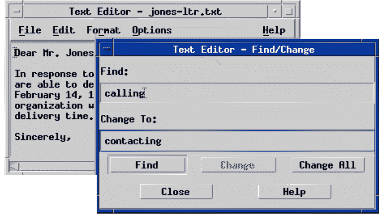

你也可以使用此功能查找文本而不执行替换操作。

### 使用拖放

你可以使用文本编辑器的拖放功能。

要使用拖放从文档内部移动文本，请遵循以下步骤：

1. 选择要移动的文本。
2. 将文本拖动到你想插入的位置。
3. 松开鼠标键。

使用拖放包含文件：

1. 在文件管理器中点击文件。
2. 将其拖入文本编辑器窗口。

### 保存你的工作

编辑菜单如图所示，提供了访问：

- 创建新文档
- 打开现有文档
- 包含另一个文件
- 保存文档到文件
- 使用新名称保存
- 打印文档
- 关闭应用程序

在结束文本编辑器会话之前，你必须将文档保存到文件，否则工作将丢失。工作期间应定期保存文档。如果应用程序中断，文本编辑器执行自动保存。

## 恢复文件

文本编辑器会在你的文件夹中创建一个恢复文件。

要恢复文件：

1. 启动文本编辑器。
2. 打开恢复文件。
3. 使用原始名称或新名称保存文档。

## 现在尝试！

启动文本编辑器并尝试以下操作：

1. 在选项菜单中选择自动换行适应。
2. 从课程书中输入两个段落。每个段落后按 Return。
3. 使用鼠标选择第一句。
4. 使用拖放将其复制到末尾。
5. 将文档保存到文件。

### 需要帮助？

使用帮助菜单访问在线帮助。

编辑器启动时处于插入模式，你可以直接在屏幕的文本输入区域开始打字。

在拖动时按住 `Ctrl` `MB1` 可以复制。

## 使用日历

日历可以显示以下视图：

| 视图 | 说明 |
| --- | --- |
| 日视图 | 显示一天的预约安排 |
| 周视图 | 显示一周的预约安排 |
| 月视图 | 显示一个月的预约安排（缩略） |
| 年视图 | 不显示预约安排 |

### 日视图

该视图显示一天的预约安排。视图左侧显示包含 3 个月的日历，包括上个月、本月和下个月。如果你点击 3 个月日历中的某一天，该日期将成为显示中的当前日期。

你可以通过点击微日历中的月份名称来切换到不同的月份（月视图）。

**图 2-13：日视图**


### 周视图

日历的周视图显示：

- 一周的预约安排
- 显示已计划（阴影区域）和可用（无阴影）时间的周网格
- 高亮选中的日期

如果你点击周视图中的日期名称，日历显示将切换到日视图。

**图 2-14：周视图**


### 月视图

日历的月视图显示一个月内的预约安排。你可以点击月视图中的日期数字将显示切换到日视图。

**图 2-15：月视图**


### 年视图

在年视图中，不显示预约安排。如果你点击月份名称，日历将在月视图中显示选定的月份。

**图 2-16：年视图**


### 尝试一下！

1. 点击日历控制面板启动日历。
2. 通过选择“视图”（View）菜单中的选项来切换视图。
3. 点击工具栏右侧的视图按钮切换视图。
4. 点击工具栏上的右箭头显示月视图并显示到下个月。
5. 点击工具栏上的“今天”（Today）按钮显示日视图并显示今天的预约安排。

### 需要帮助？

点击“帮助”（Help）菜单访问在线帮助。工具栏上的按钮从左到右依次是：日、周、月、月视图、年视图。

## 添加预约

你可以通过在周视图或月视图中双击相应的日期来添加预约信息，或者在日视图中双击时间段来添加。

日历会弹出预约编辑器窗口。此图显示了预约编辑器的扩展版本，当点击“更多”（More）按钮时就会出现。

**图 2-17：日历：预约编辑器**

## 查看预约列表

要查看你的预约列表，从“视图”菜单中选择“预约列表”（Appointment List）。此图反映了典型的输出结果。


图 2-18：查看预约列表


### 尝试一下！

1. 创建以下预约：
   - 本周周一至周五你有课，时间从上午 9 点到下午 5 点。
   - 下周一上午 10 点你有一个 1 小时的项目状态会议。
2. 查看你的预约列表。

### 需要帮助？

在周视图或月视图中查看你在做什么会更简单。双击日期打开预约编辑器。在填写好课程预约后，你可以编辑日期或使用“更多”按钮填写本周剩余的安排。

## 创建待办事项列表

为了管理你的日常任务，日历提供了待办编辑器（To Do Editor），供你创建和管理行动事项列表。要创建待办事项列表，点击工具栏上的待办编辑器（或“编辑”（Edit）菜单中的“待办”选项）。

此图显示了待办窗口，你可以在其中为待办事项列表输入信息。

图 2-19：创建待办事项列表


要查看你的待办事项列表，从日历的“视图”菜单中选择“待办列表”（To Do List）。此图显示了一个待办事项列表示例。

图 2-20：待办事项列表


### 尝试一下！

1. 创建并查看待办列表。
2. 点击日历工具栏上的待办编辑器图标。
3. 输入下周一上午 10 点的截止日期。
4. 在“内容”（What）字段中输入：编写项目状态报告。
5. 点击“插入”（Insert）。
6. 点击“取消”（Cancel）关闭待办编辑器。
7. 在“视图”菜单上选择“待办列表”。

### 需要帮助？

点击“帮助”菜单访问在线帮助。你也可以通过选择“编辑”菜单中的“待办”来打开待办编辑器。

## 打印日历视图和列表

当你需要日历的纸质副本时，可以通过日历的“文件”（File）菜单选择“打印”（Print）来打印视图或列表。打印对话框允许你指定：

- 打印机名称
- 打印份数
- 报告类型：日、周、月、预约列表或待办列表
- 日历日期范围
- 其他打印选项
- 打印到文件

图 2-21：日历：打印对话框


## 自定义日历

在“文件”菜单上选择“选项”（Options）打开对话框。你可以通过以下方式自定义日历：

- 更改日期
- 更改设置
- 授予或拒绝对日历的访问
- 设置默认视图

图 2-22：日历：选项窗口


## 向浏览列表添加名称

要向浏览列表添加名称，请执行以下步骤：

1. 从“浏览”（Browse）菜单中选择“编辑器”（Menu Editor）。
2. 如图所示在“用户名”（User Name）字段中输入日历名称。
3. 点击“添加”（Add）。
4. 点击“确定”（OK）将日历添加到浏览列表并关闭编辑器。

图 2-23：日历：编辑器


## 访问其他日历

使用以下步骤判断你是否有访问日历的权限：

1. 从“浏览”菜单中选择“比较日历”（Compare Calendars）。
2. 如图所示选择一个或多个项目以检查权限。
3. 点击“安排”（Schedule）打开分组编辑器。

图 2-24：日历：比较日历


图 2-25：日历：分组编辑器


4. 检查日历访问列表中的“访问”（Access）列；`Y` 表示你有插入权限，`N` 表示你没有。如果你有插入权限，则可以插入分组预约。

## 显示其他日历

要显示另一个用户的日历，在如图所示的“浏览”菜单上选择“显示其他日历”（Show Other Calendar）。你需要输入日历名称。

图 2-26：显示其他日历


## 使用终端

### 概述

CDE 提供了一个终端仿真器窗口，您可以在其中使用 UNIX 命令行界面输入命令。桌面的默认仿真器是 `dtterm`。终端（Terminal）应用程序支持为符合 ANSI 和 ISO 标准字符终端（如 DEC VT220）编写的遗留应用程序。

您的系统管理员可能会提供其他终端仿真器供您使用。

本主题讨论了如何使用桌面的默认终端仿真器 `dtterm`。

### 启动终端

当您点击个人应用程序（Personal Applications）子面板中的终端控制按钮时，终端将显示其主窗口，如图所示。

图 2-27：终端的主窗口

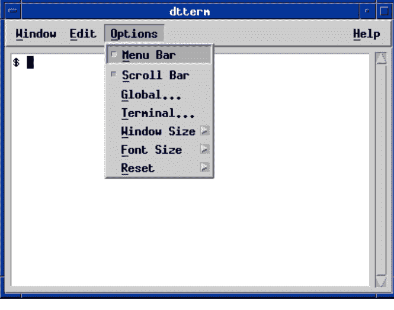

当终端仿真器提供提示符时，您可以输入命令来启动应用程序、发布命令或在窗口之间执行复制和粘贴操作。

### 启动应用程序

要启动应用程序，您必须在命令行提示符处输入命令。命令的语法如下：

`application [options] &`

其中 `application` 是您想要运行的应用程序名称，`options` 是以参数或开关形式传递给应用程序的信息。

请查看参考页或在线帮助，以查找可以在命令行上为您的应用程序提供的信息类型。

安培符号 (`&`) 指定您希望应用程序在后台运行。这允许您在应用程序运行时继续在终端窗口中输入命令。

此图显示了如何运行时钟程序 `xclock`。`-digital` 开关告诉时钟程序您想要一个数字钟而不是模拟时钟。

**图 2-28：在终端中启动应用程序**

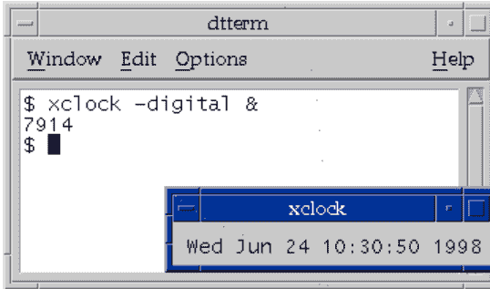

在按下 Return 键输入命令后，`xclock` 应用程序将在单独的窗口中显示日期，您可以将其放置在桌面任意位置，而 `dtterm` 窗口准备好接收另一个命令。

### 尝试一下！

使用终端应用程序在后台启动 `xclock` 应用程序。

### 需要帮助？

如果收到消息 `xclock: not found`，请使用 `/usr/bin/X11/xclock` 命令。

### 解决方案

1. 点击个人应用程序子面板上的终端控制按钮。
2. 输入 `xclock &`。

### 输入命令

此图显示了如何使用 `ls` 命令列出目录中的文件。

图 2-29：在终端中输入命令

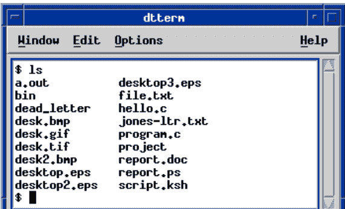

查看参考页获取命令的语法信息。您可以使用 CDE 帮助系统阅读参考页。

### 现在尝试一下！

使用终端应用程序执行 `ls` 命令。输入 `man` 命令读取关于 `ls` 命令选项的内容。

### 解决方案

1. 点击个人应用程序子面板上的终端控制按钮。
2. 输入 `ls`。

### 复制和粘贴文本

要复制终端窗口内的文本，可以使用鼠标：

1. 使用 MB1 拖动鼠标覆盖所需的文本。
   结果：文本被高亮
2. 当所需的文本被高亮时释放 MB1。
   结果：高亮文本移动到剪贴板。在您执行新的复制操作之前，该文本可用于粘贴操作。
3. 在您想插入文本的地方点击 MB2。
   结果：高亮文本出现在粘贴位置。

### 自定义终端

您可以使用以下项自定义终端窗口：

- 选项菜单
- 全局选项对话框
- 终端选项对话框

#### 使用选项菜单

通过终端的选项菜单，您可以更改以下终端特性。

- 移除/恢复菜单栏。
  如果您删除了菜单栏，要恢复它，请点击终端窗口任意位置的 MB3 显示弹出菜单。从选项菜单中选择“菜单栏”。
- 移除/恢复滚动条。
- 将窗口调整为 80 字符乘 24 行或 132 字符乘 24 行。
- 更改窗口内文本使用的字体大小。

#### 设置全局选项

通过从选项菜单选择“全局（Global）”，您可以更改以下特性：

- 更改光标样式、闪烁和闪烁频率。
  光标样式为方框或下划线。您可以启用或禁用光标闪烁。如果启用闪烁，默认闪烁频率为 250 毫秒，您可以更改它。
- 切换前景颜色和背景颜色。
  您可以选择“正常（Normal）”，按照常显示前景和背景颜色，或选择“反转（Inverse）”，切换前景和背景颜色。
- 设置滚动行为。
  您可以启用或禁用平滑滚动。启用平滑滚动后，每行都会立即到终端窗口，而不是在缓冲区中滚动行。默认是禁用平滑滚动（一次滚动一页）。
- 设置蜂铃类型。
  您可以选择“听觉（Audible）”（默认），使蜂铃发出声音；或“视觉（Visible）”，使蜂铃闪烁背景颜色。
- 设置边距和距离。
  您可以启用或禁用视觉或声音指示，提示光标位于右边界的指定距离内。当您启用此功能时，应设置从右边界开始的字符数（默认为 10）。

**图 2-30：全局选项框**


#### 设置终端选项

通过从选项菜单中选择“终端（Terminal）”，您可以更改键盘和屏幕的行为。终端选项对话框允许您更改以下：

- 光标键：在普通模式下，箭头键向左、右、上、下移动光标。在应用程序模式下，箭头键生成应用程序解释的转义序列（控制序列）。
- 数字模式：数字键盘产生相应的数字。
- 换行序列：Return（默认）在行尾产生回车。用户功能：锁定或解锁（默认）用户键。
- 132 列切换：启用时，当活动应用程序切换到 132 列时，系统会自动扩大窗口。当禁用此功能（默认），系统不会自动扩大窗口。
- 行尾换行：启用时，到达行尾时字符将换到下一行。当禁用时，文本不换行。
- 反向行尾换行：这控制行尾退格的行为。如果启用，到达行尾时退格会自动换到上一行。如果禁用，则不发生换行。

图 2-31：终端选项框


#### 重置控制字符

使用 Ctrl 键与其他键组合来执行特定功能。例如，`Ctrl/C` 取消当前操作并显示命令提示符。

表所示了登录管理器设置的控制字符默认设置。

### 表 2-7：终端控制字符

| 键 | 控制名称 | 功能 |
|---|---|---|
| `Ctrl/H` | erase | 退格：删除字符 |
| `Ctrl/C` | intr | 中断：取消当前操作并显示命令提示符 |
| `Ctrl/U` | kill | 停止操作或应用程序 |
| `Ctrl/Q` | start | 接受键盘输入；继续已暂停的应用程序 |
| `Ctrl/S` | stop | 不接受键盘输入；暂停应用程序 |
| `Ctrl/@` | swtch | 在 shell 中切换层 |

终端（`dtterm`）仿真终端。对于您正在使用的实际硬件或其他终端仿真器，控制设置可能会不同。您可以使用 `ttyModes` 资源更改控制字符的设置。

该语句的语法为：

`ttyModes: controlname ^key`

例如：

`ttyModes: erase ^H int ^C kill ^U start ^Q ^S swtch ^@`

设置终端控制字符：

1. 将 `ttyModes` 资源添加到主目录下的 `.Xdefaults` 文件中。
2. 双击应用程序管理器中 `Desktop_Tools` 应用程序组中的重载资源图标。

## 运行应用程序

### 概述

CDE 提供了多种调用应用程序的方法，为您使用系统提供了极大的灵活性。

您可以从应用程序管理器（Application Manager）、文件管理器（File Manager）、前面板（Front Panel）以及终端模拟器应用程序调用应用程序。本主题将讨论如何使用应用程序管理器和文件管理器运行应用程序。

### 使用应用程序管理器

前面板上的应用程序管理器控件提供了系统上可用的一些常用工具和应用程序。您在那里找到的应用程序要么是内置在桌面中的，要么是由您的系统管理员配置的。

当您点击应用程序管理器控件时，系统会显示一个特殊文件夹的文件管理器视图，如图所示。

图 2-32：应用程序管理器文件夹

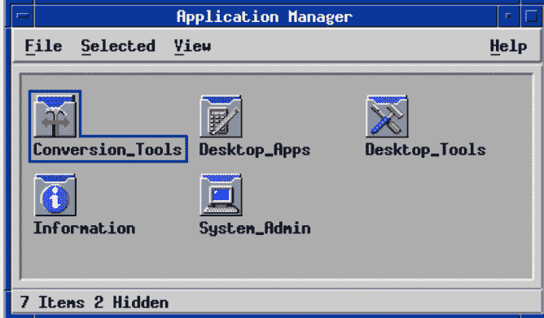

这不是普通的文件夹，因为文件和文件夹不是直接创建在其中的。当您登录时，它们会自动收集到此位置。

这些文件夹的内容可能包括应用程序文件、示例数据文件和 Readme 文件。

### 已注册应用程序组

**已注册应用程序**是您的系统管理员使用应用程序注册过程注册的应用程序。该过程让桌面感知某个应用程序的存在。

应用程序管理器中的每个应用程序组在您每次登录时进行收集。该应用程序组可能位于您的系统或网络中的其他系统中。

由于应用程序管理器每次登录时都会收集这些应用程序，根据您的系统管理员的工作，应用程序管理器可能会显示不同的应用程序集合。

### 内置应用程序组

桌面提供了此处所示的内置应用程序组。

| 应用程序 | 描述 |
| --- | --- |
| `Desktop_Apps` | 如计算器、Netscape 和文本编辑器等应用程序 |
| `Desktop_Tools` | 管理和操作系统工具，如归档、vi 文本编辑器和拼写检查 |
| `Information` | 代表常用帮助主题的图标 |
| `System_Admin` | 用于管理系统的工具 |

当您在应用程序管理器文件夹中双击 `Desktop_Apps` 图标时，系统会显示 `Desktop_Apps` 文件夹的内容，如下所示。该文件夹包含了计算器和 Man Page（帮助页）应用程序等实用程序。

### 图 2-33：Desktop_Apps 应用程序组的内容

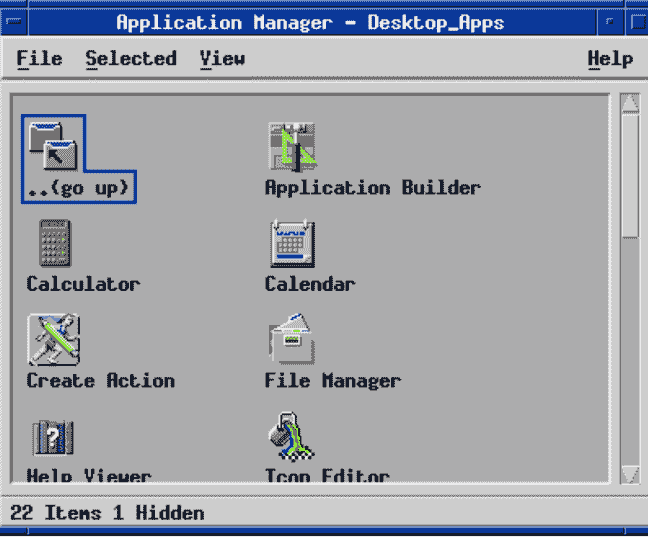

您可以通过双击图标来启动任何应用程序。

### 从应用程序管理器运行应用程序

要激活应用程序：

1. 点击前面板上的应用程序管理器。
2. 双击应用程序组的图标以显示其内容。
3. 双击应用程序的动作图标。

### 现在试一试！

从应用程序管理器启动计算器应用程序。

1. 点击前面板上的应用程序管理器。
2. 双击 `Desktop_Apps` 控件。
3. 双击计算器控件。

### 需要帮助吗？

只有前面板上的控件需要单单击。其余部分必须双击。

### 解决方案

计算器应该打开了。

### 获取应用程序帮助

您可以通过在应用程序图标上使用 MB3 并在弹出菜单中选择“帮助”来获取有关应用程序的信息。您也可以从帮助菜单中选择“帮助”。

### 将应用程序添加到前面板

如果您频繁使用应用程序管理器中的某个应用程序，可以将应用程序图标放置在前面板控件的任何子面板上。

要将应用程序添加到子面板：

1. 点击前面板上的应用程序管理器。
2. 双击应用程序组的图标以显示其内容。
3. 选择您想要安装的应用程序图标。
4. 将图标拖到您希望放置应用程序的子面板上的安装控件上。

### 将应用程序添加到工作区

您可能需要频繁访问某个应用程序，但不想将其放置在前面板上。您可以将应用程序放置在工作区背景上，当您没有打开应用程序管理器窗口时，它可用。

要将应用程序放在工作区：

1. 打开包含您想添加到工作区的应用程序的应用程序组。
2. 将应用程序图标从应用程序管理器拖到工作区背景上。

### 使用文件管理器运行应用程序

某些应用程序可能配置为使用应用程序的任何数据文件从文件管理器启动。例如，双击 PostScript 查看器会启动并显示该 PostScript 文件。

要从文件管理器启动应用程序，请执行以下操作之一：

- 双击应用程序数据文件
- 选择应用程序数据文件并从图标的弹出菜单中选择“打开”

### 现在试一试！

从文件管理器打开一个文件。

### 运行应用程序

1. 点击前面板上的文件管理器控件。
2. 输入 `/etc` 文件路径。
3. 找到 `hosts` 文件。它看起来像一封打字信（文本文件）。
4. 双击 `hosts` 文件图标。

### 需要帮助吗？

选择帮助菜单以访问在线帮助。

### 解决方案

`hosts` 文件应该在文本编辑器中显示。

## 总结

### 使用前面板

CDE 桌面由：

- 前面板（Front Panel）——带有启动应用程序控件的特殊窗口
- 工作区（Workspace）——屏幕显示区域

控件具有一个或多个行为：

- 点击
- 释放

### 获取帮助

CDE 提供：

- 场景敏感型帮助
- 应用程序帮助菜单中的帮助
- 通过帮助管理器
- 通过帮助页（Man Page）

### 使用文本编辑器

文本编辑器允许您执行文件创建和编辑，并具有以下功能：

- 拖放
- 查找并更改
- 拼写检查
- 简单格式化

### 使用日历

日历是一个用于计划安排预约、创建待办事项列表、浏览其他日历的桌面应用程序。

### 总结

日历显示以下视图：

- 天显示一天的安排
- 周显示一周的安排
- 月显示一个月的安排
- 年不显示

### 使用终端

终端应用程序允许您运行应用程序和命令，并使用命令行解释器执行复制和粘贴操作。

### 运行应用程序

应用程序管理器提供了系统上可用的一些常用工具和应用程序。这是登录时收集的内置和注册应用程序组的特殊视图。双击应用程序即可启动它。

您可以通过双击数据文件从文件管理器运行应用程序。

# 自定义您的工作区

## 单元概述

### 简介

本单元解释了如何根据个人喜好设置和自定义 CDE 工作区。它还描述了如何使用 CLI（命令行）设置终端以正常运行。

### 目标

为了高效使用工作站或终端，您应该能够：

- 自定义前面板和工作区
- 自定义屏幕外观和系统行为
- 自定义终端和键盘设置

### 资源

有关本单元主题的更多信息，请参考：

- Common Desktop Environment：用户指南
- CDE 伙伴第 4 章
- Tru64 UNIX 参考页

## 自定义工作区

### 概述

CDE 允许您自定义桌面。本节解释了如何更改前面板和工作区。


### 自定义前面板

您可以通过以下方式修改前面板：

- 字体
- 向子面板添加控件
- 切换前面板和子面板控件
- 添加和删除子面板

### 现在试一试！

向个人应用程序子面板添加新应用程序。

1. 点击应用程序管理器控件。
2. 双击 `Desktop_Apps` 控件。
3. 打开个人应用程序子面板。
4. 将计算器图标拖放到安装控件上。

### 现在试一试！

将前面板上的文本编辑器应用程序替换为个人应用程序子面板上的终端控件。

1. 打开个人应用程序子面板。
2. 指向终端控件。
3. 按 `MB3`。
4. 从弹出菜单中选择“复制到主面板”。

## 修改工作区

您可以修改工作区切换器：

- 添加工作区
- 删除工作区
- 重命名工作区
- 添加控件

### 现在尝试一下！

为工作区切换器添加一个新的工作区并对其重命名。

1. 指向工作区切换器的空白区域。
2. 按 `MB3`。
3. 从弹出菜单中选择“添加工作区”（Add Workspace）。
4. 指向新的工作区。
5. 按 `MB3`。
6. 从弹出菜单中选择“重命名”（Rename）。
7. 编辑工作区按钮使其显示为：Video Project（视频项目）。

### 现在尝试一下！

要删除工作区：

1. 指向工作区按钮。
2. 按 `MB3`。
3. 从弹出菜单中选择“删除”（Delete）。

如果工作区包含窗口，这些窗口将移动到下一个工作区。

## 使用样式管理器

### 概述

本节讨论了如何使用样式管理器来更改：

- 通过更改颜色、字体和背景来改变您的桌面的外观
- 您的键盘、鼠标和窗口的行为
- 您的主会话、当前会话以及注销确认偏好

### 启动样式管理器

当您点击前面板上的样式管理器控件时，系统会显示此处所示面板。

**图 3-1：样式管理器控件**

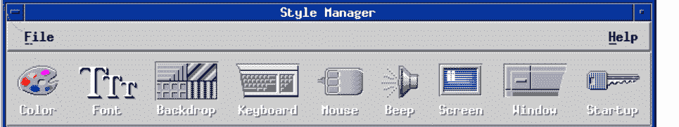

样式管理器控件允许您更改这些项目。

**表 3-1：样式管理器控制项**

| 项目 | 它控制的内容 |
| --- | --- |
| 颜色 | 工作区颜色和调色板 |
| 字体 | 字体大小 |
| 背景 | 工作区背景图案 |
| 键盘 | 键盘点击音和字符重复能力 |
| 鼠标 | 鼠标按钮点击设置 |
| 音频 | 蜂鸣器音、音调和持续时间 |
| 屏幕 | 屏幕变屏之前（分钟），以及此时系统是否锁定 |
| 窗口 | 窗口如何获取焦点、窗口在获得焦点时是否置顶以及图标放置的位置 |
| 启动 | 您的会话如何开始和结束 |

## 使用样式管理器

### 更改颜色

选择样式管理器颜色控件来更改您桌面的配色方案。

调色板是系统用于绘制屏幕元素的颜色组合。系统提供了几种调色板，您还可以创建自定义调色板。点击不同的调色板名称查看结果。

图 3-2：样式管理器——颜色

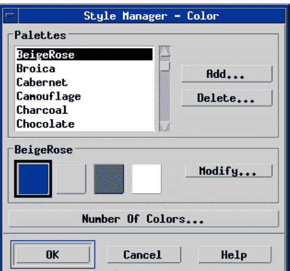

### 更改背景

使用样式管理器背景控件来更改您桌面的外观。您可以为每个工作区选择不同的图案，以便快速识别它们。

在背景对话框中，使用滚动条查看背景样式。点击“应用”（Apply）按钮可以预览背景图案。满意后点击“确定”（OK）。

图 3-3：样式管理器——背景

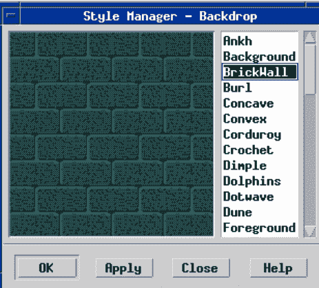

### 更改字体

您可以使用样式管理器字体控件更改窗口标签和文本的字体大小。选择一个大小，系统将显示一个示例供您预览。当您启动新应用程序时，系统会反映此更改。现有窗口不会改变。

图 3-4：样式管理器——字体

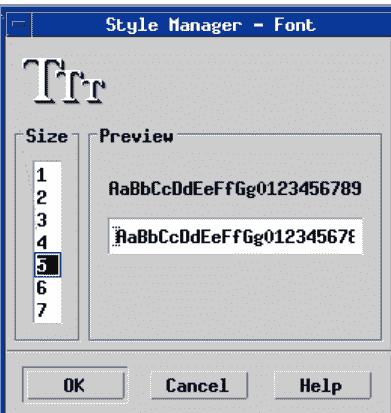

### 现在尝试一下！

使用样式管理器控件更改：

- 您桌面的颜色
- 您其中一个工作区的背景
- 文本大小

## 解决方案

使用颜色控件设置调色板，使用背景控件设置背景，使用字体控件设置字体大小。

### 更改键盘设置

要更改键盘特性，请使用样式管理器键盘控件。您可以更改以下内容：

- 点击音：使用“点击音”调整键盘点击声的响度。要完全关闭键盘点击声，将滚动条设置为零。
- 键自动重复：点击自动重复按钮开启或关闭自动重复功能。开启该功能会导致按键在按住期间不断重复。

点击“默认”（Default）返回到默认系统设置。

图 3-5：样式管理器键盘控件

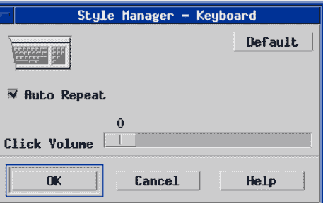

### 更改鼠标设置

样式管理器鼠标控件允许您更改：

- 左右手——左手或右手鼠标的设置
- 鼠标 2 键 (MB2) 功能——传输（Transfer）或调整（Adjust）

传输意味着当您点击对象时 `MB2` 将执行拖放操作。调整意味着 `MB2` 将允许您扩展选择以包含多个一个对象。当 `MB2` 功能为“调整”时，您可以使用 `MB1` 进行拖放。

- 双击——双击点击之间的最大时间
- 加速——鼠标指针在显示器上移动的速度
- 阈值——鼠标在移动到加速速度之前以慢速移动

要返回默认系统设置，请点击“默认”（Default）。“测试双击”框允许您测试双击设置。它还显示了所选左右手下的鼠标键顺序。

图 3-6：样式管理器鼠标控件


### 音频设置

样式管理器音频控件允许您更改：

- 蜂鸣器音、音调和持续时间

### 屏幕设置

- 屏幕变屏之前（分钟），以及此时系统是否锁定

### 窗口设置

- 窗口如何获取焦点、窗口在获得焦点时是否置顶以及图标的位置

### 启动设置

- 您的会话如何开始和结束


传输意味着当您点击对象时 `MB2` 将执行拖放操作。调整意味着 `MB2` 将允许您扩展选择以包含多个一个对象。当 `MB2` 功能为“调整”时，您可以使用 `MB1` 进行拖放。

- 双击——双击点击之间的最大时间
- 加速——鼠标指针在显示器上移动的速度
- 阈值——鼠标在移动到加速速度之前以慢速移动

要返回默认系统设置，请点击“默认”。“测试双击”框允许您测试双击设置。它还显示了所选左右手下的鼠标键顺序。

图 3-6：样式管理器鼠标控件


### 音频设置

（此处由于原文重复，已在上方翻译过）

## 设置终端

在使用按键功能删除命令时，字符可能可能或不会从屏幕上物理消失。尽管它们仍然显示在屏幕上，但字符实际上已经被删除，并且可以被覆盖。

有关 `stty everything` 命令显示的所有信息的完整描述，请参阅附录 A。有关 `stty` 命令和终端设置的更多信息，请输入 `man stty` 命令。

### 现在来尝试！

此练习使用 `stty` 命令显示你的终端设置。使用 `man stty` 命令获取更多信息。

1. 输入 `stty everything` 命令以显示你的终端设置。
2. 错误地输入一个 shell 命令，但不要按回车键。按下几个 `Ctrl` 键来查看它们是如何运作的。
3. 使用 `man` 命令学习更多关于 `stty` 的信息。按下 `Ctrl/C` 或 `Q` 返回命令行。

### 答案

1. 你的设置可能与此处所示不同。

```
$ stty everything
## ds2:speed 9600 baud; 24 rows; 80 columns
erase = ^?; erase = ^W; kill = ^U; intr = ^C; quit = susp = ^Z
dspur = ^Y;eof = ^D;jeol <undef>; stop = ^S; start = ^Q
lnext = ^V; discard = ^O; reprint = ^R; status <undef>; time = 0
..
```

2. `Ctrl/?` 删除一个字符；`Ctrl/C` 中断（取消）命令。

3. `$ man stty`

```
stty(1)

NAME

..
```

## 修改键盘设置

UNIX 设置了默认按键功能，但你可能需要更改这些设置以满足个人需求。

在使用具有键盘布局操作系统，可以将 `erase`、`kill` 和 `intr` 函数设置为你熟悉的内容。

`stty` 命令的格式为：

```
stty function char
```

其中 `function` 是键盘功能（例如 `erase`），而 `char` 是你想要设置的新按键或控制键序列。

## 设置终端

```
$ stty intr ^C
$ stty erase ^?
```

重置函数的另一种方法是将其取消定义。例如，要将 `kill` 设置为未定义，请输入：

```
$ stty kill undef
```

不带字符参数的功能可以如下进行设置：

```
$ stty even (允许偶数校验输入)
$ stty -even (不允许偶数校验输入)
```

这些命令可以放在你的 `.profile` 文件中，以便在每次登录时自动执行。

## 来尝试！

此练习使用 `stty` 命令更改你的键盘设置。如果你需要关于 `stty` 命令的更多信息，请使用 `man stty` 命令。

1. 使用 `stty` 命令将 `erase` 字符改为 `Ctrl/H`。
2. 使用 `stty` 命令在屏幕上显示此新键盘设置。
3. 在命令行上错误输入命令并按下 `Ctrl/H` 查看其新功能。
4. 使用 `stty` 命令将 `erase` 字符改回退格键。

### 答案

1. `$ stty erase ^H`
2. `$ stty -a`

```
#2 disc;speed 9600 baud; 24 rows; 80 columns
erase = ^H; werase = ^W; kill = ^U; intr = ^C; quit = ^\; susp = ^Z
```

3. 按下 `Ctrl/H` 应该是退格。
4. `$ stty erase <backspace>`

## 总结

## 自定义工作空间

你可以通过以下方式自定义前面板：

- 向子面板添加控件
- 切换主面板和子面板的控件
- 添加和删除子面板

你可以修改工作空间切换以：

- 添加工作空间
- 删除工作空间
- 重命名工作空间
- 添加控件

## 使用样式管理器

你可以使用样式管理器来：

- 通过更改颜色、字体和背景更改桌面外观
- 你的键盘、鼠标和窗口的行为
- 你的主会话、注销偏好

## 设置终端

使用 `stty -a` 命令显示你的终端和键盘设置。

在 `.profile` 文件中使用 `stty` 参数每次登录时自动设置你的终端和键盘设置。

## 总结

# 介绍文件系统

### 概述

### 引言

UNIX 操作系统使用分级文件系统。由于文件是命名的信息集合，信息可以是：

- 一个程序
- 程序的数据
- 一个目录
- 一个设备文件

为了高效地与 UNIX 系统工作，必须理解 UNIX 系统是如何组织的以及可以创建的不同类型的文件。你必须了解文件和目录的命名以及文件包含类型。

### 目标

为了理解和使用 UNIX 文件，你应该：

- 识别几种文件类型
- 描述文件和目录命名
- 描述目录结构

### 资源

有关本章主题的更多信息，请参见：

- 桌面环境用户指南
- 命令行和 Shell 用户指南

## 识别文件和类型

### 概述

文件是包含信息的容器。这些信息可以是数据、记录、表格或文档。文件的格式可以有多种方式排列。文件的格式被称为数据类型。UNIX 文件系统使用三种文件：

- 普通文件
- 特殊文件
- 目录文件

### 普通文件

普通（常规）文件包含你放置其中的任何信息。

- ASCII 字符或二进制数据
- 字节字符串

系统不需要特定的结构，格式由 UNIX 命令解释。使用编辑器创建的文件是普通文件。

普通文件的子类是隐藏文件。

- 以点（.）开头的文件名（如 `.profile`, `.kshrc`）
- 系统使用的每个隐藏文件执行特殊功能

### 特殊文件

UNIX 将所有物理设备视为特殊文件。

- UNIX 系统上的每个设备都有关联特殊文件。
- 这些特殊文件通常位于 `/dev` 目录。
- 写入特殊文件会将信息传输到设备。

### 目录文件

目录是包含文件的特殊文件。将其视为包含字母或报告的文件夹。

## 确定数据类型 (CDE)

数据类型识别文件的格式并将与相应的应用程序关联。CDE 将图标与数据类型关联。在大多数情况下，双击图标将打开应用程序和文件。

## 识别文件和数据类型

所示图标代表文件中包含的数据类型。

图 4-1：图标数据类型


## 确定文件类型 (CLI)

`file` 命令显示文件的类型。也就是说，它提供了文件是包含 ASCII 文本、程序代码还是目录或特殊文件的信息。

`file` 命令的格式为：

```
file filename
```

此命令显示文件名和它包含的类型。示例显示了某些 `file` 命令的输出。

```
$ file bin
bin:          directory
$ file myfile
myfile:       ascii text
$ file nosuch
file: Cannot get file status on nosuch: not open reading
$ file compute_average.c
compute_average.c: c program text
$ file /dev/tty
/dev/tty: character special (1/0)
$
```

### 现在来尝试！

使用 `file` 命令列出每个文件的类型。

1. `.profile`
2. `/usr`
3. `/`

### 答案

```
1. $ file .profile
.profile: commands text
2. $ file /usr
/usr: directory
3. $ file /
n/: directory
```

## 文件夹

文件夹是文件的容器，类似于文件柜中的文件夹。文件夹是 CDE 中 UNIX 目录的对应物。

文件夹可以包含子文件夹。在任何单个文件夹内，每个文件名必须是唯一的。然而，不同文件夹中的文件可能有相同的名称。

在 CDE 环境中，当你从一个文件夹导航到另一个文件夹时，你的当前位置被称为当前文件夹。

文件夹提供了文件名与文件本身之间的连接。它们对文件系统实施了一种结构。

* 每个文件夹存储文件的名称。
* 系统维护了几个文件夹供自己使用。其中之一是根文件夹，用斜杠（/）表示。它是顶层文件夹。
* 文件和文件夹通常按功能分组。
* 所有用户文件夹通常分在一起。
* 每个用户都有一个名为主文件夹的（文件夹。

## 对象

CDE 使用“对象”（object）一词来表示系统资源，如文件、目录或应用程序。

（此处将替换你提供的英文内容）

## 摘要

## 使用 CDE 管理文件

## 单元概述

### 引言

文件管理涉及将文件组织到目录和子目录，以及移动、复制、重命名、保护和删除文件。

本单元讨论了使用常用桌面环境 (CDE) 方法来：

- 更改和列出目录
- 根据文件特征（如文件名、所有者、组或文件大小）查找文件
- 显示文件内容
- 创建、删除、复制和移动文件
- 更改权限

### 目标

为了使用 CDE 管理文件，你应该能够：

- 使用文件管理器窗口定位、访问和操作文件及文件夹
- 自定义文件管理器的显示
- 创建文件和文件夹
- 删除文件和文件夹
- 复制文件和文件夹
- 移动文件和文件夹
- 重命名文件和文件夹
- 更改文件和文件夹的所有权和权限
- 链接文件

### 资源

有关本章主题的更多信息，请参考以下内容：

- 常用桌面环境：用户指南

## 使用文件管理器

### 概述

文件管理器以图标的形式显示系统上的文件、文件夹和应用程序。

### 打开文件管理器

要打开文件管理器窗口，请点击前面板上的文件管理器控件。

**图 5-1：** 文件管理器控件

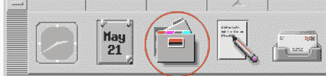

### 现在试一试！

1. 点击前面板上的文件管理器控件。
2. 识别当前文件夹路径。

## 解决方案

1. 文件管理器窗口在桌面窗口中显示。
2. 当前文件夹路径可能是你的主目录。它显示在菜单栏下方。

## 使用文件管理器窗口

文件管理器的主窗口是你的系统中当前文件夹的视图。

## 使用文件管理器

### 图 5-2：文件管理器窗口

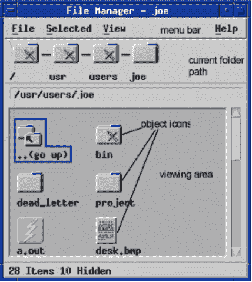

- 菜单栏和菜单 - 包含文件管理器中可用的命令
- 当前文件夹路径 - 显示当前文件夹的路径
- 对象查看区域 - 显示当前工作文件夹中的对象（文件和文件夹）
- 对象图标 - 代表当前文件夹中的文件和文件夹

## 菜单

菜单栏有四个选项。

| 菜单 | 说明 |
| :--- | :--- |
| 文件 | 创建文件或文件夹，查看不同的文件夹，查找文件或文件夹 |
| 已选中 | 操作一个或多个对象 |
| 视图 | 更改视图 |
| 帮助 | 显示帮助信息 |

### 现在试一试！

熟悉四个菜单选项中的每一个功能。

### 需要帮助吗？

点击一个功能。点击一个对象并查看它的作用。用新的功能/选项组合重复操作。

## 解决方案

你可以使用菜单栏执行许多功能。

## 更改文件夹

要更改当前文件夹，请选择以下方法之一：

- 双击当前文件夹路径或对象查看区域中的文件夹。
- 在“文件”菜单中选择这些选项之一。

| 选项 | 说明 |
| :--- | :--- |
| 回主页 | 切换到主文件夹 |
| 上级 | 在文件夹层级中向上移动 |
| 转到 | 提示输入要显示的文件夹名称 |

### 选择文件或文件夹

当你选择文件或文件夹的图标时，它的名称会被高亮显示。一旦选择了某个对象，多个菜单选项将适用于当前所选对象。当你在视图区域中选择不同的对象时，菜单的内容会发生变化。

- 使用鼠标选择对象：使用 `MB1` 单击图标即可。
- 使用键盘选择对象：
  - a. 使用 `Tab` 键和方向键将高亮移动到你想选择的图标上。
  - b. 按空格键进行选择。

要取消选择文件或文件夹，请选择另一个图标，或点击文件管理器窗口内的空白区域。

### 现在试一试！

1. 点击对象显示区域中标记为 `bin` 的文件夹。
2. 点击菜单栏区域中标记为 `users` 的文件夹。
3. 在文件管理器窗口中显示 `/etc` 文件夹的内容。

## 解决方案

1. 标记为 `bin` 的文件夹被高亮。
2. 对象区域显示了所有用户文件夹。
3. 实现这一点的方法之一是使用“文件”菜单上的“转到”选项。文件管理器窗口显示了 `/etc` 文件夹。

## 选择多个文件或文件夹

你可以选择多个图标，以便对多个对象执行功能。当选中多个一个对象时，仅适用于单个对象的菜单选项将变为禁用。当选中多个图标时，拖动其中任何一个选中图标都会拖动整个组。

## 使用文件管理器

你可以使用鼠标或键盘选择多个文件或文件夹。

使用鼠标选择多个对象有两种方法：

- 在视图的空白区域按住 `MB1`，拖动鼠标在你想选择的图标周围画一个框，然后释放鼠标键。
- 点击 `MB1` 选择第一个图标，然后按住 `Ctrl` 键并点击 `MB1` 选择每个额外的图标。

要从所选组中移除单个图标，按住 `Ctrl` 键并点击你想移除的图标。

使用键盘选择多个对象：

1. 按空格键选择第一个文件或文件夹。
2. 对于每个额外的图标，按住 `Ctrl` 键并按空格键。

### 拖放文件

要拖放文件或文件夹：

1. 将鼠标指针置于文件或文件夹上。
2. 按住 `MB1`。
3. 将其拖到你想放置的地方。
4. 释放鼠标按钮。

要取消拖动，按 `Esc` 键。

### 显示弹出菜单

文件中的每个对象都有弹出菜单。

使用鼠标选择弹出菜单：

1. 指向你想显示的图标并按 `MB3`。
2. 从菜单中选择命令。

要在选择命令前取消菜单，点击文件管理器窗口内的空白区域。

### 打开文件或文件夹

对对象执行的基本操作是打开它。打开文件通常会启动应用程序并加载文件。

打开文件的方法有：

- 双击图标。
- 执行对象的默认操作，这总是“已选中”菜单中的第一个操作。
- 选择图标，然后进入菜单并在“已选中”菜单中选择“打开”（或“打开新视图”）。
- 从弹出菜单（通过 `MB3` 显示）选择打开项。

### 现在试一试！

1. 双击其中一个文件夹。
2. 找到 `/etc` 文件夹并打开名为 `passwd` 的文件。

## 解决方案

1. 文件夹被打开
2. 打开了 `passwd` 文件。

### 定位文件

### 概述

文件管理器通过允许你根据名称搜索文件或文件夹来跟踪文件。你也可以根据文件内容搜索文件。

### 按名称查找对象

根据名称查找对象：

1. 从“文件”菜单中选择“查找”。

**图 5-3：** 文件管理器查找对话框

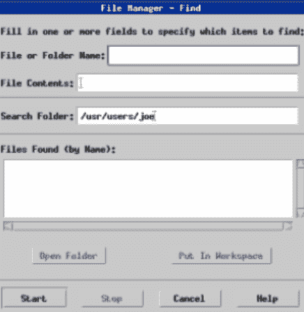

2. 在“文件或文件夹名称”字段输入你想查找的文件或文件夹名称。

当你指定文件或文件夹名称时，可以包含通配符，例如星号 (`*`) 或问号 (`?`)。`*` 匹配任何字符串（包括空字符），`?` 匹配单个字符。

3. 在“搜索文件夹”字段输入你想开始搜索的文件夹。默认情况下，此字段包含当前文件夹的名称。

查找将搜索文件夹及其所有的子文件夹。

4. 点击“开始”或按 `Return`。

文件管理器搜索搜索文件夹及其包含的文件夹以查找符合请求的文件。匹配项将出现在查找列表中。一旦找到了对象，你可以选择它并点击“打开文件夹”来打开它，或点击“放入工作区”将其图标放置在当前背景上。

5. 要停止搜索，点击“停止”按钮或按 `Return`。

### 按内容查找文件

1. 从“文件”菜单中选择“查找”。
2. **可选**。可以使用“文件或文件夹名称”文本字段来缩小范围，从而加快搜索。

如果你使用通配符输入部分名称，文件管理器将只检查与文件或文件夹名称字段匹配的文件。如果该字段为空，文件管理器将搜索搜索文件夹内的所有文件。

3. 在“文件内容”字段中输入你想要查找的文本字符串。

此字符串不区分大小写。你不需要使用完整的单词。例如，如果你输入 `fi`，它将同时找到 `fish` 和 `File`。

可以使用与 `grep` 命令允许相同的**正则表达式**语法来指定内容。更多信息请参阅 `grep` 参考。

4. 如果搜索文件夹与当前（默认）文件夹不同，请在“搜索文件夹”字段中输入你想开始搜索的文件夹名称。


- 5. 点击“开始（Start）”或按回车（Return）。

文件管理器会在搜索文件夹及其包含的文件夹中搜索匹配你引用的文件。匹配项将出现在“查找结果（Finds）”列表中。一旦找到，你可以选择它并点击“打开文件夹（Open Folder）”打开它，或点击“放入工作区（Put in Workspace）”将其放置在当前背景上。

- 6. 要停止搜索，点击“停止（Stop）”按钮或按回车（Return）。

### 现在试一下！

- 1. 在 `/usr/etc` 文件夹搜索 `ping` 文件。
- 2. 在 `/usr/users` 目录包含你名字的文件。
- 3. 在 `/etc` 文件夹搜索名为 `motd` 的文件并在终端上显示这些文件。

### 需要帮助吗？

- 1. 点击“文件。查找”。在“文件或文件夹名称”字段中输入 `ping`。按 Tab 键切换到“搜索文件夹”字段并输入 `usr/etc`。点击“开始”或按回车。
- 2. 点击“文件。查找”。在“文件或文件夹名称”字段中输入你的名字。按 Tab 键切换到“搜索文件夹”字段并输入 `usr/users`。点击“开始”或按回车。
- 3. 点击“文件。查找”。在“文件或文件夹名称”字段中输入 `motd`。按 Tab 键切换到“搜索文件夹”字段并输入 `etc`。点击“开始”或按回车。

## 解决方案

- 1. `ping` 显示在“找到的文件（Files Found）”中。
- 2. 你将收到一条未找到文件的消息。
- 3. 找到的文件有：

```
/etc/zoneinfo/motd
/etc/motd
```

## 自定义文件管理器视图

### 概述

文件管理器提供了多种查看文件夹内容的方法。你可以：

- 以树形视图或文件夹视图显示文件夹
- 更改对象的排序顺序
- 显示或隐藏某些文件或文件夹
- 更改对象的样式

### 显示文件树

树形视图类似于大纲。文件夹中包含的文件和文件夹以缩进列表的形式列在其下方。

图 5-4：文件管理器树形视图

在树形视图中，文件夹可以有状态。这些状态通过文件夹左侧的按钮显示和更改。你还可以通过选择文件夹并按下键盘上的加号（`+`）和减号（`-`）键（不是数字键盘）来打开和关闭树分支。

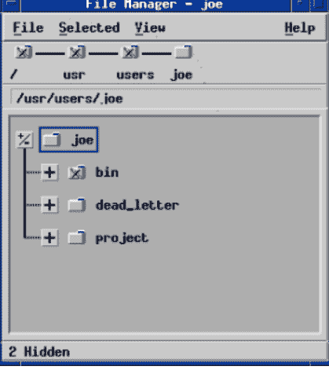

自定义文件管理器视图

此处显示按钮状态。

| 按键 | 描述 |
| --- | --- |
| `+` | 文件夹处于关闭状态。不显示任何任何内容。点击此按钮将部分或完全展开文件夹，取决于当前生效的树形视图选项。 |
| `-` | 文件夹处于完全展开状态。显示所有对象。点击此按钮将完全关闭文件夹。 |
| `+/-` | 文件夹处于部分展开状态。唯一的内容是它包含的文件夹。点击此按钮将展开文件夹以显示文件名。 |

显示树形视图将显示一个文件夹及其下方的文件和文件夹。要显示树形视图：

- 1. 切换到你想要开始视图的任何文件夹。
- 2. 从“视图（View）”菜单中选择“设置视图选项（Set View Options）”。
- 3. 在“显示（Show）”框中选择“按树形（By Tree）”。

5-12 使用 CDE 管理文件

### 图 5-5：设置视图选项对话框

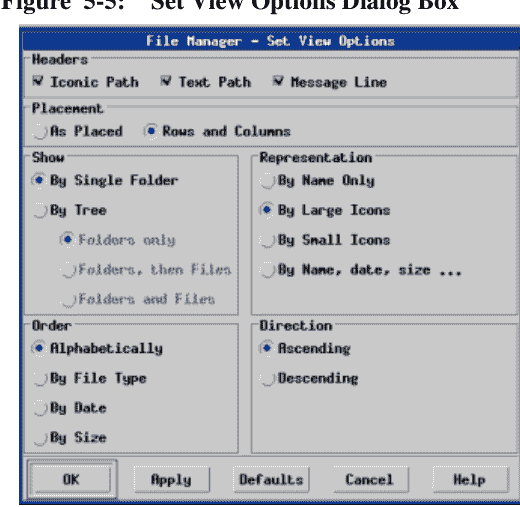

- 4. 选择一个树形视图选项。

| 选项 | 描述 |
| --- | --- |
| 仅文件夹 | 树仅显示文件夹。要查看文件，双击文件夹名称。这是默认视图 |
| 文件夹，后文件 | 起初仅显示文件夹。先点击每个文件夹旁边的 `+` 按钮查看其内容。第一次点击显示其子文件夹。第二次点击显示内部的文件。当你第三次点击按钮时，文件夹再次出现 |
| 文件夹和文件 | 树自动同时显示文件夹和文件 |

- 5. 要应用所选选项并关闭“设置视图选项”对话框，点击“确定（OK）”。

你可以通过更改“设置视图选项”对话框中“显示”框中的设置来更改文件和文件夹的外观。如果你想让更改比当前会话持续得更久，从“视图”菜单中选择“保存为默认选项（Save as Default Option）”。

### 自定义文件管理器视图

图 5-6：保存视图选项对话框

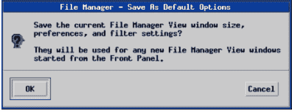

如果你在树形视图中双击文件夹，将打开该文件夹的新视图，该视图不是树形视图模式。

### 现在试一下！

- 1. 更改显示为树形视图。
- 2. 更改显示为文件夹视图。
- 3. 更改按名称和大小显示文件管理器文件夹和文件。
- 4. 更改按图标形式显示文件管理器文件夹和文件。

### 需要帮助吗？

- 1. 点击“文件。查找”。在“文件或文件夹名称”字段中输入 `ping`。按 Tab 键切换到“搜索文件夹”字段并输入 `usr/etc`。点击“开始”或按回车。
- 2. 点击“文件。查找”。在“文件或文件夹名称”字段中输入你的名字。按 Tab 键切换到“搜索文件夹”字段并输入 `usr/users`。点击“开始”或按回车。
- 3. 点击“文件。查找”。在“文件或文件夹名称”字段中输入 `motd`。按 Tab 键切换到“搜索文件夹”字段并输入 `etc`。点击“开始”或按回车。

## 解决方案

- 1. `ping` 显示在“找到的文件”中。
- 2. 你将收到一条未找到文件的消息。
- 3. 找到的文件有：

```
/etc/zoneinfo/motd
/etc/motd
```

### 显示和隐藏文件和文件夹

隐藏的文件和文件夹是选中的对象。使用“设置过滤器”来更改。

### 指定要隐藏的数据类型

- 1. 从“视图”菜单中选择“过滤器选项（Filter Options）”。

图 5-7：文件管理器-设置过滤器

要隐藏的数据类型在此处高亮显示。

- 2. 在“额外隐藏（Also Hide）（可选）”字段中输入要额外隐藏的文件类型模式。

或者，点击“默认值（Defaults）”重置过滤器列表。

- 3. 可选。在“过滤器字符串（Filter String）”中输入通配符。

过滤器列表指定了哪些文件不显示。如果你在“过滤器字符串”中输入 `*`，则不显示文件。如果你输入 `.txt`，任何以 .txt 结尾的文件将被添加到过滤器列表中不再显示。

- 4. 点击“确定”。

要在关闭对话框之前查看结果，点击“应用”。

要重置默认过滤器，选择“默认值”。这会重置默认值，但在你点击“应用”或“确定”之前不会生效。

## 创建文件和文件夹

### 创建文件

使用“新文件”菜单项创建新文件。

在文件管理器创建新文件：

- 1. 从“文件”菜单选择“新文件”。
- 2. 在“新文件名称（New File Name）”字段中输入名称。

图 5-8：创建新文件

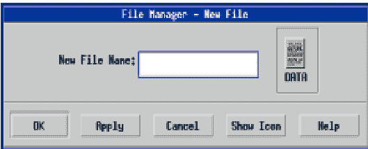

- 3. 点击“确定”或按回车保存文件，或者在不创建新文件的情况下关闭“新文件”对话框，点击“取消”或按 Esc。

### 创建文件夹

使用“新文件夹”菜单项创建新文件夹。

在文件管理器创建新文件夹：

- 1. 从“文件”菜单选择“新文件夹”。
- 2. 在“新文件夹名称（New Folder Name）”字段中输入名称。

图 5-9：创建新文件夹

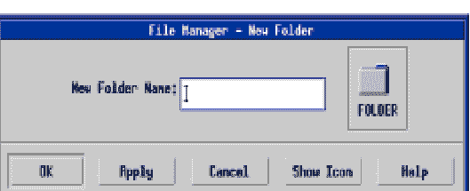

- 3. 点击“确定”或按回车保存文件夹名称，或者在不创建新文件夹的情况下关闭“新文件夹”对话框，点击“取消”或按 Esc。

### 创建文件和文件夹

- a. 从“文件”菜单中选择“新建文件”。
- b. 在“新文件名称”输入框中输入 `fruits.txt`。点击“应用”。
- c. 输入 `vegetables.txt`。点击“确定”。
- 2. 创建一个名为 `foods` 的新文件夹，另一个名为 `drinks` 的文件夹，第三个名为 `snacks` 的文件夹。

  - a. 从“文件”菜单中选择“新建文件夹”。
  - b. 在“新文件夹名称”输入框中输入 `foods`。点击“应用”。
  - c. 在“新文件夹名称”输入框中输入 `drinks`。点击“应用”。
  - d. 在“新文件夹名称”输入框中输入 `snacks`。点击“确定”。

### 答案

- 1. 文件 `fruits.txt` 和 `vegetables.txt` 以图标形式显示。
- 2. 文件夹 `foods`、`drinks` 和 `snacks` 显示。

使用 CDE 5-17 管理文件

## 删除文件和文件夹

### 概述

垃圾桶收集你删除的文件和文件夹。在清空垃圾桶之前，这些对象实际上不会从系统中移除。如果垃圾桶尚未清空，你可以改变主意并恢复已放入垃圾桶的文件。

### 使用垃圾桶

你可以通过点击前面板上的垃圾桶来打开垃圾桶窗口。

图 5-10：前面板上的垃圾桶图标

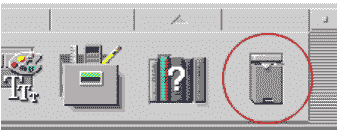

### 删除对象

要将对象移动到垃圾桶，请执行以下步骤之一：

- 从按下 Shift+F10 或 MB3 显示的对象的弹出菜单中选择“移入垃圾桶”。
- 选择对象的图标，然后在文件管理器栏的“已选择”菜单中选择“移入垃圾桶”。
- 将对象的图标拖动到前面板上的垃圾桶图标上。
- 拖动对象的图标以打开垃圾桶窗口。

### 取回对象

要从垃圾桶取回对象，请执行以下步骤之一：

- 将对象从垃圾桶窗口拖到文件管理器。
- 在垃圾桶窗口中，选择你想要恢复的对象并从“文件”菜单中选择“还原”。
- 从按下 Shift/F10 或 MB3 显示的对象的弹出菜单中选择“还原”。

### 现在试试！

- 1. 从文件管理器的“文件”菜单中选择“新建文件夹”。在“新文件夹名称”输入框中输入 `prepared_foods`。点击“确定”。
- 2. 双击 `prepared_foods` 文件夹。现在文件管理器窗口显示了该空文件夹。在文件管理器的“文件”菜单中选择“新建文件”。在“新文件名称”输入框中输入 `pizza` 并点击“应用”。接下来在“新文件名称”输入框中输入 `liver` 并点击“确定”。
- 3. 从“文件”菜单中选择“回到主”。使用 MB1 点击并按住 `prepared_foods` 文件夹。将文件夹拖到垃圾桶图标上方并释放 MB1。
- 4. 双击垃圾桶图标。选择文件 `pizza` 并将其拖到 `prepared_foods` 文件夹。

### 答案

- 1. 列出了 `prepared_foods` 文件夹。
- 2. `prepared_foods` 文件夹中列出了 `liver` 和 `pizza` 文件。
- 3. 主目录中不再显示 `prepared_foods` 文件夹；它现在是垃圾桶的一部分。
- 4. `prepared_foods` 文件夹中列出了 `pizza` 文件。

### 永久删除

当你永久删除文件或文件夹时，除非你有该对象的备份，否则将无法恢复。

- 1. 打开垃圾桶。
- 2. 从垃圾桶中选择你想清空的对象。选择单个对象，或从“文件”菜单中选择“全选”。
- 3. 从“文件”菜单或按下 Shift/F10 或 MB3 显示的对象的弹出菜单中选择“粉碎”。
- 4. 在确认对话框中点击“确定”。

注销会话时垃圾桶会自动清空。

## 复制和移动文件及文件夹

### 概述

在对文件进行任何修改之前，你可能想为文件创建一个备份。当系统复制文件时，原始文件保持完好，并创建一个带有新名称的新文件。

### 使用鼠标复制

使用鼠标复制文件或文件夹：

- 1. 使目标文件夹可见。
  - 打开显示目标文件夹内容的文件管理器视图，或
  - 打开显示已关闭目标文件夹图标的文件管理器视图
- 2. 选择要复制的文件或文件夹。
- 3. 按住 Ctrl 键。
- 4. 拖动文件或文件夹并将其释放到目标文件夹上。

确保在释放 Ctrl 键之前松开鼠标键。否则，你将移动文件或文件夹而不是复制它。

### 使用键盘复制

使用键盘复制文件或文件夹：

- 1. 选择图标。
- 2. 从“已选择”菜单中选择“复制到”。
- 3. 在“目标文件夹:”和“名称”字段中输入名称。

例如，要将文件 `file.txt` 复制到新位置，你可以所示输入 `/reports/file.txt`。

图 5-11：文件管理器-复制对象

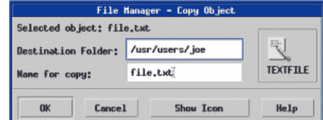

- 4. 按回车键。

要关闭复制框，按 Esc。

### 现在试试！

将 `fruits` 和 `vegetables` 复制到 `snacks`。

### 需要帮助？

选择 `fruits` 和 `vegetables`。

### 答案

`fruits` 和 `vegetables` 在 `snacks` 中。

### 使用鼠标移动

使用鼠标移动文件或文件夹：

- 1. 使目标可见。
  - 打开显示目标文件夹内容的文件管理器视图，或
  - 打开显示已关闭目标文件夹图标的文件管理器视图
- 2. 选择要移动的文件或文件夹。
- 3. 拖动文件或文件夹并释放到目标。

### 使用键盘移动

使用键盘移动文件或文件夹：

- 1. 选择图标。
- 2. 从“已选择”菜单中选择“移动到”。
- 3. 在“目标文件夹:”和“名称”字段中输入名称。

## 重命名文件和文件夹

### 概述

可以使用以下方法重命名文件或文件夹：

- 选择对象并从“已选择”菜单中选择“重命名”。
- 当对象名称高亮时，你可以直接在字段中输入新名称。
- 完成后按回车键，或按 Esc 取消。

图 5-13：重命名对象

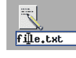

## 修改所有权和权限

### 概述

文件权限允许限制对文件或文件夹的访问。三组用户可以访问文件和文件夹：所有者、组和其他用户。文件访问分为三种权限：读、写和执行。

### 查看权限

文件夹图标代表不同的访问权限。如果你没有在文件夹内写入的权限，文件夹将如如下所示。

图 5-14：没有写入权限的文件夹


如果你对文件夹没有读取或执行权限，文件夹将如下所示。

图 5-15：没有读取和执行权限的文件夹


如果你对文件夹拥有读取、写和执行权限，文件夹将如如下所示。

图 5-16：具有读、写、执行权限的文件夹


选择文件或文件夹并从“已选择”菜单中选择“更改权限”。打开权限对话框。权限部分左侧列出访问类型，顶部列出访问权限类型。交叉引用访问类型和访问权限以确定文件或文件夹的权限。

### 图 5-17：文件管理器权限对话框

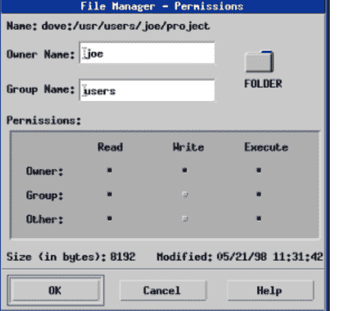

默认权限由系统管理员设置。要确定你的默认权限，请创建一个新文件或文件夹，然后打开该文件或文件夹的“权限”对话框。

### 更改所有者

必须是文件的所有者或系统管理员（root 用户）才能更改文件的所有权。如果你有权以 root 用户身份登录，必须在开始以下程序之前执行登录。要更改文件或文件夹的所有权：

- 1. 选择文件或文件夹的图标。
- 2. 从“已选择”（Selected）菜单或通过按下 Shift/F10 或 MB3 显示的图标弹出菜单中选择“更改权限”。
- 3. 在“所有者名称”（Owner Name）文本框中输入新所有者的名称。
- 4. 点击“确定”或按回车（Return）。

如果你将文件或文件夹的所有权交给另一个用户，除非该用户将所有权归还给你，否则你将无法再次更改其权限。

### 更改权限

必须是文件的所有者或系统管理员（root 用户）才能更改文件或文件夹的权限。要更改权限：

- 1. 选择文件或文件夹的图标。
- 2. 从“已选择”（Selected）菜单或通过按下 Shift/F10 或 MB3 显示的图标弹出菜单中选择“更改权限”。
- 3. 选择文件或文件夹的权限。

在“组”（Group）行中选择的权限表示属于指定组的任何用户的访问权限。“其他”（Other）行中选择的权限适用于所有其他用户。

| 权限 | 说明 |
| :--- | :--- |
| 读取 | 文件可以被读取 |
| 写入 | 文件可以被 |
| 执行 | 文件可以运行 |

- 4. 点击“确定”或按回车。

“组”权限行显示“组名称”（Group Name）文本框中列出的成员的权限。你可以在此框中输入名称来指定不同的组。

如果你没有权限更改文件的属性，则“属性”对话框中的某些控件将处于活动状态。

### 现在试一试！

- 1. 将位于 `/etc` 的文件组复制到你的本地目录，并命名为文件 `groupfile`。
- 2. 显示文件 `groupfile` 的权限。点击 `groupfile` 并从“已选择”菜单中选择“更改权限”。
- 3. 更改 `groupfile` 的权限，使所有者具有读取、写入和执行权限，组具有读取和写入权限，其他具有执行权限。验证更改。
- 4. 更改 `groupfile` 的权限，使用户只有读取和写入访问权限，组和其他无访问权限。验证更改。

### 需要帮助吗？

在“权限”对话框中，在“所有者”行，点击“读取”、“写入”和“执行”框，以选中或取消选中相应的框。在“组”行中，点击“读取”和“写入”。在“其他”行，点击“执行”。

## 解决方案

`groupfile` 图标从可执行文件（闪电）变为未定义文件。

## 链接文件和文件夹

### 概述

链接图标是原始图标的副本，指向与原始图标相同的文件或文件夹。你在打开链接图标后进行的任何更改，当你使用原始图标访问该文件或文件夹时也会出现。

### 使用鼠标创建符号链接

要使用鼠标创建符号链接：

- 1. 使源文件夹和目标文件夹可见。
   - 打开目标文件夹内容的文件管理器视图，或
   - 打开显示已关闭的目标文件夹图标的文件管理器视图。


## 使用鼠标创建符号链接

要使用鼠标创建符号链接：

1. 使源文件夹和目标文件夹可见。
   - 打开目标文件夹内容的文件管理器视图，或
   - 打开显示已关闭的目标文件夹图标的文件管理器视图
2. 选择要复制的文件或文件夹。
3. 在拖动文件或文件夹图标到新文件夹图标上时，按住 `Shift` 键和 `Ctrl` 键。当你松开图标时，文件管理器会在新文件夹中创建一个指向原始文件或文件夹的符号链接。

请确保在释放 `Shift` 键和 `Ctrl` 键之前释放鼠标按钮。否则，你将移动的是文件或文件夹。

图 5-18：作为链接复制

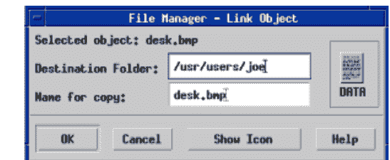

### 使用键盘创建符号链接

1. 使用 `Tab` 键和方向键高亮你想链接的文件或文件夹图标。
2. 按空格键选择该图标。
3. 从“已选择”（Selected）菜单中选择“作为链接复制”。
4. 在“目标文件夹”（Destination Folder）文本字段中输入名称，包括你想让链接图标出现的文件夹名称的路径。要给此链接图标一个与原始图标不同的名称，请在“复制名称”（Name for copy:）文本字段中输入新名称。
5. 点击“确定”或按回车。

### 现在试一试！

1. 将文件 `/etc/passwd` 复制到你家目录中名为 `dummy` 的文件中。
2. 在家目录中创建一个名为 `links` 的文件夹。
3. 创建从文件 `dummy` 到文件夹 `links` 的链接。
4. 打开现在位于 `links` 文件夹中的 `dummy`。

### 需要帮助吗？

要创建链接，选择文件 `dummy`，在将其拖动并到 `links` 文件夹时按住 `Shift/Ctrl` 键。

## 解决方案

1. 文件 `/etc/passwd` 被复制到你名为 `dummy` 的文件夹中。
2. 在家目录中创建一个名为 `links` 的文件夹。
3. 创建从文件 `dummy` 到文件夹 `links` 的链接。
4. 打开现在位于 `links` 文件夹中的 `dummy`。

## 链接文件和文件夹

链接图标是原始图标的副本，指向与原始图标相同的文件或文件夹。你在打开链接图标后进行的任何更改，当你使用原始图标访问该文件或文件夹时也会出现。

## 使用命令行管理文件

### 单元概述

#### 引言

文件管理涉及将文件组织到目录和子目录中，以及移动、复制、重命名、保护和删除文件。

本单元讨论了使用命令行界面 (CLI) 方法来：

- 更改和列出目录
- 根据文件名称、所有者、组或文件大小等特征查找文件
- 显示文件内容
- 创建、删除、复制和移动文件
- 更改权限

#### 目标

为了使用命令管理文件，你应该能够：

- 使用 `pwd` 命令确定当前工作目录
- 使用 `cd` 命令切换目录
- 使用 `ls` 和 `find` 命令列出并查找文件及目录
- 使用 `cat`、`more`、`head` 和 `tail` 命令显示文件
- 使用 `touch` 命令创建空文件或更新文件的访问或修改时间
- 使用 `cat` 命令创建和合并文件
- 使用 `mkdir` 命令创建目录
- 使用 `chmod` 命令更改文件权限
- 使用 `mv` 命令移动和重命名文件
- 使用 `cp` 命令复制文件
- 使用 `rm` 和 `rmdir` 命令删除文件和目录
- 使用 `ln` 命令创建文件链接

#### 资源

有关本章主题的更多信息，请参阅以下内容：

- 命令和 Shell 用户指南

## 切换目录

### 概述

由于 UNIX 文件结构是层次结构的，所有文件或目录都通过目录链追踪路径来访问。

要理解如何使用 `cd` 命令，你必须首先理解以下概念：

- 主目录和工作目录
- 路径名

### 主目录

主目录通常由包含用户名作为最后部分的路径名来标识。当你登录 UNIX 操作系统的账户时，系统会自动把你放在主目录中。你的主目录永远不会改变。

### 工作目录

你的工作目录定义为你在目录树中的当前位置。如果你在主目录，那里也是你的工作目录。但是，如果你移动到另一个目录，该目录就会成为你的工作目录。

有时你可能会忘记自己在哪个目录。使用 `pwd`（打印工作目录）命令显示你的当前位置。

```
$ pwd
/usr/users/you
```

### 路径名

路径名代表到达指定文件或目录所经过的目录和子目录。它代表了从目录结构中的特定点到目录的路径。路径名有两种：全路径名和相对路径名。

全路径名也称为绝对路径名。全路径名始终从根目录 (`/`) 开始。

相对路径名基于你当前的工作目录。例如，如果你的当前工作目录是主目录，而你有一个名为 `misc` 的子目录，其中包含一个名为 `alan.txt` 的文件，则该文件的相对路径是 `misc/alan.txt`。相反，该文件的全路径名是 `/usr/users/you/misc/alan.txt`。

此图说明了从 `/usr/users` 访问名为 `chapel` 的文件的全路径和相对路径名。

### 图 6-1：全路径名和相对路径名

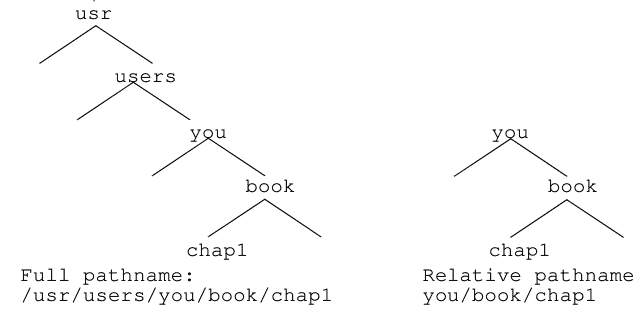

## 使用 cd 命令

有两个特殊的指针文件：

- 点 (`.`) 指当前目录。
- 双点 (`..`) 指目录层次中的上一个（父目录）

从任何地方切换到你的主目录：

```
$ cd
```

将你的工作目录切换到子目录 `book`：

```
$ cd book
```

将你的工作目录切换到 `/usr/users/misc` 目录：

```
$ cd /usr/users/misc
```

将你的工作目录切换到父目录：

```
$ cd ..
```

将你的工作目录切换到当前目录上方两级的目录：

```
$ cd ../
```

从目录 `/usr/users/stu` 切换到目录 `/usr/users/stu2`。

```
$ pwd
/usr/users/stu
$ cd ../stu2
$ pwd
/usr/users/stu2
```

### 现在来一试！

如果你在任何时候不确定当前目录是什么，请记得使用 `pwd` 命令。

尝试通过以下一种方法在你的终端屏幕上显示 `/etc/passwd` 文件：

- 使用从主目录开始的全路径名。
- 将工作目录切换到 `/` 并使用相对路径名。
- 在工作目录为根 (`/`) 时尝试输入 `cat passwd`。它不起作用，因为你没有给系统提供有效的路径名。
- 将工作目录切换到 `/etc`。命令 `cat passwd` 将显示该文件。

### 需要帮助？

`/etc/passwd` 文件包含系统上所有用户的加密密码，以及与每个用户登录名对应的真实名称。`cat` 命令在终端上显示文件的内容。格式为 `cat filename`。

## 解决方案

```
$ /etc/passwd
root:PRFX.BclhWLHC:0:1:system PRIVILEGED account/:
nobody:*Nologin:65534:65534:anonymous NFS user/:
...
```

```
$ cd /
$ cat /etc/passwd
root:PRFX.BclhWLHC:0:1:system PRIVILEGED account/:
nobody:*Nologin:65534:65534:anonymous NFS user/:
...
```

```
$ cd /etc
cat passwd
root:PRFX.BclhWLHC:0:1:system PRIVILEGED account/:
nobody:*Nologin:65534:65534:anonymous NFS user/:
...
```

```
$ pwd
/usr/users/you
```

## 列出文件

### 概述

系统跟踪所有文件的名称。你可以使用 `ls` 命令列出目录中的文件列表。

`ls` 命令的格式为：

```
ls options
```

### 使用 ls 命令

以下是 `ls` 命令的一些示例，假设工作目录是 `/users/you`。

列出你目录中的文件列表：

```
$ ls
```

使用全路径名列出 `/users/you/book` 中的文件列表：

```
$ ls /users/you/book
```

使用相对路径名列出 `/users/you/book` 中的文件列表：

```
$ ls book
```

使用特殊符号（点）列出工作目录的文件列表：

```
$ ls .
```

使用特殊符号（双点）列出父目录的文件列表：

```
$ ls ..
```

要列出多个目录的文件，请用空格分隔目录名：

```
$ ls book project
book:
chap2.lis
project:
report.txt
```

## 现在尝试这个！

1. 使用 `ls` 命令列出你主目录中的文件。
2. 使用指针文件 `.`（点）和 `..`（双点）列出主目录及其父目录中的所有文件。
3. 将工作目录切换到根目录并用一个命令列出 `/bin` 和 `/etc` 目录的文件。
4. 使用 `cd` 命令将工作目录切换到 `/usr/bin`，列出 `/usr/bin` 目录的文件。
5. 在不更改工作目录的情况下，列出 `/usr` 目录和你主目录的文件。
6. 现在切换回主目录。

## 解决方案

1. `$ ls`
2. `$ ls ..`
3. `$ cd /`
   `$ ls bin etc`
4. `$ cd /usr/bin`
   `$ ls`
5. 如果你的主目录是 `/usr/users/you`，你可以使用：
   `ls /usr /users/you`
6. `$ cd`

## 列出详情

`ls` 命令有许多选项。这里只是几个。

- `-a` 列出目录中的所有文件，包括以点开头的文件；以点开头的文件名通常是隐藏的
- `-F` 为某些类型的文件标记特殊符号
- `-l` 提供目录中文件的详细列表，包括文件类型、访问权限、所有者、组、大小以及创建或修改日期
- `-R` 递归列出所有子目录

获取详细列表需要目录的执行权限，而普通列表只需要读取权限。

你可以组合这些选项。组合使用 `-l` 和 `-a` 选项会产生所有文件的详细列表，包括隐藏文件。

### 示例 6-1: 列出所有文件

```
$ ls -al
total 8
drwx-x--x- 5 users 512 Nov 5 11:04 .
drwx-xr-x- 26 root 512 Oct 18 15:41 ..
-rw-r--r-- 1 users 373 Jun 29 15:22 .cshrc
-rw-r--r-- 1 users 145 Jun 29 15:22 .profile
drwx-xr-x- 2 users 512 Nov 5 09:38 book
drwx-xr-x- 1 users 88 Sep 3 10:30 letters
-rw-r--r-- 2 users 512 Nov 5 11:16 misc
-rw-r--r-- 1 users 178 Nov 5 09:30 times.status
```

### 现在来试试吧！

1. 列出你的主目录、根目录和 `/usr` 目录下的所有文件。
   注意文件 `.` 和 `..` 出现在每个目录中。
2. 列出你主目录中所有文件的详细列表。
3. 获取你主目录中所有文件的列表，并指示哪些文件（如果有）是子目录。

### 答案

1. `$ ls -a / /usr`
2. `$ ls -al`


- 3. `$ ls -aF`

目录名用斜杠 (`/`) 标记。

## 查找文件

### 概述

有时你需要定位系统上的文件，但你并不确定定位它们所需的所有信息。`whereis` 和 `find` 命令对于这些情况非常有用。

### 定位文件

`whereis` 命令用于定位程序源代码、二进制文件和参考页文件的目录。在不带任何选项的情况下，`whereis` 在默认目录中查找这三种类型的文件。在查找默认目录后，`whereis` 会在 `Path` 变量目录中进行搜索。

### 示例 6-2: 使用 whereis 命令

```
$ whereis emacs ❶
emacs:/usr/bin/emacs /usr/lib/emacs /usr/share/man/man/emacs
$ whereis -b emacs ❷
emacs:/usr/bin/emacs /usr/lib/emacs
$ whereis -m emacs ❸
emacs:/usr/share/man/man/emacs.l
$ whereis -s emacs ❹
emacs:
```

- 在默认的源、二进制和参考页目录中搜索名为 emacs 的文件
- 查找 emacs 可执行程序
- 查找 emacs 参考页
- 查找 emacs 源代码；在此系统中未找到任何文件

请参阅 `whereis` 参考页以获取更多信息和选项。

### 使用 find 命令

`find` 命令在指定的目录树中搜索符合特定标准的文件。

`find` 命令的格式为：

```
find pathname expression
```

- `pathname` 是从开始搜索的目录树
- `expression` 是要搜索的指定标准

你可以使用此命令通过 `find` 命令在整个目录结构中搜索所有名为 `chap` 的文件：

```
$ find -name chap -print
```

在上述所示示例中，根目录 (`/`) 是要搜索的路径，`-name chap` 是指示搜索名为 `chap` 的文件的表达式。`-print` 表达式告诉系统在屏幕上显示任何匹配的文件名。

在此示例中，目录 `/etc` 是要搜索的路径，`-name passwd` 是要搜索的表达式。此示例从 `/etc` 目录搜索任何名为 `passwd` 的文件，并将它们显示在屏幕上。

```
$ find /etc -name passwd -print
```

# 使用 find 命令表达式

这里列出了一些常用的 `find` 命令表达式、用法示例及其功能：

- `-print` expression 导致匹配标准的文件名显示在屏幕上。

```
$ find -name chap -print
```

- `-name` expression 告诉系统根据文件名查找文件。

```
$ find /usr/users -name chap -print
```

- `-ls` expression 导致匹配标准的文件名以长列表格式显示在屏幕上。

```
$ find -name chap -ls
```

- `-user` expression 根据所有者查找文件。

```
$ find -user jones -print
```

- `-group` expression 根据用户组查找文件。

```
$ find /usr -group student -ls
```

- `-size` expression 根据块大小查找文件。一个块是 512 字节。你可以在大小前加上加号 (`+`) 来搜索大于该大小的文件。

```
$ find -size 1 -user jones -print
```

- `-atime` expression 根据最后访问的天数查找文件。

```
$ find -atime 7 -ls
```

## 模式匹配

假设你想找到所有文件名以单词 `chap` 开头的文件。你可以使用模式匹配字符搜索部分文件名。如果你使用这些字符，必须在它们前面加上反斜杠字符（或将字符串括在引号中）。其中几个字符是：

- 星号 (`*`) 匹配任何字符序列。
- 问号 (`?`) 匹配任何单个字符。

（注：原文中此部分存在大量重复和错误，已处理并保留核心逻辑内容。）

## 示例 6-6: 使用 more 命令

```
$ more phones
Maynard MA (508)493-4123
Nashua NH (603)884-2413
Cambridge MA (617)654-9531
Springfield MA (413)747-3452
Stanford CT (203)258-3232
Kalamazoo MI (216)384-8310
littleton MA (508)952-4839
Augusta ME (207)271-2211
Burlington VT (802)657-2895
Charleston SC (803)744-9046
Philadelphia PA (215)246-7028
Rochester NY (716)385-8240
phones: END
```

## 现在来试一下！

- 1. 从你的主目录，列出 `/etc` 目录下的文件。寻找一个名为 `passwd` 的文件。
- 2. 在终端上显示名为 `passwd` 的文件的全部内容。
- 3. 再次显示名为 `passwd` 的文件的全部内容。这次，一次显示一屏内容。
- 4. 使用 `head` 和 `tail` 命令，显示 `passwd` 文件的前六行和后九行。

## 解决方案

- 1. `$ ls /etc`
- 2. `$ cat /etc/passwd`
- 3. `$ more /etc/passwd`
- 4. `$ head -6 /etc/passwd`

```bash
$ tail -9 /etc/passwd
```

### 创建文件

### 概述

UNIX 操作系统提供了几种创建文件的方法。一种方法是使用如 `vi` 或 `emacs` 之类的编辑器。另一种创建短文件的方法是 `cat` 命令。你也可以使用 `touch` 命令创建空文件。

### 使用 touch 命令

`touch` 命令可以：

- 创建一个空文件
- 更新文件的访问时间（access time）
- 更新文件的修改时间（modification time）

`touch` 命令的格式为：

```
touch [-acfm] [-r reference_file | -t time] file
```

选项如下表所示。

**表 6-1: touch 选项**

| 选项 | 功能 |
|---|---|
| `touch` (无选项) | 将访问和修改时间更新为指定时间或当前时间 |
| `touch -a` | 仅更改访问时间 |
| `touch -c` | 防止创建文件 |
| `touch -f` | 尝试忽略文件权限强制访问文件 |
| `touch -m` | 仅更改修改时间 |
| `touch -r` | 将修改时间更改为参考文件的修改时间 |
| `touch -t` | 将修改时间更改为格式为 `[[CC]YY]MMDDhhmm[.SS]` 的时间 |

以下示例演示了如何使用 `touch` 命令。

```bash
$ touch poker.c
```

将文件 `poker.c` 的访问时间和修改时间更新为当前日期。

```bash
$ touch -m -c poker.c
```

将 `poker.c` 的修改时间更新为当前日期。如果文件不存在，则不创建。

```bash
$ touch -a -t 07070707 poker.c
```

将 `poker.c` 的访问日期设置为今年 7 月 7 日上午 7:07。

```bash
$ touch empty
```

创建一个名为 `empty` 的空文件。

### 使用 cat 命令

除了使用 `cat` 命令查看文件内容外，你还可以用它：

- 创建文件
- 向文件中添加行
- 通过将一个文件的内容追加到另一个文件中来合并文件

### 使用 cat 创建文件

使用 `cat` 命令创建文件的格式为：

```
cat > filename
```

`>` 符号表示命令的输出应该放在 `>` 符号之后的文件中。

以下示例演示了如何使用 `cat` 命令创建一个名为 `homephones` 的文件。

```bash
$ cat > homephones
Susan 432-7215
John 226-1945
Mary 321-1776
<Ctrl/D>
```

① 将 `cat` 命令的输出重定向到新文件 `homephones`。

② 输入文件的文本。在每行末尾按回车键（Return）。简单的打字错误可以使用退格键（erase）修正。但是，你无法将光标移动到上一行修正错误。

③ 在空行上，按 `Ctrl/D` 保存文本并关闭文件。

现在你可以通过输入以下命令随时查看文件内容：

```bash
$ cat homephones
```

## 现在来试一下！

在你的主目录下，创建一个包含姓名和电话号码的 `homephones` 文件。

## 解决方案

示例解决方案。

```bash
$ cat > homephones
Elizabeth 927-6016
John 838-1234
Lisa 884-5779
<Ctrl/D>
```

### 使用 cat 向文件添加文本

`cat` 命令还提供了一种向文件末尾添加文本的简单方法。这是通过 `>>` 符号实现的。`>>` 符号表示命令的输出应该追加到 `>>` 符号之后的文件。

`cat` 命令的格式为：

```
cat >> filename
```

此示例演示了如何向文件中添加一行。

```bash
$ cat >> homephones
Susan 432-7215
John 226-1945
Mary 321-1776
<Ctrl/D>
```

此示例演示了如何使用 `cat` 命令向 `homephones` 添加一行。

```bash
$ cat >> homephones
Elizabeth 927-6016
John 838-1234
Lisa 884-5779
<Ctrl/D>
```

（注：由于原文文本在某些处存在逻辑重复或错乱，已根据翻译逻辑进行了整合处理以确保中文通顺）

## 创建目录

### 概述

当你使用 UNIX 操作系统一段时间后，你的主目录可能会变得混乱。当你列出文件时，它们会充满屏幕。逻辑解决方案是将文件组织成目录。

### 使用 mkdir 命令

`mkdir` 命令创建一个目录。

`mkdir` 的格式为：

```
mkdir directory-name
```

在创建子目录时，除非给出替代路径，否则它是当前工作目录的子目录。

该图展示了文件的组织方式，显示了四个目录：

**图 6-2: 示例目录**

当工作目录为 `/usr/users/you` 时，创建四个目录的命令为：

```bash
$ mkdir book
$ mkdir intro
$ mkdir geometry
$ mkdir personal
```

### 使用 mkdir 创建目录

这里是使用 `mkdir` 的一些示例。

此示例将工作目录设置为 `book`，在 `book` 目录中创建 `examples`，并在 `book` 目录中创建 `text`。

```bash
$ cd /usr/users/you
$ mkdir book/examples
$ mkdir book/text
```

此示例将工作目录更改为 `/usr/users/you/book`，在 `book` 目录中创建 `examples`，并在 `book` 目录中创建 `text`。这两个示例的结果是相同的，如图所示。

**图 6-3: mkdir 命令的结果 (1)**

```bash
$ cd /usr/users/you
$ mkdir examples
$ mkdir text
```

此示例将工作目录更改为 `/usr/users/you`，在 `you` 目录中创建 `examples`，并在 `you` 目录中创建 `text`。最后一个示例的结果如图所示。

**图 6-4: mkdir 命令的结果 (2)**

```bash
$ cd /usr/users/you
$ mkdir examples
$ mkdir text
```

## 现在来试一下！

- 1. 在你的主目录下创建一个名为 `exercises` 的目录。
- 2. 在不更改工作目录的情况下，列出 `exercises` 目录下的所有文件。
- 3. 再次在不更改工作目录的情况下，在 `exercises` 目录创建一个名为 `subl` 的子目录。
- 4. 将工作目录切换到 `exercises` 并创建一个名为 `sub2` 的子目录。
- 5. 现在，列出 `exercises` 目录下的所有文件。`subl` 和 `sub2` 应该与 `.` `..` 一起出现。
- 6. 回到你的主目录并验证你所在的位置。

## 解决方案

```bash
$ mkdir exercises
$ ls -a exercises
$ mkdir exercises/subl
$ cd exercises
$ mkdir sub2
$ ls -a
  subl sub2
$ cd
$ pwd
/usr/users/you
```

## 修改权限

### 概述

文件权限允许您限制对文件或文件夹的访问。有三类用户可以访问文件和文件夹：用户（user）、组（group）和其他（other）。文件访问分为三种权限类型：读、写和执行。

超级用户（superuser）可以无视权限访问其他用户的文件。

## 显示权限

您可以使用 `ls` 命令配合 `-l` 选项来显示文件的权限。

```
$ ls -l
-rwxr-x-- 1 users 45 Jun 29 15:22 reports
-rwrw-r-- 1 users 321 Nov 02 17:21 a.out
```

从第一个字段的第二个字符开始，前三个字符代表用户的权限，接下来的三个字符代表组的权限，最后三个字符代表其他人的权限。

在每组三个字符中，是权限的类型。横字符 (`-`) 表示没有权限，随后的字符表示某种权限。

- `r` 用户可以读取文件
- `w` 用户可以写入（修改）文件；写入权限意味着删除所有权限
- `x` 用户可以执行文件

可执行文件是一种可以作为程序运行的特殊文件。该文件可以是二进制文件，也可以是 ASCII 文件，例如 shell 脚本。

目录是可执行文件的另一个例子。如果是一个目录，您必须同时拥有读和执行权限才能访问其中所有文件的信息。读权限允许您读取文件名。执行权限则用于获取详细信息，例如文件大小和权限。

## 解析文件权限字段

下表描述了该示例条目的文件权限。

```
-rwxr-r-- 1 you students 321 Nov 02 17:21 a.out
```

### 表 6-2：解析文件权限字段

| 字段 | 名称 | 描述 |
| --- | --- | --- |
| `-` | 文件类型 | 第一个字符表示文件类型。它不是权限的一部分。文件类型包括：<br>- 普通文件<br>- `d` 目录<br>- `c` 字符特殊文件<br>- `p` 命名管道<br>- `s` 套接字<br>- `l` 符号链接 |
| `rwx` | 用户访问 | 这三个字符表示用户（所有者）的文件访问权限。该文件的所有者 `you` 拥有读、写和执行权限。 |
| `rw-` | 组访问 | 接下来的三个字符表示组的文件访问权限。组（students）对该文件只有读和写权限。 |
| `r--` | 其他人访问 | 最后三个字符表示其他人（世界）的文件访问权限。所有用户对该文件只有读权限。 |

## 使用 chmod 修改文件权限

使用 `chmod` 命令更改文件权限。修改文件权限有两种不同的方法。

- 使用字母和操作符号
- 使用八进制数

`chmod` 命令可以使用字母和操作符号来指定权限。

`chmod` 命令的格式为：

```
chmod class operation permission filename
```

### 表 6-3：chmod 选项

| 参数 | 描述 |
| --- | --- |
| `class` | 指定您要修改哪一组组的权限。可能的值有：<br>- `u` 用户（所有者）权限<br>- `g` 组的权限<br>- `o` 其他人或世界的权限<br>- `a` 所有（用户、组和世界） |

### 表 6-3：chmod 选项（续）

| 参数 | 描述 |
| --- | --- |
| `operation` | 指定您是添加还是移除权限。可能的值有：<br>`+` 添加权限<br>`-` 移除权限<br>`=` 无论之前的设置如何均分配权限 |
| `permission` | 指定您要添加或移除的权限类型。可能的值有：<br>`r` 读<br>`w` 写<br>`x` 执行 |
| `filename` | 指定您想要更改权限的文件名。 |

此示例展示了如何结合字母和操作符号使用 `chmod` 命令。

- 1. 显示文件 `a.out` 的当前权限。

```
$ ls -l a.out
-rw-r---- 1 users 23951 Jan 08 13:02 a.out
```

- 2. 给文件 `a.out` 组和其他写入权限。用逗号分隔多个类-操作-参数。

```
$ chmod g+w,o+w a.out
```

- 3. 显示文件 `a.out` 的权限。

```
$ ls -l a.out
-rw-rw-rw 1 users 23951 Jan 08 13:02 a.out
```

- 4. 移除文件 `a.out` 组的读权限并为其他人添加读权限。

```
$ chmod g-r,o+r a.out
```

- 5. 显示文件 `a.out` 的权限。

```
$ ls -l a.out
-rw-rw--r 1 users 23951 Jan 08 13:02 a.out
```

- 6. 为文件 `a.out` 组添加读和执行权限。

```
$ chmod g+rx a.out
```

- 7. 显示文件 `a.out` 的权限。

```
$ ls -l a.out
-rw-xrwx- 1 users 23951 Jan 08 13:02 a.out
```

- 8. 给文件 `a.out` 用户、组和其他人只有读和写权限。

```
$ chmod a=rw a.out
```


- 9. 显示文件 `a.out` 的权限。

```
$ ls -l a.out
-rw-rw-rw- 1 users 23951 Jan 08 13:02 a.out
```

*(注：原文示例第9步输出为 `-rw-rw-rw` 疑似漏了一位，此处按逻辑翻译并保持与原文一致)*

以及写入权限，而组和其他用户只有读取权限。验证权限已按照你的要求设置。

## 解决方案

```
$ chmod 755 groupfile
$ ls -l groupfile
-rxr-xr-x 1 you users 268 Jan 09 08:43 groupfile
$ chmod 111 groupfile
$ ls -l groupfile
---x----x 1 you users 268 Jan 09 08:43 groupfile
$ chmod 644 groupfile
$ ls -l groupfile
-rw-r--r-- 1 you users 268 Jan 09 08:43 groupfile
```

# 移动和重命名文件

## 概述

`mv` 命令将文件从一个文件名重命名另一个，或者将文件从一个目录移动到另一个目录。

`mv` 命令的格式为：

```
mv file file2 or mv file ... directory
```

## 使用 mv 命令

当使用 `mv` 命令移动或重命名文件时，如果新文件位于同一个文件系统中，磁盘上的文件本身不会被移动或复制。相反，指向文件的指针会被更改。

当 `mv` 命令将文件从一个文件系统移动到另一个文件系统时，它会将文件复制到新的文件系统并从原始工作目录中删除。

- 将文件 `mail.lst` 移动到当前工作目录下的子目录 `personal`

  - `$ mv mail.lst personal`

- 同时将文件 `res` 和 `skills` 移动到工作目录下的子目录 `personal`

  - `$ mv res skills personal`

- 将当前工作目录下的文件 `mail.lst` 重命名为 `mail`

  - `$ mv mail.lst mail`

- 将文件 `res` 移动到工作目录下的子目录 `intro` 并将其重命名为 `resume`

  - `$ mv res intro/resume`

- 将 `personal` 目录中的所有文件移动到 `intro` 目录，并保持文件名。此命令将清空 `personal` 目录。

  - `$ mv personal/* intro`

## 安全移动文件

当你将文件移动到一个已存在的文件时，原始文件将被覆盖。如果你已经有一个名为 `chores` 的文件并输入以下命令：

```
$ mv todo chores
```

`chores` 文件的原始内容将会丢失。

在 `mv` 命令中使用 `-i` 选项，会在文件可能被覆盖时提示你确认。输入 `y` 继续复制或输入 `n` 取消复制。

```
$ mv -i todo chores
overwrite chores? y
```

## 试一下！

- 1. 在你的主目录中，将主目录下的文件列表存入名为 `listing` 的文件中。（提示：使用 `>` 符号重定向 `ls` 命令的输出。）

- 2. 将文件 `listing` 重命名为 `dir.list`。

- 3. 在主目录中创建一个名为 `temp` 的子目录。仅使用一条命令，将 `dir.list` 重命名为 `listing` 并将其移动到 `temp`。

- 4. 将工作目录更改到 `temp` 并列出该目录的文件。你应该看到一个名为 `listing` 的文件。然后返回你的主目录。

## 解决方案

```
$ ls > listing
$ mv listing dir.list
$ mkdir temp
$ mv dir.list temp/listing
$ cd temp
$ ls
listing
$ cd
```

# 复制文件

## 概述

有时你可能想创建一个文件的副本，而不是重命名它。在对文件进行任何重大修改之前，始终为文件创建一个备份副本。

`cp`（复制）命令执行此功能。当你使用 `cp` 命令复制文件时，系统会创建一个具有新名称的文件副本，并保持原始文件完整。`cp` 命令的格式为：

```
cp filename new-filename
```

## 使用 cp 命令

- 在在工作目录中创建一个名为 `memo` 的 `mail` 文件的副本：

  `$ cp mail memo`

- 在 `pers` 目录中创建一个名为 `skills` 的 `resume` 文件的副本：

  `$ cp resume pers/skills`

工作目录中的原始文件保持不变。

## 安全复制文件

如果你将文件复制到已存在的文件中，旧文件将被覆盖并丢失。`-i` 选项会在覆盖文件之前要求你进行确认。只有当你的回答为 `y` 或 `yes` 时，文件才会被覆盖。

```
$ cp -i mail memo
overwrite memo? y
$
```

## 复制子目录

使用 `-R` 选项将整个目录（包括子目录）复制到指定的路径。

以下示例将目录 `/usr/users/jonah/whales` 复制到 `/usr/users/noah/animals`。整个 `whales` 目录（包括所有文件）将成为 `/usr/users/noah/animals` 的子目录。

```
$ cp -R /usr/users/jonah/whales /usr/users/noah/animals
```

### 现在试一下！

- 1. 将工作目录更改为你的主目录。

- 2. 将文件 `/etc/passwd` 复制到你的工作目录并命名为 `pass1`。

- 3. 使用 `mkdir` 命令在你的主目录下创建一个名为 `practice` 的目录。

- 4. 在不更改工作目录的情况下，将文件 `pass1` 复制到 `practice` 目录。

- 5. 将工作目录更改为 `/usr/users/you/practice` 并列出该目录的文件。你应该看到 `pass1` 文件。

- 6. 再次将文件 `/etc/passwd` 复制到你的工作目录并命名为 `passl`。这次使用 `-i` 选项确认你是否想要继续复制该文件。在提示覆盖现有文件时输入 `y`。

## 解决方案

```
$ cd
$ cp /etc/passwd passl
$ mkdir practice
$ cp passl practice
$ cd practice
$ ls
passl
$ cp -i /etc/passwd passl
overwrite passl? y
```

# 删除文件和目录

## 概述

当你不再需要某些文件或目录时，可以使用 `rm` 和 `rmdir` 命令删除它们。

## 使用 rm 命令

`rm`（删除）命令可以删除单个文件或多个文件。

`rm` 命令的格式为：

```
rm filename...
```

- 从工作目录删除名为 `book` 的文件：

  `$ rm book`

- 从工作目录删除名为 `book` 和 `intro` 的两个文件：

  `$ rm book intro`

以下示例显示了列出工作目录中的文件并删除 `dead.letter`、`a.out`、`mail.help` 和 `core` 的命令。

**示例 6-7: 使用 rm 删除文件**

```
$ ls
calendar dead.letter intro mbox
$ rm dead.letter a.out mail.help core
$ ls
calendar intro
```

## 安全删除文件

`-i` 选项会在删除指定的文件之前要求确认。只有当你的回答为 `y` 或 `yes`时，文件才会被删除。

```
$ rm -i dead.letter a.out mail.help core
rm: remove dead.letter? y
rm: remove a.out? y
rm: remove mail.help? y
rm: remove core? y
```

## 注意

非常小心。一旦文件被删除，无法恢复。养成在使用 `rm` 命令时使用 `-i` 选项的习惯。

## 使用 rm -r 删除文件和目录

`rm` 命令的 `-r` 选项允许你同时删除文件和目录。

使用 `rm -r` 命令的格式为：

```
rm -r pathname
```

指定的路径是你想删除的目录名称。如果你想删除 `/usr/users/you/test` 目录中的文件以及 `test` 目录本身，请输入：

```
$ rm -r /usr/users/you/test
```

你可以将 `-r` 选项与 `-i` 选项结合，如下例所示。

### 示例 6-8: 删除文件和目录

```
$ rm -ri /usr/users/you/practice
rm: remove files in directory /usr/users/you/practice? y
rm: remove /usr/users/you/practice/pass? y
rm: remove /usr/users/you/practice/ls.out? y
rm: remove /usr/users/you/practice/report.old? y
rm: remove /usr/users/you/practice? y
$
```

## 使用 rmdir 命令

你可以使用 `rmdir` 命令删除系统中不再需要的空目录。如果目录为空，它会警告你。

`rmdir` 命令的格式为：

```
rmdir directory-name...
```

此示例在 `personal` 目录为空时，从当前工作目录删除名为 `personal` 的目录。

```
$ rmdir personal
```

此示例当 `proj1`、`proj2` 和 `proj3` 目录为空时，从工作目录删除这三个目录。

```
$ rmdir proj1 proj2 proj3
```

### 现在试一下！

- 1. 在你的主目录下创建两个名为 `practicel` 和 `practice2` 的目录。

- 2. 将你的工作目录更改到 `practicel`。

- 3. 使用 `cat` 命令创建一个名为 `friends` 的文件，其中包含一些朋友的名字。

- 4. 创建 `friends` 文件的三个副本，分别命名为 `friends1`、`friends2` 和 `friends3`。

- 5. 删除名为 `friends2` 文件。

- 6. 使用带有 `-i` 选项的 `rm` 命令删除名为 `friends3` 文件。在提示时输入 `y`。然后返回主目录。

- 7. 现在使用带有 `-r` 和 `-i` 选项的 `rm` 命令删除 `practicel` 及其内部的文件。

## 解决方案

```
$ mkdir practicel practice2
$ cd practicel
$ cat > friends
Clark
Marion
Linda
<Ctrl/D>
$ cp friends friends1
$ cp friends friends2
$ cp friends friends3
$ rm friends2
$ rm -i friends3
rm: remove friends3? y
$ cd
$ rm -ri practicel
rm: remove practicel/friends? y
rm: remove practicel/friends1? y
rm: remove practicel? y
```

# 链接文件

## 概述

链接提供了一种共享文件的机制。

- 链接允许多个用户访问相同的数据。
- 链接是一个引用文件的目录条目。
- 一个文件可以有多个链接。

## 关于 Inode

*inode* 是一种文件系统数据结构，包含有关文件的信息，例如：

- 文件的类型和访问模式
- 文件的所有者
- 组访问标识符
- 指向文件的链接数
- 文件的大小（字节为字节）
- 文件使用的物理块数
- 文件创建、访问或修改的时间
- 指向磁盘数据块的指针

你可以使用 `ls -i` 命令显示 inode 节点。

## 使用 ln 命令

两种类型的链接——硬链接和符号链接（软链接）都是使用 `ln` 命令生成的。默认情况下，`ln` 创建硬链接。

`ln` 命令的格式为：

```
ln [-fns] source_file target_file
```

*source_file* 是已存在的文件。*target_file* 是链接文件名。常用的链接选项有：

- `-f`：在链接前强制删除已存在的目标路径。
- `-n`：如果目标文件已存在，则不覆盖其内容；`-f` 会覆盖此选项。
- `-s`：创建一个符号链接。

## 关于硬链接

建立硬链接后，它与原始文件无法区分。如果原始文件被删除，链接文件仍然存在，并包含相同的数据。

硬链接：

- 不能引用目录。
- 不能跨文件系统（必须与原始文件在同一个文件系统中）。
- 节省磁盘空间，因为只存在一份数据。
- 共享 inode。

## 生成硬链接

以下示例展示了如何为 Smif 的贷款程序创建一个硬链接。同时也显示了源文件和目标文件的 `ls -il` 命令结果。

### 示例 6-9：创建硬链接

```
$ pw
$ /usr/users/you
$ ln /usr/users/smif/mortgage mortgage-hlink
$
$ ls -il mortgage-hlink
17028 -rwxr-xr-x 2 smif users 39772 Apr 06 10:40 mortgage-hlink
$
$ ls -il /usr/users/smif/mortgage
17028 -rwxr-xr-x 2 smif users 39772 Apr 06 10:40 mortgage
```

## 硬链接与文件的关系

下图显示了硬链接与其引用的文件之间的关系。

### 图 6-5：硬链接


## 尝试一下

1. 将 `/etc/passwd` 到主目录下名为 `dummy` 的文件中。

2. 使用 `ls -il dummy` 命令获取你创建的 `dummy` 文件的目录列表。在此处记录结果。

3. 为 `dummy` 文件创建一个名为 `hard_link` 的硬链接。

4. 使用 `ls -il` 获取原始文件和链接文件的目录列表。在此处记录结果。

5. 原始文件的列表有变化吗？如果有，变化是什么？比较链接文件和原始文件的目录列表。哪些目录条目是相同的？为什么？

6. 删除 `dummy` 文件。

7. 使用 `cat hard_link` 或 `more hard_link` 显示文件。在删除原始文件后还能显示该文件吗？为什么？

8. 删除链接文件 `hard_link`。

9. 尝试为 `/etc/passwd` 创建名为 `hard_link` 的硬链接。发生了什么？

10. 如果上一个命令失败，为 `/usr/users` 下另一个用户的文件（或你主目录所在的任何文件）创建一个硬链接 `hard_link`。

11. 使用 `ls -1` 获取你工作目录的目录列表。`hard_link` 有什么异常？

12. 删除 `hard_link` 文件。如果你对文件所在的目录有写权限，就可以删除一个没有写权限的文件。

## 解决方案

1. `$ cp /etc/passwd dummy`

2. `$ ls -il dummy`

```
80537 -rw-r-- 1 you users 2623 Dec 23 13:01 dummy
```

3. `$ ln dummy hard_link`

4. `$ ls -il hard_link`

```
80537 -rw-r-- 2 you users 2623 Dec 23 13:01 hard_link
```

5. 链接数从 1 增加到 2。inode 节点、链接数、所有者、组、大小和日期都是相同的。唯一的区别是文件名本身。

6. `$ rm dummy`

7. `$ cat hard_link`

## 摘要

### 切换目录

由于 UNIX 文件结构是层次化的，所有文件或目录都是通过在目录链中跟踪路径直到到达目标目录来访问的。

要理解如何使用 `cd` 命令，你必须首先理解主目录（home directory）、工作目录（working directory）和路径名的概念。

主目录通常由包含用户名作为最后一个部分的路径名来标识。你的主目录永远不会改变。

你的工作目录定义为你在目录树中的当前位置。

### 列出文件

系统记录你所有文件的名称。你可以使用 `ls` 命令查看目录中所有文件的名称列表。

### 查找文件

有时你需要在系统上定位文件，但你并不确定定位它们所需的所有信息。`whereis` 和 `find` 命令在这些情况下非常有用。

### 查看文件

UNIX 提供了许多方法在终端屏幕上显示文件内容。提供此种功能的命令有：

| 命令 | 说明 |
| :--- | :--- |
| `cat` | 文件文本滚动显示 |
| `more` | 文件每次显示一页 |
| `head` | 屏幕上显示文件的前 10 行 |
| `tail` | 屏幕上显示文件的后 10 行 |

### 创建文件

可以使用 `cat` 命令通过 `>` 或 `>>` 符号重定向输出来创建文件。


使用 `touch` 命令创建一个空文件。

## 创建目录

在使用 UNIX 操作系统一段时间后，你的主目录可能会变得杂乱。当你列出文件时，它们会填满屏幕。逻辑上的解决方案是将文件组织到目录中。

创建目录的命令是：`mkdir filename`。

## 摘要

## 更改权限

文件权限允许你限制对文件或文件夹的访问。三组用户可以访问文件和文件夹：用户、组和其他。文件访问分为三种类型的权限：读、写和执行。

使用 `chmod` 命令更改文件权限。

## 移动和重命名文件

使用 `mv` 命令移动或重命名文件。如果目标名称是一个目录，则文件将被移动；否则文件将被重命名。

## 复制文件

你有时可能创建文件的副本而不是重命名它。在对文件进行任何重大修改之前，始终为其创建一个备份副本。

`cp`（copy）命令执行此功能。

## 删除文件和目录 (CLI)

使用 `rm` 命令删除文件。使用 `rm -r` 命令删除目录及其所有内容。使用 `rdir` 命令删除空目录。

## 链接文件

使用 `ln` 命令创建硬链接：

- 与原始条目无法区分
- 无法跨文件系统
- 无法引用目录

使用 `ln -s` 命令创建符号（软）链接：

- 可以指向目录
- 可以跨文件系统创建
- 删除一个存在符号链接的文件后，将无法通过该链接访问文件

## 引入 UNIX Shell（外壳）

## 单元概述

### 引言

本单元讨论了 UNIX 系统上常见的 shell，以及 Tru64 UNIX 系统上不同 shell 的基本功能。本单元还涵盖了如何：

- 更改 shell
- 确定哪个 shell 是你的默认登录 shell
- 自定义你的 Korn shell 环境

### 目标

为了选择 shell 并初始化用户环境，你应该能够：

- 定义 shell 的作用并列出 Tru64 UNIX 可用的 shell
- 确定你的默认登录 shell 并更改你的 shell
- 使用通配符运算符指定文件名列表
- 定义用户启动文件的用途
- 描述 Korn shell 用户启动文件的典型内容

### 资源

有关本单元主题的更多信息，请参考以下内容：

- Tru64 UNIX 的 `ksh` 参考页
- 常见桌面环境：用户指南
- 《The Korn shell Command and Programming Language》第 2, 6 和 13 章 Morris I. Bolsky and David G. Korn Prentice Hall, Englewood Cliffs, New Jersey 07632 (c) 1989 ISBN 0-13-516972-0
- 《Korn shell Programming Tutorial》第 11 和 14 章 Barry Rosenberg Addison-Wesley Publishing Company, Inc. Reading, MA 01867 (c) 1991 ISBN 0-201-56324-X

## UNIX Shell

### 概述

本节介绍了 UNIX shell，描述了 shell 的作用、Tru64 UNIX 系统上可用的 shell、shell 的通用功能以及从一个 shell 切换到另一个的方法。

> 注意
>
> 本单元并没有提供所有 UNIX shell 的命令语法示例，而是重点关注 Korn shell。其他 shell 的语法可能有所不同。

## Shell 的作用

UNIX shell 可以用作：

- UNIX 操作系统的用户界面
- 命令语言解释器
  - 解释你输入的命令
  - 选择并运行命令或程序
  - 根据命令将结果提供到屏幕或文件
- 执行 shell 脚本的手段

## Tru64 UNIX 中可用的 shell

Tru64 UNIX 操作系统提供以下 shell：

- C shell
- Bourne shell（包括受限 Bourne shell）
- Korn shell

Tru64 UNIX shell 的默认提示符为：

```
% C shell
$ Bourne shell
$ Korn shell
```

## Tru64 Shell 特性

下表总结了每个 shell 的特性。

**表 7-1:** Tru64 Shell 特性

| 特性 | Bourne Shell | C Shell | Korn Shell |
| :--- | :--- | :--- | :--- |
| Shell 编程 | X | 提供编程语言等 | |
| 信号捕获 | X | 捕获系统发送的中断和信号 | |
| 受限 shell | X | 提供 shell 环境 | |
| 常用别名 | X | 允许用户缩写命令 | |
| 命令历史记录 | X | 在历史缓冲区中存储执行过的命令 | |
| 文件名补全 | X | 允许文件名部分补全 | |
| 数组 | X | 允许数据被分组和处理 | |
| 整数算术 | X | 允许 shell 执行整数算术 | |
| 作业控制 | X | 提供监控后台进程的能力 | |
| 命令行编辑 | X | 允许编辑命令行 | |

## 确定你的登录 shell

`/etc/passwd` 文件包含登录时执行的 shell 名称。

要确定你的登录 shell，输入以下命令：

```
more /etc/passwd
```

查找你的用户名。最后一个冒号（:）之后的内容是执行 shell 的路径。可用 shell 的路径如下：

| 路径 | Shell 类型 |
| :--- | :--- |
| `/bin/csh` | C shell |
| `/bin/sh` | Bourne shell |
| `/bin/ksh` | Korn shell |

示例 `/etc/passwd` 条目所示。在示例中，shell 的路径为 `/bin/ksh`，即 Korn shell。

### 示例 7-1 /etc/passwd 条目

```
you:x:745:15:/users/you:/bin/ksh
```

## 更改你的登录 shell

使用 `csh`（更改 shell）命令更改你的登录 shell。例如，将 Korn shell 更改为 C shell，使用示例所示命令。

### 示例 7-2 使用 csh 更改登录 shell

```
$ csh
Changing login shell for you
Old shell: /bin/ksh
New shell: /bin/csh
```

你的 `/etc/passwd` 条目已更改，下次登录时你的默认 shell 将是 C Shell。

## 临时更改登录 shell

要临时更改 shell（启动子 shell），请输入请求的 shell 路径。例如，要从 Korn shell 临时切换到 C shell，输入示例所示命令。

### 示例 7-3 临时切换 shell

```
$ /bin/csh
%
```

要返回之前的 shell，可以：

- 输入 `exit`
- 或者
- 按 `Ctrl/D`（文件结束字符）

### 现在试试看！

在实验部分中，你将确定登录 shell、临时更改 shell 并更改登录 shell。

- 使用 `more` 命令显示 `/etc/passwd`。查找你的用户名并确定你的登录 shell。如果不是 Korn shell，请在实验结束时将其设置为 Korn shell。

## 介绍 UNIX Shell

- 3. 在命令行中输入想要执行的 shell 路径，以临时切换到不同的 shell。输入 `exit` 退出临时 shell 并返回登录 shell。
- 4. 使用 `chsh` 命令更改你的默认 shell。同样，选择一个优于默认 shell 的 shell。
- 5. 显示 `/etc/passwd` 并验证你的登录 shell 已更改为所选的 shell。
- 6. 如果你的登录 shell 不是 Korn shell，请使用 `chsh` 将你的登录 shell 改为 Korn shell。
- 7. 要使用你刚刚更改的新登录 shell，你必须注销然后重新登录。

## 解决方案

- 1.

```bash
$ /etc/passwd
root:PRFX.BclLHc:0:1:system PRIVILEGED account:/
nobody*:Nlogin:65534:65534:anonymous NFS user:
you:kdtLVa2:1745:15:/usr/users/you:/bin/ksh
```

- 2.

```bash
$ cat /etc/shells
/bin/sh /bin/c /bin/ksh
```

- 3. 例如，如果你当前的 shell 是 Korn shell，若要切换到 C shell，你需要输入：

```bash
$ /bin/ksh
%
% exit
$
```

- 4. 此示例假设你的默认 shell 是 Korn shell，并将登录 shell 更改为 C shell。

```bash
$ chsh
Old shell: /bin/ksh
New shell: /bin/ksh
$
```

- 5.

```bash
$ /etc/passwd
root:PRFX.BclLHc:0:1:system PRIVILEGED account:/
nobody*:Nlogin:65534:65534:anonymous NFS user:
you:kdtLVa2:1745:15:/usr/users/you:/bin/ksh
```

- 6. 此示例假设你的登录 shell 现在是 C shell。

```bash
% chsh
ld shell: /bin/csh
New shell: /bin/ksh
%
```

- 7. 不需要解决方案。

## 使用通配符运算符

### 概述

你有时可能想要处理一组相关文件，而无需输入它们所有文件的完整名称。Korn shell 提供了通配符运算符来识别要处理的文件名。

## 匹配文件名

你指定的作为文件名的字符串将扫描特殊字符星号（`*`）和问号（`?`）。如果发现其中一个字符，则文件名被视为模式，并与目录中的文件名进行比较。系统将生成一个匹配的文件名列表，并用于替换命令行上的通配符模式。

通配符运算符不能用于匹配隐藏文件名开头的点（`.`）。

## 使用 * 运算符

使用星号（`*`）运算符匹配零或多个字符的任意字符串。`*` 运算符的示例见下表。

| 模式 | 匹配符合以下条件的名称 |
| --- | --- |
| `file*` | 以字符串 file 开头 |
| `*.c` | 具有 .c 扩展名 |
| `*f*` | 包含小字母 f |
| `file*.txt` | 以字符串 file 开头并以 .txt 扩展结尾 |

## 使用 ? 运算符

使用问号（`?`）运算符匹配任意单个字符。`?` 运算符的示例见下表。

| 模式 | 匹配符合以下条件的名称 |
| --- | --- |
| `file?` | 以字符串 file 开头并恰好多一个字符 |
| `???` | 恰好包含三个字符 |
| `file*.` | 以字符串 file 开头并以任意单字符扩展结尾 |

## 在命令中使用通配符运算符

你可以使用通配符模式为接受多个文件名参数的命令生成文件名列表，如下表所示。

| 命令 | 功能 |
|---|---|
| `cp *.c *.h src` | 将所有 .c 或 .h 扩展名的文件复制到 src 目录 |
| `ls *proj*` | 列出包含字符串 proj 的所有文件 |
| `rm *.log` | 删除所有 .log 扩展名的文件 |
| `ls ?` | 列出所有单字符的文件名 |

## 转义通配符运算符

通配符运算符的特殊含义可以通过以下两种方式之一进行转义（关闭）：

- 在通配符运算符前加上反斜杠（`\`）
- 将字符串封装在单引号（`''`）中

例如，你可以使用命令 `rm \*wow\*` 或命令 `rm '*wow*'` 来删除名为 `*wow*` 的文件。

### 现在试试看！

- 1. 使用 `touch` 创建三个文件 a、b 和 c。（如果已经有了这些名称的文件，命令将仅更新访问时间。）使用 `ls -l` 命令显示这些文件的访问时间。
- 2. 使用 `ls -ld` 命令配合通配符表达式仅显示你的隐藏文件的属性。

## 解决方案

- 1.

```bash
$ touch a b c
$ ls -l --
-rw-r--r-- 1 users 0 Mar 2 16:42 a
-rw-r--r-- 1 users 0 Mar 2 16:42 b
-rw-r--r-- 1 users 0 Mar 2 16:42 c
```

- 2.

```bash
$ ls -ld *
drwxr-x-x 5 users 1536 Mar 2 15:49 .
drwxr-xr-x 32 root system 1024 Feb 2
```

## 描述 Korn Shell

### 概述

本节介绍了：

## 父进程、子进程与环境

Korn shell 有许多功能，其中最重要的之一是父进程与子进程之间的关系。

## 继承特性

Korn shell 继承了父进程的许多特性。下表列出了由以下设置的变量：

## Shell 变量

变量在定义环境方面起着重要作用。分为两种：

- 预留变量
- 用户定义变量

下表列出了 Korn shell 设置的变量。

### 表 7-2：由 Korn shell 设置的变量

| 变量 | 功能 |
| --- | --- |
| `ERRNO` | 最近失败的系统调用错误号 |
| `LINENO` | 当前执行的行号 |
| `OLDPWD` | 上一个目录 |
| `PID` | shell 的进程标识 |
| `RANDOM` | 0 到 32767 之间的随机整数 |
| `SECONDS` | 自 shell 被调用以来的秒数 |
| `$` | 最后一个放入后台的进程的 PID |
| `!` | 最近一次命令的退出状态 |
| `?` | 错误状态零 (0) 表示成功，非零表示失败 |

下一表列出了未由 Korn shell 设置的变量。

### 表 7-3：未由 Korn shell 设置的变量

| 变量 | 功能 |
|---|---|
| `CDPATH` | `cd` 命令使用的冒号分隔（:）的目录列表 |
| `EDITOR` | 定义命令行编辑器的路径 |
| `ENV` | 定义环境变量启动脚本的路径 |
| `FCEDIT` | 定义 `fc` 命令的默认编辑器 |
| `HISTFILE` | 历史文件的路径 |
| `HISTSIZE` | 历史文件中可访问的命令数 |
| `HOME` | 登录目录 |
| `MAIL` | 主邮件文件的路径 |
| `MAILCHECK` | shell 检查新邮件的频率 |
| `PATH` | 定义 shell 搜索文件的冒号分隔（:）的目录列表 |
| `PS1` | 命令行提示符 |
| `PS2` | 跨行命令的提示符 |
| `TERM` | 你使用的终端类型 |
| `VISUAL` | 另一个定义命令行编辑器的变量 |

## 设置 Shell 变量

使用赋值语句设置变量。赋值语句的格式为：

```
name=value
```

如果 value 包含空格，必须用双引号封装整个字符串。

如下例所示，你可以创建变量 `myname` 和 `address`，并为 `EDITOR` 和 `FCEDIT` 变量赋值。

### 示例 7-4：设置 Shell 变量

```bash
$ myname="Charlie Brown"
$ address="2 Tired Way"
$ EDITOR=emacs
$ FCEDIT=emacs
```

## 描述 Korn Shell 环境

要控制 `print` 命令输出的间距，请如下所示将参数括在双引号中。

```
$ print "$myname $address"
Charlie Brown 2 Tired Way
$
```

## 显示 Korn Shell 变量

所有的 shell 变量都可以使用命令行不带任何选项的 `set` 命令显示，如下所示。

### 示例 7-5：使用 set 显示所有变量

```
$ set
CDPATH=..:/usr/users/you/.usr
EDITOR=emacs
ENV=/usr/users/you/.kshrc
FCEDIT=emacs
TERM=vt100
USER=you
myname='Charlie Brown'
address='2 Tired Way'
```

你也可以使用 `print` 命令显示单个变量，其格式为：`print $name`。

### 示例 7-6：使用 print 显示单个变量

```
$ print $myname $address
Charlie Brown 2 Tired Way
```

## 取消 Korn Shell 变量

使用 `unset` 命令取消（清除）Korn shell 变量，其格式为：`unset name`

例如，要清除变量 `myname` 和 `address`，输入：

```
$ unset myname
$ unset address
```

## 在 Korn Shell 变量中使用 typeset

Korn shell 支持一些数据类型，你可能想为你在 Korn shell 编程中使用的变量声明数据类型。

使用 Korn 内置的 `typeset` 可以：

- 设置变量属性
- 取消变量属性
- 设置值
- 显示变量及其属性。不要指定变量名，只需指定：
  - `-`（减号）显示所有具有你指定属性的变量名称和值
  - `+`（加号）仅显示名称
  - 无（既不加加号也不加减号）显示所有变量的名称和属性

下表所示某些属性可以为 `typeset` 指定。

### 表 7-4：typeset 使用的属性

| 属性 | 功能 |
| :--- | :--- |
| `-u` | 大写 |
| `-l` | 小写 |
| `-i` | 整数，其中 $n 指定算术基数 |
| `-r` | 只读 |
| `-x` | 导出 (Export) |
| `-Ln` | 左对齐；$n 指定字段长度 |


| 选项 | 说明 |
| --- | --- |
| `-Lzn` | 左对齐并去除前导零；`n` 指定字段宽度 |
| `-Rn` | 右对齐；`n` 指定字段长度 |
| `-Rzn` | 右对齐并去除前导零；`n` 指定字段宽度 |

下面的示例显示了如何将 `typeset` 作为显示变量的另一种方式。

## 示例 7-7：使用 typeset 显示变量

```
$ typeset
export VISUAL
export PATH
export ERROR
integer CDPATH
export OPTIND
integer LINENO
export LOGNAME
export SECONDS
integer PPID
export PS1
export PS2
export USER
function RANDOM
integer TMOUT
export SAVEPID
export HOME
export TERM
export TZ
$
```

接下来的示例显示了如何使用 `typeset` 命令定义变量。

## 示例 7-8：typeset 命令用法

```
$ typeset -u upper="This is uppercase"
$ typeset -l lower="LOWERCASE This"
$ print "$upper $lower"
THIS AN UPPERCASE       lowercase this
$ typeset -r constant=8214
$ print $constant
8214
$ constant=9620
is read only
$ typeset +r constant=9620
$ print $constant
9620
$
```

- ① 定义变量 `upper` 并将其属性设置为大写。给它赋一个值。
- ② 定义变量 `lower` 并将其属性设置为小写。给它赋一个值。
- ③ 显示变量 `upper` 和 `lower`，之间有一些空格。`upper` 被强制转为大写，`lower` 被强制转为小写。
- ④ 定义变量 `constant` 并将其属性设置为只读。给它赋一个值。
- ⑤ 显示只读变量 `constant`。
- ⑥ 尝试给 `constant` 赋另一个值。因为它是只读的，无法更改值。要更改值，必须使用 `typeset +r` 取消属性，然后重置属性。
- ⑦ 取消 `constant` 的属性。
- ⑧ 重新定义变量 `constant`，设置属性并为其赋新值 9620。
- ⑨ 显示 `constant` 的值。

这里显示了 Korn Shell 命令的示例。

## 示例 7-9：更多 typeset 命令用法

```
$ typeset -L9 first=Ambrosia
$ typeset -L3 mi="B"
$ typeset -L10 last="Salad"
$ print "$first$mi$last"
AmbrosiaB. Salad
$ first="Leaf-lettuce"
$ print "$first$mi$last"
Leaf-lettuB. Salad
$ typeset -lur constant=9620
lower='lowercase this'
upper="THIS AN UPPERCASE TEST"
$
```

- 定义第一个变量，并将其属性设置为字段宽度为 9 的左对齐。给它赋一个值。
- 定义变量 `mi` 并将其属性设置为字段宽度为 3 的左对齐。给它赋一个值。
- 定义变量 `last` 并将其属性设置为字段宽度为 10 的左对齐。给它赋一个值。
- 显示 `first`、`mi` 和 `last` 的值。变量之间没有空格，以确保使用变量属性来提供间距。
- 给 `first` 赋值，其包含的字符超过了属性允许范围。
- 显示 `first`、`mi` 和 `last` 的值。注意 `Leaf-lettuce` 被截断为九字符。
- 显示所有具有小写、大写和只读属性的变量。

# Korn Shell 选项

若干选项影响 Korn Shell 处理命令的方式。Korn Shell 会开启某些选项并允许你指定其他选项。Korn 为选项分配默认值，但你可以更改大部分选项。

使用 `set` 命令开启、关闭或显示 Korn shell 选项。`set` 命令的格式如下所示。

## 示例 7-10：set 命令格式

```
set -o          # 显示所有选项
set -o [option] # 开启一个选项
set +o [option] # 关闭一个选项
```

下面的示例显示了如何关闭 `ignoreeof` 选项并开启 `gmacs`。

## 示例 7-11：使用 set 命令设置选项

```
$ set -o +ignoreeof
$ set -o gmacs
```

下一个示例并排显示了 `set -o` 命令的两个输出。左侧是上一个示例修改之前的输出。右侧是修改发生后的输出；在 `ignoreeof` 已关闭且 `gmacs` 已开启之后。

## 示例 7-12：使用 set 命令显示选项

| （修改前） | （修改后） |
| :--- | :--- |
| allport off | allport off |
| bgnice on | bgnice on |
| emacs off | emacs off |
| erreet off | erreet off |
| gmacs off | gmacs on |
| ignoreeof on | ignoreeof off |
| interactive off | interactive on |
| trackall off | trackall off |
| verbose off | verbose off |
| vi off | vi off |
| viraw off | viraw off |
| xtrace off | xtrace off |

### 现在试一试！

在实验练习中，你将显示默认变量，然后显示用户变量。

1. 使用 `set` 显示 Korn 变量，然后使用 `typeset` 命令（不带选项）。比较输出。注意 `set` 命令提供了变量的名称和属性。
2. 使用 `print $RANDOM` 显示变量。多次执行该命令。`RANDOM` 变量提供 0 到 3267 之间的随机数。
3. 如下赋值变量：

```
$ myname="Mickey Mouse"
$ address="Disneyland"
$ age="52"
```

4. 使用 `print` 命令显示变量。
5. 使用 `unset` 命令清除三个变量 `myname`、`address` 和 `age`。显示变量并验证这三个用户变量不存在。
6. 使用 `set -o` 显示所有 Korn 选项。
7. 找到一个关闭的选项并使用 `set -o option_name` 开启它。使用 `set +o option_name` 关闭它。验证该选项已开启，另一个选项已关闭。
8. 检查 `emacs`、`gmacs` 和 `vi` 选项的状态。如果它们都没有开启，请开启其中一个。关闭另一个选项。验证该选项已开启，而之前开启的那个选项现在已关闭。

### 答案

```
$ set
ERRNO=0
FCEDIT=/usr/bin/ed
HOME=/usr/users/you
.
```

```
$ print $RANDOM
14768
$ print $RANDOM
22034
$ print $RANDOM
13180
$ print $RANDOM
1729
$.
```

3. 不需要解决方案。

```
$ print "My name is " $myname
My name is Mickey Mouse
$ print "My address is " $address
My address is Disneyland
$ print "I am " $age "years old"
I am 52 years old
```

4.

```
$ unset myname address age
$ print $myname $address $age
$.
```

5.

6.

7.

```
$ set -o allexport
$ set -o
Current option settings
allexport   on

$ set +o allexport
$ set -o
Current option settings
allexport   off
```

8.

```
$ set -o
Current option settings
allexport   off
bgnice      on
emacs       off
gmacs       off
vi          off

$ set -o emacs
$ set -o
Current option settings
allexport   off
bgnice      on
emacs       on
gmacs       off
vi          off

$ set -o vi
$ set -o
Current option settings
allexport   off
bgnice      on
emacs       off
gmacs       off
vi          on
```

# 定义 Korn Shell 启动文件

## 概述

当用户登录时，默认 shell 会执行系统和用户登录文件以定制用户环境。用户环境是由变量和选项定义的。本节提供了 Korn shell 启动文件的示例，并描述了一些可以设置的变量和选项。

Korn shell 启动文件包括：

- `/etc/profile`
- `$HOME/.profile`
- 由 `ENV` 变量指定的文件（我们将使用 `$HOME/.kshrc`）

当您登录时，`/etc/profile` 脚本首先运行。系统上的每个 Korn shell 用户都拥有此脚本；因此，它是系统管理员提供每个用户所需信息的良好位置。

接下来运行 `$HOME/.profile` 脚本。由于该脚本位于每个用户的 `$HOME` 目录中，每个用户都可以根据自己的需求对脚本进行定制。

每当您启动一个新的 Korn shell 或运行一个 Korn shell 脚本时，系统会自动调用环境脚本，即由 `ENV` 变量展开后指定的脚本文件。

将文件名分配给 `ENV` 变量是在 `$HOME/.profile` 文件中完成的，稍后描述。

## Korn Shell .profile 文件

当使用 Korn shell 作为默认 shell 登录时，如果存在 `/etc/profile`，Korn shell 会先执行该脚本，然后执行您的 `$HOME/.profile` 脚本。

使用您的 `$HOME/.profile` 脚本可以：

- 为您想要运行的所有程序设置并导出变量
- 设置您只想应用于登录 shell 的选项
- 指定一个在注销时执行的脚本

下面的示例显示了一个 Korn `.profile` 文件的样本。

### 示例 7-13：Korn Shell .profile 文件

```
CDPPATH=..:$HOME
ENV=$HOME/.kshrc
EDITOR=emacs
FCEDIT=emacs
PS1='! ksh '
export PATH ENV PS1
trap $HOME/.kshlogout EXIT
```

## Korn Shell 环境脚本文件

每次调用 Korn 时，它都会展开 `ENV` 变量，如果该变量不为空，则执行该脚本文件。我们将使用上一个示例 `.profile` 中定义的 `$HOME/.kshrc`。

使用 `.kshrc` 环境脚本文件可以：

- 定义适用于交互式使用以及由 Korn 调用脚本的别名和函数
- 设置您希望应用于所有 Korn Shell 调用的默认选项
- 设置您希望应用于当前 Korn shell 调用的变量

下表显示可能包含在 Korn shell 环境文件中的命令。

### 表 7-5：一些 .kshrc 命令

| 命令 | 功能 |
| --- | --- |
| `set -o monitor` | 允许 Korn shell 在启动后台作业时显示作业号，并在作业完成时启动状态消息 |
| `set -o trackall` | 缩短 Korn shell 查找某些命令所需的时间；Korn shell 在首次执行命令时会为该命令创建别名 |
| `set -o noclobber` | 使用 `>`（重定向）运算符时，防止 Korn shell 覆盖现有文件 |
| `alias l='ls -al'` | 定义一个获取所有文件列表的别名 |
| `alias h=history` | 定义一个提供命令历史的别名 |
| `alias c=clear` | 定义一个清除屏幕的别名 |
| `HISTSIZE=64` | 定义您通过 Korn shell 访问的之前输入的命令的最大数量为 64；默认值为 128 |
| `umask 022` | 创建文件创建掩码；`umask` 是一个 3 位八进制数，指定了当 Korn shell 或其任何子进程创建文件时系统应该移除的权限 |

## 总结

## 介绍 UNIX Shell

Tru64 UNIX 可用的 shell 及其默认提示符、文件名如下：

| 路径/提示符 | Shell |
| :--- | :--- |
| `/bin/csh` (%) | C shell |
| `/bin/sh` ($) | Bourne shell |
| `/bin/ksh` (*) | Korn shell |

Shell 可以作为编程语言使用，提供：

- 一个用于 Tru64 UNIX 解释器的用户界面
- 一个命令语言解释器

### 使用通配符运算符

- 星号 (`*`) 运算符可以匹配零或多个字符的任何字符串。
- 问号 (`?`) 运算符可以匹配任何单个字符。
- 通配符运算符的特殊含义可以通过在通配符前加上反斜杠 (`\`) 或将字符串括在单引号中来转义（关闭）。

## 描述 Korn Shell 环境

变量在定义 Korn shell 环境中起着重要作用。变量有两种类型：

- 预留变量
- 用户定义变量

Korn shell 有许多预留变量，它们分为两类：值为 Korn shell 命令的变量：

- 设置和更新
- 不自动设置

Korn 变量通过格式为 `name=value` 的赋值语句定义。使用 `set`、`typeset` 或 `print $name` 命令显示变量。`typeset` 命令设置变量的属性。

## 定义 Korn Shell 启动文件

系统和用户登录脚本定制以下环境特征：

- 终端特性
- 搜索路径
- Shell 变量
- 新文件的默认创建权限使用 `umask`
- 检查邮件
- 命令别名
- 历史变量
- `trap` 命令

以下文件设置 shell 变量和选项：

- `/etc/profile`
- `$HOME/.profile`
- 由 `ENV` 变量展开的环境文件

## 总结

# 单元概述

## 引言

本单元介绍了各种 UNIX 编辑器，并提供了 `vi` 编辑器的说明。`vi` 编辑器相对于 `emacs` 编辑器的主要优势是大多数 UNIX 系统都提供 `vi` 编辑器。如果您使用 `vi` 并移动到另一个 UNIX 系统，可能不需要学习其他编辑器。

本单元将向您展示如何启动和退出 `vi`、移动光标、查找和编辑文本、复制和移动文本。

## 目标

要在 UNIX 上编辑文件，您应该：

- 比较各种 UNIX 编辑器
- 启动和退出编辑会话
- 在文件中移动
- 查找和更改文本
- 复制和移动文本

## 资源

有关本单元主题的更多信息，请参阅：

- 命令和 Shell 用户指南附录 A `http://faqs/publications/base_doc/DOCUMENTATION/V40D_HTML/APS2HDTE/TITLE.HTM`
- `vi` 参考页面

## 介绍编辑器

下表显示了大多数 UNIX 系统上的标准编辑器。

### 表 8-1：标准 UNIX 编辑器

| 编辑器 | 说明 |
| --- | --- |
| `ed` | 逐行操作的行编辑器；`ed` 是单用户模式下唯一的可用编辑器 |
| `ex` | 与 `ed` 类似的行编辑器，但更强大；提供了 `vi` 屏幕编辑器命令的子集（可以从 `ex` 调用 `vi` 编辑） |
| `edit` | 为初学者设计的行编辑器；`ex` 的简化版本 |
| `sed` | 流编辑器，根据命令行或脚本文件中的命令修改行 |
| `vi` | 基于 `ex` 行编辑器的全屏显示编辑器；使用可以自定义的操作模式和选项 |
| `view` | `vi` 的只读版本 |
| `emacs` | 强大、可扩展的屏幕编辑器，允许在多个窗口中编辑并具有广泛的帮助功能；GNU `emacs` 编辑器可从自由软件基金和 Tru64 UNIX 免费软件光盘获取 |

通用桌面环境 (CDE) 还包含一个带有图形用户界面的基础文本编辑器。请查看前面板上的文本编辑器图标。

# 使用 vi 编辑

## 概述

本节将讨论 `vi` 的操作模式，以及如何开始和结束编辑会话。

## 设置你的终端

如果你正从远程主机使用远程的 Tru64 UNIX 系统，请将你的工作站窗口或终端设置为 VT100 模式。否则，当你按下 Escape (Esc) 键返回命令模式时，上一个输入字母的大小写可能会发生变化（从大写变小写，或反之亦然）。

例如，在 DECterm 窗口中，从 Options（选项）菜单选择 General...，然后选择 VT100 模式。

某些键盘没有标记为 Esc (Escape) 的键。在你的系统中可能有效的替代按键包括：

- 按 F11 键
- 在 DeCTerm 窗口中，下拉 Options 菜单并选择 Keyboard。然后选择 "F11 sends Escape"。
- 按 `Ctrl/[`

## 编辑模式

编辑器有三种操作模式：

### 命令模式 (Command mode)

使用 `vi` 编辑文件时进入的默认模式。用于移动光标以及删除或更改文本。


通过按下 `Esc` 键从文本输入模式进入。通过按下 `Return`（回车）键从最后行模式进入。在命令模式下按下 `Esc` 键可以取消部分子命令。按下中断键（通常为 `Ctrl/C`）也会取消部分子命令。

### 文本输入模式 (Text input mode)

通过输入字母 `a`、`A`、`c`、`C`、`i`、`I`、`O`、`R`、`s` 或 `S` 从命令模式进入。在输入这些命令之一后，你可以在当前光标位置向缓冲区中输入文本。

### 最后行模式 (Last line mode)

通过输入冒号 (`:`)、斜杠 (`/`)、问号 (`?`) 或感叹号 (`!`) 从命令模式进入。

在屏幕底部的一行会出现一个提示符。输入命令并按下 `Return` 键。

这三种操作模式之间的关系在图中显示了更详细的展示。

### 图 8-1: vi 模式

| 文本输入模式 | 命令模式（默认） | 最后行模式 |
| --- | --- | --- |
| 追加、更改、插入、打开、替换或替换 | 删除文本、移动光标、移动文本或撤销命令 | `:`, `?`, `!!` 编辑另一个文件、执行命令、执行 shell 命令、退出、将文件读入缓冲区、运行登录 shell 或写入文件 |
| | `Esc` | `Return` | `x`, `wg`, `q!` |

如果你不确定自己处于哪种模式，按下 `Esc` 键，你会听到哔的一声，这意味着你已返回到命令模式。

### 启动 vi

你可以使用现有文件的名称或想要创建的新文件的名称来启动 vi 编辑器，也可以不带文件名。

vi 命令的格式为：

```
vi [options] [filename]
```

如果你使用 `-R` 选项启动，文件将以只读模式打开。你可以使用 `view` 命令来完成相同的功能。

如果名称是现有文件，文件的前几行将显示在屏幕上。如果行数不足以填充屏幕，所有不包含字符的行在第一列都会有一个波浪号 (`~`)。最后一行显示文件的名称以及文件的行数和字符数。

### 编辑现有文件

此示例演示了如何编辑当前目录下的蔬菜。

### 示例 8-1: 使用现有文件启动 vi

```
$ vi vegetables
胡萝卜
豌豆
花菜
西兰花
豆
~
~
..
"vegetables" 5 lines, 40 characters
```

- 如果文件存在，文件的前几行将显示在屏幕上。
- 如果行数太少无法填充屏幕，所有不包含字符的行在第一列都会有一个波浪号 (`~`)。
- 最后一行指示文件的名称以及文件的行数和字符数。

### 创建新文件

当使用 vi 编辑新文件时，除最后一行外，屏幕上大部分行的第一列都包含波浪号 (`~`) 字符，如所示。

### 示例 8-2: 为新文件启动 vi

```
$ vi junk
~
~
..
"junk" [New file]
```

### 退出 vi

下表列出了退出 vi、执行命令或从 vi 内部运行 shell 命令的命令。

### 表 8-2: 中断、取消和退出 vi

| 目的 | 使用方法 |
| --- | --- |
| 退出 vi 并保存更改（如果有）。 | `:wq` 或 `zz` |
| 退出 vi。如果有更改，vi 将显示警告消息且不退出。 | `:q` |
| 退出 vi且不保存更改，不显示警告消息。 | `:!` |
| 执行指定的命令。该命令不会更改编辑缓冲区。 | `:w ! shell_command` |
| 运行登录 shell。退出 shell 后将返回 vi。 | `:sh` |
| 挂起 vi | `Ctrl/Z` |

注意，这些命令中的几个以冒号开头，这会调用最后行模式。

### 现在试试

你可以使用现有文件的名称或想要创建的新文件的名称来启动 vi 编辑器，也可以不带文件名。

vi 命令的格式为：

```
vi [options] [filename]
```

如果你使用 `-R` 选项启动，文件将以只读模式打开。你可以使用 `view` 命令来完成相同的功能。

如果名称是现有文件，文件的前几行将显示在屏幕上。如果行数不足以填充屏幕，所有不包含字符的行在第一列都会有一个波浪号 (`~`)。最后一行显示文件的名称以及文件的行数和字符数。


# 使用 vi 编辑

### 概述

本节将讨论 vi 的操作模式，以及如何开始和结束编辑会话。

### 设置你的终端

如果你正从远程主机使用远程的 Tru64 UNIX 系统，请将你的工作站窗口或终端设置为 VT100 模式。否则，当你按下 Escape (Esc) 键返回命令模式时，上一个输入字母的大小写可能会发生变化（从大写变小写，或反之亦然）。

例如，在 DECterm 窗口中，从 Options（选项）菜单选择 General...，然后选择 VT100 模式。

某些键盘没有标记为 Esc (Escape) 的键。在你的系统中可能有效的替代按键包括：

- 按 F11 键

- 在 DeCTerm 窗口中，下拉 Options 菜单并选择 Keyboard。然后选择 "F11 sends Escape"。

- 按 `Ctrl/[`

### 编辑模式

编辑器有三种操作模式：

- 命令模式 (Command mode)

  使用 vi 编辑文件时进入的默认模式。用于移动光标以及删除或更改文本。

  通过按下 Esc 键从文本输入模式进入。通过按下 Return（回车）键从最后行模式进入。在命令模式下按下 Esc 键可以取消部分子命令。按下中断键（通常为 `Ctrl/C`）也会取消部分子命令。

- 文本输入模式 (Text input mode)

  通过输入字母 a, A, c, C, i, I, O, R, s 或 S 从命令模式进入。在输入这些命令之一后，你可以在当前光标位置向缓冲区中输入文本。

- 最后行模式 (Last line mode)

  通过输入冒号 (`:`)、斜杠 (`/`)、问号 (`?`) 或感叹号 (`!`) 从命令模式进入。

  在屏幕底部的一行会出现一个提示符。输入命令并按下 Return 键。


这三种操作模式之间的关系在图中显示了更详细的展示。

## 图 8-1: vi 模式

| 文本输入模式 | 命令模式（默认） | 最后行模式 |
| --- | --- | --- |
| 追加、更改、插入、打开、替换或替换 | 删除文本、移动光标、移动文本或撤销命令 | :, ?, !! |
| | `Esc` | `Return` |
| 编辑另一个文件、执行命令、执行 shell 命令、退出、将文件读入缓冲区、运行登录 shell 或写入文件 | | `x`, `wg`, `q!` |

如果你不确定自己处于哪种模式，按下 `Esc` 键，你会听到哔的一声，这意味着你已返回到命令模式。

### 启动 vi

你可以使用现有文件的名称或想要创建的新文件的名称来启动 `vi` 编辑器，也可以不带文件名。

`vi` 命令的格式为：

```
vi [options] [filename]
```

如果你使用 `-R` 选项启动，文件将以只读模式打开。你可以使用 `view` 命令来完成相同的功能。

如果名称是现有文件，文件的前几行将显示在屏幕上。如果行数不足以填充屏幕，所有不包含字符的行在第一列都会有一个波浪号 (`~`)。最后一行显示文件的名称以及文件的行数和字符数。

## 编辑现有文件

此示例演示了如何编辑当前目录下的蔬菜。

### 示例 8-1: 使用现有文件启动 vi

- `$ vi vegetables`
- 胡萝卜
- 豌豆
- 花菜
- 西兰花
- 豆

```
~
~
..
"vegetables" 5 lines, 40 characters
```

- 如果文件存在，文件的前几行将显示在屏幕上。
- 如果行数太少无法填充屏幕，所有不包含字符的行在第一列都会有一个波浪号 (`~`)。
- 最后一行指示文件的名称以及文件的行数和字符数。

## 创建新文件

当使用 `vi` 编辑新文件时，除最后一行外，屏幕上大部分行的第一列都包含波浪号 (`~`) 字符，如所示。

### 示例 8-2: 为新文件启动 vi

```
$ vi junk
~
~
..
"junk" [New file]
```

## 退出 vi

下表列出了退出 `vi`、执行命令或从 `vi` 内部运行 shell 命令的命令。

### 表 8-2: 中断、取消和退出 vi

| 目的 | 使用方法 |
| --- | --- |
| 退出 `vi` 并保存更改（如果有）。 | `:wq` 或 `zz` |
| 退出 `vi`。如果有更改，`vi` 将显示警告消息且不退出。 | `:q` |
| 退出 `vi` 且不保存更改，不显示警告消息。 | `:!` |
| 执行指定的命令。该命令不会更改编辑缓冲区。 | `:w ! shell_command` |
| 运行登录 shell。退出 shell 后将返回 `vi`。 | `:sh` |
| 挂起 `vi` | `Ctrl/Z` |

注意，这些命令中的几个以冒号开头，这会调用最后行模式。

## 现在试试

你可以使用现有文件的名称或想要创建的新文件的名称来启动 `vi` 编辑器，也可以不带文件名。

`vi` 命令的格式为：

```
vi [options] [filename]
```

如果你使用 `-R` 选项启动，文件将以只读模式打开。你可以使用 `view` 命令来完成相同的功能。

如果名称是现有文件，文件的前几行将显示在屏幕上。如果行数不足以填充屏幕，所有不包含字符的行在第一列都会有一个波浪号 (`~`)。最后一行显示文件的名称以及文件的行数和字符数。

# 插入文本

以下命令将 `vi` 编辑器置于文本输入模式，以便你可以在其中添加文本。之后输入的所有键都将作为普通文本输入，直到你按下 `Esc` 键为止。

### 表格 8-7: 插入文本

| 操作 | 使用方法 |
| --- | --- |
| 在光标右侧追加文本 | `a` |
| 在行末尾追加文本 | `A` |
| 在光标前插入文本 | `i` |
| 在当前行下方打开一个空行用于插入文本 | `o` |
| 在当前行上方打开一个空行用于插入文本 | `O` |

### 现在试一试！

1. 编辑 `myfile.txt` 文件并使用 `i` 命令插入以下行：

```
The quick brown fox jumped over the fence.
```

2. 按下 `Esc` 键返回命令模式。移动到 `vi` 的 `i` 处，并使用命令添加一个空格和单词 command。
3. 按下 `Esc` 键返回命令模式。使用 `:wq` 退出 `vi`。

# 提示

如果屏幕上出现了光标移动命令，请按 `Esc` 键返回命令模式。

如果 `Esc` 键不起作用，请尝试 `Ctrl/[`。

## 解决方案

1. The quick brown fox jumped over the fence.
2. `vi command(l) vi(l)`
3. `:wq`

# 查找、插入和更改文本

## 修改文本

在命令模式下，使用这些命令更改文本。

### 表格 8-8: 修改文本

| 操作 | 使用方法 |
| --- | --- |
| 修改当前单词 | `cw` |
| 修改上一个单词 | `cb` |
| 修改到行尾 | `c$` 或 `C` |
| 修改到行首 | `c0` |
| 修改整行 | `cc` |
| 从当前光标位置删除到单词末尾（以及随后的空格） | `dw` |
| 删除到行尾 | `d$` 或 `D` |
| 删除到行首 | `d0` |
| 删除当前行 | `dd` |
| 用指定的字符替换当前字符 | `rchar` |
| 用新字符覆盖现有字符 | `R` |
| 删除当前字符并输入新文本 | `s` |
| 删除当前行并输入新文本 | `S` |
| 删除当前字符 | `x` |
| 将下一行合并到当前行的末尾 | `J` |
| 撤销上一次更改 | `u` |
| 光标下字母的大小写 | `~` |

当你使用更改命令 (`c`) 时，更改区域的末尾会显示一个美元符号 (`$`)。

### 现在试一试！

1. 编辑 `myfile.txt` 文件并找到单词 `quick`。
2. 使用 `cw` 命令更改该单词。
3. 输入 word fast。按下 `Esc` 键返回命令模式。
4. 向下移动一行并使用 `dd` 命令删除该行。
5. 移动到以 `vi` 命令开头的行，并使用 `S` 命令替换以下行：

```
This is an explanation of the vi command.
```

6. 按下 `Esc` 键返回命令模式。使用 `:wq` 退出 `vi`。

# 提示

在命令模式下，使用 `/pattern` 查找模式。

如果屏幕上出现了光标移动命令，请按 `Esc` 键返回命令模式。

## 解决方案

The fast brown fox jumped over the fence.

This is an explanation of the vi command.

```
...
wq
```

# 搜索与替换

你可以使用 `vi` 中的 `ex` 编辑器替换命令执行全局搜索和替换，命令如下：

```
%s/search_pattern/replace_pattern/g
```

你可以在 `g` 之后添加 `c`，以便在每次替换前提示确认。

### 现在试一试！

1. 编辑 `myfile.txt` 文件并使用以下命令：

```
:%s/editor/gc
```

当你按下回车键时，它会显示单词的第一次出现。`vi` 命令是一个显示编辑器，它：

2. 输入 `n` 并按回车进行替换。它会显示下一个出现处。
3. 输入 `n` 并按回车进行替换。
4. 使用 `:wq` 命令退出 `vi`。

# 提示

肯定和否定回答取决于你的区域设置（locale）。对于默认区域设置，使用 `y` 或 `n`。

如果不起正常，请按 `Esc` 键返回命令模式并重新开始命令。

## 解决方案

vi 命令是一个基于底层编辑器 (ex) 的显示编辑器。

# 复制、移动和保存文本

## 概述

本节讨论了如何使用 `yank`（复制）、`delete`（删除）和 `put`（粘贴）命令来复制或移动文本。它还涵盖了通过将缓冲区写入文件保存文本。

## 复制与移动

在 `vi` 编辑器中删除或复制文本时，它位于临时缓冲区中。然后你可以移动到另一个位置并将文本放回。例如，要将当前行向下移动，首先使用 `dd` 命令删除它。使用 `j` 命令向下移动一行，然后使用 `p` 命令在光标下方粘贴该行。

| 操作 | 说明 |
| --- | --- |
| `delete` (`d`) | 将文本剪切到缓冲区；删除单词 (`dw`)，删除行 (`dd`) |
| `yank` (`y`) | 将文本复制到缓冲区：复制单词 (`yy`)，复制行 (`yy`) 可以带数字使用命令；`5yy` 复制 5 行 |
| `put` (`p`) | 在光标**之后**粘贴缓冲区中的文本 |
| `put` (`P`) | 在光标**之前**粘贴缓冲区中的文本 |

### 现在试一试！

1. 编辑 `myfile.txt` 文件并使用 `yy` 命令复制第一行。
2. 移动一行并使用 `p` 命令在光标下方粘贴该行。
3. 使用 `:wq` 退出 `vi`。

# 提示

使用 `5G` 移动到第 5 行。如果屏幕上出现了命令，请按 `Esc` 键返回命令模式。

## 解决方案

The fast brown fox jumped over the fence.

This is an explanation of the vi command.

```
...
wq
```

# 撤销与重复

你可以撤销或重复更改。

- 撤销最后的更改，输入 `U`。光标需要在该行。
- 撤销所有编辑，如果光标在该行。
- 重复最后的命令，输入 `.`。

# 保存更改

使用 `:w` 保存更改到文件。

```
w file      保存内容到指定文件
!file      覆盖指定文件
```

### 现在试一试！

1. 在终端窗口中编辑 `myfile.txt` 文件。
2. 在顶部插入一行文本，并按回车。不要保存文件。
3. 退出窗口。


- 4. 打开一个终端窗口并使用此命令显示文件的前三行（以验证你的行没有被保存）。

> **提示**
>
> `head` 命令显示文件的前几行。

> **控制屏幕**
>
> 使用 `Ctrl/L` 命令清除并重绘屏幕。
>
> - `z` 在光标位于顶部时重绘屏幕
> - `z-` 在光标位于底部时重绘屏幕
> - `z.` 在光标位于中心时重绘

> **恢复编辑会话**
>
> 如果在编辑文件时发生系统故障，保存文件后后的任何更改都会丢失。然而，包含你编辑更改的缓冲区副本应该会被保存。
>
> 当你下次登录时，可能会收到一封邮件，指明你的缓冲区已保存。
>
> 要确定是否有可用的恢复缓冲区：
>
> ```
> $ vi -r
> ```
>
> ```
> On Mon Mar 16 at 9:05 saved 5 lines of file "test.txt"
> ```
>
> 要恢复缓冲区，使用 `-r` 配合文件名。
>
> ```
> $ vi -r test.txt
> ```
>
> (vi 打开了文件)

## 现在尝试！

- 1. 在终端窗口中编辑 `myfile.txt` 文件。
- 2. 在顶部插入一行文本，并按回车。不要保存文件。
- 3. 退出窗口。
- 4. 打开一个终端窗口并使用此命令显示文件的前三行（以验证你的行没有被保存）。

```
head -n 3 myfile.txt
```

5. 使用 `vi -r myfile.txt` 命令恢复你的更改。
6. 使用 `:wq` 命令退出 vi。

> **提示**
>
> 要退出终端窗口，双击窗口菜单按钮（窗口右上角）。

## 解决方案

```
$ head -n 3 myfile.txt
那敏捷的棕色狐狸跳过了栅栏。
```

这是对 vi 命令的解释。

```
$ vi -r myfile.txt
这是我输入但没有保存的内容
那敏捷的棕色狐狸跳过了栅栏。
```

这是对该命令的解释。

```
:wq
```

# 自定义 vi

vi 编辑器不会自动换行。你必须按下回车键（Return）。在搜索文本时，某些情况下文本可能包含大写字母，但并非所有情况。虽然 vi 不会忽略大小写搜索，但你可能希望这样做。

vi 编辑器有许多可以自定义的选项。你可以通过 ex 命令 `:set all` 从命令行显示这些选项。

输出可能与示例所示相似。

**示例 8-3: vi 设置选项**

| set all | nonumber noslowopen |
| :--- | :--- |
| noindent | novice nosourceancy |
| autoprint | nooptimize tabstop=8 |
| nitrite | paragraphs=IPPFPQQ Lippippppaglength=0 |
| beautify directory=/var/tmp prompt tags=/usr/lib/tags |
| nocompatible readonly term=vt100 |
| noerrorbells reduce notcase |
| flash remap timeout |
| hardtabs=8 report=5 ttytype=vt100 |
| noignorecase scroll=2 warn |
| nolist sections=NHSHH UHuhsc+c window=47 |
| nolist shell=/bin/ksh wrapscan |
| magic shiftwidth=8 wrapmargin=0 |
| mesg noshowmatch nowiteany |
| nomodeline noshowmode | |

使用 vi 编辑器 8-17

# 复制、移动和保存文本

# 设置选项

可以使用 `:set` 命令更改两种类型的选项。

- **切换选项**（其状态为开启或关闭）
  - `:set option` (开启) 和 `:set nooption` (关闭)
  - 例如，要在搜索时忽略单词的大小写，输入：`:set ignorecase`。
  - 要在搜索时匹配单词的大小写，输入：`:set noignorecase`。

- **接受数值或字符串值的选项**
  - `:set option=value`
  - 例如，要从右边距向左自动插入 10 列回车符，输入 `:set wrapmargin=10`。

每次编辑文件时都要自定义 vi 可能会很繁琐。你可以将这些选项添加到家目录下一个名为 `.exrc` 的文件中。使用 `.exrc` 文件自定义 vi 时，请省略冒号（`:`）。这些命令会在 ex 进入 vi 之前被执行。

## 总结

# 介绍 UNIX 编辑器

UNIX 系统包含许多编辑器，包括如 `ex` 等行编辑器和如 `vi`、`emacs` 等屏幕编辑器。通用桌面环境 (CDE) 还包含一个带有图形用户界面的基本文本编辑器。

# 使用 vi 编辑

使用 `vi` 命令配合文件名可以创建新文件或编辑现有文件。

编辑器有三种模式：

- *命令模式，在其中输入命令来操作文本*
- *文本输入模式，用于输入文本*
- *末行模式，在其中输入 ex 命令*

### 移动光标

有许多命令可以在文本文件中移动光标。vi 命令前可以加上数字，以指定命令执行的次数。

# 查找、插入和更改文本

- *可以根据模式对文件进行搜索*
- *可以插入或追加文本*
- *文本可以被更改*

# 复制、移动和保存文本

- *文本可以被复制并移动到另一个位置*
- *上一次更改可以撤销或重复*
- *文件可以被覆盖或丢弃更改*
- *可以编辑多个文件*
- *vi 可以被自定义*

# 附加练习

# 介绍 UNIX 编辑器：练习

这些问题提供了对内容的复习。

- 1. 列出大多数 UNIX 系统上可用的几种行编辑器。
- 2. 列出大多数 UNIX 系统上可用的几种屏幕编辑器。
- 3. 什么时候应该使用 `ed` 编辑器？
- 4. vi 编辑器的优势是什么？

# 介绍 UNIX 编辑器：解决方案

- 1. 大多数 UNIX 系统上可用的行编辑器包括 `ed`、`ex`、`edit` 和 `sed`。
- 2. 大多数 UNIX 系统上可用的屏幕编辑器包括 `vi`、`emacs` 和 CDE 文本编辑器。
- 3. `ed` 是单用户模式下唯一的编辑器。
- 4. vi 编辑器包含了 `ex` 编辑器的强大命令，同时提供了全屏显示。

# 使用 vi 编辑：练习

- 1. 使用 vi 编辑器创建一个包含从 Line 1 到 Line 10 行的文件。将文件保存为 `lines.txt`。
- 2. 移动这些行，使其从 10 编号到 1。将此版本保存为 `lines2.txt`。
- 3. 使用全局替换命令将单词 Line 更改为小写的 line。
- 4. 写入更改并退出编辑器。

# 使用 vi 编辑：解决方案

- 1. 有多种方法可以实现这一点，从插入十行、插入一行、复制并粘贴十次，到修正数字。

```
Line 1
Line 2
...
Line 10
```

- 2. (重新排序行的过程)
- 3. (全局替换的过程)
- 4. (写入更改的过程)

# 重定向、插入和更改文本

### 概述

# 介绍

操作系统包含许多强大的工具，允许你控制输入和输出。

### 目标

为了使用这些工具，你应该能够：

- 重定向输出到文件
- 从文件读取输入
- 将一个进程的输出管道到另一个进程
- 使用 `sort` 等过滤器
- 使用 `grep` 进行搜索

### 资源

有关本单元主题的更多信息，请参见《通用桌面环境：用户指南》。

# 重定向输入和输出

如果你希望输入来自某处或输出去某处，可以在 shell 中使用以下符号重定向标准输入输出：

- `>` 重定向输出到文件
- `>>` 追加输出
- `<` 标准输入

# 使用 `>` 符号

使用 `>` 替换文件的内容。

`>` 符号：

- 如果文件不存在，则创建文件
- 如果没有写入权限，则生成错误
- 打开文件进行写入

以下是使用 `>` 符号的一些示例。

```
$ cat chap > newchap
$ ls > listfile
$ man < cdref
$ date > datefile
2> date_err
```

将 chap 的输出重定向到文件 newchap
将 ls 命令的输出重定向到 listfile
将 man 命令的输入来自 cdref
date 命令的输出重定向到 datefile

# 使用 `>>` 符号

`>>` 也重定向标准输出。此符号将命令的输出追加到指定的文件。

这些示例显示了在各种上下文中使用 `>>` 符号。

- `$ ls -l >> dirlist` 将当前目录的详细列表追加到名为 dirlist 的文件中

# 重定向输入和输出

```
$ cat workphones >> homephones
```

将 workphones 的输出追加到名为 homephones 的文件中

```
$ cat report1 report2 >> report3
```

将 date 命令的输出追加到 datefile，并将任何错误消息定向

# 使用 `<` 符号

`<` 重定向标准输入。它告诉系统从 `<` 符号指定的文件中查找输入。语法如下：

```
command-name < input-filename
```

- 任何接受标准输入的命令
- input-filename 包含指定命令输入的文件

下面的示例显示了 `<` 符号的使用。

# 示例 9-1: 使用 `<` 符号

```
$ cat < chap3
Chapter 3
```

在这个示例中，`cat` 命令将 `chap3` 的内容显示在终端屏幕上。如果你没有提供文件名，`cat` 将从键盘读取输入。

# 现在尝试

使用 `cat` 命令显示你家目录下的 `.cshrc` 文件内容。

## 解决方案

你可以使用 `<` 运算符重定向标准输入，以便 `cat` 显示 `.cshrc` 的内容。

```
$ cat < .cshrc
set notify
```

# 使用过滤器

### 概述

过滤器是一种读取标准输入、处理输入并将结果打印到标准输出的命令。

## 使用 `wc` 过滤器

`wc`（字数计数）过滤器经常被程序员用来查看他们写了多少代码，或者被作家用来查看他们写了多少文本。`wc` 过滤器的功能如下：

- 对其输入文件（或）进行字数计数；如果没有给出文件名，则对标准输入进行计数
- 提供文件（或）中的行数和字符数

输出从左到右显示输入的行数、单词和字符数。如果指定了文件，文件名将显示在最右侧。

以下示例显示了对 `newfile` 文件应用 `wc` 过滤器时生成的输出。

**示例 9-2：使用 `wc` 命令**

```
$ wc newfile
10 27 139 newfile$
```

## `wc` 命令选项

`wc` 命令有三个选项，每个选项都允许你列出输出中通常提供的计数结果之一。选项如表所示。

**表 9-1：`wc` 命令选项**

| 选项 | 功能 |
|---|---|
| `-l` | 仅打印文件的行数 |
| `-w` | 仅打印文件的单词数 |
| `-c` | 仅打印文件的字符数 |

如果你在标准输入上运行 `wc` 命令（不指定文件名），必须按 `Ctrl/D` 来显示命令的输出。

## 现在来试试！

确定 `/etc/passwd` 文件的行数、单词和字符数。

## 使用过滤器

## 解决方案

`wc` 命令允许你确定你在键盘上输入的条目或现有文件中行数、单词和字符数。要确定 `/etc/passwd` 文件中的字符、单词和行数，请输入以下命令：

```
$ wc /etc/passwd
26 79 1681 /etc/passwd
```

该 passwd 文件包含 26 行、79 个单词和 1681 个字符。

## 排序

### 概述

另一个实用的过滤器是 `sort` 命令，它根据每行的第一个字母对输入进行字母排序，并将排序后的列表打印到标准输出。以下示例显示了对 `hot` 和 `cool` 文件使用 `sort` 过滤器的结果。

**示例 9-3：使用 `sort` 命令**

```
$ cat hot          $ cat cool
orange             aqua
yellow             turquoise
scarlet            violet
magenta            chartreuse
```

```
$ sort hot cool
aqua
chartreuse
magenta
orange
scarlet
turquoise
violet
yellow
```


## sort 命令选项

`sort` 命令的常用选项如下所示。

**表 9-2：常用 sort 命令选项**

| 选项 | 示例 | 功能 |
|---|---|---|
| `-f` | `sort -f cool hot` | 排序 hot 和 cool，不忽略文件中的字母是大写还是小写 |
| `-r` | `sort -r cool` | 按字母反向顺序对文件进行排序 |
| `-u` | `sort -u cool hot` | 排序 hot 和 cool，消除任何重复项；确保输出中的每项都是唯一的 |
| `-m` | `sort -m file1 file2` | 读取 file1 和 file2 并将它们的结果合并到屏幕上；仅在文件已排序时有效 |
| `-o` | `sort -o warm hot` | 排序 hot 文件并将输出放置在紧随 `-o` 标志后的文件名（warm）中；允许对文件自身进行排序 |

## 按不同字段排序

你可能需要对比 `hot` 和 `cool` 字段更复杂的文件进行排序。通常，数据文件包含多种类型的信息，如示例中所示的 `family` 和 `baseball` 文件。

**示例 9-4：具有多个字段的数据文件**

| $ cat family | | $ cat baseball | | | | |
|---|---|---|---|---|---|---|
| Mary Miller | 555-1011 | Babe Ruth | .342 | 714 |
| Tom Miller | 555-3110 | Reggie Jackson | .268 | 490 |
| Rick Miller | 555-0107 | Hank Aaron | .305 | 755 |
| Emily Miller | 555-7200 | Mickey Mantle | .298 | 536 |
| Sherry Miller | 555-0912 | Lou Gehrig | .340 | 493 |
| Peter Parker | 201-0319 | Ty Cobb | .367 | 118 |
| Barbara Parker | 101-2040 | Rod Clear | .331 | 87 |
| Scott Brown | 555-3131 | Willie Mays | .302 | 660 |
| Christi Brown | 702-0625 | Joe DiMaggio | .325 | 361 |

## 按字段位置排序

下表显示了与字段相关的 `sort` 命令选项。

**表 9-3：sort 命令的字段位置选项**

| 选项 | 结果 |
|---|---|
| `+pos` | 从指定的字段开始排序键；注意字段编号从零开始 |
| `-pos` | 在指定的字段位置停止排序键 |
| `-n` | 改用数值值对字段进行排序 |

以下示例显示了两种排序 `family` 文件的方法。

**示例 9-5：按字段排序**

| $ +1 family | | $ sort +1 -2 family |
|---|---|---|
| Scott Brown | 555-3131 | Christi Brown | 702-0625 |
| Christi Brown | 702-0625 | Scott Brown | 555-3131 |
| Tom Miller | 555-3110 | Emily Miller | 555-7200 |
| Rick Miller | 555-0107 | Mary Miller | 555-1011 |
| Mary Miller | 555-1011 | Rick Miller | 555-0107 |
| Emily Miller | 555-7200 | Sherry Miller | 555-0912 |
| Sherry Miller | 555-0912 | Tom Miller | 555-3110 |
| Peter Parker | 101-4019 | |

## 排序

### 概述

另一个实用的过滤器是 `sort` 命令，它根据每行的第一个字母对输入进行字母排序，并将排序后的列表打印到标准输出。以下示例显示了对 `hot` 和 `cool` 文件使用 `sort` 过滤器的结果。

**示例 9-3：使用 sort 命令**

```
$ cat hot          $ cat cool

orange aqua

yellow turquoise

scarlet violet

magenta chartreuse
```

```
$ sort hot cool

aqua

chartreuse

magenta

orange

scarlet

turquoise

violet

yellow
```


## sort 命令选项

`sort` 命令的常用选项如下所示。

**表 9-2：常用 sort 命令选项**

| 选项 | 示例 | 功能 |
|---|---|---|
| `-f` | `sort -f cool hot` | 排序 hot 和 cool，不忽略文件中的字母是大写还是小写 |
| `-r` | `sort -r cool` | 按字母反向顺序对文件进行排序 |
| `-u` | `sort -u cool hot` | 排序 hot 和 cool，消除任何重复项；确保输出中的每项都是唯一的 |
| `-m` | `sort -m file1 file2` | 读取 file1 和 file2 并将它们的结果合并到屏幕上；仅在文件已排序时有效 |
| `-o` | `sort -o warm hot` | 排序 hot 文件并将输出放置在紧随 `-o` 标志后的文件名（warm）中；允许对文件自身进行排序 |

## 按不同字段排序

你可能需要对比 hot 和 cool 字段更复杂的文件进行排序。通常，数据文件包含多种类型的信息，如示例中所示的 family 和 baseball 文件。

**示例 9-4：具有多个字段的数据文件**

| $ cat family | | $ cat baseball | | | |
|---|---|---|---|---|---|
| Mary Miller | 555-1011 | Babe Ruth | .342 | 714 |
| Tom Miller | 555-3110 | Reggie Jackson | .268 | 490 |
| Rick Miller | 555-0107 | Hank Aaron | .305 | 755 |
| Emily Miller | 555-7200 | Mickey Mantle | .298 | 536 |
| Sherry Miller | 555-0912 | Lou Gehrig | .340 | 493 |
| Peter Parker | 201-0319 | Ty Cobb | .367 | 118 |
| Barbara Parker | 101-2040 | Rod Clear | .331 | 87 |
| Scott Brown | 555-3131 | Willie Mays | .302 | 660 |
| Christi Brown | 702-0625 | Joe DiMaggio | .325 | 361 |

## 按字段位置排序

下表显示了与字段相关的 `sort` 命令选项。

**表 9-3：sort 命令的字段位置选项**

| 选项 | 结果 |
|---|---|
| `+pos` | 从指定的字段开始排序键；注意字段编号从零开始 |
| `-pos` | 在指定的字段位置停止排序键 |
| `-n` | 改用数值值对字段进行排序 |

以下示例显示了两种排序 family 文件的方法。

**示例 9-5：按字段排序**

| $ +1 family | | $ sort +1 -2 family |
|---|---|---|
| Scott Brown | 555-3131 | Christi Brown | 702-0625 |
| Christi Brown | 702-0625 | Scott Brown | 555-3131 |
| Tom Miller | 555-3110 | Emily Miller | 555-7200 |
| Rick Miller | 555-0107 | Mary Miller | 555-1011 |
| Mary Miller | 555-1011 | Rick Miller | 555-0107 |
| Emily Miller | 555-7200 | Sherry Miller | 555-0912 |
| Sherry Miller | 555-0912 | Tom Miller | 555-3110 |
| Peter Parker | 101-4019 | |

## 排序

### 概述

另一个实用的过滤器是 `sort` 命令，它根据每行的第一个字母对输入进行字母排序，并将排序后的列表打印到标准输出。以下示例显示了对 hot 和 cool 文件使用 `sort` 过滤器的结果。

**示例 9-3：使用 sort 命令**

```
$ cat hot          $ cat cool

orange aqua

yellow turquoise

scarlet violet

magenta chartreuse
```

```
$ sort hot cool

aqua

chartreuse

magenta

orange

scarlet

turquoise

violet

yellow
```


## sort 命令选项

`sort` 命令的常用选项如下所示。

表 9-2：常用 `sort` 命令选项

| 选项 | 示例 | 功能 |
|---|---|---|
| `-f` | `sort -f cool hot` | 排序 `hot` 和 `cool`，不忽略文件中的字母是大写还是小写 |
| `-r` | `sort -r cool` | 按字母反向顺序对文件进行排序 |
| `-u` | `sort -u cool hot` | 排序 `hot` 和 `cool`，消除任何重复项；确保输出中的每项都是唯一的 |
| `-m` | `sort -m file1 file2` | 读取 `file1` 和 `file2` 并将它们的结果合并到屏幕上；仅在文件已排序时有效 |
| `-o` | `sort -o warm hot` | 排序 `hot` 文件并将输出放置在紧随 `-o` 标志后的文件名（`warm`）中；允许对文件自身进行排序 |

## 按不同字段排序

你可能需要对比 `hot` 和 `cool` 字段更复杂的文件进行排序。通常，数据文件包含多种类型的信息，如示例中所示的 `family` 和 `baseball` 文件。

示例 9-4：具有多个字段的数据文件

| $ cat family | | $ cat baseball | | | | |
|---|---|---|---|---|---|
| Mary Miller | 555-1011 | Babe Ruth | .342 | 714 |
| Tom Miller | 555-3110 | Reggie Jackson | .268 | 490 |
| Rick Miller | 555-0107 | Hank Aaron | .305 | 755 |
| Emily Miller | 555-7200 | Mickey Mantle | .298 | 536 |
| Sherry Miller | 555-0912 | Lou Gehrig | .340 | 493 |
| Peter Parker | 201-0319 | Ty Cobb | .367 | 118 |
| Barbara Parker | 101-2040 | Rod Clear | .331 | 87 |
| Scott Brown | 555-3131 | Willie Mays | .302 | 660 |
| Christi Brown | 702-0625 | Joe DiMaggio | .325 | 361 |

## 按字段位置排序

下表显示了与字段相关的 `sort` 命令选项。

表 9-3：`sort` 命令的字段位置选项

| 选项 | 结果 |
|---|---|
| `+pos` | 从指定的字段开始排序键；注意字段编号从零开始 |
| `-pos` | 在指定的字段位置停止排序键 |
| `-n` | 改用数值值对字段进行排序 |

以下示例显示了两种排序 `family` 文件的方法。

示例 9-5：按字段排序

| $ +1 family | | $ sort +1 -2 family |
|---|---|---|---|---|
| Scott Brown | 555-3131 | Christi Brown | 702-0625 |
| Christi Brown | 702-0625 | Scott Brown | 555-3131 |
| Tom Miller | 555-3110 | Emily Miller | 555-7200 |
| Rick Miller | 555-0107 | Mary Miller | 555-1011 |
| Mary Miller | 555-1011 | Rick Miller | 555-0107 |
| Emily Miller | 555-7200 | Sherry Miller | 555-0912 |
| Sherry Miller | 555-0912 | Tom Miller | 555-3110 |
| Peter Parker | 101-4019 | |

## 排序

### 概述

另一个实用的过滤器是 `sort` 命令，它根据每行的第一个字母对输入进行字母排序，并将排序后的列表打印到标准输出。以下示例显示了对 `hot` 和 `cool` 文件使用 `sort` 过滤器的结果。

示例 9-3：使用 `sort` 命令

```
$ cat hot          $ cat cool

orange aqua

yellow turquoise

scarlet violet

magenta chartreuse
```

```
$ sort hot cool

aqua

chartreuse

magenta

orange

scarlet

turquoise

violet

yellow
```


## sort 命令选项

`sort` 命令的常用选项如下所示。

**表 9-2：常用 sort 命令选项**

| 选项 | 示例 | 功能 |
|---|---|---|
| `-f` | `sort -f cool hot` | 排序 hot 和 cool，不忽略文件中的字母是大写还是小写 |
| `-r` | `sort -r cool` | 按字母反向顺序对文件进行排序 |
| `-u` | `sort -u cool hot` | 排序 hot 和 cool，消除任何重复项；确保输出中的每项都是唯一的 |
| `-m` | `sort -m file1 file2` | 读取 file1 和 file2 并将它们的结果合并到屏幕上；仅在文件已排序时有效 |
| `-o` | `sort -o warm hot` | 排序 hot 文件并将输出放置在紧随 `-o` 标志后的文件名（warm）中；允许对文件自身进行排序 |

## 按不同字段排序

你可能需要对比 hot 和 cool 字段更复杂的文件进行排序。通常，数据文件包含多种类型的信息，如示例中所示的 family 和 baseball 文件。

**示例 9-4：具有多个字段的数据文件**

| $ cat family | | $ cat baseball | | | | |
|---|---|---|---|---|---|
| Mary Miller | 555-1011 | Babe Ruth | .342 | 714 |
| Tom Miller | 555-3110 | Reggie Jackson | .268 | 490 |
| Rick Miller | 555-0107 | Hank Aaron | .305 | 755 |
| Emily Miller | 555-7200 | Mickey Mantle | .298 | 536 |
| Sherry Miller | 555-0912 | Lou Gehrig | .340 | 493 |
| Peter Parker | 201-0319 | Ty Cobb | .367 | 118 |
| Barbara Parker | 101-2040 | Rod Clear | .331 | 87 |
| Scott Brown | 555-3131 | Willie Mays | .302 | 660 |
| Christi Brown | 702-0625 | Joe DiMaggio | .325 | 361 |

## 按字段位置排序

下表显示了与字段相关的 `sort` 命令选项。

**表 9-3：sort 命令的字段位置选项**

| 选项 | 结果 |
|---|---|
| `+pos` | 从指定的字段开始排序键；注意字段编号从零开始 |
| `-pos` | 在指定的字段位置停止排序键 |
| `-n` | 改用数值值对字段进行排序 |

以下示例显示了两种排序 family 文件的方法。

**示例 9-5：按字段排序**

| $ +1 family | | $ sort +1 -2 family |
|---|---|---|---|---|
| Scott Brown | 555-3131 | Christi Brown | 702-0625 |
| Christi Brown | 702-0625 | Scott Brown | 555-3131 |
| Tom Miller | 555-3110 | Emily Miller | 555-7200 |
| Rick Miller | 555-0107 | Mary Miller | 555-1011 |
| Mary Miller | 555-1011 | Rick Miller | 555-0107 |
| Emily Miller | 555-7200 | Sherry Miller | 555-0912 |
| Sherry Miller | 555-0912 | Tom Miller | 555-3110 |
| Peter Parker | 101-4019 | |

## 排序

### 概述

另一个实用的过滤器是 `sort` 命令，它根据每行的第一个字母对输入进行字母排序，并将排序后的列表打印到标准输出。以下示例显示了对 hot 和 cool 文件使用 `sort` 过滤器的结果。

**示例 9-3：使用 sort 命令**

```
$ cat hot          $ cat cool

orange aqua

yellow turquoise

scarlet violet

magenta chartreuse
```

```
$ sort hot cool

aqua

chartreuse

magenta

orange

scarlet

turquoise

violet

yellow
```


## sort 命令选项

sort 命令的常用选项如下所示。

**表 9-2：常用 sort 命令选项**

| 选项 | 示例 | 功能 |
|---|---|---|
| `-f` | `sort -f cool hot` | 排序 hot 和 cool，不忽略文件中的字母是大写还是小写 |
| `-r` | `sort -r cool` | 按字母反向顺序对文件进行排序 |
| `-u` | `sort -u cool hot` | 排序 hot 和 cool，消除任何重复项；确保输出中的每项都是唯一的 |
| `-m` | `sort -m file1 file2` | 读取 file1 和 file2 并将它们的结果合并到屏幕上；仅在文件已排序时有效 |
| `-o` | `sort -o warm hot` | 排序 hot 文件并将输出放置在紧随 `-o` 标志后的文件名（warm）中；允许对文件自身进行排序 |

## 按不同字段排序

你可能需要对比 hot 和 cool 字段更复杂的文件进行排序。通常，数据文件包含多种类型的信息，如示例中所示的 family 和 baseball 文件。

**示例 9-4：具有多个字段的数据文件**

| $ cat family | | $ cat baseball | | | | |
|---|---|---|---|---|---|
| Mary Miller | 555-1011 | Babe Ruth | .342 | 714 |
| Tom Miller | 555-3110 | Reggie Jackson | .268 | 490 |
| Rick Miller | 555-0107 | Hank Aaron | .305 | 755 |
| Emily Miller | 555-7200 | Mickey Mantle | .298 | 536 |
| Sherry Miller | 555-0912 | Lou Gehrig | .340 | 493 |
| Peter Parker | 201-0319 | Ty Cobb | .367 | 118 |
| Barbara Parker | 101-2040 | Rod Clear | .331 | 87 |
| Scott Brown | 555-3131 | Willie Mays | .302 | 660 |
| Christi Brown | 702-0625 | Joe DiMaggio | .325 | 361 |

## 按字段位置排序

下表显示了与字段相关的 sort 命令选项。

**表 9-3：sort 命令的字段位置选项**

| 选项 | 结果 |
|---|---|
| `+pos` | 从指定的字段开始排序键；注意字段编号从零开始 |
| `-pos` | 在指定的字段位置停止排序键 |
| `-n` | 改用数值值对字段进行排序 |

以下示例显示了两种排序 family 文件的方法。

**示例 9-5：按字段排序**

| $ +1 family | | $ sort +1 -2 family |
|---|---|---|---|---|---|
| Scott Brown | 555-3131 | Christi Brown | 702-0625 |
| Christi Brown | 702-0625 | Scott Brown | 555-3131 |
| Tom Miller | 555-3110 | Emily Miller | 555-7200 |
| Rick Miller | 555-0107 | Mary Miller | 555-1011 |
| Mary Miller | 555-1011 | Rick Miller | 555-0107 |
| Emily Miller | 555-7200 | Sherry Miller | 555-0912 |
| Sherry Miller | 555-0912 | Tom Miller | 555-3110 |
| Peter Parker | 101-4019 | |

## 排序

### 概述

另一个实用的过滤器是 `sort` 命令，它根据每行的第一个字母对输入进行字母排序，并将排序后的列表打印到标准输出。以下示例显示了对 hot 和 cool 文件使用 sort 过滤器的结果。

**示例 9-3：使用 sort 命令**

```
$ cat hot          $ cat cool

orange aqua

yellow turquoise

scarlet violet

magenta chartreuse
```

```
$ sort hot cool

aqua

chartreuse

magenta

orange

scarlet

turquoise

violet

yellow
```


## sort 命令选项

`sort` 命令的常用选项如下所示。

**表 9-2：常用 sort 命令选项**

| 选项 | 示例 | 功能 |
|---|---|---|
| `-f` | `sort -f cool hot` | 排序 hot 和 cool，不忽略文件中的字母是大写还是小写 |
| `-r` | `sort -r cool` | 按字母反向顺序对文件进行排序 |
| `-u` | `sort -u cool hot` | 排序 hot 和 cool，消除任何重复项；确保输出中的每项都是唯一的 |
| `-m` | `sort -m file1 file2` | 读取 file1 和 file2 并将它们的结果合并到屏幕上；仅在文件已排序时有效 |
| `-o` | `sort -o warm hot` | 排序 hot 文件并将输出放置在紧随 `-o` 标志后的文件名（warm）中；允许对文件自身进行排序 |

## 按不同字段排序

你可能需要对比 `hot` 和 `cool` 字段更复杂的文件进行排序。通常，数据文件包含多种类型的信息，如示例中所示的 `family` 和 `baseball` 文件。

**示例 9-4：具有多个字段的数据文件**

| $ cat family | | $ cat baseball | | | | |
|---|---|---|---|---|---|
| Mary Miller | 555-1011 | Babe Ruth | .342 | 714 |
| Tom Miller | 555-3110 | Reggie Jackson | .268 | 490 |
| Rick Miller | 555-0107 | Hank Aaron | .305 | 755 |
| Emily Miller | 555-7200 | Mickey Mantle | .298 | 536 |
| Sherry Miller | 555-0912 | Lou Gehrig | .340 | 493 |
| Peter Parker | 201-0319 | Ty Cobb | .367 | 118 |
| Barbara Parker | 101-2040 | Rod Clear | .331 | 87 |
| Scott Brown | 555-3131 | Willie Mays | .302 | 660 |
| Christi Brown | 702-0625 | Joe DiMaggio | .325 | 361 |

## 按字段位置排序

下表显示了与字段相关的 `sort` 命令选项。

**表 9-3：sort 命令的字段位置选项**

| 选项 | 结果 |
|---|---|
| `+pos` | 从指定的字段开始排序键；注意字段编号从零开始 |
| `-pos` | 在指定的字段位置停止排序键 |
| `-n` | 改用数值值对字段进行排序 |

以下示例显示了两种排序 `family` 文件的方法。

**示例 9-5：按字段排序**

| $ +1 family | | $ sort +1 -2 family |
|---|---|---|---|---|---|
| Scott Brown | 555-3131 | Christi Brown | 702-0625 |
| Christi Brown | 702-0625 | Scott Brown | 555-3131 |
| Tom Miller | 555-3110 | Emily Miller | 555-7200 |
| Rick Miller | 555-0107 | Mary Miller | 555-1011 |
| Mary Miller | 555-1011 | Rick Miller | 555-0107 |
| Emily Miller | 555-7200 | Sherry Miller | 555-0912 |
| Sherry Miller | 555-0912 | Tom Miller | 555-3110 |
| Peter Parker | 101-4019 | |

## 排序

### 概述

另一个实用的过滤器是 `sort` 命令，它根据每行的第一个字母对输入进行字母排序，并将排序后的列表打印到标准输出。以下示例显示了对 `hot` 和 `cool` 文件使用 `sort` 过滤器的结果。

**示例 9-3：使用 sort 命令**

```
$ cat hot          $ cat cool

orange aqua

yellow turquoise

scarlet violet

magenta chartreuse
```

```
$ sort hot cool

aqua

chartreuse

magenta

orange

scarlet

turquoise

violet

yellow
```


## sort 命令选项

sort 命令的常用选项如下所示。

**表 9-2：常用 sort 命令选项**

| 选项 | 示例 | 功能 |
|---|---|---|
| `-f` | `sort -f cool hot` | 排序 hot 和 cool，不忽略文件中的字母是大写还是小写 |
| `-r` | `sort -r cool` | 按字母反向顺序对文件进行排序 |
| `-u` | `sort -u cool hot` | 排序 hot 和 cool，消除任何重复项；确保输出中的每项都是唯一的 |
| `-m` | `sort -m file1 file2` | 读取 file1 和 file2 并将它们的结果合并到屏幕上；仅在文件已排序时有效 |
| `-o` | `sort -o warm hot` | 排序 hot 文件并将输出放置在紧随 `-o` 标志后的文件名（warm）中；允许对文件自身进行排序 |

## 按不同字段排序

你可能需要对比 hot 和 cool 字段更复杂的文件进行排序。通常，数据文件包含多种类型的信息，如示例中所示的 family 和 baseball 文件。

**示例 9-4：具有多个字段的数据文件**

| $ cat family | | $ cat baseball | | | | |
|---|---|---|---|---|---|
| Mary Miller | 555-1011 | Babe Ruth | .342 | 714 |
| Tom Miller | 555-3110 | Reggie Jackson | .268 | 490 |
| Rick Miller | 555-0107 | Hank Aaron | .305 | 755 |
| Emily Miller | 555-7200 | Mickey Mantle | .298 | 536 |
| Sherry Miller | 555-0912 | Lou Gehrig | .340 | 493 |
| Peter Parker | 201-0319 | Ty Cobb | .367 | 118 |
| Barbara Parker | 101-2040 | Rod Clear | .331 | 87 |
| Scott Brown | 555-3131 | Willie Mays | .302 | 660 |
| Christi Brown | 702-0625 | Joe DiMaggio | .325 | 361 |

## 按字段位置排序

下表显示了与字段相关的 sort 命令选项。

**表 9-3：sort 命令的字段位置选项**

| 选项 | 结果 |
|---|---|
| `+pos` | 从指定的字段开始排序键；注意字段编号从零开始 |
| `-pos` | 在指定的字段位置停止排序键 |
| `-n` | 改用数值值对字段进行排序 |

以下示例显示了两种排序 family 文件的方法。

**示例 9-5：按字段排序**

| $ +1 family | | $ sort +1 -2 family |
|---|---|---|---|---|---|
| Scott Brown | 555-3131 | Christi Brown | 702-0625 |
| Christi Brown | 702-0625 | Scott Brown | 555-3131 |
| Tom Miller | 555-3110 | Emily Miller | 555-7200 |
| Rick Miller | 555-0107 | Mary Miller | 555-1011 |
| Mary Miller | 555-1011 | Rick Miller | 555-0107 |
| Emily Miller | 555-7200 | Sherry Miller | 555-0912 |
| Sherry Miller | 555-0912 | Tom Miller | 555-3110 |
| Peter Parker | 101-4019 | |

## 排序

### 概述

另一个实用的过滤器是 `sort` 命令，它根据每行的第一个字母对输入进行字母排序，并将排序后的列表打印到标准输出。以下示例显示了对 hot 和 cool 文件使用 sort 过滤器的结果。

**示例 9-3：使用 sort 命令**

```
$ cat hot          $ cat cool

orange aqua

yellow turquoise

scarlet violet

magenta chartreuse
```

```
$ sort hot cool

aqua

chartreuse

magenta

orange

scarlet

turquoise

violet

yellow
```


## sort 命令选项

sort 命令的常用选项如下所示。

**表 9-2：常用 sort 命令选项**

| 选项 | 示例 | 功能 |
|---|---|---|
| `-f` | `sort -f cool hot` | 排序 hot 和 cool，不忽略文件中的字母是大写还是小写 |
| `-r` | `sort -r cool` | 按字母反向顺序对文件进行排序 |
| `-u` | `sort -u cool hot` | 排序 hot 和 cool，消除任何重复项；确保输出中的每项都是唯一的 |
| `-m` | `sort -m file1 file2` | 读取 file1 和 file2 并将它们的结果合并到屏幕上；仅在文件已排序时有效 |
| `-o` | `sort -o warm hot` | 排序 hot 文件并将输出放置在紧随 `-o` 标志后的文件名（warm）中；允许对文件自身进行排序 |

## 按不同字段排序

你可能需要对比 hot 和 cool 字段更复杂的文件进行排序。通常，数据文件包含多种类型的信息，如示例中所示的 family 和 baseball 文件。

**示例 9-4：具有多个字段的数据文件**

| $ cat family | | $ cat baseball | | | | |
|---|---|---|---|---|---|
| Mary Miller | 555-1011 | Babe Ruth | .342 | 714 |
| Tom Miller | 555-3110 | Reggie Jackson | .268 | 490 |
| Rick Miller | 555-0107 | Hank Aaron | .305 | 755 |
| Emily Miller | 555-7200 | Mickey Mantle | .298 | 536 |
| Sherry Miller | 555-0912 | Lou Gehrig | .340 | 493 |
| Peter Parker | 201-0319 | Ty Cobb | .367 | 118 |
| Barbara Parker | 101-2040 | Rod Clear | .331 | 87 |
| Scott Brown | 555-3131 | Willie Mays | .302 | 660 |
| Christi Brown | 702-0625 | Joe DiMaggio | .325 | 361 |

## 按字段位置排序

下表显示了与字段相关的 sort 命令选项。

**表 9-3：sort 命令的字段位置选项**

| 选项 | 结果 |
|---|---|
| `+pos` | 从指定的字段开始排序键；注意字段编号从零开始 |
| `-pos` | 在指定的字段位置停止排序键 |
| `-n` | 改用数值值对字段进行排序 |

以下示例显示了两种排序 family 文件的方法。

**示例 9-5：按字段排序**

| $ +1 family | | $ sort +1 -2 family |
|---|---|---|---|---|---|
| Scott Brown | 555-3131 | Christi Brown | 702-0625 |
| Christi Brown | 702-0625 | Scott Brown | 555-3131 |
| Tom Miller | 555-3110 | Emily Miller | 555-7200 |
| Rick Miller | 555-0107 | Mary Miller | 555-1011 |
| Mary Miller | 555-1011 | Rick Miller | 555-0107 |
| Emily Miller | 555-7200 | Sherry Miller | 555-0912 |
| Sherry Miller | 555-0912 | Tom Miller | 555-3110 |
| Peter Parker | 101-4019 | |

## 排序

### 概述

另一个实用的过滤器是 `sort` 命令，它根据每行的第一个字母对输入进行字母排序，并将排序后的列表打印到标准输出。以下示例显示了对 hot 和 cool 文件使用 sort 过滤器的结果。

**示例 9-3：使用 sort 命令**

```
$ cat hot          $ cat cool

orange aqua

yellow turquoise

scarlet violet

magenta chartreuse
```

```
$ sort hot cool

aqua

chartreuse

magenta

orange

scarlet

turquoise

violet

yellow
```


## sort 命令选项

`sort` 命令的常用选项如下所示。

**表 9-2：常用 sort 命令选项**

| 选项 | 示例 | 功能 |
|---|---|---|
| `-f` | `sort -f cool hot` | 排序 hot 和 cool，不忽略文件中的字母是大写还是小写 |
| `-r` | `sort -r cool` | 按字母反向顺序对文件进行排序 |
| `-u` | `sort -u cool hot` | 排序 hot 和 cool，消除任何重复项；确保输出中的每项都是唯一的 |
| `-m` | `sort -m file1 file2` | 读取 file1 和 file2 并将它们的结果合并到屏幕上；仅在文件已排序时有效 |
| `-o` | `sort -o warm hot` | 排序 hot 文件并将输出放置在紧随 `-o` 标志后的文件名（warm）中；允许对文件自身进行排序 |

## 按不同字段排序

你可能需要对比 hot 和 cool 字段更复杂的文件进行排序。通常，数据文件包含多种类型的信息，如示例中所示的 family 和 baseball 文件。

**示例 9-4：具有多个字段的数据文件**

| $ cat family | | $ cat baseball | | | | |
|---|---|---|---|---|---|
| Mary Miller | 555-1011 | Babe Ruth | .342 | 714 |
| Tom Miller | 555-3110 | Reggie Jackson | .268 | 490 |
| Rick Miller | 555-0107 | Hank Aaron | .305 | 755 |
| Emily Miller | 555-7200 | Mickey Mantle | .298 | 536 |
| Sherry Miller | 555-0912 | Lou Gehrig | .340 | 493 |
| Peter Parker | 201-0319 | Ty Cobb | .367 | 118 |
| Barbara Parker | 101-2040 | Rod Clear | .331 | 87 |
| Scott Brown | 555-3131 | Willie Mays | .302 | 660 |
| Christi Brown | 702-0625 | Joe DiMaggio | .325 | 361 |

## 按字段位置排序

下表显示了与字段相关的 `sort` 命令选项。

**表 9-3：sort 命令的字段位置选项**

| 选项 | 结果 |
|---|---|
| `+pos` | 从指定的字段开始排序键；注意字段编号从零开始 |
| `-pos` | 在指定的字段位置停止排序键 |
| `-n` | 改用数值值对字段进行排序 |

以下示例显示了两种排序 family 文件的方法。

**示例 9-5：按字段排序**

| `$ +1 family` | | `$ sort +1 -2 family` |
|---|---|---|---|---|---|
| Scott Brown | 555-3131 | Christi Brown | 702-0625 |
| Christi Brown | 702-0625 | Scott Brown | 555-3131 |
| Tom Miller | 555-3110 | Emily Miller | 555-7200 |
| Rick Miller | 555-0107 | Mary Miller | 555-1011 |
| Mary Miller | 555-1011 | Rick Miller | 555-0107 |
| Emily Miller | 555-7200 | Sherry Miller | 555-0912 |
| Sherry Miller | 555-0912 | Tom Miller | 555-3110 |
| Peter Parker | 101-4019 | |

## 排序

### 概述

另一个实用的过滤器是 `sort` 命令，它根据每行的第一个字母对输入进行字母排序，并将排序后的列表打印到标准输出。以下示例显示了对 hot 和 cool 文件使用 `sort` 过滤器的结果。

**示例 9-3：使用 sort 命令**

```
$ cat hot          $ cat cool

orange aqua

yellow turquoise

scarlet violet

magenta chartreuse
```

```
$ sort hot cool

aqua

chartreuse

magenta

orange

scarlet

turquoise

violet

yellow
```


## sort 命令选项

sort 命令的常用选项如下所示。

表 9-2：常用 sort 命令选项

| 选项 | 示例 | 功能 |
|---|---|---|
| `-f` | `sort -f cool hot` | 排序 hot 和 cool，不忽略文件中的字母是大写还是小写 |
| `-r` | `sort -r cool` | 按字母反向顺序对文件进行排序 |
| `-u` | `sort -u cool hot` | 排序 hot 和 cool，消除任何重复项；确保输出中的每项都是唯一的 |
| `-m` | `sort -m file1 file2` | 读取 file1 和 file2 并将它们的结果合并到屏幕上；仅在文件已排序时有效 |
| `-o` | `sort -o warm hot` | 排序 hot 文件并将输出放置在紧随 `-o` 标志后的文件名（warm）中；允许对文件自身进行排序 |

## 按不同字段排序

你可能需要对比 hot 和 cool 字段更复杂的文件进行排序。通常，数据文件包含多种类型的信息，如示例中所示的 family 和 baseball 文件。

示例 9-4：具有多个字段的数据文件

| $ cat family | | $ cat baseball | | | | |
|---|---|---|---|---|---|
| Mary Miller | 555-1011 | Babe Ruth | .342 | 714 |
| Tom Miller | 555-3110 | Reggie Jackson | .268 | 490 |
| Rick Miller | 555-0107 | Hank Aaron | .305 | 755 |
| Emily Miller | 555-7200 | Mickey Mantle | .298 | 536 |
| Sherry Miller | 555-0912 | Lou Gehrig | .340 | 493 |
| Peter Parker | 201-0319 | Ty Cobb | .367 | 118 |
| Barbara Parker | 101-2040 | Rod Clear | .331 | 87 |
| Scott Brown | 555-3131 | Willie Mays | .302 | 660 |
| Christi Brown | 702-0625 | Joe DiMaggio | .325 | 361 |

## 按字段位置排序

下表显示了与字段相关的 sort 命令选项。

表 9-3：sort 命令的字段位置选项

| 选项 | 结果 |
|---|---|
| `+pos` | 从指定的字段开始排序键；注意字段编号从零开始 |
| `-pos` | 在指定的字段位置停止排序键 |
| `-n` | 改用数值值对字段进行排序 |

以下示例显示了两种排序 family 文件的方法。

示例 9-5：按字段排序

```
$ sort +1 family
$ sort +1 -2 family
```

## 搜索

### 概述

另一个过滤器称为 grep（全局表达式打印器），它在输入中搜索模式，并输出任何包含该模式的行。

grep 命令的格式为：

```
grep expression filename...
```

其中 `expression` 是字符模式，`filename...` 指向要搜索的文件。

grep 的输出是文件中包含表达式的行列表。

### 查找模式

以下示例显示了 price.fruit 文件的内容，然后展示了如何使用 grep 命令在 price.fruit 中搜索莓类果实的价格。

示例 9-7：使用 grep 查找模式

| cat price.fruit | $ grep berries.fruit |
|---|---|
| apples | .49 | raspberries | 3.39 |
| oranges | .59 | strawberries | 2.38 |
| grapefruit | 0.59 | blueberries | 1.89 |
| lemons | .25 | cranberries | 1.59 |
| limes | .33 | | |
| cantaloupe | 1.19 | | |
| kiwi | .38 | | |
| bananas | .87 | | |
| pineapples | 1.49 | | |
| grapes | 2.19 | | |
| raspberries | 3.39 | | |
| strawberries | 2.38 | | |
| blueberries | 1.89 | | |
| cranberries | 1.59 | | |
| peaches | .79 | | |

### 在特定位置查找模式

以下系列示例展示了如何使用 grep 在特定位置查找模式。

要查找一磅苹果的价格，可以使用命令：

```
$ grep 'apples' price.fruit
```

然而，请注意，此命令打印的是任何包含 `apples` 模式的水果的价格，而不仅仅是苹果。

```
$ grep 'apples' price.fruit
apples .49
pineapples 1.49
```

如果你只需要苹果的价格（而不是松苹果或山鼠苹果），你可以指定让 grep 只在模式出现在行首时才打印。要将模式锚定到行首，请使用脱字符符号 (`^`)，并将整个表达式放在引号中。

```
$ grep '^apples' price.fruit
apples .49
```

你还可以使用美元符号 (`$`) 将模式锚定到行尾，并将整个表达式放在引号中。

```
$ grep '59$' price.fruit
oranges .59
grapefruit 0.59
cranberries 1.49
```

### 查找非固定模式

grep 命令具有查找非固定模式的能力。这些模式被称为正则表达式。

正则表达式：

- 一种指定字符字符串模式的方法
- 允许你描述一组字符串，而无需列出集合中的每一个成员

符合指定模式的字符串被称为匹配正则表达式。字符的选择或范围使用方括号 (`[]`) 来指定。

该示例打印了 price.fruit 文件中任何以字母 l、o 或 s 开头的行。

示例 9-8：使用正则表达式搜索文件

```
$ grep '^[los]' price.fruit
lemons .29
limes .33
oranges .59
strawberries 2.38
```

要表示范围内的一个字符，请指定范围内的第一个字符，后面跟着连字符 (`-`)，然后是范围内的最后一个字符。

下一个示例打印了 price.fruit 文件中所有以 a 到 g 字母开头的行。

示例 9-9：使用 grep 指定范围

```
$ grep '^[a-g]' price.fruit
apples              .49
grapefruit          0.59
cantaloupe           1.19
bananas             .87
grapes               2.19
blueberries         1.89
cranberries          1.59
```

### 在 grep 中使用取反

你可以使用 grep 查找不包含特定模式的行。有两种方法：

- 使用 `-v` 选项
- 在方括号 `[^]` 内使用脱字符符号

要查找 price.fruit 文件中不以 9 结尾的所有行，可以使用后续示例所示的任意命令。

示例 9-10：在 grep 中使用取反

```
$ grep -v '9$' price.fruit
lemons              .25
limes                .33
bananas             .87
strawberries        2.38
```

```
$ grep '[^9]$' price.fruit
lemons              .25
limes                .33
bananas             .87
strawberries        2.38
```

### grep 命令的其他选项

下表显示了 grep 命令的其他选项。

| 选项 | 功能 |
| --- | --- |
| `-c` | 计算每个命名文件中模式出现的行数 |
| `-l` | 列出所有包含一次或多次模式出现的文件名 |
| `-n` | 为模式的每次出现都打印行号和整行 |
| `-i` | 在比较时认为大写字母和小写字母相同 |

### 指定任意字符

也可以使用 grep 匹配任意模式。在正则表达式中，点 (`.`) 匹配 ASCII 集合中的任何字符。每个点精确匹配一个字符。考虑下表出的情况。

表 9-4：匹配任意字符

| 查找文件中符合以下条件的行... | 使用表达式... | 匹配... |
| --- | --- | --- |
| 长度恰好为 10 个字符 | `^......$` | Who knows? telephones Red Blue John Smith |
| 以 R 开头的 4 字符单词 | `^R...` | Rick says "hello" Ride 'em Cowboy\ Red Blue |
| 以 6 字符单词结尾 | `.......$` | Bring extra shoes Who knows Ride 'em Cowboy\ Red Blue |

### 查找特殊字符

转义的元字符被称为字面字符。当元字符被转义时，它会被字面地接受，而不赋予特殊含义。你可以通过将表达式中放在单引号内来转义下表列出的元字符。

| 使用此格式 | 搜索此字面字符 |
| --- | --- |
| `\[` | `[` |
| `\]` | `]` |
| `\.` | `.` |
| `\*` | `*` |
| `\$` | `$` |
| `\?` | `?` |
| `\/` | `|` |
| `\^` | `^` |
| `\\` | `\` |

例如，要查找 price.fruit 文件中所有价格以 .59 结尾的项目，使用以下命令。

示例 9-11：使用 grep 查找特殊字符

```
$ grep '\.59$' price.fruit
oranges .59
grapefruit 0.59
cranberries 1.59
```

### 查找重复字符

在正则表达式中使用星号 (`*`) 表示紧随其前的字符可以是任意次数，包括零。

使用元字符来表示重复模式是常见的。以下示例打印了 price.fruit 文件中任何以字母 l、o 或 s 开头的行。

示例 9-12：使用 grep 重复字符

```
$ grep '^[los]' price.fruit
lemons .29
limes .33
oranges .59
strawberries 2.38
```

如果使用了 `-a` 选项，输出将追加到文件中，而不是替换旧内容。

### 现在来尝试！

1. 从你的家目录列出 `/usr` 下的所有文件。此列表非常长且难以阅读，因为它们会迅速滚出屏幕。
2. 再次列出 `/usr` 及其子目录下的文件。这次，将输出通过管道传递给 `more` 命令。这会一次显示一屏文件，并允许你缓慢阅读列表。当显示提示符时，按空格键查看下一屏，或按 `q` 退出显示列表。
3. 在不创建任何新文件的情况下，按大小生成你的家目录下所有文件的排序列表。

## 解决方案

```
1. $ ls -R /usr
```

```
2. $ ls -R /usr | more
```

```
3. $ ls -al | sort +4n
```

## 使用 awk 实用程序

### 概述

awk 实用程序是一个报告生成工具，它可以处理 ASCII 文本文件并生成涉及选择性检索和字符串操作的报告。它是处理文本和从文件中检索特定信息的灵活方法之一。一旦检索了信息，awk 就可以打印它、修改它、重新格式化或忽略它。

awk 实用程序主要用于从原始数据文件中生成表格和报告。awk 程序是最强大的过滤器之一。awk 实用程序的工作原理是在文件中搜索模式并对搜索到的行执行指定的操作。它有许多应用，包括：

- 生成报告
- 创建邮件列表
- 数据库查询
- 将表格写入 awk

### awk 术语介绍

**一条记录**指的是输入的一行。记录的不同部分被称为**字段**。

- 字段由字段分隔符分隔，默认情况下是空格。
- 在 awk 中，字段的编号方式与 sort 中的编号方式不同。
    - 编号从记录中的第一个字段从 1 开始，第二个字段为 2，一直到第 n 个字段为 n。
    - 字段 0 指代整个记录。
    - 引用记录中第五个字段的符号为 `$5`。

下图显示了 awk 中字段的编号方式。

**图 9-1:** awk 字段编号规范

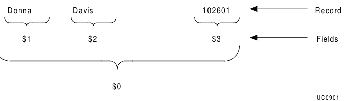

### 使用 awk 程序结构

awk 程序根据模式和动作定义。awk 程序的格式为：

```
<pattern_1> {action_1} <pattern_2> {action_2} <pattern_n> {action_n}
```

### 使用 awk

使用 awk 实用程序的方法有两种：从命令行使用或通过程序文件使用。

你可以在命令行上调用 awk，如下例所示。

示例 9-13：从命令行调用 awk

```bash
$ cat names
Donna Davies
Peter Parker
Paul Baker

$ awk 'print $2, $1' names
Davies Donna
Parker Peter
Baker Paul
```

或者，你可以创建一个 awk 程序并使用 `-f` 选项运行 awk。对于更复杂的命令和报告请使用此方法。以下示例使用了 `/etc/passwd` 文件。结果可能根据系统的不同而异。

示例 9-14：使用 awk 程序

```bash
$ cat list.awk
{
FS = ":"
OFS = "\t"
print $1, $5
}
```

```bash
$ awk -f list.awk /etc/passwd | tail -5
dan David Nolan
seg Susan Greenburg
mw Marcy Williams
eap Eric Patterson
dbs Diana Sanchez
$
```


## 使用 awk 实用程序

### 表达式和变量

下表显示了在编写 awk 程序时使用的一些表达式。这些表达式实际上是预定义的变量，可以在 awk 程序中更改为新值。

表 9-5: awk 程序表达式
| 表达式 | 意义 |
| --- | --- |
| `BEGIN <action>` | `<action>` 将在程序中任何其他 `<action>` 之前执行一次，并在处理所有输入后执行 |
| `END <action>` | 导致 `<action>` 在程序中其他 `<action>` 之后，且在处理所有输入后执行 |
| `NR` | 在求值时已读取的记录数 |
| `NF` | 当前记录中的字段数 |
| `FS` | 输入字段分隔符 |
| `OFS` | 输出字段分隔符 |

### 比较运算符

下表所示符号用于 awk 评估和比较表达式。它们与 C 编程语言中使用的符号相同。

表 9-6: awk 的比较运算符
| 符号 | 定义 |
| --- | --- |
| `==` | 等于 |
| `!=` | 不等于 |
| `>` | 大于 |
| `<` | 小于 |
| `>=` | 大于等于 |
| `<=` | 小于等于 |

### 在 awk 中使用逻辑运算符

逻辑运算符包含两个或多个表达式的布尔语句。

- `AND (&&)` 条件 1 **且** 条件 2 都为真
- `OR (||)` 条件 1 **或** 条件 2 其中之一为真

phones 文件展示了 awk 中逻辑运算符的使用。

## 示例 9-15: 在 awk 中使用逻辑运算符

```
$ cat phones

Augusta ME (207)271-2211

Maynard MA (508)493-4113

Burlington VT (802)657-2895

Hashua NH (603)884-2413

Cambridge MA (617)654-3531

Charleston SC (803)744-9046

Stanford CT (203)258-3232

Syracuse NY (315)453-1057

Kalamazoo MI (616)384-8310

Boston MA (617)106-5472

Littleton MA (508)952-4839

Providence RI (401)107-8932
```

## 总结

## 单元概述

### 简介

进程是一个运行中的程序或命令。本单元讨论了进程的概念以及如何管理用户进程。当你输入一个命令时，该命令作为当前进程（父进程）的从属进程（子进程）执行。所有用户进程都是登录 shell 进程的进程。

### 目标

为了控制进程，你应该能够：

- 定义进程和作业（job）的概念
- 获取进程状态
- 控制和管理进程
- 调度进程在其他时间运行

### 资源

有关本单元主题的更多信息，请参考：

- Tru64 UNIX 参考页

## 描述进程概念

### 概述

操作系统同时管理硬件和软件资源。它管理的软件资源之一就是执行中的程序。我们将执行中的程序称为*进程*。

进程：

- 可以被创建和销毁
- 拥有分配的资源
- 具有关联的环境，该环境：
  - 继承自父进程
  - 包含与进程相关的所有信息
  - 可以通过发布 shell 命令进行更改
- 创建其他进程
- 与其它进程通信

### 进程环境

进程环境包括：

- 进程 ID 和进程组 ID
- 打开的文件
- 工作目录
- 文件创建掩码
- 实际和有效的用户 ID 及组 ID
- 资源限制
  - 最大文件大小
  - 最大内存
- 信号动作设置
- 一组命名变量

### 创建进程

当启动操作系统时，`init` 进程会启动。`init` 进程会创建等待终端输入的登录进程。

超级用户（superuser）拥有 `init` 进程，并由控制台控制它。控制台是内核用于在发生严重系统问题时记录错误的终端设备。

当用户登录时，`init` 进程会启动一个具有标准环境的用户 shell 进程。从此时点开始，用户通过发布命令、运行程序和 shell 脚本来创建其他进程。

### 分组 shell 命令

你可以通过以下方式一次提交多个命令：

- 使用分号 (`;`) 隔开要在当前 shell 中顺序执行的命令
- 使用括号 (`()`) 围住要在子 shell 中一起执行的命令

此示例展示了如何使用分号分组命令。

### 示例 10-1：使用分号分组命令

```
$ pwd; date /etc; pwd -al | grep usr; pwd

/usr/users/joe

Mon May 18 11:10:52 EDT 1998

/etc

lrwxwxr-wx 1 root system      May 14 11:34 dt -> .../var/.dt

lrwxwxr-wx 1 root system      15 May  4 11:44 rmt -> .../usr/sbin/rmt

lrwxwxr-wx 1 root system      May 24 11:17 termcap -> .../usr/share/lib/ermcap

$
```

## 现在来试试吧！

提交 `who` 和 `date` 命令来检查 shell。首先分别提交每个命令。然后尝试用分号隔开命令并在单行命令中提交。

### 答案

```
$ who

joe      console      May 14 11:50

joe      pts/1           May 14 11:50

joe      pts/2           May 18 11:08

$ date

Mon May 18 11:12:51 EDT 1998

$ date;

joe      console      May 14 11:50

joe      pts/1           May 14 11:50

joe      pts/2           May 14 14:56

Mon May 18 11:12:51 EDT 1998
```

## 10-4 控制进程

此示例展示了如何使用括号分组命令。

### 示例 10-2：使用括号分组命令

```
$ pwd; date; (cd /etc; ls -al | grep usr)

/usr/users/joe

Mon May 18 11:15:08 EDT 1998

lirwxrwx-wx 1 root system      14 May 4 11:34 dt -> ../usr/var/.dt

lirwxrwx-wx 1 root system      15 May 4 11:44 rmt -> ../usr/sbin/rmt

lirwxrwx-wx 1 root system      24 May 4 11:17 termcap -> ../usr/share/lib/termcap

/usr/users/joe

$
```

> 注意，示例开始并结束于 `/usr/users/you` 目录。子 shell 中的 `cd` 命令不会影响当前 shell。

## 现在来试试吧！

1. 使用此命令将工作目录更改为 `/bin` 并列出内容：
   `$ cd /bin; ls`
2. 重复上述操作：
   a. 将工作目录更改为 `/bin`。
   b. 回家目录。
   c. 列出 `/bin` 的内容。

### 答案

1. 此示例展示了如何使用分号分组命令。
   `$ cd /bin; ls`
2. 这是答案。
   `$ pwd`
   `/bin`

# 状态信息

在不带命令行选项的情况下，`ps` 命令提供如表所示类别的进程状态。

表 10-1: 进程状态信息分类
| 表头 | 说明 |
| :--- | :--- |
| `PID` | 进程标识符 |
| `TTY` | 控制进程的终端设备名称；在大多数情况下，这是你输入命令时所在的终端 |
| `S` | 由最多四个字母组成的标志序列指示进程状态 |
| `TIME` | 进程的累计执行时间 |
| `CMD` | 命令名称及其参数 |

# 使用 ps 选项

表所示了 `ps` 命令的一些常用选项。

表 10-2: `ps` 命令备选选项
| 选项 | 功能 |
| :--- | :--- |
| `-a` | 向标准输出打印除组组和未关联终端的进程之外的所有进程信息 |
| `-e` | 向标准输出打印所有进程的信息 |
| `-f` | 提供额外信息，包括：用户、`PPID`、CPU 使用百分比以及进程启动时间 |
| `-l` | 提供额外信息，包括：进程标志、`UID`、`PPID`、CPU 使用百分比、优先级、进程调度索引、进程大小以及进程等待的事件分类 |
| `-u ulist` | 显示具有 `ulist` 中指定用户 ID 的进程信息 |

此示例显示了输入不带选项的 `ps` 命令后获得的输出。

### 示例 10-4: 使用不带选项的 `ps` 命令

```
$ ps

PID TTY S TIME CMD

13938 pts/4 S + 0:00.23 -sh (sh)

$ 
```

此示例使用了带有 `-ef` 选项的 `ps` 命令。此显示提供了所有进程并包含了用户名。

# 获取进程状态

### 示例 10-5: 使用 -ef 选项的 `ps` 命令

| `UID` | `PID` | `PPID` | `STIME` | `TTY` | `TIME CMD` |
| :--- | :--- | :--- | :--- | :--- | :--- |
| root | 1 | 0 | 7.1 | May 12 ?? | 10:25:06 [kernel idle] |
| root | 1 | 0 | 0.0 | May 12 ?? | 0:01:85 /sbin/init -a |
| joe | 7191 | 7150 | 0.0 | May 14 ?? | 0:37:82 dtwm |
| joe | 13750 | 13829 | 0.0 | 11:11:54 ?? | 0:00/07 /bin/sh -c dtcdap -ser |
| joe | 13827 | 13750 | 0.0 | 11:11:54 ?? | 0:05/95 dtpd -server |
| joe | 13829 | 1 | 0.0 | 11:08:03 ?? | 0:00/63 /usr/dt/bin/tttsession |
| joe | 13865 | 13750 | 0.0 | 11:08:10 ?? | 0:06/35 dtwm |
| joe | 13869 | 13870 | 1.6 | 11:20:45 ?? | 0:05/96 /usr/dt/bin/dterterm -1 |
| joe | 13870 | 13865 | 0.0 | 11:20:45 ?? | 0:00/31 /usr/dt/bin/dtexec -o |
| joe | 7481 | 7463 | 0.0 | May 14 pts/3 | 0:00/04 sh -c /usr/bin/X11/dx |
| joe | 13938 | 13869 | 0.4 | 11:20:48 pts/4 | 0:00/40 -ksh k(sh) |
| root | 13957 | 13938 | 0.0 | 11:28:00 pts/4 | 0:00/07 ps -ef |

# 列出后台作业

`jobs` 命令显示已停止或后台作业的列表。

`jobs` 命令的格式为：

```
jobs [-lp]
```

不带选项的 `jobs` 命令显示后台或停止作业的列表，包含作业编号和作业状态。使用 `-l` 选项，`jobs` 还会显示 `PID`，如示例所示。使用 `-p` 选项，`jobs` 只显示 `PID`。

### 示例 10-6: 使用 jobs 命令

```
$ jobs -l

[4] + 10652 Running / -name vi -print > find-vi & 

[3] - 10651 Running / -name emacs -print > find-emacs & \

[2] 10553 Stopped (ls -alR /usr | grep ^) > user-dirs & 

[1] 10147 Stopped vi notice.txt

$
```

## 10-10 控制进程

# 控制和管理作业

### 概述

要控制和管理一个作业，需要以下命令：

- 停止、挂起或终止作业
- 在后台和前景之间移动作业
- 协调多个作业的执行

# 挂起作业

在等待命令或脚本完成时，经常会忘记要做某事。你可以挂起当前作业，然后从中断的地方继续。使用字符（通常是 `Ctrl+Z`）挂起前景作业。此示例显示启动了 vi 编辑器后将其挂起。

### 示例 10-7: 挂起当前进程

```
$ vi notice.txt

<Ctrl/Z>

$
```

# 将作业放入前景

`fg` 命令将停止或后台的作业放入前景。`fg` 命令的格式为：

```
fg job_id
```

如果不使用 `job_id`，输出中用 `+` 表示的当前作业将被放入前景。你可以通过前面的符号 `%` 指定作业，也可以指定 `PID`。如果不指定作业，系统将使用当前作业。此示例演示了 `fg`。

### 示例 10-8: 使用 fg 命令

```
$ fg 将当前作业放入前景

$ fg %3 将作业 3 放入前景

$ fg 10147 将 PID 为 10147 的作业放入前景
```

### 尝试一下！

1. 执行以下命令启动 vi 编辑器：
   `vi file.txt`
2. 输入 `Ctrl+Z` 停止进程。
3. 确定进程的作业编号。
4. 重启编辑器。
5. 输入 `exit` 退出编辑器。

### 答案

```
$ vi file.txt

<Ctrl/Z>

$ fg %2

$ exit

$
```

# 在后台重启作业

`bg` 命令在后台重启停止作业。`bg` 命令的格式为：

```
bg job_id
```

如果不使用作业 ID，最近停止的作业将在后台重启。否则，`bg` 需要一个作业编号（前加百分号）或 `PID`。此示例显示了如何使用 `bg` 命令。

### 示例 10-9: 使用 bg 命令

```
$ bg %2
ls -l > files.txt &
```

### 尝试一下！

1. 在后台运行以下命令：
   `$ sleep 20; ls &`
   a. 执行 `ps` 命令。
   b. 该命令的作业编号是多少？
   c. `PID` 是多少？
2. 在后台运行以下命令，然后执行命令将该作业带回后台。（提示说“回到后台”）。

### 答案

1. 作业编号为 1；`PID` 为 4529。你的结果可能会不同，但应该是类似的。

```
$ sleep 20; ls &
$ ps
PID TTY S TIME COMMAND
4423 p S 0:00.78 -ksh (ksh)
4529 p S 0:00.01 -ksh (ksh)
4530 p N 0:00.01 sleep 20
```

2. 你必须等待命令完成。

```
$ sleep 20; ls &
$ fg
(sleep 20; ls)
```

# 使用 kill 命令

你可以通过终端键（如 `Ctrl/C`）与前景进程通信，但你需要特殊命令与后台作业通信。

`kill` 命令向后台作业发送信号。使用 `kill` 终止作业，或使用 `trap` 创建脚本来捕获不当操作。应用程序可以选择忽略信号或捕获并在稍后处理。如果不是这样，`kill` 命令将终止进程。

`kill` 命令的格式为：

```
kill [-signal] job_name
```

使用 `kill -l` 命令显示 kill 信号。表显示了 `kill -l` 命令的信号列表。

表 10-3: UNIX kill 信号

| 1-HUP | 7-EMTX | 13-PIPE | 19-CONT | 25-XFSZ |
| 2-INT | 8-FPE | 14-ALRM | 20-CHLD | 26-VTALRM |
| 3-QUIT | 9-KILL | 15-TERM | 21-TTIN | 27-PROF |
| 4-ILL | 10-BUS | 16-URG | 22-TTOU | 28-WINCH |
| 5-TRAP | 11-SEGV | 17-STOP | 23-POLL | 29-PWR |
| 6-LOST | 12-SYS | 18-TSTP | 24-XCPU | 30-USRI |

使用名称或数字指定信号。默认的 kill 信号是 `TERM`，它会终止任何忽略或捕获信号的进程。此示例显示了如何使用 `kill`。

### 示例 10-10: 使用 kill 命令

```
$ kill %4
$ kill -QUIT %1
$ kill -9 10652
```

# 进程优先级

操作系统为每个进程分配一个优先级。该优先级调度进程，并可能影响作业完成所需。实际值取决于系统。

UNIX 操作系统提供了 `nice` 命令，允许你以较低的优先级运行命令。`nice` 优先级值：

- 控制你的进程的执行速度
- 范围从 -20（最高优先级）到 19（最低优先级）
- 默认值为 10

超级用户可以使用最高优先级（负数）。

将 nice 值映射到该系统上相应的优先级。

`nice` 命令的格式为：

```
nice [-n priority] command [argument ...]
```

在此示例中，以较低的优先级在后台运行脚本文件 `find.ksh`。

## 示例 10-11: 使用 nice 命令

```
$ nice -n 15 find.ksh &
```

超级用户只能降低其优先级，而不能增加优先级。此表显示了有用的优先级级别。

## 表 10-4：有用的优先级级别

| 优先级级别 | 描述 |
| --- | --- |
| +19 | 当系统中没有其他程序运行时运行 |
| +10 | 未使用 nice 未指定数字时的默认级别 |
| 0 | 基础调度优先级 |
| -1 to -20 | 使进程运行非常快（仅限超级用户） |

## 现在来试试！

要降低一个进程的优先级：


## 现在来试试！

1. 输入命令 `ps -al` 以获取所有进程的详细列表。NI 列显示等效 nice 值。
2. 修改命令将其 nice 值设置为 10。

## 解决方案

1. NI 列显示进程优先级。

```
$ ps -al
| F S UID PID PPID %CU PRI NI RSS WCHAN TT TIME COM |
| 8008005 I + 0 348 1 0.0 44 0 56K tty co 0:00:05 get |
| 8008005 S 1731 4423 4422 0.0 41 0 408K wait pl 0:01:01 k |
| 8008005 R N+ 0 4566 4423 0.0 54 10 352K - pl 0:00:04 ps |
```

2. 进程优先级改变了 10。

```
$ nice -n 10 ps -al
| F S UID PID PPID %CU PRI NI RSS WCHAN TT TIME COM |
| 8008005 I + 0 348 1 0.0 44 0 56K ttyin co 0:00:05 get |
| 8008005 S 1731 4423 4422 0.0 41 0 408K wait pl 0:01:01 k |
| 8008005 R N+ 0 4566 4423 0.0 54 10 352K - pl 0:00:04 ps |
```

## 让进程休眠

`sleep` 命令暂停进程执行指定的秒数。使用 `sleep` 命令可以在一段时间后导致某个命令执行，或者每隔一段时间执行一次命令。

`sleep` 命令的格式为：

```
$ sleep seconds
```

假设你在工作日期间每小时需要吃药。你可以创建一个 `medicine.ksh` 文件并包含以下内容：

```
print "It is time to take your medicine!"
sleep 3600; print "It is time to take your medicine!"
sleep 3600; print "It is time to take your medicine!"
sleep 3600; print "It is time to take your medicine!"
sleep 3600; print "It is time to take your medicine! Only one more to go!"
sleep 3600; print "It is time to take your medicine! Last time today!"
```

该 shell 脚本可以在后台执行：

```
$ medicine.ksh &
```

## 让进程等待

后台处理是在不需要用户交互时执行长耗时作业的方便方法。然而，你可能需要等待后台作业完成后才能完成其他任务。`wait` 工具会一直等待直到调用者已知的所有进程 ID 终止。

`wait` 命令的格式为：

```
wait [job_name]
```

假设你使用 `ls` 命令配合 `-R` 标志来列出从根目录开始的每个子目录中的所有文件。

假设你需要在编写的脚本中使用这些目录列表。使用 `wait` 命令等待后台作业完成。

此示例演示了在交互式情况下使用 `wait` 命令。

## 示例 10-12: 等待后台作业完成

```
$ ls -lar /usr | grep d > dir-list &
$ wait 586; print "The directory list is complete"
The directory list is complete
$
```

`wait` 是 Korn Shell 的内置命令。由于所有后台作业都是 shell 的子进程，登录 shell 必须等待子进程。

`wait` 命令的选项如表所示。

## 表 10-5：Korn Shell wait 命令选项

| 选项 | 命令 | 等待： |
| --- | --- | --- |
| (无选项) | wait | 所有后台命令完成 |
| %job_number | wait %2 | 作业号 2 完成 |
| process_number | wait 346 | 进程 346 完成 |
| % | wait % | 上一个后台进程完成 |

## 退出状态变量

shell 命令、shell 脚本和系统命令要么：

- 成功并在屏幕上显示结果，或
- 失败并 shell 打印某种诊断性错误消息

shell 还会设置一个预留变量 `?`，存储命令的退出状态。通常设置为：

- 零 (0) 表示执行成功
- 非零表示失败

用户文档描述了特定状态码的含义。在某些情况下，状态码为 1 表示通用的执行错误。

## 示例 10-13: 检查状态

```
$ ls /nonexistent
ls: /nonexistent: No such file or directory
$ echo $?
1
```


# 让进程休眠

`sleep` 命令暂停进程执行指定的秒数。使用 `sleep` 命令可以在一段时间后导致某个命令执行，或者每隔一段时间执行一次命令。

`sleep` 命令的格式为：

```
$ sleep seconds
```

假设你在工作日期间每小时需要吃药。你可以创建一个 `medicine.ksh` 文件并包含以下内容：

```
print "It is time to take your medicine!"
sleep 3600; print "It is time to take your medicine!"
sleep 3600; print "It is time to take your medicine!"
sleep 3600; print "It is time to take your medicine!"
sleep 3600; print "It is time to take your medicine! Only one more to go!"
sleep 3600; print "It is time to take your medicine! Last time today!"
```

该 shell 脚本可以在后台执行：

```
$ medicine.ksh &
```

# 让进程等待

后台处理是在不需要用户交互时执行长耗时作业的方便方法。然而，你可能需要等待后台作业完成后才能完成其他任务。`wait` 工具会一直等待直到调用者已知的所有进程 ID 终止。

`wait` 命令的格式为：

```
wait [job_name]
```

假设你使用 `ls` 命令配合 `-R` 标志来列出从根目录开始的每个子目录中的所有文件。

假设你需要在编写的脚本中使用这些目录列表。使用 `wait` 命令等待后台作业完成。

此示例演示了在交互式情况下使用 `wait` 命令。

## 示例 10-12: 等待后台作业完成

```
$ ls -lar /usr | grep d > dir-list &
$ wait 586; print "The directory list is complete"
The directory list is complete
$
```

`wait` 是 Korn Shell 的内置命令。由于所有后台作业都是 shell 的子进程，登录 shell 必须等待子进程。

`wait` 命令的选项如表所示。

## 表 10-5：Korn Shell wait 命令选项

| 选项 | 命令 | 等待： |
| --- | --- | --- |
| (无选项) | `wait` | 所有后台命令完成 |
| `%job_number` | `wait %2` | 作业号 2 完成 |
| `process_number` | `wait 346` | 进程 346 完成 |
| `%` | `wait %` | 上一个后台进程完成 |

# 退出状态变量

shell 命令、shell 脚本和系统命令要么：

- 成功并在屏幕上显示结果，或
- 失败并 shell 打印某种诊断性错误消息

shell 还会设置一个预留变量 `$?`，存储命令的退出状态。通常设置为：

- 零 (0) 表示执行成功
- 非零表示失败

用户文档描述了特定状态码的含义。在某些情况下，状态码为 1 表示通用的执行错误。

## 示例 10-13: 检查状态

```
$ ls /nonexistent
ls: /nonexistent: No such file or directory
$ echo $?
1
```

# 现在来试试！

1. 输入命令 `ps -al` 以获取所有进程的详细列表。NI 列显示等效 nice 值。
2. 修改命令将其 nice 值设置为 10。

# 解决方案

1. NI 列显示进程优先级。

```
$ ps -al
| F S UID PID PPID %CU PRI NI RSS WCHAN TT TIME COM |
| 8008005 I + 0 348 1 0.0 44 0 56K tty co 0:00:05 get |
| 8008005 S 1731 4423 4422 0.0 41 0 408K wait pl 0:01:01 k |
| 8008005 R N+ 0 4566 4423 0.0 54 10 352K - pl 0:00:04 ps |
```

2. 进程优先级改变了 10。

```
$ nice -n 10 ps -al
| F S UID PID PPID %CU PRI NI RSS WCHAN TT TIME COM |
| 8008005 I + 0 348 1 0.0 44 0 56K ttyin co 0:00:05 get |
| 8008005 S 1731 4423 4422 0.0 41 0 408K wait pl 0:01:01 k |
| 8008005 R N+ 0 4566 4423 0.0 54 10 352K - pl 0:00:04 ps |
```


```
$ nice -n 10 ps -al
| F S UID PID PPID %CU PRI NI RSS WCHAN TT TIME COM |
| 8008005 I + 0 348 1 0.0 44 0 56K ttyin co 0:00:05 get |
| 8008005 S 1731 4423 4422 0.0 41 0 408K wait pl 0:01:01 k |
| 8008005 R N+ 0 4566 4423 0.0 54 10 352K - pl 0:00:04 ps |
```

## 让进程休眠

`sleep` 命令暂停进程执行指定的秒数。使用 `sleep` 命令可以在一段时间后导致某个命令执行，或者每隔一段时间执行一次命令。

`sleep` 命令的格式为：

```
$ sleep seconds
```

假设你在工作日期间每小时需要吃药。你可以创建一个 `medicine.ksh` 文件并包含以下内容：

```
print "It is time to take your medicine!"
sleep 3600; print "It is time to take your medicine!"
sleep 3600; print "It is time to take your medicine!"
sleep 3600; print "It is time to take your medicine!"
sleep 3600; print "It is time to take your medicine! Only one more to go!"
sleep 3600; print "It is time to take your medicine! Last time today!"
```

该 shell 脚本可以在后台执行：

```
$ medicine.ksh &
```

## 让进程等待

后台处理是在不需要用户交互时执行长耗时作业的方便方法。然而，你可能需要等待后台作业完成后才能完成其他任务。`wait` 工具会一直等待直到调用者已知的所有进程 ID 终止。

`wait` 命令的格式为：

```
wait [job_name]
```

假设你使用 `ls` 命令配合 `-R` 标志来列出从根目录开始的每个子目录中的所有文件。

假设你需要在编写的脚本中使用这些目录列表。使用 `wait` 命令等待后台作业完成。

此示例演示了在交互式情况下使用 `wait` 命令。

## 示例 10-12: 等待后台作业完成

```
$ ls -lar /usr | grep d > dir-list &
$ wait 586; print "The directory list is complete"
The directory list is complete
$
```

`wait` 是 Korn Shell 的内置命令。由于所有后台作业都是 shell 的子进程，登录 shell 必须等待子进程。

`wait` 命令的选项如表所示。

## 表 10-5：Korn Shell wait 命令选项

| 选项 | 命令 | 等待： |
| --- | --- | --- |
| (无选项) | wait | 所有后台命令完成 |
| %job_number | wait %2 | 作业号 2 完成 |
| process_number | wait 346 | 进程 346 完成 |
| % | wait % | 上一个后台进程完成 |

## 退出状态变量

shell 命令、shell 脚本和系统命令要么：

- 成功并在屏幕上显示结果，或
- 失败并 shell 打印某种诊断性错误消息

shell 还会设置一个预留变量 `?`，存储命令的退出状态。通常设置为：

- 零 (0) 表示执行成功
- 非零表示失败

用户文档描述了特定状态码的含义。在某些情况下，状态码为 1 表示通用的执行错误。

## 示例 10-13: 检查状态

```
$ ls /nonexistent
ls: /nonexistent: No such file or directory
$ echo $?
1
```

## 现在来试试！

1. 输入命令 `ps -al` 以获取所有进程的详细列表。NI 列显示等效 nice 值。
2. 修改命令将其 nice 值设置为 10。

## 解决方案

1. NI 列显示进程优先级。

```
$ ps -al
| F S UID PID PPID %CU PRI NI RSS WCHAN TT TIME COM |
| 8008005 I + 0 348 1 0.0 44 0 56K tty co 0:00:05 get |
| 8008005 S 1731 4423 4422 0.0 41 0 408K wait pl 0:01:01 k |
| 8008005 R N+ 0 4566 4423 0.0 54 10 352K - pl 0:00:04 ps |
```

2. 进程优先级改变了 10。

```
$ nice -n 10 ps -al
| F S UID PID PPID %CU PRI NI RSS WCHAN TT TIME COM |
| 8008005 I + 0 348 1 0.0 44 0 56K ttyin co 0:00:05 get |
| 8008005 S 1731 4423 4422 0.0 41 0 408K wait pl 0:01:01 k |
| 8008005 R N+ 0 4566 4423 0.0 54 10 352K - pl 0:00:04 ps |
```


## 表 10-5：Korn Shell wait 命令选项

| 选项 | 命令 | 等待： |
| --- | --- | --- |
| (无选项) | `wait` | 所有后台命令完成 |
| `%job_number` | `wait %2` | 作业号 2 完成 |
| `process_number` | `wait 346` | 进程 346 完成 |
| `%` | `wait %` | 上一个后台进程完成 |

## 退出状态变量

shell 命令、shell 脚本和系统命令要么：

- 成功并在屏幕上显示结果，或
- 失败并 shell 打印某种诊断性错误消息

shell 还会设置一个预留变量 `$?`，存储命令的退出状态。通常设置为：

- 零 (0) 表示执行成功
- 非零表示失败

用户文档描述了特定状态码的含义。在某些情况下，状态码为 1 表示通用的执行错误。

## 示例 10-13: 检查状态

```
$ ls /nonexistent
ls: /nonexistent: No such file or directory
$ echo $?
1
```

## 现在来试试！

1. 输入命令 `ps -al` 以获取所有进程的详细列表。NI 列显示等效 nice 值。
2. 修改命令将其 nice 值设置为 10。

## 解决方案

1. NI 列显示进程优先级。

```
$ ps -al
| F S UID PID PPID %CU PRI NI RSS WCHAN TT TIME COM |
| 8008005 I + 0 348 1 0.0 44 0 56K tty co 0:00:05 get |
| 8008005 S 1731 4423 4422 0.0 41 0 408K wait pl 0:01:01 k |
| 8008005 R N+ 0 4566 4423 0.0 54 10 352K - pl 0:00:04 ps |
```

2. 进程优先级改变了 10。

```
$ nice -n 10 ps -al
| F S UID PID PPID %CU PRI NI RSS WCHAN TT TIME COM |
| 8008005 I + 0 348 1 0.0 44 0 56K ttyin co 0:00:05 get |
| 8008005 S 1731 4423 4422 0.0 41 0 408K wait pl 0:01:01 k |
| 8008005 R N+ 0 4566 4423 0.0 54 10 352K - pl 0:00:04 ps |
```

## 让进程休眠

`sleep` 命令暂停进程执行指定的秒数。使用 `sleep` 命令可以在一段时间后导致某个命令执行，或者每隔一段时间执行一次命令。

`sleep` 命令的格式为：

```
$ sleep seconds
```

假设你在工作日期间每小时需要吃药。你可以创建一个 `medicine.ksh` 文件并包含以下内容：

```
print "It is time to take your medicine!"
sleep 3600; print "It is time to take your medicine!"
sleep 3600; print "It is time to take your medicine!"
sleep 3600; print "It is time to take your medicine!"
sleep 3600; print "It is time to take your medicine! Only one more to go!"
sleep 3600; print "It is time to take your medicine! Last time today!"
```

该 shell 脚本可以在后台执行：

```
$ medicine.ksh &
```

## 让进程等待

后台处理是在不需要用户交互时执行长耗时作业的方便方法。然而，你可能需要等待后台作业完成后才能完成其他任务。`wait` 工具会一直等待直到调用者已知的所有进程 ID 终止。

`wait` 命令的格式为：

```
wait [job_name]
```

假设你使用 `ls` 命令配合 `-R` 标志来列出从根目录开始的每个子目录中的所有文件。

假设你需要在编写的脚本中使用这些目录列表。使用 `wait` 命令等待后台作业完成。

此示例演示了在交互式情况下使用 `wait` 命令。

## 示例 10-12: 等待后台作业完成

```
$ ls -lar /usr | grep d > dir-list &
$ wait 586; print "The directory list is complete"
The directory list is complete
$
```

`wait` 是 Korn Shell 的内置命令。由于所有后台作业都是 shell 的子进程，登录 shell 必须等待子进程。

`wait` 命令的选项如表所示。


# 让进程休眠

`sleep` 命令暂停进程执行指定的秒数。使用 `sleep` 命令可以在一段时间后导致某个命令执行，或者每隔一段时间执行一次命令。

`sleep` 命令的格式为：

```
$ sleep seconds
```

假设你在工作日期间每小时需要吃药。你可以创建一个 `medicine.ksh` 文件并包含以下内容：

```
print "It is time to take your medicine!"
sleep 3600; print "It is time to take your medicine!"
sleep 3600; print "It is time to take your medicine!"
sleep 3600; print "It is time to take your medicine!"
sleep 3600; print "It is time to take your medicine! Only one more to go!"
sleep 3600; print "It is time to take your medicine! Last time today!"
```

该 shell 脚本可以在后台执行：

```
$ medicine.ksh &
```

# 让进程等待

后台处理是在不需要用户交互时执行长耗时作业的方便方法。然而，你可能需要等待后台作业完成后才能完成其他任务。`wait` 工具会一直等待直到调用者已知的所有进程 ID 终止。

`wait` 命令的格式为：

```
wait [job_name]
```

假设你使用 `ls` 命令配合 `-R` 标志来列出从根目录开始的每个子目录中的所有文件。

假设你需要在编写的脚本中使用这些目录列表。使用 `wait` 命令等待后台作业完成。

此示例演示了在交互式情况下使用 `wait` 命令。

## 示例 10-12: 等待后台作业完成

```
$ ls -lar /usr | grep d > dir-list &
$ wait 586; print "The directory list is complete"
The directory list is complete
$
```

`wait` 是 Korn Shell 的内置命令。由于所有后台作业都是 shell 的子进程，登录 shell 必须等待子进程。

`wait` 命令的选项如表所示。

## 表 10-5：Korn Shell wait 命令选项

| 选项 | 命令 | 等待： |
| --- | --- | --- |
| (无选项) | `wait` | 所有后台命令完成 |
| `%job_number` | `wait %2` | 作业号 2 完成 |
| `process_number` | `wait 346` | 进程 346 完成 |
| `%` | `wait %` | 上一个后台进程完成 |

# 退出状态变量

shell 命令、shell 脚本和系统命令要么：

- 成功并在屏幕上显示结果，或
- 失败并 shell 打印某种诊断性错误消息

shell 还会设置一个预留变量 `$?`，存储命令的退出状态。通常设置为：

- 零 (0) 表示执行成功
- 非零表示失败

用户文档描述了特定状态码的含义。在某些情况下，状态码为 1 表示通用的执行错误。

## 示例 10-13: 检查状态

```
$ ls /nonexistent
ls: /nonexistent: No such file or directory
$ echo $?
1
```

# 现在来试试！

1. 输入命令 `ps -al` 以获取所有进程的详细列表。NI 列显示等效 nice 值。
2. 修改命令将其 nice 值设置为 10。

## 解决方案

1. NI 列显示进程优先级。

```
$ ps -al
| F S UID PID PPID %CU PRI NI RSS WCHAN TT TIME COM |
| 8008005 I + 0 348 1 0.0 44 0 56K tty co 0:00:05 get |
| 8008005 S 1731 4423 4422 0.0 41 0 408K wait pl 0:01:01 k |
| 8008005 R N+ 0 4566 4423 0.0 54 10 352K - pl 0:00:04 ps |
```

2. 进程优先级改变了 10。

```
$ nice -n 10 ps -al
| F S UID PID PPID %CU PRI NI RSS WCHAN TT TIME COM |
| 8008005 I + 0 348 1 0.0 44 0 56K ttyin co 0:00:05 get |
| 8008005 S 1731 4423 4422 0.0 41 0 408K wait pl 0:01:01 k |
| 8008005 R N+ 0 4566 4423 0.0 54 10 352K - pl 0:00:04 ps |
```


# 示例 10-13: 检查状态

```
$ ls /nonexistent
ls: /nonexistent: No such file or directory
$ echo $?
1
```

## 现在来试试！

1. 输入命令 `ps -al` 以获取所有进程的详细列表。`NI` 列显示等效 nice 值。
2. 修改命令将其 nice 值设置为 10。

## 解决方案

1. `NI` 列显示进程优先级。

```
$ ps -al
| F S UID PID PPID %CU PRI NI RSS WCHAN TT TIME COM |
| 8008005 I + 0 348 1 0.0 44 0 56K tty co 0:00:05 get |
| 8008005 S 1731 4423 4422 0.0 41 0 408K wait pl 0:01:01 k |
| 8008005 R N+ 0 4566 4423 0.0 54 10 352K - pl 0:00:04 ps |
```

2. 进程优先级改变了 10。

```
$ nice -n 10 ps -al
| F S UID PID PPID %CU PRI NI RSS WCHAN TT TIME COM |
| 8008005 I + 0 348 1 0.0 44 0 56K ttyin co 0:00:05 get |
| 8008005 S 1731 4423 4422 0.0 41 0 408K wait pl 0:01:01 k |
| 8008005 R N+ 0 4566 4423 0.0 54 10 352K - pl 0:00:04 ps |
```

## 让进程休眠

`sleep` 命令暂停进程执行指定的秒数。使用 `sleep` 命令可以在一段时间后导致某个命令执行，或者每隔一段时间执行一次命令。

`sleep` 命令的格式为：

```
$ sleep seconds
```

假设你在工作日期间每小时需要吃药。你可以创建一个 `medicine.ksh` 文件并包含以下内容：

```
print "It is time to take your medicine!"
sleep 3600; print "It is time to take your medicine!"
sleep 3600; print "It is time to take your medicine!"
sleep 3600; print "It is time to take your medicine!"
sleep 3600; print "It is time to take your medicine! Only one more to go!"
sleep 3600; print "It is time to take your medicine! Last time today!"
```

该 shell 脚本可以在后台执行：

```
$ medicine.ksh &
```

## 让进程等待

后台处理是在不需要用户交互时执行长耗时作业的方便方法。然而，你可能需要等待后台作业完成后才能完成其他任务。`wait` 工具会一直等待直到调用者已知的所有进程 ID 终止。

`wait` 命令的格式为：

```
wait [job_name]
```

假设你使用 `ls` 命令配合 `-R` 标志来列出从根目录开始的每个子目录中的所有文件。

假设你需要在编写的脚本中使用这些目录列表。使用 `wait` 命令等待后台作业完成。

此示例演示了在交互式情况下使用 `wait` 命令。

## 示例 10-12: 等待后台作业完成

```
$ ls -lar /usr | grep d > dir-list &
$ wait 586; print "The directory list is complete"
The directory list is complete
$
```

`wait` 是 Korn Shell 的内置命令。由于所有后台作业都是 shell 的子进程，登录 shell 必须等待子进程。

`wait` 命令的选项如表所示。

## 表 10-5：Korn Shell wait 命令选项

| 选项 | 命令 | 等待： |
| --- | --- | --- |
| (无选项) | wait | 所有后台命令完成 |
| %job_number | wait %2 | 作业号 2 完成 |
| process_number | wait 346 | 进程 346 完成 |
| % | wait % | 上一个后台进程完成 |

## 退出状态变量

shell 命令、shell 脚本和系统命令要么：

- 成功并在屏幕上显示结果，或
- 失败并 shell 打印某种诊断性错误消息

shell 还会设置一个预留变量 `?`，存储命令的退出状态。通常设置为：

- 零 (0) 表示执行成功
- 非零表示失败

用户文档描述了特定状态码的含义。在某些情况下，状态码为 1 表示通用的执行错误。


# 后台处理与进程控制

## 让进程休眠

`sleep` 命令暂停进程执行指定的秒数。使用 `sleep` 命令可以在一段时间后导致某个命令执行，或者每隔一段时间执行一次命令。

`sleep` 命令的格式为：

```
$ sleep seconds
```

假设你在工作日期间每小时需要吃药。你可以创建一个 `medicine.ksh` 文件并包含以下内容：

```
print "It is time to take your medicine!"
sleep 3600; print "It is time to take your medicine!"
sleep 3600; print "It is time to take your medicine!"
sleep 3600; print "It is time to take your medicine!"
sleep 3600; print "It is time to take your medicine! Only one more to go!"
sleep 3600; print "It is time to take your medicine! Last time today!"
```

该 shell 脚本可以在后台执行：

```
$ medicine.ksh &
```

## 让进程等待

后台处理是在不需要用户交互时执行长耗时作业的方便方法。然而，你可能需要等待后台作业完成后才能完成其他任务。`wait` 工具会一直等待直到调用者已知的所有进程 ID 终止。

`wait` 命令的格式为：

```
wait [job_name]
```

假设你使用 `ls` 命令配合 `-R` 标志来列出从根目录开始的每个子目录中的所有文件。

假设你需要在编写的脚本中使用这些目录列表。使用 `wait` 命令等待后台作业完成。

此示例演示了在交互式情况下使用 `wait` 命令。

### 示例 10-12: 等待后台作业完成

```
$ ls -lar /usr | grep d > dir-list &
$ wait 586; print "The directory list is complete"
The directory list is complete
$
```

`wait` 是 Korn Shell 的内置命令。由于所有后台作业都是 shell 的子进程，登录 shell 必须等待子进程。

`wait` 命令的选项如表所示。

### 表 10-5：Korn Shell wait 命令选项

| 选项 | 命令 | 等待： |
| --- | --- | --- |
| (无选项) | `wait` | 所有后台命令完成 |
| `%job_number` | `wait %2` | 作业号 2 完成 |
| `process_number` | `wait 346` | 进程 346 完成 |
| `%` | `wait %` | 上一个后台进程完成 |

## 退出状态变量

shell 命令、shell 脚本和系统命令要么：

- 成功并在屏幕上显示结果，或
- 失败并 shell 打印某种诊断性错误消息

shell 还会设置一个预留变量 `$?`，存储命令的退出状态。通常设置为：

- 零 (0) 表示执行成功
- 非零表示失败

用户文档描述了特定状态码的含义。在某些情况下，状态码为 1 表示通用的执行错误。

### 示例 10-13: 检查状态

```
$ ls /nonexistent
ls: /nonexistent: No such file or directory
$ echo $?
1
```

## 现在来试试！

1. 输入命令 `ps -al` 以获取所有进程的详细列表。NI 列显示等效 nice 值。
2. 修改命令将其 nice 值设置为 10。

## 解决方案

1. NI 列显示进程优先级。

```
$ ps -al
| F S UID PID PPID %CU PRI NI RSS WCHAN TT TIME COM |
| 8008005 I + 0 348 1 0.0 44 0 56K tty co 0:00:05 get |
| 8008005 S 1731 4423 4422 0.0 41 0 408K wait pl 0:01:01 k |
| 8008005 R N+ 0 4566 4423 0.0 54 10 352K - pl 0:00:04 ps |
```

2. 进程优先级改变了 10。

```
$ nice -n 10 ps -al
| F S UID PID PPID %CU PRI NI RSS WCHAN TT TIME COM |
| 8008005 I + 0 348 1 0.0 44 0 56K ttyin co 0:00:05 get |
| 8008005 S 1731 4423 4422 0.0 41 0 408K wait pl 0:01:01 k |
| 8008005 R N+ 0 4566 4423 0.0 54 10 352K - pl 0:00:04 ps |
```


## 进程优先级与 Nice 值

```
8008005 R N+  4 4566 442  0.  54  00 352K -0 0::0::44 ps |
```

- 2. 进程改变了 10。

```
$ nice -n 10 ps -al
| F S  PID PPID %CUCU NI  W W  TT TIME TIME
 80000055 0 333   1 0 44440 5556K t  0000:00:05 get | 80000000 17 1  4 44 444420 0.4  1 00448K  pl 00:01:01 k |
| 8008005 R N+ 0 44566 4442 000. 5 544  10  0 352K - pl 0::000:04 ps |
```

## 让进程休眠

`sleep` 命令暂停进程执行指定的秒数。使用 `sleep` 命令可以在一段时间后导致某个命令执行，或者每隔一段时间执行一次命令。

`sleep` 命令的格式为：

```
$ sleep seconds
```

假设你在工作日期间每小时需要吃药。你可以创建一个 `medicine.ksh` 文件并包含以下内容：

```
print "It is time to take your medicine!"
sleep 3600; print "It is time to take your medicine!"
sleep 3600; print "It is time to take your medicine!"
sleep 3600; print "It is time to take your medicine!"
sleep 3600; print "It is time to take your medicine! Only one more to go!"
sleep 3600; print "It is time to take your medicine! Last time today!"
```

该 shell 脚本可以在后台执行：

```
$ medicine.ksh &
```

## 让进程等待

后台处理是在不需要用户交互时执行长耗时作业的方便方法。然而，你可能需要等待后台作业完成后才能完成其他任务。`wait` 工具会一直等待直到调用者已知的所有进程 ID 终止。

`wait` 命令的格式为：

```
wait [job_name]
```

假设你使用 `ls` 命令配合 `-R` 标志来列出从根目录开始的每个子目录中的所有文件。

假设你需要在编写的脚本中使用这些目录列表。使用 `wait` 命令等待后台作业完成。

此示例演示了在交互式情况下使用 `wait` 命令。

## 示例 10-12: 等待后台作业完成

```
$ ls -lar /usr | grep d > dir-list &
$ wait 586; print "The directory list is complete"
The directory list is complete
$
```

`wait` 是 Korn Shell 的内置命令。由于所有后台作业都是 shell 的子进程，登录 shell 必须等待子进程。

`wait` 命令的选项如表所示。

## 表 10-5：Korn Shell wait 命令选项

| 选项 | 命令 | 等待： |
| --- | --- | --- |
| (无选项) | wait | 所有后台命令完成 |
| %job_number | wait %2 | 作业号 2 完成 |
| process_number | wait 346 | 进程 346 完成 |
| % | wait % | 上一个后台进程完成 |

## 退出状态变量

shell 命令、shell 脚本和系统命令要么：

- 成功并在屏幕上显示结果，或
- 失败并 shell 打印某种诊断性错误消息

shell 还会设置一个预留变量 `?`，存储命令的退出状态。通常设置为：

- 零 (0) 表示执行成功
- 非零表示失败

用户文档描述了特定状态码的含义。在某些情况下，状态码为 1 表示通用的执行错误。

## 示例 10-13: 检查状态

```
$ ls /nonexistent
ls: /nonexistent: No such file or directory
$ echo $?
1
```

## 现在来试试！

- 1. 输入命令 `ps -al` 以获取所有进程的详细列表。NI 列显示等效 nice 值。
- 2. 修改命令将其 nice 值设置为 10。

## 解决方案

- 1. NI 列显示进程优先级。

```
$ ps -al
| F S UID PID PPID %CU PRI NI RSS WCHAN TT TIME COM |
| 8008005 I + 0 348 1 0.0 44 0 56K tty co 0:00:05 get |
| 8008005 S 1731 4423 4422 0.0 41 0 408K wait pl 0:01:01 k |
| 8008005 R N+ 0 4566 4423 0.0 54 10 352K - pl 0:00:04 ps |
```

- 2. 进程优先级改变了 10。

```
$ nice -n 10 ps -al
| F S UID PID PPID %CU PRI NI RSS WCHAN TT TIME COM |
| 8008005 I + 0 348 1 0.0 44 0 56K ttyin co 0:00:05 get |
| 8008005 S 1731 4423 4422 0.0 41 0 408K wait pl 0:01:01 k |
| 8008005 R N+ 0 4566 4423 0.0 54 10 352K - pl 0:00:04 ps |
```


# 让进程休眠

`sleep` 命令暂停进程执行指定的秒数。使用 `sleep` 命令可以在一段时间后导致某个命令执行，或者每隔一段时间执行一次命令。

`sleep` 命令的格式为：

```
$ sleep seconds
```

假设你在工作日期间每小时需要吃药。你可以创建一个 `medicine.ksh` 文件并包含以下内容：

```
print "It is time to take your medicine!"
sleep 3600; print "It is time to take your medicine!"
sleep 3600; print "It is time to take your medicine!"
sleep 3600; print "It is time to take your medicine!"
sleep 3600; print "It is time to take your medicine! Only one more to go!"
sleep 3600; print "It is time to take your medicine! Last time today!"
```

该 shell 脚本可以在后台执行：

```
$ medicine.ksh &
```

# 让进程等待

后台处理是在不需要用户交互时执行长耗时作业的方便方法。然而，你可能需要等待后台作业完成后才能完成其他任务。`wait` 工具会一直等待直到调用者已知的所有进程 ID 终止。

`wait` 命令的格式为：

```
wait [job_name]
```

假设你使用 `ls` 命令配合 `-R` 标志来列出从根目录开始的每个子目录中的所有文件。

假设你需要在编写的脚本中使用这些目录列表。使用 `wait` 命令等待后台作业完成。

此示例演示了在交互式情况下使用 `wait` 命令。

## 示例 10-12: 等待后台作业完成

```
$ ls -lar /usr | grep d > dir-list &
$ wait 586; print "The directory list is complete"
The directory list is complete
$
```

`wait` 是 Korn Shell 的内置命令。由于所有后台作业都是 shell 的子进程，登录 shell 必须等待子进程。

`wait` 命令的选项如表所示。

## 表 10-5：Korn Shell wait 命令选项

| 选项 | 命令 | 等待： |
| --- | --- | --- |
| (无选项) | wait | 所有后台命令完成 |
| %job_number | wait %2 | 作业号 2 完成 |
| process_number | wait 346 | 进程 346 完成 |
| % | wait % | 上一个后台进程完成 |

# 退出状态变量

shell 命令、shell 脚本和系统命令要么：

- 成功并在屏幕上显示结果，或
- 失败并 shell 打印某种诊断性错误消息

shell 还会设置一个预留变量 `?`，存储命令的退出状态。通常设置为：

- 零 (0) 表示执行成功
- 非零表示失败

用户文档描述了特定状态码的含义。在某些情况下，状态码为 1 表示通用的执行错误。

## 示例 10-13: 检查状态

```
$ ls /nonexistent
ls: /nonexistent: No such file or directory
$ echo $?
1
```

# 现在来试试！

1. 输入命令 `ps -al` 以获取所有进程的详细列表。NI 列显示等效 nice 值。
2. 修改命令将其 nice 值设置为 10。

## 解决方案

1. NI 列显示进程优先级。

```
$ ps -al
| F S UID PID PPID %CU PRI NI RSS WCHAN TT TIME COM |
| 8008005 I + 0 348 1 0.0 44 0 56K tty co 0:00:05 get |
| 8008005 S 1731 4423 4422 0.0 41 0 408K wait pl 0:01:01 k |
| 8008005 R N+ 0 4566 4423 0.0 54 10 352K - pl 0:00:04 ps |
```

2. 进程优先级改变了 10。

```
$ nice -n 10 ps -al
| F S UID PID PPID %CU PRI NI RSS WCHAN TT TIME COM |
| 8008005 I + 0 348 1 0.0 44 0 56K ttyin co 0:00:05 get |
| 8008005 S 1731 4423 4422 0.0 41 0 408K wait pl 0:01:01 k |
| 8008005 R N+ 0 4566 4423 0.0 54 10 352K - pl 0:00:04 ps |
```

# 在适当的时间调度作业

```
for_dir.ksh
.
Mon Sat 3 09:44:44 EST 1998
************************************
Cron: 上述消息是其中一个 cron 命令的
标准输出和标准错误。
```

### 现在来一试！

修改在上一个活动中创建的脚本文件，将输出重定向到文件中，然后提交作业在几分钟后运行。

## 解决方案

```
$ cat listing.ksh
date > daily-log.txt
ls >> daily-log.txt
$ at now + 2 minutes listing.ksh
job you.75610265.a at Sat Jan 03 10:17:45 1998
$ cat daily-log.txt
Mon Sat 3 10:17:46 EST 1998
TUTORIAL
daily-log.txt
for_dir.ksh
.
```

# 调度周期性作业

cron 守护进程按照指定的日期和时间定期运行命令。cron 守护进程：

- 在操作系统初始化时启动，并持续运行直到系统故障或关闭
- 创建活动日志
- 定期检查 crontab 以及 `/usr/spool/cron/crontabs` 目录下的文件以查找作业
- 通过以下方式启动 `/usr/spool/cron/crontabs` 目录中的作业：
    - 调用调用进程的 HOME 目录的子 shell
    - 不运行 `.profile` 文件
    - 为每个 shell 提供默认环境，定义 `HOME`、`LOGNAME`、`SHELL(/usr/bin/sh)` 和 `PATH (/usr/bin)`
    - 使用由调用进程存储的作业属性启动作业

# 使用命令

使用 `crontab` 命令将作业放入队列以供 cron 守护进程处理。crontab 命令的输入是一个包含包含命令信息以及你想要执行这些命令的时间的文件。

`crontab [file]` 的格式如下：

```
crontab [file]
crontab -l | -v
crontab -r
```

# 命令选项

crontab 命令选项如表所示。

## 表 10-7：一些 crontab 命令选项

| 选项 | 功能 |
|---|---|
| l | 显示你的 crontab 文件的内容 |
| e | 编辑 crontab 副本；调用由 `EDITOR` 环境变量指定的编辑器，或默认使用 vi。 |
| r | 从 crontab 目录中删除 crontab 文件 |
| v | 详细模式：显示你的 crontab 文件名以及你使用 crontab 提交它的日期和时间 |

以下是一些 crontab 命令示例。

## 示例 10-17：使用 crontab 命令

```
$ crontab -l
$ crontab * * 1 1-5 echo "I was cronned"
$ crontab -v
crontab file: your submission time: Fri Jan 02 13:00:29 1998
```

# 创建 crontab 文件

每个用户同时可以有一个活动的 crontab 文件。crontab 文件可以包含多个条目。文件中的每行由空格或制表符分隔的六个字段组成。

此示例显示了 crontab 文件的格式。

## 示例 10-18：crontab 文件条目

```
0 20 * * 1-5 /usr/adm/cleanup
|   |   |   |   |   
|   |   |   |   | |-----------------------
|   |   |   |   | | 要执行的命令
|   |   |   | | 星期 (0 - 6，0 = 周日)
|   |   |   | |
|   |   | | 日期 (1-31)
```

# 在适当的时间调度作业运行

```
小时 (0-23) 
分钟 (0-59)
```

该示例指示 cron 在每月周一至周五的晚上 8:00 运行程序 `/usr/adm/cleanup`。前五个字段中的每一个都可能包含：

- 数字 数字（在上述所示的范围内）
- 两个由连字符分隔的数字，表示闭区间范围
- 用逗号分隔的列表列表，选择列表中的所有数字
- 星号，表示所有合法值

此示例显示了一个示例 crontab 文件。

## 示例 10-19：典型的 crontab 文件

```
# (@) crontab
#
#
0 5 1 * * /usr/adm/billing
0 20 * * 1-5 /usr/adm/cleanup
```

### 现在来一试！

使用 crontab 调度一个作业进行执行。

a. 创建一个 crontab 文件，将 date 命令的输出捕获到文件 crontab.txt 中。让命令在下一小时内执行三次。
b. 使用 crontab 命令提交文件。
c. 检查作业是否正确执行，然后删除你的 crontab 文件。

## 解决方案

```
$ date
Sat Jan 3 10:36:47 EST 1998
$ cat micron
40,45,50 10 * * date >> crontab.txt
$ crontab micron
$ crontab -l
```

# 总结

## 描述过程

进程是一个程序。

## 获取作业状态

使用 `ps` 命令检查作业状态。

## 控制和管理作业

- 使用 `wait` 命令等待作业完成。
- 使用 `kill` 命令停止作业。在后台运行的。
- 使用 `nice` 命令更改作业的优先级。
- 使用 `sleep` 命令停止。
- 使用 `wait` 命令等待作业完成。

## 在适当的时间调度作业

使用 `at` 命令调度作业运行。

# 11-4 与其他用户通信

## 概述

## 引言

与其他用户电子通信

本单元讨论了如何电子化发送消息。

## 目标

要与其他用户电子通信，你应该能够：

- 发送并接收消息
- 管理邮件

## 资源

有关更多信息，请参阅：
- 常见主题：电子邮件

# 使用 Mailer (CDE)

## 概述

CDE 提供了用于与其他用户通信的 Mailer。使用 Mailer，你可以：

- 发送并接收消息
- 管理你的邮件

## 启动

要启动 Mailer，点击界面上的 Mailer 控制。

点击控制后，Mailer 将显示主窗口。

## 图 11-1：Mailer 的主窗口

## 主窗口

Mailer 的主窗口由以下组件组成：

| 组件 | 功能 |
|---|---|
| 消息头部列表 | 显示消息 |
| 消息视图区域 | 显示正文 |
| 标题 | 允许创建带附件的消息 |
| 附件窗口 | 包含附件的图标 |

# 使用 Mailer CDE

## 示例 11-1：Mailer 的主窗口

```
/spool/mail/joe
Mailbox Edit View Compose Help
Sender Subject Date
cindy@users let's go to see... May
cindy@users Re: Meeting on Thursday
mike@users RE: Meeting on Thursday
今晚去看 泰坦尼克号
```

# 创建邮件消息

要创建邮件消息，从 Compose 菜单中选择新消息。Mailer 显示的新消息所示。

## 示例 11-2：新消息

```
New Message
File Edit Attachments Format
To: mike@users
Subject: Re: Meeting on Thursday
Cc: joe
Hi,
Cindy 将参加我的会议。我将去度假。
0 附件
Send Close
```


## 总结

### 现在来尝试！

给自己写一封邮件提醒自己下周有一个会议。按照以下步骤操作：

1. 从 `Compose` 菜单中选择新消息。
2. 在 `To:` 字段中输入收件者的电子邮件地址并按回车。
3. 在 `Subject:` 字段中输入消息标题或主题并按回车。
4. 在 `CC:` 字段中输入接收邮件副本的用户的电子邮件地址并按回车。
5. 在文本区域中编写你的消息。
6. 点击发送按钮或从文件菜单中选择发送。

### 需要帮助吗？

在帮助目录中，点击：
要编写、地址和发送消息

# 其他实用功能

在编写消息时，你还可以执行表所示的功能。

表 11-1：实用邮件功能

| 功能 | 菜单选择 |
|---|---|
| 检查拼写 | `Edit->Check Spelling` |
| 使用模板 | `Format->Template` |
| 执行文本全局替换 | `Edit->Find/Change` |
| 包含另一个文本文件 | `File->Include` |
| 附加文件（图像、文档或可执行文件） | `Attachments ->Add File` |

### 现在来一试！

给自己写一封新邮件，包含一个作为参考页的信息文本文件，并对消息进行拼写检查。

## 使用 Mailer (CDE)

- 6. 从 Mailer - 包含（Include）屏幕选择一个文件。
- 7. 将光标置于消息开头，然后从编辑（Edit）菜单中选择检查拼写（Check Spelling）。
- 8. 点击发送（Send）按钮或从文件（File）菜单中选择发送（Send）。

### 需要帮助？

在 Mailer 帮助目录中，点击：
在邮件消息中包含文本文件（Include a Text File in a Mail Message）

## 查看您的邮件

当有新邮件到达时，Mailer 将通过更改前面板（Front Panel）Mailer 控件来指示，如下所示。

图 11-2：邮件到达

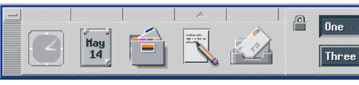

当您从主窗口选择一条消息进行查看时，Mailer 将消息显示在 Mailer 窗口的消息视图区域中。

## 图 11-3：查看您的邮件

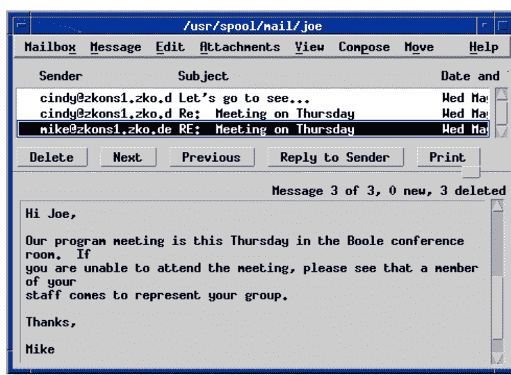

### 现在试一下！

查看您上一次活动发送给自己的消息。按照以下步骤查看邮件消息。

- 1. 点击前面板 Mailer 控件。结果：出现邮箱主窗口。
- 2. 从邮箱（Mailbox）菜单中选择检查新邮件（Check for New Mail），以检索任何等待投递到您邮箱的邮件。
- 3. 从消息头（Message Header）列表中，点击要查看的消息。

> 结果：Mailer 在窗口的消息视图区域中显示该消息。

### 需要帮助？

在 Mailer 帮助目录中点击：
阅读邮件消息（To Read a Mail Message）

## 使用 Mailer CDE

## 其他查看功能

除了查看消息外，您还可以执行表所示的任务：

表 11-2：邮件查看功能

| 邮件功能 | 菜单选项 |
|---|---|
| 排序您的消息 | `查看->按日期/时间、发送者、主题、大小和状态` |
| 回复消息 | `编写->回复发送者` |
| 转发消息 | `编写->转发消息` |
| 打印消息 | `消息->打印或点击打印按钮` |
| 以文本格式保存消息 | `消息->另存为文本` |
| 删除消息 | `消息 ->删除或点击删除按钮` |
| 在邮箱中查找消息 | `消息->查找` |

## 电子邮件地址和别名地址

您在编写邮件消息时使用的电子邮件地址可以有多种形式。您可以使用标准的电子邮件地址格式，也可以使用别名。查看每种形式的格式。

表 11-3：电子邮件地址

| 邮件地址 | 格式 | 示例 |
|---|---|---|
| 标准 | `username@location` | `bobbyjo@ufl.edu` |
| 别名 | `alias@location` | `bob@ufl.edu` |

您可以为较长或难以拼写的电子邮件地址、分发列表或一组别名创建别名。一旦创建了别名，您可以在编写邮件消息时在收件人（`To:`）字段中使用它。

### 现在试一下！

为您的项目团队成员创建一个别名。将其命名为 `proj_members`。按照以下步骤操作：

- 1. 从邮箱（Mailbox）菜单中选择邮件选项（Mail Options）。这将调出邮件选项对话框。
- 2. 从邮件选项对话框的类别（Category）菜单中选择别名（Aliases）。
- 3. 在地址（Addresses）字段中输入您的别名名称。
- 4. 在地址（Addresses）字段中使用将组成别名的用户地址。您的地址应采用 `username@location` 的形式，并用逗号、空格或两者隔开。
- 5. 点击添加（Add），将别名和地址字段中的信息添加到别名列表中。
- 6. 点击确定（OK）或应用（Apply）以生效。

### 需要帮助？

在 Mailer 帮助目录中点击：
创建别名（To Create an Alias）

## 定制 Mailer

您可以通过在邮箱（Mailbox）菜单上选择邮件选项（Mail Options）来更改 Mailer 应用程序的行为。邮件选项按类别分组。

图 11-4：Mailer - 邮件选项 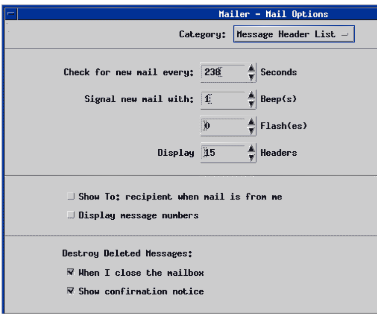

通过点击类别下拉列表，您可以更改以下类别。

表 11-4：选项类别

| 选项 | 允许您： |
|---|---|
| 消息头列表 | 设置 Mailer 检查邮件的频率、新邮件到达时如何发出信号、如何显示头以及删除消息 |
| 消息视图 | 更改消息视图中出现的行数、每行的字符数以及显示消息时隐藏的字段 |
| 编写窗口 | 设置如何确认附件、用于指示回复消息的字符串、用于在格式（Format）菜单中添加自定义字段的路径 |
| 消息归档 | 指定存储邮件文件的路径、在 Mail 开始查找邮箱的路径中显示的邮箱，以及最近访问的邮箱数量 |
| 假期（Vacation） | 指定假期回复消息并开启假期功能 |
| 模板 | 添加经常使用的模板 |
| 别名 | 创建分发列表 |
| 高级项目 | 设置确认通知、MIME 编码、邮件锁定、忽略地址和本地名称的默认值 |

您可以按以下方式定制删除的消息：
- Mailer 检查接收新邮件的频率
- 显示多少个头
- 是否显示已到达的消息
- 多少个数字
- 自动回复

### 现在试一下！

创建一个用于使用的消息。按照以下步骤查看您的邮件消息。

- 1. 从邮箱（Mailbox）菜单中选择邮件选项（Mail Options）。
- 2. 从邮件选项对话框的类别（Category）菜单中选择别名（Aliases）。
- 3. 在地址（Addresses）字段中输入您的别名名称。
- 4. 在地址（Addresses）字段中使用将组成别名的用户地址。您的地址应采用 `username@location` 的形式，并用逗号、空格或两者隔开。
- 5. 点击添加（Add），将别名和地址字段中的信息添加到别名列表中。
- 6. 点击确定（OK）或应用（Apply）以生效。

### 需要帮助？

在 Mailer 帮助目录中点击：
创建别名（To Create an Alias）

## 介绍邮件实用程序 (CLI)

### 概述

CLI mailx 和 Mail 命令允许您：

- 编写、编辑和发送消息
- 接收和阅读消息
- 删除或将消息存储在邮箱箱或文件夹中

## 发送邮件

mailx 和 Mail 命令的格式如下：

```
```


mailx `[-dinVF] [-h number] [-r address] [-s subject] user ...`

Mail `[-dinVF] [-h number] [-r address] [-s subject] user ...`

下面的邮件会话显示了如何向三个用户系统 jar、kls 和 sjg 发送消息，并向 ske 发送抄送。

### 示例 1-3：发送邮件

```
$ mailx jar kls sjg
Subject: Book Modification <Return>
We need to get together sometime very soon to discuss the modifications necessary if the book is going to be published.
I sent a copy to the publishers last week to see if they are at all interested, but obviously we have to make a lot of changes to make it conform somewhat to industry standards. How's Friday at 2 pm for a meeting:
<Return>
<Ctrl/D>
Cc: ske <Return>
$
```

### 尝试一下！

向你自己发送消息：

1. 在系统提示符 (`$`) 下，输入：`mailx username Return`，使用你的用户名。
2. 邮件随后提示 `Subject:`：输入消息的主题并按 Return。
3. 邮件现在正等待你输入消息。输入消息正文，然后按 Return 将光标移到行首。然后按 `Ctrl/D` 结束消息。
4. 如果邮件提示 `Cc:`：输入要发送抄送副本/额外副本的用户名（用逗号或空格分隔），并按 Return。
5. 系统随后提示：`$`。这表示你已成功发送了邮件消息。

## 编辑消息

当您输入邮件正文时，行式编辑器允许您输入消息的每一行。您按 Return 获得新行。要编辑某行，您必须在按 Return 之前进行更改。有高效的方法可以创建和编辑消息，包括：

- 使用 mail 创建文件
- 在 mail 运行期间调用编辑器
- 使用 `~r` 发送文件

### 在发送邮件前创建文件

使用现有文件发送消息：

- 使用文本编辑器创建并编辑文件，输入您想要发送邮件的信息。保存文件。
- 使用 Mail 命令将文件发送到分发列表。

下面的示例显示了向用户 dan、kls、ar 和 rln 发送文档 letter.mail。消息文件 `letter.mail` 是在输入 mail 命令之前使用文本编辑器创建的。注意重定向符号 (`<`)。这表示邮件程序从文件 `letter.mail` 读取输入。

### 示例 11-4：使用 Mail 发送文件

```
$ mailx dan kls ar rln < letter.mail
```

### 在 Mail 中调用编辑器

要在 mail 内部调用编辑器，请在单独的一行输入 `~v` 或 `~e`。

下面的示例显示了如何使用波浪号序列创建消息，当您单独的一行输入 `~v` 时，mail 会调用由环境变量 `VISUAL` 定义的编辑器。

### 示例 11-5：使用 ~v 编辑消息

```
$ mailx smith
Subject: <Return>
~s Send Mail Editing Session
~v
(注意：输入 ~i 会导致 vi 进入插入模式)
这是一个使用 vi 的示例编辑会话。
注意当到达行尾时文本是如何自动换行的。
不要忘记按 Esc 停止编辑。
然后输入 :w 返回到发送邮件会话。
<Esc>
:wq
```

与其他用户通信 11-15

## 介绍邮件实用程序 (CLI)

```
/tmp/Re0120 4 lines, 242 characters
(continue)
<Ctrl/D>
Cc: <Return>
You have new mail.
```

下面的表描述了您用来调用编辑器的波浪号转义序列。

### 表 11-6：在 Mail 中选择您的编辑器

| 波浪号转义序列 | 描述 |
| --- | --- |
| `~e` | 使用由环境变量 `EDITOR` 定义的编辑器。如果未定义 `EDITOR`，默认编辑器是 `ed` 行编辑器。 |
| `~v` | 使用由环境变量 `VISUAL` 定义的编辑器。如果未定义 `VISUAL`，默认是 `vi`。 |

### 现在尝试一下！

1. 在 mail 中通过调用文本编辑器来编辑消息：
2. 输入 mail 命令并提供主题。
3. 在空白行的开头输入 `~e` 或 `~v` 波浪号转义序列来调用编辑器。
4. 按通常方式退出编辑器。

### 需要帮助吗？

如果预期的编辑器没有运行，请检查环境变量 `VISUAL` 和/或 `EDITOR` 的值。

如果文件已存在，可以使用 `~r` 将其读取到消息缓冲区，如下例所示。

### 示例 11-6：使用 ~r 邮件文件

```
$ mailx msg
Subject: Here are the prices! <Return>
~r pricelist.txt <Return>
.
file contents are displayed
.
<Ctrl/D>
Cc: sjk <Return>
$
```

## 波浪号转义序列

下面是其他常用的波浪号转义。

### 表 11-7：波浪号功能

| 选项 | 功能 |
| --- | --- |
| `~b` | 将用户名添加到盲抄 |
| `~c` | 将用户名添加到抄送（Cc）列表 |
| `~p` | 打印包含头信息的消息 |
| `~r` | 将指定的文件读取到消息 |
| `~s` | 使用字符串作为主题 |
| `~t` | 将用户名添加到接收者列表 |
| `~w` | 将消息写入文件 |
| `~!` | 启动 shell 命令 |
| `~?` | 显示波浪号列表 |

### 示例 11-7：发送邮件时使用波浪号

```
$ mailx jls sjg
~s current thoughts on the project
We need to get together soon to discuss the modifications necessary if the book is going to be published. I sent a copy to the publishers last week to see if they are all interested, but obviously we have to make a lot of changes to make it conform somewhat to industry standards. How's Friday at 2 pm for a meeting?
~t pnh
~c ard
~p
Message contains:
To: jls sjg
Subject: current thoughts on the project
(continue)
$ <Ctrl/D
```

### 现在尝试一下！

使用波浪号序列添加主题字段和额外接收者来发送消息：

1. 在系统提示符处，带用户 ID 输入 mailx 命令。
2. 在消息正文的单独行中，输入 `~s` 和主题文本字符串。
3. 在另一个单独行中，输入 `~t` 和用户列表以添加接收者。
4. 在另一个单独行中，输入 `~p` 查看头部和正文。
5. 按 `Ctrl/D` 发送消息。

### 需要帮助吗？

参考 mailx(1) 中的“发送邮件”章节。

## 解决方案

```
$ mailx msg
~s The equipment has arrived!
~t evt tlb
~p
------
Message contains:
To: evt tlb
告诉 Tom 什么时候可以安装驱动器和调制解调器！
.
EOT
```

## 阅读邮件

要阅读邮件，请使用 mail 或 mailx 命令并按 Return，如下所示。

### 示例 11-8：邮件菜单

```
$ mailx
Mail $Revision: 4.2.4 $ Type ? for help.
/usr/spool/mail/self: 3 messages 2 new
U 1 sj Wed Feb 9 13:25 11/295 "Do not forget"
>N 2 dan Wed Feb 9 22:04 11/302 "current thoughts about the book"
N 3 ard Thu Feb 10 06:35 11/273 "pls rspnd asap"
```

在阅读邮件时，屏幕上将显示当前邮件的数量，随后是邮件的提示符。

## 介绍 Mail 实用 (CLI)

Mail 在显示邮件列表时会使用这些符号。

### 表 11-8：Mail 符号

| 符号 | 含义 |
| :--- | :--- |
| `?` | 邮件提示 |
| `N` | 新消息；邮件没有记录你之前查看过该消息 |
| `U` | 未读消息；你在邮件菜单中查看过邮件标头，但当时没有阅读正文 |
| `>` | 指向当前消息；在你调用 mail 之后，`>` 提示将指向列表上的第一条消息 |

要读取特定的邮件消息，请使用此表中的命令。

### 表 11-9：读取邮件命令

| 命令 | 结果 |
| :--- | :--- |
| `<Return>` | 显示当前消息 |
| `p`, `t` | 显示或重新显示当前消息 |
| `n`, `+` | 显示下一条消息 |
| `数字` | 显示之前的指定编号消息 |

## 发送邮件命令

下表包含了发送邮件时需要的大部分命令。

### 表 11-10：发送邮件命令

| 功能 | 命令 | 结果 |
| :--- | :--- | :--- |
| 发送消息 | `m user_list` | 向消息列表 user_list 中的所有用户发送邮件。可以使用 `-f` 转义字符来转发消息。`-f` 转义字符会将指定文件的内容读取到你正在发送的消息中。 |
| | `file#` | 返回到你的邮箱箱。 |
| 保存消息 | `RET`, `s`, `w` | 消息被保存在家目录下的 dropbox 目录文件中。 |
| 回复消息 | `R` | 允许你回复发送消息的用户。消息的主题字段包含你正在回复的消息的主题，并带有 RE: 前缀。你可以像发送邮件时一样使用转义字符。 |
| | `r` | 与 `R` 相同，但会向原始消息的所有收件者以及发送者发送回复。 |

与其他用户通信 11-19

## 介绍 Mail 实用 (CLI)

## 删除邮件

你可以使用 `d` 和 `u` 命令删除消息，并找回误删的消息，如下表所示。

### 表 11-11：删除和取消删除命令

| 命令 | 功能 |
| :--- | :--- |
| `d msg_list` | 删除编号在 msg_list 中的所有消息；如果没有给出列表，则只删除最近读取的一条消息 |
| `u msg_list` | 取消删除编号在 msg_list 中的消息并将其放回你的邮箱箱；只有当前邮件会话中的消息可以取消删除 |

## 退出和帮助命令

Mail 提供以下命令来获取帮助并退出邮件程序。

### 表 11-12：退出和帮助命令

| 功能 | 命令 | 结果 |
| :--- | :--- | :--- |
| 帮助 | `?`, `help` | 显示命令列表及其含义摘要 |
| 退出邮件 | `q` | 退出邮件；对你的邮箱箱进行的所有更改（例如删除）都将最终生效 |
| | `x`, `ex` | 退出邮件并返回到 `$` 提示符；你的邮箱箱将保持邮件会话开始时的状态 |
| 列出邮件变量 | `set` | 列出邮件变量 |

## 自定义 Mail (CLI)

### 概述
你可以通过以下方式自定义你的邮件会话：
- 使用 `.mailrc` 文件来覆盖 mail 的初始配置
- 创建文件夹以组织保存的邮件
- 使用别名来简化邮件分发

### 系统邮件文件 /usr/share/lib/mail.rc
`/usr/share/lib/mail.rc` 文件：
- 包含设置初始邮件配置的命令，适用于所有用户
- 在 mail 实用程序将控制权交给你之前由执行
- 由系统管理员维护
个人用户可以通过更改或增加设置来修改配置。

### 创建 .mailrc 文件
`.mailrc` 文件：
- 必须位于家目录下
- 包含 `set`, `ignore` 命令
如果在登录时没有 `.mailrc` 文件，请使用 `cat` 命令创建一个。
该 `.mailrc` 文件包含以下命令：
- `set ask` 在发送邮件时提示显示主题
- `set askcc` 在发送邮件时提示显示抄件人

#### 示例 11-9：创建 .mailrc

```bash
$ cat > .mailrc
set ask
```

与其他用户通信 11-21

## 自定义 Mail (CLI)

### 选项文件

两种类型的选项：二进制和值。

### 表 11-13：二进制选项 (on or off)

| 选项 | 功能 |
| :--- | :--- |
| `set ask` | mailx 在发送消息时提示主题 |
| `set askcc` | mailx 在发送消息时提示抄件人 |
| `set header` | mailx 在发送消息时提示所有收件者 |
| `set folder` | mailx 将消息包含在指定的邮箱箱中 |

### 表 11-14：值选项 (value)

| 选项 | 功能 |
| :--- | :--- |
| `set header=number` | 指定 mailx 使用的行数 |
| `set EDITOR=pathname` | 指定使用的文本编辑器 |
| `set folder=pathname` | 指定存储邮件的文件夹 |
| `set VISUAL=pathname` | 指定使用的可视化编辑器 |

## 解决方案

+ 1. `$ vi .profile`

```
set ask
set askcc
```

## 文件夹

一旦你开始使用，就会积累很多消息。你可能需要保存它们以便于访问。Mail 提供了一个名为文件夹的简单功能来组织消息。当你第一次将消息保存到文件夹时，mail 会创建该文件夹。

## 解决方案

+ 1. `$ mkdir evt_mail`

## 使用文件夹

在任何需要 mailx 命令期望文件名的地方，都可以使用带加号 (`+`) 的文件夹名。下表显示了处理文件夹的各种命令。

### 表 11-15：使用文件夹

| 操作： | 在提示符处输入 |
| :--- | :--- |
| 选择 folder_name | `folder +folder_name` |
| 选择上一个文件夹 | `folder #` |
| 选择系统邮箱 | `folder %` |
| 选择你的个人邮箱 | `folder &` |
| 确定当前文件夹及其消息数量 | `folder` |
| 显示所有文件夹名称 | `folders` |
| 将当前消息复制到 folder_name | `copy [msg_list] +folder_name` |
| 将当前消息保存到 folder_name | `save [msg_list] +folder_name` |

## 现在尝试！

读取来自 practice 的文件夹中的邮件：

+ 1. 进入 mailx并将邮件保存到 practice 文件夹。Mail 会自动创建该文件夹。
+ 2. 将你收到的邮件复制到 practice 文件夹。
+ 3. 使用退出命令离开 mailx，并使用以下命令重新进入：

```
$ mailx -f +practice
```

这将以 practice 为当前文件夹启动 mailx。

### 需要帮助吗？

查看 mailx(1) 中的示例。

## 解决方案

+ 1. `$ mkdir folder_directory`
2. 编辑你的 `.mailrc` 文件并输入以下行：
   `set folder=folder_directory`
   其中 folder_directory 是你起的名称。
3. 输入 mailx 命令并选择一条新消息。
4. 使用 mailx save 命令将消息保存到文件夹中。
- 4. 使用常规邮件命令读取你在练习文件夹中的消息。

### 需要帮助吗？

查看 mailx(1) 中的示例。

## 解决方案

- 1. `$ mailx`

```
Message 1:
From evt Mon Feb 23 13:09:00 1998
Date: Mon, 23 Feb 1998 13:08:59 -0500
From: Evan Tyler <evt>
Subject: The equipment has arrived!
```

告诉 Tom 他什么时候可以安装驱动器和调制解调器！

- 2. `$ save 1 +practice`
"practice" [新文件] 11/385
- 3. `$ q`
- 4. `$ mailx -f +practice`

```
From evt Mon Feb 23 13:09:00 1998
Received: by loner.decom.com (5.65v3.2/1.1.10.5/23Jan97-07-0140AM)
id AA07212; Mon, 23 Feb 1998 13:08:59 -0500
From: Evan Tyler <evt>
Message-Id: <980231808.AA07212@loner.decom.com>
To: evt msg tlb
Subject: The equipment has arrived!
Status: R
```

告诉 Tom 他什么时候可以安装驱动器和调制解调器！

- `$ q`

## 使用别名 (Aliases)

别名是一个代表一个或多个用户名称，并提供了一种快速方法：
- 向分发列表发送邮件。


- 对复杂或难以拼写的用户名缩写。

在你的 `.mailrc` 文件中创建别名后，在发送邮件时可以使用别名代替用户名。

## 自定义邮件 (CLI)

## 现在尝试一下吧！

要为你的项目团队成员（sam, sally, steve 和 susan）定义一个别名（名为 project），请执行以下操作：

1. 通过添加以下行编辑你的 `.mailrc` 文件：

```
alias project sam sally steve susan
```

2. 使用你刚刚创建的别名向所有项目成员发送邮件。

```
mailx project
```

## 总结

## 使用 Mailer (CDE)

CDE 提供了 Mailer 供你与网络系统上的其他用户通信。使用 Mailer，你可以创建、发送和接收带有附件的消息，管理收到的邮件，并为你的工作环境自定义 Mailer 程序。

## 获取用户信息 (CLI)

以下命令显示有用的用户信息。

- `who` | 列出已登录用户的用户名、终端名称以及登录日期和时间
- `who am i` | 仅列出在输入命令的终端登录的用户信息
- `whoami` | 从 `/etc/passwd` 显示你当前的登录名称
- `users` | 提供一个快速的单行用户列表
- `finger` | 提供有关用户的详细信息

## 介绍 Mail 工具 (CLI)

CLI 下的 `mailx` 和 `mail` 命令允许你：

- 编写、编辑和发送消息
- 接收和阅读消息
- 在信箱或文件夹中删除或存储消息

## 自定义邮件 (CDE)

你可以通过以下方式自定义你的邮件会话：

- 使用 `.mailrc` 文件覆盖邮件的初始配置
- 创建文件夹来组织保存的邮件
- 使用别名简化邮件分发

## 总结

## 使用 TCP/IP 网络

## 单元概述

## 介绍

本单元检查了某些允许使用 TCP/IP 作为网络传输访问其他系统的命令。

TCP/IP 代表传输控制协议/互联网协议 - 应用程序用于提供网络功能的一套网络协议，例如：

- 远程登录
- 文件传输
- 名称/地址解析
- 网络文件系统

### 目标

为了访问其他系统，你应该能够：

- 登录并执行命令
- 从远程系统显示 Motif

### 资源

有关本单元主题的更多信息，请参阅：

- UNIX 参考页

## 访问远程系统

### 概述

在工作期间，你可能需要访问另一个系统以查找在线存储的手册、需要更新的源代码或启动程序。本节介绍了你可以用于访问除之外机器的命令。一旦你访问了其他机器，就可以像在本地主机系统一样输入命令。

## 网络安全

对于许多网络应用程序，远程主机在满足以下一项或多项的情况下允许访问：

- 本地系统包含在远程主机的 `/etc/hosts.equiv` 文件中，本地用户不是超级用户，且未指定 `-l` 选项。
- 本地系统和用户名包含在远程用户帐户目录下的 `$HOME/.rhosts` 文件中。

如果上述任何情况都不成立，像 `login` 等程序将提示密码，而像 `rcp` 等程序将失败。

## 登录

你可以使用 `login` 命令登录远程系统。`login` 命令的格式为：

```
login host [-e character] [-l username]
```

此表显示了你可以与 `login` 一起使用的选项。

**表 12-1: login 选项**

| 选项 | 功能 |
| :--- | :--- |
| `-e` | 始终允许数据路径。否则，除非远程主机上的转义序列不是标准的，否则 `login` 将剥离数据路径。 |
| `-e character` | 将转义字符更改为指定的。 |
| `-l` | 将远程用户名更改为指定的。否则使用本地用户名。 |

此示例显示了 `login` 命令的两种用法。

**示例 12-1: 使用 login 命令**

```
$ login sys001
Last Login: Mon Feb 23 13:08:59 -0500
True64 UNIX 5.0-14(Rev. 490); Mon Feb 23 13:09
```

```

sys001 whoami joe

sys001 exit

$ login sys002 -l smith
Last Login: Mon Feb 23 13:00:59 -0500
True64 UNIX 5.0-14(Rev. 490); Mon Feb 23 13:09
```

```

```
000amiami

000
>
```

### 尝试一下！

为了执行本单元的练习，你的系统必须通过 TCP/IP 连接到 UNIX 系统。你必须从导师处获得可以登录并拥有用户帐户的远程系统名称。

1. 使用 `login` 命令登录你的远程系统。
2. 输入 `hostname` 和 `whoami` 命令。
3. 退出。

### 需要帮助吗？

如果你收到密码提示，说明本地系统在远程主机的 `hosts.equiv` 或 `.rhosts` 文件中没有条目。在你的主目录下创建一个 `.rhosts` 文件。

## 解决方案

```
$ login sys002
Password:
Last Login: Mon Feb 23 13:00:59 -0500 from you@sys001
True64 UNIX 5.0-14(Rev. 490); Mon Feb 23 13:09
sys002$ hostname
sys002$ whoami you
sys002$ <Ctrl/D>
$

## 使用 rsh 命令

在远程系统输入命令的一种方法是使用 `rsh`（远程 shell）命令。`rsh` 命令连接到远程主机执行执行命令，如果没有指定命令，则在远程主机上执行登录。`hosts.equiv` 和 `$HOME/.hosts` 文件的限制适用于 `rsh` 命令。

`rsh` 命令的格式为：

```
rsh [-dn] [-l user] remote_host [command] [argument ...]
```

此表显示了 `rsh` 命令的一些选项。

**表 12-2: rsh 选项**

| 选项 | 功能 |
| :--- | :--- |
| `d` | 开启用于副本通信的 TCP 套接字调试，忽略 umask |
| `l` | 指定登录的用户 ID 而非本地用户 ID |
| `n` | 将所有命令输入重定向到 `/dev/null`；应与 C shell 使用 |

此示例显示了 `rsh` 命令的两种。

**示例 12-2: 使用 rsh 命令**

```
$ rsh sys001 users
event garcia

$ rsh sys002
Last login: Mon Feb 23 02:10:59 -0500 from sys999
True64 UNIX 5.0-14(Rev. 490); Mon Feb 23 13:09
sys002
```

## 现在尝试一下吧！

输入 `rsh` 命令列出远程系统的 `/bin` 目录。

### 需要帮助吗？

如果你收到“Permission denied”的消息，请在远程系统上创建 `.rhosts` 文件。

## 解决方案

```
$ rsh sys002 ls /bin
Mail
Rsh
X11
.
.
..
```

## 复制文件

在本地与远程或两个远程系统之间复制文件的方法是使用 `rcp` 命令。与 `rlogin` 命令一样，本地系统的名称必须在远程系统的 `/etc/hosts.equiv` 文件中，或者系统名和用户必须在远程帐户的 `$HOME/.hosts` 文件中。

`rcp` 命令的两种格式：

```
rcp [-p] file1 file2
rcp [-r] file... directory
```

指定远程系统上的文件时，使用远程系统名后加冒号（`:`）作为文件的前缀，例如 `sys001:/etc/shells`。

从特定用户帐户复制文件，应使用用户名后加 `@` 符号（`@`）作为系统名前缀，例如 `you@sys001:.profile`。

文件路径将从用户的家目录开始。

此表显示了你可以与 `rcp` 一起使用的选项。

**表 12-3: rcp 选项**

| 选项 | 功能 |
| :--- | :--- |
| `p` | 在副本中保留源文件的修改时间和模式，忽略 umask |
| `r` | 如果要复制的文件是目录，则递归复制所有子目录中的文件；目标必须是一个目录 |

此示例显示了如何输入 `rcp` 命令从远程系统复制文件。

## 示例 12-3: 使用 rcp 命令

```
$ rcp sys01:/user/users/smith/file.txt file.txt
$ rcp smith@sys001:/user/users/smith/file.txt file.txt
$ rcp -r smith@sys001:/user/users/smith/smith@sys002:production
```

## 现在尝试一下吧！

1. 输入 `rcp` 命令将以下文件从你的远程系统复制到本地系统的用户目录中。
   `/usr/include/stdio.h`

2. 再次输入 `rcp` 命令，但保留源文件的修改时间和模式。

## 访问远程系统

## 解决方案

```
1. $ rcp sys002:/usr/include/stdio.h stdio.h
$ ls -l stdio.h
-r--r-- 1 evant 11739 May 30 14:30 stdio.h

2. $ rcp -p sys002:/usr/include/stdio.h stdio.h
$ ls -l stdio.h
-r--r-- 1 evant 11739 Jan 6 10:15 stdio.h
```

## 文件传输

在系统之间传输文件的另一种方法是使用 `ftp` 应用程序。`ftp`：

- 允许在运行不同文件系统的主机之间传输文件
- 不尝试保留特定于特定文件系统的属性
- 不允许对子目录进行递归复制

一旦调用 `ftp` 应用程序，你就可以输入其他命令来完成任务。

`ftp` 命令的格式为：

```
ftp [options] [host]
```

如果不指定主机（`host`），`ftp` 会提示输入命令。选项列表请参阅 `ftp(1)`。下表显示了了一些 `ftp` 命令。

### 表 12-4：部分 ftp 命令

| 命令 | 功能 |
| :--- | :--- |
| `open rsys` | 连接到远程系统 rsys |
| `close` | 关闭当前连接 |
| `get` | 接收文件 |
| `put` | 发送文件 |
| `ls` | 列出远程目录内容 |
| `quit` or `Ctrl/D` | 退出 ftp |
| `?` or `help` | 显示 ftp 命令列表 |

命令列表请参阅 `ftp(1)`。

此示例显示了如何使用 `ftp` 命令登录远程系统。

### 示例 12-4：使用 ftp

```
$ ftp
ftp> open sys001
Connected to sys001
220 sys001 FTP server (Tru64 UNIX Version 5.60) ready.
Name (sys001):<Return>
331 Password required for you.
Password:
230 User logged in.
ftp> *.ksh
200 PORT command success.
150 Opening ASCII data connection for file list (16.30.0.1)
greet.ksh
printname.ksh
trap.ksh
226 Transfer complete.
remotes: *.ksh
36 bytes received in 0.016 seconds (2.3 Kbytes/s)
ftp> close
221 Goodbye.
$
```

## 试一试！

使用 `ftp` 命令列出远程系统 `/usr/include` 目录下的文件，并将远程系统上的 `/usr/include/cpio.h` 文件复制到你本地上的用户目录中。

### 需要帮助吗？

你需要一个远程系统的账户和密码。输入 `ftp help` 来获取命令列表。

## 解决方案

```
$ ftp
ftp> open sys002
Connected to sys002.
220 sys002 FTP server (Tru64 UNIX Version 5.60) ready.
Name (sys002:event): evant
331 Password required for event.
Password:
230 User event logged in.
ftp> ls /usr/include
200 PORT command success.
150 Opening ASCII data connection for file list (13.35.0.2)
/usr/include/complrs
/usr/include/X11
/usr/include/tli
226 Transfer complete.
remote: /usr/include
5634 bytes received in 0.045 seconds (12 Kbytes/s)
ftp> get /usr/include/cpio.h mycpio.h
200 PORT command successful.
150 Opening ASCII mode data connection for /usr/include/cpio.h
(13.35.0.68,1041)
(2790 bytes);
226 Transfer complete.
local: my-cpio.h header: /usr/include/cpio.h
2872 bytes received in 0.02 seconds (1.4e+02 Kbytes)
ftp> close
221 Goodbye.
ftp> <Ctrl/D>
```

## Telnet

连接远程系统的另一种方法是使用 `telnet` 应用程序。一旦连接到主机并登录，你就会收到系统提示并执行主机系统上的任何可用命令。

`telnet` 命令的格式为：

```
telnet [host[port]]
```

如果不指定主机，`telnet` 会提示输入命令。此表显示了一些 `telnet` 命令。

### 表 12-5：部分 telnet 命令

| 命令 | 功能 |
| :--- | :--- |
| `open rsys` | 连接到远程系统 rsys |
| `close` | 关闭当前连接，或允许你从远程系统退出 |
| `quit` or `Ctrl/D` | 退出 telnet |
| `?` | 显示 telnet 命令列表 |

此示例显示了如何使用 `telnet` 连接到远程系统。

### 示例 12-5：输入 telnet 命令

```
$ telnet
tnet> open sys002
Trying 16.30.0.2...
Connected to sys002.
Escape character is '^]'.
Tru64 UNIX (sys002) (tty3)
login: you
Password:
Last login: Mon 30 01:00:59 from sys99
Tru64 UNIX X5.0-14(Rev. 490);Mar 30 03:09:17
$ hostname
sys002
$ exit
Connection closed by foreign host.
$
```

## 访问远程系统

## 试一试！

1. `telnet`。
2. 使用 `?` 命令列出 `telnet` 命令。
3. 登录远程系统。
4. 使用转义字符 `Ctrl+]` 返回 `telnet`。
5. 使用 `status` 命令打印状态。
6. 关闭连接并退出。

## 解决方案

```
$ telnet
telnet> ?
Commands may be abbreviated. Commands are:
close current connection
display operating parameters
mode to enter line-by-line or character-at-time
connect to a site
send special characters ('?' for more)
set operating parameters ('?' for more)
unset operating parameters ('?' for more)
status print information
toggle parameters ('?' for more)
change state of special characters ('?' for more)
suspend telnet
invoke a shell
change environment variables ('?' for more)
print help
telnet> open sys002
login: joe
Password:
Last login: Mon Jun 29 15:08:03 from guest
TELNET Session 1 Active Host guest Port 23
Operating Mode: Character-at-time
Escape character: '^]'
Options:
Echo - Remote
Terminal Type - Local
Terminal Type - VT200
Suppress - Local
Suppress - Remote
Data Overruns: 0
Suspended Network I/Os: 0
TELNET> close CLOSED, Local connection closed-Session 0, host guest, port 23
$ quit
```


## 调用 Motif 程序

有时可能想在另一个系统上执行 Motif 程序，但在你的工作站上显示输出。可以使用调用另一个系统的终端命令来实现。

### 网络安全

除了 `/etc/hosts` 和 `~/.hosts` 文件提供的普通网络安全之外，在 Motif 程序可以在你的工作站显示输出之前还有额外的安全检查。你必须在本地系统（服务器）授予权限接收来自远程系统（客户端）的显示。

- 在本地系统输入命令 `/usr/bin/X11/xhost` 查看哪些远程系统有权在本地系统显示输出。
- 使用 `xhost` 命令添加显示输出的主机。

### 指定显示

许多 Motif 程序提供了 `-d` 或 `-display` 选项来指定输出位置。如果不指定此选项，程序将使用 `DISPLAY` 环境变量。

在 KornShell 中设置并导出显示，格式为：

```
export DISPLAY=system:screen
```

其中：

- `system` 是要显示的系统名称
- `:` 表示应使用 TCP/IP 连接
- `screen` 是在该系统上的屏幕，通常为 `0.0`

你系统的 Motif 版本必须与远程系统兼容。

### 调用程序

如果你在远程系统上运行了一个终端会话，或者在使用 `login`/`telnet` 命令打开了一个，只需从命令行调用 Motif 程序即可。

## 调用 Motif 程序

Tru64 UNIX 在 `/usr/bin/X11` 目录下位于许多 Motif 程序。如果该目录不在你的命令路径中，使用完整路径。

设置并导出 `DISPLAY` 变量，或者使用程序的 `display` 选项将显示重定向到你的系统。你可能希望使用 `&` 在后台运行 Motif 程序，这样你就可以使用终端会话进行其他工作。

此示例显示了如何运行输出到本地系统的 Motif 程序。

- 首先在命令行中使用 `-d` 选项指定显示系统。
- 其次使用 `DISPLAY` 环境变量指定显示系统。

### 示例 12-6：调用 Motif 程序

```
$ login sys002 -l you

Password:

Last login: Mon Mar 30 12:12:20 from sys999

sys002$ /usr/bin/X11/xclock -d sys99:0.0 &

[1] 5731

sys002$ export DISPLAY=sys999:0.0

sys002$ /usr/bin/X11/xclock
```

### 现在试一试！

1. 使用 `login` 或 `telnet` 命令登录你的远程系统。
2. 使用 `whereis` 命令获取 `xclock` 程序的完整路径。在后台调用它，使用 `display` 选项将显示导向你的工作站。

## 解决方案

1. `$ login sys002`
   Password:
   Last login: Mon Mar 30 01:00:59 from you@sys001
   Tru64 UNIX X5.0-14(Rev. 490);Mon Mar 30 03:09:17

2.
   sys002$ whereis xclock
   xclock: /usr/bin/X11/xclock /usr/share/man/man/xclock.1X
   sys002$ /usr/bin/X11/xclock -display sys001:0.0 &
   [1] 9573

# 使用 rsh 调用

要在远程系统上仅调用一个应用程序，你可以使用 `rsh` 命令。

```
$ rsh sys002 -l1 you /usr/bin/X11/xclock -d sys999:0
```

# 现在尝试一下这个！

输入 `rsh` 命令在你的远程系统上调用 `xclock`。

### 需要帮助吗？

如果你收到如下提示消息：

> 客户端未授权连接到服务器：无法打开显示器。请在本地系统上使用 `xhosts` 命令为远程系统授予权限。

## 解决方案

```
$ rsh sys002 -l1 you /usr/bin/X11/xclock -d sys001:0

$
```

## 总结

# 访问远程系统

| 表 12-6：远程访问命令 |
| :--- | :--- |
| 命令 | 功能 |
| `login` | 登录远程系统 |
| `rsh` | 在远程系统上执行命令 |
| `rcp` | 在系统间复制文件无需登录 |
| `ftp` | 使用文件传输协议在系统之间传输文件 |
| `telnet` | 使用 TELNET 协议连接远程系统 |

# 调用远程 Motif 应用程序

要在另一个系统上调用 Motif 应用程序并显示在你的系统上：

- 必须设置网络安全以允许你访问远程系统并在你的系统上显示。
- 你必须通过向应用程序提供 `-display` 参数或设置 `DISPLAY` 环境变量，指定显示器在你的系统上。
- 你可以登录到远程系统并调用应用程序，也可以使用 `rsh` 调用应用程序。

## 单元概述

### 简介

尽管电子传输存储和信息检索取得了进步，但在许多情况下纸质文档仍然是首选。因此，计算机用户必须学会如何使用纸质打印机。

### 目标

为了操作打印机，你应该能够使用 CDE 来：

- 确定并更改默认打印机
- 打印文件并设置打印文件选项
- 使用打印应用程序执行各种打印机功能

### 资源

有关本单元主题的更多信息，请参考：

- *常用桌面环境：用户指南，第 9 章*

# 设置你的默认打印机

### 概述

你的系统可能可以使用多台打印机并提供许多打印选项。你可能有多种类型的打印机（如 PostScript、PCL 或绘图仪），它们可能直接连接到你的系统（本地），也位于网络某处（远程）。通常有一台打印机被指定为默认打印机。

# 确定默认打印机

要确定你的默认打印机，双击前面板上的打印机控制或“个人打印机”子面板中的“默认打印机控制”（参见图 13-1）。

图 13-1：前面板上的打印机控制

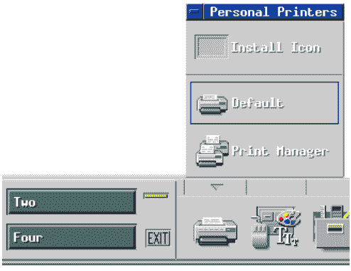

结果：`Printer Jobs` 应用程序在另一个窗口中启动，显示你的默认打印机信息。

# 设置你的默认打印机

图 13-2：确定默认打印机

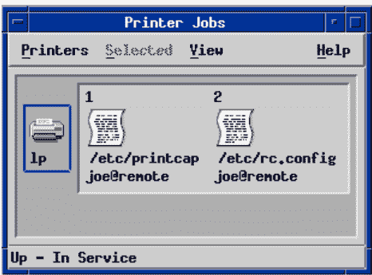

# 更改默认打印机

要更改默认打印机：

1. 使用文件管理器选择你的主目录。
2. 双击 `.dtprofile` 文件。如果你看不到该文件，请将你的管理器视图更改为显示隐藏文件。
3. 添加一行，将 `LPDEST` 环境变量的值设置为你想要作为默认的打印机。检查 `/etc/printcap` 文件以查看可能的打印机。

```
LPDEST=printer_name; export LPDEST
```

4. 退出系统并重新登录。更改将生效。

# 图 13-3：编辑 .dtprofile

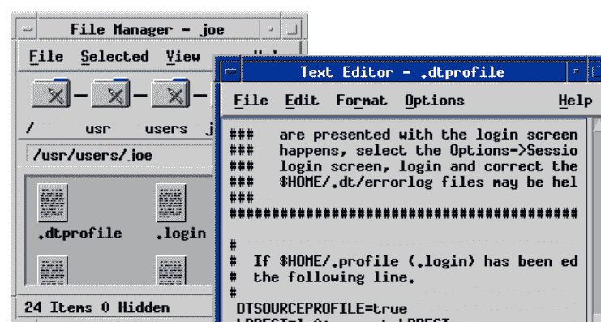

现在尝试一下这个！

要将你的默认打印机更改为系统上的另一台打印机：

1. 使用文件管理器选择 `/etc` 文件夹。
2. 双击 `printcap` 图标。
3. 选择一台打印机作为你的默认打印机。关闭文件。
4. 使用文件管理器选择你的主文件夹。
5. 打开 `.dtprofile` 文件。将 `LPDEST` 环境变量的值修改为你新选择的默认打印机。
6. 保存更改。
7. 注销然后重新登录使更改生效。

需要帮助吗？

双击文本文件会在文本编辑器中打开它，你可以查看或对其进行更改。
从 `/etc/printcap` 文件列表中选取一个打印机，并将其添加到 `.dtprofile` 文件中。

解决方案

示例文本行。

```
LPDEST=turky; export LPDEST
```

# 打印文件

### 概述

通过 CDE，你可以使用以下方式打印文件：

- 前面板上的打印机控制
- 文件管理器“已选择”管理器上的打印选择
- 打印管理器 (`Print Manager`)
- 文件管理器上的打印选项

# 类型

CDE 将打印以下类型：

- 文本
- PostScript
- PCL
- 数据

## 打印机控制

为了获得方便的打印，请遵循以下步骤：

1. 将文件拖动到前面板。
2. 点击打印机控制。
3. 使用打印管理器。

图 13-4：使用打印机控制

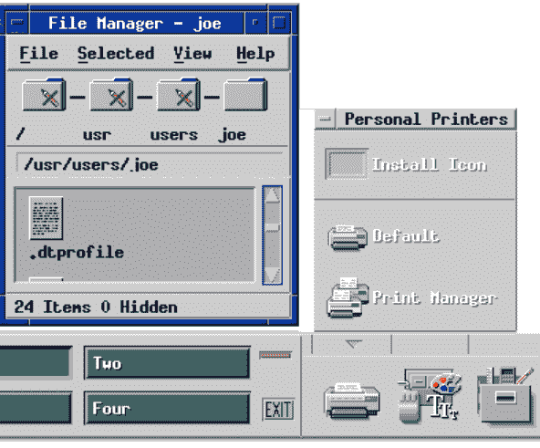

结果：`Printer Jobs` 应用程序在另一个窗口中启动，显示你的默认打印机信息。

# 设置选项

要使用打印机打印，请遵循以下步骤：

1. 将文件拖动到前面板。
2. 点击打印机控制。
3. 使用“个人打印机”子面板。

图 13-5：设置选项

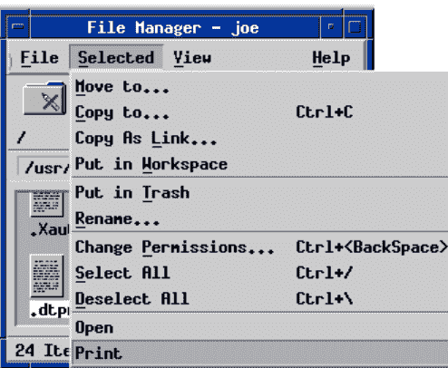

# 打印文件

要将任务发送到指定的打印机：

1. 将文件拖动到前面板。
2. 点击打印机控制。
3. 使用“个人打印机”子面板。

## 使用文件管理器

使用文件管理器打印：

1. 打开文件管理器。
2. 选择一个文件。
3. 从“已选择”菜单选择“打印”。

图 13-6：使用文件管理器

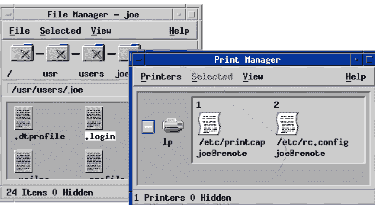

# 使用打印管理器打印

使用打印管理器打印：

1. 从“个人打印机”子面板启动打印管理器。
2. 从文件管理器将文件拖到打印机图标。

图 13-7：使用打印管理器


# 在应用程序内打印

如果应用程序的菜单中提供了打印功能，你也可以从应用程序打印文件。

# 现在尝试一下这个！

使用以下步骤打印两份 `.dtprofile`：

1. 使用文件管理器选择你的主目录。
2. 选择 `.dtprofile` 图标。
3. 从文件器的“已选择”选择“打印”。
4. 在打印窗口输入打印机名称和份数。
5. 点击打印。

### 需要帮助吗？

如果你没有得到打印输出，请咨询你的系统管理员以确保你已经配置了打印机且打印机运行正常。

# 管理打印请求

有两个应用程序显示打印请求的进度：

- 打印管理器 (`Print Manager`)
- `Printer Jobs`

打印管理器显示你系统已知的所有打印机的状态。`Printer Jobs` 显示默认打印机的状态。

# 使用打印管理器

你可以使用打印管理器：

- 检查打印任务状态
- 删除打印任务
- 查找特定的打印任务
- 检查打印任务的属性
- 更改打印器的显示特性

打印管理器跟踪系统已知的所有打印机。

# 检查打印任务状态

要检查打印任务状态：

1. 点击“个人打印机”子面板中的打印管理器控制。

结果：系统打开了打印管理器窗口。

2. 通过以下任一打开打印机图标：

- 点击打印机图标左侧的打开 `[+]` 按钮
- 双击打印机图标
- 选择打印机，然后从“选择”菜单或打印机的弹出菜单（通过按 `Shift/F10` 或 `MB3` 显示）中选择“打开”。

结果：打印管理器显示了所有等待打印的打印任务（参见图 13-8）

## 图 13-8: 打印管理器状态

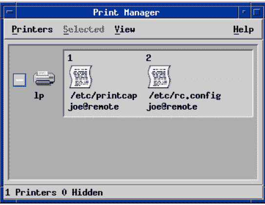

## 删除打印任务

要删除打印任务：

1. 点击“个人打印机”子面板中的打印管理器控制控件。

**结果：** 系统打开打印管理器窗口。

2. 选择一个打印任务。

3. 从“已选”菜单或打印任务的弹出菜单中选择“取消”。

4. 在确认对话框中点击“是”。

## 更改打印管理显示设置

你可以更改打印管理器应用程序的显示方式：

- 显示打印机和打印任务
- 更新显示频率
- 显示打印任务
- 显示打印机
- 显示打印机状态
- 显示打印管理器消息行

## 图 13-9: 打印管理器显示选项

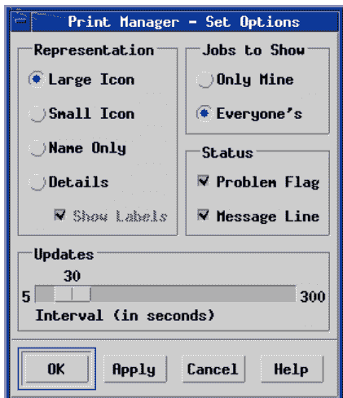

## 打印任务应用程序

打印任务应用程序显示你从前面板打开的单台打印机的打印任务状态。打印任务的功能行为与打印管理器中的功能相同。

## 显示打印任务属性

出于各种原因，你可能需要知道打印任务的所有者、其大小或提交时间。你可以通过此程序显示打印任务的属性来获取这些信息。

1. 点击“个人打印机”子面板中的打印管理器控制控件。

**结果：** 系统打开打印管理器窗口。

2. 选择一个打印任务。

3. 从“已选”菜单或打印任务的弹出菜单中选择“属性”。

**结果：** 打印管理器显示以下任务属性。

## 图 13-10: 打印任务属性

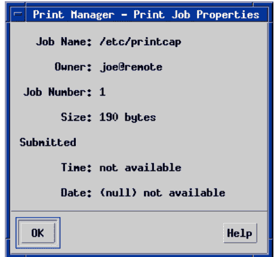

## 查找打印任务

要在打印管理器中查找打印任务：

1. 从“打印”菜单中选择“查找”。
2. 在“任务名称”字段中输入要查找的任务名称或部分名称。
3. 点击“开始查找”。
4. 要转到文件，选择该任务并点击“转到”。
5. 要取消找到的任务，选择该任务并点击“取消打印任务”。

## 将打印机添加到前面板

与前面板关联的打印机通常是你的默认打印机。在 CDE 中，你可以将该打印机更改为打印管理器显示的任何打印机。你还可以将其添加到“个人打印机”子菜单中的个人打印机列表中。

要更改与前面板关联的打印机：

1. 双击位于“个人打印机”子面板上的打印管理器。
2. 确认你需要的打印机是否已在其中。如果没有，你必须将该打印机添加到“个人打印机”子面板。
3. 在子面板中，指向你想要添加的打印机图标，并在图标的弹出菜单中选择“放入主面板”（使用 `Shift/F10` 或 `MB3`）。

## 图 13-11: 将打印机添加到前面板

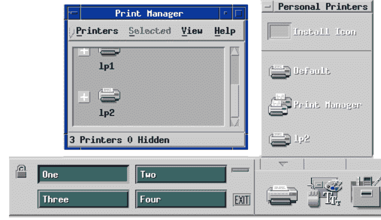

### 现在来试试！

1. 使用打印管理器，显示所示的每台打印机的打印任务。
2. 显示打印管理器显示中显示的打印任务之一的打印机属性。

## 解决方案

1. 显示每台打印机的打印任务：
   a. 点击“个人打印机”子面板中的打印管理器控制控件。
   b. 双击打印机图标。
2. 显示打印任务的打印机属性：
   a. 点击“个人打印机”子面板中的打印管理器控制控件。
   b. 选择一个打印任务。
   c. 从“已选”菜单中选择“属性”。

## 总结

## 设置默认打印机

你可以通过双击前面板上的打印机控件来确定哪台打印机是默认打印机。要将默认打印机更改另一台打印机，请编辑主目录下的 `.dtprofile` 文件以修改 `LPDEST` 环境变量的值。

## 打印文件

你可以使用以下方法打印文件：

- 前面板上的打印机控制控件
- 文件管理器“已选”菜单上的打印机选择
- 使用打印管理器
- 打印选项

## 管理打印请求

有两个应用程序显示打印请求的状态。通过打印管理器，你可以：

- 检查任务状态
- 删除任务
- 查找任务
- 检查任务属性

打印任务应用程序显示你从前面板打开的单台打印机的打印任务状态。

## 打印文件

## 解决方案

你输入的命令应该类似于：

```
$ lpr -n2 -t"Program Example V1.0" -m example.txt

Job Number is: 215
```

## 使用 lpr 打印文件

`lpr` 命令提供了比 `lp` 命令更多的打印选项，包括：

- 单面或双面打印
- 横向或纵向方向
- 一页纸打印多页
- 国际化支持

`lpr` 命令的格式为：

```
lpr [-option] [file]
```

此表显示了 `lpr` 选项。

| 选项 | 功能 |
| :--- | :--- |
| `-d` | 从标准输入读取 |
| `-i[number]` | 用空格数缩进输出；默认空格数为 8 |
| `-j` | 任务进入队列后，在标准输出上显示打印请求 ID |
| `-J name` | 在突发页上提供名称 |
| `-Ksides` | 打印单面、双面、翻转、单向或双向 |
| `-m` | 打印完成后发送邮件 |
| `-Nnumber` | 在一张纸上打印一或多页 |
| `-Pprinter` | 打印到指定的打印机 |
| `-#number` | 指定数量的副本 |

### 现在试一下！

使用 `lpr` 命令，使用以下选项从主目录打印一个文本文件：

1. 将文件打印到默认打印机以外的打印机。
2. 使用横幅 MY JOB 打印。
3. 让文本缩进五个空格。
4. 在打印任务完成后让邮件程序通知你。

### 需要帮助吗？

请阅读 `lpr(1)` 的参考页。

## 解决方案

你输入的命令应该类似于：

```
$ lpr -Plp1 -J "MY JOB" -i5 -m examples.txt
```

## 管理打印请求

### 概述

一旦打印了文件，你可能想检查打印任务的状态。
UNIX 提供了以下命令来检查打印任务状态。

- `lpq`
- `lpstat`
- `lpc`

## 使用 lpq 检查打印状态

`lpq` 命令通过以下信息报告打印队列中任务的状态：

- 打印机
- 用户
- 请求 ID

`lpq` 命令的格式为：

```
lpq [+number] [-l] [-Printer] [request_id...] [user...]
```


下表提供了关于使用 `lpq` 命令参数的信息。

### 表 14-3：lpq 命令选项

| 选项 | 功能 |
|---|---|
| (无选项) | 报告默认打印机的所有打印任务 |
| +number | 如果使用了 `+` 参数，`lpq` 每秒报告一次槽位状态，直到队列为空；如果提供了数字，`lpq` 每隔 `number` 秒显示一次队列 |
| -l | 强制显示每个条目的额外信息 |
| -Printer | 报告指定打印机的打印请求状态 |
| request_id | 报告由 `request_id` 指定的打印任务状态 |
| user | 提供为用户 `user` 排队的所有打印任务的报告 |

## 使用 lpq

`lpq` 提供了：

- 队列中的当前排名
- 组成请求的文件名
- 打印请求的识别码
- 总字节大小

如果打印请求包含多个文件，`lpq` 输出中显示的文件数量取决于文件名的长度。

此示例显示了通过 `lpq` 命令获得的信息。

### 示例 14-2：lpq 输出

| 排名 | 所有者 | 任务 | 文件 | 总大小 |
|---|---|---|---|---|
| active | jones | 15 | pac-man | 1833 bytes |
| 1st | smith | 42 | pgm-10-15-01.c | 1926 bytes |
| 2nd | smith | 43 | pgm-10-15-02.c | 1930 bytes |
| 3rd | smith | 44 | pgm-11-26-b.c | 1656 bytes |
| 4th | you | 49 | temp1, temp2, temp3, temp4 ... | 834 bytes |

### 现在试一下！

比较以下命令的输出：

- `lpq`
- `lpq -l`

### 需要帮助吗？

请阅读 `lpq(1)` 命令的参考页。

## 解决方案

```
$ lpq

Mon Mar 2 13:07:34 1998: Attempting to print dfA215chkade

Rank Owner Job Files Total Size

active 0 215 vmstat.txt 5936 bytes

lst 0 216 wrlt.txt 1033 bytes

$ lpq -l

Mon Mar 2 13:07:34 1998: Attempting to print dfA215chkade

evt: active [job 215union]

2 copies of vmstat.txt 2968 bytes

evt: lst [job 216union]

wrlt.txt 1033 bytes
```

## 使用 lstat 打印状态

`lstat` 命令比 `lpq` 命令提供了更多信息。
`lstat` 命令的格式为：

```
lstat [options]
```

下表列出了一些 lpstat 选项。

### 表 14-4：lpstat 选项

| 选项 | 功能 |
| --- | --- |
| -a | 特定的打印机队列是否启用接受请求；提供了所有打印机列表 |
| -d | 提供 lpr 命令的系统目标 |
| -o | 显示所有打印机的打印请求 |
| -r | 提供默认打印机的守护进程状态；它被称为调度器 |
| -s | 提供状态摘要，包括打印机（调度器）、默认目标和打印机列表 |
| -t | 提供打印机状态列表，包含打印请求 |
| -u | 提供所有用户的打印请求状态 |
| -v | 提供打印机名称及其关联设备 |

此示例显示了 `lpstat` 命令的输出。

### 示例 14-3：lpstat

```
sys001 lpstat -d

System destination: serial

sys001 lpstat -r

Scheduler is running

sys001 lpstat -s

System destination: serial

Scheduler is running

Output for printer is sent to remote printer lp0 on sys002

Output for printer is sent to remote printer lp5 on sys002

Output for printer is sent to /dev/tty01

Output for printer is sent to /lp0

sys001 lpstat -t

System destination: serial

Scheduler is running

Output for printer is sent to remote printer lp0 on sys002

Output for printer is sent to remote printer lp5 on sys002

Output for printer is sent to /dev/tty01

Output for printer is sent to /lp0

lpl:

    printer is on remote host sys002 with name lp0

    queuing is enabled

    no entries

    no daemon present

    printer is on remote host sys002 with name lp5

## 管理打印请求

queuing is enabled

printing is enabled

no entries

no daemon present

serial:

printer is on device '/dev/tty01' speed 4800

queuing is enabled

printing is enabled

no entries

no daemon present

parallel:

printer is on device '/lp0' speed 1000

queuing is enabled

printing is enabled

no entries

no daemon present

Requests on lp:

sys001: Mon Feb 23 17:13:48 1998:

Warning: no daemon present

| 排名 | 所有者 | 任务 | 文件 | 总大小 |

|---|---|---|---|---|

| 1st | Joe | 3 | /etc/printcap | 294 bytes |

| 2nd | Kathy | 4 | /tmp/example | 8320 bytes |

| 3rd | Kathy | 5 | (standard) | 207 bytes |

| 4th | Joe | 6 | /usr/joe/restore.txt | 966 bytes |

| 5th | Joe | 7 | /usr/joe/syslog.txt | 739 bytes |

| 6th | evt | 8 | /tmp/example | 15271 bytes |

| 7th | Kathy | 1 | (standard) | 109 bytes |

| 8th | Cindy | 12 | /tmp/example | 12524 bytes |

| 9th | evt | 15 | /user/evt/ksh.txt | 12517 bytes |

| 10th | evt | 230 | dterm.txt | 41158 bytes |

Requests on lpl:

sys001: Mon Feb 23 17:01:18 1998:

no entries

Requests on serial:

no entries

Requests on parallel:

no entries

sys001> lpstat -v
```

Output for printer is sent to remote printer lp0 on sys002

Output for printer is sent to remote printer lp5 on sys002

Output for printer is sent to /dev/tty01

Output for printer is sent to /lp0

sys001>

`d` 选项提供了默认系统打印机的名称。在这种情况下，默认打印机名称是 `serial`。如果你对 `/etc/printcap` 文件使用 `cat` 命令，你将看到一个默认打印机名称条目。

## 使用 CLI 打印

## 管理打印请求

- `-r` 选项提供打印守护进程的状态。在本例中，进程正在运行。

- `-s` 选项除了默认打印机和守护进程状态外还提供了打印机列表。注意 `lp` 和 `lpl` 打印机的输出发送到了远程系统。

- `-t` 选项提供所有打印机的状态信息。注意所有打印机的队列和打印都是启用的，但没有任何打印机存在守护进程。没有守护进程是因为存在任务。

- 要确定系统上可用的打印机，使用 `lpstat -v` 选项。此命令的输出还显示打印机是本地还是远程。本例中的串口打印机是本地的（直接连接到系统），`lp`、`lpl`、`parallel` 是远程打印机（位于网络某处）。

## 打印控制程序 (lpc)

`lpc` 命令通常由系统管理员用于控制系统的打印机操作。然而，用户可以发布 `lpc status` 和 `restart` 命令。使用这两个命令可以检查你的任务状态并重启打印守护进程。

`lpc` 命令的格式为：

```
/usr/bin/lpc [command [argument]]
```

如果你不带参数输入 `/usr/bin/lpc`，`lpc` 将从标准输入提示命令。如果你提供了参数，`lpc` 将第一个参数解释为要执行的命令，并将剩余参数视为命令的参数。

## lpc 用户命令

此表列出了用户可用的 `lpc` 命令。

### 表 14-5：lpc 用户命令

| 命令 | 描述 |
| --- | --- |
| help or ? | 无参数时提供可用命令列表。带命令名作为参数时，提供该命令的简短描述。 |
| restart [all \| printer...] | 如果异常导致守护进程退出并在队列中留下任务，`restart` 命令尝试启动一个新的守护进程。 |
| status [printer...] | 显示本地系统守护进程和队列的状态。此命令的输出也可以通过 `lpstat -t` 命令看到。 |
| exit or quit | 退出 `lpc` 交互模式。 |

14-12 使用 CLI 打印

# 现在来试试！

比较 `lpstat -t` 和 `lpc status` 命令的输出。

## 解决方案

```
$ lpstat -t
system default destination: turky
Scheduler is running
Output for printer turky is sent to /dev/null-turky
Output for printer chi is sent to /dev/null-chi
turky:
printer is on device '/dev/null-turky' speed -1
queuing is enabled
printing is enabled
2 entries in spool area
Mon Mar 2 13:07:34 1998: Attempting to print dfA215sys001.dev.com
chi:
printer is on device '/dev/null-chi' speed -1
queuing is enabled
printing is enabled
no entries
o daemon daemon present
Mon Mar 2 13:07:34 1998: Attempting to print dfA215sys001.dev.com
Rank Pri Owner Job Files Total Size
active 0 evt 215 vmstat.txt 5936 bytes
lst evt 216 wrl.txt 1033 bytes
Mon Mar 2 13:45:53 1998:
no entries
System default destination: turky
Scheduler is running
Output for printer turky is sent to /dev/null-turky
Output for printer chi is sent to /dev/null-chi
```

在 chi 上的请求：

```
$ lpc status
turky:
printer is on device '/dev/null-turky' speed -1
queuing is enabled
printing is enabled
2 entries in spool area
Mon Mar 2 13:07:34 1998: Attempting to print dfA215sys001.dev.com
chi:
printer is on device '/dev/null-chi' speed -1
queuing is enabled
printing is enabled
no entries
o daemon daemon present
```

# 删除打印请求

### 概述

使用以下命令之一来删除打印请求：

- `lprm`
- `cancel`

# 使用 lprm 删除打印任务

你可以使用 `lprm` 命令从打印队列中移除打印请求。

```
lprm [options]
```

下表列出了 `lprm` 命令的一些选项

### 表 14-6：lprm 选项

| 选项 | 功能 |
| :--- | :--- |
| (无选项) | 如果未指定任何选项，则从队列中移除该用户在默认打印机上的当前活动请求 |
| -Pprinter | 指定特定的打印队列，从中移除打印任务。需要对打印任务进行进一步标识 |
| - | 从指定的队列中移除所有用户的所有打印任务；对于超级用户，打印池队列将完全清空 |
| request_id | 从指定的打印队列中移除编号为 `request_id` 的打印任务 |
| user | 从指定的打印队列中移除该用户的所有打印任务；如果超级用户执行该命令，可能会识别出多个用户 |

# 使用 lprm 命令

以下示例显示了如何从默认打印队列中移除 49 号任务。

### 示例 14-4：使用 lprm 删除打印任务

```
$ lprm 49
```

# 使用 cancel 删除打印任务

`cancel` 命令也可以移除由 `lp` 或 `lpr` 命令生成的打印任务。

`cancel` 命令的格式为：

```
cancel [request_id] [printer]
```

`request_id` 选项仅取消该编号的打印任务。`printer` 选项取消该用户针对所选打印机的所有打印任务。如果超级用户带有 `printer` 选项发布 `cancel` 命令，该打印机的所有请求将从队列中移除。

# 现在来试试这个！

1. 将大文件调入到打印机。
2. 使用 `lpq` 命令找到任务号。
3. 使用 `cancel` 命令取消任务。

## 解决方案

示例解决方案：

```
$ lpr -Pforpub core
$ lpq -Pforpub
Thu Jul 2 10:55:37 1998: Attempting to print dfA002gertie
Rank Pri Owner Job Files Total Size
active 0 2 msg core 1212416 bytes
$ cancel 2 forpub
dfA002gertie dequeued
cfaA02gertie dequeued
```

## 总结

# 设置你的默认打印机

你可以通过显示 `/etc/printcap` 文件的内容来确定可用打印机。

使用环境变量 `PR` 来建立你的默认打印机。

# 打印文件

你可以使用 `lpr` 或 `lp` 命令打印文件。`lpr` 命令提供了更多打印选项，包括：

- 单面或双面打印
- 横向或纵向方向
- 每页多页
- 国际化支持

# 管理打印请求

你可以使用 `lpq` 和 `lpstat` 命令获取打印机状态信息。

使用 `lprm` 或 `cancel` 命令删除打印任务。

使用打印控制程序 `lpc` 重启打印守护进程并显示打印机状态信息。

# 删除打印请求

要删除打印任务，可以使用 `lprm` 或 `cancel` 命令。

# 使用磁盘和磁带

## 单元概述

### 引言

操作系统提供了数据传输和转换命令。你可以将磁盘和磁带保存并恢复单个文件以及树结构文件系统。设备特殊文件和命名约定允许你在输入命令时识别特定设备。`df` 和 `du` 命令提供了磁盘使用情况的详细信息。`tar`、`ltf`、`dd` 和 `mt` 命令用于磁带传输和转换。重点是使用 `tar` 命令创建备份磁带。

### 目标

要保存和恢复磁带上的磁盘文件，你应该能够：

- 识别设备类型和名称
- 使用 `df` 和 `du` 命令显示剩余空间
- 使用磁带存档

### 资源

有关本章主题的更多信息，请参见：

参考页面，`du(1)` 和 `tar(4)`

# 识别设备

### 概述

UNIX 将所有设备（控制台、鼠标、键盘、磁带驱动、打印机、终端）视为特殊文件。特殊文件像普通文件一样被读写，但它们通常位于 `/dev` 目录。

### 表 15-1：设备特殊文件

| 文件 | 说明 |
| :--- | :--- |
| /dev/tty1 | 终端 |
| /dev/lp0 | 打印机 |
| /dev/disk/dskg | 系统启动时发现的磁盘，块 I/O |


| /dev/rdisk/dskg | 系统启动时发现的磁盘，字符 I/O |
|---|---|
| /dev/tape/tape0_0 | 系统启动时发现的磁带，逻辑单元0，分区 g |
| /dev/rd0a | 磁盘，逻辑单元0，分区 a |
| /dev/rdmt0h | 磁带驱动器，逻辑单元0，高密度 |

表 15-2：磁盘、磁带、CD-ROM 简称

| 类别 | 缩写 | 说明 |
|---|---|---|
| 磁盘 | rznn | SCSI 磁盘 (RZ22/RZ23/RZ24/RZ55/RZ57/RZ58) |
| CD-ROM | rznn | SCSI 磁盘 (RR40) |
| 磁带 | iznn | SCSI 磁带 (TL04/TL05/TZ30/TZ50) |

表 15-3：名称元素

| 元素 | 说明 |
|---|---|
| r | 表示字符特殊文件；用于块特殊文件或磁带设备 |
| device | 磁盘 |
| lun | CD-ROM |
| attribute | 磁带 |

# 设备名称 (V5.0)

UNIX 版本 5.0 引入了新的设备名称和设备文件格式。新名称移除了设备名称中的设备类型和物理位置。它们现在反映了在安装过程中发现设备的顺序。设备名称格式为：

```
deviceu p
```

where: `device` 是磁盘或 cdrom

`u` 是逻辑单元号

`p` 是分区字母

例如，安装时发现的第三个磁盘设备文件路径为：`/dev/disk/dskg`

该磁盘的字符特殊文件路径为：`/dev/rdisk/dskg`

磁带设备格式为：

```
deviceu_d
```

where: `device` 是磁带

`u` 是逻辑单元号

`d` 是磁带密度

例如，安装时发现的第一个磁带驱动器特殊文件路径为：`/dev/tape/tape0_d0`

该磁带驱动器的无旋转特殊文件路径为：`/dev/ntape/tape0_d0`

两个版本的名称可以在系统中共存。

### 现在试试！

列出 `/dev` 目录下的设备。该命令的输出可能很长。你可能想通过 `more` 命令处理输出。

## 解决方案

```
$ ls /dev
MAKEDEV       ptypb       rz12        rz6c        rz1a        rz9
MAKEDEV.log   ptypc       rz11f       rz6d        rz1b        rz9h
SYS_PTY       ptyd        rz11g       rz6e        rz1c        sad
audit         ptype       rz11h       rz6f        rz1d        snmpinfo
binlogdmb     ptyf        rz12a       rz6g        rz1e        streams
kcon          ptyg0       rz12b       rz6h        rz1f        tape
console       ptyql       rz12c       rz7c        rz1h        typ
disk          ptyg2       rz12d       rz9b        rz1h        typ00
kbinlog       ptyg3       rz12e       rz9c        rz2a        typ01
kcon          ptyg4       rz12f       rz9d        rz2b        typ00
kevym         ptyg5       rz12g       rz9e        rz2c        typ1
kevmpterm     ptyg6       rz12h       rz9f        rz2d        typ2
keyboard      ptyg7       rz11b       rz9h        rz2f        typ3
klog          ptyg8       rz1c                rz2h        typ4
kmem          ptyg9       rz1a                rz3b        typ5
lockdev       ptyqb       rz1d        rz8b        rz3c        typ6
log           ptyqc       rz1f        rz0d        rz3d        typ7
mem           ptygd       rz1g        rz0e        rz3e        typ9
mouse0        ptyqe       rz1h                rz3g        typb
none          ptygf       rz2a        rz0g        rz3h        typc
nrmt0         rdisk       rz2b        rz0h                typd
nrmt0         rmt0a       rz2c        rz10a       rz4a        type
nrm01         rm0h        rrz2d       rz10b       rz4b        ttype
nrm0          rm01        rrz2e       rz10c       rz4c        ttypf
ntape         rm0m        rrz2f       rz10d       rz4d        ttyq0
null          rz0a        rrz2g       rz11e       rz4e        ttyq1
pfcntr        rz0b        rrz2h       rz10f       rz4f        tty2
pipe          rz0c        rrz3a       rz10g       rz4g        ttyq3
prf           rz0d        rrz3b       rz10h       rz4h        ttyq4
printer       rz0e        rrz3c       rz11a       rz6a        ttyq5
ptm           rz0f        rrz3d       rz11b       rz6c        ttyq6
ptmx_bsd      rz0g        rrz3e       rz11c       rz6d        ttyq7
pts           rz0h        rrz3g       rz11d       rz6e        ttyq9
pyp0          rz10a       rrz3h       rz11f       rz6f        ttyqb
pyp1          rz10b       rrz3i       rz11g       rz6g        ttyyb
pyp2          rz10c       rz4b        rz12a       rz6h        ttyqc
pyp3          rz10d       rz4c        rz12b       rz6b        ttyqd
pyp4          rz10e       rz4d        rz12c       rz9a        ttytb
pyp5          rz10f       rz4e        rz12d       rz9b        ttyq
pyp6          rz10h       rz4f        rz12e       rz9c        ws0
pyp7          rz11a       rz4g        rz12e       rz9d        zero
pyp8          rz11b       rrz4h       rz12f       rz9e
pyp9          rz11c       rrz6a       rz12g       rz9f
pypa          rz11d       rrz6b       rz12h
```

# 识别设备

### 现在尝试一下！

列出 `/dev/disk` 目录下的系统设备。该命令的输出可能很长。你可能希望通过 `more` 命令进行管道传输。

## 解决方案

```
$ ls /dev/disk
drom0a dsk1b dsk2e dsk3h dsk5c dsk6f dsk8a dsk9d
cdrom0c dsk1c dsk2f dsk4a dsk5d dsk6g dsk8b dsk9e
dsk0a dsk1d dsk2g dsk4b dsk5e dsk6h dsk8c dsk9f
dsk0b dsk1e dsk2h dsk4c dsk5f dsk7a dsk8d dsk9g
dsk0c dsk1f dsk3b dsk4d dsk5g dsk7b dsk8e dsk9h
dsk0d dsk1g dsk3b dsk4e dsk6h dsk7c dsk8f floppy0a
dsk0e dsk1h dsk3a dsk5f dsk6b dsk7d dsk8g floppy0c
dsk0f dsk2a dsk3d dsk4g dsk6b dsk7e dsk8h
dsk0g dsk2b dsk3e dsk4h dsk6c dsk7f dsk9a
dsk0h dsk2c dsk3f dsk5a dsk6d dsk7g dsk9b
dsk1a dsk2d dsk3g dsk5b dsk6e dsk7h dsk9c
```

# 使用磁盘

### 概述

本主题介绍了两个显示磁盘使用情况的命令。

- `df` 显示已挂载文件系统的可用磁盘空间
- `du` 显示文件和目录使用的磁盘空间

## 使用 df 命令

使用 `df` 命令显示已挂载的文件系统并确定可用磁盘空间。

`df` 命令的格式为：

```
df [-option] [file ...] [file system ...]
```

下表显示了一些常用的 `df` 选项。

### 表 15-4：常用的 df 选项

| 选项 | 功能 |
|---|---|
| -e | 显示有关已挂载文件系统的信息 |
| -i | 报告可用 inode 数量；inode 数量控制文件系统中可以存在的文件数量 |
| -k | 以千字节（KB）为单位显示数字；默认是块 |
| -type | 显示指定的文件系统类型；类型包括：hdfs — CD-ROM 文件系统，mfs — 内存文件系统，nfs — 网络文件系统，pc — Xenix，sysv — System V，ufs — UNIX 文件系统 |

此示例显示了 `df` 命令的数据。

### 示例 15-1：使用 df 命令

| 文件系统 | 512 块 | 已用 | 可用 | 容量 |
|---|---|---|---|---|
| /dev/rz0a | 38750 | 25140 | 9734 | 72% / |
| /dev/rz0g | 549328 | 450738 | 43656 | 91% /usr |
| /users@sys0 | 581660 | 487244 | 36250 | 93% /users |
| /public@sys0 | 808254 | 586026 | 141404 | 80% /public |

| df -k | 1024 块 | 已用 | 可用 | 挂载于 |
|---|---|---|---|---|
| 文件系统 | | | | |
| /dev/rz0a | 19375 | 12570 | 4867 | 72% / |
| /dev/rz0g | 274664 | 225369 | 21828 | 91% /usr |
| /users/sys01 | 290830 | 243623 | 18124 | 93% /users |
| /public | 404127 | 293013 | 70702 | 80% /sys01/public |

- 显示文件系统的名称。
- 以 512 字节块或 1024 字节块显示总磁盘空间。总磁盘空间计算为：已用 + 空闲 + 预留。预留空间用于元数据。如果建立了配额，此字段代表配额限制。
- 显示文件系统占用的总空间。容量 = 已用/可用。如果域有多个文件系统，此值可能大于 100%。
- 显示挂载文件系统的目录。
- 输出千字节的空间。
- 显示特定文件系统的类型。ufs 是 UNIX 文件系统，advfs 是高级文件系统，cdfs 是仅磁盘内存文件系统，nfs 是网络文件系统。更多文件系统类型参见 `df(1)`。

### 现在尝试一下！

输入 `df` 命令显示所有挂载文件系统的可用磁盘空间列表。

### 需要帮助吗？

参见 `df(1)` 其他可用选项。

## 解决方案

你的输出应该类似于：

```
$ df
文件系统    512-块 已用 容量 挂载于
/dev/rz1a      126478 76900 36930 68% /
/dev/rz1g      424076 198060 183608 52% /var
```

## 使用 du 命令

`du` 命令以块数显示指定（递归列出）目录的文件大小。你可以对磁盘设备使用 `du` 命令。`du` 命令的格式为：

```
du [-option] [file ...] [directory ...]
```

此表列了一些常用的 `du` 选项。

### 表 15-5：du 选项的用法

| 选项 | 功能 |
|---|---|
| -a | 显示每个磁盘使用量；默认不报告文件 |
| -l | 在具有多个链接的文件平均分配块 |
| -r | 遇到无法访问的目录或文件时显示错误信息 |
| -s | 仅显示摘要总量 |

此示例展示了如何使用 `du` 命令。

### 示例 15-2：使用 du 命令

```
$ cd /usr/users
$ du -s guest
5 guest
$ du guest
1 guest/bin
5 guest
$ du -a guest
1 guest/bin
1 guest/.profile
1 guest/.login
1 guest/.cshrc
5 guest
$
```

- ① /usr/users/guest 总磁盘使用量为 5 KB。
- ② 显示 guest 目录及每个子目录的块数。
- ③ 显示 guest 目录及每个子目录中每个文件的块数。

### 现在尝试一下！

使用 `du` 命令列出 /usr/users 中每个文件使用的块数列表。

## 解决方案

你的输出应该类似于：

```
$ du -a /usr/users
.
4 /users/.cshrc
4 /users/.login
4 /users/.profile
4 /users/guest/bin
4 /users/guest
238 /users/and-files.tar
268904 /users
```

# 使用磁带存档工具

### 概述

`tar` 工具最常用于将文件从磁盘备份到磁带，然后从磁带恢复到磁盘。

## 磁带密度

磁带驱动器的典型设备文件及其对应的密度：

- `/dev/rmt0l`: 驱动器0，低密度
- `/dev/rmt0m`: 驱动器0，中密度
- `/dev/rmt0h`: 驱动器0，高密度。对于大多数卷式磁带机，默认密度为 6250 bpi（高密度）。要选择低密度 1600 bpi，必须选择低密度的设备特殊文件。
- 对于 TK50 盒带，只有一种密度 - 6666 bpi，无论你选择高密度还是低密度的设备特殊文件。

## 磁带存档工具

`tar`（带存档）工具从磁带保存并恢复多个文件。`tar` 从由 `tar` 创建的磁带中提取文件和目录。用户可以使用 `tar` 命令为其文件和目录记录副本。

`tar` 命令的格式为：

```
tar [key_option] [options] name ...
```

`name` 是文件或目录。如果 `name` 是目录，`tar` 会递归复制该目录下的文件和子目录。

此表显示了一些常用的 `tar` 选项。必须作为第一个命令行参数出现。其他选项可以与键选项结合。

### 表 15-6：常用的 tar 选项

| 键选项 | 附加选项 | 功能 |
|---|---|---|
| c | | 创建新的带存档 |
| r | | 将文件添加到带末尾 |
| t | | 列出带上出现的文件名称 |
| u | | 将新或修改过的文件添加到磁带 |
| x | | 从磁带提取文件；如果给文件名一个目录，则也会提取该目录中的所有文件 |
| | f device | 使用 `device` 作为归档名称，而不是默认设备 `/dev/stmt` |
| | P | 将文件还原为原始权限，忽略当前的 umask |
| | v | 在终端上显示处理的每个文件的名称和其他详尽（冗余模式）信息 |
| | w | 在执行每个选项之前询问用户 |

## 使用磁带归档工具

### 将文件写入磁带

要将文件写入磁带：

1. 在磁带驱动器上加载一盘空白磁带。如果您不熟悉磁带驱动器的操作程序，请向您的系统管理员寻求帮助。**确保磁带已启用写保护**。
2. 使用您的登录名在控制台终端登录。
3. 使用 `cd` 命令切换到包含您想要记录的文件的目录。
4. 输入 `tar` 命令创建新磁带或向磁带添加文件。
5. 磁带停止后，回带并卸载。
6. 标记磁带并进行写保护。将磁带存放在安全的地方。

请记住：

- `tar` 按顺序写入数据，直到识别到磁带末尾或信息结束。
- 在添加文件时，使用 `u` 选项防止重复现有文件。

更多信息请参见 `tar(1)` 和 `tar(4)`。

### 磁带指南

记住以下指南很重要：

- 务必使用纸质标签为私有磁带标记以下信息：
  - 内容
  - 记录日期
  - 磁带密度
- 使用的 `tar` 命令变体
- 写入磁带需要设备的写访问权限。用户从磁带提取文件需要读访问权限。
- 为了防止意外重复磁带，在磁带驱动器附近的存储区域提供空白或可回收磁带以及保护环。
- 所有 TK 磁带都被 TK70 驱动器视为硬件保护，因此在 TK70 驱动器中使用时为只读介质。

## 提取文件

要从磁带归档中提取文件：

1. 在磁带驱动器上加载包含您的文件的磁带。如果您不熟悉磁带操作程序，请向您的系统管理员寻求帮助。确保磁带已写保护。
2. 使用您的登录名在控制台终端登录。
3. 使用 `cd` 命令切换到您希望放置从磁带提取文件的目录。
4. 输入 `tar x` 命令从磁带中提取文件或多个文件。
5. 磁带停止后，回带并卸载。
6. 使用 `ls` 命令作为最终检查，以验证文件是否在您的目录中。

## 备份操作

此示例使用 tar 创建并列出磁盘到磁带的文件。

### 示例 15-3：使用 tar 进行磁盘到磁带的操作

```
$ tar cv file_name
$ tar t
$ tar tv
$ tar ruv file_name
$ tar cvf file_name.file_name
```


- ① 使用由 `file_name` 设计的文件创建一个新磁带。写入磁带的文件名将显示在标准输出上。如果任何 `file_name` 是目录，则该目录及其子目录中的所有文件都将被写入磁带。

- ② 该选项将磁带上的文件名列到终端。

- ③ `tv` 选项提供了除名称外的磁带条目的额外信息。

- ④ `ruv` 选项将 `file_name` 追加到磁带末尾。所添加的文件名将显示在标准输出上。

- `cvf` 选项在磁盘上创建 tar 文件 `file.tar.file_name`。它包含了由 `file_name` 指定的文件。与创建磁带一样，如果 `file_name` 是点 (`.`) 或星号 (`*`)，则当前目录及其子目录中的所有文件都将被写入磁带。如果 `file_name` 是一个文件名或文件列表，则只将这些文件写入磁带。

## 还原操作

此示例使用 tar 将归档还原到磁盘。tar 归档可以复制到其他系统并提取，就像从磁带中读取一样。

```
$ tar -tvf file.tar
$ tar -xvf file.tar file_name
$ tar -xv file_name
$ compress file.tar
$ uncompress file.tar.Z
```

- 显示 tar 归档 `file.tar` 中包含的文件的详尽列表。

- 通过 `file_name` 从 tar 归档 `file.tar` 中提取文件。如果未提供 `file_name`，则提取整个磁带的所有内容。如果 `file_name` 匹配目录，则递归提取该目录。

- `xv` 选项允许从归档中提取文件。如果未提供 `file_name`，则提取整个磁带的所有内容。如果 `file_name` 匹配内容已写入磁带的目录，则递归提取该目录。

- `compress` 减小 tar 归档的大小。当 tar 归档必须通过网络复制时，这特别有用。新归档具有与带相同的相同的，并在名称后添加 `.Z` (`file.tar.Z`)。

- `uncompress` 转换压缩的归档。

## 现在尝试！

1. 在磁带驱动器上加载一盘空白磁带。如果您不熟悉磁带驱动器的操作程序，请向您的系统管理员寻求帮助。使用您的登录名在控制台终端登录。

2. 使用 `cd` 命令切换到包含您想要记录的文件的目录。

3. 输入 `tar` 命令创建新磁带或向磁带添加文件。

4. 磁带停止后，回带并卸载。

5. 标记磁带并进行写保护。

### 答案

在此示例中，我们归档文件。

1. `$ tar cv files`

2. `$ tar t`

3. `$ mkdir test`

4. `$ tar -xv files`

5. `$ ls`

## 总结

### 识别设备

（注：此部分翻译如下）

UNIX 将所有设备（控制台、鼠标、键盘、磁盘、磁带驱动器、打印机、伪终端）视为特殊文件。设备文件像普通文件一样读写，但它们会激活设备本身，通常位于 `/dev`。

磁盘和磁带驱动器有两种类型：

- 块：一次读写一个块字节（通常为 512 字节）

- 字符：一次读写一个字符

### 使用磁盘

使用 `df` 命令显示可用空间。

使用 `du` 命令显示文件大小。

### 使用磁带归档工具

tar 工具最用于将文件从磁盘备份到磁带，然后从磁带还原到磁盘。

使用 `tar -ruv` 命令创建文件和目录的私有副本。

使用 `tar -xv` 命令从使用 tar 创建的归档中提取文件和目录。

## 回顾编辑 Korn Shell 命令

### 概述

### 简介

Korn shell 允许存储、查看和重新执行以前执行过的 shell 命令。输入的每个命令都可以存储在历史文件中。命令历史文件存储您输入的命令并允许显示它们。您可以选择一个之前的命令重新执行，也可以修改一个以前执行的命令。此功能为您节省时间，因为它允许您重用命令而不是重新输入。

### 目标

为了高效执行 Korn shell 命令，您应该能够：

- 定义与回顾相关的变量

- 从命令历史中回顾命令

- 使用 emacs 或 vi 编辑器在临时缓冲区编辑命令

### 资源

有关本单元主题的更多信息，请参阅：

- *Common Desktop Environment: User's Guide*

- *The KornShell Command and Programming Language* Morris I. Polsky and David I. Korn; published by Prentice Hall, Englewood Cliffs, New Jersey 07632 (c) 1989 ISBN 0-13-516972-0

## Korn Shell 命令历史文件

### 概述

每当你在 Korn shell 命令行上执行命令时，Korn shell 都会自动将该命令的副本存储在历史文件中。历史文件包含了你调用过的所有命令的记录。

存储在历史文件中的命令可以在会话期间随时供你使用。当你注销时，系统会维护该历史文件，因此下次登录时可以使用之前执行过的命令。

- *默认情况下会创建历史文件*

- 你可以修改：

  - 可回溯的命令数量

  - 历史文件的名称

## Korn Shell 命令历史变量

下表显示了你可以使用的变量来更改可以回溯的命令数量，或更改历史文件的名称。

表 16-1: Korn Shell 历史缓冲区和命令回溯变量

| 变量 | 说明 |
| --- | --- |
| `HISTSIZE=$n` | `n` 决定了可以回溯的命令数量。默认值为 128。在 `.profile` 文件中设置此变量。 |
| `HISTFILE=filename` | `filename` 是命令历史的文件路径。默认值为 `$HOME/.sh_history`。在 `.profile` 文件中设置此变量以进行更改。 |

如果你在一个系统上运行了多个会话，你应该为每个运行 Korn shell 的会话创建多个历史文件。

如果你不创建单独的历史文件，你在每个会话中执行的命令将归档在同一个历史文件 `$HOME/.sh_history` 中。下面的示例说明了你可以放在 `.profile` 文件中的命令，用于将可回溯的命令数量设置为 96（任意数字），并设置 `HISTFILE` 变量为每个运行 Korn shell 的会话提供单独的历史文件。

## 示例 16-1: 修改 Korn Shell 历史变量

```
HISTSIZE=96
HISTFILE=$HOME/.history$
export HISTFILE
```

## Korn Shell 命令查看与回溯

Korn shell 允许你查看、在临时缓冲区中编辑、或回溯并重新执行 `HISTSIZE` 命令。

要显示命令历史缓冲区，请使用 Korn shell 内置命令 `fc` (fix command)。`fc` 命令有几种格式。在本主题中，我们将讨论第一种格式，它用于查看之前执行过的 Korn shell 命令。

`fc` 命令第一种格式的语法为：

```
fc [-lnr] first last
```

命令选项如表所示。

| 选项 | 说明 |
| --- | --- |
| `-l` | 导致从 `first` 到 `last` 的命令行带有命令号显示。如果没有指定行号（`first`）或行范围（`first, last`），则显示最后 16 条命令。Korn shell 有一个预设的别名 `history=-l`，用于显示这 16 条命令。 |
| `-n` | 与 `-l` 选项配合使用时，命令不带命令号显示。 |
| `-r` | 与 `-l` 选项配合使用时，命令反序显示。 |
| `first and last` | 可以指定为命令或名称。 |

- * 如果指定为数字，命令的显示顺序与数字相同；`-r` 选项会反转该顺序。

- 如果指定为名称，命令将从最近的第一个命令到最近的最后一个命令按 `first` 到 `last` 的顺序显示；`-r` 选项会反转该顺序。

## 查看 Korn Shell 命令

下面的示例演示了使用 `fc` 命令从历史文件中查看之前执行过的 Korn shell 命令。

## 示例 16-2: 查看 Korn Shell 命令

```
$ fc -l 32 36 1
32 ls -al
33 more tempfile
34 cd /bin
35 ls -al k
36 echo $myname
$ fc -ln 32 36 2
ls -al
more tempfile
cd /bin
ls -al k
echo $myname
$ fc -lr 32 36 3
36 echo $myname
35 ls -al k
34 cd /bin
33 more tempfile
32 ls -al
$ fc -l ls cd 4
35 ls -al k
34 cd /bin
$ history ls cd 5
35 ls -al k
34 cd /bin
$
```

- 1 显示命令行 32 到 36

- 2 在不带行号的情况下显示命令行 32 到 36

- 3 以反序显示命令行 32 到 36

- 4 显示从最近的 `ls` 到下一个 `cd` 命令的行

- 5 显示从最近的 `ls` 到下一个 `cd` 命令的行，但这次使用 `history` 命令，这是 Korn shell 对 `fc -l` 的内置别名

## 回溯之前执行过的 Korn Shell 命令

之前执行过的 Korn shell 命令可以被回溯并重新执行，或者修改后重新执行。`fc` 命令的第二种格式用于回溯和修改之前执行过的命令。

`fc` 命令第二种格式的语法为：

```
fc -e [old=new] [command]
```

该命令重新执行之前执行过的命令。它将 `command` 名称指定的命令中的 `old` 替换为 `new` 信息，其中 `command` 可以是命令号或命令名称。如果所指的命令是最后执行的命令，可以省略 `command`。

使用 `fc -e` 在不修改的情况下执行命令。`fc -e` 的默认值为 `r`。要执行上一个命令，只需输入 `r`。

下面的示例显示了命令的历史记录。

## 示例 16-3: history 命令输出

```
$ history 49 53
49 $ date
50 $ first="Charlie"
51 $ mi="M.,"
52 $ last="Brown"
53 $ print $first $mi $last
```

下一个示例显示了回溯和修改命令的一些样本。

## 示例 16-4: 从历史文件中回溯命令

```
$ fc -e Charlie=Susan 50 ①
first="Susan"
$ fc -e M=L mi ②
mi="L"
$ r Smith=last ③
last="Smith"
$ r print ④
print $first $mi $last
```

- ① 回溯命令 50 并将 `Susan` 替换为 `Charlie`

- ② 回溯 `mi` 并将 `L` 替换为 `M`

- ③ 回溯 `last` 并将 `Smith` 替换为 `r`

- ④ 重新执行 `print` 而不修改

## 尝试这个！

### 1. Korn Shell 命令历史变量

a. 默认情况下，回溯缓冲区中的命令。历史文件是 `__`。

b. 为什么必须这个文件？

c. 为了控制回溯的命令数量，设置哪些变量？

### 2. Korn Shell 命令历史设置

a. 修改 `.profile`，以 `__`。执行以下命令。使用命令号代替命令名称。

b. 执行以下序列。它将某些命令添加到历史文件。

```
$ more .profile
$ date
$ set
$ stty -a
$ name="your name"
$ address="some address"
$ echo $name
```

### 3. Korn Shell fc -l 函数

使用 Korn shell 内置函数 `fc` (fix command) 格式 `fc [-lnr] first` 执行以下命令并回答问题。

- a. `$ fc -l` — 显示了多少命令？

- b. `$ history` — 这与 `fc -l` 相比？

从我们执行的命令序列中选择一个作为后续步骤的 `n`。

- c. `$ fc -ln n+4` — 从历史文件中显示五个命令。

- d. `$ fc -lr n+4` — 反序显示相同的命令。

- e. `$ fc -ln n+4` — 不带命令号显示相同的命令。

- f. `$ fc -l set echo` — 显示 `set` 和 `echo` 命令之间的命令。

练习 3 到 3f 使用了 `fc -l`。你也可以使用 `history` 代替 `fc -l`。

### 4. Korn Shell fc -e 函数

使用 Korn shell 内置 `fc` 函数格式：`fc -e [-old=new] [string]` 执行以下命令并回答问题。

- a. `$ history` — 注意命令号以备后之用。

- b. `$ fc -e - name=address echo` — 重新执行最后一个 `echo $name` 命令，将 `address` 替换为 `name`。

- c. `$ fc -e - name=USER n` — 重新执行最后一个 `echo $name` 命令，将 `USER` 替换为 `name`。使用命令号代替命令名称。

- d. `$ fc -e - USER=SHELL` — 重新执行之前的命令，将 `SHELL` 替换为 `USER`。因为是上一个命令，你不需要提供命令名称或命令号。

- e. `$ r SHELL=HISTFILE` — 重新执行之前的命令，将 `HISTFILE` 替换为 `SHELL`。为什么 `r` 命令与 `fc -e` 相同？

- f. 重新执行最后一个 `more` 命令，将 `.login` 替换为 `.profile`。

- g. 再次尝试这些某些命令，使用命令号代替命令名称。不提供此步骤的解决方案。

```
$ fc -lr n n+4
105 $ fc -lr 96 100
100 address="1 Main Street"
99 name="Joe User"
98 stty -a
97 set
96 date
$ fc -ln n n+4
106 $ fc -ln 96 100
date
set
stty -a
name="Joe User"
address="1 Main Street"
$ fc -l set echo
107 $ fc -l set echo
97 set
98 stty -a
99 name="Joe User"
100 address="1 Main Street"
101 echo $name
```

#### 4. Korn Shell fc -e 命令

a. `$ history`

```
108 $ history
.
. more .profile
95
96 date
97 set
98 stty -a
99 name="Joe User"
100 address="1 Main Street"
101 echo $name
.
```

b. `$ fc -e - name=address echo`

```
109 $ fc -e - name=address echo
echo $address
1 Main Street
```

c. `$ fc -e - name=USER n`

```
110 $ fc -e - name=USER 101
echo $USER
jpe
```

d. `$ fc -e - USER=SHELL`

```
111 $ fc -e - USER=SHELL
echo $SHELL
/bin/ksh
```

e. `$ r SHELL=HISTFILE`

```
112 $ r SHELL=HISTFILE
echo $HISTFILE
```
`r` 命令的作用与 `fc -e -` 相同，因为 `r` 是 `fc -e -` 的内置别名。

f. `$ fc -e - .profile=.login more`

```
113 $ fc -e - .profile=.login more
more .login
#
..
```

# Korn Shell 命令行编辑

### 概述

Korn shell（Korn shell）提供了在命令行上编辑命令的能力。命令行编辑器还提供了额外的方法来回溯命令并在历史文件中查阅命令。

本节讨论了如何选择 Korn Shell 命令行编辑器，以及如何使用所选的命令行编辑器回溯命令。在课程过程中执行其他命令时，可以使用所选的编辑器来编辑或修正命令。

## Korn Shell 命令行编辑器选择

Korn Shell 的内置行编辑器有 `vi`、`emacs` 和 `gmacs`。这三个编辑器都是 `vi` 和 GNU `emacs` 编辑器的子集。它们是 Korn Shell 的一部分，因此即使系统中没有相应的编辑器，它们也可以用。

使用以下命令之一选择 Korn Shell 命令行编辑器。命令按优先级从低到高列出：

- `set -o emacs` (`gmacs` or `vi`)

- `EDITOR=emacs` (`gmacs` or `vi`)

- `VISUAL=emacs` (`gmacs` or `vi`)

如果你执行以下命令，`VISUAL` 变量将覆盖另外两个命令，并将使用 `emacs` 作为命令行编辑器。

## 示例 16-5：设置命令行编辑器

```
$ set -o vi
$ EDITOR=gmacs
$ VISUAL=emacs
```

你需要使用一种方法来选择命令行编辑器，并将其放在 `.profile` 文件中。

## 在命令行编辑 Korn Shell 命令

Korn Shell 提供了通过内置编辑器 `gmacs`、`emacs` 和 `vi` 在命令行上编辑命令的能力。这些编辑器是 GNU `emacs` 和 `vi` 的子集，大多数编辑命令与其对应的编辑器命令相同。

命令行编辑的命令在附录 C 中提供。命令按功能分为以下表格：

- 从历史文件中获取命令

- 命令执行

- 移动光标

- 删除或替换字符、单词和行

- 进入 vi 插入模式

- 使用大写和小写字母

- 路径名扩展或补全

- 其他命令

## 使用 emacs 和 gmacs 编辑 Shell 命令


# emacs 和 gmacs

emacs 和 gmacs 都是 GNU emacs 编辑器的子集。emacs 和 gmacs 之间的唯一区别在于它们处理 `Ctrl/T` 的方式。emacs 编辑器交换当前字符与下一个字符并移动光标，而 gmacs 仅交换之前的字符。

## 使用 vi 编辑 Korn Shell 命令

vi 编辑器即 vi 命令行编辑器包含插入模式和命令模式。

### 插入模式

默认模式；在命令行上正常输入文本。要回溯之前的命令，必须按 `Esc` 进入命令模式。使用插入模式输入命令或在已回溯的命令中插入字符。输入的任何字符都会插入到命令行中，但下表列出的字符除外。

**表 16-2：vi 插入模式命令**

| 命令 | 功能 |
|---|---|
| `Esc` (escape) | 将 vi 命令行编辑器置命令模式 |
| `Backspace` (erase) | 删除当前光标位置之前的字符 |
| `Ctrl/U` (kill) | 清除命令行上的所有输入字符 |
| `Ctrl/W` | 删除上一个单词 |
| `Ctrl/D` (eof) | 如果光标在命令行第一个字符处输入，则执行该命令 |
| `Ctrl/V` | 将下一个字符作为特殊字符插入 |
| `\` | 将下一个字符作为特殊字符插入 |

## 回溯和编辑 Korn Shell

> **注意**：要使用这些命令，vi 命令行编辑器必须处于命令模式，通过按 `Esc` 进入。

### Korn Shell 命令编辑

### 2. 从历史文件中获取命令

- a. 使用 `emacs` 选项开启 emacs 命令行编辑器。
- b. 使用下表列出的命令遍历历史缓冲区。尝试每个命令。其他命令见附录 C。现在不要编辑命令：

| 功能 | 命令 |
|---|---|
| 回溯之前的命令或上一个命令 | `Esc [count] Ctrl/P` |
| 回溯下一个命令或后一个命令 | `Esc [count] Ctrl/N` |
| 在历史缓冲区中搜索包含字符串的第一个命令 | `Ctrl/R string` |
| 在历史缓冲区中搜索以字符串开头的第一个命令 | `Ctrl/R ^ string` |

> **注意**：`Esc [count]` 仅用于计数。如果 `F11` 键在你的终端上不起 `Esc`，请使用 `Ctrl/\`。

- c. 在练习不同的 emacs 命令行编辑器后，关闭 emacs 命令行编辑器并开启 vi 命令行编辑器。现在，使用下表的命令在历史缓冲区中移动。其他命令见附录 C。再次，不要尝试编辑命令：

| 功能 | 命令 |
|---|---|
| 回溯之前的命令或上一个命令 | `[count] r [count]` |
| 回溯下一个命令或后一个命令 | `[count] j` 或 `[count] +` |
| 在历史缓冲区中搜索包含字符串的第一个命令 | `/ string` |
| 在历史缓冲区中搜索以字符串开头的第一个命令 | `^ string` |

### 编辑 Korn Shell 命令行

你可以输入长达 256 个字符的 Korn Shell 命令行，这比你的终端宽。如果行比屏幕窗口宽，Korn Shell 会自动水平滚动你的命令。如果 Korn Shell 滚动了行，最后一列将显示一个符号表示有更多文本。

以下符号表示左侧和/或右侧还有文本。

- 右侧 — `>`
- 左侧 — `<`
- 右侧和左侧 — `*`

当你尝试执行不允许的命令时（例如失败的搜索，或在 vi 的命令模式下按 `Esc`），Korn Shell 还会发送响铃字符。

- a. 使用 emacs 编辑较长的 Korn Shell 命令

关闭 vi 命令行编辑器并关闭 emacs 命令行编辑器。

在命令行上输入一行长文本，然后根据附录 C（Appendix C）的练习，练习 emacs 命令行编辑。请记住，emacs 命令行编辑器是 emacs 编辑器的子集。

- b. 使用 vi 编辑较长的 Korn shell 命令

关闭 emacs 命令行编辑器并开启 vi 命令行编辑器。

在命令行上输入一行长文本，然后在附录 C（Appendix C）中练习 vi 命令行编辑。请记住，vi 命令行编辑器必须处于命令模式下移动光标。

## 4. 编辑多行命令

你通常会创建一个脚本来执行 Korn shell 脚本。但是，你可能偶尔想在命令行上直接执行一段简短的 Korn shell 脚本。

如果你想重复一个由多个命令组成的复合命令，emacs 和 vi 的处理方式有所不同。

首先，我们分配一些值，然后使用 `if` 语句作为我们的多行命令。它可以被重复，且你可以更改命令编号或其他任何内容，只要你不修改命令的核心部分。

当 shell 识别到命令尚未完成并需要更多信息时，它会根据变量 `PS2` 生成次级提示符，默认为 `$> `。在按下 `fi` 语句后按下回车键，脚本将执行。

执行以下命令。请确保提供如 `if` 语句所示的正确空格。注意这里只有三个命令。关于 Korn shell 脚本的信息将在本章后面提供，因此如果脚本已存在，请不要在上面浪费时间。

```bash
$ name="your_name"
$ age=$your_age
$ if (( $age == 40 ))
  > then print $name "is over the hill!"
  > else print $name "is not that old after all!"
  > fi
```

# Korn Shell 命令行编辑

- a. 选择 emacs 作为你的命令行编辑器。

在继续之前，确保 `Ctrl/O` 不会产生干扰。默认情况下，`discard` 被定义为 `Ctrl/O` (`tty -s`)。按下 `Ctrl/O` 会关闭输出且不执行命令行上的命令。为了防止这种情况，请使用 `undef discard`。执行以下：

```bash
$ stty discard 'undef'
```

- * 使用 `Ctrl/P` 调回 `if` 命令。当命令被调回时，shell 脚本占据与原始命令相同的命令行行数。你只能编辑位于命令行上的命令部分。
- * 对命令进行一些修改。你可以轻松地更改用于比较的年龄或 `print` 命令的内容。
- * 当你完成某行的修改后，按下 `Ctrl/O` 执行该行，并跳转到下一行命令。
- * 当你到达最后一行命令时，按下回车。如果你使用 `Ctrl/O` 且后面有另一个命令，则会执行当前行，并将命令放置在命令行上。

- b. 选择 vi 作为你的命令行编辑器。

- * 对于 vi 命令行编辑器，当命令被调回时，shell 脚本被放在一行中，用 `Ctrl/j` 分隔不同的行。使用 vi 命令行编辑器来遍历命令并进行修改。在命令行的任何位置按下回车都会导致命令的重新执行。
- * 如果你进行的修改导致整个命令长度超过 256 个字符，你将无法输入更多字符。
- * 使用 `k`（在按 `Esc` 进入命令模式后）来调回 `if` 命令。
- * 重复命令，并对其进行一些修改。按下回车重新执行命令。尝试几次，在引号之间添加文本，看看这一行内能容纳多少个字符。

## 解决方案

## 1. Korn Shell 命令行编辑器选择

- a. 显示选项

```bash
$ set -o
Current option settings
allexport      off
bgnice         on
emacs         off
ngmacs          off
vi            on
...
```

要关闭某个选项，请使用 `set +o option`。

- b. 执行以下命令。

```bash
$ print $EDITOR
$ print $VISUAL
```

要清除变量，请使用 `unset variable`。

```bash
$ unset $VISUAL
```

- c. 按优先级从低到高列出开启命令行编辑器的三种方法。

```bash
$ set -o emacs
$ EDITOR=emacs
$ VISUAL=emacs
```

## 2. 从历史缓冲区中获取命令

- a. 使用 emacs 选项开启 emacs 命令行编辑器。

```bash
$ set -o emacs
```

- b. 使用表格列出的命令。不提供解决方案。

- c. 练习不同的 emacs 命令后，关闭 emacs 命令行编辑器并开启 vi 命令行编辑器。

```bash
$ set -o vi
现在，使用表格中的命令。不提供解决方案。
```

## 3. 编辑 Korn Shell 命令行

- a. 使用 emacs 编辑 Korn Shell 命令

```bash
$ set -o emacs
```

命令请参考附录 C（Appendix C）。

- b. 使用 vi 编辑 Korn Shell 命令

```bash
$ set -o vi
```

命令请参考附录 C（Appendix C）。

## 4. 编辑多行命令

```bash
$ name="Joe"
$ age=40
$ if (( $age == 40 ))
  > then print $name "is over the hill!"
  > else print $name "is not that old after all!"
  > fi
```

Joe is over the hill!

- a. 选择 emacs 作为你的命令行编辑器。

```bash
$ set -o emacs
$ if (( $age == 40 ))
  > then print $name "is over the hill!"
  > else print $name "is not that old after all!"
  > fi
```

- b. 选择 vi 作为你的命令行编辑器。

```bash
$ set -o vi
$ if (( $age == 50 ))
  > then print $name "is over the hill!"
  > fi
```

# 在临时缓冲区中编辑 Korn Shell 命令

### 使用临时缓冲区

当使用以下格式的 `fc` 命令格式时，可以在临时缓冲区中编辑一个命令或多个命令：

```bash
fc -e editor first last
```

- 使用 `fc` 命令在临时缓冲区中编辑命令时，要使用的编辑器通过 `-e` 选项指定，或者在未指定编辑器时由 `EDITOR` 变量定义。
- *first* 和 *last* 是要编辑的命令范围。
- 使用 `fc` 命令后，命令会被放入临时缓冲区中。
- 如果指定了 `-e` 选项，则使用该编辑器。
- 如果没有指定编辑器，则使用 `EDITOR` 变量。
- 在编辑器中按 `Ctrl/X Ctrl/C` 退出会询问保存文件。
- 如果你回答 `no`，则不会保存文件，原始命令将被执行。
- 如果你回答 `yes`，则会保存文件，修改后的命令将被执行。
- 如果使用 vi 编辑器，通过 `:wq` 或 `ZZ` 退出会导致文件被保存，修改后的命令将被执行。
- 如果通过 `:q!` 退出，则原始命令将被执行。
- 如果使用 emacs 编辑器，退出将执行原始命令。
- 无论是否修改，命令都会显示在屏幕上，然后执行。
- 无论是否修改，缓冲区中的命令都会作为一组被执行。

以下示例展示了如何使用 `fc` 命令在临时缓冲区中编辑命令。

### 示例 1-6: 在临时缓冲区中编辑 Korn Shell 命令

```bash
$ fc -e vi 100 104
$ fc -e emacs 100 104
$ EDITOR=emacs
$ fc 100 104
```

# 临时缓冲区中的 Korn Shell 命令

- 使用 vi 编辑临时缓冲区中的 100 到 104 命令
- 使用 emacs 编辑临时缓冲区中的 100 到 104 命令
- 将 `EDITOR` 变量设置为 emacs，编辑临时缓冲区中的 100 到 104 命令

### 现在来尝试！

使用 Korn shell 内置命令 `fc`，配合格式 `fc -e editor first last` 在临时缓冲区中编辑命令。

使用的编辑器通过命令行指定，或者在未指定编辑器时由 `EDITOR` 变量定义。不要将在临时缓冲区中编辑命令（使用标准的 vi 或 emacs 编辑器）与在命令行编辑命令（使用 vi 或 emacs 编辑器的子集）混淆。此外，`EDITOR` 是唯一的变量。

- 1. 执行此命令序列，然后执行步骤。注意由 `n` 标记的命令编号。接下来的步骤中需要它们。

```bash
n $ more .profile
1 $ name="your name"
2 $ address="your address"
3 $ echo $name
4 $ fc -l
```

- 2. 使用 vi 编辑器在临时缓冲区中编辑 `n` 到 `n+3` 的命令。

```bash
$ fc -e vi n n+3
```

使用 vi 编辑器更改：

- `.profile` 为 `.login`
- `name` 变量的内容
- `address` 变量的内容
- `echo` 命令中的 `$name`

通过 `:wq` 或 `ZZ` 执行命令。如果你通过 `:q!` 退出，哪些命令会被执行？为什么？尝试一下！

- 3. 将 `EDITOR` 变量赋值为 `emacs`；临时缓冲区现在是 emacs。检查 `EDITOR` 的值。现在，不带 `-e` 选项调用 `fc`，但使用相同的命令编号。这将调用 emacs 作为编辑器。进行与之前 vi 相同的修改，并按 `Ctrl/X Ctrl/C` 退出。保存文件。

执行的是修改后的还是未修改的命令？为什么？

# 在临时缓冲区中编辑 Korn Shell 命令

## 解决方案

- 1. 示例解决方案。

```
160 $ more .profile
. 
161 $ name="Joe"
162 $ address="1 Main Street"
163 $ echo $name
Joe
164 $ fc -1
. 
160 more .profile
161 name="Joe"
162 address="1 Main Street"
163 echo $name
164 fc -1
```

- 2. 使用 vi 编辑器在临时缓冲区中编辑编号为 n+3 的命令。

```
$ fc -e vi 160 163
more .profile
name="Joe"
address="1 Main Street"
echo $name
~ 
"/tmp/sh36155.1" 4 lines, 60 characters
```

(使用 vi 编辑器使其看起来如下所示)

```
more .login
name="Sue"
address="5 Main Dunstable Road"
echo $name
```

> **注意**：如果你使用 `:q!` 退出，原始命令将被执行，因为临时文件没有被写入。

- 3. 为 `FCEDIT` 变量赋值为 emacs，然后使用不带 `-e` 选项的 `fc`。

```bash
$ FCEDIT=emacs
$ print $FCEDIT
emacs
$ fc 160 163
more .profile
name="Joe"
address="1 Main Street"
echo $name
```

------XEmacs: sh36155.2 (Nroff)---All-----------

# 在临时缓冲区中编辑 Korn Shell 命令

```
Loading nroff-mode...done
(使用 emacs 编辑器使其看起来如下)
nmore .login
name="Sue"
address="5 Main Dunstable Road"
echo Address
```

<Ctrl/X><Ctrl/C>

Save file /tmp/sh36155.2? (y, n, !, q, or C-h) y

修改后的命令将被执行。修改后的命令必须写入 `/tmp` 目录才能执行。

## 总结

### Korn Shell 命令历史

Korn Shell 提供了一个历史缓冲区，可以用来回和重新执行之前的命令。

Korn shell 有一个默认的历史文件，`$HOME/.sh_history`。

与历史文件一起 Shell 变量有：

- `HISTSIZE`
- `HISTFILE`

### Korn Shell 命令行编辑

Korn shell 提供了使用 vi、emacs 或 gmacs 在命令行上编辑命令的能力。

命令行编辑器是 Korn shell 的一部分，也是 GNU emacs 和 vi 编辑器的子集。

vi 命令行编辑器有两个模式：插入模式和命令模式。插入模式是默认模式。按 `Esc` 键进入命令模式。

大多数命令行编辑器命令与其所属子集的编辑器命令相同。

### 在临时缓冲区中编辑 Korn Shell 命令

使用命令 `fc -e editor first last` 在临时缓冲区中编辑一组之前的命令。

使用 `FCEDIT` 变量选择用于在临时缓冲区中编辑命令的默认编辑器。

回和编辑 Korn Shell 命令 16-23

# 介绍 Korn Shell 脚本

## 单元概述

### 引言

本章包含了入门级材料，描述了如何处理 Korn shell 脚本。讨论了以下主题：

- 创建和执行 Korn shell 脚本
- 定义和使用变量
- Korn shell 内置变量
- 关系运算符

### 目标

为了使用 Korn shell 脚本，你应该能够：

- 识别并创建 Korn shell 脚本
- 使 Korn shell 脚本可执行
- 在 Korn shell 编程中定义变量
- 在 Korn shell 脚本中使用变量
- 在 Korn shell 脚本中使用内置变量
- 使用条件判断和循环控制 Korn shell 脚本中的流
- 根据进程退出状态执行后续命令
- 调试 Korn shell 脚本

### 资源

有关本章主题的更多信息，请参考以下内容：

- Common Desktop Environment: User's Guide
- Korn shell Programming Tutorial


Barry Rosenberg; published by Addison-Wesley Publishing Company, Inc. Reading, MA 01867 (c) 1991 ISBN 0-201-56324-X

- The Korn shell Command and Programming Language

Morris I. Bolsky and David I. Korn; published by Prentice Hall, Englewood Cliffs, New Jersey 07632 (c) 1989 ISBN 0-13-516972-0

- Ultrix to Tru64 UNIX Migration Guide

Compaq Order Number: AA-PJUAA-TE

# 编写简单的 Korn Shell 脚本

## 概述

Shell 脚本用于：

- 使用你的 `.profile` 文件自定义你的环境
- 执行多个命令的重复任务
- 以后台模式提交作业

本章讨论了用于 Tru64 UNIX 的 Korn shell 脚本的基本特征。

## 创建 Korn Shell 脚本

Korn shell 脚本很容易创建、调试和维护。你可以使用任何编辑器创建一个包含执行命令的文件。以下示例包含了一个 Korn shell 脚本。

### 示例 17-1：简单的 Korn Shell 脚本

```bash
#!/bin/ksh
#
# intro-script.ksh
# 切换到主目录，
# 打印目录的名字和内容，
# 切换到 book 目录
# 打印该目录的名字和内容，
# 然后返回主目录。
#
cd
pwd
ls
cd book
pwd
ls
cd
```

- 脚本的第一行表示 shell 类型。
- 第一行之后，行中井号 (`#`) 之后的任何文本都是注释。
- 脚本执行的命令使用普通语法放在新行中。

要查看执行脚本时发生了什么，输入：

```bash
$ ksh intro-script.ksh
```

## 执行 Korn Shell 脚本

执行命令的输出如下：

```
/usr/users/you
book misc time.status
/usr/users/you/book
chap1 chap2 contents.dis intro.txt
$
```

### 执行 Korn Shell 脚本的方法

有三种方法执行 Korn shell 脚本：

- 调用子壳：
  ```bash
  $ ksh filename
  ```
- 在当前 shell 中运行脚本：
  ```bash
  $ . filename
  ```
- 使脚本可执行，并作为命令调用：
  ```bash
  $ chmod +x filename
  $ filename
  ```

要调用子壳，必须对文件具有读取权限。脚本的第一行会被忽略。“dot filename” 方法是在当前 shell 中运行脚本。

## Korn Shell 环境

脚本的第一行是 `#!/bin/ksh`，为了强制使用子壳。

如果在尝试执行之前设置了 `PATH`，可以直接使用脚本名执行。

以下示例显示了如何修改 `PATH` 以执行脚本。

### 示例 17-2：修改 PATH 以执行

```bash
$ cd
$ pwd
/usr/users/you
$ intro-script.ksh
ksh: intro-script.ksh: not found
$ print $PATH
/bin:/sbin
$ PATH=$HOME:$PATH
$ print $PATH
/usr/users/you:/bin:/sbin
$ intro-script.ksh
/usr/users/you
book misc time.status
/usr/users/you/book
chap1 chap2 contents.dis intro.txt
$
```

## 现在试试！

这些实验练习探索了简单脚本的创建和执行。

1. 创建一个 Korn shell 脚本，可以：
   - 在注释中解释脚本将做什么
   - 显示你的当前目录
   - 显示谁当前登录系统
   - 打印当前日期和时间

2. 演示调用脚本的方法哪些创建子壳，哪些在当前 shell 中执行。
   a. 创建一个 Korn shell 脚本，执行 `ps` 命令，并打印变量 `hi` 的值。
   b. 在你的当前 shell 中将 `hi` 的值设置为 `HELLO`。不要导出此值。
   c. 用三种方法执行你的 Korn 脚本。

### 解决方案

#### 1.

```bash
$ cat yourscript
#!/bin/ksh
#
# 此脚本显示你的当前目录
# 然后显示谁在系统中
# 然后打印日期和时间
#
pwd
who
date
$ . yourscript
/usr/users/you
y ttypl        Dec 30 11:13
Thu Dec 30 11:53:29 EST 1993
```

#### 2.

a.
```bash
$ cat ps.ksh
#!/bin/ksh
#
# 用于显示活动进程的 Korn脚本
#
ps
print $hi
$
```

b.
```bash
$ hi=HELLO
$
```

c.
```bash
$ ksh ps.ksh
PID TT S TIME COMMAND
573 p5 S 0:03.53 -ksh (ksh)
4348 p5 S + 0:00.02 ksh ps.ksh
$ . ps.ksh
PID TT S TIME COMMAND
573 p5 S + 0:03.55 -ksh (ksh)
HELLO
$
```

# 在 Korn Shell 脚本中使用变量

## 概述

Korn shell 允许你交互式地以及在 shell 脚本中使用变量来修改具有不断变化的值的信息。例如，你可以修改 `PATH` 变量的值以包含新目录。像 `PATH` 这样的变量是由 shell 保留的。

在 Korn shell 脚本中使用用户创建的变量，允许你读取新信息或更改脚本的输出以满足不断变化的需求。变量值的赋值可以通过多种方式完成，如下表所示。

| 变量赋值方式 | 功能 |
| :--- | :--- |
| `nvalue=100` | 为变量 `nvalue` 赋值一个数值；默认情况下，所有变量均为字符串 |
| `typeset -i nvalue=50` | 将 `nvalue` 声明为整数，并将值 50 赋值给它 |
| `integer y=100` | 强制让 `y` 为整数值 |
| `dog=cat` | 将值 `cat` 赋值给变量 `dog` |
| `set` | 显示所有变量的名称和值 |
| `unset dog` | 取消变量赋值 |

下一个示例显示了执行一系列用于设置、显示和取消变量赋值命令的结果。

### 示例 17-3：修改变量的脚本

```bash
$ nvalue=100
$ print $nvalue
100
$ integer y=100
$ print $y
100
$ dog=cat
$ print $dog
cat
$ print $PATH
/usr/users/you:/usr/bin:/usr/sbin::.
$ unset dog
$ print $dog
$
```

## 使用变量

变量提供了一种轻松修改传递给命令的参数的方法，如下例所示。

### 示例 17-4：修改参数的脚本

```bash
$ cat greeting.ksh
#!/bin/ksh
#
# greeting.ksh
# 此脚本使用变量发布欢迎消息
message="Good Morning"
application="Shell Programming"
print ""
print "$message, $USER"
print "bb"
print "Welcome to the Wonderful World of ..."
print ""
print "$application!"
$ greeting.ksh
Good Morning, you!
Welcome to the Wonderful World of ...
Shell Programming!
$
```

- 如果时间发生变化，修改 `message` 的值。
- 如果应用程序发生变化，修改 `application` 的值。
- Korn shell 中的 `print` 命令用于打印变量的值。也可以使用 `echo` 命令。
- 在变量前加上美元符号 (`$`) 可返回该值。
- Korn shell 编程中使用引号来封装字符串并返回字面值，但特殊字符如美元符号 (`$`)、单引号 (`\'`)、双引号 (`"`) 和反斜杠 (`\`) 除外。
- 执行 `greeting.ksh` 脚本。

## 读取变量

有时必须在运行时由用户提供变量的值。允许用户在运行时输入信息的脚本被称为交互式脚本。

以下示例使用 `read` 命令，后跟变量名，以提示用户交互式地输入信息。

### 示例 17-5：交互式脚本

```bash
$ cat printname.ksh
#!/bin/ksh
#
# printname.ksh
#
# 此 Korn shell 提示用户输入其
# 名、中间名和姓氏，然后打印结果。
print "Enter your first name:"
read first
print "Enter your middle name:"
read middle
print "Enter your last name:"
read last
print "Your name is $first $middle $last."
$
$ ksh printname.ksh
Enter your first name:
Garfield
Enter your middle name:
the
Enter your last name:
Cat
Your name is Garfield the Cat.
$
```

- 1. 在运行时提示用户
- 2. 使用 `read` 命令为变量赋值
- 3. 在变量前加上美元符号 (`$`) 返回其值

## Shell 内置变量

Korn shell 提供了一些具有特殊含义的内置变量。可以通过 `set` 命令查看这些内置变量的值。

### 示例 17-6：内置变量的值

```bash
$ set
```

## 全局变量

变量被定义时，它只在当前 shell 中可用。要使其对子进程全局，请在定义变量时使用 `export` 命令：

```bash
$ dog=cat
$ export dog
```

### 示例 17-8：定义全局变量

```bash
$ dog=cat
$ export dog
$
```

### 示例 17-9：子 shell 中的全局变量

```bash
$ FOOD=pasta
$ print "My favorite meal is $FOOD"
My favorite meal is pasta
$ ksh
$ print "I love $FOOD"
I love
```

- 在父 shell 层创建局部变量
- 创建子 shell
- 局部变量对子 shell 不可用

## 现在尝试吧！

这些实验探索了 shell 脚本中变量的使用。

1. 使用 `typeset first="you"` 将名为 `first` 的变量设置为你的名字。使用 `set` 检查该值。
2. 编写一个短脚本，在你登录时使用变量欢迎你。将脚本放在可执行的 `.profile` 文件中。使用课程脚本作为模板。
3. 使用 `typeset` 命令定义变量并分配属性
   a. 定义变量 `first` 为左对齐，长度为 10，值为 `Charlie`。
   b. 定义变量 `last` 为左对齐，长度为 10，值为 `MacArthy`。
   c. 不使用 `typeset` 定义这两个变量，但长度为 8。使用相同的 `print` 命令显示它们，并注意由于变量属性差异导致的输出。
   d. 直接使用 `=` 而不用 `typeset` 重新为两个变量赋值。将 `first` 设置为 `Pugnacious`，将 `last` 设置为 `Pugilist`。使用相同的 `print` 命令显示它们。
   e. 运行第二个 Korn shell 实例并尝试显示变量 `first` 和 `last`。
   f. 现在，重新定义变量以便将其导出到第二个 shell。这是为了确保它有效。

### 解决方案

#### 1.

```bash
$ typeset first=you
$ set
..
first=you
..
```

#### 2.

```bash
$ cat welcome.ksh
#!/bin/ksh
#
first="Tom"
print "Welcome to the World of $first"
```

```bash
$ cat >> .profile
welcome.ksh
<Ctrl/D>
```

#### 3.

a.
```bash
$ typeset -L10 first=Charlie
```

b.
```bash
$ typeset -L10 last=MacArthy
```

c.
```bash
$ print "$first$last"
Charlie MacArthy
$ typeset -L8 first=Charlie
$ typeset -L8 last=MacArthy
$ print "$first$last"
Charlie MacArthy
```

d.
```bash
$ first=Pugnacious
$ last=Pugilist
$ print "$first$last"
PugnacioPugilist
```

在这种情况下，`first` 的值被截断了。

e.
```bash
$ /bin/ksh
$ print "$first$last"
$ exit
$
```

变量对后续的 shell 不可用。

f.
```bash
$ typeset -L11 first=Pugnacious
$ typeset -L11 last=Pugilist
$ export first last
$ /bin/ksh
$ print "$first$last"
Pugnacious Pugilist
```


# 使用流程控制和循环

## 概述

当你编写更复杂的 shell 程序时，你必须能够验证输入和结果。条件和循环语句允许你执行命令，如 `if` 和 `while`，或者直到指定条件为真为止。

## 关系运算符

Korn shell 脚本关系运算符允许你根据条件是否满足来对数值或字符串值进行比较。下表提供了数值关系运算符。

数值测试的格式为：`(( number1 operator number2 ))`。下表显示了数值关系运算符。

### 表 17-1: 数值关系运算符

| 运算符 | 比较 |
| --- | --- |
| == | 等于 |
| != | 不等于 |
| > | 大于 |
| < | 小于 |
| >= | 大于等于 |
| <= | 小于等于 |

字符串测试的格式为：`[[string1 operator string2]]`。下表显示了字符串关系运算符。

### 表 17-2: 字符串关系运算符

| 运算符 | 比较 |
| --- | --- |
| == | 等于 |
| != | 不等于 |
| < | 大于 |
| > | 小于 |

## 流程控制：If 语句

条件 `if-then-else` 语句允许在指定的条件为真时执行一组命令。该条件通常是一个关系表达式，其中两个或多个项目的值会被进行比较。

程序会读取语句直到找到匹配项或真条件，然后执行所需的语句。基本语法如下。

```bash
if (( condition ))
then
    commands
else
    commands
fi
```

在下面的示例中，`checkname.ksh` 脚本演示了关系运算符的使用。

### 示例 17-10: ksh 脚本中的关系运算符

```bash
$ checkname.ksh
#!/bin/ksh
#
# checkname.ksh
#
# 此脚本验证命令行上是否输入了 3 个参数
# 并打印它们。
if [ $# == 3 ]; then
# 检查命令行上是否有 3 个变量
then
    print "USAGE: $0 first middle last"
else
    print "Your name is $1 $2 $3"
fi

$ checkname.ksh
USAGE: checkname.ksh first middle last

$ checkname.ksh Garfield the Cat
Your name is Garfield the Cat.
$
```

该脚本还说明了命令行参数（通常称为位置参数）的使用，如下表所示。

### 表 17-3: 位置参数

| 位置参数 | 含义 |
|---|---|
| $# | 位置参数的数量（传给 shell 命令的参数） |
| $0 | 脚本或函数的名称，或者在执行了 `set` 语句时 Korn 自身的路径名 |
| $1 | 脚本、函数或 set 的第一个参数名称 |
| $2 | 脚本、函数或 set 的第二个参数名称 |

### 表 17-3: 位置参数（续表）

| 位置参数 | 含义 |
|---|---|
| $n | 脚本、函数或 set 的第 n 个参数名称。对于大于9的参数编号，必须在参数数字周围使用大括号。例如：`${10}` 标识第 10 个参数。 |

## 逻辑运算符

逻辑运算符测试一组参数是否满足指定条件。这些运算符的求值为 TRUE 或 FALSE。Korn shell 逻辑运算符如下表。

### 表 17-4: Korn Shell 逻辑运算符

| 运算 | 格式 | 结果 |
|---|---|---|
| OR | \|\| | 如果至少有一个参数为真，则结果为 TRUE |
| AND | && | 如果两个参数都真，则结果为 TRUE |

下面的示例显示了一个脚本，它会提示你的年龄并使用 OR 运算符根据你的输入返回票价。

### 示例 17-11: ksh 脚本中的逻辑运算符

我们对儿童和老年人折扣：票价为 $2.50

```bash
Enter your age --
19
我们对青少年收取双倍费用：票价为 $10.00
```

Enter your age --
40
这些年份，我们不会收取费用

```bash
Enter your age --
45
Ticket price is $5.00
```

## 流程控制：while 循环

下面的示例演示了 `while` 循环，它在条件为真时执行命令。

### 示例 17-12: ksh 脚本中的 while 循环

```bash
while (( condition ))
do
    commands
done
```

## 流程控制：until 循环

`until` 循环在指定条件为假时执行命令。

### 示例 17-13: ksh 脚本中的 until 循环

```bash
until (( condition ))
do
    commands
done
```

## 流程控制：for 循环

`for` 循环遍历列表中的元素。

### 示例 17-14: ksh 脚本中的 for 循环

```bash
for item in list
do
    commands
done
```

```bash
while (( j < 15 ))
do
  sleep 1
  j=j+1
done

$ 
$ traps.ksh ouch ⓘ
<Ctrl/C> ouch > <Ctrl/C> ouch ⏮
<Ctrl/C> ouch <Ctrl/\> <Ctrl/C>
<Ctrl/C> ouch <Ctrl/\> <Ctrl/C> \ <Ctrl/C> ouch ⑥
All done: 4 "Cs"
$
```

可以使用 `kill -1` 命令显示 kill 信号。下表显示了 Tru64 UNIX 系统上的信号。它们在你的系统上可能不同。

## 表 17-5: Tru64 UNIX kill 信号

| 1-HUP | 7-EMT | 13-PIPE | 19-CONT | 25-XFSZ |
| 2-INT | 8-FPE | 14-ALRM | 20-CHLD | 26-VTALM |
| 3-QUIT | 9-KILL | 15-TERM | 21-TTIN | 27-PROF |
| 4-ILL | 10-BUS | 16-URG | 22-TTO | 28-WINCH |
| 5-TRAP | 11-SEGV | 17-STOP | 23-POLL | 29-PWR |
| 6-LOST | 12-SYS | 18-TSTP | 24-XCPU | 30-USR1 |
| | | | | 31-USR2 |

ksh 命令的 `-v` 选项在进行替换之前打印每个可执行文件。命令的 `-x` 选项在进行替换后打印每个可执行行，并用 `+` 高亮执行情况。

以下示例使用 `age.ksh` 来说明 `ksh -x` 的用法。

## 示例 17-18：使用 ksh -x 调试 Korn 脚本

```bash
$ ksh -x age.ksh
ksh -x age.ksh
+ print Enter your age =
Enter your age =
+ read age
32
+ (( age <= 6 || age >= 64 ))
+ (( age >=40 && age <=43 ))
+ (( age>=13 && age <=19 ))
+ print Ticket price is $5.00
Ticket price is $5.00
$
```

## 使用流程控制和循环

另一种调试技术使用 `nl` 命令显示带行号的脚本。下一个示例使用 `while.ksh` 文件来演示 `nl` 的用法。

## 示例 17-19：使用 nl 显示行号

```bash
# nl while.ksh
#!/bin/ksh
#
while.ksh
#
# WHILE 循环示例
# 循环的 while 条件是：
#
integer total=0 n=0
while (( n <= 3 ))
  do
  total=total+n
  n=n+1
done
#
print "While while count <= 3 is $total"
```

## 现在来试一试！

1. 编写一个脚本，遍历你的目录并检查文件类型。
2. 编写一个课程中短脚本的扩展，演示如何在程序中使用 traps 检查 Ctrl/C。将发生次数加到 10 次为止，或者在 30 秒后如果没有达到 10 次。
3. 使用内置变量创建一个提示符，允许在调试 shell 脚本时显示行号。导出你的提示符供子 shell 执行。
4. 编写一个 Korn shell 脚本，搜索文件中的指定拼写错误单词，并查看它们是否找到了。
5. 使用 `ksh -xv` 命令配合你的错字脚本来跟踪执行并调试错误。

### 答案

1.

```bash
#!/bin/ksh
#
# for_dir.ksh
#################
# 演示 for 循环的使用
#
###############################################################
```

遍历当前目录中的每个文件：说明它的类型

```bash
for f in *; do
print -n "$f is a "
if [[ -f $f ]]; then
  print "regular file"
elif [[ -d $f ]]; then
  print "directory"
else
  print "strange file!"
fi
done
```

2.

```bash
#!/bin/ksh
#
# 演示中断和退出 traps 的使用
################################################################
#
```

```bash
integer c=0
integer j=0
trap 'c=c+1; print "ouch"' INT # 计数 INT
trap 'print "All done: $c"' EXIT # 退出时打印 EXITs
trap '' QUIT # 忽略 QUIT
# 显示当前 traps
trap
while (( j < 30 )); do
  sleep 1
  j=$j+1
done
```

3.

```bash
$ PS4='LINENO - '
export PS4
```

4.

```bash
#!/bin/ksh
#
# missp.ksh
#
# 用于检测文件中拼写错误的脚本
#
for file in $@
done
if [[ -f $file ]]; then
```

## 使用流程控制和循环

```bash
then
print "Now looking at $file:"
for word in
do
    print "The following word were detected:"
    grep -n "$word" $file
    if [ $? -ne 0 ]; then
        print "no misspellings found"
    fi
else
    print "the $file does not exist"
fi
done
```


```
5. $ksh -xv missp.ksh
```

## 总结

## 编写简单的 Korn 脚本

Shell 脚本非常用于：
- 在 `.profile` 文件中自定义你的环境
- 执行需要命令的重复性任务
- 在后台运行作业

Shell 脚本可以通过以下方式执行：
- 使用子 shell 调用它
- 在你当前的 shell 中运行脚本
- 使其具有可执行权限并作为命令调用

## 在 Korn 脚本中使用变量

Korn shell 允许你使用变量提供可能不同的信息。
- Korn 脚本的变量可以定义为字符或整数值。
- 变量可以在脚本内部和 shell 编程环境中定义。
- 变量值可以通过 `read` 语句输入。
- 使用 `set` 命令查看变量。

## 使用流程控制和循环

Korn 脚本中的流程控制可能：
- 使用关系运算符进行比较（如 `==` 和 `!=`）以及逻辑运算符（如 `&&` 和 `||`）
- 使用 `if-then-else` 语句进行流程控制
- 使用循环语句 `while`、`until` 和 `for`
- 使用 `trap` 命令进行信号捕获
- 使用调试命令如 `ksh -x`、`ksh -v` 等

## 总结

## 问题

在提供的空间中，为下列每题写出对应的字母。

1. UNIX 是用哪种高级语言编写的？
   a. FORTRAN
   b. C
   c. Bliss
   d. Assembler

2. UNIX 拥有什么样的文件系统？
   a. Flat
   b. Hierarchical
   c. tree
   d. Sequential

3. 哪些是 Tru64 UNIX 提供的标准接口？
   a. DECWindows and the Line Interface
   b. Common Desktop Environment
   c. Line Interface
   d. Motif windows the Line Interface

4. 使用哪种登录选项执行 CDE？
   a. Line Interface
   b. CDE
   c. different language
   d. Failsafe session

5. 什么命令更改你的密码？
   a. pwd
   b. chpass
   c. passwd
   d. set

6. 在哪个文档包可以找到如何使用 Desktop Environment 的信息？
   a. Startup
   b. Developer
   c. System and Network Management
   d. General User

7. 下列哪个陈述是错误的？
   a. 控制具有以下行为之一：点击、释放和指示
   b. 每个工作区都有自己的面板
   c. 面板由主面板、子面板和工作区切换区域组成
   d. 帮助控制及其子面板提供了信息的访问

8. 要移除你对面板的自定义，最合适的操作是：
   a. 修改 `.dtprofile` 文件中的项
   b. 在 Application Manager 的 Desktop_tools 文件夹中使用恢复面板
   c. 注销
   d. 向系统管理员请求

9. 使用 Style Manager 可以什么？
   a. 改变桌面外观
   b. 设置主和当前会话
   c. 改变键盘、鼠标和窗口的行为
   d. 以上所有

10. 什么命令决定终端上的哪些键作为删除、杀死和中断函数？
    a. stty
    b. term
    c. print tty
    d. sys

11. 停止（中断）不再感兴趣进程或在交互式程序中恢复控制的标准方法是按下哪些键？
    a. Ctrl/Z
    b. Ctrl/D
    c. Ctrl/S
    d. Ctrl/C

12. 什么类型的文件包含一组文件？
    a. 普通磁盘文件
    b. 目录
    c. 设备文件
    d. 特殊文件

13. 哪个命令提供特定文件中包含的信息类型？
    a. more filename
    b. type filename
    c. file filename
    d. cat filename

14. UNIX 文件系统结构逻辑上像一棵倒立树。这种文件系统被称为：
    a. Root structure
    b. Bottom-up
    c. First-level
    d. Hierarchical

15. 要使用 CDE 工具查看文件，请点击：
    a. 帮助管理器 (Help Manager)
    b. 文件管理器 (File Manager)
    c. 管理器 (Application Manager)
    d. 工作区切换 (Workspace switch)

16. 哪一项不是文件管理器的组件？
    a. 当前文件夹路径
    b. 菜单栏和菜单
    c. 区域
    d. 对象图标

17. 哪一项不是基本的拖放任务？
    a. 将文件移动到另一个文件夹
    b. 选择一个对象
    c. 将文件或文件夹放置在你的桌面工作区
    d. 打印文件

18. 打开文件的一种方法是：
    a. 双击其图标
    b. 将图标拖到打印管理器 (Print Manager)
    c. 选择图标并按回车键 (Return)
    d. 点击前面板上的文件管理器 (File Manager)

19. 哪一项不符合查找文件的标准？
    a. 文本字符串
    b. 目录路径
    c. 字符模式
    d. 文件大小

# Questions

20. ________ 哪种不是显示文件和文件夹有效方式？
    a. 仅按名称
    b. 按图标
    c. 按名称和文件信息
    d. 按权限

21. _________ `pwd` 命令的结果是什么？
    a. 你的主目录变为你的当前目录
    b. 显示你当前目录的路径
    c. 显示你的密码
    d. 显示你主目录的路径

22. _________ 在 UNIX 操作系统，全路径源自：
    a. 你的主目录
    b. 根目录
    c. 你的工作目录
    d. 你的登录目录

23. 更改当前目录的命令是：
    a. cd pathname
    b. set default pathname
    c. sd pathname
    d. ccd pathname

24. _________ 哪个命令将你的工作目录更改为你的主目录？
    a. home
    b. cd
    c. dir/h
    d. clrpathname

25. 你刚刚创建了 chap1 文件。你的工作目录列表显示了四个文件：chap1、chap2、chap3 和 index。如果目录结构如图所示，那么 `pwd` 命令的输出是什么？
    a. /usr/you/data
    b. /usr/you/dan
    c. /usr/users/you/personal
    d. /usr/users/you/book

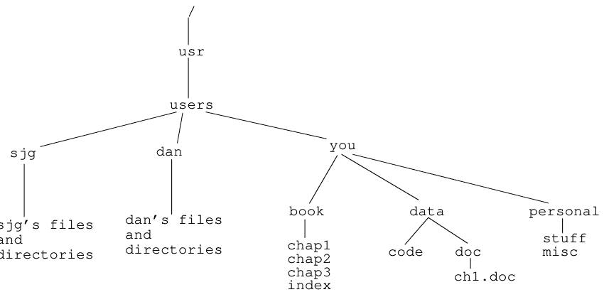

26. 哪个命令显示你拥有的文件？
    a. dir
    b. files
    c. cp
    d. ls

27. 哪个命令显示目录中所有文件的列表，并带有文件访问权限信息？
    a. ls -p
    b. dir/full
    c. ls -F
    d. ls -l

28. ________ 哪个命令根据某些特定标准搜索文件和目录？
    a. find
    b. search
    c. grep
    d. locate

29. ________ 哪个表达式与 `find` 命令使用时，会以长列表格式显示文件名？
    a. -exec
    b. -print
    c. -display
    d. -ls

30. ________ 哪个命令一次一屏地显示文件？
    a. more filename
    b. type filename
    c. file filename
    d. cat filename

31. ________ 哪个命令在屏幕上显示整个文件？
    a. more filename
    b. type filename
    c. file filename
    d. cat filename

32. ________ 你的工作目录是你的主目录。你如何显示 /usr/users/you/book 目录下的 chap3 文件的最后 10 行？
    a. cat book/chap3
    b. tail book/chap3
    c. tail /book/chap3
    d. cat /usr/users/you/book/chap3

33. ____ 哪种方法没有创建文件？
    a. 点击“新文件”(New File)菜单项
    b. 复制文件
    c. 移动文件
    d. 使用文本编辑器

34. ____ 哪种说法是不正确的？
    a. 垃圾箱被粉碎后，你的文件将从垃圾箱中移除
    b. 你可以通过双击垃圾桶打开垃圾箱
    c. 要将文件移动到垃圾箱，请将文件拖到垃圾桶图标上
    d. 垃圾箱中的垃圾箱每小时被粉碎一次

35. ____ 哪一项没有描述复制文件的目的？
    a. 备份文件
    b. 创建其他文件的链接
    c. 将文件重命名到另一个位置
    d. 将文件复制到另一个位置

36. ____ 哪个命令允许你创建一个名为 test2 的文件？
    a. create test2
    b. cat test2
    c. touch test2
    d. make test2

37. ____ 哪个命令创建目录？
    a. credit
    b. create
    c. dir/create
    d. mkdir

38. 假设你的当前工作目录是 /usr/users/you/book。哪个命令在你的主目录下创建一个目录？
    a. mkdir /usr/users/you/text
    b. mkdir /text
    c. mkdir /book/text
    d. mkdir /usr/users/you/text

使用以下示例回答后续的问题。

```
drwx-xr-x 5 users 512 Nov 5 11:04
drwx-xr-x 2 root 512 Oct 19 15:41 .
--r-xr--x 7 users Jun 29 15:22 .shrc
--r-xr--x 4 users Jun 29 15:22 .login
drwx-xr-x 5 users 512 Nov 5 09:38 book
--rw-r--r 8 users Sep 3 10:30
--wx------ 2 users 512 Nov 5 11:16 misc
--rw-r---- 1 users Nov 5 09:30 time.status
```


### 39. 有多少个文件组成员无法访问？
- a. 1
- b. 4

### 40. 有多少个文件或目录是所有者可以执行的？
- a. 4
- b. 7

### 41. 哪个命令使得你的当前目录（主目录）对组用户可读？
- a. `chmod g+rw`
- b. `chmod g-w`
- c. `chmod g-r`
- d. `chmod u+rw`

### 42. 哪个命令赋予用户读、写、执行权限，赋予组读执行权限，赋予其他无权限？
- a. `chmod 660`
- b. `chmod 730`
- c. `chmod 430`
- d. `chmod 750`

### 43. 哪个命令从主目录执行时，将 `/users/you/personal` 移动到 `misc` 目录？
- a. `mv /users/you/personal misc`
- b. `mv personal`
- c. `mv misc`
- d. `mv /`

### 44. 你的当前工作目录是 `/usr/users/you/book`。哪个命令将该目录中名为 `design` 的文件复制到 `database` 目录？
- a. `cp design /usr/users/you/book/database`
- b. `cp design /database`
- c. `cp database /usr/users/you/book`
- d. `cp design.detail /usr/users/you/book`

### 45. 哪个命令删除名为 `work1` 的文件？
- a. `delete work1`
- b. `del work1`
- c. `rm work1`
- d. `remove work1`

### 46. 哪个命令从主目录执行删除 `/users/you/personal` 目录及其所有文件？
- a. `rmdir /users/you/personal`
- b. `rmdir -r`
- c. `rm -r personal`
- d. `rmdir`

### 47. 假设你的工作目录是 `/usr/users/you/work`，工作目录下有一个名为 `projects` 的空子目录。哪个命令删除该空目录？
- a. `rm projects`
- b. `rmdir projects`
- c. `rm /usr/users/you/projects`
- d. `mkdir`

### 48. 关于硬链接，哪项描述是正确的？
- a. 可以指向目录
- b. 与原始文件无法区分
- c. 可以跨文件系统
- d. 不共享 inode

### 49. 关于符号链接，哪项描述是正确的？
- a. 在原始文件被删除后仍可以通过符号链接访问
- b. 不能跨文件系统创建
- c. 可以指向目录
- d. 每个符号链接的创建会导致计数增加

### 50. 你可以在哪些日历视图创建预约条目？
- a. 天、周、年
- b. 周、月、年
- c. 天、周、月
- d. 天、周

### 51. 使用文本编辑器你可以通过以下方式向文件添加新文本：
- a. 从一个窗口复制并粘贴到另一个窗口
- b. 使用文本编辑器的拖放功能
- c. 输入信息
- d. 以上所有

### 52. 使用 CDE 时，点击哪个控件输入命令？
- a. 日历 (Calendar)
- b. 邮件服务器 (Mailer)
- c. 终端 (Terminal)
- d. 桌面应用 (Desktop_Apps)

### 53. 系统管理员将常用的应用程序放在哪个系统文件夹中？
- a. 个人应用程序文件夹
- b. 用户文件夹
- c. 系统管理员文件夹
- d. 应用程序文件夹

### 54. 下列哪项可以被认为是 shell 的目的？
- a. UNIX 操作系统的用户界面
- b. 命令语言解释器
- c. 编程语言
- d. 以上所有

### 55. 哪个 shell(s) 提供命令历史缓冲区？
- a. Bourne shell
- b. C shell
- c. Korn shell
- d. C shell 和 Korn shell

### 56. 哪一个不是 Tru64 UNIX shell 的文件名？
- a. `/bin/sh`
- b. `/bin/bsh`
- c. `/bin/ksh`

### 57. Korn shell 通配符运算符 `?` 可用于匹配：
- a. 零或一个任意字符
- b. 恰好一个字符
- c. 一个或多个字符
- d. 仅限数字字符

### 58. 列出当前工作目录下所有以 `.txt` 结尾的文件，使用以下命令：
- a. `ls .txt?`
- b. `ls ?.txt`
- c. `ls *.txt`
- d. `ls .txt`

### 59. 使用哪个命令可以验证所有 Bourne、C 和 Korn shell 变量的设置？
- a. `show variables`
- b. `set`
- c. `set variables`
- d. `show -all`

### 60. 使用哪个命令可以在 Bourne 和 Korn shell 中显示任何特定 shell 变量的值？
- a. `print variable_name`
- b. `variable_name =`
- c. `echo $variable_name`
- d. `print $variable_name`

### 61. 使用 Korn shell 设置变量 `myname` 的正确方法是：
- a. `set myname = 'Charlie Brown'`
- b. `set myname = "Charlie Brown"`
- c. `myname = 'Charlie Brown'`
- d. `myname="Charlie Brown"`

### 62. 使用哪个命令可以显示所有的 Korn shell 选项？
- a. `set -o {option}`
- b. `set -o`
- c. `set +o {option}`
- d. `set +o`

### 63. 哪个命令将 emacs 开启为 Korn shell 命令编辑器？
- a. `set -o emacs`
- b. `set +o emacs`
- c. `set emacs`
- d. `set emacs on`

### 64. 哪一个不是默认的 shell 登录脚本？
- a. `.login`
- b. `.cshrc`
- c. `.profile`
- d. `.kshrc`

### 65. Korn shell 登录脚本文件之一的文件名是基于哪个变量的扩展的？
- a. `ENV`
- b. `LOGIN`
- c. `KSHSTART`
- d. `SHELL`

### 66. 如果你正在使用 C shell 并启动了一个子 shell，将执行哪个启动文件？
- a. `.login`
- b. `.profile`
- c. `.kshrc`
- d. `.kshrc`

### 67. 哪个语句描述了 Korn shell 环境脚本文件的用途？
- a. 定义适用于交互式使用以及从 ksh 用的脚本的别名和函数
- b. 设置你想应用到所有 ksh 调用的默认选项
- c. 设置你想应用到当前会话变量
- d. 以上所有

### 68. 在单用户模式下可以使用哪个编辑器？
- a. `emacs`
- b. `ed`
- c. `vi`
- d. `ex`

### 69. 下列中哪项是 vi 编辑器的只读版本？
- a. `ed`
- b. `ex`
- c. `sed`
- d. `view`

### 70. 哪个编辑器允许你同时编辑多个缓冲区和多个窗口？
- a. `ed`
- b. `vi`
- c. `emacs`
- d. `sed`

### 71. 如果你使用 vi 编辑器编辑一个现有文件 `junk`，并将其保存为与 `:wq` 命令同名的文件，编辑器会给文件的之前的（未编辑的）版本起什么什么名字？
- a. `junk~`
- b. `junk.bak`
- c. `junk;`
- d. 不保留文件的之前的版本

### 72. 哪个答案最能描述 vi 编辑器的模式？
- a. 命令模式；编辑模式；文本输入模式
- b. 命令模式；文本输入模式；末行模式
- c. 标标模式；文本输入模式；末行模式
- d. 命令模式；文本输入模式；退出模式

### 73. 哪个 vi 模式用于编辑另一个文件、执行 shell 命令或执行 ex 命令？
- a. 命令模式
- b. 文本输入模式
- c. 末行模式
- d. 退出模式

### 74. 应该使用哪个控制序列从 vi 文本输入模式跳转到命令模式？
- a. Eof (Ctrl/D)
- b. Escape (Ctrl/I)
- c. Stop (Ctrl/S)
- d. Suspend (Ctrl/Z)

### 75. 哪个答案不是离开 vi 命令模式并返回 shell 提示符的有效命令？
- a. `Q`
- b. `ZZ`
- c. `:q`
- d. `:q!`

### 76. 哪个命令将名为 `test` 的文件追加到名为 `output` 的文件的末尾？
- a. `cat output >> test`
- b. `append output > test`
- c. `write output > test`
- d. `cat test >> output`

### 77. 命令 `ls -l > listing` 实现了什么？
- a. 将 `ls -l` 的输出放入名为 `listing` 的文件中
- b. 使用 `listing` 的内容作为 `-l` 命令的输入
- c. 将 `-l` 命令的输出作为文件的输入
- d. 列出 `listing` 文件的内容

### 78. 符号 `<` 的作用是什么？
- a. 重定向标准输出
- b. 重定向标准输入
- c. 添加到文件的末尾
- d. 重定向标准输出

### 79. 哪个命令显示文件中有多少行？
- a. `sort -l`
- b. `sort -w`
- c. `wc -l`
- d. `sort`

### 80. 哪个命令在不考虑大小的情况下对 `flowers` 文件进行排序？
- a. `sort -f`
- b. `sort -r`
- c. `sort`
- d. `sort`

### 81. 创建包含姓名、生日并按字母顺序排列的 `dates` 文件的命令是：
- a. `sort +1 > dates`
- b. `sort -2`
- c. `sort +1 -2`
- d. `sort -r dates`

### 82. `-m` 选项实现了什么？
- a. 合并重复项
- b. 合并两个文件
- c. 排序大于 500 的文件
- d. 合并文件

使用以下示例回答问题：

```
1) go.c
2) date
3) list
4) go
5) out
6) glob
7) in
8) h
9) totals
10) login
```

### 83. 哪些命令匹配正则表达式 `$` 的字符串？
- a. 10
- b. 4, 5
- c. 4, 9
- d. 2

### 84. 哪些命令匹配正则表达式 `.*'` 的字符串？
- a. 2
- b. 5
- c. 4, 9
- d. All strings

### 85. 哪个字符串不匹配正则表达式 `[la]$`？
- a. `.login`
- b. `layout.c`
- c. `a.out`
- d. `bodyguard`

### 86. 哪个字符串匹配正则表达式 `.*$`？
- a. `a.out`
- b. `go.bin`
- c. `layout.c`
- d. `bodyguard`

### 87. 将命令输出作为另一个输入的单个字符是：
- a. 问号 (?)
- b. 竖线 (|)
- c. 星号 (*)
- d. At 符号 (@)
- e. 斜杠 (/)

### 88. 哪个命令创建文件列表，反向排序并将结果放入名为 `sortedlist` 的文件中？
- a. `ls | sort -r`
- b. `ls > sort`
- c. `ls > sort -r`
- d. `ls > sortedlist`

### 89. 哪个命令可以列出系统中登录 shell 为 ksh 的账户，按登录名字母顺序排序并显示屏幕？
- a. `more /etc/password | grep "/users/ksh" | sort`
- b. `grep 'ksh' /etc/password ; sort`
- c. `sort /etc/password > grep "ksh"`
- d. `cat /etc/password | grep "ksh" | sort`

### 90. 哪个命令可以创建一个名为 `phonenames` 的文件，其中包含 `phones` 文件的电话号码列表，如果电话号码是第三字段？
- a. `awk [3] >! phonenames`
- b. `awk "print $3" phones | phonenames`
- c. `awk '{print $3}' phones > phonenames`
- d. `awk -o phones phonenames > $3`

### 91. 哪个命令运行名为 `sum2.awk` 的 awk 文件来处理名为 `weekly.sum` 文件？
- a. `awk -F sum2.awk weekly.sum`
- b. `-f weekly.sum sum2.awk`
- c. `awk '{sum2.awk}' weekly.sum`
- d. `awk -f sum2.awk weekly.sum`

### 95. Korn shell 有默认的历史文件和默认的保留已执行命令数量。这些默认值是：
- a. `.history, 128`
- b. `.sh_history, 128`
- c. `.ksh_history, 64`
- d. `history, 64`

### 96. 开启 Korn shell 内置命令编辑器有多种方法。如果执行了以下三个选项/变量赋值，将使用哪一个内置命令作为 Korn shell 的命令编辑器？

```
EDITOR=emacs
VISUAL=emacs
set -o vi
```


## 选择题

### 97-120 题

-   a. `/bin/ed`
-   b. `emacs`
-   c. `gmacs`
-   d. `vi`

**97. 哪一个答案正确定义了使用 Korn shell 内置命令在临时缓冲区中编辑命令时使用的编辑器？**

-   a. `set -o emacs`
-   b. `EDITOR=emacs`
-   c. `set +o emacs`
-   d. `FCEDIT=emacs`

**98. 你使用 emacs 在临时缓冲区中编辑并修改多个 Korn shell 命令。当你退出 emacs 时，你告诉 emacs 不要将缓冲区保存到 `/tmp` 目录。哪些命令会被执行？**

-   a. 没有命令执行
-   b. 缓冲区的原始内容
-   c. 使用你当前工作目录修改后的命令
-   d. 修改后的命令，但它们将以你的家目录作为工作目录而不是 `/tmp` 执行

**99. ____ 你可以通过输入什么字符在下一行继续输入一个长命令？**

-   a. `;`
-   b. `\`
-   c. `/`
-   d. `-`

**100. ____ 你可以通过什么字符分隔多个命令，从而在同一命令行上包含它们？**

-   a. `\`
-   b. `;`
-   c. `,`
-   d. `Tab`

**101. ____ 哪条命令确定当前哪些进程正在运行，包括未连接到终端的进程？**

-   a. `stat`
-   b. `jobs`
-   c. `bg`
-   d. `ps -e`

**102. ____ `kill` 命令发送的默认信号是：**

-   a. `INT`
-   b. `KILL`
-   c. `TERM`
-   d. `USR1`

**103. ____ 使用什么字符在 Korn shell 脚本中引入注释？**

-   a. `:`
-   b. `\`
-   c. `;`
-   d. `#`

**104. 为了让 Korn shell 变量 `MYNAME` 在子 shell 中可用，你应该使用以下命令：**

-   a. `inherit $MYNAME`
-   b. `export MYNAME`
-   c. `use $MYNAME`
-   d. 不需要命令，子 shell 总是继承父 shell 的所有变量

**105. 哪条命令可以检查 Korn 脚本中文件 `junk` 是否存在？**

-   a. `[[ -f $junk ]] then print "junk exists"`
-   b. `if [[ -f junk ]]; then print "junk exists"`
-   c. `if [[ -e junk ]]; then print "junk exists"`
-   d. `if [[ junk=$HOME ]] then print "junk exists"`

**106. 哪个单词结束了 Korn shell 中的条件循环？**

-   a. `end`
-   b. `enddo`
-   c. `endif`
-   d. `done`

**107. 哪条命令通过 TCP/IP 网络从远程 UNIX 系统将文件复制到你的本地 UNIX 系统？**

-   a. `copy`
-   b. `dcp`
-   c. `rcp`
-   d. `finger`

**108. 哪条命令使用不同的用户 ID 登录远程系统？**

-   a. `rsh newsys df`
-   b. `login newsys -l thomas`
-   c. `rcp newsys`
-   d. `rlogin newsys -l thomas`

**109. 你应该编辑哪个文件来指定不同的打印机为你的默认打印机？**

-   a. `/etc/printcap`
-   b. `.dtprofile`
-   c. `.profile`
-   d. `.login`

**110. 哪个环境变量设置了你的默认打印机的值？**

-   a. `PTRNAME`
-   b. `DISPLAY`
-   c. `LPDEST`
-   d. `PTRDEVICE`

**111. `pr` 命令的主要目的是：**

-   a. 将文件打印到默认打印机
-   b. 将文件打印到由 `-P` 选项指定的打印机
-   c. 为标准输出格式化打印页
-   d. 提供打印队列中的打印请求列表

**112. 哪条命令提供打印机 `lp1` 的状态信息？**

-   a. `lpq -lp1`
-   b. `lpstat -t`
-   c. `lpc status`
-   d. 以上所有

**113. 哪条命令从磁带存档中提取文件和目录的原始副本？**

-   a. `tar -cv` 命令
-   b. `tar -rv` 命令
-   c. `tar -t` 命令
-   d. `tar -xv` 命令

**114. 哪条命令用于在非 UNIX 系统（如 OpenVMS）上使用而读写磁带，并可以转换 EBCDIC 和 ASCII 文件？**

-   a. `dd`
-   b. `tar`
-   c. `cpio`
-   d. `mt`

**115. 哪条命令可以根据文件数量向前或后移动磁带，还可以倒带磁带？**

-   a. `dd`
-   b. `du`
-   c. `dd`
-   d. `mt`

**116. 哪条命令提供打印机 `lp1` 的状态信息？**

-   a. `lpq -lp1`
-   b. `lpstat -t`
-   c. `lpc status`
-   d. 以上所有

**117. 哪条命令从磁带存档中提取文件和目录的原始副本？**

-   a. `tar -cv` 命令
-   b. `tar -rv` 命令
-   c. `tar -t` 命令
-   d. `tar -xv` 命令

**118. 哪条命令用于在非 UNIX 系统（如 OpenVMS）上使用而读写磁带，并可以转换 EBCDIC 和 ASCII 文件？**

-   a. `dd`
-   b. `tar`
-   c. `cpio`
-   d. `mt`

**119. 哪条命令可以根据文件数量向前或后移动磁带，还可以倒带磁带？**

-   a. `dd`
-   b. `du`
-   c. `dd`
-   d. `mt`

**120. 哪条命令显示磁盘空间信息？**

-   a. `end`
-   b. `du`
-   c. `df`
-   d. `done`

> **注**：由于提供的文本中出现了部分题目重复，如 112 题重复，译文已按要求完整翻译所有给定行。

---

### 21-38 题

**21. __ b `pwd` 命令产生什么结果？**

-   a. 你的主目录变为你的当前目录
-   b. 显示当前目录的路径
-   c. 显示你的密码
-   d. 显示你主目录的路径

**22. __ b 在 UNIX 操作系统中，完整路径源自：**

-   a. 你的主目录
-   b. 根目录
-   c. 你的工作目录
-   d. 你的登录目录

**23. __ a 更改当前目录的命令是：**

-   a. `cd pathname`
-   b. `set default pathname`
-   c. `sd pathname`
-   d. `ccd pathname`

**24. __ b 什么命令将你的工作目录更改到主目录？**

-   a. `home`
-   b. `cd`
-   c. `dir/h`
-   d. `clrpathname`

**25. __ d 你刚刚完成了 `chap1` 文件的创建。工作目录的列表显示了四个文件 chap1、chap2、chap3 和 index。如果目录结构如图所示，`pwd` 命令的输出是什么？**

-   a. `/usr/you/data`
-   b. `/usr/you/dan`
-   c. `/usr/users/you/personal`
-   d. `/usr/users/you/book`


**26. __ 什么命令显示你拥有的文件？**

-   a. `dir`
-   b. `files`
-   c. `cp`
-   d. `ls`

**27. __ 哪个命令显示目录下所有文件的列表，并包含文件访问权限的信息？**

-   a. `ls -p`
-   b. `dir/full`
-   c. `ls -F`
-   d. `ls -l`

**28. __ 什么命令根据特定标准搜索文件和目录？**

-   a. `find`
-   b. `search`
-   c. `grep`
-   d. `locate`

**29. d 哪个表达式与 `find` 命令配合使用，以长列表的格式显示文件名？**

-   a. `-exec`
-   b. `-print`
-   c. `-display`
-   d. `-ls`

**30. a 哪个命令一次一屏地显示文件？**

-   a. `more filename`
-   b. `type filename`
-   c. `file filename`
-   d. `cat filename`

**31. d 哪个命令在屏幕上显示整个文件？**

-   a. `more filename`
-   b. `type filename`
-   c. `file filename`
-   d. `cat filename`

**32. b 你的工作目录是你的主目录。你如何显示 `/usr/users/you/book` 目录下 `chap3` 文件的最后 10 行？**

-   a. `cat book/chap3`
-   b. `tail book/chap3`
-   c. `tail /book/chap3`
-   d. `cat /usr/users/you/book/chap3`

**33. c 哪方法不会创建文件？**

-   a. 点击“新文件”菜单项
-   b. 复制文件
-   c. 移动文件
-   d. 使用文本编辑器

**34. d 哪一个说法是不正确的？**

-   a. 垃圾箱被粉碎后，你的文件将从垃圾箱中移除
-   b. 你可以通过双击垃圾桶来打开垃圾箱
-   c. 要将文件移动到垃圾箱，将文件拖动到垃圾桶图标上
-   d. 垃圾箱中的垃圾每小时被粉碎一次

**35. b 哪项没有描述复制文件的目的？**

-   a. 备份文件
-   b. 创建其他文件的链接
-   c. 将文件重命名到另一个位置
-   d. 将文件复制到另一个位置

**36. c 哪个命令允许你创建一个名为 `test2` 的文件？**

-   a. `create test2`
-   b. `cat test2`
-   c. `touch test2`
-   d. `make test2`

**37. d 哪个命令创建目录？**

-   a. `credir`
-   b. `create`
-   c. `dir/create`
-   d. `mkdir`

**38. a 假设你的当前工作目录是 `/usr/users/you/book`。什么命令在你的主目录下创建一个名为 `text` 的目录？**

-   a. `mkdir /usr/users/you/text`
-   b. `mkdir /text`
-   c. `mkdir /book/text`
-   d. `dir/create /usr/users/you/text`

---

## 答案

使用以下示例回答接三个问题。

```
drwx-x--x 5 users 512 Nov 5 11:04 .
drwxr-xr-x 26 root users 512 Oct 18 15:41 .
-rwx--xr-- 1 users 373 Jun 29 15:22 .cshrc
-rw--x---- 1 users 145 Jun 29 15:22 .login
drwxr-xr-x 2 users 512 Nov 5 09:38 book
-rw-r---- 1 users 88 Sep 3 10:30 letters
drwx------ 2 users 512 Nov 5 11:16 misc
-rw-r---- 1 users 178 Nov 5 09:30 time.status
```


- 39. `users` 组成员无法访问多少个文件？
- a. 4
- b. 4
- c. 2
- d. 全部

- 40. 有多少文件或目录对所有者可执行？
- a. 4
- b. 7
- c. 5
- d. 全部

- 41. 哪个命令更改 `time.status` 文件的权限，使得只有你可以读取或写入？
- a. `set [rw,] time.status`
- b. `chmod g-rw,w time.status`
- c. `chmod g-rw,o time.status`
- d. `chmod u+rw time.status`

- 42. 哪个命令给用户读、写、执行权限，给组读和执行权限，给其他人无权限的文件 `a.out`？
- a. `chmod 660 a.out`
- b. `chmod 730 a.out`
- c. `chmod 430 a.out`
- d. `chmod 750 a.out`

### 测试 18-35

- 43. 从主目录执行的哪个命令将 `/usr/users/personal/misc/phones` 和 `/usr/users/personal/misc/resume` 移动到 `/usr/users/personal` 目录？
- a. `mv personal/misc/phones personal`
- b. `mv resume personal`
- c. `mv personal/misc/phones resume`
- d. `mv phones personal`

- 44. 你的当前工作目录是 `/usr/users/you/database/code`。哪个命令将 `/usr/users/you/database/doc/design.detail` 文件复制到名为 `design` 的当前目录？
- a. `cp /usr/users/you/database/doc/design.detail design`
- b. `cp /usr/users/you/database/doc/design.detail detail`
- c. `cp /database/doc/design.detail /database/code/design`
- d. `cp design.detail design/code`

- 45. 哪个命令删除名为 `work1` 的文件？
- a. `delete work1`
- b. `del work1`
- c. `rm work1`
- d. `remove work1`

- 46. 从主目录执行的哪个命令删除 `/usr/users/you/personal` 目录及其所有文件？
- a. `rmdir /usr/users/you/personal`
- b. `rmdir -r personal`
- c. `rm -r personal`
- d. `rmdir /personal`

- 47. 假设你的工作目录是 `/usr/users/you/work`，且工作目录下有一个名为 `projects` 的空目录。哪个命令删除该空目录？
- a. `rm projects`
- b. `rmdir projects`
- c. `rm /usr/users/you/projects`
- d. `rmdir work/projects`

- 48. 关于硬链接，哪个说法是正确的？
- a. 可以指向目录
- b. 与原始文件不可区分
- c. 可以跨越文件系统
- d. 不共享 inode

- 49. 关于符号链接，哪个说法是正确的？
- a. 在原始文件删除后仍可以通过符号链接访问
- b. 不可以跨文件系统创建
- c. 可以指向目录
- d. 每个符号链接的创建会导致链接计数增加

- 50. 你可以从哪些日历视图创建预约条目？
- a. 日、周、年
- b. 周、月、年
- c. 日、周、月
- d. 日、周

- 51. 使用文本编辑器你可以通过以下方式向文件添加新文本：
- a. 从一个窗口复制并粘贴到另一个窗口
- b. 使用文本编辑器的拖放功能
- c. 输入信息
- d. 以上所有

- 52. 使用 CDE 时，输入命令应点击哪个控件？
- a. 日历
- b. 邮件服务器
- c. 终端
- d. 桌面应用程序

- 53. 系统管理员将经常使用的应用程序放在哪个系统文件夹？
- a. 个人文件夹
- b. 用户文件夹
- c. 系统管理员文件夹
- d. 应用程序管理器

- 54. 下列哪项可以被认为是 shell 的目的？
- a. UNIX 系统的用户界面
- b. 命令语言解释器
- c. 一种编程语言
- d. 以上所有

- 55. 哪些 shell 提供命令历史缓冲区？
- a. Bourne shell
- b. C shell
- c. Korn shell
- d. C shell 和 Korn shell

- 56. 什么不是 Tru64 UNIX shell 的文件名？
- a. `/bin/sh`
- b. `/bin/bsh`
- c. `/bin/ksh`

- 57. Korn 通配符 `?` 可以匹配：
- a. 零或一个任意字符
- b. 任意一个字符
- c. 一个或多个字符
- d. 仅限数字字符

- 58. 要列出当前工作目录下所有 `.txt` 扩展的文件，使用命令：
- a. `ls .txt?`
- b. `ls ?txt`
- c. `ls *.txt`
- d. `ls .txt`

- 59. 用哪个命令验证所有 Bourne、C 和 Korn shell 变量的设置？
- a. `show variables`
- b. `set`
- c. `set variables`
- d. `show -all`

- 60. 用哪个命令可以在 Bourne、C 和 Korn shell 中显示特定变量的值？
- a. `print variable_name`
- b. `variable_name =`
- c. `echo $variable_name`
- d. `print $variable_name`

- 61. 用 Korn shell 设置变量 `myname` 的正确方法是：
- a. `set myname='Charlie Brown'`
- b. `set myname = "Charlie Brown"`
- c. `myname = 'Charlie Brown'`
- d. `myname="Charlie Brown"`

- 62. 使用哪个命令可以显示所有的 Korn shell 选项？
- a. `set -o {option}`
- b. `set -o`
- c. `set +o {option}`
- d. `set +o`

- 63. 哪个命令将 emacs 开启为 Korn shell 的行编辑器？
- a. `set -o emacs`
- b. `set +o emacs`
- c. `set emacs`
- d. `set emacs on`

- 64. 哪一个不是默认的 shell 登录脚本？
- a. `.login`
- b. `.cshrc`
- c. `.profile`
- d. `.kshrc`

- 65. Korn shell 登录脚本文件之一的文件名是基于哪个变量扩展的？
- a. `ENV`
- b. `LOGIN`
- c. `KSHSTART`
- d. `SHELL`

- 66. 如果你使用 C shell 并且启动了一个子 shell，会执行哪一个启动文件？
- a. `.login`
- b. `.profile`
- c. `.kshrc`
- d. `.cshrc`

- 67. 哪个选项描述了 Korn shell 环境脚本文件的目的？
- a. 定义适用于交互式使用以及从 ksh 调脚本的别名和函数
- b. 设置你想应用到所有 ksh 调用的默认选项
- c. 设置你想应用到当前会话的变量
- d. 以上所有

- 68. 在单用户模式下可以使用哪个编辑器？
- a. emacs
- b. ed
- c. vi
- d. ex

- 69. 下列中哪一个是 vi 编辑器的只读版本？
- a. ed
- b. ex
- c. sed
- d. view

- 70. 哪个编辑器允许你同时编辑多个缓冲区和多个窗口？
- a. ed
- b. vi
- c. emacs
- d. sed

- 71. 如果你使用 vi 编辑器编辑名为 junk 的现有文件，并使用 `:wq` 命令将其保存为同名文件，编辑器会给文件的之前的（未编辑）版本起什么名字？
- a. `junk~`
- b. `junk.bak`
- c. `junk;1`
- d. 文件的之前的版本不会保留

- 72. 哪个答案最能描述 vi 编辑器的模式？
- a. 命令模式；编辑模式；文本输入模式
- b. 命令模式；文本输入模式；末行模式
- c. 光标模式；文本输入模式；末行模式
- d. 命令模式；文本输入模式；退出模式

- 73. 哪种 vi 模式用于编辑另一个文件、执行 shell 命令或执行 ex 命令？
- a. 命令模式
- b. 文本输入模式
- c. 末行模式
- d. 退出模式

- 74. 应该使用哪种控制序列从 vi 文本输入模式切换到命令模式？
- a. Eof (Ctrl/D)
- b. Escape (Ctrl/[])
- c. Stop (Ctrl/S)
- d. Suspend (Ctrl/Z)

- 75. 哪个答案不是离开 vi 命令模式并返回 shell 提示符的有效命令？
- a. Q
- b. ZZ
- c. :q
- d. :q!

- 76. 哪个命令将名为 test 的文件追加到名为 output 的末结尾？
- a. `cat output >> test`
- b. `append output > test`
- c. `write output > test`
- d. `cat test >> output`

- 77. 命令 `ls -l > listing` 实现了什么？
- a. 将 `ls -l` 的输出存到一个名为 listing 的文件中
- b. 使用 listing 的内容作为 `ls -l` 命令的输入
- c. 使用 `ls -l` 命令的输出作为 listing 命令的输入
- d. 使用名为 listing 的文件的内容

- 78. `<` 重定向符号的作用是什么？
- a. 重定向标准输出
- b. 重定向标准输入
- c. 将输出添加到文件末尾
- d. 重定向标准输入和标准输出

- 79. 哪个命令显示名为 flowers 的文件中有多少行？
- a. `sort -l flowers`
- b. `sort -w flowers`
- c. `wc -l flowers`
- d. `lines flowers`

- 80. 哪个命令按忽略字母大小写的方式对 flowers 文件进行反字母顺序排序？
- a. `sort -f flowers`
- b. `sort -f flowers`
- c. `sort -r flowers`
- d. `sort -r -m flowers`

- 81. dates 文件包含三个字段：名字、姓和生日，顺序如下。哪个命令创建一个名为 dates.new 的新文件，其中包含 dates 文件中的数据按字母顺序排序，先按姓排序，再按名排序？
- a. `sort +1 -2 dates > dates.new`
- b. `sort -o dates +1 -2`
- c. `sort dates +1 -2 > dates.new`
- d. `sort -o dates.new +1`

- 82. sort 的 `-m` 选项实现了什么？
- a. 合并时消除重复项
- b. 合并两个或多个已排序的文件
- c. 排序并合并大于 500 行的文件
- d. 排序并合并多个文件

使用以下示例回答问题：
1) go.c
2) date
3) go.bin
4) go.lst
5) a.out
6) bodyguard
7) glob.in
8) layout.c
9) layout.h
10) totals

- 83. 正则表达式 `t$` 匹配哪些字符串？
- a. 10
- b. 4, 5
- c. 4, 5, 8, 9
- d. 2, 4, 5, 9

- 84. 正则表达式 `...` 匹配哪些字符串？
- a. 2
- b. 2, 5
- c. 1, 2
- d. 所有字符串

- 85. 正则表达式 `^[la` 不匹配哪个字符串？
- a. `.login`
- b. `layout.c`
- c. `a.out`
- d. `bodyguard`

- 86. 正则表达式 `...$` 匹配哪些字符串？
- a. `a.out`
- b. `go.bin`
- c. `layout.c`
- d. `lifeguard`

- 87. 输入哪个字符可以将一个命令的输出作为另一个命令的输入：
- a. 问号 (?)
- b. 竖线 (|)
- c. 星号 (*)
- d. 符号 (@)
- e. 斜杠 (/)

- 88. 哪个命令创建一个文件列表，然后按反字母顺序并将结果放入名为 sortedlist 的文件中？
- a. `ls | sort -r > sortedlist`
- b. `ls > sort`
- c. `ls > sort -r sortedlist`
- d. (选项缺失)

- 89. 哪个命令可以显示系统中所有登录 shell 为 ksh 的账户列表，按字母排序并一次显示一屏？
- a. `more /etc/passwd | grep "usr/ksh"`
- b. `grep 'ksh' /etc/passwd ; sort; more`
- c. `sort /etc/passwd > grep "ksh" > more`
- d. `cat /etc/passwd | grep "ksh" | sort | more`

- 90. 哪个命令可以创建一个名为 phonenums 的文件，其中包含来自名为 phones 的文件的电话号码，如果电话号码是第三字段？
- a. `awk phones [3] > phonenums`
- b. `awk "print $3" phones > phonenums`
- c. `awk '{print $3}' phones > phonenums`
- d. `awk -o phones phonenums > $3`

- 91. 哪个命令运行名为 sum2.awk 的 awk 文件来处理 weekly.sum 文件？
- a. `awk -F sum2.awk weekly.sum`
- b. `awk -f weekly.sum sum2.awk`
- c. `awk '{sum2.awk}' weekly.sum`
- d. `awk -f sum2.awk weekly.sum`

- 92. awk 命令源自：
- a. 创建者名字的首字母
- b. 创建者姓的首字母
- c. 该命令语法奇怪的能力
- d. 一种南美鸟

- 93. 哪个命令显示用户 pmj 的真实名和扩展？
- a. `who pmj`
- b. `whoami pmj`
- c. `users pmj`
- d. `finger pmj`

- 94. 哪个命令可以查看缓冲区中的命令？
- a. `show history`
- b. `history`
- c. `cat history`
- d. `view commands`

- 95. Korn shell 有一个默认的历史文件和默认的保留命令数。这些默认值是：
- a. `.history, 128`
- b. `.sh_history, 128`
- c. `.ksh_history, 64`
- d. `history, 64`

- 96. 开启 Korn shell 内置命令编辑器有很多方法。如果进行了以下三个选项/变量赋值，使用哪个内置编辑器作为 Korn shell 命令编辑器？

```
EDITOR=emacs
VISUAL=gmacs
set -o vi
```


+ a. `/bin/ed`
+ b. `emacs`
+ c. `gmacs`
+ d. `vi`

97. **d** 哪个答案正确定义了在使用 Korn shell 内置命令编辑临时缓冲区中的命令时使用的编辑器？
+ a. `set -o emacs`
+ b. `EDITOR=emacs`
+ c. `set +o emacs`
+ d. `FCEDIT=emacs`

98. **b** 你使用 `emacs` 编辑并修改临时缓冲区中的多个 Korn shell 命令。当你退出 `emacs` 时，你告诉 `emacs` 不要将缓冲区保存到 `/tmp` 。哪些命令会被执行？
+ a. 没有命令被执行
+ b. 缓冲区的原始内容
+ c. 修改后的命令，使用你当前的工作目录执行
+ d. 修改后的命令，但它们以你的家目录作为工作目录而不是 `/tmp` 执行

99. **c** 你可以通过输入什么字符在下一行继续输入长命令？
+ a. `;`
+ b. `\`
+ c. `/`
+ d. `-`

100. **b** 你可以通过什么字符将多个命令分开，并放在同一条命令线上？
+ a. `\`
+ b. `;`
+ c. `,`
+ d. `Tab`

101. **d** 哪个命令确定哪些进程正在执行，包括未连接到终端的进程？
+ a. `stat`
+ b. `jobs`
+ c. `bg`
+ d. `ps -e`

102. **c** `kill` 命令发送的默认信号是：
+ a. `INT`
+ b. `KILL`
+ c. `TERM`
+ d. `USR1`

103. **d** 哪个字符在 Korn shell 脚本中引入注释？
+ a. `:`
+ b. `\`
+ c. `;`
+ d. `#`

104. **b** 为了让 Korn shell 变量 `MYNAME` 在子 shell 中可用，应该使用哪个命令：
+ a. `inherit $MYNAME`
+ b. `export MYNAME`
+ c. `use $MYNAME`
+ d. 不需要任何命令，子 shell 总是继承父 shell 的所有变量

105. **b** 哪个命令可以在 Korn shell 脚本中检查文件 `junk` 是否存在？
+ a. `[[ -f junk ]] then print "junk exists"`
+ b. `[[ -f junk ]] then print "junk exists"`
+ c. `[[ -e junk ]] then print "junk exists"`
+ d. `[[ junk=$HOME ]] then print "junk exists"`

106. **d** 哪个词结束 Korn shell 中的条件循环？
+ a. `end`
+ b. `enddo`
+ c. `endif`
+ d. `done`

107. **c** 哪个命令通过 TCP/IP 网络将文件从远程 UNIX 系统复制到你的本地 UNIX 系统？
+ a. `copy`
+ b. `dcp`
+ c. `rcp`
+ d. `finger`

108. **d** 哪个命令使用不同的用户 ID 登录到远程系统？
+ a. `rsh newsys df`
+ b. `login newsys -l thomas`
+ c. `rcp newsys`
+ d. `rlogin newsys -l thomas`

109. **b** 你编辑哪个文件来指定不同的打印机为默认打印机？
+ a. `/etc/printcap`
+ b. `.dtprofile`
+ c. `.profile`
+ d. `.login`

110. **c** 哪个环境变量设置你的默认打印机的值？
+ a. `PTRNAME`
+ b. `DISPLAY`
+ c. `LPDEST`
+ d. `PRTDEVICE`

111. **c** `pr` 命令的主要目的是：
+ a. 将文件打印到默认打印机
+ b. 将文件打印到由 `-P` 选项指定的打印机
+ c. 为标准输出格式化打印页面
+ d. 提供打印队列中的打印请求列表

112. **d** 哪个命令提供打印机 `lpl1` 的状态信息？
+ a. `lpq -Plpl`
+ b. `lpstat -t`
+ c. `lpc status`
+ d. 以上所有

113. **d** 哪个命令从磁带存档中提取文件和目录的原始副本？
+ a. `tar -cv` 命令
+ b. `tar -rv` 命令
+ c. `tar -t` 命令
+ d. `tar -xv` 命令

114. **a** 哪个命令用于在如 OpenVMS 这样的非 UNIX 系统上读写磁带，并可以转换 EBCDIC 和 ASCII 文件？
+ a. `dd`
+ b. `tar`
+ c. `cpio`
+ d. `mt`

115. **d** 哪个命令可以按文件记录数向前或后移动磁带，还可以倒带磁带？
+ a. `df`
+ b. `du`
+ c. `dd`
+ d. `mt`

116. **c** 哪个命令显示空磁盘空间？
+ a. `du`
+ b. `dd`
+ c. `df`
+ d. `ls -1`

117. **b** 哪个命令显示目录中文件的大小？
+ a. `du -s`
+ b. `du`
+ c. `df`
+ d. `dd`

# 附录 A

## `stty` 命令参数

### 使用 `stty` 参数

### 概述

使用下表中的参数来设置终端特性。

表 18-1: `stty` 命令参数：控制模式

| 参数 | 功能 |
| --- | --- |
| `parenb` (-`parenb`) | 启用（禁用）奇偶校验生成和检测 |
| `parodd` (-`parodd`) | 选择奇（偶）奇偶校验 |
| `cs5` `cs6` `cs7` `cs8` | 如果可能，选择字符大小 |
| `number` | 如果可能，将终端波特率设置为给定的数字；如果波特率为0，则不再断言调制调控制 |
| `ispeed number` | 如果可能，将输入波特率设置为给定的数字；如果波特率为0，则不再断言调制调控制 |
| `ospeed number` | 如果可能，将输出波特率设置为给定的数字；如果波特率为0，则不再断言调制调控制 |

*(注：原文中存在大量重复的表格内容，已按要求保留核心结构)*

## 表 18-4：命令参数：本地模式（续）

| 参数 | 功能 |
| --- | --- |
| `prterase` (-`prterase`) | 反向打印（不打印）已删除的字符、反斜杠 (`\`) 和斜杠 (`/`) |
| `tostop` (-`tstop`) | 停止（允许）后台作业向终端的输出 |
| `xcase` (-`xcase`) | 输入时回显（不回显）大写字母，并在输出时显示大写字母但不产生反斜杠 |
| `iexten` (-`iext`) | 启用（禁用）任何当前未被 anon 控制的实现定义的特殊控制字符 |
| `echo` (-`echo`) | 回显（不回显）输入的每一个字符 |
| `echoe` (-`echoe`) | 如果可能，使删除字符（erase）在视觉上删除（不从视觉上删除）当前行的最后一个字符 |
| `echok` (-`echok`) | 在删除字符后回显（不回显）换行 |
| `echonl` (-`echonl`) | 如果禁用了回行，则回显（不回显）换行 |
| `noflsh` (-`noflush`) | 禁用（启用）中断（intr）、退出（quit）、停止（sup）后的刷新 |
| `special_character string` | 将特殊字符设置为字符串。特殊字符被设置为字符串中的第一个字符，后续字符被忽略，但有以下例外：如果字符串包含 `undef` - 且其在设备上生效，则将特殊字符设置为 `[_POSIX_VDISABLE]`。字符串 `^` 将特殊字符设置为退格键。其他以字符 `^` 开头的字符串将特殊字符设置为字符串中第二个字符对应的控制字符（后续字符被忽略）。例如，字符串 `^c` 将特殊字符设置为 `Ctrl/C`；字符串 `^q` 将特殊字符设置为 `Ctrl/Z` |

`saved settings` 将终端特性设置为由 `-g` 选项产生的保存设置。

`min number` 或 `time number` `to number` 将 `min` 或 `time` 的值设置为数字。`min` 和 `time` 都用于非规范模式输入处理 (-`ican`)。

`line number` 将行规律（line discipline）设置为指定的数字。

## 表 18-5：`stty` 命令参数：组合模式

| 参数 | 功能 |
| --- | --- |
| `evenpn` or `parity` | 启用 `parenb` 和 `cs7`；禁用 `parodd`。 |
| `oddp` | 启用 `parenb`、`cs7` 和 `parodd`。 |
| `parity`, `evenpn`, `oddp` | 禁用 `parenb` 并设置 `cs8`。 |
| `raw` (-`raw` `cooked`) | 启用（禁用）原始输入和输出（无删除、杀死、中断、退出、eot 或输出处理） |
| `nl` (-`nl`) | 启用（禁用）`icrn` 和 `onlcr` -`nl` 还会设置 `inlcr`、忽略 `ocrnl` 并设置 `oniret`。 |
| `lcase` (-`lcase`) 或 `LCASE` (-`LCCASE`) | 设置（取消设置）`xcase`、`iulc` 和 `olcuc`。用于仅支持大写字母的终端。 |
| `sane` | 将所有模式重置为合理值。 |

## 表 18-6：`stty` 命令参数：兼容模式

| 参数 | 功能 |
| --- | --- |
| `ek` | 将删除和杀死字符重置为系统默认值。 |
| `lfkc` (-`lfkc`) | 等于 `echock` (-`echock`)。 |
| `flow` (-`flow`) | 等于 `ixon` (-`ixon`)。 |
| `tandem` (-`tandem`) | 等于 `ixoff` (-`ixoff`)。 |
| `decctlq` (-`decctlq`) | 设置适用于数字设备公司（Digital Equipment Corporation）提供的终端的所有模式。删除控制字符设置为 `^?`。 |
| `dec` | |
| `crterase` (-`crterase`) 或 `crtabs` (-`crtbs`) | 等于 `echoe` (-`echoe`)。 |
| `ctecho` (-`ctecho`) | 等于 `echocht` (-`echocht`)。 |
| `crt` (-`crt`) 或 `newcrt` (-`newcrt`) | 设置（清除）`echoe`、`echoke` 和 `echocht`。 |
| `litout` (-`litout`) | 在不带（带有）输出处理的情况下发送输出字符。 |
| `xtabs` (-`xtabs`) 或 `oxtabs` (-`oxtabs`) | 将制表符扩展（不扩展）为空格。 |
| `fill` (-`fill`) | 等于 `ofill` (-`ofill`)。 |
| `everything` | 等于 `-a` |

## 表 18-6：`stty` 命令参数：兼容模式（续）

| 参数 | 功能 |
| --- | --- |
| `echoe` (-`echo`) 或 `nohang` (-`nohang`) | 如果载波掉落，发送（不发送）`HANGUP` 信号。 |
| `nul-fill` | 执行字符填充并使用 `null` 字符。 |
| `del-fill` | 执行字符填充并使用 `delete` 字符。 |
| `tty33` | 设置适用于 Teletype Corporation Model 33 终端的模式。 |
| `tty37` | 设置适用于 Teletype Corporation Model 37 终端的模式。 |
| `vt05` | 设置适用于 Digital Electric Corporation VT05 终端的模式。 |
| `tn300` | 设置适用于 General Electric TermNet 300。 |
| `ti700` | 设置适用于 Texas Instruments 700 系列。 |
| `tek` | 设置适用于 Tektronix 4014 终端。 |
| `speed` | 仅打印行速率。 |
| `size` | 仅打印终端大小。 |

* 如果未指定任何选项，则显示 `-a` 标志显示的某些未指定信息子集。
* 如果终端输入速度和输出速度相同，则速度信息显示如下：
  `speed baud`
  如果终端输入速度和输出速度不同，则速度信息显示如下：
  `speed`
  如果终端输入速度和输出速度相同，则速度信息显示如下：
  `speed`
  如果终端输入速度和输出速度不同，则速度信息显示如下：
  `speed`
  如果终端输入速度和输出速度相同，则速度信息显示如下：
  `speed`
  如果终端输入速度和输出速度不同，则速度信息显示如下：
  `speed`
  如果终端输入速度和输出速度相同，则速度信息显示如下：
  `speed`
  如果终端输入速度和输出速度不同，则速度信息显示如下：
  `speed`
  如果终端输入速度和输出速度相同，则速度信息显示如下：
  `speed`
  如果终端输入速度和输出速度不同，则速度信息显示如下：
  `speed`
  如果终端输入速度和输出速度相同，则速度信息显示如下：
  `speed`
  如果终端输入速度和输出速度不同，则速度信息显示如下：
  `speed`
  如果终端输入速度和输出速度相同，则速度信息显示如下：
  `speed`
  如果终端输入速度和输出速度不同，则速度信息显示如下：
  `speed`
  如果终端输入速度和输出速度相同，则速度信息显示如下：
  `speed`
  如果终端输入速度和输出速度不同，则速度信息显示如下：
  `speed`
  如果终端输入速度和输出速度相同，则速度信息显示如下：
  `speed`
  如果终端输入速度和输出速度不同，则速度信息显示如下：
  `speed`

# 使用 `set` 命令的邮件选项

这里是你的登录用户名。如果你不这样做，任何人都可以读取你的邮件，尽管大多数人不会这样做。

`keepsave`

当你向文件夹或文件发送消息时，`mail` 通常会在你退出时丢弃其副本。要保留所有已保存的消息，请设置 `keepsave` 选项。

* `metoo`

在向别名发送邮件时，`mail` 会确保如果你被包含在别名中，`mail` 将不会将邮件发送给你。如果组中的所有成员都使用同一个别名，那么这种方法非常有用。但是，如果你想接收你发送到别名的所有消息的副本，可以设置二进制选项 `metoo`。

* `noheader`

二进制选项，在首次调用 `mail` 时抑制版本信息和标头的打印。等同于在命令行上使用 `-N`。

* `nosave`

通常情况下，当你通过两次 `RUBOUTS` 终止消息时，`mail` 会将部分信件复制到在你的主目录中创建的 `dead.letter` 中。设置二进制选项 `nosave` 可以防止此操作。

* `quiet`

二进制选项，在首次调用 `mail` 时抑制版本信息的打印。

* `record`

带值选项，可以设置为一个文件名以保存你的发送邮件。你发送的每条新消息都会附加到文件的末尾。

* `screen`

当 `mail` 最初打印消息标头时，它通过查看你的终端速度来确定打印数量。终端越快，打印的就越多。带值选项 `screen` 会覆盖此计算，并指定你想要的消息标头数量。此数字也用于通过 `z` 命令进行滚动。

* `toplines`

带值选项，定义了 `top` 命令打印的行数，而不是默认的五行。

* `verbose`

二进制选项，导致 `mail` 使用 `-v` 选项调用 `sendmail`，导致其进入详细模式（verbose mode）并宣布别名的扩展等。`verbose` 选项等同于使用 `-v` 选项调用 `mail`。

B-4 使用 `set` 命令的邮件选项

# 附录 C

# Korn Shell 命令行编辑命令

## 使用 `emacs` 和 `vi` 的编辑命令

### 概述

本附录包含 Korn shell 命令行编辑命令的表格。每个表格都包含了适用于 `emacs` 和 `vi` 命令编辑器的命令。命令根据功能被分为不同的表格。

以下是用于作为本附录主题快速参考的表格列表。

- 表 18-7，从历史文件中获取命令
- 表 18-8，命令执行
- 表 18-9，移动光标
- 表 18-10，删除或替换字符、单词和行
- 表 18-11，进入 `vi` 插入模式
- 表 18-12，使用大写字母和小写字母
- 表 A-7，路径名扩展或补全
- 表 18-14，杂项命令

对于 `emacs`：

- 命令重复 `Esc` [`count`] 次。
- 通常情况下，`emacs` 和 `gmac` 不区分大小写。

对于 `vi`：

`vi` 的默认模式是插入模式。你必须使用 `Esc` 进入命令模式以回命令。

- 命令重复 [`count`] 次。
- `vi` 编辑器区分大小写。

如果 `F11` 在你的终端上不起作 `Esc` 运行，请使用 `Ctrl/[`。

# 表 18-7：从历史文件中获取命令

| 目标 | 在 `emacs` 中输入 | 在 `vi` 中输入¹ |
| --- | --- | --- |
| 回忆上一个命令或之前的 [`count`] 个命令 | `Esc` [`count`]`Ctrl/P` | [`count`]`k` 或 [`count`]- |
| 回忆下一个命令或向前 [`count`] 个命令 | `Esc` [`count`]`Ctrl/N` | [`count`]`j` 或 [`count`]+ |
| 搜索历史文件查找包含字符串的命令行首次出现处 | `Ctrl/R` `string` | `/` `string` |
| 搜索历史文件查找位于命令行开头的命令行字符串首次出现处 | `Ctrl/R` `^` `string` | `^` `string` |
| 向后搜索历史文件查找包含字符串的命令行首次出现处 | `Esc` `0` `Ctrl/R` `string` | `?` `string` |
| 向后搜索历史文件查找位于命令行开的命令行字符串首次出现处 | `Esc` `0` `Ctrl/R` `^` `string` | `?` `string` |
| 重复最近的 `/` 或 `?` 指令 | | `n` |
| 按相反方向重复最近的 `/` 或 `?` 指令 | | `N` |
| 用历史文件中最旧的命令替换当前命令，对于 `vi`，则用由数字指示的命令 | `Esc` `<` | [`number`]`G` |
| 用历史文件中最新的命令替换当前命令 | `Esc` `>` | |

¹在从历史文件中获取命令之前，必须处于命令模式（(`Esc`)）。

# 表 18-8：命令执行

| 目标 | 在 `emacs` 中输入 | 在 `vi` 中输入 |
| --- | --- | --- |
| 执行当前命令（`vi` 位于任何模式下） | `Return`, `Ctrl/J` 或 `Ctrl/M` | `Return`, `Ctrl/J` 或 `Ctrl/M` |
| 执行当前命令行，然后获取下一个命令 | `Ctrl/O` ¹ | |

¹`vi` 命令行编辑器一次只处理一个命令，即使它是多行的，而 `emacs` 每次只处理一行。对于 `emacs`-多行命令……。

# 表 18-9：移动光标

| 目标 | 在 `emacs` 中输入 | 在 `vi` 中输入 |
|---|---|---|
| 将光标向右移动 | `Esc` [`count`]`Ctrl/F` | [`count`]`l` |
| 将光标向左移动 | `Esc` [`count`]`Ctrl/B` | [`count`]`h` |
| 将光标移动到行首 | `Ctrl/A` | `0` |
| 将光标移动到行首第一个字符 | `Ctrl/spacebar` | `^` |
| 将光标移动到行尾 | `Ctrl/E` | `$` |
| 将光标移动到行尾第一个字符 | `Esc` [`count`]`Esc` `F` | — |
| 将光标移动到单词首 | `Esc` [`count`]`Esc` `B` | [`count`]`b` |
| 将光标移动到单词尾 | `Esc` [`count`]`Esc` `E` | [`count`]`w` |
| 将光标移动到下一个字符 | `Ctrl/e` | [`count`]`W` |
| 将光标移动到下一个字符 | — | [`count`]`f` |
| 将光标移动到上一个字符 | — | [`count`]`F` |
| 将光标移动到下一个字符之后 | — | [`count`]`t` |
| 将光标移动到当前位置之前 | — | [`count`]`T` |
| 重复最近的 `f` 或 `T` 指令，忽略计数 | | `n` |
| 按相反方向重复最近的 `f` 或 `T` | | `N` |

¹`b`、`e` 和 `w` 命令识别 `vi` 的单词定义：字母、数字和下划线，或到空白结束。

# 表 18-10：删除或替换字符、单词和行

| 目标 | 在 `emacs` 中输入 | 在 `vi` 中输入 |
|---|---|---|
| 删除当前位置的字符 | `Esc` [`count`]`Ctrl/D` | [`count`]`x` |
| 删除光标前的字符 | `Backspace` | [`count`]`X` |
| 删除当前单词，存缓冲区 | `Esc` `D` | `dw` |
| 从光标到单词首删除，并存缓冲区 | `Esc` `Backspace` 或 `Esc` `H` | `db` |
| 删除整个命令，无论位置如何（插入模式，保持插入模式） | `Ctrl/U` | `Ctrl/U` |
| 删除整个命令，无论位置如何（命令模式，进入插入模式） | | `S` |
| 删除整个命令，无论位置如何（命令模式，保持命令模式） | | `dd` |
| 从光标到行尾删除，并存缓冲区（命令模式，保持命令模式） | `Ctrl/K` | `d$` 或 `D` |
| 从光标到行尾删除（命令模式，切换到插入模式） | | `C` |
| 设置标记 | `Ctrl/spacebar` `Ctrl/@` 或 `Esc` `space` | — |
| 从光标到标记删除，并存缓冲区 | `Ctrl/W` | — |
| 交换光标和标记 | | `Ctrl/X` `Ctrl/X` |
| 将光标和标记之间的字符存入缓冲区。不删除命令 | `Esc` `P` | — |
| 在当前光标位置前插入缓冲区内容 | `Ctrl/Y`¹ | `P` |
| 在当前光标位置前插入缓冲区内容 | | `P` |
| 用 `c` 替换字符，或用 `c` 替换 [`count`] 个字符 | — | [`count`]`rc` |
| 删除光标位置到移动位置之间的任意字符。进入插入模式。`ce` 进入命令 | — | [`count`]`cm` |
| 删除光标位置到移动位置之间的任意字符。将删除的字符存入缓冲区 | — | [`count`]`motion` |
| 将当前光标位置到移动位置之间的字符存入缓冲区 | — | [`count`]`Y` `motion` |

¹在当前光标位置前插入缓冲区内容。

# 表 18-10：删除或替换字符、单词和行（续）

| 目的 | 在 `emacs` 中输入 | 在 `vi` 中输入 |
| --- | --- | --- |
| 将从当前光标位置到行尾的字符剪切并保存到缓冲区 | — | `Y` |
| `I.usap` 无法定义为 `Ctrl/Y` | | |

# 表 18-11：进入 `vi` 插入模式

| 目的 | 在 `emacs` 中输入 | 在 `vi` 中输入 |
| --- | --- | --- |
| 在当前光标位置后进入插入模式 | — | `a` |
| 在命令行末尾进入插入模式 | — | `A` |
| 在当前光标位置进入插入模式 | — | `i` |
| 在当前命令行开头进入插入模式 | — | `I` |
| 进入插入模式并替换从当前光标位置开始的字符 | — | `R` |

# 表 18-12：使用大写和小写字母

| 目的 | 在 `emacs` 中输入 | 在 `vi` 中输入 |
| --- | --- | --- |
| 将字符转换为大写 | `Ctrl/C` `1` | — |
| 将从当前光标位置到单词结束的字符转换为大写 | `Esc` `C` | — |
| 将从当前光标位置到单词结束（或指定单词数）的字符转换为小写 | `Esc` [`count`]`Esc` `L` | — |
| 更改指定数量字符的大小写 | | [`count`] `~` |
| `I.DTR` 无法定义为 `Ctrl/C` | | |

# 表 18-13：路径扩展或补全

| 目的 | 在 `emacs` 中输入 | 在 `vi` 中输入 |
| --- | --- | --- |
| 显示与当前单词匹配的可能路径，就像在单词末尾追加了 `**` 一样 | `Esc` `=` | `=` |
| 单词后添加字符以补全现有文件的路径。添加字符直到它们会匹配多个一个路径为止 | `Esc` `Esc` | `\` |
| 在当前单词末尾添加一个 `*`。对该单词进行路径扩展。如果有任何匹配的路径，则将单词替换为匹配模式的路径 | `Esc` `*` | `*` |

# 表 18-14：杂项命令

| 目的 | 在 `emacs` 中输入 | 在 `vi` 中输入 |
| --- | --- | --- |
| 重绘行 | `Ctrl/L` | | |
| 交换字符；`emacs` 交换当前字符与下一个字符；`gmac` 交换两个字符。 | `Ctrl/T` | | |
| 在别名列表中查找名为 `letter` 的别名。如果找到，则将其值置于光标位置的命令中 | `Esc` `letter` | `@` `letter` |
| 撤销上一个修改了当前命令模式的命令 | | `u` |
| 撤销自进入命令模式以来对当前命令行的所有更改 | | `U` |
| 将上一个命令的最后一个或 [`count`] 个单词追加到当前命令的末尾。用户为 `emacs` 或 `gmac` 添加空格；`vi` 添加添加自己的空格 | `Esc` [`count`]`,` 或 `Esc` [`count`]`_` | [`count`]`_` |
| 转义下一个字符。用于在命令行上输入控制字符。不会转义 `I`, `J`, `M`, `O`, `Q`, `S`, `V` 或 `Z` 的控制字符 | `\[control-character]` | | |
| 转义下一个字符。用于在命令行上输入控制字符。不会转义 `kill` 或 `erase` | | `Ctrl/V`[`control-` |
| 转义下一个 `kill` 或 `erase` 字符 | | `\[control-character]` |
| 在命令开头放置一个 `#`，并将命令存入历史文件。不执行该命令 | | `#` |
| 显示 Korn Shell 的版本 | `Ctrl/V` | | |

# 使用 `emacs` 和 `vi` 编辑命令

## 附录 D
使用 `emacs` 编辑器

### 概述

### 简介

`emacs` 是今天 UNIX 世界中最强大的编辑器，是一个完整的工作环境。你可以使用 `emacs` 来：

- 获取列表显示
- 编辑、重命名、删除和复制文件
- 编译程序
- 发送和读取邮件
- 检查拼写是否正确
- 执行单个 shell 命令
- 在 `emacs` 窗口中运行 shell

本附录介绍了 `emacs` 编辑器。

### 资源

有关本附录中主题的更多信息，请参考以下内容：

- `emacs` 参考页
- GNU `emacs` 手册
  Richard Stallman
  在安装 `FSFemacsSRC` 软件集时，可在 `/usr/lib/emacs/doc` 目录找到
- 学习 GNU `emacs`
  Debra Cameron 和 Bill Rosenblatt
  由 O'Reilly and Associates, Inc., Sebastopol, CA 出版 (c) 1991
  ISDN 0-937175-84-6

# 介绍 `emacs` 编辑器

### 概述

原始的 `emacs` 是 Richard Stallman 为 PDP-10 编写的，作为 TECO 联编辑器的一组宏。`emacs` 代表 Editing Macros（编辑宏）。GNU `emacs` 来自自由软件基金会和 GNU 项目（GNU 的 UNIX），这是 Stallman 及其同仁正在生成的一个完整操作系统。

`emacs` 软件和文档是免费的。`emacs` 软件通常随 UNIX 系统的发行一起发布；Tr64-UNIX 在 `OSEmacs` 软件子集中包含了 GNU `emacs`（以及 `FSEmacs` 子集中的文档和源码）。

GNU `emacs` 的文档可以在线获取，并可以使用...

# 介绍 `emacs` 编辑器

- 你指定供 `emacs` 搜索的值
- 你输入要执行的命令名称

# 介绍 `emacs` 命令

在讨论特定的 `emacs` 命令之前，我们将从一个更通用的角度来讨论 `emacs` 命令。

- `emacs` 有数百个 `emacs` 命令，但你只需要学习几个就可以开始使用。
- `emacs` 命令的名称很长。然而，最常用的命令都绑定到了按键序列。
- 即使命令绑定了按键，你也可以始终使用命令名称来执行它。
- 最常用的命令（光标移动命令）绑定到 `Ctrl/char`。
- 使用频率稍低的命令绑定到 `Esc` `char` 按键序列。如果你没有 `Esc` 键，请尝试 `F11` 键或 `Ctrl-/`。
- `emacs` 允许将命令绑定到按键序列，这是你在在使用 `emacs` 后应该做的。

你可以通过按下 `Esc` `X` 然后输入命令名称来执行任何命令。这是执行没有绑定按键序列的命令正常方法。例如 `goto-line` 命令。

# 离开 `emacs`

编辑完缓冲区后，你可以按下 `Ctrl/Z` 临时挂起 `emacs`。这将让你处于 shell 提示符处。你可以输入 `fg` 回到 `emacs`。挂起 `emacs` 非常有用，但注意不要在同一个文件中启动另一个 `emacs` 会话；否则可能会损坏文件。你应该养成在挂起 `emacs` 之前保存缓冲区的习惯。

按下 `Ctrl/X` `Ctrl/C` 终止 `emacs` 会话。如果你对文件有更改，`emacs` 会询问你是否写入文件。如果你输入 `y`，`emacs` 将写入文件并退出。如果你输入 `n`，`emacs` 将强制你确认是否应丢弃更改。

### 现在试一下！

1. 使用 `emacs -q file5` 启动 `emacs` 编辑器。
2. 注意窗口底部指定文件名的模式行。
3. 输入这一行：`Now is the time to say goodbye`。
4. 按下 `Ctrl/X` `Ctrl/C` 退出 `emacs`。

# D-6 使用 `emacs` 编辑器

5. 在提示时保存你的文件。

### 需要帮助吗？

如果找不到 `emacs` 命令，请检查你的系统管理员是否安装了 `emacs` 软件。

## 解决方案

`emacs` 编辑器启动时底部应该有这样的一行：

```


# 使用 emacs 帮助功能

## 概述

emacs 拥有任何文本编辑器中最实用且完整的帮助功能之一。emacs 帮助包括：

- 补全：emacs 帮助你完成输入名称
- 帮助键：允许你获取许多 emacs 主题的帮助

## 名称补全

你可以输入最短的、无歧的字符序列，并告诉 emacs 去确定名称的其余部分。部分名称必须包含从开始足够的字符，以便将其与其他任何名称区分开。emacs 可以补全：

- 文件名（在给定目录下）
- 缓冲区
- 命令名
- 变量名

在大多数情况下，当在缓冲区（minibuffer）中提示输入名称时，emacs 会提供补全。当你输入名称时，按下三个字符之一来告诉 emacs 帮助补全该名称。

| 键 | 功能 |
|---|---|
| `Tab` | 尽可能补全名称 |
| `Spacebar` | 补全到下一个标点符号 |
| `?` | 在 `*Completion*` 窗口中列出可能名称的任何选择 |

例如，你的默认目录下可能有一个名为 `poker.c` 的 C 程序。当你按下 `Ctrl/X Ctrl/F` 访问该文件时，emacs 会提示文件名。如果你输入 `pok` 并使用名称补全，你将得到以下响应。

| 操作 | 结果 |
|---|---|
| 按 `Tab` | 如果没有其他文件以 `pok` 开头，emacs 将补全文件名 `poker.c` |
| 按 `Spacebar` | emacs 将文件名补全到 `poker` |
| 按 `?` | emacs 将生成一个 `*Completion*` 窗口并提供所有以 `pok` 开头的文件名 |

### 现在试一试！

1. 使用 `emacs -q file5` 命令启动 emacs 编辑器。
2. 按下方向键向下移动并输入第二行：`This is the second line`。
3. 使用名称补全帮助保存文件。输入 `Ctrl/X Ctrl/W fi Tab`。

缓冲区应该显示名称 `file5`。按下 `Return`。
4. 按下 `Ctrl/X Ctrl/C` 退出 emacs。

## 解决方案

当你按下 `Ctrl/X Ctrl/W` 时，emacs 缓冲区显示：`Write file: ~/`
当你输入 `fi` 并按下 `Tab` 时，emacs 应该补全文件名。

## 获取 emacs 帮助

emacs 通过 emacs 帮助键 `Ctrl/H` 后代表所需帮助类型的字符来提供帮助。下表显示帮助命令。

| 命令 | 功能 |
|---|---|
| `Ctrl/H a expr` | 搜索匹配 `expr` 的命令，如果找到，则提供命令名称、按键绑定以及帮助窗口中文档的第一行。 |
| `Ctrl/H f cmd-name` | 提供由 `cmd-name` 命令的描述。 |
| `Ctrl/H k key-sequence` | 提供由 `key-sequence` 执行的命令名称。 |
| `Ctrl/H w cmd-name` | 提供由 `cmd-name` 命令的按键绑定。 |

emacs 允许将命令绑定到按键序列，这是你在使用 emacs 后应该做的。

你可以通过按下 `Esc X` 然后输入命令名称来执行任何命令。这是执行没有绑定按键序列的命令的正常方法。例如 `goto-line` 命令。

## 移动光标

有很多命令可以移动光标。要每次移动一个字符或一行，请使用此处的命令。

| 命令 | 功能 |
|---|---|
| `Ctrl/F` 或右箭头 | 向右移动一个字符（右） |
| `Ctrl/B` 或左箭头 | 向左移动一个字符（左） |
| `Ctrl/P` 或上箭头 | 移动到上一行（上） |
| `Ctrl/N` 或下箭头 | 移动到下一行（下） |

其他移动命令包括此处所示的。

| 命令 | 功能 |
|---|---|
| `Ctrl/A` | 移动到行首 |
| `Ctrl/E` | 移动到行尾 |
| `Ctrl/V` | 向前移动一页 |
| `Esc V` | 向后移动一页 |
| `Esc >` | 移动到文件末尾 |
| `Esc <` | 移动到文件开头 |
| `Esc X goto-line n` | 到文件的第 n 行 |

### 现在试一下！

1. 使用 `man emacs | sed 's/.<Ctrl/V><Ctrl/H>////' > emacs.txt` 创建文件。
2. 编辑文件：`emacs -q emacs.txt`。
3. 将光标向下移动到第 17 行（提示：按下向下方向键 17 次或按下 `Esc 17 <down arrow>`）。
4. 使用 `Ctrl/E` 移动到行尾。
5. 使用 `Ctrl/A` 到行首。
6. 使用 `Ctrl/V` 向前滚动一屏。
7. 使用 `Esc V` 向后滚动一屏。
8. 使用 `Esc >` 到行尾。
9. 使用 `Esc <` 回到行首。

## 标记文本

要复制或删除一个短语、几个句子或两个段落的部分，使用行删除命令会非常不方便。通常标记你想要删除的区域更简单。要定义一个区域，使用一个称为“标记”（mark）的辅助指针。在 GNU emacs 中，标记在屏幕上是不可见的。

你可以使用 `Ctrl/空格键` 或 `Ctrl/@` 在区域的一端设置标记，然后将光标移动到区域的另一端。

使用 `Ctrl/X Ctrl/X` 交换光标（point）和标记（mark）的位置，因为：

- 你无法看到标记的位置
- 被标记区域的文本没有高亮显示
- 你应该验证区域是否确实已正确标记

## 删除文本

emacs 提供了许多删除文本的方法，最简单的是使用退格键（Backspace）。下表显示了一些 emacs 删除命令。

| 命令 | 功能 |
|---|---|
| `Ctrl/D` | 删除光标下的字符 |
| `Backspace` | 删除上一个字符 |
| `Esc char` | 删除到下一个该字符出现的位置为止（包括该字符本身） |
| `Ctrl/K` | 从光标删除到行尾 |
| `Esc K` | 从光标删除到句尾 |
| `Ctrl/Y` | 恢复上一次删除 |
| `Ctrl/W` | 删除标记区域 |
| `Esc W` | 复制标记区域 |

## 移动或复制文本

有时你需要移动文本。这很容易实现：先使用删除命令删除想要移动的文本，将光标移动到新位置，然后使用 yank（粘贴）命令将删除的文本放置在新位置。

## 执行基础编辑

例如，移动一段文本：

1. 将光标置于区域开头。
2. 使用 `Ctrl/空格` 设置标记。emacs 在极小缓冲区区域（minibuffer region）中响应 "Mark set"。
3. 将光标移动到你想要移动的区域末尾。
4. 使用 `Ctrl/X Ctrl/X` 验证标记是否在正确的位置。
5. 使用 `Ctrl/W` 删除文本区域。
6. 将光标移动到你想放置文本的缓冲区。
7. 使用 `Ctrl/Y` 将文本粘贴到缓冲区。

要复制标记区域而不是剪切，请使用 `Esc W` 而不是 `Ctrl/W`。

## 现在试一试！

1. 使用命令编辑文件：`emacs -q emacs.txt`。
2. 移动到第 22 行（提示：`Esc 22 下箭头`）。
3. 使用 `Ctrl/空格` 标记此段落。
4. 移动到此段落的末尾。
5. 使用 `Ctrl/X Ctrl/X` 验证标记。
6. 使用 `Ctrl/W` 删除区域。
7. 移动到下一个段落下空行。
8. 使用 `Ctrl/Y` 恢复区域。

## emacs 剪贴板

当你删除和复制文本时，被标记的文本区域会被放入剪贴板中。剪贴板：

- 存储过去 30 次一个或多个单词的删除操作。
- yank（`Ctrl/Y`）命令会从剪贴板中移除最近删除的文本。
- 如果你进行了多次删除，可以从剪贴板中检索所有删除内容：
  - `Esc Y` (yank-pop) 命令从剪贴板中检索连续的删除内容。
  - 它只能在 yank（`Ctrl/Y`）命令之后立即使用。

## 现在试一试！

1. 使用 `emacs -q file7` 编辑新文件。
2. 添加 5 行：

```
line 1
line 2
line 3
line 4
line 5
```


## 撤销更改

我们经常会错字，或者执行了并不打算执行的命令。可以使用键盘退出键 `Ctrl/G` 取消命令，emacs 会在极小缓冲区中显示 "Quit" 表示命令已停止。

其他撤销命令：

| 命令 | 功能 |
| --- | :--- |
| `Ctrl/X u` | 撤销上次编辑 |
| `Esc X revert-buffer` | 将缓冲区恢复到文件上次保存（自动保存）时的状态 |

使用 `revert-buffer` 命令将缓冲区恢复到磁盘上存储的状态，或从上次自动保存恢复。自动保存文件名在你的目录中以开头和结尾井号 (`#`) 标记。例如，如果你正在编辑文件 `junkfile` 且它已自动保存，那么自动保存的文件就是 `#junkfile#`。

## 搜索与替换

### emacs 搜索操作

像任何优秀的编辑器一样，emacs 也提供了搜索命令。事实上，有三种不同的搜索命令，如下表。

| 搜索命令 | 功能 |
| --- | :--- |
| 增量搜索 | 一只要你输入一个字符，emacs 就开始搜索它。 |
| 非增量搜索 | 类似于简单搜索，你输入整个字符串。 |
| 单词搜索 | 类似于简单搜索，但仅匹配整个单词。 |

### 增量搜索

执行增量搜索：

1. 按 `Ctrl/S`。emacs 在极小缓冲区中显示 "I search:"。
2. 一只要你输入一个字符，emacs 就开始搜索它。
3. 再次按 `Ctrl/S` 查找下一个匹配项。
4. 按 `Ctrl/G` 取消搜索。

### 非增量搜索

执行非增量搜索：

1. 按 `Ctrl/S`。emacs 在极小缓冲区中显示 "I search:"。
2. 输入整个字符串。
3. emacs 将光标移动到第一个出现的位置。
4. 按 `Ctrl/G` 取消搜索。

### 单词搜索

执行单词搜索：

1. 按 `Ctrl/W`。emacs 在极小缓冲区中显示 "Word search:"。
2. 输入要查找的字符串。
3. emacs 将光标移动到该单词第一次出现的位置。
4. 按 `Ctrl/E` 后接 `Ctrl/W` 查找下一个位置。
5. 按 `Ctrl/G` 取消搜索。

### 搜索与替换

你可能想将搜索与替换操作结合。例如，你可能会把 "the" 写成 "teh"，或者经常把 "receive" 拼写为 "recieve"。emacs 提供了搜索替换操作来让你快速进行更改。

emacs 有两种搜索替换类型：

- 简单搜索替换：替换所有出现处
- 查询替换：在替换每个出现处前进行验证

搜索替换和查询替换仅向前操作。

### 简单搜索替换

要替换一个字符串的所有出现处，使用简单搜索替换。命令格式为：
`Esc X replace-string <Return> old-string <Return> new-string <Return>`

1. 按 `Esc X`，输入 `replace-string` 命令并按回。emacs 在极小缓冲区中显示 "replace string:"。
2. 输入要查找的字符串并按回。emacs 在极小缓冲区中显示 "with:"。
3. 输入替换字符串并按回。emacs 查找并替换所有项，然后在极小缓冲区显示 "Done"。

由于搜索替换只向前工作，如果你想替换文件中的所有内容，请在执行命令前将光标移动到文件顶部。

### 查询替换

如果你不确定是否要替换每一个出现处，请使用 `replace%`。它让你逐个决定文本替换。

1. 按 `Esc %`。emacs 在极小缓冲区中显示 "Query replace:"。
2. 输入要查找的字符串并按回。emacs 在极小缓冲区中显示 "with:"。
3. 输入替换字符串并按回。emacs 找到下一个出现处并等待你的响应。

| 响应 | 动作 |
| --- | --- |
| `y` 或 空格 | 用 new-string 替换 old-string；搜索字符串的下一个出现处 |
| `n` 或 退格 | 不替换；进入下一个实例 |
| `q` 或 回车 | 退出 |
| `.` | 替换当前实例并退出 |
| `,` | 替换当前实例，但不移动 |
| `!` | 在不询问确认的情况下替换所有剩余出现处 |
| `^` | 回退到上一个实例 |

### 现在尝试一下！

1. 使用 `emacs emacs.txt` 编辑文件
2. 按 `Esc %`。emacs 在小缓冲区（minbuffer）中显示 "Query replace:"。
3. 输入 `editor` 并按回车。
4. 输入 `elephant` 并按回车。
5. 替换前两个出现处（按 `y`）并跳过接下来的五个（按 `n`）。
6. 按 `^` 回退到上一个出现处。
7. 按 `!` 替换所有剩余出现处。

## 递归编辑

当你在执行查询替换（query replace）时，你可能会看到其他需要修复的内容。尝试记住该更改，或者将其写下来，以便你以后回来修复。当你完成查询替换时，如果你没有做记录，很多时候你会忘记原本还想修复哪些内容了。

使用 emacs 的查询递归编辑选项，你不需要等待。你可以立即修复问题，而不需要以后记住它。

输入 `Ctrl/R` 开始递归编辑，然后使用普通的 emacs 命令移动光标并进行更改。更改完成后，使用 `Esc Ctrl/C` 或 `Ctrl/]` 退出递归编辑并返回查询替换，或同时退出两者。如果你恢复查询替换，emacs 会将光标放回开始递归编辑之前的位置。

当递归编辑激活时，模式行（mode line）上的模式周围会加上括号，例如，`[(Fundamental)]`。

| 命令 | 功能 |
| :--- | :--- |
| `Ctrl/R` | 进入递归编辑 |
| `Esc Ctrl/C` | 退出递归编辑 |
| `Ctrl/]` | 退出递归编辑并退出查询替换 |

## 使用缓冲区和窗口

### 概述

emacs 最常用的功能之一是可以同时编辑多个缓冲区，并同时在屏幕上显示多个缓冲区。

除了你正在编辑的文件副本缓冲区外，你还可以创建与文件没有关系的临时缓冲区。emacs 本身会创建缓冲区，通常这些缓冲区的命名格式为 `*buffer name*`，例如 `*Help*`、`*scratch*` 和 `*Buffer List*`。

缓冲区数量没有限制，但大多数时候只显示一个或两个缓冲区。但是，即使你看不到它们，其他缓冲区仍然处于活动状态。

窗口是屏幕上显示缓冲区的区域。每个窗口都有自己的模式行，将窗口彼此隔开。你可以拥有多个窗口，随你喜欢，但到某个程度，窗口会变得非常小，完全没用。

当你有多个窗口时：

- 它们可以是同一个缓冲区，也可以不同的缓冲区
- 你可以从一个窗口移动到另一个窗口，从而从一个缓冲区移动到另一个
- 你可以从缓冲区中的一个位置移动到同一个缓冲区中的另一个位置
- 你可以快速方便地比较缓冲区或从一个缓冲区复制到另一个缓冲区

### 缓冲区命令

当你初次用 emacs 编辑文件时，你提供了想要编辑的文件的文件名。该文件就变成了缓冲区名称。

如果你想编辑第二个文件，使用 `Ctrl/X Ctrl/f` 命令。emacs 会为你的文件副本创建一个新缓冲区。

如果你已经编辑了很久，可能会有很多不同的缓冲区。你必须能够在缓冲区之间移动，而且通常你会忘记缓冲区的名称，因此你必须能够确定哪些缓冲区是可用的并对其进行操作。

这里列出了一些缓冲区命令。

| 命令 | 功能 |
| :--- | :--- |
| `Ctrl/X b buffer-name` | 移动到指定的缓冲区 |
| `Ctrl/X Ctrl/B` | 显示缓冲区列表 |
| `Ctrl/X k buffer-name` | 删除指定的缓冲区 |
| `Ctrl/X s` | 询问是否保存每个已修改的缓冲区 |
| `Esc X kill-buffers` | 在删除缓冲区之前询问 |
| `Esc X rename-buffer` | 将缓冲区重命名为指定的名称 |

### 获取缓冲区列表

如果一个 emacs 会话已经运行了很久，缓冲区列表可能会增长到你无法跟踪所有缓冲区。你可以按 `Ctrl/X Ctrl/B` 获取缓冲区列表。emacs 会在屏幕上创建另一个窗口并创建 `*Buffer List*` 缓冲区。此示例显示了一个缓冲区列表。

#### 示例 18-2: 缓冲区列表

| MR Buffer | 大小 | 模式 | 文件 |
| :--- | :--- | :--- | :--- |
| % docs | 6994 | Fundamental | /ProjX/docs |
| * contacts | 737 | Fundamental | /ProjX/contacts |
| * proj-dlist | 31 | Fundamental | /ProjX/distribution |
| * distribution | 28 | Fundamental | /ProjX/distribution |
| ordering-emacs | 12253 | Fundamental | /usr/local/ordering-emacs |
| * Help | 517 | Fundamental | |
| * Buffer List | 252 | Buffer Menu | |
| * scratch: | 0 | Lisp interaction | |

MR（已修改或只读）列显示缓冲区的状态。

#### 表 18-15: 缓冲区列表 MR 列

| 如果 MR 包含： | 缓冲区是： |
| :--- | :--- |
| . (点) | 已显示 |
| * | 已修改 |
| % | 只读 |
| D | 标记为删除 |
| > | 标记为删除 |
| S | 标记为保存 |

### 使用缓冲区和窗口

4. 使用 `Ctrl+X` 移动到缓冲区列表窗口
5. 按下方向键移动到 file5
6. 使用 `Ctrl+1` 在全屏中显示此缓冲区

#### 解决方案

缓冲区列表初始看起来如下：

| MR Buffer | 大小 | 模式 | 文件 |
|---|---|---|---|
| file6 | 68 | Text | file6 |
| file5 | 54 | Text | file5 |
| *scratch* | 0 | Lisp Interaction | |
| *Buffer List* | 240 | Text | |

### 窗口操作

窗口是屏幕上的区域，emacs 在其中显示你所在的缓冲区。你可以同时在屏幕上开启多个窗口，每个显示不同的缓冲区。你也可以让窗口显示同一个缓冲区，但位于缓冲区不同的位置。

- emacs 窗口不能重叠，因此随着窗口数量的增加，窗口会变小。
- emacs 窗口可以水平或垂直分割。我们不会讨论垂直窗口，因为很少有人会觉得它有用。
- 使用 `Ctrl/X 2` 将当前窗口水平拆分为两个窗口。
- 使用 `Ctrl/X o`（其他窗口命令）将光标从一个窗口移动到另一个窗口。光标每次向下移动一个窗口。
- 使用 `Esc + 数字 Ctrl/X o` 一次移动多个窗口。`Esc 3 Ctrl/X o` 将光标移动到当前窗口的第三个窗口。
- 使用 `Esc + 数字 Ctrl/X ^` 放大带有内容的行的窗口。
- 使用 `Ctrl/X 0`（零）删除光标所在的窗口。
- 使用 `Ctrl/X 1`（一）删除光标所在窗口以外的所有窗口。

### 现在试一试！

1. 如下所示创建几个小文件：

```
$ cat > file1
file1
<Ctrl/D>
$ cat > file2
file2
<Ctrl/D>
$ cat > file3
file3
<Ctrl/D>
```


- 2. 使用 `emacs file1` 编辑第一个文件
- 3. 使用 `Ctrl/X Ctrl/F file2` 将屏幕分割为两个窗口
- 4. 使用 `Ctrl/X Ctrl/F file2` 编辑 file2
- 5. 使用 `Ctrl/X o` 切换到另一个窗口
- 6. 使用 `Ctrl/X 2` 分割该窗口
- 7. 使用 `Ctrl/X Ctrl/F file3` 编辑 file3
- 8. 使用 `Ctrl/X 1` 删除所有其他窗口

# 纠正错误

## 字符和单词的交换

最常见的打字错误之一是字符交换。`emacs` 提供了交换字符、单词、句子或段落的命令，显示如下：

| 命令 | 功能 |
| :--- | :--- |
| `Ctrl/T` | 交换两个字符：光标所在的字符和前一个字符 |
| `Esc T` | 交换两个单词：光标之间的两个单词 |
| `Ctrl/X Ctrl/T` | 交换两行：光标所在的行和前一个行 |
| `Esc X transpose-sentences` | 交换两个句子：光标所在的句子和下一个句子 |
| `Esc X transpose-paragraphs` | 交换两个段落：光标所在的段落和下一个段落 |

根据光标位置交换相应的字符、单词和行。

## 大写转换

另一个经常犯的错误是大小写问题。`emacs` 提供了特殊命令来修复大小写问题。

- `Esc C` 将单词的首字母大写
- `Esc U` 将单词全大写
- `Esc L` 将单词全小写

在对单词大写时，如果光标不在首字母上，光标下的字母将变为大写。如果光标移动到首字母，`Esc C` 会将首字母大写，并将单词中的任何其他大写字母改为小写。

## 在 emacs 中使用鼠标

如果你正在使用工作站，可以使用鼠标移动光标、剪切和粘贴以及操作 `emacs` 窗口。下表提供了使用鼠标操作 emacs 的指导。

### 表 18-17：使用鼠标操作 emacs

| 鼠标点击 | 等效 emacs 命令 |
| :--- | :--- |
| `MB1` | 将光标移动到鼠标指向的位置 |
| `MB2` 或 `Shift/MB3` | 粘贴（Yank），`Ctrl/Y` |

### 表 18-17：使用鼠标操作 emacs（续）

| 鼠标点击 | 等效 emacs 命令 |
|--- |--- |
| `MB3` 或 `Shift/MB2` | 复制区域并剪切（Copy-region-as-kill），`Esc W` |
| `Ctrl/MB2` | 剪切区域（Kill-region），`Ctrl/W` |
| `Ctrl/MB3` | 垂直分割窗口（Split-window-vertically），`Ctrl/X 2` |
| `Ctrl/Shift/MB3` | 删除其他窗口（Delete-other-windows），`Ctrl/X 1` |
| `Ctrl/Shift/MB1` | 创建包含缓冲区名称的菜单，类似于 `Ctrl/X Ctrl/B`，`list-buffers`；点击缓冲区名称上的任何鼠标按钮即可选择该缓冲区 |
| `Ctrl/Shift/MB2` | 为 emacs 创建一组弹出菜单 |

## 总结

### 介绍 emacs 编辑器

启动 `emacs [-options] filename`。

emacs 屏幕被分为三个区域：

- 编辑区域（可能包含一个或多个窗口）
- 每个窗口的模式行（mode line）
- minuffer 区域

按下 `Ctrl/X Ctrl/C` 终止 emacs 会话（注意："minuffer" 可能是 "minibuffer"，但根据指令予以保留）。

### 使用 emacs 帮助

emacs 拥有丰富且实用的帮助功能。你可以通过 `Ctrl/H` 获取帮助。

当你想要帮助时，输入你需要的命令。

### 执行基础编辑

emacs 提供了编辑命令。使用 `Ctrl/X Ctrl/F` 打开文件。当模式行出现在屏幕上时，使用方向键移动光标。

- 使用空格键设置标记（mark）。
- 将光标移动到段落末尾。
- 使用 `Ctrl/Y` 粘起（yank）文本。
- 使用 `Ctrl/U` 撤销上一次编辑。

### 查找与替换

emacs 提供了查找字符串并可选替换的命令。使用 `Ctrl/S` 或 `Ctrl/\` 开始搜索。

### 使用缓冲区和窗口

emacs 允许你同时编辑多个缓冲区。

- `Ctrl/X B` 列出缓冲区。
- `Ctrl/X b` 切换缓冲区。
- `Ctrl/X 2` 分割窗口。
- `Ctrl/X o` 将光标移动到另一个窗口。
- `Ctrl/X 1` 删除其他所有窗口。

### 纠正错误

emacs 提供了交换字符、单词、句子或段落的命令。也可以修复大小写。

### 练习

- 1. 使用 emacs 教程：
   a. 使用 `Ctrl/X Ctrl/F` 启动教程。使用 `Ctrl/S` 或 `Ctrl/\` 进行增量搜索。在你想返回的地方放置一个标记（如 qq）。使用 `Ctrl/X Ctrl/C` 退出并保存文件。通过编辑保存的文件继续。
- 2. 从一个文件剪切并粘贴到另一个文件：
   a. 再次编辑 junkfile 并启动教程。使用 `Ctrl/X 2` 创建另一个窗口。使用 `Ctrl/X B` 切换到 junkfile。使用 `Ctrl/X O` 将光标到教程窗口。使用增量搜索查找“several windows”。设置标记并移动光标。
   i. 使用 `Ctrl/X` 验证标记是否设置在你预想的位置。如果标记（mark）和点（point）不在预期位置，请重新设置标记。
   j. 使用 `Ctrl/W` 删除被标记文本。
   k. 使用 `Ctrl/X O` 将光标移动到另一个窗口。
   l. 使用 `Ctrl/Y` 将文本从剪切环（kill ring）取回到缓冲区。

## 3. 使用查询替换和递归编辑

- a. 使用 `Ctrl/X O` 将光标移动到另一个窗口（TUTORIAL）。
- b. 使用 `Esc <` 将光标移动到教程的顶部。
- c. 使用 `Esc %` 查询替换将 "M-" 替换为 "Esc-"。
- d. 输入 `y` 或空格键替换前 4 处出现的 "M-"。当你遇到第 5 个 "M-" 时，你应该正处于以“If moving by characters is too slow...”开头的行上。假设我们发现了一个错误，并想将 "characters" 替换为 "one character"。
- e. 输入 `Ctrl/R` 进入递归编辑模式。
- f. 使用反向搜索（isearch-backward）、`Ctrl/R` 或普通光标移动将光标移动到单词 "character" 的开头。在 "character" 前加上单词 one 和空格，然后删除 "characters" 末尾的 "s"。现在应该显示为“If moving by one character is too slow...”。
- g. 使用 `Esc Ctrl/C` 退出递归编辑。注意光标移动到了下一个 "M-"，正在你上次离开的地方。
- h. 输入 `y` 或空格键继续替换若干处 M-.
- i. 输入 `.` 退出查询替换。

# 索引

### 符号
- `!` shell 变量 7-11
- `$` shell 变量 7-11
- `.profile` 文件 16-11, 17-10
- `?` shell 变量 7-11
- 邮件发送器 (Mailer) 11-3
- 手页查看器 (Man Page Viewer) 2-11
- 个人应用程序 2-7
- 打印机 2-8, 13-6
- 样式管理器 3-5
- 终端 2-35
- 文本编辑器 2-15
- 垃圾桶 5-18, 5-29
- `cp` 命令 6-31
- `cron` 守护进程 10-22
- `crontab` 命令 10-23
- `crontab` 文件 10-23
- 当前会 1-11

### A
- 绝对路径 4-10, 6-3
- 别名地址 11-8, 11-25
- 符号 (`&`) 10-6
- 应用程序管理器 2-42
- 应用程序
    - 文件管理器 5-3
    - 邮件发送器 11-3
    - 打印管理器 8-13, 13-10
    - 文本编辑器 2-15
    - 应用程序:
        - 日历 2-22
        - 文件管理器 2-45
        - 终端 2-35
        - `apropos` 命令 2-13
        - `at` 命令 10-19
        - `awk` 9-18

### D
- 数据类型 4-3
- DEWindows 1-7
- 默认打印机 13-3, 13-13
- 开发者文档工具包 1-15
- 设备名称
    - V5.0 之前 15-4
    - V5.0 15-4
    - 特殊设备 15-3, 15-16
    - `df` 命令 15-7
    - 目录 4-3
    - 目录 6-3, 6-43
    - 工作目录 6-3, 6-43

### B
- 后台 10-6
- 备份操作 15-13
- 批量命令 10-19
- `bg` 命令 10-12
- 磁盘块 6-10
- `DISPLAY` 环境变量 12-78
- 文档

### C
- 日历应用程序 2-22
- 日历控制 2-22
- 取消 (cancel) 14-14
- `cat` 命令 6-12, 6-16
- `cd` 命令 6-27
- `chgrp` 命令 6-27
- `chmod` 命令 6-23
- `csh` 命令 7-5
- 调色板 3-6
- 命令行接口 1-6
- 常用桌面环境 (Common Desktop Environment) 1-6
- 控制

### E
- `ed` 命令 8-3
- `EDITOR` shell 变量 7-12, 16-11
    - 编辑器
        - `ed` 8-3
        - `ex` 8-3
        - `sed` 8-3
        - `vi` 8-4
- 电子邮件地址 11-8
- End Kit  1-14
- `ENV` shell 变量 7-12, 7-20
- 环境 7-10
- `ERRNO` shell 变量 7-11
- `ex` 命令 8-3
- 可执行文件 6-22
- 退出状态 10-17
    - 激活 2-5
    - 应用程序管理器 2-42
    - 日历 2-22
    - 文件管理器 5-3
    - 帮助 2-8
    - 帮助管理器 2-9

### F
- 安全模式会话 1-9
- `fc` 命令 16-4
- `FCEDIT` shell 变量 16-19
- `fg` 命令 10-11
- 文件 4-3
- 目录 4-3
- 可执行 6-22
- 隐藏 4-3
- 链接 5-27, 6-36
- 权限 4-11
- 特殊 4-3
- 文件管理器应用程序 2-45, 5-3
- 文件管理器控制 5-3
- 过滤器 9-5
- `find` 命令 6-9
- 文件夹 4-5
- 前台 10-6
- 前面板 2-3
- 控制 2-5
- 打印机控制 13-3
- `ftp` 命令 12-7
- 全完整路径 4-10, 6-3

### G
- 图形用户界面 1-6
- `grep` 命令 9-10
- `groups` 命令 6-27

### H
- 硬链接 6-37
- `head` 命令 6-12
- 帮助控制 2-8
- 帮助键 2-9
- 帮助管理器 2-9
- 隐藏文件 4-3
- 历史文件 16-3
- `Historyfile` shell 变量 7-12, 16-3
- 主目录 6-3, 6-43
- 主会话 1-11
- `HOME` shell 变量 7-12

### I
- Inode 6-36

### J
- `jobs` 命令 10-13

### O
- 对象 4-5
- 在线文档 1-16
- 开放软件基金 1-4
- 普通文件 4-3
- `OPWD` shell 变量 7-11
- 调试 17-22
- 执行 17-4
- 流控制 17-17
- 全局变量 17-11
- 交互式 17-8
- 逻辑运算符 17-16
- 关系运算符 17-14
- 信号捕获 17-20
- 变量 7-7

### P
- `passwd` 命令 1-12
- 密码 1-12
- 路径 4-10, 6-3
- 权限 4-11
- 个人应用程序 2-7
- PID 10-8
- 管道 9-16
- `PPD` shell 变量 7-12
- 打印机应用程序 13-8, 13-10
- `printcap` 文件 13-4
- 默认打印机 13-3, 13-13
- 打印机控制 2-8, 13-6
- `PRINTER` 环境变量 14-3
- 优先级 10-4
- 进程 10-3
- 标识符 10-8
- 优先级 10-14
- 状态 10-11
- 挂起 10-5
- 进程环境 10-3
- 配置文件 7-20
- `ps` 命令 10-8
- `PS1` shell 变量 7-12, 17-10
- `pwd` 命令 6-3

### R
- `RANDOM` shell 变量 7-11
- `rcp` 命令 12-6
- 注册应用程序 2-43
- 相对路径 4-10, 6-3
- 恢复操作 15-14
- `hosts` 文件 12-3
- 登录命令 12-3
- `rm` 命令 6-33
- `rdir` 命令 6-34
- 根目录 4-9
- `rsh` 命令 12-5, 12-13

### S
- 脚本 17-3
- 条件环境 17-39
- 创建 17-3

### T
- `tail` 命令 6-12
- 归档工具。见 tar
- 磁带密度 15-11
- `tar` 命令 15-11
- TCP/IP 12-2
- `tee` 命令 9-16
- `telnet` 命令 12-9
- `TERM` shell 变量 7-12
- 终端应用程序 2-35
- 终端控制 2-35
- 文本编辑器应用程序 2-15
- 文本编辑器控制 2-15
- `touch` 命令 6-15
- 信号捕获 17-20
- 垃圾桶控制 5-18, 5-29
- `typeset` 命令 7-13

### U
- UNIX
- 创造者 1-3
- 演变 1-3
- `unset` 命令 7-13
- `users` 命令 11-12

### V
- `vi` 编辑器 8-4
- `VISUAL` shell 变量 11-15, 16-11
- `VISUAL` 变量 16-11

### W
- `wait` 命令 10-16
- `wc` 命令 9-5
- `whereis` 命令 6-9
- `who am i` 命令 11-11
- `who` 命令 11-11
- `whoami` 命令 11-11
- 通配符运算符
- 星号 7-8
- 转义 7-9
- 问号 7-8
- 工作目录 6-3,6-43
- 工作空间 2-8
- 工作空间切换 2-4

### X
- `xhost` 命令 12-11
