# CompTIA A+ 实践指南：考试220-901和考试220-902

*致我的女孩们*

# 致谢

撰写一本关于 A+ 考试的书籍绝非易事。在这个过程中涉及几十个人。我将尽力列出尽可能多的名字，但如果我漏掉了任何人，请提前原谅我。

感谢 Kenyon Brown，他提出了这本书的绝妙创意，并友好地邀请我参与。我还要非常感谢我的搭档 Emmett Dulaney 和 Toby Skandier，他们是 Sybex 《A+ 完全学习指南》的合著者，感谢他们的辛勤工作和奉献精神。Troy McMillan 是技术编辑，我很感激他在我犯错时告诉我。Kelly Talbot 确保了项目的顺利进行，而文字编辑、校对员、索引编制员、排版员以及 Sybex 的整个团队都提供了无价的贡献。没有他们的重要贡献，这本书就不可能问世。

在个人层面，我需要感谢我亲爱的妻子 Kara，感谢她的爱和无私的支持。我真正是幸运的！我还要感谢我的女孩们的理解——最近事情有点疯狂。最后，我需要感谢我已故的爷爷 Joe。他教会了我关于电脑以及许多其他事情，他的教诲将永远是我的一部分。

# 作者简介

**Quentin Docter** (A+) 是一名 IT 顾问，于 1994 年进入行业。此后，他担任过技术和网络支持专家、培训师、顾问和网页管理员。在他的职业生涯中，他获得了 CompTIA A+、Network+、IT 基础以及 numerous Microsoft、Cisco、Sun 和 Novell 认证。他为 Sybex 撰写了几本书，包括关于 A+、Server+、IT 基础、Windows 和 Solaris 9 认证以及 PC 硬件和维护的书籍。可以通过 qdoster@yahoo.com 联系 Quentin。

# 技术编辑简介

**Troy McMillan** 为 Kaplan IT Cert Prep 撰写练习测试、学习指南和在线课程材料，同时经营自己的咨询和培训业务。他已获得 30 多项行业认证，并出现在 Oncourse Learning、CyberVista、WatchIT 和 Pearson Press 的培训视频中。可以通过 mcmillantro@hotmail.com 联系 Troy。

# 迈向 IT 职业生涯的下一步

在考试代金券上节省 **10%**（最高价值 35 美元）*

请在 sybex.com/go/comptiavoucher 获取详情

*有一些限制。详情请见网页。

## 成为 CompTIA 认证的 IT 专业人士轻而易举

这也是获得更广阔职业发展机会和更高回报的最佳途径。

### 为什么要获得 CompTIA 认证？

| 需求增长 | 薪资更高 | 实力验证 | 通用技能 |
| :--- | :--- | :--- | :--- |
| 劳动力估算预测，到 2020 年，一些技术领域的增长率将超过 20%。\* CompTIA 认证具备了加入这一劳动力市场所需技能。 | 简历上拥有认证的 IT 专业人士能获得更好的工作机会，赚取更高的薪资，并拥有更多通往跨行业新机遇的门户。 | 91% 的招聘经理表示，CompTIA 认证在验证 IT 专业能力方面具有价值，这使得认证成为向雇主展示您能力和知识的最有效方式。\*\* | CompTIA 认证是中立的（不偏向特定厂商）——这意味着获得认证的专业人士能够熟练处理大多数组织中发现的各种硬件和软件。 |

| 学习 | 认证 | 工作 |
| :--- | :--- | :--- |
| - 通过复习以下内容，更多地了解考试涵盖的内容： - 关键学习点的考试目标。 - 样题，用于大致了解考试预期内容及题型示例。 - 访问 LinkedIn 等在线论坛，查看其他 IT 专业人士对 CompTIA 考试的评价。 | - 在 Pearson VUE 测试中心或 CompTIAstore.com 购买考试代金券。 - 在 Pearson VUE 测试中心报名考试。 - 访问 pearsonvue.com/CompTIA 查找离您最近的测试中心。 - 在线安排考试。报名时需要输入代金券编号或提供支付信息。 - 参加认证考试。 | - 恭喜您获得 CompTIA 认证！ - 请确保在简历中添加您的认证信息。 - 查看 CompTIA 认证路线图，规划您的下一步职业动向。 |

了解更多：Certification.CompTIA.org/aplus

\* 来源：CompTIA 第六次年度信息安全趋势研究，受访对象为 500 名负责美国 IT 和企业安全的 IT 及企业高管
\*\* 来源：CompTIA 关于 IT 培训和认证的企业认知

© 2015 CompTIA Properties, LLC，经授权由 CompTIA Certifications, LLC 使用。保留所有权利。所有认证计划及与此类计划相关的教育均由 CompTIA Certifications, LLC 独家运营。CompTIA 是 CompTIA Properties, LLC 在美国及国际上的注册商标。本文提到的其他品牌和公司名称可能是 CompTIA Properties, LLC 或其各自所有者的商标或服务标记。未经 CompTIA Properties, LLC 书面同意，禁止复制或传播。美国印刷。02100-2015 年 11 月

## 简介

如果您阅读这本书，很有可能是您想要通过 CompTIA A+ 考试。这意味着您可能是一名寻求认证的 IT 专业人士，或者是一位具备一定计算机知识并希望开启 IT 职业生涯的人。A+ 考试是我通过的第一个认证测试，二十多年后的今天，尽管环境已发生巨大变化，我从备考中学到的知识仍然对我非常有帮助。

虽然我有信心认为，如果您能回答本书中的所有问题，就可以通过考试，但我建议您不要仅仅局限于死记硬背问题和答案。原因之一是实际考试中的问题会与本书编写的不同。另一个（更好的）原因是生活并不是一场多项选择题考试。当您在现场试图修复计算机时，不会有人直接给您答案——您需要一个坚实的知识基础作为立足点。

《CompTIA A+ 练习题》结合 Sybex《CompTIA A+ 完整学习指南》（标准版和豪华版），将为您提供通过考试所需的基础。认真研读它们，它们还将为您提供导航各种技术主题所需的工具，并让您对未来的雇主更具价值。

## 什么是 A+ 认证？

A+ 认证项目由计算机技术行业协会（CompTIA）开发，旨在提供全行业范围内验证计算机服务技术人员能力的方法。A+ 认证授予那些达到了提供个人计算机和移动设备领域合格支持所需的知识水平和故障排除技能的人。它类似于计算机行业的其他认证，如思科认证网络工程师（CCNA）项目和微软认证项目。这些认证背后的理论是，如果您需要对其任何产品进行维修服务，您宁愿使用经过相应认证项目认证的技师，而不是谷歌搜索中随机出现的“专家”。A+ 的不同之处在于它是一个全行业的认证，且对厂商中立。这意味着通过该认证后，您能够处理不同软件或硬件供应商的问题，而不受特定厂商限制。

每个人必须参加并通过两场考试：220-901 和 220-902。您不需要同时参加 220-901 考试和 220-902 考试，但在通过这两项测试之前，A+ 认证不会颁发。

考试由 CompTIA 的全球测试合作伙伴 Pearson VUE 组织实施。如需了解有关参加考试的更多信息，请访问 CompTIA 网站 [www.comptia.org](http://www.comptia.org)。您也可以访问 Pearson VUE 网站 [www.pearsonvue.com](http://www.pearsonvue.com)。

## 谁应该购买这本书？

如果您想通过 A+ 考试，这本书绝对适合您。这本书的性质是考试准备书籍。如果您是有经验的计算机专业人士，这样一本书可能足以帮助您通过考试。

然而，考试问题书并不旨在为您提供真正理解个人计算机和移动设备基础知识所需的所有背景知识。如果您是行业新手，我建议您同时购买一本学习指南，例如《Sybex CompTIA A+ 完整学习指南》。学习指南将提供更多深度和背景知识，帮助您获得成功所需的技能和知识。随后，这本书将成为您备考时的绝佳伴侣。

## 如何使用本书以及交互式在线学习环境和题库

本书包含 1,200 道练习题，将帮助您为通过 A+ 考试做好准备。伴随《CompTIA A+ 练习题》的交互式在线学习环境提供了一个强大的题库，帮助您为认证考试做好准备，并增加您一次性通过考试的机会！通过使用这个题库，您可以提前发现薄弱环节，然后利用这些测试功能制定坚实的学习策略。

题库还提供两场模拟考试。请像参加正式考试一样参加这些模拟考试（不带任何参考资料）。完成第一场考试后，继续参加下一场以巩固您的应试技巧。如果您答对 90% 以上的题目，您就准备好参加认证考试了。

> 注意 您可以在 http://www.wiley.com/go/Sybextestprep 访问 Sybex 交互式在线题库。

## 参加 A+ 考试的技巧

以下是一些成功通过考试的一般建议：

- 携带两种身份证明。其中一种必须是带照片的 ID，如驾照。另一种可以是主要信用卡或护照。两种形式都必须包含签名。
- 提前到达考试中心，以便放松并复习您的学习资料，特别是与考试相关的表格和信息列表。
- 仔细阅读题目。不要急于下结论。确保您确切知道题目在问什么。
- 不要留下未作答的题目。未作答的题目会被扣分。
- 会有包含多个正确选项的题目。当有多个正确答案时，屏幕底部的消息会提示您“选择两个”或“选择所有适用项”。务必阅读显示的消息以了解必须选择多少个正确答案。
- 对于不确定的多选题，先使用排除法去除明显错误的选项。如果需要猜测，这样做可以提高正确率。
- 在基于表格的测试（非自适应测试）中，由于难题占用时间最多，请将它们留到最后再做。您可以在考试中前后移动。
- 如需了解考试的最新价格及报名流程的更新，请访问 CompTIA 网站 www.comptia.org。

# 考试目标

CompTIA 竭尽全力确保其认证项目能够准确反映 IT 行业的最佳实践。该公司通过为每个考试项目设立基石委员会（Cornerstone Committees）来实现这一点。每个委员会由一小群 IT 专业人士、培训机构和出版商组成，他们负责确定考试的基准能力水平，并确定合适的目标受众层级。

一旦确定了这些因素，CompTIA 就会将此信息共享给一组精心挑选的领域专家（SME）。这些人才是认证项目背后的真正智囊。他们审阅委员会的调查结果，对其进行完善，并将其塑造为你眼前所见的目标。CompTIA 将这一过程称为工作任务分析（JTA）。

最后，CompTIA 还会进行一项调查，以确保目标及其权重真正反映了工作要求。只有在这种情况下，领域专家才能着手编写考试所需的数百道题目。在许多情况下，在考试以最终形式正式上线之前，他们甚至不得不推倒重来，进行进一步的完善。因此，请放心，你即将学习的内容将在你参加考试后很长一段时间内为你所用。

## A+ 认证考试目标：220-901

下表列出了本考试测量的领域及其在考试中所占的比例：

| 领域 | 考试占比 |
|---|---|
| 1.0 硬件 | 34% |
| 2.0 网络 | 21% |
| 3.0 移动设备 | 17% |
| 4.0 硬件与网络故障排除 | 28% |
| 总计 | 100% |

### 1.0 硬件

| 目标 | 章节 |
|---|---|
| **1.1 根据特定场景，配置设置并在 PC 上使用 BIOS/UEFI 工具** | 1, 10 |
| - 固件升级/BIOS 刷写 | 1 |
| - BIOS 组件信息：RAM；硬盘；光盘驱动器；CPU | 1 |
| - BIOS 配置：引导顺序；启用和禁用设备；日期/时间；时钟速度；虚拟化支持；BIOS 安全（密码、驱动器加密：TPM、LoJack、安全启动） | 1 |
| - 内置诊断功能 | 1 |
| - 监控：温度监控；风扇速度；入侵检测/通知；电压；时钟；总线速度 | 1 |
| **1.2 解释主板组件的重要性、其用途和属性** | 1, 10 |
| - 尺寸：ATX；Micro-ATX；Mini-ITX；ITX | 1, 10 |
| - 扩展插槽：PCI；PCI-X；PCIe；miniPCI | 1, 10 |
| - RAM 插槽 | 1, 10 |
| - CPU 插槽 | 1, 10 |
| - 芯片组：北桥；南桥 | 1, 10 |
| - CMOS 电池 | 1, 10 |
| - 电源连接和类型 | 1, 10 |
| - 风扇连接器 | 1, 10 |
| - 前面板/顶面板连接器：USB；音频；电源按钮；电源指示灯；驱动器活动指示灯 | 1, 10 |
| - 总线速度 | 1, 10 |
| - 重置按钮 | 1, 10 |
| **1.3 比较和对比 RAM 类型及其特性** | 1, 10 |
| - 类型：DDR；DDR2；DDR3；SODIMM；DIMM；校验与非校验；ECC 与非 ECC；RAM 配置（单通道与双通道与三通道）；单面与双面；缓冲与非缓冲；RAM 兼容性 | 1, 10 |
| **1.4 安装和配置 PC 扩展卡** | 1, 10 |
| - 声卡 | 1, 10 |
| - 显卡 | 1, 10 |
| - 网卡 | 1, 10 |
| - USB 卡 | 1, 10 |
| - 火线卡 | 1, 10 |
| - 雷雳卡 | 1, 10 |
| - 存储卡 | 1, 10 |
| - 调制解调器卡 | 1, 10 |
| - 无线/蜂窝卡 | 1, 10 |
| - 电视调谐器卡 | 1, 10 |
| - 视频采集卡 | 1, 10 |
| - 转接卡 | 1, 10 |
| **1.5 安装和配置存储设备并使用合适的媒体** | 1, 10 |
| - 光盘驱动器：CD-ROM/CD-RW；DVD-ROM/DVD-RW/DVD-RW DL；蓝光；BD-R；BD-RE | 1, 10 |
| - 磁性硬盘驱动器：5400 rpm；7200 rpm；10,000 rpm | 1, 10 |
| - 热插拔驱动器 | 1, 10 |
| - 固态/闪存驱动器：Compact flash；SD；MicroSD；MiniSD；xD；SSD；混合；eMMC | 1, 10 |
| - RAID 类型：0；1；5；10 | 1, 10 |
| - 磁带驱动器 | 1, 10 |
| - 媒体容量：CD；CD-RW；DVD-RW；DVD；蓝光；磁带；DVD DL | 1, 10 |
| **1.6 安装各种类型的 CPU 并应用合适的冷却方法** | 1, 10 |
| - 插槽类型：Intel (775, 1155, 1156, 1366, 1150, 2011)；AMD (AM3, AM3+, FM1, FM2, FM2+) | 1, 10 |
| - 特性：速度；核心数；缓存大小/类型；超线程；虚拟化支持；架构（32 位与 64 位）；集成 GPU；禁用执行位 | 1, 10 |
| - 冷却：散热片；风扇；导热硅脂；液冷式；无风扇/被动 | 1, 10 |
| **1.7 比较和对比各种 PC 连接接口、其特性和用途** | 1, 10 |
| - 物理连接：USB 1.1 与 2.0 与 3.0（连接器类型：A, B, mini, micro）；Firewire 400 与 Firewire 800；SATA1 与 SATA2 与 SATA3, eSATA | 1, 10 |
| - 其他连接器类型：VGA；HDMI；DVI；音频（模拟，数字（光纤连接器））；RJ-45；RJ-11；雷雳 | 1, 10 |
| - 无线连接：蓝牙；RF；红外；NFC | 1, 10 |
| - 特性：模拟；数字；距离限制；数据传输速度；质量；频率 | 1, 10 |
| **1.8 根据给定规格安装电源** | 1, 10 |
| - 连接器类型及其电压：SATA；Molex；4/8 针 12v；PCIe 6/8 针；20 针；24 针 | 1, 10 |
| - 规格：瓦数；双路；尺寸；连接器数量；ATX；MicroATX；双电压选项 | 1, 10 |
| **1.9 根据特定场景，为自定义 PC 配置选择合适的组件以满足客户规格或需求** | 1, 10 |
| - 图形/CAD/CAM 设计工作站：多核处理器，高端视频，最大 RAM | 1, 10 |
| - 音频/视频编辑工作站：专用音频和视频卡，大容量高速硬盘，双显示器 | 1, 10 |
| - 虚拟化工作站：最大 RAM 和 CPU 核心数 | 1, 10 |
| - 游戏 PC：多核处理器，高端视频/专用 GPU，高保真声卡，高端冷却 | 1, 10 |
| - 家庭影院 PC：环绕声音频，HDMI 输出，HTPC 紧凑型形式，电视调谐器 | 1, 10 |
| - 标准厚客户端：桌面应用程序，满足所选操作系统的推荐要求 | 1, 10 |
| - 瘦客户端：基本应用程序，满足所选操作系统的最小要求；网络连接 | 1, 10 |
| - 家庭服务器 PC：媒体流，文件共享，打印共享，千兆网卡，RAID 阵列 | 1, 10 |
| **1.10 比较和对比显示设备类型及其特性** | 1, 10 |
| - 类型：LCD（TN 与 IPS；荧光与 LED 背光）；等离子体；投影仪；OLED | 1, 10 |
| - 刷新/帧率 | 1, 10 |
| - 分辨率 | 1, 10 |
| - 原生分辨率 | 1, 10 |
| - 亮度/流明 | 1, 10 |
| - 模拟与数字 | 1, 10 |
| - 隐私/防眩光滤光器 | 1, 10 |
| - 多显示器 | 1, 10 |
| - 宽高比：16:9；16:10；4:3 | 1, 10 |
| **1.11 识别常见的 PC 连接器类型及相关线缆** | 1, 10 |
| - 显示连接器类型：DVI-D；DVI-I；DVI-A；DisplayPort；RCA；HD15（即 DE15 或 DB15）；BNC；miniHDMI；miniDin-6 | 1, 10 |
| - 显示线缆类型：HDMI；DVI；VGA；分量；复合；同轴 | 1, 10 |
| - 设备线缆和连接器：SATA；eSATA；USB；Firewire (IEEE1394)；PS/2；音频 | 1, 10 |
| - 适配器和转换器：DVI 转 HDMI；USB A 转 USB B；USB 转以太网；DVI 转 VGA；雷雳 转 DVI；PS/2 转 USB；HDMI 转 VGA | 1, 10 |
| **1.12 安装和配置常见外围设备** | 1, 10 |
| - 输入设备：鼠标；键盘；扫描仪；条形码阅读器；生物识别设备；游戏手柄；摇杆；数字化仪；运动传感器；触摸板；智能卡阅读器；数码相机；麦克风；网络摄像头；摄像机 | 1, 10 |
| - 输出设备：打印机；扬声器；显示设备 | 1, 10 |
| - 输入和输出设备：触摸屏；KVM；智能电视；机顶盒；支持 MIDI 的设备 | 1, 10 |
| **1.13 安装 SOHO 多功能设备/打印机并配置适当的设置** | 1, 10 |
| - 为特定操作系统使用适当的驱动程序 | 1, 10 |
| - 配置设置（双面；装订；方向；质量） | 1, 10 |
| - 设备共享：有线（USB；串口；以太网）；无线（蓝牙；802.11(a/b/g/n/ac)；基础设施与 Ad hoc）；集成打印服务器（硬件）；云打印/远程打印 | 1, 10 |
| - 公共/共享设备：通过操作系统设置共享本地/网络连接设备（TCP/Bonjour/AirPrint）；数据隐私（设备上的用户身份验证；硬盘缓存） | 1, 10 |
| **1.14 比较和对比各种打印技术及其相关成像过程的差异** | 1, 10 |
| - 激光：成像鼓，定影组件，转印带，转印辊，拾取辊，分离垫，双面组件 | 1, 10 |
| - 成像过程：处理，充电，曝光，显影，转印，定影和清洁 | 1, 10 |
| - 喷墨：墨盒，打印头，滚轮，送纸器，双面组件，墨车（小车）和皮带；校准 | 1, 10 |
| - 热敏：送纸组件，加热元件；特殊热敏纸 | 1, 10 |
| - 击打式：打印头，色带，牵引送纸；击打式纸张 | 1, 10 |
| - 虚拟：打印到文件；打印到 PDF；打印到 XPS；打印到图像 | 1, 10 |
| **1.15 根据特定场景，执行适当的打印机维护** | 1, 10 |

### 1.0 硬件
### 1.1
激光打印机：更换墨粉、应用维护套件、校准、清洁
热敏打印机：更换纸张、清洁加热元件、清除碎屑
击打式打印机：更换色带、更换打印头、更换纸张
喷墨打印机：清洁打印头、更换墨盒、校准、清除卡纸

### 2.0 网络
### 2.1 识别各种类型的网络电缆和连接器
- 光纤：连接器：SC、ST 和 LC
- 双绞线：连接器：RJ-11、RJ-45；布线标准：T568A、T568B
- 同轴电缆：连接器：BNC、F 型连接器

### 2.2 比较和对比连接器及布线的特征
- 光纤：类型（单模 vs. 多模）；速度和传输限制
- 双绞线：类型：STP、UTP、CAT3、CAT5、CAT5e、CAT6、CAT6e、CAT7、低烟无卤（plenum）、聚氯乙烯（PVC）；速度和传输限制；分线器及其对信号质量的影响
- 同轴电缆：类型：RG-6、RG-59；速度和传输限制；分线器及其对信号质量的影响

### 2.3 解释 TCP/IP 的特性和特征
- IPv4 vs. IPv6
- 公共 vs. 私有 vs. APIPA/链路本地
- 静态 vs. 动态
- 客户端 DNS 设置
- 客户端 DHCP
- 子网掩码 vs. CIDR
- 网关

### 2.4 解释常见的 TCP 和 UDP 端口、协议及其用途
- 端口：21 – FTP；22 – SSH；23 – TELNET；25 – SMTP；53 – DNS；80 – HTTP；110 – POP3；143 – IMAP；443 – HTTPS；3389 – RDP；137–139 – NetBIOS/NetBT；445 – SMB/CIFS；427 – SLP；548 – AFP
- 协议：DHCP；DNS；LDAP；SNMP；SMB；CIFS；SSH；AFP
- TCP vs. UDP

### 2.5 比较和对比各种 WiFi 网络标准和加密类型
- 标准：802.11 (a/b/g/n/ac)；速度、距离和频率
- 加密类型：WEP；WPA；WPA2；TKIP；AES

### 2.6 根据场景，安装和配置 SOHO 无线/有线路由器并应用适当的设置
- 信道
- 端口转发、端口触发
- DHCP（开/关）
- 非军事区（DMZ）
- NAT/DNAT
- 基本 QoS
- 固件
- UPnP

### 2.7 比较和对比互联网连接类型、网络类型及其特征
- 互联网连接类型：电缆；DSL；拨号；光纤；卫星；ISDN；蜂窝网络（数据共享；移动热点）；视距无线互联网服务
- 网络类型：局域网（LAN）；广域网（WAN）；个域网（PAN）；城域网（MAN）

### 2.8 比较和对比网络架构设备、其功能和特征
- 集线器（Hub）
- 交换机（Switch）
- 路由器（Router）
- 接入点（Access point）
- 网桥（Bridge）
- 调制解调器（Modem）
- 防火墙（Firewall）
- 配线架（Patch panel）
- 中继器/扩展器
- 电力以太网（Ethernet over Power）
- 以太网供电注入器（Power over Ethernet injector）

### 2.9 根据场景，使用适当的网络工具
- 压线钳
- 剥线钳
- 万用表
- 寻线仪发生器和探头
- 电缆测试仪
- 回环插头
- 打线刀
- WiFi 分析仪

### 3.0 移动设备
### 3.1 安装和配置笔记本电脑硬件和组件
- 扩展选项：Express Card /34；Express Card /54；SODIMM；闪存；端口/适配器（Thunderbolt；DisplayPort；USB 转 RJ-45 转接器；USB 转 WiFi 转接器；USB 转蓝牙；USB 光驱）
- 硬件/设备更换：键盘；硬盘（SSD vs. 混合 vs. 磁盘；1.8 英寸 vs. 2.5 英寸）；内存；智能卡读卡器；光驱；无线网卡；Mini-PCIe；屏幕；DC 插孔；电池；触控板；塑料外壳/框架；扬声器；系统板；CPU

### 3.2 解释笔记本电脑显示组件的功能
- 类型：LCD（TN vs. IPS；荧光灯 vs. LED 背光）；OLED
- WiFi 天线连接器/位置
- 网络摄像头
- 麦克风
- 逆变器（Inverter）
- 数位器（Digitizer）

### 3.3 根据场景，使用适当的笔记本功能
- 特殊功能键：双显示器；无线（开/关）；蜂窝网络（开/关）；音量设置；屏幕亮度；蓝牙（开/关）；键盘背光；触控板（开/关）；屏幕方向；媒体选项（快进/快退）；GPS（开/关）；飞行模式
- 对接站
- 物理笔记本锁和线缆锁
- 旋转/可拆卸屏幕

### 3.4 解释其他类型移动设备各类型的特征
- 平板电脑
- 智能手机
- 可穿戴技术设备：智能手表；健身监测器；眼镜和头戴设备
- 大屏手机（Phablets）
- 电子书阅读器（e-Readers）
- 智能摄像机
- GPS

### 3.5 比较和对比其他移动设备的配件和端口
- 连接类型：NFC；专有供应商特定端口（通信/电源）；microUSB/miniUSB；Lightning；蓝牙；红外；热点/数据共享
- 配件：耳机；扬声器；游戏手柄；对接站；额外电池组/电池充电器；保护套/防水；信用卡读卡器；内存/MicroSD

### 4.0 硬件和网络故障排除
### 4.1 根据场景，使用适当的工具排除与主板、RAM、CPU 和电源相关的常见问题
- 常见症状：意外关机；系统死锁；POST 代码蜂鸣声；启动时屏幕空白；BIOS 时间和设置重置；尝试引导至不正确设备；持续重启；无电源；过热；巨大噪音；间歇性设备故障；风扇转动—其他设备无电源；指示灯；烟雾；烧焦味；专有崩溃屏幕（BSOD/转圈图标）；膨胀的电容器
- 工具：万用表；电源测试仪；回环插头；POST 卡/USB

### 4.2 根据场景，使用适当的工具排除硬盘和 RAID 阵列故障
- 常见症状：读取/写入失败；性能缓慢；巨大咔哒声；无法启动；驱动器未识别；未找到 OS；未找到 RAID；RAID 停止工作；专有崩溃屏幕（BSOD/转圈图标）；S.M.A.R.T. 错误
- 工具：螺丝刀；外部机箱；CHKDSK；FORMAT；文件恢复软件；bootrec；diskpart；碎片整理工具

### 4.3 根据场景，排除常见的视频、投影仪和显示器问题
- 常见症状：VGA 模式；屏幕上无图像；过热关机；死像素；伪影；颜色模式不正确；图像昏暗；图像闪烁；图像失真；几何失真；烧屏；过大的图像和图标

### 4.4 根据场景，使用适当的工具排除有线和无线网络故障
- 常见症状：无连接；APIPA/链路本地地址；连接受限；本地连接；间歇性连接；IP 冲突；传输速度缓慢；RF 信号弱；未找到 SSID
- 硬件工具：电缆测试仪；回环插头；打线工具；寻线仪发生器和探头；剥线钳；压线钳；无线定位器
- 命令行工具：PING；IPCONFIG/IFCONFIG；TRACERT；NETSTAT；NBSTAT；NET；NETDOM；NSLOOKUP

### 4.5 根据场景，遵循适当的程序排除和修复常见的移动设备问题
- 常见症状：无显示；显示昏暗；显示闪烁；按键卡住；间歇性无线故障；电池无法充电；幽灵光标/指针漂移；无电源；数字锁定指示灯；无无线连接；无蓝牙连接；无法显示到外部监视器；触摸屏无响应；应用无法加载；性能缓慢；无法解密电子邮件；电池寿命极短；过热；系统冻结；扬声器无声音；GPS 无法工作；电池膨胀
- 拆解过程以实现正确的重新组装：记录和标记线缆和螺丝的位置；整理部件；参考制造商资源；使用合适的手动工具

### 4.6 根据场景，使用适当的工具排除打印机故障
- 常见症状：条纹；打印褪色；鬼影；墨粉未定影到纸张上；纸张褶皱；纸张无法进纸；卡纸；无连接；纸上字符混乱；页面上垂直线条；打印队列积压；内存不足错误；访问被拒绝；打印机不打印；彩色打印颜色错误；无法安装打印机；错误代码；打印空白页；打印机显示器上无图像
- 工具：维护套件；墨粉真空吸尘器；压缩空气；打印机后台处理程序

## A+ 认证考试目标：220-902

下表列出了本考试测量的领域及其在考试中的占比。

| 领域 | 考试占比 |
| :--- | :--- |
| 1.0 Windows 操作系统 | 29% |
| 2.0 其他操作系统与技术 | 12% |
| 3.0 安全性 | 22% |
| 4.0 软件故障排除 | 24% |
| 5.0 操作流程 | 13% |
| 总计 | 100% |

### 1.0 Windows 操作系统

- **1.1 比较和对比 Microsoft 操作系统（Windows Vista、Windows 7、Windows 8、Windows 8.1）的各种特性和要求**
  - 特性：32 位与 64 位；Aero、小工具、用户账户控制、BitLocker、卷影复制、系统还原、ReadyBoost、侧边栏、兼容模式、虚拟 XP 模式、轻松传送、管理工具、Defender、Windows 防火墙、安全中心、事件查看器、文件结构和路径、类别视图与经典视图、并行应用程序、Metro UI、固定、One Drive、Windows 应用商店、多显示器任务栏、魅力栏、开始屏幕、PowerShell、Live 登录、操作中心
  - 升级路径——就地升级之间的差异；兼容工具；Windows 升级 OS 顾问
  - 章节：5、11

- **1.2 根据给定场景，使用适当的方法安装 Windows PC 操作系统**
  - 启动方法：USB；CD-ROM；DVD；PXE；固态/闪存驱动器；网络启动；外置/热插拔驱动器；内置硬盘（分区）
  - 安装类型：无人值守安装；升级；干净安装；修复安装；多重启动；远程网络安装；映像部署；恢复分区；刷新/还原
  - 分区：动态；基本；主分区；扩展；逻辑；GPT
  - 文件系统类型/格式化：exFAT；FAT32；NTFS；CDFS；NFS；ext3, ext4；快速格式化与完全格式化
  - 必要时加载第三方替代驱动程序
  - 工作组与域设置
  - 时间/日期/区域/语言设置
  - 驱动程序安装、软件和 Windows 更新
  - 工厂恢复分区
  - 正确格式化的启动驱动器，具有正确的分区/格式
  - 章节：5、11

- **1.3 根据给定场景，应用适当的 Microsoft 命令行工具**
  - TASKKILL；BOOTREC；SHUTDOWN；TASKLIST；MD；RD；CD；DEL；FORMAT；COPY；XCOPY；ROBOCOPY；DISKPART；SFC；CHKDSK；GPUPDATE；GPRESULT；DIR；EXIT；HELP；EXPAND；[command name] /?
  - 可用命令的标准权限与管理员权限对比
  - 章节：5、11

- **1.4 根据给定场景，使用适当的 Microsoft 操作系统特性和工具**
  - 管理：计算机管理；设备管理器；本地用户和组；本地安全策略；性能监视器；服务；系统配置；任务计划程序；组件服务；数据源；打印管理；Windows 内存诊断；Windows 防火墙；高级安全
  - MSCONFIG：常规；启动；服务；启动；工具
  - 任务管理器：应用程序；进程；性能；网络；用户
  - 磁盘管理：驱动器状态；挂载；初始化；扩展分区；拆分分区；收缩分区；分配/更改驱动器号；添加驱动器；添加阵列；存储空间
  - 其他：用户状态迁移工具 (USMT)；Windows 轻松传送；Windows 升级顾问
  - 系统实用工具：REGEDIT；COMMAND；SERVICES.MSC；MMC；MSTSC；NOTEPAD；EXPLORER；MSINFO32；DXDIAG；DEFRAG；系统还原；Windows 更新
  - 章节：5、11

- **1.5 根据给定场景，使用 Windows 控制面板实用工具**
  - Internet 选项：连接；安全；常规；隐私；程序；高级
  - 显示/显示设置：分辨率；颜色深度；刷新率
  - 用户账户
  - 文件夹选项：查看隐藏文件；隐藏扩展名；常规选项；查看选项
  - 系统：性能（虚拟内存）；远程设置；系统保护
  - Windows 防火墙
  - 电源选项：休眠；电源计划；睡眠/挂起；待机
  - 程序和功能
  - HomeGroup
  - 设备和打印机
  - 声音
  - 故障排除
  - 网络和共享中心
  - 设备管理器
  - 章节：5、11

- **1.6 根据给定场景，在客户端/台式机上安装和配置 Windows 网络**
  - HomeGroup 与工作组
  - 域设置
  - 网络共享/管理共享/映射驱动器
  - 打印机共享与网络打印机映射
  - 建立网络连接：VPN；拨号；无线；有线；WWAN（蜂窝）
  - 代理设置
  - 远程桌面连接
  - 远程协助
  - 家庭与工作与公共网络设置
  - 防火墙设置：例外；配置；启用/禁用 Windows 防火墙
  - 在 Windows 中配置替代 IP 地址：IP 编址；子网掩码；DNS；网关
  - 网卡属性：半双工/全双工/自动；速度；网络唤醒 (Wake-on-LAN)；QoS；BIOS（板载网卡）
  - 章节：5、11

- **1.7 使用适当的 Windows OS 工具执行常见的预防性维护程序**
  - 最佳实践：计划备份；计划磁盘维护；Windows 更新；补丁管理；驱动/固件更新；防病毒/反恶意软件更新
  - 工具：备份；系统还原；恢复映像；磁盘维护实用工具
  - 章节：5、11

### 2.0 其他操作系统与技术

- **2.1 识别 Mac OS 和 Linux 操作系统的常见特性和功能**
  - 最佳实践：计划备份；计划磁盘维护；系统更新/应用商店；补丁管理；驱动/固件更新；防病毒/反恶意软件更新
  - 工具：备份/时间机器；还原/快照；映像恢复；磁盘维护实用工具；shell/终端；屏幕共享；强制退出
  - 特性：多桌面/调度中心；钥匙串；Spot Light；iCloud；手势；访达；远程磁盘；程序坞；Boot Camp
  - 基本 Linux 命令：ls；grep；cd；shutdown；pwd 与 passwd；mv；cp；rm；chmod；chown；iconfig/ifconfig；ps；su/sudo；apt-get；vi；dd
  - 章节：6、11

- **2.2 根据给定场景，设置和使用客户端虚拟化**
  - 虚拟机的目的
  - 资源需求
  - 模拟器需求
  - 安全需求
  - 网络需求
  - 虚拟机管理程序 (Hypervisor)
  - 章节：6、11

- **2.3 识别基本云概念**
  - SaaS
  - IaaS
  - PaaS
  - 公共与私有与混合与社区
  - 快速弹性
  - 按需
  - 资源池化
  - 计量服务
  - 章节：6、11

- **2.4 概括网络主机提供的服务的特性和目的**
  - 服务器角色：Web 服务器；文件服务器；打印服务器；DHCP 服务器；DNS 服务器；代理服务器；邮件服务器；认证服务器
  - 互联网设备：UTM；IDS；IPS
  - 传统/嵌入式系统
  - 章节：6、11

- **2.5 识别移动操作系统的基本特性**
  - Android 与 iOS 与 Windows
  - 开源与闭源/厂商特定
  - 应用源（Google Play 商店、App Store 和 Store）
  - 屏幕方向（加速度计/陀螺仪）
  - 屏幕校准
  - GPS 和地理跟踪
  - WiFi 通话
  - 启动器/GUI
  - 虚拟助手
  - SDK/APK
  - 紧急通知
  - 移动支付服务
  - 章节：6、11

- **2.6 安装和配置基本移动设备网络连接和电子邮件**
  - 无线/蜂窝数据网络（启用/禁用）：热点； tethering；飞行模式
  - 蓝牙：启用蓝牙；启用配对；查找配对设备；输入适当的 PIN 码；测试连接
  - 公司和 ISP 电子邮件配置：POP3；IMAP；端口和 SSL 设置；Exchange, S/MIME
  - 集成商业提供商电子邮件配置：Google/Inbox；Yahoo；Outlook.com；iCloud
  - PRI 更新/PRL 更新/基带更新
  - 无线电固件
  - IMEI 与 IMSI
  - VPN
  - 章节：6、11

- **2.7 概括与移动设备同步相关的方法和数据**
  - 要同步的数据类型：联系人；程序；电子邮件；图片；音乐；视频；日历；书签；文档；位置数据；社交媒体数据；电子书
  - 同步方法：同步到云端；同步到桌面
  - 多个服务的相互认证 (SSO)
  - 在 PC 上安装应用软件所需的软件要求
  - 启用同步所需的连接类型
  - 章节：6、11

### 3.0 安全性

- **3.1 识别常见的安全威胁和漏洞**
  - 恶意软件：间谍软件；病毒；蠕虫；特洛伊木马；rootkits；勒索软件
  - 钓鱼
  - 鱼叉式钓鱼
  - 欺骗
  - 社会工程
  - 肩窥 (Shoulder surfing)
  - 零日攻击
  - 僵尸/僵尸网络
  - 章节：7、11

## 3.0 物理安全
- 暴力破解
- 字典攻击
- 不合规系统
- 违反安全最佳实践
- 尾随（Tailing）
- 中间人攻击

### 3.2 比较和对比常见的预防方法
- 物理安全：锁门；互锁门（mantrap）；电缆锁；保护实体文档/密码/碎纸机；生物识别技术；身份识别徽章；钥匙扣；RFID 徽章；智能卡；令牌；隐私过滤器；入口控制名册
- 数字安全：杀毒/反恶意软件；防火墙；用户身份验证/强密码；多因素认证；目录权限；VPN；数据泄露防护（DLP）；禁用端口；访问控制列表；智能卡；邮件过滤；受信/不受信软件源
- 用户教育/可接受使用政策（AUP）
- 最小权限原则

### 3.3 比较和对比基本 Windows 操作系统安全设置的差异
- 用户和组：管理员；高级用户；访客；标准用户
- NTFS 权限与共享权限：允许与拒绝；移动与复制文件夹和文件；文件属性
- 共享文件和文件夹：管理共享与本地共享；权限传播；继承
- 系统文件和文件夹
- 用户身份验证：单点登录
- 以管理员身份运行与标准用户
- BitLocker
- BitLocker To Go
- EFS（加密文件系统）

### 3.4 根据场景，部署并实施安全最佳实践以保护工作站
- 密码最佳实践：设置强密码；密码过期；更改默认用户名/密码；屏幕保护程序需要密码；BIOS/UEFI 密码；要求使用密码
- 帐户管理：限制用户权限；登录时间限制；禁用访客帐户；失败尝试锁定；超时/屏幕锁定
- 禁用自动运行
- 数据加密
- 补丁/更新管理

### 3.5 比较和对比保护移动设备的各种方法
- 屏幕锁定：指纹锁定；面部识别锁定；滑动锁定；密码锁定
- 远程擦除
- 定位器应用程序
- 远程备份应用程序
- 登录尝试失败限制
- 杀毒/反恶意软件
- 补丁/操作系统更新
- 生物识别认证
- 全设备加密
- 多因素认证
- 身份验证器应用程序
- 受信源与不受信源
- 防火墙
- 政策和程序：自带设备（BYOD）与公司所有设备；配置文件安全要求

### 3.6 根据场景，使用适当的数据销毁和处置方法
- 物理销毁：碎纸机；钻孔/锤子；电磁（消磁）；焚烧；销毁证明
- 回收或重新利用最佳实践：低级格式化与标准格式化；覆盖；驱动级擦除

### 3.7 根据场景，保护小型办公室/家庭办公室（SOHO）的有线和无线网络
- 无线特定项：更改默认 SSID；设置加密；禁用 SSID 广播；天线和接入点放置；无线电功率级别；WPS
- 更改默认用户名和密码
- 启用 MAC 过滤
- 分配静态 IP 地址
- 防火墙设置
- 端口转发/映射
- 禁用端口
- 内容过滤/家长控制
- 更新固件
- 物理安全

### 4.0 软件故障排除

## 4.1 根据场景，使用适当的工具排除 PC 操作系统故障
- 常见症状：专有崩溃屏幕（蓝屏/转圈等待）；无法启动；不当关机；自发关机/重启；设备无法启动/检测到；缺少 DLL 消息；服务无法启动；兼容性错误；系统性能缓慢；启动到安全模式；文件无法打开；缺少 NTLDR；缺少启动配置数据；缺少操作系统；缺少图形界面；缺少 GRUB/LILO；内核恐慌；图形界面无法加载；多显示器错位/方向错误
- 工具：BIOS/UEFI；SFC（系统文件检查器）；日志；系统恢复选项；修复磁盘；预安装环境；MS CONFIG（系统配置）；DEFRAG（磁盘碎片整理）；REGSRV32；REGEDIT（注册表编辑器）；事件查看器；安全模式；命令提示符；卸载/重新安装/修复

## 4.2 根据场景，使用适当的工具和最佳实践排除常见的 PC 安全问题
- 常见症状：弹出窗口；浏览器重定向；安全警报；性能缓慢；互联网连接问题；PC/操作系统锁定；应用程序崩溃；操作系统更新失败；假冒杀毒软件；垃圾邮件；系统文件被重命名；文件消失；文件权限变更；被劫持的电子邮件（用户针对电子邮件的回复；来自未知发件人的自动回复）；访问被拒绝；无效证书（受信根 CA）
- 工具：杀毒软件；反恶意软件；恢复控制台；终端；系统还原/快照；预安装环境；事件查看器；刷新/恢复；MSCONFIG/安全启动
- 恶意软件清除的最佳实践：识别恶意软件症状；隔离受感染系统；禁用系统还原（在 Windows 中）；修复受感染系统（更新反恶意软件；扫描和删除技术（安全模式；预安装环境））；计划扫描并运行更新；启用系统还原并创建还原点（在 Windows 中）；教育最终用户

## 4.3 根据场景，使用适当的工具排除常见的移动操作系统和应用程序问题
- 常见症状：显示昏暗；间歇性无线；无无线连接；无蓝牙连接；无法向外显示器广播；触摸屏无响应；应用程序无法加载；性能缓慢；无法解密电子邮件；电池寿命极短；过热；系统冻结；扬声器无声音；触摸屏响应不准确；系统锁定
- 工具：硬重置；软重置；关闭正在运行的应用程序；重置为出厂默认；调整配置/设置；卸载/重新安装应用程序；强制停止；备份/恢复（iTunes/iCloud/Apple Configurator；Google Sync；One Drive）

### 4.4 根据场景，使用适当的工具排除常见的移动操作系统和应用程序安全问题
- 常见症状：信号中断/弱信号；电量耗尽；数据传输速度慢；非预期的 WiFi 连接；非预期的蓝牙配对；个人文件/数据泄露；数据传输超限；未授权的帐户访问；未授权的 root 访问；未授权的位置跟踪；未授权的摄像头/麦克风激活；高资源利用率
- 工具：反恶意软件；应用程序扫描仪；工厂重置/清洁安装；卸载/重新安装应用程序；WiFi 分析仪；强制停止；蜂窝网络塔分析仪；备份/恢复（iTunes/iCloud/Apple Configurator；Google Sync；One Drive）

### 5.0 操作流程

### 5.1 根据场景，使用适当的安全程序
- 设备接地
- 正确的组件处理和存储：防静电袋；ESD 腕带；ESD 垫；自我接地
- 有毒废物处理：电池；墨粉；CRT
- 个人安全：在维修 PC 前断开电源；取下首饰；举重技巧；重量限制；电气火灾安全；电缆管理；安全护目镜；空气过滤口罩
- 遵守地方政府法规

### 5.2 根据具有潜在环境影响的场景，应用适当的控制措施
- 处理和处置的 MSDS（物质安全数据表）文档
- 温度、湿度水平意识和适当通风
- 电涌、欠压、停电：电池备份；电涌抑制器
- 防止空气传播颗粒：机箱；空气过滤器/口罩
- 灰尘和碎片：压缩空气；真空吸尘器
- 遵守地方政府法规

### 5.3 总结处理禁止内容/活动的过程，并解释隐私、许可和政策概念
- 事件响应：首次响应（识别；通过适当渠道报告；数据/设备保存）；使用文档/文档更改；证据保管链（证据追踪/记录过程）
- 许可/DRM/EULA：开源与商业许可；个人许可与企业许可
- 个人身份信息（PII）
- 遵守公司最终用户政策和安全最佳实践

### 5.4 演示适当的沟通技巧和专业素养
- 使用适当的语言 – 在适用情况下避免术语、缩略语和俚语
- 保持积极的态度/表现自信
- 积极倾听（做笔记）并避免打断客户
- 具有文化敏感性：在适用情况下使用适当的专业头衔
- 准时（如果迟到请联系客户）
- 避免干扰：私人电话；短信/社交媒体网站；在与客户互动时与同事交谈；私人中断
- 应对难缠的客户或情境：不要与客户争辩和/或进行辩护；避免忽视客户问题；避免评判性；澄清客户陈述（提出开放式问题以缩小问题范围，复述问题或疑问以核实理解）；不通过社交媒体渠道披露经历
- 设定并满足期望/时间表，并与客户沟通状态：如果适用，提供不同的维修/更换选项；提供所提供服务的适当文档；在稍后日期与客户/用户跟进以验证满意度
- 适当处理客户机密和私人材料：位于计算机、桌面、打印机等上

### 5.5 根据场景，解释故障排除理论
- 在实施更改之前，始终考虑公司政策、程序和影响。
- 识别问题：询问用户，识别用户对计算机的更改，并在进行更改前执行备份
- 建立可能的原因理论（质疑显而易见的原因）：如有必要，根据症状进行外部或内部研究

测试理论以确定原因：一旦理论得到确认，确定解决该问题的下一步；如果理论未得到确认，重新建立新理论或升级处理
制定解决问题的行动计划并实施解决方案
验证完整系统功能，并在适用时实施预防措施
记录发现、行动和结果

> **注意**
> 考试目标可能会随时在未经事先通知的情况下由 CompTIA 单方决定更改。请访问 CompTIA 网站 www.comptia.org 上的认证页面以获取最新的考试目标列表。

# 第 1 章 硬件

CompTIA A+ 考试 220-901 在本章中涵盖的主题包括以下内容：

## 1.1 给定场景，配置 BIOS/UEFI 工具并在 PC 上使用它们。

- 固件升级 – 刷写 BIOS
- BIOS 组件信息
  - RAM
  - 硬盘
  - 光驱
  - CPU
- BIOS 配置
  - 启动顺序
  - 启用和禁用设备
  - 日期/时间
  - 时钟速度
  - 虚拟化支持
  - BIOS 安全（密码、驱动器加密：TPM、LoJack、安全启动）
- 内置诊断
- 监控
  - 温度监控
  - 风扇转速
  - 入侵检测/通知
  - 电压
  - 时钟
  - 总线速度

## 1.2 解释主板组件的重要性、用途和特性。

- 尺寸
  - ATX
  - Micro-ATX
  - Mini-ITX
  - ITX
- 扩展槽
  - PCI
  - PCI-X
  - PCIe
  - miniPCI
- RAM 插槽
- CPU 插座
- 芯片组
  - 北桥
  - 南桥
- CMOS 电池
- 电源连接和类型
- 风扇连接器
- 前/顶板连接器
  - USB
  - 音频
  - 电源按钮
  - 电源指示灯
  - 驱动器活动指示灯
- 总线速度
- 重置按钮

## 1.3 比较各种 RAM 类型及其功能。

- 类型
  - DDR
  - DDR2
  - DDR3
  - SODIMM
  - DIMM
  - 奇偶校验与非奇偶校验
  - ECC 与非 ECC
  - RAM 配置
    - 单通道与双通道与三通道
  - 单面与双面
  - 缓冲与非缓冲
- RAM 兼容性

## 1.4 安装和配置 PC 扩展卡。

- 声卡
- 显卡
- 网卡
- USB 卡
- Firewire 卡
- Thunderbolt 卡
- 存储卡
- 调制解调器卡
- 无线/蜂窝卡
- TV 调谐器卡
- 视频采集卡
- 支架卡

## 1.5 安装和配置存储设备并使用适当的介质。

- 光驱
  - CD-ROM/CD-RW
  - DVD-ROM/DVD-RW/DVD-RW DL
  - Blu-ray
  - BD-R
  - BD-RE
- 磁式硬盘驱动器
  - 5400 转
  - 7200 转
  - 10,000 转
- 热插拔驱动器
- 固态/闪存驱动器
  - 紧凑闪存
  - SD
  - MicroSD
  - MiniSD
  - xD
  - SSD
  - 混合
  - eMMC
- RAID 类型
  - 0
  - 1
  - 5
  - 10
- 磁带驱动器
- 介质容量
  - CD
  - CD-RW
  - DVD-RW
  - DVD
  - Blu-ray
  - 磁带
  - DVD DL

## 1.6 安装各种类型的 CPU 并应用适当的冷却方法。

- 插座类型
  - Intel: 775, 1155, 1156, 1366, 1150, 2011
  - AMD: AM3, AM3+, FM1, FM2, FM2+
- 特性
  - 速度
  - 核心
  - 缓存大小/类型
  - 超线程
  - 虚拟化支持
  - 架构（32 位与 64 位）
  - 集成 GPU
  - 禁用执行位
- 冷却
  - 散热器
  - 风扇
  - 导热膏
  - 基于液体
  - 无风扇/被动

## 1.7 比较各种 PC 连接接口，其特征和用途。

- 物理连接
  - USB 1.1 与 2.0 与 3.0
    - 连接器类型：A, B, mini, micro
  - Firewire 400 与 Firewire 800
  - SATA1 与 SATA2 与 SATA3, eSATA
  - 其他连接器类型
    - VGA
    - HDMI
    - DVI
    - 音频
      - 模拟
      - 数字（光纤连接器）
    - RJ-45
    - RJ-11
    - Thunderbolt
- 无线连接
  - 蓝牙
  - RF
  - IR
  - NFC
- 特性
  - 模拟
  - 数字
  - 距离限制
  - 数据传输速度
  - 质量
  - 频率

## 1.8 根据给定规格安装电源。

- 连接器类型及其电压
  - SATA
  - Molex
  - 4/8 针 12v
  - PCIe 6/8 针
  - 20 针
  - 24 针
- 规格
  - 瓦数
  - 双轨
  - 尺寸
  - 连接器数量
  - ATX
  - MicroATX
  - 双电压选项

## 1.9 给定场景，选择适当的组件用于自定义 PC 配置，以满足客户规格或需求。

- 图形/CAD/CAM 设计工作站
  - 多核处理器
  - 高端显卡
  - 最大 RAM
- 音频/视频编辑工作站
  - 专用音频和视频卡
  - 大高速硬盘
  - 双显示器
- 虚拟化工作站
  - 最大 RAM 和 CPU 核心
- 游戏 PC
  - 多核处理器
  - 高端显卡/专用 GPU
  - 高保真声卡
  - 高端冷却
- 家庭影院 PC
  - 环绕声音频
  - HDMI 输出
  - HTPC 紧凑外形
  - TV 调谐器
- 标准胖客户端
  - 桌面应用程序
  - 满足选定操作系统推荐要求
- 瘦客户端
  - 基本应用程序
  - 满足选定操作系统最低要求
  - 网络连接
- 家庭服务器 PC
  - 媒体流
  - 文件共享
  - 打印共享
  - 千兆 NIC
  - RAID 阵列

## 1.10 比较显示设备的类型及其功能。

- 类型
  - LCD
    - TN 与 IPS
    - 荧光灯与 LED 背光
  - 等离子
  - 投影仪
  - OLED
- 刷新/帧率
- 分辨率
- 原生分辨率
- 亮度/流明
- 模拟与数字
- 隐私/抗眩光滤波器
- 多显示器
- 宽高比
  - 16:9
  - 16:10
  - 4:3

## 1.11 识别常见的 PC 连接器类型和关联电缆。

- 显示连接器类型
  - DVI-D
  - DVI-I
  - DVI-A
  - DisplayPort
  - RCA
  - HD15（即 DE15 或 DB15）
  - BNC
  - miniHDMI
  - miniDin-6
- 显示电缆类型
  - HDMI
  - DVI
  - VGA
  - 分量
  - 复合
  - 同轴
- 设备电缆和连接器
  - SATA
  - eSATA
  - USB
  - Firewire (IEEE1394)
  - PS/2
  - 音频
- 适配器和转换器
  - DVI 转 HDMI
  - USB A 转 USB B
  - USB 转以太网
  - DVI 转 VGA
  - Thunderbolt 转 DVI
  - PS/2 转 USB
  - HDMI 转 VGA

## 1.12 安装和配置常见外设设备。

- 输入设备
  - 鼠标
  - 键盘
  - 扫描仪
  - 条码阅读器
  - 生物识别设备
  - 游戏手柄
  - 摇杆
  - 数位板
  - 运动传感器
  - 触摸板
  - 智能卡读卡器
  - 数码相机
  - 麦克风
  - 网络摄像头
  - 摄像机
- 输出设备
  - 打印机
  - 扬声器
- 显示设备
- 输入 & 输出设备
  - 触摸屏
  - KVM
  - 智能电视
  - 机顶盒
  - MIDI 兼容设备

## 1.13 安装 SOHO 多功能设备/打印机并配置适当的设置。

- 使用给定操作系统的适当驱动程序
- 配置设置
  - 双面
  - 订页
  - 方向
  - 质量
- 设备共享
  - 有线
    - USB
    - 串行
    - 以太网
  - 无线
    - 蓝牙
    - 802.11 (a/b/g/n/ac)
    - 基础架构与 ad hoc
  - 集成打印服务器（硬件）
  - 云打印/远程打印
- 公共/共享设备

- 通过操作系统设置共享本地/网络设备
  - TCP/Bonjour/AirPrint
- 数据隐私
  - 设备上的用户身份验证
  - 硬盘缓存

## 4.1.14 比较并对比各种打印技术及其相关成像过程的差异。

- 激光
  - 感光鼓、定影组件、转印带、转印辊、拾纸辊、分离垫、双面打印组件
  - 成像过程：处理、充电、曝光、显影、转印、定影和清洁
- 喷墨
  - 墨盒、打印头、辊轮、进纸器、双面打印组件、小车和皮带
  - 校准
- 热敏
  - 进纸组件、加热元件
  - 特殊热敏纸
- 击打式
  - 打印头、色带、牵引进纸机构
  - 击打纸
- 虚拟
  - 打印到文件
  - 打印到 PDF
  - 打印到 XPS
  - 打印到图像

## 1.15 给定一个场景，执行适当的打印机维护。

- 激光
  - 更换碳粉、应用维护套件、校准、清洁
- 热敏
  - 更换纸张、清洁加热元件、清除碎屑
- 击打式
  - 更换色带、更换打印头、更换纸张
- 喷墨
  - 清洁喷头、更换墨盒、校准、清除卡纸

**1. 当在光纤上实施时，FireWire 800 标准的距离限制是多少？**

A. 4.5 米

B. 100 米

C. 400 米

D. 800 米

**2. 哪种主板外形规格尺寸为 6.7" × 6.7"？**

A. Mini-ITX

B. Nano-ITX

C. Pico-ITX

D. Mobile-ITX

**3. 以下关于 CPU 和操作系统哪些说法是不正确的？（选择两项。）**

A. 32 位操作系统只能在 32 位 CPU 上运行。

B. 64 位操作系统只能在 64 位 CPU 上运行。

C. 64 位操作系统可以运行在 32 位 CPU 或 64 位 CPU 上。

D. 32 位操作系统可以运行在 32 位 CPU 或 64 位 CPU 上。

4. 激光打印机内的 DCPS 将交流电转换为哪三种电压？（选择三项。）

A. +5VDC

B. -5VDC

C. +24VDC

D. -24VDC

5. 识别此处显示的电缆类型。

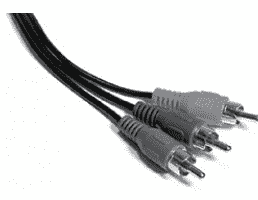

A. 分量（Component）

B. 复合（Composite）

C. 同轴电缆（Coaxial）

D. RCA

6. 一名技术人员想要购买新的 LCD 显示器。哪种类型的 LCD 显示器响应时间更快且价格更低？

A. TN

B. IPS

C. LED

D. 等离子（Plasma）

7. 哪种计算机外设最有可能使用 mini-DIN 6 连接器？

A. 键盘

B. 显示器

C. 硬盘

D. 声卡

8. 哪种类型的存储设备由传统硬盘和大量固态存储组成？

A. SSD（固态硬盘）

B. HDD（机械硬盘）

C. Mesh（网状）

D. Hybrid（混合）

9. 管理员订购了替换打印机纸，其厚度（卡纸）比打印机制造商推荐的更厚。使用这种纸张最大的风险是什么？

A. 图像模糊/污迹

B. 纸张无法进纸

C. 纸张卡住

D. 图像无法打印

10. 你需要在网络上共享打印机，供多个客户端操作系统使用，例如 Windows、macOS 和 Linux。以下哪项服务最能满足你的需求？

A. Bonjour

B. AirPrint

C. TCP 打印

D. 虚拟打印

11. 你最有可能会在 CAT6a 电缆末端找到以下哪种连接器类型？

A. RJ-11

B. RJ-45

C. BNC

D. SATA

12. 识别此处显示的视频连接器。

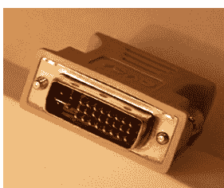

A. DVI

B. VGA

C. HDMI

D. 复合视频（Composite）

13. 哪种打印机技术通常使用卷纸而不是单张纸？

A. 喷墨

B. 热敏

C. 激光

D. 传真机

14. 哪种 RAM 特性可以检测内存中的错误，但无法修复它们？

A. 奇偶校验（Parity）

B. 无奇偶校验（Non-parity）

C. ECC（纠错码）

D. 非 ECC（Non-ECC）

15. 以下哪种类型的打印机需要更换某种墨水或碳粉？（选择所有适用的选项。）

A. 激光

B. 热敏

C. 击打式

D. 喷墨

**16. 你正在修理一台有缺陷的激光打印机。以下关于激光打印机中感光鼓的说法哪一个是正确的？**

A. 它只在未暴露在光线下时才能保持电荷。

B. 它只在暴露在光线下时才能保持电荷。

C. 无论是否暴露在光线下，它都能保持电荷。

D. 它不需要保持电荷。

**17. micro-ATX 主板的尺寸是多少？**

A. 12" × 9.6"

B. 9.6" × 9.6"

C. 6.7" × 6.7"

D. 3.9" × 2.8"

**18. 在讨论视频显示器时，描述用于绘制屏幕的像素数量的术语是什么？**

A. 刷新率

B. 帧率

C. 宽高比

D. 分辨率

**19. 你有三块大小均为 1TB 的硬盘。将它们安装到计算机中作为 RAID 5 阵列后，你有多少可用的存储空间？**

A. 1.5TB

B. 2TB

C. 2.5TB

D. 3TB

**20. 以下哪项陈述最准确地描述了禁用执行位的功能？**

A. 如果计算机被盗，它可以防止 CPU 工作。

B. 如果 CPU 被设置为以过高的速度运行（超频），它可以防止 CPU 工作。

C. 它可以防止计算机在 PXE 启动环境中远程启动。

D. 它保护计算机免受某些类型的病毒或恶意代码侵害。

**21. 你需要让客户能够打印到你的网络打印机，无论他们位于全球何处。哪种服务最适合你的需求？**

A. Bonjour

B. AirPrint

C. 虚拟打印

D. 云打印

**22. 识别此处显示的计算机组件。**

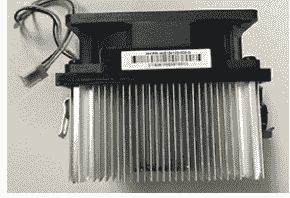

A. CPU 散热器和风扇

B. 被动式 CPU 散热器

C. 电源风扇

D. 辅助散热风扇

**23. 以下哪些连接器传输模拟信号？（选择两项。）**

A. VGA

B. RJ-45

C. RJ-11

D. HDMI

24. 一名来访的业务伙伴希望使用蓝牙连接打印到打印机。这种连接属于什么类型？

A. 永久连接

B. 即席（Ad hoc）

C. 按需（On demand）

D. 基础设施（Infrastructure）

25. 你有一块支持上行插接的主板。以下关于 PCIe 的说法哪两条是正确的？（选择两项。）

A. 你可以将 x1 卡插入 x8 插槽。

B. 你可以将 x8 卡插入 x16 插槽。

C. 你可以将 x8 卡插入 x1 插槽。

D. 你可以将 x16 卡插入 x8 插槽。

26. 一名技术人员需要提高其计算机存储系统的容错能力，并且手头有两块硬盘。以下哪个选项是他的最佳选择？

A. 安装两块硬盘并将它们配置为单独的卷。

B. 安装两块硬盘并实施 RAID 0。

C. 安装两块硬盘并实施 RAID 1。

D. 安装两块硬盘并实施 RAID 5。

27. 在激光打印机成像过程的哪一步中，荧光灯会对光敏鼓放电？

A. 清洁

B. 充电

C. 曝光

D. 显影

28. 哪种笔记本电脑显示技术使用电流刺激密封的惰性气体面板？

A. OLED

B. LED

C. 等离子（Plasma）

D. LCD

29. 哪种前置或顶板连接器使用标准的 3.5mm 插孔进行连接？

A. USB

B. 音频（Audio）

C. FireWire

D. Thunderbolt

30. 你台式计算机的主板支持双通道内存。以下关于 RAM 的说法哪一个是正确的？

A. 只有成对安装时 RAM 才能工作。

B. 只有成对安装或使用一条双面 RAM 模块时 RAM 才能工作。

C. 如果只安装一条模块，RAM 也能工作，但只有其额定速度的一半。

D. 如果只安装一条模块，RAM 也能工作。

31. 单通道 PCIe 4.0 的数据传输速率是多少？

A. 250MBps

B. 500MBps

C. 1GBps

D. 2GBps

32. 一名技术人员需要更换台式计算机中故障的电源。在选择替换电源时，哪两个规格是最需要考虑的？（选择两项。）

A. 瓦数

B. 双路（Dual rail）

C. 双电压选项

D. 连接器数量

**33.** 使用双面内存相比单面内存的一个优势是什么？

- A. 它允许内存以两倍的速度运行。
- B. 它允许 CPU 同时访问两倍的 RAM。
- C. 在双通道主板中使用是必需的。
- D. 它允许在相同的空间内使用两倍的内存。

**34.** 你需要替换你经理笔记本电脑中的磁性硬盘驱动器。她想要一个高速、大容量的驱动器。与她的请求相关的最常见问题是什么？（选择两项。）

- A. 电池使用量增加
- B. 热量产生增加
- C. 组件寿命减少
- D. 其他外设的空间减少

**35.** PCI 扩展总线在台式计算机中可以运行的两种速度是多少？（选择两项。）

- A. 33MHz
- B. 66MHz
- C. 133MHz
- D. 266MHz

**36.** 公司办公室的一位设计师正在访问你的现场办公室。他试图从他的 MacBook Pro 向网络打印机打印，但没有成功。办公室里的本地用户能够使用他们的 Windows 8 计算机向该设备打印。以下哪项最有可能解决问题？

- A. 在打印服务器配置设置中选中“启用 Mac 打印”选项。
- B. 在打印服务器配置设置中选中“启用 Bonjour”选项。
- C. 在打印服务器上安装 Mac 打印机驱动程序。
- D. 停止并重新启动打印后台处理程序服务。

**37.** 你网络中人力资源部门的用户经常在计算机屏幕上显示敏感材料。他们有哪些最佳选择可以大幅限制显示器的视角？

- A. 降低亮度设置。
- B. 降低对比度设置。
- C. 安装防眩光过滤器。
- D. 安装隐私过滤器。

**38.** 识别此处显示的 Peripheral 连接器。

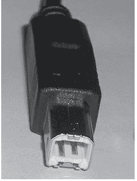

- A. USB Type A
- B. USB Type B
- C. USB Standard mini-B
- D. Thunderbolt（雷雳）

**39.** 你有一台刚插入台式机的 OLED 显示器。你的同事将分辨率从 1920×1080 更改为 1920×1200，但随后图像消失了。以下哪项陈述最可能是正确的？

- A. 视频驱动程序不支持 1920×1200 分辨率。
- B. 显示器的原生分辨率为 1920×1080。
- C. 视频适配器的原生分辨率为 1920×1080。
- D. 显示器连接到了错误的监视器接口，以支持新的分辨率。

**40.** 与空气冷却系统相比，使用 CPU 液冷系统的优势有哪些？（选择两项。）

- A. 安装和维护更容易
- B. 效率更高
- C. 更安静
- D. 对内部组件更安全

**41.** 你需要对一台针式打印机执行预防性维护。有哪些两个区域是你应该检查的，而在大多数喷墨打印机上不需要检查？（选择两项。）

- A. 墨盒
- B. 出纸托盘
- C. 打印头
- D. 牵引进纸机构

**42.** 哪种扩展总线技术使用通道（lanes），即两个组件之间切换的点对点信号路径？

- A. PCI
- B. PCI-X
- C. PCIe
- D. miniPCI

**43.** 你正在一个车间里安装新计算机。车间现场的计算机不需要运行本地应用程序或拥有自己的硬盘，但需要连接到车间的服务器。你建议哪种自定义配置类型？

- A. 瘦客户端
- B. 胖客户端
- C. 虚拟化工作站
- D. CAD/CAM 工作站

**44.** 哪个 PC 组件可以在不切断组件电源的情况下，从冷启动点重新启动计算机？

- A. 电源按钮
- B. 挂起按钮
- C. 重置按钮
- D. 重启按钮

**45.** 哪种类型的 LCD 面板被认为在更宽的观看角度下具有最佳的颜色表现？

- A. TN
- B. IPS
- C. LED
- D. Plasma（等离子）

**46.** 你有一个用户需要安装家用服务器 PC 的建议。她希望她的家人能够在家庭网络上共享文件和视频。她还希望在硬盘驱动器故障的情况下保护她的数据。你建议她包括哪两个组件？

- A. 专用打印服务器
- B. RAID 阵列
- C. 千兆 NIC（网卡）
- D. 双处理器

**47.** 你的主板不支持 PCIe 适配卡的向上插入（up-plugging）。以下哪项陈述是正确的？

- A. 你不能将 x8 卡插入 x16 插槽。
- B. 你可以将 x8 卡插入 x16 插槽，但它将以 x1 速度运行。
- C. 你可以将 x8 卡插入 x16 插槽，并且它将按 x8 速度运行。
- D. 你可以将 x8 卡插入 x16 插槽，并且它将按 x16 速度运行。

**48.** 哪个系统组件支持安全启动技术的使用？

- A. BIOS
- B. UEFI
- C. AMI
- D. SATA

**49.** 哪种类型的 DIMM 有 184 个引脚？

- A. DDR
- B. DDR2
- C. DDR3
- D. SODIMM

**50.** 哪种 CPU 技术允许为每个存在的物理核心分配两个逻辑核心？

- A. 多核
- B. 32 位 vs. 64 位
- C. 集成 GPU
- D. 超线程

**51.** 你最有可能在哪种打印机上使用牵引进纸纸（tractor feed paper）？

- A. 点阵打印机
- B. 热敏打印机
- C. 激光打印机
- D. 喷墨打印机

**52.** 哪种类型的闪存可以嵌入在移动设备的电路板上？

- A. xD
- B. miniSD
- C. microSD
- D. eMMC

**53.** 哪种主板形式因子在台式计算机中很常见，尺寸为 12" × 9.6"？

- A. ATX
- B. MicroATX
- C. Mini-ITX
- D. ITX

**54.** 喷墨打印机内的哪两个组件负责将打印头移动到正确位置？

- A. 滑架和皮带
- B. 滚轮和皮带
- C. 滑架电机和滚轮
- D. 滑架电机和皮带
- E. 皮带电机和滚轮

**55.** 你的公司刚刚雇了一名视频制作人，为销售团队制作令人兴奋的视频。对于她的定制计算机，哪两个升级最有用？（选择两项。）

- A. 显卡
- B. CPU
- C. NIC（网卡）
- D. 硬盘驱动器

**56.** 你需要为你的基于 Windows 8 的台式计算机之一启用虚拟化支持，该计算机使用 Intel Core i5 CPU。以下哪两项必须为真？（选择两项。）

- A. CPU 必须具备 Intel VT。
- B. CPU 必须具备 Intel VR。
- C. 你需要在 Windows 8 中启用虚拟化。
- D. 你需要在 BIOS 中启用虚拟化。

**57.** 你的公司雇用了四名需要新计算机的平面设计师。这些设计师创建图形内容，如广告、海报和全彩宣传册。在她们自定义配置的机器中，以下哪个组件增强的重要性最低？

- A. 硬盘驱动器
- B. 处理器
- C. 显卡
- D. RAM

**58.** 模拟 LCD 显示器最可能具有哪种类型的连接器？

- A. DisplayPort（显示端口）
- B. RCA
- C. VGA
- D. BNC

**59.** 指定在计算机屏幕上每秒可以重绘图像多少次的度量叫什么？

- A. 刷新率
- B. 帧率
- C. 原生分辨率
- D. 宽高比

**60.** 哪种 PC 外围设备连接类型以 20Gbps 带宽运行，并且端口提供 18V 和 9.9W 的功率？

- A. FireWire 800
- B. USB 3.0
- C. eSATA
- D. Thunderbolt（雷雳）

**61.** 在激光打印机内部，定影器大约被加热到多少温度？

- A. 250° F
- B. 350° F
- C. 450° F
- D. 550° F

**62.** 你有一个用户需要自定义 PC 配置来运行常见的桌面应用程序，并仅仅满足所选操作系统的推荐要求。你应该建议什么？

- A. 瘦客户端
- B. 胖客户端
- C. 家用服务器 PC
- D. 虚拟化工作站

**63.** 在激光打印机打印过程中，紧随曝光步骤之后的步骤是哪个？

- A. 充电
- B. 定影
- C. 显影
- D. 转印

**64.** PCI 扩展总线在台式计算机中可能具有哪两个电源要求？（选择两项。）

- A. 1.7V
- B. 3.3V
- C. 5V
- D. 6.6V

**65.** 以下哪一个是安全加密处理器的标准，可以使用加密密钥来保护硬件（以及系统引导过程）？

- A. TPM

65. [第 71 页缺失的题目文本]
- B. LoJack
- C. Secure Boot
- D. BitLocker

**66. 在激光打印机中，转印电晕组件（transfer corona assembly）的作用是什么？**
- A. 它将高压电荷传输到纸张上。
- B. 它将高压电荷传输到成像鼓上。
- C. 它将墨粉从成像鼓传输到纸张上。
- D. 它将图像从激光传输到成像鼓上。

**67. 这里展示的是哪种类型的连接器？**

- A. Molex
- B. SATA
- C. PCIe
- D. ATX

**68. 一名技术人员已在 Windows 8 客户端计算机上安装了打印机驱动程序。为了确保打印机安装正常，技术人员可以采取的最佳下一步措施是什么？**
- A. Ping 打印机的 IP 地址。
- B. 检查打印机状态，确保其显示为“就绪”。
- C. 停止并重新启动 spooler（打印后台处理程序）服务。
- D. 打印测试页。

**69. 激光打印机内部哪个组件将交流电转换为充电电晕和转印电晕所需的可用能量？**
- A. LVPS
- B. HVPS
- C. ACPS
- D. 转印电晕组件

**70. 你正在通过 Wi-Fi 将笔记本电脑连接到网络上的打印机。该用户需要在办公室频繁使用打印机。你需要与打印机建立哪种类型的无线连接？**
- A. 永久连接
- B. 临时连接（Ad hoc）
- C. 按需连接
- D. 基础设施模式连接（Infrastructure）

**71. PCI-X 适配器的最大吞吐量是多少？**
- A. 533 Mbps
- B. 1066 Mbps
- C. 4266 Mbps
- D. 8533 Mbps

**72. 验证系统内存大小和完整性的启动例程的名称是什么？**
- A. RAMCheck
- B. BIOS
- C. UEFI
- D. POST

**73. 你被要求为一台计算机安装并配置 RAID 10 存储阵列。此配置所需的最少硬盘数量是多少？**
- A. 2
- B. 3
- C. 4
- D. 5

**74. 识别此处显示的周边设备连接器。**

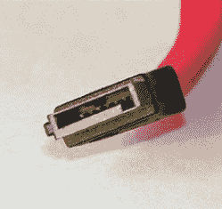

- A. HDMI
- B. PATA
- C. SATA
- D. eSATA

**75. 一名技术人员建议他的公司使用可移动存储卡。他应该告知经理以下哪项内容？**
- A. MiniSD 和 microSD 卡可以在标准 SD 卡槽中工作。
- B. MiniSD 卡可以在标准 SD 卡槽中工作，但 microSD 卡不行。
- C. MicroSD 卡可以在标准 SD 卡槽中工作，但 MiniSD 卡不行。
- D. MiniSD 和 microSD 卡都无法在标准 SD 卡槽中工作。

**76. 你正在为公司购买新笔记本电脑。在考虑显示器质量时，哪种背光类型能产生质量更好的图像？**
- A. LED
- B. OLED
- C. 等离子
- D. 荧光

**77. 主板芯片组中的哪个组件负责管理高速外设通信？**
- A. Northbridge（北桥）
- B. Southbridge（南桥）
- C. Eastbridge（东桥）
- D. Westbridge（西桥）

**78. 你办公室里的图形设计师需要两个显示器才能完成工作。为了将她的台式电脑设置为这种配置，你应该安装以下哪项？**
- A. 视频分配器
- B. 第二个视频驱动
- C. 第二个视频适配器
- D. 视频复制器

**79. 关于带缓冲内存模块，以下哪些说法是正确的？（选择两项。）**
- A. 它们增加了控制器上的电气负载。
- B. 它们减少了控制器上的电气负载。
- C. 当使用时，内存控制器与寄存器进行串行通信。
- D. 当使用时，内存控制器与内存芯片进行并行通信。

**80. 你有一台约五年机龄的台式计算机，具有单通道内存架构。你想升级内存。查阅文档后，你购买了一个运行在所需总线速度下的更大容量 RAM 模块。安装后，新 RAM 未被识别，但旧 RAM 被识别。电脑商店测试了 RAM，显示其正常。接下来你应该尝试什么？**
- A. 刷新 BIOS。
- B. 购买第二个同类型的内存模块，并将它们成对安装。
- C. 退回内存模块并购买容量较小的一个。
- D. 更换主板。

**81. 一位客户需要使用电话线连接互联网。你应该在他的计算机中配置哪种类型的扩展卡？**
- A. USB
- B. 蜂窝网络
- C. 调制解调器（Modem）
- D. 网卡（NIC）

**82. 以下哪些类型的计算机外设被视为输入和输出设备？（选择两项。）**
- A. 数字化仪
- B. 触摸屏
- C. KVM
- D. 打印机

**83. 你有一块设计用于安装 DDR3-1600 内存的主板。如果你尝试将 DDR2-667 内存安装到该主板中，会发生什么？**
- A. 它无法安装。
- B. 它将以 667MHz 运行。
- C. 它将以 1133MHz 运行。
- D. 它将以 1600MHz 运行。

**84. 在激光打印过程的转印步骤中，发生了什么？**
- A. 图像被传输到成像鼓上。
- B. 墨粉被传输到成像鼓上。
- C. 墨粉被传输到纸张上。
- D. 强烈的均匀负电荷被传输到成像鼓上。

**85. 主板上 CPU 和 RAM 之间的信号路径集合被称为什么？**
- A. Northbridge（北桥）
- B. Southbridge（南桥）
- C. Frontside bus（前端总线）
- D. Backside bus（后端总线）

**86. 你的一个用户需要打印多份 20 页的文件。她希望确保所有页面按顺序打印，以便之后不需要重新整理文件。她需要在打印机配置设置中正确设置哪个选项？**
- A. 双面打印
- B. 排序
- C. 页面顺序
- D. 方向

**87. 以下哪种视频分辨率与 4:3 的宽高比兼容？**
- A. UXGA 1600×1200
- B. ATSC 1920×1080
- C. WUXGA 1920×1200
- D. WQXGA 2560×1600

**88. 你升级了系统的 RAM，现在遇到了启动问题。制造商的网站建议更新 BIOS。完成此操作的最简单方式是什么？**
- A. 更换 BIOS 芯片。
- B. 更换 CMOS 电池。
- C. 安装新的主板。
- D. 刷新 BIOS。

**89. 一名技术人员需要尽可能低成本地安装光存储设备。他的客户需要一次存储约 500MB 的数据。哪种技术是这种情况的最佳解决方案？**
- A. CD-RW
- B. DVD-RW
- C. DVD-RW DL
- D. BD-RE

**90. 一名技术人员需要安装一个光驱系统，该系统具有一次刻录存储约 12GB 数据的容量。要超过此阈值，所需的最小技术是什么？**
- A. DVD-R SS, DL
- B. DVD-R DS, SL
- C. DVD-R DS, DL
- D. BD-R SS, DL

**91. 识别此处线缆上的连接器类型。**

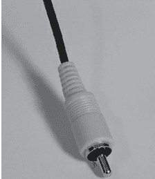

- A. BNC
- B. RCA
- C. MiniDIN
- D. HD15

**92. 你正在为高管会议室购买新的视频投影仪。行政助理告诉你，房间内经常有强烈的阳光，因此投影仪需要非常明亮。在选择此投影仪时，你应该关注的关键规格是什么？**
- A. 帧速率
- B. 原生分辨率
- C. 宽高比
- D. 流明

**93. 哪种家庭和办公打印技术通常采用装有墨盒的墨水储库作为其在纸张上形成图像的介质？**
- A. 激光
- B. 热敏
- C. 喷墨
- D. 击打式

**94. 你被要求为三台工作站购买新 RAM。这些工作站要求使用 DDR3–1600 芯片。这些模块将支持多大的吞吐量？**
- A. 1600Mbps
- B. 3200Mbps
- C. 6400Mbps
- D. 12800Mbps

**95. 从历史上看，哪种显示类型更受观看快速运动节目（如体育赛事）的青睐？**
- A. 等离子
- B. 荧光
- C. LED
- D. LCD

**96. 一名技术人员需要为一块主板购买新 RAM。主板规格要求 400MHz DDR2 RAM。技术人员应使用哪种 RAM 模块？**
- A. PC3200
- B. PC6400
- C. PC2–3200
- D. PC2–6400

**97. 识别此处中心显示的连接器类型。**

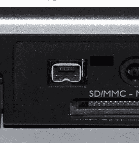

- A. eSATA
- B. Thunderbolt
- C. PCIe
- D. FireWire

**98. 在你的网络中，用户希望从他们的 iPad 和 iPhone 轻松打印。哪种服务支持此功能？**
- A. Bonjour
- B. AirPrint
- C. TCP 打印
- D. 虚拟打印

**99. 你有一台新计算机，需要与无线网络中的其他计算机通信。什么类型的扩展**

需要安装哪种卡？
- A. WAP
- B. NIC
- C. KVM
- D. WPA

**100**. WUXGA 视频标准分辨率为 1920×1200，其运行的长宽比是多少？
- A. 4:3
- B. 5:4
- C. 16:9
- D. 16:10

**101**. 打印时，哪个组件负责将正在打印的数据转换为打印机能够理解的格式？
- A. PDL
- B. 打印驱动程序
- C. 送纸器
- D. 打印队列管理器

**102**. 以下哪项描述最准确地说明了典型电源风扇的功能？
- A. 它通过从机箱外部吹入空气来冷却电源。
- B. 它通过从电源背面吹出热空气来冷却电源。
- C. 它通过从机箱外部吹入空气，穿过电源，进入计算机内部来冷却计算机。
- D. 它通过将机箱内部的热空气吸入电源，并从电源背面吹出以冷却计算机。

**103**. 一名技术员需要为客户安装一块新的硬盘。对于这位客户来说，访问速度比磁盘空间重要得多。哪种类型的硬盘最适合这位客户？
- A. SSD
- B. HDD
- C. SD
- D. BD-R

**104**. 串行和并行 ATA 端口与其他主板组件之间的通信由什么管理？
- A. 北桥芯片
- B. 南桥芯片
- C. 前端总线
- D. 后端总线

**105**. USB 2.0 连接的最大数据传输率是多少？
- A. 12Mbps
- B. 480Mbps
- C. 1Gbps
- D. 5Gbps

**106**. 一名技术员被要求在一台包含一个硬盘的工作计算机中安装并配置 RAID 5 阵列。他至少还需要带多少个额外的硬盘去现场？
- A. 1
- B. 2
- C. 3
- D. 4

**107**. 你需要增加网络安全。一位顾问建议你安装一个外围设备，作为登录要求扫描用户指纹。你将安装什么类型的设备？
- A. 扫描仪
- B. 数字化仪
- C. 生物识别设备
- D. 触控板

**108**. 哪个 CPU 架构术语描述的是在同一个封装内具有多个物理处理器晶片的 CPU？
- A. 多核
- B. 64位
- C. 集成 GPU
- D. 超线程

**109**. 以下哪种光盘标准提供了最高的容量？
- A. DVD-R 单层（SS, SL）
- B. DVD-R 双层（DS, SL）
- C. DVD-R 单面双层（SS, DL）
- D. DVD+R 单面双层（SS, DL）

**110**. 贵公司最近从德国向美国发货了五台台式电脑。在将电源线换成美式插头后，你尝试启动其中一台，但它没有反应。你试了其他几台，它们也都无法开机。最可能的原因是什么？
- A. 所有电脑在运输过程中都损坏了。
- B. 德国制造的电源只能配合德国电源线使用。
- C. 电源无法工作，因为它们期望市电插座提供 50Hz 的频率，而美国的标准是 60Hz。
- D. 需要移动电源电压开关。

**111**. Mobile-ITX 主板的尺寸是多少？
- A. 9.6" × 9.6"
- B. 6.7" × 6.7"
- C. 3.9" × 2.8"
- D. 2.4" × 2.4"

**112**. 以下哪种打印机类型被认为是击打式打印机？（选择两项。）
- A. 激光打印机
- B. 菊花轮打印机
- C. 点阵打印机
- D. 热敏打印机

**113**. 哪种类型的视频显示技术不需要单独的显示单元和光源？
- A. 等离子
- B. OLED
- C. LED
- D. LCD

**114**. 哪种类型的总线架构提供更快的速度？
- A. 串行（每次 1 位）。
- B. 并行（每次 8 位）。
- C. 它们的速度相同。
- D. 需要更多信息来回答这个问题。

**115**. 哪个硬件组件负责预取 CPU 将要使用的数据或代码，并存储最近使用的数据或代码？
- A. RAM
- B. SSD
- C. 缓冲区
- D. 缓存

**116**. 以下哪两个 CPU 插座能够支持 Intel Core i7 处理器？（选择两项。）
- A. LGA1156 (Socket H)
- B. LGA2011 (Socket R)
- C. Socket AM3+
- D. Socket FM2

**117**. 你正在与一位摄像师兼媒体制作人客户讨论数据存储需求。她存储了数十个大型文件，并需要立即访问它们以进行编辑。对她来说，最合适的存储技术是什么？
- A. SSD
- B. HDD
- C. SD
- D. BD-R

**118**. 你有一位客户想要组装一台高端定制家庭影院电脑。你会建议他在电脑中安装哪两个组件？（选择两项。）
- A. 支持环绕声的声卡
- B. 高端冷却系统
- C. 带 HDMI 输出的显卡
- D. 多核处理器

**119**. 你在互联网上寻找新显示器，发现一台二手数字 LCD 显示器在售。你在这台显示器上最可能找到的两种连接器类型是什么？（选择两项。）
- A. 复合视频
- B. DVI-D
- C. HDMI
- D. VGA

**120**. 你需要为一位经理购买一台新笔记本电脑。这位经理的几台笔记本电脑都坏了，她希望新电脑尽可能减少组件数量以降低故障风险。哪种光源技术不需要逆变器，因此是更好的选择？
- A. OLED
- B. 等离子
- C. 荧光灯
- D. LED

**121**. 以下哪些是虚拟打印通常支持的格式？（选择三项。）
- A. 打印到 PDF
- B. 打印到 XPS
- C. 打印到 DOC
- D. 打印到图像

**122**. 双向 PCIe 1.1 x1 链路提供多少数据吞吐量？
- A. 250MBps
- B. 500MBps
- C. 1GBps
- D. 2GBps

**123**. 激光打印机中的哪个组件负责加热并将墨粉熔化到纸上以创建永久图像？
- A. 转印电晕组件
- B. 拾纸辊
- C. 出纸组件
- D. 定影组件

**124**. 在激光打印机打印过程的哪个步骤中，导线或滚筒会在成像鼓表面施加强烈的均匀负电荷？
- A. 充电
- B. 准备（预处理）
- C. 曝光
- D. 转印

**125**. 你正在向双通道主板的一个通道中安装两个新的 RAM 模块。以下哪项是正确的？
- A. 两个 RAM 模块必须具有相同的参数。
- B. RAM 模块可以是不同的大小，但必须是相同的速度。
- C. RAM 模块可以是不同的速度，但必须是相同的大小。
- D. 只要类型相同，RAM 模块就可以具有不同的速度和大小。

**126**. 以下哪个打印机组件在激光打印机中找不到？
- A. 定影组件
- B. 成像鼓
- C. 转印辊
- D. 小车电机

**127**. 哪种常见打印机可能会向大气中释放有害的臭氧，因此可能包含臭氧过滤器？
- A. 激光打印机
- B. 喷墨打印机
- C. 热敏打印机
- D. 击打式打印机

**128**. 你的服务器机柜中有四台服务器。你需要访问每一台，但不是同时访问。哪个设备允许你为所有四台服务器共享一组输入和输出设备？
- A. 触摸屏
- B. 扩展坞
- C. 机顶盒控制器
- D. KVM 切换器

**129**. 你网络上的一个用户有一台较旧的激光打印机，没有以太网连接。它通过并行电缆连接到他的电脑。他已在网络共享它供他人使用。现在，他想不再使用这台打印机，但其他人仍需要在网络上使用它。为了让其他人可以直接通过网络发送打印任务，安装哪种升级最好？
- A. 网络卡
- B. 集成打印服务器
- C. TCP/IP 打印
- D. AirPrint

**130**. 一名技术员需要对喷墨打印机脏污的拾纸辊进行维护。她应该用什么来清洁它们？
- A.  rubbing 酒精
- B. 温和的肥皂水
- C. 干燥无绒布
- D. 压缩空气

**131**. 在激光打印机成像过程的哪个步骤中，墨粉被吸引到成像鼓上？
- A. 曝光
- B. 转印
- C. 定影
- D. 显影

**132**. 你正在安装和配置磁硬盘，并且有几个型号可供选择。哪块硬盘最有可能具有最高的数据传输率？
- A. 500GB, 7200 转/分
- B. 750GB, 5400 转/分

133. 那个通常可在 BIOS 中启用，允许你追踪被盗笔记本电脑位置或远程锁定使其无法访问的软件包叫什么？
- A. TPM
- B. LoJack
- C. Secure Boot
- D. Drive Encryption

134. 识别此处显示的主板部分的白色连接器。

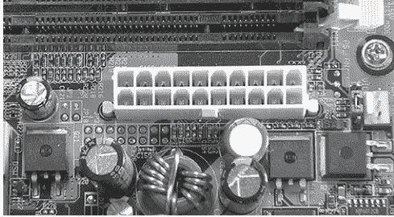
- A. RAM
- B. PATA
- C. miniPCI
- D. ATX

135. 你需要为计算机购买内存。哪个因素决定你应该购买内存的速度？
- A. CPU 速度
- B. FSB 速度
- C. BSB 速度
- D. ECC 速度

136. 你的经理让你购买一个具有最高数据传输速率的高容量磁硬盘。制造商修改哪个硬盘参数来提高硬盘数据传输速率？
- A. 读写头尺寸
- B. 连接器尺寸
- C. 转速
- D. 盘片尺寸

137. 这四个主板板型中有三个可以安装在同一种类型的机箱中。哪些是？（选择三个。）
- A. ATX
- B. MicroATX
- C. Mini-ITX
- D. Nano-ITX

138. 哪种内存功能可以检测并可能修复内存中的错误？
- A. Parity
- B. Non-parity
- C. ECC
- D. Non-ECC

139. 你有一个客户需要一种可热插拔、非易失性、长期存储技术，让他可以方便地将数据从一个地点带到另一个地点，放在口袋里。你可以推荐哪些技术？（选择两个。）
- A. USB 闪存盘
- B. 混合 SSD
- C. PATA
- D. SD

140. 此处显示的主板上，从上到下第一、第三和第五个扩展槽是什么类型的？

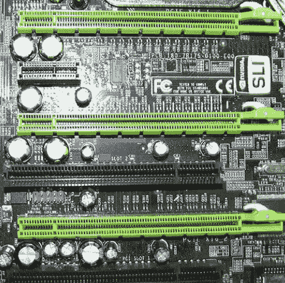
- A. PCIe x1
- B. PCIe x8
- C. PCIe x16
- D. PCI

141. 你被要求组装 20 台新的台式机。当你查看第一个主板时，你看到四个内存插槽。最靠近 CPU 的是蓝色的。然后依次是白色、蓝色和白色。以下哪些陈述是正确的？（选择两个。）
- A. 这是一个四通道主板。
- B. 这是一个双通道主板。
- C. 为了获得最佳性能，你应该将内存模块安装到最靠近 CPU 的两个插槽中。
- D. 为了获得最佳性能，你应该将内存模块安装到两个蓝色插槽中。

142. 你的一个 Windows 8 用户有一个文件想打印为 .pdf 文件，但他正在使用的应用程序不支持打印到 .pdf。他的最佳选择是什么？
- A. 如果应用程序不支持，就没有办法打印到 .pdf。
- B. 使用 Windows 8 原生功能打印到 .pdf。
- C. 安装一个安装 .pdf 打印支持的第三方应用程序。
- D. 使用 Windows 8 原生功能打印到 .xps，然后将 .xps 文件转换为 .pdf。

143. 你有一台运行 Windows 8 的计算机。每次启动时，计算机坚持试图从 DVD-ROM 驱动器启动。你可以在哪里更改设置以使系统首先从硬盘启动？
- A. BIOS
- B. Windows 配置
- C. 系统管理器
- D. 设备管理器

144. 以下哪种类型的连接器通常位于计算机的前面板或顶部面板上？（选择两个。）
- A. 硬盘
- B. 光盘
- C. 电源按钮
- D. USB

145. 你的经理很高兴，因为他刚为工作团队购买了一个快速的 USB 3.0 外置硬盘。他想把它放在工位的中间，让每个人都能访问它。有些工位之间相距约 15 英尺。这种设备推荐的线缆最大长度是多少？
- A. 3 米
- B. 5 米
- C. 10 米
- D. 15 米

146. 一名技术人员刚在一台激光打印机上安装了双面打印单元（duplexer）。双面打印单元由制造商销售，并与打印机兼容。然而，打印机属性不允许任何人选择纸张双面打印。什么可能会解决此问题？
- A. 拆除并重新安装双面打印单元
- B. 关闭打印机并重新打开
- C. 升级打印机的固件
- D. 停止并重启打印后台处理程序服务

147. 你有一台带有三个 PCI 扩展槽的台式计算机。当你在同一主板上混合不同速度的卡时，会发生什么？
- A. 这些卡将以原始速度运行。
- B. 没有卡能正常工作。
- C. 所有卡都将以前者的速度运行。
- D. 所有卡都将以较慢的速度运行。

148. 以下哪个陈述准确解释了激光打印机打印过程中曝光步骤发生的情况？
- A. 激光使感光鼓区域从强负电荷变为弱正电荷。
- B. 激光使感光鼓区域从强负电荷变为弱负电荷。
- C. 激光使感光鼓区域从弱负电荷变为强负电荷。
- D. 激光使感光鼓区域从弱正电荷变为强正电荷。

149. 以下哪项是 CPU 被动冷却系统的定义特征？
- A. 它使用水。
- B. 它使用热管。
- C. 它使用液氮或氦气。
- D. 它不需要风扇或电源。

150. 你有一台较旧的笔记本电脑，里面有一个 CD 刻录机。你能用这个设备创建的 CD 的大致容量是多少？
- A. 350MB
- B. 700MB
- C. 1.4GB
- D. 4.7GB

151. 以下哪些系统设置可以在 BIOS 中配置？（选择两个。）
- A. 日期和时间
- B. 启用和禁用服务
- C. 启用和禁用设备
- D. 系统冷却风扇速度

152. 64 位 SODIMM 模块具有哪种引脚配置？（选择两个。）
- A. 184 针
- B. 200 针
- C. 204 针
- D. 240 针

153. 在计算机中，哪一级缓存通常最小且最靠近处理器芯片？
- A. L$_{1}$
- B. L$_{2}$
- C. L$_{3}$
- D. L$_{4}$

154. 此处显示的连接器为哪个计算机组件提供电源？

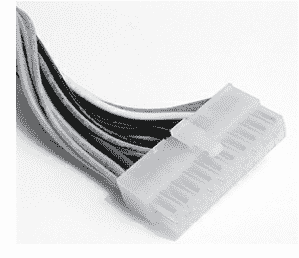
- A. 主板
- B. 硬盘
- C. 扩展卡
- D. 辅助机箱风扇

155. 以下哪些是 CPU 插槽类型？（选择两个。）
- A. LGA
- B. CGA
- C. IGA
- D. PGA

156. 你刚从另一家公司购买了几台二手计算机。它们没有附带文档。查看内存时，你看到一个标签写着 PC3–10600。这台计算机的 FSB 速度是多少？
- A. 667MHz
- B. 1066MHz
- C. 1333MHz
- D. 1600MHz

157. 你的工程团队正在创建一个需要视频显示器的产品原型。他们需要显示器具有灵活性，能够稍微包裹在原型周围。他们应该使用哪种技术？
- A. LED
- B. LCD
- C. OLED
- D. 等离子

158. 你的办公室有一台喷墨打印机，经理问是否可以升级以在纸张两面打印。哪种类型的设备可以添加此功能？
- A. 翻转组件
- B. 双进纸组件
- C. 双面打印组件
- D. 后进纸组件

159. 激光打印机中的哪个组件负责将交流电转换为逻辑电路和电机可用的能量？
- A. LVPS
- B. HVPS
- C. DCPS
- D. ACPS

160. 此处显示的内存模块类型是什么，从上到下？

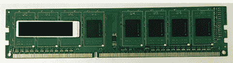
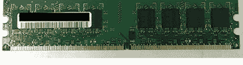
- A. DDR 和 DDR2
- B. DDR2 和 DDR
- C. DDR2 和 DDR3
- D. DDR3 和 DDR2

161. Acme 公司芝加哥办公室有一台激光打印机，已使用三个月。一名技术人员需要将打印机运往底特律办公室使用。对于墨粉盒，在运输前是否需要做任何准备工作？
- A. 运输前不需要对墨粉盒做任何准备。
- B. 运输前在墨粉盒中插入墨粉阻塞器。
- C. 运输前用胶带密封墨粉盒。
- D. 运输前从打印机中取出墨粉盒。

162. 你被要求为一家小型公司实施外部备份解决方案。在考虑磁带备份解决方案时，哪个标准提供最佳的存储容量？
- A. QIC
- B. DLT
- C. DAT
- D. LTO

### 163.
客户要求你升级他的台式电脑，使其配备两张显卡。你需要确保他的电脑能够支持额外的适配器。你应该寻找哪种类型的开放式内部扩展插槽？

- A. PCIe
- B. ISA
- C. VGA
- D. DVI

### 164.
在激光打印机的成像过程中，紧接在转印（fusing）步骤之后的是哪一步？

- A. 处理（Processing）
- B. 转移（Transferring）
- C. 曝光（Exposing）
- D. 清洁（Cleaning）

### 165.
以下哪些是由苹果（Apple）创建的服务，允许自动发现本地网络上的打印机？（选择两项。）

- A. Bonjour
- B. AirPrint
- C. TCP 打印
- D. 虚拟打印

### 166.
在喷墨打印机中安装新的打印墨盒后，在打印之前必须执行什么过程？

- A. 消磁（Degaussing）
- B. 驱动程序安装
- C. 光栅化（Rasterizing）
- D. 校准（Calibration）

### 167.
台式机和笔记本电脑中最常用的 RAM 插槽类型分别是什么？

- A. SODIMM 和 DIMM
- B. miniDIMM 和 DIMM
- C. DIMM 和 miniDIMM
- D. DIMM 和 SODIMM
- E. SODIMM 和 miniDIMM
- F. miniDIMM 和 SODIMM

### 168.
哪种打印技术使用加热元件在蜡纸上成像？

- A. 激光
- B. 喷墨
- C. 热敏
- D. 升华染料
- E. 固态墨水

### 169.
你有一台激光打印机，显示信息“请执行用户维护”。你应该怎么做来解决这个问题？

- A. 应用维护套件并清除信息。
- B. 使用压缩空气吹出打印机内部并清除信息。
- C. 关闭打印机然后再打开以清除信息。
- D. 更换碳粉盒并清除信息。

### 170.
PCI-X 扩展插槽与其他哪些适配器兼容？

- A. 33MHz PCI
- B. 66MHz PCI
- C. 133MHz PCI
- D. 533MHz PCI

### 171.
一名用户想要打造终极游戏 PC。对于这种类型的系统，以下哪种外围设备最合适？

- A. 条码阅读器
- B. 运动传感器
- C. 摇杆
- D. 智能电视

## 第 2 章
网络

**本章涵盖的 COMPTIA A+ 考试 220-901 主题包括以下内容：**

## 2.1 识别各种类型的网络电缆和连接器。
- 光纤
    - 连接器：SC、ST 和 LC
- 双绞线
    - 连接器：RJ-11、RJ-45
    - 布线标准：T568A、T568B
- 同轴电缆
    - 连接器：BNC、F 型连接器

## 2.2 比较连接器和布线的特性差异。
- 光纤
    - 类型（单模 vs. 多模）
    - 速度和传输限制
- 双绞线
    - 类型：STP、UTP、CAT3、CAT5、CAT5e、CAT6、CAT6e、CAT7、Plenum（低烟无卤）、PVC
    - 速度和传输限制
    - 分线器及其对信号质量的影响
- 同轴电缆
    - 类型：RG-6、RG-59
    - 速度和传输限制

## 2.3 解释 TCP/IP 的特性和属性。
- IPv4 vs. IPv6
- 公共 vs. 私有 vs. APIPA/链路本地
- 静态 vs. 动态
- 客户端 DNS 设置
- 客户端 DHCP
- 子网掩码 vs. CIDR
- 网关

## 2.4 解释常见的 TCP 和 UDP 端口、协议及其用途。
- 端口
    - 21 – FTP
    - 22 – SSH
    - 23 – TELNET
    - 25 – SMTP
    - 53 – DNS
    - 80 – HTTP
    - 110 – POP3
    - 143 – IMAP
    - 443 – HTTPS
    - 3389 – RDP
    - 137-139 – NetBIOS/NetBT
    - 445 – SMB/CIFS
    - 427 – SLP
    - 548 – AFP
- 协议
    - DHCP
    - DNS
    - LDAP
    - SNMP
    - SMB
    - CIFS
    - SSH
    - AFP
    - TCP vs. UDP

## 2.5 比较各种 Wi-Fi 网络标准和加密类型。
- 标准
    - 802.11 (a/b/g/n/ac)
    - 速度、距离和频率
- 加密类型
    - WEP、WPA、WPA2、TKIP、AES

## 2.6 给定场景，安装和配置 SOHO 无线/有线路由器并应用适当的设置。
- 信道
- 端口转发、端口触发
- DHCP（开/关）
- DMZ
- NAT/DNAT
- 基本 QoS
- 固件
- UPnP

## 2.7 比较互联网连接类型、网络类型及其特性。
- 互联网连接类型
    - 电缆
    - DSL
    - 拨号
    - 光纤
    - 卫星
    - ISDN
    - 蜂窝
        - 网络共享（Tethering）
            - 移动热点
    - 视距无线互联网服务
- 网络类型
    - LAN
    - WAN
    - PAN
    - MAN

## 2.8 比较网络设备、其功能和特性。
- 集线器（Hub）
- 交换机（Switch）
- 路由器（Router）
- 接入点（Access point）
- 网桥（Bridge）
- 调制解调器（Modem）
- 防火墙（Firewall）
- 配线架（Patch panel）
- 中继器/扩展器（Repeaters/extenders）
- 电力线以太网（Ethernet over Power）
- 以太网供电注入器（Power over Ethernet injector）

## 2.9 给定场景，使用适当的网络工具。
- 压线钳（Crimper）
- 剥线钳（Cable stripper）
- 万用表（Multimeter）
- 音调发生器和探针（Tone generator and probe）
- 电缆测试仪（Cable tester）
- 回环插头（Loopback plug）
- 打线工具（Punchdown tool）
- Wi-Fi 分析仪（WiFi analyzer）

### 1.
以下哪种网络设备接收网络流量并根据目标硬件地址决定是否转发？

- A. 集线器（Hub）
- B. 网桥（Bridge）
- C. 接入点（Access point）
- D. 中继器（Repeater）

### 2.
技术人员在你的网络段之一安装了 UTP 分线器，该段使用 CAT6e 电缆。此连接支持的最大速度是多少？

- A. 10Mbps
- B. 100Mbps
- C. 1Gbps
- D. 10Gbps

### 3.
你正在两栋建筑之间安装光纤电缆。为了安装电缆，你必须将其穿过建筑物之间的导管，且导管访问不便。在布线之前，你想确保其正常工作。你应该使用哪种工具？

- A. 电缆测试仪
- B. 万用表
- C. 回环插头
- D. 音调发生器和探针

### 4.
哪种 TCP/IP 协议旨在下载电子邮件，并允许多个客户端同时连接到同一邮箱？

- A. SMTP
- B. POP3
- C. IMAP
- D. SMB

### 5.
你在公司网络上使用笔记本电脑。你在网页浏览器中输入 www.google.com 并按下 Enter。计算机无法找到 Google。你在手机上打开浏览器，并使用蜂窝网络连接，可以正常打开 Google。你的笔记本电脑可以访问内部服务器且打印无问题。你无法打开 Google 的最可能原因是什么？

- A. DNS 服务器问题
- B. DHCP 服务器问题
- C. 缺少子网掩码
- D. IP 地址冲突

### 6.
技术人员需要向大约距离基站 15 公里的远程建筑铺设网络电缆。他不确定是否有电缆能跨越该距离。SMF（单模光纤）电缆的最大距离是多少？

- A. 300 米
- B. 550 米
- C. 40 公里
- D. 100 公里

### 7.
你被要求从建筑物一端到另一端安装一段 RG-59 电缆。这种电缆铺设的最大距离是多少？

- A. 100 米（328 英尺）
- B. 228 米（750 英尺）
- C. 304 米（1,000 英尺）
- D. 500 米（1,645 英尺）

### 8.
以下哪种 TCP/IP 协议是作为 Telnet 的替代品设计的？

- A. SMB
- B. SSH
- C. SFTP
- D. FTPS

### 9.
以下哪些网络连接设备工作在 OSI 模型的层 2？（选择两项。）

- A. 集线器（Hub）
- B. 交换机（Switch）
- C. 网桥（Bridge）
- D. 路由器（Router）

### 10.
在 IPv4 中，子网掩码的功能是什么？

- A. 它告诉主机路由数据包的位置。
- B. 它区分网络 ID 和主机 ID。
- C. 它确定主机所在的子网。
- D. 它从主机屏蔽外部网络。

### 11.
以下哪种 TCP/IP 协议是面向连接的，并尝试保证数据包交付？

- A. IP
- B. TCP
- C. UDP
- D. ICMP

### 12.
哪种 TCP/IP 协议允许用户登录到远程计算机，并像本地登录一样管理文件？

- A. FTP
- B. SFTP
- C. SMB
- D. Telnet

### 13.
你从 ISP 获得网络配置 155.100.63.0/26。当你配置网络主机时，应该为它们分配什么子网掩码？

- A. 255.255.0.0
- B. 255.255.255.0
- C. 255.255.255.192
- D. 255.255.255.240

### 14.
哪种 Wi-Fi 标准规定在 2.4GHz 频率范围内最大传输速率为 54Mbps？

- A. 802.11a
- B. 802.11b
- C. 802.11g
- D. 802.11n

### 15.
哪种 TCP/IP 协议用于提供网络上文件和打印机的共享访问？

- A. FTP
- B. SSH
- C. SMB
- D. SNMP

### 16.
Telnet 协议使用哪个端口号？

- A. 21

17. 您刚刚为一家客户安装了无线 802.11ac 网络。IT 经理担心竞争对手从建筑物外部拦截无线信号。哪种工具旨在测试无线信号的传输距离？

- A. 音频信号发生器和探头
- B. 协议分析器
- C. 数据包嗅探器
- D. Wi-Fi 分析器

18. 您的一些网络用户担心向在线网站提交机密信息。您应该告诉他们什么？

- A. 没关系，因为所有互联网流量都是加密的。
- B. 如果网站地址以 TLS:// 开头，向受信任的网站提交机密信息应该是安全的。
- C. 如果网站地址以 HTTPS:// 开头，向受信任的网站提交机密信息应该是安全的。
- D. 永远不要向任何在线网站提交机密信息。

19. 哪个 TCP/IP 互联网层协议负责在两台计算机之间的通信失败时传递错误消息？

- A. ICMP
- B. IP
- C. TCP
- D. UDP

20. 哪种类型的 IPv6 地址用于标识网络中的单个节点？

- A. 组播
- B. 任播
- C. 单播
- D. 本地播

21. 您正在为一小型网络配置无线 802.11n 路由器。在设置时，您应该选择哪种安全选项？

- A. WPA2
- B. WPA
- C. WEP
- D. SSID

22. 哪种类型的网络覆盖大面积的地理区域，并且通常支持数千名用户？

- A. LAN（局域网）
- B. WAN（广域网）
- C. PAN（个人区域网）
- D. MAN（城域网）

23. 哪个由 Microsoft 开发的 TCP/IP 协议允许用户连接到远程计算机并在其上运行程序？

- A. RDP（远程桌面协议）
- B. SMB（服务器消息块）
- C. CIFS（通用互联网文件系统）
- D. Telnet

24. SSH 协议使用哪个端口号？

- A. 21
- B. 22
- C. 23
- D. 25

25. 以下哪个 IP 地址不能在互联网上路由？

- A. 10.1.1.1
- B. 11.1.1.1
- C. 12.1.1.1
- D. 13.1.1.1

26. 哪种网络连接设备不转发广播消息，从而创建多个广播域？

- A. 集线器（Hub）
- B. 交换机（Switch）
- C. 网桥（Bridge）
- D. 路由器（Router）

27. 您有一台在网络上表现异常的台式计算机。有线连接经常在没有警告的情况下断开。您应该使用哪种工具来排查网络适配器的故障？

- A. 万用表
- B. 音频信号发生器和探头
- C. 环回插头
- D. 电缆测试仪

28. 贵公司刚刚扩展业务，并在相邻的办公楼租用了额外空间。您需要将网络延伸到新大楼。幸运的是，两栋楼之间有管道。您估计需要铺设的电缆长度约为 300 米。您应该使用哪种类型的电缆？

- A. CAT5（五类线）
- B. CAT5e（超五类线）
- C. CAT7（七类线）
- D. MMF（多模光纤）

29. 您希望确保客户端计算机能够下载来自外部邮件服务器的电子邮件，无论其邮件客户端使用哪种协议。您应该在防火墙上打开哪些端口以实现此功能？（选择两项。）

- A. 23
- B. 25
- C. 110
- D. 143

30. 您正在高度安全的设施中安装网络布线。电缆需要能够抵御电子窃听。您应该使用哪种类型的电缆？

- A. 光纤
- B. UTP（非屏蔽双绞线）
- C. STP（屏蔽双绞线）
- D. 同轴电缆

31. 哪种网络设备能够读取 IP 地址并根据目标 IP 地址转发数据包？

- A. 集线器
- B. 交换机
- C. 网桥
- D. 路由器

32. 哪种网络设备旨在充当保安，阻止恶意数据进入您的网络？

- A. PoE 注入器
- B. 网桥
- C. 防火墙
- D. 路由器

33. 您正在手动配置网络上的 TCP/IP 主机。哪个配置参数指定了启用互联网访问的路由器的地址？

- A. 子网掩码
- B. DHCP 服务器
- C. DNS 服务器
- D. 默认网关

34. 一位高级管理员给您打电话，告诉您她正在家中工作并试图使用 RDP，但无法连接。您需要确保防火墙上打开哪个端口才能授予她访问权限？

- A. 143
- B. 443
- C. 548
- D. 3389

35. 识别图片中的电缆连接器。

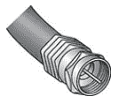

- A. F 型连接器
- B. BNC
- C. SC
- D. ST

36. 哪种类型的网络最常与蓝牙设备相关联，并覆盖较小的区域？

- A. LAN
- B. WAN
- C. PAN
- D. MAN

37. 识别此处显示的电缆连接器类型。

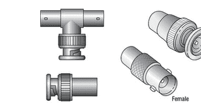

- A. F 型连接器
- B. BNC
- C. SC
- D. ST

38. 哪个 TCP/IP 互联网层协议负责将物理 MAC 地址解析为逻辑 IP 地址？

- A. IP
- B. ICMP
- C. ARP
- D. RARP

39. 以下哪个 IPv6 地址等同于 IPv4 中 169.254.0.0/16 范围内的地址？

- A. 2000::/3
- B. FC00::/7
- C. FE80::/10
- D. FF00::/8

40. 识别此处显示的连接器，从左到右。

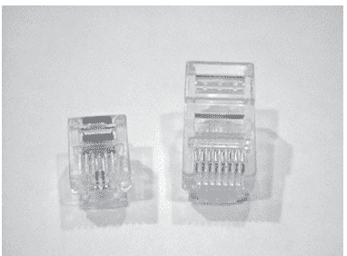

- A. ST 和 SC
- B. SC 和 ST
- C. RJ-45 和 RJ-11
- D. RJ-11 和 RJ-45

41. 您需要为办公室网络配置无线路由器。办公室经理希望新设备能够自动加入网络，并向其他联网设备宣布其存在。您应该启用哪种服务以允许此功能？

- A. DHCP
- B. NAT
- C. QoS
- D. UPnP

42. 您正在排查一台计算机的故障，该计算机的 IPv6 地址在 FE80::/10 范围内。以下哪些陈述是正确的？（选择两项。）

- A. 该计算机将无法上网。
- B. 该计算机将能够上网。
- C. 该计算机配置了链路本地单播地址。
- D. 该计算机配置了全局单播地址。

43. 识别此处显示的连接器。

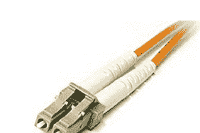

- A. ST
- B. SC
- C. LC
- D. MFF

44. 您已经将您的 Web 服务器配置为同时作为 FTP 服务器运行。互联网用户抱怨他们无法使用 FTP 客户端访问该服务器。他们试图通过哪个端口号访问服务器？

- A. 21
- B. 22
- C. 23
- D. 25
- E. 80

45. 哪个 TCP/IP 协议允许您访问存储在信息目录中的数据，例如员工电话号码和电子邮件地址？

- A. SNMP
- B. SMTP
- C. CIFS
- D. LDAP

46. 您正在使用静态 IP 地址配置网络主机。您选择使用 B 类网络地址。您应该在主机上配置什么默认子网掩码？

- A. 255.0.0.0
- B. 255.255.0.0
- C. 255.255.255.0
- D. 255.255.255.255

47. 您正在安装新网络并在布线间工作。您需要将几根网络电缆连接到 110 线束上。您应该使用哪种工具来执行此任务？

- A. 压接钳
- B. 电缆剥线钳
- C. 电缆测试仪
- D. 打线刀

48. 以下哪种互联网连接类型提供最快的下载速度？

- A. 电缆（Cable）
- B. DSL（数字用户线）
- C. 光纤（Fiber-optic）
- D. ISDN（综合业务数字网）

49. 您需要从一大卷散装电缆制作几根 UTP 电缆。您的公司使用 T568B 标准。连接器的正确线序是什么？

- A. 白橙、橙、白绿、蓝、白蓝、绿、白棕、棕
- B. 白橙、橙、白绿、绿、白蓝、蓝、白棕、棕
- C. 白橙、绿、白绿、蓝、白蓝、橙、白棕、棕
- D. 橙、白橙、白绿、蓝、白蓝、绿、白棕、棕

50. 您正在安装支持数字有线电视信号的网络电缆。您应该安装哪种类型的电缆？

- A. RG-6

B. RG-8

C. RG-58 A/U

D. RG-59

51. 默认情况下，哪个 TCP/IP 协议使用 137–139 和 445 TCP 端口？

A. FTP

B. SSH

C. SMB

D. SNMP

52. 关于 IPv6，以下哪些说法是不正确的？（选择两项。）

A. 每个 IPv6 接口只能拥有一个地址。

B. 每个 IPv6 接口都需要有一个链路本地地址。

C. IPv6 地址与 IPv4 网络不兼容。

D. IPv6 不再使用广播。

53. 以下哪些网络架构设备在 OSI 模型的第 1 层运行？（选择两项。）

A. 交换机

B. 集线器

C. 扩展器

D. 路由器

54. 你需要更换一段故障的 250 英尺 RG-6 电缆，但你手头只有 RG-59。以下哪个说法是正确的？

A. 替换电缆将无法工作，因为距离超出了 RG-59 的规格限制。

B. 替换电缆将无法工作，因为 RG-6 和 RG-59 使用不同的连接器。

C. 替换电缆将无法工作，因为 RG-6 和 RG-59 的阻抗不同。

D. 替换电缆应该能正常工作。

55. 你需要设计一个新网络，要求传输速度达到 10Gbps。以下哪种电缆类型能满足最低规格？（选择两项。）

A. MMF（多模光纤）

B. CAT5

C. CAT5e

D. CAT7

56. 哪个 TCP/IP 协议是由苹果公司开发的，用于在计算机之间传输文件？

A. FTP

B. AFP

C. ATP

D. SMB

57. 以下哪个 IPv6 地址等同于 IPv4 中的 127.0.0.1？

A. ::0

B. ::1

C. ::127

D. 2000::/3

58. 一名技术员正在为家庭网络配置无线 802.11ac 路由器。出于安全目的，他启用了防火墙。他希望配置防火墙，使得当计算机在特定端口发出出站请求时，后续通过该端口的入站流量将被允许通过防火墙。他需要配置哪个选项来管理这些设置？

A. 端口转发

B. 端口触发

C. NAT

D. QoS（服务质量）

59. 你被要求为一家中型公司提供咨询，该公司存在网络连接问题。当你检查配线架时，你注意到数十根 UTP 电缆都没有标签。你可以使用哪种工具来识别哪根电缆连接到哪台工作站？

A. 电缆测试仪

B. 环回插头

C. 打线工具

D. 寻线仪和探针

60. 哪个 TCP/IP 协议负责动态分配 IP 地址给客户端计算机？

A. DNS

B. DHCP

C. RDP

D. LDAP

61. 什么特征将 STP 与 UTP 区分开来？

A. 它使用 RJ-45s 连接器而不是 RJ-45。

B. 它遵循 T568A 布线标准。

C. 它燃烧时不会产生有毒气体。

D. 它有一层箔屏蔽。

62. 你正在调查一栋闲置建筑中旧网络设置的残留物。在管道的末端，你只看到了这里所示的连接器。你预计这些连接器会连接在哪种类型的电缆上？

A. 同轴电缆

B. STP

C. UTP

D. 光纤

63. 哪种网络设备在 OSI 模型的第 2 层工作，具有多个端口，每个端口都是独立的冲突域，并且通过检查传入数据包的头部来确定将其发送到哪个端口？

A. 集线器

B. 交换机

C. 网桥

D. 路由器

64. 电子邮件客户端使用哪个 TCP/IP 端口号将邮件推送到邮件服务器？

A. 23

B. 25

C. 110

D. 143

65. 一名技术员准备使用标准全向天线建立 Wi-Fi 网络。由于建筑物结构的原因，传输信号的距离最远是他的首要标准。他应该选择哪个标准？

A. 802.11a

B. 802.11g

C. 802.11n

D. 802.11ac

66. 你正在排查一个间歇性故障的 CAT7 网络连接。你怀疑连接处有短路。你可以使用哪种工具来确定这一点？

A. 寻线仪和探针

B. 环回插头

C. 万用表

D. 压线钳

67. 哪个 TCP/IP 协议使用称为代理（agents）的设备来收集和管理网络性能信息？

A. SNMP

B. SMTP

C. LDAP

D. SMB

68. 哪种互联网连接类型在家用场景很受欢迎，提供不对称的下载和上传速度，并通过普通电话线路实现？

A. POTS

B. 电缆（Cable）

C. DSL

D. ISDN

69. 哪个 Wi-Fi 加密标准是第一个包含使用 128 位动态每包加密密钥的？

A. WEP

B. WPA

C. WPA2

D. AES

70. 你正在安装一个带有五个无线接入点的 802.11n Wi-Fi 网络。接入点被设置得使它们的覆盖范围相互重叠。为了避免通信问题，你在配置它们时应该遵循什么原则？

A. 配置所有接入点使用相同的信道。

B. 配置所有接入点使用相邻的信道。

C. 配置所有接入点使用不重叠的信道。

D. 信道配置不会引起通信问题。

71. 哪个 TCP/IP 协议设计用于从客户端发送电子邮件到邮件服务器？

A. SMTP

B. POP3

C. IMAP

D. SMB

72. 你正在邻居家里设置一个小网络。她担心无线安全性，因此不想使用无线网络。她需要将两台计算机相互连接，但在它们之间铺设网络电缆是不可能的。哪种技术可以帮助她将这些计算机联网？

A. 电力以太网（Ethernet over Power）

B. 以太网供电（Power over Ethernet）

C. 防火墙

D. 接入点

73. 你被要求在一栋长约 100 米、宽约 25 米的建筑物中安装 Wi-Fi 网络。出于成本考虑，你需要使用 802.11g。最少需要多少个无线接入点？

A. 2

B. 3

C. 4

D. 6

74. 你正在办公室吊顶内安装网络电缆。吊顶区域用于循环流通呼吸空气。你需要安装哪种类型的电缆？

A. 同轴电缆

B. UTP

C. 光纤

D. 管道型（Plenum）电缆

75. 你需要在一个吊顶内安装无线集线器，那里没有电源接入。哪种技术可以让你为该设备供电？

A. 电力以太网

B. 以太网供电

C. 无线接入点

D. 中继器/扩展器

76. 以下哪个 IP 地址不是私有地址，因此可以在互联网上路由？

A. 10.1.2.3

B. 172.18.31.54

C. 172.168.38.155

D. 192.168.38.155

77. 你正在配置一个无线 802.11n 路由器。办公室经理坚持要求你配置路由器，使得来自她计算机的流量在网络中比其他用户的流量具有更高的优先级。你需要配置哪个设置来启用此功能？

A. QoS

B. UPnP

C. DMZ

D. 端口转发

78. 如果你正在连接一个使用 TLS 加密其连接的网站，该流量使用的端口号是多少？

A. 21

B. 80

C. 143

D. 443

79. 你的网络当前混合运行着 802.11b 和 802.11g 设备。年底时，你有额外的预算来升级部分而非全部的无线基础设施。你想升级到最新技术，但仍需保持向后兼容性。你应该选择哪个标准？

A. 802.11g

B. 802.11ac

C. 802.11r

D. 802.11n

80. 你正在为一个小型外勤办公室提供咨询，该办公室需要与其母公司建立一个专用的、数字的点对点网络连接。哪种互联网连接类型将满足此要求？

A. 拨号

B. 电缆（Cable）

C. DSL

D. ISDN

81. 哪种类型的网络跨越多栋建筑物或办公室，但局限于相对较小的地理区域？

A. LAN（局域网）

B. WAN（广域网）

C. PAN（个人区域网）

D. MAN（城域网）

82. 识别这里显示的连接器。

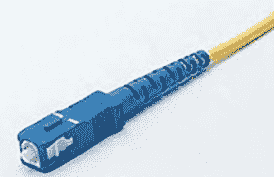

A. ST

B. SC

C. LC

D. MFF

83. 在清理储藏室时，一名技术员发现了多卷 CAT5e 网络电缆。他认为可能可以使用它来创建网络的替换电缆。这种电缆支持的最大速度是多少？

A. 100Mbps

B. 1Gbps

C. 10Gbps

D. 20Gbps

84. 以下哪个简写表示对应于 CIDR 子网掩码 `255.255.224.0`？

A. /19

B. /20

C. /21

D. /22

85. 你正在配置运行 IPv4 的网上的主机。以下哪些元素是计算机连接网络所必需的？

哪种TCP/IP协议是由微软开发的，并且自Windows 2000以来一直是基于Windows的计算机上默认的文件和打印共享协议？

- A. CIFS
- B. SMB
- C. FTP
- D. LDAP

关于IPv4配置，以下哪项陈述是正确的？

- A. 网络中的所有主机都必须具有唯一的子网掩码。
- B. 网络中的所有主机都必须将其网络ID设置为全1。
- C. 网络中的所有主机都必须拥有一个默认网关。
- D. 网络中的所有主机都必须拥有唯一的宿主地址。

哪种Wi-Fi加密标准使用静态密钥，该密钥通常为10、26或58个字符长？

- A. WPA
- B. WPA2
- C. TKIP
- D. WEP

SNMP使用哪个TCP/IP端口号？

- A. TCP 143
- B. UDP 143
- C. TCP 161
- D. UDP 161

**90.** 由于最近的安全漏洞，您的IT团队关闭了外部防火墙上的几个端口。现在，用户无法通过使用URL访问网站，但他们可以通过使用IP地址访问。IT团队需要重新打开哪个端口才能启用通过URL的互联网访问？

- A. 21
- B. 53
- C. 67
- D. 80

**91.** 您的所有网络主机都配置为使用DHCP。哪个IP地址表示某主机无法找到DHCP服务器？

- A. 192.168.1.1
- B. 10.1.1.1
- C. 172.16.1.1
- D. 169.254.1.1

**92.** 哪种类型的同轴电缆连接器通过旋转连接器四分之一圈来锁定？

- A. F-connector
- B. BNC
- C. SC
- D. ST

**93.** 您的网络使用UTP布线。以下哪种网络连接类型需要使用交叉电缆？（选择两项。）

- A. 计算机到集线器
- B. 计算机到交换机
- C. 计算机到路由器
- D. 交换机到交换机

**94.** 一名技术人员正在尝试使用旧式调制解调器建立拨号网络连接。调制解调器的最快数据吞吐量是多少？

- A. 28.8Kbps
- B. 56Kbps
- C. 1Mbps
- D. 4Mbps

**95.** 您正在更换同轴电缆末端的连接器。哪种类型的连接器是螺纹式的并旋入到位？

- A. F-connector
- B. BNC
- C. SC
- D. ST

**96.** 您正在安装UTP网络布线。网络中混合了多种网卡，但最低要求速度为100Mbps。为了满足此要求，您可以安装的最小等级电缆是什么？

- A. CAT3
- B. CAT5
- C. CAT5e
- D. CAT6a

**97.** 您有理由相信几名网络用户正在互联网上的非安全站点上积极浏览违规内容。您可以禁用防火墙上的哪个端口以立即停止访问这些网站？

- A. 53
- B. 67
- C. 80
- D. 443

**98.** 您正在为客户安装UTP网络电缆。客户的政策要求网络电缆在燃烧时不产生有毒气体。您需要安装哪种类型的电缆？

- A.  plenum（通风级）
- B. PVC
- C. STP
- D. CAT5e或更高

**99.** 您被要求制作一根UTP交叉电缆。为了正常工作，需要交叉哪些针脚？

- A. 1和2，3和6
- B. 1和3，2和6
- C. 1和6，2和3
- D. 以上都不是

**100.** 哪种TCP/IP协议旨在帮助将主机名解析为IP地址？

- A. ARP
- B. RARP
- C. DHCP
- D. DNS

**101.** 您需要为一个远离电力线路的护林员瞭望塔安装互联网连接。对于宽带互联网访问，以下哪个选项最好？

- A. 电缆
- B. DSL
- C. ISDN
- D. 卫星

**102.** 哪种TCP/IP主机到主机协议尽力交付数据但不保证交付？

- A. IP
- B. TCP
- C. UDP
- D. ICMP

**103.** 哪种类型的网络通常被定义为包含在单个办公室或建筑物内？

- A. LAN
- B. WAN
- C. PAN
- D. MAN

**104.** AFP可以使用哪个端口号？

- A. 427
- B. 443
- C. 445
- D. 548

**105.** 您正在为一家小公司安装无线网络。他们希望拥有100Mbps或更快的无线传输速率。以下哪些标准可以让您提供此功能？（选择两项。）

- A. 802.11g
- B. 802.11i
- C. 802.11n
- D. 802.11ac

## 第 3 章
### 移动设备

本章涵盖的 COMPTIA A+ 考试 220-901 主题包括以下内容：

- **3.1 安装和配置笔记本电脑硬件和组件。**
  - 扩展选项
    - Expresscard /34
    - Expresscard /54
  - SODIMM
  - Flash
  - **端口/适配器**
    - Thunderbolt
    - DisplayPort
    - USB 转 RJ-45 转接头
    - USB 转 WiFi 转接头
    - USB 转 Bluetooth
    - USB 光驱
  - **硬件/设备更换**
    - 键盘
    - **硬盘**
      - SSD vs. 混合 vs. 磁盘
      - 1.8 英寸 vs. 2.5 英寸
    - 内存
    - 智能卡读卡器
    - 光驱
    - 无线网卡
    - Mini-PCIe
    - 屏幕
    - DC 插口
    - 电池
    - 触摸板
    - 塑料/框架
    - 扬声器
    - 系统板
    - CPU

- **3.2 解释笔记本电脑显示屏内组件的功能。**
  - 类型
    - **LCD**
      - TN vs. IPS
      - 荧光灯 vs. LED 背光
    - OLED
    - Wi-Fi 天线连接器/放置位置
    - 网络摄像头
    - 麦克风
    - 逆变器
    - 数字化仪

- **3.3 给定一个场景，使用合适的笔记本电脑功能。**
  - **特殊功能键**
    - 双显示器
    - 无线（开/关）
    - 蜂窝网络（开/关）
    - 音量设置
    - 屏幕亮度
    - Bluetooth（开/关）
    - 键盘背光
    - 触摸板（开/关）
    - 屏幕方向
    - 媒体选项（快进/快退）
    - GPS（开/关）
    - 飞行模式
    - 对接站
    - 物理笔记本锁和电缆锁
    - 旋转/可拆卸屏幕

- **3.4 解释各种其他移动设备组件的特征。**
  - 平板电脑
  - 智能手机
  - **可穿戴技术设备**
    - 智能手表
    - 健身监测器
    - 眼镜和耳机
  - 大屏手机
  - 电子阅读器
  - 智能相机
  - GPS

- **3.5 比较和对比其他移动设备的配件和端口。**
  - **连接类型**
    - NFC
    - 专有供应商特定端口（通信/电源）
    - MicroUSB/miniUSB
    - Lightning
    - Bluetooth
    - IR
    - 热点/数据共享
  - **配件**
    - 耳机
    - 扬声器
    - 游戏手柄
    - 对接站
    - 额外电池包/电池充电器
    - 保护套/防水
    - 信用卡读卡器
    - 内存/MicroSD

1. 哪种类型的笔记本电脑背光通常用于较小的移动设备，且功耗最低？
   - A. IPS
   - B. TN
   - C. LED
   - D. CCFL

2. 在什么场景下，您会使用这里显示的 Fn 键和 F10 键？

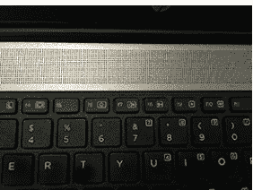

   - A. 降低屏幕亮度
   - B. 提高屏幕亮度
   - C. 降低扬声器音量
   - D. 提高扬声器音量

3. 您正在购买一种允许使用手指输入信息的移动设备。该设备使用哪种触摸屏技术？

   - A. 电容式
   - B. 基于人类的
   - C. 热量
   - D. 电阻式

4. 您正在使用公共 Wi-Fi 热点，并认为有人试图黑客攻击您的笔记本电脑。您应该使用哪个笔记本电脑功能立即关闭所有无线连接？

   - A. 静音模式
   - B. 安静模式
   - C. 飞行模式
   - D. 无连接模式

5. 您被要求为公司摄影师购买新相机。一些相机被宣传为“智能”相机。这可能意味着相机包含了哪个关键功能？

   - A. Wi-Fi
   - B. RJ-45
   - C. 独立的视频处理器
   - D. 内部硬盘

6. 一位用户来找您，希望升级 CPU 以使他的 Lenovo 笔记本电脑运行更快。满足该用户需求最简单的方式是什么？

   - A. 移除 CPU 并更换为适合相同插槽的更快 CPU。
   - B. 更换为具有更快 CPU 的笔记本电脑。
   - C. 更换为主板具有更快处理器的标准笔记本电脑主板。
   - D. 更换为主板具有更快处理器的 Lenovo 笔记本电脑主板。

7. 在什么场景下，您会使用这里显示的 Fn 键和 F4 键？

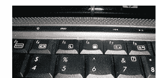

   - A. 开启或关闭触摸板
   - B. 将视频输出更改为外部监视器
   - C. 将屏幕方向从横向更改为纵向
   - D. 开启或关闭键盘背光

8. 您正在使用笔记本电脑，无线网卡故障了。附近没有有线端口。您需要在接下来的十分钟内将文件发送给位于另一个国家的老板。您应该怎么做来解决问题？

   - A. 移除故障网卡并安装一个新的。

## 8. 为了允许笔记本电脑连接到有线网络，你会安装哪种设备？
- B. 安装 USB 转 RJ-45 适配器。
- C. 安装 USB 转 Wi-Fi 适配器。
- D. 安装 USB 转蓝牙适配器。

## 9. 哪种类型的移动设备以使用电子墨水（电泳墨水）而闻名？
- A. 电子阅读器
- B. 智能手表
- C. 智能眼镜
- D. 平板电脑

## 10. 如果你使用 USB 线将笔记本电脑连接到蜂窝电话，以便从笔记本电脑使用蜂窝无线连接，你正在使用哪种类型的连接？
- A. 热点
- B. 数据共享（Tethering）
- C. USB 网络
- D. 电话功能

## 11. 黑莓智能手机最著名的特征是什么？
- A. Wi-Fi
- B. 硬件键盘
- C. 防眩光
- D. 轨迹球

## 12. 如果你希望保护笔记本电脑免受盗窃，你应该购买哪种笔记本电脑配件？
- A. 扩展坞
- B. 更换保护套
- C. 线缆锁
- D. LoJack

## 13. 你经理的硬盘故障了，你需要更换它。你经理询问用 SSD 而不是 HDD 替换的好处是什么。你应该告诉她什么？（选择两项。）
- A. 它们更便宜。
- B. 它们占用空间更少。
- C. 它们功耗更低，产生的热量更少。
- D. 它们运行时无声。

## 14. 哪种笔记本电脑扩展端口被设计为行业标准，以取代 VGA 和 DVI 端口，并且与这两种标准向后兼容？
- A. DisplayPort
- B. VideoPort
- C. Thunderbolt
- D. HDMI

## 15. 以 USB 3.0 模式运行的 ExpressCard 2.0 卡的最高数据速率是多少？
- A. 480Mbps
- B. 2.5Gbps
- C. 5.0Gbps
- D. 6.0Gbps

## 16. 你最近购买了一台带触摸屏的笔记本电脑。它允许你在屏幕上绘制图像并将它们保存在计算机上。哪个设备负责将输入转换为你可以保存的图像？
- A. 逆变器
- B. 触摸板
- C. 数字化仪
- D. 触摸屏

## 17. 一名技术人员有一台故障的联想笔记本电脑，他怀疑主板坏了。他有几台其他笔记本电脑可以从中收集零件。关于他选择的替换主板，以下哪项陈述最可能为真？
- A. 主板不可更换。
- B. 他可以选择任何其他笔记本电脑的主板。
- C. 他可以选择任何其他联想笔记本电脑的主板。
- D. 他必须选择同型号联想笔记本电脑的主板。

## 18. 一名技术人员需要更换一台故障的笔记本电脑硬盘。用户在她的计算机上存储了大量视频，并需要尽可能大容量的硬盘。你应该安装哪种类型的硬盘？
- A. SSD
- B. 机械硬盘
- C. 混合硬盘
- D. 闪存

## 19. 以下哪种无线通信类型的最大距离约为 4 英寸？
- A. NFC
- B. Wi-Fi
- C. 红外线
- D. 蓝牙

## 20. 笔记本电脑中哪两个组件在进行视频电话时最有用？（选择两项。）
- A. 数字化仪
- B. 网络摄像头
- C. 麦克风
- D. 逆变器

## 21. 此处显示了哪种移动配件？

- A. 信用卡读卡器
- B. 存储卡读卡器
- C. 外部电池组
- D. Wi-Fi 信号放大器

## 22. 哪种移动连接类型允许你将蜂窝互联网连接共享给支持 Wi-Fi 的设备？
- A. 热点
- B. NFC
- C. 蓝牙
- D. 红外线

## 23. 你负责贵公司 IT 部门的备用零件。由于业务的紧迫性，你需要在硬件故障的情况下手头拥有备用零件。贵公司使用四种不同类型的笔记本电脑，两种 HP 和两种 Dell。你最可能需要库存多少种不同型号的主板？
- A. 一种
- B. 两种
- C. 三种
- D. 四种

## 24. 在笔记本电脑中，哪个组件负责为显示屏提供光线？
- A. 背光
- B. 逆变器
- C. LCD
- D. 屏幕

## 25. 你需要为你的移动设备购买存储卡读卡器和可移动内存。你需要一次传输大约 1TB 的数据。你应该投资哪种技术？
- A. SDHC
- B. miniSD
- C. microSDHC
- D. SDXC

## 26. 哪种移动设备会使用此处显示的连接器？

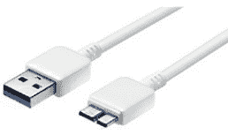

- A. Apple iPhone 4
- B. Apple iPhone 6
- C. Samsung Galaxy S5
- D. Fitbit Surge

## 27. 你正在更换笔记本电脑中的主板。当你打开机箱时，你注意到有一块小电路板连接到主板上，似乎内置了视频和网络电路。这块小电路板叫什么名字？
- A. 子板
- B. 辅助主板
- C. 初级板
- D. 扩展板

## 28. 你正在访问一个远程办公室，需要打印一些文档。你的主人告诉你，你需要连接的打印机配置在一个个人网（piconet）上。你应该使用哪种扩展选项来连接此打印机？
- A. USB 转 RJ-45 适配器
- B. USB 转 Wi-Fi 适配器
- C. USB 转蓝牙
- D. USB 转 Thunderbolt

## 29. 你将前往另一个国家出差，并有一段 10 小时的飞机航班。你需要在飞行期间在笔记本电脑上工作，但你的电池无法坚持那么长时间。你应该购买什么以允许你使用飞机上的辅助电源插座？
- A. 交流适配器
- B. 直流适配器
- C. 电源逆变器
- D. 扩展坞

## 30. 你的笔记本电脑内部有一个 Mini PCIe 扩展槽。扩展卡的文档说明它支持 Mini PCIe 2.0 x1 功能。扩展卡的运行速度是多少？
- A. 480Mbps
- B. 2.5Gbps
- C. 5.0Gbps
- D. 6.0Gbps

## 31. 在列出的笔记本电脑组件中，哪一个最不可能内置于显示屏中？
- A. Wi-Fi 天线
- B. 扬声器
- C. 网络摄像头
- D. 数字化仪

## 32. 大屏手机（phablet）的一个定义特征是其屏幕大小大约是多少？
- A. 3 英寸到 5 英寸之间
- B. 5 英寸到 7 英寸之间
- C. 7 英寸到 12 英寸之间
- D. 12 英寸到 24 英寸之间

## 33. 你想购买一款操作系统与基于 Android 的智能手机兼容的智能手表。哪个品牌的智能手表使用 Android Wear OS？
- A. Apple Watch
- B. Samsung Gear S
- C. Sony SmartWatch 3
- D. Pebble Time

## 34. 你想在驾驶时实现免提蜂窝通话，因此你购买了一个无线耳机。该耳机最可能使用哪种无线技术？
- A. Wi-Fi
- B. 红外线
- C. 蓝牙
- D. NFC

## 35. 你的戴尔笔记本电脑的交流适配器工作不正常，你正在寻找替代品。在选择新的交流适配器时，哪两个因素应该最重要？（选择两项。）
- A. 极性
- B. 与原装相同或更高的瓦数
- C. 适配器品牌
- D. 适配器大小

## 36. 笔记本电脑用户希望在他坐在桌前时，可以使用全尺寸的显示器和键盘，以及外部硬盘。他可以购买哪种配件，以便每次回到桌前时不需要将这些设备分别连接到笔记本电脑？
- A. KVM 切换器
- B. 端口舱站
- C. 桌面站
- D. 扩展坞

## 37. 识别此处显示的笔记本电脑连接器，通常位于笔记本电脑底部。

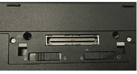

- A. Mini PCIe
- B. 智能卡读卡器
- C. 扩展坞端口
- D. 电池端口

## 38. 你需要更换用户笔记本电脑中故障的硬盘，且你不熟悉该型号。你查看笔记本电脑底部，没有明显的入口点。你最可能需要移除哪个组件才能访问硬盘舱？
- A. 塑料/框架
- B. 电池
- C. 系统板
- D. 键盘

## 39. 一位新的笔记本电脑用户要求你向他们解释飞机模式。以下哪项陈述最能描述飞机模式的作用？

## 40. 哪些内存卡的最大容量可达 32GB？（选择两项。）
- A. miniSDHC
- B. microSDHC
- C. SD
- D. microSDXC

## 41. iPhone 5 和 iPhone 6 使用哪种类型的连接器进行充电？
- A. Thunderbolt（雷电）
- B. Lightning（闪电）
- C. Apple Power（苹果电源）
- D. USB 复合 Micro

## 42. 你有一台带有 ExpressCard/34 插槽的笔记本电脑。在该插槽中，你不太可能使用哪种或哪些类型的设备作为扩展选项？
- A. 硬盘驱动器
- B. 硬盘驱动器或声卡
- C. 硬盘驱动器、声卡或网卡
- D. 硬盘驱动器、声卡、网卡或 eSATA 适配器

## 43. 你在平板电脑中启用了 GPS 服务。你的平板电脑至少需要与多少颗 GPS 卫星保持联系才能确定其位置？
- A. 一颗
- B. 两颗
- C. 三颗
- D. 四颗

## 44. 你正在为你的公司调研新型笔记本电脑。你希望笔记本显示屏具有宽视角。哪种技术最适合你的需求？
- A. LED
- B. CCFL
- C. IPS
- D. TN

## 45. 你正在使用 USB 闪存盘从笔记本电脑传输文件。你插入 USB 闪存盘后，将文件复制到其中。拔出驱动器的推荐方式是什么？
- A. 直接拔出驱动器。
- B. 使用系统托盘中的“安全移除硬件”图标，停止驱动器，然后拔出。
- C. 关闭 Windows 资源管理器中的驱动器窗口，然后拔出。
- D. 使用系统托盘中的“关闭硬件”图标，停止驱动器，然后拔出。

## 46. Apple Watch 使用的操作系统名称是什么，它是专门为该手表设计的？
- A. iOS
- B. OS X mobile
- C. WatchOS
- D. Tizen

## 47. 你公司新购买的笔记本电脑具有通用 ExpressCard 插槽。你可以将该插槽中安装以下哪种类型的卡？
- A. 仅限 ExpressCard/54
- B. ExpressCard/34 和 ExpressCard/54
- C. ExpressCard/24、ExpressCard/34 和 ExpressCard/54
- D. ExpressCard/34、ExpressCard/54 和 CardBus

## 48. 你有一台带有 Thunderbolt 2 端口的 MacBook Pro 电脑。插入该端口的设备的最大吞吐量是多少？
- A. 5Gbps
- B. 6Gbps
- C. 10Gbps
- D. 20Gbps

## 49. 技术人员需要更换一块故障的笔记本硬盘。该硬盘可能的形态因子是什么？（选择两项。）
- A. 1.3"
- B. 1.8"
- C. 2.5"
- D. 3.5"

## 50. 你的笔记本电脑内部有一个 Mini PCIe 扩展插槽。扩展卡的文档指出，它支持 Mini PCIe USB 2.0 功能。扩展卡运行在什么速度下？
- A. 480Mbps
- B. 2.5Gbps
- C. 5.0Gbps
- D. 6.0Gbps

## 51. 哪种笔记本组件可以接收触控笔的输入并将其转换为计算机上的图像？
- A. 数位仪（Digitizer）
- B. 触摸板
- C. 指点杆（Point stick）
- D. 逆变器（Inverter）

## 52. 哪种类型的可穿戴技术设备专门用于追踪用户的运动和心率，并可能包含 GPS 等功能？
- A. 智能手表
- B. 健身监测器
- C. 智能眼镜
- D. 智能耳机

## 53. 你的公司正在为即将开展的公关活动制作海报。项目负责人希望将信息嵌入海报中的 NFC 标签中。该标签可以保存多少信息？
- A. 8KB
- B. 144KB
- C. 1.4MB
- D. 4.4MB

## 54. 你想在平板电脑上玩电子游戏。如果你希望玩游戏的方式非常像在游戏主机上那样，你会购买哪种配件？
- A. 扩展坞（Docking station）
- B. 触摸板
- C. 指点杆
- D. 游戏手柄

## 55. 哪种笔记本扩展端口技术由苹果开发，并支持多种外围设备？
- A. USB
- B. DisplayPort
- C. eSATA
- D. Thunderbolt（雷电）

## 56. 你有一台带有 ExpressCard/34 插槽的笔记本电脑。关于安装扩展卡，以下哪些陈述是正确的？
- A. 你只能插入 ExpressCard/34 卡。
- B. 你可以插入 ExpressCard/34 卡或 ExpressCard/22 卡。
- C. 你可以插入 ExpressCard/34 卡或 ExpressCard/54 卡。
- D. 你可以插入 ExpressCard/34 卡或 ExpressCard Universal 卡。

## 57. 你佩戴着允许你像信用卡一样进行付款的智能手表。该服务使用哪种连接技术？
- A. Bluetooth（蓝牙）
- B. NFC
- C. Wi-Fi
- D. IR（红外线）

## 58. 哪种笔记本显示屏组件能够释放能量并可能对技术人员造成严重伤害？
- A. 屏幕
- B. 背光
- C. 逆变器
- D. LCD

## 59. 你的新笔记本电脑有 4GB 系统 RAM 和集成显卡。默认设置指定了 512MB 视频内存。有多少 RAM 可供处理器使用？
- A. 4GB.
- B. 3.5GB.
- C. 3GB.
- D. 它是可变的。

## 60. Polar 和 Jawbone 是哪种类型可穿戴技术设备的制造商？
- A. 智能眼镜
- B. 智能耳机
- C. 智能手表
- D. 健身监测器

## 61. 你需要在笔记本电脑中安装内存升级。计算机文档指出，该笔记本电脑使用 DDR3 SODIMM。SODIMM 上有多少个引脚？
- A. 144
- B. 200
- C. 204
- D. 240

## 62. 哪种类型的移动设备将使用此处显示的连接器？
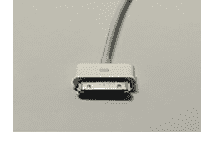
- A. Apple iPhone 4
- B. Apple iPhone 6
- C. Samsung Galaxy S5
- D. Fitbit Surge

## 63. 你需要更换一块故障的笔记本硬盘。用户要求新硬盘尽可能快，无论磁盘空间或成本如何。你应该安装哪种类型的驱动器？
- A. SSD
- B. 磁介质
- C. 混合
- D. 外部

## 64. 哪种类型的移动连接使用称为配对的流程在逻辑上连接两个设备？
- A. Bluetooth（蓝牙）
- B. Wi-Fi
- C. NFC
- D. IR（红外线）

## 65. 平板电脑配备的触摸屏尺寸大约是多少？
- A. 介于 5" 和 7" 之间
- B. 介于 3" 和 5" 之间
- C. 介于 7" 和 12" 之间
- D. 介于 12" 和 24" 之间

## 66. 中间显示的两个连接器是什么类型？
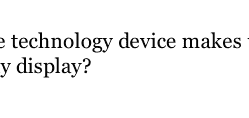
- A. Lightning（闪电）
- B. Thunderbolt（雷电）
- C. IEEE 1394
- D. Power（电源）

## 67. 哪种移动技术设备使用了增强现实显示屏？
- A. 智能手机
- B. 智能手表
- C. 智能相机
- D. 智能眼镜

## 68. 哪种类型的笔记本背光通常不需要使用逆变器？
- A. TN
- B. IPS
- C. CCFL
- D. LED

## 69. 你前往供应商的办公室。他们没有无线网络，你的笔记本电脑也没有有线网络连接。如果你需要接入他们的网络，最好的解决方案是什么？
- A. 安装带有 RJ-45 端口的 Mini PCIe 网卡。
- B. 安装 USB 转 RJ-45 网卡。
- C. 安装 USB 转蓝牙网卡。
- D. 安装 USB 转 Wi-Fi 网卡。

## 70. 你正在电话中与一名试图升级笔记本电脑的技术人员交谈。他难以识别 Mini PCIe 卡。你应该告诉技术人员卡的宽度应该是多少？
- A. 27mm
- B. 30mm
- C. 51mm
- D. 60mm

## 71. 你需要刻录一张包含几个视频的 DVD，但你的笔记本电脑没有内置光驱。你确定这个需求会发生好几次。对于安装或更换 DVD 刻录机，哪个选项对你来说最好？
- A. 移除第二个硬盘托架并安装内置 DVD 刻录机。
- B. 移除电池组并在其位置安装 DVD 刻录机。
- C. 使用 USB 端口安装外部 DVD 刻录机。
- D. 使用 DB-15 端口安装外部 DVD 刻录机。

## 72. 哪种类型的网络连接最不可能出现在平板电脑上？
- A. Wi-Fi
- B. Bluetooth（蓝牙）
- C. RJ-45
- D. 蜂窝网络

## 73. Lightning 连接器将用于哪种类型的设备？
- A. Samsung Galaxy S5
- B. Fitbit Surge
- C. Apple iPhone 4
- D. Apple iPhone 6

## 74. 你决定开始在笔记本电脑上玩高耗视频游戏。视频看起来跳跃且响应缓慢。在游戏过程中尝试提高性能，你首先应该做什么？
- A. 升级显卡。
- B. 安装额外的视频内存。
- C. 使用 Windows 控制面板增加可用视频内存的数量。
- D. 使用系统 BIOS 增加可用视频内存的数量。

## 75. 一位嘉宾演讲者将外部投影仪连接到她的笔记本电脑，使用笔记本电脑背面的 VGA 端口。然后他使用 Fn 键和他的视频切换开关；投影仪显示了他的演示文稿，但他的笔记本电脑屏幕变黑了。如果他想在投影仪和笔记本电脑上同时看到演示文稿，他应该怎么做？
- A. 安装第二个视频驱动程序，然后使用视频切换键将视频输出切换到两个屏幕。
- B. 拔掉投影仪并重新插入，使其与笔记本电脑同步。
- C. 拔掉投影仪，使用视频切换键切换视频输出，然后重新插入投影仪。

D. 再次按下视频切换键，直到演示文稿显示在两个屏幕上。

76. 你需要更换一台笔记本电脑中故障的主板。以下哪些组件最有可能集成在主板上？（选择两项。）
- A. 显卡
- B. 网卡
- C. 硬盘
- D. 内存

77. 一位用户拥有一台笔记本电脑，时常出现死机现象。初步诊断显示处理器过热。你可以采取哪些措施尝试解决此问题？（选择两项。）
- A. 在系统运行时保持机箱打开，以改善空气流通和散热。
- B. 在系统 BIOS 中降低 CPU 电压。
- C. 在系统 BIOS 中降低 CPU 时钟速度。
- D. 使用交流电源（AC）代替电池电源运行笔记本电脑。

78. 一位客户拥有一台较旧的 Windows 7 笔记本电脑，配备集成显卡。系统似乎可以启动，但即使连接了外部显示器也没有视频输出。你应该如何修复此问题？
- A. 添加一个外部 USB 显卡，并将显示器连接到它。
- B. 移除旧显卡，并用新的内置显卡替换它。
- C. 更换主板。
- D. 保留旧显卡在系统中，并添加一个内置的 Mini-PCIe 显卡。

79. 你正在用 Mini PCIe 卡升级一台笔记本电脑。Mini PCIe 使用哪种类型的连接器？
- A. 52 针
- B. 78 针
- C. 144 针
- D. 200 针

80. 以下哪些是向 Google Glass 输入信息或命令的方式？（选择两项。）
- A. 触摸屏
- B. 触控板
- C. 语音指令
- D. 虚拟键盘

81. 以下哪种无线通信方法最不容易被黑客攻击？（选择两项。）
- A. Wi-Fi
- B. 红外 (IR)
- C. 蓝牙 (Bluetooth)
- D. NFC

82. 在笔记本电脑 LCD 技术中，哪种功耗最低？
- A. LED
- B. IPS
- C. TN
- D. CCFL

83. 智能摄像头通常内置哪种类型的网络？（选择两项。）
- A. 蓝牙
- B. 红外 (IR)
- C. RJ-45
- D. 802.11b/g/n

84. 右侧显示的是哪种类型的连接器？

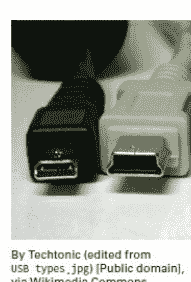

- A. USB Micro
- B. USB Mini
- C. USB Type A
- D. Lightning

85. 一位用户把他的笔记本电脑带给你，因为屏幕闪烁不规则。哪个显示组件最有可能导致此问题？
- A. 背光
- B. LCD
- C. 屏幕
- D. 逆变器

86. 以下哪种无线通信类型最大距离为 1 米且需要视线？
- A. NFC
- B. 蓝牙
- C. Wi-Fi
- D. 红外 (IR)

## 第 4 章
硬件和网络故障排除

本章涵盖的 THE COMPTIA A+ EXAM 220-901 主题包括以下内容：

## 4.1 给定一个场景，使用适当的工具排除主板、RAM、CPU 和电源相关的常见问题。
- 常见症状
    - 意外关机
    - 系统死机
    - POST 代码蜂鸣
    - 启动时屏幕空白
    - BIOS 时间和设置重置
    - 尝试从错误的设备启动
    - 持续重启
    - 无电源
    - 过热
    - 巨大噪音
    - 间歇性设备故障
    - 风扇旋转 – 其他设备无电源
    - 指示灯
    - 烟雾
    - 烧焦气味
    - 专有崩溃屏幕 (蓝屏/转圈)
    - 电容器膨胀

- 工具
    - 万用表
    - 电源测试仪
    - 回环插头
    - POST 卡/USB

## 4.2 给定一个场景，使用适当的工具排除硬盘和 RAID 阵列故障。
- 常见症状
    - 读取/写入故障
    - 性能缓慢
    - 巨大的咔哒声
    - 无法启动
    - 驱动器未识别
    - 未找到操作系统
    - 未找到 RAID
    - RAID 停止工作
    - 专有崩溃屏幕 (蓝屏/转圈)
    - S.M.A.R.T. 错误

- 工具
    - 螺丝刀
    - 外部外壳

- CHKDSK
- FORMAT
- 文件恢复软件
- Bootrec
- Diskpart
- 磁盘碎片整理工具

## 4.3 给定一个场景，排除常见的视频、投影仪和显示问题。
- 常见症状
    - VGA 模式
    - 屏幕无图像
    - 过热关机
    - 坏点
    - 伪影
    - 颜色图案不正确
    - 图像暗淡
    - 图像闪烁
    - 图像失真
    - 几何变形
    - 烧屏
    - 图像和图标过大

## 4.4 给定一个场景，使用适当的工具排除有线和无线网络故障。
- 常见症状
    - 无连接
    - APIPA/链路本地地址
    - 受限连接
    - 本地连接
    - 间歇性连接
    - IP 冲突
    - 传输速度慢
    - 低 RF 信号
    - 未找到 SSID

- 硬件工具
    - 电缆测试仪
    - 回环插头
    - 打线工具
    - 寻线仪（音发生器与探头）
    - 剥线钳
    - 压线钳
    - 无线定位器

- 命令行工具
    - PING
    - IPCONFIG/IFCONFIG
    - TRACERT
    - NETSTAT
    - NBTESTAT
    - NET
    - NETDOM
    - NSLOOKUP

## 4.5 给定一个场景，在遵循适当程序的同时排除和修复常见的移动设备问题。
- 常见症状
    - 无显示
    - 显示暗淡
    - 显示闪烁
    - 按键卡住
    - 间歇性无线故障
    - 电池未充电
    - 幽灵光标/指针漂移
    - 无电源
    - 数字锁定指示灯
    - 无无线连接
    - 无蓝牙连接
    - 无法显示到外部显示器
    - 触摸屏无响应
    - 应用未加载
    - 性能缓慢
    - 无法解密邮件
    - 电池寿命极短
    - 过热
    - 系统冻结
    - 扬声器无声音
    - GPS 不工作
    - 电池膨胀

- 拆解流程以便正确重新组装
    - 记录并标记线缆和螺丝的位置
    - 整理部件
    - 参考制造商资源
    - 使用适当的手动工具

## 4.6 给定一个场景，使用适当的工具排除打印机故障。
- 常见症状
    - 条纹
    - 褪色打印
    - 重影
    - 碳粉未融合到纸张上
    - 纸张褶皱
    - 纸张未送进
    - 卡纸
    - 无连接
    - 纸张上的字符乱码
    - 页面上的垂直线条
    - 打印队列积压
    - 内存不足错误
    - 访问被拒绝
    - 打印机不打印
    - 颜色打印错误的打印颜色
    - 无法安装打印机
    - 错误代码
    - 打印空白页
    - 打印机显示屏无图像

- 工具
    - 维护套件
    - 碳粉真空吸
    - 压缩空气
    - 打印机后台处理程序

1. 你正在排除一台无法启动的计算机故障。它提示没有可启动设备。你检查了 BIOS，它没有显示任何已安装的硬盘。接下来你应该做什么？
- A. 运行 `bootrec /fixmbr`。
- B. 将硬盘更换为外部外壳中的硬盘。
- C. 刷新 BIOS。
- D. 检查硬盘连接。

2. 技术人员刚刚用一块空硬盘替换了台式机中故障的内部硬盘。她需要通过网络启动以连接镜像服务器来恢复计算机。她应该怎么做？
- A. 在启动时，按 F2 键通过网络启动。
- B. 在启动时，进入 BIOS 并将启动顺序更改为通过网络启动。
- C. 让启动正常完成。当 BIOS 在硬盘上找不到可启动分区时，它会通过网络启动。
- D. 在启动时，按 F7 键编辑启动顺序菜单。

3. 一位用户的笔记本电脑屏幕没有显示任何内容，尽管电源灯和其他指示灯是开着的。你插入外部显示器，但它也没有显示。哪个组件最有可能导致此问题？
- A. 逆变器
- B. 背光
- C. 屏幕
- D. 显卡

4. 你正在排除一台发出巨大尖叫声的计算机故障。查看排气风扇时，你看到上面有一层厚厚的灰尘。接下来你应该做什么？
- A. 使用压缩空气清洁风扇。
- B. 使用电脑吸尘器清洁风扇。
- C. 使用湿布清洁风扇。
- D. 更换电源。

5. 一位用户报告说，当他的笔记本电脑插入交流插座时，电池不会充电。首先尝试的最佳解决方案是什么？
- A. 更换电池。

- 更换交流适配器。
- 取出并重新插入电池。
- 将电池完全耗尽，然后重新充电。

## 6. 技术人员确定她需要更换笔记本电脑的主板。你应该遵循以下哪些程序？（选择两项。）
- 切勿在笔记本电脑上使用电动螺丝刀。
- 记录并标记螺丝位置。
- 参考制造商的说明。
- 在移除主板之前先移除键盘。

## 7. 你刚刚更换了台式计算机中故障的内存（RAM）。你重新启动计算机，几秒后它发出一次哔声。这表明了什么？
- 内存故障。
- 主板需要更换。
- 系统 BIOS 检测到 POST 例程中的错误。
- 系统 BIOS 正常完成了 POST 例程。

## 8. 你正在排查一台随机重启且现在无法正常启动的计算机。启动时，你听到一声长哔和两声短哔，但屏幕上没有视频显示。你应该使用什么工具来排查这种情况？
- 万用表
- 电源测试仪
- 环回插头
- POST 卡

## 9. 随着时间推移，你计算机的硬盘性能变得缓慢。你认为存储在该驱动器上的许多文件已碎片化，从而降低了磁盘读写速度。你应该如何解决这个问题？
- A. 运行磁盘碎片整理程序。
- B. 格式化硬盘并恢复数据。
- C. 删除分区，创建新分区，然后恢复数据。
- D. 运行 chkdsk。

## 10. 用户的计算机发生故障。当你尝试启动它时，你听到响亮且有节奏的咔哒声，且系统无法正常启动。最可能的问题是什么？
- A. 硬盘驱动器（HDD）故障
- B. 固态硬盘（SSD）故障
- C. 内存（RAM）故障
- D. 电源风扇故障

## 11. 你正在使用的一台激光打印机一直生成带有白色条纹垂直贯穿页面的图像。你可以做什么来解决这个问题？
- A. 清洁转印电晕丝。
- B. 清洁静电鼓（EP 鼓）。
- C. 清洁定影组件。
- D. 更换墨粉盒。

## 12. 你办公室的点阵打印机最近开始卡纸并产生纸张堵塞。以下哪些情况可能导致这些问题？（选择两项。）
- A. 纸路中有纸屑
- B. 纸张张力设置
- C. 使用了错误的纸张
- D. 纸张穿孔

## 13. 你台式计算机的显示器在长时间使用后随机关闭。这个问题最可能的原因是什么？
- A. 显卡故障
- B. 显示器过热
- C. 视频分辨率设置不当
- D. 背光故障

## 14. 你打开台式计算机，听到风扇转动。然而，你没有任何指示灯亮起或听到 POST 哔声。哪个组件可能正在导致这个问题？
- A. CPU
- B. RAM
- C. 电源（PSU）
- D. 硬盘驱动器（HDD）

## 15. 你刚刚在 HP LaserJet 打印机中更换了墨粉盒。它显示错误 14 No EP Cart。你应该如何解决这个问题？
- A. 关闭再打开打印机。
- B. 取出墨粉盒并按下重置按钮。
- C. 取出墨粉盒并重新插入。
- D. 取出墨粉盒并更换新的。

## 16. 你的办公室使用喷墨打印机。最近，它开始出现无法抓取纸张的问题。哪个组件可能导致这个问题？
- A. 传输滚轮
- B. 拾纸滚轮
- C. 出纸滚轮
- D. 传动滚轮

## 17. 你的办公室使用一台旧点阵打印机。最近，当你从左向右查看纸张时，打印机输出的图像从深色变为浅色。导致这个问题的是什么？
- A. 磨损的打印机色带
- B. 色带进给机构
- C. 打印头
- D. 纸张进给组件

## 18. 你的网络对所有客户端计算机使用 802.11n。最近，几位用户从一个办公空间搬到另一个空间，使该区域的用户数量从 20 增加到约 50。现在，新用户和老用户都报告网络传输速度非常慢。问题最可能的原因是什么？
- A. 802.11n 无法支持如此多的并发用户。
- B. 距离无线接入点太远。
- C. 对于单个无线接入点来说，用户太多了。
- D. 新用户都有 802.11b 网卡。

## 19. 当你在玩在线视频游戏时，你的计算机间歇性重启。你安装了一个硬件监控工具，并在日志中注意到系统关闭前 CPU 温度飙升。为了帮助解决这个问题，你首先应该采取什么措施？
- A. 使用系统 BIOS 对 CPU 进行超频。
- B. 更换 CPU 和散热器。
- C. 重新安装 CPU 散热器。
- D. 更换电源。

## 20. 你建筑某一区域的用户报告无线网络服务不稳定。他们的工作站连接缓慢且频繁断开连接。你应该使用什么工具来测试这个问题？
- A. 无线定位器
- B. 寻呼机
- C. 环回插头
- D. 数据包捕获器

## 21. 技术人员刚刚更换了故障的硬盘驱动器，并在新的驱动器上创建了一个分区。她接下来应该使用哪个工具来准备驱动器以存储数据？
- A. `format`
- B. bootrec
- C. chkdsk
- D. diskpart

## 22. 你正在排查一台使用四个磁盘的 RAID 0 阵列的计算机。其中一个磁盘发生故障。你可以做什么来恢复该阵列？
- A. 重建故障磁盘并从备份恢复。
- B. 更换故障磁盘并重建阵列。
- C. 更换故障磁盘并从备份恢复。
- D. 移除故障磁盘并重建阵列。

## 23. 你办公室的激光打印机已经使用了大约五年。最近，当你打印时，偶尔会出现内存不足错误消息。你应该如何修复这个问题？
- A. 停止并重新启动打印后台处理程序。
- B. 为最重要的用户实施打印优先级。
- C. 升级打印机的内存。
- D. 升级打印机的硬盘驱动器。

## 24. 你正在排查一个新安装的三磁盘 RAID 阵列。原始技术人员留下的笔记表明，他担心在系统中创建多个潜在故障点。哪种类型的 RAID 阵列比单个硬盘驱动器创建更多的潜在故障点？
- A. RAID 10
- B. RAID 1
- C. RAID 0
- D. RAID 5

## 25. 技术人员正在排查一台持续重启的计算机。他不确定从哪里开始诊断问题，因此打电话向你寻求建议。你应该告诉他使用哪个工具来尝试识别问题？
- A. 万用表
- B. 电源测试仪
- C. 环回插头
- D. POST 卡

## 26. 用户正在向激光打印机打印，但没有任何输出。当你查看打印队列时，你看到几个任务积压。打印机在线，有纸张，并显示 Ready（准备就绪）。你应该如何解决这个问题？
- A. 关闭再打开打印机。
- B. 停止并重新启动打印后台处理程序。
- C. 按下打印机上的重置按钮。
- D. 使用打印机的显示屏清除最旧的任务，使其脱机，然后重新上线。

## 27. 你公司有一台等离子显示器，以前在公共区域显示会议室信息。最近，你将该显示器重新用于另一个区域。无论屏幕上显示什么内容，你始终都能看到会议室信息模板显示在屏幕上。这叫什么？
- A. 坏点
- B. 过热
- C. 烧屏
- D. 背光故障

## 28. 用户报告说，他的平板电脑在电池图标显示已满后，仅能使用电池电源工作约 20 分钟。他声称它以前可以使用电池电源工作几个小时。这个问题最可能的原因是什么？
- A. 用户运行了太多的应用程序。
- B. 用户一直在使用 Wi-Fi 连接。
- C. 电池需要充电更长时间。
- D. 电池正在故障。

## 29. 在故障排除计算机时，你注意到硬盘指示灯一直亮着。系统似乎无响应。你重启了计算机，几分钟后同样的问题再次发生。你应该怎么做？
- A. 更换硬盘。
- B. 更换主板。
- C. 重新安装操作系统。
- D. 使用万用表测试硬盘。

## 30. 你的主管的网络电缆故障了，他急需网络连接。你找不到备用跳线，但你有一卷 CAT5e 网线和一些 RJ-45 连接器。你需要哪种工具来制作一根新电缆？
- A. 压接钳
- B. 剥线钳
- C. 打线工具
- D. 电缆测试仪

## 31. 你刚刚在计算机中安装了第二块硬盘。开机时，你收到一条错误消息，提示找不到操作系统。你首先应该尝试什么？
- A. 检查硬盘上的跳线设置。
- B. 运行 bootrec /fixmbr。
- C. 运行 diskpart。
- D. 更换新硬盘。

## 32. 你正在故障排除一台无法正确启动的计算机。开机时，它发出一系列长鸣和短鸣声。最可能导致此问题的组件是什么？（选择两项。）
- A. BIOS
- B. 硬盘
- C. 网卡
- D. 内存（RAM）

## 33. 你正在处理一台看起来冻结的笔记本电脑。你多次按下数字锁定键，但指示灯保持常亮。你可以做什么来尝试解决此问题？
- A. 长按电源键直到笔记本电脑关闭，然后重启。
- B. 取出电池并断开笔记本电脑的交流电源，然后重启。
- C. 长按数字锁定键直到指示灯熄灭。
- D. 按 Ctrl+Alt+Del 重启笔记本电脑。

## 34. 一名用户抱怨说当他打开台式计算机时，屏幕上什么都不显示。听起来电脑风扇在运行，用户报告说电脑开机时听到一声“哔”声。你应该首先检查什么？
- A. 显示器是否插接在显卡上？
- B. 计算机是否正确完成了 POST（加电自检）？
- C. 显示器是否已打开？
- D. 另一台显示器在这台计算机上是否正常工作？

## 35. 一名用户报告说他的手机非常热并且似乎死机了。你应该指示他做什么？
- A. 将手机插入墙壁插座或 USB 端口进行充电。
- B. 关闭手机并让其冷却。
- C. 对手机执行恢复出厂设置。
- D. 打开电源应用并将手机设置为低压运行模式。

## 36. 你正在故障排除的台式计算机无法保留正确的时间和日期。你设置了时间和日期，关闭系统电源，然后重新开启。再次，设置是不正确的。哪个部件很可能导致此问题？
- A. CMOS 电池
- B. BIOS
- C. 硬盘
- D. 内存（RAM）

## 37. 你有一部 Android 手机，它运行缓慢。似乎问题仅限于某个特定的应用程序。你检查后发现有大量空闲内存。你已多次重启手机，但该应用仍然缓慢。接下来你应该尝试什么？
- A. 同时长按电源键和 Home 键 10 秒，手机将重置。
- B. 将手机恢复出厂设置。
- C. 卸载并重新安装该应用。
- D. 买一部新手机。

## 38. 你正在维修的一台激光打印机一直在产生重影。也就是说，无论打印什么内容，你总能看到之前打印图像的一个淡淡副本。这可能是什么原因？（选择两项。）
- A. 充电丝脏污
- B. 清洁刮刀损坏
- C. 定影组件损坏
- D. 消影灯故障

## 39. 你让笔记本电脑在整夜充电，但早晨它无法开机。你取出并重新插入电池，但它仍然无法开机。使用墙壁适配器时系统可以开机，并且电池图标显示已满。最可能的问题是什么？
- A. 电池故障。
- B. 交流适配器未正确为电池充电。
- C. 电池充电图标未正确读取电池电量。
- D. 电池与主板之间的直流转换器故障。

## 40. 一名用户报告说，无论他的 LCD 桌面显示器上显示什么，他总是能看到另一个永不改变的图像轮廓。如何解决此问题？
- A. 更换显卡。
- B. 对显示器消磁。
- C. 更换显示器。
- D. 清洁屏幕。

## 41. 一名用户声称，在他的笔记本电脑上，当他打字时，鼠标光标偶尔会跳到屏幕的不同区域。这给他的工作造成了困扰，因为他最终会在错误的字段中输入内容。你可以建议什么来帮助解决此问题？
- A. 禁用指点杆。
- B. 更换键盘。
- C. 更换主板。
- D. 禁用触摸板。

## 42. 一名用户抱怨她的台式计算机散发出烧焦的气味。你指示她立即关闭系统。下一步你应该做什么？
- A. 更换电源。
- B. 更换主板。
- C. 使用万用表测试电源。
- D. 检查计算机内部是否有可见的损坏迹象。

## 43. 你办公室大堂的台式计算机为访客播放欢迎视频。最近，音频开始间歇性故障。你更换了扬声器，但问题仍然存在。在故障排除此问题时，下一步你应该做什么？
- A. 更换主板。
- B. 重新插入扬声器。
- C. 更换声卡。
- D. 重新插入声卡。

## 44. 一名用户报告说她的 iPhone 5 总是过热并且频繁死机。你应该建议她做什么？
- A. 更换电池。
- B. 打开电源应用并将手机设置为低压运行模式。
- C. 关闭手机并让其冷却。
- D. 更换手机。

## 45. 你刚刚使用管理员权限在用户工作站上安装了打印机。当用户尝试向打印机打印时，她收到一条拒绝访问的错误消息。这个问题的原因是什么？
- A. 打印机处于脱机状态。
- B. 打印机内存不足。
- C. 需要重启打印后台处理程序（Print Spooler）。
- D. 用户没有打印的安全权限。

## 46. 你正在一个信息亭上使用 CRT 显示器。显示器上的颜色最近开始看起来不对劲。你应该怎么做以尝试解决此问题？
- A. 更换显示器。
- B. 更换显卡。
- C. 断开显示器并重新插入。
- D. 对显示器消磁。

## 47. 你办公室的喷墨打印机经常卡纸并产生许多皱褶的纸张。最可能的原因是什么？
- A. 纸张张力设置不正确
- B. 打印头脏污
- C. 纸路受阻
- D. 纸张太干

## 48. 一名用户报告说她的 Windows 7 计算机无法启动。启动时，它给出错误消息“找不到操作系统”。你可以使用哪个实用程序尝试修复此问题？
- A. format
- B. chkdsk
- C. bootrec
- D. diskpart

## 49. 一名技术人员正在故障排除一台有线网络连接无法连接到网络的计算机。他确认电缆已插好，但网卡上没有灯亮起。计算机昨天可以连接，没有其他用户报告问题。以下哪些最可能导致此问题？（选择两项。）
- A. 网络电缆故障。
- B. 网卡驱动程序故障。
- C. TCP/IP 配置不正确。
- D. 电缆另一端未连接。

## 50. 在激光打印机中更换墨粉盒时，一名技术人员将墨粉洒在打印机上及周围。他应该使用什么来清理洒出的墨粉？
- A. 湿布
- B. 压缩空气
- C. 墨粉吸尘器
- D. 变性酒精

## 51. 你的笔记本电脑交流适配器上有一个绿色 LED 指示灯。当你将适配器插入墙壁插座时，指示灯没有亮起。这可能是什么原因？（选择两项。）

52. 你正在排查一台喷墨打印机的问题。用户报告该打印机打印颜色错误。此问题最近才出现。可能的原因是什么？（选择两项。）

- A. 墨盒安装位置错误
- B. 墨盒漏墨
- C. 定影组件故障
- D. 步进电机故障

53. 你为公司安装了一个 802.11ac 无线接入点。为了节省成本，他们只希望在建筑物中设置一个中央接入点，该建筑物大约 150 英尺长。建筑物两端的用户报告无线网络连接间歇性中断且访问缓慢。最可能导致该问题的原因是什么？

- A. RF 信号弱
- B. 无线接入点过载
- C. 找不到 SSID
- D. IP 地址冲突

54. 你正在拆解一台有缺陷的笔记本电脑以更换主板。以下哪些步骤是推荐的？（选择两项。）

- A. 将螺丝放入多格药盒中，并标记它们对应的安装位置。
- B. 在移除主板之前先移除硬盘驱动器。
- C. 标记线缆插入主板的对应位置。
- D. 使用尖嘴钳将主板从定位柱上取下。

55. 用户报告他的液晶显示器一直在闪烁。解决此问题最简单的操作是什么？

- A. 更换显卡。
- B. 更换显示器。
- C. 移除外部干扰源，如风扇或电机。
- D. 对显示器进行消磁。

56. 你无法从运行 Windows 8.1 的工作站向网络打印机打印。已发送多个打印任务，但没有打印出来。你刚才尝试打印测试页，但也未输出任何内容。你应该怎么做？

- A. 检查连接并停止然后重新启动打印后台处理程序。
- B. 关闭打印机然后重新打开。
- C. 使用打印机显示屏清除最旧的任务，将打印机设为脱机状态，然后再设为联机状态。
- D. 按下打印机上的“复位”按钮。

57. 用户报告她的笔记本电脑键盘上所有键似乎都无法工作。她已重启计算机，但问题仍未解决。她需要在午餐前完成一份重要文件。下一步应该做什么？

- A. 更换键盘。
- B. 检查内部键盘是否连接正常。
- C. 使用 USB 端口连接外部键盘。
- D. 使用压缩空气清洁键盘按键下方。

58. 你正在排查一台运行 macOS 的 Mac 电脑问题。间歇性地，电脑会完全锁死，并显示旋转的进度环图标代替鼠标指针。最可能导致此问题的组件是什么？

- A. CPU
- B. RAM
- C. 主板
- D. 硬盘驱动器

59. 用户报告他的 CRT 显示器在白天会随机出现波浪形图像。当你去他的工位排查时，它似乎工作正常。当天下午晚些时候，他报告问题再次发生。当你再次回到他的工位时，应该检查什么？

- A. 正在使用的手机
- B. 视频连接器是否插好
- C. 正在运行的电机或风扇
- D. 屏幕分辨率是否设置正确

60. 在随机时间，你的电脑会完全锁死，需要强制重启。哪两个组件最可能导致此类问题？（选择两项。）

- A. CPU
- B. RAM
- C. PSU
- D. GPU

61. 一名工人驾驶重型机械碾过了一捆未加保护的网络电缆，现在你需要替换它们。你正在配线间，需要将电缆连接到 110 配线架。你会使用哪种工具来完成此操作？

- A. 压线钳
- B. 剥线钳
- C. 打线工具
- D. 电缆测试仪

62. 你正在咨询一位用户，他的 Windows 7 电脑中的硬盘驱动器故障了。用户需要从此硬盘中提取关键数据，但他没有制作备份。他有任何选项来恢复数据吗？

- A. 无法从故障驱动器中恢复数据。
- B. 使用 Windows 磁盘修复工具创建备份，然后将备份恢复到新硬盘驱动器。
- C. 使用文件恢复服务或软件包尝试恢复数据。
- D. 安装第二块相同或更大尺寸的硬盘驱动器。在 Windows 安装过程中，从高级选项菜单中选择“恢复硬盘内容”。

63. 早上，一名用户从他的工位来电报告他的笔记本电脑无法连接无线网络。他从未在该位置遇到无线连接问题。当你查看他的无线适配器时，你注意到没有任何指示灯亮起。最可能的问题是什么？

- A. 他未接收到 Wi-Fi 信号。
- B. 找不到 SSID。
- C. 他的无线网卡被禁用了。
- D. 他的无线网卡与有线网络端口之间存在冲突。

64. 一名用户致电服务台，称她电脑屏幕上的图标巨大。她只能看到大约六个图标，并且看不到“开始”菜单。最可能导致此问题的原因是什么？

- A. 背光故障
- B. 视频分辨率不正确
- C. 外部干扰，如风扇或电机
- D. 视频驱动程序不正确

65. 你在一台运行 Windows Server 2012 R2 的系统中，命令提示符已打开。你会使用哪个命令将客户端计算机加入 Windows 域？

- A. netjoin
- B. netstat
- C. netadd
- D. netdom

66. 你的 iPhone 6 似乎已锁死。触摸屏无响应。你按住电源按钮，但它没有关闭。下一步应该做什么？

- A. 同时按住电源按钮和睡眠/唤醒按钮 10 秒，手机将重置。
- B. 使用回形针按下手机底部的凹陷重置按钮以重置手机。
- C. 同时按住电源按钮和音量上、下按钮 10 秒，手机将重置。
- D. 买一部新手机。

67. 你办公室里的激光打印机最近开始产生未完全干燥的图像。当打印输出时，人们在取纸时会弄脏图像。导致此问题的原因是什么？

- A. 定影组件
- B. 出纸辊
- C. 干燥组件
- D. 充电电晕

68. 你经常需要在建筑物内携带笔记本电脑以排查电脑问题。在多个地点，你注意到 Wi-Fi 连接完全断开。最可能导致此问题的原因是什么？

- A. 你走得太快，Wi-Fi 无法保持连接。
- B. RF 信号弱。
- C. 无线接入点过载。
- D. 笔记本电脑中的 Wi-Fi 天线故障。

69. 你刚在客户计算机上安装了打印机。当你向该打印机打印时，输出是完全乱码的字符。最可能导致此问题的原因是什么？

- A. 打印后台处理程序
- B. 打印机内存
- C. 打印机驱动程序
- D. 打印队列

70. 一名用户来电报告他无法访问互联网或公司服务器。然而，他仍然可以打印到附近的打印机。他没有收到任何错误消息。他所在区域的其他用户也无法访问互联网。最可能的问题是什么？

- A. IP 地址冲突
- B. 默认网关故障
- C. 子网掩码不正确
- D. 网卡故障

71. 一名用户的笔记本电脑屏幕上未显示任何内容，尽管电源指示灯和其他指示灯都是亮的。你连接了一个外部显示器，在切换 LCD 切断开关后，外部显示器上出现了图像。最可能导致问题的组件有哪些？（选择两项。）

- A. 视频驱动程序
- B. 背光
- C. 屏幕
- D. 显卡

72. 你有一部安卓手机，它的运行速度非常慢。应用程序没有以前那么快了，但你仍然有大量的空闲内存。你已经重启了几次手机，但它仍然很慢。下一步应该尝试什么？

- A. 同时按住电源按钮和主页按钮 10 秒，手机将重置。
- B. 将手机重置为出厂规格。
- C. 卸载并重新安装所有应用。
- D. 买一部新手机。

73. 一名技术员正在排查由四个硬盘组成的 RAID 5 阵列故障。其中一个硬盘已损坏。她可以采取什么措施来恢复该阵列？

- A. 更换损坏的硬盘并重建阵列。
- B. 更换损坏的硬盘并从备份恢复。
- C. 重建损坏的硬盘并从备份恢复。
- D. 移除损坏的硬盘并重建阵列。

74. 你正在使用的激光打印机开始输出全黑页面。你应该如何修复此问题？

- A. 使用显示屏启动自清洁周期。
- B. 使用维护套件清洁打印机。
- C. 更换墨粉盒。
- D. 关闭打印机电源然后再打开。

75. 你安装了一个内部 RAID 控制器，并基于其配置了一个包含四个硬盘的 RAID 5 阵列。之前运行正常。今天启动时，你收到一条错误信息，提示未找到 RAID。哪个组件最可能导致此问题？

- A. 四个硬盘中的一个
- B. RAID 控制器
- C. 系统 BIOS
- D. 集成硬盘控制器

76. 你的一位朋友抱怨说，当他在电脑上玩动作类游戏时，屏幕刷新缓慢，画面经常卡顿。他应该怎么做才能解决此问题？

- A. 购买更新的显示器。
- B. 增加系统内存。
- C. 增加视频内存。
- D. 降低屏幕分辨率。

77. 你想检查这台计算机是否在 80 端口上建立任何 TCP/IP 连接。你应该使用哪个命令？

- A. `ipconfig`
- B. `ipconfig /show`
- C. `ipconfig /display`
- D. `ipconfig /all`

78. 你正在排查一台 Windows 7 工作站无法连接互联网的问题。有趣的是，该计算机似乎能够连接以 https:// 开头的网站，但无法连接 http:// 网站。其他工作站可以连接所有网站。你想检查这台计算机是否在 80 端口上建立任何 TCP/IP 连接。你应该使用哪个命令？

- A. `netstat`
- B. `nbtstat`
- C. `netdom`
- D. `net`

79. 一名用户报告她的三星手机外壳已经鼓包。她需要做什么来修复此问题？

- A. 更换手机。
- B. 打开“电源”应用，并将手机设置为低压模式运行。
- C. 打开手机外壳，排出电池中多余的电解液。
- D. 关闭手机电源，让其冷却，然后正常使用。

80. 你为你的 Android 平板电脑下载了一款日程安排应用。使用两个月后，该应用无法加载。你重启平板电脑，应用仍然无法打开。其他应用似乎运行正常。你应该怎么做？

- A. 将平板电脑重置为出厂规格。
- B. 重新安装该应用。
- C. 确保在设置中配置该应用以允许运行。
- D. 更换平板电脑。

81. 你有一台 Windows 8.1 台式机，启动时屏幕没有显示图像。你听到 POST 蜂鸣声，且正常指示灯已亮起。显示器已连接到计算机，且电源指示灯已点亮。你的下一步排查步骤应该是什么？

- A. 尝试将显示器连接到另一台计算机，或将另一台显示器连接到该计算机。
- B. 更换显卡。
- C. 将显示器切换到显卡上的另一个视频连接器。
- D. 更换显示器。

82. 一名用户向你展示她的手机，屏幕一直在闪烁。她关闭并重新打开设备，问题依然存在。哪个组件最可能导致此问题？

- A. 显示屏
- B. 显卡
- C. 背光
- D. 转换器

83. 一名用户报告她的台式机电视频输出显示不正常。屏幕上有几个区域无法点亮；这些位置始终是黑点。这是什么的症状？

- A. 伪影
- B. 坏点
- C. 背光故障
- D. 过热

84. 你正在排查一台笔记本电脑，其鼠标光标存在漂移问题。如果没有任何人移动外部鼠标，光标会缓慢向右上移动。你尝试了不同的外部鼠标，问题依然存在。你应该如何解决此问题？

- A. 更换笔记本键盘。
- B. 重新校准笔记本指点杆。
- C. 重新校准笔记本触摸板。
- D. 更换笔记本主板。

85. 你正在排查大楼某一区域的网络连接问题。经过几个小时的排查，你得出结论：配线间内的网络电缆可能标签错误。哪个工具最适合测试你的这一理论？

- A. 万用表
- B. 电缆测试仪
- C. 打线工具
- D. 寻线仪（声源发生器与探针）

86. 你正在使用新内存升级笔记本电脑。你应该遵循以下哪些拆卸流程？（选择两项。）

- A. 拆下键盘以访问内存插槽。
- B. 使用合适的手持工具。
- C. 保持合盖机箱（clamshell case）打开状态。
- D. 记录并标记电缆和螺丝的位置。

87. 远程工作站无法连接网络。你想将问题范围缩小到 UTP 电缆或网卡。哪个工具可以帮助你判断是否由电缆导致问题？

- A. 万用表
- B. OTDR（光时域反射仪）
- C. 电缆测试仪
- D. 压线钳

88. 你刚刚在网络中安装了一台新的 HP LaserJet 打印机。你直接将其连接到一根 CAT6a 网络电缆上。你尝试使用打印机的 IP 地址在客户端上安装打印机，但无法连接。打印机处于“就绪”状态。接下来你应该做什么？

- A. 仔细检查打印机的 IP 配置信息。
- B. 停止并重启打印后台处理程序服务（Spooler service）。
- C. 将打印机设为脱机，然后再将其设为联机。
- D. 关闭打印机电源然后再打开，以保存 IP 配置信息。

89. 你的网络最近从 50 台客户端计算机扩展到大约 90 台。网络中的所有工作站都使用 CAT5e 或更好的线缆连接，且所有网络设备至少支持 100Mbps 数据传输。自扩展以来，用户一直在报告网络速度非常慢，且抱怨越来越频繁。以下哪项行动最有可能帮助解决此问题？

- A. 向网络中增加另一台集线器。
- B. 将所有线缆升级到至少 CAT6a。
- C. 将现有路由器升级为支持 10Gbps 数据传输。
- D. 向网络中增加另一台交换机。

90. 一名 iPhone 6 用户刚刚下载了一款需要使用 GPS 的新应用。它无法正常工作。她手机上的另一个应用也需要 GPS，但运行正常。她如何配置手机以让新应用正常工作？

- A. 在“设置 > 隐私”中启用 GPS。
- B. 在“设置 > 隐私”中启用定位服务（Location Services）。
- C. 在“设置 > 定位服务”中启用 GPS。
- D. 在“设置 > GPS”中启用定位服务。

91. 一名技术员刚刚更换了激光打印机的墨粉盒。现在，打印机只能打印空白页。你应该如何解决此问题？

- A. 停止并重启打印后台处理程序。
- B. 重新安装打印机驱动程序。
- C. 用新的墨粉盒替换旧墨粉盒。
- D. 移除墨粉盒，撕掉密封胶带，然后重新安装墨粉盒。

92. 你正在排查一台容易意外关机的台式机。用户报告计算机关机前没有出现任何错误消息。哪两种情况最有可能导致此类问题？（选择两项。）

- A. 硬盘故障
- B. 损坏的内存
- C. BIOS 配置错误
- D. 芯片安装不当

93. 你正在排查一台无法连接网络的工作站。你应该使用哪个工具来测试网卡发送和接收电路的功能？

- A. 打线工具
- B. 环回插头
- C. `ping`
- D. `ipconfig`

94. 你想从计算机向远程服务器传输文件。为此，你想连接到服务器上的共享目录并复制文件。哪个命令行实用程序允许你执行此操作？

- A. `netstat`
- B. `net`
- C. `netshare`
- D. `netdom`

95. 一位用户的基于 Windows 的台式计算机始终尝试从 DVD-ROM 驱动器启动。她应该去哪里更改设置以从硬盘启动？

- A. Windows 控制面板
- B. Windows 设备管理器
- C. Windows 磁盘管理
- D. BIOS

96. 一名技术员正在排查一台偶尔无法从硬盘读取数据的计算机。她应该首先尝试什么？

- A. 运行磁盘碎片整理程序。
- B. 运行 `chkdisk`。
- C. 格式化硬盘并重新安装操作系统。
- D. 更换硬盘。

97. 您正在排查一台 Linux 工作站的网络连接问题。您应该使用哪个命令来检查计算机的 IP 地址和子网掩码？

- A. `PING`
- B. `IPCONFIG`
- C. `IFCONFIG`
- D. `NETSTAT`

98. 财务组报告他们的激光打印机无法通电。打印机已插好电源，并且电源插座已验证工作正常。使用万用表测试直流电源时，从引脚 1 您应该得到多少电压读数？

- A. −5v
- B. +5v
- C. −24v
- D. +24v

99. 您正在排查一台看似无响应的 Windows 10 计算机。您按下键盘上的 Caps Lock 键，但键盘上的 Caps Lock 指示灯没有亮起。最可能发生的情况是什么？

- A. 键盘故障。
- B. 系统正在等待进程完成，很快就会有响应。
- C. 主板故障。
- D. 系统已死锁，需要重启。

100. 您已更换了一个故障的硬盘，并需要为数据存储做准备。您首先将使用哪个工具？

- A. `format`
- B. `diskpart`
- C. `chkdsk`
- D. `bootrec`

101. 您正在排查一台台式计算机，并收到 S.M.A.R.T. 错误。这些错误指的是哪个组件？

- A. SSD
- B. RAM
- C. CPU
- D. 网卡

102. 您正在排查的一台台式计算机无法启动。当您按下电源按钮时，没有任何状态指示灯亮起，您也听不到风扇的声音。您确认电源插座工作正常，并尝试了一根已知可用的电源线缆，但问题依然存在。哪个组件最有可能导致此问题？

- A. RAM
- B. PSU（电源供应器）
- C. CPU
- D. HDD（硬盘驱动器）

103. 一位用户报告说他的计算机运行缓慢。当您检查时，注意到他的空闲磁盘空间仅剩 5%。首先要尝试的解决方案是什么？

- A. 增加更多 RAM。
- B. 删除旧文件或应用程序。
- C. 格式化硬盘并从备份重新安装。
- D. 更换硬盘。

104. 大约十几条网络线缆从配线架插孔中拔出，且均未贴标签。您位于需要重新连接的那台工作站旁，另一位技术员在接线间。您希望将此计算机设置为持续检查网络连接，以便知道何时接入了正确的线缆。您应该使用哪个命令？

- A. `ping -t`
- B. `ping -p`
- C. `ping -l`
- D. `ping -n`

105. 您正在排查一台笔记本电脑，其键盘左侧的一些按键持续卡住。用户说可能有一点汽水洒到了键盘上。为了解决这个问题，您首先应该做什么？

- A. 使用略微湿润的棉签清洁按键下方。
- B. 拆下键盘并在水槽中用肥皂水冲洗。
- C. 更换键盘。
- D. 将键盘倒置并摇晃。

106. 一位用户抱怨他的计算机有时无法打开文件，且发生在不同的程序中。哪个组件最有可能导致此问题？

- A. RAM
- B. CPU
- C. HDD（硬盘驱动器）
- D. 主板

107. 您正在排查一台无线连接故障的笔记本电脑。该笔记本电脑没有有线网络端口。您可以做什么来快速让笔记本电脑重新联网？

- A. 重新安装网卡驱动程序。
- B. 插入 USB 无线网卡。
- C. 更换无线网卡。
- D. 重启计算机并重新初始化无线网卡。

108. 一位用户很不满，因为他的 Android 平板在接听电话时不会响铃。您应该让他首先检查什么？

- A. 平板是否配置为接收语音通话
- B. 平板是否处于飞行模式
- C. 平板是否设置为静音模式
- D. 平板的扬声器在另一个应用程序中是否工作正常

109. 您用于台式机的 LCD 显示器突然变得非常暗淡。您已尝试调整亮度设置，但即使在最高设置下，图像仍然暗淡。最有可能解决此问题的是什么？

- A. 对显示器进行消磁。
- B. 更换背光灯。
- C. 更换屏幕。
- D. 更换逆变器。

110. 您正在排查一台启动进入 VGA 模式的 Windows 7 台式计算机。在故障排除过程中，第一步是什么？

- A. 重新安装显卡驱动程序。
- B. 更换显卡。
- C. 将视频分辨率重置为较低设置并重启。
- D. 更换显示器。

111. 您办公室中 HP LaserJet 打印机的显示屏已变黑，但电源指示灯仍亮着。您尝试运行自检，但没有任何反应。您关闭并重新打开电源，但问题依然存在。哪个组件很可能已经故障？

- A. 直流控制器
- B. 显示屏
- C. HVPS（高压电源）
- D. LVPS（低压电源）

112. 您工作的办公空间由几排小隔间组成。坐在您旁边的同事桌上有一台风扇，非常靠近您的 CRT 显示器。这可能会导致什么问题？

- A. 图像失真
- B. 几何畸变
- C. 颜色图案不正确
- D. 伪影

113. 您有一部运行 iOS 9.3 的 iPhone 6。您的同事向您发送了一封包含高度机密信息的加密邮件，但您的设备无法解密它。您需要做什么来解决这个问题？

- A. 升级到 iOS 10.0 或更高版本。
- B. 安装 Secure Mail 应用。
- C. 让同事重新发送未加密的邮件。
- D. 启用 S/MIME。

114. 您正在排查一台已崩溃的 Windows 7 计算机。它显示蓝屏，上面有 `UNEXPECTED_KERNEL_MODE_TRAP` 错误。哪个组件最有可能导致此问题？

- A. RAM
- B. CPU
- C. SSD
- D. PSU（电源供应器）

115. 一位用户报告说她的 LCD 显示器上的屏幕图像看起来被压缩了，并且不再像以前那样延伸到边缘。最有可能的问题原因是什么？

- A. 外部干扰，如风扇或电机
- B. 视频驱动程序不正确
- C. 背光灯故障
- D. 视频分辨率不正确

116. 您的喷墨打印机的打印线条间距不均匀。有些太近，有些太远。此问题最可能的原因是什么？

- A. 纸张进纸机构
- B. 出纸辊
- C. 打印墨盒
- D. 步进电机

117. 在插入 VGA 显示器时，一位用户弯折了连接器上的一些引脚。您尝试将它们弄直，但其中两根断了。如果您使用此显示器，最可能发生什么情况？

- A. 它将正常工作。
- B. 它将显示不正确的颜色。
- C. 它将显示失真的图像。
- D. 它将产生暗淡或闪烁的图像。

118. 您正在排查一台 Windows 10 工作站在局域网上的连接问题。另一位管理员建议这可能是命名或组成员身份问题。哪个命令行实用程序可以让您检查该工作站的名称和组成员身份？

- A. netstat
- B. netdom
- C. nbstat
- D. net

119. 您办公室的喷墨打印机持续产生褪色的打印效果。您应该做什么来解决这个问题？

- A. 更换纸张进纸机构。
- B. 调高颜色抖动。
- C. 更换墨盒。
- D. 调整打印头使其更靠近纸张。

120. 您的 HP 激光打印机最近开始产生低质量的图像。您的 HP 代表会建议您定期做什么来解决此问题？

- A. 用压缩空气吹打印机。
- B. 用碳粉真空吸尘器清理旧碳粉。
- C. 停止并重启打印机后台打印程序。
- D. 应用维护套件。

121. 您在一台打开命令提示符的 Windows 服务器旁。您认为一名用户正在不当访问名为 docs 的共享文件夹中的文件。在服务器上，D:\userfiles 文件夹被共享为 docs。哪个命令将立即停止该文件夹的共享？

- A. net share D:\userfiles /delete
- B. net share D:\userfiles /stop
- C. net share docs /delete
- D. net share docs /stop

122. 你向一台网络打印机发送了多个打印任务，但没有打印出任何内容。你没有打印机管理员权限。你能做什么来查看你的 Windows 7 计算机是否正在与打印机正常通信？

- A. 以 RAW 格式发送打印任务。
- B. 停止并重启打印后台处理程序（Print Spooler）。
- C. 打印测试页。
- D. 从记事本打印一个空白文档。

123. 你正在排查一台集成了无线网卡笔记本电脑的问题。用户报告称笔记本电脑无法连接到互联网。当你查看网卡时，连接和活动指示灯以稳定的模式交替闪烁。最可能导致问题的原因是什么？

- A. 无网络连接
- B. 错误的 TCP/IP 配置
- C. 网卡故障
- D. 无法连接到 DNS 服务器

124. 你正在排查一台电池续航能力很差的笔记本电脑。它充满电后只能工作约 30 分钟。首先你应该尝试哪两件事？（选择两项。）

- A. 更换电池。
- B. 执行电池校准。
- C. 将电池电量耗尽，然后充满电。
- D. 打开电源管理应用并设置笔记本电脑运行在低能耗模式下。

125. 你局域网中的名称解析服务器似乎无法正确解析主机名。哪条命令可以允许你验证该服务器上的条目？

- A. `dnslookup`
- B. `nslookup`
- C. `namelookup`
- D. `netlookup`

126. 你安装了一个 PCIe RAID 控制器，并想创建一个包含三个磁盘的 RAID 5 阵列。你插上磁盘并启动计算机。RAID 阵列未被检测到。你应该去哪里设置或排查 RAID 阵列？

- A. Windows 设备管理器
- B. Windows 磁盘管理
- C. RAID 控制器的 BIOS
- D. 系统 BIOS

127. 用户抱怨从他们的计算机中发出很大的尖锐噪音。只要计算机开着，这种噪音就存在且相对恒定。哪个组件最可能导致此问题？

- A. RAM
- B. SSD
- C. CPU
- D. PSU（电源供应器）

128. 你刚刚升级了台式电脑的内存。开机后，屏幕上没有视频信号，并且计算机发出一连串三声长响。这表明什么？

- A. 系统 BIOS 检测到 POST 例程中的错误。
- B. 系统 BIOS 正常完成了 POST 例程。
- C. 内存故障。
- D. 需要更换主板。

129. 你正在排查一台无法启动的计算机。开机时，电源风扇转动，但计算机没有进行 POST。你查看主板，发现一个电容器已经膨胀，看起来即将爆裂。你应该怎么做？

- A. 更换主板。
- B. 更换电源。
- C. 更换电容器。
- D. 排出电容器中多余的电解液。

130. 一位拥有 802.11g 网络适配器的用户试图加入你的 802.11n 网络。她的笔记本电脑就在你旁边，你的电脑已连接到网络。然而，她无法找到 SSID。最可能导致问题的原因是什么？

- A. 802.11g 与 802.11n 不兼容。
- B. 无线接入点上禁用了 SSID 广播。
- C. 用户不在无线接入点的范围内。
- D. SSID 已被更改。

131. 一位用户刚开始遇到间歇性的网络访问问题。在排查期间，弹出一条消息，说 Windows 检测到 IP 地址冲突。你的网络中有一个 DHCP 服务器。你打开他们的 TCP/IP 属性，其配置如下所示。你需要做什么来解决这个问题？

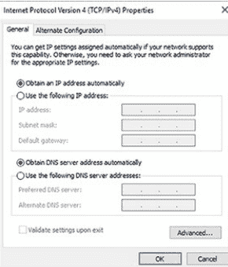

- A. 在 DHCP 服务器上，将其 IP 地址从作用域中排除。
- B. 在他们的计算机上，运行 `ipconfig /release` 和 `ipconfig /renew`。
- C. 在他们的计算机上，设置为使用下列 IP 地址，并为他们分配一个不同的地址。
- D. 使用数据包嗅探器确定拥有重复地址的计算机，并将该计算机设置为自动获取 IP 地址。

132. 你正在排查一台不断在页面上产生垂直黑线的激光打印机。哪个组件最可能导致此问题？

- A. 定影组件
- B. 拾纸辊
- C. 出纸辊
- D. 感光鼓（EP drum）

133. 用户报告他的平板电脑屏幕非常昏暗，难以看清。他已将亮度调整到最大，但屏幕仍然昏暗。哪个组件很可能导致此问题？

- A. 背光
- B. 转换器
- C. 显示屏
- D. 显卡

134. 你一直在排查一台计算机，你认为电源已发生故障。以下哪些工具可用于测试电源的完整性？（选择两项。）

- A. 电源测试仪
- B. 回环插头
- C. POST 卡
- D. 万用表

135. 一位用户试图在投影仪上显示演示文稿，但外部屏幕上没有显示任何内容。他们尝试切换 LCD 截止开关，但没有用。另一位用户刚刚在投影仪上进行过演示，当时工作正常。哪个组件最可能导致此问题？

- A. 背光
- B. 显示屏
- C. 显卡
- D. 逆变器

136. 一位手机用户无法连接他的无线耳机来进行免提通话。他的 iPhone 屏幕显示如下。最可能的问题是什么？

- A. 他的无线耳机已关闭。
- B. 蓝牙已禁用。
- C. AirPlay 已禁用。
- D. 飞行模式已启用。

137. 一位用户打来电话报告她无法访问互联网或其他任何网络资源。她电脑上的 IP 地址是 169.254.1.102。以下哪项最可能导致这种情况？

- A. 无法连接到 DNS 服务器
- B. 无法连接到 DHCP 服务器
- C. 无法连接默认网关
- D. 无法读取本地主机配置文件

138. 在经历一场电雷暴后的第二天，你正在排查一台计算机。开机后，它在屏幕上短暂闪烁信息，然后重新引导。此后，它不断自动重新引导。哪些组件最可能导致此问题？（选择两项。）

- A. 硬盘
- B. 电源
- C. 主板
- D. CPU

139. 在过去五分钟内，大楼某个区域的几位用户打电话报告他们失去了网络连接。当天早些时候它还在正常工作。最可能导致问题的原因是什么？

- A. 故障的网络卡驱动程序
- B. 错误的 TCP/IP 配置
- C. 损坏的网络电缆
- D. 故障的交换机

140. 你网络上的所有计算机都存在间歇性的互联网连接问题。有些网站可以访问，而有些则不行。如果你想要通过验证到问题网站的路径来追踪问题，你应该使用哪个工具？

- A. `ping`
- B. `netstat`
- C. `tracert`
- D. `nslookup`

## 第 5 章
## Windows 操作系统

**本章涵盖的 COMP TIA A+ 考试 220-902 主题包括以下内容：**

**1.1 比较和对比 Microsoft 操作系统（Windows Vista、Windows 7、Windows 8、Windows 8.1）的各种特性和要求。**

- 特性：
  - 32 位与 64 位
  - Aero、小工具、用户账户控制、BitLocker、影子副本、系统还原、就绪提升、侧边栏、兼容模式、虚拟 XP 模式、轻松传送、管理工具、Defender、Windows 防火墙、安全中心、事件查看器、文件结构和路径、类别视图与经典视图
  - 并行应用程序、Metro UI、固定、One Drive、Windows 商店、多监视器任务栏、魅力菜单、开始屏幕、Power Shell、Live 登录、操作中心
  - 升级路径 – 就地升级、兼容工具、Windows 升级 OS 顾问之间的差异

**1.2 根据场景，使用适当的方法安装 Windows PC 操作系统。**

- 启动方法
  - USB
  - CD-ROM
  - DVD
  - PXE
  - 固态/闪存驱动器

## 1.2 安装方法与配置
- 网络启动（Netboot）
- 外部/热插拔驱动器
- 内部硬盘（分区）

### 安装类型
- 无人值守安装
- 升级
- 全新安装
- 修复安装
- 多重启动
- 远程网络安装
- 映像部署
- 恢复分区
- 刷新/恢复

### 分区
- 动态
- 基本
- 主分区
- 扩展分区
- 逻辑分区
- GPT

### 文件系统类型/格式化
- ExFAT
- FAT32
- NTFS
- CDFS
- NFS
- ext3, ext4

- 快速格式化与完整格式化
- 必要时加载第三方备用驱动程序
- 工作组与域设置
- 时间/日期/区域/语言设置
- 驱动程序安装、软件及 Windows 更新
- 工厂恢复分区
- 具有正确分区/格式且格式正确的启动驱动器

## 1.3 根据场景，应用合适的 Microsoft 命令行工具。
- TASKKILL
- BOOTREC
- SHUTDOWN
- TASKLIST
- MD
- RD
- CD
- DEL
- FORMAT
- COPY
- XCOPY
- ROBOCOPY
- DISKPART
- SFC
- CHKDSK
- GPUPDATE
- GPRESULT
- DIR
- EXIT
- HELP
- EXTRACT
- [command name] /?
- 标准权限可用的命令与管理员权限可用的命令。

## 1.4 根据场景，使用合适的 Microsoft 操作系统功能和工具。
- 管理
  - 计算机管理
  - 设备管理器
  - 本地用户和组
  - 本地安全策略
  - 性能监视器
  - 服务
  - 系统配置
  - 任务计划程序
  - 组件服务
  - 数据源
  - 打印管理
  - Windows 内存诊断
  - Windows 防火墙
  - 高级安全
- MSCONFIG
  - 常规
  - 引导
  - 服务
  - 启动
- 工具
- 任务管理器
  - 应用程序
  - 进程
  - 性能
  - 网络
  - 用户
- 磁盘管理
  - 驱动器状态
  - 装载
  - 初始化
  - 扩展分区
  - 拆分分区
  - 收缩分区
  - 分配/更改驱动器号
  - 添加驱动器
  - 添加阵列
  - 存储空间
- 其他
  - 用户状态迁移工具 (USMT)
  - Windows 轻松传送
  - Windows 升级顾问
- 系统实用工具
  - REGEDIT
  - COMMAND
  - SERVICES.MSC
  - MMC
- MSTSC
- NOTEPAD
- EXPLORER
- MSINFO32
- DXDIAG
- DEFRAG
- 系统还原
- Windows Update

## 1.5 根据场景，使用 Windows 控制面板实用工具。
- Internet 选项
  - 连接
  - 安全
  - 常规
  - 隐私
  - 程序
  - 高级
- 显示/显示设置
  - 分辨率
  - 颜色深度
  - 刷新率
- 用户帐户
- 文件夹选项
  - 查看隐藏文件
  - 隐藏扩展名
  - 常规选项
  - 查看选项
- 系统
  - 性能（虚拟内存）
  - 远程设置
  - 系统保护
- Windows 防火墙
- 电源选项
  - 休眠
  - 电源计划
  - 睡眠/挂起
  - 待机
- 程序和功能
- 家庭组 (HomeGroup)
- 设备和打印机
- 声音
- 疑难解答
- 网络和共享中心
- 设备管理器

## 1.6 根据场景，在客户端/台式机上安装和配置 Windows 网络。
- 家庭组 (HomeGroup) 与工作组 (WorkGroup)
- 域设置
- 网络共享/管理共享/映射驱动器
- 打印机共享 vs. 网络打印机映射
- 建立网络连接
  - VPN
  - 拨号
  - 无线
- 有线
  - WWAN (蜂窝)
- 代理设置
- 远程桌面连接
- 远程协助
- 家庭、工作或公用网络设置
- 防火墙设置
  - 例外
  - 配置
  - 启用/禁用 Windows 防火墙
- 在 Windows 中配置备用 IP 地址
  - IP 寻址
  - 子网掩码
  - DNS
  - 网关
- 网卡属性
  - 半双工/全双工/自动
  - 速度
  - 网络唤醒 (Wake-on-LAN)
  - QoS
  - BIOS (板载网卡)

## 1.7 使用合适的 Windows 操作系统工具执行常见的预防性维护程序。
- 最佳实践
  - 计划备份
  - 计划磁盘维护
  - Windows 更新
- 补丁管理
- 驱动程序/固件更新
- 防病毒/防恶意软件更新
- 工具
  - 备份
  - 系统还原
  - 恢复映像
  - 磁盘维护实用工具

1. 您想要创建 Windows 8.1 系统配置的备份，以便在系统崩溃时进行恢复。您应该创建什么？
- A. 还原点
- B. 系统还原
- C. Windows 备份
- D. 卷影副本

2. 您有一台安装了多台打印机的 Windows 7 专业版计算机。以下哪个管理工具允许您通过单一界面管理多个打印服务器和打印机？
- A. 控制面板中的打印机应用
- B. 打印管理
- C. 设备管理器
- D. 服务

3. Microsoft 允许用户免费访问基于云的存储帐户。该服务的名称是什么？
- A. OneDrive
- B. WinCloud
- C. Shadow Copy
- D. Microsoft Cloud

4. 您正在与供应商讨论需要在几台 Windows 8 工作站上进行的配置更改。您决定做笔记以免忘记说明。Windows 中自带哪个应用程序允许您创建和编辑基本文本文档？
- A. Word
- B. 记事本
- C. WordPad
- D. 命令

5. 您正在一台 Windows 7 工作站上工作，需要执行一项管理任务。但是，您不记得需要使用的实用工具的名称。哪个管理工具为您提供其他有用的 Windows 管理工具列表，并允许您通过点击名称启动它们？
- A. MSCONFIG.EXE
- B. EVENTVWR.EXE
- C. TASKMGR.EXE
- D. CONTROL.EXE

6. Windows 7 的哪个功能允许所有用户（不仅仅是管理员）在 NTFS 卷上加密文件，甚至一次加密一个文件，以提高数据安全？
- A. BitLocker
- B. EFS
- C. Shadow Drive
- D. OneDrive

7. 您有一台设置为工作组的 Windows 7 专业版计算机，您需要对其进行一些例行的管理任务。您可以通过计算机管理 MMC 配置以下哪两项？（选择两项。）
- A. 硬盘
- B. 文件权限
- C. Windows 防火墙
- D. 共享文件夹

8. 您位于 Windows Vista 命令提示符处。您输入什么命令可以关闭命令提示符窗口？
- A. quit
- B. exit
- C. close
- D. /x

9. 您正在查找有关 Windows 工作站硬件资源的一般信息。您需要输入哪个命令到运行框中才能显示此处所示的实用工具？
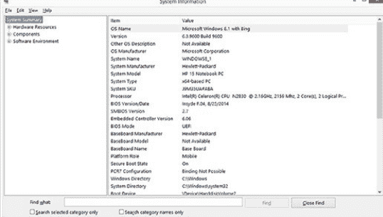
- A. DxDiag
- B. COMPmgmt
- C. MSINFO32
- D. MMC

10. 您的经理要求您调查在一台 Windows 8.1 计算机上安装数据库的可能性。您将使用哪个 Windows 管理工具来查看计算机上已安装的数据库驱动程序？
- A. 本地安全策略
- B. 组件服务
- C. 设备管理器
- D. 数据源

11. 您最近对一台 Windows 8.1 工作站进行了一些配置更改，现在它运行不稳定。您重启计算机并进入 Windows 恢复环境。您应该做什么来回滚这些最近的更改？
- A. 恢复 (Recover)
- B. 刷新 (Refresh)
- C. 重置 (Reset)
- D. 还原 (Restore)

12. 您的技术人员之一需要使用任务管理器实用工具。她打开任务管理器的两种方法是什么？（选择两项。）
- A. 按下 Ctrl+Alt+Delete，然后单击任务管理器。
- B. 按下 Ctrl+Shift+T。
- C. 按下 Ctrl+Alt+T。
- D. 按下 Ctrl+Shift+Esc。

13. 您位于一台 Windows 7 工作站命令提示符处。您想知道针对特定用户强制执行的一组组策略和本地策略设置是什么。您可以使用哪个命令来理解这一点？
- A. `gpedit`
- B. `gprefresh`
- C. `gpresult`
- D. `gpupdate`

14. 你有一台 Windows 7 工作站，需要配置程序在启动时加载。你应该使用哪个管理工具来完成此操作？
- A. 任务计划程序
- B. 系统配置
- C. 计算机管理
- D. 程序和功能

15. 你选择在一台当前运行 Windows 7 专业版的工作站上安装 Windows 8 专业版。你选择了自定义安装，但没有格式化硬盘。关于 Windows 7 专业版，以下哪项陈述是正确的？
- A. 它被永久地从硬盘中删除。
- B. 其设置迁移到 Windows 8，并且它被从硬盘中删除。
- C. 它作为双启动选项保留 28 天，然后从硬盘中删除。
- D. 其文件被放置在一个名为 `Windows.old` 的文件夹中，保留 28 天，然后从硬盘中删除。

16. 你的经理要求你准备对 50 台具有相同硬件配置的 Windows 7 工作站进行无人值守安装。对于这种类型的安装，哪种安装方式最高效？
- A. 全新安装
- B. 升级安装
- C. 自定义安装
- D. 映像部署

17. 哪个 Windows 8 实用程序允许你以分类视图或经典视图查看项目？
- A. 管理工具
- B. 系统实用程序
- C. 磁盘管理
- D. 控制面板

18. Windows 8 的哪个功能允许你基于 Microsoft .NET 编程框架编写脚本文件？
- A. OneDrive
- B. 事件查看器
- C. PowerShell
- D. 任务计划程序

19. 用户希望确保其硬盘已加密以实现最大的数据安全。你可以让用户在运行框中输入哪两个命令来查看 BitLocker 驱动器加密服务是否已启用？
- A. `SERVICES.MSC`
- B. `PERFMON.EXE`
- C. `COMPMGMT.MSC`
- D. `BIDES.MSC`

20. 你有一台运行 Windows 7 家庭高级版 64 位系统的计算机，你想将其升级到 Windows 7 旗舰版 64 位。你应该运行什么来确定你的计算机是否支持新的操作系统？
- A. 硬件兼容性列表
- B. Windows 升级助手
- C. Windows 升级顾问
- D. Windows 轻松传输

21. Windows 的哪个功能允许你将你喜欢的应用程序图标放置在开始菜单、桌面或任务栏上，以便快速访问？
- A. 粘附
- B. 固定
- C. 发布
- D. 轻松启动

22. 你在 Windows 7 命令提示符处。有一个名为 d:\files 的目录，你想删除它。它目前包含六个子目录和数十个文件。你应该使用哪个命令来删除 d:\files？
- A. `del d:\files /s`
- B. `del d:\files /q`
- C. `rd d:\files /s`
- D. `rd d:\files /q`

23. 哪个在 Vista 中引入的 Windows 功能允许你在桌面上放置可定制的程序，例如时钟或天气？
- A. 魔法
- B. 小工具组件
- C. 小工具
- D. 侧边栏

24. 你刚刚将一台 Windows XP 家庭版计算机升级到 Windows Vista 家庭基础版。升级完成后几天，你重新启动计算机，系统提示你只能再使用 Windows Vista 25 天。你必须做什么来消除此消息？
- A. 购买完整的 Windows Vista 家庭基础版。
- B. 升级到 Windows Vista 家庭高级版。
- C. 注册 Windows Vista 家庭基础版。
- D. 激活 Windows Vista 家庭基础版。

25. 关于 Windows 到 Go (WTG)，以下哪些陈述是正确的？（选择两项。）
- A. 它不支持 BitLocker。
- B. 它需要 USB 3.0 驱动器。
- C. 它不支持操作系统升级。
- D. 它适用于 Windows 7 和 Windows 8/8.1。

26. Windows 7 的哪个功能提供反间谍软件保护？
- A. Windows 恶意软件清除工具
- B. Windows 防火墙
- C. Windows 保护程序
- D. Windows 操作中心

27. 你在 Windows 8.1 命令提示符处，当前目录中包含一个 Windows 柜台式压缩文件（cabinet file）。如果你想从该柜台式压缩文件中提取文件，你应该使用哪个命令？
- A. `extract`
- B. `expand`
- C. `unzip`
- D. `excab`

28. 你认为有人正在使用暴力破解方法猜测密码，试图入侵一台 Windows 8.1 工作站。为了阻止攻击者，如果你想锁定该账户在有五次登录失败尝试时，应该使用哪个管理工具来配置此设置？
- A. `SECPOL.MSC`
- B. `COMPMGMT.MSC`
- C. `SECMON.EXE`
- D. `MSRA.EXE`

29. 在 Windows Vista 和 Windows 7 中可用的哪个功能用于创建文件的快照，即使文件正在使用，以便在原文件被意外删除或覆盖时进行恢复？
- A. 卷影副本
- B. Windows 备份
- C. OneDrive
- D. 轻松传输

30. 在 Windows 8.1 命令提示符处，你想删除当前目录中的只读文件 `doc.txt`。你不希望 Windows 询问你是否允许删除该文件。删除该文件的语法是什么？
- A. `del doc.txt /y /r`
- B. `del doc.txt /y /f`
- C. `del doc.txt /q /r`
- D. `del doc.txt /q /f`

31. 你正准备对一台 Windows 8.1 工作站进行重大配置更改。在开始之前，你可以运行哪个命令来确保工作站有一个当前的还原点？
- A. `MSRA.EXE`
- B. `RSTUI.EXE`
- C. `MSTSC.EXE`
- D. `COMPMGMT.MSC`

32. 你需要检查 `c:` 驱动器上主要 Windows 系统文件的完整性，这些文件默认是隐藏的。你可以使用哪个工具来查看隐藏文件？
- A. 计算机管理
- B. 系统配置
- C. 本地安全策略
- D. Windows 资源管理器

33. 以下哪些功能首次出现在带有 Windows 8 的 Microsoft 操作系统中？（选择两项。）
- A. 固定
- B. Windows 商店
- C. PowerShell
- D. 魔法

34. 你正在为拥有 Windows 7 和 Windows 8/8.1 工作站的小办公室创建一个网络。他们不希望进行集中式安全管理，但希望轻松共享打印机和文件，包括库。你应该推荐哪种类型的网络设置？
- A. 工作组
- B. 家庭组
- C. 分布式
- D. 域

35. 客户想要安装一个新的电子游戏，他读到该游戏需要 DirectX 11。他担心他的 Windows 8.1 计算机不支持此版本；你应该告诉他运行哪个命令来查看他是否正确？
- A. MSTSC
- B. MSINFO32
- C. MMC
- D. DxDIAG

36. 你需要在一台当前没有操作系统的 PC 上安装 Windows 7。开始此安装可接受的启动方法有哪些？（选择所有适用项。）
- A. PXE
- B. CD-ROM
- C. USB
- D. 内部硬盘
- E. DVD

37. 你正在一台 Windows 8.1 工作站上工作，想要查看处理器繁忙程度和内存使用量的统计数据。以下哪两个工具可以轻松地让你完成此操作？（选择两项。）
- A. CONTROL.EXE SYSTEM
- B. COMP.MGMT.MSC
- C. SERVICES.MSC
- D. PERFMON.EXE

38. 你计划将 Windows 7 安装到将加入现有 Windows Server 域的几个几十台计算机上。你可以安装在这些客户端计算机上的最低配版本 Windows 7 是哪个？
- A. Windows 7 企业版
- B. Windows 7 启动版
- C. Windows 7 专业版
- D. Windows 7 家庭高级版

39. Windows 8 的哪个功能允许用户登录操作系统、从 Windows 商店下载应用程序并同步文件到云端，只需一次登录？
- A. Microsoft SSO
- B. 登录同步
- C. OneDrive
- D. Live 登录

40. 你的网络上有几台 Windows 7 和 Windows 8.1 工作站。在任何操作系统补丁应用到你的工作站之前，你想审阅它们。你在哪个工具中配置此设置？
- A. Windows 补丁管理
- B. Windows 更新
- C. 计算机管理
- D. 系统配置

41. 你最近将你的 Windows 7 工作站连接到一个云存储服务。你希望确保基于云的服务每天早晨 2:30 与你的桌面同步

上午。你应该使用哪个 Windows 管理实用程序来启用此功能？

- A. 任务计划程序
- B. 事件查看器
- C. 组件服务
- D. 数据源

**42**. 你正在一台 Windows 工作站上工作，但不确定它运行的是哪个版本的 Windows。你可以在搜索框中输入哪个命令来确定版本并显示此处所示的信息？

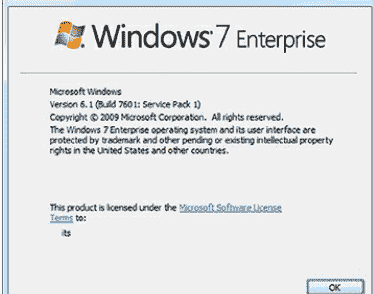

- A. wined
- B. winspec
- C. wininfo
- D. winver

**43**. 你正在一台工作站上安装 Windows 7。你想使用 Linux 也支持的文件系统格式化硬盘。你应该选择哪种文件系统？

- A. NTFS
- B. NFS
- C. ext3
- D. ext4

**44**. 一名用户的 Windows 8.1 工作站正在报告“内存不足”错误。由于无法升级物理 RAM，你希望增加可用的虚拟内存量。你应该在哪里进行操作？

- A. 控制面板 ❯ 计算机管理 ❯ 高级系统设置 ❯ 性能
- B. 控制面板 ❯ 内存 ❯ 高级系统设置 ❯ 性能
- C. 控制面板 ❯ 设备管理器 ❯ 高级系统设置 ❯ 性能
- D. 控制面板 ❯ 系统 ❯ 高级系统设置 ❯ 性能

**45**. 哪个 Windows 8 功能提供了一个区域，用户可以在其中点击或轻点磁贴来打开应用程序、网站、文件和其他项目？

- A. 开始屏幕
- B. 应用中心
- C. Windows 应用商店
- D. 桌面

**46**. 你的经理有一台运行 Windows 8.1 的笔记本电脑。她希望配置笔记本电脑，使其在使用电池电源时，如果在无操作后 5 分钟，显示屏自动关闭。当笔记本电脑插入电源时，她希望显示屏在无操作状态下保持最多 45 分钟的活动时间。她应该在哪里配置这些设置？

- A. 控制面板 ❯ 电源选项
- B. 控制面板 ❯ 计算机管理
- C. 控制面板 ❯ 性能监视器
- D. 控制面板 ❯ 系统配置

**47**. 你有一台配置在工作组中的 Windows 7 专业版工作站。你希望配置该工作站，要求用户每 90 天重置一次密码。你应该使用哪个管理实用程序来实现这一点？

- A. 用户和组
- B. 系统配置
- C. 本地安全策略
- D. 高级安全

**48**. 你网络中的一台 Windows 7 工作站损坏了关键的操作系统文件。在不丢失用户文件的情况下，修复此安装的最有效方法是什么？

- A. 从 Windows 7 光盘启动并执行干净安装。
- B. 从网络启动并执行远程网络安装。
- C. 进入 Windows RE 并修复安装。
- D. 从恢复分区启动并重置 Windows 7。

**49**. 你的 Windows 7 工作站的硬盘性能随时间推移而下降。为了尝试帮助提升性能，你希望确保硬盘上的文件以连续块的方式写入。你应该使用哪个管理工具来实现这一点？

- A. 磁盘管理
- B. 磁盘碎片整理程序
- C. 磁盘优化器
- D. 设备管理器

**50**. 你销售团队的一名成员希望在出差期间从远程位置工作。他要去的地方没有高速互联网，他将使用调制解调器连接到网络。当 Windows Vista 询问他想建立哪种类型的网络连接时，他应该选择什么？

- A. WWAN
- B. 有线
- C. 无线
- D. 拨号

**51**. 随着 Windows 8 引入的用户界面叫什么名字？

- A. Aero
- B. Metro
- C. WinPE
- D. Windows 资源管理器

**52**. 你的其中一台工作站运行 Windows 7，并且偶尔会崩溃。你认为这是操作系统问题而非硬件问题。你决定将该计算机升级到 Windows 8.1；然而，如果这些错误是软件相关的，你希望避免继续出现这些错误。你应该执行哪种类型的安装？

- A. 升级
- B. 无人值守
- C. 迁移
- D. 干净

**53**. 你打开了一个 Windows 7 命令提示符。你当前位于 `D:\users` 目录，并希望将 20 个带有 `.doc` 扩展名的文件复制到 `D:\files` 目录。以下哪项陈述是正确的？

- A. 你需要逐个复制文件。
- B. 你可以使用命令 `copy *.doc d:\files`。
- C. 你可以使用命令 `copy all.doc d:\files`。
- D. 你可以使用命令 `copy .doc d:\files`。

**54**. 安装 Windows 8.1 后，你注意到一个名为 Windows 防火墙的应用程序已启用。Windows 防火墙旨在帮助保护你的计算机免受什么威胁？

- A. 病毒和蠕虫
- B. 间谍软件
- C. 火灾
- D. 恶意网络流量

**55**. 一名 Windows Vista 用户使用大量内存密集型应用程序，最近一直收到“内存不足”错误消息。她的计算机有 16GB RAM，并且无法进一步升级。你希望确保她的系统也有充足的虚拟内存；她的交换文件的最小推荐大小是多少？

- A. 8GB
- B. 16GB
- C. 24GB
- D. 48GB

**56**. 你将从服务器上位于的映像安装 Windows 8.1 工作站。工作站需要支持什么才能启用此安装？

- A. 网络启动
- B. 无人值守安装
- C. PXE 启动
- D. USB 启动

**57**. 在多台监视器上显示 Windows 任务栏的功能是在 Windows 的哪个版本中引入的？

- A. Windows 8
- B. Windows 7
- C. Windows Vista
- D. Windows 8.1

**58**. 你选择在一台当前运行 Windows 7 专业版的工作站上安装 Windows 8 专业版。你选择了自定义安装并格式化硬盘。你正在执行哪种类型的安装？

- A. 迁移
- B. 干净
- C. 升级
- D. 增量

**59**. 你位于 Windows 8 命令提示符下。哪个命令允许你复制文件和目录、复制 NTFS 权限并镜像目录树？

- A. `copy`
- B. `xcopy`
- C. `robocopy`
- D. `copyall`

**60**. 你需要在几台目前没有操作系统的客户端计算机上安装 Windows 7。你已创建了一个 PXE 服务器，并将通过网络执行安装。创建 PXE 环境需要什么？

- A. WinPE
- B. WinRE
- C. 一个闪存驱动器
- D. 网络启动

**61**. 一名用户视力较差，难以阅读监视器上的小字体，包括桌面图标。你应该怎么做才能让桌面上的一切看起来更大？

- A. 打开控制面板 > 外观和个性化并降低分辨率。
- B. 打开控制面板 > 外观和个性化并提高分辨率。
- C. 打开控制面板 > 外观和个性化并降低刷新率。
- D. 打开控制面板 > 外观和个性化并提高刷新率。

**62**. 你正在安装一台 Windows Vista 工作站。在加入网络时，它询问你计算机的位置。选项包括家庭、工作和公共。关于这些选项，以下哪项陈述是正确的？

- A. 家庭和工作开启了网络发现，但家庭关闭了 Windows 防火墙。
- B. 家庭开启了网络发现并关闭了 Windows 防火墙。
- C. 家庭和工作开启了网络发现但关闭了 Windows 防火墙。
- D. 家庭和工作开启了网络发现。

**63**. 你办公室中的一台 Windows 7 计算机被销售团队用作文件服务器。`D:` 驱动器上有一个名为 `DailyReports` 的文件夹，销售团队在此提交他们的报告。`D:` 驱动器现在已满。提供更大容量且不干扰对该文件夹访问的最简单方法是什么？

- A. 将一块新硬盘挂载为 `DailyReports` 中的一个子文件夹。
- B. 扩展 `D:` 分区以提供更多空间。
- C. 添加另一块硬盘并为 `D:` 驱动器创建一个数组。
- D. 将 `D:` 分区中一半的数据分割到另一个分区中。

**64**. 一名用户的 Windows 7 工作站存在内存问题。你想查看并找到用户的虚拟内存文件，以查看其大小以及硬盘上是否有足够的空间。你要查找的文件名是什么？

- A. `VMMS32.SYS`
- B. `SWAPFILE.SYS`
- C. `PAGEFILE.SYS`
- D. `VMEMORY.SYS`

**65**. 你位于 Windows Vista 命令提示符下。你需要在 `D:` 驱动器上创建一个名为 files 的目录。什么是

正确的命令和语法是什么？

- A. `cd d:\files`
- B. `cd files d:\`
- C. `md d:\files`
- D. `md files d:\`

66. 用户的 Windows 7 工作站似乎使用了过多的内存。你可以使用哪个管理工具来识别正在使用最多内存的应用程序？

- A. 性能监视器
- B. 计算机管理
- C. Windows 内存诊断
- D. 任务管理器

67. 对于哪个操作系统，你可以获得一个预先配置好的虚拟机（运行在 Windows Virtual PC 模拟器中），允许用户运行基于 Windows XP 的应用程序？

- A. Windows Vista
- B. Windows 7
- C. Windows 8
- D. Windows 8.1

68. 一台 Windows 8 工作站似乎有一个应用程序挂起了，但键盘仍有响应。你可以使用哪个系统工具来结束该应用程序？

- A. 性能监视器
- B. 任务管理器
- C. 计算机管理
- D. MSCONFIG

69. 以下哪种文件系统并非为硬盘设计，而是为光盘媒体设计的？

- A. CDFS
- B. ExFAT
- C. FAT32
- D. NFS

70. 一名初级技术员正在故障排除一台 Windows 8.1 工作站，但他遇到了一些问题。你去帮助他，到达现场时，他打开了下面所示的工具。他运行的是哪个工具？

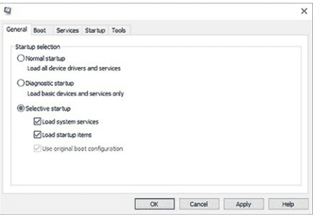

- A. TASKMGR.EXE
- B. CONTROL.EXE
- C. MSCONFIG.EXE
- D. MSINFO32.EXE

71. 你正在故障排除一台远程的 Windows 7 工作站，并希望使用远程协助。但是，该工作站不允许你连接。你应该告诉用户去哪里启用远程协助连接？

- A. 计算机管理 > 远程
- B. 高级安全 > 远程
- C. 系统属性 > 远程
- D. 网络和共享中心 > 远程

72. 你需要建立到远程桌面的连接。哪个 Windows 系统实用程序允许你从命令行或通过图形界面设置和配置这种类型的连接？

- A. MMC
- B. MSTSC
- C. RDPCON
- D. DXDIAG

73. 你的 Windows 7 工作站有一个物理硬盘，其中一个分区占用了整个驱动器。你想在该驱动器上创建第二个分区。完成此操作的最简单方法是什么？

- A. 删除分区并重新创建两个分区。
- B. 在现有分区内创建次级分区。
- C. 缩小分区并在空闲空间创建第二个分区。
- D. 将分区更改为拆分分区。

74. 你有一台 Windows 7 工作站，你正在计划系统配置更改。哪个实用程序允许你在进行这些更改之前备份你的系统配置？

- A. 系统还原
- B. Windows 备份
- C. BitLocker
- D. OneDrive

75. 你在一台 Windows 8.1 的命令提示符处。你可以输入哪个命令来查看可用的系统命令列表？

- A. dir
- B. list
- C. help
- D. cmd

76. 一台 Windows 7 工作站无法正常启动。启动时，你收到错误消息 `Boot sector not found.`。你从 Windows 安装光盘启动并进入 Windows 恢复环境。你应该使用哪个命令来修复此错误？

- A. bootrec.exe /scanos
- B. bootrec.exe /rebuildbcd
- C. bootrec.exe /fixmbr
- D. bootrec.exe /fixboot

77. 你需要格式化一个硬盘以便在其上安装 Windows 7。你将无法选择哪种文件系统？

- A. NFS
- B. FAT32
- C. ext4
- D. NTFS

78. Windows Vista、Windows 7 和 Windows 8/8.1 的哪个功能允许你将可移动驱动器用作临时缓存空间以加快系统速度？

- A. OneDrive
- B. ReadyBoost
- C. 影子副本
- D. Windows 轻松传输

79. 你从电脑供应商处购买了十二台 Windows 8.1 工作站。供应商在硬盘上预留了空间来存储关键操作系统文件的额外副本。这个空间叫什么？

- A. 还原分区
- B. 恢复分区
- C. 重新安装分区
- D. 系统映像

80. 你想配置一台 Windows 8.1 工作站以从外部硬盘启动。为了实现这一点，以下哪项必须为真？（选择两项。）

- A. 该驱动器必须是 USB 接口。
- B. 计算机的 BIOS 必须支持它。
- C. 必须启用 BitLocker。
- D. 外部驱动器必须列在 BIOS 启动顺序中。

81. 哪个版本的 Windows 是第一个具备并排应用功能的，即两个应用程序可以吸附到宽屏显示器的两侧，各占屏幕的一半？

- A. Windows Vista
- B. Windows 7
- C. Windows 8
- D. Windows 8.1

82. 你的 Windows 7 工作站上的数据存储分区空间即将耗尽。它被配置为基本卷。为了扩展此分区，必须满足什么条件？（选择两项。）

- A. 你需要将其转换为动态卷。
- B. 它必须使用 NTFS 格式化。
- C. 它必须扩展到连续的可用空间中。
- D. 它必须是一个主分区。

83. 你有一台配置为工作组的 Windows 7 工作站。在重启计算机以应用更改之前，你想确保没有其他人远程连接到你的工作站。你可以使用哪个管理工具来做到这一点？

- A. 用户和组
- B. 性能监视器
- C. 控制面板 > 网络
- D. 任务管理器

84. 你正在为一个小办公室安装新网络。他们担心安全问题，因此希望由一台计算机进行管理。在安装 Windows 计算机时，你会选择哪种网络配置？

- A. 工作组
- B. 家庭组
- C. 分布式
- D. 域

85. 你在一台 Windows 7 的命令提示符处。一个进程冻结了，导致计算机响应缓慢。查找该进程及其使用的 CPU 时间的语法是什么？

- A. `tasklist /s`
- B. `tasklist /v`
- C. `tasklist /svc`
- D. `tasklist /c`

86. 你正在将几个用户帐户的用户文件和应用程序从 Windows Vista 迁移到 Windows 7。Microsoft 推荐你使用哪个工具来执行此传输？

- A. 用户状态迁移工具 (USMT)
- B. Windows 轻松传输 (WET)
- C. Windows 迁移工具 (WMT)
- D. 控制面板中的用户帐户

87. 你在一台 Windows 8.1 的命令提示符处，位于 `D:\users\jdoe\files` 目录中。你可以使用什么命令进入 `D:\` 目录？

- A. `cd\`
- B. `cd..`
- C. `cd/`
- D. `cd:\`

88. 你有一台 Windows 7 工作站，你怀疑其内存有故障。你应该使用哪个 Microsoft 工具来检查？

- A. 设备管理器
- B. Windows 内存诊断
- C. 任务计划程序
- D. 计算机管理

89. 你的计算机上有几个重要文件，你承受不起丢失它们的代价。你应该运行哪个 Windows 实用程序以确保拥有这些文件的副本？

- A. 系统还原
- B. 磁盘管理
- C. 备份
- D. 远程桌面

90. 你在一台 Windows 8.1 的命令提示符处。一台名为 Wanda 的远程 Windows 7 工作站运行异常，需要关闭。关闭该远程系统的正确语法是什么？

- A. shutdown /r /m \\wanda
- B. shutdown /s /m \\wanda
- C. shutdown /r /c \\wanda
- D. shutdown /s /c \\wanda

91. 你准备在一台装有固态硬盘 (SSD) 的计算机上安装 Windows 8.1。Microsoft 建议你运行什么以优化此驱动器的性能？

- A. `WinsAT.exe formal`
- B. `WinsAT.exe prepob`
- C. `WinsAT.exe moobe`
- D. `WinsAT.exe media`

92. 你正在使用磁盘管理实用程序查看一台 Windows 7 工作站的硬盘。你想找到计算机从中启动的分区。该分区必须被标记为什么？

- A. 基本
- B. 主
- C. 活动
- D. 可引导

93. 你在一台 Windows Vista 的命令提示符处。你认为其中一个 Windows 系统文件已损坏。你应该使用哪个命令来扫描和修复有问题的系统文件？

- A. `sfc /scanfile`
- B. `sfc /scannow`
- C. `sfc /verifyfile`
- D. `sfc /revert`

94. 你刚刚在一台 Windows 8.1 工作站上配置了备用 IP 地址。配置此备用地址的目的是什么？

- A. 允许工作站参与多个网络
- B. 允许工作站同时拥有 IPv4 和 IPv6 地址
- C. 如果首选地址不可用，则提供可用的地址
- D. 屏蔽 IP 地址并隐藏工作站的身份

95. 你在一台 Windows 命令提示符处。你记得你想运行的命令行工具的名称，但不记得需要使用哪个开关。你可以使用什么开关来显示该命令的上下文和使用的开关？

- A. `/help`

**95.** 以下哪个特殊字符用于在 Windows 文件资源管理器中创建文件和文件夹的通配符搜索？

- A. `/?
- B. `/*
- C. `/*
- D. `/#

**96.** 哪个 Windows 功能（随着 Vista 引入）旨在通过提示权限以继续操作，来防止对计算机的非故意或未授权的更改？

- A. BitLocker
- B. PowerShell
- C. Security Center
- D. User Account Control

**97.** 你正在 Windows 7 命令提示符下工作。以下哪些命令需要管理员权限才能运行？（选择两项。）

- A. `chkdsk`
- B. `diskpart`
- C. `tasklist`
- D. `sfc`

**98.** 用户报告其 Windows 8.1 工作站似乎存在操作系统问题。你希望修复安装，但允许她保留其个人文件和应用程序。在 Windows 恢复环境中你应该选择哪个选项？

- A. Reset
- B. Restore
- C. Recover
- D. Refresh

**99.** 用户正在向由 Windows 7 计算机管理的打印机发送作业，但作业没有打印。打印机处于在线并连接状态。根据 A+ 考试准备知识，你知道应该停止并重启打印后台处理程序。你应在哪里执行此操作？

- A. Control Panel › System
- B. Computer Management › Device Manager
- C. Computer Management › Services
- D. Control Panel › Printers and Scanners

**100.** 你在 Windows 8 工作站上，并打开了一个命令提示符。以下哪个命令用于刷新组策略设置并强制其更改生效？

- A. `gpedit`
- B. `gpresult`
- C. `gprefresh`
- D. `gpupdate`

**101.** 你正在对新技术人员进行网络共享培训。你如何告诉他们识别管理共享？

- A. 它们都以单词 `admin` 开头。
- B. 它们都以美元符号（`$`）结尾。
- C. 它们都以 at 符号（`@`）结尾。
- D. 它们都以百分号（`%`）结尾。

**102.** 以下哪一项描述了 Windows 7 中兼容模式的功能？

- A. 它允许你在 32 位操作系统中运行 64 位应用程序。
- B. 它允许你在 32 位操作系统中运行 32 位应用程序。
- C. 它允许你运行专为不同于 Windows 的操作系统设计的程序。
- D. 它允许你配置程序，使其认为正在旧版本的 Windows 上运行。

**103.** 你希望配置一台测试工作站，使其能够启动到 Windows Vista、Windows 7 和 Windows 8.1。关于安装这些操作系统，以下哪项陈述是正确的？

- A. 你无法在一台工作站上安装所有三种操作系统。
- B. 你应该先安装最旧的操作系统，然后依次向最新的操作系统安装。
- C. 你应该先安装最新的操作系统，然后依次向最旧的操作系统安装。
- D. 在这种情况下，操作系统的安装顺序无关紧要。

**104.** 你正在 Windows Server 2012 R2 域中安装 Windows 8.1 客户端。客户端计算机需要能够实施文件和共享权限。哪个 Windows 原生文件系统最能满足你的需求？

- A. FAT32
- B. NFS
- C. NTFS
- D. ext4

**105.** 你需要通过向网络卡发送信号来远程启动网络上的计算机。你需要确保网络卡支持哪种技术？

- A. Remote Boot
- B. Network Boot
- C. Wake-on-LAN
- D. NetBIOS

**106.** 你在 Windows 7 命令提示符下，需要终止名为 winword.exe 的进程。终止此进程的正确上下文是什么？

- A. `taskkill /IM winword.exe`
- B. `taskkill /PID winword.exe`
- C. `taskkill /S winword.exe`
- D. `taskkill /FI winword.exe`

**107.** 你已为无人值守安装创建了一个参考映像。现在你需要编辑映像以定制少数几台工作站。你应该使用哪个工具轻松地做到这一点？

- A. Sysprep
- B. ADK
- C. MDT
- D. WIM

**108.** 你正在网络中安装 Windows Vista 工作站。网络规模较小，且每个用户自行管理其安全性。对于此工作站，哪种网络设置最合适？

- A. Workgroup
- B. Domain
- C. HomeGroup
- D. Localgroup

**109.** 你正在工作站上安装 Windows 8.1，并希望在其三个硬盘上创建条带卷。在磁盘管理中你需要创建什么类型的分区以允许此操作？

- A. Primary
- B. Extended
- C. Logical
- D. Dynamic

**110.** 你有一台运行 Windows Vista Starter 64 位的台式计算机。你可以对以下哪个操作系统进行就地升级？

- A. Windows 7 Home Premium 32-bit
- B. Windows 7 Home Premium 64-bit
- C. Windows 7 Ultimate 64-bit
- D. 以上都不是

**111.** 你有一台配有 64 位处理器且没有操作系统的计算机。当你在该计算机上安装操作系统时，以下哪项是正确的？

- A. 你只能安装 64 位操作系统。
- B. 你只能安装 32 位操作系统。
- C. 你可以安装 64 位或 32 位操作系统。
- D. 你可以安装 64 位操作系统或运行在兼容模式下的 32 位操作系统。

**112.** 你正在 Windows 7 工作站中安装第二块硬盘。在该驱动器上，你需要创建六个不同的逻辑分区。你应该创建什么类型的分区以启用此操作？

- A. Primary
- B. Extended
- C. Active
- D. Spanned

**113.** 你有一台 Windows 7 计算机，你希望将其升级到 Windows 8 Core。哪两个操作系统可以升级到该版本的 Windows 8？（选择两项。）

- A. Windows 7 Starter
- B. Windows 7 Professional
- C. Windows 7 Enterprise
- D. Windows 7 Home Premium

**114.** 你刚在工作站上安装了 Windows 8.1。安装完成后，声卡无法工作。之前它是正常的，并且设备管理器似乎已检测到该卡。你应该尝试采取什么步骤使声卡再次工作？

- A. 重新插拔声卡。
- B. 卸载 Windows 8.1 并重新安装之前的操作系统。
- C. 确保在设备管理器中启用 MIDI 端口。
- D. 安装替代的第三方驱动程序。

**115.** 你有一台配有内置网络卡的 Windows Vista 工作站。该卡间歇性故障。你安装了一张 USB 网络卡，并希望永久禁用内部卡以避免任何冲突。你应该使用哪个管理工具？

- A. Computer Management
- B. System Configuration
- C. Device Manager
- D. Services

**116.** 你有一台配有 32 位处理器且没有操作系统的计算机。当你在该计算机上安装操作系统时，以下哪项是正确的？

- A. 你只能安装 32 位操作系统。
- B. 你只能安装 64 位操作系统。
- C. 你可以安装 64 位或 32 位操作系统。
- D. 你可以安装 32 位操作系统或运行在兼容模式下的 64 位操作系统。

**117.** 你在 Windows 8 工作站中安装了次要硬盘。用户要求你创建一个逻辑分区。以下哪一项是逻辑分区的定义特征？

- A. 它跨越多个硬盘。
- B. 它是活动的。
- C. 它具有驱动器字母。
- D. 它是在扩展分区中创建的。

**118.** 用户 Windows 7 工作站上的应用程序已损坏。你可以在控制面板的哪里尝试修复或重新安装该应用程序？

- A. System
- B. Computer Management
- C. System Configuration
- D. Programs and Features

**119.** 你在 Windows Vista 命令提示符下，位于 `D:\files` 目录中。你想显示所有已设置存档位的文件。你应该使用哪个命令来执行此操作？

- A. `dir /b:a`
- B. `dir /d:a`
- C. `dir /q:a`
- D. `dir /a:a`

**120.** 你刚安装了一台新的 Windows 7 工作站。你希望确保所有新的操作系统补丁在可用时自动安装。你配置哪个管理工具来执行此操作？

- A. Performance Monitor
- B. System Monitor
- C. Advanced Security
- D. Windows Update

**121.** 你想在你的 Windows 7 计算机上创建一个桌面快捷方式，指向一个 Windows 管理工具，该工具可让你快速访问以管理硬盘、用户帐户、计划任务和事件查看器。你应该为哪个创建快捷方式？

- A. `PERFMON.EXE`
- B. `MSINFO32.EXE`
- C. `SERVICES.MSC`
- D. `COMPMGMT.MSC`

**122.** 哪个 Windows 7 实用程序允许你查看最近

## 122. 哪个 Windows Vista 实用程序允许你查看安全消息并解决问题，查看计算机的安全状态，以及执行故障排除和维护步骤？
- A. 控制面板
- B. 操作中心
- C. 系统和安全
- D. Windows Defender

## 123. 你办公室里有几台运行 Windows XP Professional 的工作站。你想将它们升级到 Windows Vista。你可以将 Windows XP Professional 升级到 Vista 的哪些版本？（选择两项。）
- A. Windows Vista Enterprise
- B. Windows Vista Home Premium
- C. Windows Vista Ultimate
- D. Windows Vista Business

## 124. 你刚刚为一位用户安装了 Windows Vista 工作站。公司策略规定，用户的 TEMP 文件夹不应位于系统分区。你可以使用哪个管理工具来更改用户临时文件文件夹的位置？
- A. 计算机管理
- B. 用户和组
- C. 本地安全策略
- D. 系统配置

## 125. 你正在一个空的机械硬盘上安装 Windows Vista。在格式化驱动器时，你想选择一个轻量级的文件系统。用户并不关心数据安全。哪种文件系统最能满足用户的需求？
- A. ExFAT
- B. NFS
- C. NTFS
- D. FAT32

## 126. 你有一台运行 Windows Vista Home Basic 32 位版本的台式电脑，并希望升级你的操作系统。你可以执行就地升级到下列哪个操作系统？
- A. Windows 7 Ultimate 32 位
- B. Windows 7 Professional 32 位
- C. Windows 7 Professional 64 位
- D. 以上都不是

## 127. 哪个 Windows Vista 实用程序提供了一个单一界面，用于配置防火墙、获取自动更新以及设置恶意软件保护？
- A. 操作中心
- B. 安全中心
- C. Windows Defender
- D. Windows 防火墙

## 128. 你组织中的一位开发人员为 Windows 8.1 客户机创建了一个新的软件包。他想自定义配置特定的应用程序访问权限。他会使用哪个管理工具来做到这一点？
- A. 系统配置
- B. 高级安全
- C. 组件服务
- D. 用户和组

## 129. 你办公室里有几台运行 Windows Vista Business 的工作站。你想将它们升级到 Windows 8.1 Pro。以下哪项陈述是正确的？
- A. 从 Vista 到 Windows 8.1 没有直接的升级路径。你必须执行全新安装。
- B. 你只能将 Windows Vista Business 升级到 Windows 8.1 Enterprise。
- C. 你只能将 Windows Vista Business 升级到 Windows 8.1 Basic。
- D. 当你开始升级时，选择“自定义”，然后不要格式化硬盘。

## 130. 你想用 NTFS 文件系统格式化一个硬盘。这是一台 Windows Vista 计算机上的 D: 驱动器。你在命令提示符使用哪个命令来执行此操作？
- A. format d: /fs:ntfs
- B. format d: /ntfs
- C. format d: /v:ntfs
- D. format d: /q:ntfs

## 131. 你正在尝试更新一台 Windows Vista 工作站。在更改配置后，系统无法正常启动。另一位技术人员建议将操作系统还原到先前的配置设置。你可以使用哪个工具来做到这一点？
- A. Windows Update
- B. 计算机管理
- C. 系统还原
- D. 系统配置

## 132. 一名用户报告说，她的网络性能最近似乎变得非常缓慢。在调查她的网卡属性时，你注意到她的网卡被设置为半双工。这意味着什么？
- A. 这是网卡的正常操作设置。
- B. 她所连接的交换机将其网卡配置为在此模式下运行，以实现向后兼容。
- C. 需要将该卡设置为单工模式才能使其运行得更快。
- D. 需要将该卡设置为全双工模式才能使其运行得更快。

## 133. 你最近向网络上的几台 Windows 工作站部署了一个自定义应用程序。该应用程序似乎存在一个 bug，开发人员建议你编辑注册表来修复它。你会使用哪个管理工具来做到这一点？
- A. MSINFO32
- B. COMMAND
- C. REGEDIT
- D. NOTEPAD

## 134. 你将在一台 Windows 7 工作站上安装几个新的高资源密集型应用程序，而用户担心系统性能。你想监控内存和 CPU 性能，并设置工作站以记录随时间推移的性能。你应该使用哪个实用程序来设置此功能？
- A. 资源监视器
- B. 性能监视器
- C. 任务管理器
- D. 事件查看器

## 135. 哪个 Windows 7 实用程序允许你查看由应用程序生成的错误消息或登录失败？
- A. 操作中心
- B. Windows Defender
- C. 消息中心
- D. 事件查看器

## 136. 一名拥有 Windows 8.1 工作站的最近更新获得了第二块硬盘。另一位管理员在硬盘上创建了一个分区，并准备就绪。他会将在该驱动器上创建的原始视频文件存储在那里，并坚持要求它被称为 R: 驱动器。以下哪项陈述是正确的？
- A. 你可以使用磁盘管理将驱动器号更改为 R:。
- B. 你可以使用磁盘管理将驱动器号更改为 `R:`，但仅限动态磁盘。
- C. 你可以使用磁盘管理将驱动器号更改为 `R:`，但仅限扩展分区。
- D. 你需要使用磁盘管理删除分区并重新创建为 `R:`。

## 137. 你有一台 Windows 8 工作站，其操作系统中存在损坏的文件。它无法正常启动。你需要使用其网卡启动计算机以连接到镜像服务器来恢复 Windows。这种启动过程叫什么？
- A. Netboot
- B. PXE 启动
- C. WinPE 过程
- D. WinRE 过程

## 138. 你需要格式化一张空白的 SDXC 卡并将文件传输到其中。哪种文件系统最适合此类介质？
- A. CD FS
- B. FAT32
- C. NTFS
- D. ExFAT

## 139. 你有一台 Windows 8.1 工作站。你想连接到位于一台 Windows 7 工作站上的打印机。你需要做什么？
- A. 右键单击打印机，选择“打印机属性”，并共享该打印机。
- B. 右键单击打印机，选择“打印机属性”，并映射网络打印机。
- C. 打开“添加打印机向导”并共享该打印机。
- D. 打开“添加打印机向导”并映射网络打印机。

## 140. 你正在一台计算机上安装 Windows Vista。当你分区硬盘时，哪种类型的分区仅限于包含一个逻辑驱动器？
- A. 主分区
- B. 基本
- C. 扩展
- D. GPT

## 141. 一位笔记本电脑用户出差去拜访客户，并忘记了他的电源适配器。在与客户共进午餐之前，他想保存电池电量，但他希望在回来时启用尽可能快的启动，并让他的应用程序已经打开。哪种电源模式可以保存电池寿命但启用最快的启动？
- A. 关机
- B. 睡眠
- C. 休眠
- D. 休息

## 142. 你刚刚在一台 Windows 7 工作站中安装了第二块硬盘。当系统启动时，BIOS 正确识别了该驱动器，但你无法在 Windows 资源管理器中看到它。你需要做什么？
- A. 挂载驱动器。
- B. 分配驱动器号。
- C. 初始化驱动器。
- D. 创建阵列。

## 143. 哪个 Windows 用户界面是第一个具有半透明窗口并提供创建三维开放窗口堆栈以供用户循环浏览的功能的？
- A. Metro
- B. Aero
- C. WinPE
- D. Windows 资源管理器

## 144. 你有一台带有四个硬盘的 Windows 7 工作站。你想通过创建磁盘阵列来利用多个磁盘的优势。在 Windows 中你可以创建哪种类型的阵列，将磁盘组合成一个卷？（选择两项。）
- A. 简单
- B. 跨区
- C. 镜像
- D. 扩展

## 145. 哪些版本的 Windows 7 支持 BitLocker？（选择两项。）
- A. Enterprise
- B. Professional
- C. Ultimate
- D. Home Premium

## 146. 你正在处理一台你认为存在交叉链接文件的 Windows 8.1 工作站。在命令提示符处，你想检查这些文件并自动修复任何问题。你应该运行哪个命令来做到这一点？
- A. chkdsk /f
- B. chkdsk /c
- C. chkdsk /scan
- D. chkdsk /r

## 147. 你正在使用 Windows Vista 中的磁盘管理配置辅助硬盘。在设置基本存储时，你可以创建哪两种类型的分区？（选择两项。）
- A. 主分区
- B. 简单
- C. 扩展
- D. 跨区

## 148. 你正在一台新的工作站上安装 Windows 8.1。

在您使用 NTFS 格式化驱动器之前，您的经理告诉您要执行完全格式化。以下哪项陈述最能描述完全格式化所执行的操作？

- A. 从分区中移除文件，创建新的文件分配表，并扫描硬盘以查找坏扇区。
- B. 从分区中移除文件并创建新的文件分配表。
- C. 创建新的文件分配表并扫描硬盘以查找坏扇区。
- D. 删除分区，重新创建分区，创建新的文件分配表，并扫描硬盘以查找坏扇区。

149. 您处于 Windows 8.1 命令提示符下。您应该使用哪个命令来创建和管理分区？

- A. fdisk
- B. diskpart
- C. sfc
- D. format

150. 您需要将 Windows 8.1 安装到 30 台相同的台式机上。您不希望手动将信息输入到每台台式机中。您应该执行哪种类型的安装？

- A. 升级
- B. 无人值守
- C. 部署
- D. 干净安装

151. 您正在 Windows Vista 命令提示符下工作。您应该使用哪个命令来复制目录和子目录，但不复制空目录？

- A. xcopy /e
- B. xcopy /s
- C. xcopy /h
- D. xcopy /a

152. 您需要配置 Windows 7 工作站上的互联网连接。在“Internet 选项”的哪个标签页中设置主页并启用弹出窗口阻止程序？

- A. 连接，安全
- B. 常规，安全
- C. 常规，隐私
- D. 连接，隐私

## 第 6 章
其他操作系统和技术

COMPTIA A+ 考试 220-902 在本章中涵盖的主题包括以下内容：

## 2.1 识别 Mac OS 和 Linux 操作系统的常见功能和功能。

- 最佳实践
    - 计划备份
    - 计划磁盘维护
    - 系统更新/App Store
    - 补丁管理
    - 驱动程序/固件更新
    - 反病毒/反恶意软件更新

- 工具
    - 备份/时间机器 (Time Machine)
    - 恢复/快照
    - 映像恢复
    - 磁盘维护实用程序
    - Shell/终端
    - 屏幕共享
    - 强制退出

- 功能
    - 多个桌面/Mission Control
    - 钥匙串 (Key Chain)
    - 聚光灯 (Spot Light)
    - iCloud
    - 手势
    - 访达 (Finder)
    - 远程光盘 (Remote Disc)
    - 程序坞 (Dock)
    - Boot Camp

- 基本 Linux 命令
    - ls
    - grep
    - cd
    - shutdown
    - pwd 与 passwd
    - mv
    - cp
    - rm
    - chmod
    - chown
    - iwconfig/ifconfig
    - ps
    - su/sudo
    - apt-get
    - vi
    - dd

## 2.2 在给定场景中，设置和使用客户端虚拟化。

- 虚拟机的目的
- 资源需求
- 仿真器需求
- 安全需求
- 网络需求
- 虚拟机监控程序 (Hypervisor)

## 2.3 识别基本的云概念。

- SaaS
- IaaS
- PaaS
- 公共 vs. 私有 vs. 混合 vs. 社区
- 快速弹性
- 按需
- 资源池化
- 计量服务

## 2.4 总结由联网主机提供的服务的属性和目的。

- 服务器角色
    - Web 服务器
    - 文件服务器
    - 打印服务器
    - DHCP 服务器
    - DNS 服务器
    - 代理服务器
    - 邮件服务器
    - 身份验证服务器

- 互联网设备
    - UTM (统一威胁管理)
    - IDS (入侵检测系统)
    - IPS (入侵防御系统)
- 遗留/嵌入式系统

## 2.5 识别移动操作系统的基本功能。

- Android vs. iOS vs. Windows
- 开源 vs. 闭源/供应商特定
- 应用程序来源（Google Play Store, App Store, 和 Store）
- 屏幕方向（加速度计/陀螺仪）
- 屏幕校准
- GPS 和地理追踪
- WiFi 通话
- 启动器/GUI
- 虚拟助手
- SDK/APK
- 紧急通知
- 移动支付服务

## 2.6 安装和配置基本的移动设备网络连接和电子邮件。

- 无线/蜂窝数据网络（启用/禁用）
    - 热点
    - 网络共享
    - 飞行模式
- 蓝牙
    - 启用蓝牙
    - 启用配对
    - 查找设备以进行配对
    - 输入相应的 PIN 码
    - 测试连接性

- 企业和 ISP 电子邮件配置
    - POP3
    - IMAP
    - 端口和 SSL 设置
    - Exchange, S/MIME
- 集成的商业提供商电子邮件配置
    - Google/Inbox
    - Yahoo
    - Outlook.com
    - iCloud
- PRI 更新/PRL 更新/基带更新
- 无线电固件
- IMEI 与 IMSI
- VPN

## 2.7 总结与移动设备同步相关的方法和数据。

- 要同步的数据类型
    - 联系人
    - 程序
    - 电子邮件
    - 图片
    - 音乐
    - 视频
    - 日历
    - 书签
    - 文档
    - 位置数据
    - 社交媒体数据
    - 电子书

- 同步方法
    - 同步到云
    - 同步到桌面
- 多服务互信验证 (SSO)
- 在 PC 上安装应用程序的软件要求
- 启用同步的连接类型

1. 有一位用户刚购买了一部 Windows Phone。他想知道手机上的虚拟助手叫什么名字。你怎么告诉他？

- A. Windows Phone 没有虚拟助手。
- B. Windy。
- C. Siri。
- D. Cortana。
- E. Alexa。

2. 您网络上的哪种类型的服务器将使用 UDP 端口 67 和 68 与其他计算机进行通信？

- A. 身份验证服务器
- B. 打印服务器
- C. DHCP 服务器
- D. DNS 服务器

3. 哪个 Linux 命令用于将文件从一种格式复制并转换为另一种格式？

- A. dd
- B. cp
- C. mv
- D. rm

4. 您正在为一家移动电话公司提供咨询。他们告诉您，对于新的使用情况跟踪程序，他们想使用那个识别用户及其网络的 15 位数字。他们在寻找哪个数字？

- A. IMEI
- B. IMSI
- C. PRI
- D. PRL

5. 您的经理告诉您要购买基于云的服务。您的网络需要额外的处理能力和文件存储。您应该购买哪种类型的服务？

- A. PaaS
- B. IaaS
- C. SaaS
- D. NaaS

6. 哪种类型的服务器维护一个称为区域文件的数据库，并使用它向客户端提供请求的信息？

- A. 身份验证服务器
- B. DNS 服务器
- C. DHCP 服务器
- D. 代理服务器

7. 您刚加入一个新的网络团队，其中一位同事报告说他对在遗留系统上工作感到沮丧。以下哪项可能是他所指的？（选择两项。）

- A. 在 1980 年代创建的销售管理软件
- B. 运行在 Windows NT 4.0 服务器上的文件服务器
- C. 运行在 Linux 服务器上的会计软件
- D. 运行在 iMac 上的图形艺术软件包

8. 您的公司生产软件并雇用大约 20 名开发人员。他们需要为不同的操作系统编写应用程序。您决定购买基于云的服务来支持开发团队。您应该购买哪种类型的服务，以便他们可以开发他们的程序，然后在不同于开发环境的环境中进行测试？

- A. IaaS
- B. SaaS
- C. PaaS
- D. NaaS

9. 在您的 MacBook Pro 上，用于浏览文件和文件夹的实用程序叫什么名字？

- A. Spotlight
- B. Remote Disc
- C. iCloud
- D. Finder

10. 在使用移动手机时，您想通过 Wi-Fi 网络设置安全连接。您需要启用哪种类型的连接？

- A. VPN
- B. IMEI
- C. IMSI
- D. PRI/PRL

11. 云服务的哪个功能允许您随着公司的需求即时获得额外的存储空间或处理能力？

- A. 无处不在的访问
- B. 快速弹性
- C. 资源池化
- D. 计量服务

## 12. 你需要在 Linux 工作站上启动一个新的 shell，并具有 root 权限。你应该使用哪个命令来执行此操作？
- A. su
- B. sudo
- C. vi
- D. dd

## 13. 哪种类型的云服务为你的公司提供运行业务所需的网络硬件、基础设施和软件？
- A. PaaS
- B. NaaS
- C. IaaS
- D. SaaS

## 14. 在 Linux 中，用户和操作系统之间的解释器的名称是什么？
- A. 终端 (Terminal)
- B. 命令提示符 (Command prompt)
- C. 图形用户界面 (GUI)
- D. Shell

## 15. 用户在其用户名和密码输入到配置在域中的工作站中。哪种类型的服务器会检查她的信息并确定她是否获得网络资源的访问权限？
- A. 身份验证服务器
- B. 代理服务器
- C. 文件服务器
- D. DHCP 服务器

## 16. 在你的网络上，一些用户正在访问不适当网站上的内容。你可以安装哪种类型的服务器来阻止来自禁止网站列表的内容？
- A. DNS 服务器
- B. 身份验证服务器
- C. 代理服务器
- D. Web 服务器

## 17. 网络上的哪种类型的服务器负责监听端口 80 和 443 上的入站流量？
- A. DHCP 服务器
- B. DNS 服务器
- C. 邮件服务器
- D. Web 服务器

## 18. 你正在处理一个 Linux 文件服务器。你会使用哪个命令来查看卷上的可用磁盘空间？
- A. `fsck`
- B. `df`
- C. `du`
- D. `vi`

## 19. 在你的 web 浏览器中，你输入 **www.google.com** 并按下回车键。哪种类型的服务器识别该名称的所有者并告诉你的计算机你想要通信的服务器的 IP 地址？
- A. 代理服务器
- B. DHCP 服务器
- C. DNS 服务器
- D. 身份验证服务器

## 20. 你正在一台工作站上安装虚拟化，该工作站需要支持多个操作系统。哪种类型的 hypervisor 最适合这种环境？
- A. 第 1 类。
- B. 第 2 类。
- C. 第 1 类或第 2 类在该环境中的功能相同。
- D. 虚拟机管理器。

## 21. 手机上的哪部分软件管理手机的所有无线通信？
- A. PRI
- B. PRL
- C. 基带操作系统 (Baseband OS)
- D. SIM 操作系统 (SIM OS)

## 22. 你的网络上有一台运行 macOS Yosemite 的 MacBook。你想对关键操作系统文件进行备份，以防系统崩溃且无法找到硬盘。你应该创建什么？
- A. 恢复磁盘
- B. 映像 (Image)
- C. 快照 (Snapshot)
- D. 时间机器 (Time Machine)

## 23. 一位用户最近离开了公司，你需要将他在 Linux 服务器上的文件所有权变更给新用户。你应该使用哪个命令来执行此操作？
- A. `chown`
- B. `chmod`
- C. `chperm`
- D. `cp`

## 24. 你的网络用户之一有一台运行 OS X Yosemite 的 MacBook Pro。该用户应该去哪里查看是否有可用的 OS 更新？
- A. 打开 App Store 并点击工具栏中的“更新”。
- B. 打开 Safari 并点击工具栏中的“更新”。
- C. 打开系统偏好设置并点击工具栏中的“更新”。
- D. 打开 iTunes 并点击工具栏中的“更新”。

## 25. 哪两个命令在 Linux 中用于检查或修改网络配置设置？（选择两个。）
- A. ipconfig
- B. ifconfig
- C. iwconfig
- D. inconfig

## 26. 你想为你的 iPhone 启用数据同步。关于 Wi-Fi 同步，哪两个说法是正确的？（选择两个。）
- A. 你必须在 iTunes 中启用“通过 Wi-Fi 同步”。
- B. 你只能通过 Wi-Fi 同步到 iCloud。
- C. iPhone 应插入 USB 端口。
- D. iPhone 和计算机必须在相同的网络 SSID 上。

## 27. 你正在配置现有 Windows 8.1 64 位工作站上的客户端虚拟化。你将在虚拟环境中运行 OS X Yosemite。每个操作系统需要 2GB 内存。Windows 需要 20GB 磁盘空间，Yosemite 需要 8GB。这台工作站的最小硬件要求是什么？
- A. 4GB 内存，28GB 磁盘空间
- B. 2GB 内存，20GB 磁盘空间
- C. 2GB 内存，28GB 磁盘空间
- D. 4GB 内存，20GB 磁盘空间

## 28. 哪种类型的服务器在与网络客户端的通信中会大量使用端口 25 和 143？
- A. 打印服务器
- B. 邮件服务器
- C. DHCP 服务器
- D. 身份验证服务器

## 29. 你正在处理一台 Linux 工作站。名为 `docs` 的文件需要重命名为 `newdocs`。执行此操作的正确命令是什么？
- A. ren docs newdocs
- B. mv docs newdocs
- C. cp docs newdocs
- D. rm docs newdocs

## 30. 你想为运行 iOS 的设备下载应用程序。你会从哪里下载它们？
- A. Android Market
- B. Google Play
- C. App Store
- D. Windows Store

## 31. 你在一台 Linux 工作站上，需要搜索多个文件中的文本。你应该使用哪个命令？
- A. sudo
- B. grep
- C. cp
- D. ls

## 32. 你的网络用户之一有一台运行 OS X Mavericks 的 MacBook Pro。她询问你关于安装或更新防病毒软件的问题。你应该告诉她什么？
- A. Mac 没有病毒，所以不需要防病毒软件。
- B. 使用随操作系统提供的免费 MacAntiVirus 程序，并将其设置为自动更新。
- C. 安装商业防病毒程序，并将其设置为自动更新。
- D. 安装基于主机的防火墙，并将其设置为自动更新。

## 33. 你使用的 MacBook 没有内置 DVD 播放器，但你需要访问存储在其中的一些文件。哪个 macOS 功能允许你访问另一台计算机上的 DVD 播放器？
- A. 远程光盘 (Remote Disc)
- B. 访达 (Finder)
- C. 聚焦 (Spotlight)
- D. iCloud

## 34. 你的公司已决定从 Google 购买云服务。Google 提供哪种类型的云？
- A. 公有云
- B. 私有云
- C. 混合云
- D. 社区云

## 35. 你正在使用 MacBook Pro，需要搜索几周前你撰写的一份文档。你应该使用哪个功能来搜索硬盘？
- A. 钥匙串 (Keychain)
- B. 聚焦 (Spotlight)
- C. 访达 (Finder)
- D. Siri

## 36. 你有一台 MacBook Pro，需要运行一个仅与 Windows 兼容的关键工作应用程序。有没有办法做到这一点？
- A. 是的，Macs 可以原生运行 Windows 应用程序。
- B. 是的，使用 Boot Camp 安装 Windows 并进行双系统启动。
- C. 是的，使用 Dock 安装 Windows 并进行双系统启动。
- D. 不，你不能运行该 Windows 应用程序。

## 37. 在 Linux 工作站上，你使用哪个命令来显示目录的内容？
- A. dir
- B. grep
- C. cp
- D. ls

## 38. 你正在配置你的平板电脑连接到你的公司邮件服务器。如果你想使用带 SSL 的 SMTP 和带 SSL 的 IMAP4，你需要设置哪些端口？
- A. 25 和 143
- B. 465 和 993
- C. 465 和 995
- D. 587 和 993
- E. 587 和 995

## 39. 哪个命令用于在 Linux 中更改文件的权限？
- A. chperm
- B. cp
- C. chown
- D. chmod

## 40. 如果你需要刷新手机在漫游时用于连接正确蜂窝电话塔的参考列表，你的手机需要什么类型的更新？
- A. PRL
- B. PRI
- C. 基带 (Baseband)
- D. IMEI

## 41. 你的网络使用 Linux 文件服务器。它有四个卷，每个卷都格式化为 ext4。你想检查 /ops/files 卷是否存在文件系统错误并修复它们。你应该使用哪个命令？
- A. fsck /ops/files
- B. `du /ops/files`
- C. `df /ops/files`
- D. `chkdsk /ops/files`

## 42. 网络顾问建议你的老板安装 IPS。以下哪个陈述最好地描述了 IPS 的作用？
- A. 它检测网络流量中的异常，记录活动，并采取措施停止该活动。
- B. 它检测通过网络传输的病毒，记录活动，并删除感染病毒的分组包。
- C. 它检测网络流量中的异常，记录活动，并向管理员发送警报。
- D. 它根据一组规则允许或拒绝入站网络流量。

## 43. 哪个移动操作系统的版本以糖果或甜点类型命名？
- A. BlackBerry OS
- B. Android
- C. iOS
- D. Windows Phone

## 44. 你网络上的其中一位设计师有一台运行 OS X El Capitan 的 iMac。以下哪一项对于此工作站来说不是必需的？
- A. 运行定期备份
- B. 安装防病毒软件
- C. 更新驱动程序和固件
- D. 整理硬盘碎片

## 45. 你网络上的哪种类型的服务器功能可以用 NAS 或 SAN 替代？

## 题目 45（续）
- A. 邮件服务器
- B. 文件服务器
- C. 打印服务器
- D. Web 服务器

## 46. 你有一台 MacBook Pro，想要与一小群 Mac 用户共享文件。由于你的团队经常编辑这些文件，你希望确保每个人都能在线访问文件的相同版本。你应该使用哪种存储解决方案？

- A. iCloud
- B. 访达
- C. 远程光盘
- D. 聚光灯

## 47. 你正在使用的 Linux 工作站似乎很慢。你想知道计算机上正在运行哪些进程。你应该使用哪个命令？

- A. vi
- B. cp
- C. dd
- D. ps

## 48. 你在一台 iMac 上工作，大约有十几个应用程序处于打开状态。哪个功能可以让你轻松地看到所有这些应用程序并切换到你想要的应用程序？

- A. 聚光灯
- B. 钥匙串
- C. 调度中心
- D. 访达

## 49. 你正在配置你的 Android 手机，使其与 Windows 8.1 工作站同步。以下哪种类型的数据不会在设备之间同步？

- A. 密码
- B. 书签
- C. 电子邮件
- D. 社交媒体数据

## 50. 你的经理要求你寻找一种用于网络安全的设备。他希望该设备能够执行数据包过滤，终止网络攻击，阻止垃圾邮件，并禁止访问不适当的网站。你应该寻找哪种类型的设备？

- A. 防火墙
- B. 入侵防御系统 (IPS)
- C. 入侵检测系统 (IDS)
- D. 统一威胁管理 (UTM)

## 51. 你的公司有一位应用程序开发人员，她为 Windows、Linux 和 macOS 创建程序。为了让她能够尽可能快地在多个操作系统中测试她的程序，最具成本效益的解决方案是什么？

- A. 为她编写代码的每个操作系统购买工作站。
- B. 将她的工作站设置为双启动。
- C. 在她的工作站上设置虚拟机。
- D. 创建每个应用程序的一个版本，使其可以在所有三个操作系统中运行。

## 52. 你的一位用户有一台 MacBook Pro，并且某个应用程序似乎已崩溃。她可以使用什么来强制关闭该应用程序？

- A. 任务管理器
- B. 强制退出
- C. Shell/终端
- D. 时间机器

## 53. 哪种类型的云服务提供最佳的安全性？

- A. 社区云
- B. 私有云
- C. 公有云
- D. 混合云

## 54. 一位使用 Android 手机的用户报告说手机没有正确检测她触摸虚拟键盘的位置——似乎有点偏差。她应该做什么来解决这个问题？

- A. 重新校准屏幕。
- B. 关闭手机然后再打开。
- C. 执行恢复出厂设置。
- D. 购买新设备。

## 55. 你打电话给你的蜂窝电话服务商进行故障排除，他们告诉你他们需要手机的 15 位序列号。他们在找什么号码？

- A. PRI
- B. PRL
- C. IMEI
- D. IMSI

## 56. 你正在 Linux 工作站上更新用户账户，需要更改用户的密码。你使用哪个命令来执行此操作？

- A. chperm
- B. cp
- C. pwd
- D. passwd

## 57. 一位用户希望在他运行 OS X El Capitan 的 MacBook 上执行备份。他应该使用哪个软件实用程序来执行此操作？

- A. Image Recovery
- B. 时间机器
- C. iBackupup
- D. MacBackupup

## 58. 以下哪个移动操作系统是开源操作系统？

- A. iOS
- B. Windows Phone
- C. BlackBerry OS
- D. Android

## 59. 你在一台网络上的 Linux 工作站前，终端已打开。你可以发出哪个命令来查看此计算机上文件和目录的大小？

- A. fsck
- B. df
- C. du
- D. vi

## 60. 你希望在 Linux 服务器上启动可视化文件编辑器。使用哪个命令来执行此操作？

- A. cd
- B. ps
- C. vi
- D. cp

## 61. 你正在一台服务器上设置虚拟化，该服务器将运行四个 Windows Server 2012 R2 实例。四个不同的部门将各使用一个实例，并且所有部门都被承诺获得 16GB RAM。使用资源池化和裸金属 hypervisor，该服务器所需的最小物理 RAM 量是多少？

- A. 16GB
- B. 32GB
- C. 64GB
- D. 8GB

## 62. 你网络中的一台工作站运行 Ubuntu Linux。你可以使用哪个命令来安装补丁以升级操作系统？

- A. `apt-cache`
- B. `apt-get`
- C. `vi-get`
- D. `chown-get`

## 63. 你正在配置 iPhone 上的 Mail 应用程序，以使用 Outlook.com 电子邮件地址。你需要输入什么配置信息来建立连接？

- A. `电子邮件地址和密码`
- B. `电子邮件地址、密码和服务器名称`
- C. `电子邮件地址、密码、服务器名称和邮件协议`
- D. `电子邮件地址、密码、服务器名称或 IP 地址，以及邮件协议`

## 64. 以下哪些功能通常默认存在于移动操作系统中，但不存在于桌面操作系统中？（选择两项。）

- A. `SDK`
- B. `电源选项`
- C. `基于手势的交互`
- D. `紧急通知`

## 65. macOS 的哪个功能允许他人看到你的屏幕，并且需要虚拟网络计算 (VNC) 连接？

- A. `远程协助`
- B. `Shell/终端`
- C. `图像共享`
- D. `屏幕共享`

# 第 7 章 安全

**本章涵盖的 COMPTIA A+ 考试 220-902 主题包括以下内容：**

## 3.1 识别常见的安全威胁和漏洞。

- 恶意软件
  - 间谍软件
  - 病毒
  - 蠕虫
  - 木马
  - Rootkit
  - 勒索软件
- 网络钓鱼
- 鱼叉式网络钓鱼
- 欺骗
- 社会工程学
- 肩窥
- 零日攻击
- 僵尸/僵尸网络
- 暴力破解
- 字典攻击
- 不合规系统
- 违反安全最佳实践
- 尾随
- 中间人攻击

## 3.2 比较和对比常见的预防方法。

- 物理安全
  - 锁门
  - 人闸
  - 线缆锁
  - 保护物理文档/密码/碎纸
  - 生物识别
  - ID 徽章
  - 钥匙扣
  - RFID 徽章
  - 智能卡
  - Token
  - 隐私滤光器
  - 入场控制名册
- 数字安全
  - 防病毒/反恶意软件
  - 防火墙
  - 用户身份验证/强密码
  - 多因素身份验证
  - 目录权限
  - VPN
  - DLP
  - 禁用端口
  - 访问控制列表
  - 智能卡
  - 电子邮件过滤
- 受信任/不受信任的软件来源
- 用户教育/使用协议
- 最小权限原则

## 3.3 比较和对比基本 Windows OS 安全设置的区别。

- 用户和组
  - 管理员
  - 高权限用户
  - 访客
  - 标准用户
- NTFS 与共享权限
  - 允许与拒绝
  - 移动与复制文件夹和文件
  - 文件属性
- 共享文件和文件夹
  - 管理共享与本地共享
  - 权限传播
  - 继承
- 系统文件和文件夹
- 用户身份验证
  - 单点登录
- 以管理员身份运行与以标准用户身份运行
- BitLocker
- BitLocker-To-Go
- EFS

## 3.4 给定场景，部署和执行安全最佳实践以保护工作站。

- 密码最佳实践
  - 设置强密码
  - 密码过期
  - 更改默认用户名/密码
  - 屏幕保护程序必需密码
  - BIOS/UEFI 密码
  - 要求使用密码
- 账户管理
  - 限制用户权限
  - 登录时间限制
  - 禁用访客账户
  - 失败尝试锁定
  - 超时/屏幕锁定
- 禁用自动运行
- 数据加密
- 补丁/更新管理

## 3.5 比较和对比保护移动设备的各种方法。

- 屏幕锁定
  - 指纹锁定
  - 面部锁定
  - 滑动锁定
  - 密码锁定
- 远程擦除
- 定位应用程序
- 远程备份应用程序
- 登录失败次数限制
- 防病毒/反恶意软件

- 补丁/操作系统更新
- 生物识别认证
- 全设备加密
- 多因素认证
- 身份验证器应用程序
- 可信来源与不可信来源
- 防火墙
- 策略和程序
  - BYOD（自带设备）与企业所有设备
  - 配置文件安全要求

## 3.6 给定场景，使用适当的数据销毁和处置方法。

- 物理销毁
  - 碎纸机
  - 钻/锤击
  - 电磁消磁（Degaussing）
  - 焚化
  - 销毁证书
- 回收或再利用的最佳实践
  - 低级格式化与标准格式化的区别
  - 覆写
  - 驱动器擦除

## 3.7 给定场景，保护 SOHO 无线和有线网络。

- 无线特定项
  - 更改默认 SSID
  - 设置加密
  - 禁用 SSID 广播
  - 天线和接入点放置
  - 无线电功率级别
  - WPS
- 更改默认用户名和密码
- 启用 MAC 过滤
- 分配静态 IP 地址
- 防火墙设置
- 端口转发/映射
- 禁用端口
- 内容过滤/家长控制
- 更新固件
- 物理安全

1. 你的网络有 20 台 Windows 8.1 工作站。在管理补丁和更新方面，以下哪项是最佳实践？
   - A. 仅在补丁和更新在互联网上获得良好评价后才应用。
   - B. 每月应用一次补丁和更新。
   - C. 在补丁和更新可用后立即应用。
   - D. 仅当补丁和更新修复关键安全漏洞时才应用。

2. 你有一台 Windows 8.1 工作站，希望防止潜在的黑客从光驱引导 CD。你应该做什么来帮助防止这种情况？
   - A. 要求使用强 Windows 密码。
   - B. 限制用户权限。
   - C. 设置 BIOS/UEFI 密码。
   - D. 禁用自动运行。

3. 哪种类型的安全解决方案通常作为数据包过滤器运行并且可以执行有状态检查？
   - A. VPN
   - B. DLP
   - C. 防病毒/反恶意软件
   - D. 防火墙

4. 以下哪些是物理安全方法的示例？（选择两项。）
   - A. 生物识别
   - B. 多因素认证
   - C. 隐私过滤器
   - D. 防火墙

5. 你网络上的一个用户报告说，他接到 IT 部门 Diane 的电话，称需要重置他的密码。她提出如果他能提供当前密码，她可以帮他操作。这最可能是什么的示例？
   - A. IT 部门需要重置用户的密码。
   - B. 欺骗攻击。
   - C. 社会工程攻击。
   - D. 中间人攻击。

6. 你的公司 IT 部门已决定，为了增强安全性，他们希望配置所有移动设备，要求同时使用密码和指纹扫描来解锁移动设备以供使用。这是什么的示例？
   - A. 身份验证器应用程序
   - B. 生物识别认证
   - C. 多因素认证
   - D. 全设备加密

7. 你公司的几名员工尾随他人以进入安全区域。以下哪种安全方法是阻止这种行为的最佳选择？
   - A. 锁门
   - B. 入口控制名册
   - C. 气闸室（Mantrap）
   - D. ID 徽章

8. Robert 已加入你的公司担任网络管理员。他的用户账户名称是 RobertS。推荐什么方式给予 Robert 所需的特权？
   - A. 将 RobertS 用户账户添加到 Administrators 组。
   - B. 创建一个名为 AdminRobertS 的账户。将该账户添加到 Administrators 组。除非需要管理权限，否则 Robert 使用 RobertS 账户，需要时则使用其他账户。
   - C. 复制 Administrator 账户并将其重命名为 RobertS。
   - D. 将 RobertS 用户账户添加到 Power Users 组。

9. 你正在为网络上的移动电话设计安全策略。以下哪些是当今移动设备常用的生物识别认证方法？（选择两项。）
   - A. 指纹锁
   - B. 面部锁
   - C. 滑动锁
   - D. DNA 锁

10. 你有一台 Windows 7 工作站，有一个卷 c:，格式化为 FAT32。启用该卷具有文件和文件夹级别安全权限的最简单方法是什么？
    - A. 使用 NTFS 重新格式化卷并从备份恢复所有数据。
    - B. 在系统属性中启用文件和文件夹权限。
    - C. 在命令提示符下，输入 `reformat c: /fs:ntfs`。
    - D. 在命令提示符下，输入 `convert c: /fs:ntfs`。

11. Luana 是 Dev 组和 HR 组的成员。她试图访问 NTFS 卷上的本地资源。HR 组对 `payroll` 文件夹具有允许完全控制权限，而 Dev 组对同一文件夹具有拒绝读取权限。Luana 对 `payroll` 文件夹的有效访问权限是什么？
    - A. 完全控制
    - B. 读取
    - C. 写入
    - D. 无访问权限

12. 哪个默认 Windows 组旨在拥有比普通用户更多但比管理员更少的权限？
    - A. 超级用户
    - B. 标准用户
    - C. 高级用户
    - D. 高级用户（注：原文选项 D 为 Advanced user，但 Windows 中无此默认组，通常指 Power Users，这里保留直译或根据语境修正，但题目问的是“哪个组”，C 是 Power user，D 是 Advanced user，通常选 C。翻译保留原意）

    *注：根据题目语境，通常正确答案是 Power Users。翻译如下：*
    - A. 超级用户
    - B. 标准用户
    - C. 高级用户（Power Users）
    - D. 高级用户（Advanced Users，非默认组）

    *更正：直接翻译选项内容*
    - A. 超级用户
    - B. 标准用户
    - C. 高级用户
    - D. 进阶用户

13. 你刚刚将一个 Windows 工作组转换为一个小域，并正在配置用户账户。以下哪项被认为是管理用户账户安全的最佳实践？
    - A. 要求每个用户以 Guest 用户身份登录。
    - B. 允许所有用户对所有服务器文件具有读取和写入访问权限。
    - C. 遵循最小权限原则。
    - D. 将所有用户账户放在 Power Users 组中。

14. 有人在你的网络上放置了一个未经授权的无线路由器，并将其配置为与你网络相同的 SSID。用户可以通过该路由器访问网络，即使它本不应该在那里。这可能导致哪种类型的安全威胁？
    - A. 僵尸/肉鸡网络
    - B. 欺骗
    - C. 不合规系统
    - D. 中间人攻击

15. 你公司的安全顾问建议你在处置机密文件之前开始粉碎或焚烧它们。顾问试图保护公司免受哪种安全风险？
    - A. 肩窥（Shoulder surfing）
    - B. 垃圾翻找（Dumpster diving）
    - C. 社会工程
    - D. 暴力破解

16. 你已将一台 Windows 8.1 工作站安装到 HomeGroup 中。以下哪些是关于最大化 Administrator 账户安全的推荐最佳实践？（选择两项。）
    - A. 禁用 Administrator 账户。
    - B. 重命名 Administrator 账户。
    - C. 将 Administrator 账户从 Administrators 组中移除。
    - D. 要求使用强密码。

17. 哪种数字安全方法使用封装来在网络上传输数据？
    - A. VPN
    - B. 防火墙
    - C. 电子邮件过滤
    - D. DLP

18. 与使用共享权限相比，使用 NTFS 权限有哪些优势？
    - A. 如果发生冲突，NTFS 权限将覆盖共享权限。
    - B. NTFS 权限影响本地计算机上的用户，但共享权限不影响。
    - C. 与共享权限相比，NTFS 权限在访问级别上更 restrictive（受限/严格）。
    - D. NTFS 权限可以在文件级别设置，但共享权限不能。

19. 哪种安全方法由员工佩戴并且通常上面有照片？
    - A. 钥匙扣（Key fobs）
    - B. ID 徽章
    - C. 智能卡
    - D. 生物识别

20. 你和你的家人都有 iPhone。有人通常忘记把手机放在哪里，如果容易找到就好了。此外，你还想在其他家庭成员在附近时看到他们的位置。哪种类型的应用程序可以让你做到这一点？
    - A. 可信来源应用
    - B. 远程控制应用
    - C. 定位应用
    - D. 防火墙应用

21. 哪种安全机制指定了用户和组的权限以及用户或组可以执行的活动类型？
    - A. ACL
    - B. DLP
    - C. AUP
    - D. VPN

22. 关于文件，以下哪些说法是正确的

## 23.
你网络中的几台工作站已经超过一年未更新操作系统，且你的防病毒软件也已过期。这代表了哪种安全威胁？
- A. 不合规系统
- B. 僵尸网络/机器人网络
- C. 零日攻击
- D. 暴力破解

## 24.
你受雇实施新的网络安全实践。你需要做的一件事是创建一份描述公司硬件和软件正确用法的文档。这种类型的文档叫什么？
- A. 数据丢失预防（DLP）
- B. 可接受使用政策（AUP）
- C. 访问控制列表（ACL）
- D. 最小权限

## 25.
你有一台 Windows 7 Enterprise 工作站，希望加密整个硬盘，包括启动文件。哪项技术最能满足你的需求？
- A. Windows 7 Enterprise 不允许加密启动文件。
- B. BitLocker。
- C. BitLocker To Go。
- D. EFS（加密文件系统）。

## 26.
一款软件在用户不知情的情况下被安装到了笔记本电脑上。该软件一直在跟踪用户的按键输入，并将用户的信用卡信息传输给攻击者。这是哪种类型的威胁？
- A. 僵尸网络/机器人网络
- B. 欺骗（Spoofing）
- C. 间谍软件
- D. 勒索软件

## 27.
一位名叫 Jelica 的新用户加入你的公司担任网络管理员。关于她的网络访问权限，以下哪项陈述最正确？
- A. 她应该只有一个用户账户，具有管理员级别的权限。
- B. 她应该只有一个用户账户，具有标准用户级别的权限。
- C. 她应该有两个用户账户，一个具有用户级别的权限，另一个具有管理员级别的权限。
- D. 她应该有三个用户账户，一个具有用户级别的权限，一个具有管理员级别的权限，还有一个具有远程访问管理员权限。

## 28.
哪些类型的安全威胁是针对用户密码的直接攻击？（选择两项。）
- A. 暴力破解
- B. 僵尸网络/机器人网络
- C. 字典攻击
- D. 欺骗

## 29.
你在 iPhone 上阅读公司邮件，如果你把手机留在某处，不希望他人访问该手机。为了防止他人使用你的手机，你应该实施的第一层安全措施是什么？
- A. 多因素认证
- B. 全设备加密
- C. 屏幕锁定
- D. 远程擦除软件

## 30.
你使用手机进行电子邮件收发和大量的互联网浏览。你想添加一层额外的安全性，以便在访问各种账户时始终验证你的身份。你需要哪种类型的 App？
- A. 身份验证器应用
- B. 可信来源应用
- C. 生物识别认证应用
- D. 账户加密应用

## 31.
你已指示网络中的用户不要使用常见单词作为密码。你试图预防哪种类型的攻击？
- A. 暴力破解
- B. 字典攻击
- C. 社会工程
- D. 偷窥（Shoulder surfing）

## 32.
哪种类型的恶意软件被设计成看起来像不同的程序，当安装后，会为攻击者创建一个后门以访问目标系统？
- A. 木马
- B. 间谍软件
- C. 病毒
- D. 蠕虫

## 33.
你被要求处理几个旧的磁硬盘。使用大磁铁清除硬盘上数据的过程叫什么？
- A. 覆写
- B. 零写入
- C. 消磁
- D. 焚烧

## 34.
你最近注意到你的电脑发生了变化。现在，无论你在浏览器中搜索什么，你都会收到十几个未经请求的弹出窗口，推销你没有要求购买的商品。你的电脑存在什么问题？
- A. 间谍软件
- B. 勒索软件
- C. 僵尸网络/机器人网络
- D. 木马

## 35.
在一台 Windows 7 工作站上，有一个使用 NTFS 格式化的卷。Developers 组对 `C:\dev` 目录具有修改权限。你将该文件夹复制到 `C:\operations` 文件夹，Developers 组对该文件夹具有读取权限。Developers 组对新的 `C:\operations\dev` 目录将拥有什么级别的权限？
- A. 完全控制
- B. 修改
- C. 读取和执行
- D. 读取

## 36.
你的办公室最近发生了几起笔记本电脑盗窃事件。哪种安全机制旨在保护移动设备免受盗窃？
- A. 安全令牌
- B. 线缆锁
- C. 钥匙扣
- D. 隐私滤镜

## 37.
哪种类型的安全设备会显示一个随机生成的代码，用户输入该代码以访问计算机资源？
- A. ID 卡
- B. RFID 卡
- C. 智能卡
- D. 钥匙扣

## 38.
哪种类型的数字安全需要持续更新才能最好地保护你的网络或计算机？
- A. 防病毒软件
- B. 防火墙
- C. 访问控制列表
- D. 目录权限

## 39.
你在工作时接到一个电话。来电显示表明它来自你经理的办公桌。你可以看到经理的办公桌，但那里没有人。最可能发生了什么？
- A. 僵尸网络/机器人网络攻击
- B. 欺骗攻击
- C. 零日攻击
- D. 网络钓鱼攻击

## 40.
Graham 正在一台 Windows 7 工作站上工作。他的用户账户是 Managers 组的成员。他试图访问位于另一台计算机上的名为 `reports` 的文件夹。该计算机上 `reports` 共享文件夹的 NTFS 权限对于 Managers 组为读取和写入。该文件夹的共享权限对于 Managers 组为读取权限。Graham 在 `reports` 文件夹上的有效权限是什么？
- A. 完全控制
- B. 读取和写入
- C. 读取
- D. 无访问权限

## 41.
一位系统管理员担心 Windows 用户无意中从包含恶意代码的 CD 或 DVD-ROM 安装恶意软件。她可以采取什么措施来帮助防止这种情况发生？
- A. 设置限制性的用户权限。
- B. 启用 BIOS/UEFI 密码。
- C. 禁用自动运行。
- D. 启用数据加密。

## 42.
你正在配置一台 Windows 8.1 工作站上的 NTFS 和共享权限。关于权限，以下哪项陈述是正确的？
- A. NTFS 和共享权限仅在你访问本地机器上的资源时应用。
- B. NTFS 和共享权限仅在你跨网络访问资源时应用。
- C. NTFS 权限在你访问本地机器上的资源或跨网络访问时应用。共享权限仅在你跨网络访问资源时应用。
- D. NTFS 权限仅在你跨网络访问资源时应用。共享权限在你访问本地机器上的资源或跨网络时应用。

## 43.
哪种类型的恶意软件会通过加密自身的一部分来尝试隐藏自己，从而改变其签名，以逃避检测？
- A. 逆转录病毒
- B. 隐蔽病毒
- C. 噬菌体病毒
- D. 多态病毒

## 44.
哪种类型的安全威胁获得管理员级别的访问权限，使攻击者能够执行另一次攻击，并从系统管理工具中隐藏其存在？
- A. 病毒
- B. 间谍软件
- C. 根套件
- D. 勒索软件

## 45.
Venkat 想要加密其 Windows 7 工作站上 NTFS 卷中的几个文件。他没有该计算机的管理员权限。以下哪项陈述是正确的？
- A. 没有管理员权限，他无法加密文件。
- B. 他可以使用 BitLocker。
- C. 他可以使用 BitLocker To Go。
- D. 他可以使用 EFS。

## 46.
哪种类型的数字安全旨在保护你的网络免受恶意软件程序的侵害？
- A. 防火墙
- B. DLP（数据丢失预防）
- C. VPN（虚拟专用网）
- D. 反恶意软件

## 47.
你正在检查一台 Windows 7 工作站上的共享文件夹。你注意到有一个名为 c$ 的共享文件夹，这不是你创建的。对此共享最可能的解释是什么？
- A. 攻击者已入侵该工作站，并使用该共享来控制它。
- B. 这是一个本地共享，所有用户都有访问权限。
- C. 这是一个管理共享，需要管理权限才能访问。
- D. 这是一个管理共享，所有用户都有访问权限。

## 48.
你正在配置一台 Windows 7 工作站上的 NTFS 和共享权限。关于权限，以下哪项陈述是正确的？

48. 关于NTFS和共享权限，以下哪项陈述是正确的？

- A. NTFS和共享权限都只能应用于文件夹级别。
- B. NTFS权限可以应用于文件或文件夹级别，而共享权限只能应用于文件夹级别。
- C. NTFS权限只能应用于文件夹级别，而共享权限可以应用于文件或文件夹级别。
- D. NTFS和共享权限都可以应用于文件或文件夹级别。

49. Fiona 试图访问其本地计算机上 NTFS 卷中的一个文件夹。她是 Dev 组的成员。Dev 组的 NTFS 权限为“允许读取和执行”。Dev 组的共享权限为“拒绝完全控制”。Fiona 对该文件夹的有效权限是什么？

- A. 完全控制
- B. 读取和执行
- C. 读取
- D. 无访问权限

50. 下列哪种安全方法是一种用户随身携带的物理设备，用于提供对网络资源的访问？

- A. 安全令牌
- B. 身份徽章
- C. 生物识别
- D. 隐私滤光片

51. 一名系统管理员担心工作站的安全问题。他希望确保在工作日期间，当用户离开时，工作站不会受到攻击。他应该实施什么措施？

- A. 登录时间限制
- B. 屏幕锁定/超时和屏幕保护密码
- C. BIOS/UEFI 密码
- D. 限制性用户权限

52. 你负责物理销毁几块包含机密信息的旧硬盘。哪些方法是可接受的？（选择两项。）

- A. 焚烧
- B. 电钻
- C. 消磁
- D. 硬盘擦除

53. 一名用户需要为她的惠普笔记本电脑下载新的显卡驱动。她在惠普网站上找到了驱动程序，并询问是否可以下载。惠普网站是哪个的例子？

- A. 访问控制列表的一部分
- B. 身份验证网站
- C. 可信软件来源
- D. 不可信软件来源

54. 你正在为一个小办公室规划无线网络。在考虑接入点位置时，以下哪条是一个好的经验法则？

- A. 将它们放置在墙壁或天花板中以进行保护。
- B. 将它们放置在金属物体附近，以便信号反射得更好。
- C. 将它们放置在网络区域的中心。
- D. 将它们放置在网络区域的边缘，并将信号集中在适当的方向。

55. 在互联网上，你收到一条突发新闻，称你的一个核心应用程序的开发者发现了一个安全漏洞。他们将在两天内发布补丁。在你能安装补丁之前，显然该漏洞已被利用，并且有人非法访问了你的网络。这是什么类型的攻击？

- A. 僵尸网络/机器人网络
- B. 不合规系统
- C. 零日攻击
- D. 暴力破解

56. 你刚刚为一个小办公室网络安装了一个新的无线路由器。你更改了用户名和密码以及默认的 SSID。为了增加无线路由器的安全性，你还需要采取哪一步？

- A. 启用 WPS。
- B. 分配静态 IP 地址。
- C. 更新固件。
- D. 启用端口转发。

57. 以下哪种类型的安全威胁通常无法被反恶意软件检测到，因此难以阻止？

- A. 勒索软件
- B. 木马
- C. 根套件
- D. 零日攻击

58. 哪种类型的恶意软件会同时攻击你系统的不同部分，例如引导扇区、可执行文件和数据文件？

- A. 噬菌体病毒
- B. 多态病毒
- C. 多部分病毒
- D. 复古病毒

59. 你正在为你的公司制定手机自带设备（BYOD）政策。以下哪一项通常包含在这种政策中？

- A. 适当使用的限制和授权用户
- B. 适当使用的限制、授权用户和软件
- C. 适当使用的限制、授权用户、软件和安全要求，以及终止雇佣关系的程序
- D. 适当使用的限制、授权用户、软件和安全要求、终止雇佣关系的程序以及报销政策

60. 一名用户担心别人越过她的肩膀看到她屏幕上的敏感信息。她应该使用什么来帮助避免这个问题？

- A. 电子门
- B. 电子邮件过滤
- C. 隐私滤光片
- D. 智能卡

61. 你公司的网站遭受了 DDoS 攻击，攻击来自同时的几个不同的 IP 地址。黑客首先运行了哪种类型的攻击来实现这个 DDoS 攻击？

- A. 暴力破解
- B. 零日攻击
- C. 僵尸网络/机器人网络
- D. 不合规系统

62. Aadi 试图访问本地 NTFS 卷上一个名为 `Projects` 的文件夹。他的用户账户属于 Developers 组。Developers 组对该文件夹具有读取和执行权限，而 Aadi 的用户账户具有完全控制权限。Aadi 对 `Projects` 文件夹的有效访问权限是什么？

- A. 完全控制
- B. 读取和执行
- C. 读取
- D. 无访问权限

63. Alexandra 正在一台格式化为 NTFS 的 Windows 7 工作站上工作。她的用户账户是 Finance 组的成员。Finance 组对 D:\reports 文件夹具有读取和写入 NTFS 权限。该文件夹被共享，并且 Finance 组具有读取权限。Alexandra 在 D:\reports 文件夹上的有效权限是什么？

- A. 完全控制
- B. 读取和写入
- C. 读取
- D. 无访问权限

64. 一名网络管理员希望阻止所有传入的端口 80 网络流量。她可以在哪种安全机制上禁用端口 80 的流量？

- A. 防火墙
- B. VPN
- C. DLP
- D. 反恶意软件

65. 哪种类型的安全系统使用物理特征来允许或拒绝访问地点或资源？

- A. 身份徽章
- B. 电子门
- C. 生物识别
- D. 令牌

66. 一名管理员正在使用闪存盘将机密文件从一台 Windows 8 Pro 工作站传输到另一台工作站。政策规定他必须加密闪存盘上的文件。他应该使用哪种技术？

- A. BitLocker To Go。
- B. BitLocker。
- C. EFS。
- D. Windows 8 不允许加密闪存盘上的文件。

67. 哪种类型的恶意软件会直接攻击你的防病毒软件，试图禁用该软件以便感染目标系统？

- A. 复古病毒
- B. 隐形病毒
- C. 多态病毒
- D. 多部分病毒

68. 你正在处理使用过的硬盘，一名网络管理员建议执行低级格式化。低级格式化和标准格式化之间的区别是什么？

- A. 低级格式化是在工厂进行的，而标准格式化是使用 `format` 命令进行的。
- B. 标准格式化是在工厂进行的，而低级格式化是使用 `format` 命令进行的。
- C. 低级格式化记录磁道并标记每个磁道中每个扇区的起始位置。标准格式化创建文件分配表和根目录。
- D. 标准格式化记录磁道并标记每个磁道中每个扇区的起始位置。低级格式化创建文件分配表和根目录。

69. 你正在为一个小办公室设置无线路由器。他们希望设置网络，使得只有特定的计算机才能加入，并且他们会提供一份清单。你可以启用什么来实现这一点？

- A. WPS
- B. 静态 IP 地址
- C. 端口映射
- D. MAC 过滤

70. 哪种类型的恶意软件旨在自我复制和传播，而不需要无意的用户操作来帮助它这样做？

- A. 病毒
- B. 蠕虫
- C. 木马
- D. 间谍软件

71. 你的网络最近遭受了大量垃圾信息的袭击。你应该实施什么来帮助减少这种烦恼？

- A. 防火墙
- B. 电子邮件过滤
- C. 访问控制列表
- D. 可信软件来源列表

72. 你想授予 LaCrea 更改 NTFS 卷上 `Equity` 文件夹中其他人权限的能力。你需要授予她哪个级别的 NTFS 权限？

- A. 修改
- B. 读取和执行
- C. 更改权限
- D. 完全控制

73. 你在互联网上读到一篇文章，关于一名黑客吹嘘他创建了一个程序，该程序可以通过每秒尝试一百万个密码来登录。他试图进行什么类型的攻击？

- A. 字典攻击
- B. 僵尸网络/机器人网络
- C. 网络钓鱼
- D. 暴力破解

74. 以下哪种安全方法在试图防止基于软件的攻击时将被证明是无效的？

- A. 门禁系统（Mantrap）
- B. 防火墙
- C. 反恶意软件
- D. 隐私滤网

（请选择两项。）

75. 你被指示销毁几个包含机密信息的旧硬盘，因此你将其送到一家专门从事此类业务的当地公司。IT 总监希望确认硬盘已被妥善销毁。你需要向他提供什么？
- A. 硬盘碎片
- B. 已销毁硬盘的照片
- C. 销毁公司的公证信
- D. 销毁证明

76. 你有一部公司配发的 iPhone。今天，你发现你的设备有新可用的 iOS 更新。为了获得最佳安全性，推荐以下哪项操作？
- A. 在更新操作系统之前，等待公司 IT 部门批准该变更。
- B. 立即更新操作系统。
- C. 等待一周，确保操作系统更新没有异常，然后更新你的设备。
- D. 忽略该更新，直到你与公司 IT 部门确认其不是木马或其他恶意软件。

77. Larissa 试图访问远程 NTFS 卷上的 Flatfiles 文件夹。她是 Datateam 组的成员。Datateam 组拥有允许“读取和执行”的 NTFS 权限。该文件夹与 Datateam 组共享，但未勾选任何显式的允许或拒绝权限。Larissa 对 Flatfiles 文件夹的访问级别是什么？
- A. 完全控制
- B. 读取和执行
- C. 读取
- D. 无访问权限

78. Sue 是网络管理员，但她当前登录使用的是属于 Users 组而非 Administrators 组的账户。她需要在计算机上运行 SFC，这要求管理员权限。对她来说最简单的方法是以下哪种？
- A. 注销并重新登录，使用属于 Administrators 组的账户。然后打开命令提示符并运行 SFC。
- B. 通过选择“以管理员身份运行”打开命令提示符，然后运行 SFC。
- C. 右键单击控制面板中的 SFC 图标并选择“以管理员身份运行”。
- D. 重启计算机。使用属于 Administrators 组的账户登录。然后打开命令提示符并运行 SFC。

79. Priscila 正在一台格式化为 NTFS 的 Windows 8.1 工作站上工作。她是 Dev 组 and Ops 组的成员。Dev 组对 *projects* 文件夹具有读取访问权限，而 Ops 组具有写入访问权限。Priscila 对 *projects* 文件夹的有效权限是什么？
- A. 完全控制
- B. 读取
- C. 读取和写入
- D. 无访问权限

80. 哪种类型的安全方法允许你将安全设备靠近读卡器（但不需要接触）以验证访问权限？
- A. 钥匙扣
- B. RFID 卡
- C. 安全令牌
- D. 生物识别

81. 某人配置了一台外部服务器，其 IP 地址本应属于你 sister 公司的服务器之一。他们使用这台新计算机试图与你的内部网络建立连接。这是哪种类型的攻击？
- A. 欺骗
- B. 中间人攻击
- C. 僵尸网络/机器人
- D. 不合规系统

82. 哪种类型的安全设备通常整合 RFID 技术以授予对安全区域或资源的访问权限？
- A. 智能卡
- B. 安全令牌
- C. 门禁系统（Mantrap）
- D. 钥匙扣

83. 你正在为一个小型办公室配置无线网络。为了对网络传输进行尽可能好的加密，你应该启用什么？
- A. WPA2
- B. WEP
- C. WPA
- D. WPS

84. 以下哪种预防方法最能阻止针对机密材料进行“翻找垃圾”（Dumpster diving）的有效性？
- A. 文档粉碎
- B. 隐私滤网
- C. 线缆锁
- D. 防火墙

85. 哪种类型的安全威胁涉及攻击者试图直接联系潜在受害者？（请选择两项。）
- A. 欺骗
- B. 网络钓鱼
- C. 社会工程学
- D. 暴力破解

86. Jennie 使用她的安全徽章通过安全门进入大楼。Tim 试图在她后面进入大楼，在门关闭之前，且没有刷卡。Tim 表现的是哪种行为？
- A. 肩窥
- B. 中间人攻击
- C. 暴力破解
- D. 尾随（Tailgating）

87. 安装无线网络路由器后，一名技术员注意到他能在停车场接收到网络信号。经理担心潜在的 attackers 会执行战车驱动（war driving，即通过移动设备寻找开放 Wi-Fi 网络的行为）。技术员可以做什么来降低这种风险？
- A. 禁用 SSID 广播。
- B. 降低无线电功率级别。
- C. 启用 WPS。
- D. 分配静态 IP 地址。

88. 你收到一封来自你朋友之一的邮件。邮件中包含一个链接，告诉你点击它就能看到她最近给你拍的一些照片。已经几周没见这位朋友了，你很怀疑。这可能是什么的例子？
- A. 鱼叉式网络钓鱼
- B. 僵尸网络/机器人
- C. 社会工程学
- D. 零日攻击

89. 你收到一封来自海外银行的邮件，通知你一位亲戚留给你一大笔钱。你需要回复你的银行路由信息，以便他们可以直接将款项电子转账到你的账户。这最可能是什么的例子？
- A. 网络钓鱼
- B. 勒索软件
- C. 欺骗
- D. 鱼叉式网络钓鱼

90. 哪种类型的物理安全明确依赖于安全守卫或其他人员来确定谁可以访问设施？
- A. 进入控制名单
- B. 门禁系统（Mantrap）
- C. ID 徽章
- D. 生物识别

91. 在 Microsoft Windows 工作站上，哪个用户账户默认具有最少的限制权限？
- A. 管理员
- B. 根用户（Root）
- C. 来宾
- D. 标准用户

92. 哪种类型的恶意软件通常会导致关键文件消失，同时显示嘲讽信息，并需要用户干预（通常是无意的）才能从一台计算机传播到另一台？
- A. 蠕虫
- B. 病毒
- C. 木马
- D. 根套件（Rootkit）

93. 看起来似乎有人在通过猜测密码尝试登录用户账户。哪种账户管理策略有助于防止这种类型的攻击？
- A. 设置失败尝试锁定
- B. 禁用自动登录
- C. 要求强密码
- D. 设置密码过期

94. Dianne 正在向她的工作站输入密码，并注意到她的同事 Todd 在附近徘徊。当她抬头看他时，似乎他一直在看她输入，然后他迅速移开视线。这是什么的例子？
- A. 网络钓鱼
- B. 欺骗
- C. 尾随
- D. 肩窥

95. 你正在安装一个小型办公室有线网络。经理担心员工会访问含有不当材料的网站。你应在路由器中查找哪项功能以帮助防止此类访问？
- A. 内容过滤
- B. 禁用端口
- C. VPN 访问
- D. 端口转发/映射

96. 你的办公室位于一栋楼内，里面还有其他几家公司。你想配置无线网络，使得楼内的普通用户无法轻松看到你的网络名称。你应该如何配置这一点？
- A. 启用 WPA2。
- B. 启用 MAC 过滤。
- C. 禁用 SSID 广播。
- D. 降低无线电功率级别。

97. 你有一个 Windows 域网络，并希望确保用户必须维持强密码。在网络上实施此要求的最佳方式是什么？
- A. 使用防火墙。
- B. 使用 VPN。
- C. 使用 DLP（数据防泄漏）。
- D. 使用组策略。

98. 你正在为你公司的新服务器室规划安全协议。帮助将潜在攻击者拒之门外最简单的方法是什么？
- A. 安装门禁系统（Mantrap）。
- B. 使用线缆锁。
- C. 锁好门。
- D. 实施生物识别。

99. 你网络上的一个用户报告说他的屏幕变黑了，并弹出一条消息。消息告诉他他的文件不再可访问，如果他想要回来，需要输入信用卡号并支付 200 美元的费用。他的系统感染了哪种类型的恶意软件？
- A. 根套件
- B. 勒索软件
- C. 木马
- D. 间谍软件

100. 你正在为一间家庭办公室设置新的无线路由器。在初始配置网络时，以下哪项你应该更改？（请选择两项。）
- A. 路由器管理员的用户名和密码
- B. 默认 SSID

100. C. 无线电功率等级
D. WPS 设置

**101.** 你正在为一个小型办公室网络配置路由器。网络用户应能访问常规和安全网站，以及发送和接收电子邮件。这些是允许连接到互联网的唯一连接。为了防止额外流量通过路由器，你应该采取哪种安全措施？

- A. 启用 MAC 地址过滤。
- B. 启用内容过滤。
- C. 启用端口转发/映射。
- D. 禁用端口。

**102.** 你的 iPhone 需要输入密码才能解锁。由于办公室周边近期发生多起手机盗窃事件，你希望设置手机，使得如果连续 10 次输入错误密码，则所有数据会被销毁。哪项功能允许你实现这一点？

- A. 登录尝试失败限制
- B. 屏幕锁定
- C. 远程擦除
- D. 定位应用程序

**103.** 在一台 Windows 8 工作站上，有两个 NTFS 卷。Managers 组对 D:\mgmt 目录拥有 Modify（修改）访问权限。你将该文件夹移动到 D:\keyfiles 文件夹，该文件夹中 Managers 组拥有 Read（读取）权限。Managers 组对新目录 D:\keyfiles\mgmt 将拥有什么级别的权限？

- A. Full Control（完全控制）
- B. Modify（修改）
- C. Read & Execute（读取和执行）
- D. Read（读取）

**104.** 用户要从远程位置登录到你的网络，他们需要提供用户名和密码，以及来自 RSA 令牌的代码。这是哪种安全类型的示例？

- A. 使用防火墙
- B. 使用多因素身份验证
- C. 使用访问控制列表
- D. 使用最小权限原则

**105.** 你想回收公司不再使用的一些硬盘，但不希望其他人访问数据。对于你的目的而言，以下哪些删除数据的方法是可行的？（选择两项。）

- A. 格式化驱动器
- B. 使用覆盖实用程序
- C. 使用驱动器擦除实用程序
- D. 使用电磁场

**106.** 在 Windows 8.1 工作站上的系统文件中，以下哪些文件属性默认是开启的？（选择两项。）

- A. Hidden（隐藏）
- B. Archive（归档）
- C. System（系统）
- D. Read-only（只读）

**107.** 你刚刚安装了一台 Windows 8.1 工作站。为了更安全，你应该禁用哪个用户账户？

- A. Default User（默认用户）
- B. Administrator（管理员）
- C. Power User（高级用户）
- D. Guest（来宾）

**108.** 哪种类型的网络攻击涉及中间件硬件设备拦截数据并修改数据或将其传输给未授权用户？

- A. 中间人攻击
- B. 不合规系统
- C. 僵尸/机器人网络
- D. 欺骗

**109.** 你正在为网络实施新的密码策略，并希望遵循密码最佳实践指南。以下哪些措施最能帮助提高网络的安全性？（选择两项。）

- A. 要求密码每 180 天过期。
- B. 要求密码长度至少为 8 个字符。
- C. 要求密码包含一个特殊字符。
- D. 要求密码长度不超过 10 个字符。

**110.** NTFS 文件系统使用什么来跟踪用户和组及其访问级别？

- A. ACLs（访问控制列表）
- B. Tokens（令牌）
- C. Badges（徽章）
- D. Control rosters（控制名册）

**111.** 管理员已授予某用户 C:\files 文件夹的 Read & Execute（读取和执行）权限。关于 C:\files 的子文件夹，以下哪些陈述是正确的？（选择两项。）

- A. 该用户将无法访问 C:\files 的子文件夹。
- B. 该用户将拥有 C:\files 子文件夹的读取和执行权限。
- C. 显式分配给 C:\files\morefiles 的权限将覆盖在 C:\files 上设置的权限。
- D. 显式分配给 C:\files 文件的权限将覆盖在 C:\files\morefiles 上设置的权限。

**112.** 如果你想要监控谁在使用网络中的数据并传输数据，你会使用哪种类型的数字安全方法？

- A. VPN（虚拟私人网络）
- B. 防火墙
- C. 访问控制系统
- D. DLP（数据防泄漏）

**113.** 你为一名合同员工创建了用户账户，该员工将在公司工作一个月。这个用户账户应该放在哪个用户组中？

- A. Power Users（高级用户）
- B. Administrators（管理员）
- C. Standard Users（标准用户）
- D. Guest（来宾）

**114.** 在你的网络中，有多个用户需要访问的系统，例如 Windows 域、用于存储的 Box（云）站点和 SAP。你希望配置网络，使用户无需为每个站点记住单独的用户名或密码；他们的登录凭据可适用于不同的系统。你应该使用哪种技术？

- A. EFS（加密文件系统）
- B. BTG
- C. SSO（单点登录）
- D. DLP（数据防泄漏）

## 第 8 章
### 软件故障排除

本章涵盖的 COMPTIA A+ 考试 220-902 主题包括以下内容：

**4.1 给定一个场景，使用合适的工具排查 PC 操作系统问题。**

- 常见症状
    - 专有崩溃屏幕（蓝屏/菊花转）
    - 无法启动
    - 不当关机
    - 自启动机/重启
    - 设备无法启动/检测
    - 缺少 DLL 消息
    - 服务无法启动
    - 兼容性错误
    - 系统性能缓慢
    - 启动至安全模式
    - 文件无法打开
    - 缺少 NTLDR
    - 缺少启动配置数据
    - 缺少操作系统
    - 缺少图形界面
    - 缺少 GRUB/LILO
    - 内核恐慌
    - 图形界面无法加载
    - 多显示器错位/方向

- 工具
    - BIOS/UEFI
    - SFC
    - 日志
    - 系统恢复选项
    - 修复磁盘
    - 预安装环境
    - MSCONFIG
    - DEFRAG
    - REGSVR32
    - REGEDIT
    - 事件查看器
    - 安全模式
    - 命令提示符
    - 卸载/重新安装/修复

**4.2 给定一个场景，使用合适的工具和最佳实践排查常见 PC 安全问题。**

- 常见症状
    - 弹窗
    - 浏览器重定向
    - 安全警报
    - 性能缓慢
    - 互联网连接问题
    - PC/OS 锁死
    - 应用程序崩溃
    - OS 更新失败
    - 恶意杀毒软件

- 垃圾邮件
    - 重命名的系统文件
        - 文件消失
        - 文件权限变更
        - 被劫持的电子邮件
            - 用户关于电子邮件的回复
            - 来自未知发件人的自动回复
        - 访问被拒绝
        - 无效证书（受信任的根 CA）
    - 工具
        - 防病毒软件
        - 反恶意软件
        - 恢复控制台
        - 终端
        - 系统还原/快照
        - 预安装环境
        - 事件查看器
        - 刷新/还原
        - MS_CONFIG/安全启动
    - 恶意软件删除的最佳实践程序
        1. 识别恶意软件症状
        2. 隔离受感染系统
        3. 禁用系统还原（在 Windows 中）
        4. 修复受感染系统
            a. 更新反恶意软件
            b. 扫描和删除技术（安全模式，预安装环境）
        5. 安排扫描并运行更新
        6. 启用系统还原并创建还原点（在 Windows 中）
        7. 教育最终用户

**4.3 给定一个场景，使用合适的工具排查常见移动 OS 和应用问题。**

- 常见症状
    - 屏幕变暗
    - 间歇性无线
    - 无无线连接
    - 无蓝牙连接
    - 无法广播到外部显示器
    - 触摸屏无响应
    - 应用未加载
    - 性能缓慢
    - 无法解密电子邮件
    - 电池寿命极短
    - 过热
    - 系统冻结
    - 扬声器无声音
    - 触摸屏响应不准确
    - 系统锁定

- 工具
    - 硬重置
    - 软重置
    - 关闭正在运行的应用程序
    - 重置为出厂默认值
    - 调整配置/设置

## 4.4 针对给定场景，使用适当的工具排查常见的移动操作系统和应用安全问题。

- **常见症状**
  - 信号中断/弱信号
  - 电量快速消耗
  - 数据速度慢
  - 非预期的 WiFi 连接
  - 非预期的蓝牙配对
  - 个人文件/数据泄露
  - 数据传输超限
  - 未授权账户访问
  - 未授权 root 权限访问
  - 未授权位置跟踪
  - 未授权摄像头/麦克风激活
  - 高资源占用

- **工具**
  - 反恶意软件
  - 应用扫描器
  - 恢复出厂设置/干净安装
  - 卸载/重新安装应用程序
  - WiFi 分析仪
  - 强制停止
  - 蜂窝基站分析仪
  - 备份/恢复
    - iTunes/iCloud/Apple Configurator
  - Google 同步
  - OneDrive

1. 你的网络中有 24 台 Windows 8.1 工作站。办公室经理担心间谍软件。Windows 8.1 默认自带什么功能可以帮助抵御间谍软件？
   - A. Windows 8.1 没有自带间谍软件防护功能。
   - B. Windows 防火墙。
   - C. Windows Defender。
   - D. Windows 反恶意软件。

2. 一位 iPhone 用户来电报告他的手机没有无线连接。你应该首先让他做什么？
   - A. 关闭手机然后重新打开。
   - B. 执行恢复出厂默认设置。
   - C. 检查是否开启了飞行模式。
   - D. 调整 Wi-Fi 信号接收灵敏度。

3. 一台 Windows 7 工作站无法正确启动。相反，出现错误消息提示操作系统丢失。你如何解决这个问题？
   - A. 从安装 DVD 启动，打开命令提示符，并输入 Startup Repair。
   - B. 从安装 DVD 启动，打开 SFC，并选择启动修复。
   - C. 从安装 DVD 启动，打开系统恢复选项，并选择启动修复。
   - D. 从安全模式启动，打开系统恢复选项，并选择启动修复。

4. 你有一位用户拥有 iPhone，且该设备似乎已卡死。你需要告诉他如何执行硬重置。你会告诉他什么？
   - A. 长按睡眠/唤醒按钮和主屏幕按钮至少 10 秒，直到看到 Apple 标志，然后松开。
   - B. 长按睡眠/唤醒按钮，直到出现红色滑块，然后拖动滑块以关闭设备电源。
   - C. 使用回形针或笔尖按压手机底部的凹陷重置按钮，直到看到 Apple 标志，然后松开。
   - D. 打开 iTunes 或 iCloud，使用他的账户登录，并进入恢复模式。

5. 你的公司从外部供应商购买了定制数据库软件包。你在 Windows Vista 工作站上安装了客户端软件，但在尝试打开时它崩溃了。你卸载并重新安装了软件，但在打开时它仍然崩溃。下一步你应该做什么？
   - A. 在工作站上运行反病毒清理。
   - B. 联系供应商查看是否有更新或补丁。
   - C. 删除并重新安装 Windows。
   - D. 通过控制面板启用软件兼容性。

6. 在你的 MacBook Pro 上，你使用 Safari 浏览器上网。昨天一位朋友借用了你的笔记本电脑。今天，当你尝试浏览网页时，无论你在地址栏输入什么网站，你都会被重定向到另一个网站。你的电脑最可能发生什么？
   - A. 你朋友开的一个恶作剧。
   - B. 浏览器重定向。
   - C. 流氓杀毒软件。
   - D. 已感染垃圾邮件病毒。

7. 一台 Windows 8.1 工作站启动时显示此错误消息：安全中心服务无法启动。你尝试手动启动该服务，但它仍拒绝启动。你应该做什么来尝试修复此问题？
   - A. 使用事件查看器查看是否产生了任何错误代码。
   - B. 使用自动系统恢复来修复服务。
   - C. 运行 REGSVR32 来修复问题。
   - D. 运行 SFC /scannow 来修复问题。

8. 一位用户有一部 iPhone 并忘记了密码。他输入密码多次，但无法解锁。他关闭手机并重新打开，但密码仍然无效。他能做什么来解锁手机？
   - A. 执行恢复出厂默认设置。
   - B. 使用来自 Apple 的后门破解手机。
   - C. 执行硬重置。
   - D. 执行软重置。

9. 你想将 iPad 的内容显示在大型计算机显示器上。显示器有一个 DVI 连接器。你需要做什么？
   - A. 开启视频广播模式。
   - B. 将显示器插入 iPad 的 DVI 端口。
   - C. 购买 USB 转 DVI 适配器。
   - D. 购买 Lightning 转 DVI 适配器。

10. 一位 iPhone 用户报告他的手机无法连接到他的无线耳机进行免提通话。他的耳机已开机且之前工作正常。他的 iPhone 屏幕如下所示。最可能的问题是什么？
    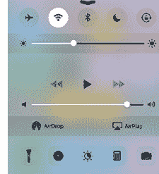
    - A. 耳机未与 iPhone 配对。
    - B. 蓝牙已关闭。
    - C. Wi-Fi 已关闭。
    - D. 飞行模式已开启。

11. 你正在排查一台可能感染了恶意软件的 Windows Vista 工作站。为了遵循恶意软件清除的最佳实践，你应该采取的第一步是什么？
    - A. 隔离受感染的系统。
    - B. 更新反恶意软件。
    - C. 启用系统还原并创建还原点。
    - D. 识别恶意软件症状。

12. 最近，你公司网络上的用户被大量试图向他们销售商品和服务的非预期电子邮件淹没。哪种解决方案最有可能解决此问题？
    - A. 在所有客户端计算机上安装反恶意软件。
    - B. 在所有客户端计算机上安装杀毒软件。
    - C. 在电子邮件服务器上安装垃圾邮件过滤器。
    - D. 续订电子邮件服务器上的无效证书。

13. 你的网络中有几十名移动设备用户。其中几位报告说办公室内某些区域的网络访问速度非常慢。你可以使用什么来测试无线访问？
    - A. Wi-Fi 分析仪
    - B. 蜂窝基站分析仪
    - C. 数据传输分析仪
    - D. 热点分析仪

14. 你刚在一台 Windows 7 工作站中安装了新的声卡。现在，计算机已崩溃并出现蓝屏死机。你关闭计算机。你应该尝试什么来解决这个问题？
    - A. 重新安装 Windows。
    - B. 从 Windows 安装 CD 启动并开始恢复控制台。
    - C. 从安全模式启动并卸载声卡驱动程序。
    - D. 从计算机中移除声卡并重新启动。

15. 一位 iPad 用户报告说，当他在建筑物的某个特定区域时，他的无线连接间歇性断开。造成这种情况的两个最可能原因是什么？（选择两项。）
    - A. iPad 中的无线缓冲不佳
    - B. 无线信号受到干扰
    - C. 无线访问点的信号强度弱
    - D. iPad 上的 Wi-Fi 天线缩回

16. 一位拥有 Android 平板电脑的网络用户希望备份并与她的手机同步数据。她应该使用哪项服务来执行这些任务？
    - A. Google 同步
    - B. Google 云
    - C. Android 同步
    - D. Android 云

17. 一位技术人员正在排查一台行为异常的 Windows Vista 计算机，她怀疑它感染了病毒。她已经遵循了恶意软件清除的最佳实践并修复了计算机。接下来她应该做什么？
    - A. 安排扫描并运行更新。
    - B. 教育最终用户。
    - C. 启用系统还原并创建还原点。
    - D. 禁用系统还原。

18. 你正在对技术人员进行有关 iPhone 关机方法的培训。软重置和硬重置之间的两个主要区别是什么？（选择两项。）
    - A. 硬重置将删除手机上的所有数据，而软重置不会。
    - B. 如果触摸屏无响应，硬重置可以工作，而软重置不行。
    - C. 软重置将保留正在运行的应用程序数据，而硬重置不会。
    - D. 软重置不会重置密码，而硬重置会。

19. 一台 Windows 8 工作站无法正确加载。在 Windows 8 启动过程中，MBR 负责加载哪个关键的 Windows 文件？
    - A. `BOOTMGR`
    - B. `NTLDR`
    - C. `WINRESUME`
    - D. `WINLOAD`

20. 你正在对一个班级进行有关 Windows Vista 安装和修复的培训。Windows PE 的作用是什么？（选择两项。）
    - A. 作为操作系统在瘦客户机上运行
    - B. 在 Windows Vista 安装期间收集信息
    - C. 启动 Windows RE 以进行故障排除
    - D. 如果系统文件损坏则修复它们

21. 一位技术人员正在一台 Windows Vista 工作站上工作。

她应该使用哪个命令来扫描并修复损坏的系统文件？

- A. SFC /SCANFIX
- B. SFC /OFFBOOTDIR
- C. SFC /VERIFYFILE
- D. SFC /SCANNOW

22. 你怀疑有人正试图通过猜测密码来攻击一台 Windows 7 工作站。另一位管理员建议你查看日志文件以确认。你可以使用哪个实用工具来查看日志文件？

- A. 事件查看器
- B. 恢复控制台
- C. 安全控制台
- D. 系统监视器

23. 你开机启动一台 Windows 8.1 客户端计算机，但 Windows 无法加载。经过检查，你发现 BOOTMGR 文件已被重命名为 DABOOTMGR。你是最后一个使用这台工作站的人。最可能的原因是什么？

- A. 恶作剧
- B. 流氓杀毒软件
- C. 恶意软件感染
- D. 隔离的启动文件

24. 你正在与朋友讨论购买礼物，他推荐了一个购买该礼物的网站。当你在浏览器中输入该网站地址时，你收到一条消息，提示证书无效。你应该怎么做？

- A. 仍然访问该网站；可能没问题。
- B. 不要访问该网站。
- C. 将地址更改为以 HTTPS:// 开头，以访问该网站的安全版本。
- D. 将地址更改为以 HTTP:// 开头，以访问该网站的不安全版本。

25. 一台工作站最近安装了驱动程序后，无法正确加载 Windows 7。故障排除指南建议以安全模式启动。在 Windows 7 中如何做到这一点？

- A. 在启动过程中，按下 F1。
- B. 在启动过程中，按下 Ctrl+Alt+Del。
- C. 在启动过程中，按下 F8。
- D. 在启动过程中，按下 F10。

26. 你担心网络上的工作站感染病毒。你为每台计算机配置了杀毒软件。杀毒软件应多久更新一次其数据库？

- A. 每年一次
- B. 每月一次
- C. 每周一次
- D. 仅当发现新威胁时

27. 一位用户报告说他的 iPhone 无法解密电子邮件。这个问题最可能的原因是什么？

- A. iPhone 无法读取加密电子邮件。
- B. S/MIME 证书存在问题。
- C. 用户的邮件应用程序已损坏。
- D. 内存不足。重启手机。

28. 一位用户报告说他的手机在最近一周内资源利用率很高。你应该立即怀疑哪两件事可能是导致问题的原因？（选择两项。）

- A. 未授权的根访问权限
- B. 电池故障
- C. 过多的打开应用程序
- D. 同步操作卡死

29. 一台 Windows 7 工作站无法正确启动。Windows 开始加载但从未完成。经过故障排除，你发现设备未初始化。哪个文件负责检查已安装的设备并初始化它们？

- A. WINRESUME
- B. WINLOAD
- C. BOOTMGR
- D. NTDETECT.COM

30. 你正在使用 iPhone。什么时候通常需要在 iPhone 上关闭正在运行的应用程序？（选择两项。）

- A. 当你收到内存不足错误时
- B. 当手机开始过热时
- C. 当一个应用程序锁死时
- D. 当你当天用完它们时

31. 在 Windows 7 工作站上工作时，一位用户收到一个闪烁的弹出消息，说她的计算机已感染病毒，并且她需要立即下载病毒扫描器来修复它。当她点击下载推荐的病毒扫描器的按钮时，最可能发生什么？

- A. 它将下载一个病毒到她的计算机上。
- B. 它将下载一个防病毒程序到她的计算机上并修复病毒。
- C. 她下载的防病毒程序将扫描她的计算机并找不到任何问题，因为她的公司已经使用防病毒程序。
- D. 这将把她带到一个允许她购买防病毒程序以修复病毒的网站。

32. 一台 Windows 7 工作站无法正确启动。启动时显示 Windows 徽标，然后似乎卡住了。最近没有对工作站进行任何更改。最可能导致问题的原因是什么？

- A. 缺失或损坏的 **NTLDR** 文件
- B. 缺失或损坏的 **BOOTMGR** 文件
- C. 缺失或损坏的 **DLL** 文件
- D. 损坏的文件系统驱动程序

33. 你的网络上有 20 台 Windows 7 工作站。你想要创建一张可引导光盘，以便在无法使用 Windows 安装光盘的情况下修复 Windows 启动问题。你可以在哪里创建这样的光盘？

- A. 备份和还原
- B. 紧急修复磁盘创建器
- C. 系统恢复选项
- D. 恢复控制台

34. 你正在培训技术人员创建和使用恢复点。以下哪项不是恢复点的创建方式？

- A. Windows 默认会自动创建它们。
- B. Windows 在系统崩溃前创建它们。
- C. 你可以手动创建它们。
- D. 某些安装实用程序会在安装新程序前创建它们。

35. 你有一台运行非常缓慢的 Windows 8.1 工作站。当你查看硬盘时，你发现可用空间很少。你应该运行哪个工具来尝试释放空间？

- A. `DEFREG`
- B. 磁盘清理
- C. `REGSvr32`
- D. `SFC`

36. 一位用户报告说，他需要的一份 Word 文档无法打开。其他文档可以正常打开。他没有对该文件进行备份。以下哪项陈述是正确的？

- A. 该文件可能已损坏，其内容已丢失。
- B. 他可以使用恢复点来恢复该文件。
- C. 他可以启动到最后一次正确的配置，然后打开该文件。
- D. 他可以使用紧急修复磁盘来修复该文件，然后打开它。

37. 你有一部 iPhone，已经充电一个小时了。当你将其从充电器上拔下时，摸起来非常热。你的下一步应该是什么？

- A. 更换手机。
- B. 更换手机充电器。
- C. 关闭手机并让它冷却。
- D. 开启飞行模式。

38. 你收到一封电子邮件，警告你一种新型勒索软件。它包含一个链接，以获取更多关于如何保护自己免受此严重威胁的信息。你接下来应该怎么做？

- A. 点击链接以获取更多信息。
- B. 检查以确保你的系统没有安装流氓杀毒软件。
- C. 在 www.us-cert.gov 上查看有关该威胁的信息。
- D. 将该电子邮件转发给你的联系人列表中的每个人。

39. 一位用户刚刚摔了他的安卓手机，现在屏幕上有一条大裂缝。触摸屏无响应。他身处户外，需要从手机中获取联系信息以便给他的客户打电话。他让手机重新工作的最佳选择是什么？

- A. 没有，他需要更换手机。
- B. 重启手机。
- C. 执行强制停止。
- D. 将手机重置为出厂默认设置。

40. 你正在访问大城市高层办公楼中的一位客户办公室。你需要用移动电话打个电话，但你只有一个信号格。呼叫无法完成。你应该怎么做？

- A. 等几分钟再试一次。
- B. 执行软重置。
- C. 执行硬重置。
- D. 走到户外或靠近窗户，看看你的信号是否改善。

41. 一位 iPhone 用户把她的手机拿来给你，它完全卡住了。触摸屏和按钮都没有反应。你首先应该尝试什么让手机重新工作？

- A. 软重置
- B. 硬重置
- C. 关闭正在运行的应用程序
- D. 重置为出厂默认设置

42. 你手机上的 GPS 应用程序停止响应。你应该如何解决此问题？

- A. 执行硬重置。
- B. 执行强制停止。
- C. 执行软重置。
- D. 卸载并重新安装该应用程序。

43. 一位 Windows 8 用户想要查看谁成功登录或登录到她的工作站失败。她应该查找的具体日志名称是什么？

- A. Security（安全）
- B. Login（登录）
- C. System（系统）
- D. Authentication（身份验证）

## 44. 一位技术人员正在排查一台感染了恶意软件的 Windows 7 工作站。他已经禁用了系统还原。遵循恶意软件清除的最佳实践，他接下来应该做什么？

- A. 隔离受感染的系统。
- B. 修复受感染的系统。
- C. 计划进行恶意软件扫描并运行更新。
- D. 对最终用户进行教育。

## 45. 您网络中的移动设备用户被要求使用 VPN 应用程序在办公室外连接到公司网络。一位用户报告说该应用程序无法为她打开。她关闭了平板电脑的电源又重新打开，但应用程序仍然无法打开。她接下来应该尝试什么？

- A. 执行软重置。
- B. 执行硬重置。
- C. 卸载并重新安装该应用程序。
- D. 执行强制停止。

## 46. 您网络中的一位用户担心间谍软件。应该安装什么来帮助阻止此威胁？

- A. 反病毒软件
- B. 反恶意软件
- C. 防火墙
- D. 代理服务器

## 47. 使用 Linux 工作站的一位用户报告说收到了一个显示“内核恐慌”（kernel panic）的错误。她应该怎么做才能解决此问题？

- A. 关闭导致错误的程序并继续工作。
- B. 重新启动工作站，看看问题是否仍然存在。
- C. 重启进入安全模式，并运行 Linux 诊断工具以确定问题的原因。
- D. 重新安装 Linux。

## 48. 您的 Windows Vista 工作站开始运行得非常慢。以下哪项可能导致这种情况发生？

- A. 流氓反病毒软件
- B. 恶意软件
- C. 被劫持的电子邮件
- D. 无效证书

## 49. 您希望将 iPhone 屏幕的内容广播到计算机监视器。您可以完成这一任务的两种方法是什么？（选择两项。）

- A. 使用 Apple TV。
- B. 在 iPhone 上启用 iBroadcast。
- C. 下载一个允许您无线广播的应用程序。
- D. 将计算机监视器插入 iPhone 的视频端口。

## 50. 您安装了一个更新后的显卡驱动程序，您的 Windows Vista 工作站崩溃并出现蓝屏死机。让您的系统再次运行的最快两个选项是什么？（选择两项。）

- A. 重新安装 Windows。
- B. 启动到 Windows 安装光盘并启动恢复控制台。
- C. 启动到安全模式并卸载显卡驱动程序。
- D. 启动到上次已知良好配置。

## 51. 您的 Windows 7 工作站在启动时遇到问题。加载了太多的应用程序，速度明显下降。您应该使用哪个工具来禁用程序在启动时自动加载？

- A. `REGEDIT`
- B. `REGSVR32`
- C. `MSCONFIG`
- D. 安全模式

## 52. 一位用户刚刚尝试启动他的 Windows 7 工作站，但 Windows 无法加载。当您调查时，您注意到 Windows 的几个关键启动文件已被删除。这是什么的迹象？

- A. 病毒感染
- B. 勒索软件感染
- C. 流氓反病毒软件
- D. 操作系统过期

## 53. 您的网络有一台 Linux 工作站。另一位管理员给您关于如何启用反病毒程序的建议，她告诉您需要输入命令。你在其中执行操作的接口叫什么名字？

- A. Shell
- B. Bash
- C. Cmd
- D. Terminal

## 54. 您早上到达办公室，发现您的收件箱里充满了自动回复和不在办公室消息。主题行是针对您未发送的内容。这是什么的迹象？

- A. 勒索软件
- B. 被劫持的电子邮件
- C. 流氓邮件服务器
- D. 流氓反病毒软件

## 55. 您正在排查一台感染了病毒的 Windows 8.1 工作站。根据恶意软件清除的最佳实践，以下哪两个步骤是修复受感染系统的一部分？（选择两项。）

- A. 禁用系统还原。
- B. 计划扫描并运行更新。
- C. 扫描并删除病毒。
- D. 更新反病毒软件。

## 56. 您有一台无法正确启动的 Windows 8 工作站。您需要启动到安装 DVD 以修复安装。在哪里更改启动设置？

- A. 恢复控制台
- B. 自动系统恢复
- C. BIOS/UEFI
- D. MSCONFIG

## 57. 您正在使用 Internet Explorer 访问网站，并且没有点击任何内容，一个新的 Internet Explorer 窗口在前面打开并显示一个广告。以下哪个是最可能的解释？

- A. 您的计算机感染了广告软件。
- B. 您的计算机感染了间谍软件。
- C. 您的计算机感染了病毒。
- D. 该网站被编程为显示弹出广告。

## 58. 在下午，您开始收到同事和朋友的电子邮件回复。他们想知道为什么您试图通过一个听起来可疑的网站直接向销售电子产品给他们。造成这种情况的最可能原因是什么？

- A. 被劫持的电子邮件
- B. 中毒的邮件服务器
- C. 流氓反病毒软件
- D. 无效证书

## 59. 一位技术人员正在描述昨天发生的情况，当时工作站给他一个内核恐慌错误并锁定。技术人员最可能处理的是哪个操作系统？

- A. Windows 8.1
- B. macOS
- C. Windows Vista
- D. Linux

## 60. 您正在您的 Windows 7 计算机上工作，弹出安全警报，如图所示。您接下来的行动应该是什么？

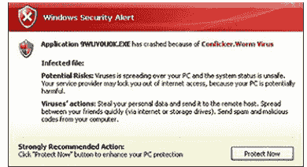

- A. 点击“现在保护”按钮。
- B. 点击右上角的 X 以关闭警报。
- C. 关闭计算机。重新启动，并使用您的反病毒软件发起病毒扫描。
- D. 使用系统还原创建快照，然后点击“现在保护”按钮。

## 61. 在启动 Windows 8.1 工作站时，用户收到关于缺少 *.dll* 文件的错误消息。但是，Windows 仍然加载。您应该使用哪个实用工具来尝试修复问题？

- A. SFC
- B. 恢复控制台
- C. REGSVR32
- D. REGEDIT

## 62. 一位用户的 iPhone 触摸屏没有响应，且手机已开机。您应该建议她下一步做什么以让手机再次工作？

- A. 执行硬重置。
- B. 执行软重置。
- C. 移除电池以关机。重新插入电池并重新开机。
- D. 执行强制停止。

## 63. 在一台 Windows 7 工作站上，您收到一条错误消息，说 `Security Center` 服务无法启动，但 Windows 仍然加载。在排查问题时，您应该尝试的第一步是什么？

- A. 使用 `SFC` 重新安装服务。
- B. 使用 `MSCONFIG` 重新安装服务。
- C. 检查服务是否在“服务”中设置为自动启动。
- D. 检查服务是否使用 `REGEDIT` 设置为自动启动。

## 64. 一位 Android 手机用户刚刚收到一个新的蓝牙耳机用于电话。她报告说它无法与她的手机配合使用。两个设备都已开机且似乎运行正常。最可能的问题是什么？

- A. Android 设备上的蓝牙关闭了。
- B. 移动耳机上的蓝牙关闭了。
- C. 需要配对设备。
- D. 开启了飞行模式。

## 65. 您的 Windows Vista 工作站性能一直在减慢，尤其是在磁盘读写方面。以下哪个工具旨在帮助提高您的硬盘性能？

- A. `REGEDIT`
- B. `DEFRAG`
- C. `REGSVR32`
- D. 事件查看器

## 66. 您有一台无法正确启动的 Windows 8.1 工作站。在 POST 之后，屏幕显示一条消息，说“未找到操作系统”。导致问题的最可能原因是什么？

- A. NTLDR
- B. BOOTMGR
- C. BOOT.INI
- D. BCD

## 67. 您正在排查一台 Windows 7 工作站并认为它有恶意软件。要遵循恶意软件清除的最佳实践，在您确定恶意软件症状之后，应该采取哪一步？

- A. 更新反恶意软件。
- B. 禁用系统还原。
- C. 隔离受感染的系统。
- D. 扫描并删除恶意软件。

## 68. 当您在偏远的乡村地区驾驶时，您注意到您的手机电池电量迅速耗尽。最可能的原因是什么？

- A. 电池需要更换。
- B. 手机正在搜索信号。
- C. 您需要执行软重置。
- D. 手机需要更换。

## 69. 您有一台在 Windows XP 和 Windows 8.1 之间双启动的工作站。当选择启动 Windows XP 时，您收到一条错误消息，说 NTLDR 丢失。哪些实用程序允许您修复或替换此文件？（选择两项。）

- A. 恢复控制台
- B. REGSVR32

C. 修复磁盘
D. 安全模式

**70.** 一位 iPhone 用户非常关注她的隐私。她希望确保其他人无法在她不知情的情况下入侵她的手机并追踪她的位置。以下哪个操作提供的保护最少，无法有效防止这种情况发生？
- A. 安装 iPhone 反恶意软件应用程序。
- B. 一旦有更新或补丁，立即更新 iOS。
- C. 禁用定位服务。
- D. 启用与 iCloud 的同步。

**71.** 一位用户报告说他的 iPhone 电池续航时间非常短。手机只能使用大约三个小时就需要充电。你建议他做什么来延长电池寿命？（选择两项。）
- A. 关闭不必要的无线连接。
- B. 执行恢复出厂设置的重置操作。
- B. 设置屏幕自动变暗。
- D. 安装防病毒应用程序。

**72.** 你刚购买了一部 Android 手机，并担心安全威胁。以下哪项陈述是正确的？
- A. Android 手机没有病毒。
- B. Android 手机自带自动启用的防病毒应用程序。
- C. 你应该下载并安装防病毒应用程序。
- D. 只要你自动安装操作系统补丁，你就不会感染 Android 病毒。

**73.** 一台 Windows Vista 工作站开始出现系统性能缓慢的问题。在 Windows 中，你可以去哪里找到有助于排查此问题的工具？
- A. 控制面板 > 性能信息和工具
- B. 控制面板 > 系统工具
- C. 控制面板 > 设备管理器
- D. 控制面板 > 配置和设置

**74.** 你有一部 Android 手机。当你走到户外时，手机屏幕很暗，什么都看不清。你应该如何解决这个问题？
- A. 将设备关机后再开机。
- B. 调整屏幕亮度设置。
- C. 移除屏幕保护膜。
- D. 添加外部电池组。

**75.** 在安装新的防病毒程序之前，技术员建议你手动创建一个还原点。还原点的作用是什么？
- A. 它将创建整个硬盘的副本。
- B. 它将创建系统配置数据的副本。
- C. 它将创建用户文件夹和系统配置数据的副本。
- D. 它将创建包含关键系统文件副本的可启动磁盘。

**76.** 一位拥有 iPhone 的员工离职了，你要把他的 iPhone 交给一名新员工。在将手机交给新用户之前，你应对手机做什么？
- A. 执行硬重置。
- B. 执行软重置。
- C. 恢复出厂设置。
- D. 调整配置/设置。

**77.** 你的 iPad 性能缓慢。以下哪两个选项是提高性能速度的最佳选择？（选择两项。）
- A. 关闭已打开的应用程序。
- B. 执行恢复出厂设置的重置操作。
- C. 增加 RAM。
- D. 执行软重置。

**78.** 你正在一台 Windows 工作站上工作。开机时，它显示一条错误消息，提示缺少 BOOT.INI，并且无法继续启动。BOOT.INI 文件的用途是什么？
- A. 在 Windows XP 及更早版本中，它标识操作系统的引导文件位置。
- B. 在 Windows Vista 及更新版本中，它标识操作系统的引导文件位置。
- C. 在 Windows XP 及更早版本中，它启动操作系统的引导程序加载。
- D. 在 Windows Vista 及更新版本中，它启动操作系统的引导程序加载。

**79.** 一位 iPhone 用户报告说，她几乎一触摸触摸屏，屏幕就会变暗且难以阅读。她应该做什么来修复这个问题？
- A. 移除屏幕保护膜。
- B. 更换手机。
- C. 调整设置以防止屏幕快速变暗。
- D. 将设备关机后再开机。

**80.** 你有一台 Android 平板电脑。屏幕似乎无法准确感知你在触摸板上的触摸位置。你重新启动后问题依然存在，你应该做什么？
- A. 更换平板电脑。
- B. 校准屏幕。
- C. 禁用陀螺仪。
- D. 移除屏幕保护膜。

**81.** 一台 Windows Vista 工作站无法加载 Windows。在引导过程中，哪个文件负责将系统从实模式切换到保护模式？
- A. NTLDLR
- B. BOOTMGR
- C. WINLOAD
- D. WINRESUME

**82.** 你正在一台配备双显示器的 Windows 8.1 工作站上工作。由于某种原因，副显示器上的一切都是倒置的。解决这个问题的最简单方案是什么？
- A. 将显示器翻过来。
- B. 右键单击桌面，选择屏幕分辨率，并更改显示器方向。
- C. 重新安装显卡驱动程序。
- D. 右键单击桌面，选择视频，并更改显示器方向。

**83.** 一台 Windows 7 工作站只能启动到安全模式。即使多次重启，Windows 也无法正常加载。你应该使用哪个工具来扫描问题？
- A. REGEDIT
- B. MSCONFIG
- C. 事件查看器
- D. 恢复控制台

**84.** 一位 Android 手机用户报告说她的手机内存不足。以下哪项有助于解决该问题？
- A. 卸载应用程序。
- B. 执行软重置。
- C. 执行硬重置。
- D. 执行强制停止。

**85.** 在你的手机上，你注意到自己连接到了一个你不认识的 Wi-Fi 网络，而不是你正常的家庭网络。这种非预期的 Wi-Fi 连接可能的后果是什么？
- A. 更容易受到黑客攻击
- B. 更好的互联网访问速度
- C. 电池电量耗尽
- D. 网络干扰

**86.** 你正在培训新用户正确使用移动设备。在课堂上，你建议他们除非需要，否则关闭蓝牙连接。非预期蓝牙配对造成的最大风险是什么？
- A. 电源耗尽
- B. 安全风险
- C. 数据传输超限风险
- D. 高资源利用率风险

**87.** 你的 MacBook Pro 似乎没有响应，光标变成了一个旋转的齿轮。接下来你应该做什么？
- A. 强制重启系统。
- B. 等待问题消失，然后继续工作。
- C. 打开 Apple Diagnostics 以查看问题所在。
- D. 将 Mac 重启到安全模式。

**88.** 一位使用 iPad 的网络用户希望备份她的数据。以下哪些是她可以使用的选项？（选择两项。）
- A. iSync
- B. iPadPlus
- C. iTunes
- D. iCloud

**88.** 你正在培训新员工正确使用 Windows 8.1 工作站。不当关闭工作站可能会引起哪两个问题？（选择两项。）
- A. 重要文件中的数据丢失。
- B. DLL 文件损坏。
- C. 设备驱动程序损坏。
- D. Windows 可能无法启动。

**90.** 你使用最新版 Internet Explorer 在你的 Windows 8.1 工作站上浏览互联网。今天，当你尝试访问任何网站时，你都收到一条错误消息，提示证书无效。无论你访问哪个网站都会发生这种情况。你应该做什么？
- A. 检查计算机的时间和日期。
- B. 通过 控制面板 > 安全 刷新你的证书。
- C. 通过 控制面板 > 互联网选项 刷新你的证书。
- D. 在 Internet Explorer 中，将 Internet 区域的安全级别设置为“低”。

**91.** 你正在向网络用户介绍软件安全挑战。一位用户问避免垃圾邮件的最佳方法是什么。你应该向该小组推荐什么？
- A. 在你的电脑上安装防病毒程序。
- B. 在你的电脑上安装反恶意软件。
- C. 只访问拥有安全站点（以 HTTPS:// 开头）的网站。
- D. 不要将你的电子邮件地址提供给网站。

**92.** 你网络上的移动设备用户报告说网络数据速度非常慢。以下哪些可能是导致此问题的原因？（选择两项。）
- A. 电池电量低
- B. 信号干扰
- C. 非预期的 Wi-Fi 连接

## D. 弱信号

- 93. 一位客户的 Windows 8 计算机感染了病毒。她已将系统从其余网络中隔离出来。为了遵循恶意软件移除的最佳实践，她下一步应该采取什么措施？
  - A. 识别恶意软件症状。
  - B. 禁用系统还原。
  - C. 启用系统还原。
  - D. 更新反恶意软件。

- 94. Windows 8.1 工作站的 GUI 无法加载。启动时出现 Windows 标志，随后消失，工作站似乎挂起了。你应如何解决此问题？
  - A. 从安装 DVD 启动，打开系统恢复选项，选择启动修复。
  - B. 从安全模式启动，打开系统恢复选项，选择启动修复。
  - C. 从安装 DVD 启动，打开命令提示符，输入 `Startup Repair`。
  - D. 从安装 DVD 启动，打开 SFC，选择启动修复。

- 95. 一名 iPad 用户报告称，当他在办公楼旁边的花园吃午餐时，无线连接不稳定。这最可能的原因是什么？
  - A. 信号微弱。
  - B. 天线收缩。
  - C. iPad 的信号接收灵敏度设置得过低。
  - D. 电池电量低。

- 96. 在你的网络中，你担心移动用户意外授予未授权的账户访问权限或 root 权限。你应该采取什么步骤来帮助防止这些安全问题？
  - A. 一旦补丁和升级可用，立即应用。
  - B. 监控资源使用情况并修复高负载。
  - C. 在所有设备上安装移动防火墙。
  - D. 禁用位置跟踪、摄像头和麦克风。

- 97. 一位拥有新 iPhone 的用户想知道她如何更改她的壁纸、通知和电池设置。她应该在哪里进行此操作？
  - A. 在 iTunes 或 iCloud 中
  - B. 使用 iPhone 上的配置应用
  - C. 使用 iPhone 上的桌面、消息和电源应用
  - D. 使用 iPhone 上的设置应用

- 98. 你网络中的客户端计算机通过代理服务器连接到互联网。最近，一台 Windows 8.1 客户端感染了广告软件和浏览器重定向器。你已移除恶意软件，现在计算机无法连接到互联网。你应如何解决这个问题？
  - A. 再次执行恶意软件修复。
  - B. 禁用网卡。重启并启用网卡。
  - C. 检查 IP 配置，确保其指向正确的代理服务器地址。
  - D. 禁用代理服务器配置以直接连接到互联网。

- 99. 你在工作中使用 iPad 和 iPhone。以下哪两项代表了泄露个人文件或数据的最大威胁？（选择两项。）
  - A. 未授权的 root 访问
  - B. 意外的 Wi-Fi 连接
  - C. 未授权的位置跟踪
  - D. 高资源利用率

- 100. 你从你的无线服务提供商那里收到通知，说你即将超过当月的数据传输限制。这存在什么类型的风险？
  - A. 你的账户可能会被停用。
  - B. 你可能会遭受安全泄露。
  - C. 你可能不得不支付高额费用。
  - D. 你的手机可能会被锁定。

- 101. 你 iPhone 上最喜欢的餐厅定位应用无法加载。你关闭并尝试重新打开几次，它仍然不起作用。接下来你应该尝试什么？
  - A. 卸载并重新安装该应用。
  - B. 执行硬重置。
  - C. 执行强制停止。
  - D. 重启手机并再次尝试该应用。

- 102. 一位 Windows 7 用户的防病毒软件已崩溃。他重启计算机并再次尝试打开它，它再次崩溃。他应该怎么做才能解决这个问题？（选择两项。）
  - A. 在制造商网站上查找补丁或更新。
  - B. 删除防病毒软件。
  - C. 删除并重新安装 Windows。
  - D. 通过控制面板中的程序修复防病毒安装。

- 103. 你有一台 Windows 8 工作站正在自发地关机并重启。你应该做什么来排查并解决此问题？
  - A. 检查系统 BIOS，确保启动顺序设置正确。
  - B. 从 Windows 安装 CD 启动并启动恢复控制台。
  - C. 从安全模式启动，查看问题是否仍然存在。
  - D. 重新安装 Windows。

- 104. 一位 iPhone 用户报告称她的设备不再发出声音，即使她在播放视频或接到电话也是如此。你应该首先检查什么？
  - A. 飞行模式是否开启
  - B. 是否运行了太多应用程序
  - C. 手机是否已设置为静音模式
  - D. 扬声器的连接是否仍正常工作

- 105. 你想在 Windows 8.1 注册表中将一些 .dll 文件注册为命令组件。你应该使用哪个命令？
  - A. REGSVR32
  - B. REGEDIT
  - C. MSCONFIG
  - D. REGDLL

- 106. 你有一台感染了广告软件的 Windows 7 工作站。你已移除广告软件，但现在计算机无法连接到互联网。它仍然能够打印到本地打印机。这个问题最可能的原因是什么？
  - A. DNS 服务器已中毒。
  - B. 恶意软件更改了计算机的 TCP/IP 配置，使其指向一个伪造的 DNS 服务器。
  - C. 恶意软件仍在计算机上并已感染启动扇区。
  - D. 计算机感染了流氓防病毒软件。

- 107. 你正在一台工作站上进行 Linux 和 Windows 8.1 的双启动。一天当你启动时，你收到一个 GRUB 错误消息。这个问题最可能的原因是什么？
  - A. 缺少 Windows 启动加载器。
  - B. 缺少 Linux 启动加载器。
  - C. MBR 丢失或损坏。
  - D. BIOS/UEFI 丢失或损坏。

- 108. 你有一位拥有 iPhone 6 的用户，该用户需要重启手机。他问你如何执行软重置。你告诉他什么？
  - A. 使用回形针或笔尖，按住手机底部的凹陷重置按钮，直到看到 Apple 标志，然后松开。
  - B. 按住睡眠/唤醒按钮和主屏幕按钮至少 10 秒，直到看到 Apple 标志，然后松开。
  - C. 按住睡眠/唤醒按钮，直到出现红色滑块，然后拖动滑块关闭设备电源。
  - D. 两次按下主屏幕按钮，主屏幕将出现。向上滑动以发起软重置。

- 109. 一位技术人员刚刚更新了一台 Windows 7 工作站的网卡驱动程序。现在，网卡似乎不工作。她重启计算机并重新登录，它仍然不工作。接下来她应该做什么来解决这个问题？
  - A. 重启进入安全模式并卸载网卡驱动程序。
  - B. 使用最后一次正确的配置重启。
  - C. 重新安装 Windows。
  - D. 打开设备管理器，找到网卡，并回滚驱动程序。

- 110. 在一台 Windows 8.1 工作站上，用户收到一个全屏消息，说他的一台电脑因为非法活动而被锁定。消息还指出，他可以通过向政府支付 300 美元的罚款来解锁他的电脑。他重启并登录 Windows，消息立即再次出现。他应该做什么来删除此消息？
  - A. 支付罚款。
  - B. 打开他的反恶意软件并执行修复。
  - C. 删除并重新安装 Windows。
  - D. 进入安全模式并使用系统还原将系统回滚到较早的还原点。

- 111. 你在一台 Windows 7 工作站上最近安装了新软件。当你尝试打开它时，你收到一条错误消息，说该应用程序与 Windows 不兼容。你应该首先尝试什么来解决这个问题？
  - A. 右键单击应用程序并选择故障排除兼容性。
  - B. 运行 `SFC /scannow` 以检查兼容性问题。
  - C. 运行 `MSCONFIG` 查看是否有导致此问题的系统配置设置。
  - D. 删除并重新安装该应用程序。

- 112. 你正在向移动用户教育最佳安全实践。以下哪两项是对网络和数据安全的最大威胁？（选择两项。）
  - A. 电池耗尽
  - B. 数据传输超限
  - C. 意外的 Wi-Fi 连接
  - D. 意外的蓝牙连接

- 113. 在处理一台 Windows 8.1 工作站时，用户收到一个弹出消息，说他的一台电脑感染了病毒，他需要立即下载一个病毒扫描器来修复它。该窗口看起来不像来自你公司使用的防病毒软件。这是什么的例子？
  - A. 勒索软件
  - B. 垃圾邮件
  - C. 流氓防病毒软件
  - D. 被劫持的防病毒软件

## 114. 你最近发现手机耗电很快。以下哪项不是耗电的常见原因？

- A. 进入飞行模式
- B. 长时间使用
- C. 搜索蜂窝信号
- D. 打开的应用程序过多

## 115. 你刚刚在一台 Windows Vista 工作站上安装了新驱动程序，现在操作系统无法加载。制造商的故障排除建议是重启并使用“最后一次正确的配置”。你在哪里选择此选项？

- A. 系统恢复选项
- B. 恢复控制台
- C. 紧急修复光盘
- D. 安全模式

## 116. 你有一台无法正常启动的 Windows 7 工作站。你怀疑硬盘上的引导扇区已损坏。Windows RE（恢复环境）中的哪个命令允许你创建一个新的引导扇区？

- A. BOOTREC /FIXBR
- B. BOOTREC /FIXBOOT
- C. BOOTREC /REBUILD BCD
- D. BOOTREC /REBUILD MBR
- E. BOOTREC /REBUILD BOOT

## 117. 你有一部安卓手机，最近资源使用率异常高。你可以做什么来查看手机是否感染了恶意软件？

- A. 安卓手机没有恶意软件。
- B. 下载安全软件并使用应用扫描器。
- C. 下载安全软件并使用 Wi-Fi 分析器。
- D. 安装最新的安卓补丁并执行软重置。如果存在病毒，这将清除它。

## 118. 你使用 Internet Explorer 浏览网页。从昨天开始，每次你尝试在常用的搜索引擎中搜索任何内容时，你总是被重定向到同一个试图向你推销商品的特定网站。无论你在搜索什么，都会发生这种情况。哪两件事最可能导致这种情况？（选择两项。）

- A. 你的计算机证书无效。
- B. 你的计算机感染了导致浏览器重定向的恶意软件。
- C. DNS 服务器已中毒。
- D. 你使用的搜索引擎已被入侵。

## 119. 你网络中的一台 Windows 7 工作站表现出性能缓慢。应该使用以下哪个工具来检查导致变慢的潜在问题？

- A. 反恶意软件
- B. 事件查看器
- C. MSCONFIG
- D. REGSRV32

## 120. 你正在为一所高中提供咨询，该学校正在向部署用于校内使用的 iPad。所有 iPad 都需要具有相同的配置。你应该使用哪项服务来配置这些设备？

- A. iConfigure
- B. iPadPlus
- C. Apple Configurator
- D. Apple Installer

## 121. 你安装了新的网卡驱动程序，但它没有正常工作。根据制造商的网站，你需要编辑 Windows 配置数据库中的设置。你应该使用哪个工具来执行此操作？

- A. WINCONFIG
- B. REGSVR32
- C. REGEDIT
- D. MSCONFIG

## 122. 你正试图在一台 Windows 8.1 客户计算机上应用 Windows 更新。更新失败，出现以下消息：`Failure configuring Windows updates. Reverting changes.`（正在配置 Windows 更新时失败。正在撤销更改。）你下一步应该做什么？

- A. 等待更改被撤销。重启计算机并再次尝试更新。
- B. 立即关闭计算机。重启并再次尝试更新。
- C. 忽略该更新。
- D. 删除并重新安装 Windows。

## 123. 你在一台 Windows 8.1 工作站上安装了新的反恶意软件包。现在系统似乎运行不正常。它非常缓慢，经常挂起，而且反恶意软件程序无法打开。你想将系统回滚到以前的配置，以查看是否能解决问题。你在哪里执行此操作？

- A. 系统还原
- B. 备份和还原
- C. Windows RE
- D. 事件查看器

## 124. 一位拥有 Microsoft Phone 的网络用户想要备份她的设备。她应该使用哪项服务来执行此操作？

- A. Google Sync
- B. OneDrive
- C. Office 365
- D. Microsoft Mobile

## 125. 一名技术人员正在修复一台感染了病毒的 Windows 7 工作站。他正在遵循恶意软件移除的最佳实践，已启用系统还原并创建了一个还原点。他下一步应该做什么？

- A. 教育最终用户。
- B. 禁用系统还原。
- C. 隔离受感染的系统。
- D. 修复受感染的系统。

# 第 9 章
## 操作程序

本章涵盖的 THE COMPTIA A+ 考试 220-902 主题包括以下内容：

## 5.1 根据场景，使用适当的安全程序。

- 设备接地
- 正确的组件处理和存储
  - 防静电袋
  - 防静电腕带
  - 防静电垫
  - 自接地
- 有毒废物处理
  - 电池
  - 墨粉
  - 阴极射线管 (CRT)
- 个人安全
  - 修理 PC 前断开电源
  - 移除首饰
  - 举重技巧
  - 重量限制
  - 电气火灾安全
  - 线缆管理
  - 护目镜
  - 空气过滤口罩
- 遵守当地政府法规

## 5.2 根据具有潜在环境影响的场景，应用适当的控制措施。

- 处理和处置的安全数据表 (MSDS) 文档
- 温度和湿度水平意识及适当通风
- 电源浪涌、电压下跌、停电
  - 电池备份
  - 浪涌抑制器
- 防护空气中的颗粒
  - 外壳
  - 空气过滤器/口罩
- 灰尘和碎屑
  - 压缩空气
  - 真空吸尘器
- 遵守当地政府法规

## 5.3 概述处理禁止内容/活动的过程，并解释隐私、许可和政策概念。

- 事件响应
  - 初始响应
    - 识别
    - 通过正确渠道报告
    - 数据/设备保全
- 文档的使用/文档变更
- 证据链
  - 证据跟踪/记录过程
- 许可/DRM/EULA
  - 开源与商业许可证
  - 个人许可证与企业许可证
- 个人身份信息
- 遵守企业最终用户策略和安全最佳实践

## 5.4 演示正确的沟通技巧和职业素养。

- 使用适当的语言 – 在适用情况下避免行话、首字母缩略语和俚语
- 保持积极态度/展现自信
- 积极倾听（做笔记）并避免打断客户
- 具有文化敏感性
  - 在适用情况下使用适当的职业头衔
- 准时（如果迟到，联系客户）
- 避免分心
  - 私人通话
  - 短信/社交媒体网站
  - 在与客户互动时与同事交谈
  - 私人干扰
- 处理棘手的客户或情况
  - 不要与客户争论和/或处于防御状态
  - 避免轻视客户的问题
  - 避免带有评判性
  - 澄清客户陈述（提出开放式问题以缩小问题范围，重述问题或疑问以验证理解）
  - 不要通过社交媒体公开披露经历
- 设定并满足期望/时间表，并与客户沟通状态
- 如适用，提供不同的维修/更换选项
- 提供有关所提供服务的适当文档
- 在稍后日期与客户/用户跟进以验证满意度
- 适当处理客户的机密和私人材料
  - 位于计算机、桌面、打印机等上

## 5.5 根据场景，解释故障排除理论。

- 在实施更改之前，始终考虑公司政策、程序和影响。
- 1. 识别问题
  - 询问用户并识别用户对计算机所做的更改，并在进行更改前执行备份
- 2. 建立可能原因的理论（质疑明显原因）
  - 如有必要，根据症状进行外部或内部研究
- 3. 测试理论以确定原因
  - 一旦理论得到确认，确定解决下一步骤
  - 如果理论未得到确认，重新建立新理论或升级处理
- 4. 制定解决问题的行动计划并实施解决方案
- 5. 验证完整的系统功能，如适用实施预防措施
- 6. 记录发现、行动和结果

1. 你有一位客户，他想将三台工作站和显示器插入到一个只有两个插头的墙插上。他在寻找最便宜的可用解决方案。什么应该

1. 你建议他购买什么？

- A. 不间断电源
- B. 稳压器
- C. 浪涌保护器
- D. 排插

2. 一名技术员正在排查一台他怀疑存在网卡问题的台式计算机。他已经验证了其理论以确定问题原因。根据故障排查理论，他下一步应该做什么？

- A. 基于症状进行外部或内部调研。
- B. 记录发现、操作和结果。
- C. 验证整个系统的功能。
- D. 制定解决问题的行动计划并实施解决方案。

3. 你正在升级台式计算机的视频卡。你遵循了适当的安全规程。当你打开机箱时，最常见且需要注意的危险是什么？

- A. 电击
- B. 锋利边缘
- C. 烫伤
- D. 飞溅碎片

4. 你正在排查一台你怀疑感染了恶意软件的笔记本电脑。你已制定行动计划并实施了解决方案。根据故障排查理论，你下一步应该做什么？

- A. 测试理论以确定原因。
- B. 确定解决问题的后续步骤。
- C. 验证整个系统的功能，并在适用时实施预防措施。
- D. 记录发现、操作和结果。

5. 你打开台式计算机机箱，发现一些灰尘，特别是在风扇周围。你应该使用什么来清洁风扇？

- A. 变性异丙醇
- B. 去离子水
- C. 计算机吸尘器
- D. 压缩空气

6. 你正在进行工作中的绊倒隐患审计，发现多条电缆横跨在人行道上。以下哪个解决方案最能解决此问题？

- A. 电缆保护罩
- B. 扎带
- C. 布基胶带
- D. 电工胶带

7. 一名技术员正在排查疑似硬盘问题。他遵循故障排查理论。作为识别问题的一部分，他应该做什么？

- A. 如有必要，基于症状进行外部或内部调研。
- B. 询问用户并识别用户对计算机所做的更改。
- C. 记录发现、操作和结果。
- D. 确定解决问题的后续步骤。

8. 你正在排查一台 MacBook Pro，并已经识别出问题。根据故障排查理论，你下一步应该做什么？

- A. 建立可能的原因理论。
- B. 询问用户并识别用户对计算机所做的更改。
- C. 测试理论以确定原因。
- D. 制定解决问题的行动计划并实施解决方案。

9. 你正在计算机上安装一个新软件，但你不同意 EULA 中的某些条款。以下哪项陈述是正确的？

- A. 你可以跳过 EULA 并继续安装。
- B. 除非你同意 EULA 中的条款，否则你将无法安装该软件。
- C. 你可以点击同意 EULA，然后对你不同意的部分提供备注，且不受这些条款约束。
- D. 你可以安装软件，但会被限制功能。

10. 你们公司的政策禁止在工作计算机上使用非法内容。在发现非法内容后，你没收了一名员工的工作站。如何确保这些非法材料得到正确处理并移交给适当的执法部门？

- A. 使用文档记录。
- B. 遵循监管链（Chain of Custody）。
- C. 将计算机驾驶到适当的执法机构。
- D. 移除硬盘并将其保存在上锁的保险柜中。

11. 你正在排查一台出现驱动器问题的 Windows Vista 台式计算机。根据故障排查理论，何时是执行系统备份的适当时间？

- A. 在验证整个系统功能并实施预防措施之后
- B. 在做出更改之前
- C. 在记录发现、操作和结果之后
- D. 在识别问题之前

12. 你刚刚结束在客户现场的维修工作，过程很艰难。雪上加霜的是，客户好争论且难以合作。以下哪项你不应该做？

- A. 在工作日志中记录该情况。
- B. 尝试将这段经历从脑海中排除，专注于你的下一次呼叫。
- C. 给经理打电话并解释情况。
- D. 在社交媒体上发布该经历。

13. 你最近购买了一款软件并安装在笔记本电脑上。它运行了 30 天，现在提示你必须激活产品。激活软件需要什么？

- A. EULA
- B. DRM
- C. 产品密钥
- D. 开源代码

14. 你正在修复办公室大楼二层的一台损坏的打印机。当打印机重新运行时，你注意到它正在打印员工工资单。你应该做什么？

- A. 拍下工资单的照片并发布在社交媒体上。
- B. 查看每个人获得的工资与你的工资相比如何。
- C. 忽略这些信息，专注于确保打印机修复。
- D. 给你的朋友发信息，告诉他们你挣得比他们多。

15. 当你在客户现场工作时，以下哪项是你应该表现出的最恰当的行为？

- A. 接打私人电话
- B. 做笔记和提问
- C. 访问社交媒体网站
- D. 与同事交谈

16. 你在现场更换台式计算机中故障的 PCI 网卡。你意识到你忘记带防静电腕带。计算机需要快速修复。最好的处理方式是什么？

- A. 通过弯腰接触地面进行自我接地，然后在处理 PC 前保持接触
- B. 通过接触机箱的塑料前部进行自我接地，同时在处理 PC 时保持接触
- C. 通过接触计算机的桌面进行自我接地，同时在处理 PC 时保持接触
- D. 通过接触机箱的金属部分进行自我接地，同时在处理 PC 时保持接触

17. 一名技术员正在排查一台无法正常启动的 Windows 7 笔记本电脑。她已建立了一个可能的原因理论。根据故障排查理论，她接下来应该做什么？

- A. 识别问题。
- B. 测试理论以确定原因。
- C. 制定解决问题的行动计划并实施解决方案。
- D. 记录发现。

18. 一名技术员担心他被静电放电（ESD）烧毁了 RAM。另一名技术员说，如果他没有感觉到电击就不必担心。关于 ESD，以下哪项陈述是正确的？

- A. 人们可以感觉到 300 伏特的电击，而损坏计算机组件需要 3000 伏特。
- B. 人们可以感觉到 3000 伏特的电击，而损坏计算机组件需要 300 伏特。
- C. 人们可以感觉到 3000 伏特的电击，而损坏计算机组件需要 10000 伏特。
- D. 人们可以感觉到 10000 伏特的电击，而损坏计算机组件需要 3000 伏特。

19. 当与客户合作时，以下哪项展示了正确的沟通技巧和专业性？

- A. 盯着墙上挂的宗教物品看
- B. 模仿客户的口音与他们交谈
- C. 在与他们交谈时使用客户的头衔
- D. 嘲笑客户的着装选择

20. 你在修复计算机时遵循适当的安全规程。在以下哪些时候你应该佩戴防静电腕带？（选择两项。）

- A. 当在台式机箱内工作时
- B. 当在电源内工作时
- C. 当在 CRT 显示器内工作时
- D. 当在笔记本电脑机箱内工作时

21. 在清理旧文件柜时，你发现一个装满废弃电池的盒子。处理它们的正确方式是什么？

- A. 焚烧它们。
- B. 将它们扔进垃圾桶。
- C. 压碎它们。
- D. 回收它们。

22. 你们公司的政策禁止在工作计算机上使用非法内容。一名用户报告另一名用户拥有非法内容，你是现场的急救响应人员。作为急救响应人员，你应采取的第一步是什么？

- A. 遵循监管链（Chain of Custody）。

22. [上下文缺失：未提供第 22 题题干，但可见选项 B-D]
- B. 保留数据或设备。
- C. 识别违反政策的非法内容。
- D. 要求用户删除相关材料。

23. 在与客户沟通时，你应该做以下哪项？
- A. 使用行话和缩写来证明你的能力。
- B. 频繁打断并提问以澄清情况。
- C. 使用恰当的职称。
- D. 假设你知道客户想要什么，即使那不是他们所说的。

24. 你正将几根内存条和几张显卡从一个办公室运送到另一个办公室。你应该使用哪种安全设备来帮助避免电学损坏组件？
- A. 防静电袋
- B. ESD 腕带
- C. ESD 垫
- D. 橡胶手套

25. 你正在排查一个复杂的网络连接问题。你已测试了你的理论以确定原因，发现你是错的。根据故障排除理论，下一步你有两个选择。它们是什么？（选择两项。）
- A. 告知用户问题已修复，并据此记录。
- B. 验证完整系统功能，并记录发现、操作及结果。
- C. 升级上报该问题。
- D. 重新建立一个新的可能原因理论。

26. 你所在的公司有政策禁止在工作电脑上出现非法内容。你已在用户的计算机上识别出非法内容，并且该工作站已从用户桌面上移除。在事故响应流程中，正确的下一步是什么？
- A. 记录相关情况。
- B. 通知相关权威机构。
- C. 遵循证据保管链。
- D. 删除非法材料。

27. 你正在现场工作，试图修复客户端的工作站。他的计算机有一张故障的显卡，大约需要三天才能拿到新的显卡。以下哪一项是你采取的最佳行动方案？
- A. 告诉他显卡到货需要三天，届时你会回来更换。
- B. 告诉他显卡坏了，新显卡到达需要一周。那么当你三天后更换它时，你的表现将优于客户期望。
- C. 告诉他显卡到货需要三天。同时提供一台备用计算机供他在期间使用。
- D. 告诉他他的电脑坏了，等你日程允许时再回来修。

28. 你正在排查一个你从未见过且非常棘手的问题。即使经过一小时，你仍不确定是什么原因导致的问题。客户问怎么了。你应该告诉他们什么？
- A. 你完全不知道，这很难办。这会花些时间。
- B. 你目前还不确定，但你相信很快就能查明原因。
- C. 情况很糟。真的非常糟。你不确定能否修复。
- D. 连你的升级联系人也查不出来，所以你差不多要放弃了。

28. 你即将开始排查一台无显示的笔记本电脑。根据故障排除理论，在开始排查之前，你总是应该考虑什么？
- A. 用户的感受
- B. 硬件更换的相关成本
- C. 向管理层传递坏消息的影响
- D. 在实施更改前的公司政策、程序及影响

30. 你正在修理一台显示闪烁的 LCD 显示器。显示器内部哪个组件造成电击的风险最大？
- A. 背光
- B. 电容
- C. 逆变器
- D. 屏幕

31. 你的办公室使用五台惠普激光打印机。一名管理员将用过的硒鼓盒起来并堆放在储藏室里。关于硒鼓处理，以下哪项陈述是正确的？
- A. 碳粉无害，但因为包含塑料，所以应进行回收。
- B. 碳粉无害且硒鼓由可生物降解塑料制成，所以可以丢弃。
- C. 碳粉是致癌物质，因此硒鼓应送至授权回收中心。
- D. 如果碳粉从硒鼓中泄漏会造成污染，为了避免污染，应焚烧硒鼓。

32. 你正在维修的一台台式机电源故障了。另一名技术人员建议这可能只是电源内部的电容故障，并且你可以修复它。你应该怎么做？
- A. 打开电源，用万用表测试电容。
- B. 打开电源，用电压表测试电容。
- C. 打开电源，用电学探针测试电容。
- D. 不要打开电源；妥善处置它。

33. 你正在与经理讨论公司安全最佳实践。她问如果用户的工作站被发现含有成人内容或宣扬仇恨犯罪的内容，公司应该怎么做。你应该如何回答？
- A. 如果仅用于个人用途，应允许用户保留。
- B. 公司应实施禁止此类材料的政策，并规定违反政策的后果。
- C. 公司不应容忍成人或仇恨犯罪相关内容，但无法在法律上阻止用户拥有它们。
- D. 公司应忽视用户工作站上的内容。

34. 你正在培训一组新技术人员有关电源问题。其中一人问电压骤降（brownout）和停电（blackout）之间的区别是什么。你应该告诉他什么？
- A. 停电是完全断电，而电压骤降是电力下降但未断电。两者都可能损坏电子元件。
- B. 停电是完全断电，而电压骤降是电力下降但未断电。两者都不会损坏电子元件。
- C. 电压骤降是完全断电，而停电是电力下降但未断电。两者都可能损坏电子元件。
- D. 电压骤降是完全断电，而停电是电力下降但未断电。两者都不会损坏电子元件。

35. 在与客户打交道时，以下哪一项体现了使用恰当语言的沟通技巧？
- A. 使用行话
- B. 使用缩写
- C. 使用俚语
- D. 使用基本术语

36. 你已下载开源软件到你的个人笔记本电脑上。关于开源许可证，以下哪项陈述是正确的？（选择两项。）
- A. 你可以按你喜欢的方式修改应用程序。
- B. 你不需要为应用程序付费。
- C. 你只能修改由创建者批准的应用程序。
- D. 你需要为该应用程序的每个用户支付费用。

37. 你想安装一种电气装置，它可以让你同时插入多个设备。它内部应有一个保险丝，以便在发生电压浪涌时保险丝熔断，而不是插在其中的电子设备损坏。它不需要电池备份。你需要什么类型的装置？
- A. UPS（不间断电源）
- B. 排插
- C. 电压稳压器
- D. 浪涌保护器

38. 你有几台旧 CRT 显示器在储藏室里积灰。为了腾出空间，你决定处理掉它们。正确的处理方式是什么？
- A. 扔进垃圾箱。
- B. 用锤子砸成碎片然后扔进垃圾箱。
- C. 焚烧它们。
- D. 回收它们。

39. 在与客户打交道并展示恰当的沟通技巧时，“积极倾听”意味着什么？
- A. 做笔记并进行眼神交流
- B. 问很多问题并将客户引向重要信息
- C. 走向有问题的计算机并在倾听时开始打开机箱
- D. 在倾听时回复短信

40. 你正在排查一台经常短路并重启的台式机。打开机箱时，所有内部组件上都有一层污垢。当你拆除扩展卡内存时，应该使用什么来清洁卡上的金属触点？
- A. 去离子水
- B. 温和的肥皂水
- C. 变性异丙醇
- D. 压缩空气

41. 你正在为一家小公司安装服务器。他们希望确保在停电时服务器能够正常关闭，以免丢失数据。你建议他们将服务器插在哪种装置上？
- A. UPS（不间断电源）
- B. 电压稳压器
- C. 浪涌保护器
- D. 排插

42. 你需要升级台式机的 RAM。在开始之前，你应该做以下哪项？

### 42. 步骤？

- A. 保持通电。
- B. 将台式机设为休眠模式。
- C. 关闭电源。
- D. 将台式机设为待机模式。

### 43. 您正将计算机设备从旧办公室搬运到新办公室。以下哪些是避免受伤的良好的个人安全措施？（选择两项。）

- A. 弯曲膝盖，用腿部力量提起重物。
- B. 弯腰，直接向上提起重物。
- C. 遵守重量限制，必要时请与同伴一起搬运。
- D. 搬起物体时，尽可能举高以避免撞到东西。

### 44. 您已打开台式机机箱并打算升级内存。为帮助防止 ESD（静电放电），您佩戴了 ESD 腕带。另一端应该连接在哪里？

- A. RAM（内存）
- B. 主板
- C. 金属机箱
- D. 塑料桌

### 45. 您正为公司购买新的电子表格软件。您的经理指示您确保购买足够数量的许可证，以便办公室里的每个人都能使用该产品。您将可能购买哪种类型的许可证，它是专为大量用户群体设计的？（选择两项。）

- A. 企业版（Corporate）
- B. 单用户（Single user）
- C. 并发用户（Concurrent）
- D. 共享软件（Shareware）

### 46. 您有几台旧电脑需要处理。

- A. 将它们扔进垃圾桶。
- B. 移除硬盘以防有人窃取机密数据，然后将它们扔进垃圾桶。
- C. 按照当地政府法规进行处置。
- D. 将它们放在路边，供人免费拿走。

### 47. 您正在排查一台存在视频问题的笔记本电脑。根据故障排除理论，在测试理论以确定原因后，您可以立即采取的两个步骤是什么？（选择两项。）

- A. 确定解决问题的下一步骤。
- B. 如有必要，根据症状进行外部或内部研究。
- C. 询问用户并识别用户对计算机所做的更改。
- D. 重新建立新理论或上报上级。

### 48. 您大约三天前修复了一台客户的笔记本电脑。以下哪项体现了适当的沟通技巧和专业素养？

- A. 致电客户，查看她是否对维修结果满意。
- B. 在您的社交媒体上发布“又一位满意的客户！”，并附上她办公楼的照片。
- C. 提供准确的已提供服务的账单。
- D. 致电客户，询问她是否有其他您可以处理的工作。

### 49. 您已将一台旧的 CRT（阴极射线管）显示器带到电视维修店。技术人员打开显示器后盖并准备放电电容器。他将使用什么工具来完成此操作？

- A. 高压探头
- B. 万用表
- C. 电压表
- D. ESD 腕带

### 50. 您正在客户的办公室排查故障，客户开始与您争论问题所在。您应该怎么做？

- A. 避免争辩和变得具有防御性。
- B. 反驳以证明您是正确的。
- C. 告诉客户他们让您感到不自在，然后立即离开。
- D. 告诉客户如果他们这么懂，可以自己修好。然后离开。

### 51. 贵公司有一项政策，禁止在工作计算机上出现非法内容。您已识别出一台公司所有工作站上的非法内容。您的下一步是什么？

- A. 获取验证者。
- B. 通过正规渠道报告。
- C. 要求用户删除该材料。
- D. 保全数据或设备。

### 52. 您打算升级几台台式机的 RAM。以下哪种环境条件会增加 ESD 损坏计算机组件的风险？

- A. 高温
- B. 低温
- C. 高湿度
- D. 低湿度

### 53. 贵公司有一项政策，禁止在工作计算机上出现非法内容。您已在用户工作站上发现非法内容。妥善保全数据或设备的正确方式是什么？

- A. 要求用户不要从设备中删除数据。
- B. 拍摄非法内容的照片并将其通过电子邮件发送给您的经理。
- C. 拍摄非法内容的照片并将其通过电子邮件发送给您自己。
- D. 立即从违规用户的占有中移除数据或设备，并将其保存在安全地点。

### 54. 贵公司维护一个包含客户姓名、车辆车牌号和驾驶证号的数据库。贵公司关于此信息应该拥有什么类型的政策？

- A. 这些信息无法以任何有害的方式使用；因此，不需要特别政策。
- B. 这些信息与机动车操作有关，不需要特别政策。
- C. 这些信息是公开信息，不需要特别政策。
- D. 这是 PII（个人身份信息），应保持机密和安全。

### 55. 您正在为贵公司的财务用户寻找新的软件应用程序，但预算有限。您预计以下哪种类型的软件许可是不需要付费的？（选择两项。）

- A. 企业版
- B. 开源
- C. 单用户
- D. 免费软件

### 56. 您正在设置一个 PC 维修店。为了降低损坏计算机组件的风险，您应该使用以下哪些设备？（选择两项。）

- A. 磁性螺丝刀
- B. ESD 垫
- C. ESD 腕带
- D. 除湿机

### 57. 您已选择使用压缩空气清除台式机机箱内部的污垢和碎屑。建议佩戴的安全装备是什么？

- A. 护目镜和口罩
- B. 护目镜和呼吸器
- C. 护目镜、呼吸器和发网
- D. 生物危害服

### 58. 您正在排查一台表现出异常行为的台式计算机。作为建立可能原因理论的一部分，在故障排除过程中，您应该采取什么步骤？

- A. 询问用户并识别用户对计算机所做的更改。
- B. 确定解决问题的下一步骤。
- C. 制定解决该问题的行动计划。
- D. 如有必要，根据症状进行外部或内部研究。

### 59. 您需要处置一种化学溶剂，但不确定如何正确操作。您将在哪里找到有关此操作的信息以及该溶剂潜在危险的信息？

- A. MSDS（化学品安全技术说明书）
- B. OSHA（职业安全与健康管理局）
- C. 警告标签
- D. 容器底部

### 60. 您正在与一位同事讨论几台新计算机的放置位置。以下哪些是放置它们的最佳位置？（选择两项。）

- A. 在房间角落，该角落通常比室温高 15 度
- B. 在室温下的开放区域
- C. 在房间角落，该角落通常比室温低 15 度
- D. 在封闭的亭子里，以便用户无法损坏系统

### 61. 用户的工作区域到处都是碎屑和面包屑，他报告说键盘上的按键有时会粘住或发出咔嗒声。您应该建议他用什么清洁键盘？

- A. 变性异丙醇
- B. 去离子水
- C. 计算机吸尘器
- D. 压缩空气

### 62. 您正在为公司执行安全审计，并检查公司的灭火器。哪种类型的灭火器是设计用来扑灭电气火灾的？

- A. A 类
- B. B 类
- C. C 类
- D. D 类

### 63. 您与客户约定了一个时间来升级他们的计算机。您之前的服务电话时间过长，您将迟到。您应该怎么做？

- A. 尽快赶到您的会议地点。
- B. 慢慢来；您已经迟到了，多几分钟不会有什么影响。
- C. 不要露面。稍后致电客户，告诉他们您生病了。
- D. 致电客户，为迟到道歉，并说明您上一次通话时间超时了。您将尽快赶到，或者如果他们希望，可以重新安排时间。

### 64. 您被要求帮助一位无法发送或接收电子邮件的客户。当您到达客户的办公桌时，应该

你会怎么做？

- A. 告诉他这个问题无关紧要，你今天已经处理过比这严重得多的问题了。
- B. 问他是怎么把邮件弄坏的。
- C. 告诉他你更希望去更新服务器，但考虑到要先处理他的问题。
- D. 明确问题的范围，并确认你理解了哪些部分工作不正常。

65. 你正在为办公室区域支持20台新工作站而铺设网线。以下哪种处理电缆管理和避免安全隐患的方式最好？

- A. 沿隔间墙旁的地板铺设电缆。
- B. 跨地板铺设电缆并用胶带固定。
- C. 通过架空地板或吊顶铺设电缆。
- D. 跨地板铺设电缆并使用电缆护条。

66. 你需要排查一台存在显示问题的笔记本电脑。根据故障排除理论，你应该采取的第一步是什么？

- A. 建立可能的原因理论。
- B. 制定解决该问题并实施解决方案的计划。
- C. 识别问题。
- D. 基于症状进行外部或内部研究。

67. 在更换激光打印机墨粉盒时，一名技术人员将墨粉洒在了桌上。她应该使用什么来清理这个 mess？

- A. 压缩空气
- B. 温和的肥皂和水
- C. 墨粉吸尘器
- D. 变性异丙醇

68. 你正在修理台式电脑并升级内存。设备接地是重要安全程序的最主要原因是什么？

- A. 防止技术人员遭受电击
- B. 防止电击损坏组件
- C. 防止机内起火
- D. 防止台式电脑从工作区滑落

## 第 10 章

### 模拟测试 1 (220-901)

1. 你正在调查新台式工作站计算机的规格。如果规格中包含 256KB 的 L2 缓存，合理预期该计算机拥有多少 L1 缓存？

- A. 64KB
- B. 256KB
- C. 512KB
- D. 12MB

2. 你已在 Windows 10 计算机上使用 TCP 打印安装了打印机，并将其配置为使用 RAW 协议。你需要在 Windows 防火墙中打开哪个端口号才能使其成功工作？

- A. 9100
- B. 721
- C. 515
- D. 443

3. 一名用户报告他的 iPhone 无法发出任何声音。他已经将手机关机并重新开机，但问题仍然存在。你检查了他的设置，手机未处于静音模式，音量已设为最大。你可以做什么来解决这个问题？

- A. 将手机重置为出厂规格。
- B. 更换扬声器。
- C. 更换声卡。
- D. 更换手机。

4. 你有一台硬盘失效的笔记本电脑。你想用较新的 SSD 替换它，但有一些顾虑。与 HDD 相比，SSD 有哪些缺点？（选择两项。）

- A. 它们产生更多热量。
- B. 它们更昂贵。
- C. 它们更容易受损。
- D. 它们的容量更小。

5. 你购买了一款原生分辨率为 1920×1080 的新显示器。这是什么长宽比，它是否与宽屏电视的长宽比兼容？

- A. 16:9，是
- B. 16:9，否
- C. 16:10，是
- D. 16:10，否

6. 你正在处理的一台激光打印机正在生成带有沿页面长度方向延伸的垂直黑色条纹的图像。以下哪些可能导致此问题？（选择两项。）

- A. 感光鼓上有划痕
- B. 定影组件未正常加热
- C. 出口辊磨损
- D. 充电电晕丝脏污

7. 你已安装了一个 802.11g Wi-Fi 网络。该网络有三个重叠的无线接入点。为了避免通信问题，你应该将接入点设置为什么频道？

- A. 1, 5, 和 9。
- B. 1, 6, 和 11。
- C. 2, 7, 和 12。
- D. 任意三个不同的频道都可以正常工作。

8. 你正在安装 ATX 电源。以下哪项不是电源提供的电压？

- A. –3.3VDC
- B. +5VDC
- C. +12VDC
- D. -12VDC

9. 一名用户抱怨他的台式电脑随机重启。他在发生之前没有看到任何错误消息，也没有特定的程序触发重启。以下哪个组件最有可能导致此问题？

- A. 内存 (RAM)
- B. 硬盘
- C. BIOS
- D. 网卡

10. 一名用户致电帮助台，报告她没有网络连接。昨天她还有连接，但今天早上启动台式电脑后无法连接。她不使用无线网络。其他用户未报告问题。你应该首先做什么？

- A. 检查网络卡驱动是否响应。
- B. 运行 IPCONFIG 查看她的 IP 地址。
- C. 使用环回插头测试网卡。
- D. 检查确保网络电缆已插好。

11. 一名用户来电报告无法访问互联网或公司服务器。然而，他仍能够打印到附近的打印机。他未收到任何错误消息。他所在区域的其他用户能够访问所有网络资源和互联网。最可能的问题是什么？

- A. 子网掩码不正确
- B. 网卡故障
- C. IP 地址冲突
- D. 默认网关宕机

12. 关于 CPU 和操作系统，以下哪些陈述是正确的？（选择两项。）

- A. 64 位操作系统可以运行在 32 位 CPU 或 64 位 CPU 上。
- B. 32 位操作系统可以运行在 32 位 CPU 或 64 位 CPU 上。
- C. 32 位操作系统只能运行在 32 位 CPU 上。
- D. 64 位操作系统只能运行在 64 位 CPU 上。

13. 以下哪种无线连接类型通常具有 10 米的有效通信距离？

- A. NFC
- B. 红外线 (IR)
- C. 蓝牙
- D. Wi-Fi

14. 主板上的南桥负责管理哪种类型的通信？

- A. 高速外设
- B. 较慢的板载外设
- C. CPU 到内存
- D. CPU 到硬盘

15. 在你公司的大厅里，有一台带有 LCD 显示器的台式电脑，循环播放欢迎视频。显示器被封闭在一个柜子里。最近，显示器在接近一天结束时自行关机，没有任何明显原因。什么可能导致这个问题？

- A. 背光故障
- B. 视频分辨率不正确
- C. 视频卡故障
- D. 显示器过热

16. 你的一名网络用户为多个操作系统开发软件。他请求一台专门计算机，允许他在虚拟化环境中同时运行多个操作系统。应该关注哪两个组件？

- A. CPU
- B. RAM
- C. HDD
- D. GPU

17. 微 ATX 主板的设计使得以下哪项陈述成立？

- A. 它适合标准 ATX 机箱。
- B. 使用安装适配器套件时，它适合标准 ATX 机箱。
- C. 它适合标准 ATX 机箱，但不能支持全长扩展卡。
- D. 它不适合标准 ATX 机箱。

18. 32 位 PCI 扩展总线将以以下哪两种数据传输速率之一运行？（选择两项。）

- A. 33MBps
- B. 66MBps
- C. 133MBps
- D. 266MBps

19. 在 PCIe 1.0 x1 模式下运行的 ExpressCard 1.x 卡的最高速度是多少？

- A. 480Mbps
- B. 2.5Gbps
- C. 5.0Gbps
- D. 6.0Gbps

20. 哪两个 TCP/IP 协议旨在从邮件服务器下载电子邮件？（选择两项。）

- A. SMTP
- B. POP3
- C. IMAP
- D. SMB

21. 你正在测试提供在激光打印机内纸张传输电机上的电力水平。该电机需要多少电压？

- A. +5VDC
- B. –5VDC
- C. +24VDC
- D. –24VDC

22. 你正在检查现有的同轴电缆安装，注意到之前的技术人员安装了一个分路器。以下哪项陈述是正确的？

- A. 分路器会降低网络信号质量。
- B. 分路器会导致网络连接失败。
- C. 分路器会增加网络信号传输距离。
- D. 分路器对网络信号没有影响。

23. 你网络上的用户抱怨在建筑物的某个区域无线访问质量差。他们说连接缓慢且频繁断开。你正在使用 802.11n 无线路由器和接入点。你应该使用什么工具来排查此情况？

- A. Wi-Fi 分析器
- B. 协议分析器
- C. 音调发生器和探针
- D. 万用表

24. 在哪个场景中你会使用 Fn 键和此处所示的 F7 键？

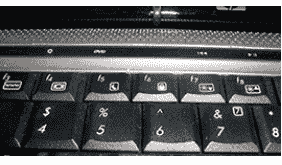

- A. 调低屏幕亮度
- B. 调高屏幕亮度
- C. 调低扬声器音量
- D. 调高扬声器音量

**25. 台式电脑无法保留系统时间或日期。用户每次系统断电后都需要重新设置它们。你应该怎么做来解决这个问题？**
- A. 刷写 BIOS。
- B. 更换 BIOS 芯片。
- C. 更换 CMOS 电池。
- D. 使用主板上的跳线将 BIOS 恢复为出厂设置。

**26. 此处展示的是什么类型的电源连接器，以及它为哪个设备供电？**

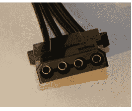

- A. ATX，主板
- B. Molex，硬盘
- C. PCIe，PCIe 扩展卡
- D. SATA，硬盘

**27. 你刚在客户端工作站上安装了一台新打印机。当你尝试打印时，纸上只出现乱码。哪两件事最可能导致这种问题？（选择两项。）**
- A. 打印后台处理程序
- B. 打印机驱动程序
- C. 格式板卡
- D. 打印机内存

**28. 一名用户提交了一台电池鼓胀的平板电脑。你应该如何解决这个问题？**
- A. 关闭平板电脑，让它冷却，然后将其归还给用户。
- B. 为用户订购一台新平板电脑，排空电池中多余的电解质，然后将缺陷电池扔进垃圾桶。
- C. 为用户订购一台新平板电脑，并将缺陷设备扔进垃圾桶。
- D. 为用户订购一台新平板电脑，并将缺陷设备送到回收中心。

**29. 你正在排查一台进入 VGA 模式的 Windows 10 台式电脑故障。你尝试更改分辨率并重新安装了视频驱动程序，但它仍然只能以 VGA 模式启动。下一步你应该做什么？**
- A. 更换显示器。
- B. 更换视频卡。
- C. 刷写系统 BIOS。
- D. 刷写视频卡 BIOS。

**30. 你正在排查一台无法正常启动的笔记本电脑故障。开机时，显示器没有任何显示，你听到 1-3-3 模式的哔声。你可以使用哪两样东西来排查此问题？（选择两项。）**
- A. 制造商的网站
- B. PCIe POST 卡
- C. USB POST 卡
- D. BOOT 测试器

**31. 在创建自定义计算机配置时，哪种系统最受益于高端显卡和冷却系统？**
- A. 厚客户端
- B. 游戏 PC
- C. 家庭影院 PC
- D. A/V 编辑工作站

**32. 哪些 RAM 模块有 240 个引脚？（选择两项。）**
- A. DIMM DDR2
- B. DIMM DDR3
- C. SODIMM DDR2
- D. SODIMM DDR3

**33. 多个蓝牙设备连接在一个 ad hoc（临时）网络中。哪个缩略词最好地描述了这种类型的网络？**
- A. LAN
- B. WAN
- C. PAN
- D. MAN

**34. 你的主板支持 PCIe 扩展卡的向上插入（up-plugging）。以下哪项陈述是正确的？**
- A. 不能将 x8 卡插入 x16 插槽。
- B. 可以将 x8 卡插入 x16 插槽，但它将以 x1 速度运行。
- C. 可以将 x8 卡插入 x16 插槽，并且它将按 x8 速度运行。
- D. 可以将 x8 卡插入 x16 插槽，并且它将按 x16 速度运行。

**35. AES 安全算法是在哪个 Wi-Fi 加密标准中引入的？**
- A. WEP
- B. WPA
- C. WPA2
- D. TKIP

**36. 你需要从一卷散装电缆中制作几条 UTP 跳线。你的公司使用 T568A 标准。连接器中导线的正确顺序是什么？**
- A. 白/橙，橙，白/绿，蓝，白/蓝，绿，白/棕，棕
- B. 白/橙，绿，白/绿，蓝，白/蓝，橙，白/棕，棕
- C. 白/绿，绿，白/橙，蓝，白/蓝，橙，白/棕，棕
- D. 白/绿，绿，橙，蓝，白/蓝，白/橙，白/棕，棕

**37. 你正在排查一台 Windows 8.1 笔记本电脑的无线网络问题。你应该使用哪个命令来检查笔记本电脑的 IP 地址？**
- A. `IFCONFIG`
- B. `IPCONFIG`
- C. `PING`
- D. `NETSTAT`

**38. 识别此处显示的连接器。**

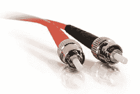

- A. ST
- B. SC
- C. LC
- D. BNC

**39. 哪个计算机部件最有可能使用 DB15 连接器？**
- A. 调制解调器
- B. 硬盘
- C. 显示器
- D. 键盘

**40. 关于激光打印机成像过程中曝光步骤中激光的功能，以下哪项陈述是正确的？**
- A. 它将电荷从 +100VDC 增加到 +600VDC。
- B. 它将电荷从 +600VDC 降低到 +100VDC。
- C. 它将电荷从 –100VDC 增加到 –600VDC。
- D. 它将电荷从 –600VDC 降低到 –100VDC。

**41. 你的同事需要使用存储卡读取器和 SD 存储卡从移动设备传输文件。他很快发现最大容量仅为 4GB。他拥有哪种技术？**
- A. SD
- B. SDLC
- C. SDHC
- D. SDXC

**42. 你需要为两台计算机系统购买新的 RAM，这两台系统的 FSB 速度均为 667MHz。计算机规范要求使用 DDR2。你应该购买哪种 RAM 模块？**
- A. PC2-667
- B. PC2-3200
- C. PC2-5300
- D. PC2-6400

**43. 雷暴过后，办公室里的激光打印机无法开机。你正在使用万用表进行测试。你预期在第 9 针上会看到多少电压？**
- A. −24v
- B. +24v
- C. −5v
- D. +5v

**44. 你需要打印包含敏感信息的文档，但所有打印机都在共享工作区。哪项技术可以允许你在打印机上输入 PIN 之前暂存打印作业？**
- A. 虚拟打印
- B. 安全打印
- C. 云打印
- D. 安全打印（Secure printing）

**45. 一位客座演讲者使用笔记本电脑背面的 VGA 端口将外部投影仪连接到她的笔记本电脑。投影仪已打开，但只显示蓝屏，而没有显示她的演示文稿。她解决此问题最简单的方法是什么？**
- A. 关闭投影仪再重新打开，以与笔记本电脑同步。
- B. 按键盘上的 Fn 键，并切换投影仪背光功能键，直到图像出现。
- C. 按键盘上的 Fn 键，并切换视频输出功能键，直到图像出现。
- D. 按键盘上的 Fn 键，并切换屏幕亮度功能键，直到图像出现。

**46. 以下哪个 IP 地址不能在 Internet 上路由？**
- A. 192.168.1.1
- B. 192.169.1.1
- C. 168.192.1.1
- D. 169.192.1.1

**47. 一名技术员在现场排查一台计算机故障，并打电话报告说她遇到了 S.M.A.R.T. 错误 ID 188，命令超时（Command timeout）。哪个组件很可能导致此错误？**
- A. CPU
- B. RAM
- C. 主板
- D. HDD

**48. 一名用户报告说，当他按下笔记本电脑键盘上的 L 键时，字母 L 在屏幕上重复出现，并且直到他多按几次 L 键后才停止。当你查看笔记本电脑时，该按键似乎没有物理卡住。你应该告诉他接下来做什么？**
- A. 更换键盘。
- B. 更换 L 键。
- C. 使用压缩空气清洁按键下方。
- D. 重启笔记本电脑。

**49. 一名技术员正在为小型办公室网络配置无线路由器。如果他希望为客户机电脑分配私有 IP 地址，同时仍允许它们通过 ISP 访问 Internet，他需要配置哪个选项？**
- A. DHCP
- B. DMZ
- C. NAT
- D. UPnP

**50. 你正在排查一台使用四个磁盘的 RAID 10 阵列的计算机。其中一个磁盘故障。你可以做什么来恢复阵列？**
- A. 更换故障磁盘并从备份恢复。
- B. 移除故障磁盘并重建阵列。
- C. 重建故障磁盘并从备份恢复。
- D. 更换故障磁盘并重建阵列。

**51. 一名技术员有两个硬盘，并希望提高她计算机的数据访问速度。以下哪项是她最好的选择？**
- A. 安装两个驱动器并将它们配置为独立的卷。
- B. 安装两个驱动器并实施 RAID 0。
- C. 安装两个驱动器并实施 RAID 1。
- D. 安装两个驱动器并实施 RAID 5。

**52. 哪种转换器需要电源，无论是来自其自身电源还是来自它插入的接口？**
- A. DVI 转 HDMI
- B. PS/2 转 USB
- C. Thunderbolt 转 DVI
- D. HDMI 转 VGA

**53. 在激光打印过程的充电步骤中，施加在感光鼓上的电荷是多少？**
- A. −100VDC
- B. −600VDC

C. +600VDC
D. +100VDC

## 54. 您的笔记本电脑有一个内部 Mini PCIe 扩展插槽。一张扩展卡的文档说明它支持 Mini PCIe USB 3.0 功能。该扩展卡的运行速度是多少？

- A. 480Mbps
- B. 2.5Gbps
- C. 5.0Gbps
- D. 6.0Gbps

## 55. 您正在购买一款需要使用触控笔输入信息的移动设备；该设备不响应手指触摸。该设备使用哪种触摸屏技术？

- A. 钢化玻璃（Tempered）
- B. 电阻式（Resistive）
- C. 电容式（Capacitive）
- D. 对象导向（Object-oriented）

## 56. SATA 3 硬盘的最大数据传输率是多少？

- A. 1.5Gbps
- B. 3Gbps
- C. 6Gbps
- D. 10Gbps

## 57. 在笔记本电脑中，哪个组件负责提供点亮显示屏所需的能量？

- A. 逆变器（Inverter）
- B. LCD
- C. 背光（Backlight）
- D. 屏幕

## 58. 一名用户投诉称其电脑散发烧焦气味并冒烟。关机后，您发现主板上有烧焦痕迹。您更换了主板。第二天，用户再次投诉冒烟，您发现这块新主板也烧坏了。接下来您应该怎么做？

- A. 更换主板。
- B. 更换电源。
- C. 更换主板和电源。
- D. 将电脑插到不同的墙壁插座上。

## 59. 这里左边显示的是哪种类型的连接器？

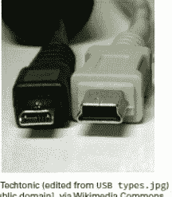

- A. USB micro
- B. USB mini
- C. USB type A
- D. Lightning

## 60. 您有一个网络安装项目，要求在85米的距离下实现10Gbps的传输速度。在列出的UTP标准中，哪一个是最早满足该网络要求的？

- A. CAT5
- B. CAT5e
- C. CAT6
- D. CAT7

## 61. 您正在排查一台 Windows 7 电脑的问题，并怀疑硬盘存在坏道。您应该使用哪个实用工具来扫描硬盘并尝试修复坏道？

- A. `format`
- B. `bootrec`
- C. `diskpart`
- D. `chkdsk`

## 62. 以下哪项不是 POST（开机自检）例程中验证的内容？

- A. BIOS 完整性
- B. 硬盘完整性
- C. 主存大小
- D. 系统总线

## 63. 一根 UTP 网线刚刚损坏，您需要更换它。您有一卷网线和连接器，但没有预制好的线缆。您需要使用哪种工具来制作一条新的线缆？

- A. 剥线钳（Cable stripper）
- B. 打线工具（Punchdown tool）
- C. 万用表（Multimeter）
- D. 压线钳（Crimper）

## 64. 您正在一台服务器上安装和配置 DHCP。DHCP 使用哪些端口号？（选择两项。）

- A. TCP 67
- B. TCP 68
- C. UDP 67
- D. UDP 68

## 65. 您正在考虑购买平板电脑或电子阅读器来阅读书籍和杂志。电子阅读器相比平板电脑有哪两个优势？（选择两项。）

- A. 更长的电池续航时间
- B. 更好的色彩表现
- C. 在明亮环境下更易阅读
- D. 更大的内存

## 66. 一名用户报告称弹出一个错误消息，告知 Windows 检测到 IP 地址冲突。您的网络使用 DHCP 服务器。您应该如何解决此问题？

- A. 在用户计算机上运行 `ipconfig /release` 和 `ipconfig /renew`。
- B. 在 DHCP 服务器上，将该用户的 IP 地址从作用域中排除。
- C. 在用户计算机上，确保设置为自动获取 IP 地址。
- D. 在用户计算机上，确保设置为使用以下 IP 地址。

## 67. 一名技术人员正在排查一个由四块硬盘组成的 RAID 5 阵列。其中两块硬盘已损坏。他可以做什么来恢复阵列？

- A. 重建损坏的硬盘并从备份中恢复。
- B. 移除损坏的硬盘并重建阵列。
- C. 替换损坏的硬盘并重建阵列。
- D. 替换损坏的硬盘并从备份中恢复。

## 68. 您在一台 Windows 服务器上打开了命令提示符。您想共享 `D:\corp\acctrec` 目录，并希望用户通过名称 receipts 连接该目录。哪条命令是正确的？

- A. `net share receipts=D:\corp\acctrec`
- B. `net share D:\corp\acctrec=receipts`
- C. `netdom share receipts=D:\corp\acctrec`
- D. `netdom share D:\corp\acctrec=receipts`

## 69. MicroSD 卡常用于移动电话，是常用内存卡中尺寸最小的。MicroSD 卡的尺寸是多少？

- A. 25mm × 20mm
- B. 21.5mm × 20mm
- C. 15mm × 11mm
- D. 11mm × 8mm

## 70. 您正在排查一台笔记本电脑无法在插入墙壁插座时开机的故障。您已确认插座正常并尝试了第二个 AC 适配器，但插入电源后仍无法开机。如果拔掉墙壁电源，它可以电池开机。您应该怎么做才能在插入墙壁插座时使其开机？

- A. 更换 AC 适配器。
- B. 取出电池，开机，然后重新插入电池。
- C. 将电池完全放电，然后开机。
- D. 更换电池。

## 71. 在设置网络时，您配置客户端从 DHCP 服务器自动获取 IP 地址信息。DHCP 服务器可以提供以下哪项配置信息？

- A. IP 地址
- B. IP 地址和子网掩码
- C. IP 地址、子网掩码和默认网关
- D. IP 地址、子网掩码、默认网关和 DNS 服务器地址

## 72. 您的办公室人数刚从 20 人增加到大约 40 人。每个人都使用同一台激光打印机。打印时，任务处理速度往往很慢。除了获取新打印机外，您可以做什么来帮助消除这个问题？

- A. 升级打印机内存。
- B. 升级打印机处理器。
- C. 停止并重启打印后台处理程序（Print Spooler）。
- D. 为最重要的用户实施打印优先级。

## 73. 一名拥有 802.11g 网络适配器的用户试图加入您新的 802.11ac 网络。她的笔记本电脑紧挨着您的电脑，而您的电脑已连接到该网络。然而，她无法找到 SSID。最可能的原因是什么？

- A. 无线接入点上禁用了 SSID 广播。
- B. 用户超出了无线接入点的范围。
- C. SSID 已被更改。
- D. 802.11g 与 802.11ac 不兼容。

## 74. 在激光打印机成像过程的转印步骤中，纸张上施加了什么电荷？

- A. −100VDC
- B. −600VDC
- C. +600VDC
- D. +100VDC

## 75. 在以下哪种情况下，您希望使用此处显示的特殊功能键 F8？

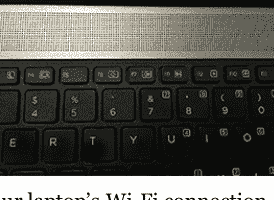

- A. 关闭笔记本电脑的 Wi-Fi 连接
- B. 关闭笔记本电脑的蓝牙连接
- C. 将笔记本电脑的扬声器静音
- D. 将笔记本电脑的麦克风静音

## 76. 您已将四块 1TB 硬盘配置为 RAID 10 阵列。阵列配置完成后，您有多少可用存储空间用于数据？

- A. 1TB
- B. 2TB
- C. 3TB
- D. 4TB

## 77. 一名客户有一台运行旧版 Windows 7 的笔记本电脑，带有集成 802.11b 网络适配器。她希望获得更快的无线访问速度，而网络接入点均支持 802.11n。升级她的系统的最佳方式是什么？

- A. 移除旧卡，并用内部 802.11n 网卡替换。
- B. 保留系统内的旧卡，并添加新的内部 802.11n mini-PCIe 网卡。系统将自动禁用旧卡。
- C. 添加一个 USB 802.11n 网卡。如有需要，在设备管理器中禁用旧卡。
- D. 添加一个 USB 802.11n 网卡。如有需要，在系统管理器（System Manager）中禁用旧卡。

## 78. 您正在排查一台 Windows 7 台式电脑启动时不产生视频信号的问题。您尝试在该电脑上连接第二台已知正常的显示器，但仍无视频信号。您应该如何修复此问题？

- A. 更换显示器。
- B. 重新安装视频卡驱动程序。
- C. 更换视频卡上的视频连接器。
- D. 更换视频卡。

## 79. 在激光打印机打印过程中，哪个步骤位于

在熔接步骤之前立即进行的是？

A. 转移
B. 显影
C. 清洁
D. 曝光

80. 在 IPv6 网络中，如果你想同时向一组计算机发送一条消息，你需要使用哪种类型的地址类别？

A. 组播
B. 任播
C. 单播
D. 广播

81. 哪一个 TCP/IP 互联网层协议负责将 IP 地址解析为 MAC 地址？

A. IP
B. ICMP
C. ARP
D. RARP

82. 你团队中的一位技术员被要求更换笔记本电脑的内存。她已取出旧内存并带给了你；其外观如图所示。她需要用哪种类型的内存来替换？

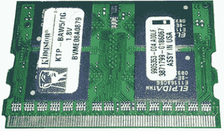

A. SODIMM
B. MicroDIMM
C. DIMM
D. 闪存

83. 在 IPv6 中，哪个地址范围是组播范围？

A. 2000::/3
B. FC00::/7
C. FE80::/10
D. FF00::/8

84. 你正在山间徒步，佩戴着启用 GPS 功能的智能手表。为了知道你的位置和海拔高度，你的手表必须与多少颗卫星通信？

A. 一颗
B. 两颗
C. 三颗
D. 四颗

85. 哪种无线连接类型的数据传输会在有人走到发送设备和接收设备之间时中断？

A. 蓝牙
B. Wi-Fi
C. 射频（RF）
D. 红外（IR）

86. 你正在配置一台无线 802.11ac 路由器以便首次使用。以下哪项配置选项是推荐的？

A. 更改路由器的 SSID。
B. 选择 WPA 作为加密方式。
C. 保留管理员密码为默认值。
D. 启用 DMZ。

87. 哪种网络设备分为两种类型：有源（通电）和无源（不通电）？

A. 网桥
B. 路由器
C. 交换机
D. 集线器

88. 当 PCIe 1.1 x16 插槽双向工作时，提供的数据传输吞吐量是多少？

A. 2GBps
B. 4GBps
C. 8GBps
D. 16GBps

89. 你打算为一个小会议室购买一台新的 LCD 显示器。该显示器将被坐在屏幕宽角度位置的人观看。你应该购买哪种技术？

A. 荧光
B. LED
C. TN
D. IPS

90. 一名技术员需要选择一种光盘技术，以提供尽可能大的存储空间。哪种技术最能满足她的需求？

A. DVD+R DL
B. BD-R SL
C. BD-R DL
D. CD

## 第 11 章
## 练习考试 2 (220-902)

1. 你正在现场修理一台无法加载 Windows 7 的客户笔记本电脑。你正等着听关于你朋友本周末举办的一场精彩派对的最新消息，你的手机开始震动，而且一直震个不停。你确信你的朋友们正在发送关于派对的信息。你应该怎么做？（选择两项。）

A. 关掉手机，并向客户道歉。告诉他们手机干扰了你的工作，但现在不会再有问题了。
B. 忽略你的手机。
C. 回复短信告诉你的朋友们你正在工作。
D. 给你的朋友打电话，告诉他在完成这项工作之前不要计划所有细节，因为你想要帮忙。

2. 一位用户正在运行一个需要复杂计算且消耗大量 CPU 资源的应用程序。他想设置他的 Windows 7 工作站，使该应用程序相对于所有非系统关键程序具有更高优先级。他可以使用哪个工具来实现？

A. 任务管理器
B. 应用程序管理器
C. 性能监视器
D. 系统配置

3. 你计划格式化一块使用 NTFS 文件系统的硬盘以安装 Windows 8.1。以下哪些功能存在于 NTFS 中？（选择两项。）

A. Linux 操作系统支持
B. 文件压缩
C. 文件安全
D. 增强闪存支持

4. 你有一台运行 Windows 7 专业版的计算机，你想升级到 Windows 8 企业版。你应该运行什么来确定你的计算机是否支持新的操作系统？

A. Windows 轻松传送
B. 硬件兼容性列表
C. Windows 升级顾问
D. Windows 升级助手

5. 以下哪项陈述最准确地描述了虚拟专用网络（VPN）的目的？

A. 它将一个网络与另一个网络隔离，使其无法访问。
B. 它检查传入的网络数据包，并仅转发符合访问控制列表标准的数据包。
C. 它代表用户发起网络请求，有效地向接收请求的计算机隐藏用户的身份。
D. 它通过公共网络创建私有、安全的网络连接。

6. 你在客户办公室需要更换故障内存，但没有防静电（ESD）腕带。以下哪种方法描述了更换 RAM 时进行自我接地的最佳方式？

A. 保持计算机插电但关机，并接触机箱的塑料部分。
B. 保持计算机插电但关机，并接触机箱的金属部分。
C. 拔掉计算机电源，并接触机箱的塑料部分。
D. 拔掉计算机电源，并接触机箱的金属部分。

7. 你有一台带有 802.11n 网络适配器的 Windows 7 工作站。当你建立网络连接时，你应该选择哪种类型的连接？

A. WWAN
B. 无线
C. 有线
D. VPN

8. 警察向你求助。他们查获了一部疑似罪犯的 iPhone，想要从中获取信息，并且他们持有搜查令。该疑似罪犯没有向他们提供密码，因此系统已被锁定。你可以给他们什么建议来从设备中检索数据？

A. 他们可以执行恢复出厂设置，这将重置密码。然后他们可以检索数据。
B. 他们可以执行强制重置，这将重置密码。然后他们可以检索数据。
C. 没有密码就无法解锁设备并获取数据。
D. 他们可以使用 Apple 的后门代码破解手机。

9. 你登录到一个 Linux 工作站，使用的是普通用户账户。你需要执行一个具有 *root* 权限的命令。你需要使用哪个命令？

A. `su`
B. `sudo`
C. `vi`
D. `dd`

10. 你网络上的一个 Linux 用户在启动时收到一条错误消息，提示 GRUB 缺失，并伴有错误编号。你可以做些什么来解决这个问题？

A. 使用 Linux 安装 CD 或 DVD 启动，进入 Linux 救援模式，并重新创建 MBR。
B. 使用 Linux 安装 CD 或 DVD 启动，并重新安装 Linux。
C. 使用 Linux 安装 CD 或 DVD 启动，进入 Linux 救援模式，并挂载硬盘。
D. 使用 Linux 安装 CD 或 DVD 启动，进入 Linux 救援模式，并重写 GRUB 文件的内容。

11. 一位安全顾问建议你的安全设施实施生物识别作为建筑物访问控制的一种形式。她最可能指的是哪种系统？

A. RFID 徽章
B. 钥匙扣
C. 视网膜扫描仪
D. 陷阱门（Mantraps）

12. 你正在网上寻找图片，作为公司想要制作的宣传材料的一部分。关于在线内容，以下哪项陈述是正确的？

A. 在线内容被视为开源；因此，你可以使用你找到的任何内容。
B. 在线内容通过 DRM 的使用得到保护。
C. 在线内容通过 EULA 的使用得到保护。
D. 在线内容通过日内瓦公约中规定的条款得到保护。

13. 在哪种安全威胁中，有人会试图通过跟随一个已经使用其访问权限的人进入安全区域，而在没有凭证的情况下获得对安全区域的访问权？

A. 暴力破解
B. 尾随
C. 肩窥
D. 中间人攻击

14. 一项新法律要求你保留所有工作站系统配置的纸质副本。你可以使用哪个命令轻松收集远程工作站的信息并将报告保存为文本文件？

A. MSINFO32
B. COMPGMGT
C. MMC
D. PERFMON

15. 你打算在一台当前运行 Windows 7 专业版的工作站上安装 Windows 8 专业版。如果你想保留工作站上现有的用户账户、数据和应用，你应该执行哪种类型的安装？

A. 迁移
B. 全新安装
C. 升级
D. 自定义

16. 你正在为家庭办公室配置无线路由器。以下哪项变更对提高网络安全的影响最小？

A. 启用 MAC 过滤
B. 禁用 SSID 广播
C. 配置 WPA
D. 更改默认用户名和密码

17. 你网络上的移动设备用户报告在使用 Wi-Fi 时网络访问速度异常缓慢。然而，当他们使用蜂窝连接时，速度似乎正常。在这种情况下，以下哪项最不可能导致数据速度缓慢？

A. 干扰
B. 信号弱

18. 你打算将一台台式电脑从一个办公室搬到另一个办公室。它目前放在地板上，位于桌子下方。以下哪些是应遵循的良好个人安全程序？（选择两项。）
- A. 弯腰并直接向上提起。
- B. 弯曲膝盖，用腿部力量提起。
- C. 扎紧宽松的饰品、长发或领带。
- D. 保持电脑插电以避免 ESD（静电放电）。

19. 你刚刚在一台 Windows 8.1 工作站中安装了第二块和第三块硬盘。每块硬盘容量为 500GB。用户希望将这些空间合并为一个 1TB 的卷。为了实现这一目标，并为用户提升磁盘读写性能，你应该创建什么？
- A. 一个新的简单卷
- B. 一个新的跨区卷
- C. 一个新的条带卷
- D. 一个新的镜像卷

20. Windows 7 的哪个功能旨在加密存储卷，必须由管理员激活，并且可以加密操作系统启动文件？
- A. BitLocker
- B. EFS
- C. OneDrive
- D. Shadow Drive

21. 你希望设置你的手机，以便在便利店通过简单地将手机靠近商户的接收器来支付商品。这是什么类型的移动支付服务？
- A. SMS 或 MMS
- B. NFC
- C. 直接移动计费
- D. 移动网络支付

22. 以下哪项描述最准确地说明了隐私过滤器的功能？
- A. 防止他人看到服务器内部
- B. 防止用户访问服务器上的其他用户的数据
- C. 有助于防止个人可识别信息 (PII) 的意外泄露
- D. 防止他人看到你电脑屏幕上的信息

23. 你的 iPhone 被盗了。为了确保窃贼无法访问你的数据，你应该做什么？
- A. 执行远程备份。
- B. 启用完整设备加密。
- C. 执行远程擦除。
- D. 使用定位应用。

24. 你在一台 Windows 8.1 工作站中安装了第二块硬盘。在磁盘管理中，你可以创建哪种类型的分区，使其内部可以创建无限数量的逻辑分区？
- A. 扩展
- B. 动态
- C. 逻辑
- D. GPT

25. 你打算回收一些较旧的磁性硬盘。你希望将驱动器上的所有数据设置为仅 0。你应该使用什么来实现这一目标？
- A. 覆写
- B. 格式化
- C. 消磁
- D. Diskpart

26. 你的 Windows 8.1 工作站刚刚崩溃，显示了蓝屏死机画面。你最近没有对电脑进行任何更改。重新启动 Windows 以判断是否隔离了问题的最佳方式是什么？
- A. 从 Windows 安装光盘启动并运行恢复控制台。
- B. 以安全模式启动。
- C. 从最后一次已知良好配置启动。
- D. 正常启动并查看错误是否再次发生。

27. 一名用户报告他的安卓手机无法开机。当他把手机递给你时，手机几乎烫手。然后他承认手机在夏天被困在锁着的车里度过了大半天。问题的最可能原因是什么？
- A. 过热
- B. 系统冻结
- C. 系统锁定
- D. 电池耗尽

28. 机器车间的地板上有几台瘦客户机。你希望它们能够从网络上的引导服务器启动 Windows 8 操作系统。瘦客户机需要使用什么过程？
- A. PXE 启动
- B. WinPE 过程
- C. WinRE 过程
- D. 网络启动

29. 你正在 Windows Vista 命令提示符处工作。你需要终止远程系统（名为 Sparky）上的一个进程，该进程标识符为 14456。终止该进程及其启动的任何子进程的正确语法是什么？
- A. taskkill /S Sparky /PID 14456 /C
- B. taskkill /T Sparky /PID 14456 /S
- C. taskkill /S Sparky /PID 14456 /T
- D. taskkill /C Sparky /PID 14456 /T

30. 你网络中的一台工作站配置为在 Windows Vista 和 Windows 8.1 之间双重启动。以前，用户会看到一个菜单询问他选择哪个操作系统。他没有进行任何配置更改，但该菜单不再出现。哪个文件负责向用户呈现此菜单？
- A. WINRESUME
- B. WINLOAD
- C. BOOTMGR
- D. NTLDR

31. 一家拥有两台位于服务器机房服务器的小型企业希望你能找到解决方案来解决一个问题。该企业经常发生停电，并因此丢失了服务器上的重要数据。企业希望某种电池备份。你应该安装哪种类型的设备来防止此问题？
- A.  surge 保护器
- B. 电源插排
- C. UPS（不间断电源）
- D. 电压转换器

32. 网络上的哪种类型的服务器将被配置有作用域，其中包含服务器将提供给请求者的信息？
- A. DHCP 服务器
- B. DNS 服务器
- C. 代理服务器
- D. 身份验证服务器

33. 你正在一台运行非常缓慢的 Windows 7 工作站上工作。你想快速检查系统 CPU 和 RAM 使用情况，查看是否存在异常。你可以使用哪两个实用工具来执行此操作？
- A. 资源监视器
- B. 性能监视器
- C. 控制面板 > 系统
- D. 控制面板 > 设备管理器

34. 在 Windows Vista 中，微软引入了一个与其之前界面不同的用户界面。Windows Vista 界面的名称是什么？
- A. Windows 资源管理器
- B. WinPE
- C. Metro
- D. Aero

35. 你有一台带有物理连接打印机的 Windows 7 专业版工作站。你希望网络上的其他人也能使用该打印机。你需要做什么来启用此功能？
- A. 右键单击打印机，选择打印机属性，并共享打印机。
- B. 右键单击打印机，选择打印机属性，并映射网络打印机。
- C. 打开添加打印机向导并共享打印机。
- D. 打开添加打印机向导并映射网络打印机。

36. 作为网络管理员，你设置了账户锁定策略，使得账户在五次登录失败后被锁定。这将阻止哪种类型的安全威胁？
- A. 肩窥（应密窃取）
- B. 暴力破解
- C. 零日攻击
- D. 鱼叉式网络钓鱼

37. 偶尔在使用 Google Chrome 访问网站时，你会在浏览器前方收到一个弹出窗口。通常它是试图向你销售商品的广告。以下哪项操作将阻止这种情况发生？
- A. 启用 Chrome 的弹出窗口拦截器。
- B. 安装防病毒程序。
- C. 安装反恶意软件以停止广告软件。
- D. 启用 Windows 防火墙。

38. 你收到来自无线提供商的通知，告知你即将超出当月的数据计划。本月你没有经常使用手机，因此这让你感到惊讶。这可能是什么的迹象？
- A. 手机需要更换。
- B. 未经授权的账户访问。
- C. 流氓应用，例如流氓杀毒软件。
- D. 高资源利用率。

39. 哪个 Windows Vista 功能是桌面上专门设计用于小型可自定义程序（如时钟、新闻头条或天气应用）的区域？
- A. Sidebar
- B. Widgets
- C. Gadgets
- D. Charms

40. 你的公司处理机密政府文件。员工将任何文件复制到闪存盘是违法的。你在哪里规定此规则以及不遵守规则的惩罚？
- A. AUP
- B. DLP
- C. ACL
- D. 员工手册

41. 一名 Windows 7 用户报告她的电脑刚刚完全锁定。她的屏幕上显示一条消息，声称照片中的人参与了非法活动。她的网络摄像头自行打开，并拍到了她。消息还说她可以通过支付 500 美元的罚款来解决对她的指控。她因这次事件感到震惊是可以理解的。接下来你应该做什么？
- A. 告诉她，如果她使用工作电脑进行了非法活动，她的雇佣关系将被终止。
- B. 从你的反恶意软件提供商那里启动恢复光盘，并运行修复。
- C. 删除并重新安装 Windows。
- D. 支付罚款。

42. 你的一名技术人员刚刚接触了一个你不太熟悉的含有化学品的塑料瓶。他的手开始感觉像被烧伤了。你可以在哪里找到有关如何正确洗手而不会使问题变得更糟以及如何处置该化学品的信息？
- A. OSHA
- B. 容器底部
- C. 警告标签
- D. MSDS

43. 你希望保护网络上的移动设备用户免受潜在泄露的文件或数据的侵害。你应该采取以下哪项措施来帮助降低此风险？（选择两项。）
- A. 禁用网络自动连接。

## B. 强制执行数据传输超限。
### C. 启用设备加密。
### D. 安装移动防火墙。

### 44. 网络架构师建议你网络上安装一个入侵检测系统（IDS）。以下哪项陈述最准确地描述了 IDS 的作用？
- A. 它基于一组规则允许或拒绝传入的网络流量。
- B. 它检测网络流量中的异常，记录活动，并采取行动阻止该活动。
- C. 它检测通过网络传输的病毒，记录活动，并删除感染病毒的网络数据包。
- D. 它检测网络流量中的异常，记录活动，并向管理员发送警报。

### 45. 你正在 Windows 8 命令提示符界面。你所在的目录有数百个文件，因此当你获取目录列表时，你希望每次只显示一页文件。你应该使用哪个命令来实现这一点？
- A. dir /p
- B. dir /o
- C. dir /s
- D. dir /d

### 46. 你正在网络服务器上安装虚拟化软件。你应该安装哪种类型的 hypervisor（管理程序），以最小化承载虚拟服务器的物理机器所需的资源？
- A. 虚拟机管理器。
- B. Type 1 或 Type 2 都会以相同的方式工作。
- C. Type 1。
- D. Type 2。

### 47. 你发现外部攻击者已经控制了你的多台工作站，并正在远程操控它们。看起来攻击者正在使用这些系统向成千上万的用户发送垃圾邮件。这是哪种类型的攻击？
- A. 勒索软件
- B. 僵尸网络/机器人网络
- C. 不合规系统
- D. 欺骗

### 48. 你已为 Finance 组在 D:\MonthlyReports 文件夹上分配了“修改”权限。随后，你创建了一个名为 D:\MonthlyReports\January 的文件夹。Finance 组对文件夹 D:\MonthlyReports\January 拥有什么级别的权限？
- A. 无访问权限，因为没有明确设置任何权限。
- B. 完全控制权限，因为没有明确设置任何权限。
- C. 修改权限，因为该文件夹从父文件夹继承了权限。
- D. 修改权限，因为该文件夹从父文件夹继承了权限。Finance 组成员还可以为其他用户或此文件夹授予权限。

### 49. 一名用户在他的 Windows 7 工作站上安装了两台显示器。他希望将次要显示器设置在主要显示器的右侧。然而，当他将鼠标移向主要显示器的右侧时，光标停在屏幕边缘。当他将其向左移动时，光标出现在次要显示器的右侧。他应该去哪里更改此设置？
- A. 右键单击桌面并选择“屏幕分辨率”。
- B. 右键单击桌面并选择“鼠标对齐”。
- C. 右键单击桌面并选择“显示器对齐”。
- D. 右键单击桌面并选择“显示设置”。

### 50. 你 Android 手机上的个人理财应用无法加载。你重启了手机，但应用仍然无法工作。为了使其正常工作，接下来你应该尝试什么？
- A. 执行出厂设置重置。
- B. 下载防病毒应用并执行病毒扫描。
- C. 卸载并重新安装该应用。
- D. 强制停止该应用，然后再次打开它。

### 51. 你的公司有一项政策，禁止在工作电脑上出现非法内容。你已识别并核实了某用户工作站上的非法内容。你应该采取的下一步是什么？
- A. 要求用户删除该材料。
- B. 你自己删除非法材料。
- C. 记录相关情况。
- D. 通过适当渠道报告此事件。

### 52. 你的 Windows 7 工作站出现间歇性视频问题。制造商的网站建议你安装最新的驱动程序。你应该使用哪个实用工具来检查计算机上安装的驱动程序版本？
- A. 显示设置
- B. 设备管理器
- C. 服务
- D. 计算机管理

### 53. 你正在执行大规模的 Windows Vista 迁移，并需要迁移用户账户和设置。你倾向于通过配置脚本来完成，而不是手动操作。你应该使用哪个实用工具？
- A. 控制面板中的用户账户
- B. Windows Easy Transfer (WET)
- C. Windows Migration Tool (WMT)
- D. 用户状态迁移工具 (USMT)

### 54. 在运行 macOS 的 MacBook Pro 上，沿着屏幕底部运行、允许你打开应用的图标栏叫什么名字？
- A. 启动器
- B. 访达
- C. 聚光灯
- D. 程序坞

### 55. 你点击了电子邮件中的一个链接，它把你带到了一个你不熟悉的网站。那天晚些时候，你的电脑上弹出一条消息，告诉你硬盘上的所有文件都被加密了，你无法再访问任何关键文档。如果你想让文件解密，你需要通过输入信用卡号码来支付费用。你被什么感染了？
- A. 间谍软件
- B. 特洛伊木马
- C. 勒索软件
- D. 蠕虫

### 56. 一台 Windows 7 工作站无法正确启动，你认为是系统文件存在问题。哪个实用工具可以扫描并修复损坏的 Windows 7 系统文件？
- A. MSCONFIG
- B. REGSVR32
- C. ERD
- D. SFC

### 57. 一名 Android 手机用户报告说她的手机无法连接到 Wi-Fi 网络，但她有蜂窝信号。你应该首先让她尝试什么？
- A. 检查手机是否处于飞行模式。
- B. 检查是否启用了 Wi-Fi 连接。
- C. 调整 Wi-Fi 信号接收能力。
- D. 执行硬重置。

### 58. 你正在向新的技术人员讲解修复计算机和显示器时的安全操作规程。作为一个展示品，你有一台几个月未使用的旧 CRT 显示器。如果你打开这个显示器，以下哪些是潜在的最大的危险？（选择两项。）
- A. 破碎的玻璃
- B. 锋利的边缘
- C. 高压电容器
- D. 烫伤

### 59. 你正在排查一台感染了恶意软件的 Windows 8.1 工作站。遵循恶意软件清除的最佳实践，你已经达到了安排系统扫描并运行反恶意软件更新阶段。你应该采取的下一步是什么？
- A. 教育最终用户。
- B. 启用系统还原并创建还原点。
- C. 禁用系统还原。
- D. 修复受感染的系统。

### 60. 你想在 Windows 8.1 工作站上启用加密。以下哪些陈述是正确的？（选择两项。）
- A. 启用 EFS 需要管理员访问权限。
- B. 启用 BitLocker 需要管理员访问权限。
- C. EFS 可以加密整个卷或单个文件。
- D. BitLocker 可以加密整个卷或单个文件。

### 61. 在 Windows 工作站上配置 NTFS 权限时，推荐的方法是什么？
- A. 向用户账户授予权限。
- B. 将用户账户放入组。向组授予文件夹权限，向用户授予文件权限。
- C. 将用户账户放入组。向用户授予文件夹权限，向组授予文件权限。
- D. 将用户账户放入组。向组授予权限。

### 62. 你正在 Windows 7 工作站上安装客户端虚拟化。该工作站将支持另外两个操作系统。确保每个操作系统都能获得对剩余物理网络的适当网络访问的推荐且经济有效的方法是什么？
- A. 每个操作系统都有一个虚拟 NIC（网卡），它连接到物理 NIC。
- B. 每个操作系统都有自己的物理 NIC。
- C. 每个操作系统都有一个连接到物理 NIC 的虚拟交换机。
- D. 每个操作系统都有一个虚拟 NIC，连接到虚拟交换机，该交换机再连接到物理 NIC。

### 63. 你正在 D:\users 目录下的 Windows 8.1 命令提示符处。你想使用 copy 命令将 D:\users\jdoe 目录复制到 D:\files 目录。以下哪项陈述是正确的？
- A. 你不能使用 copy 命令来执行此任务。
- B. 你可以使用命令 `copy d:\users\jdoe\*. * d:\files`。
- C. 你可以使用命令 `copy d:\users\jdoe d:\files`。
- D. 你可以使用命令 `copy d:\users\jdoe d:\files /y`。

### 64. 你想配置一台测试工作站，使其能够启动到 Windows Vista、Windows 7 和 Windows 8.1。关于安装这些操作系统，以下哪项陈述是正确的？
- A. 在这种情况下，操作系统安装的位置并不重要。
- B. 你应该将所有操作系统安装在同一个

分区。

C. 您应该在各自的分区上安装每个操作系统。

D. 您无法在一个工作站上安装所有三个操作系统。

65. 一台 Windows 8.1 工作站的 BCD 文件损坏。您可以使用哪两条命令来修复此问题？（选择两项。）

- A. `BOOTREC /FIXMBR`
- B. `BOOTREC /FIXBOOT`
- C. `BOOTREC /REBUILDBCD`
- D. `BCDEDIT`

66. 一名技术人员正在排查一台 Windows 8.1 工作站上的驱动程序问题。她已验证系统功能正常并实施了预防措施。根据故障排除理论，她接下来应该做什么？

- A. 记录发现、操作和结果。
- B. 制定解决计划并实施解决方案。
- C. 询问用户并识别用户对计算机的更改。
- D. 对计算机进行备份。

67. 您正在 Windows 8.1 计算机上工作，弹出了一个安全警报，如下所示。您的下一步操作应该是什么？

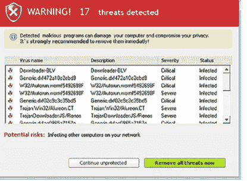

- A. 单击“继续不受保护”按钮。
- B. 单击“立即删除所有威胁”按钮。
- C. 创建还原点，然后单击“立即删除所有威胁”按钮。
- D. 关闭计算机。重新启动，并使用您的防病毒软件发起病毒扫描。

68. 您正在向一名新的 Mac 用户介绍 macOS 的功能。她问该系统是否能够为她存储访问各种互联网网站的密码。她应该使用哪个功能？

- A. Keychain（钥匙串）
- B. Wallet（钱包）
- C. Passport（护照）
- D. Spotlight（聚光灯）

69. 您正在排查一台 Windows 8.1 工作站，其显卡驱动程序似乎存在问题；仅显示 16 种颜色。您尝试以安全模式启动系统，但 F8 选项似乎不起作用。您可以使用哪个管理工具强制系统在重启时进入安全模式？

- A. 任务计划程序
- B. 计算机管理
- C. 任务管理器
- D. 系统配置

70. 以下哪项是使用共享权限而非 NTFS 权限的优势？

- A. 如果发生冲突，共享权限将覆盖 NTFS 权限。
- B. 共享权限在用户通过网络访问资源时应用，但 NTFS 权限仅适用于本地用户。
- C. 共享权限可以在文件级别设置，而 NTFS 权限只能在文件夹级别设置。
- D. 共享权限可以启用，以保护不在 NTFS 分区上的网络资源。

71. 您在您的 Windows 8.1 工作站上安装了防病毒程序。在配置它时，您应该将更新频率设置为多少？

- A. 自动
- B. 每周一次
- C. 每月一次
- D. 每年一次

72. 您的经理担心贵公司可能会泄露 PII（个人身份信息）。以下哪种类型的数据不被视为 PII？

- A. 名字
- B. 家庭住址
- C. 家庭成员姓名
- D. 员工 ID 号码

73. 一名用户报告说他的 Windows 8.1 安装程序不断崩溃。他在计算机上安装了许多第三方应用程序，您认为其中某些应用程序导致了不稳定性。进入 Windows 恢复环境后，您应该选择哪个选项来修复 Windows 并删除除默认应用程序之外的所有内容？

- A. 恢复
- B. 刷新
- C. 重置
- D. 还原

74. 在一台 Windows 7 工作站上，有两个 NTFS 卷。管理员组对 `C:\mgmt` 目录具有修改权限。您将文件夹移动到 `D:\keyfiles` 文件夹中，管理员组对该文件夹具有读取权限。管理员组对新目录 `D:\keyfiles\mgmt` 的权限级别是什么？

- A. 完全控制
- B. 修改
- C. 读取和执行
- D. 读取

75. 您正在对移动用户进行潜在安全风险方面的培训。以下哪一项可能会使用户更容易受到中间人攻击的影响？

- A. 非预期的 Wi-Fi 连接
- B. 未经授权的账户访问
- C. 未经授权的定位跟踪
- D. 未经授权的相机启动

76. 您管理的网络上有十几台 Windows 7 工作站。您希望确保用户没有更改启动顺序的能力，这样他们就无法从未经授权的设备启动。您应该采取哪一步骤？

- A. 设置 BIOS/UEFI 密码。
- B. 禁用自动运行。
- C. 限制用户权限。
- D. 启用强密码策略。

77. 一名用户需要出行进行演示，并希望确保他的笔记本电脑没有耗尽电池电量，因此他想将其关闭。但是，他希望保持文件和应用运行，这样当他重新打开时，应用已经打开。以下哪项陈述是正确的？

- A. 用户无法做到这一点。
- B. 用户应将计算机置于待机模式。
- C. 用户需要激活睡眠电源计划。
- D. 用户应使计算机进入休眠状态。

78. 您正在处理一台无法正常加载 Windows 的 Windows 7 工作站。另一位技术人员建议使用快照来恢复系统。您应该从哪里执行此操作？

- A. Windows RE
- B. Windows 预安装环境
- C. 安全模式
- D. 备份和还原

79. 一名用户对 docs 文件夹的 NTFS 权限为读取和执行。他的共享权限为完全控制。当他通过网络连接资源时，他的有效访问权限是什么？

- A. 无访问权限
- B. 完全控制
- C. 读取和执行
- D. 仅读取

80. 您的网络上有一台 Linux 服务器。您希望在不干扰用户访问的情况下备份 `/user/files` 卷中的所有文件。您应该使用什么来执行此操作？

- A. 时间机器
- B. Linux 备份
- C. 快照
- D. 映像恢复

81. 您在 Windows 7 工作站上打开命令提示符并输入 sfc 命令。您收到一条错误消息，提示您需要是管理员才能运行该命令。您接下来应该做什么？

- A. 运行 sfc /admin 命令。
- B. 运行 sfc /elevate 命令。
- C. 点击“开始 > 所有程序 > 附件”；然后右键单击“命令提示符”并选择“以管理员身份运行”。然后运行 sfc 命令。
- D. 点击“开始 > 所有程序 > 附件”；然后右键单击“命令提示符”并选择“以升高权限运行”。然后运行 sfc 命令。

82. 您想要查看您的 Windows 8.1 工作站已记录的事件。以下哪项不是事件查看器中包含的日志类型？

- A. 安全
- B. 系统
- C. 登录
- D. 应用程序

83. 您希望允许用户更改位于 NTFS 文件夹中的文件并运行该文件夹中的程序。但是，您不希望他能够删除文件夹中的文件。您应该允许他拥有哪种级别的访问权限？

- A. 读取和执行，以及写入
- B. 修改
- C. 完全控制
- D. 写入

84. 贵公司决定停止购买商业云服务，并与一家姐妹公司建立云合作伙伴关系。您公司和姐妹公司将创建哪种类型的云？

- A. 公有云
- B. 私有云
- C. 混合云
- D. 社区云

85. 您有一台安装了 Windows 7 专业版的工作站，位于工作组中。没有集中式安全。您应该使用哪个工具来帮助您保护自己免受恶意网络攻击？

- A. Windows 防火墙
- B. 高级安全
- C. 本地安全策略
- D. 计算机管理

86. 您正在处理客户的台式电脑，其显卡已损坏。您可以获得保修更换，但需要三天才能到达。或者您可以今天更换一张更昂贵的卡，但他需要支付差价。以下哪种是继续服务呼叫的最佳方式？

- A. 告诉他显卡已损坏。显卡到达需要三天时间，届时您将返回更换。
- B. 告诉他显卡已损坏。保修更换到达需要三天时间（免费），或者如果您愿意支付差价，您可以今天更换升级型号。
- C. 告诉他显卡已损坏。提供今天更换更昂贵的显卡，他可以支付差价。
- D. 告诉他他将没有电脑使用三天，但之后您会回来修复。

87. 一位朋友正在回收他的旧电脑，并希望确保没有人可以访问他的私人信息。他决定格式化硬盘并选择了快速格式化。以下哪些陈述是正确的？

-   A. 他的私人信息是安全的，因为旧数据已从硬盘上永久删除。
-   B. 他的私人信息是安全的，因为一旦文件分配表被删除，任何旧数据都无法访问。
-   C. 他的私人信息是不安全的，因为快速格式化仅写入一个新的文件分配表。
-   D. 他的私人信息是不安全的，因为快速格式化仅删除旧的操作系统文件。

88. 当您开始将 iPhone 同步到台式计算机时，会发生哪种类型的认证？

-   A. 同步不需要任何认证。
-   B. 两个设备相互认证。
-   C. iPhone 认证台式计算机。
-   D. 台式计算机认证 iPhone。

89. 以下哪种威胁类型是社会工程学的具体示例？（选择两项。）

-   A. 欺骗
-   B. 病毒
-   C. 肩窥
-   D. 鱼叉式网络钓鱼

90. 您正在尝试使用 Windows Update 更新 Windows Vista 工作站。更新失败并显示此消息：“配置 Windows 更新失败。正在撤销更改。” 您重新启动并重试，但收到相同的错误。接下来应该尝试什么？（选择两项。）

-   A. 等待更改撤销。从计算机中拔掉可移动介质并重试。
-   B. 等待更改撤销。运行病毒扫描并重试。
-   C. 等待更改撤销。运行 Windows 更新疑难解答。
-   D. 忽略更新。

# 附录
## 答案与解析

### 第 1 章：硬件

-   1. B. 当光纤电缆实施时，FireWire 800 可以跨越 100 米。在铜缆上，它像 FireWire 400 一样限制在 4.5 米。
-   2. A. mini-ITX 主板是 6.7 英寸见方。Nano-ITX 主板是 4.7 英寸见方，pico-ITX 主板是 3.9 英寸 × 2.8 英寸，而 mobile-ITX 主板是 2.4 英寸见方。
-   3. A, C. 32 位操作系统可以运行在 32 位或 64 位处理器上，尽管使用 32 位操作系统无法充分利用 64 位处理器的功能。64 位操作系统只能在 64 位处理器上运行。
-   4. A, B, C. 直流电源（DCPS）将家用电流转换为三种电压：用于逻辑电路的 +5VDC 和 −5VDC，以及用于纸张传输电机的 +24VDC。
-   5. A. 电缆末端有三个类似的 RCA 连接器表明这是一个分量视频电缆。
-   6. A. 制造 LCD 面板的两种最流行的方法是扭曲向列型（TN）和面内开关型（IPS）。其中，IPS 被认为在所有角度下的颜色表现最佳，而 TN 更快且更便宜。LED 和等离子不是 LCD 面板的类型。
-   7. A. mini-DIN 6 连接器是一种圆形连接器，通常称为 PS/2 连接器。它历史上用于键盘或鼠标。如果您只有较新的 USB 外设，您可以购买 PS/2 转 USB 适配器将它们插入这些端口之一。
-   8. D. 混合硬盘是传统磁硬盘驱动器和固态存储的组合。目标是在提供类似传统 HDD 的大容量同时，提高对常用数据的访问速度。
-   9. C. 较厚的纸张可能导致卡纸，特别是在具有弯曲纸张路径的打印机中。太薄的纸张可能根本无法被打印机滚轮拾取。
-   10. C. TCP 打印允许具有不同操作系统的客户端直接将任务发送到打印机，而无需担心操作系统内部冲突。Bonjour 和 AirPrint 都是 Apple 的服务，虚拟打印允许您将输出打印到文档（如 PDF 文件）。在共享打印机进行远程打印时，请务必在打印设备上设置适当的用户认证。
-   11. B. CAT6a 电缆是一种网络电缆，您最有可能在其末端找到 RJ-45 连接器。RJ-11 连接器用于电话线。BNC 连接器是网络连接器，但通常用于同轴电缆。SATA 连接器是硬盘连接器。
-   12. A. 图中所示的连接器是 DVI 连接器，用于数字视频。
-   13. B. 热敏打印机通常使用纸卷而不是单独的纸张。传真机可能使用热敏技术，但传真机本身不是一种打印机技术。
-   14. A. 奇偶校验检查是一种基础的 RAM 错误检查方案，不提供错误纠正。
-   15. A, C, D. 激光打印机需要墨粉盒，击打式打印机需要色带，喷墨打印机使用墨水盒。热敏打印机通过加热纸张来生成图像。
-   16. A. 成像鼓是一个光敏鼓，如果不暴露在光线下，它可以保持电荷。EP 打印机内部是黑暗的，除了激光扫描组件照射光敏鼓的特定区域时。
-   17. B. micro-ATX 主板是 9.6 英寸见方。ATX 主板是 12 英寸 × 9.6 英寸，mini-ITX 主板是 6.7 英寸 × 6.7 英寸，pico-ITX 主板是 3.9 英寸 × 2.8 英寸。
-   18. D. 分辨率是用于绘制计算机屏幕的像素数量。刷新率确定屏幕每秒可以重绘多少次。帧率告诉您原始内容是以每秒多少帧拍摄的。宽高比定义图像的维度（宽 × 高）。
-   19. B. 在 RAID 5 阵列中，每个条纹将数据放置在 $n-1$ 个磁盘上，从数据计算的奇偶校验位放置在剩余的磁盘上。奇偶校验位跨阵列中的所有驱动器交织，使得相邻条纹的奇偶校验位位于不同的磁盘上。换句话说，你失去了相当于一个硬盘的存储空间来保存奇偶校验信息。
-   20. D. 禁用执行位允许 CPU 将一部分内存隔离出来并拒绝执行放置在该内存位置的任何代码。这通常充当缓冲区。结果是恶意的缓冲区溢出攻击不太可能成功。
-   21. D. 云打印允许打印到远程设备，该设备不一定位于您的本地网络上。本质上，您正在使用互联网将打印任务从您的设备发送到您希望输出结果的打印机，而该打印机可以位于世界上的任何地方。
-   22. A. 散热片通常由金属制成，上面有许多散热片以增加表面积并更快地散发热量。许多现代 CPU 散热片既有风扇（需要电源）又有带散热片的金属散热片。
-   23. A, C. VGA 是一种模拟视频连接器，而 RJ-11 连接器用于调制解调器。调制解调器接收来自计算机的数字信号，然后将该信号调制为模拟信号以便通过普通电话线传输。
-   24. B. Wi-Fi 和蓝牙可用于将打印机临时连接到单个计算机（或移动设备），且连接不具有永久状态。这种配置称为对等网络连接。
-   25. A, B. 使用上行插入，您可以将较小的 PCIe 卡插入较大的插槽，即使它没有完全填满插槽。例如，您可以将 x8 卡插入 x16 插槽。x8 卡不会完全填满插槽，但它将以 x8 速度工作。
-   26. C. RAID 1 称为磁盘镜像；它同时向两个驱动器写入数据。如果一个驱动器故障，另一个仍然具有数据的工作副本。RAID 0 是磁盘条带化，不提供容错。RAID 5 是带奇偶校验的条带化，提供容错，但它需要三个硬盘。
-   27. A. 在清洁步骤中，墨粉盒内的橡胶刮刀将鼓上残留的墨粉刮入用过的墨粉接收器，并且荧光灯释放成像鼓上剩余的电荷。（请记住，由于鼓是光敏的，当暴露在光线下时会失去其电荷。）
-   28. C. 等离子显示器将电极放置在充满惰性气体（如氖）和汞蒸气的密封室的前面和后面。电流通过气体使其电离并发光。
-   29. B. 前面板或顶板上的音频连接器将使用圆形 3.5mm 连接器。您可以将扬声器或耳机插入其中。
-   30. D. 在大多数双通道主板上，如果只安装一个模块，内存将正常工作。但是，如果您填满整个库，您将获得更好的性能。
-   31. D. 目前规范的 PCIe 有四个主要版本：1.x、2.x、3.0 和 4.0。对于这四个版本，单个全双工通道分别以 250MBps、500MBps、约 1GBps 和大约 2GBps 的数据速率运行。
-   32. A, D. 安装或更换电源时，务必确保其具有足够的瓦数来为计算机中的组件供电。此外，它应该有足够连接器来连接所有需要单独供电的组件。双导轨和双电压是可选功能。
-   33. D. 双面内存模块在 RAM 模块的两侧都有芯片，而不仅仅是一侧。它允许模块上的内存容量加倍，因此您在一条内存条上获得两倍的内存。
-   34. A, B. 更快的硬盘比更慢的硬盘传输更多的数据，但硬盘速度与其寿命之间没有具体的相关性。更快硬盘的缺点可能是电池使用增加和热量产生。

35. A、B。PCI扩展总线在32位（4字节）通道上以33MHz或66MHz（2.1版本）运行，分别产生133MBps和266MBps的数据传输率，其中133MBps最为常见（服务器架构除外）。

36. C。打印服务器需要拥有所有客户端操作系统对应的驱动程序。可能该打印服务器未安装Mac驱动程序。

37. D。隐私滤光片是一种安装显示屏幕前面的面板，通过偏振效应故意限制监视器的观看角度。

38. B。图中所示连接头为USB Type B。它插入USB外设设备，通常用于打印机。

39. B。大多数数字显示器都有一个原生分辨率，即它们支持的单一固定分辨率。尝试更改分辨率可能会导致图像失真，或者图像可能根本无法显示。

40. B、C。液冷系统通常比使用风扇的风冷系统更安静，且冷却处理器的效率更高。然而，它们的安装更复杂，如果液体泄漏，可能会损坏内部组件。

41. C、D。点阵打印机通过撞击纸张来形成图像，这可能会磨损打印头。务必检查这一点。此外，点阵打印机最常使用牵引进纸机构来装载纸张，这些机构也可能磨损。

42. C。PCIe使用通道（lanes）。任何两个互联设备之间的每个通道都由双向流量的独立线对组成，这极大地提高了速度。

43. A。瘦客户端是指放弃全部或大部分本地存储以及不同级别的RAM和处理能力，但未必完全放弃处理指令和数据能力的任何机器。

44. C。重置按钮通常位于前面板或顶板上，允许用户在不从组件断电的情况下，从冷启动点重新启动计算机。这在处理软件死锁时特别有用。

45. B。制造LCD面板的两种最流行方法是扭曲向列型（TN）和面内开关型（IPS）。两者中，IPS被认为在所有角度下具有最佳的颜色表现，而TN速度更快且成本更低。LED和等离子体不是LCD面板的类型。

46. B、C。家用服务器PC应能够处理媒体流，以及文件和打印机共享。不过，可能不需要专用的打印服务器，因为操作系统可以充当打印服务器。千兆网卡有助于管理网络流量，RAID阵列有助于保护硬盘免受故障影响。

47. B。x8卡不会完全填满x16插槽，但如果主板支持上行插接（up-plugging），它将以x8速度运行。否则，规范要求上行插接设备仅以x1速率运行。

48. B。安全启动（Secure Boot）是在系统固件中启用的选项。BIOS在技术上不够先进，无法管理安全启动，但其继任者UEFI可以。

49. A。DDR有184个引脚，DDR2和DDR3有240个引脚，而SODIMM可以有72、100、144、200或204个引脚。

50. D。支持超线程技术的处理器对操作系统表现为两个处理器。因此，操作系统可以在同一物理核心上同时调度两个进程。

51. A。点阵打印机是冲击式打印机，通常要求以恒定速率进纸。为此，纸张外侧边缘会有孔，通过牵引进纸机构送入打印机。

52. D。嵌入式多媒体卡（eMMC）可以永久嵌入在更便宜或更小移动设备的电路板上。其他所有闪存标准，如CompactFlash、xD、miniMMC和microMMC，都是设计为可移除的。

53. A。ATX主板常见于台式电脑，尺寸为12" × 9.6"。它们是当今个人电脑中常用的最大尺寸主板。

54. C。使打印头小车移动的电机通常也称为小车电机或小车步进电机。它上面连接着一根皮带，即小车皮带，使打印头小车来回移动。

55. A、D。对于音频/视频编辑工作站，应最大化音频和视频功能，包括至少配备两个大型显示器。视频还占用大量磁盘空间，因此需要大量的存储空间。

56. A、D。支持虚拟化需要英特尔虚拟化技术（Intel VT）。它在BIOS中启用，而不是在操作系统中。

57. A。平面设计（或CAD/CAM）工作站需要强大的CPU、RAM和高端显卡。对于这类用户，硬盘存储是最不重要的升级项。

58. C。最常见的模拟视频连接器是VGA连接器。

59. A。刷新率定义监视器的垂直扫描频率，并决定一秒钟内图像可以重绘在屏幕上的次数。许多LCD显示器具有固定的刷新率。

60. D。Thunderbolt v1和v2均提供20Gbps的数据带宽。此外，Thunderbolt端口为连接的外设提供18W和9.9W的电力。

61. B。定影器加热至约350华氏度。请勿触摸，否则会烫伤！

62. B。标准厚客户端并不是真正的定制配置；它是基于自定义配置的标准配置。换句话说，厚客户端是一个标准的客户端计算机系统。

63. C。步骤顺序是处理、充电、曝光、显影、转印、定影和清洁。

64. B、C。PCI插槽和适配器有3.3V和5V版本。适配器根据其电压要求设计为适合特定插槽。通用适配器根据其电压要求设计为适合两种电压的插槽。

65. A。可信平台模块（TPM）是专用安全处理器或密码处理器的国际标准。与BIOS结合，它可以配置为仅在验证启动设备后启动系统。

66. A。转印电晕组件被赋予高压电荷，该电荷转移到纸张上，进而将墨粉从感光成像鼓上拉下。

67. C。这是一个八针PCIe连接器。它们也有6针配置。

68. D。安装新打印机后，打印测试页以确保功能正常是个好习惯。

69. B。高压电源（HVPS）提供激光打印过程中充电电晕和转印电晕使用的高压。

70. D。Wi-Fi（802.11a, b, g, n, 或 ac）和蓝牙可用于将打印机临时连接到单台计算机（或移动设备），且连接不具有永久状态。这种配置称为点对点（ad hoc）网络连接。当Wi-Fi用于更永久地将打印机连接到网络时，称为基础设施模式。

71. C。PCI-X版本2.0引入了当前的最大总线速度，533MHz。对于8字节（64位）总线，这意味着最大吞吐量约为4266MBps，即4.3Gbps。

72. D。上电自检（POST）是由系统BIOS执行的一系列系统检查。检查系统内存是POST例程的一部分。

73. C。RAID 10（也称为RAID 1+0）通过RAID 1对RAID 0条带化集中每个磁盘的镜像，为RAID 0提供容错。它需要四个硬盘。

74. C。该图像显示的是SATA连接器，常用于内部硬盘。

75. A。MiniSD和microSD卡比标准SD存储卡小。有适配器可使它们在标准SD插槽中工作。

76. A。LCD显示器有两种背光技术：LED和荧光。两者中，LED产生更高质量的图像。OLED和等离子体是显示技术，而非背光技术。

77. A。北桥负责管理高速外设通信。南桥管理较慢的板载外设。主板芯片组中没有东桥或西桥。

78. C。要在台式计算机上使用第二个显示器，需要安装第二个视频适配器，或者拥有一个具有两个显示器接口的视频适配器。笔记本电脑通常具有外部显示器接口，能够同时向内置屏幕和外部显示器提供视频。

79. B、C。带缓冲内存模块包含专门用作内存控制器信号缓冲器的芯片。通过缓冲这些信号，对控制器的电气负载减小，因为内存控制器以串行方式与寄存器通信，而不是与内存芯片并行通信。寄存器执行与芯片的并行通信。

80. A。该模块的容量可能在主板芯片组发布时还不存在。有时只需刷新BIOS即可。

81. C。调制解调器允许计算机通过电话线连接到远程网络（如ISP）。调制解调器是1990年代最常见的互联网连接方式，但现在已不常见。NIC是用于网络连接扩展卡。USB和蜂窝网络不是扩展卡。其他类型的扩展卡包括显卡、声卡、存储卡、电视调谐卡和riser卡。

82. B、C。触摸屏、KVM 切换器、智能电视和机顶盒均具备输入和输出功能。数位板是输入设备，而打印机是输出设备。包含扫描仪的多功能打印机可被归类为输入和输出设备，但普通打印机仅具备输出功能。

83. A。DDR2 和 DDR3 内存插槽都有防呆缺口，但缺口的位置不同。因此，内存条无法插入主板上的插槽。

84. C。在转印步骤中，带正电荷的纸张从感光鼓上吸走带负电荷的碳粉，接触面位于滚筒和纸张之间。

85. C。CPU 和内存之间的通信通过被称为前端总线（FSB）的通道进行，它只是一组连接 CPU 和主内存的信号路径。

86. B。用户希望确保“排序”选项设置得当。这将允许她选择是按顺序打印页面（1, 2, 3... 1, 2, 3... 以此类推），还是一次打印同一页面的多份副本（1, 1, 1... 2, 2, 2... 等等）。通常还可以在打印机配置设置中设置双页打印（正反面打印）、方向（纵向或横向）以及打印质量（如草稿或高分辨率）等其他选项。

87. A。长宽比一词指的是显示器可显示的水平和垂直像素数量之间的关系。例如，对于支持 4:3 比例（如 1600×1200）的显示器，如果将第一个数字除以 4 并将结果乘以 3，乘积等于第二个数字。此外，如果用第一个数字除以第二个数字，结果约为 1.3，与 4 ÷ 3 相同。

88. D。刷新 BIOS 是升级 BIOS 的推荐方式。它涉及从制造商处下载新的 BIOS 和刷新软件并将其安装到计算机上。最坏的情况是更换主板（或者在这种情况下，由于你升级的是内存，即更换 RAM）。

89. A。CD-RW（可重写光盘）将是光学解决方案中成本最低的。此外，CD-RW 可以存储大约 700MB 到 900MB 的数据，具体取决于使用的标准。这对于客户来说应该足够了。

90. C。DVD-R 双面双层（DS, DL）提供 17.1GB 的存储空间。BD-R 单层双层（SS, DL）在这种情况下也能使用，提供 50GB 的存储空间。（BD-R 是一次性记录式蓝光光盘，BD-RE 是可重写光盘。两者容量相同。）DVD-R 单层双层（SS, DL）提供约 8.5GB 的存储空间，DVD-R 双面单层（DS, SL）提供约 9.4GB 的存储空间。

91. B。图中所示的连接器是 RCA 连接器，常用于音频或视频信号。

92. D。流明（Lumens）是衡量投影仪亮度的单位。对于光线充足的商业环境，你可能需要一台额定流明为 5,000–6,000 的投影仪。

93. C。喷墨打印机通常使用墨水储存器（也称为墨盒）、泵和喷嘴来打印图像。

94. D。DDR3–1600 中的 1600 编号指示前端总线（FSB）速度为 1600MHz。要计算吞吐量，请将 FSB 速度乘以 8。

95. A。等离子显示的刷新率一直保持在 600Hz 范围内，这是标准 60Hz 刷新率的 10 倍，从而确保了流畅的视频运动。其结果是产生视频运动流畅度处于最前沿水平的显示器。

96. C。DDR2 使用 100MHz 的实际时钟频率，每周期执行四次数据传输操作（等效于 400MHz FSB），每次传输 8 字节，总速率为 3200Mbps。DDR2 将这些模块称为 PC2–3200。

97. D。图片中显示的连接器是笔记本电脑上的四针 FireWire（IEEE1394）端口。

98. B。iPad 和 iPhone 可以自动检测其本地网络上支持 AirPrint 的打印机，并无需安装驱动即可向其打印。

99. B。要与网络上的其他计算机通信，你需要网卡（NIC）。无线接入点（WAP）是许多无线设备与之通信的无线集线器，而 WPA 是一种无线安全标准。KVM 切换器允许你使用同一组键盘、视频和鼠标连接多个系统。其他类型的扩展卡（可以使用与网卡相同的插槽）包括显卡、声卡、存储卡、电视调谐卡和 riser 卡。

100. D。1920×1200 分辨率是 16:10 的长宽比。如果你取第二个数字（1200）并乘以 1.6，你将得到 1920。

101. B。打印机驱动程序使用页面描述语言（PDL）将正在打印的数据转换为打印机可理解的格式。驱动程序还确保打印机处于就绪打印状态。

102. D。电源风扇用于冷却电源。此外，此风扇从机箱内部吸入空气进入电源的通风口。这使热空气通过电源流动，从而可以被吹出机箱。

103. A。固态驱动器（SSD）是硬盘的最佳选择，当访问速度是最重要的特性时。传统的磁硬盘驱动器（HDD）速度较慢。安全数字（SD）是一种存储卡格式，不是硬盘类型。BD-R 是蓝光光盘格式。

104. B。北桥负责管理高速外围设备通信。南桥管理较慢的主板集成外设，如 PS/2、并口、串口以及 Serial ATA 和 Parallel ATA。

105. B。USB 1.0 支持 12Mbps，USB 2.0 支持 480Mbps，而 USB 3.0 支持 5Gbps。

106. B。RAID 5 阵列至少需要三个硬盘。由于计算机已经有一个，因此他还需要两个。

107. C。任何衡量一个或多个生物体物理或行为特征的设备都被视为生物特征设备。生物特征设备包括指纹扫描仪、视网膜和虹膜扫描仪、语音识别设备、面部识别设备及其他。

108. A。具有多核架构的处理器在同一封装内拥有多个完全独立的处理器晶圆。操作系统和应用以看到多个独立插槽中处理器的相同方式看到多个处理器。

109. B。这些都是数字视频光盘（DVD）技术。单面单层（SS, SL）DVD 提供大约 4.7GB 的存储空间。双面（DS）光盘将容量翻倍至 9.4GB。添加第二层，即双层（DL），会增加更多容量，但该技术不会使单层容量翻倍。单面双层（SS, DL）光盘的容量约为 8.5GB。

110. D。许多电源都有一个称为双电压开关的两位置滑块开关。根据当地电源规格，它可以设置为 110–120V 或 220–240V。

111. D。MicroATX 主板尺寸为 9.6 英寸见方，而 mini-ITX 主板尺寸为 6.7 英寸见方。Pico-ITX 主板尺寸为 3.9" × 2.8"，而 mobile-ITX 主板尺寸为 2.4 英寸见方。

112. B、C。菊轮式打印机和针式打印机使用打印头撞击色带，色带紧贴纸张以形成图像。因此，它们是击打式打印机。激光打印机使用鼓来创建图像，而热敏打印机使用热量。

113. B。OLED 在 OLED 显示器中创建图像并提供光源，因此与 LCD 或等离子面板不同，它不需要具有额外功耗和空间要求的背光。

114. A。虽然串行可能听起来比并行慢，但现代技术使串行总线比并行总线系统快得多。

115. D。只有最近使用的数据或代码，或预计将要使用的数据存储在缓存中。缓存比 RAM 小得多且速度快。

116. A、B。当前支持英特尔处理器的插槽以 LGA 字母开头命名，例如 LGA1156 和 LGA2011。以 AM 或 FM 开头的插槽名称将支持 AMD 处理器，而不支持英特尔处理器。

117. B。标准硬盘驱动器（HDD）将为她提供四个选项中最大的容量，并让她能够即时访问。固态驱动器（SSD）速度快，但没有那么多容量。安全数字（SD）是一种存储卡格式，无法提供她所需的容量或即时性。BD-R 是蓝光光盘格式。它具有良好的存储能力，但缺乏即时编辑所需的即时性。

118. A、C。家庭影院个人电脑（HTPC）需要最大化音频和视频体验。它不会进行大量的处理或数据管理，因此不需要升级处理器或 RAM。安装一块出色的声卡、一块具有多个 HDMI 输出的显卡和一块电视调谐器卡。（HDMI 支持 7.1 环绕声，因此你可以选择购买一块能够同时处理这两个功能的扩展卡。）一些 HTPC 采用紧凑型机身，即只是一个小机箱。

119. B、C。数字显示器具有数字接口，如 DVI-D、HDMI 或 miniHDMI。复合连接器很少用于显示器，而 VGA 是模拟信号，不是数字信号。

120. D。配备 LED 显示器的笔记本电脑无需将进入笔记本电脑的直流电转换为为传统荧光背光供电所需的交流电，因为 LED 与笔记本电脑的其他部分一样使用直流电工作。因此，配备 LED 背光的系统没有逆变器板。

121. A、B、D。四个虚拟打印选项是打印到文件、打印到 PDF、打印到 XPS 和打印到图像。

122. B。目前指定的 PCIe 主要版本有四个：1.x、2.x、3.0 和 4.0。对于这四个版本，单个全向信道的运行速率均为 250MBps。

分别为 500MBps，大约 1GBps，以及大约 2GBps。双向插槽会使数据传输速率翻倍。

123. D. 激光打印机包含定影组件，该组件使用两个滚轮通过施加压力和热量将塑料墨粉颗粒熔接在纸张上。

124. A. 在充电步骤中，充电电晕使用高压在成像鼓表面施加强且均匀的负电荷（约为 −600VDC）。

125. A. 在安装双通道内存时，请确保内存模块具有相同的参数。在某些情况下，甚至可能需要确保它们来自同一制造商。

126. D. 车刀电机是喷墨打印机中的组件。激光打印机组件包括定影组件、成像鼓、转印带、转印辊、拾纸辊、分离垫和双面打印组件。

127. A. 激光打印机在机身内部使用各种高压偏置，而高压会产生臭氧。

128. D. KVM 切换器的目的是允许将多个系统连接到同一键盘、显示器和鼠标。你一次只能使用这三个设备操作其中一个系统，并且该设备将配备拨盘或按钮以允许你在系统之间切换。

129. B. 听起来这台打印机需要自行管理其打印任务；因此，它可能需要作为自己的打印服务器。安装带有网络连接的一体式打印服务器很可能就能解决问题。

130. B. 用温和的肥皂和水清洁拾纸辊（以及其他橡胶辊），不要使用酒精。酒精会使辊变干，使其变脆并失效。干布无法去除污垢或碎屑，而压缩空气只会将碎屑吹到打印机内部的其他组件中。

131. D. 在显影步骤中，墨粉被吸引到鼓上由激光写入图像的区域。这些区域带有轻微的负电荷（−100VDC），而鼓上未曝光区域和显影辊（墨粉附着于其上）各自带有 −600VDC 的电荷。

132. C. 决定磁硬盘数据传输量的主要因素是转速。更高的转速将导致更快的数据读取和写入，并增加数据传输量。

133. B. 由 Absolute Software 开发的 LoJack 允许你在计算机被盗或受侵时远程锁定该计算机。它还将允许安全团队定位被盗的笔记本电脑。

134. D. 白色连接器是 20 针 ATX 电源连接器。你还会看到 24 针版本，它们有两排，每排 12 个针脚。

135. B. 主板基于前端总线速度（或 CPU 的 QPI）以及内存的封装形式来支持内存。例如，如果主板的前端总线最高速度为 1333MHz，你应该安装额定速度为 1333MHz 的内存。

136. C. 为了更快地向计算机的其他部分提供信息，硬盘制造商提高了硬盘盘片的旋转速度。

137. A, B, C. ATX、MicroATX 和 mini-ITX 主板封装格式都可以安装在标准 ATX 机箱内。mini-ITX 只有四个安装孔中的三个与机箱对齐，但其后置接口位于与 ATX 主板相同的位置。

138. C. 如果内存支持 ECC，校验位会生成并与数据存储在一起。如果八个内存位中的一个出错，ECC 可以纠正该错误。

139. A, D. U盘和 SD 卡支持热插拔。（对于 USB 而言，请确保 U 盘中不包含计算机运行所需的关键文件系统文件！）混合 SSD 可能支持也可能不支持热插拔，且体积大于 USB 和 SD 驱动器。PATA 设备通常不支持热插拔。

140. C. 这款支持 SLI 的主板有三个 PCIe x16 插槽（从顶部插槽开始，每隔一个插槽），一个 PCIe x1 插槽（从顶部数第二个插槽），以及两个 PCI 插槽（从底部数第一个和第三个插槽）。注意通过挂钩固定 x16 适配器位置闩锁和凸起。

141. B, D. 双通道主板有两组两个内存插槽。它们按颜色编码，使得相同颜色的两个插槽属于同一通道。有时同色插槽彼此相邻，但其他时候它们交替排列。为了获得最佳性能，请完全填充一个通道。

142. C. 安装一个支持打印到 .pdf 的应用程序。然后，当用户打开打印窗口时，他们可以选择 .pdf 选项。

143. A. 计算机的启动顺序在 BIOS 设置中更改。

144. C, D. 典型的前置或顶置面板连接器包括 USB、音频、电源按钮、电源指示灯、硬盘活动指示灯和重置按钮。硬盘和光盘驱动器通常连接到主板。

145. A. USB 3.0 的电缆长度限制为 3 米。USB 2.0 电缆的长度最长可达 5 米。

146. C. 打印机固件升级可以提供先前版本中不可用的较新功能。

147. D. PCI 是共享总线拓扑结构，因此在 66MHz 系统中混合使用 33MHz 和 66MHz 适配器会使所有适配器减速至 33MHz。

148. B. 在曝光步骤中，图像被写入光敏成像鼓。在激光束触及的任何地方，光敏鼓的电荷从 −600VDC 大幅降低至轻微负电荷（约为 −100VDC）。随着鼓旋转，形成曝光区域的图案，代表要打印的图像。

149. D. 被动冷却系统有多种型号，有些效果非常显著。其定义特征是不使用风扇或需要电源。

150. B. 光盘的容量约为 700MB。其他 CD 标准支持 650MB、800MB 和 900MB 的容量。

151. A, C. BIOS 配置许多硬件组件和设置，例如系统日期和时间、启动顺序、启用和禁用设备、时钟速度、虚拟化支持以及 BIOS 安全。

152. B, C. 64 位 SODIMM 有 144 针 SDR、200 针 DDR 和 DDR2 以及 204 针 DDR3 几种规格。DDR DIMM 有 184 个针脚，而 DDR2 和 DDR3 DIMM 有 240 个针脚。

153. A. 距离处理器核心典型的容量递增顺序是 L1 缓存、L2 缓存、L3 缓存、RAM 和 HDD/SSD。目前尚无 L4 缓存。

154. A. 该图片显示了一个 20 针 ATX 连接器，它为主板提供电源。

155. A, D. 针脚网格阵列（PGA）插槽有孔以接收 CPU 上的针脚。陆地网格阵列（LGA）是一种较新的技术，它将精细的针脚放置在主板上而不是 CPU 上。

156. C. 要从内存模块名称计算前端总线速度，请除以 8。在这种情况下，前端总线为 1333MHz（考虑到一定的舍入）。

157. C. 有机发光二极管（OLED）显示器可以制成柔性的，而其他显示器则不能。

158. C. 双面打印组件用于双面打印。在打印第一页后，纸张被送入双面打印组件，翻转，然后送回到送纸组件。

159. C. 打印机的逻辑电路和电机需要低电压，在 +5VDC 和 +24VDC 之间。直流电源（DCPS）将市电转换为三种电压：用于逻辑电路的 +5VDC 和 −5VDC，以及用于送纸电机的 +24VDC。该组件还运行冷却打印机内部组件的风扇。

160. D. 顶部模块是 DDR3，底部模块是 DDR2。两者都有 240 个针脚和一个单键凹槽。DDR3 的凹槽偏中心。

161. D. 永远不要安装墨盒后就将打印机寄往任何地方！运输过程中的颠簸可能导致墨粉从墨盒中溢出并洒满打印机内部。先取出墨盒。如有必要，可以将其放入密封、气密的袋中运输。

162. D. 线性磁带开放（Linear Tape-Open）是最新且容量最高的磁带存储技术。2015 年发布的 LTO 7 每盘磁带未压缩容量为 6TB。LTO 6 的未压缩容量为 2.5TB。QIC 磁带通常可以存储大约 1GB。DLT 最多可存储 800GB，而 DAT 最多可存储 300GB。

163. A. 如今大多数内置视频适配器是 PCIe 卡。市场上可能仍能找到较旧的 PCI 或 AGP 卡。ISA 是今天不再使用的遗留扩展插槽类型。VGA 和 DVI 是显示器连接器的类型，而不是扩展插槽类型。

164. D. 步骤的顺序是处理、充电、曝光、显影、转印、定影和清洁。

165. A, B. 苹果公司创建了 Bonjour 和 AirPrint。

166. D. 在打印到喷墨打印机之前，你必须确保设备已校准。校准是将设备调整到功能规格范围内的过程。例如，喷墨打印机需要对打印头进行对齐，以确保均匀打印，并避免打印出形状怪异的字母和不均匀的行距。

167. D. 台式计算机使用双列直插内存模块（DIMM），而笔记本电脑最常使用小外形 DIMM（SODIMM）。另一种潜在的笔记本电脑内存封装形式是 MicroDIMM。

168. C. 热敏打印机使用加热元件。它在特殊的蜡质、热敏纸上的斑点上加热以形成图像。

169. A. 当激光打印机请求维护时，是因为它已达到特定的页数。应用适当的维护

### 第 2 章：网络

- 1. B. 因为工作在数据链路层的网桥只识别硬件地址（MAC 地址）。它们不识别也不处理 IP 地址。网桥比中继器更智能，但它们无法同时跨多个网络传输数据。

- 2. B. 以太网分离器会接收两对线对的传入信号，然后将其拆分，因此在输出端产生两组信号，每组使用两对线对。由于这一特性，以太网分离器仅限于 100Mbps 连接。不建议在网络中使用以太网分离器。如果你需要使用 UTP 连接多台计算机，请集线器或交换机。

- 3. A. 电缆测试仪是任何网络技术人员不可或缺的工具。通常，你会在安装电缆之前使用电缆测试仪以确保其工作正常。当然，你也可以在线路铺设完成后对其进行测试。

- 4. C. 互联网消息访问协议 (IMAP) 是一种用于下载电子邮件的安全协议。与较旧的邮局协议 3 (POP3) 相比，它具有几个优势。首先，IMAP 支持在线和离线模式。其次，它允许你在服务器上存储电子邮件，而 POP3 则要求你下载邮件。第三，IMAP 允许多个客户端同时连接到同一个收件箱。

- 5. A. 域名系统 (DNS) 服务器负责将主机名（例如 www.google.com）解析为 IP 地址以启用通信。如果它运行不正常或你无法连接到它，你就无法使用友好的网站名称浏览互联网。

- 6. C. 单模光纤 (SMF) 可以在 40 公里的距离内提供 10Gbps 的数据吞吐量速率。

- 7. B. RG-59 网络电缆可以传输约 228 米（750 英尺）。稍厚的 RG-6 可以传输约 304 米（1,000 英尺）。

- 8. B. 安全外壳 (SSH) 可用于建立用于远程登录或远程执行程序及传输文件的安全 Telnet 会话。由于其安全性，它最初被设计为替代不安全的 telnet 命令。

- 9. B, C. 交换机和网桥工作在第二层。交换机是多端口网桥。

- 10. B. 计算机通过子网掩码能够区分网络 ID 在哪里结束，主机地址在哪里开始。

- 11. B. 传输控制协议 (TCP) 通过使用虚电路和数据确认来保证数据包交付，而用户数据报协议 (UDP) 则不能。因此，TCP 通常被称为面向连接的，而 UDP 是无连接的。

- 12. D. Telnet 让用户能够登录到另一台机器，并在其屏幕上的窗口中“看到”远程计算机。虽然这种显示仅限于文本，但用户可以像在本地登录一样管理该远程机器上的文件。

- 13. C. CIDR 简短表示法 /26 对应子网掩码 255.255.255.192。

- 14. C. 802.11g 规范在 2.4GHz 频率范围内规定最大传输速率为 54Mbps。

- 15. C. 服务器消息块 (SMB) 是一种用于提供对文件、打印机和其他网络资源共享访问的协议。从某种意义上说，它有点类似于 FTP，只是拥有更多选项，例如连接打印机的能力以及更多的管理命令。

- 16. C. Telnet 让用户能够登录到另一台机器，并在其屏幕上的窗口中“看到”远程计算机。虽然这种显示仅限于文本，但用户可以像在本地登录一样管理该远程机器上的文件。Telnet 使用端口 23。

- 17. D. 无线定位器或 Wi-Fi 分析器可以是手持硬件设备，也可以是安装在笔记本电脑上的专用软件，其目的是检测和分析 Wi-Fi 信号。它可以检测信号强的位置或信号弱的位置，以确定是否存在潜在的安全问题。

- 18. C. 互联网流量默认情况下不加密。安全并加密其传输的网站将以 `HTTPS://` 开头，而不是 `HTTP://`。可以信任这些网站来加密数据，并且其身份经过验证。

- 19. A. 主要互联网层协议是互联网协议 (IP)，它是 TCP/IP 的主力。该层的另一个关键协议是互联网控制消息协议 (ICMP)，它负责交付错误消息。如果你熟悉 ping 实用程序，你就知道它利用 ICMP 发送和接收数据包。

- 20. C. IPv6 中有三种类型的地址：单播、任播和组播。单播地址标识网络上的单个节点。任播地址指的是分配给多个节点的地址。组播地址是多个主机使用的地址。

- 21. A. 在列出的无线加密方法中，WPA2 是最新且最安全的。一些路由器提供 WPA2 Enterprise，这也是一个很好的选择。

- 22. B. 广域网 (WAN) 覆盖大的地理区域，并且通常支持数千名用户。

- 23. A. 由 Microsoft 开发的远程桌面协议 (RDP) 允许用户连接到远程计算机并在其上运行程序。当你使用 RDP 时，你会在屏幕上看到你所登录的计算机的桌面。虽然你并不在那里，但感觉真的就在那里。

- 24. B. 安全外壳 (SSH) 可用于建立用于远程登录或远程执行程序及传输文件的安全 Telnet 会话。SSH 使用端口 22。

- 25. A. 私有 IP 地址不能在互联网上路由。A 类网络的私有 IP 地址范围是 10.0.0.0/8。

- 26. D. 路由器的关键特性之一是它们分割广播域。路由器一侧的广播流量不会被传递到另一侧，这大大减少了网络流量。

- 27. C. 回环插头用于测试网络适配器发送和接收的能力。插头插入网络接口卡 (NIC) 中，然后使用故障排除软件执行回环测试。然后你可以判断该卡是否正常工作。

- 28. D. UTP 电缆限制为 100 米，因此 CAT5 和 CAT7 不起作用。你需要光纤，多模光纤 (MMF) 可以跨越 300 米的距离。

- 29. C, D. 简单邮件传输协议 (SMTP，端口 25)、邮局协议 3 (POP3，端口 110) 和互联网消息访问协议 (IMAP，端口 143) 都是电子邮件协议。SMTP 用于发送邮件。POP3 和 IMAP 用于下载邮件。

- 30. A. 光纤使用光脉冲而不是电压来传输数据，因此它免受电气干扰和窃听的困扰。

- 31. D. 路由器在 OSI 模型的第三层（网络层）工作。因此，它们基于逻辑地址（如 IP 地址）做出如何处理流量的决策。

- 32. C. 防火墙是作为网络安全守卫的硬件或软件解决方案。防火墙可以通过两种方式保护你：它们保护你的网络资源免受潜伏在互联网黑暗角落中的黑客侵害，同时还可以防止你网络中的计算机访问互联网上不良的内容。

- 33. D. 默认网关是网络路由器的地址，它允许主机与不在本地网络上的主机通信。

- 34. D. 远程桌面协议 (RDP) 允许用户连接到远程计算机并在其上运行程序。它使用端口 3389。

- 35. A. F 型连接器是有螺纹的，旋入到位。BNC 连接器通过旋转四分之一圈锁定。SC 和 ST 连接器用于光纤。

## 36. C.
个人区域网（PAN）是一种围绕有限边界范围内的一人设计的小型网络。该术语通常指使用蓝牙技术的网络。

## 37. B.
图中显示的连接器是 BNC 连接器。可以通过其通过四分之一圈旋转锁定凹槽和凸起固定机制来识别。F 型连接器很容易识别，因为它们是螺纹型的。SC 和 ST 连接器用于光纤电缆。

## 38. D.
在 TCP/IP 的互联网层，地址解析协议（ARP）将逻辑 IP 地址解析为内置于网卡中的物理 MAC 地址。反向 ARP（RARP）将 MAC 地址解析为 IP 地址。

## 39. C.
IPv4 中的 169.254.0.0/16 范围是 APIPA 范围，当主机无法定位 DHCP 服务器时，用于自动配置。在 IPv6 中，相同的任务通过使用 FE80::/10 范围内的链路本地地址来完成。

## 40. D.
这些连接器是四针 RJ-11，通常用于电话安装，以及八针 RJ-45 连接器，用于 UTP 和 STP 进行网络传输。

## 41. D.
通用即插即用（UPnP）是一种旨在简化设备连接到网络的过程，并使这些设备能够自动向网络上的其他设备通告其存在的标准。

## 42. A, C.
FE80::/10 范围内的地址是链路本地单播地址。每个 IPv6 接口都被分配了一个链路本地地址，但它不能在互联网上路由。如果这是主机唯一的地址，它将无法访问互联网。

## 43. C.
所示连接器是一种称为本地连接器（LC）的小型化外形尺寸（MFF）光纤连接器。它特别常用于光纤通道适配器、快速存储区域网络和千兆以太网适配器。

## 44. A.
文件传输协议（FTP）针对从服务器下载文件进行了优化。它使用端口 21。

## 45. D.
轻量级目录访问协议（LDAP）是一种基于 X.500 标准的目录服务协议。LDAP 旨在访问存储在信息目录中的信息，通常称为 LDAP 目录或 LDAP 数据库。这通常包括员工电话号码和电子邮件地址。

## 46. B.
B 类网络的默认子网掩码是 255.255.0.0，或者简写为 /16。

## 47. D.
如果你正在处理较大的网络安装，你可能会使用打线工具。它不是一个测试工具，而是一个允许你将裸露的导线末端连接（即向下打线）到线束中的工具，例如 110 配线架。

## 48. C.
光纤宽带互联网提供快速速度（通常在 1Gbps 范围内），但也是成本最高的。

## 49. A.
T568B 线缆的正确顺序是：白/橙、橙、白/绿、蓝、白/蓝、绿、白/棕、棕。

## 50. A.
有线电视安装通常使用 RG-6 或 RG-59 线缆。RG-6 稍厚，可以运行更长的距离，并支持数字信号。RG-59 仅适用于模拟电视信号。

## 51. C.
服务器消息块（SMB）是一种用于提供文件、打印机和其他网络资源共享访问的协议。它使用 TCP 端口 137-139 和 445。

## 52. A, C.
每个 IPv6 接口都可以并且通常被分配多个地址。IPv6 向后兼容 IPv4。

## 53. B, C.
集线器（Hub）是一种用于将几台计算机连接在一起的装置。集线器是简单的装置，不具备真正的智能，并且它们在 OSI 模型的第 1 层工作。延伸器（Extender）只是允许信号传播更长的距离，它们也在第 1 层工作。交换机（Switch）是第 2 层设备，路由器（Router）在第 3 层工作。

## 54. D.
在很多情况下，RG-6 和 RG-59 可以互换使用。RG-6 是更好的选择，因为它支持数字信号并且具有更长的范围（304 米或 1,000 英尺）。RG-59 可以运行长达 228 米（750 英尺）。两者的阻抗均为 75 欧姆，并且都使用 BNC 连接器或 F 型连接器。

## 55. A, D.
多模光纤和 UTP CAT6 及更新的版本支持 10Gbps 传输速度。

## 56. B.
Apple 文件协议（AFP）由 Apple 开发，是一种类似于 FTP 和服务器消息块（SMB）的文件传输协议。它是 Mac OS 的默认文件传输协议，直到 Apple 在 2013 年更改为 SMB2。

## 57. B.
127.0.0.7 是回环地址，用于 ping 本地网络接口。IPv6 的等效地址是 ::1。

## 58. B.
端口触发允许在计算机在该特定端口上发出出站请求后，流量通过该特定端口进入网络。例如，如果内部网络上的计算机发出出站 Telnet 请求（端口 23），则随后 destined 为源计算机的端口 23 的入站流量将被允许通过。

## 59. D.
如果你需要追踪墙内从一处到另一处的电线，音调发生器（Tone generator）和探针（Probe）是合适的工具。它由两部分组成：音调发生器和探针。使用时，将一端连接到电缆的一端，例如计算机端的那一头。然后拿着探针的另一端去配线架定位电缆。当电缆没有正确标记时，这些工具是救命稻草。

## 60. B.
动态主机配置协议（DHCP）动态地向网络客户端分配 IP 地址和其他 IP 配置信息。

## 61. D.
屏蔽双绞线（STP）电缆在线对周围包裹了金属箔屏蔽层，以减少电气干扰。一些 STP 电缆还对单个线对进行屏蔽。非屏蔽双绞线（UTP）没有屏蔽层。两种类型都使用 RJ-45 连接器，都可以遵循 T568A 布线标准，并且都可以生产为燃烧时不产生有毒气体的管道级（plenum-rated）电缆。

## 62. D.
所示连接器是 ST 连接器，用于光纤电缆。ST 连接器是最流行的光纤连接器，它们通过类似 BNC 的锁定机制连接。

## 63. B.
交换机和网桥都在第 2 层工作，它们就像集线器一样提供集中连接。交换机检查传入数据包的第 2 层头部，并正确地将其转发到正确的端口且仅该端口。交换机是多端口网桥。

## 64. B.
电子邮件使用简单邮件传输协议（SMTP）从客户端推送到服务器。SMTP 使用端口 25。

## 65. C.
在 Wi-Fi 标准中，802.11n 默认具有最长的范围，约为室内 70 米，室外 250 米。802.11ac 比 802.11n 更新且更快，但它仅在 5GHz 范围内传输，这限制了其功能距离。

## 66. C.
万用表是多功能的电子测量工具。万用表可以测量导线上的电压、电流和电阻。

## 67. A.
简单网络管理协议（SNMP）收集和管理网络性能信息。可以设置一个称为 SNMP 服务器的管理设备，以从这些设备（称为代理）收集数据，并确保网络正常运行。

## 68. C.
家庭用途最受欢迎的两种宽带选择之一是数字用户线路（DSL）。它利用现有的电话线并提供相当可靠的高速接入。大多数 DSL 订阅是非对称的，意味着它们提供的下载速度比上传速度快。

## 69. B.
Wi-Fi 保护访问（WPA）是第一个实施临时密钥完整性协议（TKIP）使用的 Wi-Fi 加密标准。与 WEP 使用静态的 40 位或 128 位密钥不同，TKIP 使用 128 位动态每数据包密钥。它为每个发送的数据包生成一个新密钥。

## 70. C.
在设置无线接入点时，一个好的做法是让它们的范围重叠，以确保在网络区域内漫游时不会失去通信。然而，为了避免问题，最好设置具有非重叠频道的接入点。

## 71. A.
简单邮件传输协议（SMTP）、邮局协议 3（POP3）和互联网消息访问协议（IMAP）都是电子邮件协议。SMTP 用于发送电子邮件。POP3 和 IMAP 用于下载电子邮件。

## 72. A.
电力以太网（Ethernet over power）可以通过使用电气插座来建立以太网连接。为了使其工作，两个设备必须位于同一个电路上。

## 73. B.
802.11g 标准的室内范围约为 40 米。至少需要三个接入点。根据覆盖范围和室内干扰情况（如厚墙），可能需要更多。

## 74. D.
电缆可以是三种主要类型中的任何一种：同轴电缆、双绞线或光纤，但它必须是管道级（plenum rated）的。普通电缆具有 PVC 涂层，燃烧时会产生有毒气体。管道级电缆具有 Teflon（特氟龙）涂层，燃烧时无毒。

## 75. B.
以太网供电（PoE）允许你通过其中一个以太网端口为以太网设备（如交换机）供电。为了使其工作，接入点和它插入的设备都需要支持 PoE。

## 76. C.
私有 IP 地址范围是 10.0.0.0/8、172.16.0.0/12 和 192.168.0.0/16。地址 172.168.38.155 在私有 IP 地址范围之外，是一个公共地址。

## 77. A.
服务质量（QoS）是一种允许管理员控制资源以维持特定服务级别的策略。通过使用 QoS，管理员可以根据不同的应用程序、数据流或用户为一类或多类网络流量设置不同的优先级。

## 78. D.
为了安全地加密 Web 服务器和客户端之间的流量，可以使用超文本传输安全协议（HTTPS）。HTTPS 连接使用安全套接层（SSL）或传输层安全（TLS）进行保护。HTTPS 使用端口 443。

## 79. D.
802.11b/g 在 2.4GHz 频率下传输，如...

802.11n，因此它们是兼容的。更新的 802.11ac 是一种 5GHz 标准，因此不与 802.11b/g 向后兼容。802.11r 不是与 Wi-Fi 速度相关的标准，也不在 A+ 考试目标中。

- 80. D. 综合数字业务网（ISDN）是一种数字点对点网络，最大传输速度约为 2Mbps，尽管 128Kbps 的速度更为常见。

- 81. D. 比局域网（LAN）大但局限于相对较小地理区域的网络是城域网（MAN）。MAN 通常被定义为跨越一个城市或大型校区的网络。

- 82. B. 图中所示的连接器是Subscriber连接器（SC），也因其形状被称为方形连接器。它是一种光纤电缆连接器。

- 83. B. CAT5e电缆支持1Gbps的速度。CAT5的最大速度为100Mbps。CAT6及更新型号支持10Gbps，但目前没有UTP布线支持20Gbps。

- 84. A. 子网掩码 255.255.224.0 的前两个八位组中各有八位设为1，第三个八位组中有三位设为1。因此，它对应于简写形式的 /19。

- 85. B. 要在 IPv4 网络上通信，主机必须配置有效的 IP 地址和子网掩码。只有当主机需要连接到远程网络时，才需要默认网关。DNS 服务器是可选但有用的，因为它们将主机名解析为 IP 地址。

- 86. A. 通用互联网文件系统（CIFS）是微软开发的 SMB 协议的增强版，SMB 协议也是由微软开发的。CIFS 的初衷是它可以用于在不同操作系统的计算机之间共享文件和打印机。自 Windows 2000 以来，它一直是基于 Windows 的计算机上默认的文件和打印共享协议。

- 87. D. 网络中的所有主机必须有唯一的 IP 地址。子网掩码对于本地网络上的所有计算机应相同。网络 ID 不能全设为 1；否则，它将复制子网掩码。默认网关或路由器地址仅在主机需要与本地网络外的主机通信时才需要。

- 88. D. 有线等效保密（WEP）是最早的无线设备安全标准之一。它使用静态密钥；密钥通常为 10、26 或 58 个十六进制字符长。

- 89. D. 简单网络管理协议（SNMP）是一个非关键服务，因此它使用 UDP。它被分配端口 161。IMAP4 使用端口 143。

- 90. B. 客户端无法访问解析主机名（或 URL）到 IP 地址的 DNS 服务器。DNS 使用端口 53。

- 91. D. 自动私有 IP 寻址（APIPA）是一种 TCP/IP 标准，用于自动配置无法到达 DHCP 服务器的基于 IP 的主机。APIPA 地址在 169.254.0.0/16 范围内。如果你看到一台 IP 地址以 169.254 开头的计算机，你就知道它是自行配置的。

- 92. B. BNC 连接器通过旋转四分之一圈锁定。F 连接器是螺纹式的，旋入到位。SC 和 ST 连接器用于光纤电缆。

- 93. C, D. 如果你要建立从集线器到集线器、交换机到交换机、集线器到交换机，或计算机直接到路由器的连接，你需要一根交叉线。否则，你需要一根普通的跳线。

- 94. B. 生产出的最快调制解调器数据速率为 56Kbps。在当时，它们被认为很快。如今则不然。

- 95. A. F 连接器是螺纹式的，旋入到位。BNC 连接器通过旋转四分之一圈锁定。SC 和 ST 连接器用于光纤电缆。

- 96. B. Cat 5 UTP 可以以高达 100Mbps 的速度传输数据，距离为 100 米。

- 97. C. 普通（未加密）网站通过端口 80 访问，这是超文本传输协议（HTTP）使用的端口。关闭它，除了使用 HTTPS（位于端口 443）的安全网站外，没有人能够访问网站。

- 98. A. 大多数网络电缆涂有塑料 PVC 涂层，燃烧时会产生有毒气体。Plenum 级电缆涂有类似特氟龙的材料，燃烧时无毒。

- 99. B. 在交叉线中，仅在线缆的一侧将引脚 1 到引脚 3 以及引脚 2 到引脚 6 交叉。这是为了使“发送”引脚与另一侧的“接收”引脚匹配，反之亦然。

- 100. D. 域名系统（DNS）负责将主机名解析为 IP 地址。这在互联网上每天被使用数百万次；当某人输入网站名称，如 www.sybex.com 时，DNS 会将其解析为 IP 地址以启用通信。

- 101. D. 卫星互联网与其他类型的宽带连接不太一样。它不使用有线连接，而是使用卫星天线接收来自轨道卫星和中继站的数据，该中继站连接到互联网。由于它需要发射机和接收机之间有清晰的视线，因此可以被称为“视线”无线技术。对于远离文明的安装地点，这可能是唯一的选择。

- 102. C. 两个主机到主机层的协议是传输控制协议（TCP）和用户数据报协议（UDP）。TCP 通过使用虚电路和数据确认来保证数据包交付，而 UDP 则不然。因此，TCP 通常被称为面向连接的，而 UDP 是无连接的。

- 103. A. 局域网（LAN）通常被定义为包含在一栋建筑、办公室或家庭中。

- 104. D. Apple 文件协议（AFP）是由 Apple 开发的文件传输协议。它使用端口 548。

- 105. C, D. 提供超过 100Mbps 吞吐量的两个 Wi-Fi 标准是 802.11n 和 802.11ac。802.11g 标准的最大吞吐量为 54Mbps，而 802.11i 是一个加密标准。

### 第 3 章：移动设备

- 1. C. 较小的设备，如平板电脑和手机，几乎 exclusively 使用 LED 背光，它比 CCFL 更小且消耗更少的电力。

- 2. B. 由于键区可用的空间非常小，一些笔记本键盘合并为特殊多功能键。这些键通过使用特殊功能（Fn）键通过标准键访问。视频调整有两种形式：改变视频输出以及调暗或调亮屏幕。在这种情况下，有一个大的太阳图标用于调亮屏幕。一些笔记本电脑使用较小的太阳表示调暗，较大的太阳表示调亮，或者在太阳旁边加上加号和减号，或在太阳旁边加上向上和向下的箭头。你也许还会看到特殊功能键来开启或关闭网络连接，或播放、快进或倒带媒体。

- 3. A. 电容式触摸屏比电阻式触摸屏稍不准确，但响应更灵敏。它们对电流变化做出反应，因此，人类手指尖是输入的优秀促进者。

- 4. C. 飞行模式关闭移动设备上的所有无线连接。它在手机和平板电脑上很常见，一些笔记本电脑也有此功能。

- 5. A. 智能相机内置无线网络连接，以便轻松传输图片和视频。许多包含 Wi-Fi、蓝牙和 NFC。

- 6. B. 笔记本电脑处理器通常永久固定在主板上。而且主板通常是专有的，意味着某一型号的无法放入不同的机箱中。因此，最佳行动可能是笔记本电脑升级。

- 7. B. 由于键区可用的空间非常小，一些笔记本键盘合并为特殊多功能键。这些键通过使用特殊功能（Fn）键通过标准键访问。几乎每款笔记本电脑都在背面或侧面有一个视频连接器，用于插入外部监视器或投影仪。你需要使用视频切换键才能使该外部端口工作。

- 8. C. USB 转 Wi-Fi 适配器将使你的计算机能够使用该无线网络连接恢复运行。一旦你再次连上网络，你就可以发送文件。在笔记本电脑上更换网络卡通常意味着更换整个主板。你还可以获得 USB 转以太网适配器用于有线网络。

- 9. A. 大多数电子阅读器使用一种名为电泳墨水（E Ink）的技术，这是一种专有类型的电子纸。虽然 E Ink 有彩色版本，但许多人认为其最佳应用在于灰度或纯黑白。

- 10. B. 个人热点连接是将设备连接到移动热点。过去该术语仅用于通过 USB 电缆连接的情况，而不是通过无线连接。一些设备不能作为移动热点，但允许你使用 USB 电缆将移动设备 tethering 到它，以便移动设备可以共享蜂窝互联网连接。

- 11. B. 内置硬件键盘是 BlackBerry 的关键定义特征；事实上，直到 2014 年，BlackBerry 仍在发布带有物理键盘的电话，以取悦其忠诚的买家。

- 12. C. 为了在物理上保护你的笔记本电脑，使用电缆锁。本质上，电缆锁将你的设备固定在物理结构上，使有人带走它几乎不可能。LoJack 是可以帮助保护数据的软件，但不能防止物理盗窃。保护套如果设备掉落可以帮助保护设备免受损坏（有些也是防水的），但它不能阻止有人偷走它。

- 13. C, D. SSD 相比磁性 HDD 有几个优势。包括更快的启动和读取时间、更少的功耗和热量产生、静默运行，以及由于没有移动部件而具有更高的可靠性，并且对物理冲击和热量产生造成的损坏更不敏感。

### 14. A. 视频电子标准协会（VESA）于2008年推出了DisplayPort。它被设计为行业标准，旨在取代VGA和DVI。它还可以使用适配器与VGA和DVI保持向后兼容。DisplayPort原本仅用于视频设备，但如同HDMI和USB一样，它可以同时传输音频和视频。

### 15. C. ExpressCard 2.0版本设备无论运行在PCIe 2.0还是USB 3.0模式下，最大速度均为5.0 Gbps。

### 16. C. 数字化仪（Digitizer）是一种可以书写或绘画的设备，其内容会从模拟输入转换为计算机上的数字图像。数字化仪接受来自用户手指或书写工具（如触控笔）的输入。许多触摸屏设备都内置了数字化仪。

### 17. D. 笔记本电脑的主板几乎总是专有的，这意味着它们在不同制造商之间甚至同一制造商的不同型号之间都不通用。当笔记本电脑主板需要更换时，您很可能需要购买同一品牌同一型号的主板。

### 18. B. 传统磁性硬盘的容量通常大于固态硬盘（SSD，属于闪存的一种）或混合硬盘。

### 19. A. 近场通信（NFC）是一种使用有限范围的射频（RF）信号的无线技术，其范围约为4英寸（10厘米）。

### 20. B, C. 如今，笔记本电脑几乎普遍配备网络摄像头。最常见的位置是在笔记本显示屏正上方。麦克风通常也内置在显示屏上，位于网络摄像头旁边。

### 21. A. 如果您需要进行移动支付，您需要一张信用卡读卡器和一个应用程序来完成交易。许多移动信用卡读卡器都是小型设备，插入扬声器/耳机插孔，例如这里展示的PayPal Here。

### 22. A. 如果您拥有一个支持蜂窝网络的设备，例如一个

### 23. D. 笔记本电脑的主板几乎总是专有的，这意味着它们在不同制造商之间甚至同一制造商的不同型号之间都不通用。当笔记本电脑主板需要更换时，您很可能需要购买同一品牌同一型号的主板。

### 24. A. LCD显示器不发光，因此为了产生亮度，LCD显示器配有背光灯。背光灯是放置在LCD显示器后面、上方或侧面的一个小灯。

### 25. D. 移动设备经常使用小外形因子存储卡，如安全数字（SD）、miniSD或microSD卡。这些卡的高容量版本包括SDHC、SDXC、miniSDHC、microSDHC和microSDXC。标准版本最高可存储4GB，HC版本最高32GB，XC版本最高2TB。

### 26. C. 许多公司选择设计带有内置Micro USB或Mini USB连接器的设备。其他公司则对标准USB连接器进行轻微修改，例如三星在S5智能手机和其他设备上所做的修改。

### 27. A. 为了节省空间，视频电路（可能还有其他电路）的组件被放置在直接连接到主板的薄电路板上。这种电路板通常被称为riser卡或daughter板。

### 28. C. Piconet是无线蓝牙网络的名称。因此，您需要一个USB转蓝牙适配器。

### 29. B. DC电源适配器允许用户将笔记本电脑插入汽车或飞机内部的DC电源（通常称为辅助电源插座）。AC电源适配器用于插入标准墙壁插座。

### 30. C. 以PCIe 1.0 x1模式运行的Mini PCIe卡最大速度为2.5 Gbps。以USB 2.0模式运行的Mini PCIe卡最大速度为480 Mbps，而以USB 3.0或PCIe 2.0 x1模式运行的最大速度为5.0 Gbps。

### 31. B. 显示屏中常见的组件包括屏幕、Wi-Fi天线、网络摄像头、麦克风、逆变器和数字化仪。

### 32. B. Phablet是一种模糊了智能手机和平板电脑界限的设备。这个术语使用得并不多，但技术上来说，phablet是显示屏尺寸在5英寸到7英寸之间的智能手机。

### 33. C. Apple Watch使用苹果的WatchOS。三星手表使用Tizen，索尼手表使用Android Wear，Pebble手表使用Pebble OS。

### 34. C. 头戴式耳机用于免提电话通话和听音乐。头戴式耳机可以插入扬声器/耳机插孔，也可以是无线的。大多数无线头戴式耳机是蓝牙的。

### 35. A, B. 您应该选择额定功率与原适配器相同或更高的AC适配器。您还必须特别注意与笔记本电脑接口的插头极性。例如，如果笔记本电脑要求正极引线为中心导体，那么您必须小心不要接反极性。

### 36. D. 扩展坞通常复制笔记本电脑背面端口的功能，使得显示器、键盘、打印机等不随笔记本电脑携带的 peripherals 可以保持连接在扩展坞上，每次拿走笔记本电脑时都不需要物理拔掉所有设备。

### 37. C. 扩展坞端口通常位于笔记本电脑底部，用于连接扩展坞。扩展坞通常复制笔记本电脑背面端口的功能，使得显示器、键盘、打印机等不随笔记本电脑携带的 peripherals 可以保持连接在扩展坞上，每次拿走笔记本电脑时都不需要物理拔掉所有设备。

### 38. D. 作为一般规则，您要么可以从笔记本电脑底部访问组件，如内存和Mini PCIe卡，要么您需要拆除键盘才能从顶部访问组件。

### 39. A. 飞行模式关闭移动设备上的所有无线连接。这在手机和平板电脑上很常见，一些笔记本电脑也具有此功能。

### 40. A. B. 移动设备经常使用小外形因子存储卡，如安全数字（SD）、miniSD或microSD卡。这些卡的高容量版本包括SDHC、SDXC、miniSDHC、microSDHC和microSDXC。标准版本最高可存储4GB，HC版本最高32GB，XC版本最高2TB。

### 41. B. iPhone 5系列和iPhone 6系列使用一种称为Lightning连接器的专有连接器。

### 42. A. ExpressCard/34卡可以具有多种功能。然而，它们太小，无法支持如1.8英寸磁盘驱动器、读卡器和CompactFlash读卡器等扩展选项。对于这些设备，您需要ExpressCard/54。

### 43. C. GPS系统被设计为需要多个卫星。接收器使用一种称为三角定位的过程，通过计算它们与卫星之间的距离（基于接收信号所需的时间）来确定其位置。它们需要来自四颗卫星的输入以提供位置和海拔，或三颗卫星以提供位置。

### 44. C. 考试目标中列出了两种LCD技术：TN和IPS。扭曲向列型（TN）是较旧的一种，相对便宜且低功耗。TN LCD屏幕的问题在于，当您从较宽的角度观看时，图像质量会大幅下降。平面转换（IPS）LCD显示器提供更好的色彩表现和更宽的视角，但它们往往稍贵一些，响应时间也稍慢。

### 45. B. 您首先需要停止该设备（即使对于USB设备这也是一个好策略），使用系统托盘中的“安全删除硬件”图标（根据Windows版本不同，它看起来像一张上面带有绿色箭头或绿色勾选的卡片）。突出显示该设备并单击“停止”。一旦停止，您就可以将其拔出。

### 46. C. Apple Watch使用WatchOS。它与iOS（用于iPad和iPhone）相似，但专门是为手表开发的。其功能与iOS相似，但包含更多针对较小设备定制的功能。

### 47. B. 通用ExpressCard主插槽足够宽，可以容纳ExpressCard/54或ExpressCard/34适配器；它们都有26针连接器。（专为ExpressCard/34设备设计的插槽无法容纳其更宽的“表亲”。）通用ExpressCard插槽似乎也能接受CardBus适配器，但该卡插入不到一英寸就会停在确保正确ExpressCard/34插入的内部导轨上。

### 48. D. Thunderbolt的第一个版本支持10 Gbps的数据速率，这很快。Thunderbolt 2.0将两个10 Gbps通道合并，实现20 Gbps的吞吐量。

### 49. B, C. 笔记本电脑硬盘将是两种外形因子（尺寸）之一：1.8英寸或2.5英寸。台式机历史上使用3.5英寸硬盘。

### 50. A. 以PCIe 1.0 x1模式运行的Mini PCIe卡最大速度为2.5 Gbps。以USB 2.0模式运行的Mini PCIe卡最大速度为480 Mbps，而以USB 3.0或PCIe 2.0 x1模式运行的最大速度为5.0 Gbps。

### 51. A. 数字化仪（Digitizer）是一种可以书写或绘画的设备，其内容会从模拟输入转换为计算机上的数字图像。数字化仪接受来自用户手指或书写工具（如触控笔）的输入。

### 52. B. 健身监测器通常佩戴在手腕上，并跟踪用户的运动和活动心率。一些健身监测器能够跟踪睡眠模式，并具备时钟、闹钟以及其他功能如GPS。所有健身监测器

具备将数据同步到智能手机、笔记本电脑或台式机等功能。

- 53. A. 近场通信（NFC）是一种使用有限范围射频（RF）信号的无线技术，范围约为4英寸（10厘米）。要在海报上读取NFC标签，你需要将手机靠近标签，手机会产生一个小的RF场，该场可以为目标供电。然后就可以从标签中读取数据，目前标签可容纳高达8KB的数据。
- 54. D. 一个好的游戏控制器可以使你的移动设备感觉更像游戏主机。大多数游戏手柄外观与标准的主机控制器相似，并通过蓝牙连接。
- 55. D. Thunderbolt（雷电）技术由苹果基于DisplayPort技术开发而来。苹果增加了对其对PCIe的支持，并于2011年推出。就多功能性而言，它仅次于USB。你会找到使用Thunderbolt技术的视频设备、硬盘（包括HDD和SSD）、打印机、笔记本电脑扩展坞、音频设备以及PCIe扩展机箱。
- 56. A. ExpressCard/34插槽宽度仅为34mm，仅接受宽度为/34的卡片。没有ExpressCard/22卡片或ExpressCard通用卡片（尽管有通用插槽），且/54卡片太宽，无法放入插槽。
- 57. B. 近场通信（NFC）是一种使用有限范围射频（RF）信号的无线技术，范围约为4英寸（10厘米）。NFC可以工作在卡模拟模式下，允许设备充当智能卡。这在通过支持NFC的商户处进行支付时非常有用。
- 58. C. 逆变器的作用是储存和转换能量，它们具有释放这些电能的潜能。它们对技术人员可能具有危险性，因此在处理它们时要小心。
- 59. B. 许多笔记本电脑使用共享视频内存，这意味着系统内存被分配给处理器和显卡共同使用。在这类系统中，分配给视频的内存量是在BIOS中配置的。任何分配给显卡的内存，处理器都无法使用。在这种情况下，从4GB中扣除0.5GB，留给CPU的是3.5GB（原文3-5GB可能为笔误，按逻辑扣除应为3.5GB，此处保留原文逻辑：留给CPU的是3.5GB左右）。
- 60. D. Fitbit, Jawbone, Polar, Garmin, Basis, Misfit, Nike 和 Withings 都是流行的健身监测器。健身监测器通常佩戴在手腕上，用于追踪用户的运动状态和心率。一些健身监测器能够追踪睡眠模式，并具备时钟、闹钟和其他功能，如GPS。所有健身监测器都具备将数据同步到智能手机、笔记本电脑或台式机等功能。
- 61. C. DDR3 SODIMM有204个引脚。DDR 和 DDR2 SODIMM各有200个引脚，较旧的 SDRAM有144个引脚。
- 62. A. 图中所示的连接器是Apple专有的30-pin连接器，被许多iPod和iPhone（直到iPhone 4s）使用。
- 63. A. 固态硬盘（SSD）使用与其他形式闪存中发现相同的内存技术。它们比传统磁驱动或混合驱动快得多，但通常容量没有那么大。
- 64. A. 在移动设备和配件之间设置蓝牙连接时，通常需要通过一个称为“配对”的过程在逻辑上将两个设备连接起来。配对基本上是一个发现和认证过程，用于验证通信链路。
- 65. C. 平板电脑的屏幕尺寸通常介于7英寸和12英寸之间，尽管你可以找到屏幕尺寸大得多的设备，例如24英寸显示屏。
- 66. B. 中间的两个连接器是Thunderbolt连接器。它们具有典型的闪电图标。Thunderbolt是DisplayPort技术的延伸，支持许多类型的外围设备。
- 67. D. Google Glass是一种使用增强现实技术的移动设备。它将显示画面投射到一个距离用户面部几英寸处的透镜上，其视觉效果相当于从约8英尺远处观看一个25英寸的屏幕。
- 68. D. 笔记本电脑使用荧光灯背光（CCFL）或LED背光。LED背光通常不需要逆变器。
- 69. B. USB转RJ-45转换器允许你的计算机参与有线网络，前提是该网络使用双绞线布线。你还可以获得用于无线网络连接的USB转以太网适配器。
- 70. B. Mini PCIe卡片有两种尺寸。全尺寸卡片在尺寸上与没有外部外壳的ExpressCard设备相似，宽30mm，长51mm。半尺寸卡片宽30mm，长27mm。
- 71. C. 大多数笔记本电脑内部没有扩展空间，因此不可能在原本不存在的地方安装内部组件。最好的办法是使用外部DVD光驱机，并通过USB端口连接。DB-15端口用于VGA（视频监视器）连接。
- 72. C. 平板电脑专为移动通信设计。因此，所有平板电脑都配备了Wi-Fi和蓝牙，许多还具有蜂窝网络功能。
- 73. D. iPhone 5系列和iPhone 6系列使用一种称为Lightning连接器的专有连接器。
- 74. D. 许多笔记本电脑使用共享视频内存，这意味着系统内存被分配给处理器和显卡共同使用。在这类系统中，分配给视频的内存量是在BIOS中配置的。
- 75. D. 由于键位空间变小，一些笔记本电脑的按键被整合为特殊的多功能按键。这些按键可以通过使用特殊的功能（Fn）键在标准按键上访问。几乎每台笔记本电脑都在后部或侧面有一个视频连接器，用于连接外部显示器或投影仪。你需要使用视频切换键才能使此外部端口正常工作。通常有三个或四个状态：仅笔记本电脑、仅外部输出、复制（镜像）或扩展桌面（某些型号没有扩展桌面选项）。
- 76. A. B. 大多数笔记本电脑主板都有集成组件以提供不同功能。常见的是将视频、音频和无线网络电路集成在主板上。硬盘和内存通常是可更换的。
- 77. B, C. 为了对抗热量，你可以降低处理器的速度（以较低的速度运行）或减少其供电（以较低的电压运行）。大多数情况下，这是在系统BIOS中配置的。例如，许多Intel处理器具有SpeedStep技术，可以降低处理器速度以减少热量产生，它们还可能具有自适应热管理功能。
- 78. C. 如果集成显卡发生故障，你就面临更换主板的问题。一些笔记本电脑确实有可更换的显卡。如果它故障或你选择升级它，过程很可能类似于更换系统内存。
- 79. A. Mini PCIe卡片使用52针连接器。卡片宽度为30mm。
- 80. B, C. Google Glass在设备侧面有一个触控板，允许用户滚动菜单并进行选择。其他输入可以通过麦克风或内置传感器（如加速度计、陀螺仪、磁力计、接近传感器和环境光传感器）通过语音命令进行。
- 81. B, D. 在无线通信方式中，红外（IR）和近场通信（NFC）是最难被入侵的。IR通信范围限制在约1米以内，视角度约为30度。如果有人在试图截获信号，你会知道。NFC范围限制在约4英寸（10厘米）以内。如果有人试图截获该信号，那会非常明显。
- 82. C. 考试目标中列出了两种LCD技术：TN和IPS。扭曲向列型（TN）是两者中较旧的一种，相对便宜且功耗低。TN液晶屏幕的问题在于，当从较宽的角度观看时，图像质量会大幅下降。平面转换型（IPS）液晶监视器提供更好的色彩表现和更广的视角，但倾向于价格稍贵，响应时间稍慢。
- 83. A, D. 智能相机具有内置的无线网络连接功能，便于照片和视频传输。许多产品包括Wi-Fi、蓝牙和NFC。
- 84. B. 右侧的连接器是USB mini连接器。
- 85. D. 如果你遇到屏幕闪烁或变暗的问题，更可能是逆变器有问题，而不是背光本身。
- 86. D. 红外（IR）是一种短距离、视距、点对点通信方法。它通常用于在一个设备之间传输少量数据。在移动设备中，IR的最大工作距离约为1米，视角度约为30度。

### 第 4 章：硬件和网络故障排查

- **1. D.** 完全无法启动通常意味着硬盘已损坏。但首先，你应当履行尽职调查，重新插拔连接并确保 BIOS 能识别到硬盘后再更换它。大多数现代 BIOS 都能自动检测硬盘。如果自动检测失败，除非存在电缆、连接或跳线问题，否则对硬盘来说就是坏消息。如果内部硬盘确实已损坏，你或许可以临时通过连接一个外部扩展坞中的硬盘来应急。

- **2. B.** 系统 BIOS 包含系统的启动序列。大多数系统可能默认启动到第一块硬盘，但它们也可以配置为从第二块硬盘、光驱或网络启动。此设置在 BIOS 中进行配置。

- **3. D.** 如果笔记本电脑没有显示视频信号，可能是屏幕或视频卡的问题。为了测试，请插入一个你确定正常工作的外部显示器，并使用笔记本上的功能键切换到外部视频输出。如果不起作用，则很可能是视频卡有缺陷。

- **4. A.** 在更换任何部件之前，先尝试清洁风扇。电源风扇有一个保护网罩，你实际上无法用电脑吸尘器或湿布深入清洁它。使用压缩空气吹除是最佳选择。

- **5. C.** 如果笔记本电脑插着电源但电池无法充电，请尝试取出电池并重新插入。如果仍然无法充电，你可能需要更换电池。

- **6. B, C.** 在维修笔记本电脑时，你应始终记录并标记螺丝和电缆的位置，整理零件，参考制造商说明，并使用合适的手动工具。在某些情况下（并非所有情况），你可能会使用电动螺丝刀。但请注意，在某些情况下，为了移除主板，你可能需要移除键盘。请参考制造商的说明。

- **7. D.** 每台计算机的基本输入/输出系统（BIOS）中都内置了一个称为加电自检（POST）的诊断程序。当你打开计算机时，它会执行这一系列诊断。如果计算机未能正常执行 POST，确定问题来源的一种方式是听蜂鸣代码。这是计算机扬声器发出的一系列蜂鸣声。成功的 POST 通常会产生单声蜂鸣。

- **8. D.** 这台计算机在 POST 例程中正在发出蜂鸣代码。排查此问题的一种方式是使用 POST 卡。这是一种电路板，插入主板上的扩展插槽（PCI 或 PCIe）中，并随着启动过程的进行报告数字代码。这些代码中的每一个对应于正在检查的特定组件。如果 POST 卡在某个数字上，你可以查阅该卡的说明书中该数字对应的条目来确定问题所在。

- **9. A.** 当文件写入硬盘时，它们并不总是连续写入或全部数据位于单一位置。因此，文件数据分散在磁盘上，从磁盘检索文件所需的时间增加。磁盘碎片整理涉及分析磁盘，然后合并碎片化的文件和文件夹，使其占用连续空间，从而在文件检索期间提高性能。

- **10. A.** 有节奏的咔哒声只能由带有机械部件的组件发出，例如传统硬盘。电源风扇故障通常会导致尖叫声或完全无声（因为风扇不工作），但它不会导致系统启动失败。

- **11. A.** 垂直白条纹贯穿页面全部或部分区域是因为异物（很可能是碳粉）卡在转印电晕丝上。这些脏点阻止碳粉传输到纸张上（即在那些位置），结果是随着纸张经过转印电晕丝，形成条纹。清洁转印电晕丝。

- **12. A, C.** 当有东西阻碍纸张在打印机中均匀前进时，会发生打印机卡纸和纸张褶皱。打印机卡纸通常有三种原因：纸张路径受阻、驱动齿轮磨损以及使用了错误的纸张。

- **13. B.** 最可能的解释是显示器过热。如果是 LCD 显示器，可能是背光问题，但背光故障通常会导致变暗或闪烁。

- **14. C.** 这很可能是电源的问题。使用电源测试仪或多用表进行测试。

- **15. C.** 错误消息表明打印机未检测到碳粉盒。如果碳粉盒未正确就位，就会发生这种情况。取出并重新插入碳粉盒，问题应该会消失。

- **16. B.** 如果你的打印机无法进纸，这可能表明拾纸辊磨损过度。它们紧贴在称为分隔垫的小橡胶或软木垫上。这些垫子有助于保持纸盒中其余纸张就位，以便每次只拾取一张纸。拾纸步进电机驱动拾纸辊。

- **17. B.** 如果你的针式打印机打印出从深到浅的条纹（随着打印头横跨页面移动），那是打印机色带进纸齿轮打滑。更换该机构。

- **18. C.** 建议不超过 30 台左右客户端计算机使用一个无线接入点（WAP）或无线路由器。超过此数量可能导致间歇性访问问题。

- **19. C.** 如果 CPU 过热，可能是散热器功能不正常或未正确连接到 CPU。在系统冷却后，尝试重新安装散热器。超频只会使处理器运行得更热。如果重新安装散热器不起作用，你可能需要更换处理器。

- **20. A.** 用于定位 Wi-Fi 网络并分析其流量的工具如今不可或缺。无线定位器或 Wi-Fi 分析器可以是手持硬件设备，也可以是安装在笔记本电脑上的专用软件，其目的是检测和分析 Wi-Fi 信号。

- **21. A.** format 命令用于擦除磁盘上的数据并准备新用途。在格式化硬盘之前，必须在其上创建分区。

- **22. C.** 如果你使用 RAID 0（磁盘条带化），实际上你拥有比单设备更多的故障点，这意味着与仅使用一个硬盘相比，你面临更大的故障风险。一个硬盘故障将导致整个阵列失败。要恢复它，请更换故障磁盘并从备份恢复。

- **23. C.** 如果打印作业处理非常缓慢或你不断看到“内存不足”错误消息，可能是升级打印机内存的好时机。

- **24. C.** 如果你使用 RAID 0（磁盘条带化），实际上你拥有比单设备更多的故障点，这意味着与仅使用一个硬盘相比，你面临更大的故障风险。一个硬盘故障将导致整个阵列失败。

- **25. D.** 故障的主板或 CPU 可能导致持续重启。POST 卡可能有助于缩小确切故障组件的范围。

- **26. B.** 如果作业未打印且没有明显原因，可能是打印后台程序（print spooler）已停滞。要解决此问题，你需要停止并重新启动打印后台程序。这是通过你的操作系统完成的。

- **27. C.** 对于残影（artifacts），无论屏幕上显示什么，你仍然可以看到另一个图像的轮廓。该图像已“烧”入显示器（有时简称为烧屏）并且不会消失。唯一的解决方案是更换显示器。

- **28. D.** 随着电池老化，它们无法保持那么大的电荷，在某些情况下，它们完全无法保持电荷。可能是该换新平板了。

- **29. A.** 硬盘指示灯常亮通常不是好兆头；它可能表明硬盘一直繁忙或系统已冻结，这两者都是坏的。如果问题持续存在，很可能是硬盘的问题，应更换硬盘。

- **30. A.** 压接钳是帮助你在电缆末端安装连接器的实用工具。大多数压接钳将是组合工具，既能剥离和剪切电线，也能将压接连接器压接在末端。

- **31. A.** 当同一个控制器上有多个硬盘时，其中一个需要设置为主盘（master），另一个设置为从盘（slave）。大多数现代硬盘会自动完成此操作，但它们也有跳线用于配置此设置。

- **32. A, D.** 每台计算机的基本输入/输出系统（BIOS）中都内置了一个称为加电自检（POST）的诊断程序。当你打开计算机时，它会执行这一系列诊断。步骤包括检查 CPU、检查 RAM、检查视频卡的存在以及验证基本硬件功能。BIOS 或所检查组件中的错误可能导致蜂鸣代码。

- **33. A.** 如果笔记本电脑死机，重启它的唯一方式是强制启动（hard boot）。虽然移除所有电源来源是有效的，但这并不是必须的。只需按住电源按钮约五秒钟，笔记本电脑就会关闭。如果不起作用，那么你可能需要移除电源来源。

- **34. C.** 首先检查容易出问题的地方。这听起来可能很愚蠢，但请确保显示器已插上电源并开启。检查其电源指示灯是否亮起。

- **35. B.** 如果移动设备过热，请将其关机让其冷却。这可能是由于过度使用，或者被留在炎热环境中，或者没有适当的通风。

- **36. A.** BIOS 的一个相当常见的问题是它无法保留计算机的设置，例如时间和日期以及硬盘配置。BIOS 使用主板上的一颗小电池（很像手表电池）来帮助它在系统电源关闭时保留设置。如果此电池故障，BIOS 将无法保留其设置。只需更换电池即可解决此

37. C. 如果手机确实很慢但并未完全死机，请隔离问题。是单个应用还是整体性能问题？可能是应用程序在后台运行需要关闭。关闭这些应用程序或重启设备是一个好的步骤。你还可以检查可用的内存量。如果问题出在某个特定应用而非整个设备上，请查找该应用的更新，或删除并重新安装该应用。最后，如果这些步骤都无效，请执行恢复出厂设置。如果问题仍然存在，就是换新设备的时候了。

38. B, D. 残影（Ghosting）由两种原因之一造成：清洁刮板破损或消电灯故障。清洁刮板破损会导致旧墨粉在感光鼓（EP 鼓）上堆积，从而在下一次打印图像中显现出来。如果消电灯故障，则之前的静电放电未被完全清除。当感光鼓转向显影辊时，部分墨粉会附着在残留微弱电荷的区域。

39. A. 如果笔记本在接通电源时正常工作，但在仅靠电池供电时无法工作，电池本身可能是罪魁祸首。随着电池老化，其保持充电量的能力下降，在某些情况下，电池甚至完全无法保持电量。

40. C. 对于伪影（Artifacts），无论你在屏幕上看到什么，你仍然能看到另一张图像的轮廓。该图像已被“烧”入显示器（有时简称为烧屏），且不会自行消失。唯一的解决方案是更换显示器。

41. D. 当用户打字时，手掌可能会 resting 在触控板上，导致指针行为不规则。这被称为“幽灵光标”，因为光标看起来像是随机地在屏幕上跳跃。可以通过控制面板关闭触控板。

42. D. 如果你闻到异味或看到电脑冒烟，请立即关机。打开机箱并查找可见的损坏迹象。需要查找的包括熔化的塑料部件和电路板上的烧蚀标记。如果组件似乎已损坏，最好在恢复电脑服务之前将其更换。

43. D. 间歇性设备故障的一个潜在原因是“芯片蠕变”（chip creep），这发生在诸如扩展卡等组件开始从其插槽中松脱时。这可能由加热和冷却循环引起。重新插好该卡（并将螺丝固定到机箱！）并查看是否解决了问题。如果没有，你可能需要更换声卡。

44. D. 如果过热问题持续存在，你有几个选择。首先是测试或更换电池，因为这是最可能的原因。不过，对于移动电话，电池并非设计为现场可更换。在这种情况下，她可能不得不更换设备。

45. D. 在网络环境中，用户需要拥有安装和打印到打印机的适当权限。没有权限会导致访问被拒绝。

46. D. 看到不正确的颜色很可能是显示器问题，你可以通过切换显示器来确认。在 CRT 显示器上，你可以使用一种称为消磁（degaussing，即减少或消除不希望的磁场）的过程，通过内置于显示器菜单中的实用程序来尝试修复问题。如果这不能使问题消失，那么是时候更换显示器了。

47. C. 打印机卡纸（又名“打印机揉皱了我的纸”）发生在某物阻止纸张均匀通过打印机时。打印机卡纸通常有三个原因：纸路受阻、驱动齿轮磨损以及使用了错误的纸张。

48. C. 该错误消息表明硬盘上的主引导记录（MBR）丢失或损坏。bootrec 实用程序可在 Windows 10、Windows 8/8.1、Windows 7 或 Windows Vista 中运行，以与主引导记录（MBR）、引导扇区或启动配置数据（BCD）存储交互。要运行该工具，你必须从安装磁盘启动，选择“修复计算机”选项，并进入“系统恢复选项”。从系统恢复选项中选择命令提示符，然后输入 **BOOTREC.EXE**。

49. A, D. 如果网络卡片没有任何灯光，说明没有连接。可能是电缆故障，或者另一端没有插好，也可能是 NIC 或另一端的连接设备存在问题。如果同一区域的没有人遇到相同的问题，这指向该计算机或电缆存在问题。

50. C. 大多数情况下，如果打印机内有灰尘或碎屑，你可以直接使用压缩空气将其吹走。但对于墨粉不要这样做，因为它会造成大 mess。如果你发生了墨粉泄漏，请使用专门的墨粉吸尘器清理。此外，永远不要使用湿布试图清理墨粉泄漏。如果需要布，请使用干布。

51. B, C. 许多笔记本电源适配器上有一个指示灯，表明已接通电源。如果没有灯光，请检查插座是否正常工作或切换插座。此外，大多数笔记本在插入墙壁插座时也有一个电源就绪指示灯。检查它是否亮起。如果插座正常，请尝试另一个电源适配器。它们偶尔也会故障。

52. A, B. 有时，当你打印彩色文档时，颜色可能与你根据屏幕上看到的效果预期的不同。几个不同的问题可能导致此问题。首先，墨水可能从图像相邻区域渗透，导致颜色偏差。泄漏的墨盒会导致这种情况，使用适合你打印机错误类型的纸张也会导致此问题。其次，墨盒可能安装在错误的位置。第三，可能是打印头脏了。尝试运行自清洁例程。

53. A. 无线网络用户经历间歇性连接问题的最常见原因是距离。用户离 WAP（无线接入点）越远，信号越弱。当信号减弱时，传输速率会大幅下降。

54. A, C. 在修理笔记本电脑时，你应始终记录并标记螺丝和电缆位置，整理部件，参考制造商说明，并使用合适的手工工具。在某些情况下（并非所有情况），你可能需要移除硬盘才能移除主板。要移除主板，请使用制造商推荐的合适工具，因为每个系统可能不同。

55. B. 在 LCD 显示器中，昏暗或闪烁通常是由背光开始故障引起的。在这些情况下，请更换背光或显示器。

56. A. 如果你的打印机没有输出打印作业，打印测试页看看是否有效是个好主意。测试页信息存储在打印机的内存中，因此不需要对作业进行格式化或翻译。这只是一个测试，以确保你的打印机能响应你的计算机。如果没有发生任何事情，请仔细检查你的连接并停止并重启打印后台处理程序。如果打印出乱码（垃圾打印），则很可能打印机或打印驱动程序存在问题。

57. C. 如果笔记本键盘无响应，你始终可以插入外部键盘并使用它。这可能不是一个理想的长期解决方案，但通常可以让用户恢复工作状态。

58. B. 内存问题会导致应用程序失败并产生错误消息，例如通用保护故障（GPFs）。内存问题还会导致操作系统发生致命错误，在 Windows 中产生臭名昭著的蓝屏死机（BSOD），或在 macOS 中产生旋转的齿轮图标。

59. C. 如果 CRT 显示器靠近电机或其他产生磁场的设备，图像失真可能会成为一个问题。有时图像会是波浪状的，其他时候看起来像是一侧被拉伸。如果你的办公室是隔间农场，桌面风扇可能是主要罪魁祸首。

60. A, B. 最可能的组件是处理器或内存。尝试重新插好芯片或测试它们。如果问题持续存在，你可能需要更换这些组件。也可能是主板的问题。

- **61. C.** 如果你正在处理大型网络安装，可能会使用压接工具。它不是测试工具，而是一种允许你将电线裸露端连接（即压接）到线束中的工具，例如 110 型接线块（在连接间中经常被多次使用，有助于简化线缆杂乱无章的局面）。

- **62. C.** 如果你的硬盘完全故障且你需要从中获取关键数据，有一些第三方公司提供文件恢复软件和服务。这些服务通常非常昂贵。（而且你首先应该一直在备份该硬盘！）

- **63. C.** 如果你的无线网络无法工作，请检查你的网卡上的 LED 指示灯是否正在工作。如果没有灯光，这可能表明卡片本身存在问题，或者在某些卡片上表示没有连接或信号。考虑到他之前在该位置接收到信号，这最可能与卡片有关。首先，确保通过操作系统启用无线网卡。

- **64. B.** 过大的图像和图标与屏幕分辨率有关；这通常意味着你的分辨率设置对于你正在使用的显示器或投影仪来说太低了。增加分辨率，问题应该会消失。

- **65. D.** `netdom` 是一个首先随 Windows Server 2008 提供的工具，提供 Active Directory 管理功能，特别是域和信任管理。它允许管理员重命名域中的计算机，将客户端计算机加入域，管理计算机账户，以及管理域之间的信任关系。

- **66. A.** 如果 iPhone 完全冻结，你真正能做的只有将其关机然后重新开机。你可能需要按住电源按钮几秒钟以强制设备关机。如果电源按钮不起作用，你可以通过同时按住电源按钮和睡眠/唤醒按钮约 10 秒来重置 iPhone。Apple 标志将会出现，手机应该会重置。

- **67. A.** 定影组件加热定影粉，定融粉熔化并渗入纸张。如果定影单元没有适当加热，图像可能会模糊。

- **68. B.** 这种间歇性 Wi-Fi 问题最可能的原因是 RF 信号低。如果你离无线接入点（WAP）太远，信号会太弱，Wi-Fi 将会断开连接。

- **69. C.** 需要为打印机和操作系统安装正确的打印机驱动程序。例如，如果你有一台 HP LaserJet III 打印机和一台 Windows 7 计算机，那么你需要安装为 Windows 7 制作的 HP LaserJet III 驱动程序。如果没有这样做，你会从打印机得到乱码输出。

- **70. B.** 你可以立即排除客户端硬件问题，因为用户可以连接到某些资源。你只需要找出他为什么无法连接到其他资源。这最可能由以下两种情况之一引起：配置问题或连接设备（如路由器）问题。既然它影响了多个人，这可能与路由器有关。

- **71. B, C.** 如果笔记本电脑不显示任何视频，可能是屏幕或视频卡的问题。为了测试，插入一个外部监视器（你已知其正常工作），并使用笔记本电脑的功能键切换到外部视频输出。如果这不起作用，那么视频卡很可能有缺陷。如果外部监视器工作正常，你就知道这是笔记本电脑显示器的问题。背光（或逆变器）可能已损坏，也可能是屏幕的问题。

- **72. B.** 如果手机运行非常慢但并没有完全锁死，请隔离问题。是一个应用程序还是整体性能问题？可能是应用程序在后台运行，需要关闭。关闭这些应用程序或关闭设备电源然后重新开机是一个好的步骤。你还可以检查可用内存有多少。如果是某个应用程序而不是整个设备出现问题，请查找该应用程序的更新，或删除并重新安装该应用程序。最后，如果这些步骤都不起作用，请执行恢复出厂设置。如果问题仍然存在，是时候更换新设备了。

- **73. A.** 如果你正在使用 RAID 5（带奇偶校验的磁盘条带化），单个驱动器故障通常意味着你的数据将是安全的，前提是你更换了故障驱动器。如果你同时丢失多个驱动器，你将需要从备份恢复。

- **74. C.** 全黑页面发生在定影墨粉盒中的充电单元（充电电晕线或充电电晕辊）故障，未能对 EP 鼓充电时。因为鼓是接地的，它没有电荷。任何带电的东西（如墨粉）都会粘在上面。当鼓旋转时，所有墨粉都转移到页面上，形成黑色页面。更换定影墨粉盒。

- **75. B.** 如果系统之前运行正常但现在告诉你未找到 RAID，很可能 RAID 控制器有问题。仔细检查以确保 RAID 控制器 BIOS 配置正确，并且一切都已连接到位。

- **76. C.** 某些不可接受的视频质量问题（如刷新速度不均匀或延迟）可以通过给视频卡添加内存来解决。这样做通常会导致质量和性能的提升。如果你无法给视频卡添加内存，你可以升级到新的视频卡。

- **77. D.** 在 Windows 工作站上，`ipconfig` 命令将显示 TCP/IP 配置信息。要查看地址、子网掩码和默认网关以外的信息，请使用 `ipconfig /all`。

- **78. A.** `netstat` 命令用于检查你的机器上的入站和出站 TCP/IP 连接。它还可以用于查看数据包统计信息，例如已发送和接收的数据包数量以及错误数量。

- **79. A.** 这个问题听起来像是电池膨胀。如果你有一个膨胀的电池，请立即关闭设备并确保它没有插入充电器。虽然可能可以取出电池，但膨胀的电池比正常电池更容易爆炸，因为外壳已经受损。最好的行动方针是购买新设备。

- **80. B.** 有时你会点击一个应用程序但没有任何反应。最有可能的是，这意味着该应用程序已损坏，但也可能是内存问题。尝试关闭设备电源并重新开机，然后再次尝试该应用程序。如果这不能解决问题，请简单地卸载并重新安装该应用程序。

- **81. A.** 尝试另一个监视器，或尝试将这台监视器连接到另一台计算机。这会很快缩小范围。记住，如果不是监视器的问题，那就很可能是视频卡的问题。

- **82. C.** 移动设备上的暗淡或闪烁显示通常是由显示面板中故障背光引起的。故障的逆变器也会导致这些问题。

- **83. B.** 坏点是屏幕上永远不会“点亮”或亮起的点。你可以通过将背景设置为白色，并查看是否有任何点不亮起来来检查这些点。

- **84. B.** 指针漂移是指鼠标光标即使你没有试图移动它，也会缓慢地向一个方向漂移。这个问题通常与指点杆（point stick）在使用后未正确回中有关。如果你遇到指针漂移，请尝试使用指点杆并向前后移动几次，使其重新回中。你也可以尝试重新启动。如果问题持续存在，请禁用或更换指点杆。

- **85. D.** 如果你需要追踪墙内从一处到另一处的电线，信号发生器和探针（或寻线器探针）就是适合你的工具。它由两部分组成：信号发生器和探针。因为它在追踪方面非常出色，你有时会听到它被称为“狐狸和猎犬”。

- **86. B, D.** 在升级或维修笔记本电脑时，你始终应该记录并标记螺丝和线缆位置，整理部件，参考制造商说明，并使用合适的手工具。在某些情况下（并非所有情况），你可能需要拆除键盘来升级内存。参考制造商的说明。

- **87. C.** 电缆测试仪是任何网络技术人员不可或缺的工具。通常你会在使用电缆测试仪之前

## 88. A
对于支持网络的激光打印机，无法连接可能是 IP 设置配置不当的标志，例如 IP 地址设置错误。尽管每台打印机的操作略有不同，但你通常可以通过 LCD 控制面板手动配置大多数激光打印机的 IP 设置。

## 89. D
在有线网络中，如果遇到速度慢或连接不稳定的情况，很可能是负载问题。网络流量过大，超出了网络的承载能力，导致网络拥堵。解决方案包括添加交换机、用交换机替换集线器，甚至利用交换机创建虚拟局域网（VLAN）。如果你想通过升级布线或连接基础设施来解决速度问题，你应该进行整体升级，而不仅仅是更换线缆或路由器。

## 90. B
iPhone 和 iPad 使用“位置服务”（Location Services）这一术语来指代 GPS。Android 设备则可能将其称为“位置”（Location）、“位置服务”（Location Services）或“位置报告”（Location Reporting）。在 iPhone 上，你可以在“设置”>“隐私”中启用位置服务。在 Android 中，位置访问设置位于“设置”>“位置”下。

## 91. D
碳粉盒的一个常见问题是，有人安装了新的碳粉盒后，忘记移除为防止运输过程中碳粉泄漏而预设的密封胶带。幸运的是，这个问题的解决方案非常简单：将碳粉盒从打印机中取出，撕掉密封胶带，然后重新安装碳粉盒。

## 92. B, D
意外的关机很难排查，所有间歇性问题都很难排查。首先要检查的是确保所有插接式芯片都安装到位；实际上，重新插接这些芯片是一个很好的选择。如果问题仍未解决，请测试内存或在可能的情况下更换内存。

## 93. B
回环插头用于测试网络适配器的发送和接收能力。将插头插入网卡（NIC），然后使用故障排查软件执行回环测试。这样就可以判断网卡是否工作正常。

## 94. B
取决于你使用的 Windows 版本，`net` 可能是你可用的最强大的命令之一。虽然所有 Windows 版本都包含 `net` 命令，但其功能因在服务器还是工作站上使用以及操作系统版本的不同而异。通常，`net share` 用于创建共享文件夹，而 `net use` 用于通过网络连接到共享文件夹。

## 95. D
系统 BIOS 包含系统的引导顺序。大多数系统可能默认从第一个硬盘引导，但也可以配置为从次要硬盘、光驱或网络引导。如果电脑找不到正确的引导设备，可能是因为它正在尝试从错误的设备引导。此设置是在 BIOS 中配置的。

## 96. B
可能硬盘存在坏扇区，因此请运行 `chkdsk` 来扫描驱动器并尝试修复它们。如果无效，格式化是第二个选项，更换驱动器是第三个选项。

## 97. C
`ipconfig` 命令用于 Windows。`ifconfig` 用于 Linux、UNIX 和 macOS，以检查计算机的 IP 配置信息。

## 98. B
激光打印机的直流电源为打印机组件提供三种不同的直流电压。使用万用表，你应该检测到以下电压：引脚 1 +5v，引脚 5 −5v，引脚 9 +24v。

## 99. D
大多数键盘都有 Caps Lock 和 Num Lock 键的状态指示灯。如果你认为系统已死机，请尝试按下键盘上的 Caps Lock 或 Num Lock 键，查看指示灯是否发生变化。如果没有变化，这表明系统无响应。请重启计算机。

## 100. B
`diskpart` 实用工具可以显示分区并让你管理计算机硬盘上的分区。由于其功能强大，运行 `diskpart` 需要属于 Administrators 本地组（或等效组）的成员资格。

## 101. A
几乎每个硬盘都预装了自监控、分析和报告技术（S.M.A.R.T.）软件，该软件用于监控硬盘可靠性，并理论上可以在即将发生故障时发出警告。

## 102. B
如果你尝试开机但没有任何灯光或风扇转动，首先检查明显的问题。它插上电源了吗？电源线好用吗？如果这些都检查无误，那问题很可能出在电源上。

## 103. B
如果硬盘空间几乎已满，剩余空间少于 10%，速度可能会显著下降。尝试的第一个解决方案是删除文件以释放空间。如果这不起作用，你可能需要格式化并重新安装，或者更换硬盘。

## 104. A
ping 命令是 TCP/IP 协议中最有用的命令之一。它向另一系统发送一系列数据包，该系统随后会返回响应。此实用工具对于排查远程主机的问题非常有用。`ping -t` 命令设置持久 ping，该命令不会停止，直到你取消它为止。

## 105. A
如果按键物理卡住，你可以尝试用压缩空气吹出按键底部，或使用略微蘸水（或酒精）的棉签清理按键底部。确保清洁卡住按键下方的整个表面。如果这些方法都无法解决问题，你可能需要更换键盘。

## 106. C
无法打开文件意味着计算机无法正确读取这些文件。在大多数情况下，这表明硬盘存在问题。

## 107. B
笔记本电脑拥有 USB 端口，在这种情况下它们可能很有用。插入一个外部 USB 网卡，用户应该就能连接到网络。

## 108. C
这种情况可能有一个简单的解释，即设备处于静音或振动模式。大多数移动设备侧面都有一个开关，用于设置静音或振动模式，这会在接听电话或接收信息时使设备静音。如果这不能解决问题，检查其音量设置也是一个好主意。

## 109. B
在 LCD 显示器中，屏幕昏暗或闪烁通常是由背光灯开始故障引起的。在这种情况下，请更换背光灯或显示器。

## 110. C
当你的系统拒绝进入除 VGA 模式以外的任何模式时，这表明存在两个问题之一：要么显卡设置为它无法处理的分辨率，要么显卡驱动程序未能正确加载。在 VGA 模式下，将视频分辨率重置为你知道显卡可以处理的值，然后重启。如果问题仍未解决，请重新安装驱动程序。如果仍然无效，请更换显卡。

## 111. D
激光打印机上的屏幕组件需要多个部件才能正常工作，包括格式化板、引擎控制器板以及连接显示屏与这些部件的线缆。如果其中任何部件发生故障，显示屏可能会显示空白。这也可能是低压电源（LVPS）故障。如果引擎自检没有输出，那么电源存在问题。

## 112. A
CRT 显示器如果靠近电机或其他产生磁场的设备，可能会显示失真的图像。有时图像呈波浪状，有时又看起来像被拉伸到屏幕的一侧。如果你的办公室是开间办公区，桌面风扇可能是主要罪魁祸首。

## 113. D
你可以让同事重新发送未加密的电子邮件，但如果其中包含高度机密的信息，这很可能不是一个好主意。如果你无法解密电子邮件，最可能是因为你的电子邮件账户未正确启用 S/MIME 设置，这意味着需要在你的移动设备上安装证书（以及你的私钥）。

## 114. A
内存问题会导致应用程序失败并产生错误消息，例如一般保护错误（GPF）。内存问题还可能导致操作系统发生致命错误，在 Windows 中产生臭名昭著的蓝屏死机（BSOD），在 macOS 中则表现为旋转的彩虹光标。

### 115. D.
早期的方形 CRT 显示器具有 4:3 的纵横比，而新型宽屏高清显示器的纵横比通常为 16:9 或 16:10。如果你设置的分辨率与显示器的几何比例不匹配，可能会出现几何失真问题。当这种情况发生时，根据设置方式的不同，屏幕看起来会被拉伸或压缩。只需选择其他分辨率，问题应该就会消失。

### 116. D.
喷墨打印机和点阵打印机上的步进电机问题看起来会很相似。如果主电机损坏，打印的行间距将不均匀；如果打印头电机故障，字符会挤在一起。

### 117. B.
如果连接器上的引脚损坏，或者连接器没有完全插入，显示器可能会显示不正确的颜色。

### 118. C.
`nbtstat` 是一个显示基于 TCP/IP 的 NetBIOS 信息的命令。虽然它不像其他命令行网络故障排除工具那样常用，但在尝试诊断 NetBIOS 名称解析问题时，它非常有用。

### 119. C.
打印褪色通常意味着打印机墨水用完了。更换墨盒，问题应该就会消失。

### 120. D.
定期对激光打印机进行预防性维护可以帮助在问题发生之前消除许多潜在问题。预防性维护包括清洁打印机和使用制造商推荐的维护套件。

### 121. C.
`net share` 命令用于共享网络上的文件夹以及停止共享文件夹。（而 `net use` 允许用户连接到这些共享。）共享文件夹的正确语法是 `net share <share_name>=<drive_letter>:<path>`。要停止共享，请使用 `net share <share_name> /delete`。

### 122. C.
如果你的打印机没有输出打印任务，打印测试页并查看是否有效可能是一个好主意。测试页信息存储在打印机内存中，因此不需要对任务进行格式化或转换。它只是一个测试，以确保你的打印机能“听到”你的计算机。

### 123. A.
如果没有网络连接，一些无线网卡会交替闪烁其连接和活动指示灯。如果网卡故障，很可能它上面根本不会有任何灯光亮起。

### 124. B, C.
小型设备有时会遇到电池寿命极短的问题。如果是笔记本电脑，你可以尝试进行电池校准。对于所有移动设备，你可以尝试将电池完全耗尽，然后在重新打开设备之前将其充满电。如果这些方法都不起作用，那么很可能是电池需要更换。

### 125. B.
`nslookup` 是一个允许你验证 DNS 服务器上条目的命令。

### 126. C.
几乎所有 PCIe RAID 控制器都有自己用于设置、配置和故障排除的 BIOS。有些还可以在操作系统内使用实用程序。

### 127. D.
电源是列出的唯一具有运动部件的组件，因此它是最可能导致发出尖叫声的组件。很可能是一个风扇。要么它需要清洁（迫切地），要么需要更换。故障的电源也可能因为风扇以交替速度运行而发出时大时小的声音。

### 128. A.
每台计算机的基本输入/输出系统 (BIOS) 中都有一个内置的诊断程序，称为开机自检 (POST)。当你打开计算机时，它会执行这组诊断。如果计算机没有正确执行 POST，确定问题来源的一种方法是聆听蜂鸣代码。这是计算机扬声器发出的一系列蜂鸣声。成功的 POST 通常产生单次蜂鸣。如果蜂鸣声不止一次，蜂鸣声的数量、持续时间和模式有时可以告诉你哪个组件导致了问题。请查阅文档以确定具体问题。

### 129. A.
许多主板上都有电容器，它们用于储存电能。它们是短圆柱形管。有时，当电容器故障时，它们会鼓起来，并且棕红色的电解液残留物可能会从顶部的通风口渗出。这些被称为膨胀电容器。如果电容器故障，最佳选择是更换主板。

### 130. B.
最可能的原因是路由器被配置为不广播 SSID。802.11g 和 802.11n 是兼容的，如果计算机已连接，那么她就在范围内。

### 131. D.
IP 地址冲突最常见的原因是某人将计算机配置为使用属于 DHCP 服务器范围的静态 IP 地址。DHCP 服务器不知道该地址已在某处静态分配，因此分配了该地址，现在发生了冲突。重启计算机不会有帮助，释放地址并从 DHCP 服务器获取新租约也不会——因为它不知道存在问题，所以只会再次分配相同的地址。作为管理员，你需要找到违规用户。一种常见的方法是使用数据包嗅探器查看网络流量，确定与相关 IP 地址关联的计算机名称或 MAC 地址。

### 132. D.
光鼓（EP 鼓）上的凹槽或划痕会导致黑色竖线贯穿页面全部或部分区域的问题。由于划痕低于表面，它接收到的电荷量（如果有的话）比其他区域少。结果是墨粉会粘在上面，就好像它被放电了一样。凹槽可能环绕光鼓周长，因此线条可能一直延伸到页面底部。

### 133. A.
移动设备上的暗淡或闪烁显示通常是由显示屏中的故障背光引起的。故障的逆变器也可能导致这些问题。

### 134. A, D.
如果你好奇你的电源的状态，你可以购买基于硬件的电源测试器或万用表来测试它。

### 135. C.
如果笔记本电脑无法将屏幕图像输出到外部显示器或投影仪，这意味着有两种可能（假设你知道显示器或投影仪工作正常）：要么外部 VGA 端口坏了，要么功能键不起作用。在这两种情况下，如果你希望显示器出现在外部设备上，你可能需要更换主板。

### 136. B.
大多数无线耳机使用蓝牙连接。首先要检查的是蓝牙是否已启用，这也意味着要再次确认飞行模式未开启。在这种情况下，蓝牙是关闭的。

### 137. B.
显示的地址是由自动专用 IP 寻址 (APIPA) 服务分配的。如果计算机设置为从动态主机配置协议 (DHCP) 服务器接收 IP 地址，而该服务器没有响应，则此服务会自动配置你的网络卡并赋予一个 IP 地址。你总是可以通过格式为 169.254.x.x 来识别 APIPA 地址。

### 138. C, D.
主板或 CPU 故障可能导致持续重启。

### 139. D.
如果问题影响多个用户，很可能是中央连接设备存在问题。怀疑计算机所连接的集线器或交换机存在故障。

### 140. C.
`tracert` (trace route) 是一个基于 Windows 的命令行实用工具，允许你验证到远程主机的路由。执行命令 `tracert hostname`，其中 `hostname` 是你想要跟踪路由的计算机名称或 IP 地址。Tracert 返回数据包路由经过的不同 IP 地址以达到最终目的地。

### 第 5 章：Windows 操作系统

1. A. 还原点是系统配置在特定时点的副本。还原点在 Windows 无法启动但计算机其他方面看起来正常，或者 Windows 表现似乎不对劲且你认为这是由最近的配置更改引起时很有用。还原点在系统还原实用程序中创建。

2. B. 打印管理允许你从单一界面管理多台打印机和打印服务器。在 Windows 7 中，除专业版以外的任何版本都不提供此功能。在其他版本中，你必须使用控制面板中的打印机小工具来管理单个打印机，并且可管理的范围有限。

3. A. CompTIA 将其称为两个单词 (One Drive)，而 Microsoft 将其称为一个单词 (OneDrive)。无论如何，它是随你的 Microsoft 帐户提供的在线/云存储帐户。你可以从应用程序中保存文件到那里，或使用文件资源管理器（以前称为 Windows 资源管理器）将它们移动过去（再移动回来）。每个帐户免费提供的存储空间有限，如果需要，你可以购买更多。

4. B. 记事本是一个简单的 Windows 程序，并随所有版本的 Windows 标准提供。Word 和记事本都用于创建和编辑文档，但 Word 的可配置性和功能强大得多。它也不是免费的 Windows 应用程序；你必须单独购买它。

5. A. 系统配置工具的“工具”选项卡显示可用的管理工具短列表。系统配置 (MSCONFIG.EXE) 有五个选项卡：常规、启动、服务、启动和工具。

6. B. 加密文件系统 (EFS) 在 Windows 7 的专业版、企业版和旗舰版中可用。它允许对存储在 NTFS 卷上的文件进行加密/解密。EFS 可被所有用户使用，而 BitLocker 可以

只能由管理员开启。EFS 可以只加密单个文件（如果用户希望如此的话），而 BitLocker 则加密整个卷及其上存储的所有内容。

7. A、D。计算机管理 MMC 允许你配置计算机的多个方面。它包括任务计划程序、事件查看器、共享文件夹、性能监视器、设备管理器、磁盘管理以及服务和应用程序。你无法在此设置文件权限；这些权限是通过 Windows 资源管理器进行配置的。你可以启用或禁用 Windows 防火墙，但它是通过其专用实用工具进行配置的。

8. B。`exit` 命令可以让你退出当前所在的窗口或进程。例如，如果你正在运行一个批处理脚本，它将退出该批处理脚本；如果你正处于命令解释器中，它将关闭该命令解释器。

9. C。图中所示的 MSINFO32 工具显示了机器上设置的详尽列表。你无法从这里更改任何值，但可以搜索、导出和保存报告。

10. D。数据源应用程序允许你与数据库管理系统交互。添加到系统中的数据库驱动程序将显示在此处，并且可以在应用程序之间共享。

11. D。当 Windows 8 操作系统出现问题时，你可以启动进入 Windows 恢复环境（Windows RE），并通过选择刷新、重置或还原来修复它。刷新操作会保留个人文件和设置，以及默认应用程序以及你从 Windows 商店安装的应用程序。重置操作将重新安装 Windows 并删除除默认应用程序之外的所有内容（意味着你将失去个人文件和设置）。还原操作允许你仅撤销最近的系统更改。

12. A、D。任务管理器允许你在所有 Windows 版本中有针对性地关闭无响应的应用程序。有三种简便的方法可以打开任务管理器：你可以按 Ctrl+Alt+Delete 然后单击“任务管理器”按钮或选项；你可以右键单击任务栏的空白区域，并从弹出的菜单中选择它；或者你可以按 Ctrl+Shift+Esc。

13. C。`gpresult` 命令用于显示远程用户和计算机的结果集策略（RSoP）报告/值。请记住，配置设置发生在许多不同的位置；它们设置在计算机、用户、本地工作站、域等等。通常的一个重大未知因素是哪组配置设置具有优先级，哪组被覆盖。`gpresult` 会告诉你哪些设置适用。

14. B。系统配置工具允许你使用“启动”选项卡设置程序在启动时自动运行。系统配置（`MSCONFIG.EXE`）有五个选项卡：常规、启动、服务、启动项和工具。

15. D。当你安装 Windows 8 并选择“自定义”时，你可以选择是否格式化硬盘。如果你选择不格式化硬盘，旧的操作系统将被放置在一个名为 `Windows.old` 的文件夹中，以便在需要时尝试返回旧操作系统。28 天后，放置在 `Windows.old` 文件夹中的任何文件都会被自动删除。当 Windows 开始安装后，你将有机会配置时间、日期、区域和语言设置。

16. D。无人参与安装的核心是利用映像部署，这有点像将一个理想的系统映像从一台机器复制到另一台机器。

17. D。在 Windows 8 中，当你首次打开“控制面板”时，它以“类别”视图显示。“控制面板”程序已被组织成不同的类别，此视图向你提供了可供选择的类别。然而，你可以将此视图更改为“经典”视图（或在 Windows 7 和 Windows 8 中更改为“小图标/大图标”），这将像旧版本的 Windows 一样以列表形式显示所有“控制面板”程序。

18. C。Windows PowerShell（微软视为一个单词，CompTIA 视为两个单词）已经存在多年，并且在之前的 Windows 版本中也可用。它可以被认为是一个大大增强的命令界面，你可以在其中基于 .NET 编程框架编写脚本文件。

19. A、C。有几种方法可以查看正在运行的服务以及启用和禁用服务。包括服务 MMC、计算机管理和任务管理器。性能监视器不显示正在运行的服务，并且不存在 BLDOS.MSC。

20. C。查看当前硬件是否可以运行另一个版本的 Windows 最简单的方法是下载微软创建的用于检查你现有配置的工具。在 Windows 7 中，这被称为升级顾问。在 Windows 8 和 Windows 8.1 中，它已被重命名为升级助手。

21. B。如果你有喜欢的应用程序，你可以将它们“固定”（添加）到开始屏幕或桌面上，以便快速访问或一眼看到其图块的更新。

22. C。`cd`、`md` 和 `rd` 命令分别用于更改（或显示）、创建和删除目录。它们是 `chdir`、`mkdir` 和 `rmdir` 命令的简写形式。默认情况下，`rd` 命令只删除空目录。使用 `/s` 开关时，`rd` 将删除所有子目录和文件。`/q` 开关是安静模式，使用 `/s` 开关时，`rd` 不会询问是否同意删除所有文件。`del` 命令用于删除文件。

23. C。小工具是迷你程序，随 Windows Vista 引入，可以放置在桌面上，允许它们快速运行并使电脑个性化（如时钟、天气等）。Windows 7 将这些更名为 Windows 桌面小工具。

24. D。为了遏制软件盗版，微软要求每个 Windows 副本在安装后必须激活。激活是验证产品密钥的过程。如果没有激活，你可以运行操作系统，但仅限于有限的天数。在此期间，Windows 将经常提醒你激活产品。

25. B、C。微软创建了 Windows To Go（WTG），以允许将 Windows 8/8.1 安装到任何可引导的 USB 设备上，例如闪存盘或外部硬盘。WTG 兼容 USB 2.0 和 USB 3.0 端口，但要求使用 USB 3.0 驱动器。WTG 不支持操作系统升级，但兼容 BitLocker。

26. A。Windows Defender 可以识别间谍软件，并且包含在从 Windows Vista 开始的所有 Windows 版本中。与类似程序一样，为了让 Windows Defender 正常工作，你需要保持定义最新并定期扫描。

27. A。`extract` 命令用于从 cabinet 文件中提取压缩文件。只有少数几个参数与其配合使用，其中最有用的是 `/i`（指定放置提取文件的另一个位置，默认为当前目录）和 `/y`（避免在每个被覆盖的文件上提示用户）。

28. A。你需要使用本地安全策略工具，即 secpol.msc。它允许你设置系统的默认安全设置。这包括密码设置、锁定策略、审核策略和其他安全设置。

29. A。卷影复制服务创建副本，以便在文件被意外删除或覆盖时你可以进行恢复。Windows 7 在 Vista 的基础上增加了一个用于配置卷影副本所用存储空间的界面。文件的属性对话框包含一个“以前的版本”选项卡，可用于返回文件的另一个版本。

30. D。`del` 命令，即 delete 的缩写，用于删除文件。`/q` 开关用于安静模式。它不会请求确认删除文件。`/f` 开关强制删除只读文件。`/y` 和 `/r` 不是 `del` 命令的有效开关。

31. B。还原点在系统还原实用程序（rstrui.exe）中创建和管理。还原点是给定时间点的系统配置副本。当 Windows 无法启动但计算机其他方面看似正常，或者 Windows 表现异常且你认为这是由最近的配置更改引起时，还原点非常有用。

32. D. 一些你需要处理的重要文件默认情况下是隐藏的，这是出于安全考虑。要使某些文件夹或文件可见，你需要更改 Windows 资源管理器的显示属性。这通常是通过转到“文件夹选项”并取消勾选“隐藏受保护的操作系统文件”来实现的。Windows 资源管理器的显示属性还可以让你隐藏文件扩展名、设置常规文件夹选项，并提供以不同方式查看文件夹的选项。

33. B, D. Windows 应用商店和超级按钮（Charms）是在 Windows 8 中引入的。Windows 应用商店是一个在线网站，你可以从中下载应用、游戏、软件等。超级按钮是每个 Windows 应用商店应用屏幕侧面的控件。它们包括搜索（Search）、共享（Share）、开始（Start）、设备（Devices）和设置（Settings）。

34. B. 家庭组（HomeGroup）的目的是简化家庭或小型办公室网络，更具体地说，是简化和共享文件和打印机。Windows 7 入门版只能加入家庭组，而 Windows 7 的所有其他版本既可以加入也可以创建家庭组。你的网络位置必须设置为“家庭”。共享文件可以包含库（Libraries），这是 Windows 7 的一大特性。所有参与家庭组的计算机都必须运行 Windows 7 或 Windows 8/8.1（不包括 Vista），并且该网络不能扩展到小组之外。

35. D. DirectX 是一组与多媒体相关的应用程序编程接口（APIs）。一个非常实用的工具是 Dxdiag（DirectX 诊断）工具，它可以让你测试 DirectX 的功能。当你启动它时，你还可以验证微软是否已对你的驱动程序进行了签名。

36. A, C, E. Windows 7 可以从三个来源安装：PXE（通过网络）、DVD 或 USB。Windows 7 并不是通过 CD-ROM 发行的。在这种情况下，由于计算机没有操作系统，因此内部硬盘驱动器无法引导。

37. B, D. 计算机管理控制台（COMPMGMT.EXE）包含性能监视器（Performance Monitor），它允许你查看硬件性能统计信息。PERFMON.EXE 是性能监视器在其自己的 Microsoft 管理控制台（MMC）窗口中的可执行命令。你也可以使用任务管理器和资源监视器来检查 CPU 和内存使用统计信息。

38. C. Windows 7 专业版、企业版和旗舰版可以加入 Windows Server 域。入门版和家庭高级版则不能。

39. D. 在非域环境中，你可以使用你的 Microsoft 帐户（MSN、Hotmail、Outlook 等）的用户名和密码登录基于 Windows 8 的 PC。这是为了提供单点登录服务，不仅允许你与操作系统交互，还允许你从 Windows 应用商店下载应用、通过 OneDrive 同步文件等。

40. B. Windows Update 管理 Windows 更新和补丁的下载与安装。大多数管理员选择自动应用补丁，这是一个安全的选择。你也可以告诉 Windows Update 下载补丁但不要应用它们，直到管理员手动批准为止。

41. A. 任务计划程序（在 Windows 8.x 管理工具中可能显示为“任务计划”）允许你配置应用程序自动运行或以固定的间隔运行。有一些术语用于描述配置任务的选项：操作（任务实际执行的内容）、条件（任务运行前必须满足的可选要求）、设置（影响任务行为的任何属性）和触发器（任务运行的必要条件）。

42. D. 如果你不知道特定机器上运行的是哪个版本的 Windows 7，你可以单击“开始”并在搜索框中键入 `winver`。返回的屏幕将标识版本以及已安装的服务包。

43. B. NFS 是多年前由 Sun Microsystems 创建的，并广泛用于 Unix 和后来的 Linux 环境。从 Windows 7 开始，微软在 Windows 中包含了对 NFS 的支持。ext3 和 ext4 文件系统受 Linux 支持，但不受 Windows 7 本地支持。

44. D. 虚拟内存使用所谓的交换文件（swap file）或分页文件（paging file）。交换文件是硬盘空间，闲置的程序片段被放置在其中，而程序的活跃部分则保留在主内存中或被换入主内存。当应用程序再次需要这些信息时，它们会被换回 RAM，以便处理器可以使用。这通常能加快系统性能，并通过控制面板中的“系统”小程序进行配置。“系统”小程序还允许你配置远程设置和系统保护。

45. A. Windows 8 中引入的 Windows 开始屏幕是你访问最常用数据和网站的中心位置。

46. A. 她需要创建一个具有她所需设置电源计划。这是在控制面板的“电源选项”小程序中完成的。不同的计划，例如休眠（hibernate）或待机（standby），可以针对笔记本电脑使用电池供电与插电状态进行配置。

47. C. 本地安全策略允许你设置系统的默认安全设置。这包括密码设置、锁定策略、审核策略和其他安全设置。

48. C. 当 Windows 7 操作系统出现问题时，你可以引导进入 Windows 恢复环境（Windows RE）并修复或还原它。修复可以保留个人文件和设置，以及默认应用和你从 Windows 应用商店安装的应用。还原允许你撤销最近的系统更改。

49. B. 当文件写入硬盘时，它们并不总是连续写入的，或者并非所有数据都位于单一位置。磁盘碎片整理涉及分析磁盘，然后合并碎片化的文件和文件夹，使它们占用连续的空间（连续块），从而在文件检索时提高性能。磁盘碎片整理程序的可执行文件是 DEFRAG.EXE。

50. D. 如果你使用调制解调器连接互联网，那么你建立的连接类型是拨号连接。互联网访问将会缓慢且令人痛苦！

51. B. 微软为 Windows 8 设计了一种新的用户界面。最初这被称为 Metro 界面，但在发布后名称更改为新的 Windows UI（或 Windows 8 UI）。

52. D. 在这种场景下，最佳方案是格式化硬盘，根据定义，这将使其成为全新安装。

53. B. copy 命令在第二个位置创建一个文件的副本。（若要复制文件然后将其从原始位置移除，请使用 move 命令。）一个有用的技巧是使用通配符。例如，星号 (*) 是一个意味着“所有内容”的通配符。因此，你可以键入 copy *.exe 来复制所有具有 .exe 文件扩展名的文件，或者键入 copy *.* 来复制当前目录中的所有文件。另一个常用的通配符是问号 (?)，它并不表示所有内容，而是替代一个字符。copy abc?.exe 只会复制那些名字为四个字母且前三个字母为 abc 的 exe 文件。

54. D. Windows 7 集成了 Windows 防火墙，可用于阻止传入和传出网络流量。流量通过属于访问控制列表（ACL）的特定规则来允许或拒绝。默认情况下，Windows 防火墙会阻止传入流量。自定义配置的一个示例是创建例外，其中你可以指定要允许通过的传入流量。

55. C. 一般来说，交换文件的大小应至少是机器中 RAM 数量的 1.5 倍。你应该将交换文件放置在拥有大量空闲空间的驱动器上。作为一般规则，尝试保留驱动器空间的 20% 作为操作系统各个元素（如交换文件）的开销。不要将交换文件设置得极小。如果交换文件太小，系统可能会变得无法引导，或者至少是不稳定的。

56. C. 安装可以通过许多方式启动——使用 USB 驱动器、DVD 等——并且映像和安装文件也可以位于网络上并从那里安装，从而避免你必须将所有文件保留在本地机器上。通常被称为

PXE（Pre-Execution Environment，预执行环境）引导方式下，参与安装的计算机可以从网络中按需获取文件，并相应地配置变量。

### 57. A.
支持多显示器功能在 Windows 系统中已存在了一段时间，但直到 Windows 8，才允许任务栏在每个显示器上分别显示。

### 58. B.
每当格式化硬盘时，旧的操作系统就会被删除。因此，这就是一次全新安装。

### 59. C.
`robocopy` 实用工具（Windows 的健壮文件复制工具）包含在较新版本的 Windows 中，其巨大的优势在于能够接受大量规范设置，并在操作过程中保持 NTFS 权限完整。例如，`/mir` 开关可用于镜像完整的目录树。

### 60. A.
你可以使用 Windows 预安装环境（WinPE）通过网络启动 PC（而不是从 DVD、USB 或硬盘启动），WinPE 是一个存根操作系统，用于创建预启动执行环境（PXE）。网络引导是指从网络（例如从瘦客户端）启动操作系统的过程。

### 61. A.
屏幕分辨率决定了组成屏幕图像的横向和纵向像素数量。降低分辨率实际上会使每个像素变大，从而使屏幕上的图像变大。分辨率、颜色深度和刷新率是在“控制面板”中的“显示”或“显示设置”中设置的。

### 62. D.
Windows Vista 和 Windows 7 的“家庭”和“工作”设置默认都开启了网络发现。这意味着你可以看到其他计算机，其他计算机也可以看到你。如果你选择“公用”，网络发现将会被关闭。这些选项均不影响 Windows 防火墙。

### 63. A.
通过挂载驱动器，你可以将文件夹或子文件夹映射到另一个硬盘或分区上的空白空间。例如，如果计算机有一个带有空闲分区空间的第二块硬盘，你可以在那里创建一个文件夹，然后将其挂载为 D 盘上 DailyReports 文件夹的子文件夹。

### 64. C.
虚拟内存使用所谓的交换文件或分页文件。交换文件是硬盘空间，程序的非活动部分会被放置在此处，而活动的程序部分则保留在内存中或交换到主内存中。在 Windows 中，交换文件名为 PAGEFILE.SYS，它位于安装操作系统文件的磁盘根目录中。默认情况下，交换文件是隐藏文件。

### 65. C.
`cd`、`md` 和 `rd` 命令分别用于更改（或显示）、创建和删除目录。它们是 `chdir`、`mkdir` 和 `rmdir` 命令的缩写形式。

### 66. D.
任务管理器是一个多功能工具，可以显示正在运行的应用程序，以及它们各自的 CPU 和内存使用情况。此外，它还可以让你看到网络使用情况和已连接的用户。

### 67. B.
在 Windows XP 模式（XPM）中运行应用程序的功能包含在 Windows 7 专业版、企业版和终极版中。这是一个虚拟客户端（模拟安装了 Service Pack 3 的 Windows XP 专业版），你需要下载并安装 Windows Virtual PC 才能使用它。XPM 已在 Windows 8/8.1 中停止提供。

### 68. B.
任务管理器是一个多功能工具，可以显示正在运行的应用程序，以及它们各自的 CPU 和内存使用情况。你还可以使用任务管理器强制应用程序或进程关闭。

### 69. A.
CDFS 虽然是一种不能用于硬盘的文件系统，但它是 CD 介质的首选文件系统，自 Windows 95 以来，它一直用于 32 位 Windows 版本。使用 CDFS 驱动挂载的 CD 显示为一个集合。

### 70. C.
图中显示的实用工具是系统配置工具。你可以通过其五个标签页来识别它：常规、启动、服务、启动项和工具。

### 71. C.
远程协助功能在系统属性中的远程选项卡中开启。

### 72. B.
MSTSC（远程桌面连接）用于配置远程桌面连接。它提供了大量选项，可以从命令行启动，也可以通过图形界面进行配置。

### 73. C.
使用 Windows 磁盘管理，你可以缩小分区。然后，你可以使用腾出的空间创建新分区。请记住，每块硬盘最多只能有四个分区。

### 74. A.
还原点在系统还原实用工具中创建。还原点是系统配置在特定时间点的副本。还原点在 Windows 无法启动但计算机其他方面看起来正常时，或者当 Windows 似乎运行不正常且你认为这是由最近的配置更改引起时非常有用。

### 75. C.
`help` 命令的作用正如名称所示：它提供帮助。如果你只是输入 `help` 并按 Enter，你的计算机将显示你可以输入的系统命令列表。要获取更多信息，请在输入 `help` 后输入想要了解其信息的命令名称。例如，输入 `help rd` 并按 Enter，你将获得关于 `rd` 命令的信息。

### 76. D.
`bootrec.exe` 实用工具可以在 Windows 8/8.1、Windows 7 或 Windows Vista 中运行，用于与主引导记录（MBR）、引导扇区或引导配置数据（BCD）存储区交互。`bootrec` 的选项包括 `/fixboot`（写入新的引导扇区）、`/fixmbr`（写入新的 MBR）、`/rebuildbcd`（重建 BCD 存储区）以及 `/scanos`（扫描所有磁盘以查找启动管理器菜单未列出的安装项）。

### 77. C.
Linux 支持 ext3 和 ext4 文件系统，但 Windows Vista、Windows 7 或 Windows 8/8.1 并不原生支持它们。

### 78. B.
ReadyBoost 允许你使用可移动驱动器（通常是 USB）上的空闲空间作为虚拟内存，从而加快系统速度。为了让此选项成为可能，可移动介质上必须至少有 256MB 的可用空间。ReadyBoost 在可移动介质设备的属性对话框的 ReadyBoost 选项卡中进行配置。

### 79. B.
恢复分区是硬盘上专门划分出来的一块区域，用于存放可用于在发生故障时恢复操作系统的文件。你可以将此分区中的信息复制到其他位置（通常是 USB 驱动器），以便在该分区发生故障时使用。

### 80. B, D.
除了从内部驱动器启动外，如果你的 BIOS 支持外部驱动器（且在启动顺序中查找外部驱动器），你可以从外部驱动器安装并启动 Windows。听起来虽然有些荒谬，但参加考试时请记住，如果在启动时未找到外部驱动器，它将无法启动。

### 81. C.
Windows 8 是首个具备并排应用程序功能的版本。平铺（Snapped）应用程序默认占据屏幕的一半。在较大的屏幕上，最多可以平铺四个应用程序。

### 82. B, C.
在 Windows Vista 及更高版本中，你可以扩展现有分区以增加其空间，当然前提是硬盘上有未划分的空间。要扩展基本卷，该卷必须是原始卷或格式化为 NTFS，并且你只能将其扩展到连续的磁盘空间。主分区和扩展分区都可以扩展。只有动态磁盘可以扩展到非连续空间。

### 83. D.
任务管理器的“用户”选项卡提供有关连接到本地计算机的用户的信息。你会看到用户名、ID、状态、客户端名称和会话类型。你可以右键点击任何已连接用户的名称来执行多种功能，包括向用户发送消息、断开用户连接、注销用户以及启动到用户计算机的远程控制会话。

### 84. D.
域是一组紧密连接或关联的计算机，它们共享一个通用域名。它有一个单一权威机构（称为域控制器）来管理所有计算机的安全。所有用户都将使用其中央创建的用户账号登录到 Windows 域。

### 85. B.
`tasklist` 实用工具在命令行中用于查看所有正在运行的进程列表（及其进程 ID 号），类似于你在 GUI 中使用任务管理器所看到的内容。By

默认情况下，它显示当前机器上的进程，但可以使用 `/s` 开关来查看远程机器上的进程。`/svc` 将显示每个进程托管的服务，如果需要以其他用户身份运行命令，可以使用 `/u`。`/v` 开关用于详细模式，将显示 CPU 时间和内存使用量等详细信息。`/c` 不是有效的 tasklist 开关。

### 86. B。
如果您只迁移少数几个账户，微软建议使用 Windows 轻松传送（WET）而不是 USMT。如果您选择了升级选项并进行就地升级，则无需使用这两者中的任意一个，因为用户文件和应用程序会被保留。

### 87. A。
cd、md 和 rd 命令分别用于更改（或显示）、创建和删除目录。它们是 chdir、mkdir 和 rmdir 命令的简写形式。若要返回根目录，请使用 `cd\`；`cd ..` 命令会将你移动到上一级目录。

### 88. B。
Windows 内存诊断工具可用于检查系统的内存问题。为了使该工具正常工作，必须重新启动系统。它提供的两个选项是：立即重启计算机以检查问题，或者等待并在下次重启时检查问题。

### 89. C。
磁盘管理的一个重要方面是对驱动器上的数据进行备份。为此，Windows 提供了一个名为“备份”的内置功能。不同版本 Windows 中的备份工具具有不同的功能，较新版本的性能更强。通常，您可以运行向导来创建备份任务，或手动指定要备份的文件。您还可以运行备份任务，或安排其在特定时间以特定间隔运行。

### 90. A。
shutdown 命令可用于关闭和重启计算机，既可以是您所在的系统，也可以是远程系统。`/s` 开关用于关闭计算机，`/r` 用于完全关闭并重启。`/m` 开关后跟计算机名称用于指定远程计算机。`/c` 开关用于注释。

### 91. A。
就像 Windows 8 可以从 USB、内部和外部驱动器运行一样，只要满足标准的最低容量要求（在此情况下为 16GB 最小容量），它也可以在固态硬盘（SSD）上运行。微软建议使用 `WinSAT.exe /formal` 来为 SSD 优化 Windows。该命令减少了 Windows 执行的写操作次数。

### 92. C。
操作系统启动的分区必须被指定为活动分区。磁盘上只有一个分区可以被标记为活动分区。

### 93. A。
系统文件检查器（SFC）是一个命令行实用程序，用于检查和验证计算机上系统文件的版本。如果系统文件损坏，SFC 将用正确版本替换损坏的文件。`/scanfile` 选项将扫描并修复文件，而 `/scannow` 仅检查所有文件。`/verifyonly` 选项将验证特定文件的完整性。`/revert` 选项将系统文件恢复到原始规范，但不受 Windows Vista 支持。

### 94. C。
Windows 7、Windows Vista 和 Windows 8/8.1 都允许使用备用 IP 地址。这是一种配置给系统的地址，以防首选地址不可用。要设置备用配置，首选设置必须是动态的——只有当常规配置设置为“自动获得 IP 地址”时，该选项卡才会显示，并且仅当主要地址无法找到/使用（例如当 DHCP 服务器宕机时）时，才会使用备用地址。

### 95. B。
`HELP` 命令正如其所言：它提供帮助。若要获取更多详细信息，在输入 `HELP` 后输入您想要了解的命令名称。例如，输入 `HELP RD` 并按 Enter，您将获取有关 RD 命令的信息。您也可以在命令后输入 `/ ?` 来获取相同的帮助信息。`/ ?` 开关比 `HELP` 命令稍快，并提供更多信息。`HELP` 命令仅提供系统命令的信息（不包括网络命令）。

### 96. D。
用户账户控制（UAC）旨在防止意外/未授权的更改，通过提示继续所需的权限或要求管理员密码才能继续。它的唯一目的是通过要求许多操作具有提升的权限，防止用户运行可能构成威胁的程序。

### 97. B、D。
由于它们拥有的强大功能，磁盘分区（diskpart）和系统文件检查器（sfc）命令需要管理员权限。

### 98. D。
当 Windows 8 操作系统出现问题时，您可以启动进入 Windows 恢复环境（Windows RE）并通过选择刷新、重置或还原来修复它。刷新会保留个人文件和设置，以及默认应用程序和您从 Windows 商店安装的应用程序。重置会重新安装 Windows 并删除除默认应用程序以外的所有项目（这意味着您将失去个人文件和设置）。还原允许您仅撤销最近系统更改。

### 99. C。
打印后台处理程序是一个 Windows 服务；因此，它是通过计算机管理中的服务应用程序进行管理的。您也可以在 Windows 运行框中输入 `services.msc` 来打开服务。

### 100. D。
gpupdate 工具用于更新组策略设置。它刷新或更改基于本地和 Active Directory 的策略，并取代了以前由 secedit 提供的一些功能。

### 101. B。
管理共享在运行 Windows 的服务器网络上为管理目的而创建。这些共享可能因运行的操作系统略有不同，但它们以美元符号 ($) 结尾以使其隐藏。每个硬盘卷都有一个（C$、D$ 等），以及 `admin$`（根文件夹——通常是 `C:\WINDOWS`）和 `print$`（打印驱动程序所在位置）。这些是为管理员使用而创建的，通常需要管理员权限才能访问。

### 102. D。
程序兼容性包含在 Windows 的各个版本中，用于配置程序使其相信它们正在运行旧版本的 Windows。例如，要为 Windows 7 启用此功能，请选择*开始 > 控制面板 > 程序*，然后单击*运行为以前版本的 Windows 创建的程序*。

### 103. B。
如果机器上有足够的空间并且硬件支持，您可以拥有一个以上的操作系统，并在启动时选择运行哪一个。微软的一条经验法则是：应始终先安装较旧的操作系统，然后再安装较新的（例如，先安装 Windows Vista，然后安装 Windows 7，最后安装 Windows 8）。

### 104. C。
随 Windows NT 引入的 NTFS 在所有当前版本的 Windows 中都可用。NTFS 在几乎所有方面都比 FAT 文件系统的所有版本都要先进得多。它包括单个文件安全性、压缩、RAID 支持以及对极大数据文件和分区大小和磁盘事务监控的支持。它是高性能计算的首选文件系统。

### 105. C。
远程唤醒（Wake-on-LAN）是一种通过网卡实现的以太网标准，允许“休眠”的机器在接收到唤醒信号时唤醒。

### 106. A。
`taskkill` 命令用于终止进程，就像您可以在 Windows 任务管理器中做的那样。若要按名称终止进程，请使用 `/IM` 开关。如果您知道进程 ID，请使用 `/PID` 开关。`/S` 开关用于指定远程系统，`/FI` 开关将过滤器应用于一组任务。

### 107. A。
对于无人值守安装，您创建一个参考映像以部署到物理机器。一旦创建，您可以使用系统准备工具（Sysprep）编辑此映像，并创建一个 Windows 映像（WIM）文件进行分发。

### 108. A。
在配置 Windows 时，三种网络类型

你可以选择的包括工作组、家庭组和域。工作组是一个松散关联的计算机组，每台计算机都是自己的安全权威，共享一个常见的工作组名称。域具有集中式安全。只有 Windows 7 及更高版本的计算机才能加入家庭组。

- **109. D。** Windows 支持基本存储和动态存储。基本存储只能有主分区和扩展分区。动态分区可以是简单卷、跨区卷或带区卷。有时你会听到“逻辑分区”的说法，它指的是跨多个物理磁盘的分区，就像在这个场景中一样。然而，磁盘管理不允许你创建所谓的“逻辑分区”。

- **110. D。** Windows Vista 入门版不能升级到 Windows 7。你仍然可以购买 Windows 7 并安装它，但你需要执行的是全新安装（换句话说，除非你备份并恢复现有文件，否则你将无法保留它们）。

- **111. C。** 使用 64 位处理器，你可以安装 32 位或 64 位操作系统。不过，安装 32 位操作系统会浪费 64 位处理器的一些功能。

- **112. B。** 在使用基本存储时，Windows 驱动器可以通过主分区或扩展分区进行分区。区别在于扩展分区可以划分为一个或多个逻辑驱动器，而主分区不能进一步细分。每个硬盘最多可以划分为四个分区，要么四个主分区，要么三个主分区和一个扩展分区。

- **113. A, D。** 当在不删除现有操作系统（通常是这种情况）的情况下完成升级时，这被称为原地升级。可以原地升级到 Windows 8 Core 的 Windows 7 版本包括 Windows 7 Starter、Windows 7 Home Basic 和 Windows 7 Home Premium。Windows 7 Professional 和 Windows 7 Ultimate 可以直接升级到 Windows 8 Pro，而 Windows 7 Enterprise 只能升级到 Windows 8 Enterprise。

- **114. D。** 如果原本应该工作的硬件在更换操作系统后停止工作，加载替代的第三方驱动程序可能是解决问题的方法。（请记住，最好这些驱动程序是经过签名的。）每个操作系统都需要自己的驱动程序才能使硬件正常工作。

- **115. C。** 设备管理器自 Windows 95 以来的每个 Windows 版本中都有。它允许你管理所有的硬件设备，包括更新驱动程序和禁用设备。它位于计算机管理控制台中。

- **116. A。** 使用 32 位处理器，你只能安装 32 位操作系统。32 位处理器无法运行 64 位操作系统或 64 位软件。

- **117. C。** 逻辑分区是任何带有驱动器号的分区。通常，你会听到跨多个物理磁盘的分区被称为逻辑分区。例如，你知道的 H: 驱动器可能实际上位于服务器上的几个物理磁盘上。然而，这并不是定义逻辑分区的标准。

- **118. D。** Windows 中所有已安装的应用程序都会显示在控制面板 ➤ 程序和功能下。在这里你可以添加、删除或修复应用程序。

- **119. D。** `dir` 命令显示目录列表。`/a` 开关仅显示具有指定属性的文件。

- **120. D。** Windows 包含 Windows Update，这是一个旨在通过自动下载和安装补丁和安全修复等更新来保持 Windows 最新的功能。默认情况下，当任何管理员用户登录时，Windows Update 将自动运行。但是，如果你想要手动运行它，你可以随时这样做。

- **121. D。** 有一个 Microsoft 管理工具允许你管理硬盘、用户和组、计划任务和事件查看器，这个工具就是计算机管理。计算机管理的可执行文件是 **COMPMGMT.MSC**。

- **122. B。** 在 Windows 7 和 Windows 8 中可用的操作中心（控制面板 ➤ 系统和安全 ➤ 操作中心）是一个用于处理问题、安全和维护的中心对话框。

- **123. C, D。** Windows XP Professional 只能升级到 Windows Vista Business 或 Windows Vista Ultimate。Windows Vista Enterprise 通常作为全新安装进行安装。它只能作为对 Windows Vista Business 的“升级”进行安装。

- **124. B。** 用户的 TEMP 目录是一个用户环境变量，通过用户和组（或用户帐户）访问。

- **125. D。** FAT32 轻便且相对较快。它允许 32 位簇寻址，提供最大 2 太字节（2,048GB）的分区大小。它还包含较小的簇大小以避免浪费空间。当前版本的 Windows 都包含 FAT32 支持。FAT32 没有单独的 文件安全权限。

- **126. A。** Windows Vista Home Basic 可以升级到 Windows 7 Home Premium 或 Windows 7 Ultimate，但不能升级到 Windows 7 Professional。

- **127. B。** 在 Vista 中，Windows 安全中心为防火墙设置、自动更新、恶意软件保护和其他安全设置提供了单一界面。在 Windows 7 中，增加了其他选项，并更名为操作中心。

- **128. C。** 组件服务是 Windows 7 中的一个 MMC 插件，允许你管理以及部署组件服务，并配置行为，如应用程序特定的安全。如果你听到 DCOM 或 COM+ 与 Windows 一起被提及，那么组件服务就是管理它们所需的工具。

- **129. A。** 从 Windows XP 或 Vista 到 Windows 8/8.1 没有直接升级路径。你必须执行全新安装。你可以从 Windows Vista 升级到 Windows 7，然后再将 Windows 7 升级到 Windows 8/8.1。

- **130. A。** format 命令用于格式化硬盘。在格式化任何驱动器之前，请确保你已对其进行备份或准备好丢失其中的任何内容。`/fs:[file system]` 开关指定文件系统。

- **131. C。** 要恢复到以前的配置，你需要应用恢复点。恢复点在系统还原实用程序中创建和管理。恢复点是系统在特定时点的副本。恢复点在 Windows 无法启动但计算机看起来其他方面正常，或者当 Windows 似乎运行不正常且你认为这是由于最近的配置更改引起时非常有用。

- **132. D。** 双工是通信发生的方式。在全双工模式下，网卡可以同时发送和接收。全双工通信相对于半双工通信的主要优势是性能。网卡在全双工模式下的操作速度可以是半双工模式下正常速度的两倍。

- **133. C。** Windows 配置信息存储在一个称为注册表的特殊配置数据库中。这个中央数据库还包含各种 Windows 程序的环境设置。要编辑注册表，请使用 REGEDIT 工具。不过要小心，因为错误的注册表更改可能导致系统无法操作。

- **134. B。** 有三个工具可以快速显示 Windows 中的 CPU 和内存使用情况。它们是资源监视器、性能监视器和任务管理器。其中只有性能监视器允许你设置日志。它将收集计数器信息，然后将该信息发送到控制台或事件日志。

- **135. D。** 事件查看器是允许你查看应用程序错误日志、安全审计记录和系统错误的 Windows 工具。它在大多数 Windows 版本中可用。

- **136. A。** 在 Windows Vista 及更高版本中，你可以使用磁盘管理实用程序重新分配或更改驱动器号。

- **137. B。** 从网卡启动被称为 PXE（Pixie）启动。Netboot 是从网络服务器（例如瘦客户机）启动整个操作系统的过程。

- **138. D。** Microsoft 创建了 ExFAT，它是闪存驱动器的首选专有文件系统，其中 NTFS 无法使用（因为开销）且 FAT32 不可接受（因为文件系统限制）。它非常适合存储大量信息的 SD 卡，并受当前所有版本的 Windows 支持。

- **139. D。** 要通过网络连接到打印机，你需要映射网络打印机。如果打印机位于你的本地计算机上且你希望其他人使用它，你需要共享该打印机。你可以通过右键单击打印机，选择打印机属性，然后转到共享选项卡来完成此操作。勾选共享打印机的框。

- **140. A。** Windows 支持基本存储和动态存储。基本存储可以有一个主分区和一个扩展分区，而动态存储可以是简单、跨区或带区。在基本存储中，Windows 驱动器可以通过主分区或扩展分区进行分区。区别在于扩展分区可以划分为一个或多个逻辑驱动器，而主分区不能进一步细分。

- **141. B。** 在睡眠模式下，计算机使用极少的电力。当你重新打开它时，你之前未关闭的所有应用程序仍将保持打开状态。睡眠使用的电量比休眠多一点，但启动速度也更快。关闭将节省最多的电池寿命，但重启所需时间也最长。Windows 中没有休息电源模式，但某些配置会提供待机电源模式。

- **142. C。** 新硬盘在 Windows 中显示为未初始化。要使用该磁盘，请进入磁盘管理并初始化磁盘。然后你可以创建分区、分配驱动器号并执行其他磁盘管理任务。

- **143. B。** Aero 代表真实（Authentic）、充满活力的（Energetic）、反射的（Reflective）和开放的（Open），Aero 与以前的 GUI 不同，它的窗口是半透明的，并提供了创建 3D 窗口堆栈并循环浏览它们（称为 Flip 3D）的能力。

- **144. B, C。** 在磁盘管理中可以创建三种类型的卷：简单、跨区、带区和镜像。简单卷在一个磁盘上。跨区、带区和镜像

## 第 5 章：Windows 存储与安装（基于前文推断的上下文）

145. A、C。BitLocker 仅适用于企业版和旗舰版的 Windows 7。

146. A。你可以使用 Windows 的 `chkdsk` 命令为硬盘创建和显示状态报告。`chkdsk` 还可以修复文件系统问题（例如交叉链接文件），并扫描尝试修复磁盘错误。用于自动修复问题的正确开关是 `/f`。

147. A、C。Windows 支持基本存储和动态存储。基本存储可以包含主分区和扩展分区，而动态存储可以是简单的、跨界的或条带化的。

148. A。在格式化硬盘时，通常可以选择快速格式化或完全格式化。快速格式化会在硬盘上创建一个新的文件表，但不会完全覆盖或擦除磁盘上的文件。完全格式化会删除旧文件，创建一个新的文件分配表，并扫描硬盘中的坏扇区。正是扫描过程耗时最长。

149. B。`diskpart` 实用程序显示分区并允许你管理计算机硬盘上的分区。由于其拥有强大的权限，运行 `diskpart` 需要属于 Administrators 本地组（或等效组）的成员资格。`diskpart` 取代了旧的 `fdisk`。

150. B。顾名思义，无人值守安装（unattended installation）是指无需坐在机器前即可完成操作的安装方式。无人值守安装的核心是利用镜像部署，这有点像将一个理想镜像从一台机器复制到另一台机器。

151. B。`xcopy` 命令是 `copy` 命令更强大的版本。它允许你复制目录，并且可以复制文件所有权和 NTFS 权限。`/s` 开关用于复制目录和子目录，但不包括空目录。若要同时复制那些目录，请使用 `/e`。`/h` 开关复制隐藏文件和系统文件，而 `/a` 开关仅复制设置了存档属性的文件。

152. C。“Internet 选项” Windows 控制面板实用程序允许你配置 Internet 连接。它有六个选项卡：常规（General）、安全（Security）、隐私（Privacy）、连接（Connections）、程序（Programs）和高级（Advanced）。（某些版本的 Windows 还有一个内容（Content）选项卡。）主页在常规选项卡中设置，弹出窗口拦截器在隐私选项卡中启用。代理设置也在此处配置，位于连接选项卡中。

### 第 6 章：其他操作系统和技术

1. D。如今，几乎所有移动操作系统都附带虚拟助手。Cortana 是 Windows Phone（以及 Windows 10）虚拟助手的名称。Windy 目前并不是任何虚拟助手的名称。iOS 使用 Siri，亚马逊设备使用 Alexa。

2. C。DHCP 服务器向客户端计算机提供 TCP/IP 配置信息。客户端会广播以搜索 DHCP 服务器。服务器将响应并向客户端提供其 IP 地址、子网掩码、默认网关以及其他信息。DHCP 使用 UDP 端口 67 和 68。

3. A。`dd`（data definition，数据定义）命令用于复制文件，也可用于将文件从一种格式转换为另一种格式。它还可以用于从文件中复制数据块以及备份硬盘的引导扇区。`cp` 命令可以复制文件，但不用于文件转换。

4. B。国际移动用户识别码（IMSI）是一个唯一的 15 位标识符，用于描述特定的移动用户及其网络。它由三个元素组成：移动国家代码、移动网络代码和移动台标识符。国际移动设备识别码（IMEI）也是一个 15 位序列号，但它标识的是具体的手机。

5. B。假设你的公司需要额外的网络容量，包括处理能力、存储和网络服务（例如防火墙），但没有钱购买更多的网络硬件。相反，你可以购买基础设施即服务（IaaS），这很像支付公用事业费用——你为所用付费。在这三种服务中，IaaS 要求客户端具有最多的网络管理专业知识。在 IaaS 设置中，客户端提供并管理软件。

6. B。DNS 在网络上只有一个功能，那就是将主机名解析为 IP 地址。对于计算机或手机打开网站，它需要知道该网站的 IP 地址。每个 DNS 服务器都有一个数据库，称为区域文件（zone file），其中维护主机名到 IP 地址映射的记录。

7. A、B。Legacy（遗留）意味着系统按当今计算标准来说已经过时且无法挽回。遗留系统通常定义为在一个或多个以下领域使用旧技术的系统：硬件、软件（应用程序或操作系统）或网络协议。

8. C。平台即服务（PaaS）在 IaaS 之上增加了一层，其中包括软件开发工具，例如运行时环境。因此，它对软件开发人员很有帮助；供应商管理各种硬件平台。这让软件开发人员能够专注于构建其应用程序并使其扩展。最佳的 PaaS 解决方案允许客户导出其开发的程序，并在非开发环境中的其他环境中运行它们。

9. D。用类比来说，Finder 之于 macOS，就像 Windows Explorer 之于 Windows 7。它让你可以浏览文件夹并查找文件、磁盘、应用程序等。你可以更改视图以查看带有图像的条目、列表视图、列视图等。

10. A。虚拟专用网（VPN）是在不安全网络上建立的安全网络连接。例如，如果你想通过 Internet 将手机连接到公司网络以读取电子邮件，但也希望确保连接安全，你可以使用 VPN。IMEI 和 IMSI 是标识符编号，而 PRI 和 PRL 是手机使用的配置列表。

11. B。在大多数情况下，客户端可以立即（或至少快速或按需）获取更多资源，这被称为快速弹性。对于客户端来说，这是一个非常棒的功能，因为他们可以在无需购买、安装和配置新硬件的情况下进行扩展。

12. A。`su` 命令（switch user，substitute user，或 super user）用于在 Linux 计算机上启动另一个 shell。如果不指定用户名，则假设你试图启动具有超级用户（或 root）权限的 shell。

13. D。云服务三个层级中的最高层是软件即服务（SaaS），它负责管理软件及其部署，并且还包括平台和基础设施。这是 Google Docs、Microsoft Office 365 甚至 Dropbox 等存储解决方案所使用的模型。

14. D。Shell 是用户和操作系统之间的解释器。今天 Linux 最流行的 shell 是 Bash（Bourne Again Shell 的缩写），但 csh（C-shell）、ksh（Korn shell）以及许多其他 shell 也在使用中。终端用于输入命令并与 shell 交互。

15. A。身份验证服务器是一种设备，它检查任何试图访问网络的人员的凭证，并确定是否授予网络访问权限。换一种说法，它们是守门人，是网络安全的关键组件。你在微软世界常听到的一个术语是域控制器，它是集中式身份验证服务器。

16. C。代理服务器代表客户端发出资源请求。代理服务器以三件事闻名。第一，代理服务器可以缓存所请求的信息，从而加快后续搜索的速度。第二，代理可以充当过滤器，阻止来自受禁止网站的内容。第三，代理服务器在将请求者的信息传递到目的地时可以修改该信息，屏蔽发送者的身份并作为一种安全措施；用户可以被匿名化。

17. D。每当你访问网页时，你都在建立从你的设备（客户端）到 Web 服务器的连接。更具体地说，你的 Internet 软件（通常是 Web 浏览器）使用 TCP/IP 协议套件中的超文本传输协议（HTTP）请求连接。你的客户端需要知道 Web 服务器的 IP 地址，并且将在端口 80 上发出请求。安全的 Web 连接使用超文本传输协议安全（HTTPS）和端口 443 建立。

## 答案解析

-   **18. B。** `df`（磁盘文件系统）命令用于显示卷上的空闲和已用磁盘空间。

-   **19. C。** DNS 在网络中只有一个功能，那就是将主机名解析为 IP 地址。对于计算机或手机而言，要打开一个网站，它需要知道该网站的 IP 地址。URL `www.google.com` 对它来说毫无意义。当用户输入该 URL 时，计算机需要弄清楚地址是什么。DNS 服务器提供答案：“那是 72.14.205.104。”既然计算机知道了用户想要的网站的地址，它就能去找到它。

-   **20. B。** 类型 2 虚拟机监控程序（Hypervisor）位于一个现有的操作系统之上，该操作系统被称为宿主操作系统。这最常见于客户端虚拟化场景，在这种场景中，多个操作系统是在客户端机器上管理的，而不是在服务器端。虚拟机监控程序也被称为虚拟机管理器（VMM）。

-   **21. C。** 大多数手机拥有三个操作系统。第一个是主操作系统，例如 iOS 或 Android。第二个是基带操作系统，它管理所有无线通信，实际上是由一个独立的处理器处理的。第三个是用户身份模块（SIM）操作系统，它管理手机与 SIM 芯片之间的所有数据传输，SIM 芯片是一个小型存储芯片，存储用户账户信息、电话标识和安全数据，并且通常绑定到特定的运营商。有些人将手机中的无线通信芯片称为无线电（Radio）或调制解调器（Modem）。因此，你可能会听到无线电固件、无线电固件更新或调制解调器更新。后两个术语与基带更新可以互换，它仅仅意味着基带操作系统的更新。

-   **22. A。** Mac OS X Yosemite 具有使用恢复磁盘助理（Recovery Disk Assistant）创建恢复磁盘的能力。这可以在硬盘出现问题时用于启动系统，并尝试恢复硬盘。

-   **23. A。** `chown`（更改所有者）命令用于在 Linux 中更改文件的所有权。

-   **24. A。** 可以在 App Store 中找到 macOS Yosemite 的更新。打开它，点击工具栏中的“更新”以查看可用的更新。将有一个“安装”按钮开始安装。在系统偏好设置中，通常有一个软件更新图标，也可以帮助进行更新。

-   **25. B。** C. `ifconfig` 命令用于查看和更改网络设置，而 `iwconfig` 用于查看和更改无线网络设置。`ipconfig` 命令在 Windows 中使用。

-   **26. A。** D. 同步 iPhone 有两种方式：使用 Wi-Fi 和使用 USB 连接。如果你打算使用 Wi-Fi，必须首先在 iTunes 中启用它。设备不应该插入 USB 端口，因为那样做会使 Wi-Fi 连接失效（USB 优先级更高）。两台设备必须位于同一个网络 SSID 上。

-   **27. A。** 如果呈现一个在运行客户端虚拟化的计算机上安装多个操作系统的场景，只需将最低硬件要求（或推荐值）相加即可。把它当作每个操作系统都需要自己的最低配置（事实上也是如此），并且它们只是共享可用的物理硬件（事实也确实如此）。此外，每个操作系统都需要自己的虚拟网卡才能参与网络，并且需要根据操作系统的要求和用户需求单独配置其安全性。把它当作一台独立的计算机来处理。

-   **28. B。** 电子邮件对通信至关重要，邮件服务器负责发送、接收和管理电子邮件。当今主要使用的三种电子邮件协议是：SMTP（端口 25）、POP3（端口 110）和 IMAP4（端口 143）。

-   **29. B。** 在 Linux 中，`mv`（移动）命令用于重命名文件。`cp` 命令复制文件，但那是与移动不同的过程。`rm` 是 remove（删除）的缩写，它用于删除文件。`ren` 是 DOS 或 Windows 中用于重命名文件的命令。

-   **30. C。** Apple 生产 iOS，其所有应用都可以在 App Store 中找到。Google Play 用于基于 Android 的设备，它取代了 Android Market。Windows Phone 应用可以在 Windows Store 中找到。

-   **31. B。** `grep` 命令（是“globally search a regular expression and print”这个不可能长的短语的缩写）确实如其所述：它搜索一个字符串文本，然后显示找到的结果。

-   **32. C。** 这是一个相当常见的误解，认为世界上没有 macOS 病毒。现实情况是，每个操作系统都可能受到恶意软件的侵害。因此，在每台机器上安装保护是必不可少的。此外，这种保护——以定义文件的形式存在——必须保持最新和更新。最好的方法是设置软件自动更新。

-   **33. A。** 目标可能会说“远程磁盘（Remote Disk）”，但该功能官方称为“Remote Disc”（disc 带 c）。此功能允许你在远程机器上访问安装在某台机器上的 CD 或 DVD 上的文件。如果你需要从光盘检索文件，而你当前的工作站没有内置驱动器，这非常方便。

-   **34. A。** 通常想到传统类型的云是公有云，例如由微软、谷歌、惠普、苹果、Netflix 和亚马逊等第三方公司运营的那些。这些云提供了最佳的扩展性、可靠性、灵活性、地理独立性和成本效益。客户想要什么，就能得到什么。例如，如果客户需要更多资源，它只需扩展并使用更多即可。

-   **35. B。** macOS 中的搜索功能是聚光灯（Spotlight），菜单栏右上角的放大镜图标代表它（或者你可以从任何应用按 Command+空格键）。Spotlight 可以搜索文档、图像、应用等。

-   **36. B。** 尽管 macOS 很优秀，但有时你需要 Windows——为了与应用程序、遗留数据等兼容性。因此，你可以使用 Boot Camp 在 Mac 电脑上安装 Windows，然后在启动时选择操作系统。Mac 电脑必须是基于 Intel 的，你需要拥有 64 位版本的 Windows，并且需要至少 30GB 的空闲磁盘空间才能使其工作。

-   **37. D。** `ls`（列出）命令在 Linux 中用于显示目录的内容。

-   **38. B。** SMTP 使用端口 25，IMAP4 使用端口 143。但是，当它们在 SSL 上运行时，SMTP 使用端口 465，IMAP4 使用端口 993。SMTP 在 TLS 上使用端口 587，POP3 在 SSL 或 TLS 上使用端口 995。

-   **39. D。** `chmod`（更改模式）命令在 Linux 中用于更改文件权限。

-   **40. A。** 首选漫游列表（PRL）是手机在漫游时连接到正确的蜂窝电话塔的参考指南。产品发布指令（PRI）包含针对设备特定网络环境的配置项设置。PRI 更新和 PRL 更新通常发生在手机的主操作系统更新时，但你的运营商可能会让你手动更新它们。

-   **41. A。** `fsck`（文件系统检查）命令用于检查卷中的错误，并尝试修复它们。该命令类似于 Windows 计算机上的 `chkdsk` 命令。在使用 `fsck` 之前，请确保该卷已卸载，以免损坏数据。

-   **42. A。** 入侵保护系统（IPS）是一个主动设备。它监控网络流量，当检测到异常时，它可以采取措施尝试阻止攻击。例如，如果它感知到特定 IP 端口上有可疑的传入流量，它可以关闭该端口、阻止发送者或重置 TCP 连接。

-   **43. B。** Android 起初是一家独立的公司，后来在 2005 年被谷歌收购。与谷歌的 Chrome OS 一样，Android 基于 Linux。它主要安装在智能手机上，但也出现在专门的电视、汽车和手表设备上。Android 的版本以糖果命名，例如冰激凌夹心（Ice Cream Sandwich）、果冻豆（Jelly Bean）、KitKat 和棒棒糖（Lollipop）。

-   **44. D。** Mac 使用 HFS+ 文件系统，Apple 声称它不像 FAT 或 NTFS 那样需要碎片整理。因此，磁盘碎片整理通常不是必需的。Regardless of

操作系统，你应该始终备份数据（除非你不介意丢失数据），安装并更新防病毒软件，并保持驱动程序和固件的最新状态。

### 45. B.
文件服务器为用户提供了一个集中存储、管理和访问网络文件的存储库。网络还可以使用网络附加存储（NAS）设备，这些是独立的单元，包含硬盘，配有自己的文件管理软件，并直接连接到网络。如果公司的数据存储需求非常庞大，它可以实施存储区域网络（SAN）。SAN 基本上是一个网络段或服务器集合，其唯一目的就是存储和管理数据。

### 46. A.
无论使用何种设备访问文件，确保始终拥有文件最新版本的最好方法之一是将它们存储在远程或通过远程访问。iCloud 是苹果公司对远程存储的回应，你可以配置你的苹果设备自动将文件放置在那里，或者将其用于备份。

### 47. D.
Linux 中的 `ps`（进程状态）命令用于显示当前正在运行的进程。

### 48. C.
在 Mac 上，你可以同时运行大量任务，无论是应用程序还是桌面。苹果的“调度中心”（Mission Control）提供了一种简便的方式来查看已打开的内容并在应用之间切换。要访问调度中心，你可以按下 Apple 键盘上的调度中心键，点击 Dock（或 Launchpad）中的调度中心图标，或者在触控板上用三指或四指上滑。

### 49. A.
密码不会在设备之间同步。同步的数据类型包括联系人、程序、电子邮件、图片、音乐、视频、日历、书签、文档、位置数据、社交媒体数据和电子书。

### 50. D.
统一威胁管理（UTM）的目标是集中安全管理，允许管理员通过单个设备或接口管理所有安全相关的硬件和软件。UTM 设备通常可以提供以下类型的服务：数据包过滤和检查、入侵防御服务、网关反恶意软件、垃圾邮件拦截、恶意网站拦截和应用控制。

### 51. C.
虚拟化的主要特点是打破硬件和软件之间的一一对应壁垒。计算机的虚拟化版本恰当地被称为虚拟机（VM）。得益于虚拟机，今天双启动机器在现实中的需求远不如过去常见。虚拟机允许计算机执行诸如运行五个操作系统实例或一个不同操作系统的多个实例等操作。

### 52. B.
当 Mac OS 中的应用程序挂起时，你可以使用“强制退出”（Force Quit）来强制关闭它。大多数设备，无论是运行 Mac OS 还是 iOS，都提供类似的功能。你可以通过查看 Apple 菜单或按下 Command+Option+Esc 来执行强制退出，这类似于在 PC 上按下 Ctrl+Alt+Del。

### 53. B.
公司可以购买虚拟化软件在内部网络中设置独立的云。这种设置被称为私有云。运行私有云基本上消除了许多公司希望从云中获得的功能，如快速可扩展性，并消除了购买和管理计算机资产的需求。然而，其巨大优势在于允许公司控制其云内的自身安全。

### 54. A.
一些移动设备提供了选项，以改善计算机识别你个人如何激活传感器的能力。例如，许多手机允许你重新校准（或重新训练）屏幕触摸键盘。在这种情况下，这应该是首先尝试的事情。

### 55. C.
国际移动设备识别码（IMEI）是一个 15 位序列号，对于每部手机都是唯一的。如果报告手机被盗，IMEI 将被宣布为无效。大多数手机可以通过拨打 `*#06#` 显示 IMEI。AT&T 和 T-Mobile 是最早使用 IMEI 的网络。国际移动用户识别码（IMSI）也是一个唯一的 15 位标识符，但它描述的是特定的移动用户及其网络。

### 56. D.
Linux 中的 `passwd` 命令用于更改用户密码。外观相似的 `pwd` 命令显示当前目录。

### 57. B.
当前所有版本 Mac OS 的备份软件被称为 Time Machine。它允许用户像其他任何商业备份软件一样备份和恢复文件。

### 58. D.
谷歌向移动社区提供 Android 操作系统，采用开源许可。苹果和微软使其移动操作系统保持闭源，并且他们管理其操作系统的所有开发和营销。BlackBerry OS 也是闭源的。移动操作系统的应用程序是使用免费软件开发工具包（SDK）创建的。Android 应用程序是使用 Android 应用程序包（APK）安装的。

### 59. C.
`du`（磁盘使用情况）命令将显示正在使用的磁盘空间量。默认情况下，它以磁盘块为单位显示使用情况，这对读者不太友好。使用 `-h` 选项以千字节、兆字节等单位显示，并使用 `-a` 选项显示所有文件和目录。若要同时使用两者，语法为 `du -ah /[/volume_name]`。

### 60. C.
`vi` 命令（由 `visual` 缩写而来）用于在 Linux 中打开一个面向窗口的文本编辑器。`cd` 命令用于更改目录，`ps` 列出进程，`cp` 是复制。

### 61. C.
如果每个客户端都被承诺拥有 16GB RAM，那么服务器必须拥有足够的 RAM 来分配给每个客户端。在这种情况下，这意味着 64GB。假设是虚拟化层（hypervisor）本身不需要 RAM。实际上，它可能需要少量但不太多的 RAM。

### 62. B.
取决于你运行的 Linux 变体，`apt`（高级打包工具）在从存储库站点获取补丁并下载它们以进行安装方面可能非常有用。与该工具一起使用的最常见命令是 `apt-get`，顾名思义，它获取用于安装的软件包。

### 63. A.
在配置移动邮件客户端以访问商业邮件提供商时，通常只需要你的用户名和密码来建立连接。示例包括 Google、Yahoo、Outlook.com 和 iCloud。

### 64. C.
为了与移动操作系统交互，人们可以使用基于手势的交互，即手势。移动设备还内置了紧急通知，用于琥珀警报或政府宣布的紧急情况。几乎所有操作系统都有可用的软件开发工具包（SDK），以及电源选项。

### 65. D.
屏幕共享是 macOS 的一项功能，允许你与他人共享你的屏幕。它需要虚拟网络计算（VNC）连接。

### 第 7 章：安全

### 1. C.
无论问题的严重程度如何，都应应用补丁和更新。此外，应立即应用它们。使用 Windows Update 为你管理此过程。

### 2. C.
强大的 Windows 密码有助于保护 Windows，但并不能全面保护计算机。如果用户可以进入 BIOS，那么他可以更改启动顺序，从 CD 启动，并对系统造成一些损害。防止这种情况的方法是实施 BIOS/UEFI 密码。

### 3. D.
防火墙是网络中第一道防线之一。防火墙的基本目的是一网络与另一网络进行隔离。防火墙作为以下一项或多项功能运行：数据包过滤器、代理防火墙或状态检测防火墙。

### 4. A, C.
生物特征识别和隐私过滤器是物理安全方法。多因素身份验证可能需要物理设备（例如，你拥有的东西），但不一定如此。防火墙可以是硬件设备，也可以是软件包。

### 5. C.
社会工程学是一个过程，攻击者试图通过社会手段，如与组织内的人员交谈，来获取关于你的网络和系统的信息。社会工程攻击可能通过电话、电子邮件或面对面发生。其意图是获取访问信息，如用户 ID 和密码。

### 6. C.
每当需要多种身份验证方法时，就是多因素身份验证。在这种情况下，它确实涉及使用生物特征识别，但密码不是生物特征因素。多因素身份验证通常要求以下三种输入中的两种：你知道的东西（密码）、你拥有的东西（智能令牌）或你本身的特征（生物特征识别）。

### 7. C.
尾随（Tailgating）是指当某人进入建筑物时，你紧跟着他们，从而能够紧跟其后进入。

无需使用钥匙、卡片或其他安全设备。使用旋转门（mantraps）——这类设备通常是限制一至两人通行的小型房间——是阻止尾随（tailgating）的有效方法。

### 8. B
将 Roberts 添加到管理员组肯定能解决问题，但这并不是推荐的做法。由于管理员组的成员拥有极大的权限，他们可能会无意中造成损害（例如误删普通用户无权删除的文件）。为了防止这种情况，强烈不建议使用管理员组账户进行日常登录操作。相反，系统管理员应使用普通用户账户（权限较低）登录，仅在必要时切换到管理员组账户（提升权限）。

### 9. A
生物识别认证需要识别用户的生理特征，例如指纹或面部扫描。DNA 被认为是一种生物识别认证形式，但在当前的移动设备中并不常用。（想象一下你的手机需要采集血液或唾液来认证身份——绝不！）

### 10. D
如果你正在使用 FAT32 并希望转换为 NTFS，`convert` 工具可以完成此操作。例如，要将 E: 驱动器转换为 NTFS，命令为 `convert e: /FS:NTFS`。

### 11. D
当出现相互冲突的 NTFS 权限时，通常会合并这些权限，并授予其中最宽松的那个。例外情况是存在显式的“拒绝”（Deny）权限时，它将覆盖任何允许权限。

### 12. C
微软希望创建一个在 Windows 中权限不如管理员组强大的组，于是“权力用户”（Power Users）组应运而生。其初衷是赋予该组成员对系统的读/写权限，允许他们安装大多数软件，但禁止他们更改关键操作系统文件。

### 13. C
在分配用户权限时，应遵循最小权限原则；仅授予用户完成工作所必需的最低限度权限。应将权限分配给组而非单个用户，并随着用户角色或职位的变化，将其加入组（或从组中移除）。

### 14. D
放置一个看似配置合法但未获授权的路由器，具体被称为“邪恶双胞胎”（evil twin）。这可能导致中间人攻击（man-in-the-middle attacks），此类攻击涉及秘密地在服务器和用户之间放置某个对象（如一段软件或一个流氓路由器），而服务器管理员和用户均不知情。中间人拦截数据后，再假装一切正常将信息发送给服务器。中间人软件可能会记录信息供他人稍后查看，篡改数据，或以其他方式破坏系统和会话的安全性。

### 15. B
公司通常会产生大量纸质文件，其中大部分最终都会进入垃圾箱或回收箱。垃圾箱中可能包含高度敏感的信息，攻击者可能会通过“垃圾搜寻”（Dumpster diving）来寻找这些信息。在高安全级别和政府环境中，敏感纸张应被碎纸或焚烧处理。

### 16. B, D
你应当重命名默认账户，并始终要求使用强密码。在 Windows 中，你无法禁用 Administrator 账户或将其从 Administrators 组中移除。

### 17. A
虚拟专用网络（VPN）是通过公共网络建立的私有网络连接。VPN 利用隧道技术，通过将私有数据封装到其他数据包中，在公共网络上传送数据。尽管 VPN 是通过互联网或其他公共网络创建的，但该连接在逻辑上看起来像是本地网络的一部分。

### 18. B, D
NTFS 权限无论用户是在本地计算机还是通过网络访问资源，均对其生效。它们也可以应用于单个文件，而共享权限仅能应用于文件夹。就权限的严格程度而言，两者并无本质区别，因为在特定情况下（至少是跨网络访问时），任何类型的权限都可用于拒绝访问。

### 19. B
员工佩戴员工卡以表明身份。一些公司使用不同颜色的卡片来指示不同的职能或安全权限。大多数员工卡上都有用户的照片，以防止未经授权使用。

### 20. C
你需要一个定位应用。苹果提供了一款名为“查找我的 iPhone”（Find My iPhone）的免费应用，该应用结合 iCloud，可以在设备开机并连接到互联网（通过 4G、3G、Wi-Fi、以太网等）时，定位多台移动设备和 Mac 电脑。该应用允许远程锁止设备、播放声音（即使静音设置开启）、显示消息或擦除设备上的所有数据。

### 21. A
诸如 NTFS 等文件系统和防火墙等安全设备，可以通过访问控制列表（ACL）来跟踪安全状态。ACL 可以存储本地用户和组的权限，且 ACL 中的每个条目还可以指定授予的访问类型。这为网络配置提供了极大的灵活性。

### 22. C, D
四种常见的文件属性是：只读（Read-only）、归档（Archive）、系统（System）和隐藏（Hidden）（请记住首字母缩写 RASH）。这些属性可以在 FAT32 或 NTFS 卷上实现，任何拥有适当访问权限的人都可以更改它们。在 NTFS 卷上，你还可以将文件压缩或加密，作为高级属性的一部分。在命令提示符下，使用 `attrib` 命令更改属性。在 Windows 中，右键点击文件，选择“属性”，并在“常规”选项卡中查找“属性”。

### 23. A
这些系统并非最新状态，因此更容易受到攻击。这些系统被视为不合规系统。未能使网络上的所有软件保持最新状态，违反了安全最佳实践。

### 24. B
可接受使用策略（AUP）描述了组织内员工如何使用公司的系统和资源（包括软件和硬件）。该策略还应概述滥用这些资源的后果。此外，该策略（也称为使用政策）应涉及在该公司计算机上安装个人软件以及使用个人硬件（如 USB 设备）的问题。

### 25. B
BitLocker 允许你使用驱动器加密来保护文件——包括启动和登录所需的文件。此功能仅适用于 Windows 8 的较完整版本（专业版和企业版）、Windows 7（企业版和旗舰版）以及 Windows Vista（企业版和旗舰版）。对于可移动驱动器，BitLocker To Go 提供相同的加密技术，帮助防止对存储在这些驱动器上的文件进行未经授权的访问。

### 26. C
间谍软件与其他恶意软件的不同之处在于，它通常积极地为第三方服务。与病毒和蠕虫的自我复制不同，间谍软件是由用户无意中请求而传播到机器上的。用户往往不知道自己已经请求了它，而是通过下载其他程序、访问受感染网站等方式做到的。间谍软件程序监控用户的活动，并回应以提供未经请求的弹出广告（有时也称为广告软件）、收集用户信息以便传递给营销人员，或拦截个人数据（如信用卡号码）。

### 27. C
创建用户账户时，请遵循最小权限原则：仅授予用户完成工作所需的权限，不多不少。这对于管理员尤其重要。需要管理员级别权限的用户应分配两个账户：一个用于执行非管理性的日常任务，另一个仅在执行确实需要管理员级别用户账户的管理任务时使用。应教育这些用户了解每个账户的正确使用方法。

### 28. A, C
密码攻击发生在对账户进行反复攻击时。这是通过使用称为密码破解器的应用程序实现的，这些应用程序以系统化的方式向账户发送可能的密码。两种类型的密码攻击是暴力破解（brute-force）和字典攻击（dictionary attacks）。

### 29. C
所有选项都会增加 iPhone 的安全性。对于

仅基础级别的防护，比如启用屏幕锁定。用户需要输入代码才能访问该设备。这通常足以阻止随意窥探者和意图入侵的黑客。

### 30. A
身份验证器应用可以帮助你在网上安全地验证你的身份，无论你要登录哪个账户。不同的应用工作方式各不相同，但一般流程是：该应用会生成一个随机代码，你需要将其与用户名和密码一起输入。随机代码有助于识别你的身份，并向你要登录的网站证明你确实是你所声称的那个人。

### 31. B
字典攻击使用常见的单词字典来尝试找到用户的密码。字典攻击可以自动化执行，公有领域中存在多种用于执行此类攻击的工具。作为此类攻击的一个例子，想象一下猜测标准英语词典中的单词及单词组合。你推荐的政策也可能有助于阻止那些试图从肩后窥视用户密码的人，但他们仍然能看到密码，无论它是常见单词与否。

### 32. A
特洛伊木马是以另一种程序的伪装进入系统或网络的程序。特洛伊木马可能作为附件包含在内，或作为安装程序的一部分。特洛伊木马可以在安装过程中创建后门或替换合法程序。随后，它会在另一个程序的伪装下完成其使命。

### 33. C
大型电磁铁可用于销毁任何磁性媒体，例如硬盘驱动器或备份磁带组。其中最常见的是消磁工具。消磁涉及施加强磁场以初始化媒体（这也有时被称为磁盘抹除）。这一过程有助于确保信息不会落入错误的人手中。

### 34. A
间谍软件与其他恶意软件的不同之处在于，它通常是为第三方积极工作的。不像病毒和蠕虫那样自我复制，间谍软件是由无意中请求安装它的用户传播到机器上的。用户通常不知道他们正在请求它，但可能通过下载其他程序、访问受感染站点等方式无意中这样做。间谍软件程序监控用户活动，并通过提供未经请求的弹出式广告（有时称为广告软件）、收集用户信息以转交给营销人员，或拦截个人数据（如信用卡号）等方式做出响应。

### 35. D
在 NTFS 卷上复制文件或文件夹时，新的文件或文件夹将从其新的父文件夹继承权限。旧的权限将被丢弃。

### 36. B
当用户离开办公室时，绝不应将公司的笔记本电脑、平板电脑或智能手机留在可能被窃取或 compromising 的位置。只要用户不在设备附近，就应使用电缆锁将笔记本电脑安全地固定住。

### 37. D
钥匙扣（Key fobs）得名于过去用于将怀表固定在衣服上的链条。它们是你随身携带的安全设备；它们显示一个随机生成的代码，你可以用它进行身份验证。这个代码通常变化非常快（平均每 60 秒变化一次），你将此代码与你的 PIN 码结合使用以进行身份验证。RSA 是最著名的钥匙扣供应商之一。这些设备也可能被称为安全令牌。

### 38. A
防病毒软件是一种安装在系统上以保护系统并扫描病毒、蠕虫和特洛伊木马的应用程序。大多数病毒都具有某些病毒家族共有的特征。防病毒软件寻找这些特征（或指纹），以便在病毒影响你之前识别并中和它们。防病毒软件需要不断更新，以确保它能检测到最新的病毒。

### 39. B
欺骗攻击是某人或某物试图冒充他人。你可能认为欺骗攻击主要影响网络系统，但它们也会影响电话系统。

### 40. C
由于 Graham 正在通过网络访问基于 NTFS 的资源，因此 NTFS 和共享权限都会生效。如果两者之间存在差异，则使用最严格的权限。因此，Graham 只有读取访问权限。

### 41. C
如果你不知道任何媒体的来源或它是做什么的，就不要将其插入工作站。简单的原因是该媒体（CD、DVD、USB）可能包含恶意软件。更糟糕的是，该恶意软件可能在 `AUTORUN.INF` 文件中被引用，导致在媒体插入机器时将其调用，且无需其他操作。

### 42. C
NTFS 权限可以影响本地登录或通过网络连接到应用了 NTFS 权限的系统的用户。共享权限仅在用户通过网络连接到资源时生效。

### 43. D
多态（字面意思为多种形式）病毒通过改变形态来逃避检测。这类病毒会攻击你的系统，在你的电脑上显示消息，并删除系统中的文件。病毒会试图隐藏你的防病毒软件。通常，病毒会加密其自身的部分以逃避检测。当病毒这样做时，这被称为变异。变异过程使得防病毒软件难以检测病毒的常见特征。

### 44. C
Rootkit（根源套件）是具有从操作系统隐藏某些事物能力的软件程序；它们通过获取（并保持）管理员级别访问权限来实现这一点。使用 Rootkit，系统上可能存在许多未在任务管理器中显示的运行进程，或者在 Netstat 显示中未出现但已建立或可用的连接——Rootkit 会掩盖这些项目的存在。

### 45. D
加密文件系统（EFS）在大多数 Windows 版本中可用，它允许对存储在 NTFS 卷中的文件进行加密/解密。所有用户都可以使用 EFS，而只有管理员可以启用 BitLocker。它不需要任何特殊硬件，而 BitLocker 从拥有可信平台模块（TPM）中受益。作为额外的区别，如果需要，EFS 可以只加密一个文件，而 BitLocker 加密整个卷及其上存储的内容。

### 46. D
反恶意软件有助于保护计算机免受恶意程序的侵害。通常，反恶意软件除了执行防病毒软件的所有功能外，还能识别不仅仅是病毒的其他威胁。许多反恶意软件被作为防病毒软件进行市场营销。

### 47. C
在网络上运行的 Windows 服务器上创建管理共享用于管理目的。这些共享可能根据运行的操作系统略有不同，但它们始终以美元符号 ($) 结尾，以使它们隐藏。每个硬盘驱动器卷都有一个（c$、d$ 等），以及 admin$（根文件夹——通常是 c:\wintnt$）和 print$（放置打印驱动程序的位置）。这些由管理员创建并使用，通常需要管理员权限才能访问。

### 48. B
NTFS 权限能够在文件级别和文件夹级别保护你。共享权限只能应用于文件夹级别。

### 49. B
由于用户和卷位于同一台计算机上，只有 NTFS 权限生效。只有在通过网络访问 NTFS 资源时，才会同时参考共享权限和 NTFS 权限。然后，应用两者之间最严格的权限集。

### 50. A
安全令牌是用户访问网络资源时必须随身携带的任何东西，它们通常与允许用户生成一次性密码以认证其身份的设备相关联。来自 RSA 的 SecurID 是公认最好的物理安全令牌示例之一。ID 徽章可以内置安全机制，但并非所有都如此。

### 51. B
用户离开座位时应锁定他们的计算机，但每台工作站也应配置屏幕锁定/超时设置，以防止它们无意间成为网络的开放入口。在用户重新开始会话之前，应要求输入密码。

## 52. A、B。

如果您的意图是物理销毁驱动器，您有几种选择。包括碎纸机（不是纸张型，而是能处理金属的类型）、电钻或锤子，以及焚烧。虽然这些方法可能很有趣，但也存在危险，请务必采取适当的安全措施。

## 53. C。

有一些您熟悉且经常使用的受信任软件来源（例如 Microsoft 或 HP），还有一些不受信任的来源，您应区分它们。不要使用或让您的用户不受信任的软件来源。通常，常识可以作为您的指导原则。

## 54. C。

无线接入点放置没有通用的唯一解决方案；这很大程度上取决于环境。作为一个一般规则，信号传输距离越远，其衰减越大，但如果建筑材料反射或吸收信号，在短距离内信号也可能迅速丢失。应尽量避免将接入点放置在金属（包括家用电器）附近或靠近地面。它们应放置在待服务区域的中心，且高度足够高以避开大多数障碍物。请注意，在所有当前的 802.11 标准中，只有 802.11ac 提供定向天线。所有其他标准都是全向的，意味着信号向所有方向传输。

## 55. C。

当 Web 浏览器或其他软件中发现漏洞，且攻击者在开发者发现漏洞当天就开始利用它（绕过许多软件提供商在发现漏洞后发布补丁所需的一到两天响应时间）时，这被称为零日攻击（或漏洞利用）。由于漏洞非常新，开发者尚未有机会修复该问题，反恶意软件也尚未更新以检测该攻击特征。

## 56. C。

安装新路由器时，更改默认用户名、密码和 SSID 都是很好的措施。另一个很好的步骤是更新固件。您的设备在货架上闲置期间，可能已经推出了新固件，保持最新状态总是明智的。

## 57. D。

当 Web 浏览器或其他软件中发现漏洞，且攻击者在开发者发现漏洞当天就开始利用它（绕过许多软件提供商在发现漏洞后发布补丁所需的一到两天响应时间）时，这被称为零日攻击（或漏洞利用）。

## 58. C。

多部分病毒以多种方式攻击您的系统。它可能试图感染您的引导扇区，感染所有可执行文件，并破坏您的应用程序文件。其目的是希望您无法解决所有问题，从而让感染持续下去。

## 59. D。

BYOD（自带设备）政策在企业环境中正变得越来越普遍。务必在员工携带自己的设备之前制定政策，明确规定安全要求和用户期望。大多数公司要求员工签署协议，以确认已阅读并理解该协议。

## 60. C。

隐私滤光片是覆盖在显示器或笔记本电脑屏幕上的薄膜或玻璃附加件，以防止从侧面查看时屏幕上数据被读取。只有正坐在屏幕前的人才能读取数据。

## 61. C。

运行在受感染计算机（称为僵尸主机）上的软件通常被称为僵尸网络。Bot（机器人）本身只是一种自动且自主运行的软件形式，本身并无危害。然而，Botnet（僵尸网络）一词现在被用来描述在僵尸主机上运行并受 Bot 操控者控制的恶意软件。拒绝服务攻击——DoS 和 DDoS——可以由僵尸网络发起，许多形式的广告软件、间谍软件和垃圾邮件（通过垃圾邮件机器人）也可以由僵尸网络发起。

## 62. A。

当存在冲突的 NTFS 权限时，通常会将它们合并，并授予最宽松的权限。对于组之间或用户账户与组成员资格之间的冲突权限，此规则同样适用。

## 63. B。

由于 Alexandra 正坐在电脑前，只有 NTFS 权限生效。共享权限仅在通过网络访问共享资源时应用。因此，她的有效权限级别为读取和写入。

## 64. A。

作为包过滤运行的防火墙根据应用程序类型和使用的端口，允许或阻止发往特定地址的流量。包过滤器不分析数据包的数据；它根据数据包的寻址信息决定是放行还是阻止。例如，包过滤器可能允许端口 80 上的 Web 流量，并阻止端口 23 上的 Telnet 流量。许多路由器都包含这种类型的过滤功能。

## 65. C。

生物识别设备使用物理特征来识别用户。生物识别系统包括指纹/手掌/手部扫描仪、视网膜扫描仪，以及可能很快会出现的 DNA 扫描仪。要访问资源，您必须通过物理筛查过程。

## 66. A。

BitLocker 允许您使用驱动器加密来保护文件——包括启动和登录所需的文件。此功能仅适用于 Windows 8（专业版和旗舰版）、Windows 7（企业版和旗舰版）以及 Windows Vista（企业版和旗舰版）的较完整版本。对于可移动驱动器，BitLocker To Go 提供相同的加密技术，以帮助防止对存储在其中文件的未授权访问。

## 67. A。

回溯病毒攻击或绕过计算机上安装的反病毒软件。您可以将回溯病毒视为反反病毒软件。回溯病毒可以直接攻击您的反病毒软件，并可能破坏病毒定义数据库文件。如果这些信息在您不知情的情况下被破坏，您将处于一种虚假的安全感中。病毒还可能直接攻击反病毒程序，为自己创建绕过机制。

## 68. C。

现在所谓的低级格式化与几年前截然不同。不过，其目的相同，即擦除硬盘上的所有数据，使其不可恢复。从技术上讲，低级格式化需要先进行。可以将其想象为为建筑物砌墙。一旦墙壁砌好，标准格式化就可以进来并决定什么放在哪里。

## 69. D。

当使用 MAC 地址过滤时，管理员会编制用户计算机关联的 MAC 地址列表并输入其中。当客户端尝试连接时，会执行额外的 MAC 地址检查。如果该地址出现在列表中，客户端被允许加入；否则，禁止其加入。许多人认为这是一种安全措施，但如果单独使用，其强度相当弱。拥有数据包捕获工具的人可以伪造 MAC 地址并加入网络。

## 70. B。

蠕虫与病毒的不同之处在于它可以自我复制，它是自包含的，并且不需要宿主应用程序进行传输。许多成为新闻焦点的所谓病毒实际上是蠕虫。蠕虫可以使用 TCP/IP、电子邮件、互联网服务或无数可能性来达到其目标。

## 71. B。

顾名思义，电子邮件过滤涉及在传递之前过滤电子邮件。这可以对进入和离开网络的消息进行，从而在问题传播之前将其拦截。最简单的过滤器之一就是大多数电子邮件程序中包含的垃圾邮件过滤器。

## 72. D。

完全控制权限赋予用户所有其他权限以及更改他人权限的能力。用户还可以获取目录或其任何内容的拥有权。没有“更改权限”这一标准 NTFS 权限。

## 73. D。

暴力破解攻击是尝试猜测密码，直到成功猜测为止。由于这种攻击的性质，它通常在长时间内发生，但自动化程序可以迅速完成。在这种情况下，您可能会想选择字典攻击，但此类攻击的 defining 特征是常用词的用法，而这并非此题的一部分。（暴力破解也可以与字典攻击结合使用。）

## 74. A。

防弹笼（mantrap）和隐私滤光片是物理安全措施。它们不能阻止基于软件的攻击。防火墙可以阻止恶意网络流量，反恶意软件可以阻止病毒和蠕虫等恶意软件。

75. D. 出于审计目的，可能需要销毁证明（或回收证明）。此类证明通常由执行销毁工作的机构签发，旨在验证资产已被妥善销毁，通常包括序列号、所执行的销毁类型等信息。

76. B. 最好的经验法则是，如果你的操作系统供应商提供了更新，你应该尽快安装。有些公司确实希望其企业IT团队先对更新进行评估，但尽早更新总比延后更新始终是最佳实践。

77. B. 在通过网络访问 NTFS 资源时，共享权限和 NTFS 权限都会生效。两者中限制最严格的权限集将被应用。但是，如果没有设置显式的允许或拒绝共享权限，则只有 NTFS 权限生效。

78. B. 如果你尝试从标准命令提示符运行某些实用程序（例如 SFC），系统会提示你必须以管理员身份运行控制台会话才能继续。不要打开标准命令提示符，而是选择“开始” > “所有程序” > “附件”，然后右键单击“命令提示符”并选择“以管理员身份运行”。用户账户控制（UAC）会提示你继续，之后你就可以正常运行 SFC 了。

79. C. 当用户从多个组获得 NTFS 权限时，其有效权限是累积的，或者是所分配权限中最宽松的那一个。在这种情况下，Write（写入）权限也赋予了 Read（读取）权限；因此，用户同时拥有这两种权限。

80. B. 智能卡是一种徽章或卡片，可让你访问资源，包括建筑物、停车场和计算机。它包含有关你的身份和访问特权的个人信息。每个区域或计算机都有一个卡扫描仪或读卡器，你可以将卡片插入其中。射频识别（RFID）是与这些卡片及其配套读卡器一起使用的无线、非接触技术。

81. A. 欺骗攻击是某人或某物试图伪装成其他人或事物的尝试。这种类型的攻击通常被视为访问攻击。当今最流行的欺骗攻击是 IP 欺骗、ARP 欺骗和 DNS 欺骗。这是一个 IP 欺骗的例子，其目标是让数据看起来像是来自受信任的主机，而实际上并不是（从而伪造发送主机 IP 地址）。

82. A. 智能卡是一种徽章或卡片，可让你访问资源，包括建筑物、停车场和计算机。它包含有关你的身份和访问特权的个人信息。每个区域或计算机都有一个卡扫描仪或读卡器，你可以将卡片插入其中。射频识别（RFID）是与这些卡片及其配套读卡器一起使用的无线、非接触技术。

83. A. 通常有三种可用的无线加密方法。从最低到最高安全性，它们分别是 WEP、WPA 和 WPA2。除非有特殊情况阻碍你使用，否则请始终使用 WPA2。

84. A. 公司通常会生成大量的纸质文件，其中大部分最终会被扔进垃圾箱或回收箱。垃圾箱中可能包含高度敏感的信息，攻击者可能会通过翻找垃圾桶（Dumpster diving）来寻找这些信息。在高安全级别和政府环境中，敏感文件应被粉碎或焚烧。

85. B, C. 社会工程学是一个过程，攻击者试图通过社交手段（例如与组织中的人员交谈）获取有关你的网络和系统的信息。当通过电子邮件或即时消息执行时，这被称为网络钓鱼（Phishing）。

86. D. 尾随（Tailgating）是指当某人进入建筑物时，你与其距离如此之近，以至于你无需使用钥匙、卡片或任何其他安全设备就能紧随其后进入。使用门禁陷阱（mantraps）（例如限制一次只能一人或少数几个人通过的小房间等装置）是阻止尾随的一种很好的方式。旋转门也可以帮助防止尾随。

87. B. 以防信号实际传播过远，某些访问点包含功率级别控制，允许你减少输出量。

88. A. 这是一个鱼叉式网络钓鱼（Spear Phishing）的例子，它是社会工程学的一种特定形式。在鱼叉式网络钓鱼中，攻击者利用目标较少怀疑的信息，因为它看起来像是来自受信任的来源。（实际上，在这种情况下，攻击者入侵了一位朋友的电子邮件账户。）因为它看起来更像是一条合法的消息，它像鱼叉一样穿透你标准的防御措施，你点击该链接的可能性更高。

89. A. 社会工程学是一个过程，攻击者试图通过社交手段（例如与组织中的人员交谈）获取有关你的网络和系统的信息。社会工程攻击可能通过电话、电子邮件或当面发生。当尝试通过电子邮件或即时消息进行攻击时，这被称为网络钓鱼，它通常伪装成来自用户可能拥有账户的网站的消息（银行、eBay 和 PayPal 是常见的目标）。

90. A. 如果你拥有一栋开放准入的建筑物，但需要限制人员进入受保护区域，提供安全的一种方式是设置门卫。然后应存在访问列表或入口控制名册，以明确标识谁可以进入，并可由门卫或有权人员核实。

91. A. Administrator（管理员）账户是最强大的：它拥有从最小任务到移除操作系统的所有权力。鉴于其所掌握的权力，你应该重命名该账户并为其设置强密码。

92. B. 许多病毒在获得对你系统的访问权限后，会立即宣布你已被感染。它们可能会控制你的系统并在屏幕上闪烁烦人的消息，或者破坏你的硬盘。当这种情况发生时，你就知道自己成为了受害者。其他病毒会导致你的系统变慢，导致文件从计算机中消失，或占用你的磁盘空间。如今许多病毒是通过电子邮件传播的。受感染的系统会在你发送给其他用户的任何电子邮件中附加一个文件。接收者打开该文件，以为这是你合法发送的内容。当他们打开文件时，病毒就会感染目标系统。

93. A. 配置用户账户设置，以便在账户被锁定一段时间之前，仅限数次登录尝试（3 次是一个合适的数字）。在封锁到期前需要进入的合法用户可以联系管理员，解释为什么他们无法连续三次输入正确的密码，而不合法的寻找其他系统尝试进入的用户则会离开。

94. D. 社会工程学的一种形式是窥视（Shoulder surfing），它无非是观察某人输入敏感数据的过程。他们可以看到你输入密码、输入信用卡号或输入任何其他相关信息。防止此类攻击的最佳方法实际上就是在输入个人数据前先观察你的周围环境。

95. A. 内容过滤是阻止不良内容的过程，来源可以是网站或电子邮件。许多路由器和防火墙提供内容过滤服务。在许多情况下，使用引用服务来阻止网站，并可以实施过滤器来扫描电子邮件中的禁止内容。

96. C. 推荐的一种“保护”网络的方法是关闭 SSID 广播。访问点仍然存在，知道它的人仍然可以访问它，但它阻止了正在查看可用网络列表的人发现它。由于仍有一些方式（尽管稍微复杂一些）可以通过 SSID 广播之外的手段发现访问点的存在，因此这应被视为一种薄弱的安全形式。

97. D. 在 Windows 域中，可以使用组策略对象在域级别配置密码策略。你可以配置的变量包括密码复杂性、长度以及两次允许更改密码之间的时间间隔。

98. C. 有时候显而易见的解决方案是最好的！一个关键的

### 第 8 章：软件故障排除

- 1. C. 除了病毒之外，还有许多其他形式的恶意软件。虽然真正的反病毒程序会扫描病毒，但反恶意软件程序是病毒扫描器的超集，它会查找不仅仅局限于传统病毒的内容。Windows 中包含的一个属于此类别的程序是 Windows Defender，它主要是一个间谍软件检测器（自 Windows 8 及更高版本起，其中集成了 Microsoft Security Essentials，即 MSE）。

- 2. C. 无线连接缺失的一个常见原因是设备处于飞行模式。请确保设备未处于该模式，如有必要，请执行强制重启。

- 3. C. 如果操作系统丢失，可能是由于硬盘上的引导扇区损坏或损坏，或者操作系统确实已丢失。如果硬盘本身正常，则使用安装光盘（您可能需要设置 BIOS 以使用光盘驱动器作为主要启动设备）或 Windows 修复光盘。在 Windows 8/8.1、Windows 7 和 Windows Vista 中，进入系统恢复选项并选择启动修复。

- 4. A. 如果系统无响应，则软复位不起作用。硬复位是下一个选择。对于 Apple 的 iPhone、iPad 和 iPod Touch，强制重启设备的方法是同时按住睡眠/唤醒按钮和主屏幕按钮至少 10 秒，直到看到 Apple 标志为止。

- 5. B. 当应用程序崩溃时，您希望找出崩溃的原因——这可能是兼容性问题、硬件问题或众多其他问题之一——并解决它。早期应采取的一个步骤是查找供应商发布的应用程序更新/补丁/修复程序。

- 6. B. 这是浏览器重定向的典型症状。攻击者只有一个目标，即无论您实际想查看什么，都将您引导至他希望您访问的网站。移除重定向器可能只需卸载某个应用程序（将其拖到废纸篓并清空废纸篓即可。

- 99. B. 通过勒索软件——通常通过特洛伊木马传递——软件会夺取系统的控制权，并要求向第三方支付款项。“控制”可以通过加密硬盘、更改用户密码信息或通过其他许多创造性方式来实现。用户通常被告知，通过支付勒索金额（赎金），他们将获得使其系统恢复正常操作所需的代码。即使是在恶意软件中，勒索软件也特别恶劣。

- 100. A, B. 在配置新的无线路由器时，请首先更改用户名和密码。这可以防止潜在的黑客轻松访问路由器。然后更改默认的 SSID。

- 101. D. 禁用所有不需要的协议/端口。在这种情况下，端口 80 和 443 用于 HTTP 和 HTTPS 访问，端口 25、110 和 143 可能用于电子邮件。仅此而已。如果您不需要它们，请移除额外的协议、软件或服务，或阻止它们（禁用它们，或阻止它们，这在路由器设置中通常被称为 block）加载。未使用的端口为攻击者进入提供了一扇敞开的大门。

- 102. A. 登录尝试失败限制功能如果连续 10 次输入错误的密码，将销毁手机上的所有本地数据。虽然这对于包含敏感数据且经常带入公共场所或置于风险位置的手机用户是推荐的，但普通用户除非确定 iTunes 中始终有最近的备份可用，否则不应开启此功能。

- 103. B. 当您在同一个 NTFS 卷上移动文件或文件夹时，它将保留其原始权限。如果您将其复制或移动到不同的卷，它将继承其新的父目录的权限。

- 104. B. 当用户登录计算机或网络时，通常需要提供身份验证信息，如用户名或密码。在多因素身份验证中，用户需要提供两项或更多项目。这些项目通常来自以下三个类别中的两个：他们知道的事物（如密码）、他们拥有的事物（如来自安全令牌的代码），或他们本身（生物特征筛查）。

- 105. B, C. 最佳方法是覆盖或驱动擦除。覆盖驱动意味着用新数据复制覆盖数据。一种常见的做法是用 0 替换数据。驱动擦除做类似的事情。格式化驱动器并不能保证他人无法读取数据。使用电磁场（或消磁）并不可靠，可能会损坏硬盘。（更不用说它对 SSD 完全无效！）

- 106. A, C. 系统文件对于操作系统的正常运行至关重要，不应被更改或删除。默认情况下，隐藏和系统属性均已设置。一些文件还设置为只读，但并非全部。例如，虚拟内存文件（`pagefile.sys`）是一个系统文件，但不是只读的。

- 107. D. 安装 Windows 时，它创建的一个默认账户是 Guest，这代表了一个可以被攻击者利用的弱点。虽然该账户能做的不多，但它可以提供对系统的初始访问权限，攻击者可以利用此权限查找其他账户或获取关于系统的敏感信息。为了保障系统安全，禁用所有不需要的账户，尤其是 Guest 账户。

- 108. A. 中间人攻击悄然地在服务器和用户之间放置某些东西（如一段软件或一个流氓路由器），服务器管理员和用户对此均不知情。中间人截获数据，然后将信息发送到服务器，仿佛没有任何问题。中间人软件可能会记录信息供他人稍后查看、篡改信息，或以其他任何方式破坏您系统和会话的安全性。

- 109. B, C. 设置强密码对于网络安全至关重要。它们应尽可能长。八到十个字符是一个良好的最低标准。用户还需要使用大写字母、小写字母、数字以及特殊字符（如 #、@、$ 或其他字符）的组合。密码也应过期，但 180 天时间太长。要求 42 天或 90 天会更好。

- 110. A. 在 NTFS 中，文件、目录和卷都可以拥有各自的安全设置。NTFS 通过访问控制列表 (ACLs) 跟踪安全性，其中可以包含本地用户和组的权限，并且 ACL 中的每个条目都可以指定授予的访问类型——例如读取和执行、列出文件夹内容或完全控制。这为设置网络提供了很大的灵活性。

- 111. B, C. 继承是整个权限结构中的默认行为，除非创建特定的设置来覆盖它。例如，在一个文件夹中拥有读取和写入权限的用户，除非对某个子文件夹进行了特定更改，否则将在所有子文件夹中拥有该权限。在目录树的更高级别上设置的权限将不适用，而是应用更细粒度级别的显式权限。

- 112. D. 数据防泄漏 (DLP) 系统监控系统的（工作站、服务器和网络）内容，以确保关键内容不被删除或移除。它们还监控谁在使用数据（查找未授权访问）以及谁在传输数据。DLP 系统与网络入侵防御系统有共同之处。

- 113. D. Guest 账户默认创建（并且应被禁用），它是 Guests 组的成员。在大多数情况下，Guests 的成员拥有与 Users 相同的权利，只是他们无法访问日志文件。让用户成为 Guests 组成员的最佳原因是仅允许其在有限时间内访问系统。默认情况下没有名为 Standard Users 的组。存在 Users 组、Administrators、Power Users、Guests 和另外几个组。

- 114. C. 大型系统必须应对的一个主要问题是用户需要访问多个系统或应用程序。这可能要求用户记住多个账户和密码。单点登录 (SSO) 的目的是在用户登录时，使其能够访问所需的所有应用程序和系统。有些系统可能要求用户重新输入凭据，但用户名和密码在各系统之间将保持一致。

## 7. D. 如果服务即使手动启动也拒绝运行，那么它可能已损坏。（虽然也可能是因为你感染了恶意软件，但我们首先假设它是损坏的。）系统文件检查器（SFC）实用工具可以修复运行此 Windows 服务所需的关键系统文件。如果这样仍无法修复，请按照减轻恶意软件影响的步骤操作，或重新安装 Windows。

## 8. A. 不幸的是，对于锁定手机（或系统锁死）的唯一解决方案是执行恢复出厂设置。这意味着手机上所有数据都将丢失，除非它已通过 iTunes 或 iCloud（或相应的 Android 等效功能）进行了同步。

## 9. D. iPad 和 iPhone 的尺寸不够大，无法配备外部 DVI 或其他视频端口。如果你想投影到外部监视器，你需要一个适配器或一个允许你通过 Wi-Fi 或蓝牙向监视器广播的应用程序。

## 10. B. 蓝牙连接缺失通常是因为设备未开启和/或其可发现性设置不当。请确保设备已开启且处于可被发现状态（如有必要，请查阅制造商的文档）。

## 11. D. 恶意软件移除的最佳实践是一个七步流程。
- 识别恶意软件症状
- 隔离受感染的系统
- 禁用系统还原（在 Windows 中）
- 处理受感染的系统（包括更新反恶意软件，并扫描和移除恶意软件）
- 安排扫描并运行更新
- 启用系统还原并创建一个还原点（在 Windows 中）
- 教育最终用户

## 12. C. 垃圾邮件被定义为任何非预期的、未请求的电子邮件，不仅其庞大的数量令人恼火，它还可能为更大的问题打开大门。虽然垃圾邮件严格来说不是病毒或骗局，但它是管理员必须应对的最令人烦恼的问题之一。在邮件服务器上安装或启用垃圾邮件过滤器是最佳的解决方案。

## 13. A. 可以在你的网络上使用 Wi-Fi 分析器来查看信号强度、使用的信道以及各种其他网络指标。任何拥有无线网络的公司都应该为了故障排除的目的拥有一个 Wi-Fi 分析器。

## 14. C. 处理蓝屏死机（BSOD）错误的第一条规则是重启。如果问题消失了，那可能只是一次性的问题。但由于你刚刚安装了声卡，导致问题的最可能是声卡驱动程序。重启进入安全模式并卸载该驱动程序。再次重启后，去制造商网站查找更新版本的驱动程序。

## 15. B, C. 间歇性无线连接中断可能由多种原因引起，但最常见的是信号不佳和干扰。
- 增加中继器的数量，或靠近中继器，可以解决信号不佳的问题。
- 通过减少竞争同一信道的设备数量，或远离墙壁或障碍物，可以解决干扰问题。

## 16. A. 无论你多么小心，问题总可能会发生，因此备份设备并在事件发生后能够从这些备份中恢复是至关重要的。Google Sync 可用于在基于 Android 的设备与 PC 之间备份和同步数据。

## 17. A. 恶意软件移除的最佳实践是一个七步流程。
- 识别恶意软件症状
- 隔离受感染的系统
- 禁用系统还原（在 Windows 中）
- 处理受感染的系统（包括更新反恶意软件，并扫描和移除恶意软件）
- 安排扫描并运行更新
- 启用系统还原并创建一个还原点（在 Windows 中）
- 教育最终用户

## 18. B, C. 无论是软重置还是硬重置，都不会删除手机上的所有数据或重置密码。
- 如果触摸屏有响应，硬重置即可生效，而软重置会保留正在运行的应用程序的数据。
- 只有当系统锁死或无响应时，才应执行硬重置。

## 19. D. 在 Windows 8/7/Vista 的启动过程中，主引导记录（MBR）确定文件系统并加载 `WINLOAD.EXE`，从而启动官方的 Windows 启动过程。在 Windows 8/7/Vista 中，`WINLOAD.EXE` 取代了 Windows XP 时代的 `NTLDR`。

## 20. B. Windows 预安装环境（PE）是一个最小化的操作系统，旨在为计算机准备安装，或启动以运行故障排除工具，如 Windows 恢复环境（RE）。它不打算作为计算机上的操作系统，而是作为安装或修复操作系统的跳板。

## 21. D. `SFC /SCANNOW` 命令检查所有系统文件并修复发现的问题。`SFC /OFFBOOTDIR` 允许你设置一个离线引导目录的位置，该目录随后可用于离线修复。`SFC /VERIFYFILE` 指定要扫描的文件，但如果发现错误则不修复。`SFC /SCANFIX` 不是一个有效的选项。

## 22. A. 创建日志文件是为了记录重要事件。这些事件可以从安全事件到系统问题，再到普通的用户活动。Windows 包含事件查看器，用于查看日志文件并识别问题。

## 23. C. 恶意软件的创建者有多种方法可以在系统中制造破坏。
- 最简单的方法之一是删除或重命名关键系统文件。这样，操作系统将无法工作。
- 与删除或重命名文件同样具有危害的是修改与之相关的权限，使得用户无法再访问该文件或执行那些操作。

## 24. B. 无效证书通常意味着你持有的证书（或网站持有的证书）已过期。这可能意味着网站没有问题。但也可能意味着有人设置了一个模拟你正在寻找的网站特洛伊木马。如果是一个你不熟悉的网站，最好的选择是完全避免访问它。

## 25. C. 如果启动 Windows 时无法完全加载（挂起或损坏），你通常可以通过进入安全模式来解决这个问题。要访问安全模式，你必须在启动过程中显示操作系统菜单时按下 F8 键。然后你将看到一个安全模式选项菜单。

## 26. C. 应频繁更新防病毒数据库（大约每周一次，尽管更频繁更好），以保持你的防病毒程序与所有可能的病毒定义同步。大多数防病毒程序会自动更新自己（如果配置正确），正如 Windows Update 会更新 Windows 一样，前提是计算机有活动的互联网连接。让它们自动更新是一个好主意。

## 27. B. 邮件解密取决于证书，当这些证书过期或存在配置问题（升级时可能会伴随发生）时，可能会出现问题。为解决此问题，请尝试重新导入 S/MIME 证书，或从源删除/导入证书。

## 28. A, C. 高资源利用率可能是设备运行比你想象得更多的进程的明显迹象——也许磁盘正在被搜索，或者摄像头正在记录你的每个动作。或者，用户可能打开了太多应用程序，设备正在努力应对可用的资源。

## 29. A. 在 Windows 8/7/Vista 中，`$WINRESUME$` 检查系统中已安装的设备及其配置，并初始化找到的设备。它将信息传递给 `$WINLOAD$`，后者收集这些信息并在该文件加载后将其传递给内核。`$WINRESUME.EXE$` 取代了 Windows XP 时代的 `$NTDETECT.COM$`。

## 30. B, C. 一般来说，除非出现问题，否则没有必要在移动设备上关闭正在运行的应用程序。
- iPhone 用户的一个常见误解是所有在“后台”（当你双击主页按钮时）的应用程序仍然在运行，但实际上它们并不是。那是最近使用的应用程序列表，它们的预览窗口仍然可见，但它们并没有像打开那样实际使用系统资源。
- 向上滑动以“关闭”它们，与应用程序锁死且你需要强制退出时所做的动作是一样的。

## 31. A. 传播病毒更巧妙的方法之一是伪装成防病毒程序。当它向用户发出虚构问题的警报时，用户随后开始

与程序进行交互，并允许流氓程序造成各种损害。对破坏者来说，较棘手的事情之一是使程序看起来像是来自受信任的来源——例如微软——并且能够模拟 Windows 操作中心界面，足以欺骗不知情的用户。

- **32. B.** 如果 Windows 7（或 Windows Vista/8）未能正常加载，可能是 BOOTMGR 文件出现了问题。该文件负责启动 Windows 操作系统的加载过程。它替代了 Windows XP 及更早版本 Windows 中使用的 NTLDR 文件。启动过程需要大量的动态链接库（DLL）文件，但通常情况下，其中一个文件损坏只会产生非关键错误。

- **33. A.** 如果你想恢复计算机并将其重置到最初的状态（除了自购买机器以来添加的任何文件外），你可以使用恢复 CD 套装或 DVD。在 Windows 中，你可以从“备份和还原”界面创建系统修复光盘（位于控制面板的“系统和安全”选项下）。系统修复光盘可用于启动计算机，其中包含系统恢复工具。

- **34. B.** 还原点是系统在特定时刻配置的一份副本或快照。它就像配置备份，但不包括你的数据。快照是在 Windows 的“系统还原”程序中创建的。创建还原点有三种方式。第一，Windows 默认会自动创建它们。第二，你可以手动创建。第三，在安装某些程序期间，在安装前会创建一个还原点（这样，如果安装失败，你可以将系统“回滚”到安装前的配置）。

- **35. B.** 如果硬盘的空闲空间低于 10%，其性能可能会显著下降。磁盘清理工具会显示临时文件、日志文件、回收站以及其他可以轻松删除的项目占用了多少磁盘空间。这可能会释放一些磁盘空间。你可能还需要删除一些文件。

- **36. A.** Windows 附带了许多工具，用于帮助保护系统文件和配置并修复它们，例如“最后一次已知配置”、“故障修复光盘”、“SFC”等。但不包括非系统文件。保护用户生成内容的唯一方法是进行备份！

- **37. C.** 移动设备偶尔会过热。有时这发生在上充电之后，但也可能由于环境高温或长时间过度使用而发生。当设备确实过热时，最好将其关机。此外，通常可以通过拆除可能存在保护外壳并稍后再装回去来更快帮助其冷却。

- **38. C.** 电子邮件可能是真实的，但很可能是一个骗局。更糟糕的是，它本身可能就是恶意软件，通过点击链接，你将在计算机上激活它。务必查阅可靠来源，例如 www.us-cert.gov、www.cert.org 或反恶意软件供应商（如 Symantec、McAfee 等）获取最新威胁信息。至少，请删除电子邮件并且不要点击链接！

- **39. B.** 如果触摸屏设备无响应，第一步是重启设备。（如果屏幕坏得厉害，可能需要更换设备，但这在短期内不会有帮助。）强制停止只是关闭应用程序。将手机重置为出厂默认设置会擦除手机上的数据，在这种情况下这不会有帮助。

- **40. D.** 弱信号是导致通话中断的常见原因。在进行通信之前，应评估设备上的信号强度。如果信号较弱（例如，无信号格），则应改变位置（走到户外、驶出隧道、走出电梯等）并尝试寻找更好的信号。电池电量低会影响信号强度，因此请尽量保持电池充电。

- **41. B.** 软重启不起作用，因为按钮无响应，触摸屏也无反应，因此无法通过滑动关闭它。你需要执行硬重启；在 iPhone 上，按住“睡眠/唤醒”和“主屏幕”按钮至少 10 秒，直到看到 Apple 标志。如果重启不起作用，请尝试插入设备让它充电（建议充电一小时或更长时间），然后再次尝试重启。

- **42. B.** 当应用程序无响应时，你可以执行强制停止来关闭它。在 iOS 中，快速双击“主屏幕”按钮，将显示你最近使用的应用程序的小预览。向左滑动找到要关闭的应用程序，然后在应用程序预览上向上滑动，使用强制停止来关闭它。

- **43. A.** Windows 事件查看器工具提供有关整个系统当前状态的信息，帮助你排查问题。事件查看器显示警告、错误消息以及成功发生的事件记录。它存在于所有当前版本的 Windows 中。最常被引用的三个日志是安全性（包括登录信息）、系统和应用程序。

- **44. B.** 清除恶意软件的最佳实践是一个七步流程。识别恶意软件症状，隔离受感染的系统，禁用系统还原（在 Windows 中），修复受感染的系统（包括更新反恶意软件软件，扫描并移除恶意软件），计划扫描并运行更新，启用系统还原并创建还原点（在 Windows 中），以及教育最终用户。

- **45. C.** 如果应用程序未能加载，首先要尝试的是重启。如果这不起作用，请尝试删除并重新加载该应用程序。务必检查供应商网站，查看其他人是否遇到过类似问题（以及解决方案）。

- **46. B.** 除了病毒之外，恶意软件还有许多其他形式。虽然真正的反病毒程序会扫描病毒，但反恶意软件程序是病毒扫描器的超集，不仅查找传统的病毒。它们还可以扫描间谍软件、勒索软件、广告软件以及其他恶意程序。

- **47. B.** 在 UNIX/Linux 世界中，内核恐慌是指操作系统崩溃，类似于 Windows 中的蓝屏死机。这发生在操作系统检测到无法安全恢复的错误时——不仅仅是一个应用程序崩溃，而是整个系统。首先，重启。如果重新启动成功，解决方案通常包括更新硬件、固件、软件以及操作系统本身。你还可以检查硬盘和 RAM，查找可能导致崩溃的错误，并纠正你发现的任何问题。

- **48. B.** 计算机运行缓慢可能由许多因素引起，例如硬件故障、硬盘过度充满、虚拟内存不足或恶意软件。流氓杀毒软件、被劫持的电子邮件和无效证书会造成问题，但不会导致计算机运行缓慢。

- **49. A, C.** iPad 和 iPhone 尺寸不够大，无法具备外部 DVI 或其他视频端口。如果你想将画面投射到外部监视器，你需要一个适配器、Apple TV 或一个允许你通过 Wi-Fi 或蓝牙向监视器广播的应用程序。

- **50. C, D.** 最可能导致问题的是驱动程序。处理问题的最快（也是最好）方法之一是启动进入安全模式，该模式会加载标准 VGA 驱动程序。然后你可以卸载新的显卡驱动程序。另一种方法是启动进入“最后一次已知配置”。“最后一次已知配置”会将系统回滚到上次用户登录时的状态。因此，如果那是在安装故障驱动程序之前，它可能会解决问题。

- **51. C.** MSCONFIG 工具通过允许你有选择地禁用通常在启动时执行的单个项目，帮助排查启动问题。没有为此工具提供菜单命令；你必须使用“运行”命令（在“开始”菜单上）来运行它。选择“开始”➔“运行”，并输入 mSCONFIG。它在大多数 Windows 版本中都能工作，尽管不同版本中的接口窗口略有不同。

- **52. A.** 恶意软件的制作者有多种方法可以在系统中制造混乱。最简单的方法之一是删除关键的系统文件。然后，操作系统将无法工作。

- **53. D.** Linux 终端是输入命令的地方。（它等同于 Windows 命令提示符。）然后，

指令由 shell 处理。Linux 系统中最常见的 shell 是 *bash*，即 Bourne Again Shell 的缩写。

- 54. B。邮件劫持是指攻击者从你的地址向你的联系人或向其他人发送垃圾邮件。传播恶意软件最简单的方式之一，就是窃取用户的邮件联系人，并将其作为附件发送给该用户圈子内的所有人。由于该附件看似来自可信来源，收件人更有可能打开它。

- 55. C, D。恶意软件清除的最佳实践是一个七步流程：识别恶意软件症状、隔离受感染系统、禁用系统还原（在 Windows 中）、修复受感染系统（包括更新反恶意软件并进行扫描和移除恶意软件）、计划扫描并运行更新、启用系统还原并创建还原点（在 Windows 中），以及对最终用户进行教育。

- 56. C。BIOS 或 UEFI 将包含启动顺序，这正是你需要更改的设置。你可以设置系统从硬盘、光驱、网卡或其他选项启动。

- 57. D。弹出窗口很烦人，但这并不一定意味着你的电脑感染了任何恶意软件。广告软件的弹出窗口通常会在桌面上同时弹出多个（甚至数十个）窗口进行刷屏。间谍软件通常不会宣布其存在，而病毒造成的破坏通常比简单的弹出广告更严重。

- 58. A。邮件劫持是指攻击者从你的地址向你的联系人或向其他人发送垃圾邮件。传播恶意软件最简单的方式之一，就是窃取用户的邮件联系人，并将其作为附件发送给该用户圈子内的所有人。由于该附件看似来自可信来源，收件人更有可能打开它。

- 59. D。在 UNIX/Linux 环境中，内核恐慌（kernel panic）是指操作系统崩溃，类似于 Windows 中的蓝屏死机。这种情况发生在操作系统检测到无法安全恢复的错误时——并非某个应用程序崩溃，而是整个系统崩溃。排查内核恐慌的第一步是重启，查看错误是否持续存在。

- 60. C。不要点击该按钮！这是一种某种骗局。当你点击该按钮时，会有坏事发生——例如在你的电脑上安装恶意软件。攻击者在让弹出窗口看起来像合法安全警报方面非常有创意。点击 X 关闭窗口可能有效，但点击与此窗口相关的任何内容都是一项令人不快的前景。

- 61. A。启动需要大量的动态链接库 (DLL) 文件，但通常其中一个文件的损坏会产生非关键性错误。在 Windows 工具包中，解决此问题的最佳实用程序是系统文件检查器 (SFC)。

- 62. A。如果触摸屏设备无响应，第一步是重启该设备。对于 iPhone 来说，软重置可能行不通（因为触摸屏无响应），因此请尝试硬重置。长按 Home 和睡眠/唤醒按钮约 10 秒，然后会出现 Apple 标志。手机将关闭。然后使用睡眠/唤醒按钮重新开机。

- 63. C。首先，确保该服务配置为正确启动。你可以在服务 MMC 应用中做到这一点。打开服务的一种简单方法是点击“开始”并在搜索框中输入 services。然后找到安全中心并查看其设置。它应设置为自动（延迟启动）的启动类型。

- 64. C。如果之前未一起使用过蓝牙设备，则需要进行配对才能工作。配对通常是一个简单的过程：一个设备找到另一个设备，输入 PIN 码以进行安全验证，并测试连接性。之后两个设备即可协同工作。否则，如果设备未开启和/或可发现性设置不当，蓝牙连接缺失通常由此引起。

- 65. B。磁盘碎片整理涉及分析磁盘，然后整合碎片化的文件和文件夹，使它们占用连续空间，从而提高文件检索期间的性能。在 Windows 中，有几种不同的方式可以访问磁盘碎片整理程序，但命令行版本的命令是 DEFROG。

- **66.** D。Windows 8/7/Vista 使用启动配置数据 (BCD)，其中包含关于计算机上安装了哪些操作系统信息。如果 BCD 无法找到操作系统引导文件（在本例中为 BOOTMGR），则 Windows 无法加载。BCD 使用 BCDEDIT.EXE 进行编辑，它取代了 Windows XP 和其他旧版 Windows 中使用的 BOOT.INI 文件。

- **67.** C。恶意软件清除的最佳实践是一个七步流程：识别恶意软件症状、隔离受感染系统、禁用系统还原（在 Windows 中）、修复受感染系统（包括更新反恶意软件并进行扫描和移除恶意软件）、计划扫描并运行更新、启用系统还原并创建还原点（在 Windows 中），以及对最终用户进行教育。

- **68.** B。虽然应用程序、使用习惯等可能导致电量消耗，但最大的罪魁祸首之一是搜索蜂窝信号。

- **69.** A, C。NTLOADER 文件是 Windows XP 启动过程的关键组件，没有它系统将无法启动。该文件可以从恢复控制台、SFC 或可启动介质（恢复 DVD、修复磁盘等）中恢复。

- **70.** D。iPhone 容易受到恶意软件的攻击，就像任何其他计算机设备一样。某些恶意软件可以被配置为执行未经授权的位置跟踪。为防止这种情况，请始终在更新可用时修补和更新 iOS，并安装反恶意软件。她还可以禁用“设置 > 隐私 > 定位服务”中的定位服务。

- **71.** A, C。增加电池寿命的技巧包括：确保已应用操作系统更新（它们可能包含节能补丁）、避免环境温度过高或过低、让屏幕自动变暗、关闭基于位置的服务。你还应该断开外设并退出未使用的应用程序（例如，蓝牙在启用时会消耗电量，即使你没有用它连接任何东西）。

- 72. C。Android 上确实存在病毒；一些行业估计称，90% 基于移动端的病毒针对 Android 操作系统。安装防病毒应用程序并确保其保持最新，就像在 PC 上所做的那样。

- 73. A。Windows Vista 和 Windows 7 在控制面板中有一个性能信息和支持工具应用程序。进入后，点击“高级工具”即可查看可用于监控系统性能的不同工具列表。这些工具中的许多也位于其他位置，例如事件查看器、任务管理器、性能监视器、磁盘碎片整理程序等。

- 74. B。检查设备设置，看看是否可以调亮屏幕。你还可以更改手机在不活跃时变暗的速度，因为可能自动变暗得太快。

- 75. B。还原点是系统配置在特定时间点的副本或快照。它类似于配置的备份，但不是数据的备份。快照在 Windows 中通过系统还原程序创建。如果 Windows 无法加载，可以使用安全模式运行 `rstrui.exe`，这将打开一个系统还原版本，你可以使用快照。

- 76. C。当你需要进入安全状态——例如当你正在处置设备或将其分配给新用户时——你可以将其重置为出厂默认设置。要做到这一点，点击“设置”，然后点击“通用”。向下滚动直到看到“重置”选项并选择它。点击“擦除所有内容和设置”。此时，iPhone 或 iPad 会要求你确认重置，当你点击“好”时，它将开始该过程。

- 77. A, D。性能缓慢通常与 RAM 相关。寻找正在运行且可以关闭的应用程序，或者执行软重置以尝试释放内存。重置为出厂默认值将删除设备上的所有数据。无法在 iPad 中升级 RAM。

- 78. A。不同版本的 Windows 使用不同的文件来识别安装了哪些操作系统及其引导文件的位置。在 Windows XP 及更早版本中（你只需要知道 NTLDR 是一个

## 79-84. 选择题解析

79. C. 光线会快速耗尽移动设备的电量，因此大多数设备都具备在一段时间不活动后手动或自动调暗显示屏的功能。虽然你通常希望有这些功能，但如果设置不当，屏幕可能会暗到无法操作。请检查设备设置，看看是否可以将屏幕调亮，以及/或阻止屏幕在短时间内自动变暗。

80. B. 解决触摸屏不准确的一个选项是清洁屏幕，但这通常不能解决问题。更好的解决方案是校准屏幕。每种移动操作系统处理方式不同，因此请查阅制造商的网站以获取帮助。

81. C. 在 Windows 8/7/Vista 中，`WINLOAD.EXE` 负责将系统从实模式（缺乏多任务处理、内存保护以及使 Windows 如此出色的其他功能）切换到保护模式（提供内存保护、多任务处理等），并启用分页。在 Windows 8/7/Vista 中，`WINLOAD.EXE` 取代了 Windows XP 时代的 `NTLDR`。

82. B. 最简便的操作是更改显示器方向。可以通过控制面板完成，但快速到达该设置的方法是右键单击桌面，选择“屏幕分辨率”，然后更改方向。

83. D. 有时系统会损坏到只能以安全模式启动而不允许正常启动的程度。虽然硬件问题可能导致此现象，但这通常与损坏或缺失的驱动程序有关。要解决此问题，请启动到恢复控制台并扫描问题。你还可以选择启动到最近一次正常的配置，或者使用恢复 DVD。

84. A. 未使用的应用程序应从设备中移除，以释放资源，主要是内存。公平地说，当用户的移动设备存储空间不足时，通常是因为视频、音乐或图片，而不是应用程序。但应用程序确实会占用空间，如果未被使用，应当将其删除。

## 85-90. 选择题解析

85. A. 当移动设备上启用自动连接功能时，它们可能会寻找开放的 Wi-Fi 网络并尝试自动连接。由于不受信任的连接可能是发生 DNS 攻击或中间人攻击的地方，因此应禁用所有设备的此设置。

86. B. 确实，启用蓝牙会导致电池电量消耗更多，但这并不是最大的风险。当允许匿名设备连接到启用蓝牙的设备时，这被称为非预期蓝牙配对，它代表一种安全威胁。应创建并强制执行移动安全策略，以防止这种情况发生。

87. A. 当 Mac 光标变成轮盘并停留在该状态时，系统将无响应。打开 Apple 诊断不会起作用。你需要强制重启系统。目前没有必要启动到安全模式；先看看问题是否自行消失。

88. C, D. 因为无论多小心都难免出现问题，所以备份设备并能够在事件发生后从备份中恢复至关重要。在 Apple 生态中，有 iTunes 和 iCloud。iTunes 安装在桌面或笔记本电脑上，而 iCloud 正如名称所示，是基于云端的存储。请确保你的计算机满足安装 iTunes 或其他移动同步软件所需的硬件和软件要求。

89. A, D. 不正确关闭系统可能导致开放应用程序中的数据丢失或操作系统文件损坏。这两种情况都不好。培训所有用户如何正确关机。

90. A. 如果你的计算机时间或日期设置不正确（我们说的是相差几年，而不仅仅是几分钟），这会导致你访问的网站出现无效证书错误。从不建议降低 Internet 区域的安全设置。

## 91-96. 选择题解析

91. D. 虽然垃圾邮件并非真正的病毒或骗局，但它是管理员必须应对的最令人烦恼的问题之一。垃圾邮件被定义为任何未经请求、不想要的电子邮件，其庞大的数量不仅令人烦恼，还常常为更大的问题打开大门。管理员可以通过在邮件服务器上设置垃圾邮件过滤器来帮助阻止垃圾邮件。此外，用户可以通过不向索取电子邮件地址的网站泄露自己的地址来自我防范。一些公司会将他们的电子邮件地址列表出售给其他公司以用于“营销”目的，随后你就会开始收到成堆的垃圾邮件。

92. B, D. 数据传输速度慢可能是由干扰过多或信号弱引起的。如果干扰过多，请尝试将 Wi-Fi 路由器更改到较少使用的信道；性能应该会提高。通过安装更多接入点或靠近现有接入点来解决信号弱的问题。

93. B. 恶意软件移除的最佳实践是一个七步流程：识别恶意软件症状，隔离受感染系统，禁用系统还原（在 Windows 中），修复受感染系统（包括更新反恶意软件并扫描和移除恶意软件），计划扫描并运行更新，启用系统还原并创建还原点（在 Windows 中），以及教育最终用户。

94. A. 修复此问题与修复操作系统缺失或系统文件缺失类似。使用安装 DVD（你可能需要设置 BIOS 将 DVD 驱动器设为主引导设备）或 Windows 修复 CD，前往系统恢复选项并选择启动修复。

95. A. 间歇性无线连接发生的原因有很多种，但最常见的两个原因是信号不好和干扰。增加中继器的数量或靠近中继器可以解决信号不好的问题。

96. A. 移动设备操作系统中的安全漏洞可能会留下后门，使用户能够获得未授权的账户或 root 访问权限。这些漏洞中的大多数在发现后都会通过补丁和升级关闭，因此请确保操作系统保持最新。

## 97-102. 选择题解析

97. D. 配置和设置需要根据使用设备的用户进行个性化设置。除了应用程序外，在设备上选择“设置”通常可以完成此操作，随后找到你想要修改的区域，进行所需的更改并保存。

98. C. 恶意软件可以更改计算机上比你可能意识到的更多的设置。例如，广告软件可能因为弹窗和浏览器重定向而显而易见，但它也可能更改指向 DNS 或代理服务器的客户端 IP 设置。检查客户端上的 IP 配置，确保其设置正确。

99. A, B. 当授权用户通过非预期连接访问设备，或未授权用户访问被盗设备（例如具有 root 访问权限）时，他们可以访问设备上的数据。每家公司都应拥有保护数据（加密）和处理数据泄露发生时的政策。

100. C. 超出手机数据套餐的限制通常不是重大风险，除了对你的财务造成影响外。数据超额费用可能很高，具体取决于你的服务提供商和服务计划。

101. D. 如果应用程序无法加载，请尝试重启（如有必要，强制设备重启）。如果不起作用，尝试移除并重新加载应用程序。请务必查看供应商网站，了解其他人是否遇到类似的问题（以及解决方案）。

102. A, D. 当应用程序崩溃时，你需要隔离崩溃的原因——它可能是兼容性问题、硬件问题或众多其他问题之一——并解决它。早期应采取的一个步骤是查找供应商发布的用于该应用程序的更新/补丁/修复。你也可以尝试通过控制面板修复安装。如有必要，可以移除并重新安装软件。

## 103. C.
偶尔，某个系统会在被使用时开始自动关机或重新启动。虽然这可能表明存在硬件问题（例如主板故障），但也可能表明设置配置错误或驱动程序问题。最有可能的设置问题与睡眠设置有关，例如休眠模式。如果并非如此，则可能是驱动程序的问题。要开始排除各种可能性，请将系统引导至**安全模式**，查看问题是否持续存在。如果在安全模式下未发生该问题，则正常启动系统，并开始测试当逐个移除驱动程序/设备（如音频、视频等）时会出现什么情况，直到找出罪魁祸首为止。

## 104. C.
偶尔，设备可能在不知情的情况下进入静音模式，这将导致声音无法通过扬声器、耳机或其他连接设备发出。在故障排除时，务必检查静音模式是否未启用（或音量是否已完全关闭），如有必要请重新启动设备。

## 105. A.
REGSVR32.EXE，即 REGSVR32 工具，允许你注册和注销模块及控件以用于故障排除。它常与 Internet Explorer 相关联，但可用于任何控件或模块。命令行语法为 REGSVR32 DLLNAME。

## 106. B.
恶意软件可能会更改计算机上比你意识到的更多的设置。例如，由于弹出窗口和浏览器重定向，广告软件可能很明显，但它还可以更改指向 DNS 或代理服务器的客户端 IP 设置。检查客户端的 IP 配置，并确保其设置正确。

## 107. C.
在 Linux 中，有两个常用的引导加载程序。LILO (LIUnix LOader) 是较旧的，但在大多数情况下已被 GRUB (GRAnd Unified Bootloader) 取代。GRUB/LILO 错误的最可能原因是主引导记录 (MBR) 缺失或损坏。修复方法取决于你运行的 Linux 版本，但一般来说，你需要引导到 Linux 安装 CD/DVD，进入 Linux 救援模式，并重新创建 MBR。

## 108. C.
软重置是重置中最为温和的一种。事实上，它会保留正在运行的应用程序的数据。许多 iPhone 用户会将软重置视为正常关闭和开启手机的方式。按住睡眠/唤醒按钮，直到出现红色滑块，然后拖动滑块关闭设备。若要重新打开电话，再次按住睡眠/唤醒按钮，直到看到 Apple 标志。

## 109. D.
如果你刚刚更新了一个驱动程序但设备无法正常工作，有时回滚驱动程序安装可以解决此问题。要回滚驱动程序，请在设备管理器中右键单击设备名称并选择属性。在驱动程序选项卡上，单击回滚驱动程序按钮。最后的已知良好配置将不起作用，因为她再次登录了。因此，系统将使用新的（据推测有问题的）驱动程序进行配置。

## 110. D.
他将无法打开他的反恶意软件，因为电脑被锁定了。支付罚款不是一个好选择，因为这是一次勒索软件攻击。删除并重新安装 Windows 是可以行得通的，但这有点大材小用。只需引导到安全模式并使用系统还原将系统回滚即可。虽然不能保证一定有效，但这是此处最佳的选择。他还可以从他的反恶意软件提供商启动恢复磁盘（如果有的话），并尝试修复。

## 111. A.
有时在 Windows 中，驱动程序或应用程序会给出兼容性错误。微软提供了程序兼容性助理来帮助你排除故障并修复错误。要使用兼容性助理，右键单击该程序并选择疑难解答兼容性。

## 112. C, D.
任何类型的非预期连接都是不好的。当你的设备连接到另一端的匿名设备时，谁也不知道会发生什么。在移动设备上禁用自动连接，以防止这种情况发生。

## 113. C.
传播病毒更巧妙的方法之一是通过伪装使其看起来像杀毒程序。当它向用户报告一个虚构的问题时，用户开始与该程序交互，并允许这个流氓程序造成各种各样的破坏。对于捣乱者来说，更难的事情之一是让程序看起来像是来自受信任的来源——例如微软——并模仿 Windows 操作中心界面，足以欺骗无戒心的用户。

## 114. A.
在其他条件相同的情况下，飞行模式实际上会节省一些电池寿命，因为所有无线信号都被禁用了。应用程序、使用情况以及搜索蜂窝信号都会消耗电池电量。

## 115. D.
如果引导 Windows 时无法完全加载（系统挂起或以其他方式损坏），你通常可以通过引导到安全模式来解决此问题。要访问安全模式，在启动过程中显示操作系统菜单时，必须按 F8。然后你会看到一个安全模式选项菜单，其中一项是最后一次已知良好配置。

## 116. B.
BOOTREC /FIXBOOT 命令将重建与 Windows 7（或 Windows Vista/8/8.1）兼容的引导扇区。BOOTREC /FIXMBR 将修复主引导记录，BOOTREC /REBUILDBCD 将重建 BCD 文件。

## 117. B.
许多移动安全软件套件具有多种安全功能。例如，Avast Mobile Security & Antivirus 内置了多种反病毒和反恶意软件功能。其中一个功能是应用扫描器，它将扫描所有应用程序以查找问题或潜在的恶意软件。

## 118. B, C.
浏览器重定向发生在你试图访问某个站点时，而你的浏览器却将你发送到另一个站点。造成这种情况的原因是两个中的一个。首先，也是最有可能的是，你有某种恶意软件正在重定向你的浏览器。移除它可能很简单，只需使用控制面板中的“程序”卸载某个程序，或者可能需要病毒（恶意软件）清除。第二种可能是你使用的 DNS 服务器（可能是你 ISP 的）已被投毒。如果发生这种情况，你的 ISP 将试图尽快修复它。

## 119. A.
计算机变慢可能由许多原因造成，例如硬件故障、硬盘过度满、虚拟内存不足或恶意软件。运行反恶意软件扫描以查看是否存在任何问题。事件查看器、`msconfig` 和 `regsrv32` 是有用的故障排除工具，但通常不用于系统变慢的情况。

## 120. C.
Apple Configurator 简化了 iPhone、iPad 和 iPod Touch 设备上的大规模配置和部署。它旨在供需要向多台设备部署特定配置的学校、企业和机构使用。

## 121. C.
注册表编辑器（`regedit`）用于更改存储在名为注册表的配置数据库中的值和变量。这个集中式数据库包含各种 Windows 程序的环境设置以及注册信息，其中详细说明了与应用程序关联的文件名扩展类型。编辑注册表时请务必小心。没有撤销功能，一个错误的更改可能会导致 Windows 故障。

## 122. A.
如果操作系统更新失败，可能是配置问题，或者仅仅是过程中的临时故障。等到 Windows 更新回滚更改后，然后重启并再次尝试更新。如果不起作用，你可以从计算机中拔出可移动媒体并再次尝试，或者你可以尝试 Windows 更新疑难解答器。

## 123. A.
还原点是系统在特定时间点配置的副本或快照。它就像你的配置的备份，但不是你的数据的备份。快照在 Windows 中由系统还原程序创建。如果 Windows 无法加载，可以使用安全模式运行 `rstrui.exe`，这将打开系统还原的一个版本，以便你使用快照。

## 124. B.
OneDrive 是 Microsoft 面向最终用户的云实现。它允许用户同步她的手机并将其备份到云端。她也可以从其他设备访问数据。

## 125. A.
恶意软件清除的最佳实践是一个七步过程。识别恶意软件症状，隔离受感染的系统，禁用系统还原（在 Windows 中），修复受感染的系统（包括更新反恶意软件并扫描和清除恶意软件），计划扫描并运行更新，启用系统还原并创建还原点（在 Windows 中），

### 第 9 章：操作程序

并教育最终用户。

1. D. 电源排插有各种形状和尺寸，方便将多个设备插入一个墙壁插座。其中大多数甚至都有开/关开关，因此您可以同时打开或关闭所有设备。不过，请不要犯认为电源排插能保护您免受电涌伤害的错误。如果您通过这些 10 美元左右的设备遭遇强电涌，排插及其插入的所有设备都可能被烧毁。

2. D. A+ 考试的故障排除理论由六个步骤组成：识别问题；建立可能原因的理论；测试理论以确定原因；制定解决问题的行动计划并实施解决方案；验证整个系统的功能，并在适用时实施预防措施；以及记录发现、行动和结果。

3. B. 人们经常忽视的一个部件是机箱。机箱通常由金属制成，一些计算机机箱内部有锋利的边缘，因此在操作时要小心。例如，当您试图强行将机箱装回时，手指夹在机箱和框架之间可能会割伤自己。

4. C. A+ 考试的故障排除理论由六个步骤组成：识别问题；建立可能原因的理论；测试理论以确定原因；制定解决问题的行动计划并实施解决方案；验证整个系统的功能，并在适用时实施预防措施；以及记录发现、行动和结果。

5. D. 防止灰尘和碎屑进入计算机的一种方法是使用外壳，这基本上是一个额外的外壳。但如果灰尘和碎屑确实进入了机箱，移除它们的最佳方式是使用压缩空气，而不是用真空吸尘器。压缩空气更容易定向，而且不像真空吸尘器那样容易产生静电放电（ESD）损坏。只需使用压缩空气流将计算机内部的灰尘吹走即可。但是，请务必在室外进行此操作，以免将灰尘吹得到处都是，吹到自己或工作区域上。

6. A. 电缆是常见的绊倒原因。如果可能，请通过吊顶或管道铺设电缆，以免妨碍通行。如果您需要在交通区域铺设电缆，请使用电缆地板保护器将电缆固定到位并防止其被压碎。

7. B. 识别问题的一部分是询问用户，识别用户对计算机所做的更改，并在进行更改之前进行备份。有人可能会认为，进行外部或内部研究也是识别问题的一部分，但在 A+ 故障排除理论中，该步骤属于建立可能原因理论的一部分。A+ 考试的故障排除理论由六个步骤组成：识别问题；建立可能原因的理论；测试理论以确定原因；制定解决问题的行动计划并实施解决方案；验证整个系统的功能，并在适用时实施预防措施；以及记录发现、行动和结果。

8. A. A+ 考试的故障排除理论由六个步骤组成：识别问题；建立可能原因的理论；测试理论以确定原因；制定解决问题的行动计划并实施解决方案；验证整个系统的功能，并在适用时实施预防措施；以及记录发现、行动和结果。询问用户并识别用户更改是识别问题这一步骤的一部分。

9. B. 当您购买应用程序时，您实际上并没有购买该应用程序。相反，您购买的是按照随附的许可协议规定的有限方式使用该应用程序的权利。不喜欢这些条款吗？太糟糕了。不允许谈判。如果您不接受最终用户许可协议（EULA），您唯一的补救措施是退回软件以获得退款。

10. B. 在设备或数据被保存后，需要在移交给相关部门之前由某人对其进行跟踪。具体的下一步取决于您的书面证据保管链。根据情况不同，材料可能被保存在办公室的安全、上锁的位置，也可能需要移交给当地当局。针对某种情况，请制定并遵循一套书面程序。始终记录发现的情况以及谁在保管非法材料。

11. B. 根据故障排除理论，应在进行更改之前进行备份。这是第一步，即识别问题的一部分。实际上，在对系统进行重大更改之前进行备份确实非常有意义。以防万一。

12. D. 客户服务的黄金法则之一是，不要在社交媒体上抱怨客户。您永远不知道谁会读到它，而且无论如何，公开丑闻都是不专业的行为。根据情况，建议与您的经理讨论此事，或者简单地记录下来，继续过您的一天。

13. C. 如果您购买商业软件，您将获得一个产品密钥，您需要将其输入到安装过程中或第一次打开应用程序时。（某些产品可能允许您试用，但之后会停用，直到您购买软件并输入密钥为止。）产品密钥可能会通过电子邮件发送给您，或者如果您获取了安装 CD-ROM 或 DVD，它可能位于物理介质上。

14. C. IT 专业人员经常处理机密、私有或受限制的信息。其他用户信任 IT 专业人员将敏感材料作为此类材料对待，并避免传播信息。忽略工资单，专注于专业地工作。

15. B. 在与客户交谈时避免分心和/或干扰。您需要让他们感觉到他们的问题很重要，并且得到了您的全部关注。分心可能包括私人电话、短信或社交媒体、与同事交谈以及其他个人干扰。做笔记和提出适当的问题是良好客户服务的一部分。

16. D. 自我接地不如使用正确的防静电设备有效，但它的简单性弥补了这一点。要自我接地，请确保计算机已关闭但已连接电源。然后触摸机箱的一个裸露（但不烫手或尖锐！）的金属部件。这将排走您身上的电荷。更好的方法是，如果您能保持与该金属部件的持续接触。这应该使您与机箱保持相同的电位。

17. B. A+ 考试的故障排除理论由六个步骤组成：识别问题；建立可能原因的理论；测试理论以确定原因；制定解决问题的行动计划并实施解决方案；验证整个系统的功能，并在适用时实施预防措施；以及记录发现、行动和结果。

18. B. 您可以感觉到的最低静电电压转移约为 3,000 伏；由于电流极其微小，它不会电击您。您可以看到的静电转移至少为 10,000 伏。然而，低于 300 伏的电压也可能损坏组件！

19. C. 要有文化敏感性。有些人可能存在语言障碍，这使得他们难以解释自己的问题。（想想你在高中语言课程中学到了多少计算机术语！）其他人可能在工作场所有不同的习惯或做法。尊重他们的世界。在某些情况下，使用适当的职业头衔是一种尊重的表现，而不使用则是侮辱。

20. A, D. 要使用 ESD 腕带，您将一端连接到接地（通常是计算机机箱），并将另一端绕在手腕上。此腕带使您的身体接地并保持零电荷。如果您在显示器内部或电源内部工作时，切勿佩戴 ESD 腕带。如果在这些组件内部工作时佩戴腕带，会增加遭受致命电击的几率。

21. D. 当电池被丢弃并沉积到

垃圾填埋场中的重金属会渗入土壤。从那里，它们可能污染水源，并最终进入饮用水供应系统。处理旧电池的最佳方式是回收利用。

-   22. C. 如果你已经制定了相关政策，那么你的事件响应计划应该相对标准化。作为第一响应者，你的首要任务是识别不当活动或内容。然后，你始终应请他人核实材料或行为，以免演变成“你说我”的局面。通过正当渠道立即上报该情况。
-   23. C. 在与客户打交道时，始终保持专业。这意味着避免使用俚语、行话和缩略语；不随意打断客户；并澄清客户的需求。
-   24. A. 防静电袋是在维护电子元件时的重要工具，因为它们能保护敏感电子设备免受杂散静电的影响。在设计上，静电电荷聚集在这些银色或粉色袋子的外部，而不是电子元件上。与防静电垫不同，防静电袋不会将电荷“排出”，因此永远不应替代防静电垫使用。但垫子设计为固定在桌面上，而袋子则注重便携性。
-   25. C, D. 在排查问题时，技术人员绝不应让问题悬而未决。如果技术人员初次尝试解决问题失败，根据具体情况和可用资源，有两个可接受的下一步：第一是建立新的理论并进行测试；第二是将问题升级给更有经验的技术人员，他们可能能够解决。
-   26. A. 在设备或数据被妥善固定和保存后，记录所有可能与情况相关的信息。许多公司拥有用于事件响应的标准文档，以确保响应者捕捉到重要信息，不会忘记提出关键问题或寻找重要线索。
-   27. C. 设定并达到（或超越）期望，并传达时间表和状态。客户希望了解进展情况。此外，提供不同的维修或更换选项通常会让客户感觉更好，因为你给了他们选择解决方案的机会。
-   28. B. 在与客户打交道时，保持积极态度和展现信心非常重要。他们指望你来解决问题！
-   29. D. 始终考虑用户的感受是很好的做法，以免让他们在可能已经感到不好的情况下感觉更糟。但正确的做法是在实施更改前考虑公司政策、程序和影响。也许考虑用户感受应成为技术人员公司政策和程序的一部分。
-   30. C. LCD 显示器不使用像 CRT 显示器那样的电容器。相反，它们需要一个逆变器，提供点亮背光所需的高压、高频能量。逆变器是安装在 LCD 面板背面的一个小电路板，它将直流电进行转换（逆变）以供给背光。即使断电，逆变器仍可能存储能量，因此如果你去碰它，它有释放该能量的潜在风险。
-   31. C. 碳粉本身是一种致癌物，而墨盒可能含有对环境有害的重金属。电脑回收中心会接收旧碳粉墨盒并妥善处置它们。大多数碳粉墨盒制造商也会回收它们。
-   32. D. 虽然可以打开电源供应器进行维修，但这*不*推荐这样做。电源供应器含有多个电容器，可能在*拔掉插头*很久之后仍保持*致命*电荷！打开电源供应器的外壳极其危险。此外，电源供应器通常很便宜。替换一个新的大概率比试图修理它花费更少，且这种更安全。只有在经过专门培训如何维修它们的情况下，才打开电源供应器。
-   33. B. 制定政策是处理禁止内容或行为的最重要部分。如果没有一项明确界定允许与禁止行为以及违规后将采取何种措施的政策，当情况发生时，你就没有立足点。政策内容取决于你所在的公司。良好的政策还应包含发现禁止内容或活动时采取的行动步骤。这可能涉及纪律处分、终止雇佣关系或联系执法部门。
-   34. A. 电力供应不足，例如发生停电（完全断电）时，会给电路带来混乱。停电通常很容易检测。没有完全断电的电力波动，称为低电压（brownout），对电气元件也有很大的破坏性，但往往不易被察觉。
-   35. D. 使用恰当的语言，避免使用行话、缩写和缩略语。每个领域都有自己独特的语言，外行人在听到这些时会感到困惑。把自己放在非业内人士的位置，用他们能理解的话解释正在发生的事情。从基本术语开始。如果客户懂技术，他们通常会让你知道，然后你可以根据需要使用更高级的术语。
-   36. A, B. 开源软件是免费的：不仅应用程序免费，源代码（程序员使用的代码）也会共享，以鼓励他人参与应用程序的未来开发和改进。开源软件不能被出售，尽管它可以与出售的商业产品捆绑。将开源与商业许可证进行对比，后者按用户收费，且除了开发者允许的范围外，不能修改程序。
-   37. D. 真正试图阻止浪涌电压的设备称为浪涌保护器。它们外观常与电源插排相似，因此容易混淆，但保护器价格较高，通常起价在 25 美元左右。它们内部有一个保险丝，设计为在接收过电流时熔断，且不将电流传输到插入其中的设备。浪涌保护器还可能具有 RJ-11（电话）、RJ-45（以太网）和 BNC（同轴电缆）连接器的插槽。
-   38. D. 电脑显示器（CRT 显示器，非 LCD）又大又笨重，所以到了处理它们的时候你该怎么办？大多数显示器含有几磅铅，以及砷、铍、镉、铬、汞、镍和锌等其他有害元素。请将其送到授权的回收中心。
-   39. A. 积极倾听意味着关注你的客户（眼神交流很好）并做笔记。让他们说完陈述，避免打断他们。人们喜欢知道有人在倾听，虽然这看似简单的举动，却能极大程度地让他们对你们的工作感到安心。
-   40. C. 压缩空气不太可能吹走污垢。电脑设备的电子连接器绝不能接触水。相反，使用浸有蒸馏去离子异丙醇（也称为电子或触点清洁剂，可在电子产品商店找到）的棉签来清洁触点。
-   41. A. 用于电力保护的最佳设备称为不间断电源（UPS）。这些设备小到像一块砖头，大到整个服务器机架。UPS 内部有一个或多个电池和保险丝。与浪涌抑制器类似，UPS 旨在保护所有插入其中的设备免受浪涌电压影响。UPS 还旨在保护设备免受低电压甚至停电的影响。能量存储在电池中，如果电力失败，电池可以为电脑供电一段时间，以便管理员随后安全地关闭电源。
-   42. C. 每当在机箱内部工作时，务必关闭电源。关于是否应拔掉系统插头存在一些争议。保持插电状态会使设备接地，并可以

## 43. A, C.

下背部的肌肉远不如腿部或身体其他部位的肌肉强壮。在搬运重物时，你希望尽可能减少对下背部肌肉的负担。要做到这一点，请屈膝并用腿部发力进行 lifting。同时，也要遵守重量限制，必要时进行双人搬运。更好的做法是双人搬运并使用推车来移动物品。此外，保持物品靠近身体并在腰部高度，以最大限度地减少身体承受的压力。

## 44. C.

要使用静电放电（ESD）腕带，请将其一端连接到接地（通常是计算机机箱），并将另一端缠绕在你的手腕上。这条腕带为你的身体接地，使其保持零电荷。这有助于防止你意外烧坏组件。

## 45. A, C.

共享软件通常不需要许可，付款可能通过自愿捐赠（honor system）的方式处理。但共享软件通常不是企业环境的理想选择，尤其是当你依赖该软件时。单用户许可证仅适用于一个用户。你可以购买很多单用户许可证，但这通常比购买并发或企业许可证更贵。企业许可证和并发许可证是为大量用户群体设计的。

## 46. C.

大多数计算机含有少量有害物质，因此应由知道如何处理这些危险的专业人员回收。许多市政当局、州和国家标准都制定了相关规定，以指定适当的措施来强制执行其正确处置。请在互联网上搜索附近的认证回收计划。

## 47. A, D.

在测试你的理论时，有两种逻辑结果。一种是你的理论是正确的，你可以确定解决该问题的后续步骤。另一种是你的理论是错误的，你需要建立一个新的理论或将问题升级给更有能力处理该情况的人。A+ 考试中的故障排除理论由六个步骤组成：

- 确定问题；
- 建立可能原因的理论；
- 测试理论以确定原因；
- 制定解决问题的行动计划并实施解决方案；
- 验证整个系统的功能，并在适用时实施预防措施；以及
- 记录调查结果、行动和结果。

## 48. A.

设定并满足——甚至超越——期望，并沟通时间表和状态。在解决客户问题后，请与他们跟进，以确保他们对所提供的服务感到满意。跟进体现了专业性，可能会为你赢得未来的业务。

## 49. A.

尽管不建议在没有特定培训的情况下维修显示器，但 A+ 考试可能会测试你如果在不得不这样做时所用安全实践的知识。如果你必须打开显示器，你必须首先使用高压探针对其上的高压电荷放电。该探针具有非常大的针尖、指示电压的表盘以及带有鳄鱼夹的导线。在显示器放电时*不要*使用 ESD 腕带；这样做可能导致致命的电击。

## 50. A.

在困难的情况下，保持头脑冷静可能具有挑战性。做到这一点很重要，避免争论和变得防御性。很多时候，客户因为事情未按预期工作而感到沮丧。有时他们会将这种沮丧情绪发泄在你身上。保持冷静，努力解决问题。

## 51. A.

如果你已经制定了政策，那么你的事件响应计划应该是相对脚本化的。作为第一响应者，你的首要任务是识别不当的活动或内容。然后，你总是应该请其他人验证材料或行为，以免演变成你的说法对别人说法的局面。立即通过适当渠道报告该情况。

## 52. D.

当湿度变得非常低，大约 20% 或更低时，静电放电（ESD）的风险就会增加。请记住，计算机组件只要 300 伏的电压就可能会受损，而人类直到 3,000 伏时才能感觉到电击。

## 53. D.

如果你已经制定了政策，那么你的事件响应计划应该是相对脚本化的。在识别出非法内容后，你需要保留该设备。数据或设备应立即从违规方的控制中移除并保存。这将确保数据不会在通知相关方之前神秘消失。

## 54. D.

个人可识别信息（PII）是指任何可以单独或在其他信息的背景下用于识别个人的信息。这包括某人的姓名、地址、其他联系方式；家庭成员的姓名；以及人们认为私密的其他细节。PII 始终应保密和安全。确保此信息得到适当的安全保护，并且只有授权人员才能访问。

## 55. B, D.

免费软件是一个简单的选择，因为它是免费的。开源软件通常也是免费的，你可以免费修改代码（如果你有能力这样做的话）。一些共享软件是免费的，但这取决于程序。单用户和企业许可证通常收费。

## 56. B, C.

仅仅将设备放在工作台上就可能会损坏设备。因此，除了 ESD 腕带，你还应该使用 ESD 垫。这种垫子会将任何与其接触的物品上的多余电荷排走。ESD 垫也作为鼠标/键盘垫出售，以防止 ESD 电荷干扰计算机的运行。许多 ESD 腕带可以连接到垫子上，从而使技术人员和与垫子接触的任何设备处于相同的电势，消除 ESD。

## 57. A.

在使用压缩空气时，灰尘和碎屑颗粒可能会飞入空中，并可能被吸入或进入你的眼睛。始终佩戴适当的安全装备，如安全护目镜和口罩。

## 58. D.

建立可能原因理论的一部分是基于症状进行外部或内部研究。可以认为你也会在故障排除过程中的任何时候这样做。A+ 考试中的故障排除理论由六个步骤组成：

- 确定问题；
- 建立可能原因的理论；
- 测试理论以确定原因；
- 制定解决问题的行动计划并实施解决方案；
- 验证整个系统的功能，并在适用时实施预防措施；以及
- 记录调查结果、行动和结果。

## 59. A.

虽然处置信息和风险可能出现在容器的某处，但你始终会在产品的材料安全数据表（MSDS）上找到它。MSDS 包括诸如物理产品数据（沸点、熔点、闪点等）、潜在健康风险、存储和处置建议以及 spills/泄漏程序等信息。凭借这些信息，技术人员和紧急人员知道如何处理产品，并在发生紧急情况时如何应对。

## 60. B, C.

计算机通常对温度和湿度水平的耐受性与人类相似，除了电子设备喜欢稍微冷一点。一般的经验法则是室温或更低、平均湿度和良好的通风。

## 61. B.

如果你把任何东西洒在键盘上，你可以通过将其浸泡在蒸馏去离子水中并擦干来清洁它。这种水已经去除了额外的矿物质和杂质，因此它不会留下可能在清洁后干扰键盘正常运行的残留物痕迹。同样的规则也适用于键盘的电缆及其连接器。

## 62. C.

有四种主要类别的灭火器，每种对应一种易燃物质：A 类用于木材和纸张火灾，B 类用于易燃液体，C 类用于电气火灾，D 类（金属粉末或 NaCl [盐]）用于易燃金属，如磷和钠。今天最受欢迎的灭火器类型是多用途或 ABC 级灭火器。它含有干化学粉末，既能扑灭火灾又能冷却它。对于电气火灾（（原文在此处截断）

可能还与电源中短路的电线有关），请确保灭火器适用于 C 类火灾。

63. D. 准时到场。如果你要迟到了，务必联系客户。否则，这表明你认为他们的问题不重要。

64. D. 提供良好的客户服务涉及恰当的沟通和职业素养。忽视客户问题是不对的。提出指责性的问题也是不行的。明确问题范围，并询问澄清性问题，以确保你理解哪里没有正常工作。

65. C. 电线是绊倒人的常见原因。如果可能的话，将电线通过吊顶或线槽走线，以保持整洁。如果你需要在有人通行的区域铺设电线，请使用电线地板护条来固定电线，防止其被压碎。在紧急情况下，如果没有地板电线护条，你可以使用胶带，例如管道胶带，将电线固定在地板上。基于以下两个原因，这仅作为临时解决方案推荐：首先，这与让电线直接横在地上相比，绊倒风险并没有小多少。其次，如果有人踩在电线上或重物在其上方移动，管道胶带无法保护电线免受挤压。

66. C. A+ 考试的故障排除理论包括六个步骤：识别问题；建立可能的原因理论；测试理论以确定原因；制定解决问题的行动计划并实施解决方案；验证整个系统的功能，如适用，实施预防措施；以及记录发现、操作和结果。

67. C. 清理打印机时的一个独特挑战是洒出的墨粉。将其弄湿会形成一团墨水污渍。它粘附一切，不应吹入空气中吸入——它是致癌物质。使用专门设计用于拾取墨粉的电子吸尘器。普通吸尘器的过滤器不够精细，无法捕捉所有颗粒，因此墨粉可能会被循环到空气中。普通电子吸尘器可能会熔化墨粉而不是拾取它。

68. B. 电可能会伤人，但它也可能给计算机组件带来安全隐患。组件面临的最大问题之一是静电放电（ESD）。在大多数情况下，ESD 不会对人员造成严重伤害，除了提供轻微的电击外。但少量的 ESD 可能会造成计算机组件的严重损坏，这些损坏可能会表现为计算机挂起、重启或完全无法启动。

### 第 10 章：模拟测试 1 (220-901)

1. A. L1 缓存通常是最小且最快的缓存。因此，可以合理预期计算机的 L1 缓存比 L2 缓存少。

2. A. TCP 打印的 RAW 协议默认使用 TCP 端口 9100。替代方案 LPR 使用源端口 721–731 和目的端口 515。

3. D. 如果设备不发出声音，首先确保它没有设置为静音模式。大多数移动设备侧面都有一个开关，可以将其设置为静音或振动模式，这会阻止设备发出噪音。还要检查音量设置。如果移动设备的扬声器发生故障，就需要更换新设备了。

4. B, D. 与 HDD 相比，SSD 具有许多优势，包括产生较少热量，以及更不易受冲击或过热损坏。然而，它们每字节的成本更高，且容量更小。

5. A. 该监视器的分辨率为 16:9。你可以通过将分辨率中的第一个数字除以 16，然后将结果乘以 9 来确定这一点。它应该等于第二个数字。（或者，你只需要将第二个数字乘以 1.778，它应该等于第一个数字。对于 16:10，你只需将第二个数字乘以 1.6，它应该等于第一个。）16:9 是高清电视的宽高比。

6. A, D. 感光鼓（EP 鼓）上的凹槽或划痕会导致整页或部分页面出现垂直黑线的问题。由于划痕比表面低，它不会像其他区域那样接收到（如果有的话）足够的电荷。结果是墨粉粘附在上面，就好像它被放电了一样。凹槽可能环绕鼓的圆周，因此线条可能贯穿整个页面。垂直黑线的另一个可能原因是充电电晕丝脏了。脏的充电电晕丝会阻止在 EP 鼓上放置足够的电荷。由于 EP 鼓上的电荷几乎为零，墨粉会粘附在对应于充电电晕丝脏污区域的区域。

7. B. 为了避免通信问题，你需要将无线接入点设置为使用非重叠信道。在 802.11g 中，三个非重叠信道是 1、6 和 11。

8. A. ATX 电源为计算机提供以下电压：$+3.3\mathrm{VDC}$、$+5\mathrm{VDC}$、$-5\mathrm{VDC}$（在旧系统中）、$+12\mathrm{VDC}$ 和 $-12\mathrm{VDC}$。$12\mathrm{v}$ 连接器有四个或八个针脚。

9. A. 内存问题可能导致系统死机、意外关机或重启，或出现诸如 Windows 中的蓝屏死机（BSOD）或 MacOS 中旋转的进度圈等错误。CPU 问题也可能导致间歇性重启。

10. D. 故障排除的第一法则总是先检查你的连接。有线网络上防止网络连接的最常见问题是劣质或未插好的跳线。

11. A. 由于用户可以连接到某些资源，你可以立即排除客户端硬件问题。你只需要弄清楚为什么他无法连接到其他资源。这很可能是由以下两种情况之一引起的：配置问题或连接设备（如路由器）问题。由于它只影响他，这很可能是一个配置问题。但既然他没有收到 IP 地址冲突消息，那最可能是一个子网掩码配置问题。

12. B, D. 32 位操作系统可以运行在 32 位或 64 位处理器上，尽管使用 32 位操作系统将无法充分利用 64 位处理器的功能。64 位操作系统只能运行在 64 位处理器上。

13. C. 绝大多数消费级蓝牙移动设备是 2 类设备，其最大通信距离为 10 米。

14. B. 北桥负责管理高速外围通信。南桥管理较慢的板载外围设备。

15. D. 监视器有自己的内部电源，并且可能会过热。与液晶显示器相比，阴极射线管（CRT）显示器的过热更为常见，但这种情况仍然会发生。确保监视器背面的通风口没有灰尘和杂物。在这种情况下，将监视器从柜中取出可能会有帮助。如果问题持续存在，最好更换监视器。

16. A, B. 该用户需要一个虚拟化工作站。为了确保操作系统拥有尽可能多的资源，请优化处理器（核心越多越好）和内存。

17. A. micro-ATX 主板尺寸设计用于在标准 ATX 机箱以及其自己的较小机箱中工作。

18. C, D. PCI 扩展总线在 32 位（4 字节）通道上以 33MHz 或 66MHz（版本 2.1）运行，分别产生 133MBps 和 266MBps 的数据速率，其中 133MBps 最为常见，服务器架构除外。

19. B. 以 PCIe 1.0 x1 模式运行的 ExpressCard 1.x 卡最大速度为 2.5Gbps。以 USB 2.0 模式运行的 ExpressCard 1.x 卡最大速度为 480Mbps。

20. B, C. 简单邮件传输协议（SMTP）、邮局协议 3（POP3）和互联网消息访问协议（IMAP）都是电子邮件协议。SMTP 用于发送电子邮件。POP3 和 IMAP 用于下载电子邮件。

21. C. DC 电源（DCPS）将市电转换为三种电压：用于逻辑电路的 +5VDC 和 −5VDC，以及用于纸张传输电机的 +24VDC。

22. A. 分路器通常对网络电缆产生两种影响：它们会降低信号强度并限制信号传输的距离。请谨慎使用它们。

23. A. 无线定位器或 Wi-Fi 分析仪可以是手持硬件设备，也可以是安装在笔记本电脑上的专用软件，其目的是检测和 Wi-Fi 信号分析。

24. A. 由于为按键提供的空间非常小，一些笔记本电脑按键被合并为特殊的多功能

按键。这些按键通过一个特殊的功能键 (Fn) 使用标准按键进行访问。视频调整分为两种类型：更改视频输出和调暗或调亮屏幕。在这种情况下，会有一个太阳图标和一个向下箭头。一些笔记本电脑会使用较小的太阳图标表示调暗，较大的太阳图标表示调亮，或者用加号和减号代替向上和向下的箭头。

**25. C.** BIOS 的一个相当常见的问题是它无法保留计算机的设置，例如时间、日期和硬盘配置。BIOS 使用主板上的一个小电池（类似于手表电池）来帮助其在系统断电时保留设置。如果该电池失效，BIOS 将无法保留其设置。只需更换电池即可解决问题。

**26. B.** 四针电源连接器被称为 Molex 连接器。它用于为硬盘和光驱供电。

**27. B, C.** 需要为打印机和操作系统安装正确的打印机驱动程序。例如，如果你有一台 HP LaserJet III 打印机和一台 Windows 7 计算机，那么你需要安装专为 Windows 7 制作的 HP LaserJet III 驱动程序。如果没有这样做，打印机将输出乱码。打印出多页乱码的另一个原因是定影板（formatter board）故障。该电路板将计算机接收到的信息转换为打印机各个组件的命令。通常，定影板的问题会产生波浪形的打印线条或页面上的随机点状图案。

**28. D.** 如果你的电池膨胀，请立即关闭设备并确保它没有插入充电器。虽然可能可以移除电池，但由于外壳已经受损，膨胀的电池比正常电池更容易爆炸。最好的行动方针是购买新设备。将电池或设备带到正规的回收中心进行处置。切勿将其直接丢入垃圾桶，因为这可能会爆炸并伤害环卫工作人员，还会对环境造成严重破坏。

**29. B.** 当你的系统拒绝启动到除 VGA 模式以外的任何模式时，表明存在两个问题之一。要么视频卡被设置为它无法处理的分辨率，要么视频卡驱动程序没有正确加载。在 VGA 模式下，将视频分辨率重置为你知道该卡可以处理的数值，然后重启。如果这不起作用，请重新安装驱动程序。如果仍然无效，请更换视频卡。

**30. A, C.** 蜂鸣声是由自检（POST）例程中的错误产生的 BIOS 蜂鸣代码。制造商的网站通常会告诉你蜂鸣代码的含义，你也可以使用 USB POST 卡进行故障排除。笔记本电脑没有 PCIe 插槽，也没有称为 BOOT 测试仪器的特定工具。

**31. B.** 游戏 PC 应配备多核处理器、高端显卡、高保真声卡和高端散热系统。

**32. A, B.** DIMM DDR2 和 DDR3 有 240 个引脚。SODIMM DDR2 有 200 个引脚，SODIMM DDR3 有 204 个引脚。

**33. C.** 个人区域网络 (PAN) 是一种设计用于在有限边界区域内围绕一个人使用的小型网络。该术语通常指使用蓝牙技术的网络。

**34. C.** x8 显卡不能完全填满 x16 插槽，但如果主板支持向上插拔（up-plugging），它将以 x8 速度工作。否则，规范要求向上插拔的设备仅以 x1 速率运行。

**35. C.** 受保护 Wi-Fi 接入 2 (WPA2) 相比 WEP 和 WPA 是一个巨大的改进。它使用计数器模式 CBC-MAC 协议 (CCMP)，这是一种基于高级加密标准 (AES) 安全算法的协议。CCMP-AES 的创建旨在解决 TKIP 的不足之处，因此它比 TKIP 强得多。

**36. C.** T568A 直通线（straight through cable）的正确线序是：白绿、绿、白橙、蓝、白蓝、橙、白棕、棕。

**37. B.** `IPCONFIG` 命令在 Windows 中用于检查计算机的 IP 配置信息。`IFCONFIG` 用于 UNIX、Linux 和 macOS。

**38. A.** 图中所示的连接器是用于光纤电缆的 ST 连接器。它们通过 BNC 类型的锁定机制连接。

**39. C.** DB15 连接器最常用作 VGA 或模拟视频连接。因此，显示器是最佳选择。

**40. D.** 在曝光步骤中，图像被写入光敏成像鼓。每当激光束接触时，光敏鼓上的电荷会从 $-600\mathrm{VDC}$ 大幅降低到轻微负电荷（约 $-100\mathrm{VDC}$）。随着鼓的旋转，形成曝光区域的图案，代表要打印的图像。

**41. A.** 移动设备通常使用小外形尺寸存储卡，如安全数字 (SD)、miniSD 或 microSD 卡。这些卡的高容量版本是 SDHC、SDXC、miniSDHC、microSDHC 和 microSDXC。标准版本最多可容纳 4GB 存储，HC 版本最多 32GB，XC 版本最多 2TB。

**42. C.** 对于 DDR2，将总线速度乘以 8 以识别所需的内存类型。在这种情况下，$667 \times 8$ 等于 5333。PC 行业将此四舍五入为 5300。

**43. B.** 激光打印机的直流电源为打印机组件提供三种不同的直流电压。使用万用表，你应该找到以下电压：引脚 1 $+5\mathrm{v}$，引脚 5 $-5\mathrm{v}$，引脚 9 $+24\mathrm{v}$。

**44. D.** 要使用安全打印，进入打印机首选项（或类似位置）并指示这是一个安全打印任务。在你亲自到打印机输入 PIN 码之前，文档不会打印。

**45. C.** 由于按键可用的空间非常小，一些笔记本按键被合并为特殊的多功能按键。这些按键通过一个特殊的功能键 (Fn) 使用标准按键进行访问。几乎所有笔记本电脑背面或侧面都有一个视频连接器，用于连接外部显示器或投影仪。你需要使用视频切换键才能使该外部端口工作。

**46. A.** 私有 IP 地址不能在 Internet 上路由。C 类网络的私有 IP 地址范围是 192.168.0.0/16。

**47. D.** 几乎所有硬盘都内置了自我监测、分析和报告技术 (S.M.A.R.T.) 软件，该软件监控硬盘可靠性，并理论上可以在迫在眉睫的故障发生时提醒你。

**48. D.** 如果笔记本电脑键盘上的某个按键卡住，你需要确定是触点出现问题还是按键本身卡住。如果按键没有物理上卡住但笔记本电脑认为它卡住了，重启通常可以解决问题。

**49. C.** 网络地址转换 (NAT) 是一种服务，它将内部网络上的私有 IP 地址转换为 Internet 上的公共 IP 地址。他还可以选择配置 DHCP 以简化 IP 地址配置，但 DHCP 不像 NAT 那样转换地址。

**50. D.** RAID 10 是镜像条带集。只要每对镜像中的一个驱动器正常工作（就像在 RAID 1 中一样），你就不会丢失任何数据。只需更换故障磁盘并重建阵列。

**51. B.** RAID 0 称为磁盘条带化。数据可以同时写入或读取多个设备，从而提高数据访问速度。但是，如果一个驱动器故障，所有数据都会丢失。（请早期且频繁地备份！）RAID 1 是镜像集，它不提高数据访问速度但提供容错性。RAID 5 是带奇偶校验的磁盘条带化，既提供速度又提供容错性，但需要三个硬盘。

**52. D.** VGA 设备是模拟设备，因此不能直接由数字 HDMI 端口被动驱动。HDMI 到 VGA 的适配器必须是主动式的，要么由外部供电，要么通过 HDMI 接口本身供电。

**53. B.** 在充电步骤中，充电电晕使用高压在成像鼓表面施加强且均匀的负电荷（约 –600VDC）。

54. C. 运行在 PCIe 1.0 x1 模式下的 **Mini PCIe** 卡最大速率为 2.5Gbps。运行在 USB 2.0 模式下的 **Mini PCIe** 卡最大速率为 480Mbps，而运行在 USB 3.0 或 PCIe 2.0 x1 模式下的卡最大速率为 5.0Gbps。

55. B. 电阻式触摸屏对压力做出反应，它们在检测触摸位置方面非常精确。这类触摸屏需要使用触控笔或其他硬质物体（例如指甲）。

56. C. **SATA 1** 的吞吐量（throughput）为 1.5Gbps，**SATA 2** 的额定速度为 3Gbps，**SATA 3** 的额定速度为 6Gbps。SATA 的速度可能会令人困惑，因为其命名与数据传输率并不完全对应。

57. A. 荧光灯，尤其是 LCD 背光，需要相当高的电压和高频能量。提供这种适当能量的组件是逆变器（inverter）。逆变器是一块安装在 LCD 面板后部的小电路板，它接收直流电（DC）并将其转换为交流电（AC）以供背光使用。

58. C. 如果某个组件（例如显卡或主板）上有焦痕，可能是该特定组件损坏了。这也可能是电源存在问题的迹象。如果更换该组件后出现类似问题，务必同时更换电源和损坏的组件。

59. A. 左侧的连接器是 USB 微型（micro）连接器。

60. D. CAT7 UTP 可以支持 100 米内的 10Gbps 传输。CAT6 可以支持 10Gbps，但仅限 55 米。CAT5 的最大速度为 100Mbps，而 CAT5e 的最大速度为 1Gbps。

61. D. 你可以使用 Windows 的 chkdsk 工具来创建并显示硬盘的状态报告。chkdsk 还可以修复文件系统问题（例如交叉链接文件），并扫描磁盘错误并尝试修复。

62. B. POST 例程会验证 BIOS 的完整性以及多个硬件设备（包括 RAM、启动设备和系统总线）的存在。它不会验证硬盘的完整性（例如查找坏扇区）。

63. D. 压接钳（crimper）是一个方便的工具，可帮助你在线缆末端安装连接器。大多数压接钳都是组合工具，既可以剥线和剪线，也可以将连接器压接在线缆末端。

64. C, D. 动态主机配置协议（DHCP）动态地将 IP 地址和其他 IP 配置信息分配给网络客户端。它不被视为需要保证数据传输的关键服务，因此使用无连接的 UDP 作为其主机到主机的传输层协议。它使用 UDP 67 和 UDP 68 端口。

65. A, C. 大多数电子阅读器使用一种名为电子墨水（Electrophoretic ink）的技术，或简称 E Ink，这是一种专有类型的电子纸。虽然有彩色版本，但通常以灰阶或黑白显示。与其他 LCD 显示屏相比，E Ink 的能耗更低，从而提供更长的电池续航，且在强光环境下阅读起来也舒适得多。电子阅读器的内存通常比平板电脑少。

66. C. IP 地址冲突最常见的原因是有人将计算机配置为使用了属于 DHCP 服务器地址池范围内的静态 IP 地址。DHCP 服务器不知道该地址已在某处被静态分配，于是仍发出该地址，从而导致了冲突。重新启动计算机没有用，释放地址并从 DHCP 服务器获取新的租约也没有用——因为它不知道存在问题，所以再次发出的仍是同一个地址。

67. D. 如果你使用的是 RAID 5（带奇偶校验的磁盘条带化），单个硬盘故障通常意味着你的数据是安全的，前提是你替换了故障硬盘。如果你同时丢失多个硬盘，则需要从备份恢复。

68. A. net share 命令用于在网络上共享文件夹。（net use 命令允许用户连接到这些共享。）正确的语法是 `net share <share_name>=<drive_letter>:<path>`。

69. C. MicroSD 卡的尺寸为 15mm × 11mm。xD -picture 卡尺寸为 25mm × 20mm，miniSD 卡尺寸为 21.5mm × 20mm。目前并没有 11mm × 8mm 存储卡的标准。作为对比，标准 SD 卡的尺寸为 32mm × 24mm。

70. B. 首先尝试移除电池，然后查看使用交流电源时是否仍能启动。通常这样是有效的。从长远来看，你可能需要更换电池。

71. D. DHCP 服务器可以向客户端提供所有必需和可选的 TCP/IP 配置信息。这包括 IP 地址、子网掩码、默认网关和 DNS 服务器地址。

72. A. 如果打印任务处理非常缓慢，或持续出现“内存不足”错误消息，可能是升级打印机内存的好时机。

73. D. 802.11g 工作在 2.4GHz，而 802.11ac 工作在 5GHz。因此，她的网络适配器可能无法检测到 802.11ac 网络。许多 802.11ac 路由器是双频的，这意味着它们也支持 2.4GHz 设备以保持向后兼容。但这些标准本身工作在不同频率上。

74. C. 充电电晕或导线向纸张施加强正电荷（+600VDC）。这使得纸张能够吸引成像鼓上的带负电荷的墨粉。

75. D. 音频设置通常可以使用功能键进行调整。要降低音量，请寻找只有一个“声波”的扬声器图标。音量增加则对应带有多个声波的扬声器图标，静音按钮显示带有 X 或带斜线圆圈的扬声器图标，麦克风静音则显示带有相同标记的麦克风图标。

76. B. RAID 10 阵列是条带集（striped set）的镜像。你需要两块硬盘来创建条带集，另外两块硬盘将镜像前两块硬盘。因此，在这种配置中，你只有 2TB 的可用存储空间。

77. C. 最简单的方法是安装一块外部网卡。Windows 应能检测到新卡并禁用旧卡。如果没有，你可以手动在设备管理器中禁用它。

78. D. 尝试另一个显示器很快就排除了显示器故障。既然不是显示器的问题，那就是显卡的问题。视频连接器在现场无法更换，因此只需更换整个显卡。

79. A. 步骤顺序如下：处理、充电、曝光、显影、转印、定影和清洁。

80. A. IPv6 中有三种类型的地址：单播（unicast）、任播（anycast）和组播（multicast）。单播地址标识网络上的单个节点。任播地址指分配给多个节点的地址。组播地址是供多个主机使用的地址。IPv6 不使用广播。

81. C. 在 TCP/IP 的互联网层，地址解析协议（ARP）将逻辑 IP 地址解析为内置在网卡中的物理 MAC 地址。反向 ARP（RARP）将 MAC 地址解析为 IP 地址。

82. B. 显示的内存模块是 MicroDIMM。你可以通过连接器侧没有缺口来区分 MicroDIMM 和 SODIMM。此外，MicroDIMM 比 SODIMM 更呈方形。

83. D. IPv6 中的 FF00::/8 范围用于组播。请记住，IPv6 不使用广播。IPv6 最接近广播的功能是组播地址的使用。

84. D. GPS 系统的设计需要多颗卫星。接收机使用一种叫做三角测量（triangulation）的过程，基于接收信号所需的时间来计算自身与卫星之间的距离，从而确定位置。它们需要来自四颗卫星的输入才能提供位置和海拔，或者来自三颗卫星的输入仅提供位置。

85. D. 红外线是一种短距离、视线的无线通信方式。如果视线被遮挡，通信就会终止。

86. A. 配置路由器时，应采取五个步骤。更改路由器的 SSID，更改管理员用户名和密码，选择强大的加密方式（如 AES 或 WPA2），选择一个高质量的密码短语，并使用该密码短语连接客户端。

87. D. 集线器可以是主动式（active）或被动式（passive）。被动式集线器在电气上连接所有端口，但没有自己的电源。主动式集线器使用电子元件在将信号广播到其他端口之前对其进行放大和清理。

88. B. 当前指定了四个主要版本的 PCIe：1.x、2.x、3.0 和 4.0。对于这四个版本，单个单向通道（例如 x1）的数据速率分别为 250MBps、500MBps、约 1GBps 和大约 2GBps。双向插槽会使数据速率加倍。x16 插槽的运行速度是 x1 的 16 倍。

89. D. 制造 LCD 面板的两种最流行方法是扭曲向列（TN）和平面转换（IPS）。在这两者中，IPS 被认为在所有角度下色彩表现最佳，而 TN 速度更快且成本更低。荧光灯和 LED 是背光类型。

90. C. 在三种光盘技术中，蓝光（Blu-ray）提供的容量最大，优于 DVD 和 CD-ROM。双面双层（DS, DL）蓝光提供 100GB 的存储空间，而单面单层（SS, SL）提供 25GB。

### 第 11 章：模拟考 2（220-902）

1. A、B。在与客户打交道时，你需要避免个人干扰，例如接打电话或发短信。如果是紧急情况可以例外，但在这种情况下，应通知客户你可能会接电话或收短信，并解释你只在紧急情况下才会处理。否则，请在不在与客户工作时忽略个人干扰。

2. A。在 Windows Vista 和 Windows 7 的任务管理器的“进程”选项卡中（或在 Windows 8 的“详细信息”选项卡中），你可以通过右键单击进程名称并选择“设置优先级”来更改进程优先级。这六个优先级从低到高依次为：低、低于正常、正常、高于正常、高和实时。只有管理员才能将进程设置为以实时优先级运行。任务管理器仅对当前正在运行的应用程序实例更改优先级。下次启动该进程时，优先级将恢复为基础优先级（通常为正常）。

3. B、C。NTFS（新文件系统）在所有当前版本的 Windows 中均可用。NTFS 是一种高级文件系统，包含诸如单独的文件安全性、压缩和 RAID 支持等功能，并且支持极大的文件和分区大小以及磁盘事务监控。

4. D。检查当前硬件是否能运行其他版本 Windows 的最简单方法，是下载微软为此目的创建的实用工具。对于 Windows 7，该工具称为“升级顾问”（Upgrade Advisor）。对于 Windows 8 和 Windows 8.1，它已更名为“升级助手”（Upgrade Assistant）。

5. D。虚拟私人网络（VPN）是通过公共网络建立的私人网络连接。私人网络在原本不安全的环境中提供了安全性。VPN 可用于通过 Internet 或其他公共网络将局域网（LAN）连接在一起。使用 VPN 时，远程端看起来就像是直接连接到该网络，仿佛它是本地连接的一样。

6. B。自我接地（self-grounding）不如使用正确的防静电（ESD）设备有效，但它以简单性弥补了这一点。要自我接地，请确保计算机已关闭但仍插着电源。然后触摸机箱上裸露的金属部分（但不要是带电或尖锐的部分！）。这会将你身上的电荷泄放掉。更好的做法是你能与该金属部分保持持续接触。这应该能使你与机箱保持相同的电位。

7. B。802.11n 是一种无线联网标准。因此，请选择无线作为网络连接类型。

8. C。不幸的是，解决手机锁定（或系统锁定）的唯一方法是执行恢复出厂设置。这意味着手机上的所有数据都会丢失。没有后门。2016 年，曾有一起公开报道的案件，执法部门希望在加利福尼亚州进行此类操作，甚至该案有可能提交至美国最高法院。但 Apple 始终坚持没有后门，并且认为创建后门并不合适，因为这也可能产生潜在的安全漏洞。

9. B。`sudo`（“substitute user do” 或 “superuser do”）命令用于以不同于当前登录用户的特权级别运行命令。通常这意味着以超级用户或 `root` 权限运行命令。

10. A。在 Linux 中，有两种常用的引导加载程序。LILO（Linux LOader）较老，但在大多数情况下已被 GRUB（GRand Unified Bootloader，GRand Unified Bootloader）取代。导致 GRUB/LILO 错误的最可能原因是主引导记录（MBR）丢失或损坏。修复方法取决于你运行的 Linux 版本，但一般来说，你需要从 Linux 安装 CD/DVD 启动，进入 Linux 救援模式，并重新创建 MBR。

11. C。生物特征设备使用物理特征来识别用户。生物特征系统包括指纹/手掌/手部扫描仪、视网膜扫描仪，以及将来可能出现的 DNA 扫描仪。要访问资源，你必须通过物理筛查过程。

12. B。许多公司依靠数字版权管理（DRM）来保护数字资产，如在线照片或视频。DRM 不像许可协议那样成熟，但你仍然应该尊重数字内容所有者的财产。

13. B。“尾随”（Tailgating）是指当某人进入建筑物时，你紧随其后，从而无需使用钥匙、卡片或其他安全设备即可直接进入。使用“陷阱式出入口”（mantraps，如限制一人或少数几人进入的小房间等设备）是阻止尾随的有效方式。

14. A。MSINFO32 工具会显示机器设置的详细列表。你无法在此处更改任何值，但可以搜索、导出和保存报告。从命令提示符运行时，/computer 选项允许你指定要运行该实用程序的远程计算机，而 /report 选项将报告保存为 .txt 文件。

15. C。安装 Windows 8（以及大多数版本的 Windows）的两种主要方法是全新安装或升级。全新安装不会保留任何先前操作系统的痕迹。升级的重点在于保留先前安装在机器上的操作系统的某些内容。这个“某些内容”可以是用户帐户、数据、应用程序或几乎其他任何内容。当在没有删除现有操作系统的情况下完成升级时（这是常态），这被称为就地升级（in-place upgrade）。自定义安装意味着全新安装。

16. B。即使你禁用了 SSID 广播，潜在的攻击者仍然有许多简单的工具可以看到你的无线网络流量并获取 SSID。这是一种弱形式的安全措施，只能挡住最随意的入侵者。启用 MAC 过滤可以帮你仅允许特定主机访问，但 MAC 地址可以被欺骗。WPA 是一种良好的加密方法，但 WPA2 更强。更改默认的用户名和密码始终是被推荐的。

17. D。慢数据传输速度可能是由过多的干扰、信号弱或无线接入点过载引起的。如果干扰过多，请尝试将 Wi-Fi 路由器上的通道更改为使用较少的通道，性能应该会提高。通过安装更多接入点或靠近现有接入点来解决信号弱的问题。更多接入点也可以帮助解决过载问题。如果只有一个用户，电池电量低可能会导致问题，但如果问题是普遍性的，这种情况似乎不太可能。

18. B、C。为确保个人安全，在移动设备之前，请记住一些重要技术。首先要检查的始终确认设备是否已断电。没有什么比因为你仍被线缠住而被拽动更糟糕（且潜在更危险）的事了。取下任何松散的珠宝，并固定好长发或领带。用腿提起重物，而不是用背（拿起东西时弯曲膝盖，而不是腰部）。

19. C。要将两个硬盘合并为一个卷，你需要创建跨区卷、条带卷或镜像卷。镜像卷类似于 RAID 1 阵列，会使其中一个磁盘成为冗余，因此在这种情况下，它不会为用户提供 1TB 的存储。条带卷类似于 RAID 0，并会提供轻微的性能提升。

20. A。CompTIA 将其称为“Bit-Locker”，而 Microsoft 称其为 BitLocker，它允许你使用驱动器加密来保护文件，包括启动和登录所需的文件。BitLocker 只能由管理员开启。

21. B。使用近场通信（NFC），用户只需将设备移动到商户接收器的范围内（约 4 英寸或 10 厘米），支付即可处理。在大多数情况下，需要 PIN 码。当然，这种方法是在客户和商户位于同一物理位置时使用的。费用通常关联到银行账户、信用卡或在线支付服务。

22. D。隐私滤光镜是放置在显示器或笔记本电脑屏幕上的胶片或玻璃附件，用于防止数据被……

## 23. C
从设备中移除数据的最佳方法是执行远程擦除。理想情况下，你应该在此前已经备份或同步了该设备，否则你将丢失数据。完整的设备加密是一种良好的安全实践，但这应该在手机被盗之前完成。

## 24. D
在 Windows 8 或更新版本中创建分区时，系统会询问你是想创建主引导记录 (MBR) 还是 GUID 分区表 (GPT)。GPT 较新，且拥有更多功能。其中一个功能是你可以在其上创建无限数量的逻辑分区。只有操作系统会限制你；Windows 仅允许在一个驱动器上创建 128 个分区。

## 25. A
覆写，也常被称为驱动器擦除，会用操作系统覆盖硬盘上的所有数据。这实际上使得人们无法从驱动器中恢复旧数据，并使得该驱动器可以安全地回收。

## 26. D
如果这是首次出现的错误，只需重启并查看是否消失。Windows 相当稳定，但偶尔它会吐出“毛球”（这不是技术术语，就像“蓝屏死机”也不是技术术语一样），你需要重启。如果它不再发生，那就不是问题。如果它持续发生，请进入安全模式启动。

## 27. A
避免过热的好方法之一是避免环境温度过高或过低：避免让设备长时间暴露在阳光下、在炎热的夏季停在热车中、或放置在热源上方。当设备确实过热时，你通常可以通过移除可能存在保护套来帮助其更快冷却——之后再重新安装回去。

## 28. D
Netboot（网络启动）是从网络（例如从瘦客户端）启动操作系统的过程。这可以在 Windows 8 中使用 Microsoft 桌面虚拟化来实现。对于硬件保持最低配置的环境，这是一个有用的选项。在使用 DHCP 从服务器获取网络配置参数后，瘦客户端可以定位到一个 PXE 启动服务器，以获取其启动所需的文件。

## 29. C
`taskkill` 命令用于终止进程，就像你可以在 Windows 任务管理器中做的那样。要通过名称终止进程，请使用 `/IM` 开关。如果你知道进程 ID，请使用 `/PID` 开关。`/S` 开关用于指定远程系统，`/FI` 开关将对一组任务应用过滤。`/T` 开关终止子进程，而 `/F` 强制终止进程。

## 30. B
在 Windows 8/7/Vista 启动过程中，`winload.exe` 处理位于根目录下的一个文件，该文件指定计算机上安装了哪些操作系统以及它们位于磁盘上的哪里。在启动过程的这一步骤中，你可能会看到已安装操作系统列表（这取决于你的启动选项配置方式以及是否安装了多个操作系统）。在 Windows 8/7/Vista 中，`winload.exe` 取代了 Windows XP 时代的 `ntldr`。

## 31. C
用于电力保护的最佳设备是不间断电源 (UPS)。这些设备可以像砖块一样小，也可以像整个服务器机架一样大。UPS 内部装有一个或多个电池和熔断器。与浪涌抑制器类似，UPS 旨在保护插入其中的所有设备免受电压浪涌的影响。UPS 还旨在保护免受电压下降甚至断电的影响。能量存储在电池中，如果电力中断，电池可以为计算机供电一段时间，以便管理员可以安全地关闭电源。

## 32. A
DHCP 服务器配置有作用域，其中包含服务器可以提供给客户端的信息。DHCP 服务器至少需要一个作用域，但也可以有多个。作用域包含 DHCP 客户端的地址池以及配置相关的其他相关信息。

## 33. A, B
Windows 中有三种工具可以快速显示 CPU 和内存使用情况。它们是资源监视器、性能监视器和任务管理器。性能监视器也可以通过计算机管理访问。

## 34. D
在旧接口和 Windows 7 之间，微软发布了 Windows Vista 和 Aero 界面。这是一种对惯例的偏离，其受欢迎程度并未达到微软所期望的那样温暖。

## 35. A
如果打印机位于你的本地计算机上，且你想让其他人使用它，你需要共享该打印机。你可以通过右键单击打印机，选择“打印机属性”，然后转到“共享”选项卡来执行此操作。勾选共享打印机的复选框。如果你是将远程打印机映射为本地打印机，那就是映射网络打印机。

## 36. B
暴力破解攻击是尝试猜测密码直到成功为止。由于这种攻击的性质，它通常在较长的时间内发生。为了使密码更难被猜测，它们应该远长于两到三个字符（微软建议最少为八个），具有复杂性，并设置密码锁定策略。

## 37. A
弹出窗口很烦人，但不一定是你的计算机感染任何东西的迹象。除非这些弹出窗口与恶意软件相关，否则反病毒和反恶意软件程序通常不处理弹出窗口，而大多数弹出窗口并不是——它们只是编码在网站中。防火墙在这里也帮不上忙。

## 38. B
超出数据计划限制可能是账号被黑客入侵的症状。密切监控账号使用情况。

## 39. A
Windows Vista 有一个称为“侧边栏”的区域，专为小工具设计，可以放置在桌面上。Windows 7 取消了侧边栏，小工具现在直接放置在桌面上。

## 40. A
可接受使用政策 (AUP) 描述了组织内员工如何使用公司系统和资源，包括软件和硬件。此政策还应概述误用的后果。此外，该政策（也称为使用政策）应涉及在计算机上安装个人软件以及使用个人硬件（如 USB 设备）的问题。AUP 可能是员工手册的一部分，但这并非必须。

## 41. B
这是一种勒索软件，它可以编程以控制用户的网络摄像头。这只是另一个令用户感到恐惧的复杂性层面。删除并重新安装 Windows 有效，但这并非必要。系统将处于锁定状态，因此你无法打开反恶意软件。但是，你可以从反恶意软件提供商的可启动 CD 或 DVD 启动，并通过这种方式开始修复。

## 42. D
虽然处置信息和风险可能在容器某处，但你总能在产品的材料安全数据表 (MSDS) 上找到它们。MSDS 包含物理产品数据（沸点、熔点、闪点等）、潜在健康风险、存储和处置建议以及泄漏/溢出程序等信息。借助这些信息，技术人员和紧急人员知道如何处理该产品，以及在紧急情况下如何响应。

## 43. A, C
当授权用户通过非预期的连接访问设备，或未经授权的用户访问被窃设备时，他们可以访问设备上的数据。禁用自动连接以避免非预期的连接，并对设备上的数据进行加密，以在设备被盗时帮助保护数据。

## 44. D
入侵检测系统 (IDS) 是一种被动设备。它监视网络流量，并可以检测可能代表攻击的异常。例如，如果攻击者试图向特定端口的网络发送流量洪水，IDS 会感知到该端口上的额外流量异常。然后 IDS 会记录该异常并向管理员发送警报。请注意，它不会阻止攻击；它仅记录与攻击相关的信息并发送警报。

## 45. A
`dir` 命令显示目录列表。`/p` 开关每次仅显示一页。将其视为暂停开关。

## 46. C
类型 1 虚拟化层直接位于硬件之上，并且

正因如此，它有时被称为裸金属 hypervisor（虚拟机管理程序）。在这种情况下，hypervisor 基本上就是物理机的操作系统。这种架构最常用于服务器端虚拟化，因为 hypervisor 本身通常对其自身功能所需的硬件要求极低。一般而言，Type 1（第一类）hypervisor 的性能优于 Type 2（第二类），这仅仅是因为不涉及宿主操作系统，且系统专门用于支持虚拟化。Hypervisor 也被称为*虚拟机管理器*（VMM）。

- 47. B. 运行在被感染计算机上被称为*僵尸（zombies）*的软件通常被称为*僵尸网络（botnet）*。机器人（Bots）本身只是一种自动且自主运行的软件形式，并不具有危害性。然而，*僵尸网络*一词现在通常用来描述运行在僵尸机器上并受机器人操作员（bot-herder）控制的恶意软件。拒绝服务攻击——包括 DoS 和 DDoS——可以由僵尸网络发起，许多形式的广告软件、间谍软件以及垃圾邮件（通过垃圾邮件机器人）也可以由此发起。

- 48. C. 除非创建了特定设置来覆盖，否则继承是整个权限结构中的默认行为。例如，如果某用户在某个文件夹中拥有读取和写入权限，除非某个子文件夹被专门修改，否则该用户将在所有子文件夹中拥有相同的权限。修改（Modify）权限并不允许用户更改其他用户的权限。只有完全控制（Full Control）才允许这样做。

- 49. A. 监视器的设置，如分辨率、方向以及副监视器的位置，可以通过“屏幕分辨率”进行调整。

- 50. C. 如果应用程序未加载，请尝试重启（如有必要，强制设备重启）。如果无效，尝试移除并重新加载该应用程序。务必检查供应商网站，查看其他用户是否遇到过类似问题（及解决方案）。

- 51. D. 如果你已经制定了政策，那么你的事件响应计划应该相对成体系。作为第一响应者的首要任务是识别不当活动或内容。然后，你应始终让其他人核实材料或操作，以免变成“你的说法对比别人的说法”的局面。通过正规渠道立即报告此情况。

- B. 设备管理器自 Windows 95 以来存在于每个版本的 Windows 中。它允许你管理所有硬件设备，包括更新驱动程序和禁用设备。它位于“计算机管理”控制台中。

- D. Microsoft Windows 用户状态迁移工具（USMT）允许你迁移与应用程序、桌面配置和账户相关的用户文件设置。它旨在供管理员使用，并且需要客户端计算机连接到基于 Windows Server 的域控制器。USMT 允许脚本化传输，而 WET 使用需要用户交互的图形界面。

- D. 在 macOS 中，屏幕底部（或侧面，如果这样配置）有一排图标。这组图标被称为 Dock（程序坞），它提供了对 Mac 自带的关键应用程序（如 Safari、邮件、视频和音乐）或你选择添加的其他应用程序的便捷访问。

- C. 对于勒索软件而言，软件——通常通过特洛伊木马传递——控制某个系统并要求向第三方支付。所谓的“控制”可以通过加密硬盘、更改用户密码信息，或通过其他几种创造性方式来实现。用户通常被告知，支付赎金（勒索款项）后，他们会获得将系统恢复正常运行所需的代码。即使在恶意软件中，勒索软件也特别恶劣。

- D. 系统文件检查器（SFC）工具的目的是保持操作系统健康运行。SFC.EXE 在重启后自动验证系统文件，以查看它们是否被更改为不受保护的副本。如果发现不受保护的文件，系统文件的存储副本将覆盖它。

- B. 缺乏无线连接的一个常见原因是设备处于飞行模式。由于用户有蜂窝信号，电话肯定不处于此模式。其他无线信号类型（Wi-Fi、蓝牙）可以单独禁用，因此也要检查它们。

- 58. A, C. 在没有专门培训的情况下，不要尝试修理 CRT 显示器。即使显示器已经有一段时间未使用，电容器仍可能持有致命电荷。还要注意 CRT 显示器中的玻璃管。它们是真空密封的，如果玻璃破裂，可能会朝任何方向飞溅。

- 59. B. 恶意软件移除的最佳实践是一个七步过程。识别恶意软件症状，隔离受感染系统，禁用系统还原（在 Windows 中），修复受感染系统（包括更新反恶意软件以及扫描和删除恶意软件），安排扫描并运行更新，启用系统还原并创建还原点（在 Windows 中），以及教育最终用户。

- 60. B, C. BitLocker 和 EFS 都可以用于加密 NTFS 卷上的文件。文件加密系统（EFS）在大多数 Windows 版本中可用，所有用户都可以使用 EFS。只有管理员可以启用 BitLocker。作为进一步的区分，如果需要，EFS 可以仅加密一个文件，而 BitLocker 则加密整个卷及其存储的内容。

- 61. D. 在 Microsoft 系统中分配权限的推荐方法是将其授予组。然后，可以根据用户的访问需求将用户分配到组中。这比逐个用户管理权限的工作量要少得多。

- 62. D. 从网络角度来看，每个虚拟桌面通常需要完整的网络访问权限。虚拟机将创建虚拟 NIC 并适当管理该 NIC 的资源。虚拟 NIC 不必连接到物理 NIC。管理员通常会在 hypervisor 内部配置虚拟交换机，以管理进出虚拟 NIC 的流量，并将虚拟交换机逻辑连接到物理 NIC。

- 63. A. copy 命令会在第二个位置创建文件的副本。它不能用于复制目录。要复制目录，你需要使用 `xcopy` 命令。

- 64. C. 如果机器上有足够的空间并且硬件支持，你可以拥有多个操作系统，并在启动时选择运行哪一个。如果你创建多启动环境，请始终将每个操作系统安装在其自己的分区上；这样，关键操作系统文件将保持分离，不会互相冲突。

- 65. C, D. `BOOTREC /REBUILD BCD` 将重建 BCD 文件，而 `BCDEDIT` 允许你编辑该文件。`BOOTREC /FIXBOOT` 命令将重建与 Windows 7（或 Windows Vista/8/8.1）兼容的引导扇区。`BOOTREC /FIXMBR` 将修复主引导记录。

- 66. A. A+ 考试的故障排除理论由六个步骤组成：识别问题；建立可能原因的理论；测试该理论以确定原因；制定解决计划并实施解决方案；验证完整的系统功能，并视情况实施预防措施；以及记录调查结果、行动和结果。

- 67. D. 不要点击按钮！这是某种骗局。当你点击任何一个按钮时，会发生不好的事情——比如在你的计算机上安装恶意软件。攻击者在使他们的弹窗看起来像合法的安全警报方面非常有创意。关闭你的计算机，并在重启后运行病毒扫描。

- 68. A. Keychain 是苹果公司的密码管理系统。它允许你存储网站、邮件服务器、Wi-Fi 等的密码。有一个 iCloud 变体（iCloud Keychain），它保存此类信息，如 Safari 用户名/密码和信用卡信息。

- 69. D. 系统配置工具允许你使用“启动”选项卡强制操作系统以安全模式启动。系统配置（`MSCONFIG.EXE`）有五个选项卡：常规、启动、服务、启动和工具。

## 答案解析

- 70. D. 共享权限的一个主要优势是，即使在未使用 NTFS 文件系统的情况下也可以使用。当然，共享权限仅在用户通过网络连接到资源时生效。NTFS 权限能够在文件级别提供保护。共享权限只能应用于目录级别。NTFS 权限可以影响本地登录的用户，或连接到应用了 NTFS 权限的系统的跨网络用户。

- 71. A. 应频繁更新防病毒数据库，以保持你的防病毒程序包含所有可能的病毒定义。大多数防病毒程序会自动更新（如果配置得当），正如 Windows Update 会更新 Windows 一样，前提条件是计算机具有实时的互联网连接。最好的方法是让它们自动更新。否则，每周至少更新一次也是好的。

- 72. A. 个人身份信息（PII）是指任何可以单独使用或结合其他信息来识别特定个人的信息。这包括某人的姓名、地址、其他联系信息；家庭成员的姓名；以及人们认为属于私密的细节。名字通常被认为足够普遍，因此不算 PII。如果全名不常见，则属于 PII。

- 73. C. 当 Windows 8 操作系统出现问题时，你可以启动到 Windows 恢复环境（Windows RE），并选择刷新、重置或还原来进行修复。刷新会保留个人文件和设置，以及默认应用程序和你从 Windows 商店安装的应用程序。重置会重新安装 Windows 并删除除默认应用程序以外的所有内容（意味着你会失去个人文件和设置）。还原允许你仅撤销最近的系统更改。

- 74. D. 当你在同一个 NTFS 卷上移动文件或文件夹时，它将保留其原始权限。如果你复制它或将其移动到其他卷，它将继承自其新父目录的权限。

- 75. A. 对于移动用户来说，没有发生非预期或未授权的事件是件好事。使用户最容易受到中间人攻击的是非预期的 Wi-Fi 连接。这是因为用户连接的另一端的设备可能会拦截数据或存储数据以备日后攻击。

- 76. A. 防止这种情况的方法是设置 BIOS/UEFI 密码。如果用户可以进入 BIOS，他们可以更改启动顺序，从未授权的设备启动，从而对系统造成损害。强大的 Windows 密码有助于保护 Windows，但不能保护整个计算机。自动运行（Autorun）是 Windows 的一项功能，不影响启动过程。

- 77. D. 在休眠模式下，计算机将内存中的所有内容保存到硬盘，精确保留所有数据和应用所在的位置，并允许计算机完全断电。当系统从休眠中恢复时，它会返回到之前的状态。

- 78. C. 还原点是给定时间点系统配置的副本或快照。这就像备份了你的配置，而不是你的数据。快照是在 Windows 的系统还原程序中创建的。如果 Windows 无法加载，可以使用安全模式运行 `rstrui.exe`，这将打开一个系统还原版本，以便你可以使用快照。

- 79. C. 通过网络访问基于 NTFS 的资源时，会同时应用 NTFS 权限和共享权限。如果这两者之间存在差异，则使用最严格的权限。因此，该用户拥有读取和执行访问权限。

- 80. C. 快照是逻辑卷在特定时间点冻结的精确副本。创建快照时，你不需要担心用户更改文件或卷离线的问题。

- 81. C. 要运行 SFC，你必须以管理员身份登录或拥有管理员权限。如果你尝试从标准命令提示符运行 SFC，你会被告知必须以管理员身份运行控制台会话才能继续。不要打开标准命令提示符，而是选择开始 ▸ 所有程序 ▸ 附件；然后右键点击命令提示符并选择以管理员身份运行。用户账户控制（UAC）会提示你继续，然后你就可以无问题地运行 SFC 了。

- 82. C. Windows 事件查看器实用程序提供有关整个系统状况的信息，以帮助你排查问题。事件查看器显示警告、错误消息以及已成功发生的事件记录。它存在于当前所有版本的 Windows 中。最常引用的三个日志是安全性（包括登录信息）、系统和应用程序。

- 83. A. 用户至少需要读取和执行访问权限才能运行程序，写入权限将允许他修改文件。这两者都不允许他删除文件。修改和完全控制也将允许他做他需要的所有事情，但修改允许他删除文件（或文件夹），完全控制还赋予他获取所有权和向他人分配权限的能力。

- 84. D. 社区云是由具有共同利益的多个组织联合创建云而产生的。在某种意义上，它就像一个具有更好安全性的公共云。客户知道其他客户是谁，理论上可以更信任他们，而不是信任互联网上的随机人员。规模经济性和灵活性可能不如公共云，但这是为了更好安全性所做出的权衡。

- 85. A. Windows 7 集成了 Windows 防火墙，可用于阻止传入和传出网络流量。流量通过访问控制列表（ACL）中的特定规则被允许或拒绝。默认情况下，Windows 防火墙阻止传入流量。通过创建例外，你可以配置想要允许哪些传入流量通过。

- 86. B. 设定并达到——或超越——期望，并沟通时间线和状态。客户希望了解正在发生的事情。此外，提供不同的修复或更换选择通常会让客户感觉更好，因为你给了他们选择解决方案的选项。

- 87. C. 在格式化硬盘时，通常可以在快速格式化和完全格式化之间进行选择。使用快速格式化时，会在硬盘上创建新的文件表，但文件不会被完全覆盖或从硬盘上擦除。拥有数据恢复软件的人可以轻松访问这些数据。完全格式化会删除旧文件，创建新的文件分配表，并扫描硬盘中的坏扇区。

- 88. B. 在与桌面同步时，iOS 和桌面会相互进行身份验证。这种双向身份验证称为*相互身份验证*，它允许 iOS 设备上的多个服务与桌面上的相应服务进行通信。

- 89. C, D. 社会工程学是一个攻击者试图通过社交手段（如与组织中的人交谈）获取有关你的网络和系统的信息的过程。当通过电子邮件或即时消息进行时，这被称为*网络钓鱼*。看似来自可信来源的网络钓鱼尝试被称为*鱼叉式网络钓鱼*。另一种形式的社会工程被称为*肩窥*，它仅仅涉及观察某人输入敏感数据。

- 90. A, C. 如果操作系统更新失败，可能是配置问题，或者只是过程中的单次故障。等待 Windows Update 撤销更改；然后重新启动并再次尝试更新。如果这不起作用，你可以拔掉计算机上的可移动介质并再次尝试，或者你可以尝试 Windows 更新故障排除器。

## 综合在线学习环境

在 [Sybex.com](Sybex.com) 注册，即可访问全面的在线交互式学习环境和测试库，帮助你为 CompTIA A+ 认证进行学习。

在线测试库包括：

- **练习题** 以强化你所学到的内容
- **附加模拟考** 以测试你对材料的掌握程度

前往 [http://www.wiley.com/go/sybextestprep](http://www.wiley.com/go/sybextestprep) 注册并获取此综合学习工具包的访问权限。

## 威利最终用户许可协议

请访问 www.wiley.com/go/eula 以获取威利电子书的最终用户许可协议（EULA）。
