# CompTIA IT Fundamentals 学习指南：考试 FC0-U51 第一版

内含考试券优惠码，立减 10%！

涵盖 100% 的考试目标，包括比较和对比常见的操作系统及其功能和特性、解释无线设备的基本软件特性和功能、识别计算机内部组件的用途、定义基本安全威胁等……

包含互动式在线学习环境和学习工具，具有：

- `+2` 个自定义练习题
- 超过 `250` 个电子闪卡
- 可搜索的关键术语词表


## 致谢

首先，我要感谢我的家人。如果没有他们的支持和耐心，我永远无法完成这样的项目。制作一本书需要一个团队的努力，我很幸运能与优秀的 Sybex 团队工作。Kim Wimpsett 是开发编辑，感谢她让我保持正轨。Kenyon Brown 是本书的采购编辑，感谢他的邀请。此外，Dassi Zeidel 是一位出色的制作编辑，感谢她对细节的关注。Scott Johnson 是技术编辑——与他合作非常愉快。Linda Recktenwald 是校对编辑，非常感谢她处理我的错误。我可能不是最好的，但至少我很坚持！

## 关于作者

`Quentin Docter` 于 1994 年进入 IT 行业担任技术支持人员。从那时起，从事技术支持、网络管理、咨询、培训和项目管理。在职业生涯中，获得了 CompTIA（包括 IT 基础知识认证）、Microsoft、Novell 和 Sun Microsystems 的认证。他是多本书的作者，其中包括 `CompTIA A+ Complete Study Guide`。

- 使用适当的处置方法 `568`
- 第 12 章实验 `573`
- 索引 `607`

## 练习表

*受某些限制。请访问 `sybex.com/comptiavoucher` 查看详情。
**某些限制。请访问 `sybex.com/comptiavoucher` 查看详情。

这也是获得更大职业机会和回报的最佳途径

## 为什么获取 CompTIA 认证？

### 增长的需求

劳动力预计某些技术领域到 2020 年增长将超过 `20%`*。CompTIA 认证证明了加入这一劳动力所需的技能。

### 更高的薪资

简历上有认证的 IT 专业人士可以获得更好的工作，收入者拥有更多跨行业的机会，**

### 经过验证的实力

`91%` 的招聘经理表示 CompTIA 认证对于验证 IT 专业知识非常有价值，是向雇主展示你能力和知识的最佳方式。\**

### 通用技能

CompTIA 认证是厂商中立的——这意味着认证专业人士可以熟练地处理大多数组织中的各种硬件和软件。

## 引言

如果你正在拿起这本书，通常意味着你可能正在考虑进入 IT 行业，或者你对该领域还比较陌生。无论哪种，你可能都在从你遇到的每个人那里获得建议。其中常见的建议之一就是“去考证！”在有这么多认证中，你可能会疑惑从何处开始——CompTIA IT Fundamentals（IT 基础）就是那个起点。

如果你从事 IT 行业或想进入该行业，认证是你为职业生涯能做的最好的事情之一。它证明了你对相关学科有自己的见解，这与在特定专业领域获得执照的医生非常相似。它还可以证明你的专业身份，并为你的简历增添亮点，使你对潜在雇主更有吸引力，并作为员工更有价值。在当前充满挑战的经济时期，即使是在现有同事中脱颖而出——也可能决定你是升职还是留任工作，而不是成为裁员的一员？

在书中，你会发现 IT Fundamentals 考试的每一章都涵盖了精华内容的一部分，并在每章末尾包含了出色的复习题，帮助你理清所学的信息，并准备好顺利通过考试。

思考 IT 领域非常酷的一点是，它是不断演变的，因此总有新事物需要学习，有新的挑战需要掌握。一旦你获得了 IT Fundamentals 认证，并发现自己自己通过学习更复杂的话题来进一步发展（并赚更多钱），那么 CompTIA A+ 认证绝对是你的下一步。

### 什么是 CompTIA IT Fundamentals 认证？

IT Fundamentals 是由计算机技术行业协会（CompTIA）开发的一种认证，旨在为计算机和技术社区提供资源和教育。这正是开发了针对 PC 技术人员的 A+ 考试、针对网络专家的 Network+ 以及针对安全从业人员的 Security+ 的机构。

早在 1995 年，该组织的成员聚集在一起开发了一种测试 IT 技能的新认证。为了确保整个行业的支持，它得到了许多过去和现在的 IT 领导者的赞助，例如：

IT Fundamentals 考试旨在测试那些在该领域几乎没有或完全没有经验，但希望证明自己对核心 IT 话题有广泛性理解的人的技能。它测试的领域包括计算机硬件、操作系统和应用程序、基础网络、安全以及计算机的设置和维护。

### 为什么要获得 IT Fundamentals 认证？

因为 CompTIA 是一个备受推崇的中立厂商行业认证开发者，获得 IT Fundamentals 认证证明了你在 IT Fundamentals 目标所测试的特定领域具备基础知识。

获得 IT Fundamentals 认证三大主要处：

`专业成就的证明` 计算机专业人士在收集比同伴更多认证方面具有竞争性。由于 IT Fundamentals 认证广地涵盖了整个计算机领域，它是证明你具备在该领域取得成功所需的绝佳垫脚石。因为通过努力获得非常有价值的东西是很罕见的，我坦诚说——准备 IT Fundamentals 考试并不像是在沙滩上度过闲暇。通过测试是值得的，因为它会引起潜在雇主的关注。

`晋升机会` 我们都希望在职业道路中取得——晋升意味着更多的责任和声望，并将给我们带来丰厚的薪水、更多的机会和额外的选择。在 IT 领域，确保这一切发生的一种极佳方法是获得大量的技术认证，包括 IT Fundamentals。

`满足培训需求` IT Fundamentals 凭借其广泛的行业支持，被认为是计算机知识的基础。这可能完全满足你公司规定的全面 IT 培训要求。

`客户信任` 随着公司发现 CompTIA 的优势，他们无疑会要求合格员工获得这些认证。许多公司将其工作外包给具有安全经验的咨询公司。拥有认证员工的公司与没有的公司相比具有绝对优势。

### 如何获得 IT Fundamentals 认证

在本书出版时，Pearson VUE 是唯一的 IT Fundamentals 考试提供商。以下是注册所需的联系信息和考试详情。考试价格可能根据国家或 CompTIA 成员身份而异。

| 供应商 | 电话号码 |
| :--- | :--- |
| Pearson VUE | `www.pearsonvue.com/comptia` 美国和加拿大：`877-551-PLUS (7587)` |

当你预约考试时，你将收到有关预约和取消程序、身份证明要求以及测试中心信息的说明。此外，你还将收到一封注册和支付确认信。考试可以提前六周预约，也可以最迟在第二天预约（在某些情况下，是当天）。

> 注意：考试价格和代码可能根据考试所在国家而异。有关详细定价和考试注册程序，请参考 CompTIA 网站 `www.comptia.org`。

在成功通过 IT Fundamentals 考试后，CompTIA 将授予你一份认证。在通过考试四周内，你将收到官方的 CompTIA IT Fundamentals 证书和身份卡。（如果你在考试后八周内没有收到这些，请使用注册包中找到的信息直接联系 CompTIA）。

### 参加 IT Fundamentals 的技巧

以下是一些成功参加考试的技巧：

- 携带两件身份证明，其中一份是带照片的 ID（如驾照）。另一件可以是其他的。
- 仔细阅读题目。
- 不要留空任何题目。
- 尽早到达。
- 有最新定价和更新，请访问 CompTIA 网站 `www.comptia.org`。

## 引言

`第 8 章，“安全威胁”` 计算机的缺点是黑客似乎无处不在。本章将向你介绍潜在攻击者构成的常见威胁，以便你了解如何避免它们。

`第 9 章，“安全最佳实践”` 本章在第 8 章的基础上，向你展示如何设置系统以防止攻击。你将学习到访问控制、设备加固以及安全浏览和电子邮件安全使用等概念。

`第 10 章，“工作站的购买与配置”` 购买一台新电脑是一件令人兴奋的事！但把它带回家后面对一团乱糟的电线可能会有些扫兴。在本章中，你将了解理想电脑中需要关注的特性，以及何时购买什么，以及如何按照你的意愿进行设置。


**第 11 章，“计算机支持与备份”** 再先进的计算机也会遇到问题——这是电子元件的特性。本章将向你展示如何排排除出现的问题。警告：读完本章后，你的所有家人都会向你寻求技术支持（如果你还没有的话！）。本章还将向你展示如何备份数据，以防止发生灾难性的损失。

**第 12 章，“环境与安全概念”** 使用计算机工作并不特别危险，但需要注意一些安全概念，以保护你自己和硬件免受损坏。当你准备升级设备时，还应该知道如何安全地处理旧设备。

# 书中包含的内容

我在整本书中包含了几个学习工具：

**评估测试 (Assessment Test)** 每章末尾都有一个评估测试，你可以用它来检查自己对考试的准备情况。在阅读本书之前进行此测试；它将帮助你确定需要复习的领域。评估测试题的答案出现在材料所在章节之后的独立页面上。

**目标地图和目标列表 (Objective Map and List of Objectives)** 在评估测试之前，你会发现一份详细的考试地图，显示每个考试目标在书中涵盖范围。此外，每章开头都会列出该章节涵盖的考试目标列表。利用这些列表查看每个主题在哪些章节中。

**考试要点 (Exam Essentials)** 每一章在总结之后都包含若干考试要点。这些是你在准备考试时，从该章节应该重点关注的关键主题。

**实验练习 (Lab Exercises)** 每一章都包含一个动手实验，以给你更多的经验。这些练习与考试目标相对应。某些特定问题及其答案可以在 `附录 B` 中找到。

**复习题 (Review Questions)** 为了在你阅读本书的过程中测试你的知识，每章末尾有两个复习题。当你完成每一章时，回答这些复习题并检查你的答案——正确答案和解释在 `附录 A` 中。你可以回去重新读与你做错的问题相关的章节，以确保在下次测试时能正确回答。

# 交互式在线学习环境和题库

随《`CompTIA IT Fundamentals Study Guide: Exam FC0-U51`》一并的在线学习环境提供了一个带有学习工具的题库，帮助你准备认证考试——并增加你首次通过的概率！题库包括以下内容：

- **样本测试 (Sample Tests)** 本书中的所有问题都已提供，包括评估测试（你可以在引言末尾找到它）和章节测试（包括每章末尾的复习题）。此外，还有两份模拟考试用于测试你对学习指南材料的掌握情况。在线题库可在多个设备上运行。

- **闪卡 (Flashcards)** 题目以数字闪卡格式提供（一个问题后跟着一个正确答案）。你可以使用闪卡来强化学习，并在考试前进行最后的测试备考。

- **其他学习工具 (Other Study Tools)** 本书中关键术语的词表及其定义以完全可搜索的 `PDF` 格式提供。

> 进入 `http://sybytestbanks.wiley.com` 注册并访问交互式在线学习环境和带有学习工具的题库。

# 如何使用这本书

如果你想为准备 `IT Fundamentals` 考试的严肃努力打下坚实的基础，那么就不用犹豫了，因为我花了无数时间编写这本书，唯一目的就是帮助你通过考试！

书中充满了价值信息，如果你理解我是如何组织这本书的，这将帮助你充分利用学习时间。以下是方法列表：

- 1. 在本引言之后立即进行评估测试。（答案在测试末尾，所以即使不知道任何答案也没关系！）仔细阅读任何错问题的解释，并记录涵盖材料的章节。

- 2. 仔细学习每一章，确保你完全理解每章开头列出的信息和目标。同样，对包含你遗漏内容的章节额外额外。

- 3. 完成每章末尾的实验练习。`不要`跳过这些练习。原因之一是它们直接对应 `CompTIA` 目标并强化了材料。另一个原因是它带给你实操经验，这是至关重要的。

- 4. 回答与每章相关的所有复习题。不要只扫一眼题目——确保你完全理解每个答案。

- 5. 尝试参加模拟考试。练习得越多，你在参加正式考试时表现就越好。

- 6. 使用所有闪卡测试自己。这是一个全新的、更新后的闪卡程序，帮助你准备最新的 `CompTIA IT Fundamentals` 考试，它是一个非常棒的工具。

- 7. 尝试一下。

# 考试目标

如果你目标，那么就不用再犹豫了，因为我花费了大量时间编写这本书，唯一目的就是帮助你通过考试！

书中充满了价值信息，如果你理解我是如何组织这本书的，这将帮助你充分利用学习时间。以下是操作方法列表：

- 1. 在本引言之后立即进行评估测试。（答案在测试末尾，所以即使不知道任何答案也没关系！）仔细阅读任何错问题的解释，并记录涵盖材料的章节。

- 2. 仔细学习每一章，确保你完全理解每章开头列出的信息和目标。同样，对包含你遗漏内容的章节额外。

- 3. 完成每章末尾的实验练习。`不要`跳过这些练习。原因之一是它们直接对应 `CompTIA` 目标并强化了材料。另一个原因是它带给你实操经验，这是至关重要的。

- 4. 回答与每章相关的所有复习题。不要只扫一眼题目——确保你完全理解每个答案。

- 5. 尝试参加模拟考试。练习得越多，你在参加正式考试时表现就越好。

- 6. 使用所有闪卡测试自己。这是一个全新的、更新后的闪卡程序，帮助你准备最新的 `CompTIA IT Fundamentals` 考试，它是一个非常棒的工具。

- 7. 尝试一下。

-   [`费曼学习法`](https://wiki.example.org/feynmans_learning_method)的灵感源于诺贝尔物理奖获得者`理查德·费曼`。

1.  运用费曼技巧，你只需花上`20 min`就能深入理解知识点，而且记忆深刻，`难以遗忘`。

```
if (condVar > someVal) {console.log("xxx")}
```


# 引言

**第 8 章，“安全威胁”** 计算机的缺点是黑客似乎无处不在。本章将向你介绍潜在攻击者构成的常见威胁，以便你了解如何避免它们。

**第 9 章，“安全最佳实践”** 本章在第 8 章的基础上，向你展示如何设置系统以防止攻击。你将学习到访问控制、设备加固以及安全浏览和电子邮件安全使用等概念。

**第 10 章，“工作站的购买与配置”** 购买一台新电脑是一件令人兴奋的事！但把它带回家后面对一团乱的电线可能会有些扫兴。在本章中，你将了解理想电脑中需要关注的特性，以及何时购买什么，以及如何按照你的意愿进行设置。

**第 11 章，“计算机支持与备份”** 再先进的计算机也会遇到问题——这是电子元件的特性。本章将向你展示如何排除出现的问题。警告：读完本章后，你的所有家人都会向你寻求技术支持（如果你还没有的话！）。本章还将向你展示如何备份数据，以防止发生灾难性的损失。

**第 12 章，“环境与安全概念”** 使用计算机工作并不特别危险，但需要注意一些安全概念，以保护你自己和硬件免受损坏。当你准备升级设备时，还应该知道如何安全地处理旧设备。

# 书中包含的内容

我在整本书中包含了几个学习工具：

**评估测试 (Assessment Test)** 每章末尾都有一个评估测试，你可以用它来检查自己对考试的准备情况。在阅读本书之前进行此测试；它将帮助你确定需要复习的领域。评估测试题的答案出现在材料所在章节之后的独立页面上。

**目标地图和目标列表 (Objective Map and List of Objectives)** 在评估测试之前，你会发现一份详细的考试地图，显示每个考试目标在书中涵盖范围。此外，每章开头都会列出该章节涵盖的考试目标列表。利用这些列表查看每个主题在哪些章节中。

**考试要点 (Exam Essentials)** 每一章在总结之后都包含若干考试要点。这些是你在准备考试时，从该章节应该重点关注的关键主题。

**实验练习 (Lab Exercises)** 每一章都包含一个动手实验，以给你更多的经验。这些练习与考试目标相对应。某些特定问题及其答案可以在附录 B 中找到。

**复习题 (Review Questions)** 为了在你阅读本书的过程中测试你的知识，每章末尾有两个复习题。当你完成每一章时，回答这些复习题并检查你的答案——正确答案和解释在附录 A 中。你可以回去重新读与你做错的问题相关的章节，以确保在下次测试时能正确回答。

# 交互式在线学习环境和题库

随《CompTIA IT Fundamentals Study Guide: Exam FC0-U51》一并的在线学习环境提供了一个带有学习工具的题库，帮助你准备认证考试——并增加你首次通过的概率！题库包括以下内容：

- **样本测试 (Sample Tests)** 本书中的所有问题都已提供，包括评估测试（你可以在引言末尾找到它）和章节测试（包括每章末尾的复习题）。此外，还有两份模拟考试用于测试你对学习指南材料的掌握情况。在线题库可在多个设备上运行。
- **闪卡 (Flashcards)** 题目以数字闪卡格式提供（一个问题后跟着一个正确答案）。你可以使用闪卡来强化学习，并在考试前进行最后的测试备考。
- **其他学习工具 (Other Study Tools)** 本书中关键术语的词表及其定义以完全可搜索的 PDF 格式提供。

> 进入 `http://sybytestbanks.wiley.com` 注册并访问交互式在线学习环境和带有学习工具的题库。

# 如何使用这本书

如果你想为准备 IT Fundamentals 考试的严肃努力打下坚实的基础，那么就不用犹豫了，因为我花费了无数时间编写这本书，唯一目的就是帮助你通过考试！

书中充满了价值信息，如果你理解我是如何组织这本书的，这将帮助你充分利用学习时间。以下是操作方法列表：

1. 在本引言之后立即进行评估测试。（答案在测试末尾，所以即使不知道任何答案也没关系！）仔细阅读任何错问题的解释，并记录涵盖材料的章节。
2. 仔细学习每一章，确保你完全理解每章开头列出的信息和目标。同样，对包含你遗漏内容的章节额外额外。
3. 完成每章末尾的实验练习。不要*跳过*这些练习。原因之一是它们直接对应 CompTIA 目标并强化了材料。另一个原因是它带给你实操经验，这是至关重要的。
4. 回答与每章相关的所有复习题。不要只扫一眼题目——确保你完全理解每个答案。
5. 尝试参加模拟考试。练习得越多，你在参加正式考试时表现就越好。
6. 使用所有闪卡测试自己。这是一个全新的、更新后的闪卡程序，帮助你准备最新的 CompTIA IT Fundamentals 考试，它是一个非常棒的工具。
7. 尝试一下。

# 考试目标

*(注：此处原文存在大量重复内容，已按要求去重，仅保留核心目标表格说明)*

> Exam specifications and content are subject to change at any time without prior notice and at CompTIA's sole discretion. Please visit CompTIA's website (`www.comptia.org`) for the most current information on the exam content.


## 评估测试

1. 下列光光盘存储的数据最多？
   A. `CD-ROM`
   B. `DVD-ROM DL`
   C. `DVD-ROM DS`
   D. `RS-ROM`

2. 下列哪些设备被用于在计算机中永久存储用户数据？选择两个。
   A. `HDD`
   B. `RAM`
   C. `ROM`
   D. `SSD`

3. 你的电脑上以下哪项认为是固件？
   A. `RAM`
   B. `SSD`
   C. `CMOS`
   D. `BIOS`

4. 第一个广泛采用的视频接口标准是什么？
   A. `CGA`
   B. `VGA`
   C. `XGA`
   D. `DVI`

5. 数字相机中经常使用哪种可移动存储设备？
   A. 闪盘
   B. `NAS`
   C. 内存卡
   D. 移动媒体卡

6. 下列哪个设备被认为是仅输入设备？
   A. 扫描仪
   B. 打印机
   C. 触摸屏
   D. 闪盘

7. 哪种操作系统以大猫命名其版本版本？
   A. `iOS`
   B. `OS X`
   C. `Android`
   D. `Chrome OS`

8. 你的电脑有一个 64 位的 `CPU`。关于你可以在上面安装的操作系统，哪种说法是正确的？
   A. 仅限 64 位操作系统。
   B. 64 位或 32 位操作系统。
   C. 仅限 32 位操作系统。
   D. 这取决于你的系统的 `RAM` 大小。

9. 在 `Windows` 中将文件从同一硬盘上的一个目录移动到另一个目录时，文件会发生什么？
   A. 它从原始位置被删除并在新位置重新创建。
   B. 它在原始位置保留并在新位置重新创建。
   C. 文件没有变化；元数据发生了更改以指向新目录。
   D. 文件没有变化。

10. `.flac` 文件是哪种文件的示例？
    A. 图像
    B. 视频
    C. 音频
    D. 压缩

11. 你正在为办公室配置 `Windows` 计算机，经理告诉你不应该让员工玩游戏。你应该怎么做？
    A. 在控制面板中卸载游戏。
    B. 在 `Windows` 更新中卸载游戏。
    C. 在开始菜单中，右键点击“游戏”文件夹并选择“删除”。
    D. 删除并重新安装 `Windows`，并在重新安装时取消勾选游戏。

12. `UNIX` 和 `Linux` 计算机上常见的压缩文件扩展名是什么？
    A. `.rar`
    B. `.dmg`
    C. `.iso`
    D. `.gz`

13. 使用哪种软件创建建筑项目的 3-D 图形？
    A. `CAD`
    B. 图形设计
    C. `PDF`
    D. 特种

14. 你打开浏览器输入 `www.google.com`，但你的电脑找不到该网站。你邻居的电脑可以正常找到。最可能的原因是什么？
    A. `DNS` 配置错误。
    B. `DHCP` 配置错误。
    C. `WPA2` 配置错误。
    D. 网站已宕机。

15. 你的朋友 `Marcos` 问你以下哪一项最安全。你告诉他什么？
    A. `802.11n`
    B. 红外
    C. 光纤
    D. `UTP`

16. 你需要为朋友设置一个无线路由器。他想确保他的网络是安全的。你应该实施哪种无线安全方法？
    A. `WPA2`
    B. `WPA`
    C. `NAT`
    D. `WEP`

17. 下列哪种网络具有去中心化的安全和资源管理？
    A. `LAN`
    B. `WAN`
    C. 对等网络
    D. 客户端-服务器

18. 你需要安装一个多个用户可以轻松访问并拥有自己的文件管理软件的本地存储解决方案。你应该选择哪种选项？
    A. `NAS`
    B. `DAS`
    C. 网络驱动器
    D. 云

19. 下列哪项是使用工作组（`workgroup`）而不是家庭组（`homegroup`）的优势？
    A. 它更安全，因为它需要密码。
    B. 它有保证的兼容性，因为所有计算机必须运行 `Windows 7` 或更高版本。
    C. 它更安全，因为所有客户端必须在同一个本地网络上。
    D. 它更灵活，因为多个操作系统都可以加入。

20. `Angela` 有有一部开启了生物识别扫描器的 `iPhone`。她关闭了设备，然后又重新打开。她可以使用哪些方法解锁她的手机？
    A. 仅限指纹
    B. 仅限密码码
    C. 指纹或密码码
    D. 指纹、密码码或虹膜扫描

21. 你正在你的 `iPad` 上设置新的 `Wi-Fi` 连接。该过程的第一步是什么？
    A. 输入无线密码。
    B. 验证互联网连接。
    C. 验证无线能力。
    D. 定位 `SSID`。
    E. 开启 `Wi-Fi`。

22. 配对设备时涉及什么种安全类型？
    A. `SSL`
    B. `PIN`
    C. 蓝牙
    D. `WEP`

*(注：原始文本存在大量重复内容，以下仅展示部分不重复题目及第 37 题)*

37. 你需要为你的台式电脑购买一个设备，这样家里家里电时，电脑仍然运行直到你安全地关闭它。你需要什么？
    A. 浪涌抑制器
    B. 电源复制器
    C. 插线板
    D. `UPS`（不间断电源）

# 评估测试答案

1. C. 双面 `DVD-ROM` 存储的数据比双层 `DVD-ROM` 多，两者存储的都比 `CD-ROM` 多。没有 `RS-ROM`。更多信息请参阅第 1 章。

2. D. 硬盘 (`HDD`) 用于永久存储用户数据。固态硬盘 (`SSD`) 是硬盘的一种。更多信息请参阅第 1 章。

3. D. 基本输入/输出系统 (`BIOS`) 是固件。它存储在闪存芯片上（有时称为 `CMOS`）。更多信息请参阅第 1 章。

4. B. `VGA` 是第一个广泛使用的视频标准，于 1987 年引入。更多信息请参阅第 2 章。

5. C. 数码相机使用内存卡。目前市场上最流行的内存卡是 `SD` 卡。`MMC`（多媒体卡）是 `SD` 卡的变体，但并没有所谓的“移动媒体卡”。更多信息请参阅第 2 章。

6. A. 扫描仪是输入设备。打印机产生输出。触摸屏和优存盘既是输入设备也是输出设备。更多信息请参阅第 2 章。

7. B. 的 `OS X` 以大型猫命名。现在的版本以加利福尼亚州的地点命名。更多信息请参阅第 3 章。

8. B. 64 位处理器可以处理 32 位或 64 位操作系统。在电脑上使用 32 位操作系统会浪费功率，但它可以正常工作。更多信息请参阅第 3 章。

9. C. 移动文件类似于剪切和粘贴。它将文件从一个 `Windows` 文件夹取出并放在另一个文件夹中。然而，在驱动器上，发生的仅仅是文件与新文件夹关联。它并没有发生物理上的移动。更多信息请参阅第 3 章。

10. C. `.Flac` 用于音频文件。更多信息请参阅第 4 章。

11. A. 游戏和其他软件组件可以在 `Windows` 控制面板中添加和删除。更多信息请参阅第 4 章。

12. D. `.gz` 扩展由 `zip` 使用，`zip` 是与 `UNIX` 和 `Linux` 兼容的压缩工具。更多信息请参阅第 4 章。

13. A. 计算机辅助设计 (`CAD`) 软件用于为建筑项目创建 2D 和 3D 图纸。`CAD` 是一种专用软件。更多信息请参阅第 4 章。

14. A. `DNS` 服务器解析主机 IP 地址。你的电脑 `DNS` 服务器地址可能是错误的。`DHCP` 自动配置 `TCP/IP` 客户端，而 `WPA2` 是一种安全协议。如果网站宕机，你的邻居将无法访问它。更多信息请参阅第 5 章。

15. C. 有线连接比无线连接更安全。光纤也防窃听，这使其比 `UTP` 更安全。更多信息请参阅第 5 章。

16. A. `WPA2` 是目前使用的最安全的无线安全协议。更多信息请参阅第 5 章。

17. C. 对等网络是指所有计算机都是平等的网络。每台计算机都负责设置自己的安全和资源共享。更多信息请参阅第 6 章。

18. A. 网络附属存储 (`NAS`) 是一个外部硬盘（或多个硬盘），配有自己的文件管理和共享软件。更多信息请参阅第 6 章。

19. D. 家庭组 (`Homegroups`) 要求客户端运行 `Windows 7` 或更高版本，而且因为需要密码加入，它们比工作组 (`workgroups`) 更安全。工作组的优势是可以参与多个操作系统，如 `OS X`。更多信息请参阅第 6 章。

20. B. 启用生物识别后，你可以使用密码或指纹来访问锁锁的设备。然而，如果设备已关机，唯一的选择是输入密码。

21. C. 有线连接比无线连接更安全。光纤也防窃听，这使其比 `UTP` 更安全。更多信息请参阅第 5 章。

22. A. `WPA2` 是目前使用的最安全的无线安全协议。更多信息请参阅第 5 章。

23. C. 对等网络是指所有计算机都是平等的网络。每台计算机都负责设置自己的安全和资源共享。更多信息请参阅第 6 章。

24. A. 网络附属存储 (`NAS`) 是一个外部硬盘（或多个硬盘），配有自己的文件管理和共享软件。更多信息请参阅第 6 章。

25. D. 家庭组要求客户端运行 `Windows 7` 或更高版本，而且因为需要密码加入，它们比工作组更安全。工作组的优势是可以参与多个操作系统，如 `OS X`。更多信息请参阅第 6 章。

26. B. 启用生物识别后，你可以使用密码或指纹来访问锁锁的设备。然而，如果设备已关机，唯一的选择是输入密码。

27. C. 有线连接比无线连接更安全。光纤也防窃听，这使其比 `UTP` 更安全。更多信息请参阅第 5 章。

28. A. `WPA2` 是目前使用的最安全的无线安全协议。更多信息请参阅第 5 章。

29. C. 对等网络是指所有计算机都是平等的网络。每台计算机都负责设置自己的安全和资源共享。更多信息请参阅第 6 章。

30. A. 网络附属存储 (`NAS`) 是一个外部硬盘（或多个硬盘），配有自己的文件管理和共享软件。更多信息请参阅第 6 章。

31. D. 家庭组要求客户端运行 `Windows 7` 或更高版本，而且因为需要密码加入，它们比工作组更安全。工作组的优势是可以参与多个操作系统，如 `OS X`。更多信息请参阅第 6 章。

# 探索主板、处理器和内存

由于我谈论的是机箱内部的组件，如果忽略机箱本身将是非常遗憾的。机箱通常由金属和塑料组合而成，具有两个主要功能：

- 确保所有组件稳固地固定在位置
- 保护组件免受损坏

保护组件是关键。水和其他液体对电子设备显然是有害的，直接暴露在阳光和灰尘中会导致部件过热和故障。机箱可以防止所有这些问题。在某些情况下（这里是个双关语），它还能让你的设备变得易于便携移动。

在本节中，我将专门讨论 `PC`（台式机和笔记本电脑）硬件。这里的这里的许多原理也适用于智能手机等较小设备。


# 探索主板、处理器和内存

这三个组件——主板、处理器和内存——是计算机的“三位一体”。今天制造的几乎每个计算设备都需要这三个部分。那么，我们不再多言，直接开始吧。

## 主板

主板是计算机中最重要的组件，因为它将所有其他组件连接在一起。在功能上，它就像计算机的神经系统。你也会听到人们称它为系统板（system board）或主板（motherboard）。有了这个见解，你可能会认为这件硬件是复杂的，你是对的！制造商和零售商并没有让你轻松理解你正在处理的是什么。以下是某个互联网硬件网站上销售的主板的描述：

`华硕 P979 X79 DDR3 1GA2011 ATX 主板，带 PCI-X X16, SATA6, 2 eSATA, GBLAN, USB 3.0, FireWire`

这意味着什么？这甚至是人类的语言吗？别担心。在本节关于主板的内容结束时，你将理解它的含义。

关于主板需要知道的第一点是，它们是印刷电路板（`PCB`）——一种在非导缘基板上层压的一组导电通路——这些线路布在计算机的底部。大多数时候它们是绿色的，但你也会看到蓝色和红色的。目前最受欢迎的品牌是华硕（`Asus`）、技嘉（`Gigabyte`）和微星（`MSI`）。图 1.1 显示了一个典型的主板。

### 图 1.1 主板


所有其他组件都连接在这块电路板上。有些是物理上直接连接在板上的且不打算移除，例如底层电路、中央处理器（`CPU`）插槽、随机存取（`RAM`）插槽、扩展槽以及各种其他芯片。`CPU` 和 `RAM` 等组件被物理地连接到主板上。硬盘和电源等其他设备则通过它们自己的连接器进行连接。

制造商还可以将 `CPU`、显卡、网卡等组件直接集成到主板上，而不是为它们留出插槽进行连接。较小的主板（例如笔记本电脑主板）更有可能拥有集成组件。

# 探索主板、处理器和内存

让我们开始拆解通常与主板相关的特征和组件。下面的列表看起来很长，但单独拆解每一项将有助于你理解每一项的重要性。以下是即将出现的话题：

- 规格（`Form factors`）
- 芯片组（`Chipsets`）
- 处理器插槽
- 内存插槽
- 扩展槽
- 磁盘控制器
- 电源连接器
- `BIOS`/固件
- `CMOS` 和 `CMOS` 电池
- 后面板接口
- 前面板接口

在接下来的章节中，你将学习主板的一些最常见组件及其功能。我将展示每个组件的样子。

## 规格（form factors）

主板根据其尺寸进行分类。常见的规格有 `ATX`、`Micro ATX` 和 `Mini-ITX`。由于技术演进非常快，主板的规格形式令人惊叹。台式机通常支持多种规格。在笔记本电脑中，主板通常是定制的。规格的尺寸取决于取决于主板。对于笔记本电脑，主板通常是集成的小尺寸规格（`SFF`）。

随着计算机技术的演进，`ATX` 和 `Micro ATX` 仍然是流行的选择。以下是关于主板规格的快速历史回顾。`IBM` 在 1983 年开发了 `XT` 规格。1985 年，`Intel` 发布了 `ATX` 规格。1996 年，发布了 `Micro ATX` 规格。2001 年，发布了 `Mini-ITX` 规格。2007 年，发布了 `ITX` 规格。2012 年，发布了 `Neo-ITX` 规格。

### 表 1.1 主板规格

| 规格 | 发布年份 | 尺寸 |
| :--- | :--- | :--- |
| `Baby-AT` | 1985 | 8.5 英 |
| `ATX` | 1996 | 12.0 英 |
| `Micro ATX` | 1996 | 9.6 英 |
| `Mini-ITX` | 2001 | 6.7 英 |
| `Nano-ITX` | 2003 | 4.7 英 |
| `Pico-ITX` | 2007 | 3.9 英 |
| `Mobile-ITX` | 2007 | 2.9 英 |
| `Neo-ITX` | 2012 | 6.7 英 |

### 芯片组（chipsets）

主板的芯片组是为处理提供功能的芯片或电路集合。这些芯片为内存、扩展卡和板载外设提供接口。芯片组通常由制造商赋予名称和数字，例如英特尔 `X79`。市上有这么多芯片组，了解每一个是不可能的。但如果你需要，拥有制造商和型号可以帮助你查找该芯片组的功能，例如支持的内存类型、集成显卡等。

芯片组的功能可以分为两个主要组，称为北桥和南桥。你可能会在 IT 基础考试中考到它们，但我想以防万介绍一下。此外，这有助于我更好地解释芯片组的作用。

#### 北桥

主板芯片组中的北桥部分执行一个重要功能：管理高速外设通信。北桥负责与集成视频和处理器通信。

`CPU` 与内存之间的通信通过被称为前端总线（`FSB`）的通路进行，它是连接 `CPU` 和主内存的信号通路。后端总（`BSB`）则是 `CPU` 与外部缓存之间的信号通路。

#### 南桥

芯片组中的南桥部分负责为板载慢速（`PS/2`、并行端口、串口、串行 `ATA` 等）提供支持，管理它们与计算机其余部分的通信以及分配给它们的资源。如果你考虑的是 `CPU`、内存、缓存或集成显之外的任何组件，都由南桥负责。

## 现实场景

### 谁在驱动总线？

在谈到北桥时，我提到了总线（具体说是前端总线），现在是讨论什么是总线并提供一些历史背景的好时机了。在讨论计算机硬件时，你可能会听到这个术语，例如系统总线、扩展总线、并行总线和串行总线。

总线是计算机系统中一组常见的信号通路集合，相关设备通过这些通路进行通信。它特指一条路径或计算机通过该路径进行通信的方式。

以串行和并行为例。串行总线一次通信一个比特的数据，而并行总线则在多个并行通道（例如八个）中同时通信。根据这个解释，你可能认为并行比串行快，对吧？有时如此，但并非总是。这取决于你让每条通道运行得有多快。

串行的开发在并行之前，因为从核心上讲，它是一种更容易的技术。在 20 世纪 80 年代后期，并行因为快得多而在打印机上变得流行。并行的唯一缺点是不同的数据流需要仔细的同步。这减慢了传输速度，使得它们并不比同类串行连接快八倍。

到 1996 年，制造商已经提高了串行技术的速度，使其比并行更快，世界看到了通用串行总线（`USB`）的引入。它比并行快，而且具有许多额外功能，并支持热插拔（无需关闭系统即可插入和拔出设备）。今天，许多使用的快速外设连接技术如 `USB`、`FireWire` 和串行 `ATA`（`SATA`）都是串行的。

所以，并行曾称王一时，而你现在可以通过串行技术获得更快的传输。

## 处理器插槽

处理单元（`CPU`）是任何计算机的“大脑”。计算机有许多类型的处理器，处理器必须与主板上的插槽匹配。通常，在今天的计算机中，处理器是主板上最容易识别的组件。它通常是那个带有大风扇和/或散热器（通常两者都有）的组件。

`CPU` 插槽的种类与其承载的处理器一样。插槽基本上是平的，并有正方形排列的几列几行的孔或引脚，如图所示

# 探索主板、处理器和内存

图 1.3。你会听到诸如引脚阵列（`PGA`）或焊点阵列（`LGA`）之类的术语来描述插槽类型。在图 1.3 中，左侧插槽是 `PGA`，右侧是 `LGA 2011`。`PGA` 插槽有孔，处理器引脚（通常是弯曲的）插入其中，并与 `CPU` 上的触点连接。两个插槽都有锁定机制来固定处理器。`PGA` 使用简单的杠杆，而 `LGA` 具有更复杂的锁定卡扣（在图 1.3 中为关闭状态）。芯片也可能焊接在它们的插槽上。

## 图 1.3 CPU 插槽

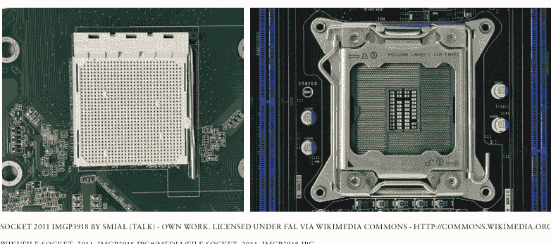

在待售的主板示例中，`LGA 2011` 是该板子上的插槽。

> 注意

## 内存槽

内存和随机存存储器（`RAM`）槽用于存放内存芯片的模块，主内存用于存储 `CPU` 当前正在使用的数据和指令。今天 `PC` 有许多种类型的内存。示例包括 `DDR2` 和 `DDR3`。台式机内存位于称为双内线内存模块（`DIMMs`）的电路板上，笔记本电脑则使用小外形 `DIMM`（`SODIMMs`）。我将在本章的“内存”部分讨论这些缩写字的含义。）

内存槽在主板上很容易识别。首先，它们很长，且通常靠近 `CPU` 插槽。经典的 `DIMM` 插槽通常是黑色的，和所有内存槽一样，排列得非常密。（今天制造商制造各种颜色的内存槽。）底部的金属引脚与每个内存模块上的金属引脚接触。插槽两侧的小金属或塑料卡扣将内存模块安全地固定在插槽中。图 1.4 显示了台式机主板上的一些内存槽。

## 图 1.4 DIMM 插槽


笔记本电脑空间受限，因此它们使用较小的 `SODIMM` 芯片。`SODIMM` 插槽的配置使得芯片几乎与主板平行，如图 1.3 所示。

## 图 1.5 SODIMM 插槽

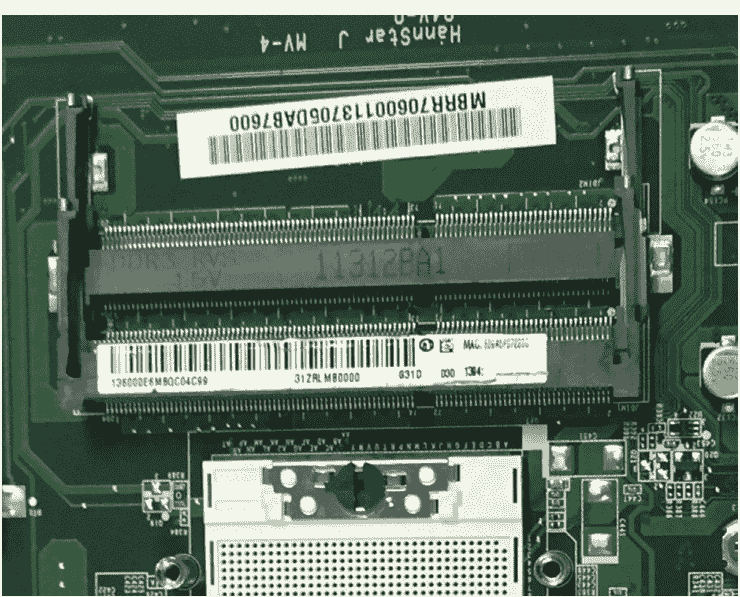

# 探索主板、处理器和内存

主板设计人员可以通过 `CPU` 和 `RAM` 之间添加缓存来加速系统。缓存是一种快速内存形式，通过预测 `CPU` 下一个将请求的内容并在请求之前预取信息来提高系统性能。我将在本章稍后的“处理器”部分更详细地讨论缓存。

如果主板上有缓存，它不太可能是可拆卸组件。因此，它没有像 `RAM` 那样的插槽或连接器。

## 扩展插槽

任何主板最可见的部分都是扩展插槽。这些是小的塑料插槽，长度通常为 1 到 6 英寸。它们用于安装视频卡、网卡和声卡。

主板上的常见类型：

- `PCI`
- `AGP`
- `PCIe`

## PCI 插槽

`PCI` 总线运行频率为 33 `MHz` 或 66 `MHz`。`PCI` 是共享总线，这意味着速度为 133 `MBps` 或 266 `MBps`。`PCI` 插槽有 3.3V 和 5V 之。

## 图 1.6 PCI 扩展插槽


## 加速图形端口 (AGP) 插槽

`AGP` 插槽主要用于视频卡，在新的安装中已被 `PCI Express` 插槽及其适配器取代。`AGP` 插槽设计设计为视频电路与 `PCI` 内存之间的直接连接。它们也很容易识别，因为它们通常是棕色的，并且位于主板上 `PCI` 插槽旁边。

## 图 1.7 AGP 插槽与 PCI 插槽的对比


# 探索主板、处理器和内存

主板正在使用的最新插槽架构之一是 `PCI Express` (`PCIe`)。它设计用于取代 `AGP`，`PCI` 的优势在于比 `AGP` 更快，同时保持了 `PCI` 的灵活性。`PCIe` 与 `AGP` 或 `PCI` 都不具有插件兼容性。因此，现代主板仍然倾向于配备标准的 `PCI` 插槽以向后兼容，而通常不再包含 `AGP` 插槽。

`PCIe` 支持七种不同的插槽，分别标记为 `x1`（读作 "by 1"）、`x2`、`x4`、`x8`、`x12`、`x16` 和 `x32`，其中 `x1`、`x4` 和 `x16` 最常见。支持特定尺寸的插槽长度不同，因为更快的卡需要更多的线路，因此更长。因此，`x8` 插槽比 `x1` 长，但比 `x16` 短。每个 `PCIe` 插槽在主板上都有 22 个引脚，如图 1.8 所示。这 22 个引脚主要是电压和地线。图 1.8 显示了从上到下分别是 `x16` 插槽、两个 `x1` 插槽和一个旧式 `PCI` 插槽。

### 图 1.8 PCIe 扩展插槽


与其前代相比，`PCIe` 非常快。即使在旧的 `PCIe 2.0` 标准下，`PCIe x1` 卡的速度也能达到 500 `Mbps`，这与 `PCI` 最高相当（533 `Mbps`）。目前的 `PCIe` 标准（`PCIe 3.0`）让 `x16` 卡的运行达到惊人的 15.75 `Gbps`。`PCIe 4.0` 预计将完成 `PCIe 3.0` 速度的翻倍。其高数据速率使得 `PCIe` 成为游戏爱好者的选择。在 `PCIe`（以及 `AGP` 插槽）中，任何高性能设备的移动可能导致故障或性能不佳。因此，`PCIe` 和 `AGP` 插槽都有固定适配器的卡扣。

## 磁盘控制器

电脑的迷人特性之一是它们可以存储数据并在以后检索。（事实是它们也会丢失数据，但那是另一回事了。）长期存储设备被称为硬盘，它也插在主板上。

硬盘连接器有几种不同的标准。你使用的旧标准被称为集成驱动器 (`IDE`) 或并行 `ATA` (`PATA`)。更新且更快的被称为串口 `ATA` (`SATA`)。图 1.9 显示了两个 `IDE` 连接器（黑色和白色相同）。图 1.10 显示了四个 `SATA` 连接器。注意它们在主板上是如何方便地标记的！

### 图 1.9 IDE 硬盘连接器


### 图 1.10 SATA 硬盘连接器


# 探索主板、处理器和内存

## 电源

电脑显然是电子设备，电子设备当然需要电源。除了主板上的其他插座和插槽外，一个特殊的连接器（如图 1.11 所示的 24 脚连接器）允许主板连接到电源以供电。这个连接器是插入 `ATX` 电源适配器的地方。

### 图 1.11 24 脚 ATX 电源连接器


## BIOS/固件

固件是指任何编码在硬件（通常是只读存储器 `ROM` 芯片）中的软件，可以在没有操作系统额外指令的情况下运行。大多数电脑和大型打印机在某种程度上都使用固件。固件最好的例子是电脑的基本输入输出系统 (`BIOS`) 程序，它被刻在主板上的闪存芯片中。此外，某些扩展卡（如显卡）使用自己的固件实用程序来设置外设。

除了处理器之外，主板上最重要的芯片是 `BIOS` 芯片。这个特殊的内存芯片包含启动系统的 `BIOS` 系统，初始化内存和硬盘允许操作系统启动。

`BIOS` 芯片很容易识别：如果你有一台品牌电脑，这个芯片上可能会有制造商的名称以及 `BIOS` 字样。对于组装机，芯片上通常贴有来自主要 `BIOS` 制造商（`AMI`、`Phoenix/Award`、`Winbond` 等）的贴纸或打印字。图 1.12 让你了解 `BIOS` 芯片可能的样子。这个是由 `Fintek` 制造的。

### 图 1.12 主板上的 BIOS 芯片


# 第一章 ■ 核心硬件组件

当你打开电脑电源时，`BIOS` 会初始化并运行以下操作：
- 验证 `BIOS` 的完整性
- 验证硬件尺寸
- 分析组件状态
- 为用户更改 `BIOS` 设置的机会（如日期和时间、硬盘配置、内存、启动顺序和电源管理）

如果所有测试完成，`BIOS` 将将控制权交给操作系统。如果发生错误，`BIOS` 可以发出蜂鸣声或显示有问题的屏幕。通常情况下，所有这些连接器都连接到两者之一：主板或连接在主板上的扩展卡。我将在第 2 章“外设与连接器”中讨论所有这些。现在请看图 1.14，它显示了多个连接器：


Megatrends, Inc.

Date: `00/00/00`

Time: `00:00:00`

System: `OK`

Press `DEL` to enter `Setup`


# 第 9 章 安全最佳实践

本章涵盖了以下 CompTIA 基础考试目标：

- 3.2 针对给定场景，使用安全最佳实践
  - 密码管理
    - 密码复杂度
    - 更改默认密码
    - 密码机密性
    - 密码过期
    - 密码复用
    - 单点登录 (`SSO`) 意识
  - 设备加固
    - 禁用未使用的功能
    - 禁用 `Bluetooth`
    - 禁用 `NFC`
    - 超时 / 锁定选项
    - 启用安全软件/功能
      - 软件防火墙
      - 反恶意软件
      - 加密 `WiFi`
      - 开放 `WiFi` vs. 安全 `WiFi`
      - 多因素身份验证
    - 可疑邮件
      - 附件
      - 超链接
  - 对安全软件警报采取行动
  - 管理员 vs. 用户 vs. 访客账户

### 3.3 针对给定场景，使用网页浏览最佳实践

- 识别安全的连接/网站
  - `https`
  - 锁图标
  - 识别无效证书警告
  - 识别可疑链接
  - 识别可疑横幅广告
  - 识别广告软件症状
    - 持续弹出窗口
    - 首页重定向
    - 搜索引擎重定向
- 限制个人信息 (`PII`) 的使用
- 更新浏览器和插件
- 避免使用旧版浏览器
- 禁用不需要/可疑的浏览器插件、工具栏和扩展
- 禁用自动填充表单/密码
- 清除浏览器缓存/历史记录/Cookie
- 识别不可信源的警告
- 使用公共工作站的风险


第 8 章“安全威胁”向你介绍了针对你计算机的各种攻击和威胁。虽然在保护计算机时需要保持警惕是事实，但另一个好消息是，你可以采取许多步骤来帮助保护你的系统。即使你遵循了所有保护计算机的最佳步骤，你可能仍然成为攻击的受害者——无法保证你绝对安全。你的目标是让潜在攻击者的生活越痛苦越好。计算机越难进入，攻击者就越可能寻找更容易攻克的目标。与未保护的系统相比，遵循正确的步骤可以降低攻击成功的概率。

本章在第 8 章的基础上，向你展示了保护计算机和数据可以采取的步骤。作为其一部分，你将学习如何加固计算机、妥善管理用户账户，以及在网络上保护自己，特别强调互联网和电子邮件安全。本章包含了实用的建议，以及帮助你理解预防措施、在可疑活动中观察什么，以及在系统被破坏时该怎么办场景。

# 计算机和网络安全最佳实践

最好的计算机安全计划总是多层；计划中既有在计算机层面实施的部分，也有网络层，还有你应该避免的活动以节省成本。你可能不会在深夜走入黑暗的小巷——这一节将向你展示计算机版本的“小巷”，以便你避开它。

在这一节中，你将学习计算机和网络安全三个不同分类的细节。它从设备加固开始，转向用户账户管理，并在网络安全结束。

## 设备加固

“设备加固”（`device hardening`）这个词可能是整个计算机领域最好的术语之一。它听起来强大而有力，似乎会让你的计算机无懈可击。虽然无懈可击有点夸张，但设备加固通过减少漏洞来帮助保护你的计算机。

你想想，计算机联网的行为本身就让它们容易受到攻击。IT 行业有一句老格言：“在你安装网卡之前，服务器是完全安全的。”务实的悖论当然是，如果没有那块网卡，服务器实际上无法为任何人提供服务。这个格言适用于所有计算机，悖论也是如此。设备加固是你在本地机器上采取的一个主动步骤，可以减少攻击成功的概率。在这里，你将学习以下设备加固技术：

- 禁用未使用的或危险的功能
- 锁定系统
- 启用加密

### 禁用未使用的或危险的功能

你可能听过“眼不见为净”这句话。当我提到未使用的功能时，这是我首先想到的。因为它们没被使用，所以被遗忘了；这导致它们继续运行。这就像所有的饼干一样。带有潜在安全漏洞的未使用功能是黑客最喜爱的。

#### 禁用通信方法

随着如今智能手机的普及，通过无线网络或其他通信方法进行攻击已变得流行。保护自己的最好方法是禁用那些服务。想象一种情况：你处在一个拥挤的公共场所，手机上收到一条邀请你购买新产品的消息。你收到的信息可能是无害的，但也可能是严重的。通过禁用 `Bluetooth` 解决这个问题。在 `iPhone` 或 `Android` 手机上，这在“设置”中完成。图 9.1 显示了 `iOS` 的设置，图 9.2 显示了 `Android`。

##### 图 9.1 `iOS` 中的禁用 `Bluetooth`
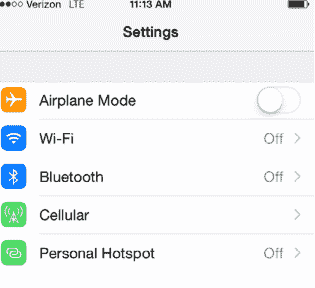

##### 图 9.2 `Android` 中的禁用 `Bluetooth`
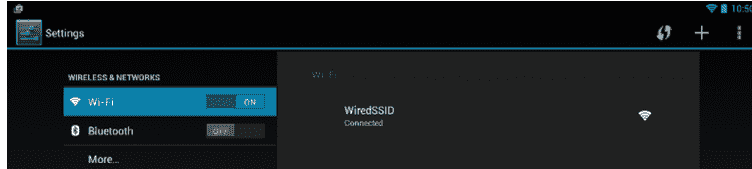

另一种潜在危险的短距离通信方法是近场通信 (`NFC`)。它是一种便利的技术，让你通过手机靠近别人的手机来传输数据，或者手机触碰商店的接收器进行支付。但是，如果你没有主动使用它，这种便利也可能成为进入你系统的门。

## 有用的服务

在 `Windows` 和其他操作系统，各种系统功能是通过服务实现的。例如，管理打印作业的任务由打印池服务负责，而登录域控制器则由一个名为 `Netlogon` 的服务管理。为了运行这些服务，你的操作系统会临时以带有特殊权限的准服务身份登录以执行任务，然后注销。

攻击者可以利用服务的漏洞尝试获得对你机器的授权访问。大多数情况下，未使用的服务默认是禁用的，所以重点是除非你知道需要，否则不要启用服务。服务位于“计算机管理”中。练习 9.1 显示了如何在 `Windows 7` 中启动和停止服务。

### 练习 9.1 在 `Windows 7` 中启动和停止服务

- 1. 通过点击“开始”、右键点击“计算机”并选择“管理”来打开计算机管理。
- 2. 在“计算机管理”窗口的左侧，点击“服务和服务”下的“服务”，如图 9.3 所示。
- 3. 你将看到“`Bluetooth Support Service`”，如图 9.3 高亮所示。注意它没有启动，且启动类型为“手动”。其他启动类型是“自动”和“禁用”。

# 410 第 9 章 · 安全最佳实践

## 图 9.3 `Windows` 服务

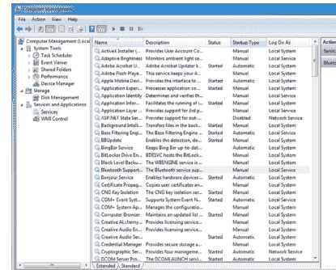

- 4. 要启动服务，可以点击“名称”列上方的绿色启动按钮，或右键点击服务并选择“启动”。状态将发生更改。
- 5. 要停止服务，点击“名称”列上方的停止按钮，或右键点击服务并选择“停止”。
- 6. 要更改服务的启动类型，右键点击服务并选择“属性”。使用“启动”（`Startup`）旁边的下拉菜单进行选择，如图 9.4 所示，然后点击“确定”。

## 图 9.4 `Bluetooth Support Service` 属性（本地计算机）


## 计算机和网络安全最佳实践

虽然禁用不使用的服务可以帮助加固系统，但除非你了解它们的作用并确定不需要它们，否则不要禁用操作系统中的服务。禁用必要的服务可能会导致系统无法正常运行。

### 禁用自动播放

自动播放被宣传为一个方便的功能，允许你将介质插入系统并自动运行。遗憾的是，这也会可能引入安全风险。

如果你不知道某个介质的来源或是什么，千万不要在工作站上放置任何介质。原因是这些介质（`CD`、`DVD`、`USB`）可能包含恶意软件。更糟糕的是，恶意软件可以在介质上的 `AUTORUN.INF` 文件中被引用，导致在插入机器时被自动触发，无需任何其他操作。`AUTORUN.INF` 可用于启动可执行文件、访问网站或执行大量任务。防止系统免受此类攻击的最好方法是在工作站上禁用自动播放功能。

自动播放也被称为计算机的自动运行（`Autorun`）。

自动播放设置位于控制面板的“硬件和声音”下。如果你打开控制面板但没有看到它，在搜索框中输入“自动播放”，它就会出现。打开“自动播放”，你将看到一个如图 9.5 所示的屏幕。

## 图 9.5

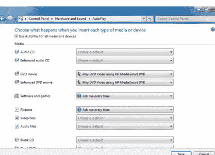

禁用自动播放简单的方法是勾选页面顶部的框。你也可以控制单个介质类型的设置。例如，在图 9.5 中你可以看到对于软件和游戏，系统将提示用户采取何种操作。这比自动运行介质要好得多。

### 锁定系统

锁定有两个含义。第一个是指物理上将系统锁定在桌子上或抽屉里，防止其被盗。第二个是在离开座位时锁定系统。你在第 8 章中学习了这两种安全选项。

作为一个快速提醒，屏幕保护程序应该在空闲一段时间后自动启动，并且在用户重新开始会话之前需要密码。这种锁定工作站的方法增加了一层安全性。更好的是，用户在离开座位后应自动锁定计算机。这可以通过按下 `Ctrl+Alt+Del` 并选择“锁定工作站”来实现。解锁机器时需要用户的密码。


> 与此安全步骤相关的流行短语是“离开座位时按下 `Control` `Alt-Delete`！”

### 设置 `NTFS` 权限并启用加密

在第 6 章“网络共享与存储”中，你学习了如何在网络上共享资源以及访问共享文件时使用的权限。这些权限仅在你通过网络连接到计算机时生效。然而，当不同用户在本地登录到同一台计算机时，你需要采用其他方法来保持私有数据的隔离。

一种方法是设置某些文件夹对其他用户不可访问。在 `Windows` 中执行此操作，请使用文件夹属性对话框中的“安全”选项卡。它包含适用于本地访问的文件共享权限。你还可以加密文件夹，这样如果有人尝试浏览文件内容（例如使用磁盘编辑器工具），内容将被乱码。在文件夹属性对话框中，点击“高级”按钮并勾选“加密内容以保护数据”选择框。你将在练习 9.2 中练习这些技能。只有 `Windows 7` 的专业版、企业版和顶级版支持加密；在其他版本中，加密文件的复选框不可用。


> 如果你的操作系统不支持文件和文件夹加密，你可以获取可以加密数据的第三方软件。

当你加密文件时，只要你是执行加密的用户，文件就可以正常使用并进行解密。然而，如果你以其他用户的身份登录，这些文件将无法访问。加密是基于存储在每个用户硬盘上的安全证书的。尽管如此其中存在风险，因为如果安全证书损坏或删除，你将无法访问这些文件。在依赖加密之前，备份你的证书是重要的。

## 计算机和网络安全最佳实践

## 练习 9.2：保护并加密本地文件夹

如果你的电脑上没有至少两个账户，请按照以下步骤操作：

- 1. 在 `Windows` 中，点击“开始” > “控制面板” > “用户、家庭和其他用户” > “添加新账户”。
- 2. 打开文档文件夹。右键点击文件夹并选择“属性”。
- 3. 在“安全”选项卡上，点击“编辑”。
- 4. 输入另一个账户的用户名，点击“确定”。


## 图 9.6 给用户权限


## 图 9.7 用户权限


- 8. 点击“确定”。
- 9. 在下方面板中，注意“完全控制”和“修改”复选框未被选中。
- 10. 点击“确定”关闭 `Private` 属性对话框。
- 11. 将文档文件到 `Private` 文件夹。
- 12. 注销当前账户，以另一个用户登录。
- 13. 尝试打开文档。观察发生了什么。
- 14. 尝试保存更改。观察发生了什么。
- 15. 注销并使用原始用户名重新登录。
- 16. 打开文档文件夹。右键点击 `Private` 文件夹并选择“属性”。
- 17. 在“常规”选项卡上，点击“高级”。
- 18. 在“高级属性”对话框中，如果可用，勾选“加密内容以保护数据”选择框。注意：你需要 `Windows 7` 专业版、顶级版或企业版才能加密文件夹内容。在任何其他 `Windows 7` 版本上，该框将呈灰色。
- 19. 点击“确定”。
- 20. 点击“确定”。

## 练习 9.3 备份 `Windows` 安全证书

- 1. 在 `Windows` 中，点击“开始”，输入 `certmgr.msc` 并按回车。打开证书管理器。
- 2. 点击展开“个人”文件夹。
- 3. 点击“证书”。
- 4. 点击用途列中显示“加密文件系统”的证书。
- 5. 选择“操作” > “所有任务” > “导出”。证书向导运行。
- 6. 点击“下一步”。
- 7. 点击“是”，导出私钥，然后点击“下一步”。
- 8. 确保选择了“个人信息交换”，点击“下一步”。
- 9. 在“密码”框中输入你选择的密码。在“确认密码”框中再次输入。然后点击“下一步”。
- 10. 在“文件名”框中，输入你想保存备份文件的名称。例如，如果你的用户名是 `jsmith`，你可以使用 `jsmith-certbackup`。

- 11. 备份的默认存储位置是你的“文档”文件夹。如果你想将其放在其他地方，点击“浏览”，更改位置，然后点击“保存”。
- 12. 点击“下一步”。出现“完成证书导出向导”。
- 13. 点击“完成”。
- 14. 在确认对话框中，点击“确定”。
- 15. 关闭“证书管理器”窗口。

在 `Mac` 上，本地加密无法应用于单个文件夹和文件；你必须加密整个磁盘。你可以通过“磁盘工具”进行操作（如图 9.8 所示），或者使用 `FileVault` 加密主文件夹（如图 9.9 所示）。

# 图 9.8 在 `Mac OS X` 中加密磁盘

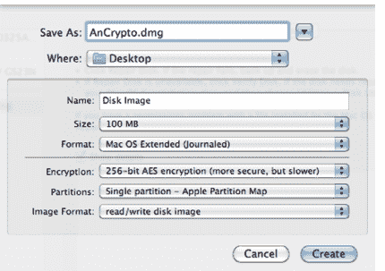

# 图 9.9 `Mac FileVault`


# 计算机网络安全最佳实践

在 `Linux` 系统上加密文件和文件夹最简单的方法是使用 `openssl` 库的命令行界面。`openssl` 允许通过选择使用的算法来进行加密和解密。例如，你可以使用 `des`（数据加密标准）作为加密算法。在 `Linux` 中，你在加密时通过定义密钥例程（如盐值）来指定算法。然后你通过加密后的输出文件来指定原始输入文件。示例如下：

```
openssl enc -des3 -salt -in plaintext.txt -out encrypted.txt
```


```
openssl des -salt -in originalfile.txt -out encrypted.txt
```

要解密，唯一的区别是使用`-d`选项（表示解密），并将加密的文件名放在未加密的输出文件之前。示例如下：

```
openssl des -d -salt -in encryptedfile.txt -out decrypted.txt
```


# 使用安全软件和功能

系统被恶意软件感染是你可能会遇到的一种情景之一。有四类主要的应用程序可以保护你的系统免受恶意软件和黑客的侵害：

- 杀病毒软件防御病毒、蠕虫和特木马。
- 反间谍软件防御广告软件和间谍软件。
- 反垃圾邮件软件减少你收到的垃圾邮件数量。
- 软件防火墙拦截潜在危险的网络流量。

还有一些结合了多种安全功能的套件；例如，`Norton Security` 包含了杀毒、反恶意软件和反垃圾邮件，以及身份保护工具、软件防火墙、备份工具和 PC 优化。`McAfee Live` 也是如此。此外，每种应用程序所防御的威胁类型之间存在重叠；例如，杀病毒程序可能还会针对某些非病毒恶意软件。

## 杀病毒软件

流行的杀病毒程序包括 `Norton Security`（原名为 `Norton Antivirus`）和 `McAfee`。


> 网站 `www.compare.com` 为当前的杀病毒软件提供了全面的比较和评论。请花时间研究一下，并就对哪种杀病毒软件最适合你得出你自己的结论。

病毒通常通过简单的欺骗来隐藏。它们将自己嵌入应用程序的命令中，并在运行时作为独立任务在自己周围运行。某些杀病毒程序通过打开文件并扫描代码来检测病毒，寻找这种重定向，而这种重定向有时会被杀病毒程序误认为已感染。

另一些杀病毒程序通过扫描每个可执行文件的代码来寻找病毒签名。病毒签名是一个被称为“病毒定义”的标识性代码段。杀病毒程序维护一个已知定义数据库；当它发现与数据库匹配的项时，它会发现一个可能是感染的警告。随着新病毒和其他威胁的发现，公司会更新其杀病毒程序的病毒定义文件，并将其作为更新进行下载。最新的定义对于有效的病毒防护至关重要，你必须定期更新你的杀病毒软件（或者更好是让它自动更新）。

此外，许多杀病毒程序会为每个应用程序创建一个 `MDS`。`MDS` 代表消息摘要 5（`Message Digest 5`），这是一个计算出的唯一值，反映数据的更改。如果 `MDS` 发生变化，这可能被视为病毒攻击。

杀病毒应用程序通常是驻留的，这意味着它们在后台持续运行，在你打开或关闭系统和程序时进行分析。某些杀病毒程序会检查传入和发出的邮件以及你访问的网页。你也可以告诉杀病毒软件对你喜欢的所有文件进行完整扫描（它可能会在你安装杀病毒软件后立即提议执行一次）。

当你的杀病毒程序发现可疑内容时，会显示一条消息，让你选择删除或隔离被感染的文件。删除文件会将其从你的系统中移除。隔离则将其放置在一个受限区域，使其无法运行，但保留在你的系统中。例如，你可能会隔离一个你想与正在追踪你网络中病毒感染的 IT 专家共享的文件。练习 9.4 为你提供了安装和使用杀病毒程序所需的步骤。

> 如果你的安全软件弹出警报，最好立即采取行动。警报将告诉你怀疑的问题是什么，并建议采取行动方案。除非你有理由不这样做，否则请遵循安全软件建议采取的操作！

## 练习 9.4

### 安装和使用杀病毒程序

1. 如果你还没有杀病毒程序，请下载并安装一个。对于 Windows 系统，`Microsoft` 的 `Security Essentials` 程序是免费的，它在本次练习中运行良好。你可以在 `windows.microsoft.com/en-us/windows/security-essentials-download` 下载它。或者，如果你已经有了杀病毒程序，请打开它。

# 计算机网络安全最佳实践

2. 使用你已安装的任何杀病毒软件，执行以下操作：
   - a. 更新病毒定义。
   - b. 运行完整的系统扫描。
3. 如果发现任何病毒，隔离或删除包含病毒的文件。

## 反间谍软件

反间谍应用程序寻找已知的间谍软件和广告程序，并提供禁用或从你的系统中移除它们的服务。与杀病毒程序一样，反间谍程序也寻找定义——即识别间谍软件或广告软件组件的代码段。

大多数反间谍应用程序也像杀病毒程序一样始终在后台运行。许多杀病毒程序也包含反间谍保护，因此你可能不需要费心使用单独的反间谍应用程序。

`Windows Defender` 是 Windows 自带的一个免费工具。还有许多免费和商用的反间谍程序，例如 `Spybot Search & Destroy` (`www.safer-networking.org`)。

与杀病毒程序一样，反间谍程序在定义是最新的情况下最有效。

## 反垃圾邮件软件

垃圾邮件指的是不想要的干扰邮件。人们发送垃圾邮件是为了尝试推销产品，因为这样非常经济——发送数百万封邮件几乎没有成本，即使只有极小比例的人回复，仍然是一个盈利的过程。人们还发送垃圾邮件来进行诈骗，要么尝试推销无用或不存在的产品，要么试图诱骗人们访问网站或会下载病毒或其他恶意软件的网站。

`Outlook` 有它自己的垃圾邮件过滤器，以及管理垃圾邮件的其它工具。然而，这些内置过滤器无法捕获大量邮件，因为它们区分垃圾邮件和合法邮件的算法并不复杂。

某些杀病毒程序包含反垃圾邮件组件，你也可以购买额外的反垃圾邮件程序或免费获取。例如，从 `spambayes.sourceforge.net` 免费获取的 `SpamBays` 是一种极其复杂的区分器，它使用排名系统，根据多个标准对每封邮件进行评估，以确定垃圾概率。

即使你安装了反恶意软件程序，它也不是完美的。偶尔病毒或其他恶意软件可能会绕过它，特别是新的威胁（尤其是当你没有更新

## 第 9 章 ■ 安全最佳实践

最近更新了你的定义。当系统被病毒、蠕虫、特洛马或恶意软件感染时，你可能会遇到某些症状，可能是立即出现，也可能是恶意软件自我触发的特定日期或时间：

- 你的防病毒软件可能被禁用，且你无法重新启用。或者，如果你已经有了防病毒软件而现在正准备安装，它可能无法安装。这是病毒感染非常常见的副作用，因为这会让你难以移除病毒。
- 你的系统运行可能非常缓慢，打开窗口或应用程序所需的时间比正常长得多。恶意软件感染会使系统变得缓慢或使其瘫痪。
- 即使你没有做任何会导致此类行为的操作，`CPU` 和内存使用率也可能很高。如果恶意软件正在劫持你的系统以供其计算目的，就会发生这种情况。
- 可能会出现警告或消息框且拒绝消失。例如，可能会有一条消息说你的系统已被病毒感染，并要求你输入信用卡以“购买”修复该问题的软件。
- 你的朋友可能会告诉你，他们收到了很多由你发送的奇怪邮件。

当你使用网络浏览器时，可能会被弹出广告轰炸。如果你开始经历这些症状，你的防病毒软件可能没有帮助，因为病毒可能已经绕过了它并在运行——糟糕了。请立即进行全面扫描。

如果你无法使用本地防病毒软件，最好的办法是使用在线病毒检查器。`趋势科技`（`Trend Micro`）在 `trendmicro.com` 提供了一个免费工具。用它扫描你的系统，然后按照扫描程序建议的建议操作。如果系统感染到无法运行或打开网络浏览器的程度，尝试进入“带网络的安全模式”。这样做可以暂时为你保存一些病毒的组件。如果你仍然无法清除病毒，你可能需要咨询当地电脑店的 IT 专业人员。

移除感染后，你可能需要修复或恢复你的防病毒软件，并为其下载更新。

## 软件防火墙

你在第 4 章“软件应用程序”中学习了软件防火墙。如果你还记得，防火墙可以通过两种方式保护你：它们保护你的网络资源免受来自黑客的恶意流量，同时可以防止网络上的计算机访问互联网上的不良良内容。防火墙通过监控和过滤网络流量来执行这些任务。`Windows` 自带了名副其实的 `Windows` 防火墙。如果你想寻找不同的防火墙，可以找到独立产品或作为安全套件（如 `Norton Security`）的一部分。如果你不确定系统上采取了哪些安全措施，图 9.10 所示的 Windows 操作中心可以向你显示系统设置了哪些安全措施。

## 计算机和网络安全最佳实践

### 图 9.10 Windows 操作中心


## 用户账户管理

用户是安全链中最薄弱的环节，无论损害是以恶意软件、社会工程还是简单的可以避免的错误形式出现的。除了一些显而易见的事项，例如训练用户（或你自己）警惕社会工程学之外，你还可以执行若干任务来降低与用户账户相关的安全风险。这些包括对用户账户类型的适当管理、密码管理和身份验证系统。

## 管理用户账户类型

所有的操作系统都带有多个级别的用户账户，每个账户都有一组预定义的权限。虽然不同操作系统之间的账户名称可能不同，但账户类型通常分为以下三类，按从强到弱排序：

- 管理员
- 用户
- 客客

管理员有时缩写为 `admin`，在 `UNIX` 和 `Linux` 系统上被称为 `root`。此账户基本上可以在计算机上执行任何操作，因此非常强大。正因如此，在决定谁拥有管理员权限时要非常小心。

在 `Windows`、`Mac OS` 和 `Linux` 中，列表中的下一个条目是标准用户账户。它们无法做出影响其他用户的更改，而管理员账户可以进行所有类型的更改。这防止了人们卸载他们个人不需要但他人需要的应用程序。

> 为了防止对计算机进行未经授权的更改，良好的做法是让每个人在日常操作中使用标准账户，并准备一个管理员账户，仅在执行需要权限的活动时使用，例如安装或删除软件或更新设备驱动程序。

访客账户用于基本访问，例如访问互联网或在公共自助机上访问一个应用程序。访客账户在 `Windows` 安装时默认创建，这代表了可能可以被攻击者利用的弱点。虽然该账户无法做很多，但它可以提供系统的初始访问，攻击者可以利用它寻找另一个账户或获取有关系统的敏感信息。

> 某些操作系统对用户账户额外分类，例如高级用户（`Power Users`），它们拥有一些基本管理权限但没有完全控制权。

为了确保系统安全，禁用所有不需要的账户，特别是访客账户。如果可以，请重命名账户（微软不允许你重命名）。例如，将 `Administrator` 更改为更难猜的名称。如果攻击者知道了用户名，他们只需要破解密码即可。你的工作只是让它变得困难得多。

## 管理密码

想象一个场景：你刚刚在无线网络上安装了四台计算机，启用了最好的 Wi-Fi 安全性（`WPA2`），在所有计算机上安装了反恶意软件和软件防火墙，然后发现其中一个用户的登录密码就是单词“password”。这种安全性如何？

密码管理是一项容易被忽略的关键安全功能。它涉及适当的用户培训，并由管理员在计算机属于域时设置限制提供支持。

## 计算机和网络安全最佳实践

用户应该知道的第一件事之一是更改默认密码，并使密码复杂化保护网络。

## 创建有效的密码

强密码是难以破解的密码。强密码具有以下特征：

- 长度：越长越好。至少 8 个字符为佳。
- 多样性：密码至少包含一个大写字母和一个数字
- 异常：密码没有出现在字典中，且不是专有名词。

易于猜到的密码被认为是弱密码。所有密码中最糟糕的例子如 `qw`、`12345`、用户 ID 和单词 `password`。稍微好一点的是人名、宠物名和地点。尽管密码应该是他人难以破解的，但要让你容易记住。为了做到这一点，尝试组合对你有意义但对其他人没有意义的数字和字母。

以下是创建易记忆但难以破解密码的其他技巧：

- 用零替换单词中的 `O`：例如，`St0rage0m`。
- 用数字替换字母：为了更容易记忆，使用代表字母表中位置的数字（例如，`b=2`），或使用代表第二和第四位的数字，如：`t2a4her`。
- 组合两个或多个无关单词：例如，`GroceryCandyFlowerpot`。
- 用符号替换相似的字母：例如，`$` 看起来像 `S`，如 `$substitution$salary`；以及 `!` 看起来像大写 `I`，如 `!temized`。

如果你无法脑脑记住所有密码，一种解决方案是将它们存储在硬盘上受密码保护的文件。是的，有人可能会从你的硬盘窃取该文件并可能进行解密，但这种情况发生的概率低于存储你网站密码的服务器被黑客攻击的概率。

尽管对多个系统或网站重复相同的密码很有诱惑力，但为你访问的每个网站使用不同的密码更安全。这样，如果一个网站被黑，就不会影响你在另一个网站的安全。

## 第 9 章 ■ 安全最佳实践

另一种解决方案是在不存储任何财务信息的网站上重用密码。例如，你可能为各种网站的留言板和聊天室使用相同的密码，因为如果你的密码在这些网站被泄露——后果通常是轻微的。有人可能会登录并冒充你的身份，导致你陷入暂时的尴尬，但你并没有损失任何金钱。另一方面，你应该为每个重要的银行或其他财务账户使用不同的密码，因为小偷可能会在这些网站上给你带来严严重的问题。

## 更改密码

某些公司的 IT 策略要求你定期更改密码，例如每 90 天一次。其原理是：你保留密码的时间越长，别人可能暗中看到你输入它的概率就越大，或者你把它写在了某个地方，又发生了其他某种安全泄露。

即使系统没有要求你按时间表更改密码，你可能也想主动更改，特别是在你管理财务事务的网站上。

为了帮助你在频繁变化的环境中记住密码，你可能想要制定一套结构化的更改系统。例如，假设你的密码是 `video$5Frier`。当你更改它时，可能会添加更改月份的两位数字。例如，如果你在二月更改，可以将其改为 `video$02Frier`。然后，当你在五月更改时，可以将其更改为 `video$05Frier`。

除了不要在不同网站上重用密码外，你不应该在被要求更改后重用旧密码。回收旧密码会让黑客更容易猜到你的密码并获得未经的访问。

## 用户身份验证

当你登录时，用户身份验证有助于系统验证你拥有正确的凭据。通常，这仅仅是输入用户名和密码，但也可能更加复杂。

## 多因素身份验证

为了增加安全性，你的计算机或网络可能需要多因素身份验证，其顾名意味着你需要提供多项信息才能登录。通常情况下，除了用户名外，多因素身份验证要求你从以下三个类别中提供两或多项信息：你知道的、你拥有的或你所特征的。

你知道的通常是密码。你拥有的可以是几种不同物品之一，例如智能卡或令牌（`token`）。

智能卡是一种塑料卡，尺寸与信用卡相似，包含一个卡片阅读器可以扫描的微芯片（例如在安全系统上）。智能卡通常兼任员工证，允许员工进入建筑的员工专用区域或使用通往限制区域的电梯，或是信用卡。

## 计算机和网络安全最佳实践

智能卡也可用于允许或阻止访问计算机。例如，`PC` 可能有一个读卡器，员工必须通过它刷卡，或者当卡片靠近它时它会自动读取卡片芯片。或者，它们与 `PIN` 码结合，或作为标准登录系统的插件，提供额外的安全验证层。要让某获得未经的访问，他们不仅需要知道用户的 ID 和密码（或 `PIN`），还需要偷走他们的智能卡。这让当小偷变得困难得多！

安全令牌（如图 9.11 所示）显示大约每 30 秒更改一次的访问代码。接收后，它会与你的用户账户同步，控制代码更改的算法令牌和你的身份验证系统都已知。当你登录时，你需要用户名、密码以及令牌上的代码。

### 图 9.11 RSA SecurID


最后，系统可能要求完全独特的东西来启用身份验证。这些特征通常通过生物识别设备评估，这些设备通过扫描一个或多个物理特征来验证用户。常见类型包括指纹识别、面部识别和视网膜扫描。

执法机构使用指纹识别已超过 100 年，而且在基因相同的双胞胎中也没有发现两个指纹是相同的。这是因为指纹在子宫内发育，并在受精时就已经预设好了。最近，计算机指纹扫描仪取代了墨水打印，读取指纹的技术变得如此便宜，已内置在许多计算机中。指纹扫描仪使用垫来检测手指上的纹。面部识别软件配合摄像头工作扫描面部。视网膜扫描与面部识别非常相似，但它专门查看血管的模式。

## 单点登录

大型系统必须处理的问题之一是用户需要记住多个账户。单点登录（`SSO`）的目的是让用户访问他们的所有应用程序。

单点登录既是祝福也是诅咒。祝福在于，一旦用户通过身份验证，他们就可以更不便地访问资源；诅咒在于，它移除了本应存在的潜在安全门。


> 虽然登录并不是多因素身份验证的对立面，但人们经常误认为是如此。一因素、二因素和三因素验证仅是指用户为了身份验证必须提供的项目数量。在因素验证完成后，单点登录仍然可以持续到用户的会话剩余期间。

## 网络安全

正如你在第 5 章“网络技术与无线路由器”中所学的那样，无线（`Wi-Fi`）网络可以是未加密的（无加密）或安全的（使用加密）。加密设置在路由器上，网络是否开启加密取决于路由器设置。路由器反过来将其用户连接到互联网。如果网络是安全的，当你连接到它时必须输入加密密钥（密码）。如果没有加密，任何人都可以连接到它。然而，连接到网络可能不足以访问其所有服务（如互联网访问）。可能需要额外信息。当你打开网页浏览器时，重定向会显示一个登录页面，其中你可能需要接受用户协议、输入用户名和密码（或创建一个），以及/或提供信用卡信息以购买互联网访问。


> 如果是你的网络，你应该始终使用 `WPA2` 加密它以保护你的资源。请务必小心保管你的加密密钥，以免落入别人手中。

连接到任何网络都存在安全风险，特别是免费的公共网络。你共享网络的大多数用户像你一样只是想使用互联网，但偶尔会有黑客潜伏，试图通过你的共享网络连接借用甚至偷取你计算机上的文件。

为了降低与特定网络连接关联的风险，你可以在连接到该网络时将文件共享设置更改为更具限制性的设置。

# 互联网安全最佳实践

在 `Windows` 中，当你连接到新网络时，系统会提示你选择它是家庭、工作还是公共网络。如果你选择“公共”，则该网络连接上的文件和打印机共享功能将被禁用。这使得他人更难窥探或破坏你的计算机。

# 互联网安全最佳实践

当网络浏览还很新颖时，大多数使用它（或经常使用）的人都是相当精通电脑的采用者。随着时间的推移，由于网页和电子邮件变得更加主流，不太精通电脑的人也加入了其中，这为黑客捕猎他们提供了许多机会。一群骗子和其他可疑业务提供商的阴影随之扩大，并从中获利。

此时，可以很安全地说，这种“互联网”不仅仅是一种转瞬即逝的时尚。互联网已经成为我们日常生活中不可或缺的一部分，现在我们的目标是将其应用到每一个电子设备上。同样可以说，作为一个整体，互联网用户比以往任何时候都安全，要么是因为他们曾是网络犯罪的受害者，要么是因为对潜在问题的集体意识有所增强，但那里仍然有许多目标。正如你在第 8 章中所学到的，攻击者很容易让你的攻击自动化。

本节涵盖了你应该在互联网或电子邮件中识别的许多警告信号，这样你既可以自己浏览，也能向家人、朋友和同事普及他们可能面临的危险危害。它分为三个部分：准备与维护、网页浏览和安全电子邮件邮件。掌握了这些知识，你应该能够面对潜在危险的互联网场景并安全地导航。

# 网页浏览的准备与维护

在浏览互联网之前，你可以进行一些准备工作，这将使你的体验更安全。即使你从未这样做过，检查系统中的这些项目以查看你的设置如何也是个好主意。此外，你应该定期进行维护，以确保你的设置仍然正确且所有内容都已正确更新。你将学习的所有设置都在你的互联网浏览器中管理。两种最常见的 PC 浏览器是 `Internet Explorer` (`IE`) 和 `Chrome`。

## 管理互联网浏览器版本

你需要完成的第一件事是确保你正在使用的互联网浏览器是可用最新版本。旧版本被称为“旧版浏览器”，可能存在安全问题，或者在你浏览网页时提供保护保护的功能较少。如果你告诉它，`IE` 将自动更新，而 `Chrome` 也会自动更新——这是好事。在查看该设置之前，先熟悉每个浏览器的选项或设置菜单。在 `IE` 和 `Chrome` 中，你都点击右上角的图标。`IE` 看起来像图 9.12 所示的齿轮，而 `Chrome` 看起来像一个列表（图 9.13）。

第 9 章 • 安全实践

### 图 9.12 Internet Explorer 11 选项

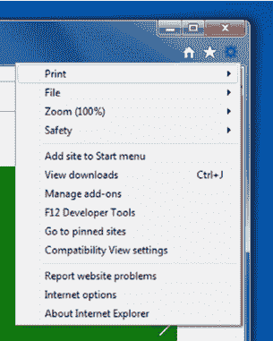

### 图 9.13 Chrome 版本 41 选项


互联网安全最佳实践

这两个浏览器的菜单非常相似，这方便找到你需要的选项。在最坏的情况下，你也可以在浏览器中不断点击，直到找到所需的选项。要查看浏览器版本，点击设置图标并选择“关于 `Internet Explorer`”或“关于 `Google`”。你将在图 9.14 中看到 `IE` 的窗口，在图 9.15 中看到 `Chrome` 的窗口。

### 图 9.14 关于 Internet Explorer


### 图 9.15 关于 Chrome


除了确保浏览器是最新的，你还应该确保更新所需的插件。插件只是为你的浏览器提供额外功能的软件——把它想象成驱动程序，只不过它是针对软件的。例如，如果你需要运行需要 `Flash` 的视频，你需要 `Flash` 插件。如果你尝试运行浏览器没有的插件的媒体文件，浏览器会给你一条消息并提供下载所需软件的机会。如果有新版本，你会收到一条弹窗消息提示你启动该插件。再次，确保插件是最新版本。

## 管理插件、工具栏和扩展

插件、工具栏和扩展都是添加到你的浏览器以提供额外功能的软件组件。如果管理得当，这些功能非常方便并能增强你的浏览体验。另一方面，安装过多的工具栏和扩展会减慢你的浏览器。更糟糕的是，某些扩展会让你的系统执行你不想要的操作，例如无论你想去哪里都将你重定向到特定网站。

在 `Internet Explorer` 中，你通过点击“设置”和“管理加载项”来管理插件、工具栏和扩展；加载项窗口如图 9.16 所示。你也可以通过“设置 > `Internet` 选项 > 程序 > 管理加载项”获取相同的窗口。

### 图 9.16 管理加载项


# 第 9 章 · 安全最佳实践

- 不要将任何文件保存到本地计算机上。
- 完成后，删除你的浏览历史、缓存和 `Cookie`。
- 始终注意周围环境。显然，某些位置比其他地方更安全。公共场所是发生“肩部窥视”（`shoulder surfing`）的高发地——不要成为这种受害者。

## 配置安全设置

在网络浏览器中使用不正确的安全设置会导致各种安全风险，例如在计算机上运行你并不希望执行的内容。幸运的是，在大多数浏览器中，你可以通过接受默认设置来轻松设置常用的安全选项。

`Internet Explorer` 允许你在“安全”选项卡上设置“`Internet` 选项”，如图 9.21 所示。`IE` 使用“安全区域”的概念，可以将网站分类为具有不同安全设置的不同组。在图 9.21 中，选择了“`Internet`”区域，默认具有“中/高”安全设置。“受信任站点”为“中”，“本地局域网”为“中/低”。你可以拖动滑块来选择安全设置。在大多数情况下，“中/高”是功能与安全性之间的最佳平衡。

### 图 9.21 Internet 安全选项

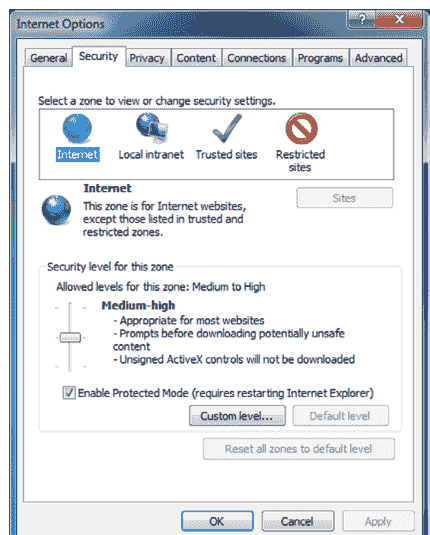

## Internet 安全最佳实践

另一个审慎的安全措施是确保“`Internet`”和“受限制”安全区域已启用“保护模式”（默认情况下是开启的）。保护模式通过以低权限模式显示内容来防止许多不同的安全漏洞。

如果你尝试从不在你的“信任”区域的设备下载文件，屏幕上会弹出的窗口，警告你正要从不可信的源下载文件。你可以点击“确定”继续或点击“取消”。如果你是你发起的下载，通常是在你不知情的情况下尝试下载材料，而此警告将帮助你免受此类内容的侵害。

你还可以启用 `ActiveX` 过滤。某些网站使用 `ActiveX` 显示内容，但 `ActiveX` 可能构成安全威胁。在 `IE` 中，打开（如果没有显示，按下 `Alt` 键菜单将出现）并选择“`ActiveX` 过滤”。激活后，`ActiveX` 控制将受抑制。

`Chrome` 也允许你配置安全，但它不像 `IE` 那样使用区域——所有网站都被同等对待。你可以在“设置 > 显示高级设置 > 隐私”下点击“内容设置”按钮来配置安全选项。部分内容如图 9.22 所示。

### 图 9.22 Chrome 内容设置


## 管理 Cookie

`Cookie` 是网页（或网页上的广告）存储在你的硬盘上用于跟踪目的的纯文本文件。`Cookie` 可以告诉广告商你之前查看过某个广告，或者可以跟踪电子商务网站上购物车中的物品。

在 99.99% 的情况下，`Cookie` 是无害的，它们实际上可以执行你需要的有用功能，例如在你回到经常访问的网站时记住你的偏好。然而，`Cookie` 涉及两种风险。一个是隐私威胁：`Cookie` 可以向网站传递个人身份识别信息。另一个安全威胁：病毒或木马可能会从 `Cookie` 中复制存储的密码，并将其交给可能窃取你网站登录信息的人，以实施身份盗窃或其他类型的欺诈。

`Cookie` 有四种类型。**第一方 `Cookie`** 是由你放置在计算机上的。例如，当你访问 `www.amazon.com` 时，`Cookie` 会提供你的姓名。**第三方 `Cookie`** 是由网站上的广告放置在你计算机上的，你的广告公司与网站所有者没有关联。例如，当你浏览 `Facebook` 时，第三方 `Cookie` 可能会记录你点击过的广告，表明你对某些产品的潜在兴趣。**会话 `Cookie`**（`session cookie`）的持续时间与你的浏览器保持相同。当你结束网页浏览时，会话 `Cookie` 会删除。**持久性 `Cookie`**（`persistent cookie`）在关闭浏览器后仍留在硬盘上，持续无限或特定的天数。除非你的浏览器配置为接受 `Cookie`，否则某些合法网站将无法显示其内容。

所有浏览器都可以配置如何存储每种类型的 `Cookie`。你可以为 `Cookie` 创建规则，设置允许或拒绝某些站点，并删除现有 `Cookie`。练习 9.5 显示了如何在 `Internet Explorer` 中查看 `Cookie`。

## 练习 9.5 在 Internet Explorer 中管理 Cookie

1. 打开 `Internet Explorer`，选择 **工具 > `Internet` 选项**（你可能需要按下 `Alt` 键显示菜单）。
2. 在**安全**选项卡中，如图 9.23 所示，如果尚未设置，请拖动滑块到**中**。检查出现的信息。

**图 9.23** `IE` 安全选项卡


3. 点击**站点**按钮。打开站点对话框。
4. 在地址栏，输入 **`www.amazon.com`**，然后点击**允许**。
5. 点击**确定**。
6. 点击**高级**按钮。打开高级设置对话框。
7. 勾选**覆盖自动 `Cookie` 处理**。
8. 在**第三方 `Cookie`**下，点击**提示**。
9. 勾选**始终允许会话 `Cookie`**框框。
10. 点击**确定**。
11. 勾选**不允许网站请求物理位置**框框。
12. 点击**清除站点**。
13. 点击**常规**选项卡。
14. 在**浏览历史**下，点击**删除**按钮。打开删除历史对话框。
15. 如果未勾选，勾选**`Cookie` 和网站数据**框框。
16. 如果未勾选，勾选**保留收藏夹**框框。
17. 取消选所有其他框框，然后点击**删除**。
18. 点击**确定**关闭 `Internet` 选项对话框。
19. 点击窗口底部状态消息上的 **`X`**，显示 `Internet Explorer` 已完成所选内容的删除。

## 互联网安全最佳实践

识别一个网站非常简单。首先，`URL` 会以 `https://` 而不是 `http://` 开始。其次，你的浏览器会提供几个指示器，例如地址栏中的锁图标，许多浏览器会将地址栏或地址栏中的某些文本变为绿色。图 9.26 显示了这两项指示器。

### 图 9.26 安全网站在地址栏中有一个锁，在大多数情况下显示为绿色。

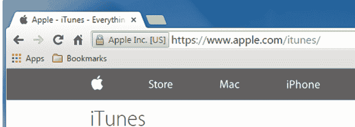

为了让网站使用 `HTTPS`，网站所有者必须从证书颁发机构（`CA`）获得安全证书。可以将发布机构想象成互联网的公证员。安全证书包含如序列号、发布证书的个人或组织，以及有效的起始和结束日期范围。如果一个网站拥有证书，你可以合理地确信它是合法的，而不是为了取你信息的伪网站。虽然曾报道过少数证书被盗用的案例，但它们非常罕见。

> 请记住 `HTTPS` 使用端口 443，而 `HTTP` 使用端口 80。

通过点击地址栏中的锁图标，你将看到一个类似于图 9.27 显示的屏幕，它列出了拥有该证书的公司通用信息以及颁发机构。以 `Apple iTunes` 为例，`CA` 是 `Symantec`（赛门信）。点击“证书信息”链接，你可以看到更多细节，例如证书的有效期和序列号。

## 图 9.27 Apple iTunes 安全证书信息

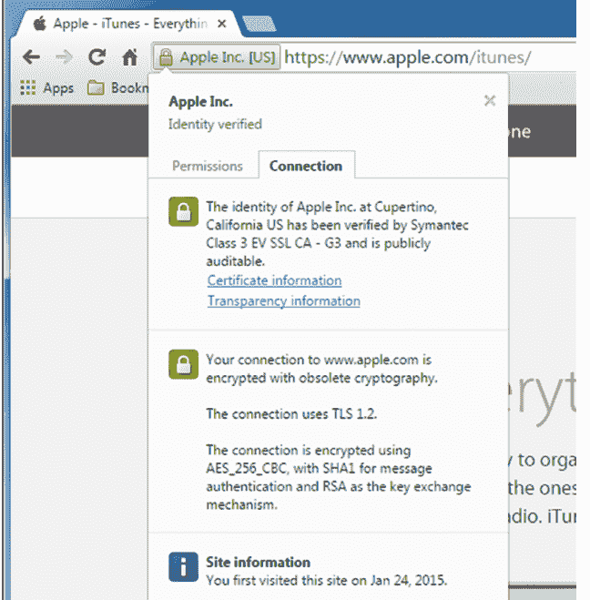

使用任何网页浏览器，都可以轻松地查看和监控安装了哪些证书、颁发机构是谁，以及每个证书包含哪些细节。练习 9.6 将向你如何在 `Internet Explorer` 11 中找到安全证书信息。

## 练习 9.6

### 在 Internet Explorer 中查看安全证书

- 打开 `Internet Explorer`，选择“工具 > `Internet` 选项”（你可能需要按 `Alt` 键来显示“工具”菜单。）
- 在“内容”选项卡上，点击“证书”按钮。会出现一个安全证书列表。对话框中有多个标签页，对应不同的证书发布者和机构。
- 点击“受信任的根证书颁发机构”标签页（如图 9.28 所示），浏览列表。这些都是颁发和验证证书的公司。

**图 9.28** 根证书颁发机构

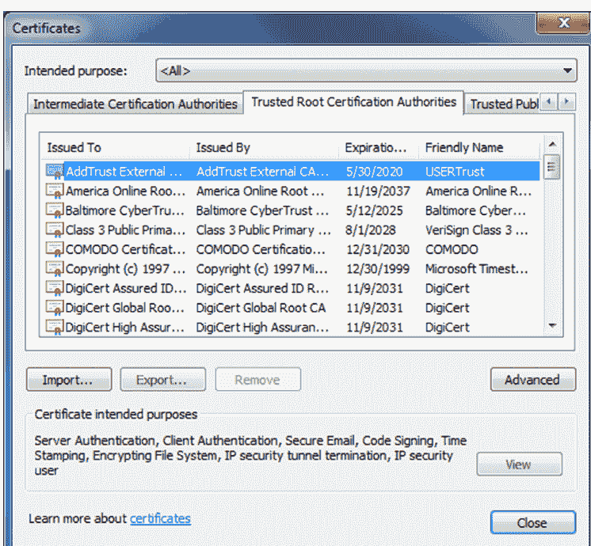

- 双击其中一个证书查看信息。然后点击“确定”关闭窗口。
- 点击“关闭”关闭“证书”对话框，然后点击“确定”关闭“`Internet` 选项”对话框。

在 `Chrome` 中，你可以通过进入“设置 > 显示高级设置”，并点击 `HTTPS`/`SSL` 部分的“管理证书”来打开相同的安全证书窗口。如果证书或 `Web` 服务器使用的证书出现问题（例如，证书已过期或被盗），当你访问该网站时会收到警告。

## 第 9 章 • 安全最佳实践

虽然警告的格式可能有所不同，但应该非常清楚地表明该网站是安全的。图 9.29 显示了一个示例。

### 图 9.29 无效安全证书示例

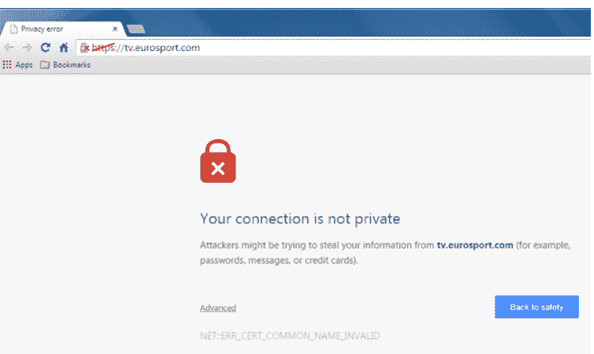

建议你不要出于任何目的使用该网站。如果你绝对确定该网站是安全的，可以忽略警告并继续。大多数浏览器会将地址栏标为红色。

## 识别可疑网站、链接和广告

网络钓鱼攻击者使用许多策略来欺骗用户。

### 互联网安全实践

当人们谈论网络钓鱼时，是因为它在不断演变。网络钓鱼通过创建类似于合法网站或电子邮件来欺骗用户以获取敏感信息。

网络钓鱼是什么样的？以下是你可以观察迹迹：

- **访问网站时寻找安全标志**：如果地址栏是绿色的，表明网站可能是安全的。
- **拼写错误的网站**：如果 `URL` 拼写错误（例如是 `micro.soft` 而不是 `microsoft.com`），它是可疑的。
- **威胁**：如果电子邮件威胁你的账户，你应该警惕。
- **好得离谱的交易**：如果听起来好得不可真实，那么很可能是假的。

浏览器可以帮助你防御某些攻击，因为大多数浏览器都使用了内置保护。在 `Internet Explorer` 中，钓鱼过滤器被称为 `SmartScreen` 过滤器，可以启用或禁用。通常我们应该启用它，因为它提供了信息且不会阻止你的任何操作。它的评估也相当准确。唯一的缺点（非常微不足道）是你开启了自动检查，浏览器会检查每个页面，导致性能变慢。

如果你很少访问安全网站，只想检查你有疑问的特定网站，可以关闭此功能。练习 9.7 显示了如何在 `Internet Explorer` 中配置 `SmartScreen` 过滤器。

## 练习 9.7

### 在 Internet Explorer 中配置 SmartScreen

1. 选择“工具 > `SmartScreen` 过滤器 > 禁用 `SmartScreen` 过滤器”（要显示菜单，你可能需要先按键盘上的 `Alt` 键）。打开的对话框类似于图 9.30，其中已选择了“禁用 `SmartScreen` 过滤器”。


2. 点击“确定”。
3. 输入地址 `www.paypal.com` 并按回车。
4. 选择“工具 > `SmartScreen` 过滤器 > 检查此网站”。第一次执行此操作时，你会看到一条消息，说明该地址将发送给 `Microsoft`。点击“确定”。
5. 弹出一个框告诉你 `SmartScreen` 过滤器已检查该网站且没有报告任何威胁。

# 互联网安全最佳实践

### 图 9.31 此网站未检测到威胁


6. 点击确定。
7. 选择 工具 > `SmartScreen` 过滤器 > 开启 `SmartScreen` 过滤器。弹出的对话框中已勾选“开启 `SmartScreen` 过滤器”。点击确定。
8. 注意在 工具 > `SmartScreen` 过滤器中，你还可以报告可疑行为的网站选项。

`Google Chrome` 也内置了钓鱼保护。你可以通过进入 设置 > 高级设置 > 隐私并勾选“启用钓鱼和恶意软件防护”框来启用。

# 识别广告软件症状

广告软件是一种令人讨厌的恶意软件形式，但它通常不具有破坏性。相反，广告软件试图让你看到公司的广告，或者将你的互联网活动重定向到它想让你去的地方。当然，流量被重定向的公司已经向广告软件制作商付费产生了流量。你已经学习了恶意软件的症状，但本节列出了三个与广告软件相关的症状。

# 控制弹出窗口

弹出窗口是你在查看网页或点击页面上的按钮时自动出现的额外小浏览器窗口。弹出窗口可以提供有用的功能，例如显示你在需要付费的公共 `Wi-Fi` 地点的登录时长。然而，弹出窗口更多地用于显示广告或虚假对话框，诱骗你做不想做的事，例如跳转到另一家公司的网站。

你的网络浏览器可能内置了弹出窗口拦截器。你可以启用或禁用它，在某些情况下，你还可以配置它对拦截弹出窗口更加激进或不激进。不过，并非所有浏览器的弹出窗口拦截器都有效，它们可能会漏掉某些类型的弹出窗口。可以使用第三方弹出窗口阻止程序，它们甚至比浏览器内置器的有效。练习 9.8 显示了如何配置 `Internet Explorer` 的弹出窗口阻止。

# 练习 9.8

# 配置 Internet Explorer 弹出窗口阻止

1. 打开 `Internet Explorer`，选择 工具 > 弹出窗口阻止 > 关闭弹出窗口阻止（你可能需要按 `Alt` 键来显示工具菜单）。
2. 选择 工具 > 弹出窗口阻止 > 弹出窗口阻止设置。打开弹出窗口阻止对话框，如图 9.32 所示。

### 图 9.32 Internet Explorer 11 弹出窗口阻止设置


3. 打开阻止级别下拉列表，点击“高：阻止所有弹出窗口”。
4. 在“允许的网站地址”中输入 `*.emcp.com` 并点击添加。星号是通配符，允许该位置上的任何文本。例如，此条目涵盖了 `www.emcp.com`、`support.emcp.com` 等。
5. 点击关闭。

# 互联网安全最佳实践 449

`Chrome` 的弹出窗口阻止也很容易配置。它位于 设置 > 显示高级设置 > 隐私 > 内容设置中。图 9.33 显示了该选项的样子。你可以点击“管理异常”按钮，像练习 9.8 中对 `Internet Explorer` 做的那样添加异常。

# 图 9.33 Chrome 的弹出窗口阻止

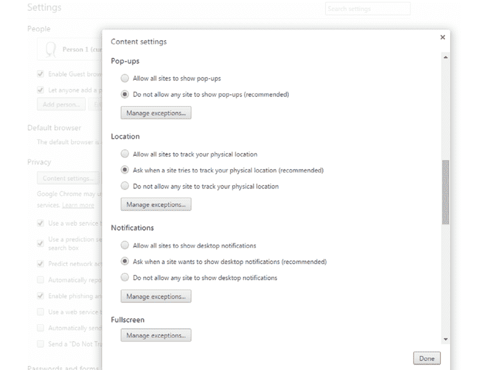

# 浏览器重定向

广告软件可能使用的另一种策略是重定向你的浏览器。这可能简单到将你的主页更改为客户端的主页。你可以将主页改回你想要的样子，但下次打开浏览器时，广告软件会再次接管并将其改回你不想要的页面。

更危险的浏览器重定向形式被称为“网络钓鱼”（`pharming`），即流量被发送到其他地方。例如，你可能会遇到本想访问某个网站却被重定向到另一个网站的情况。例如，假设不法的 `ABC` 公司创建了一个与 `XYZ` 银行网站一模一样的网站。网络钓鱼欺骗试图访问 `XYZ` 银行的用户进入不法 `ABC` 的网站，该网站看起来与他们熟悉的非常相似，以至于他们用户名和密码数据。

一旦 `XYZ` 银行意识到流量正在被重定向，它会立即采取行动。尽管不法 `ABC` 公司将被关闭，但它在重定向发生期间收集了数据，这种情况可能从几分钟到几天不等。

# 第 9 章 ■ 最佳实践

# 搜索引擎重定向

广告软件的一种常见策略是重定向你的互联网搜索。无论你搜索什么，呈现的都是相同的网站列表。例如，你使用 `Google` 作为你的搜索引擎。当你搜索一个新词时（输入你的术语），你将得到 `Google` 格式的结果列表供你点击。唯一的问题是 `Google` 没有返回那些网站——广告软件广告。有些网站可能是卖鞋的，而另一些可能……

# 解析广告软件症状

（注：提供的 OCR 文本是重复/碎片化的。我已将逻辑流合并为下方的整洁文档。）

# 互联网安全最佳实践 453

## 图 9.36 可疑邮件


图 9.36 中包含了几个需要警惕的经典示例。以下是一些可以识别的特征：

- * 这两封邮件看起来来自我的电子邮件提供商。这些垃圾邮件发送者至少不够聪明，不知道 `Yahoo!` 在名字末尾使用感叹号——而且很多时候并不是的。
- * 来自 `Sterling`（无论他是谁）的这封邮件在主题行中使用了我的用户名——非常聪明！（或者，并不聪明）。
- * `Sterling` 的那封邮件还把 `medications`（药物）一词拼错了。有时你会看到某些单词使用类似 `@` 替换字母 `a`、用 `!` 替换字母 `i` 的字符，以试图绕过垃圾邮件过滤器。
- * 未请求的药房邮件。直接删除它们即可，即使它们承诺有极其惊人的优惠。
- * 威胁很常见。那些据称来自 `Yahoo!` 或安全警报团队的邮件警告我，如果不采取行动，我将失去邮箱。图 9.37 显示了其中一条警告的内容。

### 图 9.37 欺诈邮件的内容

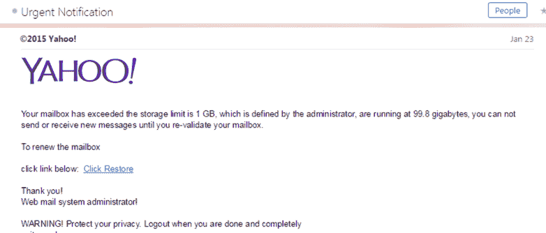

图 9.37 中的邮件是标准的虚假邮件。他们隐藏了 `Yahoo!` 的标志，并在邮件标题中放置了版权符号。这些细节处理得很到位。邮件中的语法也很糟糕，而且如果我的限制真的是 1 `GB`，那么服务又是如何让我使用量达到 99.8 `GB` 的呢？幸运的是，他们提供了一个方便的链接，让我点击它可以恢复我的电子邮件账户。更好的是，他们还关注我的隐私，因此在底部提供了一个实用的建议。诚承认，我很好奇点击该链接究竟会发生什么。不过，我还没好奇到花下周时间去清理它可能造成的任何乱象。

这引出了处理可疑邮件的两大黄金法则：

- 永远不要打开任何附件。
- 永远不要点击任何超链接。

这两个动作中的任何一个都会直接带你获得获取电脑恶意软件的链接。即使你拥有市场上最顶的反病毒软件，也不要点击附件或链接——不要让你的反病毒软件遭受显而易见的测试。

最后，收到一封似乎来自你的银行或其他金融机构的邮件，而你非常担心可能存在问题。在这种情况下，请给他们打电话。不要点击邮件中的任何内容，要使用邮件或可疑网站提供的电话号码。关闭浏览器或邮箱，单独查找联系信息。如果是合法的问题，你可以电话与真实的客服进行讨论。

## 理解被劫持的邮件

传播恶意软件最简单的方法之一是获取用户的联系人，并发送给其圈内的所有人。接收者更有可能打开附件，因为邮件似乎来自受信任的来源。因此，比起收到来自陌生人的邮件：

如果你收到这样的邮件，请给你的熟人打电话或发短信，询问他们是否发送了它。如果他们确实发送了而且链接确实很棒，你可以点击并享受。否则，请养成安全邮件习惯并忽略该信息。

## 总结

在本章中，你学习了计算机和网络的安全最佳实践，以及如何安全地浏览互联网和使用电子邮件。

第一部分关于保护计算机和网络安全，从设备加固开始。这包括禁用蓝牙、未使用的服务和自动播放等功能。你还应该锁定你的系统，对于笔记本电脑（以及某些台式机）要物理固定在桌子上，并在离开电脑时使用软件锁定。为了保护系统中的数据不被盗或被其他用户访问，你可以对硬盘上的数据进行加密。最重要的设备加固措施之一是确保你使用反恶意软件程序作为防病毒和反垃圾邮件软件。

用户账户应仔细管理以确保安全。只给那些需要的人授予管理员账户访问权限，即使是管理员在不需要执行管理任务时也使用普通用户账户。禁用来账户也能防止攻击。密码需要具有足够的复杂度，并且不要重复使用。

你应该能够完成的任务：

1. 禁用蓝牙或 `NFC`。
2. 禁用未使用的服务。
3. 禁用自动播放（`AutoPlay`）。
4. 设置屏幕保护程序密码并启用。
5. 启用文件加密。
6. 安装并配置反恶意软件。
7. 禁用或启用访客账户。
8. 创建易于记忆的复杂密码。
9. 将网络浏览器更新到最新版本。
10. 配置自动填充（`Autofill`）。
11. 配置浏览器安全。
12. 管理并删除浏览器历史记录和 `Cookie`。
13. 识别安全网站。
14. 识别广告软件的症状。
15. 了解如何使用隐私模式（`InPrivate`）或无痕模式（`Incognito`）。
16. 识别可疑电子邮件。

## 复习题

1. 由于办公室最近发生了一系列盗窃事件，你需要加固本地系统。对于你的情况，哪两个操作最合适？（选择两个）
   - A. 安装硬件锁
   - B. 禁用未使用的服务
   - C. 安装反恶意软件
   - D. 启用加密
2. 离开座位时，你可以在工作站上配置哪个选项来增加安全性？
   - A. 文件加密
   - B. 多因素身份验证
   - C. 单点登录
   - D. 屏幕保护程序密码
3. 你刚刚到达机场，有一个意外的六小时转机时间。你想用智能手机完成一些工作。作为预防性的设备加固措施，你应该禁用哪些功能以防止潜在的攻击？（选择两个）
   - A. 自动填充
   - B. 蓝牙
   - C. `NFC`
   - D. `FFC`
4. 同事 `Claire` 正在浏览网页，想知道在网站上输入她的信用卡信息是否安全。你告诉她应该看什么？
   - A. `HTTPS://`
   - B. `HTTP://`
   - C. `SSL://`
   - D. `TLS://`
5. 你在本地计算机上启用了文件加密。在你度假期间，你的同事设法进入了你的计算机并与其他用户共享了重要文件。他们是如何做到的？
   - A. 他们登录并禁用了加密。
   - B. 他们使用磁盘恢复工具（`Disk Recovery`）访问了加密文件。
   - C. 所有登录系统的用户都有权访问加密文件。
   - D. 他们使用你的用户名和密码登录了。
6. 同事 `Ray` 担心他的电脑感染了广告软件。你应该告诉 `Ray` 寻找哪些症状来确认他的怀疑？（选择三个）
   - A. 弹出窗口过多
   - B. 浏览器重定向
   - C. 搜索引擎重定向
   - D. 多因素登录重定向
7. 哪种类型的软件可以帮助保护你的计算机免受恶意网络流量的影响？
   - A. 软件防火墙
   - B. 密码复杂度工具
   - C. 反广告软件
   - D. 反病毒软件
8. 你正在使用 `Google Chrome`，想浏览一个网站，但不想让该网站存储在浏览历史记录中。你应该怎么做？
   - A. 以其他身份登录该网站
   - B. 配置独立浏览
   - C. 使用隐私模式（`InPrivate`）
   - D. 使用无痕模式（`Incognito`）
9. 你的经理刚买了一个工作站，并且没有域。他想知道应该禁用哪些用户账户来增加安全性。你应该告诉他禁用哪些？
   - A. 访客（`Guest`）
   - B. 用户（`Users`）
   - C. 特权用户（`Power Users`）
   - D. 管理员（`Administrator`）
10. 以下哪些操作不认为是网页浏览的最佳实践？
    - A. 限制个人身份信息（`PII`）的使用
    - B. 禁用自动填充
    - C. 关闭不可信源的警告
    - D. 更新插件和工具
11. 你公司的经理决定实施更严格的安全策略。以下哪种登录方案将帮助他们实现这一目标？
    - A. 单点登录
    - B. 多因素身份验证
    - C. 密码保密性
    - D. `HTTPS`
12. 你的同事 `Rachel` 最近发现，当她在网页浏览器字段中输入名字时，她的全名以及地址也会出现在相应的框中。这是由于什么？
    - A. 广告软件感染
    - B. 单点登录
    - C. 可疑的超链接
    - D. 自动填充
13. 你被要求提供网络安全培训。在关于密码管理的章节，你应该向用户推荐哪些选项？（选择两个）
    - A. 不要使用复杂密码，因为它们很容易忘记。
    - B. 更改系统上的默认密码。
    - C. 在多个系统上使用相同的密码以便于记忆。
    - D. 在要求更改密码后，不要重复使用旧密码。
14. 你在一个提供免费网络浏览电脑的图书馆里。你可能对以下哪些内容表示担忧？
    - A. 窥肩偷视（`Shoulder surfing`）
    - B. 键盘记录器（`Keyloggers`）
    - C. 不安全的无线网络
    - D. A 和 B
    - E. A、B 和 C
15. 关于单点登录（`single sign-on`），以下哪两个陈是正确的？
    - A. 它对用户来说很方便。
    - B. 它可能会导致安全问题。
    - C. 它需要多因素身份验证。
    - D. 它在不同的操作系统之间无法工作。
16. 以下哪些特征被认为是强密码的？（选择两个）
    - A. 长度长
    - B. 使用模式
    - C. 使用符号、数字和字母
    - D. 包含个人身份信息（`PII`）
17. 你读到了一篇关于……你应该使用哪种软件？
    - A. 软件防火墙
    - B. 密码复杂度工具
    - C. 反广告软件
    - D. 反病毒软件
18. 你读到了一篇关于……它们是如何发生的？
    - A. 他们登录并禁用了加密。
    - B. 他们使用磁盘恢复工具访问了加密文件。
    - C. 所有登录系统的用户都有权访问加密文件。
19. 你的经理刚买了一个工作站，并且没有域。你应该告诉他禁用哪些？（语境检查）
    - A. 启用自动填充。
    - B. 配置 `Cookie`。
    - C. 将浏览器更新到最新版本。
    - D. 配置安全。
20. 关于单点登录（`single sign-on`），以下哪两个陈述是正确的？
    - A. 它对用户来说很方便。
    - B. 它可能会导致安全问题。
    - C. 它需要多因素身份验证。
    - D. 它在不同的操作系统之间无法工作。

## 购买与配置工作站

这种经历包含了更换部件的需要。好了，也许选择合适的金属和塑料机身并不像选择人际关系那样重要，但你确实希望确保获得一个符合你需求的系统。

在深入研究电脑选择的细节之前，请先后退一步，思考一下电脑的大体——硬件和软件的集合。因此，你实际上只需要从这些组中挑选出正确的部件。在硬件组中，处理器、内存、显卡和显示器是你的主要选择，而在软件方面，你拥有操作系统和应用程序。现在只需要将它们所有整合在一起了。考虑到这一切，接下来的章节将介绍你应该问的哪些问题，以确定适用于特定情况的电脑类型。

## 确定用途

这台电脑将用于什么？是给家庭用户还是办公用户使用的？如果电脑的唯一目的是浏览互联网和检查电子邮件，那么它的要求与那些需要视频编辑或在电子表格中进行大量计算的人完全不同。这应该是要的第一个问题，因为它将帮助你把范围缩小到最快的选择。

## 决定平台

下一个考虑的因素是用户是否需要移动性。如果不需要，台式机可能是一个可行的解决方案。台式电脑的主要优势是它们以更低的价格提供比笔记本电脑更好的性能。如果用户需要一台用于在线游戏具有最快和最大功率的电脑，那么台式机是最佳选择。你可以买到带有21 英寸显示器的笔记本电脑，但 21 英寸及以上的显示器非常常见。用户真的想随处携带着它吗？可能不想。

当今许多用户都需要移动性。他们可能在办公室里，需要将系统从一个会议带到另一个会议。他们也可能喜欢在坐在沙发上看电视时浏览网页，而台式机并不适合放在膝盖上。得于无线网络技术的优势，笔记本电脑的连接性通常与它们的台式机相当（甚至更好），并且带有移动性的额外优势。

如果你已经决定需要移动解决方案，那么你还需要决定是传统的笔记本电脑、平板电脑还是笔记本。笔记本电脑非常适合浏览网页和发送电子邮件，但其他方面作用不大。用户可以偶尔创建文档或工作表，但笔记本的设计并不是为了作为全功能运行的工作站。平板电脑尺寸有很多，但在办公功能方面比那些仅比手机大一点的设备提供的更多。

## 选择自组还是购买

如果台式机是正确的解决方案，那么下一个问题是你想自己组装系统还是购买预装系统。自己组装系统（通常被称为“弗兰肯斯坦机”）可以确保你获得完全符合你要求的组件。你选择一切——机箱、电源、主板、处理器、硬盘、显卡、网卡以及你想要放入其中的任何东西。你可以制造出可能的最大、最快的系统，而且一年后，当新技术让你的系统过时时，你可以升级任何你想要的组件。它可能比配置相似的预装系统更便宜。这条路线需要一些技术知识，对某些人来说是望而却畏的。

自组电脑有几个潜在的缺点。首先，你需要自己购买软件，包括操作系统。或者，你可以使用 `Linux` 和其他开源软件来节省费用。其次，没有支持——你就是技术支持。这可能不会困扰到你，但如果你为一家公司组装 20 台系统，你可能不希望在它们故障时承担故障和更换的责任。

如果你决定自己组装系统，请找一家你可以信任的本地电脑商店或信誉良好的在线零售商来获取部件。这样，你就可以确保获得的是优惠价格，并跟上不断出现的新技术。友好的退货政策也非常有帮助，因为电子组件有时会损坏。

购买由 `HP`、`苹果`、`联想`、`华硕`或 `Acer` 等主要制造商制造的机器并不丢耻。一些小型公司生产自己的系统——有些台式电脑配有显示器（有时还有打印机），而另一些则需要单独购买。

在购买预装系统时，最重要的因素是比较价格。你会找到配置相似的电脑的各种价格范围……（注：此处原文包含大量重复和碎片句子，已根据文本流重新对齐）。

## 选择操作系统

在购买预装系统时，你对操作系统有广泛的选择范围。它将是 `Windows` 或 `macOS`。如果你真的想要 `macOS`，这会极大地限制你的硬件选择，因为操作系统只安装在 `Mac` 系统上。如果你是自组电脑，可以把 `Linux` 加入考虑。

其他因素也涉及其中，如你所选操作系统的应用程序可用性。今天你想到的几乎每个程序在所有操作系统上都可用，但检查是否需要某个特定程序仍然是好事。

## 确定预算

啊——金钱。用户可能想要一台高端游戏机，但负担不起。这很难以五星级预算购买一台。

电脑的特性决定了成本。这非常简单——他们想要的性能越高，付的钱就越多。这就是为什么了解电脑将用于什么很重要，这样你才不会为了完成任务而花费必要的费用。同时，不要买太便宜。降低成本看起来可能是维持预算的好方法，但如果系统运行不正常，他们会感到沮丧并更早更换系统。在电脑方面，稍微买贵比买便宜要好，前提是他们的预算负担得起。

## 购买与配置工作站

`Apple` 通常比性能相当的 `PC` 更贵，而且笔记本电脑也比类似的桌面式电脑更贵。在练习 10.1 中，你将比较不同笔记本电脑的价格。

## 练习 10.1

### 比较 Windows 和 Mac 笔记本价格

1. 创建一个简单快速的电脑对比表格。你可以在电脑屏幕或纸上完成。在侧边列出屏幕尺寸、处理器类型和内存、硬盘、网络、重量、电池续航和价格等组件。如果你愿意，也可以添加其他组件。在顶部列出你正在考虑的型号。
2. 进入大型电子产品零售商的网站。例如 `www.bestbuy.com` 或 `www.frys.com`。
3. 搜索 `MacBook Pro`。例如，找到一台拥有 13.3 英寸显示、`Intel CPU`、8 `GB RAM` 和 126 或 256 `GB SSD` 硬盘的 `MacBook Pro`。在你的对比表格中输入这些规格。
4. 搜索第二台 `MacBook`。选择一台拥有 15.4 英寸显示且性能优于第一款型号的。在你的对比表格中列出规格。这两台 `MacBook` 之间有什么区别？
5. 搜索一台与你第一台 `MacBook` 规格相似的 `PC` 笔记本电脑并列出。它们有什么区别？
6. 搜索一台与你第二台 `MacBook` 规格相似的 `PC` 笔记本电脑并列出。它们有什么区别？

练习 10.1 的目标不仅仅是显示 `Mac` 通常更贵。你可以使用三台来自不同制造商的配置类似的 `PC` 笔记本电脑进行练习并找到不同的价格。其目的是为了说明你应该始终根据自己的需求和市场价格研究最佳选择。

## 家庭和 SOHO 电脑的分类

根据上一节讨论的问题，你可以想象有几十甚至上百种可能的解决方案来满足最终用户的需求。要理解许多不同的解决方案很难，但对用户需要的通用系统类型进行分类就会变得更容易。

在本节中，你将学习几类家庭或小型办公/家庭办公（`SOHO`）电脑。这样，当你提问时，就可以对用户需求进行分类（让你的任务更容易），然后根据他们具体的预期用途对系统进行微调。这里讨论的电脑类型并非详尽的，但它将为你提供良好的基础。涵盖了以下系统类型：

- 标准工作站
- 游戏 `PC`
- 图形设计工作站
- 音频/视频编辑工作站
- 家庭影院 `PC`
- 家庭/`SOHO` 服务器

对于这些每种电脑，你都需要考虑最重要的组件。处理器、内存、显卡和网卡。其中某些系统可能还需要更专业的设备，如高级冷却设备、电视调谐器、定制机箱或其他物品。

### 标准工作站

标准工作站电脑并没有特别之处，而是衡量所有配置的基准。根据用户的需求，标准工作站电脑可以是桌面式电脑、笔记本电脑或平板电脑。

除了运行操作系统所需的配置外，标准工作站没有特定的硬件或软件要求。甚至不需要网络连接，尽管在当今的环境下，看到一台没有网络功能的电脑是极其罕见的。

如果你的客户正在寻找一个用于办公工作或仅浏览网页和阅读邮件的基础工作站，那么这是入门的配置。你可以根据用户的需求和要求决定购买更强大或更低功率的电脑。

### 游戏 PC

游戏 `PC` 并不是为了玩纸牌而构建的，而是为了当今市场上先进、动作激烈且图形密集型游戏而设计的。某些游戏已经变得极其真实，而其他动画游戏的质量已经可以媲美电影制作。如果你或你认识的人热衷 `PC` 游戏，你会意识到游戏 `PC` 需要是技术前沿的快速且强大的系统。需要优化的特定组件是处理器、内存和视频。还应该考虑升级声卡并为电脑添加增强冷却系统。

现代动作游戏要求处理器在长时间内每秒执行数百万次计算。因此，游戏 `PC` 应该拥有具有核心最多的最快处理器。四核或六核处理器是标准配置。内存也至关重要，因为它提高了系统性能，所以越大越好。显卡应该拥有自己的内存（尽可能多），而不是共享普通的系统内存。显示器也需要是高端的，以处理显卡提供的快速且的输出。最后，快速处理器和强大显卡产生的所有热量可能需要特殊的冷却系统，例如额外的风扇或水冷。

正如你根据描述预期的那样，游戏系统通常比标准工作站贵得多。但对于那些严肃游戏的人来说，这种性能物有所每一分钱。

> 注意：某些制造商销售“游戏笔记本电脑”，它们是相当强大且昂贵的笔记本电脑。严肃的游戏玩家会告诉你，根本没有所谓的游戏笔记本电脑（至少今天没有）——无论多强大，它们就是不够好。由于由于原因，大多数游戏系统都是桌面电脑。

### 图形设计工作站

图形设计师、出版者和建筑师是需要图形设计工作站的用户类型的很好的例子。这些系统运行专门软件来渲染艺术、创建设计、为施工项目布置输出和蓝图。最重要的组件是处理器、内存和高性能显卡。显示器也是色彩准确度和分辨率的关性组件。

### 音频/视频编辑工作站

编辑视频的用户需要高处理能力和大量的 `RAM` 来处理复杂的视频文件。快速存储（如 `SSD`）对于流畅的播放和渲染至关重要。通常需要高端显卡来处理高分辨率输出。

### 家庭影院 PC

家庭影院 `PC` 是为以媒体为中心的娱乐设计的。它们通常很紧凑以适应客厅布局，并且运行安静以免打扰他人。它们优先考虑高质量的音频组件和多个 `HDMI` 端口，以连接各种显示器和音响系统。

### 家庭/SOHO 服务器

这种类型并不是真正的工作站，但其硬件和操作系统通常与工作站相似——家庭或小型办公/家庭办公（`SOHO`）服务器用于管理网络资源。它们通常需要大容量存储和多核处理器来同时处理多个请求。

即使客户端计算机支持千兆以太网，也让其以快速以太网（100 `Mbps`）运行。这可以释放服务器带宽以为多个客户端服务，而不会某个客户端占用服务器的千兆带宽。

最后，`SOHO` 服务器可能需要为客户端提供媒体流。练习 10.2 显示了如何为 `Windows 7` 配置媒体流。

## 练习 10.2
### 配置 Windows 7 媒体流

1. 在控制面板中，打开“网络和共享中心”（取决于你对控制面板的配置，它可能位于“网络和 `Internet`”之下）。
2. 点击左帧中的“更改高级共享”链接（如图 10.1 所示）。

### 图 10.1 网络和共享中心


3. 点击“家庭”或“工作”右侧的箭头以展开配置部分。
4. 在“媒体流传输”部分，点击“选择媒体流选项”链接。
5. 在“媒体流传输选项”对话框中（如图 10.2 所示），对于网络上你想要从本地 `PC` 传输的每台计算机，将标记为“阻止”的下拉按钮改为“允许”。

## 练习 10.2（继续）
### 图 10.2 媒体流传输选项

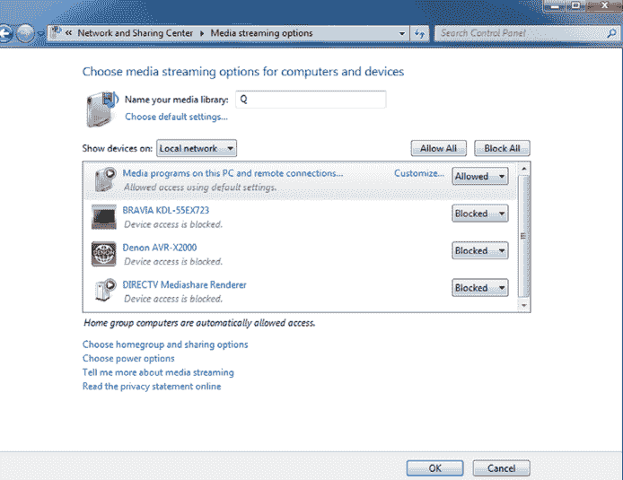

6. 点击“确定”退出“媒体流传输选项”对话框，然后关闭“网络和共享中心”对话框。
7. 通过选择“开始 > 所有程序 > `Windows Media Player`”打开 `Windows Media Player`。
8. 如果你是第一次打开 `Windows Media Player`，选择“推荐设置”并点击“完成”。否则跳到第 9 步。
9. 如必要，切换到“库”模式（在“正在播放”模式下，点击向左箭头即可启用网格视图）。
10. 通过点击“流 > 启用媒体流”（或“通过家庭组启用媒体流”）确保已启用流传输。如果流传输已开启，此选项将隐藏。
11. 在其中一个远程系统上启动 `Windows Media Player`。
12. 在左帧中，点击“其他库”。
13. 展开你刚刚共享的远程库，查看是否可以播放音乐、观看视频或录制的电视，或查看图片。

## 购买和配置工作站


## 现实场景
### “新车味”

你可能熟悉这样说法：新车一从经销商那里开出来，价值就折了一半。这在技术上并非完全真实，但其中包含事实之理，并且令人们记忆深刻。这句话在电脑领域的版本应该是：“你一买了电脑，它就过时了。”同样，这在技术上也不完全真实，但其中隐藏着一些事实。

如果你刚买了一台电脑，最好的建议是几个月内不要看电脑价格。如果你买了一台很棒的电脑且划算，它的价格可能会下降，以至于突然的下跌看起来像是一笔糟糕的交易，即使在当时并非如此。或者你可能会发现一个月后你可以用同样的钱买到更快的处理器或更大的内存。这只会引起购买者的悔恨！花时间享受你的新电脑吧——买完后立即进行比价对你没有帮助。

## 设置工作站

你刚刚购买了一台工作站并带了家。又也许你购买了两台工作站，现在正面对一小山纸箱。该怎么办？如果这是你的新系统，你可能非常想尝试它。如果你需要设置几十台系统，你可能会感到有些焦虑，并希望一切都能正常工作。无论情况如何，都是开始设置电脑（们）了。本节重点关注设置基本工作站的适当步骤。

## 插入电缆

从箱中取出电脑后，始终务必立即检查是否有可见的损坏迹象。制造商在保护产品方面做得非常好，但有时运输过程中会发生意外。机箱上的小凹痕或划痕可能不会影响电脑性能，但大裂缝或组件损坏是不利的信号。

如果你的视觉检查没有发现问题，下一步是插入所有电缆。制造商通过他们做的两件事让这变得非常简单。第一，他们对大多数连接器进行了颜色编码和防呆设计。颜色编码是非常显而易见的——蓝色插头对应蓝色连接器。连接器也有防呆设计，这意味着它们只能以一种方式（即正确的方式）连接。如果插头反了或倒反了，它将无法连接。你可以尝试强行插入，但如果你觉得需要这样做，说明出了问题。

制造商为帮助人们设置电脑所做的第二件事是在箱内提供设置指南或快速上手指南。图 10.3 显示了一个快速上手指南示例。这些指南通常是字数极少的海报，通过图片展示如何连接电脑的组件。

## 图 10.3 HP 快速上手指南


图 10.3 显示了指南的一个步骤，演示了如何根据你拥有的连接器插入显示器。对于新手来说，这非常有帮助。如果你在初始设置期间没有完全按照正确的方式配置系统，你以后随时返回控制面板更改设置。

笔记本电脑和平板电脑的设置步骤较少。你可能暂时不需要插入电脑。打开系统（如果适用），并进入下一步。

## 开启电脑

电脑需要电源。希望这不会让你感到意外。开启电脑。如果你不电源按钮在哪里，快速上手指南会向你展示。图 10.4 显示了购买和配置工作站的内容。图 10.4

## 图 10.4 显示电源按钮的快速上手指南

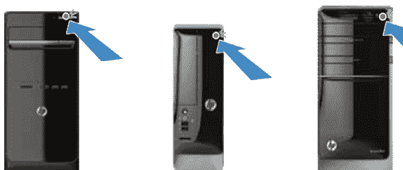

偶尔，你会遇到按下电源按钮无法开启的笔记本，即使它已插在插座上且电池已充电。笔记本底部有一个或两个释放杠用于此类目的。重新连接电池，然后再次尝试电源。

## 安装操作系统

预装电脑在工厂时已安装了操作系统。通电后，你需要根据喜好对其进行配置。所有当前的工作站操作系统都有某种菜单或系统向导来引导你做出选择。在大多数情况下，这些过程相对简单，例如选择你所在的地区、设置日期和时间、配置屏幕分辨率以及选择音频设置。如果你在初始设置期间没有完全按照正确的方式配置系统，你以后随时返回控制面板更改设置。

## 本地化设置

本地化设置只需指定电脑在世界的哪个位置运行。图 10.5 显示了本地化设置屏幕的示例。根据选择的国家，电脑将设置其他参数，例如语言；日期、时间和数字的格式；以及键盘布局。除了指定位置外，你可能会被要求选择时区并确认日期和时间。

# 图 10.5 选择本地化设置


## 屏幕分辨率

屏幕分辨率（也称为分辨率）决定了有多少个水平点和垂直点构成了你显示器的行和列。较高的分辨率会使它们在屏幕上看起来更清晰，但因为屏幕上有更多的点需要管理，所以需要更多的内存。较高的分辨率还会让文档中的图标和文字等项目变得更小，这对于视力不佳的用户可能是一个问题。

以下是其工作原理的示例。假设你将显示器设置为 500 × 400（这不是真实的分辨率，但对于这个示例没关系），这意味着显示器在每个水平行显示 500 个像素，在每个垂直列显示 400 个像素。假设你桌面上的一个图标程序设置为宽度为 100 像素。

## 购买和配置工作站

它将占据屏幕宽度的约 1000 分分之一。如果你将分辨率更改为 1000x800，同一个图标（程序仍设置为宽度 100 像素）现在只占据屏幕宽度的十分之一。由于分辨率的变化，它看起来会小得多。

显示器也必须支持你选择的分辨率，否则图像将无法正常显示或根本无法显示。你的系统不应选择硬件不支持的分辨率。当你选择分辨率时，系统将临时切换以确保其正常显示，你可以选择保留该分辨率或恢复到上一个分辨率。如果你不想保留它（例如，如果它显示不正常或你看不见任何内容），它将在约 15 秒后恢复到之前的设置。图 10.6 显示了控制面板中的分辨率设置。有更改显示器类型、分辨率和方向（横屏或竖屏）的选项。你很少更改显示器类型，但有时显示器无法正确检测，并安装了通用驱动程序。如果发生这种情况，你可能无法选择显示器所支持的高分辨率。在这种情况下，请完成设置并手动下载安装显示器驱动。

选择错误的分分辨率会导致无法适应屏幕，或者导致图像出现失真，因为分辨率是为特定比例的显示器设计的。旧显示器的形状更方。

# 图 10.6 控制面板中的分辨率设置


## 第 10 章 购买和配置工作站

4:3 的比例意味着显示区域宽 4 个单位，高 3 个单位。所有分辨率都是此比例的倍数。例如，`VGA` 标准分辨率为 640 × 480。宽显示器通常具有 16:10 的比例。高清电视（遵循 `ATSC` 1080i/1080p 标准）的比例为 16:9。表 10.1 向你展示了一些视频标准及其分辨率。

## 表 10.1 视频标准与分辨率

| 标准 | 分辨率 | 比例 |
| --- | --- | --- |
| `VGA` | 640 × 480 | 4:3 |
| `Super VGA` | 800 × 600 | 4:3 |
| `ATSC` 720p | 1280 × 720 | 16:9 |
| `ATSC` 1080i/1080p | 1920 × 1080 | 16:9 |
| `Widescreen XGA (WXGA)` | 1280 × 800 | 16:10 |
| `UUXGA` | 1920 × 1200 | 16:10 |


> 如果你看到的视频分辨率不知道其比例（因此不确定它是否适用于你的显示器），简单的数学计算可以帮你解决问题。将第一个数字除以第二个数字。结果等于第一个数字比例除以第二个数字。例如，1920 ÷ 1200 = 1.6，这等于 16 ÷ 10。

## 音频设置

对于某些用户配置音频可能是可选的，但这样做可以确认你至少将扬箱插在了正确的插上（音频端口太多可能会让人困惑！）。典型的选项有音量和播放状态。如果你有更高级的声卡，可能会额外的选项，例如配置环绕声或添加音频输入。

## 安装安全软件

虽然对于这一步来说似乎有点早，但事实如此。安全软件是仅次于操作系统最重要的软件。你不希望在没有安全软件的情况下连接互联网，许多预装系统会带有 `Norton` 或 `McAfee` 等软件。许多预装系统会带有 `Norton` 或 `McAfee` 等软件。安全软件是仅次于操作系统最重要的软件。你不希望……

（注：原文中存在大量重复段落，已按要求进行整合翻译）

> 如果你看到的视频分辨率不知道其比例（因此不确定它是否适用于你的显示器），简单的数学计算可以帮你解决问题。将第一个数字除以第二个数字。结果等于第一个数字比例除以第二个数字。例如，1920 ÷ 1200 = 1.6，这等于 16 ÷ 10。

# 484 第 10 章 ■ 购买和配置工作站

一个经常被忽视的任务是电缆管理。松散的电缆可能会成为工作场所的安全隐患，因此你至少应该将电缆收起来并尽可能让它们远离过道。这样可以避免用户踢到电缆导致连接断开的情况，这种可能会可能导致拨打 IT 帮助热线。更糟糕的是，松散的电缆可能会绊倒人，导致伤害或其他损坏。如果有几根电缆经过同一个区域，你可以使用扎线带（图 10.10）将它们系在一起并固定在位置。如果电缆将横跨过道，请使用地板电缆保护盖（图 10.11）。这些设备具有两个功能——防止用户绊倒，并保护电缆不受损坏。

### 图 10.10 扎线带

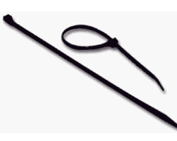

### 图 10.11 地板电缆保护盖


## 总结

在本章中，你学习了如何选择正确的工作站，然后对其进行设置和配置。首先，你学习了如何通过正确的问题来确定什么样的系统适合用户。了解计算机的用途。确定正确的平台，例如台式电脑或笔记本电脑。然后，选择一个操作系统，并考虑预算限制。

接下来，我们讨论了家庭和小型办公室电脑的不同类别。选项包括标准工作站、游戏电脑、图形设计系统、音频/视频编辑工作站、家庭影院系统以及小型办公室/家庭办公室服务器。

最后，本章涵盖了设置基础工作站所需的适当步骤。这些步骤是：插上电缆、开启电脑、按照初始操作系统设置向导操作、安装安全软件、配置外围设备、卸载不需要的软件、配置并验证 `Internet` 连接、安装额外软件、更新安全和其他软件、创建额外的用户账户以及执行基本的电缆管理功能。

## 考试要点

了解设置基础工作站的步骤。这些步骤是：插上电缆、开启电脑、按照初始操作系统设置向导操作、安装安全软件、配置外围设备、卸载不需要的软件、配置并验证 `Internet` 连接、安装额外软件、更新安全和其他软件、创建额外的用户账户以及执行基本的电缆管理功能。

了解本地化设置中配置了哪些内容。本地化设置始终配置计算机运行的国家。它们通常还包括时区、日期和语言。

理解配置屏幕分辨率的重要性。如果屏幕分辨率配置不当，显示可能无法正常工作或显示失真。

## 第 10 章实验

第 10 章的重点是获取和设置新的工作站。强化本章概念的最好方法是付实践。因此，这就是第 10 章实验将为你提供的内容。在一个新的工作站上，执行以下步骤：

1. 插上电缆。
2. 开启电脑。
3. 按照初始操作系统设置向导操作。
4. 安装安全软件。
5. 配置外围设备。
6. 卸载不需要的软件。
7. 配置并验证 `Internet` 连接。
8. 安装额外软件。
9. 更新安全和其他软件。
10. 创建额外的用户账户。
11. 执行基本的电缆管理功能。

## 复习题

1. 你被要求为客户购买一台电脑。为了确定购买哪种电脑，你应该问的第一个问题是什么？
   A. 它的用途是什么
   B. 他们想要什么操作系统
   C. 他们想要什么平台
   D. 他们的预算是什么
2. 你在设置工作站时配置了屏幕分辨率。如果屏幕分辨率配置不当，图像可能会失真。最可能的原因是什么？
   A. 屏幕分辨率设置不当
   B. 屏幕分辨率设置太高
   C. 屏幕分辨率设置太低
   D. 屏幕比例设置错误
3. 哪种操作系统通常与家庭办公室相关？（注：原文似乎缺少了“服务器”）
   A. `Android`
   B. `Windows`
   C. `Linux`
   D. `OS X`
4. 你被要求为客户设置一台电脑。在完成所有 `Internet` 连接配置后，你下一步应该做什么？
   A. 安装安全软件。
   B. 创建额外的用户账户。
   C. 更新安全和其他软件。
   D. 安装额外软件。
5. 在为客户选择笔记本电脑时，哪些是主要标准？（多选）
   A. 重量
   B. `CPU` 速度
   C. 电池续航
   D. 屏幕
6. 你正在设置工作站。在选择分辨率后，屏幕变黑了。你应该怎么办？
   A. 等待 15 秒图像出现。
   B. 关闭显示器并重新打开。
   C. 重启工作站。
7. 在为平板电脑选择操作系统时，以下哪些操作系统可能是预装的？（多选）
   A. `OS X`
   B. `iOS`
   C. `Linux`
   D. `Android`
8. 宽屏显示器使用什么比例？
   A. 16:9
   B. 4:3
   C. 3:2
9. 你的朋友 `Joe` 决定买一台游戏电脑。他可能考虑的因素是什么？
   A. 选择操作系统。
   B. 没有额外的软件。
   C. 需要技术支持。
   D. 选择硬件组件。
10. 在配置 `Windows 8` 时，你选择了错误的本地化设置。最简单的修复方法是什么？
    A. 重新安装 `Windows 8`。
    B. 重启电脑并运行设置向导。
    C. 在控制面板更改。
    D. 使用设置向导中的本地化选项。
11. 你的朋友 `Gloria` 是一位设计师，希望你帮助选择新的工作站。以下哪些可能是她的硬件需求？（多选）
    A. 内存
    B. 硬盘
    C. 显示器
    D. 声卡
12. 你正在安装新电脑并刚刚创建了额外的用户账户。你应该执行的下一步是什么？
    A. 更新安全和软件。
    B. 配置外围设备。
    C. 配置并验证 `Internet` 连接。
    D. 执行管理任务。
13. 你正在构建家庭影院系统。哪些组件可能需要比标准工作站升级？
    A. `GPU`
    B. `CPU`
    C. `RAM`
    D. 网卡
14. 你正在为一位连接了特殊打印机的工程师配置新工作站。你应该何时执行此任务？
    A. 在插上所有电缆时
    B. 在安装安全软件之前
    C. 在安装安全软件之后
    D. 在配置并验证 `Internet` 连接之后
15. 你的朋友 `Daphne` 正在购买新的工作站以支持她不断发展的视频制作业务。她应该升级标准工作站哪些组件？（多选）
    A. `CPU`
    B. `RAM`
    C. `GPU`
    D. `HDD`
16. 你正在为用户配置新工作站。在配置电脑连接 `Internet` 后，你下一步应该做什么？
    A. 安装额外软件（如果适用）。
    B. 运行安全更新。
    C. 创建其他用户账户（如果适用）。
    D. 验证 `Internet` 连接。
17. 你最近购买了一台工作站并带回家。在拆箱后，设置它的第一步是什么？
    A. 开启电脑。
    B. 进行电脑注册。
    C. 插上电缆。
    D. 配置 `Internet` 连接。

18. 你的一朋友从一家主要制造商购买了一台电脑。电脑上预装了一些她不需要的捆软件。在设置过程中的何时卸载这些软件最合适？

   A. 安装安全软件后
   B. 配置外设设备后
   C. 在初始操作系统设置向导期间期间
   D. 在配置并验证 `Internet` 连接后

19. 你正在为一个小型办公室设置五台工作站。完成操作系统配置过程后，下一步应该是什么？

   A. 安装安全软件。
   B. 配置外设设备。
   C. 创建用户账户。
   D. 执行线缆管理。

20. 购买了一台新的 `Windows` 笔记本电脑后，你开始对其进行配置。你不希望收到购买捆绑软件的提醒。移除你不需要的软件的推荐方法是什么？

   A. 在初始操作系统设置向导期间移除。
   B. 删除桌面上的图标。
   C. 使用控制面板。
   D. 从工厂备份镜像删除并重装 `Windows`。

# 计算机支持与备份

本章涵盖了以下 `CompTIA Fundamentals` 考试目标：

- 5.3 给定场景，实施基础支持概念
    - 检查外部问题
    - 线缆/连接松动
    - 电源
    - 物理损坏
    - 制造商文档
    - 制造商网站
    - 技术社区群组
    - 互联网搜索引擎
    - 联系技术支持

- 5.4 解释基础备份概念
    - 备份的重要性
    - 计划
    - 频率
    - 存储介质
    - 本地附加存储
    - 异地/云端
    - 网络附属存储 (`NAS`)
    - 备份验证与测试


无论是强大的服务器还是便携手持设备，计算机系统今天已成为社会无处不在的一部分。人们使用它们进行商务、休闲、娱乐、与朋友家人保持联系以及其他多种原因。十五年前，家庭拥有 `PC` 变得越来越普遍。现在，如果你算上移动设备（你应该这样做），大多数家庭都有几台。电脑是如此普通，以至于我们往往认为它们理所当然——直到它们不再按预期工作为止。

本章涵盖了与处理计算机问题相关的两个主题——故障排除与支持、备份。当不可避免的问题发生时，你需要熟悉最好的方法来隔离并修复问题，以便计算机尽快恢复运行。如果问题出在硬盘上，该怎么办？希望用户已经备份了他们的数据。我们许多人认为数据（无论是财务数据、照片还是其他内容）是我们最重要且不可替代的资产。如果没有那个备份，硬盘故障会导致灾难性的损失。在本章中，你将学习正确的故障排除方法以及如何管理计算机备份。

# 基础计算机支持概念

计算机支持通常不被认为是 IT 领域最“酷”的工作之一，但它绝对是最关键且可见度最高之一。如果电脑无法启动，用户根本不在乎你的网络设计有多优雅、安全模型有多无懈可击，或者你的网站有多么友好。当电脑无法启动时，他们最好的朋友就是计算机支持。

有时你会亲自修理电脑，而其他时候你会通过电话处理具有挑战性的情况。无论哪种情况，你都需要准备好快速诊断问题并实施解决方案。用户将依靠你——而你就是他们的英雄！好吧，也许用户不会把你当英雄对待，可能也不会有为你举行的游行，但你一定会知道他们感激你的帮助。

计算机支持与故障排除是同义词。要做好故障排除，你需要理解故障排除的理论和流程。这包括适用于大多数情况的基础概念和资源。此外，你还会遇到一些常见场景——了解如何解决常见问题将帮助你思考如何解决困难问题。


## 理解故障排除理论

在故障排除时，你应该评估问题并隔离根源。无论你的技术水平有多高或经验多丰富，如果不遵循系统的流程，故障排除将注定失败。首先，始终要识别问题。其次，可能最重要的是，记录一切。第三，但同样重要的是，验证解决方案。

故障排除理论可以分解为以下步骤：

- 识别问题。
- 确定问题所在。
- 测试解决方案。
- 验证功能。
- 记录发现。

## 识别问题

尽管这看起来可能显而易见，但在定义问题之前，你无法开始解决它。有时问题是直截了当的，但有时它们令人困惑。很容易忘记电脑是这个拼图中非常复杂的一部分。例如，如果用户遇到困难，可能只是方法不当的一个小问题。

当你定义问题时，你有机会观察问题是如何发生的。

> 问问自己：“有问题吗？”


# 第11章 计算机支持备份

计算机系统的问题通常发生在四个领域的一个或多个领域，每个领域由：

- 硬件集合（主板、硬盘、显卡等）。
- 依赖于硬件的操作系统。
- 应该执行某些功能的应用程序或软件程序（如 `Word` 或 `Excel`）。
- 计算机本身。

## 与客户交流

很多时候你可以通过询问用户来定义问题。与客户交流的关键之一是确保你像医疗专业人员一样拥有良好的礼貌。大多数人没有你那么专业，当出现问题时，他们会感到困惑，甚至担心自己会承担责任。假设他们只是在尝试解决问题，并且在你到达之前他们可能已经了解了情况。让客户产生信任至关重要，并相信他们所说的。

> 现实场景：电源通了吗？

这是一个经典的 IT 故事，听起来像笑话，但它确实会发生。一个客户给技术支持打电话，因为电脑无法启动。在故障排除20分钟后，技术人员变得沮丧——可能是电源坏了？技术人员让用户读取电脑背的一些数字，用户说：“等一下，我得拿手电筒。停电了，这里漆黑一片。”

通过让客户展示问题所在来帮助澄清情况。我过的最好的方法是说：“给我看看‘正常工作’是什么样子。”

## 基础计算机支持概念

这种情况发生的频率有多高？这个问题有助于确定故障是一个可以通过重启解决的偶性事件，还是由特定的事件序列导致故障的发生。后者通常意味着存在更严重的问题，可能需要安装软件或更换硬件。

最近是否安装了任何新硬件或软件？新硬件和软件可能意味着与现有设备或应用程序存在兼容性问题。例如，新安装的设备可能想要使用与现有设备相同的资源设置。这可能导致两台设备都被禁用。当你安装一个新应用程序时，该程序受限于几个支持文件。如果这些支持文件也被现有应用程序使用，那么可能会发生冲突。

计算机最近移动过吗？移动计算机会导致某些部件松动并无法工作。也许计算机的所有外围设备在移动过程中没有完全到位——或者在移动时没有开启——这意味着功能少于用户的预期。

最近是否有人正常使用过这台计算机？那个人可能无意中（或故意）做了某些操作，导致计算机表现出异常行为。

计算机还进行过其他更改吗？如果是这样，请询问用户是否记得大约是什么时候进行的更改。如果两个情况看起来相关，那么问题很有可能与该更改有关。如果是一个新组件，请检查其安装是否正确。

提问时要小心，不要表现出指责的态度。你不能假设用户做了某些事情弄乱了计算机。但回来，你也可以假设他们对为什么无法工作一无所知

## 故障排除的社交层面

当你寻找问题的线索时，没有人比现场人员提供的信息更多。他们可以告诉你什么导致了问题、当时运行着什么软件、问题的具体性质（“当我尝试……时发生了”），并且如果可能，他们还可以帮助你重现问题。

使用中性的提问技巧。与其说“它坏的时候你在做什么？”，不如要更有同理心地地说“当计算机决定停止工作时，发生了什么？”提问的方式要使其听起来像是计算机出了错，而不是人的错。这听起来可能很傻，但这些方法可以让你的工作变得轻松！处理用户和计算机问题有时是令人沮丧的，例如当用户打电话说“我的电脑坏了”时，如果现场没有人目睹发生了什么，会更令人沮丧。在这种情况下，尽力通过确定哪些正常、哪些不正常来找出问题所在之处。

## 收集信息

假设你来到一台计算机前，电源灯亮着，你可以听到硬盘旋转的声音，但没有视频显示，且系统似乎没有响应。至少你知道系统正在运行，你可以开始调查问题是从哪里开始出现故障的。

这一步的关键在于识别哪里错了，特别是问题是什么。你描述越具体，就越容易理解它为什么不工作以及如何修复它。如果停止发生时有用户在场，你可以尝试从他们那里获取信息。如果没有，你只能根据线索独自行动。这就像是刑事调查（`CSI`），但不那么血腥。

现在，与其让用户提问，你需要使用自己的调查服务来确定哪里错了。你原本会问用户的问题仍然是一个起点。是否有任何地方异常或最近被更改过？哪些运行正常，哪些不正常？最近发生了什么吗？如果我重启，问题会消失吗？

- 如果计算机有多个看似不相关的问题，请一个一个识别并一个一个修复它们。例如，如果声音不起且你无法上网，请分别处理它们。如果它们看起来相关，例如无法上网且无法访问网络文件服务器，那么一个解决方案可能同时解决两个问题

关键是找到与问题相关的所有内容。准确记录哪些正常、哪些不正常，如果可以，说明原因。正如故事说的，如果家里停电了，那么把电源插到另一个插座是没有意义的。

## 确定问题与硬件还是软件相关

这一步非常重要，因为它决定了你应该将故障排除技能集中在计算机的哪个部分。每个部分都需要不同的技能和工具。

要确定问题是硬件还是软件相关，你可以采取几件事来缩小范围。例如，当用户使用特定的硬件（例如 `DVD-ROM` 或 `USB` 移动硬盘）时，问题会出现吗？如果是的话，问题更有可能是硬件相关的，这也可能意味着设备驱动程序存在问题。

这一步比其他任何步骤都更依赖个人经验。你无疑会遇到奇怪的软件问题。每个问题都有特定的解决方案。有些甚至需要重新安装应用程序或操作系统。如果这些不起作用，你可能需要从计算机正常工作时制作的数据备份中恢复整个系统（操作系统、应用程序和数据）。

## 确定哪个组件出现故障（针对硬件问题）

硬件问题通常很容易发现。假设声卡无法工作，你已经尝试了已知正常的新扬声器，并且安装了驱动程序。所有设置看起来都是正确的，但它仍然没有响应。声卡可能是需要更换的硬件部分。

在许多新计算机中，声卡、视频和网卡等多个组件集成在主板上。如果你对计算机进行故障排除并发现某个硬件组件损坏，那么很有可能该故障组件是集成在主板上的，必须更换整个主板——这是一个昂贵的代价

笔记本电脑和许多台式机将组件（网卡、声卡、视频适配器）集成在主板上。如果集成组件故障，你可能可以使用扩展设备（如 `USB` 或 `PC` 卡网络适配器）来恢复系统的完整功能，而无需昂贵的维修。

## 第11 章 • 计算机支持备份


一种常见的故障排除技术是将系统精简到最核心的组件。在硬件情况下，这可能意味着移除系统运行绝对所需的接口卡以外的所有卡。在软件情况下，如果驱动程序无法加载，这通常意味着以“安全模式”启动。

一旦你隔离了问题，就可以缓慢地重建系统，看看问题是否会再次出现（或消失）。这有助于你识别真正导致问题的原因，并确定是否有其他因素影响了状况。例如，我曾遇到过内存问题，通过更换内存芯片所在的插槽就解决了。

## 外部资源

有时候你可以发现哪里没有正常工作，但你不知道原因，或者不知道可以做什么来修复它。没关系。在那种情况下，最好的办法可能是求助于一个老办法：阅读手册。正如俗话所说，“当无无策时，就读说明书。”服务手册是你进行故障排除和获取维修信息的指南。今天制造的几乎每台计算机和外设在公司网站上都有服务文档，或者在 `DVD` 上，或者在不太可能的情况下在纸质手册中——如果你用得起它们的话！

互联网也可以你的故障排除工具。我以前开过玩笑说 `Google` 无所不知；如果你有问题或特定的错误信息，搜索 `Google` 可能会给你答案或指引你正确的方向。除了制造商的文档和网站（这应该是你的首选资源）之外，可能还有技术社区可以提供帮助。如果有人发布过与你相似的问题，可能就会答案。如果你没看到你的问题，可以在公告板上提问。始终记住要尽可能清楚地描述问题，并保持礼貌友好。如果他们认为你是个喷子（`troll`），没有人会回答你的问题的。如果这些方法都不起作用，你也可以拨打制造商的技术支持热线寻求帮助。

最后，如果你足够拥有经验丰富、知识渊博且友好的同事，在遇到难题时，请敞态寻求帮助。


在开始排除可能性之前，先检查供应商网站是否有任何可能对你有帮助的信息。例如，如果你收到错误消息“`PC Load Letter`”且不知道它的意思，在供应商网站上输入它可能会直接带你进入修复问题的特定步骤。

## 已测试的解决方案

你已经排除了可能性，并对问题所在有了一个理论。你的理论可能非常具体，比如“电源线烧毁了”，也可能更通用一些，比如“硬盘无法工作”或“存在连接问题”。无论你的理论是什么，现在是开始测试解决方案了。再次，如果你不确定从哪里开始某个解决方案，制造商的网站是一个极佳的起点！

### 基础计算机支持概念

#### 优先检查简单问题

这是即使是经验丰富的技术人员也会忽略的步骤。通常，计算机问题是由某些简单因素引起的。技术人员忽略这些问题是因为它们太简单了，以至于技术人员认为不可能是问题所在。这里是一些简单的例子：

- **插好了吗？** 两端都插了吗？电缆必须两端插入才能正常工作。电缆很容易被绊倒并无意中从插座上拔出。第一规则始终是先检查电缆。


#### 真实场景：“它插了吗？”

你已经排除了可能性并对问题有了一个理论。你的理论可能非常具体，比如“电源线烧毁了”，也可能更通用一些，比如“硬盘无法工作”或“存在连接问题”。无论你的理论是什么，现在是开始测试解决方案了。再次，如果你不确定从哪里开始某个解决方案，制造商的网站是一个极佳的起点！

### 基础计算机支持概念

#### 优先检查简单问题

这是即使是经验丰富的技术人员也会忽略的步骤。通常，计算机问题是由某些简单因素引起的。技术人员忽略这些问题是因为它们太简单了，以至于技术人员认为不可能是问题所在。这里是一些简单的例子：

- **插好了吗？** 两端都插了吗？电缆必须两端插入才能正常工作。电缆很容易被绊倒并无意中从插座上拔出。第一规则始终是先检查电缆。

#### 真实场景：“它插了吗？”以及其他挑衅性问题

当有人问你时，考虑一下他们是否开启。在询问这些问题时，并不取决于你说什么，而取决于你如何说。例如，“你能帮我检查一下路由器的指示灯吗？”这能引导用户查看，而不会让他们觉得很蠢。对于电源，确保它已连接并开启是你总是应该做的事。

提问一些中立且无威胁性的问题。让它听起来像是计算机出了问题，而不是用户。这些方式有助于你建立联系并获取更多信息，从而更快地解决问题。

- **插好了吗？**
- **损坏了吗？**
- **系统就绪了吗？**

第11 章 • 计算机支持备份

- **插好了吗？**
- **损坏了吗？**
- **系统就绪了吗？**

第11 章 • 计算机支持备份

- **插好了吗？**
- **损坏了吗？**
- **系统就绪了吗？**


## 检查人为错误

人为错误是常见的但是可以避免的。如果用户无法执行某些常见任务（如打印或保存文件），问题很可能是用户导致的。一旦你听到问题，就应该开始提问，以确定解决方案是否仅仅是教用户正确的操作。如果答案是否，这可能意味着他们的操作不正确。如果他们回答是，你必须提出额外的问题以找到问题的根。

### 真实场景

### 传真问题

几年前，当我通过电话提供计算机支持时，一个用户打电话来关于他的传真机问题。（我告诉过那是很久以前的事了！）他说他尝试传了几次，但没有一次成功。我从基础检查开始，确定电脑是否开启以及电话线是否连接。我们检查了调制解调器，确保它连接得牢固。硬件看起来正常。我的想法转向了传真软件的问题。如果我打开应用程序，验证他输入了正确的电话号码，并确认其他几个选项。就像硬件一样，一切看起来都很正常。我变得非常困惑，为什么就是不通。最后我开始问正确的问题。当我问他想传真什么时，他说是一张需要发给保险公司的纸。好的，这是一个很好的开始……一张纸？我接着要求他演示一遍

### 计算机支持基础概念 501

……他尝试传真的步骤。他回复说，他打开了传真程序并输入了号码。然后他把纸对着显示器，点击了传真程序上的“发送”按钮。他认为，由于纸挡住了视线，看不见按钮，所以点击发送按钮很困难。但并没有作用。

## 重启计算机

简单的重启就能频繁解决问题，这真是令人惊叹的。重启电脑可以清除内存并以全新的状态启动电脑。如果重启无效，请尝试完全关闭电源并重新启动（冷启动）。大多数情况下，这都能解决问题。


如果你（或用户）第一次在电脑上遇到问题，请重启电脑看看问题是否消失。如果问题消失了，说明你修复了它。但如果问题持续存在，则表明存在需要进一步调查的更大问题。可能是硬件故障，或者需要重新安装某个应用程序。

## 制定行动计划

如果你的修复有效，那太太了！如果无效，你就需要重新评估并寻找下一个方案。在测试了可能的解决方案后，你的行动计划可能会采取三个路径之一：

- 如果第一个修复方法无效，尝试其他方法。
- 如果需要，在其他计算机上实施该修复方法。
- 如果一切运行正常，记录下解决方案。

## 尝试，再尝试

所以你尝试了新的（已验证的）线线更换硬盘，但仍然不起作用。现在怎么办？你的声卡无法播放，而你刚刚删除并重新安装了驱动程序。下一步是什么？转向逻辑顺序中的下一个项目。


在尝试解决方案解决问题时，每次只对电脑进行一项更改。如果更改没有解决问题，请将系统恢复到原来的状态并进行下一次更改。不建议一次进行多个更改，原因有两个：第一，你永远无法确定哪种更改真正起作用了；第二，通过同时多个更改，你可能会导致额外的问题。

在评估结果并寻找“下一步”时，不要忘记你可能拥有的其他资源。利用互联网查看制造商网站。阅读说明书。与那位对冷门硬件（或 `Windows` 怪癖）了如指的朋友聊天。解决问题时，两个头脑胜过一个头脑。

## 传播解决方案

如果问题仅限于一台计算机，则此不适用。但有些问题涉及的是一整组计算机。例如，可能某些配置信息被错误输入了路由器，导致每个人都获得了错误的配置。现在路由器修好了，但所有客户端都需要更新它们的 `IP` 配置信息。

## 记录解决方案

一旦一切恢复正常，你就需要记录发生了什么以及你是如何修复的。如果问题看起来很长且复杂，我建议在尝试修复时做笔记。这将帮助你记住已经尝试过什么以及哪些尝试无效。我将在本章节后面的“记录工作”部分更深入地讨论记录。

## 验证功能

在修复受影响的系统或所有系统后，回去验证完整功能。例如，如果用户无法访问任何网络资源，请检查他们是否也可以访问互联网以及内部资源。某些解决方案可能会导致系统出现另一个问题。例如，如果你更新了软件或驱动程序，可能会无意中导致另一个应用程序出现问题。显然，在应用修复后，你无法知道或测试计算机上的所有应用程序，但这类问题确实会发生。只需确保你修复的内容有效，并且没有其他其他东西突然出现故障的明显迹象即可。

此时可以做的另一件事是实施预防措施（如果的话）。如果是用户错误，确保用户理解完成任务且不会导致错误的方法。如果电缆因为太靠近桌下的空间加热器而熔化，请解决该问题。如果电脑因为风扇堵了英寸灰尘而过热……你明白意思。

## 记录工作

很多人都能修复问题。你还记得一个月前修复问题时做了什么吗？也许吧。你的同事是否有人记得你一个月前在那台机器上处理过相同的问题？不太可能。始终记录你的工作，这样你或其他人就可以从中获得经验。过去故障排除的记录可以在未来节省数小时的压力。

记录可以采取不同的形式，但最常见的是个人和基于系统的。

也许你能做的最好的事情就是随身携带笔记本并做笔记。笔记本的类型并不重要——只要适合你即可。笔记本可能是救命稻草，尤其是当你刚上班时。写下问题、你尝试过的操作以及解决方案。下次当你遇到类似的问题时，你对该尝试什么会有更好的想法。最终，你会发现自己对它的依赖越来越少，但它确实非常方便。

### 计算机支持基础概念 503

也许你能做的最好的事情就是随身携带笔记本并做笔记。笔记本的类型并不重要——只要适合你即可。笔记本可能是救命稻草，尤其是当你刚上班时。写下问题、你尝试过的操作以及解决方案。下次当你遇到或类似的问题时，你对该尝试什么会有更好的想法。最终，你会发现自己对它的依赖越来越少，但它确实非常方便。

基于系统的记录对你很有帮助。如果你下决心自己排除故障，一个名为 `POST` 的设备可能会对你有帮助。

## 故障排除示例

这里是一些常见的错误类型：

- 计算机无法启动
- 操作系统
- 硬件故障

## 第11章 备份

根据你发现的情况，你可能需要移除或更换硬件组件，或者重新安装或修复操作系统。

## Windows 无法加载

`Windows` 要求文件存在、可用并位于预期位置才能启动。这些文件大多存储在 `C:\Windows\System32` 或 `C:\Windows\SysWo64` 文件夹中，包括 `Winload.exe`、`Hal.dll`、`Winlogon.exe` 等。如果这些文件中的任何一个不可用，`Windows` 将无法加载，错误消息会告知你缺少了哪些内容。你可能需要重新安装或修复 `Windows` 来解决问题。如果你有适用于 `Windows` 版本的安装 `DVD`，或者可以使用恢复控制台（`Windows XP`）来修复 `Windows`（详情请参阅本章的“使用恢复环境”章节）：

假设 `Windows` 已拥有加载所需的所有文件，它会像正常启动一样从注册表中读取信息。注册表告诉它要使用哪些设置、加载哪些驱动程序以及哪些程序在后台自动启动。如果此过程所需的任何文件不可用，就会出现错误消息，或者启动过程直接挂起，直到 `Windows` 标志短暂出现。

你可能可以使用安全模式启动，安全模式会跳过所有非交互式启动选项；如果问题是由某个非关键文件引起的，该问题将会被临时禁用，足以启动系统。启动 `Windows`（如有必要在安全模式下运行），如果问题是由最近安装的硬件或软件引起的，你可能可以使用“系统还原”将系统配置恢复到早前的状态，撤销导致问题发生的任何操作。

## 使用安全模式

当 `Windows` 无法正常启动时，你可以进入安全模式以访问 `Windows` 桌面。安全模式是一种低功能模式，它会跳过所有可选组件、硬件和软件，仅加载显示桌面所需的最小配置。由于功能限制，你不应该在安全模式下执行正常模式下的任务；安全模式的持续时间足够长，可以实施让 `Windows` 正常启动所需的任何修复。

要进入安全模式，请重启电脑，一旦在屏幕上看到任何文本，就开始按 `F8` 键。这将打开“高级选项”菜单，这是一个基于文本的菜单系统。使用方向键从菜单中选择“安全模式”（或“带网络的安全模式”），然后按回车键选择你选的内容。在安全模式下，你可以使用 `MSCONFIG` 进入安全模式作为。

在安全模式下，显示器使用通用驱动程序，因此屏幕分辨率很低且仅使用有限的色彩集合。非必要的硬件无法工作，例如声卡和显示器；除非在高级选项菜单中使用“带网络的安全模式”，否则网络也无法工作（包括互联网）。

如果电脑在安全模式下可以正常启动但无法正常启动，你可以假设启动问题出在安全模式阻止启动的某个非必要硬件驱动程序或软件应用程序上。从这里开始只需采用排除法。

## 第 11 章 • 计算机支持与备份

进入安全模式后，可以尝试以下方法：

- 断开非必要的外部硬件设备，如调制解调器、外接硬盘、摄像头等。尝试正常启动。如果可以，就一个接一个地插回设备，每次插入后重启，直到找到有问题的那个设备。
- 如果你最近安装了新的内部硬件，请将其移除并观察问题是否消失。
- 如果你最近安装了新应用程序，使用控制面板（第 4 章，“软件应用程序”）将其删除，然后重启查看问题是否消失。
- 使用下一节描述的“系统还原”，将你的计算机恢复到问题发生之前的早前配置点。
- 运行本章后文描述的“系统配置工具”（`MSCONFIG`），防止所有非交互式应用程序在启动时加载。然后逐个重新启用它们，每次重启，直到找到问题所在。

### 练习 11.1 将告诉你如何进入安全模式。

## 练习 11.1

### 在 Windows 7 中进入安全模式

1. 重启电脑，一旦听到蜂鸣声并在屏幕上看到文本，就开始按 `F8` 键。随时可以打开高级选项。
2. 使用方向键选中“带网络的安全模式”，然后按回车键。系统在安全模式下启动。
3. 探索安全模式，寻找差异。
4. 重启电脑。

## 使用还原

还原功能随时对重要的系统文件进行备份。你也可以在安装硬件或软件之前随时创建副本。如果 `Windows` 无法正常启动或运行缓慢，你可以将系统恢复到早前的状态。这通常比重新安装操作系统容易。

### 计算机支持基础 505

## 练习 11.2

### 在 Windows 中还原

1. 打开控制面板。
2. 在导航窗中，点击“系统保护”。
3. 点击“创建”按钮。
4. 为还原点输入名称。
5. 点击“创建”并等待还原点创建。
6. 点击提示还原点已创建的消息。
7. 关闭控制面板。
8. 在导航窗中，点击“系统保护”。
9. 打开控制面板。
10. 按照提示还原 a。

#### 系统配置工具

1. 打开控制面板。
2. 在导航窗中，点击“系统保护”。
3. 打开控制面板。
4. 在导航窗中，点击“系统保护”。
5. 打开控制面板。
6. 在导航窗中，点击“系统保护”。
7. 打开控制面板。
8. 在导航窗中，点击“系统保护”。
9. 打开控制面板。
10. 在导航窗中，点击“系统保护”。
11. 打开控制面板。
12. 在导航窗中，点击“系统保护”。
13. 打开控制面板。
14. 在导航窗中，点击“系统保护”。
15. 打开控制面板。
16. 在导航窗中，点击“系统保护”。
17. 打开控制面板。
18. 在导航窗中，点击“系统保护”。
19. 打开控制面板。
20. 在导航窗中，点击“系统保护”。
21. 打开控制面板。
22. 在导航窗中，点击“系统保护”。
23. 打开控制面板。
24. 在导航窗中，点击“系统保护”。
25. 打开控制面板。
26. 在导航窗中，点击“系统保护”。
27. 打开控制面板。
28. 在导航窗中，点击“系统保护”。
29. 打开控制面板。
30. 在导航窗中，点击“系统保护”。

## 第 11 章 • 计算机支持与备份

进入安全模式后，可以尝试以下方法：

- 断开非必要的外部硬件设备，如调制解调器、外接硬盘、摄像头等。尝试正常启动。如果可以，就一个接一个地插回设备，每次插入后重启，直到找到有问题的那个设备。
- 如果你最近安装了新的内部硬件，请将其移除并观察问题是否消失。
- 如果你最近安装了新应用程序，使用控制面板（第 4 章，“软件应用程序”）将其删除，然后重启查看问题是否消失。
- 使用下一节描述的“系统还原”，将你的计算机恢复到问题发生之前的早前配置点。
- 运行本章后文描述的“系统配置工具”（`MSCONFIG`），防止所有非交互式应用程序在启动时加载。然后逐个重新启用它们，每次重启，直到找到问题所在。

### 练习 11.1 将告诉你如何进入安全模式。

## 练习 11.1

### 在 Windows 7 中进入安全模式

1. 重启电脑，一旦听到蜂鸣声并在屏幕上看到文本，就开始按 `F8` 键。随时可以打开高级选项。
2. 使用方向键选中“带网络的安全模式”，然后按回车键。系统在安全模式下启动。
3. 探索安全模式，寻找差异。
4. 重启电脑。

## 使用还原

还原功能随时对重要的系统文件进行备份。你也可以在安装硬件或软件之前随时创建副本。如果 `Windows` 无法正常启动或运行缓慢，你可以将系统恢复到早前的状态。这通常比重新安装操作系统容易。

## 系统配置工具

系统配置工具也以其可执行文件名 `MSCONFIG` 称为，允许 `Windows` 用户选择性地禁用启动时加载的某些应用程序和服务。当你确定启动问题涉及你的启动应用程序中的某一个时，这将非常有帮助。

该工具未在 `Windows` 菜单系统中，因此你必须通过名称运行它。点击开始按钮，输入 `MSCONFIG` 并按回车键打开图 11.3 所示的系统配置窗口。它在安全模式下也可用。

“启动”选项卡是该工具的主要功能。点击“启动”查看所有启动时加载的程序列表。列表的长度可能会让你惊讶。你可以拖动列宽以便更清晰地看到列中的文本。名称、制造商和命令可以为每个程序的来源和目的提供线索。你还可以使用在线资源，例如位于 `www.answerhomework.com` 上的任务列表参考。### 练习 11.3 将引导你如何使用系统配置。

# 练习 11.3

## 在 Windows 7 中使用系统配置工具

1. 在 `Windows 7` 中，点击“开始”，输入 **`MSCONFIG`** 并按回车键。打开系统配置窗口。
2. 点击“启动”选项卡。
3. 通过拖动列标题之间的分隔线来加宽“启动项”列，直到看到该列中的所有名称，如图 11.4 所示。

## 图 11.4 MSCONFIG 启动选项卡

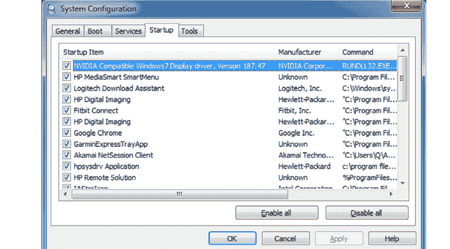

4. 取消其中一个项目上的勾选。任选一个你喜欢的，因为你实际上并不会应用这些更改。
5. 点击“常规”选项卡。注意“选择性启动”已被选中。当你勾选第 4 步中的复选框时，它就会被选中。注意“加载系统服务”仍被勾选，而“加载启动项”复选框为实蓝色，表示某些但并非所有启动项都已标记。
6. 点击“服务”选项卡，
7. 回到“常规”选项卡。注意“加载系统服务”复选框为实蓝色，表示某些但并非所有服务都已标记。
8. 点击“正常启动”单选按钮以清除你所做的更改。

## 基础计算机支持概念

9. 点击“工具”选项卡，如图 11.5 所示。注意 `Windows 7` 中可用的许多故障排除工具也可以从这个中心点访问，包括操作中心、`Windows` 故障排除和事件查看器。

## 图 11.5 MSCONFIG 工具选项卡


10. 点击关闭系统配置工具，不进行任何更改。

你可能想查看一下“启动”选项卡上的项目列表，看看启动时加载了哪些内容。可能会有你没有注意到的应用程序正在启动，而且，启动时加载的项目越多，你的操作系统的引导速度就越慢。某些项目是关键的，但如果它们不是，你可以通过禁用它们的自动启动来加速启动过程。

此工具不仅提供了访问启动选项的便捷途径，还链接到 `Windows` 中许多常用的故障排除工具。因此，你可能想在桌面上为它创建一个快捷方式。### 练习 11.4 将向你演示如何操作。

# 练习 11.4

## 为 MSCONFIG 创建桌面快捷方式

1. 右键点击桌面，选择“新建 > 快捷方式”。打开“创建快捷方式”对话框。
2. 在“输入对象的位置”中输入 `MSCONFIG`。点击“下一步”。

# 练习 11.4（续）

3. 在“为此快捷方式输入名称”文本框中输入“系统配置工具”，替换那里的默认名称。
4. 点击“完成”。桌面上会出现一个快捷方式。
5. 双击快捷方式以确认它打开了系统配置工具。然后关闭工具窗口。

## 使用恢复环境

`Windows XP` 自带了一个难以使用的命令行交互界面，称为“恢复控制台”，当 `Windows` 无法启动时，你可以用它来访问硬盘并运行一组有限的故障排除和恢复命令。在 `Windows Vista` 及更高版本中，恢复控制台已被“`Windows` 恢复环境 (`Windows RE`)”取代。

要访问 `RE`，请从 `Windows` 安装程序启动（你可能需要在 `BIOS` 设置中更改启动顺序，使其从 `DVD` 驱动器而不是硬盘启动）。如果你正在安装新版本的 `Windows`，就会运行 `Windows` 安装程序。在提示时，点击“修复计算机”选项。按照提示操作直到进入“系统恢复选项”，然后点击“修复”。按照“启动修复”提供的建议来恢复你的 `Windows` 安装。

## Mac 无法加载

`Mac` 的启动过程与 `PC` 相同的基本过程。如果发生磁盘错误（例如 `PC` 的 `BIOS` 可能显示的黑屏上的错误），你将看到一个闪烁的问号图标。闪烁的问号图标意味着启动过程找不到硬盘，或者在硬盘上找不到系统文件夹。硬盘可能已断开、驱动程序可能损坏，或者电缆可能松动；如果系统足够老且带有软驱驱动器，那么操作系统可能正尝试从该驱动器而不是硬盘启动。

在 `Mac` 上，硬盘必须有一个名为“`System`”的文件夹，其中包含附件、字体和系统工具等项目，以及 `System` 文件和 `Finder`。没有这些，你的计算机将无法启动。如果此文件夹丢失、损坏或不包含这些文件，就会出现问号图标。

`Mac` 上的任何其他问题都会导致一个带有斜线的红色圆圈，即禁止图标。（旧版本的 `Mac OS` 在这些情况下会使用“忧伤的 `Mac`”图标）。与此同时，你还会看到一个可以在网上查询的错误代码。尝试使用 `Google` 搜索或 `Apple` 支持网站。

## 操作系统错误消息

每个操作系统都有其在各种情况下显示的的特定错误消息。在大多数情况下，你可以在操作系统制造商的网站或第三方网站上查找这些错误消息，以确定它们的含义。

### 基础计算机支持概念 513

例如，要排排除 `Mac OS` 的问题，请参阅 `Apple` 支持知识库中的文章“隔离 `Mac OS X` 问题”：`https://support.apple.com/en-us/HT203161`

例如，`Photoshop`。`RAM` 和 `CPU` 也可能被出现故障的程序、病毒或其他恶意软件程序非法劫持。

当你首次启动操作系统（`OS`）时，应用程序相关的活动比通常需要更长时间，这是正常的，因为在操作系统界面变得可用后，它仍会在后台继续运行几分钟以完成加载。如果你尝试在启动电脑后立即启动多个应用程序，它们启动的速度可能不够快到让你无需等待。几分钟后，电脑应该就会恢复正常运行。

若要在 `Windows` 中检查内存和 `CPU` 使用情况，请使用任务管理器。右键点击任务栏，选择“启动任务管理器”。然后，在“进程”选项卡上，按“内存”列进行排序，寻找正在占用大量内存的进程。终止它以恢复对电脑的正常控制。你也可以查看“性能”选项卡以获取 `RAM` 和 `CPU` 使用率统计数据。

如果操作系统完全锁死（通常包括指针），最常见的原因是过热。如果 `CPU` 或主板上的其他组件过热，系统就会锁死。操作系统还可能因为过热以外的原因锁死，例如系统文件损坏（通过修复操作系统来解决该），但这种概率较低。通过停止运行运行不稳定的系统而非继续操作，主板保护了宝贵的 `CPU` 芯片，如果继续运行，它可能会损坏。显示器可能会变为空，可能会继续显示最后的信息，因此屏幕看起来像冻结了一样。

如果你的操作系统已锁死，且它没有自动关闭，请关闭电脑。打开机箱，让电脑静置 10 到 15 分钟直到所有部分冷却。然后，在机箱打开的情况下打开电脑，查看是否有任何风扇在旋转。问题可能只是风扇故障。电源内（或 `CPU` 附近）应该有一个风扇，以及其他通过机箱循环空气的风扇。如果没有风扇？再次启动电脑操作系统，让它静置。不要运行任何应用程序。如果它正常启动但在没有任何操作的情况下几分钟后锁死，那么绝对是过热了。

## 应用程序故障

应用程序比操作系统更容易引发问题，因为有许多不同的应用程序，由不同的制造商制造，并且都被预期能与其他、你的硬件以及不同版本的操作系统良好协作。

## 应用程序无法安装或运行

通常，当应用程序无法安装或运行时，是因为它在某种程度上与你的系统不兼容。可能是你的操作系统版本不受支持，或者应用程序不支持你安装的某个硬件（最可能是声音或显示适配器）。硬件可能不足（检查该（应用程序）的最低要求）或简单是不兼容。

检查应用程序的规格，确保你的系统在各个方面都符合最低要求。如果你的系统符合要求但应用程序仍然无法安装，请查看应用程序网站的“支持”部分。可能有一个可以下载的补丁来解决问题，或者可能有关于变通方案的建议。例如，在某些情况下，为你的显示适配器或声卡安装更新的驱动程序，可以让之前被拒绝的应用程序正常运行。

如果程序满足所有硬件要求但不符合操作系统要求，你可以尝试在兼容模式（`Windows`）下运行 `Setup` 程序。兼容模式会欺骗应用程序，让它认为你拥有与实际不同的操作系统版本，从而绕过软件中可能内置的任何版本要求。这并不总是有效，因为不同的应用程序以不同的方式实现版本要求，而其中某些与兼容模式为应用程序提供的特定版本细微部分无关。

安装应用程序时另一个可能的问题源有时是权限问题。例如，操作系统本身可能会阻止你安装应用程序。如果你以标准用户身份登录，可能需要注销然后以管理员身份登录。如果正在安装的应用程序需要访问 `Internet` 才能完成安装，你可能需要告诉你的防火墙允许通过。如果它启动正常但在对其进行任何操作的情况下几分钟后锁死，那么绝对是过热了。

## 应用程序失败

应用程序比操作系统更容易引发问题，因为有许多不同的应用程序，由不同的制造商制造，并且都被预期能与其他、你的硬件以及不同版本的操作系统良好协作。

## 设备故障

任何硬件组件都可能故障，你使用电脑的时间越长，越可能遇到至少一次硬件故障。通常，设备故障仅仅是因为你预期的功能没有实现。

# 硬件/驱动程序兼容性

驱动程序是一个文件（或一组文件），包含了操作系统（`OS`）与硬件设备通信所需的信息。你可以将驱动程序看作操作系统（使用一种语言）与硬件（使用完全不同的语言）之间的翻译器。

解释器的技巧水平在任何通信中都至关重要，而一个能够在操作系统和硬件之间准确翻译的驱动程序对于实现满意的硬件功能至关重要。因此，选择最佳可用驱动程序非常重要。如果安装了不合适的驱动程序（可能是不是为特定的操作系统或设备设计的，或者已损坏），驱动程序可能会表现异常或完全无法工作。

最佳驱动程序是：（1）适用于该设备的（最重要），（2）适用于操作系统的（中等重要），以及（3）是最新版本（最重要）。当你安装硬件设备时，你有多种驱动程序可选，挑战在于判断哪一个最合适。你的选择可能包括：

- 操作系统可能会自动为设备并安装驱动程序。
- 设备可能附带了包含适当驱动程序的安装 `CD` 或 `DVD`。
- 设备制造商的网站上可能提供比设备附带的更新的驱动程序。

如果设备从未工作过，从驱动程序入手是一个好的开始。如果它曾经工作但现在停止了，很可能是驱动程序问题，除非驱动程序被卸载了。

## 故障输入设备

输入设备（如键盘或鼠标）可能由于多种原因发生故障。例如，可能安装了错误的驱动程序，或者与你的操作系统不兼容。例如，鼠标和跟踪球是为 `Macintosh` 计算机设计的，如果你将其插入 `Windows PC`，它们将无法工作。在排除兼容性和驱动程序因素后，下一步检查设备本身。它有物理损坏吗？如果是光学鼠标，指示灯亮了吗？如果是键盘，按键都能正常按下吗？设备上洒了东西吗？它掉落或撞击过吗？如果设备本身没有物理问题，它可以工作，那么问题就在设备与连接它的电脑之间的关系。如果它另一台电脑上无法工作，那么设备可能有缺陷。

输入设备随时间推移逐渐停止工作，或以特定方式发生故障（例如某个按键无效或鼠标只能向一个方向移动），请尝试清洁设备。

## 网络连接故障排除

当用户无法登录本地网络或无法连接到互联网时，硬件往往是源首，但并非总是。以下是一些通用的故障排除提示：

1. 如果无法浏览网络资源：
   a. 确认电脑的网络适配器已安装并正常工作。在 `Windows` 中，查看设备管理器确保它存在且没有任何错误。
   b. 确认网络适配器与路由器、交换机或无线接入点之间建立了连接。如果是有线连接，追踪从电脑到路由器或交换机的路径。如果是无线，检查操作系统是否识别到无线连接。
   c. 确保你的网络协议已到位（`TCP/IP` 是常见的）。### 练习 11.6 显示了如何在 `Windows` 中使用 `TCP/IP` 排除互联网连接问题。
2. 如果在公司网络上登录一直被拒绝：
   a. 检查大写锁定是否开启，以及你是否准确输入了用户名和密码。
   b. 联系网络管理员，确保网络没有导致所有人（不仅仅是你）无法登录的问题。
   c. 联系网络管理员确保账户未被锁定（例如由于多次错误的登录尝试）。
3. 如果问题是缺少互联网连接：
   a. 你可能需要重置或为你的电缆调制器断电。
   b. 你的互联网服务提供商（`ISP`）可能暂时不可用。即使是最可靠的服务，有时也会短暂中断。在联系你的 `ISP` 之前等几个小时。
   c. 互联网本身可能正在经历延迟或中断。如果你可以访问某些但不是所有网站，或者可以收邮件但无法访问网页，或反之，可能就是这种情况。

```


# 练习 11.6

## 检查 TCP/IP 连接性

- 1. 在 Windows 中，打开命令行窗口。点击“开始”，输入 `cmd` 并按回车。你也可以在 Linux 或 Mac 系统上通过打开命令提示符来实现。
- 2. 在命令提示符中，输入 `ping 127.0.0.1` 并按回车，如图 11.7 所示。`127.0.0.1` 是环回地址，即发布命令的机器 IP 地址。如果你收到此命令的响应，说明你的网络适配器工作正常。这从故障排除过程中消除了电脑内部的所有问题。你也可以输入 `ping localhost` 来获得相同的结果。

## 练习 11.6（续）

### 图 11.7 这里的环回地址

在命令提示符中，输入 `ipconfig` 并按回车。系统中所有网络适配器的 IP 地址将会出现。其中某些可能显示为“已断开”（Disconnected），这意味着该适配器未被使用。（Mac 和 Linux 将使用 `ifconfig`）。找到你用于连接网络的适配器，并查看其 IPv4 地址。例如，在图 11.8 所示，它是 `192.168.1.1`。以 `192` 开头的 IP 地址在家庭网络中很常见。

### 图 11.8 `ipconfig` 输出

### 5. 对于该网络适配器，记下默认网关

它是连接到网络的出口地址。

### 6. Ping 默认网关以确保它是可用的

通过 `ping` 加上某个地址来检查它是否通畅。如果网关通畅，那么问题出在设备和连接它的电脑之间。

### 7. Ping 某个网站以查看是否有响应

如果在另一台电脑上不通，那么通常是设备问题。你可以使用 `traceroute` 命令查看数据经过的跳数。

## 练习 11.6（结果）

```
C:\Users>traceroute google.com

Tracing route to google.com [142.250.190.46] over a maximum of 30 hops each 30 seconds:

  1    192.168.1.1  1 ms  1 ms  1 ms

  2    10.0.0.1  10 ms 11 ms 10 ms

  3    172.217.1.1  12 ms 11 ms 12 ms

  4    142.250.190.46 13 ms 12 ms 12 ms

Trace complete.

C:\Users>
```


# 计算机备份

- 文件有多大？备份大量数据需要更多时间并占用磁盘空间。出于这个原因，你可能会对视频和音乐等大文件的备份频率低于其他文件的频率。
- 有哪些备份软件可用？许多不同的应用程序都可以进行本地和在线备份以及系统映像。某些软件比其他功能更多，价格也更高。
- 每次备份都应该重新复制所有文件，还是应该进行仅复制已更改文件的较小备份？

# 理解备份的重要性

计算机用户往往认为自己的数据是理所当然的，忘记了多年年来收集的大量且不可替代的文档、图像和音乐文件。硬盘故障或病毒可能会抹除多年存储的记忆，更说对企业具有重大价值的文件了。

有很多方法可以确保系统故障不会导致数据丢失。例如，你可以使用多磁盘 RAID 系统，通过镜像驱动器（RAID 1）或在多个驱动器上进行数据条带（RAID 5）来防止物理硬盘故障导致的数据丢失。然而，仅有 RAID 是不够的，因为多个硬盘的故障仍然会让你陷入困境。如果你使用 RAID，应该对你的数据进行备份。


# 数据的重要性

几年前当我做技术支持时，接到一个遇到硬盘问题的用户的电话。在经过快速的故障排除后，我确定他的硬盘已经故障并需要更换。在告诉他这个消息后，他问：“那我该如何获取我的数据呢？”我问他是否备份过数据，但他没有。

他是一个博士生的最后一年的学生，他的论文就存储在那块硬盘上。（重点：是。）他没有备份。当他疯狂地寻找找回数据的方法时，我能从他的声音中听出绝望和痛苦。他投入了多年心血的工作，而那些工作现在却消失了——就这么消失了。在当时，在截止日期前的几分钟，本没有任何问题。但在恢复时，每兆字节需要花费数百美元。

现在，接收损坏硬盘并尝试从中恢复数据的数据恢复公司不像以前那么贵了，但他们的服务并不便宜。一些最最便宜的在线服务花费 200-300 美元，而另一些则可能花费数千美元。备份你的数据，你就不必在事后感到心肉痛了。

# 第 11 章 • 计算机支持与备份

虽然本节的主题是“备份你的数据”，但根据情况，可能并不是必要的。如果硬盘上的内容并不重要，丢失它也没什么大不了，那么就不要麻烦去备份。对于公共工作站来说可能是这种情况。否则，这是大多数人忘记执行的关键步骤。

# 理解备份是如何运作的

备份程序通常通过查看一种称为“归档”（archive）的文件属性来工作。当文件被创建或修改时，归档位会被设置为 1，表示该文件在当前状态下尚未备份。当进行备份时，归档可能会被清除——即设回 0——表示该文件已备份。某些备份程序不会清除归档位。

有两种快速简单的方法可以查看文件的归档位是否设置。第一种是在 Windows 资源管理器中。导航到一个文件（例如 Word 文档），右键点击并选择“属性”。在“常规”选项卡的底部，你会看到一个“高级”按钮。点击“高级”按钮显示类似图 11.11 所示的窗口。

图11.11 高级文件属性

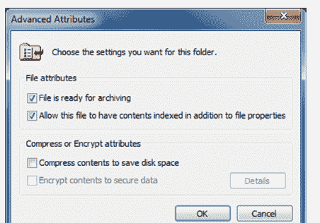

如果勾选了“文件已准备好归档”，则意味着归档位已设置。如果你取消勾选该框，归档位将被设回 0。

第二种方法是通过命令提示符。在目录下，输入 `attrib` 并按回车。你会看到目录列表。如果在文件名左侧看到字母 A，则意味着归档位已设置。`attrib` 命令可以清除归档位。

# 理解备份选项

执行备份时，你有几个决策：备份什么、存储在哪里以及多久执行一次。最常见的类型是全量备份、增量备份和差异备份。

全量备份（Full）：备份所有内容。执行时间最长，占用磁盘空间最多。
- 增量备份（Incremental）：仅备份自上次任何类型备份以来更改的文件。执行速度最快。
- 差异备份（Differential）：备份自上次全量备份以来所有更改的文件。它比全量备份快，但比增量备份慢。

你还需要考虑将备份存储在哪里。常见位置包括：

- 外部硬盘：易用但可能会丢失。
- 网络附属存储（NAS）：适用于网络上的多个用户。
- 云存储：方便且可以从随地访问，但需要连接连接。

制作。某人可能很容易随手带走一张包含你所有个人数据的 DVD。

网络备份解决方案对于公司网络非常有用。这些类型的备份通常由管理员配置，用户不需要进行任何操作。安全性也是集中化管理的。对于终端用户来说，你可能不知道数据是备份在服务器、NAS 设备还是其他地方，但只要在你需要时可以找回文件，这并不重要。对于许多公司来说，备份每个人的本地工作站太繁琐了，因此他们依靠个人对自己的系统进行备份。

互联网和基于云的备份在过去几年中变得非常流行。你支付一定量的存储空间费用，由你的云提供商负责备份和安全。在使用这些服务之前，请确保你了解他们执行备份的频率以及他们采取了哪些安全措施。

## 频率与调度

这是大多数用户、甚至是大多数公司未能良好管理的领域之一。同时，这也是最重要的领域之一。备份有几个关键用途：防止驱动器故障、防止意外删除、防止恶意删除或攻击，以及为重要文件创建存档供以后使用。当你对系统进行任何更改时（包括安装新软件），都应该在做出更改之前对重要文件进行备份。

自 Windows 2000 以来的所有 Windows 版本都允许你调度备份，这是一个并非所有 Windows 版本都具备的强大功能。

既然你已经知道可以通过调度备份来让生活更轻松，而且你也想进行备份（因为这是正确的事），那么问题变成了：你需要多长时间备份一次文件？

答案取决于电脑的用途以及你在电脑上做什么。你的数据变化频率有多高？每天？每周还是每月？你的文件有多重要？你能够承受丢失它们的代价吗？替换丢失的文件将花费多少时间或金钱？它们可以替换吗？根据一般原则，数据越重要、变化越频繁，你就越需要频繁备份。如果你不在乎丢失数据，那么就不需要备份——但我们大多数人会在乎丢失自己的东西。练习 11.7 介绍了如何在 Windows 7 中设置备份，包括调度设置。

## 练习 11.7

### 在 Windows 7 中设置备份

- 1. 打开“Windows 备份”。在控制面板中，它被称为“备份和恢复”，位于“系统和安全”部分。图 11.13 显示了“备份和恢复”的外。

## 图 11.13 Windows 备份

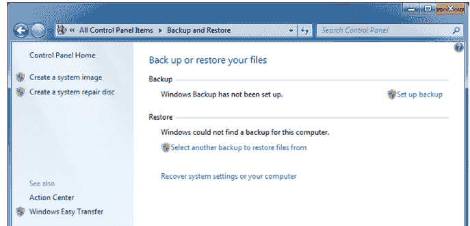

注意图 11.13，“创建系统映像”的选项位于左侧。

- 2. 点击“设置备份”。Windows 将要求你选择保存备份的位置，如图 11.14 所示。

## 图 11.14 选择备份位置

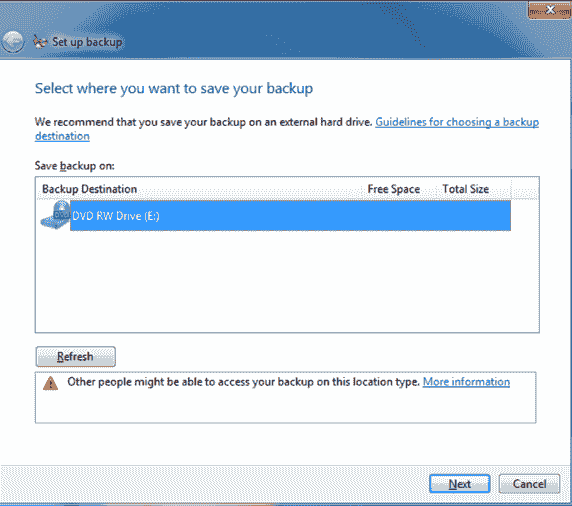

- 3. 选择目标位置并点击“下一步”。
- 4. 选择“让我选择”（屏幕如图 11.12 所示）并点击“下一步”。
- 5. 勾选你想备份的文件类型复选框，如图 11.15 所示。“数据文件”部分允许你选择较广泛的备份区域，例如你的文档、音乐、图片和视频库。“其他位置”包含联系人、桌面和收藏夹等项目。如果你想备份更细粒度的文件夹，可以在“计算机”部分进行。点击“下一步”。

## 图 11.15 检查备份设置


- 6. 检查你的备份设置并确保它们正确。此屏幕还显示了备份计划。点击“更改计划”。
- 7. 图 11.16 显示了调度备份的选项。根据需要进行配置并点击“确定”。

## 图 11.16 备份调度选项


需要记住的一点是，为了让备份按计划正常运行，在计划备份执行期间电脑需要处于开启状态。

- 8. 点击“保存设置并运行备份”来创建备份。

不同的备份程序步骤略有不同，但总体过程相同：选择你想备份的内容，决定备份到哪里，并设置计划。备份程序还将包含从备份中恢复文件夹和文件的选项。

## 验证与测试备份

创建备份应该带给你安全感。现在，如果你的系统发生了什么故障，至少你的……

# 第 11 章实验

第 11 章涵盖了故障排除概念和计算机备份。编写一个关于故障排除的实验是具有挑战性的——仅仅为了修复而故意弄坏你的电脑（或朋友的电脑）是有风险的。相反，本实验将侧重于建立并实施一个良好的备份计划。

第 11 步：确定你的备份计划范围。你只备份一台电脑吗？你有一小组电脑需要备份吗？答案将决定后续步骤的许多答案。

第 2 步：理解数据重要性。有人会在意数据丢失吗？或者从光谱的另一端来看，如果你丢失了数据，企业会失败或你的生活会被毁？

第 3 步：了解有多少数据需要备份以及文件更改的频率。也许你需要备份的系统或系统中有几个 TB 的数据，但只有几百兆的数据经常变化。或者，如果是你的本地电脑，你只关心的只有几兆的数据。

第 4 步：你想将备份文件存储在哪里？通常，你的选择有本地介质（如外部硬盘或光盘）、网络服务器或云端。答案可能取决于数据有多重要、更改频率如何以及数据量大小。

第 5 步：决定备份软件。如果是你的电脑，可能操作系统自带的备份程序是免费的。或者你可以购买一个外部硬盘备份系统并使用其软件。对于较大的任务，需要第三方备份解决方案，或者你可能会找到一个可行的云解决方案。

第 6 步：配置并运行备份。这足够简单，对吧？根据你在第 5 步中选择的方案运行备份。还要注意，如果备份难以配置或运行，你可能需要重新评估你对备份软件的选择。

第 7 步：测试并验证备份。不要忘记这一步！从备份中恢复一些文件以确保其正常工作。

第 8 步：安排周期性备份。频率取决于数据。如果数据是关键的且每天都会变化，那么就需要每天备份。每周一次就足够，或者对于不那么关键的数据，每月一次即可。

第 9 步：记录备份过程和时间表。如果你只是备份自己的电脑，这一步可能不需要。但是，如果涉及多个系统和多个人，文档记录是至关重要的。写下软件、设置和整体计划，以便其他人知道发生了什么以及何时发生。如果涉及其他管理员，你还需要共享关键安全信息（如备份密码），以便他们根据需要执行备份和恢复任务。

## 复习题

- 1. 在排除计算机故障时，以下哪些是你可以采取以识别问题的步骤？（选择两项。）
  - A. 使用互联网等外部资源。
  - B. 与终端用户交流。
  - C. 隔离问题。
  - D. 归咎于人为错误。

# 第 12 章

# 环境与安全概念

本章涵盖了以下 CompTIA 基础版考试目标：

5.5 描述各种环境和安全概念的重要性及其影响
- 正确的处置方法
- RoHS
- CRT 显示器
- 扫描仪
- 电池
- 墨水/碳粉
- 硬盘
- 电源
- 节能设备
- 电源配置文件
- 选项
- 睡眠/休眠
- UPS、浪涌保护器与电源板
- 电源限制
- 国际电源差异
- 设备放置
- 空气流
- 湿度
- 温度
- 尘埃积聚
- EMI（电磁干扰）


- 静电释放概念
- 人机工程学概念
  - 键盘和鼠标的正确放置
  - 坐姿
  - 显示器高度的放置
  - 遵循制造商的安全指南

环境和安全乍一看似乎是关于 IT 基础书籍中奇怪的话题。我们在这里讨论的是电脑，对吧？事实上，计算机对环境可能产生巨大影响——许多组件包含对环境不友好或有毒的。目标是尽量减少计算机对周围环境造成的负面影响。

安全也是一个有效的问题，与计算机工作的危险程度就像消防员或厨师（火焰和刀子，能出什么错？）或其他职业一样，但仍有一些需要注意的地方。在使用电脑工作时，不良的姿势可能会连续小时影响你的个人安全和健康。计算机使用电力，如果你不小心，可能会受伤甚至死亡（只要延长设备使用寿命，死亡的概率非常小）。将笔记本电脑浸入水中等行为会导致更多的硬件购买。

所以，尽管当你想到电脑时，环境和安全不太是你脑海中首位的两个话题，但它们是需要注意的重要因素。本章将教你与安全相关的概念——包括你个人和你的硬件的安全——以及如何正确处置物品以防损坏环境。

## 与计算机的交互交互

与计算机工作并不像许多其他工作那样不安全，但仍有使用计算机伤害自己或他人的方法。你可以做的最重要的事情之一就是始终遵循制造商的安全指南。这对于所有计算机组件都是如此，尤其是在处理具有潜在危险的材料（如 CRT 显示器、电池和碳粉盒）时尤为如此。某些安全指南相对简单且符合常识，而另一些则至关重要，可以防止严重伤害或死亡。

在接下来的章节中，我将分享与计算机安全交互相关的概念。我将从讨论人机工程学开始，这涉及到你个人的安全和健康。接下来，我将讨论电源和——如你所知，如果你不小心，电力会致命！之后，我将涵盖计算机及组件的安全，例如如何正确清洁它们以及它们应该放在何处以获得最佳状态。最后，我将讨论环境安全以及如何正确处置旧电脑设备。

## 使用正确的人机工程学

人机工程学是研究人类在工作环境中的效率。许多人在使用电脑时姿势或打字姿势不好，这会导致头痛、颈部问题、背部问题、肩部和手臂肌肉关节劳损，以及重复性应力损伤（如腕隧道综合征）。

如果你在办公室工作，看看你的同事。谁的坐姿和设备放置是正确的，就像如图 12.1 所示？

### 图 12.1 正确的人机工程学姿势

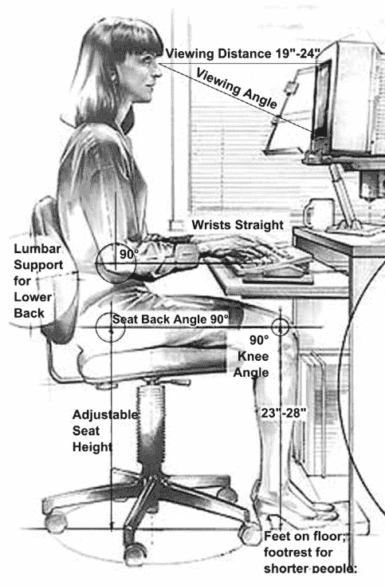

## 与计算机的交互交互

可能不多。有些人不知道正确的力学，另一些可能养成了坏习惯。无论哪种情况，这些人由于没有遵守原则正在损害身体。以下是需要遵循的指南：

直坐，双脚平放在地板上。这听起来可能像你小时候老师告诉过你的话，但这是一个很好的建议。你的上半身应与大腿保持 90 到 120 度的角，大腿应与地面平行。或者，你的髋部应略高于膝盖。你应该有足够的腰部（腰椎）空间。尝试均匀地分配椅子上的压力，确保膝盖后部不要接触椅子。调整座椅，使其足够低，让你的双脚平放在地板上或脚踏板上。

保持肘部放松并呈 90 度角。键盘和鼠标的放置方式应使手腕弯曲最小化，且肘部呈 90 度角。有些人发现使用人机工程学键盘和鼠标（见下文覆盖）更容易。键盘和鼠标应该直接位于你和显示器之间，或略低于肘部高度。显示器应处于眼睛平齐的高度。键盘和鼠标应该直接位于你和显示器之间，或略低于肘部高度。

### 练习 12.1 评估人机工程学

- 直坐，双脚平放在地板上。这听起来可能像你小时候老师告诉过你的话，但这是一个很好的建议。你的上半身应与大腿保持 90 到 120 度的角，大腿应与地面平行。或者，你的髋部应略高于膝盖。你应该有足够的腰部（腰椎）空间。尝试均匀地分配椅子上的压力，确保膝盖后部不要接触椅子。调整座椅，使其足够低，让你的双脚平放在地板上或脚踏板上。
- 保持肘部放松并呈 90 度角。键盘和鼠标的放置方式应使手腕弯曲最小化，且肘部呈 90 度角。有些人发现使用人机工程学键盘和鼠标（见下文覆盖）更容易。键盘和鼠标应该直接位于你和显示器之间，或略低于肘部高度。显示器应处于眼睛平齐的高度。键盘和鼠标应该直接位于你和显示器之间，或略低于肘部高度。
- 显示器应处于眼睛平齐的高度。键盘和鼠标应该直接位于你和显示器之间，或略低于肘部高度。

### 练习 12.1 评估人机工程学（续）

- 显示器应处于眼睛平齐的高度。键盘和鼠标应该直接位于你和显示器之间，或略低于肘部高度。

## 与计算机的安全交互

大多数计算机电源在背面有一个开关，就像你在图 12.2 那张布满灰尘的图片看到的那样。（提醒：清理你电源风扇上的灰尘！）这个开关是红色的，可能很难看清，但右侧写着 115。选项有 110 和 220、115 和 230，或者 120 和 240。如果你在美国并将开关设置为 220–240 范围，电源电源预期的电压将高于它实际接收到的电压，它可能无法启动。如果你在一个电压较高的国家，并选择了 110–120 的设置，电源将导致过载。你肯定会烧毁组件，电源还可能发生火灾。

图 12.2 电源电压开关


如果一台电脑最近刚搬到海外，在尝试开机之前，请务必检查电源开关！如果你在美国或其他使用 110–120 电压的国家，如果电脑无法启动，请检查开关。

## 维护电源

大多数人意识到，当计算机插在墙上插座时，功率过大（电压浪涌）是一件坏事，因为它可以烧毁电子元件。功率不足（例如发生停电时）也会对电路造成破坏性影响。

停电通常很容易检测。没有完全断电的电压下降称为“褐电（电压跌落）”，对电子元件的伤害很大，但往往会被忽视。

*插线板*有各种形状和大小，方便将多个设备插入一个墙上插座。这解决了由于计算机、显示器、打印机、扬声器或其他外围设备需要电源插座，但墙上插座上只有两个插座口的问题。大多数插线板甚至有一个开启/关闭开关，你可以同时打开或关闭所有设备。图 12.3 显示了一个简单的英式插线板。它每个单独插座都配有开关，还有一个电源指示灯。

## **图 12.3** 插线板

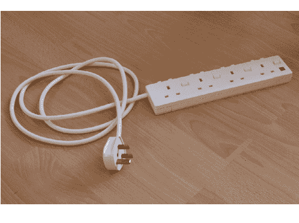

但不要认为插线板可以保护你免受电压浪涌的伤害。插线板只不过是高级版的延长线。如果其中一个设备之一通过了强力浪涌，插线板和插在上面的所有设备都可能被烧毁。有些人喜欢把插线板称为“浪涌保护器”或“浪涌抑制器”，但插线板在保护或抑制方面起不起任何作用。

试图阻挡电压浪涌的设备被称为浪涌保护器。它们通常看起来像插线板，因此很容易被混淆，但保护器更贵，通常从 25 美元起步。它们内部有一个保险丝，设计用于在接收到过大电流时熔断，而不将电流传输到插入的设备上。浪涌保护器还可能带有 RJ-11（电话）、RJ-45（以太网）和 BNC（同轴电缆）连接器的接口。图 12.4 显示了一个浪涌保护器。

## 图 12.4 浪涌保护器

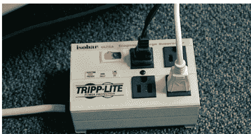

*SURGE SUPPRESSOR BY ENCRYPTEDRUL - OWN WORK, LICENSED CC BY-SA 3.0 VIA WIKIMEDIA COMMONS - HTTP://COMMONS.WIKEDIA.ORG/WIKI/FILE:SURGE_SUPPRESSOR.JPG/MEDIA:SURGE_SUPPRESSOR.JPG*

用于电源保护的最佳设备是不间断电源（UPS）。这些设备可以像砖块一样小（如图 12.5 所示），也可以像整个服务器机架一样大。有些只有几个指示灯，另一些带有显示状态和菜单的 LCD 屏幕，并配有自己的管理软件。UPS 的背面会有几个电源插座。它可能会对插座进行划分，其中一些几个仅提供浪涌保护，而另一些既提供浪涌保护又提供备份电源，如图 12.6 所示。

## 图 12.5 不间断电源

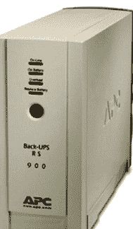

## 图 12.6 不间断电源的背面


UPS 由一个或多个电池和保险丝组成。与浪涌保护器类似，UPS 设计用于保护插入它的所有设备免受电压浪涌的影响。UPS 还设计用于防止电压浪涌甚至停电。能量存储在电池中，如果断电，电池可以为计算机提供一段时间电源，以便管理员安全地关机。许多 UPS 和系统还协同工作，自动（且安全地）关闭切换到 UPS 电源的系统。这些类型的设备对于鲍伯叔家里的机器来说可能有些过头了，但在服务器房中是至关重要的。

应该定期检查 UPS 以确保其电池运行正常。大多数 UPS 都有一个测试按钮，可以模拟停电。你会发现电池会随时间老化，每隔几年更换一次 UPS 电池以保持可靠性。


插线板、浪涌保护器和 UPS 对能够处理的设备数量都有限制。必须严格遵守这些限制。如果过载，插线板和其他设备可能会导致短路。

## 静电放电

ESD 是损坏计算机部件最常见的罪祸首，尽管很多人从未听过它。ESD 实际上是静电，那种可以……

如果你从未打开计算机机箱，通过 ESD 损坏它的风险很低。如果你由于某些原因需要在计算机内部操作，例如安装电路板或更多内存，是一些建议：

- 注意你在计算机内部工作时穿的衣服。合成材料产生的 ESD 比棉和羊毛等天然纤维得多，请穿天然织物。避免赤光脚工作。
- 保持工作区域的湿度也有帮助。操作计算机的理想湿度为 40% 到 80%，最好是 50%。
- 工作表面也会产生影响。尽量不要在有地毯的区域；优选瓷砖或亚油地板。地毯（尤其是尼龙地毯）产生 ESD 的方式与尼龙衣服相同。
- 将个人和设备接地可以消除 ESD 风险，因为任何积累的静电都可以释放。为了让自己接地，请像图中所示佩戴防静电手带（图 12.7）。手带的一端是带有二极管的魔术贴，接触皮肤。另一端是一个鳄鱼夹，你可以将其连接到电源插座的接地孔（圆形的第三个孔）或其他接地源。如果没有接地源，将夹子连接到计算机的金属框架上。为了最大限度防止 ESD，每当你在打开盖的情况下操作计算机时（特别是处理电路板时），请佩戴防静电手带。

图 12.7 防静电手带

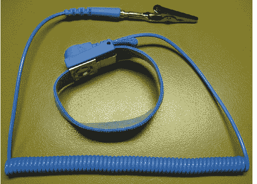

“ANTISTATIC WRIST STRAP” BY KMS - OWN WORK. LICENSED UNDER CC BY 3.0 VIA WIKIMEDIA COMMONS - HTTP://COMMONS.WIKEDIA.ORG/WIKI/FILE:ANTISTATIC_WRIST_STRAP.JPG#MEDIA/FILE:....

## 与计算机的安全交互

另一种减少静电放电（ESD）风险的方法是像你平时那样经常触摸 PC 的金属机架或电源。这样做并不会让你接地，但它会平衡你与 PC 之间的电荷，使得你与所触组件之间没有电位差。每隔几分钟这样做一次，以防止静电堆积。也可以防静电垫，它们放置在工作面上，对于你正在处理的部件，起到与手腕带设备相同的作用；防静电垫有一根线，连接到插座的接地脚上。

每次运输组件时，请使用防静电袋。这些袋通常是粉色或灰色的，有一层涂层可以收集袋外的静电荷，使其静电远离袋内。昂贵的电路板在不使用时应始终储存在防静电袋中。电脑商店会提供额外的袋子，但大多数人是通过购买和安装新硬件来积累这些袋子的。

最后，你可以购买静电喷雾来减少环境中的静电量。这通常是装在泵瓶里的无色无味液体，你可以将其喷在地毯和衣服上。

## 现实场景
### Downy 解决方案

| 在我以前工作的一间办公室里，我们有严重的静电问题，特别是在冬天。似乎无论我们如何努力，都会不可避免地烧毁内存或其他组件。有时我们甚至能看到自己和电脑组件之间产生微小的蓝色闪电。这让我们的手指有点刺痛，但对我们预算的伤害最大。大多数时候我们察觉不到任何异常，但电脑开始出现内存问题，我们不得不更换部件。 | 一位新技人员向我们介绍了 Downy 解决方案。我们拿了一个喷雾瓶，混合了等量的 Downy 织物柔顺剂和水。然后我们喷洒了地板、椅子和工作桌。不仅房间闻起来很清新，我们的静电问题也消失了。 | 如果你在高静电环境中（通常是低湿度环境）工作，这是一个廉价的解决方案，可以让你免于烧毁硬件。不要浸泡物品，而是每隔一两个月喷一次这种溶液，此后静电问题就不那么需要担心了。 |

关于静电话题的另一面不是关于你如何伤害电脑组件，而是关于它们如何伤害你。在大多数情况下，在机箱内部操作是非常安全的。你必须小心锐边缘，但只要在操作时电脑处于关闭状态，你通常就是安全的。不过有两个值得注意的例外——电源内部和 CRT 显示器内部。

CRT 显示器和电源包含电容器，电容器可以储存电。即使拔掉电源，它们也可以储存电多年。触摸一个充满电的电容器可能会导致它以极高的电荷通过你释放能量，这可能是致命的。电容器需要由由经过培训的专业人员使用高压探针进行放电。这个故事的道理是，永远不要打开 CRT 显示器的背壳或电源周围的外壳。

## 第 12 章环境与安全概念

## 节能个人计算

节约能源不仅环保，也对你的钱包有好处。计算机操作系统可以通过关闭未活动使用的设备，或在空闲期间暂停系统或显示器来节省能量。此外，某些硬件设备的设计功耗更低，这是一件好事。在接下来的章节中，你将学习如何在对生产力影响尽可能小的情况下，减少计算机使用的电力。

## 电源管理计划

大多数系统内置了电源管理功能，允许你在指定一段时间空闲后关闭电脑或将其置于低功率模式以节省能量。操作系统通常控制电源管理，但某些系统也通过 BIOS 设置提供电源管理功能。

## 低功率模式

不同的操作系统对各种模式有不同的名称，但这里是基本模式。你可以设置操作系统在指定一段时间空闲后自动将 PC 放入以下模式之一：

- **睡眠/待机（Sleep/Standby）**：PC 的所有组件都关闭电源，使计算机仅使用保持 RAM 内容活跃所需的微量电力。当恢复时，所有设备都将开启。由于 RAM 内容仍然保留，因此从这种模式唤醒几乎是瞬间的。在 Windows 和 Mac OS 中，这被称为 Sleep；在 Linux 中它被称为 Suspend RAM。
- **休眠（Hibernate）**：RAM 内容被复制到硬盘上的一个特殊区域，然后系统完全关闭电源，包括 RAM。当恢复时，之前的 RAM 内容会被复制回 RAM，所有设备将再次开启。从这种模式唤醒需要更长的时间（长达 1 分钟），但比电脑在关机后完全启动所需的时间要短。在 Windows 中，此功能被称为 Hibernate 或混合睡眠（Hybrid Sleep）。在 Linux 上，它被称为 Suspend to Disk。在 Mac 上，Safe Sleep 模式在睡眠之前将 RAM 内容复制到硬盘，这样即使电池耗尽且电脑失去 RAM 电，休眠也会生效。

此外，某些操作系统允许你指定一段空闲时间，之后显示器会变暗或完全关闭，硬盘停止旋转盘片（如果是机械硬盘而非固态硬盘）。练习 12.2 将让你练习如何让电脑进入睡眠。

## 练习 12.2

### 让电脑进入睡眠

- 1. 在 Windows 7 中，点击“开始”菜单和“关机”命令旁边的右三角形箭头。打开一个菜单。
- 2. 选择“睡眠”。你的电脑进入睡眠状态。
- 3. 按任意键。某些电脑可能配置为按键唤醒。如果你的电脑没有唤醒，请按电源键。
- 4. 点击“开始”，点击“关机”，并选择“休眠”（在笔记本电脑上可能没有此选项）。等待电脑进入休眠模式。
- 5. 按电源键从休眠中唤醒电脑。

## 选择电源管理设置

某些公司有节能政策，规定员工在工作结束必须将电脑置于低功率模式或完全关闭。如果你的公司没有官方政策，你可能想自己制定一个。

你可以通过设置电源计划在操作系统中实现。电源计划告诉电脑在指定一段时间空闲后关闭。如果是笔记本电脑，你可以为电池供电和接通电源的情况选择不同的设置。Windows、Mac OS 和 Linux 都有类似的电源管理功能。

在 Windows 中，你可以选择一个标准电源计划，其中包含显示器、硬盘以及进入睡眠的时间设置。选择计划后，你可以以多种方式对其进行自定义，正如你在练习 12.3 中看到的。

Mac OS 有一个额外的电源管理功能：它允许你设置电脑在特定时间启动和关闭（见图 12.8）。在“系统偏好设置”中，点击“节能”图标（它像一个灯泡）。然后在“节能”屏幕上，点击“计划”按钮。

### 图 12.8 配置 Mac 在特定时间启动或关闭
![img/34c3ba37f6e479c6b1468454e5a51d8_592_2.png]

## 练习 12.3

### 在 Windows 7 中自定义电源方案

1. 在 Windows 7 中，打开控制面板中的“电源选项”应用程序。（如果你是按类别查看，它位于“硬件和声音”下）。它看起来像图 12.9。

### 图 12.9 Windows 中的电源选项
![img/34c3ba37f6e479c6b1468454e5a51d8_592_3.png]

# 与计算机的安全交互 555

+ 2. 如果尚未选择，请选择“平衡”电源计划。
3. 点击“平衡”计划对应的“更改计划设置”链接。会出现其他选项。如果你使用的是笔记本电脑，将会有“使用电池”和“接通电源”的独立选项。否则，每行将只有一个选项。
4. 打开“关闭显示器”下拉列表（对于接通电源，如果有选项），并选择 20 分钟。
5. 点击“更改高级电源设置”。打开电源选项对话框。
6. 点击“硬盘”旁边的加号，打开该类别。
7. 在“硬盘”下，展开其类别后，点击“在此硬盘”旁边的加号。
8. 将“接通电源”旁的值更改为 30 分钟。（如果你使用的是台式电脑，则没有“使用电池”和“接通电源”的独立行。）
9. 点击“电源按钮”旁边的加号以展开该类别。
10. 点击“电源按钮操作”旁边的加号以展开该类别。
11. 将“使用电池”和“接通电源”的值设置为“睡眠”（如果你使用的是台式电脑，则只有一个设置）。*
12. 点击“确定”。
13. 点击“保存更改”。
14. 如果你想将电源设置恢复为默认，再次点击“平衡”选项，并点击“更改计划设置”。
15. 点击“还原此计划的默认设置”。
16. 点击“是”进行确认。
17. 关闭控制面板。

# 节能设备

除了操作系统的节电设置外，某些硬件设备也有自己的电源设置。例如，笔记本电脑消耗的电量比台式电脑少，尽可能用笔记本电脑取代台式电脑可以节省大量的能量。接下来的章节涵盖了你可以节省的其他一些组件。

# 显示器与节能

计算机显示器（无论是内置在笔记本电脑中，还是连接到台式电脑的独立显示器）都是平均系统中所有组件中耗电最大的。CRT 显示器消耗的电量比 LCD 多，因此，节能的方法之一是尽可能将许多电脑切换到 LCD 显示。

另一种节能的方法是增加显示器的亮度。特别是在 LCD 上，这样做可以产生巨大影响；显示越亮，产生的光就越多，光越多意味着耗电越多。

# 556 第 12 章 ■ 环境与安全概念

你可以通过多种方式更改屏幕亮度。一种是通过操作系统的电源计划。这是通过控制面板中的“电源选项”应用程序配置的。你可以手动调整显示器的亮度。在独立显示器上，通常有按钮可以打开屏幕菜单，你可以在其中控制亮度以及其他许多因素。在笔记本显示上，通常有一个与 Fn 键或多个键盘键相关的亮度控制。按住 Fn 键并按下与“增加亮度”或“降低亮度”相关的键。

# 硬盘与节能

某些硬盘比其他硬盘更节能。例如，固态硬盘由于没有机械部件，其电量需求较低。除非进行读写操作，否则它们不消耗电量。在机械硬盘中，转速较低的硬盘比高性能的硬盘耗电少，尽管硬盘的年龄也是一个因素；较新的硬盘使用了更高效的技术。

# 能源之星（ENERGY STAR）

源自美国的能源级系统获得国际认可；许多其他国家将该标准作为其减电政策的一部分。当你在 PC 组件上看到能源标志时（如图 12.10 所示），你可以假设该设备符合某些节能标准。例如，能源之星笔记本在盖关闭时会进入待机（低功耗）模式。能源之星还适用于主板、电源供应器和 BIOS，它们能够管理功耗。

# 图 12.10 能源之星标志


图片来源：WWW.ENERGYSTAR.GOV

# 与计算机的安全交互 557

## 现实场景

# 笔记本节能

在笔记本电脑上，没有什么能像电池没电那样摧毁工作进度。对于经常旅行没有电源插座的人来说，电池耗尽是一个巨大的风险。一种方法是携带一个或多个备用电池。笔记本电池可以在多种供应商处购买，通常针对特定型号或窄范围。（有些笔记本电脑，大多数 Mac 不使用可更换电池，因此如果故障你必须更换笔记本。）

另一个选项是调整笔记本电脑的电源设置以延长电池寿命。Windows 的控制面板中有“电源选项”组可以让你进行一些调整。在 Mac 上，这些设置位于“系统偏好设置”中的节能面板。你可以通过使用以下提示进一步延长寿命：

- 除非正在使用无线网络适配器，否则将其关闭。
- 将显示器调低。
- 不使用电脑时，将计算机设置为睡眠模式。
- 在一段时间空闲时间后将屏幕保护程序设置为空屏。
- 静音。
- 尽量减少从笔记本取电的外部设备，例如外部键盘和指针设备。
- 移除任何未使用的 ExpressCard或其他卡。

# 良好的设备维护与放置

预防性维护是计算机使用的重要部分。这包括备份文件、防止电压波动和静电损坏以及清洁计算机。定期清洁计算机并将设备放置在良好的环境中将延长组件的寿命。这有助于你的预算，也有助于环境。

# 清洁计算机

# 第 12 章 ■ 环境与安全概念

定期清洁的计算机不仅用起来更舒服，寿命也长。脏垢、碎片堆积和其他会导致组件运行温度更高，缩短它们的寿命。在接下来的章节中，你将学习一些用于清洁计算机内外的产品。你还将学习如何在不损坏的情况下清洁各个区域。

# 清洁用品

清洁 PC 不需要昂贵的清洁用品，但也不应该随手使用使用的任何产品。以下是需要准备的基本用品列表：

- 一种用于塑料的喷雾清洁剂，最好是为计算机设计的。为计算机设计的通常具有普通清洁剂缺乏的奇特性。
- 一种显示器清洁剂（喷雾或湿巾），专为显示器或其他电子屏幕（如电视）设计。不要使用含有氨的玻璃清洁产品，因为氨会破坏抗眩光层。
- 一罐压缩空气，用于吹除设备灰。
- 棉签。
- 变性异醇（不是医用酒精，因为它含水量过多）。
- 一种用于工作区域的消毒喷雾。
- （可选）专为电子设计的手持吸尘器。（不要使用普通吸尘器，因为过滤器不够精细，而且普通吸尘器会产生可能损坏设备的静电。）

# 清洁显示器

清洁显示器前务必始终关闭。如果有任何液体进入内部，显示器干燥时就不会损坏电路。屏幕黑暗时更容易看到屏幕上的污垢和斑点。

首先，用喷雾清洁剂清洁外壳。将清洁剂喷在布上，以避免喷进通风孔内。

接下来，使用专为显示器设计的清洁剂清洁玻璃。这可以是喷雾或湿巾的形式。不要在显示器上使用普通的清洁产品，因为它们会留下痕迹，有时会损坏抗眩光层。不要使用普通的玻璃清洁剂，因为它含有氨，也会损坏表面。喷洒屏幕后要擦干，因为液体可能会滴到下边框下方。

# 清洁外部表面

与显示器一样，用计算机清洁喷雾产品清洁 PC、打印机、扫描仪和类似设备的外壳。温和的通用喷雾清洁剂也有效。你也可以用温水和湿布（不要拧湿）仅清洁外部表面——不要清洁任何内部区域，或带有有通向内部的通风孔或裂缝的设备。

## 清洁键盘

由于键盘处于活动的最前沿，它很容易变得非常脏。虽然技术人员可能会提醒用户保持计算区域整洁，但大多数时候人们会忽视这一点。他们可能会在未洗手的情况下打字，或者在工作时吃东西、饮料或与宠物玩耍。所有这些活动都会在键盘上留下污垢、油渍和残留物。

清洁键盘时，首先关闭电脑。键盘不需要从电脑上拔下。然后，将键盘倒过来，抖动或拍打它（这被称为“拍键盘”）以去除任何松散的碎屑。或者，将键盘悬放在垃圾桶上方，用压缩空气喷射键盘。掉出来的东西以及数量——往往令人大惊讶！

使用喷有清洁溶液的湿布擦拭所有可见表面。对于电脑缝隙，或含有清洁剂的马桶，可以使用棉签或折叠的纸巾擦拭。不建议拆卸按键，因为它们可能很难重新装回去。如果你有条件，专为电子设备设计的小型手持吸尘器对于吸出键下方的污垢非常有帮助。

如果液体洒在键盘上，请将键盘倒过来并从电脑上拔掉（如果可能），或者关闭电脑。将键盘倒置释放尽可能多的液体，并干燥至少 48 小时。如果液体是水，键盘干燥后可能没问题；只需尽可能清洁外部即可。如果液体含有糖，键盘可能永远无法完全干净。有些人成功地在洗碗机中清洁了粘性键盘（独立键盘，不是笔记本电脑上的）。如果想尝试这样做（对于一个注定进垃圾桶的键盘来说，尝试也没有损失），将键盘放在上层架上，在不使用烘干功能的情况下清洗，并使用极少或不使用清洁剂，清洗后取出，冲洗，并放在沥水架上晾干几天。

## 清洁鼠标

鼠标因为经常被手接触而变得非常脏。此外，旧的机械鼠标底部有一个滚球，它会在桌面上滚动，收集灰尘和线絮，并将它们带到鼠标内部。结果，机械鼠标上的滚轮和传感器会很快结满污垢，导致鼠标故障。光学鼠标在内部污垢方面的问题较少，但灰尘和头发仍可能在光线照射开口处聚集。

当鼠标变脏时，屏幕上的指针可能会跳动或卡顿，或者向一个方向移动鼠标可能完全没有反应。鼠标滚动起来可能会变得更加困难。

清洁鼠标时，先用温和的肥皂水或为电脑设计的清洁产品擦拭外部。将鼠标翻过来。如果是光学鼠标，如果内部有任何碎屑，使用浸有异丙醇的棉签清洁光线照射的区域。（酒精干得很快快）

## 第 12 章 ■ 环境与安全概念

如果是机械鼠标，旋转固定滚球的塑料板。再次翻转鼠标，滚球和板应该掉到你手中。用棉签上蘸有酒精清洁内部腔。用温和的肥皂水清洁球本身，并彻底干燥。（不要在橡胶球上使用酒精，因为会使橡胶变干并变脆。）

## 清洁电脑内部

台式电脑应定期清洁——至少每年一次。它的冷却和通风风扇吸入大量空气，随着时间的推移，污染物会积聚。即使是电路板上的一薄层灰尘也会让其运行过热，缩短其寿命，而且灰尘和头发会阻碍空气通过机箱自由流动。

拆下机箱盖板（遵循随附的在线说明）。台式电脑内部可能有大团的灰尘和污垢；用手将它们取出并扔掉。检查主板和扩展板是否有灰尘堆，并用压缩空气吹扫。如果电脑很久没有清洁了，你可能想把它带到室外或开放区域，这样就不会把灰尘弄到别人的工作区域。主板不需要擦得亮闪闪；只需去除主要的碎屑大团即可。如果有，专为电子设备设计的手持吸尘器会很方便。


> 在用压缩空气吹灰尘时，请屏住呼吸，否则你会因为飞扬的灰尘而咳嗽。如果天气允许，在室外进行是最好的。记住，这会产生一股冷风，所以不要把气风吹在自己或别人身上。有些技术人员在排除故障时，会利用这种副作用作为冷却电路板上过热芯片的工具。

清洁任何涉及电路板或芯片的物体时要远离液体，尤其是水，因为当电脑上电时如果电路板未完全干燥，会有短路危险。如果绝对需要水分，请使用棉签蘸酒精。

旧电路的边缘金属引脚（接触点）会积聚灰尘；你可以用铅橡擦或酒精蘸棉签去除这些沉积物。避免触摸电路板上的任何电路、芯片或晶体管；很容易损坏它们。仅通过边缘处理电路板。

其他容易积聚灰尘的部件包括电源、处理器上的风扇和机箱的通风口。用湿纸巾擦拭机箱通风口。对于电源，注意不要向内部喷射。

## 与电脑的安全交互

- 在打开机箱前关闭电脑。
- 拔掉电源线。
- 佩戴防静电手环以防止静电放电。
- 不要用手指触摸组件。
- 使用压缩空气从远处吹灰尘。
- 远离液体，尤其是水。
- 在重新通电前确保所有部件完全干燥。

# 与计算机的安全交互 563

每台打印机都有特定的耗材更换程序；请按照您的型号说明书操作。以下是一些通用提示，例如：

## 墨喷打印机提示

- 在墨喷打印机上，当墨水不足或完全用尽时，打印机会提示您。您可能还会注意到图像质量下降，或者某些打印件出现颜色缺失、褪色或条纹。
- 打印机可能有一系列按钮需要您按下，以便将墨喷墨盒移到可触及的位置，或者在打开盖子时，墨盒会自动移动到可触及的位置。
- 通常有一个拨杆或按钮，按下它可以释放旧墨盒。然后它会从凹槽或插座中滑出。
- 拆开新墨盒，取掉覆盖墨盒底部金属触点的胶带。按照与取出时相同的方向插入插座中。然后关闭打印机。
- 打印机可能会要求您打印测试页或清洁或对齐打印头。按照它的建议操作即可。根据需要查阅手册。

## 激光打印机提示

- 在激光打印机上，当碳粉用量不足时，打印机会发出指示。此时，您可能可以通过取出墨盒并左右抖动来稍微延长它的使用寿命。不要将它倒过来或倾斜，否则碳粉可能会掉出来。请小心处理。
- 新碳粉墨盒上可能有多个胶带或塑料保护盖以防止碳粉泄漏。在插入墨盒之前，确保已移除所有保护物。
- 打印机可能会立即识别新的碳粉墨盒，或者您可能需要使用打印机的菜单系统让它知道新已更换。

墨盒和碳粉盒都可以回收。回收公司通常提供免费邮寄袋，您可以用它们寄回旧墨盒。有些公司甚至会对空碳粉墨盒支付（少量）费用。


> 使用加墨或碳粉墨盒会导致您的打印机保失效。不要尝试自己填充墨盒，尽管这看起来很有诱惑力。这非常混乱，而且如果操作不当，可能会损坏打印机。此外，某些墨盒内置了打印头或感光鼓，这些部分需要与墨水或碳粉相同的频率更换。重复使用它们会导致打印质量下降。

## 清洁可移动介质

读取 CD 和 DVD 等可移动介质的光驱通常不需要任何清洁。然而，光盘本身可能会变脏或损坏，导致在经过修复的情况下无法读取。要去除指纹，请用软布轻轻擦。如果表面有污垢或粘性，使用浸过酒精的毛巾或布，在使用前彻底风干光盘。

问题不仅仅是几个指纹吗？光盘上的一些划痕可以通过划痕修复套装来减轻，直到光盘变得可读。这些套装供家庭使用，您可以轻松在网上找到购买。

## 设备的正确放置

电脑相当坚固，但容易受到一些风险的影响。一些较明显的风险是水和电击，热量、湿度、灰尘和其他问题也会损害它们。一些基本的常识可以有效缓解风险，例如将计算机放置在允许最佳性能的区域。在接下来的章节中，您将学习一些保持计算机物理安全和健康的放置方法。

## 检查天气预报

PC 在运行时会产生大量热量；散热扇和散热片有助于引导热量散发。PC 所在的房间越凉，这些组件越容易保持低温。不过，不要让房间太冷，因为在低温下（冰点以下），结霜可能会成为问题。PC 的热量会融化结霜并产生水，而水会带来短路的可能性。理想情况下，计算机在室温或稍低的环境下运行。

过去，计算机对温度的敏感程度比现在高。曾几何时，公司总部的电脑房很常见，那里有架空地板保持冷空气循环，空调开启，且员工全年都穿得很暖和。今天，这些巨大的计算机大部分被普通的 PC 代替了，它们不需要任何特殊处理。现在 PC 冷却要求不再那么严格的主要原因是现在的 CPU 运行水平要低得多。尽管如此，记住 PC 对冷的喜爱程度超过人是有值的。如果人觉得冷，PC 可能很舒服。如果人觉得热，PC 可能就很热。

PC 组件的存储温度问题没有工作温度那么大，但必须避免极端情况。不要在冬季将您的 PC 放在寒冷地区未供暖的棚屋里，也不要在夏季月份把它留在汽车后座上。当您在非常冷或非常热后将 PC 带室内时，让它静置直到其温度与房间一致后再开启。这在从寒处带回时尤为重要，因为冷凝可能会在 PC 内部产生潮湿。

在极高温（如建筑火灾）下的计算机可能无法工作，因为塑料零件已经熔化。然而，硬盘可能仍有可恢复的数据。尝试将硬盘连接到另一台计算机看看是否可以读取。如果它包含非常重要的数据且无法正常读取，数据恢复服务可能会提供帮助（尽管并不便宜）。

## 与计算机的安全交互

除了温度，还要记住注意湿度。如果湿度太大，您就有产生结凝的风险。如果太低，ESD 就会普遍。理想湿度是 50% 左右，但在 40%-80% 的范围内都可以。

## 确保良好的空气

计算机周围良好的空气有助于其保持低温。排气扇可以排出箱内的热量，进风口会带来凉空气。计算机的理想位置是开放的环境，让它可以呼吸并保持安全。封闭或狭窄的空间无法让空气循环，这将导致运行比平时更热。

放置时伴有一个不可避免的恶，那就是灰尘积聚。灰尘确实会积聚。电脑风扇不断吸入并排出废气。如果灰尘积聚在组件上，会更有效地锁热，因此加热更快。灰尘还带电，使得灰尘区域更容易产生 ESD。解决方案是定期打开机箱清理灰尘，正如本章前面所述。

# 566 第 12 章 ■ 环境与安全概念

当数据线无法可靠地将数据传输到目的地时，EMI 可能会成为问题。例如，打印机打印出的正常字符中夹杂着乱码，或者网络连接由于传输错误不断超时。电源线也容易受到 EMI 的影响；这可能表现为功率波动。功率波动反过来又对设备造成持续损坏，或者 EMI 可能会导致永久损坏。

避免非屏蔽电缆产生 EMI 问题的一种简单方法是不要让任何电缆并排运行，也不让电缆放置在其他电缆附近。这在实践中并不常见，因为大多数用户的 PC 后面有一团乱七八糟的电缆。具体来说，就是避免网络线和电源线并靠放置。如果你遇到 EMI 问题，可以在问题发生时通过选择性地移动似乎出现问题的电缆来进行故障排除。


减少 EMI 的另一种方法是从一开始就选择合适的电缆。短电缆比长电缆更不容易受到 EMI 的影响，因此使用完成任务的最短电缆。如今销售的许多电缆都是屏蔽的，这意味着它们有特殊的封装层，可以减少 EMI 干扰。购买屏蔽电缆虽然更贵，但对解决 EMI 问题很有帮助。由外部源（如电源线）引起的 EMI 问题很难解决；有时将设备移动到房间或建筑的另一个区域会有帮助。

## 调查其他危险

温度、湿度、气流、灰尘和 EMI 都可能对电脑造成危险，但还有其他威胁。一些主要类别包括液体、磁体和物理损坏。

## 液体

水和电子产品是不相容的。无论任何你想远离电脑的东西。这包括不要将饮料放在电脑附近以防撞倒在上面，不要将冷物品放在通风口上（这可能会导致水凝结水滴到 PC 上），以及不要将液体清洁剂直接喷在 PC 上，尤其是通风口附近的区域。

因淹没或浸入水中而损坏的电脑可以维修，但为了最大限地增加恢复部分数据的概率，你应该拆解电脑并彻底干燥各个部件，然后在尝试开机之前重新组。缝隙中留下的任何水都可能导致短路，毁电脑剩余的任何功能。

## 磁体 

磁体和电脑是不相容的。你在讨论 EMI 时已经学过变化的磁场会产生电。磁体只需靠近组件，就能在组件中产生电荷，这种电荷可能会损坏组件或导致磁盘等存储设备的数据损坏。出于这个原因，你不应该在 PC 内部使用磁性螺丝刀或其他磁性工具。为电子设备设计的工具是非磁性的。

## 物理损伤 

电脑并不对物理损伤非常敏感，但采取谨慎对待的态度总是最好的。日常的碰撞（如无意中踢到放在地板上的 PC）可能不会导致任何问题，但在 PC 运行时将它从桌子上撞落会导致一些损坏。

物理损伤对 PC 有害有两个原因。其之一是会导致部件松动。如果有人掉落了一块裸露的电路板并击中，连接芯片或电阻到电路板的电线或某些焊锡可能会被撞落。大多数人没有修理电路板的技能，因此连接损坏后电脑基本上就报废了。PC 内部的连接器可能会松动，连接到驱动器的电源线也是如此。驱动主板的电路板可能会松动，扩展槽中的电源可能会弹出，芯片可能会从插槽中弹出。

避免物理损伤的另一个原因专门针对磁性硬盘。硬盘有读写头，它们在驱动器表面上方滑动。当驱动器受到物理损伤时，这些头可能会跳动，划伤驱动器表面并导致磁盘错误。电脑关闭时，这种损坏的风险较小，因为驱动器掉电时读写头会移动到存放位置，远离任何数据。

“小心”是避免物理损伤的最佳建议。检查你的工作区域是否存在危险，例如横跨行人走路径的电线或太靠近桌边缘的设备。尽可能进行修正以确保工作区域安全。如果你不小心震动 PC 导致其停止工作，打开盖子并检查所有连接是否牢固。对于笔记本电脑，投资一个良好的保护包以便于运输。练习 12.5 将引导你检查工作区域的潜在风险。

## 练习 12.5

### 寻找 PC 环境风险

- 1. 检查确保没有电缆横跨人员行走的区域。
- 2. 检查 PC 是否插电。是否有浪涌保护器或 UPS？如果有，它是否有指示灯显示其处于良好的运行状态？
- 3. 检查 PC 是否在桌子边缘，或者是否有被意外撞落桌子的危险。
- 4. 评估房间的温度和湿度。房间温度可以在不让人们感到不适的情况下更低吗？计算环境的理想湿度是 50%；加湿器或除湿机会有用吗？
- 5. 检查你穿的衣服。你是否穿着会产生静电的合成纤维服装？
- 6. 在工作站寻找任何食物或饮料的危险。是否有任何食物或液体有接触到电脑任何部分的危险？

## 练习 12.5（续）

## 使用正确的方法

某些电脑组件和消耗性用品如果你将它们随普通垃圾丢弃，可能会污染环境。这就是为什么在某些国家，法律或指南对某些物品有特殊的处理技术。法律取决于你居住的国家和州，因此，熟悉了解你所在地区的要求是重要的。此外，即使你的地区不要求环保处理方法，你可能希望多出一份力来保护环境，无论如何尊重这种处理方法。如有疑问，请寻找回收中心或授权的处置公司。

## 有害物质限制

2003 年，欧盟通过了有害物质限制（RoHS）指令，该指令于 2006 年生效。该指令限制了在各种类型电子设备制造中使用六种有害物质。这六种物质是铅、汞、六价铬、聚溴联苯和聚溴二醚（后者是用于塑料的阻燃剂）。RoHS 与废弃电气电子设备（WEEE）指令密切相关，后者为电气产品设定了收集、回收和利用目标。

受 RoHS 影响的消费电子产品包括任何带有电路板的东西，包括电脑、手机、路由器和打印机。

RoHS 主要是设备制造商关注的问题；消费者不需要做任何事情。然而，强烈建议消费者含有一种或多种受限制物质的物品通过回收电子元件或将其送到危险物质处理设施来处置，而不是丢进垃圾桶。

# 与计算机的安全交互

图 12.12 WEEE 指令标志

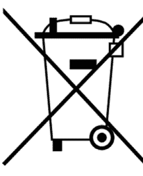

# 显示器的处置

正如第2章“外围设备和连接器”中所学的，CRT 代表阴极射线管；它是一种老旧、笨重的显示器类型。LCD 显示器已很大程度上取代了 CRT，但目前仍在使用中的 CRT 正达到其使用寿命的终点。因此，CRT 的处置是一个非常及时的话题。

除了会破碎并产生问题的玻璃和潜在致命的容器外，CRT 还含有许多对环境有害的化学物质。磷具有挥发性，当与水中的氧分子结合时可能会爆炸或引发火灾。在许多地区，将 CRT 作为普通垃圾处理是违法的。你必须将其带到社区回收站或危险废物处理设施，或者付费让回收公司代为处理。

LCD 显示器包含含有少量铅的电路板，其处置方式与台式 PC 类似。

# 扫描仪的处置

扫描仪对环境的影响没有显示器那么大，但仍然相当糟糕。它们包含像显示器一样的玻璃屏幕，还含有对环境有害的化学物质。通过回收扫描仪，玻璃和金属可以用于制造其他物品。此外，这也能减少留在填埋场的有害材料。

# 电池的处置

所有电池都含有金属等毒物，并可能污染环境。湿电池（铅酸电池，如汽车和船使用的电池）对环境危害最大，且有最严格的处置指南。干电池（如 PC 和其他电子设备使用的电池）也具有环境危害。它们含有汞、镉和镍等重金属，如果处置不当，都会污染环境，并在焚烧时向空气释放有毒化学物质。

PC 使用电池的一些地方包括：

- 便携式计算设备（笔记本电脑、手机等）
- 无线输入设备，如无线鼠标和键盘
- 主板
- 不间断电源 (UPS)

大多数地区都有法律要求销售某些类型电池的零售商还必须负责收集回收。规则取决于电池类型和地区。例如，欧盟的《电池指令》(2006）规定了欧盟境内电池的制造和处置。这些规定并不要求消费者进行回收，而只需零售商提供相应的回收选项。美国也是如此。消费者并不强制回收大多数电池，但如果客户想带来电池，供应商被要求接收。

> 减少电池对环境影响的一种方法是使用可充电电池。美国环保保护署估计，如今在美国购买的五节干电池中就有一个是可充电的。在整个使用寿命内，每个可充电电池可以替代数百个一次性电池。


# 打印机墨水和碳粉的处置

激光打印机和复印机使用的碳粉具有致癌性，因此妥善处置碳粉关乎公共安全。碳粉盒应返回给制造商或其他声称能够并回收它们的公司。处理碳粉盒时应保持谨慎态度，以防止碳粉溢出，并防止其进入可能进入人体肺部的空气。（这就是为什么你不应该使用普通吸尘器来清理碳粉溢出的——空气过滤器不足以捕捉碳粉颗粒，它们会重新回到空气中。）

打印机墨水盒包含上述提到的电池和 CRT 显示器中类似的某些重金属。回收它们是最好的解决办法。

# 硬盘和其他电脑组件的处置

运行良好的个人电脑通常可以捐赠给慈善机构，这些机构对其进行回收和修复，以便你所在城市或世界另一端的人重复使用。无法使用的电脑可以修理到正常工作状态。出于这个原因并为了保护你的隐私，在处置电脑之前，你应该擦除硬盘上的数据。

故障的电脑零件应在当地可以回收的回收中心或危险废物处置中心处理。例如，电路板含有铅，有些还含有纽扣电池。

## 总结

# 清洁用品的处置

某些用于 IT 设备的清洁用品可能对环境有害。大多数真正糟糕的物质更多与电子产品的制造有关，而非日常使用，但谨慎行事总是有益的。

你应该能在任何清洁化学品的容器上找到处置说明。不同地区的规则不同，请检查标签。例如，在英国，《有害健康物质控制条例》(COSHH) 规定描述了有害物质如何使用、储存和处置。

某些产品并不是在包装上放置处置和处理说明，而是引导你参考其网站上的材料安全数据表 (MSDS)。MSDS 解释了物品中存在哪些危害，并规定了物品的正确处置和处理方法。

## 总结

本章涵盖了与计算机相关的的重要环境和安全概念。本章的意图是提供如何与计算机交互的良好基础，以防止发生伤害或损害环境。为了确保安全，必须遵循所有制造商的安全指南。

第一个主题是人体工程学，它与……有关（文本根据上下文继续）

## 第 12 章实验

妥善处置旧电脑零件是一个非常重要的话题，然而大多数人并不知道如何做。像显示器这样较大的设备可能更容易让人们关注，因为它们并不经常被丢弃。电池可能是最容易被“忘记”并直接扔进垃圾桶的东西。如果你或你的家人使用相当多的电池，你应该在垃圾桶旁边准备一个小箱或其他容器专门存放这些电池，这样你就可以把它们带到回收站。

对于许多人来说，回收电池和其他有害材料是一种行为的改变。最常见的借口之一是他们不知道去哪里处理可回收部件。本实验将消除这一障碍。利用互联网，在你附近寻找三个电脑回收点。处置物品需要付费吗？考虑那些接受工作组件的地方，以及接受任何物品的地方。

## 复习题

1. 你需要购买一个喷墨打印盒，你想查看里面含有哪些化学物质。如何获取该产品的 MSDS（材料安全数据表）？
- A. 法律不允许你拥有该产品的 MSDS。
- B. 访问打印机盒制造商的网站。
- C. 商店要求在购买时为你提供一个。
- D. 它包含在打印盒的包装中。

2. 清洁显示器时，不应使用包含什么成分的清洁剂？
- A. 水
- B. 酒精
- C. 氨
- D. 以上所有

3. 在考虑人体工程学时，键盘和鼠标应该放在哪里？
- A. 与用户的肘部齐
- B. 在用户肘部下方 6 英寸
- C. 在用户肘部上方 6 英寸
- D. 放在工作的电脑桌上

4. 人类感觉到静电冲击的大电压是多少？
- A. 30 伏
- B. 300 伏
- C. 3,000 伏
- D. 30,000 伏

5. 用户 Geri 抱怨脖子疼是因为工作引起的。她应该检查什么来判断是否是问题？
- A. 显示器是否太高或太低
- B. 显示器是否太远或太近
- C. 键盘和鼠标是否与手腕平齐
- D. 她的坐姿是否正确（脚是否平放在地面上）

6. 考虑到静电是高电压冲击，为什么它不会致命？
- A. 持续时间短
- B. 电流小
- C. 它是直流电，不是交流电
- D. 低电阻

7. 以下哪项会导致通过相邻电缆之间的串扰导致数据丢失？
- A. ESD
- B. RFD
- C. EMI
- D. MSDS

8. 以下哪种物品含有致癌物，因此需要回收？
- A. 激光打印机碳粉
- B. 喷墨打印盒
- C. 扫描仪
- D. 电池

9. 在人体工程学评估中，关于最佳坐姿，以下哪项是正确的？
- A. 脚应该放在地板或脚踏上。
- B. 臀部与大腿上方应成 90 度角。
- C. 肘部应位于身体两侧并成 90 度角。
- D. A 和 B
- E. A 和 C
- F. B 和 C
- G. A、B 和 C

10. 你正在回收不工作的电脑零件。哪些组件包含电容器且不应打开？（选择两个）
- A. CRT 显示器
- B. LCD 显示器
- C. 电源
- D. 机械硬盘

11. 你正在为办公室配置新电脑。为了获得最佳的电脑性能，你应该将温度设定在多少度？
- A. 比人类舒适的温度高
- B. 与人类舒适的温度相同
- C. 比人类舒适的温度低，但不冰点
- D.冰冰以下

12. 以下哪个是 ESD（静电释放）更常用的名称？
- A. 静电
- B. 频干扰
- C. 磁干扰
- D. 电池备份

13. 你需要为台式电脑购买一个电池备份系统。你需要什么类型的设备？
- A. API
- B. RFI
- C. UPS
- D. EMI
- E. ESD

14. 你刚从遥控设备中取下四节 AA 碱性电池。处置这些电池的建议方法是什么？
- A. 扔进垃圾桶。
- B. 冲马桶。
- C. 焚烧它们。
- D. 带它们去回收中心。

15. 电脑运行的最佳湿度是多少？
- A. 30 百比
- B. 50 百比
- C. 70 百比
- D. 90 百比

16. 从键盘按键下方取出碎片的建议方法是什么？
- A. 用螺丝刀挖出来。
- B. 用压缩空气吹出。
- C. 加热直到碎片烧掉。
- D. 使用磁铁。

17. 可以实施以下哪些措施来减少 ESD 风险？（选择两个）
- A. 防静手腕带
- B. 防静袋
- C. 防静发网
- D. 拖动脚部

18. 你正在用户工作站放置电脑。对于气流，你应该考虑哪些因素？
- A. 不需要考虑气流。
- B. 放置系统以减少电脑周围的气流以减少灰尘。
- C. 放置系统以使电脑周围的气流最大。
- D. 将系统放在桌边以使气流最大。

19. 你的家庭办公室经常发生电压波动。你想购买一个设备来保护你的电脑设备。你应该买什么？（选择两个）
- A. UPS
- B. 浪涌保护器
- C. 插线板
- D. 发电机

20. 限制在使用有害物质的指令名称是什么？
- A. MSDS
- B. RoHS
- C. ESD
- D. EMI

# 索引

读者注：在本索引中，**粗体**页码表示主题的主体讨论。*斜体*页码表示插图。

# A

- .aac 扩展, 220
- AC（交流电）, 45, 544
- 笔记本电脑电源适配器, 48–49, 48
- 加速图形接口 (AGP) 总线, 12, 12
- 访问 (access)
  - 共享资源, 317–320, 318–320
  - 基于 Web 的资源, 435
- 访问控制列表 (ACLs), 210
- 辅助选项, 168–169, 168–169 参见用户账户
- ACLs (访问控制列表), 210
- 操作中心 (Action Center), 139
- 故障排除中的行动计划, 501–502
- 软件激活, 229–230
- 活跃蠕虫, 394
- ActiveX 过滤, 435
- Active Monitor 工具, 130
- ad hoc 蓝牙共享, 312–313, 313
- ad 添加输入语言, 86, 86
- 地址栏, 157, 157
- 地址解析协议 (ARP), 271
- 管理员账户
  - 描述, 125
  - 限制, 422
  - SOHO 路由器密码, 285–286, 285
- Adobe Reader, 194, 196
- 广告，可疑的, 444–447, 446–447
- ADSL (不对称 DSL), 254
- 高级属性对话框, 415, 524-524
- 高级加密标准 (AES)
  - 安全算法, 289
- 高级隐私设置对话框, 437
- 高级共享窗口, 317–318, 395
- 扩展性技术 (ATX)
  - 主板
    - 描述, 5–6
    - 电源接口, 15, 15, 46, 47
- 广告软件
  - 概述, 395
  - 症状, 447–450, 448–449
- AES (高级加密标准)
  - 安全算法, 289
- AGP (加速图形接口) 总线, 12, 12
- 空气流
  - 冷却系统, 49–50
  - CPU, 50–51, 51
  - 固定, 565
- 移动设备的飞行模式, 363–364, 363–364
- 一体化打印机, 78
- 允许用户管理此计算机
  - 选项, 125
- 交流电 (AC), 45, 544
- 安培 (amps), 549
- 故障排除中的交互, 494–496
- 剪文件, 161

# D

- 每日端口, 42
- 每日备份, 526
- 危险功能, 禁用, 408–411
- 数据错误/写入驱动器消息, 513
- 数据管理结构, 129
- 数据窃取, 269
- 数据库, 193–194
- 直流 (DC), 45, 544
- DDR (双倍数据速率) SDRAM, 217
- 防火墙默认项, 210
- IP 地址默认网关, 273
- 磁盘整理功能, 71
- 连接延迟, 257, 269
- 删除浏览历史对话框, 438
- 删除
- 电子邮件帐户, 356, 356
- 文件, 161
- 非军事化区 (DMZs), 210
- 国防部 (DoD) 模型, 270, 271
- 桌面出版软件, 198–199, 198
- 设备驱动程序
  - 描述, 118
  - 硬件兼容性, 518
  - 安装, 232–233, 233
  - 更新, 239–241, 240–241
- 设备管理器, 239–240, 241
- 设备
  - 故障, 517, 520–522
  - 加固, 407–408
  - 禁用及危险功能, 408–411
  - 锁定系统, 412
  - 权限与加密, 412–417, 413–414
  - 软件, 417–420
  - 放置, 564–568
- 设备与打印机
  - 键盘, 84, 84
  - 打印机, 233, 233
- 设备驱动程序
  - 描述, 118
  - 硬件兼容性, 518
  - 安装, 232–233, 233
  - 更新, 239–241, 240–241

# E

- 辅助中心, 168–169, 168
- 编辑文件, 161
- EEPROM (电可擦除式 ROM), 24
- EHR (电子记录) 软件包, 218
- 有机中的肘部, 543
- 电气, 544
- 静电释放, 549–552, 550
- 节能个人计算, 552–557, 554, 556
- 国际电压差异, 544–545, 545
- 维持电源, 545–549, 346–548
- 避开电磁干扰 (EMI), 565–566
- 内部网络连接, 263
- 电磁脉冲 (EMP), 565
- 电子健康记录 (EHR) 软件包, 218
- 电子医疗记录 (EMR) 软件包, 218
- 内部网络连接距离因子, 262–263
- 发行版, Linux, 131
- 双层 (DL) 光驱器, 40
- dmg 扩展名, 215
- DNS (域名系统), 273–274
- doc 扩展名, 191
- 故障排除中的文档, 502–503
- 文档、存储与阅读, 202–203
- doc 扩展名, 191
- 域控制器, 307
- 域名系统 (DNS), 273–274
- 域, 307
- CRT 显示器的点间距, 63–64
- 点分进制计数法, 272
- 双倍数据速率 (DDR) SDRAM, 27–28
- 双面 (DS) 光驱器, 40
- 下载，文件, 332–333, 332
- 柔顺溶液, 551
- DRAM (动态随机存储器), 24
- 驱动程序
  - 描述, 118
  - 硬件兼容性, 518
  - 安装, 232–233, 233
  - 更新, 239–241, 240–241

## 静电释放 (ESD) — 外部表面

静电释放 (ESD), 549–552, 550
电子邮件
- + 地址安全, 452
- Android, 356–358, 357–358
- 被劫持, 454
- iPhone, 356, 352–356
- 移动设备, 350–358, 352–358
- 软件, 192–193
- 垃圾邮件, 452
- 可疑, 452, 453–454
- 类型, 391–394, 392–394
- 病毒, 391, 391

EMI（电磁干扰）
- 避免, 565–566
- 内部网络连接, 263
EMP（电磁脉冲), 565
EMR（电子医疗记录）包, 218
- + 启用家长控制选项, 125

加密
- 启用, 412–417, 413–414, 416
- 文件, 202
- 无线路由器, 288–289

节能型个人计算, 552
耗能设备, 555–557, 556
电源管理计划, 552–555, 554
“能源之星”认证系统, 556, 556
ENIAC（电子数值积分计算机）, 118–119
运行环境软件, 219–220
环境与安全控制, 539–541
清洁电脑, 557–564, 562
- 设备放置, 564–568
- 处置方法, 568–571, 569
电。另阅“电”
人体工程学, 542–544, 542
- 考试示例, 572
- 实验室, 573
- 电源, 46
- 复习题, 574–577
- 总结, 571
环境，软件, 128–129
- + 人体工程学键盘, 82, 83
人体工程学鼠标, 87, 88
人体工程学, 542–544, 542
错误检查功能, 211, 212
操作系统错误消息, 512–513
eSATA（外部 SATA）接口, 102–104, 103–104
ESD（静电释放）, 549–552
以太网标准, 262
Excel 应用, 191–192, 192
- .ve 扩展名, 188–189
可执行文件, 188–189
排气扇
- 风流, 565
- 冷却系统, 49–50
扩展槽, 11
- AGP, 12, 12
- PCI, 11, 12
- PCIe, 13–14, 13
- 商店, 388–399
扩展文件系统 (XFS), 212
扩展名
- 浏览器, 430–432, 430–431
- 文件, 188–189, 191
- 移动设备的外部连接, 348–350, 349–351
- 外部网络连接, 251–252
- 故障排除的外部资源, 498
- 外部 SATA (eSATA)接口, 102–104, 103–104
外部存储设备, 95
- 通信接口, 105–107, 106
- 接口, 101–102–104
- 闪存盘, 95–96, 96
- 硬盘, 97–98, 98
- 内存卡, 96–97, 96–97
- 移动媒体播放器, 100
- 网络附属存储, 99–100, 99
- 光驱器, 98
- 智能手机, 100–101
外部表面，清洁, 558

## 面部识别 — 游戏电脑
615

面部识别, 425
- 软件, 208–210, 211
风扇
- 无线路由器, 293, 293
FireWire（火线线）标准, 102, 102
- 风流, 565
固件, 15–17, 16–17
- 清洁, 560–561
- 第一方 Cookie, 436
- 冷却系统, 49–51, 50
- .flac 扩展名, 220
功能
- 闪存盘, 95–96, 98
- 操作系统, 227–228, 228
- 闪存, 24
- 使用和 Android, 408–411
- 刷写 BIOS, 17
平屏, 65–66
- 人体工程学中的脚部, 543
- 地面线护, 484, 484
光纤缆, 255–267, 262–264
软盘和驱动器, 31
光纤入户 (FTTH) 服务, 256
- .flv 扩展名, 219
可现场更换部件 (FRUs), 2
Fn（功能）键, 71–72, 72
文件分配表 (FAT), 151
文件夹
- 文件系统, 150–152
- 加密, 412–415, 413–414
文件传输协议 (FTP), 271, 332
- 管理, 150–154, 153
安全文件传输协议 (FTP), 333
- 安全性, 203
文件
- 主板外形, 5–6
- 压缩, 214–217, 216–217
- 分区, 150–151
- 下载, 323–333
- 数据库, 193
- 加密, 202
- Fortran 语言, 120
4G 技术, 259
第四代文件系统 (ext4), 152
- 碎片, 211, 213
- 碎片文件, 211, 213
- 管理, 150–154, 153
- 操控, 160–163, 164
- 共享, 154–158, 155
- 同步, 315–316
FTP (文件传输协议), 271, 332
FTPS (安全文件传输协议), 333
FTTH（光纤入户）服务, 256
FileVault, 416
Fn（功能）键, 71–72
Finder 应用, 133
指纹识别, 425
游戏端口, 42
游戏软件, 219–220
手势交互, 344–345
图形设计, 41
图形用户界面 (GUI), 121–123
图形处理器 (GPU), 41
接地与静电释放, 550
访客访问无线路由器, 290–291
访客账户, 125, 422
g功能, 345
gz 扩展名, 215

## F
端口, 221
防火墙
- 配置, 222–224
- 用于设备固化的防火墙, 220–221
- 用于 IP 地址的网关, 273

## 游戏软件 — HP 诊断工具
高斯 (Gauss), 71
全球移动通信 (GSM) 标准, 259
Google Docs, 186, 328
Google Drive, 326, 327
Google Play 应用, 366, 366
可疑网站的错误, 445

## H
黑客, 376
黑客, 376–378
硬盘和驱动器。另阅“磁盘和驱动器”
设备固化, 407–408
禁用危险功能, 408–412
锁定系统, 412
权限与加密, 412–417, 413–414, 416
用于软件, 417–420, 421
硬件 And Sound 应用
鼠标, 93
触控板, 89, 90

## HTPC（家庭电脑）系统 – 互联网安全最佳实践
HTPC（家庭电脑）系统, 471–472
HTTP（超文本传输协议）, 271, 329–330
HTPS（安全超文本传输协议）, 329–331, 441
湿度与静电释放, 550, 565
进风扇, 49–50
内部网络连接, 263
干扰, 550–566
信息收集, 497
接种病毒, 206
输入设备, 81
故障, 518
键盘, 81–86, 82–86
指针设备, 87–94, 88–92

## 网络安全最佳实践（续）—— LGA（陆网阵列）插座

网络安全最佳实践（续）
安全网站, 440–444, 441–444
可疑材料, 447–447, 446–447

互联网服务提供商 (ISPs), 252
iOS 操作系统
- 飞行模式, 363, 363
- 主屏幕, 343–344, 343
- 锁定与安全, 346–348, 346–348
- 截图, 167
- 版本与功能, 142–144, 142
- wifi 连接, 349–350, 349–351
IP 地址, 272–273
- APIA, 274–275, 275
- DHCP 和 DNS, 273–274
- 公共与私有, 275–276

IP (互联网协议), 270
ipipconfig 工具
IP 配置, 275, 275
MAC 地址, 289
TCP/IP 连接性, 520–521, 520

iPhone, 143
- 飞行模式, 363–364, 364
- 电子邮件, 352–356, 352–356
- 同步, 361, 362

IPv6, 272
IrDA (红外协会), 266–267
.iso 扩展名, 215
ISO (国际标准组织), 194
ISP (互联网服务提供商), 252
iTunes
- 证书, 441
- 同步, 361–362, 362
- iTunes 应用程序商店, 365
ITX 主板, 5–6

## K

- K 槽 (肯辛安全槽), 380
内核, 122
键盘, 81
- 清洁, 559
- 配置, 82–86, 83–86
- 连接, 81–82,
- 人体工程学, 544
- 热键, 164–166, 165–166
键盘记录器, 395
Keynote 应用程序, 197
终止开关, 380
动力学, 345

## L

- L1 (一级)缓存, 22
L2 (二级)缓存, 22
L3 (三级)缓存, 22
陆网阵列 (LGA) 插座, 9, 2, 20
移动设备的横向显示模式, 345, 346
LAN (局域网), 304–307, 304
笔记本电脑
- 电池, 557
- 游戏, 471
- 电源, 48, 48
- 价格, 469
- 选择, 466–467
- 视频切换, 72–73, 73
激光打印机, 77–78, 562–563
连接延迟, 257–258
LCD (液晶晶显示)显示器, 65
- 处置, 569
- 功耗, 555
- LED (发光二极管)显示器, 65
旧版浏览器, 427
一级 (L1) 缓存, 22
二级 (L2) 缓存, 22
三级 (L3) 缓存, 22
LGA (陆网阵列) 插座, 9, 2, 20

## J

- .jar 扩展名, 215
Jobs (史蒂夫), 134
摇摇杆, 91
- .jpg 扩展名, 199
跳线帽, 34

## 许可证 – 制造商安全指南 619

应用程序故障, 517
软件, 224–227, 226
SOHO 路由器, 278, 278
喷接口, 380–383, 382
发光二极管 (LED)显示器, 65
前置连接, 257–258
链接, 444–447, 444–447
Linksys 账户, 281, 281
Linux 操作系统, 122
- 截图, 167
- 版本, 131–132, 132
工作站, 131–133, 132
水冷系统, 51–52
液晶晶 (LCD) 显示器, 65
- 处置, 569
锁定
- 文件, 305
- 硬件, 379–380, 380
- 移动设备, 346–348, 346
- 系统, 412
锁定，操作系统, 513–514
解锁服务, 380
长期演进网络, 259
低功耗模式, 552–553
ubuntu 版本, 131, 132
软件中心, 231, 231
更新管理器, 238, 238
VirtualBox 版本, 171–175, 172–175

## M

- .m4 扩展名, 220
Mac 电脑
- 自动更新, 234, 235
- 笔记本价格, 469
- 恶意软件, 388
- 用户账户, 125, 126
MAC (介质控制) 地址
过滤, 289–290, 290
Mac 操作系统
- 载入问题, 512
- 截图, 167–168
工作站, 133–136, 136
功耗, 555
损坏, 560, 566
Mac OS, 512
Windows, 505–512, 507–511
局域网 (LANs), 304–307
本地备份, 526–527
本地网络共享, 303
考试要点, 333–334
实验室, 334–335, 335
网络类型, 303–304
LAN, 304–305, 304
城域网 (MANs), 306
点对点和客户端/服务器, 307–309, 307
广域网 (WANs), 305, 306
复习题, 336–339
存储选项, 309–311, 310
总结, 333
类型, 312
文件和打印共享, 315–324, 316–318, 321–324
点对点共享, 312–315, 313
宏
- 数据库, 193
- 病毒, 392
放大镜, 169
已维护的服务器, 202–203
维护软件, 210–214, 212
反恶意软件, 205–208, 207
诊断与修复感染, 419–420
概述, 387–388
城域网 (MANs), 304, 306
制造商安全指南, 541
本地化设置, 477, 478

## 映射网络驱动器 – 主板

映射网络驱动器, 310, 310
主硬盘, 34
材料安全数据表 (MDSs), 571
维护, 551

MD5 (消息摘要算法 5), 418
MDP (迷你显示口) 标准, 70
介质控制 (MAC) 地址
过滤, 289–290, 290
媒体流传输, 473–474, 473–474
媒体软件, 218

内存
- 核心, 25–26, 26
- 总线速度, 27–28
- 静电释放, 549–552
- 笔记本电脑, 467
操作系统变慢, 513–514
概述, 24
物理特性, 28–29, 28
- 多个, 9–10, 10
虚拟, 25
内存卡, 96–97, 96–97
消息摘要算法 5 (MDS5), 418
元数据
- 文件系统用于, 151
查看, 158–160, 158–160
城域网 (MANs), 304, 306
micro ATX 主板, 5–6
MicroDIMM 内存, 28
Microsoft OneDrive, 326
MiFi 热点, 259–260, 260
mini DIN 连接器, 82
迷你显示口 (MDP) 标准, 70
mini-ITX 主板, 6
最低系统要求, 221
镜像, 38
移动设备, 341–343
- 飞行模式, 363–364, 363–364
- 应用程序, 364–368, 368
- 蓝牙, 359–361, 360
- 电子邮件, 352–358, 352–358
外部连接, 348–350, 348–350
交互, 344–345
锁定与安全, 346–348, 346–348
复习题, 371–374
屏幕方向, 345–346, 345–346
同步选项, 361–362, 362
意外费用, 367–368, 368
易用性选项, 343–344, 343
移动热点, 259–260, 260
mobile-ITX 主板, 6
移动媒体播放器, 100
移动操作系统
- Android, 144–146, 146
- Blackberry, 148–149, 148
- iOS, 142–142, 142
- 移动手机, 146–148, 147
网络连接, 268
调制解调器
电缆, 255
拨号, 44
DSL, 252–255, 253
模块化组件, 2
- 数据库模块, 193
系统健康, 129–130, 130
显示器
调整, 71–75, 72–75
空白, 504
清洁, 558
CRT, 63–64, 64, 552
处置, 669
功耗, 555–555
人体工程学, 543
扁内核, 65–66
分辨率, 478–480, 479
单色层打印机, 778
摩尔定律, 215
主板
- 后面板连接器, 18, 18
BIOS 芯片, 15–17, 17
芯片组, 6–7
CMOS 电池, 18
组件, 3–5, 4
CPU 插座, 8–9, 4

鼠标 – 新出站规则对话框 621

缩写, 19–20
磁盘控制器, 14
扩展槽, 11–14, 12–13
固件, 15–17, 16–17
外形, 5–6
前面板连接器, 19
NAS (网络附属存储), 99–100, 99, 309–310
NAT (网络地址转换)
IP 地址, 276
天然键盘, 82, 83
近场通信 (NFC), 禁用, 409
net-IOX 主板, 6
笔记本电脑, 141
网络地址转换 (NAT)
IP 地址, 276
无线路由器, 291, 292

鼠标清洁, 559–560
配置, 93, 94
人体工程学, 544
过度拟合, 77–88
鼠标属性窗口, 89, 90, 93, 94
移动文件, 161
.mp3 扩展名, 220
.mp4 扩展名, 219
.mpg 扩展名, 219
MS-DOS 操作系统, 122
MSCONFIG 文件, 509–512, 509–511
MSDSs (医疗安全数据表), 571
msi 扩展名, 188
多核架构, 221
多因素身份认证, 424–425, 425
MultiFinder 应用程序, 133
多功能打印机, 78
多部分河流, 392, 392
多态病毒, 393
钓鱼攻击, 449–450
钓鱼, 385–386, 444–445
物理安全威胁, 379–380, 380, 382
物理损伤, 567–568
PC-ITX 主板, 6
口袋钟, 206, 366
PII (个人可识别信息), 440
PIM (个人信息管理器), 199–200, 200
PGA (引脚阵列) 插座, 9, 9, 20
多态病毒, 393
弹出窗口拦截对话框, 448,
弹出窗口, 447–449, 448–449
移除, 232
POP (邮局), 351
端口地址翻译 (PAT), 276
PATA (并行 ATA) 驱动器, 14, 32–34, 32–33
补丁, 239
操作系统, 234–239, 235, 238
蠕虫中的有效负载, 394
PC-Doctor 程序, 213
PC 到 PC 直接链接, 313–314
PCBs (印刷电路板), 3
PCI Express (PCIe) 插槽, 13–14, 13
PCI (外围组件互连)
总线类型, 11, 12
PDAs (数字助手), 200
PDF 创建器, 195
PDF (便携文档格式)
应用, 194–196, 195–196
点对点网络, 307–309, 307
点对点 (P2P) 共享, 312–315, 313
基于人的安全威胁, 383–383
隐私对话框, 437
性能监视器, 129–130
性能选项对话框, 25–26, 26
外围组件互连 (PCI)
总线类型, 11, 12
外围设备, 59–61
音频接口, 61–63, 62
显示调整, 71–75, 72–75
显示设备, 63–66, 64
考试要点, 108
外部存储设备
输入设备, 81
故障, 518
键盘, 81–86, 82–86
指针设备, 87–94, 88–92, 94
实验, 109
指针, 75–80, 79–80
复习题, 110–113
总结, 108
视频接口, 66–70, 67–71
工作站, 481
权限
设置, 412–417, 413–414, 416
共享资源, 317
用户账户, 124–125
权限对话框, 413
持久性 Cookie, 436
个人区域网络 (PANs), 304, 306
个人数字助手 (PDAs), 200
个人财务软件, 218
个人信息管理器 (PIM)
软件, 199–200, 200
个人可识别信息 (PII), 440
PGA (引脚阵列) 插座, 9, 9, 20
多态病毒, 393
钓鱼攻击, 449–450
钓鱼, 385–386, 444–445
物理安全威胁, 379–380, 380, 382
物理损伤, 567–568
PC-ITX 主板, 6
口袋钟, 206, 366
PII (个人可识别信息), 440
PIM (个人信息管理器), 199–200, 200
PGA (引脚阵列) 插座, 9, 9, 20
捏手势, 345
Ping 工具, 257, 519–522, 520
OTS (旧电话服务), 252
纯文本, 440
故障排除中的理论, 497–498
等离子显示器, 65–66
塑料袋, 351
平台即服务 (PaaS), 325

# 平台 – 生产力软件

平台
计算机选择器, 465–468
软件, 186–187, 187
30
浏览器的插件, 430–432, 430–431
png 扩展, 199
点对多点连接, 257
点对红外连接, 266
指针选项标签, 94
指针设备, 87
配置, 93, 94
连接, 93
摇杆, 91
鼠标, 87–88, 88
触笔, 91–92
触控板, 88–91, 89–91
滚鼠, 92
备份策略, 522–523
多态病毒, 393
弹出窗口拦截对话框, 448,
弹出窗口, 447–449, 448–449
移除, 232
POP (邮局), 351
端口地址翻译 (PAT), 276
PATA (并行 ATA) 驱动器, 14, 32–34, 32–33
补丁, 239
操作系统, 234–239, 235, 237–238
蠕虫中的有效负载, 394
PC-Doctor 程序, 213
PC 到 PC 直接链接, 313–314
PCBs (印刷电路板), 3
PCI Express (PCIe) 插槽, 13–14, 13
PCI (外围组件互连)
总线类型, 11, 12
PDAs (数字助手), 200
PDF 创建器, 195
PDF (便携文档格式)
应用, 194–196, 195–196
点对点网络, 307–309, 307
点对点 (P2P) 共享, 312–315, 313
基于人的安全威胁, 383–383
隐私对话框, 437
性能监视器, 129–130
性能选项对话框, 25–26, 26
外围组件互连 (PCI)
总线类型, 11, 12
外围设备, 59–61
音频接口, 61–63, 62
显示调整, 71–75, 72–75
显示设备, 63–66, 64
考试要点, 108
外部存储设备
输入设备, 81
故障, 518
键盘, 81–86, 82–86
指针设备, 87–94, 88–92, 94
实验, 109
指针, 75–80, 79–80
复习题, 110–113
总结, 108
视频接口, 66–70, 67–71
工作站, 481
权限
设置, 412–417, 413–414, 416
共享资源, 317
用户账户, 124–125
权限对话框, 413
持久性 Cookie, 436
个人区域网络 (PANs), 304, 306
个人数字助手 (PDAs), 200
个人财务软件, 218
个人信息管理器 (PIM)
软件, 199–200, 200
个人可识别信息 (PII), 440
PGA (引脚阵列) 插座, 9, 9, 20
多态病毒, 393
钓鱼攻击, 449–450
钓鱼, 385–386, 444–445
物理安全威胁, 379–380, 380, 382
物理损伤, 567–568
PC-ITX 主板, 6
口袋钟, 206, 366
PII (个人可识别信息), 440
PIM (个人信息管理器), 199–200, 200
PGA (引脚阵列) 插座, 9, 9, 20
捏手势, 345
Ping 工具, 257, 519–522, 520
OTS (旧电话服务), 252
纯文本, 440
故障排除中的理论, 497–498
等离子显示器, 65–66
塑料袋, 351
平台即服务 (PaaS), 325
