# CompTIA Linux+认证 2009 考试大纲


## 关于本课程

`CompTIA`® `Linux`+™ 认证课程专为覆盖 `CompTIA` 2009 年考试目标而设计，它建立在你 Linux 操作系统现有的用户级知识和经验之上，旨在为你提供在任何类型的 Linux 职业中所需的底层技能和概念。

`CompTIA`® `Linux`+™ 认证课程可以从两个方面使您受益。如果你的工作职责包括 Linux 故障排除、安装或维护，或者你正在准备从事任何类型的 Linux 相关职业，该课程将提供你取得成功所需的基础知识和技能。此外，如果你准备参加 `CompTIA`® `Linux`+™ 认证考试（2009 年目标，考试代码：`XK0-003`）以成为 `CompTIA`® `Linux`+™ 认证专业人员，该课程也将协助你备考。

### 课程描述

### 目标学生

本课程面向初级计算机支持专业人员，他们具备基本的计算机硬件、软件和操作系统知识，希望提高自己对 Linux 概念和技能的知识和理解，为从事 Linux 支持或管理职业做准备，或为 `CompTIA`® `Linux`+™ 认证（2009 年目标，考试代码 `XK0-003`）做准备。`CompTIA`® `Linux`+™ 认证课程的典型学生应具有至少 6 到 12 个月的 Linux 经验。

### 课程先决条件

为了确保你的成功，我们建议你首先参加以下 Element K 课程或具备同等知识：

- `CompTIA`® A+® `认证：2009 年目标的综合方法`

### 如何使用本书

#### 作为学习指南

每节课涵盖一个广泛的主题或一组相关主题。课程按照 `Linux`+ `认证` 技能熟练程度递增的顺序排列；你在某一节课中获得的技能将在后续课程中被使用和发展。因此，你应该按顺序学习这些课程。

我们将每节课组织成结果导向的主题。主题包含你掌握 `Linux+ 认证` 所需的所有相关和支持信息，并且活动允许你将这些信息应用于实际动手示例。

你可以在专门准备的示例文件上尝试每项新技能。这节省了打字所需的时间，让你能够专注于当前的技能。通过使用示例文件、动手活动、在关键步骤提供反馈的插图以及支持性背景信息，本书为你提供了快速且轻松地学习 `Linux+ 认证` 的基础和结构。

#### 作为复习工具

任何教学法的效果都取决于你愿意投入的时间和精力。此外，你在课堂上学到的一些信息可能对你来说目前并不重要，但后来可能变得重要。因此，我们鼓励你在课程结束后花一些时间复习主题和活动。在复习活动时为了寻求额外的挑战，请尝试先查看“你要做什么”一列，然后再查看“如何做到”一列。

#### 作为参考

本书的组织结构和布局使其易于作为学习工具和课后参考使用。你可以将本书作为术语定义、特定主题的背景信息和步骤摘要的首选来源。

### 课程图标

| 图标 | 描述 |
| :--- | :--- |
| (Image) | `注意` 提醒学生注意某个操作、设置或决策可能带来的潜在负面后果，这些后果通常不易被察觉。 |
| (Image) | `显示幻灯片` 为讲师提供提示，显示特定的幻灯片。显示幻灯片仅包含在讲师指南中。 |
| (Image) | `讲师备注` 是针对讲师的评论，涉及授课方式、课堂策略、课堂工具、例外情况和其他特殊考虑事项。讲师备注仅包含在讲师指南中。 |
| (Image) | `笔记页` 指示一个故意留白的页面，供学生书写使用。 |
| (Image) | `学生备注` 提供关于某个主题或任务的额外信息、指导或提示。 |
| (Image) | `版本备注` 指示针对特定软件版本的必要信息。 |

## 课程目标

在本课程中，你将获得安装和支持一个或多个 Linux 操作系统发行版所需的技能，并学习有助于你准备 `CompTIA`® `Linux`+™ 认证考试（2009 年目标，考试代码：`XK0-003`）的信息和技能。

你将能够：

- 识别基本的 Linux 概念并执行基本的 Linux 任务。
- 管理用户和组账户。
- 管理分区和 Linux 文件系统。
- 管理 Linux 中的各种文件。
- 处理 Linux 权限和所有权。
- 打印文件。
- 管理软件包。
- 管理内核服务。
- 使用 `Bash` shell。
- 管理作业和进程。
- 管理系统服务。
- 配置 Linux 服务以提供用户的网络连通性。
- 配置基本互联网服务。
- 实施措施以保护 Linux。
- 管理与 Linux 机器相关的硬件。
- 排查 Linux 系统问题。
- 安装 Linux 操作系统。
- 配置 GUI。


## 课程要求

### 硬件

- 2 GB 或更高的内存
- 具有 2.7 GHz 或更高处理能力的处理器
- DVD R/W 驱动器（支持引导）
- 软盘驱动器
- 通用键盘和鼠标
- 声卡和显示卡（`VGA` - 256 色 800x600）
- 用于 `srvA` 的两张网络接口卡（NICs）和用于 `srvB` 的一张 NIC
- 通用显示器
- 80 GB 硬盘
- 具有并口的打印机
- 带有USB端口的打印机

### 软件

- 讲师和学生使用的 Red Hat Enterprise Linux 5 授权副本。
- 讲师和每位学生使用的 Red Hat Enterprise Linux 5 救援 CD 副本。
- 讲师和学生使用的 Debian 5 副本。


硬盘的盘符取决于你将其硬盘总线连接到主板上的哪个插槽。如果连接到主主盘插槽，盘符将以 `"a"` 结尾；对于次主盘插槽，则为 `"b"`；对于主从盘插槽，则为 `"c"`；对于次从盘插槽，则为 `"d"`。对于 IDE 硬盘，盘符以 `"hd"` 开头，而对于 SATA 驱动器，则从 `"sd"` 开头。本课程活动的说明是基于连接到次主盘插槽的 SATA 驱动器编写的，因此盘符将为 `"sdb"`。

## 课堂设置

### 课堂网络连接

1. 为每位学生和讲师设置由两个系统组成的独立网络。
2. 将讲师系统标记为 `srvA` 和 `srvB`。`srvA` 服务器分配 IP 地址 `192.168.0.2`，`srvB` 服务器分配 IP 地址 `192.168.0.3`。
3. 将学生系统标记为 `Student X—srvA` 和 `Student X—srvB`，其中 `X` 是学生编号。为 `Student1—srvA` 和 `Student1—srvB` 分配 IP 地址 `192.168.0.4` 和 `192.168.0.5`。对于其他学生，为 `srvA` 分配偶数，为 `srvB` 分配奇数。
4. 在每个系统上安装 Red Hat Enterprise Linux 5.3。
5. 同步每个网络上的系统时间。

### 在 srvA 上安装 Red Hat Enterprise Linux 5.3

要在 `srvA` 上安装 Red Hat Enterprise Linux 5：

1. 将 Red Hat Enterprise Linux CD 1 插入 DVD-RW 驱动器。
2. 在 Red Hat Enterprise Linux 5 页面，要安装或升级现有系统，请按 `Enter` 键。
3. 在欢迎使用 Red Hat Enterprise Linux Server 页面，选择 `Skip`，然后按 `Enter` 键。
4. 在 Red Hat Enterprise 安装页面，单击 `Next`。
5. 在语言选择页面，在语言选择列表框中，验证已选中 `English (English)` 选项，并单击 `Next`。
6. 在键盘配置页面，在键盘选择区域中，验证已选中 `U.S. English`，并单击 `Next`。
7. 在安装号对话框中，输入随 Red Hat Enterprise Linux 5 CD 提供的安装号。
8. 要安装 Red Hat Enterprise Linux 5，选择 `Install Red Hat Enterprise Linux Server`，并单击 `Next`。
9. 在磁盘分区设置页面，从分区布局下拉列表中选择 `Create custom layout`，并单击 `Next`。
10. 删除现有分区。
11. 根据表格对硬盘进行分区，并单击 `Next`。


救援 `CD` 是执行第 16 课活动所必需的。`Debian 5` 是执行第 7 课活动所必需的。


活动将系统称为 `srvA` 和 `srvB`。学生需要使用其各自的系统 `Student X—srvA` 和 `Student X—srvB`。这将适用于本课程的所有活动。

| 类型 | 挂载点 | 大小 |
| --- | --- | --- |
| `swap` | | `RAM` 大小的两倍 (`1024 MB`) |
| `ext3` | `/` | `20000 MB` |

12. 在启动加载器配置页面，单击 `Next`。

13. 在网络配置页面，配置网络参数。

    - 单击 `Edit`。

    - 在 `Enable IPv4 support` 部分，在 `Edit Interface` 对话框中，选择 `Manual configuration` 选项。

    - 在 `IP Address` 文本框中，输入 `192.168.0.2`，在 `Prefix(Netmask)` 文本框中，输入 `255.255.255.0`

    - 取消选中 `Enable IPv6 support` 选项，并单击 `OK`。

    - 在 `manual` 选项旁边的文本框中，输入 `srvA`，并单击 `Next`。

    - 在 `Error With Data` 消息框中，两次单击 `Continue`。

14. 在时区选择页面，在所选城市下拉列表中，验证已选中 `America/New_York` 选项，并单击 `Next`。

15. 在设置 `root` 密码页面，在 `Root Password` 文本框中，输入 `p@ssw0rd`，并按 `Tab` 键。

16. 在 `Confirm` 文本框中，输入 `p@ssw0rd`，并单击 `Next`。

17. 在软件选择页面，在 `Include Support` 部分，勾选 `Software Development` 和 `Web server` 选项。

18. 在 `Customize` 部分，选择 `Customize now` 选项，并单击 `Next`。

19. 在第一个列表框中，选择 `Servers` 选项，并在相邻的列表框中，勾选 `DNS Name Server`、`FTP Server` 和 `Network Servers` 软件包。

20. 在第一个列表框中，选择 `Desktop Environments` 选项，并在相邻的列表框中，勾选 `KDE (K Desktop Environment)` 软件包。

21. 在第一个列表框中，选择 `Base System` 选项，并在相邻的列表框中，勾选 `System Tools` 软件包，并单击 `Next`。

22. 在即将安装页面，单击 `Next` 以开始安装。

23. 在 `Required Install Media` 对话框中，单击 `Continue` 以继续安装。

24. 在 `Change CDROM` 提示处，插入相应的 `RHEL 5 CD`。

25. 在 `Congratulations` 页面，单击 `Reboot` 以重启系统。

26. 在 `Welcome` 页面，单击 `Forward`。

27. 在 `License Agreement` 页面，验证已选中 `Yes, I agree to the License Agreement` 选项，并单击 `Forward`。

28. 在 `Firewall` 页面，从 `Firewall` 旋转框中选择 `Disabled`，并单击 `Forward`。

29. 在消息框中，单击 `Yes`。

30. 在 `SELinux` 页面，从 `SELinux Setting` 旋转框中选择 `Disabled`，并单击 `Forward`。

31. 在消息框中，单击 `Yes`。

32. 在 `Kdump` 页面，单击 `Forward`。

33. 在 `Date and Time` 页面，设置当前日期和时间，并单击 `Forward`。

34. 在 `Choose Server` 页面，单击 `Forward`。

35. 在 `Set Up Software Updates` 页面，选择 `No, I prefer to register at a later time` 选项，并单击 `Forward`。

36. 在 `Red Hat` 网络连接对话框中，单击 `No thanks, I’ll connect later`。

37. 在 `Finish Updates Setup` 页面，单击 `Forward`。

38. 在 `Create User` 页面，创建一个名为 `jsmith` 的用户账户，全名为 `Joyce Smith`，密码为 `myp@$$word`。

39. 在确认对话框中，单击 `Continue`。

40. 在 `Sound Card` 页面，单击 `Forward`。

41. 在 `Additional CDs` 页面，单击 `Finish`。

42. 在确认对话框中，单击 `OK` 以重启系统。

43. 在 `GUI` 登录屏幕，按 `Ctrl+Alt+F1` 切换到第一个终端。在 `CLI` 中以 `root` 身份登录，密码为 `p@$$word`。

44. 输入 `useradd eric` 并按 `Enter` 键，为 `Eric` 创建一个新的用户账户。

45. 输入 `passwd eric`，并指定 `myp@$$word` 作为密码。

46. 输入 `useradd robert` 并按 `Enter` 键，为 `Robert` 创建一个新的用户账户。

47. 输入 `passwd robert`，并指定 `myp@$$word` 作为密码。

## 在 srvA 上安装 Debian Linux 5 作为第二个操作系统（双启动）

要在 `srvA` 上安装 `Debian Linux 5` 作为第二个操作系统（双启动）：

1. 将 `Debian Linux CD-01` 插入 `CD-ROM/DVD` 驱动器并重启系统。

2. 在 `Installer boot menu` 页面，选择 `Graphical install` 选项并按 `Enter` 键。

3. 在 `Choose language` 页面，在 `Choose a language` 部分，验证已选中 `English`，并单击 `Continue`。

4. 在 `Choose language` 页面，在 `Choose a country, territory or area` 部分，验证已选中 `United States`，并单击 `Continue`。

5. 在 `Select a keyboard layout` 页面，在 `Keymap to use` 部分，验证已选中 `American English`，并单击 `Continue`。

6. 在 `Configure the network` 页面，观察网络自动配置失败的消息显示。单击 `Continue` 以手动配置网络。

7. 在 `Configure the network` 页面，在 `Network configuration method` 部分，选择 `Configure network manually` 选项，并单击 `Continue`。

8. 在 `Configure the network` 页面，在 `IP address` 文本框中，输入 `192.168.0.2` 作为 `IP` 地址。单击 `Continue`。

9. 在 `Configure the network` 页面，在 `Netmask` 文本框中，验证 `255.255.255.0` 是子网掩码，并单击 `Continue`。

10. 在 `Configure the network` 页面，在 `Gateway` 文本框中，验证 `192.168.0.1` 是网关地址，并单击 `Continue`。

11. 在 `Configure the network` 页面，在 `Name server addresses` 文本框中，验证 `192.168.0.1` 是名称服务器地址，并单击 `Continue`。

12. 在配置网络页面上，在主机名文本框中，输入 `srvA` 作为主机名。点击继续。

13. 在配置网络页面上，在域名文本框中，输入 `localdomain` 作为域名。点击继续。

14. 在配置时钟页面上，确认已选中 `Eastern`，然后点击继续。

15. 在分区磁盘页面上，在分区方法部分，选择手动选项，点击继续以定义大小为 `20 GB` 的分区。

    a. 选择空闲空间并点击继续以定义新分区。

    b. 在使用此空闲空间部分，选择创建新分区选项并点击继续。


3. 在**新分区**大小文本框中，输入`20.0 GB`以定义分区大小，并点击**继续**。

4. 在**新分区的类型**部分，选择**主分区**选项并点击**继续**。

5. 在**新分区的位置**部分，选择**开头**选项并点击**继续**。

6. 在**如何使用此分区**部分，选择**Ext3 日志文件系统**选项并点击**继续**。

7. 在**此分区的挂载点**部分，选择`/ - the root file system`选项并点击**继续**。

8. 在**分区设置**部分，选择**完成分区设置**选项并点击**继续**。

9. 定义完分区后，确认**完成分区并将更改写入磁盘**选项，并点击**继续**。

10. 在**将更改写入磁盘**部分，选择**是**以将更改写入磁盘。

11. 创建一个新的用户账户。

a. 在**设置用户和密码**页面上，在**Root 密码**文本框中，输入`p@$$w0rd`作为密码，然后在**重新输入密码以验证**文本框中，重新输入密码以确认。

b. 在**新用户的姓名**文本框中，输入`jsmith`并点击**继续**。

c. 在**您的账户的用户名**文本框中，输入`Joyce Smith`并按**回车**。

d. 在**为新用户选择密码**文本框中，输入`myp@$$w0rd`作为密码。

e. 在**重新输入密码以验证**文本框中，重新输入`myp@$$w0rd`作为密码以确认。

12. 在**配置软件包管理器**页面上，确认已选中**否**选项，以跳过扫描其他 CD 或 DVD。

13. 在**配置软件包管理器**页面上，选择**否**以跳过使用网络镜像。

14. 如有必要，参加软件包使用调查。

15. 在**软件选择**页面上，点击**继续**以接受默认的软件集合。

16. 如有必要，在**配置 xserver-xorg**页面上，选择所需的视频模式并点击**继续**。

17. 在**将 GRUB 启动加载器安装到硬盘**页面上，将 `GRUB` 启动加载器安装到主引导记录。

18. 在**完成安装**页面上，选择`是`选项以将时钟设置为 UTC。点击**继续**。

19. 在**完成安装**页面上，取出您的 CD-ROM 光盘，然后点击`继续`以重启您的系统。

20. 在 GUI 屏幕上，使用 `jsmith` 登录，密码为 `myp@$Sw0rd`。

21. 选择`系统 > 管理 > 登录`。

22. 输入 `p@ssw0rd` 作为 `root` 密码。

23. 在**登录窗口首选项**对话框中，选择`安全`选项卡。

24. 在**安全**部分，勾选**允许本地系统管理员登录**复选框。点击**关闭**以保存更改。

25. 选择`系统 > 注销` `jsmith` 以注销系统。

26. 以 `root` 身份登录。

27. 在**此会话正在以特权用户身份运行**消息框中，点击`继续`以忽略警告消息。

28. 选择`应用程序 > 附件 > 终端`以打开终端窗口。

29. 在**终端**窗口中，输入 `gedit /boot/grub/menu.lst` 以在 `gedit` 编辑器中打开该文件。

30. 将读取为 “`default 0`” 的行更改为 `default 3`，以将 Red Hat Enterprise Linux 5.3 设置为默认操作系统。保存并关闭文件。

31. 选择`系统 > 关闭`。在**现在关闭此系统**消息框中，点击**重新启动**以重启系统。

32. 观察系统启动 Red Hat Enterprise Linux 5.3 操作系统。

## 在 srvB 上安装 Windows Vista 商务版

要安装 Windows Vista 商务版：

1. 使用包含 Windows Vista 商务版的 DVD 启动您的计算机。

2. 在**安装 Windows** 窗口中，点击**下一步**以继续设置。

3. 点击**现在安装**按钮。

4. 在**产品密钥**文本框中，输入您的软件产品密钥并点击**下一步**以继续。

5. 接受许可协议并点击**下一步**以继续。

6. 在**您要哪种类型的安装**屏幕上，选择**自定义（高级）**。

7. 在**您要在哪里安装 Windows**页面上，创建一个新分区 `C`，容量为 10 GB。将分区格式化为 `NTFS`。

8. 选择 `C` 盘分区以安装 Windows Vista，并点击**下一步**以继续。

9. 几分钟后计算机将自动重启。在系统重启前移除 DVD。

10. 完成设置后，计算机将再次重启。

11. 在**输入用户名**文本框中，输入账户名称为 `User##`，其中 `##` 是 1 到 10 之间的唯一数字——根据班级中学生的数量适当调整范围。将讲师的用户账户命名为 `User100`。

12. 在**输入密码**文本框中，输入 `p@ssw0rd`。

13. 在**重新输入密码**文本框中，重新输入密码以确认登录详情。

14. 在**输入密码提示**文本框中，输入 `p@ssw0rd` 并点击**下一步**以继续。

15. 在**输入计算机名称**文本框中，输入计算机名称。对于讲师的计算机，将计算机命名为 `Computer100`。对于学生计算机，将每台计算机命名为 `Computer##`，其中 `##` 是 1 到 10 之间的唯一数字——根据班级中学生的数量适当调整范围。

16. 点击**下一步**以继续。

17. 在**帮助自动保护 Windows** 屏幕上，点击**使用推荐设置**。

18. 指定您的时间和日期设置。

- 从**时区**下拉列表中，选择您的时区。

- 在**日期**部分，选择日期。

- 如有必要，修改系统时间。

19. 点击**下一步**以继续。

20. 在**选择您的计算机当前位置**屏幕上，点击**工作**。

21. 在感谢屏幕上，点击**开始**以开始使用 Windows Vista。

22. 在**密码**文本框中，输入 `p@ssw0rd` 并按**回车**。

## 激活 Windows Vista

1. 选择`开始` → `控制面板` → `系统和安全`。

2. 点击**系统**。

3. 在**Windows 激活**部分，点击**立即激活 Windows**。

4. 如果提示，点击**继续**。

5. 在**Windows 激活**对话框中，点击**立即在线激活 Windows**。

6. 在**激活成功**页面上，点击**关闭**。

## 在系统 srvB 上安装 Red Hat Enterprise Linux 5.3 作为默认操作系统（双启动）

要在系统 `srvB` 上安装 Red Hat Enterprise Linux 5：

1. 将 Red Hat Enterprise Linux CD 1 插入 DVD-RW 驱动器。

2. 在 Red Hat Enterprise Linux 5 页面上，若要安装或升级现有系统，请按**回车**。

3. 在欢迎使用 Red Hat Enterprise Linux Server 页面上，选择**跳过**，然后按**回车**。

4. 在 Red Hat Enterprise 安装页面上，点击**下一步**。

5. 在语言选择页面上，在语言选择列表框中，确认已选中**English (English)** 选项，并点击**下一步**。

6. 在键盘配置页面上，在键盘选择区域中，确认已选中**U.S. English**，并点击**下一步**。

7. 在**安装编号**对话框中，输入随 Red Hat Enterprise Linux 5 CD 提供的安装编号。

8. 若要安装 Red Hat Enterprise Linux 5，选择**安装 Red Hat Enterprise Linux Server** 并点击**下一步**。

9. 在磁盘分区设置页面，从分区布局下拉列表中，选择**创建自定义布局**，然后单击**下一步**。

10. 按照下表对硬盘进行分区，然后单击**下一步**。

| **类型** | **挂载点** | **大小** |
|---|---|---|
| 交换分区 (`swap`) | | RAM大小的两倍（`1024 MB`） |
| `ext3` | `/` | `20000 MB` |

11. 在**引导加载程序配置**页面，将**其他**重命名为`Windows`，然后单击**下一步**。

12. 在**网络配置**页面，配置网络参数。

- 单击**编辑**。

- 在**启用 IPv4 支持**部分，在**编辑接口**对话框中，选择**手动**配置选项。

- 在**IP 地址**文本框中，输入`192.168.0.3`，在**前缀（子网掩码）**文本框中，输入`255.255.255.0`。

- 取消选中**启用 IPv6 支持**选项，然后单击**确定**。

- 在**手动**选项旁的文本框中，输入`srvB`，然后单击**下一步**。

- 在**错误数据**消息框中，两次单击**继续**。


13. 在时区选择页面，在所选城市下拉列表中，验证是否已选择`America/New_York`选项，然后单击**下一步**。

14. 在设置根密码页面，在**Root Password**（根密码）文本框中，输入`p@ssw0rd`，然后按`Tab`键。

15. 在**Confirm**（确认）文本框中，输入`p@ssw0rd`，然后单击**下一步**。

16. 在**软件选择**页面，在**包含支持**部分，勾选**软件开发**和**Web 服务器**选项。

17. 在**定制**部分，选择**立即定制**选项，然后单击**下一步**。

18. 在第一个列表框中，选择**服务器**选项，并在相邻的列表框中，勾选**DNS 名称服务器、FTP 服务器和网络服务器**软件包。

19. 在第一个列表框中，选择**桌面环境**选项，并在相邻的列表框中，勾选**KDE（K 桌面环境）**软件包。

20. 在第一个列表框中，选择**基础系统**选项，并在相邻的列表框中，勾选**系统工具**软件包，然后单击**下一步**。

21. 在即将安装页面，单击**下一步**以开始安装。

22. 在**必需安装介质**对话框中，单击**继续**以继续安装。

23. 在**更换 CDROM**提示处，依次插入相应的 RHEL 5 CD。

24. 在**恭喜**页面，单击**重启**以重启系统。

25. 在**欢迎**页面，单击**继续**。

26. 在**许可协议**页面，验证是否已选中**是，我同意许可协议**选项，然后单击**继续**。

27. 在**防火墙**页面，从**防火墙**旋钮框中，选择**禁用**，然后单击**继续**。


28. 在消息框中，单击**是**。

29. 在**SELinux**页面，从**SELinux 设置**旋钮框中，选择**禁用**，然后单击**继续**。

30. 在消息框中，单击**是**。

31. 在**Kdump**页面，单击**继续**。

32. 在**日期和时间**页面，设置当前的日期和时间，然后单击**继续**。

33. 在**选择服务器**页面，单击**继续**。

34. 在**设置软件更新**页面，选择**否，我更喜欢稍后注册**选项，然后单击**继续**。

35. 在 Red Hat 网络连接对话框中，单击**不，谢谢，我稍后连接**。

36. 在**完成更新设置**页面，单击**继续**。

37. 在**创建用户**页面，创建一个名为`jsmith`的用户账户，全名为`Joyce Smith`，密码为`myp@$$word`。

38. 在确认对话框中，单击**继续**。

39. 在**声卡**页面，单击**继续**。

40. 在**额外 CD**页面，单击**完成**。

41. 在确认对话框中，单击**确定**以重启系统。

42. 在**图形界面登录**屏幕上，按`Ctrl+Alt+F1`切换到第一个终端。在命令行界面中以`root`身份登录，密码为`p@ssword`。

43. 输入`useradd eric`并按`Enter`键，为 Eric 创建一个新的用户账户。

44. 输入`passwd eric`，并两次输入`myp@$$word`作为密码，以设置和确认密码。

45. 输入`useradd robert`并按`Enter`键，为 Robert 创建一个新的用户账户。

46. 输入`passwd robert`，并两次指定`myp@$$word`作为密码，以设置和确认密码。

## 在 Red Hat Enterprise Linux 5.3 的 srvA 和 srvB 上安装课程数据文件

1. 复制 `085039Data` 文件夹，并将 `085039data.zip` 的内容解压到 `/root` 目录。

2. 在 `/root/085039Data/Managing_Packages` 目录中创建一个名为 `rhelresource` 的文件夹。

3. 将 RHEL 5 第 1 张光盘的内容复制到 `rhelresource` 文件夹中。

4. 将另外四张 RHEL 5 光盘中的 `Server` 文件夹的内容复制到 `/root/085039Data/Managing_Packages/rhelresource/Server` 文件夹中。

5. 在出现的消息框中，单击**跳过**。

## 讲师指南

将 `085039Data` 文件夹从课程 CD-ROM 复制到系统的 `/` 目录中。将压缩文件解压到 `/` 目录。查看 `085039Data` 文件夹的内容。

## 附加文件列表

每个活动都附带一份学生为完成该活动而打开的文件列表。许多活动还需要一些额外的文件，学生虽然不会打开这些文件，但它们对于支持学生正在处理的文件是必需的。这些支持文件包含在课程 CD-ROM 或数据磁盘上的学生数据文件中。请勿删除这些文件。


# 1 熟悉 Linux

课时：2 小时

## 课程目标

在本课中，你将了解基本的 Linux 概念并执行基本的 Linux 任务。

- 识别 Linux 历史和发展中的关键事件。
- 输入基本的 shell 命令。
- 在 Linux 中访问帮助。
- 启动和停止 Linux。

## 简介

你可能有使用 Linux 环境的经验，或者你准备好第一次学习 Linux。无论哪种情况，了解 Linux 是如何发展以及它目前的状态都是很有好处的。在本课中，你将识别 Linux 历史和发展中的重要元素，并执行基本的 Linux 任务。

当 Linux 最初可用时，它并未被企业迅速接受。但如今，它正在企业界迅速获得认可，特别是在网站活动方面。Linux 也越来越多地作为桌面操作系统，成为各种版本的 Microsoft Windows 的一个可行替代品，适用于企业和个人。通过学习 Linux 的起源并熟悉其基本功能，你将成为一名自信的 Linux 用户。

本課涵盖以下 CompTIA Linux+（2009）认证目标的全部或部分：

- 主题 B
  - 目标 2.1
  - 目标 4.6
  - 目标 5.1
- 主题 C
  - 目标 2.1
- 主题 D
  - 目标 2.6

# 主题 A

## 回顾 Linux 的历史和发展

操作系统在不同制造商之间差异很大。无论你对 Linux 环境有多少了解，对其根源的基本理解都将对你有益。在本主题中，你将识别 Linux 历史和发展中的关键事件。

在过去的几年里，Linux 在竞争激烈的操作系统市场中迅速赢得了份额。Linux 因高安全性、低成本和易于许可授权而备受网络服务器和互联网系统的青睐。许多个人和组织将其作为桌面和服务器的替代方案。通过了解 Linux 的基础及其开发周期，你将理解并欣赏其优势。

## 开源软件


**定义：**

*开源软件*允许用户访问其源代码，并赋予他们修改它的权利。开源许可确保了软件可以免费和合法地重新分发。虽然软件可以由个人用户修改和改进，但通过确保对原始源代码的修改仅作为补丁重新分发，从而保留了作者代码的完整性。

**示例：**


### 对开源的需求

在计算早期，许多程序员自由地与其他用户分享他们开发的新软件，并附带源代码，这使得用户能够修改和改进软件。然而，随着大公司引入限制性许可实践，用户无法合法复制操作系统和实用程序，且不再拥有源代码的访问权。这使得用户无法创建自定义版本的软件。因此，一些程序员不喜欢闭源和专有软件的概念。当时在麻省理工学院（MIT）人工智能实验室工作的 Richard Stallman 就是这样一位希望创建替代方案的程序员。开源软件的例子包括 Linux、Perl、PHP、Python 和 OpenOffice。

## 自由软件与开源软件

尽管大多数自由软件也是开源的，但这两个术语并不能互换使用。开源是一种开发方法，任何人都可以访问源代码，但可以通过特殊的许可协议来禁止对代码的任何修改。自由软件关注保护用户自由的伦理问题，其中对用户如何运行程序没有限制，也不限制用户复制和共享程序的频率。

## GNU 计划

GNU's Not Unix（GNU）是一个完全由自由软件组成的综合性计算机操作系统。GNU 计划由理查德·斯托曼（Richard Stallman）于 1984 年发起，旨在产生自由和开源软件的基础。斯托曼亲自编写了许多 GNU 软件，包括 `gcc`（GNU C 编译器）和 `emacs` 文本编辑器。后来，几位程序员合作开发了更多与 GNU 实用程序兼容的工具。


> 理查德·斯托曼选择了递归缩写词“GNU’s Not Unix”（GNU 不是 Unix），以表明尽管 GNU 在设计上类似于 Unix 的自由版本，但它不包含任何来自 Unix 的代码。请注意，“GNU”中的“G”包含在该术语的发音中：“guh-NOO”。

## 自由软件基金会

自由软件基金会（FSF）是由理查德·斯托曼于 1984 年创立的一个非营利组织，旨在促进自由软件的开发。它倡导运动，反对受版权保护的商业软件的垄断，通过确保所有软件对用户开放，且在使用、分发或修改方面没有任何限制来实现这一目标。

自由软件指的是用户的权利，而非成本，因此自由软件可以收费销售。切勿将自由软件与免费软件（`freeware`）混淆，后者是指可免费获得的软件。免费软件有时甚至包括以演示形式提供的商业软件。在线资料来源，请访问`http://www.fsf.org`。

## 版权共有（Copyleft）

**定义：**

`Copyleft` 是确保所有原创作品及其衍生作品保持自由和开放的方法。“版权共有”一词用于定义一个概念，本质上是“版权”的反面。理查德·斯托曼提出了这一概念，以创建一种许可安排，在该安排下，其他人可以自由地使用、修改和复制软件。自由软件基金会（FSF）建议所有自由软件都应采用版权共有，并在通用公共许可证（GPL）下发布。


## 示例：GNU 实用程序

在 GPL 下发布的 GNU 实用程序是版权共有的，因为任何修改它们的人都不能对其拥有版权。


**图 1-2：** `Copyleft Symbol`。

## GPL

GPL 是一种许可协议，实际上强制在 GPL 下发布的软件归公共所有。GPL 规定，程序员对特定软件拥有版权。这防止了软件被置于公有领域（公共领域），因为在公有领域中，任何人都可以修改它并对修改后的版本申请版权。该软件随后受许可协议约束，允许其被自由使用、修改和复制。任何修改代码并将其分发给他人的人必须提供包含其修改的开源代码，使其在 GPL 条款下自由可用。版权共有是一项原则或标准，而 GPL 是其中的一种实现。GPL 有三个版本。

| 版本 | 发布日期 |
|---|---|
| `GPLv1` | 1989 年 1 月 |
| `GPLv2` | 1991 年 6 月 |
| `GPLv3` | 2007 年 6 月 |


## Linux 操作系统

`Linux` 操作系统是一个完整的开源操作系统，结合了 GNU 实用程序和 `Linux Kernel`。内核是 `Linux` 操作系统的核心，负责管理计算机的所有物理设备。`Linux` 内核由 `Linus Torvalds` 于 1991 年开发，当时他是赫尔辛基大学的学生。一年后，`Torvalds` 在 GPL 下发布了 `Linux Kernel 1.0`。`Linux` 命令与其他 Unix 类型操作系统中的命令非常相似。许多为其他操作系统编写的程序可以在 `Linux` 上运行。

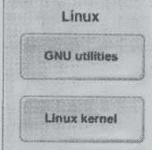

**图 1-3：** `Linux` 是 GNU 实用程序和 `Linux Kernel` 的结合。

## Linux 内核的起源

`Linus Torvalds`，芬兰赫尔辛基大学的学生，于 1991 年独立开发了一个类 Unix 操作系统内核供自己使用，灵感来自另一个名为 `Minix` 的系统。他将自己的创作发布在互联网上，并询问其他程序员帮助他进一步开发。到那时，`Linux` 已经可以运行 `bash`、`gcc` 和 `gnu-sed` 等 Unix 实用程序。直到 `Torvalds` 同意在 GPL 下发布 `Linux`，GNU 计划才成为一个完整的操作系统，并且内核本身作为操作系统在缺乏实用程序的情况下是不完整的。

## Linux 时间线

下表概述了 `Linux` 开发中的重要日期。

| 年份 | 相关 Linux 事件 |
|---|---|
| 1984 | 理查德·斯托曼启动了 GNU 计划。 |
| 1989 | 发布了 GNU 和 GPL。 |
| 1991 | `Linus Torvalds` 开发了一个名为 `Linux`（版本 0.02）的类 Unix 操作系统。 |
| 1992 | `Linux Kernel 1.0` 在 GPL 下发布，`S.u.S.E.` 和 `TurboLinux` 成立。 |
| 1993 | `Red Hat` 成立，`Debian` 计划启动，`Slackware` 首次发布。 |
| 1994 | `Caldera Inc.` 成立。 |
| 1995 | 发布 `Red Hat Linux 4.0`。 |
| 1996 | 建议将企鹅（`Tux`）作为 `Linux` 的吉祥物，并发布 `Linux Kernel 2.0`。 |
| 1997 | 发布 `Red Hat Linux 5.2` 和 `Debian 1.3`。 |
| 1998 | `MandrakeSoft` 成立，发布 `Debian 2.0`。 |
| 1999 | 发布 `Red Hat Linux 6.0` 和 `SuSE 6.3`。 |
| 2000 | 发布 `Red Hat Linux 7.0` 和 `Caldera OpenLinux eDesktop 2.4`。 |
| 2001 | 发布 `Linux Kernel 2.4`、`SuSE 7.2`、`Debian 2.2r`、`Slackware 8.0`、`Caldera OpenLinux Server` 和 `Workstation 3.1`。 |
| 2002 | 发布 `GNOME 2.0`。 |
| 2003 | 发布 `Linux Kernel 2.6` 和 `Fedora`。 |
| 2004 | GNU 计划庆祝成立 20 周年，发布 `GNOME 2.6` 和 `Ubuntu Linux` 的第一个官方版本。 |
| 2005 | 发布 `Red Hat Enterprise Linux 4`。`Mandrake Linux` 更名为 `Mandriva Linux`。 |
| 2007 | 发布 `Red Hat Enterprise Linux 5` 和 `Red Hat Enterprise Linux 5` 更新 1 (`5.1`)。 |
| 2008 | 发布 `Linux Kernel 2.6.28` 和 `Red Hat Enterprise Linux 5` 更新 2 (`5.2`)。 |
| 2009 | 发布 `Red Hat Enterprise Linux 5` 更新 3 (`5.3`) 和 `Linux Kernel 2.6.29`。 |


## Linux 的用途

`Linux` 主要用作服务器、工作站和桌面。

| 用途 | 描述 |
|---|---|
| 服务器 | 用作 Web 服务器来托管网站，以及用作文件服务器为多个客户端提供文件访问。也用于控制和保护网络流量。 |
| 工作站 | 专为面向程序员的环境设计。 |
| 桌面 | 专注于运行办公、图形应用程序和游戏的家庭用户。 |

### Linux 的其他用途

`Linux` 操作系统非常通用。它可以用作：

- 域名服务器

- 路由服务器

- 数据库服务器

- 软件开发平台

- 并行处理器

- 网关服务器


## Linux 的优点

作为一个开源操作系统，`Linux` 在其用户基础的支持下不断演变。`Linux` 的优点每天都在增加。其中一些包括：

- 成本低

- 许可简单

- 增加错误检测的可能性

- 更好的性能和稳定性

- 易于定制的能力

- 提高安全性

- 不同版本间软件的兼容性

- 更小的文件尺寸和减少的系统资源使用

### Linux 的缺点

与任何操作系统一样，`Linux` 有一些缺点。其中一些包括：

- 主流应用程序数量有限。

- 可能缺乏信心，认为单一供应商可以提供支持。

- 操作系统是免费的，但教授员工如何使用的成本可能很高。

## 将 Linux 与其他操作系统进行比较

在许多方面，`Linux` 与其他操作系统相同。它拥有图形用户界面 (GUI)，你可以使用它来编辑文档、浏览互联网和玩游戏。`Linux` 的突出之处在于其稳定性和可靠性。`Linux` 几乎可以运行在所有硬件上，例如 Macintosh、PC，甚至大型机 (Mainframe)。

## Linux 发行版

自创建以来，`Linux` 已演变出数百个发行版，也称为 `distros`，每一个都根据设计者的需求进行了定制。如果你是初学者，由于主流发行版安装过程简化，你会更容易选择其中之一。一些常见的发行版包括：


- `Red Hat Enterprise Linux`

- `Fedora`

- `SUSE Linux Enterprise`

- `openSUSE`

- `Debian`

- `Mandriva`


- `Ubuntu`

- `Mint`

## 常见 Linux 发行版的网络参考

你可以参考以下网站了解常见的 Linux 发行版：

- Red Hat Enterprise Linux: `www.redhat.com`

- Fedora: `http://fedoraproject.org`

- Debian: `www.debian.org`

- SUSE Linux Enterprise: `www.novell.com/linux`

- openSUSE: `www.opensuse.org`

- Mandriva: `www.mandriva.com`

- Ubuntu: `www.ubuntu.com`

- Mint: `www.linuxmint.com`

## 软件获取

获取 `Linux` 软件有两种方式：从当地电脑商店购买或从网站下载。虽然从商店购买 `Linux` 软件很方便，但通过宽带连接下载也同样实用。


## 比较发行版及其打包方案

各个 `Linux` 发行版彼此相似，且各有优缺点。每个发行版打包的软件对你使用 `Linux` 的方式会产生巨大影响。虽然你总是可以下载或购买缺失的组件，但如果组件已经过测试和编译以配合你的发行版工作，那么软件包会更易使用。

## 活动 1-1

回顾 `Linux` 的发展

场景：

你的经理 Linda 让你研究在商业环境中使用 `Linux` 的优缺点。她特别想了解开源软件的基本概念，并比较各种 `Linux` 发行版的特性。

1. 以下关于开源软件的哪些陈述是正确的？选择所有适用项。

    - a) 其源代码对所有人员开放。

    - b) 用户有权修改和再分发它。

    - c) 它总是零价格提供。

    - d) 它不能被更新。

2. 以下哪些陈述适用于 `Linux`？选择所有适用项。

    - a) 提高了安全性

    - b) 具有专有性质

    - c) 可定制

    - d) 许可程序简单

    - e) 成本高昂

3. 判断正误？在 `GPL` 下发布的软件可以被任何用户修改并受版权保护。

    - 错误

4. `Linux` 有哪些优点？选择所有适用项。

    - a) 允许软件进行定制。

    - b) 附带强大的单一供应商支持。

    - c) 由于能够查看代码的程序员数量增加，增加了检测 `bug` 的可能性。

    - d) 在用户中培养了一种社区意识，以及对软件共有责任感的认知。

5. 使用 `Linux` 可能有哪些缺点？选择所有适用项。

    - a) 获取 `Linux` 许可是一项困难的任务，需要大量资金。

    - b) 可用的主流应用程序数量有限。

    - c) 可能缺乏信任单一供应商能够提供支持的安心感。

    - d) 主流 `Linux` 发行版附带一套游戏以及办公、网络和图形应用程序。

6. 判断正误？`Linux` 发行版的数量有限，这就是用户在决定使用哪个发行版时遇到困难的原因。

    - 错误

7. 判断正误？由于 `Linux` 的许可条款简单，IT 管理员不必花费大量时间监控安装数量或跟踪许可证。

    - 错误

## 主题 B

### 输入 Shell 命令

既然你了解了 `Linux` 的起源，你应该学习它的基础知识以便使用它。`Linux` shell 提示符是你输入命令的地方。在本课中，你将学习 shell 并输入 shell 命令。

学习输入 shell 命令可以让你直接与 `Linux` 操作系统交互。你将能够利用 `Linux` 命令执行各种任务。在 `Linux` 的形成阶段，它完全通过命令行界面使用 shell 命令进行操作。随着 GUI 的加入，任务变得更加容易，但了解 shell 命令仍然拥有强大的力量和灵活性。

### 命令行界面


`命令行界面` (`CLI`) 是一种基于文本的操作系统接口，用户通常在 `命令提示符` 处输入命令，指示计算机执行特定任务。`命令行解释器`，或命令行 shell，是一个实现文本界面中输入的命令的程序。命令行解释器分析用户提供的输入文本，在给定上下文中解释文本，然后提供输出。


### 图形用户界面

`Linux 图形用户界面 (GUI)` 是一组图标、窗口和其他屏幕图形元素，帮助用户与操作系统交互。桌面菜单提供访问 `Linux` 桌面上可用的 `GUI` 应用程序的途径。有不同的 `GUI` 实现，例如 K 桌面环境 (`KDE`) 和 GNU 对象模型环境 (`GNOME`)。


**图 1-5：** 一个 `GNOME` 桌面。

下表列出了 `GNOME` GUI 中常见桌面菜单类别的用途。

| 桌面菜单类别 | 用于 |

| --- | --- |

| 附件 | 访问执行与工作相关任务的应用程序，例如创建文本文档和演示文稿，或使用计算器。 |

| 互联网 | 访问执行互联网任务的应用程序，例如网页浏览器、电子邮件客户端、即时通讯器或网页编辑器。 |

| 声音和视频 | 访问观看电影和收听声音文件或 CD 的应用程序。 |

| 系统工具 | 访问更改 `Linux` 系统设置的选项。 |

| 帮助 | 访问 `Linux` 的帮助信息。 |


### Shell

**定义：**

Shell 是一个直接与用户交互的组件。它还充当 `Linux` 系统的命令解释器。Shell 接受用户命令并确保内核执行它们。Shell 还包含一种解释型编程语言。

下表描述了 `Linux` 中可用的各种 shell。

| Shell | 描述 |

| :--- | :--- |

| `Bash` | 这是默认的 `Linux` shell。它在 Bourne shell 类型环境中提供了 C shell 的灵活性。使用命令 `bash` 打开 Bash shell。 |

| `Bourne` | 这是由 Bell Labs 的 Steve Bourne 开发的原始 Unix shell，适用于所有 `Linux` 系统。使用命令 `sh` 打开 Bourne shell。 |

| `C shell` | 这是由 Berkeley 的 Bill Joy 开发的，旨在支持 C 语言开发环境。它还旨在更交互式地使用，提供了几种减少完成任务所需键入量的方法。使用命令 `csh` 打开 C shell。 |

| `Korn` | 这个 shell 是 C shell 和 Bourne shell 的结合体。它使用 C shell 的功能，但使用 Bourne shell 的语法。使用命令 `ksh` 打开 Korn shell。 |

**示例：**


*图 1-6：一个空白的 shell 提示符。*

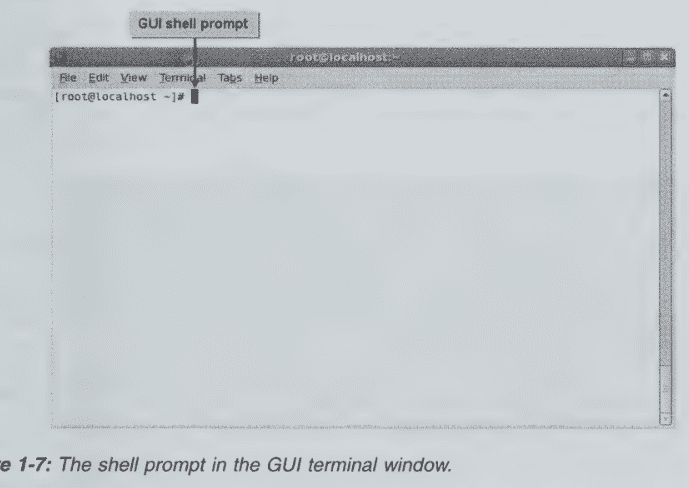

图 1-7：GUI 终端窗口中的 shell 提示符。

## 打开多个 Shell

你可以同时打开多个 shell，每个 shell 中运行不同的进程或程序。例如，要打开第二个 `Bash` shell，请在命令提示符下输入 `bash`。要打开 C shell，请输入 `csh`。要关闭一个 shell，可以输入 `exit` 或按 `Ctrl+D`。

## 确定当前 Shell

`echo` 命令可以让你确定登录时建立的 shell。要确定当前的 shell，请输入 `echo $SHELL`，其中 `$SHELL` 是保存当前 shell 名称的环境变量名。

## 每次查看一页文件

要每次查看一页文件，只需在你想打开的文件名前输入 `more` 命令。例如，如果你想读取 `/etc/passwd` 文件，请输入 `more /etc/passwd`。

## head 和 tail 命令

`head` 命令显示每个文件的前 10 行。`tail` 命令显示每个文件的后 10 行。当你只需要查看文件的开头或结尾时，这些命令非常有用。例如，你可以通过查看日志文件的最后 10 行来检查最近的日志条目。

## 虚拟终端


终端或控制台是一种用于文本输入和显示的计算机接口，信息以预定义字符数组的形式显示。`Linux` 在 `CLI` 模式下支持六个虚拟终端，它们提供带有 shell 登录提示符的文本终端。你可以使用 `Ctrl+Alt+F1–F6` 键组合在这六个终端之间进行选择。你可以同时登录多个虚拟终端。


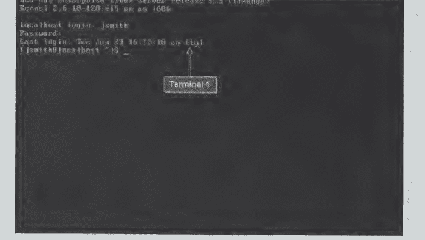

## Shell 命令


Shell 命令的通用格式为`command -option argument`。输入命令后，shell 会通过执行与该命令关联的具体操作进行响应。Linux 区分大小写，因此你必须按照要求的大写或小写格式输入命令。

```
[root@localhost ~]# ls -l /usr
total 236
drwxr-xr-x   2 root root  61440 May 25 13:44 bin
drwxr-xr-x   2 root root  4096 Aug  8  2008 etc
drwxr-xr-x   2 root root  4096 Aug  8  2008 games
drwxr-xr-x  123 root root 12288 May 25 11:42 include
drwxr-xr-x    6 root root  4096 May 25  2008 kerberos
drwxr-xr-x  106 root root 57344 May 25 13:04 lib
drwxr-xr-x   12 root root  4096 May 25 13:04 libexec
drwxr-xr-x   11 root root  4096 May 25 11:25 local
drwxr-xr-x    2 root root 16384 May 25 13:04 sbin
drwxr-xr-x  210 root root  4096 May 25 11:48 share
drwxr-xr-x    4 root root  4096 May 25 11:30 src
lrwxrwxrwx    1 root root     10 May 25 11:25 tmp -> /var/tmp
drwxr-xr-x    3 root root  4096 May 25 11:27 X11R6
[root@localhost ~]#
```

图 1-9：`ls` 命令显示 `usr` 目录中的文件列表。

## 参数

`参数`，也称为命令行参数，通常是文件名或目录名，指示命令将对其操作的文件。在 Linux 中，它被某些命令用作输入。参数可以是文件、目录、命令甚至命令开关。例如，`ls (file_name)`、`ls (directory_name)` 和 `ls -l`。

## 命令历史

有时，命令可能会变得非常长。你可以使用`向上箭头`和`向下箭头`键访问存储在历史文件中的之前输入的命令。

## Tab 补全功能

某些命令名称较长，包含版本号信息、拼写怪异或大小写混合。这使得第一次正确输入命令变得困难。在这种情况下，你可以利用 Tab 补全功能。要使用此功能，输入命令的前几个字符，然后按`Tab`键。如果只有一个匹配项，将显示其余的文件名。如果你按下你想要文件名的下一个字母并再次按`Tab`键，应该会显示完整的文件名。如果系统仍然无法区分命令，它会再次发出蜂鸣声，你必须输入额外的字符或按两次`Tab`键以查看所有可用选项。

## 发出多个命令

你可以在按`Enter`之前发出多个命令。在命令之间放置分号（`;`），它们将依次执行。

## date 命令

`date` 命令显示系统设置的当前日期和时间。你可以使用连字符（`-`）或冒号（`:`）分隔日期的不同字段以获得清晰的输出。


```
The date command
root@localhost:~# date
Wed Jun 24 07:59:43 EDT 2009
root@localhost:~#
```

`图 1-10：使用 date 命令查看当前日期。`

## 语法

`date` 命令的语法是 `date +[format]`，其中 `FORMAT` 是用于显示输出的不同字段的字符字符串。

## date 命令使用的字符

以下是用于显示 `date` 命令不同字段的字符。

| 字符 | 描述 |
| :---: | :---: |
| `%d` | 显示当月的当前日期（01 到 31）。 |
| `%D` | 以 `mm/dd/yy` 格式显示日期，其中 `mm` 是月份，`dd` 是日期，`yy` 是年份。 |
| `%H` | 以 24 小时格式显示当前小时（00 到 23）。 |
| `%I` | 显示当前小时（1 到 12）。此选项不会在小时后面显示 A.M. 或 P.M.。 |
| `%m` | 显示当前月份（01 到 12）。 |
| `%M` | 显示当前分钟（00 到 59）。 |
| `%r` | 以 12 小时格式显示时间，即 `hh:mm:ss [A.M. 或 P.M.]`。 |
| `%R` | 以 24 小时格式显示时间，即 `hh:mm`。此选项不显示秒。 |
| `%S` | 显示秒（00 到 60）。 |
| `%T` | 以 24 小时格式显示时间，即 `hh:mm:ss`。此选项也显示秒。 |
| `%y` | 显示当前年份的最后两位数字。 |
| `%Y` | 以四位数字（`yyyy`）显示当前年份。 |

## cal 命令


`cal` 命令显示任何月份或年的日历。如果你没有指定 `cal` 命令的月份或年份，它将显示当前月份的日历。你可以通过在 `cal` 命令后指定月份和年份来显示某一年中特定月份的日历。年份必须以 `yyyy` 格式指定。命令 `cal 09` 将显示公元 9 年的日历，而不是 2009 年的日历。

The cal command

```
File  Edit  View  Terminal  Tabs  Help

root@localhost: ~# cal
June 2009
Su Mo Tu We Th Fr Sa

1  2  3  4  5  6
7  8  9 10 11 12 13
14 15 16 17 18 19 20
21 22 23 24 25 26 27
28 29 30

root@localhost: ~#
```

`图 1-11：使用 cal 命令查看当前月份的日历。`

## 语法

`cal` 命令的语法是 `cal {month} {year}`。

## cal 命令的选项

`cal` 命令的一些选项包括：

| 选项 | 描述 |
| :----- | :---------- |
| `-m` | 将星期一显示为每周的第一天。 |
| `-j` | 显示儒略日日期。 |
| `-y` | 显示当前年份的日历。 |

## uptime 命令

`uptime` 命令显示系统开始运行以来的时间。`uptime` 命令的输出提供了关于当前时间、系统运行时长以及当前登录用户数的信息。


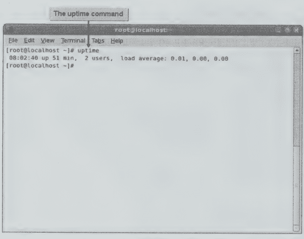

图 1-12：使用 `uptime` 命令查看系统开始运行以来的时间。

## 负载平均值

`uptime` 命令输出的最后一个字段显示系统在过去 1 分钟、5 分钟和 15 分钟内的负载平均值。此信息可用于检查系统是否繁忙。

## who 命令

`who` 命令用于确定当前登录到系统的用户详细信息。`who` 命令的输出包括用户名、用户连接的来源系统名称以及用户连接以来的时间。


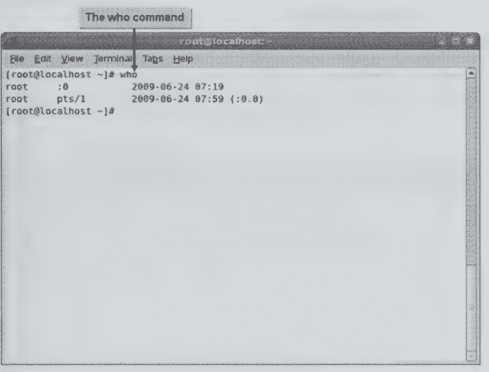

图 1-13：使用 `who` 命令显示用户详细信息。

## who 命令选项

`-i` 选项可用于查看用户空闲了多久。一个点（`.`）表示用户在最后一分钟内是活跃状态，`old` 表示用户已闲置超过 24 小时，而 2 分钟到 23 小时 59 分钟之间的任何值则显示其空闲时长。`-am` 选项仅显示运行该命令的用户的信息。输出内容前会带有主机名。

## whoami 命令

`whoami` 命令用于显示当前登录到系统的用户名。有时，您可能需要登录系统并在不同用户之间切换，此时您可能不确定当前登录的是哪个用户。在这种情况下，您可以使用 `whoami` 命令来查看当前的用户名。


### whoami 命令

```
root@localhost:~
File Edit View Terminal Tabs Help
root@localhost:~# whoami
root
root@localhost:~#
```


*图 1-14：使用 `whoami` 命令显示用户名。*


## `hostname` 命令

`hostname` 命令用于显示当前登录系统的主机名。当您使用同一个终端登录到不同的系统时，可以使用 `hostname` 命令来识别您当前正在运行命令的系统。

### `hostname` 命令

```
root@localhost:~
File Edit View Terminal Tabs Help
root@localhost:~# hostname
localhost.localdomain
root@localhost:~#
```

*图 1-15：使用 `hostname` 命令查看 Linux 系统的主机名。*

## `w` 命令

`w` 命令主要用于显示当前登录到系统的用户及其事务的详细信息。输出的第一行显示系统状态。

输出的第二行显示一个表格，第一行列出登录到系统的用户，最后一列指示用户的当前活动。表格中的其余列显示与用户相关的不同属性。


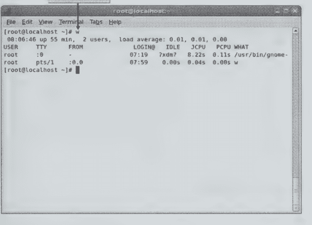

图 1-16：使用 `w` 命令查看用户详细信息。

## `last` 命令

`last` 命令显示用户登录和注销的历史记录，包括实际的时间和日期。它还有选项可以过滤通过特定终端登录的用户。例如，`last 1` 将显示使用第一个终端登录的用户的详细信息。`last` 命令从 `/var/log/wtmp` 文件中检索信息。


图 1-17：查看用户登录的历史详情。

## `echo` 命令

`echo` 命令用于在终端上显示一行文本。它对编写 shell 脚本的程序员很有用，因为它可以用来显示附加信息。需要显示的文本应插入到 `echo` 命令之后。您还可以通过在 `echo` 命令后指定变量名来显示存储在变量中的值。

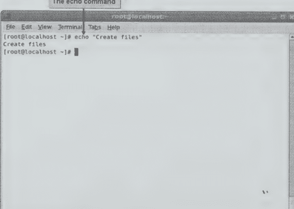

图 1-18：使用 `echo` 命令显示文本。

### 语法

`echo` 命令的语法为 `echo {"string"}`。

## `sleep` 命令

`sleep` 命令用于暂停系统活动指定的时间。`sleep (time)` 命令会挂起提示符，挂起时长由变量 `time` 的值（单位为秒）指定。


### `sleep` 命令

```
root@localhost:~
[root@localhost ~]$ sleep 65
```

图 1-19：使用 `sleep` 命令暂停活动。

## `cat` 命令

`cat` 命令用于显示、合并和创建文本文件。该命令经常用于读取小型文本文件。


`cat` 命令的名称是单词 `concatenate`（连接）的缩写。

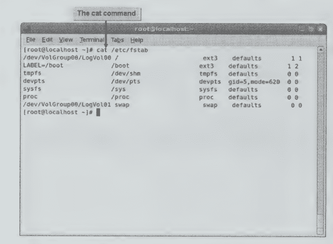

图 1-20：`cat` 命令显示一个文本文件。

`cat` 命令的选项在以下表中描述。

| 选项 | 描述 |
| :--- | :--- |
| `-n` | 在输出前加上相应的行号。 |
| `-b` | 为行编号，但排除空行。 |
| `-u` | 不对输出进行缓冲。（默认输出是缓冲的。） |
| `-s` | 不显示不存在文件的结果。 |
| `-v` | 将不可打印字符显示为可见字符，制表符、换行符和换页符除外。 |
| `-e` | 在每行的末尾，换行符之前打印一个 `$` 字符。 |
| `-t` | 将制表符打印为 `^I`，将换页符打印为 `^L`。 |

### 语法

`cat` 命令的语法为 `cat [command options] (file name)`。

## `which` 命令

`which` 命令用于验证用户是否有权限执行某个命令。`which` 命令通过搜索分配给 `PATH` 变量的目录来显示命令的完整路径。例如，输入 `which cat` 后，将显示以下输出：`/bin/cat`


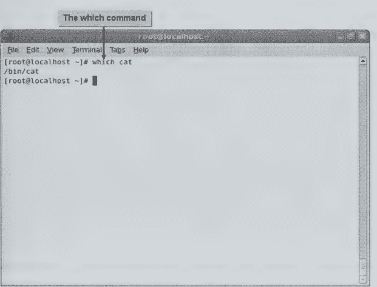

*图 1-21：* `which` 命令显示命令的完整路径。

## 如何输入 Shell 命令

### 操作参考：登录您的系统

要登录您的系统：

1. 登录到系统的 GUI。
   - 在 `Username`（用户名）文本框中，输入用户名。
   - 在 `Password`（密码）文本框中，输入用户的密码。

2. 登录到 Linux 系统的 CLI。
   - 按 `Ctrl+Alt+F1` 切换到第一个终端。
   - 要登录系统，请输入用户名。
   - 输入密码。

### 操作参考：监控用户登录

要监控用户登录：

1. 以 `root` 身份登录。

2. 监控系统中的用户登录。
   - 输入 `w` 以显示有关已连接用户及其关联进程的信息。
   - 输入 `who` 以显示当前登录到系统的用户。

### 操作参考：使用命令检查系统日期和日历

要检查系统日期和日历：

1. 登录到 Linux 系统的 CLI。

2. 输入 `date` 命令以查看日期详情。
   - 输入 `date` 以检查系统当前的日期和时间。
   - 输入 `date +%m-%d-%y` 以月-日-年格式查看日期。
   - 输入 `date +%r` 以时分秒 `[AM 或 PM]` 格式查看当前时间。

3. 输入 `cal` 命令以查看特定的日历。
   - 输入 `cal` 以显示当前月份的日历。
   - 输入 `cal [month] [year]` 以查看特定月份的日历。
   - 输入 `cal [option]` 以特定格式显示日历。


4. 如有必要，输入 `clear` 命令以清除终端屏幕。

### 操作参考：使用命令显示系统信息

要显示系统信息：

1. 输入合适的命令以查看特定的系统信息。
   - 输入 `uptime` 以检查系统自启动以来的运行时长。
   - 输入 `last` 以显示登录历史记录。
   - 输入 `lastb` 以显示系统上的无效登录历史记录。
   - 输入 `hostname` 以显示当前登录系统的主机名。
   - 输入 `whoami` 以显示当前登录的用户名。

## 活动 1-2

### 使用基本命令

**开始之前：**

1. 已设置并配置 `Red Hat Enterprise Linux 5.3` 服务器使用 `GNOME` GUI。

2. 系统已启动，并显示 GUI 登录屏幕。

**场景：**

您在工作站上获得了一台 Linux 系统，需要与同事团队合作，您的同事也将从其自己的系统访问您的系统。登录到系统后，您决定检查连接到您系统的用户详细信息，以更新您对系统使用的了解。


| 您所做的操作 | 如何执行 |
| :--- | :--- |
| 1. 以 `jsmith` 身份登录 GUI。 | a. 在 `Username`（用户名）文本框中，输入 `jsmith` 并按 `Enter`（回车）以登录系统。<br>b. 在 `Password`（密码）文本框中，输入 `myp@$$word` 并按 `Enter`（回车）以登录系统。 |
| 2. 以 `jsmith` 身份登录第一个终端。 | a. 按 `Ctrl+Alt+F1` 切换到第一个终端。<br>b. 输入 `jsmith` 并按 `Enter`（回车）以登录第一个终端。<br>c. 输入 `myp@$$word` 并按 `Enter`（回车）。<br>d. 在命令行中输入 `date` 以查看系统当前的日期和时间。<br>e. 观察系统当前的日期和时间已显示。 |

### 3. 以 `eric` 身份登录到第五个终端。

- 按 `Ctrl+Alt+F5` 切换到第五个终端。

- 输入 `eric` 并按 `Enter` 键登录到第五个终端。

- 输入 `myp@$$w0rd` 并按 `Enter` 键。

- 输入 `date` 查看系统的当前日期和时间。

- 观察系统当前日期和时间的显示。

### 4. 以 `robert` 身份登录到第六个终端。

- 按 `Ctrl+Alt+F6` 切换到第六个终端。


- 输入`robert`并按`Enter`键登录到第六个终端。

- 输入`myp@$$w0rd`并按`Enter`键。

- 输入`cal`查看当月的日历。

- 观察当月日历的显示。

### 5. 查看当前登录到 Linux 系统的用户列表。

- 按`Ctrl+Alt+F1`切换到第一个终端。

- 输入`who`查看当前登录到 Linux 系统的用户列表。

- 观察命令输出第一列中显示的用户名列表。

### 6. 显示当前登录到 Linux 系统的用户信息。

- 输入`w`显示当前登录到 Linux 系统的用户信息。

- 检查`USER`和`WHAT`列，以确认当前登录用户的名称并获取每个用户正在执行的操作信息。

- 输入`clear`清除终端屏幕。

# 活动 1-3

## 使用系统命令

**开始前：**

你已在 CLI 的第一个终端中登录为 `jsmith`。

**场景：**

在查看了连接到你的系统的用户详情后，你决定检查系统的详细信息、系统运行的持续时间以及系统的日期和时间。

| 执行的操作 | 操作方法 |
| :--- | :--- |
| 1. 检查你的 Linux 系统的名称。 | a. 在命令行中，输入 `hostname` 以检查你的 Linux 系统的名称。<br>b. 观察你系统的主机名。<br>c. 输入 `clear` 清除终端屏幕。 |
| 2. 检查系统已运行多长时间以及当前的日期和时间。 | a. 输入 `uptime` 以检查系统已运行多长时间。<br>b. 观察命令输出第一列显示系统已运行的时长。<br>c. 输入 `date` 以检查你系统的当前日期和时间。<br>d. 观察显示的日期和时间。 |
| 3. 检查当前的日历。 | a. 输入 `cal` 以查看当月的日历。<br>b. 观察当月的日历。输入 `cal <year>` 以查看当年的日历。<br>c. 观察当年的日历。输入 `clear` 清除终端屏幕。 |

# 主题 C

## 获取 Linux 帮助

现在你熟悉了 Linux Shell，你可能希望开始在系统中使用命令。但是，你可能需要各种可用命令的帮助。在本主题中，你将熟悉 Linux 提供的帮助和支持选项。

通过了解 Linux 支持选项，你可以增加对 Linux 环境信息的访问。这样做将有助于你支持 Linux 的实施。Linux 文档中提供的信息将使你能够轻松地排查遇到的问题。

# Linux 文档

**定义：**

Linux 文档是提供有关各种 Linux 命令和代码块信息的材料。一些 Linux 文档以电子格式提供，另一些则以印刷格式提供。Linux 文档可从手册页、在线资源、出版作品、Usenet 新闻组和邮件列表等来源获得。


**示例：**


# 系统文档

系统文档是指列出了系统要求的文档集合；其功能能力、限制、设计规格；系统的内部工作机制；以及维护系统的步骤。

# 手册页

Linux 手册页（或 man 页）包含针对每个 Linux 命令的完整文档；它们以简单的 ASCII 文本格式呈现。特定命令的手册页使用 `man` 命令显示。手册页默认在系统上可用。它们通常包含如下信息：命令名称、其语法、用途说明、支持的选项、命令常用用法的示例，以及相关命令列表。

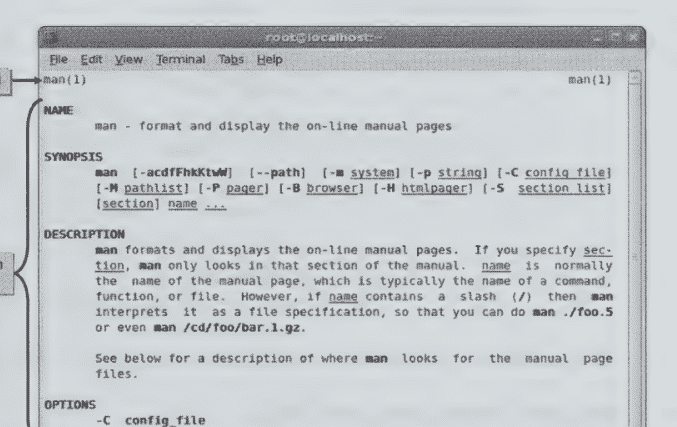

图 1-23：查看手册页上的信息。

## 语法

`man` 命令的语法为 `man topic`。

## man 命令选项

`man` 命令支持不同的选项。此处列出了部分常用选项。

| 选项 | 描述 |
| :--- | :--- |
| -a | 查找与查询匹配的所有条目。 |
| -D | 显示调试信息。 |
| -f | 显示命令的简短描述以及手册页/章节。 |
| -h | 显示 `man` 命令的帮助选项。 |
| -k | 列出包含该关键字的所有手册页/章节及其位置。 |
| -K | 在所有页面上搜索指定的字符串。 |
| -t | 对手册页进行格式化以便打印。 |

## 手册页章节

单个命令的手册页可能列在多个章节下。可以使用 `whatis` 命令列出特定命令的所有可用手册页章节。当一个命令列有多个章节时，意味着可以从多个来源获取相同命令的文档。这些章节通过命令旁边显示的数字来标识，例如，`fsck (8)`。

下表列出了各种手册页章节。

| 章节编号 | 包含内容 |
| :--- | :--- |
| 1 | 通用命令 |
| 2 | 系统调用 |
| 3 | C 库函数 |
| 4 | 特殊文件（通常位于 /dev 中） |
| 5 | 文件格式和约定 |
| 6 | 游戏和屏幕保护程序 |
| 7 | 杂项 |
| 8 | 系统管理命令和守护进程 |

## 浏览 Linux 手册页的按键

你可以使用多个按键浏览 Linux 手册页。不同按键的功能如下表所示。

| 按键 | 用途 |
| :--- | :--- |
| Home | 移至手册页开头。 |
| End | 移至手册页末尾。 |
| Page Up | 逐页向上滚动。 |
| Page Down | 逐页向下滚动。 |
| N | 移至搜索词的下一个出现位置。 |
| P | 移至搜索词的上一个出现位置。 |
| Q | 退出并返回到 Shell 提示符。 |

# apropos 命令

`apropos` 命令通常在用户不知道该使用哪个命令来执行特定操作时使用。它可以与关键字一起使用，以显示包含该关键字的手册页列表及其手册页章节。`apropos` 命令在一个定期更新的数据库（称为 whatis 数据库）中搜索指定字符串，并返回所有匹配的条目。


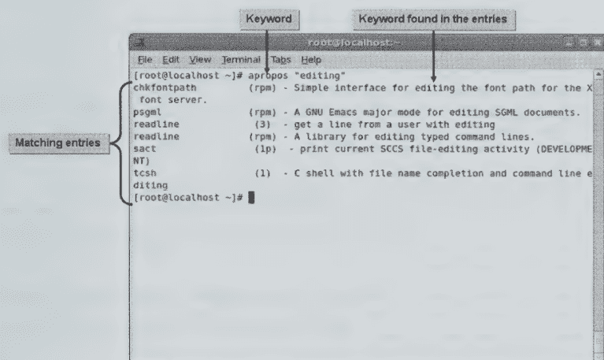

图 1-24：使用 `apropos` 命令搜索帮助。

## 语法

`apropos` 命令的语法为 `apropos keyword`。

## 其他内置帮助选项

除了 `man` 和 `apropos` 命令外，Linux 还提供其他内置帮助选项。


| 帮助选项 | 描述 |
| :--- | :--- |
| whatis | 显示命令的简短描述以及匹配精确命令的手册页/章节。此命令搜索定期更新的数据库以获取文档。该命令的语法为 `whatis command`。 |
| info | 显示包含有关命令的附加或最新信息的信息页。该命令的语法为 `info command`。 |
| command --help | 显示命令用法的快速摘要以及可用参数列表。此功能可用于 Linux 中的大多数命令。该命令的语法为 `command -options`。 |

## /usr/share/doc 目录

`/usr/share/doc` 目录包含系统上安装的有关文档，详细介绍了配置或使用 Linux 的某些方面。

### HOWTO 文档

HOWTO 文档可能会安装在您的系统上，通常位于 `/usr/share/doc` 目录下。这些文件的 HTML 版本可以在任何 Web 浏览器中显示，包括基于文本的 Lynx 浏览器。文本文件可以通过任何文本编辑器查看，或者使用 `cat`、`more` 或 `less` 等显示命令来查看。大多数系统上都可以找到 HOWTO 文档，也可以在网络上 [http://linuxdocs.org/HOWTOs/HOWTO-INDEX/howtos.html](http://linuxdocs.org/HOWTOs/HOWTO-INDEX/howtos.html) 和其他网站找到。

HOWTO 文档是综合性的文档，很像 FAQ（常见问题解答），但通常不是问答形式。然而，许多 HOWTO 文档末尾包含一个 FAQ 章节。有几种可用的 HOWTO 格式：纯文本、PostScript、PDF 和 HTML。除了 HOWTO 文档外，还有许多针对短小、特定主题的 mini-HOWTO 文档。

### 从 Info 页面获取帮助

要显示 info 页面，请输入 `info`，可以带或不带选项和参数。单独使用 `info` 命令时，将显示关于如何操作 info 页面的帮助文件。输入 `info [主题]` 将显示指定主题的 info 页面。命令 `info --help` 显示简短的帮助说明。

当显示 info 页面时，任何前方带有星号（`*`）的文本都是链接。将光标（使用方向键）移动到该文本上，然后按 `Enter` 键访问链接到的 info 页面。要返回上一文档，输入 `U`，然后输入 `D` 返回到页面顶部。输入 `Q` 返回到命令提示符。

### LUG


对于 Linux 用户和开发人员来说，Linux 用户组（LUG）是一个很好的信息源。它们可以是虚拟的（基于 Web 的），也可能在您所在的地区有定期聚会的人群。虚拟用户组有时采取带有问答数据库的留言板形式。


## 在线帮助

互联网是获取任何 Linux 发行版文档的最佳场所。有专门的网站和在线论坛，帮助解决特定发行版或一般 Linux 用户的问题。商业发行版的文档可在其各自的官方网站上获得。这些文档包括不同版本和更新的发行说明、部署指南、安装指南以及虚拟化指南。例如，可以通过 URL [www.redhat.com/docs/manuals/enterprise](www.redhat.com/docs/manuals/enterprise) 访问 Red Hat 的文档。

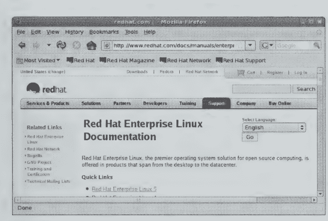

图 1-25: Red Hat 在线文档。

# 如何在 Linux 中访问帮助

## 程序参考：查看 Linux man 页面

要查看 Linux man 页面：

1. 在命令行中，输入 `man [命令]`，其中 `[命令]` 是您想查看其 man 页面的命令。

2. 查看该命令可用的选项列表。

3. 关闭指定命令的 man 页面。

## 程序参考：显示命令的 man 页面

要显示某个命令的 man 页面：

1. 以用户身份登录。

2. 输入 `man [章节] [命令]` 以显示特定章节下特定命令的 man 页面。

3. 浏览 man 页面。

    -   使用**向上箭头**或**向下箭头**键在页面内导航。

    -   使用**向上翻页**或**向下翻页**在多个页面间导航。

    -   根据需要搜索 man 页面中的特定主题。

        a.  输入 `/搜索字符串` 在 man 页面中搜索指定字符串。

        b.  如有必要，输入 `n` 以在 man 页面中定位该字符串的下一个出现位置。

4. 按 `Q` 关闭 man 页面。

## 程序参考：使用 whatis 命令

要使用 `whatis` 命令：

1. 以用户身份登录。

2. 输入 `makewhatis` 以构建 `whatis` 帮助数据库。

3. 输入 `whatis 命令` 以显示指定命令的 man 页面章节及简短描述。

4. 输入 `man [章节] {命令}` 以查看指定章节下指定命令的 man 页面。

5. 按 `Q` 关闭 man 页面。

## 程序参考：使用 apropos 命令查找相关的 man 页面

要使用 `apropos` 命令查找相关的 man 页面：

1. 以用户身份登录。

2. 输入 `apropos 关键词` 以在 `whatis` 数据库中搜索关键词，并显示指定关键词匹配的 man 页面章节。

3. 输入 `man [章节] {命令}` 以显示特定章节下特定命令的 man 页面。

4. 按 `Q` 关闭 man 页面并返回命令提示符。

## 程序参考：显示命令的 Info 文档

要显示命令的 info 文档：

1. 以用户身份登录。

2. 输入 `info` 命令以读取指定命令的 info 文档。

3. 浏览 info 页面。

    -   使用**向上箭头**或**向下箭头**键在页面内导航。

    -   使用**向上翻页**或**向下翻页**在多个页面间导航。

    -   输入 `n` 或 `p` 分别移动到下一页或上一页。

    -   输入 `s` 以在 info 页面中搜索特定字符串。

    -   使用**Tab** 键移动到下一个链接。

4. 按 `Q` 关闭 info 页面。

## 程序参考：显示命令的选项

要显示命令的选项：

1. 以用户身份登录。

2. 输入 `命令 --help` 以显示命令语法和选项列表。

3. 输入 `命令 -选项` 以使用必要的选项执行所需任务。

# 活动 1-4

## 识别 Linux 文档类型及其用途

**开始前：**

1.  按 **Ctrl+Alt+F5**。

2.  输入 `logout` 并按 **Enter** 以退出第五个终端中的 `eric`。

3.  按 **Ctrl+Alt+F6**。

4.  输入 `logout` 并按 **Enter** 以退出第六个终端中的 `robert`。

5.  按 **Ctrl+Alt+F1**。

**场景：**

您的经理 `Linda` 在理解某些命令时遇到了困难。她知道有几种类型的支持文档可用，但不确定如何使用它们。她还听说，实施 Linux 过程中隐性成本很大的一部分是由于支持有限造成的。她希望您提交一份关于不同类型 Linux 文档及其用途的报告。您决定探索可用的帮助选项。

| 执行的操作 | 操作方法 |
| :--- | :--- |
| 1. 显示 `gzip` 命令的手册。 | a. 在命令行中，输入 `man gzip` |
| | b. 按**空格键**继续阅读 man 页面。 |
| | c. 按 `Q` 返回命令行。 |
| 2. 构建 `whatis` 数据库。 | a. 输入 `logout` 以注销 `jsmith`。 |
| | b. 输入 `root` 以**root** 用户登录。 |
| | c. 在密码提示符处，输入 `p@ssw0rd` |
| | d. 输入 `makewhatis` 以构建 `whatis` 数据库。 |
| 3. 在 man 页面中搜索单词 "zip"。 | a. 输入 `apropos zip` |
| | b. 观察输出列出了找到关键词 "zip" 的所有实例。 |

`makewhatis` 命令大约需要 15 分钟完成。

4.  查看在 man 页面中找到关键词的位置列表。

   a. 在命令行中，输入 `whatis gzip`

   b. 查看结果。

   c. 输入 `clear` 以清除终端屏幕。

5.  判断题？在您的环境中的每个 Linux 系统上，详细报告确切安装和更改的内容是常见的做法。

   -   **正确**

   -   错误

6.  您的 Linux 系统中可能安装有哪些额外的帮助选项？

   -   a) `--help`

   -   b) `helpme`

   -   c) `HOWTO`

   -   d) `Textinfo`

7.  `HOWTO` 文档有哪些可用格式？

   -   a) `PostScript`

   -   b) 电子邮件

   -   c) `PDF`

   -   d) `HTML`

# 活动 1-5

## 使用 Linux 手册页获取帮助

**开始前：**

您已在 CLI 终端中以 `root` 用户身份登录。

**场景：**

您的组织支持世界各地的客户，您可能需要支持有时区差异的不同客户。为了实现这一点，您的系统时间应与客户端系统的时间对应。您不确定更改系统日期和时间的程序。您决定浏览手册页以寻找更多帮助。

| 执行的操作 | 操作方法 |
| :--- | :--- |
| 1. 找到 `date` 命令的 man 页面。 | a. 输入 `whatis date` 以查看 `date` 命令在各个章节的相关 man 页面。 |
| | b. 输入 `man 1 date` 以查看第 1 章节下 `date` 命令的 man 页面。 |
| 2. 在 man 页面中搜索。 | a. 输入 `/FORMAT` 以移动到文本 "FORMAT" 的第一个实例。 |
| | b. 输入 `n` 以导航到文本 "FORMAT" 的下一个实例。 |
| | c. 输入 `/to` 以查看 `date` 命令允许的不同格式。 |
| | d. 按 `Q` 关闭 `date` 的 man 页面。 |

3. 查看信息页面。

   - 输入 `info date` 以查看 `date` 命令的完整信息文档。

   - 按 `/` 并输入 `Examples` 以跳转到文本 "Examples"。

   - 按 `/` 然后按 `Enter` 以跳转到下一个 "Examples" 实例。

   - 按 `Enter` 以查看 `date` 命令的示例。

   - 观察 `date` 命令的前三个示例。

   - 按 `Q` 关闭信息页面。

   - 输入 `clear` 以清屏终端屏幕。

## 主题 D

# 启动和停止 Linux

您现在已经了解如何在 shell 中访问文档和日志文件。但如果您不知道如何启动和停止系统，您就无法访问 shell，甚至无法排除系统故障。在本主题中，您将启动和停止 Linux 系统。

我们都期望操作系统在启动时加载并运行必要的进程。然而，作为 Linux 管理员，您可能有时需要手动启动、停止或重启系统。管理这些基本服务的能力将有助于您执行系统维护和升级。

### 服务

**定义：**


Linux 服务是在后台执行任务的应用程序或应用程序集合。运行在 Linux 系统上的服务范围从基本服务到服务器服务。服务可以大致分为关键服务和非关键服务。关键服务是 Linux 系统运行所必需的核心服务。非关键服务是由系统中安装的应用程序初始化的服务。


**示例：**

```bash
root@localhost:~#
[root@localhost ~]# service network status
Configured devices:
to  eth0
Currently active devices:
to  eth0
[root@localhost ~]#
```

*图 1-26：网络服务显示其状态。*

### 守护进程

**定义：**

守护进程是在后台运行且无需人工干预的程序，通常处理用于远程命令执行的命令。它处于休眠状态，直到事件触发其进入活动状态。一些守护进程以固定间隔运行。大多数守护进程在系统启动时启动。守护进程由操作系统、应用程序或手动启动。

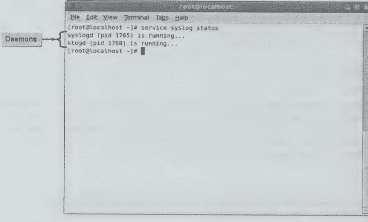

*图 1-27：为 syslog 服务在后台运行的守护进程。*

#### 示例：`lpd` 守护进程

行式打印机守护进程，或 `lpd`，控制打印作业流向打印机。它在后台工作，并将输出发送到打印机，而不影响用户当时正在处理的其他进程。

### `Init` 运行级别

`Init` 用于设置系统的运行级别。运行级别指定了可以存在的进程组。`Init` 在系统启动时从 `/etc/inittab` 文件中的脚本创建进程。您可以使用 `telinit` 命令更改当前运行级别。`init` 手册页说：“`Init` 是所有进程的父进程。”

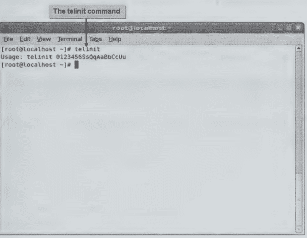

*图 1-28：可以用 `telinit` 命令指定的不同运行级别。*

#### `Init` 运行级别表

下表描述了可以在每个 `init` 级别运行的进程。

| `Init` 级别 | 描述 |
| :--------- | :--------- |
| `0` | 停止系统 |
| `1` | 单用户模式 |
| `2` | 无网络的多用户模式 |
| `3` | 有网络的多用户模式 |
| `4` | 用户可配置 |
| `5` | 用于 GUI (`X11` 多用户模式) |
| `6` | 重启系统 |

### 系统启动

在安装 Linux 期间，您选择的引导加载程序将被放置在**主引导记录** (`MBR`) 上。`GRand` `Unified` `Bootloader` (**`GRUB`**) 和 `Linux` `Loader` (**`LILO`**) 是加载并启动内核的 Linux 引导加载程序。系统中只能使用一个引导加载程序。


### 系统关机

`shutdown` 命令用于关闭系统。这会关闭文件并执行安全关闭系统所需的其它任务。它警告所有用户系统即将关机，并且在该命令发出后，没有人可以登录。在某些安装或移除硬件之后，有必要关闭 Linux 系统。

```
root@localhost~
File Edit View Terminal Tabs Help

[root@localhost~]# shutdown -h now
Broadcast message from root (/pts/1) (Thu Jul 23 12:37:41 2009):
The system is going down for system halt NOW!
[root@localhost~]#
```

*图 1-29：关闭 Linux 系统。*

#### `shutdown` 命令选项

当您需要重新启动您的 Linux 系统时，您应该使用带有适当选项的 `shutdown` 命令。`shutdown` 命令的语法是 `shutdown [-t seconds] [-options] time [warning message]`。

`-t` 选项指定在切换到另一个运行级别之前等待多少秒。其他选项列在以下表中。

| 选项 | 用途 |
| :--- | :--- |
| `-k` | 向每个人发送警告消息，但并未真正关闭系统。 |
| `-r` | 关机后重启系统。重启时，如果您使用的是加载各种操作系统的引导管理器，您可以切换到另一个操作系统或登录到 Linux。 |
| `-h` | 关机后停止系统。此时，您可以安全地关闭电源。 |
| `-n` | 不启动 `init` 就关闭系统。建议不要使用此选项。 |
| `-f` | 在重启时跳过文件系统检查。 |
| `-F` | 强制在重启时进行文件系统检查。 |
| `-c` | 取消正在进行的关机。此选项不使用 `time` 参数，但可以使用警告消息选项。 |

### 如何启动和停止 Linux

#### 程序参考：从 Shell 管理运行级别

要从 shell 管理运行级别：

1. 在命令提示符下，显示您当前的运行级别。
2. 切换到运行级别 `1`。
3. 验证您处于运行级别 `1`。
4. 退出并返回到运行级别 `3`。

#### 程序参考：从配置文件管理运行级别

要从配置文件管理运行级别：

1. 编辑 `/etc/inittab` 文件以在运行级别 `1` 启动。
2. 重启计算机。
3. 验证您处于运行级别 `1`。
4. 编辑 `/etc/inittab` 文件以在运行级别 `3` 启动。
5. 重启计算机。

## 活动 1-6

# 启动和停止 Linux

**开始之前：**

您已在 CLI 中以 `root` 身份登录。

**场景：**

您被赋予了在贵公司管理 Linux 实施的任务。首先，您必须学会启动和停止您的 Linux 系统，并熟悉各种运行级别。

| 您做什么 | 如何做 |
| :--- | :--- |
| 1. 检查各种运行级别。 | a. 在命令行中，输入 `more /etc/inittab` |
| | b. 按空格键两次以继续。 |
| | c. 观察显示器上显示的 `/etc/inittab` 文件内容。 |
| | d. 输入 `runlevel` 以确定您当前的运行级别。 |
| | e. 观察您当前的运行级别。 |
| 2. 切换到单用户模式。 | a. 在命令行中，输入 `telinit 1` |
| | b. 观察前一个运行级别的服务已停止并且运行级别 `1` 的服务已启动。 |
| | c. 输入 `runlevel` 以验证您处于单用户模式。 |
| | d. 观察命令显示 `1 S`，表示单用户 `1`。 |
| | e. 输入 `exit` 返回默认运行级别，即运行级别 `5`。 |
| | f. 按 Ctrl+Alt+F1 切换到 CLI 的第一个终端。 |
| | g. 在登录提示符处，输入 `root` |
| | h. 在密码提示符处，输入 `p@ssw0rd` |
| 3. 重启 Linux 系统。 | a. 在命令行中，输入 `shutdown -r now` |
| | b. 观察在重启系统之前服务已停止且进程已被终止。 |
| | c. 按 Ctrl+Alt+F1 切换到 CLI 的第一个终端。 |
| | d. 使用密码 `p@ssw0rd` 以 `root` 身份登录到系统 |

### 第 1 课后续

在本课中，您识别了基本的 Linux 概念并执行了基本的 Linux 任务。这些技能可以帮助您支持 Linux 用户和机器。

1. **与授权软件相比，开源软件有哪些优势？**

   *答案可能各不相同，但可能包括：开源软件使用户能够访问其源代码并赋予他们修改它的权利。这确保了软件功能的持续改进并增加了检测到 bug 的可能性。*

2. **使用 Linux 有哪些优势？**

   *答案可能各不相同，但可能包括：低成本、易于授权和自定义，以及稳定性。*

## 2 管理用户和组账户

**课程时长：** 1小时15分钟

### 课程目标：

在本课中，您将管理用户和组账户。

您将：

- 创建用户和组账户。
- 配置用户配置文件。
- 管理用户账户。

### 简介

您现在已经熟悉了 Linux 的历史、其 Shell 以及其帮助和支持选项。这些基础知识是一个好的起点，但还有更多内容需要学习。在用户能够利用操作系统之前，需要创建用户账户。您还需要创建组账户来管理用户。在本课中，您将管理用户和组账户。

Linux 的好处之一是它的多用户功能。通过创建和修改用户和组，您可以进一步根据组织的需求定制 Linux 环境。在为用户创建账户后，您还将能够为用户提供个性化服务。

本课涵盖以下 CompTIA Linux+ (2009) 认证目标的全部或部分：

- 主题 A
  - 目标 5.1
- 主题 B
  - 目标 5.1
- 主题 C
  - 目标 5.1


### 目标 5.1

### 主题 A

## 创建用户和组账户

在本课中，您将管理用户和组账户。管理它们的第一步是创建您需要的账户。在本主题中，您将创建用户和组账户。

作为 `Linux+` 管理员，您需要定期创建用户和组账户。通过创建用户账户，您将允许用户访问 `Linux` 系统。组账户允许您将具有相似功能的用户分组在一起。这将大大减少您在监控和管理用户活动方面投入的时间和精力。

## 用户账户

**定义：**

`用户账户` 是系统中定义用户的 `information` 集合。它是用户在计算机上的表示。用户账户信息包括用户登录系统所需的用户名和密码、用户所属的组，以及用户访问系统及其资源的权利和权限。当创建一个账户时，它会分配一个称为 `用户 ID (UID)` 的唯一编号。

**示例：**

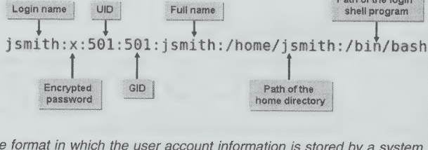

## `useradd` 命令

`useradd` 命令用于添加新用户。您需要在命令中指定用户名来创建新的用户账户。运行与某些服务相关的进程需要特殊用户账户。例如，`ntp` 是一个用于运行 `NTPD` 服务的用户账户。


> `adduser` 文件是一个脚本文件，执行与 `useradd` 命令相同的功能。

## 特殊用户账户

在特殊用户账户中，用户的 `UID` 值将小于默认的 `UID` 值（即 500）。这些特殊用户将没有主目录。您可以使用 `useradd -r 特殊用户名` 命令创建特殊用户账户。

## 用户账户

`Linux` 允许您通过直接编辑 `password` 文件来添加用户账户。但是，这不建议这样做，因为如果您不小心遗漏了某些内容或修改了现有的用户账户，可能会损坏您的系统。如果系统受损，没有人能够登录——即使是 `root` 用户。在这种情况下，您将不得不重新安装系统并重新定义用户账户。

## 默认用户账户

在安装系统时，默认会创建许多用户账户。一些主要的用户账户包括：

- `root`
- `bin`
- `daemon`
- `ftp`
- `sshd`
- `nfsnobody`
- `apache`
- `squid`


默认用户账户

## `Root` 的角色

每个 `Linux` 系统至少有一个系统管理员，其工作是维护系统并使其可供用户使用。这个用户就是 `root`。`root` 用户可以在 `Linux` 系统上执行任何任务而不受限制。系统管理员还负责向系统添加新用户并设置其初始环境。

## 密码

密码是允许 `Linux` 系统对用户进行身份验证的实体。通常，如果在创建用户账户时未设置密码，它们很容易被滥用。因此，当创建用户账户时，您应立即为用户设置密码。在 `Linux` 中，如果未为用户账户设置密码，该账户会自动锁定。这是为了防止对系统的未经授权的访问。


密码

```
[root@localhost ~]# passwd pat
Changing password for user pat.
New UNIX password:
Retype new UNIX password:
password: all authentication tokens updated successfully.
[root@localhost ~]#
```

图 2-3：为用户 "pat" 设置密码。


您可以使用 `passwd` 命令更改您的用户账户密码。您不能更改任何其他用户账户的密码，因为 `passwd` 命令不允许您指定其他用户名。只有 `root` 用户可以通过在 `passwd` 命令中指定用户名来更改其他用户的密码。

## 语法

`root` 用户可以通过输入 `passwd [user_name]` 来为用户创建密码，其中 `[user_name]` 是设置密码的用户名。

## 无效密码消息

如果您输入字母数字密码，可能会收到一条无效密码消息，指出它是基于字典单词的。即使显示该消息，密码仍会被分配。您可能需要将其更改为更安全的密码。


`/etc/passwd` 文件

## `/etc/passwd` 文件

当您添加新用户时，关于该用户的信息将保存在 `/etc/passwd` 文件中。

`/etc/passwd` 文件中有各种字段。

| 字段 | 描述 |
| :--- | :--- |
| 用户名 | 存储用户登录系统时使用的用户名。建议将用户名限制为八个字母数字字符。 |
| 密码 | 存储以加密形式分配给用户的密码。 |
| 用户 ID | 存储分配给每个用户的唯一编号。`Linux` 通过 `UID` 而不是用户名来跟踪用户。 |
| 组 ID | 存储分配给每个组的唯一编号。用户可以是两个或多个组的成员。 |
| 全名 | 存储用户的真实姓名。 |
| 主目录 | 显示用户登录后放置的默认目录。 |
| 登录 Shell | 显示用户登录时启动的默认 `Shell`。 |


### 影子密码

每个用户的密码存储在 `/etc/passwd` 文件中并经过加密。此文件需要可读，这使得用户加密密码的副本容易获得。您可以通过使用影子密码来解决这个问题。影子密码将加密密码存储在一个单独的高度保护的文件 `/etc/shadow` 中，这使得导出密码变得困难。此文件包含加密密码以及账户或密码过期值。`/etc/shadow` 文件只能被 `root` 用户读取。类似地，`/etc/gpasswd` 文件存储组的加密密码。

### `/etc/shadow` 文件

`/etc/shadow` 文件包含以下信息：

- `username`：用户名。
- `passwd`：编码后的密码。
- `last`：自密码上次更改以来的天数。
- `may`：密码可以被更改之前的天数。
- `must`：密码必须被更改之后的天数。
- `warn`：密码即将过期的待处理天数。
- `expire`：密码将过期且用户账户将被禁用的天数。
- `disable`：自 1970 年 1 月 1 日起用户账户被禁用的天数。
- `reserved`：保留字段。

### `id` 命令

`id` 命令用于显示 `UID` 和组 `ID (GID)` 信息。不带选项输入该命令会显示当前登录用户的信息。您还可以指定用户名作为选项，以显示特定用户的 `ID` 信息。

### `finger` 命令

`finger` 命令用于显示用户信息，包括登录名、真实姓名、终端名称、写入状态、空闲时间、登录时间、办公室位置和办公室电话号码。如果创建用户账户时未包含信息，其中一些字段可能为空。您可以通过输入 `finger [user name]` 来查看特定用户的信息。

## 组

**定义：**

`组` 是具有相同访问权限的系统用户集合。每个用户必须是一个组的成员。用户也可以同时是一个或多个组的成员。组成员身份用于限制对文件和系统资源的访问。`groupadd` 命令允许你添加一个组。

**示例：**


*图 2-5：具有其权限的一组用户。*

### 标准组

下表列出了安装过程设置的标准组。

| 组 | GID | 默认成员 |
| :--- | :--- | :--- |
| `root` | 0 | `root` |
| `bin` | 1 | `root`、`bin` 和 `daemon` |
| `daemon` | 2 | `root`、`bin` 和 `daemon` |
| `sys` | 3 | `root`、`bin` 和 `adm` |
| `adm` | 4 | `root`、`adm` 和 `daemon` |
| `tty` | 5 | 无 |
| `disk` | 6 | `root` |
| `lp` | 7 | `daemon` 和 `lp` |
| `mem` | 8 | 无 |
| `kmem` | 9 | 无 |
| `wheel` | 10 | `root` |
| `mail` | 12 | `mail` |
| `news` | 13 | `news` |
| `uucp` | 14 | `uucp` |
| `man` | 15 | 无 |
| `games` | 20 | 无 |
| `gopher` | 30 | 无 |
| `dip` | 40 | 无 |
| `ftp` | 50 | 无 |
| `nobody` | 99 | 无 |
| `users` | 100 | 无 |

## 用户私有组


*用户私有组*（UPG）是一个独特的组，每当创建一个新的用户帐户时默认都会创建它。这是新用户帐户的主组。只有新用户是该组的成员。

## `/etc/group` 文件

`/etc/group` 文件包含组列表，每个组位于单独的一行。每一行由四个用于属性定义的字段组成，用冒号分隔。`/etc/group` 文件也被称为*组数据库*。


`The /etc/group 文件`

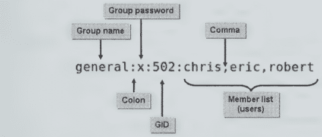

`图 2-6：/etc/group 文件中条目的示例。`

下表列出了不同的字段及其用途。

| 字段 | 描述 |
| :--- | :--- |
| 组名 | 存储组的名称。 |
| 组密码 | 以加密形式存储组的密码。 |
| GID | 存储组标识符；类似于组的 UID。默认 GID 值为 500。 |
| 成员 | 存储组成员的名称，以逗号分隔。 |

## 如何创建用户和组帐户

### 操作参考：创建用户帐户

要创建用户帐户：

1. 在 CLI 中以 root 身份登录。
2. 在命令提示符下，输入 `useradd {user_name}` 以添加新用户。
3. 输入 `passwd {user_name}` 以设置用户密码。
4. 确认密码。
5. 如有需要，使用新创建的用户名和密码登录到系统。

> 在使用 `useradd` 命令创建用户时，还会创建一个具有相同名称的用户私有组。

### 操作参考：创建组帐户

要创建组帐户：

1. 在 CLI 中以 root 身份登录。
2. 在命令提示符下，输入 `groupadd {group_name}` 以添加新组。
3. 通过查看 `/etc/group` 文件来验证组是否已创建。

## 活动 2-1

### 创建用户和组帐户

**开始之前：**

1. 你已在 `srvA` 的 CLI 中以 root 身份登录。
2. 显示第一个终端。

**场景：**

两名新员工加入了你的公司，需要创建他们的用户帐户。此外，你的公司经历了重大重组。你的经理希望根据新的结构创建部门组。

**用户帐户详细信息：**

- 新帐户的用户名：`chris`
- `chris` 的密码：`myp@$$w0rd`
- 新帐户的用户名：`pat`
- `pat` 的密码：`myp@$$w0rd`
- 需要创建的新组及其 GID 号码：`IT_Support` (544)、`Customer_Support` (545)、`Programming` (546) 和 `Design` (547)

| 你做什么 | 你如何做 |
| :--- | :--- |
| 1. 添加两个新用户 `chris` 和 `pat` | a. 在命令行中，输入 `adduser chris` 以添加新用户。<br>b. 输入 `passwd chris` 以更改用户密码。<br>c. 输入 `myp@$$w0rd` 以分配新密码。<br>d. 输入 `myp@$$w0rd` 以确认密码。<br>e. 观察密码已成功更新。<br>f. 输入 `adduser pat` 以添加另一个用户。<br>g. 输入 `passwd pat` 以更改用户密码。<br>h. 两次输入 `myp@$$w0rd` 以分配新密码。 |
| 2. 添加具有指定 GID 号码的用户组 `IT_Support`、`Customer_Support`、`Programming` 和 `Design`。 | a. 输入 `groupadd -g 544 IT_Support` 以添加新组。<br>b. 输入 `groupadd -g 545 Customer_Support` 以添加第二个组。<br>c. 输入 `groupadd -g 546 Programming` 以添加第三个组。<br>d. 输入 `groupadd -g 547 Design` 以添加第四个组。 |
| 3. 检查用户帐户和组是否已创建。 | a. 输入 `tail /etc/group` 以查看系统中的组帐户。<br>b. 观察新添加的组已显示并已添加到组列表中。<br>c. 观察用户帐户已创建与用户同名的默认组。<br>d. 输入 `tail /etc/passwd` 以查看用户帐户。<br>e. 观察新添加的用户已显示并已添加到用户列表中。<br>f. 输入 `clear` 以清除终端屏幕。 |

## 主题 B

### 配置用户配置文件

现在你已经可以创建用户和组帐户，下一步是配置用户配置文件。每个连接到系统的用户都需要一个独特的身份来区分彼此。在本主题中，你将配置用户配置文件。

所有连接到系统的用户都需要为其系统定制设置。此外，可能有一些文件需要默认共享。通过配置用户配置文件，可以为每个用户赋予独特的身份。这将一个用户与另一个用户区分开来。

## 用户配置文件

**定义：**

- 用户配置文件是一组选项、首选项、书签和其他用户项目，用于表征用户。用户配置文件定义系统分配给用户的设置，如网络资源、数据、属性和权限。这些设置在每个会话中都会保留。用户可以指定用户配置文件的名称。否则，该配置文件将被称为“默认用户”。每个用户可以为业务或个人用途创建多个用户配置文件。


> 如果你没有为用户配置文件指定名称，系统将其标记为“默认用户”。

**示例：**

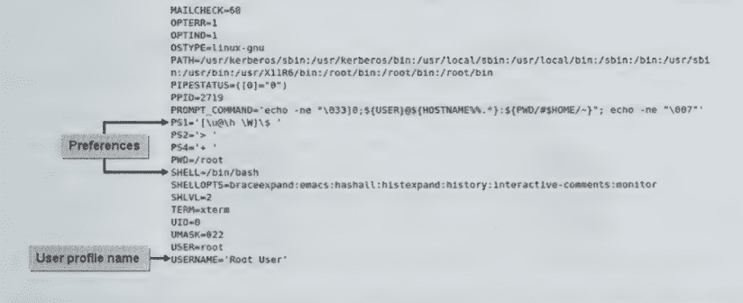

## 修改默认选项

在配置用户配置文件时，你可以修改默认选项。一些常见的修改选项包括：

- `PS1`——此变量存储关于主提示符的信息；即登录时显示的提示符。此变量可能修改也可能不修改。
- `PS2`——此变量存储关于次要提示符的信息。
- `PATH`——此变量存储关于命令搜索路径的信息。如果你想要使用未存储在标准目录中的命令，可以修改 `PATH`。

## 隐藏文件和目录

系统中的某些文件和目录是隐藏的。`ls` 命令列出所有文件，但不包括隐藏文件。要显示所有文件（包括隐藏文件），使用 `ls -a` 命令。隐藏文件和目录的名称以句点开头。你也可以在目录名称中添加句点来隐藏它们。隐藏文件通常是那些需要最少编辑的文件。

## 配置文件

当用户登录并启动新的 `Bash` 会话时，需要输入若干命令来定制用户的会话。每次用户登录时输入这些命令会很繁琐。因此，这些命令保存在一个特殊的可执行文件中，`Bash` 将在用户每次登录时从中运行这些命令。该文件被称为*配置文件*，因为它包含根据用户需求定制会话所使用的命令。每个用户的单独配置文件位于 `~/.bash_profile` 文件中，对该文件的更改会影响用户的定制设置。

## 全局用户配置文件

**定义：**

全局用户配置文件是一组选项、首选项、书签、存储的消息、属性、权限和其他用户项目，用户可以在其登录的任何系统中访问。全局用户配置文件存储在服务器上。每次用户登录时，全局配置文件中的数据会复制到本地系统。在用户登录期间，对设置所做的任何更改仅影响配置文件的本地副本。

**示例：**

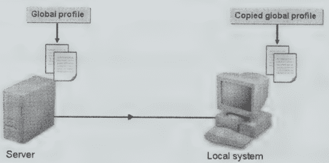

`图 2-8：全局用户配置文件允许用户访问连接到保存该配置文件的服务器上的任何系统。`

## `skel` 目录

当创建新的用户账户时，`skel` 目录会存储放置在新用户主目录中的文件和目录的副本。`skel` 目录的路径为 `/etc/skel`。这确保所有新用户都以相同的设置开始。对 `skel` 目录进行的修改仅影响新用户。


> `Skel` 一词源自“skeleton”（骨架），意味着基本的文件夹结构。

示例：

```
[root@localhost ~]# ls -a /etc/skel
.   ..   .bash_logout   .bash_profile   .bashrc   .emacs   .mozilla   .zshrc
[root@localhost ~]#
```

`图 2-9：skel 目录中的默认文件。`

### 管理 `/etc/skel` 文件

默认情况下，用于配置用户环境的隐藏文件存储在 `skel` 目录中。这些文件包括 `.bash_profile`、`.bashrc`、`.screenrc` 等。如果您希望将其他文件包含在新用户账户中，可以将这些文件添加到该目录。当创建新用户时，这些文件将被复制到新用户的主目录中。

### 如何配置用户配置文件

**程序参考：维护新用户账户的 `skel` 目录**

要维护新用户账户的 `skel` 目录：

1. 在 CLI 中以 root 身份登录。
2. 输入 `cd /etc/skel`
3. 输入 `gedit .bash_profile`
4. 进行必要的更改，例如更改新用户账户的 `PS1`、`PS2` 或 `PATH` 变量。
5. 保存并关闭文件。

### `Gedit` 编辑器


Gedit 是一个简单但功能强大的基于 GUI 的文本编辑器，用于 GNOME 桌面。在 GUI 环境中，您可以使用 `gedit (文件名)` 命令打开特定文件。或者，您可以选择 `应用程序` → `附件` → `文本编辑器` 来启动 `gedit` 应用程序，并使用 GUI 组件打开特定文件。

**程序参考：将文件委托给新用户**

默认情况下，将文件委托给新创建的用户：

1. 在 CLI 中以 `root` 身份登录。

2. 输入 `cd /etc/skel`

3. 输入 `mv /文件位置 /文件名 .文件名` 以将文件移动为隐藏文件。

4. 验证文件已作为隐藏文件移动。
   1. 创建一个用户。
   2. 以新用户身份登录。
   3. 输入 `cat .文件名` 查看放置在 `/etc/skel` 目录中的文件。

## 活动 2-2

# 配置用户配置文件

**数据文件：**

`Desktoppolicies.txt`

**开始之前：**

1. 您已在 `srvA` 的 CLI 中以 `root` 身份登录。

2. 显示第一个终端。

3. 在命令行中输入 `cp /085039Data/Managing_Users_and_Groups/* /root`。

4. 输入 `clear` 以清除终端屏幕。

5. 切换到 GUI。

6. 以 `root` 身份登录。

**场景：**

您被分配了一项任务，即为一家初创公司的员工创建用户账户并配置用户配置文件。根据新公司的政策，所有新用户账户都应提供 `Desktoppolicies.txt` 手册，且用户的命令提示符应显示公司名称和用户名称。

`Desktoppolicies.txt` 文件位于 `root` 目录中。

公司名称为“OGC Products”。

**用户账户详细信息：**

- 要创建的账户的用户名：`newuser`
- `newuser` 的密码：`myp@$$w0rd`

| 您的操作 | 执行方法 |
| :--- | :--- |
| 1. 将 `Desktoppolicies.txt` 文件移动为隐藏文件。 | a. 选择 `应用程序` → `附件` → `终端`。<br>b. 在 `root@localhost` 窗口中，输入 `cd /etc/skel` 以切换到 `skel` 目录。<br>c. 输入 `ls -a1` 以查看隐藏文件。<br>d. 输入 `mv /root/Desktoppolicies.txt .Desktoppolicies.txt` 以将 `Desktoppolicies.txt` 文件移动为隐藏文件。 |
| 2. 在命令提示符处显示用户名和公司名称。 | a. 输入 `gedit .bash_profile`<br>b. 按 `Ctrl+End` 移动到文件末尾的新行。<br>c. 输入 `PS1="[ OGC Products/\u ]"` 并按 `Enter` 以更改主要提示符。<br>d. 保存文件并关闭 `gedit` 窗口。<br>e. 清除终端屏幕。 |
| 3. 将 `Desktoppolicies.txt` 文件分配给 `newuser` 账户。 | a. 输入 `useradd newuser` 以添加 `newuser` 账户。<br>b. 输入 `passwd newuser` 以设置 `newuser` 的密码。<br>c. 输入 `myp@$$w0rd` 以分配密码。<br>d. 输入 `myp@$$w0rd` 以确认密码。 |
| 4. 检查文件是否已移动。 | a. 按 `Ctrl+Alt+F1` 切换到第一个终端。<br>b. 注销 `root`。<br>c. 以 `newuser` 身份登录。<br>d. 观察公司名称是否已显示。<br>e. 输入 `cat .Desktoppolicies.txt` 以验证文件是否已移动。<br>f. 观察文件内容在屏幕上显示，表明文件已移动。<br>g. 注销 `newuser` 账户。 |

## 主题 C

# 管理用户和组账户

您已创建用户和组账户，甚至配置了用户配置文件。您的下一步将是从长期角度管理用户和组账户。这将使您能够有效地组织您的 Linux 环境。在本主题中，您将管理用户和组账户。

一旦创建用户或组账户，就需要执行许多任务来维护该账户。作为系统管理员，您将需要维护众多用户的账户和密码。这是通过有效管理用户和组账户来实现的。

## userdel 命令

`userdel` 命令允许您修改系统账户文件，删除所有引用现有用户登录的条目。但是，如果用户当前已登录，它将不允许您删除该账户。在删除账户之前，您必须终止属于该账户的任何运行进程。


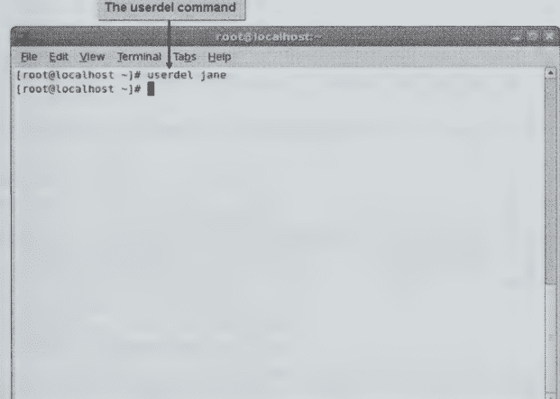

图 2-10：`userdel` 命令用于删除未使用的用户账户。

### -r 选项

`-r` 选项将删除用户主目录中的文件，以及主目录本身。位于其他文件系统上的文件需要手动搜索并删除。

## usermod 命令

`usermod` 命令包含选项，允许您修改各种用户账户参数。您可以更改用户名、默认组、`UID` 或密码。

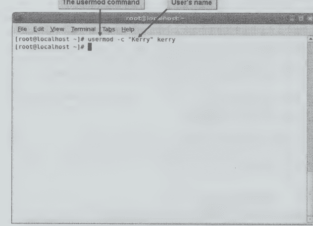

图 2-11：`usermod` 命令用于添加有关用户的更多详细信息。

一些常见的 `usermod` 命令选项及其说明在下表中给出。

| 选项 | 允许您 |
| :--- | :--- |
| `usermod -l (新登录名) (登录名)` | 修改用户的登录名称。 |
| `usermod -c "注释" 登录名` | 修改密码文件中用户的完整姓名、办公室地址和联系电话。或者，您可以使用 `chfn 用户名` 命令来修改详细信息。 |
| `usermod -f (天数) (登录名)` | 修改密码过期的天数以及永久禁用账户。 |
| `usermod -u (新用户 ID) (登录名)` | 修改用户 ID 的数值，该数值必须唯一。 |
| `usermod -d (新登录目录) 登录名` | 修改用户的默认登录目录。 |
| `usermod -L 用户名` | 锁定密码并暂时暂停用户账户。 |
| `usermod -U 用户名` | 解锁密码。 |
| `usermod -e yyyy-mm-dd 用户名` | 更改用户账户的过期日期。 |

### lock 命令

`lock` 命令用于暂时阻止用户登录到 Linux 系统。这是通过使用 `passwd -l` 命令禁用用户密码来完成的。用户的登录通常作为安全措施被锁定，以防止用户不可用时的未授权使用。

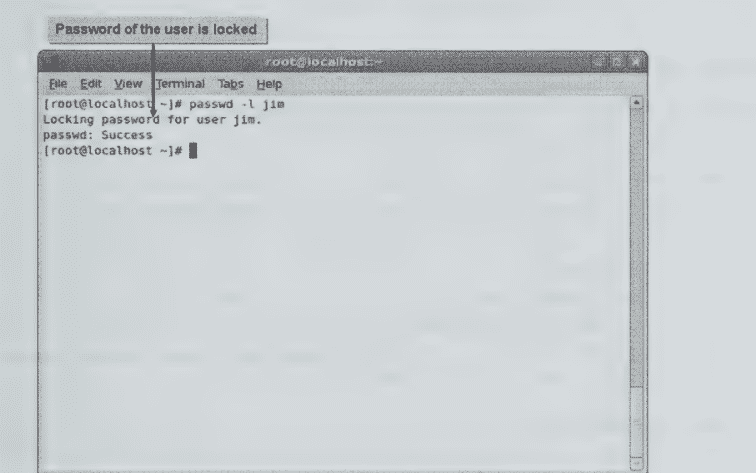

图 2-12：`passwd -l` 命令用于锁定用户密码。

### 暂时暂停用户访问

如果您需要阻止通过账户登录到系统，但不想删除它，您可以编辑 `/etc/shadow` 文件并将现有的加密密码替换为星号。请务必不要删除密码两侧的冒号，因为这可能会破坏文件。然后，要重新激活账户，请删除星号并为用户账户分配新密码。

## 组管理

与用户一样，组也由系统通过唯一的数字（称为 `GID`）来识别。在 Linux 中，用户可以是一个主要组和多个辅助组的成员。`groupdel` 和 `groupmod` 命令在管理组时非常有用。

| 命令 | 描述 |
| :---- | :---- |
| `groupdel` | 允许您从系统中删除组。 |
| `groupmod` | 允许您通过修改系统账户文件来更改组名称和组 ID 的数值。 |

## 具有 GID 的组账户

要在系统中添加一个新组，组名为 `print_users`，`GID` 为 `700`，你需要在命令行中输入 `groupadd -g 700 print_users`。

## 将用户添加到组中

与用户类似，可以直接编辑组文件来添加组。你也可以使用 `groupadd` 命令来添加用户，而无需编辑组文件。

## 如何管理用户和组账户

### 操作参考：修改用户的主目录

要修改用户的主目录：

- 在 CLI 中以 `root` 身份登录。
- 输入 `mkdir /({目录名称})` 以创建目录。
- 输入 `mkdir /({目录名称})/{用户名}` 以为指定用户创建目录。
- 输入 `chown {用户名}:{用户名} /{目录名称}` 以更改目录的所有权。
- 输入 `usermod -d /{目录名称}/{用户名} {用户名}` 以设置用户的新主目录。

### mkdir 命令

`mkdir` 命令允许你创建新目录。该命令的语法为 `mkdir {目录名称}`。

### chown 命令

`chown` 命令用于更改拥有一个或多个文件或目录的用户或组。

### 操作参考：在 CLI 中修改用户设置

要在 CLI 中修改用户设置：

- 以 `root` 身份登录。
- 输入 `usermod [命令选项] {用户名}` 以修改用户设置。

### 操作参考：在 GUI 中修改用户设置


要在 GNOME GUI 中修改用户设置：

- 在 GUI 中以 root 身份登录。

- 选择`系统` → `管理` → `用户和组` 以打开用户管理器窗口。

- 按需要修改用户设置：

  - 单击`添加用户`以添加新用户。

  - 双击用户姓名以修改用户设置。

  - 选择用户并单击`删除`以移除用户账户。

### 操作参考：删除用户账户

要删除用户账户：

- 以 root 身份登录。

- 输入 `userdel [命令选项] {用户名}` 以删除用户账户。

### 操作参考：管理默认密码老化信息

要管理默认密码老化信息：

- 以 root 身份登录。

- 输入 `gedit /etc/login.defs` 以打开 `/etc/login.defs` 文件。

- 管理密码老化信息：

  - 修改 `PASS_MAX_DAYS` 以控制密码可用的最大天数。

  - 修改 `PASS_MIN_DAYS` 以控制允许两次修改密码之间的最小天数。

  - 修改 `PASS_MIN_LEN` 以控制最小密码长度。

  - 修改 `PASS_WARN_AGE` 以控制在密码过期前发出警告的天数。

- 保存并关闭文件。

### 操作参考：设置或更改密码老化信息

要设置或更改密码老化信息：

- 以 root 身份登录。

- 输入 `chage [命令选项] {用户名}` 以更改指定用户的密码老化信息。

### 操作参考：修改和删除组

要修改或删除组：

- 以 root 身份登录。

- 管理组：

  - 使用 `groupmod -g {组名称}` 命令更改 GID。

  - 使用 `groupdel {组名称}` 命令删除组。

## 活动 2-3

### 配置新的用户账户

**准备工作：**

1. 以 root 身份登录到 CLI 终端。

2. 在第一个终端中，修改 `/etc/skel/.bash_profile` 文件并删除以 `PS1` 开头的最后一行。

3. 输入 `clear` 以清屏。

**场景：**

你作为一名初级系统管理员，你的组织雇用了一名合同制网络管理员。你需要根据以下详细信息为新雇员创建一个用户账户：

- 新账户的用户名：`netadmin1`

- `netadmin1` 用户的密码：`myp@$$w0rd`

- `netadmin1` 用户账户需要在 2011 年 7 月前保持有效。

- `/home/users/netadmin1` 目录应设置为 `netadmin1` 用户的默认主目录。

| 你要做什么 | 如何做 |
| :--- | :--- |
| 1. 创建名为 `netadmin1` 的用户账户。 | a. 输入 `useradd netadmin1` 以创建用户。<br>b. 输入 `passwd netadmin1` 以为新用户设置密码。<br>c. 输入 `myp@$$w0rd` 以分配密码。<br>d. 输入 `myp@$$w0rd` 以确认密码。<br>e. 输入 `logout` 以注销 root 账户。 |
| 2. 使用新的用户账户详情登录系统。 | a. 以 `netadmin1` 身份登录。<br>b. 输入 `pwd` 以查看默认主目录。<br>c. 观察 `/home/netadmin1` 是 `netadmin1` 用户的默认主目录。<br>d. 注销 `netadmin1` 账户。 |
| 3. 设置新用户账户的过期日期。 | a. 以 `root` 身份登录。<br>b. 输入 `usermod -e {年份}-07-31 netadmin1` 以将 `netadmin1` 用户账户的过期日期设置为下一年的 7 月 31 日。 |
| 4. 更改 `netadmin1` 用户的主目录。 | a. 输入 `mkdir /home/users` 以创建父目录。<br>b. 输入 `mkdir /home/users/netadmin1` 以创建主目录。<br>c. 输入 `chown netadmin1:netadmin1 /home/users/netadmin1` 以更改目录的所有权。<br>d. 输入 `usermod -d /home/users/netadmin1 netadmin1` 以将 `netadmin1` 用户的默认主目录更改为 `/home/users/netadmin1`。<br>e. 注销 `root` 账户。 |
| 5. 检查 `netadmin1` 用户的主目录是否已更改。 | a. 以 `netadmin1` 身份登录。<br>b. 输入 `pwd` 以查看新的主目录。<br>c. 观察主目录已更改为 `/home/users/netadmin1`。<br>d. 注销 `netadmin1` 账户。 |

## 活动 2-4

### 管理组账户

**准备工作：**

1. 以 root 身份登录到 CLI 终端。

2. 在终端上，创建两个名为 `Finance`（财务）和 `Marketing`（市场）的组。

3. 输入 `clear` 以清屏。

**场景：**

你被指派的任务是更改财务部门的 GID，使其与部门编号相匹配。此外，你需要从系统中删除市场组，因为市场营销部门的工作今后将外包给另一家公司。

| 你要做什么 | 如何做 |
| :--- | :--- |
| 1. 更改 GID 以匹配财务部门编号 555。 | a. 输入 `groupmod -g 555 Finance` 以更改财务部门的 GID。<br>b. 输入 `tail -20 /etc/group` 以验证更改是否已执行。<br>c. 观察财务部门的 GID 已更改。 |
| 2. 删除用户组 `Marketing`（市场）。 | a. 输入 `groupdel Marketing`<br>b. 输入 `cat /etc/group \| less` 以验证 `Marketing`（市场）组是否已删除。<br>c. 按 `空格键` 直到文件末尾，以验证 `Marketing`（市场）组不再列出。<br>d. 按 `Q` 退出显示。<br>e. 清屏。 |

## 第 2 课后续

在本课中，你创建并管理了用户和组账户。这将帮助你高效地组织和维护拥有大量用户的 Linux 环境。

- `将用户组织成组对你有什么用处？`

  答案可能有所不同，但可以包括：将用户组织成组是有用的，因为组账户提供了诸如集体访问权限、文件集体所有权和资源共享等功能。这有助于更好地管理用户账户。

- `为什么配置用户配置文件至关重要？`

  答案可能有所不同，但可以包括：用户配置文件有助于唯一地识别用户。它为用户提供独特的身份，并有助于区分一个用户和另一个用户。


## 3 管理分区和 Linux 文件系统

课程时长：2 小时 30 分钟

### 课程目标：

在本课中，你将管理分区和 Linux 文件系统。

你将：

- 创建分区。

- 导航 Linux 文件系统。

- 管理 Linux 文件系统。

- 维护 Linux 文件系统。

### 简介

你现在已经熟悉了 Linux 中的用户和组账户。除了用户和组管理外，你需要管理的另一个主要 Linux 组件是文件系统。在本课中，你将在硬盘上创建分区，并导航、管理和维护 Linux 文件系统。

数据组织促进了高效的资源管理和更快的信息检索。数据组织是通过将数据排序到文件系统中完成的。Linux 文件系统是 Linux 区别于其他操作系统的部分特征。理解文件系统的结构和工作方式将有助于数据的存储、管理和故障排除。

本课涵盖以下 CompTIA Linux+ (2009) 认证目标的全部或部分：

- 主题 A

  - 目标 1.2

  - 目标 1.3

  - 目标 1.4

  - 目标 2.7

- 主题 B

  - 目标 1.5

  - 目标 1.6

- 目标 2.1

- 主题 C

  - 目标 1.4

  - 目标 2.4

  - 目标 2.7

- 主题 D

  - 目标 2.7

## 主题 A

## 创建分区

在操作 Linux 文件系统之前，你应该对系统的硬盘进行分区。合理的硬盘分区可以确保用户有足够的空间来存储数据。在本主题中，你将创建和管理磁盘分区。

硬盘是任何系统中数据存储最关键组件。如果没有有效的磁盘分区，磁盘上的数据将变得杂乱无章。不当的磁盘分区可能导致系统崩溃。作为 Linux+ 管理员，你的职责是确保磁盘被正确分区，以便用户能够高效地存储数据。

## 文件系统

**定义：**


# 文件系统

*文件系统* 是一种由操作系统用于在海量存储设备上存储、检索、组织和管理文件和目录的方法。文件系统维护信息，例如单个文件的创建和修改日期、文件大小、文件类型和权限，并提供数据结构的存储形式。文件系统本身并不解释文件中包含的数据，因为此任务由特定应用程序处理。

文件系统因多种参数而异，例如文件系统的用途、它们关于单个文件存储的信息、数据存储方式以及数据安全。

**示例：**

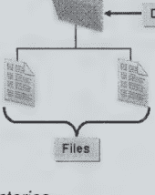

*图 3-1：* *文件存储在目录中。*

## 文件系统标签

文件系统标签被分配给文件系统以便于识别。标签长度最多可达 16 个字符，可以使用 `e2label` 命令进行显示或更改。

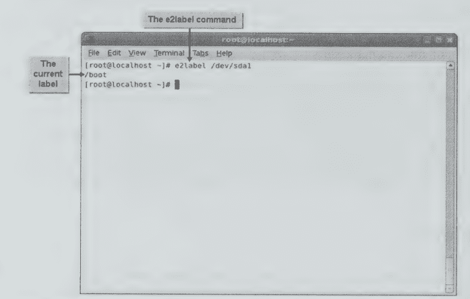

图 3-2：文件系统标签的示例。

### 语法

设置文件系统标签的语法是 `e2label /dev/{设备名称}{分区号}`。也可以使用 `tune2fs -L 卷标签` 命令进行设置。

## 文件系统类型

Linux 支持许多文件系统类型。下表描述了一些常见的文件系统类型。

| 文件系统类型 | 描述 |
| :--- | :--- |
| `ext2` | 这曾是某些早期版本的 Linux 本地文件系统。在当前版本的 Linux 中仍受支持。 |
| `ext3` | 这是 `ext2` 的改进版本，也是现在的 Linux 本地文件系统。在系统突然关机的情况下，`ext3` 恢复数据的速度更快，并确保数据完整性。你可以轻松地将文件系统从 `ext2` 升级到 `ext3`。 |
| `reiserfs` | 它能高效处理小文件。它处理小于 1K 的文件，速度比 `ext2` 快。如果配置得当，它可以存储比 `ext2` 更多的数据。 |
| `vfat` | 这是一种 32 位文件系统，支持长文件名。它与 Microsoft Windows XP 和 Microsoft Windows NT 的 FAT 文件系统兼容。 |
| `XFS` | 这是一种 64 位、高性能日志文件系统，提供快速恢复能力，并能高效处理大文件。 |
| `JFS` (日志文件系统) | 这是一种 64 位日志文件系统，快速且可靠。它更好地配备了处理电源故障和系统崩溃的能力。 |
| `swap` | 这不是真正的文件系统，而是硬盘的一部分，用于 Linux 物理内存耗尽需要更多内存时的情况。Linux 将一些未使用的文件从 RAM 推送到交换区以释放内存。 |
| `ISO 9660` | 这是由国际标准化组织 (ISO) 定义的文件系统标准，也称为 CDFS (光盘文件系统)。Linux 允许你访问使用此文件系统的 DVD 和 CD。 |

## 访问其他文件系统

Linux 允许你访问其他文件系统并在需要时挂载它们。然而，你不能在这些文件系统中安装 Linux。

| 文件系统 | 描述 |
| :--- | :--- |
| `FAT` | `FAT` (文件分配表) 文件系统与不同的操作系统兼容，包括所有版本的 Windows、MS-DOS 和 UNIX。它主要用于格式化软盘。 |
| `NTFS` | `NTFS` (NT 文件系统) 是基于 Windows 计算机的推荐文件系统。与 `FAT` 或 `vfat` 相比，`NTFS` 提供了许多增强功能，包括文件和文件夹级别的安全性、文件加密、磁盘压缩以及扩展到非常大的磁盘和文件。 |

## 分区

**定义：**

*分区* 是硬盘的一个部分，在逻辑上作为独立的磁盘运行。分区使你能将大硬盘转换为更小且易于管理的块，从而导致信息更好的组织。在数据存储之前，必须格式化分区并为其分配文件系统。分区使用存储在引导记录中的分区表进行标识。分区表最多可以包含四个主分区项。分区可以分类为主分区和扩展分区。每个分区的大小可以变化，但不能超过硬盘的总可用空间。


分区

### 示例：


图 3-3：硬盘上的分区。

## 硬盘大小规范

在安装过程之前，你需要根据需求规划硬盘布局。每个分区都有推荐的大小规范。下表列出了分区的推荐大小规范。

| 分区 | 推荐大小 |
| :--- | :--- |
| `/` | 最少 1 GB。 |
| `/boot` | 100 MB。 |
| `swap` | RAM 大小的两倍。 |
| `/var` | 最少 250 MB。如果未来有可能安装许多应用程序，请分配适当的大小。 |
| `/home` | 基于用户数量而变化。 |

## 磁盘分区

大多数操作系统，包括 Linux，都使用磁盘分区。不同类型的存储可以保存在硬盘上的不同位置。分区大小可由用户指定。然而，在指定分区大小之前，必须考虑文件系统的大小。磁盘分区使用户能够将系统文件与用户可访问的文件分开。损坏的分区不影响其他分区，并且可以单独恢复。

## 分区类型


有三种类型的分区：主分区、扩展分区和逻辑分区。硬盘的运行取决于其上的分区类型。推荐对硬盘进行分区的协议是三个主分区和一个扩展分区，其中包含任意数量的逻辑分区。

每个分区都有一组特定的功能。表中描述了三种类型的分区。

| 分区类型 | 描述 |
| :--- | :--- |
| 主 | 最多允许四个主分区。交换文件系统和引导分区通常在主分区中创建。 |
| 扩展 | 只能有一个扩展分区，它可以进一步细分。这种分区类型不包含任何数据，并有一个单独的分区表。 |
| 逻辑 | 逻辑分区在扩展分区内创建。逻辑分区的数量没有限制，但建议将每个磁盘驱动器限制为 12 个逻辑分区。 |

## `fdisk` 实用工具

**定义：**

`fdisk` 是一个菜单驱动的实用程序，用于在磁盘驱动器上创建、修改或删除分区。使用 `fdisk`，可以创建新的分区表，或修改分区表中现有的条目。`fdisk` 实用工具理解 DOS 和 Linux 类型的分区表。根据创建的分区表，调用 DOS `FDISK` 或 Linux `fdisk` 程序。`fdisk` 实用工具还允许你指定分区的大小。


**示例：**

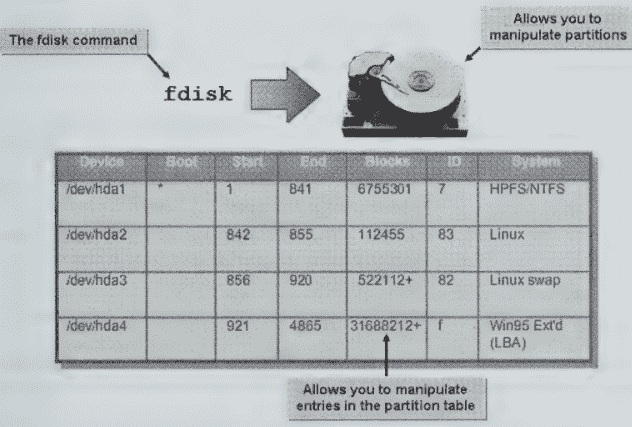

### 语法

`fdisk` 实用工具的语法是 `fdisk [选项] [设备名称]`。

## `fdisk` 实用程序选项

`fdisk` 实用程序提供了多种选项，用于根据用户需求对磁盘进行分区。下表描述了 `fdisk` 的一些选项。

| 选项 | 功能 |
| :--- | :--- |
| `-b sector size` | 指定磁盘扇区数量。 |
| `-H heads` | 指定磁盘磁头数量。 |
| `-S sectors` | 指定每磁道扇区数量。 |
| `-s partition` | 以块为单位打印分区大小。 |
| `-v` | 列出 `fdisk` 的版本。 |
| `-l` | 列出设备的分区表。 |


## `fstab` 文件

`fstab` 文件是一个配置文件，用于存储关于存储设备和分区的信息，以及分区的挂载位置和挂载方式。`fstab` 文件位于 `/etc` 目录中。只有 `root` 用户可以编辑该文件。`fstab` 文件由若干行组成——每个文件系统对应一行。

`fstab` 文件中的每一行包含六个字段，这些字段由空格分隔。

| 字段 | 描述 |
| :--- | :--- |
| 设备或分区名称 | 指定需要挂载的设备或文件系统名称。 |
| 默认挂载点 | 指示文件系统需要挂载的位置。 |
| 文件系统类型 | 指定设备或分区使用的文件系统类型。 |
| 挂载选项 | 指定一组逗号分隔的选项，这些选项将在文件系统挂载时激活。 |
| `Dump` 选项 | 指示 `dump` 实用程序是否应备份文件系统。通常指定零作为 `dump` 选项，表示 `dump` 可以忽略该文件系统。 |
| `fsck` 选项 | 指定 `fsck` 实用程序检查文件系统的顺序。 |


### `mkfs` 命令

`mkfs` 命令用于在设备上构建 Linux 文件系统，该设备通常是硬盘分区。下表列出了 `mkfs` 命令的一些选项及其描述。

| 选项 | 允许你 |
| :--- | :--- |
| `-v` | 生成详细输出，在程序处理过程中，输出消息会持续变化。 |
| `-V` | 生成详细输出，包括执行的所有特定于文件系统的命令。 |
| `-t fstype` | 指定要构建的文件系统类型。 |


| `fs-options` | 向文件系统构建器传递特定于文件系统的选项。 |

| `-c` | 在构建文件系统之前，检查设备是否存在坏块。 |

| `-l file name` | 从指定文件中读取坏块列表。 |

#### 使用 `mkfs` 命令构建新的 Linux 文件系统

`mkfs` 命令用于构建新的 Linux 文件系统。不同的 `mkfs` 命令在下表中给出。

| 如果你需要构建 | 使用此 `mkfs` 命令 |

| --- | --- |

| 一个 `ext2` 文件系统 | `mkfs.ext2 /dev/hdaPartition number` 或 `mke2fs /dev/hdaPartition number` |

| 一个 `ext3` 文件系统 | `mkfs.ext3 /dev/hdaPartition number` |

| 一个 `reiserfs` 文件系统 | `mkfs.reiserfs /dev/hdaPartition number` |

| 一个 `vfat` 文件系统 | `mkfs.vfat /dev/hdaPartition number` |

| 一个 `XFS` 文件系统 | `mkfs.xfs /dev/hdaPartition number` |

| 一个 `JFS` 文件系统 | `mkfs.jfs /dev/hdaPartition number` |

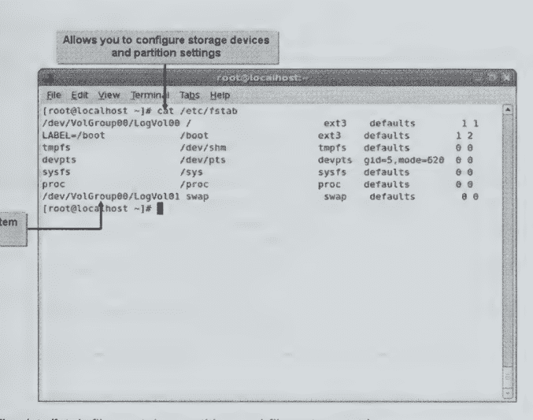

### `mke2fs` 实用程序

`mke2fs` 实用程序用于创建 `ext2` 和 `ext3` 文件系统。它具有多种选项。一些选项列在下表中。

| 选项 | 允许你 |

| --- | --- |

| `-b block_size` | 指定以字节为单位的块大小。 |

| `-C` | 在创建文件系统之前，检查设备块中的错误。 |

| `-f` | 指定以字节为单位的碎片大小。 |

| `-j` | 创建带日志的 `ext3` 文件系统。 |

| `-M` | 设置文件系统最近访问的目录为要挂载的目录。 |

| `-V` | 打印 `mke2fs` 实用程序的版本号。 |

#### 语法

`mke2fs` 实用程序的语法为 `mke2fs [options] (filesystem name)`。

## MBR 的设备识别

设备识别是在系统启动时由 MBR 执行的，通过识别硬盘及其上的所有分区。MBR 有两个主要组件，有助于检测连接到系统的任何设备。


| 组件 | 描述 |

| :-- | :-- |

| 主分区表 | 包含硬盘上分区的列表。在技术上，硬盘可以拥有许多分区。分区表中显示的两个四个分区被称为主分区。所有其他分区都链接到这些主分区。该表显示分区 ID、其起始柱面以及分区占用的柱面数量。 |

| 主引导代码 | 包含用于加载硬盘上操作系统的程序。加载此程序以启动引导过程。 |

### 柱面

`柱面`是所有位于每个磁盘表面相同位置的所有磁道的集合。在多盘片磁盘上，柱面是每个表面上具有相同磁道编号的磁道总和。在软盘上，柱面包括顶部和对应的底部磁道。

## 分区管理

`分区管理`是创建、销毁和操作分区以优化系统性能的过程。有效的分区管理使您能够跟踪分区中的数据并避免数据溢出。各种实用程序，如 `sfdisk`、`partprobe` 和 `GNU parted`，可用于分区管理。


### `sfdisk` 实用程序

`sfdisk` 实用程序用于操作分区。该实用程序通过列出分区数量及其大小、检查分区以及对存储设备进行重新分区来管理分区。


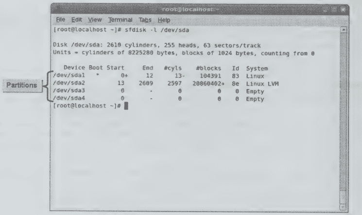

图 3-6：使用 `sfdisk` 实用程序列出硬盘上的分区。

`sfdisk` 实用程序提供了多种用于管理分区的选项。

| 选项 | 允许你 |

| :--- | :--- |

| `-s` | 列出分区大小。 |

| `-l device` | 列出所有硬盘上的分区。 |

| `-V device` | 检查所有分区的一致性。 |

| `device` | 重新分区硬盘。然而，如果错误输入代码，可能导致数据丢失。 |

| `-i` | 为硬盘中的所有柱面设置编号。 |

| `-A number` | 激活由分区号指示的分区。 |

#### 语法

`sfdisk` 实用程序的语法为 `sfdisk [options] device`。

### `GNU Parted` 实用程序

`GNU Parted` 实用程序也用于管理分区。在创建新硬盘上的分区时，它特别有用。它可以用于创建、销毁和调整分区大小。通常不将该实用程序用于调整 `ext3` 分区的大小。


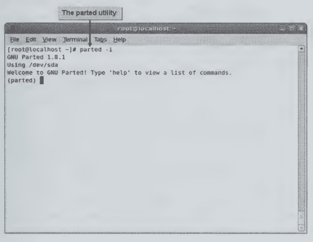

图 3-7：`GNU Parted` 实用程序的欢迎屏幕。

`GNU Parted` 实用程序中提供了许多选项。

| 选项 | 允许你 |

|:-------|:--------------|

| `-h`   | 显示帮助信息。 |

| `-v`   | 显示 `GNU Parted` 的版本。 |

| `-i`   | 配置 `parted` 请求用户输入。 |

| `-s`   | 阻止 `parted` 请求用户输入。 |

#### 语法

`parted` 实用程序的语法为 `parted [option] device [command [argument]]`。

### `partprobe` 程序

`partprobe` 程序用于将分区表的更改更新到内核中。该程序首先检查分区表，如果有任何更改，它会自动将更改更新到内核中。


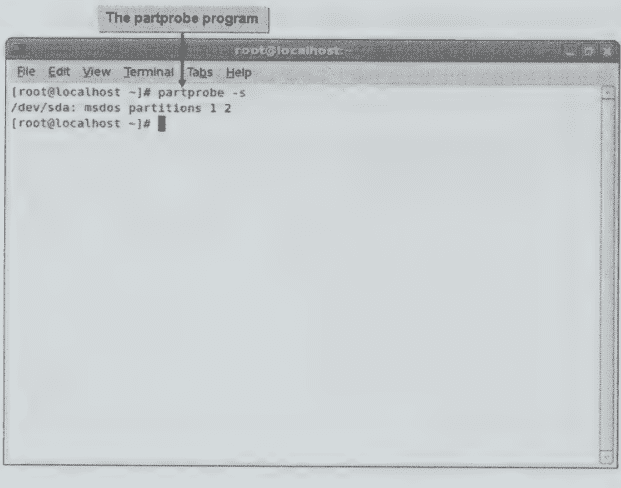

图 3-8：使用 `partprobe` 工具显示存储设备及其分区。

`partprobe` 程序有几个选项。

| 选项 | 功能 |

| :--- | :--- |

| `-d` | 取消任何更新。 |

| `-s` | 显示存储设备及其分区。 |

| `-v` | 显示 `partprobe` 程序的版本。 |

## 语法

`partprobe` 工具的语法是 `partprobe [选项] [设备...]`。

# 如何创建分区

## 操作参考：创建主分区

要创建主分区：

1. 以 `root` 身份登录。
2. 输入 `fdisk /dev/(设备名)` 对磁盘进行分区。
3. 输入 `n` 创建分区。
4. 创建主分区。
   a. 输入 `p` 创建主分区。
   b. 按 `Enter` 键接受分区的默认起始点。
   c. 指定分区大小。
      - 按 `Enter` 键接受默认分区大小。
      - 要指定自定义分区大小。
      - 输入 `+[所需大小]` 以块为单位指定分区大小。
      - 输入 `+[所需大小]K` 以千字节 (`KB`) 为单位指定分区大小。
      - 输入 `+[所需大小]M` 以兆字节 (`MB`) 为单位指定分区大小。
5. 输入 `w` 将分区表写入磁盘。
6. 输入 `partprobe` 或重启系统以更新分区表。
7. 输入 `sfdisk -l /dev/(设备名)` 以列出分区表。

## 操作参考：创建扩展分区

要创建扩展分区：

1. 以 `root` 身份登录。
2. 输入 `fdisk /dev/(设备名)` 开始磁盘分区。
3. 输入 `n` 创建分区。
4. 创建扩展分区。
   a. 输入 `e` 创建扩展分区。
   b. 按 `Enter` 键接受分区的默认起始点。
   c. 按 `Enter` 键接受默认分区大小。
   d. 输入 `n` 在扩展分区内创建逻辑分区。
   e. 按 `Enter` 键接受分区的默认起始点。
   f. 指定分区大小。
      - 按 `Enter` 键接受默认分区大小。
      - 要指定自定义分区大小。
      - 输入 `+[所需大小]` 以块为单位指定分区大小。
      - 输入 `+[所需大小]K` 以千字节 (`KB`) 为单位指定分区大小。
      - 输入 `+[所需大小]M` 以兆字节 (`MB`) 为单位指定分区大小。
5. 输入 `w` 将分区表写入磁盘。
6. 输入 `partprobe` 或重启系统以更新分区表。
7. 输入 `sfdisk -l /dev/(设备名)` 以列出分区表。

## 操作参考：为分区应用标签


要为分区应用标签：

1. 以`root`身份登录。
2. 在命令提示符下，输入`e2label /dev/{设备名}{分区号} (标签名)`以将标签应用于分区。
3. 输入`e2label /dev/{设备名}{分区号}`以查看已应用或关联的标签。
4. 如有必要，输入`mount LABEL=(标签名) (挂载点)`使用其标签挂载分区。

# 活动 3-1：创建分区

**开始前：**

1. 在`srvA`上，您已以`root`身份登录到CLI。
2. 在命令行中，输入`mkdir /morning /evening`创建两个目录。
3. 清除终端屏幕。

**场景：**

您的组织有一个支持团队，分两个班次工作。一名员工在早班使用该系统，另一名员工在晚班使用同一系统。根据以下详细信息，两人均需要挂载独立的分区：

- 逻辑分区`sdb5`和`sdb6`分别需要挂载到`/morning`和`/evening`目录。
- `root`用户的登录名：`root`
- `root`用户的密码：`p@ssw0rd`

您还需要确保这些分区易于识别以便维护。需要应用于分区并用于挂载的标签是：

- 早班：`Mmrg`
- 晚班：`Evng`


**操作内容** | **操作方法**

1. 创建扩展分区。
   - a. 输入`fdisk /dev/sdb`开始磁盘分区过程。
   - b. 输入`n`创建新分区。
   - c. 输入`e`创建扩展分区。
   - d. 按`Enter`键接受分区的默认起始点。
   - e. 输入`+15000M`以指定分区大小。

2. 在扩展分区内创建两个逻辑分区。
   - a. 输入`n`创建新分区。
   - b. 按`Enter`键接受分区的默认起始点。
   - c. 输入`+1024M`以指定分区大小。
   - d. 重复步骤(a)到(c)以创建另一个大小为`1024M`的逻辑分区。
   - e. 输入`w`将分区表写入磁盘。

3. 为`ext2`文件系统设置逻辑分区。
   - a. 输入`mkfs.ext2 /dev/sdb5`在`/dev/sdb5`上创建`ext2`文件系统。
   - b. 输入`clear`清除终端屏幕。
   - c. 输入`mkfs.ext2 /dev/sdb6`在`/dev/sdb6`上创建`ext2`文件系统。
   - d. 输入`clear`清除终端屏幕。

4. 验证两个新分区具有`ext2`文件系统。
   - a. 输入`parted`运行GNU Parted工具。
   - b. 输入`select /dev/sdb`选择`sdb`分区。
   - c. 在`(parted)`提示符下，输入`print`查看现有分区列表。
   - d. 观察分区五和六具有`ext2`文件系统。
   - e. 输入`q`退出`parted`工具。
   - f. 输入`clear`清除终端屏幕。

5. 为分区应用标签。
   - a. 输入`e2label /dev/sdb5`查看`/dev/sdb5`分区的现有标签。
   - b. 观察到`/dev/sdb5`分区未设置标签。
   - c. 输入`e2label /dev/sdb5 Mmrg`将新标签`Mmrg`应用于分区。
   - d. 输入`e2label /dev/sdb6`查看`/dev/sdb6`分区的现有标签。
   - e. 观察到`/dev/sdb6`分区未设置标签。
   - f. 输入`e2label /dev/sdb6 Evng`将新标签`Evng`应用于分区。
   - g. 输入`clear`清除终端屏幕。

6. 验证应用于分区的标签。
   - a. 输入`e2label /dev/sdb5`验证`/dev/sdb5`的分区标签已更改。
   - b. 观察到`/dev/sdb5`分区的标签已设置为`Mmrg`。
   - c. 输入`e2label /dev/sdb6`验证`/dev/sdb6`的分区标签已更改。
   - d. 观察到`/dev/sdb6`分区的标签已设置为`Evng`。

7. 使用标签挂载分区。
   - a. 输入`mount LABEL=Mmrg /morning`使用标签挂载`/dev/sdb5`分区。
   - b. 输入`mount LABEL=Evng /evening`使用标签挂载`/dev/sdb6`分区。
   - c. 输入`mount`验证分区已使用其标签挂载。
   - d. 观察分区`/dev/sdb5`和`/dev/sdb6`已分别挂载到`/morning`和`/evening`目录。
   - e. 输入`clear`清除终端屏幕。

# 主题 B

## 在 Linux 文件系统导航

现在，您已经以正确且高效的方式对硬盘进行了分区，是时候在文件系统中移动了。在本主题中，您将导航文件系统。

在文件系统中导航将使您能够访问、创建和删除文件和目录。虽然可能在GUI环境中导航文件系统更容易，但CLI将为您提供对Linux系统工作原理的更多控制。

### 文件系统层次结构


Linux包含常规文件，包括文本文件、可执行文件或程序、程序输入以及程序输出。除此之外，Linux文件系统还由其他类型的文件组成。

这些文件类型在下表中描述。

| 文件类型 | 描述 |
|---|---|
| 目录 (`d`) | 包含所有文件的列表。 |
| 特殊文件 | 包括系统文件。这些文件位于`/dev`目录下。它们可以是块特殊文件 (`b`) 或字符特殊文件 (`c`)。块特殊文件是用于数据存储的大文件。字符特殊文件是用于数据流传输的小文件。 |
| 链接 (`l`) | 使文件在系统文件树的多个部分可访问。 |
| 域套接字 (`s`) | 提供受文件系统访问控制保护的内进程网络。 |
| 命名管道 (`p`) | 允许进程相互通信，而不使用网络套接字。 |

### file 命令

`file`命令用于确定文件类型。该命令的语法是`file [选项] {文件名}`。

### 文件系统层次结构标准

`文件系统层次结构标准（FHS）` 是一份协作文档，规定了文件和目录的名称及其位置的指导原则。`FHS`的重要优势包括在符合`FHS`规范的系统之间提供兼容性，以及对用户修改包含常用可执行文件的`/usr`分区进行限制。


文件系统层次结构标准


> `FHS`的完整文档可在`http://www.pathname.com/fhs/`获取。

#### 标准目录

Linux操作系统由多个目录组成，这些目录使您能够将用户文件、驱动程序、内核、日志、程序和实用工具整理到不同的类别中。在Linux中，`/`代表*根*目录，它是最高级别的目录，所有其他目录都是其子目录。


标准目录

一些标准根目录在表中描述如下。

| **目录** | **描述** |
| :--- | :--- |
| `/boot` | 存储引导Linux操作系统所需的文件。`/boot`分区必须位于硬盘的第一个扇区，系统由此引导。例如，`/boot/grub/menu.lst`文件。 |
| `/bin` | 存储基本的命令行实用程序和二进制文件。例如，`/bin/ls`文件。 |
| `/dev` | 存储硬件和软件设备驱动程序。它维护代表连接到系统的设备的文件系统条目。例如，`/dev/sda1`驱动程序。 |
| `/etc` | 存储基本配置文件。例如，`/etc/samba/smb.conf`文件。 |
| `/lib` | 存储内核、命令行实用程序和二进制文件所需的共享程序库。例如，`/lib/libc.so.6`文件。 |
| `/sbin` | 存储用于完成引导过程的二进制文件，以及由`root`用户——即管理员——使用的二进制文件。例如，`/sbin/fciconfig`文件。 |
| `/usr` | 存储所有用户可访问的小程序和文件。例如，`/usr/share/doc`文件。 |
| `/var` | 存储系统日志文件、打印队列以及一些网络服务的配置文件。例如，`/var/log/messages`文件。 |
| `/tmp` | 存储临时文件。例如，`/tmp/filename.tmp`文件。 |


| `/opt` | 存储大型软件包的文件夹。这些包通常会在`/opt`目录创建一个以其名称命名的子目录，然后将文件放置在该子目录中。例如，`/opt/nessus`文件。 |
| `/mnt` | 是用于从软盘、CD、DVD和网络分区等位置临时挂载数据的挂载点。 |

### `/usr`子目录

`/usr`目录包含一些重要的子目录。

| 子目录 | 描述 |
| :-- | :-- |
| `/usr/bin` | 包含所有用户均可执行的程序。 |
| `/usr/local` | 默认存储在此处的自定义构建应用程序。 |
| `/usr/lib` | 包含可执行程序所需的对象库和内部二进制文件。 |
| `/usr/lib64` | 其作用与`/usr/lib`相同，但仅适用于 64 位系统。 |
| `/usr/share` | 包含只读的、与体系结构无关的文件。这些文件可以在操作系统的不同体系结构之间共享。 |


### 文件命名规范

文件名是用于标识文件的一组字符。通过在使用文件名时使用正确的字符组合，您可以确保文件是唯一的且易于识别。

#### 指南

文件名可以：

- 采用任意大小写，但通常使用小写。
- 包含除正斜杠（`/`）之外的任何字符，因为正斜杠用于表示根目录。
- 使用字母数字字符、下划线、连字符和点。
- 永远不能以连字符开头。
- 字符之间可以有空格，但不建议这样做。


图 3-9：一个使用适当规范命名的示例文件。

### 示例：适当命名文件

`Jim`创建了一个包含一些审计信息的文本文件。他使用了 Linux 中遵循的命名规范，将该文件命名为`audit_file.txt`。他确保文件名中的所有字母都是小写。此外，名称中使用下划线代替了空格。

### 创建包含空格的文件名

通过在文件名中包括反斜杠 `\`和空格，您可以创建字符间带有空格的文件名。例如：`touch Audit\ File.txt`将创建一个名为`Audit File.txt`的文件。

### 文件浏览器

在 Linux 中，您可以使用文件浏览器导航文件系统。Red Hat 和 Fedora 发行版中 GNOME 桌面的默认文件浏览器是`Nautilus`浏览器。该浏览器以两种模式运行。


| 模式 | 描述 |
|---|---|
| 空间式（Spatial） | 这是默认模式，它允许您通过在屏幕上记住最后的位置来在完全相同的位置打开特定窗口。您选择的每个文件夹或目录都在新的浏览器窗口中打开。 |
| 浏览器式（Browser） | 这是一种允许您在同一窗口中显示选定文件夹的模式。您需要在`计算机`窗口中修改偏好设置。 |

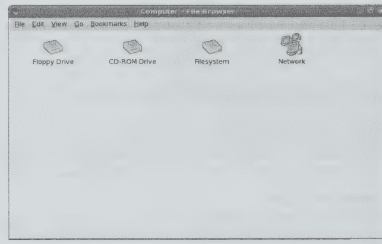

图 3-10：`Nautilus`文件浏览器。

### 主目录

`主目录`是您登录系统时所在的位置。在 Linux 中，默认情况下，除了`root`用户外的每个用户都被分配了`/home`中的一个特定目录。在许多 shell 中，包括`Korn`、`C shell`和`Bash`，波浪号字符`(~)`代表您的主目录。用户可以在此目录中创建子目录和文件。一旦用户登录系统，控制权会自动转移到用户的主目录。`root 用户`的主目录是`/root`。`root`用户可以访问系统上的所有文件和资源。

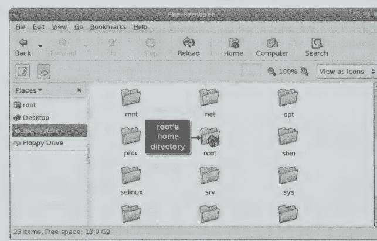

图 3-11：`root`用户的主目录。

### 当前工作目录

`当前工作目录`是您在任何时间点正在访问的系统位置。例如，当您登录系统时，您会被放置到您的主目录中。因此，您的`当前工作目录`是您的主目录。当前工作目录可以用点`(.)`简写列出。


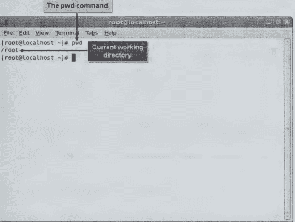

图 3-12：使用`pwd`命令查看当前工作目录。

### `pwd`命令

当您导航文件系统时，可能需要知道您的当前工作目录。`pwd 命令`显示相对于根目录的当前工作目录。它显示完整的路径名称。

### 父目录

`父目录`是您当前工作目录的上一个级别。除了根目录外，所有目录都有父目录。您可以使用双点表示法切换到父目录。


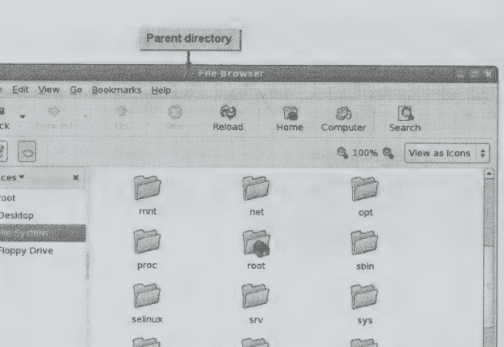

图 3-13：根目录`(/)`是所有其他目录的父目录。

### 路径

**定义：**

`路径`指定了文件系统中的位置。它以目录树顶部的根目录开始，并以您要访问的目录或文件结束。

您可以通过提供包含该文件的特定目录的路径来引用某个特定文件。例如，目录`jsmith`包含一个名为`work`的子目录，其中包含文件`mywork`。要引用该文件，请使用以下路径名称：`/home/jsmith/work/mywork`。请注意，正斜杠`(/)`字符用于分隔路径中的项目。`jsmith`前面的斜杠代表根目录，到文件`mywork`的路径从此处开始。

## 绝对路径与相对路径

路径分为两种类型——绝对路径和相对路径。绝对路径指的是特定位置，包括域名，且与当前工作目录或组合路径无关。这些路径通常以根目录为参考，因此以正斜杠开头。不以正斜杠开头的路径称为相对路径。相对路径是相对于当前工作目录的路径；因此，无需包含完整的绝对路径。这些路径可以包含点`[.]`和双点`[..]`，分别指示当前目录和父目录。

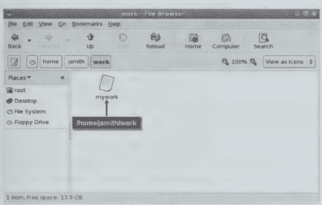

图 3-14：文件`mywork`的路径。


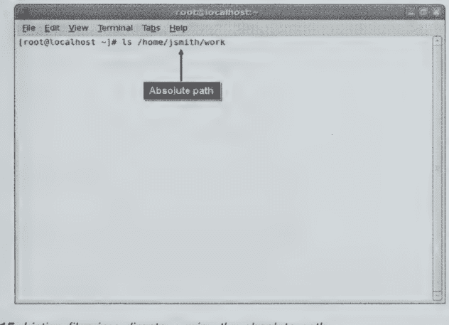

图 3-15：使用绝对路径列出目录中的文件。

## 基本文件系统命令

有一些基本文件系统命令，允许您修改文件并显示 Linux 文件系统内的信息。

| 命令 | 功能 |
| :------- | :------------- |
| `cd` | 遍历目录结构。有多种方式可以指定您需要切换到的目录的路径名。`cd`命令的语法为`cd {绝对或相对路径}`。 |
| `ls` | 列出当前工作目录中的文件。在不带任何选项运行该命令时，仅显示文件名。但是，通过带相应选项运行命令，它可以列出大小、文件类型和权限等信息。该命令的语法为`ls [命令选项] {目录的绝对或相对路径}`。 |
| `mv` | 将文件和目录从一个目录移动到另一个目录，或者重命名文件或目录。该命令的语法为`mv {绝对或相对路径}/{文件或目录名} ({绝对或相对路径}/{新文件或目录名})`。 |
| `cp` | 复制文件。该命令的语法为`cp [命令选项] {要复制的文件或目录的绝对或相对路径}/{文件或目录名} {目标的绝对或相对路径}`。 |
| `rm` | 删除文件或目录。该命令的语法为`rm [命令选项] {文件或目录的绝对或相对路径}/{文件或目录名}`。 |
| `touch` | 将文件的访问时间或修改时间更改为当前时间。此外，如果指定为参数的文件名不存在，`touch`命令会创建一个空文件。该命令的语法为`touch {文件名}`。 |
| `mkdir` | 创建目录。该命令的语法为`mkdir {目录名}`。 |
| `rmdir` | 删除目录。该命令的语法为`rmdir {目录名}`。 |
| `pushd` | 在目录栈顶部添加目录，或轮转目录栈。该命令的语法为`pushd [选项] {目录名}`。 |
| `popd` | 从目录栈中移除条目。当未指定选项时，它会从栈中移除顶部目录。该命令的语法为`popd [选项]`。 |

### `-v`选项

`-v`是一个可与基本文件管理命令一起使用的命令选项。该选项以冗长方式解释命令的执行过程以产生所需的输出。

### `ls`命令选项

`ls`命令选项在下表中描述。

| 选项 | 描述 |
|---|---|
| `-l` | 显示长列表，包括权限、硬链接数量、所有者、组、大小、日期和文件名。 |
| `-F` | 显示文件的性质，例如可执行文件用`*`，目录用`/`。 |
| `-a` | 显示目录中所有文件，包括名称以点`(..)`开头的文件。 |
| `-R` | 递归显示所有子目录。 |
| `-d` | 显示关于符号链接或目录的信息，而不是链接的目标或目录的内容。 |


|-L| 显示目录中的所有文件，包括符号链接。|

### 更改当前目录

有时您需要将用户主目录移出文件系统到其他目录。在这种情况下，您可以使用`cd`命令来更改目录。`cd`命令使您可以遍历目录结构。有多种方式可以指定您希望作为工作目录的目录的路径名：

- 不带路径名的`cd`命令无论当前目录如何，都会带您到主目录。

- `cd [路径名]`命令带您到指定的路径名。路径名可以是完整路径名（从根目录到指定目录）或相对路径名（从当前工作目录开始）。

- `cd ~/[路径名]`命令带您到相对于主目录的指定目录。（如有必要，请记住将`~/[路径名]`替换为`$HOME`。）

# 如何浏览 Linux 文件系统

**程序参考：更改目录**

要更改目录：

1. 作为用户在 CLI 中登录。

2. 输入`pwd`查看当前工作目录。

3. 输入`cd (*目标目录的绝对或相对路径*)`更改为目标目录。

4. 如有必要，输入`pwd`验证是否已更改为目标目录。

**程序参考：列出文件和目录**

要列出文件和目录：

1. 作为用户在 CLI 中登录。

2. 输入``命令以列出文件和目录。

**程序参考：在空间模式下使用 Nautilus 浏览器处理文件和目录**

要在空间模式下使用 Nautilus 浏览器处理文件和目录：

1. 作为用户在 GUI 中登录。

2. 双击桌面上的 **Computer** 图标。

3. 双击所需的目录以打开它。

4. 双击目录中所需的文件。

5. 如有必要，按 **Ctrl+Shift+W** 关闭所有父窗口。

6. 单击 **Close** 按钮以关闭 Nautilus 浏览器。

**程序参考：在浏览器模式下使用 Nautilus 浏览器处理文件**

要在浏览器模式下使用 Nautilus 浏览器处理文件：

1. 作为用户在 GUI 中登录。

2. 从菜单栏中选择 **Application**→**System Tools**→**File Browser**。

3. 在右侧窗格或左侧窗格中双击所需的文件或目录以查看它。

4. 关闭 Nautilus 浏览器。

**程序参考：设置 Nautilus 浏览器始终在浏览器模式下打开**

要设置 Nautilus 浏览器始终在浏览器模式下打开：

1. 作为用户在 GUI 中登录。

2. 双击桌面上的 **Computer** 图标。

3. 在 **Computer** 窗口中，选择 **Edit**→**Preferences**。

4. 在 **File Management Preferences** 对话框中，选择 **Behavior** 选项卡。

5. 在 **Behavior** 部分，勾选 **Always open in browser windows** 复选框，并单击 **Close**。

6. 关闭 **Computer** 窗口。

7. 双击 **Computer** 图标以在浏览器模式下打开 Nautilus 浏览器。

# 活动 3-2

更改目录

开始之前：

您已在 CLI 中以 root 身份登录。

场景：

您已受雇于一家组织担任初级管理员，并获得了对 Linux 系统的管理访问权限。然而，作为主管，您在`/home`中没有指定的目录来工作。因此，您决定切换到主目录并与文件进行交互。

1. 从`/root`目录切换到`/home`目录。

   a. 输入`pwd`查看当前工作目录。

   b. 观察到当前工作目录是`/root`。

   c. 输入`cd /home`以更改为主目录。

   d. 输入`pwd`查看当前工作目录。

   e. 观察到当前工作目录已更改为`/home`。

2. 列出目录中的文件。

   a. 输入`ls -a`以列出`/home`目录中的所有文件。

   b. 观察目录中列出的文件。

   c. 输入`clear`以清除终端屏幕。

### 活动 3-3

## 使用 Nautilus 浏览器查看文件和目录内容

**准备工作：**

1. 你已在第一个终端中以 root 身份登录。

2. 切换到图形用户界面（GUI）。

3. 你已以 root 用户身份登录。

4. 关闭终端窗口。

**场景：**

一名新员工需要关于在图形界面中进行基本文件系统导航和使用的协助。你决定通过浏览文件内容来演示 Nautilus 浏览器的使用方法。

| 操作步骤 | 具体操作 |
| :--- | :--- |
| 1. 在空间模式下使用 Nautilus 浏览器打开目录。 | a. 双击桌面上的 **Computer**（计算机）图标。 |
| | b. 在 **Computer** 窗口中，双击 **Filesystem**（文件系统）目录。 |
| | c. 观察目录在另一个窗口中打开，并查看目录内容。 |
| | d. 关闭`/`目录窗口。 |
| 2. 将 Nautilus 浏览器设置为在浏览器模式下打开，并查看目录内容。 | a. 在 **Computer** 窗口中，选择 **Edit**（编辑） $\rightarrow$ **Preferences**（首选项）。 |
| | b. 在 **File Management Preferences**（文件管理首选项）对话框中，选择 **Behavior**（行为）选项卡以更改浏览器窗口的行为。 |
| | c. 在 **Behavior** 部分，勾选 **Always open in browser windows**（始终在浏览器窗口中打开）复选框，并点击 **Close**（关闭）以启用窗口以浏览器模式打开。 |
| | d. 关闭 **Computer** 窗口。 |
| | e. 双击桌面上的 **Computer** 图标以验证所做的更改。 |
| | f. 观察 Nautilus 浏览器在浏览器模式下打开。 |
| | g. 在左侧窗格中，双击 **File System**（文件系统）目录以查看`/`目录的内容。 |
| | h. 观察目录的内容。 |
| | i. 关闭浏览器窗口。 |

## 主题 C

### 管理文件系统

现在你可以浏览 Linux 文件系统了，是时候学习如何管理它了。在本主题中，你将管理 Linux 文件系统。

管理 Linux 文件系统将允许你根据需求定制系统。此外，你将能够组织和整理文件和目录，挂载额外的驱动器，并使用可记录介质进行备份或存储。

### 文件系统管理任务

在 Linux 中管理文件系统时，你将执行以下任务：

- 备份文件和目录。

- 挂载和卸载文件系统。

- 以及，在磁盘分区上创建交换空间。

### 烧录光盘

在管理文件系统时，你可能需要将一些数据备份到光盘。Linux 允许你使用基于图形界面的程序烧录 CD 和 DVD，这些程序可以指导你完成烧录过程，同时也可以从命令行界面（CLI）进行操作。要从命令行烧录光盘：

1. 创建一个目录并复制你要烧录的文件。

2. 使用`mkisofs`命令创建文件的 ISO 镜像。

3. 以及，使用`cdrecord`命令烧录 CD。


你的系统必须安装 CD 或 DVD 刻录机才能烧录光盘。

**ISO 镜像**

ISO 镜像或磁盘镜像是一种用于写入 CD 和 DVD 等光盘的文件归档格式。它是由国际标准化组织（ISO）定义的标准，文件扩展名为`.iso`。

### 挂载点

**定义：**

挂载点是访问存储在本地或远程存储设备上的信息的入口点。挂载点通常是一个空目录，文件系统在此加载或挂载，以使文件系统对用户可访问。如果目录已经有一些内容，这些内容在对用户可见之前将被隐藏，直到挂载的文件系统被卸载。

> 你可以使用`/etc/fstab`文件来列出在 Linux 系统启动和关闭时分别需要挂载和卸载的文件系统。

示例：


*图 3-16：挂载文件系统的过程。*

### 挂载

在 Linux 中，文件系统无法直接访问。必须将其与目录关联，使其对用户可访问。这种关联是通过使用`mount`命令将文件系统加载或术语称为挂载到目录中来实现的。使用完文件系统后，需要使用`umount`命令卸载或取消挂载文件系统，以将其与目录解除关联。


### 挂载命令

```
[root@localhost ~]# mount
/dev/mapper/VolGroup00-LogVol00 on / type ext3 (rw)
proc on /proc type proc (rw)
sysfs on /sys type sysfs (rw)
devpts on /dev/pts type devpts (rw,gid=5,mode=620)
/dev/sda1 on /boot type ext3 (rw)
tmpfs on /dev/shm type tmpfs (rw)
none on /proc/sys/fs/binfmt_misc type binfmt_misc (rw)
sunrpc on /var/lib/nfs/rpc_pipefs type rpc_pipefs (rw)
[root@localhost ~]#
```

图 3-17：当前挂载的文件系统列表。

### 挂载选项

你可以为文件系统指定各种挂载选项。


**挂载选项**

| 选项 | 功能描述 |
| :--- | :--- |
| `auto` | 指定该设备必须自动挂载。 |
| `noauto` | 指定该设备无需自动挂载。 |
| `nouser` | 指定只有 `root` 用户可以挂载设备或文件系统。 |
| `user` | 指定所有用户都可以挂载设备或文件系统。 |
| `exec` | 允许执行文件系统中的二进制文件。 |
| `noexec` | 防止执行文件系统中的二进制文件。 |
| `ro` | 以只读方式挂载文件系统。 |
| `rw` | 以读写权限挂载文件系统。 |
| `sync` | 指定文件系统中的输入和输出操作应同步进行。 |
| `async` | 指定文件系统中的输入和输出操作应异步进行。 |

### 二进制文件

二进制文件是编译为可执行程序或汇编后计算机可读的源代码。二进制文件经过编码，可以通过互联网传输。此外，二进制文件可以是图片、文字处理文件或电子表格文件。某些二进制文件可能包含可能损害系统的病毒。

### 交换空间


**交换空间**

**定义：**

交换空间是硬盘上的一个分区，当系统物理内存不足时使用。`Linux` 会将一些未使用的文件从 `RAM` 推送到交换空间以释放内存。通常，交换空间大小等于 `RAM` 容量的两倍。

**示例：**


图 3-18：在硬盘上创建交换空间。

交换空间有三种类型。

| 交换类型 | 描述 |
| :--- | :--- |
| 设备交换 | 在分区硬盘时配置设备交换空间。操作系统使用它来运行大型应用程序。 |
| 文件系统交换 | 主要在安装 `Linux` 时配置文件系统交换空间。当可用交换空间耗尽时，操作系统将其用作紧急资源。 |
| 伪交换 | 伪交换空间允许在 `RAM` 有限的小型计算机上运行大型应用程序。 |

### 交换文件

交换文件用于存储要从系统内存传输到磁盘的数据。它是动态的，当数据进出内存时其大小会发生变化。它用作将数据从 `RAM` 传输到硬盘的介质。

### 交换分区

交换分区是硬盘上的一块虚拟内存区域，用于补充计算机中的物理 `RAM`。`Linux` 创建交换分区，因为它们比交换文件系统性能更好。

### `mkswap` 命令

`mkswap` 命令是一个系统管理命令，用于在磁盘分区上创建交换空间。它提供了执行各种任务的选项。


| 选项 | 功能描述 |
| :--- | :--- |
| `-c` | 在挂载交换空间之前验证设备无坏扇区。 |
| `-f` | 强制创建大于允许限制的区域作为交换分区。 |
| `-p` | 设置 `mkswap` 命令使用的页大小。 |
| `-L label` | 使用应用于分区或文件系统的标签激活交换空间。 |

### 语法

`mkswap` 命令的语法是 `mkswap [option] device size`。`mkswap` 的设备参数通常是磁盘分区，如 `/dev/hda2` 或 `/dev/sdb3`，但也可以是文件。

## 交换分区管理命令

有许多命令可用于管理交换分区。其中最重要的命令是 `swapon` 命令和 `swapoff` 命令。

| 命令 | 说明 |
| :--- | :--- |
| `swapon` 命令 | 用于激活指定设备上的交换分区。它提供了多种选项来指定设备。 |
| `swapoff` 命令 | 用于停用设备上的交换空间。 |

### `swapon` 和 `swapoff` 命令选项

下表列出了 `swapon` 和 `swapoff` 命令中一些常用的选项。

| 选项 | 说明 |
| :--- | :--- |
| `swapon -e` | 用于跳过不存在的设备。 |
| `swapon -a` | 用于激活所有交换空间。 |
| `swapoff -a` | 用于停用所有交换空间。 |

## 如何管理文件系统

### 操作参考：创建挂载点

要创建挂载点：

1. 以 `root` 身份登录。
2. 输入 `mkdir {挂载点}` 以创建挂载点。
3. 输入 `chown {用户名} {挂载点}` 以将用户设置为挂载点的拥有者。
4. 输入 `chgrp {组名} {挂载点}` 以将组设置为挂载点的拥有者。

### `chgrp` 命令

`chgrp` 命令用于更改一个或多个文件或目录的组所有权。

### 操作参考：挂载文件系统

要挂载文件系统：

1. 在 `CLI` 中以 `root` 身份登录。
2. 输入 `mount {命令选项} /dev/{设备名称}{分区编号} {挂载点}` 将指定设备挂载到指定挂载点。
3. 输入 `mount {挂载点}` 以验证文件系统是否已挂载到指定挂载点。

### 操作参考：在启动时挂载文件系统

要在启动时挂载文件系统：

1. 在 `CLI` 中以 `root` 身份登录。
2. 输入 `vi /etc/fstab` 以打开 `/etc/fstab` 文件。
3. 输入 `(设备或分区名称) (挂载点) (文件系统类型) [挂载选项] {dump 选项} {fsck 选项}` 以添加新文件系统的条目。
4. 保存并关闭文件。
5. 重启系统以自动挂载文件系统，或输入 `mount -a` 以重新加载挂载表，应用来自 `/etc/fstab` 文件的最近更改。
6. 验证文件系统是否在启动时自动挂载。
   - 以 `root` 身份登录。
   - 输入 `mount` 以挂载所有文件系统。

### 操作参考：卸载文件系统

要卸载文件系统：

1. 在 `CLI` 中以 `root` 身份登录。
2. 卸载文件系统。
   - 输入 `umount [命令选项] /dev/(设备名称)(分区编号)` 以卸载文件系统。
   - 或者，输入 `umount [命令选项] {挂载点}` 以卸载文件系统。

### 操作参考：管理文件系统

要管理文件系统：

1. 在 `CLI` 中以 `root` 身份登录。
2. 输入 `fuser {挂载点}` 以显示使用该文件系统的进程详情。
3. 输入 `fuser -km {挂载点}` 以终止使用该文件系统的所有进程。
4. 输入 `umount (挂载点)` 以卸载文件系统。

> 当文件系统正被另一个进程使用时，无法卸载该文件系统。

### 操作参考：管理交换分区

要管理交换分区：

1. 在 `CLI` 中以 `root` 身份登录。
2. 输入 `mkswap /dev/(设备名称)(分区编号)` 以创建交换分区。
3. 输入 `/dev/(设备名称)(分区编号) swap swap (挂载选项) {dump 选项} {fsck 选项}` 以将该分区条目添加到 `/etc/fstab` 文件。
4. 输入 `swapon (设备名称)` 以激活交换分区。
5. 输入 `swapoff (设备名称)` 以停用交换分区并将其转换为标准 `Linux` 文件系统。

### 操作参考：使用文件系统格式化分区

要使用文件系统格式化分区：

1. 在 `CLI` 中以 `root` 身份登录。
2. 使用文件系统格式化分区。
   - 输入 `mkfs -t (文件系统类型) /dev/(设备名称)(分区编号)` 在设备的指定分区上创建指定的文件系统。
   - 或者，输入 `mke2fs [命令选项] /dev/(设备名称)(分区编号)` 在设备的指定分区上创建 `ext2` 文件系统。

## 活动 3-4：挂载文件系统

**开始之前：**

1. 你已在 `GUI` 中以 `root` 身份登录。
2. 切换到 `CLI`。
3. 在命令行中，输入 `useradd netadmin2` 以创建用户 `netadmin2`。


4. 输入 `passwd netadmin2` 以设置 `netadmin2` 的密码。

5. 在 `New UNIX password` 提示符下，输入 `mypy@$sw0rd` 以设置 `netadmin2` 的密码。

6. 在提示符下重新输入相同密码以确认密码。

7. 输入 `umount /dev/sdb5` 以卸载 `/dev/sdb5` 分区。

8. 输入 `umount /dev/sdb6` 以卸载 `/dev/sdb6` 分区。

9. 输入 `cd /root` 以切换到根目录。

10. 输入 `clear` 以清除终端屏幕。

**场景：**

你的办公室有一个会议。几名用户希望将他们的系统移动到会议室，以便在会议期间访问他们的文件。你发现有多个系统需要移动，这将花费大量时间。因此，你决定从用户那里获取所需文件，并将它们加载到会议室系统的独立分区中，以便用户可以访问其文件。

使用以下用户和分区详细信息来挂载文件系统：

- 用户名：`netadmin1`，分区大小：1 GB，挂载点：`/admin1`，`/admin1` 的用户和组拥有者：`netadmin1`
- 用户名：`netadmin2`，分区大小：1 GB，挂载点：`/admin2`，`/admin2` 的用户和组拥有者：`netadmin2`

| 你做什么 | 你怎么做 |
| :--- | :--- |
| 1. 为用户创建挂载点。 | a. 输入 `mkdir /admin1` <br> b. 输入 `chown netadmin1 /admin1` 将 `netadmin1` 用户设置为 `/admin1` 挂载点的拥有者。 <br> c. 输入 `chgrp netadmin1 /admin1` 将 `netadmin1` 组设置为 `/admin1` 挂载点的拥有者。 <br> d. 创建挂载点 `/admin2`，并通过执行步骤 (a) 到 (c) 将用户所有权和组所有权分配给 `netadmin2`。 <br> e. 输入 `clear` 以清除终端屏幕。 |
| 2. 挂载并验证文件系统。 | a. 输入 `mount -a /dev/sdb5 /admin1` 以挂载 `netadmin1` 的文件系统。 <br> b. 输入 `mount` <br> c. 观察显示行 `/dev/sdb5 on /admin1 type ext2 (rw)`，表示文件系统已挂载。 <br> d. 输入 `mount -a /dev/sdb6 /admin2` 以挂载 `netadmin1` 的文件系统。（注：原文此处可能笔误，语境应为 `netadmin2`，但按原文翻译） <br> e. 输入 `mount` <br> f. 观察显示行 `/dev/sdb6 on /admin2 type ext2 (rw)`，表示文件系统已挂载。 |
| 3. 在 `fstab` 文件中创建条目，以便系统在启动时挂载 `/dev/sdb5` 和 `/dev/sdb6` 文件系统。 | a. 输入 `vi /etc/fstab` 以打开 `fstab` 文件。 <br> b. 按 `Shift+G` 跳转到最后一行。 <br> c. 按 `O` 在插入模式下切换到新行。 |


插入模式允许你通过输入文本进行插入。

d. 输入 `/dev/sdb5 /admin1 ext2 defaults 0 0` 并按 `Enter` 以便在系统启动时挂载 `/dev/sdb5` 文件系统。

e. 输入 `/dev/sdb6 /admin2 ext2 defaults 0 0` 以便在系统启动时挂载 `/dev/sdb6` 文件系统。

f. 按 `Esc`。

g. 保存并关闭文件。

h. 输入 `clear` 以清除终端屏幕。

i. 输入 `mount -a` 以更新 `fstab` 文件。

4. 检查指定的文件系统是否在系统启动时挂载。

   a. 输入 `reboot` 以重启系统。

   b. 按 `Ctrl+Alt+F1` 切换到 CLI。

   c. 在 Linux 系统的 CLI 中以 `root` 身份登录。

   d. 输入 `mount` 以验证文件系统是否在启动时挂载到指定的挂载点。

   e. 观察分区 `/dev/sdb5` 和 `/dev/sdb6` 分别挂载到 `/admin1` 和 `/admin2` 目录。

   f. 输入 `clear` 以清除终端屏幕。


## 主题 D

## 维护文件系统

在管理 Linux 文件系统之后，了解如何保持其运行状态非常重要。在本主题中，你将维护 Linux 文件系统。

维护 Linux 文件系统有助于你排除故障并对系统进行常规维护。如果发生停电或其他非计划关机，你需要知道如何验证本地驱动器数据完整性。

### 文件系统维护任务

在 Linux 中维护文件系统包括以下任务：

- 检查文件系统的完整性。
- 管理分区大小。
- 删除临时文件。
- 以及，执行系统恢复。


### 本地存储设备

Linux 中有不同类型的存储设备。每个设备都有与其相关的具体用途。

| 设备 | 说明 |
| :--- | :--- |
| 硬盘 | 一种内部设备，可以存储大量数据。它可以快速访问。 |
| 软盘驱动器 | 一种可移除介质，可以存储较少量数据。它无法像硬盘那样快速访问。 |
| 磁带驱动器 | 一种用于在磁带上存储大量数据的设备。磁带驱动器可以是内部或外部的。外部磁带驱动器是可移动的，而在内部磁带驱动器中只有磁带是可移除的。磁带驱动器中的数据按顺序访问。 |
| USB 驱动器 | 一种小巧、便携的存储设备，用于存储需要随身携带的文件。 |
| CD-R(W) | 一种可移除光盘，存储 650-700 MB 数据。它可以比其他可移除存储介质更快访问。 |
| DVD-R(W) | 一种可移除光盘，存储 4.5 GB（或更多）数据。它可以比其他可移除存储介质更快访问。 |

## 日志式文件系统

日志式文件系统是一种操作系统在遭遇意外中断（如系统崩溃）后用于快速恢复的方法。日志式文件系统可以消除系统在启动时进行文件系统检查的需求。通过采用日志式文件系统，系统不会将修改后的文件直接写入磁盘，而是在磁盘上维护一个日志（`journal`）。

日志式文件系统的处理过程包含以下阶段：


1. 日志描述了对磁盘所做的所有变更。
2. 一个后台进程会在变更被记录到日志中时，实时执行每项变更。
3. 如果系统关机，待处理的变更将在系统重启时执行。
4. 日志中的未完成条目将被丢弃。


图 3-19：日志处理流程的阶段。

## 日志功能的性能问题

日志式文件系统在处理小文件和小容量驱动器时表现良好。随着文件和数据卷容量的增大，性能将会下降。导致性能低下的原因包括：

- 电力故障或不正常关机后的文件系统恢复时间。
- 使用位图方法追踪文件系统。
- 空间浪费和碎片化。

## fsck 命令

`fsck` 命令用于检查文件系统的完整性。文件系统完整性指的是文件系统的正确性和有效性。大多数系统在启动时会自动运行 `fsck` 命令，以便在使用系统之前检测和修正任何错误。文件系统错误通常由电力故障、硬件故障或系统不正常关机引起。


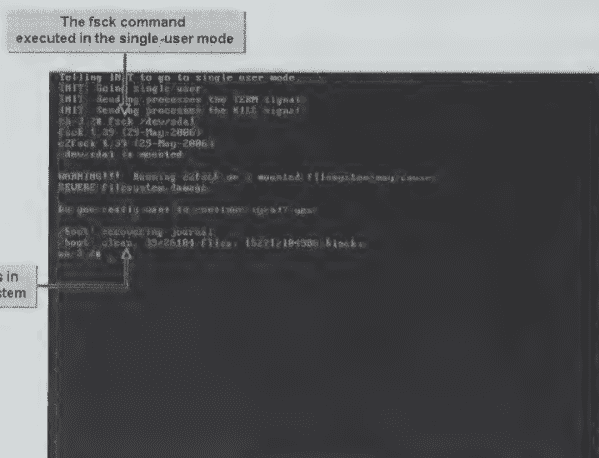

图 3-20：从单用户模式检查文件系统完整性。

### 语法

`fsck` 命令的语法为 `fsck -t [filesystem type] [options]`。

### 修复文件系统

你可以使用 `fsck -r /dev/[filesystem]` 命令来修复文件系统。该命令会提示你确认相关操作。如果你正在同时检查多个文件系统，则不应使用此选项，因为它一次只允许修复一个文件系统。

## tune2fs 实用工具

`tune2fs` 实用工具用于调整与 Linux 文件系统相关的参数。使用该工具可以为现有的 `ext2` 或 `ext3` 文件系统添加日志。如果文件系统已经挂载，日志将显示在文件系统的根目录中。如果文件系统未挂载，日志将被隐藏。大多数 Linux 发行版都提供 `tune2fs` 实用工具。

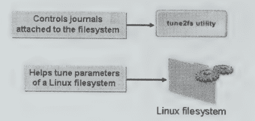


图 3-21：`tune2fs` 命令用于管理系统。

### 语法

`tune2fs` 命令的语法为 `tune2fs [options] {device_name}`。

## dumpe2fs 实用工具

`dumpe2fs` 实用工具主要用于管理基于 ext2 的文件系统。它将 ext2 文件系统的状态转储到标准输出设备，并打印所选设备的块组（block group）信息。

`dumpe2fs` 实用工具有多种选项。

| 选项 | 功能 |
| :--- | :--- |
| `-x` | 打印有关文件系统中块号的详细报告。 |
| `-b` | 打印文件系统中的坏块。 |
| `-f` | 无论文件系统标志如何，强制该实用工具显示文件系统状态。 |
| `-i` | 从使用 `e2image` 实用工具创建的映像文件中显示文件系统数据。 |

### 语法

`dumpe2fs` 命令的语法为 `dumpe2fs [options] (block_size) {device_name}`。

## 如何维护文件系统

### 操作参考：配置 ext2 文件系统

配置 ext2 文件系统的步骤：

- 1. 如果你已经拥有一个带有现有文件系统的已挂载驱动器：
  - a. 将驱动器上的所有数据备份到可移动介质或另一个驱动器。
  - b. 使用 `umount` 命令卸载该驱动器。
  - c. 使用 `mkfs -t` 命令配置 ext2 文件系统。
- 2. 如果你有一个空驱动器：
  - a. 使用 `mkfs -t` 命令配置 ext2 文件系统。
- 3. 使用 `mount` 命令挂载该驱动器。
- 4. 更新 `/etc/fstab` 文件以反映对文件系统所做的更改。

### 操作参考：配置 ext3 文件系统

配置 ext3 文件系统的步骤：

- 1. 如果你有一个使用 ext2 文件系统的驱动器：
  - a. 使用 `umount` 命令卸载该驱动器。
  - b. 使用 `tune2fs -j <partition>` 命令转换文件系统。


- 2. 如果你已经拥有一个带有除 ext2 以外现有文件系统的已挂载驱动器：
  - a. 将驱动器上的所有数据备份到可移动介质或另一个驱动器。
  - b. 使用 `umount` 命令卸载该驱动器。
  - c. 使用 `mkfs -t` 命令配置 ext3 文件系统。
  - d. 使用 `mount` 命令挂载该驱动器。
- 3. 如果你有一个空驱动器：
  - a. 使用 `mkfs -t` 命令配置 ext3 文件系统。
  - b. 使用 `mount` 命令挂载该驱动器。
- 4. 更新 `/etc/fstab` 文件以反映对文件系统所做的更改。

### 操作参考：配置 reiserfs 文件系统

配置 reiserfs 文件系统的步骤：

- 1. 验证你的内核版本是否晚于 2.4.16。
- 2. 如果你已经拥有一个带有现有文件系统的已挂载驱动器：
  - a. 将驱动器上的所有数据备份到可移动介质或另一个驱动器。
  - b. 使用 `umount` 命令卸载该驱动器。
  - c. 使用 `mkreiserfs` 命令配置 reiserfs 文件系统。
  - d. 使用 `mount` 命令挂载该驱动器。
  - e. 更新 `/etc/fstab` 文件以反映对文件系统所做的更改。
- 3. 如果你有一个空驱动器：
  - a. 使用 `mkfs -t reiserfs` 命令配置 reiserfs 文件系统。
  - b. 使用 `mount` 命令挂载该驱动器。
  - c. 将该驱动器添加到 `/etc/fstab` 文件中。

### 操作参考：管理本地文件系统

管理本地文件系统的步骤：

- 1. 切换到单用户模式。
- 2. 使用 `fsck` 命令检查文件系统。
- 3. 检查完成后返回多用户模式。

# 活动 3-5

维护 Linux 文件系统

**准备工作：**

- 1. 你已在 CLI 中以 `root` 身份登录。
- 2. 输入 `telinit 3` 切换到运行级别 3。
- 3. 按 `Enter` 键在新运行级别中继续。
- 4. 输入 `clear` 清除终端屏幕。

**场景：**

由于雷暴天气，过夜时出现短暂停电，Linux 系统未正常关机。需要检查系统的一致性。使用 `fsck` 命令验证硬盘的驱动器完整性和数据完整性。

| **操作** | **具体步骤** |
| :--- | :--- |
| 1. 在本地文件系统上运行 `fsck` 命令。 | a. 输入 `telinit 1` 切换到单用户模式。<br>b. 输入 `fsck /dev/sdb1`。<br>c. 在警告提示处，按 Y，然后按 `Enter` 键。<br>d. 观察显示“clean”的消息，这表明文件系统中没有错误。<br>e. 输入 `telinit 3` 切换到运行级别 3。 |
| 2. 在哪个运行级别你可以进行磁盘维护而不会损坏磁盘？ | a) 运行级别 0<br>b) 运行级别 1 ✓<br>c) 运行级别 3<br>d) 运行级别 5 |
| 3. 判断对错：你可以运行 `e2fsck` 命令对已挂载的文件系统进行磁盘检查。 | 错误 ✓ |

# 活动 3-6

## 配置 ext3 文件系统

**准备工作：**

- 1. Linux 系统正在运行级别 3 下运行。
- 2. 以 `root` 身份登录。
- 3. 输入 `telinit 5` 切换到图形用户界面（GUI）。
- 4. 切换到第一个 CLI 终端。
- 5. 按 `Enter` 键继续。
- 6. 输入 `clear` 清除终端屏幕。

**场景：**

两名用户抱怨由于系统不正常关机导致数据丢失。你运行磁盘检查实用工具并验证磁盘未损坏。此外，你决定将现有文件系统转换为日志式文件系统，以确保即使在系统意外关机的情况下也不会丢失数据。

| 操作 | 具体步骤 |
| :--- | :--- |
| 1. 卸载 `/dev/sdb5` 和 `/dev/sdb6` 分区。 | a. 输入 `mount` 查看已挂载的分区。<br>b. 观察 `/dev/sdb5` 和 `/dev/sdb6` 这两个分区已自动挂载。<br>c. 输入 `umount /dev/sdb5` 卸载 `/dev/sdb5` 分区。<br>d. 输入 `umount /dev/sdb6` 卸载 `/dev/sdb6` 分区。<br>e. 输入 `mount` 查看已挂载的分区。<br>f. 观察 `/dev/sdb5` 和 `/dev/sdb6` 这两个分区未列出，表明它们已卸载。 |

## 2. 将 `/dev/sdb5` 和 `/dev/sdb6` 分区转换为 ext3 文件系统。

- 输入 `tune2fs -j /dev/sdb5` 以将分区转换为 ext3 文件系统。
- 观察文件系统转换过程中显示的详细信息。
- 输入 `tune2fs -j /dev/sdb6` 以将分区转换为 ext3 文件系统。
- 观察文件系统转换过程中显示的详细信息。
- 输入 `clear` 以清除终端屏幕。

## 3. 验证这两个新分区具有 ext3 文件系统。

- 输入 `parted` 以启动 GNU Parted 实用工具。
- 输入 `select /dev/sdb` 以选择 `/dev/sdb` 分区。
- 在 `(parted)` 提示符下，输入 `print` 以查看现有分区列表。
- 观察分区 5 和 6 是否具有 ext3 文件系统。
- 输入 `q` 以退出 `parted` 实用工具。
- 输入 `clear` 以清除终端屏幕。

## 4. 修改 fstab 文件中的分区条目，以便在系统启动时挂载 ext3 文件系统。

- 输入 `vi /etc/fstab` 以打开 `fstab` 文件。
- 导航到包含 `/dev/sdb5` 条目的行，并将光标放在 `ext2` 中的数字 2 上。
- 按 `I` 切换到插入模式。
- 输入 `3` 并按 `Delete` 键。
- 按 `Down Arrow`（向下方向键）和 `Left Arrow`（向左方向键）导航到包含 `/dev/sdb6` 条目的行，并将光标放在 `ext2` 中的数字 2 之后。
- 输入 `3` 并按 `Delete` 键。
- 按 `Esc` 键。
- 保存并关闭文件。
- 输入 `clear` 以清除终端屏幕。
- 输入 `mount -a` 以更新 `fstab` 条目。
- 输入 `reboot` 以重启系统。

## 5. 检查指定的文件系统是否在系统启动时挂载。

- 按 `Ctrl+Alt+F1` 切换到 CLI。
- 在 Linux 系统的 CLI 中登录为 `root`。
- 输入 `mount` 以查看已挂载的分区。
- 观察这两个分区 `/dev/sdb5` 和 `/dev/sdb6` 是否具有 ext3 文件系统。


- 输入 `clear` 以清除终端屏幕。

# 可选活动 3-7

## 在软盘上格式化并创建文件系统

**场景：**

用户希望将文件从一个系统传输到另一个系统，而不想麻烦地去设置网络共享并通过网络发送数据。你决定向用户展示如何格式化软盘以传输文件。

| 你做什么 | 怎么做 |
| :--- | :--- |
| **1.** 确定软盘的大小和要使用的正确 `fdformat` 命令。 | a. 输入 `man fdformat`<br>b. 查找 `fd0h1440` 条目。 |
| **2.** 格式化软盘。 | a. 将一张空白软盘插入软盘驱动器。<br>b. 输入 `fdformat /media/floppy` 以格式化软盘。 |
| **3.** 在软盘上创建文件系统。 | a. 输入 `mkfs /media/floppy`<br>b. 输入 `mount /media/floppy` 以挂载软盘。<br>c. 输入 `ls /media/floppy` 以验证文件系统已创建。<br>d. 验证是否列出了 `lost+found` 目录。 |

# 第 3 课跟进

在本课中，你在硬盘上创建了分区和文件系统。了解文件系统结构有助于你高效地导航、管理和维护文件系统。

1. **你认为什么时候需要格式化分区？为什么？**

   **答案可能有所不同，但可能包括：**

   1. 当硬盘上发生数据溢出时，需要格式化分区。当磁盘无法容纳更多数据时，最好先备份现有数据，然后格式化分区。
   2. 当分区中的文件系统损坏，且由于文件系统损坏导致所有其他程序无法运行时，需要进行分区格式化。
   3. 在安装了新的操作系统时，最好先格式化分区，然后再在硬盘上安装操作系统，以避免与之前安装的分区发生冲突。

2. **`ext3` 文件系统是否比 `ext2` 文件系统更好？如何更好？**

   答案可能有所不同，但可能包括：是的，因为 `ext3` 是 `ext2` 的改进版本，并且是当前的原生 Linux 文件系统。在系统突然关闭的情况下，`ext3` 比 `ext2` 恢复得更快。

# 4 在 Linux 中管理文件

**课时：2 小时 15 分钟**

## 课程目标

在本课中，你将管理 Linux 中的各种文件。

你将：

- 在 Linux 中创建文本文件。
- 在 Linux 文件系统中定位文件。
- 管理指向文件的链接。
- 备份文件并恢复文件。
- 使用 `MySQL` 管理数据库。

## 简介

你对 Linux 文件系统有了基本的了解。现在是时候学习如何在 Linux 中操作文件和目录了。在本课中，你将管理各种类型的 Linux 文件。

作为一名 Linux 管理员，你应保持系统上的文件井然有序。学习如何创建、编辑、定位、链接、备份和恢复文件，将有助于你根据需求定制系统。

本课涵盖以下 `CompTIA Linux+ (2009)` 认证目标的全部或部分：

- 主题 A
  - 目标 2.1
- 主题 B
  - 目标 2.1
  - 目标 2.3
- 主题 C
  - 目标 2.1
- 主题 D
  - 目标 1.8
  - 目标 2.4
- 主题 E
  - 目标 3.7

# 主题 A

## 创建和编辑文件

你对 Linux 文件系统类型有很好的了解。现在，你可以继续学习创建和编辑文件。在本主题中，你将创建和编辑文件。

处理文本文件对大多数用户来说是一项基本且常规的任务。考虑一下你可能需要提交关于当前项目报告的情景。你需要一个应用程序，例如文本编辑器，来创建报告。文本编辑器将允许你轻松地创建和编辑文本文件。你还可以使用文本编辑器创建和编辑配置文件，这将允许你定制系统。

### 文本编辑器

**定义：**

`文本编辑器` 是一种允许你查看、创建或修改文本文件内容的应用程序。它最初是为编写程序而创建的，但现在甚至也被用于编辑普通文本文件。文本编辑器支持不同的模式，例如命令模式和插入模式。有许多与 Linux 兼容的文本编辑器类型，例如 `Vim`、`gedit` 和 `nano`。然而，文本编辑器并不总是支持文字处理器提供的格式选项。文本编辑器可以在 `CLI` 或 `GUI` 中运行。

**示例：**

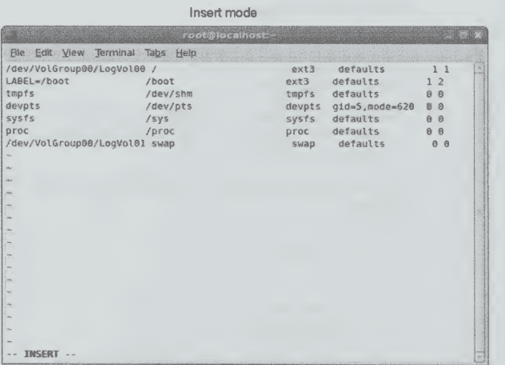

*图 4-1：处于插入模式的 `Vim` 文本编辑器。*

命令模式

```
root@localhost:~$
File Edit View Terminal Tabs Help
/dev/Vol1Group00/LogVol00 / ext3 defaults 1 1
LABEL=/boot /boot ext3 defaults 1 2
tmpfs /dev/shm tmpfs defaults 0 0
devpts /dev/pts devpts gid=5,mode=620 0 0
sysfs /sys sysfs defaults 0 0
proc /proc proc defaults 0 0
/dev/Vol1Group00/LogVol01 swap swap defaults 0 0
```

*图 4-2：处于命令模式的 `Vim` 文本编辑器。*

### 文本编辑器列表

有许多与 Linux 兼容的文本编辑器。


| 文本编辑器 | 描述 |
| :--- | :--- |
| `Vim` | `Vi IMproved`（`Vim` 改进版），或 `VIM`，文本编辑器是 Linux 中的默认文本编辑器。它广泛用于编程和处理简单的文本文件。它是一个强大的编辑器，通过采用简单的按键组合来执行复杂的文本编辑，从而优化速度。 |
| `Emacs` | 一种灵活、强大且流行的文本编辑器，用于 Linux 和 `Unix`。它提供众多功能，例如根据内容敏感编辑模式以及对各种语言的支持。它可以轻松定制。 |
| `Gvim` | `Vim` 编辑器的图形界面版本。 |
| `KWrite` | 一种用于 `KDE` 的灵活基于 `GUI` 的文本编辑器。 |
| `gedit` | 一种用于 `GNOME` 桌面的简单但强大的基于 `GUI` 的文本编辑器。 |
| `nano` | 一种小型、用户友好的文本编辑器，源自 `Pico` 文本编辑器。 |

### `Emacs`

`Emacs` 源自“`Editor MACroS`”（编辑器宏）。它由 `Richard Stallman` 编写。

### `KDE`

`KDE` 是 Linux 的一个替代 `GUI` 桌面环境。它提供基本桌面功能、应用程序、工具以及供开发人员编写系统应用程序的文档。

### `vim` 命令

`vim` 命令调用 `Vim` 编辑器。但是，也可以为此目的使用 `vi` 命令，因为它会自动将用户重定向到 `Vim`。如果不以文件名作为参数输入，`vim` 命令默认会打开一个欢迎屏幕。要打开文件，使用语法 `vim 文件名`。如果文件不存在，`Vim` 将创建具有指定名称的文件并打开文件进行编辑。`Vim` 支持同时打开多个文件。

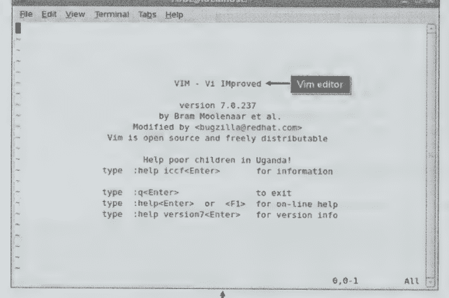

*图 4-3：`Vim` 的介绍屏幕。*

### `Vim` 模式

`Vim` 是一个模态编辑器，其不同模式决定了各种按键的功能。这里列出了一些 `Vim` 中常见的模式。

| 模式 | 描述 |
| :--- | :--- |
| `插入` | 允许用户通过输入来插入文本。 |
| `执行` | 允许用户在编辑器中执行命令。 |
| `命令` | 允许用户使用单键击来执行不同的编辑操作。 |
| `可视` | 允许用户突出显示或选择文本以进行复制、删除等操作。 |

## 切换模式

你可以在 `Vim` 的不同模式之间进行切换。命令模式（`command mode`）是 `Vim` 的默认模式。你可以使用单键输入从命令模式切换到其他任何模式。


这里列出了一些用于切换模式的按键。

| **按键** | **功能** |
| :--- | :--- |
| `i` | 切换到插入模式，并在光标左侧插入文本。 |
| `A` | 切换到插入模式，并在行末添加文本。 |
| `I` | 切换到插入模式，并在行首插入文本。 |
| `o` | 切换到插入模式，并在光标下方的新行上插入文本。 |
| `O` | 切换到插入模式，并在光标上方的新行上插入文本。 |
| `v` | 切换到可视模式以启用选择功能，每次选择一个字符。 |
| `V` | 切换到可视模式以启用选择功能，每次选择一行。 |
| `:` | 切换到执行模式以允许用户输入命令。 |
| `Esc` | 返回命令模式。 |

## 执行模式命令


在命令模式中，当输入 `:` 操作符时，编辑器左下角会出现一个小的命令提示区域。这表明用户处于执行模式，并且可以运行 `Vim` 支持的命令。

`Vim` 支持的某些命令如下所列。


| **命令** | **功能** |
| :--- | :--- |
| `:w` *文件名* | 如果是首次保存，则保存文件并指定文件名。 |
| `:q` | 如果在上次保存后未进行更改，则退出。 |
| `:q!` | 忽略所做的更改并退出。 |
| `:qa` | 退出多个文件。 |
| `:wq` | 保存当前文件并退出。 |
| `:!(*任意 Linux 命令*)` | 执行该命令，并在 Vim 界面中获取结果。 |

## Vim 帮助选项


可以使用 `:help` 命令访问 Vim 内置文档的主要来源。要查找特定主题的帮助，你可以将必要主题作为参数添加。要退出帮助手册，可以使用 `:q`。`vimtutor` 命令通过允许用户练习 Vim 命令和快捷键来帮助初学者学习 Vim 的基础知识。

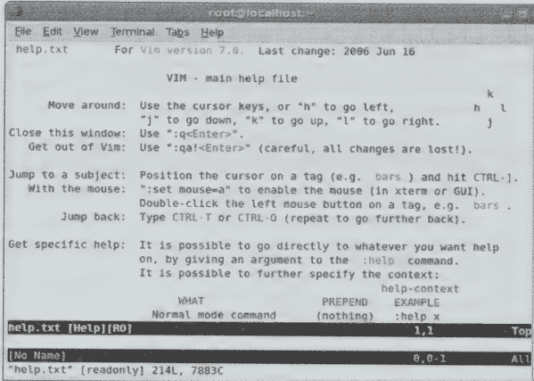

**图 4-4：** 使用 Vim 文本编辑器查看帮助文件。

## 移动


*移动（Motions）* 是单键快捷键，用于在命令模式中导航文件。这些按键可将光标定位在文档中的任何位置。它们可用于通过字符、单词、行甚至大块文本移动光标。

| 导航按键 | 用途 |
| :--- | :--- |
| `H` | 向左移动一个字符。 |
| `J` | 向下移动一行。 |
| `K` | 向上移动一行。 |
| `L` | 向右移动一个字符。 |
| `^` | 移动到当前行开头。 |
| `$` | 移动到当前行末尾。 |
| `W` | 移动到下一个单词。 |
| `B` | 移动到上一个单词。 |
| `E` | 移动到当前单词末尾，如果已在单词末尾，则移动到下一个单词末尾。 |
| `Shift+L` | 将光标移动到屏幕底部。 |
| `Shift+H` | 将光标移动到屏幕第一行。 |
| `(行号) Shift+G` | 将光标移动到指定行号。 |
| `GG` | 将光标移动到文件第一行。 |
| `Shift+G` | 将光标移动到文件最后一行。 |

## 使用方向键进行导航

除了使用 `K`、`J`、`H` 和 `L` 键在编辑器中导航外，你还可以使用**上、下、左和右方向键**。诸如**Home、End、Page Up 和 Page Down**等常规导航键在 Vim 中也可用。

## 编辑操作符

命令模式中的*编辑操作符（Editing operators）*是强大的工具，可用于通过简单的按键来操纵文本。它们还可以与移动组合使用，以编辑多个字符。

这里列出了一些常用的编辑操作符。


| 编辑操作符 | 用途 |
| :--- | :--- |
| `x` | 删除光标选定的字符。 |
| `d` | 删除文本。 |
| `dd` | 删除当前行。 |
| `p` | 将文本粘贴在光标正下方的行上。 |
| `P` | 将文本粘贴在光标正上方的行上。 |
| `/[文本字符串]` | 在文档中搜索特定文本。 |
| `y` | 复制（Yank）文本。 |
| `yy` | 复制光标正上方的行。 |
| `c[行范围]c` | 在指定范围内开始更改。 |
| `u` | 撤销最近一次更改。 |
| `U` | 撤销当前行的所有更改。 |

> 如果由于误操作撤销了编辑，你可以按 `Ctrl+R` 重做最近一次被撤销的更改。

## 大小写敏感性

大多数 Vim 选项区分大小写。例如，`p` 选项将剪切的文本粘贴在光标正下方的行上，而 `P` 选项将剪切的文本粘贴在光标正上方的行上。

## 计数


计数是一个数字，用于放大 Vim 中按键的效果。它可以与移动或操作符或两者结合使用。当与移动一起使用时，根据指定计数倍增光标移动。当与编辑操作符一起使用时，动作将重复指定次数。

## 语法

如果一起使用计数、移动和操作符，其语法是 `operator [count] {motion}`。这会使光标移动并执行动作，次数由计数指定。


## diff 命令

`diff` 命令用于比较单个文本文件或目录内容。该命令显示两个文件及其之间的差异。

`diff` 命令具有各种选项，允许你指定 `diff` 输出的性质。

| 选项 | 描述 |
| :--- | :--- |
| `-b` | 忽略空格差异。 |
| `-i` | 忽略大小写差异。 |
| `-t` | 展开输出行中的制表符字符。 |
| `-w` | 忽略空格差异和制表符。 |
| `-c` | 显示带有三行上下文的差异列表。输出显示涉及文件的标识及其创建日期，每个更改由一行一打 `*` 号分隔。从 `file1` 中删除的行标记为 `-`；添加到 `file2` 中的行标记为 `+`。从一个文件移动到另一个文件的行在两个文件中均标记为 `!`。 |

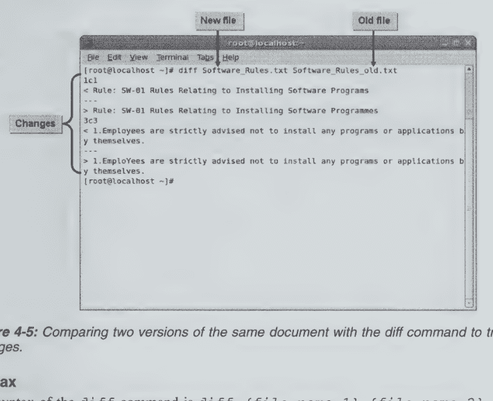

> *图 4-5：使用 diff 命令比较同一文档的两个版本以追踪更改。*

### 语法

*diff* 命令的语法为 `diff {file_name_1} {file_name_2}`。

### patch 命令

*patch* 命令根据补丁文件中包含的指令更新文本文件中的更改。此补丁文件包含由 *diff* 命令生成的列表。

## wc 命令

*单词计数（word count）* 命令（*wc*）用于统计文本文件的行数、单词数和字符数。如果指定了多个文件，则命令显示每个文件的计数以及所有文件的总计数。


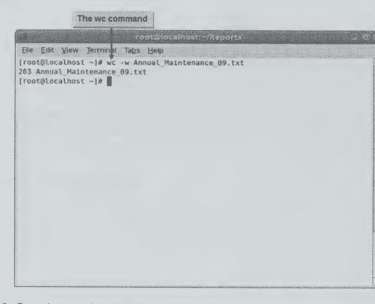

图 4-6：使用 `wc` 命令统计单词。

`wc` 命令提供 various 选项，允许你指定输出的性质。

| 选项 | 描述 |
| :--- | :--- |
| `-c` | 显示字节计数。 |
| `-m` | 显示字符计数。 |
| `-l` | 显示换行符计数。 |
| `-w` | 显示单词计数。 |

## 语法

`wc` 命令的语法为 `wc [command options] (file name)`。

## Aspell

`Aspell` 是一个在 Linux 中作为拼写检查器使用的实用工具。`aspell` 命令的语法为 `aspell [options]`。`-c` 选项检查文件中的拼写错误。`-list` 选项从标准输入生成拼写错误单词的列表。

## tr 命令

*translate*（tr）命令用于将标准输入中的字符串转换后输出到标准输出。它主要用于更改字母的大小写。该命令仅处理字符流，并且不接受文件名作为参数。


`tr` 命令

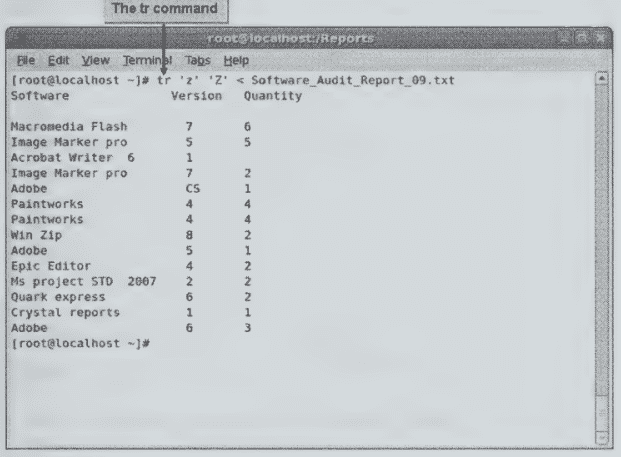

图 4-7：*使用 tr 命令编辑文本。*

### 语法

*tr* 命令的语法为 `tr { 'character 1' } { 'character 2' } < {file name}`，其中 `character 1` 是要被替换的字符。

## uniq 命令

*uniq* 命令用于显示排序文件中的重复行。它仅比较相邻的行，因此 *uniq* 命令要求输入是已排序的输出。


`uniq` 命令

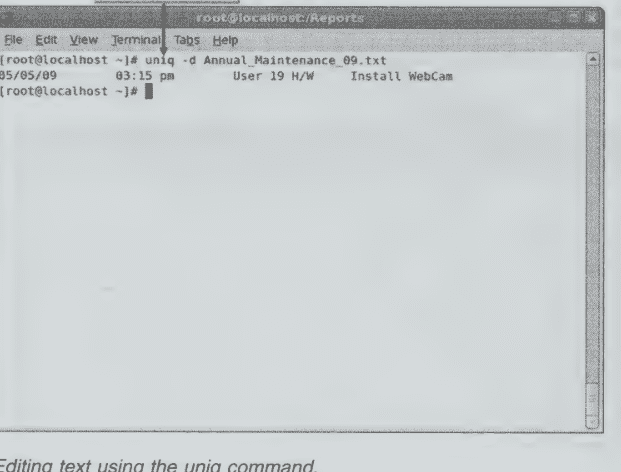

*图 4-8：使用 uniq 命令编辑文本。*

`uniq` 命令提供了多种选项，允许你指定输出的特性。

| 选项 | 描述 |
| :--- | :--- |
| `-u` | 仅显示唯一的行。 |
| `-d` | 仅显示重复的行。 |
| `-c` | 显示行，并在每行前加上出现次数。 |

### 语法

`uniq` 命令的语法为 `uniq [command options] {file name}`。

## 输入和输出重定向

当你希望将现有文件的内容重定向到另一个命令进行处理时，可以使用输入和输出重定向符号。输出重定向符号 `>` 告诉 shell 将标准输出重新定义为文件。如果文件不存在，shell 会创建该文件。输入重定向符号 `<` 告诉 shell 将标准输入重新定义为键盘输入之外的其他内容，通常是一个文件。

例如，`ls >list` 命令会让 shell 将 `ls` 命令的输出发送到名为“list”的文件中。


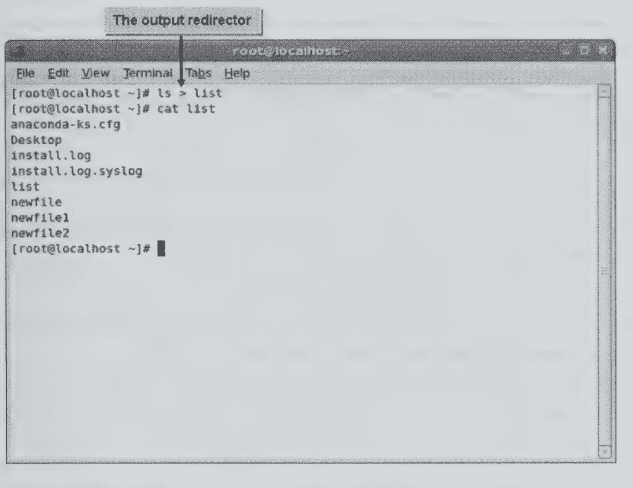

图 4-9：将`ls`命令的输出重定向到`list`文件。

## 如何创建和编辑文件

### 操作参考：使用 Vim 编辑器创建文件并输入文本

使用 Vim 编辑器创建文件并输入文本的方法如下：

1. 以用户身份登录。
2. 在命令提示符下，输入`vim (file_name)`来创建文件。
3. 按`I`切换到插入模式。
4. 输入所需的内容。
5. 按`Esc`返回命令模式。
6. 输入`:wq`保存并关闭文件。

### 操作参考：从命令提示符创建文本文件

从命令提示符创建文本文件的方法如下：

1. 以用户身份登录到 GUI 或 CLI。
2. 在 GUI 终端窗口或 CLI 终端中，导航到你希望创建文件的目录。如有必要，在指定位置创建新目录并将其设为当前目录。
3. 在命令提示符下，输入`cat > (file_name)`。
4. 输入文件内容并按`Enter`换行。
5. 按`Ctrl+D`保存文件并返回命令提示符。
6. 如有必要，输入`cat (file_name)`查看文件内容。

### 操作参考：在命令模式下编辑文本文件

在命令模式下编辑文本文件的方法如下：

1. 以用户身份登录。
2. 输入`vim {file name}`打开文件。
3. 使用相应的 `vim` 快捷键进行必要的更改。
4. 输入`:wq`保存并关闭文件。

### 操作参考：使用 vim 命令打开多个窗口

使用 `vim` 命令打开多个窗口的方法如下：

1. 以用户身份登录。
2. 打开多个窗口。
   - 输入`vim -o {file name 1} {file name 2} ... {file name n}`在多个窗口中打开不同的文件。
   - 按`Ctrl+W+N`在新窗口中打开新文件。
   - 按住`Ctrl+W`并使用方向键在各窗口间导航。
3. 使用相应的 `Vim` 快捷键进行必要的更改。
4. 如有必要，按`Esc`返回命令模式。
5. 保存并关闭文件。
   - 输入`:wq`逐个保存并关闭文件。
   - 或者，输入`:qa`同时关闭所有文件。

### 操作参考：统计文件中的单词数

统计文件中单词数的方法如下：

1. 在 CLI 中以用户身份登录。
2. 统计文件中的单词数。
   - 输入`wc [command options] {file name}`来统计文件中的单词、行、字节和字符数量。
   - 输入`{command} | wc [command options]`来统计命令输出中的单词、行、字节和字符数量。

### 操作参考：删除文件中的重复且相邻的行

删除文件中重复且相邻行的方法如下：

1. 在 CLI 中以用户身份登录。
2. 删除文件中的重复且相邻的行。
   - 输入`uniq [command options] {file name}`从文件中删除重复且相邻的行。
   - 输入`{command} | uniq [command options]`从命令输出中删除重复且相邻的行。

### 操作参考：在 CLI 中比较文件

在 CLI 中比较文件的方法如下：

1. 在 CLI 中以用户身份登录。
2. 输入`diff {file name 1} {file name 2}`比较文件内容的差异。

### 操作参考：在 GUI 中比较文件

在 GUI 中比较文件的方法如下：

1. 按`Ctrl+Alt+F7`切换到 GUI。
2. 从菜单栏选择“应用程序→附件→终端”。
3. 输入`gvimdiff {file_name_1} {file_name_2}`比较文件内容的差异。
4. 输入两次`:q`返回终端。

### 操作参考：替换字符

替换字符的方法如下：

1. 在 CLI 中以用户身份登录。
2. 替换字符。
   - 输入`tr {'character_1'} {'character_2'} < {file_name}`在给定文件中用一个字符替换另一个字符。
   - 输入`{command} | tr {'condition_1'} {'condition_2'}`从命令输出中用一个字符替换另一个字符。

## 处理多个窗口

你可以选择将窗口水平或垂直平铺。按`Ctrl+W+V`创建垂直分割，或按`Ctrl+W+S`水平分割屏幕。

## 活动 4-1

### 使用 Vim 创建文本文件

**开始前：**

1. 你已在 CLI 中以 `root` 身份登录。
2. 显示第一个终端。

**场景：**

作为一名刚加入 OGC 的初级系统管理员，你在一天内有几项任务需要完成。由于你正在适应日常工作，你决定通过创建一个名为`Checklist.txt`的文件来记录任务。

| 你要做什么 | 如何操作 |
| :--- | :--- |
| 1. 创建一个名为`Checklist.txt`的文本文件。 | a. 输入`vim Checklist.txt`创建名为`Checklist.txt`的文件。<br>b. 按`I`切换到插入模式。<br>c. 观察屏幕左下角显示文本“INSERT”。 |
| 2. 向文件中输入数据。 | a. 输入`Update Antivirus`作为文件中的第一条条目。<br>b. 输入`Install New Printer`作为第二条条目。<br>c. 输入`Fix keyboard issues`作为第三条条目。<br>d. 输入`Install New Monitor`作为第四条且最后的条目。 |
| 3. 以执行模式保存文件并退出。 | a. 按`Esc`返回命令模式。<br>b. 输入`:wq`保存文件并退出文本编辑器。<br>c. 输入`clear`清除终端屏幕。 |

## 活动 4-2

### 在命令模式下编辑文本文件

**数据文件：**

`Softwarelist.txt`

**开始前：**

1. 你已在 CLI 中以 `root` 身份登录。
2. 显示第一个终端。
3. 在命令行输入`cp /085039Data/Managing_Files/* /root`。
4. 输入`clear`。

**场景：**

你的经理要求你列出组织所使用的软件。你在`Softwarelist.txt`文件中列出了软件。然而，在提交之前，你希望确保文档没有错误。你注意到文档中存在以下错误：

- `Image Maker`被显示为`Image Marker`。
- `Photoshop`被输入为`photoshop`。
- 关于`Paintworks`的详细信息被重复了。

通过解决这些问题，你希望确保文档已准备好提交。

| 你要做什么 | 如何操作 |
| :--- | :--- |
| 1. 将文本 "Image Marker" 的拼写改为 "Image Maker"。 | a. 输入`vim Softwarelist.txt`打开`Softwarelist.txt`文件。<br>b. 将光标向下移动至文本 "Image Marker Pro" 的第一次出现处。<br>c. 要将光标移动到下一个单词，按`W`。<br>d. 删除单词 "Marker" 中第一个字母 "r" 的第一次出现。 |


2. 修复错误的多个出现位置。
   - 输入`*/Marker*`，然后按`Enter`键以搜索单词 “Marker” 的下一个出现位置。
   - 将文本 “Marker” 更改为 “Maker”。

3. 更改 “photoshop” 中首字母的大小写。
   - 按`J`键移动到下一行。
   - 按`H`键将光标放置在单词 “Photoshop” 中字母 “h” 的第一个出现位置下方。
   - 先按`C`键，然后按`B`键以删除首字母。
   - 在插入模式下，输入`P`以将该单词更改为 “Photoshop”。
   - 按`Esc`键返回命令模式。


学生应先按 “C” 键，然后在松开 “C” 键后再按 “B” 键。这两个键不应同时按下。

4. 删除 “Paintworks” 的重复条目。
   - 要导航到单词 “Paintworks” 的第二个出现位置，请按`Down Arrow`（下方向键）两次。
   - 要删除重复的行，请按`D`键两次。
   - 输入`:wq`以保存并关闭文件。
   - 清除终端屏幕。

## 主题 B

### 定位文件


您已创建和编辑了文件。作为用户或管理员，您将不得不经常在 Linux 文件系统中定位文件。在本主题中，您将在 Linux 系统中定位文件。

学习如何在 Linux 中定位文件将减少您花费在搜索文件上的时间。Linux 中定位文件有不同的技术。这些技术将在您管理更大的文件系统时为您节省时间和精力。

### `locate` 命令

`locate` 命令会对存储文件路径和文件名的 `mlocate` 数据库执行快速搜索，查找任何指定的字符串。为了使搜索有效，必须定期更新此数据库。显示的结果可能仅限于用户有权访问或执行的文件。


```bash
[root@localhost ~]# locate Policy
/usr/include/xulrunner-sdk-1.9/content/nsIContentPolicyUtils.h
/usr/include/xulrunner-sdk-1.9/content/nsIContentPolicy.h
/usr/lib/xserver/SecurityPolicy
/usr/share/doc/deployment_Guide-en-US.5.2/images/Load_New_Policy.png
[root@localhost ~]# 
```

图 4-10：使用 `locate` 命令搜索文件。

#### 语法

`locate` 命令的语法为 `locate [options] (string)`。

#### `locate` 命令选项

`locate` 命令支持不同的选项，使您的搜索更加有效。表中描述了一些选项。

| 选项 | 描述 |
|:--------|:----------|
| `-r` | 在搜索文件名时使用正则表达式。 |
| `-c` | 仅显示找到的匹配条目数量，而不是文件名。 |
| `-e` | 仅返回在搜索时存在的文件。 |
| `-i` | 忽略文件名或路径中的大小写。 |
| `-n 条目数` | 仅返回前几个匹配项，直到指定的数量。 |

#### 更新 `mlocate` 数据库

`updatedb` 命令用于更新 `/var/lib/mlocate/mlocate.db` 数据库。虽然这是 `locate` 命令搜索的默认数据库，但可能存在包含文件路径的更多数据库。如果在执行搜索之前未更新数据库，则在上次更新后创建的所有文件都将被排除在搜索之外。

#### `slocate` 命令

`slocate` 命令，或称为安全定位命令，搜索使用 `slocate -u` 命令构建的特定数据库。`locate` 和 `slocate` 命令之间的区别在于，当用户输入 `slocate 文件名` 时，`slocate` 命令仅在用户对那些文件具有访问权限的情况下，才会在数据库中搜索并返回文件的位置；而 `locate` 命令无论用户是否具有访问权限，都会返回文件的位置。

### 使用 `grep`

在最简单的形式中，`grep` 是一个搜索工具。它允许您执行搜索操作，例如在文件中查找您正在搜索的任何实例。例如，输入 `grep foo test` 会返回文件 `test` 中包含匹配 `foo` 字符串的所有行。`grep` 命令还可以用于搜索目录中的特定文件。`ls -1 | grep audit` 命令会返回当前目录中包含 `audit` 的任何文件的长列表。


> 术语 `grep` 源自 "Globally matching a Regular Expression and Printing the lines"（全局匹配正则表达式并打印行）。


### `whereis` 命令

`whereis` 命令用于查看与命令相关的各种详细信息。它定位命令的二进制文件、源代码和手册页文件。`whereis` 命令具有各种选项。下表列出了一些常用的选项。

| 选项 | 用途 |
| :--- | :--- |
| `-b` | 仅搜索二进制文件。 |
| `-m` | 仅搜索手册章节。 |
| `-s` | 仅搜索源代码。 |
| `-u` | 搜索非常规条目。 |

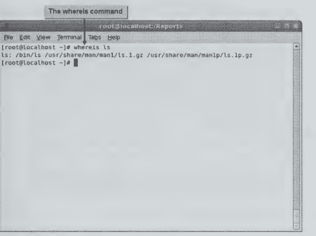

图 4-11：`ls` 命令的路径。

#### 语法

`whereis` 命令的语法为 `whereis [-bmsu] [-BMS directory... -f] file name ...`。

#### 使用 `whereis` 命令的示例

输入 `whereis ls` 后，将显示以下输出：

```
ls: /bin/ls /usr/share/man/man1/ls.1.gz /usr/share/man/man1p/ls.1p.gz
```

其中 `/bin/ls` 指示 `ls` 命令的位置，而 `/usr/share/man/man1/ls.1.gz /usr/share/man/man1p/ls.1p.gz` 指示 `ls` 命令的 `man` 页面的位置。

### GNOME 搜索工具

GNOME 搜索工具是一个用于基于特定标准搜索文件的图形工具。您可以按名称、大小、所有权、访问时间或内容搜索文件。这个强大的 GUI 工具支持大小写不敏感搜索、在特定位置内搜索和通配符搜索等功能。此工具使用诸如 `locate`、`find` 和 `grep` 等搜索命令的组合。


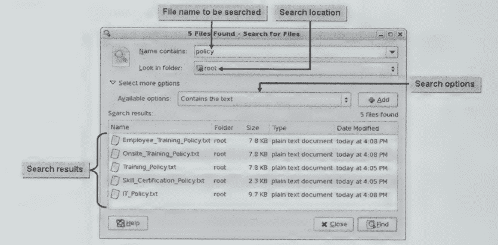

图 4-12：使用 GNOME 搜索工具搜索文件。

### Kat

`Kat` 是一个用于 KDE 的应用程序，用于通过元信息、从各种类型文件中提取和索引的全文以及缩略图来搜索文件。它充当目录，有助于快速检索文件。

### Beagle

`Beagle` 是一个 GNOME 桌面搜索应用程序，也可以通过安装 `Kery` 在 KDE 中使用。它用于搜索文件、文件夹、文档、笔记、图像、视频、电子邮件消息、即时消息内容、Web 浏览器历史记录和 RSS 源。`Beagle` 对文件进行索引，使其能够快速检索搜索结果。它还允许用户按修改日期、名称或相关性对搜索结果进行排序。

### `find` 命令


`find` 命令允许您在特定位置搜索符合某些搜索标准的文件和目录。它递归地搜索目录结构，包括任何子目录及其内容，从您输入的位置开始。您可以对找到的文件执行一个或多个操作。

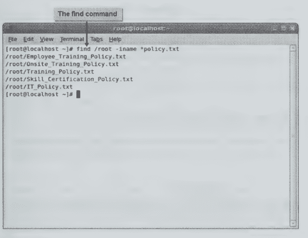

#### 语法

`find` 命令的语法为 `find [options] [search locations] [search criteria] [actions]`。

#### `find` 与 `locate` 命令

`locate` 命令搜索数据库并检索系统上现有文件的信息。但是，如果未能保持此数据库更新，可能会产生过时的结果。另一方面，`find` 命令执行文件系统的实时搜索，并且可以集中在特定位置。与 `locate` 命令相比，`find` 命令完成搜索可能需要更多的时间。

#### `find` 命令的工作方式

即使您只记得文件名的一部分，也可以使用 `find` 命令搜索整个目录结构以查找文件。可以指定一个或多个搜索路径，并且可以使用目录表示法作为搜索路径。如果未指定目录，`find` 命令将使用当前工作目录作为开始搜索的位置。可以使用一个或多个条件来指定文件或目录的条件。如果有多个搜索条件，文件或目录必须满足指定的所有条件后才能显示结果。显示的结果可能仅限于用户有权访问或执行的文件。您可以查看 `find` 命令的手册页以了解更多选项。

#### 找到文件的选项

当系统找到符合您条件的列表时，可以对结果执行多种操作。这些选项在下表中概述。

| **选项** | **执行的操作** |
| --- | --- |
| `-print` | 显示找到文件的位置。 |
| `-exec` | 执行紧随其后的命令。 |
| `-ok` | 交互方式执行紧随其后的命令。 |
| `-delete` | 删除找到的文件。 |
| `-fprintf` | 将结果存储在目标文件中。 |

### `find` 命令的条件


`find` 命令可以配合一个或多个条件使用。这些条件接受字符串或数字作为参数。下表列出了某些常用条件。

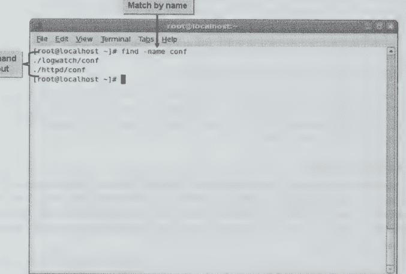

图 4-14：在 `find` 命令中使用 `-name` 条件。


| 条件 | 描述 |

|---|---|

| `-name` | 按名称匹配。可以使用正则表达式作为参数。 |

| `-iname` | 按名称匹配，忽略大小写。 |

| `-user` | 按所有者的用户名称或 UID 匹配。 |

| `-group` | 按所有者的组或 GID 匹配。 |

| `-size` | 按大小匹配。 |

| `-perm` | 按符号或八进制权限匹配。 |

| `-type` | 按文件类型匹配。 |

| `-newer` | 通过比较修改时间进行匹配。返回修改时间晚于参照文件的文件。 |

| `-atime` | 按天数匹配访问时间。 |

| `-mtime` | 按天数匹配修改时间。 |

| `-ctime` | 按文件最近一次状态更改的时间进行匹配。参数以天数计算。 |

## 条件的逻辑运算符

您可以使用逻辑运算符组合条件。当指定了多个标准时，默认情况下，仅返回满足所有条件的文件。但是，可以通过在条件之间使用 `-o` 来对这些条件应用逻辑运算符 OR。此外，还可以使用 `-not` 对条件取反来应用 NOT 运算符。

## 数字参数

数字参数用于指定一个数值。下表列出了大小相关的数字参数及其描述。

| 使用此参数 | 如果您需要 |

|---|---|

| `n` | 列出等于 `n` 个单位大小的文件（默认选项）。 |

| `+n` | 列出大于 `n` 个单位大小的文件。 |

| `-n` | 列出小于 `n` 个单位大小的文件。 |

下表列出了时间相关的数字参数及其描述。

| 使用此参数 | 如果您需要 |

|---|---|

| `n` | 列出在 `n` 天前被访问的文件（默认选项）。 |

| `+n` | 列出在多于 `n` 天前被访问的文件。 |

| `-n` | 列出在少于 `n` 天前被访问的文件。 |

## 如何定位文件

### 程序参考：从数据库搜索文件

要从数据库搜索文件：

1. 以 `root` 身份登录。
2. 输入 `updatedb` 使用文件名和路径信息更新 mlocate 数据库。
3. 输入 `locate {string}` 在已更新的数据库中搜索指定字符串。

### 程序参考：使用 GNOME 搜索工具搜索文件

要使用 GNOME 搜索工具搜索文件：

1. 在 GUI 中以用户身份登录。
2. 选择 **Places**（位置）→**Search for Files**（搜索文件）以打开搜索工具。
3. 在 **Search for Files**（搜索文件）窗口中，在 **Name contains**（名称包含）文本框中，键入要搜索的字符串。
4. 如有必要，从 **Look in folder**（在文件夹中查找）下拉菜单中，选择执行搜索的位置。
5. 如有必要，点击文本“Select more options”（选择更多选项）旁边的切换按钮，以指定额外的搜索标准，例如 **Date modified less than**（修改日期早于）、**Date modified more than**（修改日期晚于）、**Size at least**（大小至少）、**Size at most**（大小至多）、**File is empty**（文件为空）、**Owned by user**（所有者为用户）、**Owned by group**（所有者为组）、**Owner is unrecognized**（所有者无法识别）、**Name does not contain**（名称不包含）、**Name matches regular expression**（名称匹配正则表达式）、**Show hidden and backup files**（显示隐藏和备份文件）、**Follow symbolic links**（跟随符号链接）以及 **Include other filesystems**（包含其他文件系统）。点击 **Add**（添加）以添加选定的选项。
6. 如有必要，点击 **Help**（帮助）以查看“Search for Files”（搜索文件）的手册。
7. 点击 **Find**（查找）以搜索指定的字符串。

## 练习 4-3

### 从数据库搜索文件

**开始之前：**

1. 您已在 CLI 中以 `root` 身份登录。
2. 输入 `mv /085039Data/Managing_Packages/rhelsource /rhelsource` 移动 `/rhelsource` 目录。
3. 在终端中，输入 `cd /rhelsource/Server` 导航到 Server 目录。
4. 如有必要，输入 `rpm -ivh kernel-headers*` 安装 kernel-headers 包。
5. 输入 `clear` 清除终端屏幕。

**场景：**

您需要报告过去几年购买的所有外设，以计算进一步的需求。您希望获取组织购买的所有软件许可证的详细信息。为了定位包含此信息的文件和目录，您决定对术语“software”（软件）执行本地搜索。

## 您做什么

**您怎么做**

1. 在数据库中搜索包含单词“software”的文件名。

   a. 输入 `updatedb` 更新 mlocate 数据库。

      

   b. 输入 `locate -i *software*` 搜索所有名称中包含“software”的文件。

   c. 观察到所有名称中包含“software”的文件（包括系统文件）都被列出。

2. 确保列出所有包含单词 "software" 的目录名称。

   a. 输入 `cd /` 切换到根目录。

   b. 输入 `ls -lR | grep -i "software" | more` 搜索所有包含术语 "software" 的路径名。

   c. 按 **Spacebar**（空格键）直到列表末尾，以检查是否有任何名称中包含术语 "software" 的目录。

   d. 观察到结果中显示了 `/usr/src/kernels/2.6.18-128.el5-i686/` 下的 `include/config` software 目录。

   e. 输入 `clear` 清除终端屏幕。

      

   可能会显示关于符号链接的警告，并且这些消息可能会在屏幕上停留几秒钟。但是，这些警告可以忽略。

## 练习 4-4

### 在 GUI 中搜索文件

**开始之前：**

1. 您已在 CLI 中以 `root` 身份登录。
2. 在终端中，输入 `chown -R jsmith /085039Data/Locating_Files/*` 更改所有权。
3. 输入 `mkdir /work_files` 创建 `work_files` 目录。
4. 输入 `cp -pR /085039Data/Locating_Files/* /work_files` 复制文件。
5. 输入 `clear` 清除终端屏幕。

**场景：**

作为系统管理员，执行定期系统清理是您的职责。您希望清除所有不必要的空文件。您决定在 Linux 文件系统上搜索空文件并标记它们以供删除。

| 您做什么 | 您怎么做 |

| :--- | :--- |

| 1. 打开 GNOME 搜索工具。 | a. 切换到 GUI。<br> b. 以 `root` 身份登录。<br> c. 选择 **Places→Search for Files**（位置→搜索文件）以打开 GNOME 搜索工具。 |

| 2. 将搜索位置指定为 `/work_files` 目录。 | a. 在 **Search for Files**（搜索文件）窗口中，在 **Name contains**（名称包含）文本框中，键入 `*` 以将所有文件包括在搜索中。<br> b. 从 **Look in folder**（在文件夹中查找）下拉菜单中，选择 **Other**（其他）以打开 **Browse**（浏览）窗口。<br> c. 在 **Places**（位置）列表框中，双击 **File System**（文件系统）以在右侧窗格中显示更多目标目录。<br> d. 在 **Browse**（浏览）窗口中，在 **Name**（名称）列表框中，向下滚动以查看更多目录。<br> e. 在 **Name**（名称）列表框中，选择 `work_files` 并点击 **Open**（打开）以选择 `/work_files` 目录并退出窗口。 |

3. 搜索空文件。

   a. 点击文本“Select more options”（选择更多选项）旁边的切换按钮以显示更多搜索选项。


- **b.** 从 **Available options**（可用选项）下拉列表中，选择 **File is empty**（文件为空）并点击 **Add**（添加）以将搜索结果限制为空文件。
- **c.** 点击 **Find**（查找）以在 `work_files` 目录内搜索空文件。
- **d.** 最大化窗口并向下滚动以观察列出的所有空文件。
- **e.** 点击 **Close**（关闭）以关闭 **Search for Files**（搜索文件）窗口。

## 主题 C

### 链接文件

现在，在您已经知道了如何在 Linux 系统中定位文件之后，创建这些文件的链接或快捷方式将使您可以轻松地找到它们。在本主题中，您将在 Linux 中链接文件。

在 Linux 中链接文件有助于您跟踪经常使用的文件，而无需每次都遍历文件结构来查找它们。您可以通过链接文件来帮助用户，使不熟悉 Linux 的用户能够访问相关文件。

### Inode（索引节点）

索引节点（inode）是计算机对文件的引用。索引节点表，或 inode 表，是一个包含文件系统中单个文件信息的数据结构。`Inode` 是表中的一个条目，包含有关 `inode` 所在设备、文件类型、文件模式以及所有者的 `UID` 和 `GID` 的信息。它还包含有关指向该文件的链接数、文件中的字节数、访问和修改时间、`inode` 本身最后修改的时间以及文件在硬盘上的块地址的信息。`ls -i` 命令用于查找文件的 `inode` 编号。


```bash
[root@localhost ~]# ls -l
2367046  Annual_Maintenance_07.txt  2367049  Inventory_Report.txt
2367045  Annual_Maintenance_08.txt  2367050  Office_Products.txt
2367054  Annual_Maintenance_09.txt  2367051  Software_Audit_Report_08.txt
2367047  Employee_Benefits.txt      2367055  Software_Audit_Report_09.txt
2367048  Hardware_Audit_Report_08.txt 2367052  Software_Rules.txt
[root@localhost ~]#
```

*图 4-15：带有 `inode` 编号的文件列表。*


### `ln` 命令

`ln` 命令用于创建文件的链接。链接允许一个目录中的文件名指向另一个目录中的文件。链接本身不包含数据，仅包含对另一个文件的引用。对链接的任何更改都会反映在原始文件中。


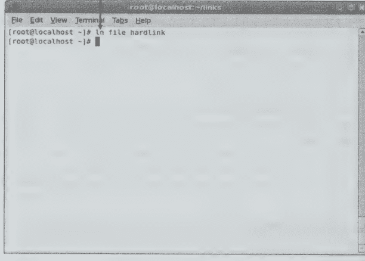

图 4-16：使用 `ln` 命令创建的链接。

#### 语法

`ln` 命令的语法为 `ln [选项] 目标 (链接名称)`。

#### `ln` 命令选项

`ln` 命令具有各种选项。一些常用选项列在下表中。

| 选项 | 用途 |
|--------------|--------------------------------------------|
| `--backup`   | 备份现有的目标文件。 |
| `-f`         | 删除现有的目标文件。 |
| `-s`         | 创建符号链接而不是硬链接。 |
| `-i`         | 提示删除目标。 |
| `-v`         | 在创建链接前打印文件名。 |

### 链接类型

使用 `ln` 命令，您可以创建两种类型的链接：硬链接和符号链接。

| 链接 | 描述 |
|---|---|
| `符号链接` | 符号链接是对文件或目录的引用，允许您从不同的目录访问已挂载的文件系统。可以在两个文件系统之间创建符号链接。如果在创建符号链接后原始文件被删除，则原始内容将丢失。符号链接也被称为软链接。 |
| `硬链接` | 硬链接是对另一个文件的引用；它允许文件的数据在同一个文件系统中的不同位置拥有多个名称。应用程序将硬链接视为真实文件。如果在创建硬链接后原始文件被删除，其所有内容仍将在链接文件中可用。硬链接不能创建在两个目录之间，也不能创建在两个不同文件系统中的文件之间。 |

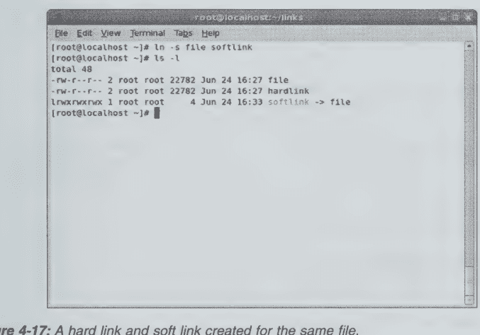

> 符号链接和硬链接是 `ext2` 文件系统的功能，并在大多数 `Unix` 和类 `Unix` 操作系统（如 `Linux`）的文件系统中很常见。

## 如何链接文件

### 操作参考：查看文件或目录的 `inode` 编号

要查看文件或目录的 `inode` 编号：

1. 以用户身份在 CLI 中登录。
2. 输入 `ls -i (文件或目录名称)` 以查看 `inode` 详细信息。

### 操作参考：链接文件

要链接文件：

1. 以用户身份在 CLI 中登录。
2. 创建文件链接。
   - 输入 `ln {源文件} {目标文件}` 以创建硬链接。
   - 输入 `ln -s {源文件} {目标文件}` 以创建软链接。
3. 输入 `ls -i {源文件} {目标文件}` 以查看文件的 `inode`。

## 活动 4-5

### 链接文件

**数据文件：**

`Audit_File_09`, `Software_List.txt`, `New_Policies.txt`

**开始前：**

1. 您已以 `root` 身份在 GUI 中登录。
2. 切换到 CLI。

**场景：**

您被分配了一项任务，需要审查一份更新后的员工政策文档中的大小写错误，统计文档的字数，并在本地系统中创建该文档的链接作为备份。您还希望通过删除当前工作目录中未使用的文件来清理系统，并备份该政策文档。

| 您要做什么 | 如何做 |
| :--- | :--- |
| 1. 列出当前工作目录中的文件。 | a. 输入 `cd /root` 以更改目录。<br><br>b. 输入 `ls -l` 以列出目录中的文件。<br><br>c. 观察当前工作目录中的所有文件都被列出。 |
| 2. 将 `Audit_File_09` 文件移动到 `/jsmith` 目录并删除 `Software_List.txt` 文件。 | a. 输入 `mv -v Audit_File_09 /home/jsmith` 以将审计文件移动到 `/jsmith` 目录。<br><br>b. 输入 `ls -l /home/jsmith` 以验证文件传输是否完成。<br><br>c. 输入 `rm Software_List.txt` 以从 `/root` 目录删除软件文件。<br><br>d. 输入 `y` 以确认删除并按 `Enter`。<br><br>e. 输入 `ls` 以检查文件是否已删除。<br><br>f. 观察 `Software_List.txt` 文件已被删除。 |
| 3. 编辑 `New_Policies.txt` 文件以纠正大小写错误并生成字数统计。 | a. 输入 `cat New_Policies.txt` 以查看文件内容。<br><br>b. 观察单词 `EmploYees` 中字母 `Y` 的大小写不正确。<br><br>c. 输入 `tr 'Y' 'y' < New_Policies.txt` 以更改单词 `EmploYees` 中字母 `Y` 的大小写。<br><br>d. 观察 `Y` 的大小写已更改。<br><br>e. 输入 `wc -w New_Policies.txt` 以统计文件中的字数。<br><br>f. 观察显示了文件的字数统计。 |
| 4. 为该文件创建硬链接。 | a. 输入 `ln New_Policies.txt New_Policies_09.txt` 以为该文件创建硬链接。<br><br>b. 输入 `ls New*` 以查看是否已创建硬链接。<br><br>c. 观察硬链接已创建。<br><br>d. 清除终端屏幕。 |

## 主题 D

### 备份和恢复文件

您已经知道如何创建、编辑、定位和链接文件。当需要时，知道如何备份和恢复这些文件也是至关重要的。在本主题中，您将备份和恢复文件。

学习如何备份和恢复文件可以为您节省在系统故障后修复系统的无数小时。备份和恢复文件允许您在系统中保留文件在特定时间点的副本。如果发生系统故障，可以使用这些文件来恢复您的系统。

### 归档

**定义：**

`归档` 是一种通过从系统磁盘驱动器将数据复制到备份设备来存储数据的方法。这样做是为了保存数据的记录以供将来参考，或创建数据转储。如果在网络中断导致数据丢失的情况下，数据可以从归档中检索。

**示例：**


```bash
root@localhost:~

[root@localhost ~]# dump
dump 0.d401 (using libext2fs 1.39 of 29-May-2005)
usage: dump [-level#] [-acmnNgSuV] [-A file] [-B records] [-b blocksize]
	[-d density] [-D file] [-e inodes,inode*,...] [-E file]
	[-f file] [-h level] [-i nr errors] [-I zlevel] [-Q file]
	[-s feet] [-T date] [-v] [-z zlevel] filesystem
dump [-W] [-w]
[root@localhost ~]#
```

图 4-18：使用 `dump` 命令归档文件。


## cpio 命令

`cpio` 命令将文件复制到归档中或从归档中提取文件。它包含在标准的 Linux 发行版中。`cpio` 命令有三种工作模式。

| 工作模式 | 描述 |
| :--- | :--- |
| 复制输出模式 `cpio -o` | 在此模式下，该命令将文件复制到归档中。它读取标准输入以获取文件列表，然后将这些文件复制到标准输出。 |
| 复制输入模式 `cpio -i` | 在此模式下，该命令从归档中复制文件。它从标准输入中提取文件。 |
| 复制传递模式 `cpio -p` | 在此模式下，该命令将一个目录树中的文件复制到另一个目录树中。它读取标准输入以获取文件列表，这些文件会被创建并复制到目标目录。 |


## dd 命令

`dd` 命令复制和转换文件，以便将其从一种媒体类型传输到另一种媒体类型。选定的输入文件被复制到选定的输出文件。如果没有选择文件，则使用标准输入和标准输出。

以下表格中提供了一些常见的 `dd` 命令选项。

| 选项 | 用途 |
| :--- | :--- |
| `if=filename` | 指定数据来源的文件。 |
| `of=filename` | 指定数据写入的目标文件。 |
| `bs=Number of bytes per block` | 指定从输入文件读取和写入到输出文件的数据块大小（以字节为单位）。 |
| `count=Number of blocks` | 指定从输入文件写入到输出文件的块数。 |

### 语法

`dd` 命令的语法是`dd [operand]. . .`或`dd [option].`

## dump 命令

`dump` 命令将文件系统中的所有文件转储到磁带或其他文件中。它还可以用于转储在指定日期之后修改过的文件。`dump` 命令具有各种选项。

以下表格中提供了一些常见的 `dump` 命令选项。


| 选项 | 用途 |
|---|---|
| `0` | 执行完全备份。 |
| `-1` 到 `9` | 执行增量或部分备份。 |
| `-b` 最大块大小 | 指定每个转储记录的千字节数。 |
| `-f` 目标文件位置 | 指定目标位置。 |
| `-z` 压缩级别 1-9 | 指定压缩级别。 |

### 语法

`dump` 命令的语法是`dump {-level #} {dump file} {filesystem/file/directory}.`

## tar 命令

`tar` 命令允许您创建数据归档。您可以将该命令应用于先前创建的归档，以提取文件、存储额外文件、更新文件以及列出已存储的文件。`tar` 命令还可以使用管道将其输出重定向到可用设备、文件或其他程序。


图 4-19：使用 `tar` 命令对文件进行归档。

### 语法

`tar` 命令的语法是`tar [archiving command options] [destination file].tar [source directory].`

## gzip 命令

`GNU zip (gzip)`是一种压缩实用工具，用于减小选定文件的大小。`gzip`命令有几个选项。

这些命令选项在以下表格中进行了描述。

| 选项 | 描述 |
| --- | --- |
| `-d` | 解压文件。 |
| `-f` | 强制压缩或解压文件，即使文件具有多个链接或文件已存在。 |
| `-h` | 显示帮助屏幕。 |
| `-L` | 显示 `gzip` 许可证。 |
| `-n` | 省略保存原始文件名和时间戳。 |
| `-N` | 保存原始文件名和时间戳。 |
| `-q` | 抑制所有警告。 |
| `-r` | 进入目录并压缩文件。 |
| `-v` | 显示压缩或解压文件的名称和缩减百分比。 |
| `-t` | 检查压缩文件的完整性。 |

### 语法

`gzip` 命令的语法是`gzip [command options] {file_name}`。

## 文件压缩实用工具

文件压缩实用工具（例如`gzip`）试图仅压缩常规文件并忽略符号链接。可以使用`gzip -d`、`gunzip`或`zcat`将压缩文件恢复到其原始形式。如果保存在压缩文件中的原始文件名不适合其文件系统，则会从原始名称提供一个新的名称。

## 文件归档实用工具

有各种文件归档实用工具，允许您对文件进行压缩、解压缩以及运行其他文本处理实用工具。以下表格中描述了一些实用工具。


| 实用工具 | 描述 |
|---|---|
| `bzip2` | 以比 `gzip` 命令更快的速度压缩文件。此命令的语法为 `bzip2 {file_name}`。 |
| `bunzip2` | 解压缩使用 `bzip2` 命令压缩的文件。此命令的语法为 `bunzip2 {file_name}`。 |
| `bzcat` | 将使用 `bzip2` 命令压缩的文件解压到标准输出。此命令的语法为 `bzcat {file_name}`。 |
| `bzdiff` | 在压缩文件上运行 `diff` 命令。此命令的语法为 `bzdiff {file_name}`。 |
| `bzip2recover` | 从损坏的 `bzip2` 文件中恢复数据。此命令的语法为 `bzip2recover {file_name}`。 |
| `bzless` | 在压缩文件上运行 `less` 命令。此命令的语法为 `bzless {file_name}`。 |
| `bzmore` | 在压缩文件上运行 `more` 命令。此命令的语法为 `bzmore {file_name}`。 |


## unzip 命令

`unzip` 命令用于列出、测试和提取 ZIP 归档中的压缩文件。`unzip` 命令包含各种选项。其中一些选项在以下表格中进行了描述。

| 选项 | 描述 |
| :--- | :--- |
| `-c` | 将文件提取到标准输出。 |
| `-t` | 在提取之前测试文件。 |
| `-f` | 提取新文件并更新现有文件。 |
| `-z` | 显示归档注释。 |
| `-v` | 以详细方式提取并列出文件。 |

> `unzip` 命令将指定 ZIP 归档中的所有文件提取到当前工作目录。

### 语法

`unzip` 命令的语法是`unzip [command options] [file name]`。


## 确定备份策略的指导原则


有效的备份策略可以提供快速且无痛苦的恢复，从而将意外危机中数据丢失的损失降至最低。

### 指导原则

要选择有效的备份策略，请遵循以下指导原则：

- 确定要执行的备份操作的范围：
  - 是否需要备份单台计算机上的数据？
  - 是否需要备份多台计算机上的数据？
  - 这些计算机是否位于单一地点？
  - 这些计算机是否分布在不同地点？
- 确保您拥有所需备份数据的所有必要信息：
  - 识别需要备份的数据量。
  - 数据是否驻留在单个系统上？
  - 数据是否分布在多台服务器上？
  - 数据是否容易替换？
- 确定执行备份操作的最合适时间，以便用户可以继续工作。
- 确保用户提前获知计划备份的信息。
- 审查存储空间：
  - 您是否有足够数量的存储磁带？
  - 确定备份介体的可靠性。
  - 确定是否擦除以前的备份版本。建议保留以前的备份版本。
- 根据要执行的备份操作的范围，确定您是否拥有执行备份操作所需的人力资源。
- 测试执行的备份操作并验证备份文件的完整性。

### 示例：良好的备份策略

一家大型公司“我们的全球公司”（Our Global Company）最近因暴风雪导致的停电而遭受了灾难性的数据丢失。作为预防措施，系统管理员拉里（Larry）决定更新组织的备份策略。首先，他注意到团队成员经常将正在进行的文件保存在本地硬盘驱动器上。他还确定了其他关键任务文件的存储位置。基于这些发现，拉里制定了一个备份计划，包括网络中的所有计算机。他审查了当前备份介质的存储容量，发现其不足。经过一些研究后，他建议管理层购买并安装新的存储系统。最后，拉里咨询了各个经理和团队负责人，以确定团队的工作时间表。他安排在晚上 10:00 至凌晨 4:30 期间进行备份，在此期间干扰最小。

## mottd

`每日信息`（`mottd`）文件每天都会向所有用户显示，可用于告知用户计划备份的信息。它比电子邮件消息占用更少的磁盘空间。`/etc/motd` 文件的内容在用户成功登录后显示。

## 汉诺威序列

在执行增量或部分备份时，汉诺威序列有助于最大限度地减少使用的磁带数量。备份过程具有 0–9 的多个级别。级别 0 表示完全备份，并确保复制整个文件系统。大于 0 的级别号表示将复制自相同或较低级别的最后备份以来所有新文件和已修改的文件。这被称为增量备份。

始终从级别 0 备份开始是实用的。应定期执行级别 0 备份，最好每月一次或每两个月一次。每次执行级别 0 备份时，数据都应存储在一组新的磁带上。这些磁带应永久存储。执行级别 0 备份后，需要每日对活动文件系统转储。此目的使用修改后的“汉诺威塔”算法。此方法中遵循的转储级别序列为 3 2 5 4 7 6 9 8 9 9。

每周需要执行一次级别 1 转储，并且每日汉诺威序列从转储级别 3 开始重复。

## /etc/issue 和 /etc/issue.net 文件

`/etc/issue.net` 文件是用户通过网络连接系统时看到的登录横幅。例如，当您使用命令行工具连接系统时，`/etc/issue.net` 文件中的内容将显示。它包括每次打开新会话时显示的所有欢迎信息文本。`/etc/issue` 和 `/etc/issue.net` 文件构成了显示给本地用户的登录横幅。`/etc/issue` 文件可以自定义。

## restore 命令

`restore` 命令允许你从使用 `dump` 命令创建的备份中恢复文件或文件系统。该命令可以跨网络使用以恢复数据。也可以使用 `restore` 命令的选项来恢复特定的数据。

下表描述了 `restore` 命令的常用选项。

| 选项 | 允许你执行的操作 |
| :--- | :--- |
| `-C` | 将备份文件与源文件进行比较。 |
| `-i` | 在恢复模式下运行 `restore` 命令以部分恢复备份。 |
| `-r` | 对已备份的文件执行完整恢复。 |
| `-f /备份文件位置` | 指定备份文件的位置。 |

### 卷号

在对可移动存储设备（如磁带驱动器）上的大文件进行备份时，文件的总大小将被分割成较小的卷，并存储在多个磁带驱动器中，每个磁带驱动器由特定的卷号标识。当你想要恢复在多个卷上创建的备份时，请从最后一个卷号开始指定到第一个卷号。由于硬盘是一个单卷，其卷号始终为 1。

### 使用 tar 命令恢复文件

命令 `tar -xvf` 将恢复源文件或目录结构的全部内容。要恢复 tar 文件的一部分，请使用你想要提取的文件的完整路径和文件名。你必须使用创建 tar 文件时所用的确切路径和文件名。你还可以通过使用命令 `tar -wxvf [destination] [source].` 使恢复过程具有交互性。

### 使用 cpio 命令恢复文件

你需要备份数据的主要原因，以便在文件损坏或被删除时能够检索该数据。如果你使用 `cpio` 命令将文件移动到其他位置，你需要将文件从归档文件中提取出来以便使用。copy-in 选项的格式为 `cpio -icdv < archive_file_name>`。

## 如何备份和恢复文件

**操作参考：使用 dump 命令归档**

要使用 `dump` 命令进行归档：

1. 在 CLI 中以 root 身份登录。
2. 输入 `dump -0 -f {target file} {source file}` 以创建完整备份。
3. 输入 `dump -{(Hanoi Sequence)} -f {target file} {source file}` 以向现有备份文件添加更新。

**操作参考：使用 tar 和 gzip 命令备份文件**

要使用 `tar` 和 `gzip` 命令备份文件：

1. 确定你要备份的文件并将它们放入一个目录中。
2. 使用 `tar` 命令将所有文件分组。
3. 使用 `gzip` 命令压缩 tar 文件。
4. 将该文件保存在另一个位置（FTP 站点、CD、DVD、磁带、软盘等）。

**操作参考：使用 restore 命令恢复备份**

要完全恢复备份：

1. 在 CLI 中以 root 身份登录。
2. 导航到你想要恢复备份文件的目录。
3. 恢复备份。
   - 输入 `restore -rf /{location of the backup file}` 以恢复使用 `dump` 命令创建的备份。

**操作参考：使用 gzip 和 tar 命令从备份中恢复文件**

要使用 `tar` 和 `gzip` 命令从备份中恢复文件：

1. 从你的备份位置（FTP 站点、CD、DVD、磁带、软盘等）复制文件。
2. 使用 `gzip` 命令解压文件。
3. 使用 `tar` 命令解包文件。
4. 如有需要，将单独保存的文件移回其相应位置。

# 活动 4-6

执行备份

### 开始之前：

1. 你已在 CLI 中以 root 身份登录。
2. 输入 `mkdir Reports` 以在根目录中创建 Reports 目录。
3. 输入 `cd Reports` 以导航到 `/root/Reports` 目录。
4. 输入 `vi project` 以创建 project 文件来存储项目数据。
5. 保存并关闭该文件。
6. 输入 `clear`。

### 场景：

你的同事 Chris 正在做一个非常重要的项目，他想对系统进行每日备份。他还希望设置一个提醒，以便每次登录系统时都能创建备份。

所有与项目相关的文件都在 `/root` 目录中，它们需要保存为 `/tmp` 目录中的 `project_backup`。

账户信息：

- root 用户的登录名：root
- root 用户的密码：`p@ssw0rd`

### 你要做什么 如何做

1. 在 /tmp 目录中备份 /root 文件。
   - a. 输入 `dump -0 -f /tmp/project_backup /root` 以创建完整备份。
   - b. 观察最后一行显示的消息 "DUMP : DUMP IS DONE"，这表明备份成功。
   - c. 输入 `clear` 以清除终端屏幕。
   - d. 输入 `bzip2 /tmp/project_backup` 以压缩备份文件。


压缩备份文件可能需要几分钟。

2. 设置系统登录时执行备份的提醒。
   - a. 输入 `vi /etc/issue`
   - b. 按 **Shift+G** 导航到文件末尾。
   - c. 按 **O** 移至新行。
   - d. 输入 *Welcome to Linux! Remember to Backup Your Project Data*
   - e. 按 **Esc**。
   - f. 保存并关闭该文件。

3. 验证用户在下次登录时是否显示该提醒。
   - a. 输入 `logout` 以验证是否显示提醒。


b. 观察是否显示消息“Welcome to Linux! Remember to Backup Your Project Data”。

c. 以 `root` 用户身份登录。

## 活动 4-7

恢复备份数据

**开始之前：**

1. 你已在 CLI 中以 `root` 身份登录。
2. 在文本编辑器中打开 `/etc/issue` 文件，并删除提醒用户备份项目数据的最后一行。保存文件并关闭编辑器。
3. 注销 CLI。在 CLI 中以 `root` 身份登录。
4. 输入 `rm -rf /root/Reports`。
5. 输入 `clear` 以清除终端屏幕。

**场景：**

你观察到 `Reports` 目录中缺少一些项目文件。由于你对工作进行了每日备份，你决定从备份中恢复缺失的文件。备份文件位于 `/tmp/project_backup.bz2` 位置。

| **你要做什么** | **如何做** |
|---|---|
| 1. 识别缺失的目录和文件。 | a. 输入 `bunzip2 /tmp/project_backup.bz2` 以解压文件。<br>b. 输入 `restore -C -f /tmp/project_backup` 以查看缺失的目录和文件。<br>c. 输入 `clear` 以清除终端屏幕。 |

* 步骤 1a 可能需要几分钟。

2. 切换到恢复模式。

   a. 输入 `cd /`

   b. 输入 `restore -i -f /tmp/project_backup` 以切换到恢复模式。

   c. 在恢复提示符处，输入 `cd root`

3. 提取缺失的文件。

   a. 输入 `add Reports/` 以添加需要恢复的目录。

   b. 输入 `extract` 以从备份文件中提取目录。

   c. 输入 `1` 以指定卷号。

   d. 输入 `y` 以接受要提取文件的默认所有者或模式。

   e. 输入 `quit` 以退出恢复模式。

   f. 输入 `ls /root/Reports` 以检查 `Reports` 目录是否已恢复。

   g. 观察 `project` 文件是否已恢复。

   h. 输入 `clear` 以清除终端屏幕。

   i. 输入 `logout`


# 主题 E

# 使用 MySQL 管理数据库

你在 Linux 文件系统中处理过文件。你可能需要以一种允许在需要时轻松检索的格式存储数据；数据库可以服务于此目的。在本主题中，你将使用 `MySQL` 进行操作。

文本文件可以存储大量数据，但检索数据可能会成为一个问题，因为你可能需要手动查找你所需的信息。数据库（如 `MySQL`）允许你以有组织的方式存储数据，从而实现特定数据的高效检索。这将为你节省时间和精力。

# 数据库


**定义：**

`数据库` 是信息的有组织集合。它用于促进数据的轻松存储和检索。在数据库中，数据可能被分组为一系列记录，这些记录可以进一步组织成称为 `字段` 的更小数据段。表是数据库的基本存储单元，由行和列组成。数据库的模型决定了其中数据的组织方式。

**示例：**


图 4-20：由两个表组成的数据库。

# 关系型数据库

`关系型数据库`以相互关联的表格形式一致地存储逻辑上相关的数据。这些表格通过公共字段或列相互连接。所存储的数据独立于文件，并由一个中央数据库引擎管理，该引擎负责处理查询和操纵数据。每一行数据都包含一个标识键，用于唯一标识数据并帮助减少冗余。


# 平面文件数据库

平面文件数据库将数据存储为平面文件，这些文件是静态的纯文本文档。平面文件包含结构上互不相关的数据。平面文件数据库中的数据难以检索或修改。

# MySQL

`MySQL` 是一个开源的`关系型数据库管理系统`（`RDBMS`），用于管理数据。它由 `Sun Microsystems` 开发并发布。它使您能够以最优方式存储、检索、管理、组织和共享数据。使用 `MySQL`，您可以将数据存储为一种格式，并通过仅分析和提取数据库中的相关数据，以各种形式查看它。`MySQL` 还使一组网络计算机能够协同工作，通过消除耗时的、易出错的任务，从而增强数据库的灵活性、效率、性能、可扩展性和可用性。


# MySQL 配置文件

`MySQL` 的主配置文件 `my.cnf` 位于 `/etc/` 目录中。您可以在此文件中设置 `MySQL` 应用程序的全局选项。默认选项通常已经足够；然而，如果您需要将 `MySQL` 与其他应用程序集成，可能需要修改此文件。此文件允许您设置各种选项，从简单选项（如数据目录路径、用户名；和日志文件目录）到高级选项（如 `table_cache` 和 `key_buffer`，这些可以设置给 `MySQL` 守护进程）。


# mysqld

`mysqld` 或 `MySQL` 守护进程也是 `MySQL` 服务器。它允许您管理 `MySQL` 服务器服务。安装 `MySQL` 后，您需要手动启动此守护进程。您可以启动、停止、重启或查看 `MySQL` 服务器的状态。客户端需要此服务处于运行状态才能连接并使用 `MySQL`。


```
[root@localhost ~]# service mysqld startStarting MySQL[ OK ][root@localhost ~]#
```

*图 4-24：启动 `mysqld` 服务。*

# MySQL 命令

客户端使用 `MySQL` 命令与 `MySQL` 服务器交互。

| `MySQL` 命令 | 允许您 |
| :--- | :--- |
| `select` | 检索所有记录或匹配特定条件的记录。 |
| `create` | 在 `RDBMS` 内创建对象，如数据库、表或索引。 |
| `alter` | 修改现有的表或数据库。 |
| `update` | 更新表中的值。 |
| `use` | 将特定数据库设为当前数据库，以便您可以修改该数据库的对象。 |
| `show` | 显示当前数据库中可用的表。 |
| `insert` | 将值输入到表的行或记录中。 |
| `describe` | 显示表的结构。 |

# 如何使用 MySQL 管理数据库

### 操作参考：安装 MySQL

要安装 `MySQL`：

1. 在图形用户界面（`GUI`）中以 `root` 身份登录。
2. 将所需的 CD 插入驱动器。
3. 在`文件浏览器`窗口中，选择 `MySQL` 文件并单击`安装`。
4. 如有必要，选择额外的文件并重新启动安装。
5. 通过查看显示的消息验证安装是否成功。

### 操作参考：启动 MySQL 守护进程服务并将其设置为自动运行

要启动 `MySQL` 守护进程服务并将其设置为自动运行：

1. 在终端中，输入 `service mysqld start` 以启动 `mysqld` 服务。
2. 输入 `chkconfig mysqld` 以在系统启动时自动启动 `mysqld` 服务。
3. 如有必要，输入 `service mysqld status` 以查看 `mysqld` 服务的状态。您可以使用 `service mysqld stop` 和 `service mysqld restart` 分别停止 `MySQL` 服务器或重启服务器。

### 操作参考：定位 MySQL 配置文件

要定位 `MySQL` 配置文件：

1. 如有必要，输入 `update` 命令以更新 `locate` 数据库。
2. 切换到 `/` 目录。
3. 输入 `locate my.cnf` 以定位 `MySQL` 配置文件的路径。
4. 如有必要，在任何文本编辑器中打开 `my.cnf` 文件并修改 `my.cnf` 文件中的设置。重启服务器以应用更改。

### 操作参考：使用 MySQL 命令

要使用 `MySQL` 命令：

1. 输入 `mysql` 以连接到 `MySQL` 服务器。
2. 在 `mysql` 提示符处，以 `(commands);` 的格式输入所需的命令，以使用 `MySQL` 命令。
3. 输入 `quit` 以退出 `mysql` 提示符。

### 操作参考：执行现有的 sql 脚本


要执行现有的 `sql` 脚本：

1. 以 `root` 身份登录。

2. 将 `{filename.sql}` 文件复制到 `/var/lib/mysql` 目录。

3. 输入 `mysql` 以连接到 `MySQL` 服务器。

4. 在 `mysql` 提示符处，输入 `use {database name}` 以将其设为当前数据库。

5. 输入 `source {filename.sql};` 以执行 `sql` 命令。

6. 如有必要，输入适当的 `sql` 命令以验证脚本是否成功执行。

## 活动 4-8

### 使用 MySQL

**开始之前：**

1. 切换到图形用户界面（`GUI`）。

2. 导航到 `/rhelsource/Server` 文件夹。

**场景：**

一名初级数据库管理员加入了您的组织。作为一名 `Linux` 管理员，您需要帮助该初级管理员在 `Linux` 系统上安装基于 Web 的数据库。此外，您需要确保客户端能够连接到数据库。

| 您做什么 | 怎么做 |
| :--- | :--- |
| 1. 选择 `MySQL` 文件。 | a. 在`服务器 - 文件浏览器`窗口中，输入 `m` 以导航到 `MySQL` 包。<br>b. 观察窗口左下角显示的一个文本框。<br>c. 在文本框中输入 `y`<br>d. 观察 `mysql-5.0.45-7.el5.i386.rpm` 文件被自动选中。<br>e. 按`向下翻页键`以查看其他文件。<br>f. 按`Ctrl` 并单击 `mysql-server-5.0.45-7.el5.i386.rpm` 以选中它。 |
| 2. 选择其他文件。 | a. 向下滚动直到找到 `perl-DBD` 包。<br>b. 按`Ctrl` 并单击 `perl-DBD-MySQL-3.0007-2.el5.i386.rpm` 以选中它。<br>c. 按`Ctrl` 并单击 `perl-DBI-1.52-2.el5.i386.rpm` 以选中它。<br>d. 验证状态栏显示消息“已选择 4 个项目 (14.6 MB)”。 |
| 3. 安装 `MySQL` 包。 | a. 右键单击选定的任何包，并选择“使用软件安装程序打开”选项。<br>b. 在`正在安装包`窗口中，观察到列出了四个包。<br>c. 单击`应用`。<br>d. 在`无法验证 perl-DBD-MySQL-3.0007-2.el5.i386` 对话框中，单击`仍要安装`以安装包。<br>e. 三次单击`仍要安装`以安装其余三个包。<br>f. 在`软件安装成功`消息框中，单击`确定`。 |
| 4. 启动 `MySQL` 守护进程并验证安装是否成功。 | a. 选择`应用程序→附件→终端`以显示终端窗口。<br>b. 输入 `service mysqld start` 以启动 `MySQL` 守护进程。<br>c. 观察到“Starting MySQL”消息后显示`OK`状态消息，表明 `MySQL` 守护进程已成功启动。<br>d. 输入 `chkconfig mysqld on` 以自动启动 `MySQL` 守护进程服务。<br>e. 输入 `mysql` 以验证您是否可以连接到 `MySQL` 服务器。<br>f. 观察到 `mysql` 提示符显示，表明 `MySQL` 功能正常，您可以使用它创建数据库。<br>g. 输入 `quit` 以退出 `mysql` 提示符。<br>h. 输入 `clear` 以清除终端窗口。<br>i. 关闭`服务器 - 文件浏览器`窗口。 |

## 活动 4-9

### 执行现有 SQL 脚本中的命令

**数据文件：**

`users.sql`

**开始之前：**

1. 切换到命令行界面（`CLI`）。

2. 以 `root` 身份登录。

3. 输入 `cd /085039Data/Managing_Files` 以切换到 `Managing_Files` 目录。

4. 输入 `clear` 以清屏。

**场景：**

数据库管理员有一些需要在 `Linux` 中重复使用的 `SQL` 脚本。你需要帮助数据库管理员在 `Linux` 中执行一个示例脚本，以填充一个新的数据库。

| 你要做什么 | 如何做 |
|---|---|
| 1. 将 `users.sql` 文件复制到正确的位置并连接到 `MySQL`。 | a. 在终端中，输入 `cp users.sql /var/lib/mysql` 将脚本文件复制到 `mysql` 目录。<br>b. 输入 `cd /var/lib/mysql` 切换到 `mysql` 目录。<br>c. 输入 `mysql` 连接到 `MySQL` 服务器。 |
| 2. 创建一个新的 `userinfo` 数据库，并使其成为当前数据库。 | a. 在 `mysql` 提示符下，输入 `create database userinfo;` 创建新数据库。<br>b. 输入 `use userinfo;` 使其成为当前数据库。<br>c. 观察是否显示“Database changed”（数据库已更改）的消息。 |
| 3. 执行 `users` 脚本并验证值。 | a. 输入 `source users.sql;` 以执行脚本。<br>b. 观察是否显示“Query OK”（查询成功）的消息，因为脚本已执行。<br>c. 输入 `show tables;` 以查看现有的表。<br>d. 输入 `select * from users;` 以查看 `users` 表中的所有记录。<br>e. 输入 `quit` 退出 `mysql` 提示符。<br>f. 输入 `clear` 以清屏。 |

## 第 4 课后续

在本课中，你定位了文件，链接了相关文件，使用文本编辑器创建和编辑了文件，备份和恢复了文件，并探索了 `MySQL`。这将帮助你根据需求定制 `Linux` 系统。

1. **如何在你的系统中执行全面搜索？**

   *答案因人而异，但可能包括：* 使用 `GNOME` 搜索工具以及 `find`、`locate` 和 `grep` 等命令。

2. **在 Linux 中你更喜欢哪种文本编辑器？为什么？**

   *答案因人而异，但可能包括：*

   1. `nano`——因为容易上手

   2. `vim`——因为其灵活性

   3. `gedit`——因为在图形界面（`GUI`）中易于使用

# 5 处理 Linux 权限和所有权

课时：1 小时 15 分钟

## 课程目标：

在本课中，你将学习 `Linux` 权限和所有权。

你将学习：

- 修改文件和目录的权限。

- 修改应用于文件和目录的默认权限。

- 更改文件和目录的所有权。

- 设置高级权限。

## 简介

在处理 `Linux` 文件时，你可能需要修改这些文件的权限和所有权。在本课中，你将学习 `Linux` 权限和所有权。

在 `Linux` 中，更改文件的所有权和权限可以限制或将这些文件分配给特定用户。这将提高系统的整体安全性。拥有高权限的初级用户可能会对 `Linux` 系统造成严重损害。

本课涵盖了以下 `CompTIA Linux+ (2009)` 认证目标的全部或部分：

- 主题 `A`

  - 目标 `5.2`

- 主题 `B`

  - 目标 `5.2`

- 主题 `C`

  - 目标 `5.2`

- 主题 `D`

  - 目标 `5.2`

## 主题 A

### 修改文件和目录权限

既然你已经可以处理 `Linux` 文件，你就可以开始更改它们的权限。在本主题中，你将修改文件和目录权限。

你在工作场所的系统可能持有文件和其他数据，这些内容不应向所有用户开放。为了防止意外修改或删除重要信息，某些文件应仅允许 `root` 用户或文件所有者访问。作为系统管理员，你的职责是修改文件和目录权限，以便你可以限制或允许用户访问系统关键文件和通用文件。

### 权限

**定义：**

*权限* 是分配给用户的访问权利，使他们能够访问或修改文件和目录。权限可以在不同级别和不同的访问类别中设置。可以使用 `ls -l` 命令查看文件的权限。

**示例：**


`ls -l` 命令提供当前工作目录中文件和目录的长列表。列表中的每个条目由 15 列组成。各列的内容描述如下表所示。

| 列号 | 描述 |
|---|---|
| 0 | 第一列（称为第 0 列）指示它是文件（-）还是目录（d）。 |
| 1-3 | 用户（所有者）权限。这些权限有效的用户列在第 11 列。 |
| 4-6 | 组权限。这些权限有效的组列在第 12 列。 |
| 7-9 | 其他用户的权限。除指定用户和组外的任何其他用户都将获得这些权限。 |
| 10 | 链接数。文件的链接数通常为 1。对于目录，链接数是其下的目录数加 2；一个用于目录本身，一个用于父目录。（链接类似于 `Windows 95/98` 的快捷方式；它们指向文件存在的位置，并允许你访问和查看文件。） |
| 11 | 显示文件或目录的所有者。 |


| 12 | 显示文件所有者所属的组。该组的所有成员都具有第 4-6 列中列出的权限。（管理员将用户添加到组中，以便将权限分配给组而不是每个单独的用户。） |
| 13 | 列出文件或目录的大小（以字节为单位）。 |
| 14 | 显示文件创建或最后修改的日期和时间。 |
| 15 | 显示文件或目录的名称。 |


### 访问类别

Linux 权限中的访问类别决定了 Linux 如何解释文件的权限。如果用户的 `UID` 与文件的权限匹配，则应用用户级权限。如果用户的 `GID` 与权限匹配，则授予组权限。如果两种权限都不匹配，则应用针对其他人的通用权限。访问类别的符号列在下表中。

| 访问类别 | 描述 |
|---|---|
| `u` | 在用户级别修改权限。 |
| `g` | 在组级别修改权限。 |
| `o` | 修改其他用户的权限。 |
| `a` | 全局修改所有用户的权限。 |

### 权限字符串

`ls -l` 命令的输出显示文件或目录的权限字符串。权限字符串包含十个字符。第一个字符指示文件类型；`d` 代表目录，`-` 代表文件。第二、第三和第四位置的字符表示文件或目录所有者或用户的权限。第五、第六和第七位置的字符表示组权限，第八、第九和第十位置的字符表示其他人的权限。

### 权限级别

权限由文件的所有者授予或拒绝。下表列出了各种权限的级别及其描述。

| 权限级别 | 描述 |
| --- | --- |
| 用户级 `r/w/x` 权限 | 只有所有者可以读取、写入和执行文件。 |
| 组级 `r/w/x` 权限 | 只有所有者所属组的成员可以读取、写入和执行文件。 |
| 其他级 `r/w/x` 权限 | 所有用户都可以读取、写入和执行文件。 |

### 文件所有者

`文件所有者` 是创建文件或目录的用户。文件所有者可以设置权限，以指定其他用户或组是否具有读取、写入或执行文件的权限。

### chmod 命令

`chmod` 命令使你能够修改文件或目录的默认权限。只有文件所有者或系统管理员可以更改文件或目录的权限。


## 语法

`chmod` 命令的语法为 `chmod [选项] (模式) {文件名}`。

### `chmod` 命令选项

`chmod` 命令支持不同的选项来修改权限。一次可以使用其中一个或多个选项。

| 选项 | 描述 |
| :--- | :--- |
| `-c` | 报告权限所做的更改。 |
| `-f` | 隐藏大多数错误消息。 |
| `-v` | 为每个处理过的文件显示诊断条目。 |
| `-R` | 递归修改文件和目录的权限。 |


### `chmod` 模式

`chmod` 命令支持两种模式：字符模式和数字模式。字符模式允许您使用三个组件来设置权限，即：访问类别（如 `u`/`g`/`o`/`a`）；运算符（如 `+`/`-`/`=`）；以及权限属性（如 `r`/`w`/`x`）。数字模式由三位数表示。


```
访问类别         权限级别
       ↓                     ↓
`[ugoa]*( [-+=[ (rwxXst]*|[ugo]) )+`
                      ↑
                   运算符
```

**图 5-3**：字符模式的组成部分。

#### 与权限相关的运算符

运算符决定权限是被授予还是被移除。下表列出了与 Linux 权限相关的常用运算符。

| 运算符 | 描述 |
| :--- | :--- |
| `+` | 授予权限。 |
| `-` | 拒绝权限。 |
| `=` | 使分配的权限覆盖其他现有权限。分配类似于参考文件的权限。 |

### 权限属性

权限属性确切地定义了用户可以对特定文件执行哪些操作。三种权限属性列在下表中。

| **权限属性** | **允许您** |
| :--- | :--- |
| `r`（读取） | 查看文件内容。 |
| `w`（写入） | 修改文件内容。 |
| `x`（执行） | 运行文件（如果它是可执行程序且结合了读取属性）。 |

## 使用字符方法更改权限

可以使用字符方法更改文件或目录的权限。使用此方法时，`chmod` 命令的语法为 `chmod {选项} {访问类别} {运算符} {权限级别} {文件名或目录名}`。

## 使用八进制权限数字更改权限

Linux 系统使用八进制（基数为 8）数字来指定权限。每种权限（`r`、`w` 和 `x`）都有一个关联的数字。

| **八进制数字** | **属性** | **字母** |
| :--- | :--- | :--- |
| 4 | 读取 | `r` |
| 2 | 写入 | `w` |
| 1 | 执行 | `x` |

通过添加您要授予的权限的八进制数字，您可以得到要分配给目录或文件的整体权限数字。完全权限（读取、写入和执行）等效于 `4 + 2 + 1`，即 7。读取和写入权限为 `4 + 2`，即 6。完整的权限表示为三位数，其中每位数字分别对应用户、组和其他用户的权限。

使用数字方法更改权限的语法为 `chmod {数字} {文件名}`。

## 如何修改文件和目录权限

### 操作参考：查看文件或目录权限

要查看文件或目录权限：

- 1. 以用户身份登录。
- 2. 查看文件或目录的权限。
  - 根据需要，从命令行查看文件或目录的权限。
    - 输入 `ls -l {文件名}` 以查看文件的权限。
    - 输入 `ls -ld {目录名}` 以查看目录的权限。
  - 使用 Nautilus 浏览器查看文件或文件夹的权限。
    - 1. 右键单击文件或文件夹，然后选择 **属性**。
    - 2. 选择 **权限** 选项卡以查看文件或文件夹的权限。

### 操作参考：修改文件或目录权限

要修改文件或目录权限：

- 1. 以 `root` 身份登录。
- 2. 在 `CLI` 或 `GUI` 中更改文件或目录的权限。
  - 输入 `chmod [命令选项] {文件或目录名}` 以在 `CLI` 中修改权限。
  - 或者，在 `GUI` 中修改权限。
    - 1. 右键单击文件或目录，然后选择 **属性**。
    - 2. 选择 **权限** 选项卡。
    - 3. 从 **文件访问** 或 **文件夹访问** 下拉列表中，为所有者、所有者组和其他组选择所需的权限。

## 练习 5-1

### 使用命令行修改文件和目录权限

**数据文件：**

`Training_Policy.txt`

**开始前：**

- 1. 您已在 `CLI` 中以 `root` 身份登录。
- 2. 输入 `cd /root` 切换到根目录。
- 3. 输入 `cp -p /085039Data/Linux_Permissions/* /root` 以复制文件。
- 4. 输入 `chmod 700 Training_Policy.txt` 以更改文件权限。
- 5. 输入 `clear` 以清除终端屏幕。

**场景：**

您的组织将实施一项新的员工培训政策，您的人力资源经理希望所有员工都能读取新创建的 `Training_policy.txt` 政策文档。您被分配了向所有用户分配权限的任务，以便他们可以读取该文件。

**操作内容 / 执行方法**

- 1. 查看 `Training_Policy.txt` 文档的权限。
  - a. 输入 `ls -l` 以查看 `Training_Policy.txt` 文件的权限。
  - b. 观察到 `root` 用户对 `Training_Policy.txt` 文件拥有读取、写入和执行权限，而组和其他用户没有任何权限。
- 2. 使用字符方法修改权限并验证更改。
  - a. 输入 `chmod -v go=r Training_Policy.txt` 以使用字符模式修改权限。
  - b. 观察到显示消息“mode of `Training_Policy.txt` changed to 0744 (`rwxr-- r--`)”，表明组和其他用户现在已被授予该文件的读取权限。
  - c. 输入 `ls -l` 以查看 `Training_Policy.txt` 文件的新权限。
  - d. 观察到该文件的权限已被修改为允许所有用户读取该文件。
  - e. 输入 `clear` 以清除终端屏幕。

## 练习 5-2

### 使用 Nautilus 浏览器修改文件和目录权限

**数据文件：**

`Skill_Certification_Policy.txt`

**开始前：**

1. 您已在 `CLI` 和 `GUI` 中均以 `root` 身份登录。
2. 切换到 `GUI`。
3. 在终端窗口中，输入 `cd /root` 以切换到根目录。


4. 输入 `chown jsmith Skill_Certification_Policy.txt` 以更改文件所有权。

5. 关闭终端窗口。

**场景：**

人力资源经理 Rachel 更新了关于技能认证的公司政策文档 `Skill_Certification_Policy.txt`，并希望您使该政策文档对所有员工可访问。由于她只熟悉 GUI，您想向她展示如何使用 Nautilus 浏览器修改文件和目录的权限。

| 操作内容 | 执行方法 |
| :--- | :--- |
| 1. 查看 `Skill_Certification_Policy.txt` 文件的权限。 | a. 在桌面上，双击 `root` 的主目录以查看文件和文件夹。<br>b. 在 `root – 文件浏览器` 窗口中，右键单击 `Skill_Certification_Policy.txt` 文件并选择 `属性`。<br>c. 在 `Skill_Certification_Policy.txt 属性` 对话框中，选择 `权限` 选项卡以查看文件的权限。<br>d. 在 `权限` 选项卡上，观察到 `jsmith` 是该文件的所有者，并拥有该文件的读取和写入权限。此外，组 `Human_Resources` 对该文件没有任何访问权限。 |
| 2. 使用属性对话框修改 `Skill_Certification_Policy.txt` 文件的权限。 | a. 从 `访问` 下拉列表（位于 `组` 下拉列表下方）中，选择 `只读`。<br>b. 从 `访问` 下拉列表（位于 `其他用户` 下拉列表下方）中，选择 `只读`。<br>c. 点击 `关闭` 以保存修改并退出 `Skill_Certification_Policy.txt` 属性对话框。<br>d. 关闭 `root – 文件浏览器` 窗口。 |

# 主题 B：修改默认权限

您可以修改文件和目录的权限。现在，您需要了解如何更改文件的默认权限。在本主题中，您将学习如何在 Linux 中修改默认权限。

修改默认文件权限将允许您为创建的文件设置更高或更低的安全级别。这将使高级用户能够创建对其他用户完全安全的文件。

## 默认的文件和目录权限


在 Linux 中，新创建的文件和目录会根据用户权限分配默认权限。对于由 `root` 用户创建的文件，默认权限为 `644`，这意味着 `root` 用户拥有读（`4`）和写（`2`）权限，而组用户和其他用户仅拥有读（`4`）权限。对于由 `root` 用户创建的目录，默认权限为 `755`，这意味着 `root` 用户拥有读（`4`）、写（`2`）和执行（`1`）权限，而组用户和其他用户仅拥有读（`4`）和执行（`1`）权限。对于访问权限更受限的用户，Linux 为新创建的文件分配 `664` 的权限，为新创建的目录分配 `775` 的权限。这些默认权限由用户文件创建掩码（`umask`）决定。但是，默认权限可能会被 `root` 用户更改。


图 5-4：`ls` 命令显示的默认文件和目录权限。

## `umask` 命令

`umask` 命令会自动更改新创建的文件和目录的默认权限。出于安全原因，可以更改新创建的文件和目录的默认权限。


图 5-5：使用 `umask` 命令修改默认文件权限。

### 语法

`umask` 命令的语法是 `umask number`。

### `umask` 对文件的影响

默认情况下，Linux 中非可执行文件的基础权限为 `rw-rw-rw-` 或 `666`。通过输入 `umask 022`，从该时刻直到系统重启前创建的所有文件的权限都将是 `rw-r--r--`（`644`）。`umask` 命令中给出的数字指定了需要从默认设置中清除的权限。

| 数字 | 清除的内容 |
| :--- | :--- |
| `0` | 不从用户的默认权限中清除任何内容，保留 `rw-`。 |
| `2` | 从组中清除写权限，仅保留 `r--`。 |
| `2` | 从其他用户中清除写权限，仅保留 `r--`。 |

这些设置对应于 `root` 用户的默认 `umask`。

### `umask` 对目录的影响

默认情况下，Linux 中目录的基础权限为 `rwxrwxrwx` 或 `777`。通过输入 `umask 022`，从该时刻直到系统重启前创建的所有目录的权限都将是 `rwxr-x-r-x`（`755`）。`umask` 命令中给出的数字指定了需要从默认设置中清除的权限。

| 数字 | 清除的内容 |
| :--- | :--- |
| `0` | 不从用户的默认权限中清除任何内容，保留 `rwx`。 |
| `2` | 从组中清除写权限，仅保留 `r-x`。 |
| `2` | 从其他用户中清除写权限，仅保留 `r-x`。 |

这些设置对应于 `root` 用户的默认 `umask`。

### 如何修改默认权限

**程序参考：修改默认权限**

要修改默认权限：

1. 以 `root` 身份登录。
2. 输入 `umask {umask_number}` 以更改默认的 `umask` 值。
3. 创建一个新文件，以验证从那时起创建的文件具有不同的默认权限。

# 活动 5-3：修改默认权限

**开始前须知：**

1. 您已在 GUI 中以 `root` 身份登录。
2. 用户账户 `chris` 已存在于系统中。

**场景：**

您的同事 Chris 创建了大量文档文件，这些文件被系统中的其他用户使用。您的经理希望从今往后，她创建的所有文件都可以被所有用户读取和修改。

用户账户详细信息：

- 用户名：`chris`
- 密码：`myp@$S$w0rd`

| 操作内容 | 执行方法 |
| :--- | :--- |
| 1. 将 Chris 系统的 `umask` 值更改为 `0000`。 | a. 切换到第四个终端。<br>b. 在 Chris 的系统中以 `chris` 身份登录。<br>c. 输入 `umask` 以查看当前的 `umask` 值。<br>d. 观察到 `umask` 值显示为 `0002`。<br>e. 输入 `touch newfile1` 以使用现有权限创建一个测试文件。<br>f. 输入 `umask 0000` 以更改 `umask` 值。 |
| 2. 检查 `umask` 值是否已更改。 | a. 输入 `umask` 以查看新的 `umask` 值。<br>b. 观察到 `umask` 值现在显示为 `0000`。 |
| 3. 创建一个文件并将其权限与现有文件进行比较。 | a. 输入 `touch newfile2` 以创建一个文件。<br>b. 输入 `ls -l new*` 以查看文件的权限。<br>c. 观察 `newfile1` 和 `newfile2` 的文件权限差异。<br>d. 注销终端。 |

# 主题 C：修改文件和目录所有权

在了解默认权限的基础上，您可以修改文件和目录的所有者。用户或组可能不希望其他用户访问他们创建的文件。此外，用户可能需要访问其他用户创建的文件。在本主题中，您将学习如何修改文件和目录的所有权。

假设您正在从事一个项目，该项目将由您的同事之一接管。您需要将为此项目创建的所有文件的所有权转移给您的同事。修改文件和目录的所有权将使您能够进一步自定义文件和目录以及系统安全性。这允许用户管理与其配置文件相关的文件。

## `chown` 命令

`chown` 命令可用于更改文件或目录的所有者、组或两者。下表描述了如何使用该命令。


| 命令语法 | 描述 |
| :--- | :--- |
| `chown {用户名称} {文件名}` | 更改所有者但不更改组。 |
| `chown {用户名称.组名称} {文件名}` | 更改所有者和组。 |
| `chown {用户名称.} {文件名}` | 更改所有者和组。组将更改为指定用户的登录组。 |
| `chown {.组名称} {文件名}` | 更改组但不更改所有者。这与使用 `chgrp` 命令相同。 |


*图 5-6：使用 `chown` 命令更改文件所有权。*

## 递归更改所有权

您可以将 `chown` 命令与 `-R` 选项结合使用，以通过目录结构递归地更改所有权。您还可以使用元字符同时更改一组文件的所有权。

## 更改组所有权

`chgrp` 命令用于更改文件或目录的组所有权。该命令的语法是 `chgrp {组} {文件名称}`。

# 如何修改文件和目录所有权

### 程序参考：查看文件或目录所有权

要查看文件或目录的所有权：

1. 以用户身份登录。
2. 以所需模式查看文件或目录的所有权。
   - 在命令提示符下查看文件或目录的所有权。


- 输入 `ls -l {文件名}` 以查看文件的所有权。
- 输入 `ls -ld {目录名}` 以查看目录的所有权。
- 使用 Nautilus 浏览器查看文件或目录的所有权。
  1. 右键单击文件或目录并选择 `属性`。
  2. 选择 `权限` 选项卡以查看文件或目录的所有权。

### 程序参考：修改文件或目录所有权

要修改文件或目录的所有权：

1. 以 `root` 身份登录。
2. 更改文件或目录的所有权。
   - 在命令提示符下修改文件或目录的所有权。
     - 输入 `chown [命令选项] [文件或目录名称]` 以更改文件或目录的用户所有权。
     - 输入 `chgrp [命令选项] [文件或目录名称]` 以更改文件或目录的组所有权。
   - 使用 Nautilus 浏览器修改文件或目录的所有权。
     1. 右键单击文件或目录并选择 `属性`。
     2. 选择 `权限` 选项卡。
     3. 根据需要更改所有权。
        - 从 `所有者` 下拉列表中，选择用户级别的文件或目录所有者。
        - 从 `组` 下拉列表中，选择组级别的文件或目录所有者。

## 活动 5-4

### 使用命令行修改文件和目录的所有权

**开始之前：**

按下 `Ctrl+Alt+F1` 切换回第一个终端。

**场景：**

你的同事帕特里克（Patrick）创建了大量文件。他希望有一个集中的位置来存储它们。作为系统管理员，你决定创建一个目录 `/work_files/pat_files`，该目录的所有权将归属于帕特里克。

| 操作 | 执行方法 |
|---|---|
| **1. 创建 `/work_files/pat_files` 目录并验证其是否已创建。** | a. 输入 `cd /work_files` 切换到 `/work_files` 目录。 |
| | b. 输入 `mkdir pat_files` 创建工作目录。 |
| | c. 输入 `ls -l` 查看 `/work_files` 目录的内容，包括所有权详细信息。 |
| | d. 观察 `root` 是 `pat_files` 目录的所有者。 |
| **2. 将 `pat_files` 目录的所有权更改为用户 `pat`。** | a. 输入 `chown pat pat_files` 更改工作目录的所有权。 |
| | b. 输入 `ls -l` 查看目录内容及其所有权详细信息。 |
| | c. 观察 `pat_files` 目录的所有者现在为 `pat`。 |
| | d. 清屏。 |

## 主题 D

# 设置高级权限

现在你已修改了文件和目录的所有权，可以为用户设置高级权限。在某些情况下，你可能需要使用特殊权限来允许用户访问文件或目录。在本主题中，你将学习如何设置高级权限。

虽然通常只允许拥有 `root` 或管理员权限的用户执行某些命令，但有时其他用户也需要能够执行这些命令。设置高级权限可以让其他用户执行和维护系统实用程序，从而减轻 Linux+ 管理员的工作负担。这将节省管理员的时间和精力。

## 特殊权限

当常规权限不足时，通常会使用特殊权限，这种情况常见于进程处理。通过特殊权限，权限较低的用户可以执行通常只有 `root` 用户才能运行的文件。设置用户 ID（SUID），即 `setuid`，是一种允许执行该文件的用户获得与文件所有者相似权限的机制。设置组 ID（SGID），即 `setgid`，是一种允许执行该文件的用户获得与文件组所有者相似权限的机制。


## SUID 和 SGID 权限

SUID 和 SGID 命令是强大的工具，它们使用户能够执行任务，而不会因拥有该组或用户的实际权限而产生问题。然而，这些工具也可能具有危险性。

在将文件权限更改为 SUID 或 SGID 时，应考虑以下几点：

- 使用完成任务所需最低级别的权限。建议不要将文件设置为与 `root` 用户相同的 SUID 或 SGID。通常可以配置权限较低的用户来执行该任务。
- 警惕后门。如果用户运行设置了 `root` SUID 的程序，那么当用户通过后门进入时，将保留 `root` 作为有效 UID。以下情况可能被用作后门：
  - 允许你跳出到 shell 的程序。
  - 拥有多个入口和出口的程序。

## chattr 命令

`chattr` 命令用于更改 Linux 文件系统上文件的属性。


下表列出了 `chattr` 命令语法中使用的选项说明。

| 命令选项 | 用途 |
| :--- | :--- |
| `-R` | 递归更改目录及其内容的属性。 |
| `-V` | 显示 `chattr` 命令的输出并打印程序版本。 |
| `-v version` | 设置文件的版本号。 |


### 语法

`chattr` 命令的语法为 `chattr [ -RV ] [ -v version ] { mode } files`。

## lsattr 命令

`lsattr` 命令用于列出 Linux 文件系统上文件的属性。

下表描述了 `lsattr` 命令语法中使用的选项。


| 选项 | 用途 |
|--------|---------|
| `-R` | 递归列出目录及其内容的属性。 |
| `-V` | 显示程序版本。 |
| `-a` | 列出目录中的所有文件。 |
| `-d` | 像列出文件一样列出目录，而不是列出其内容。 |
| `-v` | 列出文件的版本号。 |

### 语法

`lsattr` 命令的语法为 `lsattr [ -RVadv ] [files...]`。

## 粘滞位

粘滞位是一种保护目录中文件的权限位。它确保只有文件所有者才能删除文件或目录。粘滞位还强制程序或文件保留在内存中，以便再次调用时无需重新加载。文件上的粘滞位指示操作系统该文件将被频繁执行。带有粘滞位的文件会被保留在交换空间（swap space）中，或保留在专为虚拟内存预留的磁盘空间中。


粘滞位


*图 5-8：受粘滞位保护内存中的文件。*

## 不可变标志

**定义：**

*不可变标志* 是文件或目录的一个扩展属性，可防止对其进行修改。并非所有文件都设置了不可变标志。它仅设置在不应被修改的文件上，例如配置文件。单个目录中可以混合包含可变和不可变的文件及子目录。此外，不可变的子目录中可以包含可变文件。


不可变标志

**示例：**

```
[root@localhost ~]# lsattr Inventory_Report.txt
-------------I-------  Inventory_Report.txt
[root@localhost ~]#
```


*图 5-9：不可变标志防止文件被修改。*


## 访问控制列表

访问控制列表（ACL）是附加到对象的一组权限。通常，Linux 中的文件对象与三组权限相关联——读（r）、写（w）和执行（x），分别对应三个用户组：文件所有者、组和其他。当传统的文件权限概念不足以应对某些情况时，可以使用 ACL。它们允许将权限分配给单独的用户或组，即使这些用户或组不是所有者或所属组。


图 5-10：使用 *getfacl* 命令显示文件的 ACL。

### 与 ACL 相关的命令

可以在文件系统级别，或在文件和目录级别管理 ACL。要查看文件的 ACL 规范，可以使用 *getfacl* 命令。要设置文件和目录的访问控制规范，可以使用带有不同选项的 *setfacl* 命令。


### 高级权限命令

高级权限命令可以有效地用于为用户设置特殊的文件或目录访问权限。下表列出了用于设置这些权限的一些常用命令及其语法。

| 命令语法 | 用途 |
| :--- | :--- |
| `chmod u+s {file name}` | 为文件设置 SUID。 |


| `chmod g+s {Directory name}` | 为目录设置 SGID。 |

| `chmod o+t {file name}` | 为文件设置粘滞位。 |

| `umask Value` | 设置默认的文件创建模式。 |

| `chattr +i File/Directory name` | 为文件或目录设置不可变标志。 |

## 如何设置进程权限

### 步骤参考：为文件和目录设置特殊权限

要为文件和目录设置特殊权限：

1. 以用户身份登录。

2. 为文件和目录设置特殊权限。

   - 输入 `chmod u+s (file name)` 为文件添加 SUID 权限。

   - 输入 `chmod g+s (directory name)` 为目录添加 SGID 权限。

   - 输入 `chmod +t (directory name)` 为目录添加粘滞位权限。

3. 如有必要，输入 `ls -l` 以验证更改。

### 步骤参考：管理文件和目录的 ACL

要管理文件和目录的 ACL：

1. 以 `root` 身份登录。

2. 管理文件和目录的 ACL：

   - 输入 `getfacl (file or directory name)` 查看指定文件或目录的 ACL。

   - 输入 `setfacl -m (g | u | o):{user or group name}:[r,w & x combination] (file or directory name)` 为指定文件或目录设置 ACL。

   - 输入 `setfacl -m d:{g | u}:{user or group name}:[r,w & x combination] (directory name)` 使指定目录名称中 newly created content 继承所有权限。

   - 输入 `setfacl -x (g | u):{user name} (file or directory name)` 以设置指定文件或目录的 ACL。

## 活动 5-5

### 设置用户文件访问权限

**数据文件：**

`Salaryaccount.txt`

**开始前准备：**

1. 你已在 CLI 中以 `root` 身份登录。

2. 输入 `useradd tax` 添加新用户 `tax`。输入 `passwd tax` 修改用户 `tax` 的密码。

3. 输入 `myp@$$w0rd` 并按下 **Enter** 键。

4. 输入 `myp@$$w0rd` 并按下 **Enter** 键以确认密码。

5. 根据下方详细信息，按照步骤 2 到步骤 4 创建另外两个用户：

   - 用户名: `income`, 密码: `myp@$$w0rd`

   - 用户名: `expenditure`, 密码: `myp@$$w0rd`

6. 输入 `usermod -G tax income` 将 `income` 用户添加到 `tax` 组。输入 `usermod -G tax expenditure` 将 `expenditure` 用户添加到 `tax` 组。

7. 输入 `logout` 注销 `root` 用户。

8. 以 `tax` 身份登录。输入 `myp@$$w0rd` 并按下 **Enter** 键。

9. 输入 `mkdir Finance` 创建一个新目录。输入 `logout` 注销 `tax` 用户。

10. 以 `root` 身份登录。输入 `p@$$w0rd` 并按下 **Enter** 键。

11. 输入 `cp /085039Data/Linux_Permissions/* /home/tax/Finance` 将数据文件复制到 `Finance` 目录。输入 `logout` 注销 `root` 用户。

**场景：**

你是一家公司的初级系统管理员。财务部门由三个用户组组成：`Income`（收入）、`Expenditure`（支出）和 `Tax`（税务）。`Income` 和 `Expenditure` 是 `Tax` 组的成员。财务经理不希望 `Tax` 组能够修改位于 `/home/tax/Finance` 目录下的 `Salaryaccount.txt` 文档。

用户账户详情：

- `tax` 用户的登录名: `tax`

- `tax` 用户的密码: `myp@$$w0rd`

- `income` 用户的登录名: `income`

- `income` 用户的密码: `myp@$$w0rd`

- `expenditure` 用户的登录名: `expenditure`

- `expenditure` 用户的密码: `myp@$$w0rd`

| 执行操作 | 操作方法 |

| :--- | :--- |

| 1. 设置 `tax` 主目录的组读和执行权限。 | a. 在 CLI 中以 **tax** 身份登录。 |

| | b. 输入 `cd ..` 切换到主目录。 |

| | c. 输入 `ls -l` 查看 `tax` 目录的访问权限。 |

| | d. 输入 `chmod g+rx tax` 设置 `tax` 主目录的组读和执行权限。 |

| | e. 清除终端屏幕。 |

| | f. 输入 `ls -l` 查看 **tax** 用户主目录更改后的访问权限。 |

| 2. 移除 `Finance` 目录的组写访问权限。 | a. 输入 `cd tax` 切换到 `tax` 目录。 |

| | b. 输入 `ls -l` 查看 `Finance` 目录的访问权限。 |

| | c. 输入 `chmod g-w Finance` 移除 `Finance` 目录的组写权限。 |

| | d. 输入 `ls -l` 查看 `Finance` 目录更改后的访问权限。 |

| | e. 注销当前账户。 |

| 3. 设置 `Finance` 目录为只读权限。 | a. 以 **root** 身份登录。 |

| | b. 输入 `chattr +i /home/tax/Finance` 为 `Finance` 目录设置不可变标志。 |

| | c. 注销终端。 |

4. 检查 `Tax` 组成员是否能够删除 `Salaryaccount.txt` 文件。

   - a. 以 `income` 用户身份登录。

   - b. 输入 `cd /home/tax/Finance` 切换到 `Finance` 目录。

   - c. 输入 `ls` 查看目录内容。

   - d. 输入 `rm Salaryaccount.txt` 验证是否可以删除 `Salaryaccount.txt` 文件。

   - e. 观察到一个带有提示的消息，要求确认删除受权限保护的常规文件。

   - f. 输入 `y` 确认删除该文件。

   - g. 观察到的消息表明，由于目录设置了不可变标志，权限被拒绝。

   - h. 注销终端。

## 第 5 课后续

在本课中，你修改了 Linux 系统中文件和目录的权限和所有权。你还设置了进程权限，允许其他用户执行通常由管理员运行的进程，从而节省了他们的时间和精力。现在，你将能够有效地控制你的 Linux 系统的安全性。

1. **你如何在 Linux 系统中保护信息的机密性？**

   答案可能各不相同，但可能包括：通过授予不同级别的权限，启用不同类别用户的访问，以及修改所有权来保护信息的机密性。

2. **什么时候应该修改默认权限？**

   答案可能各不相同，但可能包括：当文件需要更高或更低级别的安全性时，应修改默认权限。


# 打印文件

课时：1 小时 30 分钟

## 课程目标

在本课中，你将学习打印文件。

你将：

- 配置本地打印机。

- 格式化文件中的文本并打印。

- 管理打印作业和队列。

- 配置远程打印。

## 简介


你已经在 `Linux` 中处理过文件。现在，你可能想要打印包含重要信息的文件。在本课中，你将处理打印机硬件和软件。

像所有标准操作系统一样，`Linux` 允许其用户打印文件。你可能在监视器上连续查看冗长文件时遇到困难，并可能考虑将其打印在纸上。`Linux` 包含高效的打印实用程序，允许你打印配置文件和其他你创建的文本文档。

本课涵盖以下 `CompTIA Linux+ (2009)` 认证目标的全部或部分：

- 主题 A
  - 目标 3.9
- 主题 B
  - 目标 3.9
- 主题 C
  - 目标 3.9
- 主题 D
  - 目标 3.2

## 主题 A

### 配置本地打印机

你在 `Linux` 中处理过各种文件，并可能想要打印其中一些。在打印文件之前，你必须配置打印机以与你的 `Linux` 操作系统协同工作。在本主题中，你将配置本地打印机以与你的系统协同工作。

家庭和办公室的计算机通常用于打印。与其他操作系统一样，`Linux` 也支持打印。然而，并非所有打印机都与 `Linux` 操作系统兼容。在选择与 `Linux` 系统一起使用的打印机之前，你必须检查兼容性。即使是兼容的打印机，在使用前也需要进行系统配置。

#### 打印机软件

**定义：**

`打印机软件` 是一个程序，它使打印设备能够在页面上打印文本或图形。随打印机提供的打印机软件包括驱动程序和实用程序。打印机驱动程序允许用户选择打印机的设置。打印机实用程序确保打印机处于运行状态。

**示例：**


#### PostScript®

`PostScript®` 是一种`页面描述语言` (PDL)，它告诉打印机如何在页面上显示文本或图形。激光打印机主要使用 `PostScript` 打印文档。由于它可以无失真地调整字体和图像大小，因此打印质量很高。`PostScript` 可以在不同的平台和打印机上工作，因此可用于在互联网上共享文档。


#### Linux 兼容的打印机

`PostScript` 是 `Linux` 支持的标准 PDL。`PostScript` 打印机支持在 `Linux` 中打印，因为 `PostScript` 打印机定义 (PPD) 描述并提供访问打印机特定功能的接口。PPD 充当 `PostScript` 打印机的驱动程序，并为打印机功能提供统一接口。


> 有关特定 `Linux` 发行版和打印机驱动程序安装的信息，请访问特定发行版的网站。

#### 配置本地打印机

安装 `Linux` 后，你可以配置打印机以与操作系统协同工作。使用打印系统管理器，你可以向系统添加打印机。本地打印机通过并行、串行或 USB 端口直接连接到 `Linux` 工作站。远程`Line Printer Daemon (LPD)` 打印机连接到网络上其他位置的 `Unix` 或 `Linux` 机器。

> LPD 是 `Linux` 系统的网络打印服务。

#### CUPS

`通用 UNIX 打印系统 (CUPS)` 是 `Linux` 的系统化打印管理系统；此打印系统允许计算机作为打印服务器运行。运行 `CUPS` 的系统是一个主机，可以从客户端系统发起打印作业。这些作业随后被处理并发送到相应的打印机。`CUPS` 的主要优点是它可以在同一打印服务器上处理不同的数据格式。`CUPS` 旨在调度打印作业、处理管理命令，并向本地和远程程序提供打印机状态信息。`CUPS` 配置通过浏览器窗口访问。通过浏览器界面进行更改，你可以编辑位于 `/etc/cups` 目录中的 `cupsd.conf` 文件。


> 图 6-4：访问位于 `/etc/cups` 目录下的 `cupsd.conf` 文件。

## 打印流程

打印流程允许您打印文档。该流程涉及多个步骤。当用户在应用程序中发出打印文档的命令时，会发生以下步骤：

1. 应用程序调用打印客户端软件。
2. 文件从打印客户端传递到打印机作业队列（spooler）。
3. 然后，该文件通过多个过滤器，将文档从一种格式转换为另一种格式，最后发送到打印机。
4. 然后打印机打印该文件。


> 图 6-5：打印文档所涉及的流程。

### 假脱机

假脱机（Spooling）是临时存储打印作业的过程。如果打印机处于忙碌状态，每个作业会被放入等待队列或打印队列中。这些作业存储在称为 `spool` 的临时存储空间中。当打印机空闲时，队列中的文件会被打印。这防止了程序在缓慢的打印过程中必须等待。


### 打印队列

**定义：**

`打印队列`是用于对传入打印作业进行排序的临时存储区域。打印守护进程使用打印队列，以便需要使用打印机的应用程序无需等待当前打印作业完成即可发出打印命令。打印作业列表包含当前正在打印的文件详情以及尚未打印的文件。打印队列允许多个用户共享一台打印机。


示例：


`图 6-6：队列中的打印作业。`

## 如何配置本地打印机

### 操作参考：使用打印机配置对话框添加打印机

要使用`打印机配置`对话框添加打印机：

1. 将打印机连接到`LPT1`端口。打开打印机电源并装入纸张。
2. 以`root`用户身份登录图形用户界面（GUI）。
3. 打开`打印机配置`窗口。
   - 在终端中，输入 `system-config-printer`。
   - 从面板中选择 `System → Administration → Printing`（系统 → 管理 → 打印）。
4. 在`打印机配置 – 本机`窗口中，点击工具栏上的`新建打印机`。
5. 在`新建打印机`对话框中，在`打印机名称`文本框中输入打印机的名称。
6. 如有必要，在`描述`文本框中输入打印机的描述。
7. 如有必要，在`位置`文本框中输入打印机位置详情。
8. 点击`下一步`继续打印机安装。
9. 在`选择连接`列表框中的`设备`列表框中，选择打印机设备并点击`下一步`以安装打印机。
10. 在`制造商`列表框中，选择打印机制造商并点击`下一步`。
11. 在`型号`列表框中，选择相应的型号，在`驱动程序`列表框中选择相应的驱动程序并点击`下一步`。
12. 在确认页面上，点击`应用`以添加新打印机。
13. 从菜单中选择 `File → Quit`（文件 → 退出）以关闭`打印机配置`对话框。

### 操作参考：使用 CUPS 浏览器界面添加打印机

要使用 `CUPS` 浏览器界面添加打印机：

1. 如有必要，按 `Ctrl+Alt+F7` 切换到图形用户界面（GUI）。
2. 在`GNOME 面板`中，点击 Web 浏览器图标以启动 web 浏览器。
3. 在地址栏中，双击现有地址以选中它。
4. 输入 `localhost:631` 以启动 `CUPS` 浏览器界面。
5. 在`主页`选项卡中，在`欢迎`部分，点击`添加打印机`。
6. 在`添加打印机`网页上，在`添加新打印机`部分，分别在`名称`、`位置`和`描述`文本框中输入打印机的名称、位置和描述。点击`继续`。
7. 在`管理`选项卡中，在`设备 (打印机名称)`部分，从`设备`列表中选择`LPT #1`以配置本地打印机。点击`继续`。
8. 在`制造商/厂商 (打印机名称)`部分，在`制造商`列表框中选择打印机的制造商。点击`继续`。
9. 在`型号/驱动程序 (打印机名称)`部分，在`型号`列表框中选择您的打印机型号，然后点击`添加打印机`。
10. 在`需要身份验证`对话框中，输入 `root` 用户名和密码。点击`确定`。


- 11. 如有必要，在`设置打印机选项`网页上，按需修改设置并关闭 `CUPS` 网页浏览器界面。

## 练习 6-1

### 配置通用打印机

**开始之前：**

- 1. 切换到图形用户界面（GUI）。

- 2. 打印机已连接到系统的并行端口（`LPT1`）并已打开电源。

- 3. 打印机已装入纸张。

**场景：**

您想要在 `Linux` 中打印重要文件。但是，您尚未在 `Linux` 系统上配置任何打印机，因此您决定配置一台。

| 您做什么 | 怎么做 |

| :--- | :--- |

| 1. 向 `Linux` 系统添加打印机。 | a. 选择`系统`→`管理`→`打印`。<br>b. 在`打印机配置 - 本机`对话框中，点击`新建打印机`以添加打印机。<br>c. 在`新建打印机`对话框中，在`打印机名称`文本框中输入`printer1`并按`Tab`键。<br>d. 在`描述`文本框中输入`Test`并按`Tab`键。<br>e. 在`位置`文本框中输入`Lab`并点击`下一步`。 |

- 2. 选择要配置的打印机制造商和型号。

    - a. 在`设备`列表框中，确保选中`LPT #1`并点击`下一步`。

    - b. 在`制造商`列表框中，确保选中`通用`并点击`下一步`。

    - c. 在`型号`列表框中，向下滚动并选择`PostScript 打印机`。

    - d. 在`驱动程序`列表框中，选择`foomatic: Generic - Postscript.ppd (recommended)`选项并点击`下一步`。

    - e. 在确认页面上，观察显示的消息“Going to create a new printer printer1 at parallel:/dev/lp0.”（将要在 `parallel:/dev/lp0` 创建新打印机 `printer1`。）。

    - f. 点击`应用`以添加打印机。

- 3. 检查`printer1`是否已添加到`本地打印机`列表，并将其设置为系统默认打印机。

    - a. 观察`printer1`已被添加到`本地打印机`列表。

    - b. 在`服务器设置`部分，点击`printer1`。

    - c. 在`设置`选项卡中，在`默认打印机`部分，点击`设为默认打印机`以将`printer1`设置为系统默认打印机。

    - d. 关闭`打印机配置 - 本机`对话框。

## 练习 6-2

### 在 Linux 中配置 USB 打印机

**开始之前：**

- 1. 您已以 `root` 用户身份登录图形用户界面（GUI）。

- 2. `USB` 打印机已连接到系统的 `USB` 端口并已打开电源。

- 3. 打印机已装入纸张。

**场景：**

作为系统管理员，您被要求为人事部在 `Linux` 环境中设置一台打印机。您确定将使用 `USB` 打印机来实现此目的。

| 您做什么 | 怎么做 |

| :--- | :--- |

| 1. 检查打印机配置。 | a. 选择`系统`→`管理`→`打印`。<br>b. 在`打印机配置 - 本机`窗口中，观察在`本地打印机`部分中，`USB` 打印机已列出，因为它被自动添加。<br>c. 选中`{printer_name}`。<br>d. 在`设置`选项卡中，在`默认打印机`部分，点击`设为默认打印机`以将其设为默认打印机。<br>e. 观察显示的消息“This is the default printer”（这是默认打印机）。 |

| 2. 打印测试页。 | a. 点击`打印测试页`以打印测试页。<br>b. 观察显示带有文本“Test page submitted as job {job_number}.”（测试页已作为作业 `{job_number}` 提交。）的消息框。<br>c. 点击`确定`以打印测试页。<br>d. 收集测试页的硬拷贝并归档。<br>e. 点击`取消测试`以取消其他测试。<br>f. 关闭`打印机配置 - 本机`窗口。 |

## 主题 B

### 打印文件

您已配置好兼容打印机以配合 `Linux` 系统使用。安装打印机后，即可准备打印文件。在本主题中，您将在 `Linux` 系统中打印文件。

打印文件是一项常规任务。学习在 `Linux` 中打印可以在记录系统信息和变更时为您节省时间。虽然您可以从图形用户界面（GUI）进行打印，但学习从命令行打印将使您在其他位置打印时拥有更大的自由度。

### 打印机命令


`Linux` 包含各种促进打印过程的命令。其中一些命令在下表中进行了描述。

| 命令 | 描述 |

| :--- | :--- |

| `lp` | 提交文件以打印或修改待处理的打印作业。此命令的语法为 `lp [command options] (file name)`。 |

| `lpr` | 提交文件以打印。在命令行中输入的文件会被发送到指定的打印机，或者如果打印机繁忙则发送到打印队列。如果在命令行中没有输入文件，`lpr` 命令会从标准输入读取打印文件。此命令的语法为 `lpr [command options] (file name)`。 |

| `lpq` | 显示当前打印队列状态。此命令的语法为 `lpq [command options] (Print queue name)`。 |

| `lprm` | 取消队列中的打印作业。此命令的语法为 `lprm (print job id)`。 |

| `lpc` | 允许您启动或停止打印机，启用或禁用队列，管理队列中的作业，并获取打印机和队列的状态报告。此命令的语法为 `lpc [parameter]`。 |

| `lpstat` | 显示 `CUPS` 状态信息。此命令的语法为 `lpstat [command options]`。 |

| `cancel` | 从打印队列中删除打印作业。此命令的语法为 `cancel [command options]`。 |

### lpr 命令

`lpr` 命令包含各种选项，允许您指定打印输出的性质。

| 选项 | 用途 |

|---|---|

| `-E` | 在连接服务器时强制加密。 |

| `-P destination` | 使用指定的目标打印机打印文件。 |

| `-# copies` | 将打印的副本数设置为 1 到 100。 |

| `-C name` | 设置作业名称。 |

| `-l` | 指定打印文件已经过格式设置，并未经过筛选直接发送到目标。 |

| `-o option` | 设置作业选项。 |

| `-f` | 指定打印文件需要格式化为带有阴影标头的格式，其中包含文件的日期、时间、作业名称和页码。 |

| `-r` | 指定打印文件在打印后应被删除。 |


### lpc 命令

`lpc` 命令包含各种选项，允许您管理打印作业。

下表列出了用于控制打印作业的常用 `lpc` 命令选项。

| 选项 | 用途 |

|---|---|

| `lpc defaultq` | 查看打印机的默认队列。 |

| `lpc hold [Print queue name] [Job ID]` | 保留队列中指定的打印机作业。 |

| `lpc holdall [Print queue name]` | 保留分配给指定队列的所有新作业。 |

| `lpc release [Print queue name] [Job ID]` | 释放已被保留的打印作业。 |

| `lpc noholdall [Print queue name]` | 关闭 `holdall` 选项并允许所有新的打印作业执行（在运行 `holdall` 选项后被保留的作业应使用 `release` 选项激活）。 |

| `lpc lpd` | 确定 `lpd` 守护进程是否正在运行。 |

| `lpc move [Print queue name] [Job ID] [Destination queue name]` | 将指定作业移动到不同的打印队列。 |

| `lpc topq [Print queue name] [Job ID]` | 将指定作业放置在打印队列的顶部。 |

| `lpc lpq` | 查看队列中的打印作业。 |

| `lpc lprm [Print queue name] [Job ID]` | 从队列中移除打印作业。 |


### pr 命令


`pr` 命令在打印前对文件进行格式化。默认情况下，`pr` 命令将其输出发送到终端屏幕，但也常与将输出发送到打印机的命令配合使用。`pr` 命令格式化包含页码、文件名、日期和时间的文件标头。


#### 语法

`pr` 命令的语法为 `pr [command options] {file name}`。


### pr 命令选项

有许多格式选项可供与 `pr` 命令一起使用。

| 选项 | 描述 |
| :----- | :----- |
| `-column` | 生成多列输出，数据按列排列。 |
| `-d` | 生成双倍行距的输出。 |
| `-m` | 合并文件。 |
| `-F` | 将输入文件的行换行以适应列宽。 |
| `-l[#]` | 更改输出的页面长度，其中 `#` 是每页的行数。 |
| `-h[new header text]` | 允许您更改每页顶部标头中包含的内容，其中 `[new header text]` 替换默认标头内容中的文件名。 |

### 使用 pr 配合管道

当您使用 `pr` 命令格式化输出时，可以使用重定向运算符 (`>`) 和管道将格式化后的输出发送到文件以便打印。例如，`pr -l 45 sales > sales.out` 创建 `sales.out` 文件，该文件已格式化并准备好打印。此外，您可以使用 `lpr` 命令将格式化后的文件直接发送到打印机。例如，`pr -l 45 sales | lpr` 命令将格式化后的 `sales` 文件直接发送到默认打印机。

### 如何打印文件

#### 操作参考：无文本格式化地打印文件

要无文本格式化地打印文件：

1. 切换到包含您要打印的文件的目录。
2. 使用 `cat [file name] | lpr` 打印文件。

#### 操作参考：有文本格式化地打印文件

要有文本格式化地打印文件：

1. 切换到包含您要打印的文件的目录。
2. 输入 `pr [options] ({file name}) | more` 以查看带有文本格式化的文件。
3. 输入 `pr [options] ({file name}) | lpr` 以带有文本格式化地打印文件。

### 活动 6-3：打印文本格式化

**开始之前：**

1. 您已以 `root` 身份登录图形用户界面。
2. 显示终端窗口。

**场景：**

由于启动过程的最近变更和硬盘升级，您的经理要求您打印系统文件的副本以作存档。对这些文件的任何进一步变更都应记录在案，并应打印新版本。您决定使用文本格式化功能在打印文件之前修复任何对齐问题。

| 执行的操作 | 执行方法 |
| :--- | :--- |
| 1. 使用 `more` 命令显示 `/etc/fstab` 和 `/etc/inittab` 文件的内容。 | a. 输入 `more /etc/fstab` 以查看 `/etc/fstab` 文件的内容。 |
| | b. 观察屏幕上显示的 `/etc/fstab` 文件的内容。 |
| | c. 输入 `more /etc/inittab` 以查看 `/etc/inittab` 文件第一页的内容。 |
| | d. 按 `空格键` 查看 `/etc/inittab` 文件的下一页。 |
| | e. 观察屏幕上显示的 `/etc/inittab` 文件的内容。 |
| | f. 按 `空格键` 查看文件的剩余部分。 |
| 2. 使用 `pr` 命令显示 `/etc/inittab` 文件。 | a. 输入 `pr /etc/inittab \| more` |
| | b. 观察日期、标题和页码已显示。 |
| | c. 按 `空格键` 查看 `/etc/inittab` 文件的下一页。 |
| | d. 按 `空格键` 查看文件的剩余部分。观察屏幕上显示的 `/etc/inittab` 文件的内容。 |
| 3. 预览 `/etc/fstab` 文件，使用双倍行距和标题 "The fstab entries."。 | a. 输入 `pr -d -h "The fstab entries" /etc/fstab \| more` 以预览应用于文件的格式化。 |
| | b. 观察 "The fstab entries" 作为标题显示，且文件行之间有双倍行距。 |
| | c. 按 `Q` 关闭预览并返回命令提示符。 |
| 4. 使用 `pr` 命令预览 `/etc/inittab` 文件内容，每次显示 30 行。 | a. 输入 `pr -l 30 /etc/inittab \| more` |
| | b. 按 `空格键` 查看 `/etc/inittab` 文件的下一页。 |
| | c. 按 `空格键` 查看文件的剩余部分。观察屏幕上显示的 `/etc/inittab` 文件的内容。 |
| | d. 输入 `clear` 以清除终端。 |
| 5. 带有文本格式化地打印 `/etc/inittab` 文件，以及有和没有文本格式化地打印 `/etc/fstab` 文件。 | a. 输入 `pr -l 30 /etc/inittab \| lpr` 以打印 `/etc/inittab` 文件，每页 30 行。 |
| | b. 输入 `pr -d -h "The fstab entries" /etc/fstab \| lpr` 以打印 `/etc/fstab` 文件，标题为 "The fstab entries" 且行距为双倍。 |
| | c. 输入 `cat /etc/fstab > lpr` 以无格式化打印文件。 |

## 管理打印作业和队列

现在你已经能够打印文件了，你需要学习如何控制发送到打印机的信息。在本主题中，你将管理打印作业和打印队列。

在早期的 Linux 操作系统版本中，你只能将文件直接发送到打印机。随着更新的驱动程序和拥有更多内存的打印机的出现，你可以将文件直接发送到打印机，并借助打印队列管理打印作业。你可以查看、编辑和取消打印队列中的打印作业。你还可以发送高优先级作业，使其优先于低优先级作业进行打印。

### printtool 和 printconf 命令

`printtool` 和 `printconf` 命令提供了一个图形界面，用于设置打印机队列。


| 命令 | 描述 |
| --- | --- |
| `printtool` | 用于 Red Hat Linux 7.1 及更早版本，用于设置和配置本地及远程打印机。它还允许你配置 Windows SMB 打印机。 |
| `printconf` | 用于在 Red Hat Linux 7.2 及更高版本中完成与 `printtool` 相同的任务。 |

### 如何管理打印作业和队列

**程序参考：在 CLI 中管理打印队列中的打印作业**

- 要在 CLI 中管理打印队列中的打印作业：
    1. 在 CLI 中登录为用户。
    2. 管理队列中的作业。
        - 输入 `lpr` `file_name` 以将作业添加到打印队列。
        - 输入 `lpr -P` `print_queue_name` `file_name` 以将作业添加到特定的打印队列。
        - 输入 `lpq` 以查看队列中的所有打印作业。
        - 输入 `lpq -P` `print_queue_name` 以查看特定打印队列中的打印作业。
        - 输入 `lprm` `print_job_id` 以移除所需的打印作业。

### 活动 6-4：管理打印作业和队列

**数据文件：**

```
Software_List.txt
```

**开始之前**

1. 你已在 GUI 中以 `root` 身份登录。
2. 显示终端窗口。
3. 输入 `cp /085039Data/Printing_Files/* /root`。
4. 输入 `clear` 以清除终端窗口。
5. 输入 `rpm -qai | lp &` 以打印已安装的软件包列表。
6. 输入 `ls -l /rhelsource/Server/* | lp &` 以打印可用软件包的列表。
7. 输入 `clear` 以清除终端窗口。

**场景：**

你想打印组织所需的软件应用程序列表。你决定连接到本地打印机并打印该文件。你还决定查看打印队列以检查该文件的状态。由于打印输出急需，必须首先进行打印。

**执行操作**

**具体步骤**

1. 取消打印队列中的作业。
    - a. 输入 `lpq` 以查看打印队列中的作业。
    - b. 观察作业 ID 为 `job id 1` 和 `job id 2` 的文件在打印队列中。
    - c. 输入 `lprm job id 1` 以取消 ID 为 `job id 1` 的作业。


- d. 输入 `lprm {job id 2}` 以取消 ID 为 `{job id 2}` 的作业。

- e. 输入 `lpq` 以查看打印队列中的作业。

- f. 观察队列中没有任何作业。

- g. 最小化 `root@srvA` 窗口。

- h. 观察显示了两个消息框，每个被取消的作业都显示消息“Printing of (stdin) on printer {printer name} was cancelled”。

- i. 两次点击 `Close` 以关闭两个消息框。

- j. 最大化 `root@srvA` 窗口。

2. 将新作业添加到打印队列。

    - a. 输入 `lpr Software_List.txt` 以将新作业添加到打印队列。

    - b. 观察第一个作业仅部分打印。`Software_List.txt` 文件已被打印。

    - c. 关闭终端窗口。

## 配置远程打印

随着对管理本地打印机作业和队列的理解，你现在可以将这些技术应用到网络打印上。在本主题中，你将连接并使用远程打印机。

企业和家庭用户建立网络以传输文件。有了这一基础设施，跨网络打印成为可能。能够使用远程打印机进行打印允许你减少环境中所需的打印机数量。你可以为一组较大多数量的用户共享一台打印机。

### 打印服务器

**定义：**

`打印服务器` 是一台计算机，它使网络用户能够访问中央打印机。打印服务器充当缓冲区，存储要打印的信息，直到打印机空闲。打印服务器可以编程为按接收顺序或按优先级顺序打印作业。


**示例：**


`图 6-8：打印服务器在网络上管理打印作业。`

### 远程打印

在网络环境中，Linux 系统的用户可以通过 Linux 打印系统使用远程打印机进行打印。当你输入 `lpr` 命令时，你指定的文件会被复制到远程暂存目录，在那里等待直到远程打印服务器可以打印它。远程打印过程与本地打印过程相同。


`图 6-9：通过 Linux 打印系统在网络中进行打印。`

#### 语法

远程打印文档的语法是 `lpr -P [printer_name] [file_name]`，其中 `[printer_name]` 是远程打印机的名称，`[file_name]` 是你想要打印的文件名称。

### 远程打印机权限

如果你正在设置远程打印机，请确保你的机器具有访问远程打印机的正确权限。权限在打印机所连接机器的 `/etc/hosts.lpd` 文件或 `/etc/hosts.equiv` 文件中指定。这些文件列出了可以使用本地打印机的远程计算机的名称，并且可以修改以增加或移除对打印机的访问权限。

#### 管理远程打印作业

就像你可以管理本地打印作业（例如从队列中移除作业、保留作业或重新排序作业）一样，你也可以管理远程打印作业。作为普通用户，你可能无法这样做，可能需要拥有远程打印机管理权限的人代你执行此操作。然而，你应该能够保留或删除你自己的工作。

## Samba

Samba 是一套网络共享工具，有助于在异构网络（由运行不同操作系统的计算机组成的网络）中共享文件和打印机。Samba 是一个开源软件应用程序，提供增强的互操作性，具有更好的性能和最低限度的维护。使用 Server Message Block (SMB) 协议，Samba 使 Linux 系统能够与运行其他操作系统的计算机通信，并共享打印机等网络资源。


`图 6-10：Samba 允许 Linux 系统访问连接到 Windows 操作系统的打印机。`

### Samba 服务器

Samba 允许 Linux 模拟 Windows 服务器提供的某些服务。它允许用户在 Linux 和 Windows 机器之间共享资源。Samba 还通过允许 Active Directory (AD) 支持来提供增强的网络安全。AD 有助于提供经过身份验证的用户访问和受限访问权限。通过使用共享网络资源，你可以在 AD 中使打印变得简单且安全。

### SMB 协议

SMB 是一种客户端-服务器协议，用于在网络中共享和传输文件。它允许网络上的客户端向服务器发送、打印或扫描请求。反过来，服务器使设备对客户机可用。SMB 主要用于运行 Windows 操作系统的计算机。

### 配置 Samba

要配置 Samba，你必须编辑 `/etc/samba/smb.conf` 文件。该文件中必须设置以下配置选项：

```text
load printers = yes
printing = cups
printcap name = cups
```

在 `[printers]` 部分，你应该拥有类似以下内容：

```text
[printers]
comment = All Printers
path = /var/spool/samba
browseable = no
public = yes
guest ok = yes
writable = no
printable = yes
printer admin = root, @ntadmins
```

修改文件后，必须重新启动 Samba 服务以使更改生效。

## printers.conf 文件

存储在 `/etc/cups` 目录中的 `printers.conf` 文件，将网络上的本地打印机集合定义为共享资源。打印机列表由 `cupsd` 守护进程自动生成。可以对其进行配置，使其仅允许显式公布的打印机。该文件包含一组指令，用于定义被共享打印机的功能。

## 如何配置远程打印

### 程序参考：安装 Samba

要安装 Samba：

1. 在图形界面中以 `root` 身份登录。

2. 挂载包含最新版本 `samba` 软件包的 Linux 安装光盘。

3. 导航至 `/media/[媒体名称]/Server` 文件夹。

4. 选择 `samba {软件包版本}.rpm` 和 `perl - Convert - ASN1 - {软件包版本}.rpm` 文件。

5. 右键单击并选择 `使用软件安装程序打开`。

6. 在 `正在安装软件包` 窗口中，验证这两个软件包已列出，并单击 `应用` 开始安装软件包。

7. 如有必要，在 `无法验证 {软件包名称}` 消息框中，单击 `仍要安装` 以安装这两个软件包。

8. 在 `软件安装成功` 消息框中，单击 `确定` 以完成安装。

### 程序参考：使用 Samba 共享打印机

要使用 Samba 共享打印机：

1. 打开 `/etc/samba/smb.conf` 文件。

2. 为打印机定义共享。

   - 在方括号内指定共享名称。
     - `[共享名称]`

   - 定义 `spool` 文件的路径。
     - `path = {spool 文件的路径}`

   - 指定打印机名称。
     - `printer = {打印机名称}`

   - 指定是否允许来宾用户打印。
     - `public = {是 | 否}`

   - 指定用户的打印访问权限。
     - `printable = {是 | 否}`

   - 如有必要，包括描述共享打印机的注释。
     - `comment = {打印机描述}`

3. 保存并关闭文件。

4. 输入 `testparm /etc/samba/smb.conf` 以验证 `smb.conf` 文件是否格式正确。

5. 输入 `chkconfig smb on` 以在系统启动时启动该服务。

6. 输入 `service smb restart` 以重启 Samba 服务。

7. 输入 `ifconfig` 以查看连接打印机的系统的 IP 地址。

8. 验证您创建的打印机共享是否可以从其他 Linux 系统访问。

## 活动 6-5

### 配置远程打印机

**开始之前：**

1. 在 `srvA` 上，您已在图形界面中以 `root` 身份登录。

2. 双击桌面上的 `计算机` 图标。

3. 导航至 `/rhelsource/Server` 文件夹。

4. 在 `Server` 窗口中，导航并选择 `perl - Convert - ASN1 - 0.20 - 1.1.noarch.rpm` 和 `samba - 3.0.33 - 3.7.el5.i386.rpm` 文件。

5. 右键单击并选择 `使用`“`软件安装程序`”。

6. 在 `正在安装软件包` 窗口中，验证这两个软件包已列出，并单击 `应用` 开始安装软件包。


- 7. 在 `无法验证 samba - 3.0.33 - 3.7.el5.i386` 消息框中，单击 `仍要安装` 以安装 `samba - 3.0.33 - 3.7.el5.i386` 软件包。

- 8. 在 `无法验证 perl - Convert - ASN1 - 0.20 - 1.1.noarch` 消息框中，单击 `仍要安装` 以安装 `perl - Convert - ASN1 - 0.20 - 1.1.noarch` 软件包。

- 9. 在 `软件安装成功` 消息框中，单击 `确定` 以完成安装过程。

- 10. 关闭 `Server - File Browser` 窗口。

- 11. 选择 `系统→系统管理→打印` 以显示 `打印机配置 - localhost` 窗口。

- 12. 在左侧窗格中，选择 `服务器设置`。

- 13. 在右侧窗格的 `基本服务器设置` 部分中，勾选 `共享连接到此系统的已公布打印机` 复选框。

- 14. 单击 `应用`。

- 15. 关闭 `打印机配置 - localhost` 窗口。

- 16. 选择 `应用程序→附件→终端` 以在图形界面中启动终端窗口。

**场景：**

您在 Linux 系统上配置了一台本地打印机。由于您需要从其他 Linux 系统打印大量文档，您决定将该打印机设为共享打印机，并启用远程访问权限，同时授予 `jsmith` 用户账户权限。

## 执行内容

| 执行内容 | 操作方法 |
| :--- | :--- |
| 1. 修改 `smb.conf` 文件以共享打印机。 | a. 在终端窗口中，输入 `vi /etc/samba/smb.conf` 在文本编辑器中打开 `smb.conf` 文件。<br>b. 导航至 `Share Definitions`（共享定义）部分。<br>c. 导航至 `printers` 部分中包含 `browseable` 变量的行的开头。<br>d. 按 `I` 键切换到插入模式。按 `Enter` 键在当前行之前插入新行，然后按 `Tab` 键。<br>e. 按 `上箭头` 键，然后按 `Tab` 键移动到上一行。<br>f. 输入 `printer name = printer`。<br>g. 按 `下箭头` 键，然后按两次 `Backspace` 键。<br>h. 输入 `yes` 使其可浏览，然后按 `下箭头` 键。按两次 `Backspace` 键。<br>i. 输入 `yes` 以允许来宾账户访问打印机共享。<br>j. 按 `Esc` 键返回命令模式。保存文件并退出编辑器。 |
| 2. 添加新的 `smb` 用户并重启 `smb` 服务。 | a. 输入 `smbpasswd -a jsmith` 将 `jsmith` 添加到 `smb` 用户列表。<br>b. 按两次 `Enter` 键以设置空密码。<br>c. 输入 `ifconfig` 以查看 Linux 系统的 IP 地址。<br>d. 记录该系统的 IP 地址。<br>e. 输入 `service smb restart` 以重启 `samba` 服务器。 |
| 3. 访问远程打印机。 | a. 在 `srvB` 上，以 `root` 身份在图形界面中登录。<br>b. 选择 `系统→系统管理→打印`。<br>c. 在 `打印机配置 - localhost` 对话框中，单击 `新打印机` 以添加打印机。<br>d. 在 `新打印机` 对话框中，在 `打印机名称` 文本框中，输入 `printer1` 并按 `Tab` 键。<br>e. 在 `描述` 文本框中，输入 `Remote Printer` 并按 `Tab` 键。<br>f. 在 `位置` 文本框中，输入 `Printer on srvA` 并单击 `前进`。<br>g. 在 `设备` 列表框中，观察到 `LPT #1` 被选中。<br>h. 选择 `Windows Printer via SAMBA` 选项并单击 `前进`。<br>i. 在右侧窗格中，观察到 `MYGROUP` 共享已显示。<br>j. 双击 `MYGROUP` 共享。<br>k. 在右侧窗格中，观察到 `SRVA` 已显示。<br>l. 双击 `SRVA` 共享。<br>m. 在右侧窗格中，观察到打印机已显示。<br>n. 选择该打印机。<br>o. 观察到在 `smb` 部分，打印机路径已填入文本框。单击 `前进`。 |
| 4. 选择打印机驱动程序并将远程打印机设置为默认打印机。 | a. 在 `制造商` 列表框中，确保选中 `Generic` 并单击 `前进`。<br>b. 在 `型号` 列表框中，向下滚动并选择 `PostScript Printer`。<br>c. 在 `驱动程序` 列表框中，选择 `foomatic: Generic - Postscript.ppd (推荐)` 选项并单击 `前进`。<br>d. 在确认页面中，观察到显示消息“Going to create a new printer printer at smb://MYGROUP/SRVA/printer.”。<br>e. 单击 `应用` 以添加打印机。<br>f. 观察到在 `远程打印机` 部分，添加了新打印机，`printer@srva`。<br>g. 在右侧窗格中，单击 `设为默认打印机` 以将该打印机设为默认打印机。<br>h. 关闭 `打印机配置 - localhost` 窗口。 |
| 5. 在远程打印机上打印 `install.log` 文件。 | a. 在桌面上，双击 `root's Home` 文件夹。<br>b. 在 `root - File Browser` 窗口中，双击 `install.log` 文件。<br>c. 选择 `文件→打印` 以打印文件。<br>d. 在 `打印机` 对话框中，观察到远程打印机 `printer@srvA` 已被选中。单击 `打印`。<br>e. 切换到 `srvA`。<br>f. 在任务栏中，单击 `Web 浏览器` 图标以启动 `Firefox` 网络浏览器。<br>g. 在地址栏中，选择现有地址并输入 `http://localhost:631/jobs` 以查看打印队列中的作业。<br>h. 单击 `显示已完成作业`。<br>i. 观察到 `install.log` 文件显示在打印队列中。<br>j. 关闭 `Jobs CUPS 1.3.7 - Mozilla Firefox` 窗口和终端窗口。<br>k. 切换到 `srvB`。<br>l. 关闭 `gedit` 窗口和 `File Browser` 窗口。 |

## 第 6 课 后续

在本课中，您学习了 Linux 打印服务。您配置了本地和远程打印机，使用各种打印机命令打印文件，并管理打印作业和队列。现在，您将能够设置打印机连接并打印文件的备份记录。

- `管理打印队列有什么好处？`

  答案因情况而异，但可能包括：打印队列允许用户优先处理文件的打印，并自定义待打印文件的顺序。这有助于更快地打印那些急需打印的文件。

- `本地打印机和网络打印机有什么区别？`

  答案因情况而异，但可能包括：本地打印机只能从连接到它的单个系统访问，而网络打印机由打印服务器管理，可以被网络上的许多系统访问。

## 软件包管理

课程时长：2 小时

### 学习目标：

在本课中，您将学习管理软件包。

您将：

- 使用 `RPM` 包管理器管理软件包。

- 验证软件包。

- 升级和刷新软件包。

- 配置软件仓库。

- 使用 `YUM` 包管理器安装软件包。

- 使用 `Debian` 包管理器管理软件包。

- 处理源文件。

### 介绍

您已探索了基本的 Linux 环境，操作了文件并进行了打印。现在，您已准备好在系统上安装软件。软件包促进了软件的运行。在本课中，您将管理软件包。

您需要有效地执行所需任务，因此必须在系统上安装软件。为此，您需要了解软件包、包管理器以及如何将它们安装到系统上。除非软件包完全安装，否则软件将无法运行。

本课涵盖以下 `CompTIA Linux+ (2009)` 认证目标的全部或部分：

- 主题 `A`

  - 目标 `1.8`

- 主题 `B`

  - 目标 `1.8`

- 主题 `C`

  - 目标 `1.8`

- 主题 `D`

  - 目标 `1.8`

- 主题 `E`

  - 目标 `1.8`

- 主题 `F`

  - 目标 `1.8`

- 主题 `G`

  - 目标 `1.8`

## 主题 A

### 使用 RPM 管理软件包

在系统上安装软件将增强计算机的功能，并使您能够更快地完成任务。在安装软件之前，您需要了解如何管理软件包。在本主题中，您将使用 `RPM` 包管理器管理软件包。

作为一名 `Linux+` 专业人员，您需要安装系统上的软件。软件是一组软件包。只有当您知道如何在系统上添加这些软件包时，才能安装软件。即使只有一个软件包未正确安装，软件也无法工作。包管理器促进了这些软件包的安装。因此，有必要了解软件包和包管理器。

### 软件包

**定义：**


## 软件包
一个软件包是可以作为单个单元导入的类、函数或过程集合。软件包包括运行应用程序所需的所有文件。每个软件包都是针对特定的 Linux 发行版和系统类型专门编译的。根据使用的不同，存在许多类型的软件包。


**示例：**


**图 7-1**：Linux 系统中的软件包。


### 包管理器

**定义：**

包管理器是一种工具，允许您搜索软件包并升级或移除它们。它跟踪随每个软件包提供的文件。包管理器还提供查询选项，以列出已安装的软件包及其特性。包管理器遵循的软件包文件命名约定是 `name-version-release.architecture.rpm`。`RPM` 包管理器和 `YUM` (`Yellow dog Updater, Modified`) 包管理器是包管理器的示例。

**示例：**


### 记录已安装软件包的变更

建议您记录对已安装软件包所做的任何更改。这将有助于您排除故障并跟踪先前安装的版本。


### 依赖项

依赖项是指目标软件包实现其功能所依赖的软件包。依赖链可以延续很多层级。例如，只有在安装软件包 `B` 之后才会安装软件包 `A`。同样，只有在安装软件包 `C` 之后才会安装软件包 `B`。安装五个具有各自依赖项的软件包可能是一项繁琐的任务。包管理器可以自动获取所需的软件包，从而节省时间和精力。`RPM` 拥有诸如 `up2date` 和 `yum` 等互补实用工具来管理依赖项。依赖项管理是包管理器的主要功能之一。


图 7-3：由于依赖项软件包不可用，软件包安装失败。

### RPM 包管理器

`RPM` 包管理器（`RPM`）由 `Red Hat` 开发，是一种用于维护软件包的工具。

通过提供标准的软件打包格式，`RPM` 便于 Linux 系统和服务器管理和维护。`RPM` 提供标准的安装机制、关于已安装软件包的信息以及卸载和升级现有软件包的方法。


图 7-4：显示 `rpm` 工具的各种选项。

### RPMS 目录

`Red Hat` 发行版包含一个 `RPMS` 目录，其中存放着软件包。您还可以在互联网和 `FTP` 站点找到软件包。您可以在 `http://rpmfind.net` 网站找到软件包。

### 安装软件包

安装 Linux 时，您可以安装随附的所有软件包。然而，最好只安装您需要的软件包。稍后，当您还需要安装额外的软件包时，您可以使用 `CD`（或您使用的任何源）来获取额外的软件包。您可以检查是否已发布软件包的新版本，并安装最新版本。

### /usr/lib/rpm/ 目录

`/usr/lib/rpm/` 目录包含管理 `RPM` 软件包所需的 `RPM` 工具。`/var/lib/rpm/` 目录包含已安装软件包的 `RPM` 数据库。默认情况下，`rpmrc` 文件（全局 `RPM` 配置文件）位于 `/usr/lib/rpm` 目录中。`rpmrc` 文件包含 `RPM` 架构兼容性的信息。如果您希望 `RPM` 设置适用于系统范围的配置，请将 `rpmrc` 文件放在 `/etc` 目录中。如果将 `rpmrc` 文件作为 `.rpmrc` 放在任何用户的主目录中，那么 `rpm` 设置将仅适用于该特定用户。

### RPM 命令


常见的 `RPM` 包管理命令使您可以执行包管理任务。

常用的 `RPM` 包管理命令在下表中给出。

| 命令 | 允许您 |
| :--- | :--- |
| `rpm -i {RPM 软件包_文件}` | 安装软件包。 |
| `rpm -F {RPM 软件包_文件}` | 重新安装软件包。 |
| `rpm -U {RPM 软件包_文件}` | 升级软件包。 |
| `rpm -e {RPM 软件包_名称}` | 移除软件包。 |

### RPM 组件

`RPM` 包管理器包含许多组件。使用这些组件，您可以维护系统上已安装软件包的列表。


| 组件 | 描述 |
| :--- | :--- |
| `RPM` 本地数据库 | 跟踪系统上已安装的软件包。 |
| `RPM` 软件包 | 包含安装软件包所需的大量可执行文件和脚本。 |
| `YUM` | 充当 `RPM` 的前端软件包安装器。 |
| `RPM` 软件包文件 | 包含软件包的源代码。 |

### RPM 查询

`RPM` 查询是一个用于查询 `RPM` 关于已安装和未安装软件包信息的函数。`rpm -q` 命令有各种选项，它们提供不同的输出。


```text
[root@localhost ~]# rpm -qi samba
Name        : samba
Version     : 3.0.33
Release     : 3.7.el5
Install Date: Thu 25 Jun 2009 11:37:44 AM EDT
Group       : System Environment/Daemons
Size        : 31830025
Signature   : DSA/SHA1, Mon 15 Dec 2008 06:05:28 PM EST, Key ID 53266010137017180
Packager    : Red Hat, Inc. <http://bugzilla.redhat.com/bugzilla>
URL         : http://www.samba.org/
Summary     : The Samba SMB server.
Description :
Samba is the suite of programs by which a lot of PC-related machines
share files, printers, and other information (such as lists of
available files and printers). The Windows NT, OS/2, and Linux
operating systems support this natively, and add-ons packages can
enable the same thing for DOS, Windows, WWS, UNIX of all kinds, MVS,
and more. This package provides an SMB server that can be used to
provide network services to SMB (sometimes called "Lan Manager")
clients. Samba uses NetBIOS over TCP/IP (NetBI) protocols and does NOT
Relocations: (not relocatable)
Vendor: Red Hat, Inc.
Build Date: Tue 09 Dec 2008 11:03:42
Build Host: hs20-bcl-7.build.
redhat.com
License: GNU GPL Version 2
```

`图 7-5：使用 rpm 查询获得的 samba 软件包基本详细信息。`

`RPM` 查询命令的选项如下列出。

| 选项 | 允许您 |
| :--- | :--- |
| `rpm -qa` | 列出系统上已安装的所有软件包。 |
| `rpm -qc 软件包_名称` | 列出指定软件包的配置文件。 |
| `rpm -qi 软件包_名称` | 提供软件包的基本详细信息，例如安装日期、大小和摘要。 |

| 选项 | 功能 |
| :--- | :--- |
| `rpm -ql package_name` | 列出包中的文件。 |
| `rpm -qR package_name` | 列出包的依赖项。 |
| `rpm -qa \| grep package_name` | 将 `rpm` 查询命令的结果传递给 `grep` 命令，以在结果中搜索特定包。 |

## 语法


RPM 查询的语法为 `rpm -q {what_packages} {what_information}`。

## 如何使用 RPM 管理软件包

### 操作参考：安装包

要安装包：

1. 下载你想要安装的 `rpm` 文件。
2. 使用 `rpm -ivh [file name.rpm]` 命令安装包。
3. 如有必要，下载依赖包。

### 操作参考：卸载包

要卸载包：

1. 使用 `rpm -qi [package_name]` 命令搜索你想要卸载的 `rpm` 包。
2. 使用 `rpm -e [package_name]` 命令卸载 `rpm` 包。

## 活动 7-1

## 使用 RPM 管理软件包

**数据文件：**

- `AdobeReader_enu-8.1.4-1.i486.rpm`

**开始之前：**

1. 在 `srvA` 上，你已以 `root` 身份登录到图形界面。
2. 在终端中，在 `/` 目录下创建一个名为 `rpms` 的目录。
3. 导航到 `/085039Data/Managing_Packages` 目录。将 `AdobeReader_enu-8.1.4-1.i486.rpm` 复制到 `/rpms` 目录。
4. 切换到 `/rpms` 目录。
5. 输入 `clear` 以清除终端。

**场景：**

你在 Linux 中有大量以电子书形式提供的文档。你需要安装 Adobe Reader 应用程序，以便用户能够在 Linux 中查看电子书。

| 你做什么 | 如何做 |
| :--- | :--- |
| 1. 安装并检查 `AdobeReader` 包的版本。 | a. 输入 `rpm -ivh AdobeReader_enu-8.1.4-1.i486.rpm` 以安装 `AdobeReader` 包。<br>b. 观察进度条处于 100%，表示包已成功安装。<br>c. 输入 `rpm -qi AdobeReader_enu` 以查看包的版本号。<br>d. 观察 `Version`（版本）为 `8.1.4`，`Release`（发行版）为 `1`。 |
| 2. 列出 `AdobeReader` 包中的文件。 | a. 输入 `rpm -ql AdobeReader_en` 以查看包中的文件列表。<br>b. 观察应用程序文件安装在 `/opt/Adobe/Reader8/bin` 目录中。<br>c. 输入 `clear` 以清除终端窗口。 |
| 3. 检查 `AdobeReader` 包中文件的状态。 | a. 输入 `rpm -qs AdobeReader_en` 以查看包中所有文件的状态。<br>b. 观察第一列显示所有文件的状态均为 `normal`，表示文件已正确安装。<br>c. 最小化 `root@srvA:/rpms` 窗口。<br>d. 在桌面上，双击 Adobe Reader 8 图标。<br>e. 在 Adobe Reader - License Agreement 对话框中，点击 Accept 以接受协议条款。<br>f. 观察 Adobe Reader 窗口已显示，表示应用程序已成功安装。<br>g. 关闭 Adobe Reader 窗口。<br>h. 恢复 `root@srvA:/rpms` 窗口。<br>i. 在 `root@srvA:/rpms` 窗口中，输入 `clear` 以清除屏幕。 |

## 主题 B

## 验证包

在上一主题中，你使用 RPM 包管理器管理软件包。作为 Linux+ 系统管理员，你可能需要验证和修复损坏的包。在本主题中，你将验证包。

如果你知道如何验证包，在排查包安装和软件问题时将节省时间。你还应能够验证系统中已安装包的完整性。

### RPM 验证

RPM 验证将现有包与 RPM 包数据库进行比较，并返回缺失或损坏的包。各种选项允许你验证包中的特定信息。


*图 7-6：使用 RPM 验证 Samba 包的状态。*

RPM 验证选项列于下方。

| 选项 | 功能 |
| :--- | :--- |
| `rpm -Va` | 验证所有已安装的包。 |
| `rpm -V package name` | 验证特定包。 |
| `rpm -V (file name) (package_name)` | 验证包中的特定文件。 |

### 语法

RPM 验证的语法为 `rpm -V package_name`。

## 验证包的重要性

也可以通过 RPM 系统验证包的完整性。此验证过程可用于确保包文件存在于正确的目录中且未经修改，并具有适当的权限。更具体地说，RPM 检查包中每个文件的大小、MD5 校验和、权限、类型、所有者和组。


## 验证错误代码

如果包没有问题，不会显示任何消息，你将返回命令提示符。如果检测到问题，将显示一个八位字符字符串以提醒你发生了更改。根据此输出，你可以确定是否需要重新安装该包。验证错误代码列于下表。

| 错误代码 | 描述 |
| :--- | :--- |
| `c` | 配置文件错误。 |
| `S` | MD5 校验和测试失败。 |
| `S` | 安装后文件大小发生变化。 |
| `L` | 符号链接错误。 |
| `T` | 当前文件修改时间与原始文件修改时间不匹配。 |
| `D` | 设备属性错误。 |
| `U` | 用户设置与原始设置不同。 |
| `G` | 组设置与原始设置不同。 |
| `M` | 权限或文件类型模式不同。 |

## 如何验证包

### 操作参考：验证包

要验证包：

1. 以 `root` 身份登录。
2. 验证已安装的包。
    - 使用 `rpm -Va` 命令验证所有 `rpm` 包。
    - 使用 `rpm -Vv [package name]` 命令验证单个 `rpm` 包。
    - 使用 `rpm -V {file name} {package_name}` 命令验证包中的特定文件。

## 活动 7-2

## 验证包

### 开始之前：

1. 你已以 `root` 身份登录到图形界面。
2. 终端窗口已显示。

### 场景：

你的经理要求你将以前使用的 DOS 和 Mac 文件转换为 UNIX 格式，并确保客户能够访问 Samba 手册页。在确保应用程序已安装后，你决定验证包是否已准备就绪供使用。

| 你做什么 | 如何做 |
| :--- | :--- |
| 1. 检查是否已安装 `dos2unix` 和 `samba-client` 包。 | a. 输入 `rpm -q dos2unix` 以检查是否已安装 `dos2unix` 包。<br>b. 观察已安装 `dos2unix - 3.1 - 27.1` 包。<br>c. 输入 `rpm -q samba-client` 以检查是否已安装 `samba-client` 包。<br>d. 观察已安装 `samba - client - 3.0.33 - 3.7.el5` 包。 |
| 2. 验证 `dos2unix` 包。 | a. 输入 `rpm -Vv dos2unix`<br>b. 观察没有错误并显示六行内容。 |
| 3. 验证 `samba-client` 包。 | a. 输入 `rpm -Vv samba-client`<br>b. 观察没有错误，文件列表后跟随目录。<br>c. 输入 `rpm -Vv samba-client \| wc -1` 以统计行数。<br>d. 观察命令显示总共有 26 行。<br>e. 输入 `clear` 以清除终端屏幕。 |

## 主题 C

## 升级包

现在你已经了解了验证包的方法，你可以学习如何升级包。在本主题中，你将通过更新和刷新已安装的包来升级它们。

系统管理的一个方面是保持系统软件的最新状态。许多应用程序处于积极开发中，并且会定期发布新版本。这些新版本可能会添加功能、修复旧版本中的错误或提供重要的安全更新。RPM 能够快速轻松地升级软件包。这将避免你必须卸载并重新安装包以获得最新版本的情况。升级包使你能在最短时间内拥有应用程序的最新功能。

## 更新/刷新包

使用更新（update）或刷新（freshen）选项可以轻松地升级包。


| 选项 | 描述 |
| :--- | :--- |
| `Update`（更新） | 将包版本与已安装的包版本进行比较。如果找到该包，将更新该包。如果未找到该包，将安装该包。用于更新包的语法为 `rpm -U [file name].rpm`。 |
| `Freshen`（刷新） | 将包版本与已安装的包版本进行比较。如果找到该包，将更新该包。如果未找到该包，则不会安装该包。用于刷新包的语法为 `rpm -F [file name].rpm`。 |

## 刷新包

输入 `rpm -Fvh * .rpm` 会自动升级那些已经安装的包。

## 如何更新和刷新软件包


### 操作参考：更新软件包

要更新软件包：

1. 下载更新的软件包。
2. 使用 `rpm -Uvh [文件名.rpm]` 命令更新现有软件包。
3. 要验证软件包是否已更新，请使用 `rpm -qi [软件包名称]`。

## 活动 7-3

### 升级软件包

**数据文件：**
`AdobeRdr9.1.0-1_i486linux_enu.rpm`

**开始之前：**
1. 你已在图形界面中以 `root` 身份登录。
2. 导航至 `/085039Data/Managing_Packages` 目录。将 `AdobeRdr9.1.0-1_i486linux_enu.rpm` 复制到 `/rpms` 目录。
3. 输入 `clear` 以清除终端窗口。

**场景：**
你在一台 Linux 系统上安装了 PDF 软件，以便用户能够查看电子书。部分用户在尝试打开最新电子书时遇到错误。检查错误后，你决定将 PDF 软件升级到最新版本。

| 你要做什么 | 怎么做 |
| :--- | :--- |
| 1. 安装较新版本的 Adobe Reader 软件包。 | a. 输入 `rpm -Uvh AdobeRdr9.1.0-1_i486linux_enu.rpm` 以升级 Acrobat Reader 软件包。<br>b. 观察进度条达到 `100%`，对应于 `AdobeReader_eni`，表明软件包已成功安装。 |
| 2. 验证 Adobe Reader 软件包已升级。 | a. 输入 `rpm -qi AdobeReader_enu` 以查看软件包信息。<br>b. 观察 `Version`（版本）为 `9.1.0`，`Release`（发布版）为 `1`。<br>c. 输入 `cd /opt/Adobe/Reader9/bin` 以切换到 `bin` 目录。<br>d. 输入 `./acroread` 以启动应用程序。<br>e. 在 `Adobe Reader - License Agreement`（Adobe Reader - 许可协议）对话框中，点击 `Accept`（接受）以接受协议条款。<br>f. 观察 `Acrobat Reader` 窗口已显示。<br>g. 关闭 `Acrobat Reader` 窗口。<br>h. 输入 `clear` 以清除终端窗口。 |

## 主题 D

### 配置软件源

你已升级并刷新了已安装的软件包。在管理网络时，你可能需要用最新的软件包更新系统。你需要知道从哪里获取这些软件包。在本主题中，你将了解软件源及其如何用于更新系统。

使用最新软件包更新系统是系统管理员最重要的职责之一。为此，你必须知道软件包在哪里可用以及如何下载它们。

## 软件源

**定义：**

软件源（`repository`）是一个保存源代码和编译结果的数据库。有两种类型的软件源：本地和在线。只有当系统上存在软件的软件源时，才能在该系统上安装软件。软件的软件包在其各自的软件源中找到，并直接从其中安装。


**示例：**


*图 7-7：一个本地软件源。*

## 软件源类型

有两种类型的软件源：在线软件源和本地或私有软件源。在线软件源位于互联网上。软件包可以直接从互联网下载并安装到系统上。本地或私有软件源存储在你的系统上。由于源文件随时可用，软件源极大地促进了系统更新过程。软件源使系统管理员更容易同时更新多个系统。


## `createrepo` 命令

`createrepo` 命令用于创建 `yum` 软件源。它生成称为 `repomd` 的 XML 元数据，并基于现有的 `rpm` 软件包创建软件源。`createrepo` 命令有许多选项，以促进软件源创建过程。

`createrepo` 命令的各种选项如下所示。

| 选项 | 功能 |
| :--- | :--- |
| `-p` | 以 XML 格式生成输出。 |
| `-s` | 选择用于创建软件源的校验和。 |
| `-c` | 将软件源与校验和进行比较，并检查软件包完整性。为软件包校验和创建缓存目录。 |
| `-x` | 从软件源中排除指定的文件。 |
| `-h` | 显示帮助菜单。 |
| `-v` | 详细运行命令。 |

### 语法

`createrepo` 命令的语法为 `createrepo [选项] <目录>`。

## 如何配置软件源

### 操作参考：创建私有软件源

要创建私有软件源：

1. 以 `root` 身份登录。
2. 输入 `mkdir /(<目录名>)` 以创建目录。
3. 在目录中填充软件包。
4. 输入 `createrepo -v /(<目录名>)` 以创建私有软件源。
5. 如果你从目录中添加或删除任何软件包，请再次运行 `createrepo` 命令。

### 操作参考：配置额外软件源

要配置额外软件源：

1. 以 `root` 身份登录。
2. 输入 `cd /etc/yum.repos.d` 以导航至 `/etc/yum.repos.d` 目录。
3. 输入 `vi (<文件名>)` 以创建一个文件。
4. 切换到插入模式。
5. 输入所需信息。
   - 输入 `name = 软件源名称` 以设置软件源名称。
   - 输入 `软件源描述` 以提供软件源描述。
   - 输入 `baseurl = {软件源URL}` 以设置软件源的 `baseurl`。
   - 输入 `enabled = {0 | 1}` 以控制软件源状态。
   - 输入 `gpgcheck = {0 | 1}` 以控制 GPG 签名验证。
6. 保存并关闭文件。

## GPG

GnuPG (`GPG`) 是一种用于加密和签署软件包或文件的自由软件。加密或签名用于验证网络上共享的任何文件的真实性。

## 活动 7-4

### 配置软件源

**开始之前：**
1. 你已在图形界面中以 `root` 身份登录。
2. 终端窗口已显示。
3. 输入 `cd /rhelsource/Server` 以切换到 `Server` 目录。
4. 输入 `clear` 以清除终端窗口。

**场景：**
你被分配了使用 `kickstart` 应用程序更新网络上几台系统的任务。在安装过程中，你发现安装文件夹中有数百个软件包，每次你都必须查找 `kickstart` 软件包。因此，你决定通过创建一个包含特定软件包的 `kickstart` 软件源来简化工作，这样你就可以调用该软件源，而无需逐一查找软件包。

| 你要做什么 | 怎么做 |
| :--- | :--- |
| 1. 安装 `createrepo` 软件包。 | a. 输入 `rpm -ivh createrepo-0.4.11-3.el5.noarch.rpm` 以安装 `createrepo` 软件包。<br>b. 观察进度条达到 `100%`，表明软件包已成功安装。<br>c. 输入 `rpm -q createrepo` 以验证软件包已安装。<br>d. 观察显示了 `createrepo-0.4.11-3.el5` 软件包。<br>e. 输入 `rpm -qi createrepo` 以查看软件包信息。<br>f. 观察 `Version`（版本）为 `0.4.11`，`Release`（发布版）为 `3.el5`。 |
| 2. 创建私有软件源。 | a. 输入 `cd /` 以导航至 `/` 目录。<br>b. 输入 `createrepo -v /rhelsource` 以创建私有软件源。<br>c. 观察来自 `/rhelsource/Server` 目录的 2255 个软件包已录入软件源。 |


| 3. 配置新软件源。 | a. 输入 `cd /etc/yum.repos.d` 以导航至 `/etc/yum.repos.d` 目录。<br>b. 输入 `vi rhelsource` 以创建 `rhelsource` 文件。<br>c. 切换到插入模式。<br>d. 输入 `name = rhelsource` 以指定软件源名称。<br>e. 输入 `My Local Repository` 以指定软件源描述。<br>f. 输入 `baseurl=file://rhelsource/Server/` 以指定基础 URL。<br>g. 输入 `enabled = 1` 以启用软件源。<br>h. 输入 `gpgcheck = 0` 以禁用 `gpgcheck`。 |


- i. 按`Esc`键退回到命令模式。
- j. 保存并关闭文件。
- 4. 禁用`yum`配置文件中的`gpgcheck`。
  - a. 输入`vi /etc/yum.conf`以打开`yum.conf`文件。
  - b. 输入`/gpg`以定位到`gpgcheck=1`行。
  - c. 切换到插入模式。
  - d. 将`gpgcheck=1`更改为`gpgcheck=0`以禁用`gpgcheck`。
  - e. 按`Esc`键退出到命令模式。
  - f. 保存并关闭文件。
  - g. 输入`clear`以清除终端窗口。

## 主题 E

### 使用 YUM 管理软件包

你之前已经使用`RPM`在单台计算机上管理了软件包安装。作为系统管理员，你的任务是在短时间内同时在多台系统上安装软件。在本主题中，你将学习如何使用`YUM`管理软件包安装。

作为系统管理员，你需要同时处理多台系统。你需要尽可能快速地同时在所有系统上安装软件包。了解`YUM`软件包管理器的知识将帮助你同时在多台系统上安装和管理软件包。

### YUM 软件包管理器

`Yellow dog Updater, Modified`（`YUM`）是一个用于更新、安装和管理软件包的软件包管理器。`YUM`会自动检测并配置软件包的依赖关系，并维护一个已安装软件的数据库。由于易于操作，`YUM`被系统管理员广泛使用。它支持本地和在线软件仓库。


### YUM 命令

`YUM`提供了各种可用于维护软件包的命令。

| 命令 | 功能 |
|:---|:---|
| `install` | 安装软件包。 |
| `update` | 更新软件包。如果未指定软件包，该命令将更新所有软件包。 |
| `check-update` | 检查可用的更新。 |
| `remove` | 删除指定的软件包。 |
| `list` | 显示指定软件包的详细信息。如果未指定软件包，则列出系统中所有软件包的状态。 |
| `info` | 显示指定软件包的简要描述。 |
| `localinstall` | 从本地仓库安装软件包。 |

### 语法

`YUM`命令的语法为`yum [options] {command} {package name}`。

### 如何使用 YUM 管理软件包

操作参考：使用`YUM`管理软件包

要使用`yum`管理软件包：

- 1. 以`root`身份登录。
- 2. 使用`yum`管理软件包。
  - 输入`yum install {package name}`使用`YUM`安装软件包。
  - 输入`yum remove {package name}`使用`YUM`删除软件包。
  - 输入`yum info {package name}`显示软件包描述。
  - 输入`yum update {package name}`使用指定的软件包更新系统。

### 活动 7-5

#### 使用 YUM 管理软件包

开始之前：

- 1. 你已在`GUI`中以`root`身份登录。
- 2. 已显示终端窗口。
- 3. 输入`cd /root`切换到`root`目录。
- 4. 输入`clear`清除终端窗口。

场景：

贵公司安排了一次会议。你需要在会议室的系统上安装`ypbind`服务，以启用网络通信。你还被要求向用户介绍已安装的`ypbind`软件包。你决定安装这些软件包，并利用`YUM`输出中显示的详细信息生成描述。


> 第 12 课中的活动`Configuring NIS Services`（配置 NIS 服务）依赖于本活动。因此，请务必与学生一起执行此活动。

| 执行的操作 | 执行方法 |
| :--- | :--- |
| 1. 使用`yum`安装`ypbind`软件包。 | a. 输入`yum localinstall /rhelsource/Server/yp*`安装软件包。<br>b. 在`Is this ok [y/N]:`提示下，输入`y`确认下载。<br>c. 观察依赖关系已更新，并显示`Complete!`消息。<br>d. 输入`clear`清除终端窗口。 |
| 2. 检查软件包的状态。 | a. 输入`yum list ypbind`查看`ypbind`软件包的状态。<br>b. 观察`ypbind.i386`列在`Installed Packages`（已安装软件包）下。<br>c. 输入`yum info ypbind`查看`ypbind`软件包的描述。<br>d. 观察软件包版本为`1.19`，发行版为`11.el5`。<br>e. 输入`clear`清除终端窗口。 |

## 主题 F

### 使用 Debian 软件包管理器管理软件包

在上一主题中，你使用`YUM`软件包管理器管理软件包。你可能还需要在其他`Linux`发行版中管理软件包。在本主题中，你将学习如何使用`Debian`软件包管理器管理软件包。

作为`Linux+`管理员，你可能需要删除过时软件包以释放硬盘空间。如果你知道软件包安装在哪里，删除不需要的软件包会更容易。你需要跟踪安装软件包时添加的所有文件。这可以通过`Debian`软件包管理器完成。

### Debian 归档软件包安装过程

`Debian`归档软件包安装过程包括三个阶段：检查依赖、解包和配置。

- 在`check for dependency`（检查依赖）阶段，软件包管理器检查指定的`Debian`归档软件包所需的众多依赖关系。
- 在`unpack`（解包）阶段，`Debian`归档软件包及其依赖软件包被解包到硬盘的文件系统中。
- 在最终的`configure`（配置）阶段，解包的文件可以使用默认值进行配置，或根据需求进行定制。除此之外，你还可以选择稍后重新配置该软件包及其依赖项。


图 7-9：`Debian`归档软件包安装过程中的阶段。


### DEB 工具

`DEB`工具是一套用于基于`Debian`的`Linux`发行版软件包管理的工具。`DEB`工具用于安装、列出和删除符合`DEB`打包标准的软件包。高级软件包工具（`APT`）是`DEB`工具套件的`front end`（前端），旨在使其更易于使用。


`DEB`套件中包含的工具如下表所示。

| 工具 | 描述 |
|---|---|
| `dpkg` | 它是主要的软件包管理程序。其主要目的是安装和删除`DEB`软件包。 |
| `dpkg-deb` | 它是`Debian`软件包的归档操作工具。用于从目录中提取`DEB`软件包内容并显示软件包信息。还用于收集和删除关于`Debian`归档的信息。 |
| `dpkg-split` | 它将软件包拆分成更小的部分。它用于将软件包拆分为`1.44 MB`的大小，以便可以装在一组软盘中。 |
| `dselect` | 它是`dpkg`软件包的菜单驱动前端界面。通过此实用程序，你可以安装和删除软件包。 |

### Debian 归档软件包管理命令

`Debian`软件包管理命令可用于获取`Debian`归档软件包的信息。


一些`Debian`归档软件包管理命令选项描述如下表所示。

| 选项 | 用途 |
|---|---|
| `dpkg -p [Debian package name]` | 查看软件包的版本、依赖关系和完整性。 |
| `dpkg -L [Debian package name]` | 列出软件包的内容。 |
| `dpkg -l [Debian package name]` | 查看安装状态。 |
| `dpkg --yet-to-unpack` | 查找尚未安装的软件包。 |
| `dpkg -S [File or package name]` | 查找包含特定文件或软件的软件包。 |

### apt-get 命令


`apt-get` 命令用于通过互联网或从分发光盘安装或升级软件包。在安装或升级软件包时，`apt-get` 命令会访问 `/etc/apt/sources.list` 文件中列出的网站或 CD-ROM。

`apt-get` 命令具有各种选项。

| **选项** | **用途** |
| :--- | :--- |
| `apt-get install [Debian package name]` | 安装软件包 |
| `apt-get remove [Debian package name]` | 卸载软件包 |
| `apt-get upgrade [Debian package name]` | 升级软件包 |

### 语法

`apt-get` 命令的语法为 `apt-get [options] [command]`。

### `apt.conf` 文件

`apt.conf` 文件是 `apt-get` 命令的配置文件。此文件存储额外信息，例如下载软件包时尝试的次数和可用的缓存内存。

### `/var/lib/dpkg/*` 目录

`/var/lib/dpkg/*` 目录包含已安装软件包的 Debian 数据库。默认情况下，`dpkg.cfg` 文件（即 `dpkg` 配置文件）位于 `/etc/dpkg` 目录中。`dpkg` 配置文件可能包含所有 `dpkg` 命令行选项。

### Alien


`Alien` 是 Debian 中的一个程序，它将其他 Linux 发行版文件格式的软件包转换为 Debian 格式。它支持在 Linux Standard Base、`RPM`、`deb`、`Stampede` 和 `Slackware` 等软件包之间进行转换。

#### 转换示例

`alien --to-deb /path/to/file.rpm` 命令将把 `.rpm` 软件包转换为 `.deb` 软件包。

# 如何使用 Debian 包管理器管理包

## 操作参考：使用 Debian 包管理器安装包

要通过命令行使用 Debian 包管理器安装 Debian 软件包库中的软件包：

1. 确保系统已安装 Debian Linux。
2. 在 CLI 或 GUI 中登录为 root。
3. 输入 `dpkg -i {Debian 软件包文件}` 以安装 Debian 软件包。

## 操作参考：使用 Debian 包管理器升级包

要通过命令行使用 Debian 包管理器升级 Debian 软件包库中的软件包：

1. 在 CLI 或 GUI 中登录为 root。
2. 升级 Debian 软件包。
   - 输入 `dpkg --update-avail {Debian 软件包文件}`
   - 或者，输入 `dpkg-reconfigure {Debian 软件包名称}`

## 操作参考：使用 Debian 包管理器卸载包

要通过命令行使用 Debian 包管理器删除 Debian 软件包库中的软件包：

1. 在 CLI 或 GUI 中登录为 root。
2. 输入 `dpkg -r {Debian 软件包名称}` 以卸载软件包。

## 操作参考：使用 `apt-get` 命令管理包

要使用 `apt-get` 命令管理软件包：

1. 登录为 root。
2. 输入 `apt-cache search {模式}|{软件包名称}` 以搜索匹配特定模式或特定软件包的文件。
3. 使用合适的命令管理软件包。
   - 输入 `apt-get install {Debian 软件包名称}` 以安装 Debian 软件包。
   - 输入 `apt-get upgrade {Debian 软件包名称}` 以升级 Debian 软件包。
   - 输入 `apt-get remove {Debian 软件包名称}` 以卸载 Debian 软件包。

## 操作参考：使用 `alien` 命令安装 Alien 软件包

要使用 `alien` 命令安装 Alien 软件包：

1. 在 CLI 中登录为 root。
2. 输入 `alien -i {软件包文件名}` 以安装属于其他发行版的软件包。

## 活动 7-6

### 使用 Debian 包管理器管理包

**数据文件：**

`Training_Policy.txt`

**开始之前：**

1. 重新启动 srvA 并在系统上启动 Debian Linux。
2. 在 GUI 中登录为 root。
3. 将 **Debian 5.0.0 i386 Bin-1** 光盘插入 CD 驱动器。
4. 启动终端窗口。
5. 在终端窗口中，输入 `cd /media/cdrom/debian/pool/main/l/less` 以导航至 less 目录。
6. 输入 `cp less_418-1_i386.deb /root` 以将 less 软件包复制到 `/root` 目录。
7. 输入 `clear` 以清除终端窗口。

**场景：**

用户 Mike 试图在 Debian Linux 系统上查看 `Training_Policy.txt` 文件。由于该文件中的文本长达几页，且内容在屏幕上滚动，他在查看文件内容时遇到了困难。你决定在他的系统上安装 `less_418-1_i386.deb` 软件包。安装完成后，你决定记录下该程序的版本号以便用于文档记录。

| 你要做什么 | 如何做 |
| :--- | :--- |
| 1. 安装 less 软件包并查看软件包版本号。 | a. 输入 `cd /root` 以切换到根目录。 |
| | b. 输入 `dpkg -i less_418-1_i386.deb` 以安装 less 软件包。 |
| | c. 观察软件包被选中、解包和设置，并且 man db 被处理。 |
| 2. 使用 `less` 命令查看 `Training_Policy.txt` 文件。 | a. 输入 `dpkg -l less` 以查看软件包的版本号。 |
| | b. 观察到安装的 less 软件包版本为 **418-1**。 |
| | c. 输入 `less Training_Policy.txt` 以查看文件的第一页。 |
| | d. 按 **空格键** 查看文件的下一页。 |
| | e. 观察到下一页已显示。输入 **q** 关闭文件。 |
| | f. 输入 `clear` 以清除终端窗口。 |

## 主题 G 处理源文件

你使用了特定于 Linux 发行版的包管理器来管理软件包。你可能会遇到需要从源代码构建软件包的情况。在本主题中，你将处理源文件。

你处理源文件的能力将赋予你排查故障和在任何 Linux 发行版中管理软件包的技能和灵活性。你将能够安装应用程序，而不管是否有特定的包管理器可用。

### `makefile`


`makefile` 是一个描述文件，其中包含用于构建可执行应用程序的文件、依赖项和规则详细信息。它用于配置、编译和安装应用程序或驱动程序。系统内置的用于维护、更新和重新生成程序组的规则会被 `makefile` 的内容覆盖。

> 构建可执行应用程序的详细信息


### `makefile` 命令

下表提供了一些常用的 `makefile` 命令。

| 命令 | 用途 |
| :--- | :--- |
| `./configure` | 收集系统信息以编译应用程序。 |
| `make` | 编译应用程序。 |
| `make install` | 安装新编译的程序。 |
| `make uninstall` | 卸载程序。 |
| `make clean` | 在成功编译应用程序后进行清理。 |
| `make test` | 安装一个 `perl` 模块。它是包管理功能中的一个可选命令。 |

## `Autoconf`

你可以使用 `autoconf` 创建用于自动配置软件包的 shell 脚本。由 `autoconf` 创建的 shell 脚本可以独立运行。

## 从 `makefile` 编译

要编译应用程序，你需要在命令行下操作或通过 GUI 进行操作。首先，切换到由软件包创建的目录。在那里，你应该能找到 `INSTALL` 文件。阅读 `INSTALL` 文件的内容。大多数 tar 包包含以下一个或多个文件：`INSTALL`、`COPYING`、`README` 或 `CHANGES`。`INSTALL` 文件通常包含安装 tar 包的一般流程。如果程序需要以特定方式编译，你可以在 `INSTALL` 或 `README` 文件中找到必要的信息。理论上是这样做的，但它并不总是有效，通常是因为依赖于其他程序。

## `makefile` 和 `Configure` 脚本


通常，应用程序供应商提供 `makefile` 或 `configure` 脚本来构建可执行程序。这两个文件都带有默认设置，你可以自定义这些文件以满足你个人的偏好。例如，你可以指定需要安装文件的位置。

当使用 `makefile` 构建程序时，你需要对该文件进行必要的更改，并且还需要更新必要的头文件；否则，安装将是不完整的。当供应商为你提供 `configure` 脚本时，你可以对该脚本进行所需的更改，然后运行该脚本。这将生成必要的文件以及 `makefile`。由于无需对 `makefile` 进行任何更改，你可以继续安装。

## 驱动程序

`驱动程序` 是一个控制连接到计算机的设备的程序。Linux 具有模块化内核，只要设备的模块已经编译完成，就允许向系统添加硬件设备而无需重新编译内核。每个驱动程序都会有关于如何创建模块并安装它的具体说明。这些驱动程序说明文件还将列出需要安装的任何依赖项。


## 如何处理源文件

### 操作参考：编译应用程序或驱动程序

要编译应用程序或驱动程序：

1. 从供应商下载源代码。
2. 将文件解压并解包到目录中。
3. 在包含文件的目录中，执行 `./configure` 命令。
4. 接下来，执行 `make` 命令以编译应用程序。
5. 要安装应用程序，使用 `make install` 命令。
6. 要清理编译过程中使用的临时文件，使用 `make clean` 命令。

## 活动 7-7

处理源文件

**数据文件：**

`httpd-2.2.11.tar.gz`

**开始之前：**

1. 重启 `srvA` 并在系统上启动 Red Hat Linux。
2. 在图形用户界面中以 `root` 身份登录。
3. 显示终端窗口。
4. 输入 `cd /085039Data/Managing_Packages` 以切换到 `Managing_Packages` 目录。
5. 将 `httpd-2.2.11.tar.gz` 文件复制到 `/usr` 目录。
6. 输入 `cd /usr` 使其成为当前目录。
7. 输入 `clear` 以清除终端窗口。

**场景：**

一位同事希望在一个运行 Linux 的系统上安装最新版本的 Web 服务器。必要的文件已经下载，但你的同事需要帮助从下载的源文件安装 Web 服务器。

| 做什么 | 怎么做 |
|---|---|
| 1. 解压缩 Web 服务器的源文件。 | a. 输入 `gunzip httpd-2.2.11.tar.gz` 以解压和提取文件。<br>b. 输入 `tar xvf httpd-2.2.11.tar` 以提取归档文件。<br>c. 输入 `clear` 以清除终端窗口。 |
| 2. 使用源代码配置 Web 源。 | a. 输入 `cd httpd-2.2.11` 以更改目录。<br>b. 输入 `./configure --prefix=/etc/apache` 以配置 `httpd` 源文件。<br>c. 输入 `clear` 以清除终端窗口。<br>d. 输入 `make` 以构建可执行程序。<br>e. 输入 `clear` 以清除终端窗口。<br>f. 输入 `make install` 以安装软件包。<br>g. 输入 `clear` 以清除终端窗口。 |
| 3. 启动 Web 服务器服务并验证主页是否显示。 | a. 输入 `./httpd -d /etc/apache/ -k start` 以启动 `httpd` 服务。<br>b. 观察 `httpd` 服务是否已成功启动。<br>c. 输入 `firefox http://localhost` 以从终端启动 Web 浏览器。<br>d. 在 **Apache 安装测试页面 - Mozilla Firefox** 窗口中，观察消息 "It works" 是否已显示。<br>e. 关闭 **Apache 安装测试页面 - Mozilla Firefox** 窗口。<br>f. 在终端窗口中，输入 `clear` 以清除屏幕。 |

## 第 7 课后续练习

在本课中，你使用包管理器管理了软件包，并探索了可供下载软件包的各种仓库。这将使你能轻松地在 Linux 系统上安装软件包。

1. **在安装软件包之前需要执行哪些预安装步骤？**
   *答案可能有所不同，但可能包括：*
   - 安装软件包时，有必要确保软件包来自受信任的源，以避免系统损坏。
   - 在安装软件包之前，有必要检查与该特定软件包相关的所有文件是否存在。
   - 有必要检查安装该软件包所需的依赖项是否已存在于系统中。如果不存在，则必须先安装依赖项。

2. **你认为为什么创建自己的仓库很重要？**
   *答案可能有所不同，但可能包括：*
   - 创建仓库是必要的，因为可以维护和自定义软件包数据库，并且可以移除任何额外的软件包。
   - 私有仓库能够实现有效的软件包组织。可以根据软件包名称和源名称等数据创建和组织仓库。


## 8 管理内核服务

课程时间：1 小时 45 分钟

### 课程目标：

在本课中，你将管理内核服务。

你将：

- 识别 Linux 内核的角色和功能。
- 自定义内核模块。
- 创建 `initrd` 映像。
- 管理设备驱动程序。
- 监控计算机系统中可用的硬件设备。
- 管理进程和资源。

### 简介

你管理了软件包。作为 Linux 操作系统的核心，内核处理各种关键功能，如系统初始化、进程调度以及内存和硬件管理。在本课中，你将探索内核服务的作用和内核服务配置。

作为一名 Linux 系统管理员，你可能需要配置、修改和自定义内核，以满足用户需求。即使微小的配置错误也可能导致内核故障，使系统失效。因此，需要对内核服务进行深入的了解，才能高效地管理内核。

本课涵盖了以下 CompTIA Linux+ (2009) 认证目标的全部或部分：

- 主题 A
    - 目标 2.1
- 主题 B
    - 目标 1.6
    - 目标 1.10
    - 目标 1.11
    - 目标 2.1
- 主题 D
    - 目标 1.11
    - 目标 2.1
- 主题 E
    - 目标 1.11
- 主题 F
    - 目标 2.1
    - 目标 2.9

## 主题 A

## 探索 Linux 内核

Linux 启动过程中初始化的第一个组件是内核。它提供运行计算机所需的所有基本服务，并控制计算机上发生的其他进程。在本主题中，你将识别 Linux 内核的作用及其功能。

如果系统崩溃或停止响应，实际上意味着内核或对内核运行至关重要的操作已崩溃。作为 Linux+ 管理员，你需要理解内核的功能，以便能够排除故障并提供解决方案。

### 内核

**定义：**

内核是操作系统的核心，其他所有组件都依赖于它。它最先加载并驻留在主内存中。它包含用户不可见的系统级命令和其他功能。内核管理系统中的文件系统访问、内存、进程、设备以及资源分配。内核还控制系统中插入的所有硬件设备。


内核

**示例：**


*图 8-1：内核在操作系统中的作用。*

### Linux 内核

Linux 内核是 Linux 操作系统的核心组成部分，它管理系统上所有其他资源。它执行共享资源、内存分配、输入和输出操作、安全设置以及用户访问等功能。它控制软件应用程序与底层系统资源之间的交互。内核在启动过程中初始化自身，然后开始运行其他进程。默认情况下，内核加载一组运行系统所需的最少功能集。可以通过安装内核模块来扩展内核的功能。内核需要协调多个进程的操作并治理资源。


Linux 内核

## 内核版本和模块

Linux 内核版本指的是 Linux 内核的不同版本。内核版本通过其内核编号识别，该编号由四个部分组成。版本号格式为

`主要版本号.主要修订号.次要修订号.修复号`

可以使用 `uname -r` 命令查看版本号。常见的内核模块包括 `input`、`ext3`、`CD-ROM`、`ip`、`udf` 和 `jbd`。

## 内核层次


内核执行各种功能以控制和管理系统的操作。它由各种层次组成。

| 内核层次 | 功能 |
|---|---|
| *系统调用接口 (SCI)* | 一个处理从用户应用程序发送到内核的功能调用的层次。功能调用基本上是一个发送给操作系统内核的服务请求，用于调用系统级功能，如处理时间请求和内存分配。 |


| `进程管理` | 此层使内核能够调度和处理功能调用，并同时管理多个功能调用。它是内核中通过为处理器分配单独的执行空间并确保一个进程的运行不干扰其他进程来处理不同进程的层次。内核通过进程调度实现处理器时间的共享，以执行多个进程。 |

| `内存管理` | 内核中管理计算机内存的一个层次，这是内核执行的复杂任务之一。与处理器共享类似，系统内存也需要在不同应用程序服务和资源之间共享。内核根据请求将可用内存映射或分配给应用程序或程序，并在程序执行完成后自动释放内存，以便可以分配给其他程序。 |

| `文件系统管理` | 内核中管理文件系统的一个层次，涉及在计算机上存储、组织和跟踪文件和数据。内核还支持虚拟文件系统，它提供对底层数据的抽象视图，这些组织在复杂结构下，使其看起来像单一结构。 |

## 内核层

| 内核层 | 功能 |
| :--- | :--- |
| `设备管理` | 内核中管理设备的一层，通过控制设备访问以及在用户应用程序与计算机硬件设备之间建立接口来实现。当用户应用程序发出系统调用时，内核读取该请求并将其传递给管理该特定设备活动的驱动程序。为此，内核在 `/dev` 目录中维护一个设备列表。 |

### 内核类型

根据组织方式，内核可分为单体式和模块化。


| 内核类型 | 描述 |
| :--- | :--- |
| `单体式` | 在单体式内核中，所有模块（如设备驱动程序或文件系统）都是内置的。单体式内核能与设备更快地交互。但主要缺点是体积庞大，导致内存使用率较高。 |
| `模块化` | 在模块化内核中，仅内置一组最小化的必要模块。其余模块可以根据需要安装，并且内核可以在必要时重建。模块化内核也称为微内核或动态内核。模块化内核灵活且节省内存使用，因为内核模块仅在需要时加载，当相关设备卸载时，这些模块会从内存中移除。 |

## 活动 8-1

### 探索 Linux 内核的角色与功能

**场景：**

作为系统管理员，你可能需要排查与内核相关的问题。因此，你希望通过探索内核概念来巩固你的知识。

1. 以下哪个功能与内核的 `SCI` 层相关？

   a) 将请求传递给设备驱动程序
   b) 向内核发送服务请求
   c) 为函数分配处理器时间
   d) 进程调度功能
   e) 文件组织

2. 内核执行的主要功能有哪些？（选择所有适用项）

   a) 内核初始化
   b) 进程管理
   c) 内存管理
   d) 模块安装
   e) 依赖管理

3. 判断正误：内核在 `/boot` 目录中维护一个所有设备的列表。

   - [ ] 正确
   - [x] 错误

## 主题 B

### 定制内核模块

你已经熟悉了 Linux 内核的基本概念。内核模块是扩展内核功能以支持额外功能的函数。在本主题中，你将学习如何定制内核模块。

Linux 内核默认仅加载一组最少的内核模块。当你希望内核支持某些额外功能时，必须手动安装或加载必要的模块。根据用户需求定制模块将使你能够高效地管理内核。

### 内核模块


**定义：**

`内核模块` 是一种系统级功能，用于扩展内核的功能。它可以根据需要动态加载到内核中或从内核中卸载。它使内核能够更新或重新编译自身，而无需重启系统。内核模块文件具有 `.ko` 扩展名。为特定内核版本构建的模块可能与其他版本的内核不兼容。


#### 内核模块的优势

内核模块的优势包括：

- 内核模块减轻了内核的负担。如果没有内核模块，其功能必须直接添加到内核映像中，这会使内核变大。
- 当需要新功能时，内核模块避免了系统的重建和重启。
- 内核模块的动态加载有助于降低内存消耗。

### 包含内核模块的目录

`/lib/modules` 目录包含已安装的不同内核版本的模块。它包含一个以内核版本号命名的目录。当前已加载模块的列表可在 `/proc/modules` 文件中找到。模块根据其所属类别存储在不同的目录中。下表列出了包含模块的目录。

| 目录 | 描述 |
| :--- | :--- |
| `pcmcia` | 包含 `PCMCIA`（PC 卡）模块。 |
| `net` | 包含与网络相关产品的模块，如防火墙和协议。 |
| `drivers` | 包含各种类型硬件的模块。 |
| `fs` | 包含各种类型文件系统的模块。 |
| `arch` | 包含特定架构支持的模块。 |


### 内核模块管理实用工具

内核模块管理实用工具允许你查看、加载、卸载或修改内核模块。

| 内核模块实用工具 | 允许你 |
| :--- | :--- |
| `lsmod` | 显示当前已加载的内核模块、其大小、使用详情及其依赖模块。 |
| `modinfo` | 显示特定内核模块的信息，如模块文件名、许可证、描述、作者姓名、模块版本号、依赖模块以及其他参数或属性。该命令的语法是 `modinfo (module options)`。 |
| `insmod` | 将模块安装到当前运行的内核中。此实用工具仅插入指定的模块，不插入任何依赖模块。该命令的语法是 `insmod (file name) (module options)`。 |
| `modprobe` | 向内核添加或移除模块。此实用工具能够在插入指定模块之前加载所有依赖模块。<br>- 添加模块的语法为：`modprobe (module name)`。<br>- 移除模块的语法为：`modprobe -r (module name)`。 |

### `modinfo` 命令选项

`modinfo` 命令的选项列在下表中。

| 命令选项 | 允许你 |
| :--- | :--- |
| `-v` | 显示 `modinfo` 实用工具的版本号。 |
| `-n` | 显示模块的文件名。 |
| `-a` | 显示模块的作者。 |
| `-d` | 显示模块的描述。 |
| `-P` | 显示模块支持的参数。 |
| `-F` | 打印字段值，如参数、作者和描述。 |

### `insmod` 命令选项

`insmod` 命令的选项列在下表中。

| 命令选项 | 允许你 |
| :--- | :--- |
| `-e` | 为模块添加持久参数。 |
| `-f` | 即使模块的内核版本与当前内核版本存在差异，也强制加载模块。 |
| `-L` | 防止同时加载相同的模块。 |
| `-o (module name)` | 在安装模块时指定模块名称。 |

### `modprobe` 命令选项

`modprobe` 命令的选项列在下表中。

| 命令选项 | 允许你 |
| :--- | :--- |
| `-a` | 添加命令行中指定的所有模块。 |
| `-r` | 移除命令行中指定的所有模块。 |
| `-v` | 在命令执行时显示所有命令的详细信息。 |
| `-1` | 列出所有与给定通配符信息匹配的模块。 |
| `-t (directory name)` | 列出指定目录中存在的所有模块。 |


### `modprobe.conf` 文件

`modprobe.conf` 文件是一个配置文件，包含对系统中所有加载的模块持久生效的设置。它用于配置模块及其依赖关系，并指定模块别名。

> 在旧版本的 Linux 中，`/etc/modules.conf` 文件用于管理内核模块。

位于 `/etc/modprobe.d` 目录中的 `modprobe.conf` 文件提供了多个用于配置内核模块的选项。

| 选项 | 用途 |
| :--- | :--- |
| `alias wildcard module name` | 为长名称的模块指定替代名称。 |
| `include file name` | 将配置文件添加到模块中。 |
| `options module name option` | 指定在将模块插入内核之前添加到每个模块的选项。 |
| `install module name command` | 运行指定的命令，而不将模块插入内核。 |


*图 8-3：`modprobe.conf` 文件用于配置内核模块。*

## 内核选项

内核选项允许您设置内核的运行级别。下表列出了一些常见的内核选项。

| 内核选项 | 如果需要 |
| :--- | :--- |
| `1 或 s` | 切换到运行级别 1。 |
| `2` | 切换到运行级别 2。 |
| `3` | 切换到运行级别 3。 |
| `4` | 切换到运行级别 4。 |
| `5` | 切换到运行级别 5。 |


## 内核配置类型

Linux 内核可以通过两种不同的方式进行配置。一种配置形式是持久的，另一种是事务性的。

| 内核配置类型 | 描述 |
| :--- | :--- |
| 持久性 | 持久性内核配置指的是内核设置的配置，即使系统重启后也不会改变。对内核所做的更改是永久性的。 <br> 使用 `sysctl.conf` 文件进行的内核配置是持久性的，在内核再次初始化时不会被清除。 |
| 事务性 | 事务性配置指的是更新某个所需服务的内核设置。这些设置不是永久性的，并且会在系统重启时还原。这些设置仅对内核的特定事务有效。 <br> 使用 `/proc` 文件进行的内核配置是事务性的，更改会立即生效。 <br> 这种类型的配置可用于修改网络服务以及与内存子系统相关的特性。 |


## /proc/version 文件

`/proc/version` 文件指定了系统上安装的 Linux 内核版本、GNU 编译器集合（GCC）以及 Linux 发行版的版本。


**图 8-4：** `/proc/version` 文件显示的细节。

> GCC 最初代表 GNU C 编译器，因为它是由 GNU 项目产生的。

## /proc 目录

`/proc` 是 Linux 虚拟文件系统中的目录，提供了关于内核运行过程的详细信息。`/proc` 目录中的一些文件列在下表中。

| 文件 | 描述 |
| :--- | :--- |
| `/proc/cmdline` | 包含引导加载程序在启动时传递给内核的命令行。此文件不包含信息。 |
| `/proc/cpuinfo` | 存储 CPU 信息和系统架构依赖项。 |
| `/proc/devices` | 包含当前运行内核中配置的设备驱动程序列表。 |
| `/proc/filesystems` | 包含已配置到内核的文件系统列表。 |
| `/proc/partitions` | 包含分区信息，包括每个分区的主次号、分区名称和块数。 |
| `/proc/ip_forward` | 允许系统中的接口将数据包转发给另一个接口。 |
| `/proc/meminfo` | 包含内存信息，如系统上已用和未用的内存，以及内核使用的共享内存和缓冲区。 |

## sysctl 命令

`sysctl` 命令用于在运行时查看或设置内核参数。它有多种选项。持久性内核设置添加在 `sysctl.conf` 文件中。


| 命令选项 | 用途 |
| :--- | :--- |
| `-w variable={value}` | 设置参数值或更改 `sysctl` 设置。 |
| `variable={value}` | 设置关键参数值。 |
| `-n` | 在显示内核参数时禁用打印键名。 |
| `-e` | 忽略关于未知键的错误。 |
| `-a` | 显示当前可用的所有参数值。 |
| `-A` | 以表格形式显示当前可用的所有参数值。 |

```text
[root@localhost ~]# sysctl
usage:   sysctl [-n] [-e] variable ...
     sysctl [-n] [-e] [-q] -w variable=value ...
     sysctl [-n] [-e] -a
     sysctl [-n] [-e] [-q] -p <file> (default /etc/sysctl.conf)
     sysctl [-n] [-e] -A
[root@localhost ~]#
```

图 8-5：`sysctl` 命令的不同选项。

### 语法

`sysctl` 命令的语法为 `sysctl [command options] {kernel parameter}={value}`。

## 如何自定义内核模块

### 过程参考：使用 insmod 命令加载模块

若要使用 `insmod` 命令加载模块：

- 在 CLI 中登录为 `root`。
- 输入 `insmod {module name}` 将指定模块插入内核。
- 输入 `modinfo [command options] {module name}` 查看已插入模块的详细信息。

### 过程参考：查看正在运行的内核模块信息

若要查看正在运行的内核模块信息：

- 在 CLI 中登录为 `root`。
- 输入 `lsmod` 查看所有已加载模块的状态。
- 输入 `clear` 清除终端屏幕。

### 过程参考：使用 modprobe 实用程序添加或删除模块

若要使用 `modprobe` 实用程序加载模块：

- 在 CLI 中登录为 `root`。
- 输入 `modprobe {module name}` 将指定模块及其所有依赖模块添加到内核。
- 输入 `lsmod` 查看已加载模块的状态。
- 如有必要，输入 `modprobe -r {module name}` 删除已加载的模块。

### 过程参考：使用 modprobe.conf 文件配置模块

若要使用 `modprobe.conf` 文件配置模块：

- 在 CLI 中登录为 `root`。
- 输入 `cd /etc` 导航到 `/etc` 目录。
- 输入 `vi modprobe.conf` 打开 `modprobe.conf` 文件。
  - 指定在加载模块时要传递的参数。
  - 为模块名称设置别名。
- 保存并关闭文件。

### 过程参考：使用 /etc/sysctl.conf 文件管理内核

若要使用 `/etc/sysctl.conf` 文件管理内核：

- 在 CLI 中登录为 `root`。
- 打开 `/etc/sysctl.conf` 文件。
- 对内核设置进行必要的修改。
- 保存并关闭文件。
- 重启系统。

### 过程参考：使用 /proc 目录配置内核

若要使用 `/proc` 配置内核：

- 在 CLI 中登录为 `root`。
- 输入 `echo {value} > /proc/{file location whose value in the kernel needs to be changed}` 以配置内核参数。
- 保存并关闭文件。

### 过程参考：使用 sysctl 命令配置内核

若要使用 `sysctl` 命令配置内核：

- 在 CLI 中登录为 `root`。
- 输入 `sysctl [command options] {kernel parameter}={value}` 以配置内核参数。

## 活动 8-2

插入和配置内核模块

**开始之前：**

1. 您已在 GUI 中登录为 `root`，并且终端窗口已显示。
2. 输入 `cd /` 更改到 `/` 目录。
3. 在终端窗口中，输入 `modprobe -r bcm203x` 以卸载蓝牙设备的内核模块。
4. 输入 `clear` 以清除终端屏幕。
5. 在 CLI 中切换到第一个终端。

**场景：**

您的同事 Mark 试图从他的 Linux 系统向他的移动设备传输一些文档。然而，他无法做到。在检查系统后，您发现支持蓝牙所需的内核模块不可用。

| 您做什么 | 怎么做 |
| :--- | :--- |
| 1. 插入蓝牙内核模块。 | a. 在 CLI 中登录为 `root`。 <br> b. 输入 `insmod /lib/modules/2.6.18-53.el5/→ kernel/drivers/bluetooth/bcm203x.` 以插入蓝牙模块。 |
| 2. 查看已插入的蓝牙模块信息。 | a. 输入 `modinfo → /lib/modules/2.6.18-53.el5/→ kernel/drivers/bluetooth/bcm203x.` 以查看蓝牙模块的信息。 <br> b. 观察显示的已加载蓝牙模块信息。 |
| 3. 配置蓝牙内核模块。 | a. 在命令提示符下，输入 `cd /etc` 导航到 `/etc` 目录。 <br> b. 输入 `vi modprobe.conf` 打开 `modprobe.conf` 文件进行修改。 <br> c. 按 `Shift+G` 跳转到最后一行。 <br> d. 按 `O` 切换到插入模式并移动到新的一行。 <br> e. 在新的一行中，输入 `alias blue bcm203x` 为蓝牙模块指定别名。 <br> f. 按 `Esc` 切换到命令模式。 <br> g. 保存并关闭文件。 <br> h. 输入 `logout` 注销。 |

# 主题 C

## 创建 initrd 映像


您已配置并定制了内核模块。`initrd` 映像，或称初始 RAM 磁盘映像，由在引导过程中加载的所有内核模块组成。额外安装的模块也需要添加到 `initrd` 映像中，以便在启动时自动加载。在本主题中，您将创建 `initrd` 映像以更新内核。

您系统中现有的内核可能已经包含了所有必要的模块，但在后续阶段，当需要支持一组新设备时，您可能需要更新模块。了解如何通过创建 `initrd` 映像来更新现有模块，将使您能够为新设备提供支持。

### `initrd`


`initrd` 指的是初始 RAM 磁盘，它被临时挂载为根文件系统，用于加载启动程序和模块。`ramdisk` 与内核一起加载，其功能由内核控制。`initrd` 使系统能够分两个阶段启动。在第一阶段，系统使用加载主根文件系统或永久根文件系统所需的最小模块集进行引导。在第二阶段，当主根文件系统被挂载时，之前挂载的 `initrd` 文件系统将被移除，`ramdisk` 将被释放，以便根据需要安装额外的模块。


图 8-6：`initrd` 分两个阶段启动系统。

## `initrd` 映像

`initrd 映像` 是一个归档文件，包含引导操作系统所需的所有基本文件。可以构建或定制它以包含额外的模块、删除不必要的模块或更新现有模块。


### `mkinird` 命令

`mkinird 命令` 用于创建初始 RAM 磁盘映像，以预加载内核模块。


```
The mkinird command

[root@localhost ~]# mkinird
usage: mkinird [--version] [--help] [-v] [-f] [--preload <module>]
       [--force-id=probe] [--force-scsi-probe] [--omit-scsi-modules]
       [--image-version] [--force-raid-probe] [--omit-raid-modules]
       [--with=<module>] [--force-lvm-probe] [--omit-lvm-modules]
       [--builtin=<module>] [--net-dev=<interface>]
       [--without-usb] [--without-multipath] [--without-draid]
       [--fstab=<fstab>] [--nocompress] <initrd-image> <kernel-version>

       (ex: mkinird /boot/initrd-2.2.5-15.img 2.2.5-15)

[root@localhost ~]#
```

*图 8-7：`mkinird` 命令的选项。*

`mkinird` 命令的各种选项列在下表中。

| 命令选项 | 用途 |
| :--- | :--- |
| `--preload=(module name)` | 在加载 SCSI 模块之前，在 `initrd` 映像中加载一个模块。 |
| `--with=(module name)` | 在加载 SCSI 模块之后，在 `initrd` 映像中加载一个模块。 |
| `--builtin=(module name)` | 指定该模块已构建在当前加载的内核中，以便 `mkinird` 命令在创建 `initrd` 映像时将其省略。 |
| `--fstab=(fstab)` | 自动确定根设备所在文件系统的类型。 |
| `--omit-lvm-modules` | 在创建 `initrd` 映像时避免加载 LVM 模块。 |
| `--omit-raid-modules` | 在创建 `initrd` 映像时避免加载 RAID 模块。 |
| `--omit-scsi-modules` | 在创建 `initrd` 映像时避免加载 SCSI 模块。 |
| `-f` | 覆盖现有的 `initrd` 映像文件。 |

## 如何创建 `initrd` 映像

**操作参考：创建具有更新信息的 `initrd` 映像**

要创建具有更新信息的 `initrd` 映像：

1. 在 CLI 中以 `root` 身份登录。
2. 输入 `mkinird [command options] /boot/initrd-(kernel version number).img (kernel version number)` 以创建 `initrd` 映像。
3. 使用更新后的 `initrd` 信息更新 `/boot/grub/grub.conf` 文件。

### 活动 8-3

**创建 `initrd` 映像以更新内核**

- **开始之前：**
    1. 重新启动 `srvB` 并启动系统上的 Red Hat Linux。
    2. 切换到 CLI。

**场景：**

您需要排查一个存在引导问题的 Linux 系统。该系统包含一个装有 Linux 安装文件的 SCSI 磁盘。然而，内核没有内置的 SCSI 模块。尽管内核可以加载并执行其他模块，但如果先不加载 SCSI 模块，它将无法挂载其根文件系统。由于该模块位于 `/lib/modules/` 中的根文件系统中，您无法预先启用 SCSI 支持。您已更新内核并需要引导新内核。

| 您需要做什么 | 怎么做 |
| :--- | :--- |
| 1. 创建一个新的 `initrd` 映像。 | a. 在 CLI 中以 **`root`** 身份登录。<br>b. 输入 `mkinitrd /boot/new-initrd-image.img 'uname -r'` 以创建一个新的 `initrd` 映像。 |
| 2. 使用新的 `initrd` 映像更新 GRUB 配置。 | a. 输入 `cd /boot/grub` 以访问 GRUB 所在的目录。<br>b. 输入 `vi grub.conf` 以编辑 GRUB 配置文件。<br>c. 输入 `:17` 以导航到文件的第十七行。<br>d. 按 `I` 切换到插入模式。<br>e. 确认光标位于以 "initrd /initrd-2.6.***.img" 或 "module /initrd-2.6.***.img" 开头的文本附近<br>f. 输入 `#` 将该行显示为注释。<br>g. 在新的一行中，输入 `module /new-initrd-image.img`<br>h. 按 `Esc` 切换到命令模式。<br>i. 保存并关闭文件。<br>j. 输入 `reboot` 以加载新的 `initrd` 映像。 |
| 3. 查看新的 `initrd` 映像并使用它引导系统。 | a. 当系统重新启动且 GRUB 启动画面显示消息 **Booting Red Hat Enterprise Linux (2.6.\*\*\*) in 3 seconds, press A to enter the bootloader menu** 时。<br>b. 如果提示输入密码，按 `P` 查看 **Password** 提示。在提示符下，输入您的密码。<br>c. 在引导加载器菜单上，确认当前安装的 Linux 版本已被选中，并按 `E` 查看其组件。<br>d. 观察引导顺序列表中显示的 newly created initrd 映像 **module /new-initrd-image.img**。<br>e. 按 `B` 从新的 `initrd` 映像引导。 |


# 主题 D

## 管理设备驱动程序

在整个课程中，您一直在执行各种内核服务管理任务。设备管理是内核提供的另一项重要服务。在本主题中，您将管理 Linux 基于内核的设备驱动程序。

当需要添加硬件或升级现有硬件时，系统管理员必须频繁地读写驱动程序文件中的详细信息。了解如何通过 `/dev` 访问驱动器将使您能够有效地处理此任务。

### `udev`

`udev` 是一个设备管理器，负责硬件设备的自动检测和配置。`udev` 是内核的组成部分，在启动时初始化。`udev` 实用程序处理冷插和热插设备的模块加载。它在系统启动时加载冷插设备（如监视器或声卡）的模块，并在系统运行时动态加载热插设备（如 USB 驱动器或摄像机）所需的模块。


### `/dev` 目录

`/dev` 目录包括硬件和软件设备驱动程序。

### 冷插与热插


热插是指系统在不重新引导系统的情况下添加或移除硬件的能力，而冷插是指系统不具备此能力。热插设备在插入时被系统检测到，而冷插设备（如传统硬盘）在连接到运行中的系统时不会被感知；它们需要系统完全重新启动才能工作。某些冷插设备，如硬盘、`PCI` 和 `RAM`，只能在系统未运行时连接。

### `/sys` 目录

在内核 `2.6` 或更高版本中，`/sys` 目录包含有关热插硬件设备的信息，并以分层格式显示它们。它与 `/proc` 文件系统类似，因为它包含与内核内存中加载的文件相关的信息。

### 设备驱动程序

定义：  

`设备驱动程序` 是一种软件程序，它使计算机的操作系统能够识别硬件设备的特性和功能，与其通信并控制其操作。它在操作系统和硬件设备（如硬盘、`CD/DVD` 驱动器、打印机、扫描仪、监视器和键盘）之间充当接口。设备驱动程序可以是操作系统的一部分，也可以根据需要安装。


## 示例：


## 设备树

`设备树` 是一种结构，它列出了系统中安装的所有硬件设备，并为它们分配设备节点。当计算机启动、安装新设备或修改设备/系统配置时，它由计算机的内存自动生成。

## 设备节点

`设备节点` 是设备驱动程序的访问点；它用于将服务请求与设备访问进行映射。它代表设备树中特定的硬件资源。它也被称为设备文件或设备特殊文件。该节点包含关键信息，如设备类型、主设备号和次设备号。`次设备号` 标识特定设备，而 `主设备号` 标识控制该特定设备的设备驱动程序。设备节点位于 `/dev` 目录中。


## 硬件设备类型

根据使用或功能，硬件设备可以分为两种类型。

| 设备类型 | 描述 |
| --- | --- |
| 块设备 | 这些设备通常用于数据存储。它们对接收到的所有服务请求进行缓冲，以选择响应请求的顺序。块设备以块的形式接受输入并输出，块的字节尺寸较大。示例包括：<br>- 硬盘—`/dev/hda` 和 `/dev/sda`<br>- 软件 `RAID`—`/dev/md[0–5]` |
| 字符设备 | 这些设备通常用于数据流处理，并且不使用缓冲来处理服务请求。它们以较小的字节尺寸接受输入并输出。示例包括：<br>- 软件设备—`/dev/null` 和 `/dev/zero`<br>- 虚拟控制台—`/dev/ty[0–6]` |

## 特殊设备

`Linux` 提供了一些偶尔有用的特殊字符设备。


| 特殊设备 | 描述 |
| --- | --- |
| `/dev/zero` | 此特殊设备提供无限的空字符（`0` 字节）用于写入任何程序或文件。它用于生成特定大小的空文件。 |
| `/dev/null` | 此特殊设备不向程序或文件提供数据。它丢弃所有写入它的数据。它用作当用户不需要输出时的输出文件。 |
| `/dev/random` | 此特殊设备充当随机数生成器。它从设备驱动程序和系统中的其他来源收集随机输入，并将其作为位保存在熵池中。它在池中的位数范围内提供随机生成的字节输出给应用程序。当池耗尽时，`/dev/random` 设备将阻止读取应用程序，直到收集到更多随机输入。 |
| `/dev/urandom` | 此特殊设备的功能与 `/dev/random` 类似，区别在于如果熵池耗尽，它不会阻止读取应用程序。它使用软件算法生成替代的随机输入，这可能比系统生成的输入安全性稍低。 |


## `mknod` 命令

`mknod` 命令允许你使用设备的主节点号和次节点号创建不存在的设备文件。

### 语法

`mknod` 命令的语法为 `mknod [OPTION]... NAME TYPE [MAJOR MINOR]`。

## 如何管理设备驱动程序

### 操作参考：通过 `/dev` 访问驱动程序

要通过 `/dev` 访问设备驱动程序文件：

1. 以 `root` 身份登录 `CLI`。
2. 输入 `who` 以检查正在使用的终端以及已登录的用户。
3. 输入 `cat /dev/{device_node}` 以查看设备驱动程序文件。
4. 输入 `echo (messages) > /dev/{device_node}` 以使用特定的设备节点发送消息。

### 操作参考：在 `/dev` 下添加文件

要在 `/dev` 下添加文件：

1. 以 `root` 身份登录 `CLI`。
2. 在 `/dev` 目录中添加文件。
   - 在 `/etc/udev/rules.d` 目录中创建文件。
     a. 输入 `cd /etc/udev/rules.d` 以打开 `rules.d` 目录。
     b. 输入 `touch {file_name}` 以查看设备文件的时间戳。
     c. 切换到插入模式。
     d. 输入 `vi {file_name}` 以打开设备文件。
     e. 键入以下文本以向文件添加详细信息：`KERNEL== "\{device}"\,NAME="\{device_node}""`
     f. 保存并关闭文件。
   - 使用 `mknod` 命令创建文件。
     a. 输入 `mknod /dev/{device_node} {device_type} {major_number} {minor_number}` 以创建设备节点。

## 活动 8-4

### 通过 `/dev` 访问驱动程序

**开始之前：**

在 `srvA` 上，显示 `GUI` 登录屏幕。

**场景：**

你的公司有一台服务器，许多用户登录其用户帐户以执行日常操作。由于服务器上的非计划紧急维护，如有必要，你可能需要重启系统。你现在需要使用设备节点向所有已登录用户发送消息，以便他们可以保存数据、完成任务并注销系统。

| 你做什么 | 如何做 |
|---|---|
| 1. 查看当前已登录用户的信息。 | a. 以 `root` 身份在 `GUI` 中登录。<br>b. 选择 **应用程序→附件→终端** 以打开终端。<br>c. 输入 `who` 以检查哪个终端已登录哪些用户。<br>d. 观察作为输出显示的当前用户列表。 |
| 2. 使用 `/dev` 目录中的设备节点发送消息。 | a. 输入 `echo "Please save your work, the system will be down for maintenance in 30 minutes" > /dev/tty1` 以使用指定的设备节点提醒所有当前用户。<br>b. 输入 `clear` 以清除终端窗口。<br>c. 切换到 `CLI`。<br>d. 观察到回声消息显示在屏幕上。按 **Enter** 返回登录提示符。<br>e. 输入 `clear` 以清除终端屏幕。 |

## 主题 E

## 监控硬件设备

你访问了驱动程序文件并修改了它们的参数。驱动程序直接与你计算机上安装的设备相关联。在本主题中，你将监控各种硬件设备。

系统管理员需要跟踪连接到计算机的所有设备并持续监控它们。了解用于跟踪这些硬件设备的实用程序的知识对于正确管理 `Linux` 系统至关重要。


### 硬件通信信道

内核和硬件设备使用主要信道（如中断请求、输入/输出 (`I/O`) 地址和直接内存访问 (`DMA`)）进行通信。

| 硬件通信信道 | 描述 |
|---|---|
| 中断请求 (`IRQ`) | 中断请求是硬件设备发送给内核以请求处理时间以执行操作的信号。这使得内核能够优先处理系统事件并分配 `CPU` 处理时间给设备。 |
| 输入/输出 (`I/O`) 地址 | 每个硬件设备都通过唯一的 `I/O` 地址与操作系统通信。内核使用此地址来识别发送到设备或从设备发出的请求。它还用于将设备与请求设备服务的用户应用程序进行映射。 |
| 直接内存访问 (`DMA`) | 一种硬件设备直接与内存通信以获取内存分配而不经过处理器的方法。 |


### 硬件抽象层

`硬件抽象层` (`HAL`) 是一种逻辑接口，使软件应用程序能够通过系统调用在抽象级别与硬件设备交互。此层将软件应用程序发送的通用系统调用转换为详细的设备特定指令。它使操作系统能够适应不同类型的硬件平台，而无需在内核中进行任何修改。


### `HAL` 实用程序

`HAL` 实用程序允许你查看或监控连接到计算机的硬件设备。


| **HAL 实用程序** | **用于** |
|---|---|


| 命令 | 说明 |
| :--- | :--- |
| `lspci` | 显示连接到计算机的所有外围组件。 |
| `lsusb` | 显示连接到计算机的所有 USB 组件。 |
| `hal-device` | 以文本模式显示所有连接设备的列表。 |
| `hal-device-manager` | 在图形窗口中显示所有连接的设备。此实用程序依赖于 `udev` 命令获取设备节点信息。 |

## 如何监控硬件设备

### 操作参考：监控硬件设备

要监控当前连接到系统的硬件设备：

1. 以 `root` 用户登录。
2. 监控硬件设备。
   - 输入 `lspci` 以列出所有 PCI 设备的状态。
   - 输入 `lsusb` 以列出所有 USB 设备的状态。
   - 输入 `hal-device` 以列出所有设备。
   - 输入 `hal-device-manager` 或选择 **系统** → **管理** → **硬件** 以显示 **设备管理器** 窗口，并查看所有硬件设备及其相关信息的列表。

### 活动 8-5

**在计算机上监控硬件设备**

**准备工作：**

1. 切换到 GUI。
2. 您已在 GUI 中以 `root` 用户登录。
3. 终端窗口已显示。
4. 在终端窗口中，输入 `cd /rhelsource/Server` 以导航到 `/rhelsource/Server` 目录。
5. 输入 `rpm -ivh hal-gnome-0.5.8.1-38.el5.i386.rpm` 以安装 HAL 设备管理器软件包。
6. 输入 `clear` 以清屏。

**场景：**

作为系统管理任务的一部分，您需要跟踪网络上所有计算机使用的设备，并维护一份正在使用的硬件资源清单。

| 执行的操作 | 执行方法 |
| :--- | :--- |
| 1. 查看连接到系统的所有外围设备。 | a. 在终端窗口中，输入 `lspci -v` 以查看外围组件及其相关信息的列表。<br>b. 观察显示的硬件设备列表及其相关信息。<br>c. 输入 `clear` 以清屏。 |
| 2. 使用 HAL 设备管理器查看连接到系统的所有硬件设备。 | a. 输入 `hal-device-manager` 以查看所有硬件设备及其相关信息的列表。<br>b. 观察 **设备管理器** 窗口在左侧窗格中列出了连接到系统的所有硬件设备。<br>c. 在右侧窗格中，选择 **高级** 选项卡以查看更多详细信息。<br>d. 观察详细信息列在 **键** 列下。同时观察水平滚动条的激活状态表明右侧还有更多列。<br>e. 向右滚动以查看 **类型** 和 **值** 列。<br>f. 关闭 **设备管理器** 窗口。<br>g. 输入 `clear` 以清屏。 |

## 主题 F

### 监控进程和资源

您已监控了计算机上的硬件设备。除了硬件设备外，软件应用程序和程序协同工作使整个系统运行。软件程序由处理器处理。在本主题中，您将监控进程以查看系统资源的使用情况以及处理器如何管理它们。

作为系统管理员，您可能需要同时处理许多正在运行的进程。根据需求，一个程序可能需要比另一个程序更高的优先级。当一个进程正在执行时，您可能会决定暂停或停止该进程以启动另一个重要进程。执行进程监控有助于您管理多个程序及其资源分配。

#### 负载平均值

负载平均值是过去 1 分钟、5 分钟和 15 分钟内等待在系统上运行的进程的平均数量。理想情况下，该数值应小于 1。此信息可用于检查系统是否繁忙。负载平均值信息特定于操作系统和硬件。


#### 内核状态监控实用工具

内核状态监控实用工具用于收集关于操作系统、其运行事件和进程的信息。


图 8-11：各种内核状态监控工具的输出。

| 内核状态监控实用工具 | 使您可以 |
| :--- | :--- |
| `uname` | 显示操作系统的名称、版本、许可证、处理器和硬件详细信息。 |
| `uptime` | 显示系统已运行的持续时间、系统的负载平均值以及当前登录的用户数。 |
| `tload` | 提供系统过去 1 分钟、5 分钟和 15 分钟的负载平均值的图形表示。 |

#### 系统负载

*系统负载* 是计算机在给定时间段内完成的工作量的度量。它由三个数字表示。第一个数字表示过去一分钟的系统负载，第二个数字表示过去五分钟的系统负载，最后一个数字表示过去十五分钟的系统负载。


#### 内存监控实用工具

内存监控实用工具用于查看内存的使用情况和其他相关统计信息。

| 内存监控实用工具 | 使您可以 |
| :--- | :--- |
| `free` | 显示系统上可用的总内存以及空闲、已使用、共享、缓冲和缓存内存的数量。 |
| `vmstat` | 显示关于虚拟内存使用情况的统计信息。它列出当前运行进程的详细信息，如内存使用量、中断或 I/O 地址信息以及处理器分配信息。 |
| `pmap` | 显示进程与内存资源的映射关系。 |
| `iostat` | 生成 CPU 和设备利用率报告。它提供存储设备和分区的输入和输出统计信息。 |

#### `free` 实用工具的命令选项

`free` 实用工具的命令选项列在下表中。

| 命令选项 | 用途 |
| :--- | :--- |
| `-b` | 以字节为单位显示内存量。 |
| `-k` | 以千字节为单位显示内存量。 |
| `-m` | 以兆字节为单位显示内存量。 |
| `-g` | 以吉字节为单位显示内存量。 |
| `-s ({延迟秒数})` | 在指定的延迟秒数后更新内存统计信息。 |
| `-o` | 禁用缓冲区或缓存信息行的显示。 |
| `-t` | 显示总 RAM 和交换空间。 |

#### `vmstat` 实用工具的命令选项

`vmstat` 实用工具的命令选项列在下表中。

| 命令选项 | 用途 |
| :--- | :--- |
| `-a` | 显示活动或非活动内存。 |
| `-s` | 以列表格式显示内存统计信息。 |
| `-m` | 以 slab 形式显示统计信息。 |
| `-d` | 显示磁盘统计信息。 |
| `-p ({磁盘分区})` | 显示指定分区的统计信息。 |

#### `pmap` 实用工具的命令选项

`pmap` 实用工具的命令选项列在下表中。

| 命令选项 | 用途 |
| :--- | :--- |
| `-x ({PID})` | 以扩展格式报告进程的内存映射。 |
| `-d ({PID})` | 以设备格式报告进程的内存映射。 |
| `-q ({PID})` | 报告内存映射所需的最少信息。 |
| `-V` | 显示 `pmap` 实用工具的版本。 |

#### 进程监控

*进程监控* 是跟踪系统上运行的进程以确定其性能和可靠性的一种模式。一些在系统中**持续运行**的进程，如由数据库和 Web 服务器启动的进程，必须持续监控，而其他进程可以偶尔监控。进程监控使用户能够确定进程低性能的原因，并检测由未经授权用户运行的进程。

借助实用工具可以执行进程监控。


| 实用工具 | 使您可以 |
| :--- | :--- |
| `top` | 按 CPU 内存使用量的降序列出进程列表。它还显示给定时间点的功耗、内存和系统资源消耗详情。它有助于跟踪消耗大量内存和系统资源的进程。该命令的输出也可以重定向到文本文件。在 KDE 桌面环境中，使用 `kpm` 实用工具代替 `top` 命令。 |
| GNOME 系统监视器 | 监控系统性能。它有三个选项卡，列出系统中各种进程、资源和文件系统的性能历史和状态。 |
| `sar` | 显示基于系统利用率数据生成的系统利用率报告。这些报告由多个部分组成，每个部分包括数据类型和收集数据的时间。默认情况下，`sar` 报告列出每 10 分钟收集的数据。平均而言，报告由 17 个部分组成。`sar` 命令由名为 `sa2` 的脚本在指定时间间隔自动运行。 |

#### 用于管理进程的有用按键

`top` 命令通过一些简单的快捷键提供了管理进程的交互工具。这里列出了一些常用的快捷键。

| 按键 | 功能 |
| :--- | :--- |
| `Enter` | 刷新所有进程的状态。 |
| `Shift+N` | 按进程 ID (`PID`) 的降序对任务进行排序。 |
| `U` | 显示在提示符下指定的用户所属的进程。 |
| `K` | 终止指定 `PID` 的进程。 |
| `R` | 重新设置指定 `PID` 的进程的 `nice` 值。 |
| `H` | 显示帮助屏幕。 |
| `Q` | 退出任务列表。 |

#### `sar` 选项

可以通过指定以下选项使用 `sar` 命令检索特定数据。表中列出了一些常用选项。

| 选项 | 使您可以 |
| :--- | :--- |
| `-A` | 显示在当前日期生成的所有报告。 |
| `-b` | 显示 I/O 统计信息。 |


| 选项 | 说明 |
| :--- | :--- |
| `-B` | 显示系统与磁盘之间交换的字节数。 |
| `-C` | 显示系统每秒生成的进程数量。 |
| `-d` | 显示每个块设备的系统活动。 |

## GNOME 系统监视器

`GNOME 系统监视器` 是一个图形用户界面（GUI）实用程序，用于监控系统的进程、资源和文件系统。`进程`标签页显示当前运行进程的详细情况，例如名称、状态、ID 以及 CPU 和内存使用情况。`资源`标签页显示 CPU、内存和交换空间的使用历史以及网络操作历史。`文件系统`标签页显示当前挂载的文件系统信息、相关目录、类型和使用状态。


*图 8-12：显示系统状态的 GNOME 系统监视器。*

## 如何监控进程和资源

### 操作参考：监控内核状态

要监控内核状态：

1. 以 `root` 身份登录。
2. 在终端中输入 `uname [命令选项]` 以查看有关运行内核的信息。
3. 输入 `uptime` 以查看系统的运行时间。
4. 输入 `tload` 以查看系统负载平均值的图形表示。

### 操作参考：监控内存使用情况

要监控内存使用情况：

1. 以 `root` 身份登录。
2. 在终端中输入 `free [命令选项]` 以查看系统的空闲和已用内存。
3. 输入 `vmstat [命令选项]` 以报告虚拟内存统计信息。

### 操作参考：监控进程映射

要监控进程映射：

1. 以 `root` 身份登录。
2. 输入 `ps [命令选项]` 以查看系统上运行的进程。
3. 输入 `pmap [命令选项] {pid}` 以查看进程的内存映射。

### 操作参考：使用 GNOME 系统监视器管理进程

要使用 `GNOME 系统监视器` 管理进程：

1. 在图形界面（GUI）中以 `root` 身份登录。
2. 选择 `系统` → `管理` → `系统监视器` 以打开 `GNOME 系统监视器`。
3. 在 `进程` 标签页中，滚动查找进程。
4. 右键点击一个正在运行的进程，以启动、停止、杀死该进程或更改优先级。
5. 选择 `监视器` → `退出` 以关闭窗口。

## 活动 8-6

### 监控进程和资源

**开始之前：**

1. 你已在图形界面中以 `root` 身份登录。
2. 终端窗口已显示。

**场景：**

你的公司已经扩张，大量用户加入了你的网络。因此，主服务器上运行着许多服务。为了减轻服务器负载，公司希望添加独立的服务器。作为系统管理员，你被要求提交现有服务器的使用数据，以决定要添加的服务器数量以及要迁移到额外服务器上的应用程序。

| 你的操作 | 执行方法 |
| :--- | :--- |
| **1.** 监控内核状态。 | a. 输入 `uname -r` 以监控内核状态。 |
| | b. 观察显示的内核版本 `2.6.18-128.el5`。 |
| | c. 输入 `uptime` 以查看系统的运行时间。 |
| | d. 观察显示的系统启动时间、持续时间、当前登录用户数以及负载平均值的信息。 |
| **2.** 监控内存使用情况。 | a. 输入 `vmstat` 以查看虚拟内存统计信息。 |
| | b. 观察显示内存、进程、交换空间、输入/输出以及系统和 CPU 的详细信息。 |
| | c. 输入 `free -m` 以查看系统上可用的未使用内存。 |
| | d. 观察输出中显示的 `内存` 和 `交换空间` 使用详情。 |
| **3.** 监控进程。 | a. 输入 `ps aux \| more` 以查看当前在系统上运行的进程。 |
| | b. 观察显示所有进程的列表，其中包括运行该进程的用户、进程 ID、CPU 和内存使用情况、虚拟和常驻集大小、终端类型、时间以及命令的详细信息。 |
| | c. 按 `Q` 键返回到提示符。 |
| | d. 输入 `clear` 以清除终端窗口。 |


## 第 8 课后续

在本课中，你探索了内核的目的和组织结构，并管理了内核服务。这将使你能理解内核结构，监控内核组件，并配置内核服务。作为 Linux 系统管理员，根据需求定制内核将使你能够高效地管理内核。

1. **你认为模块如何影响内核的加载方式？**

   答案可能不同，但可能包括：

   1. 内核模块通过扩展内核功能来控制硬件设备、驱动程序和文件系统，从而增加了内核的灵活性。
   2. 内核模块还通过减少内核涉及的进程数量来降低内核的负载。

2. **为什么进程管理对操作系统很重要？**

   答案可能不同，但可能包括：

   1. 进程管理对于管理系统资源是必要的。系统中同时运行太多不必要的进程会导致系统性能低下。
   2. 进程管理还使系统管理员能够识别有害进程并防止系统损坏。


## 使用 Bash Shell 和 Shell 脚本

课时长度：2 小时

### 课程目标

在本课中，你将学习使用 `Bash` shell。

你将：

- 执行基本的 `Bash` shell 操作。
- 编写基本的 shell 脚本。
- 使用 shell 变量。
- 重定向标准输入和输出。
- 使用控制语句。

### 引言

在上一课中，你管理了 Linux 内核服务。Linux shell 是操作系统的重要组成部分，熟悉 `Bash` shell 并在其中执行基本操作是必不可少的。在本课中，你将学习使用 `Bash` shell 并编写 shell 脚本。

`Bash` shell 充当用户和操作系统之间的中介层。你可以使用 `Bash` shell 中的 shell 脚本来自动化例常任务。虽然 `Bash` 并非唯一可用的 shell，但它是最常见的 shell 之一，因此熟悉 `Bash` shell 及其功能将使你能有效地与 Linux 操作系统交互和工作。此外，繁琐且耗时的管理任务可以通过使用脚本进行自动化来简化。

本课涵盖以下 `CompTIA Linux+ (2009)` 认证目标的全部或部分：

- 主题 `A`
  - 目标 `2.2`
- 主题 `B`
  - 目标 `2.1`
  - 目标 `2.2`
- 主题 `C`
  - 目标 `1.9`
- 主题 `D`
  - 目标 `2.1`
- 主题 `E`
  - 目标 `2.2`

## 主题 A

## 执行基本的 Bash Shell 操作

你熟悉 shell 应用程序及其各种类型。现在你准备在 shell 中运行命令以在操作系统中执行基本的文件导航。在本主题中，你将执行基本的 `Bash` shell 操作。

`Bash` shell 是 Linux 中最常使用的 shell。它允许你使用命令行有效地执行任务，例如文件管理、用户和组管理、进程管理、文本编辑等。基本的 `Bash` shell 选项允许你执行简单的任务，例如使用字符串在系统上搜索文件、查看之前执行过的命令等。

### Bash Shell

`Bourne-again Shell (Bash shell)` 是 Linux 的默认 shell。它是 `Bourne shell` 的超集，并包含 `Korn` 和 `C` shell 的功能。`Bash` shell 促进了命令行编辑、命令历史、命令行补全和 shell 脚本编写。


图 9-1：`Bash` shell 包含 `Korn` 和 `C` shell 的功能。

### Bash Shell 功能

`Shell` 是提供 Linux 中 CLI 的基本组件。`Shell` 执行的一些功能包括：

- 提示用户输入并等待命令输入。
- 验证命令的正确性并处理该命令。
- 通过用字符串的部分替换特殊字符来扩展通配符。
- 确定输入源和输出位置。
- 并且，在命令完成后返回提示符并重新启动循环。


## CompTIA® Linux+™ 认证（2009 课程目标）


### 通配符

`通配符` 是用于替代字符串部分的特殊字符。通过将通配符与适当的参数结合使用，你可以在系统中搜索和定位文件。通配符用于缩小搜索条件并获得准确的搜索结果。


*图 9-2：在命令中使用通配符。*

下表列出了一些常用的通配符。

| 通配符 | 用途 |
|---|---|
| `*` | 匹配文件名中零个或多个字符。 |
| `?` | 匹配文件名中的单个字符。 |
| `[abcde]` | 匹配列表中任意一个字符。 |
| `[a-e]` | 匹配范围内的任意字符。 |
| `[!abcde]` | 匹配不在列表中的任意字符。 |
| `[!a-e]` | 匹配不在范围内的任意字符。 |
| `{linux, shell}` | 匹配给定选项中的任意单词。 |
| `#` | 列出以 # 符号前字符结尾的文件名。 |

### 复杂通配符

复杂通配符是单个通配符的组合。例如，输入 `[a-z]?[1-9]` 可以搜索三个字符——第一个字符是字母，最后一个字符是数字，中间字符可以是字母、数字或特殊字符。

332 第 9 课：使用 Bash Shell 和 Shell 脚本

### 通配扩展（Globbing）

`Globbing` 是一种利用模式匹配行为展开文件名（通配符）的功能。通配扩展解释的通配符包括 `*` 符号、`?` 符号、包含在括号内的字符集以及 `^` 符号等特殊字符。

### Tab 补全

`Tab` 补全方便命令和文件名的自动补全。按下 `Tab` 键可以补全命令、文件、目录、用户和主机的名称。


```bash
[root@localhost ~]# his
hisaxctrl history
[root@localhost ~]# his
```

*图 9-3：* 文本 "his" 的 `Tab` 补全条目。


连续按两次 `Tab` 键将显示所有以你输入的字符串开头的文件和目录。

### `history` 命令

`history` 命令用于查看之前输入的命令。它从 `~/.bash_history` 文件中检索指定数量的命令。你可以使用 `↑` 或 `↓` 键来选择所需的命令。同时按下 `Alt` 和 `+`，可以回忆之前执行命令中使用过的参数。


**_图 9-4：_  _history_ 命令的输出。**

### 回忆命令和参数

按下 `↑` 键允许你回忆在终端上运行过的命令。先按 `Esc` 然后按 `.` 是回忆参数的另一种方式。

## 如何执行基本的 Bash Shell 操作

### 操作参考：使用通配符进行搜索

要使用通配符进行搜索：

1. 在 CLI 中作为用户登录。
2. 执行基本操作。
   - 输入 `ls [wildcard]` 以列出匹配给定模式的所有内容。
   - 输入 `rm [wildcard]` 以删除匹配给定模式的所有内容。
   - 输入 `echo [wildcard]` 以打印匹配给定模式的所有内容。

### 操作参考：使用 Tab 补全检测文件名

要使用 Tab 补全检测文件名：

1. 在 CLI 中作为用户登录。
2. 输入命令的唯一字符并按下 `Tab` 键以补全命令。
3. 输入 `_{unique character of the file name}_` 并按下 `Tab` 键以补全文件名。

### 操作参考：使用 `history` 命令查看最近使用的命令

要使用 `history` 命令查看最近使用的命令：

1. 在 CLI 中作为用户登录。
2. 查看已执行命令的历史记录。
   - 输入 `history` 以列出所有之前使用的命令。
   - 输入 `!{history number}` 以从命令历史中执行特定命令。
   - 输入 `!!` 以重复之前执行的命令。

### 操作参考：执行基本的命令行扩展

要执行基本的命令行扩展：

1. 在 CLI 中作为用户登录。
2. 执行基本的命令行扩展。
   - 当文件或目录名称包含公共字符串时，输入 `{command} {common string}{ {unique part of file 1}, {unique part of file 2} }`。
   - 输入 `{command} "string"` 以打印字符串。
   - 输入 `{command 2} '{command 1}'` 以一个命令的输出作为另一个命令的输入。

## 活动 9-1

### 使用通配符搜索文件

**数据文件：**

- `Audit_File_2000.txt`, `Audit_File_2001.txt`, `Audit_File_2002.txt`, `Audit_File_2003.txt`, `Audit_File_2004.txt`, `Audit_File_2005.txt`, `Audit_File_2006.txt`, `Audit_File_2007.txt`, `Audit_File_2008.txt`, `Audit_File_2009.txt`

**开始之前：**

1. 你已在 GUI 和 CLI 中作为 `root` 登录。
2. 显示终端窗口。
3. 在终端窗口中，输入：
   - `cp /085039Data/Working_with_Bash_and_Shell_scripts/* /root`
4. 输入 `y` 以继续。
5. 输入 `cd /root`。
6. 输入 `clear` 以清屏。
7. 切换到 CLI。
8. 作为 `root` 登录到系统。

**场景：**

你需要创建一份关于你部门审计文件维护的报告。你希望生成一份自公司成立以来创建的所有审计文件的列表，包括创建日期和时间、所有权详细信息以及文件访问权限。因此，你决定使用通配符在你的 Linux 系统中搜索审计文件。

| 你要做什么 | 如何操作 |
|---|---|
| 1. 使用通配符搜索审计文件。 | a. 输入 `ls -l Audit*` 以列出所有匹配搜索模式的文件。<br>b. 观察结果文件与创建日期和时间、所有权详细信息及文件权限一起显示。 |
| 2. 使用通配符显示所有文件名。 | a. 输入 `echo Audit*` 以显示所有匹配搜索模式的文件名。<br>b. 观察显示的文件名。<br>c. 清除终端屏幕。 |

## 活动 9-2

### 查看命令历史

**开始之前：**

1. 你已在 CLI 的第一个终端中作为 `root` 登录。
2. 输入 `logout` 以注销 `root` 用户账户。

**场景：**

在你休假期间，你的同事 Joyce Smith 使用你的系统和登录名执行了一些你的任务。现在你回来了，你想查看她执行过的命令，以创建一个记录在你的系统上执行的任务日志。

| 你要做什么 | 如何操作 |
| :--- | :--- |
| 1. 查看命令历史。 | a. 以 `jsmith` 身份登录。<br>b. 键入 `hist` 并按下 `Tab` 键以补全命令。<br>c. 观察 `history` 命令已被补全。<br>d. 按下 `Enter` 以查看命令历史。<br>e. 观察在你的系统上最后执行的几个命令。<br>f. 注销 `jsmith` 用户账户。 |
| 2. 查看 `root` 用户的命令历史。 | a. 在 CLI 中作为 `root` 登录。<br>b. 在命令行中，键入 `hist` 并按下 `Tab` 键以查看命令历史。<br>c. 观察 `history` 命令已被补全。<br>d. 按下 `Enter` 以查看命令历史。<br>e. 观察 `root` 用户最后执行的几个命令。<br>f. 清除终端屏幕。 |

## 活动 9-3

### 使用通配符组织文件

**数据文件：**

- `Software_Audit_Report_2007.txt`, `Software_Audit_Report_2008.txt`, `Hardware_Audit_Report_2007.txt`, `Hardware_Audit_Report_2008.txt`, `Annual_Maintenance_Report_2008.txt`, `Annual_Maintenance_Report_2007.txt`, `New_Policies_2008.txt`, `Audit_File_2008.txt`, `Audit_File_2009.txt`

**开始之前：**

1. 你已在 CLI 中作为 `root` 登录。
2. 显示第一个终端。

**场景：**

你的组织采用了新的系统审计策略，要求你将文件整理到正确的目录结构中，并对该目录进行备份。你被要求创建必要的目录结构并重新定位文件，以确保该结构符合你组织的标准。

需要整理的文件位于 `/root` 目录中。


| 你要做什么 | 如何操作 |

| :--- | :--- |

| 1. 创建一个以`Audit_Reports`为根目录的目录结构，其中包含名为`2007`、`2008`和`2009`的三个子目录。 | a. 输入`mkdir Audit_Reports`以创建目录。<br>b. 输入`cd Audit_Reports`以切换到新创建的目录。<br>c. 输入`mkdir 2007 2008 2009`以创建多个目录。<br>d. 输入`ls`以列出目录。<br>e. 观察新创建的目录已列出。 |

## 2. 将`2007`、`2008`和`2009`年相关的文件移动到各自的目录中。

- a. 输入`cd ..`切换到父目录。

- b. 输入`mv *2007.txt Audit_Reports/2007`将名称以"2007"结尾的文件移动到`Reports/2007`目录。

- c. 输入`ls Audit_Reports/2007`以验证文件已移动。

- d. 观察文件列表，表明文件已移动。

- e. 输入`mv *2008.txt Audit_Reports/2008`将名称以"2008"结尾的文件移动到`Reports/2008`目录。

- f. 输入`ls Audit_Reports/2008`以验证文件已移动。

- g. 观察文件列表，表明文件已移动。

- h. 输入`mv *2009.txt Audit_Reports/2009`将名称以"2009"结尾的文件移动到`Reports/2009`目录。

- i. 输入`ls Audit_Reports/2009`以验证文件已移动。

- j. 观察文件列表，表明文件已移动。

- k. 清除终端屏幕。

## 3. 在不同位置为`Audit_Reports`目录创建备份。

- a. 输入

  ```
  cp -R Audit_Reports /Reports_Backup
  ```

  以递归方式将`Audit_Reports`目录中的所有文件复制到`/Reports_Backup`目录。

- b. 输入`ls /`以验证备份目录已创建。

- c. 观察到备份已创建。

## 4. 将`Reports_Backup`目录重命名为`Audit_Backup`。

- 输入`cd ..`切换到父目录。

- 输入`mv Reports_Backup Audit_Backup`将`Reports_Backup`目录重命名为`Audit_Backup`。

- 输入`ls`以验证目录已重命名。

- 观察到备份目录已重命名。

- 清除终端屏幕。

# 主题 B

## Shell 脚本简介

您使用基本的`Bash` shell 选项执行常规任务。若要使用操作系统执行复杂任务，针对相应任务编写程序脚本至关重要。在本主题中，您将编写一个基本的`Bash` shell 脚本。

深入了解 shell 脚本对于理解`Linux`系统的工作原理是必要的。作为`Linux+`管理员，您需要与 shell 脚本一起工作，因为这使您能够自动化常规任务，从而节省时间和精力。

## Shell 脚本

Shell 脚本是一个包含一系列由 shell 读取和执行的命令的文件。常用命令可以存储在 shell 脚本中以便重复使用。每个 shell 脚本都以一行指定解释器的内容开头。这一行指示操作系统执行该脚本。


图 9-5：创建 shell 脚本。

### 脚本的优势

Shell 脚本允许您执行各种功能。这些功能列举如下。

- 系统管理和故障排除中命令及任务的自动化

- 创建简单应用程序

- 操纵文本或文件

### 命令行运算符

`Bash` shell 利用称为命令行运算符的特定符号促进命令行扩展、抑制和替换。这些运算符在以下表格中描述。

| 运算符 | 描述 |

| :--- | :--- |

| `$` | 扩展变量 |


| 字符 | 说明 |
| :--- | :--- |
| ``\```` | 替换命令 |
| `\` | 抑制单个字符 |
| `!` | 替换历史记录 |

### `#!/bin/bash`

Bash 脚本包含特定于 shell 的指令，这些指令可能与其他 Linux shell 不兼容。这会导致 Bash 脚本在某些 shell 上运行，而在其他 Linux shell 上失败。为了使 Bash 脚本能够在所有 Linux shell 上运行，您需要在每个脚本的开头添加一行 `#!/bin/bash`。这一行将指示操作系统在执行不兼容 Linux shell 上的脚本时使用 Bash shell。


### `test` 命令

`test` 命令用于检查文件类型和比较值。您可以在 shell 脚本中使用 `test` 命令来验证文件状态并执行相关任务。它评估条件表达式 `EXPR` 并显示退出状态。如果表达式为真，退出状态为 0；如果表达式为假，为 1；如果发生错误，为 2。


*图 9-7：`test` 命令用于确定目录是否为空。*

## 如何编写 Shell 脚本

### 操作参考：编写 Bash 脚本

要编写 Bash 脚本：

1. 在 CLI 中以用户身份登录。
2. 输入 `vi`（*脚本文件名*）以编写 Bash shell 脚本。
3. 按 `I` 切换到插入模式。
4. 输入 `#!/bin/bash` 以指定 shell。
5. 输入所需的命令。
6. 按 `Esc` 返回到命令模式。
7. 输入 `:wq` 保存文件并退出文本编辑器。

### 操作参考：将脚本文件转换为可执行脚本

要将文件转换为可执行脚本：

1. 在 CLI 中以用户身份登录。
2. 编写一个 Bash shell 脚本。
3. 输入 `chmod a+x`（*脚本文件名*）将文件转换为可执行脚本。

### 操作参考：使用相对路径执行脚本

要使用相对路径执行脚本：

1. 在 CLI 中以用户身份登录。
2. 导航到脚本文件所在的目录。
3. 输入 `ls -l` 以验证脚本文件是否具有执行权限。
4. 如有必要，将脚本转换为可执行脚本。
5. 输入 `./{脚本文件名}` 以执行脚本。

### 操作参考：使用绝对路径执行脚本

要使用绝对路径执行脚本：

1. 在 CLI 中以用户身份登录。
2. 输入 `/{脚本文件的绝对路径}/{脚本文件名}` 以使用绝对路径执行脚本。

## 练习 9-4

### 使用脚本显示目录内容和时间

**开始前：**

1. 您已在 CLI 中以 `root` 身份登录。
2. 显示第一个终端。

**场景：**

您想删除系统中的未使用文件。在继续清理之前，您想列出当前工作目录的内容。因此，您决定编写一个脚本，同时列出目录内容并显示当前时间，以保持列出的时间记录。

| **您做什么** | **怎么做** |
| :--- | :--- |
| 1. 编写一个简单的 Bash shell 脚本。 | a. 输入 `vi helloworld` 在 `vi` 编辑器中打开脚本文件。 |
| | b. 按 `i` 切换到插入模式。 |
| | c. 输入 `#!/bin/bash` 以指定 shell。 |
| | d. 输入 `echo "Hello World"` |
| | e. 输入 `echo "The current date and time is : `date`"` |
| | **注意：** 输入 `date` 命令时，请确保使用反引号（`` ` ``）。 |
| | f. 输入 `echo "The files in the current directory are $(ls 'pwd')"` |
| | g. 按 `Esc` 切换到命令模式。 |
| | h. 输入 `:wq` 保存脚本。 |
| | i. 清除终端屏幕。 |

2. 执行 Bash 脚本。
   - a. 输入 `chmod a+x helloworld` 将文本文件转换为可执行脚本。
   - b. 输入 `./helloworld | less` 执行脚本。
   - c. 浏览显示的内容，观察到当前工作目录中的文件列表如下，并带有当前日期和时间。
   - d. 按 `Q` 退出显示。
   - e. 清除终端屏幕。

# 主题 C

## 定制 Bash Shell

您编写了基本脚本。现在是时候配置 Bash shell 了。由于 Linux 具有多用户支持功能，您可能想要定制 Bash shell 的行为，以满足每个用户的要求并显示用户的个人详情。在本主题中，您将使用 shell 变量和环境变量来定制 shell 环境。

在局域网环境中，可能有多个用户访问同一系统。您可能希望通过定制 shell 环境来显示个人用户名称，从而个性化用户系统。为每个访问系统的用户编写多个脚本来执行此任务可能很繁琐。通过在脚本文件中使用变量，您可以定制 shell 环境以显示登录用户的名称。Linux shell 变量允许您自动化重复性功能。创建取代重复性功能的自动化任务将节省宝贵的时间。

## 变量

变量是指其值随时间变化的实体。大多数 shell 变量由操作系统在您登录时设置，或由 shell 在初始调用时设置。当您在 shell 脚本中定义变量时，它被称为该特定脚本的局部变量。该变量不能直接在命令行或其他脚本中使用。当您使用 `export` 命令导出局部变量时，它变成环境变量，可以在命令行或其他脚本中使用。


图 9-8：在脚本中使用 shell 变量。

## 语法

`export` 命令的语法为 `export variable`。

## 查看变量值

在登录系统时，由操作系统设置的变量会自动导出。由 shell 创建的变量除非手动导出，否则其作用域仅限于局部。要显示变量的值，请在 `echo` 命令后输入美元符号（`$`）和变量名（`$` 和变量名之间不要留空格）。例如，要查看您的默认 shell，请输入 `echo $SHELL`。变量的值会显示在屏幕上。与 Linux 命令类似，shell 变量也是区分大小写的。

## 声明变量

除了使用或修改预定义变量外，您还可以创建变量。在创建变量名时，请应用以下规则：

- 变量名必须以大写或小写字母或下划线开头。
- 首字母或下划线后可以跟随任意数量的额外大写或小写字母、数字 `0` 到 `9`，或下划线。
- 以下字符组合具有特殊含义，不应用作变量名或作为变量名的结尾：`$@`、`$#`、`$S`、`$*`、`$-`、`$?`，以及 `$0` 到 `$9`。

要为变量赋值，请输入变量名，后跟等号和值（中间不留空格）。要导出变量使其可被命令和其他 shell 访问，请输入 `export`，后跟您要导出的变量。

## 特殊 Shell 参数

Shell 对某些字符进行特殊处理。这些字符不能赋值给变量，因为它们传达特殊含义。下表列出了特殊字符及其说明。

| 字符 | 说明 |
|---|---|
| `*` | 表示位置参数，从 1 开始。 |
| `@` | 表示位置参数，从 1 开始。当展开发生在双引号内时，每个参数展开为一个独立的词。例如，`"$@"` 等同于 `"$1" "$2"`。如果没有位置参数，`"$@"` 和 `$@` 会被移除，且不展开为任何内容。 |
| `#` | 表示位置参数的十进制数量。 |
| `?` | 表示最近执行的前台管道命令的退出状态。 |
| `-` | 表示启动时指定的当前选项标志，由 `set` 内置命令指定，或由 shell 本身使用 `-i` 选项设置的那些标志。 |
| `$` | 表示 shell 的 PID。在子 shell 中，它展开为调用 shell 的 PID，而不是子 shell 的 PID。 |
| `!` | 表示最近执行的后台命令的 PID。 |
| `0` | 表示 shell 或 shell 脚本的名称。这在 shell 初始化时设置。如果 Bash 在 shell 脚本文件中被调用，`$0` 被设置为该文件的名称。 |
| `$0` | 表示用于调用正在执行的 shell 或 shell 脚本的绝对路径名，该名称通过环境或参数列表传递。 |

## 使用 CDPATH 变量

在您的目录结构中，您可能希望频繁切换某些目录。通过在 `CDPATH` 变量中定义所需的目录路径，您可以轻松切换到该路径。

## 环境变量

环境变量是操作系统命令 shell 中的存储位置。它可以被所有程序访问。环境变量由一个名称（通常以大写字母书写）和一个值（如路径名）组成。环境变量可以直接从 shell 中查看。


```bash
root@localhost:~

# .bashrc
```


# User specific aliases and functions

```bash
alias rm='rm -i'

alias cp='cp -i'

alias mv='mv -i'

# Source global definitions

if [ -f /etc/bashrc ]; then

. /etc/bashrc

fi

# User specific environment and startup programs

PS1=" [ Our Global Company \u ] "

PATH=$PATH:/root

HISTSIZE=100

export PS1 PATH HISTSIZE
```

图 9-9：为环境变量赋值。

## 引用环境变量

您可以通过将其作为 `$环境变量` 引用，在新的或现有的 shell 中使用现有的环境变量。

## 默认环境变量

一些默认环境变量及其功能如下表所示。

| 环境变量 | 说明 |
|---|---|
| （内容缺失，参考图像 373_0） | |


## alias 命令

`alias` 命令用于生成命令行别名。别名是较长表达式的简写。使用别名，您可以将命令中的一个词替换为一个字符串。shell 维护一个通过 `alias` 命令创建和列出的别名列表。它还维护一个通过 `unalias` 命令移除的别名列表。


图 9-10：查看命令行别名。

## 语法

`alias` 命令的语法为 `alias (命令)='(命令) [选项]'`。

## $HISTFILESIZE

`HISTFILESIZE` 环境变量允许您设置历史文件中包含的最大行数。它还允许您指定在运行 `history` 命令时要显示的行数。例如，如果将此变量赋值 20，则历史文件将被截断为仅包含 20 行。该变量的默认值为 1000。


图 9-11：为 `$HISTSIZE` 变量赋值。


## 搜索路径

### 定义

搜索路径是 shell 用于定位文件的多个目录路径序列。路径可以分配给 `PATH` 环境变量。`PATH` 变量由由冒号分隔的目录名称列表组成。您可以向现有的路径名称组中添加新路径，修改路径或删除路径。通常，包含可执行文件的目录会被分配给 `PATH` 变量。

`root@localhost:~`

```bash
# User specific aliases and functions

alias rm='rm -i'

alias cp='cp -i'

alias mv='mv -i'

# Source global definitions

if [ -f /etc/bashrc ]; then

. /etc/bashrc

fi

# User specific environment and startup programs

PS1=" [ Our Global Company \u ] "

PATH=$PATH:/root

HISTSIZE=100

export PS1 PATH HISTSIZE
```


```

# PATH 变量

图 9-12：在 `.bashrc` 文件中定义的搜索路径。

## 示例

以下是一个搜索路径示例，其中路径名称由冒号分隔：

`/home/user/bin:/usr/local/bin:/usr/bin:/bin`

## 非示例

以下不是一个搜索路径，因为路径名称没有由冒号分隔：

`/usr/bin /usr/local/bin`

## 如何使用 Shell 变量

### 操作参考：定义变量

要定义变量：

1. 作为用户登录 CLI。
2. 输入 `{VARIABLE}={Value}` 以定义变量。
3. 输入 `echo ${VARIABLE}` 以显示与变量关联的值。

### 操作参考：为常用命令设置别名

要为常用命令设置别名：

1. 作为用户登录 CLI。
2. 输入 `alias` 以查看默认别名。
3. 输入 `alias {user_defined_name}="{command}"` 为常用命令设置别名。
4. 输入 `alias` 以查看系统上更新的别名。

### 操作参考：设置配置变量

要设置配置变量：

1. 作为 `root` 用户登录 CLI。
2. 输入 `vim ~/.bashrc` 打开脚本文件。
3. 进行必要的更改，例如更改 `PS1`、`HISTSIZE`、`PATH` 或 `alias`。
4. 注销并重新以 `root` 身份登录以使更改生效。


确保学生使用反引号 `` ` `` 来为 `USER` 变量赋值。

## 活动 9-5

### 在脚本中使用 Shell 变量

- **开始之前：**
  1. 您已以 `root` 身份登录 CLI。
  2. 显示了第一个终端。
  3. 注销 `root`。

- **场景：**
  您被指派创建脚本来提醒组织中的员工在每天结束时填写考勤卡。您决定使用变量来定义员工的姓名。

| 您要做什么 | 如何做 |
| :--- | :--- |
| 1. 创建 `Filltimecard` 文件。 | a. 以 `jsmith` 身份登录。<br>b. 输入 `vim Filltimecard` 创建一个文件。<br>c. 切换到插入模式。<br>d. 输入 `#!/bin/bash` 指定 shell。<br>e. 输入 `USER='whoami'` 指定变量。<br>f. 输入 `echo "Good Evening $USER. Please fill in your timecard."` 设置提醒。 |
| 2. 保存并将文件转换为可执行脚本。 | a. 切换到命令模式。<br>b. 保存并关闭文件。<br>c. 输入 `chmod a+x Filltimecard` 将文件转换为可执行脚本。 |

3. 测试脚本。
   - a. 输入 `cat Filltimecard` 以查看文件内容。
   - b. 输入 `./Filltimecard` 以运行脚本。
   - c. 将结果与 `cat` 命令的输出进行比较。观察用户名是否替代了 `USER` 变量显示。
   - d. 清除终端屏幕。
   - e. 注销 `jsmith` 用户账户。

## 活动 9-6

### 使用变量自定义系统

**开始之前：**
显示第一个 CLI 终端的登录屏幕。

**场景：**
作为管理员，您需要为新员工设置 Linux 系统。在设置过程完成之前，您需要使用以下详细信息自定义系统：

- 命令提示符应反映公司名称。
- `Filltimecard` 脚本应分配一个系统本地路径。
- 命令历史应显示最近 100 条记录。

| 您做什么 | 如何操作 |
| :--- | :--- |
| **1.** 设置命令提示符以反映您的公司名称。 | a. 以 `root` 身份登录。<br><br>b. 输入 `vim ~/.bashrc` 打开 `~/.bashrc` 文件。<br><br>c. 在新行中输入 `PS1=" [ Our Global Company \u ] "` 以更改主提示符。 |
| **2.** 设置文件路径和历史文件大小。 | a. 输入 `PATH=$PATH:/root` 以分配包含 `Filltimecard` 脚本的路径到 `PATH` 变量。<br><br>b. 输入 `HISTSIZE=100` 以将历史文件内容的值设置为 100。 |
| **3.** 导出变量并保存对该文件所做的更改。 | a. 键入 `export PS1 PATH HISTSIZE` 以导出这三个变量。<br><br>b. 切换到命令模式。<br><br>c. 保存并关闭文件。 |

4. 检查更改。
   - a. 注销 `root` 用户账户。
   - b. 以 `root` 身份登录以验证更改。
   - c. 观察提示符现在显示公司名称。
   - d. 输入 `history | less` 以查看命令历史。
   - e. 在历史显示中导航。观察仅显示最近 100 条记录。
   - f. 退出历史页面。
   - g. 清除终端屏幕。

# 主题 D

## 重定向标准输入和输出

您使用变量执行了 shell 脚本。作为使用脚本自动化任务的一部分，您现在可能想要操作 Linux 命令和文件的输入和输出。在本主题中，您将重定向标准输入和输出。

假设您需要创建一份故障排除报告，其中包含一条命令及其执行后生成的相应错误。在这种情况下，与其在报告中键入输出或错误，不如将命令的输出重定向到报告中。重定向技术有助于您快速轻松地完成某些任务。

## 标准输入

`标准输入`（或 `STDIN`）是一个充当命令输入来源的`文本流`。通常，Linux 命令行的标准输入来自键盘。在 GUI 的情况下，标准输入也可以来自鼠标。标准输入流是缓冲的，适合重定向。


## 标准输出

`标准输出`（或 `STDOUT`）是一个充当命令输出目的地的`文本流`。默认情况下，Linux 命令行的标准输出 directed 到终端屏幕。标准输出流是缓冲的，适合重定向。


## 标准错误

`标准错误`（或 `STDERR`）是用作错误消息目的地的`文本流`。`STDERR` 流不是缓冲的。默认情况下，标准错误流在终端屏幕上打印错误消息，但可以通过将其重定向到所需位置来更改。


```
Error message ->

[localhost]# ls c

-bash: c: command not found

[localhost]# ^_
```


*图 9-15：显示器上显示的标准错误消息。*

## 重定向符

*重定向符*是一种运算符，它接受来自键盘以外的来源的输入数据，或将数据发送到显示器以外的目的地。它通常使用文件作为输入或输出。重定向符可以将一个命令的输出重定向为另一个命令的输入。它还可以将输出数据发送到屏幕和文件。


*图 9-16：将命令的输出重定向到文件。*

有一些运算符用于重定向输入或输出。下表描述了常用运算符的功能。

| 运算符 | 允许您 |
| :--- | :--- |
| `>` | 将标准输出重定向到另一个文件。 |
| `>>` | 将标准输出追加到目标文件的末尾。 |
| `2>` | 将标准错误消息重定向到文件。 |
| `2>>` | 将标准错误消息追加到目标文件的末尾。 |
| `&>` | 将命令的所有输出 directed 到文件。 |
| `<` | 从文件而不是键盘或鼠标读取输入。 |
| `<<string` | 提供来自键盘的输入数据，用指定的字符串表示结束。 |
| `=` | 为变量分配值。 |
| `==` | 检查两个值是否相等。 |

> 分号 (`;`) 用于分隔变量、命令或值。

## 重定向示例

`mail < myletter.txt` - `myletter.txt` 文件将作为输入。

`ls > file1.txt` - `ls` 命令的输出将重定向到名为 `file1.txt` 的文件。

`ls file3.txt 2> errorfile.txt` - 假设 `file3.txt` 不存在，生成的错误将不会在屏幕上显示，而是重定向到名为 `errorfile.txt` 的文件。

## 管道

**定义：**

`管道`由 `|` 符号表示，是一种组合命令的运算符。它将一个命令的标准输出用作另一个命令的标准输入。第一个命令的输出格式应与第二个命令处理的格式兼容。管道可以与 Linux 中的大多数命令一起使用。

**示例：**


## 使用管道字符的命令示例

```
ls | more
```


`ls` 命令的输出是 `more` 命令的输入。

## `xargs` 命令

`xargs` 命令构建并执行命令行。它从标准输入添加参数以完成命令，然后执行该命令。此过程对剩余的输入重复。管道用于使第一个命令的输出成为第二个命令的输入。`xargs` 命令用于使第一个命令的输出成为第二个命令的命令行选项。


`xargs` 命令具有各种选项。

| 选项 | 用于 |
| :--- | :--- |
| `-I` | 将标准输入中的每一行视为单个参数。 |
| `-L` | 从标准输入读取指定数量的行，并将它们连接成一个长字符串。 |
| `-p` | 在每个命令之前提示用户。 |
| `-n` | 从标准输入读取最大数量的参数，并将其插入命令模板的末尾。 |
| `-E` | 表示标准输入的结束。 |
| `-t` | 在执行命令之前，将每个命令写入标准错误输出。 |
| `-s` | 将参数列表的最大允许大小设置为指定数量的字符。 |
| `-x` | 如果它创建的长度超过 `-s` 选项给定大小的命令，则终止 `xargs` 命令。 |

## `tee` 命令

`tee` 命令读取标准输入，将输出发送到标准输出设备，并将输出复制到每个指定文件。此命令允许用户在将命令输出作为下一个命令的输入发送之前，将输出记录在文件中；因此，它作为故障排除中的一个有用工具。当与 `-a` 选项一起使用时，它将输出追加到每个输出文件，而不是覆盖它。当与 `-i` 选项一起使用时，它忽略中断信号。


## 命令替换

*命令替换*是指将命令的输出重新赋值给另一个命令作为参数的功能。需要被重新赋值的命令行放置在反引号（`` ` ``）中。Shell 首先执行反引号内包围的命令。然后，它会将整个表达式（包括反引号）替换为该命令的输出。

### 如何重定向输入和输出

#### 操作参考：将标准输出重定向到文件

要将标准输出重定向到文件：

1. 以用户身份登录。
2. 将标准输出重定向到文件。
   - 在命令提示符下，输入 `` `{command} > {file_name}` `` 将命令的标准输出定向到指定文件。
   - 输入 `` `{command} >> {file_name}` `` 将命令的标准输出追加到指定文件的末尾。

#### 操作参考：将标准错误重定向到文件

要将标准错误作为输出重定向到文件：

1. 以用户身份登录。
2. 将标准错误重定向到文件。
   - 输入 `` `{command} 2> {file_name}` `` 将命令的错误消息定向到指定文件。
   - 输入 `` `{command} 2>> {file_name}` `` 将命令的错误消息追加到指定文件的末尾。

#### 操作参考：将标准输出重定向到命令

要将标准输出重定向到命令：

1. 以用户身份登录。
2. 输入 `` `{command1} | {command2} | {command3}` `` 将一个命令的输出作为输入重定向到另一个命令。

#### 操作参考：将标准输出重定向到文件和命令

要将标准输出重定向到文件和命令：

1. 以用户身份登录。
2. 输入 `` `{command1} | tee {file_name1} | {command2} | tee {file_name2} | {command3}` `` 将不同阶段的输出保存到文件中，并将输出定向到其他命令。

#### 操作参考：将标准输出和标准错误重定向到文件和命令

要将标准输出和标准错误重定向到文件和命令：

1. 以用户身份登录。
2. 将标准输出和标准错误重定向。
   - 输入 `` `{command} > {file_name1} 2> {file_name2}` `` 将命令的标准输出定向到一个文件，标准错误消息定向到另一个文件。
   - 输入 `` `{command} &> {file_name}` `` 将命令的所有输出定向到一个文件。
   - 输入 `` `{command1} 2>&1 | {command2}` `` 将命令的所有输出定向到另一个命令。

#### 操作参考：重定向标准输入

要重定向标准输入：

1. 以用户身份登录。
2. 将标准输入重定向。
   - 输入 `` `{command} < {file_name}` `` 将文件作为输入发送给命令。
   - 输入 `` `{command} << {string}` `` 接受来自键盘的输入，直到提供指定的字符串作为输入为止。

### 单引号和双引号

在 Shell 命令中使用单引号（`'`）可禁用任何形式的转换或修改。Shell 将单引号内包围的任何内容视为单个实体或参数。如果使用单引号，则不会发生替换。

通过使用双引号（`"`），Shell 会抑制文件名的扩展。即使通配符（如星号 `*` 符号）被包围在引号内，通配符的标准功能（匹配所有字符）也会失效。

## 活动 9-7

### 重定向内容

**数据文件：**

`Hardwareinventory.txt`, `Softwareinventory.txt`

**开始之前：**

1. 您已在 CLI 的第一个终端中以 `root` 身份登录。
2. 输入 `vim ~/.bashrc` 以打开 `~/.bashrc` 文件。
3. 删除以 `PS1=` 开头的行。
4. 从以 `export.` 开头的行中移除 `PS1`。
5. 保存并关闭文件。
6. 注销并重新以 `root` 身份登录。
7. 清除终端屏幕。

**场景：**

在主服务器上，与软件清单和硬件清单相关的数据作为单独的文件存储。您被分配了将这些文件合并到一个名为 `Inventory.txt` 的新文件中的任务，以便在线查看。

| 执行的操作 | 如何执行 |
| :----------- | :------------ |
| 1. 将 `Softwareinventory.txt` 和 `Hardwareinventory.txt` 文件的内容重定向到 `Inventory.txt` 文件。 | a. 输入 `touch Inventory.txt` 创建一个名为 `Inventory.txt` 的空文件。<br>b. 输入 `cat Softwareinventory.txt > Inventory.txt` 将 `Softwareinventory.txt` 文件的内容重定向到 `Inventory.txt` 文件。<br>c. 输入 `cat Inventory.txt` 查看文件内容。<br>d. 清除终端屏幕。<br>e. 输入 `cat Hardwareinventory.txt >> Inventory.txt` 将 `Hardwareinventory.txt` 文件的内容追加到 `Inventory.txt` 文件。 |
| 2. 查看 `Inventory.txt` 文件。 | a. 输入 `cat Inventory.txt \| less` 查看文件内容。<br>b. 按两次空格键浏览文件中的剩余页面。<br>c. 按 `q` 退出并返回到 Shell 提示符。<br>d. 清除终端屏幕。 |

## 主题 E

### 在 Shell 脚本中使用控制语句

您已在命令和文件之间重定向了标准输入和输出。现在，您可能希望编写一个简单的 Shell 脚本来自动执行重复性任务。在本主题中，您将学习在 Shell 脚本中使用控制语句。

考虑这样一个场景：您想根据用户的登录时间向用户显示问候语，例如“早上好”、“下午好”或“晚上好”。通过使用控制语句，您可以为每条消息指定时间范围，并根据用户登录的时间显示相关的消息。

### 控制语句

*控制语句*是指根据测试条件决定程序走向的指令。该走向可能与指令列出的顺序不同。控制语句与一个或多个仅在满足特定条件时才会执行的操作语句相关联。


*图 9-19：控制语句用于改变控制流。*

### 表达式

表达式通常用于指定条件，是一组字符。它们通过结合变量和常量与运算符形成。它们用于 `if` 和 `while` 语句。执行算术比较、字符串比较以及测试文件是表达式的主要功能。如果表达式包含 `<`、`>`、`&` 或 `|` 符号，则必须使用括号。

### `if` 语句

最经常使用的控制语句是 `if` 语句。`if` 语句包含一个需要评估的条件，以及一个或多个在条件满足时要执行的操作。如果条件不满足，则跳过这些操作，并执行脚本中的下一条语句。指令集结束由 `fi` 语句指示。

### `if...else` 语句

`if...else` 语句允许根据条件的评估结果在两个操作之间进行选择。如果条件满足，则执行第一个操作；否则，执行 `else` 段后面的操作。指令集结束由 `fi` 语句指示。如果有超过两组指令，可以使用一个或多个 `elif` 语句来指定替代的操作序列。

### 循环语句

循环语句，也称为迭代语句，是一种控制语句，可帮助反复执行脚本的一部分，直到满足特定条件为止。该条件基于变量的值进行测试。Bash Shell 支持两种类型的循环：`for` 循环和 `while` 循环。在 Shell 脚本中，要迭代的命令包含在 `do` 和 `done` 语句之间。


## `for` 循环

`for` *循环*会根据条件语句中数值变量指定的次数，执行脚本的一部分内容。`for` 循环的独特之处在于，其条件部分包含变量的初始值、测试条件以及变量值的递增或递减。


## `while` 循环

`while` *循环*允许你重复执行一组指令固定次数，直到满足特定条件为止。`while` 循环中的条件是开放式的。首先对表达式进行求值，如果表达式为真，则执行循环中的操作。执行返回到循环的开头并再次对表达式进行求值。如果表达式为假，则执行流跳转到下一条语句。


## 如何使用控制语句

**操作参考：使用控制语句**

要在脚本中使用控制语句：

1. 以用户身份登录。
2. 在终端中输入 `vi (脚本文件名)` 来编写 Bash shell 脚本。
3. 按 `I` 切换到插入模式。
4. 输入 `#!/bin/bash` 来指定 shell。
5. 输入你要执行的命令。
6. 根据需要使用控制语句或循环。
   - **键入**

```bash
```


```bash
if ((需要满足的条件))
then
{要执行的命令}
fi
```

- 键入

```bash
if ((需要满足的条件))
then
{要执行的命令}
else
{要执行的命令}
fi
```

- 键入

```bash
for (([需要满足的条件]; [需要满足的条件]))
do
{要执行的命令}
done
```

- 键入

```bash
while [[需要满足的条件]]
do
{要执行的命令}
done
```


7. 按 `Esc` 返回命令模式。
8. 输入 `:wq` 保存文件并退出文本编辑器。
9. 输入 `chmod a+x {脚本文件名}` 将文件转换为可执行脚本。

# 活动 9-8

# 编写脚本创建多个目录

**准备工作：**
你已在 CLI 的第一个终端中登录为 root。

**场景：**
你希望为所有员工创建独立的工作目录。由于逐个创建目录非常耗时，你决定编写一个 shell 脚本来自动化此过程。

以下是编写 Bash 脚本的细节：

-   脚本名称：`createdir`
-   提示用户输入所需目录数量的提示文本：`Enter the Number of Directories Required`
-   用于获取目录总数的变量名称：`Numberofdir`
-   在 `for` 循环中用于存储目录数量的变量名称：`d`

| 你要做什么 | 如何操作 |
| :--- | :--- |
| **1.** 设置目录总数。 | a. 输入 `vim createdir` 打开新文件以编写脚本。<br>b. 切换到插入模式。<br>c. 输入 `#!/bin/bash` 开始 shell。<br>d. 输入 `echo "Specify the number of directories to be created;"` 以提示用户。<br>e. 输入 `read Numberofdir` 以读取用户输入。 |
| **2.** 编写创建目录的循环。 | a. 输入 `for (( d = $Numberofdir ; d > 0 ; d-- ))` 以指定循环条件。<br>b. 输入 `do` 以表示迭代步骤的开始。<br>c. 输入 `mkdir Directory-$d` 以创建目录。<br>d. 输入 `done` 以表示迭代步骤的结束。<br>e. 切换到命令模式。<br>f. 保存并关闭文件。<br>g. 清屏。 |
| **3.** 执行 createdir 脚本。 | a. 输入 `chmod a+x createdir` 将文件转换为可执行脚本。<br>b. 输入 `./createdir` 执行脚本。<br>c. 输入 `10` 以创建十个目录。<br>d. 清屏。 |
| **4.** 检查目录是否已创建。 | a. 输入 `ls` 查看已创建的目录。<br>b. 观察屏幕上列出的十个新目录。<br>c. 清屏。 |

# 第 9 课后续练习

在本课中，你定制了 Bash shell 并在其中执行了各种操作。你还处理了 shell 脚本，在 shell 中重定向输入和输出，并在脚本中使用控制语句来自动化重复性任务。这将使你能够高效地履行系统管理员的职责。

1.  为什么在脚本中使用变量？

    答案可能有所不同，但可能包括：变量用于定义可变的值、读取用户定义的输入以及定制 shell 环境。

2.  Bash shell 最显著的特性是什么？请解释。

    答案可能有所不同，但可能包括：命令历史记录——因为它可以调用最近的命令；Tab 补全——因为它可以补全文件名和命令；或者命令行快捷键——因为它们可以节省时间。

3.  通过运行 shell 脚本，你可以执行哪些任务？

    答案可能有所不同，但可能包括：设置提醒、发送邮件以及定制系统环境。


# 10 管理作业和进程

**课时：** 1 小时 30 分钟

## 课程目标：

在本课中，你将管理作业和进程。

你将：

-   管理作业和后台进程。
-   为进程设置优先级。
-   处理延迟和分离的作业。
-   调度作业。
-   维护系统时间。

## 简介

你已在 Linux 环境中使用 shell 和 shell 脚本。在某些情况下，可能需要在系统上同时运行各种实用程序。在本课中，你将管理作业和进程。

Linux 的多任务处理能力使你能够同时执行许多任务，例如编译程序、对数据库进行排序以及创建文档。当系统资源被同时利用时，系统性能会降低。系统管理员应该能够通过为用户运行的每个任务分配适量的资源来有效管理系统资源。

本课涵盖以下 CompTIA Linux+ (2009) 认证目标的全部或部分：

-   主题 A
    -   目标 2.1
-   主题 B
    -   目标 2.1
-   主题 D
    -   目标 2.8
-   主题 E
    -   目标 3.12

# 主题 A
## 管理作业和后台进程

你已设置 Linux 变量并执行了 shell 脚本。你可能需要管理在 Linux 环境中可以同时运行的许多进程。在本主题中，你将管理多个作业和后台进程。

大多数系统可以处理一个用户运行多个进程的情况，但如果数百个用户同时运行应用程序会发生什么？在这样的环境中，作为管理员，你需要允许你有效管理系统资源的工具选项。利用 Linux 的多任务处理能力，你可以在后台管理作业和进程。

## 进程

定义：
`进程`是正在运行的程序的一个实例，执行数据处理任务。进程由存储在系统中的一系列步骤组成；这些步骤将输入数据转换为输出数据。进程可以细分为线程。每个进程都被分配一个唯一的 PID，并包含时间限制、共享内存或子进程。进程可以在系统的前台或后台运行。

示例：


*图 10-1：系统中运行进程的 PID。*

## 进程 ID

每当启动一个进程时，系统都会分配一个唯一的 ID 来标识该进程。这个 ID 称为 PID。此外，每个进程都继承启动该进程的用户的 UID 和 GID。这与 Linux 文件系统中文件和目录的所有权类似。

## init 进程

Linux 中的第一个进程被称为 `init`，它在系统启动时由内核启动，且永远不会终止。`init` 进程的 PID 始终为 1。

## 前台进程

`前台进程`是用户在特定时间正在交互的程序。一次只能运行一个前台进程。当用户在程序之间切换时，不同的程序会在不同时间成为前台进程。前台进程通过在提示符下输入命令或在图形用户界面（GUI）中点击快捷方式来启动。


## 后台进程

`后台进程`是一种程序，它允许 Linux Shell 执行在后台运行的任务，从而使多个进程能够同时运行。当用户与前台进程交互时，可以同时运行许多后台进程。Shell 无需等待一个进程结束即可运行更多的进程。可以通过在调用命令后加上一个空格和一个 ampersand（`&`）来在后台运行进程。


*图 10-2：一个被启动并在后台运行的进程。*

## 守护进程

守护进程始终以不需要用户输入的后台进程形式运行。其他进程暂时留在后台，以便用户可以专注于当前的前台进程。

## 程序与进程的关系

`程序`是一组描述如何执行任务的指令。驻留在系统上的命令就是一个程序。当你在提示符下输入命令时，一组指令会执行任务。

进程是执行指令的程序。操作系统创建进程以执行该任务。进程具有唯一的标识，并存在直到其任务完成。当任务完成时，进程终止。系统中运行的每个程序都会被分配一个 PID。

## 多任务处理


**定义：**

`多任务处理`是一种允许操作系统在不降低系统性能的情况下同时运行并发程序的方法。多任务处理使多个程序能够共享相同的系统资源。由多任务处理产生的进程在同一时间都是活跃的。它们不是按顺序排列或处于挂起状态等待运行。处于多任务处理状态的进程保持活跃直到完成，除非被用户终止或挂起。一个或多个用户可以在系统上运行多个任务。

**示例：**


**图 10-3：Linux 系统中的多任务处理。**

## 任务表


`任务表`由 `jobs` 命令调用，是一个包含后台运行任务信息的表格。它仅包含当前 Shell 中正在运行的任务的条目。任务表为每个任务包含一个数字标签，指示任务启动的顺序。此外，任务表还包括加号（+）以指定当前或最近启动的任务，以及减号（-）以指定在最近更新之前启动的任务。它还包含每个任务的状态和名称。


*图 10-4：列出当前 Shell 中运行任务的任务表。*

任务表中列出的任务名称实际上是启动该任务的命令。

加号（+）和减号（-）仅指示任务启动的顺序。然而，所有任务实际上都是同时运行的。

### 任务状态

任务的状态有四种可能性。

| 状态 | 描述 |
| :--- | :--- |
| Running（运行中） | 活跃的任务。 |
| Stopped（已停止） | 已挂起的任务。 |
| Terminated（已终止） | 已被杀死的任务。 |
| Done（已完成） | 已完成的任务。 |

### 新 Shell 中的任务

用户放入后台的任何任务都会出现在该用户的任务表中，但其他用户的任务不会出现。如果你启动一个新的 Shell，新 Shell 的任务表将是空的。然而，在之前 Shell 中启动的任务将继续运行。

## 挂起与终止进程

`Ctrl+Z` 组合键挂起任务，而 `Ctrl+C` 组合键终止或杀死任务。如果在按下 `Ctrl+Z` 挂起任务后显示任务表，你会看到当前任务处于挂起状态（在任务表中标记为“Stopped”）。虽然任务表列出了后台运行的任务，但被挂起的前台任务也会出现在任务表中，以提醒用户有一个挂起的任务正在等待重启或终止。请参阅下表以获取任务控制命令的摘要。

| 操作 | 前台 | 后台 |
|---|---|---|
| 挂起任务 | `Ctrl+Z` | 带到前台，然后按 `Ctrl+Z` |
| 终止任务 | `Ctrl+C` | `kill %#` |

## 重启挂起的任务

`bg` 命令，语法为 `bg { %#}`，可用于重启指定的已挂起后台任务。你可以在百分号后指定要重启的挂起任务的编号。如果只有一个后台任务在运行，则无需指定编号。你可以输入 `bg %` 来重启它。

## 将任务带到前台

如果需要将任务从后台带到前台，请使用 `fg` 命令，语法为 `fg { %#}`。此命令将指定任务带到前台。如果只有一个后台任务在运行，则无需在百分号后输入编号。

## 任务控制工具


任务控制工具允许你操作任务表中显示的任务。

| 工具 | 允许你 |
|---|---|
| `jobs` | 查看后台运行任务的状态。 |
| `Ctrl+Z` | 暂时停止正在运行的进程。 |
| `fg { %job number}` | 将指定进程带到前台。 |
| `bg { %job number}` | 将指定进程发送到后台。 |
| `kill { %job number}` | 终止指定进程。 |

## 如何管理任务和后台进程

### 参考流程：管理任务

要管理任务：
1. 在命令后输入 ampersand（`&`）将任务放入后台。
2. 如有必要，执行额外的命令。
   - 使用 ampersand 在后台执行另一个命令。
   - 或者，执行另一个命令而不将其放入后台。
3. 在命令行输入 `jobs` 以查看在后台运行的进程列表。
4. 管理在后台运行的任务。
   - 输入 `kill %[job number]` 以杀死后台进程。
   - 输入 `fg %[job number]` 将后台进程切换到前台。挂起并重启任务。
     - a. 按 `Ctrl+Z` 挂起前台任务。
     - b. 输入 `bg %[job number]` 重启挂起的任务。

## 活动 10-1

### 管理任务

- **开始之前：**
  1. 你已以 root 身份登录到 CLI。
  2. 显示了第一个终端。

**场景：**

作为系统管理员，你需要减少在 Linux 系统上运行任务所需的时间。你需要管理多个任务，而不是一次运行一个任务。你可以通过将任务移动到后台处理来实现这一点。

- 1. **你要做的**：发出三个命令并将它们放入后台。

   **如何实现**：
   a. 输入 `sleep 300 &` 暂停 300 秒。
   b. 输入 `updatedb &` 更新 mlocate 数据库。
   c. 输入 `sleep 200 &` 暂停 200 秒。
   d. 输入 `jobs` 查看后台运行的进程列表。
   e. 验证三个任务是否被列出。

- 2. **你要做的**：终止最后一个任务。

   **如何实现**：
   a. 输入 `kill %3` 杀死正在执行 `sleep 200 &` 命令的进程。
   b. 输入 `jobs` 查看后台运行的进程列表。
   c. 验证第三个任务的状态显示为“Terminated”，以表明该任务已被终止。

3. 将第二个任务置于前台并将其挂起。

   a. 输入 `fg %2` 将更新 mlocate 数据库的任务移至前台。
   b. 按 `Ctrl+Z` 挂起前台任务。
   c. 验证任务状态显示为 "Stopped"，以表明该任务已被停止。
   d. 输入 `bg %2` 重新启动已挂起的任务。
   e. 输入 `jobs` 查看在后台运行的进程列表。
   f. 验证更新 mlocate 数据库的任务正在运行。
   g. 输入 `clear` 清除终端屏幕。

# 主题 B
## 使用进程表管理进程

虽然作业表是每个用户特定 Shell 所独有的，但进程表则是面向整个系统的。在本主题中，您将使用进程表来管理进程。

监控系统进程使系统管理员能够跟踪系统资源的使用情况。跟踪在系统上运行的进程有助于您更好地管理资源分配。作为一名 Linux+ 管理员，您会发现进程表很有用，因为它包含由系统上所有用户启动的所有进程的条目。利用进程表，您可以在 Linux 环境中管理系统上的进程。

### 进程表

`进程表`是总结系统当前运行进程的记录。它使管理员能够跟踪由不同用户运行的所有进程。进程表显示的一些详细信息包括 PID、程序在内存中的大小、拥有该进程的用户名以及时间跟踪。


*图 10-5：显示系统上运行进程的进程表。*

### 进程表与作业表

进程表具有与作业表不同的选项。进程表可以显示系统上运行的所有进程，无论是由哪个用户启动的，包括在启动时自动开始的系统进程。然而，作业表仅显示在用户当前 Shell 中启动的进程。此外，进程表中显示进程的唯一定义 PID，而作业表仅根据它们启动的顺序显示其作业编号。在作业表中，仅原始进程作为条目显示。在进程表中，原始进程以及随后启动的所有进程都会显示出来。因此，作业表中的单个条目可能在进程表中对应多个条目。某些作业控制命令仅能通过引用进程的作业编号来应用。

### ps 命令

`ps` 命令调用进程表。当不带任何选项运行该命令时，它会显示由当前 Shell 运行的进程，并包含 PID、与进程关联的终端、累积的 CPU 时间以及启动该进程的命令等详细信息。然而，可以使用不同的选项与该命令配合使用，以过滤显示的字段或进程。


图 10-6：`ps` 命令显示由当前 Shell 运行的进程。

#### 语法

`ps` 命令的语法为 `ps [options]`。

#### ps 命令选项

`ps` 命令支持多个选项。一些重要的选项列举如下。

| 选项 | 描述 |
| :----- | :---------- |
| `a` | 列出所有用户触发的进程。 |
| `-e` | 列出所有进程。 |
| `-l` | 使用长列表格式列出进程。 |
| `u` | 列出进程以及用户名和启动时间。 |
| `r` | 排除当前未运行的进程。 |
| `x` | 包括没有终端的进程。 |
| `T` | 排除由当前终端以外的任何终端启动的进程。 |

> 与 Linux 中的许多命令不同，`ps` 命令支持带或不带连字符的选项。然而，相同选项带或不带连字符的功能可能大不相同。

#### 用于选择性显示的命令选项

下表列出了可用于选择特定进程集的常用 `ps` 命令选项。

| 选项 | 用途 |
| :--- | :--- |
| `-U *用户名*` | 基于指定的用户显示进程。 |
| `-p *PID*` | 仅显示与 PID 关联的指定进程。 |
| `-C *命令*` | 按命令名称显示所有进程。 |
| `--tty *终端号*` | 显示在指定终端上运行的所有进程。 |

#### 由 `ps` 命令显示的字段

各种选项显示不同的字段。下表列出了可以使用 `ps` 命令显示的一些字段。

| 字段 | 描述 |
| :--- | :--- |
| `PRI` | 进程调度优先级。优先级较低的进程具有较大的数值。 |
| `NI` | 进程 nice 值。使用较少 CPU 时间的进程具有较大的数值。 |
| `SIZE` | 虚拟映像大小。 |
| `RSS` | 以 KB 为单位的物理内存。 |
| `WCHAN` | 进程驻留的内核函数。 |
| `STAT` | 状态。值包括 R（运行中）、T（停止）、D（休眠且不可中断）、S（休眠）、Z（僵尸）和 N（正 nice 值）。 |
| `TT` | 与进程关联的 TTY 或终端。 |
| `PAGEIN` | 主要页面故障的数量。 |
| `TRS` | 驻留文本大小。 |
| `SWAP` | 使用的交换空间 KB 数。 |
| `SHARE` | 共享内存量。 |

### 子进程

由运行中的进程创建的进程被称为**子进程**。进程表包含**父进程**以及可能已启动的任何子进程。可能存在多个层级的进程。父进程可以派生子进程，子进程可以派生另一个子进程，依此类推。子进程要运行，父进程必须正在运行。父进程被分配唯一的**父进程 ID (PPID)**。


*图 10-7：显示父进程和子进程的进程树。*

#### 识别子进程

识别子进程并不是一项容易的任务，特别是如果有多个进程和子进程同时在运行。通过检查 PID 的顺序，您可能能够确定进程创建顺序并推断哪些进程是相关的。

### pstree 命令

`pstree` 命令使您能够以树状格式列出在 Linux 系统中运行的进程。这有助于跟踪父进程和子进程。所有进程都列为 `init` 的子进程，这由初始分支表示。在 Shell 内启动的进程将从 Shell 的父进程中分支出来。


图 10-8：`pstree` 命令显示父进程和子进程。

### 进程标识命令

进程标识命令使您能够使用进程名称或与其关联的其他属性来提取有关进程的信息。

| 命令 | 描述 |
| --- | --- |
| `pidof` | 显示指定名称进程的 PID。仅当知道进程名称时才能使用。然而，建议提供进程的完整路径名，因为可能有多个同名进程在运行。此命令的语法为 `pidof [command options] (string)`。 |
| `pgrep` | 显示匹配任何给定标准的进程的 PID，例如调用它的用户名称或 UID、启动时间、父 PID 等。此命令的语法为 `pgrep [command options] (process name)`。 |

#### pidof 命令选项

`pidof` 命令仅支持两个选项。

| 选项 | 用途 |
| --- | --- |
| `-s` | 指示程序仅显示一个 PID。 |
| `-C` | 指示程序显示从相同根目录运行的 PIDs。 |

#### pgrep 命令选项

`pgrep` 命令支持不同的选项，可以指定一个或多个搜索条件。

| 选项 | 用途 |
| :--- | :--- |
| `-f` | 指定进程的完整路径名。 |
| `-l` | 连同 PID 一起打印进程名称。 |
| `-u` | 指定启动该进程的用户 UID。 |
| `-G` | 指定与进程相关的 GID。 |
| `-n` | 指定最近的进程。 |
| `-o` | 指定最旧的进程。 |

### 信号

**定义：**

信号是发送给进程以执行特定操作的消息。它们用于挂起或终止进程。信号可能仅影响指定进程及其子进程。信号可以被进程执行、捕获、阻塞或忽略。


**示例：**


**图 10-9：** 发送给进程的信号。

## kill 命令

不同的命令用于向进程发送信号，以结束或“终止”它们。

| 命令 | 描述 |
| :--- | :--- |
| `kill` | 向一个或多个进程发送任何指定的信号，默认情况下发送终止信号。必须将 PID 指定为参数。该命令的语法为 `kill [signal option] PID`。 |
| `pkill` | 基于名称和其他标识符（如在 `pgrep` 命令中所示）向进程发送信号。该命令的语法为 `pkill [signal option] command`。 |
| `killall` | 根据指定的名称终止所有进程。该命令的语法为 `killall [signal option] command`。 |

> `kill` 命令接受 PID 或作业编号作为参数。因此，该命令也可以用作作业控制工具。

### 终止信号选项

你可以使用 `kill` 信号选项或其对应的数值来发送终止进程的信号。下表列出了最常用的 `kill` 信号选项及其描述。

| 选项 | 用途 |
| :--- | :--- |
| `SIGKILL` 或 `9` | 向进程发送终止信号。 |
| `SIGTERM` 或 `15` | 向进程发送终止信号。 |
| `SIGSTOP` 或 `19` | 停止一个进程。 |

> 有时即使关闭了 X 会话，某些 X 应用程序可能无法正确终止。在这种情况下，你需要使用 `ps` 命令来识别该应用程序的 PID，然后终止该进程。

### 使用 PID 号终止进程

你可以结合进程表使用 `kill` 命令来结束进程。通过输入 `kill` 后跟 PID，你可以终止特定进程。

当你将 `kill` 命令与 `jobs` 表一起使用时，你只能操作你启动的作业。然而，进程表可能会显示不属于你的进程。作为用户，你只能使用 `kill` 命令操作你拥有的进程。作为 root，你可以终止任何人的进程。

`kill` 命令有许多可用选项。这些选项被称为终止信号。有些进程无法通过 `kill` 命令消除。为了终止这些进程，请使用带有 `-9` 信号的 `kill` 命令。这会立即终止这些进程。

### 进程状态

进程状态使你能够识别进程当前所处的阶段。它们在进程表中以单个字母符号表示。

各种进程状态如下表所示。


| 状态 | 描述 |
| :--- | :--- |
| 不可中断睡眠 (D) | 进程永久处于非活动状态。 |
| 运行中 (R) | 进程可能正在运行或准备运行。 |
| 可中断睡眠 (S) | 进程正在等待某个特定触发条件后运行。 |
| 已停止 (T) | 进程可能因作业控制工具或被跟踪而暂时停止。 |
| 已死亡 (X) | 进程已被终止。此状态永远不会显示。 |
| 失效 (Z) | 进程已结束，但仅在其父进程结束后才完全结束。这意味着它未被正确终止，并将保持为“僵尸”状态。 |

### top 命令

`top` 命令列出 Linux 系统上正在运行的所有任务。它通过允许用户交互式地优先处理、排序或终止进程，充当进程管理工具。它显示动态的进程状态，反映实时变化。在该工具内，不同的键盘输入执行进程管理操作。


图 10-10：使用 `top` 命令管理进程。

### 管理进程的有用按键

`top` 命令通过一些简单的快捷方式提供交互式工具来管理进程。这里列出了一些常用的快捷方式。

| 按键 | 功能 |
| :--- | :--- |
| `Enter` | 刷新所有进程的状态。 |
| `Shift+N` | 按 PID 降序排列任务。 |
| `U` | 显示属于提示符中指定用户的进程。 |
| `K` | 终止你指定 PID 的进程。 |
| `R` | 更改你指定 PID 的进程的 nice 值。 |
| `H` | 显示帮助屏幕。 |
| `Q` | 退出任务列表。 |

### nice 命令

`nice` 命令允许你为进程分配优先级级别。进程的 nice 值表示该进程在共享系统资源时对其他进程有多“友好”。你可以以高于或低于命令正常优先级的优先级运行命令。你必须有 root 用户权限才能以更高的优先级运行命令。进程的优先级通常称为其 *nice 值*。

进程的 nice 值范围可能从 -20 到 19，其中 -20 表示最高优先级，19 表示最低优先级。在没有增量值的情况下，`nice` 命令默认假设增量为 10。一旦降低了任何进程的优先级，普通用户甚至无法增加它，即使他们拥有该进程。默认情况下，Linux 中所有进程的 nice 值为零。


图 10-11：系统上运行进程的 *nice 值*。

### 语法

该命令的语法为 `nice -n {priority} {command}`，其中优先级由数字指定。

### renice 命令

`renice` 命令允许你更改运行中进程的调度优先级。当你 renice 一个进程组时，它会导致该进程组中的所有进程的调度优先级被更改。当你 renice 一个用户时，它会更改该用户拥有的所有进程的调度优先级。默认情况下，受影响的进程由其 PID 指定。


```bash
```


```
[root@localhost ~]# renice 10 3007
3007: old priority 0, new priority 10
[root@localhost ~]#
```

图 10-12：使用 `renice` 命令更改进程的优先级。


### 进程管理工具

GNOME 系统监视器是 GUI 中一个有效的进程管理工具。它提供系统上所有运行中进程的实时显示，并允许你停止、恢复、终止或 `renice` 任何进程。除了管理进程外，该应用程序还允许你跟踪系统资源，如 CPU 使用率和内存使用率。它还显示文件系统分配和已用磁盘空间的详细信息。


图 10-13：使用 GNOME 系统监视器管理进程。

### 如何使用进程表管理进程

**操作参考：管理进程**

要管理进程：

1. 以 root 身份登录。
2. 管理系统上的进程。
   - 输入 `ps` 以查看从当前表中运行的进程。
   - 输入 `ps -e` 以查看系统上运行的所有进程。
   - 输入 `kill [PID number]` 以终止进程。
   - 输入 `kill -9 [PID number]` 以无条件终止进程。

**操作参考：更改进程优先级**

要更改进程优先级：

1. 以 root 身份登录。
2. 根据需要更改进程优先级。
   - 在命令提示符下，输入 `nice -n [priority] [command]` 以指定优先级启动进程。
   - 输入 `renice [priority] [command options]` 以更改指定优先级的运行中进程的优先级。

### 操作参考：使用 top 命令更改进程优先级

要使用 `top` 命令更改进程优先级：

1. 以 root 身份登录。
2. 输入 `top` 以显示按 CPU 使用率排序的进程。
3. 按 `R` 以更改特定进程的优先级。
4. 输入你要更改其优先级的进程的 PID。
5. 输入优先级数字。
6. 按 `Q` 退出显示。

### 操作参考：使用 GNOME 系统监视器管理进程

要使用 GNOME 系统监视器管理进程：

1. 在 GUI 中以 root 身份登录。
2. 打开 `系统监视器` 窗口。
   - 在终端窗口中输入 `gnome-system-monitor`
   - 或者，在 `GNOME 面板` 中，选择 `系统→管理→系统监视器`。
3. 在 `进程` 选项卡上，向下或向上滚动以定位进程。
4. 右键单击一个运行中的进程以开始、停止、终止或更改其优先级。
5. 选择 `监视→退出` 以关闭窗口。

## 活动 10-2

### 管理进程

**开始之前：**
- 你已在 CLI 中以 root 身份登录。
- 已显示第一个终端。

**场景：**

一些用户投诉称，Linux 服务器上的进程完成时间比正常情况要长。你发现有多个正在运行的进程并非必需，且从未被终止。你需要管理系统进程以及其他用户发起的进程。

| 你做什么 | 如何操作 |
| :--- | :--- |
| **1.** 查看你当前运行的进程以及所有其他正在运行的进程。 | a. 输入 `ps` 以仅列出当前终端上运行的进程。 |
| | b. 观察只有部分进程被列出。 |
| | c. 输入 `ps -e` 以列出系统上所有正在运行的进程。 |
| | d. 观察列出的进程比 `ps` 命令的输出更多。 |
| **2.** 发出一个命令。 | a. 输入 `sleep 300 &` 以暂停 300 秒。 |
| | b. 观察 `sleep 300 &` 命令的 PID。 |
| | c. 输入 `ps` 以仅列出当前终端上运行的进程。 |
| | d. 观察 `sleep` 命令在正在运行的进程列表中。 |
| **3.** 终止该命令。 | a. 按照格式 `kill [PID]` 输入之前记录的 PID 以终止该进程。 |
| | b. 输入 `ps` 以仅列出当前终端上运行的进程。 |
| | c. 观察 `sleep` 命令不在正在运行的进程列表中。 |
| | d. 输入 `clear` 以清除终端屏幕。 |

## 活动 10-3

### 设置进程优先级

**开始之前：**
- 你已在 CLI 中以 root 身份登录。
- 已显示第一个终端。

**场景：**

你想备份本地安装光盘的副本。你预计复制过程耗时较长，并且希望在你注销系统后该过程仍能继续。你决定提高该进程的优先级，以确保其按时完成，并将该进程设置为在你注销后继续运行。

| 你做什么 | 如何操作 |
| :--- | :--- |
| 1. 查看你系统上的进程。 | a. 输入 `ps xl \| less` 以查看所有用户运行的进程。 |
| | b. 检查具有最高 nice 值的进程。按 Page Down 查看列表的下一页。 |
| | c. 持续按 Page Down 直到到达整个列表的末尾。 |
| | d. 按 Q 退出列表。 |
| | e. 清除终端屏幕。 |
| 2. 发出将安装文件作为后台进程复制的命令。 | a. 输入 `cp -r /rhelsource/Server /opt/. &` 以开始复制过程。 |
| |  点号 ( . ) 也是代码的一部分。在执行此步骤时，确保包含它。 |
| | b. 观察 PID 和任务编号作为提示出现。 |
| 3. 使用 `top` 命令重新设置复制进程的 nice 值。 | a. 输入 `top` 以打开进程管理工具。 |
| | b. 按 `R` 重新设置进程的 nice 值。 |
| | c. 输入 {PID} 以指定要重新设置 nice 值的进程。 |
| | d. 输入 `-15` 以指定 nice 值。 |
| | e. 按 `q` 退出进程列表。 |
| | f. 输入 `ls /opt/Server` 以查看目录中的文件。 |
| | g. 观察源光盘中的文件已列出，这表明复制过程成功。 |
| | h. 清除终端屏幕。 |

## 主题 C

### 检查延迟和分离的作业

你已经对管理作业和进程有了基本的了解。在 CPU 使用率较高的时候，你可能需要延迟或停止某些作业，以便以更快的速度完成更高优先级的作业。在本主题中，你将学习如何延迟和分离作业。

一些作业会占用大量系统资源，你可能希望在系统不太忙的时候运行这些作业——例如，在晚间时段。Linux 允许你延迟甚至分离作业，从而促进系统资源的高效利用。

### 延迟和分离的作业

延迟和分离的作业是允许用户推迟作业开始的作业进程。


| 进程 | 定义 |
| :--- | :--- |
| 延迟作业 | 延迟作业是指在你发出命令后可以在指定时间运行的作业。例如，可能会使系统变慢的 CPU 密集型作业，是你可能希望延迟到非高峰工作时间运行的作业。 |
| 分离作业 | 分离作业是指可以设置在你注销系统后运行的作业。例如，一项在你离开后才完成的项任务，可以设置为在你注销系统后继续运行。 |

### 延迟进程的开始

要延迟作业的开始，请使用 `sleep` 命令，后跟延迟的秒数和命令名称。`sleep` 命令会暂停对指定命令的任何操作，持续指定的秒数，然后执行指定的命令。延迟时间最长可达 2,147,483,647 秒。这大约是 596,523 小时；24,855 天；或 68 年，因此时间量可以轻松定制。

### nohup 命令

`nohup` (no hangup) 命令告知程序忽略在断开连接时发送的 `hangup` 信号。`nohup.out` 文件存储 `nohup` 命令的输出，这些输出通常会显示在终端上。`nohup` 命令具有多种选项。


| 选项 | 用途 |
| :--- | :--- |
| -a | 更改目标进程的信号处理机制。 |
| -F | 即使另一个进程拥有控制权，也强制获取目标进程。 |
| -g | 对进程组列表进行操作。 |
| -p | 对进程列表进行操作。 |

### nohup 命令

```bash
root@localhost: ~

[root@localhost ~]# nohup rpm -gal &
[1] 2928
[root@localhost ~]# nohup: appending output to `nohup.out`
[root@localhost ~]#
```


### 图 10-14：使用 `nohup` 命令使后台进程在注销系统后继续运行

### 在你离开系统后运行进程

如果你有一项无法在你下班前完成的任务，或者你有一项 CPU 密集型任务可能会使系统变慢，你可以在离开之前启动该任务，并指定在你注销系统后它继续运行。你可以通过使用 `nohup` (no hangup) 命令来实现这一点。`nohup` 命令应在后台运行，以免占用你的终端。要使命令在你注销后在后台运行，请使用语法 `nohup [command] &`。

### 如何操作延迟和分离的作业

**程序参考：延迟一个作业**

要延迟一个作业：
1. 以 root 身份登录。
2. 确定你要在稍后时间调度的作业。输入 `sleep [number of seconds to delay]; [command to issue]` 以将作业调度到稍后的时间。

**程序参考：分离一个作业**

要分离一个作业：
1. 以 root 身份登录。
2. 确定你要在注销系统后运行的作业。输入 `nohup [command to issue] &` 以将作业调度为在你注销后继续运行。

## 活动 10-4

### 分离作业

**开始之前：**
1. 你已在 CLI 中以 root 身份登录。
2. 已显示第一个终端。
3. 在终端中，输入 `ps` 以查看正在运行的进程。
4. 在 CMD 列中，记录 `cp` 进程的 PID。
5. 输入 `kill [PID]` 以终止该进程。
6. 输入 `clear` 以清除终端屏幕。

**场景：**

你发现在正常工作时间段内运行了大量 CPU 密集型作业。你的经理给你列出了一份非关键时间作业的清单。你决定运行 CPU 密集型应用程序的最佳时间是在你注销系统之后。

| 你做什么 | 如何操作 |
| :----------- | :----------- |
| 1. 发出一个在后台运行并注销的命令。 | a. 在终端中，输入 `find /etc` 以查看 `/etc` 目录中可用的文件。 |
|  | b. 观察 `/etc/sysctl.conf` 文件是 `/etc` 目录中的最后一个条目。 |
|  | c. 输入 `nohup find /etc -print &` 以在后台处理该命令。按 Enter 继续。 |
|  | d. 观察显示一条消息，指示命令的输出已添加到 `nohup.out` 文件中。 |
|  | e. 输入 `logout` |

2. 以 root 身份登录并验证任务是否已完成。
   - a. 在 `login` 提示符下，输入 `root`
   - b. 在 `Password` 提示符下，输入 `p@ssw0rd`
   - c. 输入 `vim nohup.out` 以打开 `nohup.out` 文件。
   - d. 观察到该文件包含 `/etc` 目录中的文件和目录列表，这表明任务已完成。
   - e. 按下 `Shift+G` 跳转到文件末尾。
   - f. 观察到 `/etc/sysctl.conf` 文件是列表中最后一项。
   - g. 按下 `:` 切换到命令模式。
   - h. 输入 `q` 关闭文件。
   - i. 输入 `clear` 清除终端。

## 主题 D

## 计划任务

为了克服高 CPU 使用率，您延迟并分离了任务。您可能还需要指定在特定时间执行的任务。在本主题中，您将计划任务。

作为系统管理员，您可能需要安排重复任务在特定时间运行。例如，您可以安排每晚执行备份进程，以免用户的工作日程受到影响。安排任务是系统管理员日常任务的重要组成部分。

### Cron

**定义：**

`cron` 是一个在 Linux 系统后台运行的守护进程，在指定时间或日期执行指定的任务。`cron` 通常用于调度在 `crontab` 文件中定义的定期执行的任务。


**示例：**


### 语法

`cron` 守护进程的语法为 `cron [option] {mail command}`。

### Cron 任务

通过 `cron` 调度的任务称为 `cron job`。这些任务将在系统级别或用户级别运行。您为用户创建的 cron 任务存储在 `/var/spool/cron/[User name]` 文件中。系统默认的 cron 任务存储在 `/etc/crontab` 文件中。只有 root 用户可以添加系统级别的任务。


图 10-16：在 `crontab` 文件中列出的 Cron 任务。

### 使用 cron 设置计划任务

安排 cron 任务是通过将该任务添加到系统范围的 `/etc/crontab` 文件中来实现的。`crontab` 文件还可以包含在执行命令时传递给命令的环境变量。`crontab` 文件中的任务称为条目，它们包括时间描述、运行命令的用户名以及命令本身。`crontab` 条目的格式为：`{分钟} {小时} {月份中的日期} {月份} {星期中的日期} {用户 命令}`。`crontab` 条目中的时间字段在下表中进行了描述。

| 字段 | 允许的值 |
| --- | --- |
| 分钟 | 0-59 |
| 小时 | 0-23 |
| 月份中的日期 | 1-31 |
| 月份 | 1-12 或 Jan-Dec |
| 星期中的日期 | 0-7 (0 或 7 代表周日) 或 Sun-Sat |

除了指定特定的时间和日期外，还可以使用星号 (`*`) 来描述模式，以指定特定字段的所有值。例如，分钟字段中的星号表示应每分钟执行该命令。除了星号外，还允许使用连字符 (`-`) 分隔值来表示时间范围，使用逗号 (`,`) 分隔值来指定值的列表。

### tmpwatch 命令

`tmpwatch` 命令是作为每日 cron 任务运行，用于删除长时间未访问且占用磁盘空间的文件，例如 `/tmp` 目录中的文件。`tmpwatch` 命令有几个选项。


| 选项 | 允许你 |
| :--- | :--- |
| `-u` | 根据文件访问时间删除文件。 |
| `-m` | 根据文件修改时间删除文件。 |
| `-a` | 移除所有文件类型，包括目录。 |
| `-d` | 限制 `tmpwatch` 命令移除目录，即使它们为空或已标记为删除。 |
| `-f` | 强制移除文件，覆盖所有访问权限限制。 |

> 即使在清理过程中遇到一个错误，`tmpwatch` 实用程序也会退出。


图 10-17：使用 `tmpwatch` 命令删除 `/tmp` 目录中的文件。

### 语法

`tmpwatch` 命令的语法为 `tmpwatch [options] {hours}`。

### logrotate 命令

`logrotate` 命令是作为每日 cron 任务运行，用于压缩、删除或发送邮件日志文件。根据日志大小，可以配置其每周或每月运行。`logrotate` 的配置文件是 `/etc/logrotate.conf`。`logrotate` 命令具有各种选项。


| 选项 | 允许你 |
| :--- | :--- |
| `-d` | 开启调试模式以禁止对日志进行任何更改。 |
| `-f` | 通过删除旧文件（无论其重要性如何）并创建新文件来强制日志轮换。 |
| `-m {subject} {recipient}` | 将日志通过邮件发送给收件人。默认语法为 `/bin/mail -s`。 |


**图 10-18：** `/etc/logrotate.conf` 文件允许你控制日志的轮换。

### logwatch 实用程序

`logwatch` 实用程序作为每日 cron 任务运行，用于监控日志。它可以通过 `/etc/logwatch/conf/logwatch.conf` 文件进行完全自定义。该实用程序搜索日志并报告可疑消息。它允许你设置报告的详细程度，例如 `10`、`5` 和 `0`，分别对应高、中、低详细程度。

`logwatch` 实用程序具有各种选项。


| 选项 | 允许你 |
| :--- | :--- |
| `--detail level` | 设置日志报告的详细程度。 |
| `--print` | 打印命令生成的报告。 |
| `--range range` | 设置分析的范围。它可以接受 `Yesterday`、`Today` 和 `All` 中的任何值。 |
| `--mailto address` | 将结果通过邮件发送到收件人的邮件地址。 |
| `save file name` | 将输出保存到文件，而不是显示出来。 |

### 系统 crontab 文件

系统 `crontab` 文件是 `cron` 实用程序的配置文件。它们存储在 `/etc/crontab` 文件中。运行命令的用户名在文件的第六个字段中指示。当你为特定用户创建 `crontab` 条目时，第六个字段包含需要在指定时间运行的命令。系统 `crontab` 文件可以由 root 用户编辑。


图 10-19：包含系统级 cron 任务的 `/etc/crontab` 文件。

#### 用户 crontab 文件

除了系统级 cron 任务外，单个用户也可以计划 cron 任务。与系统级 `crontab` 不同，用户拥有自己的 `crontab` 文件。此文件中条目的格式与系统级 `crontab` 相同，但不包括用户字段。由于整个 `crontab` 文件专用于单个用户，因此不包含用户字段。虽然 `/etc/crontab` 文件可以直接编辑，但用户 `crontab` 文件最好通过 `crontab` 实用程序进行编辑。

### at 命令


`at` 命令在指定时间执行给定的一组命令。该命令对于仅执行一次命令集很有用。使用 `-f` 选项或由 `<` 符号定义的输入重定向，`at` 命令从文件中读取命令列表。该文件必须是一个可执行的 shell 脚本。

下表列出了一些常用的 `at` 命令选项及其描述。

| 选项 | 允许你 |
|---|---|
| `atq` | 显示除超级用户外所有用户的任务队列。 |
| `atq -V` | 显示版本号。 |
| `at -q [a-z]` | 显示指定队列中的任务。 |
| `at -m` | 当任务完成时向用户发送邮件。 |
| `at -f file name` | 从文件而不是标准输入读取任务。 |
| `at -l` | 打印为该用户排队的所有任务。 |
| `at -v` | 在读取任务之前显示任务将执行的时间。 |


#### 语法

`at` 命令的语法为 `at [options] [time]`。

#### 使用 at 命令指定时间

你可以用于计划任务的一些常用时间格式列在下表中。

| 时间格式 | 描述 |
| :--- | :--- |
| `HH:MM A.M.` 或 `HH:MM P.M.` | 指定小时和分钟。 |
| `MM/DD/YY` 或 `DD.MM.YY` | 指定日、月和年。 |
| `JAN` 或 `FEB` 或 `MAR` | 指定月份。 |
| `SUN` 或 `MON` 或 `TUE` | 指定星期几。 |

## Anacron

**定义：**

`Anacron` 是一个守护进程，它以天为间隔执行任务，而不需要系统持续运行。`Anacron` 用于控制每日、每周或每月任务的执行。

**示例：**


图 10-21：`anacron` 守护进程执行计划任务。

## /etc/anacrontab 文件

`/etc/anacrontab` 文件是 `anacron` 实用程序的配置文件。此文件有四个字段。第一个字段显示任务未运行的天数，第二个字段显示任务必须运行的时间（重启后），第三个字段显示任务标识符，第四个字段显示由 `anacron` 实用程序运行的任务。

## 如何计划任务

**步骤参考：使用 cron 命令委派任务**

要使用 `cron` 命令委派任务：

1. 以 root 身份在 CLI 中登录。
2. 输入 `crontab -e` 为 root 用户创建 cron 任务。
3. 按 `I` 切换到输入模式。
4. 输入 `{分钟} {小时} {月中的日期} {月份} {星期} {要运行的命令}` 指定任务计划。
5. 保存并关闭文件以安装新的 cron 任务。
6. 要验证新的 cron 任务是否已执行，请检查你是否已收到有关该计划任务的邮件消息。
7. 输入 `crontab -l` 列出 cron 任务。
8. 输入 `crontab -r` 从队列中删除任务。

**配置对 cron 服务的访问权限**

要配置用户对 cron 服务的访问权限，你需要在下表列出的相应文件中执行以下操作。

| 如果需要 | 你应该 |
| :--- | :--- |
| 允许用户访问 cron 服务 | 在 `/etc/cron.allow` 文件中添加用户。 |
| 拒绝用户访问 cron 服务 | 在 `/etc/cron.deny` 文件中添加用户。 |

**步骤参考：计划任务在特定时间运行**

要计划任务在特定时间运行：

1. 以 root 身份在 CLI 中登录。
2. 输入 `at {特定时间格式}` 指定 `at` 任务。
3. 输入 `{要运行的任务}` 并按 `Enter`。
4. 按 `Ctrl+D` 退出进程。
5. 要验证 `at` 任务是否已执行，请检查你是否已收到有关已执行任务的电子邮件消息。

**步骤参考：使用 at 命令管理任务**

要使用 `at` 命令管理任务：

1. 以 root 身份在 CLI 中登录。
2. 输入 `atq` 查看待处理的 `at` 任务队列。
3. 输入 `atrm {任务编号}` 从队列中删除任务。

## 活动 10-5：使用 crontab 计划任务

**开始前：**
1. 你已以 root 身份在 CLI 中登录。
2. 显示了第一个终端。

**场景：**
你的组织采用了一项新政策，要求所有用户每天填写计时单。高级系统管理员要求你为所有用户系统创建提醒。

账户信息：
- 需要为其计划提醒的登录名称：`user1`
- `user1` 的密码：`myp@$$w0rd`

### 操作内容

1. 计划一个 cron 任务，每天在指定时间发送电子邮件提醒。
   - a. 输入 `usradd user1` 创建 `user1` 用户账户。
   - b. 输入 `passwd user1` 为 `user1` 设置密码。
   - c. 在 `New UNIX password` 提示下，输入 `mypy\$Sword`
   - d. 在 `Retype new UNIX password` 提示下，输入 `mypy\$Sword`
   - e. 输入 `date` 查看系统时间。
   - f. 输入 `crontab -u user1 -e` 为 `user1` 指定 cron 任务。
   - g. 观察到文本编辑器自动打开一个临时文件。
   - h. 按 `I` 切换到插入模式。
   - i. 输入 `\#\#\* \*\*\* /bin/echo-> "Please fill out your time sheet"` 以计划 cron 任务。
   - j. 按 `Esc` 切换到命令模式。
   - k. 保存并关闭文件。
   - l. 输入 `logout`

2. 检查 `user1` 是否收到了计划任务的提醒。
   - a. 在指定时间之后，以 `user1` 身份在 CLI 中登录。
   - b. 输入 `mail` 打开邮箱。
   - c. 输入 `1` 阅读第一封电子邮件的内容。
   - d. 观察到邮件包含填写时间卡的提醒。
   - e. 输入 `d` 删除该电子邮件。
   - f. 输入 `q` 退出邮件服务。
   - g. 输入 `logout` 注销 `user1` 账户。


告知学生将 `## ##` 符号替换为其系统时间。确保输入的时间比当前系统时间晚五分钟。例如，在执行该活动时，如果系统时间是 `03:30 P.M.`，则输入 `03:35 P.M.`。这有助于你在五分钟后检查是否收到提醒电子邮件消息。

## 主题 E

### 维护系统时间

在上一主题中，你计划了任务在特定时间运行。你需要监控系统时钟，以便所有系统显示相同的时间。在本主题中，你将维护系统时间。

假设你在一家公司工作，客户遍布世界各地的不同城市。你可能需要同步你的系统时间与客户的时区，以便更容易地进行商务交易。

### 网络时间协议

网络时间协议 (`NTP`) 是一个标准互联网协议，用于将内部系统时钟与世界各地若干高精度时钟的*真实时间*或*平均时间*同步。`NTP` 用于在 TCP/IP 网络上传输和接收时间。`NTP` 还用于设置一台计算机的时钟以匹配另一台计算机的时钟，并与网络时钟同步。


图 10-22：使用 `NTP` 通过网络时间同步系统时钟。

### 漂移文件

漂移文件是位于 `/etc/ntp` 目录中的一个文件。`NTP` 漂移文件由 `ntpd` 守护进程用于在系统重启时重置时间。漂移文件同步系统时钟和时钟漂移，以显示来自 `NTP` 服务器的时间。


### ntp.conf 文件

位于 `/etc` 目录中的 `ntp.conf` 文件包含 `NTP` 服务器的配置选项。该文件包含本地和公共服务器上所有主机的设置。`ntpd` 守护程序读取 `ntp.conf` 文件以获取同步设置，然后连接到 `NTP` 服务器。

### 协调世界时

**定义：**
协调世界时 (`UTC`) 是一种时间尺度，构成世界上时间的官方度量。`UTC` 独立于时区。它以前被称为格林尼治平均时间 (`GMT`)。它是位于英国格林尼治的首子午线上的时间。与 `GMT` 不同，`UTC` 还包括闰秒。

**示例：**


图 10-23：世界时区。

### 闰秒

闰秒是为弥补地球自转的不规则性而对 `UTC` 进行的调整。标准秒是稳定的，而地球的运动不是。因此，偶尔会通过添加一个闰秒来调整标准分钟。结果是，某些分钟有 61 秒。标准小时始终是 60 分钟，尽管其中一分钟可能比平时长一秒。标准天始终是 24 小时。

### 时钟漂移

时钟漂移是硬件时钟和系统时钟之间逐渐产生的时间差异。硬件时钟也称为实时时钟 (`RTC`)。它跟踪系统关闭时的时间，而不是系统开启时的时间。然而，系统时钟仅在系统运行时才起作用，并需要在启动时进行初始化。硬件时钟和系统时钟将以不同的速率漂移，彼此之间以及与真实时间之间都会产生偏差。为了同步这两个时钟，需要测量并修正它们的漂移速率。


### 系统时间

**定义：**
系统时间是计算机内部时钟维持的时间。它是协调世界时，分辨率以毫秒为单位。内部时钟电路由电池支持，即使在计算机关闭时也能保持时钟运行。系统时间用于在文件上盖上创建或修改时间的日期戳。它也可以随时区差异而改变。


**示例：**


### system-config-date 命令

`system-config-date` 命令允许你打开“日期/时间属性”对话框，该对话框便于更改系统日期和时间并配置时区。

## 日期/时间格式

国际标准化组织（ISO）规定了日期和时间的数字表示方法。标准日期格式为 `YYYY-MM-DD`，其中 `YYYY` 代表公历年份，`MM` 代表一年中的月份，`DD` 代表一个月中的日期。美国的日期格式为 `MM-DD-YYYY`。然而，欧洲人在月份之前写日期。不同国家使用的数字分隔符也有所不同。常见的时间格式为 `HH-MM-SS`，其中 `HH` 代表小时，`MM` 代表分钟，`SS` 代表秒。

## 如何维护系统时间

### 操作参考：使用 system-config-date 命令将系统时钟与远程时间服务器同步

若要使用 `system-config-date` 命令将系统时钟与远程时间服务器同步，请执行以下操作：

1. 以 root 用户身份在图形用户界面（GUI）中登录。
2. 打开“日期/时间属性”窗口。
   - 在 GNOME 面板中，选择 系统 → 管理 → 日期和时间。
   - 或者，在终端中输入 `system-config-date`。
3. 选择“网络时间协议”选项卡。
4. 使用 `NTP` 将系统时钟与远程时间服务器同步。
   a. 勾选**启用网络时间协议**复选框。
   b. 添加一个新的 `NTP` 服务器。
      1. 单击**添加**以添加 `NTP` 服务器。
      2. 在**新 NTP 服务器**文本框中，输入 NTP 服务器的域名，将其添加到**NTP 服务器**列表中。
      3. 如有必要，在显示“主机 `[ntp server]` 无法访问或不是 NTP 服务器”的信息框中，单击**否**以丢弃该 NTP 服务器条目。
   c. 管理现有的 NTP 服务器列表。
      - 选中该条目并单击**编辑**以编辑现有条目。
      - 选中该条目并单击**删除**以删除现有条目。
   d. 如有必要，单击**显示高级选项**部分以使用隐藏的高级选项。
      - 勾选或取消勾选**在启动服务前同步系统时钟**复选框。
      - 勾选或取消勾选**使用本地时间源**复选框。
5. 单击**确定**以应用设置并关闭窗口。

### 操作参考：使用 /etc/ntp.conf 文件将系统时钟与远程时间服务器同步

若要使用 `/etc/ntp.conf` 文件将系统时钟与远程时间服务器同步，请执行以下操作：

1. 以 root 用户身份登录。
2. 输入 `cd /etc` 以导航到 `/etc` 目录。
3. 输入 `vi ntp.conf` 以打开 `ntp.conf` 文件。
4. 指定时间服务器详细信息。
   - 输入 `server { 时间服务器的 IP 地址 / FQDN }` 以设置服务器详细信息。
   - 输入 `drift file { 漂移文件位置 }` 以设置漂移文件位置。
5. 保存并关闭文件。
6. 输入 `ntpdate` 以手动重置时钟。
7. 输入 `ntpq -p` 以显示服务器已知的 NTP 服务器列表及其摘要。


`ntpq` 是一个用于监控 `ntpd` 服务并确定其性能的工具。

### 活动 10-6：同步系统时钟

1. 显示 CLI 中第一个终端的登录屏幕。
2. 切换到图形用户界面（GUI）。
3. 你已以 root 用户身份在图形用户界面中登录。
4. 显示终端窗口。

在你要担任系统管理员的公司中，要求所有员工填写其工卡，以记录其日常职责。你被分配了标准化所有系统显示时间的任务，以确保所有用户在工卡中输入正确的时间。作为审计任务的一部分，你希望确保网络上的所有系统都与时间服务器同步。为了确保工卡的统一性，你决定配置 `NTP`。

| 你的操作 | 操作方式 |
| :--- | :--- |
| 1. 打开 `ntp.conf` 文件。 | a. 输入 `cd /etc` 以导航到 `/etc` 目录。<br>b. 输入 `vi ntp.conf` 以打开 `ntp.conf` 文件。 |
| 2. 将系统时间与服务器同步。 | a. 按 `Shift+G` 跳转到文件末尾。<br>b. 按 `O` 切换到插入模式并移动到新行。<br>c. 在新行上输入 `server {服务器 IP 地址}`。<br>d. 按 `Esc` 切换回命令模式。<br>e. 保存并关闭文件。 |
| 3. 启用 NTP。 | a. 输入 `system-config-date` 以打开**日期/时间属性**窗口。<br>b. 选择**网络时间协议**选项卡。<br>c. 勾选**启用网络时间协议**复选框，使用 NTP 将系统时钟与远程时间服务器同步。<br>d. 验证是否显示了 NTP 服务器。<br>e. 单击**确定**以应用设置并关闭窗口。<br>f. 观察是否显示了“**正在连接 ntp 服务器**”消息。<br>g. 清除终端窗口。 |

## 第 10 课后续练习

在本课中，你管理了 Linux 系统中的关键任务和进程。这将使你能够有效地跟踪系统资源的使用情况并高效地管理资源分配。

1. **通过管理进程如何改善系统性能？**

   *答案因情况而异，可能包括：通过优先处理进程、重新调度进程以及终止不需要的进程，可以改善系统性能。*

2. **你认为自动化系统进程是否会影响系统性能？为什么？**

   *答案因情况而异，可能包括：当进程自动化时，系统性能取决于进程本身。当高性能进程被自动化时，它们将使用比低性能进程更多的系统资源。系统性能还取决于特定时间内系统中运行的进程数量以及进程优先级。*

# 11：管理系统服务

**课时：1 小时，30 分钟**

## 课程目标

在本课中，你将管理系统服务。

你将：
- 配置服务以提高系统性能。
- 监控系统日志。
- 配置 SELinux。

## 简介

既然你已经研究了进程在 Linux 环境中的运行方式，你就可以管理在 Linux 系统上运行的服务。这些包括基本服务以及内核处理请求所需的其他服务。

通过系统服务，你可以将系统资源提供给不同的用户。有时，你可能需要启动、停止或重启服务以保持系统高效运行。通过管理系统服务，你可以确保系统在最佳水平下运行，用户能够最大程度地受益。

本课涵盖以下 CompTIA Linux+ (2009) 认证目标的全部或部分：

- 主题 A
  - 目标 3.1
- 主题 B
  - 目标 1.6
  - 目标 2.3
- 主题 C
  - 目标 5.3

## 主题 A：配置系统服务

在 Linux 系统中，会有许多服务同时运行。这些服务需要以高效的方式进行保护和管理，以避免系统资源拥塞。在本主题中，你将配置系统服务。

作为 Linux+ 管理员，你经常会遇到系统问题，例如处理缓慢和系统响应不当。通常，这些问题是由管理不善的服务利用过多的系统资源引起的，导致其他进程只能在最小资源下运行。通过正确管理系统服务，你将能够提高系统的效率。


### 系统初始化

*系统初始化*始于系统启动时。它涉及加载操作系统及其各种组件，包括启动过程。在 Linux 中，系统初始化由 `init` 程序执行。`init` 程序引用配置文件并启动其中列出的进程。这使系统能够运行所需的软件。没有系统初始化，系统上的程序将无法运行。


### inittab 文件

位于 `/etc` 目录中的 `inittab` 文件存储了与系统初始化相关的各种进程的详细信息。它还存储了正在使用的*运行级别*的详细信息。


### 数据存储格式

`inittab` 文件以 `id:runlevels:action:process` 格式存储数据。

## /etc/init.d 目录

位于 `/etc` 目录中的 `init.d` 目录存储了服务的初始化脚本。这些脚本被称为 System V 脚本，用于控制特定运行级别（runlevel）下服务的启动。这些运行级别被称为 System V 运行级别。在系统初始化开始时，通过 `/etc/inittab` 文件中的符号链接调用这些脚本。System V 脚本非常灵活，可以根据用户需求进行配置。`init.d` 目录中列出的一些服务包括 `anacron`、`cups` 和 `bluetooth`。


`/etc/init.d` 目录


图 11-2：系统和服务初始化脚本位于 `init.d` 目录中。

## 语法

运行 `/etc/init.d` 目录中服务脚本的语法为 `/{服务名称} (start/stop/status/restart)`。

## chkconfig 命令

`chkconfig` 命令可用于控制每个运行级别中的服务。它通过服务初始化脚本中的符号链接来控制服务。它还可以用于在系统启动时启动或停止服务。


`chkconfig` 命令


图 11-3：`chkconfig` 命令及其功能。

`chkconfig` 命令具有各种选项。表格中列出了一些常用选项。

| 选项 | 功能 |
| --- | --- |
| `--level` | 指定需要启用或禁用服务的运行级别。 |
| `--add` | 将服务添加到由 `chkconfig` 命令管理的服务列表中。 |
| `--del` | 从由 `chkconfig` 命令管理的服务列表中删除服务。 |
| `--list` | 列出所有运行级别中由 `chkconfig` 命令管理的服务。 |
| `on` | 在系统启动时启动服务。 |
| `off` | 在系统启动时停止服务。 |
| `reset` | 重置服务状态。 |

## 语法

`chkconfig` 命令的语法为 `chkconfig {选项} {服务名称} ({on}/off/reset)`。

## /etc/sysconfig 目录

`/etc/sysconfig` 目录包含应在系统启动时启动的服务的配置文件。这些文件包含描述系统启动时如何初始化这些服务的设置。`/etc/sysconfig` 目录中列出的一些服务包括 `bluetooth`、`cups`、`irda` 和 `kdump`。


## system-config-services 命令

`system-config-services` 命令允许你在当前运行级别中启动和停止系统服务。它是一个基于 X 的图形实用工具，应在 GUI 终端上运行。该命令打开 `Service Configuration`（服务配置）窗口，其中显示两个主要选项卡：`Background Services`（后台服务）选项卡，用于控制后台服务和守护进程；以及 `On Demand Services`（按需服务）选项卡，用于控制由 `xinetd` 命令管理的服务。


图 11-5：`system-config-services` 命令的输出。

## inetd 命令


`inetd` 命令，也称为 Internet“超级服务器”，是一个系统服务守护进程，允许你启动访问不同 Internet 服务所需的程序。当你请求特定的 Internet 服务时，`inetd` 将启动所有相关服务。它通过运行一个守护进程来支持多个相关服务，而无需同时运行所有守护进程，从而减少系统负载。`inetd` 命令使用 `/etc/inetd.conf` 文件来配置服务。在大多数最新版本的 Linux 发行版中，`inetd` 已不再使用，并被 `xinetd` 命令取代。

## 如何配置服务


### 操作参考：使用 chkconfig 命令配置服务

要使用 `chkconfig` 命令配置不同运行级别中的服务：

1. 以 root 身份登录。
2. 配置不同运行级别中的服务。
   - 输入 `chkconfig --list {服务名称}` 以显示在每个运行级别中服务名称是应停止还是启动。
   - 输入 `chkconfig --add {服务名称}` 将服务添加到 `chkconfig` 管理中。
   - 输入 `chkconfig --del {服务名称}` 将服务从 `chkconfig` 管理中移除。
   - 输入 `chkconfig --level {级别} {服务名称} {on|off}` 以停止或启动指定运行级别中的服务。

## 活动 11-1

## 启用特定服务

### 开始之前：

1. 你已在 GUI 中以 root 身份登录。
2. 终端窗口已显示。
3. 输入 `cd /` 切换到 `/` 目录。
4. 输入 `service bluetooth stop` 停止 `bluetooth` 服务。
5. 输入 `chkconfig --level 2345 bluetooth off` 在所有运行级别中关闭 `bluetooth` 服务。
6. 关闭终端窗口。
7. 切换到 CLI。
8. 以 root 身份登录。

### 场景：

作为系统管理员，你在其中一台系统中启用了 `Bluetooth` 支持，以便用户使用其 `Bluetooth` 设备。用户现在抱怨 `Bluetooth` 设备未被系统识别。你意识到问题发生在系统重启后。你需要防止问题再次发生。

| 你要做什么 | 如何操作 |
|---|---|
| 1. 更改不同运行级别中 `bluetooth` 服务的状态。 | a. 输入 `chkconfig --list bluetooth` 以检查不同运行级别中 `bluetooth` 服务的状态。<br> b. 观察到 `bluetooth` 服务在所有运行级别中均被禁用。<br> c. 输入 `chkconfig --level 2345 bluetooth on` 以启用 `bluetooth` 服务在运行级别 2 到 5 中运行。<br> d. 输入 `chkconfig --list bluetooth` 以检查服务状态是否已更新。<br> e. 观察到 `bluetooth` 服务现在在运行级别 2 到 5 中已启用。 |
| 2. 启动 `bluetooth` 服务。 | a. 输入 `service bluetooth status` 以检查服务的当前状态。<br> b. 观察到输出显示 `hcid` 和 `sdpd` 均已停止。<br> <br> <br> c. 输入 `service bluetooth start` 以启动 `bluetooth` 服务。<br> d. 观察到“Starting Bluetooth services”旁边显示“OK”状态，这表明 `bluetooth` 服务已启动。<br> e. 输入 `service bluetooth status` 以检查 `bluetooth` 服务的状态。<br> f. 观察到显示消息“`hcid (pid (process id)) is running`”和“`sdpd (pid (process id)) is running`”，这表明服务已启动。<br> g. 清除终端屏幕。 |

## 主题 B

## 监控系统日志

你配置了系统服务以提高系统效率。为了确保对系统服务所做的更改正确应用，你需要跟踪你所做的每项更改的状态。在本主题中，你将监控系统日志。

作为系统管理员，你需要检查对系统所做的所有更改是否已应用，以确保系统运行正常。在管理系统服务时，手动跟踪对不同服务所做的每项更改在实践中是不可能的。你可以使用系统日志文件来跟踪这些更改。

## 系统日志

**定义：**

*系统日志* 是由 `syslogd` 实用程序跟踪和维护的系统活动记录。`syslogd` 实用程序作为守护进程运行。系统日志通常在启动时开始。系统日志消息包括日期、传递消息的进程以及实际消息。


**示例：**


图 11-6：系统日志及其消息。

## 日志服务

*日志服务* 是一个用于跟踪系统中生成的日志或错误的守护进程。日志消息存储在一个名为*日志文件*的单独文件中，该文件存储在 `/var/log` 目录中。主日志文件是 `/var/log/messages`。除了这个日志文件外，一些服务还会创建自己的日志文件。


## 中央网络日志服务器

**定义：**

*中央网络日志服务器* 是一种用于实现集中式日志服务的服务器。该服务器接收来自网络中 Linux 或 Windows 服务器以及网络设备（如路由器、交换机、防火墙和工作站）的所有 `syslog` 消息。该服务器记录数据挖掘和在线警报，执行日志分析并生成报告。

**示例：**


## 自动化日志分析

在维护会话期间，你可以编写 Perl 或 Bash 脚本自动化日志分析，而无需手动解析大型日志文件。例如，你可以编写一个 Perl 脚本来自动解析邮件日志文件，并通知你被拒绝的电子邮件消息。请确保为脚本创建 `crontab` 条目。

## Perl

实用提取和报告语言（Perl）是一种用于编写脚本的编程语言。Perl 拥有一种用于操纵字符串的强大特性，因此它被 Web 服务器广泛用于处理从客户端浏览器接收到的数据。

## 文本实用工具

在 Perl 脚本中，你可以使用 `grep` 和其他文本实用工具从日志文件中提取特定文本。下表列出了一些文本实用工具。

| 使用此 Textutil 命令 | 如果需要... |
| :--- | :--- |
| `expand file name` | 将文件中的制表符转换为适当数量的空格。 |
| `fmt file name` | 通过为指定的文件填充空行，将文本格式化为指定宽度。 |
| `head file name` | 显示文件的前十行。 |
| `nl file name` | 统计文件中的行数。 |
| `od file name` | 以八进制格式转储指定文件。 |
| `paste one or more file names` | 合并一个或多个文件的行。 |
| `pr file name` | 将文本文件转换为打印格式。 |
| `split file name` | 将文件分割为大小相等的文件。 |
| `tac file name` | 将文件内容反转显示到标准输出。 |
| `tail file name` | 显示文件的后十行。 |
| `tr (One format) (Another Format)` | 将字符从一种格式转换为另一种格式并输出到标准输出。 |
| `unexpand file name` | 将指定文件中的空格转换为适当数量的制表符。 |
| `uniq file name` | 从排序后的文件中删除重复的相邻行。 |
| `wc file name` | 打印指定文件的字节数、单词数和行数。 |

## 自动轮换

自动轮换是一种定期轮换日志以维持最小日志文件大小的系统。`logrotate` 实用工具用于执行自动轮换。执行时，`logrotate` 会在当前版本日志文件的文件名末尾添加 `.1`。之前轮换过的文件后缀为 `.2`、`.3` 等。较旧的日志文件名末尾的数字较大。使用自动轮换后，文件的所有副本（从创建时开始按日期）都将被存储。日志文件可以按天、周或月进行轮换。当达到大小限制时，较旧的日志文件会被移除，从而节省磁盘空间。


## syslogd 实用工具

`syslogd` 实用工具跟踪远程和本地系统日志。日志由其主机名和程序字段来表征。`syslogd` 的设置通过 `/etc/syslog.conf` 文件进行配置。

```
text
```


## The syslogd utility

```
root@localhost:~

[root@localhost ~]# syslogd -d

Allocated parts table for 1024 file descriptors.

Starting.

Called init.

Called allocate_log, nlogs = -1.

cfiline(*,info;mail;none;authpriv;none;cron;none

      /var/log/messages)

symbolic name: info ==> 6

symbolic name: none ==> 16

symbolic name: mail ==> 16

symbolic name: none ==> 16

symbolic name: authpriv ==> 80

symbolic name: none ==> 16

symbolic name: cron ==> 72

leading char in action: /

filename: /var/log/messages

Called allocate_log, nlogs = 0.

cfiline(authpriv.*

      /var/log/secure)

symbolic name: * ==> 255

symbolic name: authpriv ==> 80

leading char in action: /

filename: /var/log/secure

Called allocate_log, nlogs = 1.

cfiline(mail.*

      /var/log/maillog
```


### 图 11-9：开启 syslogd 实用工具的调试模式。

`syslogd` 实用工具提供了一系列选项来管理特定功能。表中所列是一些常用选项。

| 选项 | 用途 |
| :----- | :------- |
| `-d` | 开启调试模式。 |
| `-f file name` | 指定新的配置文件，代替 `/etc/syslog.conf`。 |
| `-m interval` | 指定两行之间的时间间隔。 |
| `-r` | 启用 `syslogd` 实用工具从网络接收消息。 |

### 语法

`syslogd` 实用工具的语法为 `syslogd [options]`。

## klogd 实用工具

内核日志守护进程（`klogd`）通过优先级跟踪内核消息。它监听内核消息源并拦截这些消息。`klogd` 作为 `syslogd` 的客户端运行，内核消息通过 `syslogd` 守护进程发送。`klogd` 也可以作为独立程序运行。

`klogd` 命令提供了一系列选项来管理特定功能。表中所列是一些常用选项。

| 选项 | 功能 |
| :--- | :--- |
| `-c n` | 将消息的默认日志级别设置为 `n`。`n` 的范围从 0 到 7。<br>- 0-紧急<br>- 1-警戒<br>- 2-严重<br>- 3-错误<br>- 4-警告<br>- 5-通知<br>- 6-信息<br>- 7-调试 |
| `-p` | 加载内核模块符号信息。 |
| `-k file` | 使用指定文件作为存储内核模块符号信息的源。 |
| `-o` | 单次读取并记录缓冲区中的所有内核消息。 |
| `-d` | 切换到调试模式。 |
| `-f file` | 将消息记录到指定文件中。 |
| `-s` | 使用系统调用接口对内核消息进行缓冲。 |


### 语法

`klogd` 命令的语法为 `klogd [options]`。

## `/etc/syslog.conf` 文件

`/etc/syslog.conf` 文件控制 `syslogd` 信息记录的位置。该文件由两列组成。第一列列出消息的设施和严重性级别。第二列列出消息应记录到的文件。默认情况下，大多数消息存储在 `/var/log/messages` 文件中。


### 图 11-10：包含日志记录配置设置的 syslog.conf 文件。

某些应用程序维护独立于 `syslog.conf` 文件自己的日志文件和目录。每个服务都有其自己的日志存储文件。下表列出了常用的一些日志文件。

| 日志文件 | 描述 |
| :--- | :--- |
| `/var/log/syslog` | 存储系统日志文件，包含有关系统的信息。 |
| `/var/log/maillog` | 存储邮件消息。 |
| `/var/log/samba` | 存储 `Samba` 消息。 |
| `/var/log/mrtg` | 存储多路由器流量图（`MRTG`）消息。 |
| `/var/log/httpd` | 存储 `Apache` Web 服务器消息。 |

## `MRTG`

`MRTG` 是一款自由软件，在 `GPL` 许可下发布，用于监控和测量网络链路上的流量负载。网络上的流量负载以图形形式表示。


## 日志文件分析

检查日志文件中由日志守护进程生成的消息的过程被称为*日志文件分析*。日志消息以特定于应用程序或供应商的格式创建，并按时间顺序排列。在分析过程中，会将不同日志源（如操作系统、网络和数据库）的日志消息格式与预设格式进行比较。此外，日志消息会针对每个用户，根据访问的应用、系统或系统配置进行分类，以确保用户身份验证。


### 图 11-11：日志文件分析中涉及的各个步骤。


## `lastlog` 命令

`lastlog` 命令利用 `/var/log/lastlog` 文件中的数据来显示所有用户的最新登录详情。除了登录名、日期和时间外，它还显示用户上次登录的终端。管理员使用 `lastlog` 命令查看从未使用过的用户账户。


### 图 11-12：lastlog 命令的输出。


## `grep` 命令

`grep` 命令在文件或文件列表中搜索字符串，并打印与搜索字符串匹配的行。例如，你可以搜索文件 `hardware.txt` 中所有“motherboard”一词的实例。`grep` 命令具有各种选项，允许你指定搜索标准。

下表列出了 `grep` 命令的选项。

| 选项 | 用途 |
| --- | --- |
| `-h` | 打印匹配行，不包含文件名。 |
| `-w` | 将搜索限制为完整单词。 |
| `-c` | 显示匹配行的计数，而不是显示行本身。 |
| `-i` | 搜索时忽略大小写。 |
| `-l` | 列出包含匹配行的文件名。 |
| `-n` | 在每行前加上其被找到的行号。 |
| `-s` | 抑制显示任何错误消息。 |
| `-e` | 指定一个或多个搜索模式。 |


### 图 11-13：使用 grep 命令在文件中搜索字符串。

### 语法

`grep` 命令的语法为 `grep [command options] {keyword} {file name}`。

# `tail` 命令

`tail` 命令用于从文件中检索数据。默认情况下，它显示文件的最后十行。`tail` 命令具有多种选项。下表列出了其中一些常用选项。


| 选项 | 功能 |
| :--- | :--- |
| `--retry` | 强制 `tail` 命令打开无法打开的文件。 |
| `-c` _(总字节数)_ | 从文件末尾打印指定数量的字节。 |
| `-f` | 如果对文件进行了更改，则更新 `tail` 命令的输出。 |


## 语法

`tail` 命令的语法为 `tail [选项] {文件名}`。

# `awk` 命令

`awk` 命令是一个执行模式匹配的命令。GNU 版本的 `awk` 被称为 `gawk`。`awk` 关键字后面跟随模式、要执行的操作以及文件名。要执行的操作在大括号内给出。模式和要执行的操作应使用单引号括起来。如果未指定模式，则对所有输入数据执行操作；然而，如果未指定操作，则打印整行。可以从命令行或在 `awk` 脚本文件中执行 `awk` 命令。


### 图 11-15：使用 awk 命令仅从 /etc/group 文件中显示组名和 ID。

## 语法

`awk` 命令的语法为 `awk [选项] {文件}`。

## 模式

在 `awk` 脚本中，您可以提供模式以及代码块。如果模式匹配输入文件中的任何一行，脚本中的代码块将被执行。下表列出了使用的模式类型。

| 模式 | 描述 |
| :------------------- | :--------------------------------------------------- |
| `/regular_expression/` | 检索以 "a"、"b" 或 "c" 开头的所有记录。<br>示例：`/abc/` |
| `relational_expression` | 检索第一个字段包含值 "abc" 的所有记录。<br>示例：`$1 == "abc"` |
| `pattern_1 && pattern_2` | 检索第一个字段包含值 "abc" 且第二个字段包含值 "01" 的所有记录。<br>示例：`($1 == "abc") && ($2 == "01")` |
| `pattern_1 \|\| pattern_2` | 检索第一个字段包含值 "abc" 的记录，以及第二个字段包含值 "01" 的记录。<br>示例：`($1 == "abc") \|\| ($2 == "01")` |
| `pattern_1 ? pattern_2 : pattern_3` | 如果记录的第一个字段包含值 "10"，则测试第五个字段的值。如果第五个记录包含值 "20"，则打印该记录。如果记录的第一个字段不包含值 "10"，则评估记录的第九个字段。如果第九个记录包含值 "30"，则打印该记录。<br>示例：`$1 == "10" ? $5 == "20" : $9 == "30"` |
| `pattern_1, pattern_2` | 打印一段记录范围，从第一个字段包含值 "01" 的记录开始。`awk` 命令会继续打印记录，直到它找到一个第一个字段包含值 "02" 的记录为止。<br>示例：`$1 == "01", $1 == "02"` |

# `sed` 命令

`sed` 命令是一个命令行程序，可根据命令行参数修改日志文件或文本文件。`sed` 命令可用于全局搜索和替换操作。它具有多种选项。下表给出了一些常见的 `sed` 命令选项及其用途。


| 选项 | 用途 |
| --- | --- |
| `d` | 删除指定的行。 |
| `-n, p` | 仅打印修改后的行。 |
| `s` | 替换行中的第一次出现。 |
| `s,g` | 全局替换行中每次出现的内容。 |

## 语法

`sed` 命令的一般语法为 `sed '地址/模式/操作' 文件名`。如果有地址，它跟在命令名称之后。用户形成的模式接下来是找到匹配时要执行的操作。最后一个参数是输入文件的名称。地址、模式和操作参数用单引号括起来。

## 如何监控系统日志

### 程序参考：配置系统日志

配置系统日志：

1. 以 `root` 身份登录。
2. 输入 `gedit /etc/syslog.conf` 以打开配置文件。
3. 输入 `Facility.Level of severity /({存储日志消息的文件位置})` 以设置要在指定文件中记录的类型和严重程度级别。
4. 保存并关闭文件。
5. 输入 `service syslog restart` 以重启系统日志服务并应用更改。

### 程序参考：配置 syslogd 作为中央网络日志服务器

配置 `syslogd` 作为中央网络日志服务器：

*(注意：OCR 文本在此处暗示有一个列表，但仅提供了一个标题和下一个部分标题。基于标准结构，我将保留原文，假设缺失的步骤可能在上下文中被省略或在未捕获的部分继续，但查看下一个部分，似乎 "Send Log Output" 部分直接跟随其后。我将保持提供的结构。)*

### 程序参考：配置 syslogd 将日志输出发送到中央日志服务器

配置 `syslogd` 将日志输出发送到中央日志服务器：

1. 以 `root` 身份登录。
2. 输入 `gedit /etc/syslog.conf` 以打开系统日志配置文件。
3. 输入 `({Facility}) ({Level of severity}) @({日志服务器的 IP 或 FQDN})` 以将日志输出发送到远程日志服务器。
4. 保存并关闭文件。
5. 输入 `service syslog restart` 以重启系统日志服务并应用更改。

### 程序参考：搜索和替换字符串

搜索和替换字符串：

1. 在 CLI 中以用户身份登录。
2. 搜索和替换字符串。
   - 输入 `sed 's/{旧字符串}/{新字符串}/g' {文件名}` 以将旧字符串替换为新字符串，即使在一行中找到多个旧字符串的实例。
   - 输入 `sed 's/{旧字符串}/{新字符串}' {文件名}` 以仅将旧字符串的第一次出现替换为新字符串，即使在一行中找到多个旧字符串的实例。

### 程序参考：手动从日志文件中提取信息

手动从日志文件中提取信息：

1. 输入 `ls /var/log` 以查看当前系统日志文件列表。
2. 使用合适的命令从日志文件中提取信息。
   - 输入 `awk '{print $(列名) $(列名)}' 文件名)` 以打印所选文件中特定列的输出。
   - 输入 `grep -x "(d)"` 以手动扫描日志文件并提取匹配特定活动的值。

# 活动 11-2

## 配置系统日志设置

**开始前：**
1. 您已在 CLI 中以 `root` 身份登录。
2. 切换到 GUI。

**场景：**
作为系统管理员，您正在对网络系统进行例行维护检查。您发现日志中有一些错误，因为它们未正确输入。您希望日志中仅显示警告和警报。因此，您决定配置 `syslog` 的设置。

| 你要做的 | 怎么做 |
| :--- | :--- |
| 1. 打开 `/etc/syslog.conf` 文件。 | a. 选择 **应用程序**→**实用程序**→**终端** 以打开终端窗口。<br>b. 输入 `gedit /etc/syslog.conf` 以在 `gedit` 程序中打开 `syslog.conf` 文件。<br>c. 按 **Ctrl+End** 以移动到文件的最后一行。 |
| 2. 配置 `syslog` 设置。 | a. 输入 `mail 4 /var/log/test.log` 以设置要为邮件消息记录的错误严重程度。<br>b. 选择 **文件**→**保存** 以保存文件。<br>c. 选择 **文件**→**退出** 以关闭文件并退出 `gedit` 编辑器。<br>d. 在终端窗口中，输入 `service syslog restart` 以重启 `syslog` 服务。<br>e. 输入 `clear` 以清除终端窗口。 |

# 活动 11-3

## 配置 `syslogd`

**开始前：**
1. 您已在 GUI 中以 `root` 身份登录。
2. 显示终端窗口。

**场景：**
作为系统管理员，您希望您的系统作为中央服务器存储所有系统日志，以便轻松跟踪活动。为了实现这一点，您将额外用户连接到您的系统。然而，您希望消息自动发送到您的系统，而不想单独监控每个系统。因此，您决定配置系统日志以完成您的任务。

| 你要做的 | 怎么做 |
| :--- | :--- |
| **1. 配置 `syslogd` 作为中央网络日志服务器。** | a. 输入 `gedit /etc/sysconfig/syslog` 以在 `gedit` 程序中打开 `syslog` 文件。<br>b. 选择 **搜索-->转到行** 以指定要导航到的行号。<br>c. 在文本框中，输入 `6` 以导航到包含 `SYSLOGD_OPTIONS="-m 0"` 的第六行。 |
| **2. 修改 `/etc/sysconfig/syslog` 文件中的设置。** | a. 将光标定位在 `SYSLOGD_OPTIONS="-m 0"` 中的 `"` 和 `-m` 之间。<br>b. 在 `SYSLOGD_OPTIONS` 参数中添加 `-r` 选项，将其设置为 `SYSLOGD_OPTIONS="-r -m 0"`。<br>c. 选择 **文件-->保存** 以保存文件。<br>d. 选择 **文件-->退出** 以关闭文件并退出 `gedit` 编辑器。 |
| **3. 重启 `syslog` 服务。** | a. 输入 `service syslog restart` 以重启 `syslog` 服务。<br>b. 输入 `clear` 以清除终端窗口。 |

## 活动 11-4：分析日志文件

**开始之前：**
- 你已以 `root` 身份登录到 GUI。
- 终端窗口已显示。
- 切换到 CLI。

**场景：**
你的经理要求你分析日志文件并记录结果。为此，你需要：
- 监控 `root` 登录的使用情况，以防止未经授权的访问。
- 准备一份包含用户登录名、`GID` 和主目录的用户列表。
- 生成一份包含组名和 `GID` 的报告。

| 操作 | 执行方法 |
| :--- | :--- |
| 1. 定位 `root` 登录的使用实例。 | a. 输入 `cd /var/log` 切换到日志目录。<br>b. 输入 `grep "ROOT LOGIN" secure` 显示 `root` 登录的结果。<br>c. 观察结果中显示的登录详情。<br>d. 输入 `clear` 清屏。 |
| 2. 生成包含登录名及其他详情的用户列表。 | a. 输入 `cd /etc` 切换到 `etc` 目录。<br>b. 输入 `awk -F: {'print $1,$3,$6'}` `passwd` 列出所有用户的登录名、`GID` 和主目录。<br>c. 观察显示的用户账户详情。<br>d. 输入 `clear` 清屏。 |
| 3. 生成包含 `GID` 的组列表。 | a. 输入 `awk -F: {'print $1,$3'}` `group` 列出所有组的组名和 `GID`。<br>b. 观察显示的组账户详情。<br>c. 输入 `clear` 清屏。 |

## 主题 C：配置 `SELinux`

你监控系统日志文件，以确保对服务所做的更改正确应用。通过 `SELinux` 等适当的安全措施，可以保护系统信息，防止误用或损坏。在本主题中，你将配置 `SELinux`。

即使服务器配置正确且运行正常，仍可能发生安全攻击，这些攻击可能针对组织和个人。想象一下，你公司的服务器受损且所有关键数据被擦除。你可以使用 `SELinux` 设置必要的安全检查来防止这种情况。

### 访问控制类型


访问控制是一种限制对系统资源访问的方法。只有授权程序才被允许访问系统资源。在 Linux 中，有两种访问控制类型。

| 访问控制方法 | 描述 |
| :---------------------- | :--------- |
| 自主访问控制 (DAC) | 在 DAC 中，系统检查用户拥有访问权限的资源。使用认证信息（如用户身份和密码）来识别用户权限。<br>在 DAC 下，有两种权限类型：管理员权限和非管理员权限。应用程序若要运行，必须提供管理员访问权限。管理员权限提供对文件系统的完全自主控制权，但也使其暴露于安全威胁中。<br>例如，拥有管理员访问权限的用户启动的恶意程序或进程可能会损坏文件系统中的数据。<br>DAC 是 Linux 中的标准安全策略。 |
| 强制访问控制 (MAC) | 在 MAC 中，系统检查用户没有访问权限的资源。MAC 通过 SELinux 实现。使用 SELinux 用户身份、角色和访问类型等认证方式识别用户权限。<br>MAC 是 DAC 的反面，必须为所有进程（称为主体）定义权限，规定它们如何访问资源（称为对象），例如文件、目录、设备、内存资源和其他进程。动作是主体可以对对象执行的操作，如追加、写入、读取、创建、执行和重命名。这是通过控制进程与对象之间交互的安全策略来实现的。<br>例如，当主体尝试访问对象时，系统会检查安全策略，以验证主体是否有权访问该对象，然后再授予访问权限。 |

### 安全增强型 Linux

安全增强型 Linux (`SELinux`) 是红帽企业版 Linux 提供的默认安全增强功能，也可用于其他发行版。它由美国国家安全局在实施 Linux 操作系统上的各种安全策略时开发。它提供了额外的文件系统和网络安全，以便未经授权的进程无法访问或篡改数据、绕过安全机制、违反安全策略或执行不可信程序。它对进程和资源实施 MAC，并允许根据保密性和完整性要求对信息进行分类和保护。这限制了恶意应用程序对信息造成的损害。


### 图 11-16：红帽企业版 Linux 5 的 SELinux 功能。

> 此功能随红帽企业版 Linux (`RHEL`) 4 及后续版本提供。

### `SELinux` 模式

`SELinux` 有三种不同的模式。

| **模式** | **描述** |
| :--- | :--- |
| 已禁用 | 在此模式下，SELinux 被关闭。因此，不会实施 MAC，默认的 DAC 方法将生效。 |
| 强制 | 在此模式下，所有安全策略都被强制执行。因此，进程不能违反安全策略。 |
| 宽容 | 在此模式下，SELinux 启用，但不强制执行安全策略。因此，进程可以绕过安全策略。但是，当发生安全违规时，会被记录日志并向用户发送警告消息。 |

### 安全策略

安全策略定义了系统中每个进程和资源的访问参数。位于 `/etc/selinux` 目录中的配置文件和策略源文件可由 `root` 用户配置。


| 安全策略类型 | 描述 |
| :--- | :--- |
| 目标策略 | 根据目标策略，除了目标主体和对象外，所有其他主体和对象都将在不受约束的环境中运行。非目标主体和对象将使用 DAC 方法操作，而目标对象将使用 MAC 方法操作。目标策略默认启用。 |
| 严格策略 | 严格策略是目标策略的反面，系统中每个主体和对象都被强制使用 MAC 方法操作。但是，在 `RHEL` 5 版本的 `SELinux` 中不提供严格策略。 |

### 如何配置 `SELinux`

**操作参考：控制系统中的 SELinux 状态**

要控制系统中的 `SELinux` 状态：

1. 以 `root` 身份登录到 GUI。
2. 控制系统中的 `SELinux` 状态。
    - 使用 `/etc/sysconfig/selinux` 文件控制 `SELinux` 状态：
        - 输入 `vi /etc/sysconfig/selinux` 打开 `selinux` 目录。
        - 切换到插入模式。
        - 设置 `SELINUX=(enforcing | permissive | disabled)` 以更改 `SELINUX` 变量，从而控制 `SELinux` 策略的模式。
        - 设置 `SELINUXTYPE=(targeted | strict)` 以更改 `SELINUXTYPE` 变量，从而控制 `SELinux` 策略的类型。
        - 保存并关闭文件。
    - 在强制模式和宽容模式之间切换。
        - 输入 `setenforce (1 | 0)` 分别在强制模式和宽容模式之间切换。
        - 输入 `getenforce` 查看当前模式。
    - 使用 GUI 工具控制 `SELinux` 状态：
        - 打开 **SELinux 管理** 窗口：
            - 输入 `system-config-selinux` 打开 **SELinux 管理** 工具。
            - 在 **GNOME 面板**中，选择 **系统→系统管理→SELinux 管理**。
        - 管理 `SELinux` 设置。
            - 在左侧窗格中，选择 **状态** 以管理右侧窗格中的模式和策略类型。
            - 在左侧窗格中，选择 **布尔值** 以管理右侧窗格中与相关服务的个别策略。
            - 如有必要，更改其他设置。
            - 在菜单栏上，选择 文件→**退出** 以关闭 `SELinux` 管理窗口。

### 操作参考：查看文件和进程的安全上下文

要查看文件和进程的安全上下文：

1. 以 `root` 身份登录到 CLI。
2. 查看文件和进程的安全上下文。
    - 输入 `ls -Z [command option] {file or directory name}` 查看指定文件或目录的安全上下文。
    - 输入 `ps -Z [command option] {process name}` 查看指定进程的安全上下文。

### 安全上下文

安全上下文是与进程、文件和目录相关的所有安全设置的集合。安全上下文由三个元素组成：用户、角色和类型。基于安全上下文属性，`SELinux` 决定主体如何访问系统中的对象。

### 操作参考：更改文件的安全上下文

要更改文件的安全上下文：

1. 以 `root` 身份登录到 CLI。
2. 更改文件的安全上下文。
    - 输入 `chcon -[command option] {security context} {file or directory name}` 将指定的安全上下文设置到指定的文件或目录。
    - 输入 `restorecon {file or directory name}` 将指定的文件或目录恢复为默认安全上下文。

## 活动 11-5

### 配置 `SELinux`

**开始之前：**
在 *srvA* 上，您已通过 CLI 以 `root` 用户身份登录。

**场景：**
您的系统包含需要保护的机密信息，以防止任何未经授权的访问。您需要启用访问控制，以防止进程读取或篡改数据和程序、绕过应用程序安全机制、执行未授权程序，或干扰其他进程，从而违反系统安全策略。

| 操作内容 | 操作方法 |
| :--- | :--- |
| **1.** 配置 `SELinux` 模式。 | a. 输入 `vi /etc/sysconfig/selinux` 以配置 `SELinux` 设置。<br>b. 输入 `SELINUX=disabled` 进入 `SELinux` 模式配置行。<br>c. 按 **I** 切换到插入模式。<br>d. 设置 `SELINUX=permissive` 以配置访问控制。 |
| **2.** 检查 `SELinux` 策略设置。 | a. 验证安全策略是否设置为 `SELINUXTYPE=targeted`。<br>b. 按 **Esc** 切换到命令模式。<br>c. 保存并关闭文件。<br>d. 输入 `reboot` 以应用设置。 |

## 第 11 课后续内容

在本课中，您配置了系统服务，监控了系统日志，并配置了 `SELinux`。这将使您能够以最佳水平利用您的 Linux 系统。

1. **您将如何使用系统日志来排除系统故障？**
答案因人而异，但可能包括：在维护系统时，您总会遇到突然出现的问题。如果这些问题被忽视，它们可能会变成严重的问题。系统日志收集与一般系统行为相关的数据，可用于识别这些问题。

2. **为什么需要访问控制？**
答案因人而异，但可能包括：需要对 Linux 系统进行访问控制，以防止滥用和未经授权的访问。它仅允许授权的程序访问系统资源。

# 12 配置网络服务

课时：7 小时

## 课程目标：

在本课中，您将配置 Linux 服务，以提供用户网络连接。

您将学习：

- 连接到网络。
- 配置路由。
- 配置 `DHCP` 服务。
- 配置 `DNS` 服务器。
- 实现网络文件共享服务。
- 配置 `NIS`。
- 管理远程网络系统。

## 引言

您在计算机上配置了基本的 Internet 服务。有时，您可能需要与其他计算机建立连接以便与它们通信。在本课中，您将配置网络服务。

网络使计算机能够相互通信并共享数据和软件及硬件资源。网络服务使系统管理员能够发布信息、远程管理系统、通过邮件或聊天系统启用通信、促进技术共享、管理软件许可证，并控制未经授权的访问。

本课程涵盖以下 CompTIA Linux+ (2009) 认证目标的全部或部分：

- 主题 A
  - 目标 4.1
  - 目标 4.2
  - 目标 4.5
  - 目标 5.8
- 主题 B
  - 目标 4.2
  - 目标 4.5
- 主题 C
  - 目标 3.11
  - 目标 4.2
- 主题 D
  - 目标 3.10
  - 目标 4.3
  - 目标 4.4
  - 目标 4.6
- 主题 E
  - 目标 1.3
  - 目标 2.4
  - 目标 2.7
  - 目标 3.2
  - 目标 3.3
  - 目标 3.5
  - 目标 3.6
  - 目标 5.7
  - 目标 5.8
- 主题 F
  - 目标 4.1
  - 目标 5.8
- 主题 G
  - 目标 3.2
  - 目标 5.7

## 主题 A

### 连接到网络

您仅在自己的计算机上处理数据和其他实用工具。有时，您可能需要在网络上与其他计算机共享数据和设备。在本主题中，您将连接到网络。

作为一名网络管理员，您将管理和排除服务器、网络服务和工作站故障。为了管理网络，您应该了解网络的基本概念及其组件。通过连接到网络，您将能够实施所需的网络服务，以高效地管理拥有众多系统的网络。

#### 网络

**定义：**
*网络* 是一组连接在一起的计算机，用于相互通信和共享资源。网络上的每个设备被称为节点。网络的组件包括服务器；客户端；通信电缆；资源（如文件或打印机）；网络适配器；以及网络协议。


**示例：**


#### 网络类型


网络可以根据其大小大致分为两类。

| 网络类型 | 描述 |
| :--- | :--- |
| *局域网 (LAN)* | 局域网是连接小地理区域（如楼层或建筑物）中计算机的网络。局域网上的计算机通过以太网以 10 Mbps、100 Mbps 或 1,000 Mbps 的速度连接。与城域网 (MAN) 和广域网 (WAN) 等其他类型的网络相比，局域网是高速数据网络。 |
| *广域网 (WAN)* | 广域网是连接广地理区域中计算机的网络。广域网上的计算机通过网桥、路由器、集线器和中继器连接。此网络可以跨越一个国家或遍布全球。广域网可以连接局域网和城域网。 |

**城域网**

*城域网 (MAN)* 是连接广地理区域（如城市及其郊区）中计算机的网络。城域网上的计算机通过交换机、接入服务器和 `ISDN` 终端适配器连接。此网络是中速数据网络，可以连接两个或更多局域网。

#### 网络协议


**定义：**

*网络协议* 是一套规则，用于启用网络设备之间的通信和数据传输。这些规则规定了数据如何以消息形式在系统之间共享。网络协议包括指定消息确认或数据压缩的约定。有不同的协议类型，包括传输控制协议/互联网协议 (`TCP/IP`)、超文本传输协议 (`HTTP`) 和文件传输协议 (`FTP`)。

**示例：数据传输**

`TCP/IP` 包含建立数据传输方法的规则，该方法用于当今几乎所有网络。它将数据传输到目的地并向源确认，以确保数据已送达。


图 12-2：网络上两台计算机之间传输的数据。

#### 网络协议类型

网络协议的选择基于网络设置和网络需求。协议根据网络容量从高级别到低级别不等。


| 网络协议 | 描述 |
| :--- | :--- |
| *传输控制协议/互联网协议 (TCP/IP)* | TCP/IP 用于在网络上将数据包从一个系统传输到另一个系统。TCP 与 IP 绑定，充当 Internet 的核心层。TCP/IP 保证数据包按发送顺序交付。 |
| *超文本传输协议 (HTTP)* | HTTP 用于在整个万维网上传输超文本文件。HTTP 允许 Web 浏览器和 Web 服务器相互通信以请求文件和传输内容。HTTP 有许多版本。 |
| *文件传输协议 (FTP)* | FTP 用于通过 Internet 发送和接收文件。FTP 基于客户机/服务器架构。拥有 FTP 客户机的用户必须登录到远程系统，导航到文件系统，并从该系统上传和下载文件。 |
| *互联网控制报文协议 (ICMP)* | ICMP 用于处理错误和控制消息。它不传输任何应用数据，而是传输有关网络状态的信息。`ping` 实用程序使用 ICMP 进行探测消息。它在 Internet 协议网络管理和管理中非常有用。 |

## IP 地址

IP 地址是用于识别互联网上主机的唯一地址。它是一个 32 位二进制数，显示为由点（.）分隔的四个十进制数，称为八位组。例如，`155.40.104.49` 就是一个 IP 地址。

地址的前两个八位组标识主机所在的网络，接下来的两个八位组标识主机。


图 12-3：标识主机所在网络的 IP 地址。

### IP 版本

目前正在使用的互联网协议有两个版本：IP 版本 4（`IPv4`）和 IP 版本 6（`IPv6`）。随着互联网上主机数量快速增长，早期版本 `IPv4`（采用 32 位寻址格式）可供公共互联网接入使用的唯一 IP 地址数量有限（不包括保留地址和已消耗地址）。这可能导致 IP 地址耗尽，且路由配置会变得复杂。这将限制未来的互联网接入。

因此，一种新的 IP 版本，称为下一代 IP（`IPng`）或 `IPv6`，正在互联网上实施。该提议的互联网标准可通过实施 128 位二进制地址空间来增加可用的 IP 地址池。`IPv6` 还包含新的效率功能，如简化的报头、层次化寻址、对时间敏感网络流量的支持，以及新的单播寻址结构。

#### IPv6 与 IPv4 的兼容性

`IPv6` 与 `IPv4` 不兼容；因此，目前它仅在有限数量的测试和生产网络上部署。要全面采用 `IPv6` 标准，需要普遍升级 IP 路由器以支持互操作性。

## 子网掩码

**定义：**

子网掩码是分配给每个系统的 32 位数字，用于将 32 位二进制 IP 地址划分为网络部分和节点部分。这使得 `TCP/IP` 可路由。子网掩码使用二进制操作从 IP 地址中移除节点 ID，仅保留网络部分。IP 地址的网络部分也称为网掩码。子网掩码使用二进制中 8 个 1 的值（或十进制 255）来屏蔽 IP 地址的整个八位组。子网掩码作为一个过滤器，告知服务器 IP 地址是位于本地网络还是远程网络。子网掩码帮助路由器识别数据分组需要在本地网络保留还是发送到另一个网络。


示例：


图 12-4：子网掩码移除了 IP 地址的节点部分。

## IP 地址分类

`TCP/IP` 协议组的设计者为特定的网络用途和规模定义了五个地址范围，称为地址类。自 90 年代初期以来互联网的变化已使分类寻址过时。分类寻址留下的最后残余之一，是使用 A 类、B 类和 C 类术语来描述常见的子网掩码。


| 类别和子网掩码 | 描述 |
| :--- | :--- |
| A 类 255.0.0.0 | A 类子网掩码为每个网络拥有大量节点的网络提供少量的网络地址。<br>- 每个网络的节点数：16,777,214<br>- 网络 ID 部分：第一个八位组<br>- 节点 ID 部分：最后三个八位组<br>A 类地址仅由超大型网络使用。大型电话公司和 ISP 在互联网发展早期租用了大多数 A 类网络地址。 |
| B 类 255.255.0.0 | B 类子网掩码提供更多网络地址，每个网络包含的节点较少。<br>- 每个网络的节点数：65,534<br>- 网络 ID 部分：前两个八位组<br>- 节点 ID 部分：最后两个八位组<br>大多数公司租用 B 类地址用于连接互联网的网络。起初，有大量的 B 类地址可供使用，但现在所剩无几。 |
| C 类 255.255.255.0 | C 类地址为每个网络包含少量节点的网络提供大量网络地址。<br>- 每个网络的节点数：254<br>- 网络 ID 部分：前三个八位组<br>- 节点 ID 部分：最后一个八位组<br>因为 C 类网络可能比其他任何类型都多，所以它们是目前唯一可用的地址。 |


## 无类别寻址

由于传统 IP 地址分类在每类可用地址数量上存在限制，现在有各种实施利用无类别寻址。在这些方案中，地址组之间没有严格的分界线，网络地址或节点地址的划分完全由子网掩码中 1 位的数量决定。

## 广播地址

**定义：**
*广播地址* 是一个特殊的 IP 地址，用于向具有相同网络地址的所有主机发送消息。在 IP 网络中，一般广播地址是 `255.255.255.255`。

**示例：**


*图 12-5：三类广播地址格式。*

### 广播地址格式

广播地址可能因 IP 地址的类别而异。下表列出了不同八位组类别 w.x.y.z 的不同广播地址格式。

| 类别 | 子网掩码 | 网掩码/网络部分 | 主机部分 | 广播地址 |
|---|---|---|---|---|
| A | 255.0.0.0 | w | x.y.z | w.255.255.255 |
| B | 255.255.0.0 | w.x | y.z | w.x.255.255 |
| C | 255.255.255.0 | w.x.y | z | w.x.y.255 |


## 端口

**定义：**
在网络上，*端口* 是通往逻辑连接的入口点。它充当一个通道，通过网络连接的计算机可以直接交换信息。一台计算机上可以同时运行许多端口，为不同的应用程序提供服务。唯一的端口号标识发送或接收数据的应用程序类型。它还告知计算机，正在运行的哪个应用程序程序应处理通过特定端口发送或接收的数据。端口由 0 到 65,536 之间的数字标识。

示例：


图 12-6：通过网络端口传输数据。

### 端口号的分配

就像多个人住在同一个地址（例如公寓）一样，多个网络应用程序可以驻留在同一个 IP 地址上。在公寓中，可以使用套房编号与街道地址结合，以确定哪位住户应接收邮件。类似地，IP 地址和特定端口号的组合被分配给不同的应用程序。

有一种方案用于标识共享 IP 地址的特定应用程序——即在 IP 地址中添加端口。例如，Web 服务器和 `FTP` 服务器可能都运行在同一台服务器 `24.95.112.13` 上。Web 服务器通常设置为在端口 `80` 上运行，而 `FTP` 服务器在端口 `21` 上运行。为了识别 `FTP` 服务器，您可以使用地址 `24.95.112.13:21`。冒号字符将端口地址与 IP 地址的其余部分分隔开。

大多数服务器允许管理员指定服务应运行的端口。当同一台计算机上运行多个服务（例如两个 Web 服务器）时，指定端口号的能力可能很有用。一个服务器可以运行在端口 `80`，另一个运行在端口 `81`。

### 分配给不同服务的端口

可以根据网络支持的应用程序类型，将端口分配给不同的服务。

| 端口号 | 描述 |
| :-- | :-- |
| 1 | TCP 端口服务复用器（TCPMUX） |
| 5 | 远程任务条目（RJE） |
| 7 | ECHO |
| 18 | 消息发送协议（MSP） |
| 20 | 文件传输 [默认数据]（FTP-Data） |
| 21 | 文件传输 [控制]（FTP-Control） |
| 22 | 安全外壳登录（SSH） |
| 23 | Telnet |
| 25 | 简单邮件传输协议（SMTP） |
| 29 | MSG ICP |
| 37 | 时间 |
| 42 | 主机名服务器 |
| 43 | Whois |
| 49 | 登录主机协议 |

## 端口范围

互联网号码分配机构（`IANA`）作为一个国际机构，将端口号划分为三个区间：知名端口，这些端口预留给系统进程使用；注册端口，这些端口可供用户进程使用，并为了方便而列在名单上；以及动态端口，这些端口在服务请求发生时由客户端操作系统分配。


| 区间 | 描述 |
| :--- | :--- |
| 知名端口 | 端口范围：0 到 1,023。知名端口为常见或知名服务预留。通常，运行在这些端口上的服务必须由特权用户启动。此范围内的服务包括 TCP 80 端口上的 HTTP、TCP 143 端口上的 IMAP，以及 UDP 53 端口上的 DNS。 |
| 注册端口 | 端口范围：1,024 到 49,151。这些端口由软件制造商注册，供特定应用程序和服务使用，这些应用程序和服务的知名度不如知名端口的范围。注册端口范围内的服务包括 TCP 1080 端口上的 SOCKS 代理、TCP 1214 端口上的 Kazaa 点对点文件共享，以及 TCP 和 UDP 3074 端口上的 Xbox Live。 |
| 动态或私有端口 | 端口范围：49,152 到 65,535。这些端口被保留给未注册的服务以及需要临时连接的服务使用。 |

## 网络接口

*网络接口*是两个系统之间的连接点。它可以使用硬件或软件实现。网络接口有不同的类型。


| 网络接口类型 | 描述 |
| :--- | :--- |
| *物理* | 物理网络接口使用硬件设备实现。例如，以太网接口（用 ethX 表示，其中 X 指接口编号）是使用网卡（NIC）建立的。 |
| *虚拟* | 虚拟网络接口通过软件支持实现。例如，回环接口（`lo`）在没有物理设备辅助的情况下模拟网络接口。它通过将数据发送回源地址，用于测试网络连通性和数据传输的准确性。 |


## 网卡

**定义：** *网卡*（`NIC`）是一块小的电路板，它使计算机能够连接到网络。使用网卡在两台或更多台计算机之间创建网络接口。为了连接到不同的网络——例如有线或无线网络——也可以在计算机上安装多于一块网卡。连接到系统的不同网卡都有编号。网卡可以内置在计算机的主板上，通过 `USB` 端口连接，或者作为安装到计算机扩展槽之一的内部或外部适配卡。安装好网卡后，必须使用所需的网络地址和设置对其进行配置，以连接到特定网络。

**示例：**


## 网卡特性

网卡具有一些特殊特性，使它们与其他类型的适配卡区分开来。

| 特性 | 描述 |
| :--- | :--- |
| 网络连接端口 | 网络适配卡会有一个或多个端口，配置为专门连接到给定类型的网络电缆。一些较旧的卡具有几种类型的端口，因此可以连接到几种不同类型的网络电缆。如今的网络连接是标准化的，几乎都使用一种端口类型。 |
| 物理网络地址 | 每个网络适配器都有一个由卡制造商烧录在卡上的全球唯一物理地址。物理地址唯一标识连接到网络电缆或介质的每个单独卡。因此，物理地址也被称为媒体访问控制（MAC）地址。MAC 地址长度为 6 个字节。典型的 MAC 地址可能显示为 `00-00-86-47-F6-65`，其中前 3 个字节是供应商的唯一 ID，后 3 个字节唯一标识该卡的供应商。 |
| 状态指示灯 | 网络适配器（包括内置于大多数网络设备中的适配器）通常都有一个或多个发光二极管（LED），它们可以提供有关网络连接状态的信息。 |

- 大多数适配器都有一个链路指示灯，指示是否有来自网络的信号。如果链路指示灯未亮，则表示电缆或物理连接存在问题。
- 大多数适配器还有一个活动指示灯，当数据包接收或发送时会闪烁。如果指示灯持续闪烁，则网络可能被过度使用，或者可能有设备正在产生网络噪声。
- 某些多速率适配器有一个速度指示灯，以显示适配器是以 10 Mbps（以太网）、100 Mbps（快速以太网）还是 1,000 Mbps（千兆以太网）运行的。
- 某些类型的设备将多个指示灯的功能组合在双色 LED 中。例如，绿色的闪烁指示灯可能表示正常活动，而橙色的闪烁指示灯表示网络流量冲突。

## `ifconfig` 命令

`ifconfig` 命令用于配置 Linux 服务器和工位的网络接口。它还用于查看系统的当前 `TCP/IP` 配置，包括 IP 地址和子网掩码地址。


图 12-8：`ifconfig` 命令的输出。

### 语法

`ifconfig` 命令的语法是 `ifconfig {接口名称} {选项或地址}`。

### `ifconfig` 命令选项

`ifconfig` 命令有许多选项。最常用选项提供在下表中。

| 选项 | 功能 |
| :--- | :--- |
| `up` | 激活接口。 |
| `down` | 停用接口。 |
| `address` | 设置 IP 地址。 |
| `netmask addr` | 为接口设置网络掩码。 |
| `dstaddr addr` | 设置远程 IP 地址。 |

### `ifconfig` 命令接口

Linux 为 `ifconfig` 命令提供了一个接口，使网络设备配置变得非常简单。该接口由 `ifup` 和 `ifdown` 命令以及两个或更多配置文件组成。配置文件是 `/etc/sysconfig/network` 文件，它指定网络配置；以及 `/etc/sysconfig/network-scripts` 目录中的一个或多个文件，它们包含特定于设备的网络信息。对于具有单个以太网卡的系统，特定于设备的信息存储在 `/etc/sysconfig/network-scripts/ifcfg-eth0` 文件中。

`ifup` 和 `ifdown` 命令分别用于启动和停止特定网络设备。这些命令的语法是 `[command] [设备名称]`，其中 `[command]` 是 `ifup` 或 `ifdown`，而 `[设备名称]` 是设备的名称，例如 `eth0`、`eth1` 等。

由于 `ifup` 和 `ifdown` 命令仅控制单个网络设备，因此使用带有 `start` 或 `stop` 参数的 `/etc/init.d/network` 命令通常更容易。此命令同时启动（或停止）所有网络设备。

## `iwconfig` 命令

`iwconfig` 命令用于配置 Linux 服务器和工位的无线网络接口。它与 `ifconfig` 命令类似，只是它用于设置和查看无线网络接口的参数。


### 语法

`iwconfig` 命令的语法是 `iwconfig {接口名称} {选项或地址}`。

### `iwconfig` 命令选项

`iwconfig` 命令具有各种选项，这些选项提供在下表中。

| 选项 | 功能 |
| :--- | :--- |
| `essid` | 设置 ESSID，也称为网络名称或域 ID，用于标识属于同一虚拟网络的小区的单元。 |
| `nwid/domain` | 设置网络 ID，它将无线网络与其他网络区分开来，并标识属于同一小区的节点。 |
| `nick` | 设置某些无线工具使用的昵称或站点名称。 |
| `mode` | 设置设备的工作模式。 |
| `freq/channel` | 设置设备的工作频率或信道。 |
| `ap` | 注册由地址给出的接入点。 |
| `rate/bit` | 设置比特率。 |
| `txpower` | 设置发送功率。 |
| `sens` | 设置灵敏度阈值。 |
| `retry` | 设置最大重试次数。 |
| `rts` | 设置节点发送发送请求（RTS）的最小数据包大小。 |
| `frag` | 设置可以传输的片段最大尺寸。 |
| `key/enc` | 设置加密或扰码密钥和安全模式。 |
| `power` | 设置电源管理参数。 |
| `commit` | 应用所有挂起的更改。 |

## 蜂窝小区（Cell）

蜂窝小区是位于一座基站或接入点覆盖范围内的网络区域。

## RTS

RTS 是由通信设备发送至接收设备的信号，用于验证接收设备是否已准备好接收即将发送给该设备的数据。例如，调制解调器在向计算机传输数据之前，会先发送一个 RTS 信号。

## 子网（Subnets）

子网是单个大型网络的逻辑子部分。每个段都需要自己的网络地址和主机标识符，并且被视为原始网络的子网。子网通常用于大型组织，如大学和跨国公司，在这些环境中，有必要将网络划分为更小、更易管理的段。


*图 12-9：大学网络中的一个子网。*

## 轻量级目录访问协议（LDAP）

**定义：**

*轻量级目录访问协议（LDAP）*是一种通信协议，它定义了客户端访问*目录服务*时所使用的消息传输方式和格式。`LDAP` 以分层树结构形式在目录中存储信息。在允许用户查询或修改目录中驻留的信息之前，`LDAP` 会先对用户进行身份验证。`LDAP` 运行在 `TCP/IP` 网络上。

示例：


图 12-10：通过 `LDAP` 访问目录服务的客户端。

## `LDAPv3`

`LDAPv3` 使用简单*身份验证和安全层*（SASL）为 Internet 协议提供强大的身份验证和数据安全。`LDAPv3` 控制扩展操作，并通过使用 `Unicode` 实现国际化。它通过*安全套接字层*（SSL）提供数据的安全传输。

## 独立 LDAP 守护进程

*独立 LDAP 守护进程*（`slapd`）是一种 `LDAP` 目录服务。`slapd` 允许用户创建并提供自己的目录服务，该服务可以连接到全局 `LDAP` 目录服务。它支持不同的平台，并提供基于证书的身份验证。它可以使用 `LDAP` 进行动态配置，并且配置文件 `slapd.conf` 创建在 `/etc/openldap` 目录中。`slapd` 目录服务提供数据安全、TCP 封装器、基于 `LDAP` 身份验证信息、域名和 IP 地址的访问控制以及高性能数据库后端等功能。它还支持同时配置多个数据库、多线程处理、创建目录服务的影子副本以及提供 `LDAP` 代理服务。

## LDAP 流程

`LDAP` 目录服务是一种客户端-服务器模型，它使网络客户端能够使用服务器上可用的目录服务。`LDAP` 流程涉及以下阶段。

1. `LDAP` 客户端发送请求以访问目录服务。
2. `LDAP` 服务器接受请求并对用户进行身份验证。如果用户有效，则允许用户访问目录服务。否则，返回错误消息。
3. 用户向服务器发送请求以搜索信息。
4. 服务器处理请求。它将结果或指向信息可用位置的指针发送给客户端。
5. 客户端使用服务器发送的信息。


## 如何连接到网络

### 操作参考：手动配置网卡

若要手动配置网卡：

1. 在 CLI 中以 `root` 身份登录。
2. 输入 `service network stop` 以停止网络服务。
3. 输入 `cd /etc/sysconfig/network-scripts`。

 `/etc/sysconfig/network-scripts/` 目录包含各种网络脚本（例如 `ifcfg-eth0`），这些脚本将在系统每次启动时执行。

4. 输入 `vi ifcfg-(Device name)`。
5. 在文件中做必要的更改。
   - 将 `BOOTPROTO=dhcp` 更改为 `BOOTPROTO=static` 并按 `Enter` 键将启动协议更改为静态。
   - 输入 `IPADDR=(IP Address)` 并按 `Enter` 键指定网卡的 IP 地址。
   - 输入 `NETMASK=(Netmask)` 以指定子网掩码地址。
6. 保存并关闭文件。
7. 输入 `service network start` 以重新启动网络服务。

## BOOTPROTO

*BOOTPROTO* 是一个用于指定网卡配置模式的变量。如果 **BOOTPROTO=static**，则网卡将被手动配置。如果 **BOOTPROTO=dhcp**，则网卡将联系 DHCP 服务器以获取 IP 信息。

## 操作参考：自动配置网卡

若要自动配置网卡：

1. 确保 `DHCP` 服务器已配置并正在运行。如有必要，请咨询您的系统管理员。


2. 在客户端系统的 CLI 中以 `root` 身份登录。
3. 输入 `cd /etc/sysconfig/network-scripts`。
4. 输入 `vi ifcfg-\(Device name\)` 以打开设备文件。
5. 将 **BOOTPROTO=static** 修改为 **BOOTPROTO=dhcp** 以将启动协议更改为 `dhcp`。
6. 保存并关闭文件。
7. 输入 `service network restart` 以重新启动网络服务。
8. 如有必要，输入 `ping -\[options\] \[Destination IP address\]` 以检查网络连通性。

## `pump` 和 `dhcpcd` 命令

旧版本的 Linux 使用 *pump* 和 *dhcpcd* 命令从 `DHCP` 服务器获取 IP 地址。在最新版本中，当您在 `/etc/sysconfig/network-scripts/ifcfg-\[Device name\]` 文件中配置 **BOOTPROTO=dhcp** 并重启网络服务时，系统会自动从 `DHCP` 服务器获取 IP 地址。

## `ping` 命令选项

*ping* 命令用于测试网络连通性。下表描述了几个常用的 *ping* 命令选项。

| 若您需要 | 使用此 ping 选项 |
| :--- | :--- |
| 对目标 IP 地址进行指定次数的 Ping。 | `-c (Number)` |
| 以固定间隔对目标 IP 地址进行 Ping。 | `-i (Number)` |
| 为指定网络广播 ICMP 数据包。 | `-b (Broadcast ID)` |

## `ping` 命令的限制

由于 `ping` 命令会向目标主机生成 `ICMP` 流量，防火墙可以设置为阻止此类流量。因此，只有在没有已知防火墙阻止 `ICMP` 流量时，才应依赖 `ping` 命令。

## 操作参考：设置临时 IP 地址并与其他网络建立临时连接

- 若要设置临时 IP 地址并与其他网络建立临时连接：
  1. 在 CLI 中以 `root` 身份登录。
  2. 输入 `service network status` 以查看活动设备的状态。
  3. 输入 `ifconfig` 以查看所有已配置设备的详细信息。
  4. 输入 `ifconfig -a eth[Number] [New IP address]` 为指定的网卡设备设置临时 IP 地址。
  5. 如有必要，输入 `service network restart` 以恢复到原始 IP 地址。

## 操作参考：添加新网卡

- 若要添加新网卡：
  1. 安装网卡。
     a. 关闭系统并将其从电源断开。
     b. 拆下机箱。
     c. 将网卡插入空闲的 PCI 插槽。
     d. 合上机箱。
     e. 将网线连接到网卡。
     f. 连接电源并重启系统。
  2. 在 CLI 中以 `root` 身份登录。
  3. 输入 `cd /etc/sysconfig/network-scripts` 以导航到 `network-scripts` 目录。
  4. 输入 `touch ifcfg-eth{Device name}` 以创建一个空白文件。
  5. 输入 `vi ifcfg-eth{Device name}`。
  6. 输入 `DEVICE=eth{Device name}` 并按 **Enter** 键以指定设备名称。
  7. 输入 `ONBOOT=yes` 并按 **Enter** 键以便在系统启动时自动激活该设备。
  8. 输入 `BOOTPROTO=static` 并按 **Enter** 键。
  9. 输入 `IPADDR=(IP Address)` 并按 **Enter** 键。
  10. 输入 `NETMASK=(Netmask)`。
  11. 保存并关闭文件。
  12. 输入 `service network restart` 以重新启动网络服务。

## 操作参考：禁用网卡

- 若要禁用网卡：
  1. 在 CLI 中以 `root` 身份登录。

### 禁用网卡

- 输入 `cd /etc/sysconfig/network-scripts` 并删除该目录中对应的 `ifcfg-eth{Number}` 文件。
- 或者，输入 `ifdown eth{Number}`。


## 删除网卡

若要删除任何网卡设备，请删除位于 `/etc/sysconfig/network-scripts/` 目录中对应的 `ifcfg-eth{Number}` 文件。


## 操作参考：使用 iwconfig 命令配置无线网卡

要使用 `iwconfig` 命令配置无线网卡：

1. 在 CLI 中以 `root` 身份登录。
2. 指定无线接口的不同参数。
   - 输入 `iwconfig (设备号) essid (ess id | 网络名称)` 以设置无线设备的网络名称。
   - 输入 `iwconfig (设备号) nwid (网络 id | 域 id)` 以设置无线设备的网络 id。
   - 输入 `iwconfig (设备号) nickname (昵称)` 以指定无线设备的昵称。
   - 输入 `iwconfig (设备号) mode {Ad-Hoc|Managed|Master|Repeater|Secondary|Monitor|Auto}` 以设置无线设备的模式。
   - 输入 `iwconfig (设备号) freq|channel (频率值 | 频道号)` 以设置无线设备的频率或频道。
   - 输入 `iwconfig (设备号) ap (接入点 id)|any|off` 以设置无线设备的接入点。
   - 输入 `iwconfig (设备号) rate (比特率)|auto)` 以设置无线设备的比特率。
   - 输入 `iwconfig (设备号) key (密钥值)` 以设置无线设备的加密密钥。
3. 查看已配置无线设备的详细信息。
   - 输入 `iwconfig` 以查看所有已配置无线设备的详细信息。
   - 输入 `iwconfig (设备号)` 以查看特定无线设备的详细信息。
4. 重启网络服务以应用更改。

## 操作参考：配置 LDAP 客户端

要配置 `LDAP` 客户端：

1. 在 CLI 中以 `root` 身份登录。
2. 输入 `authconfig-tui` 以使用身份验证配置实用程序配置 `LDAP` 客户端。
3. 在身份验证部分，选择 **使用 LDAP 身份验证**。
4. 按 `F12` 进入下一屏幕。
5. 如有必要，在 **LDAP 设置** 屏幕上，勾选 **使用 TLS** 选项以传输加密密码。
6. 在 **服务器** 文本框中，键入 `LDAP` 服务器信息。
7. 在 **基础 DN** 文本框中，键入基础可辨识名称。
8. 按 `F12` 完成并关闭向导。

## 活动 12-1

### 手动连接网络

**开始之前：**

1. 系统 `srvB` 已重启，并显示 GUI 登录屏幕。
2. 以 `root` 身份登录 GUI。
3. 切换到 CLI 的第一个终端。

**场景：**

你是一家初创公司的系统管理员。你的职责包括在组织内设置和配置网络连接。一名员工加入了你的组织。你需要为该员工分配一台系统，并使其成为现有网络的一部分。该系统的网络配置详情如下：

- 系统的 IP 地址：`192.168.0.248`
- 子网掩码：`255.255.255.0`

**做什么** | **怎么做**
--- | ---
1. 识别系统的 IP 地址。 | a. 在 CLI 中以 **root** 身份登录。<br>b. 输入 `ifconfig` 以查看 `inet addr: 192.168.0.X`<br><br><br>c. 观察结果包含有关以太网和回环设备的详细信息。此外，观察到 `HWaddr` 随接收 (`RX`) 和发送 (`TX`) 报文的详细信息一起显示。<br>d. 输入 `clear` 以清除终端屏幕。


`DHCP` 服务器（指定为讲师服务器的系统）将按照先到先得的原则为所有学生提供不同的 IP 地址。场景中指定的 IP 地址 (`192.168.0.248`) 仅针对一名学生，并专门用于满足在线课程需求。在课堂环境中，所有学生的主机八位组值将有所不同，因此用 `X` 符号表示 (`192.168.0.X`)，该主机八位组值的范围是 10 到 253。将要求每个学生使用 `DHCP` 服务器为其各自系统提供的 IP 地址。

2. 手动配置 IP 地址。

a. 输入 `cd /etc/sysconfig/network-scripts` 以切换到 `network-scripts` 目录。

b. 输入 `vi ifcfg-eth0` 以打开设备文件。

c. 观察到显示网卡的默认配置。

d. 将 `BOOTPROTO=dhcp` 更改为 `BOOTPROTO=static` 并按下 `Enter` 键。

e. 输入 `IPADDR=192.168.0.X` 以设置 `NIC` 设备的 IP 地址。

f. 输入 `NETMASK=255.255.255.0` 以指定子网掩码地址。

g. 按下 `Esc` 以切换到命令模式。

h. 保存并关闭文件。

i. 输入 `service network restart` 以重启网络服务。

j. 输入 `clear` 以清除终端屏幕。

3. 测试网络连接性。

a. 输入 `ping -c 5 192.168.0.2` 以检查网络连接性。

b. 观察到 `192.168.0.2` 的响应显示五次，包含 `ttl` 和 `time`，这表明网络功能正常。此外，观察到统计部分显示有关发送和接收报文数量、丢包百分比以及总耗时的详细信息。

c. 输入 `clear` 以清除终端屏幕。

# 主题 B

## 配置路由

您已为网络接口配置了 IP 设置。路由允许您管理网络上的数据传输流量。它使数据能够通过不同的路径从源传输到目的地。在本主题中，您将配置路由。

网络上的计算机在大量实例上同时相互作用。如果网络中一台计算机同时与许多计算机通信，并且如果未配置数据传输路由或通信路径，则可能会因信息泛滥而导致系统崩溃。因此，必须配置信息传输的路由，以避免网络流量中的冲突。

### 路由器

**定义：**

路由器是一种连接多个网络的网络设备。路由器通过检查和确定数据传输的最佳网络路径来启用网络间的数据交换。路由器可以是专用设备，也可以是运行在启用网络的设备上的软件应用程序。


**示例：**


*图 12-12：连接两个网络的路由器。*

### 路由

**定义：**

路由是在网络上选择最佳路由以将数据报从源传输到其目的地的过程。为了辅助路由过程，路由器应用适当的算法来生成和维护有关网络路径的信息库。在评估可用的网络路径以确定转发数据包的最佳路由时，它考虑各种指标，如路径带宽、路径可靠性和通信成本。一旦为数据包分配了最佳路由，即执行分组交换将数据包从源主机传输到目标主机。


**示例：**


*图 12-13：网络上的路由示例。*

### 数据包

*数据包* 是在网络上发送的格式化数据单元。除了用户数据外，它还包括用于传递用户数据所需的控制信息，如源地址和目标地址。数据包也被称为 *数据报*。

### 分组交换技术

分组交换技术用于在网络上的计算机之间传输数据。在分组交换网络中，消息被分解为数据包，这些数据包单独传输或切换到其所需目的地。在此过程中，每个数据包可能遵循不同的路径，但在目的地，数据包被重新组装以形成从主目的地发送的原始消息。该技术确保了网络更高的路由和传输效率。互联网是一个分组交换网络。

### 分组交换网络的好处

分组交换网络的好处在于将要在互联网上发送的消息分解为数据包的基础技术。当数据以数据包而非一个大流进行传输时，数据包不必都通过同一路径。由于数据被分解为较小的数据包，这些数据包可以通过各种路径在互联网上传输，最终（在几分之一秒内）到达目的地，在那里数据包可以重新组装为原始数据。这意味着组成互联网的一个或多个较小的网络可能会停止服务，而不会阻止数据包最终到达目的地，因为数据包可以简单地采取不同的路径到达那里。如果少数数据包未能到达目的地，它们可以通过不同的路径重新发送。

如果文件没有被分解为较小的数据包，如果文件的任何部分未能完好无损地到达目的地，则整个文件必须重新发送。拥有多条路径并将文件分解为较小的数据包增加了网络的可靠性。

## 路由表

路由器通过构建网络地址表彼此交换信息。该信息库被称为*路由表*。路由器参考此表以确定将数据报转发到哪里。如果一个连接了四个网络的路由器从其中一个网络接收到数据报，它将确定其余三个网络中哪一个是最佳路径，以便数据报能够快速到达其目的地。


**路由表**

| 地址 | 掩码 | 下一跳 | 接口 | 协议 | 年龄 | 度量值 |
|---|---|---|---|---|---|---|
| 0.0.0.0 | 0.0.0.0 | 80.124.1.1 | 2 | 默认 | 0 | 1 |
| 5.0.0.0 | 255.0.0.0 | 90.124.100.100 | 1 | 静态 | 0 | 1 |
| 73.2.3.0 | 255.255.255.252 | 80.124.10.240 | 2 | 静态 | 0 | 1 |
| 73.6.1.0 | 255.255.255.248 | 80.124.10.240 | 2 | 静态 | 0 | 1 |

网络地址

*图 12-14：包含网络地址的路由表。*

## `route` 命令

*route* 命令用于操作内核的 IP 路由表。其主要用途是设置到特定主机或网络的静态路由。当使用 *add* 或 *del* 选项时，*route* 命令会修改路由表。如果没有这些选项，*route* 命令将显示路由表的内容。


## 路由示例

下表展示了一些路由示例。

| 命令 | 描述 |
| :--- | :--- |
| `route add -net 127.0.0.0` | 添加正常的环回项，使用子网掩码 255.0.0.0（A 类网络，根据目标地址确定），并与 `lo` 设备关联，假设该设备之前已通过 `ifconfig(8)` 正确设置。 |
| `route add -net 192.56.76.0` <br> `netmask 255.255.255.0 dev eth0` | 添加一条通过 `eth0` 到网络 192.56.76.x 的路由。C 类子网掩码修饰符在此处并非真正必要，因为 192.* 是 C 类 IP 地址。单词“dev”在此处可以省略。 |
| `route add default gw mango-gw` | 添加一条默认路由，如果没有其他路由匹配则使用此路由。使用此路由的所有数据包将通过 `mango-gw` 进行网关转发。实际用于该路由的设备取决于如何到达 `mango-gw`——必须事先设置到 `mango-gw` 的静态路由。 |
| `route add -net 192.57.66.0` <br> `netmask 255.255.255.0 gw ipx4` | 添加网络 192.57.66.x，使其通过先前的路由经过 SLIP 接口进行网关转发。 |
| `route add -net 10.0.0.0` <br> `netmask 255.0.0.0 reject` | 为私有网络 10.x.x.x 安装拒绝路由。 |

## 网关

定义：*网关是一种设备、软件应用程序或系统，用于在不兼容的系统之间转换数据。网关可以翻译不同操作系统、电子邮件格式或完全不同网络之间的数据。它可以链接两个运行不同协议的异构网络，使它们能够相互通信并交换信息。*


示例：


*图 12-16：连接异构网络的网关设备。*

### 默认网关

*默认网关*是作为网络段访问所有其他外部网络和互联网的访问点的网关。分配给默认网关路由器的 IP 地址被称为*默认网关地址*。这一点特别重要，因为该地址被配置为网络段上所有计算机的访问点。它为进出网络段的数据包提供了一条访问路径。

### `tracertoute` 命令


*tracertoute* 命令用于打印数据包到达目的地所经过的路由，这对于故障排除某些网络或互联网连接问题非常有用。下表列出了 *tracertoute* 命令的一些选项。

| 选项 | 描述 |
| :--- | :--- |
| `-d` | 设置套接字级别的调试选项。 |
| `-n` | 以数字形式打印跳数地址。 |
| `-i` | 指定 `tracertoute` 应发送数据包的接口。 |
| `-g gateway` | 指定源路由网关。 |
| `-r` | 绕过正常路由表，直接向连接网络上的主机发送数据包。 |
| `-w waittime` | 设置等待探测响应的时间（以秒为单位）。 |

> 与 `tracertoute` 类似，`tcpdump` 是另一个可以安装在 Linux 系统上的网络监控包。


## `netstat` 命令

`netstat` 命令显示有关网络的统计数据，包括套接字状态、已自动配置的接口、内存统计信息和路由表。没有参数时，默认的 `netstat` 命令显示打开的套接字。下表描述了某些常用的 `netstat` 命令选项。

| 选项 | 显示内容 |
|---|---|
| `-r` 或 `--route` | 内核路由表。 |
| `-g` 或 `--groups` | 多播组成员关系。 |
| `-i` 或 `--interface` 或 `--interface=iface` | 所有网络接口或指定接口的表格。 |
| `-M` 或 `--masquerade` | 伪装连接的列表。 |
| `-s` 或 `--statistics` | 每个协议的统计摘要。 |
| `-e` 或 `--extend` | 额外细节。 |


*图 12-17：netstat 命令显示每个协议的统计摘要。*

## 如何配置路由

**操作参考：为 IPv4 地址配置路由**

要为 `IPv4` 地址配置路由：

1. 在 CLI 中以 `root` 身份登录。
2. 输入 `ip route add {IPv4 地址的网络部分}/{长度} via {网关 IPv4 地址}` 以添加静态路由。
3. 要使静态路由持久化：
   a. 输入 `ifdown eth{设备号}` 以停止网络接口服务。
   b. 输入 `cd /etc/sysconfig/network-scripts` 以打开 `network-scripts` 目录。
   c. 输入 `vi route-eth{设备号}` 以打开网卡配置文件。
   d. 指定 `{IPv4 地址的网络部分}/{长度} via {网关 IPv4 地址}` 以配置路由。
   e. 保存并关闭文件。
   f. 输入 `ifup eth{设备号}` 以启动网络接口服务。
4. 要查看更新后的路由表：
   - 输入 `route`
   - 输入 `netstat -r`
   - 或者，输入 `ip route`

### `ip` 命令

`ip` 命令用于显示或操作路由、策略路由、设备和隧道。

`ip` 命令的语法是 `ip [选项] 对象 {命令 | help}`。

**操作参考：检查 IPv4 连接性**

要检查 `IPv4` 连接性：

1. 在 CLI 中以 `root` 身份登录。
2. 检查 `IPv4` 连接性。
   - 输入 `ping [命令选项] (目标系统的 IPv4 或主机名)` 以检查两个系统之间的连接性。
   - 输入 `traceroute [命令选项] (目标系统的 IPv4 或主机名)` 以查看到目标系统的网络路径。
   - 输入 `mtr [命令选项] (目标系统的 IPv4 或主机名)` 以检查到目标系统的网络路径连接性。


**操作参考：为 IPv4 地址配置默认网关**

要为 `IPv4` 地址配置默认网关：

1. 在 CLI 中以 `root` 身份登录。
2. 配置默认网关。
   - 要全局配置默认网关：
     a. 输入 `cd /etc/sysconfig` 以打开 `sysconfig` 目录。
     b. 输入 `vi network` 以打开网络设置文件。
     c. 切换到插入模式。
     d. 输入 `GATEWAY=(网关系统的 IP 地址)` 以指定网关的 IP 地址。
     e. 保存并关闭文件。
     f. 输入 `ifdown eth{设备号}` 以停止设备。
     g. 输入 `ifup eth{设备号}` 以启动设备。
   - 要为每个网卡配置默认网关：
     a. 输入 `ifdown eth{设备号}` 以停止网络接口服务。
     b. 输入 `cd /etc/sysconfig/network-scripts` 以打开 `network-scripts` 目录。
     c. 输入 `vi ifcfg-eth{设备号}` 以打开网卡配置文件。
     d. 指定 `GATEWAY=(网关系统的 IP 地址)` 以设置网关的 IP 地址。
     e. 保存并关闭文件。
     f. 输入 `ifup eth{设备号}` 以重启网络接口服务。

**操作参考：为 IPv6 地址配置路由**

要为 `IPv6` 地址配置路由：

1. 在 CLI 中以 `root` 身份登录。
2. 输入 `ip -6 route add (IPv6 地址的网络部分)/(长度) via (网关 IPv6 地址)` 以添加静态路由。
3. 要使静态路由持久化：
   a. 输入 `ifdown eth{设备号}` 以停止网络接口服务。
   b. 输入 `cd /etc/sysconfig/network-scripts` 以打开 `network-scripts` 目录。
   c. 输入 `vi route6-eth{设备号}` 以打开包含路由设置的文件。
   d. 指定 `(IPv6 地址的网络部分)/(长度) via (网关 IPv6 地址)` 以配置路由。
   e. 保存并关闭文件。
   f. 输入 `ifup eth{设备号}` 以启动网络接口服务。
4. 输入 `ip -6 route` 以查看更新后的路由表。

**操作参考：检查 IPv6 连接性**

要检查 `IPv6` 连接性：

1. 在 CLI 中以 `root` 身份登录。

### 2. 检查 IPv6 连接状态。

- 输入 `ping6` *[命令选项]* *(目标系统的 IPv6 地址或主机名)* 以检查两个系统之间的连接状态。
- 输入 `traceroute6` *[命令选项]* *(目标系统的 IPv6 地址或主机名)* 以查看通往目标系统的网络路径。
- 输入 `tracepath6` *[命令选项]* *(目标系统的 IPv6 地址或主机名)* 以追踪网络路径并计算到目标系统的关联 MTU（最大传输单元）。

## 操作参考：配置 IPv6 地址的默认网关

若要配置 `IPv6` 地址的默认网关：

1. 以 `root` 身份登录 CLI。
2. 在命令提示符处，输入 `cd /etc/sysconfig` 以打开 `sysconfig` 目录。
3. 输入 `vi network` 以打开网络设置文件。
4. 切换到插入模式。
5. 指定 `IPV6_DEFAULTGW=`*(网关系统的 IPv6 地址)* 以设置网关 IP 地址。
6. 保存并关闭文件。
7. 输入 `ifdown eth(设备号)` 以停止该设备。
8. 输入 `ifup eth(设备号)` 以启动该设备。

## 活动 12-2

## 配置路由

**准备工作：**
1. 在 `srvB` 上，您已以 `root` 身份登录 CLI。
2. 第一个终端窗口已显示。

**场景：**
您已在新系统上配置了网络连接和 IP 地址。现在，您需要配置路由器设置，以便连接到网络中的其他计算机。

| 执行的操作 | 执行方法 |
| :--- | :--- |
| 1. 指定路由器设置以自动配置路由。 | a. 输入 `ifdown eth0` 以停止网络接口服务。 |
| | b. 输入 `cd /etc/sysconfig` 以配置默认网关。 |
| | c. 输入 `vi network` 以打开文件。 |
| | d. 按 `Shift+G` 跳转到最后一行。 |
| | e. 按 `O` 切换到插入模式并移至新行。 |
| | f. 在新行中输入 `GATEWAY=192.168.0.2` |
| | g. 按 `Esc` 切换到命令模式。 |
| | h. 保存并关闭文件。 |
| 2. 启动网络接口并查看更新后的路由表。 | a. 输入 `ifup eth0` 以启动网络接口服务。 |
| | b. 输入 `ifconfig` 以查看 IP 地址。 |
| | c. 观察 `srvB` 的 IP 地址为 **192.168.0.X**。 |
| | d. 输入 `route` 以查看更新后的路由表。 |
| | e. 观察网关地址已显示。 |
| | f. 输入 `clear` 以清除终端屏幕。 |

## 主题 C 配置 DHCP

您已配置路由器以在计算机网络中的计算机之间传输数据。现在，您将列出 `DHCP` 的特性，以便设置 `DHCP` 服务，使网络客户端能够自动获取 IP 地址。在本主题中，您将配置 `DHCP` 服务。

在大型网络中，网络管理员手动分配 IP 地址可能非常困难。您可能会意外将同一个 IP 地址分配给多个系统。通过配置 `DHCP`，您可以自动为网络中的系统分配唯一的 IP 地址。


### 引导协议

**定义：**

*引导协议*（`BOOTP`）是一种网络协议，用于传输从无盘工作站发送到服务器节点的请求。它使用*用户数据报协议*（`UDP`）作为传输协议。`BOOTP` 服务器充当地址服务器。随着 `BOOTP` 主机加入网络，它们会自动请求并接收 IP 地址。`BOOTP` 协议用于启动无盘节点、自动配置网络系统以及无需用户支持即可启动操作系统。


`BOOTP` 是 `DHCP` 的前身。

**示例：**


*图 12-18：BOOTP 服务器向主机分配 IP 地址。*

### DHCP

动态主机配置协议（`DHCP`）按需向客户端分配 IP 地址。与使用静态 IP 寻址不同，`DHCP` 在指定的时间段内向客户端租借临时 IP 地址。


图 12-19：DHCP 服务器向客户端分配 IP 地址。

### DHCP 客户端

`DHCP` 客户端是从 `DHCP` 服务器获取网络连接信息的系统。

### DHCP 组件

`DHCP` 实现中包含多种组件，但并非所有组件都必须存在于每个 `DHCP` 设置中。

| 组件 | 功能 |
| :--- | :--- |
| 选项 | 除 IP 地址和子网掩码外，可分配给客户端系统的项，例如默认网关和 DNS 服务器地址。 |
| 作用域 | DHCP 服务器将为特定子网分配的地址范围或地址池。 |
| 保留 | 一种选项，使客户端在每次初始化后都能始终获取相同的配置信息。 |
| 租约 | 向客户端分配 IP 地址及其关联选项的过程，期限为有限或无限时长。 |

### IP 地址的分配

IP 地址可以通过三种不同的方式进行分配。

| 分配类型 | 描述 |
| :--- | :--- |
| 手动 | 若要手动分配 IP 地址，管理员必须访问每个主机。主机可以是工作站或服务器。拥有充足的工作站和服务器 IP 地址的小型组织通常使用此方法。当 IP 地址分配需要更改时，此方法需要管理员进行更高的维护。 |
| 自动 | 通过使用自动分配，DHCP 服务器向主机分配永久 IP 地址。管理员无需访问每个系统。虽然此方法减少了管理时间，但它需要充足的 IP 地址供应。 |
| 动态 | 通过使用动态分配，DHCP 服务器向主机分配临时 IP 地址。管理员无需分配 IP 地址，且有限的 IP 地址数量即可服务于较大的组织。当工作站启动时，它会向 DHCP 服务器请求 IP 地址以及其他信息，例如 DNS 服务器 IP 地址、网关 IP 地址和子网掩码。DHCP 服务器从 IP 地址池中取出一个地址并临时提供给工作站使用。管理员可以配置地址的租约时长。 |


### `dhcpd.conf` 文件

**定义：**

*dhcpd.conf* 文件用于配置 `DHCP` 服务器。要在 Linux `DHCP` 服务器上做出更改，可以编辑 *dhcpd.conf* 文件。默认情况下，该文件位于 `/etc` 目录中，但可以更改文件的位置。对 *dhcpd.conf* 文件所做的任何更改在 `DHCP` 守护进程重启之前不会生效。*dhcpd.conf* 文件包含两种类型的语句：参数和声明。它还包含 *shared-network*、*subnet*、*host* 和 *group* 声明。

> 通常，当您从 `RPM` 包安装 `DHCP` 时，*dhcpd.conf* 文件被创建为一个空文件。但是，您可以从位于 `/usr/share/doc/dhcp-<版本号>/etc` 目录中的示例 *dhcpd.conf* 文件复制源内容。复制内容后，您可以根据需要对其进行编辑。

示例：


### 参数

参数是说明如何执行任务以及需要向客户端发送哪些网络信息的命令。以 `option` 关键字开头的参数称为选项。选项用于配置 `DHCP` 服务。不以 `option` 关键字开头的参数指定 `DHCP` 服务器应如何工作。这些参数是必需的。用花括号括起来并在部分之前声明的参数称为全局参数。全局参数适用于其下方声明的所有部分。

### 声明

`dhcpd.conf` 文件中的声明在下表中进行了描述。

| 声明 | 描述 |
| :--- | :--- |
| `shared-network` | `shared-network` 声明用于包含多个共享同一物理网络的子网的网络。`shared-network` 声明的语法为 `shared-network 共享网络名称 [ 参数... ] [ 声明... ]`。网络上所有子网共用的参数应在全局参数中提及。特定于每个子网的参数应在子网声明中提及。建议在 `shared-network` 声明内包含多个子网声明。 |

## DHCP 参数

下表列出了一些常用的 `DHCP` 参数。

| 参数 | 描述 | 示例 |
| :--- | :--- | :--- |
| `option routers 路由器 IP 地址;` | 将指定的 IP 地址分配给网络中使用的路由器。 | `option routers 192.168.2.13;` |
| `range (范围起始 IP 地址) (范围结束 IP 地址);` | 指定要在子网上动态分配给计算机的 IP 地址范围。 | `range 192.168.0.1 192.168.0.100;` |
| `max-lease-time 时间（秒）;` | 指定 IP 地址租给客户端的最大时间（秒）。 | `max-lease-time 1200;` |
| `default-lease-time 时间（秒）;` | 指定如果客户端未请求特定租期时间，IP 地址将租用的默认时间（秒）。 | `default-lease-time 1200;` |
| `min-lease-time 时间（秒）;` | 指定 IP 地址租给计算机的最小时间（秒）。 | `min-lease-time 1200;` |
| `hardware ethernet 网络接口地址;` | 标识网络中的计算机。 | `hardware ethernet 00:04:75:E9:3A:55;` |
| `fixed-address 固定 IP 地址;` | 指定要分配给客户端的静态 IP 地址。该 IP 地址应从 `dhcpd.conf` 文件中指定的 `range` 参数中排除。 | `fixed-address 192.168.0.1;` |
| `option dhcp-client-identifier 字符串或网络接口地址;` | 标识网络中的客户端。通常指定在 `host` 声明中。 | `option dhcp-client-identifier "srvA";` |

## DHCP 过程

`DHCP` 是一个 `System-V` 服务，用于处理网络上的客户端请求并分配 IP 地址。通过安装 `DHCP` 包可在系统中激活该服务。`DHCP` 过程可分为若干阶段。

- 1. 在 IP 请求阶段，客户端向 `DHCP` 服务器广播 IP 地址请求。
- 2. 在 IP 分配阶段，`DHCP` 服务器接收并处理该请求。它通过向客户端发送 IP 地址、子网掩码、租期时长以及 `DHCP` 服务器的 IP 地址来响应请求。
- 3. 在客户端接受阶段，客户端接受这些信息并将其广播给网络服务器，以便服务器确保客户端使用的 IP 地址是唯一的。
- 4. 在服务器验证阶段，服务器向客户端发送一条消息，表明其已收到接受信息，并且客户端已配置为使用 `TCP/IP`。
- 5. 在租期更新阶段，当租期时间过去一半时，客户端向服务器发送请求以延长租期或请求新的 IP 地址。


## `dhcpd` 守护进程

`dhcpd` 守护进程控制 `DHCP` 功能。它可以通过 `dhcpd` 命令进行控制。`dhcpd` 命令支持许多选项，有助于维护 `DHCP` 服务器。

| 选项 | 描述 |
| :--- | :--- |
| `-p port` | 允许 `dhcpd` 监听 67 端口以外的端口。同时也指 `dhcpd` 应监听的 `UDP` 端口号。 |
| `-f` | 以前台进程而非后台进程运行 `dhcpd`。 |
| `-d` | 允许 `dhcpd` 将其所有活动记录到标准错误描述符中。这用于调试 `dhcpd` 的活动。 |
| `-q` | 避免显示启动时打印的完整版权声明信息。 |
| `-t / -T` | 允许服务器在不执行任何网络操作的情况下测试配置文件的语法是否正确。这有助于在安装新配置文件之前对其进行测试。使用 `-T` 选项可以将类似功能应用于租期数据库文件。 |
| `-cf config-file` | 允许使用替代的配置文件。 |
| `-lf lease-file` | 允许使用替代的租期文件。 |


> `DHCP` 客户端守护进程（`dhcpcd`）是 `dhcp` 客户端的一种实现。它运行在客户端机器上，无需额外配置即可配置其顺畅工作。

## 语法

`dhcpcd` 命令的语法为 `dhcpcd` `[options]`。

## 维护 DHCP 服务器的一般准则

维护 `DHCP` 服务器需要遵循以下一般准则：

- 确保预留并维护的 IP 地址数量与网络上的主机数量相匹配。
- 确保根据情况（如计划维护）更改主机的租期时间。
- 确保在更改所有租期时间之后，仍有可用的空闲 IP 地址。

## 静态主机

**定义：**

*静态主机* 是指始终从 `DHCP` 服务器接收相同 IP 地址的主机。服务器使用主机发送给服务器的 `dhcp-client-identifier` 或 `hardware ethernet` 选项来检测静态主机。如果主机未发送 `dhcp-client-identifier` 信息，服务器将使用主机的 `NIC` 地址来识别静态主机。在网络上声明静态主机有助于轻松识别系统，因为 IP 地址保持不变。


**示例：**


```
text


DHCPD.conf file: 192.168.0.3

:1m Edit View Terminal Tabs Help

```
  options update-style none;

  subnet 192.168.0.0 netmask 255.255.255.0 {

      range 192.168.0.25 192.168.0.200;

      default-lease-time 1200;

      max-lease-time 1200;

      min-lease-time 120;

  }

  host srv0 {

      hardware ethernet 00:1A:92:76:22:5C;

      fixed-address 192.168.0.2;  [Network address sent by the client to the server]

  }

  host srvC {

      hardware ethernet 00:17:08:61:0F:07;

      fixed-address 192.168.0.3;

  }

:1m /etc/dhcpd.conf* 15L, 325C
```

图 12-22：`dhcpd.conf` 文件中的静态主机声明。

## 租期

**定义：**

租期 是 DHCP 服务器授予客户端使用 IP 地址的时间量，以秒为单位。DHCP 服务器使用 `min-lease-time`、`default-lease-time` 和 `max-lease-time` 选项指定 IP 地址的租期时间。对于静态主机，不会指定租期时间。

**示例：**


图 12-23：`dhcpd.conf` 文件中的租期时间声明。

## 租期数据库

**定义：**

租期数据库 是一个存储租期信息的数据库。租期数据库存储为位于 `/var/lib/dhcpd` 目录下的名为 `dhcpd.leases` 的文件。在 IP 地址分配时，DHCP 租期信息会自动存储在数据库中。数据库包含租期时间、分配的 IP 地址、租期的开始和结束日期以及客户端 NIC 的 MAC 地址等信息。


> 租期数据库无法手动修改。如果对数据库进行任何手动更改，都会导致 DHCP 服务损坏。

**示例：**


## 如何配置 DHCP 服务

### 操作参考：配置 DHCP 服务器

要配置 DHCP 服务器：

1. 以 root 用户登录。
2. 导航至 `/etc` 目录。
3. 使用编辑器打开 `dhcpd.conf` 文件。
4. 在新行中输入 `cdns-update-style none;` 以表明未实施 DNS。
5. 在文件中指定要为网络设置的全球参数。例如，如果整个网络有一个通用的 SMTP 服务器，请输入 `option smtp-server IP address 1 [, IP address 2...];` 作为全球参数。

有关完整的选项列表，请参见 `dhcp-options` 的手册页。

6. 为网络中的每个子网创建子网声明，并定义子网特定的参数。

```text
subnet subnet IP address netmask netmask address {

    range first IP address of the range

    last IP address of the range;

    default-lease-time time in seconds;

    max-lease-time time in seconds;

}
```

7. 如有必要，包含可选声明。
    - 声明静态主机并指定适用于主机的参数。
      ```
      host hostname {

          hardware ethernet ethernet address;

          fixed-address fixed IP address;

      }
      ```
    - 声明 BOOTP 主机并指定适用于 BOOTP 主机的参数。
      ```
      host hostname {

          hardware ethernet ethernet address;

          fixed-address fixed IP address;

          file name "boot file name";

          server-name name of the server from which the host will boot;

      }
      ```
    - 声明共享网络并指定适用于共享网络的参数和声明。
      ```
      shared-network <shared network name> {

          [parameters common for the entire shared network]

          ....

          [declarations]

          ....

      }
      ```
    - 声明组并指定适用于组的参数和声明。
      ```
      group {

          [parameters common for the group]

          ....

          [declarations]

          ....

      }
      ```


8. 保存并关闭文件。
9. 输入`touch /var/lib/dhcpd/dhcpd.leases`以创建`dhcpd`租约文件。
10. 启动 DHCP 服务器。
    - 输入`service dhcpd start`以启动`dhcpd`守护进程。
    - 或者，如果服务正在运行，使用`service dhcpd restart`重启`dhcpd`守护进程以使配置更改生效。
11. 如有必要，输入`chkconfig dhcpd on`以在启动时启动该服务。

## 操作参考：配置 DHCP 客户端

要配置 DHCP 客户端并从 DHCP 服务器获取 IP 地址：

1. 在 CLI 中以`root`身份登录。
2. 输入`vi /etc/sysconfig/network-scripts/ifcfg-ethDevice name`打开设备文件。
3. 验证`BOOTPROTO=dhcp`。
4. 保存并退出。
5. 输入`service network restart`以应用设置。
6. 输入`ifconfig`以验证系统是否已收到 IP 地址。

> `dhclient` 是一个实用工具，允许你使用 DHCP 协议配置一个或多个网络服务。如果协议失败，`dhclient` 将分配一个静态地址。

### 活动 12-3
#### 配置 DHCP 服务器

**准备工作：**

1. `srvA` 已重启并显示 GUI 登录屏幕。
2. 切换到 CLI 的第一个终端。
3. 以`root`身份登录。
4. 在命令行中，输入`yum localinstall /rhelsource/Server/dhcp*`以安装 DHCP 软件包。
5. 输入`y`继续安装。
6. 清屏。

**场景：**

你的 IT 经理已定义了组织 OGC Systems 新分部的网络布局计划。该网络将包括两台 Linux 服务器（`srvA` 和 `srvB`）以及 150 台工作站。`srvA` 上安装了 DHCP 服务，其 IP 地址 `192.168.0.1` 已手动配置。你需要配置 DHCP，以便 `srvB` 和工作站能从 `srvA` 动态获取 IP 地址。根据网络策略文档，你发现要分配的 IP 地址范围可以从 `192.168.0.25` 到 `192.168.0.200`。

## 你的操作

1. 创建子网声明。

## 如何操作

- a. 导航到`/etc`目录。
- b. 使用`vi`编辑器打开`dhcpd.conf`文件。
- c. 导航到文件的最后一行。
- d. 在新的一行中输入`ddns-update-style none;`以指定未实现 DNS。
- e. 输入`subnet 192.168.0.0 netmask 255.255.255.0 {`以开始子网声明。
- f. 输入`range 192.168.0.25 192.168.0.200;`以指定你网络的 IP 地址范围。
- g. 输入`default-lease-time 1200;`以指定分配给子网的 IP 地址的默认租期。
- h. 输入`max-lease-time 1200;`以指定分配给子网的 IP 地址的最大租期。
- i. 输入`}`以结束子网声明。参见代码示例 1。
- j. 按`Esc`键切换到命令模式。
- k. 保存并关闭文件。
- l. 清屏。

## 代码示例 1

```
ddns-update-style none;

subnet 192.168.0.0 netmask 255.255.255.0 {

range 192.168.0.25 192.168.0.200;

default-lease-time 1200;

max-lease-time 1200;

}
```

2. 创建主机声明。
   - a. 开始为`srvC`创建`host`声明并按`Enter`键。
   - b. 输入`hardware ethernet`（`srvC`的网络接口地址）以指定网络接口地址。
   - c. 输入`fixed-address 192.168.0.203`以指定`srvC`的固定 IP 地址。
   - d. 输入`}`以完成主机声明。
   *参见代码示例 2。*
   - e. 按`Esc`键切换到命令模式。
   - f. 保存并关闭文件。
   - g. 清屏。

## 代码示例 2

```
host srvC {

hardware ethernet network interface address;

fixed-address 192.168.0.203;

}
```


## 3. 创建租约数据库
   - 输入 `touch /var/lib/dhcpd/dhcpd.leases` 以创建租约数据库。
   - 清屏。

## 4. 启动 dhcpd 服务
   - 输入 `service dhcpd start` 以启动 `dhcpd` 服务器。
   - 输入 `chkconfig dhcpd on` 以在启动时启动 `dhcpd` 服务器。
   - 清屏。

## 5. 检查 DHCP 设置是否已生效
   - 切换到标记为 `srvB` 的系统。
   - 输入 `system-config-network-tui` 以打开网络配置实用程序。
   - 通过选择 **Use DHCP** 选项启用 `eth0` 的 DHCP 支持。
   - 退出网络配置实用程序。
   - 输入 `service network restart` 以向 DHCP 服务器请求 IP 地址。
   - 输入 `ip addr` 以验证 IP 地址 `192.168.0.X/24` 是否已分配给 `srvB`。
   - 清屏。


# 主题 D
# 配置 DNS

你已配置 DHCP 服务以自动为网络系统分配 IP 地址。要连接到网络计算机并访问其资源，你需要知道其 IP 地址或其名称。DNS 在网络中翻译和解析 IP 地址及其等效的主机名或域名。在本主题中，你将配置 DNS。

网络中的计算机通过 IP 地址彼此识别。然而，网络用户很难记住 IP 地址。因此，网络计算机和设备的 IP 地址被描述性名称取代，以便用户定位网络资源并在它们之间共享信息和服务。IP 地址与其描述性名称之间的转换由 DNS 处理，这需要由网络管理员进行配置。

## 域名系统

域名系统（DNS）是一个分布式、分层数据库系统，维护网络中域名及其等效 IP 地址的信息。它使用这些信息将完全限定域名转换为数字 IP 地址，或反之亦然。网络计算机使用 IP 地址来定位、连接和彼此通信。DNS 将 IP 地址转换为相应的域名。它像一个中心系统一样工作，以确保网络上没有重复的域名和 IP 地址。


## DNS 实用工具

使用各种实用工具来解析 DNS 主机名。一些解析实用工具包括 `dig`、`host` 和 `nslookup`。

## 域名

**定义：**

*域名* 是赋予 *域* 的标签，该域是存储在 DNS 中的分层数据结构中的一个节点。它是从该节点到根节点的所有标签的拼接。域名由字符串表示，每个节点由一个点（`.`）分隔。每个域名在其父域内是唯一的。

**示例：**


### 子域

子域是较大域名的一部分。DNS 层次结构包括根级域，其次是顶级域、二级域和子域。每个顶级域包含子域，这些子域被称为子域。

### 完全限定域名（FQDN）

*完全限定域名（FQDN）* 是在全球网络中唯一识别系统的方法。完整的域名由主机名、二级域和顶级域组成。

## 区域

**定义：**

*区域* 是 DNS 树结构中的一个委托点，映射到一个域。一个区域可以映射到包含所有子域的整个域，或者映射到域的具体部分。每个区域将有一个权威名称服务器或一个或多个辅助名称服务器。区域有两种类型：正向和反向。

示例：


图 12-27：使用区域进行域委派。

## 正向区域和反向区域

两种主要的 DNS 区域是正向区域和反向区域。

| 区域 | 描述 |
| :--- | :--- |
| *正向区域* | 用于将主机名映射到 IP 地址的区域。它包含有关分配给 DNS 服务器获取更新的时间的信息。 |
| *反向区域* | 用于将 IP 地址映射到主机名的区域。反向区域可用于解析域名的 IP 地址，以追踪未授权用户。 |

## 区域文件

*区域文件* 包含关于特定命名空间的信息，这些信息对于将域名解析为 IP 地址是必要的。每个区域文件都包含资源记录，并可选项地包含指令。区域文件中的注释添加在分号之后。区域文件的命名依据 `named.conf` 文件中区域语句的 `file` 选项设置的值。默认情况下，区域文件存储在 `/var/named` 目录中。


区域文件


**图 12-28：** *一个正向区域文件。*

### 根提示

根提示是 DNS 服务器中包含主机信息的文件，包括根 DNS 服务器的名称和地址。它用于定位权威 DNS 服务器并解析权威 DNS 域之外的名称。

### 命名空间

*命名空间* 是名称中对于 DNS 功能而言必须唯一的部分。对于任何给定域，子域中不得包含两个同名主机或子域。

### 区域文件语法

编写区域文件的语法如下：

```
$TTL time to live in seconds

$ORIGIN domain name

$INCLUDE file name

@ IN SOA master server name

  email address of the domain administrator

  (

    serial number

    time in seconds to refresh

    time in seconds to retry

    minimum TTL in seconds

  )

  IN DNS Record

  DNS server name

  IN DNS Record

  preference value

  mail server name

  hostname IN A IP address

  alias name IN CNAME real name of the host
```


## 区域文件指令

`$INCLUDE`、`$ORIGIN`、`$TTL` 等区域文件指令指定名称服务器执行的任务以及区域的设置。指令以美元符号（`$`）开头，后跟指令名称。指令是可选的，通常指定在区域文件的开头。

常用指令列于下表中。


| 指令 | 描述 |
| :--- | :--- |
| `$INCLUDE` | 配置 `named` 守护进程在当前区域文件中指令出现的位置包含另一个区域文件。额外的区域设置可以存储在与主区域文件分开的单独区域文件中。 |
| `$ORIGIN` | 将域名附加到仅包含主机名的未限定记录。资源记录中指定的任何不以句点（`.`）结尾的名称，都会附加 `$ORIGIN` 指令的值。 |
| `$TTL` | 为区域设置默认的生存时间（`TTL`）值。`TTL` 值是以秒为单位的持续时间。区域资源记录有效，且每个资源记录包含自己的 `TTL` 值，该值会覆盖 `$TTL` 指令。 |


## DNS 组件

DNS 有三个主要组件，用于解析域名和 IP 地址。

| DNS 组件 | 功能 |
| :--- | :--- |
| 解析器 | `解析器` 是一个基于客户端的软件程序，向 DNS 名称服务器发送请求，将域名转换为其 IP 地址，或反之亦然。 |
| | 本地解析器和远程解析器是两种类型的解析器。本地解析器负责查询本地名称服务器，而远程解析器负责查询首选、次要和权威名称服务器。 |
| | `/etc/hosts` 文件维护主机名及其连接 IP 地址的数据库。该文件在启动 DNS 之前被引用。文件中的条目有助于解析器解析主机名和 IP 地址。 |
| | `resolv.conf` 文件用于配置域名解析器。该文件指定在命名解析期间要使用名称服务器的 IP 地址。你可以指定最多三个名称服务器，其中列出的第一个名称服务器具有优先级。如果 `resolv.conf` 文件不存在或文件中没有名称服务器的条目，解析器会尝试将本地主机配置为名称服务器。 |
| 名称服务器 | `名称服务器` 是在网络上实现域名命名系统的程序或服务器。它由域名和 IP 地址的数据库组成。控制特定区域名称解析的名称服务器被称为该区域的权威服务器。名称服务器可以是不同类型。 |
| 域命名空间 | `域命名空间` 包含关于域名层次结构以及每个域下主机的信息；名称服务器通过它来映射域名。 |

### 域名解析过程

域名解析过程涉及多个阶段：

1. 包含域名的 DNS 查询由应用程序发送给解析器，请求一个 IP 地址。
2. 解析器在其缓存中搜索匹配的域名。如果找到任何条目，则相应的 IP 地址转发给客户端应用程序。如果未找到条目，则查询转发给名称服务器。
3. 如果名称服务器是该区域的权威服务器，则向解析器发送回复。如果名称服务器是非权威的，则次要名称服务器将查询转发给主要或权威名称服务器，后者向解析器发送回复。
4. 然后解析器解析 IP 地址并将回复发送给客户端。


*图 12-30：域名解析过程中的各个步骤。*

### DNS 名称服务器的类型

网络可以拥有多个名称服务器。名称服务器的角色根据其配置而变化。

| DNS 名称服务器 | 描述 |
| :--- | :--- |
| 主服务器或主服务器 | 维护特定于命名空间的区域和区域记录的原始信息。区域数据以称为*区域*或*主文件*的文件形式存储。区域中的任何更改都由主服务器更新到区域文件中。 |
| 从服务器或从属服务器 | 处理由其他名称服务器发送的请求，以解析其作为权威服务器的主机名。区域信息使用区域传输复制过程从主服务器传输到从服务器。 |
| 仅缓存服务器 | 提供名称到 IP 解析服务。它不是任何区域的权威服务器。所有解析的答案都在内存中缓存固定时间。记录在缓存名称服务器中保留的时间长度由与每个资源记录相关联的 TTL 字段控制。 |
| 转发服务器 | 将名称解析请求转发到特定的名称服务器列表。如果名称服务器无法解析请求，则请求将失败。可以有一个以上的转发服务器，可以依次查询直到名称解析或列表用尽。当你不希望站点中的名称服务器与其他互联网站点直接交互时，必须配置转发服务器。 |


## BIND

*Berkeley Internet Name Domain* (BIND) 是一种将主机名解析为 IP 地址的域名服务。BIND 支持 Windows、Linux、Unix、Solaris 和 Novell 等操作系统。在 Linux 中，BIND 通过 `named` 守护进程实现。BIND 的配置信息存储在 `/etc/named.conf` 文件中。关于区域和缓存文件的信息存储在 `/var/named` 目录中。


> 可以使用 `bind-9.3.3-10.el5.i386.rpm` 包安装 BIND。


**图 12-31：** BIND 主机名转换过程。

## 桩解析器

*桩* 解析器是一种 DNS 解析器，它通过接收客户端的查询并将其分发给多个 DNS 服务器来提高解析速度。它支持所有应用程序和服务。桩解析器引用 `/etc/nsswitch.conf` 文件，以获取查询的处理顺序并确定必须使用的服务。根据此文件中的设置，桩解析器从数据库中检索信息。名称服务器解析的默认设置为 `hosts: files dns`，这意味着解析器将首先使用本地文件中列出的主机名，然后使用 DNS 来解析查询。


桩解析器


*图 12-32：桩解析器的功能。*

## dig 实用程序

`dig` 实用程序与名称服务器进行交互，并向用户显示结果。它可以配置为查询单个名称服务器，或以批处理形式查询多个名称服务器。它引用 `/etc/resolv.conf` 文件以获取要查询的名称服务器列表。


dig 实用程序

可以根据用户要求使用各种选项来配置 `dig` 实用程序。一些常用的命令选项列在表中。

| 命令选项 | 描述 |
| :--- | :--- |
| `-b` | 设置查询的源 IP 地址。该实用程序将使用此 IP 地址查询名称服务器。 |
| `-f` | 启用该实用程序基于指定文件中列出的进程查询名称服务器。 |
| `-P` | 指定用于发送查询的端口。 |
| `-4` | 强制该实用程序仅使用 IPv4 协议进行查询。 |
| `-6` | 强制该实用程序仅使用 IPv6 协议进行查询。 |
| `-t <查询类型>` | 设置查询类型。一些有效的查询类型包括 `soa`, `axfr`, `ixfr` 和 `mx`。 |

可以根据用户要求使用各种查询选项来配置 `dig` 实用程序。一些常用的查询选项列在表中。

| 查询选项 | 允许你 |
|---|---|
| `+tcp` | 设置解析器使用 TCP 服务查询名称服务器。 |
| `+domain=somename` | 为所需的域名创建搜索列表。 |
| `+search` | 配置解析器使用 `/etc/resolv.conf` 文件或通过 `+domain` 选项指定的搜索列表。 |
| `+nsearch` | 配置解析器根据名称服务器所在的区域搜索名称服务器。 |
| `+identify` | 显示回答查询的名称服务器的 IP 地址和端口号。 |
| `+trace` | 跟踪 `/etc/resolv.conf` 文件中根名称服务器信息的 DNS 查询。 |

### 语法

`dig` 实用程序的语法为 `dig [command options] [query options] [Fully Qualified Domain Name | IP address]`。

## host 实用程序

`host` 实用程序是一种 DNS 查找实用程序，类似于 `dig` 实用程序。它用于将系统名称转换为 IP 地址，反之亦然。`host` 实用程序具有各种选项。


| 选项 | 允许你 |
|---|---|
| `name` | 设置 `host` 实用程序要查找的域名。 |
| `-t {query type}` | 设置发送到名称服务器的查询类型。 |
| `-W {seconds}` | 设置解析器在退出前必须等待回复的时间。 |
| `-s` | 强制解析器在失败后不重试，从而终止查询过程。 |

### 语法

`host` 实用程序的语法为 `host [Command Options] {FQDN | IP Address}`。

## nslookup 实用程序

`nslookup` 实用程序用于通过 Internet 查询名称服务器，并验证 DNS 配置文件中名称到 IP 地址的映射是否正确。它以两种模式运行——交互模式和交互模式。交互模式允许客户端查询名称服务器以获取特定信息。非交互模式仅显示主机上的标准信息。


nslookup 实用程序

### 语法

`nslookup` 命令的语法为 `nslookup host name or FQDN`。

## 解析器文件

使用各种文件来配置解析器以解析域名和主机名。


解析器文件

| 文件 | 描述 |
| :--- | :--- |
| `hosts` 文件 | `/etc/hosts` 文件包含网络上系统的主机名到 IP 地址的映射信息。在旧版本的 Linux 中，使用 `/etc/networks` 文件来此用途。 |
| `host.conf` 文件 | `/etc/host.conf` 文件包含关于如何执行主机名查找的信息。例如，如果 `/etc/host.conf` 文件包含行 “`order hosts,bind`”，则主机名查找将首先在本地 `/etc/hosts` 文件中执行，然后在 DNS 中执行。`/etc/hosts` 文件中的默认条目是 “`order hosts,bind`。” |
| `nsswitch.conf` 文件 | `/etc/nsswitch.conf` 文件，即名称服务器切换配置文件，包含关于每个数据库及其工作顺序的信息。第一列包含关于数据库的信息并以冒号结尾；其余列指定数据库使用服务的顺序。例如，在文件条目 `hosts: files dns` 中，`hosts` 指的是主机数据库。这意味着本地文件中的主机条目比 DNS 服务器中的条目具有更高的优先级。如果在本地文件中找不到主机名条目，则将在 DNS 中继续搜索。 |
| `resolv.conf` 文件 | `/etc/resolv.conf` 文件，即解析器配置文件，是 C 库中提供 Internet DNS 访问的一组例程。解析器配置文件包含一组带有值的关键词，这些关键词由解析器例程在进程第一次调用它们时读取。三种不同的配置选项是名称服务器、域名和搜索。 |

## named.conf 文件

**定义：**

`named.conf` 文件是一个用户定义的配置文件，用于管理 BIND 服务。当 `named` 服务启动时，会调用此文件。它包含语句和注释。语句定义区域设置，而注释包含文件中语句的消息或描述。注释可以是单行或多行文本。


`named.conf` 文件

> 单行注释以 `//` 开头，多行注释以 `/*` 开头并以 `*/` 结尾。

**示例：**

```


### 配置示例

```
options {
    directory "/var/named";
};

zone "." {
    type hint;
    file "named.ca";
};

zone "1.0.0.127.in-addr.arpa" {
    type master;
    file "named.local";
};

zone "ourglobacompany.com" {
    type master;
    file "ogc.forward";
};

zone "0.168.192.in-addr.arpa" {
    type master;
    file "ogc.reverse";
};
```

*图 12-33：`named.conf` 文件中的各种声明。*

## DNS 资源记录

*DNS 资源记录* 定义区域的参数。它包含五个组件：完全限定域名、`TTL`、记录类别、记录类型和数据记录。资源记录的格式由请求评注 (`RFC`) 定义。资源记录中的数据取决于记录类型。


表中列出了各种 DNS 记录及其使用的格式。

| DNS 记录 | 描述 |
|---|---|
| `SOA` | `Start Of Authority (SOA)` 记录用于以字符串字段格式指定区域的信息。`SOA` 记录告诉服务器成为该区域的权威服务器。每个区域只包含一个 `SOA` 记录。`SOA` 记录的格式为：`@ IN SOA primary nameserver hostmaster email ( serial number time to refresh time to retry time to expire minimum TTL )` |
| `NS` | `Name Server (NS)` 记录用于定义特定区域的权威名称服务器。`NS` 记录的格式为 `IN NS nameserver`。名称服务器应该是 `FQDN`。它可以是主服务器或从服务器。 |
| `A` | `Address (A)` 记录用于将 IP 地址分配给名称。`A` 记录的格式为 `hostname IN A IP address`。IP 地址不应以句号 (`.`) 结尾。如果省略主机名，则 `A` 记录指向命名空间顶部的默认 IP 地址。 |
| `PTR` | `Pointer (PTR)` 记录用于反向名称解析映射。它用于反向映射区域文件中将 IP 地址映射到名称。`PTR` 记录的格式为 `last IP digit IN PTR FQDN of system`。`last IP digit` 指定 IP 地址中的最后一个数字，它应指向特定系统的域名。`PTR` 记录始终应以句号结尾。例如，`253 IN PTR srvA.example.com` |

## 语句


*语句* 是一组定义域名设置的选项集合。语句包含由大括号括起来的一组选项，并以分号（`;`）结尾。语句还可以包含子语句块。

```
Open curly braces

zone "ourglobalcompany.com" IN {
    Options {
        type master;
        file "ogc.forward";
        allow-transfer { key "rndc.key"; };
    };
};

Close curly braces
```

*图 12-35：语句在区域文件中的使用。*

## include 语句

`include` *语句* 用于指定需要包含在 `named.conf` 文件中的文件名。`include` 关键字后面跟着文件路径。任何机密信息，例如密钥的描述，都可以在单独的文件中提供，而无需在 `named.conf` 文件中指定。


*图 12-36：使用 `include` 语句添加文件。*

### 语法

`include` 语句的语法为 `include "文件名";`

## options 语句

`options` *语句* 用于定义全局服务器配置，例如 `named` 工具的位置以及允许查询的类型。此语句还用于为其他语句设置默认值。`options` 关键字后面跟着由大括号括起来的一组选项，并应以分号（`;`）结尾。


*图 12-37：`options` 语句的使用。*

在 `options` 语句中可以指定许多选项。下表列出了其中一些常用的选项。

| 选项 | 描述 |
| :--- | :--- |
| `allow-query` | 指定允许查询名称服务器的主机。默认情况下，允许所有主机查询名称服务器。`allow-query` 选项可以具有 ACL 名称或一组 IP 地址。 |
| `allow-recursion` | 指定允许在名称服务器上执行递归查询的主机。默认情况下，允许所有主机在名称服务器上执行递归查询。 |
| `blackhole` | 指定不应允许查询名称服务器的主机列表。默认值为无。 |
| `directory` | 指定服务器的工作目录。默认情况下，工作目录设置为启动服务器时所在的目录 `/var/named`。指定的目录应具有绝对路径。 |
| `forwarders` | 指定如果本地缓存无法解析，`named` 将查询的名称服务器的有效 IP 地址列表。请求会被转发给这些名称服务器进行解析。 |
| `forward` | 指定 `forwarders` 指令的行为，即 `first` 或 `only`。`first` 选项指定 `named` 在自行解析主机名之前，先查询 `forwarders` 指令中列出的名称服务器。`only` 选项指定只有当 `forwarders` 指令中指定的名称服务器无法解析查询时，`named` 才会进行解析。 |
| `listen-on` | 指定服务器将监听并响应查询的接口和端口。`listen-on` 选项接受可选的端口和一组 IP 地址。一个选项语句可以包含多个 `listen-on` 语句。 |
| `recursion` | 指定是否禁用 `recursion`。如果禁用了名称服务器，它将不会代表名称服务器或解析器发送查询，也不会缓存数据。 |
| `notify` | 指定当区域更新时，`named` 守护进程是否应通知从服务器。`notify` 选项可以设置为 `yes`、`no` 或 `explicit`。默认情况下，`notify` 选项设置为 `yes`，因此从服务器将收到关于更改的通知。如果将 `notify` 选项设置为 `explicit`，则区域语句中 `also-notify` 列表提到的从服务器将收到通知。 |

### 语法

`options` 语句的语法为：

```
options {
    option;
    option;
};
```

## zone 语句

`zone` *语句* 用于定义区域的特性。可以在该语句中指定特定于区域的选项以及区域文件的路径。`zone` 关键字后面跟着区域名称及其类别类型。您可以在大括号内指定与区域相关的选项。


图 12-38：*使用 `zone` 语句声明区域*。

### 语法

`zone` 语句的语法为：

```
zone "zone name" zone class {
    zone option;
    zone option;
};
```


### Zone 语句选项

在可以在`zone`语句中指定的各种选项中，`type`是一个重要的选项。使用此选项，您可以指定要创建的区域类型，以及该区域是`master`区域还是`slave`区域。

其他一些区域选项包括`allow-query`、`allow-transfer`、`allow-update`、`masters`、`file`和`notify`。

### 区域类别类型

在`zone`语句中，区域名称后面跟着区域类别，您可以在此指定要创建的区域类别类型。`zone`语句中可以指定三种区域类别类型。

| 区域类别类型 | 描述 |
| --- | --- |
| `IN` | 代表互联网。它表示该区域用于互联网服务。`IN`是默认的区域类别类型。 |
| `HS` | 代表 Hesiod，一种名称解析协议。它表示该区域使用 Hesiod 来共享用户、组和打印机等信息。这些信息存储在数据库中，偶尔可能会发生变更。 |
| `CH` | 代表 ChaosNet。它表示该区域使用 ChaosNet 协议，该协议专门用于局域网。该协议的区域信息可以使用`CHAOS`类指定。此外，`BIND`使用 ChaosNet 来获取`BIND`的版本号。 |

指定区域类别是可选的，如果未指定，则假设`zone`语句使用`IN`。


## `rndc` 工具

`rndc`工具是一个`BIND`工具，允许从本地或远程主机对`named`守护进程进行命令行管理。此工具通过 TCP 连接进行通信，并发送使用数字签名进行身份验证的命令。它还读取`/etc/rndc.conf`配置文件，以获取如何联系名称服务器的设置，并决定要使用的算法和密钥。


图 12-39：`rndc`工具的实现。

`rndc`工具可以与各种命令一起使用。

| 命令 | 描述 |
| --- | --- |
| `reload` | 重新加载配置文件和区域。 |
| `reload zone [class]` | 重新加载指定的区域。 |
| `stats` | 将服务器统计信息写入统计文件。 |
| `status` | 在屏幕上显示服务器状态。 |
| `stop` | 将区域的待处理更新保存到主文件中，然后停止服务器。 |
| `halt` | 停止服务器而不更新更改。 |
| `flush` | 清除所有服务器缓存。 |
| `restart` | 重新启动服务器。 |

`rndc`工具有许多选项。下表列出了其中一些常用的选项。

| 选项 | 功能 |
| --- | --- |
| `-b source address` | 指定建立与服务器连接的源地址。通过提供多个实例，您可以同时指定 IPv4 和 IPv6 地址。 |
| `-c config file` | 指定`rndc`必须使用的配置文件，而不是读取默认的`/etc/rndc.conf`文件。 |

## 选项

| 选项 | 功能 |
|---|---|
| `-k 密钥文件` | 指定`rndc`必须使用的密钥文件，以替代默认的`/etc/rndc.key`密钥。`rndc`仅在配置文件不可用时，才使用默认密钥来对发送到服务器的命令进行身份验证。 |
| `-s 服务器` | 指定响应查询的服务器地址，以替代在`/etc/rndc.conf`配置文件中指定的默认服务器。 |
| `-P 端口` | 指定发送命令所用的 TCP 端口。 |
| `-V` | 指定日志消息应为详细级别。 |
| `-Y 密钥ID` | 指定要使用的密钥 ID，以替代在`/etc/rndc.conf`文件中指定的默认密钥。密钥 ID 用于验证控制消息。 |

## 语法

`rndc`实用程序的语法为`rndc [rndc 选项] [rndc 命令]`。

## `controls` 语句

`controls`语句用于配置`rndc`命令管理`named`服务所需的各种安全要求。`controls`语句也称为控制通道。控制通道被`rndc`实用程序用于向命名服务器发送命令并获取结果。`controls`关键字后跟随一组包含在大括号内的选项。


## 语法

`controls`语句的语法如下：

```
controls { 

    option 1;

    option 2;

};
```

## 默认控制通道

如果未提供`controls`语句，则`named`实用程序将设置一个监听回环地址的默认控制通道。如果`controls`语句中没有`key`子句，则`named`实用程序将从`/etc/rndc.key`文件加载命令通道密钥。

# 如何配置 DNS 服务器

## 操作参考：安装 DNS

要在系统上安装 DNS：

1. 以 root 用户登录 Linux 服务器。
2. 输入`rpm -qi bind`以检查是否已安装`bind`软件包。
3. 如果`bind`和相关软件包未安装，则从安装介质中安装它们。
    1. 挂载包含最新版本的`BIND`的 Linux 安装 CD-ROM。
    2. 输入`cd /media/cdrom/Server`以访问安装 CD。
    3. 输入`rpm -ihv bind-({version}).({release}).rpm`以安装`BIND`。
    4. 输入`rpm -ihv caching-nameserver({version}).({release}).rpm`以获取初始配置。
    5. 输入`rpm -ihv bind-chroot-({version}).({release}).rpm`以在`chroot`环境中运行`BIND`。
    6. 输入`rpm -qi bind`以检查是否已正确安装`BIND`软件包。

## 操作参考：配置 DNS 服务

要在系统上配置 DNS 服务：

1. 以 root 用户登录。
2. 输入`cp /etc/named/caching-nameserver.conf /etc/named.conf`以使用`named.cachingnameserver.conf`文件作为模板。
3. 配置 DNS。
    1. 指定全局配置选项。
    2. 为根区域、回环域以及正向和反向区域添加区域语句。
    3. 创建正向和反向区域文件。
4. 输入`named-checkconf -f /etc/named.conf`以检查`named`语法。
5. 启动`named`服务。
    1. 输入`service named start`以启动`named`守护进程。
    2. 或者，如果`named`服务已在运行，输入`service named reload`以重新加载`named`守护进程。
    3. 输入`rndc reload`以重新加载区域文件。
    4. 输入`chkconfig named on`以在系统启动时启动`named`服务。

## 操作参考：配置 DNS 主机名查找

要配置 DNS 主机名查找：

1. 以 root 用户登录。
2. 配置客户端。
    a. 输入`vi /etc/resolv.conf`以编辑解析器配置文件。
    b. 按`I`键进入插入模式。
    c. 输入`nameserver (DNS 服务器 IP 地址)`以定义解析器应查询的命名服务器的 IP 地址。
    d. 保存并关闭文件。
3. 查询 DNS 服务器。
    a. 输入`dig [命令选项] [查询选项] {完全限定域名 | IP 地址}`以解析主机名和 IP 地址。
    b. 或者，输入`host [命令选项] {FQDN | IP 地址}`

## 操作参考：配置主 DNS 服务器

要配置主 DNS 服务器：

1. 以 root 用户登录。
2. 使用`vi`编辑器打开`/etc/named.conf`文件。
3. 添加`include`语句。例如，可以添加`include`语句以包含一个文件，例如`rndc.conf`，其中包含敏感的配置文件语句。

```
include "file_name";
```

4. 添加`options`语句，以包含将存放区域文件和缓存文件的目录位置。

```
options {

    directory "/var/named";

};
```

5. 如有必要，在`options`语句中指定其他全局配置选项，例如`notify`和`listen-on`。

```
options {

    directory "/var/named";

    notify yes;
```


```
listen-on port {port_number} { network interface };
};
```

- 6. 如有必要，使用 `zone` 语句声明根 DNS 服务器的区域。在 `zone` 语句中，包含 `type` 子句以指示该区域指向根服务器。此外，包含 `file` 子句以帮助 DNS 服务器在启动期间定位根服务器。

```
zone "." IN {
    type hint;
    file "named.ca";
};
```

- 7. 如有必要，为回环域声明一个区域。在 `zone` 语句中，包含 `type` 和 `file` 子句，这表明服务器是其自身回环地址的主服务器，且域信息可从 `named.local` 文件中获取。

```
zone "0.0.127.in-addr.arpa" {
    type master;
    file "named.local";
};
```

- 8. 声明服务器将作为授权服务器的区域。`zone` 语句应包含 `type` 子句，该子句将服务器指定为该区域的主服务器。该语句还应包含 `file` 子句，指定包含此区域资源记录的正向区域文件。

```
zone "domain name" IN {
    type master;
    file "zone file name";
};
```

- 9. 声明用于通过 IP 地址解析名称的反向区域。与其他 `zone` 语句一样，反向区域的 `zone` 语句应包含 `type` 和 `file` 子句。

```
zone "reverse domain name" {
    type master;
    file "reverse zone file name";
};
```

- 10. 通过添加 `controls` 语句来启用 `rndc` 实用程序控制 `named` 服务。

```
controls {
    inet 127.0.0.1 allow {localhost;}
};
```

- 11. 保存并关闭文件。
- 12. 输入 `service named start` 以启动 `named` 服务。


## 操作参考：创建正向区域文件

要创建正向区域文件：

- 1. 以 `root` 用户登录。
- 2. 导航到您在 `options` 语句中指定的区域目录。`/var/named` 目录是默认目录。
- 3. 输入 `vi zone file name` 以创建区域文件。
- 4. 切换到插入模式。
- 5. 如有必要，添加区域文件指令以指定适用于该区域的设置。例如，您可以添加 `TTL`、`ORIGIN` 或 `INCLUDE` 指令。

```
$TTL (time to live in seconds)
$ORIGIN (domain name)
$INCLUDE (file name)
```

- 6. 使用 `SOA` 记录添加适用于该区域的全局参数。

```
@ IN SOA master server name
email address of the domain administrator
    (
        serial number
        time in seconds to refresh
        time in seconds to retry
        minimum TTL in seconds
    )
```

- 7. 添加 `NS` 记录以通告该区域的权威 DNS 服务器。

```
IN NS DNS_server_name
```

- 8. 如有必要，输入 `IN MX (preference_value) (mail_server_name)` 以添加 `MX` 记录，指示由该区域控制的域所使用的邮件服务器。
- 9. 输入 `hostname IN A IP_address` 以使用 `A` 资源记录添加主机。
- 10. 如有必要，输入 `alias_name IN CNAME real_name_of_the_host` 以使用 `CNAME` 资源记录为特定主机添加别名。
- 11. 保存并关闭文件。

## 操作参考：创建反向区域文件

要创建反向区域文件：

- 1. 导航到您在 `options` 语句中指定的区域目录。`/var/named` 目录是默认目录。
- 2. 输入 `touch zone_file_name` 以创建区域文件。
- 3. 如有必要，添加区域文件指令以指定适用于该区域的设置。例如，您可以添加 `TTL`、`ORIGIN` 或 `INCLUDE` 指令。

```
$TTL_time_to_live_in_seconds
$ORIGIN_domain_name
$INCLUDE_file_name
```

- 4. 使用 `SOA` 记录添加适用于该区域的全局参数。

```
@ IN SOA master_server_name
email_address_of_the_domain_administrator
(
serial_number
time_in_seconds_to_refresh
time_in_seconds_to_retry
minimum_TTL_in_seconds
)
```

- 5. 输入 `IN NS DNS_server_name` 以添加 `NS` 记录，通告该区域的权威 DNS 服务器。
- 6. 输入 `last_octet_of_the_IP_address IN PTR FQDN_of_the_host` 以添加 `PTR` 记录，将 IP 地址与完全限定域名关联。
- 7. 保存并关闭文件。

## 操作参考：配置 DNS 从服务器

要配置 DNS 从服务器：

1. 输入 `vi /etc/named.conf` 以创建并编辑 `named.conf` 文件。

2. 在区域语句中指定全局配置选项以及根域名、环回域名和正向与反向区域的区域语句。

```text
zone "", {
    type hint;
    file "named.ca";
};

zone "0.0.127.in.addr.arpa" {
    type master;
    file "zone file name";
    masters master server's IP address;
};
```

3. 保存并关闭文件。

4. 创建正向和反向区域文件，类似于为主 DNS 服务器创建的文件。

5. 输入 `chown root.root (文件名称)` 和 `chown 700 (文件名称)` 以仅允许 `root` 用户读取该文件。

6. 输入 `service named start` 以启动 `named` 服务。

## 步骤参考：配置仅缓存服务器

要配置仅缓存服务器：

1. 使用编辑器打开 `named.conf` 文件。

2. 在 `named.conf` 文件中，指定全局配置选项以及根域名和环回域名的区域语句。

3. 在区域语句中，对于正向和反向区域，请确保将区域类型更改为 `caching-only`。

4. 保存并关闭文件。

5. 启动 `named` 服务。

6. 验证 DNS 服务器是否解析主机名和 IP 地址。

## 步骤参考：配置转发器

要将 DNS 服务器配置为转发器：

1. 打开 `named.conf` 文件。

2. 在 `options` 语句中，包含 `forward` 和 `forwarders` 子句。

```text
forward first;

forwarders {
    IP address of your ISP's DNS server;
};
```

3. 按 `Esc` 键切换到命令模式。保存并关闭文件。

4. 验证 DNS 服务器是否解析主机名和 IP 地址。

## 步骤参考：配置日志记录

要在 DNS 服务器中配置日志记录：

1. 打开 `/etc/named.conf` 文件。

2. 添加带有 `channel` 子句的 `logging` 语句，以定义使用用户自定义文件名、大小、版本和安全级别的日志。

```text
logging {
    channel channel_name {
        file "log_file_name";
        [versions number_of_versions];
        [severity severity_level];
    };
};
```

3. 在 `logging` 语句中，为每个 `channel` 子句添加一个 `category` 子句，以定义消息类别。

```text
logging {
    channel channel_name {
        different channel options
    };
    category message_category {
        channel_name;
    };
};


4. 按 `Esc` 键切换到命令模式。保存并关闭文件。

5. 输入 `service named restart` 以重启 `named` 服务。

### 日志记录语句

`logging` 语句用于实现多种类型的日志。它包含 `channel` 和 `category` 子句。`channel` 子句用于定义日志消息的处理方式。消息将被写入具有用户自定义文件名、大小、版本和安全级别的定制日志中。`category` 子句定义发送到频道的消息类别。一个 `logging` 语句可以包含多个 `channel` 子句，并且每个子句都应定义一个 `category` 选项。`logging` 关键字后跟随用大括号括起来的 `channel` 和 `category` 子句。`channel` 和 `category` 子句以分号 (;) 结尾。

默认情况下，`named` 服务的标准消息通过 `syslog` 守护进程通知；这些消息存储在 `/var/log/messages` 目录中。默认类别（也称为 `default`）使用内置频道执行正常日志记录，无需任何特殊配置。尽管执行了 `logging` 语句，但配置文件错误仍记录在系统日志位置，而不是配置文件中指定的位置。日志记录仅在服务器启动时读取 `named.conf` 文件的全部内容后生效。

## 活动 12-4

### 配置 DNS 服务器

**开始前：** 导航至 `C:\085039Data\Configuring_Network` 文件夹以查看此活动的设置。

打开 `Lesson 12 Activity 4.htm` 文件以查看步骤。

**场景：** 您为 OGC Systems 获取了一个域名 `ourglobalcompany.com`。您希望 DNS 服务器将 IP 地址 `192.168.0.2` 和 `192.168.0.3` 解析为主机名 `srvA.ourglobalcompany.com` 和 `srvB.ourglobalcompany.com`。正向和反向区域的参数在表中给出：

| 参数 | 正向区域 | 反向区域 |
| :--- | :--- | :--- |
| TTL 值 | 86400 秒 | 86400 秒 |
| 序列号 | 1001 | 1001 |
| 刷新周期长度 | 28800 秒 | 28800 秒 |
| 重试周期长度 | 7200 秒 | 7200 秒 |
| 从服务器响应查询的持续时间 | 360000 秒 | 604800 秒 |
| 负缓存服务器的默认 TTL 值 | 86400 秒 | 86400 秒 |

| 操作内容 | 操作方法 |
| :--- | :--- |
| 1. 创建正向域名的区域文件。 | a. 在标记为 srvA 的系统上，导航至 `/var/named` 目录。<br><br>b. 使用 vi 编辑器，打开 `ogc.forward` 文件。 |


IP 地址 `192.168.0.2` 和 `192.168.0.3` 仅用于您的系统。学生需要在涉及本课中两个系统使用的所有活动中，将上述 IP 地址替换为 `[学生编号] [srvA]` 和 `[学生编号] [srvB]` 的地址。

2. 输入正向区域的 TTL 指令和 SOA 记录。

   a. 输入 `$TTL 86400` 以指定 TTL 值。
   b. 输入 @ 并按 Tab 键。
   c. 输入 IN 并按 Tab 键。
   d. 输入 SOA 并按 Tab 键。
   e. 输入 `srvA.ourglobalcompany.com. root.srvA.ourglobalcompany.com. (`
   f. 输入 `1001` 作为区域文件的序列号。
   g. 输入 `28800` 作为刷新周期的长度。
   h. 输入 `7200` 作为重试周期的长度。
   i. 输入 `3600000` 作为从服务器在不更新其区域文件的情况下可以响应查询的时间。
   j. 输入 `86400` 作为负缓存服务器的默认 TTL。
   k. 输入 `)` 以完成 SOA 记录。

参见代码示例 1。

### 代码示例 1

```text
$TTL  86400
@       IN      SOA     srvA.ourglobalcompany.com. root.srvA.ourglobalcompany.com. (
                1001
                28800
                7200
                3600000
                86400
                )
```

3. 输入正向区域的 NS 和 A 记录。

   a. 按 `Tab` 键并输入 `IN`
   b. 按 `Tab` 键并输入 `NS`
   c. 按 `Tab` 键并输入 `srvA.ourglobalcompany.com.`
   d. 按 `Tab` 键并输入 `IN`
   e. 按 `Tab` 键并输入 `A`
   f. 按 `Tab` 键并输入 `192.168.0.2`
   g. 按 `Tab` 键并输入 `srvA`
   h. 按 `Tab` 键并输入 `IN`
   i. 按 `Tab` 键并输入 `IN`
   j. 按 `Tab` 键并输入 `192.168.0.2`
   k. 按 `Tab` 键并输入 `srvB`
   l. 按 `Tab` 键并输入 `IN`
   m. 按 `Tab` 键并输入 `IN`
   n. 按 `Tab` 键并输入 `192.168.0.3`
   o. 按 `Esc` 键切换到命令模式。
   p. 保存并关闭文件。

参见代码示例 2。

### 代码示例 2

```text
IN    NS    srvA.ourglobalcompany.com.
IN    A     192.168.0.2
srvA  IN    A     192.168.0.2
srvB  IN    A     192.168.0.3
```

4. 创建反向域名解析的区域文件。

   a. 使用 `vi` 编辑器，打开 `ogc.reverse` 文件。
   b. 输入 `$TTL 86400` 作为 `TTL` 值。
   c. 创建具有以下值的 `SOA` 记录：
      - 序列号-1001
      - 刷新率-28800
      - 重试率-7200
      - 过期时间-604800
      - 最小 TTL-86400
      参见代码示例 3。
   d. 为具有主机名 `srvA.ourglobalcompany.com` 的 DNS 服务器创建一个 `NS` 记录。
   e. 输入 `1 IN PTR srvA.ourglobalcompany.com.` 以添加一个 `PTR` 记录。
   f. 为 `srvB` 添加一个 `PTR` 记录。
      参见代码示例 4。
   g. 按 `Esc` 键切换到命令模式。
   h. 保存并关闭文件。
   i. 清除终端屏幕。

### 代码示例 3

```text
$TTL 86400
@   IN  SOA  srvA.ourglobalcompany.com. root.srvA.ourglobalcompany.com. (
    1001
    28800
    7200
    604800
    86400
)
```

### 代码示例 4

```text
    IN  NS  srvA.ourglobalcompany.com.
1   IN  PTR  srvA.ourglobalcompany.com.
2   IN  PTR  srvB.ourglobalcompany.com.
```


5. 在 `named.conf` 文件中指定全局配置选项以及根域名和回环域名的 `zone` 语句。

   a. 导航到 `/etc` 目录。

   b. 使用 `vi` 编辑器打开 `named.conf` 文件。

   c. 输入 `options {` 以开始 `options` 语句。

   d. 输入 `directory "/var/named";` 以指定区域配置文件的位置。

   e. 输入 `};` 以完成 `options` 语句。
      参见代码示例 5。

   f. 输入 `zone "." {` 以开始根服务器的 `zone` 语句。

   g. 输入 `type hint;` 以指示该区域文件包含指向根服务器的指针。

   h. 输入 `file "named.ca";` 以指定区域文件名。

   i. 完成 `zone` 语句。
      参见代码示例 6。

   j. 创建回环区域的 `zone` 语句，指示该区域类型为 `master`，且 `named.local` 是区域文件。
      参见代码示例 7。

### 代码示例 5

```
options {

    directory "/var/named";

};
```

### 代码示例 6

```
zone "." {

    type hint;

    file "named.ca";

};
```

### 代码示例 7

```
zone "1.0.0.127.in-addr.arpa" {

    type master;

    file "named.local";

};
```

6. 为正向和反向区域添加 `zone` 语句。

   a. 创建 `ourglobalcompany.com` 正向区域的 `zone` 语句，并指定 `ogc.forward` 文件作为正向区域文件。
      参见代码示例 8。

   b. 创建 `0.168.192.in-addr.arpa` 反向区域的 `zone` 语句，并指定 `ogc.reverse` 文件作为反向区域文件。
      参见代码示例 9。

   c. 按 `Esc` 键切换到命令模式。

   d. 保存并关闭文件。

   e. 清除终端屏幕。
      > `⇒` 符号表示该命令应在同一行上输入。

   f. 输入 `yum localinstall /rhelsource/Server/⇒caching-nameserver⇒-9.3.4-10.el5.i386.rpm` 以安装 `caching-nameserver` 软件包。

   g. 观察软件包安装完成。

   h. 输入 `clear` 以清除终端屏幕。

### 代码示例 8

```
zone "ourglobalcompany.com" {

    type master;

    file "ogc.forward";

};
```

### 代码示例 9

```
zone "0.168.192.in-addr.arpa" {

    type master;

    file "ogc.reverse";

};
```


### 7. 启动 `named` 服务

a. 输入 `service named configtest` 以检查 `named` 配置。
b. 输入 `service named start` 以启动 `named` 服务。
c. 输入 `chkconfig named on` 以在每次系统启动时自动启动 DNS 服务器。


d. 使用 `vi` 编辑器打开 `/etc/resolv.conf` 文件。
e. 输入 `nameserver 192.168.0.2` 以指定 DNS 服务器的 IP 地址。
f. 切换到命令模式。
g. 保存并关闭文件。
h. 清除终端屏幕。

### 8. 在 `srvB` 上的 `/etc/resolv.conf` 文件中添加 DNS 名称服务器数据

a. 使用 `vi` 编辑器打开 `/etc/resolv.conf` 文件。
b. 输入 `nameserver 192.168.0.2` 以指定 DNS 服务器的 IP 地址。
c. 切换到命令模式。
d. 保存并关闭文件。

### 9. 检查 DNS 服务是否能解析主机名和 IP 地址

a. 输入 `host srvA.orglocalcompany.com` 以解析 `srvA` 的 IP 地址。
b. 观察 `srvA` 的 IP 地址已显示。
c. 输入 `host 192.168.0.3` 以解析 IP 地址 `192.168.0.3` 的主机名。
d. 清除终端屏幕。

## 主题 E
### 实施网络文件共享服务

您已使用 DNS 和 DHCP 服务管理网络。现在，您将管理网络服务，以便用户能够轻松访问和共享网络上的资源。在本主题中，您将实施网络文件共享服务。

作为管理大型网络的系统管理员，您负责高效的资源管理。可能存在用户需要跨网络访问文件和资源（如打印机）的情况。因此，您可能希望确保跨网络安全且快速地共享文件和目录。通过配置网络文件共享服务，您可以轻松做到这一点。

## FTP

文件传输协议（FTP）是一种用于在互联网上传输文件的协议。FTP 基于客户机/服务器架构。拥有 FTP 客户端的用户可以登录到远程 FTP 服务器，浏览文件系统，并从该系统上传或下载文件。


图 12-41：从 FTP 服务器传输到客户端的文件。

任何用户输入用户名和密码后，都可以获得对服务器的 FTP 访问权限，并访问其主目录。可以配置三个文件来限制对 FTP 服务器的访问。

| 文件 | 描述 |
| :--- | :--- |
| `/etc/ftpdaccess` | FTP 的主配置文件，包含以下选项：<br>• `loginfails`—此选项指定用户在被拒绝访问之前允许尝试登录的次数。<br>• `allow or deny tool access`—此选项指定是否允许公用程序（如 `chmod`）被指定的连接类型（匿名、来宾或所有）使用。<br>• `email`—此选项确定错误邮件发送给谁。默认设置为 `root`。<br>• `message`—此选项显示默认文件。 |
| `/etc/ftphosts` | `/etc/ftphosts` 文件用于指定特定账户是否有权访问 FTP 服务器。条目包括使用语法 `allow\|deny user_name host` 的允许或拒绝。例如，`allow anonymous 192.167.100.*` 允许 `192.167.100` 网络上的任何人匿名访问 FTP 服务器。在此示例中将 `allow` 替换为 `deny` 将阻止 `192.167.100` 网络上的用户匿名访问。 |
| `/etc/ftpusers` | 文本文件 `ftpusers` 包含一个用户列表，这些用户可能不允许通过 FTP 服务器守护程序登录到 FTP 服务器。此文件用于系统管理。它还可以提高 `TCP/IP` 环境内的安全性。该文件包含一个用户列表，这些用户可能不应使用 FTP，或者权限过多，从而通过 FTP 服务器阻止其登录。此类用户可能包括 `root`、`daemon`、`bin`、`ucp` 和 `news`。 |

### 身份验证 FTP 与匿名 FTP

通过 FTP 访问 Linux 服务器有两种方法：身份验证和匿名。身份验证访问要求用户拥有 FTP 服务器的用户名和密码。要连接到服务器，用户输入用户名和密码，并获得对系统中其主目录的访问权限。根据为该用户或该用户组设置的权限，用户可以通过 FTP `get` 命令从服务器下载文件，并通过 FTP `put` 命令上传文件。

匿名 FTP 提供公共文件目录，任何用户都可以下载（有时可以上传）文件。匿名 FTP 服务器只是一个接受用户名 `anonymous` 及任意密码的 FTP 服务器，并允许该用户访问公共文件目录。匿名 FTP 服务器的常见用途之一是提供公共库以下载系统更新。

在确定是否向服务器提供匿名 FTP 访问权限时，需要考虑许多安全问题。主要问题是匿名用户可以在您不知情的情况下向您的服务器上传文件供其他人下载。为避免这种情况，默认匿名 FTP 安装限制访问为仅下载文件。

## TFTP

简单文件传输协议（TFTP）是 FTP 的未认证版本，通过 UDP 运行。它通常用于无盘工作站，其中系统从 TFTP 服务器获取其内核。要实现 TFTP，您需要在计算机上创建一个目录作为 TFTP 根目录。不应在此目录中存储敏感信息。TFTP 守护程序无法超出此根目录，因此它无法访问诸如密码或用户文件等文件。

## 数据类型

客户端可以指定要传输和存储的数据类型。文件类型包括：

- `ASCII`，这是默认文件类型。`ASCII` 文件类型常用于传输文本文件。
- `EBCDIC`，也用于传输文本文件，但仅当客户端和服务器系统都是 `EBCDIC` 系统时。
- 二进制，用于传输图像文件。
- 本地，用于传输具有不同字节大小的二进制文件。在此，发送方可以为文件传输指定每字节的位数。

## 高安全性文件传输协议守护进程

高安全性文件传输协议守护进程（VSFTPD）用于通过互联网在一台计算机与另一台计算机之间发送和接收文件。它在基于 Linux 的操作系统中提供了一种安全的文件传输方式。与早期版本的 FTP 相比，它提供了更高的安全性、更好的性能和更强的稳定性。它允许匿名或虚拟用户访问。`vsftpd.conf` 文件存储在 `/etc/vsftpd` 目录中，是主要的配置文件。


## `vsftpd` 配置文件

`vsftpd` RPM 包将 `vsftpd` 守护进程安装在 `/usr/sbin/vsftpd` 目录中，该守护进程监听 `20` 端口和 `21` 端口。在配置 VSFTPD 时，会安装一些默认文件。


| 文件 | 描述 |
| :--- | :--- |
| `/etc/vsftpd/vsftpd.conf` | 配置 `vsftpd`。 |
| `/etc/init.d/vsftpd` | 运行 `vsftpd` 的初始化脚本。 |
| `/etc/vsftpd/user_list` | 使用 `vsftpd.conf` 文件中指定的 `user_list_deny` 指令来控制 FTP 服务器的用户访问权限。根据该指令设置为 `YES` 或 `NO`，决定用户的访问权限。 |
| `/etc/pam.d/vsftpd` | 定义用户访问 FTP 服务器的要求。这是 `vsftpd` 的 PAM 配置文件。 |

## PAM

可插拔认证模块（PAM）是认证子系统的接口层。PAM 允许现有应用程序使用 NIS 进行用户认证。它还提供了一种开发独立于认证方案的程序的方法。PAM 接口由 NIS 客户端工具补充，这些工具可以在 `yp-tools` 和 `ypbind` RPM 包中找到。PAM 与 NIS 紧密协作以解析这些命令。

## `vsftpd.conf` 文件指令

`vsftpd.conf` 文件通过指令列表来配置 `vsftpd`。下表列出了部分指令。

| 指令 | 描述 |
| :--- | :--- |
| `userlist_enable` | 允许或拒绝在 `user_list` 文件中列出的用户的访问权限。当此选项设置为 `YES` 时，将根据 `user_list` 文件中列出的名称提供对 FTP 服务器的访问权限。 |
| `userlist_deny` | 基于 `user_list` 文件中列出的名称控制用户访问。仅当 `userlist_enable` 选项设置为 `YES` 时，才会考虑此选项。当 `userlist_deny` 选项设置为 `YES` 时，`user_list` 文件中列出的用户将被拒绝访问 FTP 服务器，反之亦然。 |
| `local_enable` | 允许本地用户登录系统。 |
| `tcp_wrappers` | 使用 `TCP` 包装器提供对 FTP 服务器的访问。 |
| `xferlog_enable` | 允许 `vsftpd` 将连接记录到日志服务器，然后将文件传输信息记录到 `vsftpd.log` 文件中。 |
| `xferlog_file` | 指定存储所有日志消息的 `vsftpd.log` 文件的位置。默认情况下，位置设置为 `/var/log/vsftpd.log` 文件。 |
| `xferlog_std_format` | 允许 `vsftpd` 以标准 `ftpd xferlog` 格式将文件传输信息记录到 `vsftpd.log` 文件中。 |

## FTP 服务器

各种 FTP 服务器提供不同的 FTP 服务。


| FTP 服务器 | 描述 |
| :--- | :--- |
| `Pure-FTPd` | 提供在基于 UNIX 的操作系统（如 Linux、`OpenBSD`、`NetBSD` 和 `Solaris`）之间轻松、快速且安全的文件传输方式。使用 `pure-ftpd.conf` 文件来配置 `Pure-FTPd`，该文件存储在 `/etc/pure-ftpd` 目录中。 |
| `ProFTPd` | 提供在多个虚拟 FTP 服务器之间轻松传输文件的方式。它作为独立服务器运行，并根据文件系统提供 `chroot` 功能。使用 `proftpd.conf` 文件来配置 `ProFTPd`，该文件存储在 `/etc` 目录中。`proftpd.conf` 文件类似于 Apache 的配置文件。 |

## FTP 配置文件

FTP 配置文件根据配置的 FTP 服务器创建并存储。它包含指令和注释。指令控制登录行为和访问机制、匿名用户对服务器的访问以及本地用户的访问。指令名称后跟随一个等号和值。等号两侧不应有空格。注释以 `#` 符号开始。例如，`anonymous_enable=YES`


# `Allow anonymous FTP?`


## FTP 连接模式

客户端与服务器之间的 FTP 连接可以通过两种基本模式建立。


| 模式 | 描述 |
| :--- | :--- |
| 主动模式 | 在主动 FTP 模式中，客户端向服务器发送信号，指定服务器应连接的端口。随后，服务器通过指定端口连接到客户端。此模式开发于防火墙尚未普及的时候。随着防火墙的广泛实施，发现由于防火墙阻止服务器与客户端建立连接，导致了许多问题。 |
| 被动模式 | 在被动 FTP 模式中，客户端与服务器确认端口，然后发起连接。由于连接是由客户端建立的，因此不会被防火墙阻止。 |


## 数据传输模式

FTP 数据传输可以使用两种常见模式。

| 模式 | 描述 |
| :--- | :--- |
| ASCII | 美国信息交换标准代码（ASCII）模式仅以文本格式传输文件。ASCII 文件的示例包括 `.txt`、`.asp` 和 `.html`。 |
| 二进制 | 二进制模式以原始形式和格式传输文件。二进制文件的示例包括 `.avi`、`.jpg`、`.png` 和 `.mp3`。 |


## ftp 命令

`ftp` 命令用于将文件传输到 FTP 服务器或从 FTP 服务器传输文件。`ftp` 命令具有各种选项。下表列出了基本的 `ftp` 命令选项。


*图 12-43：使用匿名登录连接客户端到服务器的 `ftp` 命令。*

| 选项 | 用途 |
| :--- | :--- |
| `-p` | 启用文件传输的被动模式。 |
| `-d` | 启用调试。 |
| `-g` | 禁用文件名通配符。 |
| `-i` | 禁用交互式提示。 |
| `-n` | 禁用初始连接时的自动登录。 |
| `-v` | 显示来自服务器的所有响应。 |

### 语法

`ftp` 命令的语法为 `ftp [命令选项] (主机名)`。

## 网络文件系统

**定义：**

网络文件系统（NFS）是一种网络协议，允许计算机访问存储在网络上的文件，就好像它们存储在本地磁盘上一样。使用 NFS，运行不同操作系统的计算机可以共享文件和磁盘存储空间。NFS 允许将存储在联网计算机上的文件表示在单个目录树中。NFS 使用 `TCP/IP` 协议。使用 NFS 协议的文件系统称为 NFS 文件系统。NFS 协议有不同的版本，如 NFS 版本 2、NFS 版本 3 和 NFS 版本 4。


**示例：**


*图 12-44：通过 NFS 访问文件。*

## 远程过程调用

**定义：**

远程过程调用（RPC）是一个包含一系列工具和库函数的包，它使系统能够透明地执行程序，进而使其他系统能够进行远程通信。RPC 存储在 RPC 服务器上。当客户端发送 RPC 请求以调用过程时，服务器以外部数据表示（XDR）格式与客户端通信。RPC 使用 `UDP` 和 `TCP` 套接字将数据传输到远程主机。RPC 中的程序由程序号唯一标识。关于程序及其对应程序号的详细信息可在 `/etc/rpc` 文件中找到。


## 示例


图 12-45：`/etc/rpc` 文件的输出。

## XDR 格式

外部数据表示（XDR）格式是二进制格式下数据的标准化表示。XDR 格式允许系统通过网络进行通信，特别是在异构网络中。它使用 `C` API 编程语言开发。XDR 格式定义在 `rpc.h` 头文件中。它主要应用于所有基于 `Linux` 和 `UNIX` 的系统。

## 端口映射器

### 定义

端口映射器（`portmapper`）是一个程序，RPC 应用程序使用该程序来注册应用程序使用的端口号。该程序存储在 `/sbin` 目录或 `/usr/sbin` 目录中。端口映射器充当系统中所有正在运行的 RPC 服务器的服务代理。要访问具有给定程序编号的服务，客户端首先查询端口映射器以获取有关该服务可用端口号的信息。端口映射器接受请求，处理它，并向客户端返回该服务的 `TCP` 和 `UDP` 端口号。

当系统尝试访问端口映射器时，它会读取存储在 `/etc` 目录中的 `hosts.allow` 和 `hosts.deny` 文件。这些文件列出了使用 `portmap` 变量允许或拒绝访问的系统的 IP 地址。端口映射器控制一组守护进程，如 `nfsd`、`mountd`、`ypbind/ypserv`、`rquotad`、`lockd`、`statd`、`riptime` 和 `users`。

> 在 `Linux` 中，端口映射器被称为 `portmap` 或 `rpc.portmap`。

**示例：**


*图 12-46：端口映射器程序的工作原理。*

## portmap 守护进程

**定义：**

`portmap` 服务是一个守护进程，动态为 RPC 分配端口，用于客户端和服务器之间的通信。它将服务名映射到服务正在运行的端口号。它维护一个包含端口列表以及每个端口上可访问的服务的端口映射器。`portmap` 程序存储在 `/sbin` 目录中。只有超级用户才能启动 `portmap` 服务。


`portmap` 守护进程

**示例：**


**图 12-47：** `portmap` 程序在服务器和客户端之间运行，以动态为 RPC 分配端口。

## NFS 守护进程

NFS 由四个守护进程实现：

- `rpc.nfsd` 守护进程是主要守护进程，处理所有 NFS 请求。
- `rpc.mountd` 守护进程在文件系统被挂载之前评估导出文件系统的权限。
- `rpc.lockd` 守护进程提供崩溃系统上的锁恢复。
- `rpc.statd` 守护进程处理文件锁定问题。

## NFS 防火墙选项

端口映射器用于动态为 RPC 服务分配端口。这可能会给防火墙的设置带来困难。因此，使用 `/etc/sysconfig/nfs` 文件来控制端口。默认情况下，端口映射器分配给 111 端口的 `TCP` 和 `UDP`，而 `nfssd` 分配给 2049 端口的 `TCP` 和 `UDP`。使用的其他守护进程包括 `mountd`、`statd`、`lockd` 和 `rquotad`。`nfs` 文件中定义的变量列在表中。这些变量被分配给任何服务均未使用的端口值。在配置防火墙时，所有这些分配的端口和默认端口都允许访问 NFS。

| 变量 | 描述 |
| :--- | :--- |
| `MOUNTD_PORT` | 指定 `mount` 服务使用的 `TCP` 和 `UDP` 端口。 |
| `STATD_PORT` | 指定 `statd` 服务使用的 `TCP` 和 `UDP` 端口的状态。 |
| `LOCKD_TCPORT` | 指定 `lockd` 服务使用的 `TCP` 端口。 |

## Exports 文件

**定义：**

`exports` 文件是用于导出文件系统的配置文件。该文件包含定义，例如要导出的目录以及可以访问该目录的客户端。客户端通过其主机名、IP 地址范围、IP 地址或子网掩码组合，或 `NIS` 工作组进行寻址。客户端的导出选项在客户端列表旁边的括号内指定。`exports` 文件存储在 `/etc` 目录中。默认情况下，主机对文件系统具有只读访问权限。可以使用 `exportfs` 命令激活或停用 `exports` 文件。


**示例：**


## 客户端侧的 NFS 共享

在客户端，使用 `mount` 命令挂载 NFS 共享。`mount` 命令的语法是：`mount nfs-type -o options remote host:remote directory local directory`，其中 `nfs-type` 指使用的 NFS 版本，`options` 指挂载选项，`remote directory` 指文件系统要从中挂载的位置，而 `local directory` 指文件系统要挂载到的本地目录。在系统重启期间，必须使用 `mount` 命令手动重新挂载文件系统。

有两种方法可以在系统重启时自动挂载文件系统。

| 挂载类型 | 描述 |
| :--- | :--- |
| `/etc/fstab` | 在 `/etc/fstab` 文件中添加一行代码，由 `netfs` 服务引用。当初始化脚本从 `/etc/init.d/netfs` 文件运行时，NFS 共享会被挂载。添加的行的语法是：`{server IP 地址或主机名称} {导出的文件系统} {挂载点} nfs {挂载选项} 0, 0` |
| `autofs` | 这是一个自动挂载实用程序，用于自动挂载和卸载文件系统，而无需系统资源。它压缩了实现文件系统的内核模块和控制其他功能用户空间守护进程。它使用 `/etc/auto.master` 文件作为主配置文件。 |


## rsync 实用程序

**定义：**

`rsync` 实用程序是用于在系统之间同步文件的工具。它比较两个文件，并以压缩形式发送差异，而不是发送整个文件。`rsync` 守护进程使用存储在 `/etc` 目录中的 `rsyncd.conf` 文件进行管理。`rsync` 实用程序使用 `rsync` 算法来确定文件之间的差异。

**示例：**


`rsync` 实用程序的语法是 `rsync {源文件或文件夹} {目标文件或文件夹}`。

## SMBFS 和 CIFS

Samba 文件系统（SMBFS）和公共互联网文件系统（CIFS）是在 `Linux` 中用于挂载和访问异构网络上可用共享资源的标准文件系统。SMBFS 仅用于 `Linux` 系统。CIFS 是一个虚拟文件系统，广泛用于共享网络文件和资源。CIFS 提供高级功能，如身份验证、`Unicode`、分布式缓存和其他核心内核功能。SMBFS 和 CIFS 也可以被理解为客户端协议，它们使安装了 `Samba` 的 `Linux` 系统能够作为网络服务器使用。


## Samba 守护进程

Samba 有三个守护进程：`smbd`、`nmbd` 和 `winbindd`。`smbd` 和 `nmbd` 守护进程由 `SMB` 服务控制，而 `winbindd` 守护进程由 `WINS` 服务控制。


| 守护进程 | 描述 |
| :--- | :--- |
| `smbd` | 服务器消息块守护进程（`smbd`）用于共享网络资源。它还用于使用 `SMB` 协议提供用户身份验证、网络资源的访问控制以及数据共享。默认情况下，它监听 139 和 445 端口的 `SMB` 流量，并从 `/usr/sbin/smbd` 目录调用。 |
| `nmbd` | `NetBIOS` 名称服务守护进程（`nmbd`）用于处理 `WINS` 请求并解析 `NetBIOS` 名称。默认情况下，它监听 137 端口的 `NMB` 流量，并从 `/usr/sbin/nmbd` 目录调用。 |
| `winbindd` | `winbindd` 用于以 `UNIX` 平台可理解的方式从 `Windows NT` 服务器解析用户和组信息。它允许 `Windows` 用户使用 `RPC` 调用、`PAM` 和名称服务切换（`NSS`）访问 `Unix` 系统。 |

## NSS

`NSS` 是一种协议，它允许服务访问数据库以从各种来源检查用户帐户。这在必须访问一个数据库的多个服务的情况下非常有用。例如，`hosts` 数据库可以通过 `NSS` 由 `NIS` 和 `DNS` 等各种服务访问。

## WINS 服务

`Windows Internet` 名称服务（`WINS`）是一个实现 `Windows` 特定名称解析方法的服务。`WINS` 由两个主要组件组成：`WINS` 服务器和 `WINS` 客户端。`WINS` 将 `Windows` 网络上的 IP 地址转换为 `NetBIOS` 名称。它使用包含网络上计算机的 IP 地址和名称的分布式数据库。数据库会定期更新为最新信息。

## lmhosts 文件

Samba 使用 `lmhosts` 文件将 `NetBIOS` 名称解析为 IP 地址。该文件的结构类似于 `/etc/hosts` 文件，但主机名遵循 `NetBIOS` 命名约定。`lmhosts` 文件的默认位置与 `smb.conf` 文件相同，即 `/etc/samba`。

## smbclient 命令

`smbclient` 命令用于通过网络传输文件和查看共享资源的名称。下表列出了 `smbclient` 命令提供的一些选项。

| 选项 | 用途 |
| :--- | :--- |
| `-N` | 抑制密码提示。 |
| `-L 主机名` | 指定显示来自指定主机的共享。 |
| `-s 路径` | 指定 `smb.conf` 文件的位置。 |
| `-U 用户名` | 指定 `Samba` 用户名。 |

它也用作获取文件的工具。获取文件的语法为 `smbclient //机器/服务`。

## nmblookup 命令

`nmblookup` 命令用于将 `NETBIOS` 名称解析为 IP 地址。下表列出了 `nmblookup` 命令中一些常用的选项。

| 选项 | 用途 |
| :--- | :--- |
| `-T` | 将 IP 地址解析为主机名。 |
| `-s 路径` | 指定 `smb.conf` 文件的位置。 |
| `-M` | 定位主控浏览器。 |
| `-S` | 显示节点状态。 |

## Samba 配置文件

存储在 `/etc/samba` 目录中的 `smb.conf` 文件是 `Samba` 服务的主要配置文件。初始化脚本从 `/etc/init.d/smb` 文件运行。`smb.conf` 文件的结构与 `Windows.ini` 文件类似。此文件包含每个需要共享的目录或设备的共享定义。典型的共享定义包含共享名称、共享的目录或设备路径，以及允许或拒绝访问该共享的其他选项。每个共享都定义为方括号内的一个部分，共享名称特定于正在共享的资源。


# 取消注释以下内容以提供特定的 roving profile 共享

# 默认是使用用户的 home 目录

```
; [Profiles]

; 	path = /var/lib/samba/profiles

; 	browseable = no

; 	guest ok = yes
```

# 一个公共可访问目录，但只读，除了 "staff" 组的人

```
; [public]

; 	comment = Public Stuff

; 	path = /home/samba

; 	

; 	public = yes

; 	writable = yes

; 	printable = no
```

默认情况下，`smb.conf` 文件由三个部分组成：`global`、`homes` 和 `printers`。每个部分都包含针对该共享的特定选项。`global` 部分定义了适用于整个服务器的选项，例如工作组名称、日志大小和安全模式。它定义了所有其他共享通用的默认选项。`global` 部分中给出的选项可以被其他部分覆盖。`homes` 部分包含定义用户对主目录中文件访问权限的选项，例如 `browseable` 和 `writable`。`printers` 部分包含定义打印机及其服务共享的选项，例如 `path` 和 `guest ok`。

```
[global]

#

# ---------------------- Network Related Options ----------------------

#

# workgroup = NT-Domain-Name or Workgroup-Name, eg: MID-EARTH

# server string is the equivalent of the NT Description field

#

# netbios name can be used to specify a server name not tied to the hostname

[homes]

 	comment = Home Directories

 	browseable = no

 	writable = yes

 	valid users = %S

; 	valid users = MYDOMAIN\%S

[printers]

 	comment = All Printers

 	path = /var/spool/samba

 	browseable = no

 	guest ok = no

 	writable = no

 	printable = yes
```


`smb.conf` 文件中的每个部分都包含针对该共享的特定选项。定义选项的语法为 `option = value`。一些常用的选项列在表中。

| 选项 | 描述 |
| --- | --- |
| `public` | 指定共享是否由所有用户访问。设置为 `yes` 或 `no`。 |
| `browseable` | 指定共享是否是浏览列表的一部分。设置为 `yes` 或 `no`。 |
| `writable` | 指定共享文件是只读还是既可读又可写。设置为 `yes` 或 `no`。 |
| `printable` | 指定是否允许共享访问打印机。设置为 `yes` 或 `no`。 |
| `group` | 指定用于连接共享的主组。设置为组名。 |

## Samba 配置工具

可以使用 `system-config-samba` 和 `samba-swat` 等各种工具在 GUI 中配置 Samba。然而，建议在 CLI 中手动编辑 `smb.conf` 文件。

| 工具 | 描述 |
| --- | --- |
| `system-config-samba` | 用于创建、修改和管理 Samba 共享。通过安装 `system-config-samba` 包来激活它。 |
| `samba-swat` | 这是一个 Samba Web 管理工具。它包含一个向导，有助于快速配置 Samba。`smb.conf` 文件的每个部分都指定为一个单独的 `swat` 屏幕。通过安装 `samba-swat` 包来激活 `samba-swat` 工具。 |

## `smb.conf` 文件中的全局配置选项

`smb.conf` 文件中一些常用的全局配置选项列在下表中。

| 选项 | 用途 | 需指定的参数 |
| :--- | :--- | :--- |
| `server string = 参数` | 指定服务器的简要描述。 | 字符串 |
| `log file = 参数` | 指示存储每个用户日志文件的位置。 | 日志文件路径 |
| `encrypt passwords = 参数` | 指示是否应使用加密密码。 | 布尔值 |
| `password server = 密码服务器地址` | 指定密码服务器。 | 密码服务器的 FQDN |
| `smb passwd file = 参数` | 指定如果安全级别设置为 `user` 时要使用的密码文件位置。 | 带有完整路径的密码文件名 |
| `hosts allow = 参数` | 指定可以访问 Samba 共享的主机。 | 以空格分隔的主机名或 IP 地址 |
| `idmap uid = 用户 ID 范围` | 指定用于映射 Windows 和 Linux 系统的 UID 范围。 | UID 范围 |
| `idmap gid = 组 ID 范围` | 指定用于映射 Windows 和 Linux 系统的 GID 范围。 | GID 范围 |

## 定义 `smb.conf` 文件中共享的选项

一些常用的共享定义选项列在下表中。

| 选项 | 用途 | 需指定的参数 |
| :--- | :--- | :--- |
| `create mode` | 指定为在共享中创建的任何文件设置的权限。 | 代表权限的位 |
| `directory mode` | 指定为在共享中创建的任何目录设置的权限。 | 代表权限的位 |
| `invalid users` | 指定没有权限访问共享的用户名。 | 以逗号分隔的用户名或组名 |
| `write list` | 指定具有共享写权限的组。 | 以逗号分隔的用户名或组名 |
| `guest ok` | 指定是否允许默认来宾用户登录系统。 | 布尔值 |
| `max connections` | 指定共享的最大连接数。 | 一个数字 |

## Samba 身份验证机制

Samba 基于在 `smb.conf` 文件中设置的 `security` 选项对用户进行身份验证。`security` 选项可以设置为各种级别。

| **安全级别** | **描述** |
| :--- | :--- |
| 共享级安全 | 可以配置一个共享拥有多个密码。每个密码都可以限制对共享的访问。例如，一个密码可能允许只读访问，而另一个则允许读写访问。拥有有效密码的用户可以访问该共享。 |
| 用户级安全 | 可以配置共享允许特定用户访问。用户可以通过提供用户名和密码来访问共享。Samba 服务器对用户进行身份验证并允许访问共享。 |
| 服务器级安全 | 服务器级安全类似于用户级安全。在服务器级安全中，Samba 通过另一个包含密码详情的服务器对用户进行身份验证。包含密码详情的服务器可以是 Samba 服务器或 Windows NT 主域控制器（PDC）。 |
| 域级安全 | 为了实现域级安全，Samba 必须是 Windows 域的成员。Samba 使用 Windows PDC 根据登录 Windows 域时使用的用户名和密码对用户进行身份验证。用户将基于授予他们的权限访问多个共享。每次用户访问共享时，他们不会每次都进行身份验证。 |
| ADS 级安全 | Active Directory Service 级别（ADS）安全类似于域级安全。然而，ADS 级安全使用依赖于 RPC 的 NT4 风格安全。在使用 ADS 时，Samba 允许用户作为原生 AD 成员加入，使他们能够无需每次都进行身份验证即可访问共享。 |

## 如何实现网络文件共享服务

### 操作参考：手动配置 FTP

要手动配置 FTP 服务：

- 在 CLI 中以 `root` 用户身份登录。
- 如有必要，安装 `vsftpd-{version}.(release).rpm` 软件包。
- 输入 `service vsftpd start` 以启动 FTP 服务。
- 如有需要，输入 `chkconfig vsftpd on` 以设置服务在重启时自动启动。
- 如有需要，输入 `service vsftpd stop` 以停止 FTP 服务。
- 如有需要，输入 `service vsftpd restart` 以重启 FTP 服务。

### 操作参考：使用 FTP 连接到远程终端

要使用 FTP 连接到远程终端：

- 在 CLI 中以 `root` 用户身份登录。
- 输入 `ftp (IP address of the ftp server)` 通过 FTP 连接到另一台系统。
- 输入用户名和密码。
- 在远程计算机上执行必要的任务。
- 如有必要，输入 `bye` 以注销 FTP 服务。

### 操作参考：安装 FTP 服务器

要安装 FTP 服务器：

- 在 Linux 服务器中，以 `root` 用户身份登录。
- 在命令行中，输入安装 FTP 服务器的命令。
    - 输入 `rpm -ivh vsftpd-(version).(release).rpm` 以安装 `vsftpd`。
      
    - 输入 `rpm -ivh pure-ftpd-(version).(release).rpm` 以安装 `Pure-FTPd`。
      
    - 输入 `rpm -ivh proftpd-(version).(release).rpm` 以安装 `ProFTPD`。
      
- 验证是否已安装 FTP。
    - 输入 `rpm -qi vsftpd` 以验证是否已安装 `vsftpd`。
    - 输入 `rpm -qi pure-ftpd` 以验证是否已安装 `Pure-FTpd`。
    - 输入 `rpm -qi proftpd` 以验证是否已安装 `ProFTpd`。

### 操作参考：配置 vsftpd FTP 服务器以支持匿名上传

要配置 FTP 服务器以支持匿名上传：

- 导航至 `/etc/vsftpd` 目录。
- 打开 `vsftpd.conf` 文件。
- 找到内容为 "`anonymous_enable=YES`" 的行并取消注释，以启用匿名登录。
- 找到内容为 "`write_enable=YES`" 的行并验证其未被注释，以授予所有用户写入权限。
- 启用匿名上传。
    - 找到内容为 "`anon_upload_enable=YES`" 的行并取消注释。
    - 找到内容为 "`anon_mkdir_write_enable=YES`" 的行并取消注释。
- 如有必要，更改上传文件的所有者。
    - 找到内容为 "`chown_uploads=YES`" 的行并取消注释，以更改所有者。
    - 找到内容为 "`chown_username=whoever`" 的行并取消注释。在 "`chown_username=whoever`" 行中，将 `whoever` 替换为将拥有上传文件的用户名称。
- 保存并关闭文件。
- 输入

```
service vsftpd start
```


### 操作参考：配置 FTP 在 chroot 模式下运行

- 导航至 `/etc/vsftpd` 目录。
- 打开 `vsftpd.conf` 文件。
- 启用 chroot 列表文件设置。
    - 找到内容为 `chroot_list_enable=YES` 的行并取消注释，以启用列表。
    - 找到内容为 `chroot_list_file=/etc/vsftpd/chroot_list` 的行并取消注释，以启用列表文件。
- 保存并关闭文件。
- 在 `/etc/vsftpd/vsftpd.chroot_list` 文件中添加需要加入 chroot 列表的用户。
- 使用 `service vsftpd start` 命令启动 `vsftpd` 守护进程。

### 操作参考：挂载远程文件系统

要使用 NFS 挂载远程文件系统：


在您为某个用户导出目录或文件系统后，该用户可以通过使用 NFS 将远程文件系统挂载到本地目录，从而使用已导出的目录或文件系统。

- 在 CLI 中以 `root` 用户身份登录。
- 挂载远程文件系统。
    - 输入 `showmount -e {IP address of the NFS server}` 以查看 NFS 服务器的导出列表。
    - 输入 `mount -t nfs IP address of the NFS server:/Directory/Filesystem / (Local mount point)` 以在指定的挂载点挂载远程文件系统。
- 输入 `mount` 以验证远程文件系统已挂载。
- 如有需要，输入 `umount / (Local mount point)` 以卸载文件系统。

### 操作参考：自动挂载远程文件系统

要使用 NFS 自动挂载远程文件系统：

- 在 CLI 中以 `root` 用户身份登录。
- 自动挂载远程文件系统。
    - 输入 `showmount -e {IP address of the NFS server}` 以查看 NFS 服务器的导出列表。
    - 输入 `vi /etc/fstab`。
    - 输入 `{IP address of the NFS server}:/Directory/Filesystem / (Local mountpoint) nfs defaults (filesystem frequency) (filesystem order)` 以在系统启动时将远程文件系统挂载到指定的挂载点。
    - 保存并关闭文件。
- 验证远程文件系统在系统启动时是否自动挂载。
    - 重启系统。
    - 以 `root` 用户身份登录。
    - 输入 `mount` 以验证远程文件系统已挂载。

### `showmount` 命令选项

`showmount` 命令显示 NFS 服务器的挂载信息。下表列出了常见的 `showmount` 命令选项及其说明。

| 选项 | 说明 |
| :--- | :--- |
| `-e` | NFS 服务器的导出列表。 |
| `-d` | 由任何客户端挂载的目录。 |
| `-a` | 客户端的主机名及已挂载的目录。 |

### 管理 NFS 服务器

NFS 服务器管理包括启动服务器和激活已导出文件系统列表等任务。下表列出了用于管理 NFS 服务器的常用命令。

| 若您需要 | 输入 |
|---|---|
| 启动 NFS 服务器 | `service nfs start` |
| 停止 NFS 服务器 | `service nfs stop` |
| 重启 NFS 服务器 | `service nfs restart` |
| 激活已导出文件系统列表 | `exportfs -r` |
| 取消激活已导出文件系统列表 | `exportfs -ua` |

### 操作参考：使用 GUI 配置 Samba

要使用 GUI 配置 Samba：

- 在 GUI 中以 `root` 用户身份登录。
- 显示终端并输入 `system-config-samba`。
- 指定工作组。
    - 在 **Samba 服务器配置** 窗口中，选择 **首选项**→**服务器设置**。
    - 在 **服务器设置** 对话框中，在 **工作组** 文本框中，指定工作组名称。
    - 在 **描述** 文本框中，指定有关工作组的详细信息。
- 指定认证模式。
    - 选择 **安全性** 选项卡。
    - 从 **认证模式** 下拉列表中选择所需的认证模式并填写必要的详细信息。
    - 点击 **确定**。
- 共享主目录。
    - 选择 **文件**→**添加共享**。
    - 在 **创建 Samba 共享** 对话框中，点击 **浏览**。
    - 在 **选择目录** 对话框中，在 **文件夹** 列表中，双击选择要共享的目录，然后点击 **确定**。
    - 在 **描述** 文本框中，指定共享目录的详细信息。
    - 为共享设置所需的权限：**可写**、**可见**，或两者兼有。
    - 在 **访问** 选项卡上，选择所需的权限并点击 **确定**。
- 选择 **文件**→**退出**。


执行上述步骤后，Samba 服务将立即启动。

- 验证是否可以从 Windows 系统访问共享目录。
    - 启动 Windows 系统。
    - 以管理员身份登录。
    - 显示 **Windows 资源管理器** 窗口。
    - 在 **Windows 资源管理器** 窗口的地址栏中，输入 `// ({Name or IP address of the samba server}) / ({Share name})` 并按 **Enter** 键以访问共享目录。根据网络速度，共享目录的显示可能需要一些时间。

### 为文件系统设置权限

如果为目录设置的权限与共享该目录时为该目录设置的权限之间发生冲突，其有效权限将始终为最小权限。在冲突期间将实施的某些可能的文件权限组合列在下表中。

| 目录权限 | 共享权限 | 有效权限 |
| :--- | :--- | :--- |
| 只读 | 只读 | 只读 |
| 只读 | 写入 | 只读 |
| 写入 | 只读 | 只读 |
| 读写 | 只读 | 只读 |
| 只读 | 读写 | 只读 |
| 读写 | 读写 | 读写 |

## 活动 12-5：配置匿名 `vsftpd` 服务器

**开始之前：**
- 在 **`srvA`** 上，你已在 CLI 中以 `root` 身份登录。
- 在命令行中，将目录更改为根目录。
- 输入 `clear` 以清除终端屏幕。

**场景：**
你是一家软件开发公司的网络管理员，该公司在多个国家设有分支机构。各地团队经常通过电子邮件交换大文件。然而，使用电子邮件共享大文件会影响邮件服务器的性能。因此，你希望在服务器上创建一个公共目录，以便用户上传和下载文件。

| **你所做的操作** | **操作方法** |
|:---|:---|
| 1. 安装 FTP。 | a. 在标记为 **`srvA`** 的服务器上，导航到 `/rhelsource/Server` 目录。<br> b. 输入 `rpm -ivh vsftpd-2.0.5-12.el5.i386.rpm` 以安装 `vsftpd` 包。<br> c. 输入 `rpm -qi vsftpd` 以显示已安装的 FTP 版本的信息。<br> d. 清除终端屏幕。 |
| 2. 配置 FTP 以允许匿名访问。 | a. 使用 `vi` 编辑器打开 `/etc/vsftpd/vsftpd.conf` 文件。<br> b. 找到内容为 "write_enable=YES" 的行，并验证其未被注释。<br> c. 找到内容为 "#anon_upload_enable=YES" 的行，并取消注释。<br> d. 找到内容为 "#anon_mkdir_write_enable=YES" 的行，并取消注释。<br> e. 保存并关闭该文件。<br> f. 清除终端屏幕。<br> g. 在 `/var/ftp` 目录中，创建一个名为 `upload` 的目录，并授予所有用户完全访问权限。<br> h. 启动 `vsftpd` 服务。<br> i. 输入 `chkconfig vsftpd on` 以便在系统启动时自动启动 `vsftpd` 服务。<br> j. 清除终端屏幕。 |
| 3. 从网络中的另一台系统访问 FTP 服务器。 | a. 在标记为 `srvB` 的系统上，确保你处于根目录。输入 `ftp 192.168.0.2` 以连接到 FTP 服务器。<br> b. 以匿名身份登录，无需提供密码。<br> c. 导航到 `upload` 目录。<br> d. 输入 `put /root/install.log myfile` 以上传 `install.log` 文件。<br> e. 观察文件是否成功上传。<br> f. 输入 `bye` 以退出 FTP。<br> g. 清除终端屏幕。 |

## 活动 12-6：使用 NFS 导出文件系统

**开始之前：**
- 切换到 `srvA`。
- 在 `srvA` 上，你已在 CLI 中以 `root` 身份登录。
- 显示了第一个终端。
- 输入 `cd /root` 以更改为根目录。
- 输入 `clear` 以清除终端屏幕。

**场景：**
你将要在一些新系统上安装软件应用程序。你创建了一个包含软件的 `/rhelsource` 目录。你希望将此目录与 `192.168.0.0` 网络共享，并赋予读或写权限，以便于访问。

| 你所做的操作 | 操作方法 |
| :--- | :--- |
| **1.** 导出 `/rhelsource` 目录。 | a. 输入 `vi /etc/exports`<br> b. 按 `i` 切换到插入模式。<br> c. 输入 `/rhelsource 192.168.0.* (rw)` 以将 `/rhelsource` 目录导出到 `192.168.0.0` 网络。<br> d. 按 `Esc`。<br> e. 保存并关闭该文件。<br> f. 输入 `clear` 以清除终端屏幕。 |
| **2.** 激活 `nfs` 服务。 | a. 输入 `service nfs start` 以启动 `nfs` 服务。<br> b. 输入 `exportfs -r` 以激活导出的文件系统。<br> c. 输入 `showmount -e` 以查看导出列表。<br> d. 观察导出的 `/rhelsource` 目录是否列出。<br> e. 输入 `clear` 以清除终端屏幕。 |

## 活动 12-7：使用 Samba 共享文件系统

**开始之前：**
- 在 `srvA` 上，你已在 CLI 中以 `root` 身份登录。
- 显示了第一个终端。
- 输入 `service smb start` 以启动 Samba 服务。
- 输入 `chkconfig smb on` 以自动启动 Samba 服务。
- 输入 `cd /rhelsource/Server` 以更改为 `Server` 目录。
- 输入 `rpm -ivh system-config-samba-1.2.41-3.el5.noarch.rpm` 以安装 `system-config-samba` 包。
- 输入 `clear` 以清除终端屏幕。
- 切换到 GUI。以 `root` 身份登录并显示终端窗口。

**场景：**
你通过 NFS 共享了一个包含所有软件程序的公共目录 `/rhelsource`。公司中一些使用 Windows 作为操作系统的网络用户发现他们无法访问该公共目录。这些 Windows 用户属于一个名为“`mygroup`”的工作组。

| 你所做的操作 | 操作方法 |
|:---|:---|
| 1. 指定工作组。 | a. 输入 `system-config-samba` 以修改 `samba` 配置。<br> b. 在 Samba 服务器配置窗口中，选择 **Preferences→Server Settings**。<br> c. 在 Server Settings 对话框中，在 Workgroup 文本框中，验证工作组名称是否设置为 `mygroup`。<br> d. 在 Description 文本框中，三击并输入 `swprograms`。 |
| 2. 指定认证模式。 | a. 选择 Security 选项卡。<br> b. 从 Authentication Mode 下拉列表中，选择 Share 并点击 OK。 |
| 3. 共享 `/rhel/source` 目录。 | a. 选择 **File→Add Share** 以显示 **Create Samba Share** 对话框。<br> b. 在 **Directory** 文本框中，输入 `/rhel/source`。<br> c. 在 **Description** 文本框中，点击并输入 `software programs`。<br> d. 勾选 **Writable** 和 **Visible** 复选框以指定权限级别。 |
| 4. 设置 `/rhel/source` 目录的权限。 | a. 选择 **Access** 选项卡。<br> b. 选择 **Allow access to everyone** 并点击 **OK**。<br> c. 选择 **File→Quit**。<br> d. 输入 `chkconfig smb on` 以便在重启时启动 Samba 服务器。<br> e. 输入 `reboot` 以重启服务器。 |
| 5. 验证用户能否从 Windows 工作站访问 `/rhel/source` 目录。 | a. 重启 `srvB` 并启动 Windows OS。<br> b. 登录到系统。<br> c. 关闭 **Welcome Center** 窗口。<br> d. 选择 **Start→Network**。<br> e. 在 **Network** 窗口中，在地址栏中输入 `//srvA/`。<br> f. 双击 **rhel/source** 文件夹以查看内容。<br> g. 关闭 **rhel/source on srvA** 窗口。 |

# 主题 F

## 配置 NIS

现在，既然你能够配置网络上的跨平台文件共享，你可以开始执行域管理服务了。在本主题中，你将配置网络信息（NIS）。

拥有全球业务组织的必然在世界主要城市设有分支机构。在这种情况下，必须在各办公室的员工之间共享信息。将登录和联系信息存储在集中式系统中，使用户无论身处何地都能访问。网络信息服务（NIS）允许你集中存储用户信息，以便在企业范围内提供服务认证。此外，你可以配置 NIS 在网络上的所有用户中存储组账户信息的数据库。

### 网络信息服务

**定义：**

*网络信息服务（NIS）* 是一种管理网络中所有系统和用户信息的网络服务。它是一个集中式信息管理系统，使网络用户能够维护数据完整性。它允许在整个网络中分发一致的数据。NIS 从数据库向所有主机分发信息，以维护网络中各系统间配置信息的一致性。


**示例：**


*图 12-52：* NIS 在网络上管理信息。

### NIS 组件

NIS 由四个主要组件组成。

| 组件 | 描述 |
| :--- | :--- |
| 映射（Maps） | NIS 将用户名、密码和组名等信息存储在数据库文件中；称为 NIS 映射。每个映射由一对文件组成。映射由键值对组成，并存储在数据库管理库格式中。通过在 `/var/yp` 目录中运行 `make` 可以创建 NIS 映射。 |
| NIS 域 | NIS 域是一组共享相同映射集的主机。域内的主机共享密码、主机和文件信息。映射存储在 `/var/yp` 目录中具有与域相同名称的子目录中。默认情况下，NIS 域名在 `/etc/sysconfig/network` 文件中指定。每个域包含单个主 NIS 服务器。客户端只能属于一个域。 |
| NIS 主服务器 | NIS 将在主服务器中存储包含网络信息的数据库。主服务器还包含各种映射的源文件。应在服务器上运行 `ypserv` 进程以管理 NIS 服务器。主服务器的配置设置存储在 `/etc/NIS` 目录中的 `ypserv.conf` 文件中指定。 |
| NIS 从服务器 | NIS 从服务器是平衡主服务器负载的次要服务器。从服务器包含数据库和源文件的副本。对映射或数据库进行的任何更新都会由主服务器使用 `yppush` 命令更新到从服务器。当主服务器宕机时，从服务器将充当主服务器并解决客户端发送的查询。从服务器的信息在 `/var/yp/ypservers` 文件中指定。 |

### NIS 映射

NIS 支持许多标准映射。

| 文件 | 映射 | 描述 |
| :--- | :--- | :--- |
| `/etc/hosts` | `hosts.byname`, `hosts.byaddr` | 将 IP 地址映射到相应的主机名。 |
| `/etc/networks` | `networks.byname`, `networks.byaddr` | 将 IP 网络地址映射到网络名称。 |

## `securenets` 文件

安装守护进程 `ypserv` 和 `ypxfrd` 后，NIS 将监听所有网络。这两个守护进程均通过使用 `/var/yp/securenets` 文件来限制用户访问。`securenets` 文件仅包含守护进程需要响应的 IP 地址范围。默认情况下，如果 `securenets` 文件为空，则安装守护进程后 NIS 将监听所有网络。您可以向该文件中添加特定的 IP 地址范围，以便守护进程仅响应这些网络。

| 文件 | 映射 | 描述 |
|:---|:---|:---|
| `/etc/passwd` | `passwd.byname`, `passwd.byuid` | 将加密密码映射到相应的用户登录名。 |
| `/etc/group` | `group.byname`, `group.bygid` | 将 GID 映射到组名。 |
| `/etc/services` | `services.byname`, `services.bynumber` | 将服务描述映射到服务名称。 |
| `/etc/rpc` | `rpc.byname`, `rpc.bynumber` | 将 RPC 服务编号映射到相应的 RPC 服务名称。 |
| `/etc/protocols` | `protocols.byname`, `protocols.bynumber` | 将协议编号映射到协议名称。 |
| `/usr/lib/aliases` | `mail.aliases` | 将邮件别名映射到邮件别名名称。 |

## `netgroup` 文件

`netgroup` 文件包含网络上的用户组列表及其权限。这有助于在执行远程挂载以及在远程登录和远程 shell 中工作时检查权限。用户组的定义格式如下：

```


`Groupname` `member1`, [`member 2....]

```

其中 `member1`指的是另一个组名称，它由三个字段组成：主机名、用户名和域名。例如，名为 `systems`的组定义为 `systems (analytical, cwarden, ourglobalcompany)`，其中 `analytical`指主机名，`cwarden`指用户名，`ourglobalcompany`指域名。如果任何字段留空，则被视为通配符。例如，在定义为 `systems (analytical, -, ourglobalcompany)` 的组中，主机 `analytical`属于域名 `ourglobalcompany` 中的 `systems`组，但该组没有用户。

## 关于 NIS 映射的信息

任何 NIS 用户都可以显示关于 NIS 映射的信息。下表列出了用于显示映射的命令。

| 命令 | 功能 |
|:---|:---|
| `ypcat map name or its alias` | 列出映射中的值。 |
| `ypmatch -x` | 列出映射的别名。 |
| `ypwhich -m` | 列出可用的映射和主服务器名称。 |
| `yppoll map alias name` | 显示映射的版本号和主服务器。 |

## NIS 服务器

NIS 服务器为网络提供集中的目录和认证服务。在大型 NIS 安装中，通常使用主/从（多个）配置的多个 NIS 服务器。可以显式配置 NIS 服务器，或者客户端可以通过网络广播自动发现 NIS 服务器。


## NIS 实用工具

NIS 客户端查询 NIS 服务器以执行用户认证并获取用户信息。NIS 服务由多个实用工具提供支持。

| 实用工具 | 描述 |
|:---|:---|
| `makedbm` | 为 NIS 映射创建数据库文件。 |
| `ypbind` | 收集并记录 NIS 域和服务器信息。 |
| `ypcat` | 打印指定 NIS 数据库的所有键值。列出映射中的数据。 |
| `ypinit` | 构建并安装 NIS 数据库，并初始化 NIS 客户端的 `ypservers` 列表。 |
| `yppasswd` | 更改 NIS 数据库中的密码。 |
| `yppoll` | 显示指定的 NIS 映射版本和主服务器。 |
| `yppush` | 将数据从 NIS 主服务器传播到 NIS 从服务器。 |
| `ypserv` | 将绑定设置到特定服务器。 |
| `ypwhich` | 查找客户端使用的 NIS 服务器名称。列出 NIS 服务器的名称和昵称转换表。 |
| `ypxfr` | 将数据从 NIS 主服务器传输到 NIS 从服务器。 |

## 如何配置 NIS

### 操作参考：安装 NIS 服务器

要安装 NIS 服务器：

1. 以 `root`身份登录。
2. 挂载包含 NIS 服务器 `RPM` 的 Linux 安装介质。


3. 导航到 `/media/[介质名称]/Packages`目录。
4. 使用以下命令安装 `ypserv`、`yp-tools`和`ypbind`软件包。
   - ```rpm -ivh ypserv*.rpm```
   - ```rpm -ivh yp-tools-*.rpm```
   - ```rpm -ivh ypbind*.rpm```
5. 验证软件包是否已安装。
   - ```rpm -qi package name```

### 操作参考：配置 NIS 服务器

要配置 NIS 服务器：

1. 将 NIS 域名添加到网络文件中。
   a. 打开 `/etc/sysconfig/network`文件。
   b. 添加 `NISDOMAIN`语句，指定 NIS 域名。
      - ```NISDOMAIN=domain name```
   c. 保存并关闭文件。
2. 将 NIS 服务器信息添加到 `yp.conf`文件中。
   a. 打开 `/etc/yp.conf`文件。
   b. 以三种格式之一添加域名：
      - ```domain domain name server server's host name```
      - ```ypserver server's host name```
      - ```domain domain name broadcast```
   c. 保存并关闭文件。
3. 重启 `portmap`守护进程，以告知 NIS 客户端 NIS 服务器将监听请求的端口。
   - ```service portmap restart```
4. 输入 `service yppasswdd start`以启动 `yppasswdd`守护进程，并处理来自 NIS 用户的新密码请求。
5. 启动 `ypserv`守护进程以启动 NIS 服务器。
   ```
   service ypserv start
   ```
6. 初始化 NIS 域，为该域创建适当的认证文件。
   a. 在命令行中，输入 `/usr/lib/yp/ypinit -m`。
   b. 将显示您在 `yp.conf`文件中添加的主机名。如有需要，输入其他 NIS 服务器主机名。
   c. 按 `Ctrl+D`。
   d. 当提示确认服务器名称时，输入 `y`并按 `Enter`。
7. 启动 `ypbind`和 `ypxfrd`守护进程。
8. 验证守护进程是否在本地主机上运行。
   ```
   rpcinfo localhost
   ```
9. 创建 NIS 映射，以用户和系统信息更新 NIS 域的认证文件。为此，请导航到 `/var/yp`目录，然后运行 `make`实用工具。
   ```
   cd /var/yp
   make
   ```
10. 使用 `ypmatch user_name passwd`命令验证 NIS 用户信息已更新。

### 操作参考：配置 NIS 从服务器

要配置 NIS 从服务器：

1. 验证主 NIS 服务器是否已启动并运行。
2. 在主 NIS 服务器的 `/var/yp/Makefile`文件中，将 `NOPUSH`参数更改为 `false`，以便在从服务器上更新映射。
   ```
   NOPUSH=false
   ```
3. 在主服务器上，修改 `ypservers`文件。
   a. 打开 `/var/yp/ypservers`文件。
   b. 在单独的行上添加从服务器名称。
   c. 保存并关闭文件。
4. 在从服务器上，以 `root`身份登录。
5. 确保已安装 `ypserv`、`YP-tools`和 `ypbind`软件包。
6. 输入 `/usr/lib/yp/ypinit -s server_host_name`以配置从服务器。
7. 启动 `portmap`、`ypserv`、`ypbind`、`ypasswd`和 `ypxfrd`守护进程。
8. 输入 `rpcinfo localhost`以验证守护进程是否在本地主机上运行。

### 操作参考：手动更新 NIS 文件

要手动更新从服务器上的 NIS 文件：

1. 在 NIS 主服务器上，以 `root`身份登录。
2. 在命令行中，使用带有 `-h`选项的 `yppush`命令。
   ```
   yppush -h {host_name of slave_server} {map_to_be_updated}
   ```


### 操作参考：安装 NIS 客户端

要安装 NIS 客户端：

1. 在 Linux 服务器上，以 `root` 身份登录。
2. 挂载包含 NIS 客户端 `RPM` 的 Linux 安装介质。
3. 导航到 `/media/[介质名称]/Packages` 目录。
4. 输入 `rpm -ivh yp-tools-{version}.(.release).rpm` 和 `rpm -ivh ypbind-{version}.(.release).rpm` 以安装 `yp-tools` 和 `ypbind` 软件包。
5. 输入 `rpm -qi` `软件包名称` 以验证软件包是否已安装。

### 操作参考：配置 NIS 客户端

要配置 NIS 客户端：

1. 以 `root` 身份登录。
2. 使用 `authconfig-tui` 实用工具配置 NIS 文件。
   a. 在命令行中，输入 `authconfig-tui` 并按 `Enter`。
   b. 选择 `Use NIS` 选项。
   c. 按 `F12` 导航到下一页。
   d. 在 `Domain` 文本框中，输入 NIS 域名。
   e. 在 `Server` 文本框中，输入 NIS 服务器名称。
   f. 按 `F12`。
3. 修改 `nsswitch.conf` 文件，指定应使用 NIS 进行登录认证。为此，您可以使用 NIS 提供的模板。
   a. 打开 `/etc/nsswitch.conf` 文件。
   b. 指定 NIS 作为所有数据库的首选服务。
      `service name: nis dns files db`
   c. 保存并关闭文件。


> 除了手动更改 `nsswitch.conf` 文件外，您还可以使用位于 `/usr/share/doc/yp-tools-{version}(.release)` 目录中的示例文件覆盖它。

4. 在认证文件中添加一个空字段，以限制添加用户。
   a. 在 `/etc/passwd` 文件末尾，添加一个加号，后跟六个冒号。
      `+:::::::`
   b. 在 `/etc/group` 文件末尾，添加一个加号，后跟三个冒号。
      `+::::`
   c. 在 `/etc/shadow` 文件末尾，添加一个加号，后跟八个冒号。
      `+::::::::::`
5. 启动 `portmap`、`yppasswdd` 和 `ypbind` 守护进程。

## 操作参考：更改 NIS 用户密码

要更改 NIS 用户的密码：

1. 在命令行中，输入带有 `-p` 选项和 NIS 用户名的 `ypasswd`，然后按 `Enter`（回车）键。

```text
ypasswd -p NIS user name
```

2. 输入 `root` 密码并按 `Enter`（回车）键。
3. 输入 NIS 用户的新密码并按 `Enter`（回车）键。
4. 当提示时，重新输入密码并按 `Enter`（回车）键。
5. 验证守护进程是否在本地主机上运行。

```text
rpcinfo localhost
```

# 活动 12-8

## 配置 NIS 服务器

### 开始之前：

1. 在 `srvA` 上，切换到 CLI（命令行界面）。
2. 在 CLI 中作为 `root` 登录。
3. 显示第一个终端。
4. 在命令行中，切换到 `/rhelsource/Server` 目录。
5. 输入 `rpm -ivh ypserv-2.19-5.el5.i386.rpm` 以安装 `ypserv-2.19-5.el5.i386.rpm` 软件包。
6. 输入 `cd /root` 以切换到根目录。
7. 清除终端屏幕。

### 场景：

你负责管理一个大型网络，该网络有许多服务器来提供不同的网络服务。为了方便管理网络，你希望在一个中心位置维护用户和系统信息。

### 你做什么 / 如何做

1. 命名你要创建的 NIS 域。
   - a. 在标记为 `srvA` 的服务器上，打开 `/etc/sysconfig/network` 文件。
   - b. 在新行中，输入 `NISDOMAIN=srvADomain`
   - c. 按 `Esc` 切换到命令模式。
   - d. 保存并关闭文件。
   - e. 清除终端屏幕。

2. 将 NIS 服务器信息添加到 `yp.conf` 文件。
   - a. 使用 `vi` 编辑器，打开 `/etc/yp.conf` 文件。
   - b. 要指定域名和服务器名，在文件末尾输入：

```text
domain srvA.ourglobalcompany.com

server srvA.ourglobalcompany.com
```


- c. 按`Esc`切换到命令模式。
- d. 保存并关闭文件。
- e. 清除终端屏幕。

3. 启动除`ypbind`守护进程以外的所有NIS守护进程。
   - a. 输入`service portmap restart`以重启`portmap`守护进程。
   - b. 输入`service yppasswdd start`以启动`yppasswdd`守护进程。
   - c. 输入`service ypserv start`以启动`ypserv`守护进程。
   - d. 输入`chkconfig yppasswdd on`以设置`yppasswdd`守护进程在系统启动时运行。
   - e. 输入`chkconfig ypserv on`以设置`ypserv`服务在系统启动时运行。

4. 初始化NIS域。
   - a. 输入`/usr/lib/yp/ypinit -m`
   - b. 按`Ctrl+D`表示只设置一个服务器。
   - c. 输入`y`以确认服务器名称。
   - d. 清除终端屏幕。
   - e. 输入`service ypbind start`以启动`ypbind`守护进程。
   - f. 输入`chkconfig ypbind on`以设置`ypbind`服务在系统启动时运行。
   - g. 输入`rpcinfo -p localhost`以验证所有NIS守护进程是否正在运行。
   - h. 清除终端屏幕。

5. 创建NIS映射。
   - a. 导航到`/var/yp`目录。
   - b. 输入`make`以创建映射。
   - c. 输入`ypmatch jsmith passwd`以验证NIS用户信息已更新。
   - d. 清除终端屏幕。

# 活动 12-9

## 配置 NIS 客户端

### 开始之前

1. 重启`srvB`以启动Red Hat Linux。
2. 切换到CLI的第一个终端。
3. 作为`root`登录。
4. 输入`clear`以清除终端屏幕。

### 场景

在你的组织中，市场营销部门的员工在不同办公室工作。因此，你决定设置一个中心位置来存储他们的文件。现在，你希望能够让他们从任何办公室访问该中心位置。作为第一步，你设置了一个NIS服务器来集中存储用户验证信息。

### 你做什么 / 如何做

1. 配置NIS文件。
   - a. 输入`authconfig-tui`以启动`authconfig-tui`实用程序。
   - b. 选择`Use NIS`（使用NIS）选项。
   - c. 按`F12`导航到下一页。
   - d. 在`Domain`（域）文本框中，输入`srvADomain`
   - e. 在`Server`（服务器）文本框中，输入`srvA.ourglobalcompany.com`
   - f. 按`F12`接受配置更改。
   - g. 清除终端屏幕。

2. 启用Linux检查NIS进行登录验证。
   - a. 输入`mv /etc/nsswitch.conf /etc/nsswitch.conf.bak`以重命名`/etc`目录中现有的`nsswitch.conf`文件。
   - b. 输入`cp /usr/share/doc/yp-tools-2.9/nsswitch.conf /etc/nsswitch.conf`以将`nsswitch.conf`文件从`/usr/share/doc/yp-tools-2.9`目录复制到`/etc`目录。
   
   > 注意：在某些OCR上下文中出现的`=>`符号仅用于将步骤引导到下一行。它不是代码的一部分，因此学生无需输入该符号。

   

3. 限制密码文件的新条目。
   - a. 使用`vi`编辑器，打开`/etc/passwd`文件。
   - b. 在文件末尾，添加一个加号，后跟六个冒号符号（`+::::::`）。
   - c. 按`Esc`切换到命令模式。
   - d. 保存并关闭文件。
   - e. 清除终端屏幕。

4. 限制组文件和影子文件的新条目。
   - a. 在`/etc/group`文件末尾，添加一个加号，后跟三个冒号（`+:::`）。
   - b. 按`Esc`切换到命令模式。
   - c. 保存并关闭文件。
   - d. 清除终端屏幕。
   - e. 在`/etc/shadow`文件末尾，添加一个加号，后跟八个冒号符号（`+::::::::`）。
   - f. 按`Esc`切换到命令模式。
   - g. 保存并关闭文件以将更改应用到只读文件。
   - h. 清除屏幕。

5. 重启NIS守护进程。
   - a. 重启`portmap`和`ypbind`守护进程。
   - b. 设置`ypbind`服务在系统启动时运行。
   - c. 输入`rpcinfo -p localhost`以验证NIS守护进程是否正在运行。
   - d. 清除终端屏幕。

# 主题 G

## 管理远程网络系统

你已配置NIS服务以管理集中式网络系统。在诸如向网络添加新系统等情况下，你将直接与服务器通信，并修改服务器上的数据以将你的计算机连接到服务器。在本主题中，你将探索SSH和VNC，并检查它们用于与远程系统通信的功能。

作为系统管理员，你将满足分散在不同地点的用户需求。可能有一些会议或要求你远程连接到服务器。如果你知道如何连接到远程系统，你作为系统管理员的能力将会增加。你可以远程访问数据，并从同一位置排除所有系统的故障。

## Secure Shell（安全外壳）


**定义：**
`Secure Shell (SSH)`是一种控制网络上计算机之间数据安全流动的网络协议。SSH架构包含传输层、用户身份验证层和连接层。客户端发出请求，该请求由用户身份验证层进行身份验证。这通过连接层将请求传输到服务器，服务器由传输层进行身份验证。通过使用公钥密码学来加密数据，该架构使SSH既灵活又安全。SSH有许多版本，例如`SSH1`和`SSH2`。

**示例：**


**图 12-54：** SSH控制网络上的安全通信。

### OpenSSH


OpenSSH是SSH协议的一个免费版本，包含在大多数Linux发行版中。要传输的数据通过两个系统之间形成的安全隧道传输。`Telnet`传输的数据（包括密码）可以被网络上的任何系统轻松拦截。OpenSSH为`Telnet`和类似应用传输的数据提供强大的客户端-服务器身份验证方法。


图 12-55：使用OpenSSH隧道进行数据传输。

### ssh-keygen 命令

`ssh-keygen`命令生成、管理和转换身份验证密钥。下表列出了`ssh-keygen`命令的一些选项。

| 使用此 ssh-keygen 命令选项 | 如果你需要 |
| :---------------------------------- | :------------------------------------------------------- |
| `-b` *bits* | 指定要在密钥中创建的位数。 |
| `-c` | 更改公共密钥和私有密钥文件中的注释。 |
| `-f` *file name* | 指定密钥文件的文件名。 |
| `-l` | 显示指定公共密钥文件的指纹。 |
| `-p` | 更改私有密钥文件的口令短语，而不是创建新的私有密钥。 |

### 公钥和私钥

私钥和公钥都参与身份验证过程。每个密钥都是字母数字和特殊字符的集合，用于唯一标识每个系统。私钥参与公钥身份验证，并保留在本地系统上。公钥参与公钥身份验证，并告知远程系统。私钥保留在本地系统上。公钥告知远程系统。私钥从不传输到目标服务器。有意义的消息将结果

仅当目的地的私钥与原始服务器的公钥结合时，验证才能完成。在登录远程系统时，远程服务器会将私钥和公钥组合起来进行验证。如果用户需要登录系统并传输文件，密钥必须匹配。远程服务器将验证真实性，然后授予必要的权限。

## 密钥文件

使用SSH创建的密钥对会根据所使用的算法存储在不同的文件中。

| 创建的文件 | 算法 |
| :--- | :--- |
| `id_dsa`, `id_dsa.pub` | `DSA` |
| `id_rsa`, `id_rsa.pub` | 使用`SSH`协议版本2的`RSA` |
| `identity`, `identity.pub` | 使用`SSH`协议版本1的`RSA` |

## /etc/ssh/sshd_config 文件

`/etc/ssh/sshd_config`文件是SSH服务器配置文件。该配置文件中的大多数行都被注释掉了，这表示已经应用的默认设置。您可以移除注释并更改默认设置。下表列出了几个SSH服务器配置文件的选项。

| 使用此 sshd 选项 | 如果你需要 |
| :--- | :--- |
| `X11Forwarding yes` | 在一个系统上运行或停止运行程序，并在另一个系统上显示`X`窗口输出。 |
| `X11Forwarding no` | 停止在一个系统上运行程序，并停止在另一个系统上显示`X`窗口输出。 |
| `PermitRootLogin` | 允许`root`用户通过SSH登录。 |
| `MaxStartups 数量` | 指定可以建立到主机连接的最大数量。 |
| `LoginGraceTime 秒数` | 如果未在登录宽限时间内建立连接，则断开连接。 |
| `AuthorizedKeysFile 文件名` | 指定包含认证密钥的文件位置。 |
| `PermitEmptyPasswords yes/no` | 指定是否允许或拒绝空密码。 |

## sftp 命令


`sftp`命令用于通过SSH创建安全的`FTP`隧道。因此，它提供了具有SSH安全性的`FTP`功能。安全`FTP`在交互模式下与所有常规`FTP`命令兼容。


图 12-56：使用`sftp`连接到远程系统。

### 语法

命令的语法是`sftp hostname`或`sftp user@hostname`。该命令也可以与`-C`标志一起使用以允许文件压缩。

### 隧道技术


隧道技术是一种分层协议模型，其中一个协议叠加在另一个协议之上。内部协议称为有效载荷协议，它封装在另一个称为传输协议中。这为连接提供了安全性和灵活性。一些隧道协议包括`GRE`、`GTP`和`MPLS`。

当建立`SSH`协议连接时，会创建一个SSH隧道。SSH隧道允许用户通过设置代理服务器来访问网站并绕过防火墙。被防火墙阻止的协议会被封装在另一个未被防火墙阻止的协议中，从而建立连接。


图 12-57：隧道协议及其架构。

## 虚拟网络计算

定义：

虚拟网络计算（`VNC`）是一个与平台无关的系统，用户可以通过它控制远程系统。虚拟网络由`VNC`客户端、`VNC`服务器和`VNC`协议组成。客户端通过`VNC`协议查看服务器显示的输出。用户可以在同一时间运行多个`VNC`会话。然而，每个`VNC`客户端的显示可能与`VNC`服务器的显示不同。

示例：


图 12-58：`VNC`协议允许客户端查看由`VNC`服务器显示的输出。

## vncserver 命令

`vncserver`命令用于启动带有`VNC`的系统。`$HOME/.vnc/xstartup`文件允许用户控制远程系统上运行的应用程序。您可以指定`VNC`服务器启动时将使用的显示编号。


```
[root@localhost ~]# vncserver

New 'localhost:1 (root)' desktop is localhost:1

Starting applications specified in /root/.vnc/xstartup

Log file is /root/.vnc/localhost:1.log

[root@localhost ~]#
```


图 12-59：在 Linux 系统上启用 VNC。

`vncserver` 命令具有各种选项。

| 选项 | 允许你 |
| :--- | :--- |
| `-name` `桌面名称` | 指定桌面名称。 |
| `-geometry` `分辨率` | 指定远程桌面的屏幕分辨率。 |
| `-depth` `深度` | 指定桌面的像素深度。接受的值为 8、15 和 24。 |
| `-pixelformat` `格式` | 指定像素格式，例如 RGB 和 BGR。 |

### 语法

`vncserver` 命令的语法是 `vncserver { :显示编号 } { -选项 }`。

## `vncviewer` 命令

`vncviewer` 命令用于查看 VNC 客户端。有各种选项用于指定 `vncviewer` 参数。


图 12-60：`vncviewer` 命令用于连接 VNC 服务器。

| 选项 | 允许你 |
| :--- | :--- |
| `-display` `Xdisplay` | 指定 X 显示。 |
| `-listen` `端口` | 查找来自 VNC 服务器的反向连接。 |
| `-Shared` | 保持多个 VNC 连接打开。 |
| `-FullScreen` | 以全屏模式启动 VNC 客户端。 |
| `-via` `网关` | 创建到网关系统的隧道，然后连接客户端到主机。 |

## `rdesktop` 工具

`rdesktop` 是一个开源工具，在 GPL 下发布。它使运行 Linux 的客户端系统能够通过网络登录到运行 Microsoft Windows 的系统。它支持 Microsoft 的远程桌面协议（RDP）。`rdesktop` 命令可用于登录到远程 Windows 系统。


`rdesktop` 工具


图 12-61：使用 `rdesktop` 帮助 Linux 系统登录到 Windows 系统。

### 语法

`rdesktop` 命令的语法是 `rdesktop [选项] 服务器[:端口]`。

### `rdesktop` 命令选项

下表列出了常用的一些 `rdesktop` 命令选项。

| 选项 | 用于 |
| :--- | :--- |
| `-u` | 指定服务器上认证的用户名。 |
| `-d` | 指定认证域。 |
| `-s` | 启动特定应用程序而不是资源管理器。 |
| `-c` | 指定用户的初始工作目录。 |
| `-p` | 指定认证密码。 |

## RDP

RDP 是一种多通道协议，允许运行其他操作系统的用户连接到运行 Microsoft Windows 的系统，反之亦然，在网络上实现。

## 简单网络管理协议


简单网络管理协议（SNMP）使你能够远程监控和配置网络组件，如网桥、路由器、网卡和交换机。

SNMP 管理需要两个主要元素：网络管理器和 SNMP 代理。

| 元素 | 描述 |
| :--- | :--- |
| 网络管理器 | 运行在工作站上的软件，网络管理员通过它监控和控制组成网络的不同硬件和软件系统。 |
| SNMP 代理 | 运行在网络设备上并实现 SNMP 协议的一部分软件。SNMP 准确定义了网络管理器如何与 SNMP 代理通信。 |

## 远程监控

远程监控（RMON）是一种网络管理协议，允许在单一工作站上收集网络信息。要使 RMON 正常工作，网络设备，如集线器和交换机，必须支持它。

## 如何管理远程网络系统

### 操作参考：使用安全 shell 通信

若要使用安全 shell 进行通信：

- 1. 登录为用户。
- 2. 安全连接到另一台计算机。
  - a. 输入 `ssh user_name@(目标主机名或 IP)` 以连接到远程主机。
  - b. 如果提示，将该主机添加为受信任主机。
  - c. 输入密码以登录系统。
- 3. 在另一台计算机上安全地执行命令。
  - a. 输入 `ssh user_name@(目标主机名或 IP)` 以连接到远程主机。
  - b. 如果提示，将该主机添加为受信任主机。
  - c. 输入密码以登录系统。
  - d. 输入命令以执行所需操作。
- 4. 使用 SSH 创建隧道。
  - a. 输入 `ssh -L (端口号):(远程服务器 IP 或 FQDN):(端口号) user_name@远程服务器 IP 或 FQDN` 以使用 SSH 创建隧道。
  - b. 如果提示，将该主机添加为受信任主机。
  - c. 输入密码以登录系统。
- 5. 使用 SSH 密钥对隧道进行认证。
  - a. 输入 `ssh-keygen -d` 以生成密钥。
  - b. 按 `Enter` 键三次，在 `/root/ssh` 中生成密钥 `id_dsa` 和 `id_dsa.pub`。
  - c. 登录到你要建立 SSH 连接的第二个系统的 root 用户。
  - d. 输入 `ssh-keygen -d`。
  - e. 按 `Enter` 键三次，在 `/root/ssh` 中生成密钥 `id_dsa` 和 `id_dsa.pub`。
  - f. 输入 `scp /root/.ssh/id_dsa.pub user_name@(第一个系统的 IP 或 FQDN):/root/.ssh/authorized_keys` 以将公钥从第二个系统复制到第一个系统。
  - g. 如果提示，将该主机添加为受信任主机。
  - h. 输入密码以登录系统。
  - i. 输入 `scp /root/.ssh/id_dsa.pub user_name@(第一个系统的 IP 或 FQDN):/root/.ssh/authorized_keys` 以将公钥从第一个系统复制到第二个系统。
  - j. 如果提示，将该主机添加为受信任主机。
  - k. 输入密码以登录系统。

### 操作参考：安全地传输文件到另一台计算机

若要安全地传输文件到另一台计算机：

- 1. 在 CLI 中登录为用户。
- 2. 输入 `scp` `[命令选项]` `{源文件或文件夹名}` `{用户名@{目标主机名或IP地址}/::{目标文件或文件夹名}}`，以使用 `scp` 工具传输文件。
- 3. 若提示，将该主机添加为受信任的主机。
- 4. 输入密码以传输文件。

## 操作参考：运行 VNC 服务器

要运行 VNC 服务器：

- 1. 在图形用户界面（GUI）中以 root 身份登录。
- 2. 在终端中，输入 `vncserver` 以启动 VNC 服务器。
- 3. 输入 VNC 服务器密码，客户端连接到此服务器时将使用该密码。
- 4. 确认密码。
- 5. 记下所显示的`服务器名称`:`屏幕编号`。

## 操作参考：使用 VNC 查看器连接到 VNC 服务器

要使用 VNC 查看器连接到 VNC 服务器：

- 1. 在客户端系统的图形用户界面（GUI）中以 root 身份登录。
- 2. 在终端中，输入 `vncviewer` `{服务器名称}:{屏幕编号}` 以查看 VNC 服务器。
- 3. 在 VNC 身份验证窗口中，在密码文本框中，输入服务器的密码以连接到 VNC 服务器。

## 活动 12-10

**使用 Secure Shell 进行通信**

**准备工作：**

- 1. 在 `srvA` 上，您已在 CLI 中以 `root` 身份登录。
- 2. 已显示第一个终端。
- 3. 在命令提示符处，将 `meeting_report` 文件从 `/085039Data/Configuring_Network` 目录复制到 `srvA` 的根目录。
- 4. 输入 `ssh-keygen -d` 以生成密钥。
- 5. 按 `Enter` 键三次以在 `/root/.ssh` 中生成密钥 `id_dsa` 和 `id_dsa.pub`。
- 6. 清屏。

**场景：**

预计将在办公室举行一场讲座。作为系统管理员，您应应用户要求建立讲堂系统与用户系统之间的安全连接，以便用户远程访问他们系统上的 `meeting_report` 文件。您决定配置 SSH 以建立连接，并使用身份验证密钥来保护该连接的安全。

| **您要执行的操作** | **操作方法** |
| :--- | :--- |
| 1. 连接到网络中的另一台计算机。 | a. 在命令提示符处，输入 `ssh root@192.168.0.2` 以连接到服务器。 |
| | b. 输入 `yes` 以继续。 |
| |  若提示继续连接，请输入 `yes`。 |
| | c. 若提示，在 `root@192.168.0.2's password:` 提示符处，输入 `p@ssw0rd` |
| | d. 验证已显示最后登录时间。 |
| | e. 输入 `cat meeting_report` 以查看 `meeting_report` 文件的内容。 |
| | f. 输入 `logout` |

- 2. 使用 SSH 创建隧道。
  - a. 在 `srvB` 上，输入 `ssh -L 3128:192.168.0.2:3128 root@192.168.0.2` 以使用 SSH 创建隧道。
  - b. 若提示，以继续连接，输入 `yes`
  - c. 若提示，在 `root@192.168.0.2`'s `password:` 提示符处，输入 `p@ssw0rd`
  - d. 验证已显示最后登录时间。
  - e. 输入 `logout`

- 3. 使用 SSH 密钥对隧道进行身份验证。
  - a. 输入 `ssh-keygen -d` 以生成密钥。
  - b. 在 `/root/.ssh` 中生成密钥 `id_dsa` 和 `id_dsa.pub`。


  - c. 输入 `scp /root/.ssh/id_dsa.pub root@192.168.0.2:/root/.ssh/authorized_keys` 以将公钥复制到服务器。


  - d. 若提示，在 `root@192.168.0.2`'s `password:` 提示符处，输入 `p@ssw0rd`
  - e. 观察文件已被复制到服务器。

- 4. 将密钥从服务器复制到客户端。
  - a. 输入 `ssh root@192.168.0.2` 以连接到 `srvA`。


  - b. 若提示，在 `root@192.168.0.2`'s `password:` 提示符处，输入 `p@ssw0rd`
  - c. 输入 `scp /root/.ssh/id_dsa.pub root@192.168.0.X:/root/.ssh/authorized_keys` 以将公钥复制到客户端。
  - d. 若提示，在 `root@192.168.0.X`'s `password:` 提示符处，输入 `p@ssw0rd`
  - e. 在提示符处，输入 `yes` 以继续。
  - f. 观察文件已被复制到客户端。
  - g. 输入 `logout` 以注销服务器。


> 在 `root@192.168.0.X` 中 192.168.0.X 的位置，学生必须输入各自客户端系统的 IP 地址，例如 192.168.0.2 和 192.168.0.3。

## 活动 12-11

实施 VNC

准备工作：
需在 `srvA` 上完成：

- 1. 您已在 CLI 中以 `root` 身份登录。
- 2. 切换到图形用户界面（GUI）。
- 3. 以 `root` 身份登录。
- 4. 显示终端窗口。
- 5. 在开始此活动之前，请确保已安装软件包 `vnc-4.1.2-9.el5.i386.rpm` 和 `vnc-server-4.1.2-9.el5.i386.rpm`。否则，您可以使用 `yum localinstall /rhelsource/Server/vnc*` 命令安装这些软件包。
- 6. 在终端窗口中，输入 `vncserver` 以启动 VNC 服务器。
- 7. 输入 VNC 服务器密码，客户端连接到此服务器时将使用该密码。
- 8. 确认密码。
- 9. 记下所显示的服务器名称和屏幕编号。


- 10. 输入 `mkdir /employee` 以创建 `employee` 目录。
- 11. 输入 `clear` 以清空终端窗口。

准备工作：
需在 `srvB` 上完成：

- 1. 您已在 CLI 中以 `root` 身份登录。
- 2. 切换到图形用户界面（GUI）。
- 3. 以 `root` 身份登录。
- 4. 如有必要，安装 VNC 查看器软件包。

场景：
作为系统管理员，您希望维护一个用户及其 IP 地址的列表，以跟踪网络资源。您发现服务器上没有更新用户的系统详细信息。

- 1. 使用 `vncviewer` 连接到 VNC 服务器。
  - a. 在 `srvB` 上，在图形用户界面中，从菜单栏选择 **应用程序→附件→终端** 以打开终端。
  - b. 输入 `vncviewer 192.168.0.2:X` 以查看 VNC 服务器。
  - c. 在 VNC **身份验证** 窗口中，在 **密码** 文本框中，输入 `p@ssw0rd`。
  - d. 将鼠标指针移至终端。


- 2. 在 `/employee` 目录中创建 `employee` 文件。
  - a. 输入 `cd /employee` 以导航到 `employee` 目录。
  - b. 输入 `vi employee192.168.0.X` 以创建 `employee` 文件。


  - c. 按 `i` 以切换到插入模式。
  - d. 输入 `Name=XXXXX`


  - e. 输入 `Employee IP=192.168.0.X`


  - f. 按 `Esc` 以退出命令模式。
  - g. 保存并关闭文件。
  - h. 单击关闭按钮以退出 VNC 服务器。
  - i. 输入 `exit` 以关闭终端窗口。

- 3. 验证文件是否成功创建。
  - a. 切换到 `srvA`
  - b. 在终端窗口中，输入 `cd /employee` 以更改到 `employee` 目录。
  - c. 输入 `cat employee192.168.0.X` 以查看文件的内容。


  - d. 观察文件内容已显示，这表明文件已成功创建。
  - e. 输入 `clear` 以清空终端窗口。

## 第 12 课后续

在本课中，您配置并管理了各种网络服务和远程网络系统。您将能够传播信息、远程管理系统、通过邮件或聊天系统启用通信、促进技术共享、管理软件许可证，并控制未授权访问。

- 1. **在网络上集中管理 IP 地址有哪些优势？**

答案可能有所不同，但可能包括：避免将相同的 IP 地址分配给不同的系统，以及简化在大型网络上为系统分配 IP 地址的过程。

- 2. **在网络上启用 DNS 之前，必须考虑哪些要点？**

答案可能有所不同，但可能包括：

- 1. 必须考虑网络的规模以及服务器和客户端的数量。相应地，必须定义名称服务器和区域。
- 2. 还必须考虑需要在网络上强制实施的安保措施。相应地，在强制实施防火墙后，具有互联网访问权限的服务器必须链接到各个域名。必须单独维护 DNS 服务器，以防止通过互联网进行未授权访问。

## 13 配置基础互联网服务

课时：2 小时

### 课程目标

在本课程中，您将配置基础互联网服务。

您将：
- 配置 Web 服务器。
- 实施 Apache 访问控制。
- 配置 Squid 代理服务器。
- 配置电子邮件服务。
- 控制互联网服务。

### 引言

在上一课中，您配置了基础客户端服务。现在，您希望实施一种面向业务的服务，以便在网络上跨不同平台共享资源并进行通信。在本课中，您将实施 Web 服务。

互联网提供了各种服务，例如电子邮件、文件共享和下载以及网页浏览。组织中的员工通常需要访问互联网，并通过不同平台与客户端通信。作为系统管理员，您希望实施一种简化的服务，以提供应用程序之间的互操作性，并涉及成本效益高的通信。互联网服务有助于安全地跨各种网络共享和传输资源。

本课涵盖以下 CompTIA Linux+ (2009) 认证目标的全部或部分：
- 主题 A
    - 目标 3.3
    - 目标 3.4
    - 目标 3.5
- 主题 B
    - 目标 3.3
- 主题 C
    - 目标 3.4
- 主题 D
    - 目标 3.8
- 主题 E
    - 目标 3.1
    - 目标 3.5

## 主题 A

### 配置 Web 服务器

您已管理过远程网络系统。现在，您需要通过互联网共享信息，因为这是最简单和标准化的通信方式。首先，您想在 Web 服务器上托管一个网站。在本主题中，您将配置 Web 服务器。

您的公司正在随着客户群的增加而增长。管理层决心在全球范围内建立公司。作为 Linux+ 管理员，您可能需要实施一种服务（例如 Web 服务器），以通过低成本的技术实现简化和高效的通信，从而改进业务流程。您正确配置 Web 服务器的能力将使您能够满足这一业务需求。

### Web 服务器

**定义：**

Web 服务器 是在系统上运行以提供万维网服务的软件应用程序。它具有静态 IP 地址和域名，并且始终连接到互联网。服务器通过互联网向客户端 Web 浏览器提供网页。Web 服务器可以托管网页、脚本、多媒体文件和程序，并使用 HTTP 向客户端提供服务。


**示例：**


图 13-1：Web 服务器向客户端计算机提供网页。


### Apache Web 服务器

Apache Web 服务器是一个开源 Web 服务器，其中多个用户请求通过将其重新定位到称为多处理模块（MPM）的独立模块来处理。一个 MPM 结合机器上的所有网络端口，接受请求，并将这些请求重新分配给独立的处理程序。在处理请求后，Apache Web 服务器根据使用的 MPM 对它们做出响应。这些模块在配置期间选定，然后在服务器上编译。一次只能选择一个 MPM。

Apache 还允许您选择进程和线程。线程是消耗较少资源并提高服务器性能的进程。根据所选的 MPM，这些进程可以作为线程执行。Apache 支持各种操作系统，每种操作系统都支持一个默认 MPM。Apache 还提供了动态加载模块的功能，其中模块是单独编译的，并可以随时使用 `LoadModule` 指令加载到服务器上，而不是在服务器上最初构建模块。这避免了每当模块被添加或从服务器移除时需要重新编译服务器的过程。


### 启用和禁用模块

`LoadModule` 指令允许您启用 Web 服务器上的特定模块。要禁用模块，请在 `httpd.conf` 文件中找到包含该模块的行，并取消注释或删除该行。保存文件并重启 `httpd` 服务以使更改生效。

### 流行度

Apache Web 服务器是 Linux 网络上使用最频繁的 Web 服务器。Apache 的原始版本是为 UNIX 开发的。Apache 的后续版本支持其他操作系统，包括 Windows、Solaris 和 OS X。

### Apache 模块

Apache 拥有一组编译模块，用于扩展其核心功能。这些模块可以作为附加组件与 Apache 集成。

| **模块** | **描述** |
| :--- | :--- |
| `mod_access` | 用于根据客户端请求限制对客户端的访问，涉及诸如客户端主机名和 IP 地址等特征。 |
| `mod_ssl` | 用于使用安全套接字层（SSL）和传输层安全（TLS）协议为 Apache 服务器提供安全支持。 |
| `mod_php` | 用于识别 PHP 脚本。 |
| `mod_spelling` | 用于纠正具有任何大写问题或拼写问题的 URL。 |
| `mod_perl` | 用于识别 Perl 脚本。 |
| `mod_cgi` | 用于识别通用网关接口（CGI）脚本。 |


### 超文本预处理器（PHP）

超文本预处理器（PHP）是一种用于创建动态网页的开源脚本语言。PHP 是一种服务器端脚本语言，因此用 PHP 编写的脚本在服务器上执行，客户端无法查看代码。PHP 与任何类型的数据库兼容。

`php.ini` 配置文件控制 Linux 中 PHP 的行为。默认情况下，PHP 使用环境变量 `PHPRC` 指定的路径或编译时指定的路径，在当前工作目录中查找该文件。它有多种功能，例如，它可以用于更改需要记录的错误严重性。

### Apache 配置指令

Apache 发行版中定义了一组指令。每个指令设置为特定值并定义特定格式。常用指令的列表见表。

| **指令** | **描述** |
| :--- | :--- |
| `ServerAdmin` | 指定用于发送给客户端的错误消息中的电子邮件地址。 |
| `CustomLog`<br>`LogFormat` | 指定日志文件名称和日志格式。描述访问日志文件的格式。它定义了两种形式之一；使用单个参数的形式，指定显式格式，或使用昵称定义显式格式的形式。 |
| `MinSpareServers` | 指定空闲子服务器进程的最小数量。 |
| `MaxSpareServers` | 指定空闲子服务器进程的最大数量。 |
| `DocumentRoot` | 定义 `httpd` 将运行文件以提供 Web 托管的目录路径。当用户请求一个路径时，它会附加到 `DocumentRoot` 指令中定义的 URL 路径。 |


### `httpd.conf` 文件

`httpd.conf` 文件是用于配置 Apache Web 服务器的主配置文件。它存储在 `/etc/httpd/conf` 目录中。使用 `httpd` 包启用 `http` 服务。默认情况下，`httpd` 安装在 `/usr/sbin` 目录中，初始化脚本从 `/etc/init.d/httpd` 文件运行。`httpd.conf` 文件使用指令来控制 Apache Web 服务器的操作，定义其参数并设置虚拟主机。


图 13-3：`httpd.conf` 文件中定义的各种指令。

> 井号（#）符号用于注释一行。

默认情况下，`httpd.conf` 文件包含所有可能的指令。常用指令的说明见表。

| 指令 | 说明 |
|---|---|
| `ServerName` | 用于设置托管 Web 服务器的机器的主机名、端口和请求方案，同时重定向 URL。`ServerName` 指令的语法为：`ServerName 别名 主机名 端口号`。 |
| `AllowOverride` | 用于指定在 `.htaccess` 文件中使用的一组指令列表。 `.htaccess` 文件中的指令会覆盖先前的配置指令。如果该指令设置为 `None`，则服务器不参考 `.htaccess` 文件。`AllowOverride` 指令的语法为：`AllowOverride [All \| None | {Options, FileInfo, AuthConfig, Limit 的任意组合}]`。 |
| `Addtype` | 用于将 MIME 类型文件扩展名映射到指定的文件类型。`AddType` 指令的语法为：`AddType MIME类型 文件类型`。 |
| `DirectoryIndex` | 用于列出当客户端请求目录索引时，服务器需要查看的一组文件。`DirectoryIndex` 指令的语法为：`DirectoryIndex 文件名`。 |
| `UserDir` | 用于设置客户端接收文档的位置，即用户的家庭目录。`UserDir` 指令的语法为：`UserDir 文件名`。 |

## MIME 类型配置

多用途互联网邮件扩展 (MIME) 是一种支持 ASCII 字符集、非 ASCII 字符集、非文本附件以及消息主体中多个部分的互联网标准格式。这些格式用于电子邮件消息和网页。SMTP 和 HTTP 协议支持 MIME 格式。`AddType` 指令用于配置 Apache 服务器中的 MIME 类型。它支持通过 Internet 发送的电子邮件消息。

## `.htaccess` 文件

`.htaccess` 文件用于在单个目录中实施配置更改。它们用于配置需要设置以识别 CGI 脚本的目录。对存储在目录中的文件的指令所做的更改将应用于该目录。`.htaccess` 文件遵循 `httpd.conf` 文件中使用的相同语法。`.htaccess` 文件中要使用的指令由 `AllowOverride` 指令决定，该指令指定允许该指令的值。有关指令在 `.htaccess` 文件中是否可用的信息在相应指令的文档中指定。


图 13-4：配置目录以识别 CGI 脚本。

### 重命名 `.htaccess` 文件的语法

可以使用 `AccessFileName` 指令重命名 `.htaccess` 文件，其语法为：`AccessFileName 新文件名`。

### Order 语句

包含在 `mod_access` 模块中的 `Order` 语句提供系统的访问控制。它与 `Allow` 和 `Deny` 指令配合使用。它涉及三个处理阶段。在第一个阶段，它根据其指定处理所有 `Allow` 或 `deny` 指令。在第二个阶段，它处理除第一阶段指令之外的指令。在第三个阶段，它处理不匹配 `Allow` 或 `Deny` 指令的请求。

语法如下：

```


Order | Ordering Allow from hostname or IP address or the IP address range

Deny from hostname or IP address or the IP address range


其中`ordering`值设置为`"Allow, deny"`或`"Deny, allow"`。

### `apachectl` 命令

`Apache` HTTP 服务器控制接口（`apachectl`）是一个允许管理员使用`apachectl`命令控制 HTTP 服务功能的接口。`apachectl` 命令支持各种选项。


| 选项 | 用途 |
|---|---|
| `start` 或 `apachectl -k start` | 启动 `apache` 守护进程。如果守护进程已在运行，它会显示错误消息。 |
| `stop` 或 `apachectl -k stop` | 停止 `apache` 守护进程。 |
| `restart` 或 `apachectl -k restart` | 重启 `apache` 守护进程。如果守护进程未运行，它会启动该守护进程。 |
| `fullstatus` | 显示由客户端请求的正在运行的服务的完整状态报告。它需要在系统上启用`mod_status`模块。 |
| `status` | 显示由客户端请求的服务的状态报告。该报告不包括正在运行的服务列表。 |
| `configtest` 或 `apachectl -t` | 运行配置文件测试，报告成功状态为“Syntax OK”或显示错误消息。它还用于测试`ssl.conf`文件的语法。 |
| `graceful` 或 `apachectl -k graceful` | 重启 `Apache` `httpd` 守护进程。如果未运行，它会启动`httpd`守护进程。 |
| `graceful-stop` 或 `apachectl -k graceful-stop` | 停止 `Apache` `httpd` 守护进程。 |


图 13-5：运行`apachectl`的配置文件测试。

## 语法

`apachectl` 命令的语法是`apachectl` `start`/`stop`/`restart`/`status`/`configtest`。


## `httpd` 守护进程

`httpd` 守护进程是一个运行 `Apache` 服务的独立守护进程。有许多命令行选项可以与该守护进程一起使用。下表列出了部分选项。

| 选项 | 说明 |
| :--- | :--- |
| `-h` | 显示所使用的命令行选项列表。 |
| `-l` | 显示模块列表。 |
| `-L` | 显示指令及其参数列表。 |
| `-S` | 显示从配置文件解析的设置。 |
| `-t` | 为`httpd.conf`文件运行语法配置测试。它也用于检查`ssl.conf`文件的语法。 |


**图 13-6：** 在系统上运行的`httpd`守护进程的 PID。

## 基于文本的 Web 浏览器

**定义：**

**基于文本的 Web 浏览器** 是一种用于在 `CLI` 模式下访问网页的应用程序。它不支持图形或图像，并且可以在彩色或单色模式下运行。该浏览器需要在系统屏幕上显示网站的 URL。Web 浏览器具有菜单和选项，您可以使用它们来浏览网页。


基于文本的 Web 浏览器

**示例：**


网站内容

*图 13-7：使用基于文本的 Web 浏览器访问网站。*

## ELinks

`ELinks` 是一个非 `GUI`、基于文本的 Web 浏览器。它支持彩色文本显示、表格渲染、后台下载、菜单驱动的配置接口、标签页浏览和精简代码。它处理本地文件，并与 `HTTP`、`HTTPS` 和 `FTP` 等远程 URL 协议配合使用。`links` 命令允许您打开基于文本的 Web 浏览器。


ELinks


## 语法

`links` 命令的语法是`links [选项] {URL}`。

## `wget` 命令

`wget` 命令有助于从网站获取内容。它支持通过基于 `HTTP`、`HTTPS`、`FTP` 和 `TCP/IP` 的协议提取内容、递归下载、离线查看`html`页面以及代理。该命令是非交互式的，在缓慢和不稳定的网络连接上有效。如果由于网络问题导致下载未完成，`wget` 会自动从停止处继续下载，直到获取整个文件。


图 13-9：使用`wget`命令检索网页。

## 语法

`wget` 命令的语法是`wget [命令选项] http://(目的地主机名或 IP)`。

## `curl` 命令


`curl` 命令

`Curl` 是一个使用 URL 语法将数据传输到服务器或从服务器传输数据的命令行工具。它是一个在多种操作系统上运行的开源软件。它支持 `FTP`、`HTTP`、`FTPS`、`HTTPS`、`SCP`、`SFTP`、`TELNET`、`TFTP`、`LDAP`、`LDAPS`、`TFTP`、`DICT` 和 `FILE` 等协议。`Curl` 通过尝试重用以传输到同一服务器或从中传输多个文件的连接来提高文件传输速度。


图 13-10：使用`curl`命令下载文件。

## 语法

`curl` 命令的语法为`curl [options] {URL...}`。

## 应用服务器

应用服务器是在连接到分布式网络的计算机上运行的服务器程序。它充分利用可跨网络访问的应用程序。应用服务器使自定义应用程序可供多个并发用户使用。它也可用于开发、运行和管理应用程序。它由三层组成：第一层图形用户界面（`GUI`），中间层业务逻辑，以及第三层数据库和事务服务器。

## Tomcat

`Tomcat` 是一个开源的应用服务器，实现了 `Java` 序列化（`servlet`）并渲染 `JavaServer` 页面。它为 `Java` 代码在 `Linux` 系统上运行提供了`Java HTTP web` 服务器环境。`Tomcat` 可以响应用户请求运行程序，并将动态结果发送给用户。`Tomcat` 拥有内部 web 服务器，在运行多个应用程序时非常有用。它可以与`Apache`、`Sun Java System Web Server` 和`Microsoft Internet Information Server`等其他 web 服务器配合使用。


图 13-11：`Linux` 系统上的 `Tomcat` 应用程序主页。

## Java 序列化

`Java` 序列化（`Java Servlet`）是开发为组件并可在服务器上运行的`Java`对象文件。由于序列化是`Java`程序，它允许你在 web 应用程序中充分利用`Java`的强大功能。它允许你访问`Java`类库函数，例如网络连接和数据库访问。序列化是一个组件，可以从`HTML`、`Java Server Page`或另一个序列化中调用。由于`Java`序列化可以从`HTML`文档中调用，它为`HTML`页面提供了强大的服务器端处理能力。

## 容器

容器，也称为 web 引擎或 web 容器，是一种支持序列化执行的特殊 web 服务器。它将 web 服务器的基本功能与`Java`特定的优化和扩展相结合。它将特定的 URL 转换为序列化请求。容器包含已注册序列化的功能和 URL 等信息。这些信息用于唯一标识序列化并将服务请求分发给适当的序列化。可以向容器添加或移除序列化，而不影响正在运行的序列化。`Tomcat` 是序列化容器的一个示例。


## 如何配置 Web 服务器

### 操作参考：安装 Apache

要安装`Apache`：

1. 以`root`身份登录。
2. 挂载包含`Apache`的`Linux`安装介质。
3. 导航到`/media/name of the media/Server`目录。
4. 安装`Apache`的依赖包。
   - a. 输入`rpm -ivh apr-(version).(release).rpm`。
   - b. 输入`rpm -ivh postgresql-libs-(version).(release).rpm`。
   - c. 输入`rpm -ivh apr-util-(version).(release).rpm`。
5. 输入`rpm -ivh httpd-(version).(release).rpm`以安装`Apache`。
6. 输入`rpm -qi httpd`以验证`Apache`是否已安装。
7. 如有必要，输入`umount /media/cdrom`以卸载安装 CD。

### 操作参考：配置 Apache Web 服务器

要配置`Apache` web 服务器：

1. 以`root`身份登录。
2. 使用`vi`编辑器打开`httpd.conf`文件。
   - 当通过`RPM`安装`Apache`时，从`/etc/httpd/conf`目录打开`httpd.conf`文件。
   - 当从用户源安装`Apache`时，从`[/Installation Directory]/conf`目录打开`httpd.conf`文件。


3. 找到`ServerAdmin`语句并输入网站管理员的电子邮件地址。
   `ServerAdmin (email address)`
4. 找到`ServerName`选项，然后输入 web 服务器的 IP 地址。
   `ServerName (IP address: Port)`
5. 找到`DocumentRoot`选项并输入用于提供 web 内容目录的路径。
   `DocumentRoot (Absolute path of the web content directory)`
6. 找到`DirectoryIndex`选项并输入目录的索引文件列表。
   `DirectoryIndex (List of index files)`
7. 保存并关闭文件。
8. 输入`service httpd start`以启动`httpd`服务使配置更改生效。
9. 输入`chkconfig httpd on`以在系统启动时启用`httpd`服务。

如果你想为主机名使用 web 服务器，请更新`DNS`区域文件。

### 操作参考：调整 Apache 服务器

要调整`Apache`服务器：

1. 以`root`身份登录。
2. 使用`vi`编辑器打开`/etc/httpd/httpd.conf`文件。
3. 设置`Apache`配置以调整服务器。
   - 找到`MaxKeepAliveRequests`指令并指定允许的最大请求数。
   - 找到`StartServers`指令并设置初始服务器进程数。
   - 找到`MinSpareServers`指令并指定备用服务器的最小数量。
   - 找到`MaxSpareServers`指令并指定备用服务器的最大数量。
   - 找到`MaxClients`指令并指定并行运行的最大客户端连接数。
   - 找到`KeepAlive`指令并将其设置为`On`或`Off`以允许或阻止每个连接超过一个请求。
   - 找到`KeepAliveTimeout`指令并指定请求相对于连接的时间限制。
4. 保存并关闭文件。
5. 输入`service httpd configtest`以测试配置文件。
6. 输入`service httpd restart`以重启`httpd`服务使配置更改生效。

### 操作参考：配置 Apache 命名空间

要配置`Apache`命名空间：

1. 以`root`身份登录。
2. 使用`vi`编辑器打开`/etc/httpd/conf/httpd.conf`文件。
3. 找到`UserDir`选项并取消注释该行，以允许用户为他们的 web 内容分配单独的空间。
4. 取消注释为主目录定义的目录部分，以控制对`UserDir`目录的访问。

```apache


```apache
<Directory /home/user_name/public_html>

  AllowOverride FileInfo AuthConfig Limit

  Options MultiViews Indexes SymLinksIfOwnerMatch IncludesNoExec

  <Limit GET POST OPTIONS>

    Order allow,deny

    Allow from all

  </Limit>

  <LimitExcept GET POST OPTIONS>

    Order deny,allow

    Deny from all

  </LimitExcept>

</Directory>
```


### 操作参考：配置 Apache 日志

5. 保存并关闭文件。
6. 输入 `mkdir /home/user_name/public_html` 以创建 web 内容目录。
7. 将用户自己的 web 内容复制到 `/home/{user name}/public_html`。
8. 输入 `chown -R user_name:User_group /home/user_name` 以更改用户主目录的所有权权限。
9. 输入 `chmod -R 755 /home/user_name` 以更改用户主目录的权限。
10. 输入 `service httpd configtest` 以测试配置文件。
11. 输入 `service httpd restart` 以重启 `httpd` 服务使配置更改生效。
12. 访问网站并验证配置。
    `http://localhost/~user_name`

要配置 Apache 日志：

1. 以 root 身份登录。
2. 使用 `vi` 编辑器打开 `/etc/httpd/conf/httpd.conf` 文件。
3. 找到 `ErrorLog` 语句并指定应存储错误日志的位置。
   ```
   ErrorLog (location of error logs)
   ```
4. 找到并指定 `CustomLog` 指令。
   - a. 使用 `LogFormat` 指令指定日志格式。
     ```
     LogFormat "format" format_name
     ```
   - b. 定义使用你创建的日志格式的 `CustomLog` 指令。
     ```
     CustomLog logs/access_log format_name
     ```


5. 输入 `service httpd configtest` 以检查 `httpd.conf` 文件是否配置正确。
6. 输入 `service httpd restart` 以重启 `httpd` 服务使配置更改生效。

## 活动 13-1
### 配置 Web 服务器

**开始前准备：**

- 在 `srvA` 上，您已以 root 身份登录到 GUI。
- 终端窗口已显示。
- 输入 `cd /root` 导航到根目录。
- 在终端窗口中，将 `english.html` 文件和 `Our Global Company_files` 目录从 `/085039Data/Web_Services` 目录复制到 `/var/www/html` 目录。
- 清空终端窗口。

**场景：**

您的公司运营着一家连锁零售商店，并希望建立一个在线网络商店，该商店将提供商店信息并促进在线购物。现在，您想要配置 web 服务器以促进 web 托管。此外，您希望以这样一种方式配置 web 服务器，即网站中包含 PHP 页面。

### 操作步骤

| 步骤 | 操作 |
| :--- | :--- |
| 1. | 检查系统上是否已安装 `httpd`。 |
| a. | 验证系统上是否已安装 `apr` 软件包。 |
| b. | 验证系统上是否已安装 `postgresql-libs` 软件包。 |
| c. | 验证系统上是否已安装 `apr-util` 软件包。 |
| d. | 验证系统上是否已安装 `httpd` 软件包。 |
| e. | 清空终端窗口。 |
| 2. | 在系统上启用 PHP 支持。 |
| a. | 输入 `yum localinstall /rhelsource/Server/=> php-common-5.1.6-23.el5.i386.rpm` 安装 `php-common` 软件包。 <br> **注意：** 该步骤中使用的 `=>` 符号仅用于将步骤移至下一行。它不是代码的一部分，因此学生无需输入该符号。 |
| b. | 输入 `yum localinstall \ /rhelsource/Server/=> \ php-cli-5.1.6-23.el5.i386.rpm` 安装 `php-cli` 软件包。 <br> **注意：** 该步骤中使用的 `⇒` 符号仅用于将步骤移至下一行。它不是代码的一部分，因此学生无需输入该符号。 |
| c. | 输入 `yum localinstall \ /rhelsource/Server/=> \ php-5.1.6-23.el5.i386.rpm` 安装 `php` 软件包。 <br> **注意：** 该步骤中使用的 `⇒` 符号仅用于将步骤移至下一行。它不是代码的一部分，因此学生无需输入该符号。 |
| d. | 清空终端窗口。 |
| 3. | 为 web 服务器指定别名。 |
| a. | 导航到 `/var/named` 目录。 |
| b. | 使用 `vi` 编辑器打开 `ogc.forward` 文件。 |
| c. | 在文件末尾输入 `www IN CNAME srvA` 以添加 `CNAME` 记录。 |
| d. | 按 `Esc` 键切换到命令模式。 |
| e. | 保存并关闭该文件。 |
| f. | 重启 `named` 服务。 |
| g. | 清空终端窗口。 |
| 4. | 配置 web 服务器以允许 web 托管。 |
| a. | 导航到 `/etc/httpd/conf` 目录。 |
| b. | 使用 `vi` 编辑器打开 `httpd.conf` 文件。 |
| c. | 定位行“#ServerName www.example.com:80”，并将其更改为 `ServerName www.ourglobalcompany.com:80` |
| d. | 按 `Esc` 键切换到命令模式。 |
| e. | 定位 `<Directory “/var/www/html”>` 语句。 |
| f. | 在 `<Directory “/var/www/html”>` 语句中定位行 `AllowOverride None`。 |
| g. | 将 `AllowOverride None` 参数更改为 `AllowOverride AuthConfig` |
| h. | 按 `Esc` 键切换到命令模式。 |
| i. | 定位行 “DirectoryIndex index.html index.html.var”，并将其更改为 `DirectoryIndex english.html english.html.var` |
| j. | 按 `Esc` 键切换到命令模式。 |
| k. | 保存并关闭该文件。 |
| l. | 清空终端窗口。 |
| 5. | 启动 `httpd` 服务以应用配置更改。 |
| a. | 输入 `service httpd start` 以启动 `httpd` 服务。 |
| b. | 输入 `chkconfig httpd on` 以便在系统启动时启动 `httpd` 服务。 |
| c. | 清空终端窗口。 |
| 6. | 访问您设置的网站。 |
| a. | 输入 `firefox http://ourglobalcompany.com` 在 Firefox 浏览器中打开网站。 |
| b. | 观察 Mozilla Firefox 网页浏览器中显示 Our Global Company 的主页。 |
| c. | 关闭网页浏览器窗口。 |
| d. | 清空终端窗口。 |

## 主题 B
### 实施 Apache 访问控制

您已配置了一个 web 服务器。您可能需要在单个 web 服务器上托管多个网站，并对其进行保护以限制未经授权的访问。在本主题中，您将实施 Apache 访问控制。

您的组织可能有供员工使用的内部网站。由于访问内部网站的用户数量与互联网网站相比会少得多，因此您决定将这两个网站托管在同一台服务器上。为此，您需要使用安全方法来隔离这两个网站的数据。作为系统管理员，确保存储在服务器上的数据的一般安全性也是必不可少的。因此，您需要具备适当设置访问控制的技能。

### 虚拟主机


**定义：**
虚拟主机 是一种允许管理多个域名的系统。它可以拥有多个域名或 IP 地址。虚拟主机可以基于名称或基于 IP。使用 `VirtualHost` 指令来定义虚拟机。诸如 IP 地址、网页信息、日志格式和域名等详细信息在 `httpd.conf` 文件中指定。

**示例：**


*图 13-12：由 virtualhost 系统管理的域名列表。*

### 基于 IP 的虚拟托管

基于 IP 的虚拟托管使系统能够托管基于 IP 地址的多个网站。服务器将被分配多个 IP 地址，每个 IP 地址将指向一个网站。要定义基于 IP 的虚拟主机，需要在 `VirtualHost` 指令中指定 web 服务器的 IP 地址。

### 基于名称的虚拟托管

基于名称的虚拟托管是一种系统可以基于主机名托管多个网站的方法。在这种方法中，许多主机可以拥有相同的 IP 地址。这种方法更适合同时在同一个 web 服务器上托管多个网站。服务器将被分配多个主机名，每个主机名将指向一个网站。可以使用 `NameVirtualHost` 指令配置基于名称的虚拟托管。需要提供服务的主机的 IP 地址在 `NameVirtualHost` 指令中指定，前提是这些 IP 地址与服务器上的网络接口相关联。此外，可以使用 `Listen` 或 `BindAddress` 指令使服务器监听或限制 `NameVirtualHost` 指令中指定的 IP 地址。`NameVirtualHost` 指令之后是 `VirtualHost` 指令，该指令为每个需要提供服务的主机定义。

### 传输层安全协议

**定义：**

传输层安全协议 (TLS) 是安全套接字层 (SSL) 的第三个版本，它提供了服务器和客户端之间的安全通信协议。TLS 在服务器和客户端之间建立安全通信通道，然后加密所有需要通信的数据。TLS 使用密码学提供身份验证并安全传输数据。`mod_ssl` 是用于在 Apache 服务器上启用 TLS 和 SSL 的 Apache 模块。`ssl.conf` 配置文件存储在 `/etc/httpd/conf.d` 目录中。它用于为 Apache 服务器提供 TLS 支持。


**示例：**


*图 13-13：服务器和客户端之间的安全通信。*

### 数字证书

数字证书是用于验证属于个人或公司的特定公钥的数字文档。它包含个人或公司的名称、序列号、过期日期、证书持有者公钥的副本以及证书颁发机构的数字签名。数字证书可以是自签名的，也可以由证书颁发机构 (CA) 签名。设置安全 web 服务器时需要使用它们。数字证书存储在 `/etc/pki/tls/certs` 目录中。


图 13-14：存储在服务器上的数字证书。

## 通用网关接口


通用网关接口 (CGI) 是一种协议，它提供了一种方式，使 Web 服务器能够与使用 CGI 脚本或程序创建的外部动态内容进行通信。这些 CGI 脚本通常使用 Perl 语言创建。Apache 服务器使用 `ScriptAlias` 指令来识别 CGI 脚本。该指令用于指定为 CGI 程序设置的目录。`mod_perl` 模块允许 Apache Web 服务器加速识别 CGI 程序的过程。它提供高级的用户身份验证和授权，并且避免了对类似 Perl 脚本的重复编译。`.htaccess` 文件主要用于配置设置为识别 CGI 脚本的目录。


图 13-15：Apache 配置文件中的 `ScriptAlias` 指令。

### 语法

`ScriptAlias` 指令的语法为：
```
ScriptAlias /cgi-bin/ /Directory path/cgi-bin/
```
其中以 `/cgi-bin/` 开头的资源请求将从 CGI 目录中获取。

### 从非 ScriptAliased 目录执行 CGI

在 `httpd.conf` 文件中指定以下设置：

1. 使用 `AddHandler` 指令激活 `cgi-script` 处理程序。
2. 在 `<Directory>` 语句中，在 `Options` 指令中指定 `ExecCGI`。

## 如何实现 Apache 访问控制

### 操作参考：配置虚拟主机

要配置虚拟主机：

1. 以 root 用户身份登录。
2. 使用 `vi` 编辑器打开 `/etc/httpd/conf/httpd.conf` 文件。
3. 如有必要，输入 `NameVirtualHost {IP address}:port number` 以指定 Web 服务器的 IP 地址。
4. 为要定义的每个虚拟主机添加一个 `VirtualHost` 指令。
   1. 以 IP 地址或主机名开始 `VirtualHost` 声明。`VirtualHost` 关键词开头和结尾的小于号 (`<`) 和大于号 (`>`) 是必需的。
   2. 在 `ServerAdmin` 指令中指定管理员的电子邮件地址。
   3. 在 `ServerName` 参数中指定服务器的 IP 地址。
   4. 使用 `DocumentRoot` 参数指定存储 HTML 文件的目录。
   5. 使用 `ErrorLog` 参数指定记录错误的文件名称及其绝对路径或相对路径。
   6. 使用 `CustomLog` 参数指定访问日志文件名称及其绝对路径或相对路径。
   7. 完成 `VirtualHost` 声明。


```
<VirtualHost {IP address/hostname}:port number>

ServerAdmin {User name}@{Domain name}

DocumentRoot {DocumentRoot location}

ServerName {IP address/FQDN}

ErrorLog (Path of the error log file)

CustomLog (Path of the access log file) (Log level)

</VirtualHost>
```

- 5. 保存并关闭文件。
- 6. 输入 `service httpd configtest` 以检查 `httpd.conf` 文件是否配置正确。
- 7. 输入 `service httpd restart` 以重启 `httpd` 服务。

### 操作参考：限制用户访问

要限制用户访问：

- 1. 以 `root` 用户身份登录。
- 2. 使用 `vi` 编辑器打开 `/etc/httpd/conf/httpd.conf` 文件。
- 3. 添加一个 `Directory` 语句以拒绝来自特定域的访问。

```
<Directory "location of web pages">

Order deny,allow

Deny from {domain name} | {IP address}

</Directory>
```


- 4. 保存并关闭文件。
- 5. 输入 `service httpd configtest` 以检查 `httpd.conf` 文件是否配置正确。
- 6. 输入 `service httpd restart` 以重启 `httpd` 服务，使配置更改生效。
- 7. 以被拒绝域中的用户身份登录。
- 8. 验证访问托管在 Web 服务器上的网站时，您被拒绝访问。

### 操作参考：身份验证用户以访问网站

要身份验证用户以访问网站：

- 1. 以 `root` 用户身份登录。
- 2. 使用 `vi` 编辑器打开 `/etc/httpd/conf/httpd.conf` 文件。
- 3. 添加一个 `Directory` 语句以调节对网站的访问。

```
<Directory "Location of the html page">

{
AllowOverride AuthConfig
}

</Directory>
```


- 4. 输入 `htpasswd -mc {password file name} {user name}` 以创建可以访问网站的用户。
- 5. 当被提示时，输入并重新输入您创建的用户密码。
- 6. 创建一个用户组，并将 HTTP 用户列表添加到该组。
  - 输入 `vi Document Root/.htgroup` 以打开 `.htgroup` 文件并定位 `Document Root` 指令。
  - 输入 `{Group Name} : {List of HTTP users}` 以定义用户组并添加由空格分隔的 HTTP 用户列表。
  - 保存并关闭文件。
- 7. 输入 `chgrp apache Document Root/{password_file_name} Document Root/{group_file_name}` 以指定 Apache 是密码文件和组文件的所有者组。
- 8. 输入 `chmod g+r Document Root/{password_file_name} Document Root/{group_file_name}` 以提供密码文件和组文件的组读权限。
- 9. 定义网站的访问控制权限。
  a. 输入 `vi Document Root/.htaccess` 以使用 `vi` 编辑器创建并打开 `.htaccess`。
  b. 输入 `AuthName "message"` 以指定要在身份验证对话框中显示的消息。
  c. 输入 `AuthType basic` 以指定身份验证类型。
  d. 输入 `AuthUserFile "Document Root/.htpass"` 以指定包含有权访问网站的用户详情的文件。
  e. 输入 `AuthGroupFile "Document Root/.htgroup"` 以指定组文件。
  f. 指定可以访问网站的用户。
     - 输入 `require valid-user` 以指定所有有效用户（使用 `htpasswd` 命令创建）都可以访问网站。
     - 输入 `require user [user_name1] [user_name2]` 以指定只有特定用户可以访问网站。
     - 或者，输入 `require group [Group_Name]` 以指定只有特定组可以访问网站。
  g. 保存并关闭文件。
- 10. 输入 `service httpd configtest` 以检查 `httpd.conf` 文件的配置。
- 11. 输入 `service httpd restart` 以重启 `httpd` 服务并重载配置文件。
- 12. 如有必要，访问网站以验证身份验证。

### 操作参考：启用 SSL

要启用 `SSL`：

- 1. 以 `root` 用户身份登录。
- 2. 安装 `SSL` 所需的软件包。
  - 输入 `rpm -ivh distcache-{version}.({release}).rpm`。
  - 输入 `rpm -ivh mod_ssl-{version}.({release}).rpm`。
- 3. 导航到 `/etc/pki/tls/certs` 目录。
- 4. 输入 `make certreq` 以请求证书颁发机构 (`CA`) 证书。
- 5. 当被提示时，输入证书和密钥的密码。
- 6. 当被提示时，输入诸如国家、州、地点、组织名称、组织单元名称、服务器主机名、`Web` 管理员的电子邮件地址和密码等信息。
- 7. 创建公钥或私钥对。
  a. 输入 `make Private_key_file.crt` 以创建私钥。
  b. 当被提示时，输入证书和密钥的密码。
  c. 当被提示时，输入诸如国家、州、地点、组织名称、组织单元名称、服务器主机名、`Web` 管理员的电子邮件地址和密码等信息。
- 8. 使用 `vi` 编辑器打开 `/etc/httpd/conf.d/ssl.conf` 文件。
- 9. 定位 `SSLCertificateFile` 变量并指定服务器的证书路径。
  `SSLCertificateFile Absolute_directory_path\certificate_file.crt`


- 10. 定位 `SSLCertificateKeyFile` 变量并指定密钥文件。
  `SSLCertificateKeyFile Absolute_directory_path\key_file.key`


- 11. 保存并关闭文件。
- 12. 输入 `service httpd configtest` 以检查 `httpd.conf` 文件是否配置正确。
- 13. 输入 `service httpd restart` 以重启 `httpd` 服务。
- 14. 访问网站并验证是否已启用 `SSL`。

## 活动 13-2：维护 Web 服务器

**开始之前：**

1. 在 `srvA` 上，你已以 `root` 身份登录到图形界面。
2. 终端窗口已显示。
3. 在 `/var/www` 目录中创建一个名为 `german` 的目录。
4. 将 `german.html` 文件从 `/085039Data/Web_Services` 目录复制到 `/var/www/german` 目录。
5. 清除终端窗口。

**场景：**

`OGC Systems` 计划在全球范围内扩展其业务。作为其扩张战略的一部分，公司制定了各种策略以在新市场建立其存在。其中一个计划是为其广泛的客户群托管不同语言的官方网站，以便触达更广泛的受众。网页设计团队设计了客户网站的德语版本，你希望使用现有的 `Web` 服务器来托管新网站。你还希望确保新网站仅对该指定地区的客户开放访问。

| 你要做什么 | 如何执行 |
|:--- |:--- |
| 1. 为 Web 服务器指定别名。 | a. 导航到 `/var/named` 目录。<br> b. 使用 `vi` 编辑器打开 `ogc.forward` 文件。<br> c. 在文件末尾输入 `german IN CNAME srvA` 以添加 `CNAME` 记录。<br> d. 按 `Esc` 键切换到命令模式。<br> e. 保存并关闭文件。<br> f. 重启 `named` 服务。<br> g. 清除终端窗口。 |
| 2. 为英语和德语网站添加 VirtualHost 指令。 | a. 使用 `vi` 编辑器打开 `/etc/httpd/conf/httpd.conf` 文件。<br> b. 在文件末尾输入 `NameVirtualHost 192.168.0.2` 以指定 Web 服务器的 IP 地址。<br> c. 输入 `<VirtualHost www.ourglobalcompany.com>` 以开始第一个 `VirtualHost` 指令。<br> d. 输入 `ServerName 192.168.0.2` 以指定服务器的 IP 地址。<br> e. 输入 `DocumentRoot /var/www/html` 以指定存储 HTML 文件的目录。<br> f. 输入 `DirectoryIndex english.html` 以指定该文件。<br> g. 输入 `</VirtualHost>` 以完成 `VirtualHost` 指令。<br> *参见代码示例 1。* <br> h. 添加一个服务器名称为 `german.ourglobalcompany.com`，文档根目录位置为 `/var/www/german` 的 `VirtualHost` 指令。<br> *参见代码示例 2。* <br> i. 按 `Esc` 键切换到命令模式。<br> j. 保存并关闭文件。<br> k. 重启 `httpd` 服务。<br> l. 清除终端窗口。 |
| 3. 创建可以访问你网站的用户。 | a. 导航到 `/var/www/html` 目录。<br> b. 输入 `httpasswd -mc /var/www/html/.htpasswd webuser` 以创建 `webuser` 用户。<br> c. 输入 `@webuser1` 作为密码。<br> d. 当提示时，重新输入 `@webuser1` <br> e. 观察 `webuser` 的密码已被添加。<br> f. 输入 `chgrp apache .htpasswd` 以指定 `apache` 为密码文件的组所有者。<br> g. 输入 `chmod g+r .htpasswd` 以提供密码文件的组读权限。 |
| 4. 配置 Apache 以对用户进行身份验证。 | a. 使用 `vi` 编辑器打开 `.htaccess` 文件。<br> b. 输入 `Authname "This is a trusted website."` 以指定在身份验证对话框中显示的消息。<br> c. 输入 `Authuserfile "/var/www/html/.htpasswd"` 以指示包含有权访问网站的用户详情的文件名称。<br> d. 输入 `Authtype basic` 以指定身份验证类型。<br> e. 输入 `require valid-user` 以指定所有有效用户都可以访问网站。<br> *参见代码示例 3。* <br> f. 按 `Esc` 键切换到命令模式。<br> g. 保存并关闭文件。<br> h. 清除终端窗口。 |
| 5. 检查你是否能够访问网站的英语版本和德语版本。 | a. 输入 `firefox http://ourglobalcompany.com` 以在 Firefox Web 浏览器中打开网站。<br> b. 在 **需要身份验证** 对话框中，在 **用户名** 文本框中键入 `webuser`，然后按 **Tab** 键。<br> c. 在 **密码** 文本框中，键入 `@webuser1`，然后按 **Tab** 键和 **Enter** 键。<br> d. 在工具栏上，点击 **对此站点从不** 以防止 Firefox 提示你保存密码。<br> e. 关闭 Web 浏览器窗口。<br> f. 输入 `firefox http://german.ourglobalcompany.com` 以在 Web 浏览器中打开德语网站。<br> g. 观察显示 Our Global Company 德语版本的主页。<br> h. 关闭 Web 浏览器窗口。<br> i. 清除终端窗口。 |

### 代码示例 1

```
[code omitted in original, assuming empty or continuing]
```


# Squid 虚拟主机配置

## 代码示例 1

```apache
NameVirtualHost 192.168.0.2

<VirtualHost www.ourglobalcompany.com>
ServerName 192.168.0.2
DocumentRoot /var/www/html
DirectoryIndex english.html
</VirtualHost>
```

## 代码示例 2

```apache
<VirtualHost german.ourglobalcompany.com>
ServerName 192.168.0.2
DocumentRoot /var/www/german
DirectoryIndex german.html
</VirtualHost>
```

## 代码示例 3

```apache
Authname "This is a trusted website."
Authuserfile "/var/www/html/.htpasswd"
Authtype basic
require valid-user
```

# 主题 C：在代理服务器中实施访问控制

你已在网络上实施了 Web 服务。现在至关重要的是，只允许授权用户通过服务器访问网站。在本主题中，你将配置一个代理服务器。

根据组织策略，你可能需要向所有员工提供互联网访问。然而，互联网的滥用会影响服务器性能。因此，你可能希望限制用户对某些网站的访问，并借助代理服务器监控使用情况。

## 代理服务器

**定义：**

`代理服务器`是充当 Web 浏览器和 Web 服务器之间中介的服务器。它包含 Web 服务器的缓存信息，并拦截发送到 Web 服务器的所有请求。代理服务器由主服务器实用程序、执行身份验证的程序和管理工具组成。代理服务器支持通过 `HTTP`、`FTP` 和 `Gopher` 协议传输的数据。

**示例：**


*图 13-16：通过代理服务器发生的数据传输。*

## Squid 服务器

`Squid` 是一个用于缓存互联网数据的代理服务器。当客户端请求数据时，`Squid` 接受请求并将其转发到远程服务器（即原始服务器）或另一个代理服务器。`Squid` 接收数据，将其副本存储在缓存中，然后将其发送到相应的客户端机器。存储在缓存中的数据副本用于在未来满足客户端请求。可以使用轻量级互联网缓存协议（`ICP`）以分层方式排列缓存。`Squid` 支持使用 `FTP`、`HTTP`、`Gopher` 和 `SSL` 协议进行数据传输。


`Squid` Web 服务器被称为 Web 加速器。在这种情况下，除了提供一些静态文档外，它还服务一个或多个动态文档，并且运行得更快，从而优化服务器和网络性能。它保护原始 Web 服务器免受外部数据和无效 `URL` 的攻击，因为它隐藏了原始 Web 服务器。


## ICP

`ICP` 是一种用于协调和 Web 缓存之间通信的协议。它向代理服务器查询缓存。

## Gopher

`Gopher` 协议是一种用于从互联网搜索和检索文档的 `TCP/IP` 应用层协议。

## squid.conf 文件

存储在 `/etc/squid` 目录中的 `squid.conf` 文件是用于配置 `Squid` 的主配置文件。`squid` 守护程序从 `/usr/sbin` 目录运行并监听端口 `3128`。初始化脚本从 `/etc/init.d/squid` 文件运行。默认情况下，`squid.conf` 文件包含用于设置服务器参数的标签。


`squid.conf` 文件中定义了各种参数。每个参数设置为定义服务器功能的一个值。下表描述了某些参数。

| 参数 | 描述 |
| :--- | :--- |
| `cache_mem` | 指定 `Squid` 将用于缓存流行请求的内存量。默认情况下，它设置为 `8 MB`。 |
| `maximum_object_size` | 指定缓存的最大大小。 |
| `minimum_object_size` | 指定缓存的最小大小。 |
| `cache_dir` | 指定存储系统和存储缓存文件的目录名称。 |


# Squid 中的访问控制列表

`Squid` 中的访问控制列表 (`ACL`) 包含一组条目，用于定义访问系统及其内部所有资源的权限。可以在 `squid.conf` 文件中使用 `acl` 关键字后跟 `ACL` 名称及其类型来定义 `ACL`。`ACL` 可以基于用户、域名、文件扩展名、源或目标 `IP` 地址、匹配模式的正则表达式、目标端口和协议进行过滤。`ACL` 中给出的定义可能获得也可能无法获得对服务器的访问权限。


```bash
root@pc:~# nano

#
# acl aclname src ip-address/netmask ... (客户端的 IP 地址)
# acl aclname src addr-addr2/netmask ... (地址范围)
# acl aclname dst ip-address/netmask ... (URL 主机的 IP 地址)
# acl aclname myip ip-address/netmask ... (本地套接字 IP 地址)
#
# acl aclname arp mac-address ... (xx:xx:xx:xx:xx:xx 表示法)
# arp ACL 需要特殊的配置选项 --enable-arp-acl。
# 此外，arp ACL 代码并非适用于所有操作系统。
# 它适用于 Linux、Solaris、FreeBSD 和一些其他 *BSD 变体。
# 注意：Squid 只能确定位于同一子网中的客户端的 MAC 地址。
# 如果客户端位于不同的子网，则 Squid 无法获取其 MAC 地址。
#
# acl aclname srchdomain .foo.com ... # 反向查找，客户端 IP
# acl aclname dstodomain .foo.com ... # URL 中的目标服务器
# acl aclname srcdom_regex [-i] xxx ... # 匹配客户端名称的正则表达式
# acl aclname dstdom_regex [-i] xxx ... # 匹配服务器的正则表达式
# 对于 dstodomain 和 dstdom_regex，如果使用基于 IP 的 URL
# 并且未找到匹配项，则会尝试反向查找。名称 "none" 被使用
```


图 13-20：在 `squid.conf` 文件中定义的各种 ACL。

## 语法

`ACL` 可以根据各种参数进行定义。下表列出了定义 `ACL` 的一些方式。

| **语法** | **描述** |
| :--- | :--- |
| `acl acl_name src IP address/netmask` | 基于 IP 地址和子网掩码识别客户端。 |
| `acl acl_name dst IP address/netmask` | 识别 URL 主机的 IP 地址。 |
| `acl acl_name myip IP address/netmask` | 识别本地套接字的 IP 地址。 |
| `acl acl_name time {day abbreviations} {start hr:minutes-end hr:minutes}` | 指定可以访问代理服务器的日期和时间。 |
| `acl acl_name urlpath_regex words in the URL` | 基于指定的关键字指定要拒绝的 URL。 |


## 访问控制运算符

访问控制运算符是用于指定 `ACL` 允许或拒绝的访问类型的标签。访问控制运算符后跟 `allow`（允许）或 `deny`（拒绝）关键字，然后是 `ACL` 名称。`squid.conf` 文件提供了许多类型的运算符。下表列出了最常见的访问运算符。

| 运算符 | 用途 |
| :--- | :--- |
| `http_access` | 允许或拒绝访问 HTTP 端口。例如，`http_access allow \| deny hostname \| all` |
| `icp_access` | 允许或拒绝向缓存发送和接收 ICP 查询。 |
| `no_cache` | 从缓存中移除匹配的图案。 |

## 如何在代理服务器中实施访问控制

### 操作参考：安装 Squid

要安装 `Squid`：

1. 以 root 身份登录。
2. 挂载包含 `Squid` 的 Linux 安装介质。
3. 导航到 `/media/[介质名称]/Server` 目录。
4. 在命令行中，输入 `rpm -ivh squid-(version).(release).rpm` 以安装 `Squid`。
5. 输入 `rpm -qi squid` 以验证 `Squid` 是否已安装。
6. 卸载安装介质。

### 操作参考：配置 Squid

要配置 `Squid`：

1. 以 root 身份登录。
2. 使用编辑器打开 `/etc/squid/squid.conf` 文件。
3. 找到 "http_port 3128" 行并取消注释，以指定 `squid` 守护进程将监听端口 3128 上的请求。
4. 输入 `cache_dir 缓存位置路径 (最大缓存大小) (第一层最大子目录数) (第二层最大子目录数)` 以指定缓存要求。
5. 保存并关闭文件。
6. 输入 `service squid start` 以启动 `Squid` 服务。
7. 输入 `chkconfig squid on` 以在系统启动时启用 `Squid` 服务。
8. 在可以访问代理服务器的系统上，根据代理服务器的主机和端口修改浏览器设置。

## 操作参考：实施访问策略

要实施访问策略：

1. 以 root 身份登录。
2. 使用编辑器打开 `/etc/squid/squid.conf` 文件。
3. 为 IP 地址范围、域名、小时、天、URL、端口、协议、方法、用户名或浏览器类型定义 `ACL`。例如，您将使用以下语法为 IP 地址定义 `ACL`。

   ```
   acl {acl_name} {acl_type} {MAC_address | IP_address/netmask}
   ```

4. 添加 `http_access` 语句以允许或拒绝访问特定的 `ACL`。

   ```
   http_access allow acl_name

   http_access deny acl_name
   ```

5. 保存并关闭文件。
6. 输入 `service squid restart` 以重启 `Squid` 服务。

## 操作参考：启用代理身份验证

要启用代理身份验证：

1. 以 root 身份登录。
2. 使用 `vi` 编辑器打开 `/etc/squid/squid.conf` 文件。
3. 添加 `auth_param` 语句以指定 `Squid` 应使用的身份验证方案。

   ```
   auth_param authentication_scheme {authentication_parameter} {setting}
   ```

4. 定义 `ACL` 以指定访问网站需要代理授权。

   ```
   acl acl_name proxy_auth REQUIRED
   ```

5. 输入 `http_access allow acl_name` 以指定只有经过代理身份验证的用户才能访问网站。
6. 保存并关闭文件。
7. 输入 `service squid restart` 以重启 `Squid` 服务。

# 活动 13-3
## 配置代理服务器

**开始之前：**

1. 在 `srvA` 上，您已在 GUI 中以 root 身份登录。
2. 切换到 CLI（命令行界面）。
3. 输入 `cd /root` 导航到根目录。
4. 输入 `yum localinstall /rhelsource/Server/squid-2.6.STABLE21-3.el5.i386.rpm` 开始安装 `Squid` 软件包。输入 `y` 完成软件包安装。
5. 清屏终端窗口。

**场景：**

您是组织中一名网络管理员，该组织有不同的团队负责设计、内容开发、在线客户支持和办公室管理。您刚刚安装了一台代理服务器。现在，您需要配置代理服务器，以便设置符合 IT 经理提供的互联网访问策略文档中的指南。指南如下：

* 行政人员仅在工作日午餐时间需要访问互联网；其他员工必须能够随时访问互联网。
* 不应允许访问色情网站。

管理团队位于 `192.168.1.0/255.255.255.0` 子网，其他团队位于 `192.168.0.0/255.255.255.0` 子网。

a. 在标记为 `srvA` 的系统上，使用 `vi` 编辑器打开 `/etc/squid/squid.conf` 文件。
b. 找到文本 “http_port 3128” 并验证该行未被注释。
c. 找到内容包含 “#http_access allow our_networks.” 的行。
d. 按 `O` 切换到插入模式并移动到新行。
e. 输入

   ```
   acl myhosts src 192.168.0.0/255.255.255.0
   ```

   以定义 `myhosts` ACL。
f. 输入

   ```
   acl admin src 192.168.1.0/255.255.255.0
   ```

   以定义 `admin` ACL。
g. 输入

   ```
   acl lunch time MTWTF 12:00-13:00
   ```

   以定义用于午餐时间的 ACL。
h. 输入

   ```
   http_access allow myhosts
   ```

   以授予 `myhosts` ACL 访问权限。
i. 输入 `http_access allow lunch` 以授予每个人在工作日午餐时间的访问权限。
j. 输入

   ```
   http_access deny admin
   ```

   以拒绝 `admin` ACL 的访问。
k. 输入 `visible_hostname srvA.ourglobalcompany.com` 以将 `srvA` 声明为 `visible_hostname`。

参见 *代码示例 1*。

**代码示例 1**

```
acl myhosts src 192.168.0.0/255.255.255.0
```

2. 拒绝访问色情网站。

   a. 输入 `acl restricted_site urlpath_regex -i porn` 以创建 `restricted_site` 访问控制列表（ACL）。
   b. 输入 `http_access deny restricted_site` 以拒绝访问 `restricted_site` 访问控制列表。
   > 参见代码示例 2。
   c. 按 `Esc` 键切换回命令行模式。
   d. 保存并关闭文件。
   e. 输入 `service squid start` 以启动 `Squid` 服务。
   f. 清除终端窗口。

代码示例 2

```
http_access deny admin

acl restricted_site urlpath_regex -i porn
```


`http_access deny restricted_site`

## 主题 D

## 配置电子邮件服务

你已为用户设置了代理服务器，现在需要通过定义电子邮件进程来提供客户端和服务器电子邮件服务。在本主题中，你将配置电子邮件服务。

不久之前，组织仅使用内部邮件室和邮政服务进行业务通信。如今，我们通过电子邮件和即时消息进行电子通信。理解邮件客户端的运行机制对于实施电子邮件服务至关重要。

## 邮件协议

**定义：**

邮件协议是一组规则，用于启用邮件服务器分发电子邮件消息。使用邮件协议，电子邮件消息可以存储在服务器上，或在阅读时传输到客户端计算机。邮件协议允许用户在服务器上创建和管理文件夹，搜索消息，或删除消息。`POP`、`IMAP` 和 `SMTP` 是最常用的邮件协议。

**示例：**


图 13-21：电子邮件消息使用 `POP`、`IMAP` 和 `SMTP` 协议进行分发。

## 简单邮件传输协议

简单邮件传输协议（`SMTP`）是一种协议，定义了一组规则，以启用向服务器发送电子邮件消息的程序与从客户端接收电子邮件消息的程序之间的交互。邮件传输代理（`MTA`）或邮件用户代理（`MUA`）充当 `SMTP` 客户端。`SMTP` 服务器始终监听 `25` 端口以获取客户端响应。`SMTP` 使用 `TCP` 传输消息，使用 `IP` 进行路由。它包含一系列状态代码，用于设置服务器与客户端之间通信的特定条件。它还包含一组命令，用于服务器与客户端之间的通信。


图 13-22：使用 `SMTP` 的客户端之间通信。

除了文本消息，使用扩展 `SMTP`（`ESMTP`）还可以通过电子邮件传输图形和附件。扩展 `HELLO`（`EHLO`）命令用于 `ESMTP` 客户端与服务器通信，服务器会以三种状态代码之一进行响应：成功、失败或错误。

## 邮件队列化（Spooling）

队列化（Spooling）是处理电子邮件消息投递延迟的方法。如果存在电子邮件投递延迟，源计算机上的 `SMTP` 会对消息进行队列化处理。如果没有延迟，源计算机上的 `SMTP` 会通过 `TCP` 连接将电子邮件消息发送到目标计算机。目标计算机上的 `SMTP` 接收电子邮件消息并将其放入用户的邮箱中。当目标计算机上的用户向源计算机上的用户发送回复时，也会发生相反的过程。

## POP3


`邮局协议版本 3（POP3）` 用于通过 `TCP` 连接在 `110` 端口上检索电子邮件消息。`POP` 客户端连接到服务器并检索所有消息。然后，它将它们作为新消息存储在客户端 `PC` 上，从服务器删除它们，并从服务器断开连接。它支持 `MIME` 格式的电子邮件消息。通常，`POP3` 支持以明文格式传输消息和密码。它还通过 `TCP` 在 `995` 端口上使用 `SSL` 协议对消息进行加密，从而提供消息身份验证。

## IMAP


`互联网消息访问协议（IMAP）` 用于通过 `TCP` 连接在 `143` 端口上检索电子邮件消息。客户端从服务器检索所有消息，服务器保留这些消息，直到用户删除它们。虽然它以明文格式传输消息和密码，但它支持通过 `TCP` 在 `993` 端口上使用 `SSL` 对消息进行加密。它支持 `MIME` 格式的电子邮件消息。

## 邮件队列

**定义：**

`邮件队列` 是计算机需要处理的电子邮件消息的等待区域。邮件队列的组织方式是，第一个添加到队列的项目也是第一个从队列发出的项目。

**示例：**

```
root@localhost:~#

File Edit View Terminal Tabs Help

[root@localhost :~]# mailq

--- Queue ID---- ---Size--- ---Arrival Time--- - Sender/Recipient-----

DE67933057S 2633 Thu Jul 30 20:05:39 MAILER-DAEMON

 (connect to srvB.orgglobalcompany.com[192.168.0.2]: Connection refused)

 root@srvB.orgglobalcompany.com

C14AC330566 2584 Thu Jul 30 19:52:03 MAILER-DAEMON

 (connect to srvB.orgglobalcompany.com[192.168.0.2]: Connection refused)

 root@srvB.orgglobalcompany.com

B9F2033056B 2567 Thu Jul 30 19:52:03 MAILER-DAEMON

 (connect to srvB.orgglobalcompany.com[192.168.0.2]: Connection refused)

 root@srvB.orgglobalcompany.com

-- 8 Kbytes in 3 Requests.

[root@localhost :~]#
```


图 13-23：电子邮件消息被排列在队列中。


## 邮件传输代理

**定义：**

邮件传输代理（`MTA`）是互联网上的邮件传输程序，用于通过 `SMTP` 发送电子邮件。它还处理电子邮件的路由。`MTA` 不提供邮箱处理功能。`MTA` 使用 `SMTP` 指示向客户端投递消息的成功或失败，并为失败的消息集合形成单独的队列。在许多情况下，当服务器端不允许存储邮件队列时，`MTA` 通常使用本地邮件传输协议（`LMTA`，源自 `SMTP`）。`MTA` 允许客户端处理邮件队列，而不是让服务器处理邮件队列。

**示例：**


图 13-24：电子邮件消息通过 `MTA` 进行路由。


### MTA 的类型

`MTA` 支持诸如虚拟托管、投递失败时自动重发消息、以及 `spamassassin`（一种用于识别垃圾邮件的邮件过滤器）等功能。每种 `MTA` 都支持各种功能，在服务器上提供默认的访问控制功能。

| MTA | 描述 |
| --- | --- |
| Sendmail | 支持各种基于 Unix 的操作系统的标准 MTA。它被设计为以单一实体的方式运行。它支持各种 MTA 和 MDA。它是早期使用的 MTA，至今仍在使用。 |
| Postfix | 一种快速且安全的 MTA，易于管理。它与 Sendmail 相似，但在内部功能上有所不同。与 Sendmail 不同，Postfix 支持模块化功能。它是一个免费的开放 MTA，可作为 Sendmail 的替代方案。 |
| Exim | 一种灵活且免费提供的 MTA。与其他 MTA 不同，它具有广泛的功能，允许管理员控制通过系统进行邮件传输。最新版本已开发为基于 ACL 的系统，提供更详细和灵活的控制。这有助于在 MTA 中集成反病毒和反垃圾邮件措施。 |

### 邮件用户代理

**定义：**

邮件用户代理（`MUA`）是用于阅读和撰写电子邮件消息的程序。它也被称为电子邮件客户端应用程序。`MUA` 充当用户和 `MTA` 之间的接口，并包含用于存储消息的邮箱。`MUA` 可以具有图形界面，如 `Thunderbird` 和 `Evolution Mail`，或基于文本的界面，如 `mutt`。

**示例：**


图 13-25：`MUA` 充当用户和 `MTA` 之间的接口。

## 邮件投递代理

**定义：**

邮件投递代理（`MDA`）是一种将传入电子邮件消息递送到预期收件人邮箱的程序。`MDA` 使用 `SMTP` 发送新的邮件消息，并使用 `POP3` 或 `IMAP` 检索消息。它还负责在本地机上分发和排序消息，以便 `MUA` 可以访问这些消息。


**示例：**


图 13-26：使用 `MDA` 将电子邮件消息递送到客户端。

## 邮件转发

邮件转发是一项功能，允许发送到某个地址的电子邮件消息自动转发到另一个地址。邮件转发还可以将发往特定地址的邮件重定向到一个或多个其他地址。


## 电子邮寄流程

电子邮寄流程描述了从发件人到收件人创建、传输和存储消息所涉及的步骤序列。电子邮寄流程包含五个阶段。

1. 发件人撰写要发送的消息。发件人的 `MUA` 以电子邮件格式格式化该消息。它使用 `SMTP` 将消息发送到发件人的 `MTA`。
2. 发件人的 `MTA` 检查由 `SMTP` 提供的目标地址。基于目标地址，它向 `DNS` 服务器发送请求，使用 `UDP` 协议在 `DNS` 服务器中查找特定的域名。`DNS` 服务器发送包含 `MX` 记录的响应，该记录列出了域名支持的邮件交换服务器。
3. 基于 `DNS` 服务器的响应，发件人的 `MTA` 使用 `SMTP` 将消息发送到收件人的 `MTA`。
4. 收件人的 `MTA` 再次将消息发送到收件人的 `MDA`，`MDA` 将电子邮件递送到一个存储收件人所有消息的交换区（`spool`）。
5. 收件人的 `MUA` 通过一种称为邮件检索代理（`MRA`）的检索代理，使用 `POP3` 和 `IMAP` 等协议从交换区检索消息。然后收件人打开收到的消息。


图 13-27：从一个系统到另一个系统发送电子邮件的过程。

### 如何配置电子邮件服务

#### 操作参考：安装 Postfix

要安装 `Postfix`：

1. 以 `root` 身份登录。
2. 挂载包含 `Postfix` 的 `Red Hat Enterprise Linux` 安装介质。
3. 导航到 `/media/[介质名称]/Server` 目录。
4. 在命令行中输入 `rpm -ivh postfix-(version).(release).i386.rpm` 以安装 `Postfix`。
5. 输入 `rpm -qi postfix` 以验证 `Postfix` 是否已安装。

#### 操作参考：配置 Postfix 接收传入邮件消息

要配置 `Postfix` 接收传入的邮件消息：

1. 以 `root` 身份登录。
2. 设置完全限定域名。
   1. 输入 `hostname {完全限定域名}`。
   2. 打开 `/etc/sysconfig/network` 文件，并确保已更新完全限定域名。
3. 使用 `vi` 编辑器打开 `/etc/postfix/main.cf` 文件。
4. 设置系统以从远程服务器接收邮件消息。
   1. 找到 `inet_interfaces = all` 指令并取消该行的注释。
   2. 找到 `inet_interfaces = localhost` 指令并注释该行。
5. 找到 `mydestination` 指令并取消该行的注释，以指定由 `Postfix` 邮件服务器控制的域名列表。

```bash
mydestination = $myhostname, localhost.$mydomain, localhost, $mydomain, mail.$mydomain, www.$mydomain
```

6. 保存并关闭文件。
7. 输入 `service postfix start` 以启动 `postfix` 服务。
8. 输入 `netstat -plt | grep master` 以验证 `Postfix` 服务器是否正在监听所有接口。
9. 输入 `chkconfig postfix on` 以在系统启动时启用 `postfix` 服务。

#### 操作参考：配置 Postfix 发送传出邮件消息

要配置 `Postfix` 发送传出的邮件消息：

1. 以 `root` 身份登录。
2. 导航到 `/etc/postfix` 目录。
3. 使用 `vi` 编辑器打开 `main.cf` 文件。
4. 对传出邮件消息的域名进行伪装。
   1. 找到 `myorigin` 指令并取消注释。
   2. 输入 `masquerade_exceptions = root` 以对 `root` 用户进行伪装。
5. 保存并关闭文件。
6. 输入 `service postfix restart` 以重启 `postfix` 服务。

#### 操作参考：使用 Sendmail 或 Exim 配置电子邮件别名

要使用 `Sendmail` 或 `Exim` 设置电子邮件别名：

1. 使用 `vi` 编辑器打开 `/etc/aliases` 文件。
2. 添加电子邮件别名。别名可以是本地用户名或文件名、命令、包含文件或外部地址。

```text
user name: alias1, [alias2, alias3...]
```


- 为本地系统上存在的用户名添加别名。
  - `user name:<用户的别名>`
- 为希望将消息转发到的外部电子邮件地址添加别名。
  - `user name:<电子邮件地址>`
- 为希望将邮件转发到的用户列表添加别名。用户列表在单独的文件中指定。
  - `user name> :include: <包含用户名的文件路径>/<文件名>`
- 为希望将用户收到的消息附加到的文件名添加别名。
  - `user name>: <文件路径>/<文件名>`
- 或者，添加一个别名以启用 Sendmail 处理来自标准输入的消息的命令。
  - `user name>: <命令>`
3. 保存并关闭文件。
4. 输入 `newaliases` 以更新别名数据库文件。

#### 操作参考：使用 Postfix 配置电子邮件别名

要使用 Postfix 配置电子邮件别名：

1. 使用 vi 编辑器打开 `/etc/postfix/main.cf` 文件。
2. 验证 `alias_maps` 变量是否已定义别名文件的位置。
   `alias_maps = hash:/etc/aliases`
3. 保存并关闭文件。
4. 使用 vi 编辑器打开 `/etc/aliases` 文件。
5. 为本地系统上存在的用户名添加别名。
   `user name:用户的别名`
6. 保存并关闭文件。
7. 输入 `newaliases` 以更新别名数据库文件。
8. 输入
   `service postfix restart`
   以重启 postfix 服务。

#### 操作参考：配置本地别名

要配置本地别名：

1. 以 root 身份登录。
2. 使用 vi 编辑器打开 `/etc/postfix/main.cf` 文件。
3. 找到 `alias_maps` 指令，并验证该指令是否已定义别名文件的位置。
   `alias_maps = hash:/etc/postfix/aliases`
4. 找到 `alias_database` 指令，并验证该指令是否已定义别名文件的位置。
   `alias_database = hash:/etc/postfix/aliases`
5. 保存并关闭文件。
6. 使用 vi 编辑器打开 `/etc/postfix/aliases` 文件。
7. 添加电子邮件别名。
   `user name:alias1, [alias2, alias3]`
   - 为本地系统上存在的用户名添加别名。
     `user name:用户的别名`
   - 为希望将邮件转发到的外部电子邮件地址添加别名。
     `user name:电子邮件地址`
   - 为包含邮件消息转发目标用户列表的文件添加别名。
     `user name:include:包含用户名的文件路径|文件名`
   - 为接收标准输入消息的 Sendmail 命令添加别名。
     `user name:|命令`
8. 保存并关闭文件。
9. 输入 `postalias /etc/postfix/alias` 以更新别名数据库文件。
10. 输入 `service postfix restart` 以重启 postfix 服务。

#### 操作参考：配置虚拟别名

要配置虚拟别名：

1. 以 root 身份登录。
2. 配置虚拟别名的先决设置。
   a. 使用 vi 编辑器打开 `/etc/postfix/main.cf` 文件。
   b. 找到 `mydestination` 指令并定义将由邮件服务器控制的域名。
   `mydestination = $myhostname, localhost.$mydomain, localhost, $mydomain, mail.$mydomain, www.$mydomain, /etc/postfix/mydestination`
   c. 保存并关闭文件。
   d. 使用 vi 编辑器打开 `/etc/postfix/mydestination` 文件。
   e. 输入域名列表以指定由 Postfix 控制的域名列表。mydestination 文件的示例如下所示。
   `ourglobalcompany.com`
   `ourglobalcompany.org`
   `ourglobalcompany.net`
   f. 保存并关闭文件。
3. 使用 vi 编辑器打开 `/etc/postfix/main.cf` 文件。
4. 在 `alias_maps` 变量下方定义 `virtual_alias_maps` 变量。
   `virtual_alias_maps = hash:/etc/postfix/virtual_maps`
5. 保存并关闭文件。
6. 使用 vi 编辑器打开 `/etc/postfix/virtual_maps` 文件。
7. 将电子邮件地址映射到用户名。
   `{用户名@域名} 用户名`
8. 将发往某个域名的电子邮件消息映射到另一个域名中的特定用户。
   `@域名 {用户名@域名}`
9. 将发往某个域名的电子邮件消息映射到另一个域名。
   `用户名@域名1 {用户名@域名2}`
10. 保存并关闭文件。
11. 输入 `postmap virtual_maps < virtual_maps` 以重新计算虚拟别名文件的散列。
12. 输入 `service postfix restart` 以重启 postfix 服务。

#### 操作参考：配置出站地址重写

要配置出站地址重写：

1. 以 root 身份登录。
2. 导航到 `/etc/postfix` 目录。
3. 使用 vi 编辑器打开 `main.cf` 文件。
4. 在 `alias_maps` 指令的定义下方，输入 `smtp_generic_maps = hash:/etc/postfix/generic_map` 以启用出站地址重写。
5. 保存并关闭文件。

6. 使用 vi 编辑器，创建一个名为 `generic_map` 的文件。
7. 输入 `{用户名@DomainName1} {用户名@DomainName1}`
8. 保存并关闭该文件。
9. 输入 `postmap generic_map < generic_map` 以重新生成该文件的索引。
10. 输入 `service postfix restart` 以重启 postfix 服务。

## 流程参考：配置 Postfix 限制

要配置 postfix 限制：

1. 以 root 身份登录。
2. 使用 vi 编辑器打开 `/etc/postfix/main.cf` 文件。
3. 在文件末尾，输入 `smtpd_sender_restrictions = check_sender_access hash:/etc/postfix/sender_access, [由逗号分隔的零个或多个邮件发送方限制列表]` 以定义发送方限制。
4. 输入 `smtpd_client_restrictions = check_sender_access hash:/etc/postfix/client_access, [由逗号分隔的零个或多个邮件客户端限制列表]` 以定义客户端限制。
5. 输入 `smtpd_recipient_restrictions = check_sender_access hash:/etc/postfix/recipient_access, [由逗号分隔的零个或多个邮件客户端限制列表]` 以定义接收方限制。
6. 保存并关闭该文件。
7. 导航至 `/etc/postfix` 目录。
8. 打开发送方、接收方或客户端访问文件。
9. 定义限制。
   - 输入 `DomainName RELAY` 以允许中继。
   - 输入 `DomainName OK` 以接受来自指定域的邮件消息。
   - 输入 `DomainName REJECT` 以拒绝从指定域发送的邮件消息。
   - 输入 `DomainName ERROR: (### 消息)` 以拒绝来自发送方的邮件并显示任意消息。
   - 输入 `DomainName DISCARD` 以在接受消息后将其丢弃。
10. 保存并关闭该文件。
11. 输入 `postmap 发送方或接收方或客户端访问文件 < 发送方或接收方或客户端访问文件` 以构建相应的访问数据库。
12. 输入 `service postfix restart` 以重启 postfix 服务。

## 活动 13-4

### 配置 Postfix

**开始之前：**

1. 在 srvA 上，切换到 GUI。选择 **系统**→**管理**→**网络**。在 **网络配置** 对话框中，选择 **DNS** 选项卡。
2. 在 **主机名** 文本框中，输入 *srvA.ourglobalcompany.com* 并按 **Tab** 键。将 *192.168.0.2* 设置为主 DNS 和 DNS 搜索路径。
3. 选择 **主机** 选项卡。在 **地址** 文本框中，将 *192.168.0.2* 输入为 IP 地址。在 **主机名** 文本框中，将 *srvA.ourglobalcompany.com* 输入为主机名。在 **别名** 文本框中，将 *srvA ourglobalcompany.com* 输入为别名。
4. 在 **添加 / 编辑主机条目** 对话框中，点击 **确定**。保存配置并点击 **确定** 以重启网络服务。
5. 在 srvA 上，切换到 CLI。您已在 CLI 中以 root 身份登录。显示第一个终端。在命令提示符下，输入 `service sendmail stop` 以停止 sendmail 服务。输入 `chkconfig sendmail off` 以停止在系统启动时启用 sendmail 服务。清屏。
6. 在 srvB 上，切换到 GUI。选择 **系统**→**管理**→**网络**。在 **网络配置** 对话框中，选择 **DNS** 选项卡。在 **主机名** 文本框中，输入 *srvB.ourglobalcompany.com* 并按 **Tab** 键。将 *192.168.0.2* 设置为主 DNS 和 DNS 搜索路径。
7. 选择 **主机** 选项卡。在 **地址** 文本框中，将 *192.168.0.3* 输入为 IP 地址。在 **主机名** 文本框中，将 *srvB.ourglobalcompany.com* 输入为主机名。在 **别名** 文本框中，将 *srvB* 输入为别名。
8. 在 **添加 / 编辑主机条目** 对话框中，点击 **确定**。保存配置并点击 **确定** 以重启网络服务。切换到 srvA 的 CLI。

**场景：**
您的公司已使用 Sendmail 为 ourglobalcompany.com 域实现了邮件服务器。现在，由于组织规模扩大，访问邮件服务器的用户数量增加，从而导致服务器性能下降。作为系统管理员，您决定将邮件服务器从 Sendmail 迁移到 Postfix。

| 操作 | 执行方法 |
| :--- | :--- |
| 1. 安装 Postfix。 | a. 在标记为 srvA 的系统上，安装 **postfix-2.3-2.1.el5_2.1386.rpm** 软件包。 <br> b. 输入 <br> `alternatives --set mta /usr/sbin/sendmail.postfix` 以将 Postfix 设置为默认 MTA。 |
| 2. 配置标记为 srvA 的服务器上的 incoming 邮件。 | a. 导航到 /etc/postfix 文件夹。 <br> b. 使用 vi 编辑器打开 main.cf 文件。 <br> c. 找到 “inet_interfaces = all” 一行并取消注释。 <br> d. 找到 “inet_interfaces = localhost” 一行并将其注释。 <br> e. 按 Esc 切换到命令模式。 <br> f. 找到 “#mydestination = $myhostname” 代码。 <br> g. 取消注释以下行 <br> #mydestination = $myhostname, <br> localhost.$mydomain, localhost, <br> $mydomain, 和 #mail.$mydomain, <br> www.$mydomain, ftp.$mydomain。 |
| 3. 配置标记为 srvA 的服务器上的邮件别名。 | a. 找到 “alias_maps = hash:/etc/aliases” 指令。 <br> b. 光标位于 `alias_maps = hash:` 之后。要将别名文件位置更改为 `/postfix/aliases`，将光标移动到 `/etc/` 末尾。输入 **postfix/** <br> c. 按 **Esc** 切换到命令模式。 <br> d. 找到 “alias_database = hash:/etc/aliases” 指令。 <br> e. 光标位于 `alias_database = hash:` 之后。要将别名文件位置更改为 `/postfix/aliases`，将光标移动到 `/etc/` 末尾。输入 **postfix/** <br> f. 按 **Esc** 切换到命令模式。 <br> g. 保存并关闭文件。 <br> h. 使用 **vi** 编辑器打开 aliases 文件。 <br> i. 输入 **hr: chris, pat,** <br> j. 输入 **root: jsmith** <br> k. 按 **Esc** 切换到命令模式。 <br> l. 保存并关闭文件。 <br> m. 输入 **postalias /etc/postfix/aliases** 以更新别名数据库文件。 <br> n. 启动 postfix 服务。 <br> o. 设置 postfix 服务在系统启动时运行。 |

**主题 E**
控制互联网服务

您已配置电子邮件服务。互联网提供了众多服务和优势。这使得互联网成为几乎所有组织的基本必需品。在本主题中，您将控制互联网服务。

### xinetd 守护进程

*xinetd* 守护进程控制网络上的系统服务，并基于客户端-服务器架构。*xinetd* 的配置文件列出了各种服务。当守护进程收到来自端口的特定服务请求时，它会查看配置文件，然后启动包含该服务的相应服务器。

### Telnet

**定义：**

*Telnet* 是一种终端仿真协议，允许站点上的用户模拟远程主机上的会话。

### /etc/xinetd.conf 文件

`/etc/xinetd.conf` 文件是 xinetd 守护进程的配置文件。

### 语法

在 xinetd 配置文件中指定服务的语法是 *{Attribute} {Assignment Operator} {Value}*。

### libwrap.so 库

`libwrap.so` 文件是链接到由 xinetd 守护进程控制的服务的库。

### /etc/xinetd.d 目录

`/etc/xinetd.d` 目录包含由 xinetd 管理的服务配置脚本。

### xinetd 访问控制

xinetd 守护进程拥有一组用于控制对其管理的服务访问的功能。

### 服务和应用访问控制

服务访问控制和应用访问控制本质上是守护进程，用于限制对某些重要服务和应用的访问。

### 如何控制互联网服务

**程序参考：配置由 xinetd 管理的服务**

要配置由 xinetd 管理的服务：

- 1. 以 root 身份登录。
- 2. 输入 `ls -l /etc/xinetd.d/` 列出由 xinetd 守护进程管理的服务。
- 3. 在系统启动时管理 xinetd 守护进程。
  - 输入 `chkconfig --list xinetd` 确保 xinetd 守护进程已配置为在所需的运行级别启动。
  - 输入 `chkconfig --level (levels) xinetd {on/off}` 更新 xinetd 守护进程的运行级别配置。
  - 输入 `service xinetd {start/stop/status/restart/reload}` 管理 xinetd 守护进程的状态。
- 4. 管理由 xinetd 守护进程控制的服务。
  - 输入 `chkconfig {Service Name} {on/off}` 在系统启动时启用或禁用指定服务。

## 操作参考：在 /etc/xinetd.conf 文件中定义全局设置

要在 `/etc/xinetd.conf` 文件中定义全局服务设置：

- 以 root 用户登录。
- 输入 `vi /etc/xinetd.conf` 以编辑 xinetd 守护进程配置文件。
- 编辑 `{Attribute}`（属性） `{Assignment Operator}`（赋值运算符） `{Value}`（值） `{Value}`（值）以定义由 xinetd 守护进程管理的所有服务的全局设置。
- 保存并关闭文件。
- 输入 `service xinetd restart` 以应用更改。

### 操作参考：配置 xinetd 管理服务的访问控制

要配置 xinetd 管理服务的访问控制：

- 以 root 用户登录。
- 在 `/etc/xinetd.conf` 文件中定义特定于服务的访问控制。
  - 输入 `vi /etc/xinetd.d/{Service Configuration File}` 以编辑特定于服务的配置文件。
  - 输入 `only_from = {List of IP Addresses}` 以定义该特定服务可用的远程主机。
  - 输入 `no_access = {List of IP Addresses}` 以定义该特定服务不可用的远程主机。
  - 输入 `access_times = hour: min-hour: min` 以定义服务可被访问的时间间隔。
- 保存并关闭文件。
- 输入 `service xinetd restart` 以应用更改并重启 xinetd 守护进程。

## 活动 13-5
### 启用服务访问控制

**准备工作：**

- 在 srvA 上，您已以 root 身份在 CLI 中登录。
- 切换到 CLI 的第一个终端。
- 输入 `cd /root` 以导航到根目录。
- 输入 `clear` 以清屏。

## 第 13 课后续

在本课中，您配置了 Apache Web 服务器，为 Apache 和代理服务器实施了访问控制，配置了邮件服务，并控制了互联网服务。

## 第 14 课 保护 Linux

**课时：** 1 小时 30 分钟

### 课程目标：

在本课中，您将实施保护 Linux 的措施。

### 主题 A
#### 检查系统安全的基础

### 密钥

密钥是一个信息块，用于授权用户访问数据。

### 身份验证

*身份验证*用于核实用户是否确实是其声称的身份。

### 身份验证要素

通过身份验证展示用户身份所使用的要素数量，决定了身份验证的有效性。

## 生物特征身份验证

为了提高系统的可靠性和用户的易用性（超越密码身份验证），可以引入生物特征身份验证。

## sshd_config 文件

`sshd_config` 文件包含用于在不可靠网络上启用主机之间加密通信的选项。

## 加密

加密是一种通过配置数据使其表现为未经授权用户无法解读的代码，从而控制用户访问信息的方法。

### 加密解决方案

加密计算机数据的授权用户必须拥有用于加密数据的密钥，才能对其进行解密。

### 随机数生成

**随机数生成**是一种加密方法，其中内核用于在传输之前为文件生成分配随机数。

## 加密散列

加密散列用于一种加密方法，其中任意数据被封装在指纹中，该指纹附加到文件上。

## 对称加密

对称加密仅使用单个密钥进行，该密钥用于加密和解密。

## 1. 实用工具

| 实用工具 | 功能 |
| :--- | :--- |
| `openssl` | 用于通过创建密钥、证书和签名，使用 SSL 协议加密和解密消息。该实用工具的语法为 `openssl {command} [options] [arguments]`。 |
| `make` | 用于生成数字证书和密钥对。此命令必须从 `/etc/pki/tls/certs/` 目录运行。`make` 实用工具的语法为 `make {key_file/digital_certificate}`。 |

## 2. 非对称加密
*非对称加密*是通过对密钥对中的两个密钥进行操作来实现的。

### 3. 协议说明

| 协议 | 说明 |
| :--- | :--- |
| 协议 1 | 在协议 1 中，发送方和接收方之间仅交换一个密钥。 |
| 协议 2 | 在协议 2 中，数字签名与密钥加密一起使用。 |

### 4. 非法公钥

非法公钥是由未经授权的用户生成的，用于绕过公钥密码学。

### 5. 数字证书类型

数字证书是一种对称加密方法。数字证书主要有两种类型。

### 6. 软件包完整性

Linux 中的每个软件包都被分配一个公钥，该公钥随软件包一起安装。

| 命令 | 允许你执行的操作 |
| :--- | :--- |
| `rpm --verify` *package name* | 验证软件包是否已安装。 |
| `gpg --import */etc/pki/rpm-gpg/RPM-GPG-KEY-redhat*` | 将公钥导入到 rpm 数据库中。 |
| `rpm --checksig` *package name* | 检查软件包是否具有有效签名。 |
| `rpm --addsig` *package name* | 为软件包分配有效签名。 |

### 7. RADIUS
远程认证拨号用户服务（RADIUS）是一种客户机/服务器协议，用于促进通过网络进行集中式的认证、授权和计费。

### 8. RADIUS
远程认证拨号用户服务（RADIUS）是一种客户机/服务器协议，用于促进通过网络进行集中式的认证、授权和计费。

### 9. 作为网络访问服务器的 RADIUS 服务器

当网络中包含多个远程访问服务器时，你可以将其中一个服务器配置为 RADIUS 服务器，并将所有其他服务器配置为 RADIUS 客户端。

### 10. 如何实现加密服务

#### 10.1 操作参考：配置加密
要配置加密：

1.  以 root 身份登录。
2.  输入 `vi /etc/{application}/{configuration file}` 打开文件。
3.  定位包含加密详情的行。
4.  如有必要，取消该行的注释。
5.  修改该行以更改加密类型。
6.  保存文件并退出编辑器。
7.  重新启动应用程序或设备的服务，以使更改生效。

#### 10.2 操作参考：实施密码服务
要实施密码服务：

1.  以 root 身份登录。
2.  实施密码服务。
    -   输入 `openssl rand` *Options* *Number of pseudo-random bytes* 生成一个随机数。
    -   或者，生成一个消息摘要。
    -   输入 `sha1sum [command options] {File Name}` 计算并检查 SHA1 消息摘要。
    -   输入 `md5sum [command options] {File Name}` 计算并检查 MD5 消息摘要。
    -   输入 `openssl dgst {Message digest options} {File Name}` 输出所提供文件的消息摘要。

#### 10.3 操作参考：使用 rpm 命令验证软件包完整性
要使用 `rpm` 命令验证文件完整性：

1.  以 root 身份登录。
2.  验证软件包完整性。
    -   输入 `rpm --verify {Package Name}` 报告与原始 rpm 版本不同的文件。
    -   输入 `rpm --import /etc/pki/rpm-gpg/RPM-GPG-KEY-*` 导入 GPG 密钥以将其添加到软件包中。
    -   输入 `rpm --checksig {Package Name}` 验证 rpm 软件包是否由 Red Hat 打包。

#### 10.4 操作参考：生成数字证书
要生成数字证书：

1.  以 root 身份登录。
2.  使用 `openssl` 命令生成密钥。
    -   A. 输入 `openssl genrsa -out {Absolute or relative path of key file} {Key size}` 生成公钥或私钥对。
    -   B. 输入 `openssl req -new -key {Absolute or relative path of...`

## 主题 B：保护用户账户

你现在已熟悉加密和基础系统安全。你需要为用户提供安全的计算环境。在本主题中，你将保护用户账户。

### 环境文件

在 Linux 中，有几个可以自定义的环境文件。

| 文件 | 描述 |
| :--- | :--- |
| /etc/hosts.allow | 允许访问某些服务和主机。 |
| /etc/hosts.deny | 拒绝访问某些服务和主机。 |
| /etc/limits | 当系统安装了影子密码时，限制用户的资源。 |
| /etc/login.defs | 在具有影子密码的系统上设置用户登录功能。 |
| /etc/passwd | 显示用户的用户名、真实姓名、主目录、加密密码和其他信息。 |
| /etc/security | 标识 root 用户允许从中登录的安全终端。 |
| /var/log/secure | 跟踪用户登录。建议定期检查此文件。 |

### /etc/login.defs 文件

* /etc/login.defs* 文件与影子密码一起使用，用于设置初始路径和其他参数。

### 登录级别

在 Linux 中，你可以提供 root 级别或用户级别对资源的访问权限。

### Root 用户的别名

如果你使用的是 Bash shell，你可以将 root 创建为一个别名，作为一种预防措施。

### su 命令

*替代或切换用户* 命令 (*su*) 用于更改登录会话的所有权，而无需注销。

## 登录 Shell 与非登录 Shell

登录 Shell 是在用户登录期间创建的 Shell。

## id 命令

您可以使用 `id` 命令查看用户身份。

## sudo 命令

超级用户 do (sudo) 命令允许用户以 root 用户的安全权限运行程序。

### 语法

`sudo` 命令的语法是 *sudo command-name command-options*。

### 密码策略

*密码策略* 是一组指导原则，有助于形成有效的密码。

## 如何保护用户账户

**操作参考：以超级用户身份执行命令**

要以超级用户身份执行命令：

1. 以非 root 用户身份登录。
2. 输入 *sudo* (*需要 root 访问权限的命令*) 以超级用户身份运行该命令。
3. 输入超级用户或该用户的密码。
4. 观察命令已被执行。

**操作参考：禁用 Telnet 和 FTP 服务的 Root 访问**

要禁用 Telnet 和 FTP 服务的 root 访问：

1. 以 root 身份登录。
2. 禁用 Telnet 服务的 root 访问。
   - 在任何编辑器中打开 *etc/security* 文件。
   - 删除 *tty0*–*tty9* 条目。
   - 保存文件。
   - 如有必要，重启 Telnet 服务。
3. 禁用 FTP 服务的 root 访问。
   - 在任何编辑器中打开 *etc/vsftpd/ftpusers* 文件。
   - 删除 root 条目。
   - 保存文件。
   - 如有必要，重启 vsftpd 服务。

# 主题 C

## 启用防火墙功能

您已保护用户账户作为网络安全防御的一个级别。现在，您将研究数据包过滤，以为路由器、网关和 Linux 服务器及工作站提供防火墙功能。在本主题中，您将实施 iptables 通过数据包过滤提供防火墙功能。

### 防火墙

**定义：**
防火墙是一种软件程序或硬件设备，通过阻挡未经请求的流量来保护系统或网络免受未授权访问。

### 软件防火墙

“防火墙”一词通常用于指基于软件的防火墙。

## 硬件防火墙

硬件防火墙是一种硬件设备，可以是独立设备，也可以集成在大多数路由器中，用于保护私有网络中的计算机免受未经授权流量的侵害。

## 防火墙定位

防火墙可以逻辑上放置在内部网络与外部世界之间。

### 数据包过滤

*数据包过滤*是在检查每个数据包的预定义内容（例如 IP 地址）后，传递或阻止入站和出站数据包的过程。

## 代理服务器实现

代理服务器，也称为应用网关，是一种比纯数据包过滤器更安全且更灵活的防火墙解决方案。

## iptables 程序

**定义：**

*iptables* 程序是 Linux 中的一个防火墙程序，为内部网络提供保护。

**语法**

*iptables* 程序的语法为 `iptables [-t table] {commands} {chain/rule specification} [options/parameters]`。

### ipchains 程序

*ipchains* 程序是一个用于在 Linux 服务器上管理数据包过滤的 Linux 工具。

## iptables 和 ipchains

*ipchains* 和 *iptables* 之间的一个区别在于，*iptables* 可以配置为有状态数据包过滤器。

## 语法

要检查 *ipchains* 的安装状态，请使用命令 `rpm -q iptables`。

## ipchains 的使用

*ipchains* 用于阻止对 Linux 服务器特权端口的访问。

## 如何实施 iptables

### 程序参考：配置 iptables

要配置 iptables：

1. 以 root 身份登录。
2. 输入 `service iptables start` 以启动 `iptables` 服务。
3. 输入 `chkconfig iptables on` 以在系统启动时自动启动 `iptables` 服务。
4. 使用 `iptables` 管理规则。
   - 输入 `iptables -A forward -p icmp -j ACCEPT` 以添加规则。
   - 输入 `iptables -D forward -p icmp -j ACCEPT` 以删除规则。

## 主题 D

# 实施安全审计

你已实施 iptables 以使 Linux 工作环境对用户更安全。你需要设置文件和身份验证审计，以便识别和追踪可能的安全漏洞。在本主题中，你将实施安全审计。

### 如何实施安全审计

### 程序参考：实施安全审计

要实施安全审计：

1. 使用 `iptables` 命令将 `iptables` 设置为将可能的入侵发送到日志文件。
2. 输入 `service iptables save` 命令以保存 `iptables` 规则。
3. 将 `iptables` 的输出重定向到 `/var/log/iptables` 文件。

## 主题 E

### 检测入侵

你已实施安全审计。为了保护包含机密数据的文件，你需要持续监控网络。在本主题中，你将实施一个入侵检测系统。

### 网络监控实用工具

有各种实用工具可用于监控网络设备及其连接的系统。

| 工具 | 用于 |
| :------ | :------ |
| nmap | 扫描整个网络的各种端口及其上运行的服务及其状态。 |
| tcpdump | 从发送到网络接口的查询字符串中获取数据包信息。 |
| wireshark | 获取数据包信息。它是一个基于 GUI 的实用工具。 |

### 入侵检测系统

**定义：**
*入侵检测系统 (IDS)* 是一种保护门户、网络和文件免受黑客攻击的安全传感器。

**示例：Snort**
Snort 是一种监控网络上每个数据包的 IDS。

### 被动式和主动式 IDS

IDS 可以是被动式的或主动式的。

### Tripwire

**定义：**
*Tripwire* 是一种入侵检测工具，它将文件或目录的内容与包含该文件或目录位置及修改日期的数据库进行比较。

### Tripwire 数据库

*Tripwire 数据库* 包含基线，即在特定时间记录的文件和目录的快照。

### tw.cfg 文件

`tw.cfg` 文件是 Tripwire 配置文件。

### Snort

**定义：**
Snort 是一种监控网络流量的网络 IDS。

#### Snort 选项

下表列出了 snort 命令的一些常用选项。

| 使用此选项 | 执行此操作 |
| :--- | :--- |
| `-v` | 以详细模式运行 Snort。 |
| `-i interface` | 监听特定接口上的数据包。 |
| `-l directory` | 指定输出日志目录。 |
| `-n number of packets` | 指定退出前要处理的数据包数量。 |
| `-D` | 以守护进程模式运行 Snort。 |

## Portsentry

**定义：**

*Portsentry* 是一种能够检测和响应端口攻击的入侵检测系统（IDS）。

**示例：**

## Nessus

**定义：**

*Nessus* 是一种用于审计远程主机安全以及网络上运行服务的入侵检测系统（IDS）。

## 如何检测入侵

### 参考步骤：安装 Tripwire

要在 Linux 服务器上安装 Tripwire：

- 1. 在 Linux 服务器上，以 root 身份登录。
- 2. 从 http://sourceforge.net/projects/tripwire/files/ 下载 tripwire-2.4.1.2-src.tar.bz2 文件。
- 3. 将下载的文件复制到 `/etc/` 目录。
- 4. 输入 `bunzip2 tripwire-2.4.1.2-src.tar.bz2` 以解压缩文件。
- 5. 输入 `tar -xvf tripwire-2.4.1.2-src.tar` 以解压文件。
- 6. 导航至 `/etc/tripwire-2.4.1.2-src` 目录。
- 7. 输入命令 `sed -i -e 's@TWDB="$prefix"@TWDB="/var@' install/install.cfg` && `.configure --prefix=/usr --sysconfdir=/etc/tripwire && make` 以将 Tripwire 数据库和报告安装在 `/var/lib/tripwire` 目录中。
- 8. 输入 `make install && cp -v policy/*.txt /usr/doc/tripwire` 以创建 Tripwire 安全密钥，安装二进制文件，并将 Tripwire 示例策略文件复制到程序文档目录中。
- 9. 查看并同意协议以继续安装。

### 参考步骤：配置 Tripwire

要配置 Tripwire：

- 1. 导航至 `/etc/tripwire` 目录。
- 2. 如有必要，编辑 `twcfg.txt` 文件以修改 Tripwire 文件的位置并自定义其设置。
- 3. 如有必要，编辑 `twpol.txt` 文件。

## 加密密钥

Tripwire 使用加密密钥对配置、策略、数据库和报告文件进行加密。

## 参考步骤：检查文件完整性

要检查由 Tripwire 监控的文件完整性：

- 1. 运行完整性检查，以确定由 Tripwire 监控的文件是否有任何更改。
  - `/usr/sbin/tripwire --check`
- 2. 查看由完整性检查生成的报告。
  - `/usr/sbin/twprint -m r --twrfile /var/lib/tripwire/report/file name.twr`

## 参考步骤：更新 Tripwire 数据库

要更新 Tripwire 数据库：

- 1. 使用 tripwire 命令配合最新的报告。
  - `/usr/sbin/tripwire --update --twrfile /var/lib/tripwire/report/latest report.twr`
- 2. 报告将在默认文本编辑器中显示。添加或移除文件名中的 "x" 字符，以将您希望包含或排除在 Tripwire 数据库中的文件包含或排除。
- 3. 保存并关闭文件。
- 4. 根据提示，输入用于签署数据库文件的密码。

## 参考步骤：更新 Tripwire 策略文件

要更新 Tripwire 策略文件：

- 1. 重新生成 twpol.txt 文件。
  - `/usr/sbin/twdadmin --print-polfil e > /path/twpol.txt`
- 2. 生成新的策略文件。
  - `/usr/sbin/twdadmin --create-polfi le -S site.key /path/twpol.txt`
- 3. 删除现有的 Tripwire 数据库并创建另一个数据库。
  - `rm /path/domainname.twd`
  - `/usr/sbin/tripwire --init`
- 4. 手动运行完整性检查并查看报告，以验证数据库是否已创建。
  - `/usr/sbin/tripwire --check`
  - `/usr/sbin/twprint -m r --twfil e /var/lib/tripwire/report/file name.twr`

## 更新 Tripwire

您可以访问 http://sourceforge.net/projects/tripwire 网站以获取有关最新安全更新和错误修复的信息。

## 参考步骤：实施 Portsentry

要实施 Portsentry：

- 1. 从互联网获取 Portsentry 源文件。
- 2. 解压源文件。
  - `gunzip portsentry-{version}.{release}.tar.gz`
  - `tar xvf portsentry-{version}.{release}.tar`
  - `cd portsentry_beta`
- 3. 阅读 README.install 文件。
- 4. 安装源代码。
  - `make`
  - `make install`
- 5. 如有必要，在 /usr/local/portsentry/portsentry.conf 文件中，指定要扫描的 TCP 或 UDP 端口。

## 参考步骤：实施 Snort

要实施 Snort：

- 1. 在 Linux 服务器上，以 root 身份登录。
- 2. 挂载包含 Snort RPM 的 Linux 安装介质。
- 3. 导航至 /media/介质名称/Packages 目录。
- 4. 安装 Snort RPM。
  - `rpm -ivh snort-(version),(release).rpm`
- 5. 启动 Snort IDS。
  - `service snortd start`
- 6. 使用 snort 命令选项来检测网络入侵。
  - `snort Snort 选项`

## 更新 Snort

您可以访问 http://www.snort.org/vrt/ 网站以下载最新的 Snort 规则，保护您的系统免受新发现的漏洞攻击。

## 参考步骤：使用 nmap 扫描端口

要使用 nmap 扫描端口：

- 1. 安装 nmap RPM 文件。
  - `rpm -ivh nmap-(version),(release).rpm`
- 2. 使用 nmap 命令查看有关开放端口的信息。
  - `nmap IP 地址`

## nmap 命令选项

下表给出了一些常用的 nmap 命令选项。

| 使用此选项 | 以此执行此操作 |
|---|---|
| sT | 扫描 TCP 端口 |
| sU | 扫描 UDP 端口 |
| p 端口范围 | 扫描特定端口 |
| F | 仅在 nmap-services 文件中搜索，该文件包含有关端口的信息 |

## 参考步骤：实施 Nessus

要实施 Nessus：

- 1. 以 root 身份登录。
- 2. 从 http://www.nessus.org/download/ 下载 nessus-{version},{release}.rpm 包。
- 3. 安装 Nessus RPM。
  - `rpm -ivh nessus-{version},{release).rpm`

## 14. 保护 Linux
### 使用 Tripwire 检测入侵

**数据文件：**
tripwire-2.4.1.2-src.tar.bz2

## 15 管理硬件

课时：2 小时 10 分钟

## 课程目标

在本课中，你将管理 Linux 机器相关的硬件。

## 主题 A

### 识别常见的硬件组件和资源

市场上有各种计算机硬件和外围组件。然而，并非所有组件都与 Linux 兼容。

### 硬件组件

Linux 系统的基本硬件组件包括中央处理器（CPU）/浮点单元（FPU）处理器、硬盘、内存、网络适配器和视频卡。

### 硬件资源

硬件资源，如 IRQ、DMA、内存地址和小型计算机系统接口（SCSI）ID，可能会导致 Linux 系统中的系统配置冲突。

### SCSI 类型

SCSI 发音为 “skuzzy”，是一组将外围设备连接到计算机的标准。

| SCSI 类型 | 总线宽度和最大吞吐量 |
|---|---|
| SCSI-1 | 8 位，5 MB/秒 |
| Wide SCSI | 16 位，10 MB/秒 |

## SCSI ID

每个 SCSI 设备都有一个唯一的 SCSI ID（也称为 SCSI 地址）分配给它。

### IRQ 设备说明

检查非即插即用设备的 IRQ 地址，以确保没有冲突。

### 磁盘空间跟踪

`df` 和 `du` 命令有助于磁盘空间跟踪。

## 如何识别常见的硬件组件和资源

### 操作参考：识别硬件组件和资源

要识别硬件组件和资源：

- 以 root 身份登录。
- 切换到 `/proc` 目录。
- 记录硬件组件以供将来参考。
  - 使用 `cat cpuinfo` 命令显示 CPU 信息。
  - 使用 `cat devices` 命令显示设备信息。
  - 使用 `cat partitions` 命令显示分区信息。
  - 使用 `df -h` 命令显示当前硬盘大小和使用情况。
  - 使用 `cat interrupts` 命令显示当前 IRQ 资源。

## 主题 B
### 配置电源管理

您已识别出可用于 Linux 系统的硬件组件和资源。

### 电源管理

高效的电源管理需要硬件和软件解决方案的结合。

| 解决方案 | 描述 |
| :--- | :--- |
| **高级电源管理 (APM)** | APM 读取 `/proc/apm` 文件，其中提供了电池状态信息。 |
| **高级配置与电源接口 (ACPI)** | ACPI 规范为 APM 提供了替代方案。 |
| **不间断电源 (UPS)** | UPS 执行三项主要功能。 |

**apmd**

高级电源管理守护进程（apmd）是一个监控守护进程，用于控制 APM 系统。

### ACPI 功能领域

ACPI 规范涵盖了各种功能领域。

### ACPI 电池管理

电池管理策略涵盖 APM BIOS 和 ACPI 操作系统。

### 改变电池行为

操作系统可能会选择改变电池的行为。

# apcupsd 包

`apcupsd` 包是一个提供 UPS 电源管理功能的软件包。

# apcupsd.conf 文件

`apcupsd.conf` 文件是 apcupsd 包与 UPS 通信所需的配置文件。

# 系统电源状态

Linux 系统可能支持多种电源状态。

# 如何配置电源管理

**操作步骤参考：配置 CPU 电源管理**

要配置 CPU 电源管理：

1. 切换到 `/proc/acpi/processor/CPU{CPU 编号}` 目录。
2. 使用 `cat info` 命令验证电源管理和降频功能是否已开启。
3. 使用 `cat power` 命令显示当前电源设置。
4. 验证您的机器是否有适当的可用状态。
5. 使用 `cat throttling` 命令显示当前降频设置。
6. 输入 `echo -n [throttle_state] > throttling` 命令以调整降频级别。

# 降频技术

这是一种技术，通过该技术使系统以低于其最大容量的能力运行，目的是节省电力。

# 主题 C

# 配置可移动硬件

您已处理了必要的电源管理选项。

# 可移动硬件

Linux 系统允许您利用可移动设备。

| 设备 | 示例 |
| :--- | :--- |
| 输入 | 键盘、指点设备、摇杆、扫描仪、网络摄像头、数位板和数码相机 |
| 网络 | 调制解调器和网卡 |
| 输出 | 打印机、声卡和扬声器 |
| 存储 | CD、DVD、磁带驱动器、软盘、zip 驱动器、闪存驱动器和硬盘驱动器 |

# PC 卡

PC 卡， formerly 被称为 PCMCIA，尺寸与信用卡相当。

# PCMCIA 组织

PCMCIA 组织是一个成员联盟，旨在促进便携式计算机之间的互换性和兼容性。

# 卡和插槽服务

当便携式计算机启动时，卡和插槽服务会被加载到内存中。

# cardmgr 实用工具

`cardmgr` 实用工具监控 PCMCIA 插槽中的卡片插入和移除事件。

## 任意命令

基于 PCMCIA 卡片配置数据库的内容，`cardmgr` 实用工具在适当卡片插入或移除时也可能执行任意命令。

## pcmcia 文件

存储在 `/etc/pcmcia/config` 目录中的 pcmcia 文件是一个卡片配置数据库。

### 固定文件更新

每当插入或弹出卡片，或者当 `cardmgr` 工具接收到信号时，`stab` 文件都会由 `cardmgr` 工具进行更新。

### pccardctl 工具

`pccardctl` 工具取代了 `cardctl` 工具。

| 命令 | 描述 |
| :--- | :--- |
| `status` | 显示当前插槽的状态标志。 |
| `config` | 显示插槽配置，包括电源设置、中断和 I/O 窗口设置以及配置寄存器。 |

### 选择 PCMCIA 配置方案

你可以使用 `cardctl` 工具从多个 PCMCIA 配置方案中进行选择。

### USB

通用串行总线 (USB) 是一种硬件接口标准，旨在为众多外设提供连接。

### USB 标准

USB 2.0 是最常用的标准，其通信速率最高可达 480 Mbps。

### USB 即插即用功能

USB 设备还集成了即插即用技术，该技术允许设备在连接建立后立即进行自配置。

### 内核支持

在使用 USB 设备时，请确保你拥有包含 USB 支持的内核。

### Linux 中的 USB

Linux 将 USB 设备视为 SCSI 磁盘，将第一个设备注册为 `/dev/sda`。

### FireWire

*FireWire* 是符合 IEEE 1394 标准的高速串行总线，类似于 USB。

### FireWire 电缆

在 FireWire 电缆中，电气触点位于 IEEE 1394 电缆连接器的结构内部。

### 1394 子系统核心

1394 子系统的核心是一个模块，它管理高级和低级驱动程序。

### 回环设备

Linux 系统中的回环设备允许你将文件或一组文件作为块设备访问。

### 如何配置可移动硬件

**步骤参考：配置 USB 硬件**

要配置 USB 硬件：

- 1. 验证系统内核版本为 2.4 或更高。
- 2. 验证已创建 `/proc/bus/usb` 目录。
- 3. 安装设备的驱动程序。
- 4. 插入设备。

**步骤参考：配置 PCMCIA 硬件**

要配置 PCMCIA 硬件：

- 1. 检查内核中是否已编译 PCMCIA 模块。
- 2. 验证已创建 `/etc/pcmcia/config.opts` 文件。
- 3. 安装该设备所需的任何驱动程序。
- 4. 插入设备。
- 5. 使用 `cardmgr` 工具配置设备。

### 主题 D

### 配置大容量存储设备

你已为 Linux 系统添加了可移动硬件。

### 大容量存储设备

硬盘或固定磁盘是一种存储设备，它们能在一个小而相对可靠的物理包中提供对大量数据的快速访问。

| 设备 | 描述 |
| :--- | :--- |
| *Zip* | 早于闪存盘的便携式存储设备。 |
| *Flash drive* | 提供与 CD-ROM 相同优势的便携式存储设备。 |
| *Optical disc* | CD-RW 是一种可重写紧凑型光盘 (CD) 格式。 |

### ATAPI

*AT 附加包接口 (ATAPI)* 是一种用于控制大容量存储设备的协议。

### RAID

**定义：**

*独立磁盘冗余阵列 (RAID)* 是一种方法，用于在服务器或独立磁盘存储系统的多个硬盘的不同位置存储相同的数据。

## RAID 级别

RAID 可以根据系统要求以不同的级别实现。

| **RAID 级别** | **描述** |
| :--- | :--- |
| RAID 0 | RAID 0 通常被称为数据条带化。 |
| RAID 1 | RAID 1 通常被称为磁盘镜像。 |
| RAID 5 | RAID 5 是 RAID 4 的改进级别。 |

## 软件 RAID

**定义：**

*软件 RAID* 是应用于内核磁盘代码并使用软件实现的 RAID。

**硬件 RAID 与软件 RAID**

硬件 RAID 系统是使用磁盘控制器卡实现的。

## mdadm 工具

`mdadm` 工具用于管理 RAID 设备。

| 选项 | 用途 |
| :----- | :----- |
| -A | 组装之前创建的阵列的组件。 |
| -B | 构建无超级块的阵列。 |
| -C | 创建 RAID 阵列。 |

### 语法

`mdadm` 工具的语法为 `mdadm {模式} {RAID 设备} [选项] {组件设备}`。

### mdadm 操作模式

`mdadm` 实用程序有几种操作模式。

## 如何配置大容量存储设备

### 操作参考：配置软件 RAID

要配置软件 RAID：

1. 在 CLI 中以 root 身份登录。
2. 输入 `rpm -qi mdadm` 以确保已安装 RAID 软件包。
3. 创建软件 RAID。
    a. 创建 RAID 0 阵列。
        - 输入 `mdadm --create --verbose /dev/md{device_number} --level=0 --raid-devices=2 /dev/{device_name}{device_number} /dev/{device_name}{device_number}` 以创建 RAID 0 阵列。
    b. 创建 RAID 1 阵列。
        - 输入 `mdadm --create --verbose /dev/md{device_number} --level=1 --raid-devices=2 /dev/{device_name}{device_number} /dev/{device_name}{device_number}` 以创建 RAID 1 阵列。
    c. 创建 RAID 5 阵列。
        - 输入 `mdadm --create --verbose /dev/md{device_number} --level=5 --raid-devices=3 /dev/{device_name}{device_number} /dev/{device_name}{device_number} /dev/{device_name}{device_number}` 以创建 RAID 5 阵列。
4. 输入 `mdadm --detail --scan > /etc/mdadm.conf` 以创建包含 RAID 阵列信息的 RAID 配置文件。
5. 输入 `vi /etc/mdadm.conf` 以打开 `/etc/mdadm.conf` 文件并指定设备信息。
6. 输入 `mkfs -t {filesystem_type} /dev/md{device_number}` 以在 RAID 磁盘上创建文件系统。
7. 创建挂载点并挂载 RAID 磁盘。
8. 输入 `cat /proc/mdstat` 以验证 RAID 磁盘是否已创建。
9. 输入 `mdadm -S /dev/md{device_number}` 以停止或停用 RAID 服务。
10. 输入 `mdadm -AS /dev/md{device_number}` 以启动或激活 RAID 服务。
11. 输入 `mdadm -E /dev/{device_name}{device_number}` 以检查设备名称信息。

## 主题 E

# 使用逻辑卷管理器管理逻辑卷

你已添加了新的存储设备以在 Linux 系统上存储大量数据。

## LVM

**定义：**
*逻辑卷管理器（Logical Volume Manager，LVM）* 是一种用于管理计算机系统中磁盘存储的软件工具。

## LVM 组件

LVM 包含五个主要组件。

| 组件 | 描述 |
| :--- | :--- |
| 卷组（VG） | VG 组件是 LVM 中最高级别的抽象。 |
| 物理卷（PV） | PV 是一种用于管理目的并带有额外数据的物理介质。 |

## LVM 架构

在存储驱动器中，每个 PV 被划分为大小相等的 PE。

## LVM 管理工具

LVM 包含许多执行各种功能 的工具。

| 工具 | 用于 |
| :--- | :--- |
| lvcreate | 创建 LV。 |
| lvdisplay | 显示有关 LV 的信息。 |
| lvextend | 为 LV 添加空间。 |

## 语法

使用 LVM 工具的语法为：*{工具名称} {磁盘分区}*。

## LVM 快照

在系统崩溃的情况下，可以使用 LVM 快照来恢复文件系统。

## 快照卷

快照卷是一个包含在创建快照时卷内存在的数据记录的卷。

## 如何使用逻辑卷管理器管理逻辑卷

**操作参考：使用逻辑卷管理器创建逻辑卷**

若要使用逻辑卷管理器创建逻辑卷：

1. 在 CLI 中以 root 身份登录。
2. 输入 `fdisk /dev/{设备名称}{设备编号}`。
3. 创建类型为 LVM 的分区。
   - a. 输入 `n` 并按 **Enter** 键。
   - b. 输入 `p` 并按 **Enter** 键。
   - c. 输入 `1` 并按 **Enter** 键。

## 操作参考：使用 LVM 工具调整逻辑卷大小

若要使用 LVM 工具调整逻辑卷大小：

1. 以 root 身份登录。
2. 输入 `pvcreate /dev/{设备名称}(设备编号)` 创建物理卷。
3. 输入 `vgextend {卷组名称} /dev/{设备名称}(设备编号)`，将分区添加到现有卷组。
4. 输入 `lvextend -L +{大小} /dev/{卷组名称}/{逻辑卷名称}` 扩展文件系统。
5. 输入 `resize2fs /dev/{卷组名称}/{逻辑卷名称}` 调整文件系统大小。

## 操作参考：管理 LVM 快照

若要管理 LVM 快照：

1. 以 root 身份登录。
2. 输入 `lvcreate -L {大小} -s {快照卷名称} /dev/{卷组名称}/{逻辑卷名称}` 创建卷的快照。
3. 输入 `mount /dev/{卷组名称}/{快照卷名称} {挂载点}` 挂载快照卷。
4. 删除快照卷。
    a. 输入 `umount {挂载点}` 卸载快照卷。
    b. 输入 `lvremove /dev/{卷组名称}/{快照卷名称}` 删除快照卷。

## 主题 F

## 配置磁盘配额

您已管理了文件服务器上的磁盘空间。

### 磁盘配额

**定义：**

*磁盘配额* 是为计算机上用户文件存储分配的磁盘空间。

**示例：**

### 配额管理命令

配额管理是对所有用户配额的有效分配和监控。

| 命令 | 用于 |
| :--- | :--- |
| edquota -u (用户名) | 编辑特定用户的配额。 |
| edquota -g (组名) | 编辑特定组的配额。 |

### 配额报告

配额报告是由系统创建用于查看每个用户的磁盘空间使用情况的。

### quotacheck 命令

`quotacheck` 命令检查启用了配额的文件系统，构建当前磁盘使用表，并更新 `aquota.user` 文件。

## 配额报告生成命令

有一些命令可用于生成有效的配额报告。

| 命令 | 允许您 |
| :--- | :--- |
| repquota -a | 显示所有用户的配额报告。 |
| repquota -u {文件系统名称} | 显示特定文件系统的配额报告。 |

## 如何配置磁盘配额

### 操作参考：为文件系统设置磁盘配额

要为文件系统设置磁盘配额：

1. 以 root 身份登录到 CLI。
2. 指定您要分配给用户的分区的用户配额。
   1. 输入 `vi /etc/fstab`。
   2. 在分区条目的第四列中，更改默认值。
      - 将 `defaults` 更改为 `defaults,usrquota` 以定义指定分区的用户配额。
   3. 保存并关闭文件。
3. 输入 `mount -o remount {挂载点}` 以重新挂载该分区。
4. 输入 `quotacheck -c {分区挂载点}` 以扫描磁盘使用情况并创建配额文件。

### 操作参考：管理系统中的配额服务

要管理系统中的配额服务：

1. 以 root 身份登录到 CLI。
2. 管理系统中的配额服务。
   - 输入 `quotaon [命令选项] {挂载点}` 以开启配额。
   - 输入 `quotaoff [命令选项] {挂载点}` 以关闭配额。

### 操作参考：为用户设置配额

要为使用者设置配额：

1. 以 root 身份登录到 CLI。
2. 为用户设置配额。
   - 使用 `edquota` 命令设置用户配额。
     1. 输入 `edquota [命令选项] {用户或组名}`。
     2. 指定块和 inode 的软限制和硬限制。
     3. 保存并关闭文件。

### 操作参考：查看配额报告

要查看配额报告：

1. 以 root 身份登录到 CLI。
2. 查看配额报告。
   - 输入 `quota [命令选项] {用户或组名}` 以显示用户或组的配额报告。
   - 输入 `repquota [命令选项] {挂载点}` 以显示指定挂载点的配额报告。

## 16
## 排除 Linux 系统故障

**课时时长：** 1 小时

## 课程目标：

在本课中，您将排除 Linux 系统问题。

## 主题 A

# 排除基于系统的问题

您管理了组成 Linux 系统的硬件设备。

## 故障排除策略

故障排除策略是识别系统相关问题原因并解决其影响的行动计划。

| 准则 | 描述 |
| --- | --- |
| 分析问题 | 在尝试排除问题之前，尝试通过其症状（如错误消息）来识别问题。 |
| 备份数据 | 在实验配置文件之前，建议进行备份。 |

### 基本故障排除模型

一些公司开发了系统且合乎逻辑的故障排除流程。

## Linux 救援环境

Linux 救援环境是一个独立的 Linux 程序，用于排查损坏的 Linux 安装问题。

## chroot 模式

`chroot` 模式将 `/root` 目录转移到一个不同的位置以便恢复。

## 救援环境实用工具

救援环境中提供了一组用于排查不同问题的实用工具。

## 环境配置问题

配置问题可能会阻止用户登录系统并访问服务器提供的服务。

## 核心系统变量

核心系统变量会影响应用程序和命令的行为。

| 使用此变量 | 如果需要指定 |
| :--- | :--- |
| `HOSTNAME=Hostname` | 系统的主机名。 |
| `SHELL=Shell path` | 系统的 Shell 路径。 |

## 单用户模式

Linux 中的单用户模式可以通过将运行级别更改为 1 来初始化。

## 启动磁盘

**定义：**

启动磁盘是包含操作系统文件（如 `init`、`klogd` 和 `syslogd`）以启动系统的磁盘。

## 内存盘 (Ramdisk)

内存盘是分配并用作分区的一部分内存。

## Ramdisk Word 关键字

Ramdisk word 关键字是一个指定根文件系统位置的关键字。

## boot.iso 文件

`boot.iso` 文件是用于创建可引导 CD- 或 DVD-ROM 的 ISO-9660 映像。

## diskboot.img 文件

`diskboot.img` 文件是用于创建可引导 USB 闪存驱动器的 VFAT 文件系统映像。

## 根磁盘

**定义：**

*根磁盘*是包含目录（如 `etc`、`bin`、`home` 等）的磁盘。

## 零填充文件

你需要创建一个不包含任何数据或分区表的文件系统来构建压缩的根文件系统。

## 引导加载程序问题

如果用户无法启动系统，可能是由于引导加载程序或硬件设备导致的磁盘错误。

| 症状 | 原因和解决方案 |
| :--- | :--- |
| 显示错误消息“L”。 | **原因：** LILO 无法加载 /boot/boot.b 文件。 |

## 如何排除 Linux 相关问题故障

### 程序参考：通过收集数据来分析问题

要通过收集数据来分析问题：

1. 以 root 身份登录到 CLI。
2. 使用适当的命令和文件收集有关该问题的数据。
   - 输入 `history` 以分析用户运行命令的历史记录。
   - 输入 `grep {关键字} {日志文件名}` 以在日志文件中查找指定关键字。

## 排除启动过程故障

| **原因** | **解决方案** |
| :--- | :--- |
| 如果引导加载程序屏幕未出现，则 GRUB 可能未正确配置。 | 在救援模式下配置 `/boot/grub/grub.conf`。 |

## 程序参考：使用 Linux 救援环境

要使用 Linux 救援环境：

1. 修改 BIOS 设置以从恢复光盘启动。
2. 将第一张红帽安装 CD 插入 CD-ROM 驱动器并启动系统。
3. 在启动提示符处，输入 `linux rescue` 以进入救援模式。
4. 如有必要，指定访问安装文件所需的设置。
5. 显示一条消息，说明根分区将挂载在 `/mnt/sysimage` 目录中。选择 **Continue** 以挂载文件系统并拥有读写权限。
6. 选择 **OK** 以继续启动过程。
7. 现在根目录已挂载到 ramdisk 上。输入 `chroot /mnt/sysimage` 以将根目录更改为挂载在 `/mnt/sysimage` 目录中的那个。
8. 进行故障排除以查找系统故障的原因，并进行必要的更改以恢复系统。
9. 输入 `exit` 以退出 chroot 环境。
10. 输入 `sync`，以便所做的更改反映在硬盘上的文件系统中。
11. 输入 `exit` 以退出救援模式。系统将重新启动。

# 活动 16-1
## 排除 GRUB 故障

**开始前：**

1. 在 srvB 上，您已以 root 身份登录到 CLI。
2. 在命令行中，输入 `cd /boot/grub` 以打开 GRUB 目录。

**场景：**

您的系统从 **grub** 提示符启动，而不是从 GUI 提示符启动。

| 您做什么 | 您怎么做 |
| :--- | :--- |
| 1. 更正 GRUB 设置。 | a. 在 **grub** 提示符处，输入 `root` |
| 2. 检查更正后的 grub.conf 文件，以确保设置正确。 | a. 按 **Ctrl+Alt+F1** 切换到 CLI。 |

# 活动 16-2
## 排除分区故障

**开始前：**

1. 在 *srvB* 上，您已以 root 身份登录到 CLI。

**场景：**

一名新员工 Jim 不小心操作了一些文件。

| 您做什么 | 您怎么做 |
| :--- | :--- |
| 1. 排除分区标签问题。 | a. 在命令提示符处，输入 root 密码。 |
| 2. 检查系统是否已恢复。 | a. 验证系统已重新启动并显示 GUI 登录屏幕。 |

## 主题 B
### 故障排查硬件问题

你已修复了 Linux 系统中的基于系统的问题。

### 故障排查工具

根据你所面临的问题类型以及工作环境的类型，可以使用许多故障排查工具。

| 工具 | 描述 |
| :--- | :--- |
| dmesg | 一种用于检查和控制内核初始化过程的系统管理命令。 |
| /dev | 一个用于创建启动盘或可恢复磁盘的文件。 |

### LNX-BBC

LNX-BBC 是一个足够小的 Linux 发行版，可以容纳在 CD-ROM 中。

### 启动和停止进程以定位和纠正问题

如课程中之前所述，服务和进程都可以停止和重新启动。

**pgrep** 命令用于根据名称或其他属性查找或向进程发送信号。

**pkill** 命令可以与 **pgrep** 命令配合使用来停止进程。

### 硬件问题

硬件设备可能在系统使用过程中随时发生故障。

| 症状 | 原因和解决方案 |
| :--- | :--- |
| 用户无法从扬声器听到声音。 | **原因**：扬声器或声卡工作不正常。 |

## 查看硬件详情

以下表格列出了常用于查看硬件详情的一些命令。

| 命令 | 用途 |
| :--- | :--- |
| dmesg | 查看启动信息。 |
| /bin/lsPCI | 查看 PCI 卡的信息。 |

## 如何排查硬件问题

### 程序参考：排查声卡问题

1. 验证扬声器已连接、已开启并且工作正常。
2. 如果扬声器工作正常但问题仍然存在，请在启动时验证声卡是否被检测到。
   - a. 验证声卡是否列在 `lsPCI` 命令的输出中。
   - b. 如果未检测到声卡，请联系您的硬件工程师解决声卡问题。

### 程序参考：排查调制解调器问题

要排查调制解调器问题：

1. 验证调制解调器已正确连接到系统并已通电。
2. 检查您的电话线，并验证其是否已正确连接到调制解调器。
3. 验证调制解调器速度是否已正确设置。


speed speed in bps

4. 验证串行端口设置是否正确。
   - a. 验证`setserial -a /dev/ttyS0`命令输出中列出的设置是否与您的调制解调器规格相匹配。
   - b. 如果串行端口设置不正确，请更改它们。

```
setserial /dev/ttyS{port number} {spd_normal | spd_hi | spd_vhi}

setserial /dev/ttyS{port number} baud_base {baud rate}
```

5. 如果您仍无法使用调制解调器拨号，则问题是与硬件相关的。请联系您的硬件工程师解决该问题。

### 程序参考：排查 LCD 面板问题

要排查 LCD 面板问题：

1. 验证 LCD 面板已正确连接到系统并已通电。
2. 验证 VGA 卡模块是否已正确配置。
   - a. 验证`/etc/X11/xorg.conf`文件中`Screen`部分的所有参数是否输入正确。
   - b. 如有必要，根据您的 LCD 面板规格修改参数。
3. 验证监视器参数（如`DefaultDepth`、`Viewport`和`Depth`）是否已正确配置。
   - a. 在`/etc/X11/xorg.conf`文件中，验证`DefaultDepth`、`Viewport`和`Depth`参数是否已正确设置。
   - b. 如有必要，根据您的 LCD 面板规格修改参数。
4. 如果 LCD 监视器仍未正常工作，则问题是与硬件相关的。请联系您的硬件工程师解决该问题。

### 程序参考：排查哑终端问题

要排查哑终端问题：

1. 验证哑终端设备已正确连接到服务器。
2. 验证串行端口是否已正确配置。
   - a. 验证`setserial -a /dev/ttyS0`命令输出中列出的设置是否与您的设备规格相匹配。
   - b. 如有必要，请更改串行端口设置。

```
setserial /dev/ttyS{port number} {spd_normal | spd_hi | spd_vhi}

setserial /dev/ttyS{port number} baud_base {baud rate}
```

3. 如果哑终端仍未正常工作，则问题是与硬件相关的。请联系您的硬件工程师解决该问题。

### 程序参考：排查 UPS 设备相关问题

要排查与 UPS 设备相关的问题：

1. 验证 UPS 设备已正确连接到服务器。
2. 验证串行端口是否已正确配置。
   - a. 验证`setserial -a /dev/ttyS0`命令输出中列出的设置是否与您的设备规格相匹配。
   - b. 如有必要，请更改串行端口设置。

```
setserial /dev/ttyS{port number} {spd_normal | spd_hi | spd_vhi}

setserial /dev/ttyS{port number} baud_base {baud rate}
```


3. 如果 `UPS` 设备仍未正常工作，则问题是与硬件相关的。请联系您的硬件工程师解决该问题。

### 程序参考：排查鼠标问题

要排查鼠标问题：

1. 验证鼠标已正确连接到系统。
2. 重启系统。
3. 如果鼠标仍未工作，则问题是与硬件相关的。请联系您的硬件工程师解决该问题。

### 程序参考：排查软盘问题

要排查软盘问题：

1. 验证软盘驱动器的电源连接线是否良好。
   - 如果连接未通电，则电源连接线存在问题。
   - a. 验证读写指示灯是否亮起。
   - b. 如果没有亮起，需要检查并更换电源连接线。
2. 如果电源连接线工作正常但软盘问题仍然存在，则软盘驱动器或软盘存在问题。
   - a. 在硬件工程师的帮助下，验证软盘驱动器是否工作正常。
   - b. 如果软盘驱动器功能正常，请验证您的软盘是否工作正常。

### 程序参考：排查 X 问题

要排查 `X` 问题：

1. 切换到运行级别 `3`。
2. 检查是否满足 `X` 所需的标准。
   - 确保用户的配额值未达到上限。
   - 输入 `service xfs status` 检查 `xfs` 字体服务器是否正在运行。
   - 输入 `X -probeonly` 以收集更多信息。
   - 确保系统的主机名已正确配置。
   - 输入 `system-config-display` 检查显示设置是否已正确配置。

## 探索活动 16-4

## 排查硬件问题

**场景：**
贵公司组织了一次贸易展，您设置了几个带有 `LCD` 监视器的哑终端来展示贵公司的产品。您负责排查任何与硬件相关的问题。

1. 您将在哪个文件中更改 `LCD` 监视器参数（如 `DefaultDepth`、`Viewport` 和 `Depth`）？
   a) `/etc/X11Config`
   b) `/etc/XF86`
   c) `/X11/XF86Config`
   ✓ d) `/etc/X11/xorg.conf`

2. 其中一个 `LCD` 监视器没有显示任何输出。可能的问题是什么？选择所有适用的选项。
   ✓ a) `LCD` 面板未正确连接到系统。
   ✓ b) `VGA` 卡模块未正确配置。
   c) 串行端口设置未正确配置。
   ✓ d) 监视器参数（如 `DefaultDepth`、`Viewport` 和 `Depth`）未正确配置。

3. 判断对错？在 `/etc/X11/xorg.conf` 文件中，`Screen` 部分包含用于 `LCD` 监视器的 `VGA` 卡模块参数。
   √ 正确
   __ 错误

4. 在一个终端中，用户无法听到与动画相关的音频。您排查问题的第一步是什么？
   a) 验证声卡在启动时是否被检测到。
   b) 验证声卡模块是否已加载。
   c) 联系硬件工程师解决问题。
   ✓ d) 验证扬声器已连接、已开启并且工作正常。

## 您会使用哪条命令来验证串行端口设置？

- a) `setserial -q`
- b) `setserial -v`
- ✓ c) `setserial -a`
- d) `setserial -z`

## 主题 C

## 故障排除网络连接和安全性问题

您已经识别并解决了基于系统和硬件的 `Linux` 问题。在网络环境中，`Linux` 系统容易出现与连接和安全相关的问题。您需要持续识别并准备应对漏洞。在本主题中，您将故障排除网络连接和安全问题。

安全涵盖许多不同方面；从密码和权限到数据加密、防火墙，甚至物理安全。尽管有所有这些保护，如果您不了解导致安全漏洞的症状，或者不熟悉修复损坏文件所需的步骤，您的网络将仍然开放并易受潜在攻击。

### 网络问题

如果用户无法连接到网络，他们将无法登录系统或访问服务或共享资源。网络问题可以归类为与硬件相关的问题和与服务相关的问题。与硬件相关的网络问题可以通过检查网络设备（包括网络电缆和网卡）来解决。与服务相关的网络问题可以通过检查系统或服务器的网络设置来修复。


### 网络故障排除实用工具

`traceroute`、`ping` 和 `arp` 实用工具在故障排除与远程网络服务相关的问题时非常有用。


| 实用工具 | 描述 |
| :--- | :--- |
| `traceroute` | 您可以使用 `traceroute` 实用工具跟踪数据到达其目的地所经过的路由。利用 `IP` 协议的 `TTL` 字段，`traceroute` 尝试从发送方和最终目的地之间路径上遇到的每个网关获得 `ICMP Time_Exceeded` 响应。带有短 `TTL` 的 `UDP` 探测包被发送。然后 `traceroute` 实用工具监听来自网关的 `ICMP Time_Exceeded` 回复。这一直持续直到您获得 `ICMP Port_Unreachable` 响应，这意味着您要么到达主机，要么达到了默认的最大跳数（30）。每个响应系统的地址（您经过的每个网关）都打印到您的屏幕上；如果在五秒内未收到响应，则为该探测打印一个星号（*）。 |
| `ping` | 您可以使用 `ping` 实用工具验证系统中的主机的网络可达性。它检查主机名、`IP` 地址以及远程系统是否可达。 |
|  | `Ping` 使用 `ICMP Echo_Request` 数据报通过发送回显包并监听回复包来检查主机之间的连接。 |
| `arp` | 您可以使用 `arp` 实用工具显示有关地址解析协议 (`ARP`) 缓存的信息，例如硬件地址、主机名和网络接口。 |

### `ARP`

`ARP` 是一种由 `IP` 用于将网络地址映射到 `MAC` 地址的网络协议。

### 网络安全问题的症状

系统上的安全可以通过多种方式受到破坏。建议在故障排除之前检查 `Linux` 日志文件。表明潜在安全问题的某些症状包括：

- 中断或服务拒绝 (`DoS`)
- 未经授权的系统使用以处理数据
- 无法解释的系统硬件更改
- 窃取（数据信息和破坏行为）
- 异常的软件特征
- 疑似病毒爆发

### 安全提示

避免仅基于 `IP` 地址的认证方法。保持网络包更新，并注意 `BIND`、`Postfix` 和 `SSH` 等程序的新版本。禁用不必要的网络服务。

### 系统安全监控工具

可以使用各种工具有效地监控系统的安全问题并识别症状。


| 工具 | 描述 |
| --- | --- |
| 系统日志文件 | 有三种类型的系统日志文件有助于监控系统安全：<br><br>`Log`：此文件包含关于建立的连接和传输的文件的信息。<br><br>`Stats`：此文件列出文件传输统计信息。<br><br>`Debug`：此文件包含调试信息以及远程系统连接的登录和密码信息。 |
| 集中网络日志服务器 | 从服务器生成的报告包含有关服务器日志和在线警报的有用信息，这些可以分析以识别安全漏洞或威胁。 |
| `chkconfig` | 此实用工具可用于检查配置文件并更新和查询系统服务的运行级别信息。 |

### 网络安全漏洞

虽然 `Linux` 被认为是一个安全的操作系统，但系统网络仍可能允许未经授权的用户获得访问权限。一旦攻击者获得系统访问权限，几乎任何安全系统都可能被破坏。

漏洞包括：

- 通过电子邮件消息传播蠕虫和病毒。
- 具有 `root` 特权的用户恶意执行程序。
- `Linux` 内核中潜在的漏洞。
- 容易破解的密码。
- 系统中运行的服务，如 `FTP`、`SMB`、`Sendmail` 和 `SNMP`。
- 域名欺骗。
- 运行易受攻击版本的 `BIND` 的 `DNS` 服务器。
- 远程过程调用 (`RPC`)。


#### `IP` 欺骗

`IP` 欺骗是一种改变或伪造您的 `IP` 地址的技术，目的是欺骗目标系统，使其相信您的 `IP` 身份实际上是另一个具有欺骗地址的系统。

#### 软件漏洞

软件漏洞是许多成功攻击的原因，因为攻击者是机会主义者。他们利用使用最有效和广泛可用的攻击工具来利用已知缺陷。他们还指望那些不修复问题并扫描互联网以寻找易受攻击系统的组织。

### `BIND` 攻击

在 `BIND` 攻击中，入侵者可以擦除您的系统日志并安装工具以获取管理访问权限。此外，一旦攻击者获得访问权限，他或她使用被攻击的系统来扫描并攻击其他运行易受攻击版本的 `BIND` 的网络系统。实际上，入侵者使用被破坏的系统来攻击数百个远程系统，导致额外的成功破坏。

### `Sendmail` 缺陷

多年来，`Sendmail` 中发现了一些缺陷。在最常见的一种入侵中，攻击者向运行 `Sendmail` 的机器发送精心制作的邮件消息。然后，`Sendmail` 将该消息解释为需要向攻击者机器发送密码文件的指令。

### `SNMP` 缺陷

`SNMP` 使用未加密的共同体字符串作为认证机制，许多 `SNMP` 设备使用的默认共同体字符串是 `public`。窃听的 `SNMP` 流量可以揭示有关您的网络结构以及连接的系统和设备的信息。

### 蜜罐系统

旨在吸引攻击者的系统被称为*蜜罐*。如果攻击者设法越过您的包过滤器并开始扫描选项，蜜罐应该是配置为看起来易受已知攻击的系统。蜜罐系统不应该太容易被发现，因为精明的入侵者可能会受到诱惑在网络上进一步查找。


### 蜜罐的目标

蜜罐有几个目标：

- 提供诱饵，使攻击者远离其他设备。您希望攻击者看到一个他们知道可以利用并获得访问权限的易受攻击系统。该系统需要使攻击者将精力集中在利用该系统上，而不是坐在旁边的重要数据服务器。
- 知道蜜罐系统会受到攻击，因此在登录它时可以采取额外措施。这些日志应经常从系统中移走——如果您的网络是高配置文件目标，也许每小时或每天一次。
- 提高检测事件和作出响应能力。其理论在于，如果你了解攻击者对你的蜜罐做了什么，你就能更好地准备防御措施，或者在可能的情况下，预防对你的生产系统的攻击。

## 关于蜜罐的法律问题

请注意，使用蜜罐技术可能存在法律问题。有意设置蜜罐可能被视为诱捕（`entrapment`），因此与真实世界适用相同的规则。

另一个问题是隐私问题。如果攻击者在蜜罐上设置了一个 `IRC` 服务器，那么将有可能记录该服务器上的所有对话。目前尚没有明确针对此主题的法律。然而，需要注意的是，律师可能会将隐私作为可行的辩护论点。

## 网络问题故障排除指南

在排除网络故障时，既定的指导原则有助于你缩小问题原因的范围，并制定解决问题的步骤。

### 指导原则

要排除网络故障：

1. 定义问题并收集事实。
2. 如果可能，重现问题。
3. 考虑所有可能性。
4. 制定并实施行动计划。
5. 观察并记录结果。
6. 提供反馈。

### 示例：排除网络故障

你有一个客户端系统无法访问服务器。第一步，你 `Ping` 服务器并发现没有收到响应。之后，你使用 `traceroute` 确定问题发生在链路的哪个位置。你发现问题是出在路由器上。你采取纠正措施，记录结果，并通知用户服务器再次可以访问。


## 如何排除网络连接和安全问题故障

### 操作参考：排除网络故障

要排除网络故障：

1. 验证网线是否插好。
2. 查看 `/var/log/messages` 文件以获取更多有关错误的信息。
3. 验证网络服务在当前所处的运行级别（`runlevel`）下是否可用。
   - a. 验证 `/etc/rc.d/rc{runlevel}.d` 目录中是否存在网络文件。
   - b. 如果文件不存在，则输入 `chkconfig --level {runlevel} network on` 以在该运行级别中启用网络服务。
4. 验证网络服务是否已启动。
   - a. 输入 `service network status` 以查看网络服务的状态。
   - b. 如果服务已停止，则输入 `service network start` 以启动它。
5. 通过查看 `ifconfig` 命令的输出，验证 `IP` 地址和子网掩码是否已分配。
   - a. 输入 `ifconfig` 以查看 `IP` 地址和子网掩码。
   - b. 如果没有显示 `IP` 地址和子网掩码的条目，确定 `IP` 地址是手动分配的还是通过 `DHCP` 服务器分配的。
     1. 如果 `IP` 地址是通过 `DHCP` 服务器分配的，请将 `/etc/sysconfig/network-scripts` 文件中的 `BOOTPROTO` 参数更改为 `dhcp`。
     2. 如果 `IP` 地址是手动分配的，请验证 `/etc/sysconfig/network-scripts` 文件中是否设置了 `IPADDR` 和 `NETMASK` 参数。
     3. 重新启动网络服务。
   - c. `Ping` 网络网关，以验证你是否能够连接到网络。`/bin/ping {IP address}`
6. 验证默认网关和路由表是否配置正确。
7. 验证你网络上的名称到 `IP` 地址解析是否正确。
   - 如果你在你的网络上实施了 `DNS`，请验证 `DNS` 条目是否正确。
     - a. 使用 `host`、`dig` 或 `nslookup` 命令，验证 `DNS` 配置文件中的名称到 `IP` 地址映射是否正确。
     - b. `dig {host name or FQDN}`
     - c. `host {host name or FQDN}`
     - d. `nslookup {host name or FQDN}`
   - 或者，如果你没有在网络上实施 `DNS`，请验证 `/etc/hosts` 文件是否包含正确的名称到 `IP` 地址映射信息。
8. 验证是否已启用 `IP` 转发。
   - a. 验证 `/proc/sys/net/ipv4/ip_forward` 文件的值是否为 1。
   - b. 如果文件内容为 0，请将值更改为 1。
     1. 在 `/etc/sysctl.conf` 文件中，将 `net.ipv4.ip_forward` 参数的值修改为 1。
     2. 运行 `sysctl` 命令以应用 `/etc/sysctl.conf` 文件中的更改。
9. 验证你试图访问的服务的端口在目标主机上是否开放。
   - a. 使用 `Telnet` 通过特定端口访问服务，`telnet {host_name} {port_number}`。
   - b. 在 `/etc/hosts.allow` 和 `/etc/hosts.deny` 文件以及 `iptables` 中，验证是否允许访问该端口。
   - c. 如果端口未开放，通过使用 `service {service_name} start` 命令或在 `rc.local` 文件中添加启动脚本条目来启动该服务。
10. 验证是否已设置主机名。
   - a. 使用 `hostname` 命令显示主机名。
   - b. 如果未设置主机名，请修改 `/etc/sysconfig/network` 文件以添加主机条目。

### 操作参考：排除安全故障

要排除安全故障：

1. 检查你新创建的 `/var/log/iptables` 日志文件中的入侵尝试。
2. 检查 `/var/log/messages` 文件中的错误。
3. 检查 `/var/log/secure` 文件中的错误。

## 发现活动 16-5

### 网络故障排除

场景：

你最近收到了大量故障单，所有这些都与网络连接有关。你需要检查这些网络问题的原因并对它们进行故障排除。

1. 你的一名网络用户无法连接到位于不同网络上的 `FTP` 服务器。错误消息指示另一个网络不可达。你已验证网线完好无损且 `FTP` 服务器已启动。可能的错误原因是什么？选择所有适用项。
   - ✓ a) 网络服务未启动。
   - b) `resolv.conf` 文件不包含名称服务器（`nameserver`）条目。
   - ✓ c) 网络参数，如 `IP` 地址、子网掩码或默认网关，未正确设置。
   - d) 防火墙已禁用。

2. 你已验证网络服务正在运行且网络参数已正确设置。但是，用户仍然无法连接到网络。你排除网络故障的第一步是什么？
   - a) 验证是否已设置主机名。
   - ✓ b) 验证 `DNS` 条目是否正确。
   - c) 验证是否已启用 `IP` 转发。
   - d) 验证你试图访问的服务的端口在目标主机上是否开放。

3. 判断正误？为了永久设置主机名，你需要修改 `/etc/sysconfig/network` 文件。
   - ✓ 正确
   - \_ 错误

# 第 16 课 后续内容

在本课中，你熟悉了 `Linux` 中的各种故障排除策略。这将使你能够有效地解决在使用基于 `Linux` 的系统时产生的大多数问题。

1. **你将在什么时候排除引导加载程序（bootloader）的故障？为什么？**
   *答案因情况而异，但可能包括：当系统无法从选定的内核、模块或根分区启动时，必须进行引导加载程序的故障排除。当引导加载程序的各种选项（如默认项、超时和密码保护）不能正常工作时，也应检查引导加载程序。*

2. **在什么情况下需要排除系统环境的故障？为什么？**
   *答案因情况而异，但可能包括：当内核无法正确加载、硬件设备无法初始化以及服务无法正常运行时，必须对系统环境进行故障排除。*


# 17 安装 Linux

课时：1 小时 20 分钟

## 课程目标

在本课中，你将安装 `Linux` 操作系统。

你将：

- 为安装 `Linux` 做准备。
- 识别 `Linux` 启动序列的各个阶段。
- 配置 `GRUB` 引导加载程序。
- 安装 `Linux` 操作系统。
- 执行安装后任务。

## 简介

你了解 `Linux` 操作系统中的所有元素和服务。熟悉 `Linux` 操作系统中的服务及其工作原理，将使你能够在安装 `Linux` 时识别你的需求。在本课中，你将安装 `Linux` 操作系统。

作为一名 `Linux+` 专业人士，安装 `Linux` 操作系统将是你的基本能力之一。在安装之前，你必须确保目标安装计算机的设置和硬件配置足以托管 `Linux` 操作系统。此外，你需要确定为了满足你的需求而必须安装的功能。

本课涵盖了以下 `CompTIA Linux+ (2009)` 认证目标的全部或部分：

- 主题 `A`
  - 目标 `1.1`
  - 目标 `1.11`
- 主题 `C`
  - 目标 `1.7`
- 主题 `D`
  - 目标 `2.7`
- 主题 `E`
  - 目标 `2.5`

# 主题 A

## 安装前准备

你排障设备，以确保 `Linux` 系统的平稳运行。为了优化 `Linux` 系统的性能，你需要选择完全受 `Linux` 支持的硬件。在本主题中，你将执行成功安装 `Linux` 所需的准备工作。

为新的 `Linux` 安装做准备，就像准备烹饪一顿美味佳肴。你需要收集完成这项任务所需的所有食材。彻底的准备工作将有助于防止系统在首次启动时发生故障。

### 硬件兼容性

在购买任何硬件组件之前，你首先要做的是检查它是否在 `Linux` 的硬件兼容性列表（`HCL`）中。在安装 `Linux` 之前，你应该收集有关系统的信息。大部分信息都可以在系统文档中找到。下表列出了在购买硬件组件之前你应该解决的一些问题。

| 组件 | 需要解决的问题 |
| :--- | :--- |
| 硬盘 | - 安装了多少个设备？ <br> - 是 `IDE` 还是 `SCSI`？ <br> - 硬盘有多大？ <br> - 硬盘上有多少个磁道？ |
| 硬盘控制器 | - 是 `IDE` 还是 `SCSI`？ <br> - 制造商是谁？ |
| 内存 | 安装了多少 `RAM`？ |
| `CD-ROM` | 接口类型是 `IDE`、`SCSI` 还是其他？（如果既不是 `IDE` 也不是 `SCSI`，你需要记录其型号和规格。） |
| `SCSI` 适配器 | - 制造商是谁？ <br> - 型号是什么？ |
| 网卡 | - 制造商是谁？ <br> - 型号是什么？ |
| 鼠标 | 它是什么类型？（如果是串行鼠标，记录其连接的端口。） |
| 监视器 | - 制造商是谁？ <br> - 型号是什么？ <br> - 监视器的水平和垂直刷新率范围是多少？ |
| 显示适配器 | - 显示适配器使用什么芯片组？ <br> - 显示适配器使用多少视频 `RAM`？ |

### `Linux` 发行版测试

像 `Red Hat, Inc.` 这样的发行商测试 `Linux` 是否能与特定硬件正确配合工作。测试完成后，他们会为每个受支持的版本生成 `HCL`。这些列表包含有关硬件的信息，但由于你的计算机配置与他们测试的配置可能存在差异，制造商规范中的变化并不保证与任何硬件兼容。`HCL` 是一份在特定条件（通常是在许多条件下）下经过测试的硬件列表，应将其作为指南使用，而不是作为硬件开箱即用的绝对保证（因为你的系统配置可能与测试系统略有不同）。

### 硬件兼容性网站

以下 `Linux` 硬件兼容性网站将帮助你确定你的硬件是否适用于 `Linux`：

- `Red Hat` 硬件兼容性列表—`https://hardware.redhat.com/`
- `Mandriva` 硬件兼容性列表—`http://hcl.mandriva.com/`
- `SuSE` 硬件兼容性列表—`http://en.opensuse.org/Hardware`
- `Fedora` 硬件兼容性列表—`http://fedoraproject.org/wiki/HCL`
- `Ubuntu` 硬件兼容性列表—`http://www.ubuntu-hcl.org`
- `Linux Mint` 硬件兼容性列表—`http://www.linuxmint-hcl.org`

### `CPU` 兼容性

确定你的 `CPU` 是否兼容 `Linux` 也很重要。某些 `Linux` 发行版针对不同的 `CPU` 类型进行了定制。

### 在新系统上安装

在较新的系统上，`Linux` 安装程序通常会自动识别你的硬件。但提前收集信息仍然是一个好主意，以防程序无法确定你所拥有的硬件。

### 收集安装信息

根据你安装的硬件，你可能需要从多种资源中查找信息。

- 收集信息的一种方式是查看系统启动时可用的 `CMOS` 或诊断信息。冷启动你的系统并显示设置或诊断信息。这在不同的系统上显示方式不同。例如，在大多数 `Compaq` 系统上，当块状光标移动到屏幕右上角时，按 `F10`。在某些系统上，当显示“查看设置”消息（或类似消息）时，你按 `Delete` 键（或消息中指示的键）。
- 查阅随设备附带的手册通常是了解组件的最好的方式之一。制造商的网站通常也包含有关设备的宝贵信息。
- 如果你没有文档，也没有应用程序或实用工具提供此信息，你将需要打开机箱盖查看内部。许多卡、板和组件上印有制造商和型号信息。然而，它们可能没有解释跳线设置指南。

如果你的工作站要连接到网络，你还需要有关分配给你的计算机的网络地址的信息。有些系统具有永久网络地址，而其他系统每次访问网络时都会获取网络地址。联系系统或网络管理员以了解如何配置你的系统。

## `Linux` 安装方法


`Linux` 安装可用于服务器和工作的站。`Linux` 有不同的安装方法。

| 安装方法 | 描述 |
|---|---|
| 本地 `CD/DVD-ROM` 安装 | 可以从一组安装 `CD/DVD-ROM` 上安装 `Linux`。这要求系统 `BIOS` 设置支持从 `CD/DVD-ROM` 启动。这类似于本地安装，是安装 `Linux` 最简单的方法。 |
| 本地硬盘安装 | 可以通过将安装文件暂存到本地硬盘上进行 `Linux` 安装。 |
| `USB` 驱动器安装 | 如果系统不支持 `CD/DVD-ROM` 或其他安装方式，也可以通过 `USB` 驱动器安装 `Linux`。为了启用从 `USB` 驱动器启动，必须将 `diskboot.img` 文件从安装 `CD/DVD-ROM` 的 `images` 文件夹复制到 `USB` 驱动器。此安装模式还要求 `BIOS` 支持从 `USB` 驱动器启动。 |
| 基于网络的安装 | 可以通过将安装文件暂存在单独的服务器上将 `Linux` 安装到联网计算机上，并将其安装在客户系统上。网络安装服务器通过 `NFS`、`FTP` 或 `HTTP` 与客户共享安装目录。这种方法通常比基于 `CD/DVD-ROM` 的安装更快。对于所有基于网络的 `Linux` 安装，网络安装服务器都是必需的。 |

## 安装前检查单

1. 收集有关计算机的基本系统信息。
2. 使用 `HCL` 检查可用的硬件。
3. 验证是否满足你希望安装的发行版的最小系统要求。
4. 规划硬盘分区布局和相应的文件系统，包括交换分区的大小，这取决于物理 `RAM` 的大小。
5. 如有必要，使用 `Linux` 安装 `CD` 上可用的“测试介质”选项检查安装介质。

## `Anaconda` 安装程序

`Anaconda` 安装程序是一个安装程序，可通过文本模式或图形模式安装 `Linux`。它提供逐步说明以指导安装。它还允许你分区和组织硬盘，并管理 `RAID` 和 `LVM`。安装程序提供各种选项，让你可以根据操作要求选择和添加不同的软件包。


图 17-1：`Red Hat Enterprise Linux 5` 中的 `Anaconda` 安装程序。

## 分区工具


### 定义：

`Linux` 操作系统通常安装在硬盘的分区上。分区工具是用于管理硬盘分区的程序。分区工具使你可以创建新分区、修改现有分区的属性、为分区分配文件系统以及删除分区。该实用程序还允许你指定分区的大小，并指示分区是主分区还是逻辑分区。最常用的分区工具是 `fdisk`。

### 示例：`Disk Druid`

`Disk druid` 是一个在安装过程中用于对磁盘进行分区的程序。


图 17-2：`Red Hat Linux` 安装程序中的磁盘分区组件。

## 分区设备名称

分区设备名称通常是 `IDE` 磁盘的 `/dev/hda1` 或 `/dev/hda2`，以及 `SCSI` 磁盘的 `/dev/sda1` 或 `/dev/sda2`。

## 重新分区策略

如果您既没有足够的空闲空间，也没有多余的分区，那么您可以添加另一个驱动器来安装 `Linux`，或者重新分区现有的驱动器。大多数基于 `DOS` 的系统只有一个包含整个驱动器的分区。这导致您没有空间安装 `Linux`。您可以删除现有分区并将其缩小以适应 `Linux`，或者使用分区工具来调整其大小。

除非使用特殊工具，否则您必须删除分区，然后重新创建适当大小的分区。近年来，开发了几种可以移动分区边界而不会破坏数据的工具。

## 破坏性重新分区

破坏性重新分区是一种传统方法。您使用 `fdisk` 实用程序删除现有分区，然后重新创建分区。这意味着当分区被删除时，您会丢失该分区上保存的所有数据。因此，在删除分区之前，如果您希望保留任何信息，您需要备份它，删除并重新创建分区，然后恢复信息。

## 非破坏性重新分区

现在有一些第三方工具允许您移动分区边界，而不会破坏当前存储在分区中的数据。这被称为非破坏性重新分区。您仍然必须非常小心，并完全按照工具的文档说明操作，以避免无意中破坏数据。`Partition Magic` 和 `Partition-It` 是可以为此目的购买的第三方工具。

## 无分区安装

无分区安装选项适用于那些想要试用 `Linux` 但不想完全安装它的用户。它只需要一个格式化好的 `DOS FAT` 分区，具有工作站安装所需的足够空闲空间。然而，它不具备完整工作站安装的所有可用选项，并且每次想要运行 `Linux` 时都需要使用启动盘。它通常被称为 `Live CD`（`live` 光盘/即时光盘）。

## `FIPS` 程序

第一个非破坏性交互式分区拆分程序（`FIPS`）是一个随某些 `Linux` 发行版提供的免费实用程序。它可以用于调整文件分配表（`FAT`）分区的大小。运行 `FIPS` 时，会创建两个分区：您调整大小的那个以及 `FIPS` 创建的那个。


> `FIPS` 包含在 `Red Hat Linux CD-ROM` 的 `dosutils` 目录中。

## `FIPS` 的限制

`FIPS` 仅适用于磁盘扇区大小为 512 字节的 `DOS` 分区。`FIPS` 不会拆分 12 位 `FAT`。因此，分区不会减小到 4,085 个集群以下，因为这需要将以 16 位 `FAT` 写入 12 位 `FAT`。它目前也不支持扩展 `DOS` 分区。如果您已经有四个分区，则无法使用 `FIPS` 进一步拆分分区；`FIPS` 需要一个空闲的分区条目才能工作。由于必须在其下运行的硬件和软件配置的多样性，`FIPS` 可能无法在所有系统上正常工作。

## 如何为安装做准备

## 操作参考：如何为安装做准备

要为安装做准备：

1. 收集与您的系统相关的信息。
   - 硬件
   - 软件
   - 网络环境
2. 验证您的硬件是否与 `Linux` 兼容。
3. 验证您在安装 `Linux` 后想要使用的软件是否可用。
4. 确定系统的用途。
5. 验证您的系统硬件是否能够处理所需用途所需的资源和负载。

## 发现活动 17-1

### 准备安装 Linux

**场景：**

实施 `Linux` 的最终批准已经获得。您的经理 `Peter` 要求您执行全公司的 `Linux` 实施。`Peter` 希望您开发一个程序，为所有系统的 `Linux` 安装做准备。

1. 新版本 `Red Hat Enterprise Linux` 的默认引导加载程序是什么？
   a) `LILO`
   b) `GRUB`
   c) `System Commander`

2. 判断题：`FIPS` 用于调整 `FAT` 分区的大小。
   - 正确
   - 错误

3. 什么时候是收集关于 `Linux` 系统信息的最佳时间？
   a) 刚安装完 `Linux` 之后。
   b) 在 `Linux` 安装期间。
   c) 在安装 `Linux` 之前。
   d) 您不需要收集系统信息。

## 主题 B

## 识别 Linux 引导序列的阶段

您已识别出与 `Linux` 兼容的硬件和安装类型。要了解 `Linux` 如何在您的系统上加载，您需要了解引导过程。在本主题中，您将识别 `Linux` 引导序列的阶段及其组件。

引导过程是系统启动过程中最重要的过程，对于操作系统的正确加载及其所有应用程序至关重要。在多台计算机上安装 `Linux` 时，拥有扎实的引导过程知识非常重要，因为它将有助于您识别和排查与系统启动或操作系统相关的问题。

## `BIOS`


*基本输入/输出系统*（`BIOS`）是一种低级固件，充当计算机中硬件（芯片组和处理器的接口）与操作系统之间的桥梁。可以根据用户的需求修改 `BIOS` 设置。`BIOS` 在启动引导过程和确定引导设备设置方面发挥着重要作用。当您的计算机通电时，`BIOS` 被加载到内存中，并初始化*上电自检*（`POST`）。


> `BIOS` 的大小因供应商而异，最大尺寸为 8 MB。

### `ROM BIOS`

您的计算机中有几个 `BIOS`。当人们提到 `BIOS` 时，通常指的是主系统 `BIOS`。然而，也有用于控制外设的 `BIOS`。

通常，视频卡拥有自己的 `BIOS`，其中包含显示视频信息的硬件驱动指令。`SCSI` 主适配器、硬盘和其他外设也可以包含自己的 `BIOS` 指令。

### 即插即用

当主 `BIOS` 查找视频卡和其他外设 `BIOS` 时，如果您的 `BIOS` 支持即插即用标准，它将查找并配置即插即用设备。当找到即插即用设备时，`BIOS` 会在屏幕上显示一条消息，提示用户输入和操作。

### `POST`

`POST` 按照特定顺序清点系统的硬件组件。下表列出了组件测试的顺序。

| 组件 | 测试描述 |
| :--- | :--- |
| 处理器 | 如果此测试失败，系统将在不显示任何消息的情况下停止。 |
| `ROM BIOS` | 计算一系列校验和；如果它们不匹配，系统停止。 |
| `DMA` 控制器 | 如果此测试失败，系统停止。 |
| 中断控制器 | 如果此测试失败，您会听到一长声哔声接一短声哔声；然后系统停止。 |
| 定时芯片 | 如果此测试失败，系统停止。 |
| 视频卡 | 如果此测试失败，您会听到一长声哔声接两短声哔声；如果测试成功，`ROM BIOS` 会被复制到 `RAM` 内存中。 |
| 扩展板 | 初始化板卡，如有必要，扩展板的 `ROM` 会被复制到上位内存中。 |
| `RAM` 内存 | 通过向每个内存位写入一个位来计数和测试 `RAM`。 |
| 键盘 | 检测键盘的存在以及是否有按键卡住。 |
| 软盘驱动器 | 向适配器发送信号以激活软盘驱动器的电机。 |
| 其他资源 | 查询并行端口和串行端口；系统寻找要加载的操作系统。 |

## `CMOS`

*互补金属氧化物半导体*（`CMOS`）是一个具有电池备份的内存区域，用于存储系统配置设置。在 `CMOS` 投入使用之前，设置是通过跳线帽和开关配置的。`CMOS` 随着 `AT` 系统板引入。与开关和跳线帽相比，它提供了更多的配置选项。您可以通过 `CMOS` 配置的一些事项包括：

- **密码**：您可以指定在 `POST` 之后是否需要密码。
- **驱动器顺序**：`POST` 检查操作系统时检查驱动器的顺序。
- **内存**：某些系统要求您在 `CMOS` 中指定系统中安装了多少 `RAM`。
- **驱动器类型**：指定连接到系统的硬盘类型。
- **显示**：指定监视器类型。

## 引导加载程序

**定义：**

引导加载程序是一个从硬盘或启动盘加载内核并启动操作系统的程序。它也被称为*引导管理器*。引导管理器可以将多个操作系统加载到计算机内存中。然后允许用户选择所需的操作系统。引导加载程序与 `BIOS` 交互并利用子例程来加载操作系统。引导管理器还可以使用密码保护引导过程。

示例：


图 17-3：引导加载程序的作用。

### 引导加载程序的组成部分

引导加载程序使用三个主要组件，它们协同工作，分阶段系统性地加载操作系统。


引导加载程序的组成部分

| 组件 | 描述 |
| :--- | :--- |
| 引导扇区程序 | 它是引导加载程序的第一个组件。在启动时由 `BIOS` 加载，具有固定的 512 字节大小。其主要功能是加载第二阶段引导加载程序；然而，它也可以加载另一个扇区或内核。 |
| 第二阶段引导加载程序 | 它加载操作系统，并包含一个内核加载器。 |
| 引导加载程序安装程序 | 它控制磁盘扇区的安装，并且仅在从磁盘启动时才能运行。它协调引导扇区和引导加载程序的活动。 |

### 引导加载程序的类型

`Linux` 中有不同类型的引导加载程序。以下表格介绍了一些引导加载程序。


引导加载程序的类型

| 引导加载程序 | 描述 |
| :--- | :--- |
| `GRUB` | 一种流行的 `Linux` 引导加载程序，允许你将特定指令放置在 `MBR` 中。 |
| `LILO` | 一种 `Linux` 引导加载程序，允许你从多达 16 个不同的配置映像启动，包括 `DOS`、`OS/2`、`Windows NT`、`UNIX` 和 `Linux` 分区。 |
| `ELILO` | 用于统一可扩展固件接口 (`UEFI`) 机器的引导加载程序。它支持从 `FAT-32` 文件系统灵活地本地启动，以及通过网络通过 `DHCP/TFTP` 进行各种启动选项。 |
| `Loadlin` | 一种为与 `LILO` 硬件配置不兼容的用户提供 `LILO` 替代方案的引导加载程序。与 `LILO` 不同，`loadlin` 是一个 `DOS` 应用程序，要求用户先启动进入 `DOS`（或 `Windows`）才能运行 `Linux`。`Loadlin` 启动系统的逻辑重新加载，使 `DOS` 完全被 `Linux` 操作系统覆盖。 |
| `System Commander` | 一种也可用作启动管理器的第三方引导加载程序。该实用程序允许你控制启动进入的环境，类似于 `LILO` 和 `loadlin`。它具有功能齐全的启动管理器和分区软件。 |
| `SysLinux` | 一个类似于 `loadlin` 的 `MS-DOS` 程序，尽管作为通用引导加载程序不如 `loadlin` 合适。有时用于简化 `Linux` 的初始安装以及创建救援启动盘。 |

### `GRUB` 加载顺序

`GRUB` 按以下顺序加载：首先加载主引导加载程序，然后是次级引导加载程序，最后是加载操作系统。在接收到启动操作系统的正确指令后，`GRUB` 定位启动文件并将机器的控制权移交给该操作系统。

### `LILO` 启动过程

`LILO` 分两个阶段启动自身，每个阶段又由几个较小的过程组成。随着启动过程的进行，四字符提示符中的额外字母会显示出来。当 `LILO` 完全加载自身后，它会显示 `LILO:` 提示符。

在启动的第一阶段，`LILO` 将自己移动到内存地址并设置栈。然后它加载第二阶段引导加载程序并将控制权移交给它。一旦第二阶段引导加载程序启动，它继续执行启动过程并显示 `LILO:` 提示符。

如果 `LILO` 未能成功加载，它将冻结在其显示的某个点上。下表显示了显示和启动过程的每个步骤。

| `LILO` 显示 | 第一阶段引导加载程序 | 第二阶段引导加载程序 | 描述 |
| :--- | :--- | :--- | :--- |
| `L error` | 已加载 | 无法加载。 | 显示两位数错误代码。 |
| `LI` | 已加载 | 已加载但无法执行。 | 这通常是由几何不匹配引起的。 |
| `LIL` | 已加载 | 已启动但无法加载描述符表。 | 这通常是由媒体故障或几何不匹配引起的。 |

### `LILO` 的优势

`LILO` 不依赖于特定的文件系统。它可以从软盘和硬盘启动 `Linux` 内核映像，甚至可以从其他操作系统启动。最多 16 个不同映像中的任何一个都可以在启动时选择。各种参数，如根设备，可以为每个内核独立设置。

`LILO` 甚至可以用作 `MBR`。`MBR` 是你硬盘的第一个扇区。计算机的 `BIOS` 会查找 `MBR` 以获取如何加载操作系统的指令。如果你刚刚安装了 `Windows 95` 或 `DOS`，它只包含加载该单一操作系统的指令。

## `LILO` 配置文件

`LILO` 的设置保存在 `/etc/lilo.conf` 文件中。当你启动系统时，`LILO` 使用此文件中的信息来确定如何启动你的系统。

## `UEFI`

早期被称为可扩展固件接口 (`EFI`)，`UEFI` 指定了在操作系统和平台固件之间运行的接口。它是用于初始化系统的 `BIOS` 的替代方案，但并没有完全取代 `BIOS`。

## 启动过程


*启动过程* 是每次计算机启动时都会重复的过程，它通过从你的硬盘加载操作系统来实现。它涉及一系列顺序步骤。启动序列可以分为 `BIOS` 初始化、引导加载程序、内核和 `init` 初始化，以及启动脚本。

启动过程由以下阶段组成：

1. 处理器检查 `BIOS` 程序并执行它。
2. `BIOS` 检查可引导介质，如软盘驱动器、`CD-ROM` 和硬盘。它定位一个有效的设备来启动系统。
3. `BIOS` 将主引导加载程序从 `MBR` 加载到内存中。引导加载程序是一个包含启动机器所需指令的程序。它还会加载分区表。
4. 用户会看到一个图形屏幕，显示系统中可用的不同操作系统以供启动。用户应选择一个操作系统并按 `Enter` 键启动系统。如果用户没有响应，则默认操作系统将被启动。
5. 引导加载程序确定内核并定位相应的内核二进制文件。然后它将相应的 `initrd` 映像上传到内存，并将启动过程的控制权移交给内核。
6. 内核配置可用的硬件，包括处理器、`I/O` 子系统和存储设备。它解压 `initrd` 映像并挂载它以加载必要的驱动程序。如果系统实现了任何虚拟设备，如 `LVM` 或软件 `RAID`，则它们会被初始化。内核配置的那些组件将逐个显示在屏幕上。
7. 内核挂载根分区并释放未使用的内存。为了设置用户环境，执行 `init` 程序。
8. `init` 程序搜索 `initab` 文件，其中包含必须启动的运行级别详细信息。它设置环境变量路径，检查文件系统，初始化串行端口，并为运行级别运行后台进程。
9. 如果选择了图形模式，则启动 `xdm` 或 `kdm`，并在屏幕上显示登录窗口。
10. 用户输入用户名和密码登录到系统。
11. 系统验证用户身份。如果用户是有效用户，则执行 `profile`、`.login`、`.bash_login` 和 `.bash_profile` 文件。启动 `shell`，系统准备就绪供用户操作。

`xdm` 指的是 `X` 窗口桌面管理器。使用 `GNOME` 或 `KDE` 的用户，分别使用 `gdm` 或 `kdm`。在 `RHEL 5.3` 中，`gdm` 是默认的桌面管理器。


## `Superblocks`（超级块）

**定义：**

*超级块*，通常称为 `sb`，是一种存储在磁盘上的数据结构，包含文件系统的控制信息。`Linux` 分区是以块为单位讨论的。超级块由分区的前 512 字节组成。它包含关于文件系统使用的块大小、根目录位置以及上次检查时间的信息。

磁盘上的每个分区都由一个数字标识。数字 1 分配给第一个分区，数字 2 分配给第二个分区，以此类推。

## 示例


*图 17-5：* 硬盘上的超级块。

## 扇区

**定义：**

*扇区*是磁盘上最小存储、读取或写入的单位。默认情况下，一个扇区存储 512 字节的数据。扇区的集合称为*磁道*。磁道中扇区的数量可能有所不同，其存储数据的能力也各异。在对硬盘格式化时，可以改变扇区的大小。

**示例：**


*图 17-6：* 显示扇区和磁道的硬盘。

## `MBR`

**定义：**

`MBR`（主引导记录）是硬盘上的第一个物理扇区，其中包含用于将操作系统或引导加载程序加载到内存中的代码。它还包含硬盘的分区表。`MBR` 有助于确定当前活动的分区。

**示例：**


| 设备 | 引导 | 起始 | 结束 | 块 | `ID` | 系统 |
|---|---|---|---|---|---|---|
| `/dev/hda1` | * | 1 | 841 | 6755301 | 7 | `HPFS/NTFS` |
| `/dev/hda2` | | 842 | 855 | 112455 | 83 | `Linux` |
| `/dev/hda3` | | 856 | 920 | 522112+ | 82 | `Linux swap` |
| `/dev/hda4` | | 921 | 4865 | 31680212+ | F | `Win95 Ext'd (LBA)` |

**分区表**


## 活动 17-2：讨论启动过程

**场景：**
作为贵公司的一名初级管理员，你被指示熟悉启动序列组件，因为这有助于你排查在加载操作系统时可能出现的任何问题。

1. 什么功能使你能够选择从硬盘加载的操作系统？
   - a) 硬盘上的扇区数量
   - b) `MBR`
   - c) 硬盘上的磁道数量
   - d) `BIOS`
   - e) 引导加载程序

2. 关于 `MBR`，哪一项说法是正确的？
   - a) `MBR` 包含分区表。
   - b) `MBR` 包含一定数量的扇区。
   - c) `MBR` 包含将操作系统加载到内存的代码。
   - d) `MBR` 确定引导设备设置。
   - e) `MBR` 确定当前活动的分区。

3. 判断题？引导加载程序安装程序包含一个内核加载器。
   - \_ 真
   - √ 假

## 主题 C：配置 GRUB

你讨论了启动序列。为了管理启动过程，你必须了解如何使用和配置其中涉及的组件。通过配置 `GRUB`，你可以修改系统以根据你的要求运行。在本主题中，你将配置 `GRUB` 引导加载程序并理解其功能。

启动序列列出了启动过程中涉及的步骤。作为 `Linux+` 管理员，你可能会被分配在同一系统上运行多个操作系统的任务。在这种情况下，你必须知道如何添加新的内核并引导正确的操作系统。为了完成这项任务，你应该了解 `GRUB` 以及如何配置它。


### `GRUB`

**定义：**
`GRUB` 是一个用于在 `MBR` 中安装引导加载程序的程序。`GRUB` 允许你在 `MBR` 中放置特定指令，以加载 `GRUB` 菜单或环境命令。这使你可以启动你选择的操作系统，在启动时向内核传递指令，或在启动前检查系统参数。

**示例：**


*图 17-8：`grub` 引导加载程序菜单屏幕及其各种功能。*

### `grub.conf` 文件

位于 `/boot/grub` 目录中的 `grub.conf` 文件是 `GRUB` 引导管理器的配置文件。它包含用于配置和故障排除引导管理器的各种配置选项。


| 选项 | 允许你 |
| :--- | :--- |
| `default=Number` | 如果找到多个内核镜像，指定默认引导的内核编号。 |
| `timeout=Number` | 指定登录屏幕显示的时间限制。 |
| `splashimage=(hdX,y)/grub/image location` | 指定登录屏幕图像的位置。 |
| `title user desired name` | 指定标题以在登录屏幕中区分内核镜像。 |
| `root (hdX,y)` | 指定 `MBR` 的位置。 |
| `kernel {Location} [option]` | 指定内核的位置。 |
| `initrd Kernel image` | 指定内核图像的位置。 |

```bash


`root@localhost:~`

```
[root@localhost ~]# cat /boot/grub/grub.conf

# grub.conf generated by anaconda

# Note that you do not have to rerun grub after making changes to this file

# NOTICE:  You have a /boot partition.  This means that

    all kernel and initrd paths are relative to /boot/, eg.

    root  (hd0,0)

    kernel /vmlinuz-version ro root=/dev/VolGroup00/LogVol00

    initrd /initrd-version.img

#boot=/dev/sda

default=0

timeout=5

splashimage=(hd0,0)/grub/splash.xpm.gz

hiddenmenu

title Red Hat Enterprise Linux Server (2.6.18-128.el5)

    root (hd0,0)

    kernel /vmlinuz-2.6.18-128.el5 ro root=/dev/VolGroup00/LogVol00 rhgb quiet

    initrd /initrd-2.6.18-128.el5.img

[root@localhost ~]#
```


*图 17-9：用于配置 GRUB 引导管理器的 grub.conf 文件。*

### GRUB 菜单配置文件

配置文件 `/boot/grub/grub.conf` 用于创建要引导的操作系统列表。这允许用户选择一组要执行的命令，从而启动所需的操作系统。


### menu.lst 文件

*menu.lst* 文件是一个 GRUB 配置文件，其中列出了系统上可用的所有内核及其分区号、引导信息以及所引导内核的详细信息。*menu.lst* 文件存储在 `/boot/grub/` 目录中。


*图 17-10：* 显示系统内核详情的 *menu.lst* 文件。


### GRUB 命令

GRUB 命令允许用户根据用户要求在每个运行级别下配置和修改 GRUB 设置。通用命令和 CLI 命令可以在菜单的任何位置使用，并且可以从 CLI 访问。

| 通用命令 | 允许你 |
| :--- | :--- |
| bootp | 使用 BOOTP 协议初始化网络设备。 |
| device | 创建磁盘镜像，并指定文件作为 BIOS 驱动器。该命令还用于在发生驱动器错误时故障排除 GRUB。 |
| dhcp | 使用 DHCP 协议初始化网络设备。 |
| password | 为菜单文件设置密码。锁定的文件不会设置编辑属性。 |
| ifconfig | 手动配置网络。可以使用此命令配置网关、IP 地址、子网掩码和服务器地址。 |
| terminal | 指定终端设置。仅当指定此命令时，才能使用串行端口。 |
| `serial` | 配置各种串行设备和串行端口的设置。 |

| CLI 命令 | 允许你 |
|---|---|
| `boot` | 从 CLI 将操作系统加载到计算机中。 |
| `cat file name` | 显示文件的内容。 |
| `find` | 搜索文件。 |
| `setup` | 安装和配置各种服务，如身份验证、防火墙和系统服务。 |
| `install` | 安装 GRUB 和其他实用工具。 |
| `kernel` | 加载内核引导镜像。 |
| `module` | 加载内核模块。 |
| `halt` | 关闭你的系统。 |
| `reboot` | 重启你的系统。 |
| `exit` | 退出 GRUB shell。 |


*图 17-11：可以在 GRUB 提示符下执行的命令。*

### GRUB 菜单专用命令

菜单专用命令用于从配置文件配置 GRUB。它们可以在 grub.conf 配置文件的 global 部分启用。

| 命令 | 允许你 |
| :--- | :--- |
| `default` | 设置入口编号 NUM 的默认条目，GRUB 在出现引导条目错误时会使用此编号。 |
| `fallback` | 设置后备条目，允许 GRUB 覆盖引导条目中的任何错误。 |
| `hiddenmenu` | 在控制终端上对用户隐藏菜单控制。这不会影响引导条目。 |
| `timeout` | 设置引导到默认引导条目之前的超时值。可以在超时到期前按 Esc 键在此禁用 `hiddenmenu` 命令。 |
| `title` | 开始一个新的引导条目，该条目显示在菜单界面上。 |

### 如何配置 GRUB

**步骤参考：配置 GRUB 引导加载程序**

要配置 GRUB 引导加载程序：

1. 在 CLI 中以 root 身份登录。
2. 输入 `vi /boot/grub/grub.conf` 以打开 grub.conf 文件。

> 你还可以使用文本文件 `/boot/grub/menu.lst` 文件来配置 GRUB 引导管理器。

3. 进行必要的更改。
4. 保存并关闭文件。

**步骤参考：使用密码保护 GRUB**

要使用密码保护 GRUB：

1. 在 CLI 中以 root 身份登录。
2. 输入 `grub-md5-crypt` 以创建 MD5 加密的密码。
3. 输入 `cd /boot/grub` 以导航到 `/boot/grub` 目录。
4. 输入 `vi grub.conf` 以打开 grub.conf 文件。
5. 按 I 键切换到插入模式。
6. 在 **hiddenmenu** 选项下方的一行新行中，输入 `password --md5` 以指定你的密码。
7. 保存并关闭文件。

## 操作参考：安装 GRUB 引导加载程序

要安装 GRUB 作为引导加载程序：

- 1. 在 CLI 中以 root 身份登录。
- 2. 输入 `cat /boot/grub/device.map` 以识别系统的引导设备。
- 3. 输入 `grub-install (boot device)` 以安装 GRUB 引导加载程序。
- 4. 输入 `reboot` 以检查系统是否使用指定的引导加载程序启动。

## 操作参考：手动配置 GRUB

要手动配置 GRUB：

- 1. 以 root 身份登录。
- 2. 在命令提示符处，输入 `grub` 以打开 GRUB 外壳。
- 3. 输入 `root (boot device node, partition)`。
- 4. 输入 `setup (boot device node, partition)`。
- 5. 输入 `quit` 以关闭 GRUB 外壳。
- 6. 输入 `reboot` 以重新启动系统。

## 操作参考：从菜单编辑模式启动

要从菜单编辑模式启动：

- 1. 启动系统。
- 2. 在 GRUB 图形启动画面上，按 **Esc**。
- 3. 选择一个条目并按 **E** 进入菜单编辑模式。
    - 选择一行并按 **E** 编辑该行。
    - 选择一行并按 **D** 删除该行。
    - 选择一行并按 **O** 添加一行。
    - 选择一行并按 **C** 打开 GRUB 外壳。
- 4. 按 **B** 启动系统。

## 练习 17-3
### 配置 GRUB

**开始之前：**
1. 在 svrB 上，您已在 GUL 中以 root 身份登录。
2. 切换到 CLI 终端。

**场景：**
系统管理员收到许多用户投诉，称他们的系统无法正常启动。作为初级管理员，您被指派负责排查这些系统的问题。您发现引导加载程序未正确安装，并且由于没有密码保护，有人修改了引导加载程序的设置。您决定重新安装 GRUB 并为其添加密码保护。

您的登录信息如下：
- 您的登录 id 是 root。
- 您的密码是 p@ssw0rd。

| 操作内容 | 执行方法 |
| :--- | :--- |
| 1. 安装 GRUB 引导管理器。 | a. 在 CLI 中以 **root** 身份登录。<br><br>b. 输入 `grub-install /dev/sda` 以安装 GRUB。<br><br>c. 验证是否显示“Installation finished. No error reported”消息。这表示 GRUB 已成功安装。 |
| 2. 为 GRUB 生成 MD5 加密密码。 | a. 输入 `grub-md5-crypt` 以生成 GRUB 的 MD5 密码。<br><br>b. 在 **Password** 提示处，输入 `p@ssw0rd`<br><br>c. 在 **Retype password** 提示处再次输入密码。<br><br>d. 记下生成的 MD5 密码。 |


3. 为 GRUB 启用密码保护。
    - a. 输入 `cd /boot/grub` 以导航到 `/boot/grub` 目录。
    - b. 输入 `vi grub.conf` 以打开 grub.conf 文件。
    - c. 输入 `/hid` 以转到 **hiddenmenu** 行。
    - d. 按 **O** 切换到插入模式并移至新行。
    - e. 在 **hiddenmenu** 选项下方的行中，输入 `password --md5 password`


    - f. 按 **Esc** 切换到命令模式。
    - g. 保存并关闭文件。
4. 检查 GRUB 的密码保护是否已启用。
    - a. 输入 `reboot` 以重启系统。
    - b. 在 **GRUB** 图形启动画面上，按 **A**。


    - c. 按 **P** 输入密码，以编辑 GRUB 配置。
    - d. 在 **Password** 提示处，输入 `p@ssw0rd`
    - e. 按 **E** 编辑 GRUB 配置。
    - f. 按 **B** 使用默认设置启动。

# 主题 D

# 安装操作系统

您可能之前安装过各种操作系统。然而，安装技术并不通用适用于所有操作系统，您需要熟悉与 Linux 相关的此类信息。随着对启动过程的清晰理解，您将准备好开始安装 Linux。在本课中，您在确认计算机适合承载 Linux 之后，将在计算机上安装 Linux。

安装也许是使用 Linux 操作系统中最重要的方面。它涉及许多主要任务，如创建和配置分区以及配置设备。此外，Linux 可以通过不同的方式安装。作为 Linux+ 管理员，您可能需要在许多系统上安装和重新安装 Linux。了解如何管理 Linux 安装将使您能够充分利用 Linux 中所包含的功能潜力。

## 如何安装操作系统

## 操作参考：从 CD-ROM 安装 Linux

要从 CD-ROM 安装 Linux：

- 1. 在启动提示符处，选择安装模式为文本模式或图形模式。
- 2. 如有必要，检查启动介质并启动安装。
- 3. 点击 **Next** 开始安装。
- 4. 选择所需的语言。
- 5. 选择所需的键盘类型。
- 6. 输入安装编号并点击 **OK** 或跳过该步骤 **Skip**。
- 7. 如果您正在使用新硬盘，将显示警告消息；点击 **Yes** 继续。
- 8. 从分区布局下拉列表中，选择所需的分区布局并点击 **Next**。
- 9. 如果显示警告消息，点击 **Yes** 继续。
- 10. 如有必要，检查分区表并点击 **Next**。
- 11. 在引导加载程序安装页面上，选择引导加载程序的类型及其位置，然后点击 **Next**。
- 12. 在网络配置页面上，配置网络并点击 **Next**。
- 13. 为机器选择所需时区并点击 **Next**。
- 14. 输入 root 密码并点击 **Next**。
- 15. 接受默认软件包列表或选择 **Customize now** 并点击 **Next**。
- 16. 选择必要的软件包并点击 **Next**。
- 17. 在安装完成页面上，点击 **Reboot** 以完成安装并重启系统。

## 操作参考：在网络中安装 Linux

要在网络中安装 Linux：

- 1. 在启动提示符处，输入 `linux askmethod` 以查看启动介质选项。
- 2. 选择适当的网络安装介质并按 **Enter**。
- 3. 选择所需的 **language**。
- 4. 选择所需的 **key board type**。
- 5. 选择安装方法的类型。
- 6. 配置网络设置。
- 7. 指定远程安装服务器信息。
- 8. 如有必要，检查启动介质并启动安装。
- 9. 点击 **Next** 开始安装。
- 10. 输入安装编号并点击 **OK** 或跳过该步骤 **Skip**。
- 11. 如果您正在使用新硬盘，将显示警告消息；点击 **Yes** 继续。
- 12. 从分区布局下拉列表中，选择所需的分区布局并点击 **Next**。
- 13. 如果显示警告消息，点击 **Yes** 继续。
- 14. 如有必要，检查分区表并点击 **Next**。
- 15. 在引导加载程序安装页面上，选择引导加载程序的类型及其位置，然后点击 **Next**。
- 16. 在网络配置页面上，配置网络并点击 **Next**。
- 17. 为机器选择所需时区并点击 **Next**。
- 18. 输入 root 密码并点击 **Next**。
- 19. 接受默认软件包列表或选择 **Customize now** 并点击 **Next**。
- 20. 选择必要的软件包并点击 **Next**。
- 21. 在安装完成页面上，点击 **Reboot** 以完成安装并重启系统。

## 操作参考：配置安装后设置

要配置安装后设置：

- 1. 在安装后欢迎屏幕上，点击 **Forward**。
- 2. 接受许可协议并点击 **Forward**。
- 3. 如有必要，自定义 **Firewall** 设置并点击 **Forward**。
- 4. 如有必要，自定义 **SELinux** 设置并点击 **Forward**。
- 5. 如有必要，启用 **kdump** 并点击 **Forward**。
- 6. 如有必要，自定义 **Date and Time** 设置并点击 **Forward**。
- 7. 使用 RHN 设置软件更新并点击 **Forward**。
- 8. 创建一个用户并点击 **Forward**。
- 9. 如有必要，自定义声卡设置并点击 **Forward**。
- 10. 如有必要，从额外的 CD 安装软件。
- 11. 点击 **Finish** 以完成安装。
- 12. 使用用户名和密码登录到系统。

## 操作参考：访问网络安装服务器

要访问网络安装服务器：

- 1. 以 root 身份登录。

### 操作参考：创建启动介质

创建启动介质的步骤如下：

1. 以 root 用户身份登录。
2. 创建启动介质。
    
    - 创建启动 CD。
        1. 在命令提示符下，输入 `cp /media/images/boot.iso (destination directory)` 将启动映像复制到指定位置。
        2. 输入 `cd (destination directory)` 导航到该位置。
        3. 输入 `cdrecord -v boot.iso` 以创建启动 CD。
    - 创建启动 USB 驱动器。
        1. 在命令提示符下，输入 `cat /media/images/bootdisk.img > /dev/(device_name)(device_number)` 将 bootdisk.img 的内容重定向到 USB 设备节点所在的位置。

### 指导活动 17-4：安装 Linux

**开始之前：**
1. 在 srvB 上，显示图形界面登录屏幕。
2. 将 Red Hat Enterprise Linux CD 1 插入 CD-ROM 驱动器，并从 CD-ROM 重启系统。

**场景：**
需要为组织中的新员工分配一个 Linux 系统。你被指派执行安装 Linux 操作系统并配置基本网络设置以连接到组织网络的任务。

| 您执行的操作 | 如何执行 |
| :--- | :--- |
| 1. 为服务器系统启动 Red Hat Enterprise Linux 5 安装过程。 | a. 在**引导**页面上，按**Enter** 键以图形模式安装 Linux。 |
| | b. 在**欢迎使用 Red Hat Enterprise Linux Server** 页面上，在**发现 CD** 对话框中，选择**跳过**以跳过介质测试并开始安装过程。 |
| 确保 Red Hat Enterprise Linux CD 1 已插入 CD-ROM 驱动器，并从 CD-ROM 引导系统。 | c. 在**Red Hat Enterprise Linux 5** 页面上，单击**下一步**。 |
| | d. 在**语言选择**页面上，在**语言选择**列表框中，验证已选中**英语（英语）** 选项，然后单击**下一步**。 |
| | e. 在**键盘配置**页面上，验证在**键盘**部分中已选中**美国英语** 选项，然后单击**下一步**。 |
| | f. 观察显示**安装编号** 对话框。选择**跳过输入安装编号** 选项并单击**确定**。 |
| | g. 在**跳过** 消息框中，单击**跳过**。 |
| | h. 在**安装选项** 页面上，验证已选中**安装 Red Hat Enterprise Linux Server** 选项并单击**下一步**。 |
| 2. 手动分区硬盘。 | a. 验证已选中**移除所选驱动器上的 linux 分区并创建默认布局** 选项并单击**下一步**。 |
| | b. 在警告消息框中，选择**是** 并单击**下一步**。 |
| 3. 设置网络配置。 | a. 在**网络设备** 部分中，单击**编辑**。 |
| | b. 在**编辑接口 eth0** 对话框中，选择**手动配置** 选项并取消勾选**启用 IPv6 支持** 复选框。 |
| | c. 在 **IPv4** 部分中，在**地址** 文本框中，键入 **192.168.0.2** 然后按 **Tab** 键。 |
| | d. 在 **前缀（子网掩码）** 文本框中，键入 **255.255.255.0** 并单击 **确定**。 |
| | e. 在网络配置页面上，验证在**主机名** 部分中，在**手动** 文本框中显示文本 **localhost.localdomain** 然后单击**下一步**。 |
| | f. 在**数据错误** 消息框中，单击**继续** 以在未指定网关系统 IP 地址的情况下继续安装。 |
| | g. 在**数据错误** 消息框中，单击**继续** 以在未指定主 DNS 系统 IP 地址的情况下继续安装。 |
| 4. 设置时区和 root 密码。 | a. 在时区选择页面上，在**位置** 部分中，验证已选中 **America/New_York** 选项然后单击**下一步**。 |
| | b. 在设置 Root 密码页面上，在**Root 密码** 文本框中，单击并输入 *p@ssw0rd* |
| | c. 在**确认** 文本框中，输入 *p@ssw0rd* 并单击**下一步**。 |
| 5. 选择系统所需的软件包。 | a. 在软件选择页面上，在包含支持部分中，勾选软件开发和 Web 服务器复选框。 |
| | b. 在自定义部分中，选择立即自定义选项然后单击下一步。 |
| | c. 在包选择页面上，在第一个列表框中，验证已选中桌面环境选项并在相邻的列表框中，勾选 KDE（K 桌面环境）复选框。 |
| | d. 在第一个列表框中，选择服务器选项，并在相邻的列表框中，勾选 DNS 名称服务器、FTP 服务器和网络服务器包。 |
| | e. 在第一个列表框中，选择基础系统选项，并在相邻的列表框中，勾选系统工具复选框然后单击下一步。 |
| 6. 执行安装。 | a. 在开始安装页面上，单击下一步。 |
| | b. 在所需安装介质对话框中，单击继续。 |
|  | |
| | c. 当提示时，将 Red Hat Linux CD-02、CD-03 和 CD-04 插入 CD 驱动器并单击确定。 |
| | d. 在祝贺页面上，单击重新启动。 |
| 7. 配置安装后设置。 | a. 在**欢迎** 页面上，单击**继续**。 |
| | b. 在**许可协议** 页面上，验证已选中**是，我同意许可协议** 选项然后单击**继续**。 |
| | c. 在**防火墙** 页面上，从**防火墙** 下拉列表中，选择**禁用** 然后单击**继续**。 |
| | d. 在确认消息框中，单击**是**。 |
| | e. 在 **SELinux** 页面上，从 **SELinux 设置** 下拉列表中，选择**禁用** 然后单击**继续**。 |
| | f. 在确认对话框中，单击**是**。 |
| | g. 在 **Kdump** 页面上，单击**继续**。 |
| | h. 在**日期和时间** 页面上，验证日期和时间已设置为当前日期和时间然后单击**继续**。 |
| | i. 在**设置软件更新** 页面上，选择**否，我稍后注册** 选项并单击**继续**。 |
| | j. 在 Red Hat 网络连接对话框中，单击**不，我稍后连接**。 |
| | k. 在**完成更新设置** 页面上，单击**继续**。 |
| | l. 在**创建用户** 页面上，单击**继续**。 |
| | m. 在确认消息框中，单击**继续**。 |
| | n. 在**声卡** 页面上，单击**继续**。 |
| | o. 在**额外 CD** 页面上，单击**完成**。 |
| | p. 在确认对话框中，单击**确定** 以重新启动系统。 |

## 主题 E

### 执行安装后任务

您已成功安装 Linux。现在，您需要开始使用操作系统。在本主题中，您将执行安装后任务。

在开始使用您的新 Linux 系统之前，您需要执行某些基本任务。首先，如果您想使用 GUI 环境，必须配置 X Windows。其次，必须记录您的设置。文档记录是解决未来问题、获取设备升级以及防止因网络故障造成经济损失的关键。记录对设置、配置、拓扑和历史所做的更改可以帮助您排查后来出现的问题。

### X Windows 配置

X Windows，也称为 X 或 X11，是一个基于操作系统的客户端/服务器多用户系统。X Window 系统的配置选项提供了图形界面或基于文本界面的选择。主配置文件定义了硬件设备以及 X 服务器环境中的其他关键组件。配置选项包括显示器、视频卡、键盘、指向设备以及许多其他内容。


X Windows 配置


*图 17-12：用于配置 X Windows 的显示设置对话框。*

### Red Hat 运行级别

如果在 Red Hat Linux 安装程序中配置了 X Window 系统，您可以选择图形登录屏幕或文本登录屏幕。如果选择文本登录屏幕，您将在运行级别 3 下操作。如果选择图形登录屏幕，您将在运行级别 5 下操作。

### 虚拟桌面

考虑桌面上打开了多个窗口的情况。在这种情况下，您有三种选择：

- 让所有窗口保持打开状态，这可能会导致桌面杂乱。
- 最小化当前不需要的窗口，并使用任务栏或按 Alt+Tab 键在它们之间切换。这种方法可能仍然有些令人困惑。
- 或者，使用虚拟桌面。

默认配置根据发行版提供两个或四个桌面。例如，Ubuntu 默认提供两个桌面，而 RHEL 提供四个。您可以通过点击桌面屏幕底部面板上的其中一个桌面按钮来在虚拟桌面之间切换。


图 17-13：面板上的虚拟桌面按钮。

### 文档记录

对设置、配置、拓扑和历史的充分且适当的文档记录在故障排查过程中可能非常有价值。这包括记录已安装的硬件和软件组件，以及它们被安装的原因和时间、安装者以及其他重要的特定信息。

### 包含日志文件信息

检查日志文件：

- `/var/log/messages`
- `/var/log/dmesg`
- `/tmp/install`

这些文件包含在安装期间捕获的信息。您可能希望将这些文件的硬拷贝包含在安装文档中。

### 如何执行安装后任务

**程序参考：配置 X Windows**

要配置 X Windows：

1. 登录到 GNOME。
2. 选择 **应用程序** → **系统设置** → **显示**。
3. 如有必要，调整 **显示** 设置。
   - 分辨率
   - 颜色深度
4. 选择 **硬件** 选项卡以调整硬件设置。
   - 显示器类型
   - 视频卡
5. 选择 **双头** 选项卡以调整多个显示器的设置。

### 活动 17-5

### 配置 X Windows

开始前：  
srvB 的 GUI 登录屏幕已显示。

场景：  
由于您的经理希望即使是新手用户也能使用 Linux，您应该熟悉 X Windows 的配置。这将允许新手用户在 GUI 环境中工作，这样更舒适。

| 您做什么 | 如何做 |
|---|---|
| 1. 登录到 GNOME 并查看显示设置。 | a. 在登录屏幕上，输入 root 并按 Enter。<br> b. 密码输入 p@ssw0rd 并按 Enter。<br> c. 选择 系统 → 管理 → 显示。 |
| 2. 调整分辨率。 | a. 将分辨率更改为 800x600。<br> b. 要接受更改，点击 OK。<br> c. 在消息框中，点击 OK。<br> d. 按 Ctrl+Alt+Backspace 以重启 X 服务器。<br> e. 在 GUI 中以 root 身份登录。<br> f. 选择 系统 → 管理 → 显示。<br> g. 验证分辨率是否已更改。 |
| 3. 验证视频卡和显示器类型是否设置正确。 | a. 选择 **硬件** 选项卡。<br> b. 验证显示器是否设置为当前正在使用的显示器。<br> c. 验证视频卡是否设置为当前正在使用的视频卡。<br> d. 在 **显示设置** 对话框中，点击 **OK**。<br> e. 在消息框中，点击 **OK**。 |

### 第 17 课后续内容

在本课中，您安装了 Linux 操作系统。您还执行了安装前和安装后任务，并记录了您的操作。这些步骤确保了您成功安装 Linux 操作系统。

1. **启动过程如何影响安装在系统上的应用程序？为什么？**

答案可能有所不同，但可能包括：

- 启动过程负责正确加载操作系统以及计算机上安装的各种应用程序。因此，启动过程中的任何更改都将影响依赖于该过程的程序和应用。
- 一旦启动过程完成，应用程序可能不依赖于启动配置，因为应用程序会启动它们自己的独立进程，除非配置为在系统启动时启动，否则可能不受影响。

2. **哪个运行级别是启动系统的最佳选择？为什么？**

答案可能有所不同，但可能包括：

- 启动系统的最佳运行级别取决于用户的要求。
- 默认运行级别是运行级别 5。如果用户技术扎实，他或她可以仅使用 CLI 在运行级别 3 下工作。如果用户更喜欢 GUI，他或她可以使用运行级别 5。

# 18 配置 GUI

课程时长：1 小时

## 课程目标：

在本课中，您将配置 GUI。

您将：

- 实施 X。
- 自定义显示管理器。
- 自定义窗口环境。

## 简介

您曾使用 CLI 在 Linux 中执行任务。然而，对于不习惯使用 CLI 的用户，Linux 也提供了更用户友好的 GUI。在本课中，您将配置 GUI。

Linux 提供了在 CLI 和 GUI 之间来回切换的灵活性。虽然命令行允许您快速执行操作，但 GUI 更用户友好，当您记不起相应命令时，可以轻松地找到选项和功能。

本课涵盖了以下 CompTIA Linux+ (2009) 认证目标的全部或部分：

- 主题 A
  - 目标 2.5
- 主题 B
  - 目标 2.5
- 主题 C
  - 目标 2.5

## 主题 A

### 实施 X

您已执行安装后任务。有时，当您指导用户通过某个过程时，他们可能不理解您让他们在 CLI 中输入的命令。在这种情况下，您可以选择 GUI，因为它更用户友好。在 Linux 中结合使用 GUI 和 CLI 为用户提供更多的控制权和选项。在本主题中，您将实施 X 以配合 GUI 工作。

由于 Linux 提供了 CLI 和 GUI，用户可以选择在其中一个或两者中工作。有些用户可能不喜欢命令行空白的屏幕。他们可能更喜欢使用更用户友好的图标和窗口。此外，他们可能不总是记得执行任务所需的命令。在这种情况下，他们可以使用 GUI 来完成该任务。


### X.Org

*X.Org* 是某些 Linux 发行版的 X Window GUI 系统的免费版本。它在输入硬件（如鼠标和键盘）与桌面环境之间提供接口。它是平台独立的且可扩展的，因为它可以通过修改或添加新功能来更改。


### X 服务器

**定义：**
*X 服务器* 是实现 X Window 系统提供的 GUI 的程序。它在本地机器上运行，并管理键盘、鼠标和显示设备。它将 X Windows 协议命令转换为机器语言命令。它还转换为客户端的 X Windows 协议命令。它在屏幕上绘制图像并显示文本。

示例：


图 18-1：图形用户界面（GUI）桌面。

## X 协议

*X 协议* 是 X 窗口系统中客户端和服务器所使用的标准协议。使用此协议，可以交换窗口操作请求。

## X 客户端

**定义：**

*X 客户端* 是一个使用 Xlib 库编写的应用程序，该库使程序能够访问任何 X 服务器。X 客户端向 X 服务器发送请求以执行某些操作，例如创建窗口。作为对请求的响应，X 服务器发送 X 客户端预期的事件。X 客户端还接收来自服务器的请求错误。可以有多个 X 客户端向 X 服务器发送请求。

示例：


图 18-2：*桌面中的 X 客户端应用程序*。

## X 字体服务器

**定义：**

*X 字体服务器*（*Xfs*）是一种为连接到 X 服务器的 X 服务器和 X 客户端应用程序提供字体的服务。`/etc/init.d/xfs` 脚本启动 Xfs 服务器。*字体路径*（即文件系统中存储字体文件的路径集合）也可以使用 *Xfs* 进行编辑。字体可以存储在一台充当网络字体服务器的机器上。多个 X 服务器可以通过网络共享这些字体。Xfs 支持 TrueType、Type1 和点阵字体。

**示例：**


图 18-3：*X 字体服务器向客户端提供字体*。

## Xorg 运行级别

X 窗口系统主要在两个运行级别下启动：运行级别 3 和运行级别 5。当您启动计算机时，它会进入图形模式，即运行级别 5。您也可以将计算机启动到 CLI 或文本模式，即运行级别 3。运行级别 3 是完整的多用户模式。使用 `startx` 或 `xinit` 命令从运行级别 3 启动 X 服务器。


*图 18-4：* 在不同运行级别下启动会导致不同的显示效果。

## 远程 X 会话

**定义：**

*远程 X 会话* 是一种允许远程工作站上的用户查看主机的 X 窗口并运行主机应用程序的会话。这些会话可以在本地和 TCP/IP 网络上运行。远程 X 会话可以是基于主机的，也可以是基于用户的。基于主机的会话通过调用 `xhost` 命令实现，该命令允许用户添加或删除主机。基于用户的会话通过 `xauth` 实用程序实现，该实用程序通过密钥授权可以访问远程 X 主机的用户。


示例：


图 18-5：通过网络建立的远程 X 会话。

## 在远程 X 会话中使用的命令

xhost 和 xauth 命令用于管理远程 X 会话。提供了一些选项以实现有效的会话管理。

| 选项 | 允许您执行的操作 |
| :--- | :--- |
| `xhost -help` | 显示使用信息。 |
| `xhost + (name)` | 将名称添加到连接到 X 服务器的主机或用户列表中。 |
| `xhost - (name)` | 从连接到 X 服务器的主机或用户列表中移除名称。 |
| `xauth -f authfile` | 设置 xauth 使用的授权文件。 |
| `xauth -i` | 让 xauth 绕过授权文件锁。 |
| `xauth -v` | 让 xauth 打印状态消息。 |

## X 工作站

### 定义：

X 工作站是连接到网络并设计用于远程运行 X 窗口系统的终端或无盘工作站。X 工作站不直接连接到计算机的 CPU。网络上的所有 X 工作站系统都连接到一个中央工作站。中央工作站为终端提供操作系统、内存、程序和 CPU 周期。

示例：


# 如何实现 X

## 程序参考：自动定制 X 以适配显示器

要为显示器定制 X：

1. 在图形界面中以 root 身份登录。
2. 在出现的警告框中，单击 *继续*。
3. 选择 *应用程序* → *附件* → *终端* 以显示终端。
4. 输入 `system-config-display` 以打开**显示设置**窗口。
5. 选择**硬件**选项卡。
6. 定制显示器设置。
   - 在**显示器类型**部分中，单击 *配置*。
   - 要展开**显示器**部分，请单击三角形图标。
   - 选择适当的显示器型号，并单击 *确定* 将设置保存到 `/etc/X11/xorg.conf` 文件中。
7. 单击 *确定* 以关闭**显示设置**窗口。
8. 在提示符处，单击 *确定*。
9. 选择 *系统* → *注销* *root* 以注销图形界面。
10. 重新登录以使更改生效。

> X 窗口会自动检测显示器类型及其设置。如果需要定制显示器类型，请参阅相应显示器的产品手册以了解其类型和最佳设置。显示器类型指不同的型号、尺寸以及它是通用显示器还是笔记本电脑显示器。

## `system-config-display` 命令

`system-config-display` 命令显示**显示设置**对话框，用于设置系统分辨率、颜色深度以及其他高级显示设置。

## 程序参考：手动定制 X 以适配显示器

要手动为显示器定制 X：

1. 在命令行界面中以 root 身份登录。
2. 输入 `cd /etc/X11` 导航到 `/etc/X11` 文件夹。
3. 输入 `vi xorg.conf` 打开 X 配置文件。
4. 在 `Section "Screen"` 列下，对显示器设置进行必要的更改。
5. 保存并关闭文件。
6. 注销并重新登录以使更改生效。

## 程序参考：更改显示管理器的默认位平面

要更改显示管理器的默认位平面：

1. 在图形界面中以 root 身份登录。
2. 选择 *应用程序* → *附件* → *终端* 以显示终端。
3. 输入 `system-config-display`。
4. 从 *分辨率* 下拉列表中选择所需的分辨率。
5. 从 *颜色深度* 下拉列表中选择所需的颜色深度。
6. 两次单击 *确定* 以保存设置。
7. 选择 *系统* → *注销* *root*。
8. 在 *现在注销此系统？* 对话框中，单击 *注销*。
9. 重新登录以验证已应用的设置。


位平面指显示分辨率。

## 刷新率

刷新率或垂直扫描率是屏幕刷新的速度。通常，彩色显示器每秒刷新 60 次。

## 分辨率和颜色深度

分辨率是计算机显示器能够显示的像素数量。它以宽度 x 高度描述。最常见的分辨率是 640 x 480、800 x 600 和 1024 x 768。

颜色深度指用于显示图像的颜色数量。数值可以从 256 种颜色到数百万种颜色不等。随着颜色深度值的增加，文件大小也会增加。

## 程序参考：定制 X 以适配显卡

要为显卡定制 X：

1. 以 root 身份登录终端。
2. 输入 `system-config-display`。
3. 选择**硬件**选项卡。
4. 为显卡定制 X。
   - 在**显卡**部分中，单击**配置**。
   - 选择适当的显卡和驱动程序设置。
   - 两次单击**确定**以保存设置。


## xvfbtune 命令

xvfbtune 命令显示 xvfbtune 对话框，用于配置水平和垂直显示设置。


## 程序参考：安装字体

要安装字体：

1. 在图形界面中以 root 身份登录。
2. 选择**应用程序** → **附件** → **终端** 以显示终端。
3. 创建目录并将字体复制到该目录中。
   - 输入 `mkdir /{Directory name}` 创建字体目录。
   - 输入 `cp /{Directory containing fonts}/{Font name}.ttf /{Directory name}`。
   - 输入 `cd /{Directory name}`。
4. 在新目录中创建 files fonts.scale 和 font.dir 文件。
   - 输入 `ttmkdir -d /{Directory name} -o /{Directory name}/fonts.scale`。
   - 输入 `mkfmdir /{Directory name}`。
5. 输入 `chkfontpath -a /{Directory name}` 将新目录添加到默认字体服务器配置文件 `/etc/X11/fs/config` 中。
6. 如有必要，输入 `chkfontpath --list` 查看新添加的字体路径。
7. 输入 `service xfs restart` 重启 xfs 服务。
8. 选择**系统** → **首选项** → **字体** 以显示**字体首选项**对话框。

## 9. 单击 **Application font** 旁边的菜单按钮。
## 10. 在“选择字体”对话框中，从“族”列表中选中已安装的字体。
## 11. 单击“确定”，然后单击“关闭”。

## xorg.conf 文件

xorg.conf 文件是 XOrg 的配置文件。该文件用于配置不同的 X Window 参数，位于 `/etc/X11/xorg.conf` 目录中。

## 操作参考：配置 X 使用字体服务器

要配置 X 使用字体服务器：

- 1. 在 CLI 中以 root 身份登录。
- 2. 输入 `service xfs restart` 以重启 X 字体服务器。
- 3. 如有必要，输入 `chkconfig xfs on` 以使 Xfs 在系统启动时可用。
- 4. 输入 `startx` 以启动 X Window。

## 操作参考：在运行级别 3 中配置 XOrg

要在运行级别 3 中配置 XOrg：

- 1. 在 CLI 中以 root 身份登录。
- 2. 输入 `init 3` 以在运行级别 3 中启动。
- 3. 输入 `xinit`、`startx` 或 `init 5` 以从命令行启动 X 服务器。

## 操作参考：在运行级别 5 中配置 XOrg

要在运行级别 5 中配置 XOrg：

- 1. 以 root 身份登录。
- 2. 在命令提示符下，输入 `vi /etc/inittab` 以打开 inittab 文件。
- 3. 确保 `id: runlevel: initdefault` 这一行显示为 `id:5:initdefault`，以便在运行级别 5 中启动。
- 4. 保存并关闭该文件。
- 5. 重启计算机。

## 操作参考：导出 X 会话

要导出 X 会话：

- 1. 在 GUI 中以 root 身份登录。
- 2. 在终端中，输入 `DISPLAY=Client IP Address:0.0` 以设置显示变量。


- 3. 在客户端机器的 GUI 中以 root 身份登录。
- 4. 输入 `xhost +Server IP address` 以将服务器添加到主机列表。

## 活动 18-1
### 配置 X 字体服务器

**数据文件：**
MalOtt.ttf

**准备工作：**

1. 您已在 srvA 的 GUI 中以 root 身份登录。
2. 已显示终端窗口。
3. 在终端窗口中，输入 `rpm -qi libFS` 以检查是否安装了 libFS-1.0.0-3.1.i386.rpm 软件包。
4. 输入 `rpm -qi xorg-x11-xfs` 以检查是否安装了 xorg-x11-xfs-1.0.2.4.i386.rpm 软件包。
5. 输入 `rpm -qi chkfontpath` 以检查是否安装了 chkfontpath-1.10.1-1.1.i386.rpm 软件包。
6. 将 MalOtt.ttf 文件从 /085039Data/Graphical_User_Interface 复制到 /root 目录。
7. 输入 `clear` 以清除终端窗口。

**场景：**
您正在为组织中各部门的新员工设置计算机。图形部门的一名新员工需要具有高分辨率和颜色设置的 Linux GUI。该员工还希望将 MalOtt.ttf 字体安装到系统中。

| 您做什么 | 怎么做 |
| :--- | :--- |
| **1.** 安装新字体。 | **a.** 输入 `mkdir /usr/share/fonts/local` 以创建字体目录。 |
| | **b.** 输入 `cp /root/MalOtt.ttf /usr/share/fonts/local` 以将字体文件复制到 /usr/share/fonts/local 目录。 |
| | **c.** 输入 `cd /usr/share/fonts/local` 以导航到 local 目录。 |
| | **d.** 输入 `ttmkfdir -d /usr/share/fonts/local -o=> /usr/share/fonts/local/fonts.scale` |
| | **e.** 输入 `mkfontdir /usr/share/fonts/local` |
| | **f.** 输入 `chkfontpath -a /usr/share/fonts/local` |
| **2.** 配置新字体。 | **a.** 输入 `service xfs restart` 以重启 `xfs` 服务。 |
| | **b.** 输入 `clear` 以清除终端窗口。 |
| | **c.** 选择 **System→Preferences→Fonts** 以显示字体首选项对话框。 |
| | **d.** 单击 **Application font** 旁边的菜单按钮。 |
| | **e.** 在“选择字体”对话框中，在“族”列表中向上滚动并选择 **MalOtt**，然后单击 **OK**。 |
| | **f.** 单击 **Close**。 |

## 活动 18-2
### 配置 XOrg 服务器

**准备工作：**

1. 您已在 GUI 中以 root 身份登录。
2. 已显示终端窗口。

**场景：**
Kevin，您网络上的用户，希望查看其系统 X Window 在环境系统（位于同一网络上）上的情况。您被分配了设置其系统的任务。您决定配置 X 服务器并检查其是否处于正确的运行级别。您决定将 X 会话导出到环境系统。

| 您做什么 | 怎么做 |
| :--- | :--- |
| 1. 配置引导运行级别。 | a. 输入 `vi /etc/inittab` 以打开 inittab 文件。 |
| | b. 验证 `id:[runlevel]:initdefault:` 这一行是否显示为 `id:5:initdefault:`，以便在运行级别 5 中启动。 |
| | c. 关闭文件。 |
| 2. 导出 X 会话。 | a. 输入 `DISPLAY=192.168.0.2:0.0` 以导出 X 会话。 |
| | b. 输入 `exit` 以关闭终端窗口。 |
| | c. 选择 **System→Log Out root** 以注销系统。 |
| | d. 在消息框中，单击 **Log Out** 以注销系统。 |

## 主题 B
### 自定义显示管理器

您已实现 X 以配合 Linux GUI 工作。现在，您希望自定义 GUI 环境。在 GUI 中，桌面是用户交互的第一个屏幕之一。因此，桌面必须具有吸引力且易于使用。在本主题中，您将自定义显示管理器以管理桌面环境。

桌面是任何 GUI 的重要组成部分。用户可能希望根据自己的偏好自定义桌面环境。他们可以在桌面上保留经常访问的应用程序和不同程序的快捷方式。这将便于快速访问各种应用程序和选项。

### 显示管理器


**定义：**

*显示管理器*（或*窗口管理器*）是一个控制桌面环境外观和感觉的程序。显示管理器提供图形登录屏幕并管理一组 X 服务器。这些服务器可能位于本地主机或远程系统上。这些管理器可以定制为在系统每次启动时运行。用户最常使用的桌面环境是 GNOME 和 KDE。

您可以自定义 KDE 和 GNOME 中 **Applications**、**Places** 或 **System** 文件夹中存在的任何应用程序。保存设置后，它们将应用于桌面环境。大多数应用程序对 KDE 和 GNOME 都是通用的，而一些则特定于各自的环境，例如 KDE 中的 **Control Center**。

**示例：**


*图 18-7：显示管理器的输出。*

### Linux 的显示管理器

Linux 常见的显示管理器如下：

- *GNOME 显示管理器*（*GDM*）是 Red Hat Linux 的默认显示管理器。GDM 允许用户配置语言设置并登录、关闭或重启系统。
- *KDE 显示管理器*（*KDM*）是 KDE 或 K Desktop Environment 的显示管理器。它允许用户登录、关闭或重启系统。

### GNOME 桌面环境

GNOME 桌面环境（GDE）是大多数 Linux 发行版的默认桌面环境。GNOME 桌面最初显示三个图标：**Computer**、**root's Home** 和 **Trash**。有两个水平面板，一个在桌面顶部，一个在底部。用户可以自定义这些面板，添加常用应用程序的快捷方式。使用 GDM 来自定义 GDE。


GNOME 桌面环境


*图 18-8：包含其各个组件的 GDM。*

### KDE 桌面环境

在某些发行版（如 RHEL 5）中，KDE 桌面环境与 GDE 一起安装。在 KDE 中，只有底部有一个水平面板。在 RHEL 5 中，可以通过单击 KDE 面板左下角的 Red Hat 标志来访问主菜单。KDE 可以自定义以适应用户需求。


KDE 桌面环境


*图 18-9：KDE 显示管理器，仅显示一个面板。*

### 配置 KDM

**Configure - KDE** 窗口允许您自定义 KDM 的外观。**Configure - K-Desktop** 窗口中可用的选项在下表中提供。

| Configure - K-Desktop 选项 | 用于 |
| :--- | :--- |
| **Display** | 配置分辨率和其他显示设置。 |
| **Behavior** | 配置桌面行为，例如启用桌面图标以及单击鼠标右键、左键或中键时执行的操作。 |
| **Multiple Desktops** | 配置虚拟桌面的数量。例如，您可以在 RHEL 中指定多达 20 个虚拟桌面。 |
| **Background** | 更改背景设置，例如墙纸和背景。 |
| **Screen Saver** | 设置屏幕保护程序及其计时选项。 |

### KDE 面板配置选项

**Add Applet**、**Add Application** 和 **Add New Panel** 选项用于访问和配置归类于 **Applet**、**Application Button** 和 **Panel** 下的不同应用程序。每个菜单中的一些选项在下表中提供。

# switchdesk 命令

`switchdesk` 命令提供了一种在多种桌面环境之间进行切换的简单方法。要启用 `switchdesk` 命令，必须在 Linux 操作系统安装完成后，安装软件包 `switchdesk-4.0.8-6.noarch.rpm` 和 `switchdesk-gui-4.0.8-6.noarch.rpm`。在终端中运行 `switchdesk` 命令时，将显示**桌面切换器**对话框。


图 18-10：用于在桌面之间进行切换的桌面切换器对话框。

| 添加小工具 | 添加应用程序 | 添加新面板 |
| --- | --- | --- |
| 时钟 | 互联网 | 面板 |
| 锁定/注销按钮 | 办公 | 停靠应用程序栏 |
| 快速启动器 | 查找文件/文件夹 | 外部任务栏 |
| 回收站 | 控制中心 | KasBar |
| 系统监视器 | 帮助 | 通用侧边栏 |

## 如何自定义显示管理器

### 操作参考：在桌面环境之间进行切换

要在 KDM 和 GDM 之间进行切换：

- 1. 以 root 用户登录到 GUI。
- 2. 显示终端窗口。
- 3. 要启用桌面切换功能，请确认软件包 `switchdesk-{version}.release}.rpm` 和 `switchdesk-gui-{version}.{release}.rpm` 已安装。
- 4. 输入 `switchdesk {desktop type}` 以显示桌面切换器窗口。
- 5. 选择所需的桌面环境。
- 6. 点击两次“确定”以应用更改。
- 7. 注销并重新登录，以验证所应用的更改。

### 操作参考：配置 GDM

要配置 GDM：

- 1. 在 GNOME 桌面环境中以 root 用户登录。
- 2. 选择“应用程序 → 系统工具 → 终端”。
- 3. 输入 `gdmsetup` 以打开“登录窗口首选项”对话框。
- 4. 进行必要的更改。
- 5. 点击“关闭”。

### 使用 CLI 配置 GDM

要通过 CLI 配置 GDM，请导航到 `/etc/X11/gdm/gdm.conf` 文件。您可以手动更改必要的设置，这些设置将在您保存并退出文件并启动 X 窗口服务后应用于桌面。

### 操作参考：使用“配置 - KDEsktop”窗口配置 KDM

要通过“配置 - KDEsktop”窗口配置 KDM：

- 1. 在 KDE 桌面上以 root 用户登录。
- 2. 右键点击桌面并选择“配置桌面”。
- 3. 在“配置 - KDEsktop”窗口中，配置设置。
    - 选择“背景”以修改背景设置。
    - 选择“行为”以配置桌面行为。
    - 选择“多桌面”以配置多个虚拟桌面。
    - 选择“屏幕保护程序”以修改屏幕保护程序设置。
    - 选择“显示”以修改显示设置。
- 4. 在“配置 - KDEsktop”窗口中，点击“应用”，然后点击“确定”。

### 操作参考：配置供 X 工作站使用的显示管理器

要为 X 工作站配置所需的显示管理器：

- 1. 在 GUI 中以 root 用户登录。
- 2. 输入 `switchdesk` 以显示桌面切换器窗口。
- 3. 选择所需的桌面环境。
- 4. 点击两次**确定**以应用更改。
- 5. 重启系统以验证系统是否在指定的桌面中启动。

## 操作参考：更改 GDM 问候页

要更改 GDM 问候页：

- 1. 在 GNOME 桌面环境中以 root 用户登录。
- 2. 选择**应用程序 → 附件 → 终端**。
- 3. 输入 `gdmsetup` 以显示**登录窗口首选项**对话框。
- 4. 在**登录窗口首选项**对话框中，选择**本地**选项卡。
- 5. 在**主题**部分，选择所需的问候页。
- 6. 点击**关闭**。
- 7. 输入 `exit` 以关闭终端窗口。
- 8. 选择**系统 → 注销 root**。
- 9. 在**现在注销此系统**对话框中，点击**注销**。


除了使用 `switchdesk` 命令在桌面之间进行切换外，您还可以从欢迎屏幕进行切换。点击欢迎屏幕底部的**会话**按钮，并选择相应的桌面。

# 练习 18-3

# 配置 KDM

**开始之前：**

- 1. 您已以 root 用户登录到 srvB 的 GUI。
- 2. 注销 root 用户帐户。

**场景：**

Robin 是一名在图形部门工作的员工，他想要创建一个自定义的桌面环境。他的要求包括更改默认背景、拥有六个桌面窗口以及在屏幕顶部添加菜单栏。您被分配了更改 Robin 背景的任务。您发现 Robin 目前在其系统上配置了 GDM。

| 您的操作 | 操作方式 |
| :--- | :--- |
| 1. 从 GNOME 切换到 KDE。 | a. 在 GUI 的欢迎屏幕上，点击**会话**。<br>b. 在**会话**对话框中，选择**KDE** 选项并点击**更改会话**。<br>c. 在**用户名**文本框中，输入 *root* 并按**回车**键。<br>d. 在**密码**文本框中，输入 *p@ssw0rd* 并按**回车**键。<br>e. 在允许您将所选会话设为默认的对话框中，点击**仅此会话**以保持当前默认会话。 |
| 2. 更改桌面背景图像。 | a. 在 KDM 桌面上，右键点击并选择**配置桌面**。<br>b. 在**配置 - KDESKTOP** 窗口中，在左侧窗格中，确认已选择**背景**。<br>c. 在右侧窗格中，在**背景**部分，点击**图片**下拉列表。<br>d. 从**图片**下拉列表中，向上滚动并选择**Kubical**。 |
| 3. 在屏幕顶部添加菜单栏。 | a. 在左侧窗格中，选择**行为**。<br>b. 在**屏幕顶部菜单栏**部分，选择**桌面菜单栏**选项。 |
| 4. 配置虚拟桌面。 | a. 在左侧窗格中，选择**多桌面**。<br>b. 在**桌面数量**数字框中，双击并输入**6**。 |
| 5. 应用新设置。 | a. 在**配置 - KDEsktop** 对话框中，点击**应用**以应用设置。<br>b. 点击**确定**以关闭**配置 - KDEsktop** 对话框。 |


# 话题 C

# 自定义窗口环境

在之前的话题中，您自定义了显示管理器以管理桌面环境。除了桌面外，窗口和图标构成了用户与 GUI 交互的重要组成部分。在本话题中，您将自定义窗口环境。

在 GUI 中工作时，用户需要处理窗口。他们可能需要调整窗口的大小和位置以满足其需求。这使得用户了解如何在 Linux 中自定义窗口环境变得至关重要。

## 窗口环境

**定义：**

窗口环境是用户与之交互的 GUI 屏幕。它允许用户通过修改窗口的大小和位置来控制并操作窗口的外观。它还为用户提供图标、任务栏、标题栏和其他桌面对象。

**示例：**


## XTerm

**定义：**

*XTerm* 是一个用于输入 X 窗口系统命令的屏幕。它也被称为 shell 提示符、控制台或终端。它需要本地或远程系统上运行 X 服务器。它结合了 shell 和窗口管理器用户界面的优点。


XTerm

**示例：**


*图 18-12：XTerm 窗口。*

## 如何自定义窗口环境

**操作参考：自定义系统范围的桌面环境**

要为 KDE 或 GNOME 自定义系统范围的桌面环境：

- 1. 在 GUI 中以 root 用户登录。
- 2. 在桌面上，在 KDE 中点击**开始**图标以访问菜单。
- 3. 在 GDM 中，点击**应用程序、位置**或**系统**文件夹以访问相应内容和应用程序。
- 4. 进行必要的更改并保存设置。

**操作参考：自定义窗口管理器菜单**

要自定义 GNOME 中的窗口管理器：

- 1. 在 GNOME 中自定义窗口管理器菜单。
    1. 在 GNOME GUI 中以 root 用户登录。
    2. 要将应用程序添加到面板，右键点击位于屏幕底部面板中的空白区域，并选择**添加到面板**。
    3. 选择所需的应用程序并点击**添加**。
    4. 点击**关闭**以关闭**添加到面板**对话框。
    5. 要移动面板中的应用图标，右键点击该图标，选择**移动**，然后将光标移动到面板中的所需位置并点击该面板。
    6. 如有必要，要删除面板中的应用图标，右键点击该图标并选择**从面板移除**。

2. 在 GNOME 中定位面板。
   - 右键单击位于屏幕底部的面板空白处。
   - 选择“新建面板”并选择所需的选项。
   - 右键单击面板并选择“属性”以更改面板的方向、大小和颜色。

## 操作参考：在 KDE 中配置面板

要在 KDE 中配置面板：

1. 以 root 用户登录到 KDE 图形界面。
2. 右键单击面板空白处并选择“配置面板”。
3. 在“配置 - KDE 面板”对话框中，使用左侧窗格中的“排列”、“外观”和“任务栏”按钮来配置面板。
   - “排列”选项用于更改面板的位置、长度和大小。
   - “外观”选项用于更改面板的外观。
   - “任务栏”选项用于配置点击右、左和中鼠标按钮时需要执行的操作。它还用于配置任务栏。
4. 单击“应用”以应用设置，并单击“确定”以关闭“配置 - KDE 面板”对话框。

## 操作参考：自定义 KDE 的窗口管理器菜单

要自定义 KDE 的窗口管理器菜单：

1. 以 root 用户登录到 KDE 图形界面。
2. 要将应用程序添加到面板，右键单击面板空白处，选择“将应用程序添加到面板”，然后选择所需的应用程序。应用程序图标将被添加到面板中。
3. 要移动面板中的应用程序图标，右键单击图标，选择“移动 [应用程序名称]”按钮，将光标移动到面板中的所需位置，然后单击以在新位置重新定位面板。
4. 如有必要，要删除面板中的应用程序图标，右键单击图标并选择“移除 [应用程序名称]”按钮。


你可以在 KDE 桌面中添加、移动或删除已使用的应用程序图标。

## 操作参考：配置 xterm

要配置 xterm：

1. 以 root 用户登录到图形界面。
2. 显示终端窗口。
3. 更改 xterm 窗口在屏幕上的位置。
   - 输入 `vi /etc/X11/xinit/xinitrc`。
   - 向下滚动并将 `xterm -geometry 80x50-50+150`（设置 xterm 窗口在屏幕上的位置）更改为 `xterm -(参数) {值}`。
   - 保存并关闭文件。


4. 注销当前会话。
5. 重启系统以验证系统是否在指定的桌面上启动。
6. 单击“会话”，选择“故障排除终端”并单击“确定”。
7. 输入用户名和密码以显示 xterm X 终端。确保光标位于 xterm 窗口内。
8. 输入 `exit` 注销并返回登录屏幕。


## 操作参考：验证并解决 X 应用程序的库依赖问题

要验证和解决 X 应用程序的依赖问题：

1. 输入 `rpm -qR {X 应用程序包名}` 以识别安装 X 包所需的库文件和依赖包。
2. 输入 `locate {库文件}` 以验证库文件是否存在于系统中。
3. 输入 `rpm -ivh {X 应用程序包名}` 安装所有依赖项，然后安装所需的 X 应用程序包。

## 库文件的重要性

在安装某些 X 应用程序期间，应用程序会搜索库文件和一些依赖包，这些是 X 应用程序包在系统中成功安装所必需的。如果系统中未安装库文件，您需要首先识别这些库文件，然后连同安装 X 应用程序所需的依赖包一起安装包含这些库文件的包。

# 活动 18-4
自定义桌面面板菜单

## 开始之前：

1. 您已在 srvA 的 KDE 图形界面中以 root 用户身份登录。
2. 显示**文件浏览器**窗口。
3. 在**文件浏览器**窗口中，使用 FTP 程序将数据文件从 srvA 复制到 srvB。
4. 关闭**文件浏览器**窗口。

## 场景：

网络上的一位新用户 Paul，刚刚熟悉 Linux，想要将桌面的边缘面板重新定位到左侧并使其紧凑。此外，该用户发现访问常用应用程序（如终端窗口和 KWrite 应用程序）耗时较长，并且认为默认的面板背景颜色不适合面板图标。他请求您协助并指导他完成修改桌面的任务。

| 您做什么 | 如何做到 |
| :--- | :--- |
| 1. 将面板定位在桌面的左上边缘。 | a. 在位于屏幕底部面板中，右键单击空白处并选择**配置面板**。<br>b. 在**配置 - KDE 面板**对话框中，验证已选中**排列**。<br>c. 在右侧窗格中，在**位置**部分，单击**左上**按钮。 |
| 2. 调整面板大小。 | a. 在**长度**部分，在**长度**数字框中双击并输入*50*。<br>b. 在**大小**部分，从**大小**下拉列表中选择**小**。 |
| 3. 更改面板背景。 | a. 在左侧窗格中，单击**外观**。<br>b. 在右侧窗格中，在**面板背景**部分，选中**启用背景图像**复选框。<br>c. 单击**打开文件对话框**图标。<br>d. 在*选择图像文件 - KDE 面板*对话框中，在**位置**组合框中双击并输入*/usr/share/wallpapers*，然后按**回车**。<br>e. 选择*blue_angle_swirl.jpg*，单击**确定**以关闭*选择图像文件 - KDE 面板*对话框。<br>f. 单击**确定**以应用更改并关闭*配置 - KDE 面板*对话框。 |
| 4. 将常用应用程序添加到面板。 | a. 在位于屏幕左上角的面板中，右键单击空白处并选择**将应用程序添加到菜单栏**→**系统**→**终端**。<br>b. 在面板中，右键单击空白处并选择**将应用程序添加到菜单栏**→**实用工具**→**编辑器**→**KWrite**。<br>c. 选择**K 菜单**→**注销**。<br>d. 单击**结束当前会话**以注销 KDE 会话。 |

# 第 18 课 后续练习

在本课中，您配置了图形界面。在回忆命令变得困难时，使用 Linux 的图形界面可能非常有用。图形界面用户友好且易于理解。作为一名 Linux+ 管理员，它将帮助您指导用户配置他们的系统。

1. 您认为结合使用 Linux 图形界面和命令行界面会产生更好的结果吗？为什么？

答案各不相同，但可能包括：使用图形界面或命令行界面取决于用户的需求。如果用户技术扎实并且能够轻松使用命令，那么他们可以使用命令行界面。如果他们想要一个更具交互性的界面，他们可以使用图形界面。因此，结合两者将使 Linux 对所有人无障碍。

2. 您认为自定义窗口管理器有何用处？

答案各不相同，但可能包括：

1. 自定义窗口使用户能够轻松访问经常使用的应用程序。
2. 用户可以根据其需求和舒适度修改系统。

## 后续

在本课程中，您获得了安装、配置、故障排除以及维护 Linux 操作系统所需的基本技能和信息。如果您正准备从事入门级 Linux 管理员或计算机支持技术员的工作，并且您的工作职责要求您每天与 Linux 服务器和工作站打交道，本课程为您提供了成功所需的基础知识和技能。参加本课程也是您为 CompTIA Linux+ 认证考试（2009 年目标，考试代码：XK0-003）做准备的重要组成部分，以成为 CompTIA Linux+ 认证专业人员。

## 接下来是什么？

CompTIA® Linux+™ 认证的材料提供了从事 Linux 管理员或支持技术员职业生涯所需的基础信息技能。它也有助于您为 CompTIA® Linux+™ 认证考试（2009 年目标，考试代码 XK0-003）做准备，以成为 CompTIA® Linux+™ 认证专业人员。完成 CompTIA® Linux+™ 认证后，您可能希望通过参加 Element K CompTIA 认证课程中的任意一门来继续您的认证路径，包括 CompTIA® Network+®（2009 年目标）、CompTIA® Security+®（2008 年目标）或 CompTIA® A+® 认证（2009 年目标），每门课程都为您准备相应的 CompTIA 认证考试。


## 将课程内容与 CompTIA Linux+ 2009 考试大纲对应

下表将帮助你把 Linux+ 认证课程的内容与 CompTIA Linux+ 认证考试的目标进行对应。

### 领域 1.0——安装与配置

| 考试目标 | Linux+ 认证课程章节和主题参考 |
| :--- | :--- |
| **1.1: 比较和对比安装源** | |
| • 物理安装介质 | 第 17 课 主题 A |
| ■ CD-ROM | 第 17 课 主题 A |
| ■ DVD | 第 17 课 主题 A |
| • 网络类型 | 第 17 课 主题 A |
| ■ HTTP | 第 17 课 主题 A |
| ■ FTP | 第 17 课 主题 A |
| ■ NFS | 第 17 课 主题 A |
| **1.2: 使用以下工具和实践实施分区方案和文件系统布局** | |
| • LVM | 第 15 课 主题 E |
| • RAID | 第 15 课 主题 D |
| • fdisk | 第 3 课 主题 A |
| • parted | 第 3 课 主题 A |
| • mksfs | 第 3 课 主题 A |
| **1.3: 解释使用以下每种文件系统类型的目的** | |
| ● 本地 | 第 3 课 主题 A |
| ■ EXT2 | 第 3 课 主题 A |
| ■ EXT3 | 第 3 课 主题 A |
| ■ Reiser | 第 3 课 主题 A |
| ■ FAT | 第 3 课 主题 A |
| ■ NTFS | 第 3 课 主题 A |
| ■ VFAT | 第 3 课 主题 A |
| ■ ISO9660 | 第 3 课 主题 A |
| ● 网络 | 第 12 课 主题 E |
| ■ NFS | 第 12 课 主题 E |
| ■ SMBFS/CIFS | 第 12 课 主题 E |
| **1.4: 执行文件系统的常规挂载和卸载** | |
| ● mount | 第 3 课 主题 C |
| ● unmount | 第 3 课 主题 C |
| ● /etc/fstab | 第 3 课 主题 A |
| | 第 3 课 主题 C |
| **1.5: 解释为以下任何目录拥有独立分区或卷的优势** | |
| ● /boot | 第 3 课 主题 B |
| ● /home | 第 3 课 主题 B |
| ● /tmp | 第 3 课 主题 B |
| ● /usr | 第 3 课 主题 B |
| ● /var | 第 3 课 主题 B |
| ● /opt | 第 3 课 主题 B |
| **1.6: 解释以下目录的用途** | |
| • / | 第 3 课 主题 B |
| • /bin | 第 3 课 主题 B |
| • /dev | 第 3 课 主题 B |
| • /etc | 第 3 课 主题 B |
| • /mnt | 第 3 课 主题 B |
| • /proc | 第 8 课 主题 B |
| • /root | 第 3 课 主题 B |
| • /sbin | 第 3 课 主题 B |
| • /usr/bin | 第 3 课 主题 B |
| • /usr/local | 第 3 课 主题 B |
| • /usr/lib | 第 3 课 主题 B |
| • /usr/lib64 | 第 3 课 主题 B |
| • /usr/share | 第 3 课 主题 B |
| • /var/log | 第 11 课 主题 B |
| **1.7: 配置启动过程，包括以下内容** | |
| • GRUB | 第 17 课 主题 C |
| ■ /boot/grub/grub.conf | 第 17 课 主题 C |
| ■ /boot/grub/menu.lst | 第 17 课 主题 C |
| ■ grub-install | 第 17 课 主题 C |
| ■ grub | 第 17 课 主题 C |
| **1.8: 执行以下包管理功能** | |
| ● 安装、移除和更新程序 | 第 7 课 主题 A |
| | 第 7 课 主题 B |
| | 第 7 课 主题 C |
| | 第 7 课 主题 D |
| | 第 7 课 主题 E |
| | 第 7 课 主题 F |
| | 第 7 课 主题 G |
| ■ rpm | 第 7 课 主题 A |
| | 第 7 课 主题 B |
| | 第 7 课 主题 C |
| | 第 7 课 主题 D |
| | 第 7 课 主题 E |
| rpm -Uvh | 第 7 课 主题 C |
| rpm -qa | 第 7 课 主题 A |
| rpm -e | 第 7 课 主题 A |
| yum | 第 7 课 主题 E |
| ■ deb | 第 7 课 主题 F |
| dpkg -i | 第 7 课 主题 F |
| dpkg -r | 第 7 课 主题 F |
| apt-get | 第 7 课 主题 F |
| apt-cache search | 第 7 课 主题 F |
| ■ source | 第 4 课 主题 D |
| | 第 7 课 主题 G |
| ./configure | 第 7 课 主题 G |
| make | 第 7 课 主题 G |
| make install | 第 7 课 主题 G |
| make uninstall | 第 7 课 主题 G |
| tar | 第 4 课 主题 D |
| | 第 7 课 主题 G |
| make clean | 第 7 课 主题 G |
| autoconf | 第 7 课 主题 G |
| make test | 第 7 课 主题 G |
| tar.gz | 第 7 课 主题 G |
| INSTALL | 第 7 课 主题 G |
| bzip | 第 4 课 主题 D |
| gzip | 第 4 课 主题 D |
| • 解决依赖关系 | 第 7 课 主题 A |
| • 添加和移除仓库 | 第 7 课 主题 D |
| **1.9: 在系统范围和用户级别配置配置文件和环境变量** | |
| • PS1 | 第 9 课 主题 C |
| • PS2 | 第 9 课 主题 C |
| • PATH | 第 9 课 主题 C |
| • EDITOR | 第 9 课 主题 C |
| • TERM | 第 9 课 主题 C |
| • PAGER | 第 9 课 主题 C |
| • HOME | 第 9 课 主题 C |
| • PRINTER | 第 9 课 主题 C |
| **1.10: 使用以下工具排查启动问题** | |
| • 内核选项 | 第 16 课 主题 A<br>第 8 课 主题 B |
| • 单用户模式（包括恢复 root 用户） | 第 16 课 主题 A |
| • 救援模式 - 光盘、DVD 和 USB 键 | 第 16 课 主题 A |
| • dmesg | 第 16 课 主题 B |
| **1.11: 使用以下工具管理设备** | |
| • lssub | 第 8 课 主题 E |
| • lspi | 第 8 课 主题 E |
| • lsmod | 第 8 课 主题 B |
| • */sys* | 第 8 课 主题 D |
| • */proc/usbinfo* | 第 15 课 主题 C |
| • modprobe | 第 8 课 主题 B |
| • */proc* | 第 8 课 主题 B |
| • */etc/modules.conf* | 第 8 课 主题 B |
| • */etc/modprobe.conf* | 第 8 课 主题 B |
| • 硬件兼容性列表 (HCL) | 第 17 课 主题 A |

### 领域 2.0——系统维护与操作

| **考试目标** | **Linux+ 认证课程章节和主题参考** |
| :--- | :--- |
| **2.1: 给定场景，使用以下基本 Linux 工具、技术和资源** | |
| • 目录导航 (cd, ls, pushd, popd, pwd) | 第 3 课 主题 B |
| • 文件命令 | 第 1 课 主题 B<br>第 3 课 主题 B<br>第 4 课 主题 B<br>第 4 课 主题 C<br>第 8 课 主题 D<br>第 9 课 主题 B |
| ▪ file | 第 3 课 主题 B |
| ▪ test | 第 9 课 主题 B |
| ▪ find | 第 4 课 主题 B |
| ▪ locate | 第 4 课 主题 B |
| ▪ slocate | 第 4 课 主题 B |
| ▪ which | 第 1 课 主题 B |
| ▪ whereis | 第 4 课 主题 B |
| ▪ ln | 第 4 课 主题 C |
| ▪ ls -F | 第 3 课 主题 B |
| ▪ mknod | 第 8 课 主题 D |
| ■ touch | 第 3 课 主题 B |
| ■ mkdir | 第 3 课 主题 B |
| ■ mv | 第 3 课 主题 B |
| ■ cp | 第 3 课 主题 B |
| ■ rm | 第 3 课 主题 B |
| ■ cd | 第 3 课 主题 B |
| ■ 文件类型 | 第 3 课 主题 B |
| 硬链接、软链接、目录、设备文件、常规文件、命名管道 | 第 3 课 主题 B<br>第 4 课 主题 C<br>第 8 课 主题 D |
| ● 使用 vi 进行文件编辑 | 第 4 课 主题 A |
| ● 进程管理 | 第 10 课 主题 A<br>第 10 课 主题 B<br>第 8 课 主题 F |
| ■ ps | 第 10 课 主题 B |
| ■ kill | 第 10 课 主题 B |
| ■ top | 第 10 课 主题 B |
| ■ iostat | 第 8 课 主题 F |
| ■ pstree | 第 10 课 主题 B |
| ■ nice | 第 10 课 主题 B |
| ■ renice | 第 10 课 主题 B |
| ■ 信号 | 第 10 课 主题 B |
| ■ PID | 第 10 课 主题 A |
| ■ PPID | 第 10 课 主题 B |
| ● I/O 重定向 | 第 9 课 主题 D |
| ■ < | 第 9 课 主题 D |
| ■ > | 第 9 课 主题 D |
| ■ = | 第 9 课 主题 D |
| ■ = = | 第 9 课 主题 D |
| ■ \| | 第 9 课 主题 D |
| ■ ; | 第 9 课 主题 D |
| ■ tee | 第 9 课 主题 D |

## 2.1: 根据给定的场景，使用以下基本 Linux 工具、技术和资源

| 考试目标 | Linux+ 认证课程和主题参考 |
| :--- | :--- |
| ■ xargs | 第 9 课 主题 D |
| ■ STDIN | 第 9 课 主题 D |
| ■ STDOUT | 第 9 课 主题 D |
| ■ STDERR | 第 9 课 主题 D |
| ● 特殊设备 | 第 8 课 主题 D |
| ■ /dev/null | 第 8 课 主题 D |
| ■ /dev/random | 第 8 课 主题 D |
| ■ /dev/zero | 第 8 课 主题 D |
| ■ /dev/urandom | 第 8 课 主题 D |
| ● 系统文档 | 第 1 课 主题 C |
| ■ Man 手册页 | 第 1 课 主题 C |
| man | 第 1 课 主题 C |
| apropos | 第 1 课 主题 C |
| makewhatis | 第 1 课 主题 C |
| whatis | 第 1 课 主题 C |
| ■ Info 信息页 | 第 1 课 主题 C |
| ■ /usr/share/docs | 第 1 课 主题 C |
| ● 虚拟控制台 | 第 1 课 主题 B |
| ● 内核/体系结构信息 | 第 1 课 主题 B<br>第 8 课 主题 A<br>第 8 课 主题 B<br>第 8 课 主题 F |
| ■ cat | 第 1 课 主题 B |
| ■ /proc/version | 第 8 课 主题 B |
| ■ uname | 第 8 课 主题 F |
| ■ 常见 sysctl 设置 | 第 8 课 主题 B |
| ■ /etc/sysctl.conf | 第 8 课 主题 B |

### 2.2: 使用 BASH 执行基本任务

| 考试目标 | Linux+ 认证课程和主题参考 |
| :--- | :--- |
| • 脚本编写基础（仅限：执行权限，#!/bin/bash，sh 脚本） | 第 9 课 主题 B<br>第 9 课 主题 E |
| • Shell 功能 | 第 9 课 主题 A |
| ■ history | 第 9 课 主题 A |
| ■ Tab 补全 | 第 9 课 主题 A |

### 2.3: 根据给定的场景，分析系统日志和应用日志以排除 Linux 系统故障

| 考试目标 | Linux+ 认证课程和主题参考 |
| :--- | :--- |
| • 常见日志文件 | 第 11 课 主题 B<br>第 14 课 主题 B |
| ■ /var/log/messages | 第 11 课 主题 B |
| ■ /var/log/syslog | 第 11 课 主题 B |
| ■ /var/log/maillog | 第 11 课 主题 B |
| ■ /var/log/secure | 第 14 课 主题 B |
| ■ /var/log/lastlog | 第 11 课 主题 B |
| • 轮转日志 | 第 11 课 主题 B |
| • 搜索和解读日志文件 | 第 11 课 主题 B |
| ■ grep | 第 4 课 主题 B<br>第 11 课 主题 B |
| ■ tail -f | 第 11 课 主题 B |
| ■ awk | 第 11 课 主题 B |
| ■ sed | 第 11 课 主题 B |

### 2.4: 执行和管理备份与恢复操作

| 考试目标 | Linux+ 认证课程和主题参考 |
| :--- | :--- |
| • 复制数据 | 第 12 课 主题 E |
| ■ rsync 和 ftp | 第 12 课 主题 E |
| • 归档和恢复命令 | 第 4 课 主题 D |
| ■ cpio | 第 4 课 主题 D |
| ■ tar | 第 4 课 主题 D |
| ■ dump | 第 4 课 主题 D |
| ■ restore | 第 4 课 主题 D |
| ■ dd | 第 4 课 主题 D |
| ● 写入可移动媒体（CD-RW, DVD-RW） | 第 3 课 主题 C |

### 2.5: 解释 X11 的以下功能和概念

| 考试目标 | Linux+ 认证课程和主题参考 |
| :--- | :--- |
| ● 启动和停止 X11 | 第 18 课 主题 A |
| ● X11 客户端和服务器的区别 | 第 18 课 主题 A |
| ● 窗口管理器（KDM, GDM） | 第 18 课 主题 B |
| ● 多个桌面 | 第 17 课 主题 E<br>第 18 课 主题 B |
| ● X11 配置文件（xorg.conf） | 第 18 课 主题 A |
| ● 终端模拟器（xterm 等） | 第 18 课 主题 C |

### 2.6: 解释运行级别之间的区别及其用途

| 考试目标 | Linux+ 认证课程和主题参考 |
| :--- | :--- |
| ● 命令: init | 第 1 课 主题 D |
| ● 运行级别 | 第 1 课 主题 D |
| ■ 0 – 关机 | 第 1 课 主题 D |
| ■ 1 – 单用户模式 | 第 1 课 主题 D |
| ■ 2 – 无网络多用户模式 | 第 1 课 主题 D |
| ■ 3 – 网络化多用户模式 | 第 1 课 主题 D |
| ■ 4 – 用户可配置 | 第 1 课 主题 D |
| ■ 5 – X11 多用户模式 | 第 1 课 主题 D |
| ■ 6 – 重启 | 第 1 课 主题 D |

### 2.7: 使用以下工具管理文件系统

| 考试目标 | Linux+ 认证课程和主题参考 |
| :--- | :--- |
| • 检查磁盘使用量（df, du） | 第 15 课 主题 A |
| • 配额 | 第 15 课 主题 F |
| ■ edquota | 第 15 课 主题 F |
| ■ requota | 第 15 课 主题 F |
| ■ quotacheck | 第 15 课 主题 F |
| • 检查和修复文件系统（fsck） | 第 3 课 主题 D |
| • 环回设备（ISO 文件系统） | 第 15 课 主题 C |
| • NFS | 第 12 课 主题 E<br>第 17 课 主题 D |
| ■ 配置 | 第 12 课 主题 E<br>第 17 课 主题 D |
| ■ mount | 第 12 课 主题 E |
| ■ exportfs | 第 12 课 主题 E |
| ■ fstab | 第 3 课 主题 A<br>第 12 课 主题 E |
| ■ /etc/exports | 第 12 课 主题 E |
| ■ showmount | 第 12 课 主题 E |
| • 交换空间 | 第 3 课 主题 A<br>第 3 课 主题 C |
| ■ mkswap | 第 3 课 主题 C |
| ■ swapon | 第 3 课 主题 C |
| ■ swapoff | 第 3 课 主题 C |

### 2.8: 使用以下工具实现任务调度

| 考试目标 | Linux+ 认证课程和主题参考 |
| :--- | :--- |
| • cron (cron.allow, cron.deny) | 第 10 课 主题 D |
| • crontab 命令语法 | 第 10 课 主题 D |
| • crontab 文件格式 | 第 10 课 主题 D |
| • at (atq) | 第 10 课 主题 D |

### 2.9: 利用性能监控工具和概念来识别常见问题

| 考试目标 | Linux+ 认证课程和主题参考 |
| :--- | :--- |
| • 命令 | 第 8 课 主题 F |
| ■ sar | 第 8 课 主题 F |
| ■ iostat | 第 8 课 主题 F |
| ■ vmstat | 第 8 课 主题 F |
| ■ uptime | 第 8 课 主题 F |
| ■ top | 第 8 课 主题 F |
| • 负载平均值 | 第 8 课 主题 F |

## 域 3.0—应用和服务

### 3.1: 使用以下工具管理 Linux 系统服务

| 考试目标 | Linux+ 认证课程和主题参考 |
| :--- | :--- |
| • /etc/init.d | 第 11 课 主题 A |
| ■ start | 第 11 课 主题 A |
| ■ stop | 第 11 课 主题 A |
| ■ restart | 第 11 课 主题 A |
| • inetd | 第 11 课 主题 A |
| • xinetd | 第 13 课 主题 E |
| • chkconfig | 第 11 课 主题 A |

### 3.2: 使用以下工具实现与 Windows 的互操作性

| 考试目标 | Linux+ 认证课程和主题参考 |
| :--- | :--- |
| • rdesktop – 客户端 | 第 12 课 主题 G |
| • vnc – 服务器和客户端 | 第 12 课 主题 G |
| • Samba – 服务器和客户端 | 第 6 课 主题 D<br>第 12 课 主题 E |
| ■ smb.conf | 第 12 课 主题 E |
| ■ winbind | 第 12 课 主题 E |
| ■ lmhost | 第 12 课 主题 E |
| ● 安全和认证（Kerberos） | 第 14 课 主题 A |

### 3.3: 实施、配置和维护 Web 和 FTP 服务

| 考试目标 | Linux+ 认证课程和主题参考 |
| :--- | :--- |
| ● Apache | 第 13 课 主题 A<br>第 13 课 主题 B |
| ■ 维护 PHP 设置 (php.ini) | 第 13 课 主题 A |
| ■ 编辑 Apache 配置文件 | 第 13 课 主题 A |
| 启用和禁用模块 | 第 13 课 主题 A |
| ■ 容器 | 第 13 课 主题 A |
| 虚拟主机 | 第 13 课 主题 B |
| 目录 | 第 13 课 主题 A |
| ■ 访问控制 (.htaccess) | 第 13 课 主题 A |
| ■ CGI (ExecCGI, ScriptAlias) | 第 13 课 主题 B |
| ■ 命令: apachectl (-t, -S, graceful, restart) | 第 13 课 主题 A |
| ■ 配置 Apache 日志 | 第 13 课 主题 A |
| ● FTP 服务 | 第 12 课 主题 E |
| ■ 配置 FTP 用户 | 第 12 课 主题 E |
| /etc/ftppers | 第 12 课 主题 E |
| chroot | 第 12 课 主题 E |
| ■ 配置匿名访问 | 第 12 课 主题 E |

### 3.4: 根据给定的场景，解释以下与 Web 相关的服务的用途

| 考试目标 | Linux+ 认证课程和主题参考 |
| :--- | :--- |
| ● Tomcat | 第 13 课 主题 A |
| ● Apache | 第 13 课 主题 A |
| ● Squid | 第 13 课 主题 C |

### 3.5: 使用以下实用工具排除与 Web 相关的服务故障

| 考试目标 | Linux+ 认证课程和主题参考 |
| :--- | :--- |
| • 命令 | 第 12 课 主题 E<br>第 13 课 主题 A<br>第 16 课 主题 C |
| • curl | 第 13 课 主题 A |
| • wget | 第 13 课 主题 A |
| • ftp | 第 12 课 主题 E |
| • telnet | 第 13 课 主题 E<br>第 16 课 主题 C |

### 3.6: 根据给定的场景，排除常见 FTP 问题

| 考试目标 | Linux+ 认证课程和主题参考 |
| :--- | :--- |
| • 主动模式与被动模式 | 第 12 课 主题 E |
| • ASCII 与二进制 | 第 12 课 主题 E |

### 3.7: 根据给定的场景，执行以下 MySQL 管理任务

| 考试目标 | Linux+ 认证课程和主题参考 |
| :--- | :--- |
| • 定位配置文件 | 第 4 课 主题 E |
| • 启动和停止 | 第 4 课 主题 E |
| • 测试连接 | 第 4 课 主题 E |

### 3.8: 解释以下邮件服务、协议和功能的用途

| 考试目标 | Linux+ 认证课程和主题参考 |
| :--- | :--- |
| • 协议 | 第 13 课 主题 D |
| • SMTP | 第 13 课 主题 D |
| • IMAP | 第 13 课 主题 D |
| • POP3 | 第 13 课 主题 D |
| • MTA | 第 13 课 主题 D |
| • Postfix | 第 13 课 主题 D |

## 3.8：解释以下邮件服务、协议和功能的目的

| 考试目标 | Linux+ 认证课程及主题参考 |
| :--- | :--- |
| - Sendmail | 第 13 课 主题 D |
| - 邮件别名 | 第 13 课 主题 D |
| - /etc/aliases | 第 13 课 主题 D |
| - newaliases | 第 13 课 主题 D |

## 3.9：部署和管理 CUPS 打印服务

| 考试目标 | Linux+ 认证课程及主题参考 |
| :--- | :--- |
| - 启用和禁用队列 | 第 6 课 主题 C |
| - Web 管理界面（端口 631） | 第 6 课 主题 A |
| - 打印命令 | 第 6 课 主题 B |
   - lpr | 第 6 课 主题 B |
   - lp | 第 6 课 主题 B |
   - lpq | 第 6 课 主题 B |
   - lptest | 第 6 课 主题 B |
   - cancel | 第 6 课 主题 B |

## 3.10：设置、安装、配置和维护 BIND DNS 服务器及相关服务

| 考试目标 | Linux+ 认证课程及主题参考 |
| :--- | :--- |
| - DNS 实用工具 | 第 12 课 主题 D |
   - named | 第 12 课 主题 D |
   - rndc | 第 12 课 主题 D |
| - 配置文件位置（/var/named） | 第 12 课 主题 D |
| - 正向区域、反向区域、根提示 | 第 12 课 主题 D |

## 3.11：执行 DHCP 服务器的基本管理

| 考试目标 | Linux+ 认证课程及主题参考 |
| :--- | :--- |
| - /etc/dhcpd.conf | 第 12 课 主题 C |
| - dhcpd.leases | 第 12 课 主题 C |

## 3.12：根据场景，排查 NTP 相关问题

| 考试目标 | Linux+ 认证课程及主题参考 |
| :--- | :--- |
| - /etc/ntp.conf | 第 10 课 主题 E |
| - ntpdate | 第 10 课 主题 E |
| - date | 第 10 课 主题 E |
| - ntpq -p | 第 10 课 主题 E |

## 领域 4.0——网络

## 4.1：识别常见的网络端口及其关联的服务

| 考试目标 | Linux+ 认证课程及主题参考 |
| :--- | :--- |
| - 20 | 第 12 课 主题 A |
| - 21 | 第 12 课 主题 A |
| - 22 | 第 12 课 主题 A |
| - 23 | 第 12 课 主题 A |
| - 25 | 第 12 课 主题 A |
| - 53 | 第 12 课 主题 A |
| - 80 | 第 12 课 主题 A |
| - 110 | 第 12 课 主题 A |
| - 123 | 第 12 课 主题 A |
| - 143 | 第 12 课 主题 A |
| - 443 | 第 12 课 主题 A |
| - 631 | 第 12 课 主题 A |
| - 3306 | 第 12 课 主题 A |
| - /etc/services | 第 12 课 主题 F |

## 4.2：使用以下方法执行网络接口配置

| 考试目标 | Linux+ 认证课程及主题参考 |
| :--- | :--- |
| - dhclient | 第 12 课 主题 C |
| - dhcpd | 第 12 课 主题 C |
| - ifconfig | 第 12 课 主题 A |
| - iwconfig | 第 12 课 主题 A |
| - route | 第 12 课 主题 B |
| - ifup | 第 12 课 主题 A |
| - ifdown | 第 12 课 主题 A |
| - 网络配置文件 | 第 12 课 主题 A |

## 4.3：为以下内容实施配置和/或配置变更

| 考试目标 | Linux+ 认证课程及主题参考 |
| :--- | :--- |
| - 数据包过滤：iptables | 第 14 课 主题 C |
| - 主机名查找 | 第 12 课 主题 D |
   - /etc/hosts | 第 12 课 主题 D |
   - /etc/nsswitch.conf | 第 12 课 主题 D |
   - /etc/resolv.conf | 第 12 课 主题 D |

## 4.4：解释不同的 DNS 记录类型及 DNS 解析过程

| 考试目标 | Linux+ 认证课程及主题参考 |
| :--- | :--- |
| - 本地解析 | 第 12 课 主题 D |
| - TTL/缓存 | 第 12 课 主题 D |
| - 根名称服务器 | 第 12 课 主题 D |
| - A | 第 12 课 主题 D |
| - MX | 第 12 课 主题 D |
| - PTR | 第 12 课 主题 D |
| - CNAME | 第 12 课 主题 D |
| - NS | 第 12 课 主题 D |
| - TXT | 第 12 课 主题 D |

## 4.5：使用以下工具排查基本的连接问题

| 考试目标 | LPI+ 认证课程及主题参考 |
| :--- | :--- |
| - netstat | 第 12 课 主题 B |
| - ping | 第 12 课 主题 A<br>第 16 课 主题 C |
| - tracroute | 第 12 课 主题 B<br>第 16 课 主题 C |
| - arp | 第 16 课 主题 C |
| - telnet | 第 13 课 主题 E<br>第 16 课 主题 C |
| - route | 第 12 课 主题 B |

## 4.6：使用以下工具排查名称解析问题

| 考试目标 | LPI+ 认证课程及主题参考 |
| :--- | :--- |
| - dig | 第 12 课 主题 D |
| - host | 第 12 课 主题 D |
| - nslookup | 第 12 课 主题 D |
| - hostname | 第 1 课 主题 B<br>第 12 课 主题 D |

## 领域 5.0——安全

## 5.1：使用以下工具管理和监控用户及组账户

| 考试目标 | LPI+ 认证课程及主题参考 |
| :--- | :--- |
| - 工具 | 第 1 课 主题 B<br>第 2 课 主题 A<br>第 2 课 主题 C |
   - useradd | 第 2 课 主题 A |
   - userdel | 第 2 课 主题 C |
   - usermod | 第 2 课 主题 C |
   - groupadd | 第 2 课 主题 A |
   - groupdel | 第 2 课 主题 C |
   - groupmod | 第 2 课 主题 C |
   - lock | 第 2 课 主题 C |
   - who | 第 1 课 主题 B |
   - w | 第 1 课 主题 B |
   - last | 第 1 课 主题 B |
   - whoami | 第 1 课 主题 B |
| - 文件 | 第 2 课 主题 A<br>第 2 课 主题 B |
   - /etc/skel | 第 2 课 主题 B |
   - /etc/passwd | 第 2 课 主题 A |
   - /etc/shadow | 第 2 课 主题 A |
   - /etc/group | 第 2 课 主题 A |

## 5.2：根据场景，选择适当的文件权限和所有权并排查常见问题

| 考试目标 | LPI+ 认证课程及主题参考 |
| :--- | :--- |
| - 工具 | 第 5 课 主题 A<br>第 5 课 主题 B<br>第 5 课 主题 C<br>第 5 课 主题 D<br>第 16 课 主题 A |
   - chmod | 第 5 课 主题 A |
   - chown | 第 5 课 主题 C |
   - chroot | 第 16 课 主题 A |
   - chgrp | 第 5 课 主题 C |
   - lsattr | 第 5 课 主题 D |
   - chattr | 第 5 课 主题 D |
   - umask | 第 5 课 主题 B |
| - 特殊权限 | 第 5 课 主题 D |
   - setuid | 第 5 课 主题 D |
   - setgid | 第 5 课 主题 D |
   - sticky bit（粘滞位） | 第 5 课 主题 D |

## 5.3：解释 SELinux 的基础知识

| 考试目标 | LPI+ 认证课程及主题参考 |
| :--- | :--- |
| - 运行模式 | 第 11 课 主题 C |
   - 已启用 | 第 11 课 主题 C |
   - 已禁用 | 第 11 课 主题 C |
   - 宽容模式 | 第 11 课 主题 C |

## 5.4：根据场景，使用以下方法实施权限提升

| 考试目标 | LPI+ 认证课程及主题参考 |
| :--- | :--- |
| - sudo | 第 14 课 主题 B |
| - su | 第 14 课 主题 B |
| - /etc/sudoers | 第 14 课 主题 B |

## 5.5：解释以下安全相关工具的适当使用

| 考试目标 | LPI+ 认证课程及主题参考 |
| :--- | :--- |
| - namp | 第 14 课 主题 E |
| - Wireshark | 第 14 课 主题 E |
| - NESSUS | 第 14 课 主题 E |
| - Snort | 第 14 课 主题 E |
| - Tripwire | 第 14 课 主题 E |

## 5.6：使用校验和及文件验证工具

| 考试目标 | LPI+ 认证课程及主题参考 |
| :--- | :--- |
| - md5sum | 第 14 课 主题 A |
| - sha1sum | 第 14 课 主题 A |
| - gpg | 第 14 课 主题 A |

## 5.7：使用以下内容部署远程访问设施

| 考试目标 | LPI+ 认证课程及主题参考 |
| :--- | :--- |
| - SSH | 第 12 课 主题 G |
   - 安全隧道 | 第 12 课 主题 G |
   - SFTP | 第 12 课 主题 E |
   - X11 转发 | 第 12 课 主题 G |
   - Keygen | 第 12 课 主题 G |
| - VNC | 第 12 课 主题 G |

## 5.8：解释认证方法

| 考试目标 | LPI+ 认证课程及主题参考 |
| :--- | :--- |
| - PAM | 第 12 课 主题 E |
| - LDAP | 第 12 课 主题 A |
| - NIS | 第 12 课 主题 F |
| - RADIUS | 第 14 课 主题 A |
| - 双因素认证 | 第 14 课 主题 A |

## CompTIA Linux+ 缩写

### 简介

以下是出现在 CompTIA Linux+ 考试中的缩写列表，涵盖 2009 年考试目标。建议考生复习完整列表，并在综合备考计划中掌握所有列出的缩写。

| 缩写 | 对应术语 |
| :--- | :--- |
| ASCII | 美国信息交换标准代码 |
| ACPI | 高级配置和电源接口 |
| APT | 高级包工具 |
| ACL | 访问控制列表 |
| APM | 高级电源管理 |
| ATAPI | AT 附件包接口 |
| AML | ACPI 机器语言 |
| BASH | Bourne 再次 Shell |
| BIND | Berkeley 互联网命名守护进程 |
| BIOS | 基本输入/输出系统 |
| CD | 光盘 |
| CA | 证书颁发机构 |
| CLI | 命令行界面 |
| CGI | 通用网关接口 |
| CIFS | 通用互联网文件系统 |
| CUPS | 通用 Unix 打印系统 |
| CPU | 中央处理器 |
| CNAME | 规范名称 |
| CHAP | 质询握手认证协议 |
| CMOS | 互补金属氧化物半导体 |
| DAC | 自主访问控制 |
| DHCP | 动态主机配置协议 |
| DMA | 直接内存访问 |
| DNS | 域名服务 |
| DVD | 数字多功能光盘 |
| ESMT P | 扩展 SMTP |
| EHLO | 扩展 HELLO |
| FAT | 文件分配表 |
| FTP | 文件传输协议 |
| FHS | 文件系统层次结构标准 |
| FQDN | 完全限定域名 |
| FIPS | 首个非破坏性交互式分区分割程序 |
| GB | 吉字节 |
| GUI | 图形用户界面 |
| GDM | GNOME 显示管理器 |
| GNU | GNU 不是 Unix |
| GMT | 格林尼治平均时间 |
| GPG | GNU 隐私守护程序 |
| GPM | 组策略管理 |
| GRUB | 全局统一引导加载程序 |
| GUID | 全局唯一标识符 |
| GPL | 通用公共许可证 |
| GCC | GNU 编译器集合 |
| HAL | 硬件抽象层 |
| HDD | 硬盘驱动器 |
| HTTP | 超文本传输协议 |
| HTTPD | 超文本传输协议守护进程 |
| HTTPS | 超文本传输协议-安全 |
| IMAP | 互联网消息访问协议 |
| ISC | 互联网软件联盟 |
| ISO | 国际标准化组织 |
| IRQ | 中断请求 |
| ICMP | 互联网控制消息协议 |
| JVM | Java 虚拟机 |
| KDM | KDE 显示管理器 |
| L2TP | 第二层隧道协议 |
| LDAP | 轻量级目录访问协议 |
| LILO | Linux 引导加载程序 |
| LV | 逻辑卷 |
| LE | 逻辑扩展 |
| LVM | 逻辑卷管理器 |
| LPD | 激光打印机守护进程 |
| LMTP | 本地邮件传输协议 |
| MAC | 强制访问控制 |
| MB | 兆字节 |
| MBR | 主引导记录 |
| MTA | 邮件传输代理 |
| MUA | 邮件用户代理 |
| MX | 邮件交换器 |
| MSP | 消息发送协议 |
| MPM | 多处理模块 |
| MIME | 多用途互联网邮件扩展 |
| NFS | 网络文件系统 |
| NIC | 网卡 |
| NIS | 网络信息服务 |
| NAS | 网络接入服务器 |
| NMAP | 网络映射器 |
| NNTP | 网络新闻传输协议 |
| NSCD | 名称服务缓存守护进程 |
| NTFS | NT 文件系统 |
| NTP | 网络时间协议 |
| OS | 操作系统 |
| PV | 物理卷 |
| PE | 物理扩展 |
| PAM | 可插拔认证模块 |
| PAP | 密码认证协议 |
| PRNG | 伪随机数生成 |
| PHP | 个人主页 |
| PID | 进程 ID |
| POP | 邮局协议 |
| PPC | 功耗性能 |
| PPID | 父进程 ID |
| PPP | 点对点协议 |
| PDL | 页面描述语言 |
| PPD | PostScript 打印机定义 |
| POST | 加电自检 |
| RADIUS | 远程认证拨入用户服务 |
| RAID | 独立磁盘冗余阵列 |
| RAM | 随机访问存储器 |
| RDP | 远程桌面协议 |
| RHEL | 红帽企业版 Linux |
| RPM | 红帽包管理器 |
| RTC | 实时时钟 |
| RJE | 远程作业输入 |
| RFC | 请求注释 |
| SAN | 存储区域网络 |
| SOA | 权威记录起始 |
| SCP | 安全复制 |
| SCSi | 小型计算机系统接口 |
| SELinux | 安全增强型 Linux |
| SFTP | 安全文件传输协议 |
| SH | Shell |
| SMBFS | Samba 文件系统 |
| SMTP | 简单邮件传输协议 |
| SNMP | 简单网络管理协议 |
| SSH | 安全 Shell 登录 |
| SSL | 安全套接字层 |
| SSID | 服务集标识符 |
| SUID | 设置用户 ID |
| SGID | 设置组 ID |
| SMB | 服务器消息块 |
| STDIN | 标准输入 |
| STDOUT | 标准输出 |
| STDERR | 标准错误 |
| SFTP | 简单文件传输协议 |
| TTL | 生存时间 |
| TFTP | 琐碎文件传输协议 |
| TLS | 传输层安全 |
| UID | 用户 ID |
| USB | 通用串行总线 |
| UPG | 用户私有组 |
| UPS | 不间断电源 |
| UTC | 协调世界时 |
| VG | 卷组 |
| VFAT | 虚拟文件分配表 |
| VNC | 虚拟网络计算机 |
| VGDA | 卷组描述符区域 |
| XDR | 外部数据表示 |
| YUM | 黄狗更新器，修改版 |

## 语法

### 简介

以下是最常用命令及其语法的列表。建议考生复习完整列表，并在综合备考计划中掌握所有列出的命令。

| 命令 | 语法 |
| :--- | :--- |
| alias | alias [command]='{command [options]}' |
| apachectl | apachectl start/stop/restart/status/configtest |
| apt-get | apt-get [options] {command} |
| aspell | aspell [options] |
| at | at [options] {time} |
| awk | awk [options] {file} |
| bunzip2 | bunzip2 {file name} |
| bzcat | bzcat {file name} |
| bzdif | bzdif {file name} |
| bzip2 | bzip2 {file name} |
| bzip2recover | bzip2recover {file name} |
| bzless | bzless {file name} |
| bzmore | bzmore {file name} |
| cal | cal {month} {year} |
| cancel | cancel {command options} |
| cat | cat [command options] {file name} |
| cd | cd {Absolute or Relative path} |
| cp | cp [command options] {Absolute or Relative path of the file or directory to be copied}/{file or directory name} (Absolute or Relative path of the destination) |
| chown | chown *(user name)* *{file name}* OR<br>chown *(user name.group name)* *{file name}* OR chown *(user*<br>*name.)* *{file name}* OR chown *(.group name)* *{file name}* |
| chattr | chattr [ -RV ] [ -v version ] *({mode}) files* |
| command --help | command -options |
| count | operator [count] (motion) |
| chmod | chmod [option] (mode) (file name) |
| createrepo | createrepo [options] *{directory}* |
| cron | cron [option] (mail command) |
| chkconfig | chkconfig [option] (service<br>name) [on/off/reset] |
| curl | curl [options] (URL...) |
| dd | dd [operand]... OR dd [option] |
| dump | dump (-level #) (dump file)<br>*({filesystem/file/directory})* |
| dhcpd | dhcpd [options] |
| date | date +[format] |
| dump2fs | dump2fs [options] (block size)<br>(device name) |
| diff | diff (file name 1) (file name 2) |
| dig | dig [command options] (query<br>options) (Fully Qualified<br>Domain Name / IP address) |
| dpkg | dpkg [option] (action) |
| echo | echo ("string") |
| e2label | e2label /dev/(device name)<br>(partition number) |
| export | export variable |
| finger | finger [user name] |
| fdisk | fdisk [option] (device name) |
| fsck | fsck -t (filesystem type)<br>[options] OR fsck -r<br>/dev/(filesystem) |
| find | find [options] (search<br>locations) (search criteria)<br>(actions) |
| ftp | ftp [command options] (hostname) |
| gzip | gzip [command options] (file<br>name) |
| groupdel | groupdel (group name) |

| **命令** | **语法** |
| :--- | :--- |
| groupm | groupm [-g gid [-o ]] [-n 新组名] [旧组名] |
| groupadd | groupadd [选项] [组名] |
| parted | parted [选项] 设备 [命令 [参数]] |
| grep | grep [命令选项] {关键字} [文件名] |
| gpg | gpg [选项] [命令 [参数]] |
| history | history [选项] |
| host | host [命令选项] {FQDN / IP地址} |
| hostname | hostname [选项] [主机名] |
| inetd | inetd [选项] [配置文件] |
| info | info [命令] |
| insmod | insmod [文件名] [模块选项] |
| ifconfig | ifconfig [接口名称] [选项或地址] |
| iwconfig | iwconfig [接口名称] [选项或地址] |
| iptables | iptables [-t 表] [命令 [链/规则规范] [选项/参数]] |
| kill | kill [信号选项] {PID} |
| killall | killall [信号选项] [命令] |
| klogd | klogd [选项] |
| last | last [选项] |
| lastlog | lastlog [选项] |
| lp | lp [命令选项] [文件名] |
| ln | ln [选项] [-T] [目标链接名] |
| ls | ls [命令选项] [目录的绝对或相对路径] |
| logrotate | logrotate [选项] [配置文件] |
| lsmod | |
| lpr | lpr [命令选项] [文件名] |
| lpq | lpq [命令选项] [打印队列名] |
| lprn | lprn {打印作业ID} |
| lpc | lpc [参数] |
| lpstat | lpstat [命令选项] |
| links | links [选项] {URL} |
| lsattr | lsattr [ -RAvdv ] {文件...} |
| locate | locate [选项] {字符串} |
| mv | mv {绝对或相对路径}/{文件或目录名} {绝对或相对路径}/{新文件或目录名} |
| modinfo | modinfo {模块选项} |
| man | man 主题 |
| mkninird | mkninird [选项] (映像名称) {内核版本} |
| mkfs | mkfs [选项] {文件系统} |
| mke2fs | mke2fs [选项] {文件系统名} |
| mkdir | mkdir {目录名} |
| mount | mount [选项] {设备} {挂载点} |
| mkswap | mkswap [选项] 设备 {大小} |
| modprobe | modprobe [选项] {模块名} |
| mknod | mknod [选项]... 名称 类型 [主设备号 次设备号] |
| md5sum | md5sum --Check {文件名} |
| make | make {密钥文件/数字证书} |
| mdadm | mdadm {模式} {RAID设备} [选项] {组件设备} |
| netstat | netstat [选项] |
| nice | nice -n {优先级} {命令} |
| nohup | nohup {命令} |
| nslookup | nslookup {主机名或FQDN} |
| nmap | nmap [扫描类型] [选项] {目标规范} |
| openssl | openssl {命令} [选项] {参数} |
| pr | pr [命令选项] {文件名} |
| passwd | passwd [用户名] |
| pwd | pwd [选项] |
| ps | ps [选项] |
| pstree | pstree [选项] |
| pidof | pidof [命令选项] {字符串} |
| pgrep | pgrep [命令选项] (进程名) |
| pkill | pkill [信号选项] (命令) |
| renice | renice (优先级) [选项] |
| restore | restore [选项] (文件) |
| rm | rm [命令选项] (文件或目录的绝对或相对路径)/(文件或目录名) |
| rmdir | rmdir {目录名} |
| rpm -q | rpm -q {哪些包} {哪些信息} |
| rpm -V | rpm -V 包名 |
| rndc | rndc [rndc 选项] {rndc 命令} |
| rsync | rsync (源文件或文件夹) (目标文件或文件夹) |
| rdesktop | rdesktop [选项] 服务器[:端口] |
| sleep | sleep {时间} |
| shutdown | shutdown [-t 秒数] [-选项] 时间 [警告消息] |
| sfdisk | sfdisk [选项] 设备 |
| swap | swapon -e 或 swapon -a |
| swapon | swapon -a |
| swapoff | swapoff |
| sysctl | sysctl [命令选项] (内核参数)=(值) |
| syslogd | syslogd [选项] |
| system-config-services | system-config-services |
| ssh-keygen | ssh-keygen [选项] |
| sed | sed '地址/模式/操作' 文件名 |
| smbclient | smbclient //机器/服务 |
| sftp | sftp 主机名 |
| sha1sum | sha1sum --check {文件名} |
| sudo | sudo 命令名称 命令选项 |
| tail | tail [选项] {文件名} |
| tar | tar [归档命令选项] (目标文件).tar (源目录) |
| tee | tee [选项] {文件} |
| test | test {表达式} |
| telinit | telinit {运行级别} |
| top | top [选项] |
| tr | tr {'字符1'} {'字符2'} < {文件名} |
| traceroute | traceroute [选项] {主机名/IP地址} |
| touch | touch {文件名} |
| tune2fs | tune2fs [选项] {设备名} |
| tmpwatch | tmpwatch [选项] {小时} |
| tcpdump | tcpdump [选项] {表达式} |
| uname | uname [选项] |
| uptime | uptime 或 uptime [-V] |
| useradd | useradd [命令选项] {用户名} |
| userdel | userdel [命令选项] {用户名} |
| usermod | usermod [命令选项] {用户名} |
| umount | umount [选项] {目录/设备} |
| uniq | uniq [命令选项] {文件名} |
| unzip | unzip [命令选项] {文件名} |
| umask | umask 数字 |
| vim | vim [选项] {文件} |
| vncserver | vncserver {显示号} [-选项] |
| vncviewer | vncviewer [选项] {主机名/IP地址}{:显示} |
| w | w [选项] {用户名} |
| wc | wc [命令选项] {文件名} |
| whatis | whatis 命令 |
| which | which {文件名} |
| whereis | whereis [-bmsu] [-BMS 目录... -f] 文件名... |
| who | who [选项] |
| whoami | whoami [选项]... |
| wireshark | wireshark [选项] |
| wget | wget [命令选项] http://{目标的主机名或IP} |
| xargs | xargs [选项] {命令} |
| yum | yum [选项] {命令} |
| | {包名} |


## 课程实验

由于课堂环境设置的限制，一些实验无法紧接在其相关课程之后立即按顺序进行。你的老师会告诉你实验是可以在课程后立即练习，还是需要与主要课程内容分开进行单独设置。

### 课程 1 实验 1
#### 讨论 Linux 的演变

**场景：**
你正在准备一个关于 Linux 演变和优势的报告。你决定发起一场讨论，探讨将红帽企业版 Linux (Red Hat Enterprise Linux) 作为组织中所有用户操作系统使用的好处。

1. **以 GPL 许可发布软件的好处是什么？**
软件源代码将免费可用，并且用户可以对其进行修改。此功能使用户能够根据需求自定义软件。GPL 还防止用户在修改后对软件进行版权登记，从而保护开发者的权利。软件将由用户社区不断开发和改进。

2. **确定使用开源软件的优势。**
开源软件允许用户修改源代码。用户可以改善代码并自由重新分发它。此外，软件的使用和分发几乎没有太多限制。

3. **比较自由软件和专有软件。**
自由软件可以在用户之间自由分发，没有任何限制。专有软件受许可协议约束，如果没有适当的许可证就不能分发。自由软件的源代码用户可以自由获取用于修改和重新分发。而专有软件的源代码用户无法访问，因为它是所有者或公司的合法财产。

4. **列出使 Linux 作为操作系统具有竞争力的特性。**
Linux 提供多种发行版，以适应不同用户的需求。它可以免费下载，或以低成本购买。Linux 提供良好的安全性、性能和稳定性。

### 课程 1 实验 2
#### 在 Linux 中执行基本任务


你可以在学生数据文件中 Familiarizing_Linux\Solution 文件夹内的 Lesson 1 Lab 2 solution.html 文件中找到该活动的建议解决方案。

**开始之前：**

确保你以 root 用户登录，以执行所有课程实验活动。

**场景：**

你最近加入了 OGC，需要把你的电子邮件地址和电话号码添加到组织的数据库中。你还必须为 Linux 服务器准备一份报告，为此你需要确定服务器运行了多长时间以及登录到服务器的用户数量。

- 1. 检查 Linux 服务器的正常运行时间。
- 2. 确定当前登录到服务器的用户。
- 3. 检查 Linux 服务器最近一个月的登录和注销详细信息。
- 4. 检查登录失败的详细信息。

## 第 2 课 实验 1
### 管理用户和组设置


您可以在学生数据文件的 Managing_Users_and_Groups\Solution 文件夹中的 Lesson 2 Lab 1 solution.html 文件中找到本活动的建议解决方案。

**场景：**
一名合同工迈克（Mike）加入了您的组织。您需要根据以下详细信息为他创建一个用户账户：

- 用户名：contractor01
- 密码：myp@$$w0rd
- 用户账户的有效截止日期：2011 年 11 月 16 日
- 设置为默认主目录的目录：/home/oncontract/contractor01
- 密码应在多少天后过期：60 天
- 密码过期前多少天发出警告：7 天
- 新用户需要加入的组：Contract

- 1. 创建用户账户 contractor01，并配置用户配置文件。
- 2. 修改密码过期设置。
- 3. 创建组 Contract，并将用户 contractor01 添加到该组中。

## 第 3 课 实验 1
### 管理分区


您可以在学生数据文件的 Managing_Partitions\Solution 文件夹中的 Lesson 3 Lab 1 solution.html 文件中找到本活动的建议解决方案。

**场景：**
作为系统管理员，您需要为新员工设置系统。您被要求配置他们的硬盘，并将磁盘上用户可访问的区域与包含系统和软件信息的敏感区域分开。您还必须用文件系统填充分区，并确保分区的易于识别。用户的需求如下：

usr 分区大小：1024 MB

root 分区大小：1024 MB

您还被要求创建一个标记为“公司策略”的文件系统，并将其放置在 usr 分区中。

- 1. 创建分区。
- 2. 在扩展分区内创建两个逻辑分区。
- 3. 为逻辑分区设置 ext2 文件系统。
- 4. 验证新分区具有 ext2 文件系统。
- 5. 为新创建的分区添加标签。
- 6. 为分区应用标签。
- 7. 验证已应用到分区的标签。
- 8. 使用其标签挂载分区。

## 第 3 课 实验 2
### 组织 Linux 中的文件


您可以在学生数据文件的 Managing_Partitions\Solution 文件夹中的 Lesson 3 Lab 2 solution.html 文件中找到本活动的建议解决方案。

**数据文件：**
Software_Rules.txt, Hardware_Inventory.txt

**开始前：**
确保所需的数据文件已复制到 /root 目录中。

**场景：**
作为您组织的初级管理员，您需要执行以下任务：

- 将 Software_Rules.txt 文件从 /root 目录移动到 /home 目录。
- 将 Hardware_Inventory.txt 文件从 /root 目录复制到 /home 目录。
- 检查 Hardware_Inventory.txt 文件是否包含内容列表已在 2009 年 1 月更新的信息。
- 从 /root 目录中删除 Hardware_Inventory.txt 文件。
- 设置 Nautilus 浏览器以 Spatial 模式打开。

- 1. 将 Software_Rules.txt 文件移动到 /home 目录。
- 2. 将 Hardware_Inventory.txt 文件复制到 /home 目录。
- 3. 从 /root 目录中删除 Hardware_Inventory.txt 文件。
- 4. 将 Nautilus 浏览器的视图从 Browser 模式更改为 Spatial 模式。

## 第 4 课 实验 1
### 查找文件


您可以在学生数据文件的 Managing_Files\Solution 文件夹中的 **Lesson 4 Lab 1 solution.html** 文件中找到本活动的建议解决方案。

**场景：**
您在多用户系统上工作，想要搜索您拥有的文件，这些文件位于系统中的不同目录中。您定期备份系统上的重要文件和目录。您还想定位那些超过两年的无用文件和目录，以便稍后能够删除它们。

- 1. 打开 GNOME 搜索工具并搜索由 root 用户拥有的文件。
- 2. 细化搜索以仅包括由 root 用户拥有的空文件。
- 3. 细化搜索以仅包括由 root 用户拥有且超过 730 天的空文件。

## 第 4 课 实验 2
### 管理 Linux 中的文件


您可以在学生数据文件的 Managing_Files\Solution 文件夹中的 Lesson 4 Lab 2 solution.html 文件中找到本活动的建议解决方案。

**数据文件：**
Leave_Log.txt, Hardware_Report_09.txt, Empclaimfeb.txt, Empclaimjan.txt, Policies.txt

**开始前：**
确保所需的数据文件已复制到 /root 目录中。

**场景：**
您想要清理 Linux 系统中未使用的文件。在清理之前，您决定归档重要的工作相关文件，并在根目录中创建指向这些文件的链接。

- 1. 从您的主目录中删除 Leave_Log.txt 文件。
- 2. 在主目录中创建 Empclaimfeb.txt、Empclaimjan.txt 和 Policies.txt 文件的 zip 归档。
- 3. 在 / 目录中为 Hardware_Report_09.txt 文件创建一个硬链接。

## 第 5 课 实验 1
### 修改文件权限和所有权


您可以在学生数据文件的 Linux_Permissions\Solution 文件夹中的 Lesson 5 Lab 1 solution.html 文件中找到本活动的建议解决方案。

**数据文件：**
*Leave_Log.txt, Stationery_List.txt*

**开始前：**
确保所需的数据文件已复制到 /root 目录中。

**场景：**
作为一名初级系统管理员，您负责管理管理团队成员的用户权限。在这个角色中，您需要执行以下任务：

- 1. 对系统中现有用户和组的数量进行审计。
- 2. 更改某些文件的权限。

- 1. 查看您 Linux 系统上的用户和组。
- 2. 修改 Leave_Log.txt 文件的权限，使其对所有用户只读。
- 3. 使用字符方法修改权限并验证更改。
- 4. 使用 Nautilus 浏览器修改 Stationery_List.txt 文件的权限，使其可被所有用户写入。
- 5. 使用属性对话框修改 Stationery_List.txt 文件的权限。

## 第 6 课 实验 1
### 配置系统设置


您可以在学生数据文件的 Printing_Files/Solution 文件夹中的 Lesson 6 Lab 1 solution.html 文件中找到本活动的建议解决方案。

**数据文件：**
Onsite_Training_Policy.txt

**开始前：**
1. 如有必要，将 USB 打印机连接到系统。确保已下载必要的驱动程序并且打印机已准备好使用。
2. 将所需的数据文件复制到 /root 目录。

**场景：**
您已被调往现场进行培训。您想为运行 Linux 操作系统的笔记本电脑配置一台打印机。您还想应用文本格式并打印培训策略文档。

- 1. 在 srvB 上配置通用 Postscript 打印机。
- 2. 选择要配置的打印机的制造商和型号。
- 3. 检查 **printer2** 是否已添加到 **Local Printers**（本地打印机）列表中，并将其设为系统的默认打印机。
- 4. 对 Onsite_Training_Policy.txt 应用文本格式以每页打印 30 行。
- 5. 指定标题“The Onsite Training Policy”并为文档应用双倍行距后预览文档。

## 第 7 课 实验 1
### 管理软件包


您可以在学生数据文件的 Managing_Packages\Solution 文件夹中的 Lesson 7 Lab 1 solution.html 文件中找到本活动的建议解决方案。

**开始前：**
1. 确保所有五个 RHEL 5.3 安装光盘均可用。
2. 在 srvA 上执行步骤。要在 srvB 上执行此实验，您需要配置 yum 软件包管理器以禁用 gpgcheck。

**场景：**
您被分配了管理网络上几台系统的任务。您需要使用 php 软件包更新所有系统。您决定设置一个中央仓库。

- 1. 从所有五个设置光盘中复制安装文件到 /setup 目录。
- 2. 将 /setup 目录定义为私有仓库。
- 3. 使用 YUM 软件包管理器安装 php 软件包。

## 第 8 课 实验 1

### 探索内核服务和配置


你可以在学生数据文件中的 Managing_Kernel_Services\Solution 文件夹内的 Lesson 8 Lab 1 solution.html 文件中找到该活动的建议解决方案。

**开始前：**
将 grub.conf 文件复制为 grub.conf.bak，以备份 grub.conf 文件。

**场景：**
系统管理员负责监控内核的性能，以确保系统平稳运行。因此，你决定熟悉各种内核服务及其配置方法。

- 1. 创建一个新的 initrd 镜像。
- 2. 使用新的 initrd 镜像更新 GRUB 配置。
- 3. 查看新的 initrd 镜像并使用它启动系统。
- 4. 查看连接到系统的所有外围设备。
- 5. 使用 HAL 设备管理器查看连接到系统的所有硬件设备。
- 6. 监控系统当前正在运行的进程。

## 第 9 课 实验 1

### 使用基本 Bash Shell 操作管理文件

你可以在学生数据文件中的 Working_with_Bash_and_Shell_scripts\Solution 文件夹内的 Lesson 9 Lab 1 solution.html 文件中找到该活动的建议解决方案。

**数据文件：**
Software_List.txt, Software_Rules.txt, Software_Audit_Report_08.txt, Software_Audit_Report_09.txt

**开始前：**
确保所需的数据文件已复制到 /root 目录中。

**场景：**
你想查找几个月前创建的文件。你记得这些文件的文件名以“Software”开头。你需要找到这些文件，并在 /mybackup 目录中创建它们的备份。

- 1. 查找文件名以“Software”开头的文件。
- 2. 在 /mybackup 目录中创建这些文件的备份。

## 第 9 课 实验 2

### 使用变量配置 Shell 环境


你可以在学生数据文件中的 Working_with_Bash_and_Shell_scripts\Solution 文件夹内的 Lesson 9 Lab 2 solution.html 文件中找到该活动的建议解决方案。

**场景：**
你的同事要求你按照以下要求配置他的 Linux 系统。

- 编写一个脚本，提醒他每天填写工作量跟踪表。
- 将 *root* 目录分配给系统中的本地路径。
- 命令提示符应反映公司名称“Our Global Company”。
- 自定义历史文件大小，使得运行 *history* 命令时仅显示 500 条记录。

- 1. 编写一个名为 Reminder 的脚本，以便在用户每次登录时提醒其填写工作量跟踪表。
- 2. 保存该文件并将其转换为可执行脚本。
- 3. 测试该脚本。
- 4. 自定义 *~/bashrc* 脚本文件中的环境变量，以满足你同事的需求。
- 5. 检查更改。

## 第 9 课 实验 3

### 应用基本脚本技术


你可以在学生数据文件中的 Working_with_Bash_and_Shell_scripts\Solution 文件夹内的 **Lesson 9 Lab 3 solution.html** 文件中找到该活动的建议解决方案。

**场景：**
你希望跟踪每日任务，以便轻松填写每周工时卡。你决定在一个具有唯一文件名的文本文件中维护一份列表，记录已完成的工作（daily work-done）。你决定使用当前日期作为每个文件的文件名，并将日期添加为每个文件的第一行。你想编写一个名为 dailyupdate 的脚本来自动化此过程。

- 1. 使用 Vim 创建一个名为 dailyupdate 的脚本文件。
- 2. 编写代码，通过重定向用户的日期输入来创建文本文件。
- 3. 编写代码以确认使用唯一文件名创建文件。
- 4. 测试该脚本。

## 第 10 课 实验 1

### 执行进程管理


你可以在学生数据文件中的 Managing_Jobs_and_Processes\Solution 文件夹内的 Lesson 10 Lab 1 solution.html 文件中找到该活动的建议解决方案。

**场景：**
作为系统管理员，你需要监控系统中正在运行的进程及其对系统资源的使用情况。你需要每天执行以下任务。

- 列出所有后台作业。
- 挂起或终止不必要的进程。

- 1. 将三个命令作为后台进程执行。
- 2. 终止最后一个作业。
- 3. 将第二个作业置于前台并挂起。
- 4. 输入 *jobs* 以查看在后台运行的进程列表。
- 5. 查看当前正在运行的进程以及所有其他正在运行的进程。

## 第 10 课 实验 2

### Linux 中的多任务处理


你可以在学生数据文件中的 Managing\_Jobs\_and\_Processes\Solution 文件夹内的 Lesson 10 Lab 2 solution.html 文件中找到该活动的建议解决方案。

**场景：**
你收到了多起投诉，称进程完成所需的时间比平时更长。有一些以高优先级运行的命令，可以降低其优先级。请练习调整命令优先级，并延迟作业在不同时间运行。这应该能释放一些处理能力，以便关键进程得以运行。

- 1. 查看系统中的进程。
- 2. 发出将安装文件作为后台进程复制的命令。
- 3. 使用 top 命令调整复制进程的 nice 值。
- 4. 发出在后台运行的命令并注销系统。
- 5. 以 root 身份登录并验证作业已完成。

## 第 11 课 实验 1

### 配置系统服务


你可以在学生数据文件中的 Configuring_System_Services\Solution 文件夹内的 Lesson 11 Lab 2 solution.html 文件中找到该活动的建议解决方案。

**场景：**
你是 OGC 系统中的系统管理员。你的组织有许多分支机构，并且已在服务器上启用了系统和网络服务，以允许不同分支的员工进行通信和共享信息。你需要监控服务器上发生的所有活动。

- 1. 在 srvA 上启用 SELinux。
- 2. 配置 syslogd，将系统设置为中央网络日志服务器。
- 3. 配置日志上的警报和警告。

## 第 12 课 实验 1

### 实现 DNS 服务

**开始前：**

- 1. 在标记为 srvB 的系统上，使用 vi 编辑器打开 /etc/sysconfig/selinux 文件。
- 2. 将 SELINUX=permissive 更改为 SELINUX=disabled。
- 3. 切换到命令模式。保存并关闭文件。
- 4. 重启系统。切换到 CLI。以 root 身份登录。
- 5. 输入 iptables -F 以刷新 IP 表。输入 iptables -F -t nat 以刷新 NAT IP 表。输入 service iptables save 以保存 IP 表的设置。
- 6. 重启系统。切换到 CLI。以 root 身份登录。
- 7. 输入 yum localinstall /rhelsource/Server/bind* 以安装 BIND 软件包。输入 y 以继续安装。清除屏幕。

**场景：**
你的组织开设了一个新分支。市场部使用一台服务器 srvB 和 50 台系统来管理其职能。为了便于通信和高效管理，你希望将所有系统置于同一个域名 ourglobalcompany.com 之下。

正向区域和反向区域的参数如表所示：

| | 正向区域 | 反向区域 |
| :--- | :--- | :--- |
| TTL 值 | 86400 秒 | 86400 秒 |
| 序列号 | 1001 | 1001 |
| 刷新周期长度 | 28800 秒 | 28800 秒 |
| 重试周期长度 | 7200 秒 | 7200 秒 |
| 从服务器响应查询的持续时间 | 3600000 秒 | 604800 秒 |
| 负缓存服务器的默认 TTL 值 | 86400 秒 | 86400 秒 |


你可以在学生数据文件中的 Configuring_Network/Solution 文件夹内的 Lesson 12 Lab 1 solution.html 文件中找到该活动的建议解决方案。

- 1. 在 srvB 上为 ourglobalcompany.com 域名配置 DNS 服务器。

- 2. 输入正向区域的 NS 记录和 A 记录。
- 3. 创建反向域名解析的区域文件。
- 4. 在 named.conf 文件中指定根域名和环回域名的全局配置选项和区域语句。
- 5. 添加正向区域和反向区域的区域语句。
- 6. 启动 named 服务。
- 7. 在 srvA 上的 /etc/resolv.conf 文件中添加 DNS 名称服务器数据。
- 8. 检查 DNS 服务器是否解析主机名和 IP 地址。

## 第 12 课 实验 2：配置 FTP 服务

**数据文件：**
software-1, software-2, software-3, sourcecode-1.pl, sourcecode-2.pl, sourcecode-3.pl

**开始之前：**
要完成此实验活动，你需要在 srvB 上执行以下任务：
1. 创建用户 laura、linda 和 miller。
2. 创建一个名为 /mnt/software_files 的目录，并将 /085039Data/Configuring_Network 目录中的 software-1、software-2 和 software-3 文件复制到 /mnt/software_files 目录。
3. 创建一个名为 /sourcecode 的目录，并将 /085039Data/Configuring_Network 目录中的 sourcecode-1.pl、sourcecode-2.pl 和 sourcecode-3.pl 文件复制到 /sourcecode 目录。

**场景：**
你是 OGC Systems 的一名网络管理员。你希望让不同地点的团队能够互相传输文件。你需要确保只有规定数量的用户可以访问该服务。

> 你可以在学生数据文件的 Configuring_Network/Solution 文件夹中的 Lesson 12 Lab 2 solution.html 文件中找到此活动的建议解决方案。

1. 在 srvB 上，在 `/var/ftp` 目录中创建一个名为 `files_uploaded` 的目录并授予其完整权限。
2. 在 `/etc/vsftpd/user_list` 文件中，添加用户 laura 和 linda。
3. 在 `/etc/vsftpd/vsftpd.conf` 文件中，将指令 `userlist_enable` 的值设置为 `YES`，将 `userlist_deny` 设置为 `NO`，以允许 `user_list` 文件中列出的用户访问 FTP 服务器。
   启动 FTP 服务并设置该服务在系统启动时自动运行。
4. 在 srvA 上，访问 FTP 服务器并使用 `put` 命令上传特定文件。
5. 在 /etc/vsftpd/ftpusers 文件末尾添加用户 miller，以拒绝 miller 访问 FTP 服务器。

## 第 12 课 实验 3：配置网络共享服务

> 你可以在学生数据文件的 Configuring_Network/Solution 文件夹中的 `Lesson 12 Lab 3 solution.html` 文件中找到此活动的建议解决方案。

**场景：**
你是 OGC Systems 的一名网络管理员。你希望让不同地点的团队能够频繁共享文件和文件夹。你希望从一个集中式远程服务器启用跨网络的文件共享。但这可能会导致机密文件被共享，因此你需要确保所有客户端请求都经过过滤。

1. 在 srvB 上，导出 `/sourcecode` 目录。
2. 激活 `nfs` 服务。使用 `useradd` 命令将 csmith 和 wwalters 添加为 Linux 用户，并分配 `myp@$$w0rd` 作为密码。
3. 在 srvB 上，在 /etc/samba/smb.conf 文件末尾，定义名为 source 的共享部分并设置以下参数：
   path = /sourcecode
   public = no
   browseable = yes
   valid users = csmith, wwalters
4. 将 csmith 和 wwalters 添加为 samba 用户。
5. 启动 smb 服务并设置该服务在系统启动时自动运行。
6. 重启 srvA 进入 Windows 系统，并验证用户能否从 Windows 工作站访问 /sourcecode 目录。

## 第 13 课 实验 1：配置 Web 服务

**数据文件：**
english.html, English, german.html

**设置：**
要完成此实验活动，你需要在 srvB 上执行以下任务：
1. 将 English 目录和 english.html 文件从 /085039Data/Web_Services 复制到 /var/www/html 目录。
2. 创建新目录 /var/www/german，并将 german.html 文件从 /085039Data/Web_Services 目录复制到新目录。
3. 在正向区域文件中为德国网站添加 CNAME 条目。
4. 将 nameserver 条目添加为 192.168.0.3。
5. 修改 web 浏览器设置以关闭代理。

**场景：**
你的组织希望让所有利益相关者了解所有即将到来的发展动态。
为了向包括客户、投资者和员工在内的利益相关者通报最新发展情况，管理层决定托管一个交互式网站 www.urlglobalcompany.com。
在与管理层讨论需求后，网页设计团队计划实施以下功能：
1. 配置 PHP 页面支持，以便客户可以在线购买产品。
2. 仅允许经过身份验证的 webusers 访问网站。
3. 将创建一个德国版网站以支持公司在德国的市场营销活动。德语版将称为 german.urlglobalcompany.com。
4. 将访问的网页内容缓存在本地，以提高组织内部的 web 访问速度。
5. 根据互联网政策中规定的规定，在周末限制互联网访问。


> 你可以在学生数据文件的 Web_Services\Solution 文件夹中的 Lesson 13 Lab 1 solution.html 文件中找到此活动的建议解决方案。

1. 在 srvB 上安装 httpd。
2. 在系统中启用 PHP 支持。
3. 在正向区域中为 web 服务器指定别名。
4. 配置 web 服务器以允许 web 托管。
   在 /etc/httpd/conf/httpd.conf 文件中，将 `ServerName` 指令设置为 `www.ourglobalcompany.com:80`。
   将 `DirectoryIndex` 指令设置为 `english.html`。
5. 启动 httpd 服务以应用配置更改。
6. 在 httpd.conf 文件中为 web 服务器指定别名。
7. 为英语和德国网站添加 `VirtualHost` 指令。
   在 httpd.conf 文件末尾，使用 `NameVirtualHost` 指令指定 web 服务器的 IP 地址 (192.168.0.3)。
   1. 定义具有 `ServerName` 指令设置为 192.168.0.3、`DocumentRoot` 指令设置为 /var/www/html 和 `DirectoryIndex` 指令设置为 index.html 的 `VirtualHost` 指令，用于该网站。
   2. 定义具有 `ServerName` 指令设置为 192.168.0.3、`DocumentRoot` 指令设置为 /var/www/german 和 `DirectoryIndex` 指令设置为 german.html 的 `VirtualHost` 指令，用于德国网站。
8. 保存并关闭文件。
9. 创建可以访问你网站的用户。
10. 配置 Apache 以进行用户身份验证。在 .htaccess 文件中，定义 `Authname`、`Authuserfile` 和 `AuthType` 参数。此外，使用 `require valid-user` 参数指定所有有效用户都可以访问网站。
11. 检查你是否能够访问网站的英语版本和德国版本。
12. 在 srvA 上，使用链接 http://www.ourglobalcompany.com 和 http://german.ourglobalcompany.com 访问这些站点。
13. 在 /etc/squid/squid.conf 文件中，取消注释 `http_port 3128` 行。
14. 在 INSERT YOUR OWN RULE 部分，定义 myhosts ACL、admin ACL 和 lunch-time ACL。此外，设置 `http_access` 指令以提供 myhosts ACL 和 lunch ACL 的访问权限，并拒绝 admin ACL 的访问权限。
15. 创建 restricted_site ACL 并拒绝该 ACL 以拒绝访问色情网站。
16. 启动 squid 服务。

## 第 14 课 实验 1：Linux 安全


你可以在学生数据文件的 Securing_Linux\Solution 文件夹中的 Lesson 14 Lab 1 solution.html 文件中找到此活动的建议解决方案。

**场景：**
员工 Pat 要求你的经理 John 使其密码更安全。John 要求你使 Pat 的密码更安全，并添加额外的防火墙规则以允许 Samba 与系统通信。更新 Pat 的密码并调整防火墙规则。

1. 使用 `passwd` 命令，更新 **Pat** 的密码。
2. 查看现有规则并向 iptables 防火墙添加三条新规则。


```
iptables -A INPUT  -p udp  -s 192.168.0.0/255.255.255.0 -d 192.168.0.1/32 --dport 137 -j ACCEPT

iptables -A INPUT  -p udp  -s 192.168.0.0/255.255.255.0 -d 192.168.0.1/32 --dport 138 -j ACCEPT

iptables -A INPUT  -p tcp  -s 192.168.0.0/255.255.255.0 -d 192.168.0.1/32 --dport 139 -j ACCEPT
```


## 第 15 课 实验 1：验证硬件兼容性

### 场景
你的经理希望订购 50 套新的 Linux 计算机系统，但不确定每套系统应选择何种硬件。请访问 Red Hat 硬件兼容性网站，确定哪些硬件与 Red Hat Enterprise Linux 兼容。向你的经理报告你的调查结果。


1. 登录图形界面（GUI）并启动 Web 浏览器。
2. 访问 `https://hardware.redhat.com/` 上的 Linux 硬件兼容性文章。
3. 选择 `Version 5` 的 `Systems` 链接以查看硬件目录。浏览硬件目录，检查与 Linux 兼容的硬件。
4. 返回 `https://hardware.redhat.com/`，选择 `Version 5` 的 `Components/ Peripherals` 链接以查看与 Linux 兼容的组件和外围设备列表。
5. 关闭 Web 浏览器窗口。

## 第 16 课 实验 1：排查 Linux 系统问题

### 场景
作为系统管理员，你可能会遇到许多必须纠正的系统问题，以恢复系统或其服务。因此，你决定复习有关排查 Linux 系统问题的知识。

1. 排查损坏的 X Window 系统的第一步是什么？
   - a) 切换到运行级别 3 以修复问题。
   - b) 切换到运行级别 0 以修复问题。
   - c) 切换到运行级别 6 以修复问题。
   - d) 切换到运行级别 5 以修复问题。
2. `system-config-display` 命令用于检查显示设置。
3. 应在哪个文件中定义名称服务器条目，以便域名称服务器将域名解析为 IP 地址？
   - a) `/etc/hosts`
   - b) `/etc/host.conf`
   - c) `/etc/resolv.conf`
   - d) `/etc/sysconfig/network`
4. 以下哪个命令用于修复损坏的文件系统？
   - a) `e2fsck`
   - b) `mkfs`
   - c) `fsck`
   - d) `dump2fs`
5. 你需要编辑 `/etc/syslog.conf` 文件以配置系统日志信息。
6. 以下哪个文件/命令用于为设备 `/dev/sda2` 定义标签 `/boot`？
   - a) `e2label /dev/sda2 /boot`
   - b) `e2label /boot /dev/sda2`
   - c) `e2label /boot`
   - d) `e2label /dev/sda2`

## 第 17 课 实验 1：安装 Linux


你可以在学生数据文件的 `Installing_Linux/Solution` 文件夹中的 `Lesson 17 Lab 1 solution.html` 文件中找到此活动的建议解决方案。

**开始前请确保：**

确认可使用 RHEL 5.3 的五个安装光盘。

**场景：**

你的经理希望你在某系统上安装一个新版本的 Linux，以便复制并在整个公司范围内安装。请在公司大多数用户正在使用的系统上安装 Linux，以确保驱动程序全面适用。

1. 启动 Red Hat Enterprise Linux 5 服务器系统的安装过程。
2. 手动划分硬盘分区。
3. 设置时区和 `root` 密码。
4. 选择系统所需的软件包。
5. 执行安装。
6. 配置安装后设置。

## 第 18 课 实验 1：配置 Linux 图形界面

> 你可以在学生数据文件的 `Graphical_User_Interface/Solution` 文件夹中的 `Lesson 18 Lab 1 solution.html` 文件中找到此活动的建议解决方案。

**数据文件：**
`A.D. MONO.ttf`

**设置：**

如果学生将在第 18 课后立即执行此实验活动，他们需要将从学生数据 CD 的 `085039Data/Graphical_Interface/` 目录中的数据文件复制到用户的根目录。然而，如果他们在课堂环境之外执行，则需要具备以下设置：

1. 一个安装了 CLI 组件并运行 Red Hat Enterprise Linux 5 的系统。
2. 将从学生数据 CD 的 `085039Data/Graphical_Interface/` 目录中提取的数据文件复制到用户的根目录。

**场景：**

分配给新员工系统只有 CLI，没有 GUI。该员工要求你根据以下规格配置 GUI：

- 将屏幕分辨率设置为 `1024x768`，颜色设置为数百万色。
- 安装字体 `A.D. MONO.ttf`。
- 在 `KDM` 中选择新安装的字体，并将字体大小设置为 `14`。

1. 启用 Linux 图形界面（GUI）。
2. 调整分辨率。
3. 在 KDE 图形界面中以 `root` 身份登录。
4. 安装新字体。
5. 配置新字体。

## 词汇表

`/etc/group` 文件
包含组列表的文件。

`/etc/issue`
显示给本地用户的登录横幅。

`/etc/issue.net`
用户通过网络连接（如 Telnet 或 SSH）与系统连接时看到的登录横幅。

`/etc/syslog.conf`
控制 `syslogd` 记录系统日志位置的文件。

`3DES`
一种分组密码算法，可使用单一密钥对数据进行加密和解密。

绝对路径
特定位置，包括域名，与工作目录或组合路径无关。

Squid 中的 ACL
（Squid 中的访问控制列表）定义访问系统及其所有资源权限的一组条目。

ACL
（访问控制列表）附加到对象的权限列表。

主动式 IDS
根据已配置的参数检测安全入侵的入侵检测系统（IDS），记录活动，然后采取适当措施阻止用户进行可疑活动。

算法
一种使用有限的一组明确定义的指令来解决问题的过程或公式，这些指令用于完成某项任务，给定初始状态，将以相应的可识别的结束状态终止。

`alias` 命令
较长表达的快捷方式。

Anaconda 安装程序
一种安装程序，可通过文本模式或图形模式安装 Linux。

`anacron`
一种守护进程，以天为间隔执行命令，而不需要计算机系统连续运行。

`Apache`
一个开源 Web 服务器。

`apmd`
（高级电源管理守护进程）
一种监控守护进程，用于控制高级电源管理系统。

应用程序访问控制
用于限制对某些重要应用程序的访问的守护进程。

应用服务器
运行在连接到分布式网络的计算机上的服务器程序。

归档
一种通过将数据从系统磁盘驱动器复制到备份设备来存储数据供日后使用的方法。

参数
参数通常是指示命令将在哪些文件上操作的文件名或目录名。

`ARP`
（地址解析协议）`IP` 用于将网络地址映射到 `MAC` 地址的网络协议。

`Aspell`
在 Linux 中作为拼写检查器运行的实用程序。

非对称加密
一种使用密钥对进行加密的加密类型。

`at` 命令
用于在指定时间一次性执行一组指定命令的命令。

`ATAPI`
（AT 附加包接口）一种用于控制大容量存储设备的协议。

身份验证
验证用户身份的过程。

自动轮转
定期轮转日志以维持最小日志文件大小的系统。

平均时间
参见“真实时间”

`awk` 命令
执行模式匹配的命令。

后台进程
一种允许 Linux shell 执行在后台运行作业的命令的程序，使进程能够同时运行。

`Bash` shell
（Bourne-Again SHell）Linux 中的默认 shell，支持命令行编辑、命令历史和 shell 脚本。

`BIND`
（伯克利互联网名称域）一种将主机名解析为 `IP` 地址的域名服务。

`BIOS`
（基本输入/输出系统）低级软件，作为计算机上硬件和操作系统之间的接口。

块特殊文件
用于数据存储的大文件。

`Blowfish`
一种提供强加密并使用高达 56 字节密钥大小的对称分组密码。

启动盘
包含用于启动系统的操作系统文件的磁盘。

引导管理器
参见“引导加载程序”

启动过程
通过从硬盘加载操作系统来启动或重启计算机的过程。

引导加载程序
一种加载内核的程序，使 Linux 和其他操作系统能够启动。

`BOOTP`
（自举协议）一种将无盘工作站发送的请求传递给服务器节点的网络协议。

广播地址
一种特殊的 `IP` 地址，用于向具有相同网络地址的所有主机发送消息。

浏览器模式
`Nautilus` 浏览器中的模式，允许你在同一窗口中显示所选文件夹。

## 术语表

### `cd`
用于更改目录的命令。

### 中央网络日志服务器
一种用于实现集中式日志服务的服务器。

### 证书颁发机构证书
由受普遍信任的证书颁发机构（`CA`）在收到证书签名请求（`CSR`）后生成的数字证书。

### `CGI`
（通用网关接口）一种协议，提供一种让 Web 服务器使用 `CGI` 脚本或程序创建的与外部 Web 内容进行通信。

### `chains`
`iptables` 用于处理 `IP` 过滤的一组规则。

### `CHAP`
一种安全认证协议，它使用密钥加密用户名和密码信息，并通过网络进行传输。

### 字符特殊文件
用于数据流的小文件。

### 检查依赖关系
Debian 软件包安装过程中的第一阶段。在此阶段，软件包管理器检查指定的 Debian 软件包所需的众多依赖关系。

### 子进程
由另一个进程启动的进程。

### `CIFS`
（通用互联网文件系统）一种标准的 Linux 文件系统，用于挂载和访问异构网络上可用的共享资源。

### A 类地址
一种子网方案，每个网络提供 16,777,214 个节点。

### B 类地址
一种子网方案，每个网络提供 65,534 个节点。

### C 类地址
一种子网方案，每个网络提供 254 个节点。

### `CLI`
（命令行界面）基于操作系统的文本界面，用户通常在命令提示符下输入命令以指示计算机执行特定任务。

### 时钟漂移
硬件时钟与系统时钟之间时间设置的逐渐变化。

### `CMOS`
（互补金属氧化物半导体）发音为“see-moss”。数字处理器和内存中使用的最广泛类型的集成电路。如今几乎所有配置都是通过 `CMOS` 完成的。

### 命令行解释器
一种实现文本界面中输入的命令的程序。

### 命令模式
Linux 中的一种模式，允许用户使用单次按键执行不同的编辑操作。

### 命令提示符
`CLI` 中由一个或多个字符组成的序列，用于指示解释器已准备好接受命令。

### 命令替换
将命令的输出重新分配为另一个命令的参数的能力。

### 配置
Debian 软件包安装过程中的最后阶段。在此阶段，可以设置默认值来配置解压缩的文件，或根据您的需求进行自定义配置。

### 控制台
参见“终端”

### 控制语句
根据条件确定程序执行方向的指令。

### 控制语句
用于配置 `rndc` 命令管理 `named` 服务所需的各种安全要求的语句。

### 拷贝左
强调强制实施创意作品公共所有权的概念。

### 计数
在 `Vim` 中倍增按键效果的数量。

### `cpio`
将文件复制到归档文件并从中提取文件的命令。

### `createrepo` 命令
用于创建 `yum` 软件仓库的命令。

### `cron` 作业
通过 `cron` 计划调度的任务。

### `cron`
在后台运行的守护进程，在指定的时间或日期执行指定任务。

### `crontab`
包含定义由 `cron` 执行的任务说明的文件。

### 加密哈希
一种加密方法，其中任意数据被封装在一个指纹内，该指纹是称为哈希值、校验和或消息摘要的固定字符串。

### `CUPS`
（通用 UNIX 打印系统）一种设计用于调度打印作业、处理管理命令以及向本地和远程程序提供打印机状态信息的打印管理系统。

### `curl`
使用 `URL` 语法向服务器传输数据或从服务器接收数据的命令行工具。

### 柱面
位于每个磁盘表面同一位置的所有磁道的总和。

### 守护进程
在后台运行且无需人工干预的程序。

### 数据库
有组织的信息集合，便于数据的存储和检索。

### 数据报
参见“分组”

### `dd` 命令
复制和转换文件的命令，使其能够从一种媒体类型传输到另一种媒体类型。

### 默认网关地址
分配给默认网关路由器的 `IP` 地址。

### 默认网关
作为网络段访问所有其他外部网络和互联网访问点的网关。

### 延迟作业
可以在您发出命令后的指定时间运行的作业。

### `DES`
（数据加密标准）一种由 IBM 在 1977 年开发的加密方法，使用 56 位私钥应用于每个 64 位数据块。

### 分离作业
设置为您注销系统后继续运行的作业。

### 设备驱动程序
一种软件程序，使计算机的操作系统能够识别硬件设备的特性和功能、与其通信并控制它。

### 设备管理层
内核中的一层，通过控制设备访问以及连接用户应用程序和计算机硬件设备来管理设备。

### 设备节点
用于将服务请求映射到设备访问时使用的设备驱动程序访问点。

### 设备树
列出计算机上安装的所有硬件设备并为其分配设备节点的结构。它由计算机的操作系统自动生成。

### `DHCP`
（动态主机配置协议）一种按需分配 `IP` 地址的服务器。

### `dhcpd.conf`
用于配置 `DHCP` 服务器的文件。

### `diff` 命令
用于比较单个文本文件或目录内容的命令。

### 数字证书
用于认证属于个人或公司的特定公钥的数字文档。

### 目录服务
在目录中存储和组织信息的软件系统。

### 磁盘映像
参见“ISO 映像”

### 磁盘配额
分配给用户用于在计算机上存储文件的特定磁盘空间量。

### 显示管理器
控制桌面环境外观和感觉的程序。

### `DMA`
（直接内存寻址）一种方法，硬件设备直接与内存通信以获取内存分配，而不经过处理器。

### `DNS` 资源记录
定义区域某些参数的记录。

### `DNS`
（域名系统）一个分布式分层数据库系统，维护互联网上主机名及其等效 `IP` 地址的信息。

### 域名
赋予域的名称。

### 域命名空间
由关于域层次结构及每个域下主机信息组成的数据库。

### 域
存储在 `DNS` 中的数据的分层结构中的节点。

### 驱动程序
控制连接到计算机的设备程序。

### `dump` 命令
将文件系统中的所有文件转储到磁带或其他文件的命令。

### `dumpe2fs` 实用工具
主要用于管理基于 `ext2` 的文件系统的实用工具。

### 编辑操作符
命令模式下强大的工具，可以使用简单的按键操作文本来操纵文本。

### `ELILO`
用于 `UEFI` 机器的引导加载程序。它支持从 `FAT-32` 文件系统灵活本地启动。

### `elinks`
非 `GUI`、基于文本的 Web 浏览器。

### `Emacs`
一种灵活、强大且流行的文本编辑器，用于 Linux 和 Unix。

### 加密
通过配置数据使其以非授权用户无法解读的代码形式出现，从而控制用户对信息的访问的过程。

### 熵
由设备、应用程序或系统收集的随机性度量。

### 环境变量
操作系统命令 shell 环境中的存储位置。

### 执行模式
Linux 中的一种模式，允许用户在编辑器内执行命令。

### `exports` 文件
用于导出文件系统的配置文件。

### 扩展分区
不包含任何数据并具有单独分区表的分区。

### `fdisk`
用于在磁盘驱动器上创建、修改或删除分区的实用程序。

### `FHS`
（文件系统层次结构标准）一份协作文档，规定了文件和目录名称及其位置的指南集合。

### 字段
数据库中有组织数据的小段。

### 文件所有者
创建文件或目录的用户。

### 文件系统完整性
文件系统的正确性和有效性。

### 文件系统管理层
内核中的一层，管理文件系统，涉及在计算机上存储、组织和跟踪文件和数据。

### 文件系统
操作系统用于在各种大容量存储设备上存储、检索、组织和管理文件和目录的方法。

### `find` 命令
用于搜索特定位置的文件和目录的命令。

### `FIPS`
（首个非破坏性交互式分区拆分程序）用于调整 `FAT` 分区大小的实用工具。

### 防火墙
通过阻止未经请求的流量来保护系统或网络免受未授权访问的软件程序或硬件设备。

### `FireWire`
由 Apple Computer, Inc. 和 Texas Instruments 开发的高速串行总线，允许各种设备与系统连接。它最初是 `IEEE 1394` 的注册商标术语，但现在可互换使用。

### 闪存驱动器
便携式存储设备。

### 字体路径
存储字体文件的文件系统中路径的集合。

### `for` 循环
执行脚本某部分特定次数的循环。

### 前台进程
用户当前正在交互的程序。

### 正向区域
用于将主机名映射到 `IP` 地址的 `DNS` 区域。

### `FQDN`
（完全限定域名）一种在全球网络中唯一标识系统的方法。

### `fsck` 命令
用于检查文件系统完整性的命令。

### `fstab`
一个存储有关存储设备和分区信息，以及分区挂载位置和方式的配置文件。

### `FTP`
（文件传输协议）一种通过互联网在系统之间发送和接收文件的协议。

### 网关
一种设备、软件应用程序或系统，用于在互不兼容的系统之间转换数据。

### `GCC`
（GNU 编译器集合）一个支持多种编程语言的编译器系统。

### `GDM`
（GNOME 显示管理器）Red Hat Linux 的默认显示管理器。

### `gedit`
一种简单但功能强大的基于 `GUI` 的文本编辑器，用于 GNOME 桌面。

### 全局用户配置文件
描述用户在登录到任何系统时可以访问的设置、首选项、书签、存储的消息、属性、权限和其他用户项目的说明。

### 通配符扩展
一种使用模式匹配行为展开文件名的功能。

### `GMT`
（格林尼治标准时间）英国格林尼治本初子午线上的时间。

### GNOME 搜索工具
一种用于搜索文件的图形实用工具。

### GNOME 系统监视器
一种用于监控系统进程、资源和文件系统的图形实用工具。

### GNU Parted 实用工具
一种可用于创建、销毁和调整分区大小的实用工具。

### GNU 项目
（GNU 不是 Unix）由理查德·斯托曼发起的项目，旨在创建一个完全由自由软件组成的全面计算机操作系统。

### `Gopher`
一种用于在互联网上搜索和检索文档的协议。

### 宽限期
在文件系统强制实施软配额限制之前的时间限制。

### 组数据库
名为 `/etc/group` 的文件，其中包含组列表，每组占一行。

### 组
具有相同访问权限的系统用户集合。

### `GUI`
（图形用户界面）屏幕上的一组图标、窗口和其他图形图像，帮助用户与操作系统交互。

### `Gvim`
`Vim` 编辑器的图形版本。

### `gzip`
（GNU 压缩工具）一种压缩实用工具，用于减小指定文件的大小。

### `HAL`
（硬件抽象层）一种逻辑接口，使系统的软件应用程序能够通过系统调用在抽象级别上与硬件设备交互。

### 硬限制
配额用户在分区上磁盘使用的绝对限制。

### 硬链接
对另一个文件的引用；它允许文件的数据在同一文件系统中的不同位置拥有多个名称。

### `history` 命令
用于查看之前输入的命令的命令。

### 主目录
登录到系统时用户被放置的目录。

### 蜜罐
一种旨在吸引攻击者的系统。

### `HTTP`
（超文本传输协议）一种用于在万维网上传输超文本文件的协议。

### `I/O` 地址
（输入/输出地址）用于标识发送到硬件设备或从硬件设备发出的请求的地址。

### `ICMP`
（互联网控制报文协议）一种用于处理错误和控制消息的协议。

### `ICP`
（互联网缓存协议）一种用于协调和通信网络缓存的协议。

### `IDS`
（入侵检测系统）一种保护门户、网络和文件的安全传感器。

### `ifconfig` 命令
用于配置 Linux 服务器和工作站网络接口的命令。

### `IMAP`
（互联网消息访问协议）一种用于在端口 143 的 `TCP` 连接上检索电子邮件消息的协议。

### 不可变标志
文件的一个扩展属性，防止文件被修改。

### `include` 语句
用于指定需要包含在 `named.conf` 文件中的文件名的语句。

### 索引节点表
一个包含文件系统内单个文件信息的数据结构。

### `inetd` 命令
一个启动访问不同互联网服务所需程序的系统服务守护进程。

### `init`
所有进程的父进程。它在系统启动时从 `/etc/inittab` 文件创建进程。

### `initrd` 映像
一个包含启动操作系统所需所有基本文件的存档文件。

### `initrd`
初始 ramdisk，临时挂载为根文件系统，以加载启动程序和模块。

### `inittab`
在 `/etc` 目录中发现的文件，存储与系统初始化相关的各种进程的详细信息。

### `inode`
（索引节点）计算机对文件的引用。

### 插入模式
Linux 中允许用户通过键入插入文本的模式。

### `insmod`
一种将模块安装到当前运行内核的实用工具。

### `IP` 地址
在互联网上标识主机的唯一地址。

### `IP` 过滤
一种用于处理、丢弃、记录或转发系统接收到的数据包的机制。

### `ipchains`
一种用于在 Linux 服务器上管理数据包过滤的 Linux 工具。

### `IPng`
参见“`IPv6`”

### `iptables`
Linux 中的一个防火墙程序，为内部网络提供保护。

### `IPv4`
（`IP` 版本 4）`IP` 的一个旧版本，正在被具有扩展功能的 `IPv6` 取代。

### `IPv6`
（`IP` 版本 6）`IP` 的一个新版本，正在互联网上实施。也称为 `IP` 下一代（`IPng`）。

### `IRQ`
（中断请求）由硬件设备发送到内核的信号，请求处理时间以执行操作。

### ISO 映像
一种用于写入 CD 和 DVD 等光盘的文件存档文件格式。

### `iwconfig` 命令
用于配置 Linux 服务器和工作站无线网络接口的命令。

### `Java` `servlet`
作为组件开发并可以在服务器上运行的 `Java` 对象文件。

### `jobs` 表
包含在后台运行的进程信息的表格。

### 日志文件系统
操作系统使用的一种方法，用于在意外中断（如系统崩溃）后快速恢复。

### `KDM`
（K 显示管理器）KDE 或 K 桌面环境的显示管理器。

### `Kerberos`
一种用于客户端/服务器应用的网络身份验证服务。

### 内核模块
扩展内核功能的系统级功能。

### 内核
Linux（或 Unix）操作系统的核心，管理所有计算机的物理设备。

### 密钥
授权用户访问数据的信息块。

### `klogd`
（内核日志守护进程）一个通过优先处理来跟踪内核消息的守护进程。

### `KWrite`
KDE 中使用的一种灵活的基于 `GUI` 的文本编辑器。

### `LAN`
（局域网）连接小地理区域（如楼层或建筑物）内计算机的网络。

### `lastlog` 命令
显示所有用户最新登录详情的命令。

### `LDAP`
（轻量级目录访问协议）定义客户端访问目录服务使用的消息传输和格式通信协议。

### 租约数据库
存储有关租约信息的数据库。

### 租约
`DHCP` 服务器分配给客户端使用 `IP` 地址的时间量。

### `LED`
（发光二极管）一种常用作网络适配器和其他类型网络设备指示灯的电气组件。

### `LILO`
（Linux 加载器）一种用于指定要启动的操作系统环境的程序。

### Linux 文档
提供有关各种 Linux 命令和代码块信息的资料。

### Linux 内核
Linux 操作系统的核心组成部分，管理系统上的所有其他资源。它执行诸如共享资源、内存分配、输入和输出操作、安全设置和用户访问等功能。

### Linux 救援环境
用于故障排除损坏的 Linux 安装的独立 Linux 程序。

### Linux
一种源自 Unix 的开源计算机操作系统。

### `ln` 命令
用于创建文件链接的命令。

### 负载平均值
过去 1 分钟、5 分钟和 15 分钟内在系统上等待运行的进程的平均数量。

### `Loadlin`
一个 DOS 应用程序，要求用户首先启动到 DOS（或 Windows）才能运行 Linux。

### 本地或私有仓库
存储在您系统上的仓库。

### `locate` 命令
在存储在 `mlocate` 数据库中的文件名和路径中快速搜索任何指定字符串的命令。

### `lock` 命令
用于临时防止用户登录到 Linux 系统的命令。

### 日志文件分析
检查日志文件中由日志守护进程生成的消息的过程。

### 日志文件
存储日志消息的文件。

### 日志服务
用于跟踪系统或内核中创建的日志或错误的守护进程。

### 逻辑分区
在扩展分区内创建的分区。

### `logrotate` 命令
用于压缩、删除或邮寄日志文件的命令。

### `logwatch` 实用工具
用于监视日志的实用工具。

### `lpc` 命令
用于管理打印任务的命令。

### `LPD`
（行式打印机守护进程）Linux 的网络打印系统服务。

### `lpr` 命令
用于提交文件以进行打印的命令。

### `lsmod`
显示当前加载的内核模块、其大小、使用详情和依赖模块的实用工具。

### `LV`
（逻辑卷）存储区域中的分区。

### `LVM`
（逻辑卷管理器）用于管理计算机系统磁盘存储的软件工具。

### `MAC` 地址
参见“物理地址”

### 邮件协议
从邮件服务器分发电子邮件消息的方法。

### 邮件队列
一个用于暂存那些需要计算机处理的电子邮件消息的等待区域。

### 主设备号
作为设备节点结构一部分而存储的一个数字。它标识了控制特定设备的设备驱动程序。

### `MAN`
（城域网，Metropolitan Area Network）一种将处于较广地理区域（如一个城市及其郊区）内的计算机连接起来的网络。

### 手册页
包含针对每个命令的完整文档的页面，以简单的 ASCII 文本格式呈现。

### `MBR`
（主引导记录，Master Boot Record）硬盘上的第一个物理扇区，其中包含用于将操作系统或引导加载程序加载到内存中的代码。

### `MD5`
（消息摘要算法 5，Message-Digest algorithm 5）一种命令行实用程序，用于生成和验证消息摘要。

### `MDA`
（邮件投递代理，Mail Delivery Agent）一个将传入邮件投递到相应用户邮箱的程序。

### 内存管理层
内核中的一个层，用于管理计算机的内存。

### `menu.lst`
一个 `GRUB` 配置文件，列出了系统中可用的所有内核及其分区号、启动信息以及已启动内核的详细信息。

### 消息摘要
消息摘要是任意二进制数据流的一个紧凑的数字签名。

### `MIME`
一种支持 ASCII 字符集、非 ASCII 字符集、非文本附件以及消息主体中多个部分的互联网标准格式。

### 次设备号
作为设备节点结构一部分而存储的一个数字。它标识了安装在计算机上的特定设备。

### `mke2fs` 实用程序
一种用于创建 `ext2` 和 `ext3` 文件系统的实用程序。

### `mkfs` 命令
一种用于在设备上构建 Linux 文件的系统命令，通常是硬盘分区。

### `mkinitrd` 命令
一种用于创建初始 ramdisk 映像以便预加载内核模块的命令。

### `mknod` 命令
一种允许你使用设备的主设备号和次设备号来创建不存在的设备文件的命令。

### `mkswap` 命令
一种系统管理命令，用于在磁盘分区上创建交换空间。

### `modinfo`
一种显示特定内核模块信息的实用程序，例如模块文件名、许可证、描述、作者姓名、模块版本号、依赖模块以及其他参数或属性。

### `modprobe`
一种用于向内核添加或移除模块的实用程序。

### 模块化内核
一种内核，其中只内置了最小的一组基本模块。它也被称为微内核或动态内核。

### 单体内核
一种内核，其中所有必需的模块（如设备驱动程序或文件系统）都是内置的。

### `motd`
（每日消息，Message of the day）`/etc/motd` 文件，在用户成功登录后显示给所有用户。

### 动作
用于在命令模式下浏览文件的单键快捷键。

### 挂载点
访问存储在本地或远程存储设备上的信息的接入点。

### `MRA`
一个检索代理，用于从 spool 中检索消息。

### `MTA`
（邮件传输代理，Mail Transfer Agent）互联网上的一个邮件传输程序，用于通过 `SMTP` 发送电子邮件消息。

### `MUA`
（邮件用户代理，Mail User Agent）一个用于阅读和撰写电子邮件消息的程序。

### 多任务
每个用户同时执行多个任务的能力。

### `MySQL`
一个用于管理数据的开源 `RDBMS`。

### `mysqld`
（`mysql` 守护进程）管理 `MySQL` 服务器服务的 `MySQL` 服务器。

### 名称服务器
一个在网络上实现域名命名系统的程序或服务器。

### `named.conf`
一个用于管理 `BIND` 服务的配置文件。

### 命名空间
为了让 `DNS` 正常工作，名称中必须唯一的部分。

### `nano`
一个从小巧的用户友好型文本编辑器 `Pico` 发展而来的编辑器。

### `Nessus`
一个 `IDS`，用于审计网络中远程主机和服务的安全性。

### `NetBIOS`
一个允许安装在不同计算机上的应用程序通过局域网进行通信的程序。

### `netfilter`
一个在 Linux 中实现数据包过滤以管理防火墙和安全数据保护框架。

### 网络接口
两个系统之间的连接点。

### 网络协议
一套使网络设备之间能够进行通信和数据传输的规则。

### 网络
一组连接在一起以进行通信和共享资源的计算机。

### `NFS`
（网络文件系统，Network File System）一种网络协议，允许计算机系统通过网络或互联网访问文件，就好像它们位于本地磁盘上一样。

### `NIC`
（网卡，Network Interface Card）安装在计算机中的一个小型电路板设备，用于使计算机能够连接到网络。

### `nice` 命令
一个允许你以低于命令正常优先级的优先级运行命令的命令。

### `nice` 值
进程的优先级。

### `NIS`
（网络信息服务，Network Information Service）一个管理网络上系统和用户网络信息服务。

### `nmbd`
一个用于处理 `WINS` 请求并解析 `NetBIOS` 名称的守护进程。

### `NSS`
（名称服务切换，Name Service Switch）一个协议，使服务能够访问数据库以检查来自各种来源的用户账户。

### `NTP`
（网络时间协议，Network Time Protocol）一种标准的互联网协议，用于将内部系统时钟与服务器或网络时钟同步。

### `ntp.conf`
一个包含 `NTP` 服务器配置选项的文件。

### 在线存储库
在互联网上找到的存储库。

### 开源软件
允许用户访问和修改其源代码的软件。

### `OpenSSH`
`SSH` 协议的一个免费版本，通过加密在互联网上传输的数据来确保安全通信。

### `options` 语句
一个用于定义全局服务器配置并为其他语句设置默认值的语句。

### 包完整性
基于标准（如文件结构、格式和校验和）检查包的方法，以及验证包是否已安装的方法。

### 包管理器
一个允许安装包、验证包、升级包或删除包的工具。

### 包
一组可以作为单一单元导入的类、函数或过程。

### 数据包过滤
在检查每个数据包的用户定义内容后，传递或阻止传入和传出数据包的过程。

### 数据包
在网络上发送的格式化数据单元。

### `PAM`
（可插拔认证模块，Pluggable Authentication Modules）一个接口，允许 Linux 系统管理员以与方式无关的方式为系统应用程序提供不同的用户认证方法。

### `PAP`
用于登录网络的安全认证协议。

### 父目录
比当前工作目录高一个级别的目录。

### 父进程
创建另一个进程的进程。

### 分区管理
创建、销毁和操作分区以优化系统性能的过程。

### 分区实用程序
一个用于管理硬盘上分区的程序。

### 分区
硬盘的一部分，在逻辑上充当一个独立的磁盘。

### `partprobe`
一个用于根据分区表的变化更新内核的程序。

### 被动式 `IDS`
一种检测潜在安全违规、记录活动并向安全人员发出警报的 `IDS`。

### 密码策略
一组有助于形成有效密码的指导原则。

### `patch` 命令
一个根据补丁文件中包含的指令，用更改内容更新文本文件的命令。

### `PATH` 变量
一个系统变量，允许你指定在执行命令时需要搜索的目录。

### 端口
通往逻辑连接的接入点。它充当网络上数据通道的出口和入口。

### 路径
指定文件系统位置的地址。

### `portmap`
一个守护进程，动态地为 `RPC` 分配端口以便客户端和服务器之间通信。

### `PATH`
一个环境变量。

### `portmapper`
一个 `RPC` 应用程序使用的程序，用于注册应用程序使用的端口号。

### `PDL`
（页面描述语言，Page Description Language）一种被打印机理解的计算机语言。

### `portsentry`
一个用于检测和响应端口攻击的 `IDS`。

### `Perl`
（实用抽取和报告语言，Practical Extraction and Reporting Language）一种用于编写脚本的编程语言。

### `POST`
（加电自检，Power-On Self Test）在计算机启动时执行的一系列内置诊断。会生成专有代码以指示测试结果。

### 权限
Linux 用于确定谁被允许访问特定文件以及他们被允许做什么的安全信息。

### `PostScript`®
一种页面描述语言（`PDL`），指示打印机如何在页面上显示文本或图形。

### 持久配置
一种内核设置是永久性的配置。

### `PPID`
（父进程 ID，Parent Process ID）分配给生成其他进程的进程的一个数字。

### 物理地址
制造商烧录在每个网卡上的全球唯一十六进制数字。

### 主分区
通常创建交换文件系统引导分区的分区。

### 物理网络接口
使用硬件设备实现的接口。

### 打印队列
一个对传入打印任务进行排序的临时存储区域。

### `PID`
（进程 ID，Process ID）操作系统为系统上启动的每个进程分配的一个唯一数字。

### 打印服务器
为网络上的用户提供对中央打印机访问权限的计算机。

### `ping`
一个用于测试网络连接性的命令。

### 打印机软件
使打印设备能够在页面上打印文本或图形的程序。

### 管道
一个组合命令的操作符。

### 私钥
保留在本地系统上且不传输到目标服务器的密钥。

### `POP3`
（邮局协议第 3 版，Post Office Protocol version 3）一个用于通过端口 110 上的 `TCP` 连接检索电子邮件消息的协议。

## 术语表

### `PRNG`
（伪随机数生成）控制随机数生成的算法。

### 进程管理层
内核中的一层，通过为处理器分配独立的执行空间来处理不同的进程，并确保一个进程的运行不会干扰其他进程。

### 进程监控
一种跟踪系统上正在运行的进程的模式，以确定系统的性能和可靠性。

### 进程表
一个汇总当前系统上正在运行的进程的记录。

### 进程
执行数据处理任务的运行中程序的实例。

### 配置文件
一个包含命令的文件，用于根据用户要求定制用户的登录会话。

### 程序
描述如何执行任务的一组指令。

### 代理服务器
作为网络浏览器和包含用户需要访问的数据的 Web 服务器之间中介的服务器。

### 公钥
随请求一起传输到目标服务器的密钥。

### `pwd` 命令
用于显示相对于根目录的当前工作目录的命令。

### 配额报告
由系统创建的报告，用于查看每个用户的磁盘空间使用情况。

### `RADIUS`
（远程认证拨号用户服务）一种促进通过网络进行集中式认证、授权和计费的网络协议。

### `RAID`
（独立磁盘冗余阵列）一种将相同数据存储到服务器或独立磁盘存储系统的多个硬盘的不同位置上的方法。

### 随机数生成
一种数据加密方法，其中使用内核生成随机数，并在传输前分配给文件。

### `RDBMS`
（关系型数据库管理系统）一种允许存储和组织逻辑相关数据的系统。

### 重定向符
用于重新定义标准输入或标准输出的操作符。

### 关系型数据库
以相关表的形式一致地存储逻辑相关数据的数据库。

### 相对路径
相对于当前工作目录的路径。

### 远程 `X` 会话
远程工作站上的用户可以查看主机 `X` 窗口的会话。

### `renice` 命令
允许更改正在运行的进程的调度优先级的命令。

### `repomd`
基于 `rpm` 的 `XML` 元数据。

### 仓库
保存源代码和编译结果的数据库的名称。

### 解析器
基于客户端的软件，向 `DNS` 名称服务器发送请求，以将域名转换为其 `IP` 地址，或反之。

### `restore` 命令
允许从使用 `dump` 命令创建的备份中恢复文件或文件系统的命令。

### 反向区域
用于将 `IP` 地址映射到主机名的 `DNS` 区域。

### `RMON`
（远程监控）一种允许在单个工作站上收集网络信息的网络管理协议。

### `rndc` 实用工具
一种 `BIND` 实用工具，允许从本地或远程主机对 `named` 守护进程进行命令行管理。

### 根磁盘
包含目录的磁盘，这些目录包含运行 Linux 系统所需的文件。

### `root` 用户
对系统上所有文件和资源拥有访问权限的用户。

### 路由器
将多个网络连接在一起的联网设备。

### 路由表
路由器用于在网络间转发数据包的网络地址表。

### 路由
在网络上为数据包从源到目的地的传输选择最佳路由的过程。

### `RPC`
（远程过程调用）包含一组工具和库函数的软件包。

### `RPM`
（`RPM` 包管理器）用于维护包的工具。

### `rsync` 实用工具
用于在系统之间同步文件的实用工具。

### `RTC`
（实时时钟或硬件时钟）当系统关闭时记录时间的时钟，而不是系统开启时。

### 运行级别
指定在系统上运行哪一组进程的设置。级别包括单用户、多用户、重启和关机等等。

### `Samba`
一套帮助在异构网络（由运行不同操作系统的计算机组成）上共享文件和打印机的网络共享工具集。

### `SASL`
（简单认证和安全层）一种为互联网协议提供认证和数据安全的框架。

### `SCI` 层
（系统调用接口）处理从用户应用程序发送到内核的功能调用的抽象层。

### `SCSI`
（小型计算机系统接口）将外围设备连接到计算机的一组标准。

### 搜索路径
Shell 用于定位文件的各个目录路径序列。

### 扇区
写入或读取出磁盘的最小的存储单元。

### `sed` 命令
一个可以根据命令行参数修改文本文件的命令行程序。

### 自签名证书
由用户生成的证书，包含用户的公钥作为签名。

### `SELinux`
（安全增强型 Linux）在 Linux 操作系统上实施各种安全策略的安全增强功能。

### 服务访问控制
用于限制对某些重要服务的访问的守护进程。

### 服务
在后台执行任务的应用程序集合。

### `sfdisk` 实用工具
用于操作分区的实用工具。

### `Shell`
直接与用户交互并作为 Linux 系统命令解释器的组件。

### `shutdown` 命令
用于关闭或重启系统的命令。这会关闭文件并执行安全关闭系统所必需的其他任务。

### 信号
发送给进程以执行特定操作的消息。

### `skel` 目录
存储需要复制到新用户主目录的默认文件和目录的位置。

### `slapd`
（独立 `LDAP` 守护进程）一个 `LDAP` 目录服务，允许用户创建和提供自己的目录服务，该服务可以连接到全局 `LDAP` 目录服务。

### `SMBFS`
（`Samba` 文件系统）用于挂载和访问异构网络上可用共享资源的标准 Linux 文件系统。

### `SMTP`
定义一套规则的协议，使发送电子邮件消息到服务器的程序与从客户端接收电子邮件消息的程序之间能够进行交互。

### `SNMP`
（简单网络管理协议）一种允许远程监控和配置网桥、路由器、网卡和交换机等网络组件的网络管理协议。

### `snort`
监控网络流量的网络入侵检测系统（`IDS`）。

### 软限制
配额用户在分区上的最大磁盘使用量。

### 软件 `RAID`
使用应用于内核磁盘代码的软件实现的 `RAID`。

### 空间模式
`Nautilus` 浏览器的默认模式。

### 预印区
等待打印文件的临时存储空间。

### 预印管理器
临时存储等待打印文件的组件。

### 预印
打印作业可以临时存储的过程。

### `Squid`
用于缓存互联网数据的代理服务器。

### `ssh-keygen` 命令
生成、管理和转换认证密钥的命令。

### `SSH`
（安全外壳协议）控制网络中计算机之间数据安全流动的网络协议。

### `SSL`
（安全套接层）确保 Web 服务器和浏览器之间安全事务的协议。

### 标准错误
Linux 中用作错误消息目的地的流。

### 标准输入
命令输入的源。

### 标准输出
命令输出的目的地。

### 语句
定义域名设置的选项集合。

### 静态主机
从 `DHCP` 服务器接收相同 `IP` 地址的主机。

### `STDERR`
用于指代标准错误文件的符号。

### `STDIN`
用于指代标准输入文件的符号。

### `STDOUT`
用于指代标准输出文件的符号。

### 粘滞位
为目录中的文件提供保护的权限位。

### `su` 命令
（替换或切换用户命令）允许在不注销的情况下更改登录会话所有权的命令。

### 子网掩码
告知服务器 `IP` 地址是在本地网络还是远程网络的过滤器。

### 子网
单个大型网络的逻辑子部分。

### `sudo` 命令
（超级用户执行命令）允许用户以 `root` 用户的安全权限运行程序的命令。

### 超级块
存储在磁盘上并包含文件系统控制信息的数据结构。

### 交换空间
当 Linux 物理内存不足且需要更多内存时使用的硬盘的一部分。

### 符号链接
对文件或目录的引用，允许从不同的目录访问已挂载的文件系统。

### 对称加密
一种加密类型，在加密和解密过程中仅使用单个密钥来授权信息。

### `syslog` 实用工具
跟踪系统日志的实用工具。

### 系统初始化
系统启动时开始的第一项进程。

### 系统负载
计算机在给定时间内所做工作量的度量。

### 系统日志
`syslog` 实用工具记录的系统活动记录。

### 系统时间
由计算机内部时钟维护的时间。

### `Tab` 补全
通过按下 `Tab` 键促进命令和文件名自动补全的功能。

### `tar` 命令
创建数据归档的命令。

### `TCP/IP`
（传输控制协议/互联网协议）一种用于在网络中从一个系统向另一个系统传输数据包的协议。

### `Telnet`
一种终端仿真协议，允许某站点的用户模拟远程主机上的会话。

### `terminal`
一种用于文本输入和显示的计算机接口，其中信息以预选字符数组的形式显示。

### `text editor`
一种允许查看、创建或修改文本文件内容的应用程序。

### `text stream`
以文本形式在应用程序与操作系统实体（如键盘、屏幕、文件或对象）之间流动的数据。

### `text-based web browser`
一种用于以 `CUI` 模式访问网页的应用程序。

### `TFTP`
（简单文件传输协议）`FTP` 的一种无身份验证版本，运行在 `UDP` 之上。

### `TLS`
（传输层安全）一种在服务器和客户端之间提供安全通信通道的协议。它是 `SSL` 的第三个版本。

### `tmpwatch` 命令
一个用于删除一段时间未被访问的文件的命令。

### `tr`
（翻译命令）一个用于将标准输入中的字符串翻译成标准输出的命令。

### `traceroute`
一个用于打印数据包到达目的地所经过路径的命令。

### `transactional configuration`
一种内核设置针对所需服务进行更新的配置。

### `Tripwire`
一种入侵检测工具，它将文件或目录的内容与包含文件或目录位置及修改日期的数据库进行比较。

### `true time`
全球范围内众多高精度时钟的平均时间。

### `tune2fs` 工具
一个帮助调整与 Linux 文件系统相关的参数的工具。

### `tunneling`
一种将一个协议叠加在另一个协议之上的协议，用于分层模型。

### `udev`
一个管理硬件设备自动检测和配置的设备管理器。

### `UDP`
（用户数据报协议）一种无连接的传输协议，通过交换数据包来传输数据。

### `UID`
（用户标识符）创建账户时分配给每个用户的唯一 ID 号。

### `umask` 命令
一个自动更改新创建文件和目录默认权限的命令。

### `uniq` 命令
一个用于显示排序文件中重复行的命令。

### `Unix`
一个著名的操作系统，最初由 AT&T 贝尔实验室在 20 世纪 70 年代开发。

### `unpack`
Debian 归档包安装过程的第二阶段。在此阶段，Debian 归档包及其依赖包被解包到硬盘的文件系统中。

### `UPG`
（用户私有组）每当创建新用户账户时默认创建的一个唯一组。

### `USB device`
（通用串行总线设备）一种能够与主机计算机通信的外围设备。

### `USB`
（通用串行总线）一种旨在为众多外围设备提供连接的硬件接口标准。

### `user account`
定义系统中用户的一组信息。

### `user profile`
描述用户特征的设置、偏好、书签、存储消息和其他用户项的说明。

### `UTC`
（协调世界时）形成世界上官方时间计量的时间标度。

### `variable`
代表一个值的符号名称。

### `verbose`
一种显示程序处理过程中不同级别状态消息的模式。

### `VGDA`
（卷组描述符区域）`PV` 中存储元数据信息的区域。

### `Vi`
标准的 Unix 文本编辑器。

### `Vim`
一种默认用于编程的 Linux 文本编辑器。

### `virtual host`
管理多个域名的系统。

### `virtual network interface`
通过软件支持实现的接口。

### `visual mode`
Linux 中的一种模式，允许用户高亮或选择文本以进行复制、删除等操作。

### `VNC`
（虚拟网络计算）一种平台无关的系统，用户通过它控制远程系统。

### `VSFTPD`
（非常安全的文件传输协议守护程序）一种用于通过互联网在计算机之间发送和接收文件的守护进程。

### `WAN`
（广域网）连接广泛地理区域（如全国或全球）计算机的网络。

### `wc`
（字数统计命令）一个用于统计文本文件中行数、单词数和字符数的命令。

### `web server`
一种运行在系统上以提供万维网服务的软件应用程序。

### `whereis` 命令
一个用于查找与命令相关联详情的命令。

### `while loop`
一种允许你重复一组指令，直到满足特定条件为止的循环。

### `wildcard`
用于替代字符串中字符的特殊字符。

### `window manager`
参见“`display manager`”（显示管理器）

### `WINS`
（Windows 互联网名称服务）一种实现 Windows 特定名称解析方法的服务。

### `X client`
使用 `Xlib` 库辅助编写的应用程序。

### `X protocol`
X 窗口系统中客户端和服务器使用的标准协议。

### `X server`
实现 X 窗口系统提供的 `GUI` 服务的程序。

### `X Windows`
位于操作系统之上的客户端/服务器多用户系统。

### `X-station`
通过网络连接并设计为远程运行 X 窗口系统的终端。

### `X`
参见“`X Windows`”

### `X.Org`
Linux 的 X 窗口 `GUI` 系统的免费版本。

### `X11`
参见“`X Windows`”

### `XDR`
（外部数据表示）一种允许系统通过网络，特别是异构网络进行通信的格式。

### `Xfs`
（X 字体服务器）一种为 `X.Org` 服务器及连接到它的 X 客户端应用程序提供字体的服务。

### `xinetd`
一个控制网络系统服务的守护进程。

### `XTerm`
用于输入 X 窗口系统命令的屏幕。

### `YUM`
（Yellow dog Updater, Modified）一个类似于 `RPM` 的包管理器。

### `zip`
一种先于闪存驱动器出现的便携式存储设备。

### `zone file directive`
指定名称服务器要执行的任务和区域设置的 file。

### `zone file`
包含特定命名空间信息的文件。

### `zone statement`
用于定义区域特征的语句。

### `zone`
`DNS` 树结构中的一个委派点。


# 索引

- `/etc/group` 文件，55
- `/etc/issue`，171
- `/etc/issue.net`，171
- `/etc/syslog.conf`，435

## A

- 访问控制列表（`ACL`），212
- Squid 中的访问控制列表（`ACL`），637
- 算法，671
- `alien`，276
- `Anaconda` 安装程序，803
- `Apache`，602
- 应用服务器，612
- 归档，165
- 参数，15
- AT Attachment Packet Interface（`ATAPI`），738
- 身份验证，669
- 身份验证方法
  - 质询握手身份验证协议（`CHAP`），669
  - `Kerberos`，669
  - 密码身份验证协议（`PAP`），669
- 自动轮换，433
- 平均时间，415

## B

- `Bash`，12
- 基本输入/输出系统（`BIOS`），807
- Berkeley 互联网名称域（`BIND`），514
- 启动磁盘，770
- 启动管理器，808
- 启动过程，811
- 引导加载程序，43
- 引导协议（`BOOTP`），490
- `Bourne`，12
- `Bourne-Again Shell`（`Bash shell`），331
- 广播地址，462

## C

- `C shell`，12
- 中央网络日志服务器，432
- 证书颁发机构证书，675
- 链，696
- 子进程，387
- `IP` 地址类别
  - A 类，461
  - B 类，461
  - C 类，461
- 时钟漂移，417
- 命令行接口（`CLI`），10
- 命令行解释器，10
- 命令提示符，10
- 命令替换，362
- 命令
  - `:help`，134
  - `alias`，350
  - `apropos`，33
  - `apt-get`，276
  - `aspell`，138
  - `at`，410
  - `awk`，439
  - `cal`，16
  - `cat`，23
  - `cd`，102
  - `chattr`，209
  - `chgrp`，112，206
  - `chmod`，192
  - `chown`，205
  - `cp`，102
  - `cpio`，166
  - `createrepo`，266
  - `curl`，611
  - `date`，15
  - `dd`，166
  - `dhcpd`，496
  - `diff`，136
  - `dump`，167
  - `e2label`，77
  - `echo`，22
  - `export`，347
  - `file`，94
  - `find`，150
  - `finger`，53
  - `fsck`，119
  - `fip`，544
  - `grep`，148
  - `groupadd`，54
  - `groupdel`，67
  - `groupmod`，67
  - `gzip`，168
  - `head`，13
  - `history`，333
  - `hostname`，20
  - `id`，53
  - `ifconfig`，467
  - `inetd`，428
  - `iwconfig`，469
  - `last`，21
  - `lastlog`，437
  - `ln`，160
  - `locate`，147
  - `lock`，67
  - `logrotate`，408
  - `lpc`，229
  - `lpr`，229，238
  - `ls`，102
  - `lsattr`，210
  - `man`，31
  - `mkdir`，68
  - `mkfs`，83
  - `mkinitrd`，305
  - `mknod`，312
  - `mkswap`，111
  - `more`，13
  - `mount`，109
  - `mv`，102
  - `netstat`，484
  - `nice`，393
  - `passwd -l`，67
  - `patch`，137
  - `popd`，102
  - `pr`，230
  - `printconf`，234
  - `printtool`，234
  - `ps`，385
  - `ps tre`，387
  - `pushd`，102
  - `pwd`，99
  - `renice`，393
  - `restore`，172
  - `rm`，102
  - `rm dir`，102
  - `route`，481
  - `sar`，322
  - `sed`，441
  - `sftp`，584
  - `shutdown`，44
  - `slocate`，148
  - `smbclient`，552
  - `ssh-keygen`，582
  - 替换或切换用户（`su`），686
  - 超级用户 do（`sudo`），687
  - `swapoff`，112
  - `swapon`，112
  - `sysctl`，299
  - `tail`，13
  - `tar`，167
  - `tec`，361
  - `telinit`，42
  - `test`，342
  - `tmpwatch`，407
  - `top`，322
  - `touch`，102
  - `traceroute`，483
  - 翻译（`tr`），139
  - `umask`，201
  - `umount`，109
  - `uniq`，139
  - `unzip`，170
  - `uptime`，17
  - `useradd`，50
  - `userdel`，65
  - `usermod`，66
  - `vim`，132
  - `vmtutor`，134
  - `vncserver`，585

### D
`nviewer`，586

`w`，21

`whatis`，32

`whereis`，148

`which`，25

`who`，18

`whoami`，19

单词计数（`wc`），137

`xargs`，361

[通用网关接口](https://wiki.example.org/cgi)（`CGI`），624

[通用互联网文件系统](https://wiki.example.org/cifs)（`CIFS`），551

[通用 UNIX 打印系统](https://wiki.example.org/cups)（`CUPS`），221

[互补金属氧化物半导体](https://wiki.example.org/cmos)（`CMOS`），808

控制台，14

控制语句，367

控制语句
- `if`，368
- `if...else`，368

控件，525

控件语句，525

`copyfit`，3

计数，136

`cron` 任务，405

`crontab`，405

[加密哈希](https://wiki.example.org/cryptographic_hashes)，672

当前工作目录，99

柱面，85

## D

守护进程，42

`xinetd`，659

守护进程
- [高级电源管理守护进程](https://wiki.example.org/apmd)（`apmd`），726
- `anacron`，411
- `cron`，405
- [内核日志记录](https://wiki.example.org/klogd)（`klogd`），435
- `lpd`，42
- `mysqld`，181
- `nmbd`，551
- [独立 LDAP](https://wiki.example.org/slapd)（`slapd`），471

数据库，178

数据报，480

[Debian 归档包安装](https://wiki.example.org/debian_package_installation)阶段
- 检查依赖项，274
- 配置，274
- 解包，274

默认网关，483

默认网关地址，483

[数据加密标准](https://wiki.example.org/des)（`DES`），671

设备驱动程序，309

设备节点，310

设备树，310

`dhcpd.conf`，492

数字证书，623

目录服务，470

磁盘映像，108

磁盘配额，757

显示管理器，850

`DNS` 组件
- 域命名空间，512
- 名称服务器，512
- 解析器，512

`DNS` 记录
- `A`，519
- `CNAME`，520
- `MX`，520
- `NS`，519
- `PTR`，519
- `SOA`，519
- `TXT`，520

`DNS` 资源记录，518

域，508

域名，508

[域名系统](https://wiki.example.org/dns)（`DNS`），507

驱动程序，281

双色，467

[动态主机配置协议](https://wiki.example.org/dhcp)（`DHCP`），491

## E

编辑操作符，135

`ELILO`，809

`elinks`，609

加密，670
- 非对称，673
- 对称，672

加密解决方案
- `3DES`，671
- `Blowfish`，671
- [信息摘要算法 5](https://wiki.example.org/md5)（`MD5`），671

熵，311

环境变量，349

环境变量
- `SHELLSIZE`，351
- `PATH`，352
- `exports` 文件，549

[外部数据表示](https://wiki.example.org/xdr)（`XDR`），546

## F

字段，178

文件所有者，192

文件类型
- 目录 (`d`)，94
- 域套接字 (`s`)，94
- 链接 (`l`)，94
- 命名管道 (`p`)，94
- 特殊文件，94

文件系统，77

[文件系统层次结构标准](https://wiki.example.org/fhs)（`FHS`），95

文件系统完整性，119

文件系统类型
- `ext2`，78
- `ext3`，78
- `FAT`，79
- `ISO 9660`，79
- `JFS`（日志文件系统），79
- `NTFS`，79
- `reiserfs`，78
- `swap`，79
- `vxfs`，78
- `XFS`，79

防火墙，694

火线，735

[首次无损交互式分区拆分程序](https://wiki.example.org/fips)（`FIPS`），805

字体路径，840

`fstab`，82

[完全限定域名](https://wiki.example.org/fqdn)（`FQDN`），508

## G

网关，483

全局用户配置文件，60

通配符匹配，333

[GNOME 显示管理器](https://wiki.example.org/gdm)（`GDM`），851

`GNOME` 搜索工具，149

`GNOME` 系统监视器，323

[GNU 编译器集合](https://wiki.example.org/gcc)（`GCC`），298

`GNU` 项目，3

`Gopher`，635

宽限期，758

[图形用户界面](https://wiki.example.org/gui)（`GUI`），11

[格林尼治平均时间](https://wiki.example.org/gmt)（`GMT`），416

组，54

组数据库，55

## H

硬限制，758

[硬件抽象层](https://wiki.example.org/hal)（`HAL`），314

硬件通信通道
- [直接内存地址](https://wiki.example.org/dma)（`DMA`），314
- 输入/输出 (`I/O`) 地址，314
- [中断请求](https://wiki.example.org/irq)（`IRQ`），314

主目录，98

蜜罐，792

## I

- `IDS`
  - 主动型，705
  - 被动型，705

不可变标志，211

索引节点 (`inode`)，159

索引节点表，159

`inird`，304

`inird` 映像，305

`inittab`，424

[互联网缓存协议](https://wiki.example.org/icp)（`ICP`），635

[互联网消息访问协议](https://wiki.example.org/imap)（`IMAP`），644

[入侵检测系统](https://wiki.example.org/ids)（`IDS`），705

`IP` 地址，460

`IP` 过滤，696

`IP` 版本
- [下一代互联网协议](https://wiki.example.org/ipng)（`IPng`），460
- [互联网协议版本 4](https://wiki.example.org/ipv4)（`IPv4`），460
- [互联网协议版本 6](https://wiki.example.org/ipv6)（`IPv6`），460

`ipchains`，697

`iptables`，696

`ISO` 映像，108

## J

`Java servlet`，612

作业
- 延迟，401
- 分离，401

作业表，378

日志文件系统，119

## K

[KDE 显示管理器](https://wiki.example.org/kdm)（`KDM`），851

内核，4

内核配置类型
- 持久型，297
- 事务型，297

内核层
- 设备管理，291
- 文件系统管理，290
- 内存管理，290
- 进程管理，290
- [系统调用接口](https://wiki.example.org/sci)（`SCI`），290

内核模块，293

内核模块实用工具
- `insmod`，294
- `lsmod`，294
- `modinfo`，294
- `modprobe`，294

内核类型
- 模块化，291
- 单片式，291

密钥，668

密钥
- 私钥，668
- 公钥，668

`Korn`，12

## L

租约，498

租约数据库，499

[发光二极管](https://wiki.example.org/leds)（`LEDs`），467

[轻量级目录访问协议](https://wiki.example.org/ldap)（`LDAP`），470

[行式打印守护进程](https://wiki.example.org/lpd)（`LPD`），221

链接
- 硬链接，161
- 符号链接，161

`Linux`，4

`Linux` 文档，30

`Linux` 内核，289

[Linux 加载器](https://wiki.example.org/lilo)（`LILO`），43

`Linux` 救援环境，767

平均负载，319

`Loadlin`，810

日志文件，432

日志文件分析，437

日志服务，432

[逻辑卷管理器](https://wiki.example.org/lvm)（`LVM`），748

登录 shell，687

循环语句
- `for`，369
- `while`，369

`LVM` 组件
- [逻辑扩展](https://wiki.example.org/les)（`LEs`），749
- [逻辑卷](https://wiki.example.org/lvs)（`LVs`），749
- [物理扩展](https://wiki.example.org/pes)（`PEs`），749
- 物理卷 (`PV`)，749
- 卷组 (`VG`)，749

`LVM` 管理工具
- `lvcreate`，750
- `lvdisplay`，750
- `lvextend`，750
- `lvreduce`，750
- `lvsnapshot`，750
- `pvcreate`，750
- `pvdisplay`，750
- `pvmove`，750
- `pvscan`，750
- `resize2fs`，750
- `vgcreate`，750
- `vgdisplay`，750
- `vgextend`，750
- `vgreduce`，750
- `vgremove`，750
- `vgscan`，750

## M

[邮件分发代理](https://wiki.example.org/mda)（`MDA`），647

邮件协议，643

邮件队列，645

[邮件检索代理](https://wiki.example.org/mra)（`MRA`），648

[邮件传输代理](https://wiki.example.org/mta)（`MTA`），645

[邮件用户代理](https://wiki.example.org/mua)（`MUA`），646

主编号，310

`makefile`，280

手册页，31

[主引导记录](https://wiki.example.org/mbr)（`MBR`），43

`mdadm` 工具，741

[媒体访问控制](https://wiki.example.org/mac)（`MAC`）地址，467

`menu.lst`，818

信息摘要，671

当日信息 (`motd`)，171

次编号，310

模式
- 浏览器，97
- 空间，97

运动，134

挂载点，108

[多用途互联网邮件扩展](https://wiki.example.org/mime)（`MIME`），605

多任务，378

`MySQL`，179

## N

[名称服务开关](https://wiki.example.org/nss)（`NSS`），551

`named.conf`，518

命名空间，510

`Nessus`，708

`NetBIOS`，551

`netfilter`，695

网络，457

[网络文件系统](https://wiki.example.org/nfs)（`NFS`），545

[网络信息服务](https://wiki.example.org/nis)（`NIS`），567

网络接口，465

[网卡](https://wiki.example.org/nic)（`NIC`），466

网络接口类型
- 物理，465
- 虚拟，465

网络协议，458

网络协议类型
- [文件传输协议](https://wiki.example.org/ftp)（`FTP`），459
- [超文本传输协议](https://wiki.example.org/http)（`HTTP`），459
- [互联网控制消息协议](https://wiki.example.org/icmp)（`ICMP`），459
- [传输控制协议/互联网协议](https://wiki.example.org/tcp_ip)（`TCP/IP`），459

[网络时间协议](https://wiki.example.org/ntp)（`NTP`），415

网络类型
- [局域网](https://wiki.example.org/lan)（`LAN`），458
- [城域网](https://wiki.example.org/man)（`MAN`），458
- [广域网](https://wiki.example.org/wan)（`WAN`），458

`nice` 值，393

非登录 shell，687

`ntp.conf`，416

## O

开源软件，2

`OpenSSH`，582

## P

软件包，249

软件包完整性，675

软件包管理器，250

数据包，480

数据包过滤，695

[页面描述语言](https://wiki.example.org/pdl)（`PDL`），220

父目录，99

分区管理，85

分区类型
- 扩展，81
- 逻辑，81
- 主，81

分区实用工具，803

`partprobe`，87

密码，51

密码策略，688

路径，100

`PATH` 变量，25

路径
- 绝对路径，101
- 相对路径，101

权限，190

物理地址，467

管道，360

[可插拔认证模块](https://wiki.example.org/pam)（`PAM`），542

端口，462

`portmap`，547

`portmapper`，546

`portsentry`，708

[邮局协议版本 3](https://wiki.example.org/pop3)（`POP3`），644

`PostScript`®，220

[加电自检](https://wiki.example.org/post)（`POST`），807

[实用提取和报告语言](https://wiki.example.org/perl)（`Perl`），433

打印队列，223

打印服务器，237

打印软件，220

进程，376

[进程 ID](https://wiki.example.org/pid)（`PID`），322

进程监控，321

进程状态
- 已终止 (`X`)，391
- 无效 (`Z`)，391
- 可中断睡眠 (`S`)，391
- 运行中 (`R`)，391
- 已停止 (`T`)，391
- 不可中断睡眠 (`D`)，391

进程表，384

进程
- 后台，377
- 前台，377

配置文件，60

程序，377

代理服务器，634

[伪随机数生成](https://wiki.example.org/prng)（`PRNG`），671

伪交换，111

## Q

配额报告，758

## R

`RAID` 级别
- `RAID 0`，739
- `RAID 1`，739
- `RAID 5`，740

随机数生成，671

[实时时钟](https://wiki.example.org/rtc)（`RTC`），417

重定向器，359

[独立磁盘冗余阵列](https://wiki.example.org/raid)（`RAID`），738

关系数据库，179

[关系数据库管理系统](https://wiki.example.org/rdbms)（`RDBMS`），179

[远程认证拨号用户服务](https://wiki.example.org/radius)（`RADIUS`），676

[远程监控](https://wiki.example.org/rmon)（`RMON`），588

[远程过程调用](https://wiki.example.org/rpc)（`RPC`），545

远程 `X` 会话，841

`repond`，266

存储库
- 本地或私有，265
- 在线，265

存储库，265

根磁盘，771

`root` 用户，98

路由器，479

路由，479

路由表，481

[RPM 软件包管理器](https://wiki.example.org/rpm)（`RPM`），251

运行级别，42

## S

`Samba`，239

[Samba 文件系统](https://wiki.example.org/smbfs)（`SMBFS`），551

搜索路径，352

扇区，813

[安全 shell](https://wiki.example.org/ssh)（`SSH`），581

[安全套接层](https://wiki.example.org/ssl)（`SSL`），471

[增强型安全 Linux](https://wiki.example.org/selinux)（`SELinux`），449

自签名证书，675

服务，41

服务及应用访问控制，662

`shell`，12

关机命令，44

信号，389

[简单认证和安全层](https://wiki.example.org/sasl)（`SASL`），471

[简单邮件传输协议](https://wiki.example.org/smtp)（`SMTP`），643

[简单网络管理协议](https://wiki.example.org/snmp)（`SNMP`），588

`skel` 目录，61

[小型计算机系统接口](https://wiki.example.org/scsi)（`SCSI`），720

`snort`，707

软限制，758

软件 `RAID`，740

特殊文件
- 块设备，94
- 字符设备，94

数据暂存，223

数据暂存器，222

数据暂存，223

`Squid`，635

标准错误，359

标准组
- `adm`，54
- `bin`，54
- `daemon`，54
- `dip`，55
- `disk`，54
- `ftp`，55
- `games`，55
- `gopher`，55
- `kmem`，54
- `lp`，54
- `mail`，54
- `man`，55
- `mem`，54
- `news`，55
- `nobody`，55
- `root`，54
- `sys`，54
- `tty`，54
- `users`，55
- `uucp`，55
- `wheel`，54

标准输入，358

标准输出，358

标准根目录
- `/bin`，95
- `/boot`，95

### 其他根目录

`/dev`，95

`/etc`，95

`/lib`，95

`/mnt`，96

`/opt`，96

`/sbin`，95

`/tmp`，95

`/usr`，95

`/var`，95

语句，520

语句

`include`，521

`options`，521

`zone`，523

静态主机，497

状态指示灯

活动，467

连接，467

速度，467

标准输入，358

粘滞位，211

存储设备

`CD-R(W)`，118

`DVD-R(W)`，118

闪存驱动器，738

软驱，118

硬盘，118

光盘，738

磁带驱动器，118

`USB` 驱动器，118

`Zip` 驱动器，738

存根，515

子目录

`/usr/bin`，96

`/usr/lib`，96

`/usr/lib64`，96

`/usr/local`，96

`/usr/share`，96

子网掩码，460

子网，470

超级块，812

交换空间，110

交换类型，111

设备交换，111

文件系统交换，111

系统初始化，424

系统负载，320

系统日志，431

系统时间，417

## T

制表符补全，333

`Telnet`，659

终端，14

文本编辑器，130

文本编辑器

`Emacs`，131

`gedi`，131

`Gvim`，131

`KWrite`，131

`nano`，131

`Vim`，131

文本流，358

基于文本的网页浏览器，609

时间，23

传输层安全协议 (`TLS`)，623

`Tripwire`，705

`Tripwire` 数据库，706

简单文件传输协议 (`TFTP`)，540

真实时间，415

隧道技术，584

## U

`udev`，309

通用串行总线 (`USB`)，734

协调世界时 (`UTC`)，416

`Unix`，3

`USB` 设备，734

用户账户，50

用户数据报协议 (`UDP`)，490

用户 ID (`UID`)，50

用户私有组 (`UPG`)，55

用户配置文件，59

实用工具

`dig`，515

`dumpe2fs`，121

`fdisk`，81

`GNU Parted`，86

`host`，516

`logwatch`，408

`mke2fs`，84

`nsllookup`，517

`rmdc`，524

`rsync`，550

`sfdisk`，85

`syslogd`，434

`tune2fs`，120

## V

变量，347

详细模式，83

非常安全的文件传输协议守护进程 (`VSFTPD`)，541

`Vim` 模式

命令，132

执行，132

插入，132

可视，132

虚拟主机，622

虚拟网络计算 (`VNC`)，585

卷组描述区域 (`VGDA`)，749

## W

Web 服务器，601

通配符，332

窗口管理器，850

Windows Internet 命名服务 (`WINS`)，551

## X

`X`，831

`X` 客户端，839

`X` 字体服务器 (`Xfs`)，840

`X` 协议，839

`X` 服务器，838

`X Windows`，831

`X` 站，842

`X.Org`，838

`X11`，831

## Y

Yellow dog Updater, Modified (`YUM`)，271

## Z

区域，508

区域文件，509

区域文件指令，511

区域

正向，509

反向，509


`085039 IEPB` 修订版 1.0

`ISBN-13 978-1-4246-1309-0`

`ISBN-10 1-4246-1309-4`

`9 781424 613090`

`E0901091936`


此页特意留白

# 学习方案


`CompTIA`® `Linux+`™ 认证课程是根据 `CompTIA` 2009 年的考试大纲开发的。该课程基于你现有的 Linux 操作系统用户级知识和经验，向你展示在任何类型的 Linux 职业生涯中工作中将用到的基础技能和概念。

`CompTIA`® `Linux+`™ 认证课程可以通过两种途径使你受益。如果你的工作职责包括 Linux 故障排除、安装或维护，或者如果你正在准备从事任何类型的与 Linux 相关的职业，该课程将提供你取得成功所需的背景知识和技能。此外，如果你准备参加 `CompTIA`® `Linux+`™ 认证考试（2009 年考试大纲，考试代码：`XK0-003`）以获得 `CompTIA`® `Linux+`™ 认证专业人员资格，该课程也能帮助你。

# 相关知识

`085039 IEPP` 修订版 1.0

`ISBN-13 978-1-4245-1309-0`

`ISBN-10 1-4245-1309-4`


`www.elementk.com`

`www.elementkcoursware.com`
