# CompTIA Linux+ 认证：学生手册


包含：

- 伴随电子学习课程
- 来自 MeasureUp™ 的强大认证备考软件
- 数百活动和复习题

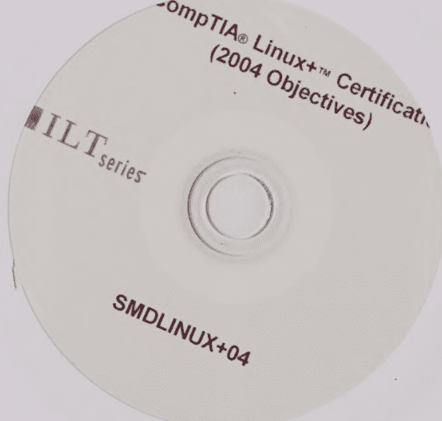

## 学生手册讲师

George Pauwels  
`paul.pauw@gmail.com`

David Mohr

# 引言

在读完本引言后，你将了解如何：

- A 通用地使用 ILT 系列培训手册。
- B 使用先决条件、目标学生描述、课程目标和技能清单，为你的课程设定合理的预期。
- C 课后对本课程进行重新记录。

# 主题 A：关于手册

## ILT 系列理念

ILT 培训手册通过提供与软件本身进行结构化的交互来促进你的学习。虽然我们提供了文本来解释复杂的概念，但实操活动是我们课程的重点。在教师引导你进行这些活动时，通过密切关注，你将有效地学习技能和概念。

我们深信由教师引导的课堂。在课堂期间，请专注于你的教师。我们手册的设计和编写是为了促进你与教师的互动，而不是为了引起对手册本身的关注。

我们相信设定预期、交付教学以及随后提供总结和复习的基本方法。因此，课程以目标开始，以总结结束。我们还提供了整体课程目标和课程总结，以便为整门课程提供引言和结束。

## 手册组件

手册包含以下主要组件：

- 目录
- 引言
- 单元 (Units)
- 附录
- 课程总结
- 术语表
- 索引

每个元素在下文中均有详细描述。

# 目录

目录起着学习路线图的作用。

# 引言

引言包含了关于我们的培训理念以及我们手册的组件、功能和惯例的信息。它包含了针对特定课程的目标学生、先决条件、目标和设置信息。

# 单元 (Units)

单元是课程内容最大的结构组成部分。一个单元从标题页开始，列出了单元内每个主要子部分（或主题）的目标。在每个主题中，概念性和解释性信息与实操活动交替出现。单元以总结结束，总结包含每个主题一个段，以及一个独立的练习活动，这为你提供了练习所学技能的机会。

概念性信息以文本段落、示例、列表和表格的形式呈现。活动采用双列结构，一列告诉你要做什么，另一列则提供解释、描述和图表。

# 附录

附录与单元相似，它们都包含了目标和概念性解释。然而，附录不包括实操活动、总结或独立的练习活动。我们还包含了一个附录，其中列出了所有 CompTIA Linux+ / 2004 考试目标，并附有本课程手册中对应内容的引用。

# 课程总结

本节提供了整门课程的文本总结。它对于在课程结束时提供收尾工作非常有用。课程总结还指明了系列中的下一门课程（如果有的话），并列出了你在继续学习软件时可能发现有用的额外资源。

# 术语表

术语表为本课程中使用的所有关键术语提供了定义。

# 索引

手册末尾的索引可以方便你找到关于特定软件组件、功能或概念的信息。

# 手册惯例

我们试图将手册中的元素数量和格式类型减少到最低。这有助于清晰度，并使手册看起来更加经典优雅。

| 惯例 | 描述 |
| --- | --- |
| *斜体文本* | 在概念文本中，表示新术语或功能。 |
| **粗体文本** | 在单元总结中，表示关键术语或概念。在独立练习活动中，表示你选择、选取或输入的显式项目。 |
| `代码字体` | 表示代码或语法。 |
| `较长的字符串` | 在实操活动中，如果代码太长，则表示你选择、选取或输入的显式项目。 |
| **粗体文本** | 在独立练习活动中，表示你选择、选取或输入的显式项目。 |
| `键` | 指键盘按键 |

# 实操活动

实操活动是手册中最重要的部分。它们分为两列，“如何做”列告诉你要做什么，“为什么”列提供解释。

## A-1：关于销售

| 如何做 | 为什么 |
| --- | --- |
| 1 观察销售 | 这是一个销售工作表。 |
| 2 打开销售 | 这是一个销售认证。 |
| 3 销售 | 这是一个销售示例。 |


# 主题 B：设定预期

正确设定预期对你的成功至关重要。本主题通过提供以下内容来帮助你：

- 课程先决条件
- 目标学生描述
- 课程目标
- 技能清单

## 先决条件

在参加本课程之前，你应该具有半年的 Linux 使用经验。

## 目标学生

本课程专为准备 CompTIA Linux+ 认证考试（2004）并计划管理 Linux 的学生设计。本课程对于追求 CompTIA Linux+ 认证的经验 Linux 专业人士也是极佳的选择。

# CompTIA 认证

CompTIA 是一个非营利信息技术协会。CompTIA 的认证由来自 IT 行业的专家设计。每项 CompTIA 认证都是厂商中立的，涵盖多种技术，并要求展示相关的技能和知识。

要获得 CompTIA 认证，你必须：

1. 选择一个认证考试提供商。更多信息请访问 `www.comptia.org/certification/general_information/exam_locations.aspx`。
2. 注册并安排时间在方便地点参加 CompTIA 认证考试。
3. 阅读并签署候选协议，该协议将在考试时提供。候选协议的文本可以在 `www.comptia.org/certification/general_information/candidate_agreement.aspx` 找到。
4. 参加并通过 CompTIA 认证考试。

有关 CompTIA 认证的更多信息（例如行业认可度、优势或新闻），请访问 `www.comptia.org/certification`。

如需就任何问题或建议联系 CompTIA，请拨打 `(630) 678-8300` 或发送电子邮件至 `questions@comptia.org`。

## 课程目标

这些总体课程目标将让你对本课程的预期有一个大致的了解。它们也可能帮助你判断这门课程是否适合你。如果你认为自己缺乏先修知识，或者已经掌握了大部分要涵盖的主题，你应该告知你的讲师，认为你所在的班级安排不当。

注意：除了列出的通用目标外，每个主题的开头还列出了特定的 CompTIA Linux+ 考试目标。要查看考试目标与课程内容的完整映射关系，请参阅附录 C。

完成本课程后，你将学会：

- 概述 Linux 操作系统的关键特征，列出使用 Linux 的优势，并解释 Linux 在行业中的常见用途。
- 安装 Fedora Core 2；描述常见的处理单元、物理内存、磁盘驱动器、主板、外围设备、视频适配器、显示器、键盘和鼠标；以及安装 Linux 所需的硬件和软件信息。
- 概述界面结构以及内核、终端（terminal）和壳（shell）的角色；输入基础 shell 命令；使用命令文档；使用元字符；正确地关闭操作系统；讨论 Linux 目录结构和文件；使用通配符指定多个文件名；显示文本文件和二进制文件的内容；通过 `grep` 搜索文本文件的正则表达式；识别常见编辑器；并使用 `vi` 编辑器。
- 解释文件系统层级标准（Filesystem Hierarchy Standard）的功能，使用标准命令管理文件和目录；查找文件和目录，理解并创建链接，修改文件和目录的所有权，定义并更改文件和目录权限；识别文件和目录上创建的权限，并应用特殊的文件和目录权限。
- 识别 `/dev` 目录中的设备文件类型，理解常见的文件系统类型及其特征，挂载和卸载软磁盘和 CD-ROM 到目录树，创建硬盘分区，将硬盘分区挂载或卸载到目录树，监控挂载文件系统的空闲空间；检查文件系统错误，并使用磁盘配额限制空间使用。
- 安装并配置 SCSI 设备；识别默认 IRQ、I/O 地址和 DMA；解释如何使用即插用（Plug-and-Play）为外围设备分配配置；解释容错磁盘系统和 RAID 配置；概述在网络服务器上从源文件安装 Linux 的步骤；创建 `kickstart` 文件并排查安装过程。
- 重定向命令的输入和输出；识别、操作、创建和导出变量；编辑环境文件创建变量；描述 shell 脚本的作用；创建并执行 shell 脚本；使用 shell 脚本中的结构；并自定义 BASH shell 历史功能。
- 概述启动 Linux 系统的主要步骤，配置 LILO 和 GRUB 引导程序，与 Windows 系统双启动 Linux，理解守护进程（daemon）如何在启动时初始化系统，并理解运行级别（runlevels）。
- 解释 GUI 组件（如 X Windows、窗口管理器和桌面环境）的功能；列常见的窗口管理器和桌面环境；使用各种工具配置 X Windows；启动和停止 X 服务器；从命令行运行 X 应用程序。
- 分类不同类型的进程，使用工具查看进程，阐明常见信号之间的差异，描述二进制程序和 shell 脚本是如何执行的，创建和操作后台进程，使用工具修改进程优先级，使用 `at` 守护进程调度未来执行的命令，并使用 `cron` 守护进程调度执行命令。
- 设置、管理和向打印机打印，并理解日志文件的目的以及如何管理它们。
- 使用命令行工具和用户管理器（User Manager）创建、修改、管理和删除用户及组帐户；查找损坏的链接和孤立文件；使用文件日期和时间戳。
- 概述压缩工具的特征；压缩和解压文件；使用 `tar`、`cpio` 和 `dump` 命令进行系统备份；从源代码编译并安装软件包；并使用红帽软件包管理器（Red Hat Package Manager）安装、管理和移除软件包。
- 识别良好的排障实践，排查常见的硬件和软件相关问题。


### 课程总体目标

- 识别 `/dev` 目录中的设备文件类型，理解常见的文件系统类型及其特征，挂载和卸载软磁盘和 CD-ROM 到目录树，创建硬盘分区，将硬盘分区挂载或卸载到目录树，监控挂载文件系统的空闲空间；检查文件系统错误，并使用磁盘配额限制空间使用。
- 安装并配置 SCSI 设备；识别默认 IRQ、I/O 地址和 DMA；解释如何使用即插用（Plug-and-Play）为外围设备分配配置；解释容错磁盘系统和 RAID 配置；概述在网络服务器上从源文件安装 Linux 的步骤；创建 `kickstart` 文件并排查安装过程。
- 重定向命令的输入和输出；识别、操作、创建和导出变量；编辑环境文件创建变量；描述 shell 脚本的作用；创建并执行 shell 脚本；使用 shell 脚本中的结构；并自定义 BASH shell 历史功能。
- 概述启动 Linux 系统的主要步骤，配置 LILO 和 GRUB 引导程序，与 Windows 系统双启动 Linux，理解守护进程（daemon）如何在启动时初始化系统，并理解运行级别（runlevels）。
- 解释 GUI 组件（如 X Windows、窗口管理器和桌面环境）的功能；列常见的窗口管理器和桌面环境；使用各种工具配置 X Windows；启动和停止 X 服务器；从命令行运行 X 应用程序。
- 分类不同类型的进程，使用工具查看进程，阐明常见信号之间的差异，描述二进制程序和 shell 脚本是如何执行的，创建和操作后台进程，使用工具修改进程优先级，使用 `at` 守护进程调度未来执行的命令，并使用 `cron` 守护进程调度执行执行命令。
- 设置、管理和向打印机打印，并理解日志文件的目的以及如何管理它们。
- 使用命令行工具和用户管理器（User Manager）创建、修改、管理和删除用户及组帐户；查找损坏的链接和孤立文件；使用文件日期和时间戳。
- 概述压缩工具的特征；压缩和解压文件；使用 `tar`、`cpio` 和 `dump` 命令进行系统备份；从源代码编译并安装软件包；并使用红帽软件包管理器（Red Hat Package Manager）安装、管理和移除软件包。
- 识别良好的排障实践，排查常见的硬件和软件相关问题。

这些总体目标将让你对本课程的预期有一个大致的了解。它们也可能帮助你判断这门课程是否适合你。如果你认为自己缺乏先修知识，或者已经掌握了大部分要涵盖的主题，你应该告知你的讲师，认为你所在的班级安排不当。

**注意：** 除了列出的通用目标外，每个主题的开头还列出了特定的 CompTIA Linux+ 考试目标。要查看考试目标与课程内容的完整映射关系，请参阅附录 C。

### 完成本课程后，你将学会：

- 概述 Linux 操作系统系统的关键特征，列出使用 Linux 的优势，并解释 Linux 在行业中的常见用途。
- 安装 Fedora Core 2；描述常见的处理单元、物理内存、磁盘驱动器、主板、外围设备、视频适配器、显示器、键盘和鼠标；以及安装 Linux 所需的硬件和软件信息。
- 概述界面结构以及内核、终端（terminal）和壳（shell）的角色；输入基础 shell 命令；使用命令文档；使用元字符；正确地关闭操作系统；讨论 Linux 目录结构和文件；使用通配符指定多个文件名；显示文本文件和二进制文件的内容；通过 `grep` 搜索文本文件的正则表达式；识别常见编辑器；并使用 `vi` 编辑器。
- 解释文件系统层级标准（Filesystem Hierarchy Standard）的功能，使用标准命令管理文件和目录；查找文件和目录，理解并创建链接，修改文件和目录的所有权，定义并更改文件和目录权限；识别文件和目录上创建的权限，并应用特殊的文件和目录权限。
- 识别 `/dev` 目录中的设备文件类型，理解常见的文件系统类型及其特征，挂载和卸载软磁盘和 CD-ROM 到目录树，创建硬盘分区，将硬盘分区挂载或卸载到目录树，监控挂载文件系统的空闲空间；检查文件系统错误，并使用磁盘配额限制空间使用。
- 安装并配置 SCSI 设备；识别默认 IRQ、I/O 地址和 DMA；解释如何使用即插用（Plug-and-Play）为外围设备分配配置；解释容错磁盘系统和 RAID 配置；概述在网络服务器上从源文件安装 Linux 的步骤；创建 `kickstart` 文件并排查安装过程。
- 重定向命令的输入和输出；识别、操作、创建和导出变量；编辑环境文件创建变量；描述 shell 脚本的作用；创建并执行 shell 脚本；使用 shell 脚本中的结构；并自定义 BASH shell 历史功能。
- 概述启动 Linux 系统的主要步骤，配置 LILO 和 GRUB 引导程序，与 Windows 系统双启动 Linux，理解守护进程（daemon）如何在启动时初始化系统，并理解运行级别（runlevels）。
- 解释 GUI 组件（如 X Windows、窗口管理器和桌面环境）的功能；列常见的窗口管理器和桌面环境；使用各种工具配置 X Windows；启动和停止 X 服务器；从命令行运行 X 应用程序。
- 分类不同类型的进程，使用工具查看进程，阐明常见信号之间的差异，描述二进制程序和 shell 脚本是如何执行的，创建和操作后台进程，使用工具修改进程优先级，使用 `at` 守护进程调度未来执行的命令，并使用 `cron` 守护进程调度执行执行命令。
- 设置、管理和向打印机打印，并理解日志文件的目的以及如何管理它们。
- 使用命令行工具和用户管理器（User Manager）创建、修改、管理和删除用户及组帐户；查找损坏的链接和孤立文件；使用文件日期和时间戳。
- 概述压缩工具的特征；压缩和解压文件；使用 `tar`、`cpio` 和 `dump` 命令进行系统备份；从源代码编译并安装软件包；并使用红帽软件包管理器（Red Hat Package Manager）安装、管理和移除软件包。
- 识别良好的排障实践，排查常见的硬件和软件相关问题。

这些总体目标将让你对本课程的预期有一个大致的了解。它们也可能帮助你判断这门课程是否适合你。如果你认为自己缺乏先修知识，或者已经掌握了大部分要涵盖的主题，你应该告知你的讲师，认为你所在的班级安排不当。

**注意：** 除了列出的通用目标外，每个主题的开头还列出了特定的 CompTIA Linux+ 考试目标。要查看考试目标与课程内容的完整映射关系，请参阅附录 C。

### 具体学习目标

- 概述 Linux 操作系统系统的关键特征，列出使用 Linux 的优势，并解释 Linux 在行业中的常见用途。
- 安装 Fedora Core 2；描述常见的处理单元、物理内存、磁盘驱动器、主板、外围设备、视频适配器、显示器、键盘和鼠标；以及安装 Linux 所需的硬件和软件信息。
- 概述界面结构以及内核、终端（terminal）和壳（shell）的角色；输入基础 shell 命令；使用命令文档；使用元字符；正确地关闭操作系统；讨论 Linux 目录结构和文件；使用通配符指定多个文件名；显示文本文件和二进制文件的内容；通过 `grep` 搜索文本文件的正则表达式；识别常见编辑器；并使用 `vi` 编辑器。
- 解释文件系统层级标准（Filesystem Hierarchy Standard）的功能，使用标准命令管理文件和目录；查找文件和目录，理解并创建链接，修改文件和目录的所有权，定义并更改文件和目录权限；识别文件和目录上创建的权限，并应用特殊的文件和目录权限。
- 识别 `/dev` 目录中的设备文件类型，理解常见的文件系统类型及其特征，挂载和卸载软磁盘和 CD-ROM 到目录树，创建硬盘分区，将硬盘分区挂载或卸载到目录树，监控挂载文件系统的空闲空间；检查文件系统错误，并使用磁盘配额限制空间使用。
- 安装并配置 SCSI 设备；识别默认 IRQ、I/O 地址和 DMA；解释如何使用即插用（Plug-and-Play）为外围设备分配配置；解释容错磁盘系统和 RAID 配置；概述在网络服务器上从源文件安装 Linux 的步骤；创建 `kickstart` 文件并排查安装过程。
- 重定向命令的输入和输出；识别、操作、创建和导出变量；编辑环境文件创建变量；描述 shell 脚本的作用；创建并执行 shell 脚本；使用 shell 脚本中的结构；并自定义 BASH shell 历史功能。
- 概述启动 Linux 系统的主要步骤，配置 LILO 和 GRUB 引导程序，与 Windows 系统双启动 Linux，理解守护进程（daemon）如何在启动时初始化系统，并理解运行级别（runlevels）。
- 解释 GUI 组件（如 X Windows、窗口管理器和桌面环境）的功能；列常见的窗口管理器和桌面环境；使用各种工具配置 X Windows；启动和停止 X 服务器；从命令行运行 X 应用程序。
- 分类不同类型的进程，使用工具查看进程，阐明常见信号之间的差异，描述二进制程序和 shell 脚本是如何执行的，创建和操作后台进程，使用工具修改进程优先级，使用 `at` 守护进程调度未来执行的命令，并使用 `cron` 守护进程调度执行执行命令。
- 设置、管理和向打印机打印，并理解日志文件的目的以及如何管理它们。
- 使用命令行工具和用户管理器（User Manager）创建、修改、管理和删除用户及组帐户；查找损坏的链接和孤立文件；使用文件日期和时间戳。
- 概述压缩工具的特征；压缩和解压文件；使用 `tar`、`cpio` 和 `dump` 命令进行系统备份；从源代码编译并安装软件包；并使用红帽软件包管理器（Red Hat Package Manager）安装、管理和移除软件包。
- 识别良好的排障实践，排查常见的硬件和软件相关问题。

这些总体目标将让你对本课程的预期有一个大致的了解。它们也可能帮助你判断这门课程是否适合你。如果你认为自己缺乏先修知识，或者已经掌握了大部分要涵盖的主题，你应该告知你的讲师，认为你所在的班级安排不当。

**注意：** 除了列出的通用目标外，每个主题的开头还列出了特定的 CompTIA Linux+ 考试目标。要查看考试目标与课程内容的完整映射关系，请参阅附录 C。

### 核心技能掌握

- 概述 Linux 操作系统系统的关键特征，列出使用 Linux 的优势，并解释 Linux 在行业中的常见用途。
- 安装 Fedora Core 2；描述常见的处理单元、物理内存、磁盘驱动器、主板、外围设备、视频适配器、显示器、键盘和鼠标；以及安装 Linux 所需的硬件和软件信息。
- 概述界面结构以及内核、终端（terminal）和壳（shell）的角色；输入基础 shell 命令；使用命令文档；使用元字符；正确地关闭操作系统；讨论 Linux 目录结构和文件；使用通配符指定多个文件名；显示文本文件和二进制文件的内容；通过 `grep` 搜索文本文件的正则表达式；识别常见编辑器；并使用 `vi` 编辑器。
- 解释文件系统层级标准（Filesystem Hierarchy Standard）的功能，使用标准命令管理文件和目录；查找文件和目录，理解并创建链接，修改文件和目录的所有权，定义并更改文件和目录权限；识别文件和目录上创建的权限，并应用特殊的文件和目录权限。


- 识别 `/dev` 目录中的设备文件类型，理解常见的文件系统类型及其特征，挂载和卸载软磁盘和 CD-ROM 到目录树，创建硬盘分区，将硬盘分区挂载或卸载到目录树，监控挂载文件系统的空闲空间；检查文件系统错误，并使用磁盘配额限制空间使用。

- 安装并配置 SCSI 设备；识别默认 IRQ、I/O 地址和 DMA；解释如何使用即插用（Plug-and-Play）为外围设备分配配置；解释容错磁盘系统和 RAID 配置；概述在网络服务器上从源文件安装 Linux 的步骤；创建 `kickstart` 文件并排查安装过程。

- 重定向命令的输入和输出；识别、操作、创建和导出变量；编辑环境文件创建变量；描述 shell 脚本的作用；创建并执行 shell 脚本；使用 shell 脚本中的结构；并自定义 BASH shell 历史功能。

- 概述启动 Linux 系统的主要步骤，配置 LILO 和 GRUB 引导程序，与 Windows 系统双启动 Linux，理解守护进程（`daemon`）如何在启动时初始化系统，并理解运行级别（`runlevels`）。

- 解释 GUI 组件（如 X Windows、窗口管理器和桌面环境）的功能；列常见的窗口管理器和桌面环境；使用各种工具配置 X Windows；启动和停止 X 服务器；从命令行运行 X 应用程序。

- 分类不同类型的进程，使用工具查看进程，阐明常见信号之间的差异，描述二进制程序和 shell 脚本是如何执行的，创建和操作后台进程，使用工具修改进程优先级，使用 `at` 守护进程调度未来执行的命令，并使用 `cron` 守护进程调度执行执行命令。

- 设置、管理和向打印机打印，并理解日志文件的目的以及如何管理它们。

- 使用命令行工具和用户管理器（User Manager）创建、修改、管理和删除用户及组帐户；查找损坏的链接和孤立文件；使用文件日期和时间戳。

- 概述压缩工具的特征；压缩和解压文件；使用 `tar`、`cpio` 和 `dump` 命令进行系统备份；从源代码编译并安装软件包；并使用红帽软件包管理器（Red Hat Package Manager）安装、管理和移除软件包。

- 识别良好的排障实践，排查常见的硬件和软件相关问题。

这些总体目标将让你对本课程的预期有一个大致的了解。它们也可能帮助你判断这门课程是否适合你。如果你认为自己缺乏先修知识，或者已经掌握了大部分要涵盖的主题，你应该告知你的讲师，认为你所在的班级安排不当。

注意：除了列出的通用目标外，每个主题的开头还列出了特定的 CompTIA Linux+ 考试目标。要查看考试目标与课程内容的完整映射关系，请参阅附录 C。

### 技能映射表

| Skill | 1 | 2 | 3 | 4 | 5 |
|---|---|---|---|---|---|
| 使用 `vi` 编辑器 | | | | | |
| 理解文件系统层级标准（Filesystem Hierarchy Standard）的需求 | | | | | |
| 创建新目录通过使用 `mkdir` 命令 | | | | | |
| 重命名和移动文件通过使用 `mv` 命令 | | | | | |
| 复制文件通过使用 `cp` 命令 | | | | | |
| 使用 `rmdir` 和 `rm` 命令 | | | | | |
| 在文件系统中查找文件和目录 | | | | | |
| 创建和查看指向文件的链接 | | | | | |
| 修改文件和目录的所有权 | | | | | |
| 定义并更改 Linux 文件和目录权限 | | | | | |
| 识别文件和目录上创建的权限 | | | | | |
| 应用特殊的文件和目录权限 | | | | | |
| 识别 `/dev` 目录中的设备文件类型 | | | | | |
| 理解常见的文件系统类型及其特征 | | | | | |
| 挂载和卸载软磁盘和 CD-ROM 到目录树 | | | | | |
| 通过 `fdisk` 创建硬盘分区并挂载 `ext2` 文件系统 | | | | | |
| 将硬盘分区挂载或卸载到目录树，监控挂载文件系统的空闲空间 | | | | | |
| 检查文件系统错误，并使用磁盘配额限制空间使用 | | | | | |

### 技能映射表 2

| 技能 | 1 | 2 | 3 | 4 | 5 |
|---|---|---|---|---|---|
| 排除 Linux 安装故障 | | | | | |
| 重定向命令的输入和输出 | | | | | |
| 识别、操作、创建和导出 shell 变量并编辑环境文件创建变量 | | | | | |
| 在 shell 脚本中使用决策结构创建并执行 shell 脚本 | | | | | |
| 使用和自定义 BASH shell | | | | | |
| 配置 LILO 启动器，安装并配置 GRUB 启动器 | | | | | |
| 使用 FIPS 调整 Windows 分区大小 | | | | | |
| 探索和更改运行级别 (`runlevels`) | | | | | |
| 启动伪守护进程 (`fake daemons`) | | | | | |
| 理解并使用 X Window、窗口管理器和桌面环境 | | | | | |
| 使用 GDM 配置工具配置 `gdm` | | | | | |
| 运行 X 服务器并使用窗口管理器 | | | | | |
| 对 Linux 系统上不同类型的进程进行分类 | | | | | |
| 使用标准 Linux 工具查看进程 | | | | | |
| 说明常用 `kill` 信号之间的差异 | | | | | |
| 理解二进制程序和脚本是如何执行的 | | | | | |
| 创建和操作后台进程 | | | | | |
| 使用标准 Linux 工具修改进程优先级 | | | | | |
| 使用 `at` 守护进程调度在未来执行的命令 | | | | | |
| 使用 `cron` 守护进程调度重复执行的命令 | | | | | |

### 技能映射表 3

| 技能 | 1 | 2 | 3 | 4 | 5 |
|---|---|---|---|---|---|
| 使用 CUPS 创建本地和网络打印机 | | | | | |
| 控制打印过程并创建打印作业 | | | | | |
| 理解日志文件的用途以及如何管理它们 | | | | | |
| 使用命令行工具创建和修改用户账户 | | | | | |
| 锁定、解锁和删除用户账户 | | | | | |
| 创建、使用和删除组 | | | | | |
| 寻找断开的链接和孤立文件 | | | | | |
| 使用文件日期时间戳 | | | | | |
| 概述常用压缩工具的功能 | | | | | |
| 使用常用压缩工具压缩和解压缩文件 | | | | | |
| 使用 `tar`、`cpio` 和 `dump` 命令执行系统备份 | | | | | |
| 使用 `tar`、`cpio` 和 `restore` 命令查看和提取归包 | | | | | |
| 描述常见的 Linux 软件类型 | | | | | |
| 从源码编译并安装软件包 | | | | | |
| 使用红帽软件包管理器 (`RPM`) 安装、管理和删除软件包 | | | | | |
| 描述并概述常见的故障排除步骤 | | | | | |
| 识别良好的故障排除实践 | | | | | |
| 排除常见的硬件和软件相关问题 | | | | | |
| 使用命令行和图形化工具监控系统性能 | | | | | |
| 理解 `TCP/IP` 协议的基本配置 | | | | | |

### 技能映射表 4

| 技能 | 1 | 2 | 3 | 4 | 5 |
|---|---|---|---|---|---|
| 配置 `NIC` 接口使用 `TCP/IP` 协议 | | | | | |
| 配置调制解调器、`ISDN` 和 `DSL` 接口使用 `PPP` 和 `TCP/IP` 协议 | | | | | |
| 理解主机名的用途以及它们如何解析为 `IP` 地址 | | | | | |
| 使用常用网络工具与网络服务交互 | | | | | |
| 识别并配置常用网络服务 | | | | | |
| 理解安全的重要性并概述防止意外入侵的方法 | | | | | |
| 使用 `nmap` 检查服务 | | | | | |
| 理解检测系统入侵和软件更改的技术 | | | | | |

# 主题 C: 重新加密课程

如果你有适当硬件和软件，你可以在课后重新加密本课程。本节将解释你为此需要什么，以及如何操作。

## 计算机要求

要重新加密本课程，你的个人电脑需要以下硬件和软件配置：

- 键盘和鼠标
- `Intel Pentium III` (强烈建议使用 `Pentium 4`) 或 `Intel` 兼容处理器，运行频率在 500 MHz 或更高
- 至少 128 MB RAM；强烈建议 256 MB
- SVGA 显示适配器，至少支持 255 色彩
- 网卡 (`NIC`)，以及用于连接网络的相关线缆 (`RJ-45` 接口)
- 1.44 MB 3.5 英制软盘驱动器
- Linux 操作系统支持的 CD-ROM 驱动器（检查[硬件兼容性列表 (HCL)]）
- 10-GB 硬盘（最小）
- 两张空白且已格式化的软磁盘
- 互联网访问，如果你想从 `www.courseit.com/instructor_tools.html` 下载学生数据文件。如果你的互联网访问是通过拨号上网的，你应该用当前的计算机下载文件，因为 Linux 系统将不会配置拨号连接。以太网/宽带连接应该很容易建立。

## 软件

- Fedora

# 重新加密课程的设置

如果你有适当硬件和软件，你可以在课后重新加密本课程。本节将解释你为此需要什么，以及如何操作。

## CompTIA+ 2004 目标

按照以下步骤完成设置：

- 在欢迎屏幕点击“下一步”。
- 在许可协议屏幕上，选择“是，我同意协议”。
- 如果需要，调整日期和时间。点击“下一步”。
- 如果需要，更改分辨率和色彩深度值。点击“下一步”。
- 在用户账户屏幕，在用户名框中输入“user1”。在密码和确认密码框中输入“password”。点击“下一步”。
- 在声卡屏幕上，点击“下一步”。
- 在附加 CD 屏幕上，点击“下一步”。
- 在完成设置屏幕上，点击用户名“root”和密码“password”。

# 第 1

## Linux 简介

**单元时长：60 分钟**

完成本单元后，你将学会：

- A 概述 Linux 操作系统的关键特征。
- B 解释 Linux 在如今行业中的常见用途。

### 主题 A：作为操作系统的 Linux

本主题涵盖了以下 CompTIA Linux+ 考试目标。

| 目标 | 内容 |
|---|---|
| 1.1 识别所有所需的系统硬件并检查与 Linux 发行版的兼容性。 | - CPU<br>- 内存 |
| 1.11 为 Linux 安装选择合适的参数。 | - 语言 |

### 操作系统——基础

每台计算机都包含两种基本组件：硬件和软件。

硬件是指计算机的物理组件，即包含一系列用于处理信息流的电路的设备。计算机中有许多不同的硬件组件，包括：

- 处理器，用于计算信息（也称为中央处理单元或 `CPU`）
- 物理内存，存储处理器所需的信息（也称为随机存取存储器或 `RAM`）
- 硬盘，存储大部分使用的信息
- 软盘驱动器，在软盘上存储信息
- 光驱，从光盘中读取信息
- 声卡，为外部扬声器提供声音
- 显卡，提供各种硬件组件之间的连接（也称为主板）

另一方面，软件是指以有意义的方式使用硬件的一组指令。软件使硬件能够操纵数据文件或与其他硬件设备进行交互。对于某些目的，软件可以作为逻辑设备来模拟硬件的功能。

### 程序

程序是一组与硬件交互以完成任务的数据。例如，当用户在银行向计算机输入信息时，他正在使用一个理解如何处理其银行账户记录的程序。程序可以是一个单一的数据文件，也可以是多个相互作用的文件。

当你首次启动计算机时，这些程序中的某些会被加载到计算机硬件的不同部分，例如计算机的内存。程序在你需要时启动，如文字处理器或 Internet 浏览器。

程序通常存储在光驱、硬盘或软盘等硬件上。用于控制单个设备的程序通常嵌入在设备本身的内存芯片中，例如硬盘或显卡。

### Linux 简介 1-3

当程序运行时，其活动被称为“进程”。当你启动计算机时，可能会启动几十个进程，每个进程都代表让机器运转的程序。当你打开更多程序并要求计算机执行更多任务时，将启动更多进程。

### 系统软件

计算机上运行着两种不同类型的程序：

- 应用程序，包括那些为特定用途设计且你经常交互的程序，例如文字处理器、电脑游戏、图形处理程序和计算机系统实用程序
- 操作系统（`OS`）软件，由一系列软件组件组成，用于控制计算机的硬件并支持你运行的应用程序。

没有操作系统，你将无法使用你的计算机。操作系统提供了你与系统交互的接口。它将你的命令传递给硬件，管理程序对 `CPU` 和内存的使用，并将程序的输出传回给你。操作系统还确保不同的程序进程正常运行。用户、应用程序操作系统软件与计算机硬件之间的关系如图示 1-1 所示。


图 1-1：操作系统软件的作用

操作系统的关键任务之一是与计算机的所有硬件元素进行交互。为了实现这一点，它必须拥有适当的设备驱动程序，它告诉操作系统如何使用这些设备。当你启动计算机时启动的一些进程就是设备驱动程序。硬件和软件之间不兼容的难题通常是由于设备驱动程序不足导致的。

操作系统的另一个基本组件是用户界面。该接口通过键盘或鼠标接受你的命令，并将其转发到操作系统，并在显示器上向你显示结果。界面可以是命令行提示符，你在其中输入命令来告诉操作系统做什么。或者，它可能是一个图形用户界面（`GUI`），它由一系列任务的视觉化描述（称为图标）组成，你用它们来控制系统。本课程所设计的 Linux 版本 Fedora 2 的默认 `GUI` 如图示 1-2 所示。

最后，操作系统提供系统服务，这些是处理打印、程序调度和网络访问等任务的应用程序。这些系统服务决定了操作系统支持程序和用户界面的能力。

### 1-4 CompTIA Linux+ 认证，2004 目标

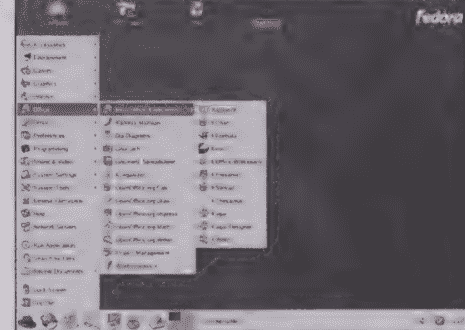

图 I-2-2：Linux 图形用户界面

### A-1：讨论操作系统

#### 练习题

1. 每台计算机都由物理组件和逻辑组件组成。计算机中理解如何与物理组件工作的逻辑组件被称为 \_\_\_。
   - A 硬件
   - B 记录
   - C 软件
   - D 处理器

2. 操作系统软件对于计算机的运行是必要的。对或错？ \_\_\_

3. 程序启动后，它被称为（n） \_\_\_
   - A 可执行文件
   - B 脚本
   - C 进程
   - D 应用程序

4. 知晓如何与操作系统和计算机硬件交互执行特定任务的指令集被称为 \_\_\_。
   - A 应用程序
   - B 软件
   - C 进程
   - D 程序

5. 使操作系统能够与硬件工作的软件被称为 \_\_\_
   - A 设备驱动程序
   - B 软件组件
   - C 硬件设备
   - D 系统软件

### Linux 操作系统

Linux（发音为 Linux）是一种用于在不同硬件平台上运行各种应用程序的操作系统。

Linux 可以同时管理数千个任务，并允许多个用户同时访问系统。由于这些功能，Linux 被称为多任务多用户操作系统。

当你开启计算机时，随着 Linux 启动，会发生很多事情：

- Linux 操作系统内核加载到内存。
- 它加载初始化硬件组件的设备驱动程序。
- 它加载启动用户界面的程序。
- 系统实用程序启动以提供网络连接和服务器功能等服务。

你可以看到许多此类活动发生，因为 Linux 在启动时显示每个组件并确认命令是否成功。

### Linux 许可

Linux 与大多数其他操作系统不同，因为它是由大型软件开发者社区开发持续维护的。它被称为开源软件（`OSS`），这意味着源代码对任何想要查看、利用或改进它的人开放。开发 `OSS` 的人员通常使用互联网共享他们的源代码、管理软件项目并提交注释和漏洞修复。与专有商业产品相比，开源软件的一些优势包括：

- 软件通过广泛协作快速开发。
- 软件漏洞被及时注意到并修复。
- 软件功能根据用户需求快速进化。
- 软件的感知价值增加，因为它基于实用性而不只是价格。

`OSS` 的特性可能很有益，但必须有法律许可来保护 `OSS` 免受法律问题和责任的影响。在学习常用许可之前，请查看下表，它定义了描述软件类型的通用术语：

| 软件类型 | 说明 |
|---|---|
| 开源 | 可以免费获取并修改源代码的软件 |
| 闭源 | 源代码不可用的软件 |
| 免费软件 | 免费提供的闭源软件 |
| 共享软件 | 初始免费提供但在一段时间后需要付费的闭源软件 |

## 并非所有斜体单词都符合条件

### Linux 版本

Linux 操作系统的核心组件被称为 Linux 内核（`kernel`）。内核负责（通过设备驱动程序）控制你计算机中的硬件，包括 `CPU`、内存管理以及所有其他硬件接口。

与 Linux 的许多组件一样，开发者不断改进内核并扩展其功能。内核版本是识别操作系统版本的主要因素。

新版本的内核增加了对更新、更快速的处理器、主板和随机内存（`RAM`）的支持。某些修订版本可能会带来新技术，如 `USB`（通用串行总线）或火线（`FireWire`）接口。某些修订版本修复（也称为 `bug`）了硬件支持问题或纠正了可靠性问题。与许多其他操作系统不同，在 Linux 中，你可以随心所欲地升级或自定义内核。

由于内核对系统的运行至关重要，因此了解如何识别不同的版本非常重要。

### 识别内核版本

三组数字组成了 Linux 内核版本：

- **主版本号（Major number）**：指示内核版本。当发生重大变化时（例如增加了对主要的新的硬件配置的支持）时，该数字会增加。
- **次版本号（Minor number）**：指示微小修订及其可靠性。


# A-2：理解作为系统的 Linux

- 修订版本号（`Revision number`）：标识你正在使用的内核确切版本，并在每次发布时增加。

最近的一个版本是`2.4.21`。主版本号是`2`，次版本号是`4`，修订版本号是`21`。

由于 Linux 开发社区不断编写新内核并发布进行测试，因此同时有很多不同的版本可用。如果你每当新内核出现时就升级内核，可能会出错。许多版本是实验性的，没有经过充分测试，在你的系统上可能是不稳定的。

内核可靠性最大的线索是次版本号。奇数次版本号表示一个开发版内核，即未经过充分测试可能不稳定的版本。如果次版本号是偶数，它被称为生产级内核（`production kernel`），即经过充分测试且足够可靠用于任务关键系统的版本。

例如，如果内核版本为`2.5.7`，其中可能潜伏着问题，会导致硬件无法运行或使你的系统崩溃。你可能希望在尝试最新版本之前，等待`2.6`版本的发布。

大多数封装的 Linux 发行版使用稳定的生产级内核，你可能需要担心你正在使用的版本。供应商将作为系统升级的一部分提供新的、经过充分测试的内核，以解决问题或应对安全担忧。你可以在互联网`http://www.kernel.org`上找到内核列表及其相应的改进。


## 练习题

- 1 Linux 操作系统的核心组件是 Linux 内核。如果你是一家公司的 Linux 系统管理员，你什么时候需要升级你的 Linux 内核？（选择所有适用项）

  - A 当你需要对新硬件的支持时
  - B 当你需要另一个用户界面时
  - C 当你需要增加稳定性时
  - D 当你需要使用内核模块时

- 2 下列哪些内核是开发版内核？（选择所有适用项）

  - A `2.3.4`
  - B `2.5.5`
  - C `2.2.7`
  - D `2.4.4`

- 3 生产级内核是指具有以下特征的内核：

  - A 修订版本号是偶数
  - B 次版本号是奇数
  - C 主版本号是偶数
  - D 次版本号是偶数

- 4 Linux 同时只支持一个用户。对或否？

- 5 Linux 内核版本`2.3.9`的一个 ________ 号为`2`。

  - A 次
  - B 修订
  - C 内核
  - D 主

## Linux 发行版

大多数封装的 Linux 发行版使用稳定的生产级内核，你可能需要担心你正在使用的版本。供应商将作为系统升级的一部分提供新的、经过充分测试的内核，以解决问题或应对安全担忧。你可以在互联网`http://www.kernel.org`上找到内核列表及其相应的改进。


你可以收集 Linux 驱动程序和程序来组成系统。许多 Linux 发行版如`Red Hat`、`SuSE`。许多 Linux 发行版都使用了 Linux 的内核，它们在功能上并不相同。

大多数 Linux 发行版使用稳定的生产级内核，你可能需要担心你正在使用的版本。供应商将作为系统升级的一部分提供新的、经过充分测试的内核，以解决问题或应对安全担忧。你可以在互联网`http://www.kernel.org`上找到内核列表及其相应的改进。

许多 Linux 发行版都使用了 Linux 的内核，它们在功能上并不相同。

你可以收集 Linux 驱动程序和程序来组成系统。许多 Linux 发行版如`Red Hat`、`SuSE`。许多 Linux 发行版都使用了 Linux 的内核，它们在功能上非常相似。

## 图形用户界面

你可能选择一个发行版的另一个原因是对包管理器的支持。包管理器是一个安装并跟踪软件的软件系统，类似于 Windows 中的“添加或删除程序”小部件。

最广泛支持的包管理器是 Red Hat 包管理器（`RPM`）。大多数 Linux 软件以`RPM`格式提供，且`RPM`在许多发行版中是标准。Debian 包管理器提供了 Red Hat 包管理器相同的优势，但也有其他。

除了包管理器格式，你还可以下载`tarball`格式的软件。`tarball`是文件的压缩包，类似于`zip`文件。`tarball`通常包含将软件安装到系统正确位置的脚本。遗憾的是，`tarball`不更新中央数据库，因此难以管理、升级或从系统中删除。大多数 Linux 软件传统上以`tarball`格式分发，但`RPM`的优势使其更加流行。

## GNOME 和 KDE

许多 Linux 发行版的窗口环境有两种主流选择：GNU 桌面环境（`GNOME`）和 KDE 桌面环境（`KDE`）。

这两个环境在功能上并不相同，但你可能对其中一个有偏好。`GNOME`桌面是用`C`编写的。`KDE`桌面是用`C++`编写的。

## 语言支持

Linux 发行版之间的另一个区别是语言支持。某些发行版对不同语言的支持更多。两个例子是`SuSE Linux`，它对德语支持更好，以及`TurboLinux`，它对日语支持更好。结果，这两种 Linux 发行版在这些国家的人口中非常流行。许多 Linux 发行版针对不同语言，大多数 Linux 文档（如`HOWTO`文档）提供多种语言。

## 选择发行版

任何人都可以通过对开源软件进行打包来创建一个 Linux 发行版。结果有超过 150 个公开注册的 Linux 发行版。许多是针对特定功能的专门发行版。每个发行版都有一个可以下载的网站。大多数主要的 Linux 发行版也可以从网上免费获得。对于能够快速数据连接的人，下载是获取 Linux 的最常见方法。

许多 Linux 发行版也以光盘的形式提供，并可以在各种计算机商店和网站购买。软件包通常带有安装指南和其他有用文档。对于初学者来说，这是一个很好的方法。

注意：你可以在`www.linux.org`找到完整的 Linux 发行版列表。你可以根据硬件、软件类别和语言进行搜索。下载发行版的良好来源是`www.linux.org`。

## Linux 简介

| 发行版 | 特性 | 平台 | 位置 |
| :--- | :--- | :--- | :--- |
| Fedora Project | 上一个 Red Hat 发行版的继承者，完全开源，Fedora 提供了任何 Linux 环境下实用的工具。包含 GNOME、KDE 和 RPM 桌面。 | i386 | - |
| Red Hat Enterprise Edition | 此软件包及若干变体代表了已成为标准 Linux 发行版之一的最新迭代。一个经过精心管理的升级计划旨在为企业用户提供更大的稳定性和集成；该系统不免费提供。 | X86 Itanium Alpha SPARC Mainframe MIPS | www.redhat.com |
| SuSE Linux | 这种来自德国的发行版免费提供，并为许多业务需求提供软件包。带有 GNOME、KDE 和 RPM。 | X86 Itanium Alpha PPC | www.suse.com |
| Slack Linux | 它带有 GNOME 和 KDE。以“类 UNIX”自豪。 | X86 ALPHA SPARC | www.slack.com |
| Debian Linux | 提供了所有发行版中数量最多的软件包。包含任何用途的软件包，并带有 GNOME、KDE、Debian 包管理器和 RPM。 | X86 ALPHA SPARC PPC | www.debian.org |
| TurboLinux | 亚洲最常见的 Linux 发行版，以其集群能力闻名。它带有 GNOME、KDE 和 RPM。 | X86 Itanium ALPHA Mainframe | www.turbolinux.com |
| Mandrake Linux | 一种类似于 Red Hat 的面向用户的发行版，增强了易用性。它带有 GNOME、KDE 和 RPM。 | x86 PPC | www.linux-mandrake.com |


## 1-12 CompTIA Linux+ 认证，2004 目标

动手！

# A-3: 讨论 Linux 发行版

## 练习

- 1. 当 Linux 操作系统的核心组件与其他开源软件打包在一起时，我们称之为：

  - A 新内核
  - B 新平台
  - C Linux 发行版
  - D GNU 项目

- 2. 大多数 Linux 发行版提供哪些常见的 GUI 环境？（选择两项）

  - A `GNOME`
  - B `KDE`
  - C `KDE`
  - D `RPM`

- 3. 下列因素决定了将使用哪种 Linux 发行版？（选择所有适用项）

  - A 包管理器支持
  - B 硬件平台
  - C 内核特性
  - D 语言支持

- 4. 能够放在软盘上的 Linux 发行版不包含 GUI。正确或错误？


# 主题 B：Linux 的常见用途

本主题涵盖以下 CompTIA Linux+ 考试目标。

| | 目标 |
| :--- | :--- |
| 1.1 | 识别所有所需的系统硬件并检查与 Linux 发行版的兼容性。<br> - 可扩展性 |
| 1.4 | 根据预定的客户需求识别 Linux 机器的用途。<br> - 设备<br> - 桌面系统<br> - 数据库<br> - 邮件服务器<br> - `Web` 服务器 |
| 2.21 | 管理和访问邮件队列。<br> - `sendmail`<br> - `postfix` |

## 一个多功能的系统

Linux 的一个重要特性是它的多功能性。Linux 可以为各种任务提供和服务功能。这些服务可以在您的本地工作站上使用，也可以配置允许其他计算机通过网络使用它们。在本地计算机上的服务称为工作站服务，而为其他计算机提供的服务称为服务器服务。托管服务器服务的计算机通常被称为服务器。

- 互联网服务器
- 文件和打印服务器
- 应用服务器
- 超级计算机
- 科学/工程计算
- 办公工作站
- `FTP` 服务
- 路由、防火墙与代理服务
- `WEB` 服务
- `DNS` 服务

## 互联网服务器

UNIX 和互联网共同成长的，并相互影响对方的功能和能力。我们每天在互联网上做的许多事情都使用了在 UNIX 中创建并运行在某些版本的 UNIX 或 Linux 上的服务。Linux 与其 UNIX 祖先共享了广泛的互联网工具。事实上，它首次成为托管网站和交换电子邮件的 UNIX 低成本替代方案而流行。这些最常见的互联网服务器服务包括：

- 邮件服务
- 路由
- `FTP` 服务
- 防火墙和代理服务
- `Web` 服务
- 新闻服务
- `DNS` 服务

## 邮件服务

电子邮件通过邮件服务器网络（也称为邮件传输代理或`MTA`）分发。Linux 有多种`MTA`程序可用，但最常用的程序是`sendmail`。另一个程序叫做`postfix`。它设计为与`sendmail`兼容，用户界面非常相似。`postfix`的内部工作原理与`sendmail`非常不同。它的设计是快速、安全且易于管理。

在阅读电子邮件之前，它必须从服务器下载。该任务由邮件投递代理（`MDA`）处理。Linux 有几种`MDA`，最常见的是`proc`和`fetchmail`。你发送给其他计算机用户的邮件会被发送到邮件服务器，服务器将其转发到收件者的邮件服务器。

你在邮件用户代理（`MUA`）上阅读和撰写电子邮件。Linux 有多种`MUA`，常见的有`mutt`、`pine`和`elm`。许多 Linux 系统内置了在网络范围内`Mozilla`。

## 新闻服务

许多开源软件开发者使用新闻组来交换信息并协调软件开发。配合电子邮件，使用特殊的程序——新闻阅读器来阅读新闻组。`Gnews`、`Knews`、`Gnus`、`Mozilla`和`pine`是常见的 Linux 阅读器。

## 路由

路由允许全球网络各个部分协同工作。路由器是一个计算机或特殊设备，在网络的不同部分之间引导数据。公司可以使用路由器将其内部网络连接到互联网。Linux 是此项功能的良好选择，因为它支持路由并易于自定义。

注意：路由器的一个示例是 Linux Router 项目，你可以从`www.linuxrouter.org`下载。

## Linux 简介

## 1-15 `FTP` 服务

## WTP

在互联网上传输文件最常见且高效的方法是文件传输协议（`FTP`）。`FTP`也用于在内部网络传输文件，因为它快速且健壮。大多数发行版都内置了名为`ftppd`的`FTP`服务器，需要一些配置才能运行。

## 防火墙和代理服务

防火墙通过实施复杂的规则来保护网络不受外部人员影响。大多数防火墙是位于私有网络和互联网连接之间的计算机。所有流量必须通过此防火墙。Linux 内核中内置了防火墙支持。许多发行版带有的`ipchains`和`iptables`工具用于配置防火墙。

由于服务器通常位于公司内部网络和互联网之间，它们提供了其他允许公司计算机访问互联网的服务。

这些服务中最常见的被称为代理服务器。与其允许工作站直接连接到互联网服务器，不如代理服务器处理连接并往返请求。使用代理服务器可以增加网络安全性并简化客户端的配置。代理服务器通过维护网络地址转换（`NAT`）表来跟踪传递给客户端的信息。

`ipchains`和`iptables`都可以执行某些代理服务器功能，`Squid`是强大的代理服务器。`Squid`通过缓存过程保留任何请求的`Web`页面或数据文件。在代理服务器上缓存文件意味着对这些文件的额外请求可以由代理提供，而不是原始服务器。这更快并减少了通过互联网连接传输的数据量。

## `Web` 服务

虽然有很多互联网工具和服务可用，但最流行的是互联网浏览器，它将客户端连接到组成全球网的服务器社区。这些服务器被称为`Web`服务器。大多数 Linux 发行版都包含`Apache`，互联网上最流行的`Web`服务器。

## 1-18 CompTIA Linux+ 认证，2004 目标

## 文件和打印机服务器

解释：创建网络的目的是将计算机和其他设备连接起来共享资源。它们可以共享打印机和其他硬件，也可以共享数据和存储空间。

在大型办公室内，为每位需要的人员提供打印机是一项非常昂贵的支出。提供一组供用户共享的小型打印机要廉得多。Linux 的出现解决了这一问题，它可以充当打印机服务器。它可以让连接到它的打印机供网络上的所有其他计算机共同使用。

文件服务器允许其他计算机与之连接，以存储和检索文件。文件服务器有以下可能的用途：

- 存储：可以将计算机的数据发送到服务器，以释放计算机上的空间。
- 安全：你可以轻松地备份存储在服务器上的数据，从而保护数据不丢失。许多管理员都有定期的数据备份创建计划（包括异地存储），以及在主服务器磁盘故障时恢复数据的数据计划。
- 共享：你可以将数据文件存储在服务器的某个位置，让其他人可以访问。
- 可移植性：你可以从任何可以连接到服务器的计算机访问存储在服务器上的数据，而不仅仅是只能在包含但无法共享文件的本地计算机上访问。

由于 Linux 运行稳定且对计算机性能有要求，它非常适合担任打印服务器或文件服务器。

## B-2：作为文件和打印机服务器的 Linux

## 练习

- 1 备份数据是提供数据[冗余]的一种方式

  A 服务
  B 共享
  C 安全
  D 可移植性

- 2 通过使用打印服务器，许多人可以共享一台打印机。对或错？

  [T]

- 3 在服务器上存储文件允许执行以下哪些操作？

  A 存储
  B 共享
  C 备份
  D 以上所有

- 4 存储在服务器上的文件只能从单台计算机访问。对或错？

  [F]

## 商业与科学领域中的 Linux

解释

除了支持互联网和文件共享功能外，Linux 已经成为商业和科学应用中无价的工具。

### 应用程序服务器

应用程序服务器运行的程序作为客户端计算机和数据库之间的中间节点，数据库是组织良好的数据集合，数据排列成相关信息的表格。当你请求更改或显示某些数据时，应用程序服务器会与数据库交互以管理和检索所需信息。

应用程序服务器不仅用于数据库。它们还可以提供功能，允许通过互联网从世界任何地方访问。管理界面利用了`Web`浏览器和互联网技术的全面发展，提供了全方计算机管理能力。

### 超级计算机

超级计算机是可以快速运行任务或同时完成许多任务的系统。为了实现超级计算机的性能，你可以设置一台带有多个处理器的大型计算机，或者将几台较小的计算机组合在一起，作为一个大型机器运行。

虽然购买一台带有许多处理器的计算机看起来很有逻辑，但由于硬件的物理限制，随着处理器数量的增加，相对于处理器数量的性能会下降。一台拥有 64 个处理器的计算机执行工作量可能只有主机的 50 倍。

计算机随着处理器数量增加而增加工作负载的能力称为可扩展性，大多数计算机在处理器超过 32 个时，其可扩展性并不良好。因此，许多人使用集群技术，将几个较小的处理器组合在一起作为一个大型系统来工作。

Linux 集群最常见的方法之一被称为`Beowulf`（比奥沃尔夫）集群。实现`Beowulf`集群有许多方法。最常见的方法是由一台主计算机向从机发送指令，由从机并发执行计算部分并将结果返回给主计算机。这把任务分解为更小的单元并在许多机器上同时执行。因此，它被称为并行计算。

### 科学/工程计算

科学家和工程师经常使用并行超级计算机；通常具有科学计算背景的开源软件开发者在`Beowulf`技术上做了大量开发。

科学和工程社区需要的程序通常必须定制开发以满足其需求。然而，在许多不同的科学和工程领域有许多免费提供的开源软件供你使用或修改。

## B-3：商业与科学领域中的 Linux

## 练习

- 1. 系统随着处理器的增加而提高性能的能力称为。

  A 集群
  B 可扩展性
  C 超级计算
  D `OSS`

- 2. 在专门的工程或科学活动使用的所有程序都是定制的。对或错？


- 3. 从远程位置进行系统管理是服务器的一种用途。

`A` Web

`B` Internet

`C` Linux

`D` 应用程序

- 4. 一台拥有 40 个 CPU 的单机速度将是拥有 20 个处理器的两倍。对或错？

`F`

`F` 不是两倍 - 收益递减

### 办公工作站

根据定义，工作站是单用户计算机，与可以有许多同时用户的服务器相反。在 `UNIX` 世界中，工作站术语更具体地指主要由单人使用的计算机，尽管它也可以运行服务器服务并被远程访问。

在 `PC` 及其简单的基于 `DOS` 的操作系统比今天更强大的时代，`UNIX` 工作站是动力型机器。今天，大多数最近的 `PC` 性能至少与老旧的 `UNIX` 工作站相当，通过运行 `Linux`，它们也同样强大。

`UNIX` 世界一直更关注工程和技术应用。办公和创意任务是 `Windows` 和 `Mac OS` 机器的领域。然而，`Linux` 的力量和开源（`OSS`）开发的活力正在迅速改变这种关系。

可以找到许多不同的开源软件软件包，提供创建、组织和操作文档以及图形艺术的能力，包括：

- 文本编辑器
- 文字处理器
- 图形编辑软件
- 桌面出版软件
- 财务软件
- 办公套件

### 文本编辑器

文本编辑器是一种可以创建和编辑文本文件的程序。许多文本编辑器提供索引、命令行输入以及针对 `HTML`、`PERL` 和 `Python` 等编程语言的代码编码等额外功能。

### 文字处理器

与文本编辑器一样，文字处理器允许创建和操作文本文件，但通常基于图形用户界面（`GUI`），更容易使用，并支持信函、文章和备忘录等不同类型文档的格式。文字处理器的额外功能包括：

- 边距、表格和列
- 页面和纸张大小
- 普通样式规则
- 字体类型、大小和特殊体等特殊功能
- 嵌入图形
- 拼写和语法检查
- 页面布局和打印预览
- 文本操作工具（查找、替换、撤销和重做功能）

### 图形编辑软件

图形编辑软件包括用于创建和操作图形图像的应用程序，如艺术、照片和标志。图像可以裁剪和旋转，例如，使用流行的程序 `gimp`，可以更改照片人物的眼睛颜色并消除脸部皱纹。

### 桌面出版软件

桌面出版软件将文本和图形编辑软件结合，并增加了允许控制格式和布局的功能。这种软件通常用于制作手册、新闻、广告传单、邀请函和票据，这些以前只有商业打印或字体公司提供。由于购买计算机和高质量打印机相对便宜，人们经常使用桌面出版软件在家里制作这些产品。

### 财务软件

财务软件描述了一类旨在跟踪财务交易并执行记账和会计任务的应用程序。从平衡支票到经营业务并保持账目平衡，有许多旨在此此的应用程序，有些甚至提供了数据库集成。

### 办公套件

办公套件是组合提供的应用程序集合，满足各种标准需求，范围从文字处理和图形操作到项目管理、演示、表格和数据库工具。项目管理工具包括调度器、表格、项目状态、跟踪和电子邮件工具。演示工具创建包含文本、图表和各种视听辅助的幻灯片。电子表格显示通常按行和列排列的数值信息，允许对数据进行计算和其他操作，并支持创建图表。

### B-4: 作为办公工作站的 Linux

### 练习

- 1 `Joe` 想要创建各种文档，如备忘录、信函、图表和演示文。`Joe` 需要什么类型的程序？
  - `A` 桌面出版软件
  - `B` 文本编辑器
  - `C` 办公效率套件
  - `D` 文字处理器

- 2 `GIMP` 是 `Linux` 平台上可用的一款流行的 __________。
  - `A` 文字处理器
  - `B` 图形编辑器
  - `C` 办公效率套件
  - `D` 桌面出版系统

- 3 在为新网站操纵 `HTML` 代码时，最好使用文本编辑器。

## 单元总结：Linux 导论

主题 `A`：在这一主题中，你学习了 `Linux` 的关键特性。你学习了 `Linux` 是一个操作系统 (`OS`)，其内核和许多额外的软件包都是由大型软件开发者社区免费开发和改进的。你还学习了 `Linux` 如何以不同的发行版形式提供。

主题 `B`：在这一主题中，你学习了 `Linux` 的常见用途，并了解到它可以提供广泛的工作站和服务器功能，以满足公司和个人的大多数计算需求。

## 复习题

- 1 如今有许多类型的软件。`Linux` 代表哪种类型的软件？
  - 开源软件
  - 源软件
  - 免费软件 (`Freeware`)

- 2 下列哪些是开源软件的特征？（选择所有适用项）。
  - 软件的价值与其价格直接相关。
  - 软件是协作开发的。
  - 软件源代码可以通过少量费用获得。
  - 任何 `bug` 都能被快速修复。

- 3 `Linux` 上最常用的开源 `Web` 服务器是什么？
  - `Samba`
  - `Apache`
  - `Quid`
  - `Pine`

- 4 `Linux` 可用于限制互联网上的其他计算机访问贵公司的网络。我们称这种 `Linux` 服务器为什么？
  - `FTP` 服务器
  - 超级计算机
  - `DNS` 服务器
  - 防火墙 (`firewall`)

## 独立实践活动

在此活动中，你将调查 `Linux` 安全性。

- 1. 启动你的网络浏览器。

- 2. 在浏览器地址栏输入 `http://www.linuxsecurity.org`，然后按回车。浏览有关避免安全问题和攻击的各种链接。

- 3. 点击页面附近的 `Resources`（资源）链接。注意其涵盖的不同区域。

- 4. 点击 `Firewalls`（防火墙）链接。它可能在页面的右侧或左侧。浏览讨论的各种防火墙以及解决的各种漏洞。

- 5. 在浏览器地址栏输入 `http://www.nsa.gov/selinux`，然后按回车。浏览页面了解 `SELinux` 如何为 `Linux` 操作系统添加扩展以降低其脆弱性。

## 第 2 单元

## 安装 Linux 系统

**单元时间：270 分钟**

完成本单元后，你将学会如何：

- `A` 安装 `Fedora Core 2`。
- `B` 描述硬件设备类型及其配置。
- `C` 获取安装 `Linux` 所需的硬件软件信息。

### 主题 A：安装 Linux

本主题涵盖了以下 `CompTIA Linux+` 考试目标。

| # | 目标 |
|---|---|
| 1.1 | 识别所有所需的系统硬件并检查与 `Linux` 发行版的兼容性。<br>- 驱动器空间<br>- 根据环境确定适当的方法。<br>- 启动盘<br>- `CD-ROM`<br>- 网络 (`HTTP`, `FTP`, `NFS`, `SMB`) |
| 1.2 | 安装多媒体选项。<br>- 视频<br>- 声音 |
| 1.3 | 使用 `fdisk` 根据预安装计划进行分区。<br>- `boot`<br>- `/usr`<br>- `/var`<br>- `/home`<br>- `swap`<br>- `lvm` |
| 1.4 | 配置文件系统。<br>- `ext2`<br>- `ext3`<br>- `REISER` |
| 1.5 | 配置启动管理器。<br>- `LILO`<br>- `GRUB` |
| 1.6 | 为 `Linux` 安装选择合适的参数。<br>- 语言<br>- 时区<br>- 键盘<br>- 鼠标 |
| 1.7 | 配置客户端网络服务和设置 |

### 高级安装活动

安装 `Linux` 可以非常简单直观，也可以相当复杂，取决于你的操作方式。无论如何，你都必须执行以下活动：

- 收集硬件和软件信息。
- 选择安装方法。
- 创建启动软盘（可选）。
- 配置 `Linux` 操作系统的各个各个部分。

### 安装方法

安装 `Linux` 有多种方法。你的决定取决于你工作的环境、你拥有的设备，以及你是在安装一个系统还是在构建许多相似的 `Linux` 计算机。许多安装方法中的几种：

- 从 `FTP` 服务器跨网络安装
- 从 `Web` 服务器跨网络安装
- 从 `NFS` 服务器跨网络安装
- 从硬盘上的包安装
- 从 `CD-ROM` 上的软件包安装

最常用的方法是使用 `CD-ROM`，这也是我们将使用的方法。

要从 `CD-ROM` 安装，将光盘集的第一张盘放入驱动器并启动计算机。大多数计算机从 `CD-ROM` 驱动器启动；这将自动启动安装程序。

如果你的计算机没有从 `CD-ROM` 驱动器启动，你应该首先检查系统 `BIOS` 设置是否允许 `CD-ROM` 驱动器启动机器。`Fedora Core 2` 不提供启动镜像，因此你需要从第一张 `CD-ROM` 启动。

### CompTIA Linux+ 认证，2004 目标

### 执行安装

安装过程涉及以下阶段：

- 1. 开始安装
- 2. 选择语言、键盘和鼠标
- 3. 指定安装选项
- 4. 分区硬盘
- 5. 配置引导程序
- 6. 配置网络和防火墙
- 7. 选择系统语言和时区
- 8. 设置 `root` 密码
- 9. 选择并安装包
- 10. 创建用户帐户
- 11. 配置视频

当你从 `CD-ROM` 启动时，会看到欢迎屏幕，如图 2-1 所示。按回车键启动图形安装。这是默认方法，并在稍作暂停后自动开始。


图 2-1：开始安装

图形安装会自动检测硬件类型并做出通常有效的设置。如果某些设备未检测到，你必须手动设置。例如，如果视频适配器未检测到，可能会出现启动图形的问题。如果是这种情况，重启安装，按 `F3` 并按照欢迎屏幕上的说明进行低分辨率安装，或者你可以从主界面选择文本安装。

### 安装 Linux 系统 2-5

如果你的安装真的卡住了，可以按 `F2` 并按照说明禁用硬件探测。然后你将从列表中选择硬件。

**注意：** 尽管大多数用户倾向于易于使用的标准图形模式，但文本安装更快，因为不需要加载图形界面。

## 发现 CD (CD Found)

此屏幕将启动一个确认磁盘数据准确性的程序。如果你发现光盘正常，选择跳过 (`Skip`)。

### 语言、键盘和鼠标 (language, keyboard, and mouse)

安装加载后，下一个屏幕显示欢迎信息。点击下一步 (`Next`)，你将看到一个提示选择安装语言的屏幕，如图 2-2 所示。默认是英语。


图 2-2：选择安装语言

在接下来的屏幕中，你被要求选择键盘和鼠标布局配置，如图 2-3 和图 2-4 所示。键盘的默认型号和布局，以及鼠标的模型和设备通常会被正确检测。在继续之前，验证这些信息正确是很好的做法。如果不确定，选择通用的 101 键 `PC` 键盘和美国英语布局以及通用鼠标设备，因为它们在大多数情况下都有效。确保鼠标没有第三键按钮。如果选择了此选项，将允许通过同时按下两个按钮来模拟第三键按钮。注意，有时鼠标被检测到了配置屏幕并没有出现。

## 2-6 CompTIA Linux+ 认证，2004 目标目标

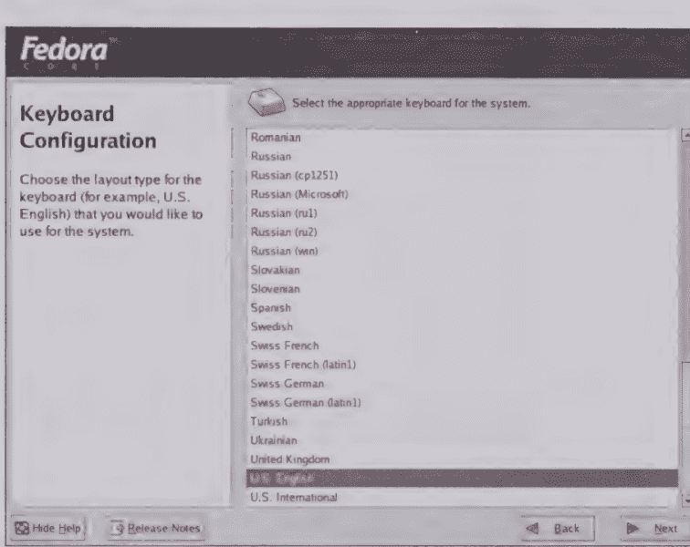

图 2-3：验证键盘配置

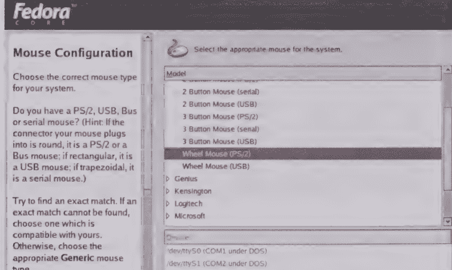

图 2-4：验证鼠标配置

## 安装 Linux 系统

如果硬盘上已存在 `Linux` 系统，你将看到“升级检查（`Upgrade Examine`）”屏幕。此屏幕允许你选择是升级之前的安装还是进行全新的安装。通常情况下，只有当你想要从之前的 `Linux` 版本进行迁移且不重新配置系统时，才会执行升级。

如果这台电脑上没有安装之前的 `Linux` 系统，你将不会看到此屏幕。安装程序将进入下一个屏幕，在该屏幕你会看到四个选项，如图 2-5 所示。

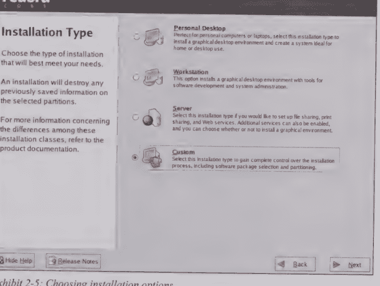

图 2-5：选择安装选项

前三个选项通过提供这些标准安装简化了要安装程序的选择：

- **个人桌面 (Personal Desktop)**：一组适用于桌面和家庭用户的软件包包。
- **工作站 (Workstation)**：将包含用于 `GUI` 环境和软件系统管理的开发工具。
- **服务器安装 (Server installation)**：包含几个工作站包、几个服务器环境，并允许你选择是否安装 `GUI` 环境。

虽然这些选项可以简化包的选择，但如果你选择 `自定义（Custom）`，你可以手动仅选择你需要的包。

在计划选择包时，考虑硬盘上的可用空间非常重要。典型的桌面、工作站或服务器安装在磁盘上需要 1 到 3 `GB` 的空间。全量安装将占用近 7 `GB`。

### CompTIA Linux+ 认证，2004 目标

如果你正在安装大量的包，请确保留有足够的空间用于日志文件、程序工作空间以及用户存储数据空间。通常，安装后你至少应该留出软件包所需空间的一倍半空闲——更多取决于机器的使用方式。

动手吧！

#### A-1：开始安装

| 如何操作 | 为什么这么做 |
|---|---|
| 1 开启电脑并将第一张 `Fedora Core 2` `CD-ROM` 放入光驱器槽 | （在第一个屏幕上。）开始安装。 |
| 2 按下 `ENTER` | 此测试将验证 `CD-ROM` 上数据的准确性。我们假设磁盘是好的。 |
| 观察下一个屏幕 | |
| 3 按 `TAB` 然后按 `ENTER` | 选择“跳过并开始（`Skip and start`）”，安装程序。在下一个屏幕你可以使用鼠标。 |
| 4 点击 **下一步 (Next)** | 在欢迎屏幕上。 |
| 5 验证语言选择下选择了英语 | 在语言选择屏幕上。这是安装时使用的语言。它可能与完成后系统使用的语言不同。 |
| 点击 **下一步 (Next)** | |
| 6 验证你的键盘布局是否正确 | 在键盘配置屏幕上。 |
| 点击 **下一步 (Next)** | |
| 7 验证你的鼠标模型是否正确 | 在鼠标配置屏幕上。 |
| 点击 **下一步 (Next)** | 如必要。 |
| 8 选择 **安装 Fedora Core (Install Fedora Core)** | 如果出现了升级检查屏幕。如果没有出现，请继续下一步。 |
| 点击 **下一步 (Next)** | 如必要。 |
| 9 选择 **自定义 (Custom)** | 在安装类型屏幕上。这允许你手动选择将要安装的程序。 |
| 点击 **下一步 (Next)** | |

### 硬盘分区

在选择安装选项后会显示下一个屏幕，允许你选择分区策略，如图 2-6 所示。分区将硬盘划分为相邻的区域，每个区域都可以包含一个用于存储数据的独立文件系统。

### 分区方案

当数据存储在磁盘上时，它会被物理地写入到你在分区中创建的文件系统中。`Fedora Core` 安装程序可以根据常用配置自动创建分区，你也可以选择手动创建分区以适应你系统的需求。

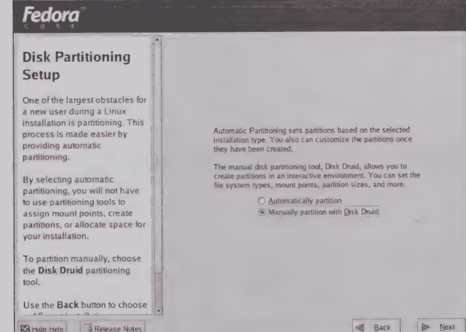

图 2-6：选择分区策略

`Linux` 至少需要两个分区：

- 一个挂载到系统根目录 (`/`) 的分区。该分区将包含操作系统、应用程序和用户使用的所有目录和文件。
- 一个用于虚拟内存的交换（`Swap`）分区，这是一种扩展系统可用内存量的方法。

#### 常见数据分区

虽然你可以使用根分区和交换分区，但为操作系统、程序和用户数据创建单独的分区使系统更容易管理，并且不易受到文件系统错误的影响。例如，如果一个分区上的文件系统遇到错误，只会影响系统部分的数据，而不会影响整个系统。

下表显示了经常挂载到单独分区的目录及其建议大小。

| 目录 | 描述 | 建议大小 |
|---|---|---|
| `/boot` | 包含内核和启动文件 | 100 `MB` |
| `/home` | 用户目录的默认位置 | 200 `MB` |
| `/usr` | 系统命令和工具 | 视用户而定 |
| `/usr/local` | 大多数程序的位置 | 视用户而定 |
| `/opt` | 附加程序的所在地 | 视用户而定 |
| `/var` | 包含日志文件和池 | 视用户而定 |
| `/tmp` | 程序创建的临时文件 | 500 `MB` |

每个文件系统可以是不同的类型。今天最常见的文件系统是：

- `ext2`
- `ext3`
- `vfat`
- `xfs`
- `reiserFS`

`ext3` 和 `reiserFS` 比 `ext2` 和 `vfat` 健壮得多，因为它们执行日志（journaling）功能。日志文件系统会对数据更改进行记录。如果在过程完成之前掉电或发生错误，日志将提供信息，以便正确重建数据和文件系统。这些文件系统相比 `ext2` 和 `vfat` 有各种改进，这些旧的文件系统正在逐渐被取代。

### 交换分区

虚拟内存由补充物理内存（`RAM`）的磁盘分区组成。当你运行更多任务时，内存满了，可以将部分数据移动到交换分区。这扩展了内存并允许更有效地使用内存。在 `RAM` 和磁盘之间移动数据的过程被称为交换（swapping）。

## 安装 Linux 系统

虚拟内存比 `RAM` 慢得多，因为数据必须从磁盘找到并传输到 `RAM`。操作系统的任务之一是高效管理内存，将当前活跃的数据留在 `RAM` 中并将不活跃的数据发送到磁盘。整个系统的速度和稳定性取决于这一效率。

交换分区的大小决定了可用虚拟内存量。通常，它应该至少等于物理内存的大小，但如果你的系统运行大型应用程序，它可以更大。一个好的经验法是让交换分区的大小成为内存的两倍。

### 创建分区

一旦你确定了系统所需的分区数量和类型，请使用 `Druid` 创建它们。

注意：在旧的文本系统中常用的分区工具是 `fdisk`。它是一个非常灵活的实用，但与 `GUI` 工具相比相当复杂。`Fedora Core 2` 的安装程序不包含 `fdisk`（它在完成后的系统中存在），但其他发行版可能。

使用 `Disk Druid`，你可以删除现有分区并创建新分区。使用 `Disk Druid` 在主硬盘主磁盘 (`/dev/hda`) 上创建根分区 (`/`) 和交换分区的示例如图 2-7 所示。

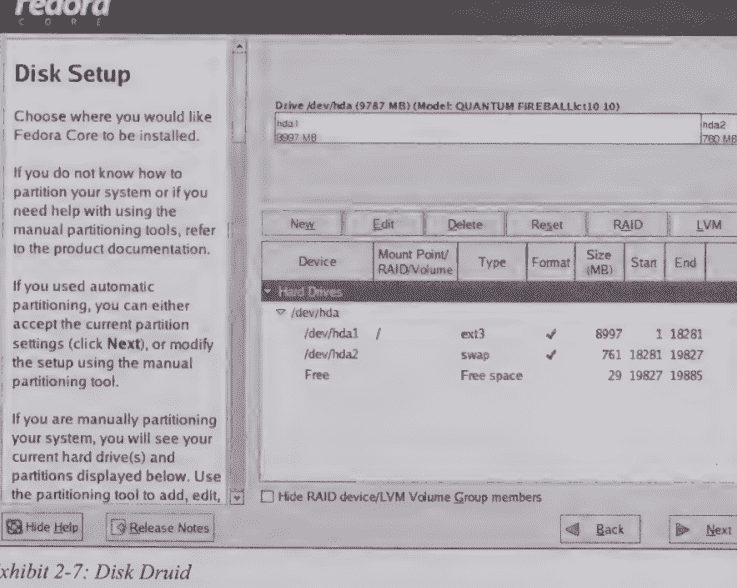

图 2-7：Disk Druid

图 2-8 显示了创建新分区所需的信息。

## 2-12 CompTIA Linux+ 认证，2004 目标

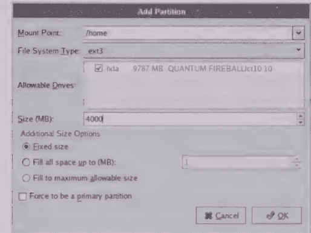

图表 2-8：添加分区

使用 `Disk Druid` 创建分区后，必须使用文件系统对其进行格式化。


**注意：** 请根据硬盘的大小和系统内存的大小创建分区。使用创建交换空间（`swap` space）大小为内存两倍的规则。例如，如果你有 128 MB 的内存，请创建一个 256-MB 的交换分区。

在使用 `Disk Druid` 时，可能需要微调数字以适应不同的磁盘架构。

## LVM

逻辑卷管理 (`LVM`) 允许你在无需重启系统的情况下更改卷的大小。逻辑卷由物理卷（`PV`）组成，物理卷又由物理区（`PE`) 组成，而物理区又由逻辑区（`LE`) 组成。然后将 `PV` 添加到卷组（`VG`）中。将 `LE` 组成逻辑卷（`LV`）。

动手吧！

## A-2：创建硬盘分区

| 如下操作 | 理由如下 |
|---|---|
| 1 在“磁盘分区设置”下，选择**使用 `Disk Druid` 手动分区** | 为了使用 `Disk Druid` 程序创建分区。 |
| **点击下一步** | |
| 2 在“分区”下，选择硬盘上的一个现有分区 | 如果有的话。如果没有，继续到第三步。 |
| **点击删除** | 为了删除该分区。 |
| **点击删除** | （在“确认删除”框中。）进行确认。 |
| 3 重复上述操作以删除任何现有分区 | |
| 4 选择 `/dev/hda` 下的“空闲空间”条目。 | |
| 点击 **新建** 在硬盘上创建一个新分区。 | |
| 5 在“挂载点：”菜单中选择 `/boot` 以指定分区的挂载点。 | |
| 从“文件系统类型：”菜单中选择 **`ext3`**。（这应该是默认选择。） | |
| 在 `/大小(MB):` 框中输入 **100**。（这应该是默认值。） | |
| 点击 **确定** 创建分区。 | |
| 6 选择空闲空间 | |
| 在“文件系统类型：”菜单中点击 **新建**。 | |
| 7 在“大小”框中选择 **`swap`**。（参见上文注释。） | |
| 输入交换分区大小，点击 **确定** 创建交换分区。 | |
| 8 注意剩余空闲空间的大小（将其记录下来）。 | |
| 从空闲空间总量中减去 300 MB。这将是下一个分区的大小。注意，为了完整安装 `Fedora Core 2`，分区必须至少 7200 MB。 | |
| 9 选择剩余的空闲空间 | |
| 点击 **新建** | |
| 10 在“挂载点”菜单中选择 `/`。 | |
| 在 **大小 (MB)** 框中输入步骤 7 中确定的数量，在磁盘上留下约 300 MB 的空闲空间。 | |
| 点击 **确定** 创建根分区。 | |
| 点击 **下一步** | |
| 11 观察屏幕。列出了每个分区的设备名称、类型和大小。分区顺序可能会发生变化。没关系。 | |

## 2-14 CompTIA Linux+ 认证，2004 目标

## 引导加载程序、网络和防火墙配置

解释

引导加载程序是由计算机 `BIOS` 启动的程序，将 `Linux` 内核（操作系统的核心）加载到内存中。内核随后启动操作系统其余启动过程。如果 `Linux` 不是机器上唯一的系统，引导加载程序还可以启动其他操作系统，例如 `Windows`。

### 配置引导加载程序

一旦指定了分区和文件系统，将提示你配置引导加载程序，如图表 2-9 所示。你有两个选择：

- 使用 `GRUB` 作为引导加载程序。
- 不安装引导加载程序。

`GRUB` 代表全局引导加载程序（Grand Unified Bootloader）。它是比传统的工具 `LILO` 或 `Linux Loader` 更先进、更灵活的引导加载程序。许多发行版支持 `LILO`，但 `Fedora Core 2` 不支持。

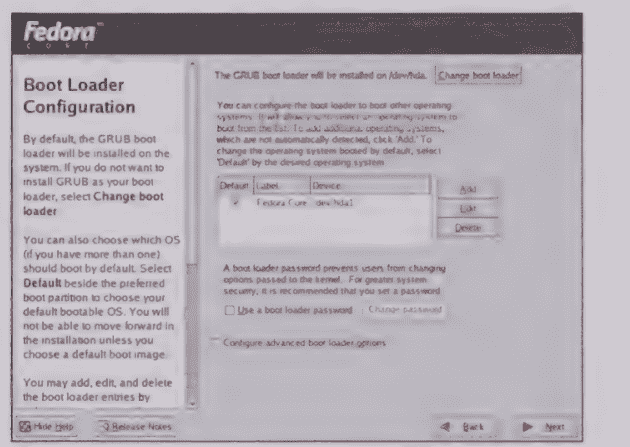

图表 2-9：配置引导加载程序

引导加载程序最常见的存放地是主引导记录（`MBR`）。这是默认方法。如果你想使用来自另一个操作系统的引导加载程序，也可以将其放在 `/` 或 `boot` 分区的第一个硬盘扇区上。

### 配置网络和防火墙

如果安装检测到网卡（`NIC`），你将看到图表 2-10 所示的网络配置屏幕。在这里，你可以选择系统在启动时是否激活网卡。你还可以输入网络地址或选择 `DHCP` 自动配置。

### Fedora 安装 Linux 系统

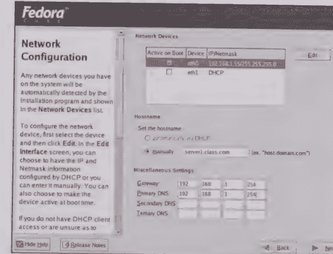

图表 2-10：配置网络

配置好网卡后，将提示选择防火墙配置，如图表 2-11 所示。


图表 2-11：配置防火墙

防火墙配置屏幕提供了选择防火墙配置的便捷方法。防火墙配置列出了常用的服务，你可以根据需要开放端口。这些选项既安全又灵活。

## 2-16 CompTIA Linux+ 认证，2004 目标

动手吧！

### A-3：配置引导加载程序、网络和防火墙

| 如下操作 | 理由如下 |
|---|---|
| 1 在“引导加载程序”屏幕顶部点击“配置引导加载程序”。 | |
| 注意其他选项。 | |
| 点击 **取消** | |
| 2 选择“高级引导加载程序选项”。 | |
| 确认 `/dev/hda` 引导记录 (`MBR`) 已选中。 | |
| 点击 **下一步** | |
| 3 在“设备”下勾选 `eth0` 启动。 | |
| 注意其他选项。如果禁用了 `DHCP`，在下一步中你可以输入网关地址。 | |
| 点击 **编辑** 查看编辑框。 | |
| 如果使用 `DHCP`，可以输入 `IP` 地址和子掩码。 | |
| 点击 **取消** | |
| 4 点击 **下一步** | |
| 5 在“防火墙”屏幕上选择“不使用防火墙”。在实际场景中建议使用一个。 | |
| 点击 **继续** | |
| 6 点击 **下一步** | |

### 系统语言和时区

在安装早期，系统提示你选择一种语言。但你还需要选择 `Linux` 支持的额外语言。

### 时区选择

你必须选择你所在的合适时区。你可以通过两种方式实现：

- 点击地图上带有黄色点的城市。
- 滚动列表并选择你的时区。

这些选项显示在图表 2-12。

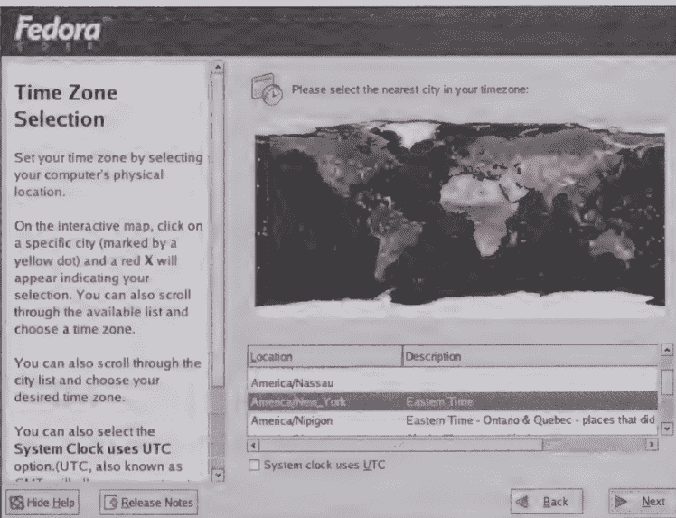

图表 2-12：选择时区

### A-4：选择系统语言和时区

| 如下操作 | 理由如下 |
|---|---|
| 1 验证选择了英语（美国）。系统的默认语言。 | |
| 点击 **下一步** | |
| 2 在“时区选择”屏幕上选择你的时区。（默认是东部时间。） | |
| 点击 **下一步** | |

### 设置 root 密码并配置身份验证

所有 `Linux` 系统都需要安全访问，这意味着你必须使用有效的用户名和密码登录以访问界面。这被称为身份验证。

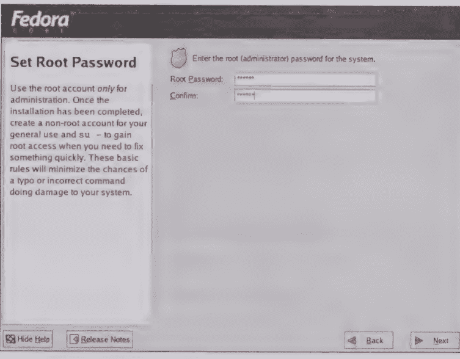

图表 2-13：配置 `root` 密码

### A-5：设置 root 密码

| 如下操作 | 理由如下 |
|---|---|
| 1 在“Root 密码”和“确认密码”框中输入密码。“设置 Root 密码”屏幕上。 | |
| 点击 **下一步** | |

### 包选择

`Fedora Core 2` 安装程序根据之前选择的安装选项提供了包列表。你可以选择需要的通用包，如图表 2-14 所示。

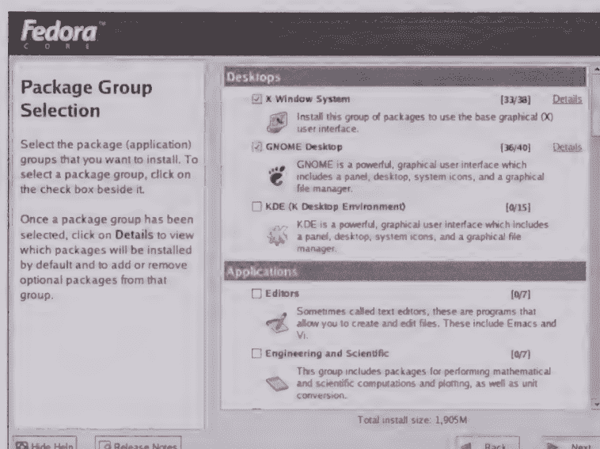

图表 2-14：选择要安装的包

一旦开始安装，包将被复制到硬盘上，如图表 2-15 所示。

### Fedora 软件包

#### 安装

我们已经收集了在系统中安装 `Fedora Core` 所需的所有信息。根据需要安装的软件包数量，安装所有内容可能需要一些时间。

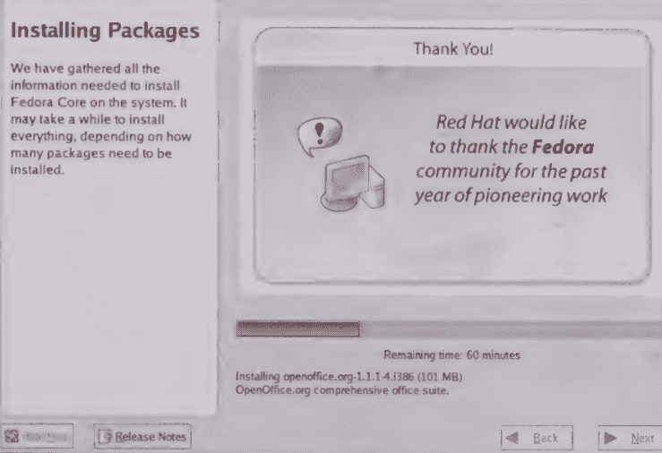

图 2-15：将软件包拷贝到硬盘

软件包安装完成后，`Red Hat` 安装程序将显示祝贺屏幕，从 `CD-ROM` 驱动器中弹出 `CD-ROM`，并提示您重启系统。

## 2-22 CompTIA Linux+ 认证，2004 目标

动手吧！

#### A-6: 选择和安装软件包

| 操作方法 | 为什么要这么做 |
|---|---|
| 1 向下滚动列表 | 注意可用的不同类别和软件包组。 |
| 2 选择“全部 (Everything)” | 在列表底部。安装程序将思考一分钟，然后显示总安装大小。请注意，这不是系统的总大小，因为它只包含了在此屏幕上选择的可选软件包。 |
| 点击“下一步 (Next)” | |
| 3 注意这些信息 | 在“准备安装 (About to Install)”屏幕上。 |
| 点击“下一步 (Next)” | |
| 4 点击“继续 (Continue)” | 在“所需的安装媒体 (Required Install Media)”屏幕上。 |
| 5 根据提示插入第二块、第三和第四块 `Fedora Core 2` 磁盘 | |
| 6 点击“重启 (Reboot)” | 在“祝贺 (Congratulations)”屏幕上 |

### 完成首次启动向导

在安装后的首次启动时，会弹出一个交互式工具（称为首次启动向导），如图 2-16 所示。一旦完成了该工具的操作，在计算机启动时它将不再再次出现。

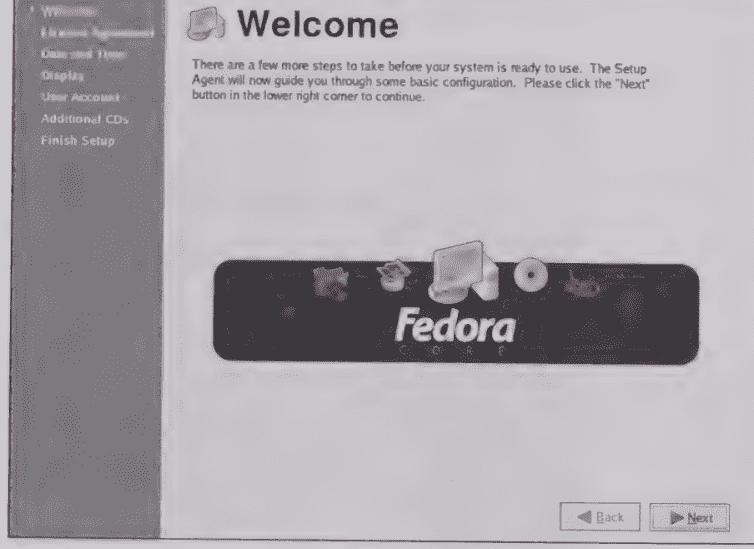

图 2-16：开始最后的安装步骤

### 设置日期和时间

点击“下一步”，您将被要求接受许可协议。按照屏幕上的指示继续。然后，系统将提示您确认日期和时间设置（如图 2-17 所示），或在必要时进行修正。或者，您也可以从时间服务器接收正确的时间。互联网上有许多服务器使用网络时间协议（`NTP`）来更新计算机系统时钟。您可以输入服务器地址或从下拉列表中选择一个。

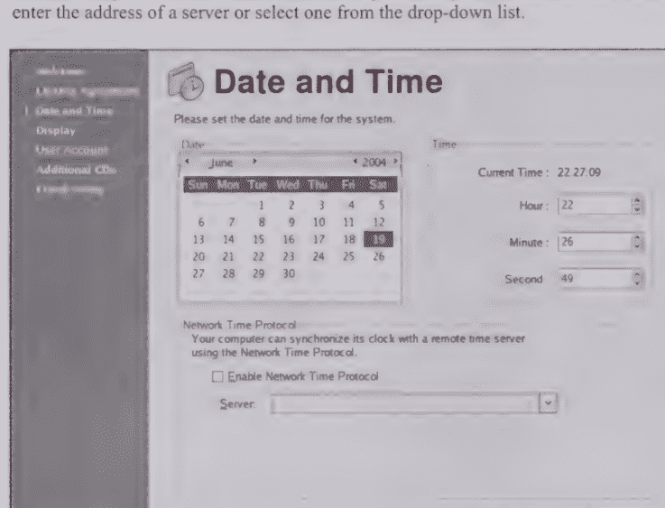

图 2-17：设置日期和时间

### 配置显示

接下来，系统将提示您选择加载 `GUI` 环境时显示的默认分辨率和色彩深度，如图 2-18 所示。此后，您将被提示创建一个普通用户账户，如图 2-19 所示。

对于日常用户任务，您应该避免以 `root` 用户的身份登录，以最大限度地减少无意中更改系统配置设置的风险。然而，在整个课程中，我们将打破这一规则，以便更方便地操作。

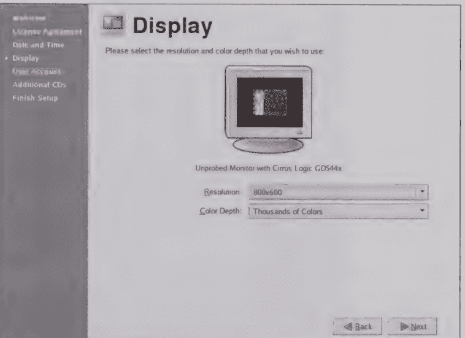

图 2-18：选择显示属性

### 创建用户账户并配置身份验证

您在之前的安装过程中已经创建了第一个用户登录账户 `root`。该账户拥有更改、添加和删除系统上所有数据的权限。接下来，您可以为自己创建一个普通用户账户，如图 2-19 所示。此账户的权限比 `root` 更受限制，与默认用户账户的权限相同。您应该始终使用此账户进行普通活动，而不是在必要时登录 `root`。

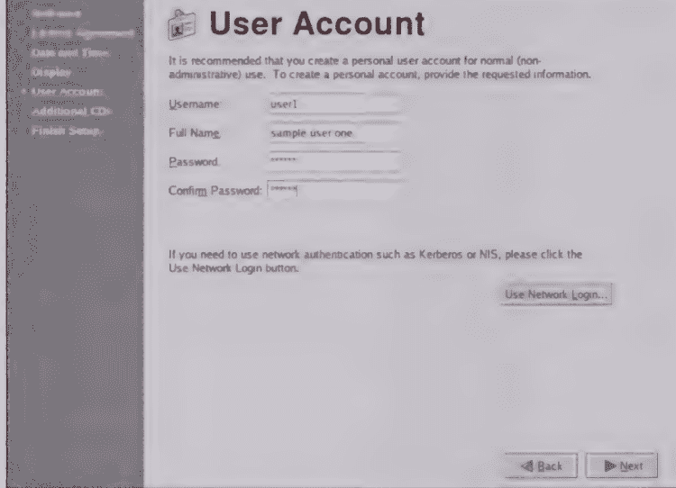

您可以配置一些选项来更改登录时身份验证的方式。点击“使用网络登录 (Use Network Login...)”按钮，并如图 2-20 和图 2-21 所示指定相应的参数。

默认情况下，`Linux` 用户通过本地计算机上的密码数据库进行身份验证。该密码数据库默认也使用 `MD5` 影子密码（`shadow passwords`）。影子密码存储在与用户账户信息不同的数据库中，以提供更好的安全性。`MD5`（消息摘要 5）密码支持长 256 个字符的长度，并使用 `MD5` 哈希算法进行加密以增加安全性。

您还可以根据另一个服务器上的数据库对某些或所有用户进行身份验证。`NIS`（网络信息服务）在 `Linux` 系统之间共享密码数据库，`LDAP`（轻级目录访问协议）、`Kerberos`、`SMB`（服务器消息块）和 `Winbind` 是可能是其他服务器（如 `Windows` 系统）上的身份验证和用户信息服务。此外，您可以使用 `Hesiod` 协议在网络中的 `DNS` 服务器上存储用户信息。然而，`Hesiod` 和网络身份验证的详细配置超出了本书的范围。

### 安装 Linux 系统 2-27

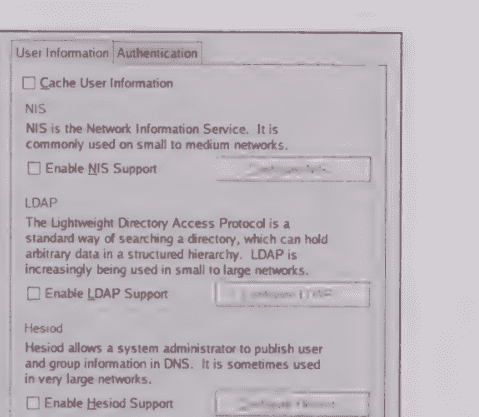

图 2-20：配置用户信息

### 这里的 Linux 系统

默认情况下，`Linux` 用户通过本地计算机上的密码数据库进行身份验证。该密码数据库默认也使用 `MD5` 影子密码（`shadow passwords`）。影子密码存储在与用户账户信息不同的数据库中，以提供更好的安全性。`MD5`（消息摘要 5）密码支持长 256 个字符的长度，并使用 `MD5` 哈希算法进行加密以增加安全性。

您还可以根据另一个服务器上的数据库对某些或所有用户进行身份验证。`NIS`（网络信息服务）在 `Linux` 系统之间共享密码数据库，`LDAP`（轻级目录访问协议）、`Kerberos`、`SMB`（服务器消息块）和 `Winbind` 是可能是其他服务器（如 `Windows` 系统）上的身份验证和用户信息服务。此外，您可以使用 `Hesiod` 协议在网络中的 `DNS` 服务器上存储用户信息。然而，`Hesiod` 和网络身份验证的详细配置超出了本书的范围。

### 额外的软件包

在安装后的首次启动时，会弹出一个交互式工具（称为首次启动向导），如图 2-16 所示。一旦完成了该工具的操作，在计算机启动时它将不再再次出现。


图 2-16：开始最后的安装步骤

### 这里的 Linux 系统

根据  的，，，可能的软件包的软件包。

## 2-22 CompTIA Linux+ 认证，2004 目标

动手吧！

#### A-6: 选择和安装软件包

| 操作方法 | 为什么要这么做 |
|---|---|
| 1 向下滚动列表 | 注意可用的不同类别和软件包组。 |
| 2 选择“全部 (Everything)” | 在列表底部。安装程序将思考一分钟，然后显示总安装大小。请注意，这不是系统的总大小，因为它只包含了在此屏幕上选择的可选软件包。 |
| 点击“下一步 (Next)” | |
| 3 注意这些信息 | 在“准备安装 (About to Install)”屏幕上。 |
| 点击“下一步 (Next)” | |
| 4 点击“继续 (Continue)” | 在“所需的安装媒体 (Required Install Media)”屏幕上。 |
| 5 根据提示插入第二块、第三和第四块 `Fedora Core 2` 磁盘 | |
| 6 点击“重启 (Reboot)” | 在“祝贺 (Congratulations)”屏幕上 |

### 完成首次启动向导

在安装后的首次启动时，会弹出一个交互式工具（称为首次启动向导），如图 2-16 所示。一旦完成了该工具的操作，在计算机启动时它将不再再次出现。


图 2-16：开始最后的安装步骤

### 设置日期和时间

点击“下一步”，您将被要求接受许可协议。按照屏幕上的指示继续。然后，系统将提示您确认日期和时间设置（如图 2-17 所示），或在必要时进行修正。或者，您也可以从时间服务器接收正确的时间。互联网上有许多服务器使用网络时间协议（`NTP`）来更新计算机系统时钟。您可以输入服务器地址或从下拉列表中选择一个。


图 2-17：设置日期和时间

### 配置显示

接下来，系统将提示您选择加载 `GUI` 环境时显示的默认分辨率和色彩深度，如图 2-18 所示。此后，您将被提示创建一个普通用户账户，如图 2-19 所示。

对于日常用户任务，您应该避免以 `root` 用户的身份登录，以最大限度地减少无意中更改系统配置设置的风险。然而，在整个课程中，我们将打破这一规则，以便更方便地操作。


图 2-18：选择显示属性

### 创建用户账户并配置身份验证

您在之前的安装过程中已经创建了第一个用户登录账户 `root`。该账户拥有更改、添加和删除系统上所有数据的权限。接下来，您可以为自己创建一个普通用户账户，如图 2-19 所示。此账户的权限比 `root` 更受限制，与默认用户账户的权限相同。您应该始终使用此账户进行普通活动，而不是在必要时登录 `root`。


您可以配置一些选项来更改登录时身份验证的方式。点击“使用网络登录 (Use Network Login...)”按钮，并如图 2-20 和图 2-21 所示指定相应的参数。

默认情况下，`Linux` 用户通过本地计算机上的密码数据库进行身份验证。该密码数据库默认也使用 `MD5` 影子密码（`shadow passwords`）。影子密码存储在与用户账户信息不同的数据库中，以提供更好的安全性。`MD5`（消息摘要 5）密码支持长 256 个字符的长度，并使用 `MD5` 哈希算法进行加密以增加安全性。

您还可以根据另一个服务器上的数据库对某些或所有用户进行身份验证。`NIS`（网络信息服务）在 `Linux` 系统之间共享密码数据库，`LDAP`（轻级目录访问协议）、`Kerberos`、`SMB`（服务器消息块）和 `Winbind` 是可能是其他服务器（如 `Windows` 系统）上的身份验证和用户信息服务。此外，您可以使用 `Hesiod` 协议在网络中的 `DNS` 服务器上存储用户信息。然而，`Hesiod` 和网络身份验证的详细配置超出了本书的范围。

### 安装 Linux 系统 2-27


图 2-20：配置用户信息


图 2-21：配置身份验证

## 这里的 Linux 软件包

在安装后的首次启动时，会弹出一个交互式工具（称为首次启动向导），如图 2-16 所示。一旦完成了该工具的操作，在计算机启动时它将不再再次出现。


图 2-16：开始最后的安装步骤

### 这里的 Linux 系统

根据 2的，可能的软件包的软件包的软件包的。

## 2-22 CompTIA Linux+ 认证，2004 目标

动手吧！

#### A-6: 选择和安装软件包

| 操作方法 | 为什么要这么做 |
|--- |--- |
| 1 向下滚动列表 | 注意可用的不同类别和软件包组。 |
| 2 选择“全部 (Everything)” | 在列表底部。安装程序将思考一分钟，然后显示总安装大小。请注意，这不是系统的总大小，因为它只包含了在此屏幕上选择的可选软件包。 |
| 点击“下一步 (Next)” | |
| 3 注意这些信息 | 在“准备安装 (About to Install)”屏幕上。 |
| 点击“下一步 (Next)” | |
| 4 点击“继续 (Continue)” | 在“所需的安装媒体 (Required Install Media)”屏幕上。 |
| 5 根据提示插入第二块、第三和第四块 Fedora Core 2 磁盘 | |
| 6 点击“重启 (Reboot)” | 在“祝贺 (Congratulations)”屏幕上 |

### 完成首次启动向导

在安装后的首次启动时，会弹出一个交互式工具（称为首次启动向导），如图 2-16 所示。一旦完成了该工具的操作，在计算机启动时它将不再再次出现。


图 2-16：开始最后的安装步骤

### 设置日期和时间

点击“下一步”，您将被要求接受许可协议。按照屏幕上的指示继续。然后，系统将提示您确认日期和时间设置（如图 2-17 所示），或在必要时进行修正。或者，您也可以从时间服务器接收正确的时间。互联网上有许多服务器使用网络时间协议（NTP）来更新计算机系统时钟。您可以输入服务器地址或从下拉列表中选择一个。


图 2-17：设置日期和时间

### 配置显示

接下来，系统将提示您选择加载 GUI 环境时显示的默认分辨率和色彩深度，如图 2-18 所示。此后，你将被提示创建一个普通用户账户，如图 2-19 所示。

对于日常用户任务，您应该避免以 `root` 用户的身份登录，以最大限度地减少无意中更改系统配置设置的风险。然而，在整个课程中，我们将打破这一规则，以便更方便地操作。


图 2-18：选择显示属性

### 创建用户账户并配置身份验证

您在之前的安装过程中已经创建了第一个用户登录账户 `root`。该账户拥有更改、添加和删除系统上所有数据的权限。接下来，您可以为自己创建一个普通用户账户，如图 2-19 所示。此账户的权限比 `root` 更受限制，与默认用户账户的权限相同。您应该始终使用此账户进行普通活动，而不是在必要时登录 `root`。


您可以配置一些选项来更改登录时身份验证的方式。点击“使用网络登录 (Use Network Login...)”按钮，并如图 2-20 和图 2-21 所示指定相应的参数。

默认情况下，Linux 用户通过本地计算机上的密码数据库进行身份验证。该密码数据库默认也使用 MD5 影子密码（shadow passwords）。影子密码存储在与用户账户信息不同的数据库中，以提供更好的安全性。MD5（消息摘要 5）密码支持长 256 个字符的长度，并使用 MD5 哈希算法进行加密以增加安全性。

您还可以根据另一个服务器上的数据库对某些或所有用户进行身份验证。NIS（网络信息服务）在 Linux 系统之间共享密码数据库，LDAP（轻级目录访问协议）、Kerberos、SMB（服务器消息块）和 Winbind 是可能是其他服务器（如 Windows 系统）上的身份验证和用户信息服务。此外，您可以使用 Hesiod 协议在网络中的 DNS 服务器上存储用户信息。然而，Hesiod 和网络身份验证的详细配置超出了本书的范围。

### 安装 Linux 系统 2-27


图 2-20：配置用户信息


图 2-21：配置身份验证

# 中央处理单元

中央处理单元（CPU）是计算机的核心设备，类似于人类的大脑。CPU 根据软件指令执行以下操作：

- 操纵数据
- 执行算术计算
- 指导其他硬件设备的功能

不同类型的处理器其内部电子元件的排列方式不同。这被称为处理器架构，它与支持其运行的所有微型设备共同构成了一个围绕该特定处理器需求构建的系统。该系统通常被称为平台。Linux 适用于许多不同的平台，包括 SPARC（可扩展处理器架构）、Alpha 和 Intel。

处理器通常一次处理 32 位或 64 位的信息。大多数处理器（例如 Pentium 处理器）是 32 位 CPU。它们比 64 位的对应产品（如 Itanium、SPARC 和 Alpha 处理器）要便宜得多。

## 缓存内存

计算机缓存的大小和位置也会影响处理器计算数据的速度快慢。缓存是用于存储临时数据的内存。处理器使用缓存来存储指令集或执行重复操作时需要的信息。缓存中存储的信息越多、访问速度越快，处理器处理的速度就越快。

存储在处理器本身的缓存被称为一级缓存（L1 缓存）。因为它非常接近 CPU，所以缓存中的信息可以被快速访问。并非所有处理器都拥有一级缓存，某些处理器的缓存容量有限。

处理器可以使用二级缓存（L2 缓存）来替代或辅助于一级缓存。L2 是一个独立的内存芯片，通过高速链路连接到处理器。虽然性能不如一级缓存，但二级缓存是一种价格廉廉得多的替代方案，而且也更常见。

## 多处理器处理

如果您希望获得比单个处理器提供的更多的处理能力，可能会选择一个支持多个处理器的平台。多个处理器可以协同工作，分担负载并更快地完成相同的任务。为了使这种架构运行，必须在安装过程中为操作系统内置多处理器支持。

使用多个处理器的最常见方法称为对称多处理（SMP）。在 SMP 中，操作系统和内存对于任何任务都会同时使用两个处理器。

另一种配置称为非对称多处理（ASMP），它为每个处理器分配一组任务，与其他处理器独立完成这些任务。

## B-1：讨论中央处理单元

练习题

- 1 任何计算机的核心组件是 `______________________`
  - A 磁盘驱动器
  - B 主板
  - C CPU
  - D 物理内存
- 2 CPU 内部组件的排列被称为处理器的 `______________________`
  - A 结构
  - B 架构
  - C 设计
  - D 布局
- 3 最有效的处理器缓存被称为 L1 缓存。

### 物理内存

物理内存是直接连接到处理器的信息存储区域。内存构建在固态芯片上，通过插座连接到电路板，或直接焊接在处理器上。物理内存存储系统使用的数据，而不是您可能安装或使用的程序和数据。物理内存分为两大类：

- 随机访问存储器
- 只读存储

随机访问存储器需要持续供电以维持存储的信息，这被称为易失性内存。ROM 能够在系统没有电源时存储信息，被称为非易失性内存。

### 随机访问存储器

随机访问存储器（RAM）是处理器运行程序和操纵数据时使用的信息内存。当您启动程序时，它会被加载到 RAM 中并准备使用。

计算机性能与 RAM 的容量直接相关，因为 RAM 越大意味着程序可以同时运行。不同的程序需要不同数量的内存才能正常运行，有些需要的比其他多得多。这对于操作系统程序和应用程序都是如此。例如，运行 GNOME 图形环境的 Linux 机器需要更多内存。

RAM 分为两大类：

- 动态内存
- 静态内存

### 动态内存

动态内存（DRAM）是两者中较便宜的，因此也最常见。与 SRAM 相比，它的访问速度较慢，存储的信息必须不断刷新，这需要持续、不中断的电流。

DRAM 由排列在称为内存条的小板上的芯片阵列组成。内存条通过插槽连接到计算机的主板。DRAM 内存条上芯片的数量决定了可以存储的信息量，以兆字节（MB）为单位。

内存 RAM 内存条有两种：

- 单列内存模块（SIMM），一种旧的 DRAM 类型，内存条的一侧有连接器。
- 双列内存模块（DIMM），目前广泛使用，在两个边缘都有引脚，可以在芯片之间读写更多数据。

### 静态内存

RAM 的第二种主要类型静态内存（SRAM）生产成本更高。它提供了更快的信息访问，因为内存不需要持续刷新，且芯片在没有电的情况下也可以短时间内运行。SRAM 是用于二级处理器缓存以及任何直接连接到计算机主板内存芯片的物理内存类型。

### 只读存储器

只读存储器（ROM）是在没有电源时的物理内存，ROM 通常用于存储启动计算机时初始化硬件组件的程序。这些小程序被称为固件，无法更改。

#### 动态随机存储

动态随机存储（DRAM）是两种类型中较便宜的一种，也是最常见的。与 SRAM 相比，它的访问速度较慢，而且其存储的信息必须反复刷新，因此需要持续、不间断电流流。

DRAM 由排列在称为“内存条”（`stick`）的小型板上的芯片阵列组成。内存条通过插槽连接到计算机的主板。组成一根 DRAM 内存条上芯片的晶体管数量决定了可以存储的信息量，以兆字节（`MB`）为单位。

有两种类型的 DRAM 内存条：

- 单直插内存模块（`SIMM`）：一种较旧的 DRAM 类型，在内存条的一侧有连接器。
- 双直插内存模块（`DIMM`）：如今广泛使用，在两个边缘都连接了引脚，可以向芯片输入或输出更多数据。

#### 静态随机存储

第二种 RAM——静态随机存储（`SRAM`）生产成本更高。它提供了更快的信息访问速度，因为内存不需要不断刷新，而且芯片可以在没有电的情况下运行短时间。SRAM 是用于二级处理器缓存以及任何任何其他直接连接到计算机主电路的内存芯片的物理内存类型。

#### 只读存储

只读存储（`ROM`）是非易失性物理内存。因为它在没有电时也能保留其程序，所以 ROM 通常用于存储在您启动计算机时初始化硬件组件的程序。这些程序被称为固件，负责设备设备的底层功能。最显而易见的例子是基本输入输出系统（`BIOS`），即启动计算机的程序，但许多其他组件也使用固件。

非易失性是一件好事，但 ROM 有一个显著缺点：一旦编程，就无法更改，也没有方法更新其包含的固件。因此，真正的 ROM 在 PC 中已不再常见。相反，已经开发了允许重新编程的 ROM 变体。这些包括：

- `PROM`：可以写入一次但永远无法再次写入的空白 ROM。
- 可擦除可编程只读存储（`EPROM`）：可以反复擦除和重写。内容必须单独擦除和重写；不能修改组件的各个部分。EPROM 内存的一个例子是互补金属氧化物芯片（`CMOS`），它存储了系统首次上电时 BIOS 使用的配置信息。
- 电学可擦除可编程只读存储（`EEPROM`）：既可以完全擦除和重写，也可以部分修改而保持某些部分完整。这种在没有电的情况下静态存储信息并在需要时进行修改的能力，就是 EEPROM 芯片在许多计算机外围组件中受欢迎的原因。

### B-2：理解物理内存

练习题

- RAM 和 ROM 都是随机访问存储器的形式。对或错？
- ROM 被称为易失性内存。对或错？
- 下列哪项是不正确的？
  - DRAM 的访问速度比 SRAM 快。
  - DRAM 通常被称为计算机内存。
  - DRAM 比 SRAM 便宜。
  - DRAM 比 SRAM 更常见。
- 下列哪项是不正确的？
  - DIMM 比 SIMM 老。
  - DIMM 能够存储的信息比 SIMM 多。
  - DIMM 传输信息的速度比 SIMM 快。
  - 以上都不是。
- BIOS 代表
  - 二进制操作系统
  - 基础操作系统
  - 业务操作系统
  - 基础输入输出系统
- EEPROM 代表
  - 错误扩展程序随机对象内存
  - 弹性可擦除项目只读存储器
  - 电学可擦除已删除编程只读存储器
  - 易擦除可编程只读存储器
- CMOS 是的例子
  - PROM
  - EPROM
  - EEPROM
  - 以上都不是

## 磁盘驱动器

计算机中的大部分信息存储在使用磁性或光学介质而非集成电路的设备上。这种内存是非易失性的，因此它不需要电即可保留信息。最常见的介质包括：

- 硬盘驱动器（`HDD`）
- 光驱驱动器（`CD`）
- 软磁盘驱动器（`Floppy`）
- 固态硬盘（`SSD`）

### 3 个主分区与逻辑分区

硬盘最多可以包含四个主分区。为了克服这一局限性，你可以将其中一个分区标记为扩展分区。扩展分区可以包含许多称为逻辑设备的较小分区。

给定硬盘的所有分区信息记录存储在磁盘的第一个可读扇区中，称为主引导记录 (`MBR`)。MBR 与分区是隔离开的。

正如你所看到的，Linux 将主主 IDE 硬盘命名为 `hda`。该驱动器上的第一个分区将标记为 `hda1`，第二个标记为 `hda2`，依此类推。因为可以存在四个主分区，Linux 预留了数字 1 到 4。无论哪一个主分区被标记为扩展分区，逻辑驱动器标记为 `hda5`、`hda6`、`hda7` 等。下表列出了这种分区策略的示例。

| 描述 | Linux 名称 | Windows 名称 |
|---|---|---|
| 主主硬盘 HDD 上的第一个分区 | `hda1` | `C:` |
| 主主硬盘 HDD 上的第二个分区 | `hda2` | `D:` |
| 主主硬盘 HDD 上的第三个分区 | `hda3` | `E:` |
| 主主硬盘 HDD 上的第四个分区（扩展） | `hda4` | |
| 主主硬盘 HDD 扩展分区上的第一个逻辑驱动 | `hda5` | `F:` |
| 主主硬盘 HDD 扩展分区上的第二个逻辑驱动 | `hda6` | `G:` |
| 主主硬盘 HDD 扩展分区上的第三个逻辑驱动 | `hda7` | `H:` |

> 注意：在 Windows 操作系统中，每个驱动器号（`C:`, `D:`, `E:`）对应于存储在硬盘一个或多个分区上的独立文件系统。

### 文件系统

分区内部必须有一个逻辑结构才能存储数据。这种结构被称为文件系统，是通过格式化过程创建的。

文件系统指定了数据如何存储在磁盘上。每个主分区和逻辑驱动器都有独立的文件系统。根据系统要求，这些文件系统可以是相同类型，也可以不同类型。

不同的操作系统使用不同的文件系统。其中一些可以共享，但大多数只有为其设计的特定操作系统才能识别。

### 其他磁性存储设备

除了硬盘外，还有两种常用的磁性设备：

- 软盘
- `Zip` 磁盘


这些通常被称为可移动介质，因为它们的设计是为了让你轻松地将磁盘从一台机器取出并放入另一台。

## 2-38 CompTIA Linux+ 认证，2004 目标

软盘是最常见的可移动介质。它们被称为软盘（`floppy`），是因为与硬盘使用的硬性盘片相比，介质是柔性的。软驱存储的数据远少于硬盘，只有 `1.44 MB`，且数据传输速率慢得多。

`Zip` 磁盘是软盘概念的几种不同演变之一。它们可以比软盘多多的信息（从 `100 MB` 到 `750 MB`），并配合特殊的 `Zip` 驱动器使用。`Zip` 驱动器作为系统磁盘时通常缓慢且不可靠，`Zip` 磁盘通常用于传输大文件或为重要信息制作备份副本。

### 光存储设备

`CD-ROM` 磁盘通过使用反射光脉冲读取数据，与其他磁盘介质不同。`CD-ROM` 相比其他可移动存储设备具有重要优势：

- 更快的数据传输速度
- 更存储容量
- 更强的抗数据丢失能力

这使其成为分发大文件、程序和操作系统的首选介质。

`CD-ROM` 已经存在一段时间了，但作为只读介质，它的实用性有限。随着刻录光盘（`CD-R`）和可重写光盘（`CD-RW`）的发展，你可以像使用任何其他介质一样使用 `CD`。

你可以获得通过 `IDE`、`SCSI` 或 `USB` 连接的 `CD-ROM` 驱动器。最常见的是 `IDE` 类型。虽然 `CD-ROM` 驱动器的传输速率比软驱或 `Zip` 驱动器快，但仍然比硬盘慢。如果 `CD-ROM` 驱动器与硬盘连接在同一个 `IDE` 通道，将降低硬盘的数据速率。因此，将 `CD-ROM` 驱动器连接在独立的 `IDE` 通道上是明智的。

### B-3 使用磁盘驱动器

**练习**

- 1 `HDD` 上可以有 \__________ 主分区。
  - A 两个
  - B 三
  - C 一个
  - D 四

- 2 磁盘驱动器传输数据的速度比 `RAM` 或 `ROM` 快。对或错？

- 3 Term语 `hdc6` 指 \___________
  - A `HDD` 上的时钟频率
  - B 从 `HDD` 扩展分区上的第二个逻辑驱动
  - C 从 `HDD` 上的扩展分区
  - D 次主 `HDD` 扩展分区上的第二个逻辑驱动

- 4 `CD-ROM`、软盘和 `Zip` 磁盘被称为 \_
  - A 慢速介质
  - B 备份介质
  - C 可移动介质
  - D 耐用介质

- 5 `SCSI` 控制器也称为 `ATA` 控制器。对或错？

- 6 哪项是不正确的？
  - A 像 `IDE` 一样，`SCSI` 控制器在物理上与 `HDD` 分离。
  - B `SCSI` 控制卡可以支持两个以上的硬盘。
  - C `SCSI` 控制卡可以同时与多个 `HDD` 交互。
  - D `IDE` 硬盘和控制器的制造费用比对应的 `SCSI` 设备便宜


## 主板与外围设备

**解释**

主板是连接计算机所有组件的电路板。它充当主枢纽，允许不同部分进行通信。

### 总线

主板包含各种插槽和连接器，允许组件之间传输数据。这些被称为总线。

主板上的不同类型总线包括：

- 工业标准架构 (`ISA`)：这是一种旧总线。
- 外围组件接口 (`PCI`)：这是一种用于扩展卡的快速总线。
- 直接内存访问 (`DMA`)：允许设备直接与内存通信，绕过 `CPU`。
- 加速图形接口 (`AGP`)：专为视频卡设计的高速总线。
- `PCI Express` (`PCIe`)：这是现代高速总线，取代了 `PCI`。

图 2-22 主板 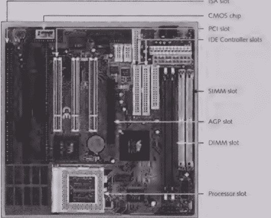

### 端口

其他外围可能连接到主板，而是使用端口。这些端口包括：

- `PS/2`
- `COM`（串口）
- `LPT`
- `USB`
- `IEEE1394`（`FireWire`）
- `PCMCIA`

### `PS/2`、`COM` 端口和 `LPT` 端口

`PS/2` 端口是用于连接键盘鼠标的小圆形连接器。串口也称为 `COM` 端口。它们是用于插入各种外围设备的 `9` 针连接器。并行端口也称为 `LPT` 端口。它们是连接打印机的 `25` 针连接器。这些端口很慢。

### `USB` 和 `FireWire`

今天购买的大多数外围设备（如彩色扫描仪和高分辨率摄像头）都需要能够高速传输大量数据的接口。满足这些带宽需求设备的是通用串总线 (`USB`)。

`USB` 是一种小型矩形或方形连接器，在最新版本 `2.0` 中数据传输速率可达 `480 Mbps`。（版本 `1.0` 速率为 `1.5 Mbps`，版本 `1.1` 为 `12 Mbps`。）你可以使用 `USB` 集线器在一个 `USB` 端口上连接 `127` 个设备。大多数计算机配备两个或四个 `USB` 端口。

`USB` 最吸引人的特性之一是热插拔。几乎所有 `USB` 设备可以在运行时连接并被操作系统识别。许多旧设备和总线需要重启才能识别设备。

另一种热插拔、高带宽端口是 `FireWire`，也称为 `IEEE1394`。它的传输速率可达 `400 Mbps`。该标准的更新已发布，将 `FireWire` 提高到 `800 Mbps`。

一些非常紧计算机和笔记本电脑放弃了传统的串口、并行和 `PS/2` 端口，几乎使用 `USB` 连接一切。大多数外围设备都有 `USB` 版本。一些新产品（如可移动内存卡和硬盘）的开发，如果没有 `USB` 和 `FireWire` 的极快速度和灵活性是无法实现的。


# `PCMIA`

个人电脑内存卡国际协会（`PCMIA`）端口是为笔记本电脑开发的。`PCMCIA` 设备是小小的卡片（通常厚度小于 `10.5 mm`），包含网络接口卡、调制解调器、`SCSI` 适配器或扩展内存等外设。`PCMCIA` 端口也称为插槽，不需要大量的电力，且支持热插拔。

## `IRQ` 和 `I/O` 地址

无论使用何种总线来连接外设，`CPU` 都必须识别每条数据和指令，以防止它们发生冲突。这种识别通过使用分配给设备的值来实现：

- 中断请求 (`IRQ`) 线
- 输入/(`I/O`) 地址

中断是设备产生的一种信号，用于通知 `CPU` 它需要处理器的关注。对于外设，这是通过 `IRQ` 通道实现的，通道编号从 `0` 到 `15`。如果你的两个设备尝试使用相同的 `IRQ`，就会发生冲突，导致两个设备都无法工作。然而，如果某些设备被配置为共享，是可以共享 `IRQ` 的。

每个设备还必须留有一小块 `RAM` 区域，`CPU` 可以在其中向设备传递信息并从设备接收信息。这部分内存被称为 `I/O` 地址，它对每个设备也必须是唯一的。`I/O` 地址以十六进制表示编写（例如 `0x300-31F`）。

在带有 `ISA` 设备的旧设备上，你通常需要手动配置 `IRQ` 和 `I/O` 地址才能让设备工作。今天购买的大多数外设都使用 `PCI` 总线并支持名为即插即用（`PnP`）的系统。`PnP` 会自动分配正确的 `IRQ`、`I/O` 地址和 `DMA` 通道。为了让 `PnP` 正常工作，`BIOS` 和操作系统必须支持它。`PnP` 支持是大多数现代计算机和如 `Linux` 等操作系统的标准配置。

## B-4: 讨论主板和外围组件

### 练习题

- 1 外围设备连接最常用的三个插槽是 ____________、和和
  - A `ISA`, `PDI`, `AGP`
  - B `PCI`, `ISA`, `AGP`
  - C `IMA`, `APG`, `PIC`
  - D `DMA`, `IRQ`, `PCI`

- 2 `ISA` 总线已被更新、更快的 ____________ 总线所取代。
  - A `AGP`
  - B `PS/2`
  - C `FireWire`
  - D `PCI`

- 3 `AGP` 总线专门用于支持视频适配器。对或错？
  - T

- 4 串口也称为 ____________ 端口。
  - A `COM`
  - B `LPT`
  - C `DMA`
  - D `I/O`

- 5 即插即用会自动配置以下设置：
  - A `IRQ`
  - B `I/O` 地址
  - C `DMA` 通道
  - D 以上所有项

- 6 可以在不重启电脑的情况下连接和从计算机上移除的设备称为 ____________。
  - 热插拔 (`HOT SWAPPABLE`)

- 7 `USB` 仅用于以高速度传输大量数据的设备。对或错？
  - F

### 视频适配器卡和显示器

#### 解释

视频适配器卡（也称为显卡）是最重要的外围组件之一，因为它们为你的显示器提供图形显示。它们通常插入 `ISA`、`PCI` 或 `AGP` 插槽，也可以是主板的一部分。最后一种类型的显卡也称为集成显卡，由于生产成本更低，因此价格更便宜。

每个显示器都由微小的点或像素组成。显示的像素越多，你在图像中看到的细节就越多。典型的现代系统至少显示水平 `800` 像素和垂直 `600` 像素。这被称为屏幕分辨率，简单地表示为 `800 x 600`。

每个像素可以代表一种颜色。你在屏幕上显示的颜色数量被称为色深。大多数系统显示的色深至少为 `1600` 万色（也称为 `24` 位色深）。

色深和分辨率取决于你的显卡拥有多少 `RAM`。大多数当前的适配器带有 `16 MB` 的 `RAM`，足以支持大多数实际的分率设置。旧显卡的 `RAM` 通常较少，因此你会遇到能够达到的分辨率和色深的限制。下表提供了与 `RAM` 数量对比的设置列表。

| 视频显存 | 分辨率 | 色深 |
| :--- | :--- | :--- |
| `1 MB` | `1024 × 768` | `256` 种颜色 (`8` 位色) |
| | `800 × 600` | `65,536` 种颜色 (`16` 位色) |
| `2 MB` | `1024 × 768` | `65,536` 种颜色 (`16` 位色) |
| | `800 × 600` | `1600` 万种颜色 (`24` 位色) |
| `4 MB` | `1024 × 768` | `1600` 万种颜色 (`24` 位色) |

#### 刷新率

你屏幕上的图像每秒刷新多次，以便立即显示变化或平滑地描述运动图像。刷新率以 `Hz`（或每秒循环）为单位测量。

你的显示器在每个方向可以使用频率范围由两个值定义：

- `Hsync`（水平刷新）
- `Vsync`（垂直刷新）

近期的显示器可以使用很宽的 `Hsync` 值，大多数适配器会自动提供正确的信号。

但是，你必须仔细地选择 `Vsync`。值过高会损坏显示器或导致屏幕变白。值过低会导致屏幕闪烁。

你的视频显卡将有一组分辨率和刷新率的组合设置。你的显示器将有一个它能够处理的最大刷新率。在特定的分辨率下，许多适配器的默认刷新率是 `60 Hz`。随着分辨率的增加，它会降低。

## 完成吧！

## B-5: 讨论视频适配器和显示器

### 练习题

- 1 用于连接外围设备的最常用总线是？
  - A `AGP`
  - B `ISA`
  - C `PCI`
  - D 以上所有

- 2 屏幕显示的颜色数量被称为 ____________。
  - A 像素
  - B `AGP`
  - C 视频显存
  - D 色深

- 3 垂直刷新率过低。对或错？

## 主题 C: 收集准备信息

本主题涵盖了以下 CompTIA Linux：

| # | 目标 |
| :--- | :--- |
| 1.1 | 识别硬件 |
| 3.1 | 配置网络 |
| 5.2 | 配置文档 |
| 5.3 | 识别软件包 |

### 硬件要求

所有操作系统都需要最基本的硬件才能运行。今天购买的大多数设备都兼容 `Linux`。下表包含了 `Fedora` 的建议：

| 组件 | 描述 |
| :--- | :--- |
| `CPU` | 最小：`Pentium` 级<br>文本模式推荐：`200 MHz` `Pentium` 类或更高<br>图形模式推荐：`400 MHz` `Pentium II` 或更高 |
| `RAM` | 最小：`64 MB`<br>图形模式最小：`192 MB`<br>图形模式推荐：`256 MB` |
| 磁盘空间 (`HDD`) | 最小：`620 MB`<br>服务器：`1.1 GB`<br>个人桌面：`3.0 GB`<br>工作站：`7.0 GB`<br>*存储文件或安装其他软件需要额外的空空间 |
| 额外驱动器 | `CD-ROM`<br>`3.5` 英寸软盘 |
| 外围设备 | 所有外设（如显卡、声卡、网卡）必须符合标准 |

### 软件要求

在计划安装系统中，你必须确定计算机的用途。根据这些信息，你可以决定需要哪些软件包，这同时也了机器的性能需求。这将决定机器在网络中扮演的角色，并有助于定义计算机的主机和互联网网络配置参数。

你有多种方法可以找到有关系统组件的详细信息。计算机随附的手册就是一种资源。大多数手册会在书末的表格或前封内表格中列出每个组件的规格。

## `Windows` 实用程序

如果你在安装 `Linux` 之前已经在计算机上安装了 `Windows`，可以使用它的实用程序来查看硬件信息。这些工具中最为全面的是图 2-23 所示的系统信息工具。

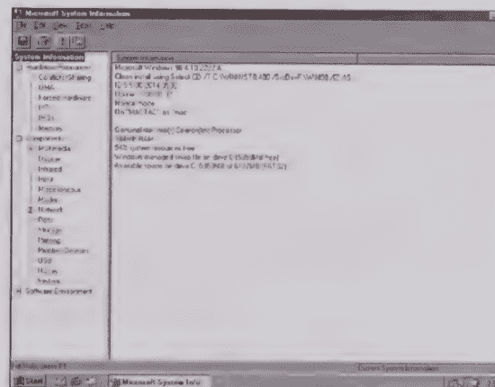

图 2-23：`Windows` 系统信息工具

`Windows` 设备管理器位于 `Windows` 控制面板的“系统”属性中，可以显示你需要的大部分信息，如图 2-24 所示。

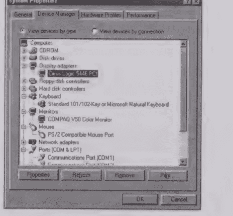

图 2-24：`Windows` 设备管理器

`Windows` 控制面板中的“显示”属性将列出你的显卡和显示器的详细信息，如图 2-25 所示。

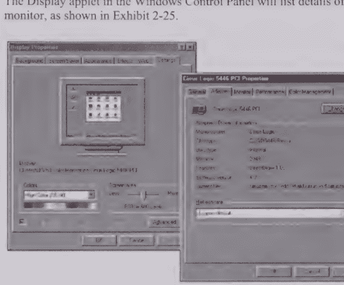

图 2-25：`Windows` 显示属性

## `BIOS` 设置

虽然手册和 `Windows` 实用程序可以告诉你计算机中有哪些组件，但系统 `BIOS` 可以提供更多关于这些组件如何连接和配置的详细信息。

每台计算机都在主板的 `CMOS` 芯片上存储配置信息。`BIOS ROM` 在计算机启动时读取这些信息以初始化所有内容。然后，`BIOS` 对系统运行一个名为开机自检（`POST`）的测试。显示器输出类似于图 2-26。`POST` 完成后，如果硬件配置检查通过，`BIOS` 将开始寻找操作系统。

```
Award Modular v4.51PG, AN Energy Star Ally
Copyright 1984-98, Award Software, Inc
ASUS P2L-B ACPI BIOS Revision 1008
Award Plug and Play BIOS Extension v1.0A
正在初始化即插用 PnP 卡
Card-01: D-Link DE-220P PNP ISA 卡
Card-01: Creative SB AWE64 PnP
PnP 完成
正在检测 HDD 主盘 ... QUANTUM FIREBALL CX6.4A
正在检测 HDD 主从盘 ... 无
正在检测 HDD 次主盘 ... ATAPI CDROM
正在检测 HDD 次从盘 ... 无
按 DEL 键设置
01/28/99-i440LX-(P2L-B7)
```

图 2-26：系统 `POST`

## 安装 `Linux` 系统

`BIOS` 使用的大多数设置都是可以配置，你可以从这些菜单中读取设置。通常可以在 `POST` 完成后通过按键盘上的某个键访问设置，如图 2-26 所示。设置程序使用类似于图 2-27 所示的屏幕。

| 非 `PCI-ISA` `BIOS` (`F1`-`F8`) | `CMOS` 设置实用程序 | `AWARD SOFTWARE INC` |
| :--- | :--- | :--- |
| 标准 `CMOS` 设置 | 管理员密码 | |
| `BIOS` 特性设置 | 用户密码 | |
| 芯片组特性设置 | `IDE HDD` 自动检测 | |
| 电源管理设置 | 保存并退出设置 | |
| `PNP` 和 `PCI` 设置 | 不保存并退出 | |
| 加载 `BIOS` 默认值 | | |
| 加载设置默认值 | | |
| `Esc` 退出 | | |
| `F10` 保存并退出设置 | | |

系统 `BIOS` 实用程序的外界面随制造商而异，但根据系统的年代，它们都包含相同类型的类型信息和配置选项。

## 收集软件信息

除了需要硬件信息外，安装程序还会询问你若干软件设置，例如时区和语言支持。这些设置不需要记录，因为它们显而易见。但在开始安装之前，你应该研究一些设置，例如网络配置和软件包选择。

注意：虽然 `Fedora Core 2` 包含了各种不同的软件包，但其中许多应用程序会定期更新以修复不同的问题或添加功能，因此可能需要在开发者的网站上检查更新的文件。

## 识别系统网络配置

如果你正在安装将连接到网络或 `Internet` 的 `Linux` 系统，你必须知道正确的配置细节。安装程序会提示你进行设置，你也可以跳过它们并在系统安装后进行配置。

网络配置的清晰度和复杂性取决于你的网络性质或系统的目的，差异很大。网络管理员或 `Internet` 服务提供商（`ISP`）通常分配地址并定义使用的其他属性。他们的设置包括：

- 主机：计算机的名称，其他计算机通过它找到自己。
- `IP` 地址：用于识别网络计算机的唯一数字。
- 子网掩码：指定 `IP` 地址的哪部分标识计算机所在的网络。
- 网关：当本地计算机无法直接通信时，向其他计算机发送数据的计算机。
- `DNS` 服务器：将主机名解析为 `IP` 地址。

在许多情况下，你不需要手动配置这些设置。

## 软件选择

机器用途决定了你需要的软件。在安装期间，程序提供四类：

- 个人
- 工作站
- 服务器

第一类“个人”用于桌面使用。第二类“工作站”适用于需要更高性能的用户，第三类“服务器”适用于为其他计算机提供机器。

你可以选择的软件包如下表所示：

| 项目 | 说明 |
| :--- | :--- |
| `Windows` | 核心组件 |
| `GNOME` | `GUI` 环境 |
| `KDE` | `GUI` 环境 |
| `Samba` (`SMB`) | 文件和打印机共享 |
| `NIS` (网络信息服务) | 集中配置 |
| `NFS` (网络文件系统) | 跨 `Linux` 共享文件 |
| `GIMP` (`GNU` 图像处理) | 图形程序 |
| `BIND`-`DNS` 服务器 | `IP` 地址映射到 `FQDN` |
| `Apache` 服务器 | `Web` 服务器 |
| `MySQL` 服务器 | 数据库管理系统 |
| `PostgreSQL` 服务器 | 数据库管理系统 |
| `TeX` | 用于出版的文本处理程序 |
| `Emacs` | 普通文本编辑器 |
| `Squid` 代理服务器 | `Internet` 连接 |
| `Mozilla` | 浏览器 |
| `FTP` 服务器 (`ftp`) | 跨 `Internet` 文件 |
| `InterNetworkNews` (`INN`) 服务器 | 托管新闻组帖子 |


## 单元总结：安装 Linux 系统

### 主题 A
在此主题中，你学习了如何使用 CD-ROM 安装 Fedora Core 2 的程序。你配置了引导加载程序、硬盘分区和网络设置。你还学习了如何选择各种软件包，并创建了用户账户。

### 主题 B
在此主题中，你学习了硬件组件。你学习了 `CPU` 的功能，以及它们有不同的类型，被称为架构。你还学习了不同类型的内存以及 `RAM` 与 `ROM` 的区别。你还了解到硬盘有两种主要类型：`SCSI` 和 `IDE`。你还了解到外围组件通过扩展槽或端口连接到主板上。

### 主题 C
在此主题中，你学习了可以从计算机说明书、系统 `BIOS` 或其他操作系统（如 `Windows`）收集硬件信息。你观察到大多数软件信息可以在安装时或指定。你还学习了如何通过考虑计算机的角色、能力和硬件兼容性来规划新系统的安装。

## 复习题

1. `CPU` 中存储的是什么种类型的缓存？

   - A. 一级 (`Level 1`)
   - B. 二级 (`Level 2`)
   - C. 三级 (`Level 3`)
   - D. 四级 (`Level 4`)

2. 哪种类型的 `ROM` 不能重写？

   - A. `EEPROM`
   - B. `DPROM`
   - C. `EPROM`
   - D. `PROM`

3. 第二个主硬盘驱动器的 `Linux` 命名是什么？

   - A. `hda`
   - B. `hdb`
   - C. `hde`
   - D. `hdd`

4. 可以使用哪些常用的 `Windows` 实用程序来确定 PC 上安装的硬件？（选择所有适用项）

   - A 微软系统信息
   - B 添加/删除程序
   - C 设备管理器
   - D 我的电脑

5. `Fedora Core 2` 安装的建议最小空闲磁盘空间是多少？

   - A 650 MB
   - B 2.5 GB
   - C 4.5 GB
   - D 10 GB

6. `Fedora Core 2` 文本模式的最低 `RAM` 要求是多少？

   - A 128 MB
   - B 64 MB
   - C 32 MB
   - D 16 MB

7. 典型的主板支持多少个 `IDE` 设备？

   - A 两个
   - B 一个
   - C 等于空闲扩展槽的数量
   - D 四个

8. 每个连接到并在 `IP` 协议 (`IP`) 网络上进行通信的计算机必须有一个唯一的 \_\_\_\_\_\_\_\_\_\_\_\_\_\_\_\_\_\_\_\_。

   - A `IP` 地址
   - B 节点名称
   - C 子网掩码
   - D 网关

9. \_\_\_\_\_\_\_\_\_\_\_\_\_\_\_\_\_\_\_\_ 直接连接到处理器。

   - A 物理内存
   - B 硬盘驱动器
   - C 随机对象内存
   - D 键盘
   - E 以上所有

10. 硬盘通常被分为 \_\_\_\_\_\_\_\_\_，其中包含 \_\_\_\_\_\_\_\_\_。

    - A 分区，文件系统
    - B 文件系统，分区
    - C 扩展，逻辑驱动器
    - D 逻辑驱动器，扩展

11. 下列软件包可用于跨 `Linux` 系统的标准化配置文件？

    - A `Samba`
    - B `Apache`
    - C `NIS`
    - D `NFS`

## 独立练习活动

在此活动中，你将测试计算机的内存。

1. 在网络浏览器中输入 `www.memtest86.com` 并按回车。按照网站上的说明下载 `Linux Memtest86` 源码和二进制包。将其保存到你的用户文件夹。

2. 双击下载的文件。`File Roller` 将显示归包内容。从列表中选择 `precomp.bin`。点击提取。

3. 在计算机中插入一张空白或已擦写的软磁盘。打开终端窗口并输入 `make install-bin`。这将构建一个可以运行 `memtest` 程序的引导性软盘。

4. 删除 `precomp.bin` 文件。

5. 在软盘插入计算机软盘驱动器的情况下，重启机器。

6. 待你的计算机从软盘开始启动后，`Memtest86` 程序将在几秒钟内加载并立即运行。

7. 观察测试结果如何告诉你你的计算机安装了多少内存。它显示在第五行。

8. 观察测试结果如何显示正在测试的内存范围。这在第四行的右侧。

9. 观察测试在第三行和第四行计算并显示你的处理器的 `L1` 和 `L2` 缓存速度。计算机主内存的速度显示在第五行。

10. 通常情况下，`Memtest86` 程序运行八次内存测试。观察当前测试次数显示在第三行。

11. 当八次测试全部完成后，表示完成了一次“通过”，测试将重复。通过的次数显示在文本的最后一行。运行整个范围的测试可能需要几小时，所以我们现在结束。

12. 在程序运行时按 `c`。观察菜单中的选项。

13. 按 `0` 退出此菜单并关闭计算机。

# 第 3 单元

### 探索接口和文件系统

单元时间：160 分钟

完成本单元后，你将学会：

- A 概述 `Linux` 接口的结构，以及内核、终端和 `shell` 的角色。
- B 输入基本命令，识别常用的编辑器。
- C 讨论目录结构并使用通配符。
- D 显示文件内容。
- E 使用正则表达式搜索文件。

### 主题 A：Linux 接口

尽管此接口非常强大，但在如今图形程序成为常态的计算环境中，它相当局限。在安装活动中，我们选择了以图形模式启动系统的选项，并使用 `Red Hat Linux` 的 `gdm` 或 `GNOME` 显示登录，如图示 3-2 所示。

也可以让系统以文本模式启动，然后在登录后启动图形用户界面 (`GUI`)。这对于设置一个不需要一直图形支持的服务器系统非常方便。

当你在计算机前访问新终端时，按下 `Ctrl-Alt-F2` 切换到不同的终端。如果你在跨网络工作，你必须先在本地机器上启动另一个终端程序。下表了本地 `Linux` 终端的列表、名称和类型。

#### 3-4 CompTIA Linux+ 认证，2004 目标

登录命令行终端后，你将收到一个提示符，你可以在其中输入命令。如果你以 `root` 用户身份登录，将显示 `#` 提示符。

`Fedora Core release 2 (Tettnang)`

`Kernel 2.6.5-1.358 on an 1686`

```
localhost login: root
Password:
Last login: Mon Mar 25 09:45:42 on tty2
[root@localhost]#
```

如果你以普通用户身份登录，将显示 `$` 提示符。

`Fedora Core release 2 (Tettnang)`

`Kernel 2.6.5-1.358 on an 1686`

```
localhost login: user]
Password:
Last login: Mon Mar 25 09:49:31 on tty2
[root@localhost user1]$_
```

当你登录图形化终端时，你选择的环境将启动。然后你可以打开一个命令行终端，它将显示在桌面的窗口中。

图 3-3 显示了 `GNOME` 环境（`Red Hat Linux` 的默认 `GUI` 环境）的一个示例。图 3-4 显示了另一种环境 `KDE` 的示例。

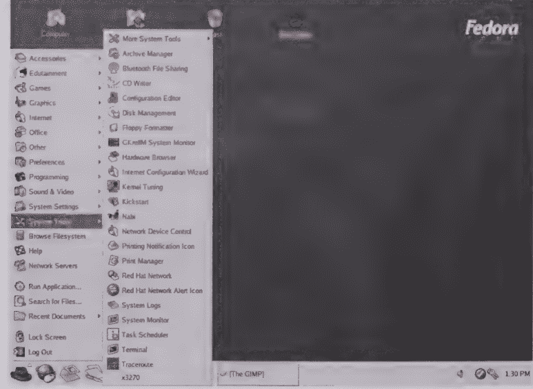

图 3-3：`GNOME` 桌面和程序菜单

### 探索接口和文件系统

#### 3-5

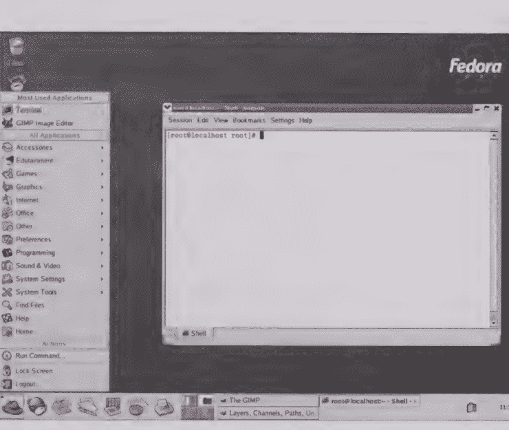

图 3-4：`KDE` 终端

动手实践！

#### A-1: 讨论终端和 shell

- 1 在 `Linux` 中，使用 \_ 来接收来自用户的输入并将输入传递给内核进行处理。

  - A 处理器
  - B 用户界面
  - C `shell`
  - D 交换内存

- 2 `shell` 运行在终端内。正确或错误？

- 3 图形界面将同时支持 `GUI` 和命令行界面。正确或错误？

### 主题 B 基础 shell 命令

此主题涵盖了以下 CompTIA Linux+ 考试目标。

| | 目标 |
|---|---|
| 2.23 | 重定向输出。 |
| | 重定向 |
| 5.6 | 访问系统文档和帮助文件。 |
| | `man` |
| | `info` |

#### 命令、选项和参数

在使用命令行终端时，`shell` 会解释你在命令行中输入的所有所有信息。这些信息包括命令本身，以及选项和参数。

命令指示你想要执行的程序名称。通常，在命令行环境中，程序名称和启动它的命令名称是相同的。要告诉命令要做什么以及怎么做，你需要使用选项和参数。

选项改变命令的工作方式，并以连字符（`-`）开头的字母输入。选项特定于你正在使用的命令。某些选项以两个连字符（`--`）开头，通常由一个完整的单词组成，而不仅仅是一个字母。

参数也出现在命令之后，但不是以连字符开头。它们指定了命令所处理的参数，通常是文件名。

命令、选项和参数是区分大小写的。例如，大写的 `A` 的处理方式与小写的 `a` 不同。命令的另一个规则是：在命令名、选项和参数之间留一个空格。否则，`shell` 将无法按预期工作。下表显示了一些常用的 `Linux` 命令。

| 命令 | 说明 |
|---|---|
| `clear` | 清除终端屏幕 |
| `reset` | 重置终端以使用默认终端设置 |
| `finger` | 显示系统用户信息 |
| `who` | 显示当前登录的用户 |
| `w` | 显示当前登录的用户及其正在执行的任务 |
| `whoami` | 显示你的登录名 |
| `id` | 显示与你的用户账户和组名相关的实际和有效用户 ID 以及组 ID |

#### 探索接口和文件系统

| 命令 | 说明 |
|---|---|
| `date` | 显示当前日期和时间 |
| `cal` | 显示当前月份的日历 |
| `exit` | 退出当前 `shell` |

如果命令的输出太大无法显示在屏幕上，你可以按 `Shift + Page Up` 查看之前的屏幕。`Shift + Page Down` 则向相反方向导航。

在 `BASH shell` 中，你可以使用键盘光标键（上、下、右、左键）回溯之前输入的命令。如果你想再次输入相同的命令，可以使用光标键在命令列表中循环，并在命令出现时按回车键。

#### shell 元字符

`shell` 的另一个重要特性是 `shell` 元字符，它们是具有特殊含义的键盘字符。最常用的元字符之一是 `$` 字符，它告诉 `shell` 后面的文本指的是一个变量。

变量是存储在内存中的一段信息。变量名通常是大写字母单词，大多数变量在登录时由系统自动设置。使用 `$` 字符引用变量的一个示例是使用 `echo` 命令，它可以将文本打印到终端屏幕。

```
[root@localhost]# echo Hi There!
Hi There!
[root@localhost]# echo $SHELL
/bin/bash
```

从上述内容可以看出，`SHELL` 被转换为它的值 (`/bin/bash`)。常见的元字符如下：

| 元字符(s) | 说明 |
|---|---|
| `\$` | `shell` 变量 |
| `~` | 主目录 |
| `&` | 后台执行 |
| `;` | 命令终止 |
| `<<` | 输入重定向 |
| `>>` | 输出重定向 |
| `*` | 通配符 |
| `'` | 单引号 |
| `"` | 双引号 |
| `.` | 命令替换 |
| `()` | 分组 |

#### 3-8 CompTIA Linux+ 认证，2004 目标

由于许多这些字符被用于其他用途，你应该小心使用它们。如果你不小心使用了其中一个，`shell` 将产生奇怪的结果。

##### 保护元字符

在某些情况下，你需要防止 `shell` 解释它们。为了这样做，请将它们括在单引号中。如果只需要保护一个字符，可以在它前面加上反斜杠（`\`）。

单引号保护其中的所有字符。要在单引号内包含单引号，必须关闭第一个引号，提供一个转义的反斜杠，然后打开一个新的引号。例如：`It'\s'`

双引号保护大部分字符，但 `$`, ` `` ` 字符仍然解释。要在双引号内包含其中任何字符，需要在它们前面加上反斜杠。例如：`"价格是 \$5"`。你还可以使用反引号（` `` `）进行替换。反引号之间的任何内容都被视为命令。

##### 使用 shell 命令和元字符

| | | |
|---|---|---|
| 1 | 输入 `who` | 列出连接的用户。 |
| 2 | 按回车 | 查看用户名。 |
| 3 | 输入 `date` | 显示系统日期。 |
| 4 | 输入 `date;who` | 使用 `shell` 元字符。 |
| 5 | 输入回车 | 打开终端。 |
| 6 | 输入 `clear` | 清除终端屏幕。 |
| 7 | 输入 `reset` | 初始化终端。 |
| 8 | 输入 `finger` | 显示当前用户的信息。 |
| 9 | 输入 `W` | 显示已登录用户的活动。 |
| 10 | 输入 `whoami` | 查看当前登录用户的名称。 |
| 11 | 输入 `id` | 打印关于当前更多信息。 |
| 12 | 输入 `cal` | 显示日历。 |
| 13 | 输入 `exit` | 将 `user1` 退出 `shell`。 |
| 14 | 切换到终端 `tty5` | 打开另一个终端。 |
| 15 | 输入 `user1` 作为用户名 | 以普通用户身份登录。 |
| 16 | 切换回终端 `tty2` | 按 `Ctrl+F2`。 |

### 命令帮助

大多数 `Linux` 发行版包含一千多种不同的命令。对于你来说，几乎不可能记住每一个命令完整的语法和用法。幸运的是，`Linux` 为每个命令都提供了文档。

#### 手册页 (Man pages)

`Man pages` 是 `manual pages`（手册）的缩写，是命令文档最常见的形式。要阅读一个页面，输入 `man` 命令后跟命令名称，页面将显示在屏幕上。

手册页包含了命令的描述及其语法、可用选项，以及相关的文件和命令。例如，要获取有关 `who` 命令的格式和用法信息，你需要输入：

```
man [command_name]
```

你可以使用键盘上的方向键来滚动查看页面。按 `q` 退出页面并返回提示符。

每个命令都属于手册页数据库中的几个类别之一，取决于它的功能类型。每个 `man` 页面都包含一个描述命令类别的章节编号。下面显示了不同手册页章节的列表。

| 章节 | 描述 |
|---|---|
| 1 | 任何用户都可以执行的命令 |
| 2 | `Linux` 系统调用 |
| 3 | 库例程 |
| 4 | 特殊设备文件 |
| 5 | 文件格式 |
| 6 | 游戏 |
| 7 | 宏包 |
| 8 | 仅 `root` 用户可以执行的命令 |
| 9 | `Linux` 内核例程 |
| n | 尚未分类的新命令 |

#### 多重名称

有时会有一个或多个具有相同名称的命令、库例程或文件。如果你以该名称作为参数运行 `man` 命令，`Linux` 将返回章节编号最低的手册页。

例如，既有一个名为 `printf` 的库例程，也有一个名为 `printf` 的命令。如果你输入 `printf`，将显示 `printf` 命令的手册页，因为手册页的第 1 节用于命令。第 3 节用于库例程。要显示 `printf` 库例程的页面，你需要输入 `man 3 printf` 来引用手册页的第 3 节。

#### 搜索手册页

由于可用命令很多，你可能会发现很难找到执行特定任务所需的命令。幸运的是，你可以通过关键词搜索手册页。要找到所有名称或描述中包含“who”单词的命令，请输入以下内容：

```
[root@localhost ~ # man -k who
```

一旦找到命令，运行不带 `-k` 选项的 `man` 命令即可如何使用它。

**注意：** `apropos` 命令具有相同的功能。要使用它，你可以运行 `apropos man -k who`。

#### 信息页 (Info pages)

另一个最初旨在取代手册页的库是 `info` 页面库。手册页非常具有技术性，某些页面对于初学者来说难以理解。`info` 页面旨在更加用户友好。

你通过输入 `info` 命令后跟要查找的命令名称来访问 `info` 工具。许多 `info` 页面包含指向其他信息页的链接。

在 `info` 工具中时，按 `Ctrl + h` 显示一个描述 `info` 适用的按键的屏幕。按 `l`（小写 `L`）返回 `info` 页面。与 `man` 命令一样，使用 `q` 键退出。

`info` 页面和手册页都是极好的资源。随着你水平的提高，手册页将为你提供丰富的见解，因为它们从 `Linux` 诞生以来就一直使用，在 `UNIX` 中也已经使用了二十多年。

#### Shell 命令帮助

某些命令没有手册页或 `info` 页面。这些命令通常是内置在 `BASH shell` 自身的函数。要查找这些命令的帮助，你如下使用 `help` 命令：

```
[root@localhost root]# help echo
echo: echo [-neE] [arg ...]
out the ARGS. 如果指定了 -n，则抑制末尾的换行。如果给了 -e 选项，则开启对后续反斜杠转义字符的解释：
\a 警告（铃声）
\b 退格
\c 抑制末尾换行
\E 格式字符
\f 分页符
\n 换行
\r 回车
\t 水制表符
\v 垂直制表符
\\ 反斜杠
\num ASCII 码为 NUM（八进制）的字符
你可以通过 -E 选项显式关闭上述字符的解释。
[root@localhost root]#
```

##### B-2：获取帮助

| 这样做 | 为什么这样做 |
|---|---|
| 1 输入 `man crontab` | 为了查看 `crontab` 命令的手册页。 |
| 按 `[PAGE DOWN]` | 为了查看更多页面内容。 |
| 按 `[Q]` | 退出手册页。 |
| 2 输入 `man 5 crontab` | 为了查看 `crontab` 文件格式的手册页。 |
| 按 `[Q]` | 退出手册页。 |
| 3 输入 `info` | 为了查看可用 `GNU info` 页面列表。 |
| 按 `[PAGE DOWN]` | 几次，以查看某些条目。 |


| 按 `[Q]` | 退出 `info` 工具。 |

| 4 输入 `info date` | 为了查看关于 `date` 命令的语法信息。 |

| 按 `[PAGE DOWN]` | 查看页面的其余部分。 |

| 按 `[Q]` | 退出 `date` 命令的 `info` 页面。 |

| 5 输入 `help` + | 为了查看已文档的 `BASH` shell 函数列表。 |

| 按 `[SHIFT]` + `[PAGE UP]` | 向上翻页以查看列表顶部。 |

| 按 `[SHIFT]` + `[PAGE DOWN]` | 向下翻页以查看命令提示符。 |

| 6 输入 `help exit` | 为了查看 `exit` `BASH` shell 函数的信息。 |

## 系统关机

操作系统处理从内存到磁盘驱动器的数据写入。如果你在执行数据写入磁盘时关闭计算机，你的文件和系统文件可能会丢失或损坏。在关闭电源之前，通过关机来准备操作系统是非常重要的。

## 关系统

`shutdown` 命令用于停止或重启计算机。该命令将向其他命令终端发送消息，告知何时开始关机。它还会向各种用户和系统进程警告，以便它们保存数据、完成任务并准备好结束。

通过使用 `shutdown`，你可以指定命令执行之前的等待时间。例如，若要在 15 分钟后停止系统，你应该输入：

```bash
[root@localhost root] # shutdown -h +15
```

这将产生以下输出：

```
Broadcast message from root (tty2) at Tue 26 04:08:

The system is going DOWN in 15 minutes
```

要停止关机，按 `Ctrl+c` 取消命令。另一种方法是登录另一个终端并执行 `-c` 命令来取消关机。使用此选项，你还可以输入发送到所有终端的消息。

只有管理员账户（如 `root`）可以执行或取消关机命令。

要立即关机，你需要输入：

```bash
[root@localhost root]# shutdown -h now
```

这将产生输出：

```
Broadcast message from root (tty2) at Tue 26 04:08:

The system is going DOWN NOW
```

要重启计算机，使用 `-r` 选项：

```bash
[root@localhost root]# shutdown -r now
```

一个相当奇怪的选项 `-k` 向终端发送警告，但不会关闭系统。

## B-3：关系统系统

| 这样做 | 为什么这样做 |
| --- | --- |
| 1 以 `root` 身份登录 | |
| 2 输入以下命令：`shutdown -h +5` | 在 5 分钟后关机。 |
| 3. 等待一分钟 | 你将看到系统将在 4 分钟后停止。 |
| 4. 按 `CTRL` + `C` | 取消关机。 |
| 5. 切换到 `tty5` | |
| 6. 以 `user1` 身份登录 | |
| 7. 输出 | 因为系统计划停止，非管理员用户无法登录。 |
| 8. 切换到 `tty2` | |
| 9. 按 `CTRL` + `C` | 取消关机命令。 |
| 10. 输入以下命令：`shutdown -h +7` | 在 7 分钟后关机。 |
| 11. 切换到 `tty5` 终端 | |
| 12. 以 `user1` 身份登录 | 如果关机剩余时间大于五分钟，Linux 允许非管理员用户登录。 |
| 13. 输入 `exit` | 退出 shell。 |

## 3-16 CompTIA Linux+ 认证, 2004 目标

12 切换到 `tty5` 终端

13 以 `root` 身份登录

即使距离关机剩余时间不足五分钟，`root` 用户也可以登录。

观察输出

等待片刻直到系统发出警告并关机。

14 等待关机完成


## 主题 C：文件和目录

本主题涵盖了以下 CompTIA Linux+ 考试目标。

| 目标 |
|---|---|
| 2.2 | 使用 CLI 命令挂载和卸载各种文件系统 |

解释说明

### Linux 目录结构

与任何文件系统一样，Linux 将相关类型或用途的数据文件组织在不同的文件夹中，这些文件夹也被称为目录。目录的组织类似于一个倒置的树。它从根目录开始，根目录由 `/` 字符表示。

根目录下有几个子目录。每个子目录下还可以有更多的子目录。图 3-5 显示了目录树示例。

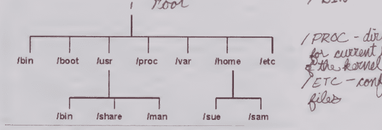

图 3-5：Linux 文件系统结构

当你将文件存储在某个目录时，该文件物理上存储在计算机内部的硬盘上。目录以相同的方式存储。事实上，目录实际上是一种特殊类型的文件，用于组织并为目录和文件提供指针。文件在目录中的放置并不是物理结构，而是操作系统识别并处理的逻辑结构。

### 路径

你通过目录结构查找特定文件或目录时所经过的路线被称为路径。指明目录的路径被称为该目录的绝对路径名。在图 3-5 中，`share` 目录的绝对路径是 `/usr/share`，`sue` 目录的绝对路径是 `/home/sue`。

在 `/sue` 目录下有一个名为 `dates` 的文件。当列出 `dates` 的完整路径时，我们称 `/home/sue/dates` 为绝对文件名。当我们开始使用命令时，这一概念的重要性将变得更加清晰。


## 3-18 CompTIA Linux+ 认证, 2004 目标

## 监控文件系统

上述所有目录都可以存在硬盘的同一个物理分区上，或者某些位于不同的分区，甚至在不同的驱动器上。它们的存储方式对系统用户并不重要，因为所有文件都出现在目录树的某处。

你可以使用 `mount` 命令将磁盘成为目录的一部分。例如，如果 `h2`（硬盘上的第二个分区）存储了 `/home` 的文件，则该分区被认为挂载到了 `/home`。使用软磁盘（`/dev/td0`）时，它通常被挂载到 `/mnt`，因此该目录代表软磁盘。

可移动设备（如软磁盘和 CD-ROM）或其他计算机上的文件系统通常经常使用 `mount` 命令手动挂载。硬盘分区通常固定不变，并在系统启动时自动挂载。

### 主目录

当你使用命令行终端登录 Linux 时，系统会自动将你置于你的主目录中。主目录是每个用户存储个人文件的地方。它在用户账户创建时创建，且除非权限允许，否则只有该用户和 `root` 可以访问。

普通用户通常在 `/home` 目录下有一个与其用户账户同名的主目录，例如 `/home/sue`。你可以通过观察 shell 提示符末尾的提示符或使用 `pwd` 命令（打印工作目录）来确认你当前所在的系统中。

如果 `sue` 已经登录，她将看到以下输出：

```
[sue@localhost]# pwd - absolute path name
/home/sue
```

`root` 的主目录是所不同的。它位于系统的根目录（`/root`）下，如图 3-5 所示。如果你以 `root` 用户身份登录，终端屏幕上将显示以下输出：

```
[root@localhost]# pwd
/root
```

命令行显示了用户名和计算机的主机名（`sue@localhost` 或 `root@localhost`），还显示了当前目录的名称（`sue` 或 `root`）。

### 导航文件系统

登录后，你使用命令查看其他目录或将自己移动到文件系统的其他部分。

要更改目录，使用 `cd`（切换目录）命令并带上指定目标目录的参数。如果不指定目标目录，`cd` 将直接返回你的主目录：

Root 切换到 Mary 的主目录：

```
[root@localhost]# cd /home/mary
```

打印工作目录：

```
[root@localhost mary]## pwd
/home/mary
```

切换目录到 `/etc`：

```
[root@localhost mary]## cd /etc
[root@localhost etc]## pwd
/etc
```

返回主目录：

```
[root@localhost etc]## cd
[root@localhost root]## pwd
/root
```

命令行显示了用户名和计算机的主机名（`sue@localhost` 或 `root@localhost`），还显示了当前目录的名称（`sue` 或 `root`）。

如果 `sue` 已经登录，她将看到以下输出：

```
[sue@localhost]# pwd - absolute path name
/home/sue
```

`root` 的主目录是不同的。它位于系统的根目录（`/root`），如图 3-5 所示。如果你以 `root` 用户身份登录，终端屏幕上将显示以下输出：

```
[root@localhost]# pwd
/root
```

命令行显示了用户名和计算机的主机名（`sue@localhost` 或 `root@localhost`），还显示了当前目录的名称（`sue` 或 `root`）。

登录后，你使用命令查看其他目录或将自己移动到文件系统的其他部分。

要更改目录，使用 `cd`（切换目录）命令并带上指定目标目录的参数。如果不指定目标目录，`cd` 将直接返回你的主目录：

Root 切换到 Mary 的主目录：

```
[root@localhost]# cd /home/mary
```

打印工作目录：

```
[root@localhost mary]## pwd
/home/mary
```

切换目录到 `/etc`：

```
[root@localhost mary]## cd /etc
[root@localhost etc]## pwd
/etc
```

返回主目录：

```
[root@localhost etc]## cd
[root@localhost root]## pwd
/root
```

命令行显示了用户名和计算机的主机名（`sue@localhost` 或 `root@localhost`），还显示了当前目录的名称（`sue` 或 `root`）。

## 3-20 CompTIA Linux+ 认证, 2004 目标

你也可以在树上向上移动多个层：

```
[root@localhost]# cd /home/mary
[root@localhost mary]# pwd
/home/mary
[root@localhost mary]# cd ../
[root@localhost]# pwd
/
[root@localhost]# cd /home
mary
[root@localhost home]# pwd
/home
[root@localhost home]# cd mary
[root@localhost mary]# pwd
/home/mary
```

绝对路径因为其清晰性而简单，但当你位于根目录时，相对路径可以为你大量的大量的打字时间。

| # | 命令 | 说明 |
|---|---|---|
| 4 输入 `cd root` | 将当前文件夹更改到根目录。 |
| 输入 `pwd` | 查看当前工作目录。 |
| 5 输入 `cd etc` | 查看当目录名称不正确时显示的错误。 |
| 6 输入 `cd /etc` | 切换到 `/etc` 目录。 |
| 输入 `pwd` | 验证目录已成功切换。 |
| 7 输入 `cd /` | 切换到根目录。 |
| 输入 `pwd` | 验证目录已成功切换。 |
| 8 输入 `cd ~` | 切换到当前用户的家目录。 |
| 输入 `pwd` | 验证目录已成功切换。 |
| 9 输入 `cd ../` | 切换到 `/` 目录。 |
| 输入 `pwd` | 验证目录已成功切换。 |
| 10 输入 `cd /etc/samba` | 切换到 `/etc/samba` 目录。 |
| 输入 `pwd` | 验证目录已成功切换。 |
| 11 输入 `cd ../sysconfig` | 切换到 `/etc/sysconfig` 目录。 |
| 输入 `pwd` | 验证目录已成功切换。 |
| 12 输入 `cd /r` | 完成路径。 |
| 按 `TAB` | |
| 按 `ENTER` | 切换到 `/root` 目录。 |

## 查看文件和目录

一旦建立了目录结构来组织文件，你就需要一种方法来查看目录包含哪些文件。为此，你使用列出目录内容的命令之一。有各种类型的文件和文件名，你应该理解它们，以便尽可能地利用不同的命令。

### 文件类型

所有数据都以文件的形式存在。无论大小，文件都是将位信息或指令组织成有意义形式的基本形式。

有许多不同类型的文件，包括这些常见类型：

- 文本文件：大多数包含信息的文件都是文本文件。
- 二进制数据文件存储常用函数和图形等信息。
- 可执行文件在内存中执行并变为进程。它们通常与几个辅助二进制文件相关联。
- 目录文件作为占位符来组织其他文件。
- 链接文件是彼此相互关联的文件。它们可能代表相同的数据，也指向另一个文件。
- 特殊设备文件代表不同的设备，如硬盘和串串口。它们配合命令使用来操作设备。
- 命名管道文件标识从一个进程传递信息到另一个进程的通道。在写入文件的同时，另一个进程从同一个文件中读取，从而实现这种信息的传递。
- 套接字文件是命名管道文件的变体，允许另一台计算机上的进程向本地计算机上的文件写入，同时另一个进程从该文件中读取。

### 文件名

文件通过名称识别。文件名通常由字母和数字组成，但也可以包含下划线 (`_`)、连字符 (`-`) 和点 (`.`)。文件名的长度最多可达 255 个字符，但很少有超过 20 个字符的名字。

> 注意：以点 (`.`) 开头的文件称为隐藏文件，需要特殊的命令才能看到它们。

你可能熟悉 Windows 系统上使用的文件名。它们通常以点和三个描述文件类型的字符结束，例如文档 `txt (.txt)` 和 `server.exe`（可执行程序）。这些被称为文件扩展名。

Linux 上的大多数文件并不遵循这种模式，而且完全没有扩展名。许多带有扩展名的文件功能与你在 Windows 中看到的不同。这些扩展被称为文件名后缀。下表显示了常见示例。

| 后缀 | 说明 |
|---|---|
| .c | C 编程语言源文件 |
| .cc | C++ 编程语言源文件 |
| .cpp | |
| .html<br>.htm | HTML（超文本标记语言）文件 |
| .ps | 使用 PostScript 格式化的打印文件 |
| .txt | 文本文件 |
| .tar | 归档文件（内部包含其他文件） |
| .gz<br>.bz2<br>.Z | 压缩文件 |
| .tar.gz<br>.tgz<br>.tar.bz2<br>.tar.Z | 压缩归档文件 |
| .conf<br>.cfg | 配置文件（包含文本） |
| .so | 共享对象（编程库）文件 |
| .o | 编译的对象文件 |
| .pl | PERL（实用提取报告语言）程序 |
| .tel | TCL（工具命令语言）程序 |
| .jpg<br>.jpeg<br>.png<br>.tiff<br>.xpm<br>.gif | 包含图形文件的二进制文件 |
| .sh | Shell 脚本（包含由 shell 执行的文本） |

在命名文件时，避免使用 shell 元字符是非常重要的。将包含 shell 元字符的文件名作为命令的参数可能会产生意料之外的结果。

### 使用 ls 列出文件

可以使用多种命令来显示文件及其类型。最常用的是 `ls` 命令。以下是 `root` 用户家目录下文件列表的示例：

```
[root@localhost]# pwd
/root
[root@localhost]# ls
current myprogram project project12 project2 project4
Desktop myscript project1 project13 project3 project5
[root@localhost]# _
```

`ls` 命令显示当前目录下的所有文件。`ls` 命令显示所有文件在当前目录下的所有文件。你可以通过 `pwd` 命令来验证目录已成功切换。例如，以 `root` 登录时，可以使用 `pwd` 命令查看当前目录：

```
[root@localhost]# pwd
/root
[root@localhost]# ls
```

> 注意：Windows 用户熟悉 `dir` 命令。可以使用 `cd` 命令切换到目录。`pwd` 查看目录。当你以 `root` 登录时，你可以使用 `cd` 切换到 `/` 目录。`pwd` 验证目录已成功切换。

### 使用 ls 列出文件

可以使用多种命令来显示文件及其类型。最常用的是 `ls` 命令。以下是 `root` 用户家目录下文件列表的示例：

```
[root@localhost]# pwd
/root
[root@localhost]# ls
current myprogram project project12 project2 project4
Desktop myscript project1 project13 project3 project5
[root@localhost]# _
```

`ls` 命令显示当前目录下的所有文件。你可以通过 `pwd` 命令来验证目录已成功切换。例如，以 `root` 登录时，你可以使用 `pwd` 命令查看当前目录：

```
[root@localhost]# pwd
/root
[root@localhost]# ls
```

`ls` 命令显示当前目录下的所有文件。你可以通过 `pwd` 命令来验证目录已成功切换。例如，以 `root` 登录时，你可以使用 `pwd` 命令查看当前目录：

```
[root@localhost]# pwd
/root
[root@localhost]# ls
```

查看更详细信息：


# 列出文件

`ls -L`
total 548
rwxr-xr-x 1 root root 4096 Mar 27 10:01 current ->
dproject1      3 root root
-rw-xr-x 1 root root 51996 May 07 09:59 myprogram
-rw-xr-x 1 root root 20 Apr 09:58 script
-rw-r--r-- 1 root root 71 Apr 09:58 project
-rw-f--r-- 1 root root 71 Apr 09:59 project1

`ls` 命令显示当前目录的所有文件。你可以通过 `pwd` 命令来验证目录已成功切换。例如，以 root 登录时，你可以使用 `pwd` 命令查看当前目录：

```
[root@localhost]# pwd
/root
[root@localhost]# ls
```

## 使用 `ls` 列出文件类型

可以使用多种命令来显示文件及其类型。最常用的是 `ls` 命令。以下是 root 用户家目录下文件列表的示例：

```
[root@localhost]# pwd
/root
[root@localhost]# ls
current myprogram project project12 project2 project4
Desktop myscript project1 project13 project3 project5
[root@localhost]# _
```

`ls` 命令显示当前目录下的所有文件。你可以通过 `pwd` 命令来验证目录已成功切换。例如，以 root 登录时，你可以使用 `pwd` 命令查看当前目录：

```
[root@localhost]# pwd
/root
[root@localhost]# ls
```

## 使用 `ls` 列出文件类型

可以使用多种命令来显示文件及其类型。最常用的是 `ls` 命令。以下是 root 用户家目录下文件列表的示例：

```
[root@localhost]# pwd
/root
[root@localhost]# ls
current myprogram project project12 project2 project4
Desktop myscript project1 project13 project3 project5
[root@localhost]# _
```

`ls` 命令显示当前目录下的所有文件。你可以通过 `pwd` 命令来验证目录已成功切换。例如，以 root 登录时，你可以使用 `pwd` 命令查看当前目录：

```
[root@localhost]# pwd
/root
[root@localhost]# ls
```

## 使用 `ls` 列出文件类型

可以使用多种命令来显示文件及其类型。最常用的是 `ls` 命令。以下是 root 用户家目录下文件列表的示例：

```
[root@localhost]# pwd
/root
[root@localhost]# ls
current myprogram project project12 project2 project4
Desktop myscript project1 project13 project3 project5
[root@localhost]# _
```

## 使用 `ls` 列出文件类型

可以使用多种命令来显示文件及其类型。最常用的是 `ls` 命令。以下是 root 用户家目录下文件列表的示例：

```
[root@localhost]# pwd
/root
[root@localhost]# ls
current myprogram project project12 project2 project4
Desktop myscript project1 project13 project3 project5
[root@localhost]# _
```

## 使用 `ls` 列出文件类型

可以使用多种命令来显示文件及其类型。最常用的是 `ls` 命令。以下是 root 用户家目录下文件列表的示例：

### 使用 `-F` 选项查看文件类型：

```
[root@localhost]# pwd
/root
[root@localhost]# ls -F
current@ myprogram* project12 project2 project4
Desktop/ myscript* project1 project13 project3 project5
[root@localhost]# _
```

`ls` 命令显示当前目录下的所有文件。你可以通过 `pwd` 命令来验证目录已成功切换。例如，以 root 登录时，你可以使用 `pwd` 命令查看当前目录：

```
[root@localhost]# pwd
/root
[root@localhost]# ls
```

`ls` 命令在文件名末尾添加一个特殊字符。

- `@` 表示链接
- `*` 表示可执行文件
- `/` 表示目录

`ls` 命令显示当前目录下的所有文件。你可以通过 `pwd` 命令来验证目录已成功切换。例如，以 root 登录时，你可以使用 `pwd` 命令查看当前目录：

```
[root@localhost]# pwd
/root
[root@localhost]# ls
```

### 探索接口和文件系统

虽然 `ls -F` 命令提供了获取类型信息的快捷方法，但有时你需要关于文件的更详细信息。`ls -l` 命令可以提供详细列表：

```
root[localhost]$ ls -L
total 548
rwxr-xr-x 1 root root 4096 Mar 27 10:01 current ->
dproject1      3 root root
-rw-xr-x 1 root root 51996 May 07 09:59 myprogram
-rw-xr-x 1 root root 20 Apr 09:58 script
-rw-f--r-- 1 root root 71 Apr 09:58 project
-rw-f--r-- 1 root root 71 Apr 09:59 project1
```

每行列出的从左到右有七个组件：

1. 文件字符，可以是以下之一：
    - `d` 表示目录。
    - `l` 表示符号链接文件。
    - `b` 或 `c` 表示特殊设备文件
    - `n` 表示命名管道。
    - `s` 表示套接字。
    - 表示所有文件类型（文本文件、二进制数据文件）。
2. 文件权限列表（文件类型后的九个字符，也称为模式）。
3. 硬链接数。
4. 文件所有者。
5. 组所有者。
6. 大小。
7. 文件的最后修改时间。
8. 文件名。某些文件是其他文件的快捷方式或指针。它们用箭头 `->` 表示，如上面输出文件 `current`。这些被称为符号链接。

> 注意：Linux 系统支持 `ll` 命令，它是 `ls -l` 命令的快捷方式，用于显示相同的信息。某些用户更喜欢使用 `ll`，因为它更容易输入。这样的快捷方式被称为别名（alias）。

### 使用 `file` 命令显示文件类型

`file` 命令显示关于任何文件的详细信息。

要显示文件的类型，给 `file` 命令传递参数指定要分析的文件。你也可以传递多个文件作为参数，或使用 `*` 元字符（也称为通配符）来引用当前目录下的所有文件。

## 3-26 CompTIA Linux+ 认证，2004 目标

以下是在 root 用户家目录中使用 `file` 命令的示例：

```
[root@localhost]# pwd
/root
[root@localhost]# ls
current myprogram project project2 project2 project4
Desktop myscript project1 project13 project3 project5
```

将 `Desktop` 目录作为 `file` 命令的参数输入：

```
[root@localhost]# file Desktop
Desktop: directory
```

现在对文件 `project` 和目录 `Desktop` 进行分析：

```
[root@localhost]# file Desktop
project: ASCII text
Desktop: directory
```

使用通配符 `*`，可以检查目录中的所有内容：

```
[root@localhost]# file *
Desktop: directory
current: symbolic link to project12
myprogram: ELF LSB executable, Intel 80386, version 1,
dynamically linked (uses shared libs), stripped
myscript: Bourne-Again shell script text executable
project: ASCII text
project1: ASCII text
project12: ASCII text
project13: empty
project2: ASCII text
project3: ASCII text
project4: ASCII text
project5: ASCII text
[root@localhost]# _
```

## 查看隐藏文件

家目录中的某些文件代表了重要的配置文件或程序目录。由于用户很少编辑这些文件，且它们会干扰文件列表，因此在使用 `ls` 和 `file` 命令时，它们通常是对视图隐藏的。隐藏文件名以点字符（`.`）开头。

要查看隐藏文件，请向 `ls` 命令传递 `-a` 选项。

以下是用户家目录中常见的某些隐藏文件：

```
[root@localhost root]# ls
current myprogram project project2 project2 project4
Desktop myscript project1 project13 project3 project5
[root@localhost root]# ls -a
gimp-1.2 project
..bash_history project1
.gnome-desktop project12
.gnome .bash_logout
project13.gnome_private
.bash_profile gtkrc project2
.bashrc ICEauthority project3
.cshrc kde project4
current mcp project4
.DCOFServer_localhost.localdomain MCOP-random-seed sane
Desktop .first_start_kde sawfish
.mozilla tcshrc
galeon myprogram
.Authority
.gconf mys
.XResources
.gconf
[root@localhost root]# nautilus
```

> 注意：在列表开头，`.` 字符表示当前工作目录，而 `..` 字符表示相对于你当前目录树中当前位置的父目录。在使用 `ls -a` 命令时，这些指针中的每一个都被视为一个特殊（或硬链接）文件，因为代表目录的文件名以点开头。

# 使用多个命令选项

你也可以同时为大多数命令指定多个选项，并接收所有选项的组合功能。例如，要查看所有隐藏文件及其类型文件，请同时使用两个选项和 `-F`：

```
[root@localhost root]# ls -aF
gimp-1.2/ project
./
project1
gnome/
.bash_history .gnome-desktop/
project12
.bash_logout .gnome_private/
project13

[root@localhost root]# _
```

## 3-28 CompTIA Linux+ 认证，2004 目标

我们已经讨论了 `ls` 命令最常用的选项（`ls -l`，`ls -F`，`ls -a`），但还有许多其他更改文件列表的选项，如下表所示。

| 选项 | 说明 |
| :--- | :--- |
| `-a --all` | 列出所有文件名 |
| `-A --almost-all` | 列出大部分文件名（排除 `.` 和 `..` 特殊文件） |
| `-C --color=n` | 列格式列出文件名，从上往下排序 |
| `-f` | 列出无颜色文件名 |
| `-F --classify` | 按文件类型分类列出文件名 |
| `--full-time` | 以长格式列表文件名并显示完整的修改时间 |
| `-l` | 以长格式列出文件名 |
| `-lh -l --human-readable` | 以长格式列出文件名，并带有人类可读（易于阅读）的文件大小 |
| `-ig -l --no-group` | 以长格式列出文件名，但省略组信息 |
| `-r --reverse` | 逆序列出文件名 |
| `-R --recursive` | 在指定目录及其所有子目录下列出文件名 |
| `-s` | 列出文件名及其以千字节 (K) 为单位的大小 |
| `-S` | 按文件大小排序列出文件名 |
| `-t` | 按修改时间排序列出文件名 |
| `-U` | 不排序列出文件名 |
| `-x` | 按行而非列列出文件名，从左到右排序 |

# C-2: 检查文件和文件类型

| 方法如下 | 理由如下 |
| :--- | :--- |
| 1 输入 `cd /etc` | 切换到 `/etc` 目录。 |
| 输入 `pwd` | 验证你正处于 `/etc` 目录中。 |
| 2 输入 `ls` | 查看 `/etc` 目录的目录列表。 |
| 3 输入 `ls | more` | 控制目录列表的显示。 |
| 按两次 `ENTER` | （在查看终端时。）逐行推进输出。 |
| 按两次 `SPACEBAR` | （在观察终端时。）翻到列表的下一页。 |
| 按 `H` | 显示有关此模式下命令的帮助屏幕。 |
| 按 `Q` | 退出 `more` 命令并返回到空命令提示符。 |
| 4 输入 `ls | less` | |
| 按两次 `ENTER` | | |
| 按两次 `SPACEBAR` | | |
| 按 `H` | 显示帮助屏幕并查看可用选项。 |
| 按 `Q` | 返回命令输出。（这不会退出列表，像 `more` 命令那样。） |
| 5 按三次 `F` | 在文件显示中回退一行。 |
| 按三次 `J` | 向文件显示向前移动。 |
| 按 `Q` | 退出 `less` 命令并返回 shell 命令提示符。 |
| 6 输入 `cd` | 切换到当前用户的家目录。 |
| 7 输入 `ls /etc` | 通过指定其绝对名称作为 `ls` 命令的参数来列出 `/etc` 的内容。 |
| 8 输入 `ls | more` | |
| 按 `Q` | |
| 9 输入 `ls /home` | 查看家目录的内容。 |
| 10 输入 `ls -a` | |
| 11 输入 `ls -af` | |
| 12 输入 `ls -la` | |
| 13 输入 `ls -lh` | |
| 14 输入 `ls -lR` | |
| 15 输入 `ls *` | |
| 输入 `ls -a` | 查看所有隐藏文件。 |
| 输入 `ls -F` | 查看所有隐藏文件及其类型指示。 |
| 输入 `ls -la` | 以长格式列出隐藏文件。 |
| 输入 `ls -alh` | 以长格式列出隐藏文件，并带有人类可读的大小。 |
| 输入 `ls -alR` | 在指定目录及其子目录下列出隐藏文件。 |
| 输入 `ls -aS` | 按大小排序列出隐藏文件。 |
| 输入 `ls -at` | 按修改时间排序列出隐藏文件。 |
| 输入 `ls -ax` | 按行而非列列出隐藏文件。 |

## 通配符

`*` 可以用于指示“匹配”当前目录中的所有文件，就像扑牌游戏中的通配符一样。因此，`*` 字符被称为通配符。

通配符可以让你更容易地指定多个文件名。这些通配符由 shell 解析，并用于我们已经探索的三个命令：`ls`、`file` 和 `cd`。这些字符可以匹配文件名的一部分或整个文件名。

通配符列表及其描述如下表。

| 通配符 |  |
| :--- | :--- |
| `*` | 匹配文件名中的 0 或多个字符 |
| `?` | 匹配文件名中的 1 个字符 |
| `[set]` | 匹配文件名中集合内的任意一个字符。例如，`[aegh]` 将匹配包含 a, e, g 或 h 的文件名 |
| `[range]` | 匹配文件名范围内的任意一个字符。例如，`[a-e]` 将匹配包含 a, b, c, d 或 e 的文件名 |
| `[set]` 或 `[range]` | 如果文件名不包含给定集合或范围内的任何字符，则匹配该文件名 |

## C-3: 使用通配符

| 方法如下 | 理由如下 |
| :--- | :--- |
| 1 输入 `cd /bin` | 切换到 `/bin` |
| 2 输入 `ls un*` | 显示以 "un" 开头的单词。 |
| 3 输入 `ls u*e` | 显示以 "u" 开头并 "e" 结尾的单词。 |
| 4 输入 `ls un?me` | 用 `?` 通配符替换 `uname` 中的 "a" |
| 5 输入 `ls un??e` | 替换 `uname` 中的 "a" 和 "m" |
| 6 输入 `una[egm z]e` | 用一组可能的字符替换 "m" |
| 7 输入 `ls[a-n]e` | 用字符范围替换 "m" |
| 8 输入 `ls[!l-n]e` | （显示错误。）通过使用 `!` 通配符排除一个字符范围 |

## 主题 D：显示文件内容

本主题涵盖以下 CompTIA Linux+ 考试目标。

| 目标 | 描述 |


| 5.4 | 使用系统日志排除故障。- `tail`, - `head` |
| 5.5 | 使用应用程序日志排除应用程序错误。- `tail`, - `head` |

### 文本文件

文本文件是你显示的最常见的文件类型。许多文本文件包含你阅读的内容，例如电子邮件或日志文件。某些文件包含程序配置信息。另一些是脚本，即 `shell` 解释并执行任务的指令。

### 使用 cat

要在终端屏幕上查看整个文本文件，你可以使用 `cat` 命令。

下面是一个使用 `cat` 命令显示名为 `Highland_Inn` 的邮件内容的示例：

```
[root@localhost ~]# cat Highland_Inn
Hi there, I hope you are well.
```

抱歉我们今年在阿尔冈基公园（Algonquin Park）度假期间没能去看你们。我特别想看看 `Highland_Inn` 的模型，还有你提到的那个火车站。

我一直在读阿冈基公园的历史，但没有找到关于 `Highland_Inn` 最初位于 `Cache_Lake` 的何处的描述。

如果不麻烦的话，你能告诉它在哪里吗？

此致，

`Elizabeth_Mackenzie`

```
[root@localhost ~]#
```

你还可以通过向 `cat` 命令传递 `-n` 选项，在显示内容的同时显示文件的每行号。

### 探索接口和文件系统

在示例中，显示了 `Highland_Inn` 的行数：

```
[root@localhost ~]# cat -n Highland_Inn
Hi there, I hope you are well.
```

抱歉我们今年在阿尔冈基公园（Algonquin Park）度假期间没能去看你们。我特别想看看 `Highland_Inn` 的模型，还有你提到的那个火车站。

我一直在读阿冈基公园的历史，但没有找到关于 `Highland_Inn` 最初位于 `Cache_Lake` 的何处的描述。

如果不麻烦的话，你能告诉它在哪里吗？

此致，

`Elizabeth_Mackenzie`

```
[root@localhost ~]#
```

### 使用 tac

在某些情况下，你可能想要反序显示特定文本文件的内容。这在显示由系统服务在末尾追加文本的文件时有用。这些文件也被称为日志文件，其最新条目位于文件底部。

要反序显示文件，请使用 `tac` 命令（"cat" 的反拼写）。使用 `tac`，`Highland_Inn` 看起来如下：

```
[root@localhost ~]# tac Highland_Inn
Elizabeth Mackenzie
Regards.
```

（注意：此处 OCR 文本包含乱码片段，已进行清理以确保清晰）

### 使用 head

如果显示的文件很大，而你只想查看其前几行，可以使用 `head` 命令。`head` 命令默认显示文本文件的前 10 行（包括空行），但如果给定数字选项，可以指定不同的行数。

这是一个使用 `head` 命令查看 `Highland_Inn` 文件顶部的示例：

```
[root@localhost ~]# head Highland_Inn
Hi there, I hope you are well.
```

抱歉我们今年在阿尔冈基公园（Algonquin Park）度假期间没能去看你们。我特别想看看 `Highland_Inn` 的模型，还有你提到的那个火车站。

我一直在读阿冈基公园的历史，但没有找到关于 `Highland_Inn` 最初位于 `Cache_Lake` 的何处的描述。

```
[root@localhost ~]#
```

### 使用 tail

正如 `head` 命令显示文本文件的开头一样，`tail` 命令可以用于显示文本文件的结尾。

默认情况下，`tail` 命令显示文件的最后 10 行，但像 `head` 一样，可以指定不同的数量：

```
[root@localhost ~]# tail Highland_Inn
```

我一直在读阿冈基公园的历史，但没有找到关于 `Highland_Inn` 最初位于 `Cache_Lake` 的何处的描述。

如果不麻烦的话，你能告诉它在哪里吗？

此致，

`Elizabeth_Mackenzie`

```
[root@localhost ~]#
```

`tail` 命令还有一个额外选项，允许你指定开始的行号。例如，要从第 8 行开始一直显示到文件末尾，请使用 `+8` 选项，如下所示：

```
[root@localhost ~]# tail +8 Highland_Inn
couldn't find a description of where the Highland
was originally located on Cache Lake.
```

如果不麻烦的话，你能告诉它在哪里吗？

此致，

`Elizabeth_Mackenzie`

```
[root@localhost ~]#
```

### 使用 more

`more` 命令被用作控制命令输出的方法。当列表或文件太长而无法在一个屏幕上显示时。当使用 `more` 命令时，会显示一屏输出。如果你按下空格键，将显示下一屏。如果你按下回车键，将显示下一行。

（注意：提供的 OCR 文本后半部分包含大量的重复/乱码文本，已根据 `more` 命令的上下文合成了一个连贯的解释）。

### 二进制文件

将 `cat`、`tac`、`head`、`tail`、`more` 和 `less` 等文本命令仅用于包含文本的文件，否则你可能会发现终端屏幕出现随机输出，甚至导致终端失效。要查看二进制文件的内容，你通常会使用创建该文件的程序，但某些命令可以安全地显示大多数二进制文件的内容。

### strings 命令

`strings` 命令在二进制文件中搜索文本字符并将其输出到屏幕。在很多情况下，这些文本字符可能指示二进制文件的用途。

例如，要查找 `/bin/echo` 二进制执行程序内部的文本字符，可以使用以下命令：

```
[root@localhost ~]# strings /bin/echo | more
/lib/ld-linux.so.2
PTRh
<nt<e
[^]
^]
Try 's --help' for more information.
Usage: %s[OPTION]... [STRING]
Echo the STRING(s) to standard output.
-n do not output the trailing newline
enable interpretation of the backslash-escaped characters listed below
-E disable itation of those sequences in STRINGS
  --help display this help and exit (should be alone)
  --version output version information and exit
Without %s, the following sequences are recognized and exit interpolated:
NNN the character whose ASCII code is NNN (octal)
\ back
\a alert (BEL)
\b backspace
\c suppress trailing newline
\f form feed
\n new line
--More--
```

虽然此输出可能易于阅读，但它确实包含了一些可以引导你找到正确方向以获取更多关于 `echo` 命令的信息。

### od 命令

另一个可以安全用于二进制文件和文本文件的命令是 `od` 命令，它以八进制格式（数字基数8格式）显示文件内容。

使用 `od` 命令显示 `Highland_Inn` 文件内容的示例如下：

```
[root@localhost ~]# od Highland_Inn
0000000 064150 072040 062550 062562 020054 020111 067550
062560
000020 072040 064550 020163 060544 020171 064546 062156
020163
000040 067571 020165 062567 066154 006456 006412 052412
063156
```

```
[root@localhost ~]#
```

可以使用各种参数配合 `od` 使用来改变显示格式。

## D-2: 显示二进制数据

# 这里是方法

# 这里的原因

1. 输入 `file /bin/nice` 显示 `nice` 文件的类型。
2. 输入 `strings /bin/nice` 查看此二进制文件中包含的文本。文本多于一个屏幕能显示的内容。
3. 输入以下命令：将输出通过到 `more`。

```
strings /bin/nice | more
```

4. 按 `O` 退出 `more` 命令。
5. 输入以下命令：创建一个名为 `bindata` 的二进制数据文件。

```
dd count=1 bs=65 if=/bin/sh of=bindata
```

6. 输入 `od bindata` 查看 `bindata` 文件的内容。
7. 输入以下命令：以十六进制格式查看 `bindata` 文件的内容。

```
od -A x -t xl bindata
```

8. 输入以下命令：以十进制格式查看 `bindata` 文件的内容。

```
od -A d -t u1 bindata
```

9. 输入以下命令：以助记形式查看不可打印字符。

```
od -A d -t ta bindata
```

# 主题 E：搜索和编辑文本文件

本主题涵盖以下 `CompTIA Linux+` 考试目标。

| # | |
|---|---|
| 2.3 | 使用 CLI 命令创建文件和目录并修改文件。<br>- 修改文件 |
| 2.4 | 使用 `find` 和 `grep` 执行内容和目录搜索。<br>- `grep` |
| 2.15 | 执行文本操作。<br>- `vi` |
| 5.4 | 使用系统日志排查错误。<br>- `grep` |
| 5.5 | 使用应用程序日志排查应用程序错误。<br>- `grep` |

# 在文件中搜索文本

为了更方便搜索文本，开发了一套通配符。这些文本通配符被称为正则表达式（`regexp`），被多种文本工具和编程语言识别，包括：

- `grep`
- `awk`
- `sed`
- `vi`
- `emacs`
- `ex`
- `ed`
- `PERL`

通过组合文本工具，你可以以几乎所有可能的方式搜索和处理数据。

### 正则表达式 (regexp)

正则表达式允许你指定文档中的特定文本模式。它们的工作原理与通配符元字符类似，都被用于匹配字符，但它们有许多不同：

- 正则表达式由文本工具程序解释，而通配符元字符由 `shell` 解析。
- 正则表达式匹配文本文件中的字符，而通配符元字符匹配文件系统中的文件名或目录名。
- 正则表达式元字符的定义通常与通配符元字符不同。
- 可用的正则表达式比通配符更多。

正则表达式元字符分为两类：

- 常用正则表达式大多数文本工具都支持。
- 扩展正则表达式较少见，仅某些文本工具支持。

一些常用和扩展正则表达式的定义和示例见下表。

| 表达式 | 说明 | 示例 |
|---|---|---|
| `*` | 匹配前字符的0次或多次 | `letter*` 匹配 `letter`, `letter`, `letterrr`, `letterrrr` 等 |
| `?` | 匹配前字符的0次或1次 | `letter?` 匹配 `letter`, `letter` |
| `+` | 匹配前字符的1次或多次 | `letter+` 匹配 `letter`, `letter`, `letterrr` 等 |
| `(..)` | 匹配两个组中的之一 | `(mother|father)` 匹配单词 `mother` 或 `father` |
| `[]` | 匹配括号内的任意字符 | `[a-z]` 匹配任何小写字母 |
| `[!]` | 匹配括号之外的字符 | `[!a]` 匹配除 `a` 以外的任何字符 |
| `{}` | 匹配特定次数 | `{1,3}` 匹配 1 到 3 次 |
| `^` | 匹配行首 | `^` 匹配行的开头 |
| `$` | 匹配行尾 | `$` 匹配行的结尾 |

## E-1: 在 grep 和 egrep 中使用正则表达式

| 操作方法 | 目的 |
| --- | --- |
| 1 输入 `grep "Inn" Highland_Inn` | 在 `Highland_Inn` 文件中显示包含 "Inn" 的行。 |
| 2 输入 `grep -v "Inn" Highland_Inn` | 显示不包含单词 "Inn" 的行。 |
| 3 输入 `grep "inn" Highland_Inn` | 显示包含单词 "inn" 的行。 |
| 4 输入 `grep -i "inn" Highland_Inn` | 在 `Highland_Inn` 中搜索 "inn" 时忽略大小写。 |
| 5 输入 `grep "I" Highland_Inn` | 搜索并显示所有包含字母 "I" 的行。 |
| 6 输入 `grep ".I" Highland_Inn` | 显示所有包含 ".I." 的行。 |
| 7 输入 `grep "t.e" Highland_Inn` | 使用元字符 `( . )` 搜索并显示匹配的行。 |
| 8 输入 `grep "w...e" Highland_Inn` | 搜索并显示包含以 "w" 开头并 "e" 结尾的单词的行。 |
| 9 输入 `grep "^I" Highland_Inn` | 搜索并显示以 "I" 开头的行。 |

10. 输入以下命令：

```
egrep "we|reading" Highland_Inn
```

搜索并显示包含单词 "we" 或 "reading" 的行。

# 编辑文本文件

文本文件是 `Linux` 用户和管理员修改的最常见文件类型。大多数系统配置都存储在文本文件中，此外电子邮件和程序源代码。因此，`Linux` 发行版中自带了许多文本编辑器，并且有更多可供选择。

文本编辑器分为两种：

- 命令行编辑器，包括 `vi`（或 `vim`）、`pico`、`meedit` 和 `emacs`。
- 图形用户界面（GUI）编辑器，包括 `xacs`、`edit`、`kind` 等。

## vi 编辑器

`vi` 编辑器（读作 "vee eye"）是 `UNIX` 上最老且最受欢迎的视觉文本编辑器之一；其在 `Linux` 中的对应版本被称为 `vim`（意为 "vi 的改进版"），是每个 `Linux` 发行版的标准配置。`vim` 编辑器支持正则表达式并可以执行一千多种不同的功能。

虽然 `vim` 不是最易于使用的编辑器，但它具有可移植性的优点。精通 `vim` 的红帽用户可以轻松地在所有 `UNIX` 和 `Linux` 系统找到文件，因为不同系统上的界面和功能几乎完全相同。

要打开一个现有文本文件进行编辑，输入 `vi (or vim) filename`，其中 "filename" 指定要编辑的文件。要打开一个新文件进行编辑，只需在命令行输入 `vi`：

```
[root@localhost]# vi
```

`vi` 编辑器会将命令行界面替换为以下输出：


左侧的波浪号 (~) 字符表示文件的结束；当你输入文本时，它们会向屏幕下方移动。

`vi` 编辑器被称为模态编辑器，因为它在两种模式之一中运行：

- 命令模式 (command mode)
- 插入模式 (insert mode)

当你第一次打开 `vi` 编辑器时，处于命令模式，在该模式下你可以执行删除文本、复制文本、保存更改和退出编辑器等功能。

要向文档插入文本，通过输入表中所列的字符之一进入插入模式。例如，如果你在命令模式下按下 `i` 键，编辑器会在屏幕底部显示 `--INSERT--` 并允许你输入如下所示句子：

```
This is a sample sentence.
~
~
~
INSERT
```

用于进入插入模式的按键以及发生的动作下表所示。

| 按键 | 描述 |
|---|---|
| `i` | 切换到插入模式，并将插入点放在当前字符之前进行输入 |
| `a` | 切换到插入模式，并将插入点放在当前字符之后进行输入 |
| `o` | 切换到插入模式并在当前行下方打开新行进行输入 |
| `Shift + i` | 切换到插入模式，并将插入点放在当前行开头进行输入 |
| `Shift + a` | 切换到插入模式，并将插入点放在当前行末尾进行输入 |
| `Shift + o` | 切换到插入模式并在当前行上方打开新行进行输入 |
| `Esc` | 在插入模式下切换回命令模式 |

在插入模式下，你可以使用键盘输入想要保存的文本。然而，要执行其他功能，必须按下 `Esc` 键返回命令模式。命令模式下可以使用的命令列表及其功能下表所示。

| 按键 | 描述 |
|---|---|
| `w`, `W`, `E` | 将插入点向前移动一个单词 |
| `b`, `B` | 将插入点向后移动一个单词 |
| `3G` | 将插入点移动到第 3 行 |
| `G` | 将插入点移动到文档的最后一行 |
| `0`, `^` | 将插入点移动到行首 |
| `S` | 将插入点移动到行尾 |
| `x` | 删除插入点所在的字符 |
| `3x` | 从插入点开始删除三个字符 |
| `dw` | 从插入点开始删除一个单词 |
| `d3w`, `3dw` | 从插入点开始删除三个单词 |
| `dd` | 从插入点开始删除一行 |
| `d3d`, `3dd` | 从插入点开始删除三行（注：此处原文误为 `d3d`） |
| `d$` | 从插入点到行尾 |
| `d^`, `d0` | 从插入点到行首 |
| `yw` | 从插入点开始复制一个单词到内存 |
| `d3w`, `3yw` | 从插入点开始复制三个单词到内存 |
| `yy` | 复制当前行到内存 |
| `y3y`, `3yy` | 复制三行到内存 |
| `y$` | 复制从插入点到行尾 |
| `y^`, `y0` | 复制从插入点到行首 |
| `p` | 将内存内容粘贴到当前行下方 |

| 按键 | 描述 |


## VIM 快捷键参考

| 键 | 描述 |
| --- | --- |
| `P` | 将内存内容粘贴到当前行上方 |
| `J` | 将当前行与下方行合并 |
| `[Ctrl]-g` | 显示当前统计信息 |
| `u` | 撤销上一个操作 |
| `.` | 重复上一个操作 |
| `/pattern` | 正向搜索模式中的 `pattern` |
| `?pattern` | 反向搜索模式中的 `pattern` |
| `n` | 正向重复上一次搜索 |
| `N` | 反向重复上一次搜索 |

### 保存文件与退出命令

要保存文件中的文本，你首先需要在命令模式下按下冒号 `:` 字符以显示提示符。然后你可以输入命令将当前文档的内容保存到文件，或执行其他操作，如下表所示。

| 命令 | 描述 |
| --- | --- |
| `:q` | 如果没有更改，则退出 `vi` 编辑器 |
| `:q!` | 退出 `vi` 编辑器但不保存任何更改 |
| `:wq` | 保存更改并退出 `vi` 编辑器 |
| `:w filename` | 将当前文档保存到名为 `filename` 的文件 |
| `:date` | 使用 BASH shell 执行 `date` 命令 |
| `:r !date` | 将 `date` 命令的输出读入当前行下方 |
| `:r filename` | 将 `filename` 文本文件的内容读入当前行下方 |
| `:set all` | 显示所有环境设置 |
| `:set .......` | 设置 `vi` 环境设置为特定值 |
| `:s/t/THE/g` | 在当前行中全局搜索正则表达式 `"the"` 并替换为 `"THE"` |
| `:1,$ s/t/THE/g` | 从第 1 行到文档末尾全局搜索正则表达式 `"the"` 并替换为 `"THE"` |

要保存名为 `sample_file` 的文件，请在提示符处输入 `wq sample_file`：

这是一个示例句子。

```
:wq sample_file
```

#### VIM - 改进版 Vi

输入 `:help version6<Enter>` 查看版本信息

要在不保存文件更改的情况下退出，请输入 `q!` 并返回 shell 提示符，且不保存添加的文本：

这是一个示例句子。

```
:q!
[root@localhost root]#
```

### 高级功能

如上表所示，`vi` 编辑器提供了一些许多 GUI 编辑器中没有的高级功能。下面将使用本单元早些时候显示的 `Highland_Inn` 文件来讨论其中一些功能的示例。

要编辑 `Highland_Inn`，请输入 `vi Highland_Inn` 并查看以下屏幕：

你好，希望你一切都好。

> 抱歉今年阿尔尔冈昆公园（Algonquin Park）度假期间没有去探你。我特别想看看 Highland Inn 的模型，以及你告诉我们的火车站。
>
> 我一直在阅读阿尔尔冈昆公园的历史，但没有找到关于 Highland Inn 最初位于卡舍奇湖（Cache Lake）何处的描述。
>
> 如果方便的话，你能告诉我在哪里吗？
>
> 问候的，
>
> Elizabeth Mackenzie

`"Highland_Inn" 17L, 466C`

注意，文件名以及行数和字符数显示在屏幕底部。在此示例中，`Highland_Inn` 有 17 行和 466 个字符。

在命令模式下，要在文件底部插入当前日期和时间：

1. 将插入点移动到文件的最后一行，即 `Elizabeth` 中的 `E` 处。
2. 按 `:`
3. 输入 `r!date`

当你按下回车时，`date` 命令的输出将插入到当前行下方：

你好，希望你一切都好。

~ 

抱歉今年阿尔尔冈昆公园度假期间没有去探你。我特别想看看 Highland Inn 的模型，以及你告诉我们的火车站。

~ 

我一直在阅读阿尔尔冈昆公园的历史，但没有找到关于 Highland Inn 最初位于卡舍奇湖何处的描述。

~ 

如果方便的话，你能告诉我在哪里吗？

~ 

问候的，

Elizabeth Mackenzie

`Sat Apr 20 18:33:10 EDT 2002`

要将所有单词“Algonquin”更改为“ALGONQUIN”，在命令模式下于 `:` 提示符处输入以下内容：

~ 

`:1,$ s/Algonquin/ALGONQUIN/g`

### 3-50 CompTIA Linux+ 认证，2004 目标

这样做将产生以下输出：

你好，希望你一切都好。

抱歉今年在 ALGONQUIN 公度假期间没有去探你。我特别想看看 Highland Inn 的模型，以及你告诉我们的火车站。

我一直在阅读 ALGONQUIN Park的历史，但没有找到关于 Highland Inn 最初位于卡舍奇湖何处的描述。

如果方便的话，你能告诉我在哪里吗？

问候的，

Elizabeth Mackenzie

`Sat Apr 20 18:33:10 EDT 2002`

`vi` 编辑器的另一个吸引人的功能是可以通过在提示符处更改的设置来自定义用户环境。在此提示符处输入单词 `set all` 以观察可用设置列表及其当前值：

```
:set all
-- Options --
noautindent isprint=8,161-255 scrolloff=0
textwidth=0
noautowrite joinpaces nosecure
tildeop
background=light keymodel= selectmode=
timeout
backspace=2 keywordprg=man shell=/bin/bash
timeout=1000
nobackup laststatus=1 shellcmdflag=-c
-- More --
```

注意上述输出，大多数设置都被设置为开启或关闭。那些被关闭的设置带有“no.”前缀。在上面的示例中，行号是关闭的（上述输出中的数字），但你可以通过输入 `set number` 来开启它。这将产生如下结果：

```
你好，希望你一切都好。
抱歉今年阿尔尔冈昆公园度假期间没有去探你。我特别想看看 Highland Inn 的模型，以及你告诉我们的火车站。
我一直在阅读阿尔尔冈昆公园的历史，但没有找到关于 Highland Inn 最初位于卡舍奇湖何处的描述。
如果方便的话，你能告诉我在哪里吗？
问候的，
Elizabeth Mackenzie
```

## 探索接口与文件系统

### 3-55

- 25 使用方向键指向第二行 `"Hi there"` 中单词 `"there"` 的 `t`
- 26 按 `dw` 删除该单词。
- 27 切换到插入模式（字母 `"i."`）
- 输入单词 `Bob`
- 28 切换到命令模式
- 激活 `:` 提示符
- 输入 `w letter2` 将文件保存命名为 `letter2`。
- 29 切换到命令模式
- 激活 `:` 提示符，并输入 `G` 尝试退出 `vi`。注意查看错误信息。
- 30 激活 `:` 提示符，并输入 `q!` 在不保存任何更改的情况下退出 `vi` 编辑器。
- 31 输入 `:ls*` 查看你当前目录的部分内容。

| 如下所示 | 为什么这么做 |
| --- | --- |
| 1 进入 `vi letter2` | 导航到显示 `"Hi Bob, I hope you are well,"` 的行。 |
| 2 使用方向键 | |
| 3 激活 `:` 提示符<br>输入 `s/Bob/Barb/g` | 将当前行中所有的 `"Bob"` 更改为 `"Barb"` |
| 4 激活 `:` 提示符，并输入<br>`1,5 s/to/TO` | 将整行中所有的 `"to"` 更改为 `"TO"` |
| 5 按 `U` | 撤销上一步操作。 |
| 6 激活 `:` 提示符，并输入<br>`wq` | 保存文档并退出 `vi`。 |
| 7 进入 `vi letter3` | 在 `vi` 编辑器中打开一个名为 `letter3` 的新文件。<br>激活插入模式<br>输入以下内容：<br>**P.S. 今年春天的虫子怎么样了？**<br>激活命令模式 |
| 8 保存文件的更改 | 在 `:` 提示符使用 `wq` 命令。 |
| 9 进入 `vi letter1`<br>使用方向键 | 导航到显示 `Elizabeth Mackenzie` 的行。 |
| 10 激活 `:` 提示符，并输入<br>`letter3` | 在你当前行下方插入文件 `letter3` 的内容。 |
| 11 激活 `:` 提示符，并输入<br>以下内容：<br>`s/flies/flies and bears/g` | |
| 12 激活 `:` 提示符，并输入<br>`set number` | 开启行号。 |
| 13 激活 `:` 提示符，并输入<br>`setnonumber` | 关闭行号。 |

探索接口与文件系统

3-57

| | | 操作 | 描述 |
| --- | --- | --- | --- |
| 14 | 激活 `:` 提示符，并输入 `set all` | 查看所有的 `vi` 参数。 |
| | 多次按回车 | 遍历列表。 |
| | 回到 `vi` | (按 `q`。) |
| 15 | 保存你的文档并退出 `vi` 编辑器 | (使用 `wq` 命令。) |

## 3-58 CompTIA Linux+ 认证，2004 目标

## 其他常用的文本编辑器

解释说明 尽管 `vi` 编辑器是 Linux 和 UNIX 系统上最常用的文本编辑器，但还有其他更容易使用的文本编辑器。

### pico

到目前为止，`vi` 编辑器最容易的替代品是 `pico`（Pine Composer），它通常用于创建和编辑电子邮件。许多 Linux 系统都带有 `pico`，但随着 GUI 邮件和文本编辑器成为标准，像 Fedora 2 这样的发行版不再包含它。

要用 `pico` 编辑 `Highland Inn` 文件，只需在命令提示符处输入 `pico Highland_Inn` 即可显示交互式屏幕：

```
UW PICO(tm) 4.0 File:
Highland_Inn
```

你好，希望你一切都好。

很抱歉我们去年在 ALGONQUIN 公园度假期间没能去看你。我特别想看看 Highland Inn 的模型，以及你告诉我们的那个火车站。

我一直在读 ALGONQUIN 公园的历史，但没有找到关于 Highland Inn 最初位于 Cache Lake 的何处的描述。

如果不麻烦的话，你能告诉它在哪里吗？

致致的问候，

Elizabeth Mackenzie

```
[ 读取 17 行 ]
^Get Help ^O WriteOut ^R Read File ^Y Prev Pg ^K Cut
Text ^C Pos ^X Exit ^J Justify ^W Where is ^V
Next Pg
^U UnCut ^T To Spell
```

`pico` 中使用的脱字符符号（`*`）表示 `ctrl` 键；因此，要退出 `pico` 编辑器，只需同时按下 `Ctrl` 和 `X` 键即可。

### Meedit

`meedit` 编辑器（Midnight Commander Editor）是另一个易用的文本编辑器，它类似于 `pico`，但具有更多功能，支持正则表达式，并可以使用鼠标进行高亮。

要用 `mcedit` 编辑 `Highland Inn` 文件，在命令提示符处输入 `mcedit Highland Inn`，终端屏幕将显示以下内容：

```
Highland_Inn      ----] L: 1+ 0 1/ 18] (*0 / 583b)
```

你好，希望你一切都好。

很抱歉我们去年在 ALGONQUIN 公园度假期间没能去看你。我特别想看看 Highland Inn 的模型，以及你告诉我们的那个火车站。

我一直在读 ALGONQUIN 公园的历史，但没有找到关于 Highland Inn 最初位于 Cache Lake 的何处的描述。

如果不麻烦的话，你能告诉它在哪里吗？

致致的问候，

Elizabeth Mackenzie

## 单元总结：探索接口与文件系统

### 主题 A

在本主题中，你探索了 Linux 接口的基本组件。你研究了内核、终端和 shell（外壳）的作用。你还看到了两种类型的终端：命令行终端和图形化终端。

### 主题 B

在本主题中，你学习了 shell 允许你执行带有选项的各种命令，并了解到某些命令需要参数。你探索了各种 shell 元字符及其用途，以及如何在 shell 命令中抑制元字符的解析。你还学习了如何使用 `man`、`info` 和 `help` 命令获取帮助。最后，你学习了 `shutdown` 关机命令及其行为。

### 主题 C

在本主题中，你学习了如何探索 Linux 文件系统。你学习了绝对路径和相对路径之间的区别。你还学习了文件类型，例如文本文件、二进制数据、可执行程序、目录、链接文件和特殊设备文件。你学习了如何使用 `ls` 命令查看文件名，以及如何使用通配符元字符来简化对多个文件的选择。

### 主题 D

在本主题中，你学习了如何显示文件内容，以及如何使用 `cat`、`tac`、`head` 和 `tail` 命令。

### 主题 E

在本主题中，你学习了正则表达式元字符在配合编程语言和文本工具实用程序使用时如何指定特定的文本模式。你还学习了 `vi` 编辑器的基础知识，并了解了 Linux 中常见的几种图形化文本编辑器。

## 复习题

1. Linux 中的默认 shell 叫什么名字？
    - A SH
    - B BSH
    - C CSH
    - D DASH

2. 哪种 `man` 页的替代方案提供了更易读的描述和指向其他相关信息的链接？
    - A who
    - B man help
    - C man -descriptive
    - D info

3. 使用哪种命令可以安全地立即关机系统？
    - A shutdown -c
    - B shutdown -r
    - C down.
    - D shutdown -h now
    - E crash stop

4. 哪个命令等同于 `man -k` 关键字命令？
    - A find keyword
    - B man keyword
    - C apropos keyword
    - D appalloosa keyword

5. 哪条命令可以清空终端屏幕，删除之前显示的输出？
    - A erase
    - B clean
    - C blank
    - D clear

6. 按下哪个组合键可以打开图形化终端？
    - A Ctrl-Alt-F1
    - B Ctrl-Alt-7
    - C Ctrl-Alt-F7
    - D Ctrl-7

7. 如何保护元字符（例如 `$` 字符）不被 shell 解析？
    - A 在其前面加一个 `/`。
    - B 在其后面加一个 `\`。
    - C 在其前面加一个 `$`。
    - D 无法做到，因为元字符是必需的。
    - E 在其前面加一个 `\`。

## 3-66 CompTIA Linux+ 认证，2004 目标

8. 哪条命令显示了当前登录系统的用户？
    - A finger
    - B who
    - C id
    - D date

9. 目录是文件的一种类型。正确还是错误？

10. 用户在命令提示符下使用 `ls` 命令查看当前目录下文件的详细列表。其他哪个命令执行了与 `ll` 相同的功能？
    - A -l
    - B file
    - C lf
    - D -F

11. 输入 `ls -a` 命令后，你注意到有一个文件的文件名以点（`.`）开头。这这意味着什么？
    - A 它是一个二进制文件。
    - B 它是一个系统文件。
    - C 它是当前目录下的文件。
    - D 它是一个隐藏文件。

12. 输入 `ls -F` 命令后，你注意到一个以 `*`（星号）字符结尾的文件名。这意味着什么？
    - A 它是一个隐藏文件。
    - B 它是一个链接文件。
    - C 它是一个特殊设备文件。
    - D 它是一个可执行文件。

13. `less` 命令的功能比 `more` 命令少。正确还是错误？

14. 哪条命令可以搜索并显示二进制文件的任何文本内容？
    - A text
    - B strings
    - C od
    - D less

15. 如果 `memo` 是文件系统根目录下家目录中的一个文件，且你当前的工作目录是 `home`，那么名为 `memo` 的文件的相对名称是什么？
    - A /home/ memo
    - B / memo
    - C memo
    - D \home\ memo

16. 用户输入命令 `head /poems/mary`。终端屏幕上将显示什么？
    - A mary 文件的第一行
    - B mary 文件的头部
    - C mary 文件的前 20 行
    - D mary 文件的最后 10 行
    - E mary 文件的前 10 行

17. 使用什么将信息从内存中的一个进程发送到内存中的另一个进程？
    - A 一个 socket
    - B 一个扩展
    - C 一个命名管道
    - D 一个命名的 socket

18. 当前目录是 `/home`，该目录的内容包含以下子目录：`jobs`、`work`、`letters`、`last`。如果你输入 `cd /home/la` 然后按下 tab 键将显示什么？
    - A /home/
    - B /home/la
    - C /home/last
    - D /home/letters

19. Sue 的当前目录是 `/home`。她输入 `pwd`。将显示什么？
    - A /home/
    - B /home/la
    - C /home/last
    - D /home/letters

# 独立练习

在本次活动中，你将学习如何：

1. 使用 CLI 导航 Linux 文件系统。
2. 使用 `ls` 命令列出文件。
3. 使用 `cd` 命令切换目录。
4. 使用 `pwd` 命令查找当前目录。
5. 使用 `mkdir` 命令创建新目录。
6. 使用 `rm` 命令删除文件。
7. 使用 `mv` 命令移动或重命名文件。
8. 使用 `cp` 命令复制文件。
9. 使用 `chmod` 命令更改文件权限。

# 第4单元：文件管理

单元时长：150 分钟

完成本单元，你将学会：

- 解释文件标准并使用 Linux 命令管理文件。
- 查找文件和目录，理解并创建链接文件。
- 修改文件所有权，定义并更改权限。
- 识别默认权限。

## 主题 A：文件标准

本主题涵盖以下 CompTIA Linux+ 目标。


# 2.3 创建文件和目录并修改文件

Linux 系统上有数以计的文件，它们都组织在目录中。但不同的 Linux 发行版可能会将文件放在典型的位置。当你安装一个在特定位置查找文件的程序时，就会出现问题。为了解决这个问题，创建了文件标准（FHS）。FHS 为所有 Linux 和 UNIX 系统定义了一套标准目录集，以及每个目录的文件和子目录。FHS 确保了应用程序无论在哪种发行版都能轻松定位，允许开发者创建非特定发行版的软件。

全面理解 Linux 系统上的标准目录类型对于查找和管理文件及目录非常有价值。

# 标准目录

FHS 定义的一些标准 UNIX 和 Linux 目录及其描述如下所示。

| 目录 | 描述 |
| :--- | :--- |
| `/bin` | 供所有用户使用的二进制命令 |
| `/boot` | 包含 Linux 内核和引导程序使用的文件 |
| `/dev` | 包含设备文件 |
| `/etc` | 系统特定的配置文件 |
| `/home` | 用户家目录的默认位置 |
| `/lib` | 包含共享程序库（`/bin` 和 `/sbin` 命令使用）作为内核模块 |
| `/mnt` | 用于挂载磁盘（如软盘和光盘）的空目录 |
| `/opt` | 存储额外的程序 |
| `/proc` | 包含进程和内核信息 |
| `/root` | `root` 用户的家目录 |
| `/sbin` | 包含系统二进制命令（用于管理） |
| `/tmp` | 存放程序创建的临时文件 |

## 文件系统管理 4-3

| 目录 | 描述 |
| :--- | :--- |
| `/usr` | 包含大多数系统命令和实用程序，以及这些子目录： |
| `/usr/bin` | 用户二进制命令 |
| `/usr/games` | 益智性程序和游戏 |
| `/usr/include` | C 程序头文件 |
| `/usr/lib` | 库文件 |
| `/usr/sbin` | 系统二进制命令 |
| `/usr/share` | 与架构无关的文件 |
| `/usr/src` | 源代码 |
| `/usr/X11R6` | X Window 系统 |
| `/usr/local` | 大多数本地程序的存放位置 |
| `/var` | 包含日志文件和打印队列 |

**注意：** 要阅读完整的文件系统层次结构标准（Filesystem Hierarchy Standard）定义，请访问 `www.pathname.com/fhs/`。

## 4-4 CompTIA Linux+ 认证，2004 目标

动手实践！

### A-1: 讨论 FHS 目录结构

问题与解答

| 1 下列哪个文件夹是存放管理命令的地方？ | |
| :--- | :--- |
| A `/bin` | |
| B `/sbin` | |
| C `/root` | |
| D `/superuser` | |
| E `/sbin` | |

| 2 用户经常需要使用的单文件命令及其支持文件位于哪个目录下？（选择所有适用项） | |
| :--- | :--- |
| A `/bin` | |
| B `/sbin` | |
| C `/lib` | |
| D `/root` | |
| E `/var` | |

| 3 `/var` 目录包含什么？ | |
| :--- | :--- |
| A 各种额外的程序 | |
| B 打印队列（spools）和日志文件 | |
| C 临时文件 | |
| D 与架构无关的文件 | |
| E 本地变动设备（local variance devices） |


管理文件和目录

使用 Linux 系统涉及在多个目录之间导航并操作内部的文件。为了成为高效的 Linux 用户，你应该理解如何创建目录、将文件从一个目录复制或移动到另一个目录，以及删除文件和目录。这些任务通常被称为文件管理任务。

## Linux 文件管理命令

以下是 `root` 目录的文件列表示例：

```bash
[root@localhost root]# pwd
/root
[root@localhost root]# ls -F
current@ myprogram* project project12 project2 project4
Desktop/ myscript* project1 project13 project3 project5
[root@localhost root]#_
```

这里只有一个目录（`Desktop`），两个可执行文件（`myprogram` 和 `myscript`）以及几个与项目相关的文件（`project*`）。

尽管这个目录结构并不混乱，并且以易于阅读的格式显示，但 Linux 系统上的典型主目录包含更多文件。用户的主目录中可能有超过 100 个文件。有这么多文件需要查找和管理；将这些文件组织到子目录（每个目录根据不同的内容或用途命名）是一个良好的习惯。

由于 `root` 主目录中有几个项目文件，你可以创建一个名为 `proj_files` 的子目录来存放项目相关文件，从而减少目录列表的大小。

## `mkdir` 命令

要在当前目录下创建 `proj_files` 目录，请使用带有相对路径的 `mkdir` 命令。

```bash
[root@localhost root]# mkdir proj_files
[root@localhost root]# ls -F
current@ myprogram* project project12 project2 project4
Desktop/ myscript* project1 project13 project3 project5
proj_files/
[root@localhost root]#_
```

解释

### CompTIA Linux+ 认证，2004 目标

动手实践！

### A-2: 创建新目录

| 操作步骤 | 目的 |
| :--- | :--- |
| 1 按下 `CTRL` + `ALT` + `F2` | （必要时）切换到命令行终端 (tty2)。 |
| 输入 `root` 作为登录名 | 登录终端。 |
| 输入 `password` 作为密码 | 创建 `mysamples` 目录。 |
| 2 输入 `mkdir mysamples` | |
| 3 输入 `ls -F` | 验证 `mysamples` 目录已成功创建。 |
| 4 输入 `cd mysamples` | 切换到 `mysamples` 目录。 |
| 5 输入以下命令： | |
| `mkdir undermysamples` | 创建 `undermysamples` 目录。 |
| 输入 `ls -F` | 验证 `undermysamples` 目录已创建。 |
| 6 输入以下命令： | 创建 `todelete` 目录。 |
| `mkdir undermysamples/todelete` | |
| 输入 `ls -F undermysamples` | 验证 `todelete` 目录已创建。 |
| 7 输入 `cd ..` | 切换到当前目录的父目录。 |
| 输入 `ls -R` | 使用 `ls` 命令的递归选项。 |
| 8 输入 `cd ..` | 切换到当前目录的父目录。 |
| 输入 `pwd` | 显示当前工作目录 `/`。 |
| 9 输入 `mkdir foruser1` | 创建 `foruser1` 目录。 |
| 输入 `ls -F` | 验证 `foruser1` 目录已创建。 |

## `mv` (移动) 命令

解释：`mv` (move) 命令将文件从一个目录移动到另一个目录。需要两个参数：源和目标。如果目标是一个目录，文件将被移动到该目录。如果目标是一个文件名，则文件将被重命名。

`mv` 有几种用法：

- 将文件从一个目录移动到另一个目录。
- 重命名文件。
- 移动目录。
- 重命名目录。
- 同时移动多个文件。

这些 `mv` 操作以及类似的命令非常强大，但一旦出错，可能会非常危险。

## 4-8 CompTIA Linux+ 认证，2004 目标

动手实践！

### A-3: 使用 `mv` 命令移动文件

| 操作步骤 | 目的 |
| :--- | :--- |
| 1 输入 `cd /root` | |
| 2 输入 `ls sample*` | 查看 `sample*` 文件列表。 |
| 3 输入 `mv sample1 sample3` | 将 `sample1` 文件重命名为 `sample3`。 |
| 按 [Y] | 确认现有的 `sample3` 文件。 |
| 按 [回] | |
| 4 输入 `ls -F` | 验证文件已重命名。（`sample1` 不再出现）。 |
| 5 输入以下命令：`mv sample3 mysamples` | 将 `sample3` 文件移动到 `mysamples` 目录。 |
| 6 输入 `ls -F` | 验证文件已消失。 |
| 7 输入 `cd mysamples` | 切换到 `mysamples` 目录。 |
| 输入 `ls -F` | 显示 `mysamples` 目录的内容。 |
| 8 输入 `mv sample3 ..` | 将 `sample3` 文件移动到 `mysamples` 目录的父目录。 |
| 输入 `ls -F` | 验证文件已消失。 |
| 9 输入 `cd ..` | 切换到父目录。 |
| 输入 `ls -F` | 显示当前目录的内容。文件已移回 `/root`。 |
| 10 输入以下命令：`mv sample3 mysamples/sample2` | 将 `sample3` 文件移动并重命名为 `mysamples` 目录下的 `sample2`。 |
| 11 输入 `ls -F mysamples` | |

| 步骤 | 命令 | 说明 |
| :--- | :--- | :--- |
| 12 | 输入以下命令： | 移动所有以 `sample` 开头并以单个字符结尾的文件。 |
| | `mv sample? mysamples` | |
| | 按 `Y` | 确认您要覆盖目标文件夹中的 `sample2` 文件。 |
| | 按回车 | |
| 13 | 输入 `ls -F` | 确认移动操作。只有 `sample` 和 `sample10` 没有被移动。 |
| 14 | 输入 `ls -R` | 确认 `sample2` 在 `/mysamples` 中。 |
| 15 | 输入以下命令： | 将 `mysamples` 目录重命名为 `samples`。 |
| | `mv mysamples samples` | |
| 16 | 输入 `ls -F` | 验证重命名操作。 |

## `cp` 命令

#### 解释

你可以使用 `cp` 命令来复制（或拷贝）文件。`cp` 命令至少需要两个参数：

- 第一个参数指定要复制的源文件/目录。
- 第二个参数指定目标文件/目录。

以下命令将 `/etc` 下的 `hosts` 文件复制到当前工作目录：

```bash
[root@localhost]# cp /etc/hosts
[root@localhost]# ls -F
current@ Desktop/ hosts myprogram* myscript2* proj_files/
[root@localhost]#
```

你也可以在同一目录下创建文件的副本。要为当前目录下的 `hosts` 创建一个副本 `hosts2`，请使用以下命令：

```bash
[root@localhost]# cp hosts hosts2
[root@localhost]# ls -F
current@ Desktop/ hosts2 myprogram* myscript*
proj_files/ [root@localhost]#
```

`cp` 命令可以创建目录及其内容的新副本。要在 Linux 中创建一个包含文件的目录，请使用带有 `-R` 选项的递归 `cp` 命令（将包含文件和子目录）。

以下示例演示了在使用和不使用 `-R` 选项的情况下，将 `proj_files` 目录及其所有内容复制到 `/home/user1` 目录：

```bash
[root@localhost]# ls -F
current@ Desktop/ hosts myprogram* myscript2* proj_files/
Desktop/
[root@localhost]# ls -F /home/user1
[root@localhost]# cp proj_files /home/user1
cp: omitting directory 'proj_files'
[root@localhost]# ls -F /home/user1
[root@localhost]# cp -R proj_files /home/user1
[root@localhost]# ls -F /home/user1
Desktop/ proj_files/
[root@localhost]#
```

## 命令别名 (Command aliases)

在复制或移动文件时，如果目标文件已存在，`mv` 和 `cp` 命令会警告用户并询问是否继续。这并不是命令默认激活的功能，而是 Red Hat Linux 默认配置的功能，因为 BASH 包含了 `cp` 和 `mv` 命令的别名。

别名是与命令相关的变量。当你输入 `mv` 时，你运行的是带有 `-i` 选项的命令，该选项会在命令执行时，如果目标已存在，会交互式地提示用户选择是否覆盖现有文件。别名会自动开启这个方便的选项。同样，当你输入 `cp` 命令时，运行的是 `cp -i`，执行相同的功能。

要查看当前 shell 中存在的别名，请输入 `aliases`：

```bash
[root@localhost]# alias
alias cp='cp -i'
alias ll='ls -l --color=auto'
alias ls='ls --color=auto'
alias mv='mv -i'
alias rm='rm -i -i'
[root@localhost]#
```

如果你想覆盖别名命令，请使用 `-f` 选项，如下例所示：

```bash
[root@localhost]# ls -F
current@ Desktop/ hosts2 myprogram* myscript2*
proj_files/ [root@localhost]# mv hosts2
mv: overwrite hosts2? n
[root@localhost]# mv -f hosts2
[root@localhost]# ls -F
current@ Desktop/ hosts2 myprogram* myscript2*
proj_files/ [root@localhost]#
```

要查看 `mysamples` 目录的内容。

## 删除文件和目录

创建目录、复制文件、移动文件都是在硬盘上保留或创建数据的文件管理任务。若要删除文件或目录，必须使用 `rm` 命令或 `rmdir` 命令。

## `rm` 命令

`rm` 命令接受一组参数，指定要删除的文件的绝对或相对路径。与大多数命令一样，可以使用通配符来删除多个名称相似的文件。文件被删除后，将无法恢复。

## `rmdir` 命令

使用 `rmdir` 命令删除空目录。如果目录中有文件，它将无法工作。若要删除目录及其内部的文件，请使用 `rm` 并指定递归选项 `-r`。例如，`root` 用户想要删除 `proj_files` 子目录及其内部的所有文件，而不需要在每次删除时都提示确认。执行此操作的命令是 `rm -rf proj_files`。

```bash
[root@localhost]# ls -F
Desktop/ myprogram* myscript2* proj_files/
[root@localhost]# rmdir proj_files
rmdir: 'proj_files': Directory not empty
[root@localhost]# rm -rf proj_files
[root@localhost]# ls -F
Desktop/ myprogram* myscript2* [root@localhost]#
```

**注意：** 如果你不确定目录存在哪些文件，`-r` 选项是危险的。因此，`rm` 命令的 `-r` 选项通常被称为“递归选项”——如果你使用不当，可能需要为灾难做准备！

## 使用 `rm` 和 `rmdir` 命令

| 操作步骤如下 | 为什么要这样做 |
| :--- | :--- |
| 1 输入 `cd samples` | 切换到 `samples` 目录。 |
| 输入 `ls -R` | 递归显示 `samples` 目录的内容。 |
| 2 输入以下命令：`rmdir samples` | 删除该目录。 |
| 3 输入 `ls -R` | 确认删除的内容已消失。 |
| 4 输入 `rm sample*` | 删除所有以 `sample` 开头的文件。 |
| 在每次提示删除文件时输入 `n` | 防止执行删除操作 |
| 5 输入 `rm -f sample*` | 删除所有以 `sample` 开头的文件，而无需向用户确认该步骤。 |
| 输入 `ls -F` | 验证删除操作。 |
| 6 输入 `cd ..` | 切换到父目录。 |
| 7 输入 `rmdir samples` | （尝试删除 `samples` 目录。）目录为空，因此无法删除。 |
| 8 输入 `rm -rf samples` | 递归删除 `samples` 目录。 |
| 输入 `ls -F` | 确认删除操作。 |

## 主题 B：搜索和链接文件

此主题涵盖了 CompTIA Linux+ 目标。

| # | 目标 |
| :--- | :--- |
| 2.4 | 使用 `find` 和 `grep` 执行内容搜索 |
| 2.5 | 使用 CLI 创建链接文件 |

### 文件位置和链接

在管理文件之前，你必须知道它们在哪里。有多个命令用于搜索文件系统。文件也可以相互链接。这些链接以两种方式存在：

- 一个文件可以是另一个文件的指针或快捷方式，称为软链接。
- 两个文件可以共享数据，称为硬链接。


### 查找文件

在 目录树中查找文件的快速方法是使用 `locate` 命令，它是 `slocate`（或安全查找）命令的快捷方式。

## `locate` 命令

要查看根目录下包含 `initab` 全或部分的文件，在命令行提示符输入 `locate initab`，将产生以下输出：

```
[root@localhost]# locate initab
/etc/initab
/usr/lib/linuxconf/descriptions/eng/initab
/usr/lib/linuxconf/descriptions/es/initab
/usr/lib/linuxconf/descriptions/fr/initab
/usr/lib/linuxconf/descriptions/hu/initab
/usr/lib/linuxconf/descriptions/ko/initab
/usr/lib/linuxconf/descriptions/se/initab
/usr/lib/linuxconf/descriptions/sk/initab
/usr/lib/linuxconf/initab-msg.help.bz5/1.25r7.bg5
```

你可以使用（或 `less`）命令来暂停输出，例如 `locate initab | more`。否则，请确保搜索的词非常具体，以防止多屏输出。

`locate` 命令通过一个包含系统上所有文件列表的数据库。该数据库经过索引以便快速搜索，就像教科一样。为了跟上系统的变化，`locate` 命令使用的数据库 (`/var/lib/slocate/slocate.db`) 每天会自动更新。你可以在命令行提示符处运行 `updatedb` 或 `slocate -u` 命令手动进行更新。

## 4-16 CompTIA Linux+ 认证，2004 备目标

## `find` 命令

定位文件的一种较慢但更通用的方法是 `find` 命令。该命令不使用索引，而是从指定的目录开始递归地搜索目录树，寻找符合标准的文件。

`find` 命令的格式为：

```
find <起始目录> -options
```

例如，若要在 `/etc` 目录下查找任何名为 `inittab` 的文件，您可以使用此命令：

```bash
[root@localhost #] find /etc -name inittab
/etc/init.ab
[root@localhost #] 
```

虽然按名称搜索是最常用的方法，但还有许多其他可以使用的标准：例如要查找从 `/var` 目录开始的大小大于 1024 KB 的文件，可以使用以下命令：

```bash
[root@localhost #] find /var -size +1024k
/var/lib/rpm/Packages
/var/lib/rpm/Basenames
/var/lib/slocate/slocate.db
/var/log/lastlog
/var/log/cron
/var/cache/whatis
/var/ftp/lib/libc-2.2.4.so
[root@localhost #] 
```

如果您想查找 `dev` 下的所有目录，请输入以下命令：

```bash
[root@localhost dev]# find /dev -type d
/dev
/dev/pts
/dev/ataraid
/dev/cciss
/dev/compaq
/dev/dri
/dev/i2o
/dev/ida
/dev/inet
/dev/input
/dev/logicalco
...
```

为了加快搜索速度，尽可能通过指定子目录来缩小搜索范围。

下表列出了 `find` 命令中常用常用标准列表。

| 标准 | 说明 |
| :--- | :--- |
| `-amin -x` | 搜索在 `x` 分钟前被访问的文件 |
| `-amin +x` | 搜索在 `x` 分钟前被访问的文件 |
| `-atime -x` | 搜索在 `x` 天前被访问的文件 |
| `-atime +x` | 搜索在 `x` 天前被访问的文件 |
| `-empty` | 搜索空文件或目录 |
| `-fst x` | 如果文件位于特定文件系统上则搜索（`x` 可以是 `ext2`、`ext3` 等） |
| `-group x` | 搜索属于特定组或 GID (`x`) 的文件 |
| `-inum x` | 搜索 inode 号为 `x` 的文件 |
| `-mmin -x` | 搜索在 `x` 分钟前被修改的文件 |
| `-mmin +x` | 搜索在 `x` 分钟前被修改的文件 |
| `-ntime -x` | 搜索在 `x` 天前被修改的文件 |
| `-mtime +x` | 搜索在 `x` 天前被修改的文件 |
| `-name x` | 搜索特定的文件名 `x` (`x` 可能包含通配符) |
| `-regex x` | 使用正则表达式而非通配符元字符搜索特定的文件名 |
| `-size -x` | 搜索大小小于 `x` 的文件 |
| `-size x` | 搜索大小为 `x` 的文件 |
| `-size +x` | 搜索大小大于 `x` 的文件 |
| `-type x` | 搜索类型为 `x` 的文件，其中 `x` 为：`nb` 表示块文件<br>`c` 表示字符设备<br>`d` 表示目录文件<br>`p` 表示命名管道<br>`f` 表示普通文件<br>`l` 表示符号链接（快捷方式）<br>`s` 表示套接字 |
| `-user x` | 搜索属于特定用户或 UID (`x`) 的文件 |

## `which` 命令

`which` 命令用于定位可执行文件，是定位文件类型的快速方法。`which` 命令之所以快，因为它只搜索 BASH Shell 中名为 `PATH` 的变量列出的目录。

## `PATH`

可执行文件可以存储在目录树的任何位置，但根据 FHS（文件层次结构标准），大多数存储在 `bin` 或 `sbin` 中。尽管如此，还有 20 多个 `bin` 和 `sbin` 子目录。

为了避免在输入命令时指定完整路径名，`PATH` 变量会在登录时加载到内存中，并指定哪些目录包含可执行文件。

您可以使用如所示的 `echo` 命令查看 `PATH` 变量的内容：

```bash
[root@localhost]# echo $PATH
usr/kerberos/sbin:/usr/kerberos/bin:/usr/local/sbin:
usr/local/bin
```

若要在 `PATH` 变量的目录中搜索名为 `grep` 的文件，可以使用 `grep` 作为 `which` 命令的参数，并获得以下输出：

```bash
[root@localhost sbin]# which grep
/bin/grep
```

```bash
[root@localhost root]# _
```

### B-1: 使用 `find`, `locate`, 和 `which`

| 操作如下 | 理由如下 |
| :--- | :--- |
| 1. 输入 `> newfile` | 为了创建一个名为 `newfile` 的文件。 |
| 2. 输入 `locate newfile` | 使用 `locate` 命令查找文件。 |
| 3. 输入 `updateddb` | 为了更新索引数据库。 |
| 4. 输入 `locate newfile` | 现在命令将报告 `/root` 下的 `newfile`。 |
| 5. 输入以下命令：`find / -name "newfile"` | 在根目录下查找名为 `newfile` 的。 |
| 6. 输入以下命令：`find /root -name "newfile"` | 搜索 `root`。 |
| 7. 输入 `which grep` | 搜索 `grep`。 |
| 8. 输入 `echo $PATH` | 显示 `PATH` 变量的内容。 |
| 9. 输入 `which grep` | 搜索 `grep`。 |
| 10. 输入 `find / -name "sample*"` | 搜索以 `sample` 开头的。 |
| 11. 输入 `find / -type d` | 搜索目录。 |
| 12. 输入 `find / -size 0` | 搜索大小为 0 的。 |

## 4-22 CompTIA Linux+ 认证，2004 目标

| `FILE3:` | 节点索引 | 数据块 |
|---|---|---|
| 节点号: 17444 | ↑ | |

| `FILE4:` | 节点索引 | 数据块 |
| 节点号: 19528 | | |

图 4-2：作为软链接的符号链接文件结构。

**注意：** 符号链接有时也被称为软链接（`soft links`）。

要创建符号链接，你可以在 `ln` 命令中使用 `-s` 选项。要为文件 `file3` 创建一个名为 `file4` 的符号链接（如图 4-2 所示），你可以在命令行提示符处使用 `ln -s file3 file4`。对于硬链接，指定的参数可以是绝对路径或相对路径。若要在创建后查看符号链接的文件名，你可以使用 `ls -l` 命令，如下所示：

```
[root@localhost]# ln -s file3 file4
[root@localhost]# ls -l
-rwxr-xr-x 2 root 519964 Apr 7 09:59 file1
-rwxr-xr-x 2 root 519964 Apr 7 09:59 file2
-rwxr-xr-x 1 root root 1244 Apr 27 18:17 file3
lrwxrrwx 1 root root 5 Apr 27 19:05 file4 -> file3
[root@localhost]#
```

`ls -l` 命令也会通过追加 `@` 符号来指示符号链接，如下输出所示：

```
[root@localhost]# ls -F
Desktop/ file1* file2* file3* file4
[root@localhost]# ls -i
1204 -rwxr-xr-x 2 root 519964 Apr 7 09:59 file1
1204 -rwxr-xr-x 2 root 519964 Apr 7 09:59 file2
17444 -rwxr-xr-x 1 root root 1244 Apr 27 18:17 file3
19528 lrwxrrwx 1 root root 5 Apr 27 19:05 file4 -> file3
[root@localhost]#
```

## B-2: 创建和查看文件及目录的链接

| 操作步骤 | 目的 |
|---|---|
| 1 输入以下命令： | 切换到 `mysamples` 目录。 |
| `cd mysamples2` | 为了查看 `mysamples` 目录的目录列表。 |
| 输入 `ls -l` | |
| 2 输入以下命令： | 在 `hardlinksample` 和 `sample2` 文件之间创建一个硬链接。 |
| `ln sample2 hardlinksample` | 输出表明 `sample1` 和 `hardlinksample` 建立了硬链接关系。 |
| 输入 `ls -li` | |
| 3 输入以下命令： | 在 `hardlinksample` 和 `sample2` 文件之间创建一个硬链接。 |
| `ln sample2 hardlinksample` | 为了查看 `sample2` 文件及其硬链接的链接计数。 |
| 输入 `ls -l` | |
| 4 输入 `vi sample2` | 在 `vi` 编辑器中打开 `sample2` 文件。 |
| 在文本顶部插入一行 | 为了编辑 `sample2` 文件。 |
| 输入今天的日期 | |
| 保存文档并退出 `vi` 编辑器 | 提示：按 `Ctrl+;` 然后输入 `wq`。 |
| 5 输入 `cat hardlinksample` | 查看文件内容。 |
| 6 输入以下命令： | |
| `ln -s sample2 symlinksample` | 在 `symlinksample` 和 `sample2` 之间创建一个符号链接。 |
| 7 输入 `ls -li` | 查看每个文件的节点索引（inode）并查看符号链接。 |
| 8 输入 `vi symlinksample` | 在 `vi` 编辑器中打开该文件。 |
| 在日期后添加时间 | |
| 保存文档并退出 `vi` 编辑器 | |

## 4-24 CompTIA Linux+ 认证，2004 目标

- 9 输入 `cat sample2` 查看文件内容。

- 10 输入 `cd ..` 切换到 `/root`。

- 11 输入以下命令：

```
ln -s /etc/sysconfig/network-scripts netscripts
```

为了在 `network-scripts` 目录和 `netscripts` 目录之间创建一个符号链接。

- 输入 `ls -li` 查看创建的符号链接。

- 12 输入 `cd netscripts` 切换到 `netscripts` 目录。

- 输入 `pwd` 查看当前工作目录。

- 13 输入 `ls -F` 查看 `netscripts` 目录的目录列表。

- 14 输入以下命令：

```
ls -F /etc/sysconfig/network-scripts
```

`netscripts` 目录仅仅是 `/etc/sysconfig/network-scripts` 目录的一个指针。

## Topic C：文件和目录权限

本主题涵盖了以下 CompTIA Linux+ 考试目标。

| | 目标 |
| --- | --- |
| 2.6 | 使用 CLI 命令修改文件和目录的权限及所有权。<br>- `chmod` <br>- `chown` <br>- 进制权限 <br>- `chgrp` |
| 2.20 | 使用 CLI 工具创建、修改和删除用户和组账户。<br>- `chgrp` <br>- `chown` <br>- `chmod` |

### 用户名和组组成关系

所有用户必须使用用户名登录。

系统通过两种方式识别用户：

- 用户名

- 组组成

访问文件的权限取决于用户名和组组成。

用户必须使用用户名和密码登录以访问系统。为了良好的安全，你应该拥有家目录中的大多数文件，尤其是隐藏文件和目录需要这些才能正常工作。

### 文件和目录所有权

当你创建一个文件或目录时，所有者和主组将分别是创建者和组。这决定了文件或目录的初始权限。只有 `root` 用户可以更改所有权。使用 `whoami` 命令查看当前用户名。使用 `groups` 命令查看你的主组。

## 4-26 CompTIA Linux+ 认证，2004 目标

以 `root` 用户登录时，这两个命令如下：

```
[root@localhost]# whoami
root
[root@localhost]# id
bin adm wheel
```

创建一个空文件，输入 `> filename` 并使用 `ls -l` 查看分配权限：

```
[root@localhost]# > file
[root@localhost]# ls -l
total
drwxr-xr-x 3 root 4096 Apr 08 07:12 Desktop
-rw------- 1 root 0 Apr 29 15:40 file
```

### 文件系统管理

### `chgrp`（更改组）命令

就像 `chown` 命令用于更改所有者一样，你使用 `chgrp` 命令来更改文件或目录的组。`chgrp` 至少需要两个参数：

- 新组

- 要更改的文件或目录

`chgrp` 命令还接受 `-R` 选项来递归地更改整个目录树的组。要递归地更改文件和 `Desktop` 目录的组，你可以执行以下命令：

```
[root@localhost]# chgrp sys file
[root@localhost]# chgrp -R sys Desktop
```

**注意：** 用户会将文件或目录的组改为他们所属的组。通常，当文件需要由他人维护时，你会更改其所有权和组。为了方便操作，你可以使用 `chown` 命令同时更改所有者和组。

### C-1: 使用 `chown` 和 `chgrp`

| 操作步骤 | 目的 |
|---|---|
| 1 按 `CTRL` + `ALT` + `F3` | 切换到命令行终端 (`tty3`)。 |
| 输入 `user1` 作为登录名 | |
| 输入 `password` 作为密码 | |
| 2 输入 `> ownersample` | 创建 `ownersample` 文件。 |
| 输入 `mkdir ownerdir` | 创建 `ownerdir` 目录。 |
| 3 输入以下命令： | 将 `ownersample` 文件移动到 `ownerdir` 目录中。 |
| `mv ownersample ownerdir` | |
| 输入 `ls -IR` | 查看目录和文件的所有者。 |
| 4 输入以下命令： | 尝试递归地将 `ownerdir` 的组改为 `sys` 组。注意显示的错误。 |
| `chgrp -R sys ownerdir` | |
| 5 按 `CTRL` + `ALT` + `F2` | 切换到命令行终端 (`tty2`)。 |
| 以 `root` 身份登录 | (如有需要) |

## 4-28 CompTIA Linux+ 认证，2004 目标

| | | |
|---|---|
| 6 输入 `cd /home/user1` | 将当前目录更改为 `/home/user1`。 |
| 输入 `ls -l` | 查看 `ownerdir` 目录的所有者信息。 |
| 7 输入以下命令：`chgrp -R sys ownerdir` | 递归地将 `ownerdir` 的组所有权更改为 `sys` 组。 |
| 8 输入 `ls -l` | 查看 `ownerdir` 目录的更改信息。 |
| 9 输入以下命令：`chown -R nobody ownerdir` | 递归地将 `ownerdir` 目录的所有者更改为 `nobody`。 |
| 输入 `ls -l` | 验证所有者已更改。 |


| 10 输入以下命令：`chown -R root.bin ownerdir` | 将所有者更改为 `root`，组更改为 `bin`。 |
| 输入 `ls -l` | 验证所有者和组已更改。 |
| 11 回到命令行终端 `tty3` | 删除 `ownerdir` 目录。 |
| 12 输入 `rm -rf ownerdir` | | |
| 13 切换到 `tty2` | | |
| 14 输入 `chown user1 ownerdir` | 将 `ownerdir` 目录的所有者更改为 `user1`。 |
| 15 切换到 `tty3` | | |
| 16 输入 `ls -ld` | 查看 `ownerdir` 目录的用户信息。 |
| 17 输入 `rm -rf ownerdir` | 删除 `ownerdir` 目录及其内容。 |
| 输入 `ls -ld` | 由于目录的所有者现在是 `user1`，因此可以删除它。 |
| 18 输入 `exit` | 退出 shell。 |

# 管理文件和目录权限

## 解释

Linux 文件系统上的每个文件和目录在其 inode（索引节点）中都包含有关权限的信息。inode 中存储权限的部分称为文件的“模式”（`mode`），并根据接收该文件或目录权限的用户（们）分为三个部分：

- 用户（所有者）权限
- 组（组所有者）权限
- 其他（Linux 系统上的所有人）权限

你可以为这些用户中的每一个分配三种普通权限：

- 读取（`Read`）
- 写入（`Write`）
- 执行（`Execute`）

## 读模式

模式的三个部分以及分配给每个部分的权限可以通过 `ls -l` 命令查看，如图 4-3 所示。

需要注意的是，`root` 用户优于所有文件和目录权限。换句话说，`root` 用户对每个文件和目录都有所有权限，无论文件或目录的模式如何指示。

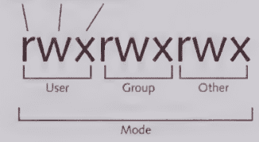

图 4-3：模式的结构

以下面所示的用户主目录列表举例。

```
[root@localhost]# ls -l
total 28
dr-xr-x 2 root root 4096 Apr 8 07:12 Desktop
-rw-r--r 1 root root 282 Apr 29 22:06 file1
-rw-r--x 1 root root 282 Apr 29 22:06 file2
-rw-r--x 1 root root 282 Apr 29 22:06 file3
-rw-r--r 1 root root 282 Apr 29 22:06 file4
-rw-r--r 1 root root 282 Apr 29 22:06 file5
-rw-rw-rw 1 user1 596 Apr 29 22:06 file6
[root@localhost]#
```

注意，图 4-3 中的所有权限并不都能代表文件或目录。如果未授予权限，则一个连字符（`-`）将替换其在模式中的位置。

在上面的输出中，`Desktop` 目录赋予了目录的用户或所有者（`root` 用户）读取、写入和执行权限，但组组员（`root` 组）将不会获得该目录的任何权限。注意，其他（系统上的所有人）也没有获得此目录的权限。

## 4-30 CompTIA Linux+ 认证，2004 目标

在我们的示例中，`file2` 没有赋予用户或组任何特定权限。所有用户都将通过“其他”类别获得读取、写入和执行权限。因此，`file2` 不应包含敏感数据，因为所有用户都有完全访问权限。出于同样的原因，如示例中的 `file3` 所示，对包含敏感数据的文件分配所有权限是不良的做法。

管理员在分配权限时可能会在两个方向上犯错：

- 权限太少，可能导致用户无法操作他们需要的文件
- 权限过多，可能会损害数据安全

你可以遵循一些通用准则来避免这些极端情况。

文件或目录的所有者通常是维护它的人。组员通常是与所有者处于同一部门的用户，他们可能需要对该文件或目录进行某种形式的受限访问。

因此，大多数文件和目录分配给用户的权限多分配给组的权限，而“其他”类别的权限将与组相同或更少，取决于隐私程度。

## 4-32 CompTIA Linux+ 认证, 2004 目标

由于权限被分为用户、组和其他三类，你可以通过仅使用三个数字来进一步简化，每个数字代表该类别权限的总和，如图 4-4 所示。

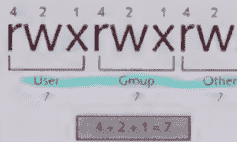

图 4-4：模式的数字表示法

要表示模式 `rw-r----`，你可以使用数字 `644` 来表示文件，因为用户具有读取和写入权限（4+2=6），组具有读取权限（4），其他具有读取（4）。模式 `rwx---` 也可以用数字 `750` 表示，因为用户具有读取、写入和执行权限（4+2+1=7），组具有读取和执行权限（4+1=5），其他没有任何（0）。

不同权限及其对应的数字列表见下表。

| 模式（仅限部分） | 对应的数字 |
|---|---|
| `rwx` | 4+2+1 = 7 |
| `rw-` | 4+2 = 6 |
| `r-x` | 4 + 1 = 5 |
| `r--` | 4 |
| `-wx` | 2 + 1 = 3 |
| `-w-` | 2 |
| `--x` | 1 |
| `---` | 0 |

要更改为之前使用的文件模式 `r-xr----`，你可以使用命令 `chmod 540 file`，如下文所示。

```
[root@localhost]# chmod 540 file
[root@localhost root]# ls -l file
-r-xr---- 1 root root 282 Apr 29 22:06 file
```

同样，要将目录中所有以单词 `file` 开头的文件模式更改为 `644`（这是文件的常用权限），你可以使用以下命令。

```
[root@localhost root]# chmod 644 file*
[root@localhost root]# ls -l file*
-rw-r--r-- 1 root root 282 Apr 29 22:06 file1
-rw-r--r-- 1 root root 282 Apr 29 22:06 file2
-rw-r--r-- 1 root root 282 Apr 29 22:06 file3
-rw-r--r-- 1 root root 282 Apr 29 22:06 file4
-rw-r--r-- 1 root root 282 Apr 29 22:06 file5
-rw-r--r-- 1 user1 sys 282 Apr 29 22:06 file6
```

与 `chown` 和 `chgrp` 命令一样，`chmod` 也可以使用 `-R` 选项递归地更改目录及其所有内容的权限。

## 4-34 CompTIA Linux+ 认证, 2004 目标

动手实践！

## C-2: 应用和修改访问权限

| 步骤 | 为什么要这么做 |
|---|---|
| 1 在 `tty2` 上以 `root` 身份登录 | （如有必要。） |
| 切换到 `/root` | （如有必要。） |
| 2 输入 `> permsample` | 创建 `permsample` 文件。 |
| 输入以下命令： | 为所有组授予该文件的所有权限。 |
| `chmod 777 permsample` | |
| 3 输入 `ls -l permsample` | 查看已分配的权限。 |
| 4 输入以下命令： | 为所有组撤销 `permsample` 文件的权限。 |
| `chmod 000 permsample` | |
| 输入 `ls -l permsample` | 查看分配给文件的新权限。 |
| 5 输入 `rm -f permsample` | 删除 `permsample` 文件。 |
| 6 输入 `cd /` | 切换到 `/` 目录。 |
| 输入 `pwd` | 查看当前工作目录。 |
| 7 输入 `ls -F` | 显示 `/` 目录的目录列表。 |
| 8 输入 `cd /user1` | 切换到 `/user1` 目录。 |
| 输入 `ls -F` | 显示 `/user1` 目录的目录列表。 |
| 9 输入 `cp /etc/hosts .` | 将 `hosts` 文件复制到当前目录。 |
| 输入 `ls -F` | 确保在当前目录中创建了 `hosts` 文件的副本。 |
| 10 切换到 `tty3` | |
| 以用户 `1` 登录 | |
| 11 输入 `cd /user1` | 切换到 `/user1` 目录。 |
| 输入 `ls -F` | 显示 `/user1` 目录的目录列表。 |
| 12 输入 `rm -f hosts` | 尝试删除 `hosts` 文件。 |
| 13 切换到 `tty2` | |

### 文件系统管理

## 4-35

- 14 输入以下命令：
  `chmod o+w /user1`
  为其他用户授予 `/user1` 目录的写入权限。
- 15 切换到 `tty3`
  输入 `rm -f hosts`
  删除 `hosts` 文件。
- 16 切换到 `tty2`
  输入 `cp /etc/hosts`。
  将 `hosts` 文件放置在当前目录。
- 18 输入 `ls -l`
  查看复制操作的结果。
- 19 切换到 `tty3`
  输入 `cat hosts`
  查看 `hosts` 文件的内容。
- 21 输入 `vi hosts`
  在 `vi` 中打开 `hosts` 文件。
  删除文件的第一行
  退出 `vi` 并保存更改。
- 22 切换到 `tty2`
- 23 输入以下命令：
  `chmod o+w /user1`
  为其他用户授予 `/user1` 目录的写入权限。
- 24 切换到 `tty3`
- 25 输入 `vi hosts`
  在 `vi` 中打开 `hosts` 文件。

## 主题 D: 默认权限

此主题涵盖了 CompTIA Linux+ 的目标。

| | 目标 |
|---|---|
| | 2.6 识别并修改默认权限。 |
| | 2.7 使用 `umask` 设置默认权限。 |

默认权限是在创建文件和目录时系统赋予的。注意 `umask` 仅适用于新建的内容，它不会修改现有权限。

`umask` 是一个名为 `umask` 的变量。例如，如果你将 `umask` 更改为 `22`，文件和目录的权限如图 4-5 所示。

| 新文件 | 新目录 |
|---|---|
| 系统分配的权限 | `rw-rw----` | `rwxrwxrwx` |
| - `umask` | `22` | `22` |
| = 结果权限 | `rw-r--r` | `rwxrwxrxr` |

图 4-5：执行 `umask 22`

## 文件系统管理 4-37

这与使用数值使用 `chmod` 相似，因为在这里你是移除权限而不是应用权限。

要将 `umask` 更改为 `007` 并查看其效果，可以在命令行输入以下命令。

```
[root@localhost]# umask 007
007
[root@localhost]# mkdir dir2
[root@localhost root]# ls -ld dir2
drwxr-wx--- 2 root 4096 May 3 21:41 dir2
```

### 特殊权限

#### 解释

读、写和执行普通文件权限是您可以使用这些权限来为文件分配安全性，但还有三种特殊的权限可以应用到文件和目录上：

- SUID（设置用户 ID）
- SGID（设置组 ID）
- 粘滞位（`Sticky` bit）

### SUID (Set User ID)

如果文件设置了 SUID 权限并执行了该文件，那么执行该文件的人在执行期间将成为该文件的所有者。有很多命令具有这种特殊权限。

用于测试网络连接的 `ping` 命令 (`/bin/ping`) 就是其中一个文件。由于 `root` 用户拥有此文件，当普通用户执行该命令时，在 `ping` 命令于内存中执行期间，该用户将临时变为 `root` 用户。这确保了任何用户都能以系统上拥有所有权限的人的身份测试连接性。

SUID 只能应用于编译后的程序。Linux 内核不会让你将 SUID 应用于 shell 脚本，因为 shell 脚本容易编辑且可能存在安全隐患。SUID 设置在目录上时没有特殊功能。

### SGID (Set Group ID)

SGID 权限同时应用于文件和目录，但方式不同。SGID 允许普通用户执行编译后的二进制程序，并在程序执行期间成为文件所在组的成员。

如果某个命令或文件要求执行它的用户具有与 `sys` 组成员相同的权限，那么文件上的 SGID 将简化对文件用户分配权限的操作。

SGID 放置在目录上时具有特殊功能。通常情况下，当用户创建一个文件时，用户的用户名和主组将成为该文件的所有者和组。然而，如果目录设置了 SGID 权限，用户名将仍是文件的所有者，但目录的组将成为该文件的组。

### 粘滞位 (Sticky bit)

粘滞位通过修改目录的写权限，来控制用户可以从目录中删除哪些文件。当目录赋予其他写权限时，任何人都可以向其添加文件。一个很好的例子是 `/tmp` 目录，所有用户都可以共享。

遗憾的是，写权限也赋予了任何用户删除其中所有文件和目录的能力，包括其他用户添加到目录的文件。由于它是目录级权限，保护文件内容的权限无法防止其被删除或移动。

当将粘滞位应用到这个常用目录时，除了写权限外，用户可以添加文件，但只能删除他们自己添加的文件。

注意：所有特殊权限也需要执行权限才能正常工作。SUID 和 SGID 权限作用于可执行文件，而 SGID 和粘滞位权限作用于目录（目录必须具有执行权限才能访问）。

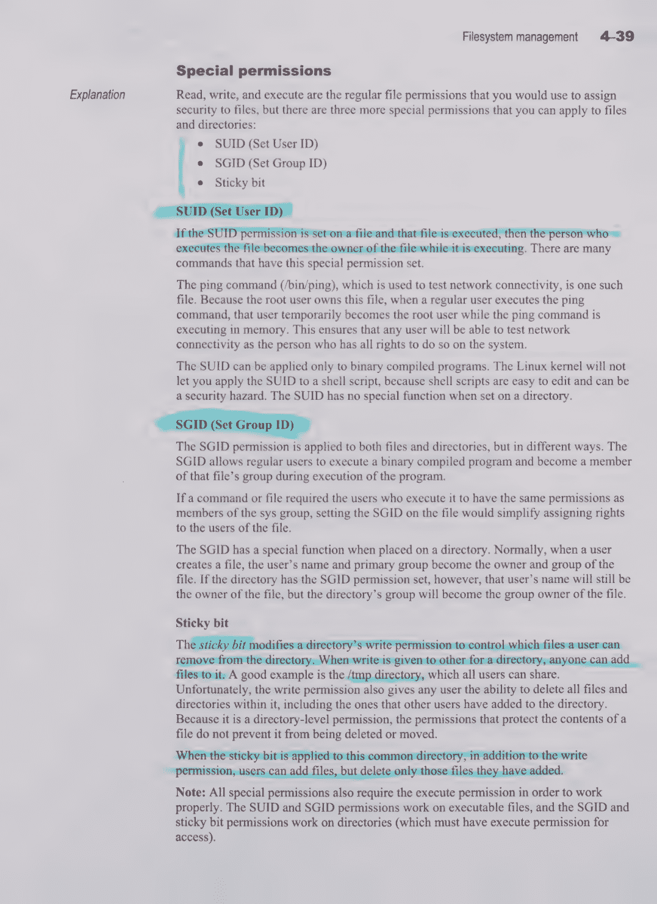

### CompTIA Linux+ 认证，2004 目标

## 设置特殊权限

`ls -l` 命令显示的文件模式没有专门的特殊权限部分。由于特殊权限需要执行权限，因此该符号被假定存在。当使用 `ls -l` 命令显示时，特殊权限会取代其位置，如表 4-7 所示。

```
rwx rwx rwx
rsw rswt
```

表 4-7：模式中特殊权限的表示

注意，即使文件或目录没有执行权限，系统也会允许您设置特殊权限。这将阻止特殊权限发挥其功能。在这种情况下，特殊权限将以大写形式显示，如图 4-8 所示，让您知道它们将无法运行。

```
rw-rw-rw-
rwSrwSrWt
```

表 4-8：在缺少执行权限的情况下特殊权限的表示

要设置特殊权限，您可以将它们可视化为模式的左侧，如表 4-9 所示。

| SUID | SGID | 位 | 用户 | 组 | 其他 |
| :--- | :--- | :--- | :--- | :--- | :--- |
| 4 | 2 | 1 | `r-x` | `r-x` | `r-x` |

表 4-9：普通权限和特殊权限的数字表示

### 文件系统管理

因此，要为文件或目录设置所有特殊权限，你可以使用 `chmod 777 <name>` 命令，如表 4-9 所示。然而，SUID 和 SGID 位通常设置在文件上。

更改文件权限，以便其他用户能够以所有者和组成员的身份查看并执行文件，你可以使用 `chmod 6755 file` 命令，如下所示。

```
root@localhost]# chmod 6755 file
root@localhost]# ls -l file
-rwxr-sr-x 1 root root 0 May 3 21:40
```

在目录上设置粘滞位，你使用 `chmod 1777 dir` 命令。这允许所有用户（包括其他用户）向目录添加文件，但由于我们设置了粘滞位，他们只能删除自己拥有的文件，如下所示。

```
root@localhost]# chmod 1777 dir
root@localhost]# ls -ld dir
drwxrwxr-t 2 root root 4096 May 3 19
```

可以在不分配执行权限的情况下分配特殊权限，这将导致特殊权限失效。如果忘记赋予执行权限，特殊权限将毫无用处。正如下面所示，特殊权限将以大写形式显示：

`drwxrwxr-t 2 root root 4096 May 3 19`


## 特殊权限

### 解释
读、写和执行普通文件权限是您可以使用这些权限来为文件分配安全性，但还有三种特殊的权限可以应用到文件和目录上：

- `SUID`（设置用户 ID）
- `SGID`（设置组 ID）
- 粘滞位（`Sticky bit`）

### SUID (Set User ID)

如果文件设置了 `SUID` 权限并执行了该文件，那么执行该文件的人在执行期间将成为该文件的所有者。有很多命令具有这种特殊权限。

用于测试网络连接的 `ping` 命令 (`/bin/ping`) 就是其中一个文件。由于 `root` 用户拥有此文件，当普通用户执行该命令时，在 `ping` 命令于内存中执行期间，该用户将临时变为 `root` 用户。这确保了任何用户都能以系统上拥有所有权限的人的身份测试连接性。

`SUID` 只能应用于编译后的程序。`Linux` 内核不会让你将 `SUID` 应用于 `shell` 脚本，因为 `shell` 脚本容易编辑且可能存在安全隐患。`SUID` 设置在目录上时没有特殊功能。

### SGID (Set Group ID)

`SGID` 权限同时应用于文件和目录，但方式不同。`SGID` 允许普通用户执行编译后的二进制程序，并在程序执行期间成为文件所在组的成员。

如果某个命令或文件要求执行它的用户具有与 `sys` 组成员相同的权限，那么文件上的 `SGID` 将简化对文件用户分配权限的操作。

`SGID` 放置在目录上时具有特殊功能。通常情况下，当用户创建一个文件时，用户的用户名和主组将成为该文件的所有者和组。然而，如果目录设置了 `SGID` 权限，用户名将仍是文件的所有者，但目录的组将成为该文件的组。

### 粘滞位 (Sticky bit)

粘滞位通过修改目录的写权限，来控制用户可以从目录中删除哪些文件。当目录赋予其他写权限时，任何人都可以向其添加文件。一个很好的例子是 `/tmp` 目录，所有用户都可以共享。

遗憾的是，写权限也赋予了任何用户删除其中所有文件和目录的能力，包括其他用户添加到目录的文件。由于它是目录级权限，保护文件内容的权限无法防止其被删除或移动。

当将粘滞位应用到这个常用目录时，除了写权限外，用户可以添加文件，但只能删除他们自己添加的文件。注意：所有特殊权限也需要执行权限才能正常工作。`SUID` 和 `SGID` 权限作用于可执行文件，而 `SGID` 和粘滞位权限作用于目录（目录必须具有执行权限才能访问）。


### CompTIA Linux+ 认证，2004 目标

## 设置特殊权限

`ls -l` 命令显示的的文件模式没有专门的特殊权限部分。由于特殊权限需要执行权限，因此该符号被假定存在。当使用 `ls -l` 命令显示时，特殊权限会取代其位置，如表 4-7 所示。

```
rwx rwx rwx
rsw rswt
```

表 4-7：模式中特殊权限的表示

注意，即使文件或目录没有执行权限，系统也会允许您设置特殊权限。这将阻止特殊权限发挥其功能。在这种情况下，特殊权限将以大写形式显示，如图 4-8 所示，让您知道它们将无法运行。

```
rw-rw-rw-
rwSrwSrWt
```

表 4-8：在缺少执行权限的情况下特殊权限的表示

要设置特殊权限，您可以将它们可视化为模式的左侧，如表 4-9 所示。

| SUID | SGID | 位 | 用户 | 组 | 其他 |
| :--- | :--- | :--- | :--- | :--- | :--- |
| 4 | 2 | 1 | r-x | r-x | r-x |

表 4-9：普通权限和特殊权限的数字表示

### 文件系统管理

因此，要为文件或目录设置所有特殊权限，您可以使用 `chmod 777 <name>` 命令，如表 4-9 所示。然而，`SUID` 和 `SGID` 位通常设置在文件上。

更改文件权限，以便其他用户能够以所有者和组成员的身份查看并执行文件，您可以使用 `chmod 6755 file` 命令，如下所示。

```
root@localhost]# chmod 6755 file
root@localhost]# ls -l file
-rwxr-sr-x 1 root root 0 May 3 21:40
```

在目录上设置粘滞位，您使用 `chmod 1777 dir` 命令。这允许所有用户（包括其他用户）向目录添加文件，但由于我们设置了粘滞位，他们只能删除自己拥有的文件，如下所示。

```
root@localhost]# chmod 1777 dir
root@localhost]# ls -ld dir
drwxrwxr-t 2 root root 4096 May 3 19
```

可以在不分配执行权限的情况下分配特殊权限是可能的，这将导致特殊权限失效。如果忘记赋予执行权限，特殊权限将毫无用处。正如下面所示，特殊权限将以大写形式显示：

```
drwxrwxr-t 2 root root 4096 May 3 19
```


在目录上设置粘滞位，您使用 `chmod 1777 dir` 命令。这允许所有用户（包括其他用户）向目录添加文件，但由于我们设置了粘滞位，他们只能删除自己拥有的文件，如下所示。

```
root@localhost]# chmod 1777 dir
root@localhost]# ls -ld dir
drwxrwxr-t 2 root root 4096 May 3 19
```

可以在不分配执行权限的情况下分配特殊权限是可能的，这将导致特殊权限失效。如果忘记赋予执行权限，特殊权限将毫无用处。正如下面所示，特殊权限将以大写形式显示：

```
drwxrwxr-t 2 root root 4096 May 3 19
```

可以在不分配执行权限的情况下分配特殊权限是可能的，这将导致特殊权限失效。如果忘记赋予执行权限，特殊权限将毫无用处。正如所示。SGID 允许普通用户执行编译后的二进制程序，并在程序执行期间成为文件所在组的成员。如果某个命令或文件要求执行它的用户具有与 `sys` 组成员相同的权限，那么文件上的 SGID 将简化对文件用户分配权限的操作。SGID 放置在目录上时具有特殊功能。通常情况下，当用户创建一个文件时，用户的用户名和主组将成为该文件的所有者和组。然而，如果目录设置了 SGID 权限，用户名将仍是文件的所有者，但目录的组将成为该文件的组。

# 文件系统管理 4-45

## 练习与测试

- **5** 所有文件都有一个
    - A 超块 (`superblock`)
    - B 索引节点 (`inode`)
    - C `PATH`
    - D 目录

- **6** 用户可以做什么来以交互方式运行 `cp` 或 `mv` 并被询问是否覆盖现有文件？
    - A 无选择，因为新文件默认将覆盖旧文件。
    - B 使用 `interactive cp` 或 `interactive mv`。
    - C 输入 `cp -i` 或 `mv -i`。
    - D 输入 `cp -interactive` 或 `mv - interactive`。
    - E 直接输入 `cp` 或 `mv`，因为它们默认交互模式运行。

- **7** 用户输入 `cp project1 /user1`，但当她输入 `ls -F /user1` 时发现文件没有复制。为什么？
    - A `ls` 命令的语法错误。
    - B 用户没有 `/user1` 目录的写权限。
    - C 用户没有 `file1` 的写权限。
    - D 文件已复制，但 `ls -F` 命令不会显示已复制的文件，只显示原始文件。

- **8** 输入 `ls -F` 命令后，你在输出中看到以下行：
  ```
  -rw-r-xr--  1 user1  root  0 Apr 29 15:40 file1
  ```
  这意味着什么？
    - A `user1` 拥有读写权限，`root` 组的成员拥有读取和执行权限，其他人对文件有读取权限。
    - B `root` 组的成员拥有读写权限，`user1` 拥有读取和执行权限，其他人对文件有读取权限。
    - C 所有用户都有读写权限，`root` 组的成员拥有读取和执行权限，`user1` 对文件有读取权限。
    - D `user1` 拥有读写权限，其他人拥有读取和执行权限，`root` 组的成员对文件有读取权限。

- **9** 输入命令 `umask 731` 后，随后创建的文件和目录的权限将受到影响。在这种情况下，所有新文件的权限是什么？
    - A `rw-xr-rw-`
    - B `rwx-xr-r--`
    - C `---x--x--x`
    - D `---wx-x--`

- **10** 命令 `cp /etc/hosts . .` 的结果是什么？
    - A 与 `cp /etc/hosts ..` 命令相同
    - B 将 `/etc/hosts` 文件复制到剪贴板
    - C 在 `/etc` 目录中创建文件 `hosts` 的副本
    - D 从 `etc` 到当前目录创建 `hosts` 文件的副本

- **11** 因为硬链接文件共享相同的 `inode` 和数据，当硬链接在一起的文件其中一个被删除时，它们都会被删除。正确还是错误？


# 第 5 单元

## 文件系统管理

**耗时：160 分钟**

完成本单元后，你将学会：

- A 识别 `/dev` 目录中设备文件的类型。
- B 理解常见的文件系统类型及其特征，并挂载和卸载软磁盘和 CD-ROM。
- C 创建、挂载和卸载分区。
- D 监控磁盘剩余空间，检查文件系统错误，并使用磁盘配额限制使用。

## 主题 A：`/dev` 目录和设备文件

本主题涵盖了以下 CompTIA Linux+ 考试目标。

| 目标 |
| :--- |
| 6.2 使用 Linux 工具诊断硬件问题。`/dev` |

### `/dev` 目录

Linux 系统上的大多数设备（如磁盘、终端和串口）都有与其关联的文件。这些文件被称为**设备文件**（`device files`），它们描述了设备是什么，并为操作系统寻址设备提供了路径。每个设备对应一个文件，通常位于 `/dev` 目录中。

Linux 使用代表设备的文件路径来识别每个设备。例如，你计算机上第一个块软磁盘的设备文件是 `fd0`。设备的路径是 `/dev/fd0`。要表示第二个软磁盘，你会使用 `/dev/fd1`，依此类推。

每个设备文件都根据其使用方式和该设备的特性规定了数据如何在设备之间进行传输。有两种类型的设备和数据传输方法：

- **块设备**（Block devices）使用物理内存作为缓冲区，以数据块或块的形式接收数据传输。它们传输信息的速度比字符设备快得多。表示此类软磁盘的设备文件通常是块设备文件，因为首选快速传输率。
- **字符设备**（Character devices）逐个字符地与设备之间接收数据传输。设备文件通常表示显示终端、磁带驱动器和输入输出端口。

要查看特定设备是按字符还是按块传输的，`ls -l` 命令会在文件类型列中显示 `c` 或 `b` 字符。要查看 `/dev/fd0` 的类型，使用以下命令：

```
[root@localhost]# ls -l /dev/fd0
brw-rw---- 1 root floppy 2 Aug 30 2001 /dev/fd0
[root@localhost]#
```

从上述输出的最左侧字符可以看出，`/dev/fd0` 是一个块设备文件。下表列出了一些常见设备文件及其类型。

| 设备文件 | 描述 |
| :--- | :--- |
| `/dev/fd0` | 第一个软磁盘 |
| `/dev/fd1` | 第二个软磁盘 |
| `/dev/sda1` | 第一块硬盘 |
| `/dev/sdb1` | 第二块硬盘 |
| `/dev/sda1` | 第一块 SCSI 磁盘 |
| `/dev/sdb1` | 第二块 SCSI 磁盘 |
| `/dev/tty1` | 第一个终端 |
| `/dev/tty2` | 第二个终端 |
| `/dev/tty0` | 第一个串口 |
| `/dev/tty1` | 第二个串口 |
| `/dev/aux` | 鼠标设备 |
| `/dev/lp0` | 并口 |
| `/dev/null` | 空 |
| `/dev/st0` | 磁带设备 |
| `/dev/usb` | USB 设备 |

### 文件系统管理

要查看当前系统中使用的设备列表及其主设备号，可以查看 `/proc/devices` 文件的内容，如下所示。

```
[root@localhost root]# cat /proc/devices

Character devices:
1 mem
2 pty
3 ttyp
4 ttyS
5 cua
7 vcs
10 misc
29 fb
36 netlink
128 p
129 ptm
130 ptm
131 ptm
132 ptm
133 ptm
134 ptm
135 ptm
136 pts
137 pts
138 pts
139 pts
140 pts
141 pts
142 pts
143 pts
162 raw
180 usb
226 drmm
254 iscsctl
Block devices:
1 ramdisk
2 fd
3 ide0
9 md
22 idel
[root@localhost root]# _
```

### A-1: 创建和查看设备文件

| 操作步骤 | 解释 |
| :--- | :--- |
| 1 按 `CTRL` + `ALT` + `F2` | 切换到命令行终端 (`tty2`)。 |
| 输入 `root` 作为登录名 | |
| 输入 `password` 作为密码 | 登录终端。 |
| 2 输入 `ls -l /dev/tty6` | 查看 `tty6` 的设备类型。 |
| 按 `ENTER` | |
| 3 输入 `rm -f /dev/tty6` | 删除 `tty6` 文件。 |
| 按 `ENTER` | |
| 4 输入 `ls -l /dev/tty6` | 确认删除操作。 |
| 5 按 `CTRL` + `ALT` + `F6` | 切换到命令行终端 (`tty6`)。 |
| 输入 `root` 作为用户名 | 尝试登录终端。 |
| 日志会挂起 | 因为没有可用的设备。 |
| 6 切换回 `tty2` | |
| 输入以下命令： | 重新创建 `tty6` 文件。 |
| `mknod /dev/tty6 c 4 6` | |
| 7 输入 `ls -l /dev/tty6` | 确认文件已创建。 |
| 8 输入 `ls -l /dev/tty?` | 显示 `/dev` 目录下所有文件名的列表。 |
| 9 输入 `find /dev \| more` | 查看列出的部分设备。反复按空格键或长按可以翻页。 |
| 按 `SPACEBAR` | |
| 按 `Q` | 退出 `more` 命令。 |
| 输入 `du -s /dev` | 估计 `/dev` 目录的磁盘空间占用。 |
| 10 输入以下命令： | 显示 `/proc` 目录下的设备文件。 |
| `cat /proc/devices \| more` | |
| 按 `SPACEBAR` | 查看列表剩余部分。 |

## 主题 B: 使用软盘和 CD-ROM

本主题涵盖了以下 CompTIA Linux+ 考试目标。

| | 目标 |
| :--- | :--- |
| | 2.1 使用 CLI 命令管理本地存储设备和文件系统。 |
| | - `fsck` |
| | 3.5 配置用于挂载驱动器或分区的文件。 |
| | - `fstab` |
| | - `stabtab` |
| | - 语法 |

### 可移动介质

软盘和 CD-ROM 是用于文件和目录的存储设备。它们与硬盘在向系统提供空间以及使用空间的方式非常相似，但存储介质可以被移除并存储，或方便地在另一台计算机上使用。

在具体查看软盘和 CD-ROM 之前，我们将查看所有存储设备在存储数据并提供给系统时所需的属性。

### 文件系统

为了让操作系统找到并处理你的文件，文件需要以系统理解的格式存储。这种格式被称为文件系统。使用的文件系统类型决定了磁盘空间的管理方式。所有文件系统共享三个组件：

- 超级块 (`superblock`)
- `inode` 表 (`inode table`)
- 数据块 (`data blocks`)

从结构层面来看，这三个组件协同工作以组织文件并允许快速检索数据。所有存储介质（如软盘、硬盘和 CD-ROM）在用于存储文件和目录之前都需要使用文件系统进行格式化。在分成几个分区的硬盘上，每个分区都需要一个文件系统。

与 Windows 不同，Linux 的优势之一是它可以支持多种不同的文件系统。每个文件系统都有特定的优缺点。某些文件系统比其他更适合特定任务，你可以选择最适合你应用程序的一个。

你可以在同一个目录树内拥有用不同文件系统格式化的多个设备。无论文件系统之间有什么差异，文件和目录都会出现。

> **注意：** 有关文件系统类型及其功能的完整列表，请参考 `Filesystem HOWTO`：`www.tld.org/HOWTO/Filesystems-HOWTO.html`。

下表列出了 Linux 中可用的某些常用文件系统。

| 文件系统 | 说明 |
| :--- | :--- |
| `ext3` | 第三代扩展文件系统：`ext2` 的变体，允许日志记录并具有更快的启动和恢复速度。这现在是标准。 |
| `ext2` | 第二代扩展文件系统：多年来的标准文件系统。 |
| `iso9660` | CD-ROM 文件系统：用于标准。 |
| `minix` | Minix 文件系统：较旧的文件系统。 |
| `reiserfs` | Reiser：为性能设计的日志文件系统。 |
| `vfat` | FAT 文件系统：用于软盘和 U 盘。 |
| `msdos` | DOS 文件系统：类似于 `vfat`。 |
| `cdfs` | 刻光光介质。 |

### 格式化与文件系统创建

在使用软盘之前，可能需要对其进行格式化。这是使用格式化命令完成的，该命令定义了文件系统。要创建一个 `ext2` 文件系统，使用：

```
[root@localhost root]# mkfs -t ext2 /dev/
mke2fs 1.35 (2004)
文件系统标签=
操作系统:Linux
块大小=1024 (log=0)
碎片大小=1024 (log=0)
184inodes, 1440块
72块 (5.0%) 留给用户
块组=8192
每组8192块
每组184inodes

写入 inode 表：完成
写入超级块和文件系统信息：
完成
```

该文件系统将每 28 次挂载或 180 天检查一次。

你可以指定不同的文件系统。一种常见的选择是 DOS 文件系统，其结果如下所示：

```
[root@localhost root]# mkfs -t vfat /dev/
mkfs.msdos 2.8 (2001)
[root@localhost root]# _
```

如果你没有指定文件系统，运行 `mkfs /dev`，默认文件系统是 `ext2`。

虽然创建文件系统的最常用命令是 `mkfs`，但存在其他变体或快捷方式。要创建一个 `ext2` 文件系统，你可以运行 `mke2fs /dev/`。

下表列出了 `mkfs` 的替代方案。

### CompTIA Linux+ 认证，2004 目标

| 命令 | 说明 |
| :--- | :--- |
| `mkfs` | 创建大多数类型的文件系统 |
| `mkfs.msdos` | 创建 DOS 文件系统 |
| `mkdosfs` | |
| `mkfs.vfat` | |
| `mkfs.minix` | 创建 MINIX 文件系统 |
| `mke2fs` | 创建 `ext2` 文件系统 |
| `mke2fs -j` | 创建 `ext3` 文件系统（`j` =日志记录） |

### B-1: 理解文件系统类型

## 问题与问答

1. 用于存储数据库的分区的最合适文件系统是 ________。
    - A `minix`
    - B `ext2`
    - C `reiserfs`
    - D `ext3`

2. 如果软盘需要被 Windows 读取，你应该将其格式化为 ________。
    - A `iso9660`
    - B `none`
    - C `ext2`
    - D `vfat`

3. 支持 Fedora Core 2 的磁盘默认文件系统是 ________。

## 挂载和卸载设备

### 解释

我们已经确定存储设备包含一个可以存储数据的文件系统。同时，设备与一个设备文件关联，告诉系统该设备是什么。但是，为了让用户可以使用该设备及其文件系统，必须将设备与目录树关联。这是通过将设备挂载到目录树来实现的。

硬盘分区、软盘或 CD-ROM 挂载在树上的位置被称为挂载点。当你在目录中创建文件时，这些文件将存储在该设备的文件系统中。

### 挂载点目录

目录是不包含数据的文件。它们仅仅是包含在其中的文件和子目录的列表。如果你隐藏了一个目录，系统很容易防止用户访问其内部的数据。

这本质上就是当设备挂载到某个目录时所发生的情况。在设备挂载期间，该设备会临时隐藏挂载点目录。挂载之前存在于挂载点目录中的任何文件内容都不会丢失，而是被隐藏了。当卸载设备时，挂载点目录会暴露出来，之前的的文件内容也会显示出来。

例如，假设你将包含文件系统的软盘设备挂载到 `/mnt` 目录。`/mnt` 目录包含两个子目录，是可移动媒体设备（如软盘驱动器和 CD-ROM）常用的挂载点。在挂载之前，目录结构类似于图 5-1 所示。

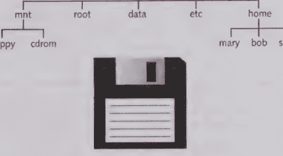

图 5-1：挂载前的目录结构

当软盘挂载到 `/mnt` 目录后，`/mnt` 的内容似乎被软盘文件系统取代了，如图 5-2 所示。

## 5-12 CompTIA Linux+ 认证，2004

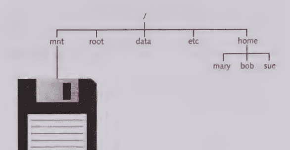

图 5-2：挂载后的目录结构

如果你随后在 `/mnt` 中存储一个文件，该文件将存储在软磁盘上。如果你在 `/mnt` 下创建一个子目录，该子目录将在软盘上创建。

需要注意的是，任何现有目录都可以作为挂载点。如果你将软盘挂载到 `/bin` 目录，那么在软盘挂载期间，`/bin` 目录中的所有文件都会被覆盖，包括正在使用的命令。因此，为了安全和清晰，最佳实践是创建专门用于挂载设备的空目录，以避免重要文件无法访问。

当系统首次启动时，硬盘上的文件系统会被挂载到 `/` 目录。这被称为根文件系统，包含了大多数操作系统文件。其他文件系统挂载到 `/` 下的各种挂载点目录。

这些自动挂载点是根据 `/etc/fstab`（文件系统表）文件中的目创建的，系统在启动时读取该文件。如果你向系统添加新磁盘，可以向此文件添加条目以创建其他挂载点。

### 挂载软盘

软盘格式化文件系统后，必须将其挂载到目录树上才能使用。你可以通过不带任何选项或参数的 `mount` 命令来获取当前挂载的文件系统的列表。它读取 `/etc/mtab`（挂载表）文件中列出的信息，如下所示。


## 文件系统管理

```
[root@localhost]# mount
/dev/hd1 on / type ext3 (rw)
none on /proc type proc (rw)
usedevfs on /proc/bus/usb usedevfs (rw)
none on /dev/pts type devpts (rw,gid=5,mode=620)
none on /dev/shm type tmpfs (rw)
none on /proc/sys/fs/binfmt_misc type binfmt_misc (rw)
```

设备 `/hd1` 挂载在 `/` 目录上，包含一个 `ext3` 文件系统。上面列出的其他文件系统是系统使用的特殊文件系统。

要在目录树上挂载设备，使用带有选项和参数的 `mount` 命令来指定文件系统类型、要挂载的设备以及挂载目录（挂载点）。

### 检查与挂载

如果另一个用户正在使用挂载点目录，系统将给你返回错误消息，磁盘将不会挂载。要检查 `/mnt/floppy` 目录是否正在使用，输入带有 `-u` 选项的 `fuser` 命令，如下所示。

```
[root@localhost root]# fuser -u /mnt/floppy
[root@localhost root]#
```

上述输出表示 `/mnt/floppy` 目录没有被任何用户进程占用。要将第一个格式化为 `ext2` 的软盘挂载到 `/mnt/floppy` 目录，你需要运行以下命令。

```
[root@localhost root]# mount -t ext2 /dev/fd0 /mnt/floppy
[root@localhost root]# mount
/dev/hdl0 on /proc type proc (rw)
usedevfs on /proc/bus/usb usedevfs (rw)
none on /dev/shm type tmpfs (rw,gid=5,mode=620)
none on /dev/sys/ type tmpfs (rw)
none on /proc/fs/binfmt_misc type binfmt_misc (rw)
```

设备 `/hd1` 挂载在 `/` 目录上，包含一个 `ext3` 文件系统。上面列出的其他文件系统是系统使用的特殊文件系统。

要在目录树上挂载设备，使用带有选项和参数的 `mount` 命令来指定文件系统类型、要挂载的设备以及挂载目录（挂载点）。

### 挂载选项与配置

挂载选项（mount options）是命令在挂载卷时接受的额外选项，例如只读或 `"ro"`。任何带有挂载选项 `"noauto"` 的文件系统在启动时都不会自动挂载。可以通过查看 `mount` 命令的帮助页找到该命令可以使用的选项完整列表。

`dump` 用于 `dump` 命令在备份文件系统时使用。该字段中的 `"1"` 表示该文件系统应该被备份，而 `"0"` 则表示不需要备份。

`fsck` 用于 `fsck` 命令在启动时检查文件系统的错误。任何在该字段中为 `"1"` 的文件系统将首先被检查，在任何数字为 `"2"` 的文件系统之前。数字为 `"0"` 的文件系统不进行检查。

**注意：** 对于 `/etc/fstab` 文件中所有打算在启动时挂载的文件系统，您应该使用 `-a` 命令。

以下输出显示了 `/etc/fstab` 文件的内容：

```
[root@localhost root#] cat /etc/fstab
LABEL=/ ext3 defaults 1 1
none /dev/pts devpts gid=mode=620 0 0
none /proc proc defaults 0 0
none /dev/shm tmpfs defaults 0 0
/dev/sd2 swap swap 0 0
/dev/cdrom /mnt/cdrom is09660 noauto,owner,kudzu 0 0
/dev/fd0 /mnt/floppy auto noauto,user,kudzu 0
```

要将第一个软磁盘设备 (`/dev/fd0`) 挂载到 `/mnt/floppy` 目录并自动检测设备上的文件系统类型，您需要为 `mount` 命令提供足够的信息，以便在 `/etc/fstab` 文件中找到对应的行。

```
[root@localhost root#] mount /dev/fd0
```

上述输出中的 `mount` 命令是因为 `/etc/fstab` 中存在描述挂载 `/dev/fd0` 设备的行。

或者，您也可以挂载点作为参数。

```
[root@localhost root#] mount /mnt/floppy
```

在挂载和卸载软盘时很有用的命令见下表。

| 命令 | 说明 |
| :--- | :--- |
| `mount` | 显示已挂载的文件系统 |
| `mount -t<type> <device> <mount point>` | 将特定 `<type>` 的 `<device>` 挂载到 `<mount point>` 目录 |
| `fuser -u <directory>` | 显示使用特定目录的用户 |
| `umount <mount point>` 或 `umount <device>` | 从特定的 `<mount point>` 目录卸载 `<device>` |


### 在 GUI 中挂载软盘

虽然上表列出的命令允许对挂载过程进行完全控制，但在 GUI 环境下工作，您可能会发现使用图标更容易。同样，`/etc/fstab` 中列出的条目用于指定挂载点。

在 GNOME 桌面中挂载软盘，双击“计算机（Computer）”图标，这将打开图 5-3 所示的框。然后，双击“软磁盘（Floppy）”图标，将打开一个显示磁盘内容的框。

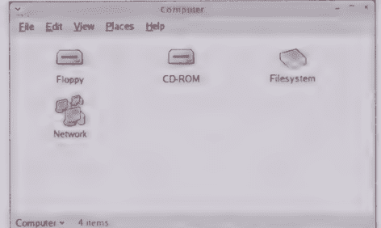

*图 5-3: 在 Gnome 环境下挂载软盘*

在 KDE 桌面，您可以双击“在此开始（Start Here）”图标并选择“设备（Devices）”以打开图 5-4 所示的框。然后，双击“软磁盘（Floppy）”图标。

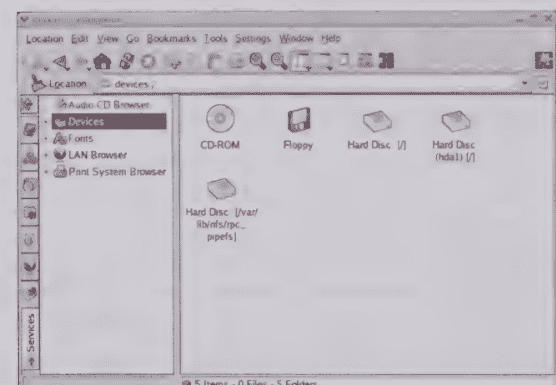

*图 5-4: 在 KDE 环境下挂载软盘*

在 GUI 环境下挂载软盘会在面上放置一个代表软磁盘的图标。您可以双击软磁盘图标打开文件列表。要卸载软盘，右键点击软磁盘图标并选择“卸载卷（Unmount Volume）”。

### 软磁盘操作实践

| 操作步骤 | 原因 |
| :--- | :--- |
| 1. 切换到 `tty2` 并以 `root` 登录 | （如有必要。） |
| 2. 输入 `mkdir /mymount` | 创建一个新的挂载点目录。 |
| 3. 输入以下命令： `cp /etc/hosts /mymount` | 将 `hosts` 文件复制到 `/mymount` 目录。 |
| 4. 输入 `ls -F /mymount` | 验证 `hosts` 文件是否已复制。 |
| 5. 输入 `mkfs -ext2 /dev/fd0` | 尝试在软磁盘上创建 `ext2` 文件系统。 |
| 6. 将软盘放入计算机的软磁盘驱动器中 | `Enter mkfs -ext2 /dev/fd0` |
| 7. 输入以下命令： `mount -t ext2 /dev/fd0 /mymount` | 挂载软磁盘。 |
| 输入 `mount` | 验证挂载操作。 |
| 8. 输入 `ls -F /mymount` | 查看软磁盘的内容。注意 `hosts` 文件是不可见的。 |
| 9. 输入以下命令： `cp /etc/inittab /mymount` | 将 `inittab` 文件复制到软磁盘。 |
| 10. 输入 `ls -F /mymount` | 验证文件已成功复制到软磁盘。 |
| 11. 输入 `umount /mymount` | 卸载软磁盘。 |
| 12. 输入 `mount` | 验证挂载步骤。 |
| 13. 输入 `ls -F /mymount` | `hosts` 文件重新出现！ |
| 14. 输入 `mount /dev/fd0` | 将软磁盘挂载到 `fd0` 目录。 |
| 15. 输入 `mount` | 注意挂载点。 |
| 16. 输入 `cat /etc/fstab` | 查看 `fstab` 文件中的挂载条目。 |
| 17. 输入 `cd /mnt/floppy` | 进入软磁盘目录。 |
| 18. 输入 `pwd` | |
| 19. 输入 `ls -F` | 验证驱动器已挂载。 |
| 20. 输入 `umount /floppy` | 卸载软磁盘。 |
| 21. 输入 `fuser -u /floppy` | 识别使用软磁盘的用户。 |
| 22. 输入 `cd /` | 返回根目录。 |
| 23. 输入 `mount /dev/fd0 /mnt/floppy` | 挂载软磁盘。 |

### 使用 CD-ROM

挂载选项是命令在挂载卷时接受的额外选项，例如只读或 `"ro"`。任何带有挂载选项 `"noauto"` 的文件系统在启动时都不会自动挂载。可以通过查看 `mount` 命令的帮助页找到该命令可以使用的选项完整列表。

`dump` 用于 `dump` 命令在备份文件系统时使用。该字段中的 `"1"` 表示该文件系统应该被备份，而 `"0"` 则表示不需要备份。

`fsck` 用于 `fsck` 命令在启动时检查文件系统的错误。任何在该字段中为 `"1"` 的文件系统将首先被检查，在任何数字为 `"2"` 的文件系统之前。数字为 `"0"` 的文件系统不进行检查。

**注意：** 对于 `/etc/fstab` 文件中所有打算在启动时挂载的文件系统，你应该使用 `-a` 命令。

以下输出显示了 `/etc/fstab` 文件的内容：

```
[root@localhost root#] cat /etc/fstab
LABEL=/ ext3 defaults 1 1
none /dev/pts devpts gid=mode=620 0 0
none /proc proc defaults 0 0
none /dev/shm tmpfs defaults 0 0
/dev/sd2 swap swap 0 0
/dev/cdrom /mnt/cdrom is09660 noauto,owner,kudzu 0 0
/dev/fd0 /mnt/floppy auto noauto,user,kudzu 0
```

要将第一个软磁盘设备 (`/dev/fd0`) 挂载到 `/mnt/floppy` 目录并自动检测设备上的文件系统类型，您需要为 `mount` 命令提供足够的信息，以便在 `/etc/fstab` 文件中找到对应的行。


```
[root@localhost root#] mount /dev/fd0
```

上述输出中的 `mount` 命令是因为 `/etc/fstab` 中存在描述挂载 `/dev/fd0` 设备的行。

或者，您也可以挂载点作为参数。

```
[root@localhost root#] mount /mnt/floppy
```

在挂载和卸载软盘时很有用的命令见下表。

| 命令 | 说明 |
| --- | --- |
| `mount` | 显示已挂载的文件系统 |
| `mount -t<type> <device> <mount point>` | 将特定 `<type>` 的 `<device>` 挂载到 `<mount point>` 目录 |
| `fuser -u <directory>` | 显示使用特定目录的用户 |
| `umount <mount point>` 或 `umount <device>` | 从特定的 `<mount point>` 目录卸载 `<device>` |


## CompTIA Linux+ 认证, 2004 目标

### 在 GUI 中挂载软盘

虽然上表列出的命令允许对挂载过程进行完全控制，但在 GUI 环境下工作，您可能会发现使用图标更容易。同样，`/etc/fstab` 中列出的条目用于指定挂载点。

在 GNOME 桌面中挂载软盘，双击“计算机（Computer）”图标，这将打开图 5-3 所示的框。然后，双击“软磁盘（Floppy）”图标，将打开一个显示磁盘内容的框。


*图 5-3: 在 Gnome 环境下挂载软盘*

在 KDE 桌面，您可以双击“在此开始（Start Here）”图标并选择“设备（Devices）”以打开图 5-4 所示的框。然后，双击“软磁盘（Floppy）”图标。


*图 5-4: 在 KDE 环境下挂载软盘*

在 GUI 环境下挂载软盘会在桌面上放置一个代表软磁盘的图标。您可以双击软磁盘图标打开文件列表。要卸载软盘，右键点击软磁盘图标并选择“卸载卷（Unmount Volume）”。

## B-2: 软磁盘操作

| 操作步骤 | 原因 |
| --- | --- |
| 1 切换到 `tty2` 并以 `root` 登录 | （如有必要。） |
| 2 输入 `mkdir /mymount` | 创建一个新的挂载点目录。 |
| 3 输入以下命令： | 将 `hosts` 文件复制到 `/mymount` 目录。 |
| `cp /etc/hosts /mymount` | |
| 4 输入 `ls -F /mymount` | 验证 `hosts` 文件是否已复制。 |
| 5 输入 `mkfs -ext2 /dev/fd0` | 尝试在软磁盘上创建 `ext2` 文件系统。 |
| 6 将软盘放入计算机的软磁盘驱动器中 | |
| `Enter mkfs -ext2 /dev/fd0` | |
| 7 输入以下命令： | 挂载软磁盘。 |
| `mount -t ext2 /dev/fd0 /mymount` | |
| 输入 `mount` | 验证挂载操作。 |
| 8 输入 `ls -F /mymount` | 查看软磁盘的内容。注意 `hosts` 文件是不可见的。 |
| 9 输入以下命令： | 将 `inittab` 文件复制到软磁盘。 |
| `cp /etc/inittab /mymount` | |
| 10 输入 `ls -F /mymount` | 验证文件已成功复制到软磁盘。 |
| 11 输入 `umount /mymount` | 卸载软磁盘。 |
| 12 输入 `mount` | 验证挂载步骤。 |
| 13 输入 `ls -F /mymount` | `hosts` 文件重新出现！ |
| 14 输入 `mount /dev/fd0` | 将软磁盘挂载到 `fd0` 目录。 |
| 15 输入 `mount` | 注意挂载点。 |
| 16 输入 `cat /etc/fstab` | 查看 `fstab` 文件中的挂载条目。 |
| 17 输入 `cd /mnt/floppy` | 进入软磁盘目录。 |
| 18 输入 `pwd` | |
| 19 输入 `ls -F` | 验证驱动器已挂载。 |
| 20 输入 `umount /floppy` | 卸载软磁盘。 |
| 21 输入 `fuser -u /floppy` | 识别使用软磁盘的用户。 |
| 22 输入 `cd /` | 返回根目录。 |
| 23 输入 `mount /dev/fd0 /mnt/floppy` | 挂载软磁盘。 |

## 使用 CD-ROM

### 解释

挂载选项是命令在挂载卷时接受的额外选项，例如只读或 "ro"。任何带有挂载选项 "noauto" 的文件系统在启动时都不会自动挂载。可以通过查看 `mount` 命令的帮助页找到该命令可以使用的选项完整列表。

`dump#` 用于 `dump` 命令在备份文件系统时使用。该字段中的 "1" 表示该文件系统应该被备份，而 "0" 则表示不需要备份。

`fck#` 用于 `fck` 命令在启动时检查文件系统的错误。任何在该字段中为 "1" 的文件系统将首先被检查，在任何数字为 "2" 的文件系统之前。数字为 "0" 的文件系统不进行检查。

**注意：** 对于 `/etc/fstab` 文件中所有打算在启动时挂载的文件系统，你应该使用 `-a` 命令。

以下输出显示了 `/etc/fstab` 文件的内容：

```
[root@localhost root#] cat /etc/fstab
LABEL=/ ext3 defaults 1 1
none /dev/pts devpts gid=mode=620 0 0
none /proc proc defaults 0 0
none /dev/shm tmpfs defaults 0 0
/dev/sd2 swap swap 0 0
/dev/cdrom /mnt/cdrom is09660 noauto,owner,kudzu 0 0
/dev/fd0 /mnt/floppy auto noauto,user,kudzu 0
```

要将第一个软磁盘设备 (`/dev/fd0`) 挂载到 `/mnt/floppy` 目录并自动检测设备上的文件系统类型，您需要为 `mount` 命令提供足够的信息，以便在 `/etc/fstab` 文件中找到对应的行。

```
[root@localhost root#] mount /dev/fd0
```

上述输出中的 `mount` 命令是因为 `/etc/fstab` 中存在描述挂载 `/dev/fd0` 设备的行。

或者，您也可以挂载点作为参数。

```
[root@localhost root#] mount /mnt/floppy
```

在挂载和卸载软盘时很有用的命令见下表。

| 命令 | 说明 |
| --- | --- |
| `mount` | 显示已挂载的文件系统 |
| `mount -t<type> <device> <mount point>` | 将特定 `<type>` 的 `<device>` 挂载到 `<mount point>` 目录 |
| `fuser -u <directory>` | 显示使用特定目录的用户 |
| `umount <mount point>` 或 `umount <device>` | 从特定的 `<mount point>` 目录卸载 `<device>` |


## CompTIA Linux+ 认证, 2004 目标

### 在 GUI 中挂载软盘

虽然上表列出的命令允许对挂载过程进行完全控制，但在 GUI 环境下工作，您可能会发现使用图标更容易。同样，`/etc/fstab` 中列出的条目用于指定挂载点。

在 GNOME 桌面中挂载软盘，双击“计算机（Computer）”图标，这将打开图 5-3 所示的框。然后，双击“软磁盘（Floppy）”图标，将打开一个显示磁盘内容的框。


*图 5-3: 在 Gnome 环境下挂载软盘*

在 KDE 桌面，您可以双击“在此开始（Start Here）”图标并选择“设备（Devices）”以打开图 5-4 所示的框。然后，双击“软磁盘（Floppy）”图标。


*图 5-4: 在 KDE 环境下挂载软盘*

在 GUI 环境下挂载软盘会在桌面上放置一个代表软磁盘的图标。您可以双击软磁盘图标打开文件列表。要卸载软盘，右键点击软磁盘图标并选择“卸载卷（Unmount Volume）”。

## B-2: 软磁盘操作

| 操作步骤 | 原因 |
| --- | --- |
| 1 切换到 `tty2` 并以 `root` 登录 | （如有必要。） |
| 2 输入 `mkdir /mymount` | 创建一个新的挂载点目录。 |
| 3 输入以下命令： | 将 `hosts` 文件复制到 `/mymount` 目录。 |
| `cp /etc/hosts /mymount` | |
| 4 输入 `ls -F /mymount` | 验证 `hosts` 文件是否已复制。 |
| 5 输入 `mkfs -ext2 /dev/fd0` | 尝试在软磁盘上创建 `ext2` 文件系统。 |
| 6 将软盘放入计算机的软磁盘驱动器中 | |
| `Enter mkfs -ext2 /dev/fd0` | |
| 7 输入以下命令： | 挂载软磁盘。 |
| `mount -t ext2 /dev/fd0 /mymount` | |
| 输入 `mount` | 验证挂载操作。 |
| 8 输入 `ls -F /mymount` | 查看软磁盘的内容。注意 `hosts` 文件是不可见的。 |
| 9 输入以下命令： | 将 `inittab` 文件复制到软磁盘。 |
| `cp /etc/inittab /mymount` | |
| 10 输入 `ls -F /mymount` | 验证文件已成功复制到软磁盘。 |
| 11 输入 `umount /mymount` | 卸载软磁盘。 |
| 12 输入 `mount` | 验证挂载步骤。 |
| 13 输入 `ls -F /mymount` | `hosts` 文件重新出现！ |
| 14 输入 `mount /dev/fd0` | 将软磁盘挂载到 `fd0` 目录。 |
| 15 输入 `mount` | 注意挂载点。 |
| 16 输入 `cat /etc/fstab` | 查看 `fstab` 文件中的挂载条目。 |
| 17 输入 `cd /mnt/floppy` | 进入软磁盘目录。 |
| 18 输入 `pwd` | |
| 19 输入 `ls -F` | 验证驱动器已挂载。 |
| 20 输入 `umount /floppy` | 卸载软磁盘。 |
| 21 输入 `fuser -u /floppy` | 识别使用软磁盘的用户。 |
| 22 输入 `cd /` | 返回根目录。 |
| 23 输入 `mount /dev/fd0 /mnt/floppy` | 挂载软磁盘。 |

## B-3: 操作 CD-ROM

### 操作步骤

### 原理说明

- 1 切换到 `tty7`

如果用户已登录，请将其注销登录。

- 2 切换到 `tty2` 并以 `root` 身份登录

（如果有必要登录的话。）

- 3 输入 `ls -l /dev/cdrom`

尝试查看 CD-ROM 的内容。

- 4 将第二张 Fedora Core 2 安装光盘插入计算机的 CD-ROM 驱动器

输入以下命令：

将 CD-ROM 挂载到 `/mymount` 目录。

```
mount /dev/cdrom /mymount
```

- 5 输入 `mount`

验证挂载步骤。

- 6 输入 `ls -F /mymount`

显示 `/mymount` 目录的列表。

输入以下命令：

```
cd /mymount/Fedora/RPMS
```

切换到 `RPMS` 目录。

- 7 输入 `ls -F`

查看用于安装 Linux 系统的某些软件包。

- 8 输入 `cd`

返回您的主目录。

```
umount /mymount
```

卸载 CD-ROM。

- 9 输入 `mount`

验证 CD-ROM 是否已成功从 `/mymount` 目录卸载。

- 10 输入 `umount /dev/cdrom`

将 CD-ROM 挂载到 `/mnt/cdrom` 目录。

- 11 从 CD-ROM 驱动器中弹出 CD-ROM

```
exit
```

注销 shell 登录。

- 12 按 `CTRL + ALT + F7`

切换到图形化终端 (`tty7`)。

```
root as the login
```

登录终端。

```
password as Password
```

输入密码。

- 13 将第三张 Fedora Core 2 安装盘插入计算机的 CD-ROM 驱动器并等待几秒

观察桌面。出现一个代表 CD-ROM 的图标。

- 14 双击 CD-ROM 图标查看磁盘内容。

关闭窗口。

- 15 右键点击 CD-ROM 图标显示菜单。

选择 Eject（弹出）以卸载并弹出 CD-ROM。

- 16 从 CD-ROM 驱动器中取出光盘

选择 Main Menu（主菜单），点击 Log Out（注销）以退出系统。

在显示的选项中选择 Log Out（如有必要）。

点击 OK 确认注销步骤。

## 挂载和弹出 CD-ROM

此活动的目标是熟悉挂载和弹出 CD-ROM 的各种方法。你会发现，如果挂载点位于任何用户的当前目录，你将无法卸载 CD-ROM。

说明

动手试 true！

### B-4: 挂载和弹出 CD-ROM

| 操作步骤 | 原理说明 |
| --- | --- |
| 1 切换到 `tty2` 并以 `root` 身份登录 | |
| 2 按 CD-ROM 驱动器前面板上的按钮 | 打开 CD-ROM 托盘。 |
| 将第二张 Fedora Core 2 安装盘放在 CD-ROM 驱动器的托盘上 | |
| 3 输入 `eject -t` | 关闭 CD-ROM 托盘。驱动器托盘关闭，但 CD-ROM 不会挂载。 |
| 4 输入 `eject` | 因为 CD-ROM 未挂载，所以 CD-ROM 托盘会打开。 |
| 5 输入 `eject -t` | 关闭驱动器托盘。 |
| 6 输入以下命令： | 挂载 CD-ROM。 |
| `mount /dev/cdrom /mnt/cdrom` | |
| 7 输入 `mount` | 检查 CD-ROM 是否已挂载。 |
| 8 输入 `cd /mnt/cdrom` | 将 CD-ROM 挂载点设置为您的当前目录。 |
| 9 输入 `eject` | （注意显示的错误信息。）尝试弹出 CD-ROM。 |
| 10 按 CD-ROM 驱动器前面板上的按钮 | （为了打开驱动器托盘。）由于 CD-ROM 仍然挂载，驱动器托盘仍无法打开。 |
| 11 输入 `cd` | 返回您的主目录。 |
| 12 输入 `eject` | 卸载并弹出 CD-ROM。 |

## 主题 C: 硬盘

本主题涵盖了以下 CompTIA Linux+ 考试目标。

| # | 目标 |
|---|---|
| 1.8 | 配置启动管理程序。 |
| 2.1 | 使用 CLI 命令管理本地存储设备和文件系统。 |
| 2.2 | 使用 CLI 命令挂载和卸载各种文件系统。 |

### 驱动器类型

硬盘有两种类型：IDE 和 SCSI。

IDE 驱动器通过支持四种配置的端口连接主板，每种配置都有不同的设备文件：

- 主主 (`/dev/hda`)
- 主从 (`/dev/hdb`)
- 从主 (`/dev/hdc`)
- 从从 (`/dev/hdd`)

SCSI 硬盘通常通过控制器卡连接到主板。SCSI 驱动器的访问速度可以比 IDE 快，且根据类型不同，单个控制器上可以连接 15 个或更多 SCSI 硬盘。

由于这些优势，SCSI 硬盘更适用于服务器。

- 第一块 SCSI 硬盘 (`/dev/sda`)
- 第二块 SCSI 硬盘 (`/dev/sdb`)
- 第三块 SCSI 硬盘 (`/dev/sdc`)
- 第四块 SCSI 硬盘 (`/dev/sdd`)
- 第五块 SCSI 硬盘 (`/dev/sde`)
- 第六块 SCSI 硬盘 (`/dev/sdf`)

### 硬盘分区

现代硬盘可以划分为若干区域。每个区域称为分区。分区方案有两种类型：主引导记录 (MBR) 和 GUID 分区表 (GPT)。

MBR 是较旧的标准，支持四个主分区。要创建超过四个分区，必须使用扩展分区，扩展分区可以包含多个逻辑分区。GPT 是现代标准，支持更大数量的分区。

对硬盘进行分区时，考虑每个分区的大小很重要。例如，你可能想为操作系统创建一个分区，为数据创建一个分区，第三个用于交换空间（`swap`）。

### 分区方案

MBR 位于硬盘的第一个扇区，包含引导加载程序分区表。GPT 位于磁盘的开头和结尾，并包含分区表。GPT 比 MBR 更健壮，因为它使用冗余来检测数据损坏。

如果任何主分区被标记为扩展分区，则其中的逻辑分区从数字五开始。

## 图 5-5: 分区策略

典型的主 IDE 硬盘 (`/dev/hda`) Linux 硬盘结构可能包含一个 `/` 文件系统的分区 (`/dev/hda1`) 和一个扩展分区 (`/dev/hda2`)，该扩展分区进一步包含一个交换分区 (`/dev/hda5`) 和一些空闲空间，如图 5-5 所示。

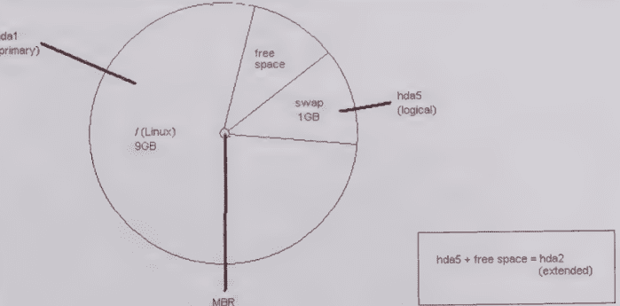


主 IDE 硬盘硬盘结构可能保留一个 `Windows` 分区。这允许你进入 `Linux` 系统或 `Windows` 系统。这被称为双系统。

在图 5-5 中，`Windows` 分区被创建为主分区 (`/dev/hda1`)，而 `Linux` 分区包含在扩展分区 (`/dev/hda2`) 中。图 5-6 还为用户主目录创建了单独的文件系统并挂载到 `/home` (`/dev/hda6`)。

注意：在这样的系统中，`Linux OS` 可以读取 `Windows` 分区中的文件，因为它可以支持 `Microsoft` 的 `fat32` 文件系统。但 `Windows` 系统无法识别 `Linux` 分区，因为 `Windows` 不支持 `ext2`、`ext3` 或其他 `Linux` 文件系统。


图 5-6：`Linux` 双启动分区策略示例

### 动手实践！

### C-1: 讨论硬盘分区

#### 问题与解答

+ 1 在不同的分区上隔离不同类型的数据有助于：

- A 加速数据访问

- B 减少文件系统损坏的破坏

- C 允许在一个驱动器上使用不同的文件系统

- D 以上都是

+ 2 用于存储虚拟内存的分区称为交换分区（`Swap partition`）。

+ 3 主硬盘上虚拟驱动器的第二个分区与哪个设备文件关联？

- A `/dev/hda1`

- B `/dev/hda2`

- C `/dev/hda6`

- D `/dev/hda6`

+ 4 关于磁盘分区的大小和位置信息存储在主引导记录（`MBR`）中。

## 使用 fdisk 创建硬盘分区

你通常在安装系统时在主磁盘上创建分区。有很多分区工具可以实现此操作。`Fedora Core` 使用 `Disk Druid`，这是一种易用的分区工具。但它仅在系统设置期间使用。有时，你可能更改磁盘上的分区，或向系统添加另一个磁盘。要创建这些新分区，请使用 `fdisk` 命令。例如，下面的输出显示了使用 `fdisk` 处理辅助 IDE 硬盘 (`/dev/hdc`)。

```
[root@localhost #] fdisk /dev/hdc
Number of cylinders for this disk is set to 2491.
There is nothing wrong with that, but this is larger than 1024,
```

并且在某些设置中可能会导致以下问题：

+ 1) 启动时运行的软件（例如旧版本的 `LILO`）

+ 2) 来自其他操作系统的引导和分区软件（例如 `DOS FDISK`、`OS/2 FDISK`）

`Command (m for help): _`

你会看到在打印完信息行后，`fdisk` 会显示一个提示符。在这里你可以输入命令来创建分区或确定分区的行为。如果按下 `m` 键，将显示命令列表，如下所示。

```
Command (m for help): m
Command action
a toggle a bootable flag（切换启动标记）
b edit disklabel（编辑磁盘标签）
ct toggle the dos compatibility flag（切换 dos 兼容标记）
d delete a partition（删除分区）
l list known partition types（列出已知分区类型）
m print this menu（打印此菜单）
n add a new partition（添加新分区）
c create a new empty DOS partition table（创建新的空 DOS 分区表）
p print the partition table（打印分区表）
q quit without saving changes（保存退出）
s create a partition's Sun disklabel（创建分区的 Sun 磁盘标签）
t change a partition's system id（更改分区 ID）
u change display/entry units（更改显示/条目单位）
v verify the partition table（验证分区表）
w write table to disk and exit（写入磁盘并退出）
x extra functionality (experts only)（额外功能（仅限专家））
Command (m for help): _
```


## 5-28 CompTIA Linux+ 认证，2004 目标

要打印 `/dev/hdc` 上当前分区的列表，你需要按下 `p` 键。

```
Command (m for help): p
```

```
/dev/hdc: 20.4 GB, 20490559488 bytes
255 heads, 63 sectors/track, 2491 cylinders
Units = cylinders of 16065 * 512 = 82252280 bytes
```

| Device | Boot | Start | End | Blocks | Id | System |
|---|---|---|---|---|---|---|
| `/dev/hdc1` | | 1 | 510 | 4096543 | 83 | `Linux` |
| `/dev/hdc2` | | 511 | 561 | 409657+ | 82 | `Linux swap` |
| `/dev/hdc3` | | 562 | 1247 | 5110295 | 83 | `Linux` |

```
Command (m for help): _
```

注意输出左侧出现的设备名称，包括：

- `Boot`: 被标记为活动或可引导的分区

- `Start`: 分区在物理磁盘上的起始位置

- `End`: 分区在磁盘上的结束位置

- `Blocks`: 分区中存储信息的总块数（通常情况下，1 块 = 1 `KB`）

- `Id`: 分区类型

- `System`: 分区类型的描述（83 是 `Linux` 分区，82 是 `Linux` 交换分区）

要删除 `/dev/hdc3` 分区以及该文件系统中包含的所有 `dev` 数据，你需要使用 `d` 键。

```
Command (m for help): d
Partition number (1-4): 3
```

```
Command (m for help): p
```

```
/dev/hdc: 20.4 GB, 20490559488 bytes
255 heads, 63 sectors/track, 2491 cylinders
Units = cylinders of 16065 * 512 = 82252280 bytes
```

| Device | Boot | Start | End | Blocks | Id | System |
|---|---|---|---|---|---|---|
| `/dev/hdc1` | | 1 | 510 | 4096543 | 83 | `Linux` |
| `/dev/hdc2` | | 511 | 561 | 409657 | 82 | `Linux swap` |

```
Command (m for help): _
```

要创建一个扩展分区 (`/dev/hdc4`) 以及两个逻辑分区 (`/dev/hdc5` 和 `/dev/hdc6`)，你需要使用 `n` 键，指定要创建的分区、硬盘上的起始磁道以及大小 (`+1000-MB`)。

```
Command (m for help): n
Command action
extended
p primary (1-4)
Partition number (1-4): 4
First cylinder (562-2491, default 562): 562
Last cylinder or size [+size] (default 2491): 2497
## 文件系统管理 5-29
```

```
Command (m for help): p

Disk /dev/hdc: 20.4 GB, 20490559488 bytes

255 heads, 63 sectors/track, 2491 cylinders

Units = cylinders of 16065 * 512 = 8225280 bytes
```

| Device | Boot | Start | End | Blocks | Id | System |
|---|---|---|---|---|---|---|
| `/dev/hdc1` | | 1 | 510 | 4096543 | 83 | `Linux` |
| `/dev/hdc2` | | 511 | 561 | 409657 | 82 | `Linux swap` |
| `/dev/hdc4` | | 562 | 1247 | 551025 | 5 | `Extended` |

```
Command (m for help): n

Command action

logical (5 or over)

p primary (1-4) 1

First cylinder (562-2497, default 562): 562

Last cylinder or size [+size] (default 2497): +1000M
```

```
Command (m for help): p

Disk /dev/hdc: 20.4 GB, 20490559488 bytes

255 heads, 63 sectors/track, 2491 cylinders

Units = cylinders of 16065 * 512 = 8225280 bytes
```

| Device | Boot | Start | End | Blocks | Id | System |
|---|---|---|---|---|---|---|
| `/dev/hdc1` * | 1 | 510 | 409654 | 83 | `Linux` |
| `/dev/hdc2` | | 511 | 561 | 409657 | 82 | `Linux swap` |
| `/dev/hdc4` | | 562 | 1247 | 551025 | 5 | `Extended` |
| `/dev/hdc5` | | 562 | 689 | 102818 | 83 | `Linux` |

```
Command (m for help): n

Command action

logical (5 or over)

p primary (1-4) 1

First cylinder (690-2491, default 690): 690

Last cylinder or size [+size] (default 2491): +2000M
```

```
Command (m for help): p

Disk /dev/hdc: 20.4 GB, 20490559488 bytes

255 heads, 63 sectors/track, 2491 cylinders

Units = cylinders of 16065 * 512 = 8225280 bytes
```

| Device | Boot | Start | End | Blocks | Id | System |
|---|---|---|---|---|---|---|
| `/dev/hdc1` * | 1 | 510 | 409654 | 83 | `Linux` |
| `/dev/hdc2` | | 511 | 561 | 409657 | 82 | `Linux swap` |
| `/dev/hdc4` | | 562 | 1247 | 551025 | 5 | `Extended` |
| `/dev/hdc5` | | 562 | 689 | 102818 | 83 | `Linux` |
| `/dev/hdc6` | | 690 | 944 | 204825 | 83 | `Linux` |

```
Command (m for help): _
```

## 5-30 CompTIA Linux+ 认证，2004 目标

注意，用 `fdisk` 创建的新分区的默认类型为 8 (`Linux`)。要更改此设置，可以在 `fdisk` 提示符下按下 `t` 键。为了将 `/dev/hdc6` 为分区 82 (`Linux swap`)，你可以在 `fdisk` 提示符下执行以下操作：

```
Command (for help): t

Partition number (1-6): 6

Hex code (type L to list codes): L
```

| | | | | |
|---|---|---|---|---|
| 0 `Empty` | 1c `Hidden W9 FAT3` | 70 `DiskSearch Mult` bb `Boot Wizard` be |
| 1 `FAT12` | 1e `Hidden W9 FAT1` | 75 `PC/IX Solaris boot` |
| 2 `XENIX root` | 24 `NEC DOS` | 80 `Old Minix` |
| 3 `XENIX us` | 39 `Plan` | 81 `Minix` |
| 4 `FAT16 <32M` | 3c `PartitionMagic` | 82 `Linux swap` |
| 6 | | c6 |

`Hex code (type L to list codes): 82`
`Changed system type of partition 6 to 82 (Linux swap)`

```
Command (m for help): _
```

最后，要将分区保存硬盘并尝试将新的分区信息加载到内存中，需要在 `fdisk` 提示符下使用 `w` 键。

```
Command (m for help): w

The partition table has been altered!

Calling ioctl() to re-read the partition table.
WARNING: Re-reading the partition table failed with error: 16:
Device or resource busy.
The kernel still uses the old table
The new table will be used at the next reboot.
Syncing disks.
[root@localhost]#
```

### 文件系统管理

如果 `fdisk` 命令指示必须手动加载新的分区信息（如上面的示例所示），请重启机器。实际上，在运行 `fdisk` 之后重启机器是一个良好习惯。

计算机重启后，你将使用之前讨论过的 `mkfs`、`mount` 和 `umount` 命令对新分区进行格式化，并让它们成为目录树的一部分。

要在 `/dev/hdc5` 分区上创建一个 `ext2` 文件系统，可以使用以下命令：

```
[root@localhost]# mkfs -t ext2 /dev/hdc5

make2fs 1.35 (28-Feb-2004)

Filesystem label=

OS type: Linux

Block size=4096 (log-2)

Fragment size=4096 (log-2) blocks

12868 inodes, 257032

12851 blocks (5.00%) reserved for the super user

First data block=0

8 groups

3278 blocks per group, 32768 fragments per group

16096 inodes per group

Superblock backups stored on:

32768, 98340, 163840, 229376

Writing inode tables: done
Writing superblocks and filesystem accounting information: done
```

此文件将在每 36 个月或 180 天自动检查一次，以先者为准。使用 `tune2fs -c` 或 `-i` 可以覆盖。

```
[root@localhost root]###
```

你可能选择通过 `tune2fs` 命令在文件系统中创建一个日志文件，从而将此文件系统转换为 `ext3`。

```
[root@localhost root]# tune2fs -j /dev/hdc5

tune2fs 1.35 (28-Feb-2004)

Creating journal inode: done
```

此文件将在每 36 个月或 180 天自动检查一次，以先者为准。使用 `tune2fs -c` 或 `-i` 可以覆盖。

```
[root@localhost root]###
```

或者，你也可以使用 `mkfs -j /dev/hdc5` 命令从头创建一个 `ext3` 文件系统。

# 5-32 CompTIA Linux+ 认证，2004 目标

要将此文件系统挂载到名为 `/data` 的新挂载点并查看内容，使用以下命令：

```
[root@localhost]# mkdir /data

[root@localhost]# mount -t ext3 /dev/hdc5 /data

[root@localhost]# mount

/dev/hdc1 on / type ext3 (rw)

none on /proc type proc (rw)

noneusebdevfs on /proc/bus/usb type usbdevfs (rw)

none on /dev/pts type devpts (rw,gid=5,mode=620)

none on /dev/shm type tmpfs (rw)

none on /sys/fs/binmfmt_misc type binfmt_misc (rw)

/dev/hdc on /data type ext3 (rw)
```


```
[root@localhost]# ls -F /data

last-found/

[root@localhost]#
```

为了让系统在每次启动时自动挂载此文件系统，你需要编辑 `/etc/fstab` 文件，将其作为 `dev/hdc5` 配置。

```
[root@localhost]# cat /etc/fstab

LABEL=/ ext3 defaults 1 1
none /dev/pts devpts gid=5,mode=620 0 0
none /proc proc defaults 0 0
none /dev/shm tmpfs defaults 0 0
/dev/hdc2 swap defaults 0 0
/dev/cdrom /mnt/cdrom iso9660 noauto,owner, kudzu, 0 0
/dev/fd0 /mnt/floppy auto noauto,owner, kudzu 0 0
/dev/hdc5 /data ext3 defaults 1 2 [root@localhost]#
```

### C-2: 使用 fdisk 分区硬盘

| 操作步骤 | 作用 |
| --- | --- |
| 1 切换到 tty2 并以 root 身份登录 | （如有必要。） |
| 2 输入 `fdisk /dev/hda` | 查看 `hda` 设备的磁盘信息。 |
| 3 输入 `m` | 查看各种 `fdisk` 命令。 |
| 4 输入 `p` | 查看 `/dev/hda` 上的分区表 |
| 5 输入 `n` | 创建新分区。 |
| 6 输入 `p` | （选择主分区。）由于已经有三个主分区，将选择第四个分区。 |
| 按 [ENTER] | 选择默认值（第一个可用的磁道）。 |
| 按 [ENTER] | 选择默认值（最后一个可用的磁道）。 |
| 7 输入 `p` | 查看 `/dev/hda` 上的分区表。 |
| 8 输入 `l` | 查看不同的分区类型。 |
| 9 输入 `w` | 将更改保存到硬盘并退出 `fdisk` 工具。 |
| 10 输入 `reboot` | 重启机器并确保分区表已正确读取到内存中。 |

### C-3: 创建并挂载文件系统

| 操作步骤 | 作用 |
| --- | --- |
| 1 切换到 tty2 并以 root 登录 | （系统启动后。） |
| 2 输入以下命令： | 在 `hda4` 分区上创建一个 `ext2` 文件系统。 |
| `mkfs -t ext2 /dev/hda4` | |
| 3 输入 `mkdir /newount` | 在 `/` 目录下创建一个用于挂载 `/dev/hda4` 的挂载点。 |
| 4 输入以下命令： | 将 `/dev/hda4` 挂载到 `/newount` 目录。 |
| `mount -t ext2 /dev/hda4 /newount` | |
| 5 输入 `mount` | 验证文件系统是否正确挂载。 |
| 6 输入 `umount /newmount` | 从 `newmount` 目录卸载 `/dev/hda4`。 |
| 7 输入 `tune2fs -j /dev/hda4` | 将 `/dev/hda4` 上的文件系统转换为 `ext3`。 |
| 8 输入以下命令： | 将 `/dev/hda4` 挂载到 `/newount` 目录。 |
| `mount -t ext3 /dev/hda4 /newount` | |
| 9 输入 `mount` | 验证文件系统是否正确挂载。 |
| 10 输入 `vi /etc/fstab` | 编辑 `fstab` 文件。 |
| 11 输入 `reboot` | 重启机器。 |
| 12 输入 `mount` | 验证挂载情况。 |
| 13 输入 `umount /newmount` | 卸载目录。 |
| 14 输入 `mount -a` | 挂载所有文件系统。 |
| 15 输入 `df` | 检查磁盘使用情况。 |
| 16 输入 `mount` | 验证挂载情况。 |

## 文件系统管理 5-3

## 监控目录

如果文件系统快满了，你可能想知道哪些目录占用了最多的空间。使用 `du`（目录使用）命令可以查看目录及其内容的大小。如果目录很大，你应该使用 `more` 或 `less` 命令来逐页查看输出，如对 `/usr` 目录所示。

```
[root@localhost root]# $ du /usr -more

100 /usr/bin/filter
56 /usr/bin/auth/passwd
20 /usr/bin/auth/resolv
80 /usr/bin/auth
76 /usr/bin/control
20 /usr/bin/rnews.libexecec
196028 /usr/bin
8 /usr/lib/local/af/ZA/LC_MAGES
248 /usr/lib/local/af/ZA
8 /usr/lib/local/ar/AE/LC_MAGES
248 /usr/lib/local/ar/AE
8 /usr/lib/local/ar_AE.utf8/LC_MAGES
552 /usr/lib/local/ar_utf8
24 /usr/lib/local/ar/BH/LC_MAGES
24 /usr/lib/local/ar/BH.utf8
24 /usr/lib/local/ar/DZ/LC_MAGES
24 /usr/lib/local/ar/DZ
20 /usr/lib/local/ar_DZ.utf8/LC_MAGES
20 /usr/lib/local/ar_DZ
4 /usr/lib/local/ar_EG/LC_MAGES
20 /usr/lib/local/ar_EG
--More--
```

要仅查看目录总大小的摘要，使用 `-s` 选项，如下所示的 `/usr` 目录。

```
[root@localhost root]# $ du -s /usr

263772 [root@localhost root]# _
```

与 `df` 命令一样，你可以在 `du` 命令中使用 `-h` 选项让数字更有读性。以下表示 `/usr` 目录的总大小为 2.6 GB。

```
[root@localhost root]# du -hs /usr

2.6G

[root@localhost root]#
```

### 监控 inode

每个文件系统都有一个 inode 表，其中包含了文件系统上文件和目录的 inode。该 inode 表是在创建文件系统时创建的，通常与文件系统的大小成正比。

每个文件和目录都使用一个 inode，因此包含许多小文件的文件系统可能会用尽表中的所有的 inode，从而阻止新文件的创建。

## 5-38 CompTIA Linux+ 认证，2004 目标

要查看 ext2 或 ext3 文件系统的 inode 总数和空闲 inode，你需要使用带有 `-h` 选项的 `dump2fs` 命令，如下所示。

```
[@localhost]# df

Filesystem     1k-blocks      Used Available Use Mounted on
/dev/hdc1    4032092  2848756     978152 75% /dev/shm
none             192232           0       0%

[@localhost]# dump2fs -h /dev/hdc1

dump2fs 1.23, 15-Aug-2001 for EXT2 FS 0.5, 95/08/09
Filesystem name:  <not available>
Last mounted on:
Filesystem UUID:      6379b3e-422a-11d6-9d53-f6a7b697142f
Filesystem magic number: 0xEF53
Filesystem revision: 1 (dynamic)
Filesystem features:  has_journal filetype needs_recovery
sparse_super
Filesystem state:     clean
Error behavior:       Continue
Filesystem OS type:   Linux
Inode count:          513024
Block count:          1024135
Reserved block count: 51206
Free blocks:          295830
Free inodes:          334993
First block:           0
Block size:           4096
Fragment size:        4096
Blocks per group:     32768
Fragments per group:  32768
Inodes per group:    16032
Inodes blocks per group: 101
Last mount time:      Sun May 12 21:33:00 2002
Last write time:      Sun May 12 21:33:00 2002
Mount count:          25
Maximum mount count: -1
Last checked:        Thu Mar 28 04:01:27 2002
Check interval:       0 (<none>)
Reserved blocks uid: 0 (user root)
Reserved blocks gid: 0 (group root)
First inode:          11
Inode size:           128
Journal UUID:         <none>
Journal inode:        8
Journal device:       0x0000
First orphan inode:   02.6G  /usr
[@localhost]# #
```

在上述的输出中，你可以看到 inode 表中有 513024 个 inode，其中 334993 个是空闲的，可用于新文件。

## 检查文件系统错误

文件系统的结构可能会随着推推积累错误，这些错误可能严重到无法读取数据。这些错误通常被称为文件系统损坏。常见原因包括：

- 不正常关机：数据在写入磁盘之前在内存中存储了一段时间。如果突然断电，内存中的数据可能没有同步到磁盘。正确使用 `shutdown`、`halt` 或 `reboot` 命令关闭电脑可以确保在掉电完成同步。
- 高度使用：如果频繁用于密集型任务（如数据库访问），可能会文件系统损坏。随着使用量的增加，错误的可能性也会增加。
- 机械故障：磁盘本身会随着时间磨损。磁盘的某些区域可能变得不可用。当操作系统发现坏块时，会在文件系统的坏表中标记并不再尝试使用这些块。

要检查文件系统错误，使用 `fsck`（文件系统检查）命令，它可以检查许多类型的错误。你可以使用指定文件类型和设备的选项。如果没有指定文件类型，则假设为 ext2。同样重要的是，被检查的文件系统必须卸载，fsck 才能正常工作，如下所示。

```
[root@localhost]# fsck -t ext2 /dev/fd0

e2fsck 1.23, 15-Aug-2001 for EXT2 FS 0.5, 95/09
/dev/fd0 is mounted.
WARNING!! 在挂载的文件系统上运行 e2fsck 可能会导致严重损坏。
确定要继续吗 (y/n)? n

[root@localhost]# unmount /dev/fd0

[root@localhost]# fsck -t ext2 /dev/fd0

Parallelizing fsck version 1.23 (15-Aug-2001)
e2fsck 1.23, 15-Aug-2001 for EXT2 FS 0.5, blocks, and sizes
Pass 1: Checking inodes, 95/08/09
Pass 2: Checking directory structure
Pass 3: Checking directory connectivity
Pass 4: Checking reference counts
Pass 5: Checking group summary information
/dev/fd0: clean, 14/184 files (0.0% non-contiguous), 45/140 blocks

[root@localhost]# _
```

注意：由于文件系统无法卸载，你应该在单用户模式下运行 `fsck` 命令。直接运行 `fsck` 仅对文件系统进行快速检查。你可以使用 `-f` 选项进行完整检查，如下：

```
[root@localhost]# fsck -f -t ext2 /dev/fd0

Parallelizing fsck version 1.23 (15-Aug-2001)
e2fsck 1.23, 15-Aug-2001 for EXT2 FS 0.5, blocks, and sizes
Pass 1: Checking inodes, 95/08/09
Pass 2: Checking directory structure
Pass 3: Checking directory connectivity
Pass 4: Checking reference counts
Pass 5: Checking group summary information
/dev/fd0: 14/184 files (0.0% non-contiguous), 45/1440 blocks

[root@localhost]# _
```

下表列出了 `fsck` 命令的常用选项：

| 选项 | 说明 |
| --- | --- |
| `-f` | 执行完整的文件系统检查 |
| `-a` | 允许 `fsck` 自动修复任何错误 |
| `-A` | 检查 `/etc/fstab` 中第六字段为 1 或 2 的所有文件系统 |
| `-Cf` | 执行完整的文件系统检查并显示进度行 |
| `-AR` | 检查 `/etc/fstab` 中第六字段为 1 或 2 的所有文件系统，但跳过 `/` 文件系统 |
| `-V` | 显示详细输出 |

如果 `fsck` 命令发现损坏的文件，会显示消息询问是否修复错误。为了避免这些消息，使用 `-a` 选项指定 `fsck` 应自动修复任何损坏。如果有 `fsck` 命令无法修复的文件，它会将它们放在 `lost+found` 目录中并将文件重命名为 `inode`。

要查看 `lost+found` 目录的内容，你需要挂载设备并查看该目录。由于很难通过 inode 号识别丢失的文件，大多数用户只是简单地定期删除该目录的内容。

### 使用 e2fsck

就像你可以使用 `mke2fs` 命令创建 ext2 文件系统一样，你可以使用相关命令 `e2fsck` 来检查 ext2 或 ext3 文件系统。`e2fsck` 命令接受更多选项，并且比 `fsck` 更彻底地检查文件系统，但它仅适用于 ext2 或 ext3 文件系统。

通过对 `e2fsck` 命令使用 `-c` 选项，你可以检查磁盘上的坏块。这将它们添加到文件系统的坏块表中，以便未来不再被使用。

```
[root@localhost]# e2fsck -c /dev/fd0

e2fsck 1.35 (28-Feb-2004)

Checking for bad blocks (read-only test): done

Pass 1: Checking inodes, blocks, and sizes

Pass 2: Checking directory structure

Pass 3: Checking directory connectivity

Pass 4: Checking reference counts

Pass 5: Checking group summary information
```

```
/dev/fd0: ***** FILE SYSTEM MODIFIED

/dev/fd0: 14/184 files (0.0% non-contiguous), 45/1440 blocks

[root@localhost]# _
```

注意：`badblocks` 命令可以执行与 `e2fsck -c` 的功能。
`tune2fs` 命令可以在创建文件系统后更改或调整文件系统参数。将检查间隔设置为 0 秒（如前面的示例所示），将禁用文件系统检查。要更改此间隔，你需要使用 `tune2fs` 命令的 `-i` 选项，如下所示：

```
[root@localhost]# tune2fs -i 0 /dev/fd0

tune2fs 1.35 (28-Feb-2004)

Setting interval between check 0 seconds

[root@localhost root]#
```


## D-1: 检查文件系统错误

| 操作步骤 | 目的 |
| --- | --- |
| 1 在 `tty2` 上以 `root` 身份登录 | （如有必要。） |
| 2 输入 `df` | 查看系统上存在的文件系统。 |
| 3 输入以下命令：<br>`dumpe2fs -h /dev/hda4` | 查看 `/dev/hda3` 文件系统的 `inode` 信息。 |
| 4 输入以下命令：<br>`fsck -t ext3 /dev/hda4` | 读取警告信息。 |
| 按 `N` | 退出 `fsck` 命令。 |
| 5 输入 `umount /newmount` | 从 `hda3` 分区卸载文件系统。 |
| 输入 `mount` | 验证文件系统是否已正确卸载。 |
| 6 输入以下命令：<br>`fsck -t ext3 /dev/hda4` | 检查文件系统是否存在错误。 |
| 7 输入以下命令：<br>`fsck -Cf -t ext3 /dev/hda4` | 在检查文件系统时显示进度完成条。 |
| 8 输入 `e2fsck -c /dev/hda4` | 在检查文件系统之前应用日志。 |
| 9 输入以下命令：<br>`tune2fs -i 0 /dev/hda4` | 更改强制检查的间隔以避免其发生。 |
| 10 输入 `mount /dev/hda4` | |
| 11 将活动 B-1 中的软磁盘插入电脑的软盘驱动器 | |
| 输入 `debugfs -w /dev/fd0` | 进入编辑模式下的文件系统调试器。 |

## 文件系统管理 5-43

- 12 输入 `inittab` 编辑软磁盘上 `inittab` 文件的 `inode`。
- 当提示更改文件模式时，按 `ENTER`。
- 按 `ENTER` 接受显示的值。
- 重复此操作以修改用户 ID（`User ID`）、组 ID（`Group ID`）等，直到提示更改链接计数（`Link Count`）。
- 13 当提示更改链接计数时，输入 `0`。
- 按 `ENTER` 为 `inittab` 文件赋予一个为 `0` 的无效链接计数。
- 对所有剩余选项按 `ENTER` 以接受显示的值。
- 14 按 `Q` 退出 `debugfs` 命令。
- 15 输入以下命令：检查软磁盘是否存在错误。

```
fsck -f -t ext2 /dev/fd0
```

- 在每个错误处按 `Y` 允许 `fsck` 修复错误。
- 16 再次运行该命令查看是否仍有任何错误。
- 17 弹出软磁盘

## 磁盘配额

如果您的系统中有多个用户，则必须有足够的磁盘空间来支持每个用户预期存储的文件。然而，如果磁盘空间有限，或者公司策略限制了磁盘使用，您应该对文件系统使用设置限制。

这些限制被称为磁盘配额（`quota`），可以应用于用户或用户组。配额限制了用户可以创建的文件和目录数量（即限制创建的 `inode` 数量），或者用户可以拥的所有文件的总大小。

配额限制有两种类型：

- 软限制（`Soft limits`）：允许用户在一定时间内扩展它们（默认为七天）。
- 硬限制（`Hard limits`）：是强制性的，将防止用户超过它们。

如果 `/etc/fstab` 中存在配额条，配额通常在启动时启用，但也可以使用 `quota` 和 `quotaoff` 命令开启或关闭。

要设置配额，您编辑 `/etc/fstab` 并限制用户 `"user"`，需要执行以下步骤：

- 1. 编辑 `/etc/fstab` 文件，为文件系统添加 `usquota` 和 `grquota` 挂载选项。`/etc/fstab` 应该如下：
```bash
[localhost root]# # cat /etc/fstab

LABEL=/               ext3

default,usquota,grquota  1 1

none                   /dev/pts  devpts gid=5,mode=620

0 0                    /proc     defaults

0 0                    /dev/shm   tmpfs defaults

0 0                    /dev/hdc2  swap      defaults

0 0                    /dev/cdrom /mnt/cdrom  iso9660 noauto,owner, kudzu,ro

0 0                    /dev/fd0   /mnt/floppy auto      noauto,owner, kudzu
```

- 2. 重新挂载文件系统为读写，以使用 `/etc/fstab` 中的新选项更新系统。执行此操作的命令是：
```bash
[localhost root]# mount -o remount,rw

[localhost root]#
```

- 3. 在文件系统根目录下创建名为 `aquota.user` 和 `aquota.group` 的两个文件。对于文件系统，您应该创建 `/aquota.user` 和 `/aquota.group`。随后，运行 `quotacheck -mavug` 命令，该命令查找文件所有权并根据 `/etc/fstab` 列出的配额选项更新配额数据。`quotacheck` 切换 `-a`（所有文件系统）、`-v`（详细输出）、`-u` 和 `-g`（针对所有用户组）、`-m`（即使文件系统被其他进程使用）。这会在文件系统根目录下创建两个文件：`/aquota.user` 和 `/aquota.group`。您将看到以下输出：
```
[root@localhost root]# touch /aquota.user

[root@localhost root]# touch /aquota.group

[root@localhost root]# quotacheck -mavug

quotacheck: Scanning /dev/hdc1 [/ done

quotacheck: Checked 22249 directories and 337809 files

[root@localhost root]# _
```

- 4 使用 `quotaon/` 命令文件文件配额（使用 `quotaoff/` 命令关闭）。
- 5 使用 `edquota -u <username>` 命令编辑某些用户的配额。这将打开编辑器，允许您为用户可以拥有的块数（通常 1 块 = KB）以及用户可以拥有的 `inode` 总数（文件和目录）设置软配额和硬配额。
```
[root@localhost root]# edquota -u user1

Disk quotas for user user1 (uid 500):

Filesystem blocks soft hard inodes soft

hard

/dev/hdal 1188 0 0
```

## 文件系统管理 5-45

```bash
[root@localhost root]# touch /aquota.user

[root@localhost root]# touch /aquota.group

[root@localhost root]# quotcheck -mavug

quotacheck: Scanning /dev/hdc1 [/ done

quotacheck: Checked 22249 directories and 337809 files

[root@localhost root]# _
```

- 4 使用 `quotaon/` 命令文件系统配额（使用 `quotaoff/` 命令关闭）。
- 5 使用 `edquota -u <username>` 命令编辑某些用户的配额。这将打开编辑器，允许您为用户可以拥有的块数（通常 1 块 = KB）以及用户可以拥有的 `inode` 总数（文件和目录）设置软配额和硬配额。
```
[root@localhost root]# edquota -u user1

Disk quotas for user user1 (uid 500):

Filesystem blocks soft hard inodes soft

hard

/dev/hdal 1188 0
```

软限制为 0 表示没有限制。以下输出设置了 20 MB (20480 KB) 的硬限制以及 18 MB (18432 KB) 的软限制。在列中输入适当的值，然后保存并退出 `vi` 编辑器：
```
[root@localhost root]# edquota -u user1

Disk quotas for user user1 (uid 500):

Filesystem blocks soft hard inodes soft

hard

/dev/hdal 1188 0 0
```

## 文件系统管理 267

## CompTIA+ 认证目标

用户超出的时间限制：天、分钟或秒。

软限制为 0 表示没有限制。以下输出设置了 20 MB (20480 KB) 的硬限制以及 18 MB (18432 KB) 的软限制。在列中输入适当的值，然后保存并退出 `vi` 编辑器：
```
[root@localhost root]# edquota -u user1

Disk quotas for user user1 (uid 500):

Filesystem blocks soft hard inodes soft

hard

/dev/hdal 1188 0 0
```

## 文件系统管理 268

## D-2: 建立磁盘配额

执行吧！

### 操作步骤

### 目的

| 操作步骤 | 目的 |
| --- | --- |
| 1 在 `tty2` 上以 `root` 身份登录 | （如有必要。） |
| 2 输入 `df` | 查看系统上存在的文件系统。 |
| 3 输入以下命令：<br>`dumpe2fs -h /dev/hda4` | 查看 `/dev/hda3` 文件系统的 `inode` 信息。 |
| 4 输入以下命令：<br>`fsck -t ext3 /dev/hda4` | 读取警告信息。 |
| 按 `N` | 退出 `fsck` 命令。 |
| 5 输入 `umount /newmount` | 从 `hda3` 分区卸载文件系统。 |
| 输入 `mount` | 验证文件系统是否已正确卸载。 |
| 6 输入以下命令：<br>`fsck -t ext3 /dev/hda4` | 检查文件系统是否存在错误。 |
| 7 输入以下命令：<br>`fsck -Cf -t ext3 /dev/hda4` | 在检查文件系统时显示进度完成条。 |
| 8 输入 `e2fsck -c /dev/hda4` | 在检查文件系统之前应用日志。 |
| 9 输入以下命令：<br>`tune2fs -i 0 /dev/hda4` | 更改强制检查的间隔以避免其发生。 |
| 10 输入 `mount /dev/hda4` | |
| 11 将活动 B-1 中的软磁盘插入电脑的软盘驱动器 | |
| 输入 `debugfs -w /dev/fd0` | 进入编辑模式下的文件系统调试器。 |

- 12 输入 `inittab` 编辑软磁盘上 `inittab` 文件的 `inode`。
- 当提示更改文件模式时，按 `ENTER`。
- 按 `ENTER` 接受显示的值。
- 重复此操作以修改用户 ID（`User ID`）、组 ID（`Group ID`）等，直到提示更改链接计数（`Link Count`）。
- 13 当提示更改链接计数时，输入 `0`。
- 按 `ENTER` 为 `inittab` 文件赋予一个为 `0` 的无效链接计数。
- 对所有剩余选项按 `ENTER` 接受显示的值。
- 14 按 `Q` 退出 `debugfs` 命令。
- 15 输入以下命令：检查软磁盘是否存在错误。

```
fsck -f -t ext2 /dev/fd0
```

- 在每个错误处按 `Y` 允许 `fsck` 修复错误。
- 16 再次运行该命令查看是否仍有任何错误。
- 17 弹出软磁盘

## D-2: 建立磁盘配额

执行吧！

- 1 编辑 `/etc/fstab` 文件，为文件系统添加 `usquota` 和 `grquota` 挂载选项。`/etc/fstab` 应该如下：
```bash
[localhost root]# # cat /etc/fstab

LABEL=/               ext3

default,usquota,grquota  1 1

none                   /dev/pts  devpts gid=5,mode=620

0 0                    /proc     defaults

0 0                    /dev/shm   tmpfs defaults

0 0                    /dev/hdc2  swap      defaults

0 0                    /dev/cdrom /mnt/cdrom  iso9660 noauto,owner, kudzu,ro

0 0                    /dev/fd0   /mnt/floppy auto      noauto,owner, kudzu
```

- 2 重新挂载文件系统为读写，以使用 `/etc/fstab` 中的新选项更新系统。执行此操作的命令是：
```bash
[localhost root]# mount -o remount,rw

[localhost root]#
```

- 3 在文件系统根目录下创建名为 `aquota.user` 和 `aquota.group` 的两个文件。对于文件系统，您应该创建 `/aquota.user` 和 `/aquota.group`。随后，运行 `quotacheck -mavug` 命令，该命令查找文件所有权并根据 `/etc/fstab` 列出的配额选项更新配额数据。`quotacheck` 切换 `-a`（所有文件系统）、`-v`（详细输出）、`-u` 和 `-g`（针对所有用户组）、`-m`（即使文件系统被其他进程使用）。这会在文件系统根目录下创建两个文件：`/aquota.user` 和 `/aquota.group`。你将看到以下输出：
```
[root@localhost root]# touch /aquota.user

[root@localhost root]# touch /aquota.group

[root@localhost root]# quotacheck -mavug

quotacheck: Scanning /dev/hdc1 [/ done

quotacheck: Checked 22249 directories and 337809 files

[root@localhost root]# _
```

- 4 使用 `quotaon/` 命令文件系统配额（使用 `quotaoff/` 命令关闭）。
- 5 使用 `edquota -u <username>` 命令编辑某些用户的配额。这将打开编辑器，允许您为用户可以拥有的块数（通常 1 块 = KB）以及用户可以拥有的 `inode` 总数（文件和目录）设置软配额和硬配额。
```
[root@localhost root]# edquota -u user1

Disk quotas for user user1 (uid 500):

Filesystem blocks soft hard inodes soft

hard

/dev/hdal 1188 0 0
```


## 独立练习活动

### 软盘低级格式化

1. 按 `Ctrl+Alt+F2` 切换到命令行终端 (`tty2`)，并使用 `root` 用户账户登录终端。
2. 向软驱驱动器中插入一张 3.5 英寸高密度软盘。如果软盘上有数据，这些数据将被本次练习破坏。
3. 输入 `fdformat /dev/fd0ul440` 执行低级格式化。
4. 输入 `mkfs.ext2 /dev/fd0ul440` 在软盘上创建一个 `ext2` 文件系统。
5. 输入 `mount -t ext2 /dev/fd0ul440 /mnt` 挂载软盘。
6. 使用命令 `ls /mnt` 检查文件。
7. 输入 `rmdir /mnt/lost+found` 删除 `lost+found` 目录。
8. 输入 `df -h /mnt` 检查软盘的可用空间。
9. 输入 `cp /etc/fstab /etc/fstab.bak` 将 `fstab` 备份到磁盘。
10. 使用命令 `ls /mnt` 检查文件。
11. 输入 `fdformat /dev/fd0ul440` 重新格式化软盘。
12. 输入 `umount /mnt` 卸载设备。
13. 输入 `fdformat /dev/fd0ul440` 重新格式化软盘。
14. 输入 `mkfs.ext2 /dev/fd0ul440` 在软盘上创建一个 `ext2` 文件系统。
15. 输入 `mount -t ext2 /dev/fd0ul440 /mnt` 挂载软盘。
16. 使用命令 `ls /mnt` 检查文件。
17. 输入 `rmdir /mnt/lost+found` 删除 `lost+found` 目录。
18. 输入 `df -h /mnt` 检查软盘的可用空间。
19. 输入 `cp /etc/fstab /etc/fstab.bak` 将 `fstab` 备份到磁盘。
20. 使用命令 `ls /mnt` 检查文件。
21. 输入 `fdformat /dev/fd0ul440` 重新格式化软盘。
22. 输入 `umount /mnt` 卸载设备。

# 第 6 章 高级安装与故障排除

**单元时间：120 分钟**

完成本单元，你将学会如何：

- **A** 配置 `SCSI` 设备，理解 `IRQ`、`I/O` 地址和 `DMA`，以及即插即用（Plug-and-Play）如何分配配置值。
- **B** 理解容错磁盘系统并描述不同的 `RAID` 级别。
- **C** 描述各种安装方法及其适用场景，以及如何创建 `kickstart` 文件。
- **D** 对安装过程进行故障排除。

## 主题 A：高级硬件配置

本主题涵盖了以下 `CompTIA Linux+` 考试目标。

| # | 目标 |
|---|---|
| 6.1 | 描述常见的硬件组件和资源。<br>- 连接器<br>- `IRQ`<br>- `DMA`<br>- `SCSI`<br>- 内存地址 |
| 6.4 | 配置高级电源管理和高级高级配置与电源接口 (`ACPI`)。 |

### 准备阶段

`Linux` 安装是一项复杂的任务，可能需要大量的硬件和软件知识。系统上使用的某些硬件外设可能需要专门的设置和配置。当你向系统中添加一个设备时，另一个设备可能会停止工作。你对软件如何与硬件相互作用以及特定设备需求的理解越深，就越容易让设备正常工作并排除故障。

系统上使用的某些外设可能需要专门的设置和配置。早些时候强调的是 `IDE` 硬盘驱动器的配置，因为这是当今家庭和办公室计算机中最常见的配置。本节将探索 `SCSI` 硬盘、`RAID` 以及在大多数服务器和高性能系统中常见的外设配置。

### `SCSI` 硬盘配置

小型计算机系统接口（`SCSI`）被设计为一种以可扩展、高速的方式将多个外设连接到系统的方法。`SCSI` 设备通常不直接连接到主板，而是连接到控制器卡，再由控制器卡将挂载在其上的所有设备连接到主板。磁盘设备通过一根带有多个连接器的电缆连接到 `SCSI` 控制器卡。然后，信息通过这根电缆以链链式的方式在设备之间传输，如图 6-1 所示。

为了防止信号在电缆上来回跳动，电缆的末端必须用一个称为终止器（`terminator`）的设备进行终止。通常，一个终止器位于控制器卡本身上，如图 6-1 的上半部分所示。然而，某些连接到一个控制器上的多个硬盘的系统，通常会将控制器放在链链的中间，如图 6-1 的下半部分所示。

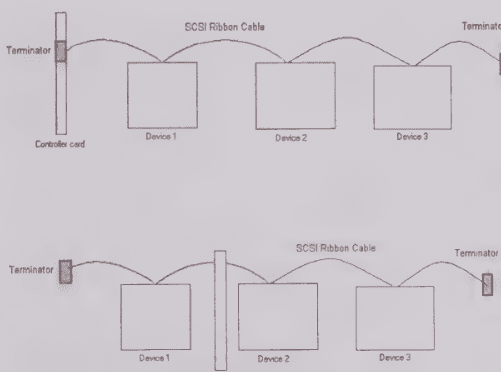

**图 6-1：`SCSI` 硬盘配置**

必须配置 `SCSI` 磁盘驱动器，以便每个硬盘驱动器都能被系统唯一识别——这是通过为每个设备分配一个唯一的 `ID` 号（即 `SCSI ID` 或 `目标 ID`）来实现的。大多数 `SCSI` 控制器支持 15 个设备，并用数字 0-15 标识这些设备（必须为控制器本身留出一个数字）。`SCSI ID` 还赋予设备优先级。优先级最高的设备分配数字 7，其后是 6, 5, 4, 3, 2, 1, 0, 15, 14, 13, 12, 11, 9 和 8。

与 `IDE` 硬盘类似，硬盘的 `SCSI ID` 通常是设置物理驱动器本身的跳线开关。某些 `SCSI` 设备充当其他设备的网关，每个设备与一个逻辑单元号（`LUN`）相关。

`SCSI` 技术随时间不断演进。1986 年引入时，`SCSI` 在控制器卡上使用 8 位宽数据路径，可容纳最多七个设备，传输速度为每秒 5 MB。这通常被称为 `SCSI-1`。到 1994 年，它已演变为控制器卡上的 16 位宽数据路径，可以容纳最多 15 个设备，传输速度为每秒 20 MB（`SCSI-2`）。`SCSI-3` 后推出，提供了超过每秒 40 MB 的速度。新技术，如 `Firewire`（`IEEE 1394`），可以以超过每秒 800 MB 的速度与设备之间传输数据。

### 练习

A-1 `SCSI-1` 可以被称为 _________
A 快速且宽
B 慢且宽
C 慢且窄
D 快速且窄

2 `ID` 为 8 的设备优先级高于 `ID` 为 7 的设备。对或错？

3 `SCSI` 电缆的末端必须进行终止


## 高级安装与故障排除

### 主板控制

**解释**

理解硬件如何相互作用的关键在于了解设备如何共享中央处理器（`CPU`）。处理器通过从物理内存中移动数据为设备执行进程。处理的时间和容量必须在所有设备之间共享。这种共享通过两种方法之一实现：

- 轮询（Polling）：处理器查询设备以查看是否有需要运行的任务。这并不有效。并不是所有设备都有要运行的任务，因此处理器在轮询它们时浪费了时间和资源。通过这种方法没有高效的方法对任务进行排序。
- 中断（Interrupt）：设备仅在需要资源时中断处理器。这是一种更有效的共享处理器时间的方法。

### 中断请求

回想一下，连接到单个控制器的多个设备唯一标识并请求服务。中断请求（`IRQ`）之所以这样命名，是因为它们在需要资源时才中断。标准主板通过扩展槽的中断请求用于识别并分配优先级。`ISA` 使用了 8 位数据路径，中断请求被分配给 0 到 7。

随着 16 位宽扩展槽的演进，产生了更多中断请求，编号为 8 到 15。这些额外的中断请求没有附加到优先级列表中，而是插入在 `IRQ 2` 和 `IRQ 3` 之间。这意味着中断请求并不遵循直观的顺序。`IRQ 10` 的优先级高于 `IRQ 13`，现在的 `IRQ` 优先级方案如图 6-2 所示。

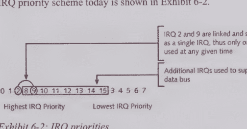

**图 6-2：`IRQ` 优先级**

增加中断请求的一个结果是 `IRQ 2` 和 `IRQ 9` 连接，以便系统将其视为单个 `IRQ`；在任何时刻只能使用其中一个。这意味着，尽管有 0 到 15 的 16 个中断请求，但系统中只有 15 个可用中断。

## 6-6 `CompTIA Linux+` 认证，2004 目标

虽然 `IRQ` 用于识别并为设备分配优先级，但并不是所有的 15 个 `IRQ` 都供外设使用，因为系统为需要或标准的设备保留了一些。在为设备分配 `IRQ` 之前，你必须确保它是空闲的。将 `IRQ` 分配给两个设备将导致系统问题，且设备都可能无法正常工作。下表概述了今天系统中常用的 `IRQ` 分配。

| `IRQ` | 描述 |
|---|---|
| 0 | 系统定时器 |
| 1 | 键盘 |
| 2 | 连接到 `IRQ 9`——如果 9 未被使用 |
| 3 | `COM2`, `COM4` |
| 4 | `COM1`, `COM3` |
| 5 | 可用（通常用于声卡或 `LPT2`） |
| 6 | 软磁盘控制器 |
| 7 | 并口 (`LPT1`) |
| 8 | 实时时钟 |
| 9 | 连接到 `IRQ 2`——如果 2 未被使用 |
| 10 | 可用 |
| 11 | 可用 |
| 12 | 可用 |
| 13 | 数学协处理器 |
| 14 | 主 `IDE` 硬盘驱动器控制器 |
| 15 | 次级 `IDE` 硬盘驱动器控制器 |

## 高级安装与故障排除

### 输入/输出 (`I/O`) 地址

除了标识和优先级控制外，每个外围设备在物理内存中都需要自己的空间，以便与其他设备进行通信。该空间由一个代表 `RAM` 特定区域的十六进制数标识，被称为输入/输出（`I/O`）地址。

许多 `I/O` 地址是为常用设备保留的。下表显示了这些地址列表。与 `IRQ` 类似，你必须确保设备的 `I/O` 地址没有分配给另一个设备，否则这两个设备都将无法正常工作。

| `I/O` 地址 | 设备 |
| :--- | :--- |
| 3F8-3FF | `COM1` |
| 2F8-2FF | `COM2` |
| 3E8-3EF | `COM3` |
| 2E8-2EF | `COM4` |
| 378-37F | `LPT1` |
| 278-27F | `LPT2` |
| 000-01F | `DMA` 控制器 |
| 020-03F | 主中断控制器 |
| 040-05F | 定计时器 |
| 060-06F | 键盘 |
| 070-07F | 实时时钟 |
| 0A0-0BF | 二中断控制器 |
| 0F0-07F | 数学协处理器 |
| 1F0-1F7 | 硬盘 |
| 3D0-3DF | `VGA` |
| 3F0-3F7 | 软盘控制器 |

### 直接内存访问

直接存储器访问 (`DMA`) 通过允许设备通过有限的唯一通道之一访问物理内存，从而提高了系统的效率和性能。

通常情况下，只有处理器可以使用直接访问物理内存，设备必须将所有内存调用传递给处理器。如果某个设备频繁使用物理内存，对处理器的持续负载可能会影响系统性能。允许此类设备直接访问物理内存可以提高整体系统性能。

声卡、网卡、`ATA` 和 `SCSI` 磁盘控制器从 `DMA` 通道中受益巨大，因为它们需要向物理内存读写大量数据。通道列举如下：

| `DMA` | 设备 | 数据路径宽度 |
| :--- | :--- | :--- |
| 0 | 可用 | 8 bits |
| 1 | 可用 | 8 bits |
| 2 | 软盘驱动器控制器 | 8 bits |
| 3 | 可用 | 8 bits |
| 4 | 不可用—`DMA` 自身使用 | 16 bits |
| 5 | 可用 | 16 bits |
| 6 | 可用 | 16 bits |
| 7 | 可用 | 16 bits |

### 插即用

手动为每个设备分配唯一的 `IRQ` 和 `I/O` 地址是一项耗时且容易出错的任务，可能会让简单的系统升级变成整整一天的斗争。因此，`插即用 (PnP)` 技术运运生。`PnP` 自动为设备分配必要的配置信息（`IRQ`、`I/O` 地址和 `DMA`）并避免冲突。

`PnP` 是主板 `BIOS`、待配置设备以及操作系统的特性功能。每一项都必须支持该系统才能工作。过去五六年制造的大多数电脑和组件都支持 `PnP`。`Red Hat Linux` 对有良好的支持。

`PnP` 让一个相当复杂的过程变得简单：

- 1 生成外围设备可用的所有 `IRQ`、`I/O` 地址和 `DMA` 通道列表。
- 2 系统探测所有连接到它的设备，查看它们是否具备 `PnP` 功能。
- 3 系统随后检索上次启动期间存在的设备列表以及它们的 `IRQ`、`I/O` 地址和 `DMA` 分配。如果列表没有变化，启动过程将跳过后续步骤。如果检测到变化，系统继续执行第 4 步。
- 4 系统在步骤 1 创建的列表中将对非 `PnP` 设备的分配标记为禁用。
- 5 系统检查 `BIOS` 设置，查看任何 `IRQ`、`I/O` 地址或 `DMA` 设置是否标记为保留，并将其标记为禁用。
- 6 `BIOS` 随后从可用设置池中为任何支持 `PnP` 设备分配值。
- 7 保存当前配置，以便在未来启动时的第 3 步中使用。

### A-2: 讨论资源与插即用

**问答**

- 为了利用 `PnP`，必须满足以下哪些条件？（选择所有适用项。）
  A 用户必须是 `root` 用户。
  B 操作系统必须支持 `PnP`。
  C 系统必须已使用所有可用的 `IRQ`。
  D 系统必须已用尽所有可用 `I/O` 地址。
  E 要配置的设备必须支持 `PnP`。
  F `BIOS` 必须支持 `PnP`。

- `DMA` 和 `IRQ` 有什么共同点？（选择所有适用项。）
  A 它们都有用于服务两种不同数据路径宽度（16 位和 8 位）的分配。
  B 它们没有任何共同点。
  C 两者都有一个在正常使用丢失的分配。
  D 都是优先级分配的列表。

- 键盘的默认 `IRQ` 设置是什么？
  A 0
  B 8
  C 7
  D 2
  E 1

- `COM 1` 的默认 `IRQ` 是什么？
  A 2
  B 4
  C 1
  D 0

每个设备必须有唯一的 `IRQ`、`DMA` 和 `I/O` 地址分配。对或错？

## 高级安装与故障排除

- 6 `LPT1` 的默认 `IRQ` 和 `I/O` 设置是什么？
  + A `IRQ 7` 和 `I/O` 地址 `378-37F`
  B `IRQ 5` 和 `I/O` 地址 `378-37F`
  C `IRQ 7` 和 `I/O` 地址 `3F8-3FF`
  D `IRQ 5` 和 `I/O` 地址 `3F8-3FF`
  E `IRQ 7` 和 `I/O` 地址 `278-27F`

- 7 有多少个可用或可分配的 `IRQ`？
  + A 7
  B 15
  C 8
  D 16

- 8 哪些 `DMA` 通道默认不可分配？
  + A 0 和 2
  B 0 和 4
  C 1 和 2
  D 2 和 4
  E 5 和 2
  F 5 和 6
  G 6 和 4

- 9 一次只能有一个设备使用一个 `DMA` 通道。对或错？


- 10 哪个 `IRQ` 优先级最低？
  + A 0
  B 7
  C 8
  D 15

### `APM` 和 `ACPI`

硬盘和外围组件在不使用时会消耗大量电力。因此，硬件制造商发布了两个标准，用于在组件未使用时关闭其电源：高级电源管理 (`APM`) 和高级配置电源接口 (`ACPI`)。

### `APM`

`APM` 是较旧的标准，主要用于在笔记本电脑上关闭组件电源。遗憾的是，`APM` 仅由计算机 `BIOS` 支持，必须通过系统设置程序进行配置。

### `ACPI`

`ACPI` 由 `Compaq`、`Intel`、`Microsoft`、`Phoenix` 和 `Toshiba` 于 1996 年开发，旨在取代 `APM`。它允许通过操作系统进行配置。

通过 `ACPI` 可以指定一段时间后关闭整个计算机（待机模式）或某些组件（睡眠）。注意：`APM` 和 `ACPI` 是互斥的。你不能在同一台电脑上启用两者。大多数笔记本制造商在 2002 年转向 `ACPI`。

- 通常，`ACPI` 在安装 `Fedora` 时会被检测并启用。如果在安装时没有启用，可以通过两种方式开启：
  * 如果你的加载程序是通用引导加载程序 (`GRUB`)，在 `/boot/grub.conf` 的内核行末尾添加 `apm-off loader=acpi-off`。
  * 如果你的加载程序是 `Linux` 加载程序 (`LILO`)，在 `/etc/loilo.conf` 中添加行 `append "apm-off acpi-on"`。

一旦启用 `ACPI`，它将根据硬件支持的选项进行配置。你也可以下载并使用某些应用程序来查看或配置设置。一个例子是 `headlight`，它可以监控 `CPU` 温度。另一个是 `Linux ACPI Client`，这是一个可以查看示例所示 `ACPI` 设置的命令行工具：

```
[root@localhost]# acpi -V

Battery 1: discharging, 91%, 02:39:07 remaining

Thermal 1: ok, 44.1 degrees C

Adapter 0: off-line

[root@localhost]#
```


今天几乎所有的主板和操作系统都支持 ACPI，它仍在不断发展。从 `http://acpi.sourceforge.net` 获取最新的 ACPI Linux 内核补丁。


### A-3: 讨论电源管理答案

完成！

- 1 APM 逐渐取代 ACPI 进行系统电源管理。对或错？

- 2 ACPI 支持以下功能（选择所有适用项）：
  A 监控 CPU 温度
  B 支持待机模式
  C 监控电池电量
  D 以上皆是

- 3 APM 和 ACPI 不能一起使用。对或错？

# 6-14 CompTIA Linux+ 认证，2004 体系目标

## 主题 B：容错磁盘系统

本主题涵盖了以下 CompTIA Linux+ 考试目标。

| 目标 |
| --- |
| 1.6 使用 `fdisk` 根据安装前的计划进行分区。 |
| - RAID |
| 6.5 识别并配置大规模存储设备和 RAID。 |
| - RAID |

### 分区与硬盘故障

**解释**

回想一下，你通常在安装期间会创建几个分区，以减少一个分区上的文件系统故障影响系统的其余概率。这些分区应该分布在多个不同的硬盘上，以最大限度地减少硬盘物理故障的影响。如果其中一个硬盘故障，其他硬盘上的数据将不会受影响。

如果发生硬盘故障，你必须关闭计算机，更换故障的硬盘，重新启动计算机，并从备份源恢复原始位于硬盘上的数据。整个过程可能需要几个小时。对于停机时间极短或完全不停机的系统（例如数据库服务器），你可以使用缩短从硬件故障中恢复所需时间的硬盘配置。这些配置被称为容错，通常通过以下方式实现：

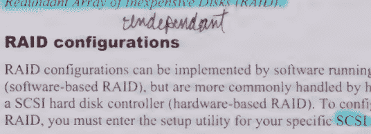

### RAID 配置

RAID 配置可以通过运行在操作系统上的软件实现（软件级 RAID），但更常见的是由包含在 SCSI 硬盘控制器中的硬件处理（硬件级 RAID）。要配置硬件级 RAID，你必须使用针对你特定磁盘控制器的设置程序。

**注意：** 你可以在系统安装期间通过选择磁盘设置屏幕上的 RAID 按钮来配置软件 RAID。

### RAID 级别

目前有七种基本的 RAID 配置，标记为级别 `0` 到 `6`。

- RAID 级别 `0` 指不具容错能力的 RAID 配置。一种 RAID 级别 `0` 类型称为跨越（spanning），由两个被视为一个大卷的硬盘组成。如果你有两个 `2GB` 的硬盘，你可以创建一个 `4GB` 大小的分区。另一种 RAID 级别 `0` 类型称为条带化（striping）。如果这种配置中有三个硬盘，那么一个文件被分成三个部分，每个部分连续写入硬盘。这可以使磁盘读写非常快。但在这种系统中数据非常脆弱，因为如果 RAID 级别 `0` 中的一个硬盘故障——
- RAID 级别 `1` 通常被称为磁盘镜像（disk mirroring），并在硬盘故障时提供容错能力。在这种 RAID 配置中，相同的数据会同时写入两个独立的硬盘。这导致两个硬盘具有相同的信息。如果其中一个发生故障，会有另一个副本可以在短时间内替换故障的硬盘。RAID 级别 `1` 的缺点是涉及的成本，因为你需要购买某台计算机所需两倍的硬盘空间。
- RAID 级别 `2` 已不再使用，它是 RAID `0` 的一种变体，允许对硬盘驱动器进行错误和完整性检查。现代硬盘内部并不具备此功能。
- RAID 级别 `3` 是带有校验位（或标记）的磁盘条带化，该校验位指示数据内容。它至少需要三个硬盘驱动器才能工作，其中一个硬盘用于存储校验信息。如果包含数据的硬盘之一故障，你可以更换硬盘并使用存储在另一个硬盘上的校验信息重新生成。如果校验盘故障，系统必须从备份驱动器恢复。
- RAID 级别 `4` 只是 RAID 级别 `3` 的微变体。RAID 级别 `4` 提供了比 RAID 级别 `3` 更快的访问速度，因为它能够按块存储数据，因此读取数据时不需要访问阵列中的所有磁盘。
- RAID 级别 `5` 取代了 RAID `3` 和 `4`，是目前最常用的 RAID 配置。RAID 级别 `3` 和 `4` 的实现至少需要三个硬盘驱动器；然而，校验信息不是存储在单独驱动器上，而是与组成集合的所有驱动器交错存储。这提供了更好的性能和容错能力。如果 RAID 配置中的任何驱动器故障，一旦更换了故障的硬盘，就可以所有其他硬盘重新生成丢失的信息。如果两个硬盘故障，系统必须从备份驱动器恢复。使用校验信息恢复 RAID 级别 `5` 配置的示例见图表 6-3。所示的校验位是另外两个硬盘信息的总和（`22 + 12 = 34`）。如果第三个硬盘故障，则可以重新生成信息，因为每个方程中只缺少一个元素：`22 + 12 = 34`，`68 - 65 = 3`，`13 - 9`。
- RAID 级别 `6` 基本与 RAID 级别 `5` 相同，但增加了第二组校验位以增加容错性，并允许在保持容错的同时同时发生两个硬盘故障。

**注意：** RAID 级别通常会组合使用；RAID 级别 `15` 指一个带校验的条带集（RAID 级别 `5`）镜像（RAID 级别 `1`）到另一个带校验的条带集。

### 热备 (Hot spare)

热备允许在检测到坏驱动器时让处于待机模式的驱动器自动上线。这需要一个支持热备的驱动器控制器。热备通常作为 RAID 的一部分实现。

### 硬盘安装

并不是所有人都会通过 `CD-ROM` 或 `DVD` 安装 `Linux`。你也可以直接从 `ISO` 镜像文件运行安装。在这种情况下，`ISO` 将位于第二块硬盘上或硬盘的分区上。你只需要在驱动器上有足够的空闲空间来安装 `Linux`。

一旦 `ISO` 镜像被复制到格式化 `FAT`、`ext2` 或 `ext3` 文件系统的硬盘分区上，你就可以开始安装并指定目标镜像。由于通过从自身的 `Fedora Core 2` 安装 `CD-ROM` 启动安装会假设文件源来自 `CD-ROM`，因此，如果你的计算机支持从 `USB` 闪存盘启动，你应该创建一个安装启动 `CD-ROM` 或可启动的 `USB` 闪存盘设备来启动安装。

要创建一个安装启动 `CD-ROM`，请导航到 `Red Hat` 安装 `CD-ROM` 上的 `images` 目录。该目录包含一个名为 `boot.iso` 的 `ISO` 镜像文件，它可以创建一个安装启动 `CD-ROM`。

如果你想创建一个可启动的 `USB` 闪存盘，请使用 `images` 目录中的另一个镜像文件。要使用该镜像文件，请挂载第一个 `Fedora Core 2 CD-ROM`，并使用 `dd` 命令将镜像复制到 `USB` 闪存盘上。（大多数 `USB` 闪存盘被识别为 `SCSI` 硬盘上的第一个分区，以便挂载。）如果你的 `CD-ROM` 挂载到 `/mnt/cdrom`，则将 `bootdisk.img` 文件镜像到 `USB` 闪存盘的命令为：`dd if=/mnt/cdrom images/bootdisk.img of=/dev/sda`。

接下来，你从安装 `CD-ROM` 或 `USB` 闪存盘启动。在第一个屏幕上按回车键，这将启动图形化安装。如果驱动器中没有 `Linux CD-ROM`，安装程序将切换到文本安装。你将被要求选择语言和键盘。接下来，安装程序将提示安装方法，如图 6-4 所示。

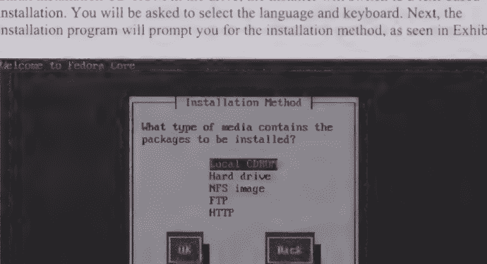

图 6-4：选择安装方法

## 高级安装与故障排除

选择“硬盘”，然后选择“确定”。下一个屏幕（如图 6-5 所示）将提示你输入包含 `ISO` 镜像的分区和目录。

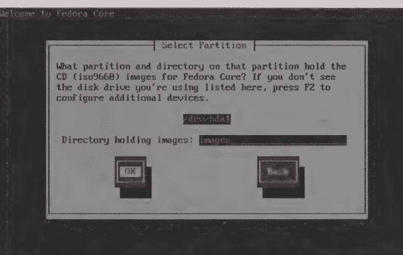

元素之间使用 `<Tab>`、`<Shift-Tab>`、`<Space>` 选择，`<F2>` 下一屏

图 6-5：选择安装文件

一旦你指向正确的位置，图形化安装将像从 `CD-ROM` 或 `DVD` 安装一样开始运行。

动手做吧！

### C-1：讨论安装方法

### 练习题

- 1 使用以下哪种方式可以安装 `Red Hat Linux`？
  A 硬盘
  B `CD-ROM`
  C `DVD`
  D 以上所有

- 2 文本安装方法适用于更多种类的硬件和安装方法。正确或错误？

- 3 你使用 `bootdisk.img` 镜像文件来创建启动 `CD-ROM`。

- 4 文本界面与图形界面看起来相似，但你做出的选择是不同的。正确或错误？

### 网络安装

**解释：** 虽然比 `CD-ROM`、`DVD` 或硬盘安装不常见，但你也可以从通过网络可访问的另一台机器上访问安装文件。上一节描述的启动 `CD-ROM` 或可启动 `USB` 闪存盘包含 `NIC` 驱动程序和程序，允许你连接到服务器。安装文件可以通过以下协议之一传输：

- 网络文件系统 (`NFS`)
- 文件传输协议 (`FTP`)
- 超文本传输协议 (`HTTP`)

`Linux` 也可以从 `Windows` 服务器进行安装。这种方法使用服务器消息块 (`SMB`) 协议，并且必须手动设置。我们在此不讨论这种方法。

安装将像通常一样启动，要求你选择语言和键盘。然而，当你到达“安装方法”屏幕（图 6-4）时，你必须选择一种网络协议。

你将被提示配置网络设置，如图 6-6 所示。

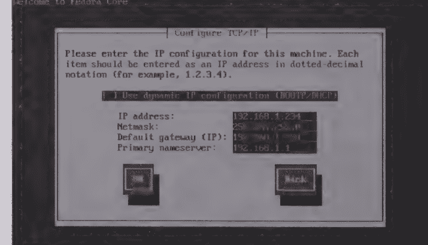

图 6-6：配置 `TCP/IP` 连接

`IP` 地址和子网掩码的数值通常由互联网服务提供商 (`ISP`) 或网络管理员分配，这样使用该 `IP` 地址的计算机就可以与网络上正确的一组机器进行通信。然而，你可以选择自动从网络上的 `DHCP` 或 `BOOTP` 服务器接收配置。如果手动配置，默认网关和主 `DNS` 名称服务器是可选的，但如果你知道这些值，应该使用。

如果你选择了 `NFS` 安装，系统将提示输入 `NFS` 服务器的 `DNS` 名称或 `IP` 地址，以及 `NFS` 服务器上包含安装文件的目录，如图 6-7 所示。

## 高级安装与故障排除

## 6-21

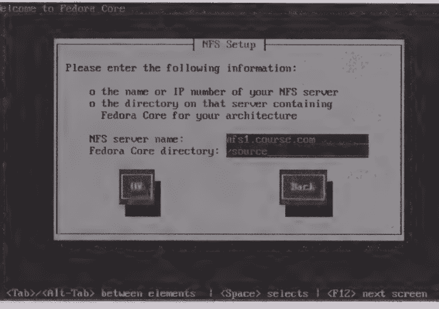

图 6-7：使用 `NFS` 设置

如果你选择执行 `FTP` 安装，系统将提示输入 `FTP` 安装类型（匿名或登录）以及 `FTP` 服务器的 `DNS` 名称或 `IP` 地址，如图 6-8 所示。

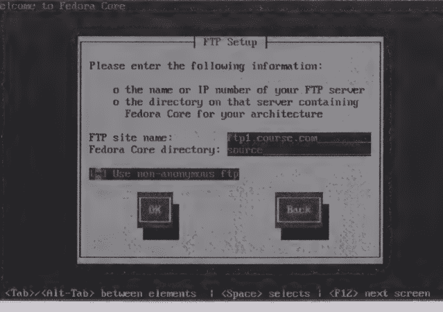

图 6-8：使用 `FTP` 设置

与 `FTP` 安装一样，`HTTP` 安装需要 `Web` 服务器的 `DNS` 名称或 `IP` 地址，以及包含安装文件的服务器目录，如图 6-9 所示。

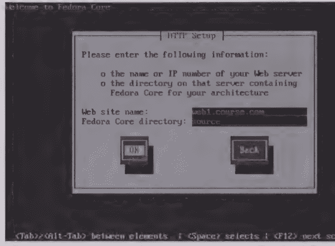

图 6-9：使用 `HTTP` 设置

除非选择 `NFS` 安装，否则一旦找到源文件，图形化安装将启动，并提示完成过程所需的信息。

### C-2：讨论网络方法

### 练习题

- 1 使用以下哪种方法可以安装 `Red Hat Linux`？
  A `NFS`
  B `FTP`
  C `HTTP`
  D 以上所有

- 2 `Windows` 服务器可以作为文件的源。正确或错误？

- 3 启动 `CD-ROM` 不支持网络安装。正确或错误？

- 4 图形安装支持哪些协议？
  A `FTP`
  B `NFS`
  C `TCP/IP`
  D `HTTP`

### 自动化安装

在大型组织中，你可能需要部署多台具有相同配置的 `Linux` 服务器和工作站。每台机器上运行标准安装并回答所有问题非常耗时。相反，可以使用磁盘镜像软件将硬盘内容从一台计算机复制到另一台，或使用自动化安装脚本自动完成安装。

### 磁盘镜像

有很多磁盘镜像程序，例如图 6-10 所示的 `Symantec Ghost`。这些程序通常从启动盘加载，并将整个分区或硬盘复制到同一台计算机或跨网络的磁盘。磁盘镜像程序的主要限制是需要镜像的所有计算机的硬件必须几乎相同。一旦磁盘镜像完成并启动新镜像的计算机，`Linux` 操作系统将使用原始计算机中的设备驱动程序加载。

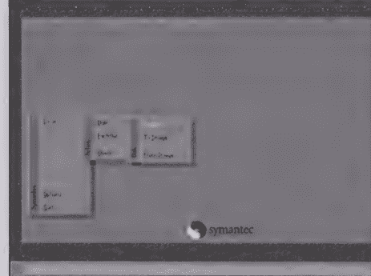

图 6-10：`Symantec Ghost` 镜像软件

### kickoff 文件

某些 `Linux` 发行版（包括 `Fedora Core 2`）提供接受脚本文件的安装程序，该文件包含你在安装操作系统时通常会做的选择。在 `Fedora Core 2` 中，这种脚本称为 `kickoff` 文件。`kick` 文件将自动提供你可能需要手动输入的配置细节。

在正常的 `Fedora Core 2` 安装后，安装程序会创建一个示例 `kickoff` 文件（`/root/anaconda-ks.cfg`），其中包含了你在安装过程中做的选择。或者，你可以创建一个新的 `kickoff` 文件来配置其他系统。导航到 `Red Hat` 按钮、系统工具、`Kickstart` 打开 `Kickstart` 配置器（如图 6-11 所示），并输入所需的数值。

# 高级安装与排错

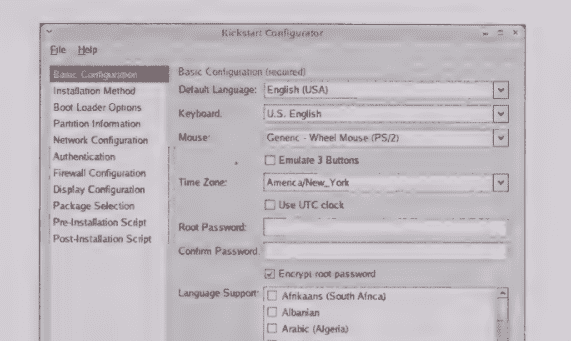

图 6-11：`Kickstart` 配置器 (`Kickstart Configurator`)

# CompTIA Linux+, 2004 目标

从菜单中选择保存（`Save`）来保存设置。通常，`kickstart` 文件是文本文件，你可以使用文本编辑器对其进行编辑。下方输出显示了一个 `kickstart` 文件示例：

```
[root@localhost]# ks.cfg

#Generated by Kickstart Configurator

#platform=x86, AMD64, or Intel EM64T

#System language

lang en US

#Language modules to install

langupport=US

#System keyboard

keyboard us

#System mouse

mouse msintelli

#System timezone

timezone America/Toronto

Root password

root --encrypted $5EEdvuliuS0WVOuitAzGlsxyXzMS3Wt3

#Install 0 OS instead of upgrade

install

#Use CDROM installation media

#System bootloader configuration

bootloader --location=mbr

#Clear the Master Boot Record

zeromber yes

#Partition clearing information

clearpart --all --initlabel

#Disk partitioning information

part / --fstype3 --size 9000

part swap --size 600

#System authorization information

auth --usehadow --enabledmd5

#Network information

network --bootproto=static --ip=192.168.1.188

mask=255.255.255.0 --gateway=192.168.1.254

nameserver=192.168.1.254 --device=eth0

#Firewall configuration

firewall --disabled

#Windows configuration information

xconfig --depth=16 --resolution=1024x768

defaultdesktop=GNOME --startxbonboot

#Package installation information

%packages --resolvedeps

@everything

[root@server1]#
```


注意：`kickstart` 文件中带有 `#` 符号的行都是注释行，安装程序会忽略这些行。

要使用上面显示的 `kickstart` 文件，请使用 `ext2` 文件系统格式化软磁盘，并将 `ks.cfg` 文件复制到其中。当你通过安装 CD-ROM、DVD 或安装启动 CD/ROM 或 USB 闪存驱动启动并开始安装时，将收到一个初始 Red Hat 欢迎界面和启动提示符。在此提示处不要按回车（Enter），而是输入命令 `linux-floppy:ks.cfg` 并按回车。这将强制安装程序在软磁盘上的 `ks.cfg` 文件查找配置信息。

注意：在 `kickstart` 安装后，不会运行首次启动向导（firstboot wizard）。


### C-3: 创建 kickstart 文件

#### 操作方法如下

#### 为什么需要这样做

| 步骤 | 动作 | 目的 |
|---|---|---|
| 1 | 按 `CTRL + ALT + F7` | 切换到图形终端。 |
| 2 | 输入 `root` | 作为用户名。 |
| | 按 `ENTER` | |
| | 输入 `password` | 作为密码。 |
| | 按 `ENTER` | |
| 3 | 选择系统工具（System Tools），Kickstart | 在 Red Hat 程序菜单中。 |
| 4 | 观察窗口 | Kickstart 配置器左侧包含分类设置，右侧包含菜单。 |
| 5 | 观察默认设置 | 如必要，更改鼠标和时区的选择。 |
| 6 | 输入 `password` | 在 Root Password（根密码）框中。 |
| | 输入 `password` | 在 Confirm Password（确认密码）框中。 |
| 7 | 选择安装方法（Installation Method） | 在左侧菜单中。 |
| | 确认默认选择 | 执行新安装并应选择 CD-ROM。 |
| 8 | 选择引导加载程序选项（Boot Loader Options） | 应选择“安装新的引导加载程序”和“在主引导记录 (MBR) 上安装引导加载程序”。 |
| 9 | 选择分区信息（Partition Information） | 应选择“清除主引导记录”、“删除所有现有分区”和“初始化磁盘标签”。 |
| 10 | 点击添加（Add） | 在窗口底部。 |
| 11 | 选择 `/` | 从挂载点（Mount Point）菜单中。 |
| | 选择 `ext3` | 如必要，从文件系统类型菜单中。 |
| | 输入 `7500` | 在 Size (MB) 框中。这是完整安装的最小大小。 |
| | 选择格式化分区（Format partition） | 如必要。 |
| | 点击 `OK` | |
| 12 | 点击添加（Add） | 创建另一个分区 |
| 13 | 选择 `swap` | 从文件系统类型菜单中。 |
| | 输入 `256` | 在 Size (MB) 框中。 |
| | 点击 `OK` | |
| 14 | 选择网络配置（Network Configuration） | 在右侧。 |
| 15 | 点击添加网络设备（Add Network Device） | 如必要，从网络设备菜单中。 |
| | 选择 `eth0` | |
| | 观察网络类型 | 通过选择静态 IP（Static IP），如有需要可以输入地址信息。否则，将其留为 DHCP。 |
| | 点击 `OK` | |
| 16 | 选择验证（Authentication） | 确认已勾选“使用影子密码（Use Shadow Passwords）”和“使用 MD5（Use MD5）”。 |
| 17 | 选择防火墙（Firewall） | 在安全菜单中。 |
| | 禁用防火墙（Disable Firewall） | |
| 18 | 选择显示配置（Display Configuration） | |
| | 选择 `800x600` | |
| 19 | 选择显卡（Video Card） | 在颜色菜单中。 |
| 20 | 选择显示器（Monitor） | |
| 21 | 选择软件包选择（Package Selection） | 在左侧。 |
| | 选择全部（all） | 在依赖项下。 |

# 6-28 CompTIA Linux+, 2004 目标

| # | 目标 |
|---|---|
| 5.4 | 使用系统日志排除故障 |
| 6.2 | 使用 Linux 工具诊断硬件问题 - `dmesg` |

## 主题 D：排除故障

本主题涵盖了以下 CompTIA 考试目标。

### 兼容性问题

PC 平台巨大的原因之一是其功能多样且组件廉价。有几十种不同的主板配置和数千种不同的组件。甚至处理器也由不同的公司生产，如 `Intel`、`AMD` 和 `Cyrix`。这给操作系统保持无限组合的兼容性带来了巨大负担。

结果是，在一台电脑上安装 `Linux` 时可能会遇到问题，而在另一台不同的机器上不会。这些问题完全与硬件支持或配置有关，通常可以通过更改系统硬件配置来解决。

### 安装问题

典型问题根据发生的时间分为三类：

- 开始安装时的问题
- 安装过程中的问题
- 安装后的问题

# 开始安装时的问题

你通常通过从 `CD-ROM` 或软磁盘、硬盘或网络服务器启动来开始 `Linux` 安装以获取安装文件。为此，`BIOS` 中的启动顺序设置为在查看硬盘之前先查看软磁盘和 `CD-ROM`。

虽然所有 `BIOS` 的原理相似，但不同制造商的控制界面可能截然不同。有些有第一启动设备、第二启动设备和第三启动设备的部分。另一些有一个标记为启动顺序的部分。为了确保更改了正确的设置，请查阅您的主板的用户手册。

`BIOS` 设置存储在主板上的 `CMOS` 内存芯片中，该芯片通过连接在主板上的小型锂电池提供持续电源。如果此电池没电，任何对 `BIOS` 设置的更改都将丢失，并将加载默认值。当这种情况发生时，系统在启动时会通过消息警告你：“BIOS Error – 已加载默认值 – 按 `F1` 继续”。应更换电池，否则在关闭电脑后任何设置都会丢失。

## 高级安装与故障排除 6-31

某些较旧的电脑没有从 `CD-ROM` 启动的功能。某些旧的 `CD-ROM` 设备即使在 `BIOS` 支持的情况下也无法启动安装程序。在这种情况下，你需要更换软盘启动盘，并使用 `Red Hat Crashes` 磁盘 1 上的 `boot.img` 文件。

在检查 `BIOS` 启动顺序时，检查支持外围设备的预留配置（`IRQ`、`I/O` 地址、`DMA`）是一个良好的习惯。系统中的大多数设备都是即插即用（PnP）设备，并从 `BIOS` 获取配置。大多数较旧的 `ISA` 设备必须预留这些资源。意识到这一点并且不要重置配置，可以为你节省很多麻烦。

## 安装过程中的问题

安装程序加载后，它会提示你选择安装方法。对于那些使用图形界面安装 `Linux` 的用户，安装程序必须先检测计算机中的显卡和鼠标，并将相应的驱动程序加载到内存中。

如果在初始欢迎界面之后，图形化安装界面没有出现，或者显示为屏幕上错乱的线条，很可能是显卡不支持图形化安装的模式和分辨率。有两个命令可能解决这个问题：在欢迎界面提示处输入 `linux nofb` 以在不支持帧缓冲区（framebuffer）的情况下启动安装，这将强制显示器使用兼容性 640x480 分辨率。

如果图形安装启动成功但未检测到鼠标，请使用文本模式安装，这不需要鼠标。重启计算机并在提示符处输入 `linux text`。

在旧系统中，计算机可能会在安装过程中随机死机。这通常是由于设备通信不当导致的。要修复这个问题，请重启并在 `BIOS` 中禁用 PnP 支持。安装完成后通常可以重新激活 PnP 支持。

有时安装正常结束，但计算机显示“致命信号 11”错误消息。这表示发生了“段错误”（segmentation fault）错误。这意味着程序访问了未分配的 `RAM` 区域。虽然这可能是软件问题，但在安装期间很可能是硬件问题。

遗憾的是，此问题可能出现在计算机的任何位置，但很可能是 `RAM` 本身的错误。通常，关闭 `CPU` 缓存或增加 `BIOS` 中等待状态（wait states）的数量可以修复此错误。如果内存对于主板来说太慢（例如，内存是 70ns RAM，而主板需要 60ns RAM），则应该更换计算机中的 `RAM`。

在 `BIOS` 中，你可以更改 `RAM` 和 `CPU` 的电压。错误的值可能会导致致命信号 11 错误。其他原因包括内存颗粒损坏、`AMD K6` 处理器、笔记本电脑电源管理冲突以及超频 `CPU`。

超频 `CPU` 是指速度大于处理器预期速度的 `CPU`。虽然这可能会提高性能，但也会导致处理器产生热量并可能导致间歇性崩溃。

如果安装失败且出现非致命信号 11 的错误，你应该咨询你所在 `Linux` 发行版的支持文档或互联网上的新闻组。此外，某些硬件（如拨号调制器 Winmodems）与 `Linux` 不兼容。确保在安装之前所有硬件都列在 `HCL`（硬件列表）中。你可以通过剥离系统中任何不必要的组件来解决兼容性问题。安装后，逐个重新加回来，以找到哪个组件引起了问题。

## 6-32 CompTIA Linux+ 认证，2004 目标

某些安装未能正确将引导加载程序放置在硬盘上。这在具有超过 1024 个磁道的大型硬盘上很常见。为了避免这个问题，请确保 `/` 分区始于第 1024 个磁道之前（使用大多数硬盘上的 8-GB 标记），或者为 `/boot` 目录创建一个始于第 1024 个磁道之前的分区。

### 安装后的问题

尽管安装可能成功完成，但如果安装程序未能正确检测到硬件或某些程序安装失败，你仍可能遇到问题。因此，检查安装日志文件以查看是否有应用程序安装失败是一项良好的做法。

`Fedora Core 2` 安装程序创建了两个日志文件：`/root/install.log` 包含已安装包列表以及未安装包列表，`/root/install.log syslog` 列出了安装期间发生的所有系统事件，以及用户和组账户的创建。

为了确保所有硬件都以正确的值被检测，可以通过检查 `/proc` 目录的内容或启动日志文件来验证系统。

## 查看 /proc 目录项

`/proc` 目录被挂载为 `RAM` 中的特殊文件系统，它列出了 `Linux` 内核提供的可用系统信息。其中的所有文件仅供“root”用户读取。如果你列出 `/proc` 目录，你将发现以下内容和子目录。

```
[root@localhost root]# ls -f /proc

1/ 1184/ 184/      647/ 924/      driver/ irq/      misc

labinfo 1012/ 1185/ 185/      667/ 965/      execdomains isapnp modules

stat 1030/ 1186/ 2/      695/ 993/      fb kcore counts

swaps 1114/ 1193/ 23195/ 7/      apm filesystems kmsg mtr

sys/
```

以数字开头的子目录用于显示进程信息。其他目录可能包含内核参数。文件是各个部分的文本表示。

## 处理器

要查看 `Linux` 检测到的 `CPU` 信息，请查看 `/proc/cpuinfo`。

```
[root@localhost root]# cat /proc/cpuinfo

vendor_id : Genuine

cpu family : 6

model name : Celeron (Mendocino)

stepping : 0

cpu MHz : 36

flags : vme tsc mce pae fpu de cmov mmx csr
```

这表示只有一个处理器。例如，如果计算机实际上有两个处理器，此输出将指示 `Linux` 未能检测到第二个。

## RAM 配置

确保 `Linux` 检测到系统中正确的 `RAM` 容量同样重要。要做到这一点，请查看以下内容：

```
[root@localhost root]# cat /proc/meminfo

total:     393695232 85921792 307734440 196608 1222464 3586475

Swap:      0 41947952 384468

MemTotal:  384468

MemFree:   300560

MemShared: 192 kB

Buffers:   11936 kB

Cached:    35024 kB

SwapCached: 0 kB

Active:    14764 kB

Inact_dirty: 32388 kB

Inact_clean: 0 kB

Inact_target: 1548 kB

HighTotal: 0 kB

HighFree:  0 kB

LowTotal:   384468 kB

LowFree:   300560 kB

SwapTotal: 409648 kB

SwapFree:  409648 kB

SwapPages: 102412 pages
```

在上述输出中，`Linux` 检测到的总内存（MemTotal）为 384468 KB，或 384 MB。如果该值不正确，你可以告诉内核要使用的正确值。

# 确认资源分配

同样，为了确保 `IRQ`、`DMA` 和 I/O 端口以正确的值识别，你必须查看 `/proc` 目录下的 `interrupts`、`dma` 和 `ioports` 文件，如下所示：

```
[root@localhost ~]# cat /proc/dma

1: SoundBlaster8

2: floppy

4: cascade

5: SoundBlaster16
```

```
[root@localhost ~]# cat /proc/interrupts

0: 20421   XT-PIC timer
1: 393     XT-PIC keyboard
2: 0       XT-PIC cascade
5: 2       XT-PIC soundblaster
6: 35      XT-PIC floppy
8: 1       XT-PIC rtc
10: 0      XT-PIC sub-uhci
11: 10     XT-PIC NE2000
12: 711    XT-PIC PS/2 Mouse
14: 13     XT-PIC ideo
15: 4852   XT-PIC idel
NMI: 0
ERS: 0
```

```
[root@localhost ~]# cat /proc/ioports

0000-001f : dma
0020-003f : pic1
0040-005f : timer
0060-006f : keyboard
0070-007f : rtc
0080-008f : dma page reg
00a0-00bf : pic2
00c0-00df : dma2
00f0-00ff : fpu
```

如果上述列出的任何硬件设备的值不正确，你可以在 `/etc/lilo.conf` 或 `/etc/grub/grub.conf` 文件中带有正确参数的 `append` 关键字。这将在系统启动期间向内核发送正确的设备信息。

# 检查内核模块

有几个设备的驱动程序必须作为模块插入内核。声卡、网卡和 `USB` 设备通常有驱动模块。要查看已插入模块的列表，请查看 `/proc/modules` 文件，如下所示。

```
[root@localhost ~]# cat /proc/modules

ls_08859-1      2832 1 (autoclean)

ls_0cp437       4352 1 (autoclean)

vfat             9584 1 (autoclean)

fat              32384 0 [vfat]

binfmt_misc     6416 1

iscci           21984 0 (unused)

scsi_mod        95696 1 [iscs]

autofs          11520 0 (autoclean) (unused)

e               7456 1

8390             6752 0 [ne]
```


你可以看到，`SoundBlaster` 声卡（`sb`）的模块以及支持模块（`sound` 和 `soundcore`）都没有被插入内核。你需要运行命令 `init3` 进入运行级别 3，并运行 `sconfig` 手动配置声卡。

`/proc` 目录中比这里讨论的要多的文件可以检查。下表描述了这些文件。

| 文件 | 描述 |
| :--- | :--- |
| `apm` | 包含高级电源管理（Advanced Power Management）的信息。 |
| `cmdline` | 包含 Linux 内核当前的位置。 |
| `cpuinfo` | 包含有关计算机处理器的信息。 |
| `devices` | 包含 Linux 内核正在使用的字符设备和块设备列表。 |
| `execdomains` | 包含系统进程执行域列表。这些域以特定方式执行进程。 |
| `fb` | 包含 Linux 系统使用的帧缓冲设备列表；通常这些设备包括视频适配器设备。 |
| `filesystems` | 包含 Linux 内核支持的文件系统列表。 |
| `interrupts` | 包含系统使用的 IRQ 列表。 |
| `iomem` | 包含当前使用的内存地址列表。 |
| `ioports` | 包含保留给设备使用的内存地址范围。 |
| `isapnp` | 包含 Linux 系统 ISA 插槽中的 PnP 设备列表。 |
| `kcore` | 代表计算机内部的物理内存；不应查看此文件。 |
| `kmsg` | 是内核消息的临时存储位置。 |
| `ksyms` | 导出内核使用的内核符号。 |
| `loadavg` | 包含系统负载统计信息。 |
| `locks` | 包含锁的信息。 |
| `mdstat` | 包含 RAID 状态。 |
| `meminfo` | 包含内存信息。 |
| `misc` | 包含杂项设备信息。 |
| `modules` | 包含已加载模块的信息。 |
| `mounts` | 包含挂载信息。 |
| `pci` | 包含 PCI 设备信息。 |
| `swap` | 包含交换分区信息。 |
| `scsi` | 包含 SCSI 设备信息。 |
| `version` | 包含内核版本信息。 |

# 安装与故障排除

查看系统启动时发生的硬件检测，可以使用 `dmesg` 命令。它会显示启动期间的内核日志，这对于诊断硬件问题非常有用。

# 查看系统信息

| 操作 | 说明 |
| :--- | :--- |
| 1. 以 root 用户登录 tty | （必要的。） |
| 2. 输入 `less install.log` | 查看此文件的条目。<br>按 `q` 快速浏览几页查看是否有错误信息。<br>按 `q` 退出 `less` 工具。 |
| 3. 输入 `ls -F /proc` | 查看 `proc` 文件系统的文件和目录内容。 |
| 4. 输入 `cat /proc/cpuinfo` | 查看 CPU 信息。 |
| 5. 输入 `cat /proc/dma` | 查看 DMA 通道的信息。 |
| 6. 输入 `cat /proc/interrupts` | 查看系统使用的 IRQ。 |
| 7. 输入 `less /proc/ioports` | 查看系统解析的 I/O 地址。<br>按 `q`。 |
| 8. 输入 `cat /proc/modules` | 查看内核模块的信息。 |
| 9. 输入 `less /proc/meminfo` | 查看内存信息。<br>按 `q`。 |
| 10. 输入 `less /proc/pci` | 查看系统中安装的 PCI 设备的信息。滚动文件。 |
| 11. 输入 `dmesg | less` | 与你在第 5 到第 10 步看到的信息进行比较。<br>按 `q` 退出 `less` 工具。 |
| 12. 输入以下命令：<br>`less /var/log/messages` | 查看日志目录下的消息。滚动几页。 |
| 13. 输入 `exit` | |

# 单元总结：高级安装与故障排除

### 主题 A
在本主题中，你学习了 SCSI 设备以及如何配置它们。你还了解到每个外设设备在此必须配置 IRQ 和 I/O 地址，某些设备可能使用 DMA 通道。如果设备符合即插用标准，这些配置将自动分配给设备。

### 主题 B
在本主题中，你学习了容错磁盘系统，这是一种保护数据并减少系统停机时间的方法。你还探索了 RAID 系统及其不同的级别。

### 主题 C
在本主题中，你学习了如何使用位于硬盘或网络服务器上的文件。你学习了如何创建启动盘来执行此类类型的安装。然后，你学习了如何创建 `kickstart` 文件来实现部分自动化安装。

### 主题 D
在本主题中，你学习了在安装之前、期间和之后可能遇到的问题。你了解到不支持的显卡、错误的 PnP 设置以及不当的 RAM 设置可能会导致安装失败。你观察到 `/proc` 目录包含了有关检测到的硬件的信息，并用于验证安装是否成功。最后，你学习了使用 `dmesg`、`boot.log` 和 `messages` 等日志文件来确认操作和设置。

## 复习题

1. 两个外设设备可以同时共享并使用相同的中断请求设置。对吗？

2. 下列哪项用于为每个设备分配一个独立的物理内存部分供使用？
   A. SCSI
   B. IDE
   C. DMA
   D. IRQ
   E. RIQ
   F. I/O address
   G. O/I address

3. 中断请求只能用于 8 位宽的数据路径。对还是错？

4. 你想要查看日志文件，以获取有关你所遇到的问题的信息。你可能会在哪个目录下找到日志文件？
   - A. `/raw/log`
   - B. `/root/log`
   - C. `/sys/log`
   - D. `/var/log`

5. 在 Alpha 处理器架构平台上安装 Linux，你需要以下哪项？
   - A. 什么都不需要；无法实现——Linux 仅运行在 Intel 架构处理器上。
   - B. 一个组为 RAID 5 设置的 SCSI-3 硬盘驱动器。
   - C. 一个专为 Alpha 处理器架构设计的发行版。
   - D. GRUB 启动加载器程序。
   - E. 一个利用 NFS 文件系统的网络服务器。

6. `/proc` 文件存储在何处？
   - A. 在内存（RAM）中
   - B. 在硬盘的 `/etc` 目录中
   - C. 在硬盘的 `/var` 目录中
   - D. 在硬盘的 `/root` 目录中

当使用 Windows 制作 Linux 安装启动盘时，使用实用工具从磁盘镜像文件创建磁盘。
   - A. `boot.img`
   - B. `boot.iso`
   - C. `writenet.exe`
   - D. `drvnet.img`

# 单元 7

# 与 BASH shell 交互

# 单元时间：180 分钟

完成本单元，你将学会如何：
- A. 重定向命令的输入和输出。
- B. 识别、操作、创建和导出 shell 变量，并编辑环境文件创建变量。
- C. 描述 shell 脚本的作用，创建并执行它们，并在 shell 脚本常用决策结构。
- D. 使用并自定义 BASH shell 的功能。

### 主题 A：命令输入与输出

本主题涵盖以下 CompTIA Linux+ 考试目标。

| | 目标 |
|---|---|
| 2.15 | 执行文本操作。<br>- `sed`<br>- `awk` |
| 2.23 | 重定向输出。<br>- 管道<br>- 重定向 |

### shell 的角色

深入理解命令 shell 的各种功能对于 Linux 管理员和高级用户来说都至关重要。本单元描述了 shell 如何通过重定向和管道元字符来操作命令的输入和输出。

你遇到的概念和术语起初看起来相当抽象和晦涩。然而，随着你完成描述和练习，这些思想将变得更有意义，你也会发现这些技术是非常有用且强大的。你还会发现它们并没有看起来那么复杂。

当你与计算机交互时，你在一个 shell 中工作。shell 提供了你与系统之间的接口。它将你的命令传递给系统并显示计算机的工作结果。shell 最常见是指命令行环境，但 GUI 环境也运行在 shell 之中。

UNIX 和 Linux 世界有许多 shell，但大多数系统的默认 shell 是 Bourne Again Shell (`BASH`)。它是 Bourne Shell 的变体，Bourne Shell 是旧 UNIX 系统的标准。

除了作为接口的基本功能外，`BASH` 还可以操作命令输入，当你配合命令一起使用 shell 元字符时。

### 文件描述符

称为文件描述符的标签代表命令的输入和输出。每个命令都有三个可供 `BASH` shell 操作的文件描述符：

- 标准输入 (`stdin`) 指命令在执行期间处理的信息，通常以用户在键盘上输入的形式存在。
- 标准输出 (`stdout`) 指命令的正常输出。
- 标准错误 (`stderr`) 指命令生成的错误消息。

标准输出和标准错误默认显示在终端屏幕上。所有三个组件在图 7-1 中可见。

## 与 BASH shell 交互

文件描述符与其相关的数字：`0` 代表 `stdin`，`1` 代表 `stdout`，`2` 代表 `stderr`。

### 重定向

重定向允许你将命令的输入或输出重定向到文件而不是终端。`>` 符号用于重定向输出，如果文件存在则覆盖它。`>>` 符号用于将输出追加到文件末尾。`<` 符号用于从文件重定向输入。

例如，命令 `ls > files.txt` 将 `ls` 命令的输出重定向到名为 `files.txt` 的文件中。如果 `files.txt` 已存在，将被覆盖。命令 `ls >> files.txt` 将 `ls` 命令的输出追加到 `files.txt` 的末尾。

要从文件重定向输入，请使用 `<` 符号。例如，`cat < files.txt` 将读取 `files.txt` 的内容并显示在终端上。

### 管道

管道符号 `|` 用于将一个命令的输出作为另一个命令的输入。例如，`ls | grep .txt` 将列出目录中的所有文件，然后过滤出包含 ".txt" 的文件。这是一个通过组合多个简单命令执行复杂任务的强大方法。

## 将输出类型合并到单个文件

你可以通过在命令中使用字符 `&` 将标准输出（Standard Output）和标准错误（Standard Error）重定向到同一个文件中，而不会丢失数据。

要指定将标准输出发送到文件 `goodoutput` 并将标准错误发送到与标准输出相同的地方，可以使用以下附加选项：

```bash
[root@localhost root]# ls /etc/hosts /etc/h > goodoutput 2>&1

[root@localhost root]# cat goodoutput
ls: cannot access '/etc/h': No such file or directory
/etc/hosts

[root@localhost root]#
```

或者，你可以指定将标准错误发送到文件 `badoutput`，并将标准输出发送到与标准错误相同的地方。

```bash
[root@localhost root]# ls /etc/hosts /etc/h 2> badoutput 2>&1

[root@localhost root]# cat badoutput
ls: cannot access '/etc/h': No such file or directory
/etc/hosts

[root@localhost root]#
```


## 将输出追加到文件内容

在之前所有的示例中，用于存储输出的文件内容都会被 `Shell` 命令删除并重写。如果你频繁使用重定向且只需要最新的输出，这可能是你想要的。然而，如果你想跟踪过去的输出，就不希望旧数据被擦除。要将输出追加到现有文件内容，你需要在文件描述符旁边使用两个元字符，如下：

```bash
[root@localhost root]# date > dateoutput

[root@localhost root]# cat dateoutput
Wed May 29 10:58:17 EDT 2003

[root@localhost root]# date >> dateoutput

[root@localhost root]# cat dateoutput
Wed May 29 10:58:17 EDT 2003
Wed May 29 10:59:26 EDT 2003

[root@localhost root]# _
```

### 重定向到标准输入

重定向过程也可以反过来工作。文件内容可以被重定向以提供命令的标准输入。这是通过反转方向并使用 `<` 元字符来实现的。

由于输入只有一个文件描述符，因此假设数字为 `0`，所以不需要在指示标准输入之前输入它。

```bash
[root@localhost root]# cat /etc/hosts <
# 不要删除以下行，否则各种需要网络功能的
# 进程将会失败。

127.0.0.1       localhost.localdomain localhost

[root@localhost root]# _
```

在之前的输出中，`BASH` shell 加载并将 `/etc/hosts` 文件并作为标准输入发送给 `cat` 命令。

## 7-6 CompTIA Linux+ 认证，2004 目标

由于 `cat` 命令通常将要显示的文件名作为命令行上的参数（例如 `cat /etc/hosts`），因此在 `cat` 命令中不需要像我们在上面的示例那样使用标准输入重定向。每种方式的结果相同。

但有些命令仅在通过 `Shell` 通过标准输入传递文件时才接受文件。`translate` 命令 (`tr`) 就是这样的命令之一。它用于替换通过标准输入发送的文件中的字符。要翻译 `/etc/hosts` 文件中的所有小写 `"l"` 字符，你可以运行以下命令：

```bash
[root@localhost]# tr l L /etc/hosts
# 不要删除以下行，否则各种需要网络功能的
# 进程将会失败。

127.0.0.2 Localhost.Localdomain Localhost

[root@localhost]# _
```

上面的命令并没有修改 `/etc/hosts` 文件；它只是获取了 `/etc/hosts` 文件的副本，对其进行处理，并将标准输出发送到终端屏幕。为了保存标准输出副本以备后用，你需要同时使用标准输入和输出重定向来创建一个新文件。

```bash
[root@localhost]# tr l L /etc/hosts > newhosts

[root@localhost root]# cat newhosts
# 不要删除以下行，否则各种需要网络功能的
# 进程将会失败。

127.0.0.2 Localhost.Localdomain Localhost

[root@localhost]# _
```

正如在同一命令中重定向标准输出和标准错误一样，重定向标准输入和标准输出时你应该使用不同的文件名，因为 `BASH` 会在处理命令之前通过输出重定向截断任何文件。下所示是一个示例。

```bash
[root@localhost]# sort newhosts > newhosts

[root@localhost root]# cat newhosts

[root@localhost]# _
```

`newhosts` 文件在上面的输出中没有显示内容。因为 `BASH` 看到命令行上指示了输出重定向，它清空了 `newhosts` 文件的内容并将输出（在示例中为空）保存到 `newhosts` 中。

**注意**：管理员/用户通常通过 `> path/to/log` 命令清除日志文件的内容。

下表显示了不同类型重定向总结。


## 使用 BASH shell 7-7

| 命令 | 说明 |
| :--- | :--- |
| `command 1>file` | 命令的标准输出发送到文件而不是终端屏幕。 |
| `command 2>file` | 命令的标准错误发送到文件而不是终端屏幕。 |
| `command 1>fileA 2>fileB` | 命令的标准输出发送到 `fileA` 而不是终端屏幕，命令的标准错误发送到 `fileB` 而不是终端屏幕。 |
| `command 1>file&1 2>&1` | 标准输出和标准错误都发送到同一个文件而不是终端屏幕。 |
| `command 1>>file` | 命令的标准输出追加到文件而不是发送到终端屏幕。 |
| `command 2>>file` | 命令的标准错误追加到文件而不是终端屏幕。 |
| `command 0<file` | 命令的标准输入从文件获取。 |

### A-1: 重定向标准输入、输出和错误

| 如下所示 | 为什么这样做 |
| :--- | :--- |
| 1 按 `CTRL + ALT + F2` | 切换到命令行终端 (`tty2`)。 |
| 2 输入 `root` | 登录终端。 |
| 3 输入 `password` | |
| 4 输入 `> sample1` | 创建 `sample1`。 |
| 5 输入 `> sample2` | 创建 `sample2`。要验证文件已创建。 |
| 6 输入以下命令: | 查看文件列表。 |
| 7 输入以下命令: | 将输出重定向到文件。注意错误信息。 |
| 8 输入 `cat` | 查看文件内容。 |
| 9 输入以下命令: | 重定向错误。 |
| 10 输入 `cat` | 查看是否重定向到此文件。 |
| 11 输入 `cat` | 查看是否重定向到此文件。 |
| 12 输入以下命令: | 查看命令输出。 |
| 13 输入 `cat` | 查看命令输出。 |
| 14 输入以下命令: | 重定向输出。 |
| 15 输入 `cat` | 查看生成的错误。 |
| 16 输入 `> file` | 重定向 `date` 输出到文件。 |
| 17 输入 `cat` | |
| 18 输入 `>> file` | 重定向 `date` 输出到文件。 |
| 19 输入 `cat` | |
| 20 输入 `tr l /etc/hosts` | 注意显示的错误。 |
| 21 输入 `tr l /etc/hosts` | 替换所有的 `l` 为 `O`。 |
| 22 输入 `tr O /etc/hosts` | 恢复文件。 |

### 管道

一个命令的标准输出可以作为另一个命令的标准输入。要实现这一点，你需要使用 `Shell` 元字符。

命令位于管道的两侧。`Shell` 将左侧命令的标准输出发送给右侧命令，后者将其解释为标准输入。这一过程如图 7-2 所示。


图 7-2：从一个命令管道到另一个命令

**注意**：包含元字符的整个命令称为管道。

## 与标准输出配合管道

`ls -l /etc` 命令的标准输出太大无法在一个屏幕上显示，因为目录下有很多文件。`less` 命令将其分成屏幕大小的显示，允许你逐页查看。将 `ls` 的标准输出发送到 `less`，请使用以下命令。

```bash
ls -l /etc | less
```

**注意**：在 `|` 元字符周围不需要留空格。命令 `ls -l /etc|less` 和 `ls -l /etc | less` 是等效的。

管道的一个常见用途是减少显示过多信息的命令在终端屏幕上显示的信息。下方使用了 `mount` 命令：

```bash
[root@localhost ~]# mount
/dev/hdc2 on / type ext3 (rw)
none on /proc type proc (rw)
/dev/hdc1 on /boot type ext3 (rw)
none on /dev/pts type devpts (rw,gid=5,mode=620)
none on /dev/shm type tmpfs (rw)
none on /proc/sys/fs/binfmt_misc type binfmt_misc (rw)
[root@localhost ~]
```

要仅查看包含挂载在次级 IDE 硬盘 (`/dev/hdc`)上的文件信息的行，你可以将 `mount` 命令的标准输出发送到 `grep` 命令的标准输入，如下所示：

```bash
[root@localhost ~]# mount | grep /dev/hdc
/dev/hdc2 on / type ext3 (rw)
/dev/hdc1 on /boot type ext3 (rw)
[root@localhost ~]
```

上述输出中的 `grep` 命令接收来自 `mount` 命令的完整输出，然后只显示包含 `/dev/hdc` 的行。`grep` 命令通常接受两个参数：第一个指定要搜索的文本，第二个指定要在其中搜索的文件。上面使用的 `grep` 命令不需要第二个参数，因为要搜索的内容来自标准输入（`mount` 命令）而不是文件。

## 使用多个管道

你可以在命令行上使用多个一个 `|` 元字符，将信息从一个命令管道传输到另一个命令。当每个命令执行其任务时，它的输出将作为下一个命令进程的输入发送到该命令，以此此类推，通过你串联的所有命令。这一过程如图 7-3 所示。

```bash
command1 | command2 | command3 | command4
```

图 7-3：多个命令管道

任何可以从标准输入读取并交给标准输出的命令都称为过滤器命令。需要注意的是，`ls` 和 `mount` 等命令不是过滤器命令，因为它们不接受来自其他命令的标准输入，而是从系统中查找并显示给用户。因此，这些命令必须位于管道的开头。

其他程序（例如 `vi` 编辑器）是交互式的，因此不能存在管道中。在没有你的干预的情况下，它们无法从标准输入读取并交给标准输出。为了让管道工作，你必须使用对给定输入自动操作的命令。

`Linux` 用户可以使用数百个过滤器命令。下表列了一些常用命令。

| 命令 | 描述 |
| :--- | :--- |
| `sort` | 按字母数字顺序对文件中的行排序 |
| `sort -r` | 按字母顺序反向排序文件中的行 |
| `wc` | 统计文件中行数、单词和字符数 |
| `wc -l` | 统计文件的行数 |
| `wc -w` | 统计文件的单词数 |
| `wc -c` | 统计文件的字符数 |
| `pr` | 为打印格式化文件（具有多个选项）；在每页顶部放置日期和页码 |
| `pr -d` | 对文件进行双倍行距格式化 |
| `tr` | 替换文本文件中的字符 |
| `grep` | 显示文件中匹配正则表达式的行 |
| `nl` | 为文件中的行编号 |
| `awk` | 可使用模式-动作语句提取、处理和格式化文本 |
| `sed` | 可使用搜索和替换表达式处理文本 |

例如，取莎比亚《罗密欧与朱丽叶》的序言。

```bash
[root@localhost]# cat prologue
Two households, both alike in dignity,
In fair Verona, where we lay our scene,
From ancient grudge to new mutiny,
Where civil blood makes civil hands unclean.
From forth the fatal loins of these two foes
A pair of star-cross'd lovers take their life;
With misguided piteous overthrows
Do with their death bury their parents' strife.
The fearful passage of their death-mark'd love,
And the continuance of their parents' rage,
Which, but their children's end, could remove
Is now the two hours' traffic of our stage;
The which if you with patient ears attend,
What shall miss, our toil shall strive to mend.
[root@localhost]#
```

## 使用 BASH shell 操作 7-13

通过使用管道命令，你可以：

- 将所有小写字母 `"a"` 替换为大写字母 `"A"`
- 按每行的第一个字符对内容排序
- 将输出设置为双倍行距
- 分页查看结果

要完成所有这些，你将使用以下管道：

```bash
[root@localhost ~]# cat prologue | tr a A | sort | pr -d | less
2003-05-30 09:32

And the continuance of their pArents' rAge,
A PAir of star-cross'd lovers tAke their life;
Do with their deAth bury their pArents' strife.
From Ancient grudge breAk to new mutiny,
From forth the fATAL loins of these two foes
In fAir VeronA, where we lAy our scene,
Is now the two hours' traffic of our stage;
The which if you with patient ears attend,
What shall miss, our toil shall strive to mend.
```

# 7 CompTIA Linux+ 认证目标

从上面的输出可以看出，`sed` 仅搜索并替换了每行中字符串 `"the"` 的第一次出现。要让 `sed` 全局替换每行中字符串 `"the"` 的所有出现，在替换表达式后添加 `g`：

```bash
[root@localhost]# cat prologue | sed s/the//g
Two households, both alike in dignity;
In fair Verona, where we lay our scene,
From ancient grudge to new mutiny,
Where civil blood makes hands unclean.
From forth fatal loins of these take foes
A pair of star-cross'd take life;
While misvented piteous overthrows do with death.
The fearful passage of death-mark love,
And continuance of parents' rage,
Which, but children's end, nought remove,
Is now the two hours' traffic of stage;
What here shall miss, our toil to mend.[root@localhost]#
```

你还可以通过在替换表达式前为 `sed` 指定特定的行。例如，要强制 `sed` 在第 5 到第 8 行将 `"the"` 替换为 `"THE"`，你可以使用以下命令：

```bash
[root@localhost]# cat prologue | sed 5,8s/the/THE/g
Two households, both alike in dignity;
In fair Verona, where we lay our scene,
From ancient grudge to new mutiny,
Where civil blood makes hands unclean.
From forth fatal loins of these take foes
A pair of star-cross'd take life;
While misvented piteous overthrows do with death.
The fearful passage of death-mark love,
And continuance of parents' rage,
Which, but children's end, nought remove,
Is now the two hours' traffic of stage;
What here shall miss, our toil to mend.[root@localhost]#
```

# 与 BASH Shell 操作

你还可以强制 `sed` 只对某些行执行搜索和替换。要删除包含单词 `"the"` 的所有行，你可以使用以下命令：


```
[root@localhost]# cat prologue | sed /the/d
Two households, both alike in dignity;
In fair Verona, where we lay our scene,
From ancient grudge to new mutiny,
Where civil blood makes hands unclean.
Whole misventured piteous overthrows
The which you with ears attend,
What here shall miss, our toil to mend.[root@localhost]#
```

与 `sed` 一样，`awk` 搜索文本模式并对找到文本执行某些操作。然而，`awk` 命令将每行文本视为数据库中的一条记录，并将行中的每个单词视为数据库字段。例如，"Hello, how are you?" 这行有四个字段："Hello," "how" "are" "you?" 这些字段可以在 `awk` 命令中使用 `$1`、`$2`、`$3` 和 `$4` 进行引用。例如，要显示包含单词 "the" 的 `prologue` 文件中的第一个和第四单词，你可以使用以下命令：

```
[root@localhost]# cat prologue | awk '/the/ {print $1, $4}'
From fatal
A star-cross'd
Death
And of
Which, children's
Is two[root@localhost]#
```

默认情况下，`awk` 使用空格或制表符作为行每个字段的分隔符。Linux 系统上的大多数配置文件使用冒号 (`:`) 分隔。要更改分隔符，可以使用 `-F` 选项来定义分隔字段。下面的示例显示了 `/etc/passwd` 的最后 10 行，查看包含单词 "bob" 的行的第 6 和第 7 个字段：

```
[root@localhost]# cat /etc/passwd
ldap:x:99:99:/var/lib/ldap:/sbin/nologin
mysql:x:27:27:/var/lib/mysql:/usr/sbin/false
postgres:x:26:26:/var/lib/postgresql:/usr/sbin/false
fax:x:72:72:/var/spool:/sbin/nologin
ut:x:107:107:/var/lib/ups:/sbin/nologin
tomcat:x:93:93:/var/tomcat:/sbin/nologin
cyrus:x:78:78:/var/lib/imap:/sbin/nologin
imex:x:93:93:/var/lib/imap:/sbin/nologin
bob:x:500:500:/home/bob:/bin/bash
[root@localhost]# grep bob /etc/passwd | awk -F:/ //bob/ {print $6, $7}
/home/bob/bin/bash
```

`awk` 和 `sed` 均允许你在搜索模式中指定正则表达式。

## A: 使用管道元字符

| 元字符 | 在这里的用法 |
|---|---|
| `^` | 匹配行首 |
| `$` | 匹配行尾 |
| `*` | 匹配任意次数前面的字符 |
| `+` | 匹配一次或多次前面的字符 |
| `?` | 匹配 0 次或 1 次前面的字符 |
| `.` | 匹配任意单个字符 |
| `[]` | 匹配括号内的任意一个字符 |
| `|` | 逻辑“或” |
| `\b` | 匹配单词边界 |
| `\s` | 匹配空白字符 |
| `\d` | 匹配数字 |
| `\w` | 匹配单词字符 |
| `\W` | 匹配非单词字符 |
| `{n}` | 匹配指定次数的字符 |
| `{n,m}` | 匹配 n 到 m 次的字符 |
| `{n,}` | 匹配 n 次或以上的字符 |

## B: Shell 变量

此主题涵盖了以下 CompTIA 考试目标：

| # | 目标 |
|---|---|
| 3.12 | 设置环境变量 |
| - | `PATH` |
| - | `DISPLAY` |
| - | `TERM` |
| - | `PROMPT` |
| - | `PS1` |

# 变量：基础

变量是告知系统配置细节的信息。变量可以被新程序或用户设置更改。例如，`PATH` 变量定义了执行文件的路径。对于 Shell，变量可以定义 Shell 的元素、命令的执行或输出。

Shell 中的大多数变量被称为环境变量，因为它们通常由系统设置并供程序访问。除了这两种类型的变量外，还有在执行命令和创建新文件和目录时使用的特殊变量。

# 使用 bash 壳 7-21

```
GTK_FILES=/etc/gtk/ktorc/.gtckrc-1.2-gnome2
G_BROKEN_FILENAMES=1\NHISTFILE=/root/.bash_history\NHISTSIZE=1000
HOME=/root
HOSTNAME=server1
HOSTTYPE=i386
IFS=$'\t\n'
INPUTRC=/etc/inputputc
KEDIR=/usr
LANG=en_US.UTF-8
LESSON=-/usr/bin/lispspe.sh %s'
LINES=2
LOGNAME=
LS_COLORS='no=fi:00:04:33;01:00:01:37:31:41:05:37:37:41:00:32;*.*
cmd=00:32;*.exe=00:32;*.btm=00:32;*.bat=00:32;*.sm=00:32;*.tar=00:32;*.tgz=00:31;*.arj=00:31;*z=0
00:31;*lb=00:31;*zip=00:31;*Z=00:31;*gz=00:31;*bz=00:31;*bz=00:31;*rz=00:31;*rpm=00:31;*.cpio=00:31;*.jpg
00:35;*.gif=00:35;*.bmp=00:35;*.xbm=TYPE=1386-redhat-linux-gnu
MAIL=/var/spool/mail/root
MAILX=60
OPTER=1
OPTIND=1
OSTYPE=linux-gnu
PATH=/usr/kerberos/sbin:/usr/kerberos/bin:/usr/local/sbin:/usr
local/bin:/sbin:/usr/bin:/usr/X11R6/bin:/usr/j
avars/lib:4.2.0/bin::/root/bin
PIPESTATUS={0}=\0"
PPID=3177
PROMPT_COMMAND=echo -ne
"\033[0m\${USER}@\${HOSTNAME} (\${HOME})\0007\033m@#h \w\\ \
PS1='='
PS4='='
PWD=$(pwd)
QTDIR=/usr/lib/qt-3.3
SESSION_MANAGER=local/server1:/tmp/.ICE-union/2688
SHELL=/bash
SHELLOPTS=braceexpand:emacs:hashlist:histext:interac
tive-comments:monitor
SHLV=2
SSH_AGENT_PID=2931
SSH_ASKPASS=/usr/lib/execc/openssl/gnome-ssh-askpass
SSH_AUTH_SOCK=/tmp/ssh-agent/DFw2868/agent.2686
SUPPORTED=en_US.UTF-8=en_US:en
TERM=xterm
UID=0
USER=root
USERNAME=root
WINDOWID=41943116
XAUTHORITY=/root/.xauthority-set
[root@localhost root]#
```

# 22 CompTIA Linux+ 认证，2004 目标

需要系统信息的程序会使用上面输出中显示的某些环境变量。`OSTYPE`（操作系统类型）和 `SHELL`（壳层路径）是其中两个例子。其他变量设置了用户的运行环境。最常见的包括：

- `PS1`（默认提示符）
- `HOME`（用户主目录的绝对路径）
- `PWD`（用于搜索可执行程序的目录列表）

`PS1` 变量代表 BASH 壳层提示符，并定义了作为提示符一部分显示的信息。要查看此变量的内容，您将使用 `echo` 命令并指定以元字符 `$` 为前缀的变量名，如下方的输出所示。

```
[root@localhost ~] echo $PSI
[@@h W]
[root@localhost ~]
```

注意，在上述输出中使用了特殊的符号来定义提示符。

- `~` 表示登录账户的用户名。
- `#` 表示主机名和系统。
- `W` 表示当前目录的名称。

命令提示符包含由默认变量定义的这些元素。如果更改了变量，提示符也会随之改变。

# 更改变量

要更改变量的值，您需要指定变量名后跟一个等号 (`=`) 和新值。下面的输出演示了如何更改 `PSI` 变量的值。新提示符将立即生效，用户可以使用它输入命令。

```
[root@localhost ~] PS1="This is the new prompt: #"
This is the new prompt: #
This is the new prompt: # date
Fri May 31 10:15:56 EDT 2003 #
This is the new prompt: #
This is the new prompt: # who
root pts/0 May 30 09:58 (3.0.0.2)
This is the new prompt: #
This is the new prompt: # PS1="[\@\h W]"
[root@localhost ~]
```

# 使用 BASH 壳层

`HOME` 变量被那些需要主目录路径来存储或搜索文件的程序所使用。它不应该被更改，否则程序将无法正常停止。如果 `root` 用户登录到系统，`HOME` 变量被设置为 `/root`。如果用户登录到系统，`HOME` 变量被设置为 `/home/user`。`~` 字符代表 `HOME` 变量的指针，如下所示：

```
[root@localhost #] echo $HOME
/root
[root@localhost #] echo ~
/root
[root@localhost #] HOME=/etc
[root@localhost #] echo $HOME
/etc
[root@localhost #] echo ~
/etc
```

`PWD`（打印工作目录）变量存储用户在目录树中的当前位置。它受 `cd` 命令的影响，并被其他命令使用。下面的输出演示了该变量如何工作。

```
[root@localhost #] pwd
/root
[root@localhost #] echo $PWD
/root
[root@localhost #] cd /etc
[root@localhost #] pwd
etc
[root@localhost #]
```

# `PATH` 变量

`PATH` 是 BASH 壳层中最重要的变量之一。它帮助壳找到命令的位置，这样你在运行时就不需要输入命令的完整路径。大多数命令由硬盘上的可执行文件表示。这些通常位于目录树中名为 `bin` 的目录之一。要执行命令，你可以输入文件的绝对或相对路径（例如 `/bin/ls` 或 `../ls`）。或者，只需输入 `ls`，系统将在 `PATH` 变量列出的目录中查找命令。典型的 `PATH` 内容所示。

```
[root@localhost #] echo $PATH
/usr/kerberos:/kerberos/bin:/usr/local/sbin:usr/local/bin:/sbin:/bin
[root@localhost #]
```

## 7-24 CompTIA Linux+ 认证，2004 目标

如果你在命令提示符输入 `ls` 命令并按回车，壳层会注意到路径中没有 `/` 字符，并在 `PATH` 列出的每个目录中搜索文件：

```
1 /usr/kerberos/sbin
2 kerberos/bin
3 /usr/local/sbin
4 /local/bin
5 /bin
6 /bin
```

它将在 `/bin` 目录中找到并运行命令。如果在 `PATH` 变量的任何目录未找到 `ls`，壳层将返回错误消息，如下所示的错误命令：

```
[root@localhost]# ls
bash: ls: command not found
```

可以看到，如果文件的位置在 `PATH` 变量中，运行命令时可以节省大量精力。但如果可执行文件不在 `PATH` 变量列出的目录中，你必须指定可执行文件的绝对或相对路径。下面的示例通过使用 `/root` 目录中的 `myprogram` 文件所示：

```
[root@localhost]# pwd
/root
[root@localhost]# ls -F
Desktop/ myprogram*
[root@localhost]# myprogram
bash: myprogram command not found
[root@localhost]# /myprogram
This is a sample program.
[root@localhost]# ./myprogram
This is a sample program.
[root@localhost]# /myprogram/sbin
[root@localhost]# myprogram
This is a sample program.
[root@localhost]# _
```

将 `myprogram` 可执行文件复制到 `/bin` 目录后，用户只需输入其名称即可执行它，因为 `/bin` 目录列在 `PATH` 变量中。下表是大多数 BASH 壳层使用的环境变量列表。

| 变量 | 描述 |
|---|---|
| `BASH` | `bash` 壳层的完整路径 |
| `BASH_VERSION` | 当前 BASH 壳层的版本 |
| `DISPLAY` | 用于重定向 X 窗口输出到另一台计算机或设备 |
| `ENV` | BASH 运行时配置文件的位置（通常为 `~/.bashrc`） |
| `EUID` | 当前用户的有效 UID（用户 ID） |
| `HISTFILE` | 在 BASH 壳层中存储之前输入的命令的文件（通常为 `~/.bash_history`） |
| `HISTSIZE` | 注销时可以存储在 `HISTFILE` 中的之前输入的命令数量，供下次登录使用——通常为 1000 条命令 |
| `HISTSIZE` | 在当前登录会期间存储在内存中的之前输入的命令数量——通常为 1000 条命令 |
| `HOME` | 当前用户主目录的绝对路径 |
| `HOSTNAME` | Linux 系统的主机名 |
| `LOGNAME` | 登录壳层时当前用户的用户名 |
| `MAIL` | 邮箱文件的位置（电子邮件存储位置） |
| `OLDPWD` | 最近的上一个工作目录 |
| `OSTYPE` | 识别当前操作系统 |
| `PATH` | 在缺少包含 `/` 字符的绝对或相对路径时搜索可执行程序文件的目录 |
| `PS1` | 当前的壳层提示符 |
| `PWD` | 当前工作目录 |
| `RANDOM` | 访问时创建一个随机数 |
| `SHELL` | 当前壳层的绝对路径 |
| `TERM` | 用于确定终端设置——在较新的 Linux 系统上通常设置为“linux”，在较旧的 Linux 系统上设置为“console” |
| `TERMCAP` | 用于确定使用 `TERMCAP` 数据库 (`/etc/termcap`) 的旧系统上的终端设置 |

# 用户自定义变量

你可以使用之前讨论过的相同方法修改现有变量的内容，从而设置自己的变量。指定变量名称（称为变量标识符），后跟等号和新内容。

当你创建新变量时，请注意变量标识符的以下特性：

- 它们可以包含字母数字（`0-9`, `A-Z`, `a-z`）、连字符字符 (`-`) 或下划线字符 (`_`)。
- 它们不能与数字开头。
- 为了遵循惯例，它们通常使用大写字母（例如 `HOME`、`PATH` 等）。

要创建一个内容为 "This is a sample variable" 的变量 `MYVAR` 并显示其内容，你可以使用以下命令：

```
[root@localhost]# MYVAR="This is a sample variable"
[root@localhost]# echo $MYVAR
This is a sample variable
[root@localhost]#
```

上述命令创建了一个对当前 shell 可用的变量。然而，当前 shell 还会创建子 shell（subshells）。脚本和程序在子 shell 中运行。当前 shell 中的变量对于这些子 shell 以及在其中运行的命令是不可用的，除非该变量被导出到所有子 shell。

使用 `export` 命令，你可以确保由当前 shell 启动的所有程序都有访问该变量。

# 列出环境变量

你可以使用两个命令在 BASH shell 中列出环境变量：

- `set` 命令列出所有变量，并指示用户定义的变量
- `env` 命令列出所有导出的变量

由于 `set` 和 `env` 命令的输出通常很大，你可以将这些命令的标准输出（Standard Output）重定向到 `grep` 命令以显示某些行。

要查看 `set` 和 `env` 命令之间的差异并导出之前创建的 `MYVAR` 变量，你需要执行以下命令：


# 列出环境变量

你可以使用两个命令在 BASH shell 中列出环境变量：

- `set` 命令列出所有变量，并指示用户定义的变量
- `env` 命令列出所有导出的变量

由于 `set` 和 `env` 命令的输出通常很大，你可以将这些命令的标准输出（Standard Output）重定向到 `grep` 命令以显示某些行。

要查看 `set` 和 `env` 命令之间的差异并导出之前创建的 `MYVAR` 变量，你需要执行以下命令：

```
[root@localhost]# set | grep MYVAR
MYVAR='This is a sample variable.'
[root@localhost]# env | grep MYVAR
[root@localhost]#
[root@localhost root]# export MYVAR
[root@localhost root]# env | grep MYVAR
MYVAR=This is a sample variable.
[root@localhost root]#
```

你可以使用 `export` 命令在一个操作中创建并导出变量。要创建并导出名为 `MYVAR2` 的用户定义变量：

```
[root@localhost root]# export MYVAR2="This is another sample
variable"
[root@localhost root]# set | grep MYVAR2
MYVAR2='This is another sample variable.'
[root@localhost root]# env | grep MYVAR2
MYVAR2='This is another sample variable'
[root@localhost root]# 
```

并不是所有的环境变量都被导出了。例如，`PS1` 不需要对子 shell 可用，因此没有被导出。

# 内置命令

还有其他不被 `set` 或 `env` 命令显示的变量。变量在 shell 中执行着特殊功能。

特殊变量的一个例子是 `UMASK`。它在 BASH shell 中执行特殊功能，并且必须通过 `umask` 命令设置。

## 命令别名

别名（Aliases）是存储在 shell 识别的特殊变量中的命令快捷方式。或者，它可以自动应用较长命令的简写版本。当发布简单命令时，经常使用的选项。例如，当你输入 `cp` 命令时，你实际上运行的是 `cp -i` 命令的别名。

可以使用 `alias` 命令创建和查看别名。要为命令 `mount -t ext2 /dev/fd0 /mnt/floppy` 创建一个名为 `mf` 的别名并查看别名列表，你需要使用以下操作：

```
[root@localhost root]# alias mf="mount -t ext2 /dev/fd0 /mnt/floppy"
[root@localhost]# alias cp="cp -i"
alias ls -l="ls -d [a-zA-Z]* --color=tty"
alias ls-1="ls -1 --color=tty"
alias ls="ls --color=tty"
alias mf="mount -t ext2 /dev/fd0 /mnt/floppy"
alias mv="mv -i"
alias rm="rm -i"
alias which="alias /usr/bin/which --tty-only --read-alias show-do="show-tide--"
[root@localhost root]# 
```

现在，你只需要运行 `mf` 命令即可将包含文件系统的软磁盘挂载到 `/mnt/floppy` 目录，如下所示。

```
[root@localhost root]# mf
[root@localhost root]# mount
/dev/hdc2 : type ext3 (rw)
none on /proc type proc (rw)
/dev/hcd1 : type ext3 (rw)
none on /dev/pts type devpts (rw,gid=5,mode=620)
none on /dev/sh type tmpfs (rw)
none on /proc/sys/fs/binfmt_misc type binfmt_misc (rw)
/dev/fd0 / /mnt/floppy type ext2 (rw)
[root@localhost root]# 
```

你也可以为多个命令创建别名，只要它们由元字符分隔即可。要创建一个名为 `dw` 的别名，它会运行命令后跟上 `root#` 命令，你需要执行以下操作：

```
[localhost]# alias dw="date;who"
[localhost]# alias
alias cp=cp -i
alias dw='date;who'
alias ls=ls -d [a-zA-Z]*--color=tty
alias ll=ls -l --color=tty
alias ls=ls --color=tty
alias mf="mount -t ext2 /dev/fd0 /mnt/floppy"
alias mv="mv -i"
alias rm="rm -i"
alias which="alias /usr/bin/which --tty-only --read-alias show-do="show-tide--"
[localhost]# 
```

# 环境文件

其他变量不会通过 `set` 或 `env` 命令显示。变量在 shell 中执行专门的功能。

特殊变量的一个例子是 `UMASK`。它在 BASH shell 中执行特殊功能，并且必须通过 `umask` 命令设置。

## 命令别名

别名是存储在 shell 识别的特殊变量中的命令快捷方式。或者，它可以自动应用较长命令的简写版本。当发布简单命令时，经常使用的选项。例如，当你输入 `cp` 命令时，你实际上运行的是 `cp -i` 命令的别名。

可以使用 `alias` 命令创建和查看别名。要为命令 `mount -t ext2 /dev/fd0 /mnt/floppy` 创建一个名为 `mf` 的别名并查看别名列表，你需要使用以下操作：

# 用户定义变量

你可以使用之前讨论过的相同方法修改现有变量的内容，从而设置自己的变量。指定变量名称（称为变量标识符），后跟等号和新内容。

当你创建新变量时，请注意变量标识符的以下特性：

- 它们可以包含字母数字（0-9, A-Z, a-z）、连字符字符 (-) 或下划线字符 (_)。

- 它们不能与数字开头。

- 为了遵循惯例，它们通常使用大写字母（例如 `HOME`、`PATH` 等）。

要创建一个内容为 "This is a sample variable" 的变量 `MYVAR` 并显示其内容，你可以使用以下命令：

```
[root@localhost]# MYVAR="This is a sample variable"
[root@localhost]# echo $MYVAR
This is a sample variable
[root@localhost]#
```

上述命令创建了一个对当前 shell 可用的变量。然而，当前 shell 还会创建子 shell（subshells）。脚本和程序在子 shell 中运行。当前 shell 中的变量对于这些子 shell 以及在其中运行的命令是不可用的，除非该变量被导出到所有子 shell。

使用 `export` 命令，你可以确保由当前 shell 启动的所有程序都有访问该变量。

# 列出环境变量

你可以使用两个命令在 BASH shell 中列出环境变量：

- `set` 命令列出所有变量，并指示用户定义的变量

- `env` 命令列出所有导出的变量

由于 `set` 和 `env` 命令的输出通常很大，你可以将这些命令的标准输出（Standard Output）重定向到 `grep` 命令以显示某些行。

要查看 `set` 和 `env` 命令之间的差异并导出之前创建的 `MYVAR` 变量，你需要执行以下命令：

```
[root@localhost]# set | grep MYVAR
MYVAR='This is a sample variable.'
[root@localhost]# env | grep MYVAR
[root@localhost]#
[root@localhost root]# export MYVAR
[root@localhost root]# env | grep MYVAR
MYVAR=This is a sample variable.
[root@localhost root]#
```

你可以使用 `export` 命令在一个操作中创建并导出变量。要创建并导出名为 `MYVAR2` 的用户定义变量：

```
[root@localhost root]# export MYVAR2="This is another sample
variable"
[root@localhost root]# set | grep MYVAR2
MYVAR2='This is another sample variable.'
[root@localhost root]# env | grep MYVAR2
MYVAR2='This is another sample variable'
[root@localhost root]# 
```

并不是所有的环境变量都被导出了。例如，`PS1` 不需要对子 shell 可用，因此没有被导出。

# 内置命令

还有其他不被 `set` 或 `env` 命令显示的变量。变量在 shell 中执行专门的功能。

特殊变量的一个例子是 `UMASK`。它在 BASH shell 中执行特殊功能，并且必须通过 `umask` 命令设置。

## 命令别名

别名是存储在 shell 识别的特殊变量中的命令快捷方式。或者，它可以自动应用较长命令的简写版本。当发布简单命令时，经常使用的选项。例如，当你输入 `cp` 命令时，你实际上运行的是 `cp -i` 命令的别名。

可以使用 `alias` 命令创建和查看别名。要为命令 `mount -t ext2 /dev/fd0 /mnt/floppy` 创建一个名为 `mf` 的别名并查看别名列表，你需要使用以下操作：

```
[root@localhost root]# alias mf="mount -t ext2 /dev/fd0 /mnt/floppy"
[root@localhost]# alias cp="cp -i"
alias ls -l="ls -d [a-zA-Z]* --color=tty"
alias ls-1="ls -1 --color=tty"
alias ls="ls --color=tty"
alias mf="mount -t ext2 /dev/fd0 /mnt/floppy"
alias mv="mv -i"
alias rm="rm -i"
alias which="alias /usr/bin/which --tty-only --read-alias show-do="show-tide--"
[root@localhost root]# 
```

现在，你只需要运行 `mf` 命令即可将包含文件系统的软磁盘挂载到 `/mnt/floppy` 目录，如下所示。

```
[root@localhost root]# mf
[root@localhost]# mount
/dev/hdc2 : type ext3 (rw)
none on /proc type proc (rw)
/dev/hcd1 : type ext3 (rw)
none on /dev/pts type devpts (rw,gid=5,mode=620)
none on /dev/sh type tmpfs (rw)
none on /proc/sys/fs/binfmt_misc type binfmt_misc (rw)
/dev/fd0 / /mnt/floppy type ext2 (rw)
[root@localhost root]# 
```

你也可以为多个命令创建别名，只要它们由元字符分隔即可。要创建一个名为 `dw` 的别名，它会运行命令后跟上 `root#` 命令，你需要执行以下操作：

```
[localhost]# alias dw="date;who"
[localhost]# alias
alias cp=cp -i
alias dw='date;who'
alias ls=ls -d [a-zA-Z]*--color=tty
alias ll=ls -l --color=tty
alias ls=ls --color=tty
alias mf="mount -t ext2 /dev/fd0 /mnt/floppy"
alias mv="mv -i"
alias rm="rm -i"
alias which="alias /usr/bin/which --tty-only --read-alias show-do="show-tide--"
[localhost]# 
```

# 环境文件

现在，你只需要运行 `mf` 命令即可将包含文件系统的软磁盘挂载到 `/mnt/floppy` 目录，如下所示。

# 用户定义变量

你可以使用之前讨论过的相同方法修改现有变量的内容，从而设置自己的变量。指定变量名称（称为变量标识符），后跟等号和新内容。

当你创建新变量时，请注意变量标识符的以下特性：

- 它们可以包含字母数字（0-9, A-Z, a-z）、连字符字符 (-) 或下划线字符 (_)。

- 它们不能与数字开头。

- 为了遵循惯例，它们通常使用大写字母（例如 `HOME`、`PATH` 等）。

要创建一个内容为 "This is a sample variable" 的变量 `MYVAR` 并显示其内容，你可以使用以下命令：

```
[root@localhost]# MYVAR="This is a sample variable"
[root@localhost]# echo $MYVAR
This is a sample variable
[root@localhost]#
```

上述命令创建了一个对当前 shell 可用的变量。然而，当前 shell 还会创建子 shell（subshells）。脚本和程序在子 shell 中运行。当前 shell 中的变量对于这些子 shell 以及在其中运行的命令是不可用的，除非该变量被导出到所有子 shell。

使用 `export` 命令，你可以确保由当前 shell 启动的所有程序都有访问该变量。

# 列出环境变量

你可以使用两个命令在 BASH shell 中列出环境变量：

- `set` 命令列出所有变量，并指示用户定义的变量

- `env` 命令列出所有导出的变量

由于 `set` 和 `env` 命令的输出通常很大，你可以将这些命令的标准输出（Standard Output）重定向到 `grep` 命令以显示某些行。

要查看 `set` 和 `env` 命令之间的差异并导出之前创建的 `MYVAR` 变量，你需要执行以下命令：

```
[root@localhost]# set | grep MYVAR
MYVAR='This is a sample variable.'
[root@localhost]# env | grep MYVAR
[root@localhost]#
[root@localhost root]# export MYVAR
[root@localhost root]# env | grep MYVAR
MYVAR=This is a sample variable.
[root@localhost root]#
```

你可以使用 `export` 命令在一个操作中创建并导出变量。要创建并导出名为 `MYVAR2` 的用户定义变量：

```
[root@localhost root]# export MYVAR2="This is another sample
variable"
[root@localhost root]# set | grep MYVAR2
MYVAR2='This is another sample variable.'
[root@localhost root]# env | grep MYVAR2
MYVAR2='This is another sample variable'
[root@localhost root]# 
```

并不是所有的环境变量都被导出了。例如，`PS1` 不需要对子 shell 可用，因此没有被导出。

# 内置命令

还有其他不被 `set` 或 `env` 命令显示的变量。变量在 shell 中执行专门的功能。

特殊变量的一个例子是 `UMASK`。它在 BASH shell 中执行特殊功能，并且必须通过 `umask` 命令设置。

## 命令别名

别名是存储在 shell 识别的特殊变量中的命令快捷方式。或者，它可以自动应用较长命令的简写版本。当发布简单命令时，经常使用的选项。例如，当你输入 `cp` 命令时，你实际上运行的是 `cp -i` 命令的别名。

可以使用 `alias` 命令创建和查看别名。要为命令 `mount -t ext2 /dev/fd0 /mnt/floppy` 创建一个名为 `mf` 的别名并查看别名列表，你需要使用以下操作：

```
[root@localhost root]# alias mf="mount -t ext2 /dev/fd0 /mnt/floppy"
[root@localhost]# alias cp="cp -i"
alias ls -l="ls -d [a-zA-Z]* --color=tty"
alias ls-1="ls -1 --color=tty"
alias ls="ls --color=tty"
alias mf="mount -t ext2 /dev/fd0 /mnt/floppy"
alias mv="mv -i"
alias rm="rm -i"
alias which="alias /usr/bin/which --tty-only --read-alias show-do="show-tide--"
[root@localhost root]# 
```

现在，你只需要运行 `mf` 命令即可将包含文件系统的软磁盘挂载到 `/mnt/floppy` 目录，如下所示。


# 命令别名

别名（Aliases）是存储在 shell 识别的特殊变量中的命令快捷方式。或者，它可以自动应用较长命令的简写版本。当发布简单命令时，经常使用的选项。例如，当你输入 `cp` 命令时，你实际上运行的是 `cp -i` 命令的别名。

可以使用 `alias` 命令创建和查看别名。要为命令 `mount -t ext2 /dev/fd0 /mnt/floppy` 创建一个名为 `mf` 的别名并查看别名列表，你需要使用以下操作：

```
[root@localhost root]# alias mf="mount -t ext2 /dev/fd0 /mnt/floppy"
[root@localhost]# alias cp="cp -i"
alias ls -l="ls -d [a-zA-Z]* --color=tty"
alias ls-1="ls -1 --color=tty"
alias ls="ls --color=tty"
alias mf="mount -t ext2 /dev/fd0 /mnt/floppy"
alias mv="mv -i"
alias rm="rm -i"
alias which="alias /usr/bin/which --tty-only --read-alias show-do="show-tide--"
[root@localhost root]# 
```

现在，你只需要运行 `mf` 命令即可将包含文件系统的软磁盘挂载到 `/mnt/floppy` 目录，如下所示。

```
[root@localhost root]# mf
[root@localhost]# mount
/dev/hdc2 : type ext3 (rw)
none on /proc type proc (rw)
/dev/hcd1 : type ext3 (rw)
none on /dev/pts type devpts (rw,gid=5,mode=620)
none on /dev/sh type tmpfs (rw)
none on /proc/sys/fs/binfmt_misc type binfmt_misc (rw)
/dev/fd0 / /mnt/floppy type ext2 (rw)
[root@localhost root]# 
```

你也可以为多个命令创建别名，只要它们由元字符分隔即可。要创建一个名为 `dw` 的别名，它会运行命令后跟上 `root#` 命令，你需要执行以下操作：

```
[localhost]# alias dw="date;who"
[localhost]# alias
alias cp=cp -i
alias dw='date;who'
alias ls=ls -d [a-zA-Z]*--color=tty
alias ll=ls -l --color=tty
alias ls=ls --color=tty
alias mf="mount -t ext2 /dev/fd0 /mnt/floppy"
alias mv="mv -i"
alias rm="rm -i"
alias which="alias /usr/bin/which --tty-only --read-alias show-do="show-tide--"
[localhost]# 
```

# 环境文件

# 用户定义变量

你可以使用之前讨论过的相同方法修改现有变量的内容，从而设置自己的变量。指定变量名称（称为变量标识符），后跟等号和新内容。

当你创建新变量时，请注意变量标识符的以下特性：

- 它们可以包含字母数字（0-9, A-Z, a-z）、连字符字符（`-`）或下划线字符（`_`）。

- 它们不能与数字开头。

- 为了遵循惯例，它们通常使用大写字母（例如 `HOME`、`PATH` 等）。

要创建一个内容为 "This is a sample variable" 的变量 `MYVAR` 并显示其内容，你可以使用以下命令：

```
[root@localhost]# MYVAR="This is a sample variable"
[root@localhost]# echo $MYVAR
This is a sample variable
[root@localhost]#
```

上述命令创建了一个对当前 shell 可用的变量。然而，当前 shell 还会创建子 shell（subshells）。脚本和程序在子 shell 中运行。当前 shell 中的变量对于这些子 shell 以及在其中运行的命令是不可用的，除非该变量被导出到所有子 shell。

使用 `export` 命令，你可以确保由当前 shell 启动的所有程序都有访问该变量。

# 列出环境变量

你可以使用两个命令在 BASH shell 中列出环境变量：

- `set` 命令列出所有变量，并指示用户定义的变量

- `env` 命令列出所有导出的变量

由于 `set` 和 `env` 命令的输出通常很大，你可以将这些命令的标准输出（Standard Output）重定向到 `grep` 命令以显示某些行。

要查看 `set` 和 `env` 命令之间的差异并导出之前创建的 `MYVAR` 变量，你需要执行以下命令：

```
[root@localhost]# set | grep MYVAR
MYVAR='This is a sample variable.'
[root@localhost]# env | grep MYVAR
[root@localhost]#
[root@localhost root]# export MYVAR
[root@localhost root]# env | grep MYVAR
MYVAR=This is a sample variable.
[root@localhost root]#
```

你可以使用 `export` 命令在一个操作中创建并导出变量。要创建并导出名为 `MYVAR2` 的用户定义变量：

```
[root@localhost root]# export MYVAR2="This is another sample
variable"
[root@localhost root]# set | grep MYVAR2
MYVAR2='This is another sample variable.'
[root@localhost root]# env | grep MYVAR2
MYVAR2='This is another sample variable'
[root@localhost root]# 
```

并不是所有的环境变量都被导出了。例如，`PS1` 不需要对子 shell 可用，因此没有被导出。

# 内置命令

还有其他不被 `set` 或 `env` 命令显示的变量。变量在 shell 中执行专门的功能。

特殊变量的一个例子是 `UMASK`。它在 BASH shell 中执行特殊功能，并且必须通过 `umask` 命令设置。


## 创建并导出变量

你可以使用 `export` 命令在一个操作中创建并导出变量。要创建并导出名为 `MYVAR2` 的用户定义变量：

```
[root@localhost root]# export MYVAR2="This is another sample
variable"
[root@localhost root]# set | grep MYVAR2
MYVAR2='This is another sample variable.'
[root@localhost root]# env | grep MYVAR2
MYVAR2='This is another sample variable'
[root@localhost root]# 
```

并不是所有的环境变量都被导出了。例如，`PS1` 不需要对子 shell 可用，因此没有被导出。

# 内置命令

还有其他不被 `set` 或 `env` 命令显示的变量。变量在 shell 中执行专门的功能。

特殊变量的一个例子是 `UMASK`。它在 BASH shell 中执行特殊功能，并且必须通过 `umask` 命令设置。

## 命令别名

别名（Aliases）是存储在 shell 识别的特殊变量中的命令快捷方式。或者，它可以自动应用较长命令的简写版本。当发布简单命令时，经常使用的选项。例如，当你输入 `cp` 命令时，你实际上运行的是 `cp -i` 命令的别名。

可以使用 `alias` 命令创建和查看别名。要为命令 `mount -t ext2 /dev/fd0 /mnt/floppy` 创建一个名为 `mf` 的别名并查看别名列表，你需要使用以下操作：

```
[root@localhost root]# alias mf="mount -t ext2 /dev/fd0 /mnt/floppy"
[root@localhost]# alias cp="cp -i"
alias ls -l="ls -d [a-zA-Z]* --color=tty"
alias ls-1="ls -1 --color=tty"
alias ls="ls --color-tty"
alias mf="mount -t ext2 /dev/fd0 /mnt/floppy"
alias mv="mv -i"
alias rm="rm -i"
alias which="alias /usr/bin/which --tty-only --read-alias show-do="show-tide--"
[root@localhost root]# 
```

现在，你只需要运行 `mf` 命令即可将包含文件系统的软磁盘挂载到 `/mnt/floppy` 目录，如下所示。

```
[root@localhost root]# mf
[root@localhost]# mount
/dev/hdc2 : type ext3 (rw)
none on /proc type proc (rw)
/dev/hcd1 : type ext3 (rw)
none on /dev/pts type devpts (rw,gid=5,mode=620)
none on /dev/sh type tmpfs (rw)
none on /proc/sys/fs/binfmt_misc type binfmt_misc (rw)
/dev/fd0 / /mnt/floppy type ext2 (rw)
[root@localhost root]# 
```

你也可以为多个命令创建别名，只要它们由元字符分隔即可。要创建一个名为 `dw` 的别名，它会运行命令后跟上 `root#` 命令，你需要执行以下操作：

```
[localhost]# alias dw="date;who"
[localhost]# alias
alias cp=cp -i
alias dw='date;who'
alias ls=ls -d [a-zA-Z]*--color=tty
alias ll=ls -l --color=tty
alias ls=ls --color-tty
alias mf="mount -t ext2 /dev/fd0 /mnt/floppy"
alias mv="mv -i"
alias rm="rm -i"
alias which="alias /usr/bin/which --tty-only --read-alias show-do="show-tide--"
[localhost]# 
```

# 环境文件

# 用户定义变量

你可以使用之前讨论过的相同方法修改现有变量的内容，从而设置自己的变量。指定变量名称（称为变量标识符），后跟等号和新内容。

当你创建新变量时，请注意变量标识符的以下特性：

- 它们可以包含字母数字（`0-9`, `A-Z`, `a-z`）、连字符字符（`-`）或下划线字符（`_`）。

- 它们不能以数字开头。

- 为了遵循惯例，它们通常使用大写字母（例如 `HOME`、`PATH` 等）。

要创建一个内容为 "This is a sample variable" 的变量 `MYVAR` 并显示其内容，你可以使用以下命令：

```
[root@localhost]# MYVAR="This is a sample variable"
[root@localhost]# echo $MYVAR
This is a sample variable
[root@localhost]#
```

上述命令创建了一个对当前 shell 可用的变量。然而，当前 shell 还会创建子 shell（subshells）。脚本和程序在子 shell 中运行。当前 shell 中的变量对于这些子 shell 以及在其中运行的命令是不可用的，除非该变量被导出到所有子 shell。

使用 `export` 命令，你可以确保由当前 shell 启动的所有程序都有访问该变量。

# 列出环境变量

你可以使用两个命令在 BASH shell 中列出环境变量：

- `set` 命令列出所有变量，并指示用户定义的变量

- `env` 命令列出所有导出的变量

由于 `set` 和 `env` 命令的输出通常很大，你可以将这些命令的标准输出（Standard Output）重定向到 `grep` 命令以显示某些行。

要查看 `set` 和 `env` 命令之间的差异并导出之前创建的 `MYVAR` 变量，你需要执行以下命令：

```
[root@localhost]# set | grep MYVAR
MYVAR='This is a sample variable.'
[root@localhost]# env | grep MYVAR
[root@localhost]#
[root@localhost root]# export MYVAR
[root@localhost root]# env | grep MYVAR
MYVAR=This is a sample variable.
[root@localhost root]#
```


```
[localhost]# alias dw="date;who"
[localhost]# alias
alias cp=cp -i
alias dw='date;who'
alias ls=ls -d [a-zA-Z]*--color=tty
alias ll=ls -l --color=tty
alias ls=ls --color-tty
alias mf="mount -t ext2 /dev/fd0 /mnt/floppy"
alias mv="mv -i"
alias rm="rm -i"
alias which="alias /usr/bin/which --tty-only --read-alias show-do="show-tide--"
[localhost]#
```

常见的 `BASH` 环境文件及其执行顺序如下：

- `/etc/profile`
- `~/.bash_profile`
- `~/.bashlogin`
- `~/.profile`

`/etc/profile` 文件在所有用户登录后立即执行，并设置了大多数环境变量 `HOME` 和 `PATH`。在 `/etc/profile` 执行后，会在用户的家目录搜索隐藏的环境文件 `bash_profile`、`bashlogin` 和 `profile`。如果这些文件存在，则将执行第一个。（结果，通常只使用这些文件中的一个。）

你可以使用隐藏的环境文件设置独立于其他用户使用的 `BASH shell` 的自定义变量。由于执行顺序，这些文件中赋值的值将覆盖 `/etc/profile` 中的值。

要向这些文件添加内容，你只需添加一行与使用的命令格式相同的行。要将上述 `MYVAR` 变量添加到 `bash_profile` 文件，你需要使用文本编辑器（如 `vi`）编辑该文件并添加行 `export MYVAR="This is another sample variable"`。

还存在一个特殊的环境文件始终对于非交互式登录 `shell` 执行。该文件位于你的家目录，名为 `.bashrc`（`BASH` 运行时配置）。

你可能需要在退出 `shell` 时执行清理任务；为了实现这一点，你可能将这些清理命令添加到家目录下的 `bash logout` 文件。如果你想在每次登录时将 `UMASK` 设置为 `077`，显示日期并创建一个别名，你可以将以下行添加到其中一个环境文件中：

```
umask 077
alias dw="date;who"
```

# 问题与解答

1. 当前操作系统由 `OSTYPE` 变量识别。是/否？
2. 要更改 `PS1` 变量，使用命令：
3. 环境变量 `SHELL` 是当前用户的用户名。是/否？
4. 自定义变量也被称为用户定义变量。

## B-2: 创建和使用别名

动手吧！

| 操作方法 | 作用说明 |
|---|---|
| 1. 在 `tty2` 中以 `root` 身份登录 | （如有必要。） |
| 2. 输入 `set \| less` | 查看当前加载到内存中的 `BASH Shell` 环境变量。使用键盘上的方向键滚动此列表。 |
| 按 `Q` | 退出 `less` 实用。 |
| 3. 输入 `env \| less` | 查看当前加载到内存中的已导出 `BASH Shell` 环境变量。 |
| 完成后，按 `Q` | 退出 `less` 实用。 |
| 4. 输入 `PS1="Hello There:"` | 修改主提示符。 |
| 5. 输入 `exit` | 退出 `shell`。 |
| 重新以 `root` 身份登录 | |
| 6. 输入 `vi .bash_profile` | 在 `vi` 编辑器中打开 `.bash_profile` 文件。 |
| 7. 滚动到最后一行 | |
| 按 `I` | 进入插入模式。 |
| 输入以下内容：<br>```bash<br>echo -e "Would you like a hello prompt? (y/n) -->\c"<br>read ANSWER<br>if [ $ANSWER = "y" ]<br>then<br>  PS1="Hello There:"<br>fi<br>``` | |
| 按 `ESC` | 进入命令模式。 |
| 按 `SHIFT +` | |
| 输入 `wq` | 保存更改并退出 `vi` 编辑器。 |
| 8. 输入 `exit` | 退出 `shell`。 |
| 以 `root` 身份登录 | |
| 输入 `y` | 接受 `hello` 提示符。 |
| 9. 退出 `shell` 并重新以 `root` 身份登录 | 在（提示 `hello` 提示符时）输入 `n`，以接收默认提示符。 |
| 10. 输入 `vi .bash_profile` | 打开文件进行编辑。删除第 7 步中添加的行。完成后，保存你的更改，退出 `vi` 编辑器。 |
| 11. 输入以下内容：创建一个名为 `MYVAR` 的变量。 | `MYVAR="My sample variable"`<br>输入 `echo $MYVAR` 以验证变量是否已创建。 |
| 12. 输入 `set \| grep MYVAR` | 查看 `shell` 变量 `MYVAR`。 |
| 13. 输入 `env \| grep MYVAR` | 检查 `MYVAR` 是否作为环境变量存在。 |
| 14. 输入 `export MYVAR` | 使 `MYVAR` 变量对子 `shell` 可用。<br>输入 `env \| grep MYVAR` 检查 `MYVAR` 是否列在列表中。 |
| 15. 退出 `shell` 并重新以 `root` 身份登录 | |
| 16. 输入 `echo $MYVAR` | 查看 `MYVAR` 变量的内容。 |
| 17. 输入 `vi .bash_profile` | 打开文件进行编辑。在文件末尾添加以下行：以便在每次登录会话中自动创建并导出 `MYVAR`。<br>```<br>export MYVAR="My sample variable"<br>```<br>完成后，保存并退出 `vi` 编辑器 |
| 18. 输入 `exit` | 退出 `shell`。重新以 `root` 身份登录 |
| 19. 输入 `echo $MYVAR` | 列出 `MYVAR` 变量的内容。 |
| 20. 输入 `alias` | 查看 `shell` 中存在的别名。 |
| 21. 输入以下内容： | 为这些命令创建一个别名。<br>`alias asample="cd /etc ; cat hosts ; cd ~ ; ls -F"` |
| 22. 输入 `asample` | |
| 23. 输入 `exit` | 退出 `shell`。 |

# 7-32 CompTIA Linux+ 认证，2004 目标

| 目标 | 说明 |
|---|---|
| 2.19 | 创建、修改和使用基础 `shell` 脚本。 |

# 主题 C：Shell 脚本

本主题涵盖了以下 CompTIA Linux+ 考试目标。

## 使用 shell 脚本

`BASH shell` 具有执行命令或特殊结构的能力，这些结构被称为 `shell` 脚本，通常用于创建在 `Linux` 系统上执行管理任务的自定义程序。

`shell` 脚本可以包含任何可以在命令行中输入的命令。`BASH` 会解释所有命令，无论是手动输入还是通过脚本输入，命令的响应都是相同的。

最基本的 `shell` 脚本是一个包含命令列表的脚本，每行一个，由 `shell` 按顺序执行，如下所示文本文件 `myscript` 所示：

```
[root@localhost root]# cat myscript
#!/bin/bash
#this is a comment
date
who
ls -F /
[root@localhost root]#
```

上述 `shell` 脚本的第一行（`#!/bin/bash`）被称为 `hashbang`（解释器）。它指定了将解释 `shell` 脚本内容的 `shell` 路径。`Linux` 上可用的不同 `shell` 在其脚本中使用不同的结构，因此识别使用哪种 `shell` 创建了特定脚本非常重要。这为例如在日常工作中使用 `C shell` 的用户提供了一个让 `BASH` 执行脚本的选项。

示例中的第二行被称为注释，因为它以 `#` 字符开头。以 `#` 开头的行会被 `shell` 忽略。唯一的例外是 `shell` 脚本第一行的 `hashbang`。

上述 `shell` 脚本的其余部分由三个命令组成，`shell` 将按顺序执行它们：

- `date`
- `who`
- `ls -F /`

如果你对 `shell` 脚本有读取权限，可以通过启动另一个 `BASH shell` 并将脚本作为参数调用来执行它。要执行前面的 `myscript`，你可能使用以下命令：

```
[root@localhost root]# myscript
```

（注：此处原文中存在大量重复内容，已根据逻辑进行去重并保留核心说明）

# 与 BASH shell 工作

### 转义序列

`echo` 命令还支持几种称为转义序列的符号你可以可以使用它们来控制文本在屏幕上的显示方式。要调用序列，要在 `echo` 命令中使用 `-e` 选项。

| 转义序列 | 说明 |
|---|---|
| `\???` | 插入八进制表示的 `ASCII` 字符 |
| `\\` | 反斜杠 |
| `\a` | `ASCII` 响铃 |
| `\b` | 退格 |
| `\c` | 防止命令后的换行 |
| `\f` | 换页符 |
| `\n` | 开始新行 |
| `\r` | 回车 |
| `\t` | 水平制表符 |
| `\v` | 垂直制表符 |

我们可以对脚本应用一些转义序列，使显示更易读：

```
[root@localhost root]# cat myscript
#!/bin/bash
echo -e "Today's date is:\c"
date
echo -e "\nThe people logged into the system:"
who
echo -e "\nThe contents of the / directory are:"
ls -F
```

```
[root@localhost root]# ./myscript

Today's date is:Sat Jun 4 08:46 EDT 2005

root pts/0 Jun 1 08:44 (3.02)

bin/ etc/ lib/ mnt/ root/ sys/

udev/

boot/ home/ lostfound/ opt/ sbin/ tftp/ usr/

dev/ initrd/ misc/ proc/ selinux/ tmp/ var/
```

# CompTIA Linux+ 认证，2024 目标

注意 `\c` 转义序列防止了执行脚本时“Today's date is”末出现换行符。

此外，在显示“The people into the system:”和“The contents of the / directory are:”之前插入了换行符（`n`），以便在命令输出之间留空。这消除了使用 `echo` 命令的需求。

# 读取标准输入

`shell` 脚本有时可能需要执行程序的用户的输入。这些输入可以存储在变量中以后使用。

`read` 命令从标准输入读取输入放入 `read` 命令指定的变量中。在输入读取到变量后，可以显示该变量的内容，如下 `shell` 脚本所示：

```
[root@localhost root]# cat newscript

#!/bin/bash

echo -e "What is your name? --\c"

read USERNAME

echo "Hello $USERNAME"
```

```
[root@localhost root]# chmod +x newscript
[root@localhost root]# ./newscript
What is your name? --> Fred
Hello Fred
```

# C-1: 创建和执行 shell 脚本

# 如何操作

# 为什么这样做

- 1. 在 `tty2` 上以 `root` 身份登录
- 2. 输入 `vi myscript`<br>创建一个新文件进行编辑。
- 3. 按 `ESC` 键<br>进入插入模式。
- 4. 输入以下内容：

```
#!/bin/bash
echo -e "This is a sample shell script. \t It displays \tmount filesystems \a"
```

- 5. 按 `SHIFT + ;`<br>进入命令模式。
- 6. 输入 `wq`<br>保存更改并退出 `vi` 编辑器。
- 7. 输入 `ls -l myscript`<br>查看 `myscript` 的权限。
- 输入 `bash myscript`<br>在 `BASH shell` 中执行 `myscript`。
- 8. 输入 `.chmod u+x myscript`<br>赋予 `myscript` 执行权限。
- 输入 `./myscript`<br>尝试执行 `myscript`。
- 9. 输入 `myscript`<br>执行该脚本。
- 输入 `./myscript`<br>退出 `shell`。
- 10. 输入 `exit`

# 决策结构

### 解析

决策结构是 `shell` 脚本中最常用的结构类型。它根据程序中的命令是否成功完成，或者根据用户对程序提出的问题做出的决定来改变程序的流程。这在图 7-4 和图 7-5 中所示。


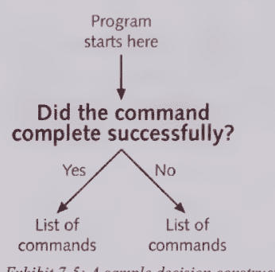

# if 结构

最常见的决策结构被称为 `if` 结构。`if` 结构的语法如下所示。

```
if this is true
    do these commands
elif this is true
    do these commands
else
    do these commands
fi
```

有一些规则规定着 `if` 结构。

- `elif` (`else if`) 和 `else` 语句是可选的。
- 你可以有无限数量的 `elif` 语句。
- `do` 命令部分可以包含多个命令，每行一个。
- `do` 命令部分为了可读性，通常相对于文本的左侧缩进，但不是必须。
- 语句的结尾必须是 `fi`（`if` 的反写）。

`if` 的 `true` 部分是一个命令或测试语句。如果它们执行正常，则返回真。测试语句包含在方括号内，用于测试特定条件。

使用基本结构确保 `etc/sample` 目录被创建，并且 `/etc/hosts` 文件被复制到那里的示例所示：

```
[root@localhost root]# cat test
#!/bin/bash
if mkdir /sample
    cp /etc/hosts /sample
    echo "The hosts file was successfully copied to /sample"
else
    echo "The sample directory could not be created."
fi
[root@localhost root]# chmod +x test
[root@localhost root]# ./test
The hosts file was successfully copied to /sample
```

在上面的输出中，`mkdir` 命令始终运行。如果它运行成功，脚本将继续执行 `echo "The hosts file was successfully copied to /sample"` 命令。如果 `mkdir` 命令失败，则 `shell` 将跳过并执行 `echo "The sample directory could not be created."` 命令。在上面的 `shell` 脚本中，`fi` 之后的文本无论 `if` 结构的结果如何都会执行。

### CompTIA Linux+ 认证，2004 目标

### 使用 if 请求输入

通常，使用 `if` 结构来根据用户提供的输入改变程序的流程。下面的 `myscript` 脚本所示：

```
[root@localhost]# cat myscript
#!/bin/bash
echo -e "Today's date is: \c"
date
echo -e "\nThe people logged into the system include:"
who
echo -e "\ncontents of the / directory are:"
ls -F /
[root@localhost]#
```

询问用户是否查看 `/` 目录的内容，可以使用以下 `if` 结构：

```
[root@localhost]# cat myscript

#!/bin/bash

echo -e "Today's date is: \c"

date

echo -e "\nThe people logged into the system include:"

who

echo -e "\nWould you like to see the contents of / (y/n)-->\c"

read ANSWER

if [ $ANSWER = "y" ];
then
    echo -e "\ncontents of the / directory are:"
    ls -F /
fi
```

```
[root@localhost]# ./myscript
Today's date is: Sat Jun 1 09:13:31 EDT 2003
The people logged into the system include:
root pts/0 Jun 1 08:44 (3.0.0.2)

Would you like to see the contents of / (y/n)--> y
```

注意从之前的输出，`test $ANSWER = "y"` 用于检查变量是否等于 `y`。变量中的任何其他字符都会导致 `test` 返回假，并跳过目录列表。

# 使用 BASH shell

上面使用的比较类型称为字符串比较，对两个字符串值进行比较。这由运算符指示。测试语句中常用的运算符及其定义如下表所示。注意：在起始括号之后和结束括号之前需要空格；否则 `test` 将产生错误。

| 测试 | 返回真条件 |
| :--- | :--- |
| `A = B` | 字符串 `A` 等于字符串 `B` |
| `A != B` | 字符串 `A` 不等于字符串 `B` |
| `A -eq B` | 数值 `A` 等于 `B` |
| `A -ne B` | 数值 `A` 不等于 `B` |


| 符号 | 描述 |
| :--- | :--- |
| `-lt B` | 数值 `A` 小于 `B` |
| `-gt B` | 数值 `A` 大于 `B` |
| `-le B` | 数值 `A` 小于或等于 `B` |
| `-ge B` | 数值 `A` 大于或等于 `B` |
| `-r A` | `A` 是存在的文件/目录且可读 (`r` 权限) |
| `-w A` | `A` 是存在的文件/目录且可写 (`w` 权限) |
| `-x A` | `A` 是存在的文件/目录且可执行 (`x` 权限) |
| `-f A` | `A` 是普通文件 |
| `-d A` | `A` 是目录 |

## 特殊比较运算符

你可以使用比较运算符 `-o` (或) 和 `-a` (与) 将任何测试语句与其他语句组合。你还可以使用 `!` (非) 运算符反转测试语句的含义。这些运算符在测试语句中的示例如下。注意：一个测试语句中可能有多个 `-o`、`-a` 和 `!` 运算符。

| 测试 | 返回真条件 |
| :--- | :--- |
| `A = B -o C = D` | 字符串 `A` 等于字符串 `B` 或 `C` 等于字符串 `D` |
| `A = B -a C = D` | 字符串 `A` 等于字符串 `B` 且 `C` 等于字符串 `D` |
| `A != B` | 字符串 `A` 不等于字符串 `B` |

考虑到 `myscript` shell 脚本，如果你在示例中输入 `y` 或 `n`，你将执行目录列表：

```bash
[root@localhost root]# cat myscript
#!/bin/bash
echo -e "Today's date is: \c"
date
echo -e "\np logged into the system include:"
who
echo -e "\nWould you like to see the contents of / (y/n)-->\c"
read ANSWER
if [ $ANSWER = "y" -o $ANSWER = "y" ]
then
echo -e "\nThe of the / directory are:"
ls -F /
fi
[root@localhost root]# ./myscript
Today's date is: Sat Jun 1 09:13:31 EDT 2003
```

The people logged into the system include:

root pts/0 Jun 1 08:44 (3.0.0.2)

Would you like to see the contents of / (y/n)--> Y

The contents of the / directory are:

bin/ dev/ home/ lib/ opt/ root/

tftpboot/ usr/

[root@localhost]#

## case 结构

早期的 `if` 结构适用于提供较少的选择，但通过使用 `elif` 语句，你可以获得更多样的选项。

```bash
[root@localhost]# cat myscript
#!/bin/bash
echo -e "What would you like to see?\nToday date (d)
Currently logged in users (u)
The contents of the / directory (r)

Enter your choice(d/u/r)-->"
read ANSWER
if [ $ANSWER = "d" -o $ANSWER = "D" ]
then
    echo -e "Today's date is: \c"
date
elif [ $ANSWER = "u" -o $ANSWER = "U" ]
then
    echo -e "\nThe people logged into the system include:"
who
elif [ $ANSWER = "r" -o $ANSWER = "R" ]
then
    echo -e "\nThe contents of the / directory are:"
    ls -F /
fi
[root@localhost]#
[root@localhost]# ./myscript
What would you like to see?
Today date (d)
Currently logged in users (u)
The contents of the / directory (r)

Enter your choice(d/u/r) --> d
Today's date is: Sat Jun 1 11:10:03 EDT 2003
```

`case` 结构通常用于在提供多个选择时简化脚本。`case` 结构的语法如下所示。

```bash
case variable in
    pattern1 ) do this
        ;;
    pattern2 ) do this
        ;;
    pattern3 ) do this
        ;;
esac
```


## 7-44 CompTIA Linux+ 认证，2004 目标

`case` 语句将变量的值与几种不同的文本或数字模式进行比较。如果匹配成功

以下输出显示了一个使用 `case` 结构简化脚本的示例：

```bash
[root@localhost root]# # cat myscript
#!/bin/bash
echo -e "你想看什么?\n今天日期 (d)
当前登录的用户 (u)
/ 目录的内容 (r)

请输入你的选择 (d/u/r)-->c"
read ANSWER

case $ANSWER in
  d) echo -e "\n今天的日期是: \c"
    date
    :;
  u) echo -e "\n登录系统的用户包括：\n"
    who
    :;
  r) echo -e "\nnn/ 目录的内容如下：\n"
    ls -F /
    :;
  *) echo -e "\n无效的选择！ \a"
    :;
esac
[root@localhost root]# # ./myscript
你想看什么?
今天日期 (d)
当前登录的用户 (u)
/ 目录的内容 (r)

请输入你的选择 (d/u/r)--> d
今天的日期: Sat Jun 1 11:33:23 EDT 2003
[root@localhost root]#
```

上面的示例向你提示一条消息，你可以从中选择一个项目并放入 `ANSWER` 变量。如果 `ANSWER` 变量等于字母 `d` 或 `D`，则执行该命令；如果 `ANSWER` 变量等于字母 `u` 或 `U`，则执行该命令；如果 `ANSWER` 变量等于字母 `r` 或 `R`，则执行 `ls` 命令。

如果 `ANSWER` 变量包含上述字母以外的任何内容，则通配符 `*` 将匹配它并在屏幕上打印错误消息。

与 `if` 结构一样，shell 脚本中 `case` 结构之后的任何语句都会在 `case` 结构之后执行。

## && 和 || 结构

尽管 `if` 和 `case` 结构功能强大，但在程序执行期间只需要做出一次决策时，有一些简写结构可以节省时间。这些结构是 `&&` 和 `||`，它们的使用方法如下：

- `command &&`: 如果 `&&` 左侧的命令执行成功，则执行右侧的命令。
- `command ||`: 如果 `||` 左侧的命令没有执行成功，则执行右侧的命令。

考虑之前使用的 `testmkdir` 示例：

```bash
[root@localhost root]# cat testmkdir
#!/bin/bash
if mkdir /etc/sample
then
    cp /etc/hosts /etc/sample
    echo "hosts 文件已成功复制到 /etc/sample"
else
    echo "无法创建 /etc/sample 目录。"
fi
[root@localhost root]#
```

你可以使用 `&&` 结构重写脚本，如下所示：

```bash
[root@localhost root]# cat testmkdir
#!/bin/bash
mkdir /etc/sample && cp /etc/hosts /etc/sample
[root@localhost root]#
```

如果 `mkdir` 命令成功，脚本将创建 `/etc/sample` 目录并将 `/etc/hosts` 文件复制到其中。

你可以使用 `||` 在其中一个命令未能正常执行时生成错误消息。

```bash
[root@localhost root]# cat testmkdir
#!/bin/bash
mkdir /etc/sample || echo "无法创建 /etc/sample"
cp /etc/hosts /etc/sample || echo "无法复制 /etc/hosts"
[root@localhost root]#
```

如果 `mkdir` 或 `cp` 命令失败，其中一个 `echo` 语句将打印到屏幕上。

## C-2: 在 shell 脚本中使用决策结构

| 操作步骤 | 为什么这样做 |
| :--- | :--- |
| 1 输入 `vi myscript2` | 在你的主目录下创建一个名为 `myscript2` 的新文件以进行编辑。 |
| 2 输入以下内容：<br><br>```bash<br>#!/bin/bash<br>echo -e "此程序向家庭数据库文件添加条目。\n"<br>echo -e "请输入家庭成员姓名 --\c"<br>read NAME<br>echo -e "请输入该成员与你的关系\n（例如，母亲） --\c"<br>read RELATION<br>echo -e "请输入该成员的电话号码 -\n-> \c"<br>read PHONE<br>echo $NAME\t$RELATION\t$PHONE >> database<br>```<br><br>保存并退出 `vi` | 3 输入 `chmod u+x myscript2` | 为 `myscript2` 授予执行权限。 |
| 4 输入 `./myscript2` | 执行脚本。输入姓名、关系和号码 |
| 5 重复步骤 4 若干次 | 为 `database` 文件填充条目。 |
| 6 输入 `cat database` | 查看文件内容。 |
| 7 输入 `vi myscript2` | 打开文件进行编辑。 |

编辑 `myscript2` shell 脚本使其如下：

```bash
#!/bin/bash
echo -e "你想向家庭数据库文件添加条目吗？\n"
read ANSWER1
if [ $ANSWER1 = "y" -o $ANSWER1 = "Y" ]
then
echo -e "请输入家庭成员姓名 -->\c"
read NAME
echo -e "请输入该成员与你的关系\n（例如，母亲）-->\c"
read RELATION
echo -e "请输入该成员的电话号码 -->\c"
read PHONE
echo "$NAME\t$RELATION\t$PHONE" >> database
fi
echo -e "\n你你想在家庭数据库中搜索条目吗？\n"
read ANSWER2
if [ $ANSWER2 = "y" -o $ANSWER2 = "Y" ]
then
echo -e "你想搜索什么单词？ -->\c"
read WORD
grep "$WORD" database
else
echo "你必须输入字母 a 或 s。"
fi
```

保存更改并退出编辑器。

| 8 输入 `./myscript2` | 执行脚本。在提示输入条目时输入 `y`。搜索你刚刚输入的名称。 |
| 9 输入 `./myscript2` | 执行脚本。在提示输入条目时输入 `n`。检查名称是否已保存到文件中。 |
| 10 输入 `vi myscript2` | 编辑脚本使其如下：<br><br>```bash<br>#!/bin/bash<br>echo -e "你想做什么？\n添加条目 (a)\n搜索条目 (s)\n输入你的选择 (a/s)-->\c"<br>read ANSWER<br>case $ANSWER in<br>  a) echo -e "请输入家庭成员姓名-->\c"<br>    read NAME<br>    echo -e "请输入该成员与你的关系\n（例如，母亲）-->\c"<br>    read RELATION<br>    echo -e "请输入该成员的电话号码\n-->\c"<br>    read PHONE<br>    echo "$NAME\t$RELATION\t$PHONE" >> database;<br>  s) echo -e "你想搜索什么单词？-->\c"<br>    read WORD<br>    grep "$WORD" database;<br>  *) echo "你必须输入字母 a 或 s。"<br>esac<br>```<br><br>保存更改并退出 |

| 操作步骤 | 为什么这样做 |
| :--- | :--- |
| 11 输入 `./myscript2` | 执行脚本。输入 `y`。注意显示的错误信息。 |
| 12 输入 `./myscript2` | 执行脚本。输入 `a` 向 `database` 文件中添加条目。 |
| 13 输入另一个成员的信息 | |
| 14 输入 `./myscript2` | 执行脚本。输入 `s` 搜索条目。搜索步骤 12 中输入的家庭成员 |
| 15 输入 `vi myscript3` | 在你的主目录下创建一个名为 `myscript3` 的新文件。 |

### 16 将以下文本输入 `myscript3` 文件：

```bash
#!/bin/bash
echo -e "此程序将文件复制到 /stuff 目录。\n"
echo -e "你想复制哪个文件？ --> \c"
read FILENAME
mkdir /stuff || echo "无法创建 /stuff 目录。"
cp -f $FILENAME /stuff && echo "$FILENAME 已成功复制到 /stuff"
```

保存更改并退出编辑器。

17 输入 `chmod u+x myscript3` 为 `myscript3` 授予执行权限。
18 输入 `./myscript3` 执行脚本。在提示输入文件名时输入 `/etc/hosts`。
19 输入 `./myscript3` 执行脚本。在提示输入文件名时输入 `/etc/instab`。注意错误消息。
20 输入 `ls /stuff` 确认文件已复制。
21 输入 `exit` 退出 shell。

## 主题 D: BASH 命令历史

### 解释 (Explanation)

`BASH` shell 最实用的功能之一是它的历史记录（`history`）功能，它会跟踪你插入命令并允许你找回并重新执行它们。在执行重复或相似的命令时，它可以节省大量的打字时间。命令历史还可以帮助你精确地找回输入的命令。

在这项活动中，你将学习使用 `BASH` 命令历史来：

- 使用向上方向键重复命令
- 指定命令编号
- 搜索包含特定字符串的历史命令
- 替换最近一次命令中的单词

### 动手吧！(Do it!)

## D-1: 使用 BASH 命令历史

| 操作步骤 | 为什么这样做 |
| :--- | :--- |
| 1 在 `tty2` 上以 `root` 身份登录 | |
| 2 按向上方向键 | 显示上一次登录时最近的命令。 |
| 再次按向上方向键 | 查看下一个最近的命令。 |
| 按冒号 | 两次，返回空白提示符。 |
| 3 输入以下命令 | |
| 4 输入 `history` | 查看历史中所有命令及其对应的编号。 |
| 记录 `ls -l` 命令的编号 | |
| 5 输入 `![命令编号]` | 重复 `ls -l` 命令。 |
| 6 输入 `!who` | 搜索并执行 `who` 命令。 |
| 7 输入 `!whoa` | 搜索并执行 `whoami` 命令。 |
| 8 输入 `?` | 搜索并执行包含字符串 `etc` 的最近一次命令 (`ls -l /etc`)。 |

```bash
cd
ls -l /etc
ls -l
whoami
who
```

9 输入 `!wombat99?` 注意查看错误信息。

10 输入以下命令：

```bash
cat /bin/bash | strings | grep shell | less
```

显示 `/bin/bash` 文件中所有包含单词 `shell` 的字符串。

按 `Q` 退出 `less` 实用程序。

11 输入 `^shell^alias^`

在最近的一条历史别名命令（historic alias command）中，将单词 `shell` 替换为单词 `alias`，并执行该别名命令。

按 `Q` 退出该命令模式。

## 自定义 BASH 历史记录

`BASH` 命令历史功能可以通过多种方式进行自定义，以满足你的特殊需求。要实现这一点，你需要了解该功能是如何运作的，包括：

- `BASH` 历史文件何时更新
- 如何指定需要记住的历史命令数量
- 如何设置 `HISTSIZE` 环境变量

### D-2: 自定义 BASH 命令历史

| 如下所示 | 原因如下 |
| :--- | :--- |
| 1 输入 `cd` | 切换到主目录。 |
| 2 输入 `tail .bash_history` | 查看 `.bash_history` 文件中的最后几行。 |
| 3 输入 `history` | 显示历史文件中的命令列表。 |
| 4 输入以下命令：`echo 'This is my command'` | 在屏幕上显示字符串。 |
| 5 输入 `exit` | 退出 shell。 |
| 6 以 `root` 身份登录 | |
| 7 输入 `history` | 你在列表末尾看到命令 `echo "This is my command"`。 |
| 8 输入 `tail .bash_history` | 你在列表末尾看到命令 `echo "This is my command"`。 |
| 9 输入 `history|less` | 你在屏幕上看到最久远的历史命令。 |
| 按空格键 | 查看文件的更多内容。 |
| 按 `Q` | 退出 `less` 实用程序。 |


| 10 输入 `wc -l .bash_history` | 显示 `.bash_history` 文件的行数。 |
| 11 输入 `set\|grep HISTSIZE` | 查看 shell 的 `HISTSIZE` 参数。 |
| 12 输入以下命令： | 在不编辑文件的情况下添加该语句。 |
| `echo 'HISTSIZE=5000' >> .bashrc` | |
| 13 输入 `exit` | 退出 shell。 |
| 14 以 root 身份登录 | |

# 使用 BASH shell 操作

- 15 输入 `set\|grep HISTSIZE`
  查看 `HISTSIZE` 是否已经更改。
- 16 多次输入 `history` 命令
  注意，每次执行此操作时，历史记录中都会添加一条历史命令。
- 17 输入以下命令：
  `echo "HISTCONTROL=ignoreddups" >> .bashrc`
  告诉 `HISTCONTROL` 忽略重复项。
- 18 输入 `exit`
- 19 以 root 身份登录
- 20 多次输入 `history` 命令
  注意，尽管你一个又一个地输入相同的命令，历史记录中也只添加了一条历史命令。
- 21 输入 `exit`
  退出 shell。

# 单元总结：使用 BASH shell 操作

### 主题 A
在本主题中，你学习了命令的三个组成部分：标准输入、标准输出和标准错误。你学习了如何将标准输入、标准输出和标准错误重定向到文件，以及如何将一个命令的标准输出重定向到另一个命令的标准输入。你还看到了使用 `sed` 和 `awk` 过滤命令的示例。

### 主题 B
在本主题中，你学习了环境变量。你学习了如何在 BASH shell 中创建自己的变量并将其导出。你观察到这些变量可以放置在环境变量文件中，以便它们在每次登录时被加载。你学习了 `UMASK` 别名是使用命令设置的特殊变量。

### 主题 C
在本主题中，你学习了可以使用 shell 脚本执行命令。你观察到可以在 shell 脚本中使用判断结构，根据用户输入或命令结果来执行命令。

### 主题 D
在本主题中，你学习了如何使用和自定义 BASH shell 的命令历史记录。

## 复习题

- 1 如果变量是 \___________，则可以在子 shell 中运行的进程中使用用户定义的变量
  A 导入的 (imported)
  B 通过运行 `env` 命令验证
  C 导出的 (exported)
  D 重定向到 BASH shell
- 2 使用哪种命令可以显示名为 `PWD` 的环境变量的当前值？
  A `echo PWD`
  B `ls PWD`
  C `display PWD`
  D `echo $PWD`
  E `ls $PWD`
  F `display PWD`
- 3 当绝对路径或相对路径未在命令行中列出时，使用哪个环境变量来定义查找可执行命令的位置？
  A `COM`
  B `PATH`
  C `TERM`
  D `WHERE`
  E `WHO`
- 4 `sed` 和 `awk` 命令是通常用于格式化管道内数据的过滤命令。对或错？
- 5 在用户登录 Linux 系统并接收 BASH shell 之后，以下哪一个文件总是会被立即执行？
  A `/etc/profile`
  B `~/.bash_profile`
  C `~/.bash_login`
  D `~/.profile`
- 6 下列哪些项是文件描述符？（选择所有适用项）
  A 标准输出 (Standard Output)
  B 标准偏差 (Standard deviation)
  C 标准设置 (Standard settings)
  D 标准 (Standard Error)
  E 用户输入
  F 变量输入
- 7 为了在 `echo` 命令中使用转义序列，必须配合 `echo` 命令使用哪个选项？
  A `-esc`
  B `-a`
  C `-a`
  D `-t`
- 8 你可以使用哪种命令来查看所有环境变量和用户定义变量及其值？
  A `/var`
  B `env`
  C `set`
  D `echo`
- 9 每个 `if` 结构都以 `if` 开头，并必须以什么结束？
  A `end`
  B `endif`
  C `stop`
  D `fi`

# 独立练习

### A 部分
完成此活动的 A 部分后，你能够设置 `PS1` 和 `PS2` 提示符以显示系统信息，并配置任何 BASH 提示符使用颜色。

- 1 切换到命令行终端
- 2 你可以在 BASH shell 中创建自己的变量并将其导出。观察到这些变量可以放置在环境变量文件中，以便它们在每次登录时被加载。`UMASK` 别名是使用命令设置的特殊变量。
- 3 提示符可以显示动态时间，例如 `HH:MM` 格式。
- 4 在 `PS1` 中使用 `~` 可以表示主目录。
- 5 提示符可以显示用户名。
- 6 提示符可以显示当前目录。
- 7 提示符可以显示完整路径。
- 8 提示符可以显示主机名。
- 9 提示符可以显示内核版本。
- 10 提示符可以显示当前任务。
- 11 提示符可以显示当前执行时间。
- 12 提示符可以显示当前状态。
- 13 提示符可以显示时间戳。
- 14 提示符可以显示错误信息。
- 15 提示符可以显示警告信息。
- 16 提示符可以显示成功信息。
- 17 提示符可以显示资源占用。
- 18 提示符可以显示内存信息。
- 19 提示符可以显示磁盘信息。
- 20 提示符可以显示网络信息。
- 21 提示符可以显示 CPU 信息。
- 22 提示符可以显示进程信息。
- 23 提示符可以显示用户信息。
- 24 提示符可以显示组信息。
- 25 提示符可以显示权限信息。
- 26 提示符可以显示文件信息。
- 27 提示符可以显示版本信息。
- 28 提示符可以显示日期信息。
- 29 提示符可以显示语言信息。
- 30 提示符可以显示区域信息。
- 31 提示符可以显示位置信息。
- 32 提示符可以显示坐标信息。
- 33 提示符可以显示架构信息。
- 34 提示符可以显示硬件信息。
- 35 提示符可以显示驱动信息。
- 36 提示符可以显示模块信息。
- 37 提示符可以显示日志信息。
- 38 提示符可以显示服务信息。
- 39 提示符可以显示配置信息。
- 40 提示符可以显示加密信息。
- 41 提示符可以显示证书信息。
- 42 提示符可以显示密钥信息。
- 43 提示符可以显示令牌信息。
- 44 提示符可以显示权限信息。
- 45 提示符可以显示插件信息。
- 46 提示符可以显示库信息。
- 47 提示符可以显示二进制信息。
- 48 提示符可以显示容器信息。
- 49 提示符可以显示镜像信息。
- 50 提示符可以显示虚拟机信息。
- 51 提示符可以显示云信息。
- 52 提示符可以显示数据库信息。
- 53 提示符可以显示负载信息。
- 54 提示符可以显示流量信息。
- 55 提示符可以显示吞吐信息。
- 56 提示符可以显示延迟信息。
- 57 提示符可以显示丢包信息。
- 58 提示符可以显示带宽信息。
- 59 提示符可以显示速率信息。
- 60 提示符可以显示频率信息。
- 61 提示符可以显示相位信息。
- 62 提示符可以显示信号信息。
- 63 提示符可以显示电压信息。
- 64 提示符可以显示电流信息。
- 65 提示符可以显示功率信息。
- 66 提示符可以显示能量信息。
- 67 提示符可以显示温度信息。
- 68 提示符可以显示湿度信息。
- 69 提示符可以显示压力信息。
- 70 提示符可以显示高度信息。
- 71 提示符可以显示深度信息。
- 72 提示符可以显示距离信息。
- 73 提示符可以显示速度信息。
- 74 提示符可以显示加速度信息。
- 75 提示符可以显示力信息。
- 76 提示符可以显示动量信息。
- 77 提示符可以显示动能信息。
- 78 提示符可以显示质量信息。
- 79 提示符可以显示密度信息。
- 80 提示符可以显示体积信息。
- 81 提示符可以显示面积信息。
- 82 提示符可以显示长度信息。
- 83 提示符可以显示硬度信息。
- 84 提示符可以显示韧性信息。
- 85 提示符可以显示延展信息。
- 86 提示符可以显示刚性信息。
- 87 提示符可以显示导电性信息。
- 88 提示符可以显示导热性。
- 89 提示符可以显示磁性信息。
- 90 提示符可以显示光敏性信息。
- 91 提示符可以显示放射性信息。
- 92 提示符可以显示化学性信息。
- 93 提示符可以显示生物性信息。
- 94 提示符可以显示毒性信息。
- 95 提示符可以显示过敏性信息。
- 96 提示符可以显示感染性信息。
- 97 提示符可以显示抗性信息。
- 98 提示符可以显示溶解性信息。
- 99 提示符可以显示渗透性信息。
- 100 提示符可以显示稳定性信息。

### B 部分
在活动的 B 部分中，你将探索名为 `CDPATH` 的 BASH 功能。该功能对 `cd` 命令的作用就像 shell 的 `PATH` 功能对运行程序的作用一样：它会查找正确的目录。

7 输入 `cd` 回到你的主目录。
8 输入 `mkdir ~/bin`。这会在你的主目录下创建一个 `bin` 目录。
9 输入 `cd bin`。此时，当前工作目录被设置为 `~/bin`，即你主目录下的 `bin` 目录。
10 输入 `CDPATH=/usr`。注意，你删除了在第 5 步输入的类似命令中存在的冒号。第 11 和第 12 步将显示此操作的结果。
11 输入 `cd` 并按回车返回你的主目录。
12 输入 `cd bin`。当前工作目录被设置为 `/usr/bin`——即 `/usr` 目录下的 `bin` 目录，而不是你主目录下的 `bin` 目录。发生了什么？通过删除冒号，你告诉 BASH 不要从你的当前工作目录（在本例中为你的主目录）开始搜索子目录。
13 输入 `cd` 回到你的主目录。
14 输入 `cd ~/bin`。这一次，BASH 将当前工作目录设置为 `~/bin` 目录，因为你显式指定了它。BASH 不需要搜索它。
15 接下来，让它变得复杂一些。输入 `CDPATH=/usr/var`。你告诉 BASH 先搜索当前工作目录，然后是 `/usr` 目录，最后是 `/var` 目录。
16 输入 `cd` 回到你的主目录。
17 输入 `cd log`。当前工作目录被设置为 `/var/log`。BASH 无法在当前工作目录或 `/usr` 目录下找到 `log` 目录，但在 `/var` 下确实找到了 `log` 目录。

# 第 8 单元

# 系统初始化
单元时长：160 分钟

完成本单元后，你将学会如何：
- A 概述启动 Linux 系统所需的各个步骤、配置 `LILO` 和 `GRUB` 引导程序，以及与 Windows 实现 Linux 双系统启动。
- B 理解 `init` 守护进程如何在系统启动时初始化系统并在不同的运行级别（runlevels）下启动守护进程。

# 主题 A：启动和引导程序
本主题涵盖了以下 CompTIA Linux+ 考试目标。

| # | |
|---|---|
| 1.8 | 配置引导程序。 |
| | - `LILO` |
| | - `ELILO` |
| | - `GRUB` |
| | - 多启动选项 |
| 6.2 | 使用 Linux 工具诊断硬件问题。 |
| | - Live CD 救援 |

# 启动过程
当计算机首次开启时，存储在主板上的 `BIOS` 程序会执行上电自检（`POST`）。`POST` 之后，`BIOS` 会检查启动设备的配置设置，以搜索要执行的操作系统。你可以自定义这些设置，以告诉机器应该搜索哪些设备以及按什么顺序搜索。

通常，计算机会首先检查软盘和 `CD-ROM` 上的操作系统。如果驱动器内有磁盘，`BIOS` 将尝试使用该磁盘启动计算机。如果软盘不可启动，你通常会收到错误信息，必须移除磁盘。如果 `CD-ROM` 不可启动，`BIOS` 通常会跳过它并继续列表中的下一个设备。

下一步通常是从硬盘启动。计算机会检查第一块磁盘上的主引导记录（`MBR`）。`MBR` 包含了关于磁盘上任何系统使用何种启动方法的信息，以及在哪里找到启动操作系统的引导程序。

引导程序包含了硬盘上安装的操作系统的信息，并控制它们如何被启动。引导程序可以安装在硬盘的 `MBR` 中，在那里它可以控制 Linux 和其他系统的启动。或者，可以在那里安装另一个引导程序，并将 Linux 引导程序安装在包含内核和引导文件的分区中。

无论引导程序位于何处，一旦它启动了 Linux，启动过程的其余部分都是相同的。引导程序理解并执行内核。内核存储在 `boot` 目录下，命名为 `vmlinux`。一旦运行，内核将接管引导程序，通过将守护进程加载到内存中启动系统的其余部分。

> 守护进程（daemon）是一个运行的系统进程的程序，用于执行有用任务，如打印、调度和操作系统维护。系统的第一个守护进程称为 `init`（初始化守护进程）。它负责加载将系统带入可用状态所需的所有其他守护进程。整个过程如图 8-1 所示。

# 系统初始化 8-3
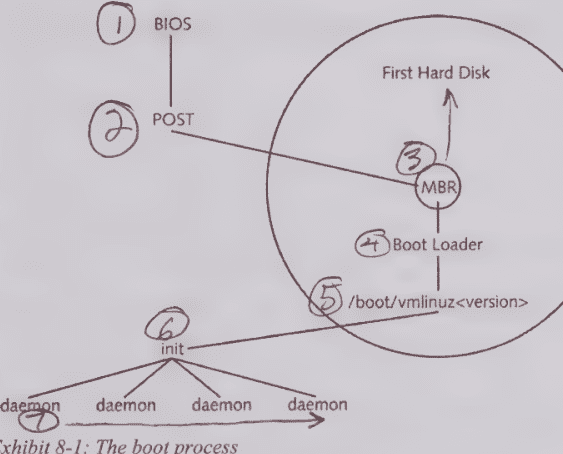
图 8-1：启动过程

动手试一试！

# A-1：讨论启动过程
### 练习题
- 1 你无法更改计算机 `BIOS` 中检查启动设备的顺序。对或错？
- 2 在初始化计算机时，以下哪个操作最先发生？
  A 执行 `POST` 测试。
  B 计算机检查 `MBR`。
  C 计算机检查软盘设备上的操作系统。
  D 计算机检查 `CD-ROM` 设备上的操作系统。
- 3 哪项说法是不正确的？
  A 根据引导程序从何处加载，启动过程的其余部分将有所不同。
  B 在 Linux 内核加载到内存后，引导程序不再处于状态。
  C 任何时刻只能有一个操作系统处于激活状态。
  D 以上均不是。

### CompTIA Linux+ 认证，2004 目标

# 引导程序
解释说明
引导程序的主要功能是将内核加载到内存中，以便可以与其进行交互。启动 Linux 有许多不同的方法。最常用的是 `LILO` 和 `GRUB`。

`LILO` 是传统的引导程序。它位于磁盘的第一个扇区。`GRUB` 是一种更现代的引导程序，灵活得多。

你也可以使用 `/etc/lilo.conf` 来配置引导程序。示例所示：
```
boot=/hda
timeout=50
default=linux
map=/boot/map
install=/boot/vmlinux-2.6.5
label=linux
initrd=/initrd-2.6.5
read-only
append=rhgb
```

下表提供了 `lilo.conf` 中常用的某些关键字及其定义。

| 关键字 | 描述 |
|---|---|
| `image=` | 指定内核的绝对路径。 |
| `root=` | 指定包含根文件系统的设备。 |
| `prompt=` | 显示 `LILO` 屏幕。 |
| `message=` | 指定包含文本或图形屏幕文件的绝对路径。 |
| `timeout=` | 在加载默认操作系统内核之前等待用户输入的 1/10 秒秒数。 |
| `default=` | 指定默认操作系统内核的标签。 |
| `label` | 给操作系统内核的友好名称，供 `default=` 使用。 |
| `boot=` | 指定 `LILO` 应安装的位置。如果指定的设备是硬盘上的分区，则 `LILO` 安装在分区的开头。如果指定的设备是磁盘，则 `LILO` 安装在设备设备的 `MBR` 上。 |
| `linear` | 指定 `LILO` 使用线性扇区寻址。 |
| `read-only` | 最初将 Linux 根文件系统挂载为只读，以减少系统启动期间运行 `fck` 时可能出现的任何错误。 |
| `initrd=` | 指向内存磁盘镜像的路径，用于在启动时将 Linux 内核所需的模块加载到内存中。 |
| `password=` | 指定启动 Linux 内核所需的密码。 |
| `append=` | 指定时传递给 Linux 内核的参数。 |
| `map=` | 指定包含 Linux 内核在硬盘上精确位置的文件。 |
| `install=` | 指定用作新引导扇的文件。 |
| `lba32` | 用于对超过 1024 个柱道的硬盘指定大块寻址（32 位）。 |

# 使用 LILO 控制系统配置
在某些情况下，你可能希望在内核启动之前为其提供指令。最常见的情况是内核没有接收到系统资源的正确数据。

系统会在 `/proc` 目录下的文件中导出检测到的硬件信息。查看这些文件的内容可以告诉你是内核是否正确检测到了硬件。如果没有正确检测，可以使用 `/etc/lilo.conf` 中的 `append=` 语句为内核提供正确的值。

例如，如果读取 `/proc/meminfo` 时内核无法识别计算机中的物理内存，你可以向 `/etc/lilo.conf` 添加一行 `append="mem=xxx"`（其中 `xxx` 是以 MB 为单位计算的正确内存量）。

如果系统未检测到硬盘，你可以向内核发送硬盘的磁柱面（cylinders）、磁头（heads）和扇区（sectors）数量。为此，你应该向 `/etc/lilo.conf` 添加一行 `append="hd=C,H,S"`（其中 `C` 是 磁柱面数，`H` 是磁头数，`S` 是扇区数）。

> 注意：几乎任何硬件都可以通过 `append=...` 关键字传递给内核。

如果你更改了 `/etc/lilo.conf` 文件或对内核进行了任何更改，将需要重新安装 `LILO` 以使 `/etc/lilo.conf` 中的新信息生效。执行此操作请使用 `lilo` 命令。
```
[root@localhost]# lilo
Added linux
[root@localhost]#
```

> 注意：若要从活动分区或 `MBR` 卸载 `LILO`，你需要使用 `lilo U` 命令。

尽管 `LILO` 是一个健壮的引导程序，但它可能会遇到错误并无法正常加载。如果发生这种情况，你会收到指示问题性质的错误代码。常见的 `LILO` 错误代码及可能的解决方案如下所示。

| 错误代码 | 描述 |
| --- | --- |


## LILO 引导错误代码

| 代码 | 描述 |
| :--- | :--- |
| L | LILO 引导程序的第一部分加载失败，通常由于硬盘参数错误导致。只需重启机器有时即可解决此问题；但你可能还需要在 `/etc/lilo.conf` 中添加 `line` 单词 |
| LI | LILO 引导程序的第二部分加载失败或缺少 `/boot/boot` 文件。在 `/etc/lilo.conf` 中添加 `line` 单词可能会解决问题 |
| LIL / LIL- / IL? | LILO 已正确加载但无法找到所需的某些文件，例如 `/boot/map` 和 `/boot/boot` 文件。在 `/etc/lilo.conf` 中添加 `line` 单词可能会解决问题 |

适用于 Intel Pentium 和 Itanium 计算机（其使用扩展性固件接口 (EFI)）的 LILO 版本可以在 `sourceforge.net/projects/elilo/` 下载。

## A-2: 安装和配置 LILO

### 操作步骤

1. 按下 `CTRL` + `ALT` + `F2` 切换到命令行终端 (tty2)。
2. 输入 `root` 作为登录名。输入密码作为密码以登录终端。
3. 输入以下命令：`cp /etc/lilo.conf.anaconda /etc/lilo.conf` 为由 Red Hat Fedora Linux 安装程序生成的示例 `lilo.conf` 文件创建一个副本。
4. 输入以下命令：`cat /etc/lilo.conf` 查看配置文件的内容。
5. 输入 `lilo` 使用 `/etc/lilo.conf` 中的信息在硬盘的 MBR 上安装 LILO 引导程序。
6. 输入 `reboot` 使用 lilo 引导程序重启系统。BIOS POST 自检后你看到的第一个界面将是 lilo 启动提示。请立即执行下一步。
7. 按下 `TAB` 查看 lilo 可以启动的操作系统标签。如果有更多内核或系统，你将在这里看到它们的标签。
8. 输入 `linux single` 将默认操作系统引导到单用户模式。
9. 通过在行首放置 `#` 字符注释掉 `message=/boot/message`。在此模式下，你将以 `root` 身份登录。
10. 输入 `vi /etc/lilo.conf` 编辑 LILO 配置文件。
11. 输入 `i` 进入插入模式。
    * 将超时值更改为 600
    * 在显示 `image=/boot/vmlinuz-2.6.5-1.358` 的行下方插入一个新行
    * 键入 `password=password` 设置启动密码。
12. 按下 `ESC` 然后按下 `SHIFT` + `;` 输入 `wq` 保存更改并退出 `vi`。
13. 输入 `lilo` 使用新配置重新安装 lilo。如果 `/etc/lilo.conf` 中有任何语法错误，此命令将不起作用。再次编辑文件修复任何语法错误并重新运行 `lilo` 命令。
14. 输入 `reboot` 在 lilo 启动提示处，这样你就无需等待超时。
15. 按下 `ENTER` 允许 lilo 引导内核。
16. 输入 `password` 完成启动。

### 为什么这样做

*(注：原文此处标题下无具体内容，已按原文结构保留标题)*

## GRUB

通用统一引导加载程序 (GRUB) 是近期引入的 LILO 替代方案。它在运行机制上与 LILO 非常不同。

GRUB 的第一个主要部分称为 Stage1，位于 MBR 上。GRUB 的其余部分 Stage1.5 和 Stage2 位于 `/boot` 目录中。

这些阶段的运行方式如下：

* Stage1 仅指向 Stage1.5。
* Stage1.5 加载包含 Stage2 的文件系统。
* Stage2 执行实际的引导程序并显示启动界面。

与 LILO 类似，GRUB 的配置是通过编辑文件完成的。但在编辑文件后，GRUB 不需要重新安装，因为文件是直接读取的。

GRUB 配置文件 `/boot/grub.conf` 示例所示：

```
[root@localhost]# cat /boot/grub.conf
# grub.conf generated by anaconda
# Note: 如果你有单独分区挂载到 /boot，更改此文件后无需重新运行 grub。
default=0
timeout=10
splashimage=(hd0,0)/boot/splash.xpm.gz
# Fedora Core (2.6.5-138) (hd0,0)
kernel vmlinuz-2.6.5-138 root=/dev/hda
initrd/2.6.5-138
```

注意：你还可以查看和编辑 `/etc/grub.conf`，它是 `/boot/grub.conf` 的符号链接。

要理解 `/boot/grub.conf` 中的条目，必须理解 GRUB 如何引用分区。

硬盘和分区通过以下格式的数字进行标识：

```
(hd<drive>,<partition#)
```

上述 `/boot/grub.conf` 中的 `(hd0,0)` 符号系统的第一个硬盘（无论 SCSI 还是 IDE）以及该硬盘上的第一个分区。第一个硬盘上的第二个分区将称为 `(hd0,1)`，第三个硬盘上的第四个分区将称为 `(hd2,3)`。

GRUB 将包含其引导程序 Stage2 的分区称为 GRUB 根分区。通常，GRUB 根分区是包含 `/boot` 目录的文件系统。不应与 Linux 根文件系统混淆。如果你的系统有单独分区挂载到 `/boot`，那么 GRUB 将引用 `/grub.conf`。如果系统没有独立的 `/boot` 文件系统，该文件为 `/boot/grub.conf`。

示例 `/boot/grub.conf` 文件显示图形启动界面 (`splashimage=(hd0,0)/boot/splash.xpm.gz`)，并在 10 秒后（`timeout=10`）启动第一个硬盘（`default=0`）上的默认操作系统。默认操作系统内核位于 GRUB 根文件系统 (`hd0,0`)，名为 `/boot/vmlinuz-2.6.5-138`。内核随后将 `/dev/hda` 上的根文件系统挂载为只读，以避免 `fsck` 命令的问题，并使用内存盘镜像加载启动时所需的模块 (`initrd/2.6.5-138`)。

注意：要从 GRUB 引导加载程序向内核传递信息，请在 `/boot/grub/grub.conf` 的内核行中添加适当的关键字。或者，你可以使用 `append=` 关键字添加一行，其语法与 `/etc/grub.conf` 中的 `append=` 关键字相同。

通常情况下，GRUB 允许用户在系统启动期间操作引导加载程序。为了防止这种情况，你可以对 GRUB 修改进行密码保护。`/boot/grub/grub.conf` 文件中的 `password --md5$1$-AS$T+RSW.uLzPhvhChhfSOTTSOO` 一行将提示输入密码。文件中显示的密码经过加密过的，以防止用户在查看文件时看到。

注意：要创建一个加密密码，你需要使用 `grub-md5-crypt` 命令。

如果启用了密码，如果你想操作启动过程，则需要在类似于图 8-2 的第一个图形化 GRUB 界面上按 `f`。一旦接受密码，你就可以按 `e` 如图 8-3 所示编辑来自 `/boot/grub/grub.conf` 的配置，或者按 `c` 获取 `grub` 提示符。

```
GMU GRUB version 0.94 (640K lower / 6412K upper memory)
root (hd0,0)
kernel /boot/mlinux-2.6.5-1.358 root=LABEL=/
initrd /boot/initrd-2.6.5-1.358.img
```

```
使用 T 和方向键选择高亮显示的条目。
按 'b' 启动，按 'e' 编辑启动序列中的选定命令，按 'c' 进入命令行，按 'o' 在选定行之后打开新行（'0' 为在之前），按 'd' 删除选定行，或按 escape 键返回主菜单。
```


图 8-3：GRUB 配置引导加载程序界面

在 `grub>` 提示符下，你可以输入各种命令来查看系统硬件配置、查找显示文件，或者在配置 GRUB 后或启动内核。要查看所有可用命令，请输入 `help`。你可以使用列出的命令，如图 8-4 所示。

```
GRUB version 0.94 (640K Tower / 64512K upper memory)
| 支持极简的 BASH 类行编辑。对于第一个单词，TAB
会列出任何地方可能的命令补全 --no-spm
设备/文件名补全。任何时候按 Esc 键。
grub> help blocklist FILE
background ARGBB CAT FILE
boot clear
chainloader (--file) FILE configfile FILE
display Display
find FILAME foreground ARGBB
GEOMETRY CYLINDER HEAD SECTION [part --no-spm]
help [all] [PARTITION] kernel [--no-mem-option] [--type=TYPE]
initrd FILE ([PATTERN] ...) map TO_FROM_DRIVE
makeactive module
modlinuxzip FILE ([ANG ...) page PART TYPE
part PART TYPE START LEN partype TYPE
reboot root [DEVICE [HODBAS]]
rootverify [DEVICE [HODBAS]] [-UNIT][--port=PORT]
setkey [TO_KEY FROM_KEY] setup --prefix=DIR1 --stage2=STAGE2
splashimage
terminfo [--name=NAME] --cursor-address=LEVT] [--no-echo] --no-ed
hubde upper KRYTES
webprobe [MODE]
grub> |
```

图 8-4：GRUB 命令

`grub` 提示符也可以用于手动启动系统，其方法与 `/boot/grub/grub.conf` 中所示相同。你可以在 `grub>` 提示符下输入来自 `/boot/grub/grub.conf` 的 `kernel` 和 `initrd` 行，然后输入 `boot` 单词继续该过程。

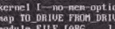

# 系统初始化 8-13

# 安装 GRUB

Fedora Core 2 要求你在安装期间选择 GRUB 引导加载程序。然而，在安装后，你可以任何时间在 GRUB 和 LILO 之间进行切换。要安装 LILO，只需在命令提示符处输入 `lilo`，它将基于 `/etc/lilo.conf` 文件的配置。要安装 GRUB，你使用 `grub-install` 命令。

要在第一个 IDE 硬盘的主引导记录（MBR）上安装 GRUB Stage1，可以使用以下命令：

```
[root@localhost root]# grub-install /dev/hda
安装完成。未报告错误。
这是设备映射 /boot/grub/device.map 的内容。
检查这是否正确。如果任何行不正确，请修复它并重新运行 `grub-install` 脚本。

# 此设备映射由 anaconda 生成
(fd0) /dev/fd0
(hd0) /dev/had
[root@localhost root]#
```

或者，要在同一块硬盘的第一个主分区的开头安装 GRUB Stage1，你可以输入以下：

```
[root@localhost root]# grub-install /dev/hda1
安装完成。未报告错误。
这是设备映射 /boot/grub/device.map 的内容。
检查这是否正确。如果任何行不正确，
请修复它并重新运行 'grub-install'。

# 此设备映射由 anaconda 生成
(fd0) /dev/fd0
(hd0) /dev/had
[root@localhost root]#
```

# A-3：配置 GRUB

| 操作方法 | 目的 |
| :--- | :--- |
| 1 在 `tty2` 上以 `root` 身份登录 | 查看 GRUB 配置文件。 |
| 2 输入以下命令：<br>`br>cat /boot/grub/grub.conf` | 编辑 GRUB 配置文件。 |
| 3 输入以下命令：<br>`br>vi /boot/grub/grub.conf`<br>将 `timeout` 的值从 10 改为 100 | |
| 4 保存你的更改并退出 `vi` 编辑器 | 在第一个 IDE 硬盘的 MBR 上安装 GRUB。 |
| 5 输入以下命令：<br>`br>grub-install /dev/had` | 重启你的系统。 |
| 6 输入 `reboot` | 当系统重启时。一旦看到它，立即执行下一步。 |
| 7 观察 GRUB 界面 | 编辑 GRUB 的配置。注意条目。 |
| 8 按 `[F]` | 打开 `grub>` 提示符。 |
| 9 输入 `help` | 查看你可以使用的命令列表。查看 `grub` 识别的内存量。它看起来正确吗？ |
| 10 输入 `cat /grub/grub.conf` | 查看 `/boot/grub/grub.conf` 文件。 |
| 11 输入以下命令：<br>`kernel /vmlinux-2.6.5-1.358 ro=LABEL=/ rhgb quiet` | 这与文件中相同。这会将 Linux 内核加载到内存中。 |
| 12 输入以下命令：<br>`initrd /initrd-2.6.5-1.358.img` | 这会将 ramdisk 加到内存中。 |

# 系统初始化 8-15

# 双启动 Linux

Linux 服务器通常专门用于其角色且仅按容量使用。将 Linux 作为工作站的用户可能希望在同一台计算机上有时使用 Linux，有时又使用另一个操作系统。由于你通常一次只能使用一个操作系统，因此在启动计算机时必须选择启动哪一个。

如果你使用 LILO 或 GRUB 进行双启动，在安装另一个操作系统后安装 Linux 是最简单的。这允许安装程序检测另一个操作系统并在 `/etc/lilo.conf` 和 `/boot/grub.conf` 中放置正确的条目。

例如，Linux 实例在包含一个已安装 Windows 操作系统的分区（`/dev/hda1`）的硬盘空闲空间上创建 Linux 分区，如图 8-5 所示。

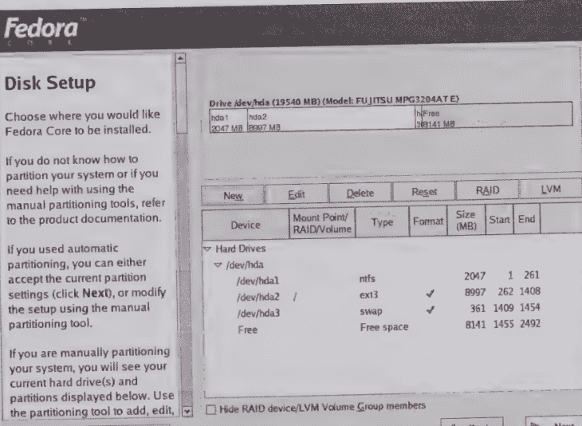

如果 Windows 分区选项将包含一个章节，允许你选择使用 GRUB 与 Windows 双启动 Linux，如图 8-6 所示。

# 8-18 CompTIA Linux+ 认证，2004 考试目标

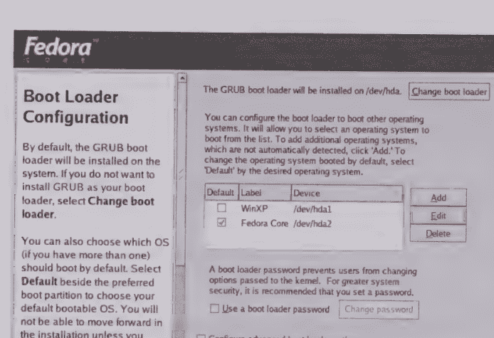

尽管在安装 Fedora Core 2 时安装了 GRUB，但安装程序也会创建 `/etc/lilo.conf.anaconda` 文件。你可以将此文件重命名为 `/etc/lilo.conf` 并配合 LILO 使用，这样你就不需要从头开始创建 `/etc/lilo.conf` 文件。

生成的 `/etc/lilo.conf` 文件所示：

```
[root@localhost root]# cat /etc/lilo.conf.anaconda
prompt
timeout=50
default=linux
boot=/dev/hda
map=/boot/map
install=/boot/boot.b
image=/boot/vmlinuz-2.6.5-1.358
label=linux
initrd=/boot/initrd-2.6.5-1.358.img
label=read-only
append="rhgb quiet root=/dev/hda2"
other=/dev/hda
optional
label=WinXP [root@localhost root]# _
```

由于 LILO 不能直接引导 Windows 内核，`other=/dev/hda` 会加载 `/dev/hda` 上的 Windows 引导加载程序。`optional` 关键字允许在操作系统不可用时忽略它。`label` 关键字是操作系统在 LILO 菜单上显示的名称。

图 8-6：为双系统配置 GRUB

安装程序创建的 `/boot/grub/grub.conf` 文件如输出所示：


```
[root@localhost ~]# cat /boot/grub/grub.conf
# grub.conf generated by anaconda
#
# Note that you do not have to rerun grub after making changes
# to this # file
# # NOTICE:    You have a /boot partition. This means that
# all kernel and initrd paths are relative to /, eg.
# root (hd0,0)
# kernel /vmlinuz-version ro=/dev/hda
# initrd /initrd-version.img
# #boot=/dev/hda
default=0
timeout=10
plashimage=(hd0,0)/boot/grub/splash.xpm.gz
title Fedora Core (2.6.5-1.358)
root (hd0,1)
kernel /vmlinuz-kernel 2.6.5-1.358 ro=/dev/hda2
rhgb quietat
initrd /initrd-2.6.5-1.358.img
title WinXnp
rootovernotify (hd0,0)
chainloader +1
[root@localhost ~]#
```

上述输出中的`title`关键字识别新的操作系统，并将显示在`GRUB`图形界面上。`rootovernotify (hd0,0)`表示操作系统位于第一个硬盘的第一个分区上，`GRUB`不应自动挂载它，因为它可能包含核心文件系统。

由于`GRUB`无法直接加载`Windows`内核，它从`Windows`分区加载`Windows`引导加载程序。该引导加载程序从`Windows`分区的第一个块开始。`chainloader +1`行告诉`GRUB`从分区的第一个块`(hd0,0)`开始加载另一个引导加载程序。

# 使用 Windows 引导加载程序实现 Linux 双系统

如果操作系统是`Linux`与`NT/2000/XP/2003`双系统，你可以使用`Windows NTLOADER`引导加载程序来加载`LILO`或`GRUB`。为此，你必须在`Windows`引导加载程序配置中指定`GRUB`或`LILO`的位置。如果存在`LILO`和`GRUB`，`NTLOADER`将在启动时显示一个选择启动系统的屏幕。`Windows NT/2000/XP/2003`应该首先安装在系统的第一个分区上。这默认会将`NTLOADER`放置在硬盘的`MBR`上。接下来，你可以安装`Linux`，并指定`GRUB`安装在分区的第一个扇区而非`MBR`，如图 8-6 所示。否则，`GRUB`将覆盖硬盘`MBR`上的`NTLOADER`。

一旦安装了`Linux`，再次使用`Fedora Core 2 CD`启动计算机。在欢迎界面，在提示符输入`linux`。在“选择语言”和“键盘类型”界面点击`OK`，在“设置”界面选择`No`，在“救援”界面点击`Continue`。当提示硬盘上的`Linux`安装文件系统已挂载到`/mnt/sysym`时，按`OK`并接收命令提示符。接下来，你应该为软盘创建一个目录(`mkdir /mnt/floppy`)，使用`FAT`文件系统格式化软盘并挂载它(`mount -t vfat /dev/fd0 /mnt/floppy`)。

现在，你可以创建一个可引导的`GRUB`镜像。假设`GRUB`安装在分区`/dev/hda2`的第一个扇区上，在软盘设备上，你可以在提示符处执行以下命令：

```
[localhost root]# cd /mnt/floppy
[localhost floppy]# dd if=/dev/hda2 bs=512 count=1 of=linub.bin
1+0 records in
1+0 records out
[localhost root]# umount /mnt/floppy
[localhost root]#
```

镜像创建后，可以在提示符输入`exit`重启计算机进入`Windows`操作系统。将`linub.bin`文件复制到`C:\`并配置`NTLOADER`文件(`C:\boot.ini`)，包含一个用于引导它的部分。示例`boot.ini`文件所示：

```
[boot loader]
timeout=30 default=multi(0)disk(0)rdisk(0)partition(1) \WINDOWS
[operating systems]
multi(0)disk(0)rdisk(0)partition(1) \WINDOWS-=Microsoft Windows XP
```

上述`boot.ini`文件从第一个`IDE`硬盘(`rdisk(0)`)上的第一个分区(`partition(1)`)引导标记为 "Microsoft Windows XP" 的操作系统，超时时间为 30 秒。要让`NTLOADER`引导`Linux`操作系统，你必须指定之前创建的`linub.bin`文件路径，并在`NTLOADER`屏幕上指定标签：

```
timeout=30 default=multi(0)disk(0)rdisk(0)partition(1) \WINDOWS
[operating systems]
multi(0)disk(0)rdisk(0)partition(1) \WINDOWS-=Microsoft Windows XP Professional/
C:\linub.bin="Red Hat Fedora Core 2",
```

当系统重启时，`NTLOADER`引导器将加载并呈现供选择的操作系统列表，如图 8-7 所示。安装完成后，你可以将`LILO`安装到分区的第一个扇区而非`GRUB`，并重新创建一个`NTLOADER`使用的`linub.bin`文件。

# 系统初始化 8-21


图 8-7：`NTLOADER` 屏幕

# FIPS

在安装`Windows`工作站时，通常会将磁盘上的所有空间用于`Windows`分区。这很简单，但会导致驱动器上没有用于安装`Linux`的可用空间。解决此问题的一种方法是划分较小的`Windows`分区并在上面安装`Windows`。然后`Linux`可以安装在可用空间上。

另一种解决方案是使用名为首次非破坏性分区分割器（`FIPS`）的工具调整`Windows`分区的大小。这将保留`Windows`操作系统和数据，为`Linux`创建空闲空间。

使用`FIPS`需要遵循以下指南：

- `FIPS` 2.0 版本仅支持 `FAT 16` 和 `FAT 32` 文件系统。`Windows` 和 `XP` 使用的 `NTFS` 文件系统不受 `FIPS` 支持。
- `FIPS` 仅适用于主 `Windows` 分区，不会调整扩展分区内逻辑驱动器的大小。
- `FIPS` 将 `Windows` 分区拆分为两个主分区。第一个包含 `Windows` 文件系统。第二个可以用于 `Linux`，或者在 `Linux` 安装期间将其删除并替换为多个分区。每个硬盘只能有四个主分区；确保在运行 `FIPS` 之前主分区不超过三个。
- 现有 `Windows` 分区内必须有足够的可用空间以便系统在调整大小后能够正常运行，并且创建了足够的可用空间来安装 `Linux`。

可以从互联网 `www.igd.fhg.de/~aschaefe/fips/` 下载 `FIPS`。你应该阅读程序随附的 `FIPS.doc` 文件，并确保你的系统符合列出的要求。

只要 `FIPS` 过程成功完成，在使用 `Windows` 操作系统时可能只存在一种差异：`Windows` 操作系统分配给 `CD-ROM` 等驱动器的驱动器号可能会更改，因为硬盘上现在有了不同的分区结构。

## A-4: 使用 FIPS 调整 Windows 分区大小

### 操作步骤

- 1. 从 `Windows` 分区中删除任何不需要的文件
- 2. 运行 `CHKDSK` 或 `SCANDISK`
- 3. 磁盘碎片整理
- 4. 备份 `Windows` 分区上的所有数据
- 5. 获取或创建 `DOS` 或 `Windows` 启动盘
- 6. 复制 `fips.exe` 文件
  - 复制 `errors.txt` 文件
  - 复制 `restore.exe` 文件
- 7. 使用上一步创建的启动盘启动系统
- 8. 输入 `fips`
  - 按回车键
- 9. 调整分区划分，以达到所需的硬盘驱动器空间划分
- 10. 在原始 `Windows` 分区上运行 `SCANDISK`

为了为 `Linux` 腾出尽可能多的空间。

为了检查硬盘的完整性并识别任何坏道。

使用诸如 `DEFRAG` 的磁盘碎片整理程序。

在 `FIPS` 过程中可能会发生故障。

从第一张 `Red Hat 9.0` 安装光盘的 `desutil/fips20/` 目录复制到启动盘。

当 `Windows` 操作系统运行时，`FIPS` 将无法工作。

`FIPS` 然后会检查当前硬盘驱动器和分区结构中的空闲空间。如果存在多个硬盘驱动器，它会询问检查哪个驱动器。在确定空闲空间后，`FIPS` 会显示建议的分区划分。

在你指示 `FIPS` 可以划分分区后，它将提议为硬盘创建一个扩展名为 `.000` 的 `MBR` 备份副本。以后你可能可以使用 `restore.exe` 恢复此 `MBR` 备份副本。

`FIPS` 将原始 `Windows` 分区调整为较小尺寸，并从原始 `Windows` 分区之前的空空间创建一个新分区。

以确保没有错误。

## 主题 B：系统初始化

本主题涵盖了以下 `CompTIA Linux+` 考试目标。

| # | 目标 |
|---|---|
| 2.10 | 从命令行和配置文件管理运行级别和系统初始化。<br>- `/etc/initab` 和 `init` 命令<br>- `/etc/rc.d`<br>- `rc.local` |
| 4.13 | 设置用户级安全。<br>- 登录限制<br>- 内存使用和进程 |

## 什么是初始化？

启动加载程序将 `Linux` 内核加载到内存后，内核接管控制并执行 `init`。`init` 是配置文件 `/etc/initab`（`init` 表）上的第一个守护进程，用于加载其他守护进程，这些守护进程提供登录和网络进程等服务。启动所有守护进程和硬件的过程被称为初始化。

`init` 守护进程还负责在系统停止或重启时从内存中卸载守护进程。

## 运行级别

系统分阶段启动，随着守护进程和硬件的初始化，从基础系统服务到专门任务。这些阶段被称为运行级别（`runlevels`），每个阶段可以被看作具有特定能力的平台。

从技术上讲，运行级别定义了加载到内存并由内核执行的守护进程的数量和类型。由于 `init` 守护进程负责启动和停止守护进程并更改运行级别，运行级别有时被称为 `initstates`。

> `Windows` "安全模式"

共有七种标准运行级别：

| 运行级别 | 常用名称 | 说明 |
|---|---|---|
| 0 | 停止 (`Halt`) | 系统内存中没有守护进程，准备关机。 |
| 1 | 单用户模式 (`Single User Mode`) | 系统只有足够的守护进程允许一个用户登录并执行维护任务。 |
| 2 | 用户定义/未使用 (`User defined/not used`) | 系统启动了大多数守护进程，允许多个用户登录并使用系统服务。 |
| 3 | 多用户模式 (`Extended Multi-User Mode`) | 系统具有多用户模式的能力，但启动了额外的网络服务（例如 `NFS`、`ssh`、`http` 等）。 |
| 4 | 未使用 (`Not used`) | 通常未使用，需要时手动定义。 |
| 5 | 图形模式 (`Graphical Mode`) | 系统具有多用户模式的能力，但在 `tty7` 上启动了图形登录程序 (`gdm`)，允许图形登录。 |
| 6 | 重启 (`Reboot`) | 用于重启系统的特殊运行级别 |

要查看系统的当前运行级别和之前的运行级别（如果在启动时更改了运行级别），请使用 `runlevel` 命令，如下所示。

```
[root@localhost]# runlevel
N 5
[root@localhost]#
```

命令表示系统处于运行级别 5，之前的运行级别不存在 (`N`)。

## 8-26 CompTIA Linux+ 认证，2004 目标

### 更改运行级别

要更改运行中的系统的运行级别，应使用 `init` 命令后跟新的运行级别。从运行级别 5 更改为运行级别 1 可以：

```
root@localhost root]# runlevel
5
root@localhost root]# init 1
INIT: Switching to runlevel: 1
INIT: Sending processes the TERM signal
Stopping atd: [ OK ]
Shutting down xfs: [ OK ]
Shutting down console mouse services: [ OK ]
Stopping sendmail: [ OK ]
Stopping inetd: [ OK ]
Stopping crond: [ OK ]
Shutting down APM daemon: [ OK ]
Saving random seed:
Shutting down NFS locking services:
Shutting down NFS statd: [ OK ]
Stopping portmapper: [ OK ]
Shutting down kernel logger:
Shutting down system logger: [ OK ]
Loading keymap: [ OK ]
Loading system font: [ OK ]
Telling INIT to go to single user mode.
INIT: Going single user
INIT: Sending processes the TERM signal
INIT Sending processes the KILL signal
sh-2.05#- runlevel
1 S
sh-2.05# _
```

注意：命令 `init 1` 也可切换到单用户模式。

## 系统初始化 8-27

在单用户模式下，`runlevel` 命令显示当前运行级别为 `S`（单用户模式），最近的运行级别为 1（单用户模式）；然而，当运行级别改回运行级别 5 时，`runlevel` 命令将显示当前和最近的运行级别，如下。

```
sh-2.05# init 5
INIT: Switching to runlevel: 5
INIT: Sending processes the TERM signal
INIT: Sending processes the KILL signal
Updating /etc/fstab [ OK ]
Checking for new [ OK ]
Setting up interface [ OK ]
Initializing random generator: [ OK ]
Mounting other files [ OK ]
Starting kernel logger: [ OK ]
Starting portmapper: [ OK ]
Starting NFS file locking services: [ OK ]
Starting NFS statd: [ OK ]
Starting sendmail: [ OK ]
Starting system logger: [ OK ]
Stopping atd: [ OK ]
Stopping crond: [ OK ]
Stopping inetd: [ OK ]
Stopping sendmail: [ OK ]
Stopping xfs: [ OK ]
Stopping atd: [ OK ]
Shutting down APM: [ OK ]
Shutting down console mouse services: [ OK ]
Shutting down xfs: [ OK ]
Shutting down sendmail: [ OK ]
Shutting down,fs: [ OK ]
...
```

## 8-28 CompTIA Linux+ 认证，2004 目标

## /etc/initab 文件

当守护进程需要通过启动或停止守护进程来更改系统的运行级别时，它会查询 `/etc/initab` 文件。该文件在启动时将系统带到运行级别时也会被读取。下面是 `/etc/initab` 的示例。

```
[root@localhost root]# cat /etc/initab
# inittab           此文件描述了 INIT 过程
# 如何在运行级别设置系统。
# 作者:            Miquel van Smooreburg,
<miquels@drinkel.mugnet.org>  由 Marc Ewing 为 RHS 修改
Donnie Barnes
# 默认运行级别。RHS 使用的运行级别：
# 0-停止 (halt) (不要将 initdefault 设置为此)
# 1- 单用户模式 (single user mode)
# 2- 多用户，不带 NFS (multiuser, without NFS) (如果没有网络，则与 3 相同)
# 3- 完整多用户模式 (full multiuser mode)
# 4- 未使用 (unused)
# 5- X
# 6- 重启 (reboot) (不要将 initdefault 设置为此)
```

`id:5:initdefault:`


# 系统初始化。

```
si::sysinit:/etc/rc.d/rc.sysinit

10:wait:/etc/rc.d/rc 0
11:wait:/etc/rc.d/rc 1
12:wait:/etc/rc.d/rc 2
13:wait:/etc/rc.d/rc 3
14:wait:/etc/rc.d/rc 4
15:wait:/etc/rc.d/rc 5
16:wait:/etc/rc.d/rc 6
```

# 捕捉 CTRL-ALT-DELETE

```
ca::crtaltldel:/sbin/bin/shutdown -t3 -r now
```

# 当我们的系统告知电源故障时

# UPS 已连接且工作正常。

```
p::powerfail:/sbin/shutdown -f -h +2 "断电；系统正在关机"

# 如果在关机程序执行前电源已恢复，则取消。

pr:12345:powerokwait:/sbin/shutdown -c "电源已恢复；关机已取消"
```

# 在标准运行级别下运行 getty

```
1:2345:respawn:/sbin/mintty tty1

2:2345:respawn:/sbin/mintty tty2

3:2345:respawn:/sbin/mintty tty3

4:2345:respawn:/sbin/mintty tty4

5:2345:respawn:/sbin/mintty tty5

6:2345:respawn:/sbin/mintty tty6
```

# 在运行级别 5 下运行 xdm

```
x5:respawn:/etc/X11/xdmd -daemon
```

`[root@localhost] #`

# inittab 格式

`/etc/inittab` 文件条目的格式如下：

```
label : runlevel(s) : action : command
```

每个元素具有以下功能：

- `label` 是标识符，允许 `init` 进程按字母顺序检查该文件。
- `runlevel` 指定它对应的哪个运行级别。
- `action` 告诉 `init` 进程如何执行命令。
- `command` 告诉在进入或退出运行级别时执行什么命令。

因此，`/etc/inittab` 文件中的行 `id:5:initdefault` 也告诉 `init` 进程运行级别 5 是启动时的默认运行级别。

`sysinit/etc/rc.d/sysinit` 行告诉 `init` 进程运行 `/etc/rc.d` 程序：

- 初始化硬件
- 设置 `PATH` 和 `HOSTNAME` 等环境变量
- 检查文件系统
- 执行守护进程加载所需的任务

在许多 Linux 发行版中，`/etc/rc.d/sysinit` 程序的输出会在启动期间显示在终端屏幕上，你可以看到 `OK` 或 `fail`。在 Fedora Core 2 上，你需要在图形启动界面上显示“详情（Details）”才能看到正在执行的命令。

由于默认运行级别是 5，在译文显示的 `/etc/inittab` 文件的后续部分中，只有 `1-5:wait:etc/rc.d/rc5` 行会被执行。此行执行 `/etc/rc.d/rc5` 命令并等待其完成后再继续处理 `/etc/inittab` 文件的剩余部分。

`/etc/rc.d/rc5` 命令执行 `/etc/rc.d/rc5/` 目录下所有以 `S` 或 `K` 开头的文件。此目录中的每个文件都是启动守护进程的脚本的符号链接，且这些文件都按字母顺序执行。`S` 或 `K` 表示在进入或退出运行级别时是启动还是杀死守护进程。

## 下所示 /etc/rc/rc.5 目录的一些示例内容。

```
root@localhost root]# ls /etc/rc/rc.5
K01yum             K35cyrus-imapd  K84ospfd6d
K05indd             K35dhccpd       K84ospfd
S28autofs
K05saulthd         K35samb         K84ripid
S40mmart
K10_server      K35vnserver     K84ripng
S44acipid
K10psacct           K36lisa         K85zebra        S54hpoj
K10radius           K45parswatch    K89netplugd    S55cups
K12dc_client       K45named        K90isicom       S55ssd
K12mailman         K46radved       K92ipvams
S56rawdevices      K50netdump      S00microcode_ctl
S56xinet
K15grellmd         K50snmpd        S01sysystead
S80send
K15http           K50snmptrad     S04readahead_early
S80paramassin
K15postgres       K50tux          S05kudzu
K16rard             K50vsftpd       S85gpm
K20bootparam      K44dovecot      S08iptables    S87IIim
K20licor           K55rooted        S08iptables
S90canada
K20netdum-server  K61ldap         S09isdn
S90cron
K20nfs             K65ident       S10network
S90FreeWnn         K65kadmin       S12syslog       S90xfs
K20rstad           K65krop         S13irbalance
S95anacron
K20wald           K65krb524      S13portmap    S95atd
K20rhod           K65krb5kcd      S14inflock
S96readhead
K20cocat           K70aeep100     S18rpcgccss
S97message
K24irda           K70bcm580     S19rpcidmap
S97rhnsd           K74ntpd
K25squid           S19rpcvcgsd
S99local           K74ups          S20random
K28amd
S99monitor
K34dhcrelay       K74yperver      S24pcmcia
S99mmpd
K34bypasswd       K74jpxferd      S25bluetooth
K35astalk           K84bgpgd         S25netfs
root@localhost root]# _
```

从上述输出中我们可以看到 `init` 进程将在进入此运行级别时启动 `cron` 守护进程（`S90cron`），并在进入此运行级别时如果内存中存在 `ldap` 守护进程（`K61ldap`）。此外，上述目录中的文件按字母顺序执行；文件 `K65ident` 将在 `65admin` 之前执行。

# 系统初始化 8-31

运行级别 1（单用户模式）仅包含供单个用户登录的守护进程。如果你通过 `init` 命令告诉 `init` 进程切换到此运行级别，`init` 将在 `/etc/inittab` 中找到相应的条目（`11:wait:/etc/rc.d/1`），并继续执行 `/etc/rc.d` 目录下所有以 `S` 或 `K` 开头的文件。

由于单用户模式下启动的守护进程很少，该目录中的大多数文件以 `K` 开头。

*注：原文文本中存在大量重复的 OCR 错误，译文已根据核心逻辑进行清理和翻译。*

# 配置守护进程启动

## 说明

大多数守护进程是通过 `init` 使用 `/etc/rc/rc*.d` 目录下的符号链接启动的。

哪一个目录取决于运行级别（`runlevel`）？

这些链接中的大多数都指向 `/etc/rc/init.d` 中的守护进程可执行文件。

以下是 `/etc/rc/rc*.d` 目录的部分列表展示了这一点：

```
[root@localhost]# ls -l /etc/rc/rc5.d | head
total 0
lwxr-xr-x 1 root 1 Jun 13 08:46 K01yum ->../init.d/yum
lwxr-xr-x 1 root 1 Jun 14 10:17 K05innd ->../init.d/innd
lwxr-xr-x 1 root 1 Jun 19 08:45 K05saslauthd ->../init.d/saslauthd
lwxr-xr-x 1 root 1 Jun 19 08:46 K10dc_server ->../init.d/dc_server
lwxr-xr-x 1 root 1 Jun 16 08:46 K10psacct ->../init.d/psacct
lwxr-xr-x 1 root 1 Jun 17 10:16 K10radius ->../init.d/radius
lwxr-xr-x 1 root 1 Jun 19 08:46 K12dc_client ->../init.d/dc_client
lwxr-xr-x 1 root 1 Jun 17 10:15 K12mailman ->../init.d/mailman
lwxr-xr-x 1 root 1 Jun 16 10:18 K12mysqld ->../init.d/mysqld
[root@localhost]#
```

### 启动、停止、重启

大多数守护进程都接受 `start`、`stop` 和 `restart` 命令。为了在启动后操作守护进程，你可以直接从 `/etc/rc.d/init.d` 目录执行它们，如下例使用 `xinetd` 守护进程所示：

```
[root@localhost]# /etc/rc.d/init.d/xinetd restart
Stopping xinetd: [ OK ]
Starting xinetd: [ OK ]
[root@localhost]#
```

注意：`/etc/rc/init.d` 目录是 `/etc/rc.d/init.d` 目录的符号链接，因此使用 `/etc/rc.d/init.d restart` 命令的效果与上一个示例中使用的命令相同。

如果你想将一个守护进程添加到某个运行级别以便其自动启动，可以将守护进程的可执行文件添加到 `/etc/rc.d/init.d` 目录。然后，在每个 `/etc/rc.d/rc*.d` 目录中创建相应的链接，以便在进入运行级别时启动或杀死该守护进程。

# 系统初始化 8-35

要配置 `init` 守护进程仅在进入 `root` 运行级别 2、3 和 5 时自动启动某个守护进程动作文件，你可以执行以下命令：

```
[root@localhost #]# cp testdaemon /etc/rc.d/init.d
[root@localhost #]# cd /etc/rc.d/init.d
[root@localhost #]# ln -s testdaemon /etc/rc.d/rc2.d/S99testdaemon
[root@localhost #]# ln -s testdaemon /etc/rc.d/rc3.d/S99testdaemon
[root@localhost #]# ln -s testdaemon /etc/rc.d/rc5.d/S99testdaemon
[root@localhost #]#
```

同样，若要配置 `init` 守护进程在进入运行级别 0 和 1 时自动杀死守护进程，你可以执行以下命令：

```
[root@localhost #]# cd /etc/rc.d/init.d
[root@localhost #]# ln -s testdaemon /etc/rc.d/rc0.d/K01testdaemon
[root@localhost #]# ln -s testdaemon /etc/rc.d/rc1.d/K01testdaemon
[root@localhost #]# ln -s testdaemon /etc/rc.d/rc6.d/K06testdaemon
[root@localhost #]#
```

要查看守护进程是否成功加载，请在系统完全初始化后查看 `/var/log/messages` 文件，如下：

```
[root@localhost]# grep testdaemon /var/log/messages
Jun 15 12:44:34 server1 testdaemon: startup succeeded
[root@localhost]#
```

为了方便管理，Fedora Core 在大多数 `/etc/rc.d/rc*.d` 目录下放置了以 `K` 开头的文件，尽管这些文件代表的守护进程可能不会启动。这允许你重命名文件以 `S` 开头，从而在进入该运行级别时启动。

# ntsysv

有一种更容易的方法添加到运行级别的方法。可以使用 `ntsysv` 工具修改 `/etc/rc.d/rc*.d` 目录中的条目。

如果你想修改在运行级别 5 中启动的守护进程，输入 `ntsysv --level 5`，即可看到图 8-9 所示界面。

## 8-9 ntsysv 结果

| | |
| :--- | :--- |
| 1 登录 tty2 | 配置 init 守护进程。 |
| 2 输入 ls -F /etc/rc.d | 查看目录。 |
| 3 输入 ls -F /etc/rc.d | 查看文件类型。 |
| 4 输入 ls -F /etc/rc.d | 查看文件顺序。 |
| 5 输入 ls -F /etc/rc.d | 查看执行哪些文件。 |
| 6 输入 ls -F /etc/rc.d | 查看文件。 |
| 7 输入 ls -F /etc/rc.d | 停止守护进程。 |
| 8 输入 ls -F /etc/rc.d | 启动守护进程。 |
| 9 输入 ls -F /etc/rc.d | 重启守护进程。 |

1. 如果你不希望在每次启动 Linux 时都提示输入运行级别（`runlevel`），请通过编辑 `/etc/inittab` 文件来恢复它，删除指定初始运行级别所在行开头的井号（`#`）。如果你将计算机作为桌面设备运行，那么将初始运行级别设置为 5 可能是合理的。如果你将计算机作为服务器运行，那么将初始运行级别设置为 3 可能是合理的。如果你想在每次启动电脑时都手动选择运行级别，请从 `/etc/inittab` 文件中删除该行或将其注释掉。

## B 部分：重新生成进程 (Respawning processes)

1. 按下 `Ctrl+Alt+F2` 切换到第二个虚拟控制台 (`tty2`)。

2. 使用你最喜欢的文本编辑器编辑 `/etc/inittab` 文件。

3. 在文件中包含 `respawn` 单词且类似于下所示的行：
   `6:2345:respawn:/sbin/mintty tty6`

   注意：此行告诉 `init` 程序，当 Linux 运行在级别 2、3、4 和 5 时，启动第六个虚拟控制台 (`tty6`)，并在其停止时启动该程序。

4. 通过将 `respawn` 单词改为 `once` 来修改该行。该行现在看起来应该是：
   `6:2345:once:/sbin/mintty tty6`。

5. 保存文件并退出编辑器。

6. 输入 `telinit Q` 告诉 `init` 程序你已更改了配置文件并让其重新配置。如果几秒后命令提示符没有出现，按下回车键它就会出现。

7. 每当你注销一个虚拟控制台时，你都会回到登录提示符，以便你可以再次登录。这是因为 `init` 程序会生成 `mintty` 程序（即提示你登录的提示程序）。你更改了 `respawn` 参数，那么现在会发生什么呢？你注销并按回车。你被注销并看到了登录提示符。以 `root` 身份登录。

8. 按下 `Alt+F6` 切换到第六个虚拟控制台 (`tty6`)。你会看到登录提示符。以用户身份登录。现在通过输入 `logout` 来注销。你注销了，没有出现登录提示符。该虚拟控制台已失效。你在第 4 步中通过告诉它不要为 `tty6` 重新生成 `mintty` 程序，而是运行一次将其杀死它。

9. 按下 `Alt+F2` 切换到第二个虚拟控制台 (`tty2`)。编辑 `/etc/inittab` 文件并恢复你在第 4 步中修改的行。它看起来类似于：
   `6:2345:respawn:/sbin/mintty tty6`

10. 运行 `telinit Q`。

11. 按下 `Alt+F6` 切换到第六个虚拟控制台 (`tty6`)。你现在看到了登录提示符，因为 `init` 程序生成的另一个 `mintty` 程序的副本。

12. 切换到 `tty2` 终端。你可以像运行守护进程一样运行你的程序。它们可以在系统启动时运行一次，也可以像 `mintty` 一样重新生成。通过编辑 `/etc/inittab` 文件，让 `sleep` 程序运行 60 秒。60 秒后，`sleep` 程序终止并启动它的一个新副本。在文件末尾添加此行：
    `sleep:sleep 60`

    注意：你可以使用 `inittab` 运行整个系统启动（包括所有脚本）。

13. 运行 `telinit Q`。

14. 输入 `ps ax grep sleep`。你看到了 `sleep` 进程：
    `1141 ? S 0:00 sleep 60`

    注意：PID 旁边的问号意味着它正在运行 `sleep` 程序。它不是由 `tty` 启动的。

    等待超过 60 秒并重复第 14 步。你发现 `sleep` 进程有一个新的 PID。这意味着 `init` 启动了一个新的 `sleep` 副本。
    `1147 ? 0:00 sleep 60`


记住`sleep`程序的`PID`，并在 60 秒结束前输入`kill -9 1147`（将 1147 替换为正确的`PID`数字）使用`SIGKILL`信号杀死`sleep`进程。输入新的`ps ax grep sleep`。你看到你杀掉了旧的`sleep`进程，但启动了一个新进程。由于`respawn`机制，无论发生什么，`sleep`进程将一直运行。

杀死`sleep`进程的唯一是从`/etc/inittab`文件中删除该行，并告诉`init`重新配置。通过删除你在第 12 步中添加的行来恢复你的 inittab 文件。然后输入`telinit Q`。

- B 配置 X Windows 与视频硬件、键盘和鼠标配合。

## 主题 A：GUI 组件

说明

尽管 Linux 命令行环境非常强大，但用户通常倾向于使用图形界面来运行程序。许多图形系统工具对于管理员和非技术用户来说都非常方便。更重要的是，用户需要的大多数程序都是图形化的。如果没有图形用户界面 (GUI)，Linux 就无法提供它所有的文字处理、电子表格、网页设计和多媒体制作能力。

Linux 并没有 GUI 环境，但有两个独立的环境供你选择。每个环境都提供了大量的自定义空间。对于管理员来说，深入了解 Linux GUI 的组件以及它们如何协同工作非常重要。在本单元的第一部分，我们将检查使 GUI 运行的组件以及启动和停止它们的方法。

Linux GUI 的设计旨在确保无论运行在何种不同类型的计算机上，其功能都相同。它由许多组件组成，这些组件与视频硬件（视频适配器和显示器）独立工作。这些组件如图 9-1 所示。

## 图形程序 (X clients)


图 9-1：Linux GUI 的组件

这些组件共同构成了 Linux 安装的大部分。典型的 Red Hat Linux 安装仅 GUI 和相关程序就会在硬盘上占用 400 到 600 MB 的数据。

## X Windows 系统

说明

X Windows 系统在硬件设备（如键盘、鼠标和视频显示器）与你用于操作系统的桌面环境之间提供了接口。

Linux GUI 有两个核心组件：

- X Windows 与视频硬件交互，在显示在终端屏幕上的窗口中绘制图形图像。
- X clients 是告诉 X Windows 绘制图形并显示结果的程序。这些程序不需要在与 X Windows 相同的计算机上运行。你可以通过更改`DISPLAY`环境变量在不同的计算机上使用 X Windows。因此，X Windows 有时被称为`X-server`。

## Windows 历史与许可

数字设备公司 (DEC) 和马萨诸塞理工学院 (MIT) 在 1984 年共同开发了 X Windows 系统。它被命名为 Project Athena，但在 1985 年发布。

不久，许多 UNIX 厂商都采用了 X Windows，并在 1988 年由 Open Group 发布了 X Windows 的第 2 版本 (X11R2)。1995 年，Open Group 发布了 X Windows 的第 6 版本 (X11R6)。

注意：要了解更多关于 X 的信息，请访问 X 基金会。

直到最近，X Windows 遵循一种与`GPL`独立的许可，这限制了 X Windows 的使用及其源代码。作为结果，开源开发者在 1990 年代创建了 X Windows 的开源版本。这个免费 X Windows 版本用于许多 Linux 发行版，最初是针对 Intel 平台的。

注意：要了解更多关于`XFree86`的信息，请访问`XFree86`项目。`free86`。

如今，Linux 发行版提供 X Windows 或`XFree86`实现。Fedora Core 2 使用的是 X Windows。

8 使用什么来提供一个用户友好的环境，提供额外的 GUI 工具和开发工具包？

+   A 窗口管理器
+   B 桌面环境
+   C X 客户端
+   D`gdm`

9 Linux 的 GUI 由两部分组成：X Windows 和 X 客户端。为了正常运行，X 服务器和 X 客户端必须在同一台计算机上。这是正确的还是错误的？


## 窗口管理器和桌面环境

在 Microsoft Windows 和 Mac 的世界中，只有一个 GUI，其样式和特性定义了你与系统交互的方式。除了外观上的变化外，窗口的行为以及运行在窗口中的程序的外观是不可更改的。而且，为这些系统编写的程序在布局和行为上几乎具有完全的一致性。

Linux GUI 则不同。由于系统的非中心化开发，提供了许多解决方案，反映了开发本地工具的人或团队的各种理念。因此，你有许多选择可以更改 GUI 的外观和工作方式。

虽然 Windows 在 GUI 中展示了大部分底层图形功能，但它有几个不同的窗口管理器可用。每个管理器都有更改窗口外观和行为的选项。在使用其中一个窗口管理器运行程序允许每个程序拥有自己的视觉效果和感受，但应用程序之间行为的不一致可能会导致产生困惑，特别是对于新用户来说。

桌面环境已经演进，通过全套应用程序（包括 Web 浏览器、文件管理器、图形程序和系统实用程序）带来了类似 Microsoft Windows 和 Mac 环境的某些秩序和一致性。

桌面环境提供了开发“工具包”，允许更快速地创建软件。它们还提供通用的应用程序编程接口 (API)，以确保应用程序开发的一致性，并使为这些环境编写的所有程序具有相同的视觉效果和感受。

Linux 最常用的两个桌面环境是：

-`KDE Desktop Environment (KDE)`
-`GNU 网络对象模型环境 (GNOME)`

Matthias Ettrich 于 1996 年创建了`KDE`。`KDE` 使用`K`窗口管理器 (`kwin`) 和用于 C++ 编程语言的`Qt`工具包。典型的 KDE 桌面屏幕如图 9-2 所示。

## X Windows 系统 9-7


图 9-2：KDE 桌面环境

注：要了解更多关于`KDE`桌面的信息，请访问`www.kde.org`。`Qt`工具包是由挪威的一名为`Trolltech`的公司创建的，遗憾的是，它直到 1998 年才作为开源软件发布。90代中期，大多数开源开发者倾向于使用 C 语言开发而不是 C++。此外，当时`Qt`工具包的源代码无法自由修改。因此，1997 年启动了一个新的桌面项目，称为`GNOME`桌面环境。

## GNOME

`GNOME`是`Fedora Core 2`的默认桌面。`GNOME` 通常使用`Metacity`窗口管理器和用于 C 语言的`GTK+`工具包。`GTK+`工具包最初为 GNU 图像处理程序 (`GIMP`) 开发，与`GIMP`一样也是开源的。在图 9-3 中可以看到`GNOME`桌面。

要了解更多关于`GNOME`桌面的信息，你可以访问`www.gnome.org`。


图 9-3：GNOME 桌面环境

## XFce

虽然不如`GNOME`和`KDE`常见，但如图 9-4 所示的`XFce`桌面环境是许多 Linux 系统上使用的另一种桌面环境。`XFce` 自带一组小型易于使用的工具，且比`KDE`或`GNOME`消耗更硬件资源。因此，`XFce` 通常运行在 Linux 服务器上，将系统开销降至最低以有利于应用程序或服务。

要了解更多关于`XFce`桌面的信息，请访问`www.xfce.org`。


图 9-4：XFce 桌面环境

## 窗口管理器

虽然桌面环境对于今天的 Linux 用户来说已很常见，但你可以选择只使用窗口管理器。在 Linux 的许多不同窗口管理器中，下表列出了一些常见的。

| 窗口管理器 |  |
| :--- | :--- |
|`Enlightenment` | 一种高度可配置的窗口管理器，允许具有不同设置多个桌面。它通常被`GNOME`桌面使用。 |
|`fwm` | 虚拟窗口管理器。它基于`Tab`窗口管理器，但旨在使用内存内存并为桌面提供 3D 效果。 |
|`kwin` | 用于`KDE`桌面的窗口管理器。 |
|`metacity` |`Fedora Core 2`中`GNOME`桌面使用的窗口管理器。它允许用户配置自定义主题来修改桌面的外观和感受。 |
|`mwm` |`motif`窗口管理器是一种基础窗口管理器，允许用户使用标准 X 工具配置设置。 |
|`sawfish` | 用于`GNOME`桌面的窗口管理器。它允许你通过工具或脚本配置大部分设置。 |
|`twm` |`Tab`窗口管理器是最老且最基础的窗口管理器之一 |
|`wmaker` | 窗口制作管理器。它提供了拖放鼠标移动并模仿 Apple 公司的`NEXTSTEP`操作系统界面 |

窗口管理器和桌面环境并不是命令行界面的替代品。结果，有许多终端程序可以在窗口管理器或桌面环境中提供命令行界面。这些终端程序通常使用`termcap`数据库 (`/etc/termcap`) 或`terminfo`数据库 (`/usr/share/terminfo/*`)。`GNOME`和`KDE`桌面的默认包含了执行管理和用户任务所需的功能。其他终端可能需要特殊配置才能正确显示。通常，工作站大部分时间都在 GUI 模式，系统配置为自动启动 Windows 并呈现图形登录。然而，Linux 与其他 GUI 系统的区别在于可以关闭 GUI。

## 控制图形界面

有几种方法启动 Windows、窗口管理器和桌面环境。你想要启动的窗口管理器和桌面环境（如果有）可以通过多种方式控制。你可以直接编辑配置文件，或使用客户端工具进行设置。

## 启动和停止 X Windows

安装`Fedora Core 2`时，级别 5 选择的默认设置配置为启动`GNOME`显示管理器 (`gdm`)，它是图形登录屏幕，如图 9-5 所示。


图 9-5：GNOME 桌面

除了登录面板，屏幕还提供了一个会话菜单，你可以在其中选择使用的桌面环境或窗口管理器。

你可以通过从`GNOME`或`KDE`桌面导航到系统设置、登录屏幕，或编辑`/etc/X11/gdm/gdm.conf`文件来配置`gdm`的外观和行为。`gdm`是 X 显示管理器 (`xdm`) 的变体，为用户显示基础图形登录。其他 Linux 发行版可能使用`KDE`显示管理器 (`kdm`) 为用户显示`KDE`风格的登录。

## Xclients 

`Xclients` 文件包含了系统建立 X Windows 环境的信息。在级别 5 中，文件会被自动读取以启动 GUI 组件。如果你使用级别 3，可以通过以下几种方式启动 GUI：

- 在命令行输入`gdm`手动启动`GNOME`显示管理器。
- 运行`startx`命令启动 X Windows 以及家目录下`.Xclients`文件中指定的窗口管理器或桌面环境。

# 9-12 CompTIA Linux+ 认证，2004 目标

默认启动`GNOME`桌面环境。如果此文件存在，它仅指向家目录下的`.Xclients-default`文件，如下所示

```
[root@localhost root]# cat .Xclients
#!/bin/bash

# Created by Red Hat Desktop Switcher

if [ -e "$HOME/.Xclients-$HOSTNAME$DISPLAY" ]; then
    exec $HOME/.Xclients-$HOSTNAME$DISPLAY
else
    exec $HOME/.Xclients-default
fi
```

```
[root@localhost root]# cat .Xclients-default
# Created by Red Hat Desktop Switcher
exec gnome-session
[root@localhost root]# _
```

从上述输出可以注意到，`.Xclients-default` 文件包含一行执行`gnome-session`命令的指令，该命令反过来会在 X Window 之上启动`Metacity`窗口管理器和`GNOME`桌面。同样，若要在 X Windows 上启动其他桌面或窗口管理器，你可以编辑`.Xclients-default` 文件并将`gnome-session` 一词更改为`startkde`（启动`KDE`桌面）、`startxfce4`（启动`Xfce`桌面）或`/usr/X11R/bin/twm`（启动`Tab`窗口管理器）。

`.Xclients-default` 文件中的设置也可以通过`GNOME`或`KDE`桌面环境中的图形化桌面切换工具进行设置，如图 9-6 所示。


图 9-6：桌面切换工具

## A-2：控制 X Windows 和环境

### 方法如下

### 为什么这样做

| 步骤 | 操作 | 说明 |
| :--- | :--- | :--- |
| 1 | 开启你的电脑 | (如有必要) |
| | 输入`root`作为用户名 | (在图形登录界面) |
| | 输入`password`作为密码 | 等待桌面停止加载 |
| 2 | 按下`CTRL` + `ALT` + `BACKSPACE` | 重启 X Windows。root 账户将注销。 |
| 3 | 按下`CTRL` + `ALT` + `F2` | 切换到命令行终端 (`tty2`)。 |
| | 输入`root`作为登录名 | |
| | 输入`password`作为密码 | |
| 4 | 输入`runlevel` | 查看当前的运行级别。 |
| | 按下`ENTER` | |
| 5 | 输入`init 3` | |
| | 按下`ENTER` | |
| | 按下`ENTER` | 返回 shell 提示符。 |
| 6 | 以 root 身份登录 | 加载`GNOME`桌面。 |
| 7 | 输入`startx` | |
| 8 | 按下`CTRL` + `ALT` + `BACKSPACE` | 卸载`GNOME`桌面。root 账户仍处于登录状态。 |
| 9 | 输入`startx` | |
| 10 | 选择**主菜单、选项、桌面切换工具** | 当`GNOME`桌面加载后。 |
| 11 | 选择**KDE** | 将`KDE`设为默认桌面。 |
| | 点击**OK** | |
| | 点击**OK** | |
| 12 | 按下`CTRL` + `ALT` + `BACKSPACE` | 返回 shell。你可能需要按 Enter 来获取命令提示符。 |
| 13 | 输入`cat .Xclients-default` | 查看文件内容并确认`KDE`是默认桌面。 |
| 14 | 输入`startx` | 加载 X Window 和`KDE`。 |
| 15 | 选择**启动应用程序、注销** | |
| | 点击**注销** | |
| 16 | 输入`vi .Xclients-default` | |
| | 导航到此行：`exec startkde` | |
| | 按照如下方式编辑行：`exec /usr/X11R/bin/twm` | |
| | 保存更改并退出`vi`编辑器 | |
| 17 | 输入`startx` | 启动 X Windows 和`Tab`窗口管理器。你将看到黑屏和光标。 |
| 18 | 点击桌面背景并选择`Xterm` | 启动图形化终端窗口。 |
| | 将窗口拖到中心并点击 | |
| 19 | 输入`xclock` | 启动图形化程序。 |
| | 将窗口拖到位置并点击 | |
| 20 | 按下`CTRL` + `c` | 结束`xclock`。 |
| 21 | 点击桌面背景并选择`Exit` | |
| 22 | 输入`rm .Xclients*` | 删除所有 client 文件。 |
| | 按下`y` | 确认每个文件的删除。 |
| 23 | 输入`startx` | 加载`GNOME`。 |
| 24 | 按下`CTRL` + `ALT` + `BACKSPACE` | |
| 25 | 输入`init 5` | 切换到运行级别 5。 |

## 9-14 CompTIA Linux+ 认证，2004 目标

## 主题 B：配置 X Windows

本主题涵盖以下 CompTIA Linux+ 考试目标。

| # | 目标 |
| :--- | :--- |
| 3.11 | 配置 X Windows 系统。 |

#### 解释

#### 需要的信息

X Windows 是与计算机硬件交互的 GUI 组件。为了让 X Windows 执行功能，它需要键盘、显示器和视频适配器的信息。

### 视频适配器值

对于视频适配器，X Windows 需要：

- 适配器的型号
- 适配器上的 RAM 数量
- 适配器上的芯片组（可能与型号相同）

### 显示器值

X 服务器还需要关于连接到视频适配器的显示器的以下信息：

- 支持的最大分辨率
- 水平同步 (hsync) 范围
- 垂直同步 (vsync) 范围

要获取这些信息，你可以咨询计算机手册或显示器和显卡的规格。

如果你的系统使用`X.org`实现 X Windows，则键盘、显示器和视频适配器信息存储在文本格式的`/etc/X11/xorg.conf`文件中。如果你的系统使用`F86`实现，则这些信息存储在`/etc/X11/fb8Config`文件中。你可以手动编辑这些文件，也可以间接使用程序编辑。


如果你计划手动编辑 X Windows 配置文件，请先阅读相关的手册或信息页。对于 Fedora Core 2，请阅读 `xorg.conf` 手页。由于 `/etc/X11/xorg.conf` 或 `/etc/X11/fb8Config` 文件中的任何错误都可能导致 GUI 无法运行，因此使用配置程序编辑是良好的做法。

### 配置鼠标

在 Red Hat Fedora Linux 中配置鼠标，你可以在 GUI 或终端环境中使用 `mouseconfig` 或 `system-config-mouse` 命令。在终端环境中，这些命令显示的界面与图 9-7 类似。


图 9-7：使用 `mouseconfig` 配置鼠标

一旦从菜单中选择了鼠标类型，必须重启 X Windows 更改才能生效。为此，你可以注销 X Windows 并通过登录 `gdm` 或在命令提示符输入 `start` 并按下 `Ctrl-Alt-Backspace` 键组合来重启。

### 配置键盘

要配置键盘，请在 GUI 或终端环境中使用 `system-config-keyboard` 命令并重启 X Windows。在 GUI 环境中，它会显示与图 9-8 类似的界面。


图 9-8：配置键盘

### 配置视频

大多数现代显卡和显示器都是自动检测，关键值由 PnP 系统设置。如果硬件未正确检测或你的偏好与系统确定的不同，你可以更改许多设置。但请不要设置硬件无法运行的参数。同步和分辨率设置过高可能会显示器。

要配置视频适配器和显示器信息，你可以使用 `system-config-display` 命令为 Red Fedora Core 2 中的 X 实现配置视频适配器和显示器信息。无论在 GUI 还是终端环境中运行此命令，它都会自动检测视频和显示器硬件。然后，如果不存在图形环境，它将加载一个图形环境，以及一个用于设置最大分辨率和色彩深度的配置工具，如图 9-9 所示。


图 9-9：显示设置工具

你可以在 GNOME 或 KDE 环境中通过主菜单、系统设置、显示来启动此工具。

虽然你的显卡和显示器是自动检测并配置的，但你可以通过点击配置工具的硬件选项卡来更改这些设置，如图 9-10 所示。


如果你有两个显卡和两个显示器，可以通过点击双头模式（Dual head）选项卡将它们配置为单个大型显示器，如图 9-11 所示。


一旦在配置工具中按下 `OK`，旧的 `/etc/X11/xorg.conf` 文件将保存为 `/etc/X11/xorg.conf.backup`，新设置将写入 `/etc/X11/xorg.conf`。重启 X Windows 以使更改生效。

# X Windows 系统 9-19

## 使用 `xvidtune`

尽管如今大多数显示器都支持广泛的 `hsync`（水平同步）和 `vsync`（垂直同步）值，但在设置这些值时仍应小心。其中任何一个值选择过高都会损坏显示器。选择过低的值会导致头痛，因为您的眼睛会对低刷新率下发生的屏幕闪烁产生反应。

在使用实用工具配置 X Window 后，您可以使用 `xvidtune` 工具对显卡的 `vsync` 和 `hsync` 进行微调。打开 BASH shell 来启动它，如图 9-12 所示。


图 9-12：`xvidtune` 工具

除了本节讨论的工具外，还有许多 X Windows 配置工具。这些配置工具列在下表中，并根据 X.org 或 XFree86 的版本以及所使用的发行版而可用。

| 命令 | 说明 |
| --- | --- |
| `Xorg-config` | 当由 `root` 用户运行时，会自动检测硬件信息并将其写入名为 `/root/xorg.conf` 的 Xorg 配置文件中。您必须将此文件复制到 `/etc/X11` 目录并重命名为 `xorg.conf` 才能使用。 |
| `XFree86-config` | 当由 `root` 用户运行时，会自动检测硬件信息并将其写入名为 `/root/XFree86Config.new` 的 XFree86 配置文件中。您必须将此文件复制到 `/etc/X11` 目录并重命名为 `XF86Config` 才能使用。 |
| `XF86Setup` | 包含在旧版本 XFree86 中的文本界面 XFree86 配置工具。 |
| `xf86config` | 包含在 XFree86 版本 4 中的文本界面 XFree86 配置工具。 |
| `xorgconfig` | 文本界面 X.org 配置工具。 |
| `xf86cfg` | 包含在 XFree86 版本 4 中的图形界面 XFree86 配置工具。 |
| `xorgcfg` | 图形界面 X.org 配置工具 |

## B-1: 使用命令行工具配置图形

| 方法 | 目的 |
| --- | --- |
| 1 按 `CTRL` + `ALT` + `F2` | 切换到命令行终端 (tty2)。 |
| 2 输入 `less /etc/X11/xorg.conf` | 以 `root` 身份登录 |
| 3 按 `DOWN` | 向下滚动文件。注意鼠标、显示器和显卡的条目。 |
| 4 输入 `init 3` | 恢复提示符。 |
| 5 按 `ENTER` | 在主目录中创建带有检测到的硬件的 `/root/xorg.conf` 文件。 |
| 6 输入 `Xorg-configure` | 将键盘、鼠标、显卡和显示器的信息与步骤 2 中获取的信息进行比较。 |
| 7 输入 `less xorg.conf` | 按 `q` |
| 8 输入 `system-config-keyboard` | 查看可用选项。使用 Page Up 和 Page Down 键滚动列表。完成后使用 Tab 键选择。 |
| 9 输入 `system-config-mouse` | 再次滚动鼠标列表并在完成后选择。 |
| 10 输入 `system-config-display` | 将分辨率和色彩深度与步骤 2 中看到的进行比较。 |
| 激活 `Hardware` 标签页 | 将显卡和显示器与步骤 2 中看到的进行比较。 |
| 点击 `Cancel` | |

## B-2: 配置 `gdm`

| 方法 | 目的 |
| --- | --- |
| 1 输入 `startx` | 加载 GNOME。 |
| 2 选择 `main menu, Run...` | |
| 输入 `gdmconfig` | 启动 `gdm` 配置。 |
| 3 观察 `General` 标签页 | 注意你可以做的各种设置。 |
| 4 激活 `Standard greeter` 标签页 | 在这里可以选择 logo 和背景图像。 |
| 5 激活 `Graphical greeter` 标签页 | 在这里可以选择不同的登录样式。 |
| 点击不同的样式 | 查看它们的预览。不会实际更改设置。 |
| 6 点击 `Close` | |

## 单元总结：Windows 系统

### 主题 A

在本主题中，你学习了主要 GUI 组件的作用。你了解到 Linux GUI 包含几个组件，包括 X-server、X client、窗口管理器和可选的桌面环境。你了解到 X 是 GUI 的核心组件。你了解到窗口管理器可以修改 Windows 的外观，并且它们可以在没有桌面环境的情况下使用。

### 主题 B

在本主题中，你学习了配置 Windows 所需的值，并且需要对视频硬件有深入了解。你了解到应该使用 `xorg-configure`、`mouseconfig` 和 `xtune` 工具来配置鼠标、键盘和视频适配器。

## 复习题

1. 使用什么命令在 X Windows 中微调显卡的 `vsync` 和 `hsync`？

- A `Aidtune`
- B `synctune`
- C `xtune`

2. 为了正确使用 X Windows，你需要关于显示器的哪三项信息？

- A 最大分辨率、垂直、水平
- B 最小分辨率、垂直、水平
- C 最大分辨率、`vsync`、`hsync`
- D 分辨率、色彩深度和 `vsync`

3. 与计算机硬件接口的 GUI 组件是什么？

- A `X client`
- B 窗口管理器
- C `X`
- D 桌面环境

4. X 使用哪个文本配置文件来存储鼠标、显示器和显卡的设置？

- A `/etc/X11/xconfig`
- B `/etc/XWindows/xF86config`
- C `/etc/XWindows/xconfig`
- D `/etc/X11/xorg.conf`

5. 什么程序提供 Red Hat 的默认图形登录？

- A `gdm`
- B `kdm`
- C `startx`
- D `Sawfish`

6. 使用什么组合键退出 GUI？

- A `Ctrl+Q`
- B `Ctrl+Esc`
- C `Ctrl+Alt+Del`
- D `Ctrl+Alt+Backspace`

7. KDE 和 GNOME 是什么样的示例？

- A `X Windows`
- B `X clients`
- C 窗口管理器
- D 桌面环境

8. 在命令行提示符输入什么命令可以启动 X Windows、窗口管理器和桌面环境？

- A `startgui`
- B `gdm`
- C `startx`
- D `winstart`

## 9-24 CompTIA Linux+ 认证 4 目标

## 独立练习活动

### 部分 A: 配置多个显示器

1. 如果运行着 X-server，按 `Ctrl+Alt+Backspace` 停止它。你应该处于虚拟控制台。

2. 启动显示器为 `:0` 的 X-server。输入 `X :0 &`。几秒后，你会看到 X-server 屏幕。

3. 启动显示器为 `:1` 的另一个 X-server。按 `Ctrl+Alt+F1` 进入虚拟控制台 1，按 `Enter` 获取提示符。输入 `X :1 &`。几秒后，你应该能看到 X-server 屏幕。你现在有两个作为不同显示器的运行 X-server。这在逻辑上等同于为连接计算机的每个显示器都有 X-server。在后续步骤中，你可以假设选择一个 X-server 时你看到的是物理显示器。

4. 进入虚拟控制台 1 (tty1)。你将在每个显示器上运行 X client 程序。输入 `xclock -display :0 -geometry 48x48-0-0 &` 然后 `xclock -display :1 -geometry 48x48-0+0 &`。你现在每个显示器上都有一个运行的时，但都在屏幕的不同位置。

5. 按 `Alt+F7` 进入第一个显示器 (`:0`)。你应该在屏幕的右下角看到时。

6. 按 `Ctrl+Alt+F8` 进入第二个显示器 (`:1`)。你应该在屏幕的右上角看到时。

   注意：你可以使用 `Ctrl+Alt+Fx` 序列在 X-server 之间切换。

7. 你运行着两个 X-server。可以有三个吗？进入 tty1。输入 `X :2 &`。你看到了另一个没有控制台的 X-server 屏幕。显然，这就是 X-server。你可以在计算机上运行任意数量的 X-server。只有内存等计算机资源限制了你。如果每个 X-server 都与物理显示器关联，你将受显卡数量。

8. 在第三个 (`:2`) X-server 上运行程序。输入 `xclock -geometry 48x48-0+0 &` 并按 `Enter`。按 `Alt+F9` 进入第三个 X-server 屏幕。你应该在这里看到一个模式。在这里，你可以按 `Ctrl+Alt+F7` 进入第一个 X-server 屏幕，按 `Ctrl+Alt+F8` 进入第二个，按 `Ctrl+Alt+F9` 进入第三个。每次启动 X-server，它都会绑定到下一个虚拟控制台。

9. 你运行着三个 X-server，但它们没有一个在使用窗口管理器。进入虚拟控制台 1。为第一个 X-server 启动 `twm` 窗口管理器。输入 `twm -display :0 &`。按 `Alt+F7` 进入第一个 X-server 屏幕。你应该在屏幕的右下角看到时，但现在它有了标题栏和按钮。

10. 按 `Ctrl+Alt+F8` 进入第二个 X-server 屏幕。你在屏幕右上角看到时，没有标题栏和按钮。这证明了窗口管理器是绑定到单个 X-server 的。每个 X-server 都可以有自己的窗口管理器。

11. 按 `Ctrl+Alt+Backspace` 停止第二个 X-server 显示器。按 `Ctrl+Alt+F9` 进入第三个 X-server 显示器。按 `Ctrl+Alt+Backspace` 停止它。

12. 进入 tty1。杀死第一个 X-server 屏幕上运行的 `twm` 。输入 `killall twm`。

# Windows 系统

# B 部分：配置 X 程序

- 1. 切换到第一个虚拟控制台 (tty1)。输入 `xterm-display :0 &` 并按回车键启动 `xterm`。

- 2. 按 `Alt+F7` 进入 X 服务器屏幕。将鼠标移动到窗口上并点击使其显示。让 `xterm` 窗口获取焦点，并输入 `twm &` 并按回车键启动 `twm` 窗口管理器。

- 3. 当你运行 `twm` 窗口管理器时，可以通过点击桌面（而不是窗口）并从菜单中选择 KILL 来停止程序并删除其窗口。这会显示一个骷髅交叉的鼠标指针。将此指针置于你想要杀掉的窗口上并点击鼠标左键。程序将停止，窗口消失。对你在第一个活动中创建的时钟执行此操作。

- 4. 再次启动时钟，但这次使用 `-bg` 命令行选项指定窗口背景颜色为红色。将鼠标指针置于终端窗口使其获取焦点。输入 `xclock -bg red &`。将鼠标移动到窗口位置并点击使其显示。你会看到时钟像之前一样出现，但背景现在是红色的。按照步骤 3 的描述杀死时钟窗口。

- 5. 许多 X 程序都有其独特的命令行选项。一个很好的例子是 `xterm` 的 `-b` 选项，它可以设置窗口内部的边距为 75%。让 `xterm` 窗口获取焦点并输入 `xterm -b 50 &`。点击鼠标左键后，`xterm` 窗口会出现，窗口和文本之间有 50 像素的边框。

- 6. 关闭所有窗口和程序。


# 第 10 单元：管理进程

单元时长：40 分钟

完成本单元后，你将学会：

- A 分类各种类型的进程，使用工具查看进程并说明进程之间的差异。

- B 描述二进制程序和 shell 脚本如何执行以及如何创建和操作后台进程。

- C 使用工具修改进程优先级，使用 `at` 调度命令以及使用 `cron` 调度重复性命令。

# 主题 A：启动、查看和杀死进程

本主题涵盖了以下 CompTIA Linux+ 考试目标：

| # | |
|---|---|
| 2.11 | 识别、执行、管理和杀死进程。<br>- `ps`<br>- `kill`<br>- `killall` |
| 2.12 | 区分内核进程与非关键进程。<br>- `init`<br>- Kernel processes<br>- PID |
| 5.1 | 建立并监控系统性能基准。<br>- `top`<br>- `pstree` |

## Linux 进程

每个执行的程序都被称为进程。典型的 Linux 系统可能会同时运行数千个进程。在本主题中，我们将检查各种类型的进程、如何查看它们以及如何终止它们。

程序和进程这两个术语互换使用。但它们之间存在区别：

- 程序是磁盘上的可执行文件。

- 进程是指在内存和 CPU 上运行的程序。

换句话说，进程是执行程序的实例。

## 用户进程和守护进程

如果你在登录终端时启动一个进程，该进程在终端中运行并标记为用户进程。与终端关联的系统进程被称为守护进程。这些进程通常在系统启动时启动，你也可以手动启动它们。大多数守护进程提供系统服务，如打印、调度和维护，以及网络服务，如 Web 服务器、数据库服务器、文件服务器和打印服务器。

# 进程 ID

每个进程都有一个唯一的进程 ID (PID)，允许内核唯一地识别所有进程。每个进程可能会启动若干其他进程，这些被称为子进程。因为每个子进程都有一个父进程 ID (PPID)，用于标识启动它的进程。

图 10-1 显示了父进程和子进程之间的关系。


图 10-1：父进程和子进程

`PID` 并不一定按顺序分配给新进程。每个 `PID` 都是从内核使用的表中随机生成的。

> 注意：记住，虽然每个进程可以拥有数量的子进程，但它只能有一个父进程。

Linux 内核启动的第一个进程是 `init` 进程，它的 `PID` 为 1，`PPID` 为 0，指的是内核本身。`init` 进程启动大多数其他守护进程，包括支持用户登录的进程。你登录系统后，登录程序启动一个 BASH shell。然后 BASH shell 解释用户命令并启动所有用户进程。因此，通过检查图 10-2 所示的 `PPID`，Linux 系统上的每个进程都可以追溯到 `init` 进程。

> 注意：`init` 进程通常被称为“所有用户进程的祖父”。

# 10-4 CompTIA Linux+ 认证，2004 目标


动手实践！

# A-1：讨论进程

| 练习题 | |
|---|---|
| 1 程序是存储在物理介质上的可执行文件或可执行文件集，可以加载到物理内存中运行。对或错？ | |
| 2 进程是 ____。 | |
| A 加载到物理内存并运行的程序 | |
| B 某些某事的预定义方式 | |
| C 存储在硬盘器上的可执行文件或可执行文件集 | |
| D 必须由登录终端的用户启动的程序 | |
| 3 哪个进程的 `PID` 始终为 1 且 `PPID` 为 0？ | |
| A 内核本身 | |
| B `ps` | |
| C `init` | |


- D top
- E 无，因为 PID 是随机分配的
- 4 Linux 系统上的每个进程（包括守护进程）都有 PID 和父进程。对或错？

# 查看进程

#### 解释

尽管有几种工具可以查看进程，但最常用的是`ps`。在不带参数的情况下，`ps` 仅显示正在运行的进程。

在登录终端时，此项的示例所示：

```
[root@localhost]#
PID TTY TIME
1232 tty2 00:00
1281 tty2 00:00
1622 tty2 00:00
```

`ps` 命令的输出显示了在 `tty2` 上启动的进程以及启动的时间。要获取更多进程的信息，可以使用 `-f` 选项，如下：

```
[root@localhost]# ps -f
UID PPID STIME TTY CMD
root 1232 0 08:40 tty2 --
root 1281 1232 0 08:45 tty2 --
root 1622 1281 0 08:45 tty2 --
[root@localhost]#
```

注意在上面的输出中，`grep` `bash` 命令也与 `BASH` shell 一起显示，因为在执行 `ps` 命令时它正在内存中运行。这并不总是如此，因为 Linux 内核根据各种不同的因素进行调度。

# 进程状态

`-e` 和 `-f` 选项是 `ps` 命令中最常用的选项，但还有许多其他可用选项。`-l` 选项会列出关于每个进程 `-f` 的更多信息。该选项的一个示例（查看终端 `tty2` 中的进程）如下输出所示。

```
[root@localhost]# ps -l
F S UID PID PPID C PRI NI ADDR SZ WCHAN TTY
TIME CMD
100 S 0 131511 131511 0 70 0 - 580 wait4 tty2
00:00:00 login
100 S 0 131512 131511 3 72 0 - 612 wait4 tty2
00:00:00 bash
100 R 0 132101 131512 0 75 0 - 767 - tty2
00:00:00
[root@localhost]#
```

进程标志 (`-f`) 表示进程的特定特性。上述输出中的标志 `100` 表示该进程具有超级用户（`root`）权限。

进程状态 (`S`) 列对系统管理员来说最有价值的，因为它指示了进程当前正在做什么。进程状态有几种可能的值，下文所示。

| 进程状态 | 描述 |
|---|---|
| `S` | 如果进程当前没有在处理器上运行，则你会在进程状态列中看到 `S`（睡眠）。 |
| `R` | 进程当前正在处理器上运行。 |
| `T` | 进程已停止或正在被另一个进程跟踪。 |
| `Z` | 表示这是一个僵尸进程。 |

当进程完成执行时，父进程必须检查其是否执行成功，然后释放子进程的 `PID` 以便再次使用。当进程等待其父进程释放 `PID` 时，它被认为处于僵尸状态，因为它已经完成任务但仍然保留着 `PID`。在服务器上，僵尸进程会累积并阻止新进程的创建。如果发生这种情况，你可能通过杀死僵尸进程的父进程来清除它们。

注意：僵尸进程也称为废弃进程（`defunct processes`）。

# 10-8 CompTIA Linux+ 认证，2004 目标

## 进程优先级

进程优先级 (`PRI`) 是内核用于进程的优先级。它的值范围在 `0`（高优先级）到 `127`（低优先级）之间。

`nice` 值 (`NI`) 可用于间接影响进程优先级。

- `-20`，更有概率获得高优先级。
- `+19`，更有概率获得低优先级。

上述输出中的 `ADDR` 表示进程的内存地址。

`WCHAN` 表示进程在睡眠时在等待什么。

还列出了进程在内存中的大小 (`SZ`)，以千字节（`KB`）为单位。它大致等于文件系统中可执行文件的大小。

某些 `ps` 命令选项没有破折字符作为前缀。这些被称为伯克利风格选项（`Berkeley style options`）。其中最常见的是：

- `-` 选项，列出跨越终端的所有进程。
- `x` 选项，列出未在终端上运行的进程。

这些选项可以在输出输出看到：

```
[root@local]# ps ax
PID TID STAT TIME COMMAND
1 ? S 0:04 init [5]
2 ? SW 0:00 [keventd]
3 ? SW 0:00 [kapm-idled]
4 ? SWN 0:00 [koftirqd_CPU0]
5 ? SW 0:00 [kwaspad]
6 ? SW 0:00 [claimmaid]
7 ? SW 0:00 [bdflush]
8 ? SW 0:00 [updated]
9 ? SW< 0:00 [metrodcovery] -- root
17514 tty2 S 0:00 login --
17515 tty2 0:00 -bash
17740 tty2 R 0:00 ps ax
[root@localhost]#
```

进程状态列 (`STAT`) 可能包含：

- `W` 表示进程在内存中没有内容。
- `<` 表示高优先级进程。
- `N` 表示低优先级进程。

## 常用 ps 命令选项

`ps` 命令有几十个选项，可用于显示进程及其属性。我们在下表中列出并总结的选项是最常用的。

| 选项 | 描述 |
|--- | --- |
| `-c` | 显示所有在终端上运行的进程，以及未在终端上运行的进程（守护进程） |
| `-f` | 显示每个进程的完整信息列表，包括 `UID`、`PPID`、`CPU` 占用率、启动时间、终端、处理器时间和命令名 |
| `-l` | 显示每个进程的详细信息列表，包括标志、状态、`UID`、`PID`、`CPU` 占用率、优先级、`nice` 值、地址、大小、`WCHAN`、终端和命令名 |
| `a` | 显示所有在终端上运行的进程 |
| `x` | 显示未在终端上运行的进程 |

## top 命令

`ps` 命令并不是唯一一个可以查看进程信息的命令。内核将所有进程信息导出到 `/proc` 目录下的子目录。每个子目录都以其包含信息的进程的相应 `PID` 命名，如下：

```
[root@localhost ~]# ls /proc
2110 2389 2994 3193 5 filesystems mtrr
10 2125 2390 3 3194 acpi fs net
114 2144 2391 3140 3211 cmdline ide
153 2153 2399 3142 3213 bluetooth interrupts pci
1681 2165 2407 3144 3216 buddyinfo iomem scsi
1685 2175 2415 3146 3218 bus iports self
1706 2190 2423 3148 3220 cmdline irq
1726 2220 2842 3150 3232 cpuinfo kcore stat
1754 2221 2839 3151 3427 crypto
1798 2232 2901 3154 3476 swaps
1804 2245 2964 3177 3524 devices
1811 2257 2978 3179 3576 dma
1870 2293 2981 3183 3577 driver
1915 2331 2985 3190 modules
```

# 10-8 CompTIA Linux+ 认证，2004 目标

## 进程优先级

进程优先级 (`PRI`) 是内核用于进程的优先级。它的值范围在 `0`（高优先级）到 `127`（低优先级）之间。

`nice` 值 (`NI`) 可用于间接影响进程优先级。

- `-20`，更有概率获得高优先级
- `+19`，更有概率获得低优先级

输出中的 `ADDR` 表示进程的内存地址。

`WCHAN` 表示进程在睡眠时在等待什么。

还列出了进程在内存中的大小 (`SZ`)，以千字节为单位。它大致等于系统中可执行文件的大小。

某些 `ps` 命令选项没有破折字符作为前缀。这些被称为伯克利风格选项。其中最常见的是：

- `-` 选项，列出跨越终端的所有进程
- `x` 选项，列出未在终端上运行的进程

这些选项可以在以下输出中看到：

```
[root@local]# ps ax
PID TID STAT TIME COMMAND
1 ? S 0:04 init [5]
2 ? SW 0:00 [keventd]
3 ? SW 0:00 [kapm-idled]
4 ? SWN 0:00 [koftirqd_CPU0]
5 ? SW 0:00 [kwaspad]
6 ? SW 0:00 [claimmaid]
7 ? SW 0:00 [bdflush]
8 ? SW 0:00 [updated]
9 ? SW< 0:00 [metrodcovery] -- root
17514 tty2 S 0:00 login --
17515 tty2 0:00 -bash
17740 tty2 R 0:00 ps ax
[root@localhost]#
```

进程状态列 (`STAT`) 可能包含：

- `W` 表示进程在内存中没有内容
- `<` 表示高优先级进程
- `N` 表示低优先级进程

## 常用 ps 命令选项

`ps` 命令有几十个选项，可用于显示进程及其属性。我们在下表中列出并总结的选项是最常用的。

| 选项 | 描述 |
|--- | --- |
| `-c` | 显示所有在终端上运行的进程，以及未在终端上运行的进程（守护进程） |
| `-f` | 显示每个进程的完整信息列表，包括 `UID`、`PPID`、`CPU` 占用率、启动时间、终端、处理器时间和命令名 |
| `-l` | 显示每个进程的详细信息列表，包括标志、状态、`UID`、`PID`、`CPU` 占用率、优先级、`nice` 值、地址、大小、`WCHAN`、终端和命令名 |
| `a` | 显示所有在终端上运行的进程 |
| `x` | 显示未在终端上运行的进程 |

## top 命令

`ps` 命令并不是唯一一个可以查看进程信息的命令。内核将所有进程信息导出到 `/proc` 目录下的子目录。每个子目录都以其包含信息的进程的相应 `PID` 命名，如下：

```
[root@localhost ~]# ls /proc
2110 2389 2994 3193 5 filesystems mtrr
10 2125 2390 3 3194 acpi fs net
114 2144 2391 3140 3211 cmdline ide
153 2153 2399 3142 3213 bluetooth interrupts pci
1681 2165 2407 3144 3216 buddyinfo iomem scsi
1685 2175 2415 3146 3218 bus iports self
1706 2190 2423 3148 3220 cmdline irq
1726 2220 2842 3150 3232 cpuinfo kcore stat
1754 2221 2839 3151 3427 crypto
1798 2232 2901 3154 3476 swaps
1804 2245 2964 3177 3524 devices
1811 2257 2978 3179 3576 dma
1870 2293 2981 3183 3577 driver
1915 2331 2985 3190 modules
```

# 管理系统进程

要获取 `top` 实用程序中的各种命令列表，按空格键可获取帮助屏幕。帮助屏幕的示例所示。

# Tok Revision 1.2

安全模式关闭；累计模式关闭；空模式关闭

交互命令包括：

| `space` 更新显示
| `^L` 刷新屏幕
| `ff` 添加和删除字段
| `oo` 更改字段顺序
| `h` 或 `r` 打印此列表
| `s` 切换累计模式
| `i` 切换显示进程
| `C` 切换 `Irix` 和 `Solaris` 视图（仅限 `SMP`）
| `l` 切换显示命令名/行
| `m` 切换显示平均负载
| `t` 切换显示摘要信息
| `k` 杀死任务（带任意信号）
| `R` 按 `pid` 排序（数值）
| `N` 按年龄排序
| `A` 按 `CPU` 使用率排序
| `P` 按内存使用排序
| `T` 按时间/累计时间排序
| `u` 显示特定用户
| `n` 或 `#` 设置显示的进程数量

你可能会遇到一个在执行期间遇到错误并持续消耗系统资源的进程。这些进程被称为僵尸进程，并出现在 `top` 命令生成的列表顶部。

`top` 命令还可以用于更改进程的优先级或杀死它们。因此，在通过 `top` 命令识别僵尸进程后，你可以立即停止它们。

# ptree 命令

另一个用于查看进程的命令是 `ptree` 命令。该命令以树的形式显示运行的进程。树被显示为以指定的 `pid` 或 `init`（如果未指定 `pid`）为根。如果你指定了用户名，则显示该用户拥有的进程。

# A-2: 使用 ps 命令查看进程

| 操作方法 | 作用 |
| --- | --- |
| 1 按下 `CTRL` + `ALT` + `F2` | 切换到命令行终端 (`tty2`)。 |
| 输入 `root` 作为登录用户 | |
| 输入 `password` 作为密码。 | 登录终端。 |
| 2 输入 `ps -ef | more` | 查看整个系统中启动的第一批进程。 |
| 按下回车键 | |
| 3 填写以下信息： | 根据显示的数据。 |
| 哪个进程的进程 ID 为 1 (`PID` = 1)？ | |
| 大多数进程在终端列 (`tty`) 中具有什么字符？ | |
| 哪个用户启动了这些大多数进程？ | |
| 哪个进程是大多数进程的父进程？ | 屏幕上显示的大多数进程由父进程启动，这在进程 ID 列 (`PPID`) 中指示。 |
| 4 按下 `q` | 退出工具。（如有必要。） |
| 5 输入 `ps -el | more` | 查看系统启动的第一批进程的进程状态。 |
| 按下回车键 | |
| 6 填写以下信息： | 根据显示的数据。 |
| 大多数进程的 `State` (`S`) 列中存在什么字符？ | |
| `nice` (`NI`) 列中可能出现的数字范围是什么？ | |
| 7 按下 `q` | 退出工具。（如有必要。） |
| 8 输入 `ps -el | grep Z` | 显示你 Linux 系统上的僵尸进程。状态 (`S`) 列中是否有任何僵尸进程？ |

# 杀死进程

说明


大量的流进程和僵尸进程会消耗系统资源，应该向它们发送终止信号以提高整体系统性能。用于杀死信号的最常用命令是 `kill` 命令。

`kill` 命令可以向特定进程发送 64 种不同的信号，每个信号的操作方式都不同。

要查看各种 `kill` 信号名称和相关的数字，可以使用 `kill` 命令的 `-l` 选项，如下所示：

```bash
[root@localhost root]# kill -l
1) SIGHUP 2) SIGINT 3) SIGQUIT 4) SIGKILL
5) SIGTRAP 6) SIGABRT 7) SIGBUS 8) SIGFE
9) SIGKILL 10) SIGUSR1 11) SIGSEGV 12) SIGUSR2
13) SIGPIPE 14) SIGALRM 15) SIGTERM 16) SIGCONT 17) SIGCHLD
18) SIGOUT 19) SIGSTOP 20) SIGUSR2 21) SIGTSTOP
22) SIGTTOU 23) SIGURG 24) SIGXPU 25) SIGZILL
26) SIGVTAL 27) SIGPROF 28) SIGWINCH 29) SIGIO
30) SIGWPR 31) SIGSYS 33) SIGRTMIN+1 34) SIGRTMIN+1
35) SIGRTMIN+2 36) SIGRTMIN+3 37) SIGRTMIN+4 38) SIGRTMIN+5
39) SIGRTMIN+6 40) SIGRTMIN+7 41) SIGRTMIN+8 42) SIGRTMIN+9
43) SIGRTMIN+10 44) SIGRTMIN+11 45) SIGRTMIN+12
46) SIGRTMIN+13
47) SIGRTMIN+14 48) SIGRTMIN+15 49) SIGRTMAX-15 50) SIGRTMAX-
51) SIGRTMAX-13 52) SIGRTMAX-12 53) SIGRTMAX-11 54) SIGRTMAX-
55) SIGRTMAX-9 56) SIGRTMAX-8 57) SIGRTMAX-7 58) SIGRTMAX-
59) SIGRTMAX-5 60) SIGRTMAX-4 61) SIGRTMAX-3 62) SIGRTMAX-2
63) SIGRTMAX-1 64) SIGRTMAX
[root@localhost root]#
```

下面显示了管理中常用的五种 `kill` 信号。

| 名称 | 数字 | 描述 |
| :--- | :--- | :--- |
| `SIGHUP` | 1 | 也称为挂断信号，它停止进程并用相同的 `PID` 重启它。当守护进程启动时，它可能需要 `SIGHUP` 来重启。 |
| `SIGINT` | 2 | 发送中断信号。当你使用 `Ctrl` + 组合键杀死当前运行的进程时，实际上是向进程发送了 `SIGINT`。 |
| `SIGQUIT` | 3 | 通过获取内存中的信息并将其保存到工作目录的硬盘中来终止进程。你可以使用 `Ctrl` + 组合键向当前正在运行的前台进程发送 `SIGQUIT`。 |
| `SIGTERM` | 15 | 终止信号是进程杀死其他进程时最常用的 `kill` 信号。它是默认的 `kill` 信号。 |
| `SIGKILL` | 9 | 也称为绝对杀死信号，它强制内核停止执行该进程。 |

要向进程发送 `kill` 信号，请将要发送信号作为 `kill` 命令的选项，后面跟随进程相应的 `PID`。例如，向名为 `sample` 的进程发送 `SIGQUIT`，你可以使用：

```bash
root@localhost root]# ps -ef | grep sample
root@localhost root]# kill -3 sample
```

> **注意**：或者，你可以使用 `kill -SIGKILL sample` 命令来实现与输出中 `kill -9 sample` 相同的效果。在使用 `kill` 命令时不指定信号，它会使用 `SIGTERM` 信号，因为它是默认的。

## `pgrep` 和 `pkill`

你可以使用 `pgrep` 搜索运行中的进程并显示匹配搜索标准的 `PID`。例如，搜索用户为 `sshd` 的进程，使用以下命令：

```bash
pgrep -u user sshd
```

另一方面，`pkill` 命令根据搜索标准搜索进程并将信号而非列表到标准输出。要让进程读取其配置文件，你可以指定：

```bash
pkill -HUP sshd
```


## 信号捕获 (Kill trapping)

某些进程具有忽略发送给它们的某些 `kill` 信号的能力，这被称为信号捕获。

无法被捕获的信号是 `SIGKILL`。因此，如果 `SIGINT`、`SIGQUIT` 和 `SIGTERM` 无法终止顽固进程，`SIGKILL` 将会杀死它。但是，你应该只将 `SIGKILL` 作为最后的手段，因为它会导致进程无法关闭文件和其他资源。

## 杀死子进程

如果你向拥有子进程的进程发送 `kill` 信号，父进程会在终止自身之前杀死所有的子进程。所以，为了杀死几个相关进程，只需向它们的父进程发送 `kill` 信号即可。通常，杀死僵尸进程需要杀死它的父进程。

## 使用 `killall`

另一个可以杀死进程的命令是 `killall` 命令。它的工作方式类似于 `kill` 命令，接受信号作为选项。但它使用进程名而不是 `PID`。这允许杀死多个同名的进程。在输出中可以看到 `killall` 命令向多个进程发送 `SIGKILL` 的示例：

```bash
root@localhost root]# ps -ef | grep sample
root 1729 1 0 tty3 00:00 /sbin/sample
root 20198 1 0 tty4 00:00 /sbin/sample
root@localhost root]$ killall -3 sample
root@localhost root]$ ps -ef | grep sample
root@localhost root]$
```

> **注意**：你可以使用 `killall -SIGKILL sample` 实现与 `killall -9 sample` 相同的效果。在使用 `kill` 命令时不指定信号，它假设为 `SIGTERM` 信号。

## 使用 `top`

除 `kill` 和 `killall` 命令外，`top` 命令也可以用于杀死进程。在 `top` 工具中，按下 `k` 键并在提示提供相应的 `PID` 和 `kill` 信号。

动手吧！

### A-3: 使用 `kill` 命令终止进程

| 操作方法 | 作用 |
| :--- | :--- |
| 1 按 `CTRL` + `ALT` + `F2` 并以 `root` 登录 | （必要的。） |
| 2 输入 `ps` | 查看在计算机内存中运行的 `BASH` shell。 |
| 记录 `BASH` shell 的 `PID` | |
| 3 输入 `kill -l` | 列出你可以发送给进程的可用 `kill` 信号。 |
| 4 输入 `kill -2 PID` | （`PID` 是你在第二步中记录的 `PID`。）终止 shell。 |
| 5 输入 `kill -3 PID` | 终止 shell。 |
| 6 输入 `kill -15 PID` | 终止 shell。 |
| 7 输入 `kill -9 PID` | 终止 shell。 |

# Topic B: 前台和后台进程

本主题涵盖了以下 CompTIA 考试目标。

| # | 目标 |
| :--- | :--- |
| 2.11 | 识别、执行、管理和杀死进程。 |

- `bg`
- `fg`
- `jobs`

# 命令类型

你可以执行的 Linux 命令主要有三种类型：

- 二进制程序
- shell 函数
- shell 脚本

大多数命令，如 `ls`、`find` 和 `grep`，都是二进制程序，它们在执行之前存储在文件系统中。它们用高级级编程语言编写，并编译成计算机可以理解的二进制格式。

其他命令，如 `cd` 和 `exit`，是内置在 `BASH` shell 中的。这些被称为 shell 函数。

Shell 脚本可能还包含二进制程序列表、shell 函数以及 shell 执行的特殊结构。

# 进程执行

在执行编译后的程序或 shell 脚本时，一种称为分叉（forking）的过程由内核中的 `fork` 函数执行。分叉可以通过进程正常执行的四个阶段来说：

1. 解析你输入的命令的 `BASH` shell 创建了一个新的 `BASH` shell。
2. 这个新的子 shell 使用内核的 `exec` 函数执行二进制程序或 shell 脚本。
3. 在二进制程序或 shell 完成后，新的 `BASH` shell 使用 `exit` 函数终止自身，并将控制权交回原始 shell。
4. 原始 `BASH` shell 使用 `wait` 函数等待新 shell 完成其任务，然后向用户返回提示符。

图 10-3 显示了用户在命令行输入 `ls` 命令时的分叉过程。

## 管理系统进程 10-17


## 图 10-3: 进程派生

### 后台进程执行

`BASH` shell 通过产生一个子 shell 来执行大多数命令：通常情况下，原始子 shell 必须等待子 shell 中的命令执行完成后，才会显示提示符并接受新命令。以这种方式运行的命令被称为**前台进程**。

你可以通过在命令末尾添加符号 `&` 来避免这种延迟。以这种方式运行的命令被称为**后台进程**。

当命令在后台运行时，shell 会立即返回提示符，允许用户输入另一个命令。要在后台运行示例命令，你可以输入以下命令：

```bash
[root@localhost root]# sample &
[1] = 2583
[root@localhost root]# -
```

> **注意**：命令与 `&&` 符号之间的空格是可选的。例如，`sample&` 等同于 `sample &`。

shell 返回 `PID`（在上述示例中为2583）和后台作业 ID（在上述示例中为1），以便你可以在作业运行后对其进行控制。

## 10-18 CompTIA Linux+ 认证，2004 目标

### `jobs` 命令

在进程启动后，你可以使用 `jobs` 命令查看进程的 `PID`。对于后台进程，你会使用 `jobs` 命令查看后台作业 ID，如下输出所示。

```bash
[root@localhost]# jobs sample &
[1]+ Running
[root@localhost]# ps | grep sample
2583 tty2 00:00:00 sample
[root@localhost]#
```

要终止后台进程，你可以向 `PID` 或后台作业 ID 发送 `kill` 信号。后台作业 ID 必须以 `%` 字符作为前缀。要向之前创建的后台进程发送 `SIGINT` 信号，你可以使用以下 `kill` 命令。

```bash
[root@localhost]# jobs sample &
[1]+ Running
[root@localhost]# kill -2 %1
[root@localhost]# jobs
[root@localhost]#
```

> **注意**：你也可以使用 `kill -2 sample` 命令、`top` 实用程序或 `pkill` 命令来终止上述示例中的后台进程。

### `fg` 和 `bg` 命令

后台进程启动后，可以使用前台 (`fg`) 命令后接后台作业 ID 将移动到前台。

同样，前台进程可以通过使用 `Ctrl` + `z` 键组合进行暂停，并使用 (`bg`) 命令发送到后台。

`Ctrl` + `z` 键组合会为前台进程分配一个后台作业 ID，该 ID 随后被用作 `bg` 命令的参数。要启动一个进程并将其移动到前台，然后暂停并再次移动到后台，你可以使用 `bg` 命令。

```bash
[root@localhost]# sample &
[1] 7519
[root@localhost]# fg %1
sample
```

```bash
[Ctrl]-z
[1]+ Stopped sample &
[root@localhost]# bg %1
[1]+ sample &
[root@localhost]# jobs
[1]+ Running sample &
[root@localhost]#
```

当 shell 中有多个后台进程在执行时，`jobs` 命令用 `+` 号表示最近的一个，用 `-` 号表示次新的一个。如果你在命令中使用 `%` 符号而未指定后台作业 ID，则该命令将作用于最近的后台进程。

## 管理系统进程 10–19

以下输出显示了一个示例，其中启动了四个示例进程并使用 `%` 符号向它们发送了 `SIGQUIT` kill 信号。

```bash
[root@localhost root]# sample4 &
[1] 7605
[root@localhost root]# sample2 &
[2] 7613
[root@localhost root]# sample3 &
[3] 7621
[root@localhost root]# sample4 &
[4] 7629
[root@localhost root]# jobs
[1]- Running sample &
[2]- Running sample2 &
[3]+ Running sample3 &
[4]+ Running sample4 -3 %
/bin/sample/4: 7629 Quit
[4]+ Exit 131 sample4
[root@localhost root]# jobs
[1]- Running sample &
[2]- Running sample2 &
[3]+ Running sample3 &
[root@localhost root]# kill -3 %
/bin/sample/3: 7621 Quit
[3]+ Exit 131 sample3
[root@localhost root]# jobs
[1]- Running sample &
[2]- Running sample2 &
[root@sample2]# kill -3 %
/bin/sample/2: 7613 Quit
[2]+ Exit 131 sample2
[root@localhost root]# jobs
[1]+ Running sample &
[root@localhost root]# kill -3 %
/bin/sample/4: 7629 Quit
[1]+ Exit 131 sample
[root@localhost root]# jobs
```


## B-1: 在后台运行进程

| 步骤 | 命令/操作 |
| :--- | :--- |
| 1. 登录为 `ALT` + `2` | root（必要的.） |
| 2. `sleep 6000` | 在后台启动命令，等待前台的6000 秒。 |
| 3. `Ctrl` + `C` | 向进程发送 INT 信号。 |
| 4. `fg %1` | 将后台作业带到前台。 |
| 5. `sleep 6000&` | 在后台启动命令。返回作业 ID 和 PID。 |
| 6. `jobs` | 查看作业。 |
| 7. `kill %` | 终止最近的进程。 |
| 8. `jobs` | 终止剩余进程。 |
| 9. `sleep 6000&` | 在后台启动命令。 |
| 10. `nice -n 19 sleep 6000&` | 以 nice 值为19启动命令。 |
| 11. `ps -el` | 查看这些具有不同 nice 值的进程。 |
| 12. `ps` | 记录的 PID。 |
| 13. `renice` | 进程的优先级。 |

## 10-22 CompTIA Linux+ 认证，2004 目标

### 主题：优先级与调度

Linux 是一个多任务操作系统，这意味着它可以同时执行任务。

如图 10-4 所示，进程接收到的时间片越多。正的 nice 值越高，进程获得的时间片越少，而负的 nice 值则相反。

为什么叫 nice？

你不能直接更改 `PRI`，但可以间接通过 `nice` 值来影响它。

```bash
[root@localhost]# ps -l
F S UID PID PPID PRI NI ADDR SZ WCHAN TTY
TIME CMD
100 S 0 1228 1227 69 0 - 578 wait4 pts/0
00:00:00 login
100 S 0 1228 1228 0 70 0 - 614 wait4 pts/0
00:00:00 bash
100 R 0 1802 1229 0 74 0 - 767 - pts/0
00:00:00 ps
```

nice 值与优先级直接相关。为了以 nice 值为19 启动进程，你会使用 `nice` 命令并指定 `-n` 选项。如果省略 `-n` 选项，则假设 nice 值为0。

```bash
[root@localhost]# nice -n 19 ps -1
F S UID PID PPID PRI NI ADDR SZ WCHAN TTY
TIME CMD
100 S 0 1228 1227 69 0 - 578 wait4 pts/0
00:00:00 login
100 S 0 1228 1228 0 70 0 - 614 wait4 pts/0
00:00:00 bash
100 R 0 1799 1229 0 79 19 - 767 - pts/0
00:00:00 ps
[root@localhost root]#
```

从上述输出可以看出，`ps` 命令的 `NI` 为 19，而 `login` 和 `bash` 命令为 0。`ps` 命令的 `PRI` 为 79，获得的时间片少于 `login` 命令的 `PRI` 69 和 `bash` shell 的 `PRI` 70。

相反，为了增加 `ps -l` 命令的优先级，你使用以下命令。


```
[root@localhost root]# nice -n -20 ps -1
F S UID PID PPID PRI NI ADDR SZ WCHAN TTY
TIME CMD
100 S 0 1228 1227 69 0 - 578 wait4 pts/0
00:00:00 login
100 S 0 1228 1228 0 72 0 - 615 wait4 pts/0
00:00:00 bash
00 R 0 1970 1229 0 64 -20 - 767 - pts/0
00:00:00 ps
[root@localhost root]#
```

## 10-24 CompTIA Linux+ 认证，2004 目标

注意上一步的输出，`ps` 命令的 `nice` 值 `-20` 导致 `PRI` 为 `64`，这使其比 `login` 和 `bash` 进程更有可能获得时间片，后者的 `PRI` 值分别为 `69` 和 `70`。

**注意：** 在某些 Linux 系统上，后台进程默认的 `nice` 值为 `4`，以降低它们接收时间片的概率。

## `renice` 命令

进程启动后，您可以使用 `renice` 命令更改其优先级。对 `nice` 值的更改通过要更改进程的 `PID` 来指定。例如，终端上当前运行着三个进程：

```
[root@localhost root]# ps -1
F S UID PID C PRI NI ADDR SZ WCHAN TTY
TIME CMD
100 S 0 1228 0 69 0 - 578 wait4 pts/0
00:00:00 login
100 S 0 1229 0 71 0 - 617 wait4 pts/0
00:00:00 bash
000 S 0 1990 0 69 0 - 483 nanos1 pts/0
00:00:00 /bin/sample
000 S 0 2180 0 70 15 - 483 nanos1 pts/0
00:00:00 /bin/sample
000 S 0 2181 0 71 0 - 483 nanos1 pts/0
00:00:00 /bin/sample
100 R 0 2196 0 75 0 - 768 - pts/0
00:00:00 ps
[root@localhost root]#
```

要通过将 `nice` 值从 `0` 改为 `+15` 来降低前两个进程的优先级并查看新值，使用 `+15` 命令。

```
[root@localhost root]# renice +15 1990 2180
1990: old priority 0, new priority 15
2180: old priority 0, new priority 15
[root@localhost root]# ps -1
F S UID PID C PRI NI ADDR SZ WCHAN TTY
TIME CMD
100 S 0 1228 0 69 0 - 578 wait4 pts/0
00:00:00 login
100 S 0 1228 0 71 0 - 617 wait4 pts/0
00:00:00 bash
000 S 0 1990 0 73 15 - 483 nanos1 pts/0
00:00:00 /bin/sample
000 S 0 2180 0 76 15 - 483 nanos1 pts/0
00:00:00 /bin/sample
000 S 0 2181 0 71 0 - 483 nanos1 pts/0
00:00:00 /bin/sample
100 R 0 2196 0 75 0 - 768 - pts/0
00:00:00 ps
[root@localhost root]#
```

**注意：** 您也可以使用 `top` 工具来更改运行进程的 `nice` 值。通过按下 `r` 键并在提示时提供 `PID` 和 `nice` 值，只有 `root` 用户可以使用 `renice` 命令将 `nice` 值更改为负值。

## 管理系统进程 10-25

`root` 用户可以使用 `renice` 命令更改特定用户或组所有进程的优先级。要将 `Mary` 和 `Bob` 所有进程的 `nice` 值更改为 `+15`，执行命令 `renice +15 -u mary`。要将 `sys` 组成员启动的所有进程的 `nice` 值更改为 `+15`，运行 `renice +15 -g sys`。

对于后续活动，请调整您的屏幕使其与图 10-5 所示。具体步骤在活动中详细说明。


图 10-5：后续活动的屏幕格式

## 10-26 CompTIA Linux+ 认证，2004 目标

**动手实践！**

### C-1：调度优先级的实验

| 操作步骤 | 为什么这样做 |
| --- | --- |
| 1 以 `root` 身份登录 `tty2` | （如有必要。） |
| 2 输入 `sleep 6000&` | 将一个 `sleep` 命令放入内存中。 |
| 3 输入以下命令：`nice -n 19 sleep 6000&` | 在内存中放入一个具有较低优先级的 `sleep` 命令。 |
| 4 输入以下命令：`ps -el \| grep sleep` | 验证这两个进程具有不同的 `nice` 值。 |
| 记录 `nice` 值为 `0` 的进程的 `PID` | |
| 5 输入 `renice +10 PID` | 更改进程的优先级（`PID` 为您在上一步中记录的 `PID`。） |
| 6 重新输入命令：`ps -el \| grep sleep` | 验证新的优先级。 |
| 7 输入以下命令：`gcc -W primes.c -o primes` | 编译 `primes`。 |
| 8 输入 `exit` | 退出。 |
| 9 切换到终端 `tty7` | 按 `Ctrl+Alt+F7`。 |
| 10 选择主菜单 `System Tools. Terminal` | 启动终端。 |
| 重复三次 | 打开四个终端。 |
| 11 调整窗口大小和位置 | 如图 10-5 所示。 |
| 12 输入 `top` | （在右下窗口中。）启动 `top` 程序。 |
| 13 输入 `i` | `Top` 现在应该只显示活动进程。 |
| 14 输入 `l` | `Top` 不再显示屏幕顶部的信息。 |
| 15 输入 `./primes` | 在左上终端中。 |

## 管理系统进程 10-27

- 16 调整窗口 | 在左上终端中。
- 17 更改优先级 | 更改进程的优先级。
- 18 观察优先级 | 验证新的优先级。
- 19 更改优先级 | 更改进程的优先级。
- 20 观察优先级 | 验证新的优先级。
- 21 更改优先级 | 更改进程的优先级。
- 22 观察优先级 | 验证新的优先级。
- 23 更改优先级 | 更改进程的优先级。
- 24 观察优先级 | 验证新的优先级。
- 25 更改优先级 | 更改进程的优先级。
- 26 观察优先级 | 验证新的优先级。
- 27 更改优先级 | 更改进程的优先级。
- 28 观察优先级 | 验证新的优先级。

*注：步骤 16-28 的 OCR 严重碎片/损坏；已根据实验逻辑进行重建。*

- 16 更改 `nice` 值 | 更改进程的优先级。
- 17 观察优先级 | 验证新的优先级。
- 18 更改 `nice` 值 | 更改进程的优先级。
- 19 观察优先级 | 验证新的优先级。
- 20 更改 `nice` 值 | 更改进程的优先级。
- 21 观察优先级 | 验证新的优先级。
- 22 更改 `nice` 值 | 更改进程的优先级。
- 23 观察优先级 | 验证新的优先级。
- 24 更改 `nice` 值 | 更改进程的优先级。
- 25 更改 `nice` 值 | 更改进程的优先级。
- 26 观察优先级 | 验证新的优先级。
- 27 更改 `nice` 值 | 更改进程的优先级。
- 28 观察优先级 | 验证新的优先级。

## 管理系统进程 10-27

`root` 用户可以使用 `renice` 命令更改特定用户或组所有进程的优先级。要将 `Mary` 和 `Bob` 所有进程的 `nice` 值更改为 `+15`，执行命令 `renice +15 -u mary`。要将 `sys` 组成员启动的所有进程的 `nice` 值更改为 `+15`，运行 `renice +15 -g sys`。

## 10-28 CompTIA Linux+ 认证，2004 目标

## 调度命令

虽然大多数用户进程是在手动执行时启动的，但有时您可能希望调度命令自动运行。例如，在非工作时间调度系统命令是一个良好的做法，因为可以防止对正常活动的干扰。

有两个守护进程可以调度命令：

- `at` 守护进程 (`atd`)：在未来执行一次命令。
- `cron` 守护进程 (`cron`)：在未来重复执行命令。

### `at` 守护进程

要使用 `at` 守护进程调度单个命令或一组命令，可以将时间作为 `at` 命令的参数。下面列出了 `at` 使用的一些常用时间格式。

| 命令 | 说明 |
| --- | --- |
| `at 10:15PM` | 在今天晚上 10:15 运行命令 |
| `at 10:15PM July 15` | 在 7 月 15 日晚上 10:15 运行命令 |
| `at midnight` | 在午夜运行命令 |
| `at noon July 15` | 在 7 月 15 日中午运行命令 |
| `at teatime` | 在今天下午 4:00 运行命令 |
| `at tomorrow` | 在明天同一时间运行命令 |
| `at now + 5 minutes` | 在五分钟后运行命令 |
| `at now + 10 hours` | 在十小时后运行命令 |
| `at now + 4 days` | 在四天后运行命令 |
| `at now + 2 weeks` | 在两周后运行命令 |
| `at now or batch` | 立即运行命令 |
| `at 9:00AM 01/03/2004` | 在 2004 年 1 月 3 日上午 9:00 运行命令 |
| `at 9:00AM 01032004` | |

执行 `at` 命令后，它会显示一个 `at>` 提示符，您可以在其中输入要执行的命令，每行一个。输入命令后，使用 `Ctrl+d` 键组合来调度命令。

## 10–30 CompTIA Linux+ 认证，2004 目标

**注意：** `at` 守护进程在执行计划命令时使用 `shell` 环境变量。`shell` 环境和计划命令存储在 `/var/spool/at` 目录。如果任何使用 `at` 的命令的标准输出没有重定向到文件，它将被发送给用户。你可以通过发送 `at` 命令提示符来检查本地邮件。关于邮件工具的更多信息可以在其 `man` 或 `info` 页面中找到。

要计划在 7 月 15 日晚上 10:15 运行 `date` 和 `who` 命令，可以使用以下命令：

```
[localhost]# at 10:15pm July 15
warning: commands will be executed (in order) a) $SHELL
b) login
shell c) /bin/sh
at date > /root/atfile
at who >> /root/atfile
at [Ctrl]-d
job 1 at 2003-07-15 22:15
[localhost]# # _
```

如上所示，输出返回了一个 `at` 任务 `ID`，你可以随后查询或删除该计划命令。要显示任务 `ID` 列表，你需要为 `at` 命令指定 `-l` 选项：

```
[localhost]# at -l
1 2003-07-15 22:15 a root
[localhost]# #
```

**注意：** 或者，你也可以使用 `atq` 命令查看计划的 `at` 任务。`atq` 命令仅仅是 `at -l` 命令的快捷方式。运行 `-l` 命令时，普通用户只能看到自己的计划任务，但 `root` 用户可以看到所有的计划任务。

> 若要查看上述输出中列出的 `at` 任务的内容，以及计划该任务时的 `shell` 环境，你需使用 `at` 命令的 `-c` 选项并指定相应的任务 `ID`。

```
[localhost]# at -c 1
# /bin/sh
# atrun uid=0 gid=0
# mail root 0
umask 22
PWD=/; export PWD
REMOTEHOST=3.0.0.2; export REMOTEHOST
HOSTNAME=localhost.localdomain; export HOSTNAME
PVM_SH=/usr/bin/rsh; export PVM_SH
QTDIR=/usr/lib/qt-2.3.1; export QTDIR
LESSEN=/usr/bin/lessepie.sh %s; export LESSEN
XVM_ROOT=/usr/share/pvm/xvm; export XVM_ROOT
KODIR=/usr; export KODIR
USER=root; export USER
LS_COLORS=export LS_COLORS
MACTYPE=i386-redhat-linux-gnu; export MACTYPE
MAIL=/var/spool/mail/root; export MAIL
INPUTRC=/etc/inputrc; export INPUTRC
BASH_ENV=/root/.bashrc; export BASH_ENV
LANG=en_US; export LANG
```

## 管理系统进程 10-31

```
LOGNAME=root; export LOGNAME
SHLVL=1; export SHLVL
USERNAME=root; export USERNAME
HOSTTYPE=i386; export HOSTTYPE
OSTYPE=linux-gnu; export OSTYPE
HISTSIZE=1000; export HISTSIZE
LAMHELFILE=/etc/lam/lam-helpfile; export LAMHELFILE
PVM_ROOT=/usr/share/pvm3; export PVM_ROOT
HOME=/root; export HOME
SSH_ASKPASS=/usr/libexec/openssh/gnome-ssh-askpass; export SSH_ASKPASS
PATH=/usr/kerberos/bin:/usr/kerberos/bin:/usr/local/bin:/usr/local/bin/n:/bin:/usr/bin:/bin:/usr/X11R6/bin:/root/bin:
export PATH
cd root || |
echo Execution directory inaccessible ' >&2
exit 1
date > /root/atfile
who >> /root/atfile
[localhost] #
```

要删除此示例中的任务，只需为 `at` 命令指定 `-d` 选项，并在后跟上相应的 `at` 任务 `ID`，如下所示：

```
[localhost] # at -d 1
[localhost] # at -1
[localhost] #
```

**注意：** 或者，你可以使用 `atrm` 命令删除 `at` 队列中的第一个任务。`atrm` 命令是 `at -d` 命令的快捷方式。

如果有许多命令需要通过 `at` 守护进程计划，你可能会将这些命令放在一个 `shell` 脚本中，并使用 `at` 命令的 `-f` 选项计划在稍后执行该 `shell` 脚本。使用 `at` 命令创建 `shell` 脚本的示例所示：

```
[localhost] # cat myscript
# this is a sample shell script
date > /root/atfile
who
[localhost] # at 10:15pm July 16 -f myscript
warning: commands will be executed (in order) a) $SHELL
b) login
shell c) /bin/sh
job 1 at 2003-07-16 22:15
[localhost] #
```

要启用或禁用 `cron`，请使用如下所示的 `-option` 参数：

```
service cron enable/deactivate
```

你可以使用 `-u` 选项编辑任何用户的 `crontab` 以指定用户名；例如，要编辑用户 `mary` 的 `cron` 表，请使用 `-u mary`。要列出和删除 `mary` 的 `cron` 表，分别使用 `crontab -l mary` 和 `crontab -r mary`。

### `crontab` 格式

每个 `crontab` 文件都用于调度在不同时间运行的维护任务、备份（或）程序。这些命令中的大多数都是由 `crontab` 文件调度的，该文件可以由 `root` 用户编辑。下面的输出显示了一个 `crontab` 文件示例：

```
crontab -u root -e

crontab=
```

- `* * * * *` /etc/cron.hourly
- `* * * * *` /etc/cron.daily
- `* * * * *` /etc/cron.weekly
- `* * * * *` /etc/cron.monthly

行的第一部分指定了执行命令的环境；行的其余部分遵循用户 `cron` 表的格式。字段指定了运行命令的时间，而字段指定了由谁运行命令（上述提到的用户）。其余字段代表命令和参数，用于执行作为参数列出的命令目录中的文件。

### 行格式

- `* * * * *` /etc/cron.hourly

/etc/cron.hourly 目录中的所有文件都会每天每小时的整点后一分钟以 `root` 用户身份执行。

同样地：

- `* * * * *` /etc/cron.daily


`/etc/cron.daily` 目录中的所有文件都会每天凌晨 4:02 以 `root` 用户身份执行。

上述 `/etc/crontab` 文件的其余行将在周日凌晨 4:22 运行 `cron` 目录中的文件，并在每月第一天的凌晨 4:42 运行 `/etc/cron.monthly` 目录中的所有文件（此处原文为 `/etc/crontab`）。

由于 `/etc/crontab` 按日、每周和每月组织任务，你可以将脚本文件复制到相应的目录，使其按照系统 `cron` 表确定的计划运行。要每天运行一个名为 `myscript` 的脚本，请将文件复制到 `/etc/cron.daily` 目录。

## 管理系统进程

你也可以在 `/etc/cron.d` 目录中放置具有相同信息的 `cron` 表。在此目录下发现的任何与 `/etc/crontab` 格式相同的 `cron` 表都会由系统运行。如果某个任务需要按小时、每天、每周或每月间隔运行，则需要此操作。例如，如下所示，`cron` 守护进程通过 `/etc/cron.d/sysstat` 文件每 10 分钟以 `root` 用户身份运行 `sal` 命令。

```
[root@localhost]# cat /etc/cron.d/sysstat
# 每 10 分钟运行系统活动统计工具
*/10 * * * root /usr/lib/sa/sal 1
[root@localhost]# _
```

注意上述输出，第一列使用了特殊符号 `*/10`，用于表示每隔 10 分钟间隔的所有分钟。相反，你也可以使用 `0-59/10` 来指定从第 0 分到第 59 分每隔 10 分钟运行一次 `sal` 命令。

## 10-36 CompTIA Linux+ 认证， 2004 目标

执行吧！

## C-2: 使用 at 和 crontab 调度进程

| 如下所示 | 理由如下 |
| :--- | :--- |
| 1. 按 `CTRL + ALT + F2` | 为了切换到命令行终端 (`tty2`)。 |
| 2. 以 `root` 身份登录 | 为了调度进程在一分钟后运行。 |
| 3. 输入 `at -n + 1 minute` | 当 `at>` 提示符出现时。 |
| 4. 输入日期 | 当第二个 `at>` 提示符出现时。 |
| 5. 输入用户 | (当第三个 `at>` 出现时。) 以完成调度并观察输出。 |
| 6. 按 `CTRL + d` | 为了检查你的邮件。 |
| 7. 一分钟后，输入 `mail` | 在屏幕顶部。 |
| 注意消息数量 | 你应该看到主题为 "Output from your job." 的提示。 |
| 输入该数字 | |
| 观察输出 | |
| 8. 按 `q` | 完成后，在 `at>` 提示符。 |
| 按回车键 | 退出邮件。 |
| 9. 输入 `crontab -l` | 为了尝试列出你的 `cron` 表。 |
| 10. 输入 `crontab -e` | 为 `root` 用户编辑新的 `cron` 表。 |
| 11. 添加以下行： | |
| `30 20 * * * /bin/false` | |
| 12. 更新文件并退出 | 为了列出你的 `cron` 表。 |
| 13. 输入 `crontab -l` | 从 `cron` 目录列出你的 `cron` 表。 |
| 14. 输入以下命令： | |
| `cat /var/spool/cron/root` | |
| 15. 输入 `crontab -r` | 删除你的 `cron` 表。 |
| 16. 输入 `crontab -l` | 观察输出。 |
| 17. 输入 `exit` | 退出 `shell`。 |

## 单元总结：管理进程

**主题 A**

在此主题中，你学习了进程是程序的执行实例。你学习了用户进程运行在相同的终端中。你学习了（此处原文逻辑略有缺失，根据上下文推断为关于 `cron` 表的配置）。

**主题 B**

在此主题中，你学习了（关于在 `/etc/cron.d` 目录下放置 `cron` 表）。

**主题 C**

在此主题中，你学习了（关于任务调度和优先级控制）。

## cron 表的格式

- 题目

1. 格式：

`* * * * * /etc/cron.hourly`

`/etc/cron.hourly` 目录中的所有文件都会每天每小时的整点后一分钟以 `root` 用户身份执行。

同样地：

`* * * * * /etc/cron.daily`

`/etc/cron.daily` 目录中的所有文件都会每天凌晨 4:02 以 `root` 用户身份执行。

上述 `/etc/crontab` 文件的其余行将在周日凌晨 4:22 运行 `cron` 目录中的文件，并在每月第一天的凌晨 4:42 运行 `/etc/cron.monthly` 目录中的所有文件。

由于 `/etc/crontab` 按日、每周和每月组织任务，你可以将脚本文件复制到相应的目录，使其按照系统 `cron` 表确定的计划运行。要每天运行一个名为 `myscript` 的脚本，请将文件复制到 `/etc/cron.daily` 目录。

要启用或禁用 `cron`，请使用如下所示的 `-option` 参数：

`service cron enable` / `service cron deactivate`

你可以使用 `-u` 选项编辑任何用户的 `crontab` 以指定用户名；例如，要编辑用户 `mary` 的 `cron` 表，请使用 `-u mary`。要列出和删除 `mary` 的 `cron` 表，分别使用 `crontab -l mary` 和 `crontab -r mary`。

### crontab 格式

每个 `crontab` 文件都用于调度在不同时间运行的维护任务、备份（或）程序。这些命令中的大多数都是由 `crontab` 文件调度的，该文件可以由 `root` 用户编辑。下面的输出显示了一个 `crontab` 文件示例：

```
crontab -u root -e

crontab=
```

`* * * * * /etc/cron.hourly`
`* * * * * /etc/cron.daily`
`* * * * * /etc/cron.weekly`
`* * * * * /etc/cron.monthly`

行的第一部分指定了执行命令的环境；行的其余部分遵循用户 `cron` 表的格式。字段指定了运行命令的时间，而字段指定了由谁运行命令（上述提到的用户）。其余字段代表命令和参数，用于执行作为参数列出的命令目录中的文件。

### 行格式

`* * * * * /etc/cron.hourly`

`/etc/cron.hourly` 目录中的所有文件都会每天每小时的整点后一分钟以 `root` 用户身份执行。

同样地：

`* * * * * /etc/cron.daily`

`/etc/cron.daily` 目录中的所有文件都会每天凌晨 4:02 以 `root` 用户身份执行。

上述 `/etc/crontab` 文件的其余行将在周日凌晨 4:22 运行 `cron` 目录中的文件，并在每月第一天的凌晨 4:42 运行 `/etc/cron.monthly` 目录中的所有文件。

由于 `/etc/crontab` 按日、每周和每月组织任务，你可以将脚本文件复制到相应的目录，使其按照系统 `cron` 表确定的计划运行。要每天运行一个名为 `myscript` 的脚本，请将文件复制到 `/etc/cron.daily` 目录。


```bash
[root@localhost]# cat /etc/cron.d/sysstat
# 每 10 分钟运行系统活动统计工具
*/10 * * * root /usr/lib/sa/sa1 1
[root@localhost]# _
```

## 10-36 CompTIA Linux+ 认证， 2004 目标

执行吧！

## C-2: 使用 `at` 和 `crontab` 调度进程

| 如下所示 | 理由如下 |
| :--- | :--- |
| 1 按 `CTRL` + `ALT` + `F2` | 为了切换到命令行终端 (`tty2`)。 |
| 2 以 `root` 身份登录 | 为了调度进程在一分钟后运行。 |
| 3 输入 `at-now + 1 minute` | 当 `at>` 提示符出现时。 |
| 4 输入日期 | 当第二个 `at>` 提示符出现时。 |
| 5 输入用户 | (当第三个 `at>` 出现时。) 以完成调度并观察输出。 |
| 6 按 `CTRL` + `d` | 为了检查你的邮件。 |
| 7 一分钟后，输入 `mail` | 在屏幕顶部。 |
| 注意消息数量 | 你应该看到主题为“Output from your job.”的提示。 |
| 输入该数字 | |
| 观察输出 | |
| 8 按 `q` | 完成后，在 `at>` 提示符下。 |
| 按回车键 | 退出邮件。 |
| 9 输入 `crontab -l` | 为了尝试列出你的 `cron` 表。 |
| 10 输入 `crontab -e` | 为 `root` 用户编辑新的 `cron` 表。 |
| 11 添加以下行： | |
| 30 20 * /bin/false | |
| 12 更新文件并退出 | 为了列出你的 `cron` 表。 |
| 13 输入 `crontab -l` | 从 `cron` 目录列出你的 `cron` 表。 |
| 14 输入以下命令： | |
| `cat /var/spool/cron/root` | |
| 15 输入 `crontab -r` | 删除你的 `cron` 表。 |
| 16 输入 `crontab -l` | 观察输出。 |
| 17 输入 `exit` | 退出 shell。 |

## 单元总结：管理进程

### 主题 A

在此主题中，你学习了进程是程序的执行实例。你学习了用户进程运行在相同的终端中。你学习了（此处原文逻辑略有缺失，根据上下文推断为关于 `cron` 表的配置）。

### 主题 B

在此主题中，你学习了（关于在 `/etc/cron.d` 目录下放置 `cron` 表）。

### 主题 C

在此主题中，你学习了（关于任务调度和优先级控制）。

## B: 显示父子关系。

1. `ps -eH`。该选项选择所有进程，而 `H` 选项产生进程层级结构显示。子进程出现在其父进程下方，并缩进两个空格，因此你可以比使用非层级 `ps` 更容易地看到父子关系。

2. `ps -e f`。你将看到一个与步骤 2 示例类似的显示界面。`-f` 选项告诉 `ps` 使用图形化字符（`^` 和 `_`）配合空格来显示父子关系。

3. `ps ptree` | 显示一个界面，显示你系统上的所有进程都按照父子层级结构排列。父进程在子进程的左侧。某些子进程也有自己的进程。登录进程（`login`）有一个 `bash` 进程作为其。使用空格查看更多树结构，并在末尾退出。

4. `ps | grep tty`。这显示运行在你系统上的所有进程。这些是你的虚拟控制台。它们没有列在单独的行上，而是分组在一行中，前面有一个数字，该数字告诉你正在运行的进程数。

5. 通常情况下，`ptree` 不显示进程的 `PID`。如果你需要查看它们，可以使用 `-p` 选项。输入 `ptree -p`。

## C 部分：自定义 `ps` 输出

1. `ps -ej`。`-e` 选项告诉 `ps` 显示所有进程。

2. 如果页面已满且你在屏幕底部看到 `--More` 提示，按 `q` 回到命令提示符。

3. `ps ax`。该选项告诉 `ps` 显示所有由终端（`TTYs`）启动的进程。`x` 选项告诉 `ps` 显示所有未由终端启动的进程。这与 `-e` 选项逻辑上等价。在列中数据的显示方式上也存在细微差异。

4. 如果页面已满且你在屏幕底部看到 `--More` 提示，按 `q` 回到命令提示符。

5. `ps` 有许多选项可以更改输出显示的格式。输入 `ps -ef`。`-ef` 选项以完整列表格式显示所有进程。

6. 如果页面已满且你在屏幕底部看到 `--More` 提示，按 `q` 回到命令提示符。

7. 尝试以下显示格式，并注意每种格式的特征：

    - `- f`（完整列表）
    - `j`（作业格式）
    - `J`（作业控制格式）
    - `l`（长列表格式）
    - `s`（信号格式）
    - `v`（虚拟内存格式）
    - `X`（i386 寄存器格式，仅适用于基于 Intel 处理器的系统）

## 管理系统进程

### 10-41

`-o` 选项用于用户自定义格式。输入 `ps -eo pid,cmd|more`。`-eo` 选项以用户自定义格式显示所有进程，仅包含 `PID` 和 `CMD` 列。有两个列显示了你请求的数据：`PID` 和 `CMD`（或 `COMMAND`）。

如果页面已满，你将在屏幕底部看到 `--More` 提示，按 `q` 回到命令提示符。

`ps -eo pid,ppid,%mem,cmd|more` 这在格式中添加了 `PPID` 和 `%MEM` 列。`PPID` 是父进程的进程 ID。`%MEM` 显示进程占用系统内存的百分比。当只使用系统内存的一小部分时，显示为 `0.0`。

尝试不同的或额外的列。下表列出了 `ps` 程序能够识别的许多列名。

输入 `exit` 退出登录。

| 名称 | 描述 |
| :--- | :--- |
| `%cpu` | 进程占用 CPU 时间的百分比 |
| `%mem` | 进程占用的系统内存百分比 |
| `args` | 启动进程的命令 |
| `cputime` | 进程占用的总 CPU 时间 |
| `etime` | 自进程启动以来经过的时间 |
| `gid` | 进程的组 ID (`GID`)；所有该进程的组 |
| `group` | 所有该进程的组名 |
| `intpri` | 进程优先级 |
| `lstart` | 进程启动的日期和时间 |
| `ni` | 进程的 `nice` 值（调度优先级） |
| `pid` | 进程 ID |
| `stat` | 进程状态 |
| `uid` | 进程的用户 ID (`UID`)；所有该进程的用户 |
| `user` | 所有该进程的用户名称 |

### 10-42 CompTIA Linux+ 认证，2004 年目标

## D 部分：确定谁可以控制进程

1. 使用名称 `user1` 和密码 `password` 登录 `tty2`。

2. 按 `Alt`+`F3` 切换到第三个虚拟控制台（`tty3`），并以 `user1` 身份登录。

3. 按 `Alt`+`F4` 切换到第四个虚拟控制台（`tty4`），并以 `root` 身份登录。

4. 使用 `root` 用户主目录下的 `primes` 程序。为了让非 `root` 用户能够执行它，将 `primes` 程序拷贝到 `/usr/local/bin` 目录。输入 `cp primes /usr/local/bin`。

5. 按 `Alt`+`F2` 切换到第二个虚拟控制台（`tty2`）。输入 `primes` 并按回车。当提示输入起始值时，输入 `1`。

6. 切换到 `tty3`。输入 `top`。你应该看到列出的 `primes` 进程。注意 `USER` 列显示你的 `root` 账户名称，`NI` 列显示 `0`（标称调度优先级）。还注意顶部进程也被列出，且用户是运行 `primes` 程序的同一个用户 `user1`。

7. 输入 `r` 更改调度优先级。当你看到 `PID to renice` 时，输入 `primes` 进程的 `PID`。

8. 等待程序更新状态。注意顶部进程被列出，用户是运行 `primes` 程序的同一个用户 `user1`。看到 `primes` 进程的 `NI` 列显示 `10`。这证明了非 `root` 用户可以更改其拥有的进程的调度优先级。使用正值作为调度优先级。如果你使用负值让进程运行得更快，会发生什么？

9. 输入 `r`。输入 `primes` 进程的 `PID`。当你看到 `Renice PID to x value` 时，输入 `-10`。你会看到错误消息“`Renice of PID to 10 failed: Permission denied.`”尝试 `-1` 到 `-20` 之间的负值。应该出现相同的结果。非 `root` 用户不能将优先级改为负值。他们不能让进程运行得比标称值更快。

10. 切换到 `tty4`。输入 `top`。你看到你在 `tty2` 的非 `root` 用户启动的 `primes` 进程。你看到两个进程。一个以 `root` 运行，另一个以 `user1` 运行。

11. 尝试将 `primes` 进程的调度优先级改为负值。输入 `r`，输入 `primes` 进程的 `PID` 并输入 `-10`。这应该成功，因为你正在使用以 `root` 运行的 `top` 程序。这证明了 `root` 用户可以更改任何进程的调度优先级。

12. 切换到 `tty3`。`top` 程序应该仍在 `User1` 下运行。让我们看看非 `root` 用户是否可以更改以 `root` 运行的进程的调度优先级。输入 `r`，输入以 `root` 运行的顶部进程的 `PID`。输入 `10` 并回车。这应该失败，并显示“`Renice of PID x to 10 failed: Operation not permitted`”消息。如果你指定负值，结果也是一样。这证明了非 `root` 用户无法更改以 `root` 运行的进程的调度优先级，无论优先级值如何。

13. 输入 `q` 回到命令提示符。输入 `exit` 退出登录。

14. 切换到 `tty4`。输入 `q` 并输入 `exit`。

15. 切换到 `tty2`。按 `Ctrl`+`C` 并输入 `exit`。

## 11-3

将打印作业接收到打印队列中称为池化（spooling）。无论系统中有多少台打印机，打印机的打印队列通常是共享的；所有守护进程打印作业都被发送到同一个目录。

打印作业从打印队列传输到打印机的步骤正式称为“打印”（printing）。

图 11-1 展示了一个名为 `printer1` 的打印机的此过程示例。


图 11-1：打印过程

要查看系统上所有打印机的列表及其状态，可以使用 `lpstat` 命令的 `-t`（total）选项。

```bash
root@localhost# lpstat -t
scheduler is running
system default destination: printer1
device for pl1: parallel:/dev/lp0
lpl accepting requests since Jan 01 00:00
printer pl1 is idle. enabled since Jan 01 00:00
root@localhost#
```

输出表明系统上只有一台名为 `printer1` 的打印机，它打印到连接到计算机第一个端口（`/dev/lp0`）的打印机，且其打印队列中没有打印作业。此外，`cups`（调度器）正在运行，并接受作业进入该打印机的打印队列。同时，`cups` 守护进程会将作业从打印机发送到已启用的打印机。

你可以使用 `accept`、`reject`、`enable` 或 `disable` 命令加上打印机名称来控制打印机的状态。例如，要启用 `printer1` 的池化并禁用它，可以使用以下命令：

```bash
root@localhost# accept printer1
root@localhost# disable printer1
root@localhost lpstat -t
scheduler is running
system default destination: printer1
device for printer1: parallel:/dev/lp0
printer1 accepting requests since Jan 01 00:00
printer1 disabled since Jan 01 00:00 -
Pused
root@localhost#
```

现在发送到 `printer1` 的任何打印作业都会被发送到打印队列，但会一直保留直到打印机重新启动。

### 1-4 CompTIA Linux+ 认证，2004 目标

你可以使用 `disable` 和 `reject` 命令的选项向用户发送消息，如下所示：

```bash
[root@localhost]# disable -r "Changer toner cartridge"
printer:
[root@localhost]# lpstat -t
scheduler is running
system default destination: printer1
device for printer1: parallel:/dev/lp0
printer1 accepting requests since Jan 01 00:00 -
printer1 disabled since Jan 01 00:00 -
Changing toner cartridge
[root@localhost]#
```

## LPD 打印系统

`CUPS` 是如今 Linux 计算机首选的打印系统；许多较旧的 Linux 计算机使用传统的行打印守护进程（`LPD`）打印系统。

在这一打印系统中，使用了以下命令：

- `lpr` 命令用于将文档打印到打印队列，类似于 `lpr` 命令。

- `lpc` 命令可查看打印机状态。

- `lpq` 命令可查看打印队列中的打印作业，类似于 `lpstat` 命令。

- `lprm` 命令可删除打印作业，类似于 `cancel` 命令。

对于使用 `LPD` 打印系统的用户，`CUPS` 包含了 `lpr`、`lpc`、`lpq` 和 `cancel` 命令的版本。以下输出显示了系统上所有打印机的状态、向 `printer1` 打印了两份 `/etc/inittab`、查看队列中的打印作业并删除了打印作业：

```bash
[root@localhost]# lpc status
printer:
 printer is on device 'parallel' speed -1
queuing is enabled
 printing is enabled
no entries
daemon present
[root@localhost]# lpr -2 -P printer1 /etc/inittab
[root@localhost]# lpq
printer1 is ready and printing
Rank Owner Job File(s) Total
Size active root 1 inittab 2048 bytes
[root@localhost]# lprm 1
[root@localhost]# lpq
printer1 is ready
no entries
[root@localhost]#
```

## A-1：讨论 CUPS

### 练习题

- 1 要使用 `CUPS` 向打印机发送作业，必须先使用 \_\_\_\_ 命令并指定要打印的内容。

    A `lps`

    B `lpt`

    C `lp`

    D `lpd`

- 2 \_\_\_\_ 为打印作业分配一个唯一的作业 ID。

    A `lpq`

    B `lpt`

    C `lpr`

    D `cupsd`

- 3 如果处于启用状态，\_\_\_\_ 会将打印作业的副本存放在文件系统上的临时目录中。

    A `lpq`

    B `lpt`

    C `lpr`

    D `cupsd`

- 4 将打印作业从打印队列发送到打印机正式称为 \_\_\_\_。

    A `dequeuing`

    B `unspoling`

    C `spooling`

    D 

- 5 \_\_\_\_ 命令禁用了池化。

    A `stop`

    B `halt`

    C `disable`

    D `reject`

- 6 要激活 `printer1` 的打印功能，请使用命令 \_\_\_\_。

    A `enable printer1`

    B `lpc enable printer1`

    C `lpc printer1 enable`

    D `lpc -P printer1 spool`

## 管理打印作业

回想你可以使用 `lp` 命令创建打印作业。要向 `printer1` 打印 `/etc/inittab` 文件的副本（如所示）：

```bash
[root@localhost]# lp -P printer1 /etc/inittab
[root@localhost]# lpstat -t
scheduler is running
system default destination: printer1
device for printer1: parallel:/dev/lp0
printer1 accepting requests since Jan 01 00:00
printer1 disabled since Jan 01 00:00 -
```

你可以使用 `accept`、`reject`、`enable` 或 `disable` 命令加上打印机名称来控制打印机状态。例如，要启用 `printer1` 的池化并禁用它，可以使用以下命令：

```bash
root@localhost# accept printer1
root@localhost# disable printer1
root@localhost lpstat -t
scheduler is running
system default destination: printer1
device for printer1: parallel:/dev/lp0
printer1 accepting requests since Jan 01 00:00
printer1 disabled since Jan 01 00:00 -
Pused
root@localhost#
```

现在发送到 `printer1` 的任何打印作业都会被发送到打印队列，但会一直保留直到打印机重新启动。

你可以使用 `disable` 和 `reject` 命令的选项向用户发送消息，如下所示：


```
[root@localhost]# disable -r "Changer toner cartridge"
printer:
[root@localhost]# lpstat -t
scheduler is running
system default destination: printer1
device for printer1: parallel:/dev/lp0
printer1 accepting requests since Jan 01 00:00 -
printer1 disabled since Jan 01 00:00 -
Changing toner cartridge
[root@localhost]#
```

输出表明系统上只有一台名为 `printer1` 的打印机，它打印到连接到计算机第一个端口（`/dev/lp0`）的打印机，且其打印队列中没有打印作业。此外，`cups`（调度器）正在运行，并接受作业进入该打印机的打印队列。同时，`cups` 守护进程会将作业从打印机发送到已启用的打印机。

`CUPS` 是如今 Linux 计算机首选的打印系统；许多较旧的 Linux 计算机使用传统的行打印守护进程（`LPD`）打印系统。

在这一打印系统中，使用了以下命令：

- `lpr` 命令用于将文档打印到打印队列，类似于 `lpr` 命令。
- `lpc` 命令可查看打印机状态。
- `lpq` 命令可查看打印队列中的打印作业，类似于 `lpstat` 命令。
- `lprm` 命令可删除打印作业，类似于 `cancel` 命令。

对于使用 `LPD` 打印系统的用户，`CUPS` 包含了 `lpr`、`lpc`、`lpq` 和 `cancel` 命令的版本。以下输出显示了系统上所有打印机的状态、向 `printer1` 打印了两份 `/etc/inittab`、查看队列中的打印作业并删除了打印作业：

```
[root@localhost]# lpc status
printer:
 printer is on device 'parallel' speed -1
queuing is enabled
 printing is enabled
no entries
daemon present
[root@localhost]# lpr -2 -P printer1 /etc/inittab
[root@localhost]# lpq
printer1 is ready and printing
Rank Owner Job File(s) Total
Size active root 1 inittab 2048 bytes
[root@localhost]# lprm 1
[root@localhost]# lpq
printer1 is ready
no entries
[root@localhost]#
```

## 管理打印作业

你可以使用 `lp` 命令创建打印作业。要向 `printer1` 打印 `/etc/inittab` 文件的副本（如所示）：

```
[root@localhost]# lp -P printer1 /etc/inittab
[root@localhost]# lpstat -t
scheduler is running
system default destination: printer1
device for printer1: parallel:/dev/lp0
printer1 accepting requests since Jan 01 00:00
printer1 disabled since Jan 01 00:00 -
```

你可以使用 `accept`、`reject`、`enable` 或 `disable` 命令加上打印机名称来控制打印机状态。例如，要启用 `printer1` 的池化并禁用它，可以使用以下命令：

```
[root@localhost]# lpr -2 -P printer1 /etc/inittab
[root@localhost]# lpq
printer1 is ready and printing
Rank Owner Job File(s) Total
Size active root 1 inittab 2048 bytes
[root@localhost]# lprm 1
[root@localhost]# lpq
printer1 is ready
no entries
[root@localhost]#
```

# A-2: 讨论打印作业管理

### 练习

- 1. 在不使用 `-d` 选项的情况下使用 `lp` 命令会将 `pr` 打印到默认打印机。正确还是错误？
- 2. 哪个命令为系统设置默认打印机？
  - A. `export PRINTER=printerX`
  - B. `lp -d printername`
  - C. `lpoptions -d printername`
- 3. 对于运行 `CUPS` 的系统，你使用哪种命令来查看关于所有打印机和打印作业的所有信息？
- 4. `cancel` 命令用于做什么？

# 配置打印机

打印的核心组件是 `cups` 守护进程（`cupsd`），它接受打印作业并将其队列，将其发送到打印机。包含 `cupsd` 设置的文件为 `/etc/cups/cupsd.conf`，而包含系统中已安装的每个打印机信息的文件为 `/etc/cups/printers.conf`。

### 打印机配置工具，GUI 版本

与其手动编辑这些文件，不如使用打印机配置工具（Printer Configuration Tool）更加方便，如图 11-2 所示。


图 11-2：红帽打印机配置工具

要访问此工具，你可以在终端桌面环境中输入 `system-config-printer-gui`，或者选择主菜单中的“系统设置”->“打印”。这还有一个打印机配置工具的终端版本。在终端提示符处输入 `system-config-printer-t`。

图 11-2 所示的打印机配置工具显示系统中没有配置打印机。要添加打印机，请点击“新建”（New）并指定打印队列的名称和描述，如图 11-3 所示。


图 11-3：创建新的打印队列

由于打印过程涉及在将作业发送到打印机之前将其发送到打印队列，因此打印机配置工具用于配置队列而不是打印机；出于相同的原因，打印机名称通常被称为队列名称。

# 打印机和日志文件管理 11-1

一旦你点击“下一步”（Forward），系统会提示选择打印队列类型。有几种不同的打印机类型可以配置。如果打印机通过串口、并行口或 USB 线连接到本地计算机，你应该像图 11-4 所示那样选择“本地连接”（Locally-connected）。


图 11-4：选择队列类型

如果打印机连接到远程 Linux 计算机（`CUPS` 或 `LPD`）、远程 Windows 服务器、远程网络服务器，或使用惠尔 Jetdirect 技术的网络打印机，请选择“网络”（Networked），如图 11-5 所示。


图 11-5：创建队列

一旦选择了打印机类型，你必须提供有关打印机的特定信息。对于本地打印机，你必须选择连接到 `/dev/lp0` 的端口。对于远程打印机，可能需要指定远程服务器的名称、IP 地址或打印机端口。随后，你将被提示选择打印机型号，如图 11-6 所示。

# 11-12 CompTIA Linux+ 2004


图 11-6：选择打印机

# 打印机和日志文件管理 11-3

一旦打印机创建完成，配置工具会提示你打印测试页，如图 11-7 所示。


图 11-7：打印测试页

你可以通过选择图 11-8 所示的“编辑”（Edit）按钮来修改任何打印机设置，或者从“测试”（Test）菜单中选择测试页。在添加或修改打印机设置后，必须选择“应用”（Apply）以生效。

# 共享打印机

注意图 11-8 所示，打印 1 是默认打印机且未共享。要共享打印机，请从“操作”（Action）菜单中选择共享，选择“此队列对其他计算机可用”，并指定哪些计算机可以打印到该打印机，如图 11-9 所示。


图 11-9：共享打印机

# 配置共享属性

如果你在“通用”（General）选项卡上，你可以配置 `CUPS` 自动搜索其他共享 `CUPS` 打印机，并允许远程计算机使用 `LPD` 协议打印到该打印机，如图 11-10 所示。


图 11-10：配置共享属性

# A-3: 创建本地打印机

| 操作方法 | 目的 |
| --- | --- |
| 按 `CTRL + ALT + F7` | 切换到图形终端 |
| 输入 `root` | |
| 输入 `password` | |
| 选择主菜单、系统设置、打印。 | 定义新打印机。 |
| 点击“下一步” | 在名称框中 |
| 输入 `lp` | 在描述框中 |
| 点击“本地连接” | 在类型框中 |
| 点击“自定义” | 在设备框中 |
| 点击“下一步” | 在队列类型中 |
| 选择“仅文本” | 在操作菜单中 |
| 点击“下一步” | 在设置屏幕中 |
| 点击“应用” | 重启 `cups` 守护进程 |
| 关闭 | 打印机配置文件 |

# 系统日志守护进程

大多数事件的记录由系统日志守护进程（`syslogd`）处理。该守护进程在系统启动时加载。它创建一个套接字（`/dev/log`）供其他系统进程写入。然后读取写入该套接字的任何信息，并将信息保存到 `/etc/syslog.conf` 文件中相应的日志文件条目。以下输出显示了一个示例 `/etc/syslog.conf` 文件：

```
[root@localhost]# cat /etc/syslog.conf
# 将所有内核消息记录到控制台。
# 记录太多内容会让屏幕变得混乱。
*.*
/dev/console
# 记录除邮件之外级别为 info 或更更高的任何内容。
# 不要记录私有的身份验证消息！
*.info;mail.none;authpriv.none;cron.none
/var/log/messages
# authpriv 文件受限制访问。
authpriv.*
/var/log/secure
# 将所有邮件记录在一个地方。
*.mail
/var/log/maillog
# 记录 cron 任务
cron.*
/var/log/cron
# 所有人都会接收紧急消息
*.emerg
# 将级别为 crit 和更高的新闻错误保存到特殊文件中。
uucp,news.crit
/var/log/spooler
# 将启动消息也保存到 boot.log
local.7.*
/var/log/boot.log
#
# INN
# news=-crit /var/log/news/news.crit
news=-err /var/log/news/news.err
news.notice /var/log/news/news.notice
[root@localhost]#
```

在 `/etc/syslog.conf` 文件中，任何以 `#` 字符开头的行都是注释。所有其他条目均具有以下格式：

`facility.priority /var/log/logfile`

`facility`（设施）是指要监听的系统区域，而 `priority`（优先级）指的是信息的严重程度。

例如，设施为 `kern` 优先级为 `warning` 表示系统日志守护进程应该监听内核消息、警告信息以及更严重的问题。当发现这些消息时，系统日志守护进程会将这些消息放在 `/var/log/logfile` 中。该条目将：

```
kern.warning /var/log/logfile
```

# 打印机和日志文件管理 11-19

你也可以将信息发送到远程 Linux 或 UNIX 上的 syslog 守护进程。请使用 `@servername` 代替 `/var/log/logfile`。

要仅将来自内核的警告消息记录到 `/var/log/logfile`，你可以使用：

```
kern.*=warning
/var/log/logfile
```

或者，你可以使用通配符将内核的所有错误消息记录到 `/var/log/logfile`：

```
kern.*=error
/var/log/logfile
```

你可以指定多个设施和优先级。要将来自内核的所有错误和警告记录到 `/var/log/logfile`，你可以使用以下条目：

```
kern.*!=warn
/var/log/logfile
```

要记录来自内核和守护进程的所有消息，你可以使用以下条目：

```
kern,news.*
/var/log/logfile
```

要记录除内核外所有设施的警告，可以使用 `"none"` 关键字，如所示：`kern;none`

```
*=none!=warn
/var/log/logfile
```

下表列出了可用的各种设施及其描述。

| 设施 (Facility) | 描述 (Description) |
|---|---|
| auth or security | 指定来自登录系统的消息，例如登录程序和 `su` 命令 |
| authpriv | 指定在跨网络或到系统数据库验证用户时来自登录系统的消息 |
| cron | 指定来自 `cron` 和 `at` 守护进程的消息 |
| daemon | 指定来自系统守护进程的消息，例如 `FTP` 守护进程 |
| kern | 指定来自 Linux 内核的消息 |
| lpr | 指定来自打印系统 (`lpd`) 的消息 |
| mail | 指定来自电子邮件系统 (`sendmail`) 的消息 |
| mark | 内部使用；syslog 指定时间戳 |
| news | 指定来自互联网新闻（INN）守护进程和其他 USENET 守护进程的消息 |
| syslog | 指定来自 syslog 的消息 |
| user | 指定来自用户进程的消息 |
| uucp | 指定来自 `uucp`（UNIX 到 UNIX 拷贝）守护进程的消息 |
| local0-7 | 指定本地消息。默认情况下不使用，但可以为自定义进行定义 |

# 11-20 CompTIA Linux+ 认证，2004 目标

下表按升序列出了各种可用的优先级。

| 优先级 (Priority) | 描述 (Description) |
| --- | --- |
| debug | 表示来自特定设施的所有信息 |
| info | 表示系统操作结果的正常信息消息 |
| notice | 表示为了以后参考应该注意的信息，但并未表示问题 |
| Warning or warn | 表示可能是错误导致的消息，但对系统操作至关重要 |
| error or err | 表示所有其他未由其他优先级描述的错误消息 |
| crit | 表示关键系统错误，例如硬盘故障 |
| alert | 表示应该立即修正的错误，例如损坏的系统数据库 |
| emerg or panic | 表示严重的系统状况，通常会广播给所有用户 |

# 管理日志文件

虽然日志文件包含重要的系统信息，但随着时间的推移，它们可能会占用文件系统中过多的空间。因此，定期清理日志文件的内容是非常重要的。

在清理日志文件之前，权限和所有权也会被移除。

注意：不要删除日志文件，因为权限和所有权会被移除。

要清理日志文件，请使用 `>` 符号。以下命令显示了 `/var/log/messages` 在清理前后的大小：

```
[root@localhost]# ls -l /var/log/messages
-rw-r--r-- 1 root 0 Jul 14 52 /var/log/messages
[root@localhost]# > /var/log/messages
[root@localhost]# ls -l /var/log/messages
-rw-r--r-- 1 root 0 Jul 14 52 /var/log/messages
[root@localhost]#
```

## 使用 logrotate 管理打印机和日志文件

你也可以使用 `cron` 守护进程调度打印和清理日志文件。或者，你可以调度 `logrotate` 工具来备份和清理 `/etc/logrotate.conf` 文件中的条目并存储在 `/logrotate.d` 目录。`logrotate` 命令通常按周期重命名文件。名为 `test.log` 的日志文件在第一次循环中重命名为 `test.1`，并创建一个新的 `test.log`。在第二个循环中，`test.1` 重命名为 `test.2`，`test.log` 重命名为 `test.1`。如果 `logrotate` 配置为只保留两个旧文件（如 `test.1` 和 `test.2`），则 `test.2` 在下一个循环中被移除。

`logrotate.conf` 文件的示例输出所示：

```
[root@localhost]# cat /logrotate.conf

# 查看 "man logrotate" 详情

# 轮转日志

weekly

# 保留 4 周的日志

rotate 4

# 创建（空的）日志文件

create

# 如果你想压缩日志文件

compress

# 将轮转信息放入此目录

include /logrotate.d

# 不使用 lastlog 或 wtmp - 我们在这里轮转

/var/log/wtmp {
```


## 日志轮转配置示例

`monthly`

`create 0664 root utmp`

`rotate 1`

`}`

`[root@localhost]#`

在上面的输出中，任何 `#` 字符都是注释并被忽略。其他行表示此文件以及 `/logrotate.d` 目录中的所有文件按每周进行轮转。此外，保留四份旧文件（`rotate 4`）。对于 `/var/log/wtmp` 文件，这种轮转每月一次而不是每周，只保留一个旧文件，创建的新日志文件权限为 `"0664"`(`rw-rw--`)，所有者为 `"root"`，组为 `"utmp"`。

## 11-22 CompTIA Linux+ 认证目标

`/etc/logrotate.conf` 文件指定了 `logrotate` 命令使用的默认参数。然而，关于日志文件的大多数轮转信息存储在 `/logrotate.d` 目录中。以 `/logrotate.d/psacct` 文件为例：

```
@localhost root]# cat /logrotate.d/psacct

# psacct 的 logrotate 文件

/var/account/pacct {

    prerotate

        /usr/sbin/accton

    endscript

        compress

        notifempty

        daily

        rotate 31

        create 0600 root root

    postrotate

        /usr/sbin/accton /var/account/pacct

    endscript

}

[@localhost root]#
```

上述文件显示 `/var/account/pacct` 文件应该每天轮转。新日志文件由 `root` 所有，权限为 `600`(`rw-------`)，并且只有文件不为空时进行轮转。在 Linux 系统上，`logrotate` 工具通过 `/etc/cron.daily/logrotate` 文件自动调度每天运行。然而，你可以选择在命令行提示符处输入命令 `logrotate /etc/logrotate.conf` 来手动运行它。`logrotate` 命令生成每个日志文件的多个副本，如下 `/var/log` 目录列表所示：

```
@localhost root]# ls /var/log

acpid       httpd       postgresql  secure

amanda      iptraf      ppgs        secure.1

boot.log    lastlog     prelink.log secure.2

boot.log.1  mail        privoxy     spooler

boot.log.2  maillog     quagga     spooler.1

boot.log.3  maillog     radius      spooler.2

maillog.2   routed       squid

canna      mailman     rpmmpkgs.1  tomato

cron.1      messages    rpmmpkgs.2  uucp

cups        messages.1  rpmmpkgs.3  vbox

dmesg       messages.2               wtmp

exim        mysql.log   sa          mysqld.log  XOrg.0.log

fax         mysql.log.1  samba       Xorg.0.log.old

gdm         news        scrollkeeper.log  Xorg.setup.log

[@localhost root]#
```

根据上述输出中的 `boot log*` 文件，最近的事件记录在 `boot.log` 文件中，随后是 `boot.log.1` 文件，然后是 `boot.log.2` 文件，依此类推。

### B-1: 使用 logrotate 实用程序

| 操作 | 目的 |
|---|---|
| 1 在 `tty2` 上以 `root` 身份登录 | 查看 `/dev/log` 文件的类型信息 |
| 2 输入 `ls -l /dev/log` | 查看系统日志守护进程的配置文件 |
| 3 输入 `less /etc/syslog.conf` | 退出 `less` 实用程序 |
| 按 `q` | |
| 4 输入 `tail /var/log/cron` | 查看 `/var/cron/log` 文件的最后条目。注意文件中的最后一条 |
| 5 输入 `killall -9 crond` | 停止 `cron` 守护进程 |
| 6 输入 `service crond start` | 启动 `cron` 守护进程 |
| 7 输入 `tail /var/log/cron` | 将步骤4的输出与新输出进行比较 |
| 8 输入以下命令：`cat /etc/cron.daily/logrotate` | 观察每天运行的 `logrotate` 命令 |
| 9 输入 `cat /etc/crontab` | 查看 `crontab` 文件中的条目。注意每天运行 `/etc/cron.daily` 目录内容的时间 |
| 10 输入以下命令：`less /etc/logrotate.conf` | 查看 `logrotate` 命令的配置文件。注意日志文件默认何时轮转，以及默认保留多少份日志副本 |
| 按 `q` | 完成后，退出 `less` 实用程序 |
| 11 输入 `ls /etc/logrotate.d` | 显示 `logrotate.d` 目录的内容。注意该目录中的文件数量 |
| 12 输入以下命令：`cat /etc/logrotate.d/psacct` | 显示文件内容。注意该日志文件保留了多少个旧日志文件 |
| | |
|---|---|
| 13 输入 `ls /var/log` | 显示 `/var/log` 目录的内容。注意显示的日志文件和子目录数量 |
| 14 输入 `exit` | 退出 `shell`。 |

## 单元总结：打印机和日志文件管理

### 主题 A

在本主题中，你学习了打印作业在发送到打印机之前会先缓存到打印队列中。然后你学习了通用 UNIX 打印系统 (CUPS)，这是 Fedora Core 2 使用的打印管理系统。你还学习了旧的 `lpd` 系统，以及 CUPS 支持旧的 `lpc`、`lpr`、`lpq` 命令。你还学习了使用打印机配置工具创建本地和远程打印机，以及如何管理打印机和打印队列。

### 主题 B

在本主题中，你学习了 Linux 系统上的大多数日志文件存储在 `/var/log` 目录。系统事件通常记录在系统日志守护进程中。日志文件可以随着时间的清除或轮转以节省磁盘空间。`logrotate` 实用程序可以轮转日志文件。

## 复习题

- 1. 如果系统连接了三个打印机，只能指定一个默认打印机，此默认打印机适用于系统上的所有用户。对或错？
- 2. 将打印作业从打印队列发送到打印机的过程是
    - A 磁缓冲
    - B 队列化 (queuing)
    - C 排序 (sorting)
    - D 发送 (sending)
    - E 重定向 (redirection)
    - F 打印 (printing)
- 3. 你只需通过向日志文件重定向空内容即可清除它。对或错？
- 4. 当打印机被禁用时，
    - A 打印队列不再接受作业并向用户发送消息，说明打印机不可用
    - B 打印队列接受作业并将其保留在打印队列中，直到打印机重新启动
    - C 当发送 `lpc` 请求时，打印机显示为离线
    - D 打印队列将所有发送到它的打印作业重定向到 `/dev/null`
- 5. 在 `lpd` 系统中，可以使用哪个命令将打印作业发送到名为 `Printer1` 的默认打印机？（选择所有适用）
    - A `lpr -P Printer1 file`
    - B `lpr Printer1 file`
    - C `lpr file`
    - D `cp -P Printer 1 file`
    - E `lp Printer1 file`
    - F `lpd Printer1 file`

# 单元 12

## 用户、组和文件管理

单元时间：100 分钟

完成本单元，你将学会：

- A 创建、修改、管理和删除用户和组帐户。
- B 查找损坏的链接和孤立文件，并使用文件时间戳。

### 主题 A：管理用户和组

本主题涵盖以下 CompTIA Linux+ 考试目标。

| | 目标 |
|---|---|
| 2.20 | 使用 CLI 工具创建、修改和删除用户和组帐户。<br>- `useradd`<br>- `groupadd`<br>- `/etc/passwd`<br>- `usmod` |
| 4.2 | 在删除帐户时维护用户主目录中存储的数据。 |
| 4.11 | 给定一组安全要求，设置匹配的密码策略。<br>- 复杂度<br>- 周期<br>- 影子密码 |

### 身份验证

对 Linux 系统进行任何操作都必须登录。与某些可以跳过登录的系统不同，访问 Linux 需要你拥有系统识别的用户名和密码。

> 登录过程被称为身份验证，因为每个用户名和密码都会与一个包含用户帐户信息的数据库进行比对。如果用户名和密码是真实的，用户将获得访问权限。

（注：原文此处有重复段落，已保留一次以符合“保留核心内容”且去除冗余空行/重复的隐含优化逻辑，但严格遵循“不删减有价值信息”，若视为 OCR 错误重复，通常保留语义唯一实例。鉴于原文重复了10次，此处保留一次语义完整的段落。）

### 系统数据库

系统数据库通常由两个部分组成：
- `/etc/passwd` - 用户
- `/etc/shadow` - 密码

`/etc/passwd` 中的每一行描述了用户。密码字段存储在 `/etc/shadow` 中。

`/etc/passwd` 文件具有以下冒号分隔的格式：

`name:password:UID:GECOS:home:shell`

最后两个字段分别代表用户主目录和 `shell` 的绝对路径。

下面是 `/etc/passwd` 的缩略版本：

```
[root@localhost ~]# cat /etc/passwd

root:x:0:0:root:/root/bin/bash

bin:x:1:1::bin:/sbin/nolog

daemon:x:2:2:daemon:/sbin:/sbin/n

adm:x:3:adm:/var/adm:/sbin/n

lp:x:4:7:/var/spool/lpd:/sbin/nolog

sync:x:5:0::sync:/bin/sync

shutdown:x:6:0:shutdown:/sbin:/sbin/shutdown

halt:x:7:0::sbin:/sbin/halt

...

msql:x:27:27:MySQL Server:/var/lib/mysql:/bin/bash
lba:x:6:6::/var/lib:/bin/false
pvm:x:24:24:/var/share/man:/bin/bash
user:x:500:500:sample user:/home/user1:/bin/bash
root@localhost ~]#
```

`root` 用户通常列在 `/etc/passwd` 文件的顶部（如所示），之后是守护进程登录时使用的用户帐户，最后是普通用户帐户。最后一行显示用户 `"user"` 的 UID 为 `500`，主 GID 为 `500`，GECOS 为 `"sample user one"`，主目录为 `/home/user1` 并使用 `BASH shell`。

### 用户、组和文件管理详情

`/etc/passwd` 文件具有以下冒号分隔的格式：

`name:password:UID:GECOS:home:shell`

用户标识符 (UID) 指定了分配给每个帐户的唯一 ID。通常，UID 从 `1` 到 `100` 指向由守护进程分配的用户帐户。`root` 用户的 UID 始终为零。

组标识符 (GID) 是用户的主 ID。每个用户可以是多个组的成员，但这些组中只有一个可以是用户的主组。

主组对于所有权非常重要。当用户创建文件或目录时，该用户成为该文件的所有者，主组成为该文件的组所有者。

> GECOS 代表用户的文本描述，通常留空。该信息最初用于通用电气操作系统 (GECOS OS)。

最后两个字段分别代表用户主目录和 `shell` 的绝对路径。

### /etc/shadow 文件

与 `/etc/passwd` 文件一样，`/etc/shadow` 文件也使用冒号分隔符，其格式如下：

`name:password:lastchange:min:max:warn:disable:disable2:`

尽管 `/etc/shadow` 文件中的前两个字段与 `/etc/passwd` 中的字段相同，但密码字段的内容不同。`/etc/shadow` 文件包含的不是 `/etc/passwd` 中使用的 `x` 字符，而是加密后的密码。

`lastchange` 字段代表最近一次修改密码的日期。它是从 1970 年 1 月 1 日起计算的天数。例如，数字 `10957` 代表 2000 年 1 月 1 日，因为它是 1970 年 1 月 1 日之后的 `10957` 天。

注意：传统上，表示从 1970 年 1 月 1 日起的天数代表日历日期。今天，配置文件中的许多日期遵循相同的约定。

为了防止未经访问 Linux 系统，定期更改用户账户密码并在未更改密码时禁用账户是一种良好的做法。Linux 支持这种操作，允许你根据 `/etc/shadow` 文件中后三个字段定义的间隔设置密码过期：

- `min` 字段代表在收到新密码后更改密码前必须等待的天数。
- `max` 字段代表你可以在不更改的情况下使用相同密码的天数。
- `warn` 字段代表在密码过期前警告你更改密码的提前数。

Fedora Core 2 系统的默认值：

- `min` 为 `0` 天，因此可以在收到新密码后立即更改密码。
- `max` 为 `99,999` 天。
- `warn` 为七天，因此在密码需要更改的前七天你会收到警告。

当密码过期后，你仍然被允许登录系统一段时间，之后你的账户将被禁用。这段宽限期在 `/etc/shadow` 的 `disable` 字段中指定。

你可能选择在特定日期禁用用户账户，例如劳动合同结束时。`/etc/shadow` 中的 `disable2` 字段代表自 1970 年 1 月 1 日以来用户账户禁用的天数。

## 用户、组和文件管理 12-5

下面是 `/etc/shadow` 文件的简要示例：


```
[root@localhost root] # cat /etc/shadow
root:$1S5PyhQF6SX9nLBFokz.GmY61R.F:/12617:0:99999:7:::
bin:12617:0:99999:7::
daemon:12617:0:99999:7::
adm:12617:0:99999:7::
lp:12617:0:99999:7::
syc:12617:0:99999:7::
shutdown:12617:0:99999:7::
halt:12617:0:99999:7::
mail:12617:0:99999:7::
news:12617:0:99999:7::
uucp:12617:0:99999:7::
operator:12617:0:99999:7::
game:12617:0:99999:7::
gopher:12617:0:99999:7::
tftp:12617:0:99999:7::
pvm:12617:0:99999:7::
ldap:12617:0:99999:7::
mysql:12617:0:99999:7::
postgresql:12617:0:99999:7::
fax:12617:0:99999:7::
ut:12617:0:99999:7::
privoxy:12617:0:99999:7::
tomcat:12617:0:99999:7::
cyruss:12617:0:99999:7::
exim:12617:0:99999:7::
user1$AkhHiFAS2264me5Bc/YdInSsYp:/12617:0:99999:7::
[root@localhost root]#
```

从上述输出中可以看出，大多数由守护进程（`daemons`）使用的账户没有加密密码。

# `/etc/group` 文件

与每个用户都必须在 `/etc/passwd` 中列出主组不同，每个用户可以是多个组的成员。所有组及其成员列在 `/etc/group` 中，该文件包含以下冒号分隔的字段：

```
name:password:GID:members
```

第一个字段是组名，后面是组密码。注意：组密码通常包含一个 `x`，因为现在很少使用组密码。如果你需要使用 `gpasswd` 命令更改你的主组身份，则需要指定密码。这些密码通过 `gpasswd` 命令设置，并存储在 `/etc/shadow` 文件中以安全性。`GID` 代表组的唯一 `ID`，`members` 表示组成员列表。一个 `/etc/group` 文件的简要示例如下：

```
[root@localhost ~]# cat /etc/group
root:x:0
bin:x:1:bin,daemon
daemon:x:2:root,daemon
system:x:3:root,daemon
adm:x:4:root,daemon
tty:x:5:root,daemon
disk:x:6:root,daemon
lp:x:7:root,daemon
wheel:x:10:root
```

从上述输出可以看出，“`bin`” 组的 `GID` 为 `1`，有三个成员：`root`、`bin` 和 `daemon`。

# 创建用户账户

Fedora Core 有几种工具可以创建用户账户。使用哪种工具取决于你倾向于图形界面还是命令行环境。

## 使用 `useradd`

在命令行环境中可以使用 `useradd` 命令创建用户账户，并将用户名作为参数。

```
[root@localhost]# useradd bob
[root@localhost]#
```

在这种情况下，仅给定基本信息，用户账户的其他属性（如 `UID`、`shell` 和主目录位置）从包含默认值的文件中获取。

## `/etc/login.defs` 文件

第一个文件 `/etc/login.defs` 包含这些参数：

- 邮件的默认位置
- 密码过期信息
- 密码长度
- 可用的 `UID` 和 `GID` 范围
- 是否默认创建主目录

一个 `/etc/login.defs` 示例如下：

```
# REQUIRED*
# 邮件邮箱所在目录，相对于主目录。如果两个都定义，则以 MAIL_DIR 为准。
MAIL_DIR           /var/spool/mail
MAIL_FILE           mail
# 密码有效期控制：
# PASS_MAX_DAYS      密码可以使用的天数。
# PASS_MIN_DAYS      更改之间的最小间隔。
# PASS_MIN_LEN       最小密码长度。
# PASS_WARN_AGE      密码过期前的警告天数。

PASS_MAX_DAYS      99999
PASS_MIN_DAYS      0
PASS_MIN_LEN       5
PASS_WARN_AGE      7

# useradd 自动选择 uid 的最小/最大值
UID_MIN             500
UID_MAX             60000

# groupadd 自动选择 gid 的最小/最大值
GID_MIN             500
GID_MAX             60000

# 如果定义，删除用户时运行此命令。
# 它应该移除该用户拥的所有 cron/打印作业（作为第一个参数传递）
USERDEL_CMD        /usr/sbin/userdel

# 如果 CREATE_HOME 应默认为用户创建主目录
# 在 RH 系统上，此选项与 useradd 命令行的 -m 标志相同。

CREATE_HOME         yes
[root@localhost #]
```

## `/etc/default/useradd` 文件

第二个文件 `/etc/default/useradd` 包含信息：

- 默认主组
- 主目录位置
- 禁用过期账户的默认天数
- 禁用用户账户的日期
- 使用的 `shell`
- 骨架目录

大多数 Linux 系统的骨架目录是 `/etc/skel`。它包含创建时复制到所有用户主目录的文件。其中大多数是环境文件，例如 `.bash_profile` 和 `.bashrc`。

一个 `/etc/default/useradd` 示例输出如下：

```
[root@localhost #] cat /etc/default/useradd
# useradd 默认文件
GROUP=100
HOME=/home
INACTIVE=-1
EXPIRE=
SHELL=/bin/bash
SKEL=/etc/skel
[root@localhost #]
```

创建用户账户时，可以为 `useradd` 命令指定选项来覆盖任何默认参数。例如，要创建一个 `UID` 为 `762` 的用户 `mary`，你使用 `useradd` 命令的 `-u` 选项，如下：

```
[root@localhost #] useradd -u 762 mary
[root@localhost #]
```

下表列出了 `useradd` 命令的一些常用选项及其描述。

| 选项 | 描述 |
| --- | --- |
| `-c "description"` | 为 `/etc/passwd` 中的 `GECO` 字段为用户添加描述 |
| `-d homedirectory` | 指定用户主目录的绝对路径 |
| `-e expiredate` | 指定禁用账户登录的日期 |
| `-f days` | 指定密码过期的账户禁用后的天数 |
| `-g group` | 指定用户账户的主组；在 Red Hat Linux 中，将创建一个与用户同名的组并将其作为该用户的主组 |
| `-G group1,group2, etc.` | 指定用户账户的所有其他组成员 |
| `-m` | 指定为用户账户创建主目录；在 Red Hat Linux 中，通过 `/etc/login.defs` 文件中的条目为所有用户默认创建主目录 |

# 用户、组和文件管理

| 选项 | 说明 |
| - | - |
| `-k directory` | 指定在复制文件到新目录时使用的骨架目录（`skeleton directory`） |
| `-s shell` | 指定用于用户账户的 `shell` 绝对路径 |
| `-u UID` | 指定用户账户的 `UID` |

## 使用 `passwd`

在添加用户账户后，`/etc/shadow` 文件中的密码字段包含两个字符，表示该用户账户未设置密码。

要设置密码，请输入 `passwd` 命令，后跟新用户账户名。在提示时输入密码。以下是为用户 `bobg` 设置密码的示例：

```
[root@localhost]# passwd bobg
Changing password for user bobg
New UNIX password:
Retype new UNIX password:
passwd: all authentication tokens updated successfully.
[root@localhost]#
```

**注意：** 在不带任何参数的情况下，`passwd` 命令会更改当前用户的密码。

所有用户账户在使用之前都必须设置密码。`root` 用户可以使用 `passwd` 命令为任何用户账户设置密码。但普通用户只能更改自己的密码。

密码应该难以被猜，但又不至于晦涩到让你忘记或混淆。使用大写字母、小写字母和特殊字符的组合使其非常难以破解。一个良好密码的示例是 `C2Jr1;Pwr`。


12-10 CompTIA Linux+ 认证，2004 目标

动手实践！

# A-1: 创建用户账户

| 操作步骤 | 为什么要这样做 |
| --- | --- |
| 按 `CTRL + ALT + F2` | 切换到命令行终端 (`tty2`)。 |
| 输入 `root` 作为登录名 | |
| 输入密码作为密码 | 登录终端。 |
| 输入 `less /etc/passwd` | 显示 `/etc/passwd` 文件。注意 `root` 用户和 `user1` 的条目。还要注意存在的守护进程（`daemon`）账户数量以及所有账户密码字段中的条目。 |
| 按回车 | |
| 按 `q` | 退出 `less` 工具。 |
| 输入 `ls -l /etc/passwd` | 查看 `/etc/passwd` 文件的权限。 |
| 按回车 | |
| 4. 输入 `less /etc/shadow` | 显示 `/etc/shadow` 文件的内容。 |
| 按 `q` | 退出 `less` 工具。 |
| 5. 输入 `ls -l /etc/shadow` | 查看 `/etc/shadow` 文件的权限。 |
| 6. 输入 `pwunconv` | 注意显示的错误信息。 |
| 输入 `/etc/shadow` | |
| 7. 输入 `less /etc/passwd` | 查看密码文件的内容。 |
| 按 `q` | 退出 `less` 工具。 |
| 8. 输入 `pwconv` | |
| 9. 输入 `less /etc/passwd` | 验证文件是否包含某些条目。 |
| 按 `q` | |
| 10. 输入 `less /etc/passwd` | 验证文件是否某些条目。 |
| 按 `q` | |
| 11. 输入以下命令：`cat /etc/default/useradd` | 显示 `/etc/default/useradd` 文件的内容。注意创建用户时使用的默认 `shell`、`skel` 目录的位置以及用户家目录的默认位置。 |
| 12. 输入 `ls -a /etc/skel` | 查看 `/etc/skel` 目录中的文件。 |
| 13. 输入以下命令：`cp /etc/inittab /etc/skel` | 在 `/etc/skel` 目录中创建一个 `init` 表的副本。 |
| 14. 输入 `useradd -m bozo` | 创建一个名为 `bozo` 的用户以及该用户的家目录。 |
| 15. 输入 `cat /etc/passwd` | 注意 `bozo` 的 `shell`、家目录和 `UID`。 |
| 16. 输入 `cat /etc/shadow` | 检查是否为 `bozo` 创建了密码，以及该用户是否可以登录系统。注意两个 `!!` 字符表示未创建密码。 |
| 17. 输入 `passwd bozo` | 为 `bozo` 指定密码。 |
| 输入密码 | 注意警告信息。你的密码已被接受。此消息提醒你使用复杂密码。 |
| 输入密码 | 确认。 |
| 18. 输入 `ls -a /home/bozo` | 查看 `bozo` 家目录的内容。 |

# 修改用户账户

要修改现有用户账户的属性，你可以编辑 `/etc/passwd` 或 `/etc/shadow` 文件。然而，不建议这样做，因为这些文件中的拼写错误可能会导致系统无法运行。

## 使用 `usermod`

通过 `usermod` 命令，你可以修改大多数用户账户属性，而没有损坏文件的风险。例如，要将用户的登录名更改为 `bobg`，使用 `usermod` 命令的 `-l` 选项：

```
[root@localhost root]# usermod -l barg bobg
[root@localhost root]#
```

下面是 `usermod` 选项的完整列表。

| 选项 | 说明 |
| - | - |
| `-c "description"` | 在 `/etc/passwd` 的 `GECOS` 字段中指定用户的新描述 |
| `-d homedirectory` | 指定新家目录的绝对路径 |
| `-e expirydate` | 指定禁用登录的日期 |
| `-f days` | 指定密码过期后禁用账户的天数 |
| `-g group` | 为用户账户指定新的主组 |
| `-G group1, group2, etc` | 指定用户账户的其他所有组组成 |
| `-name` | 指定新的登录名 |
| `-s shell` | 指定用于用户账户的新 `shell` 绝对路径 |
| `-u UID` | 为用户账户指定新的 `UID` |

`usermod` 无法修改的用户账户信息是存储在 `/etc/shadow` 中的密码过期值（`min`, `max`, `warn`）。

## 使用 `chage` 命令

要更改密码过期值，可以使用带有适当选项的 `chage` 命令。例如，以下命令指定了以下参数：

- 用户 `bobg` 在收到新密码后必须等待两天才能更改。
- 他的密码每五十天过期一次。
- 他的密码在过期前七天提醒。

```
[root@localhost root]# chage -m 2 -M 50 -W 7 bobg
```

# 锁定账户

某些情况下可能需要防止用户登录。这通常被称为锁定账户。

锁定账户使用 `passwd -l` 命令。这会在 `/etc/shadow` 中的密码字段开头放置 `!` 字符。解锁账户使用 `passwd -u` 命令，移除密码字段中的 `!`。

另一种锁定账户的方法是使用 `usermod -s` 命令。这将 `shell` 设置为无效的 `shell`，例如 `/bin/false`。解锁账户时使用 `usermod -s` 命令更改 `shell`。

```
[root@localhost root]# usermod -s /bin/false bobg
Warning: "/bin/false" is not listed in /etc/shells
```

# A-3: 锁定和解锁用户账户

### 操作步骤

| 步骤 | 操作 | 目的 |
| :--- | :--- | :--- |
| 1 | 输入 `cat /etc/shadow` | （如有。）记录 `bozo` 用户账户的加密密码。用于锁定 `bozo` 用户账户。 |
| 2 | 输入 `passwd -l /etc/shadow` | 将加密密码与你在步骤 2 中记录的密码进行对比。 |
| 3 | 按 `CTRL + ALT + F5` | 切换到命令行终端 (`tty5`)。 |
| | 输入 `bozo` 作为登录名 | 尝试登录终端。注意显示的错误信息。 |
| | 输入 `password` 作为密码 | |
| 5 | 按 `CTRL + ALT + F2` | 切换到命令行终端 (`tty2`)。 |
| 6 | 输入 `passwd -u bozo` | 解锁 `bozo` 用户账户。 |
| 7 | 输入 `cat /etc/shadow` | 将加密密码与你在步骤 2 中记录的密码进行对比。 |
| 8 | 切换到 `tty5` | 账户已解锁。 |
| | 以 `bozo` 登录 | |
| 9 | 输入 `exit` | 退出 `shell`。 |
| 10 | 切换回 `tty2` | |
| 11 | 输入以下命令：`chsh -s /bin/false bozo` | 将 `bozo` 的 `shell` 更改为 `/bin/false`。 |
| 12 | 输入 `cat /etc/passwd` | 验证 `bozo` 用户账户的 `shell` 已更改为 `/bin/false`。 |
| 13 | 切换到 `tty5` | 切换到命令行终端 (`tty5`)。 |
| | 以 `bozo` 登录 | 注意你被带回登录提示符。 |
| 14 | 切换到 `tty2` | |
| 15 | 输入以下命令：`chsh -s /bin/bash bozo` | 将 `bozo` 的 `shell` 更改为 `/bin/bash`。 |
| 16 | 切换到 `tty5` | 切换到命令行终端 (`tty5`)。 |
| | 以 `bozo` 登录 | 显示 `BASH` `shell` |
| 17 | 输入 `exit` | 退出 `shell`。 |
| 18 | 按 `CTRL + ALT + F2` | 切换到命令行终端 (`tty2`)。 |

### CompTIA Linux+ 认证，2004 目标

# 删除用户账户

与创建用户账户一样，可以使用图形界面工具和命令行工具来删除账户。在这里我们将描述一种命令行方法。

### 使用 `userdel`

要删除用户账户，可以使用 `userdel` 命令并将用户名作为参数。这将删除该账户在 `/etc/passwd` 和 `/etc/shadow` 中的条目。


更进一步，你可以使用 `userdel` 的 `-r` 选项来删除用户的家目录及其所有内容。

当一个用户账户被删除时，代表被删除用户 UID 的数字将拥有以前由该用户拥有的任何文件。未来获得该 UID 的用户账户将成为这些文件的所有者。

例如，假设 `bobg` 离开了公司。要删除 `bobg` 的账户并显示其文件的所有权情况，请使用以下命令：

```
[root@localhost]# userdel -la /home/bobg
total 52
drw------ 4 502 502 4096 Jul 17 15:37 .-
drwxr-xr-x 5 root 4096 Jul 17 15:37 .-
-rw-r--r-- 1502 502 24 Jul 17 15:37 .bash_logout 1502 502 191 Jul 17 15:37
-rw-r--r-- 502 502 .bash_profile 1502 502 124 Jul 17 15:37
-rw-r--r-- 1502 502 5542 Jul 17 15:37 .canna
-rw-r--r-- 1502 502 820 Jul 17 15:37 .emacs
-rw-r--r-- 1502 502 118 Jul 17 15:37 .gttkrc
-rw-r--r-- 3502 502 4096 Jul 17 15:37 .kde
drwxr-xr-x 2502 502 4096 Jul 17 15:37 .- .emacs
-rw-r--r-- 1502 502 3511 Jul 17 15:37 .zshrc
[root@localhost]#
```

我们看到 `bobg` 的 UID 是 `502`。如果公司聘用 `sue` 来代替 `bobg`，你可以为她的用户账户分配 UID `502`，这样她就能拥有 `bobg` 的所有旧文件，并根据需要重用它们。

## 用户、组和文件管理

要创建 UID 为 `502` 的用户 `sueb`，并列出 `bobg` 家目录下文件的所有权，你可以使用以下命令：

```
[root@localhost]# useradd -u 502 sueb
[root@localhost]# ls -la /home/bobg
total 52
drwx------ 4 sueb 502 4096 Jul 17 15:37 ..
drwxr-xr-x 5 root 4096 Jul 17 15:37 .-
-rw-r--r-- 1502 502 24 Jul 17 15:37 .bash_logout 1502 502 191 Jul 17 15:37
-rw-r--r-- 502 502 .bash_profile 1502 502 124 Jul 17 15:37
-rw-r--r-- 1502 502 5542 Jul 17 15:37 .canna
-rw-r--r-- 1502 502 820 Jul 17 15:37 .emacs
-rw-r--r-- 1502 502 118 Jul 17 15:37 .gttkrc
-rw-r--r-- 3502 502 4096 Jul 17 15:37 .kde
drwxr-xr-x 2502 502 4096 Jul 17 15:37 .- .emacs
-rw-r--r-- 1502 502 3511 Jul 17 15:37 .zshrc
[root@localhost]#
```

## A-4: 用户账户

| 操作方法 | 原因 |
| :--- | :--- |
| 1 切换到 `tty2` 并以 `root` 登录 | （如有。） |
| 2 输入 `ls -la /home/bozo` | 查看 `bozo` 家目录下的文件。 |
| 3 输入 `userdel bozo` | 删除 `bozo` 用户账户。 |
| 4 输入 `ls -la /home/bozo` | 查看 `bozo` 家目录中的文件。 |
| 5 输入以下命令：`useradd -m -u 666 bozoette` | 创建用户 `bozoette`。 |
| 6 输入 `password bozoette` | 为 `bozoette` 分配密码。 |
| 再次输入密码 | 确认。 |
| 7 输入 `cat /etc/passwd` | 注意 `bozoette` 的家目录和 UID。 |
| 8 输入 `ls -la /home/bozo` | 观察文件现在归 `bozoette` 所有。 |

## 管理组

你可以通过编辑 `/etc/group` 文件向系统添加组，但不建议使用这种方法。

### `groupadd`

更好的方法是使用 `groupadd` 命令。要向系统添加名为 `group1` 的组并为其分配 GID `492`，请使用以下命令：

```
[root@localhost]# groupadd -g 492 group1
[root@localhost]#
```

然后，使用 `usermod` 命令的 `-G` 选项向组添加成员。将 `maryj` 加入此组并查看添加情况，如下所示使用 `usermod`：

```
[root@localhost]# usermod -G group1 maryj
[root@localhost]# tail -1 /etc/group
group1:x:492:maryj
[root@localhost]#
```

还有一个 `group` 命令可以修改组名和 GID，以及一个 `groupdel` 命令可以删除组。

要查看你所属的组列表，运行 `groups` 命令。要查看每个组的 GID，运行 `id` 命令。每个命令总是首先列出主组。以下输出显示 `root` 用户执行这些命令时的输出：

```
[root@localhost]# groups
root bin daemon adm wheel
[root@localhost]# id
uid=0(root) gid=0(root)
groups=0(root),1(bin),2(daemon),3(sys),4(disk),6(adm),10(wheel)
[root@localhost]#
```

此输出显示 `root` 用户的主组是 `root` 组。该组作为 `root` 用户创建的所有文件的组所有者附加，如下输出所示：

```
[root@localhost]# touch samplefile1
[root@localhost]# ls -l samplefile1
-rw-r--r-- 1 root 0 Jul 17 19:22
samplefile1
[root@localhost]#
```

## 用户、组和文件管理 12-19

要临时将主组更改为另一个组，可以使用 `newgrp` 命令。随后创建的任何新文件都具有新的组所有者。输出演示了 `root` 用户的主组如何影响文件所有权：

```
[root@root]# newgrp sys
[root@root]# id
uid=0(root) gid=3(sys)
groups=0(root), 1(bin), 2(daemon), 3(sys), 4(adm), 6(disk), 10(wheel)
[root@root]# touch samplefile
[root@root]# ls -l samplefile
-rw-r--r-- 1 root sys 0 Jul 17 19:28
samplefile
[root@root]#
```

> 注意：如果你使用组密码，可以使用 `newgrp` 命令将主组更改为你非成员的组，只要提供密码即可。

## 用户管理器

虽然通常使用命令行工具管理用户和组，但你可以使用图形化工具完成所有任务。在 `Fedora Core 2` 桌面环境中，选择主菜单、系统设置、用户和组。图形化用户管理器如图 12-1 所示。


## 主题 B：管理用户文件

说明：本主题讨论了断开链接和文件时间戳。每个文件都有三个日期和时间戳，管理员如果想要正确识别旧文件，就了解它们的工作原理。

## 断开链接和无所有者的文件

此活动的目标是学习如何查找并修复没有所有者的文件或不再指向文件的符号链接。这两者对于支持许多用户的文件服务器或 `/home` 卷来说都是系统管理任务。该活动是清理磁盘和回收存储空间的有效手段。

### 执行吧！B-1：查找断开链接和孤立文件

| 操作步骤 | 目的 |
| :--- | :--- |
| 1 切换到 `tty2` 并以 `root` 身份登录 | （如有必要。） |
| 2 输入 `useradd betty` | 创建用于此活动的用户账户。 |
| 3 输入 `su betty` | 以用户 `betty` 登录。当你作为 `root` 用户并使用命令切换另一个用户时，不需要输入用户的密码。 |
| 4 输入 `cd /home/bety` | 进入 `bety` 的家目录。 |
| 5 输入 `\ > file1` | 在 `bety` 的家目录中创建一些文件。 |
| 在 `bety` 的目录中创建更多文件 | 使用之前的命令，更改文件名。 |
| 6 输入 `ls -l` | 查看 `bety` 家目录中的所有普通文件。注意文件的用户所有者和组所有者都是 `bety`。 |
| 7 输入 `chmod o-r *` | 取消其他普通用户的读取权限。 |
| 8 输入 `ls -l` | 你会看到权限已经更改。现在只有 `bety` 和 `root` 用户可以读取这些文件。 |
| 9 输入 `exit` | 退出 `betty` 登录并回到 `root`。 |
| 10 输入 `userdel betty` | 删除用户 `betty`。 |


## 12-22 CompTIA Linux+ 认证，2004 目标

### 11 输入 `ls -l /home/betty`

查看 `betty` 家目录中的文件。

注意，用户所有者现在是一个数字而不是 `betty`。

组所有者也是一个数字，因为每个文件的所有者都以数字用户 ID（UID）的形式存储在目录中。当你删除用户时，`ls` 程序打印 UID 而不是用户账号。这些文件不再拥有所有者。

### 12 输入 `useradd tom`

创建另一个用户。

### 13 输入 `ls -l /home/betty`

注意，`tom` 现在拥有了 `betty` 的旧文件。

发生这种情况是因为 `useradd` 为 `tom` 分配了 `betty` 账户删除后释放的 UID。

### 14 输入 `userdel tom`

删除用户 `tom`。`betty` 家目录中的文件再次变为未知状态。

### 15 输入 `find / -nouser`

定期扫描系统以查找没有所有者的文件是一个好习惯。这会告诉你系统中存在某些可能被遗弃的文件。如果文件的权限如上述所示设为 `--rw-rw----`，那么唯一可以访问它们的用户是：

### 16 输入以下命令：

```
find / -nouser -ok rm "{}" \;
```

查找并删除孤立文件，但对每个文件都会进行提示，以便你确认是否删除它。步骤 13 中列出的每个文件以及 `tom` 拥有的文件都会逐一显示，后面跟着一个问题提示。

### 17 输入 `y`

对于每个文件，如果你想删除它。

对于每个文件，如果你不想删除它。

### 18 输入 `\ > /home/tom/hello`

另一个常见的常见系统相关管理问题是断开的符号链接。这些链接指向已不存在的文件或目录。它们被称为悬空链接（dangling links）。找到这些悬空链接并对其进行修复或删除总是更好的。遗憾的是，`find` 程序无法直接查找悬空链接。但 `symlinks` 程序可以找到它们。

## 用户、组和文件管理 12-23

| 19 输入以下命令： | 创建符号链接。 |
| `ln -s /home/tom/hello hello` | |
| 输入 `rm /home/tom/hello` | 创建一个断开的符号链接。 |
| 输入 `y` | 如必要，确认删除。你现在有一个悬空链接。 |
| 20 输入以下命令： | 查找所有悬空链接。 |
| `symlinks -r /|grep dangling` | |
| 21 输入 `symlinks -r -d /` | 删除所有悬空符号链接。 |

#### 解释

## 文件日期和时间戳

`Linux` 文件有三个日期和时间戳：

- 创建时间 (ctimeime) 在创建文件或目录时自动设置为当前日期和时间。当文件的权限、属性、所有者或内容更改时，它也会更改为当前时间。
- 访问时间 (atime) 在文件被打开时自动更改为当前日期和时间。
- 修改时间 (mtime) 在文件被写入并关闭时更改。

文件日期戳对于系统文件和由系统用户创建的数据文件有许多用途。

### B-2：使用文件日期和时间戳

| 操作步骤 | 目的 |
| :--- | :--- |
| 1 切换到 `tty2` 并以 `root` 身份登录 | （如有必要。） |
| 2 输入 `cd /home/betty` | 进入 `bety` 的家目录。 |
| 3 输入 `rm *` | 此目录中的所有文件。如果有文件需要删除的话。 |
| 按 `y` | 如果提示删除文件。对所有文件重复此操作。 |
| 4 输入 `\ > file1` | 创建一个名为 `file1` 的文件。 |
| 5 输入 `ls -l` | 显示 `mtime`。 |
| 6 输入 `ls -l --time=ctime` | 使用 `ls` 程序的 `--time` 显示 `ctime`。 |
| 7 输入 `ls -l --time=atime` | 使用 `ls` 程序显示 `atime`。输入以下命令： |

```
alias dir="ls --time=ctime|grep root;ls -l|grep root;ls --time=atime|grep root"
```

该别名结合了三个命令，这样 `ls` 程序只需一个命令就能显示 `atime`、`ctime` 和 `mtime`。查看三行：第一行显示 `ctime`，第二行显示 `mtime`，第三行显示 `atime`。

| 输入 `cat file1` | 显示文件的内容。 |
| 输入 `dir` | 查看更改的时间。 |
| 输入 `echo >> file1` | 修改文件的时间戳。 |
| 输入 `dir` | 注意第一行的时间的变化。因为你修改了文件，`mtime` 和 `ctime` 会变化。 |
| 输入 `chmod 700 file1` | 修改文件的权限。 |
| 输入 `dir` | 只有 `ctime` 更改。 |
| 输入 `chown nobody file1` | 修改所有者时发生的情况。 |
| 输入 `dir` | 只有 `ctime` 更改。 |
| 15 输入 `chattr +d file1` | 修改文件属性。 |
| 输入 `dir` | 只有 `ctime` 更改。 |
| 16 输入 `chattr +A file1` | 有一个影响日期和时间的属性 `A`，它影响 `atime`。当设置该属性时，即使文件被访问，`atime` 也不会更新。 |
| 输入 `cat file1` | 访问文件。 |
| 17 输入 `dir` | 只有 `ctime` 更改。 |
| 18 输入 `touch file1` | 使用 `touch` 程序更改文件的日期时间戳。当你运行带命令行选项的 `touch` 程序时，三个日期时间戳都会更新。 |
| 输入 `dir` | 查看更改的时间。 |
| 19 等一会儿，输入 `touch -a file1` | `-a` 选项导致 `touch` 更改 `atime` 和 `ctime`。 |
| 输入 `dir` | `atime` 和 `ctime` 均发生更改。 |
| 20 等一会儿，输入 `touch -m file1` | `-m` 选项导致 `touch` 仅更改 `mtime`。 |
| 输入 `dir` | 查看 `mtime` 更改。在输出中，不仅 `mtime` 更改了，`ctime` 也是。除了打开和读取外，对文件进行的任何操作都会导致 `ctime` 更改。因此，它可以作为文件发生了某种变化的指示。 |
| 21 输入 `find /-atime 7` | 这可能需要一些时间，因为程序正在搜索整个文件系统。程序完成后，它会列出文件系统中七天内未被访问的文件。 |
| 22 输入 `find /-mtime 5` | 查找五天内未被修改的文件。 |
| 23 输入 `exit` | 退出。 |

## 12-26 CompTIA Linux+ 认证，2004 目标

## 单元总结：用户、组和文件管理

### 主题 A

在本主题中，你学习了如何查看和修改用户及组账户信息。你还学习了如何使用 `useradd`、`groupadd`、`userdel` 和 `groupdel` 命令。你学习了可以使用 `usermod`、`change`、`chsh` 和 `passwd` 命令修改用户，可以使用 `groupmod` 命令修改组。你还查看了如何启动图形用户管理器，它可以完成与命令相同的任务。

### 主题 B

在本主题中，你学习了如何查找断开的链接和孤立文件。你还学习了如何使用文件日期和时间戳。

## 独立练习活动

用户管理器提供了一种快速易用的管理用户和组的方法。它是命令行程序的方便替代方案。

- 1 切换到 `tty7` 并以 `root` 身份登录。
- 2 选择菜单（Main menu）、系统设置（System Settings）、用户和组（Users and Groups）。
- 3 在用户管理器窗口中，注意系统中已有的用户账户及其属性。
- 4 点击添加用户（Add User）。在用户名（User Name）框中输入 `linda`。在全名（Full Name）框中输入 `Linda Thompson`。在密码（Password）框中输入 `password`。注意其他选项。保持默认值不变。点击确定。
- 5 在用户管理器窗口中，选择 `linda` 条目，点击工具栏上的属性（Properties）。注意属性界面用户数据选项卡的内容。
- 6 在用户管理器窗口中，选择 `linda` 条目，点击工具栏上的属性（Properties）。注意属性界面用户数据选项卡的内容。


7. 点击`Account Info`标签。启用`Enable account expiration`。输入明天的日期。注意`User account locked`选项，不应勾选。

8. 点击`Password Info`标签。启用`Enable password expiration`。在`Days before change required`中输入`2`。在`Days warning before change`框中输入`3`。在`Days before inactive`框中输入`2`。点击确定。

9. 点击`Groups`标签。从列表中选择`bozoette`并点击属性。注意组名。选择`Group Users`标签并滚动列表。点击确定。

10. 关闭用户管理器。按下`Ctrl+Alt+Delete`并回车注销。

11. 切换到`tty4`并以`linda`身份登录。注意密码过期警告。（如果系统日期不正确，这可能不会发生。）输入`groups`命令并注意`linda`的所属组。

12. 输入`passwd`命令。输入当前密码。输入`secret`作为新密码。注意错误信息。再次输入`secret`。第三次输入`secret`。注意错误信息。系统不接受字典词。按下`Ctrl+c`退出命令。输入`exit`注销。

13. 以`root`身份登录。输入`passwd linda`。注意没有要求输入当前密码。输入`secret`。注意错误信息。再次输入`secret`。注意确认。

14. 注销并使用新密码以`linda`身份登录。

15. 注销。

## 第 13 章 压缩、备份和软件安装

单元时长：140 分钟

完成本单元后，你将学会：

* 使用压缩工具对文件进行压缩和解压缩。
* 执行系统备份并查看和提取归档。
* 从源码编译并安装软件包，以及使用红帽软件包管理器（`Red Hat Package Manager`）。

## 主题 A：压缩

本主题涵盖了以下 CompTIA Linux+ 考试目标。

| | 目标 |
|---|---|
| 1.9 | 在安装操作系统后管理包；`gzip` |

### 什么是压缩？

有时你需要减小一个文件或一组文件的大小，以便它们占用更少的磁盘空间。你可能还想缩小通过网络发送的文件以缩短传输时间。

这些任务的过程被称为压缩，你可以使用多种工具来压缩文件。每个工具都使用一组标准指令，被称为压缩算法。要解压缩文件，你反向运行相同的工具，它将使用相同的算法反转压缩并重建原始格式。

### 压缩工具

由于不同的压缩工具使用不同的压缩算法，它们对同类型文件可以实现不同的压缩率。压缩率被称为压缩比。如果一个压缩工具将一个文件压缩到其原始大小的 52%，我们说它的压缩比为 48%。

Linux 用户有许多压缩工具可用。`Zip` 对 Windows 用户来说很熟悉，并且被 Linux 工具支持。我们将学习 Linux 世界中使用的三种常用工具，它们是：

* `compress`
* `gzip`
* `bzip2`

### compress 工具

`compress` 工具是大多数 UNIX 和 Linux 系统通用的最老的压缩工具之一。它使用的压缩算法称为自适应 Lempel-Ziv 编码 (LZW)，其平均压缩比为 40–50%。

要使用 `compress` 工具，将你想要压缩的文件作为命令的参数。每个文件都以 `.Z` 文件扩展名命名，以表示它是已压缩。你可以使用 `-v`（详细）选项来显示所实现的压缩率。

### 压缩、备份和软件安装 13-3

以下输出显示了压缩前 `samplefile` 和 `samplefile2` 的文件名和大小：

```
[root@localhost root]# ls -l
total 28
drwx------ 3 root 4096 Jul 21 08:15 Desktop
-rw-r--r-- 1 root 2023 Jul 21 08:15 samplefile 1 root 574 Jul 21 08:18
-rw-r--r-- samplefile2
[root@localhost root]# compress -v samplefile2
samplefile: replaced with samplefile.Z Compression: 48.06%
samplefile2: replaced with samplefile2.Z Compression: 26.13
[root@localhost root]# ls -l
total 20
drwx------ 3 root 4096 Jul 21 08:15 Desktop
-rw-r--r-- 1 root 424 Jul 21 08:18 samplefile2.Z 1 root 10512 Jul 21 08:15
-rw-r--r-- samplefile.Z
[root@localhost root]#
```

注意：`compress` 工具保留了它压缩的每个文件的原始所有者、修改和访问属性。默认情况下，`compress` 工具不压缩符号链接或小文件。要强制 `compress` 工具压缩这些文件，你必须使用 `-f` 选项。

你可以通过使用 `-r` 选项并将目录作为 `compress` 命令的参数来压缩特定目录下的所有文件。

压缩后，可以使用 `zcat` 命令显示压缩文件的内容，如下输出所示：

```
[root@localhost root]# zcat samplefile.Z
Hi there, I hope you are well.

Sorry we were not able to visit you this year while vacationing in Algonquin Park. 我特别想看你提到的 Highland Inn 模型和火车站。

我一直在读 Algonquin Park 的历史，但找不到关于 Highland Inn 最初位于 Cache Lake 什么位置的描述。

如果不麻烦的话，你能告诉我是在哪里吗？

Regards,
Elizabeth Mackenzie

[root@localhost root]# _
```

还有一个 `zmore` 命令，可以逐页查看压缩文件的内容。

### 13-4 CompTIA Linux+ 认证，2004 目标

要解压缩由 `compress` 命令处理的文件，请使用 `uncompress` 命令，后跟要解压缩的文件名。这将恢复原始文件名。

发生以下输出，并显示了之前创建的 `samplefile.Z` 和 `samplefile.2` 文件名：

```
[root@localhost root]# uncompress -v samplefile.Z
samplefile.Z----
samplefile.Z: -- replaced with samplefile
samplefile.2.Z: -- replaced with samplefile2
[root@localhost root]# ls -l
drwx-r-- 3 root 4096 Jul 21 08:15 Desktop
-rw-r--r-- 1 root 424 Jul 21 08:18 samplefile2.Z 1 root 10512 Jul 21 08:15
-rw-r--r-- samplefile.Z
[root@localhost root]#
```

**注意**：`compress` 工具保留了它压缩的每个文件的原始所有者、修改和访问属性。默认情况下，`compress` 工具不压缩符号链接或小文件。要强制 `compress` 工具压缩这些文件，你必须使用 `-f` 选项。

在默认情况下，`compress` 工具不压缩符号链接或小文件。要强制 `compress` 工具压缩这些文件，你必须使用 `-f` 选项。

你可以通过使用 `-r` 选项并将目录作为 `compress` 命令的参数来压缩特定目录下的所有文件。

压缩后，可以使用 `zcat` 命令显示压缩文件的内容，如下输出所示：

```
[root@localhost root]# zcat samplefile.Z
Hi there, I hope you are well.

Sorry we were not able to visit you this year while vacationing in Algonquin Park. 我特别想看你提到的 Highland Inn 模型和火车站。

我一直在读 Algonquin Park 的历史，但找不到关于 Highland Inn 最初位于 Cache Lake 什么位置的描述。

如果不麻烦的话，你能告诉我是在哪里吗？

Regards,
Elizabeth Mackenzie

[root@localhost root]# _
```

还有一个 `zmore` 命令，可以逐页查看压缩文件的内容。

### 压缩、备份和软件安装

以下表格提供了 `compress` 工具常用选项总结。

| 选项 | 描述 |
|---|---|
| `-c` | 在使用 `compress` 命令时将内容输出到标准输出（与 `zcat` 功能相同） |
| `-f` | 在使用 `compress` 命令时可以压缩符号链接；在使用 `uncompress` 命令时会覆盖任何现有文件无需提示 |
| `-r` | 指定压缩或解压缩目录内的所有文件 |
| `-v` | 在压缩期间显示详细输出（压缩率和文件名） |

### gzip 工具

GNU zip (`gzip`) 工具使用 Lempel-Ziv 压缩算法 (LZ77)，与 `compress` 工具使用的算法略有不同。通常，这种算法比 `compress` 有更好的压缩效果。`gzip` 的平均压缩比为 60–70%。

`gzip` 支持许多与 `compress` 相同的选项。`-f`、`-r` 和 `-v` 的功能与 `compress` 相同。此外，压缩文件的所有者、修改和访问时间默认会被保留。`gzip` 的默认文件扩展名为 `.gz`。

要压缩 `samplefile` 和 `sample2` 并查看压缩率，请使用以下命令：

```
[root@localhost root]# gzip -v samplefile sample2
samplefile: 56.8% -- replaced with samplefile.gz
sample2: 40.7% -- replaced with sample2.gz
[root@localhost root]#
```

你可以使用 `zcat` 和 `zmore` 命令配合 `gzip` 查看文件内容。同样，`gzip` 命令可以接受标准输入。因此，要将 `date` 命令的输出压缩到名为 `file.gz` 的文件中并随后查看其内容，请使用以下命令：

```
[root@localhost root]# date | gzip -v file.gz
6.8%
[root@localhost root]# zcat file.gz
Mon Jun 25 19:24:56 EDT 2006
[root@localhost root]#
```

要解压缩文件，你使用 `gzip` 命令的 `-d` 选项或替代的 `gunzip` 命令，后者功能相同。

```
[root@localhost root]# gunzip -v file.gz
file.gz: 6.8% -- replaced with file
[root@localhost root]#
```

## 13-6 CompTIA Linux+ 认证，2004 目标

与 `compress` 不同，`gzip` 在除非指定了 `-f` 选项，否则会提示你覆盖现有文件。在解压文件时，你可以省略 `.gz` 扩展名，如下所示。

```
[root@localhost]# ls -l
total 20
drwx------ 3 root root 4096 Jul 21 08:15 Desktop
-rw-r--r-- 1 root root 370 Jul 21 08:18 samplefile.gz 1 root root 8763 Jul 21 08:15
-rw-r--r-- 1 root root samplefile.gz
[root@localhost]# gunzip -v samplefile2
samplefile.gz: 56.8% -- replaced with samplefile2
samplefile.gz: 40.7% -- replaced with samplefile2
[root@localhost]# ls -l
total 28
drwx------ 3 root root 4096 Jul 21 08:15 Desktop
-rw-r--r-- 1 root root 20239 Jul 21 08:15 samplefile
-rw-r--r-- 1 root root 574 Jul 21 08:18 samplefile2
```


### `gzip` 工具优势与压缩级别

`gzip` 工具优于 `compress` 工具的优势之一是它可以通过数字选项来控制压缩级别。`-1` 产生快速压缩，但压缩率较低。相反，`-9` 产生最高的压缩率，但处理时间更长。如果未指定压缩级别，`gzip` 将使用级别 6。

以下命令使用快速压缩压缩 `samplefile` 并显示压缩率：

```
[root@localhost]# gzip -v -1 samplefile
samplefile: 51.3% -- replaced with samplefile.gz
[root@localhost]#
```

请注意，`samplefile` 的压缩比例为 51.3%，这低于之前使用默认级别 6 时获得的 56.8%。

注意：在解压文件时不需要指定压缩级别，因为该信息已内置在压缩文件本身。

`gzip` 工具还有许多其他选项用于压缩，且其中许多选项都有等效的 POSIX 选项。这些选项的列表所示。

## 13-7 压缩、备份和软件安装

| 选项 | 说明 |
|--- | --- |
| `#` | 指定压缩的彻底程度，其中 `#` 可以是数字 1-9（选项 `-1` 代表快速压缩，压缩耗时较短但压缩率较低；选项 `-9` 代表彻底压缩，耗时较长但压缩率较高） |
| `--best` | 与 `-9` 选项相同；产生更高的压缩率 |
| `-c`, `--stdout`, `--to-stdout` | 与 `gzip` 命令配合使用，将压缩文件的内容显示到标准输出（功能与 `zcat` 命令相同） |
| `-d`, `--decompress`, `--uncompress` | 与 `gzip` 命令配合使用，解压指定的文件（功能与 `zcat` 命令相同） |
| `-f`, `--force` | 与 `gzip` 命令配合使用，用于压缩符号链接；与 `gzip` 命令配合使用，在不提示用户的情况下覆盖任何现有文件 |
| `--fast` | 与 `-1` 选项相同；产生较低的压缩率 |
| `-h`, `--help` | 显示 `gzip` 命令的语法和可用选项 |
| `-l`, `--list` | 列出使用 `gzip` 压缩的文件的压缩率 |
| `-n`, `--no-name` | 不保留文件的原始修改时间和访问时间 |
| `-q`, `--quiet` | 抑制所有警告消息 |
| `-r`, `--recursive` | 递归地指定目录内所有文件的压缩或解压 |
| `-S suffix`, `--suffix` | 在压缩或解压文件时指定 `.gz` 以外的文件后缀 |
| `-t`, `--test` | 与 `gzip` 命令配合使用，进行解压测试，使用使用户可以查看任何错误消息；不进行压缩 |
| `-v`, `--verbose` | 在压缩和解压期间显示详细输出（压缩率和文件名） |

# 压缩、备份与软件安装 13-11

- 11 输入以下命令：
`ps -ef | compress -v >psfile.Z`

将 `ps -ef` 命令的输出压缩到名为 `psfile.Z` 的文件中。

- 12 输入 `zmore psfile.Z`

查看 `psfile.Z` 文件的压缩内容。

按 `q` 退出 `more` 实用程序。

- 13 输入 `gzip -v termcap`

压缩 `termcap` 文件。

- 输入 `ls -l termcap.gz`

显示关于 `termcap` 的信息。

- 14 输入 `gunzip -v termcap.gz`

解压 `termcap` 文件。

- 15 输入 `gzip -v -9 termcap`

压缩 `termcap` 文件。注意压缩比率。

- 16 输入 `gunzip -v termcap.gz`

解压 `termcap` 文件。

- 17 输入 `gunzip -v -1 termcap`

解压 `termcap` 文件。注意压缩比率。

- 18 输入 `gunzip -v termcap.gz`

解压 `termcap` 文件。

- 19 输入 `bzip2 -v termcap`

压缩 `termcap` 文件。注意压缩比率。

- 20 输入 `ls -l termcap.bz2`

查看 `termcap` 文件的文件信息。

- 21 输入以下命令：
`bunzip2 -v termcap.bz2`

解压 `termcap` 文件。

- 22 输入 `exit`

注销。

# 主题 B：系统备份

本主题涵盖以下 CompTIA Linux+ 考试目标。

| # | 目标 | |
|---|---|---|
| 1.9 | 安装操作系统后管理包。 | `tar` |
| 2.8 | 执行并验证备份与恢复。 | `tar`, `cpio` |
| 2.9 | 访问并向可记录介质写入数据。 | CDRW, 硬盘, `flash` |
| 6.5 | 识别并配置大规模存储设备和 RAID。 | `ATAPI`, 磁带, 光学记录 |

## 备份的重要性

保护数据和系统的关键之一是对组成用户和系统的文件和目录创建副本。无论你是将文件副本保存到软盘，还是将整个卷或系统复制到 DLT 磁带，你都在创建文件的备份副本，当原始文件丢失或损坏时可以使用这些副本。备份副本通常称为归档。

## 备份介质

归档可以在许多不同的介质上创建，例如磁带、Zip 磁盘、闪 设备、软盘、CD-RW/DVD-RW 设备或硬盘。每种介质在便利性、容量、制作方式以及介质可靠性方面都有其优缺点。用于备份大量数据最常用的介质是几种磁带格式之一，例如 DLT 盒。

以下是一些用于各种磁带设备的设备文件列表。

| 设备文件 | 说明 |
|---|---|
| `/dev/st0` | 第一个 SCSI 磁带设备（卷绕） |
| `/dev/st1` | 第二个 SCSI 磁带设备（卷绕） |
| `/dev/st2` | 第三个 SCSI 磁带设备（卷绕） |
| `/dev/nst0` | 第一个 SCSI 磁带设备（非卷绕） |
| `/dev/ht0` | 第一个 ATAPI 磁带设备（卷绕） |
| `/dev/nht0` | 第一个 ATAPI 磁带设备（非卷绕） |
| `/dev/ftape` | 第一个软盘磁带设备 |

注意：磁带 (`mt`) 命令可用于操作磁带设备或为系统备份准备磁带。例如，要卷绕系统上的第一个磁带设备，可以使用命令 `mt -f /dev/st0`。

## 备份计划

典型的 Linux 系统可能有几十万个文件，但并不是所有文件都需要包含在归档中。不应进行归档的文件示例包括：

- `/tmp` 和 `/var/tmp` 目录下的临时文件
- 浏览器保存在用户主目录中的缓存 Internet 内容

应该备份的文件示例包括：

- 主目录下的用户文件
- 重要的系统配置文件，如 `/etc/passwd`
- 系统服务使用的文件，例如数据库或网站文件（如果该系统是 Web 服务器）

如 `grep` 和 `vi` 等程序不需要备份，因为它们可以从原始安装介质恢复。

在选择好用于系统备份的文件后，你可以使用备份工具将文件复制到归档介质。

# 13-14 CompTIA Linux+ 认证， 2004 目标

动手吧！

## B-1：讨论备份介质

### 练习

1. `mt` 命令可操作磁带设备或为系统备份准备磁带。真或否？

2. 下列哪项代表系统上的第一个非卷绕 SCSI 磁带设备？
A `/dev/st0`
B `/dev/nst0`
C `/dev/ht0`
D `/dev/nst0`

3. ______ 是备份大量数据最常用的介质。
A Zip 磁盘
B 硬盘
C CD-RW 光盘
磁带

4. ______ 是通常不应归档的目录示例。
A `/etc/passwd`
B `/tmp`
C `/var/http`
D `/var/database`

# 备份工具

说明
Linux 管理员可以使用多种备份工具。最常见的有：

- `tar`
- `cpio`
- `dump`/`restore`
- 刻录软件

## `tar` 工具

磁带归档 (`tar`) 工具是最古老且常用的备份工具之一。它可以在文件系统或设备上创建归档。

与压缩工具一样，`tar` 接受参数来决定归档的位置以及对其进行的操作。参数指定要放入归档的文件。使用 `tar` 可以以多种方式创建归档，如下所示。

| 选项 | 说明 |
|---|---|
| `-A`, `--concatenate` | 将归档合并到归档 |
| `-c`, `--create` | 创建新归档 |
| `--exclude filename` | 创建归档时排除文件名 |
| `-f filename` | 指定归档的位置（可以是文件或设备） |
| `-h`, `--dereference` | 防止 `tar` 备份符号链接，而是备份链接的目标文件 |
| `-j`, `--bzip` | 使用 `bzip` 压缩归档 |
| `-P`, `--absolute-paths` | 使用绝对路径存储文件名 |
| `-r`, `--append` | 将文件追加到现有归档 |
| `--remove-files` | 添加后删除文件 |
| `-t`, `--list` | 列出归档内容 |
| `-u`, `--update` | 如果文件比归档中的文件新，则追加到归档 |
| `-v`, `--verbose` | 操作归档时显示详细输出 |

| 选项 | 说明 |
|---|---|
| `-w`, `--interactive` | 询问用户确认每个归档 |
| `-W`, `--verify` | 创建后验证归档内容 |
| `-x`, `--extract`, `--get` | 提取归档内容 |
| `-z`, `--gzip`, `--ungzip` | 使用 `gzip` 压缩/解压 |
| `-Z`, `--compress`, `--uncompress` | 使用 `compress` 压缩/解压 |

创建一个包含当前目录内容的 `backup.tar` 并查看结果，使用以下命令：

```
[root@localhost root]# tar -cvf /backup.tar
Desktop/
Desktop/starthere.desktop
samplefile
sample2
[root@localhost root]# ls -l /backup.tar
```

注意上述命令中 `f` 后面是归档路径，`*` 表示当前目录中的所有文件都添加到此归档中。

此外注意默认使用相对路径进行备份。要在创建归档时强制使用绝对路径，只需使用 `-P` 选项。

归档文件名不需要扩展名，但包含一个会更好。扩展名标识该文件是由工具创建的归档。

注意：`tar` 工具无法备份设备文件或文件名超过 255 个字符的文件。

可以使用 `-t`（内容列表）选项查看归档的详细内容。查看 `/backup.tar` 的详细内容，使用以下命令：

```
[root@localhost root]# tar -tvf /backup.tar
drwxr-xr-x root 0 2005-07-21 08:15:09 Desktop/
-rw-r--r-- root 3595 2005-07-21 20:32:48 Desktop/starthere.desktop
-rw-r--r-- root 20239 2005-07-21 08:15:35 samplefile
-rw-r--r-- root 574 2005-07-21 18:18:08 sample2
[root@localhost root]#
```

# 压缩、备份与软件安装 13-17

`-x` 选项用于提取指定的归包。要将 `/backup.tar` 的内容提取到名为 `/tartest` 的新目录并查看结果，你可以使用以下命令：

```
[root@localhost root]# mkdir /tartest
[root@localhost root]# cd /tartest
[root@localhost tartest]# tar -xvf /backup.tar
Desktop/
Desktop/starthere.desktop
samplefile
sample2
[root@localhost tartest]# ls -F
Desktop/ samplefile sample2
[root@localhost tartest]#
```

## 压缩归包

归包可以保存到备份介质或通过网络发送到另一台计算机进行存储或使用。遗憾的是，`tar` 不压缩归包内部的文件，因此存储它所需的空间或通过网络传输归包所需可能会很高。

压缩归包通常用于软件分发，其中很小的文件可以被压缩并解包，以创建存储在复杂结构中的许多文件。这些归包通常被称为 `tar` 包（`tarballs`）。文件名通常以 `.tar` 或 `.gz` 扩展名结尾，并保持为 `gzip` 压缩归包。

`tar` 命令接受各种选项，允许你使用 `compress`、`gzip` 或 `bzip2` 之一之一。要创建一个包含当前目录内容的 `gzip` 压缩归包并查看结果，你可以使用以下命令：

```
[root@localhost root]# tar -zcvf /backup.tar.gz *
Desktop/
Desktop/starthere.desktop
samplefile
[root@localhost root]# ls -l /backup.tar
-rw-r--r-- 1 root root 40960 Jul 27 10:49 /backup.tar
-rw-r--r-- 1 root root 12207 Jul 27 21:18 /backup.tar.gz
[root@localhost root]#
```

`-z` 选项表示使用 `gzip` 工具进行压缩。我们在文件名结尾使用 `.tar.gz` 扩展名，以表示归包格式和压缩方法。

注意 `/backup.tar.gz` 文件的大小远小于之前创建的 `/backup.tar` 文件。

> 注意：要查看 `gzip` 压缩归包的内容，请包含 `-z` 和 `-t` 选项，并指定要查看的归包。

```
[root@localhost root]# tar -ztvf /backup.tar.gz
drwx-xr-x root root 0 2025-07-21 08:15:09 Desktop/
-rw-r--r-- 1 root root 3595 2025-06-21 20:32:48 Desktop/starthere.desktop
-rw-r--r-- 1 root root 20239 2025-07-21 08:15:35 samplefile
-rw-rw-w-- 1 root root 574 2025-07-21 08:18:08 samplefile2
[root@localhost root]#
```

# 13-18 CompTIA Linux+ 认证，2004 目标

在提取 `gzip` 压缩归包时，对 `tar` 命令使用 `-z` 选项。要将 `/backup.tar.gz` 的内容提取到名为 `target2` 的新目录并查看结果，你可以使用以下命令：

```
[root@localhost root]# mkdir /target2
[root@localhost root]# cd /target2
[root@localhost target2]# tar -zxvf /backup.tar.gz
Desktop/
Desktop/starthere.desktop
samplefile
samplefile
[root@localhost target2]# ls -F
Desktop/ samplefile samplefile2
[root@localhost target2]#
```

## 与 `tar` 磁带设备配合

如果你打算通过网络发送归包，将文件备份到活动文件系统上的压缩归包中是可以的。但并不是为了安全或系统恢复备份大量数据的好方法。
可拆卸的高容量设备（如磁带）对于保护系统归包更好。这些设备不应每天使用，因此受损的可能性较小。而且介质可以存储在外部的安全位置。

要将文件备份到设备，你再次使用 `-f` 文件位置选项，但要指定相应设备文件的路径。归包文件将直接传输到设备，覆盖可能存在的任何其他数据或文件系统。
例如，要在第一个卷 SCSI 磁带设备上创建一个包含当前设备内容的归包，可以使用以下命令：

```
[root@localhost root]# tar -cvf /dev/st0 *
Desktop/
Desktop/starthere.desktop
samplefile
samplefile
[root@localhost root]#
```


你可以使用命令`tar -tvf /dev/st0`查看磁带设备上归包的内容。或者你可以使用命令`tar -xvf /dev/st0`提取磁带设备上归包的内容。

由于磁带设备可以存储大量数据，你通常想向现有归包中添加新数据。要这样做，请将`-c`选项替换为`-r`。

# 使用 `cpio`

另一个常用的备份工具是 `copy/out` (`cpio`)。虽然该工具使用的选项与 `tar` 工具类似，但 `cpio` 增加了一些功能，包括备份文件和长文件名的能力。由于它的主要用途是在系统故障时备份文件，`cpio` 默认使用绝对路径。

`cpio` 工具通常从标准输入接收要归包的文件列表，并将文件发送到由`-O`选项指定的归包。相反，在提取归包时，指定`-I`选项来指示从哪个归包中读取。下表提供了 `cpio` 命令常用的选项列表及其描述。

| 选项 | 描述 |
| :--- | :--- |
| `-A` | 追加到现有归包 |
| `-B` | 将默认块大小从 512 字节更改为 5 KB |
| `-c` | 使用被 UNIX 和 Linux 的不同版本 `cpio` 广泛识别的存储格式 (`SVR4`) |
| `-d` `--make-directories` | 在提取过程中根据需要创建目录 |
| `-i` `--extract` | 从归包中读取文件 |
| `-I` `FILENAME` | 代表输入归包。文件名是归包的文件或设备文件 |
| `-L` `--dereference` | 防止 `cpio` 备份符号链接。相反，`cpio` 会备份符号链接的目标文件 |
| `--no-absolute-filenames` | 使用相对路径存储文件名 |
| `-o` `--create` | 创建新归包 |
| `-O` `FILENAME` | 代表输出归包。在备份文件时，文件名是目标归包的文件或设备 |
| `-t` `--list` | 列出现有归包的文件内容（目录列表） |
| `-u` `--unconditional` | 在提取时不提示确认而直接覆盖现有文件 |
| `-v` `--verbose` | 在操作归包时显示详细输出（文件和目录信息）。 |

## 13-22 CompTIA Linux+ 认证，2004 目标

要创建归包，必须首先生成一个文件名列表。这可以通过 `find` 命令来实现。要列出`/root/sample`目录下的所有文件名，使用以下命令：

```
[root@localhost]# find /root/sample

/root/sample

/root/sample/samplefile

/root/sample/sample2

[root@localhost]#
```

你可以通过标准输入（Standard Input）将此列表发送给 `cpio`。例如，要在第一次重写 SCSI 磁带设备时详细地备份`/root/sample`中的所有文件，使用 5 KB 的块大小和通用格式，使用以下命令：

```
[root@localhost]# find /root/sample | cpio -voB -0

/dev/st0

/root/sample

/root/sample/samplefile

/root/sample/sample2

5 blocks

[root@localhost]#
```

要查看此归档的详细表格，使用下所示的命令：

```
[root@localhost]# cpio -vitB -I /dev/st0

drwxr-xr-x 2 root 0 Jul 27 13:40

/root/sample

-rw-r--r-- 1 root 2029 Jul 21 08:15

/root/sample/samplefile

-rw-r--r-- 1 root 574 Jul 21 08:18

/root/sample/sample2

5 blocks

[root@localhost]#
```

随后，你可以使用以下命令在`/dev/st0`上创建归档文件，根据需要创建目录并覆盖文件：

```
[root@localhost]# cpio -vicduB -I /dev/st0

/root/sample/samplefile

/root/sample/samplefile2

5 blocks

[root@localhost]#
```

像 `tar` 一样，`cpio` 可用于在当前文件系统上创建归档文件。要执行此，使用`-O`选项指定文件名。要创建一个名为`/root/sample.cp`的归档，其中包含`/root/sample`目录中的文件，并使用 5 KB 的块大小作为通用格式且查看结果，使用以下命令：

```
[root@localhost]# find /root/sample | cpio -voB -0

/root/sample.cpio

/root/sample

/root/sample/samplefile

/root/sample/samplefile2

5 blocks

[root@localhost]# ls -l sample.cpio

-rw-r--r-- 1 root 256000 Jul 27 13:45

sample.cpio

[root@localhost]#
```

## 压缩、备份和软件安装 13-23

与 `tar` 工具一样，`cpio` 归档文件名不需要有扩展名来识别其内容，但如上一个示例所示，使用扩展名是一个良好的习惯。

## `dump`/`restore` 工具

`dump`/`restore` 工具设计用于归档整个文件系统，这使其成为创建系统备份的重要工具。它在一个名为`/etc/cdumpdates`的文件中跟踪这些文件系统。它也可以用于备份特定的文件和目录，但它只能与 `ext2` 和 `ext3` 文件系统配合。

由于归档文件系统上的所有数据（称为全量备份）可能需要长时间，你通常选择在周末执行全量备份，并在每天晚上进行增量备份。增量备份仅归档自上次备份以来更改的数据。

在系统故障的情况下，你可以从全量备份中恢复信息，然后按顺序从所有后续的增量备份中恢复。

你可以使用 `dump`/`restore` 工具执行最多九次独立的增量备份。数字 `0` 代表全量备份。数字 `1` 到 `9` 代表增量备份。

例如，假设你在周日对`/dev/hda3`执行了全量备份，并在周一到周三执行了增量备份，如图 13-1 所示。周四，`/dev/hda3`文件系统损坏了。


图 13-1：示例备份策略

在文件系统重建后，你应该先恢复全量备份 (`0`)，然后依次恢复第一个增量备份 (`1`)、第二个增量备份 (`2`) 和第三个增量备份 (`3`)，以确保数据已正确恢复。

## 13-24 CompTIA Linux+ 认证，2004 目标

`dump`/`restore` 工具有许多可用选项，如下表所示。

| 选项 | 说明 |
| :--- | :--- |
| `-#` | 与 `dump` 命令配合使用时指定备份类型。如果 `#` 为 `0`，则执行全量备份。如果 `#` 为 `1` 到 `9`，则执行增量备份。 |
| `-b` `NUM` | 指定要使用的特定块大小，单位为 KB。默认块大小为 10 KB。 |
| `-f` `FILENAME` | 指定归档的路径。`FILENAME` 可能是文件系统上的文件也可能是设备文件。 |
| `-u` | 指定在备份成功后更新 `/etc/dumpdates` 文件。 |
| `-n` | 在发生任何错误或备份完成后通知用户。 |
| `-r` | 与 `restore` 命令配合使用时，提取整个归档。 |
| `-x` `FILENAME` | 与 `restore` 命令配合使用时，提取 `FILENAME` 指定的特定或文件。 |
| `-i` | 与 `restore` 命令配合使用时，以交互方式恢复文件，并提示用户操作。 |
| `-t` | 与 `restore` 命令配合使用时，列出现有归档的内容（列表）。 |
| `-v` | 在操作归档时显示详细输出（文件和目录）。 |

观察下面的 `df` 命令的输出：

```
[root@localhost]# df

Filesystem 1k-blocks Available% Mounted on

/dev/hda3 4032124 2840560 986736 75% /

dev/hda2 107 10550 85336 12% /boot

none 192232 0 192232 0% /

[root@localhost]#
```

## 压缩、备份和软件安装 13-25

向第一个 SCSI 磁带设备执行 `/boot` 分区 (`/dev/hda2`) 的备份并在完成后更新 `/etc/dumpdates` 文件，使用以下命令：

```
[root@localhost]# dump -Ouf /dev/st0 /dev/hda2

DUMP: Date of this level 0 dump: Sat Jul 27 16:43:09 2003

DUMP: Dumping /dev/hda2 (/boot) to /dev/st0

DUMP: Exclude ext3 journal 8

DUMP: mapping (Pass I) [regular files]

DUMP: mapping (Pass II) [directories]

DUMP: estimated 6485 blocks.

DUMP: Volume 1 started with block 1 at: Sat Jul 27 16:43:10 2003

DUMP: dumping (Pass III) [directories]

DUMP: Dumping (Pass IV) [regular files]

DUMP: Closing /dev/st0

DUMP: Volume 1 completed at: Sat Jul 27 16:43:11 2003

DUMP: Volume 1 6470 tape blocks (6.32MB)

DUMP: Volume 1 took 00:00:01

DUMP: Volume 1 transfer rate: 6470 kB/s

DUMP: 6470 tape blocks (6.32MB) in 1 volume(s)

DUMP: finished in 1 seconds, throughput 6470 Bytes/sec

DUMP: Date of this level 0 dump: Sat Jul 27 16:43:09 2003

DUMP: Date this dump completed: Sat Jul 27 16:43:11 2003

DUMP: Average transfer rate: 6470 kB/s

DUMP: DONE

[root@localhost root]#
```

**注意：** 或者，你可以使用 `dump` 命令指定文件系统挂载点。`dump -Ouf /dev/st0/boot` 与之前的示例相同。

`/etc/dumpdates`文件的内容现在显示已进行全量备份：

```
[root@localhost]# cat /etc/dumpdates

/dev/hda2 0 Sat Jul 23 16:43:09 2006

[root@localhost root]#
```

## 13-26 CompTIA Linux+ 认证，2004 目标

要执行第一次增量备份并查看 `/etc/dumpdates`文件的内容，你可以将新磁带放入 SCSI 磁带机并发出以下命令：

```
[root@localhost]# dump -luf /dev/st0 /dev/hda2

DUMP: Date of this level 1 dump: Sat Jul 27 16:50:57 2003

DUMP: Date of last level 0 dump: Sat Jul 27 16:43:09 2003

DUMP: Dumping /dev/hda2 (boot) to /dev/st0

DUMP: Exclude ext3 journal inode 8

DUMP: Label: /boot

DUMP: mapping (Pass I) [regular files]

DUMP: mapping (Pass II) [directories]

DUMP: estimated 21 tape blocks.

DUMP: Volume 1 started with block 1 at: Sat Jul 27 16:50:58 2003

DUMP: dumping (Pass III) [directories]

DUMP: dumping (Pass IV) [regular files]

DUMP: Closing /dev/st0

DUMP: Volume 1 completed at: Sat Jul 27 16:50:58 2003

DUMP: 20 tape blocks (0.02MB) on 1 volume(s)

DUMP: finished in less than a second

DUMP: Date of this level 1 dump: Sat Jul 27 16:50:57 2003

DUMP: Date this dump completed: Sat Jul 27 16:50:58 2003

DUMP: Average transfer rate: 0 kb/s

DUMP: DUMP DONE

[root@localhost]# cat /etc/dumpdates

/dev/hda2 0 Sat Jul 23 16:43:09 2006

/dev/hda2 1 Sat Jul 23 16:50:57 2006
```

# `restore` 命令

要查看归档的内容，您可以使用 `restore` 命令的 `-t` 选项，后接归档文件或设备。要查看完整备份的内容，请使用以下命令：

```
[root@localhost]# restore -tf /dev/st0

Dump date: Sat Jul 23 16:43:09 2006

Dumped from: the epoch

Level 0 of /boot on localhost.localdomain:/dev/hda2

Label: /boot

2 /root+found

11 /grub

4033 /grub.conf

4035 /grub/splash.xpm

4036 /grub/menu.list

4037 /grub/device.map

4038 /grub/stage1

4039 /grub/stage2

4040 /grub/xfs_stag1_5

4041 /grub/fat_stag1_5

4042 /grub/ffs_stag1_5

4043 /grub/reiserfs_stag1_5

4044 /grub/vstafs_stag1_5

4045 /grub/xfs_stag1_5

12 /boot.b

13 /chain.d

14 /config-2.6.5-1.358

15 /initrd-2.6.5-1.358.img

17 /memtest86+-1.11

19 /os2_d.b

22 /System.map-2.6.5-1.358

20 /vmlinuz-2.6.5-1.358
```

# 13-28 CompTIA Linux+ 认证，2004 目标

要提取完整备份，请使用 `restore` 命令的 `-r` 选项。你还可以 `-v` 列出已恢复的文件，如下所示：

```
[root@localhost]# restore -vrf /dev/st0

Verify tape and initialize maps

Input is from file/pipe

Input block size is 32

Dump date: Sat Jul 23 16:43:09 2006

Dumped from the epoch

Level 0 dump of /boot on localhost.localdomain:/dev/hda2

Label:root

Begin level 0 restore

Initialize symbol table.

Extract directories from tape

Calculate extract list.

restore: /lost+found: File exists

restore: /grub File exists

Extract new leaves

Check pointing the restore

extract file: /boot.b

extract file: /chain.b

extract file: /config-2.6.5-1.358

extract file: /initrd-2.6.5-1.358.img

extract file: /memtest86+-1.1

extract file: /os2_d.b

extract file: /System.map-2.6.5-1.358

extract file: /vmlinux-2.6.5-1.358

extract file: /grub/grub.conf

extract file: /grub/splash.xpm.gz

extract file: /grub/menu.lst

extract file: /grub/device.map

extract file: /grub/stagel

extract file: /grub/stage2

extract file: /e2fs_stagel_5

extract file: /grub/fat_stagel_5

extract file: /grub/fs_stagel_5

extract file: /grub/reiserfs_stagel_5

extract file: /grub/vstfs_stagel_5

extract file: /grub/xfs_stagel_5

Add links

Set directory mode, owner, and times.
```


# 刻录软件

`tar`、`cpio` 和 `dump` 工具以逐字符或逐块的形式将数据拷贝到备份介质中。因此，它们通常用于在磁带、软磁盘和硬盘介质上创建文件的副本，因为这些介质接受这种格式的数据。

要将文件写入 CD-RW 和 DVD-RW 介质，您必须使用一种允许您选择要复制的数据、组织数据、构建 CD 或 DVD 文件系统，并将整个文件系统（包括数据）写入 CD-RW 或 DVD-RW 的程序。用于此类目的的程序统称为刻录软件。

虽然某些 CD-RW 和 DVD-RW 驱动器基于 SCSI 的，但大多数符合 ATAPI 标准，连接到计算机的 IDE 控制器，并像硬盘一样配置。遗憾的是，CD-RW 和 DVD-RW 驱动器写入数据的方式与硬盘，而且它们仍然较新，Linux 内核中还没有标准的驱动程序实现。因此，您必须确保您的刻录软件支持特定的 CD-RW 或 DVD-RW 品牌和型号。

Linux 有许多不同的刻录软件包可用。Fedora Core 2 带有 X-CDRoast 刻录软件，如图 13-2 所示。要启动 X-CDRoast，请在桌面环境中选择主菜单、系统工具、CD 刻录机。

X-CDRoast 会在系统启动时尝试确定 CD-RW 或 DVD-RW 驱动器的型号。如果无法，您可以手动选择型号。


# 13-28 CompTIA Linux+ 认证，2004 目标

## 使用 cpio 和 dump 工具

| # | 目标 |
|---|---|
| 1 | 切换到 root |
| 2 | 插入软磁盘 |
| 3 | 输入以下内容 |
| 4 | 使用以下命令 |
| 5 | 使用以下命令 |
| 6 | 使用以下命令 |
| 7 | 使用以下命令 |
| 8 | 使用以下命令 |
| 9 | 输入以下内容 |
| 10 | 使用以下命令 |
| 11 | 输入以下内容 |
| 12 | 输入以下内容 |
| 13 | 使用以下命令 |
| 14 | 输入以下内容 |
| 15 | 使用以下命令 |
| 16 | 使用以下命令 |
| 17 | 使用以下命令 |
| 18 | 使用以下 |
| 19 | 输入以下内容 |

# 压缩、备份和软件安装

## 软件发行的形式

软件有几种形式：

- 二进制文件：针对特定架构进行了预编译。
- 源代码：必须在本地架构上进行编译。
- RPM 包：使用 Red Hat 包系统。

## 从源代码安装

#### 解释

将源代码编译为二进制程序的步骤在大多数开源软件开发者中有一套标准化的方法。这四个步骤涵盖了大多数安装场景：

1. 由于大多数源代码以 tarball（压缩归包）格式提供，因此你必须先解压并提取文件。这会将源代码提取到当前目录下的子目录中。除了源代码外，该目录通常包含一个包含有关程序信息的 `README` 文件、一个包含安装说明的 `INSTALL` 文件，以及其他几个支持安装的程序和文件。
2. 下一步是运行源代码目录中的 `configure` 程序。它会对系统要求进行初步检查，并在当前目录下的一个名为 `Makefile` 的文件中创建需要编译项的列表。
3. 随后，输入 `make` 命令，它将利用 `Makefile` 中的信息将源代码编译为二进制程序。编译由 GNU C 编译器 (`gcc`) 完成，它使用正确的进程来支持本地硬件架构。
4. 此时，二进制文件仍在源代码目录中。输入 `make install` 将文件复制到文件系统中的相应位置，例如 `PATH` 变量列出的目录。

大多数 Linux 程序都安装在 `/usr/local` 目录的子目录下。

在程序编译完成并复制到文件系统的正确位置后，源代码目录及其内容将被删除。

例如，假设你从 `http://www.lgames.sourceforge.net` 下载了 LTRIS（Linux 俄罗斯块）v1.0.3 版本的源代码。

```bash
[root@localhost]# ls -F
Desktop/
ltris-1.0.4.tar.gz
[root@localhost]#
```

## 压缩、备份与软件安装 13–35

安装此程序的第一步是解压并提取 tarball。这将创建一个名为 `ltris-1.0.4` 的目录，其中包含源代码和支持文件如下：

```bash
[root@localhost]# tar -zxvf ltris-1.0.4.tar.gz
README
ltris-1.0.4/
ltris-1.0.4/src/gfx/
ltris-1.0.4/src/gfx/f_white.bmp
ltris-1.0.4/src/gfx/f_menubarck.bmp
ltris-1.0.4/src/gfx/f_small_white.bmp
ltris-1.0.4/src/gfx/f_small_yellow.bmp
ltris-1.0.4/src/gfx/Makefile.in
ltris-1.0.4/src/gfx/blocks.bmp
ltris-1.0.4/src/gfx/f_yellow.bmp
ltris-1.0.4/install.sh
ltris-1.0.4/missing
ltris-1.0.4/mkinstldirs
ltris-1.0.4/Makefile
ltris-1.0.4/Makefile.in
ltris-1.0.4/config.h
ltris-1.0.4/acinclude.m4
ltris-1.0.4/stamp-h.in
ltris-1.0.4/AUTHORS
ltris-1.0.4/INSTALL
ltris-1.0.4/touchall
ltris-1.0.4/ChangeLog
ltris-1.0.4/acconfig.h
ltris-1.0.4/COPYING
[root@localhost]#
```

接下来，移动到此目录并查看文件，如下：

```bash
[root@localhost]# cd ltris-1.0.4
[root@localhost ltris-1.0.4]# ls -F
aconfig.h ChangeLog COPYING Makefile.am NEWS
TODO
acinclude.m4 config.h icons/ Makefile.in
aclocal.m4 configure* INSTALL missing* src/
README touch* AUTHORS configure.in install-sh* mkinstldirs*/
stamp-h.in
[root@localhost ltris-1.0.4]#
```

注意，`README`、`INSTALL` 和 `configure` 文件存在，且 `configure` 文件是可执行的。使用以下命令运行 `configure`：

```bash
[root@localhost ltris-1.0.4]# ./configure
creating cache file
checking for a BSD compatible install... /usr/bin/install -c
checking whether build environment is sane ... yes
checking whether 'make' works ... yes
checking for working aclocal... found
checking for working autoconf... found
checking for working automake... found
creating icons/Makefile
creating src/sounds/Makefile
creating src/gfx/Makefile
creating config.h
[root@localhost ltris-1.0.3]#
```

## 13-36 CompTIA Linux+ 认证，2024 目标

注意 `Makefile` 是在输出末尾创建的，源代码目录的子目录中可能存在其他 `Makefile` 文件。源代码目录中的 `Makefile` 引用了这些其他文件。

你下载的某些源代码包含注释行，这些行可能需要取消注释以启用程序的某些功能，或允许程序在你的计算机架构上编译。关于这些注释区域的说明记录在 `Makefile` 中，因此在运行 `configure` 脚本后阅读 `Makefile` 是一个良好的习惯。如果你想更改程序的安装位置，也可以编辑 `Makefile`。

接下来，在源代码目录中运行命令，根据 `Makefile` 中存储的设置编译程序。这使用 `gcc` 程序来编译源代码，输出如下：

```bash
[root@localhost ltris-1.0.4~]# make
make all-recursive
make[1]: Entering directory '/root/ltris-1.0.4/'
Making all in src
Making all in sounds
make[3]: Entering directory '/root/ltris-1.0.4/src'
make[3]: Nothing to be done for 'all'
make[3]: Leaving directory '/root/ltris-1.0.4/src'
gcc -DHAVIE_CONFIG -H -SDOUND -DAUDIO_SIZE=256 -
DSRC_DIR="/usr/local/share"
/games/ltris" -DHI_DIR="/var/lib/games/" -g -o -02 -Wall -
-I/usr/include/SDL
/usr/include/SDL
-D_REENTANT -DSDL_1_5 -c sdl.c
gcc -DHAVIE_CONFIG -H -SDOUND -DAUDIO_SIZE=256 -
DSRC_DIR="/usr/local/share"
/games/ltris" -DHI_DIR="/var/lib/games/" -g -o -02 -Wall -
-I/usr/include/SDL
/usr/include/SDL
-D_REENTANT -DSDL_1_5 -c menu.c
gcc -DHAVIE_CONFIG -H -SDOUND -DAUDIO_SIZE=256 -
DSRC_DIR="/usr/local/share"
/games/ltris" -DHI_DIR="/var/lib/games/" -g -o -02 -Wall -
-I/usr/include/SDL
/usr/include/SDL
-D_REENTANT -DSDL_1_5 -c cpu.c
make[1]: Entering directory '/root/ltris-1.0.4/'
Making all in icons
make[2]: Entering directory '/root/ltris-1.0.4/icons'
make[2]: Nothing to be done for 'all'
make[2]: Leaving directory '/root/ltris-1.0.4/icons'
make[1]: Leaving directory '/root/ltris-1.0.4/'
```

# 压缩、备份与软件安装 13-39

- 15 输入 `make install` 将程序安装到相应的目录。
- 16 输入 `cd` 返回您的用户主目录。
- 17 输入以下命令：删除 ethereal 源码目录。

```bash
rm -rf bluefish-0.13
```

- 18 输入 `which bluefish` 注意记录包含 `bluefish` 可执行文件的目录。
- 19 切换到 `tty7` 启动一个终端窗口。
- 20 选择主菜单 (`Main menu`)、系统工具 (`System Tools`)、终端 (`Terminal`) 启动一个终端窗口。
- 输入 `bluefish &` 启动并在后台运行。
- 21 观察 Bluefish 界面
- 22 关闭 Bluefish 程序

关闭终端 shell

# 13-40 CompTIA Linux+ 认证，2004 目标

解释说明

红帽软件包管理器（Red Hat Package Manager，简称 RPM）格式是通过互联网分发的预编译 Linux 软件最广泛使用的格式。这种格式的软件包文件名指示了软件编译时的目标硬件架构，并以 `.rpm` 扩展名结尾。以下输出显示 `quanta` RPM 软件包（一个网页编辑器）是为 Intel i386 平台编译的：

```bash
root@localhost# ls -F
Desktop/quanta-3.1-1.i386.rpm
root@localhost#
```

要安装 RPM 软件包，可以使用 `rpm` 命令的 `-i` 选项。此外，你还可以使用 `-v` 和 `-h` 选项在安装过程中分别打印详细信息（verbose）和哈希标记（hash marks）。以下命令使用指定的选项安装 `quanta` RPM 软件包：

```bash
root@localhost# rpm -ivh quanta-3.1-1-i386.rpm
准备中...
[100%]
quanta
[100%]
[root@localhost#]
```

某些 RPM 软件包要求在系统中先安装其他 RPM 软件包。这些被称为**软件包依赖**。如果你尝试安装一个具有软件包依赖的 RPM 软件包，将收到一条错误消息，指示需要先安装哪些 RPM 软件包。安装这些包后，你就可以安装该程序了。

安装完成后，RPM 数据库（存储在 `/var/lib/rpm` 的子目录下）包含了有关该软件包及其包含的文件的信息。要查询安装后的完整软件包名，你使用 `-q` 选项，后接软件包的常用名称：

```bash
root@localhost# rpm -q quanta
quanta-3.1-1
root@localhost#
```

此外，你可以在上述命令中添加 `(-i)` 选项，以显示 `quanta` 软件包的详细信息，如图 13-4 所示。这是判断程序是否已安装以及版本是什么的极佳方法。

由于红帽软件包管理器跟踪所有已安装的文件，你可以通过 `-q` 和 `(-l)` 选项后接包名来列出软件包包含的所有文件，从而找到 `quanta` 程序的可执行文件。

```bash
root@localhost# rpm -ql quanta
```

从该命令的输出中，你会看到可执行文件的路径为 `/usr/bin/quanta`。在桌面环境中执行时，你将看到图 13-5 所示的屏幕。

# 压缩、备份与软件安装 13-41

```bash
[root@computer2 root]$ rpm -qi quanta
Name: quanta                Relocations: /usr
Version: 3.1               Vendor: Red Hat, Inc.
Release: 1                 Build Date: Pri 21 Jan 2003 06:42:50
PM IST:
Install Date: Mon 04 Aug 2003 05:37:38 PM IST  Build Host: stripples.devel.redhat.com
Group: Applications/Editors  Source RPM: quanta-3.1-1.src.rpm
Size: 139B384               License: GPL
Signature: DSA/SHA1: AM <smith@bugilla.redhat.com> Key ID 219180cddb42a6e00
Packager: Red Hat, Inc.<http://bugilla.redhat.com/bugzilla/>
URL: http://quanta.sourceforge.net/
Summary: Quanta 是一个用于桌面环境的 HTML 编辑器。该
程序专为快速 Web 开发设计。Quanta 正在快速成为一个具有许多功能的成熟编辑器。

Quanta 的目标是产生一个完整的 Web 开发环境以进行活跃开发，并重点支持专业级开发。这意味着完全支持 HTML 4.0，包括层样式表（CSS）并节省大量时间。

对 Perl、JavaScript 和 PHP 的支持正在开发中。目前对这些某些功能已有实验性支持。
```

`[root@computer2 root]$ rpm -qi quanta` 命令的输出

图 13-4：`rpm -qi quanta` 命令的输出


图 13-5：Quanta 程序

# 13-42 CompTIA Linux+ 认证，2004 目标

你可以使用 `rpm` 命令的 `-q` 和 `file (-f)` 选项，后接文件名来查找某个文件属于哪个软件包。

```bash
[root@localhost]# rpm -qf /usr/bin/quanta
quanta-3.1-1
```

要从系统中删除软件包，请使用 `rpm` 命令的 `-e` 选项。

```bash
[root@localhost]# rpm -e quanta
[root@localhost]#
```


`rpm` 工具的常用选项如下表所示。

| 选项 | 说明 |
| --- | --- |
| `-a` | 显示所有安装的软件包 |
| `-c` | 创建软件包列表 |
| `-e` | 移除软件包 |
| `-f` | 查询文件所属的软件包 |
| `-h` | 安装时打印哈希标记 |
| `-i` | 安装软件包 |
| `-l` | 列出软件包包含的文件 |
| `-q` | 查询软件包信息 |
| `-t` | 测试安装 |
| `-U` | 升级软件包（如果有旧版本） |
| `-V` | 验证软件包的文件 |
| `-v` | 安装时打印详细信息 |

# 红帽软件包管理器

KDE 和 GNOME 桌面环境包含了红帽软件包管理器的图形界面。在 GNOME 桌面环境中，导航到工具栏、添加/移除应用程序来启动图形界面，如图 13-6 所示。


图 13-6：图形界面

# 单元总结：压缩、备份与软件安装

## 主题 A

在本主题中，你学习了有几种压缩工具，每种工具都使用不同的压缩算法来产生不同的压缩率。

## 主题 B

在本主题中，你学习了可以使用备份工具将文件保存到归档文件中。你还观察到磁带设备是存储大型归档最常用的介质。

## 主题 C

在本主题中，你学习了可以使用 GNU C 编译器（`GCC`）编译 Linux 软件。大多数源代码以 `tarball` 格式提供。你还学习了包管理器如何安装和管理编译后的软件。

## 复习题

+ 1. 大多数源代码以 `tarball` 格式在互联网上提供。对或错？
+ 2. 哪个转储级别表示全备？
  + A `0`
  + B `9`
  + C `1`
  + D `0`
+ 3. 哪些文件扩展名表示 `tarball`？
  + A `.tar.gz`
  + B `.cpio`
  + C `.dump`
  + D `.tar`
+ 4. 使用 `compress` 工具压缩的文件通常具有 ______ 扩展名。
  + A `.tar.gz`
  + B `.gz`
  + C `Z`
  + D `.bz2`


+ 5. 使用 `bzip2` 工具压缩的文件通常具有什么扩展名。
  + A `.tar.gz`
  + B `.gz`
  + C `.bz2`
+ 6. `bzip2` 和 `gzip` 工具使用相似的压缩算法。对或错？
+ 7. 在将源代码编译为二进制程序时，使用哪个命令进行 GNU C 编译器编译？
  + A `tar`
  + B `/configure`
  + C `make`
  + D `make install`
+ 8. `gzip` 工具的 `-9` 选项会产生更高的压缩率。对或错？
+ 9. 下列哪些是红帽包管理器（Red Hat Package Manager）的图形界面？（选择所有适用项。）
  + A GNOME Package Installer
  + B KDE Package Manager
  + C RPM Manager
  + D KDE RPM Installer
+ 10. 你创建了一个全备和四个增量备。你必须按照什么顺序恢复这些备份？
  + A `0,1,2,3,4`
  + B `0,4,3,2,1`
  + C `0,4,3,2,1`
  + D `1,2,3,4,0`

## 独立练习活动

在活动中，你将检测并替换缺失的包文件。

+ 1. 切换到命令行 `tty2` 并以 `root` 身份登录（如有必要）。
+ 2. 你电脑上几乎肯定安装的包之一是 `gzip-x.y-z`，其中 `x.y-z` 是 `gzip` 包的版本号。你可以通过输入 `rpm -qa|grep gzip` 找到包名。你在列表中看到了包名。你电脑上的包可能是 `gzip-1.3.3-12`。
+ 3. 使用 `-i` 选项获取包描述。输入 `rpm -qi gzip`（如有必要，将 `gzip` 替换为你的包名）。
+ 4. 你可以使用 `-l` 选项查看所有文件是否都是包的一部分。使用 `-V` 选项检查硬盘上安装的 `rpm -ql gzip`。输入 `rpm -V gzip`。
+ 5. 如果屏幕上没有显示任何内容，则说明包组成的所有文件实际上已安装在你的硬盘上。
+ 6. 删除这些文件中的一个：输入 `rm /usr/share/man/man1/gzip*`。如果提示确认删除文件，回答 `y`。
+ 7. 查看 `rpm` 如何处理缺失的文件。再次输入 `rpm -V gzip`。
+ 8. 要解决此问题，你需要从 CD-ROM 包文件中重新安装文件。将 Fedora Core 2 第1号 CD-ROM 插入 CD-ROM 驱动器。通过输入 `mount /dev/cdrom` 挂载 CD-ROM。
+ 9. 输入 `cd /mnt/cdrom/Fedora/RPMS` 进入 `RPMS` 目录。
+ 10. 输入 `rpm -i --force gzip-1.3.3-12.i386.rpm` 从包文件中安装缺失的文件。
+ 11. 再次输入 `rpm -V gzip`。你没有看到任何显示，因为没有缺失的文件了。
+ 12. 在之前的步骤中，你检查了特定包中的任何文件是否从硬盘中缺失。你可以轻松地检查系统中安装的所有包的任何文件是否从硬盘中缺失。输入 `rpm -Va`。这需要一些时间，因为会检查所有的包。按 `Ctrl+c` 停止搜索。
+ 13. 输入 `ed` 移除 CD-ROM 并执行 `umount /dev/cdrom; eject`。

# 单元 14

# 故障排除与性能监控

单元时间：80 分钟

完成本单元，你将学会：

+ A. 识别良好的故障排除实践，并排除常见的硬件和软件问题。
+ B. 使用命令行和图形化工具监控系统性能。


# 主题 A：故障排除

本主题涵盖了以下 CompTIA Linux+ 考试目标。

| # | 目标 |
| :--- | :--- |
| `1.3` | 安装选项。 |
| `2.13` | 修复包。 |
| `2.14` | 监控网络活动 |
| `5.3` | 文档化。 |
| `5.4` | 排除错误 |
| `5.5` | 排除错误 |
| `6.2` | 诊断硬件问题 |

# 故障排除方法

说明

故障排除包含了监控、预防性维护和响应性维护，如 14-1 所示。


# 监控

监控是 Linux 管理员最大的活动。它涉及检查日志文件、运行工具以识别问题。

# 预防性维护

预防性维护涉及采取步骤以减少未来问题的可能性。定期备份和识别潜在区域是预防性维护的示例。所有维护任务都应该记录。

# 响应性维护

响应性维护用于在问题出现时进行修复。问题解决后应进行记录并对系统进行预防调整以减少可能性。响应性维护涉及许多称为故障排除程序的组件。执行此类程序是一项宝贵的技能，需要知识、经验和直觉。以系统的方法应用良好的故障排除程序可以解决问题。

# 排除问题

说明

当问题发生时，你应该尽可能收集有关该问题的信息。

- 确定类似系统是否有相同的问题以及是否可以重复。
- 检查系统日志文件。
- 查看 `/proc` 文件系统的内容。
- 运行 `ps` 或 `mount` 等信息收集工具。
- 在书籍或互联网上研究问题系统。

# 故障排除与性能监控

## 故障排除程序

排除故障时遵循的通用程序如图 14-2 所示。


记住，此程序仅作为指南。它并没有涵盖每种情况。故障排除是一门随着时间的推移你会变得越来越熟练的艺术。然而，在任何故障排除过程中，两条黄金法则应该指导你：

- **问题按优先级排序。** 如果有多个问题需要解决，请根据严重程度对问题进行排序，并根据优先级为每个问题花费合理的时间。纠结于小问题而忽略了更大的问题，会使寻找真正的解决方案变得困难得多。如果某个问题在规定时间内太难解决，请寻求帮助。
- **尝试解决问题的根源。** 某些解决方案在短期内可能是成功的，但由于发现了潜在的根本原因，问题会再次发生。有效的故障排除依赖大量的直觉，这种直觉来自于对系统硬件和配置的扎实知识。为了避免错过任何问题的根本原因，请尝试证明为什么某个解决方案是成功的。如果不清楚为什么某个解决方案有效，那么你还没有找到真正的问题。

# 14-6 CompTIA Linux+ 认证，2004 目标

动手做吧！

## A-1：讨论故障排除方法论

| 问题与答案 |
| :--- | :--- |
| 1. 管理员应该在维护周期的哪个部分花费时间？ | A 监控 <br> B 预防性维护 <br> C 响应性维护 <br> D 文 |
| 2. 定期备份系统数据是响应性维护的一种。对还是错？ | F 预防性 |
| 3. 预防性维护任务不需要记录以备将来参考。对还是错？ | F |
| 4. 使用 `tail -f <logfile>` 命令打开日志文件进行持续查看。对还是错？ | F `-f` |
| 5. 定期执行系统备份和识别潜在问题区域是维护的示例。 | A 定期 <br> B 监控 <br> C 预防性 <br> D 响应性 |
| 6. 预防性维护和响应性维护有什么区别？ | 预防性问题 |
| 7. 所有系统文档应该保存在哪里？ | |

## 解决常见的系统问题

解释：在各种类型的 Linux 系统上可能会出现许多问题。这些问题太多了，在此处无法列出。但 Linux 系统中有些常见问题是可以检查的。所有的计算机问题都可以分为两类：硬件相关和软件相关。

### 硬件相关问题

虽然硬件问题可能是由于硬件损坏导致的，但许多问题涉及硬件或软件配置不当。如果硬件问题在安装后立即出现，那么很可能是这种情况。从一开始确保所有 SCSI 驱动器都正确终止，显卡和显示器设置已正确配置，并且所有硬件都已连接，可以最大限地减少问题。有些问题相当简单：如果 POST 未完成或用两次或多次蜂声警告你，那么可能是外围设备松动或连接不当。

某些硬件配置问题会导致硬件对操作系统不可见。这在两个不同的设备使用相同的 IRQ 或 I/O 地址时可能会发生。在这种情况下，两个设备都无法正常工作。指示 IRQ 或 I/O 地址冲突的错误消息通常会在启动期间或应用程序尝试访问设备时写入日志文件。你可以通过查看 `dmesg` 命令的输出或 `/var/log/boot` 和 `/var/log/messages` 日志文件的内容找到具有冲突或不支持参数的设备。验证计算机中的每个硬件设备是好的，这些信息也有助于缩小资源冲突和其他硬件相关问题的范围。一旦确定 IRQ 或 I/O 地址冲突，你就可以采取必要的步骤来解决。许多冲突由于即插即用（PnP）在非 PnP 设备已配置时为设备选择参数而导致。为了防止这种情况，请将 BIOS 设置为保留非 PnP 设备所使用的所有参数。否则，你可以更改非 PnP 设备想要使用的参数。

### 配置设备驱动程序

硬件工作的另一个原因是缺少设备驱动程序。通常 Linux 在每次启动时都会运行，检测新硬件并自动为它们配置设备驱动程序。例如，如果你向计算机添加了网卡，将显示图 14-3 所示的屏幕。


图 14-3：Linux 欢迎界面

在此屏幕按回车键将允许你配置新硬件，如图 14-4 所示。


图 14-4：使用 Linux 配置硬件

# 故障排除与性能监控

如果 Linux 未检测到硬件设备，则必须手动配置设备驱动程序。设备驱动程序可以作为模块插入内核或直接编译进内核。

### 硬件故障

虽然比其他问题常见，设备可能只是损坏了。在这种情况下你必须更换硬件并查看 Linux 是否检测到新部分，或手动配置设备驱动程序。由于硬盘被持续使用且包含移动部件，它们是最容易故障的硬件组件。如果系统使用硬件 RAID 级别 1 或 5，由于硬盘包含了 `/home` 或 `/var` 等非关键目录，且系统仍在运行，你可以执行以下步骤：

1. 关闭计算机并更换硬盘。
2. 启动 Linux 系统。
3. 使用 `fdisk` 在硬盘上创建分区。
4. 使用 `mkfs` 在分区上创建文件系统。
5. 使用备份工具恢复原始数据。

或者，如果包含文件系统的硬盘发生故障，且系统使用硬件 RAID，请确保 `/etc/fstab` 有在启动时挂载文件系统的条目。

## A-2：解决硬件问题

动手做吧！

## 问题与答案

- 在故障排除过程中指导你的两条黄金法是什么？
  - 问题按优先级排序
  - 努力
  - 解决问题的根源
  - 放弃
- 为了让 Linux 检测硬件，
  - 必须配置正确的设备驱动程序
  - 设备驱动程序必须直接编译进内核
  - 必须没有资源冲突

#### 解释

软件相关问题通常比硬件相关问题更难以识别和解决。为了缩小范围，你应该开始识别问题是由于应用程序还是操作系统。

### 应用程序相关问题

应用程序在执行过程中可能由于许多原因失败，包括：

- 缺少依赖项
- 进程限制
- 应用程序冲突

### 依赖项

程序包通常不包含使软件工作所需代码。大多数程序构建在其他程序之上，并扩展现有软件的功能。它们依赖于系统中已编程语言库以及其他程序和工具的元素。这些被称为依赖项，你通常需要回溯并安装这些依赖项才能运行新程序。各种包类型处理依赖项的方式不同。

Red Hat 包管理器会进行预检查，检查依赖项是否满足。如果缺少任何项，将收到错误消息并中止安装。同样地，如果要卸载的软件是另一个包的依赖项，使用 RPM 卸载程序将失败。

## 故障排除与性能监控 14-11

当你编译源代码时，`configure` 脚本会检查任何依赖项是否存在，如果缺失，它将无法创建 `Makefile`。

某些程序在安装过程中可能无法检查依赖项，并且不会告诉你失败的原因。程序依赖项也可能被意外删除或移动，导致本可以运行的程序无法运行。

要识别软件包或包依赖项中任何缺失的文件，你可以使用 `rpm` 命令的 `-V` 选项后跟包名。以下输出表示该包中有两个缺失的文件。

```
[root@localhost]# rpm -V bash

missing - /usr/share/doc/bash-2.05/NEWS

missing - /usr/share/doc/bash-2.05/NOTES
```

要识别程序需要哪些共享库，请使用 `ldd` 命令。例如，以下输出显示了 `/bin/bash` 需要的共享库。

```
[root@localhost]# ldd /bin/bash

linux-gate.so.1 => (0x00ca8000)

libtercap.so.2 => /lib/libtercap.so.2 (0x00c23000)

libc.so.6 => /lib/libc.so.6 (0x00a8000)

d-linux.so.2 => /lib/ld-linux.so.2 (0x0088000)
```


如果`ldd`列出的共享库缺失，你可以从互联网下载相应的库并将其安装到正确的位置，通常位于`/lib`或`/usr/lib`目录下。在下载并安装共享库后，运行`ldconfig`命令是一个良好的习惯，可以确保共享库目录列表（`/etc/ld.so.conf`）和共享库列表（`/etc/ld.so.cache`）已更新。

## 多媒体程序依赖项

播放声音和视频的多媒体应用在Linux平台上已非常流行。有许多不同的格式用于存储和检索多媒体信息，多媒体程序通常处理多种类型的数据。此外，多媒体数据通常很大，因此使用`MP3`或`DivX`等格式进行压缩。

多媒体程序需要相应的压缩器/解码器（codec）来解压多媒体文件，这通常是一个共享库文件。大多数多媒体程序的解码器以`tarball`格式提供。一旦下载，大多数解码器包含共享库文件，以及一个脚本（`install.sh`），执行该脚本会将共享库拷贝到相应的目录，并运行`ldconfig`命令来更新`/etc/ld.so.conf`和`/etc/ld.so.cache`。如果没有可用脚本，你必须手动将共享库拷贝到正确的位置并更新`/etc/ld.so.conf`和`/etc/ld.so.cache`……

## 进程限制

当程序运行时，它们会创建进程。进程可能会遇到可能阻止其正常执行的系统限制。所有进程都需要从进程表中分配一个进程ID（PID）。当运行的进程过多时，所有可用的PID都会被用尽。这通常是异常进程的结果。杀死僵尸进程的父进程可以释放PID。

除了标准输入、标准输出和标准错误外，进程还可以发起大量文件连接。这些连接被称为文件句柄（filehandles）。默认情况下，系统限制程序使用的文件句柄数量为1024。要将最大句柄数增加到5000，请运行命令`limit -n 5000`。

`limit`命令可用于增加用户在shell中可以启动的进程数量；这对于启动大量子进程的程序可能是必须的。例如，要将最大进程数增加到8000，你可以使用命令`limit -u 8000`。

## 冲突应用程序

为了隔离与缺失缺失或系统容量限制无关的应用问题，你应该首先检查应用程序生成的日志文件。大多数应用程序日志文件存储在`/log`目录或`/log`目录下以应用程序或其运行的守护进程命名的子目录。例如，要查看Apache Web服务器守护进程的错误，你需要查看`/var/log/httpd/error_log`文件。

应用程序在执行过程中可能会遇到获取资源困难并停止运行。通常，使用`SIGHUP`重启进程可以解决此问题。这在系统上另一个进程尝试使用相同资源后也可能发生。为了确定这一点，你应该尝试在加载资源较少时启动应用程序，例如在单用户模式（Single User Mode）下。如果资源冲突似乎是问题的原因，检查互联网是否有更新版本的应用程序或应用程序修复程序。

## 与操作系统相关的问题

某些软件问题与操作系统本身有关。这些通常包括：

- 引导加载器（boot loaders）
- 文件系统
- 串口设备

## 故障排除与性能监控

### 引导加载器问题

引导加载器在尝试加载操作系统内核时可能会遇到问题。对于`LILO`加载器，在`/etc/lilo.conf`文件中放置`linear`单词并移除`compact`通常可以解决问题。对于`GRUB`加载器，错误通常由于`/boot`目录中缺少文件引起的。此外，确保Linux内核位于硬盘第1024个磁道之前并在引导加载器配置中指定32位大块寻址（`iba32`），可以消除大硬盘的BIOS问题。

检查引导加载器配置是一个好主。如果加载器失败，你可以使用恢复盘来修复配置。

### 文件系统损坏

文件系统损坏可能由于意外断电或硬件问题引起。如果文件系统损坏，你可以使用`fsck`工具进行检查和修复。注意，永远不要在挂载的文件系统上运行`fsck`。

### 修复文件系统

如果文件系统损坏，你可能需要从现场CD或USB启动以进行修复。在现场环境中，你可以运行以下命令来检查分区：

```
fsck -y /dev/sdX1
```

`-y`标志将对所有提示自动回答“是”。修复完成后，你可以正常重启系统。


# A-4: 查看和修改包依赖

| 操作步骤 | 原因 |
| --- | --- |
| 1 按 CTRL + ALT + F2 | 切换到命令行终端。 |
| 输入 root 作为登录用户 | |
| 输入密码作为密码 | 登录终端。 |
| 2 输入 `rpm -ql grep | less` | `less` 查看系统上 grep 包的文件内容。 |
| 按 q | 退出实用程序。 |
| 3 输入 `rpm -V grep` | （验证这些文件在文件系统中是否存在。如果所有文件都存在，则不显示任何内容。） |
| 输入以下命令： | |
| `rm -f /usr/share/doc/grep-2.5.1/AUTHORS` | 删除属于 grep 包的文件。 |
| 输入 `rpm -V grep` | 注意显示的错误信息。 |
| 输入 `ldd /bin/grep` | 确定 grep 命令使用了哪些共享库。 |
| 输入以下命令： | |
| `ls -l /lib/i686/libc.so.6 /lib/ld-linux.so.2` | 验证这些共享库文件是否存在。 |

# 故障排除与性能监控 14-1

# 主题 B：性能监控

本主题涵盖了以下CompTIA Linux+考试目标。

| # 目标 |
| --- |
| 5.1 建立并监控系统性能基准。 |
| `top` |
| `sar` |
| `vmstat` |

# 硬件和软件问题

配置不当的硬件可能仍运行，但速度较慢，并且会拖慢其他所有部分的性能。

随着硬件老化，它可能会开始出现故障，并在未使用时向CPU发送大量信息。这一过程被称为“干扰”（jabbering），会减慢CPU和系统的其余部分。为了避免硬件故障，大多数公司会在设备使用几年后淘汰计算机设备，或将系统迁移到不那么关键的任务中，并密切监控硬件故障。

软件可以通过以下几种方式影响系统的整体性能：

- 使用过多系统资源的程序会占用CPU、内存和外围设备。
- 进程总数可能过高。
- 某些进程（如数据库）对硬盘发起的读写请求可能超过系统的处理能力。
- 异常进程可能会窃取资源。

要解决大多数软件性能问题，你需要从系统中移除软件以释放系统资源。如果业务活动需要该软件，则你需要将软件移动到具有更多可用资源的另一个系统。

软件性能问题有时可以通过更改硬件来解决：

- 升级或添加另一个CPU可以允许系统更快地执行进程，或减少单个CPU上并发运行的进程数量。
- 某些复杂的外围设备可以脱离CPU进行处理，为其他任务释放CPU。这被称为总线主（bus mastering）。
- 增加RAM也会提高系统速度，因为进程在内存中有更大的工作空间，系统与硬盘之间交换的信息更少。增加内存通常对系统性能产生深远影响。
- 升级到更快的硬盘或使用磁盘条带RAID（Disk Striping RAID），可以提高频繁访问文件系统的程序的性能。
- 将CD-ROM和硬盘驱动器保持在不同的控制器上可以获得比硬盘慢的访问速度，如果接口与硬盘共享，则会减慢数据传输。
- 内核大小影响系统性能。重新编译Linux内核以移除不必要的组件，可以获得更小、运行更快的内核。

# 14-18 CompTIA Linux+ 认证，2004 目标

为了便于识别性能问题，你应该在正常业务工作时间内定期在健康的Linux系统上运行性能实用工具，并将结果记录在系统日志中。这些测量的平均结果被称为基准值（baseline values），因为它们代表正常的系统活动。当出现性能问题时，可以将新的测量值与基准值进行比较。发生变化的值可能指示性能问题的来源。

Linux管理员可以使用许多性能工具，其中最常用的是`sysstat`包。

# 使用 sysstat 工具监控性能

系统统计（`sysstat`）包包含大量的实用程序，这些程序通过使用来自`/proc`目录和系统设备的信息来监控系统。

# 多处理器统计工具

要监控CPU性能，你可以使用多处理器统计（`mpstat`）工具。尽管`mpstat`工具提供了自启动以来系统中所有处理器的平均CPU统计数据，如下所示：

```
[@localhost cron]# # mpstat

Linux 2.6.5-1358 (localhost.localdomain) 07/14/2006

02:35:10 PM CPU %user %system %owait %irq %soft idle intr/s

02:35:10 PM all 17.53 1.48 6.21 11.73 0.19 0.00 62.85

[@localhost root]#
```

这些值的解释如下：

- `%user` 值表示处理器执行程序和守护进程花费的时间。
- `%nice` 值表示处理器执行具有非默认 nice 值的程序和守护进程花费的时间。
- `%system` 值表示处理器用于操作系统函数花费的时间。
- `%owait` 值表示处理器等待 I/O 花费的时间。
- `%irq` 值表示处理硬件中断花费的时间。
- `%soft` 值表示处理软件中断花费的时间。
- `%idle` 值表示空闲的时间。
- `%intr/s` 值表示每秒中断数。

# 故障排除与性能监控 14-

如果`%owait`、`%irq`和`%soft`值快速增加，说明CPU跟不上了。`mpstat`提供的平均值很有用。要执行此，请指定间隔秒。例如，以下命令进行五次测量：

```
[@localhost root]# mpstat 5

Linux 2.6.5-1358 (localhost.localdomain) 07/14/2006

02:35:10 PM CPU %user %system %owait %irq %soft idle intr/s

02:35:15 PM all 17.53 1.48 6.21 11.73 0.19 0.00 62.85

...
```

这些数字应谨慎解释，因为它们是在短时间内采集的。尽管`%idle`值低于25%，对于快照测量来说并不一定异常。

如果你的系统有多个CPU，可以使用`-P`选项测量其中一个，其中`#`代表处理器编号，从0开始。命令`mpstat -P0`将显示第一个处理器的统计数据。

# 输入/输出统计工具

`sysstat`包中的另一个工具是输入/输出统计（`iostat`），它测量磁盘设备之间的信息流。在不带参数的情况下，`iostat`命令显示与`mpstat`类似的CPU统计数据，随后是每个磁盘设备的统计数据。如果你的Linux系统有一个IDE硬盘（`/dev/hda`），命令产生的输出类似：

```
[root@localhost cron.2#] iostat

Linux 2.6.5-1.358 (server1)             07/14/2006

avg-cpu: %user %nice % % %owait %idle

6.98 1.78 2.05 3.26 85.92

Device: tps Blk_read/s Blk_wrt/s Blk_read

Blk_wrt

hda

93864 8.34 248.19 43.43 536458

[root@localhost root#]
```

`iostat`的输出显示了每秒传输次数（`tps`）以及每秒读取块（`Blk_read/s`）和每秒写入块（`Blk_wrt/s`），最后是自上次启动以来设备读取块（`Blk_read`）和写入块（`Blk_wrt`）的总数。

# 14-20 CompTIA Linux+ 认证，2020 目标

这些值随时间的增加表明进程对磁盘的使用在增加。如果这导致性能缓慢，则应该将硬盘更换为更快的硬盘或RAID条带（Stripe）。

与`mpstat`类似，`iostat`命令可以对系统进行测量。只需在`iostat`命令后指定测量次数以及以秒为单位的间隔。

## 系统活动报告读取器

虽然`iostat`和`mpstat`可以获取系统状态的快速信息，但它们的能力有限。包含在`sysstat`软件包中的系统活动报告（`sar`）命令可以显示更多信息。它是UNIX和Linux系统上最广泛使用的性能监控工具。

在Fedora Core 2中，默认情况下由`cron`守护进程调度每10分钟运行一次。获取的所有性能信息都记录在`/var/log/sa`目录下的名为`sar`的文件中，其中`#`代表月的几几。如果今天是本月的14号，则`sar`命令每10分钟的输出将记录到文件`/var/log/sa14`中。下个月，该文件将在14号被覆盖，因此`/var/log/sa`中任何时候只保留记录。

**注意**：你可以通过编辑cron表`/etc/cron.d/sysstat`来更改`sar`的记录间隔。

在不带参数的情况下，`sar`命令会显示当天每10分钟一次的CPU统计数据，如下所示：

```
[root@localhost root]# sar

Linux 2.6.5-1358 (localhost.localdomain)               07/14/2006

09:00:00 AM CPU     %user  %nice  %system %iowait  idle

09:10:00 AM all     13.35   0.04    1.78    0.33   83.90

09:20:00 AM all     5.67    0.06    1.51    0.44   90.74

09:30:00 AM all     6.73    0.03    1.18    0.44   91.61

09:40:00 AM all     17.73   0.03    3.34    5.33   73.55

09:50:00 AM all     1.32    0.03    0.15    0.18   98.31

10:00:00 AM all     1.23    0.03    0.14    0.06   98.46

10:10:00 AM all    14.56   0.04    2.01    0.52   77.57

10:20:00 AM all     1.30    0.03    0.15    0.04   98.48

10:20:00 PM CPU     %user  %nice  %system %iowait  idle

10:30:00 PM all     1.32    0.03    0.17    0.05   98.44

10:40:00 PM all     1.33    0.03    0.17    0.05   98.43

10:50:00 PM all     1.29    0.03    0.15    0.04   98.49

11:00:00 PM all     1.31    0.03    0.15    0.05   98.46

11:10:00 PM all     1.37    0.03    0.17    0.04   98.39

11:20:00 PM all     1.32    0.03    0.16    0.04   98.45

11:30:00 PM all     1.30    0.03    0.15    0.04   98.47

11:40:00 PM all     1.32    0.03    0.16    0.04   98.45

11:50:00 PM all     1.29    0.03    0.17    0.04   98.46

Average:             5.94    0.15    0.97    1.20   91.73

[root@localhost root]#
```

每当计算机重启时，都会打印一组新的列标题。

## 故障排除与性能监控 14-21

要查看本月10号的CPU统计数据，你需要使用`sar`命令的`-f`选项指定文件的路径。

```
[root@localhost]# sar -f /var/log/sa/sa10

Linux 2.6.5-1.358 (localhost.localdomain)  07/10/2006

07:40:01 PM all      %user   %nice    %system  %iowait   idle

07:50:01 PM all      1.44     0.00     0.11     0.01   98.43

08:00:01 PM all      1.47     0.00     0.12     0.01   98.40

08:10:01 PM all      1.51     0.00     0.14     0.03   98.31

08:20:00 PM all      1.47     0.00     0.11     0.02   98.41

08:30:01 PM all      1.47     0.00     0.11     0.01   98.40

08:40:00 PM all      2.23    12.97     3.94    22.86   58.00

08:50:00 PM all      1.52     2.56     4.38     0.00   62.54

09:00:01 PM all      1.40     0.00     0.11     0.02   98.47

09:10:00 PM all      1.32     0.00     0.12     0.04   98.52

Average:             1.54     1.72     1.02     0.12   89.94
```


必须使用 `sar` 命令的 `-f` 选项查看 `/var/log/sa` 中的上述文件，它们包含二进制信息。第二天会创建每个文件的文本版本并显示在 `/var/log/sa` 中，其中 `#` 代表日期。这些文件可以使用 `grep` 和 `less` 等文本工具进行查看。

与 `iostat` 和 `mpstat` 命令一样，`sar` 命令可以用于当前测量。要每两秒获取一次 CPU 统计数据，使用以下命令：

```
[root@localhost]# sar 2 4

Linux 2.6.5-1.358 (localhost.localdomain)  07/14/2006

12:29:40 PM all      %user   %nice    %system  %iowait   idle

12:29:42 PM all      10.05     2.51     3.52     0.00   83.92

12:29:44 PM all      6.50     3.52     0.00     0.00   90.50

12:29:46 PM all      5.45     2.48     0.99     0.50   90.59

12:29:48 PM all      5.00     2.00     1.00     0.00   92.00

Average:             6.74     2.25     1.62     0.12   89.26

[root@localhost]#
```

虽然 `sar` 命令默认显示 CPU 统计数据，但你可以通过向 `sar` 命令指定选项来显示不同的内容。

## 14–22 CompTIA Linux+ 认证，2020 目标

下表列出了 `sar` 命令的常用选项。

| 选项 | 说明 |
| :--- | :--- |
| `-A` | 等同于所有选项，显示最多的信息 |
| `-b` | 显示 I/O 统计数据 |
| `-B` | 显示交换统计数据 |
| `-c` | 显示每秒创建的进程数 |
| `-d` | 显示系统中每个块设备的 I/O 统计数据 |
| `-f FILENAME` | 显示指定文件的信息；这些文件通常位于 `/var/log/` |
| `-n FULL` | 报告完整的网络统计，网络监控 |
| `-o FILENAME` | 将输出保存为二进制格式的文件 |
| `-q` | 显示处理器队列统计 |
| `-r` | 显示内存和交换统计数据 |
| `-R` | 显示内存统计数据 |
| `-u` | 显示 CPU 统计数据，未指定选项时的默认操作 |
| `-v` | 显示内核相关的文件系统统计 |
| `-W` | 显示交换统计数据 |

你可以看到 `sar` 命令的 `-b` 和 `-d` 选项显示的信息与 `iostat` 命令的输出相似。此外，`-u` 选项显示的 CPU 统计数据等同于 `mpstat` 命令的输出。

`sar` 命令的另一个重要特性是 `-q`，它显示处理器统计数据。队列也称为缓存，用于临时存储某些设备的信息。环绕 CPU 的队列被称为 L1 和 L2 缓存。要每五秒查看一次处理器统计数据，请执行：

```
[root@localhost]# sar -q 5

Linux 2.6.5-1.358 (localhost.localdomain)  07/14/2006

12:31:10 runq-sz plist-sz ldavg-1 ldavg-5 ldavg-15

12:31:11 PM 0 82 0.45 0.36 0.21

12:31:12 PM 0 82 0.45 0.36 0.21

12:31:13 PM 0 82 0.45 0.36 0.21

12:31:14 PM 0 82 0.41 0.35 0.21

12:31:15 PM 0 82 0.41 0.35

Average: 0 82 0.43 0.36

[root@localhost]#
```

## 故障排除与性能监控 14-23

这三项统计数据显示了活动的整体情况。

- `run-sz`（运行队列大小）值表示等待执行的进程数。对于大多数 Intel 架构，该值平均小于 2。
- `list-sz`（进程列表大小）值显示内存中正在运行的进程数。
- `list-sz`（进程列表大小）值显示内存中正在运行的进程数，`davg-1`（1 分钟平均负载）、`davg-5`（5 分钟平均负载）和 `davg-15`（15 分钟平均负载）分别代表过去 1 分钟、5 分钟和 15 分钟的平均 CPU 负载。

这四项统计数据显示了活动的整体情况。这些值的快速增加通常是由运行的软件引起的。

所有 Linux 系统使用交换分区来存储无法放入物理内存的信息。发送到交换交换分区的页面数（`pspwin/s`）和从交换分区取的页面数（`pswout/s`）可以使用 `sar` 命令的 `-W` 选项进行查看，如下：

```
[root@localhost]# sar -W 1 5

Linux 2.6.5-1.358 (localhost.localdomain)  07/14/2006

09:39:24 AM pspwin/s pswout/s

09:39:25 AM             0.00         0.54

09:39:26 AM             1.32         1.93

09:39:27 AM             0.38         0.00

09:39:28 AM             0.00         0.00

09:39:29 AM             0.00         0.00

Average:               0.00         0.00

[root@localhost]#
```

# B-1: 使用 mpstat, iostat, 和 sar 命令

| 操作方法 | 目的 |
| --- | --- |
| 1 切换到 tty2 并以 root 身份登录 | （如有） |
| 2 输入 `mpstat` | 查看系统自启动以来的平均 CPU 统计数据。注意 `%user`、`%system` 和 `%idle` 的值。 |
| 3 输入 `mpstat 1 5` | 查看五次 CPU 统计测量值，每秒一次。 |
| 将这些值与步骤 2 的结果进行比较 | |
| 4 按下 `CTRL` + `ALT` + `F7` | 切换到图形终端 (tty7)。 |
| 以 root 身份登录 | |
| 5 选择 `main menu, Games, Tux Racer` | 打开 Tux Racer 游戏菜单。 |
| 6 按下 `CTRL` + `ALT` + `F2` | 回到命令行终端 (tty2)。 |
| 输入 `mpstat 1 5` | 查看五次 CPU 统计测量值，每秒一次。 |
| 将这些值与步骤 3 的结果进行比较 | |
| 7 切换到 tty7 | |
| 退出 Tux Racer 游戏 | （按下 `Esc`。） |
| 按下 `CTRL` + `c` | 如有必要，返回提示符。 |
| 8 切换到 tty2 | 查看自启动以来的平均设备 I/O 统计数据。注意显示的设备。 |
| 9 输入 `iostat 1 5` | 查看五次 I/O 统计测量值，每秒一次。 |
| 将这些值与步骤 8 的结果进行比较 | |
| 10 切换到 tty7 | |
| 启动 Tux Racer 游戏 | |

动手吧！

# 故障排除与性能监控 14-25

- 11 切换到 tty2
  输入 `iostat 1 3`
  查看五次 I/O 统计测量值，每秒一次。
  将这些值与步骤 9 的结果进行比较

- 12 切换到 tty7
  退出 Tux Racer 游戏

- 13 切换到 tty2
  输入 `sar`
  显示统计数据。注意默认显示的统计数据。
  输入 `sar -q`
  查看队列统计数据。

- 14 输入 `sar -q 1 5`
  将这些值与步骤 13 的结果进行比较

- 15 输入 `sar -q 1 5`
  查看五次队列统计数据，每秒一次。
  将这些值与步骤 14 的结果进行比较

- 16 启动 Tux Racer 游戏

- 17 切换到 tty2
  输入 `sar -q 1 5`
  查看五次队列统计测量值，每秒一次。
  将这些值与步骤 15 的结果进行比较
  退出 Tux Racer 游戏

- 18 切换到 tty2

- 19 切换到 tty2
  20 输入 `sar -W 1 5`
  查看五次交换分区（swap）统计数据，每秒一次。
  启动 Tux Racer 游戏

- 21 切换到 tty2

- 22 切换到 tty2
  输入 `sar -W 1 5`
  查看五次交换分区统计测量值，每秒一次。
  这些值与步骤 20 中看到的值相比如何？为什么？

# 14-26 CompTIA Linux 认证，2004 目标

- 23 退出 Tux Racer 游戏
  退出 GNOME 桌面环境

- 24 切换到 tty2

- 25 输入 `cd /var/log/sa`
  切换到记录性能统计数据的目录。

- 26 输入 `ls -l`
  查看文件和目录。注意文本文件和二进制文件。

- 27 输入 `sar -q -f sa?? | less`
  查看 `sa??` 文件中的信息。用具体的日志文件日期代替问号。
  - 按下 `q`
  退出 `less` 实用程序。

# 其他性能监控工具

`sysstat` 软件包中的工具并不是 Red Hat Linux 上唯一的可用性能监控工具。

# top 命令

`top` 工具在屏幕顶部还显示 CPU 统计数据，包括内存使用情况、交换分区使用情况和平均 CPU 负载。

```
top - 12:33:49 up 1:00, 2 users, load average: 0.04, 0.22,

0.17

Tasks: 77 total, 2 running, 75 sleeping 0 stopped, 0 zombie

Cpu(s): 23.5% us, 5.0% sy, 2.6% ni, 68.2% id, 0.0% wa,

0.0 hi, 0.0% si

Mem: 387172k total, 377176k used, 9996 free,

38896k buffers

Swap: 614368k total, 0 used, 614368k free,

200636k cached

PID USER PR NI VIRT RES SHR S %CPU %MEM TIME+

COMMAND

2929 root 15 020992 14 9.8M 14.8 3.8 1:44.77

3488 root 15 026156 12m 20m 12.8 3.2 0:17.30

3424 root 25 133244 18m 22m R 3.0 5.0 1:16.75

gnome-terminal

3643 root 17 0 3400 960 1620 R 1.0 0.2 0:00.10

top

3208 root 15 0 14412 7020 11m 0.3 1.8 0:04.47

metacity

3453 root 16 0 19204 8216 16m 0.3 2.1 0:01.51

clock-applet

16 0 2540 460 1316 S 0.0 0.1 0:04.89

init

root 34 19 0 0 S 0.0 0.0 0:00.00

softirqd

root 5 -10 0 0 S 0.0 0.0 0:00.03

eventirq

4 5 -10 0 0 S 0.0 0.0 0:00.00

blockd

7 5 -10 0 0 S 0.0 0.0 0:00.03

khelper

5 15 0 0 S 0.0 0.0 0:00.11

khubd

6 15 0 0 S 0.0 0.0 0:00.00

kapmd

8 15 0 0 S 0.0 0.0 0:00.00

pdfflush

9 15 0 0 S 0.0 0.0 0:00.10

pdfflush

11 root 14 -10 0 0 S 0.0 0.0 0:00.00

aio/0

10 root 15 0 0 S 0.0 0.0 0:00.05

swappd
```

解释

# 14-28 CompTIA Linux 认证，2004 目标

# free 命令

`free` 命令用于显示物理内存和交换分区的总量及其利用率，如下文所示：

```
[@localhost]# free

               total       free shared cached

Mem:          387172    376432    10740       0    39092    198140

Swap:         614368           0    139200  247972
```

Linux 内核保留了一些内存（`cached`）用于存放设备请求（`buffers`）。上述输出中的总内存未计算这些值，以指示系统保留了多少内存。之前的输出表明系统内存充足，因为没有使用交换分区且有空内存。

# vmstat 工具

与 `free` 类似，`vmstat` 工具也可以通过测量交换性能来指示是否需要更多物理内存。

```
[@localhost]# vmstat

proc --memory---system--------------cpu-------

r b swpd free buff cache so bo in cs us yd wa

2 0 10756 39128 198160 0 0 73 18 1030

186 10 2 87 2
```


上面的 `vmstat` 命令比之前的 `free` 命令提供了更多信息包括：

- 等待运行的进程数 (`r`)
- 睡眠进程数 (`b`)
- 使用的交换内存量 (`swpd`)
- 空闲物理内存 (`free`)
- `buffers` 使用的内存 (`buff`)
- `caches` 使用的物理内存 (`cache`)
- 每秒从磁盘交换入的内存 (`si`)
- 每秒交换到磁盘的内存 (`so`)
- 每秒发送到设备的块数 (`bi`)
- 每秒从设备接收的块数 (`bo`)
- 每秒发送到 CPU 的中断数 (`in`)
- 每秒发送到 CPU 的上下文切换次数 (`cs`)
- CPU 用户时间 (`us`)
- CPU 系统时间 (`sy`)
- CPU 空闲时间 (`id`)

因此，上面的 `vmstat` 输出表明没有使用交换内存，因为 `us`、`swpd` 和 `so` 均为 0。它还表明其原因是系统当前没有运行许多进程（`r=2`, `id=87`）。

## B-2: 使用 top, free, 和 vmstat 命令

| 操作方法 | 目的 |
| --- | --- |
| 1 切换到 `tty2` 并以 `root` 身份登录 | （如有） |
| 2 输入 `top` | |
| 3 记录以下内容： | |
| 运行的进程数 | |
| 总内存 | |
| 总用用内存 | |
| `buffers` 中的内存量 | |
| 交换内存总量 | |
| 已用交换内存量 | |
| 4 按下 `q` | 退出 `top` 工具。 |
| 5 输入 `free` | 运行 `free` 工具。 |
| 将这些值与步骤 3 的结果进行比较 | |
| 6 输入 `vmstat` | 运行 `vmstat` 工具。 |
| 将这些值与步骤 3 的结果进行比较 | |

## 总结：故障排除与性能监控

### 主题 A

在本单元中，你学习了如何排除并解决常见问题。你了解到了`故障排除程序`涉及收集数据以隔离并确定系统问题的原因，并实施测试可供以后使用的解决方案。你还学习了 Linux 系统上常见的`硬件相关和软件相关问题`。

### 主题 B

在本单元中，你了解到`系统性能`受到多种硬件和软件因素的影响。这些包括内存容量、CPU 速度、内核大小和进程负载。你还了解到 `sysstat` 包包含许多性能监控命令。

### 复习题

+ 1 Linux 管理员应始终在文件系统的保留目录中保留所有文档的拷贝。错？

- 2 随着时间的推移，哪些文件可能会出现在 `/var/log/sa` 目录中？（多选）
A `sar15`
B `sar39`
C `sar19`
D `sar00`

+ 3 哪些命令可以显示内存统计数据？（多选）
A `free`
B `sar`
C `vmstat`
D `iostat`

+ 4 哪个命令指示了特定可执行程序所需的共享库？
A `ldconfig`
B `ldd`
C `rpm -V`
D `slconfig`

# 故障排除与性能监控 14-3

- 5 当应用程序停止运行时，你首先应该尝试什么？
- A 重启应用程序。
- B 使用互联网查找解决方案。
- C 切换到单用户模式（Single User Mode）。
- D 杀死内存中运行的所有其他应用程序。

- 6 下列步骤中，哪一个不是常见的故障排除程序？
- A 尝试解决方案
- B 隔离问题
- C 委派责任
- D 收集信息

- 7 无法正常执行的应用程序可能缺少关键文件或被称为“依赖”的共享库。正确还是错误？

### 独立练习活动

- 1 针对以下情况，列出你在故障排除过程中收集信息时会用到的任何日志文件或命令。
    - A 之前之前在 Linux 下可以工作的 CD-ROM 设备设备对 `mount` 命令没有响应。
    - B 系统无法挂载文件系统 (`/dev/hda6`)。
    - C 一个新的数据库应用程序无法成功启动。
    - D 你安装的调制解器配置工具无法识别系统上的任何调制解器。
    - E 你在 Linux 系统中安装了新的声卡，但在系统启动期间内核没有检测到它。

- 2 针对问题 1 中的每个问题，根据本书中介绍的内容，列出尽可能可能的可能和解决方案。接下来，利用互联网、书籍、本地 HOWTO、手册或 LUG（Linux 用户组）等资源研究其他可能的原因。

- 3 你是一个 Linux 系统的管理员，为公司内部 100 多个客户端提供文件和打印服务。该系统使用 IDE 硬盘，配备 Pentium IV 处理器和 512 MB 内存。自安装以来，你安装了仅供少数用户使用的数据库软件。遗憾的是，你过去监控并记录了该系统的性能信息。最近，用户投诉服务器性能非常差。你可以使用哪些命令来缩小范围？在解决此问题时，是否有其他可能有效的故障排除方法？

- 4 简要描述基线（baseline）的作用。你的 Linux 系统的基线中会包含哪些区域？你将使用哪些命令来获取这些区域的信息？使用这些命令为你的系统生成基线信息（仅限当天），并将这些信息存放在系统日志本（小活夹）中以备后用。接下来，连续 3 天监控你系统的正常活动，并将结果与打印出的基线进行比较。是否存在差异？通过对结果取平均并将这些新信息纳入你的基线中。这些新值是否更准确地反映了正常活动？为什么或为什么不？

# 第 15 章 网络配置

单元时间：210 分钟

完成本单元后，你将能够：

- **A** 理解网络、TCP/IP 协议、类和子网，并配置 TCP/IP 接口。
- **B** 使用 `PPP` 通过调制解器、`ISDN` 或 `DSL` 接口发送 `TCP/IP`。
- **C** 理解名称解析以及 `DNS` 服务器如何将 `FQDN` 转换为 `TCP/IP` 地址。
- **D** 使用常用的网络资源共享文件、使用应用程序和阅读电子邮件。
- **E** 配置网络服务并提供路由和防火墙服务。

## 15-2 CompTIA Linux+ 认证，2004 目标

### 主题 A：网络与 TCP/IP

本主题涵盖了以下 CompTIA Linux+ 考试目标。

| # | |
|---|---|
| 1.10 | 选择适当的网络配置和协议。 |
| | 以太网 |
| 2.14 | 监控并故障排除网络活动。 |
| | `ping` |
| 3.1 | 配置客户端网络服务和设置。 |
| | `TCP/IP` 设置 |
| 3.7 | 从命令行配置网络接口卡 (`NIC`)。 |
| 6.2 | 使用 Linux 工具诊断硬件问题。 |
| | `ifconfig` |

**解释**

**网络和协议的类型**

今天计算机执行的大多数功能都涉及计算机之间的信息共享。信息通常通过光纤、同轴电缆或 `UTP`（非屏蔽双绞对电缆）在计算机之间传输。虽然这些硬连接最为常见，但无线介质（如无线电、微波和红外线）正越来越便携式电脑用户欢迎。这种介质通常连接到计算机上的外设卡上，例如网络接口卡 (`NIC`) 或媒体设备。

两个或多个通过可以交换信息的介质连接的计算机称为网络。连接近距离范围内计算机的网络称为局域网 (`LAN`)，而连接远距离分离计算机的网络称为广域网 (`WAN`)。

许多公司使用 `LAN` 允许员工连接数据库、打印机和其他共享资源。家庭用户可能使用 `LAN` 将几台计算机连接在一起。家庭用户可能使用 `WAN` 将家庭计算机连接到互联网，或通过互联网服务提供商 (`ISP`) 访问网站或通过各种虚拟网络 (`VPN`) 系统访问办公室的业务系统。

通过网络介质连接的计算机仍然需要一种方法与网络上的其他计算机发送和接收信息。这是通过使用网络协议来实现，将信息格式化为称为“数据包”的信息包，以及使用可以将这些数据包发送到介质上的介质访问方法。

你可能在 Linux 中配置许多不同的网络协议，包括但不限于：

- `TCP/IP`（传输控制协议/网协议）
- `UDP`（用户数据报文协议/网协议）
- `IPX`（网际数据包交换）
- `DLC`（数据链路控制）
- `DECnet`（数字设备）

最常见的 `LAN` 协议是以太网。注意：有许多介质访问方法，如 `SLIP`（串行链路协议）和 `PPP`（点对点协议）。

最常见的 `WAN` 协议是 `TCP/IP`，它允许跨网络计算机进行通信。

**`TCP/IP` 协议**

如果你的 `TCP/IP` 网络连接到互联网，那么 `IP` 地址的选择完全取决于你。然而，如果你的网络连接到互联网，你可能需要使用预选的 `IP` 地址供网络上的计算机使用。互联网上使用的 `IP` 地址由你的互联网提供商分配。

**`IP` 地址**

`IP` 地址是分配给计算机的唯一数字，用于标识其位置。如果任何两个计算机具有相同的地址，信息将无法正确传递。从一台计算机到另一台计算机的定向通信被称为单播（`unicast`）。

你可以通过识别 8 位二进制数代表十进制幂将十进制转换为二进制：

`128 64 32 16 8 4 2 1`

因此，数字 255 是二进制 `11111111` (128+64+32+16+8+4+2+1)，数字 69 是二进制 `01000101` (64+4+1)。

# 15-4 CompTIA Linux+ 认证，2004 目标

所有 `IP` 地址由两部分组成：

- 网络 ID：代表计算机所在的网络。
- 主 ID：代表网络上的单台计算机。

同一网络上的两个计算机不能具有相同的主 ID，但不同网络上的计算机可以具有相同的主 ID。

你可以将网络 ID 和主 ID 与邮政地址进行比较。邮政地址由两个部分组成：街道名称和门牌号。街道名称类似于网络 ID。没有两条街道具有相同的名称，就像没有网络具有相同的网络 ID。主 ID 就像门牌号。只要在不同的街道，两栋房子可以相同的门牌号，就像只要在不同的网络，两台计算机就可以相同的主 ID。

注意：`IP` 地址 `127.0.0.1` 回环 `IP` 地址；它始终指向本地计算机。

# 网络配置 15-5

# 子网掩码

每个具有 `IP` 地址的计算机都必须配置子网掩码，以定义其 `IP` 地址的哪些部分是网络 ID，哪些部分是主机 ID。子网掩码像 `IP` 地址一样由四个字节组成。简单的子网掩码仅使用 0 和 255 值。子网掩码中任何 255 的地方，该字节就是网络 ID 的一部分。子网掩码中任何 0 的地方，该字节就是主机 ID 的一部分。

计算机查找网络 ID 使用的二进制过程称为与运算（`ANDing`）。这是一种比较两个二进制位并给出 0 或 1 结果的数学运算。如果两个两个二进制位均为 1，则结果为 1。如果一个为 0 另一个为 1，或者两者均为 0，则结果为 0。

当 `IP` 地址与子网掩码进行与运算时，结果就是网络 ID。图 15-1 显示了如何使用子网掩码计算 `IP` 地址的网络 ID 和主机 ID 的示例。

| IP 地址 | 192 | 168 | 0 | 1 |
| :--- | :--- | :--- | :--- | :--- |
| | `11000000` | `10101000` | `00000000` | `00000001` |
| 子网掩码 | 255 | 255 | 0 | |
| | `11111111` | `11111111` | `00000000` | |


图 15-1：示例 `IP` 地址和子网掩码

因此，该 `IP` 地址标识了 `192.168` 网络（网络部分 `192.168`）上的第一台计算机（主机部分 `0.1`）。

`IP` 地址及其子网掩码通常使用无类域间路由（`CIDR`）表示法。例如，表示法 `172.11.4.66/16` 指具有 16 位子网掩码（`255.255.0.0`）的 `IP` 地址 `172.11.4.66`。

注意：`IP` 地址 `0.0.0.0` 和 `255.255.255` 不允许分配给主机计算机，因为它们分别指向所有网络和所有网络上的所有计算机。同样，在 `IP` 地址中使用数字 255（二进制格式下的全 1）可以指定许多主机。例如，`IP` 地址 `192.168.255.255` 指 `192.168.0.0` 网络上的所有主机。该 `IP` 地址也称为 `192.168` 网络的广播地址。

计算机使用其 `IP` 地址和子网掩码来确定它处于哪个网络。如果两台计算机在同一个网络上，它们可以直接相互传递数据包。如果两台计算机在不同的网络，它们必须使用路由器进行通信。

# 默认网关

通常，局域网（`LAN`）上的所有计算机都配置相同的网络 ID 和不同的主机 ID。局域网可以通过路由器连接到另一个局域网，路由器具有两个局域网的 `IP` 地址，并将数据包转发到每个网络。

局域网上的每台计算机都其 `TCP/IP` 配置中指定路由器的 `IP` 地址。任何不是指向本地局域网的数据包都会发送到路由器，路由器可以将数据包转发到适当的网络或另一个路由器。你发送数据包的路由器网络接口的 `IP` 地址称为默认网关。

路由器通常是来自 `Cisco`、`D-link` 或 `Linksys` 等供应商的专用硬件设备。其他时候，路由器实际上是一台带有多个网卡的计算机。无论制造商如何，路由器的一个一贯特征是它们可以区分不同的网络并在它们之间移动（或路由）数据包。路由器在其连接的每个网络上都有一个 `IP` 地址。当计算机向默认网关发送包以进一步传输时，路由器的地址必须与计算机在同一个网络，因为计算机只能直接向其网络上的设备发送数据包。

# A-1：讨论 TCP/IP 协议

# 问题与答

- 1. `IP` 地址用于将主机计算机地址分为两部分。对或错？错，是子网掩码
- 2. 通常，局域网上的所有计算机都配置相同的网络和主机部分。对或错？错
- 3. 路由器用于将信息从一个网络传输到另一个网络。对或错？对
- 4. 两台或多台计算机通过可以交换信息的介质连接称为（一个）网络


# TCP/IP 类和子网划分

`IP` 地址分为若干类。`IP` 地址的类别定义了使用该地址的设备的默认子网掩码。所有 `IP` 地址类都可以通过地址的第一个字节来识别，如下所示。

| 类 | 子网掩码 | 第一个字节 | 最大网络数 | 最大主机数 | 示例 IP 地址 |
| :--- | :--- | :--- | :--- | :--- | :--- |
| A | `255.0.0.0` | 1-127 | 127 | 16,777,216 | `10.0.0.1` |
| B | `255.255.0.0` | 128-191 | 16,384 | 65,536 | `172.16.0.1` |
| C | `255.255.255.0` | 192-223 | 2,097,152 | 254 | `192.168.1.1` |
| D | N/A | 224-239 | N/A | N/A | `224.0.0` |
| E | N/A | 240-255 | N/A | N/A | |

A 类使用 8 位网络 ID 和 24 位主机 ID。你可以通过子网掩码 `255.0.0.0` 识别这一点。第一个字节的值范围为 1 到 127。这意味着整个互联网有 127 个可能的 A 类网络。A 类仅分配给大型公司和互联网提供商。

B 类使用 16 位网络 ID 和 16 位主机 ID。这由子网掩码 `255.255.0.0` 定义。第一个字节的值范围从 128 到 191。有 16,384 个 B 类网络，每个网络有 65,536 个主机。B 类分配给许多机构，如政府、大学和拥有数千用户的公司。

C 类使用 24 位网络 ID 和 8 位主机 ID。这由子网掩码 `255.255.255.0` 定义。第一个字节的值范围从 192 到 223。有 2,097,152 个 C 类网络，每个网络有 254 个主机。尽管有很多 C 类网络，但它们的主机较少，仅适用于小型机构。

D 类不分为网络，不能分配计算机。相反，D 类用于组播。组播地址由计算机组使用。发送组播地址的数据包传递给组播组中的每台计算机。这比广播消息更好，因为路由器允许组播从一个网络移动到另一个网络。此外，组播组上的所有计算机处理广播，而只有组播组的计算机处理组播。流媒体和网络会议经常使用组播同时与多台计算机通信。

像 D 类一样，E 类不分配给计算机。E 类被认为是实验性的且不使用。

### CompTIA Linux+ 认证，2004 目标

# 使用子网

注意 A 类和 B 类网络在一个网络中可以有数千或数百万主机。由于管理这么多主机是不现实的，A 类和 B 类网络通常会被划分。

子网划分是将一个大网络划分为较小网络以控制流量并提高可管理性的过程。网络进行子网划分后，需要路由器将数据包从一个子网移动到另一个。

你可以对任何 A 类、B 类或 C 类网络进行子网划分。要划分网络，从主机 ID 中提取一些位并赋予网络。例如，假设我们希望将 `3.0.0.0/8` 网络划分为 17 个子网。该网络的二进制表示为：

```
3.0.0.0 = 00000011.00000000.00000000.00000000

255.0.0.0 = 11111111.00000000.00000000.00000000
```

你可以从子网掩码的主机部分借一些位。二进制数可以用 2 的幂表示，且有效子网不包含全 0 或全 1，你可以使用公式 $2^n - 2$ 来表示所需的最小子网数，其中 $n$ 是从子网掩码主机部分借用的位数。对于我们的示例：

```
2^n >= 15
2^n >= 17
```

因此 $n=5$（因为 24-16 小于 17，但 25-32 大于 17）。随后，我们的子网掩码从默认 A 类子网中借用了 5 位：

```
255.248.0.0 = 11111111.11111000.00000000.00000000
```

同样，如果上面的子网掩码中有 19，你可以使用 $2^n-2$ 公式识别每个子网的主机数：

```
29-2 = 每个子网的主机数

= 每个子网 524,286 个主机
```

你可以计算出每个网络范围的 IP 地址范围。由于第二个字节中有三位在子网划分期间未被借用，分配给每个子网掩码的 IP 地址范围将处于 23-8 的范围内。因此，我们使用的 `3.0.0.0/8` 网络上各种子网的五个范围为：

```
3.0.0.1 - 3.7.255.254

3.8.0.1 - 3.15.255.254

3.16.0.1 - 3.23.255.254

3.24.0.1 - 3.31.255.254

3.32.0.1 - 3.39.255.254
```


## A-2: 讨论 TCP/IP 类和子网划分

### 方法如下

1.  **A 类 IP 地址仅分配给大型公司和互联网提供商。正确或错误？**
2.  **D 类地址用于 \_\_\_\_\_\_\_\_\_\_\_\_\_\_\_\_。**
    *   A 路由
    *   B 安全
    *   C 实验
    *   D 多组播
3.  **较大网络的较小划分部分称为子网（`subnets`）。**
4.  **子网可以提高网络的效率和可管理性。正确或错误？**
5.  **子网之间的通信需要路由器。**

### 配置网络接口卡

#### 解释

商业环境中的计算机通常通过网络接口卡（`NIC`）连接到公司网络。这在家里也变得越来越常见，因为越来越多的人在使用数字用户用户线（`DSL`）或宽带电缆网络（`BCN`）访问互联网。

如果在安装期间检测到 `NIC`，`Fedora Core 2` 通常会自动配置相应的驱动模块，并提示你配置 `TCP/IP` 接口。然而，某些 `NIC` 不会被自动检测到，而是在安装后由 `kudzu` 配置，或者必须手动配置。

驱动程序包含在插入内核的模块中。你可以咨询你的计算机手册、互联网或其他信息源，以查找为 `NIC` 使用哪个模块。

`NIC` 驱动模块通常位于 `/lib/modules` 目录下。如果没有适用于你的 `NIC` 的模块，你可能需要从互联网下载一个。一旦你拥有它，就可以使用 `insmod` 或 `modprobe` 命令将模块插入内核。为了在启动时加载此模块，你需要编辑 `/etc/modprobe.conf` 文件。

`/etc/modprobe.conf` 文件还为模块分配了别名，在配置命令中引用它可以使用，因为模块在 `/dev` 目录中没有对应的文件。第一个以太网 `NIC` 被赋予别名 `eth0`，第一个 `PCI2000` `NIC` 的模块别名为 `eth1`，依此类推。因此，要加载驱动程序编辑 `/etc/modprobe.conf`：

```bash
alias eth0 ne2k-pci
```

或者为第二个 `NIC`（`DEC Tulip`）加载驱动模块，你使用：

```bash
alias eth tulip
```

### `ifconfig` 命令

`ifconfig` 命令用于查看计算机所有网络接口的配置。

要查看所有接口的配置，请使用带有参数的 `ifconfig` 命令，如下输出所示：

```bash
[root@localhost]# ifconfig

eth0

  Link enc:Ethernet HWaddr 00:80:C6:F9:1B:8C

  inet addr:3.4.5.6 Bcast:3.255.255.255

  Mask:255.0.0.0

  inet6 addr:fe80::280:66ff:fe9:1b8c/64 Scope:Link

  UP BROADCAST RUNNING MULTICAST MTU:1500 Metric:1

  RX packets:47 errors:0 dropped:0 overruns:0

  TX packets:13 errors:5 dropped:0 overruns:0

carrier:0 collisions:0 txqueuel:1000

  RX bytes:5560 (5.4 Kb) TX bytes:770 (770.0 b)

  Interrupt:10 Base address:0x8000

lo

  Link enc:Local Loopback

  inet addr::1/128 Scope:Host

  UP LOOPBACK RUNNING MTU:16436 Metric:1

  RX packets:3142 errors:0 dropped:0 overruns:0

  TX packets:3142 errors:0 dropped:0 overruns:0

carrier:0 collisions:0 txqueuel:0

  RX bytes:3443414 (3.2 Mb) TX bytes:3443414 (3.2 Mb)
```

如你所示，`ifconfig` 还显示了接口的统计信息。

除了 `eth0` 之外，你还会看到标记为 `lo` 的接口。这是环回地址，是一个充当虚拟 `NIC` 的逻辑设备。环回地址是 `127.0.0.1`，它始终指向本地计算机。

注意：`netstat -i` 命令也可以用于显示接口统计。

`ifconfig` 命令还可以用于分配 `TCP/IP` 配置。要为 `eth0` 分配 IP 地址 `3.4.5.6`、子网掩码 `255.0.0.0` 和广播地址 `3.255.255.255`，你可以使用以下命令：

```bash
ifconfig eth0 3.4.5.6 255.0.0.0 broadcast 3.255.255.255
```

这些值在系统运行期间一直有效，但如果你重启计算机呢？当机器关闭时配置将会丢失。要设置地址，你需要再次输入命令或设置一种自动配置接口的方法。

### 15-12 CompTIA Linux+ 认证，2004 目标

为了让系统在启动时激活并配置接口，你需要在 `/etc/sysconfig/network-scripts/ifcfg-interface` 文件放置条目：

```bash
[root@localhost root]# cat /etc/sysconfig/network-scripts/ifcfg-eth0

DEVICE=eth0

PROTO=none

HWADDR=00:80:C6:F9:1B:8C

IPADDR=3.4.5.6

NETMASK=255.0.0.0

GATEWAY=3.0.0.1

ONBOOT=yes

IPV6=no
```

这设置了接口的必要参数：
- `DEVICE=eth0`：设备的名称
- `ONBOOT=yes`：启动时激活 `eth0` 的 `TCP/IP` 配置
- `PROTO=none`：地址是静态的或专门分配给接口的指定 `IPADDR`、`NETMASK` 和 `GATEWAY` 行。另一方面，如果你的网络使用 `dhcp`，将 `PROTO=none` 改为 `PROTO=dhcp`。注意：`/etc/sysconfig/network-scripts/ifcfg-eth0` 文件也可以设置其他协议，如 `IPX/SPX`。

`ifdown` 和 `ifup` 命令不需要重启系统即可使新配置生效。运行 `ifdown eth0` 命令移除旧配置，`ifup eth0` 使用 `/etc/sysconfig/network-scripts/ifcfg-eth0` 文件中的设置配置 `eth0` 接口。

#### `dhclient` 命令

大多数网络设置为提供自动 `TCP/IP` 地址。引导协议（`BOOTP`）是一种方法，但更常见的是动态主机协议（`DHCP`）。网络运行 `DHCP` 服务并为网段内的客户端分配地址。这不仅对用户方便，也让管理员更轻松。从 `BOOTP` 或 `DHCP` 服务器请求 `TCP/IP` 信息，你可以使用 `dhclient` 命令。要使用这些服务之一，在启动时，在 `/etc/sysconfig/network-scripts/ifcfg-eth0` 中放入 `BOOT=dhcp`，如所示。如果你指定了 `DHCP`，此配置已经建立。

#### `ping` 命令

配置 `NIC` 使用 `TCP/IP` 后，使用 `ping` 命令测试配置。该命令向另一个地址发送一个小包并等待响应。默认情况下，`ping` 命令持续发送包直到你按下 `Ctrl+c`。要向环回接口发送五个请求，使用 `-c` 选项：

```bash
[root@localhost]# ping -c 5 127.0.0.1
PING 127.0.0.1 (127.0.0.1) 56(64) bytes of data.
64 bytes from 127.0.0.1: icmp_seq=0 ttl=64 time=0.154 ms
64 bytes from 127.0.0.1: icmp_seq=1 ttl=64 time=0.109 ms
64 bytes from 127.0.0.1: icmp_seq=2 ttl=64 time=0.120 ms
64 bytes from 127.0.0.1: icmp_seq=3 ttl=64 time=0.119 ms
64 bytes from 127.0.0.1: icmp_seq=4 ttl=64 time=0.111 ms
--- 127.0.0.1 ping statistics ---
5 packets transmitted, 5 received, 0% packet loss, time 3999ms
ttt min/avg/max/mdev = 0.109/0.120/0.154/0.020 ms, pipe 2
[root@localhost]#
```

如果 `ping` 命令未能从环回接口接收任何响应，说明你的计算机上的 `TCP/IP` 协议有问题。

如果你看到了为 `NIC` 配置的地址，也可以 `ping` 该地址：

```bash
[root@localhost]# ping -c 5 3.4.5.6
PING 3.4.5.6 (3.4.5.6) 56(64) bytes of data.
64 bytes from 3.4.5.6: icmp_seq=0 ttl=64 time=0.113 ms
64 bytes from 3.4.5.6: icmp_seq=1 ttl=64 time=0.106 ms
64 bytes from 3.4.5.6: icmp_seq=2 ttl=64 time=0.106 ms
64 bytes from 3.4.5.6: icmp_seq=3 ttl=64 time=0.117 ms
64 bytes from 3.4.5.6: icmp_seq=4 ttl=64 time=0.115 ms
--- 3.4.5.6 ping statistics ---
5 packets transmitted, 5 received, 0% packet loss, time 4000ms
ttt min/avg/max/mdev = 0.106/0.119/0.157/0.022 ms, pipe 2
[root@localhost]#
```

如果 `ping` 命令未能从新配置的 IP 地址接收任何响应，说明 `NIC` 的 `TCP/IP` 配置有问题。

接下来，你应该测试你的计算机是否可以 `ping` 网络上的其他计算机。使用命令向 IP 地址为 `3.0.0.2` 的计算机发送 5 次 `ping` 请求：

```bash
[root@localhost]# ping -c 5 3.0.0.2
PING 3.0.0.2 (3.0.0.2) 56(64) bytes of data.
64 bytes from 3.0.0.2: icmp_seq=0 ttl=128 time=0.448 ms
64 bytes from 3.0.0.2: icmp_seq=1 ttl=128 time=0.401 ms
64 bytes from 3.0.0.2: icmp_seq=2 ttl=128 time=0.403 ms
64 bytes from 3.0.0.2: icmp_seq=3 ttl=128 time=0.419 ms
64 bytes from 3.0.0.2: icmp_seq=4 ttl=128 time=0.439 ms
--- 3.0.0.2 ping statistics ---
5 packets transmitted, 5 received, 0% packet loss, time 4001ms
ttt min/avg/max/mdev = 0.401/0.422/0.448/0.018 ms, pipe 2
[root@localhost]#
```

如果 `ping` 命令未能从网络上的其他计算机接收任何响应，说明网络介质有问题。

# 15-14 CompTIA Linux+ 认证，2004 目标

## 网络配置工具

`NIC` 接口也可以在 GUI 环境下配置。如果你使用的是 `GNOME` 桌面，请导航到主菜单、系统设置（`System Settings`）、网络（`Network`）以启动网络配置工具，如图 15-2 所示。


图 15-2：配置网络硬件

如果你突出网络接口并点击“编辑”（`Edit`）按钮（如图 15-2 所示），系统会提示你提供相应的 IP 配置，如图 15-3 所示。


图 15-3：配置网络设备

编辑完 IP 配置后，请确保点击“文件”（`File`）菜单中的“保存”（`Save`），以将更改保存到 `/etc/sysconfig/network-scripts` 目录下的相应文件中。接下来，为了在不重启的情况下激活更改，你应该点击“激活”（`Activate`）按钮。

## A-3：配置 TCP/IP NIC 接口

| 如何操作 | 为什么这样做 |
| :--- | :--- |
| 1 按 `CTRL` + `ALT` + `F7` | （如有必要。） |
| 输入 `root` 作为用户名 | 为了登录 `GNOME` 桌面环境。 |
| 输入 `password` 作为密码 | |
| 2 选择**主菜单、系统设置、网络** | |
| 3 验证“设备”（`Devices`）选项卡已被选中 | 以查看你的网络硬件设备名称。 |
| 4 点击**编辑（`Edit`）** | 以编辑选定的接口卡。 |
| 5 记录“地址”（`Address`）条目 | （如果是 `DHCP`，则有更多。） |
| 6 选择**静态设置 IP 地址（`Statically set IP address`）** | （如有必要。） |
| 在地址框中，输入 **192.168.1.x** | 对于 `x`，使用 2 到 100 之间的数字。你的网络地址可能与此不同。如果是，请使用适用于局域网地址范围。 |
| 在子网掩码（`Subnet Mask`）框中，输入 **255.255.255.0** | 查看上方注释。 |
| 在默认网关地址（`Default Gateway Address`）框中，输入 **192.168.1.1** | 查看上方注释。 |
| 7 点击**确定（`OK`）** | 关闭以太网设备屏幕。 |
| 8 点击**硬件（`Hardware`）** | 如果你的 `NIC` 在安装期间未检测到，它可能不会在此列表中。 |
| 9 关闭网络配置工具 | |
| 点击**是（`Yes`）** | 保存你的更改。 |
| 点击**确定（`OK`）** | 确认操作。 |
| 10 按 `CTRL` + `ALT` + `F2` | 切换到命令行终端 (`tty2`)。 |
| 输入 `root` 作为登录名 | |
| 输入 `password` 作为密码 | 为了登录终端。 |

# 15-16 CompTIA Linux+ 认证，2004 目标

11. 编辑 `/etc/sysconfig/network-scripts/ifcfg-eth0` 文件
    使用诸如 `vi` 等编辑器。
    修改你的 IP 地址中的第四个数字，使其增加 1
    保存更改并退出编辑器
    以返回到命令提示符。

12. 输入 `ifconfig eth0`
    记录 `inet addr` 条目。
    按 `ENTER` 键

13. 输入 `ifdown eth0`
    停止接口。
    按 `ENTER` 键

14. 输入 `ifup eth0`
    重启接口。

15. 输入 `ifconfig eth0`
    记录新的 `inet addr` 条目。

16. 按 `CTRL` + `ALT` + `F2`
    启动网络配置工具
    （如之前所示。）

17. 恢复原始的 `TCP/IP` 配置
    恢复原始的静态地址或切换回 `DHCP`。
    退出并保存更改

18. 切换回 `tty2`
    输入 `ifdown eth0`
    输入 `ifup eth0`

19. 输入 `ifconfig eth0`
    以便将新地址值与旧值进行比较。

## 主题 B：配置 PPP 接口

本主题涵盖以下 CompTIA Linux+ 考试目标。

| # | 目标 |
| :--- | :--- |
| 1.10 | 选择适当的网络配置和协议。<br>- 调制解调器（`Modems`） |
| 1.12 | 根据需要配置外围。<br>- 调制解调器（`Modem`） |
| 2.17 | 执行远程管理 |

### 解释

## SLIP 和 PPP

使用 `TCP/IP` 不需要 `NIC`。你也可以通过使用如 `SLIP`（串行链路协议）或 `PPP`（点对点协议）等 `WAN` 协议在低带宽串行线上运行 `TCP/IP`。`PPP` 是比 `SLIP` 更新的技术，现在是用于通过串口线连接到远程网络的标准协议。许多人仍使用 `PPP` 连接互联网或私有业务网络。

### 使用 PPP 的技术

有三种使用 `PPP` 连接到常用技术：

- 调制解调器（`modems`）
- `ISDN`
- `DSL`

### 调制解调器

调制解调器（`modulator-demodulator`）设备使用 `PPP` 通过普通电话线发送 `TCP/IP` 信息。在过去的十年里，它们是用户获取互联网访问的最常用方法。与其它技术相比，现在的调制解调器连接被认为是缓慢的。大多数调制解调器的传输速度高达 `56 KB/s`。调制解调器通常在安装系统或之后通过 `kudzu` 程序进行检测和配置。因为调制解调器在串口上传输信息，系统会创建一个符号链接（通常为 `/dev/modem`），指向正确的串口设备，例如指向 `COM1` 的 `/dev/tty0`。

### ISDN

`ISDN`（集成业务数字网络）使用 `ISDN` 调制解调器连接到比标准线路或其他串口线带宽更大的电话线。它支持高达 `128 KB/s` 的数据传输。虽然 `ISDN` 在欧洲接入互联网方面很流行，但在北美它主要用于应用程序。像调制解调器一样，`ISDN` 在安装期间会被检测并配置。

# 15-18 CompTIA Linux+ 认证

## DSL


一种非常流行的技术之一是 DSL（数字用户线）。DSL 使用调制解调器连接电话线。DSL 有许多变体，如 ADSL（异步 DSL）和 HDSL（高比特率 DSL）。DSL 通过以太网连接到 DSL 调制解调器，以及互联网服务提供商（ISP）信息。如果你选择设置 xDSL 连接，系统将会提示你选择连接到 DSL 调制解调器的以太网接口，以及互联网服务提供商信息，如图 15-9 所示。

# 网络配置 15–21


## 图表 15-9：配置 DSL 连接

与配置网卡（NIC）类似，关于每个 PPP 设备的信息存储在 `/etc/sysconfig/network-scripts` 目录下名为 `ifcfg-ItemServiceProviderName` 的文件中。例如，早先为 xDSL 连接配置的信息存储在 `/etc/sysconfig/network-scripts/ifcfg-isp` 中，如如下输出所示：

```
[root@localhost root]# cat /etc/sysconfig/network-scripts/ifcfg-isp
# Please read /usr/share/doc/initscripts-\*/sysconfig.txt
# for the documentation of these parameters.
ONBOOT=no
USERCTL=yes
PEERDNS=yes
TYPE=xDSL
DEVICE=ppp0
BOOTPROTO=dialup
PIDFILE=/var/run/pppo-adsl.pid
FIREWALL=NONE
PING=
PPPOE_TIMEOUT=80
LCP_FAILURE=3
LCP_INTERVAL=20
CLAMPMSS=1412
CONNECT_POLL=6
CONNECT_TIMEOUT=60
PERSIST=no
SYNCHRONOUS=no
DEFROUTE=yes
USER=user1
ETI=eth
PROVIDER=isp
DEMAND=no
[root@localhost root]#
```

PPP 守护进程使用的其他配置存储在 `/etc/ppp` 和 `/etc/isdn` 目录。

双检查用于连接互联网服务提供商的密码很好，因为密码错误是 PPP 连接中最常见的问题。这些信息存储在两个文件中：

- `/etc/ppp/pap-secrets`（密码认证协议密钥）
- `/etc/ppp/chap-secrets`（挑战握手认证协议密钥）

如果互联网服务提供商接受以文本形式通过网络发送的密码，则在 `/etc/ppp/pap-secrets` 文件中配置正确的密码。如果互联网服务提供商需要更安全的方法来验证用户身份，则将使用 `/etc/ppp/chap-secrets` 文件中的密码。当你配置 PPP 连接时，这些信息会自动添加到这两个文件中，如下所示：

```
[root@localhost]# /etc/ppp/pap-secrets
# Secrets for authentication using PAP
# client        server secret IP addresses
###### redhat-config-network will overwrite this part!!!
(begin) ####
"user1" "isp" "secret"
###### redhat-config-network will overwrite this part!!!
(end) #####
[root@server1]# cat /etc/ppp/chap-secrets
# Secrets for authentication using CHAP
# client        server secret IP addresses
###### redhat-config-network will overwrite this part!!!
(begin) ####
"user1" "isp" "secret"
###### redhat-config-network will overwrite this part!!!
(end) #####
[root@localhost]#
```

配置 PPP 设备后，必须通过连接到互联网服务提供商（或拨号）来激活该设备。你可以使用 `ifup InternetServiceProviderName` 命令，或者导航到主菜单、系统设置（System Settings）、网络（Network），并点击 PPP 连接对应行旁边的激活（activate）按钮，如图表 15-10 所示。

# 网络配置 15-23


## 图表 15-10：激活设备

# 15-24 目标

一旦配置了 PPP 设备，必须通过连接（或拨号）互联网服务提供商来激活该设备。你可以使用 `ifup InternetServiceProviderName` 命令，或者导航到主菜单、系统设置、网络，并点击 PPP 连接对应行旁边的激活按钮，如图表 15-10 所示。

一旦激活，`ifconfig` 命令显示从互联网服务提供商获取的接口，如 `ppp0`（对于 DSL 设备）或 `ppp0`（对于 ISDN 设备）。

```
[root@localhost]# ifconfig
... (省略输出) ...
127.0.0.1 localhost.localdomain
3.0.0.2 ftp.sampleddomain.com fileserver
192.168.0.1 alpha
...
```

# B-1: 讨论 PPP 接口

### 练习题

- 1 `ifconfig` 命令可以查看接口。对或否？
- 2 `ifconfig` 命令可以查看配置。对或否？
- 3 DSL 中的 "D" 代表
  - Direct
  - Domain
  - Daemon
  - Digital
- 4 如果互联网服务提供商接受以文本形式通过网络发送的密码，则 `/etc/ppp/pap-secrets` 文件配置了正确的密码。
  - Encryption
  - Domain
  - CHAP
  - None
- 5 PPP 连接最常见的问题是什么？
  - Edit /etc/hosts
  - Edit /etc/resolve.conf
  - dig
  - host

# 使用 host

| 主题 | 选项 |
| :--- | :--- |
| 使用主机名 | Edit /etc/hosts |
| 使用主机名 | Edit /etc/resolve.conf |
| 使用主机名 | dig |
| 使用主机名 | host |

虽然主机名对我们来说很容易，但 TCP/IP 无法使用它们来识别计算机。必须将名称翻译为关联的 IP 地址，应用程序才能找到想要访问的主机。在全局互联网范围内，有数百万台计算机需要识别，这是一项复杂的工作。从概念上说，这与使用简单的 `hosts` 文件一样。

在 `hosts` 文件中通过纯文本项将 IP 地址与主机名关联：

```
[root@localhost]# cat /etc/hosts

# Do not remove the following line,否则需要网络功能的程序将失败。

127.0.0.1 localhost.localdomain

3.0.0.2 ftp.sampleddomain.com fileserver

192.168.0.1 alpha
```

这些项目通过主机名 `localhost.localdomain` 和 `localhost` 标识本地计算机 `127.0.0.1`。同样，你可以使用 `ftp.sampleddomain.com` 或 `fileserver` 来访问 IP 地址为 `3.0.0.2` 的计算机。此外，IP 地址为 `192.168.0.1` 的计算机被映射到主机名 `alpha`。

> 注意：你可以使用网络信息服务 (NIS) 在网络上的多个 Linux 计算机之间共享 `/etc/hosts` 配置文件。

# 15–28 CompTIA Linux+ 认证，2004 考试目标

## 使用 DNS

在 `/etc/hosts` 文件中列出互联网上所有主机的名称是极其复杂的，甚至是不可能的。相反，称为 DNS 服务器的计算机列出了互联网部分主机的完全限定域名（FQDN）。如果你所在的 ISP 网络上的服务器不知道该名称，它会将请求传递给全球范围内其他 DNS 服务器，该系统可以将数百万个注册名称解析到分配的地址。

尽管规模小于于互联网，但许多私营企业和机构网络也足够大，需要 DNS 系统。Linux 提供了一种集中管理环境的方法，并简化将名称映射到新地址的任务。

要配置使用 DNS 服务器，请在 `/etc/resolv.conf` 文件中指定 DNS 服务器的 IP 地址。该文件可以包含三个 DNS 服务器。如果第一台服务器不可用，系统将尝试连接第二个服务器，然后是文件中列出的第三个服务器。以下输出显示了 `/etc/resolv.conf` 文件的示例：

```
[root@localhost]# cat /etc/resolv.conf

nameserver 209.121.197.2

nameserver 192.139.188.144

nameserver 6.0.4.211

[root@localhost]# _
```

> 注意：通过将名称解析为 IP 地址来验证 DNS 配置，你可以使用 `nslookup <主机名>`、`dig <主机名>` 或 `host <主机名>` 命令。

当你使用特定应用程序指定主机一时，该应用程序必须通过搜索本地 `/etc/hosts` 文件、DNS 服务器或 NIS 服务器将主机名解析为适当的 IP 地址。应用程序解析主机名的顺序由 `/etc/nsswitch.conf` 文件中的 `hosts` 行决定，如下所示：

```
[root@localhost]# grep hosts /etc/nsswitch.conf

hosts: files dns nis

[root@localhost]# _
```

输出表明应用程序首先使用 `/etc/hosts` 文件（`files`）解析主机名。如果失败，应用程序将联系 `/etc/resolv.conf` 中列出的 DNS 服务器（`dns`），然后是 NIS 服务器（`nis`）（如果配置了 NIS 服务器的话）。

在较旧的 Linux 计算机上，使用 `/etc/host.conf` 代替 `/etc/nsswitch.conf`。`/etc/host.conf` 文件仍然存在以支持旧应用程序，并应包含与 `etc` 相同的名称解析顺序。以下输出显示了一个告知应用程序搜索 `/etc/hosts`，然后是 DNS 服务器（`bind`）和 NIS 服务器的 `/etc/host.conf` 文件：

```
[root@localhost]# cat /etc/host.conf

order hosts,bind,nis

[root@localhost]# _
```

## C-1: 使用 /etc/hosts 文件解析主机名

| 操作步骤 | 目的 |
| --- | --- |
| 1 切换到 `tty2` 并以 `root` 身份登录 | （如果有必要。） |
| 2 输入 `host name` | 查看你的主机名。 |
| 3 输入以下命令：`cat /etc/sysconfig/network` | 查看网络信息。 |
| 4 输入 `cat /etc/resolv.conf` | 查看主机名将如何被解析。 |
| 5 输入以下命令：`cat /etc/nsswitch.conf` | 查看应用程序用于解析主机名的方法顺序。查看所有页面。 |
| 6 编辑 `/etc/hosts` 文件 | 使用如 `vi` 等文本编辑器。在文件末尾追加以下命令：`1.2.3.4 fakecomp.fakedomain.com sample` |
| 7 输入以下命令：`ping -c 5 localhost.localdomain` | `ping` 本地主机。如果你的计算机主机名不同，请使用它。 |
| 8 输入 `ping -c 5 localhost` | 注意 `ping` 的返回结果。 |
| 9 输入以下命令：`ping -c 5 fakecomp.fakehost.fakedomain.com` | 注意显示的错误。 |
| 10 输入以下命令：`ping -c 5 fakehost.fakedomain.com` | 尝试 `ping` 虚假主机。 |
| 等待命令完成 | 注意显示的错误。 |
| 11 输入 `ping -c 5 sample` | 通过其备用名称 `ping` 虚假主机。 |

## 主题 D: 使用网络资源

本主题涵盖了以下 CompTIA Linux+ 考试目标。

| # | 目标 |
|---|---|
| 2.17 | 执行远程管理。<br>- `rsh`<br>- `ssh`<br>- `rlogin` |
| 2.21 | 管理并访问邮件队列。<br>- `mail`<br>- `mutt` |
| 4.1 | 配置安全环境文件。<br>- `ftpusers` |

## 网络资源与实用程序

在配置好网络接口后，你可以使用网络上的资源，例如共享打印机、应用程序和文件。要使用网络资源，你的计算机必须拥有可以连接到该资源的适当网络工具。某些网络工具（如浏览器）使用起来很简单。要使用其他工具（如 FTP），你必须学习特定的命令。

在本主题中，我们将检查用于在系统上执行各种网络任务的最常用网络工具。

## 使用 FTP 下载文件

跨互联网传输文件最常用的方法是使用文件传输协议（FTP）。大多数浏览器都内置 FTP 工具。如果你点击 `ftp://<IP_address>`，会打开一个对话框。你也可以运行 `ftp://sampledomain.com`，如果你有账户，将进入主目录。否则，如果系统允许匿名，你将进入 `/`。

## 网络配置

在 FTP 会话期间显示的精确输出取决于所使用的 FTP 软件版本。以下是使用 FTP 连接到服务器的示例：

```
[root@localhost]# ftp sampledomain.com

220 sampledomain.com FTP server (Version 2.1)

ready.

530 Please login with USER.

Name (localhost): root

331 Password required for root.

Password:

230 User logged in.
```

**注意**：在 FTP 工具中输入密码时不会显示。

上述远程计算机的当前目录是 `root` 用户目录。要验证这一点并查看下载列表，可以在 `ftp>` 提示符可以使用以下命令：

```
ftp> pwd

257 "/root" is current directory.

ftp> ls

227 Entering Passive Mode (192,168,0,1,56,88)

150 Opening ASCII mode data connection for directory listing.

total 2064

-rw-r--r-- 1 root root 1756 Aug 14 08:48 file1

--rw-r--r-- 1 root root 160 Aug 14 08:48 file2

--rw-r--r-- 1 root root 1039996 Aug 14 08:39 file3

drwxr-xr-x 2 root root 4096 Aug 14 08:50 stuff

226 Transfer complete.

ftp
```

上面的输出显示了三个文件和一个子目录。将 `file3` 下载到本地计算机的当前目录，使用以下命令：

```
ftp> get file3

local: file3 remote: file3

227 Entering Passive Mode (192,168,0,1,137,33)

150 Opening BINARY mode data connection for file3 (1039996 bytes).

226 Transfer complete.

ftp>
```

**注意**：如果你的互联网连接很慢，你可以使用 `get file3.gz` 命令。FTP 服务在传输前会自动使用 `gzip` 工具对 `file3` 进行压缩。

同样，若要将远程计算机的当前目录更改为 `/root/stuff/` 并从本地计算机的当前目录上传 `file4` 副本，同时查看结果并退出 FTP 实用，可以使用以下命令：

```
ftp> cd stuff

250 CWD command successful.

ftp> pwd

257 "/root/stuff" is current directory.

ftp> mput file4

y

227 Entering Passive Mode (192,168,0,1,70,109)

150 Opening BINARY mode data connection for file4.

226 Transfer complete.

929 bytes sent in 0.00019 seconds (4.8e+03 Kbytes/s)

ftp> ls

227 Entering Passive Mode (192,168,0,1,235,35)

150 Opening ASCII mode data connection for directory listing.

total 8

-rw-r--r-- 1 root 929 Aug 14 09:26 file4

226 Transfer complete.

ftp> bye

[root@localhost]#
```


通常，FTP 服务器配置为不允许通过 FTP 登录 `root` 账户及其他系统账户。这是一项安全措施。你可以通过更改 `/etc/vsftpd.conf` 和 `/etc/vsftpd.user_list` 文件来移除此限制。

作为防止破解的进一步预防措施，Red Hat Linux 9 默认不启动 FTP 服务（`vsftpd`）。你必须手动启动它，或将其添加到正确的运行级别（`runlevel`）。

执行吧！

网络配置 15-35

# D-1: 使用 FTP 守护进程

| 操作步骤 | 解释 |
|--- |--- |
| 1 切换到 `tty2` 并以 `root` 身份登录 | （如有必要。） |
| 2 输入以下命令： | 启动 `vsftpd` 服务。 |
| `/sbin/service vsftpd start` | |
| 3 输入 `ftp localhost` | 打开到 `localhost` 的 FTP 连接。 |
| 在 `Name` 处输入 `user1` | |
| 在 `Password` 处输入密码 | |
| 4 在 `ftp>` 提示符处输入 `pwd` | 查看目录内容。 |
| 5 输入 `ls` | |
| 6 输入 `bye` | 退出 FTP 实用程序。 |
| 7 打开 `/etc/vsftpd/vsftpd.conf` 文件 | （使用 `vi` 编辑器。） |
| 导航到文件末尾找到如下所示的行： | |
| `listen=YES` | |
| 在行首放置一个 `#`（井号） | 禁用 FTP。 |
| 8 更新文件并退出编辑器 | |
| 9 输入以下命令： | 重启 `vsftpd` 服务。 |
| `/sbin/service vsftpd restart` | |
| 10 输入 `ftp localhost` | 注意显示的错误信息。 |
| 11 输入 `bye` | 退出 FTP 实用程序。 |
| 12 编辑 `/etc/vsftpd/vsftpd.conf` 文件 | |
| 移除在第 4 步中放置的 `#`（井号） | |
| 更新文件并退出 `vi` 编辑器 | |
| 重启 `vsftpd` 服务 | 输入 `/sbin/service vsftpd restart`。 |

# 15–36 CompTIA Linux+, 2004 目标

- 13 输入 `ftp localhost` | 打开到 `localhost` 的 FTP 会话。 `Name` 处输入 `root` 注意错误。
- 14 输入 `bye` | 退出 FTP 实用程序。
- 15 编辑 `/etc/vsftpd.users` | 使用 `vi` 等文本编辑器。 在 `root` 条目旁放置一个 `#`（井号） 保存更改并退出 `vi` 编辑器 以允许 `root` 用户登录 FTP 服务。
- 16 编辑 `/etc/vsftpd.user_list` | 使用 `vi` 编辑器。 在 `root` 条目旁放置一个 `#`（井号） 保存更改并退出 `vi` 编辑器
- 17 输入 `ftp localhost` | 打开到 `localhost` 的 FTP 连接。 以 `root` 身份登录
- 18 输入 `dir` | 显示当前目录下的文件列表。 输入 `pwd` 显示当前工作目录。
- 19 输入 `lcd /etc` | 将客户端的本地目录更改为 `/etc`。
- 20 输入 `mput file4` | 将 `file4` 传输到本地主机 (`localhost`) 上的远程服务器。 在提示 "mput file4?" 时输入 `y`
- 21 输入 `dir` | `file4` 已复制。
- 22 输入 `bye` | 退出 FTP 实用程序。
- 23 输入 `cp file4 /var/ftp` | 将 `file4` 复制到匿名目录。
- 24 输入 `ls -F /var/ftp` | `file4` 是否成功复制？
- 25 输入 `ftp localhost` | 打开到 `localhost` 的 FTP 连接。 `Name` 处输入 `anonymous` 在提示时输入密码 以匿名用户身份登录。
- 26 输入 `dir` | 查看当前目录的内容。
- 27 输入 `lcd /` | 将本地目录更改为 `/` 目录。
- 28 输入 `mget file4` | 下载 `file4`。 在提示 "mget file4?" 时输入 `y`
- 29 输入 `bye` | 退出 FTP 实用程序。
- 30 输入 `ls -F /` | 查看 `/` 目录的内容。

# 15-38 CompTIA Linux+ 认证, 2004 目标

# 15-39 使用 NFS

解释：
除了 FTP，网络文件系统（NFS）是另一种在 Linux 计算机之间传输文件的方法。使用 NFS 时，你可以将远程目录挂载到本地目录。

# 15-40 CompTIA Linux+, 2004 目标

```
Part 5.DOC A 26624 Tue Aug 6 23:27:22

Part 6.doc A 59904 Tue Aug 6 23:05:32

TOC.doc A 58880 Tue Aug 6 23:09:16

2005 39032 blocks of size 262144. 14180 blocks
```

```
available

smb: \> help altname archive blocksize

7ncancel

cd chmod chown del

dir

du exit get hardlink

help

history lcd link lowercase ls

mask md open print mget

more

mput newer open print

printmode

prompt put q

queue

quit rd recurse reget

rename

reput rm rmdir setmode

symlink

tar tarmode translate vuid

logon

!

smb: \> get TOC.doc

smb: \> exit

[root@localhost root]# _
```

# 15–42 CompTIA Linux+ 认证, 2004 目标

运行远程应用程序
Linux 通常被称为网络操作系统和多用户操作系统。

## telnet 命令

要从另一台计算机访问 Linux 系统，你通常使用 `telnet` 命令。今天的大多数操作系统（如 `Windows`、`Macintosh` 和 `UNIX`）都带有 `telnet` 实用程序。

要使用 `telnet` 命令，你需要指定目标计算机的主机名或 IP 地址，并使用用户账户登录。

你获得的 `shell` 运行在伪终端（`pseudo terminal`）上，而不是本地终端。它的工作方式与正常 `shell` 无无异。你可以操作文件并执行命令。使用 `exit` 命令杀死 `BASH` shell 并结束会话。以下输出显示了在主机名为 `appserver` 的计算机上进行的示例 `telnet` 会话：

```
[root@localhost root]# telnet appserver

Trying 192.168.0.1.

Connected to appserver (192.168.0.1).

Escape character is '^'.

Fedora Core release 2 (Tettnang)

Kernel 2.6.5-1.358 on an i686

login: root

Password:

Last login: Tue Aug 10 14:14:27 from server1

You have new mail.

[root@localhost root]# who

root pts/0 Aug 14 10:42 (localhost)

root tty2 Aug 14 10:14

[root@localhost root]# exit

Connection closed by foreign host.

[root@localhost root]# -
```

## D-2: 启用 telnet 守护进程并使用 telnet 实用程序

| 操作步骤 | 为什么要这样做 |
| :--- | :--- |
| + 1 切换到 `tty2` 并以 `root` 身份登录（如有必要） | |
| + 2 输入 `telnet localhost` | 注意错误信息。 |
| + 3 使用文本编辑器（如 `vi`）编辑 `/etc/xinetd.d/telnet` 文件。将 `disable = yes` 的行修改为：`disable = no` | 为了激活 `telnet` 服务。 |
| + 更新文件并退出 `vi` 编辑器 | 保存更改。 |
| + 4 输入以下命令：`/etc/init.d/xinetd restart` | 重启互联网超级守护进程（`Internet Super Daemon`）。 |
| + 5 输入 `telnet localhost` | 尝试打开到 `localhost` 的 `telnet` 会话。 |
| + 6 以 `root` 身份登录 | 注意错误信息。 |
| + 等待片刻 `telnet` 实用程序关闭 | 它超时了。 |
| + 7 输入 `cat /etc/securetty` | 查看文件内容。 |
| + 8 输入以下命令：`mv /etc/securetty /etc/securetty1` | 重命名 `securetty` 文件。 |
| + 9 输入 `telnet localhost` | 尝试打开到 `localhost` 的 `telnet` 会话。 |
| + 10 以 `root` 身份登录 | 查看当前日期 |
| + 11 输入 `date` | 查看登录的用户列表。 |
| + 12 输入 `who` | 退出 `telnet` 实用程序。 |
| + 13 输入 `exit` | 列出当前登录的用户。 |
| + 14 输入 `who` | |

# 15-44 CompTIA Linux+ 认证, 2004 目标

## 加密的 Secure Shell (ssh) 实用程序

尽管 `telnet` 是一个常用的实用程序，但它不会加密从你的计算机传输到 `telnet` 服务器的通信。因此，组织通常使用 Secure Shell (`ssh`) 实用程序代替 `telnet`，以利用其更高的安全性。下面显示了一个示例 `ssh` 会话：

```
[root@localhost]# ssh appserver

root@appserver's password:

Last login: Tue Aug 10 14:13:22 2005

[root@localhost]# who

root      :0         Aug 10 14:13

root      pts/8      Aug 10 14:14 (:0.0)

root      pts/9      Aug 10 14:14 (localhost)

[root@localhost]# exit

Connection to appserver closed.

[root@localhost]#
```

从上面的输出可以注意到，系统提示输入 `appserver` 计算机上的 `root` 用户密码，因为你已经在自己的计算机上以 `root` 用户身份本地登录了。如果你需要在远程 `appserver` 计算机上使用不同的登录，请使用 `ssh -l username` 命令。

`telnet` 和 `ssh` 通常被网络管理员用于管理和监控公司内的服务器。

大多数基于硬件的网络设备（如 `Cisco` 路由器）可以使用 `telnet` 和 `ssh` 实用程序进行连接、管理或监控。对于监控，许多组织使用通常通过简单网络管理协议 (`SNMP`) 或远程监控协议 (`RMON`) 监控这些设备的实用程序。Linux 有多种商业和开源 `SNMP` 及 `RMON` 软件包。

## rlogin 命令

另一个可以用于通过网络获取 shell 的实用程序是 `rlogin`。它是几个 "r" 系列实用程序之一，允许你在不指定密码的情况下访问系统。`rcp` 实用程序用于在计算机之间复制文件，`rsh` 实用程序可用于在远程计算机上执行命令。

"r" 实用程序允许在远程计算机设置了信任访问的情况下，无需密码即可访问远程计算机。设置信任访问的方法之一是为登录到 `www.sampledomain.com` 和 `www.sampledomain.com` 计算机的用户，将计算机的主机名添加到 `/etc/hosts.equiv` 文件中。

# 15-45 网络配置

唯一无法通过这种方式被信任的用户账户是 `root`。假设一个名为 `remoteserver` 的远程计算机已设置信任访问。你将使用 `rlogin` 命令来获取 `shell`：

```
[root@localhost]# rlogin remoteserver

Last login: Thu Aug 15 13:16:51 from 100.6.6.0

You have new mail.

[root@localhost]# _
```

使用 `rpc` 命令，你可以将 `remoteserver` 计算机上的 `/etc/hosts` 文件复制到本地计算机的 `/root` 目录：

```
[root@localhost]# rpc remoteserver:/etc/hosts

localhost:/root

[root@localhost]# ls -F /root

Desktop/ hosts

[root@localhost]# _
```

使用 `rsh` 命令，你可以在远程 `remoteserver` 上运行 `who` 命令并将结果显示在本地终端：

```
[root@localhost]# rsh remoteserver who

root tty2 Aug 15 12:26

root pts/0 Aug 15 13:16 (100.6.6.0)

[root@localhost]# _
```

"r" 实用程序允许在远程计算机设置了信任访问的情况下，无需密码即可访问远程计算机。设置信任访问的方法之一是为登录到 `www.sampledomain.com` 和 `www.sampledomain.com` 计算机的用户，将计算机的主机添加到 `/etc/hosts.equiv` 文件中。

具体来说，`/root/.rhosts` 文件可以允许其他计算机上的 `root` 用户。考虑以下情况：

```
[root@localhost]# cat /home/mary/.rhosts

www.sampledomain.com

www.sampledomain2.com
```


新版本的 `r-` 实用程序尝试使用 Kerberos 协议验证信任用户，这防止了其他网络用户查看 `r-` 实用程序产生的流量。现在你必须在主目录中有一个 `klogin` 文件，或者有一个列出允许的用户和 Kerberos 域的 `/etc/krb5.conf` 文件。如果这些文件不存在，则会像之前讨论的检查 `/etc/hosts.allow` 和 `~/.rhosts` 文件。

# 15-46 CompTIA Linux+ 认证，2004 考试目标

动手吧！

# D-3: 使用 rlogin 和 ssh

| 操作步骤 | 作用说明 |
| --- | --- |
| 1 输入 `rlogin localhost` | 回到命令提示符。 |
| 按下 `CTRL` + `c` | |
| 2 编辑 `/etc/xinetd.d/rlogin` 文件 | |
| 修改读取以下内容的行： | |
| `disable = yes` | |
| 改为： | |
| `disable = no` | |
| 更新文件并退出 `vi` 编辑器 | |
| 3 输入以下命令： | 重启互联网超级守护进程 (Internet Super Daemon)。 |
| `/etc/init.d/xinetd restart` | |
| 4 输入以下命令： | 以用户身份登录。 |
| `rlogin -l user1 localhost` | |
| 输入 `password` 作为密码 | |
| 5 输入 `who` | 查看当前登录的用户。 |
| 6 输入 `exit` | 退出 `rlogin`。 |
| 7 输入 `ssh localhost` | 获取一个 shell。 |
| 输入 `yes` | |
| 输入 `password` 作为密码 | |
| 8 输入 `date` | 执行日期命令。 |
| 9 输入 `exit` | 退出 `ssh`。 |

# 访问电子邮件

电子邮件是个人计算机系统的关键用例之一，也是最重要的服务之一。无论是用于业务还是个人使用，电子邮件都已成为一种“杀手级应用”。Linux 完全有能力胜任电子邮件服务器。你可以使用多种邮件用户代理 (MUA) 程序从邮件服务器获取邮件。

电子邮件通常通过以下两种协议之一从服务器下载：

- 邮局协议 (POP)，将消息从服务器下载到本地计算机上。
- 交互式邮件访问协议 (IMAP)，将消息存储在服务器上并在网络中显示。

无论你使用哪种方法接收电子邮件，你都通过简单邮件传输协议 (SMTP) 发送你的消息。

要设置你的电子邮件客户端程序，你需要输入 POP 或 IMAP 服务器的地址，选择正确的协议，并输入 SMTP 服务器的地址。

# 邮件用户代理 (MUA)

Red Hat Fedora Linux 中常用的邮件用户代理是 Mozilla，它还可以作为 Web 浏览器、FTP 客户端和新闻组阅读器。只需导航到 Red Hat 按钮、Internet、Mozilla Mail。当你首次打开此实用程序时，你可以创建一个邮件账户，如图 15-13 所示，其中包含 POP/IMAP 服务器名称或 IP 地址、SMTP 服务器名称或 IP 地址，以及账户信息。


展表 15-13：配置 Mozilla Mail

# 15-48 CompTIA Linux+ 认证，2004 考试目标

一旦配置了服务器和账户信息，Mozilla 允许你发送和查看电子邮件，如图 15-14 所示。


展表 15-14：Mozilla 收件箱

Mozilla 非常适合公共电子邮件账户，因为它具有许多面向用户的特性。然而，Linux 系统通常使用一个为管理设计的内部邮件系统。当发生重要事件或问题时，大多数守护进程（daemons）会向 `root` 用户发送邮件。对于这些邮件，使用可以通过 `telnet` 或 `ssh` 远程访问的命令行邮件用户代理会更高效。大多数 Linux 发行版中提供的基础邮件阅读器是 `mail`。如果你调用 `mail` 实用程序，你将看到你的邮件查询内容 (`/var/spool/mail/username`)，如下方的输出所示：

```
[root@localhost ~]#

Mail version 8.1 6/6/93. 输入 ? 寻求帮助。

/var/spool/mail/root/ 27 messages 27 unread

U 1@localhost.local Jul 24 00:24
U 2@localhost.local Jul 24 04:08
U 3@localhost.local Jul 24 04:08
U 4@localhost.local Jul 28 20:43
U 5@localhost.local Jul 29 13:59
U 6@localhost.local Jul 29 14:06
U 7@localhost.local Jul 30 19:17
U 8@localhost.local Jul 30 19:25
U 9@localhost.local Jul 31 10:28
U 10@localhost.local Jul 31 10:35
U 11@localhost.local Aug 08 17:19
U 12@localhost.local Aug 08 25
U 13@localhost.local Aug 02 04:02
U 14@localhost.local Aug 02 04:08
U 15@localhost.local Aug 02 11:07
U 16@localhost.local Aug 02 11:07
U 17@localhost.local Aug 02 11:07
U 18@localhost.local Aug 02 11:07
U 19@localhost.local Aug 02 11:07
U 20@localhost.local Aug 02 11:07
```

# 网络配置 15-53

| # | 目标 |
| :--- | :--- |
| 4.3 | 根据安全需求，实施适当的加密配置。<br>- `blowfish`<br>- `3DES` |
| 4.8 | 根据安全需求，实现基础 IP tables/链。<br>- 常用端口 |

# IP 端口

守护进程通过只监听具有特定数字的数据包来识别它们应该响应哪些数据包。这个数字被称为端口，它能唯一地标识特定的服务。端口号就像邮件投递的公寓号。IP 地址的网络 ID 确保数据包投递到正确的街道（网络）；主机 ID 确保数据包投递到正确的建筑（主机）；传输层协议和端口号确保数据包被投递到正确的公寓（服务）。

端口及其关联协议定义在 `/etc/services` 文件。要查看 `telnet` 守护进程监听哪个端口，请使用以下命令：

```bash
[root@localhost root]# grep telnet /etc/services

telnet 23/tcp
telnet 23/udp
rtnet 107/tcp # Remote
telnet 992/tcp
telnets 992/udp

[root@localhost root]#
```

上述输出表示 `telnet` 守护进程同时使用 TCP/IP 和 UDP/IP 协议监听端口 23。用户数据报协议/网协议 (UDP/IP) 是 TCP/IP 的一种速度更快但可靠性较低的版本。

**解释**

注意：端口范围从 0 到 65534。端口 0-1023 被称为“良端口”，因为它们代表常用的服务。最常用的服务列如下表所示：

| 服务 | 端口 |
| :--- | :--- |
| FTP | TCP 20, 21 |
| Telnet | TCP 23 |
| SMTP | TCP 25 |
| HTTP | TCP 80 |
| DNS | TCP 53, UDP 53 |
| Trivial FTP (TFTP) | UDP 69 |
| POP3 | TCP 110 |
| NNTP | TCP 119 |
| IMAP | TCP 143 |
| Secure HTTP | TCP 443 |

# Internet 超级守护进程

网络工具可以直接连接到守护进程，也可能通过 Internet 超级守护进程 (`xinetd`) 连接，如图 15-16 所示。

| 网络服务 (守护进程) | | 网络工具 |
| :--- | :--- | :--- |
| 网络服务 (守护进程) | 网络介质 | 网络工具 |
| 网络服务 (守护进程) | | `xinetd` | 网络工具 |
| 服务器 | | 客户端 |

图 15-16：与网络服务的交互

通常，`xinetd` 用于启动和管理较小的网络守护进程的连接，例如 `telnet` 和 `FTP` 守护进程。它在启动时自动启动并使用配置文件 `/etc/xinetd.conf`。该文件包含了 `/etc/xinetd.d` 目录中的所有文件。

由 Internet 超级守护进程管理的守护进程通过 `/etc/xinetd.d` 目录中的文件配置。这些文件以守护进程命名。

例如，`telnet` 守护进程是由 Internet 超级守护进程通过如下输出所示的 `/etc/xinetd.d/telnet` 文件配置的：

```bash
[root@localhost root] # cat /etc/xinetd.d/telnet

# default: on
# description: The telnet server serves telnet sessions; it
uses \
    # 使用未加密的用户名/密码对进行认证。

service telnet
{
    flags = REUSE
    socket_type = stream
    wait = no
    user = root
    server = /usr/sbin/in.telnetd
    log_failure += USERID
    disable = yes
}

[root@localhost root] #
```


输出显示了`telnet`守护进程的完整路径（`/usr/sbin/in.telnetd`）。此外，`/etc/xinetd.d`文件中的`disable = yes`行表示`telnet`守护进程在该计算机上已禁用。

> **注意**：作为Fedora Core 2安装，`/etc/xinetd.d`目录中的大多数文件都有`disable = yes`行，以防止它们使用。出于安全和性能考虑，请确保以此方式禁用任何未使用的`xinetd`管理守护进程。

**注意**：较旧的Linux系统使用名为`inetd`的Internet超级守护进程版本，它使用配置文件`/etc/inetd.conf`。

# 15-56 CompTIA Linux+ 认证，2004 目标

# 独立守护进程

大型网络守护进程很少由Internet超级守护进程启动，因此被称为独立守护进程。独立守护进程通常在启动时从`/etc/rc.d/`目录下的文件启动。`nisys`工具用于配置大多数独立守护进程在不同的运行级别启动。此外，独立守护进程可以从`/etc/init.d`或`/etc/rc.d/init.d`目录下的文件手动启动。

许多独立和由`xinetd`管理的守护进程都有配置文件，控制它们的运行方式并指示守护进程所使用的其他文件的路径。为了简单起见，许多此类守护进程将所有信息存储在一个文件中，其内容指明了每行的语法和目的。结果，这些配置文件可能会非常大；Apache Web使用的配置文件...（注：此处原文存在大量重复，翻译时已按逻辑整合保留核心内容）

# E-1: 讨论 xinetd 和独立守护进程

## 问与问答

- 1 互联网超级守护进程（Internet Super Daemon）用于启动和管理小型网络守护进程的连接。对或错？
- 2 独立守护进程通常代表 ________ 网络守护进程。
  - A 重要的
  - B 大的
  - C 小的
  - D 独立的
- 3 大多数由`xinetd`管理的守护进程配置文件位于哪个目录？`/etc/xinetd.d`目录 第 15-55 页
- 4 独立守护进程可以使用`NTSYS`工具配置为在特定的运行级别（runlevels）下启动。
- 5 大多数由`xinetd`管理的守护进程默认是禁用的。为什么？选择所有适用项。
  - A 方便性
  - B 安全性
  - C 节省资源
  - D 传统性

## 配置 DNS

#### 解释

回想DNS是一个层次化的命名空间，用于识别大型TCP/IP网络（如互联网）上的计算机。该命名空间的每个部分称为一个区域（zone），DNS服务器包含该区域的所有主机名信息。DNS服务器通常将FQDN解析为IP地址（称为正向查找），也可以将IP地址解析为FQDN（称为反向查找）。

当你使用Web浏览器连接到互联网上的Web服务器时，浏览器会对FQDN执行正向查找，以便联系Web服务器的IP地址。这种正向查找可以由一个DNS服务器完成，也可以由一系列DNS服务器完成。解析FQDN `www.linux.org`的整个过程如图15-17所示。


图 15-17：DNS 正向查找

在上述所示的第一步中，Linux计算机向`/etc/resolv.conf`中配置的DNS服务器针对`www.linux.org`的正向查找请求。这通常是你的ISP（互联网服务供应商）的DNS服务器。如果DNS服务器最近解析了该FQDN并结果放在本地DNS缓存中，你就会收到响应（称为迭代查询）。如果没有，DNS服务器通常会连接到`.org`顶级区域的服务器（步骤 2），并重复对`www.linux.org`的正向查找（称为递归查询）。所有DNS服务器都包含一个缓存文件，其中包含顶级区域DNS服务器的IP地址。ISP服务器随后连接到`linux.org`区域的DNS服务器（步骤 3），并重复对`www.linux.org`的正向查找（另一个递归查询）。`linux.org`域名的DNS服务器包含一条列出计算机IP地址的记录，并将此IP地址返回给客户端（步骤 4）。本地DNS服务器随后将结果返回给Web浏览器（步骤 5），浏览器使用该IP地址连接Web服务器（步骤 6）。

每个区域都有多个DNS服务器，以确保在其中一个服务器不可用时名称可以被解析。区域中的第一个DNS服务器称为主或首要DNS服务器，所有额外的DNS服务器称为从用或次要DNS服务器。新的区域信息被添加到DNS服务器中，从服务器会定期从主DNS服务器复制新记录，这一过程称为区域传输（zone transfer）。要将你的Linux计算机配置为DNS服务器，你必须为特定区域配置命名守护进程（`named`），并添加资源记录，列出该区域内计算机的FQDN及其关联IP地址。用于配置此区域信息的文件如表所示：

| 文件路径 | 描述 |
| :--- | :--- |
| `/etc/named.conf` | 包含命名守护进程管理的DNS区域列表及其类型（主/从）。 |
| `/var/named/zone.zone` | 包含用于对特定区域执行正向查找的资源记录。文件中的行具有资源记录类型:<br> `A`（主机）记录将FQDN映射到IP地址<br> `CNAME`（规范名称）记录提供额外的别名<br> `NS`（名称服务器）记录提供该区域DNS服务器的名称<br> `MX`（邮件交换）记录提供该区域邮件服务器的IP地址。 |
| `/var/named/*.in-addr.arpa` | 包含`PTR`（指针）类型的资源记录，列出用于特定网络反向查找的名称。网络本身包含在文件名中；包含`192.168.1.0`网络的文件名将是`192.168.1.in-addr.arpa` |
| `/var/named/named.local` | 包含一个用于识别回环适配器（`127.0.0.1`）的`PTR`记录。 |
| `/var/named/named.ca` | 通常称为DNS缓存文件，包含本地DNS服务器的IP地址。 |

一旦创建了包含区域信息的文件，你可以使用`/etc/rc.d/init/named start`启动命名守护进程。如果你修改了与命名守护进程相关的任何文件（例如添加额外的资源记录），必须重启命名守护进程以使更改生效。执行此操作，请使用命令`/etc/rc.d/init/named restart`。

## 配置 DHCP

记住你的网络接口可以使用DHCP自动配置。如果是这样，它会发送DHCP广播以请求IP配置。如果网络上有DHCP服务器，它将为客户端电脑租用IP地址一段时间。在租用期过期后，客户端电脑必须发送另一个DHCP请求。由于DHCP服务器会跟踪它们租给客户端的IP地址，因此它们可以确保没有两台计算机使用相同的IP。

DHCP服务器跟踪它们租给客户端的IP地址，它们可以确保没有两台计算机使用相同的IP。

（此后）要配置你的Linux作为DHCP服务器，创建一个`dhcpd.conf`文件，列出`192.168.1.1` `192.168.1.254`。

```
subnet 192.168.1.0 netmask 255.255.255.0 {
  range 192.168.1.1 192.168.1.254;
  option routers 192.168.1.1;
  option domain-name-servers 8.8.8.8;
  max-lease-time 6000;
  min-lease-time 600;
}
```

一旦创建了包含区域信息的文件，你可以使用`/etc/rc.d/init/named`启动命名进程。如果你修改了与命名守护进程相关的任何文件（例如添加额外的资源记录），必须重启命名守护进程以使更改生效。

## 配置 Apache

Apache是最流行的Web服务器。Web服务器通过超文本传输协议（HTTP）从特定目录分发HTML文件和其他内容。该目录被称为根目录（document root），包含了默认站点。Fedora Core的默认根目录是`/var/www/html`，默认分发的文档是`index.html`。几乎所有的Apache配置选项都设置在一个大文件中，默认路径为`/etc/http/conf/httpd.conf`。`httpd.conf`文件中的每一行都称为指令（directive）。一些常用指令如下：

| 指令 | 描述 |
| --- | --- |
| `Listen 80` | 指定Apache守护进程在端口80上监听HTTP请求。 |
| `ServerName server1.com` | 指定本地服务器名称`server1.com`。 |
| `DocumentRoot "/var/www/html"` | 指定本地计算机上的根目录`/var/www/html`。 |
| `DirectoryIndex index.html` | 为请求HTML文档的客户端指定`index.html`文件。 |
| `ErrorLog /var/log/httpd/error_log` | 将所有Apache守护消息写入`/var/log/httpd/error_log`。 |
| `MaxClients 150` | 设置最大并发数为`150`。 |
| `User apache` | 指定Apache守护进程以“`apache`”用户身份运行。 |
| `Group apache` | 指定Apache守护进程以“`apache`”本地组身份运行。 |
| `<Directory>/var/www/html>Order allow,deny Allow from all Deny from 192.168.1.51</Directory>` | 指定允许所有主机访问`/var/www/html`目录下的HTML文件和其他Web内容，但IP地址为`192.168.1.51`的计算机除外。 |

## E-2: 配置 Apache

以下是操作步骤 | 这样做的说明

- 1 在`tty2`上以`root`身份登录 | （如有必要。）
- 2 输入以下命令：
  `grep DocumentRoot /etc/httpd/conf/httpd.conf`
  查看Web页面文件的默认存储位置
- 3 输入以下命令：
  `grep DirectoryIndex /etc/httpd/conf/httpd.conf`
  查看Apache守护进程从文档根目录自动分发的文件。
- 4 输入以下命令：
  `grep User /etc/httpd/conf/httpd.conf`
  查看Apache守护进程以什么用户身份运行。
- 5 输入以下命令：
  `grep Group /etc/httpd/conf/httpd.conf`
  查看Apache守护进程以什么用户组身份运行。
- 6 在`vi`中打开`/var/www/html/index.html` | 创建一个Web页面。
  添加以下行：
  ```html
  <html>
  <body>
  <h1>My sample Website</h1>
  </body>
  </html>
  ```
  保存更改并退出`vi`
- 7 输入以下命令：
  `/etc/rc.d/init.d/httpd start`
  启动`httpd`。
- 8 以`root`身份登录到`tty7`
- 9 选择主菜单、Internet、Mozilla Web Browser
  在地址框中输入`localhost`。Apache为Mozilla提供示例Web页面。
  在地址框中输入`127.0.0.1`。页面应该重新加载。
- 10 切换回`tty2`
- 11 输入以下命令：
  `ls -l /var/www/html/index.html`
  查看文件的所有权。
- 12 输入以下命令：
  `chmod 640 /var/www/html/index.html`
  移除其他用户的读取权限。
- 13 切换到`tty7`
- 14 刷新Web页面
  注意该错误信息。
- 15 切换到`tty2`
- 16 输入以下命令：
  `chmod 644 /var/www/html/index.html`
  恢复权限。

## 配置 Samba

说明

如今最常见的客户端操作系统是Windows。Windows使用Server Message Blocks (SMB) 格式化TCP/IP数据。为了向Windows客户端计算机共享信息，你使用`Samba`守护进程，它模拟了SMB协议。此外，Windows使用NetBIOS协议发布计算机名称，因此你使用NetBIOS名称来创建并发布Windows可以使用连接到你的Linux服务器的NetBIOS名称。

当Windows客户端使用SMB访问共享目录时，Windows用户名和密码将随请求一起，以防共享目录允许某些用户访问。因此，你为每个Windows用户创建本地用户账户。此外，使用`smpasswd`命令为这些用户创建一个Samba密码，使其与他们在Windows计算机上使用的密码匹配，

```bash
[root@localhost]# useradd mary
[root@localhost]# passwd mary
Changing password for user mary.
 UNIXIX password: ******
Retype UNIX password: ******
passwd: all authentication tokens updated successfully.
[root@localhost]# smpasswd -a mary
New SMB password: ******
Retype new SMB password: ******
Added user mary.
[root@localhost]#
```


随后，你可以编辑 `Samba` 的主配置文件。在 `Fedora Core 2` 中，该文件默认情况下是 `/etc/smb.conf`。与 `Apache` 的 `httpd.conf` 文件一样，`smb.conf` 包含了你可以用它设置 `NetBIOS` 名称、服务器设置、共享目录和共享打印机的指令。默认情况下，`smb.conf` 文件会共享所有打印机和主目录（针对已识别的 `Windows` 用户）。然而，你应该在该文件的 `[global]` 节下添加一行来设置你的 `NetBIOS` 名称。例如，要设置你的 `NetBIOS` 名称，你在 `smb.conf` 文件中添加 `netbios name = server1` 指令。

最后，你可以使用命令 `/etc/rc.d/init.d samba start` 启动 `Samba` 和 `NetBIOS` 名称守护进程。与 `Apache` 一样，如果你更改了 `smb.conf` 文件，必须重启 `Samba` 和 `NetBIOS` 名称守护进程。

已经开发了许多工具来修改 `Samba` 并简化使用 `Samba` 共享资源。例如，在 `Fedora Core 2` 中，你可以在桌面环境内部使用 `system-config-samba` 命令。

## E-3: 配置 Samba

| 以下是操作步骤 | 这样做的说明 |
| :--- | :--- |
| 1 在 `tty2` 上以 `root` 身份登录 | （如有必要。） |
| 2 输入 `vi /etc/samba/smb.conf` | 编辑 `Samba` 配置文件。 |
| 3 导航到 `[global]` 行 | 在第一页。 |
| 4 在 `[global]` 正下方的一个新行中，输入 `netbios name = localhost` | 将 `X` 替换为与其他学号不同的数字。 |
| 5 保存更改并退出 `vi` | |
| 6 输入 `smbpasswd -a root` | |
| 输入密码 | 以确认。 |
| 7 输入以下命令：`cat /etc/samba/smbpasswd` | |
| 8 输入以下命令：`/etc/rc.d/init.d samba start` | 启动守护进程。 |
| 9 输入以下命令：`smclient -L localhost` | 将 `X` 替换为数字。 |
| 10 查看输出 | 使用 `smclient` 替换为共享目录。 |
| 11 输入以下命令：`smclient localhost` | 切换到共享目录。 |
| 12 查看输出 | 注意到共享目录。 |
| 13 输入 `exit` | |
| 14 输入以下命令：`vi /etc/samba/smb.conf` | |
| 15 添加以下行： | |
```ini
[shared]
path = /var/www/html
writable = yes
guest = yes
```
| 16 输入以下命令：`/etc/rc.d/init.d samba` | 重启 `Samba`。 |
| 17 输入以下命令：`smbpasswd -a root` | 设置密码。 |
| 18 输入以下命令：`smclient -L localhost` | 替换 `X` 为数字。 |
| 19 输入以下命令：`smclient localhost` | 注意到共享目录。 |
| 20 输入 `exit` | |

## 配置 FTP

### 说明

如今最常见的客户端操作系统是 `Windows`。`Windows` 使用 `Server Message Blocks` (`SMB`) 格式化 `TCP/IP` 数据。为了向 `Windows` 客户端计算机共享信息，你使用 `Samba` 守护进程，它模拟了 `SMB` 协议。此外，`Windows` 使用 `NetBIOS` 协议发布计算机名称，因此你使用 `NetBIOS` 名称来创建并发布 `Windows` 可以使用连接到你的 `Linux` 服务器的 `NetBIOS` 名称。

当 `Windows` 客户端使用 `SMB` 访问共享目录时，`Windows` 用户名和密码将随请求一起，以防共享目录允许某些用户访问。因此，你为每个 `Windows` 用户创建本地用户账户。此外，使用 `smbpasswd` 命令为这些用户创建一个 `Samba` 密码，使其与他们在 `Windows` 计算机上使用的密码匹配，

```bash
[root@localhost]# useradd mary
[root@localhost]# passwd mary
Changing password for user mary.
 UNIXIX password: ******
Retype UNIX password: ******
passwd: all authentication tokens updated successfully.
[root@localhost]# smpasswd -a mary
New SMB password: ******
Retype new SMB password: ******
Added user mary.
[root@localhost]#
```

随后，你可以编辑 `Samba` 的主配置文件。在 `Fedora Core 2` 中，该文件默认情况下是 `/etc/smb.conf`。与 `Apache` 的 `httpd.conf` 文件一样，`smb.conf` 包含了你可以用它设置你的 `NetBIOS` 名称、服务器设置、共享目录和共享打印机的指令。默认情况下，`smb.conf` 文件会共享所有打印机和主目录（针对已识别的 `Windows` 用户）。然而，你应该在该文件的 `[global]` 节下添加一行来设置你的 `NetBIOS` 名称。例如，要设置你的 `NetBIOS` 名称，你在 `smb.conf` 文件中添加 `netbios name = server1` 指令。

最后，你可以使用命令 `/etc/rc.d/init.d samba start` 启动 `Samba` 和 `NetBIOS` 名称守护进程。与 `Apache` 一样，如果你更改了 `smb.conf` 文件，必须重启 `Samba` 和 `NetBIOS` 名称守护进程。

已经开发了许多工具来修改 `Samba` 并简化使用 `Samba` 共享资源。例如，在 `Fedora Core 2` 中，你可以在桌面环境内部使用 `system-config-samba` 命令。

## 配置 FTP

用于传输文件的常用协议是文件传输协议 (`FTP`)。然而，`FTP` 不是一个安全的协议，因为它以明文发送用户名和密码。为了安全 `FTP`，你可以使用 `FTPS` (`FTP over SSL`) 或 `SFTP` (`SSH 文件传输协议`)。在本节中我们将使用 `FTPS`，它是基于 `SSL` 的 `FTP`。

要使用 `FTPS`，你必须首先安装 `vsftpd` 守护进程。在 `Fedora Core 2` 中，你可以使用以下命令安装：

```
yum install vsftpd
```

安装完成后，你需要配置 `vsftpd` 守护进程。配置文件位于 `/etc/vsftpd.conf`。使用你的编辑器打开此文件：

```
vi /etc/vsftpd.conf
```

添加或修改以下行来配置 `FTP`：

```ini
listen=YES
anonymous_enable=NO
local_enable=YES
write_enable=YES
chroot_local_user=YES
vls_enable=YES
user_list=/home/ftp
```


保存配置文件后，启动`vsftpd`守护进程：

```
/etc/rc.d/init.d vsftpd start
```

要连接到 FTP 服务器，可以使用像 FileZilla 这样的 FTP 客户端。输入服务器地址（`127.0.0.1`）、端口（`21`）以及用户名密码。对于匿名访问，使用“`anonymous`”作为用户名。

要从命令行测试 FTP 连接，可以使用`ftp`命令：

```
ftp 127.0.0.1
```

在提示时输入用户名和密码。连接后，你可以使用`ls`命令列出文件，使用`get`下载文件，使用`put`上传文件。

## 网络配置 15-69

公司使用 NIS 协调密码数据库（`/etc/passwd` 和 `/etc/shadow`）的最常用配置文件，使得用户可以使用相同的用户名和密码登录到多个 Linux 服务器。为实现此目的，设置 NIS 服务器和客户端所需的步骤列如下：

### 建立 NIS 服务器：

1. 在命令行提示符处输入命令`hostname NIS_domain_name`来定义 NIS 域名。
2. 将以下行添加到`/etc/sysconfig/network`，以便在每次启动时都配置第 1 步中的 NIS 域：

```
NISDOMAIN="NIS_domain"
```

3. 编辑`/var/yp/Makefile`文件，找到以`all:`开头的行，并编辑要转换为映射（maps）的文件列表。如果您没有从服务器，请确保该文件中的`NOPUSH=true`。如果您有从服务器，它们必须列在`/var/yp/ypsvers`文件中。
4. 将允许的客户端的名称或 IP 地址添加到`/var/yp/securenets`文件中。
5. 在`/etc/ypserv.conf`文件中允许第 4 步中的客户端访问适当的映射。
6. 在命令行提示符处输入`/usr/sbin/ypserv`启动 NIS 服务器守护进程。
7. 在命令行提示符处输入`/etc/init.d/yppassswd`启动 NIS 服务器守护进程。
8. 在命令行提示符处输入`/usr/lib/yp/ypinit -m`生成配置文件 maps。
9. 在命令行提示符处输入`ybind`允许客户端连接。

### 建立 NIS 客户端：

1. 在命令行提示符处输入命令`hostname NIS_domain_name`来定义 NIS 域名。
2. 将以下行添加到`/etc/sysconfig/network`，以便在每次启动时都配置第 1 步中的 NIS 域：

```
NISDOMAIN="NIS_domain"
```

3. 添加`/etc/yp.conf`文件并添加以下行以查询特定的 NIS 服务器：

```
domain NIS_domain_server NIS_server
```

4. 在命令行提示符处输入命令`ybind`启动 NIS 客户端程序。
5. 在`/etc/passwd`中输入以下行以定位 NIS 服务器，从而将所有请求重定向到 NIS 服务器：

```
+:*:*:0:0:::
```

一旦设置好 NIS 服务器和客户端，确保 NIS 客户端上的所有用户都使用`yppasswd`命令更改其 NIS 密码。使用`passwd`命令仅会修改本地密码数据库。

NIS 最初被称为“黄页”（Yellow Pages）。因此，许多配置命令和文件都以字母`yp`为前。

## 15-70 CompTIA Linux+ 认证，2004 目标

## 配置安全守护进程 (Secure Daemon)

安全守护进程 (`sshd`) 允许您使用`ssh`工具以安全的方式跨越网络登录服务器，并接收一个 BASH shell 来运行应用程序或监控服务器。指定 ssh 守护进程所用选项的配置文件称为`/etc/ssh/sshd_config`。该文件的大部分都是注释的，应仅用于更改 ssh 守护进程为 ssh 客户端服务时使用的默认设置。文件中更改的最常用选项是与身份验证和加密相关的选项。

默认情况下，ssh 使用安全的挑战-响应身份验证方法，确保密码不会在网络上传输，但可以更改为 Kerberos 身份验证或基于`~/.hosts`或`/etc/hosts`文件允许用户的身份验证。

组织使用多种类型的加密来确保网络通信的安全。每种加密类型在加密方法和用于加密数据的密码学密钥长度上有所不同。密钥长度越长，恶意用户解码数据就越困难。ssh 支持的主要加密类型有：

- 三重数据加密标准 (3DES)，它分三个阶段加密数据块，使用 168 位的密钥长度。
- 高级加密标准 (AES)，它是 3DES 加密的改进版本，提供 128 位、192 位和 256 位的密钥长度。
- Blowfish (霍鱼)，是一种比 3DES 快得多的加密算法，长度可达 448 位。
- Carlisle Adams Stafford Tavares (CAST)，一种与 3DES 类似的通用加密，通常使用 128 位的密钥长度。
- RC4，一种快速的加密算法，它作用于数据流而非数据块，密钥长度可达 2048 位。

此外，除 RC4 之外，上述所有加密类型通常使用分组链接链 (CBC)，它可以用于加密大量数据。

客户端用户可以使用`/etc/ssh/ssh`或`HOME/ssh/ssh_config`文件为其 ssh 客户端工具设置 ssh 选项。客户端计算机上的身份验证加密设置必须与服务器配置文件（`/etc/ssh/sshd_config`）匹配才能成功连接。

## 网络配置 15-71

## 配置 NFS

网络文件系统 (NFS) 允许 UNIX 和 Linux 计算机透明地共享文件。在 NFS 中，一台计算机通过将目录名称放在`/etc/exports`文件中来共享目录中的某个目录树（此过程称为导出），另一台计算机可以使用`mount`命令跨越网络访问该目录，并将远程目录挂载到本地计算机上。

要配置 NFS 服务器，请执行以下步骤：

1. 创建一个包含要与客户端共享信息的目录。虽然您可以使用现有目录，但通过在`/etc/exports`文件中放置目录名称来共享它，另一台计算机可以使用`mount`命令将远程目录挂载到本地计算机上，从而跨越网络访问该目录。
2. 配置 NFS 服务器的执行以下命令：`/etc/init.d/n`

## 15-72 CompTIA Linux+ 认证，2004 目标

### 导出 NFS (Exporting NFS)

| 步骤 | 动作 |
| :--- | :--- |
| 1 | 创建一个包含要与客户端共享信息的目录。虽然您可以使用现有目录，但通过在`/etc/exports`文件中放置目录名称来共享它，另一台计算机可以使用`mount`命令将远程目录挂载到本地计算机上，从而跨越网络访问该目录。 |
| 2 | 添加`/etc/exports`文件并添加以下行以查询特定的 NIS 服务器：`domain NIS_domain_server NIS_server` |
| 3 | 在命令行提示符处输入命令`ybind`启动 NIS 客户端程序。 |
| 4 | 在`/etc/passwd`中输入以下行以定位 NIS 服务器，从而将所有请求重定向到 NIS 服务器：`+:*:*:0:0:::` |

# 15-74 CompTIA Linux+ 认证，2004 版目标


图 15-18：到三个 TCP/IP 网络的路由

`RouterA`的路由表中有一个条目，显示它通过 IP 地址为`1.0.0.0.1`的网络接口连接到`1.0.0.0/8`网络，并通过 IP 地址为`2.0.0.0.1`的网络接口连接到`2.0.0.0/8`网络。这两条路由是在配置 TCP/IP 时自动生成的。

如果`RouterA`接收到的一个目标为`3.0.0.0/8`网络的的数据包，它不知道该将其转发到何处，因为它的路由表中没有针对`3.0.0.0/8`网络的路由。要在`RouterA`上为`3.0.0.0/8`网络添加适当的路由，你需要在`RouterA`上运行以下命令：


# 网络配置与安全配置指南

## 路由配置示例

[root@localhost #]# route add net 3.0.0.0 mask 255.0.0.0 2.0.0.1

[root@localhost #]#

现在，`RouterB` 将任何目标为 `3.0.0.0/8` 网络的数据包发送到计算机 `2.0.0.2`（`RouterB`）。`RouterB` 随后将数据包转发到 `3.0.0.0/8` 网络，其路由表中有一条路由显示通过 IP 地址为 `2.0.0.1` 的接口连接到 `3.0.0.0/8` 网络。同样，对于 `RouterB` 接收到的 `1.0.0.0/8` 数据包，它通过 IP 地址为 `2.0.0.1` 的接口发送到 `RouterA`，其路由表中有一条指向网关的路由：

[root@localhost #]# route add net 1.0.0.0 mask 255.0.0.0 2.0.0.1

[root@localhost #]#

你可以使用 `route del <route>` 从路由表中删除条目。

## `ip` 命令

`ip` 命令可以用于操作路由表。`ip route add` 可用于添加 `1.0.0.0/8`，如之前的输出所示。

路由表的内容在计算机关机时会丢失。要在每次启动时加载路由，可以将适当的路由放置在 `/etc/rc.d/` 文件中。

你也可以在网络中运行路由协议来自动添加路由。常用的路由协议是路由信息协议 (`RIP`) 和开放最短路径优先 (`OSPF`)。

## 网络配置 15-75

由于互联网上的所有路由器列表太大，无法存储在单个路由表中，大多数路由器都配置了默认网关。未列在路由表中的数据将被发送到默认网关，直到其到达目的地。

## `traceroute` 命令

如果你的网络上的计算机无法连接到远程计算机，问题可能与路由有关。一个常用的工具是 `traceroute`，它可以显示从本地计算机到远程计算机之间的所有路由器。要追踪到 IP 地址为 `3.4.0.6` 的计算机的路径，你可以使用以下命令：

[root@localhost]# traceroute 3.4.0.6

tracoute to 3.4.0.6 (3.4.0.6), 30 hops max, 38 packets

1 router1 (192.168.0.1) 2.048 ms 0.560 ms 0.489 ms

2 apban.peso (73.112) 2.560 ms 0.660 ms 0.499 ms

3 tfs.ifhtic.net (3.0.0.1) 3.521 ms 0.513 ms

4 erl.lała.com (3.4.5.6) 5.028 ms 0.710 ms 0.554 ms

[root@localhost]#

## 防火墙服务

另一个不是由守护进程提供的网络服务是 `netfilter/iptables`，它可以用于在 Linux 计算机上创建防火墙。防火墙通常在路由器接口上。

`netfilter/iptables` 根据内存中的规则链丢弃网络数据包。默认情况下，你可以指定规则类型的类型的链：

- `INPUT` 链，用于目标为你的计算机的数据包
- `FORWARD` 链，用于必须通过你的计算机的数据包（你是一个路由器）
- `OUTPUT` 链，用于源自你的计算机的数据包

规则可以基于源 IP、目标 IP、协议（`TCP`、`UDP`、`ICMP`）或状态。要从内存中清除规则，请使用以下命令：

[root@localhost]# iptables -F

## 单元总结：网络配置

### 主题 A

在本主题中，你学习了网络是连接在一起的计算机集合。然后，你学习了 `TCP/IP` 协议。你学习了有多种类型的 IP 地址以及网络如何被划子网。你还学习了网络接口的 `TCP/IP` 配置可以手动指定，也可以从 `DHCP` 或 `BOOTP` 服务器自动获取。

### 主题 B

在本主题中，你学习了各种类型的 `PPP` 接口。你学习了 `PPP` 用于配合调制解调器，通过普通电话线或专用的 `ISDN` 或 `DSL` 线路发送 `TCP/IP` 数据。你还学习了如何使用 Network Configuration 工具来配置这些接口。

### 主题 C

在本主题中，你学习了主机名用于识别网络上的计算机。你学习了遵循域名空间的主机名为完全限定域名（`FQDN`）。你还学习了在进行网络通信之前，主机名必须解析为 IP 地址。

### 主题 D

在本主题中，你学习了可以使用适当的网络工具跨网络访问文件、应用程序和电子邮件。你学习了某些支持网络服务的守护进程默认没有启用的。你还学习了如何使用 `FTP` 和 `telnet` 工作，使用 `login` 和 `ssh` 访问远程 shell，并使用 `mutt` 和 `mail` 命令查看电子邮件。

### 主题 E

在本主题中，你学习了网络服务由独立的守护进程提供并由互联网守护守护（Internet Super Daemon）管理。你学习了配置 `Apache` 和 `Samba` 并使用 `NFS` 导出目录。你还学习了 Linux 内核提供了一些网络服务，例如防火墙和路由服务，并练习了使用 `iptables` 控制对服务的访问。

## 复习题

- 1 A 子网掩码用于区分 `TCP/IP` 地址中的主机部分和网络部分。对或错？
- 2 当作为匿名用户登录 `FTP` 服务器时，通常使用什么密码？
  - A 用户的普通网络密码
  - B 存储在 `/etc/ftp/pap-secrets` 中的密码
  - C `FTP` 服务器上用户账户的密码
  - D 用户的电子邮件地址
- 3 像调制解调器和 `ISDN` 设备一样，`xDSL` 设备可以使用 `kudzu` 工具进行配置。对或错？
- 4 `NIC` 缩写词代表什么？
  - A Network Installation and Configuration（网络安装与配置）
  - B Network IP Configuration（网络 IP 配置）
  - C Network Interface Card（网络接口卡）
  - D 无；`NIC` 是连接计算机到网络的设备
- 5 哪种网络服务允许你将网络上另一台 Linux 计算机的目录挂载到计算机上的挂载点？
  - A `NIS`
  - B `NFS`
  - C `SMB`
  - D `FTP`
- 6 哪个文件存储了解析主机名的 `DNS` 服务器的 `TCP/IP` 地址？
  - A `/etc/hosts`
  - B `/etc/host.conf`
  - C `/etc/resolve`
  - D `/etc/resolv.conf`
- 7 输入什么命令退出 `FTP` 工具？
  - A `close`
  - B `exit`
  - C `bye`
  - D `done`
- 8 为了允许用户使用 `telnet` 等网络服务以 `root` 用户身份远程访问计算机，你需要删除哪个文件？
  - A `/etc/secure`
  - B `/etc/security`
  - C `/etc/securetty`
  - D `/etc/passwd`
  - E `/etc/shadow`

## 独立练习活动

- 1 你是组织的网络管理员，被要求计划并部署一个新的文件和打印机服务器，为 `Windows`、`Linux` 和 `Macintosh` 客户端计算机提供服务。此外，该服务器将在网络上提供 `DHCP` 服务并托管一个列出公司信息的小型网站。请在简短文档中起草你计划为该服务器实施的服务、需要配置的文件以及你在部署期间将采取的安全措施。
- 2 如今 Linux 服务器有数千种可用的网络服务。利用互联网研究两个本章未讨论过的额外网络服务。在简短备录中列出它们的用途、配置文件和配置程序。如果时间允许，在你的计算机上安装、配置并测试它们。

# 第 16 单元 安全

**单元时间：120 分钟**

完成本单元，你将学会如何：

- A 提高 Linux 计算机的安全性。
- B 概述可用于检测安全漏洞的措施。

## 主题 A：系统安全

本主题涵盖以下 CompTIA Linux+ 考试目标。

| # | 目标 |
|---|---|
| 4.1 | 配置安全环境文件。<br>- hosts allow<br>- sudoers |
| 4.3 | 根据安全需求，实施适当的加密配置。<br>- MD5 |
| 4.5 | 登录时使用适当的访问级别。<br>- root 级与用户级活动<br>- su<br>- sudo |
| 4.9 | 对文件和身份验证实施安全审计。 |

## 保护本地计算机

广义地说，计算机易受攻击的情况有两种类型：

- **物理安全**：入侵者可以物理访问系统以窃取或更改硬件，或获得授权用户的 shell 和桌面的访问权限。
- **网络安全**：入侵者可以通过网络访问系统。

你可以使用几种（通常是简单的）策略。

## 物理安全与密码

与安全相关的最重要的实践之一是锁定你的系统。如果你离开计算机几分钟，应该锁定桌面或退出 shell。为了防止这种情况，你应当：

- 从机器中移除软盘和 CD-ROM
- 确保 USB 端口受到保护
- 在 BIOS 中设置密码


## 屏幕保护程序密码

Linux 计算机的另一个安全考虑是锁定你的环境。如果你离开登录的系统，另一个用户就可以访问你的终端。要锁定桌面，点击 Red Hat 按钮并选择锁定屏幕（Lock Screen）。

退出命令行 shell 会结束任何后台进程。如果你运行需要长时间完成的任务，请使用 `nohup` 命令运行它们。这允许你退出命令行而不结束这些任务。

例如，运行 `updated` 命令后退出系统，运行以下命令：

```
[root@localhost root]# nohup updated & 

[1] 3773

nohup: appending output to 'nohup.out'

[root@localhost root]# exit
```

## 保护 root

如果你拥有 Linux 系统的 `root` 权限，尽量减少作为 `root` 用户登录的时间。即使没有安全考虑，以 `root` 身份登录也是一种危险的习惯。如果你不小心，可能会意外删除或移动损坏系统的组件。如果你离开系统时不锁定桌面或退出 shell，另一个用户就可以访问你的终端。

最佳实践创建一个普通用户账户，用于检查电子邮件和执行日常任务。当你需要执行需要权限的操作时，可以使用切换用户 (`su`) 命令获取 `root` 权限以执行管理任务。完成后，使用 `exit` 命令返回原先以普通用户账户登录的 shell，如下所示：

```
user@localhost user$ su - root

****

[root@localhost root]# rm -f /etc/security own[root@localhost root]# exit

user@localhost user]$
```

### 16-4 CompTIA Linux+ 认证，2004 目标

如果你打算以 `root` 用户身份仅运行一条命令，可以使用 `-c` 选项。它会自动将你返回当前的 shell，如下所示：

```
[user@localhost]$ su -c "rm -f /etc/security"

Password: *****

[user@localhost]$
```

某些用户（例如软件开发人员）在特定情况下需要以 `root` 用户身份运行某些命令。与其给他们 `root` 密码，不如通过 `sudo` 命令赋予他们以 `root` 用户身份运行某些命令的能力。

`sudo` 命令通过检查 `/etc/sudoers` 文件来确定你是否有权以另一个用户的身份运行命令。以下 `/etc/sudoers` 文件允许开发者 `mary` 和 `bob` 在服务器 `server1` 和 `server2` 上以 `root` 用户身份运行 `kill` 和 `killall` 命令：

```
[root@server1 root]# cat /etc/sudoers

User Alias KILL = mary, bob

Cmnd KILL = /bin/kill, /usr/bin/killall

Host Alias SERVERS = server1, server2

SD SERVERS = (root) KILL

[root@server1 root]#
```

现在，如果 `mary` 需要杀死在 `server1` 上以 `root` 用户身份启动的 `cron` 守护进程，以测试她编写的程序，她需要像如下输出所示使用 `sudo` 命令，并输入她自己的密码：

```
[mary@server1 mary]$ ps -ef grep cron

root 2281 1 0 21:20 00:00:00 crond

[mary@server1 mary]$ kill -9 2281

-bash: kill: (2281) - Operation not permitted

[mary@server1 mary]$ sudo kill -9 2281
```

我们相信你已经收到了本地管理员的常规教诲。这通常总结为以下两点：

- #1) 尊重他人隐私。
- #2) 在输入之前先思考。

Password: *****
[mary@server1 mary]$ _

### A-1: 使用 su 和 sudo

| 操作 | own |
| --- | --- |
| 1 按 CTRL + ALT + F2 | |
| 输入 root 作为登录用户 | |
| 输入密码作为密码 | 为了登录终端。 |
| 2 输入 useradd dailyuser | |
| 按 ENTER | 为了创建一个新用户。 |

去执行吧！

## 安全 16-5

3 输入 `passwd dailyuser`

按 `ENTER`

输入密码

按 `ENTER`

为了输入密码。

输入密码

为了确认密码。

4 输入 `su - dailyuser`

注意，不需要密码。

5 注意提示符

它已从 `root` 的提示符 (`#`) 更改为用户的提示符 (`$`)。

6 输入 `whoami`

你现在已以 `dailyuser` 身份登录。

7 输入 `su - root`

输入密码

为了以 `root` 身份登录。

8 输入 `whoami`

结束 `root` 会话。

9 输入 `exit`

为了结束 `dailyuser` 会话。你现在回到了原始的 `root` 登录状态。

11 输入以下命令：

在 `vi` 编辑器中打开该文件。

```
visudo -f /etc/sudoers
```

12 在文件末尾输入以下行：

(按 `I` 插入文本)。

```
dailyuser server = (root) /bin/touch
```

保存并退出文件

(按 `Esc`、`Shift+`，然后输入 `wq` 回车。)

13 输入 `su - dailyuser`

14 输入 `touch /testfile New`

注意该错误。

15 输入 `sudo touch /testfile`

注意所有者和组所有者。

16 输入 `ls -l /testfile`

以 `dailyuser` 注销。

17 输入 `exit`

## 防御网络攻击

网络服务在特定的端口上监听网络流量并与该流量交互。只要计算机上存在网络服务，黑客（即恶意攻击者）就一直可能通过异常方式与之交互来操纵网络服务。

此类网络攻击的一个例子是缓冲区溢出（buffer overrun），它可以将服务使用的程序信息替换为新的程序信息，并改变服务的运行方式。

### 最小化网络服务

防止计算机免受网络攻击（如缓冲区溢出）的第一步是尽量减少正在运行的网络服务数量。如果你只运行组织所需的最少网络服务，将大大减少网络攻击的机会。

要查看你的网络上运行了哪些服务，可以使用网络映射器 (`nmap`) 命令。以下输出演示了如何使用 `nmap` 来确定你计算机上运行的服务数量：

```
[@localhost] # nmap -sT localhost

Starting nmap 3.50 (http://www.insecure.org/nmap/) at 2005-09-05

Interesting ports on localhost (127.0.0.1):

(扫描的 1648 个端口未在下方显示，状态为：

closed)

PORT STATE SERVICE

22/tcp open ssh

25/tcp open smtp

80/tcp open http

111/tcp open rpcbind

139/tcp open netbios-ssn

443/tcp open https

445/tcp open microsoft-ds

631/tcp open ipp

783/tcp open hp-alarm-mgr

32770/tcp open sometimes

32771/tcp open sometimes-rpc

Nmap scan complete

Nmap scan completed in 0.92 seconds

[@localhost]
```

通过输出，你可以搜索 `/etc/services` 来确定哪些服务正在运行。

### 服务安全

为了防御网络攻击，你可以采取以下步骤：

- 启用服务的加密。
- 使用 `iptables` 规则仅允许所需的流量。
- 对于不需要的服务，在 `/etc/services` 中禁用它们。

### 文件权限

网络安全的另一个重要组成涉及 `/etc/shadow` 文件的文件权限，否则任何用户都可以读取所有账户（包括 `root` 用户）的加密密码，并可能使用破解程序进行破解。

幸运的是，`/etc/shadow` 的默认权限仅 `root` 用户可读，且在安装时启用加密可以减少这种可能性。

然而，许多其他文件也存在类似的权限问题，黑客会因此利用这些文件。你应该仔细检查与系统和网络服务相关的文件和目录的权限。以本章之前讨论的 `Apache` 服务器为例，守护进程默认由 `apache` 用户和 `apache` 组运行。这些守护进程从文档根读取 `HTML` 文件以便向客户端浏览器提供信息。以下示例文档根的目录列表显示 `Apache` 守护进程具有写入权限，因为它们拥有 `index.html` 文件：

```
[root@localhost root]# ls -l /var/www/html/index.html

total 64
```


`-rw-r--r-- 1 apache apache 61156 Sep 5 08:36 index.html`

`[root@localhost root]#`

```
如果黑客能够操纵 Apache 守护进程，那么他们将拥有 `index.html` 文件的写入权限并能够对其进行修改。安全的做法是确保 `index.html` 由需要修改文件的 Webmaster 所有，并让 Apache 守护进程仅通过属于其他类别获得读取权限，如下所示：
```

```
[root@localhost root]# echo webma:webma

/var/www/html/index.html

[root@localhost root]# ls -l /var/www/html

total 64

-rw-r--r-- 1 webma webma 61156 Sep 5 08:36 index.html

[root@localhost root]#
```

## A-2: 使用 `nmap` 检查服务

| 操作步骤 | 目的 |
|---|---|
| 1 以 `root` 身份登录到 `tty2` | （如有必要。） |
| 2 输入以下命令： | 如果必要，停止 Apache Web 服务器。 |
| `/etc/rc.d/init/httpd stop` | |
| 3 输入以下命令： | 停止互联网超级守护进程（Internet Super Daemon）。 |
| `/etc/rc.d/init/xinetd stop` | |
| 4 输入以下命令： | 停止 Samba 守护进程。 |
| `/etc/rc.d/init/smb stop` | |
| 5 输入 `nmap -sT 127.0.0.1` | 列出开放端口。注意端口 631。 |
| 6 输入 `grep 631 /etc/services` | 查看哪个服务在使用 631 端口。 |
| 7 输入以下命令： | 启动服务。 |
| `/etc/rc.d/init/httpd start` | |
| `/etc/rc.d/init/xinetd start` | |
| `/etc/rc.d/init/smb start` | |
| 8 输入 `nmap -sT 127.0.0.1` | 注意新服务开启的额外端口。 |

## 16-10 CompTIA Linux+, 2004 目标

## 主题 B：检测入侵

本主题涵盖了以下 CompTIA Linux+ 目标。

| # | 目标 |
|---|---|
| 4.1 | 配置安全环境文件。 |
| - `PAM` |
| 4.4 | 检测表明机器安全已被破坏的症状。 |
| - 检查日志文件以是否存在异常或入侵尝试 |
| 4.7 | 识别不同的 Linux 入侵检测系统 (IDS)。 |
| - `Snort` |
| - `PortSentry` |
| 4.10 | 识别软件包或文件是否被损坏/篡改。 |
| - 校验和 (Checksum) |
| - `Tripwire` |
| 4.12 | 识别 Linux 安全措施中的漏洞。 |

#### 解释

### 监控日志文件

日志文件经常包含指示入侵已经发生的信息或异常。因此，你应该定期分析 `/var/log` 目录下与计算机上运行的网络服务相关的日志文件。你还应该检查与认证相关的系统日志，以检测是否有未经授权的用户登录系统。

### 可插认证模块 (PAM)

对用户进行身份验证的网络应用程序通常通过可插认证模块 (PAM) 完成。`PAM` 将信息记录到 `/var/log/secure` 文件及其变体中。你应该定期检查此文件是否有 `PAM` 错误。

你还应该检查 `/var/log/wtmp` 日志文件，该文件列出了登录系统并获得 `BASH` shell 的用户。由于该文件是二进制格式，你必须使用 `who /var/log/wtmp` 命令查看，输出所示：

```
[root@localhost ~]# who /var/log/wtmp

root pts/2 Sep 4 15:35

root tty2 Sep 4 18:22

root tty3 Sep 4 21:14

root tty2 Sep 4 22:00

root :0 Sep 5 08:35

root pts/1 Sep 5 09:24 (:0:0)

root pts/2 Sep 5 09:29 (:0:0)

root :0 Sep 5 11:02

root pts/1 Sep 5 15:31 (:0:0)

mary pts/2 Sep 5 15:35 (192.168.1.66)

[root@localhost ~]#
```


### 检测文件修改

如果黑客访问了你的系统，他或她可能更改了硬盘上的某些文件，以获得更多访问权限、修改敏感数据或破坏服务。要检测黑客是否修改了你系统上的文件，可以使用一个检查重要文件和目录完整性的程序。

记住，`sum`命令可以用于生成校验和，以确定文件内容是否已更改。但手动使用`sum`命令为文件系统的每个重要文件生成并重新计算校验和是太困难了。相反，大多数管理员使用如`tripwire`所示的程序来跟踪文件和目录的修改。

要为更改的文件和目录配置`tripwire`，你需要执行以下步骤：

- 下载并安装`/etc/tripwire/twpol.txt`RPM，并将行`HOSTNAME=localhost;`改为`HOSTNAME=yourhostname;`。
- 编辑`/etc/tripwire/twpol.txt`文件并更改`HOSTNAME=localhost;`行。
- 运行程序`/etc/tripwire/twinstall.sh`并在提示时输入口令。此口令是以后管理`tripwire`使用的密码，在运行任何`tripwire`相关程序时都需要。生成的`/etc/tripwire/tw.cfg`二进制文件带有默认的`tripwire`设置监控你的系统。相同的设置存在于`/etc/tripwire/tw.cfg.txt`文件中。你可以修改这些设置并使用`twadmin`程序将这些设置保存到`/etc/tripwire/tw.cfg`。
- 运行`tripwire --init`命令创建数据库。
- 针对设置运行`tripwire --check`命令。
- 运行`tripwire --update`命令保存更改。


### 入侵检测系统 (IDS)

由于`tripwire`可用于检测入侵，它被称为IDS。常用的IDS如下所示：

| 名称 | 描述 |
|---|---|
| 高级入侵环境 (AIDE) | `tripwire`的替代方案，具有功能 |
| 完整性检查工具 (ICU) | 用于扫描网络服务器 |
| `PortSentry` | 监控端口的 IDS |
| `Snort` | 用于捕获和监控数据包的复杂 IDS |
| Linux 入侵检测系统 (LIDS) | 用于增强安全性 |
| Simple Watcher (`SWATCH`) | 监控日志并通知管理员的 IDS |

## B-1: 探索系统安全

### 问题与问答

- 1 为了安全你的计算机，首先应该采取哪项操作？
  A 修改系统文件权限
  B 确保只运行必要的服务
  C 为每个文件运行校验和
  D 配置`sudoers`条目

- 2 下列哪些命令可以扫描组织内部的可用端口？
  A `traceroute`
  B `tracer`
  C `nmap`
  D `sudo`

- 3 下列哪些入侵检测系统可以用于检测文件？
  A `AIDE`
  B `SWATCH`
  C `tripwire`
  D `Snort`

- 4 保护本地服务器的最佳实践是什么？
  A 将服务器锁在机房内
  B 确保始终以`root`用户登录服务器
  C 为服务器设置`BIOS`密码
  D 将默认运行级别设置为 1（单用户模式）

## 单元总结：安全

**主题 A**

在本主题中，你学习了系统安全涉及物理安全和网络安全。你学习了隔离系统可以防止未经授权的篡改。你学习了在无法隔离的情况下降低漏洞性的良好做法。你还学习了通过减少网络和服务限制文件权限来避免网络入侵。

**主题 B**

在本主题中，你学习了如何通过监控日志文件和使用可插认证模块来检测入侵。你学习了使用`tripwire`检测文件修改。你还学习了各种入侵检测系统的用法。

## 独立练习活动

- 1. 使用本单元提供的步骤，在计算机上下载并安装`tripwire` IDS，并使用默认选项。观察策略文件以找出`tripwire`监控的系统区域。接下来，对关键文件进行修改并运行`tripwire`程序分析你的系统。观察`tripwire`生成的报告信息并记录你的更改。接下来，写一份备忘录，概述在跨 Linux 服务器的组织中使用`tripwire`的可能用途。
- 2. 除了本章讨论的工具外，Linux 系统还有许多安全工具。一个例子是安全管理员集成网络工具 (SAINT)，它可以测试安全漏洞。利用互联网研究 SAINT 工具的安装、功能和用法，并在短文档中总结你的发现。如果时间允许，在你的计算机上下载、安装并运行 SAINT。

# 附录 A

## GNU 通用许可许可证

本附录涵盖以下额外主题：

- GNU 通用许可许可证的文本。

### 主题 A：GNU 通用许可许可证

**说明**

在 Linux 系统上使用的许多程序以及构成系统本身的许多程序均受 GNU 通用许可许可证保护。以下是该许可证的全文。

## GNU 通用许可许可证

第 2 版，1991年6月

版权所有 (C) 1989, 1991 软件基金会, Inc.
675 Mass Ave, Cambridge, MA 02139, USA

每个人都被复制和分发本许可证文档的逐字副本，但不允许对其进行修改。

# 前言

大多数软件的许可证旨在剥夺你分享和更改软件的自由。与此相反，GNU 通用许可许可证旨在保证你分享和传播自由软件的自由——让软件对其所有用户都是免费的。GNU 通用许可许可证适用于任何作者承诺使用它的其他程序。（某些其他自由软件基金会受特定的 GNU 库通用许可许可证的保护。）你可以将其应用于你的程序。

当我们谈论自由软件时，我们指的是“自由”，而不是“价格”。我们的通用许可许可证旨在确保你有自由分发自由软件副本（如果你愿意，可以对项服务收费），你可以接收源代码（或在需要时获取它），你可以在新程序中复制软件或其部分；并且你明确你可以做这些事情。

为了保护你的权利，我们需要制定限制条件，禁止任何人否认你的权利或要求你放弃权利。这些限制转化为明确的责任，即在你分发软件副本或对其进行修改时。

例如，如果你分发此类程序的副本（无论是免费还是付费），你必须向接收者提供你所拥有的所有权利。你必须确保他们也接收或获得源代码。你必须向他们展示这些条款，以便他们知道自己的权利。

我们通过两个步骤保护你的权利：(1) 对软件进行版权保护，(2) 向你提供本许可证，赋予你法律许可来复制、分发和/或修改软件。

此外，为了保护每位作者以及我们自己，我们希望确保每个人都明白此自由软件不提供任何保证。如果软件被他人修改并传播，我们希望接收者知道他们得到的不是原始版本，这样他人引入的任何问题都不会影响原作者的声誉。

最后，任何自由程序都不断受到软件专利的威胁。我们希望避免自由程序的分发者分别获得专利许可，从而实际上使该程序变为专有。为了防止这一点，我们已经明确，任何专利都必须许可所有人免费使用，或者根本不使用。

以下是复制、分发和修改的精确条款和条件。

# GNU 通用许可许可证

A-3 GNU 通用许可许可证关于复制、分发和修改的条款和条件

0. 本许可证适用于任何程序或其他工作，该工作包含由版权所有者放置的声明，说明其可以根据本通用许可许可证的条款进行分发。“程序”是指任何此类程序或工作，“基于程序的工作”是指根据版权法保护的该程序或任何派生作品：即包含该程序或其部分的作品，无论是逐字复制还是经过修改和/或翻译成另一种语言的（此后，“翻译”一词无限制地包含在“修改”一术语中）。每份许可证均称为“你”。

除复制、分发和修改之外的活动不受本许可证涵盖；它们超出了本的范围。运行程序的行为不受限制，只有当程序的输出内容构成基于程序的工作（独立于是否通过运行程序产生）时，该输出才受本许可证保护。这取决于程序的功能。

1. 你可以以任何媒介按你接收到的样复制并分发程序代码的逐字副本，前提是你自觉且适当地在每份副本上发布适当的通知和免责声明；保留所有引用本许可证及不提供任何保证的通知保持完整；并在分发程序的同时，将本许可证的副本一并给程序的任何其他接收者。

你可以对传输副本的物理行为收取费用，并可以根据你的选择收取费用以提供保修保护。

2. 你可以修改你对程序或其任何部分的副本或副本，形成基于程序的工作，并根据上述第 1 条的条款复制和分发此类修改或工作，但前提是你还符合以下所有条件：

a) 你必须使修改后的文件带有显著的通知，说明你更改了文件以及更改的日期。
b) 你必须使你分发或发表的任何全部或部分源自程序或其任何部分的作品，都根据本许可证的条款作为整体向所有第三方免费许可。
c) 如果修改后的程序在你运行时通常会以交互方式读取命令，你必须使其在最普通的方式启动用于此类用途时，打印或显示包含适当版权通知和不提供保证通知（或者，说明你提供保修）以及用户可以在这些条件下重新分发程序的公告，并告知用户如何查看本许可证的副本。（例外：如果程序本身是交互式的但通常不打印此类公告，则你基于程序的工作不需要打印公告。）

这些要求适用于整个修改后的工作。如果工作中可识别的部分并非源自程序，且可以被合理地认为是独立且分离的作品，那么当你将它们作为独立作品分发时，本许可证不适用于这些部分。但当你将其作为整体的一部分分发基于程序的工作时，这些部分必须根据本许可证的条款分发，无论由谁编写。

`ComTIA Linux+ Certification,2004 Objectives`

因此本节的意图并非主张或挑战你对完全由你编写工作的权利；意图是控制你对基于程序的工作的分发。

此外，在分发非基于程序的工作（或基于程序的工作）的存储或分发介质，不会将其他工作引入本许可证的范围。

3. 你可以根据第 2 条的条款以对象代码或可执行文件形式复制并分发程序（或基于程序的工作），前提是你还执行以下操作之一：

a) 随附完整的机器读源代码，根据第 1 条和第 2 条的条款在通常用于软件分发的介质上分发；
b) 随附一份有效期至少三年的书面报价，向任何第三方提供不超过你物理执行分发费用的机器读源代码副本，根据第 1 条和第 2 条的条款在通常用于软件分发的介质上分发；
c) 随附你收到的关于分发相应代码的信息（这种替代方案仅适用于非商业分发，且仅在你以对象代码或可执行形式接收程序并带有根据 b) 项提供的报价时），根据第 1 条和第 2 条的条款在通常用于软件分发的介质上分发。

工作的源代码意味着对该工作进行修改的首选形式。对于可执行工作，源代码意味着它包含的所有源代码，加上任何接口定义文件、用于控制编译和安装可执行文件的脚本。然而，作为一个特殊例外，分发的源代码不需要包含运行该可执行文件的操作系统的主要组件（编译器、内核等），除非该组件本身随可执行文件一起。

如果可执行文件或对象代码的分发是通过提供从指定位置复制源代码的访问，则提供等效访问即可分发源代码，尽管第三方并不强制要求在复制对象代码的同时复制源代码。

4. 除本许可证规定外，你不得复制、修改、分许可或分发程序。任何其他其他复制、修改、分许可程序的尝试都是无效的，并将自动终止你在本许可证下的权利。然而，根据本许可证从你处获得副本或权利的对方，只要这些对方完全遵守规定，其许可将不会终止。

5. 除非你签署，否则你不接受本许可证。其他均未授予你修改或分发程序及其派生作品的许可。如果不接受本许可证，这些行为是法律禁止的。因此，通过修改或分发程序（或基于程序的任何工作），你表示你接受以此进行的许可，以及复制、分发或修改程序或基于程序的作品的所有条款和条件。

GNU 通用许可证 A-5

6. 每当你重新分发本程序（或基于本程序的任何工作）时，接收者将自动获得原始许可者的许可，允许根据这些条款和条件对程序进行复制、分发或修改。你不能对接收者行使本许可中授予的权利施加任何进一步的限制。你不负责强制第三方遵守本许可证的规定。

7. 如果，由于法院判决、专利侵权指控或任何其他原因（但不限于专利问题），导致你身上被施加了某些条件（无论是通过法院命令、协议或其他方式），且这些条件与本许可证的条款冲突，它们并不免除你受本许可证条款的约束。如果你为了同时满足你在本许可证下的义务以及任何其他相关义务而进行分发，其结果可能是你可能根本无法分发本程序。例如，如果某个许可不允许所有通过你直接或间接接收副本的人对程序进行免版税的分发，那么你能够同时满足该许可和本许可证的唯一方法就是放弃分发本程序。

如果本节的任何部分在任何特定情况下被无效或不可执行，则本节的其余部分应适用，且本节整体在其他情况下应适用。

本节的目的不是诱导你侵犯任何专利或其他产权，以质疑任何此类主张的有效性；本节的唯一目的是保护自由软件分发系统的完整性，该系统是通过公共许可实践来实现的。许多人依靠该系统的一致应用，对该系统分发的广泛软件做出了贡献；作者/捐赠者决定是否愿意通过任何其他系统进行分发，被许可者不能强加这种选择。

本节旨在彻底阐明被认为是本许可证其余部分产生的结果。

8. 如果程序的分发和/或使用在某些国家受到专利或版权接口的限制，将本程序置于本许可证下的原始版权所有者可以增加一个明确的地理限制，以排除这些国家，使得仅允许在未被排除的国家内或这些国家之间进行分发。在这种情况下，本许可证将包含限制，如同写在本许可证的正文中一样。

9. 自由软件基金可能会随时发布通用许可证的修订版本和新版本。这些新版本精神上与当前版本相似，但在细节上可能不同，以解决新的问题或担忧。

每个版本都有不同的版本号。如果程序指定了本许可证的某个版本适用于它以及“任何后续版本”，则你可以选择遵循该版本或由自由软件基金发布的任何后续版本的条款和条件。如果程序没有指定本许可证的版本号，你可以选择由自由软件基金发布的任何版本。

10. 如果你希望将程序的部分整合到其他分发条件不同的自由程序中，请写信给作者以寻求许可。对于由自由软件基金拥有版权的软件，请写信给自由软件基金；我们有时会对此开辟例外。我们的决定将受到两个原则的指导：即保护我们自由软件的所有衍生品的自由状态，以及促进软件的的共享和重用。

## 无任何保证

11. 由于本程序是免费许可的，因此在适用法律允许范围内，本程序不提供任何保证。另有书面说明外，版权所有者或其他方均按“现状”提供程序，不提供任何形式的保证，无论是明示还是暗示的，包括但不限于对可销性和特定用途适用性的暗示保证。程序质量和性能的全部风险由你承担。如果程序被证明有缺陷，你将承担所有必要的维修、维修或修正的费用。

12. 在任何情况下，除非适用法律要求或经按照上述方式修改或重新分发程序的版权所有者或其他方书面同意，否则其均不对任何损害承担责任，包括因使用或无法使用程序而引起的任何一般、特殊、间接或结果性的损害，包括但不限于：数据丢失、数据不准确导致你或第三方遭受损失，或程序无法与其他程序运行），即使此类所有者或其他方已被告知发生此类损害的可能性。

## 条款和条件结束

# 附录：如何将这些条款应用于你的新程序

如果你开发了一个新程序，并希望它尽可能地造福公众，最好的方法是让它成为自由软件，以便分发并修改这些条款。

为了这样做，请将以下通知附加到程序中。将它们附加在每个文件的开头可以最有效地传达排除保证；且每个文件应至少包含“版权”行以及指向完整通知所在处的指针。

> <用一行说明程序名称及其功能的简要描述。> 版权所有 © YYYY <作者姓名>

本程序是自由软件，你可以根据自由软件基金发布的 GNU 通用许可证重新分发/修改它；该许可证的第 2 版本或（根据你的选择）任何后续版本。

本程序的分发是希望它是有用的，但不附有任何保证；不提供可销性和特定用途适用性的暗示保证。更多细节请参见 GNU 通用许可证。

你应该已经收到了一份随本程序的 GNU 通用许可证副本；如果没有，请信至自由软件基金会：675 Mass Ave, Cambridge, MA。

# 新闻网站

对于初次经验的 Linux 用户和资深 Linux 用户来说，其他重要的信息来源是 Linux 新闻网站。其中一些网站由出版贸易杂志的组织托管，因此其名称与杂志相同，这使得该网站更容易找到。一个例子是`Linux Journal`，可以通过`www.linuxjournal.com`访问。

这些网站通常包含的不只是 Linux 新闻。它们还包含教程、常见（常见问题解答）以及指向其他 Linux 资源的链接。下表列出了一些常见的 Linux 新闻网站：

| 名称 | URL |
| --- | --- |
| Linux Journal (杂志) | `http://www.linuxjournal.com` |
| Linux Today (杂志) | `http://www.linxtoday.com` |
| `Slashdot` | `http://www.slashdot.org` |
| Linux Weekly News | `http://www.lwn.net` |
| Linux News | `http://www.linuxnews.com` |
| Linux Gazette (杂志) | `http://www.linuxgazette.com` |
| `Linux Focus` | `http://www.linuxfocus.org` |
| Linux Magazine (杂志) | `http://www.linux-mag.com` |
| SysAdmin Magazine (杂志) | `http://www.samag.com` |

# HOWTOs、FAQs 和 Usenet

尽管有许多网站提供有关 Linux 和开源的通用信息和新闻，但互联网提供的最重要的资源是帮助文件和项目文档。

这些资源有多种形式，包括完成任务的说明（`HOWTO`文档）、常见问题（`FAQs`）、支持文档（文本文件和`HTML`文件）以及新闻帖子（`Usenet`）。几乎每个包含某种类型信息的网站都至少提供这些资源之一。然而，许多集中化的网站使得这些信息更容易获取，包括下表列出的：

| 名称 | URL |
| --- | --- |
| Linux Documentation Project (`HOWTOs`) | `http://www.tldp.org` |
| Linux Help Network | `http://www.linuxhelp.net` |
| Google Newsgroups (原 `Deja News`) | `http://groups.google.com` |

# 项目网站

在许多情况下，你可以通过访问特定 Linux 开源组件的开发网站来寻求帮助。大多数大型开源软件项目（如`KDE`项目）都有自己的网站，在那里可以获取有关软件的信息和新闻，并下载最新的发布版本。下表是常见的开源项目网站的部分列表：

| 名称 | URL |
|---|---|
| The Apache Webserver | `http://www.apache.org` |
| The `KDE` Desktop | `http://www.kde.org` |
| The `GNOME` Desktop | `http://www.gnome.org` |
| The `Xfree86` Project (`X-Windows`) | `http://www.xfree86.org` |
| The `X.org` Project (`X-Windows`) | `http://www.x.org` |
| The Linux Kernel | `http://www.kernel.org` |

较小的开源软件包和项目很少有自己的托管开发的网站。相反，它们被列在开源软件仓库网站上（也称为开源软件存档），其中包含数千个供下载的软件包。这些网站通常还提供几种不同的 Linux 发行版，方便地避免了访问发行版网站来获取它们。有很多仓库网站，下表列出了其中一些示例：

| 名称 | URL |
|---|---|
| `Freshmeat` | `http://www.freshmeat.net` |
| `SourceForge` | `http://www.sourceforge.net` |
| `Tucows` | `http://linux.tucows.com` |
| Linux Online | `http://www.linux.org/apps/` |
| `Ibiblio` | `http://www.ibiblio.org/pub/Linux/` |

# 附录 C

## 认证考试目标映射

本附录提供了以下信息：

- `CompTIA Linux+ 2004` 考试目标，并对应了本课程手册中相应的涵盖范围。

### 主题 A：综合考试目标

下表列出了 `CompTIA Linux+ 2004` 考试目标，并指出了每个目标在概念性说明、活动或两者中的涵盖范围。

| 目标 | 重点 | 概念信息 | 支持性活动 |
|---|---|---|--|
| 1.1 识别所有所需的系统硬件并检查与 Linux 发版的兼容性 | 通用 | Unit 1, Topic A Unit 2, Topic C | A-1, A-3 C-1 |
| | | `CPU` | Unit 1, Topic A Unit 2, Topic C | |
| | | 内存 | Unit 1, Topic A Unit 2, Topic C | |
| | | 磁盘空间 | Unit 2, Topic A Unit 2, Topic C | |
| | | 可扩展性 | Unit 1, Topic B | |
| 1.2 根据环境确定适当安装方法 | 通用 | Unit 2, Topic A | |
| | | 启动磁盘 | Unit 2, Topic A | |
| | | `CD-ROM` | Unit 2, Topic A | A-1 |
| | | 网络 (`HTTP`, `FTP`, `NFS`, `SMB`) | Unit 2, Topic A | |
| 1.3 安装多媒体选项 | 通用 | Unit 2, Topic A | |
| | | 视频 | Unit 2, Topic A | A-7 |
| | | 音频 | Unit 2, Topic A | A-7 |
| | | 编解码器 | Unit 14, Topic A | |
| 1.4 根据预定的客户需求识别 Linux 机器用途 | 通用 | Unit 1, Topic B | |
| | | 设备 | Unit 1, Topic B | |
| | | 桌面系统 | Unit 1, Topic B | |
| | | 数据库 | Unit 1, Topic B | |
| | | 邮件服务器 | Unit 1, Topic B | |
| | | `Web` 服务器 | Unit 1, Topic B | |
| 1.5 确定应安装的软件和服务 | 通用 | Unit 2, Topic B | |
| | | 客户端应用 | Unit 2, Topic B | |
| | | 工作站服务器 | Unit 2, Topic B | |

# 认证考试目标映射

| 目标 | 重点 | 概念信息 | 支持性活动 |
|---|---|---|---|
| 1.6 使用`fdisk`进行分区 | 通用 | Unit 2, Topic A | |
| | | `/boot` | Unit 2, Topic A | |
| | | `/usr` | Unit 2, Topic A | |
| | | `/var` | Unit 2, Topic A | |
| | | `/home` | Unit 2, Topic A | |
| | | 交换分区 | Unit 2, Topic A | |
| | | `RAID` | Unit 6, Topic B | |
| | | 备用 | Unit 6, Topic B | |
| | | `lvm` | Unit 2, Topic A | |
| 1.7 配置文件系统 | 通用 | Unit 2, Topic A | |
| | | `ext2` | Unit 2, Topic A | |
| | | `ext3` | Unit 2, Topic A | |
| | | `REISER` | Unit 2, Topic A | |
| 1.8 配置启动管理器 | 通用 | Unit 2, Topic A | |
| | | `LILO` | Unit 2, Topic A, Unit 8, Topic A | A-2 |
| | | `ELILO` | Unit 8, Topic A | |
| | | `GRUB` | Unit 2, Topic A, Unit 8, Topic A | A-3 |
| | | 多重启动选项 | Unit 5, Topic C | |
| 1.9 安装操作系统后管理软件包 | 通用 | Unit 13, Topic C | |
| | | 安装 | Unit 13, Topic C | C-4 |
| | | 卸载 | Unit 13, Topic C | |
| | | 更新 | Unit 13, Topic C | |
| | | `RPM` | Unit 13, Topic C | |
| | | `tar` | Unit 13, Topic B | B-2 |
| | | `gzip` | Unit 13, Topic A | A-1 |

C-4 CompTIA Linux+, 2004 目标

| 目标 | 重点 | 概念信息 | 支持性活动 |
| --- | --- | --- | --- |
| 1.10 选择适当的网络配置和协议 | 通用 | Unit 15 | |
| | | `inetd` | Unit 15, Topic E | |
| | | `xinetd` | Unit 15, Topic E | E-1 |
| | | 调制解器 | Unit 15, Topic B | |
| | | 以太网 | Unit 15, Topic A | A-3 |
| 1.11 选择 Linux 安装的适当参数 | 通用 | Unit 2 | |
| | | 语言 | Unit 1, Topic A Unit 2, Topic A | A-1, A-4 |
| | | 时区 | Unit 2, Topic A | |
| | | 键盘 | Unit 2, Topic A | A-1 |
| | | 鼠标 | Unit 2, Topic A | A-1 |
| 1.12 配置必要的外围 | 通用 | Unit 2, Topic B | |
| | | 打印机 | Unit 11, Topic A | A-3 |
| | | 扫描仪 | Unit 2, Topic B | |
| | | 调制解器 | Unit 2, Topic B Unit 15, Topic B | |
| 2.1 使用命令行命令管理本地存储设备和文件系统 | 通用 | Unit 5, Topic B, C, D | |
| | | `fsck` | Unit 5, Topic B, D | D-1 |
| | | `fdisk` | Unit 5, Topic C | C-2 |
| | | `mkfs` | Unit 5, Topic C | C-2 |
| 2.2 使用命令行命令挂载和卸载各种文件系统 | 通用 | Unit 3, Topic C Unit 5, Topic C (卸载/挂载) | C-3 |
| | | `Samba` | Unit 15, Topic E | E-3 |
| | | `NFS` | Unit 15, Topic E | E-4 |
| 2.3 使用命令行命令创建文件和目录并修改文件 | 通用 | Unit 4, Topic A Unit 5, Topic E | |
| | | 创建文件 | Unit 5, Topic E | E-2, E-3, E-4 |
| | | 创建目录 | Unit 4, Topic A | A-2 |
| | | 修改文件 | Unit 3, Topic E | E-2, E-3, E-4 |

| 目标 | 重点 | 概念信息 | 辅助活动 |
|---|---|---|------|
| 2.4 | 使用`find`和`grep`执行内容和目录搜索 | 通用 | Unit 3, Topic E, Unit 4, Topic B | |
| | | `find` | Unit 4, Topic B | B-1 |
| | | `grep` | Unit 3, Topic E | E-1 |
| 2.5 | 使用 `CLI` 命令创建链接文件 | 通用 | Unit 4, Topic B | B-2 |
| 2.6 | 使用 `CLI` 命令修改文件和目录的权限及所有者 | 通用 | Unit 4, Topic C | |
| | | `chmod` | Unit 4, Topic C | C-2 |
| | | `chown` | Unit 4, Topic C | C-1 |
| | | Sticky bit (粘滞位) | Unit 4, Topic D | |
| | | Octal permissions (八进制权限) | Unit 4, Topic C | C-2 |
| | | `chgrp` | Unit 4, Topic C | C-1 |
| 2.7 | 使用 `CLI` 命令识别并修改文件和目录的默认权限 | 通用 | Unit 4, Topic D | D-1 |
| | | `umask` | Unit 4, Topic D | D-1 |
| 2.8 | 执行并验证备份与恢复 | 通用 | Unit 13, Topic B | B-1 |
| | | `tar` | Unit 13, Topic B | B-2 |
| | | `cpio` | Unit 13, Topic B | B-3 |
| 2.9 | 访问并向可介质写入数据 | 通用 | Unit 13, Topic B | B-1 |
| | | `CDRW` | Unit 13, Topic B | |
| | | Hard drive | Unit 13, Topic B | |
| 2.10 | 从 `CLI` 和配置文件管理运行级别和系统初始化 | 通用 | Unit 8, Topic B | |
| | | `/etc/initittab` 和 `init` 命令 | Unit 8, Topic B | B-1 |
| | | `/etc/rc.d` | Unit 8, Topic B | B-2 |
| | | `rc.local` | Unit 8, Topic B | |
| 2.11 | 识别、执行、管理和杀死进程 | 通用 | Unit 10, Topic A, B | |
| | | `ps` | Unit 10, Topic A | A-2 |
| | | `kill` | Unit 10, Topic A | A-3, B-1 |

C-6 CompTIA Linux+ 认证，2004 目标

| 目标 | 重点 | 概念信息 | 辅助活动 |
| --- | --- | --- | --- |
| 2.11 | 识别、执行、管理和杀死进程（续） | `killall` | Unit 10, Topic A | B-1 |
| | | `bg` | Unit 10, Topic B | |
| | | | Unit 10, Topic B | B-1 |
| | | `jobs` | Unit 10, Topic B | |
| | | `nice` | Unit 10, Topic C | C-1 |
| | | `renice` | Unit 10, Topic C | C-1 |
| 2.12 | 区分核心进程与非关键服务 | 通用 | Unit 10, Topic A | A-1 |
| | | `init` | Unit 10, Topic A | |
| | | Kernel processes (内核进程) | Unit 10, Topic A | |
| | | `PID` | Unit 10, Topic A | |
| | | `PPID` 值 | Unit 10, Topic A | |
| 2.13 | 修复包和脚本 | 通用 | Unit 14, Topic A | A-3 |
| | | 解决依赖关系 | Unit 13, Topic C | C-3 |
| | | Unit 14, Topic A | A-4 |
| | | Repairing (修复) | Unit 13, Topic C | |
| | | Installing (安装) | Unit 13, Topic C | C-4 |
| | | Updating applications (更新应用程序) | Unit 13, Topic C | |
| 2.14 | 监控和排错网络活动 | 通用 | Unit 14, Topic A | A-1 |
| | | Unit 15, Topic E | |
| | | `ping` | Unit 15, Topic A | C-1 |
| | | `netstat` | Unit 15, Topic E | |
| | | `traceroute` | Unit 15, Topic E | |
| 2.15 | 执行文本操作 | 通用 | Unit 3, Topic E | |
| | | Unit 7, Topic A | |
| | | `sed` | Unit 7, Topic A | |
| | | `awk` | Unit 7, Topic A | |
| | | `vi` | Unit 3, Topic E | E-2, E-3 |

目标 重点 概念信息 辅助活动

| 2.16 管理打印任务和打印队列 | 通用 | Unit 11, Topic A | A-2, A-3 |
| | | `lpd` | Unit 11, Topic A | |
| | | `lprm` | Unit 11, Topic A | |
| | | `lpq` | Unit 11, Topic A | |
| | `CUPS` | Unit 11, Topic A | A-1 |
| 2.17 执行远程管理 | 通用 | Unit 15, Topic B, D | |
| | | `rsh` | Unit 15, Topic D | |
| | | `ssh` | Unit 15, Topic D | D-3 |
| | | `rlogin` | Unit 15, Topic D | |
| 2.18 执行 `NIS` 相关的管理 | 通用 | Unit 15, Topic E | |
| | | `yp` 命令 | Unit 15, Topic E | |
| 2.19 创建、修改和使用基础脚本 | 通用 | Unit 7, Topic C | C-1, C-2 |
| 2.20 使用 `CLI` 创建、修改和删除用户和组账户 | 通用 | Unit 4, Topic C, Unit 12, Topic A |
| | | `useradd` | Unit 12, Topic A | A-1 |
| | | `groupadd` | Unit 12, Topic A | A-5 |
| | | `/etc/passwd` | Unit 12, Topic A | A-1 |
| | | `chgrp` | Unit 4, Topic C | |
| | | `quota` | Unit 5, Topic D | D-2 |
| | | `chown` | Unit 4, Topic C | C-1 |
| | | `chmod` | Unit 4, Topic C | C-2 |
| | | `groupmod` | Unit 12, Topic A | |
| 2.21 管理邮件队列 | 通用 | Unit 15, Topic D | |
| | | `sendmail` | Unit 1, Topic B, Unit 15, Topic E | |
| | | `postfix` | Unit 1, Topic B | |
| | | `mail` | Unit 15, Topic D | D-4 |
| | | `mutt` | Unit 15, Topic D | |

C-8 CompTIA Linux+ 认证，2004 目标

| 目标 | 重点 | 概念信息 | 辅助活动 |
|---|---|---|---|
| 2.22 使用 `'at'` 和 `'cron'` 守护进程调度未来执行任务 | 通用 | Unit 10, Topic C | C-2 |
| 2.23 重定向输出 | 通用 | Unit 7, Topic A | |
| | | Piping (管道) | Unit 7, Topic A | A-2 |
| | | Redirection (重定向) | Unit 3, Topic B / Unit 7, Topic A | A-1 |
| 3.1 配置客户端网络服务和设置 | 通用 | Unit 2, Topic A | A-3 |
| | | `TCP/IP` 设置 | Unit 15, Topic C / Unit 15, Topic A | A-3 |
| 3.2 配置基础服务器网络服务 | 通用 | Unit 15, Topic E | |
| | | `DNS` | Unit 15, Topic E | |
| | `SAMBA` | Unit 15, Topic E | E-3 |
| | `Apache` | Unit 15, Topic E | E-2 |
| 3.3 实现基础路由和子网划分 | 通用 | Unit 15, Topic E | A-2 |
| | | `/sbin/route` | Unit 15, Topic E (`route` 命令) | |
| | | `IP` forward 语句 | Unit 15, Topic E | E-5 |
| 3.4 配置系统并修改文件以支持应用程序和驱动程序 | 通用 | Unit 13, Topic C | C-2 |
| 3.5 配置用于挂载驱动器或分区的文件 | 通用 | Unit 5, Topic B | |
| | | `fstab` | Unit 5, Topic B | B-2 |
| | | `mtab` | Unit 5, Topic B | E-3 |
| | `SAMBA` | Unit 15, Topic E | E-4 |
| | `nfs` | Unit 15, Topic E | |
| | | Syntax (语法) | Unit 5, Topic B / Unit 15, Topic E | |
| 3.6 实现 `DNS` 并描述其工作原理 | 通用 | Unit 15, Topic C | |
| | | 编辑 `/etc/hosts` | Unit 15, Topic C | C-1 |
| 实现 DNS 并描述其工作原理（续） | 编辑 `/etc/host.conf` | Unit 15, Topic C | |
| | | 编辑 `/etc/resolv.conf` | Unit 15, Topic C | |
| | | `dig` | Unit 15, Topic C | |
| | | `host` | Unit 15, Topic C | |
| | | `named` | Unit 15, Topic C | |
| 3.7 从命令行配置网络适配卡 (`NIC`) | 通用 | Unit 15, Topic A | A-3 |
| 3.8 配置 Linux 打印 | 通用 | Unit 11, Topic A | |
| | | `CUPS` | Unit 11, Topic A | A-1 |
| | | `BSD LPD` | Unit 11, Topic A | |
| | `SAMBA` | Unit 15, Topic E | E-3 |
| 3.9 应用基础打印权限 | 通用 | Unit 11, Topic A | |
| 3.10 配置日志文件 | 通用 | Unit 11, Topic B | B-1 |
| | | `syslog` | Unit 11, Topic B | |
| | | 远程日志存储 | Unit 11, Topic B | |
| 3.11 配置 `X Window` 系统 | 通用 | Unit 9, Topic B | |
| 3.12 设置环境变量 | 通用 | Unit 7, Topic B | B-1, B-2 |
| | | `PATH` | Unit 7, Topic B | |
| | | `DISPLAY` | Unit 7, Topic B | |
| | | `PROMPT` | Unit 7, Topic B | |
| | | `SHELL` | Unit 7, Topic B | |
| | | `PS1` | Unit 7, Topic B | |
| 4.1 配置安全文件 | 通用 | Unit 16, Topic A | |
| | | `hosts.allow` | Unit 16, Topic A | |
| | | `sudoers` | Unit 16, Topic A | A-1 |
| | | `ftpusers` | Unit 15, Topic D | D-1 |
| | | `sshd_config` | Unit 15, Topic E | |
| | | `PAM` | Unit 16, Topic B |

CompTIA Linux+ 认证，2004 目标

| 目标 | 重点 | 概念信息 | 辅助活动 |
| --- | --- | --- | --- |
| 4.2 | 删除账户时保留主目录数据 | 通用 | Unit 12, Topic A | A-4 |
| 4.3 | 根据安全需求实施适当的加密 | 通用 | Unit 15, Topic E | |
| | | `blowfish` | Unit 15, Topic E | |
| | | `3DES` | Unit 15, Topic E | |
| | | `MD5` | Unit 16, Topic A | |
| 4.4 检测表明机器安全被破坏的症状 | 通用 | Unit 16, Topic B | B-1 |
| | | 检查入侵尝试的日志 | Unit 16, Topic B | |
| 4.5 登录时使用适当的级别 | 通用 | Unit 16, Topic A | |
| | | `root` 级与用户级 | Unit 16, Topic A | |
| | | `su` | Unit 16, Topic A | A-1 |
| | | `sudo` | Unit 16, Topic A | A-1 |
| 4.6 设置进程和特殊权限 | 通用 | Unit 4, Topic D | D-2 |
| | | `SUID` | Unit 4, Topic D | |
| | | `SGID` | Unit 4, Topic D | |
| 4.7 识别不同的 Linux 入侵检测系统 (`IDS`) | 通用 | Unit 16, Topic B | B-1 |
| | | `Snort` | Unit 16, Topic B | |
| | | `PortSentry` | Unit 16, Topic B | |
| 4.8 根据安全需求实施基础 `iptables` /链 | 通用 | Unit 15, Topic E | E-5 |
| | | 常见端口 | Unit 15, Topic E | |
| 4.9 对文件和身份验证实施安全审计 | 通用 | Unit 11, Topic B, Unit 16, Topic A | |
| 4.10 识别包或文件是否被损坏/篡改 | 通用 | Unit 16, Topic B | B-1 |
| | | checksum (校验和) | Unit 16, Topic B | |
| | | Tripwire | Unit 16, Topic B | |

## 认证考试目标映射 C-11

| 目标 | 重点 | 概念信息 | 支持性活动 |
| --- | --- | --- | --- |
| 4.11 | 根据给定的安全需求，设置匹配的密码策略 | 通用 | Unit 12, Topic A | A-1 |
| | | 复杂度 | Unit 12, Topic A | |
| | | 影子密码（识别系统，而非影子密码） | Unit 12, Topic A | |
| 4.12 | 识别 Linux 服务中的安全漏洞 | 通用 | Unit 16, Topic B | B-1 |
| 4.13 | 设置用户级安全 | 通用 | Unit 8, Topic B | B-1 |
| | | 登录限制 | Unit 8, Topic B | |
| | | 内存使用和进程 | Unit 8, Topic B | |
| 5.1 | 建立并监控系统性能基 | | 通用 | Unit 10, Topic A Unit 14, Topic B | |
| | | `top` | Unit 10, Topic A Unit 14, Topic B | B-2 |
| | | `sar` | Unit 14, Topic B | B-1 |
| | | `vmstat` | Unit 14, Topic B | B-2 |
| | | `pstree` | Unit 10, Topic A | 独立活动 |
| 5.2 | 为安装、配置、安全和管理创建书程序 | 通用 | Unit 2, Topic C | C-1 |
| 5.3 | 文档化已配置 | 通用 | Unit 2, Topic C | |
| | | 已软件包 | Unit 2, Topic C Unit 13, Topic C | |
| | | 软件包选项 | Unit 2, Topic C Unit 13, Topic C | |
| | | `TCP/IP` 分配列表 | Unit 2, Topic C | |
| | | 更改 - 配置 - 维护 | Unit 14, Topic A | |

C-12 CompTIA Linux+ 认证，2004 目标

| 目标 | 重点 | 概念信息 | 支持性活动 |
|---|---|---|--|
| 5.4 | 使用系统日志排错错误 | 通用 | Unit 6, Topic D Unit 11, Topic B `tail` Unit 3, Topic D Unit 14, Topic A `head` Unit 3, Topic D `grep` Unit 3, Topic E | |
| 5.5 | 使用应用日志排排除应用程序错误 | 通用 | Unit 14, Topic A | A-3 |
| | | `tail` Unit 3, Topic D Unit 14, Topic A | |
| | | `head` Unit 3, Topic D | |
| | | `grep` Unit 3, Topic E | |
| 5.6 | 访问系统文档和帮助文件 | 通用 | Unit 3, Topic B | B-2 |
| | | `man` Unit 3, Topic B | |
| | | `info` Unit 3, Topic B | B-2 |
| | | `readme` Unit 13, Topic C | |
| | | Web 附录 B, Topic A | |
| 6.1 | 描述常见的硬件组件和资源 | 通用 | Unit 2, Topic B | B-4 |
| | | 连接器 Unit 2, Topic B Unit 6, Topic A | |
| | | `IRQs` Unit 2, Topic B Unit 6, Topic A | |
| | | `DMA` Unit 2, Topic B Unit 6, Topic A | |
| | | `SCSI` Unit 2, Topic B Unit 6, Topic A | |
| | | 内存地址 Unit 2, Topic B Unit 6, Topic A | |
| 6.2 | 使用 Linux 工具诊断硬件问题 | 通用 | Unit 14, Topic A | |
| | | `/proc` Unit 14, Topic A | |
| | | 磁盘实用 Unit 5, Topic D | D-1 |
| | | `tfconfig` Unit 15, Topic A | A-3 |
| | | `/dev` Unit 5, Topic A | A-1 |
| 目标 | 重点 | 概念信息 | 支持性活动 |
| --- | --- | --- | --- |
| 6.2 | 使用 Linux 工具诊断硬件问题（续） | Live CD 救援盘 | Unit 8, Topic A Unit 14, Topic A | |
| | | `dmesg` | Unit 6, Topic D | D-1 |
| 6.3 | 识别并配置可移动系统硬件 | 通用 | Unit 2, Topic B | B-4 |
| | | `PCMCIA` | Unit 2, Topic B | |
| | | `USB` | Unit 2, Topic B | |
| | | `IEEE 1394` | Unit 2, Topic B | |
| 6.4 | 配置高级电源管理和高级与电源接口 (`ACPI`) | 通用 | Unit 6, Topic A | A-3 |
| 6.5 | 识别并配置质存储设备和 `RAID` | 通用 | Unit 6, Topic B | B-3 |
| | | `SCSI` | Unit 6, Topic A | A-1 |
| | | `ATAPI` | Unit 13, Topic B | |
| | | 磁带 | Unit 13, Topic B | |
| | | 光学刻录 | Unit 13, Topic B | |
| | | 质存储设备 | Unit 2, Topic B | |
| | | `RAID` | Unit 6, Topic B | B-1 |

# 课程总结

此总结包含帮助你顺利完成课程的信息。使用这些信息，你将能够：

- A 使用总结文本来强化你在课堂上学的内容。
- B 确定本系列中的后续课程（如果有），以及其他可能帮助你继续准备 `CompTIA Linux+` 认证考试的资源。

## 主题 A：课程总结

使用以下总结文本来强化你在课堂上学的内容。

## 单元总结

### 单元 1

在本单元中，你学习了 Linux 是一个操作系统 (OS)，其内核和额外的软件包由独立软件人员开发。接下来，你学习了 Linux 是其他操作系统的一种稳定、低风险且灵活的替代方案，可以安装在不同的硬件平台上。然后，你学习了 Linux 是基于 UNIX 操作系统的，并且许多发行版可用。最后，你学习了 Linux 的常见用途，它可以为公司和个人提供广泛的工作站功能。

### 单元 2

在本单元中，你学习了 Linux 是一个操作系统 (OS)，其内核和额外的软件包由独立软件人员开发。接下来，你学习了 Linux 是其他操作系统的一种稳定、低风险且灵活的替代方案，可以安装在不同的硬件平台上。然后，你学习了 Linux 是基于 UNIX 操作系统的，并且许多发行版可用。最后，你学习了 Linux 的常见用途，它可以为公司和个人提供广泛的工作站功能。

### 第 9 单元

在本单元中，你学习了主要 `GUI` 组件的作用。你了解到 `GUI` 有若干个可替换的组件、`X Windows` 窗口管理器以及桌面环境。你观察到 `X Windows` 是 `GUI` 的核心组件，用于在终端屏幕上绘制图形。你了解到窗口管理器可以修改 `X Windows` 的外观和感受，并且可以在可以使用或不使用桌面环境的情况下运行。接下来，你学习了如何配置 `X Windows`，这需要了解计算机使用的视频硬件知识。你学习了如何使用`mouseconfig`和`svidtune`来配置`X Windows`的硬件设置。最后，你学习了如何启动和停止 `X` 服务以及从命令行运行应用程序。

### 第 10 单元

在本单元中，你了解了进程是正在系统上运行的程序。你学习了用户进程和守护进程。你观察到每个进程都有一个父进程，通常还有几个子进程。然后，你学习了如何通过`kill`、`killall`和`top`命令向进程发送信号。接下来，你了解到 `BASH shell` 会派生一个子 shell 来执行大多数命令。你观察到 shell 会为后台进程分配后台作业 ID。你了解到，通过修改其`nice`值可能会间接影响进程的优先级。最后，你观察到可以通过`at`和`cron`调度程序安排在稍后运行命令。

### 第 11 单元

在本单元中，你了解到打印作业在发送到打印机之前会汇编到打印队列中。你学习了 `CUPS` 命令。你学习了如何使用打印机配置工具创建本地打印机和远程打印机。你了解到日志文件存储在`var`目录下，系统事件通常由系统日志守护进程记录。你了解到日志文件应该随着时间的清理或轮转以节省磁盘空间，可以使用`logrotate`来轮转日志文件。

### 第 12 单元

在本单元中，你学习了如何查看和修改用户及组账户信息。你还学习了如何使用`useradd`、`groupadd`、`userdel`和`groupdel`命令。你了解到用户账户可以使用`usermod`、`chage`、`chsh`和`passwd`命令进行修改，组可以使用`groupmod`命令修改。你还学习了如何使用用户管理器（User Manager）。最后，你学习了如何查找损坏的链接和孤立文件，以及如何使用文件日期时间戳。

### 第 13 单元

在本单元中，你了解到有多种可用的压缩工具，每种工具使用不同的压缩算法来产生不同的压缩率。接下来，你学习了如何使用备份工具将文件保存到存档中。你了解到带设备是存储存档最常用的介质。然后，你了解到 Linux 软件源码可以使用 `GNU C` 编译器（`GCC`）进行编译，大多数源码以 `tarball` 格式提供。你还了解到包管理器负责安装和管理编译后的软件。最后，你学习了如何压缩二进制文件和图像文件。

### 第 14 单元

在本单元中，你学习了故障排除和修复常见问题。你了解到常见的故障排除步骤包括收集数据以隔离并确定问题原因，以及实施和测试可以记录以备后用使用的解决方案。你还学习了常见的硬件和软件相关问题。接下来，你学习了影响系统性能的因素，以及内存数量、CPU 速度、内核大小和负载。你还了解到`sysstat`软件包包含许多性能监控命令。

### 第 15 单元

在本单元中，你学习了`TCP/IP`协议。你了解到`TCP/IP`地址存在于多个类别中，网络可以划分为子网以提高路由和可管理性。你了解到网络接口的`TCP/IP`配置可以手动指定，也可以从`DHCP`或`BOOTP`服务器自动获取。接下来，你了解到主机名用于识别计算机，主机名又被称为完全限定域名（`FQDN`），且主机名必须解析为`IP`地址。你了解到通过适当的网络实用程序，可以跨网络访问文件、应用程序和电子邮箱。你了解到网络服务通常由守护进程提供，这些守护进程可能是独立的，也可以由互联网超级守护进程（Internet Super Daemon）管理，并且内核提供某些网络服务，如防火墙和路由服务。

### 第 16 单元

在本单元中，你学习了系统安全。你了解到系统既容易受到物理入侵也容易受到网络入侵。你学习了一些保持系统安全和最大限化减少漏洞的技术。你还学习了某些检测入侵和软件更改的方法。

## 主题 B：课后持续学习

在单门课程中不可能有效地学会使用任何软件。为了从本课程中获得最大的收获，你应该尽快开始使用 Linux 执行实际任务。我们还提供持续学习的资源。

### 本系列后续课程

这是本系列中的唯一门课程。

### 其他资源

欲了解更多信息，请访问`www.axzopress.com`。

# 术语表

### ABoot

Alpha 架构平台的引导加载程序。

### Absolute pathname 绝对路径

从根目录开始的特定文件或目录的完整路径。

### Accelerated Graphics Port (AGP) 加速图形

为视频外设设计的母板连接插槽，允许超过 66 MHz 的数据传输速度。

### Active partition 活动分区

在 `MBR` 之后搜索操作系统的分区。

### Adaptive Lempel-Ziv coding (LZZW) 自适应 Lempel-Ziv 编码

这是 UNIX 和 Linux 系统中最古老的压缩工具之一。其平均压缩率为 40-50%。

### Advanced Technology Attachment (ATA) 高技术接口

也称为集成设备电子 (`IDE`)，这些控制器通常是 `IDE` 硬盘底部的电路板，通过排线连接到主板。

### AIX

由 `IBM` 开发的 `Unix` 版本。

### Application 应用

运行在操作系统上并为用户提供特定功能（如文字处理或财务计算）的软件。

### Application server 应用服务器

作为客户端计算机与通常存储在数据库中的信息之间的中间运行程序。

### Architecture 架构

计算机集成元件的设计方法。

### Archive 存档

文件副本的位置（文件或设备），由备份工具创建。

### Arithmetic logic unit (ALU) 算术逻辑单元

CPU 的部分，执行所有的数学计算和逻辑操作。

### Artistic license 艺术许可

一种开源许可，允许自由分发，但更改由原作者决定。

### Asymmetric multiprocessing (ASMP) 非对称多处理

包含多个处理器的系统，每个处理器被赋予一个特定的角色或任务集。

### at daemon (atd) 守护进程

在未来时间执行任务的系统，通过命令进行配置。

### AT port AT 端口

五个引脚的小连接器，将键盘和鼠标连接到计算机。

### Authentication 身份验证

用户在访问系统界面之前必须使用有效用户名和密码登录的过程。

### background (bg) command 后台命令

用于在后台运行前景进程的命令。

### Background process 后台进程

不需要 `BASH` 等待其终止的进程，执行后，接收者立即收到 `BASH` 提示符。

### Bad blocks 坏块

存储介质无法存储数据的区域。

### Baseline 基准

正常系统活动的测量。

### BASH shell (Bourne Again shell) BASH shell

Bourne Again shell；它是 Linux 的默认命令行界面。

### Basic input/output system (BIOS) ROM

主板上的计算机芯片，包含启动时初始化硬件组件的程序。

### Berkeley style options 伯克利风格选项

`ps` 命令中不以字符前缀的某些选项被称为伯克利风格选项。

G-2 CompTIA Linux+ 认证，2004 目标

### CGI

### Beowulf 集群

一种使用 Linux 将计算机进行集群以执行任务的流行且广泛的方法。

一种运行在 Web 服务器上的程序，允许连接到资源（例如数据库），该资源运行在未连接到互联网的另一个服务器上。

### 二进制数据文件

包含语言（二进制的零和一）并存储编译后程序使用的信息（如常用函数和图形）的文件。

### change 命令

用于修改用户账户密码过期的命令。

### 块设备

通过更改 RAM 中的信息，以许多数据位为块与系统之间传输数据的存储设备；它们由块设备表示。

### 字符设备

一次一个数据位地与系统之间传输数据的存储设备；它们由字符设备表示。

### 启动盘

可以用于启动 Linux 系统或启动 Linux 安装的可启动软盘。

### chgrp (change group) 命令

用于更改文件或目录的组所有者的命令。

### 引导装加载程序

用于加载操作系统的程序。

### 子进程

指由另一个进程（父进程）启动的进程。

### BSD (Berkeley软件发行版)

Unix 的版本，由原始 Unix 源代码开发，由 AT&T 和加州大学伯克利分校免费。

### 电路板

持有并提供各种硬件组件之间的电气连接。也称为主板。

### 总线主控

外围组件执行通常由 CPU 执行的任务的过程。

### 时钟频率

处理器（或任何其他硬件设备）执行与内部循环相关命令的速度。

### 缓存

处理器使用的信息临时存储。也称为队列。

### 时钟电路

用于协调外围组件（如视频适配卡）上信息流的计算机芯片。

### Caldera

由 Caldera Systems Inc. 支持并分发的 Linux 版本。

### 闭源软件

无法从作者获取源代码的软件。Windows 98 是闭源软件。

### cat 命令

用于将文本文件的全部内容显示在屏幕上或连接内容的 Linux 命令。

### 集群

若干台作为超级计算机运行的较小计算机。

### cd 命令 (change directory)

用于更改树中当前目录的 Linux 命令。

### 集群

创建集群的行为。

### CD-ROM

与所有其他磁盘介质的区别在于它们不使用铁性材料和电磁头来存储和检索数据，而是使用激光读取光脉冲。

### 色深

计算机屏幕上可以显示的颜色总集。

### CD-ROM 驱动器

从 CD-ROM 读取信息的驱动器。

### COM 端口

矩形九针连接器，可将各种外围设备连接到主板，包括鼠标、串行打印机、扫描仪和数字摄像机；也称为串口。

### 中央处理单元 (CPU)

用于执行计算机系统中大部分所有计算的集成电路板；也称为处理器或微处理器。

### 命令

存在于硬盘上的程序，在命令行中输入时执行。

### 决策结构

shell 脚本中使用的特殊结构，用于根据命令执行结果或变量内容更改程序的执行流——常见结构包括`if`、`case`、`&&`和`||`。

### 命令模式

`vi` 编辑器的两种输入模式之一；它允许用户执行任何与向文档插入文本无关的文本编辑。

### 默认网关

网络上用于将数据包发送到远程网络的路由器 `IP` 地址。

### 互补金属氧化半导体 (CMOS)

用于存储 `BIOS` `ROM` 使用的可配置信息的芯片。

### 桌面出版软件

结合文本和图形编辑软件格式和输出，允许人们生产小册、新闻稿、传单、邀请函和票等产品。

### 压缩

通过压缩算法缩小文件大小的过程。

### 开发内核

次版本号为奇数且最近开发但未经过彻底测试的 Linux 内核。

### 压缩算法

用于系统地减少文件内容的指令集。

### 设备驱动程序

包含指令的软件，操作系统内核用于控制并与特定类型的硬件交互。

### 控制单元

进程中加载并执行指令代码的区域。

### 目录

文件系统的特殊文件，用于将其他文件组织成逻辑树。

### 复制文件

使用`cp`命令执行此操作。像`mv`命令一样，`cp`命令至少接受两个参数。第一个参数指定源文件/目录，第二个参数指定目标目录。

### 磁盘驱动器

包含硬盘、软盘、`CD-ROM`、`CD-RW`或`zip`磁盘的设备。

### 破解者

恶意使用软件获取个人利益的人。

### 磁盘术士 (Disk Druid)

一个易于使用的图形程序，用于对硬盘进行分区或修改硬盘上的分区。

### cron 守护进程 (crond)

重复执行任务的系统。

### 分发版

一套完整的 Linux 操作系统，包括内核、支持函数库和各种可以从互联网免费下载的 `Open Software` 软件包。开源软件包是 Linux 分发版之间的区别。

### cron 表

指定要由 `cron` 守护进程运行的任务的文件；有用户 `cron` 表和系统 `cron` 表。

### 直接内存访问 (DMA)

它允许外围设备绕过 `CPU` 并直接与其他外围组件通信，以增强性能。

### 柱面

硬盘上的一系列磁道。

### DNS 服务器

解析完全限定域名 (`FQDN`) 的服务器。

### 守护进程

提供服务的系统进程。

### 数据库

一种组织的数据集。

### 域名空间 (DNS)

一种网络服务。

### 数据库系统 (DBMS)

管理数据库的软件。

### 双启动

磁盘上存在两个或多个操作系统的配置；引导装加载程序允许用户选择加载哪个系统。

### 容错性

设备发生故障时表现出的停机时间衡量。

### 双列内存 DIMM

一种需要刷新其存储内容的随机访问内存。

### 文件描述符

用于定义命令输入输出的数字标签。

### 可擦除只读存储器 (EPROM)

维护可以擦除和重写的存储。

### 文件句柄

程序与文件建立的连接。

### 文件名

赋予文件的友好标识符。

### 文件扩展名

文件名结尾点 (`.`) 之后的系列标识符，用于表示文件类型。

### 环境文件

登录后立即执行命令的文件。

### 环境变量

系统或程序经常访问信息的变量。

### 文件系统恢复

导致无法检索存储数据的文件系统错误。

### 转义序列

在`echo`命令中具有特殊含义的字符序列。

### 过滤器命令

可以从标准输入读取并发送到标准输出的命令。

### 以太网

目前网络中最媒体方法。

### 财务软件

描述旨在跟踪财务交易并执行记账和会计程序的程序族。

### ext2

一种非日志型 Linux 文件系统。

### find 命令

用于根据各种标准在文件系统中查找文件的命令。

### ext3

一种日志型 Linux 文件系统。

### FireWire (IEEE1394)

由 `Apple` 公司于 1995 年开发的主板连接技术，支持高达 400 MB/sec 的传输速度。

### 扩展分区

硬盘上的分区，可以进一步划分为称为逻辑驱动的组件。

### 软盘

由涂有铁性材料的柔性介质组成的移动存储质。

### 软盘驱动器

在软盘上存储信息的驱动器。

### 前台 (fg) 命令

用于在前台运行后台进程的命令。

### 前台进程

`BASH shell`必须等待其终止的进程。

### 分叉 (Forking)

### 格式化 (Formatting)

将文件系统放在磁盘设备上的过程。

### 帧 (Framebuffer)

视频硬件的抽象表示，用于不需要与硬件直接通信的程序。

### free 命令

用于显示内存和交换统计信息的命令。

### 自由软件基金会 (Free Software Foundation)

由理查德·斯托曼创立，促进并鼓励全球开发者的协作，允许源代码和软件程序的自由共享。

### 免费软件 (Freeware)

由开发者发布并向用户免费提供的计算机程序。

### 常见问题 (FAQ)

网站上专门用于提供常见问题解答的区域。

### GRUB 根分区

包含`/boot`目录的文件系统，不应与 Linux 根文件系统混淆。

### 全限定域名 (FQDN)

用于识别网络和互联网上机器的用户友好名称。

### 网关 (Gateway)

也称为网关或最后手段，一种接受来自本地计算机的信息，并在本地计算机无法发送时将其发送到其他计算机的计算机。

### gedit 编辑器

用于 `GNOME` 桌面的文本编辑器。

### 通用电气综合操作系统 (GECOS)

`/etc/passwd` 文件中包含用户账户描述的字段。

### GNU 对象模型环境 (GNOME)

Linux 两个竞争性图形用户界面 (`GUI`) 环境之一。

### GNU 项目

由理查德·斯托曼发起的一个自由操作系统。

### GNU 公共通用许可证 (GNU Public License)

一种软件许可证，确保任何开源软件的源代码对任何想要查看、构建或改进它的人保持免费可用。

### 图形用户界面 (GUI)

操作系统的一个组件，提供用户友好的图形或图标界面来表示任务。用户可以点击并指向来执行命令，而无需知道如何使用正确的命令语法。

### 图形编辑软件

专门用于创建和处理图像（如艺术品、照片和图像）的图形编辑应用程序。还可以创建或修改颜色和调色板等。

### grep 命令 (全局正则表达式打印)

一种用于在一个或多个文本文件中搜索所需字符字符串的程序。

### 组标识符 (GID)

给每个用户组分配的唯一数字。

### GUI 环境

如 `Windows` 之类的 `GUI` 组件，结合窗口管理器和桌面环境，提供 `GUI` 的外观和感受。虽然不同 `GUI` 环境之间的功能可能相似，但用户可能会因为其易用性而更偏于某一个环境。

探索计算机以获取知识的人。不应与破解者 (`cracker`) 混淆。

### 硬盘 (HDD)

一种用于从硬盘写入和读取数据的设备。

### 硬盘配额

对用户在硬盘上可用的文件数量或总存储空间进行限制。

### 硬链接

两个文件共享相同数据的链接。

G-6 CompTIA Linux+ 认证，2004 目标

### 索引节点表 (Inode table)

文件系统中所有文件和目录的索引节点集合。

### 硬件

计算机的实体部分，如网卡、显卡、硬盘驱动、打印机和键盘。

### 输入/输出 (I/O) 地址

`RAM` 中的一小区域，`CPU` 可以在其中传递信息以接收来自设备的信息。

### 硬件兼容性列表 (HCL)

经过测试并被认为与给定操作系统兼容的硬件组件列表。

### 输入/输出统计 (iostat)

显示块设备输入/输出统计信息的命令。

### 隐藏文件

通常不常用文件系统命令显示给用户的文件。

### 插入模式 (Insert mode)

`vi` 编辑器插入文本的两种模式之一；允许用户向文档插入文本但不允许任何其他功能。

### 主机名 (Hostname)

用于识别网络上计算机的用户友好名称；这通常是一个 `FQDN`。

### insmod 命令

用于将模块插入 Linux 内核的命令。

### 热补 (Hot fix)

由源供应商对软件漏洞提出的解决方案。

### 交互式系统活动图 (isag)

用于对存储在`/var/log/sa`目录中的系统性能信息绘图。

### 热插拔 (Hot-swappable)

在计算机和操作系统运行时，向计算机添加或移除硬件的能力。

### 互联网

一个互联网络的大型网络，将计算机网络、家庭计算机和机构网络连接在一起，使其能够相互通信。

### Hsync (水平刷新)

视频屏幕图像水平元素刷新的速率，允许屏幕上发生变化或动画，以赫兹 (`Hz`) 为单位。

### 网协议 (IP) 地址

每个参与互联网的计算机必须拥有的唯一数字。

### 超文本传输协议 (HTTP)

用于在互联网上传输信息的底层协议。

### 互联网超级守护进程 (xinetd)

负责在 Linux 上初始化和配置许多网络服务的守护进程。

### IDE 控制器

通常位于 `IDE` 硬盘底部，通过电缆连接到主板的电路板。也称为高级技术附件 (`ATA`) 控制器。

### 中断请求行 (IRQ)

指定从设备到 `CPU` 的唯一通道。

### ifconfig 命令

用于显示和修改网络接口的 `TCP/IP` 配置的命令。

### IP 地址

分配给计算机的唯一数字，使其能够参与互联网等网络协议 (`IP`) 网络。

### 工业标准架构 (ISA)

一种较旧的主板插槽。

### IP 转发

将 `TCP/IP` 数据包从一个网络转发到另一个网络的行为。

G-8 CompTIA Linux+ 认证，2004 目标

### 媒体访问方法

### lpq 命令

用于查看打印队列内容的命令。

一种定义网络上的计算机如何共享物理介质访问的系统。

### 元字符

在 Linux 操作系统具有特殊含义的键组合。

### lpr 命令

用于在打印队列中创建打印作业的命令。

### MINIX

由 `Andrew Tanenberg` 创建的 `Mini-UNIX`。当时关于如何为这个 `UNIX` 操作系统编写内核的说明非常多。Lin Torvalds 以此为，针对 `Intel` 平台改进了这一版本的 `UNIX`，并创建了 Linux 的第一个版本。

### ls 命令

一种用于列出指定目录下所有文件的 Linux 命令。

### 次版本号（内核）

数字中第一个点之后的数字，用于识别 Linux 内核，表示次要修改。如果是奇数，则表示该版本处于开发中的状态且未经过完全测试。

### ls -F

该命令在每个文件名的末尾添加一个特殊字符以指示文件类型。

### 次版本号（设备文件）

内核用于识别特定类别内的特定硬件设备，以便使用驱动程序进行通信。

### lsmod 命令

列出 Linux 内核当前使用的模块的命令。

### mkbootdisk 命令

用于创建启动软盘的命令。

### 邮件投递代理 (MDA)

从邮件传输代理下载电子邮件的服务。

### 邮件传输代理 (MTA)

一种电子邮件服务器。

### mkdir 命令

用于创建目录的命令。

### 主版本号（内核）

数字中第一个点之前的数字，用于识别 Linux 内核版本。它表示主要的更改或修改。

### 模式 (Mode)

内核中存储访问权限信息的部分。

### 主版本号（设备文件）

内核用于识别与哪类硬件类别交互；硬盘、`CD-ROM` 和显卡都是硬件类别；相似设备共享同一个编号。

### modprobe 命令

用于向 Linux 内核插入模块以及所有必需的前提模块的命令。

### 管理任务

这些任务包括根据需要创建目录、从一个目录复制文件到另一个目录，以及删除文件和目录。

### 监控

观察系统区域是否存在问题或异常的过程。

### 手页

最常见的本地命令文档集，通过输入命令行工具获取。也称为 `man pages`。

### more 命令

一种用于在终端上逐页、逐行显示文本文件的 Linux 命令。

### mount 命令

用于将文件系统挂载到挂点目录的命令。

### 主引导记录 (MBR) 或主引导块 (MBB)

硬盘上分区之外的存储信息和引导加载程序的区域。

### 挂载

一种将设备与本地树结构中的目录关联，以便在该设备上存储数据的过程。

### mceditor (Midnight 命令编辑器)

一种用户友好的终端编辑器，支持正则表达式和鼠标操作。

### mouseconfig

用于为 `X Window` 配置鼠标的命令。

### Mozilla

`Red Hat Linux` 中最常用的邮件代理，它也可以作为 `Web` 浏览器、`FTP` 客户端、新闻组阅读器使用。

### od 命令

### 多宿主主机

拥有多个网络接口的计算机。

### 办公软件套件

一组组合提供的应用程序用于满足商业或家庭的各种标准需求，范围从文字处理和图形处理到项目管理、演示文以及电子表格和数据库工具。

### mv 命令 (move)

用于移动/重命名文件和目录的命令。

### 操作系统 (OS)

用于控制和直接与计算机硬件环境交互的软件。

### 命名管道文件

一种从一个命令或进程向另一个进程发送信息的临时连接；可以通过文件系统上的文件引用。

### OSTYPE (操作系统类型) 和 SHELL

想要获取系统信息的程序使用的环境变量。

### vi 编辑器

大多数 Linux 发行版中通用的图形化文本编辑器。

### 包管理器

定义标准包格式并用于安装、查询和删除包的系统。

### 子网掩码 (Netmask)

指定 `IP` 地址中标识网络部分位。

### ping (命令)

用于检查连通性的命令。

### 网络文件系统 (NFS)

由 `Sun` 开发的分布式文件系统，允许通过网络进行访问。

### 数据包 (Packets)

针对网络格式的数据。

### 网络信息服务 (NIS)

用于跨网络协调的服务。

### 父进程 ID (PPID)

每个进程的唯一标识符。

### 网络适配卡 (NIC)

用于连接到网络的硬件设备。

### 分区

硬盘的较小区域。

### passwd 命令

用于修改密码的命令。

### newgrp 命令

用于更改组的命令。

### PATH

执行命令时搜索的目录列表。

### PS1

代表 `BASH shell` 提示符的变量。

### 端口 (port)

唯一标识服务的数字。

### pwd 命令 (打印工作目录)

一种用于显示目录树中当前目录的 Linux 命令。

### PPP (点对点协议)

用于通过串口线连接远程网络的标准协议。使用 `PPP` 连接计算机到 `Internet` 等网络的三种常见技术是调制解调器、`ISDN` 和 `DSL`。

### 队列 (Queue)

处理器使用的信息临时存储器。也称为缓存。

### 主 IDE 硬盘

在 Linux 中称为`hda`；此驱动器上的第一个分区将标记为`hda1`，依此类推。

### RAM 数字/模拟转换器 (RAMDAC) 芯片

用于将计算机使用的数字图像转换为显示器所需的模拟格式。

### 打印

将打印作业从打印队列发送到打印机的过程。

### Rambus 动态访问内存 (RDRAM)

是一种专利产品，使用 `RIMM` 连接，具有不同引脚设置的 `DIMM`，并以极高的时钟频率运行，快速传输数据。

### 预防性维护

为减少未来系统问题而采取的措施。

### 响应式维护

在系统问题发生后采取的措施。

### read 命令

一种用于从用户处将标准输入并读取到变量中的命令。

### 只读存储器 (ROM)

一种能够以静态方式存储信息的计算机芯片，即使在系统没有电源的情况下也能存储信息。

### 刷新率

视频屏幕上显示的信息更新的频率，以赫兹（`Hz`）为单位。

### 正则表达式 (regex)

用于匹配文件中文本模式的特殊元字符，通常被`grep`等许多文本工具使用。

### REISER

一种在 Linux 中使用的文件系统。

### 可移动介质

软磁盘、`CD-ROM` 和 `Zip` 磁盘等信息存储设备通常被称为可移动介质，因为存储信息的介质不像硬盘（`HDD`）那样固定在计算机中，而是可以移除并在不同计算机之间传输。

### 相对路径

目标目录相对于你在树中的当前目录的路径。

### 分辨率

计算机屏幕上水平和垂直方向可以显示的像素总数。

### login

另一种用于从网络上的远程计算机获取 shell 的实用程序。

### rm 命令

用于删除文件和目录的命令。

### rmdir 命令

用于删除空目录的命令。

### rmmod 命令

从 Linux 内核中移除模块的命令。

### 恶性进程

在某些方面存在故障并持续消耗远超所需的系统资源的进程。

### 根文件系统

包含构成操作系统的文件的文件系统；它应该有足够的空间以防止错误和性能缓慢。

### 路由表

用于指示哪些网络连接到网络接口的表。

### 路由器

能够将数据包从一个网络传输到另一个网络的设备。

### 路由

将数据包从一个网络转发到另一个网络的行为。

### 可扩展性

计算机随着进程数量增加增加工作负载的能力。

### 可扩展处理器架构 (SPARC)

由 `Microsystems` 开发的一种 `RISC` 处理器架构；`UltraSPARC` 是该架构的一种实例。

### 同步动态访问存储器 (SDRAM)

使用主板上的标准 `DIMM` 连接器，并以突发或比 `DRAM` 更快的速度与内存模块之间传输数据。

### 段错误

有时实例会异常结束，屏幕显示“fatal signal 11”错误消息。这表示一个被称为段错误的错误；意味着程序访问了未分配的 `RAM` 区域。

### 服务器

配置为允许其他计算机通过网络连接到它的计算机。

### 服务器服务

为网络上的另一端用户创建的服务。

### 共享软件

以极低成本开发并提供给终端用户的程序。这些程序最初是免费的，但在一段时间后或使用后需要付费。

### Shell

一种接受用户输入并将输入传递给内核处理的用户界面。

### Shell 函数

如`cd`和`exit`等内置在内存中运行的 `BASH shell` 中的命令被称为函数。

G-12 CompTIA Linux+ 认证，2004 目标

### Shell 脚本

包含一组供 shell 顺序执行的命令或结构的文本文件。

### 标准错误

代表由命令生成的任何错误消息。

### SILO

一种用于在 `SPARC` 处理器架构上启动 Linux 的程序。

### 标准输入

代表执行期间输入到命令的信息。

### 单线插内存模块 (SIMM)

通过连接安装在主板上的集成电路阵列，该连接仅在一个边缘有引脚。`SIMM` 已不再生产，今天很常见。

### 标准输出

代表命令的预期输出。

### 内存条 (Stick)

排列在小板上的集成电路（芯片）阵列。

### 小型计算机系统接口 (SCSI)

由控制器组成，可以将多个 `SCSI` 硬盘连接到主板，并控制进出 `SCSI` 硬盘的数据流。

### STIME

进程启动的时间。

### Socket 套接字文件

连接两台不同计算机进程的命名管道；也可以由文件系统上的文件表示。

### strings 命令

一种用于在二进制文件中搜索并显示文本的 Linux 命令。

### 组 (Suite)

事物的集合，如一组房间或一套组曲。

### 软件

存储在计算机存储设备上的程序，提供执行特定的功能。

### 超块 (Superblock)

文件系统中存储关键信息（如 `inode` 表和块大小）的部分。

### 软件程序

包含供处理器执行的指令的文件，在执行时加载到 `RAM` 物理内存中，随后处理器就可以与内存中的指令一起工作。

### 超计算

需要极其巨大的计算而大多数计算机不适合处理的公司和个人被称为超计算社区，随着技术向新方向发展，该社区正在迅速增长。为了满足这些任务，公司要么购买具有多个处理器的设备，要么使用专门的服务将功能组合为一个大型超级计算机。

### 声卡

为外部扬声器提供声音的扩展板。

### 超标量

指计算机处理器在单个周期内完成一个以上命令的能力。

### 跨越 (Spanning)

一种 `RAID` 级别 0 允许两个或多个设备被视为单个大卷。

### 符号链接

文件链接的方式使得一个文件可能是另一个文件的指针或快捷方式。

### 特殊设备

用于识别磁盘和串端口等硬件设备的文件。

### 对称多处理 (SMP)

指包含多个处理器的系统，每个处理器共享任务和内存空间。

### 打印缓冲 (Spooling)

将打印作业接受队列的过程。

### 同步 (Syncing)

将存储在 `RAM` 中的数据写入硬盘的过程。

### SSL

`SSL` 是一种与 `Web` 服务器通信的方法，客户端计算机和 `Web` 服务器之间传递的信息经过加密以保持安全。

### 系统活动报告器 (sar) 命令

显示各种统计信息的命令。

### 守护进程守护进程

通常在启动时启动的守护进程，它们在没有超级守护进程协助的情况下进行配置。

### 系统备份

将文件复制到存档的过程。

### 术语表 G-13

一种用于转换或更改从标准输入接收到的字符的命令。

### 系统服务

作为操作系统的一部分合并并启动的程序所提供的额外功能。

### 轨道 (Tracks)

硬盘上形成同心圆的区域。

### 系统统计 (sysstat) 包

一个包含`mpstat`、`iostat`、`sar`等性能监控工具的软件包。

### 捕获 (Trapping)

忽略信号的过程。

### tac 命令

一种从文件的最后一行开始到第一行显示文件的 Linux 命令。

### 故障排除程序

解决系统问题时执行的任务。

### tail 命令

用于显示文件最后几行的 Linux 命令；默认情况下`tail`显示最后 10 行。

### ulimit 命令

用于修改当前 shell 的进程限制。

### UMASK

通过设置默认文件权限来更改新文件和目录的权限。

### 包 (Tarball)

经过`gzip`压缩的`tar`包。

### UNIX

Ken Thompson 在工作过 `MULTICS` 操作系统后继续进行操作系统实验，并在1969 年在 `DEC PDP-7` 计算机上开发了名为 `UNIX` 的操作系统。

### TCP/IP

互联网上传输信息的最标准局域网协议。

### 用户标识符 (UID)

分配给每个用户账户的唯一数字。

### Telnet

通过网络从远程 Linux 获取 `BASH shell` 的常用实用程序；大多数操作系统如 `Windows`、`Macintosh` 和 `UNIX` 都使用这种实用程序。

### 用户界面

用户看到并用于与操作系统和应用程序交互的内容。

### 终端

允许特定用户登录并通过用户界面与内核通信的通道。

### 用户变量

用户创建而非系统使用的变量——这些变量通常导出到 shell。

### 终端器

吸收传输信号以防止反射的设备。

### userdel 命令

用于从系统中删除用户账户的命令。

### 编辑器

创建、修改和处理文本文件的程序。

### vfat (虚拟文件分配表)

一种在 Linux 中使用的非日志文件系统。

### 文本文件

以可读格式存储信息的文件。

### 视频适配器

向计算机显示器显示图形图像的外围组件。

### 时间片 (Time slice)

多处理操作系统中的进程获得CPU的时间。

### 显卡

将结果显示到计算机显示器的电子组件。

### 总拥有成本 (TCO)

使用产品简单价格之外的所有累计成本总和，包括培训、维护、额外硬件和停机时间。

G-14 Comptia Linux+ 认证，2004 目标

### 虚拟内存

磁盘上的一个区域（交换分区），当物理内存（`RAM`）被过度使用时，该区域可用于存储通常驻留在物理内存中的信息。

### 工作站

用于连接到服务器上服务的计算机。

### 工作站服务

在本地计算机上使用的服务。

### Vsync（垂直刷新）

屏幕图像中垂直元素刷新的频率，以赫兹（`Hz`）为单位测量。

### 全球维网

托管互联网的服务器社区。

### Webmin

Linux 的源码管理界面，这是一个自定义的应用程序服务器，使用户能够从互联网的任何地方管理几乎所有的可用服务。

### X 客户端

`X Window` 的组件，它向 `X` 服务器请求绘制图形并将其显示在终端屏幕上。

### Web 服务器

使用超文本传输协议（`HTTP`）为运行在客户端计算机上的请求 浏览器提供信息的服务器，也可以处理称为通用网关接口（`CGI`）脚本的程序，并提供诸如安全套接层（`SSL`）等安全连接。

### X 服务器

`X Window` 的组件，负责在终端屏幕的窗口上绘制图形。

### X Window

Linux `GUI` 的组件，用于在终端屏幕的窗口上显示图形。

### 常用端口

在 65,535 个可能的端口中，从 0 到 1,024 的被常用网络服务使用的端口。

### xedit 编辑器

大多数 Linux 发行版中都提供的常用文本编辑器。

### which 命令

用于定位位于 `PATH` 变量列出的目录中的文件。

### emacs 编辑器

`emacs` 文本编辑器的图形版本。

### 通配符元字符

用于匹配文件或目录名中字符的元字符；它们通常用于指定多个文件。

### XFree8

采用开源许可的 `X Window 11`。

### Zip 磁盘

一种类似于软盘的可移动信息存储单元，可以存储比软盘得多的信息，用于 `Zip` 驱动器。

### 文字处理器

一种能够创建和处理文本文件的软件程序。

# 索引

### A
- 账户
  - 删除，12-16
  - 锁定，12-13
- 高级配置与电源接口 (`ACPI`)，6-12
- 高级电源管理 (`APM`)，6-12
- `AGP`，2-40
- 别名，4-10
- 应用程序接口 (`API`)，9-6
- 应用服务器，1-19
- 存档，13-12
  - 压缩的，13-17
- `ATA`，2-35
- 身份验证，12-22
- `bg`，10-18
- 二进制程序，10-16
- `cat`，3-32
- `chage`，12-12
- `chgrp`，4-27
- `chown`，4-26
- `cp`，4-10
- `df`，5-36
- `dmesg`，6-37
- `du`，5-37
- `e2fsck`，5-41
- `format`，5-9
- `fg`，10-18
- `file`，3-25
- `find`，4-16
- `free`，14-28
- `fsck`，5-39
- `grep`，3-42
- `groupaid`，12-18
- `head`，3-33
- `help`，3-12
- `did`，12-18
- `ifconfig`，15-11
- `ip`，15-74
- `jobs`，10-18
- `killall`，10-15
- `less`，3-35
- `ln`，4-21
- `locate`，4-15
- `ls`，3-24
- `mkdir`，4-5
- `mkkis`，5-9
- `more`，3-34
- `mv`，4-7
- `newgrp`，12-19
- `nice`，10-23
- `nmap`，16-6
- `od`，3-38
- 数据包互联网探测程序 (`ping`)，15-13
- 密码，12-9
- `pgrep`，10-14
- `pkill`，10-14
- `ps`，10-9
- `pstree`，10-11
- `rmnic`，15-24
- `login`，15-44
- `rm`，4-13
- `rmdir`. 见
- `route`，15-73
- `sed`，7-15
- `setserial`，14-14
- Shell 函数，10-16

### B
- 备份媒体，13-12
  - 备份
    - 增量备份，13-23
    - 基准值，14-18
  - `BASH`，7-2
    - 命令历史记录，7-50
  - 伯克利风格选项，8-10
  - `BIOS`，2-35
  - 块设备，5-2
  - 启动加载程序，2-14, 8-2
  - 宽带电缆网络 (`BCN`)，15-10
  - 的链接，12-21
  - 刻录软件，13-29
  - 总线主控，14-17
  - 总线，2-40

### C
- 缓存，2-31
  - 缓存，14-22
  - `case` 结构，7-43
  - `CD-ROM`，5-19
    - 挂载，5-22
  - 字符设备，5-2
  - 命令组，12-18
  - 命令别名，7-27
  - 命令
    - `dhclient`，15-12
    - `apropos`，3-11
    - `at`，10-29
    - `atq`，10-30
    - `awk`，7-15
    - `shutdown`，3-14
    - `smbpasswd`，15-65
    - `strings`，3-37
    - `su`，16-3
    - `sudo`，16-4
    - `system-config-users`，12-19
    - `tac`，3-33
    - `tail`，3-34
    - `telnet`，15-42
    - `top`，9-10,15
    - `traceroute`，15-75
    - `mount`，5-14
    - `useradd`，6-12
    - `ermod`，12-12
    - `which`，4-18
- 文件
  - 二进制，3-37
  - 删除，4-13
  - 编辑文本，3-44
  - 查找，4-15
  - 链接，4-20
  - 管理，4-5
  - 文本，3-32
  - 文件系统层次结构标准 (`FHS`)，4-2
  - 文件系统，2-37, 5-7, 14-13
    - 损坏，5-39
    - 监控，5-35
    - 挂载，3-18
    - 导航，3-18
  - `FIPS`，12-21
  - 防火墙，15-75
    - 配置，5-15
    - 硬件，2-14
    - 启动引导，8-2
    - 双系统启动，8-10
    - 安装方法，6-12
    - 接口，3-25
    - 许可，12-22
    - 多任务处理，4-5
  - Linux
    - 常用，1-19
    - 目录结构，3-12
    - 发行版，4-10
    - 启动，2-35
    - 安装，5-2
    - 接口，9-6
    - 许可，13-2
    - 多任务处理，10-18
  - 局域网 (`LANs`)，15-10
  - 日志文件，11-21
  - `logrotate`，3-38
  - 回环地址，15-13
  - 内存，4-7
  - 元字符，12-19
  - 调制解调器，16-6
  - 主板，2-40
  - 挂载点，5-14
  - 多网带主机，12-9
  - 多处理器，10-14
  - 性能监控，15-24
  - 物理内存，10-9
  - 管道，10-11
  - 端口，2-40
  - 点对点协议 (`PPP`)，15-44
  - 轮询，4-13
  - 邮局协议 (`POP`)，15-73
  - 主要组，7-15
  - 打印，3-34
  - 打印作业，14-14
  - 打印工具，10-16

### M
- 邮件传输代理，1-14
- 邮件用户代理 (`MUA`) 程序，15-47
- 主板，2-40
- 维护周期，14-3
- 手页页，3-10
- 查找，3-11

1-4 CompTIA Linux+ 认证, 2004 目标

- 打印机
- 默认, 11-6
- 主动维护, 14-3
- 进程 ID (`PIDs`), 10-3
- 进程优先级 (`PRI`), 10-8
- 进程状态, 10-7
- 进程, 10-2
  - 后台, 10-17
  - 子进程, 10-3
  - 守护进程, 10-2
  - 前台, 10-17
  - 异常进程, 10-11, 10-13
  - 用户进程, 10-2
  - 查看, 10-5
  - 僵尸进程, 10-7, 10-13
- 程序, 1-2
- `kudzu`, 14-8
- `PROM`, 2-33
- `ps` 命令, 10-5
- 假打印 (`Spooling`), 11-3
- `SRAM`, 2-33
- 独立守护进程, 15-56
- 粘滞 (`Sticky bit`), 4-39
- 子网掩码, 15-5
- 子网划分, 15-8
- `SUID`, 4-39
- 超级计算机, 1-19
- 符号链接, 4-21
- 系统活动报告器 (`sar`) 命令, 14-20
- 系统日志守护进程 (`syslogd`), 11-19
- 系统统计 (`sysstat`) 软件包, 14-18

### Q
- `Qt` 工具包, 9-7
- 队列, 14-22

### R
- `RAID`, 6-14
- `RAM`, 2-32, 6-34
- 响应式维护, 14-3
- 红帽 (`Red Hat`), 9-2
- 重定向, 7-3
  - 相关命令, 7-6
- 刷新率, 2-44
- 正则表达式 (`regex`), 3-40
- 远程监控协议 (`SNMP`), 15-44
- 异常进程, 14-17
- `ROM`, 2-33
- `Root`, 2-9
  - 设置密码, 2-19
- 路由器, 15-6
- 路由, 1-14, 15-73
- 运行级别 (`Runlevel`), 8-24
  - 更改, 8-26

### T
- 制符补全, 3-20
- 磁带归档 (`tar`) 工具, 13-15
- `Tar` 包 (`Tarballs`), 10-10, 13
- `TCP` 封装器, 16-7
- 终端, 3-3
- 时间, 10-22
- `top` 命令, 10-00
- 传输控制协议/网协议 (`TCP/IP`), 15-3
- `tripwire`, 16-11
- 故障排除, 14-3, 14-5
  - 硬件相关问题, 14-7
  - 软件相关问题, 14-10

### U
- `USB`, 2-41
- 用户标识符 (`UID`), 12-3
- 用户管理器, 12-19
- 实用
  - `top`, 14-27
  - `vmst`, 14-28

### V
- 变量, 7-20
  - 更改, 7-22
  - 用户定义, 7-26
- `vi`, 3-44
  - 高级功能, 3-48
- 视频, 2-44
- 虚拟内存, 2-10

### S
- `SCSI`, 2-36, 5-25
  - 配置, 6-2
- 安全 Shell (`ssh`) 工具, 15-44
- `Sendmail`, 1-14
- 服务器消息块 (`SMBs`), 15-65
- `SGID`, 4-39
- Shell 脚本, 7-33
- Shells, 3-2
- 简单邮件传输协议 (`SMTP`), 15-47
- 简单网络管理协议 (`SNMP`), 15-44
- 软件, 1-2
- 源代码
  - 安装, 13-34

### W
- Web 服务, 1-15
- 广域网 (`WANs`), 15-2
- 窗口管理器, 9-6, 9-10
- 工作站, 1-21

### X
- `X Windows`, 9-15
- `X Windows` 系统, 9-3
- `emacs`, 3-59

# 配合 CompTIA® Linux+™ 认证 (2004 目标) 的 MeasureUp


安装：

1. 将此光盘插入您的光驱驱动器。安装程序将自动启动。如果没有启动，请完成以下步骤。
2. 点击“开始”并选择“运行”。
3. 输入`D:setup.exe`，其中`D:`是您的光驱驱动器。
4. 点击“确定”，并按照屏幕上的指示操作

# T: CompTIA® Linux+™ 认证 (2004 目标)


安装：

1. 将此光盘插入您的光驱驱动器。安装程序将自动启动。如果没有启动，请完成以下步骤。
2. 点击“开始”并选择“运行”。
3. 输入`D:setup.exe`，其中`D:`是您的光驱驱动器。
4. 点击“确定”，并按照屏幕上的指示操作

# CompTIA Linux+ 认证

通过提供行业最高质量、最新且最具创新的培训产品，我们为学生和教师提供了所有必要的工具。
`ILT` 系列包含数千课程，所有课程经过经过测试的格式，使培训更加简单且更具效益。无论是现货还是通过我们的 `ILT` 授权，`ILT` 系列涵盖了关键的桌面、IT、认证以及业务发展主题，采用了易于使用的格式。

## 确保您在课堂上成功

- Pro Labs 的 4.5/5.0 评分意味着您获得了最好的内容和教学设计。Pro Labs 是一个独立的测试机构，管理全球最大的认证计划，包括`Adobe®`、`CompTIA®`、`LPIC` 和 `IC`。
- 来自 `MeasureUp™` 的强大认证软件。
- 真实、易记且相关的课程。
- 一套完整的教学工具。
- 清晰简洁的解释和丰富的图表。
- 提供混合在线学习。


## 同样可用

`CompTIA A+: Essentials`
`220-602`
`220-603`
`220-604`
快速通道 (`Fast Track`)
`CompTIA CDIA+`
`CompTIA Convergence+`
`CompTIA CTT+`
`CEA-CompTIA DHTI+`
`CompTIA I-Net+`
`CompTIA Network+`
`CompTIA PDI+`
`CompTIA Pro`
`CompTIA RF`

> `ILT` 系列提供了全方课程软件，包括：
> - `Microsoft® Office`
> - 所有主流操作系统
> - 所有 `CompTIA` 认证
> - 个人电脑入门
> - `MCSE/MCST`
> - `Oracle®`
> - `ACT+!`
> - `Quicken®` 和 `QuickBooks®`
> - `Crystal Reports®`
> - `WordPerfect`
> - `Lotus Notes®`
> - `GroupWise®`
> - `FileMaker® Pro`
> - `Adobe®`
> - `QuarkPress™`
> - `CoreDRAW®`
> - `HTML/XML`
> - `PMP®` 认证
> - 医疗
> - 销售技巧
> - 客户服务
> - 人力资源
> - 基础业务和办公技能
> - 沟通
> - 管理与领导力
> - 演示技巧
> 以及更多、更多……


您获取顶级培训材料的唯一来源。`ILT` 系列
