# CompTIA Linux+ 认证学习指南（2009 年考试 XK-003）

**技术编辑**

Kevin Riggin

**贡献作者**

Chris Happel

Terrence V. Lillard

Graham Speake


## 作者简介

### 主著作者

布赖恩·巴伯（Brian Barber，持 Linux+、MCSE、MCSA、MCP+I、MCNE、CNE、CNA-GW 认证）现就职于加拿大存款保险保险公司（CDIC），担任其 `IT` 服务管理项目的项目经理和架构师。他最早开始在家里使用 `Red Hat` 5.1 版本的 `Linux`，从此便成为开源软件的坚定拥护者。自 2001 年以来，他一直是加拿大渥太华 `Linux` 用户组（OCLUG）和渥太华 Python 作者组的成员。他的主要兴趣领域包括操作系统、基础设施设计、多平台集成、目录服务以及企业消息传递。过去，他曾担任 `Sierra Systems Group Inc.` 的首席顾问、`LGS Group Inc.`（现为 `IBM` 全球服务的一部分）的高级技术协调员，以及 `MetLife Canada` 的高级技术分析师。

他曾作为合著者、技术编辑或主著作者参与撰写了 15 多本书籍和认证指南。他是一位经验丰富的讲师和课程开发员。近期，他担任《Cisco 路由器与交换机取证：调查和分析恶意网络活动》（`Cisco Router and Switch Forensics: Investigating and Analyzing Malicious Network Activity`，{ISBN: 978-1-59749-418-2}，Syngress 出版）以及《Cisco CCNA/CCENT 考试 640-802, 640-822, 640-816 备考指南》（`Cisco CCNA/CCENT Exam 640-802, 640-822, 640-816 Preparation Kit`，{ISBN: 978-1-59749-306-2}，Syngress 出版）的供稿技术编辑。

### 技术编辑

凯文·里金斯（Kevin Riggins，持 CISSP、CCNA 认证）是一位高级信息安全分析师，拥有超过 20 年的信息技术经验和超过 10 年的信息安全经验。凯文自 1995 年以来一直使用和管理 `Linux` 系统。凯文在广泛的技术和系统方面拥有技术和战略经验。凯文目前领导 `Principal Financial Group` 的安全审查与咨询团队，该团队负责对所有业务部门进行信息安全风险评估，并为 `The Principal` 的所有业务单位提供信息安全咨询服务。他毕业于爱荷华州辛普森学院（Simpson College）计算机科学系，获得文学学士学位，是 `ISSA` 和 `InfraGard` 的成员，也是 `Infosec Ramblings` 博客的作者。

### 贡献作者

克里斯·哈佩尔（Chris Happel）拥有超过 20 年的语音和数据网络及安全技术经验。他目前担任 `Liberty Trio, LLC` 的管理顾问，是 `GNU/Linux` 和开源软件的热烈支持者。

特伦斯·V·利拉德（Terrence V. Lillard，持 Linux+、CISSP 认证）是一名 IT 安全架构师，同时也是网络犯罪和电子取证专家。他积极参与计算机、入侵、网络及隐写术等领域的网络犯罪和电子取证案件，包括在国内和国际层面进行调查、安全审计和评估。特伦斯曾作为计算机取证/安全专家证人在美国地区法院作证。他已为多家政府机构、军队和多国公司设计并实施了安全架构。特伦斯的背景包括在 `Microsoft` 担任首席顾问、担任哥伦比亚特区政府 `IT` 安全团队的 `IT` 安全运营经理，以及在国防网络犯罪中心（DC3）计算机调查培训学院项目中担任讲师。他曾在本科和研究生层面教授 `IT` 安全和网络犯罪/电子取证课程。

他拥有电气工学学士学位、工商管理硕士（MBA）学位，目前正在攻读信息安全博士学位。

格雷厄姆·斯皮克（Graham Speake，持 CISSP #56073、M.Inst. ISP 认证）是 `BP`（全球最大的能源公司之一）的风险管理顾问。他目前为全球各地的 `BP` 运营单位提供风险评估和补救咨询服务。他的专业领域包括工业自动化与过程控制安全、渗透测试、网络安全和网络设计。格雷厄姆经常在安全会议上发言，并经常为世界各地的 `BP` 员工提供安全培训。格雷厄姆的背景包括在 `ATOS/Origin` 担任顾问以及在 `Ford Motor Company` 担任工程师。

格雷厄姆获得威尔士斯旺西大学（Swansea University）的学士学位，是 `ISA`（国际自动化学会）的成员。格雷厄姆出生于英国，但现与其妻洛林（Lorraine）居住在美国德克萨斯州休斯顿。

## Linux+ 简介

### 本章的考试目标

- 认证的好处

- 本书内容导读

- 新版考试的变化

#### 引言

在构思本书的大纲时，我仔细思考了哪些类型的个人会参加这项考试。谁会追求 Linux+ 认证？有的人是希望脱颖而出，而有的人是必须脱颖而出。

### 认证的好处

如果你正在阅读这本书，也许你审视了自己目前的处境，并选择了寻求进步。也许你将 Linux+ 认证视为简历上的一项关键资质，以申请你所在组织或更具挑战性的领域中更具挑战性的职位。也许你或你的行业正在目睹公司或行业技术方向的变化，你希望抓住可能出现的机会。

对于那些必须脱颖而出的人，我们知道你们是谁。你们可能面临某种最后通牒：考过这项考试，否则……你可能所处的职位要求持有最新版本的 Linux+ 认证是强制性资格。你参加了 2004 年的考试或更早版本的考试，但现在为了满足这一要求，你必须参加 2009 年版的考试。也许有一个职位正向你招手，而 2009 年版的考试是你与这个诱人的新角色之间唯一的障碍。

> **注意**
>
> 截至撰写之时，CompTIA 已声明 Linux+ 考试包含 98 道题目，考生将有 90 分钟的时间完成考试。考试的及格分数为 675 分（满分范围为 100 至 900 分）。在你开始备考时，应核实这些细节。考试的网站是 `www.comptia.org/certifications/listed/linux.aspx`。

无论你是希望参加这项考试还是必须参加这项考试，本书都将帮助你达成目标。所有作者都多次经历过认证考试，并使用了多种学习方法，包括自学。既然你选择了这本书，你就决定也走自学路线，或者你可能正在使用本书来辅助其他学习方法。我们预计，无论你选择哪种方法，本书都能满足需求。

### 本书内容导读

这是一本实践性很强的书。拥有一门学科的学术或理论知识是一回事，但那只能让你走这么远，尤其是在参加考试的语境下。审视这项考试涵盖的广泛学科领域，你需要理解如何安装、配置、保障安全、使用以及排查 Linux 的故障，而不仅仅是了解它。本书的结构旨在引导你完成基于 Linux 的工作站或服务器（如果你有意愿和可用的硬件，也可以是两者兼修）的实施过程。以下各部分描述了我们在编写章节时的思路，以及各章节如何层层递进。

#### 方法论

所有作者都拥有多种特定厂商和非特定厂商的认证，并且一致认为，学习 Linux（或其他任何技术）的最佳方式是亲自动手安装和配置它，并尽可能频繁地使用它。本书将引导潜在的考试考生完成 Linux 在服务器或工作站上的安装和配置。为此，在本书的 `Syngress` 网站上，我们提供了下载 Linux 发行版的 URL，并且我们在编写本书时都同意使用该版本。我们强烈建议你下载 Linux 并安装它，尽可能频繁地使用它。此外，每章至少有三个练习，引导你完成众多任务。如果你在练习中需要帮助，每一章的一个练习都可在随书附带的配套数字视频光盘（DVD）上的引导视频中查看。

此外，所有作者都已参加最新版本的 Linux+ 考试，有些还参加了较早的版本。坦白说，我们感同身受。如果作者不了解考生将体验到的内容，告诉别人如何参加考试就没有意义。我们认识到，模拟试题对于衡量知识至关重要。试题的风格和类型对书中包含的内容以及内容的撰写方式产生了重大影响。每章都有 15 道由作者编写的考试题目；因此，本书共有 150 道考试题目。如果你觉得这 150 道题目不够，DVD 上还有两套完整的考试。

#### 章节安排

本书的设计使得你将从安装 Linux 开始，最终得到一个可用且安全的、受到支持和管理的 Linux 工作站和服务器。就目前而言，可能有一本甚至许多本书记录了本书中呈现的每一个主题。例如，在一家主要书商的网站上简单搜索字符串 `"samba linux"`，在计算机和互联网类别中找到了 402 本书。本书涵盖了 CompTIA 考试目标中规定的必需内容，并根据作者各自的考试经验进行了调整。我们仔细关注以确保覆盖每一个考试目标，并且目标列表末尾的每个术语都已包含在书末的术语表中。

> **注意**
>
> CompTIA 的官方考试目标可以通过访问 `www.comptia.org/certifications/testprep/examobjectives.aspx` 申请下载。在前往下载页面之前，你需要先进行注册。

### 第 1 章：Linux 简介

本书从第 2 章“安装 Linux”开始，详细讲解了安装流程。硬件兼容性对于成功安装至关重要，但由于目前大多数硬件都支持 Linux，因此它已不再像过去那样令人头疼。书中还详细讨论了各种本地安装和通过网络安装的方法。文件系统布局是安装过程中的关键环节，书中描述了各种硬件和卷选项。一旦拥有文件系统，就需要对其进行维护。鉴于该主题的广泛性，文件系统管理值得一章专门论述。在这一章中，将描述可用的文件系统类型（包括本地和网络文件系统），以及用于使用、管理和修复已安装文件系统的工具。

期望在完成安装流程后，你的 Linux 系统能够正常启动。若能如此便再好不过了。第 4 章“启动 Linux”介绍了 `GRUB`（GRand Unified Boot-loader，通用引导加载程序），这是事实上的 Linux 引导加载器标准。`GRUB` 可配置为使用多个不同的内核甚至其他操作系统来启动 Linux。了解 `GRUB` 配置文件和命令对于考试非常重要。第 4 章还描述了运行级别（`runlevels`）和 `init` 命令的概念，以及如何排查启动问题。

系统启动后，你便可以开始调整和配置基础系统，这在第 4 章中有详细描述。这包括创建用户配置文件，以及建立系统变量和环境变量。此外，还涉及配置额外设备和硬件，以及建立网络连接。如今很难想象有任何一台计算机是不连接到网络的。

第 6 章“使用 BASH”是本书的关键章节，因为它涵盖了如何使用 `BASH` 命令行解释器（`CLI`）或 `BASH` shell。书中描述了使用 `bash` 命令进行的众多活动，包括目录导航、文件管理、使用 `vi` 进行文件编辑、进程管理、`I/O` 重定向、使用特殊设备，以及通过系统文档访问在线帮助。作为操作系统核心的 `Linux` 内核也得到了描述，同时还介绍了脚本基础、shell 特性、自动执行例程任务以及服务管理。

> **注意**
>
> 在配置系统时，我们建议尽可能使用 `BASH`，避免使用基于图形用户界面（`GUI`）的工具。从命令行工作有助于你更好地理解如何进行系统配置和维护，以及了解“幕后”正在发生的事情。此外，考试只会询问关于 `bash` 命令的使用，而不涉及基于 `GUI` 的工具。你甚至可能会发现自己更喜欢从命令行进行操作。

如果你按顺序阅读各章，那么你将安装一个布局合理、配置得当且已连接到网络的操作系统，但它此时还没有实际用途。第 7 章 *安装应用程序* 专门介绍如何通过多种可用方法安装应用程序（因此章节标题取得很巧妙），以将你的 Linux 系统转化为生产工具。在这一章中，你将学习如何从软件包、使用 `rpm` 安装 `Red Hat` 系发行版的 `.rpm` 包，使用 `dpkg` 安装 `Debian` 系发行版的 `.deb` 包，以及如何从源代码安装应用程序。

第 8 章和第 9 章分别概述了将 Linux 配置为工作站和服务器所涉及的内容。虽然将系统配置为工作站或服务器有很多重叠之处，但我们不得不将目标分为两章以避免重复。例如，打印配置在工作站和服务器上是相同的，但只在第 8 章中描述。第 8 章还涵盖了配置 `X` 窗口系统，使用 `KDE` 和 `GDM` 窗口管理器以及多桌面环境。第 9 章涵盖网络服务，如动态主机配置协议（`DHCP`）、域名系统（`DNS`）、网络时间协议（`NTP`）和 `Samba`；Web 服务，如 `Apache`（`HTTP`）、`Tomcat`、文件传输协议（`FTP`）和 `Squid`；以及应用服务，如邮件和 `MySQL`。

第 10 章是另一个关键章节。考试有明确的安全重点，本章 *保护 Linux* 将所有列出的安全目标集中在一章中。首先介绍用户和组账户的管理和监控，特别是用于创建和修改用户及组的 `bash` 命令，以及文件权限的管理（包括特殊权限）。接着，进入 `SELinux` 的基础知识。`SELinux` 的关键在于了解其不同的操作模式和策略。使用 `su` 和 `sudo` 进行权限提升，以及所需的 `/etc/sudoers` 文件进行了说明。第三，描述了安全应用程序和工具的选择，包括 `nmap`、`Wireshark`、`NESSUS`、`Snort` 和 `Tripwire`。文件完整性对于防止篡改至关重要，这需要使用以下 `cksum`、文件验证和加密工具：`md5sum`、`sha1sum` 和 `gpg`。对于那些无法无处不在的人来说，远程访问是可用的。CompTIA 要求你知道 Secure Shell（`SSH`）和虚拟网络计算（`VNC`）。最后，解释了一系列身份验证方法，包括可插拔身份验证模块（`PAM`）、轻量级目录访问协议（`LDAP`）、网络信息系统（`NIS`）、远程身份验证拨号用户服务（`RADIUS`）以及双因素身份验证。

最后一章，第 11 章，全部关于 Linux 系统的日常维护。这可以说是作为系统管理员你将执行的最重要的事情，也是让你最忙碌的事情。你可用的监控工具（`sar`、`top`、`iostat` 和 `vmstat` 等）将帮助你掌握系统脉动，以希望主动纠正系统故障并避免任何意外停机。大量可用的日志以及分析这些日志的工具对于在事情出错时进行故障排除至关重要。最后，数据备份和恢复是你保住饭碗的关键。对于考试，你被要求知道如何使用 `tar`、`dump` 和 `restore` 备份或恢复文件，如何使用 `rsync` 同步文件，如何使用 `dd` 创建磁盘镜像，以及如何使用 `mkisofs` 和 `cdrecord` 刻录 `CD` 和 `DVD`。

#### 新考试版本的差异

正如我在本章早些时候所说，所有作者都参加了使用 2009 年考试目标开发的最新版本考试。对于参加过 2004 年版考试，或者开始准备 2004 年版但在得知将发布新版本时停止准备的人，2004 年版和 2009 年版之间存在重要差异。根据 CompTIA，以下列表描述了将在 2009 年版 Linux+ 考试中涵盖的新目标：

##### 应用程序和服务

- 3.4 给定一个场景，解释以下 Web 相关服务的用途：`Tomcat`、`Apache` 和 `Squid`

- 3.5 使用以下实用工具排查 Web 相关问题：命令：`curl`、`wget`、`ftp` 和 `telnet`

- 3.6 给定一个场景，排查常见的 `FTP` 问题：主动模式与被动模式；`ASCII` 与二进制

- 3.7 给定一个场景，执行以下 `MySQL` 管理任务：定位配置文件；启动和停止；测试连接

- 3.12 给定一个场景，排查 `NTP` 相关问题：`/etc/ntp.conf`；`ntpdq`；`date`；`ntpq -p`

#### 网络

- 4.4 解释不同的 `DNS` 记录类型和 `DNS` 解析过程：本地解析、`TTL`/缓存、根域名服务器 `A`、`MX`、`PTR`、`CNAME`、`NS`、`TXT`

##### 安全

- 5.3 解释 `SELinux` 运行模式的基本原理：强制模式（`enabled`）、禁用模式（`disabled`）和宽容模式（`permissive`）

- 5.7 使用以下方法部署远程访问设施：`SSH` [安全隧道、`SFTP`、`X11` 转发、密钥生成]

- 5.8 解释认证方法：`PAM`、`LDAP`、`NIS`、`RADIUS` 和双因素认证

该列表直接来自 CompTIA 介绍 2009 年考试 beta 版本的网页：`http://certification.comptia.org/linux/betainfo.aspx`。

#### 摘要

归根结底，我们希望你能借助本书顺利通过考试。如本章前文所述，我们自己曾经经历过这个过程，且当时并没有像这样一本书来辅助我们备考。基于这一认识，我们编写了这本我们当初希望拥有的书。本书涵盖了考试大纲中列出的所有主题，并为你指明了其他信息来源。我们希望这本书也能让你在使用 Linux 时变得“身手不凡”。如果你刚开始学习 Linux 时还是个新手，这本书不会让你成为专家，但会赋予你足够的知识和理解力，使你在工作中派上用场。你还能让那些固守其他操作系统的朋友刮目相看（前提是他们容易被打动）。

我们，即作者，祝你在考试和职业生涯中取得一切成功。我们希望你能实现所寻求的改变，并祝这本书能助你获得认证。此外，作为频繁或日常使用并喜爱、偶尔也对 Linux 感到沮丧的个体，我们希望你能随时随处发现 Linux 及其他开源软件的用处。

### 安装 Linux

**本章考试目标**

- 关于硬件的说明

- 从本地介质安装

- 通过网络安装

- 规划文件系统布局

- 磁盘类型

#### 独特术语及定义

- **逻辑卷管理器（LVM）**：`LVM` 是一组程序，允许将较大的物理磁盘重新组装为“逻辑”磁盘，以便根据数据需求进行缩小或扩展。

- **网络文件系统（NFS）**：`NFS` 是由 `Sun Microsystems` 开发的一种协议，允许计算机挂载位于远程计算机上的卷，并像访问本地存储的文件一样跨网络访问文件。

- **独立磁盘冗余阵列（RAID）**：`RAID` 是 `Linux` 系统可用的一种技术形式，利用磁盘子系统提供增强的读/写性能、防止因磁盘故障导致的数据丢失，或两者兼具。

#### 引言


# 18 第 2 章：安装 Linux

Linux+ 认证专家在安装之前需要对整个 Linux 系统有良好的理解。这一知识是成功安装 Linux 操作系统的必要条件。在本章中，你将学习到在初始安装期间配置 Linux 系统所需的信息。Linux+ 考试涵盖 Linux 操作系统安装的基本原理。

初始操作系统安装要求 Linux+ 专业人员理解几个重要概念，如计算机硬件、系统环境设置、分区、文件系统和网络设置。Linux 操作系统的成功安装是以事先进行的良好计划为前提。计划可以是正式的，也可以是非正式的。然而，由于 Linux 操作系统过程的复杂性、灵活性以及可用的各种不同类型的计算机硬件，你应该计划好你的安装。这意味着你需要确定 Linux 系统在你环境中的角色，收集计算机硬件信息，并获取网络配置信息，以便回答安装过程中提出的问题。

### 关于硬件的说明

任何操作系统的成功都取决于其当前和未来与硬件供应商的关系。在某些情况下，操作系统供应商也为其自身的操作系统制造系统硬件（例如 Apple Macintosh）。这种做法在过去非常普遍（例如 Digital Equipment VAX、IBM PS/2、Sun Microsystems Sun/SPARC 系列、AT&T 3B2）。对于这些类型的操作系统供应商来说，支持各种硬件设备带来了若干兼容性挑战。

如今许多主要的操作系统供应商并不制造自己的系统硬件（例如 Microsoft、Novell 和 Red Hat）。相反，它们决定依赖整个计算机行业使用的硬件标准。Linux 发行版也不例外。如今的 Linux 操作系统之所以获得普及和强大实力，是因为其用户受益于整个计算机行业使用的广泛硬件标准。这种灵活性基于 Linux 硬件兼容架构和开源社区的使用。Linux 硬件兼容架构分为四个类别，如图 2.1 所示。

这四个类别如下列出：

- Linux 操作系统支持的中央处理单元（CPU）架构，这可能是最令人印象深刻的部分之一，仍在不断扩展。目前支持的一些 CPU 包括 AMD、Alpha、ARM、`IA-64`、`m68k`、MIPS、PA-RISC、PowerPC（例如 Apple、IBM）、S/390、SPARC、32 位 PC-x86 基础（例如 AMD、Intel）和 64 位 PC-x86-64（例如 AMD、Intel）。
- 硬件抽象层（HAL）旨在作为物理硬件与系统上运行的软件之间的层级。作为抽象层，其目的是向操作系统内核隐藏硬件的复杂性和差异。这种方法允许你选择针对特定 CPU 的 Linux 内核，以便在不同的硬件系统上运行。当今的现代操作系统（例如 Windows、BSD、Linux、`MAC OS X`、`CP/M`、Solaris）都设计为与 HAL 互操作。
- Linux 单体内核是一种旨在动态运行的架构。它支持加载模块和指令以实现所有操作系统服务（例如，进程管理、并发和内存管理）。Linux 内核通过一系列设备驱动器和内核扩展来集成 CPU 架构。
- 硬件组件在 Linux 环境中以设备驱动器的形式呈现（例如，打印机、监视器、视频卡、存储设备和调制解调器）。对于每个 Linux 版本（例如 `openSUSE` 和 `Red Hat`），都会创建唯一的 Linux 硬件兼容性列表。Linux 硬件兼容性列表包含该特定 Linux 版本支持的硬件设备。

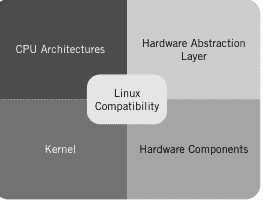

图 2.1 Linux 硬件兼容架构。

Linux 操作系统整体的四类方法扩展了其功能。这种模块化 Linux 硬件架构的方法使其能够与极宽范围的计算机硬件组件协同工作。事实上，这种方法使 Linux 能够与任何可想象的硬件协同工作。此外，支持开源社区的决定也在扩展 Linux 硬件环境方面发挥了关键作用。开源环境通过开发和支持各种 Linux 硬件组件，每天都在添加新的硬件组件。硬件开源计划是开源文化的一部分。对于这四个类别，几个网站提供了兼容系统和设备的列表。Linux 社区使用包括以下网站在内的几个网站来确定各种 Linux 发行版支持的各种硬件和完整系统的兼容性：

- `www.tldp.org/howto/hardware-howto`
- `http://en.opensuse.org/hardware`
- `www.linux-drivers.org`
- `http://hardware4linux.info`
- `www.linux.org/hardware`

> **通过示例学习：测量两次，你只能切割一次**
>
> 在我作为顾问的早期几年里，我被要求为一家大型企业客户提供紧急支持。我在周六接到联系，并被要求周一早上第一时间到场。该大型客户支持关键应用程序的所有主要服务器从一种操作系统迁移到了另一种操作系统。我被告知迁移进行得很顺利，服务器上的所有应用程序都运行得非常出色。这包括主要应用程序。唯一的问题是，客户及其用户支持社区无法打印。完全无法打印！包括无法从主要应用程序打印发票或工资支票。因此，他们需要紧急服务来确定原因及其下一步措施。到达后，我审查了客户环境并评估了打印问题的严重性。
>
> 凭借我超人的技能，我能够确定客户迁移到的新操作系统中，那 20 台特殊打印机没有打印驱动程序。他们的任务关键应用程序无法打印，因为缺乏打印驱动程序。此外，客户无法退回之前的操作系统服务器。那些服务器已被重新格式化和重建以支持新的操作系统。迁移通常是一次性的……向前！客户终止了与之前咨询公司的合同，并雇用我的团队来解决当前情况并协助他们迁移剩余的服务器。
>
> 你是否想知道我如何如此迅速地知道答案？我检查了新操作系统供应商的硬件兼容性列表（HCL），并与打印机供应商的技术支持团队进行了沟通。HCL 非常重要！请记住，软件迁移不是唯一的问题，你可能还需要迁移外围设备（例如，打印机和调制解调器）。我能够引导客户从现有打印机进行打印。是如何做到的呢？我在 HCL（硬件兼容性列表）上注意到，现有的 20 台打印机可以模拟的模式。在打印机供应商能够为客户端的新操作系统开发新的打印机驱动程序之前，一直采用这种方法。真怀念那些美好的旧时光！

掌握针对最新操作系统的四类方法的分类知识，是任何计算机专业人员必须满足的要求。Linux 专业人员也不例外。讽刺的是，随着基于内核的架构的发展，当今许多操作系统将其大量计算机硬件功能隐藏在操作系统内部。Linux 操作系统并非如此。因此，你应该对 Linux 计算机硬件的工作原理有充分的了解。对于 Linux+ 考试，你需要对以下组件具备基础的理解：

- 电源是向系统中各种计算机硬件组件[例如，主板和内部磁盘驱动器]提供直流电（DC）的必需设备。电源通过将其转换为计算机芯片所需的直流电，来调节从墙壁插座接收到的交流电（AC）；它被安装在系统单元内部。
- 主板是安装在系统单元内的穿孔电路板，其中包含 CPU、内存（RAM）芯片以及用于扩展卡插槽的接口。它是最大的印制电路板；所有其他扩展板[例如，显卡和声卡]都通过它进行接口连接，以接收电源并提供双向通信。
- CPU 是计算机的大脑，负责数据处理，是计算机中最重要的芯片。CPU 控制各种硬件组件执行的功能，处理所有发出的软件指令，并决定系统的速度。CPU 被安装在系统单元内部。
- 内存以计算机芯片的形式实现，通过存储 CPU 处理的指令或数据来协助处理数据或指令。
- 扩展板是用于扩展计算机功能的设备，通过使一系列不同的设备[例如，显示器、扬声器和调制解调器]与主板通信来实现。
- 视频适配器是扩展卡，将二进制代码转换为在计算机监视器上看到的图像。
- 存储设备是用于存储数据和信息的内部和外部设备（例如，硬盘驱动器、软盘驱动器和 CD 驱动器）。

> **注意**
>
> Linux+ 认证考试不会测试计算机硬件知识。然而，你必须对整体 Linux 硬件架构具备基础知识。

对于 Linux 专业人员而言，选择使用哪个 Linux 发行版取决于上述介绍的四个硬件类别。在选定所需的 Linux 发行版后，大多数发行版允许你在安装阶段安装和配置系统硬件组件。此外，大多数发行版还支持在系统安装完成后安装、配置、更新和移除硬件组件。

### 练习 2.1：openSUSE Linux 硬件兼容性列表

在这个练习中，我们将审查 Linux 硬件兼容性列表，以确定 `openSUSE 11.1` 是否可以安装在 `Dell PowerEdge PE-T605` 和 `HP Proliant DL380 G3` 服务器上。完成以下操作：

1. 从工作站打开一个 Web 浏览器，并导航至 `http://en.opensuse.org/hardware`。
2. 可以查看完整系统或单个组件的兼容硬件。在完整系统部分下选择服务器类别。`Dell PowerEdge PE-T605` 是否受支持？是否列出了任何安装问题？
3. 那么 `HP Proliant DL380 G3` 呢？

### 从本地媒体安装

Linux 操作系统的成功安装是基于提前进行的良好规划。本节的目的是在操作系统安装过程中向你介绍主要的 Linux 安装决策。通过截图展示的决策，将显示 Linux 操作系统的基本安装过程。截图中展示了在安装 Linux 操作系统过程中你将面对的各种选项。

#### Linux 安装过程

Linux 操作系统可以从各种不同的本地[例如，CD、数字视频光盘（DVD）和 iso 镜像]和网络[例如，文件传输协议（FTP）、超文本传输协议（HTTP）、`NFS`、服务器消息块（`SMB`）服务器]源进行安装。本地媒体安装方法意味着执行独立安装，不依赖于网络连接来访问安装源数据。网络源安装方法意味着在你的网络中或通过外部服务器（例如，互联网）有一个安装服务器作为安装数据所在的源。除了几个独特的设置外，每个安装源的安装过程基本相同。“跨网络安装”部分介绍了从网络源安装 Linux 发行版的独特挑战。本节介绍了从本地媒体安装 Linux 发行版。Linux 本地媒体安装可以使用 CD、DVD 或 `.iso` 源进行。在提供的选项中，作者倾向于使用 `.iso` 镜像安装。

由于有各种厂商提供的多个 Linux 发行版，且有些比其他更受欢迎，因此你面临的首要选择是选择一个 Linux 发行版。主要的 Linux 发行版都遵循相同的安装阶段。`Gentoo` 是一个显著的例外。对于本书，作者决定使用 `openSUSE 11.1` Linux 发行版。`openSUSE 11.1` 是当时可用的最新版本。

> **注意**
>
> Linux+ 认证考试是一个厂商中立的考试。要查看各种 Linux 发行版的列表，请访问以下网站：
>
> - `http://distrowatch.com/`
> - `http://en.wikipedia.org/wiki/List_of_Linux_distributions`

#### 练习 2.2：从本地媒体安装

在这个练习中，我们将开始使用 DVD 媒体进行 `openSUSE 11.1.1` 的初始安装。对于此练习，我们将使用以下工具：

1. 从工作站打开一个 Web 浏览器，并导航至 `http://software.opensuse.org/`。
2. 遵循说明下载 `openSUSE 11.1` DVD 镜像。
3. 使用你的烧录软件应用程序从 `.iso` 镜像创建可启动 DVD。
4. 使用新创建的可启动网络 DVD 引导目标机器。
5. 选择 **安装（Installation）**。这将启动 `openSUSE` 安装程序。

为了从 `.iso` 镜像启动安装过程，将该镜像作为 CD/DVD 加载到虚拟化软件中（例如，`VMWARE` 工作站）。开机或重启已加载 `.iso` 镜像的虚拟机，以开始初始引导过程。虚拟机将 `.iso` 镜像识别为 DVD。当系统完成板载自检时，会出现 `openSUSE` 安装程序界面，如图 2.2 所示。初始屏幕提供各种菜单选项用于安装 `openSUSE` 以及安装前所需的额外配置选项。我们将选择 **安装（Installation）** 选项。

以下是各选项的描述：

- **从硬盘启动** 此选项用于自动引导一个已存在的 Linux 操作系统（如果之前已安装在硬盘上）。这可以防止自动安装新的 Linux 操作系统。

  **图 2.2**

  openSUSE 安装程序启动界面。

  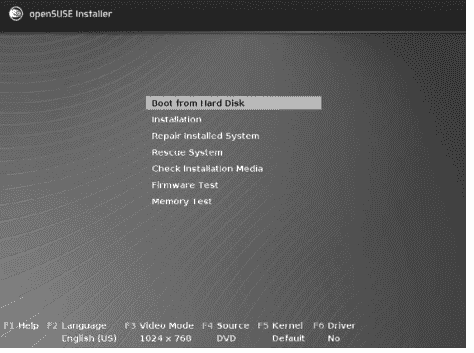

- **修复已安装的系统** 此选项修复之前安装的系统。它启动图形化修复系统。该选项在本章后面介绍的“系统探测”阶段之后还会再次出现。
- **安装（Installation）** 此选项从 Linux 发行版加载微型 Linux 内核并启动安装过程。
- **救援系统** 此选项启动一个没有图形用户界面的专门的小型 Linux 内核。它将 Linux 内核加载到 RAM 中，可以修改配置文件，检查文件系统缺陷，验证和/或修改引导加载程序配置，调整分区大小，以及可能需要的其他关键系统修改。
- **检查安装媒体** 为了在安装之前验证你拥有真实的 Linux 副本，此选项检查 `.iso` 镜像的完整性。它使用 `MD5` 加密哈希算法。要验证其他媒体的完整性，互联网上提供并可供下载许多免费的 `MD5` 和 `SHA` 加密哈希算法。
- **固件测试** 此选项测试系统的基本输入/输出系统（`BIOS`）和高级配置和电源接口（`ACPI`）兼容性。
- **内存测试** 此选项使用 `memtest86` 对系统 RAM 进行系统测试。`memtest86` 程序是一个用于测试基于 x86 系统物理内存的独立应用程序。

屏幕底部栏中的其余选项用途如下：

- **F1 – 帮助** 功能 1 键 `[F1]` 提供关于各种选项的有用信息。
- **F2 – 语言** 此键允许你选择 Linux 安装的不同语言（默认语言是英语）。
- **F3 – 视频模式** 此键允许你选择安装所需的图形化[屏幕分辨率]或文本模式。
- **F4 – 源** 此选择确定 Linux 安装源[例如，`FTP`，`HTTP`，`NFS`，CD，DVD，`SLP`]，如图 2.3 所示。“跨网络安装”部分将更详细地介绍此选项。默认选择的安装源是 DVD。
- **F5 – 内核** 此键允许你禁用潜在的硬件组件[例如，`ACPI` 系统和 `DMA` 模式]。
- **F6 – 驱动程序** 此键安装可选驱动程序或更新现有驱动程序。

  **图 2.3**

  网络安装源选项。

  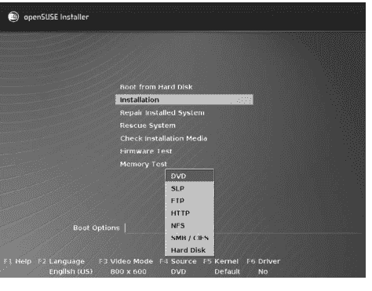

`openSUSE` 安装过程分为三个明确的阶段，以确保您能成功构建 Linux 系统。这三个阶段分别是准备、安装和配置。准备阶段协助您配置系统的语言、日期和时间、桌面环境、用户账户信息、用户和 `root` 密码验证方法以及磁盘分区信息类型。安装阶段是一个非交互过程。此阶段安装 `openSUSE` 软件并准备系统进行初始启动序列。最后一个阶段是配置阶段。在此阶段，取决于您选择自动配置还是手动配置，安装软件将预配置各种网络设置或允许您输入网络配置信息。例如，您机器的主机名、域名以及各种其他网络配置设置（即接口、动态主机配置协议（`DHCP`）和防火墙）。

#### 欢迎屏幕

第一阶段准备将收集有关您系统环境和偏好的信息。`openSUSE` 安装程序通过显示一个欢迎屏幕开始，如图 2.4 所示，允许您选择语言并阅读和同意许可协议中的条款。

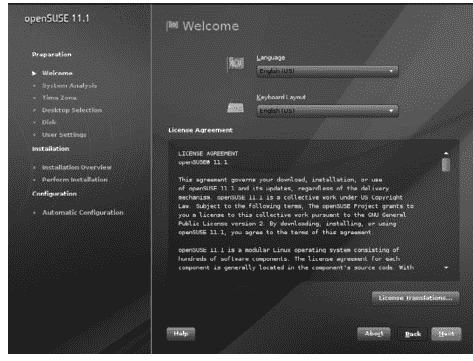

**图 2.4**

键盘、语言和许可协议设置的欢迎屏幕。

默认语言和键盘设置是英语（美国）。对于希望使用不同语言安装 Linux 的用户，有大量的语言和键盘选项可供选择。这种广泛的语言多样性是国际操作系统的一个优点。选择语言和键盘设置后，系统将自动切换到指定设置。接下来，您应该完整阅读许可协议。如果您同意条款，请勾选“我同意许可条款”。如果您不同意许可协议，`openSUSE` 将不会被安装。

#### 系统探测和安装模式

`openSUSE` 安装程序应用通过对系统进行系统探测来分析您的系统，如图 2.5 所示，以查找各种存储设备（例如 `USB`、`Firewire`、软盘和硬盘驱动器）、现有的 Linux 分区和系统文件，确定系统是否可以更新，并启动包管理器。

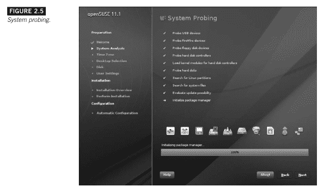

系统分析完成后，下一个屏幕显示各种安装模式，如图 2.6a 所示。自动配置选择默认启用。这是执行新安装的首选选项，此时可以使用默认硬件和网络设置。安装完成后，可以修改各种硬件和网络设置。

在安装模式下，您有以下选择：

- **新安装** 此选项安装一个新的 Linux 操作系统副本。
- **更新** 此选项对之前的 `openSUSE` 安装执行更新。
- **修复已安装系统** 此选项修复之前安装的损坏的 Linux 系统版本。
- **包含来自独立介质的附加产品** 此选项安装附加产品。这可能包括对附加语言和第三方产品的支持。如果选择此选项，可以从网络或本地源安装附加产品。如果您选择网络源，必须配置网络设置并安装网卡。

  **图 2.6**

  (a) 带有自动配置设置的安装模式。

  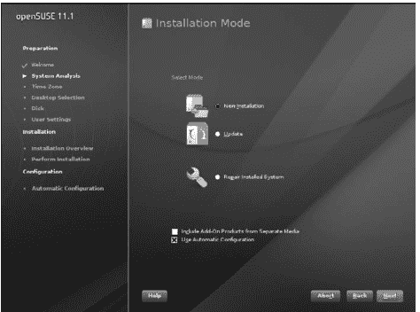

  (b) 带有配置阶段精细设置的安装模式。

  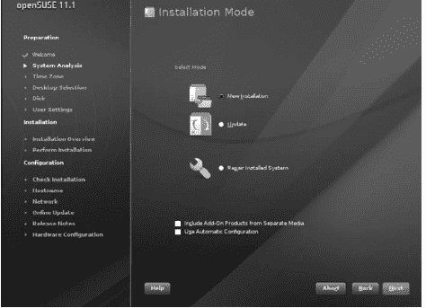

- **使用自动配置** 此功能将尝试自动配置大多数硬件和硬件配置设置。如有必要，可以在安装过程完成后对此阶段进行的各项设置变更进行修改。

如果您更喜欢在安装过程中提供自定义的硬件和网络配置信息，您可以取消勾选 **使用自动配置** 设置，并在随后的配置阶段提供必要的信息。图 2.6b 显示了一个不同的安装模式屏幕，具有在配置阶段执行的更精细设置。当取消勾选 **使用自动配置** 设置时，将出现此修改后的屏幕。

#### 时钟和时区

时钟和时区屏幕允许您设置区域、时区以及系统日期和时间信息，如图 2.7 所示。此外，您可以确定是希望使用本地时间还是协调世界时（`UTC`）。`UTC` 的另一个名称是格林尼治平均时间（`GMT`）。系统可以配置为使用网络时间协议（`NTP`）。

  **图 2.7**

  时钟和时区。

  

在安装过程完成后使用，如果网络尚未配置。`openSUSE` 安装程序允许您使用鼠标在地图上选择一个地理位置，并放大以选择国家或地区。

#### 桌面选择


桌面选择屏幕允许您在各种用户界面选项之间进行选择，如图 2.8 所示。`GNOME 桌面环境` 和 `K 桌面环境`（KDE）是最流行的界面。此外，您还可以选择 `其他` 选项。`其他` 选项通常用于服务器和选定的设备，提供最小图形环境或仅文本模式安装。

KDE 和 GNOME 桌面环境都是免费软件程序。它们都为用户提供桌面环境，并为开发人员提供广泛的开发框架。此外，两者都支持多种语言。两种界面都提供独特的外观和感觉，选择其中一种取决于风格和偏好。openSUSE 11.1 中实现的当前界面版本是 GNOME 2.24 和 KDE 4.1。作者选择使用 KDE 4.1 编写本书。

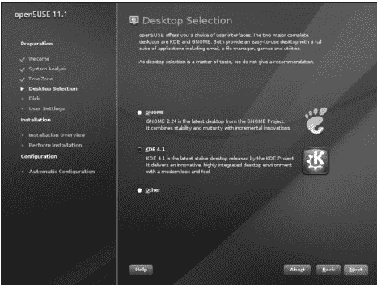

###### 图 2.8

桌面选择 – 用户界面。

##### 建议的分区

建议的分区引导您完成根据磁盘布局选择和实施分区和文件系统模式的过程。如果可能，openSUSE 安装程序将为您提供推荐的分区设置，如图 2.9 所示。对于大多数新安装和首次用户，安装默认值是令人满意的。下一个屏幕将向您提供选择默认的 `基于分区` 选项或基于逻辑卷管理（LVM）的选项。默认选择是 `基于分区`。此外，用户可以选择编辑现有分区或创建新分区。创建新分区还是编辑现有分区的决定取决于 Linux 系统是否将与现有操作系统（例如 Microsoft Windows XP）共存，该操作系统包含多个磁盘驱动器，或者您是否想要调整大小外部文件系统分区（例如 NTFS）。有关此过程的更多信息，请查阅 openSUSE 在线文档。

推荐的分区模式代表了最常见的方法。这种方法涉及拥有两个主分区和一个扩展分区。两个主分区支持 Linux 根分区和 Linux 交换分区。扩展分区支持

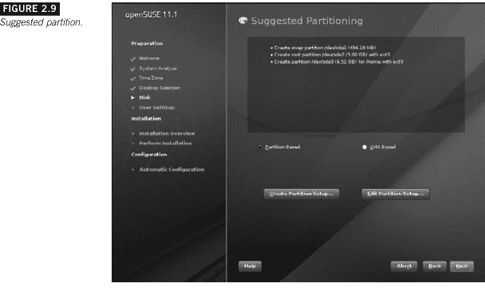

主目录分区。“文件系统布局”和“磁盘类型”部分提供了有关磁盘分区、文件系统、LVM 和 RAID 的详细信息。目前，我们将接受默认分区。

##### 用户设置

用户设置屏幕创建 Linux 用户账户，`root` 账户的密码，并选择本地或网络身份验证，如图 2.10 所示。在此过程中，您必须提供以下信息：

- `用户全名` 必须输入用户的名字和姓氏（全名）。
- `用户名` 必须输入用于登录系统的用户名。
- `密码` 密码授予对系统的访问权限。密码可以是字母数字的，并且区分大小写。它们不应包含任何重音字符或变音符号。如果您输入容易猜到的密码（例如，字典单词、用户姓氏），系统将向您提供警告。这是因为系统会自动检查弱密码。

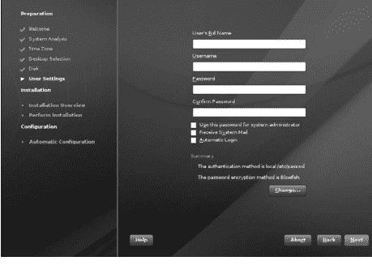


##### 确认密码

重新输入与上述相同的密码以进行确认。

该屏幕还为您提供将相同密码分配给系统管理员“`root`”账户的选项。为了获得更好的安全防护，最好不要为两个账户使用相同的密码。通过选择`接收系统邮件`选项，用户账户可以正常接收系统错误、安装包更新以及其他通常供系统管理员使用的重要消息。本地邮箱，即 `/var/spool/mail/username`（其中 `username` 是所选用户的登录名），是存储邮件消息的目录。下一个选项为您提供设置`自动登录`功能的能力，以便系统每次重启（或重新启动）时自动登录系统。出于安全原因，不应选择此选项。Linux 用户需要输入用户名和密码，以防他们决定在系统上存储敏感信息。

最后，您将获得更改身份验证和密码加密方法的选项，如图 2.11 所示。各种身份验证方法如下：

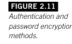

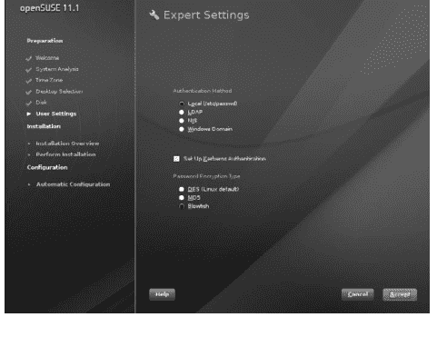

- `本地` 此选项将用户账户信息插入到 `/etc/passwd` 文件中。这是大多数 Linux 系统的典型默认配置。
- `轻量级目录访问协议 (LDAP)` OpenLDAP 为在分层数据库中存储用户账户提供目录服务。这种方法允许数据库与其他 OpenLDAP 系统复制用户账户信息。
- `网络信息管理系统 (NIS)`（最初称为 `Yellow Pages` 或 `YP`）是一个基于客户端-服务器目录服务协议模型的分布式账户管理系统。NIS 在 Linux 系统之间通信账户信息。
- `Windows 域` Windows Domain 使用 Microsoft Active Directory 验证用户账户信息。
- `Kerberos` Kerberos 是一种用于基于网络的认证的对称加密协议。

可用的密码加密方法如下：

- `Blowfish` 这是一种用于加密密码的加密对称分组密码。`Blowfish` 加密方法的密码长度范围为 5 到 72 个字母数字字符。
- `MD5` 这是一种用于为密码创建哈希值的加密哈希函数。`MD5 算法` 方法的密码长度范围为 5 到 127 个字母数字字符。
- `数据加密标准 (DES)` DES 是用于加密密码的加密对称分组密码标准。`DES 加密` 方法的密码长度范围为 5 到 8 个字母数字字符。

##### 安装设置

第二阶段，安装，会向您展示收集的安装设置。这允许您审查并修改（如果希望）您的任何设置或 openSUSE 安装程序系统默认配置建议，如图 2.12 所示。在此期间，您可以选择接受推荐的安装设置或进行必要的修改。

您可以更改磁盘分区和文件系统设置、引导加载程序的默认引导序列（例如，`GRUB`）、默认软件包、添加额外软件包、语言和键盘布局设置、用户和 `root` 账户及密码身份验证方法设置、默认引导运行级别、硬件组件和设置，以及第三方软件映像安装。第 4 章详细介绍了 Linux 运行级别。

##### 执行安装

执行安装屏幕显示系统将开始安装过程。在此过程中，openSUSE 安装程序为您提供三个不同的选项卡。第一个选项卡`幻灯片`向您展示关于 Linux 功能的信息，如图 2.13a 所示。在此发行版的幻灯片期间，将展示关于如何保持系统更新、防火墙默认安装以及其他安全关注事项以及 Linux 位置的信息。

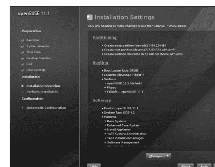

**图 2.12**

安装设置确认屏幕。

您可以选择`详细信息`选项卡来监控操作系统的安装过程，如图 2.13b 所示。这包括分区的创建、分区的格式化、分配给每个分区的文件系统以及分区的挂载。最后，您可以通过选择`发行说明`选项卡来审查手册中未包含的更新信息。

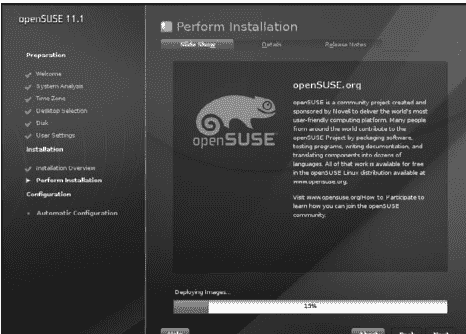

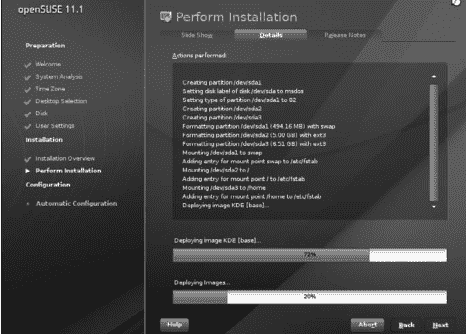

**图 2.13**

(a) Linux 安装幻灯片。(b) Linux 安装详情。

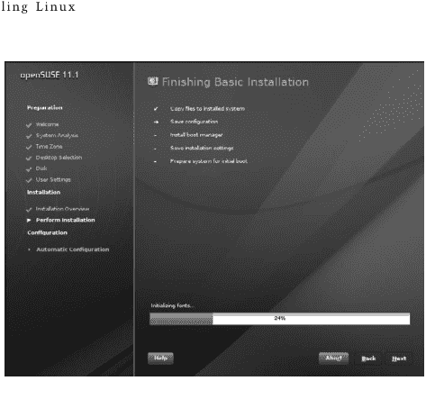

安装阶段的最后一步将系统准备为引导进入新的 Linux 操作系统，如图 2.14 所示。完成基本安装程序包括将系统文件复制到系统、保存任何系统配置、安装引导管理器、保存任何安装设置，以及最终，为初始引导做准备。

##### 自动配置

自动配置开始配置系统的默认设置，如图 2.15 所示。这发生在配置阶段。在此过程中，硬件配置、网络配置 [例如，主机名和域名、网卡(s) 和 DNS] 以及任何其他服务都将自动设置。

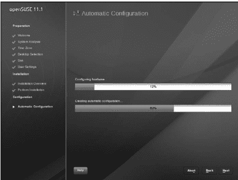

**图 2.15**

自动配置过程。

##### 手动配置

如果您之前未选择`自动配置`选项，系统将在配置阶段重新启动进入手动配置模式。手动配置模式允许您输入主机名、域名和网络配置。此外，您将能够测试互联网连接能力、执行在线更新、查看发行说明以及为系统执行额外的硬件配置（例如，打印机、声卡和显卡）。

##### 主机名和域名

主机名和域名屏幕允许您为系统分配一个唯一的计算机名称。此唯一名称是参与网络所必需的。图 2.16 展示了配置主机名和域名的选项。

您的系统主机名可以手动输入，或者通过选中`通过 DHCP 更改主机名`替代选项来分配。这是默认设置。设置`将主机名写入` `/etc/hosts` 使您的机器即使在未连接到网络时也可以访问。此默认设置应保持启用状态。此外，您的系统需要一个域名。域名，通常是一个通用名称，由网络上所有主机共享。

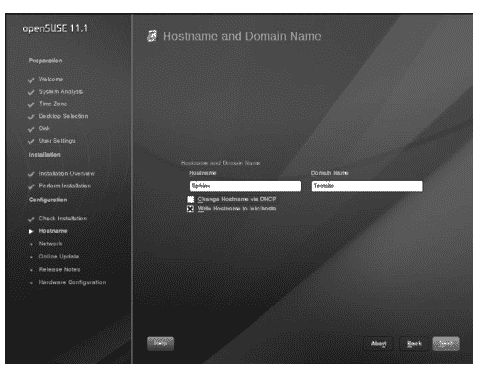

**图 2.16**

主机名和域名设置。

##### 网络配置

如图 2.17 所示，网络配置屏幕允许您配置各种网络和系统安全设置（例如，防火墙）。该屏幕为您提供现在配置网络和安全性或在系统安装完成后稍后配置的机会。如果您决定现在配置网络设置，在此阶段您有几个选项。

通用网络设置将启用或禁用用于笔记本电脑配置的网络管理器工具。此外，它启用或禁用 `IPv6` 支持。`IPv6` 默认启用。默认启用的防火墙设置允许您指定要通过网络访问的服务和端口。您配置的防火墙安全设置适用于所有配置的网络接口。网络接口允许您设置新安装的网卡并更改现有网络接口配置。对于通过调制解调器（电话调制解调器、DSL 或 ISDN）的远程访问，接下来的三个选项允许您通过独特的配置对话框框配置设备。最后，该屏幕允许您为系统配置 `VNC` 远程管理和代理支持。

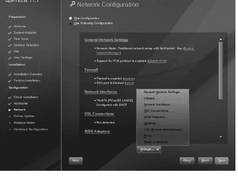

###### 图 2.17

网络配置设置。

openSUSE 安装工具允许你测试互联网连接性，并执行其他几项附加功能（例如，获取最新发行说明、注册技术支持以及执行在线更新）。这包括执行额外的硬件配置以及在系统中添加其他各种设备（例如，打印机）的选项。

恭喜，openSUSE 的安装和配置过程已完成。现在，你的计算机显示器应显示图形登录界面，如图 2.18 所示。此界面允许你输入用户名和密码以登录到系统。

##### 通过网络安装

通过网络源安装是对上述描述的用于 Linux 发行版的本地介质源安装的替代方案。这种方法既有利也有弊。主要的缺点是，与本地介质方式相比，它的速度较慢。速度慢是由于网络带宽受到限制。基于网络的速度远慢于硬盘驱动器速度。主要优势是你可以同时在一台或多台机器上安装 Linux。然而，这会增加对网络带宽的影响。

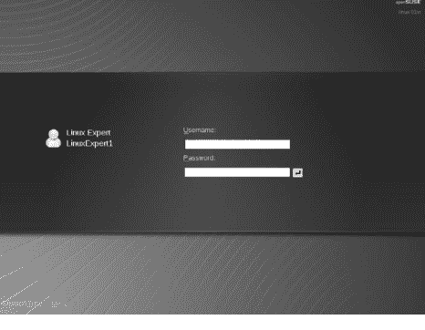

###### 图 2.18

图形登录。

要在内部组织网络中安装 Linux，可用的主要网络协议是 `HTTP`、`FTP`、`NFS` 和 `SMB`。除了内部网络安装外，你还可以使用 `HTTP` 和 `FTP` 协议通过互联网安装 Linux。在开始基于网络的安装之前，包含 Linux 发行版源文件的服务器必须正确配置以支持所需的网络协议，并且适当的 Linux 发行版必须能够通过 CD、DVD 或 `.iso` 映像访问。目标 Linux 系统必须从可网络启动的 CD 或 DVD 映像启动。openSUSE 11.1 可网络启动映像称为`Mini CD`。你可以从 openSUSE 网站下载它，并在启动目标 Linux 系统之前将其刻录到磁盘上。

当系统完成内置自检并加载精简 Linux 内核时，openSUSE 安装程序启动选项屏幕将如图 2.19 所示出现，为你提供用于安装 openSUSE 以及安装过程之前所需的额外配置选项的各种菜单选项。从该屏幕，你可以通过按 `F4` 键选择所需的网络安装源（例如，DVD、SLP、FTP、HTTP、SMB 和硬盘）。对于 Linux+ 认证考试，我们将重点关注 `HTTP`、`FTP` 和 `NFS` 协议。“关于硬件的说明”部分和“从本地介质安装”部分提供了此选项。

对于基于 `HTTP` 的网络安装，你输入包含 Linux 发行版的服务器 `IP` 地址或域名，如图 2.20 所示。服务器的 `IP` 地址或域名可以代表本地服务器或位于互联网上的服务器。此外，你输入 Linux 发行版源目录或文件夹。

###### 练习 2.3：通过网络安装

在本练习中，我们将使用 `HTTP` 安装步骤通过网络开始 openSUSE 11.1 的初始安装。对于此练习，我们将使用以下内容：

- `服务器/域名`: `http://download.opensuse.org`
- `目录/文件夹位置`: `distribution/11.1/repo/oss/`

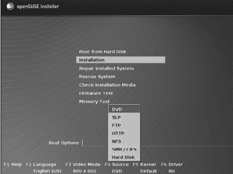

###### 图 2.19

网络安装源选项。

完成以下操作：

1. 从工作站打开`Web 浏览器`并导航至 `http://software.opensuse.org/`。
2. 按照说明下载 openSUSE 11.1 网络安装启动 CD。
3. 使用你的刻录软件应用程序从 `.iso` 映像创建可启动 CD。
4. 使用新创建的可启动网络 CD 启动目标机器。
5. 按 `F4` 键指定安装源。
6. 选择`HTTP`选项作为安装源。
7. 输入`服务器/域名`: `http://download.opensuse.org`
8. 输入`安装源目录位置`: `distribution/11.1/repo/oss/`
9. 选择`安装`。这将启动 openSUSE 安装程序。

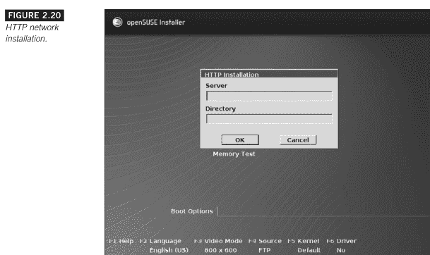

对于基于 `FTP` 的网络安装，你输入包含 Linux 发行版的服务器 `IP` 地址或域名，如图 2.21 所示。服务器的 `IP` 地址或域名可以代表本地服务器或位于互联网上的服务器。此外，你输入 Linux 发行版源目录或文件夹。最后，输入 `FTP` 用户帐户名和密码以获得认证访问权限。系统可以支持匿名访问。

对于基于 `NFS` 的网络安装，你输入包含 Linux 发行版的服务器 `IP` 地址或域名，如图 2.22 所示。服务器的 `IP` 地址或域名可以代表本地服务器或位于互联网上的服务器。此外，你输入 Linux 发行版源目录或文件夹。

表 2.1 总结了执行的網絡安裝類型，以及初始安裝期間你需要提供的參數值。

在選擇首選的基於網絡的安裝方法後，openSUSE 安裝程序將返回到先前在“從本地介質安裝”部分中呈現的主屏幕。選擇`安裝`選項以開始 openSUSE 安裝過程。

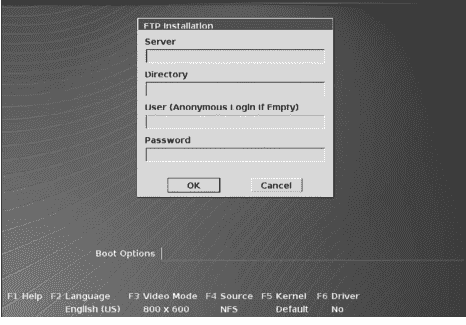

###### 图 2.21

`FTP 网络安装。`

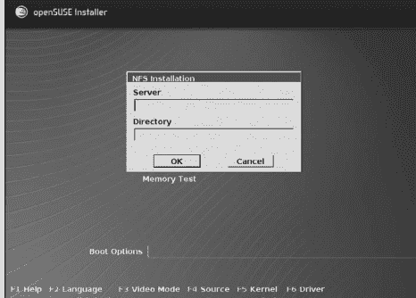

###### 图 2.22

NFS 网络安装。

| 表 2.1 | 网络安装参数 |
| :--- | :--- |
| **网络安装类型** | **域名/IP 地址** | **发行版源目录/文件夹** | **用户名** | **密码** |
| `HTTP` | 必需 | 必需 | 不适用 | 不适用 |
| `FTP` | 必需 | 必需 | 必需（若为空则为匿名登录） | 必需 |
| `NFS` | 必需 | 必需 | 不适用 | 不适用 |

##### 布局文件系统

在“从本地介质安装”部分中，openSUSE 安装程序为你的系统硬盘驱动器提供了推荐的默认分区设置。图 2.23 描绘了推荐的分区设置。在本节中，你不仅可以接受推荐的分区设置，还可以选择编辑建议的现有分区或创建新的分区。

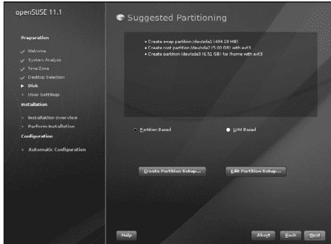

###### 图 2.23

`建议的分区。`

本节提供了如果你决定不接受推荐分区时可以使用的信息。OpenSUSE 提供给你选择默认`基于分区`选项或`基于 LVM`选项。`基于分区`选项是默认选择。它将首先呈现。`基于 LVM`选项将随后呈现。

在开始选择任何选项之前，需要一些关于磁盘和分区的基础知识。物理硬盘，即你可以从商店购买的类型，有一些限制；一些是由磁盘制造商施加的（例如，磁盘几何形状），其他则是由你的系统制造商施加的（例如，`BIOS`）。你的硬盘驱动器被限制在这些约束内运行。

分区类型是硬盘驱动器的主要限制之一。分区有两个主要类别。主分区是第一种类型。这种类型的分区将硬盘驱动器划分为物理组。对于大多数基于 PC 的系统，硬盘上最多可以实施四个主（物理）分区。扩展分区是第二种类型。扩展分区可以进一步细分为较小的逻辑分区（组）。通过允许你将扩展分区进一步细分为较小的逻辑分区，你可以在系统上创建更多分区。

这种方法允许你突破最多四个主分区的限制。

对于任何可启动的操作系统，必须至少有一个主分区。此初始分区将用于操作系统存储你的操作系统文件。其余三个分区可以全部为主分区、扩展分区，或两者的组合。因此，分区是将你的硬盘驱动器物理和/或逻辑地划分为一个或多个分区的操作。对于双启动系统，你需要两个主分区（每个操作系统各一个）。

##### **考试警示：主分区与扩展分区**

主分区将硬盘驱动器划分为物理组，且不能进一步划分。对于大多数基于 PC 的系统，一个硬盘上最多可实现四个主分区（物理分区）。扩展分区可以进一步细分为较小的逻辑分区（组）。对于任何可启动的操作系统，必须至少有一个主分区。此初始分区将用于操作系统存储你的操作系统文件。其余三个分区可以全部为主分区、扩展分区，或两者的组合。

要在 Linux 环境中创建或编辑安装过程中的分区，openSUSE 安装程序提供了“专家分区工具”图形界面工具。创建新分区还是编辑现有分区的决定，应基于 Linux 系统是否会与现有分区共存、是否包含多个磁盘驱动器，或者你是否想要调整外来操作系统分区的大小（例如 NTFS）。


图 2.24 展示了推荐的专家分区工具分区方案。它由两个主分区和一个扩展分区组成。这两个主分区分别是 Linux 根分区和 Linux 交换分区。扩展分区将用于 `home` 分区。

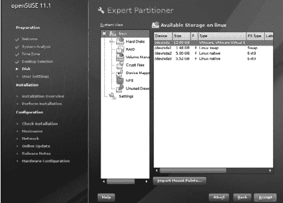

##### 图 2.24

专家分区工具。

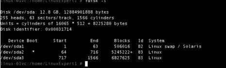

##### 图 2.25

`fdisk -l` 命令。

另一种查看、编辑和创建分区的方法是通过使用 `fdisk` 命令行工具。`fdisk -l` [小写 `L`] 命令显示连接到系统的磁盘驱动器及其对应的磁盘几何信息，如图 2.25 所示。该命令的输出显示磁盘设备名称和大小、磁盘几何信息、磁盘标识号以及现有的分区表（如果可访问磁盘驱动器）。

要使用 `fdisk` 创建或修改分区，你必须进入 `fdisk` 命令模式。要进入 `fdisk` 命令模式，输入 `fdisk` 和感兴趣的磁盘驱动器名称。`fdisk` 命令模式屏幕会显示，你可以输入菜单命令“`m`”来显示一个帮助屏幕，其中列出了可用的命令，如图 2.26 所示。

创建的分区，无论是主分区还是扩展分区（带有逻辑细分分区），都必须分配一个分区类型。分区类型用于托管特定的文件系统。图 2.27 列出了 Linux 支持的分区类型。Linux 分区类型 `83` 用于支持 Linux 文件系统。Linux 分区类型 `swap` 用于支持交换分区（类型 `82`）。

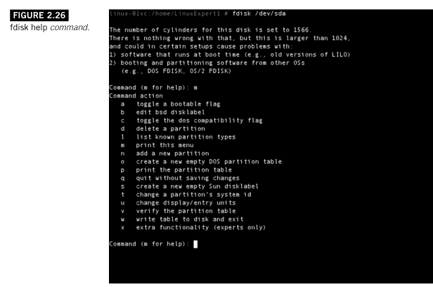

要选择并配置 Linux 分区类型，在 `fdisk` 内输入 `t` 命令以及你要修改的分区编号。`fdisk` 命令程序会提示你输入你想要将系统更改到的新分区类型。`fdisk -l` 命令将显示 openSUSE 支持的各种分区类型。

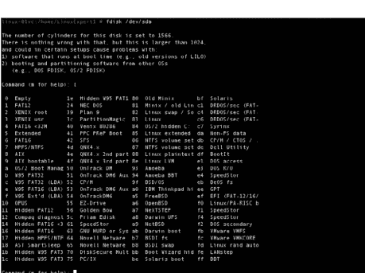

##### 图 2.27

Linux 支持的分区类型。

用户、应用程序和系统文件及文件夹必须存储在物理磁盘上。为了实现这一目标，你必须在物理磁盘上实施文件系统结构。Linux 环境支持许多不同的文件系统。每个文件系统都有自己独特的内部存储文件和文件夹的方式，以便快速访问和索引。在分区创建过程中正常创建的文件系统将立即使新分配的空间在硬盘上可用。

Linux 操作系统存在许多不同的文件系统（例如 `ext2`、`ext3`、`ReiserFS`、`JFS`、`XFS`、`VFAT/NTFS`）。每个文件系统都有优缺点。其中一个优点也可能是缺点的便是日志记录（`journaling`）。在某些环境中，日志记录是一个关键功能，提供日志记录能力的文件系统会占据主导地位。

日志记录是某些文件系统中实现的功能，提供了一种机制来将信息暂时存储在日志（`journal`）中。更改在写入文件系统之前先存储在日志中。如果数据未及时更新到文件系统，这种方法可以减少系统从崩溃中恢复所需的时间。虽然日志记录对整个文件系统有利，但许多应用程序提供自己形式的内部日志记录，因此不需要文件系统内置此功能。日志记录的一个主要缺点是它对系统资源（例如 `RAM` 和磁盘 `I/O` 功能）的影响。

有三种非常常见的文件系统类型：

- `ext2` – 第二扩展文件系统（`ext2`），是最古老且最受欢迎的 Linux 文件系统之一，也是行业标准。它是一个非常可靠的文件系统。缺乏日志记录支持是 `ext2` 最大的弱点。

- `ext3` – 第三扩展文件系统（`ext3`）扩展了 `ext2` 文件系统。`ext3` 提供日志记录支持。它是许多较新 Linux 版本的默认文件系统。

- `ReiserFS` – 此文件系统比 `ext3` 或 `ext2` 速度更快，并支持更大的最大文件结构（`8TB`）。

在“从本地媒体安装”章节中介绍的 openSUSE 安装程序工具自动配置了根分区和 `home` 分区以支持 `ext3` 文件系统。`ext3` 是 openSUSE `11.1` 的默认文件系统。此外，openSUSE 安装程序配置了交换分区以支持 `swap` 文件系统。

另一种将文件系统分配给分区的方法是通过使用 `mkfs` 命令行工具。该命令行工具将文件系统（例如 `ext2`、`ext3` 和 `ReiserFS`）分配给分区。要分配文件系统，`mkfs` 命令附加 `-t` 选项，后跟所需的文件系统类型，例如：

```
mkfs -t ext4 /dev/sda
```

将分区和文件系统分配给你的硬盘可能导致文件系统或分区损坏，或者需要从空且未挂载的分区中回收太多磁盘空间。要完成此任务，你可以使用 `parted` 命令行工具。`Parted` 不仅可以帮助你回收磁盘空间，还可以将文件系统从一个分区复制到下一个分区。在分区创建过程中，`parted` 将创建文件系统。

要使用该功能，首先从 Linux 发行版介质启动你的系统，并从显示的选项中选择**救援系统**，如图 2.28 所示。系统将允许你以 `root` 用户登录（无需密码）。要进入 `parted` 命令模式，输入 **parted** 和感兴趣的磁盘驱动器。例如，`/dev/sda`。从 `parted` 提示符，你可以输入 **help** 或 **?**。图 2.29 显示了 `parted` 帮助命令的响应。

##### 练习 2.4：使用救援系统访问 Parted

在这个练习中，我们将使用**救援系统**来访问 `parted` 命令并查看帮助功能。

完成以下步骤：

1. 从可引导的 Linux 安装源介质启动目标机器。

2. 这将启动 openSUSE 安装程序。选择**救援系统**。

3. 系统将显示“Rescue login:”。输入 **root**。

4. 无需密码。如果目标系统没有实施物理安全，这可能会引发安全顾虑。系统将显示“Rescue:~#”命令提示符。

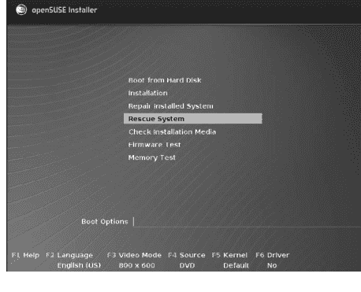

##### 图 2.28 救援系统。

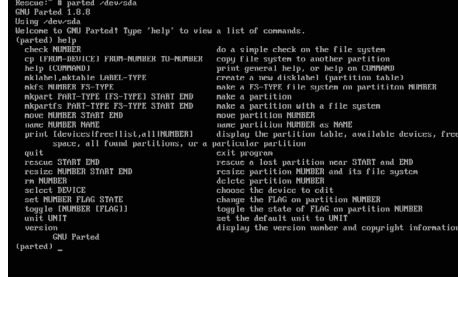

##### 图 2.29 `parted` 帮助命令。

5. 在提示符下输入：**parted**。

6. 如需获取帮助，请输入 **help**。

##### 磁盘类型

在“文件系统布局”部分中，我们讨论了安装 Linux 操作系统期间所需的各种磁盘驱动器组件。例如，我们回顾了一级分区和扩展分区，以及不同类型的文件系统（例如，`ext3`、`ext2` 和 `ReiserFS`）。在本节中，将引入两种新的磁盘类型。第一种新增类型是 `LVM`。它用于创建逻辑卷。第二种新增类型是 `RAID`。这种类型用于提高磁盘子系统的性能和/或容错性。这使得磁盘类型的总数达到三种，如图 2.30 所示。基于 `LVM` 和基于分区的实现可以配置在 `RAID` 或非 `RAID` 系统之上。Linux 系统还可以支持使用所有显示的组合的混合系统。

##### 逻辑卷管理器

基于 `LVM` 的安装提供了一种独特的方法来创建虚拟分区（也称为*逻辑卷*）。前面介绍的基于分区的方法在实施后很难更改。`LVM` 方法提供了对磁盘驱动器环境更大的控制，因为你可以创建可以将物理分区或磁盘驱动器组合在一起的虚拟分区。`LVM` 的命令行工具如下：

- **pvcreate** 是一个用于准备物理卷以供 `LVM` 使用的命令行工具。

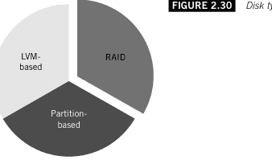

- **vgcreate** 是一个用于创建和命名卷组的命令行工具。

- **lvcreate** 是一个用于创建和命名文件系统所使用的逻辑卷的命令行工具。

##### 练习 2.5：使用救援系统执行 pvcreate

在本练习中，我们将使用**救援系统**执行 `pvcreate` 命令并查看帮助功能。

请完成以下操作：

1. 从 Linux 可启动安装源介质启动目标机器。

2. 这将启动 openSUSE 安装程序。选择**救援系统**。

3. 系统将显示“Rescue login:”（救援登录：）。输入 **root**。

4. 无需密码。如果目标系统没有实施物理安全措施，这可能会带来安全隐患。系统将显示“Rescue:~#”提示符。

5. 在提示符下输入：`pvcreate --help`。

##### 独立磁盘冗余阵列

`RAID` 是一种可供 Linux 系统使用的技术，它利用你的磁盘子系统来提供增强的读写性能、针对因磁盘故障导致数据丢失的保护，或两者兼而有之。它可以采用特定硬件的 `RAID` 控制器（称为*硬件 RAID*）或嵌入在操作系统内的 `RAID` 功能（称为*软件 RAID*）来实现。无论使用基于硬件的还是基于软件的 `RAID`，你的磁盘子系统都必须包含两个或多个硬磁盘，这些磁盘将被分组到一个阵列中，以形成一个虚拟硬磁盘。其优缺点如下所示：

- 基于硬件的 `RAID` 比基于软件的 `RAID` 实现运行得更快。这是因为软件 `RAID` 比硬件 `RAID` 需要更多的 `CPU` 时间，并且有额外的内存需求。

- 基于软件的 `RAID` 依赖于操作系统，而基于硬件的 `RAID` 则与厂商无关。

- 基于硬件的 `RAID` 比基于软件的 `RAID` 更昂贵。基于硬件的 `RAID` 要求你购买额外的硬件组件（例如，`RAID` 控制器）。

# 第 48 章 第 2 章：安装 Linux

为了实施 `RAID` 技术，你必须首先了解三个基本的 `RAID` 概念。这三个概念如下：条带化、镜像和奇偶校验。条带化将硬磁盘驱动器连接在一起，形成一个大型磁盘驱动器。例如，三个 `300MB` 的驱动器在条带化阵列中连接在一起，将形成一个单一的 `900MB` 驱动器。条带化将数据均匀地写入阵列中包含的所有磁盘。此外，条带化还将均匀地从阵列中包含的所有磁盘读取数据。这提高了你的整体磁盘子系统性能。条带化的缺点是它不提供任何容错支持。

镜像将硬磁盘驱动器连接在一起，但是，它不形成一个大型磁盘驱动器。镜像形成的磁盘驱动器的大小是根据最小驱动器的大小确定的。镜像将相同的数据写入两个驱动器。这种方法在一个驱动器崩溃的情况下为你提供了一定程度的冗余。镜像的缺点是需要将相同的数据两次记录在两个不同的驱动器上所带来的影响。这降低了磁盘子系统性能。奇偶校验在磁盘阵列子系统中存储信息，这些信息可用于在磁盘子系统阵列中的某个磁盘故障时重建文件或丢失的数据。与条带化和镜像不同，奇偶校验要求磁盘阵列子系统中至少包含三个磁盘。

##### RAID 级别

为了在你的环境中实施条带化、镜像和奇偶校验概念，`RAID` 级别用于描述行业中使用的不同方法。常见的 `RAID` 方法如表 2.2 所示。每个 `RAID` 级别都有优缺点，最佳级别取决于你的需求。通常，分区应存储在不同的驱动器上，以获得你想要的性能和容错性。你需要更高的性能吗？你需要容错性吗？如果你两者都需要，那么 `RAID 5` 是最佳解决方案。除了常见的 `RAID` 级别外，`RAID` 级别还可以级联（也称为嵌套）。这意味着常见的 `RAID` 级别编号与其他常见的 `RAID` 级别组合，有时中间还有一个“+”。例如，`RAID 10`（或 `RAID 1 + 0`）由一个 `RAID 1` 级磁盘阵列子系统组成，每个子系统都是 `0` 级磁盘阵列子系统中的“*驱动器*”之一。

在安装阶段，你可以选择配置硬件 `RAID` 或软件 `RAID` 子系统。硬件 `RAID` 的安装和配置是按照供应商提供的程序进行的。对于软件 `RAID` 的安装和配置，可以使用 openSUSE 专家分区工具，如图 2.31 所示。专家分区工具允许你创建、编辑和删除软件 `RAID` 分区。

##### 表 2.2 RAID 级别

| RAID 级别 | 条带化 | 镜像 | 奇偶校验 | 描述 |
|---|---|---|---|---|
| `0` | ✓ | | | 在磁盘阵列子系统的两个或多个硬磁盘驱动器之间对数据进行条带化。它不提供数据容错。 |
| `1` | | ✓ | | 在磁盘阵列子系统的两个或多个硬磁盘驱动器之间对数据进行镜像。它提供数据容错。 |
| `2` | ✓ | | `ECC` | 在磁盘阵列子系统的五个或多个硬磁盘驱动器之间提供位级条带化。使用额外的专用硬磁盘驱动器用于*汉明码*（一种纠错码形式）来计算冗余位。此级别至少需要六个磁盘。 |
| `3` | ✓ | | ✓ | 在磁盘阵列子系统的两个或多个硬磁盘驱动器之间提供字节级条带化数据。使用额外的专用硬磁盘驱动器用于奇偶校验。此级别至少需要三个磁盘。 |
| `4` | ✓ | | ✓ | 在磁盘阵列子系统的两个或多个硬磁盘驱动器之间提供块级条带化数据。使用额外的专用硬磁盘驱动器用于奇偶校验。此级别至少需要三个磁盘。 |
| `5` | ✓ | | ✓ | 在磁盘阵列子系统的三个或多个硬磁盘驱动器之间对数据进行条带化。使用一种称为*分布式奇偶校验*的技术，还将奇偶校验位对每个磁盘驱动器进行条带化。 |
| `6` | ✓ | | ✓ | 在磁盘阵列子系统的四个或多个硬磁盘驱动器之间对数据进行条带化。使用一种称为*双分布式奇偶校验*的技术，还将奇偶校验位对两个磁盘驱动器进行条带化。 |
| **嵌套 RAID 级别** | | | | |
| `0+1` | ✓ | ✓ | | 这是一个设置在镜像磁盘阵列子系统内的条带化阵列。至少需要四个磁盘。磁盘数量必须为偶数。 |
| `1+0` | ✓ | ✓ | | 这是一个设置在条带化磁盘阵列子系统内的镜像阵列。至少需要四个磁盘。磁盘数量必须为偶数。 |
| `5+0` | ✓ | | ✓ | 数据在两个或多个分布式奇偶校验 `RAID` 磁盘子系统之间进行条带化。 |
| `5+1` | (✓) | ✓ | ✓ | 数据在两个或多个分布式奇偶校验 `RAID` 磁盘子系统之间进行镜像。(✓) 表示条带化是 `RAID 5` 级别的一部分执行的。 |

## 50 第 2 章：安装 Linux

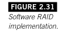

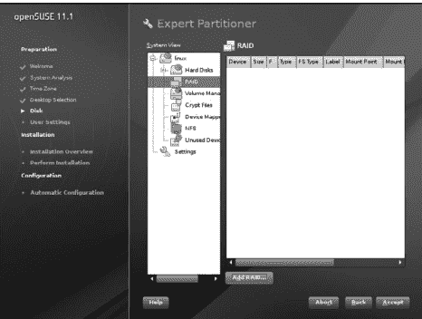

软件 `RAID` 支持 `RAID` 级别 `0`、`1` 和 `5`。要实现 `RAID` 级别 `1` 或 `0`，至少需要两个分区。要实现 `RAID` 级别 `5`，至少需要三个分区。应选中**添加 RAID** 选项，以显示用于确定 `RAID` 级别及应使用哪些分区的屏幕，如图 2.32 所示。

#### 考试目标摘要

在本章中，我们讨论了 Linux 发行版的安装流程以及成功实施前需要提供的信息。在第一部分“硬件说明”中，概述了 Linux 硬件架构。Linux 硬件架构被分为四类。第一类，`CPU` 架构，讨论了 Linux 环境支持的 `CPU`。这包括 `AMD`、`Alpha`、`ARM`、`IA-64`、`m68k`、`MIPS`、`PA-RISC`、`PowerPC`（例如 `Apple`、`IBM`）、`S/390`、`SPARC`、基于 32 位 `PC-x86`（例如 `AMD`、`Intel`）以及基于 64 位 `PC-x86-64`（例如 `AMD`、`Intel`）。第二类，硬件抽象层（`HAL`），展示了在物理硬件和操作系统之间叠加的独特层。第三类，Linux 内核，展示了内核如何通过加载模块和针对各种操作系统服务的指令动态运行。最后一类，硬件组件，介绍了 Linux 硬件兼容性列表，该列表包含受 Linux 操作系统支持的硬件设备 [例如，打印机、显示器和网络卡]。虽然 Linux+ 考试不会询问任何具体或复杂的硬件安装问题，但你应该对计算机系统、计算机外设和 *Linux 硬件架构* 模型有一些通用的知识。

接下来，介绍了从本地介质安装 Linux。本节详细说明了确保从本地介质 [例如，`CD`、`DVD` 和 `.iso` 镜像] 成功安装 Linux 的各种决策。此过程分为三个阶段。介绍的三个阶段是准备、安装和配置。准备阶段始于你必须做出的各种环境决策。例如，语言、键盘类型、时钟和时区、用户界面 [例如，`GNOME`、`KDE`]、磁盘驱动器分区设置，以及用户和管理员账户设置。下一阶段，安装，提供了你在执行 Linux 操作系统实际安装之前提供的信息。如果你同意这些设置，系统将开始安装 Linux 操作系统。完成安装阶段后，系统将初始化配置阶段。在此阶段，系统要么分配默认设置（例如，主机名、域名、网络配置以及其他硬件外设的安装和配置），要么允许你手动配置系统。一旦三个阶段完成，你就可以登录到系统。

“跨网络安装”部分介绍了三种不同的方法，用于访问和安装 Linux 发行版以访问本地或远程网络。这三种不同的方法基于 `HTTP`、`FTP` 和 `NFS` 协议。每种方法都需要网络访问存储有包含在目录中的 Linux 发行版的远程网络服务器。在每种情况下，你都需要提供远程服务器 `IP` 地址或域名以及存储 Linux 发行版源的具体目录。对于 `FTP` 网络安装方法，你可能还需要提供用户名和密码以访问系统。对于某些 `FTP` 服务器，你可能被允许通过匿名登录连接到 `FTP` 服务。

“文件系统布局”部分描述了各种文件系统类型（例如，`ext2`、`ext3`、`ReiserFS` 和 `NTFS/VFAT`）及其优缺点。`ext3` 文件系统是大多数现代 Linux 发行版的默认文件系统。`ext3` 文件系统支持日志记录。该节还讨论了硬盘分区。介绍了两个分区选项。这两个选项是主分区和扩展分区。主分区将硬盘驱动器划分为物理组。对于大多数基于 `PC` 的系统，一个硬盘上最多可以实现四个主（物理）分区。接下来讨论了扩展分区，它用于将分区进一步划分为较小的逻辑分区（组）。对于任何可启动的操作系统，你必须至少拥有一个主分区。操作系统将使用这个初始分区来存储你的操作系统文件。其余的三个分区可以是主分区、扩展分区或两者的组合。为了辅助查看、编辑和创建分区，介绍了 *fdisk* 命令。为了分配文件系统，在创建分区后，介绍了 *mkfs* 命令。最后，在本节中，介绍了 *parted* 命令。此命令用于从空的且未挂载的分区中回收磁盘空间。如果文件系统或分区损坏，或者你需要从空的且未挂载的分区回收磁盘空间，可能需要此操作。

最后一节，“磁盘类型”，介绍了 `LVM` 和 `RAID` 磁盘类型。Linux 中的 `LVM` 功能用于创建逻辑卷。此功能的开发是为了通过不实现基于分区的方法来克服固定分区的限制。`RAID` 功能用于提高磁盘子系统的性能和/或容错能力。对于 `RAID` 功能，介绍了各种 `RAID` 级别。这包括在软件 `RAID` 环境中实现的三个关键 `RAID` 级别 `0`、`1` 和 `5`。


为了实现 `RAID` 技术，介绍了三个不同的 `RAID` 概念。这三个概念是条带化、镜像和奇偶校验。条带化将硬盘驱动器连接在一起形成一个大型磁盘驱动器。镜像也将硬盘驱动器连接在一起；然而，它并不形成一个大型磁盘驱动器。镜像形成一个磁盘驱动器，其大小基于最小驱动器的尺寸确定。条带化和镜像至少可以使用两个磁盘实现。奇偶校验在磁盘阵列子系统中存储信息，这些信息可用于重建文件或在磁盘阵列子系统中一个磁盘发生故障时恢复丢失的数据。与条带化和镜像不同，奇偶校验要求磁盘阵列子系统中至少有三个磁盘。

#### 自测

- 1. 你的经理要求你订购下一批部门工作站。此外，组织已决定从 `Microsoft Windows XP` 操作系统迁移到 `Linux` 操作系统环境。因此，你订购的工作站必须支持 `Linux` 操作系统。为了验证你计划订购的工作站是否受你想安装的 `Linux` 发行版支持，你应该怎么做？

  - A. 配置工作站以双启动 `Windows 98` 和 `Linux` 操作系统。
  - B. 告诉你的经理，`Linux` 是仅用于服务器的操作系统。
  - C. 查看你要安装的 `Linux` 发行版的 `HCL`，以验证你计划安装的 `Linux` 版本是否支持你想要采购的工作站。
  - D. 检查 `Microsoft` 网站以获取关于安装 `Windows XP` 的更多信息

- 2. 你的组织需要一个支持日志记录的 `Linux` 文件系统。哪个文件系统支持日志记录？

  - A. `ext` for `VFAT`
  - B. `ext2`
  - C. `ext3`
  - D. `ext5`

- 3. 你的组织已决定实施 `RAID 5`。支持 `RAID 5` 所需的最小硬盘驱动器数量是多少？

  - A. 不需要磁盘驱动器。`RAID 5` 不存在。
  - B. 需要两个磁盘驱动器。
  - C. 需要三个磁盘驱动器。
  - D. 需要一个磁盘驱动器和一个磁带备份系统。

- 4. 哪个协议不支持跨网络安装 `Linux`？

  - A. `HTTP`
  - B. `NFS`
  - C. `FTP`
  - D. `USB`

- 5. 当跨网络安装 `Linux` 发行版源时，对于匿名登录支持，你应该使用哪种网络协议？

  - A. `SMTP`
  - B. `FTP`
  - C. `TELNET`
  - D. `LDAP`

- 6. 哪个图形用户界面受 `Linux` 操作系统支持？

  - A. `KDDDE`
  - B. `GNOOME`
  - C. `KDE`
  - D. `GMONE`

- 7. 基于 `PC` 的系统的硬盘驱动器支持的最大主分区数量是多少？

  - A. 支持五个主分区。
  - B. 硬盘驱动器不能支持主分区。
  - C. 支持四个主分区。
  - D. 仅支持次级分区。

#### 自测

- 8. 为了执行基于 `HTTP` 的网络安装，你必须输入以下信息以建立与远程网络服务器的连接。

  - A. 你的工作站 `IP` 地址和电子邮件地址。
  - B. 远程网络服务器的 `IP` 地址和电子邮件地址。
  - C. 远程网络服务器的 `IP` 地址以及包含 `Linux` 发行版源的远程网络服务器目录。
  - D. 远程网络服务器的 `IP` 地址以及包含 `Linux` 发行版源的本地主工作站目录。

- 9. 你所在机构的管理团队已决定实施虚拟分区技术。在 `Linux` 操作系统中，支持虚拟分区的技术名称是什么？

  - A. 虚拟文件传输 (`VTP`)
  - B. 逻辑虚拟管理
  - C. 磁盘镜像系统 (`DMS`)
  - D. 逻辑卷管理 (`LVM`)

- 10. 在硬盘驱动器上，扩展分区用于什么目的？

  - A. 将硬盘驱动器进一步划分为更小的分区。
  - B. 硬盘驱动器不支持扩展分区。
  - C. `Linux` 不支持扩展硬盘驱动器。
  - D. 主分区和扩展分区不能共存于同一个硬盘驱动器上。

- 11. 在使用 `mkfs` 命令时，`-t` 选项作为参数插入时用于什么用途？

  - A. `-t` 选项用于测试网络带宽。
  - B. `-t` 选项用于终止操作系统。
  - C. `-t` 选项用于为分区分配文件系统。
  - D. `mkfs` 命令没有与 `-t` 参数相关的选项。

- 12. 要查看系统中当前所有的磁盘驱动器以及当前的磁盘几何参数，你应该输入什么命令？

  - A. `mkfs -t`
  - B. `fdisk -l`
  - C. `fdisk -l`
  - D. `diskgeo -t`

- 13. `parted` 命令的用途是什么？

  - A. 回收未使用的磁盘空间
  - B. 建立磁盘条带化
  - C. 实施 `RAID 5`
  - D. 测试系统板载内存是否有缺陷

- 14. 你正在你所在机构的服务器上安装 `Linux`。这是一次新安装。你必须为新的 `Linux` 安装对硬盘进行分区。哪种硬盘分区架构最适合支持根分区、交换分区和家目录分区？

  - A. 根分区和交换分区应使用主分区架构，而家目录分区应使用扩展分区架构。
  - B. 根分区、交换分区和家目录分区都应为扩展分区。
  - C. 根分区和家目录分区应放置在扩展分区架构上，而交换分区应放置在主分区上。
  - D. 只有交换分区和家目录分区应放置在主分区上，并且不应使用根分区。

- 15. 在初始 `Linux` 安装过程中，哪个应用程序用于测试基于 `x86` `CPU` 架构的系统的 `RAM`？

  - A. `testmemx86`
  - B. `memtest86`
  - C. `memtestx86`
  - D. `memx86test`

###### 自测快速答案

- 1. C
- 2. C
- 3. C
- 4. D
- 5. B
- 6. C
- 7. C
- 8. C
- 9. D
- 10. A
- 11. C
- 12. C
- 13. A
- 14. A
- 15. B

#### 文件系统管理

- 本章考试目标
  - 文件系统类型
  - 文件系统的挂载与卸载
  - 分区
  - 目录
  - 文件系统管理

#### 独特术语及定义

- **`文件系统`**：`文件系统` 为操作系统提供存储、组织、修改、删除和检索数字信息的框架（结构）。它负责组织和维护文件、文件夹、元数据和残留数据，作为存储数字信息的容器。

- **`交换区 (Swap)`**：分配物理磁盘空间作为虚拟内存，当物理内存（随机存取存储器 [`RAM`]）已满时生效。如果系统需要更多的内存资源且物理内存已满，内存中的非活动页面会被移动到交换空间。当系统将内存页面交换到硬盘驱动器时，系统的 `RAM` 被释放以执行其他功能。

- **`服务器消息块文件系统 (SMBFS)`**：一种可在 `Linux` 上挂载的 `SMBFS`，允许基于 `Windows` 或 `Linux` 的工作站访问基于网络的 `Linux` 服务器上的目录/文件共享。

- **`网络文件系统 (NFS)`**：`NFS` 如第 2 章所述，是一个旨在允许客户端工作站用户通过网络访问基于网络的服务器上的远程文件的框架。

#### 引言

`Linux+` 认证专业人员需要充分了解 `Linux` 文件系统环境的创建、管理和维护。本章介绍了文件系统的创建策略、不同类型的文件系统、用于创建文件系统的工具以及用于管理文件系统的工具。

#### 文件系统类型

计算机架构由许多关键组件组成。在第 2 章中，我们在安装 `Linux` 发行版时讨论了许多关键组件（例如，硬件、磁盘驱动器和分区）。在本节中，我们将更详细地讨论 `Linux` 文件系统类型。文件系统为操作系统提供存储、组织、修改、删除和检索数字信息的框架 [结构]。

为了实现这一目标，文件系统负责将文件、文件夹、元数据和残留数据组织并维护为存储数字信息的容器。无论选择哪种文件系统类型，数据容器的大小可以是 `TB`（太字节）级别，也可以小到一个扇区。扇区的大小因不同的文件系统类型而异；它是可分配用于保存文件的最小磁盘空间单位。扇区的默认大小通常为 512 字节。

每种数据形式的描述如下：

- **文件**是文件系统中用于存储可访问或可执行的数字信息的已分配空间的扇区。分配的空间可以是连续的或非连续的。为了识别文件，文件被分配一个文件名，该文件名由一系列字母数字和/或 `Unicode` 字符集标识。在某些情况下，文件名可以（并非强制要求）包含一个点，后跟一系列字母数字和/或 `Unicode` 字符集（例如，`report.doc`、`budget.xls`），这些字符集用作扩展名。在 `Linux` 环境中，有四种不同类型的文件。这四种文件类型分别是常规文件、链接、先进先出（first-in first-out）文件和套接字。

- **目录**（也称为*文件夹*）是文件系统中用于对文件进行分组的已分配空间的扇区。这种关联在文件分配表（`FAT`）内执行和维护。为了识别目录，目录被分配一个目录名，该目录名由一系列字母数字和/或 `Unicode` 字符集标识。除了拥有名称外，目录还具有可以是扁平的或分层的结构。在分层结构的情况下，目录可以包含子目录。

- **元数据**是操作系统用于进一步描述文件和文件夹的数据形式。通常，会创建并使用某种形式的索引文件。索引信息可以包含文件大小、文件日期和时间戳、扇区位置以及与访问权限和设备类型相关的信息。创建和维护的元数据的类型和数量因文件系统而异。此外，元数据还可以包含用于冗余目的的文件和文件夹的备份副本。这甚至可以包括元数据文件的备份副本。

- **残留数据**是指在文件、文件名、文件夹和文件夹名称之间的关系断开后仍留在文件系统中的数据形式。这通常发生在删除文件或文件夹之后。残留数据的大小可能各不相同。它可以小到仅占一个扇区（这被称为*碎片空间*）。*碎片空间*是磁盘上任何未与特定文件当前关联的残留数据。它是文件最后一个字节与下一个扇区第一个字节之间的剩余空间。

对于各种不同类型的文件系统，存储容器（也称为*存储媒体类型*）可以驻留在许多不同的存储设备上。存储设备可以容纳静态数据和动态生成的数据。因此，针对不同类型的容器存在不同的文件系统结构。并非所有操作系统都支持各种存储容器。`Linux` 操作系统支持大量的存储媒体类型，如 图 3.1 所示。

下面列出了每种存储媒体类型的描述：

- *硬盘存储媒体*类型是最常见的，用于在硬盘驱动器上存储数据。这种类型的存储设备可以直接（称为*内部磁盘驱动器*）或间接（称为*外部磁盘驱动器*）连接到计算机系统。这种形式的文件系统存储也被称为*本地文件系统存储*。此模型


##### 图 3.1 Linux 存储介质类型。

在第二章中已介绍过；然而，更详细的细节将在本章的后文呈现。

- *光盘存储介质* 类型分为两个不同的类别。一个类别支持 `CD`，另一个类别支持 `DVD`。`CD` 和 `DVD` 均受 `ISO 9660` 文件系统标准的支持，该标准也被称为 *`CD` 文件系统* [`CDFS`]，用于在光盘介质上存储数据。这包括对 *`Rock Ridge`*、*`Joliet`* 和 *`El Torito`* 扩展的支持。`DVD` 类别还支持通用磁盘格式 [`UDF`]。`UDF` 被视为 `CDFS` 的替代方案。`UDF` 是基于 `ISO/IEC 12246` 标准的格式规范。

- *基于网络的存储介质* 是一种由客户端和服务器计算机组成的架构模型。在此模型中，客户端建立与远程服务器的网络连接，以访问驻留在服务器硬盘驱动器上的文件。基于网络的文件系统示例包括服务器消息块 [`SMB`]、`Andrew` 文件系统 [`AFS`] 和网络文件系统 [`NFS`]。该模型在第二章中已介绍；然而，关于 `SMB` 和 `NFS` 的更多细节将在本章后文的“文件系统管理”部分中呈现。

- *可移动存储介质* 是一种旨在将文件存储在闪存设备上的文件系统。闪存设备是一种非易失性计算机存储器，可以电气擦除数据并在新或保留旧数据于设备上。闪存设备主要用于内存卡和通用串行总线（`USB`）闪存驱动器。此类文件系统包括 `TrueFFS`、`TFAT`、`FFS1`、`JFFS2` 和 `YAFFS`。

- **`RAM` 磁盘存储介质**，将在第四章中呈现，通过使用 `RAM` 中的一段主内存作为存储容器发挥作用。压缩 `ROM` 文件系统 (`cramfs`) 在许多 `Linux` 发行版中用于 `initrd` 镜像（在第四章中有解释）。

- ***专用存储介质*** 是实现用于动态处理文件、文件夹、元数据和残留数据的系统。专用文件系统由应用程序或软件/系统管理工具创建。这包括数据库应用程序、基于注册表的应用程序、基于事务的系统以及各种其他独特的基于文件的应用程序系统。

各种可访问的 `Linux` 存储介质类型可以本地或远程访问。下一节将介绍的本地存储介质类型是直接连接到客户端机器的存储设备。“**网络**”部分将介绍的远程存储介质类型是通过网络文件系统由客户端机器访问的文件系统。

##### 本地

文件系统的本地实现并不罕见。这种方法减轻了许多通常与基于网络的文件系统、基于 `RAM` 磁盘的文件系统和可移动文件系统实现相关的挑战。这包括由于有限网络带宽导致的性能挑战、由于失去网络连接导致的访问失败、将系统指向不同（可能已受损）服务器的重定向攻击，以及非持久文件系统（例如 `RAM` 磁盘），它们在恢复电力后需要重新配置。

在第二章中，在 `Linux` 系统安装过程中介绍了几种不同的本地文件系统，包括三种非常常见的类型（例如 `ext2`、`ext3` 和 `ReiserFS`）。每种文件系统都有自己独特的内部存储文件和文件夹的方式，以便快速访问和索引。本节将介绍一些相对常见的额外文件系统。这些文件系统是 `FAT`、新技术文件系统（`NTFS`）和虚拟文件分配表（`VFAT`）。

`FAT` 是在大多数系统上广泛支持的文件系统，而闪存设备存在于许多不同的标准中。这些标准包括 `FAT12`、`FAT16`、`FAT32` 和一个称为 `VFAT` 的变体。`FAT12` 具有 12 位簇地址限制。它被设计为支持最大容量为 16 `MB`（兆字节）的存储设备。`FAT16` 具有 16 位簇地址大小，旨在支持最大分区大小为 2 `GB` [吉字节]。`FAT32` 具有 32 位簇地址大小，旨在支持最大卷大小为 2 `TB` 和最大文件大小为 4 `GB`。在 `FAT32` 之前引入的 `VFAT` 文件系统旨在处理长文件名。与 `VFAT` 不同，早期使用 `FAT` 文件系统的 `Windows` 操作系统仅允许使用八个字母数字字符命名文件，并用点号将名称与三个字母数字字符的扩展名分隔开。这被称为 8.3 表示法。引入 `VFAT` 文件系统的 `Windows 95` 支持长文件名，允许文件名称长达 255 个字母数字字符。

> **考试提示**
>
> `VFAT` 文件系统是挂载外部文件系统的首选文件系统。

`NTFS` 是为支持 `Microsoft Windows NT` 操作系统而引入的，它提供了许多先前文件系统所不具备的新特性。例如，`NTFS` 提供文件系统安全性、`Unicode`、压缩和日志记录功能。最大卷大小约为 256 `TB`，最大文件大小为 16 `EB`（艾字节）。

##### 练习 3.1：验证当前文件系统分区类型

在本练习中，你将输入 `fdisk` 命令以获取当前已实现的文件系统分区类型和可用文件系统分区类型的列表。本练习显示连接到系统的特定主磁盘驱动器、相应的磁盘几何结构以及相关的文件系统。

请完成以下步骤：

- 从 `root` 命令提示符输入以下内容：`fdisk /dev/sda`。
- 按 **Enter**（回车）键。
- 从 `fdisk` 提示符输入 `p` 选项以打印设备分区表。
- 查看每个分区的系统 ID（例如，83）。
- 从 `fdisk` 提示符输入 `l` 选项以列出已知的各种分区类型。
- 将你的分区类型与显示的列表进行交叉参考。
- 从 `fdisk` 提示符输入 `q` 选项以退出。

#### 网络

在当今的局域和网络互连环境中，`Linux` 文件系统也可以跨越网络。这使得 `Linux` 文件系统能够作为客户端-服务器模型运行，通过远程网络为 `Linux` 系统提供文件共享服务。服务器组件提供可以通过网络连接访问的共享目录。客户端组件在获得访问权限后，将共享目录连接到本地文件系统的挂载点。在 `Linux` 环境中，两个主要的基于网络的文件系统是 `NFS` 和 `SMB` 文件系统。

`NFS` 在第二章中已介绍，是一个旨在允许客户端工作站上的用户通过网络远程访问基于网络的服务器上的文件的框架。`NFS` 是定义在 `RFC 1094`、`RFC 1813` 和 `RFC 3010` 中的开放标准。在此模型中，`NFS` 服务器共享一个或多个目录，这些目录可以被网络客户端远程访问。`NFS` 最初被设计为与工作数据报协议（`UDP`）配合使用。后来版本的 `NFS` 使用注册的端口 `TCP 2049` 和 `UDP 2049`。有关 `NFS` 的更多细节将在“文件系统管理”部分中介绍。

服务器消息块文件系统（`SMBFS`）是一个旨在允许工作站访问基于网络的服务器上的目录/文件共享的框架。此模型实现为客户端-服务器架构，由两个组件组成。第一个组件，`SMB` 协议，提供用于执行进程间通信的机制。`SMB` 允许对基于网络的服务器上的不同文件进行不同类型的访问（例如，读、写和删除）以及对其他服务器端资源（例如，打印）的访问。第二个组件，`SMB` 服务，是一个驻留在客户端和服务器两端的應用程式。`SMB` 服务与系统的安全身份验证机制和 `local` 文件系统互操作。这使得 `SMB` 环境能够与各种其他 `SMB` 服务器（例如，`Microsoft Windows`、`IBM AIX` 和 `Apple Mac OS`）互操作。`Microsoft` 版本的 `SMBFS` 被称为公共互联网文件系统（`CIFS`）。这两个文件系统之间存在一些细微差别；然而，实现了互操作性。对于 `Linux` 环境，`Samba` 应用程序，一个免费的客户端/服务器实现，支持 `SMBFS` 和 `CIFS`。有关 `Samba` 应用程序的详细信息将在第九章中介绍。`SMB` 协议最初被设计为与工作于 `NetBIOS/NetBEUI` 组合。这种方法由于 `NetBIOS` 广播的性质引入了大量的网络流量。随后发布的传输控制协议/互联网协议版本，去除了 `NetBIOS` 开销，监听服务器端口 `TCP 445`。

#### 文件系统挂载与卸载


# Linux 文件系统的挂载与卸载

Linux 文件系统的挂载与卸载是 Linux 专业人员必须具备的另一项关键技能。与会自动挂载文件系统的 Microsoft Windows 操作系统不同，Linux 操作系统允许你手动挂载文件系统，或者在系统初始启动时自动挂载文件系统。那么，什么是挂载？挂载是将独立的存储设备附加或连接到你现有的根目录层级的一种形式。它使本地或远程机器上物理上分离的磁盘和/或分区对你可用。客户端机器上的挂载位置被称为 `挂载点`。

## mount 和 umount 命令

要手动将文件系统挂载到你现有的根目录结构中，需要建立到本地挂载点的连接，Linux 专业人员需要非常熟悉 Linux `mount` 命令。Linux `mount` 命令可以不带任何参数使用，也可以带参数使用。单独发布不带参数的 Linux `mount` 命令将列出系统中所有当前已挂载的文件系统，如图 3.2 所示。

当带参数发布 Linux `mount` 命令时，通常只需要两个参数。第一个参数代表你希望附加到根目录结构的存储设备。Linux 操作系统的独特之处在于其对设备（例如，存储设备、终端）的处理方式。Linux 系统将设备视为目录（文件夹）。在 Linux 环境中，`/dev` 目录用于挂载设备。第二个参数代表你想要在下方附加该设备的目录位置。同样，这被称为挂载点。大多数 Linux 系统的通用目录位置是 `/mnt` 和 `/media` 目录。通常，`/media` 目录用于挂载可移动媒体（例如，软盘、CD/DVD 驱动器、以及 USB/拇指驱动器）。此外，在挂载任何存储设备之前，执行 `mount` 命令前必须存在一个挂载点目录。

```
mount /dev/sdb1 /mnt/morestorage
```

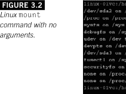

Linux `mount` 命令包含额外的参数（例如，用于超级块的 `sb`，用于关闭日志记录的 `nolog`），如有需要可以使用。要执行额外参数，必须首先指定 `-o` 参数。要指定特定的文件系统类型，应使用 `-t` 参数。在大多数情况下，不需要 `-t` 选项。通常，Linux 内核会检测你所附加的存储设备的文件系统类型。

根据你挂载的设备类型，在未来的某个时刻，你希望断开已挂载设备与本地挂载点之间的连接。要执行此操作，使用 Linux `umount` 命令。要执行此操作，只需要一个额外参数。这个参数即你附加设备的位置，也就是挂载点。

```
umount /mnt/morestorage
```

> **注意**
>
> Linux `umount` 命令的拼写不包含字母 (n)。尽管其目的是卸载存储设备，但实际命令省略了字母 n。

## /etc/fstab

要自动挂载文件系统，Linux 专业人员需要非常熟悉 `/etc/fstab` 文件，如图 3.3 所示。这个基于文本的文件包含在 Linux 发行版安装期间定义的文件系统（例如，`根分区`，`交换分区`）以及你希望在系统启动时永久挂载的任何新文件系统。大多数 Linux 系统会自动挂载 CD/DVD、软盘和 USB 设备等可移动设备。

将文件系统添加到 `/etc/fstab` 文件以便在启动时自动挂载的结构包含你想挂载的磁盘分区、目录挂载点、文件系统类型以及其他文件系统选项（例如，`nolog`，`noatime`，和 `noauto`）。

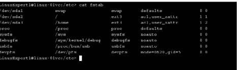

## 练习 3.2：挂载和卸载文件系统

在本练习中，你将使用 Linux `mount` 命令和 Linux `umount` 命令在磁盘分区 `/dev/sdb1` 上进行操作。你将把磁盘分区附加到挂载点 `/mnt/morestorage`（需要预先使用 Linux `mkdir` 命令创建挂载点目录）。完成以下操作：

1. 在 `root` 命令提示符下，输入以下内容：`mount /dev/sdb1 /mnt/morestorage`。
2. 按 **Enter** [Return] 键。
3. 要显示已挂载的设备，输入以下内容：`mount`。
4. 按 **Enter** [Return] 键。
5. 要卸载设备，输入以下内容：`umount /mnt/morestorage`。
6. 按 **Enter** [Return] 键。

### 分区

为了实施高效且有效的 Linux 存储设备基础设施，Linux 专业人员必须理解如图 3.4 所示的 Linux 文件系统三元组。正如在第 2 章中实施的那样，分区是将存储设备内的电子存储空间分配为特定文件系统类型的独立数据区域。无论通过分区编辑器工具还是通过 Linux `fdisk` 命令实现，都可以创建、删除或修改分区。只有在对存储设备进行分区和格式化之后，才能进行文件夹和文件的创建及放置过程。

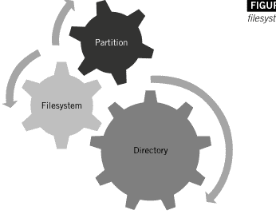

**图 3.4** *Linux 文件系统三元组*。

在每个存储设备上实施一个或多个分区的决策基于某些优势和劣势。在存储设备上创建多个分区的原因如下：

- 提高位于同一分区的数据和应用程序的访问时间。
- 支持用户文件和操作系统文件的分离。
- 提供专用的操作系统交换或系统分页文件空间。
- 保护操作系统文件免受系统数据文件（例如，`logging`，系统缓存）快速增长的侵蚀，这些文件可能会迅速消耗所有可用的磁盘空间。
- 支持多启动环境。
- 提供一层隔离，防止或保护一个分区的系统资源免受另一个分区的系统资源的影响。
- 允许实施各种文件系统和不同的磁盘几何策略，以提高读和/或写性能。

与大多数现代操作系统一样，Linux 操作系统支持创建和使用多个分区。创建分区后，必须为该分区分配一个文件系统（例如，ext2，ext3，和 ReiserFS）。如第 2 章所述，这是通过分区编辑器工具或 Linux `mkfs` 命令实施的。在文件系统之后，

### Linux 文件系统决策

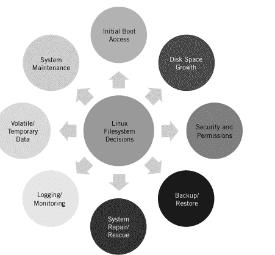

需要创建一个目录结构来分配和组织文件和文件夹。对于 Linux 专业人员来说，平衡 Linux 文件系统三元组提出了最大的挑战。三元组的每一腿都呈现出一系列权衡。这些权衡，如图 3.5 所示，分类如下：

- **初始启动访问** 在 Linux 安装过程中，系统 BIOS 和 GRUB 功能能够访问 Linux 分区至关重要。系统 BIOS 将访问 Linux 主分区以执行引导加载程序 GRUB。由两个阶段组成的 GRUB 必须能够访问 `/boot` 分区以检索迷你 Linux 内核和其他关键配置文件。因此，在某些安装中，将初始引导应用程序和配置文件放在单独的 Linux 分区上会使安装过程更容易——特别是因为在初始启动过程中，迷你 Linux 内核和 `initrd` 对磁盘设备驱动程序的访问是有限的。
- **磁盘空间增长** Linux 系统的设计与实现需要磁盘空间增长预测。因此，Linux 专业人员必须能够预测当前及未来所需的磁盘空间量。错误的计算可能导致数据无法保存或分区损坏。预测应包括已安装的应用程序及其相关的应用程序数据和用户文件。如果使用基于固定分区的实现方式，Linux 专业人员必须建立空间限制或配额。为应用程序数据和用户文件创建独立的分区非常常见。你可以将所有内容安装在根分区上。然而，如果同一分区上的某个应用程序发生损坏，其影响可能会损害整个分区。在实施多个分区的情况下，如果损坏发生在某个分区内，其他分区将不会受到影响。此外，对于固定大小的 Linux 系统而言，系统和用户数据的磁盘空间增长项目失败也会带来显著的缺点。逻辑卷管理（LVM）的引入通过允许卷中的数据跨越不同的物理磁盘进行扩展，从而减少了磁盘增长的限制。
- **安全性和权限** 存储在同一分区上的信息为各种安全风险敞开了大门。例如，如果分区损坏，所有数据都可能丢失。此外，未正确保护的目录可能让黑客获得对目录的读取/写入/执行权限，从而加载数据或用数据（例如非法视频/音乐文件或被盗数据）填满分区。通过创建独立的分区将系统资源与用户文件隔离，可以对系统资源施加更严格的访问控制。
- **备份/恢复** 为备份和恢复系统资源、应用程序、应用程序数据以及用户文件创建多个分区提供了更大的日程灵活性，降低了备份性能影响，并可能改善恢复时间。独立分区使 Linux 专业人员能够更精确地进行数据备份和恢复，从而最大限度地减少系统停机时间。
- **系统修复/救援** 与上面列出的第一点性质相似，获得初始启动访问权限，为关键分区（包括 `/boot` 分区）创建独立分区将更易于修复和/或救援损坏的分区。
- **日志记录/监控** 系统日志记录和监控不仅是一项繁琐的工作，而且是一项永无止境的工作。因此，必须访问、审查日志文件，并且在大多数情况下出于安全目的保存日志文件。创建独立的日志文件分区将便于备份、恢复、保护日志文件，并在必要时提供对外部系统的远程访问。
- **易失性/临时数据** 计算机及相关应用程序不断创建易失性和临时数据。在大多数系统中，这些数据现在驻留在分区存储设备上（而不仅仅在内存中）。这些创建的临时数据是系统和应用程序能够读取/写入/执行位于临时目录和交换空间中的信息的结果。Linux 系统会自动创建一个交换分区。然而，还有其他目录（例如 `/tmp`）传统上位于根目录下。这些其他目录也可能超出分区的磁盘空间容量。
- **系统维护** 出于系统管理和维护目的创建独立分区也可以使工作更简单 – 例如，恢复损坏的分区以及数据备份和恢复。

对于 Linux 专业人员来说，决定是否创建分区是一项艰难的工作。显然，单分区系统不是一种健全的系统设计。然而，为每个目录进行分区也是不可行的。因此，Linux 专业人员必须在这两种极端之间找到平衡。表 3.1 提供了更多关于 Linux 专业人员必须做出的权衡的见解。

### 表 3.1 特定 Linux 目录的权衡

| Linux 目录 | 权衡 |
| :--- | :--- |
| `/swap` | Linux 交换分区用作交换空间。它充当虚拟内存。`/swap` 目录是一个具有其自身预定义文件系统的预定义分区。该目录为你的系统提供额外的内存以运行大型程序。 |
| `/boot` | `/boot` 目录包含 Linux 引导过程中所需的文件和配置信息。这包括迷你 Linux 内核。在 `/boot` 下实施不同的分区将使系统救援和修复更容易。 |
| `/home` | `/home` 目录通常实施用于托管用户账户目录和特定于用户的文件。应为 `/home` 目录分配独立的分区。创建此目录在独立分区上的原因是由于多用户文件空间增长。此外，如果动态变化的用户文件驻留在独立分区上，执行备份和恢复功能要容易得多。 |
| `/opt` | `/opt` 目录用于支持附加应用程序软件包的安装。该目录应位于根目录下。 |
| `/tmp` | `/tmp` 目录用于支持需要易失性临时文件空间的程序。它可以位于根目录下；但如果临时文件增长迅速，你的根目录可能会耗尽磁盘空间。这可能是系统或应用程序核心转储的常见结果。此外，从安全角度来看，`/tmp` 目录对所有用户和应用程序都是可读、可写和可执行的。因此，黑客可能能够在 `/tmp` 目录中上传并执行程序。因此，应考虑将其分配给另一个分区作为选项。 |
| `/usr` | `/usr` 目录是一个共享的只读数据目录，允许符合文件系统层次结构标准（FHS）的主机访问相同的信息。它是最大的数据仓库。`/usr` 目录包含用户文档、二进制文件、库、软件头文件以及 X Window 材料和库。 |
| `/var` | `/var` 目录包含由于暂存、日志记录和系统临时文件而生成的系统信息和应用程序信息。尽可能将 `/var` 目录放置在独立分区上。它通常是根目录下的子目录。应该将其独立的主要原因是由于日志文件和用户邮箱可能的增长。这种方法将减小根分区的大小。 |

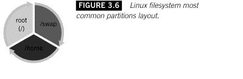

如第 2 章中首次介绍的推荐分区模式代表了最常见的方法，如图 3.6 所示。这种方法涉及两个主分区和一个扩展分区。图 3.7 展示了使用 Linux `fdisk -l` 命令呈现的相同分区。这两个主分区支持 Linux `root` 分区和 Linux `swap` 分区。扩展分区支持 `home` 分区。

## 练习 3.3：添加新的 VFAT 分区类型

在这个练习中，你将输入 Linux `fdisk` 命令来添加并实施 VFAT 文件系统分区类型。对于该练习，次要的小型计算机系统接口（SCSI）磁盘驱动器 `/dev/sdb` 已添加到系统中。

完成以下步骤：

1. 从根命令提示符，输入以下内容：`fdisk /dev/sdb`。
2. 按 **Enter**（回车）键。
3. 从 `fdisk` 提示符，输入 `l` 选项以列出已知的各种分区类型，并找到 WIN95 FAT32 (LBA) 的分区类型系统 ID 十六进制代码。
4. 按 **Enter**（回车）键。
5. 从 `fdisk` 提示符，输入 `n` 选项以添加新分区。
6. 按 **Enter**（回车）键。
7. 在新的分区提示符内，输入 `p` 以创建新的主分区。
8. 按 **Enter**（回车）键。
9. 由于这是该设备上的第一个/唯一分区，输入 `1` 作为分区号。
10. 按 **Enter**（回车）键。
11. 选择第一磁道的默认值。按 **Enter**（回车）键。
12. 选择最后磁道的默认值。按 **Enter**（回车）键。
13. 从 `fdisk` 提示符，输入 `t` 选项以更改分区类型。
14. 输入分区类型系统 ID 十六进制代码 WIN95 FAT32 (LBA)：`c`
15. 按 **Enter**（回车）键。
16. 从 `fdisk` 提示符，输入 `p` 选项以打印设备分区表。


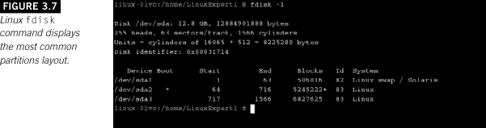

17. 按 **Enter**（回车）键。
18. 在 `fdisk` 提示符下，输入 `w` 选项以将分区表写入磁盘并退出。
19. 按 **Enter**（回车）键。
20. 要创建 VFAT 文件系统，请输入 `mkfs -t vfat /dev/sdb1`。
21. 按 **Enter**（回车）键。

## 目录

Linux 文件系统是一种分层结构。该结构用于组织目录（文件夹）和文件。Linux 目录结构基于文件系统层次标准（FHS）。当前版本为 2.3（2004 年 1 月 29 日发布）。FHS 的目的是为 Linux 社区的成员提供有关 Linux 目录结构使用和实施的参考指南。从本质上讲，FHS 的目标是确保 Linux 在用户和应用之间具有互操作性一致性。这将使用户和应用能够了解已安装文件和目录的通用位置。

> **注意**
>
> 有关 FHS 的信息，请访问 www.pathname.com/fhs 网站。

本节旨在向 Linux 专业人员概述以下表格中列出的关键 Linux 目录的用途，如表 3.2 所示。作为一个层级树状结构，文件系统从顶部的一个目录开始，该目录由前导斜杠表示。该目录称为*根*目录，包含所有底层的文件和目录。

> **考试警示**
>
> Linux 文件和文件夹（目录名称）区分大小写。

在指定所有其他第二层目录和文件时，请使用完整路径命名约定；所有后续文件和文件夹都使用正斜杠来表示其层级位置，以防止与其他可能在不同的子层级（例如，第三层、第四层）中具有相同名称的目录混淆。

### 表 3.2 关键的 Linux 目录

| Linux 目录 | 用途 |
| :--- | :--- |
| `/` | 读作“root”，根目录是顶级目录。它是重要的目录，对于启动 Linux 系统是必需的。它包含核心目录和文件。这包括工具、配置文件、引导加载程序信息以及初始化 Linux 系统所需的启动信息。 |
| `/bin` | `/bin` 目录包含由系统管理员和用户使用的 Linux 命令。该目录中的命令在系统处于单用户模式时也可以访问。 |
| `/dev` | Linux 操作系统的一个独特功能是它对设备（例如，终端）的处理方式。Linux 系统将设备视为目录（文件夹）。在 Linux 环境中，`/dev` 目录用于挂载设备。 |
| `/etc` | 为了控制程序的执行并支持动态的 Linux 环境，使用 `/etc` 目录。该目录包含 Linux 系统和应用配置文件。 |
| `/media` | `/media` 目录用于挂载可移动介质（例如，软盘、CD/DVD 驱动器、USB/闪存驱动器），以便系统管理员和用户访问。 |
| `/mnt` | `/mnt` 目录，类似于 `/media` 目录，用于临时挂载文件系统。 |
| `/proc` | `/proc` 目录作为系统进程和 Linux 内核的虚拟文件系统运行。 |
| `/root` | `/root` 目录，不要与根目录混淆，是分配给 root 用户帐户的主目录。 |
| `/sbin` | `/sbin` 目录用于包含仅由 Linux 系统管理员（例如，root）使用的 Linux 工具。它包含用于关键引导、恢复、恢复和/或修复 Linux 系统的可执行文件。 |
| `/usr/bin` | 与 `/sbin` 目录不同，`/usr/bin` 目录包含此系统上的主要 Linux 可执行命令。Linux 用户和 root 用户都可以执行该目录中的命令。 |
| `/usr/lib` | `/usr/lib` 目录包含程序使用的软件库和包。其中包括对象文件和平台相关的内部二进制文件。 |
| `/usr/lib64` | `/usr/lib64` 目录执行与 `/usr/lib` 目录相同的功能，但针对的是另一种二进制格式。该目录支持 64 位架构。 |
| `/usr/local` | `/usr/local` 目录是 Linux 系统管理员本地安装应用程序的位置。安装在此目录中的软件通常不受系统软件更新的影响。此外，安装在此目录中的软件可以共享。 |


##### 练习 3.4：比较 Linux 文件系统目录

在这个练习中，我们将比较你系统的 Linux 目录结构与 FHS。

完成以下操作：

1. 从工作站打开 Web 浏览器并导航到 `www.pathname.com/fhs`。

2. 下载 FHS 文档。

3. 在根命令提示符下，导航到根目录，输入以下命令：`cd /`。

4. 从根目录开始，将 FHS 文档中列出的目录与你的 Linux 目录进行比较（例如，`/bin`、`/dev`、`/sbin`、`/mnt`、`/etc`、`/var`）。它们匹配吗？有差异吗？为什么？

#### 文件系统管理

文件系统环境在日常工作中不断发生变化。本节介绍了管理本地和远程 Linux 文件系统所需的工具。它包括确定已用和剩余磁盘空间，为用户建立磁盘空间限制，修复损坏的文件系统，挂载独特的回环文件系统，访问远程文件系统，以及准备交换文件或分区。

##### 通过示例学习：艰难的方式！

一位在线客户就 Linux 服务器性能问题联系了我，该服务器每月都会间歇性崩溃。一如既往，我在签订合同后开始了这项业务，开始进行分析。我审查了客户的入侵检测日志、防病毒日志、防火墙日志、应用程序日志、位于 `/var` 目录中的日志，甚至面试了 Linux 管理员。

经过仔细审查，我发现了问题。我告诉客户我有很好的消息和坏消息。好消息是，问题可以迅速解决。似乎 IT 部门的某位用户（Linux 管理员）在新电影发布日（大多在周五）通过互联网下载盗版电影副本。该人员将电影文件保存在服务器上，并刻录 DVD 副本带回家。服务器性能下降是因为服务器的磁盘分区和交换空间已满。Linux 管理员定期删除系统和用户文件以增加磁盘空间。

解决问题的方法是重新处理磁盘空间分配，将用户文件和交换空间与根（`/`）目录分开，为所有用户创建磁盘配额，并为所有用户（特别是 `root` 用户）进行例行的系统范围文件系统管理。此外，对整个 Linux 服务器环境进行定期的独立安全评估审查。

哦！坏消息呢？我告诉客户，Linux 管理员在过去 2 年里一直忽略美国唱片业协会（RIAA）的请求，RIAA 已经向法院提交了一项动议，要求进行电子取证。RIAA 是一个代表美国唱片业分销商的团体，非常关注知识产权（IP）盗版。

##### 检查磁盘使用情况

所有系统管理员执行的一项任务都是持续的“文件管理”。这种管理形式始于在分区级别、目录级别甚至文件级别审查已用磁盘空间的能力。Linux `du` 命令提供当前目录中文件使用的磁盘空间摘要以及分配给任何子目录中文件的磁盘空间。例如，当在用户主目录内执行 Linux `du` 命令时，该命令将显示该目录占用的磁盘空间以及用户主目录下的任何子目录占用的空间。

Linux `df` 命令提供文件系统中可用磁盘空间量的摘要。Linux `df` 命令通过使用不同的参数以许多不同的方式展示磁盘空间可用性。`df -i` 参数显示关于 inode 的信息而不是文件块。`df -h`，参见图 3.8，使用千字节、兆字节和/或吉字节以易于理解的输出格式呈现磁盘空间摘要。

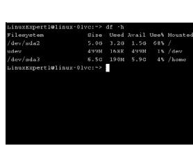

**图 3.8** Linux `df -h` 命令。

###### 练习 3.5：显示磁盘摘要信息

在本练习中，您将输入三个不同的磁盘摘要命令，以获取磁盘摘要、文件系统类型、磁盘使用情况和磁盘空间可用性信息。

完成以下操作：

- 1. 命令 `mount` 显示哪个文件系统（设备和类型）挂载在哪个挂载点上。从 root 命令提示符输入命令：`mount`。

- 2. 按 Enter（回车）键。

- 3. 若要显示给定目录及其子目录中所有文件的总大小，请使用 Linux 的 `du` 命令。参数 `-h` 将输出转换为易于读取的格式。从 root 命令提示符输入命令：`du -h`。

- 4. 按 Enter（回车）键。

- 5. 若要获取关于文件系统总使用情况的信息，请使用 Linux 的 `df` 命令。参数 `-h` 将输出转换为易于读取的格式。从 root 命令提示符输入命令：`df -h`。

- 6. 按 Enter（回车）键。

###### 配额

管理用户和应用程序的磁盘空间使用情况是一项持续的任务。如果没有限制，用户和失控的应用程序可以继续向文件夹添加数据，最终可能耗尽分区上所有可用的磁盘空间。一旦分区被数据填满，不仅用户和应用程序无法将信息保存到磁盘，满溢的分区还可能导致系统或应用程序损坏。为了更好地管理系统，实施磁盘配额可以提供有价值的文件系统管理支持。它将允许您指定可分配给用户或用户组的磁盘存储限制。这是通过强制用户保持在规定的磁盘消耗限制之内来实现的。这剥夺了用户消耗无限磁盘空间的能力。实施于文件系统上的磁盘配额可以针对单个用户和组进行配置。

要在系统中使用磁盘配额，必须发生多阶段过程。第一阶段需要对 `/etc/fstab` 文件进行修改。要实施磁盘配额，您必须在 `/etc/fstab` 文件的每个所需分区中添加以下限定符 `usrquota` 或 `grpquota`。修改文件后，激活磁盘配额系统最简单的方法是重新启动您的系统。第二阶段，Linux `quota check` 命令检查选定的配额文件系统，并为每个启用磁盘配额的文件系统构建当前磁盘使用情况的表格。这些信息存储在一 `quota.group` 和 `aquota.user` 文件中。最后阶段是使用 Linux `edquota` 命令分配磁盘配额。Linux `edquota` 命令，即配额编辑器，用于显示和更改一个或多个用户或组的各项配额设置。

实施磁盘配额系统后，即可对文件系统生成磁盘配额摘要审查。Linux `repquota` 命令用于创建和总结磁盘配额报告。该报告包含指定文件系统的磁盘配额摘要，以及当前每个用户的文件数量和磁盘空间摘要。最后，在发生系统崩溃和其他文件系统故障的情况下，使用 Linux `quota check` 命令扫描文件系统中的磁盘配额使用情况，并创建、检查以及（如有必要）修复磁盘配额系统。

###### 检查和修复文件系统

Linux 操作系统与其他所有操作系统一样，其文件系统会遇到某种类型的磁盘问题。为了维护文件系统的健康状态，您应该检查并（如有必要）修复文件系统。要在 Linux 环境中执行此功能，请使用 Linux `fsck` 命令。此命令用于检查和修复 Linux 文件系统问题。如果识别出任何问题，该命令将显示该问题。

在 Linux 文件上使用 `fsck` 命令之前，您必须在检查问题之前 `umount`（卸载）该文件系统。要使用 Linux `fsck` 命令，您还必须提供要检查的文件系统名称（例如，`/dev/sdb1`）。下面是一个使用 Linux `fsck` 命令的示例。

```
fsck /dev/sdb1
```

###### 回环设备

Linux 操作系统支持一种额外的独特类型的文件系统。这种文件系统被称为回环文件系统。大多数 Linux 发行版都在内核中编译了回环设备。内核支持将包含另一个文件系统映像的特殊文件转换为可以像任何其他 Linux 分区或设备一样使用的设备。Linux 回环设备通常用于 CD/DVD ISO 映像。CD/DVD 光盘创建的磁盘映像包含 UDF 或 ISO 9660 文件系统格式。在访问回环设备之前，必须下载并挂载 ISO 映像。Linux `mount` 命令用于附加虚拟文件系统映像。

###### 练习 3.6：挂载 ISO 文件系统

在本练习中，您将挂载包含迷你 Linux 文件系统的 ISO 映像文件。

- 对于本练习，我们将使用以下资源：

  - **服务器/域名：** `http://download.opensuse.org`

  - **目录/文件夹位置：** `distribution/11.1/repo/oss/`

- 完成以下操作：

  1. 从工作站打开 Web 浏览器并导航到 `http://software.opensuse.org/`。

  2. 按照说明下载 `openSUSE` 11.1 网络安装启动 CD。下载的网络安装文件是一个 `.iso` 映像，其中包含可引导的 Linux 发行版。将该文件保存为 `MiniCD.iso`。

  3. 从 root 命令提示符输入以下命令以创建挂载点目录：`mkdir -p /mnt/disk1`。

  4. 按 Enter（回车）键。

  5. 输入下一个命令以挂载 `MiniCD.iso` 文件。`mount -o loop MiniCD.iso /mnt/disk1`

  6. 按 Enter（回车）键。

  7. 输入命令以更改到包含在 `MiniCD.iso` 文件内部的新文件系统：`cd /mnt/disk1`。

  8. 按 Enter（回车）键。

  9. 输入以下命令以列出文件系统的文件内容：`ls -l`。

  10. 按 Enter（回车）键。

###### 网络文件系统

本章前面提到的“文件系统类型”中指出，NFS 是一种客户端/服务器模型，旨在使服务器上的指定目录可供网络中的选定子集或所有客户端使用。在访问目录以供使用之前，必须正确配置服务器端和客户端。服务器端必须配置共享目录。这些目录也被称为 `exports`（导出）。客户端必须配置为挂载这些导出。

假设从服务器端开始，基于内核的 NFS 服务是可用的——如果不可用，可以通过将 NFS 服务包含在服务器的默认运行级别中将其设置为自动运行——可用共享目录列在 `/etc/exports` 文件中，如图 3.9 所示。该文件包含目录（导出）列表以及可能挂载这些导出的客户端机器。每一行代表一个共享目录及其相关选项（例如，权限）。

每行的参数如下：

`exported_directory <client1> (<options>) <clientN> (<options>)`

- 第一个参数 `exported_directory` 代表服务器上正在导出的目录。

- 第二个参数 `<client1>` 表示正在为其提供导出访问的主机或网络。`client1` 参数可以是基于 IP 地址、主机名或域名单个主机；一组机器的通配符（`*`）；或 IP 网络范围。

- 第三个参数 `<options>` 代表施加在连接上的选项。选项包括 `read-only` (ro)，`read-write` (rw)，`root_squash` [防止远程 root 访问]，`no_root_squashing` [允许远程 root 访问]，以及其他。

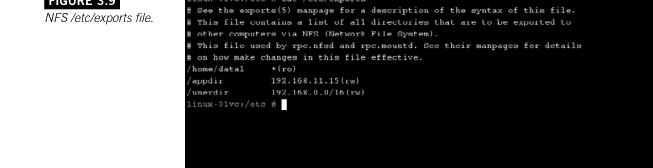

以下是插入到 `/etc/exports` 文件中的行示例，如图 3.9 所示：

- `/home/data1 * (ro)` 这以只读权限将 `/home/data1` 目录导出到所有客户端。

- `/appdir 192.168.11.15 (rw)` 这以读写权限将 `/appdir` 目录导出到具有 IP 地址 `192.168.11.15` 的特定客户端。

- `/userdir 192.168.0.0/16 (rw)` 这以读写权限将 `/userdir` 目录导出到 IP 子网 `192.168.0.0` 范围内的所有客户端。

> **注意**
>
> `/etc/exports` 中的目录列表应配置为尽可能严格的访问权限。这意味着不要对主机使用通配符，不允许远程 root 级别的写入访问共享内容，并在可能的情况下以只读方式挂载共享。

要激活对共享目录（导出）的访问，可以使用 Linux `exports` 命令。以下参数集可用于该命令：

- `-a` 此选项加载并导出 `/etc/exports` 文件中列出的所有目录。

- `-r` 此选项在对共享权限进行修改后重新读取 `/etc/exports` 文件。

- `-i` 此选项忽略 `/etc/exports` 文件并导出未列在文件中的目录。

- `-u` 此选项移除（取消导出）当前列出的导出目录。

- `-au` 此选项移除所有当前导出的目录。

要确定服务器上共享目录（导出）的信息，可以使用 Linux `showmount` 命令。该命令将列出当前共享的所有导出，包括列在 `/etc/exports` 文件中的那些（如果它们当前正在服务器上共享），如图 3.10 所示。

##### Linux `showmount` 选项


| Showmount 选项 | 用途 |
| :--- | :--- |
| `-a, -all` | 此选项使用 `hostname:directory` 格式，其中 `hostname` 是客户端的名称，`directory` 是已挂载的目录。 |
| `-d, -directories` | 此选项列出客户端已挂载的目录。 |
| `-e, -exports` | 此选项打印服务器导出的文件系统列表。 |
| `-h, -help` | 此选项提供帮助摘要。 |

Linux `showmount` 命令包含以下参数：

```
showmount [options] [server1]
```

`server1` 的默认值是由 `hostname` 返回的值。如果没有选项，该命令将显示从该主机挂载了目录的客户端。一些可用的选项在表 3.3 中展示。

如本节前面所述，客户端端也需要进行配置。首先，你必须知道有哪些可用的 NFS 服务器以及允许连接的关联共享。为了与共享建立连接，客户端可以使用 `Linux mount` 命令。以下演示了客户端建立 NFS 连接的方式：

```
mount server1:/share /mount_point
```

通过更改到客户端机器上的 `/mount_point` 目录，该命令允许你查看 `server1` 上目录 `/share` 中包含的文件。

如果你不想每次都手动连接到 NFS 共享，你可以在启动时建立到 NFS 共享的自动挂载连接。这可以通过在 `/etc/fstab` 文件中插入一行条目来实现。

###### 交换空间 (Swap)

与其他大多数现代操作系统一样，Linux 操作系统需要虚拟内存来确保其顺利运行。这种虚拟内存可以作为文件存在，也可以作为用于存储的整个分区存在。在 Linux 环境中，虚拟内存是通过将系统的物理 RAM 划分为称为页（pages）的单位，并将较少使用的物理 RAM（页）传输到硬盘驱动器来实现的。这个过程被称为交换（swapping）。当系统将内存页交换到硬盘驱动器时，系统的 RAM 会被释放出来以执行额外的功能。

虽然交换通过扩展其对更多内存的访问为 Linux 系统提供了优势，但在硬盘驱动器上存储和检索的页比仅存在于物理内存（RAM）中的页访问速度更慢。为了让 Linux 系统使用交换空间，必须首先创建特殊的文件或交换分区。在第 2 章的前面，已经创建了 Linux 交换分区。创建交换文件涉及创建一个特殊的文件。一旦创建，必须指定该特殊文件作为交换文件功能，以便 Linux 内核知道将其用作交换空间。最后，指定的交换文件必须被激活。

交换文件是一种特殊文件，可以使用 Linux `dd` 命令创建。以下是创建空 Linux 交换文件的示例。

```
dd if=/dev/zero of=/newswapfile bs=1024 count=1048576
```

该命令创建一个名为 `"newswapfile"` 的交换文件。输入文件 `"/dev/zero"` 是一个特殊的 Linux 文件，提供空字符。新创建的交换文件大小为 1 GB。

要指定使用分区或特殊文件作为交换空间，需要使用 Linux `mkswap` 命令。该命令在分区或特殊文件上设置 Linux 交换区域。对于分区，你需要以 root 身份使用 `mkswap` 命令进行准备，如下所示：

```
mkswap /dev/hdb1
```

对于特殊文件，就像你使用 Linux `mkswap` 命令创建交换分区一样，但这次你需要使用交换文件的名称，如下所示：

```
mkswap /newswapfile
```

Linux `swapon` 命令用于指定在哪些设备或文件上进行分页和交换。对于分区，你需要以 root 身份使用 `swapon` 命令进行准备：

```
swapon /dev/hdb1
```

对于特殊文件，就像你使用 Linux `swapon` 命令指定交换分区一样，但这次你需要使用交换文件的名称，如下所示：

```
swapon /newswapfile
```

为了确保指定的交换文件或交换分区正在使用，`swapon -s` 命令将显示当前状态。要禁用或关闭交换文件或交换分区，可以使用 Linux `swapoff` 命令。Linux `swapoff` 命令禁用指定分区或文件上的交换。当使用 `-a` 标志时，会在所有已知的交换设备和文件上禁用交换。Linux `swapinfo` 命令打印关于交换分区和交换文件的信息。

#### 考试目标摘要

在本章中，你复习了 Linux 文件系统的管理。文件系统为操作系统提供了一个框架（结构），用于存储、组织、修改、删除和检索数字信息。文件系统负责组织和维护文件、文件夹、元数据和残留数据，作为存储数字信息的容器。无论选择哪种文件系统类型，数据容器可以大到 TB 级别，也可以小到扇区大小。此外，你学习了可用于本地和网络访问的不同文件系统类型（例如，SMB 和 NFS）。

接下来，你学习了文件系统的挂载和卸载。这包括学习 Linux 文件系统与其他操作系统不同，允许你手动挂载文件系统或自动挂载它。对于文件系统的手动挂载，你学习了 Linux `mount` 命令和用于卸载文件系统的 Linux `umount` 命令。关于让文件系统自动挂载的过程，你复习了 `/etc/fstab` 文件以及文件系统如何在 Linux 系统初始启动期间被包含在内。


在挂载和卸载文件系统之后，本章提供了关于分区的详细信息。这包括创建分区的设计策略、优缺点、典型实施的分区、Linux `fdisk` 命令的使用，以及 Linux `fdisk` 命令的使用。Linux `fdisk` 命令用于创建分区。创建分区后，必须为分区分配文件系统（例如，`ext2`、`ext3` 和 `ReiserFS`）。Linux `mkfs` 命令为分区分配文件系统。创建文件系统后，我们讨论了 Linux 文件系统的层次结构。该结构用于组织目录（文件夹）和文件。Linux 目录结构基于 FHS（文件系统层次结构标准）。FHS 的目的是为 Linux 社区成员提供关于 Linux 目录结构使用和实施的指导参考。

从根本上说，FHS 的目标是确保 Linux 用户和应用程序之间的互操作性一致性。这将允许用户和应用程序知道已安装文件和目录的常见位置。

最后一部分，“文件系统管理”，涉及管理本地和远程 Linux 文件系统所需的工具。它包括用于确定已使用的磁盘空间和剩余可用空间（例如，`du`、`df`）的命令，用于实施和管理用户磁盘空间限制的各种命令（例如，`edquota`、`quotacheck`、`repquota`），使用 Linux `fsck` 命令修复损坏的文件系统，挂载唯一的回环文件系统，访问远程 NFS 文件系统，以及使用 Linux 命令 `mkswap`、`swapon`、`swapoff` 和 `swapinfo` 准备交换文件或分区。

#### 自我测试

1. 使用哪个 Linux 命令将文件系统分配给分区？

    - A. `filesys`
    - B. `mkfs`
    - C. `fsmake`
    - D. `grub`

2. 网络文件系统使用哪个注册端口？

    - A. TCP 2049
    - B. TCP 80
    - C. TCP 23
    - D. TCP 25

3. `/root` 目录的作用是什么？

    - A. 它是所有文件和系统分区的主目录。
    - B. 它提供虚拟内存空间。
    - C. 它作为 `root` 用户的主目录功能。
    - D. 它是供所有用户访问的可共享只读目录。

4. `/home` 目录的作用是什么？

    - A. 它是临时文件空间的位置。
    - B. 它提供虚拟内存空间。
    - C. 它作为典型用户的主目录功能。
    - D. 它是供所有用户访问的可共享只读目录。

5. FHS 代表什么？

    - A. 免费家庭空间
    - B. 类似于 NFS，但适用于 Apple Mac
    - C. 文件层次结构规范
    - D. 文件系统层次结构标准

6. 哪个 Linux 命令用于将独立存储设备挂载到现有目录？

    - A. `mkmount`
    - B. `mount`
    - C. `umount`
    - D. `fdisk`

7. `/var/log` 目录中通常包含什么？

    - A. 系统设备驱动的变体
    - B. 包含由轮询、日志记录和系统临时文件产生的数据。
    - C. 供所有用户访问的共享只读目录
    - D. 系统库和软件包

8. 使用 Linux `du` 命令时，使用哪个参数可以获得易读的（人类可读的）输出格式？

    - A. `-h`
    - B. `-i`
    - C. `-v`
    - D. [无选项]

9. 你的经理要求你将一张 CD 光盘挂载到大堂共享工作站上，以便大家都能访问。该 CD 光盘需要挂载到 `/media/cdplayer` 目录。你必须包含哪个 `-t` 文件系统选项？

    - A. `-t iso9660`
    - B. `-t iso`
    - C. `-t iso9000`
    - D. `-t ext3`

10. 除了 ISO9660 格式，DVD 的另一种格式是什么？

    - A. `/swap`
    - B. `SCSI`
    - C. 通用磁盘格式 (UDF)
    - D. `SMBFS`

11. 你需要使用 `fdisk` 为一个新的 SCSI 磁盘驱动器建立分区，以添加额外的存储空间。原有的所有驱动器都是 IDE 驱动器。哪个语法是正确的？

    - A. `fdisk /dev/SCSI1`
    - B. `fdisk /dev/IDE`
    - C. `fdisk /dev/sda`
    - D. `fdisk /dev/sdb`

12. 系统最初启动时，哪个文件会自动挂载文件系统？

    - A. `/etc/fstab`
    - B. `/boot/fstab`
    - C. `/dev/devices.map`
    - D. `/etc/grub.conf`

13. 什么是 ISO 环回设备？

    - A. 将特殊文件转换为虚拟 Linux 文件系统
    - B. 向显示器返回反馈测试的设备
    - C. `/null` 驱动设备
    - D. IP 地址 127.0.0.1

14. 哪个 Linux 命令用于指定特定文件或分区用于交换（swap）？

    - A. `/swap`
    - B. `fileswap`
    - C. `swapon`
    - D. `grub`

15. Linux `exportfs` 命令的目的是什么？

    - A. 它充当 Linux 引导加载程序
    - B. 对存储设备进行分区
    - C. 指定特定文件或分区用于交换
    - D. 激活对共享 NFS 目录的访问

##### 自检快速答案

1. B
2. A
3. C
4. C
5. D
6. B
7. B
8. A
9. A
10. C
11. C
12. A
13. A
14. C
15. D

### 驾驭 Linux

**本章考试目标**

- GRUB
- 运行级别 (Runlevels)
- 启动故障排查

#### 独特术语及定义

- **GRand Unified Bootloader (GRUB)** 一种用于大多数现代 Linux 操作系统版本的应用程序。它是一个可动态配置的程序，用于执行一系列事件以在计算机上加载主操作系统。它从系统 BIOS 获取控制权，执行一系列事件，然后将控制权移交给操作系统内核。
- **Runlevel（运行级别）** 一种专用脚本，用于启动不同的服务集，从而允许在同一系统中实现多种配置。
- **Kernel（内核）** 操作系统的核心操作代码。在 Linux 中，它整合了 CPU 架构，并支持加载模块和指令以实施所有操作系统服务（例如，进程管理、并发和内存管理）。

#### 引言

Linux+ 认证专业人员需要对 Linux 整体启动过程有良好的理解。这些知识对于成功安装 Linux 操作系统、修改启动配置、执行不同的运行级别以及排查启动问题都是必需的。Linux 启动过程比大多数操作系统更复杂，基于四个阶段。这四个阶段分别是：给系统通电、加载并执行 Grand Unified Boot-loader (GRUB)、加载并执行 Linux 内核、以及加载根文件系统。图 4.1 展示了这四个阶段。对于 Linux+ 考试而言，此图表可以帮助你理解 Linux 启动过程是如何工作的。

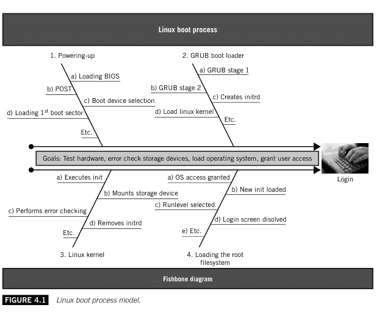

**图 4.1** Linux 启动过程模型。

第一阶段，“给系统通电”，从向目标系统施加电力开始。这通常涉及按下**电源开/关**按钮。此过程启动系统 BIOS 的初始化。系统 BIOS 执行三个不同的子任务。第一个子任务，*上电自检*（称为 POST），识别、测试并初始化关键系统组件，如硬盘和软盘驱动器、随机存取存储器 (RAM)、键盘、视频显示卡和其他硬件。此外，系统 BIOS 还会加载系统日期和时间。

**考试警告**

对于 Linux+ 考试，Linux 启动过程基于 `intel x86` CPU 架构。Linux 也支持其他 CPU 硬件架构（例如，`AMD`、`Alpha`、`ARM`、`IA-64`、`m68k`、`MIPS`、`PA-RISC`、`PowerPC`、`S/390`、`SPARC`）的启动，但启动过程有所不同。

第二个子任务，*启动设备选择*，确定使用哪个设备来启动操作系统。在此子任务中，系统 BIOS 能够选择各种设备（例如，软盘驱动器、硬盘驱动器、CD/DVD 驱动器）来启动 Linux 操作系统。系统 BIOS 选择第一个驱动器并加载磁盘几何特性（例如，柱面、磁头和扇区）。

在第三个子任务，*引导扇区加载* 中，系统 BIOS 读取启动设备的第一个扇区。该扇区大小为 512 字节。对于硬盘驱动器，这个特殊扇区被称为*主引导记录* [MBR]。该扇区包含 Linux 引导加载程序。Linux 操作系统支持各种引导加载程序（例如，`LILO`、`GRUB`、`NTLOADER`），`openSUSE` 使用 `GRUB` 程序。系统 BIOS 将 `GRUB` 加载到内存并执行程序。系统控制权现在已转移到引导加载程序。

第二阶段，“GRUB 引导加载程序”，执行两个子任务。对于第一个子任务，`GRUB` 加载 Linux 内核 (`vmlinuz-version.gz`)。对于第二个子任务，`GRUB` 在系统内存 [RAM] 中创建并加载一个虚拟文件系统。这个虚拟文件系统称为*初始内存磁盘* [initrd]。`initrd` 映像包含用于执行若干任务的各类程序。这包括*`init`* 程序以及 Linux 内核访问存储驱动器所需的必要硬件驱动程序。`initrd` 文件中包含的 `init` 程序是一个 `bash` 脚本，用于加载所需的内核模块。

第三阶段使用 Linux 内核执行 `init` 程序。Linux 内核是一个设计为动态运行的架构。它支持加载模块和指令以实施所有操作系统服务 [例如，进程管理、并发和内存管理]。Linux 内核通过一系列设备驱动程序和内核扩展来整合 CPU 架构。`init` 程序将执行两个不同选项之一，如表 4.1 所示。第一个选项是执行预安装的（现有的）Linux 操作系统副本。第二个选项是用于新安装 Linux 操作系统。

**表 4.1 init 命令的双重角色**

| 现有 Linux `init` 角色 | 新安装 `init` 角色 |
| :--- | :--- |
| 1. 加载包含 Linux 发行版安装介质的源以进行安装 | 1. 为 Linux 内核加载系统驱动程序 |
| 2. 硬件扫描和硬件驱动程序选择 | 2. 为内核创建特殊系统文件 |
| 3. 加载安装系统或救援系统 | 3. 管理廉价磁盘冗余阵列 (RAID) 和逻辑卷管理器 (LVM) 设置 |
| 4. Linux 安装包和系统配置工具 | 4. 管理网络配置 |

关于 `init` 命令的更多细节将在“安装 GRUB 和启动 Linux”部分提供。无论 `init` 采用哪种方法，`init` 程序都会挂载一个大容量存储设备以获取对根文件系统的访问权限。在授予访问权限之前，`init` 程序会执行错误检查。在错误检查过程之后，`init` 程序会从内存中移除虚拟磁盘文件系统 (`initrd`)。

第四阶段，“加载根文件系统”，是最后一个阶段。在此期间，Linux 内核将使用 `init` 程序加载并授予对实际根文件系统的访问权限。这包括确保 Linux 内核能够访问必要的硬件设备驱动程序，并执行启动 Linux 操作系统的特定指令（称为*运行级别*）。关于运行级别的更多细节将在“运行级别”部分提供。为了执行此任务，同时确保 Linux 内核具有访问权限，原始 `init` 程序将执行驻留在已挂载硬盘上的新 `init` 程序。这个新的“`init`”程序将加载 Linux 登录屏幕，如图 4.2 所示。

这四个阶段为 Linux+ 认证专业人员提供了 Linux 启动过程的概述。本章剩余的重点是 GRUB、运行级别和启动故障排查。

#### GRUB

如在第二阶段中所述，GRUB 是计算机在任何存储设备上执行的第一个程序，用于启动现代 Linux 操作系统。在引导加载程序之前，系统 BIOS 执行系统上的所有操作。引导加载程序的目的是在计算机上执行一系列事件以加载主操作系统。本质上，引导加载程序从系统 BIOS 过程接收控制权，执行一系列事件，然后将控制权移交给操作系统内核。

大多数现代引导加载程序是可动态配置的，并且可以在系统引导期间以及系统引导完成后执行。引导加载程序可以在启动时加载预定义的配置文件，或者通过引导命令提示符支持引导时更改（例如，选择不同的内核、虚拟文件系统）。此外，引导加载程序应用程序可以在控制权移交给操作系统内核后，对引导时配置文件进行修改并在使用前测试这些文件。

GRUB 支持这两种使用形式。本节以这两种形式介绍 GRUB。第一种形式是使用 GRUB 启动 Linux 操作系统。第二种形式是在系统控制权移交给操作系统内核后，使用 GRUB 进行测试和修改。

##### 安装 GRUB 和引导 Linux

在 GRUB 执行之前，系统 BIOS 将 MBR 加载到内存中并执行其内容。MBR 的总大小为 512 字节。大多数 MBR 包含引导加载程序程序和磁盘分区信息。在 Linux 环境中，GRUB 程序的预安装形式分为两个阶段。MBR 加载 GRUB 第一阶段。GRUB 第一阶段程序利用前 446 字节。剩余的 64 字节分配给分区表，用于划分硬盘驱动器（例如，主分区）。GRUB 第一阶段的目的是找到并加载 GRUB 第二阶段，后者在物理上可能位于硬盘的其他位置。为了访问 GRUB 第二阶段程序，GRUB 第一阶段必须足够灵活，能够访问许多不同的文件系统类型（例如，`ext2`、`ext3`、`ReiserFS` 和 `FAT`）。这也包括用于 CD 或 DVD 的 ISO 9660 文件系统。这是因为 GRUB 第一阶段加载了大量 mass storage 设备驱动程序。一旦加载完成，GRUB 第二阶段可以执行以下三种不同功能：

- 它可以加载预定义的 Linux 内核（例如，`vmlinuz-version.gz`）。
- 如果计算机配置为启动多个操作系统（例如，Windows、Linux），它允许你选择要启动哪个操作系统。
- 它可以提示你输入不同的引导参数。

一旦 GRUB 第二阶段加载了 Linux 内核（例如，`vmlinuz-version.gz`），它还必须加载一个虚拟文件系统并执行 Linux 内核。

> **注意**
>
> 某些 Linux 发行版将使用 GRUB 第一阶段直接加载 GRUB 第二阶段，或者加载一个 GRUB 1.5 阶段应用程序。如果 GRUB 1.5 阶段应用程序被实施到引导过程架构中，它通常位于紧跟 MBR 之后的硬盘前 30 KB 处。一旦 GRUB 1.5 阶段被加载，它将加载 GRUB 第二阶段。

##### GRUB 配置文件和命令

GRUB 是一个可动态配置的引导加载程序应用程序。这允许你在安装后对系统进行更改，以确保如果需要设备更改或 Linux 内核修改，能成功启动过程。要对系统进行更改，GRUB 应用程序允许你对三个重要的配置文件进行更改。

第一个文件，`/etc/grub.conf`，包含有关用于查找并加载 GRUB 第二阶段的磁盘分区的信息，如图 4.3 所示。此文件指示 GRUB 第一阶段在哪里查找 GRUB 第二阶段图像（`/boot/grub/stage2`）以进行加载。

在图 4.3 中，GRUB 第一阶段将自动将位于第一块硬盘第二个分区上的 GRUB 第二阶段图像安装到相同分区和相同驱动器上。此外，配置文件指示 GRUB 第一阶段通过强制继续 GRUB 第二阶段安装过程来忽略任何有缺陷的逻辑块寻址问题。GRUB 配置文件的位置可能因不同的 Linux 系统而异。

第二个文件，`/boot/grub/menu.lst`，充当 GRUB 引导菜单。它包含关于可启动的分区和操作系统、不同内核的加载、设置不同的默认内核以及各种其他引导选项修改的内容，如图 4.4 所示。本章稍后介绍的“故障排除引导问题”部分提供了 GRUB 提示过程，用于输入可以发出以动态修改 Linux 内核加载和运行级别过程的命令。

表 4.2 介绍了用于修改和/或选择不同内核以及各种其他引导加载功能的 `/boot/grub/menu.lst` 文件选项。

最后一个配置文件，`/boot/grub/device.map`，是一个唯一的文件，它将 Linux 设备名称映射到 GRUB/BIOS 设备命名约定。图 4.5 展示了集成驱动器电子（IDE）设备的 `device.map` 文件命名约定。

```bash
[linux-01vc:/etc # cat grub.conf]
    setup --stage2=/boot/grub/stage2 --force-lba  (hd0,1)  (hd0,1)
    quit
[linux-01vc:/etc # _]
```


**表 4.2** `/boot/grub/menu.lst` 选项

| `/boot/grub/menu.lst` 选项 | 目的 |
| :--- | :--- |
| `Default` | 此选项用于指示系统默认使用指定的标题项进行引导。示例包括以下项：<br>• `default 0` – 用于第一个菜单<br>• `default 1` – 用于第二个菜单<br>• `default 2` – 用于第三个菜单 |
| `Timeout` | 此选项指示系统立即引导默认选择或等待规定的时间量。示例包括以下项：<br>• `timeout 5` – 意味着在自动引导系统前等待 5 秒<br>• `timeout 10` – 意味着在自动引导系统前等待 10 秒<br>• `timeout 0` – 意味着立即引导默认选择 |
| `Title` | 此选项指示引导菜单标题显示的设置。示例包括以下项：<br>• `title Linux`<br>• `title Failsafe`<br>• `title GNOME User Interface` |
| `Root` | 此选项提供指示内核和 `initrd` 文件位置的设备或分区名称。示例包括以下项：<br>• `root (hd0,0)` - 代表第一块硬盘和第一个分区<br>• `root (hd0,1)` - 代表第一块硬盘和第二个分区 |
| `Kernel` | 此选项显示 Linux 内核（例如，`vmlinuz`）的位置和名称。这是用于选择不同内核来引导系统的选项。它还通过在该行末尾放置运行级别数字来指定默认运行级别。示例包括以下项：<br>• `kernel /vmlinuz-version`<br>• `kernel /boot/vmlinuz-version` |


### 启动选项

**Initrd**：此选项提供虚拟文件系统的名称和位置。这是用于选择不同虚拟文件系统的选项。示例包括以下项：
- `initrd /boot/initrd`
- `initrd /initrd`

**root = /disk partition**：此选项指示系统在哪里挂载 Linux 根 (`/`) 目录。如果为根 (`/`) 目录使用了不同的设备和/或分区，则使用此选项。示例包括以下项：
- `root = /dev/sda2`
- `root = /dev/sdb1`

**showopts**：此选项用于在引导屏幕上显示列在此选项后的参数。示例：
- `showopts acpi=off ide=nodma`

```
linux-@/vc/boot/grub # cat device.map
(fdb) /dev/hdb
(hdb) /dev/sda
linux-@/vc/boot/grub #
```


在第二种形式中，`GRUB` 是一个可执行程序，[被称为 `GRUB Shell`]，可从 root 提示符访问。该可执行程序提供以下选项：

- 更改磁盘顺序
- 查看其他引导加载程序
- 查看硬盘分区详情
- 修改分区设置
- 引导用户定义的配置文件的配置
- 在引导加载过程中对系统进行密码保护

`GRUB` 在第二种形式中模拟了第一种形式的 `GRUB`，你可以在下次启动过程中将修改应用到系统之前，安装或测试 `GRUB` 配置设置。

### 练习 4.1：为 GRUB 设置启动密码

Linux 系统在 `GRUB` 引导过程中允许任何人访问你的系统文件。为了防止未经授权的人员在引导过程中访问 Linux 系统上的文件，需要分配一个启动密码。在本练习中，我们将在交互模式下为系统分配一个启动密码。要为其他菜单项提供密码保护，必须输入 `lock` 关键字。你还可以使用 `password` 命令为每个菜单项提供唯一的密码。请完成以下操作：

1. 使用管理员 [root] 权限登录到系统。
2. 在 root 命令提示符中，输入 `grub` 命令进入加密密码：`# grub-md5-crypt`。
3. 按下 **Enter**（回车）键。
4. 系统将显示 `Password: Enter <New password>`。
5. 系统将显示 `Retype password: enter <Retype New password>`。
6. 系统将显示 `Encrypted: $1$59aS3$/irAjfiPOy/hAwB51ng1` [仅显示你的加密密码]。
7. 将上述加密字符串复制并粘贴到 `menu.lst` 文件的全局部分。该条目应类似于以下内容：

```
password -m: $1$59aS3$/irAjfiPOy/hAwB51ng1
```

8. 要执行任何 `grub` 命令，你必须按下 `P`，然后输入密码。

图 4.6，使用 root 权限启动，展示了 `grub` 帮助命令以及各种选项的语法规格。所展示的选项可以在 `GRUB` 实用程序内执行，也可以直接从 Linux 提示符执行。

要在 `GRUB` 配置 `device.map` 文件中实施所做的更改，请从 Linux 提示符执行以下命令以重新加载 `device.map` 并执行 `grub.conf` 文件中列出的命令。

```
grub-batch < /etc/grub.conf
```

在极少数情况下，你可能需要重新安装 `GRUB` 预安装应用程序到正在运行的系统中的硬盘上。要完成此任务，可以使用 `grub-install` 命令，如图 4.7 所示。此命令将 `GRUB` 安装到 MBR 或另一个分区，并检查错误。

```
grub-install /dev/sda
```

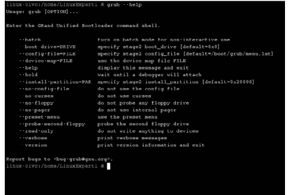

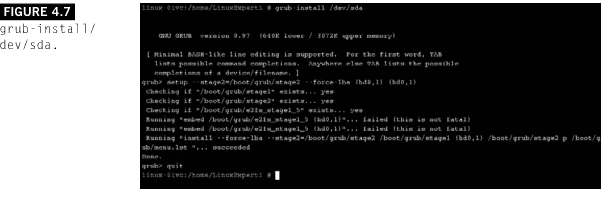

## RUNLEVELS（运行级别）

当今现代的 Linux 操作系统可以被用户和管理员以各种不同方式使用。这种方式使 Linux 操作系统能够以受限和/或对 root 管理员的完全控制执行不同的服务。这是安装、修复和提供不同级别的系统维护所必需的，同时不影响 Linux 用户或因用户仍已登录并使用系统而阻止功能执行。本节介绍了 `init` 程序的功能和七个不同的 Linux 运行级别。

### `init` 命令

如本章所示，`init` 命令提供两种服务。第一种服务是在虚拟文件系统创建后可由 Linux 内核访问的 `init` 版本。本章“引言”部分之前讨论过执行 Linux 发行版的新安装或执行现有 Linux 发行版的安装。

无论使用哪个 `init` 程序，你的 Linux 系统都使用这两个版本的程序。第二种 `init`，即从根 (`/`) 文件系统获取的那个，负责执行启动和停止 Linux 运行级别。

### Linux 七个运行级别

**运行级别** 是定义计算机系统如何启动或停止的专用脚本，通过执行各种服务或进程以及 root 管理级别和用户访问级别来实现。运行级别由特权用户运行 `telinit` 或 `init` 进行更改，这会向 `init` 发送适当的信号。对于你的 Linux 系统，存在七个不同的运行级别。运行级别的编号从 0 到 6。表 4.3 提供了每个运行级别的描述。

你的系统可以配置为启动上述任何运行级别。某些选择，如运行级别 0、4 和 6，是你不希望配置为初始启动运行级别的明显选择。然而，其他运行级别取决于你的目标，是可行的选择。大多数系统将默认运行级别设置为 3 或 5。

要执行运行级别，`/etc/init.d` 目录中有两种类型的脚本，这两种类型都通过 **符号链接** 调用。由 `init` 命令执行的第一组脚本在系统引导过程或你发起关机过程时启动。这些脚本包含在 `/etc/inittab` 文件中，如图 4.8 所示。默认运行级别设置位于 `/etc/inittab` 文件中。默认运行级别条目在文件中看起来像以下内容：

```
id:5:initdefault:
```

对于图 4.8 中显示的文件，运行级别被配置为以多用户模式启动，并为窗口管理器提供网络连接和 `X Windows` 支持。除了文件中列出的默认运行级别外，该文件还指明了要搜索以执行特定服务或程序的子目录。对于默认运行级别，`/etc/init/rc5.d` 是包含默认服务和程序脚本的目录。每个运行级别文件夹包含在启动运行级别和停止运行级别时执行的脚本。对于包含用于启动运行级别的脚本的文件，这些文件以大写字符 `S` 开头。对于包含用于停止运行级别的脚本的文件，这些文件以大写字符 `K` 开头。包含 `S` 的文件用于启动进程，而包含 `K` 的文件用于终止进程。第二组脚本在运行级别从一个运行级别更改为另一个运行级别时执行。调用 `/etc/init/rc` 文件以确保脚本按正确的顺序执行。

> **注意**
>
> Linux 内核启动 `init` 进程。该进程被分配进程 ID 1。所有后续进程都是从 `init` 进程启动的父进程或子进程。

**表 4.3 运行级别**

| 运行级别 | 描述 | 特别注释 |
| :--- | :--- | :--- |
| 0 | 此运行级别关闭或停止你的系统。 | 此选项终止所有程序和服务。请小心。 |
| 1 | 单用户模式 | 参数 `s` 或 `S` 可以作为 1 的替代。 |
| 2 | 以多用户模式运行，但没有网络连接。本地登录是唯一可用的选项。 | 如果你的系统挂载网络文件系统（例如，`SAMBA`、`NFS`），切勿使用此选项。 |
| 3 | 以多用户模式运行，具有完整的网络连接 | 这使系统以命令行（终端）模式启动。没有图形界面。 |
| 4 | 此选项可由用户配置，但通常未定义 | 未使用 |
| 5 | 以多用户模式运行，但还提供网络连接和窗口管理器的 `X Windows` 支持 | 这使系统以图形用户界面模式启动（例如，`GNOME`、`KDE`）。 |
| 6 | 此运行级别重启你的系统。 | 此选项终止所有程序和服务。请小心。 |

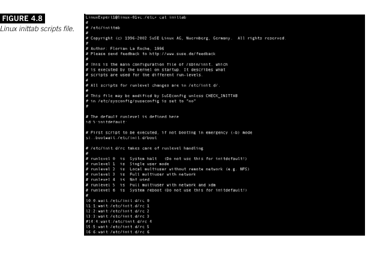

### 练习 4.2：更改为单用户模式（运行级别 1）

在本练习中，你将从当前运行级别更改为单用户模式（运行级别 1）。此运行级别允许你在没有网络访问/图形界面功能的情况下执行系统管理任务。（**执行此功能前请始终确保所有用户都已注销**。）

执行以下操作：

1. 使用切换用户命令 `su` 以系统管理员 [root] 身份登录。
2. 从 root 命令提示符，在 root 提示符中输入 `init 1`。
3. 按下 **Enter**（回车）键。
4. 系统将开始执行当前运行级别的停止脚本，然后开始执行单用户模式（运行级别 1）的启动脚本。
5. 以 root 用户身份登录。
6. 输入 root 用户密码。
7. 现在你可以执行各种系统管理任务，而不会影响本地或网络用户。

### 故障排除启动问题

在生活中，如果所有事情都能按预期执行，那该多好啊。然而，在 IT 行业中，墨菲定律依然存在。对于 Linux+ 考试，Linux 专业人员必须能够排查和解决在 Linux 引导过程中可能出现的问题。本节概述了 Linux 专业人员可用的不同选项，以解决 Linux 引导问题。

第一个选项是 `dmesg` 命令，用于将 Linux 内核消息发送到标准输出（例如，计算机显示器）。在 `GRUB` 引导加载程序完成后，加载并执行 Linux 内核。在此阶段，内核可以向计算机显示器发送代表检测到的硬件设备或它是否能够配置设备的消息。`dmesg` 通过能够打印或控制内核环形缓冲区来实现这一点。对于 Linux 专业人员，`dmesg` 可以帮助排查或获取有关系统硬件的信息。`dmesg` 的语法如下：

```
dmesg [ -c ] [ -n level ] [ -s bufsize ]
```

#### dmesg 选项说明

- 选项 `-c` 用于清空内核环形缓冲区。
- 选项 `-s`（包括缓冲区大小）用于确定从内核环形缓冲区查询的缓冲区大小。默认缓冲区大小为 16,392。
- 选项 `-n`（包括日志级别）用于确定发送到计算机显示器的消息类型。当使用 `"-n 1"` 时，只有恐慌消息会显示在计算机显示器上。其他所有消息均被阻止。当使用 `-n` 选项时，`dmesg` 命令不会打印或清空内核环形缓冲区。

输入不带任何参数的 `dmesg` 时，计算机显示器无法显示发送至标准输出的完整内核消息列表。如果消息在屏幕上滚动过快，可以输入命令 `dmesg | more` 以每页一条的方式查看消息。

#### 内核选项

第二个选项，**内核选项**（kernel options），允许输入在系统启动期间由 Linux 内核执行的信息。传递给内核的信息允许你在系统启动时控制其行为。可以通过编辑 `/boot/grub/menu.lst` 或在启动提示符下输入信息来添加内核参数。`/boot/grub/menu.lst` 提供了默认的内核参数，如之前图 4.4 所示。对于 `/boot/grub/menu.lst` 文件，可以添加或修改内核参数。此外，可以预定义故障安全内核参数，以便在问题情况下也能使 Linux 启动。

在使用 `GRUB` 动态修改启动过程中的内核时，可以输入各种内核参数。最常见的内核参数是修改 `runlevel` 参数。图 4.9 展示了在系统启动期间在 **启动选项**（Boot Options）字段中输入 `runlevel 1`，以单用户模式启动系统。

#### 救援系统

第三个选项，**救援系统**（rescue system），启动一个没有图形用户界面的专用 Linux 内核。它可以从各种来源和位置加载。最简单的方法是使用原始 Linux 发行版来启动系统。加载的 Linux 内核可以从 CD、DVD 或任何可引导设备获取。一旦 Linux 内核加载到 RAM 中，你可以修改配置文件、检查文件系统缺陷、验证和/或修改引导加载器配置、调整分区大小，以及进行其他一些可能必要的关键系统修改。许多 Linux 发行版也以 Live CD 形式提供（`Knoppix`、`openSUSE LiveCD`、`Fedora LiveCD`）。这种形式允许你通过启动系统并挂载磁盘分区来修复或解决配置或引导问题进行系统救援。

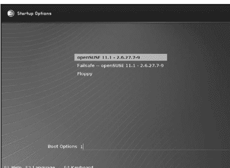

#### 图 4.9

**Linux 内核** 的启动选项。

#### 学习示例：是，或者不是……这是问题所在！

我的一位朋友最近晋升为一家中型公司的 CIO，他非常担心其 Linux 服务器的安全性。系统管理员在我朋友面前吹嘘其 Linux 服务器多么安全，并且没有人能获取硬盘上专有公司文件的访问权限。系统管理员安装了人们期望的所有常规技术安全措施（例如，防火墙、`IDS`、强加密密码、防病毒软件）。系统管理员认为没有必要进行安全评估。

我朋友出于合理的担忧，聘请我进行了一系列安全渗透测试。他希望我评估公司的本地和远程安全防御。我要求客户给我大约 10 分钟时间与系统单独相处，以执行一次常见的物理安全攻击。系统管理员在检查我是否能突破公司的安全防御后注销了 Linux 系统。他们离开去自动售货机买了几点零食。在 5 分钟内，我使该系统变得毫无防御。我更改了 root 密码，并给客户提供了关键公司文件的副本。

你问我如何这么快获得访问权限？我强制重启了他们的 Linux 服务器并获得了访问权限，因为根本没有引导加载器（`GRUB`）密码。我可以加载任何我想的内核，更改启动分区，并访问关键文件。请记住，技术安全措施永远不足以防止内部人员物理渗透你的安全防御。物理和管理安全措施也很重要。

#### 单用户模式

第四个选项，**单用户模式**（single user mode），用于绕过输入 root 密码的要求 [许多 Linux 发行版现在强制要求输入 root 密码]。通常，此选项用于获取 root 提示符以更改丢失或忘记密码。对于此选项，你将在 `runlevel 1`（单用户模式）下启动 Linux 系统，并直接获得 root 提示符。在此级别下，你可以执行 `passwd` 命令来修改 root 密码。由于你是以 root 身份登录的，系统将不会提示你输入旧密码。

> **注意**
>
> 如今，许多 Linux 发行版通过 splashing screen（闪屏）隐藏了通常显示在屏幕上的启动消息。然而，当闪屏出现时，你可以通过按 **ESC** 键查看启动消息。

#### 练习 4.3：Linux 服务器上丢失或忘记的 Root 密码

在这个练习中，我们将使用救援系统获取系统的 root 级别系统访问权限并更改密码。

完成以下内容：

1. 从 Linux 可引导安装源介质，引导目标机器。
2. 这将启动 `openSUSE` 安装程序。选择 **救援系统**（Rescue System）。
3. 系统将会显示 `Rescue login`；输入 **root**。
4. 不需要密码。如果目标系统没有实施物理安全措施，这可能产生安全隐患。系统将显示 `Rescue:~#` 命令。
5. 在提示符下输入：`fdisk -l` [用于列出分区]。
6. 定位根分区。
7. 输入 `mount /dev/sda1 /mnt`。[将 `sda1` 替换为前一步中识别的 Linux 根分区设备名称]。
8. 输入 `mount -o bind /dev /mnt/dev` [使设备文件可用]。
9. 输入 `chroot /mnt`。
10. 输入 `passwd root` [用于重置 root 密码]。
11. 输入新的 root 密码：`< >`
12. 输入 `exit` [退出 chroot 环境]。
13. 输入 `umount /mnt` [卸载文件系统]。
14. 重新启动系统。

## 考试目标总结

在本章中，我们讨论了 Linux 启动过程以及你在启动 Linux 系统期间需要知道的信息。Linux 启动过程分为四个阶段。这四个阶段是：系统通电、加载并执行 `GRUB`、加载并执行 Linux 内核，以及加载根文件系统。在概述 Linux 启动过程之后，介绍了 Linux 启动过程中的三个关键组件的详细信息。

在第一节关于 `GRUB` 中，介绍了默认的引导加载应用程序。`GRUB` 的目的是在你的计算机上执行一系列事件以加载主操作系统。本质上，引导加载程序从系统 BIOS 进程接收控制权，执行一系列事件，然后将控制权转移给操作系统内核。`GRUB` 程序以两种形式呈现。预安装形式通常用于系统初始启动期间，而安装后形式通常作为应用程序，在启动过程中应用修改之前安装或测试 `GRUB` 配置设置。

对于预安装形式，介绍了 `GRUB` 阶段 1 和阶段 2，以描述如何访问 Linux 内核和块存储设备。对于安装后形式，介绍了三个关键的 `GRUB` 配置文件。这三个文件是 `/etc/grub.conf`、`/boot/grub/menu.lst` 和 `/boot/grub/device.map`。这三个配置文件都在 Linux 启动过程中使用，但在安装后，通常通过 `GRUB shell` 命令修改和测试这些文件。

此外，在安装后阶段介绍了两个 `GRUB` 命令。这两个命令是 `grub-batch` 和 `grub-install`。`grub-batch` 命令用于实施对 `GRUB` 配置 `device.map` 文件的更改，并在执行 `grub.conf` 文件中列出的命令之前重新加载 `device.map` 文件。`grub-install` 命令用于将 `GRUB` 预安装应用程序重新安装到硬盘在一个正在运行的系统上。此命令将 `GRUB` 安装到 MBR 或某个分区，并检查是否存在错误。

在第二部分中，介绍了 `init` 命令和 Linux 运行级别。`init` 命令用于执行运行级别。正如本章所指出的，`init` 命令提供两种服务。与 `GRUB` 类似，`init` 也有预安装和安装后两种形式。


在安装后形式中，`init` 命令位于根（`/`）文件系统上。该版本的 `init` 还提供四项功能。第一项功能是加载正确的文件系统驱动程序，以便内核能够加载根（`/`）文件系统。第二项功能是为文件系统和其他系统驱动器创建特殊系统文件。第三项功能用于配置并授予对廉价冗余磁盘阵列 [RAID] 和 LVM 功能的访问权限。第四项功能提供支持加载网络驱动程序，以支持通过网络挂载的文件系统（例如，SAMBA、NFS）。

运行级别使用一组脚本，通过执行各种服务和进程来定义计算机系统的启动或停止方式，以及根管理员权限和用户访问级别。运行级别的编号从 0 到 6。每个级别为用户和系统提供或移除某一层级的功能。例如，无网络访问、无图形用户界面，或仅限单用户模式。系统的默认运行级别设置位于 `/etc/inittab` 文件中。

最后一部分“故障排除启动问题”向 Linux+ 专业人士介绍了四种解决启动问题的不同方法。使用 `dmesg` 命令、在启动过程中动态修改 Linux 内核、使用系统救援程序以及进入单用户模式以重新获得根访问权限，是这四种方法。

对于 Linux 专业人士来说，`dmesg` 可以帮助故障排除或获取关于系统硬件的信息。`dmesg` 命令用于将 Linux 内核消息发送到标准输出（例如，计算机显示器）。`dmesg` 通过能够打印或控制内核环形缓冲区来实现这一目的。

动态修改内核选项允许你输入信息，以便在系统启动过程中由 Linux 内核执行。可以通过编辑 `/boot/grub/menu.lst`、在启动提示符处输入信息，或在启动过程中使用 GRUB 动态修改内核来添加内核参数。`runlevel` 参数是最常见的内核修改。

系统救援方法启动一个没有图形用户界面的专用 Linux 内核。加载的 Linux 内核可以从 CD、DVD 或任何可启动设备（例如，LiveCD）获取。一旦 Linux 内核被加载到 RAM 中，你就可以修改配置文件、检查文件系统是否存在缺陷、验证和/或修改引导加载器配置、调整分区大小，以及进行其他可能必要的关键系统修改。

单用户模式是最后的故障排除方法。由于此方法的安全影响，此选项在某些 Linux 发行版中可用。与之前的方法不同，此方法侧重于重新获得 `root` 账户的访问权限，以更改丢失或忘记的密码。此方法涉及在运行级别 1（单用户模式）下获得 `root` 提示符的访问权限，并更改 `root` 密码。

#### 自我测试

- 1. 你需要访问你所在部门的 Linux 服务器以执行系统维护。为了执行必要的管理任务，所有用户都需要注销系统，并且在系统维护活动进行期间不允许他们重新登录系统。哪个运行级别仅授予 `root` 访问权限？
    - A. 6
    - B. 0
    - C. 2
    - D. 1
- 2. 你所在部门的经理希望所有 Linux 用户通过使用图形用户界面访问他们的工作站，并具有网络连接。哪个运行级别默认使用图形用户界面并授予网络连接？
    - A. 2
    - B. 0
    - C. 5
    - D. 1
- 3. 你所在部门的经理希望所有 Linux 用户通过使用命令行模式（没有图形用户界面）访问他们的工作站，并具有网络连接。哪个运行级别使用命令行模式供多用户使用并授予网络连接？
    - A. 2
    - B. 0
    - C. 3
    - D. 1
- 4. 计算机系统 `BIOS` 的作用是什么？
    - A. 在加载 `Linux` `GRUB` 之前加载 `Linux` 内核
    - B. 允许用户登录到 `Linux` 操作系统并更改内核
    - C. 展示 `Linux` 创建者 `Linus Torvalds` 的传记
    - D. 启动 `Linux` 引导过程
- 5. 你需要访问你所在部门的 Linux 服务器以执行系统维护。你需要关闭系统以安装新的硬件组件。哪个运行级别会关闭你的系统？
    - A. 6
    - B. 0
    - C. 2
    - D. 1
- 6. 你所在部门的 Linux 服务器都使用 `IDE` 硬盘驱动器。你的主管要求你在机器仍在运行时将 `GRUB` 重新安装到 `IDE` 第一块硬盘的第一个分区上。要在 `IDE` 硬盘驱动器的第一个分区上安装 `GRUB`，你应该使用哪个 `shell` 命令？
    - A. `grub ide`
    - B. `grub-install /dev/hda1`
    - C. `grub-install /dev/sda1`
    - D. `grub-runlevel /dev/hda1`
- 7. 你是你所在 IT 部门的 Linux 系统管理员。当你早上通常访问你的工作站时，你被授予带图形用户界面和网络连接的多用户访问权限。为了执行系统维护活动，你需要在系统运行时切换运行级别。哪个命令用于在系统运行时切换运行级别？
    - A. `runlevels`
    - B. `init`
    - C. `System Rescue`
    - D. `grub`
- 8. 对于扇区大小为 512 字节的硬盘驱动器，主引导记录 (MBR) 有多大？
    - A. 1 MB
    - B. 512 字节
    - C. 0 字节
    - D. 6 KB
- 9. 哪个事件顺序代表了正确的 Linux 引导过程？
    - A. 系统 `BIOS`，引导加载器，`Linux` 内核，用户登录系统
    - B. 引导加载器，系统 `BIOS`，`Linux` 内核，用户登录系统
    - C. 系统 `BIOS`，`Linux` 内核，引导加载器，用户登录系统
    - D. 用户登录系统，系统 `BIOS`，引导加载器，`Linux` 内核
- 10. 哪个命令用于将 Linux 内核消息发送到标准输出（例如，计算机显示器）？
    - A. `grub`
    - B. `dmesg`
    - C. `init`
    - D. `kernelprint`
- 11. 你是你所在部门的 Linux 系统的 IT 系统管理员。你需要修改默认运行级别设置。哪个文件包含默认运行级别设置？
    - A. `/etc/inittab`
    - B. `/etc/grub.boot/inittab`
    - C. `/boot/grub/device.map`
    - D. `/etc/init.d`
- 12. 你的 IT 部门已进行了一些硬件设备变更。这些变更包括对硬盘驱动器的修改。你需要对 `GRUB` 引导加载器进行修改。你应该编辑哪个文件以配置 `GRUB` 第二阶段映像？
    - A. `/etc/menu.lst`
    - B. `/boot/grub/menu.lst`
    - C. `/etc/grub.conf`
    - D. `/boot/grub/grub.conf`
- 13. 你是你所在部门的 Linux 系统的 IT 系统管理员。你需要更改 `GRUB` 设备命名约定。哪个文件包含默认运行级别设置？
    - A. `/etc/device.map`
    - B. `/etc/grub.boot/device.map`
    - C. `/boot/grub/device.map`
    - D. `/etc/init.d`
- 14. Linux 内核是 Linux 引导过程中的关键组件。它在系统中驻留在哪里？
    - A. `/kernel` 目录
    - B. `/grub/boot/kernel` 目录
    - C. `/boot` 目录
    - D. `/boot/kernel` 目录
- 15. Linux 引导加载器是 Linux 引导过程中非常关键的组件。它在系统中驻留在哪里？
    - A. 它驻留在主引导记录中。
    - B. 它驻留在 Linux 内核内部。
    - C. `/etc` 目录
    - D. 系统 `BIOS` 内部

##### 自我测试快速答案

- 1. D
- 2. C
- 3. C
- 4. D
- 5. B
- 6. B
- 7. B
- 8. B
- 9. A
- 10. B
- 11. A
- 12. C
- 13. C
- 14. C
- 15. A

### 配置基础系统

**本章考试目标**

- 用户配置文件
- 设备管理
- 网络

#### 专有术语及定义

- **路由 (Route)**：它是网络流量从源设备经过一系列主机、路由器、网桥、网关及其他设备，最终到达位于不同网络上的目标设备所经过的路径。
- **端口 (TCP/IP)**：它是通信系统中的逻辑信道或信道端点。每个应用程序都有一个与之关联的唯一端口号。端口号用于区分同一网卡 (NIC) 上的不同逻辑信道。

#### 简介

本章将解释如何配置系统和用户配置文件，以及常见的环境变量；各种设备的管理及其在磁盘结构中的位置；以及利用传输控制协议/互联网协议 (`TCP/IP`) 的 Linux 网络基础，并介绍如何在 Linux 中管理网络。

用户管理是日常 Linux 系统管理中必须理解的一项基本任务，而能够以有效的方式实现这一点对于所有 Linux 管理员来说都是必不可少的。无论系统是由你自己、你的整个家庭还是大型公司使用，这一点同样重要。用户应具有正确的权限和环境设置，以确保他们使用系统的体验良好，并将支持开销降至最低。

作为系统设置的一部分，用户需要并渴望访问安装在系统上的各种设备。在部署之前必须正确设置这些设备，以确保系统正常运行。这通常需要在超级用户级别进行，这是一个通常不会授予普通用户的特权级别。此外，在此级别上的用户交互通常会导致系统不稳定，且难以诊断。

计算机系统的网络连接，无论是通过有线还是无线连接，在当今世界通常是给定的必要需求。很少有部署的系统不具备此功能，而且通常，用户需要这两种选项，特别是在任何形式的便携式设备中。计算机通常也使用 `TCP/IP` 作为网络连接的传输机制，并且将讨论设置此的不同选项。还讨论了连接到名称服务器和动态主机配置协议 (`DHCP`) 服务器的基础知识，并解释了大多数参数。

#### 用户配置文件

任何 Linux 安装都将包括创建多个不同的用户帐户：超级用户、日常普通用户和系统用户。这些帐户每一个都至关重要，用户需要了解它们之间的差异。

所有用户都需要在系统上拥有一个帐户，该帐户应该是唯一的，以确保内置基本的安全级别。普通用户可以添加、删除和修改他们自己的文件以及那些设置了适当属性的文件。这些用户不能进行系统范围的更改，也不能管理系统上的其他用户。标准用户还可以进行特定于他们的更改，例如桌面壁纸和添加打印机。

被指定为超级用户 [也称为系统管理员] 的用户具有全局权限，可以创建和删除用户，并可以更改文件系统中文件的权限。在给定系统上可能存在许多系统管理员，特别是在大型公司中。应将从提升至此级别的用户数量保持在最低限度，以确保底层系统的安全性和完整性。有一个特殊的超级用户被称为 `root`，其用户 ID 和组 ID 均为 0。此用户对操作任何文件、访问任何目录和执行任何程序拥有完全且不受限制的权利。出于明显的安全原因，此用户的凭证应只由极少数人共享。

第三种类型的帐户是系统用户，实际上它根本不是一个用户。此帐户是一个管理帐户，由系统本身用于执行各种管理任务。例如，`xfs` 拥有 X11 字体服务器及其所有关联文件，并且只有它本身和 `root` 帐户才能执行这些文件。系统用户与系统上的其他用户的区别在于，它们没有主目录或密码，也不能通过正常的系统登录提示符访问。

#### 系统和用户配置文件及环境变量

下文将描述为每个用户创建的用户配置文件以及用于满足个人偏好设置而修改的常见变量。系统上的每个用户都可以自定义其配置文件，以适应其特定需求和偏好。这些偏好设置在资源文件中，存储在全系统各处的环境变量中。

`bash` 中的三种不同 `shell` 是登录 `shell`、普通 `shell` 和交互式 `shell`。登录 `shell` 读取位于用户主目录或 `/etc` 目录（`~/profile`）中的 `.profile` 文件，而交互式 `shell` 读取 `~/.bashrc`。环境变量是命名对象，包含可用于一个或多个应用的信息。

由于 `bash` 是 Linux 下的默认 `shell`，下面列出了 `bash` 启动文件的摘要：

1.  `/etc/profile`：这是系统范围的启动文件，将在用户登录时执行。该文件受保护，只有超级用户 [`root`] 能够修改该文件。由于此文件可能会在系统升级时被覆盖，因此不建议直接对其进行更改。
2.  `/etc/bash.bashrc`：这通常链接到 `/etc/bashrc`，并且被调用为*每个交互式 shell 启动*。该文件受保护，只有超级用户 [`root`] 能够修改该文件。由于此文件可能会在系统升级时被覆盖，因此不建议直接对其进行更改。

普通用户将有两个类似的文件，它们的调用方式如下：

-   `/home/user/.bash_profile`：这是一个个人启动文件，在用户登录系统时执行。
-   `/home/usr/.bashrc`：这是个人交互式 `shell` 启动文件。

上述两个文件都可以由用户使用 `vi` 等编辑器进行编辑。在 `bash` 中创建和修改环境变量的格式始终采用下面给出的格式：

```bash
NAME=value
```

这将在 `shell` 中定义变量。要将其从 `shell` 移动到环境中，必须使用 `export` 命令：

```bash
export NAME=value
```

这使得 `shell` 以外的程序（例如文件编辑器）可以访问此变量。

##### PS1

当用户首次登录时，他们会看到一个提示符。此提示符可以更改，并且可能根据安装的 Linux 版本而有所不同。标准用户的典型提示符是 `$` 符号，而 `root` 由 `#` 符号表示。这可以在下面演示（用户输入为粗体）。

```bash
$ who am i
syngress
$ su root
Enter password for root: xxxxxx
###### who am i
root
###### exit
$ who am i
Syngress
```

最初在文件 `/etc/bash.bashrc` 中定义为环境变量 `PS1` 的用户提示符可以显示大量数据。`PS1` 变量可以改变命令行，如下所示：

```bash
$ PS1="\u>"
syngress>
```

下面给出了常用的变量：

-   `\d` 是“Wed Sep 09”格式的日期
-   `\h` 是主机名的第一部分（例如 `mysystem`）
-   `\u` 是用户名
-   `\t` 是 24 小时制的时间

完整的字符串列表可以在文档中找到，包括如何添加颜色和声音（这可能有助于突出表明你正在 `root` 级别操作，或者对于系统管理员来说，你实际登录的是哪台机器）。如上所述修改变量不会使其永久生效，当用户注销并再次登录时，将恢复为系统设置。要使更改永久生效，必须将它们包含在你的本地配置文件中。

###### PS2

`PS2` 变量与 `PS1` 变量非常相似，除了当用户发出未完成命令时显示，系统将提示并等待用户完成命令并按下回车键。此默认二级提示符是 `>` 符号，可以通过更改 `PS2` 变量来修改。

```bash
$ echo "this is a
> test"
this is a
test
$
```

下面展示了使用自定义提示符重新定义 `PS2` 变量：

```bash
$ PS2='more input > '
$ echo "this is a
more input > test"
this is a
test
$
```

> **注意**
>
> 在某些 `shell` 中还有其他提示符字符串变量可用，例如 Korn `shell` 中的 `PS3` 和 `PS4`。由于它们的特定性质，考试中并不特别要求这些变量。

###### Path

`PATH` 变量用于命令定位特定的命令或应用程序。当你输入一个命令时，`shell` 会在每个目录中查找 `PATH` 命令中指定的目录，如果命令不在这些目录中的任何一个里，系统将返回“命令未找到”的消息。通常，如果用户创建了命令，应将其放置在用户主目录的 `bin` 目录中（例如，`/home/syngress/bin`）或其他方便的位置，并且 `PATH` 变量会检查以确保该目录已被引用。`PATH` 变量包含由冒号分隔的目录列表，如下所示：

```bash
echo $PATH
/bin:/usr/bin:/usr/local/bin
```

由于其中不包含你的本地 `bin` 目录，你需要将其添加到该变量中。可以通过执行以下命令修改 `PATH` 变量以包含该目录：

```bash
PATH=$PATH:$HOME/bin
```

如果 `PATH` 已经像之前那样定义过，对于用户 `syngress` 再次执行命令将产生以下结果：

```bash
echo $PATH
/bin:/usr/bin:/usr/local/bin:/home/syngress/bin
```

###### 编辑器

`EDITOR` 变量定义了用户首选的文本编辑器。文本编辑器的种类和数量庞大，每个用户都有自己的最爱（以及不喜欢！）。一些常见的编辑器包括 `ed`、`vi`、`vim` 和 `emacs`。如上所述，设置环境变量可以通过在命令行上设置或插入到 _.bashrc_ 脚本中来实现。

如果未设置该变量，命令 `echo $EDITOR` 将返回一个空行。要将默认编辑器设置为 `vim`，请使用 `EDITOR=vim` 或 `EDITOR=/usr/bin/vim`。

理想情况下，使用完整的路径名（特别是在 _.bashrc_ 脚本中）会更好，以确保变量被正确定义。如果 `PATH` 变量被更改或未定义 `/usr/bin` 目录，系统将找不到编辑器并导致错误。`vi` 文本编辑器的使用方法在第 6 章中有定义。

###### 终端

`TERM` 变量用于设置正在使用的终端类型，当使用面向屏幕的程序（如文本编辑器）时，这一点尤为重要。该变量在系统安装期间会自动设置，但如果用户远程访问系统，可能需要对其进行修改。当使用 `KDE` 安装 `Linux` 时，`TERM` 变量将被设置为值 `xterm`。

也可以使用 `tset` 命令设置该变量，该命令常用于用户的登录脚本中，以便让他们选择正在登录的终端类型。

##### PAGER


`PAGER` 变量控制输出到屏幕的内容，例如 `man` 命令。这允许以受控的方式显示输出。`PAGER` 的典型值是 `more` 和 `less`。虽然这两者相似，但 `less` 具有额外功能（例如使用 `b` 键向后滚动），因此它是作为默认值更优选的选项。

##### `HOME`

`HOME` 变量在每次登录系统时都会被设置，并将其设置为 `/home/username`（其中 `username` 是你的登录名）。这不应更改，因为许多程序使用此变量来在你的个人主目录中创建或查找文件。此外，快捷方式 `~` 引用 `HOME` 变量，如果修改了该变量，将返回错误结果。

##### `PRINTER`

`PRINTER` 变量定义默认打印机。如果没有定义打印机，该值将被设置为 `NULL`。该变量主要用于命令行程序进行打印。设置该变量并不意味着不需要在系统上安装打印机。使用 `PRINTER` 变量允许系统管理员根据用户的位置为用户设置特定的打印机。

#### 练习 5.1：配置用户环境

在这个练习中，你将修改 `profile` 中默认的 `PAGER` 变量设置。

1. 将目录更改到你的主目录。
2. 执行 `more .bashrc` 命令查看你当前的环境设置。你会看到 `PAGER` 变量被设置为 `more`。
3. 输入命令 `echo $PAGER`，它显示值 `more`。
4. 使用你喜欢的编辑器，将以下行添加到 `.bashrc` 文件中：

   ```bash
   export PAGER=less
   ```

5. 当用户下次注销并重新登录时，这将把值从 `more` 更改为 `less`。

#### 设备管理

Linux 系统中的设备管理至关重要，乍一看，对于正在熟悉 Linux 的 Microsoft Windows 用户来说，它似乎更加复杂。管理设备通常不止一种方法，而且通常除了图形用户界面（GUI）之外，还可以使用命令行。以下部分将列出一些系统管理员在日常工作中可能会使用的常见命令和主要目录。

##### `lsusb`

`lsusb` 将列出系统上的所有 USB 总线，并显示连接到它们的任何设备的信息。`-v` 和 `-vv` 选项将提供详细输出；然而，这仅在调试时需要，因为输出确实非常详细，`-vv` 选项会输出周边组件互连（PCI）设备可以显示的所有信息。此命令有助于查看哪些 USB 设备正在工作以及连接的设备类型。

```bash
$ lsusb
Bus 004 Device 001: ID 1d6b:0001 Linux Foundation 1.1 root hub
Bus 003 Device 001: ID 1d6b:0001 Linux Foundation 1.1 root hub
Bus 002 Device 001: ID 1d6b:0001 Linux Foundation 1.1 root hub
Bus 001 Device 005: ID 0204:6025 Chipsbank Microelectronics Co., Ltd
CBM2080 Flash drive controller
Bus 001 Device 003: ID 046d:c517 Logitech, Inc. LX710 Cordless Desktop
Laser
Bus 001 Device 002: ID 413c:0058 Dell Computer Corp. Port Replicator
Bus 001 Device 001: ID 1d6b:0002 Linux Foundation 2.0 root hub
```

##### `lspci`

`lspci` 命令与 `lsusb` 命令类似，不同之处在于它显示系统中所有 PCI 总线的信息以及连接到它的所有设备。此命令有助于了解系统中连接了哪些设备以及应为这些设备加载的实际驱动程序。此命令也可以与 `-x` 选项一起使用，以显示 PCI 配置的前 64 个字节，这对于查看加载的内容很有用。

```bash
$ lspci -x
00:00.0 Host bridge: Intel Corporation 82855PM Processor to I/O Controller (rev 03)
00: 86 80 40 33 06 01 90 20 03 00 00 06 00 00 00 00
10: 08 00 00 e0 00 00 00 00 00 00 00 00 00 00 00 00
20: 00 00 00 00 00 00 00 00 00 00 00 00 00 00 00 00
30: 00 00 00 00 e4 00 00 00 00 00 00 00 00 00 00 00

00:01.0 PCI bridge: Intel Corporation 82855PM Processor to AGP Controller (rev 03)
00: 86 80 41 33 07 01 a0 00 03 00 04 06 00 20 01 00
10: 00 00 00 00 00 00 00 00 01 01 20 c0 c0 a0 22
20: 00 fc f0 fd 00 e8 f0 ef 00 00 00 00 00 00 00 00
30: 00 00 00 00 00 00 00 00 00 00 00 00 00 0c 00
```

此外，可以使用 `-b` 命令来显示各卡片看到的中断请求线（IRQ）地址。

```bash
$ lspci -b
00:00.0 Host bridge: Intel Corporation 82855PM Processor to I/O Controller (rev 03)
00:01.0 PCI bridge: Intel Corporation 82855PM Processor to AGP Controller (rev 03)
00:1d.0 USB Controller: Intel Corporation 82801DB/DBL/DBM (ICH4/ICH4-L/ICH4-M) USB UHCI Controller #1 (rev 01)
00:1d.1 USB Controller: Intel Corporation 82801DB/DBL/DBM (ICH4/ICH4-L/ICH4-M) USB UHCI Controller #2 (rev 01)
```

输出还可以以树状格式显示，当需要快速概览设备时，这很有用。

```bash
$ lspci -t
-[0000:00]--+-00.0
|\-
|    01.0-[0000:01]----00.0
|    1d.0
|    1d.1
|    1d.2
|    1d.7
|    |e.0-[0000:02-0a]----00.0
|    |     01.0
|    |     01.1
|    |     03.0
|    1f.0
|    1f.1
|    1f.5
|\-1f.6
```

##### `lsmod`

`lsmod` 命令显示有关已加载模块的所有信息，格式为名称、大小、使用次数和引用模块列表。列表的一部分显示如下：

```bash
$ lsmod
  Module
nls_iso8859_1           3768   1
nls_cp437              5432   1
vfat                   9764   1
fat                   46376   1 vfat
usb_storage            86620   1
ip6t_LOG               6212   7
xt_tcpudp              2728   2
xt_pkttype             1560   3
ipt_LOG                5708   8
xt_LIMIT               2056  15
binfmt_misc            7872   1
snd_pcm_oss           43300   0
```

`lsmod` 命令从 `/proc/modules` 文件中获取数据，并以更容易被人类阅读的形式显示。

##### `/sys`

`/sys` 目录包含所有与内核、固件和其他系统相关文件相关的文件。`/sys` 下有几个目录，以确保其结构组织良好。可以使用 `ls` 命令查看整体结构。

```bash
$ ls -l /sys
total 0
drwxr-xr-x   2 root root   0 2009-05-23 10:53 block
drwxr-xr-x  16 root root   0 2009-05-23 08:47 bus
drwxr-xr-x  39 root root   0 2009-05-23 08:47 class
drwxr-xr-x   4 root root   0 2009-05-23 10:56 dev
drwxr-xr-x  10 root root   0 2009-05-23 08:47 devices
drwxr-xr-x   5 root root   0 2009-05-23 08:47 firmware
drwxr-xr-x   3 root root   0 2009-05-23 08:47 fs
drwxr-xr-x   6 root root   0 2009-05-23 08:47 kernel
drwxr-xr-x 127 root root   0 2009-05-23 10:53 module
drwxr-xr-x   2 root root   0 2009-05-23 08:47 power
```

`/sys` 目录与下一节中描述的 `/proc` 目录相关。

#### `/proc`

`/proc` 文件系统是一个虚拟文件系统，它促进了 Linux 内核与用户进程之间的通信。`/proc` 文件系统包含多个目录，用于组织其下方的数据和虚拟文件。可以通过读取或写入 `/proc` 文件系统中的虚拟文件，作为与内核中特定实体通信的方法。虚拟文件可以在用户与内核之间共享数据，方向既可以是用户到内核，也可以是内核到用户。它可以呈现双向的信息，但并不一定需要这样做。

`/proc` 文件系统中有一些有趣的文件——例如 `cpuinfo`，它标识系统中安装的处理器类型和速度；以及 `modules`，它标识当前已加载到内核中的模块。图 5.1 展示了一个典型的目录列表。

该列表显示了屏幕左侧的一系列编号文件。这些是正在计算机上运行的进程的目录。标记为 `1` 的目录对应于第一个初始化的进程，这通常是 `init` 进程。

#### `modprobe` 和 `modprobe.conf` 文件

通常，设备可以在安装期间或当新设备安装到系统中时被检测。然而，这种情况有时会发生故障，特别是对于新或不常见的硬件。当这种情况发生时，有几种方法可以手动初始化硬件：

- `modprobe` 是所有模块的高级处理器，可用于卸载或加载新设备的内核模块。
- 可以编辑 `/etc/modprobe.conf.local` 文件，以便在重启时提示系统识别并支持新硬件。

基础系统将使用 `/etc/modprobe.conf` 文件来加载模块，该文件不应被修改。此文件将通过 `include` 语句将路径名 `/etc/modprobe.conf.local` 附加到自身。一旦在 `/etc/modprobe.conf.local` 文件中添加了条目并执行了重启，系统将执行模块依赖检查。

作为 `root` 用户，您也可以使用 `modprobe` 手动加载和卸载设备的内核模块。该命令将查找 `/usr/lib/[kernel version]` 中除可选的 `/etc/modprobe.conf` 配置文件和 `/etc/modprobe.d` 目录之外的所有模块和文件。如果模块不存在，`modprobe` 将生成错误。由于 `modprobe` 本身并不对模块做任何操作，所有的依赖关系和符号解析都由内核本身处理。模块故障产生的内核消息需要使用 `dmesg` 命令来显示。

> **注意**
> 可以使用命令 `uname -r` 显示内核版本。

每个模块可能需要加载一个或多个额外模块才能正确工作，`modprobe` 将在 `modules.dep` 文件中检查这些依赖关系，该文件本身由 `depmod` 命令生成。`modules.dep` 文件位于 `/lib/modules/[uname]` 目录中。

#### 练习 5.2：从 Linux 内核中移除模块

在本练习中，您将把一个模块（一个电气和电子工程师学会（IEEE）1394 卡）从 Linux 内核中移除：

1. 将硬件从 Linux 系统中移除并启动系统。
2. 登录完成后，您需要从内核中移除该模块。使用 `modprobe` 命令 `modprobe -r ieee1394` 完成此操作。
3. 使用 `dmesg` 检查任何与移除相关的内核消息。
4. 再次重启系统，此时硬件和模块应该已被移除。

#### `/etc/modules.conf` 配置文件

`modprobe` 的行为可以通过可选的 `/etc/modules.conf` 文件进行修改。该文件由一系列行组成，其外观类似于 shell 脚本。该文件仅在您安装并非直接编译进内核且未被其他地方的 `modprobe` 处理的内核模块时才会存在。

#### Linux 硬件兼容性列表

Linux 支持的设备非常广泛，并且由于开源社区的存在，这个列表每天都在增长。然而，每个版本的 Linux（如 `Debian`、`RedHat` 等）以及每个发行版的 Linux 都有不同的支持硬件集合。显然，内核越新，越有可能支持您试图安装的硬件设备。一些设备将被自动检测和安装，而其他设备可能需要手动添加。

有许多网站详细列出了系统和单个硬件部件的兼容性，例如 `www.linux-drivers.org`。如果您正在构建自己的 Linux 系统或在现有系统上安装 Linux，值得检查这些网站，以确定在构建过程中可能遇到什么问题（如果有的话）。或者，使用特定构建版本的 `live` 选项可以对您的硬件进行非常快速评估。以下章节将深入探讨硬件支持以及如何将模块直接加载到系统中。

#### 网络

现代计算机系统不连接到某种形式的网络的情况非常罕见——即使只是一个用于访问互联网的调制解调器。因此，这需要在您的系统上设置网卡和 `TCP/IP`。必须理解网卡和物理连接的重要性，特别是在企业环境中。如果购买交换机和网络以 `1 GB/s` 的速度运行，然后安装 `10 MB/s` 的网卡，这是不值得的。在设置网络时，尽可能使用相同的网卡，以减少支持开销并允许保持较小的备件库存。

##### 配置接口

在进行初始网络配置时，适用于其他设备的基本规则同样适用。如果您正在安装网卡，请确保它位于您正在安装的 Linux 内核支持的设备列表中。大多数网卡会有一个或多个指示灯，以指示其是否正常工作以及是否已正确连接。如果这些灯指示错误，请使用可用的诊断工具来检查设备。通常，这些诊断工具基于 Microsoft Windows，因此如果您的系统没有双启动，您可能需要将卡片移动到另一个系统。设备的可靠性非常好；但是，新卡片存在故障的情况并非未知。

当您安装了网卡并确信其正常工作后，需要配置该网卡。有许多与 Linux 捆绑的基于图形用户界面（GUI）的工具，您的系统上安装了哪一个取决于正在使用的 Linux 发行版和安装的 GUI（`KDE`、`GNOME` 等）。在新版本的 SUSE Linux 中，有一个名为 `networkmanager` 的应用程序，可从面板中访问。就本章而言，我们将讨论网卡基于命令行的设置。这些命令适用于所有版本的 Linux，并将确保您理解网络设置的基础。

配置网卡时需要两个关键命令：`ifconfig` 和 `ifup`。`ifconfig` 命令在显示网卡状态时非常有用，如下所示。请注意，在使用 `ifconfig`、`ifup` 和 `ifdown` 命令的某些选项时，需要超级用户权限。

```bash
$ /sbin/ifconfig
eth0      Link encap:Ethernet  HWaddr 00:00:56:E7:9D:81
          inet addr:192.168.1.38  Bcast:192.168.1.255
          Mask:255.255.255.0
          inet6 addr: fe80::20d:56ff:fee7:9db1/64  Scope:Link
          UP BROADCAST RUNNING MULTICAST  MTU:1500  Metric:1
          RX packets:8773 errors:5 dropped:0 overruns:0 frame:5
          TX packets:2722 errors:0 dropped:0 overruns:0 carrier:0
          collisions:0 txqueuelen:1000
          RX bytes:5185021 (4.9 Mb)  TX bytes:226856 (221.5 Kb)
          Interrupt:11
lo        Link encap:Local Loopback
          inet addr:127.0.0.1  Mask:255.0.0.0
          inet6 addr: ::1/128  Scope:Host
          UP LOOPBACK RUNNING  MTU:16436  Metric:1
          RX packets:200 errors:0 dropped:0 overruns:0 frame:0
          TX packets:200 errors:0 dropped:0 overruns:0 carrier:0
          collisions:0 txqueuelen:0
          RX bytes:14324 (13.9 Kb)  TX bytes:14324 (13.9 Kb)
```

上述示例显示了一个完全配置好的网卡，具有 IP 地址，正在发送和接收数据包。以下内容假设网卡


## 没有

正常工作，并且将执行所需的操作步骤。这在安装了多张网络卡时尤为重要。在多网卡的情况下，网卡的编号依次为 `eth0`、`eth1` 等，你必须确保正在操作正确的设备。

系统必须开启网卡才能识别它，你可以使用以下命令实现：

```
ifconfig eth1 up
```

或者：

```
ifup eth1
```

重新配置设备的 IP 地址和子网掩码可能要求网卡处于非活动状态，或需要关闭再开启。这可以使用 `ifconfig` 或 `ifdown` 来实现，如下所示：

```
ifconfig eth1 down
ifdown eth1
```

### 考试提示

> 请记住，`ifconfig`、`ifup` 和 `ifdown` 通常位于 `/sbin` 目录中，而该目录对于大多数用户而言并不在 `$PATH` 定义的路径内。因此，执行这些命令时可能需要提供完整的目录路径。

一些较旧的网卡要求将卡设置为特定的 `IRQ` 和 `I/O` 地址，这些也可以通过 `ifconfig` 命令进行设置。大多数现代网卡会被内核自动检测，因此通常不需要这一步骤。

```
ifconfig eth1 irq 12 io_addr 0x300
```

执行这些命令后，不带参数运行 `ifconfig` 命令应能显示新配置好的网卡。与网卡关联的 IP 地址可以从 `DHCP` 服务器动态分配 [章节后面“DHCP 设置与配置”部分有更详细的说明]，也可以为其指定一个静态地址。对于服务器，特别是面向互联网的服务器，分配静态地址更为常见。要将网卡设置为特定的 IP 地址，使用的命令是

```
ifconfig eth1 10.10.10.3 netmask 255.255.255.0
```

应再次运行 `ifconfig` 命令以显示网卡状态，并确保 IP 地址已正确设置。

### DHCP 设置与配置

对于大多数设备而言，使用 `DHCP` 将是首选选项。在小型网络中，这些地址通常从宽带路由器或类似设备获取。对于大型机构，使用 `DHCP` 比使用静态地址更能减少支持和维护开销，因此更受青睐。

运行 `DHCP` 的主机通过联系中央服务器来获取 IP 地址，该服务器维护着一个或多个子网的地址信息。一旦客户端联系了服务器，它将被分配一个 IP 地址、子网掩码，以及可能的其他信息，如默认路由和默认名称服务器的 IP 地址。所请求的信息列在配置文件 `/etc/dhclient.conf` 中，并在启动时读取，系统将尝试配置系统中存在的所有接口。默认情况下，仅要求 IP 地址配置，但如果 `dhclient` 文件中定义了相应的行，也可以要求域名服务器 (`DNSes`) 的配置。

也可以使用命令行 `DHCP` 客户端来配置网络接口，称为 `dhcpd`，它位于 `/etc` 目录中。从服务器获取的 `DNS` 信息将写入 `resolvconf`，如果不可用，则直接写入 `/etc/resolv.conf`。在较大的网络中，`DHCP` 服务器还可能提供 `NFS` 和网络时间协议 (`NTP`) 的配置数据，这些数据将存储在 `/etc/yp.conf` 和 `/etc/ntpd.conf` 中。为了确保这些服务被告知变更，`dhcpd` 也会停止并启动这些服务。

出于支持原因，`dhcpd` 命令还有一些其他有用的选项：

- `--release` 释放主机的当前租约并取消配置接口。
- `--renew` 将尝试更新租约。这两个命令通常按顺序执行以检查与 `DHCP` 服务器的连接。
- `--nogateway` 将限制默认路由的任何重复。
- `--nonntp` 将停止在 `/etc/ntp.conf` 中更新 `ntp`。
- `--nodns` 用于停止在 `/etc/resolvconf` 中更新 `DNS` 信息。

一种替代的 `DHCP` 客户端是 `dhclient`，它在启动时运行并读取 `/etc/dhclient.conf` 文件以获取配置说明。该文件将包含当前系统中配置的所有网络接口的列表。如有必要，这些接口将通过 `dhclient` 进行配置。如果接口是使用此客户端配置的，它会将 `DHCP` 租约存储在 `/var/lib/dhcp/dhclient.leases` 配置文件中。由于租约数量可能很大，该文件会不时重新创建，以确保文件大小可控。

### 配置无线接口

由于无线基础设施速度的提升，无线网卡的使用在过去几年里迅速增长。无线接口的配置与有线接口非常相似。要显示系统上所有无线接口的状态，可以使用不带参数的 `iwconfig` 或位于 `/usr/sbin` 中的 `iwlist` 命令。无线统计数据从 `/proc/net/wireless` 文件获取。

要设置无线网卡，主要使用的参数如下：

- `ESSID` 用于设置网络名称，以便用户能够在多个接入点之间漫游。
- 模式 (`mode`) 需要根据网络拓扑进行设置。常见参数包括：针对多接入点网络的 `managed`，针对点对点连接的 `ad hoc`，以及如果设备将作为接入点则使用 `master`。
- `key/enc` 用于设置当前加密密钥，输入形式为十六进制表示 `XXXX-XXXX-XXXX-XXXX`，或带 `s:` 前缀的 `ASCII` 字符串。

## 网络配置文件

系统中有一些网络配置文件，它们会被自动或手动修改。这些文件可以像平常一样使用 `#` 符号嵌入注释，如果手动修改这些文件，建议添加有意义的注释。

### 主机文件, `/etc/hosts`

主机文件将实际的 IP 地址映射到主机名。对于大型网络，这通常由 `DNS` 完成，因为维护主机文件使其保持最新涉及的工作量通常很大。主机文件将包含 `IPv4` 和 `IPv6` 地址。通常，将少量常用主机添加到主机文件中是有用的，以减少网络和名称服务器的负载。

### 服务文件, `/etc/services`

服务文件将端口号映射到服务。端口是特定于应用程序的，是 IP 协议栈中传输层协议使用的通信端点。应用程序将使用这些端口号，以确保发送和接收系统理解数据包的目标应用程序。例如，假设某主机希望显示位于另一系统上的 `Web` 页面。万维网超文本传输协议 [`HTTP`] 的标准端口是 `80`，因此源端将在 IP 头部块中向目的端口 `80` 发送数据包。目的端随后将知道将该数据包路由到 `Web` 服务器应用程序以执行。在典型系统中，安装后初次配置之后通常不需要修改服务文件。

### 名称切换服务, `/etc/nsswitch.conf`

名称切换服务用于告诉系统使用哪个服务，每个服务可能有多个条目，以指定多个“数据库”及其查找顺序。通常，`passwd`、`hosts`、`networks` 和 `services` 以及其他服务会有条目。典型的条目如下：

- `nis` – 使用 `NIS` 或 `YP`
- `dns` – 使用域名服务
- `files` – 使用本地文件

典型的条目看起来像这样：

```
hosts:      files dns
netmasks:   files
netgroup:   files nis
```

### 解析器文件, `/etc/resolv.conf`

`resolv.conf` 文件通常会自动构建，永远不需要手动更改。它将包含一个或多个名称服务器的列表，通常从 `DHCP` 服务获取。服务器列表的定义方式如下：

```
nameserver 68.87.85.98
nameserver 68.87.69.146
```

### TCP/IP 端口

有一些常用的网络端口经常被使用。完整的列表非常长，并分为多个部分。端口 `0` 到 `1023` 被定义为知名端口，如 `FTP`。注册端口，即那些拥有互联网数字分配机构 [`IANA`] 注册的端口，范围是从 `1024` 到 `49151`。其余的端口从 `49152` 至 `65535` 的端口可由应用程序动态使用。以下是这些端口的简要说明。

- **端口 20 和 21** 分别用于 `FTP` 数据传输和 `FTP` 控制。防火墙必须开放这两个端口，才能允许 `FTP` 正常工作。
- **端口 22** 用于远程登录协议 `Secure Shell (SSH)`。由于其具备额外的安全性，这是连接系统的推荐方式。
- **端口 23** `Telnet`。用于远程访问系统。它安全性较低，仅应用于本地主机。
- **端口 25** 这是简单邮件传输协议 (`SMTP`)，它是跨 IP 网络电子邮件的事实标准，用于服务器之间的传输。
- **端口 53** 这是 `DNS` 协议，用于将名称解析为实际的 IP 地址。
- **端口 80** 如上所述，这用于访问 `Web` 服务器。
- **端口 110** 这用于邮局协议 (`POP`) 服务。当前版本为 `POP3`，本地邮件客户端使用它从服务器获取邮件。
- **端口 123** 这是 `NTP`，允许客户端与远程时间服务器同步时间，以确保所有系统具有一致的时间。
- **端口 143** 现代邮件客户端使用互联网消息访问协议 (`IMAP`) 从服务器获取邮件。它正变得越来越流行，超过 `POP3`。
- **端口 443** 这是超文本传输安全协议 (`HTTPS`)，它结合了 `HTTP` 协议和加密协议，可用于 `Web` 页面的支付交易和其他安全数据传输。
- **端口 631** 这是互联网打印协议 (`IPP`)。客户端可以使用它向网络中位于远程的打印机发送打印任务。
- **端口 3306** 这是 `MySQL` 的标准端口，`MySQL` 是 `Linux` 使用的标准数据库。

这些端口在 `Linux` 系统的 `/etc/services` 文件中定义。

## 管理连接

上述描述概述了网络连接的基础知识，以及如何将有线或无线网卡安装到系统中。下一节将基于这些知识，定义如何管理网络中系统之间的连接。这将涉及如何在网络中执行路由，如何通过使用 `iptables` 提供额外安全，以及如何排查网络连接问题。

### 路由

在每个系统的每个网卡 (`NIC`) 上设置 IP 地址和相关数据只是所需网络配置的一部分。系统需要知道如何路由数据包，这通过使用位于 `/sbin` 中的 `route` 命令来实现。在网络接口使用 `ifconfig` 或 `iwconfig` 设置好之后，将使用 `Route`。路由通常被视为一项复杂的任务；然而，一旦理解了基本概念，它就很容易理解。

任何网络接口都将具有 IP 地址和子网掩码。在人类可读的表示法中，IP 地址的形式为 `192.168.1.1`（对于 `IPv4`）或 `2001:db9:0:1234:0:567:1:1` [`IPv6`]。子网掩码将标识该网络中有多少个节点；例如，`C` 类 `C` 网络将有 `254` 个节点。当一台机器可以与另一台机器通信时，它将查看目标 IP 地址，并决定如何将这些数据包路由到它。如果它在本地网络上，它可以直接做到这一点。否则，它必须使用中间路由器来发送数据包。如果系统中有多个网卡，系统将决定使用哪个网络接口发送数据包。

位于 `/sbin` 中的 `route` 命令可以在不带参数的情况下使用，以显示当前路由表，如下所示：

```text
syngress> /sbin/route
Kernel IP routing table
Destination     Gateway         Genmask         Flags  Metric  Ref    Use Iface
192.168.1.0     *               255.255.255.0   U          1     0       0   eth0
loopback        *               255.0.0.0       U          0     0       0   lo
default         192.168.1.1     0.0.0.0         UG         0     0       0   eth0
```

第一列显示目标 IP 地址，如果在接收主机的 `/etc/hosts` 中定义了，则显示主机名。此机器的默认网关是默认条目，如果没有到达试图到达的目标的具体路由，数据包将被发送到该处。`genmask` 列定义了该特定网络的子网掩码。`flags` 列可以包含许多选项，其中 `U` 表示路由已启用，`G` 指定目标需要网关。另一个值得注意的列是 `iface`，它指定该路由使用哪个接口。

`route` 命令可以添加到位于 `/proc/net/ipv6_route` 和 `/proc/net/route` 中的路由表中。该命令可以指定主机或网络作为目标，默认情况下，如果不使用选项，则为主机。最常见添加的路由是默认网关，例如

```
/sbin/route add default gw 192.168.1.1
```

如果在本地 `hosts` 文件中定义了主机名，IP 地址可以被替换为该主机名。如果接口刚刚使用 `ifconfig` 命令配置，可能需要手动添加网络。

```
/sbin/route add -net 192.168.1.0 netmask 255.255.255.0 dev eth1
```

也可以配置直接的点对点连接，如果你有台计算机 [其中一台可以通过调制解调器连接到 `Internet`] 这很有用。可以通过添加以下路由，将第二台计算机用作网关：

```
/sbin/route add -host 192.168.10.45 gw 192.168.1.1
```

### ipchains

与所有操作系统一样，`Linux` 容易受到攻击者的攻击，无论是故意还是意外。任何系统都需要进行安全加固，以便控制或完全拒绝远程访问系统。这可以通过使用 `Linux` 的 `ipchains` 来实现，它实际上是一个防火墙。当正确配置后，`ipchains` 会检查进入或离开系统的数据包头，并根据需要拒绝或允许它们。例如，你可能希望允许浏览器查看 `Web` 页面，但阻止与该页面相关的广告流。你可以允许 `Telnet` 等协议外出，但不允许任何外部人员进入你的系统。

`ipchains` 的配置文件位于 `/etc/ipchains.rules` 中的一组规则中。有三个规则集，它们串联在一起（因此得名 `ipchains`）。这三个链分别是 `input`（输入）、`output`（输出）和 `forward`（转发）。进入系统的数据包首先由 `input` 链检查。如果该链接受其作为有效或允许的流量，则会查看数据包的目标，以确定它是否需要路由。如果需要，则调用 `forward` 链来检查数据包的有效性。`output` 链被参考进行最终检查。每个部分的检查或规则越多，验证数据包所需的时间就越长，所需的 `CPU` 处理也就越多。

用户可以使用 `ipchains` 命令设置新规则，例如

```
ipchains -A input -i eth0 -s 192.168.1.0/24 -j ACCEPT
```

此命令接受从源网络 `192.168.1.0/24` 进入 `eth0` 的数据包。该命令在端口和 IP 地址方面可以更加具体。例如，要阻止（拒绝）所有离开系统的 `1` 到 `1023` 的 `TCP` 端口，命令为

```
ipchains -A output -p tcp --sport 1:1023 -j DENY
```

或者，你也可以阻止或允许 `UDP` 端口，例如

```
ipchains -A output -p udp -j DENY
```

可以看出，`ipchains` 功能强大，但需要仔细设置。通常，应用程序可能会使用多个端口，可能使用一个端口进入系统，另一个端口出去。因此，必须仔细测试 `ipchains`，并且记录你安装的规则特别重要。你阻止或允许特定端口的原因可能在事件发生后的几个月就被忘记了。

### iptables

`ipchains` 程序从早期就被集成到 `Linux` 中，并在早期 `Linux` 内核中仍在使用。`Linux` 内核 `2.4` 和 `2.6` 及更高版本使用 `iptables` 程序。与 `ipchains` 类似，`iptables` 是一个用户空间程序，主要供系统管理员使用。它用于配置表、规则和过滤器，以控制进出系统的数据包的处理。它使用 `Xtables` 框架，该框架本身被 `Netfilter` 使用。在大多数 `Linux` 系统中，该程序安装为 `/usr/sbin/iptables`。`Xtables` 是内核级组件，为内核级扩展提供了应用程序接口 (`API`)。表与几种特定的数据包处理类型相关联。数据包由链中的规则处理，每个规则都可以将数据包发送到另一个规则（如果需要）。所有进出系统的网络数据包必须遍历至少一个链。

表中预定义了三个链：`input`、`output` 和 `forward`。数据包遍历链，直到规则匹配数据包并决定如何处理它（例如接受或丢弃数据包），将规则处理返回给调用链，或者到达链的末尾。可以使用 `iptables -L` 命令显示当前规则。必须作为 `root` 运行 `iptables` 命令，因为它需要提升的权限。由于网络地址转换 (`NAT`) 是从数据包过滤器规则集中配置的，因此它包含在 `iptables` 中。

`iptables` 软件包包含 `IPv4` 和 `IPv6` 的表，后者被指定为表 `ip6tables`。还有许多与 `iptables` 一起工作的额外程序——最常见的是 `netfilter`，其开发团队主要负责创建 `iptables`。使用 `netfilter` 和 `iptables`，用户可以构建无状态和有状态的包过滤防火墙。

## DNS 记录类型和 DNS 解析

`DNS` 用于将诸如 `www.redhat.com` 之类的名称转换为其实际的 IP 地址。主要用途在于，人类比点分十进制 IP 地址更容易记住这些名称。无论您是通过调制解调器连接到互联网的单台计算机，还是处于大型网络中，您的系统都会列出一个或多个 `DNS`。解析器进程会查询这些 `DNS` 以执行此名称解析过程。这些服务器定义在上述的 `/etc/resolv.conf` 文件中。每个名称服务器都是树状结构的一部分，并且对于其域（例如 `http://ooo.com`）会有一个权威名称服务器。每个名称服务器可以将区域的部分委托给其他名称服务器，以便提高便利性和速度。从根域开始，通过遵循委托链可以找到该域的权威名称服务器。虽然这听起来可能很复杂，但大多数用户不需要了解这些细节，因为查找信息的任务是由解析器处理的。

每个 `DNS` 都会使用资源记录保存域的数据。这些记录保存了关于该域的一个事实，常见记录定义如下：

- **A (address)** 记录定义了与名称关联的实际 IP 地址。
- **AAAA [IPv6]** 是地址记录。


- **NS (nameserver)** 记录定义了域的权威名称服务器。

- **MX [mail exchanger]** 记录定义了区域的主要服务器。

- **PTR [pointer]** 记录定义了特定 IP 的主机真实名称。

- **CNAME [canonical name]** 是一个名称到另一个名称的别名。

- **TXT [text]** 主要用于人类可读的文本，但也可以包含机器可读的数据。

DNS 的设置在第 9 章 – “安装、配置为服务器”中深入介绍。如果本地计算机上启用了 `DHCP`，则运行的 `DHCPD` 守护程序是 `dhcpd`，该守护程序将持续运行直到机器关机。它将继续尝试每 3 小时从 `DHCP` 服务器续租 IP 地址租约。来自该服务器的消息将存储在 `syslog` 文件中（通常这是 `/var/adm/syslog` 或 `/var/log/syslog`）。

##### 网络连通性故障排除

上文已描述了设置网络的基础知识。以下内容将指导用户进行基本的网络连通性故障排除。一旦 `NIC` 配置完成并添加了路由，机器就应该能够连接到网络。如果未分配静态 IP，这可能意味着需要从 `DHCP` 服务器获取 `DHCP` 租约。当出现连接问题时，需要采用系统化的方法以确保快速解决。

如果机器是新建的，建议使用已知完全正常工作的网络连接。这将确保物理连接、电缆以及上游设备（如路由器、交换机和 `DHCP` 服务器）完全正常运行。通常，感知的配置故障最终被追溯到机器外部有故障的网络设备或电缆。

应检查 `NIC` 配置，并按照上述描述检查连接的网线。此时机器应初始化 IP 地址和相关名称服务器信息，这些要么来自 `DHCP` 服务器，要么如果使用静态 IP 地址方案则通过手动编辑获得。不带参数执行 `ifconfig` 命令应显示 `NIC` 的状态。如果正在使用 `DHCP` 服务器且机器成功与其协商，该命令将在输出中显示 IP 地址。如需比 `ifconfig` 更全面的输出，可以使用 `netstat` 命令。输出按套接字（两台计算机之间的应用程序间连接）列出。`netstat` 命令的常见选项在表 5.1 中显示，常见 `netstat` 选项。

###### 表 5.1 | 常见 netstat 选项

| 选项 | 输出 |
| :----- | :----- |
| `-a` | 显示所有套接字的状态和路由表条目 |
| `-g` | 显示配置的多播组 |
| `-i` | 显示通过 `ifconfig` 配置的所有接口 |
| `-v` | 详细输出 |
| `-s` | 每种协议的活动摘要 |
| `-c` | 每秒显示一次输出。这在测试中非常有用。 |
| `-e` | 仅对活动连接进行详细输出 |
| `-c` | 显示来自路由缓存的信息 |

在测试过程中，通常很有用在另一个终端窗口中以 `-c` 命令运行 `netstat` 命令。此外，地址解析协议（`ARP`）表中会有一条条目，位于 `/proc/net/arp`。`ARP` 的主要用途是将 IP 地址转换为以太网 MAC 地址或嵌入在每个 `NIC` 中的实际硬件地址。随着 `IPv6` 的出现，`ARP` 的功能现在由邻居发现协议（`NDP`）提供。

```
$ /sbin/arp
Address           HWtype HWaddress     Flags Mask
Iface
192.168.1.1       ether  00:12:1e:bb:3c:d2  C
eth0
```

在机器位于网络上时，可以测试到各个系统和网络的连接。首先，应该对另一台本地机器进行测试，以查看同一子网上的机器是否可见。可以使用 `ping` 命令发送 Internet 控制消息协议 `ECHO_REQUEST` 数据报，以从主机或网关获取 `ICMP ECHO_RESPONSE`。为确保系统完全配置，可以使用 `ping` 命令使用 `ping localhost` 或 `ping 127.0.0.1` 命令 ping 其环回地址。

下面显示了一个示例输出，其中 `ping` 命令使用 `-c` 选项将 ping 次数限制为 3 次。

```
$ ping -c 3 127.0.0.1
PING 127.0.0.1 (127.0.0.1) 56(84) bytes of data.
64 bytes from 127.0.0.1: icmp_seq=1 ttl=64 time=0.065 ms
64 bytes from 127.0.0.1: icmp_seq=2 ttl=64 time=0.066 ms
64 bytes from 127.0.0.1: icmp_seq=3 ttl=64 time=0.064 ms

--- 127.0.0.1 ping statistics ---
3 packets transmitted, 3 received, 0% packet loss, time 2000ms
rtt min/avg/max/mdev = 0.064/0.065/0.066/0.000 ms
```

此外，命令 `hostname` 可用于显示本地主机名。根据使用的参数不同，此命令可用于显示本地主机名和本地主机的本地 IP 地址。这将进一步澄清本地 IP 寻址是否正常工作以及是否已正确设置。

当已知本地机器工作正常时，可以使用该命令测试其他机器。始终从 ping 靠近您的机器开始，以建立对网络和支持基础设施的信心。随着您的信心增长，然后可以尝试开始 ping 远程网络上的设备，例如互联网。需要注意的是，许多连接到互联网的服务器在边界防火墙或路由器处会阻止 `ICMP` 数据包以减少流量，因此建议 使用其他命令来测试连通性。

`ping` 命令可以直接使用 IP 地址，或者它会使用主机文件或通过其中一个名称服务器进行解析来执行地址转换。如果使用 `ping actual_name` 的表示法，该命令将回显名称，如果解析成功，则回显 IP 地址；否则显示“ping: unknown host”的错误消息。如果您使用知名服务器的名称，例如 `ping linux.com` 或 `ping www.microsoft.com`，并且该名称已解析，则基本的名称/服务器解析正常工作。

```
$ ping www.syngress.com
   PING syngress.com (145.36.40.200) 56(84) bytes of data.
```

要了解从您的机器到目标的 `ICMP` 数据包实际采取的路由，可以使用 `traceroute` 命令。`traceroute` 命令位于 `/usr/sbin`，并且该路径可能不存在于您的 `$PATH` 声明中。根据您的位置和要查看的服务器，此列表可能很长。以下是输出到 Syngress Web 服务器部分的第一部分：

```
$ /usr/sbin/traceroute www.syngress.com
 traceroute to www.syngress.com (145.36.40.200), 30 hops max, 40 byte packets using UDP
  1 192.168.1.1 (192.168.1.1)  1.117 ms   0.595 ms   0.621 ms
  2 * * *
  3 ge-3-27-ur02.grant.tx.houston.comcast.net (68.85.250.25)  7.015 ms  7.898 ms  7.332 ms
  4 te-8-1-ar01.royalton.tx.houston.comcast.net (68.85.244.101) 10.504 ms 10.304 ms  9.740 ms
  5 po-11-ar02.royalton.tx.houston.comcast.net (68.85.244.98)  11.640 ms 11.836 ms 11.808 ms
  6 po-17-ar02.greenspoint.tx.houston.comcast.net (68.85.244.130) 13.299 ms 13.271 ms 13.276 ms
  7 te-0-1-0-4-cr01.dallas.tx.ibone.comcast.net (68.86.91.57)  17.153 ms 17.074 ms 16.860 ms
  8 64.132.69.249 (64.132.69.249) 16.837 ms 16.650 ms 16.243 ms
  9 64-132-52-114.static.twtelecom.net (64.132.52.114) 61.314 ms 61.206 ms 59.852 ms
```

在网络中，会有许多路由器，它们将不同的网络连接在一起。这些路由器还可以过滤流量并充当防火墙。这通常意味着 `traceroute` 命令可能显示“***”以示其未收到响应，但下一跳可能显示有效响应。通常这些可用于确定防火墙的位置。

在计算机网络中，沿途的路由器决定将数据包发往何处（或者是否发送）；即，将其转发到其某个接口。如果路由器没有为数据包找到匹配的路由，它将被发送到其默认路由（以此类推），直到数据包到达其目的地。路由器的路由表基本上与我们之前看到的 Linux 机器上的格式相同，尽管它们的设置方式不同（除非这是一台拥有两张或多张网卡并充当路由器的 Linux 机器！）。路由器有各种形状和大小，从非常小型到大型且极其昂贵的设备，后者通常位于主要的网络交换中心。

在局域网中，通常使用 `telnet` 命令来管理路由器。最近，`telnet` 的使用逐渐减少，因为该协议存在许多安全问题（具体来说，不涉及加密，因此密码和其他数据是以明文形式发送的），而 `SSH` 的使用更为普遍。`telnet` 有用，因为可以指定它连接所使用的端口，因此该命令可用于登录许多不同的主机。如果你需要向你管理的一个本地路由器添加路由以确保连接性正确，这可能特别有用。它还可以用于显示 Web 页面的一部分，例如，或者至少是从此页面获取初始超文本标记语言 [`HTML`]。这也意味着，安装在一台应用程序很少的非常小型系统上，甚至可能没有图形用户界面（`GUI`）的 Linux 系统，仍可用于测试路由。

###### 通过示例学习：测试网络连接性

当我的系统和系统上的某个服务器之间的连接出现问题时，我系统地诊断了这个问题。首先，我检查网卡是否已正确安装并设置了路由表，以及系统是否使用适当的网络电缆连接到网络。这是通过使用 `ping` 命令测试 **环回接口** 来实现的。一旦确认这些功能都正常工作，我再次使用 `ping` 命令，但使用的是远程服务器的 IP 地址。当正确响应后，我使用远程服务器的名称代替 IP 地址。一旦所有这些任务都完成并正常工作，就可以假设 `TCP/IP` 网卡和路由工作正常。

在本节前面，你了解到，当系统似乎无法识别名称但使用 IP 地址却能完美工作时，则存在名称解析问题。首先，如果可能，利用另一台机器上的 `ping <servername>` 命令来发现这是否是你网络上所有机器都存在的全球性问题。如果这行得通，那么问题在于你的机器设置。如果你没有其他机器来测试这一点，尝试几个不同的名称 – 并确保你正确输入了名称！检查 `/etc/resolv.conf` 文件中是否定义了有效的名称服务器，并且你可以对该服务器进行 `traceroute`。如果你无法对这些服务器执行基本路由，那么名称解析将不会发生。

域名信息分组器或 `dig` 命令可以查询 `/etc/resolv.conf` 文件中列出的名称服务器，然后执行 `NS` [名称服务器] 查询。以下是 `dig` 命令及输出的示例：

```
$ dig syngress.com
<<>> DiG 9.5.0-P2 <<>> syngress.com
;; global options: printcmd
;; Got answer:
;; ->>HEADER<<- opcode: QUERY, status: NOERROR, id: 54845
;; flags: qr rd ra; QUERY: 1, ANSWER: 1, AUTHORITY: 0, ADDITIONAL: 0

;; QUESTION SECTION:
;syngress.com.			IN	A

;; ANSWER SECTION:
syngress.com.		300	IN	A	145.36.40.200

;; Query time: 207 msec
;; SERVER: 68.87.85.98#53(68.87.85.98)
;; WHEN: Thu May 14 14:58:26 2009
;; MSG SIZE  rcvd: 46
```

它还可以执行反向查找，其中使用 IP 地址代替名称。这会产生略有不同的结果。

```
$ dig 145.36.40.200
<<>> DiG 9.5.0-P2 <<>> 145.36.40.200
;; global options: printcmd
;; Got answer:
;; ->>HEADER<<- opcode: QUERY, status: NXDOMAIN, id: 1949
;; flags: qr rd ra; QUERY: 1, ANSWER: 0, AUTHORITY: 1, ADDITIONAL: 0

;; QUESTION SECTION:
;145.36.40.200.			IN	A

;; AUTHORITY SECTION:
		900	IN	SOA	A.ROOT-SERVERS.NET.
	NS.ULDD.VERISIGN-GRS.COM. 2009051401 1800 900 604800 86400
;; Query time: 144 msec
;; SERVER: 68.87.85.98#53(68.87.85.98)
;; WHEN: Thu May 14 14:59:37 2009
;; MSG SIZE  rcvd: 106
```

稍微过时的命令 `nslookup`（已被 `dig` 命令取代）仍然有用，无论是在交互模式下还是非交互模式下。当没有向 `nslookup` 传递参数时，它会进入交互模式，如下所示。

```
$ nslookup
> www.syngress.com
Server:        68.87.85.98
Address:       68.87.85.98#53

Non-authoritative answer:
www.syngress.com    canonical name = sygpress.com.
Name:    sygpress.com
Address: 145.36.40.200
```

###### 练习 5.3：排查 IP 地址冲突

偶尔，系统内部会出现地址冲突。要解决此问题，你可以执行以下操作。

1. 在似乎存在 IP 地址冲突的系统上，使用 `/sbin/ifconfig` 命令检查网卡，并查看硬件和 IP 地址。

2. 在 `DHCP` 服务器上，检查与该 IP 地址关联的 `ARP` 地址，看看它匹配哪个系统。

3. 使用 `dhcpcd` 命令在本地释放并更新 IP 地址。

   ```
   dhcpcd --release
   dhcpcd --renew
   ```

4. 检查 IP 地址。现在它应该是一个唯一的地址。如果仍然存在冲突，则可能已为另一个系统分配了静态地址。在这种情况下，关闭你的系统，并从 `DHCPD` 服务器使用 `traceroute` 来定位这个流氓系统。

#### 远程访问

有许多方法可以从另一个系统访问 Linux 系统，无论是在局域网 (`LAN`) 上还是外部访问（通常通过互联网）。这些访问可以仅仅是检索数据，使用诸如通过 Web 浏览器之类的命令，或者在远程机器上运行 shell，使用诸如 `telnet` 或 `ssh` 等命令。由于这些许多命令已在不同的操作系统上实现，这些连接的终端可能是完全不同的。

##### Telnet

为了轻松连接到 Linux 系统，可以使用 `telnet` 命令。当两台计算机使用 `telnet` 命令连接时，你实际上就像坐在终端会话上直接访问远程计算机一样。终端客户端可能需要设置为适当的终端仿真；通常，标准仿真器是 `vt100`。可以使用 `TERM=vt100` 将会话设置为此值。

正如本章用户配置文件部分所讨论的，这是一个重要的环境变量。此外，如果通过防火墙访问远程终端，则需要打开相应的端口。`telnet` 端口是 23，需要设置一条允许从源 IP 地址到目的地的规则。

##### 文件传输协议和简单文件传输程序

文件传输协议 (`FTP`) 和简单文件传输程序 (`TFTP`) 可用于上传和下载数据到远程系统。`FTP` 客户端连接到远程计算机上的 `FTP` 服务器，每台计算机可能运行着不同的操作系统。`TFTP` 协议不允许任何形式的安全措施，除了需要单独认证级别的计算机外，一般不推荐使用。它通常用于路由器，作为在设备之间传输配置数据的简单方法。由于 `TFTP` 的不安全性，强烈不建议使用它访问 Linux 服务器。

关于 Linux 服务器远程访问解决方案的安全设置在第 10 章“保护 Linux”中详细讨论，这也是 Linux+ 考试的重点。

#### 考试目标总结

在本章中，你学习了如何配置基础 Linux 系统。解释了用户和系统环境变量以及如何全局配置这些变量和为单个用户配置的基本知识。解释了通常定义的主要环境变量。

设备管理非常重要，起初对许多人来说很复杂。如何向内核添加和删除模块以及配置文件位于何处，这对于任何系统管理员来说都是必备知识。这些命令值得进行实验和学习，以便你能够掌握它们。

大多数系统通过网络相互连接，本章探讨了网络的基础知识。文中解释了路由表以及如何操作路由表。在现代系统中，错误的路由配置常常会导致问题。此外，还讨论了如何设置具有静态 IP 地址和 `DHCP` IP 地址的网卡（`NIC`），并介绍了域名系统（`DNS`）。

#### 自测题

1. 你的经理希望你修改系统中用户的提示符，以反映公司已与另一家公司合并并重新品牌化为 `Pix` 这一事实。经理希望用户的提示符为 `"plx>"`（不含引号）。执行此操作的正确方法是？

- A. 在 `/usr/.bashrc` 文件中放入 `PS2="plx> "`。

- B. 在 `/usr/.profile` 文件中放入 `PS1="plx> "`。

- C. 在每个用户的 `~/.bashrc` 文件中添加 `PS1="plx> "`。

- D. 在 `/etc/env` 文件中插入 `PS1="plx> "`。


### 2. 你希望运行一个名为 `disp_rights` 的你自己开发的程序，该程序放置在你的主目录中。你已限制了其权限，使其仅可由你自己执行。你的用户名是 `syngress`。哪个命令将执行该程序？

- A. `syngress/disp_rights`
- B. `~/disp_rights`
- C. `~/syngress/disp_rights`
- D. `/usr/home/syngress/disp_rights`

### 3. 你希望找到域 `mycorp.com` 的默认邮件服务器。使用 `dig` 命令，你显示当前存储在 DNS 中的信息。以下哪个资源记录类型正确定义了邮件服务器的 IP 地址？

- A. `NS`
- B. `A`
- C. `MX`
- D. `MS`

### 4. 你正在测试与 IP 地址为 `10.10.10.4` 的服务器的连接。你希望屏幕显示连续输出，以便你可以看到远程服务器何时恢复运行。正确的命令是

- A. `ping -c 10.10.10.4`
- B. `ping -v 10.10.10.4`
- C. `ping -d 10.10.10.4`
- D. `ping 10.10.10.4`

### 5. 你的网络上安装了一个你不知道的新系统。你执行了端口扫描，发现端口 `80` 和 `22` 处于开放状态。根据你对服务端口的了解，这最可能是以下哪一项：

- A. Web 和 FTP 服务器
- B. Web 和 SSH 服务器
- C. Web 和 Telnet 服务器
- D. Web 和邮件服务器

### 6. 你需要更改分配给 `eth0` 的网卡的 IP 地址，该网卡已分配了静态地址，现需更改为 `10.10.100.45`。这是一台安装在小公司网络中的服务器。以下哪项能最有效地更改 IP 地址？

- A. 更改 `/etc/hosts` 文件以反映新的 IP 地址并重启系统。
- B. 更改路由表中的地址并使用以下命令强制重启：

```
/sbin/route add 10.10.100.45 netmask 255.255.255.0 dev eth0
```

- C. 使用 `ifconfig` 命令更改地址：

```
ifconfig eth0 10.10.100.45 netmask 255.255.255.0 up
```

- D. 使用以下方法更改模块上的 IP 地址：

```
/sbin/ifchange 10.10.100.45 netmask 255.255.255.0
```

### 7. 一位用户有一台不使用 DHCP 的计算机，并且他/她无法在任何命令中使用主机名，尽管 IP 地址可以正常工作。你会在哪里查看以了解 DNS 服务器是如何定义的？

- A. `/etc/resolver.conv`
- B. `/etc/resolv.conf`
- C. `/etc/hosts`
- D. `/etc/sysconfig/network`

### 8. 一位用户希望确保其系统中正确安装的无线网卡仅连接到其公司的网络。该网络的 SSID 为 `mycorp`，并使用 WPA2 以增加安全性。你将如何确保这种情况发生？

- A. `iwconfig essid mycorp`
- B. `iwconfig default mycorp`
- C. `iwconfig default_ssid mycorp`
- D. `iwconfig noroam essid mycorp`

### 9. 你刚开始在一家名为 `mycorp` 的公司担任 IT 承包商。由于你负责管理一些路由器，并且这些路由器具有访问控制列表（ACLs）允许你的 IP 访问它们，因此你被提供了一台具有静态地址的笔记本电脑。你想检查你机器上当前设置为 `10.10.100.67` 的 DNS 服务器是否正确。哪个命令最有可能给你正确的结果？

- A. `traceroute 10.10.100.67`
- B. `nslookup 10.10.100.67`
- C. `dig dns.mycorp.com`
- D. `nslookup dns.mycorp.com`

### 10. 你在一中型公司工作，并向网络中添加了一台新服务器。已为其分配了静态 IP 地址 `10.10.100.45`。路由表如下所示：

| 目的地址 | 网关 | 子网掩码 | 标志 | 度量 | 引用 | 使用 | 接口 |
| :---------- | :------ | :------ | :---- | :----- | :-- | :-: | :---- |
| `127.0.0.0` | `*` | `255.0.0.0` | `U` | `0` | `0` | `0` | `lo` |
| `10.10.100.45` | `*` | `255.255.255.0` | `U` | `0` | `0` | `0` | `eth0` |

哪个命令将添加一条到 `10.10.100.1` 的默认路由？

- A. `/sbin/route add default 10.10.100.1`
- B. `/sbin/default route add 10.10.100.1`
- C. `/sbin/route add default gw 10.10.100.1`
- D. `/bin/route add default gw 10.10.100.1`

### 11. 你希望将环境中的默认编辑器设置为 `vim` 编辑器，而不是当前的 `vi` 设置。哪个是实现此目标的最佳解决方案？

- A. 修改 `/etc/env.conf` 文件以将默认编辑器环境变量 `EDIT` 设置为 `vim`
- B. 修改 `/etc/env.conf` 文件以将默认编辑器环境变量 `EDITOR` 设置为 `vim`
- C. 更改 `~/bashrc` 文件以将默认编辑器环境变量 `EDIT` 设置为 `vim`
- D. 更改 `/etc/bashrc` 文件以将默认编辑器环境变量 `EDIT` 设置为 `vim`

### 12. 你的雇主希望保护刚刚安装在其网络上的财务服务器，并在系统上安装了 `ipchains`。以下是对已安装的 `ipchains` 的最佳描述是什么？

- A. 强制外部用户如果使用 `telnet` 登录系统时进行身份验证。
- B. 除 `/etc/ipchains/allow.conf` 文件中定义的那些之外，阻止所有进入系统的流量。
- C. 根据 `/etc/ipchains.rules` 文件接受或拒绝数据包。
- D. 强制系统检查进入系统的所有数据包，如 `/etc/ipchains/ipchains.rules` 中定义的那样。

### 13. 一位用户正在经历网络端口的连接问题，该端口过去几个月运行正常。你通过连接另一台笔记本电脑到同一端口来测试网络，发现其工作正常。查看硬件，你看到他们有一个旧的网卡，你希望用一个新网卡替换它。内核在重启时未识别出该网卡。你会如何手动添加该卡片？

- A. `mdprobe 8139too`
- B. `mdprobe enable 8139too`
- C. `mdprobe up 8139too`
- D. `add_dep module 8139too`

### 14. 以下哪个目录是计算机当前硬件信息的主要位置？

- A. `/sbin`
- B. `/proc`
- C. `/lib/modules`
- D. `/etc`

### 15. 以下哪些配置文件通常与使用 Bourne shell 的个别用户登录相关联？

- A. `~/bashrc`, `/etc/profile`
- B. `~/bash_profile`, `/etc/profile`
- C. `~/bashrc`, `~/profile`
- D. `/etc/bashrc`, `/etc/profile`

#### 自测题快速答案

1. C
2. B
3. C
4. D
5. B
6. C
7. B
8. A
9. B
10. C
11. C
12. C
13. A
14. B
15. A

### 第 6 章

#### 使用 BASH


#### 本章考试目标

- `BASH` 命令
- 任务调度
- 服务管理

#### 独特术语及定义

- **再次生之壳（`BASH`，`Bourne again shell`）** 一种与 `sh` 兼容的命令行解释器，执行从标准输入或文件读取的命令。它是大多数 Linux 发行版的默认 `shell`。

- **命令行解释器** 或 **命令行界面（`CLI`）** 一种全屏或窗口化的文本模式会话，用户通过输入带或不带参数的命令来执行程序。`CLI` 显示来自操作系统或程序的输出文本，并提供一个命令提示符用于用户输入。

- **图形用户界面（`GUI`）** 一种程序设计，用于与用户交互的部分，并使用图标来表示程序的功能。`GUI` 通常适用于“可鼠标操作”的界面，包括下拉菜单、对话框、复选框、单选按钮、下拉列表框、滚动条、滚动框等。

- **进程 ID（`PID`）** 当启动一个新进程（程序）时分配的唯一数字，用于引用该进程。

- **父进程 ID（`PPID`）** 生成（启动）新进程的父进程的 `PID`。

#### 简介

有些人认为，由于 Linux 大量使用命令行界面（`CLI`），其性能较低。虽然新版 Linux 让避免使用命令行变得越来越容易，但如果你愿意投入时间去真正学习，命令行的强大功能和多样性是整个系统的关键优势之一。这让我想起了“原力”——它环绕万物并将其束缚。命令行就是你的光剑，¹ “一把来自更文明时代的优雅武器”，但在一位 Linux 绝地高手手中，它极具威慑力。站出来，开始你的训练吧！

是夸张吗？也许，但命令行确实有许多优点。它易于为重复性任务编写脚本，然后可以跨多台机器进行调度和实施——这是多系统管理员的一个关键优势。它在不同的发行版和版本、不同的桌面环境以及窗口管理器之间保持一致。通过远程访问（`ssh`）进行管理非常简单，而且它无处不在——考试假设你正在管理桌面或服务器，但 Linux 正出现在无数嵌入式设备中，而这些设备的全部功能通常无法从基本用户所能看到的图形界面中获取。对 `CLI` 的熟练掌控是通过 Linux+ 考试的关键，并会让你成为任何公司中宝贵的资产。但请注意警告：像任何强大工具一样，如果你不知道自己在做什么，它也会造成无法估量的破坏。

那么，`BASH` 到底是什么？它是一个命令解释器，是用户向计算机提交指令的一种方式。早期的 UNIX shell 之一是 “Bourne” shell，通过 “`sh`”（`sh(1)` 的缩写）调用。开发了一个更新版本，并（有点俏皮地）被称为 “Bourne again shell” [`BASH`]。

> **注意**
>
> 尽管 `BASH` 已经演变为大多数 Linux、BSD 和 `OSX`（`v10.3` 起）中的当前标准，但还有其他几种 `shell` 可供选择。其他流行的是 `zsh`；`ksh`（“korn” shell）；以及 “`csh`”（参见 `shell`），它使用与 “C” 编程语言常见的语法和脚本，因此深受 C/C++ 程序员喜爱。

如果你想尝试其他一些 `shell`，可以使用你最喜欢的软件包管理器安装一个，并通过在 `BASH` 中输入 `zsh`、`ksh` 或 `csh` 来调用它。`Bash` 的名字起得很巧妙，“`bash`”。可以通过编辑用户的 `/etc/passwd` 文件永久设置每个用户的 `shell`。在典型的 Linux 安装中，“`sh`” 是 `/usr/bin/bash` 的链接。

#### BASH 命令

如何进入命令行？如果你没有安装图形用户界面（`GUI`），系统会直接引导你进入命令 `shell`。否则，你必须找到你系统的终端程序。在本书使用的 `openSUSE` 版本中，它被称为 `Terminal`，位于当你点击屏幕左下角的绿色蜥蜴启动按钮时弹出的程序列表底部，如图 6.1 所示。

终端程序使用频率极高，你可能会发现将 `Terminal` 图标拖到任务栏上以便更直接地访问非常方便。


**图 6.1** KDE 中的终端程序 `konsole`。

> **注意**
>
> 你也可以输入 `Alt + F2` 弹出“运行应用程序”窗口，然后在 KDE 中输入 `konsole`，如果你使用 `gnome` 桌面环境，则输入 `gnome-terminal`。

同时运行几个命令 `shell` 窗口通常很方便；你可以一边阅读描述命令用法的“`man`”手册页，一边尝试该命令，或者在进行系统管理时监视日志文件。`Konsole`（KDE 的终端程序）支持多个标签页，每个标签页都有一个独立的命令行实例，这可能非常方便。

> **注意**
>
> 为了更轻松地跟踪多个窗口，`konsole`（和 `gnome-terminal`）允许你重命名每个终端实例——每个标签页或独立窗口。试一试！在 `konsole` 中输入 `Ctrl + Shift + N`（或点击 **文件** | **新建标签页**）打开新标签页（标签页本身出现在 `konsole` 窗口的底部），并使用 `Ctrl + Alt + s`（或点击 **编辑** | **重命名**）进行重命名。请注意，屏幕底部任务栏上 `konsole` 的图标也会被重命名，这样当你有多个最小化或被遮盖的窗口时，更容易直接访问你想要的终端窗口。

在挖掘各种终端程序选项时，请随意调整背景、透明度、字体、前景/背景颜色等设置。这不在考试范围内（但嘿，你即将盯着它看无数小时），所以，你最好把它设置为易于阅读且赏心悦目的样子。

> **考试警告**
>
> 请注意，如果你不使用“等宽”字体（每个字符在屏幕上的宽度相同），列将不会正确对齐，并且某些命令使用多种颜色，如果你的背景匹配其中一种颜色，输出将不可见。例如，一个漂亮的蓝色背景会使 `ls` 命令默认输出中的所有目录不可见，并可能导致短暂的心脏衰竭。

##### 导航目录

好的，你有了一个终端窗口，现在该怎么办？一个好的起点是基本的目录导航。输入 `pwd` (*print working directory*) 查看你当前所在的目录。`konsole` 会启动你在你的主目录中：`/home/your_user_name/`。你可以通过输入 `ls` (*to list things*) 查看当前目录的内容。

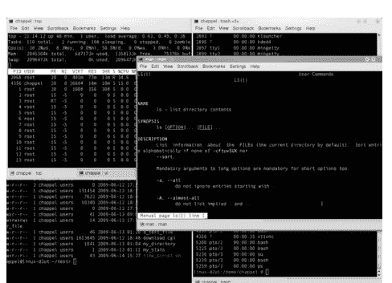

**图 6.2**

*KDE “`konsole`” 窗口；力量尽在指尖。*

输入带有路径的 `ls` 以查看其他目录的内容（尝试 `ls /`、`ls /etc`），并使用 `cd` (*change directory*) 更改你的当前工作目录（`cd`、`cd /etc` – 尝试在每个目录中使用 `pwd` 和 `ls` 来回移动）。

如果你发现自己经常在目录之间来回跳跃，你可能会发现使用 `pushd` 和 `popd` 作为一种保存目录（或多个目录）的简便方法很方便。这些实用程序就像一个索引卡堆栈。把 `pushd` 想象成在索引卡上写一个目录并将其放在堆栈上，把 `popd` 想象成拿起堆栈顶部的卡并切换到该目录。尝试 `pushd /var/log`，并注意当前目录现在是 `/var/log`。

当你第一次打开终端窗口时，它会给你一个命令提示符，通常是你的机器名和用户名，或者可能是你的当前目录，以 `$`（普通用户）或 `#`（如果你以 “`root`”（管理员账户）身份运行）结尾 – 见图 6.2。

##### 使用文件命令

Linux 文件结构，就像大多数计算机系统一样，是一系列的文件、文件夹和子文件夹。与基于 Microsoft 的系统不同，没有“盘符”的概念 – 没有 `C:`。文件的“最顶端”是 *根* 目录 – 想象

第 6 章：使用 `BASH`

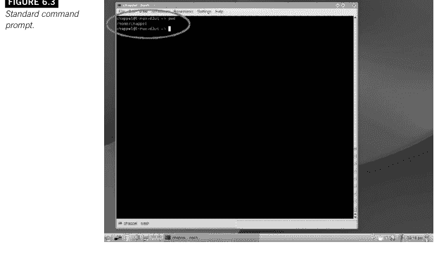

文件和文件夹像树的根一样。根文件夹（称为 “/”）在顶部，文件夹和子文件夹从那里向下分支（即，对于用户 `chappel` 主目录中的 `Documents` 文件夹，它是 “`/home/chappel/Documents`”）。

因此，如果你以用户 `chapel` 的身份登录时打开命令窗口，你会看到一个提示符并处于当前工作目录中，如图 6.3 所示。

显然，操纵系统上的文件和文件夹是一项重要功能。虽然 `GUI` 文件管理器使得执行许多基本文件任务变得容易，但它们无法匹敌命令行大师指尖上的强大功能和灵活性。

从基础开始，`mkdir` 创建目录，`rmdir` 删除它（前提是目录中没有文件）。命令 `touch` 将创建空文件；`cp` 将复制文件，`mv` 将移动（或重命名）它，`rm` 将删除它。

> **注意**
>
> 如果 *`touch`* 看起来像是一个创建文件的命令的奇怪名称，那是因为它最初旨在更改现有文件的时间戳 - 这样你就可以看到它最后一次被“触摸”（literally）的时间。这对于跟踪...
>
> 当前版本文件，或者用于归档比较文件。如果文件尚不存在，它会创建该文件，这使得它非常便于处理测试文件。

试一试吧！如果你还没有在那里，请进入你的主目录（你只需输入 `cd` 而不带任何参数，它就会切换到你的主目录），然后完成以下练习，创建一些文件和目录。

##### 练习 6.1：使用文件和文件夹工具

在这个练习中，我们将尝试一些用于管理文件和目录的命令。键入以下内容：

- 1. `pwd` 以确认你当前位于主目录（即 `/home/<your_user_name>/`）
- 2. `ls` 以列出当前存在的文件
- 3. `mkdir testdir` 以创建一个新的目录
- 4. 再次运行 `ls` 以查看你的新目录
- 5. `cd testdir` 以切换到你的新目录
- 6. `pwd` 以确认你真的在那里
- 7. `touch testfile1` 以在你的新目录中创建一个新文件
- 8. `ls` 以列出你的新文件
- 9. `cp testfile1 testfile2` 以复制你的新文件
- 10. `ls` 以查看这两个文件
- 11. `mv testfile2 testfile3` 以重命名文件
- 12. `ls` 以显示新的文件名
- 13. `rm testfile3` 以删除该文件
- 14. `ls` 以显示它确实已被删除。


这就提供了一个关于文件命令的简单且便捷的入门介绍，但远非“释放强大功能”。要做到这一点，我们需要讨论命令选项和参数。你输入到命令行中的命令都是程序，它们的行为可以根据你提供的选项进行控制。

### 第158页 第6章：使用 BASH

例如，你一直使用 `ls` 命令来列出目录的内容。默认情况下 – 如果没有其他指示 – `ls` 命令将仅显示当前目录的内容，限制为仅显示文件和目录名称，通过颜色编码显示文件类型，按行格式化，并按字母顺序排序。每个选项都可以通过传递相应的选项标志来更改。BASH 命令的一般格式是

```
command -option(s) parameter(s)
```

对于 `ls` 命令，它看起来像这样：

```
ls -l /etc
```

使用 `l` 选项（即 `long`）不仅显示文件名，还显示许多其他有趣的信息，例如大小、所有者、创建或最后修改日期以及访问信息。选项可以叠加，因此显示按日期排序的相同信息看起来像这样：

```
ls -l -S /etc
```

或者你可以将选项组合在一个单独的 `-` 之后运行，如下所示：

```
ls -lS /etc
```

#### 考试警告

请注意大写和小写。与各种 Microsoft 产品不同，所有版本的 UNIX（Linux、BSD 甚至 OSX）都在命令、选项和文件名中区分大写和小写。在上面的示例中，`ls -s` 显示文件大小，而 `ls -S` 按大小排序。同样，`FILE1`、`File1` 和 `file1` 是三个不同的文件；并且 `l s` 是有效命令，但 “LS” 不是。

你甚至可以使用递归选项（`-R`）和/或将多个目录作为参数来列出多个目录：

```
ls -R /etc /home
```

大多数命令拥有如此多的选项，以至于没有足够的字母来分配，因此你经常可以使用长形式表示法，即双破折号（`--`）加上整个单词。这需要更多打字，但通常更容易记住。显示 `ls` 所有可用选项的命令使用以下内容：

```
ls --help
```

不要被长长的可用选项列表吓倒；其中许多选项旨在使 `ls` 在称为 `scripts`（脚本）的小程序中更好地工作。你

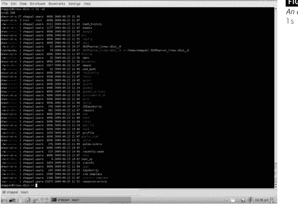

#### 图 6.4

`ls -al` 命令的示例。

肯定不需要知道它们中的每一个。两个重要的选项是 `all` 和 `long`：

```
ls -al
```

这显示目录中所有内容的详细信息，包括隐藏文件 [以句号开头的任何文件都被视为“隐藏”的，默认的 `ls` 不会显示它们]，如图 6.4 所示。

第一列的第一个位置的 `d` 表示目录；`-` 表示普通文件。接下来的九个字符显示文件或目录的访问权限或模式 [在第 10 章“保护 Linux”中有详细介绍]。下一列中的数字显示有多少其他文件与该文件共享硬链接 [链接将在“文件类型”部分中简要介绍]。接下来是文件的所有者和组 [在这种情况下，所有者是 chappel，组是 users – 也在第 10 章“保护 Linux”中有所介绍]，然后是文件大小和文件最后修改的日期，最后是文件名。

除了选项之外，命令的参数也可以改变其给出的结果。最常见的参数变化是通配符 `*` 和 `?`。这些符号可以代表多个模式，`*`

#### 第6章：使用 BASH

代表任意数量的任意字符，`?` 代表恰好一个任意字符。例如，如果我们要有一个目录包含以下内容：

```
file1
file11
file111
file2
file22
file222
```

`ls`（以及 `ls *`）将显示所有六个文件；`ls file1*` 将显示 file1、file11 和 file111（所有以 "file1" 开头并跟随零个或多个其他字符的文件）；`ls file?` 将显示 file1 和 file2（所有以 "file" 开头并跟随恰好一个字符的文件）。注意多重是有效的：`ls file??` 显示 file11 和 file22。通配符也可以在参数中间使用；要显示 file111，请输入：

```
ls f*111
```

它们也可以组合；例如，

```
ls f*1?
```

当然，通配符可以与接受任何参数的命令一起使用；所以，虽然 `ls f*11` 列出了目录中所有以 "f" 开头并以 "11" 结尾的文件，`cp f*11` 复制相同的文件列表，而 `rm f*11` 删除它们。

**注意**

对于更高级的文件选择，你可以使用 `Regular Expressions`（正则表达式）。它们定义了一种指定要匹配模式的复杂方法，并且受许多实用程序支持，不仅限于 Linux。欲了解更多信息，请访问 www.regular-expressions.info。

一旦你开始在文件系统中四处挖掘，如果你正在寻找某样东西但不确定要搜索哪个目录，你可能会发现 `ls` 命令有点笨拙。幸运的是，还有其他命令可以提供帮助，包括以下内容：

- `find`

- `locate`

- `slocate`

- `which`

- `whereis`

在这组命令中，`find` 最灵活。它需要一个开始的地方和要寻找的内容：

```
find /home -name file1
```

它的工作原理正是你会做的 – 进入 `/home` 目录并寻找名为 “file1” 的文件，然后继续在每个子目录中查找。计算机在这方面比用户快得多，但如果你有一个大型文件系统（或者从 “/” 开始），它仍然可能需要相当长的一段时间。提供 `-maxdepth` 选项将限制它搜索多少层目录 – 例如，`find /home -maxdepth 2 -name ".*"` 将搜索所有用户主目录中的隐藏文件，但不包括子目录。注意，在搜索特定名称时不需要引号，但在某些通配符组合中是必需的。使用引号没有惩罚；如有疑问，请保留它们。

有令人眼花缭乱的各种可搜索项，包括文件大小、日期、所有者、权限等。与 `ls` 命令一样，许多可用选项在脚本中更有用（例如用于备份文件或自动清理临时目录）。`find` 的一个特别好的用途是搜索由特定用户拥有的文件，该用户的账户你想删除。这可以防止文件成为孤儿文件，或意外地变成属于恰好获得相同账户 ID 的新所有者的文件。

```
find /home -user user_name
```

虽然 `find` 遍历给定的目录结构，但 `locate` 稍显智能，并创建一个文件名数据库进行搜索。这使得 `locate` 更快且更高效，但它只能找到进入数据库的信息；因此，自上次自动计划数据库更新以来的更改将不会被找到，并且它只能按文件名搜索。`locate` 的 `slocate` 变体工作方式相同，但增加了额外的安全功能，以防止用户搜索他们没有权限访问的文件。使用 `slocate` 的 Linux 系统通常将 `locate` 命令指向它，因此你可能实际上正在使用 `slocate` 而不自知。

**注意**

默认的 openSUSE 安装不包含 `locate`，但可以使用标准包管理器添加。插入安装 DVD 后，输入以下内容：

`sudo zypper install findutils-locate`

`whereis` 命令旨在搜索与特定命令相关的文件和源文件、二进制文件、配置文件以及帮助文件。它完全不会查找用户目录。

`which` 命令会遍历你的 `path`（关于 `PATH` 变量的更多信息，请参阅第 5 章“配置基础系统”中题为“系统与用户配置和环境变量”的小节），并确切地告诉你在输入给定命令时将运行哪个程序。例如，如果你的系统中安装了多个不同的编译器，当你输入 `gcc` 时，它会精确地告诉你将获得哪一个。

#### 文件类型

如果你还记得 `ls -al` 命令，你可能仍在思考它显示的各种不同类型的文件。在 UNIX 中有一句玩笑话，称“一切皆文件”，现在我们将揭开面纱，看看其真正含义。

我们已经接触过两种类型的文件——常规文件（`touch file`）和目录（`mkdir testdir`）。除了这些之外，还有：

- 硬链接

- 软链接

- 设备文件

- 命名管道

要正确理解链接文件，需要一点技术背景知识。在标准 UNIX 文件系统中，目录包含驻留于其中的文件的名称，以及指向每个文件 inode 的指针。inode 存储每个文件的元数据——所有者、大小、访问权限、最后修改时间以及文件所包含数据在物理存储设备上的位置。inode 提供的额外抽象层意味着，可以有指向完全相同文件信息的两个不同名称。这被称为“硬链接”，并使用 `ln` 命令创建：

```
ln file_name hard_link_name
```

硬链接的名称与原始文件名同样有效，并且必须在释放文件占用的空间之前删除所有硬链接。你可以使用 `ls -l` 命令来显示链接信息；第二列（位于“-rwxrwxrwx”和所有者名称之间）有一个数字，指示有多少个硬链接指向该文件。硬链接的性质不允许硬链接指向目录，也不允许指向位于不同磁盘卷上的文件。

> **注意**
>
> 虽然这不包含在 Linux+ 考试范围内，但 `stat` 命令显示给定文件的 inode 内容，而 `ls -l` 显示 inode 编号。

与硬链接相对的是符号链接，或称为软链接。软链接是一个实际的文件，拥有自己的 inode 编号（而不是像硬链接那样共享的 inode）。该文件包含其链接目标对象的路径。作为一种更高层的关联，软链接被允许指向目录以及其他文件系统上的文件；但由于它们是独立的文件，因此可以删除软链接的目标，从而导致链接文件“断裂”，指向一个不存在的文件。`ls -l` 命令显示符号链接，在行的最左侧显示一个“l”，并带有一个指向目标文件的箭头（→）。符号链接使用相同的 `ln` 命令创建，但需使用“-s”选项：

```
ln -s file_name soft_link_name
```

有关链接的更多信息，请访问 Linux 信息项目页面 www.linl.org/hard_link.html。

#### 设备文件

任何能够将信息输入或输出到你的 Linux 系统的设备，在 `/dev` 子目录中都有一个设备文件。这些文件是设备文件用户可访问的一面，在第 5 章的“设备管理”部分中有更详细的介绍。这种思考设备的方式使用户程序可以轻松地发送或接收信息；它们只需从适当的文件写入（或读取）即可。关于这有多简单，试试这个例子：

```
ls -al /etc > /dev/audio
```

请确保你的扬声器音量调低；这肯定不是贝多芬的音乐。

文件有很多类型，但最常见（也是考试涉及的内容）的是以下几种：

- `l` 符号链接

- `d` 目录

- `-` 常规文件

这些都是我们已经见过的文件类型，此外还有这些“特殊”文件类型：

- `c` 字符特殊文件

- `b` 块特殊文件

- `p` 命名管道


上述列表中的第一个字符对应于 `ls -l` 命令输出的每一行的第一个字符，如图 6.5 所示。请注意，虽然符号链接拥有自己的文件类型，但硬链接显示为常规文件，并且仅通过访问权限和所有者之间那一列中的数字大于 1 来区分。

块特殊设备文件用于以大块形式移动进出连接到系统的硬件中的数据，并使用缓冲区来提高效率。块文件的示例包括系统的 SCSI、IDE 和其他硬盘、USB、CD、DVD 和磁带驱动器（`mount` 命令将显示哪个驱动器对应哪个设备文件）。字符设备文件用于逐字符移动数据且不使用缓冲区，示例包括调制解调器、终端和其他串行设备。请注意，`/dev` 目录中的每个文件并不都对应于当前连接的设备；大多数只是等待新设备指向的空占位符。

命名管道（先进先出 FIFO）是用于计算机内运行程序之间通信的缓冲区。一个程序打开管道以写入，另一个程序打开以读取，数据在它们之间传输。

使用 `mknod` 命令创建特殊文件：

- `mknod new_file_name c [major_device_number] [minor_device_number]` - 创建字符文件

- `mknod new_file_name b [major_device_number] [minor_device_number]` - 创块文件

- `mknod new_pipe_name p` - 创建管道（FIFO）文件

手动创建特殊文件通常只发生在手动安装设备驱动程序时，驱动程序应包含带有详细信息的说明。

> **注意**
>
> 可以在 Linux 分配名称和数字管理局（LANANA）的 [www.lanana.org/docs/device-list/devices.txt](http://www.lanana.org/docs/device-list/devices.txt) 上找到 /dev 目录中可能出现的设备名称的官方列表。

#### 测试文件

最后，我们来谈谈使用 `file`、`test` 和 `ls -F` 命令测试文件的方法。

虽然文件经常带有扩展名以指示其内容（例如音乐为 `.mp3`，图片为 `.jpg`），但它们可能并不那么直观。幸运的是，Linux 提供了 `file` 命令来帮助理清这些事物 [参见图 6.6]。当然，你绝不会忘记自己创建了什么类型的文件，但如果你需要整理用户目录，或者想在通过脚本运行之前确认文件是你预期的类型，这将非常有用。

`file` 命令具有语法，即 `file [filename]`，并且接受所有标准通配符。

`test` 命令可以评估表达式，例如 `test 1 -gt 2`。它不打算在命令行上使用，因此答案以 `exit value` 的形式返回，可以在脚本中检查该值以做出决策。要查看


**图 6.6**

`file` 命令的示例。

退出值，请尝试此命令：`test 1 -gt 2; echo $?`。0 表示“真”，1 表示“假”。`test` 命令的强大之处真正体现在一些更有趣的选项中，例如使用 `test -e [filename]` 检查文件是否存在，以确保不会覆盖它，以及使用 `test -d [directory_name]` 检查目录是否存在。`test` 有一个选项可以检查任何文件属性或比较字符串值。

`ls -F` 命令列出文件并标记各种文件类型，以便于识别。与在脚本中更有用的 `file` 和 `test` 命令不同，`ls -F` 对人类更有帮助。常见标记如下：

- `*` 可执行文件

- `/` 目录

- `@` 符号链接

- `|` 命名管道

标记显示在文件名之后，如图 6.7 所示。

#### 使用 vi 编辑文件

既然你已经了解了关于文件的所有其他内容，现在是时候学习如何编辑它们了。你会找到的最便捷的文字编辑器是 `vi`。它默认安装在几乎任何 Unix 风格的系统上，尽管大多数当前的 Linux 发行版实际上具有 `Vim`（Vi 的改进版），这是由 Bram Moolenaar（他在 [quick.vim.org](http://quick.vim.org) 上托管其项目）编写的增强版本。两者都通过相同的 `vi` 命令访问。`vi` 快速且易于使用——一旦你弄明白它的工作原理。不幸的是，`vi` 以对新用户不友好而闻名，但学习它是值得付出努力的。

> **注意**
>
> 值得指出 `文本编辑器` 和 `文字处理程序` 之间的区别。乍一看它们可能看起来完全相同——它们都允许用户输入

显示在电脑屏幕上的东西——它们被用于完全不同的用途。文字处理器用于输入信函和美观的内容，并具备许多用于以视觉上吸引人的方式格式化和排列信息的特性——字体、颜色、表格等。文本编辑器则用于编辑系统文件，即供计算机读取的内容。高级文本编辑功能包括对程序员有用的特性，如括号匹配、自动缩进以及基于你正在使用的编程语言的颜色编码关键词（语法）高亮显示。像任何花哨的文本编辑器一样，`vi` 支持所有这些酷炫的功能，但它最常被用于快速打开配置文件进行小幅修改并继续工作，因此我们将重点介绍这方面的内容。

处理 `vi` 的关键在于理解它拥有三种模式：`命令（Command）`、`Ex` 和 `编辑（Edit）`。当首次启动 `vi` 时，你将处于 `Ex` 模式，该模式允许你在正在编辑的文件中移动，执行 `复制` 和 `粘贴` 命令以及其他高级功能（如录制和回放宏）。为了实际输入文本，你需要通过输入一个编辑键切换到 `Edit` 模式，然后通过按 `Esc` 键返回 `Ex` 模式。通过输入 `:` 可以从 `Ex` 模式进入 `Command` 模式，用于输入保存文件的命令、输入文件名或要搜索的文本。再次按 `Esc` 键可以返回 `Ex` 模式。

在 `Ex` 模式中特别有用的移动命令如下：

-   方向键（上、下、左、右）沿相应方向每次移动一个字符或一行。如果在方向键前加一个数字，它将移动该数字指定的字符数或行数。此功能将倍增大多数 `vi` `Ex` 模式函数的效果。作为对没有方向键的串行终端时代的遗留，你还可以使用 `h、j、k` 和 `l` 键分别代表左、下、上、右。

-   `G` 键（大写）将直接跳转到文件的最后一行。在 `G` 前加一个数字将直接跳转到对应的行号。如果你试图编译文件且编译器在特定行号给出错误，这特别有用。

-   `D` 键将从当前光标位置删除到当前行末的内容，`dd` 命令将删除整个当前行。在大写 `d` 后跟一个移动键（例如向下箭头）将删除当前光标位置下方的那一行。在前面加一个数字将删除该数量的行。

-   如果你犯了一个错误，`u` 键将撤销你的最后一个命令。

-   你可以使用 `/` 键向后执行搜索，后跟你想搜索的文本。使用 `?` 则向前搜索。

-   句号 (.) 将重复上一次的编辑命令。

要切换到 Edit 模式，使用 `i` 键在当前光标位置前插入文本，或使用 `o` 键在光标所在行的下方新行插入文本。一旦进入 `Edit` 模式，你可以像平常一样输入文本。按 `Esc` 键即可返回 `Ex` 模式。

当你完成移动和编辑后，可以按冒号键 (`:`) 进入 `command` 模式。从 `command` 模式你可以：

-   通过输入以下内容执行查找和替换：


```
:%s/some_old_text/some_new_text/g
```

`s` 是查找功能（正向），`%` 表示搜索所有行，末尾的 `g` 表示全局更改（而不仅仅是第一次出现的实例）。

-   使用 `wq` 保存并退出文件。`w` 写入文件；`q` 退出。若要未保存即退出，使用 `q!`。
-   在 `:` 提示符下输入 `help` 可在 `vi` 内部获取帮助。你可以在 `help` 后添加你希望具体帮助的以直接跳转到该章节的命令。

你也可以在命令提示符下输入 `vimtutor` 来浏览 `vi` 内置教程。关于更多高级功能的其他有用信息可在 vim 主页 `www.vim.org` 上找到。

## 管理进程

在你的 Linux 机器上，每一个在后台等待的程序、工具或代码片段都被称为一个*进程（process）*，并由内核自动处理。用户可以监控和管理自己的进程；系统管理员可以访问几乎所有进程。进程管理工具允许你查看机器正在做什么，调整每个进程的优先级，甚至可以终止它们。

> **注意**
>
> 你不能终止 `init` 进程。除此之外，有时进程会卡住，无论你怎么做都无法终止它们。最后，僵尸进程（zombie processes）以难以清除而闻名。尽管如此，`root` 无法 `kill` 的唯一进程是 pid `1`，即 `init` 进程。

查看进程的两个主要实用程序是 `ps` 和 `top`。

### ps

单独使用 `ps` 命令只会显示在终端窗口中由你的用户正在运行的程序，通常只是 `bash` 和 `ps` 命令本身——没什么特别有趣的。要真正看到情况，你需要 `ps -A`，它将显示机器当前识别的所有进程。`ps` 命令的输出格式化为四列，如图 6.8 所示。第一列是进程识别号码或 PID，系统用它来唯一标识每个进程。下一列是进程运行的位置——它的“控制终端”，这决定了程序的输入和输出应去往何处。


接着是处理器在该进程上花费的时间。最后是该进程的“人类可读”名称。

`ps` 命令的语法如下：

```
ps [options]
```

一些有用的选项包括：

-   `-u` 或 `-user`：**用户名** 或 **用户 ID** 将显示与给定用户相关的进程。
-   `-C`：**command_name** 将显示具有给定命令名的进程。
-   `p`、`-p` 或 `-pid`：**process_id** 将显示列出的进程 ID 的进程。如果 `ps` 仅被给定一个数字作为参数，它假设该数字是进程 ID。
-   `-t`、`-tty`：**ttylist** 将显示在给定 tty 接口端口上的进程。简单的 `-` 将显示未关联端口的进程，而没有 tty 数字的 `-t` 将假设你想要查看与你正在使用的当前端口关联的进程。
-   `-M` 或 `Z` [注意 `Z` 前面没有短横线：] 它显示与 SELinux 相关的额外安全数据，在第 10 章“保护 Linux”中有讨论。
-   `-f` 将以某种图形化方式显示与其父进程（启动它们的进程）相关的进程。

### kill

偶尔，进程会卡住或“挂起”，此时有必要强制结束它。用于此目的的命令是 **`kill`**。**`kill`** 命令使用进程 ID，而不是名称——要结束一个进程，有必要使用 `ps` 命令找到进程号，然后使用 `kill` 来终止它。你可以使用的一个快捷方式是 `killall` 命令，它可以通过名称而不是 PID 来终止进程。但是，请注意，同一程序的多个实例将具有唯一的进程 ID，但具有相同的名称，因此可能难以确定你要结束哪一个。

**`kill`** 命令通过向进程发送 *信号（signal）* 来工作，默认情况下它通过发送 **`TERM`** 信号告诉进程终止。它还可以用于发送不同的信号，其中最常见的是 **`TERM`** 的细微变体，提供不同程度的强调。信号的语法是 `kill -s [signal] PID` – *例如*，`kill -s KILL 2727` 或 `kill -s HUP 3143`。

通常与 **`kill`** 命令一起使用的信号，如《Linux 管理手册》所述，如下：

-   `KILL`（信号编号 9）不能被进程阻止。它基本上告诉内核摧毁该程序。
-   `INT`（信号编号 2）是中断信号，等同于输入 `Ctrl + c`。它允许用户引起程序的注意，停止其正在执行的操作并等待更多用户输入，或优雅地退出。
-   `TERM`（信号编号 15）是一个友善的请求，让程序完成并正常退出。
-   `HUP`（信号编号 1）源自串行终端时代，意为“挂断”。如今，它最常用来请求程序暂停并重读其配置文件，而不必实际卸载并重启整个程序。你可能会偶尔看到一个带有 `nohup` 选项发布的命令，这告诉程序即使启动它的终端被关闭也要继续运行，因此如果你打开一个终端窗口来启动一个服务，当你关闭窗口时它不会退出。
-   `QUIT`（信号编号 3）与 `TERM` 相同，但它可能导致程序将其使用的内存复制到诊断文件中，这对故障排除很有用。

> **注意**
>
> 有一种替代语法省略了“s”，如下所示：
>
> ```
> kill-HUP 5253
> ```
>
> 或
>
> ```
> kill-INT 76
> ```

信号还可以用于进程之间的通信，或由内核向进程报告事件或问题。

#### top

一个更通用的实用程序是 `top`，它可以动态地实时显示正在运行的进程，按它们使用的 CPU 时间排序（如图 6.9 所示）。

`top` 显示的上部区域显示系统的摘要，包括正常运行时间、当前用户（每个 `bash` 会话算作一个用户）以及各种负载和内存使用统计信息。显示的下部部分显示进程 ID、所有者、各种内存数量以及正在使用的 CPU 资源。

#### 第 172 章 第 6 章：使用 BASH


每个进程消耗的资源量。通过输入 **`h`** 获取帮助，或查阅 man 手册页（`man top`），可以找到更多功能。一个实用的功能是内置的 `kill` 选项；要终止一个进程，只需按 **`k`** 并输入进程 ID。按 **`q`** 或 **`Ctrl + c`** 退出 `top`。

#### pstree

查看进程的另一种有用方法是使用 `pstree` 命令，它在一个层次结构视图显示了主*父*进程与其创建的*子*进程之间的关系。默认情况下，它只显示进程名称，但 `pstree -p` 还会显示进程 ID。请注意，`init` 进程是所有其他进程的父进程——内核在机器启动时会自动启动 `init` 进程，进而运行启动脚本以启动其他所有程序。`init` 进程的 PID 始终为 `1`。每个子进程都知道其父进程 ID（PPID），`pstree` 正是利用这一信息来追溯进程间的关系。可以通过 `ps -Al` 命令查看 PPID 编号。


若要查看不仅包括 CPU 还包括物理硬盘和网络驱动器的使用情况，可以使用 `iostat` 命令，如图 6.10 所示。

报告顶部显示的各种 CPU 相关统计数据如下：

- `%user` 是用于用户应用程序的处理器时间百分比。
- `%nice` 是用于允许以较低优先级运行的用户应用程序的处理器时间百分比。
- `%system` 是系统自身使用的处理器时间部分。
- `%iowait` 是当 IO 系统繁忙时，处理器处于空闲状态的时间百分比。这是您的硬盘某处存在瓶颈的一个良好指标。
- `%steal` 与虚拟化系统有关。
- `%idle` 是用于什么也不做的处理器时间量。

报告的下一节显示了连接到系统的硬盘的统计数据，并包括以下内容：

- `tps`（每秒传输次数）传输被视为一次数据请求。
- `Blk_read/s`, `Blk_wrt/s` 指每秒读取和写入的块数，其中一个块是硬盘的一个扇区，通常为 512 字节。
- `Blk_read`, `Blk_wrt` 指读取和写入的总块数。

> **注意**
>
> `iostat` 不是 openSUSE 默认安装的一部分。要安装它，请在命令行输入以下内容：
>
> ```
> sudo zypper install systat
> ```

### nice

Linux 进程控制不仅允许你启动和停止进程，还允许你让它运行得更快或更慢。在旧的多用户 UNIX 系统中，用户可以设置一个参数，告诉内核如何以及为进程分配什么优先级；较低的优先级意味着程序运行得更慢，但 CPU 可以用来更快地运行其他用户的程序。优先级是一个介于 −20 和 +19 之间的数字，称为*友好度值*（niceness value）（因为共享资源是友好的，对吧？）。友好度值越低，你的进程越“不友好”，并且它自顾自地占用系统资源，运行得越快。`ps -Al` 会在 `NI` 列中显示友好度。

进程的友好度继承自父进程。进程的所有者可以使其“更友好”（使其运行更慢并释放资源），但不允许使其“更不友好”；只有系统管理员可以这样做。有两种方法可以调整文件的友好度：`nice` 和 `renice`。要以调整后的 *nice* 值启动程序，请键入以下内容：

```
nice -n 10 find / -name my_file.doc
```

这将启动一个降低优先级的整个硬盘文件搜索 [这将给你足够的时间在另一个终端窗口执行 `ps -Al | grep find` 以确认其友好度是否确实为 10]。一旦进程开始运行，可以使用 `root` 权限和 `renice` 将其重置为特定值，如下所示：

```
sudo renice 15 [PID]
```

使用你刚才执行的 `ps -Al` 命令中的 PID。注意，`nice` 命令通过给定数量调整友好度值，而 `renice` 命令将其设置为给定的确切数字。你还可以调整属于单个用户的*所有*进程，而不仅仅是单个进程 ID，如下所示：

```
sudo renice -20 -u username
```

那绝对算不上友好！当你完成对友好度的操作后，你可能希望执行 **`Ctrl + c`** 来结束 `find` 命令。

当然，你恐怕不是在老式大型机上工作；处理器速度极快，现在大多数瓶颈都是硬盘和网络接口，因此很少需要调整友好度。礼貌可能没有消亡，但友好度确实正在褪色。

### 利用 I/O 重定向

UNIX 的一个主要原则是使用小型程序，每个程序都非常擅长做一件事。³ 这些小型实用工具旨在协同工作，构建执行所需任务所需的精确功能。I/O 重定向是将这些方便的小程序粘合在一起的胶水。

在深入探讨之前，理解控制台程序使用三个*流*进行通信非常重要。它们显示在表 6.1 中。

使用命令行程序时，通常通过键盘提供输入，程序响应输出及其可能遇到的任何问题到控制台。当你开始利用*重定向*的力量时，情况变得有趣起来。这允许你将一个程序的输出用作另一个程序的输入，或将其发送到文件。你可以将文件的内容用作程序的输入，或使用一系列程序来创建和操作信息。其工作原理如下：

```
$ some_program > someplace_other_than_the_console
```

要了解重定向的样子，请查看图 6.11。

尽管“`someplace_other_than_the_console`”通常是普通文件，但由于 Unix 将几乎一切都视为文件，将信息发送到打印机端口或其他“文件”同样简单——甚至包括声卡，如果你还记得我们在“设备文件”部分之前的实验。

> **考试警告**
>
> 使用 `>` 时要小心；如果你将输出流重定向到现有文件，它将被覆盖。使用 `>>` 追加到现有文件的末尾。

**表 6.1 三个通信流**

| 名称 | 编号 | 符号 | 正常连接 |
| :--- | :--- | :--- | :--- |
| `STDIN` | `0` | `<` | 键盘 |
| `STDOUT` | `1` | `>` | 控制台（显示） |
| `STDERR` | `2` | `>` | 控制台（显示） |

**图 6.11**
`STDOUT` 重定向示例。


同样，通过使用 `<` 而不是 `>` 可以反转流。注意，即使数据流现在朝相反方向流动，命令的顺序也不会改变。

```
some_program < something_to_send_to_a_program
```

此示例可在图 6.12 中看到。

那 `STDERR` 呢？难道它不都是输出吗？是的，如果你正在重定向程序的输出，并且出现问题，去检查输出文件以找到错误消息而不是你的数据将非常繁琐；因此，尽管它通常会显示在屏幕上，但它确实是一个完全独立的流。由于此原因，可以让所有数据进入文件，而错误仍然出现在屏幕上，或者使用流编号将错误重定向到相同或不同的文件，如下所示：

```
some_program > data_output.txt 2> error_output.txt
```

若要仅重定向错误流，请执行此操作：

```
some_program 2> error_output.txt
```


> **图 6.12**
>
> *`STDIN` 重定向示例。*⁴

要合并数据和错误，使用以下命令之一：

```
some_program > data_and_errors.txt 2>&1
```

或此快捷方式：

```
some_program &> data_and_errors.txt
```

要将一个程序的输出发送到另一个程序的输入，你*可以*使用 `>` 和 `<` 的复杂组合；但 UNIX 提供了*管道*命令，`|`，这容易得多。管道的工作方式如下：

```
some_command | another_command
```

例如，你可以列出正在运行的进程，然后搜索列表中 Firefox 的所有实例：

```
ps -A | grep firefox
```

如果你喜欢既吃蛋糕又保持蛋糕完好（即两者兼得），*tee* 命令会复制一个流，并将一份发送到显示，另一份发送到文件。它与*管道*命令一起使用：

```
ls -al | tee directory.txt
```

将一个命令的输出作为另一个命令的输入时可能会遇到的一个潜在问题是，某些命令一次只能接受一定量的输入，如果收到大量输出，它们可能会报错。解决这个问题的方法是使用 `xargs` 命令，它会接受输入流并将其拆分为小块，每次传递一部分，并重复运行下游命令，直到输入流结束。它通常与 `find` 一起使用，为找到的每个项目运行一个命令。以下示例将把 Bob 的所有音乐文件移动到他自己的音乐目录中：

```
find . -name "*.mp3" -u bob|xargs -i mv {} ./bobs_mp3s
```

还有其他一些方法可以串联命令。通过在两个命令之间放置 `;`，它们将按顺序运行——当第一个命令完成后，第二个命令才会开始：

```
do_this_first; then_do_this; and_finally_this
```

请注意，空格会被忽略，可以使用在命令前、后、两者都有或完全不使用空格。

> **注意**
>
> `;` 功能有两个有趣的变体：`&&` 仅在第一个命令没有错误完成时才运行下一个命令，而 `||` 仅在第一个命令失败时才运行下一个命令——这对于发送消息通知他人存在问题非常有用。

`=` 用于使用 `name=value` 格式将变量设置为一个值，如图 6.13 所示。


**图 6.13**
将一个变量设置为一个值的示例。

变量通常用于脚本中，如下面来自 Linux 文档项目的简单备份脚本所示：

```
#!/bin/bash
SRC=~/home/  
TGT=/var/backup/  
OF=home-$(date +%Y%m%d).tgz  
tar -cZF $TGT$OF $SRC
```

`==` 用于比较两个变量的等价性。一个示例是在 `bc`（一个命令行计算器，除其他功能外，它在比较为真时返回 1，在比较为假时返回 0）中比较两个值：

```
bc  
10==10

1

10==1

0
```

#### 通过示例学习：优化频繁任务

和任何操作系统一样，Linux 提供了许多方法来自动化常见任务。我经常 ping 我的默认网关 `10.10.10.1`，但每次都输入这些信息让我感到厌烦，所以我将路由器的名称和地址添加到我的 `/etc/hosts` 文件末尾，现在 Linux 可以通过名称解析它。

做到这一点的一种方法是使用 `vi` 编辑该文件。按 `G` 键可以直接跳到文件末尾，按 `o` 键在底部添加一行；输入地址和名称，然后快速按 `<Esc>:wq` 即可完成。不过，更快的方法是使用 `echo “10.10.10.1 router” >> /etc/hosts`，它会自动将所需信息附加到文件末尾。只需确保使用两个大于号——仅使用一个会完全覆盖文件。

我还在许多不同的网络上使用笔记本电脑，并且事先不知道默认网关。不过，我可以通过使用别名和一些命令行重定向将其直接构建到命令中：

```
alias pdg='ping -c 3 `ip route show 0.0.0.0/0 | cut -d " " -f 3`'
```

`ip route show` 提供关于默认路由的信息；但我只想要实际的 IP 地址，所以我使用 `cut` 获取列表中第三个信息片段（即地址）。所有这些都在反引号（`` ` ``）内，因此会被处理并传递给 `ping`。我本可以每次都完整输入所有内容，但那比手动操作更糟糕——所以我使用 `alias` 命令创建一个全新的命令，`pdg` 代表“ping 默认网关”。


```bash
chappel@agatha:~$ pdg
PING 192.168.10.1 (192.168.10.1) 56(84) bytes of data.
64 bytes from 192.168.10.1: icmp_seq=1 ttl=64 time=0.686 ms
64 bytes from 192.168.10.1: icmp_seq=2 ttl=64 time=0.484 ms
64 bytes from 192.168.10.1: icmp_seq=3 ttl=64 time=0.484 ms
--- 192.168.10.1 ping statistics ---
3 packets transmitted, 3 received, 0% packet loss, time 1998 ms
rtt min/avg/max/mdev = 0.484/0.551/0.686/0.097 ms
chappel@agatha:~$
```

### 特殊设备

当你查看`/dev`子目录时，可能会注意到一些特别不寻常的文件：

* `/dev/null`
* `/dev/random`
* `/dev/zero`
* `/dev/urandom`

`/dev/null`文件通常被称为 *比特桶*（bit bucket），就像拥有一个个人的黑洞。任何你不希望看到、甚至永远不需要的输出？只需将其重定向到比特桶。这通常用于隐藏嵌入在脚本中的程序产生的不必要输出。

`/dev/random`文件名副其实：它是系统随机数生成器的接口，将产生用于创建非常安全的加密密钥的随机数。然而，对于计算机来说，创建真正的随机数是很困难的。当前的 Linux 系统使用来自各种设备驱动程序和其他非重复信息的噪声来维护一个用于生成数字的“熵池”；但池子可能会枯竭——这么说吧。如果这种情况发生，`/dev/random`会阻塞进一步的请求，直到收集到更多的噪声。可以使用伪随机数的应用程序可以使用`/dev/urandom`，它在理论上可能受到攻击；但仍然相当不错，并且不会耗尽。

`/dev/zero`文件如果你发送数据到它，它就像`/dev/null`一样工作，但你可以使用它作为输入流来创建充满零的文件。

> **注意**
>
> 另一个有趣的特殊设备文件是`/dev/full`，它的作用就像一个已满的设备。这对于测试程序很有用，可以看到当它们试图写入的驱动器已满时如何失败。

### 使用系统文档

你所能学到的最重要的事情无疑是学习如何学习更多。Linux 为所有命令提供了许多查找额外信息的方式。最快和最基本的帮助来自使用任何给定命令的 help 选项 - 通常`-?`和`-help`都可以使用，如`ls -?`或`ls -help`。

#### man

如果你需要更多细节，请检查 man 手册页（manual 的缩写）。Man 页是命令及其所有可用选项的简要描述，通过输入`man [command]`来访问，然后进入全屏查看器。尝试`man man`以获得完整导览。简要地说，<Spacebar> 或 <Page_Down> 一页一页地浏览手册条目，<Page_Up> 向上翻一页，/ 允许你输入文本以在该条目中搜索，q（退出）退回到命令提示符。如果这听起来很熟悉，那是因为 man 使用`less`作为分页器，所以它与你输入`ps -A | less`获得的界面相同。

man 显示的实际信息存储在几个不同的目录中。这些因发行版而异，但主要信息位于`/usr/share/man`或`/usr/share/doc`。`manpath`命令将准确显示你的系统中 man 查找信息的位置。当你使用包管理器安装新程序时，它通常会处理添加适当的手册页 - 通常是`/usr/local/man`。

如果你查看其中一个手动目录，你会发现页面被分成编号的组，称为章节。对系统管理员最有用的信息在第 1 章和第 8 章中。章节编号在表 6.2 中显示。

**表 6.2** 各种 man 页章节

| 章节 | 信息 |
| :------ | :---------- |
| **1** | 用户命令 |
| **2** | 内核函数 |
| **3** | 库函数 |
| **4** | 设备，/dev 中的特殊文件 |
| **5** | 文件格式 |
| **6** | 游戏 |
| **7** | 杂项 |
| **8** | 根级别系统管理工具 |
| **9** | 内核规范和接口 |

对其他 man 页的交叉引用通常会在命令后面的括号中给出章节，例如`ls(1)`。

#### apropos

如果你不确定你想要什么命令怎么办？你可以使用`apropos`搜索每个 man 页的描述来帮助找到你想要的。例如，如果你正在计算机上搜索文件但想不起使用什么命令，尝试`apropos search`查看所有描述中含有 *search* 的 man 页条目。你还可以向`apropos`发送通配符，使用正则表达式，并限制其针对特定章节；有关详细信息请查阅`man apropos`。注意`apropos <keyword>`和`man -k <keyword>`执行相同的功能。

#### whatis

如果你有一个命令但不确定它的作用，你可以使用`whatis`命令打印出该命令 man 页中仅有一行的描述。尝试`whatis ls`。

在幕后，`apropos`和`whatis`实际上并不检查每个 man 页条目；它们扫描由`mandb`程序创建的数据库，该程序由`cron`作业定期在后台运行以保持内容最新。

#### makewhatis

在某些发行版中，`mandb`创建的数据库可能由`makewhatis`处理。

与`mandb`一样，`makewhatis`偶尔运行，并创建一个包含`aprops`和`whatis`需要搜索的所有简短命令描述的文件。<sup>6</sup> 请记住，如果您选择手动运行`makewhatis`，则需要以管理员权限运行。您可以使用`-v`选项，让它打印出关于正在索引哪些命令的更详细的描述。

#### info

获取程序信息的另一种方法是使用`info`。尽管`man`是源自 UNIX 的通用遗留工具，但`info`是`GNU`项目的产物，旨在作为管理所有`GNU`实用程序文档的改进方式。

`info`程序将以称为`节点`的线程化块提供信息。每个节点包含特定程序在特定细节级别的描述，因此复杂程序可能拥有多个节点。单独输入`info`会带您进入顶级节点；输入`info program`会带您进入该程序的信息节点。如果没有该程序的`info`页面，`info`将搜索`man`页面，如果这也失败了，它将带您进入顶级索引节点。

由于增加了这一层功能，因此增加了一层命令。通过在命令行输入`info info`可以获得有用的教程。`info`屏幕如图 6.14 所示。请注意，第一行显示您当前查看的是哪个节点，以及下一个、上一个和当前节点的上层节点（可能）。底部加粗的行也显示您正在查看哪个节点以及您在该节点中的位置（Top、百分比进度，或如果您在底部则为 Bot）。


#### 图 6.14

一个`info`屏幕的示例。

*info* 中可用的命令数量之多令人眼花缭乱，但基本操作如下：

1. **方向键** 在节点内（*页*）上下逐行移动。
2. **空格键** 和 **Page Down** 键每次移动一屏，到达底部时会跳转到下一个节点。
3. **Backspace** 和 **Page Up** 键每次向上移动一屏，如果您在顶部，则跳转到上一个节点。
4. 如果有一系列节点，*n* 将移动到下一个节点，*p* 将移动到上一个节点。
5. **Tab** 键在节点内的超链接之间跳转，**Enter** 键跟随链接。
6. 完成后，使用*q* 键退出*info*。

> **考试警告**
>
> 请记住，当您参加 Linux+ 考试时，您需要*了解* Linux 文档系统 – 但不幸的是，您将无法访问它们。

### 使用虚拟控制台

Linux 植根于大型多用户 UNIX 系统，设计用于同时处理多个用户。虽然现在 PC 通常不是这样使用的，但拥有这个选项仍然很有用。每个 Linux 系统运行七个同时虚拟控制台 – 就像有八个屏幕同时连接到计算机一样。从标准的 *Xwindows* 图形环境开始，按住`<Ctrl>+<Alt>` 然后按`<F1>`到`<F7>`以访问虚拟控制台屏幕 1 – 7。注意，屏幕 1 包含启动日志信息 – 如果您想监视系统在启动时正在做什么，而它只显示一个漂亮的启动屏幕，您可以按`<Ctrl>+<Alt>+<F1>`来查看实际发生的情况。启动日志信息也可以在`/var/log/`目录中找到 – 请参见第 11 章，“故障排除和维护 Linux”，以阅读有关分析系统日志的内容。*Xwindows* 系统在屏幕七上运行，因此按`<Ctrl>+<Alt>+<F7>`可以带您回到 *GUI 环境*（如果它正在运行）。

使用虚拟控制台最方便的一个用途是杀死某个挂起的应用程序，该应用程序以某种方式破坏了您的 GUI。只需切换到空闲的虚拟控制台，登录，运行`top`或`ps -A`来识别造成问题的进程，`kill` 它，然后*跳回*。如果您不确定要杀死哪个进程，最好准备好重启。

### 访问内核和架构信息

通常被称为“Linux”的东西实际上是不同组件的结合体。只有中央核心 – *内核* – 才是“真正的” Linux。其余的大部分，包括至关重要的 C 编译器 *gcc* 和大多数用户程序，都是通过 GNU 项目和自由软件基金会提供的。因此，许多人更喜欢更技术上准确（但笨拙得令人绝望）的名称“GNU/Linux”。

那么，这个 Linux 内核是什么？*内核* 是一个在计算机启动时启动的程序。它负责协调所有系统资源 – 内存分配，确定何时允许处理器运行哪个程序，以及管理所有通过设备驱动器帮助连接的外围设备之间的通信。<sup>7</sup>

Linux 使用位于`/proc`的*虚拟文件系统*来表示计算机内的活动，并允许与各种内核和驱动器组件进行通信。如果您比较`ps -A`和`ls /proc`，您会发现每个进程在`/proc`下都有自己的子目录。还有用于系统硬件的文件：`cat /proc/cpuinfo` 会告诉您关于处理器的任何您想知道的事情，而`/proc/version` 则知道有关您安装的 Linux 版本的所有信息。检查您安装版本的稍微不同的方法是`uname -a`。注意，`/proc/version` 将显示实际的发行版名称，而`uname -a` 将显示您拥有的是 32 位还是 64 位处理器。

> **注意**
>
> `cat` 命令是“concatenate”（连接）的缩写，其目的是将两个文件合并为一个。但是，如果您只给它一个文件名，它会将其“连接”到屏幕上，以便您可以阅读内容。

Linux 内核和`/proc` 文件系统的优点之一是在系统*运行*时进行调整的能力。`/proc/sys` 子目录树中的所有设置都可以进行调整。虽然您可以像操作文件一样调整它们，但 *sysctl* 命令提供了更简单的接口。但是，在`/proc/sys` 虚拟文件结构中做出的更改在系统重启时会丢失。要使其永久化，请将它们添加到`/etc/sysctl.conf` 文件中，该文件在每次 Linux 启动时都会加载。使用`sysctl -p` 让系统重新读取 sysctl.conf 文件，而无需重启。

使用此机制的常见示例是启用数据包转发。这会将具有两个（或更多）接口的 Linux PC 变成一个路由器，使其能够在两个网络之间传递流量。虚拟文件是`/proc/sys/ipv4/ip_forward`。如果文件包含 0，流量不会传递；如果是 1，则会传递。因此，要启用数据包转发，您可以：

```bash
echo 1 > /proc/sys/ipv4/ip_forward
```

这将把“1”放入该文件中。或者，输入：

```bash
sysctl -w ipv4.ip_forward=1
```

或者

```bash
vi /etc/sysctl.conf
```

添加或取消注释（删除开头的 #）一行，内容为`ip_forward=1`。

最后那个选项将使更改永久化。

## 基本脚本编程

*脚本* 是一个纯文本文件，包含一组可以一起运行的命令行程序选项。脚本的每一行都被逐个读取并*解释*，这使得与其他创建程序的选项相比，脚本可能运行缓慢 – 但由于它们由您每天在命令行上使用的相同命令组成，因此它们快速且易于创建。一份全面的脚本编程指南将填满整整一本书；就 Linux+ 测试而言，只需要知道几个关键点。

您在 Linux 中想要运行的任何文件 – 包括脚本 – 都需要设置*执行*权限位。这在第 10 章“保护 Linux”中的“*chmod*”部分有更深入的介绍。简而言之，`chmod u+x` 文件名将为给定文件的拥有者设置执行权限位，并允许执行该文件。

例外情况是，如果您使用`sh` 命令启动新的 shell，这使得`sh` 程序成为可执行文件，而脚本只是一个参数，如图 6.15 所示。

请注意，在图 6.15 中，我们从一个普通文件开始 – 使用`ls -al` 命令显示的权限中没有“*x*”。因此，直接通过输入`./a_script` 来执行脚本会失败，但输入`sh ./a_script` 可以正常工作。一旦在脚本上使用`chmod u+x`，`ls` 会以绿色显示该文件，因此您可以快速判断该文件是否可执行。

您还可以使用`bash` 命令代替`sh`。

> **注意**
>
> 如果您将脚本设置为可执行并尝试运行它，请注意（与 DOS 和 Windows 不同）Linux *不* 在搜索路径中包含当前目录，到


查找可执行文件。因此，您需要为脚本提供显式路径，不过您可以使用`./` 快捷方式——例如：`./myscript`

Bash 脚本文件要求第一行是`#!/bin/bash`。通常，以“#”开头的行会被忽略并用作注释，但这个特殊实例告诉命令解释器这是一个 shell 脚本的开头，并且该脚本希望使用位于 /bin 目录中的 bash shell 来运行。这将确保您的脚本在正确的 shell 中运行，即使使用它的用户处于不同的 shell 中。

命令解释器本身是您一直在使用的命令行，但它也是一种编程语言。一旦您掌握了交互式的用法，就可以开始进入创建一个脚本以代劳的世界。

## 使用 Shell 特性

Bash shell 提供了一个历史记录功能，能够记住您之前输入的命令。命令列表存储在您主目录中的一个隐藏文件中：`.bash_history` [请注意，隐藏文件以“.”开头，可以使用`ls -a` 列出。由于历史记录存储在文件中，因此当您注销或重启时它不会消失，但如果您以 root 身份登录，它会发生改变，因为您不再是同一个用户了。通过输入`history` 可以查看完整的列表。回想一下，一个命令的输出可以管道传递到另一个命令；这是一种方便的用法，它允许您使用`grep` 搜索过去的命令。要查找您以前使用过的所有`ps` 命令，例如，您可以输入`history | grep ps`。好吧，不是`all`（所有）——默认情况下，它只记录 500 条命令。

`bash` 的历史记录功能允许您按下 **向上箭头** 键来循环浏览最近的命令，但这只是其功能的冰山一角。当您输入`history` 时，您会注意到每个命令行前面都有一个数字；输入`!<command_number>` 可以重新执行对应于该数字的命令。输入`!!` 将重复最后一条命令，如果您出于某种原因不喜欢 **向上箭头**，可以使用此方法。如果您犯了错误或想重新输入一条命令并仅更改一小部分，您可以像这样在上一条命令中进行快速文本替换：`^old_text^new_text`。如需完整说明，请查阅`man history`。

另一个方便的命令行特性是标签补全。如果您按下`<Tab>` 键，`bash` 会尝试猜测您正在输入的内容。如果您已经输入了足够多的字符来唯一标识下一个单词，`bash` 就会直接为您填充。这对于程序、文件和目录都适用。如果您没有输入足够的单词内容，第二次按下`<Tab>` 键将显示可能的匹配项列表。如果列表非常长，它甚至会向您发出警告。除了在处理长文件名或目录时节省大量输入之外，它对于避免拼写错误也非常有用。

## 计划任务

运行脚本以自动化复杂任务很棒，但当您可以让脚本自动运行时，它才真正变得神奇。没有人希望在凌晨 3:00 登录以启动备份任务，尤其是如果它每晚都要运行的话。在下面的章节中，您将学习如何使用`cron` 将例行任务安排在自动时间表上，以及如何使用`at` 在最适合的时间安排临时任务。

### cron (`cron allow`, `cron deny`)

对于需要定期或按预定义间隔执行的例行任务，Linux 提供了一种名为`cron` 的计划服务，允许您按自己的设计将任务安排到时间表上。每日备份到磁盘或磁带是例行任务的典型例子，不需要主动监督。`cron` 程序在系统启动时启动并在后台运行，每分钟检查一次是否有任务需要运行。

出于安全目的，有过滤器可用以限制谁可以编辑 *cron* 配置文件（crontab）。/etc/cron.allow 文件中的用户是 *唯一* 能够编辑其文件的用户。如果该文件为空，系统将在 /etc/cron.deny 文件中查找用户，该文件列出了禁止编辑 *cron* 文件的用户。root 用户不受这两者的影响。

### crontab 命令语法


# 时间表

时间表由一系列称为 `crontabs`（`cron table`）的文件组成，这些文件告诉 `cron` 运行什么以及何时运行。用户的 `Crontab` 文件存储在 `/var/spool/cron` 中，`crontab` 名称与用户名匹配。管理员的文件保存在 `/etc/crontab` 中，并且有一个 `/etc/cron.d` 目录，程序可以使用它来存储自己的计划文件。

使用 `crontab -e` 编辑 `crontab` 计划文件。它们使用一种特殊的格式来指定运行时间。每行有六个或七个字段，并指定一个命令。每行的前五个字段告诉在哪个分钟、小时、日期、月份和星期几运行命令。行中的下一个位置是管理员的选项，告诉以哪个用户权限运行命令，最后是命令本身。计划字段的有效选项是 `*`，匹配任何内容；数字，匹配该确切值；两个数字之间用破折号表示值范围；或由逗号分隔的值列表，以匹配每个单独的值。命令可以是任何可用的东西。总的来说，它是这样的：

```
crontab -e
30 17 * * 1-5 do_something.sh
```

这意味着下午 5 点整后 30 分钟，每月的每一天，每年的每个月（即星期一到星期五）。

`crontab` 使用您配置文件中设置使用的文本编辑器；您可能正在使用您的老朋友 `vi`。记得按 `<Ctrl> d`、`<Esc>` 回到 ex 模式，然后 `:wq` 保存并退出。如果需要复习，请参阅 vi 章节。

您还可以使用 `crontab -l` 显示 `crontab` 文件的内容，使用 `crontab -r` 删除它。

## `atq`

如果您只想让某些东西稍后运行，而不是让它定期重复，您可以使用 `at` 命令。它接受来自文件（使用 `-f`）或标准输入的命令，并以 `<Ctrl> d` 结束。如果该行没有其他内容，单个 `ctrl-d` 就足够了。如果该行还有更多文本，则需要两个 `ctrl-d`。例如，`at < ls -l > text.txt`

`ctrl-d ctrl-d`。使用 `atq` 命令查看排队等待的作业及其作业号。要取消作业，使用 `atrm` 命令，后跟您要取消的作业号。

## 练习 6.2：稍后安排任务

在这个练习中，我们将演示使用 `at` 和 `wget` 命令在下班时间下载文件，以免干扰白天的互联网使用。为此，请使用以下命令：

1. 找到您想要获取的文件。在 Firefox 中，这是通过右键单击并选择 **复制位置**（copy location）完成的，而不是点击文件来下载它。
2. 在命令行中输入 `at 01:00` 将您的下载安排在第二天凌晨 1:00。当您按下 Enter 时，`at` 会返回一个 `>` 提示符，询问您希望在 01:00 执行什么操作。
3. 在提示符处，输入 `wget <space>` 并按 `<Ctrl><Shift>v` 粘贴从 Firefox 复制的文件位置。
4. 输入 `<Ctrl>d` 结束。（您可能需要输入两次 `<Ctrl>d`。）如果出现问题，您可以输入 `<Ctrl>c` 取消。
5. 输入 `atq` 确认您有作业排队等待。

现在，您选择作为您登录时用户身份下载，进入您调用 `at` (`at 01:00`) 时所在的目录，希望那时没有人在抱怨您独占所有带宽。

## 管理服务

作为系统管理员，您的主要工作之一是管理系统上运行的服务。这包括安装和启动新服务，重新配置和重启服务以进行修改，以及停止可能存在问题的服务。本节将描述如何通过启动脚本和命令行来执行这些任务。

### `/etc/init.d`

服务，或守护进程，只是系统自行启动的程序。它们在后台运行，并为用户提供服务，例如 Apache Web 服务器或 Postfix 邮件服务器。如第 4 章“启动 Linux”中的“运行级别”部分所述，服务在其分配的 `runlevel` 时启动。


**图 6.16**

使用 init 脚本停止、启动和重启服务的一个示例。

服务被初始化。最初用于启动每个服务的脚本也可用于手动管理它们，这些脚本位于 `/etc/init.d` 目录中。这些脚本接受 `start`、`stop` 或 `restart` 作为参数。某些启动脚本支持一个附加命令 `status`，它显示服务的状态（正在运行或未运行）。作为一个示例，在对配置文件做出更改后重启安全 shell 服务（`sshd`）时，你可以输入 `/etc/init.d/sshd restart`，如 **图 6.16** 所示。

### `inetd` 和 `xinetd`

为了节约资源，一些较小且不太经常使用的基于网络的服务被捆绑在一个超级服务器服务中，该服务在后台等待，直到需要其中一个服务，然后加载它。这种方法防止服务只是坐在那里占用内存，直到它实际被需要为止。Linux 中有两个超级服务器守护进程——`inetd` 和较新的“扩展版” `xinetd`，后者增加了一些功能和增强的安全性。通过当前 Linux 发行版中的 GUI 工具（SUSE 中的 **YaST | 网络服务**）可以方便地修改由 `inetd` 或 `xinetd` 管理的服务；你也可以通过编辑相应的配置文件（`/etc/inetd.conf` 或 `/etc/xinetd.conf`）并重启服务（`kill -s SIGHUP`）来手动完成。

### 第 6 章：使用 BASH

### `chkconfig`

`chkconfig` 是一个管理服务在哪些运行级别运行的实用工具。它可以用来查看或更改服务将运行的运行级别。输入 `chkconfig` 可以查看当前运行级别下所有服务的状态。

`chkconfig` 的一些选项包括：

- `-A` 或 `--allservices` 显示所有服务；等同于不带选项的 `chkconfig`。
- `-t` 或 `--terse [服务名称]` 将显示指定服务是否被设置为在当前运行级别运行。注意，它并不实际显示服务是否正在运行，只表明 init 脚本指示它*应该*运行。
- `-l` 或 `--list [服务名称]` 将显示指定服务在所有运行级别的 init 脚本设置。
- `-a` 或 `--add [服务名称]` 将设置脚本在指定的运行级别运行指定的服务。
- `-s` 或 `--set [服务名称 运行级别]` 将设置脚本在列出的运行级别运行。例如：

```bash
chkconfig -s sshd 35
```

设置安全 shell 服务在运行级别 3 和 5 运行。

- `-d` 或 `--del [服务名称]` 将设置指定的服务在*不*在当前运行级别运行。注意，这不会实际*停止*如果它正在运行，只是更改 init 脚本以使其在下一次运行时不启动它。请参阅 `man chkconfig` 以获取更多信息。

### 练习 6.3：使用 `chkconfig` 启用 NTP

在这个练习中，我们将打开网络时间协议（Network Time Protocol, NTP）服务，该服务使系统时钟与互联网上的主时钟保持同步。为此，我们需要执行以下操作：

1. 好吧，在 openSUSE 中，我们*可以*只需点击 **YaST | 网络服务 | NTP 配置**，选择**现在和开机时**，并从列表中添加服务器附近的时间服务器，但这有什么乐趣呢？如果你要成为一个专家，最好不要依赖特定发行版的 **GUI** 工具。
2. 首先，你需要找到一个本地的 NTP 服务器。技术上讲，它不必是本地的才能工作，但尽量减少网络使用量能让你成为一个好的网络公民。最好拥有一个本地的时钟主服务器。否则，请尝试在 `www.pool.ntp.org` 上寻找你所在地区的服务。
3. 你需要管理员权限来执行此操作。要么输入 `su` 以打开 root 级别的 BASH shell，要么习惯在每个命令前输入 `sudo`。
4. 一旦你选择了 NTP 服务器，使用 `rctcp` 命令将其添加到你的工作站：

   ```text
   rctcp addserver <server_name>
   ```
5. 现在，你可以通过输入以下内容来启动服务：

   ```text
   sudo /etc/init.d/ntp start
   ```
6. 输入 `ps -A | grep ntp` 应该确认服务 `ntp` 正在运行；输入 `cat /var/log/ntp` 将显示其运行状况。应该正在进行一些同步。
7. 为了避免每次都要手动启动 `ntp`，现在，你希望告诉系统自动运行它：

   ```text
   chkconfig -a ntp
   ```
8. 现在你的 Linux 机器正在自动同步时间。就这么简单！

## 考试目标总结

在 BASH 和命令行工具部分，我们涵盖了足够的内容，让你开始创建、编辑、移动和删除文件和目录，以及使用一些可用的工具在目录结构中查找文件。我们还涵盖了使用 `man` 和 `info` 查找关于命令行实用程序的更多信息。我们甚至学习了如何将命令链接在一起以获得更多的功能，并介绍了脚本是如何工作的。

在“计划任务”部分，我们学习了如何使用 `cron` 让程序按常规计划自动运行，或者使用 `at` 在稍后的时间运行。在“管理服务”部分，我们学习了如何告诉 Linux 根据当前运行级别运行哪些服务，以及如何使用 `/etc/init.d` 中的脚本启动、重启和停止服务。计划维护任务以及让服务在适当的时间和适当的上下文中运行，对于维护健康且安全的 Linux 系统至关重要。任务计划将减少你照顾和维护系统所花费的时间，而关闭不必要的服务是你为防止系统被入侵所采取的最佳措施之一。

为了在考试中取得成功，你应该熟悉所有这些命令，这样当你被问到时，就能回忆起它们各自的目的和语法。我建议在可能时，优先选择使用命令行而不是基于 GUI 的对应工具来执行系统任务。

## 自测题

1. 你需要检查网络时间协议服务的配置文件。你知道所有的配置文件都在 `/etc` 文件夹的某个地方，而且该文件的名字会是“ntp-something”——也许是 `ntpd`、`ntpd`、`ntp.config`、`ntpd.conf`……但你不清楚。找到你的配置文件的最佳方式是什么？

   - A. `whereis ntp*`
   - B. `ls /etc/ntp*`
   - C. `find /etc -file ntp*`
   - D. `ls /etc/ntp?`

2. 你想显示当前目录中的文件并按日期排序，但你不确定 `ls` 的哪个选项是正确的。你怎么能查明？

   - A. `help ls`
   - B. `info ls`
   - C. `man ls`
   - D. `about ls`

3. 你在你的文档目录中找到了一个名为 `myfile` 的文件，但你不记得它是什么。了解有关它的更多信息的好方法是什么？

   - A. `test myfile`
   - B. `check myfile`
   - C. `file myfile`
   - D. `info myfile`

4. 你的 Linux 机器似乎运行缓慢，你怀疑有一个程序正在占用它。检查使用大量系统资源的程序的最佳方式是什么？

   - A. `top`
   - B. `iostat`
   - C. `ps -A`
   - D. `view`

5. 你有一个名为 `my_script` 的脚本，你希望它每周日晚上 8:30 运行。你输入 `crontab -e` 来编辑你的 `crontab` 文件。你的 `crontab` 文件中的正确条目会是什么样子？

   - A. `8 30 * * Sun my_script`
   - B. `30 8 * * Sun my_script`
   - C. `30 20 * * 1 my_script`
   - D. `20 30 * * Sun my_script`

6. 你刚得到了一台基于 GPS 的网络时间协议服务器，所以你不再需要蹭某所大学的互联网了。你编辑相应的配置文件以添加服务器的 IP 地址。接下来你需要做什么？

   - A. 什么都不做。`ntp` 服务会自动检测到更改并开始使用你的新时间源。
   - B. 使用 `chkconfig -d ntp` 关闭服务，然后使用 `chkconfig -a ntp` 使用新设置重新打开它。
   - C. 使用 init 脚本停止 `/etc/init.d/ntp stop` – 然后使用新配置启动 `/etc/init.d/ntp start` – 该服务。
   - D. 使用 init 脚本重启服务 - `/etc/init.d/ntp restart`。

7. 你以用户 `jim` 的身份登录到一台具有窗口化（GUI）环境的 Linux 计算机并打开一个终端（控制台）会话。你会从哪个目录开始？

   - A. `/home/jim`
   - B. `/user/jim`
   - C. `/jim`
   - D. `/pwd/jim`

8. 你刚完成了一个项目，所有的文件都在一个名为 `projectl` 的文件夹中。你将该文件夹归档到 CD 上，现在想从计算机上删除它。哪个命令可以帮你搞定？

   - A. `rmdir projectl`
   - B. `rm projectl/*`
   - C. `del projectl`
   - D. `rm -r projectl`

9. 你需要快速更新你的 `/etc/hosts` 文件，所以你用 `vi` 打开它并进行更改。现在你准备好保存文件并退出。你该怎么做？

   - A. 输入 `<Ctrl>c`
   - B. 输入 `<Ctrl>d`
   - C. 输入 `<Ctrl>z`
   - D. 输入 `<Esc>wq`

10. 你想了解更多关于主目录中所有隐藏文件的信息。可以使用什么命令来查看它们？

    - A. `ls -A`
    - B. `ls .*`
    - C. `ls -a`
    - D. `ls .`

11. 你正在记录系统信息，需要一个名为 `user_dirs` 的文件，其中包含所有用户主目录的当前列表。快速完成此任务的方法是什么？

    - A. `echo /home > user_dirs`
    - B. `ls /home > user_dirs`
    - C. `ls /home >> user_dirs`
    - D. `cp /home >> user_dirs`

12. 你饿了，简直不敢相信现在还没到午餐时间。你想确认 NTP 进程确实在运行，并且你的电脑时钟没有变慢。什么命令可以确认 `ntp` 正在运行？

    - A. `ps -A | grep ntp`
    - B. `ps -C ntp`
    - C. `ps ntp`
    - D. `/etc/init.d/ntp status`

13. 你有一个名为 `some_program` 的脚本，需要在 30 分钟后启动，你决定尝试使用 `at` 命令，而不是设置手表闹钟来提醒自己。正确的语法是什么？

    - A. `at 30 <return> some_program <return> <ctrl>d`
    - B. `at now + 30 minutes <return> some_program <return> <ctrl>d`
    - C. `at 30 minutes some_program <ctrl>d`
    - D. `at now + .5 hours <return> some_program <return> <ctrl>d`

14. 你正在将 `./temp` 中的一堆文件复制到 `./new_stuff`，但你错误地输入了 `cp temp/* new-stuff` 而不是 `new_stuff`。你一直在阅读有关命令历史功能的资料，并想使用它来正确重新输入该命令。你应该输入什么？

    - A. `! -change new-stuff new_stuff`
    - B. `!!s/new-stuff/new_stuff`
    - C. `^new-stuff^new_stuff`
    - D. `history -r new-stuff new_stuff`

15. 你刚创建了一个新脚本 `my_new_script` 并希望运行它。你记得在执行时输入 `./my_new_script` 以提供显式路径，但只得到一个错误，提示你没有运行该文件的权限。你记得你需要赋予自己对该文件的执行权限。该怎么做？

    - A. `chmod 744 my_new_script`
    - B. `chmod 666 my_new_script`
    - C. `chmod u+w my_new_script`
    - D. `chmod g+x my_new_script`

### 自我测试快速答案指南

- 1. B
- 2. B 和 C
- 3. C
- 4. A
- 5. C
- 6. C 和 D
- 7. A
- 8. D
- 9. D
- 10. A, B 和 C
- 11. B
- 12. A 和 D
- 13. B
- 14. C
- 15. A

### 尾注

[1] Lucas G, 导演. *星球大战前传四：新希望* [DVD]. 20th Century Fox: Lucasfilms LTD, 1997.

[2] Nemeth E, Snyder G, Hein T. The Linux administration handbook. 2nd ed. Upper Saddle River, NJ: Pearson; 2007. p. 59.

[3] Raymond E. The art of UNIX programming. Verlag: Addison-Wesley, 2004. p. 1–27.

[4] ldp. The Linux Documentation Project, simple redirection, <http://tldp.org/LDP/intro-linux/html/sect_05_01.html section 5.1.2.3>; 2008 [访问日期 06.11.09].

[5] ldp. The Linux Documentation Project, BASH Programming, <http://tldp.org/HOWTO/Bash-Prog-Intro-HOWTO-12.html>; 2000 [访问日期 06.12.09].


[6] Bandel D. apropos, whatis and makewhatitis. Linux Journal, <http://www.linuxjournal.com/article/1329> 9/1/1996; [访问日期 06.12.09].

[7] Bovet D, Cesati M. Understanding the Linux Kernel. 3rd ed. Beijing, Cambridge, MA: O’Reilly and Associates, 2001. p. 1–34.

### 安装应用程序

#### 本章考试目标

- 安装、删除和更新程序
- 解决应用程序依赖关系
- 添加和删除软件源

#### 独特术语及定义

- `软件包`：打包在归档格式中的软件，使用包管理系统或独立安装软件进行安装、管理和删除。
- `Red Hat 包管理器` (`RPM`)：一种由 `Red Hat` 开发的软件包管理工具，用于多种 `Linux` 发行版；`RPM` 文件格式是 `Linux 标准基线`（`Linux Standard Base`）选定的标准包格式。
- `高级打包工具` (`APT`)：基于 `Debian` 的 `Linux` 发行版（`dpkg`）上核心包管理系统的前端，用于安装、管理和删除软件包。

#### 引言

当你阅读到这一章时，你已安装并配置了 `Linux` 来运行你的计算机。你经历了安装过程（可能不止一次），布局了你的文件系统，连接到了家庭或工作网络，并习惯了从命令行操作 `Linux`。接下来该做什么？你的计算机只是一个操作系统。它坐在那里，指示灯闪烁，发出嗡嗡声，但它还没有用途。

应用程序定义了计算机的命运。应用程序使它成为服务器或工作站。无论是 `Linux` 还是其他操作系统，都将计算机转变为应用程序平台。其应用程序将计算机从无用的电力浪费转变为有用且希望高产出的工具。

一旦 `Linux` 安装并配置完成，作为管理员或高级用户，你大部分时间都将花在维护应用程序上。这涉及安装、配置、支持和删除它们。本章将使用多种方法和工具带你了解这些流程。管理应用程序包最普遍的两个工具是高级打包工具（`APT`）和 `RedHat` 包管理器（`RPM`）。大多数领先发行版使用这两个工具中的一个。

当你需要安装未打包的应用程序时，你需要诉诸于从源代码编译和安装。编译代码听起来像是属于应用程序开发人员或程序员的领域。开源软件的源代码，其本质决定了可供下载、审查和安装。

> **注意**
>
> 学习从源代码安装对于配置和编译定制的 `Linux` 内核也很有用。

#### 安装、删除和更新程序

在 `Linux` 系统中，有许多安装程序或通常被称为*包*的方法。一个包可以被认为是捆绑在一个归档文件中的一组文件。这些包中的每一个可以是一个完整的应用程序，或者只是一组相关的*库文件*。所有 `Linux` 软件都以包的形式出现，你需要学习如何使用这些包来安装软件。

在 `Linux` 中，有许多不同的包格式，你需要哪一种完全取决于你运行的 `Linux` 发行版。学习安装所有这些类型包的基础知识是非常有用的，这将确保你对每个过程的机制有广泛的理解。无论你需要安装哪种类型的包，每个程序通常都有一个或多个相关的库或支持包，必须与之一起安装才能使其工作。这些额外的包被称为*依赖项*，因为主程序依赖于它们才能工作。如果你已经安装了这些依赖项，则无需重新安装它们。这与在 `Microsoft Windows` 下安装程序不同，后者将所有内容捆绑在一个文件中，并且通常可以在同一系统上加载同一库的多个版本，只是位置不同。

原则上，有两种类型的包：*二进制包*和*源包*。源包需要为你的系统编译和构建，而二进制包已经针对特定安装进行了编译。显然，二进制包不能轻易修改以适合你特定的需求，但总的来说，这些更容易安装，尤其是对新手用户而言。分发和管理特定发行版二进制的实用工具称为*包管理器*。各种包可以通过其后缀进行识别，如下表 7.1 所示。

包可以在各种网站上或安装磁盘上单独找到，也可以在*软件源*中找到。这些是你可以找到、下载并安装软件包到计算机上的位置。这些源可以包含少量的包[甚至只有一个]，或者包含整个操作系统。例如，`Debian GNU/Linux` 的包可以在这里找到：`www.debian.org/distrib/packages`。

在本章中，我们将专注于两种主要的包，`rpm` 和 `deb`，以及如何从源文件编译和构建软件。这将为你打下基础，以便在需要时处理其他较少使用的格式。

| 表 7.1 | Linux 包格式 |
| :--- | :--- |
| `.rpm` | `RPM` 包管理器被 `Red Hat`、`openSUSE`、`Mandriva Linux`、`Mandrake` 以及许多其他发行版使用。 |
| `.urpm` | `rpm` 的扩展形式被后期版本的 `Mandriva` 使用。 |
| `.deb` | `Debian` 包被 `Debian` 和 `Ubuntu`、`Knoppix` 使用。 |
| `.tgz` 或 `.tar.gz` | `tar` 和 `gzip` 包被 `Slackware` 使用。 |
| 其他 | 许多其他格式，主要用于较小的发行版。 |

#### Red Hat 软件包管理器

`RPM` 拥有悠久的历史，最早于 1995 年在 `Red Hat Linux 2.0` 中使用。`RPM` 代表 `Red Hat 软件包管理器`（`Red Hat package manager`），这是一个递归缩写。在 `Red Hat Linux 3.0` 版本中，`RPM` 被彻底重新设计并用 `C` 语言重写，从此它成为该版本以及许多其他发行版的标配。该软件早期的版本仅限于命令行使用，但现在大多数使用它的发行版都提供了图形用户界面（`GUI`）。基本的 `rpm` 文件是一个预编译的二进制软件包，捆绑了一个脚本文件，从而最小化了终端用户所需了解的知识点。

`Red Hat` 软件包管理器是一个名为 `RPM` 的整体系统，可用于构建、安装、移除、修改和验证软件存档或 `.rpm` 文件。`rpm` 软件包包含文件的完整存档，以及有关该软件包的大量其他信息，例如名称、版本和校验和。此外，还可能包含用于安装、升级或删除软件的脚本，以及在必要时包含的安装前和安装后脚本。校验和特别有用，因为它可以验证二进制文件，确保软件没有病毒和木马。

`RPM` 系统使用数据库来存储和跟踪所有这些信息，包括已安装所有软件的版本。这些基本信息存储在 `/var/lib/rpm` 目录中，该目录的示例列表显示如下：

```bash
$ ls -l
total 46184
-rw-m--r-- 1 root root 2994176 2009-06-23 12:29 Basenames
-rw-m--r-- 1 root root 12288 2009-06-23 12:29 Conflictname
-rw-m--r-- 1 root root 0 2009-06-23 12:13 _db.0000
-rw-m--r-- 1 root root 24576 2009-06-23 12:31 _db.001
-rw-m--r-- 1 root root 180224 2009-06-23 12:31 _db.002
-rw-m--r-- 1 root root 1318912 2009-06-23 12:31 _db.003
-rw-m--r-- 1 root root 352256 2009-06-23 12:31 _db.004
-rw-m--r-- 1 root root 1507328 2009-06-23 12:29 Dirnames
-rw-m--r-- 1 root root 5302224 2009-06-23 12:29 Filedigests
-rw-m--r-- 1 root root 32768 2009-06-23 12:29 Group
-rw-m--r-- 1 root root 24576 2009-06-23 12:29 Installtid
-rw-m--r-- 1 root root 45056 2009-06-23 12:29 Name
-rw-m--r-- 1 root root 35545088 2009-06-23 12:29 Packages
-rw-m--r-- 1 root root 331776 2009-06-23 12:29 Providename
-rw-m--r-- 1 root root 118784 2009-06-23 12:29 Provideversion
-rw-m--r-- 1 root root 12288 2008-11-19 14:17 Pubkeys
-rw-m--r-- 1 root root 503808 2009-06-23 12:29 Requirename
-rw-m--r-- 1 root root 270336 2009-06-23 12:29 Requireversion
-rw-m--r-- 1 root root 163840 2009-06-23 12:29 Sha1header
-rw-m--r-- 1 root root 86016 2009-06-23 12:29 Sgmd5
-rw-m--r-- 1 root root 12288 2009-06-23 12:29 Triggername
```

`/var/lib/rpm/packages` 文件是系统中所有已安装软件的主要数据库，随着安装软件包数量的增加，该文件会变大。对于完全加载的系统来说，40 MB 或更大的文件大小并不罕见。`RPM` 使用此目录来管理所有软件及其版本。

`rpm` 软件包名称采用标准格式，包含：

- 软件包名称
- 软件版本
- 软件包发行号
- 该软件包所构建的架构（例如，`i386`、`i686` 等）。实际格式如下：

  `<package_name>-<version>-<release>.<arch>.rpm`

例如，一个 `Telnet` 软件包文件的 `rpm`，版本为 `0.17`，发行号为 `23`，为 `i386` 平台构建，其外观如下：

```bash
telnetd-0.17-23.i386.rpm
```

##### 命令行工具

虽然新的 `RPM` `GUI` 前端操作简便，但幕后实际命令的机制被掩盖了，并未展示 `rpm` 命令的强大功能。`GUI` 和命令行界面（`CLI`）在一点上是相似的——它们都需要由 `超级用户`（`superuser`）账户执行。我们将在以下章节中研究的基本操作如下：

- 安装新软件
- 移除（或擦除）软件包
- 升级现有软件包
- 验证软件包的已安装状态
- 查询已安装软件包的相关信息

虽然实际的命令行选项数量远多于此列表，但它们都可以归入上述章节之一。`rpm` 命令的基本格式为：

```bash
rpm option package_name
```

根据上述列表，这些基本操作的选项如下：

- `-i` 用于安装软件包。
- `-e` 用于移除（擦除）软件包。
- `-U` 首先移除已安装的软件包，然后安装新版本。
- `-V` 用于验证软件包的已安装状态。
- `-q` 用于查询软件包。

每个选项都可以与许多其他选项结合使用，使 `rpm` 命令变得非常强大。以下章节将更详细地探讨这些选项。

###### 安装软件包

如上所述，软件包使用 `-i` 选项进行安装。因此，之前指定的 `Telnet` 软件包的简单安装方式如下：

```bash
rpm -i telnetd-0.17-23.i386.rpm
```

有许多有用的选项通常与安装选项以及其他选项结合使用，即 `-v`、`--quiet` 和 `-h`。`v` 选项代表详细模式（`verbose`），会在处理过程中提供一些有用的反馈。`--quiet` 选项则恰恰相反——尽可能少地显示信息。`-h` 选项会在工作进行时在屏幕上打印一串井号，其唯一目的是让你意识到仍有事情正在发生。

在安装软件包时，你可能不希望安装文档，这可以通过使用 `--excludedocs` 选项来实现。可以使用 `--replacefiles` 强制文件替换现有文件，也可以使用 `-force` 强制将整个安装过程应用到系统上。

###### 更新软件包

系统上已安装的软件包可以使用 `-U` 选项升级到后续发行版。此选项会移除旧版本，但保留已修改的文件（例如配置文件）。然后，它将安装新版本。

要将之前指定的 `Telnet` 软件包升级到版本 `18`，发行号 `5`，使用的命令如下：

```bash
rpm -U telnetd-0.18-5.i386.rpm
```

要在详细模式下查看此升级过程，并在解包存档时打印井号，命令如下：

```bash
rpm -Uvh telnetd-0.18-5.i386.rpm
```

###### 查询软件包

查询命令 `-q` 将查询 `rpm` 数据库并提供有关软件包的数据。例如，要了解系统中安装的 `Firefox` 版本，使用以下命令（显示输出）：

```bash
$ rpm -q firefox
firefox-3.0.11-1.fc10.i386
$
```

使用 `rpm -qa` 可以轻松显示所有已安装软件包的信息，但输出会非常长，应通过 `more` 管道传输或重定向到文件。

###### 移除软件包

系统上已安装的软件包可以被移除，你可能希望这样做以节省空间或在软件包出现问题时。可以使用 `-e` 选项将软件包视为移除或擦除。例如，移除之前指定的 `Telnet` 软件包可以这样做：

```bash
rpm -e telnetd-0.17-23.i386.rpm
```

如果你不想让 `rpm` 在卸载软件包之前检查依赖项，可以添加以下选项 `--nodeps`。另一个有用的选项是 `--test`，它会模拟卸载过程，但实际上不会删除任何内容。

###### Yellow Dog 更新程序修改版

有一个名为 `Yellow Dog Updater Modified`（`yum`）的 `rpm` 软件包自动安装、移除和更新实用程序。该程序使用 `Python` 语言开发，最初为 `Fedora Linux` 发行版创建，现在是 `Fedora` 发行版的一部分。最新版本可以支持 `GUI` 界面以及 `CLI`。我们将专注于命令行，以完全理解该过程。

`Fedora Linux` 提供了一些软件仓库，并预配置为与三个仓库一起工作：

- `基础存储库` 包含 `Fedora` 发行版，通常位于你的安装介质上。
- `更新` 将包含基础软件包的所有更新。
- `额外软件` 是用户可能想要安装的大量额外软件的选择。

此外，还有可用的开发存储库，其中包含最新的代码，但可能不稳定。与 `rpm` 一样，`yum` 也需要超级用户权限才能执行。可以使用 `su -c "yum grouplist"` 命令并输入超级用户密码来查询 `Fedora` 存储库提供的可用软件包组。部分输出如下所示：

```bash
$ su -c 'yum grouplist'
Password:
Loaded plugins: refresh-packagekit
Setting up Group Process
Installed Groups:
 Administration Tools
 Base
 Dial-up Networking Support
 Engineering and Scientific
 Fonts
 GNOME Desktop Environment
 Games and Entertainment
 Graphical Internet
 Graphics
 Hardware Support
 Input Methods
```

> **注意**
>
> 作为 `root` 用户，你拥有极大的权限，可以添加和删除文件，并且可能会犯错误。管理 `Linux` 系统可以在不登录为 `root` 的情况下完成，但这取决于你使用的 `Linux` 发行版，可以通过使用替代用户或切换用户命令（`su` 或 `sudo`）来运行它们。

##### 使用 Yum 安装软件

你可以使用 `yum` 安装新的软件包或软件包组。以下展示了单个软件包（`Firefox`）和软件包组（`MySQL Database`）的命令：

```bash
su -c 'yum install firefox'
su -c 'yum groupinstall "MySQL Database"'
```

下面展示了安装一个简单软件包（`tsclient`）的示例输出：


```bash
$ su -c 'yum install tsclient'
Password:
Loaded plugins: refresh-packagekit
Setting up Install Process
Resolving Dependencies
--> Running transaction check
--> Package tsclient.i386 0:2.0.1-2.fc10 set to be updated
--> Processing Dependency: rdesktop >= 1.3.0 for package:tsclient-
2.0.1-2.fc10.i386
--> Processing Dependency: vnc >= 4.0 for package: tsclient-2.0.1-2.fc10.i386
--> Running transaction check
--> Package rdesktop.i386 0:1.6.0-2.fc10 set to be updated
--> Package vnc.i386 0:4.1.3-1.fc10 set to be updated
--> Processing Dependency: librfb.so.0 for package: vnc-4.1.3-1.fc10.i386
--> Running transaction check
--> Package vnc-libs.i386 0:4.1.3-1.fc10 set to be updated
--> Finished Dependency Resolution
Dependencies Resolved
====================================================================================================
 Package Arch Version Repository Size
====================================================================================================
Installing:
 tsclient i386 2.0.1-2.fc10 fedora 106 k
Installing for dependencies: rdesktop i386 1.6.0-2.fc10 fedora 147 k
 vnc i386 4.1.3-1.fc10 updates 90 k
 vnc-libs i386 4.1.3-1.fc10 updates 167 k
Transaction Summary
====================================================================================================
 Install 4 Package(s)
 Update 0 Package(s)
 Remove 0 Package(s)
Total download size: 509 k
Is this ok [y/N]: y
Downloading Packages:
(1/4): rdesktop-1.6.0-2.fc10.i386.rpm | 147 kB 00:00
(2/4): tsclient-2.0.1-2.fc10.i386.rpm     |  106 kB  00:00
(3/4): vnc-4.1.3-1.fc10.i386.rpm           |   90 kB  00:00
(4/4): vnc-libs-4.1.3-1.fc10.i386.rpm       |  167 kB  00:00
--------------------------------------------------------------------------------
Total                                           225 kB/s |  509 kB     00:02
Running rpm_check_debug
Running Transaction Test
Finished Transaction Test
Transaction Test Succeeded
Running Transaction
    Installing     : vnc-libs-4.1.3-1.fc10.i386            1/4
    Installing     : vnc-4.1.3-1.fc10.i386                 2/4
    Installing     : rdesktop-1.6.0-2.fc10.i386            3/4
    Installing     : tsclient-2.0.1-2.fc10.i386            4/4

Installed:
  tsclient.i386 0:2.0.1-2.fc10

Dependency Installed:
  rdesktop.i386 0:1.6.0-2.fc10     vnc.i386 0:4.1.3-1.fc10
  vnc-libs.i386 0:4.1.3-1.fc10
Complete!
```

正如你所见，`tsclient` 的安装始于检查此次安装所需的软件包，或者更确切地说，是检查该软件的依赖项。这导致了两个依赖项：`VNC` 和 `rdesktop`，而后者又需要一个额外的库。依赖项检查需要是递归的，因此，必须安装的每个新软件包都会检查其依赖项，依此类推。对于一个大型且复杂的软件包（例如，安装 `KDE` 或 `GNOME` 环境），这可能会导致大量的依赖项。

> **考试警告**
>
> 当你安装一个服务时，`Linux` 系统不会启动它。你必须配置该服务以便在启动时运行，这可以通过使用 `chkconfig` 和 `service` 命令从命令行实现。

### 更新软件

要更新已安装的软件包，你可以使用 `yum` 中的更新选项。例如，要更新 `tsclient` 软件包，你会输入命令 `su -c 'yum update tsclient'`。如果软件未安装，系统会通知用户，如下所示：

```bash
$ su -c 'yum update tsclient'
Password:
Loaded plugins: refresh-packagekit
Setting up Update Process
Package(s) tsclient available, but not installed.
No Packages Marked for Update
```

如果正在更新的软件当前被系统使用，则需要在使更新生效之前重启应用程序或服务。

也可以使用 `yum` 更新内核，并且这些内核只有在系统重启后才会生效。当内核更新时，`yum` 会保留旧版本，以便在新内核出现错误时可以引导到旧内核。只保留当前版本和前一版本。

软件包组也可以更新，例如，使用命令 `su -c 'yum groupupdate "MySQL Database"'` 更新 `MySQL Database` 软件包组。

### 移除软件

使用 `remove` 选项可以实现软件的移除。同样，软件包和软件包组都可以被移除。当调用此命令时，`yum` 将检查软件包及其依赖项，并将两者都移除。

```bash
su -c 'yum remove firefox'
su -c 'yum groupremove "MySQL Database"'
```

当 `yum` 移除软件包时，它会保留任何用户数据，但配置文件可能会被移除。

## `deb`

`Debian` 衍生版本的 `Linux` 基于 `GNU` 项目，该项目始于 1984 年，旨在生产一个开源的类 `Unix` 操作系统。虽然它常被称为 `Linux`，但正确的名称是 `Debian GNU/Linux`，因为它结合了两者。当前版本的 `Debian` 包含超过 25,000 个软件包。`Debian` 软件包可以被视为类似于 `rpm` 软件包，因为它们是预编译的，便于在目标系统上安装。

`Debian` 软件包网站 [http://packages.debian.org] 提供三个主要的软件包库：

- **稳定库** 经过充分测试，并且仅出于安全或重大错误修复的目的进行更改。
- **测试库** 已经进行了大量测试，并预定在下一个发行版中发布。
- **不稳定库** 测试较少，很可能包含可能导致系统不稳定的错误。

`Debian` 软件包管理器的低级或基础工具是命令 `dpkg`。下面将讨论此命令及其主要选项。除了该工具外，还有许多更高级的工具，例如 `APT`，它们可以从许多位置获取软件包。此外，还有一个名为 `aptitude` 的工具，它具有更简单和友好的用户界面。

### 使用 `dpkg` 安装软件包

使用 `Debian` 软件包管理器安装基本软件包的过程与前面部分中使用的 `RPM` 非常相似。要安装软件包，请使用以下内容：

```bash
dpkg -i package_name
```

与上面的 `rpm` 一样，你需要拥有超级用户权限才能运行该命令。如果没有，将显示以下错误消息：

```bash
dpkg: requested operation requires superuser privilege
```

### 使用 `dpkg` 移除软件包

使用 `-r` 选项可以轻松移除软件包：

```bash
dpkg -r package_name
```

此选项将计算机上的配置文件保留，以便稍后更容易重新安装。如果你也想擦除配置文件，可以添加 `--purge` 选项。

## 高级打包工具

`Debian` 的另一个软件包管理工具是 `APT` 或高级打包工具，它旨在促进软件包的管理。`APT` 配置文件的默认位置是 `/etc/apt`。`APT` 维护着一个可以从中获取软件包的位置列表，该列表位于 `/etc/apt/sources.list`，部分内容如下所示：

```bash
#
###### deb cdrom:[Debian GNU/Linux 5.0.1 _Lenny_ - Official i386 DVD Binary-1 20090413-00:33]/ lenny contrib main

deb cdrom:[Debian GNU/Linux 5.0.1 _Lenny_ - Official i386 DVD Binary-1 20090413-00:33]/ lenny contrib main
deb http://security.debian.org/ lenny/updates main contrib
deb-src http://security.debian.org/ lenny/updates main contrib
deb http://volatile.debian.org/debian-volatile lenny/volatile main contrib
deb-src http://volatile.debian.org/debian-volatile lenny/volatile main contrib
```

`APT` 维护了一个内部数据库，用于跟踪当前已安装的软件包、未安装的软件包以及可安装的软件包。你可以使用 `apt-get` 命令来查询此数据库，安装和删除软件包，以及检查软件包中的依赖项。由于当添加新软件包和新依赖关系生效时，此列表会发生变化，因此需要更新该列表。可以使用以下命令来实现更新：

```bash
apt-get update
```

### 安装软件包

可以使用 `install` 选项安装软件包，其通用语法为：

```bash
apt-get install package_name(s)
```

当安装 `abiword` 软件包时，输出结果的第一部分示例如下：

```text
Reading package lists... Done
Building dependency tree
Reading state information... Done
The following extra packages will be installed:
  abiword-common abiword-help abfonts abiword-plugin-grammar abiword-plugin-mathview
  aspell-en-doc-base latex-xft-fonts libaiksaurus-1.2-0c2a
  libaiksaurus-1.2-data libaiksauruskat-1.2-0c2a libfreetype-perl
  libfribidi0 libgdom2-0 libgdom2-cpp-smart0c2a libgoffice-0-4
  libgoffice-0-common libgsl-gnome-1-l14 libgtkmathview0c2a liblink-grammar4
  libloudmouth-1-0 libmdbm-perl libots0 libti-5 libuuid-perl libwww-1-2-3
  link-grammar-dictionaries-en
Suggested packages:
  abiword-plugin-goffice
The following NEW packages will be installed:
  abiword abiword-common abiword-help abiword-plugin-grammar
  abiword-plugin-mathview aspell-en-doc-base latex-xft-fonts
  libaiksaurus-1.2-0c2a libaiksaurus-1.2-data libaiksauruskat-1.2-0c2a
  libfreetype-perl libfribidi0 libgdom2-cpp-smart0c2a libgoffice-0-4
  libgoffice-0-common libgsl-gnome-1-l14 libgtkmathview0c2a
```

```text
liblink-grammar4 libloudmouth-1-0 libmdbm-perl libots0 libti-5 libuuid-perl
libwww-1-2-3 link-grammar-dictionaries-en
0 upgraded, 27 newly installed, 0 to remove and 0 not upgraded.
Need to get 0B/9858kB of archives.
After this operation, 31.3MB of additional disk space will be used.
Do you want to continue [Y/n]? y
Selecting previously deselected package libaiksaurus-1.2-data.
(Reading database ... 95088 files and directories currently installed.)
Unpacking libaiksaurus-1.2-data (from .../libaiksaurus-1.2-data-1.2.1+dev-0.12-
6_all.deb) ...
```

这将调用 `apt-get` 在数据库中搜索该软件包的最新版本，然后从 `/etc/apt/sources.list` 中指定的位置检索它，如果存在依赖项，则同时安装这些依赖软件包。在 `install` 选项中可以使用 `-y` 选项，自动对所有查询回答“是”，以减少用户交互。如果你希望确保文件是最新可用的版本，或者怀疑某些文件已损坏，你也可以重新安装软件包。

```bash
apt-get --reinstall install package_name(s)
```

你可以使用 `install` 选项中的 `-d` 选项下载软件包以便稍后安装。这些文件存储在 `/var/cache/apt/archives` 目录中。

```bash
apt-get -d install package_name(s)
```

### 移除软件包

使用 `remove` 选项从系统中移除软件包。

```bash
apt-get remove package_name(s)
```

该软件包将被移除，连同所有依赖于它的软件包一并移除。配置文件不会被移除，但添加 `--purge` 选项将移除与该软件包相关的所有文件。如果你确定将来不会使用该软件包，使用 `purge` 选项是很有价值的，因为它可以清理磁盘，不会在文件系统中留下大量不需要的文件。

### 高级安装和移除

你可以在同一命令行中安装和移除软件包。例如，要在安装软件包时移除某个 [或某些] 软件包，只需在软件包名称后加后缀“-”，该命令的语法看起来像这样：

```bash
apt-get install newpackage oldpackage-
```

因此，要安装 `python` 软件包并移除 `nano` 软件包，请使用：

```bash
apt-get install python nano-
```

### 安装、移除和更新程序

相反，要在安装软件包的同时移除一个软件包，需给要安装的软件包加后缀“+”

```bash
apt-get remove oldpackage newpackage+
```

在上述示例中，我们可以使用以下命令移除 `nano` 软件包并安装 `python`：

```bash
apt-get remove nano python+
```

### 升级软件包

在 `APT` 系统中，软件包的升级非常容易完成。当前发行版中的所有软件包都可以通过单条命令进行升级：

```bash
apt-get upgrade
```

要将软件包升级到新的发行版，最好使用以下命令，以确保软件包之间的所有关系都得到更新：

```bash
apt-get dist-upgrade
```


对于这两个命令，添加 `-u` 选项是值得的，以确保有足够的输出让你看到正在升级的内容。输出的初始部分如下所示：

```text
Reading package lists... Done
Building dependency tree
Reading state information... Done
The following packages will be upgraded:
libcupsimage2 libcupsys2 libdnssd5 libebook1.2-9 libecall1.2-7 libedata-book1.2-2 libedata-call1.2-6 libedataserver1.2-9 libedataserverui1.2-8 libgeogroupwise1.2-13 libexchange-storage1.2-3 libfreepypes6 libgdata-google1.2-1 libgdata1.2-1 libglib2.0-0 libicu38 libisc45 libiscss40 libisccfw40 libkrb53 liblwres40 libm2o3js1d libmssqlclientiso9f1 libmss3-1d libpango1.0-0 libpng1.0.0-common libpoppler-glib3 libpoppler3 libpostproc51 libpurple0 libsasl2-2 libsasl2-modules libsmclient libss10.9.8 libvxml-ide-10 libwbclient0
```

### 通过示例学习：摆脱“依赖地狱”

当我在 20 世纪 90 年代后期刚开始使用 `Linux` 时，我选择了一个特别著名的发行版，唯一的原因是它很流行，并且我不必制作一堆软盘来开始安装。我想我当时有点不耐烦。在我学习 `Linux` 的过程中，我进步到安装各种应用程序的阶段，而我选择的发行版使用 `RPM` 作为包管理器。没过多久，我发现自己陷入了一个非常令人沮丧的境地，一个不友好的地方，叫做“依赖地狱”。我会下载一个 `.rpm` 软件包并执行 `rpm -Uvh` 命令，结果却发现我还需要多一两个甚至五个 `.rpm` 软件包，因为我想安装的运行需要这些其他文件先安装好。我会去追这些其他软件包，结果往往发现我需要额外的 `.rpm` 软件包，因为依赖项本身也有依赖项。一个看似简单的安装最终本应只需几分钟完成，实际上却花了一个多小时，因为我必须寻找、下载并安装所有的依赖项。出于这个原因，我切换到了使用 `APT` 作为包管理器的系统。`APT` 会自行进行依赖项检查，如果存在依赖项，它会参考散布在互联网上的应用程序存储库列表，并自动下载和安装它们以及我期望的应用程序。那感觉就像我死了并去了天堂。

### 获取软件包信息

你经常可能想安装一个软件包，但不确定该软件包的名字是什么。查找这些软件包的一种方法是使用 `apt-cache`。要搜索软件包，你需要使用：

```bash
apt-cache search name
```

例如，假设你想搜索 `abiword`，你可以执行命令 `apt-cache search abiword`，输出如下所示：

```text
abiword - efficient, featureful word processor with collaboration
abiword-common - efficient, featureful word processor with collaboration -- common files
abiword-help - online help for AbiWord
libgtkmathview0c2a - rendering engine for MathML documents
abiword-plugin-grammar - grammar checking plugin for AbiWord
abiword-plugin-mathview - equation editor plugin for AbiWord
abiword-plugin-goffice - GOffice interaction plugin for AbiWord
```

要获取有关特定软件包的更多信息，你需要使用以下命令 `apt-cache show abiword`，输出的第一部分如下所示（为简洁起见已编辑）：

```text
Package: abiword
Priority: optional
Section: editors
Installed-Size: 7352
Maintainer: Masayuki Hatta (mhatta) <mhatta@debian.org>
Architecture: i386
Version: 2.6.4-5
```

#### 替代

`abivword-gnome`

#### 提供

`abivword-gnome`

#### 依赖

- `libaiksaurus-1.2-0c2a (>= 1.2.1+dev-0.12)`
- `libaiksaurusgtk-1.2-0c2a (>= 1.2.1+dev-0.12)`
- `libart-2.0-2 (>= 2.3.18)`
- `libatk1.0-0 (>=1.20.0)`
- `libc6 (>= 2.7-1)`
- `libcairo2 (>= 1.2.4)`
- `libenchant1c2a`
- `libexpat1 (>= 1.95.8)`
- `libfontconfig1 (>=2.4.0)`
- `libfreetype6`

#### 推荐

- `abivword-plugin-grammar`
- `abivword-plugin-mathview`
- `abivword-help`
- `aspell-en | aspell-dictionary`
- `poppler-utils`

#### 建议

- `abivword-plugin-goffice`

#### 冲突

- `abivword-gnome`

#### 文件名

`pool/main/a/abivword/abivword_2.6.4-5_i386.deb`

#### 大小

`2882324`

#### MD5 校验和

`7fabfdf5ea014d67541414b930674ff0`

#### SHA1

`792d8d83177ef23cc802b7c249b47b12fa797031`

#### SHA256

`642cd884e17d9ee088c539f10e812ea187da8261acc2566ff1ca21a555ead3d`

#### 描述

高效、功能丰富的协作式文字处理软件

`AbiWord` 是一款功能齐全、高效的文字处理应用程序。它适用于各种文字处理任务，并且可以通过多种插件进行扩展。

- 此软件包包含许多可用的导入/导出插件，允许 `AbiWord` 与 `ODT`、`WordPerfect` 及其他格式进行交互。它还包含工具插件，提供与 `Linux` 和 `Windows` 上的 `AbiWord` 用户进行实时协作（使用 `TCP` 或 `Jabber/XMPP`）、网络翻译和词典支持等功能。
- 需要大量额外软件才能运行的附加插件位于各个 `abivword-plugin-*` 软件包中。

#### 标签

- `interface::x11`
- `role::program`
- `scope::application`
- `toolkit::gtk`
- `use::editing`
- `use::text-formatting`
- `works-with::text`
- `works-with-format::html`
- `works-with-format::tex`
- `x11::application`

## 从源代码编译和安装应用程序

根据经验，在作为 `Linux` 管理员的职业生涯中，您不可避免地会遇到从源代码编译应用程序的情况。从源代码编译和安装应用程序提供了一个绝佳的机会，以根据您的特定硬件和软件平台调整应用程序。本节首先描述如何以及在哪里包含这些硬件和软件特定的参数，然后继续讲解编译和安装应用程序的过程。最后，它介绍了几个著名的用于归档和打包源代码的工具：`tar`、`bzip` 和 `gzip`。

### 配置源代码

我们将在本节后面讨论下载软件包归档，但现在假设您已经在硬盘上的合适目录中拥有了源代码。首先要查看的是目录中是否有 `README` 或 `INSTALL` 文件——如果有，请阅读它们。这些文件通常包含关于软件的非常有用的信息，并且通常会提供有关如何安装该软件以及您可能需要的任何特定选项或依赖项的细节。

阅读完文档后，您需要更改到存储该软件包的目录。然后可以配置该软件包，这通常是通过输入 `./configure` 使用 `configure` 脚本来完成的。

> **注意**
>
> 包含新软件包的目录很可能不在您当前的路径中，因此您需要使用 `./configure` 而不是仅使用 `configure` 来明确指定。

`configure` 脚本是一个 shell 脚本，它将配置 `makefile`，而 `makefile` 是被编译工具 `make`（下文有描述）使用的。此 `makefile` 将包含有关您系统的信息，以使 `make` 能够正确编译源代码。最初，`makefile` 必须手动编辑，根据经验，这可能花费很长时间。此命令的机器输出将是一个新的 `makefile`，如果命令执行正确，它将被构建并放置在正确的目录中。在此过程中，可能会有很多消息滚动到标准输出（通常是屏幕）。如果检测到错误，将被报告并终止 `configure`。如果没有错误，`configure` 将正常结束。

### make

实用程序 `make` 用于自动确定软件包的哪些组件需要编译，然后指导此编译过程。该实用程序可以与任何可以通过 shell 脚本编译的软件包一起使用。`make` 实用程序将使用 `makefile`，其中详细说明了软件包中文件之间的关系以及如何更新这些文件。这是基于数据库中的数据以及文件的最后修改时间进行的。可执行文件通常由 `object`（目标）文件组成，而它们本身又是由 `source`（源）文件编译而来的。

在运行 `compile` 后获取 `makefile` 之后，您可以运行 `make`。此 shell 脚本通常最初在没有选项的情况下运行。这将解析 `makefile` 并更新任何必要的文件。如果 `make` 完成，它将构建软件包的二进制文件。这不会安装二进制文件；这一步骤是在最后一步使用以下命令实现的：

```bash
make install
```

如果此过程在没有显示错误的情况下退出，则软件已正确安装。这需要以超级用户权限运行。`configure` 脚本将确定程序将安装在哪里，通常位于 `/usr/local/bin`。为了清理由 `make` 遗留的临时文件，您可以运行命令 `make clean`。与前几节中描述的包管理器之一不同，通过此过程安装的程序通常同样容易移除。如果 `makefile` 仍然存在，您可以尝试使用命令 `make uninstall`，但这通常不起作用。此时，您将不得不手动卸载程序。

### autoconf

`autoconf` 实用程序是一组 `M4` 宏包，用于构建一组 shell 脚本以自动配置软件源代码包。该实用程序将从列出软件包使用的操作系统特性的模板文件中创建配置脚本。生成配置文件的主要目的是使用户体验更容易，确保配置过程更容易使用且不易出错。

### 归档文件

`tar` 文件格式自 `UNIX` 早期就已存在，最初是为磁带归档（`tar`）设计的。使用此文件格式的实用程序也称为 `tar`。如今，这是一种常见的方法，用于将大量文件归档或收集到一个更大的文件中，同时保留所有文件信息，如目录结构、日期以及用户和组权限。打包成此格式的文件具有 `filename.tar` 的命名结构。这些大文件可以使用 `gzip`、`bzip` 或 `compress` 等压缩实用程序进行压缩。根据使用的压缩实用程序不同，`tar` 文件将被重新命名。

- 如果使用 `gzip`，`filename.tar` 将变为 `filename.tar.gz`。
- 如果使用 `bzip/bzip2`，`filename.tar` 将变为 `filename.tar.bz2`。

在查看压缩实用程序之前，我们将查看 `tar` 实用程序。这通常用于 `Linux` 内部，其语法和操作应为任何 `Linux` 管理员所知。要创建 `tar` 文件，可以使用以下一般语法：

```bash
tar -cvf filename.tar files|directories
```

使用的选项是 `c` 创建 `tar` 文件；`v` 用于冗长输出；`f` 用于将输出放入指定的文件。`tar` 归档将从末尾指定的一个或多个文件和/或目录创建。可以在同一命令行上指定多个文件和目录。例如，假设您要压缩主目录中工作目录中的所有内容，假设是 `/home/synpress/work`。在当前目录中创建归档 `work.tar` 的命令如下：

```bash
tar -cvf work.tar /home/synpress/work
```

创建 `tar` 文件后，您可以使用 `tar -tvf work.tar` 列出其内容。可以使用 `tar -xvf work.tar` 对 `tar` 文件进行解压缩或提取文件。此提取过程不会删除 `tar` 文件，而是将文件放入当前工作目录。

`tar` 实用程序也可用于压缩已创建的 `tar` 文件。在上面的示例中，要压缩工作目录的 `tar` 文件，您将使用：

```bash
tar -czvf work.tar
```

文件使用 `gzip` 进行压缩，并会被赋予 `.tgz` 扩展名。可以使用以下命令解压缩压缩文件：

```bash
tar -xzvf work.tar
```

### 压缩实用程序

有很多可用的压缩实用程序，使用哪一个通常是个人选择。某些实用程序在某些类型的文件上表现最好，但我们将重点介绍其中的几种。我们刚才提到了 `gzip`，它可以与 `tar` 一起使用。它也是一个独立的程序，可以随时调用来压缩文件。命令的格式如下：

```bash
gzip filename.ext
```

这将压缩文件 `filename.ext` 并将其保存为 `filename.ext.gz`。原始文件将在过程中被删除。可以使用以下命令进行解压缩：

```bash
gunzip filename.ext.gz
```

同样，命令将删除 `filename.ext.gz` 并仅保留 `filename.ext`。`gzip` 实用程序可以将文件压缩到从 1 到 9 的不同级别，1 表示快速但效率最低，9 表示慢但效率非常高。默认级别是 6，由于现代计算机的速度，它可以增加，但通常最新的计算机拥有最多的磁盘空间！对于 `gzip` 和 `gunzip`，可以使用选项 `-r`，它将递归地压缩或解压缩当前目录及子目录中的所有文件。

`bzip2`/`bunzip2` 实用工具是另一组压缩和解压工具，它们通常能提供更好的压缩率。其命令行选项与 `gzip`/`gunzip` 非常相似。压缩后的文件通常扩展名为 `bz2`/`tbz2`（压缩的 `tar` 文件）或压缩的 `tar` 文件。

### 练习 7.1：从源代码安装软件

你需要通过源代码在系统上安装 `postgresql` 而不是 `MySQL`。你的磁盘上有 `gzip` 源代码文件。以下操作将解压、配置并安装该软件：

1. 使用以下命令从存档文件中提取软件：
    ```
    tar xvfz postgresql-8.1.3.tar.gz
    ```
2. 进入刚刚创建的最顶层目录。
    ```
    cd postgresql-8.1.3
    ```
3. 为 `make` 配置 `makefiles`。
    ```
    ./configure
    ```
4. 输入 `make` 编译源代码。
5. 使用以下命令安装软件：
    ```
    make install
    ```

现在，你已成功解压、配置并编译了 `postgresql` 软件包。

### 解决应用程序依赖项

正如你可能在本章前面“安装、卸载和更新程序”部分的边栏中读到的那样，当尝试从 `.rpm` 包安装应用程序时，你可以手动下载依赖的应用程序包，也可以使用 `yum`。`Yum` 的全称是 “Yellow dog Updater, Modified”。“Yellow Dog”指的是 `Yellow Dog Linux`，这是一个专注于在苹果硬件上安装 `Linux` 的 `Linux` 发行版。`Yum` 用于基于 `RPM` 的系统，例如 `Red Hat`、`Fedora`、`CentOS` 以及 `Yellow Dog` 本身。此外，`openSUSE` 中的应用仓库也完全基于 `Yum`。

对于使用 `dpkg` 的 `Linux` 发行版，`APT` 原生支持解析应用程序依赖项。尽管 `APT` 是一个从命令行使用的绝佳工具，但在图形用户界面环境中工作时，你并不被迫打开终端窗口或更改运行级别以进入命令行。`Aptitude` 和 `Synaptic` 通常安装在默认配置了 `X` 和窗口管理器的 `dpkg` 系统中。如果没有预装，也可以使用 `APT` 从命令行轻松安装。

#### 练习 7.2：使用 Yum 解析依赖项

你知道 `abword` 发布了一个新版本，并附带了一系列新库。你不想单独安装每一个，因此决定使用 `yum` 来解析这些依赖项。

1. 要检查 `abword` 的版本以及所需的依赖项，你需要输入：
    ```text
    yum update abword
    ```
2. 系统会显示当前 `abword` 的版本，以及需要更新和/或安装的依赖项。
3. 然后系统会询问你是否要升级并安装这些软件。输入 `Y`。
4. 系统将升级并安装所有软件，并响应“complete”（完成）。
5. 你已成功解析 `abword` 的所有依赖项并正确安装了所有软件。

### 添加和移除软件仓库

无论运行哪种发行版，`Linux` 都有数千个软件包。这些包存储在软件仓库中，特定发行版的主要仓库通常在该发行版安装时设置。如果在初始加载 `Linux` 时未连接到互联网，这些仓库可能未设置，或标记为不活动。

#### Yum 仓库


软件仓库可以定义在远程服务器上，也可以定义在本地。仓库定义在`/etc/yum.conf`文件和`/etc/yum.repos.d`目录中。你可以通过从其他仓库下载软件，然后设置本地仓库来创建一个本地仓库，从而避免网络中多台机器重复下载这些软件。下载包后，你需要为仓库生成正确的信息。这通过使用`createrepo`实用工具来实现，它会从`rpm`文件中提取所有数据以生成`yum`所需的元数据。从`/rpm_directory`中的`rpm`文件创建元数据的命令如下：

```
createrepo /rpm_directory
```

然后，这可以包含在`/etc/yum.repos.d`目录中的其专属文件中。

#### 在 Debian 中添加仓库

使用`APT`打包工具添加仓库的方法是不同的。`/etc/apt/sources.list`文件包含可用软件仓库的列表，它可以手动更新，或者（如果已安装）通过图形管理器工具更新。如果你想手动添加新仓库，需要遵循的格式为：包类型、Web 地址（`URL`）、发行版和软件段。例如，`sources.list`中的一行可以是：

```
deb http://security.debian.org/ lenny/updates main contrib
```

#### 练习 7.3：添加新软件仓库

你想添加一个位于`ftp://ftp.nerim.net/debian-marillat/`的已知存在的仓库。这通过以下步骤实现：

1. 使用你喜欢的编辑器（如`vi`）打开文件`/etc/apt/sources.list`。
2. 添加以下行：

   ```
   deb ftp://ftp.nerim.net/debian-marillat/ etc main
   ```

3. 保存并退出编辑器。
4. 你现在已将新仓库添加到你的系统。

#### 考试目标总结

在本章中，你学习了如何使用多种方法下载和安装应用程序，包括从二进制包和使用源代码。起初，我们查看了你在管理的`Linux`系统中最可能遇到的软件包格式 – `RPM`和`DEB`包。`RPM`软件包格式由`Red Hat`开发，存在于`Red Hat`、`SUSE`、`Fedora`、`CentOS`以及许多其他发行版中。`DEB`包存在于基于`Debian`代码的发行版中，包括`Debian`（当然）、`Knoppix`、`Ubuntu`以及各种其他发行版。这些格式的普及性以及针对某些主要发行版的可用支持将促使大多数公司使用这些格式。

对于这两种软件包格式，你被引导了解了软件管理的主要方面，即添加、删除和更新各种包。虽然两组命令都非常相似，但存在一些差异，你应该理解并记住这些差异以便应对考试。应该记住两种更新命令，并理解可以添加到这些命令中的任何额外选项。

描述了从源代码下载、编译和构建软件的过程，以及一些关于何时以及为何可能需要这样做的背景知识。特别是，你可能想对实际源代码进行修改，以使其与你特定的`Linux`构建更加兼容。通常的方法是使用`compile`、`make`和`make install`。这个序列将使用`compile`生成一个`makefile`，然后`make`将运行此`makefile`来编译源代码。最后，可以使用`make install`安装软件。执行此操作以及可能需要的任何命令行开关的说明通常位于软件所在目录中的`INSTALL`文本文件中。

与`Microsoft Windows`不同，`Linux`不会将所有库和其他依赖包添加到一个大文件中安装到你的系统。相反，软件具有许多依赖项，其中一个包的安装将依赖于另一个包的安装。过去，解析依赖项是耗时且令人沮丧的，因为一个依赖项会导致另一个，接着又是另一个。现在，通过使用`yum`和`apt`等工具解决了这个问题，这些工具可以计算出所有依赖项并安装它们。这将大大减少你的工作量，通常意味着你只需要记住高层工具的语法，并让它自行计算该做什么。

所有这些包都位于软件仓库中，仓库可以被视为包含一个或多个软件包的桶。一旦这些仓库在你的系统中定义好，当你想要下载新的软件包时，系统将查找这些仓库以下载并安装该包。此外，系统更新位于软件仓库中，系统将使用这些仓库与你已加载的软件版本进行比较，并在发布新版本时建议进行升级。

#### 自我测试

1. 你财务部门的一位用户向你表示，其中一个核心应用程序有可用的更新。安装过程必须尽可能顺利。你被要求执行此升级。安全升级现有应用程序的正确语法是什么？
    - A. `rpm -uvh`
    - B. `rpm -ivf`
    - C. `rpm -Uvh`
    - D. `rpm -Ivh`

2. 你使用了命令`tar -czvf work.tar`来压缩一个`tar`包。结果会是什么？
    - A. 一个使用`gzip`压缩并带有`gz`扩展名的归档文件
    - B. 一个使用`gzip`压缩并带有`tgz`扩展名的归档文件
    - C. 一个使用`bzip`压缩并带有`b22`扩展名的归档文件
    - D. 一个使用`bzip2`压缩并带有`bz2`扩展名的归档文件

3. 你下载了想要安装的程序源文件。你已解压归档，并想查看是否有关于如何编译的说明。你首先应该查找什么？
    - A. 在目录结构中查找名为`configure`的文件。
    - B. 在目录结构中查找名为`INSTALL`的文件。
    - C. 在目录结构中查找名为`FIRST`的文件。
    - D. 在目录结构中查找名为`make`的文件。

4. 你需要向具有`.deb`软件仓库的系统添加一个新的本地仓库。你应该编辑哪个文件来实现这一目标？
    - A. `/etc/apt/source.list`
    - B. `/etc/apt/d/sources.list`
    - C. `/etc/apt/apt.d/sources.list`
    - D. `/etc/apt/sources.list`

5. 你想在你的桌面上安装一个新的`ftp`程序。你当前运行的软件版本是`5.4 release 8`。你应该下载哪个文件才能将此软件升级到最新可用版本？
    - A. `ftp-6.0-8.i386.rpm`
    - B. `ftp-9-6.0.i386.rpm`
    - C. `ftp-5.4-8.i386.rpm`
    - D. `ftp-6.0.i386.rpm`

6. 你有一个使用`yum`管理软件包版本的`Linux`系统。你打算移除当前加载的`MySQL`数据库组，以便安装`postgresQL`。移除`MySQL`数据库组的正确命令是什么？
    - A. `yum removegroup MySQL`
    - B. `yum groupremove 'MySQL database'`
    - C. `yum remove 'MySQL database'`
    - D. `yum remove --force 'MySQL database'`

7. 你需要尽可能多地压缩一系列文件，因为你想把它们放到`CD-ROM`上寄给别人，而且它们目前尺寸大得多。你会使用`gzip`的哪个选项来实现这一点？
    - A. `-1`
    - B. `-best`
    - C. `--9`
    - D. `--best`

8. 你的一台服务器发生了驱动器故障，你需要从昨晚的备份中恢复数据，该备份是一个压缩的`tar`归档。你使用以下命令生成了所有用户主目录的归档：

   ```
   cd /home
   tar czvf work.tgz home
   ```

   你已将文件复制到新驱动器上的`/tmp`目录，并在那个目录下执行了命令

   ```
   tar xzvf work.tgz
   ```

   主目录将被恢复到哪里？
    - A. 它们将在新驱动器的原始位置 (`/home`) 恢复。
    - B. 它们将被恢复到根目录 (`/`)。
    - C. 它们将被恢复到 `/tmp/home`。
    - D. 需要指定 `o` 选项以覆盖 `Linux` 或 `tar` 命令设置的默认主目录，否则 `tar` 命令将返回错误。

9. 你正在向一台磁盘空间有限的旧机器安装许多新软件包，由于你可以在另一台机器上查看文档，因此你不想在这些软件包上安装任何文档。你应该向`rpm`添加哪个选项以确保发生这种情况？
    - A. 包含选项 `-minimize`
    - B. 包含选项 `-excludedocs`
    - C. 包含选项 `-excludedocuments`
    - D. 包含选项 `-nodocS`

10. 你已经将一个新的 Web 程序的源代码下载到 `/tmp`，并阅读了随附的 `INSTALL` 文件。`INSTALL` 文件说你必须运行命令

    `./configure --prefix=targetdirectory`

    你认为 `makefile` 会在哪里创建？
    - A. 在当前目录
    - B. 在当前目录下一个名为 `targetdirectory` 的子目录中
    - C. 在你的主目录下一个名为 `targetdirectory` 的目录中
    - D. 不在任何地方，因为 `makefile` 是由 `make` 创建的

11. 你下载了新程序的 `rpm` 文件。假设你是一个普通用户，为了确保你能安装这些程序，你还必须做什么？
    - A. 更改文件的所有者为 everyone，并运行 `rpm`。
    - B. 在执行 `rpm` 命令之前，对文件运行 `chmod 777`。
    - C. 使用命令 `rpm -c rpmfile`，以确保系统提示你输入超级用户密码。
    - D. 以超级用户身份运行 `rpm`。

12. 你想在网络的服务器上设置一个本地仓库。你正在使用 `yum`，并希望确保仓库能够正常工作。你应该使用什么工具，元数据文件应存储在哪里？
    - A. 使用 `createrepo`，并将元数据存储到 `/etc/yum.repo.d`
    - B. 使用 `create-repo`，并将元数据存储到 `/etc/yum/repo.d`
    - C. 使用 `createrepo`，并将元数据存储到 `/etc/yum/yum.repo.d`
    - D. 使用 `createrepo`，元数据将自动存储到正确的位置

13. 以下哪个命令不会升级已安装的 `.deb` 软件包？
    - A. `apt-get install package_name`
    - B. `dpkg -i package_name`
    - C. `apt-get --reinstall install package_name`
    - D. `apt-get update package_name`

14. 你正在编译源代码以进行安装，并希望将所有必需的命令串联起来运行，以便你可以下楼拿咖啡，回来时二进制文件已就绪。以下哪个答案中的语法无法正常工作？
    - A. `./configure; make; make install`
    - B. `./configure / make / make install`
    - C. `./configure && make && make install`
    - D. `./configure | make | make install`

15. 你正在启动一台安装了 `Linux` 的笔记本电脑，这台电脑几个月没用过了。由于你将把它交给一位需要在长途旅行中使用它的用户，你想确保其应用程序是最新的。当 `APT` 数据库处于最新状态时，你运行什么命令？
    - A. `apt-get update`
    - B. `apt-get upgrade`
    - C. `apt-get dist-upgrade`
    - D. `apt-get install`

##### 自我测试快速答案

- 1. C
- 2. B
- 3. B
- 4. D
- 5. A
- 6. B
- 7. D
- 8. C
- 9. B
- 10. B
- 11. D
- 12. A
- 13. D
- 14. B
- 15. B

### 安装与配置工作站

**本章考试目标**

- 打印
- X11

#### 独特术语和定义

- **通用 UNIX 打印系统 (CUPS)** 由 Apple Inc. 为 Mac OS X 和其他类 UNIX 操作系统开发的基于标准、开源的打印系统。
- **X 窗口系统（或简称为 X）** 一套开源软件（包括网络协议），实现 X 显示协议，提供窗口管理并管理键盘和鼠标功能，以为联网计算机提供图形用户界面 (GUI)。

#### 引言

任何系统的用户，无论是 `Linux`、`Microsoft Windows`、`Apple Mac` 还是其他任何系统，都会想要执行一些基本任务：与监视器上的应用程序交互（例如，文字处理、任务调度）以及打印。没有这些基础功能，普通用户将会无所适从，支持技术人员的所有时间都将被求助电话消耗殆尽。为用户界面以及本地（以及可能的远程）打印机建立标准设置，将使用户的体验更加完善，并减少支持开销。

即使无纸化办公正在推广，打印仍然是用户的主要需求，无论是在家庭网络还是在企业环境中。安装 `Linux` 通常会自动识别并安装连接到系统的任何本地打印机。网络或远程打印机需要在安装后手动安装。根据初始安装选项，这可能还需要下载额外的驱动程序。关于打印机的章节将描述如何配置通用 UNIX 打印系统 (CUPS) 及其使用。

大多数最新的 `Linux` 发行版提供一个或多个图形用户界面 (GUI) 以与用户交互。这些通常运行在 X 窗口系统之上，最常见的窗口管理器是 `KDE` 和 `GNOME`。我们将回顾 X 的历史及其当前形式，通常称为 `X11`。`X11` 是一个真正的客户端-服务器应用程序，我们将描述其实现方式，并描述所需的主要配置文件。

#### 打印

尽管打印通常是一个大多数人可以完成的任务，但设备的管理和设置可能会令人困惑。今天购买的大多数打印机都在操作系统中提供 `Microsoft Windows` 驱动程序，或者包装盒中附有驱动程序磁盘。`Linux` 驱动程序的支持因制造商而异，开源社区也为大量打印机提供了驱动程序。然而，并非所有打印机都有兼容的驱动程序，用户应在购买新打印机之前检查驱动程序的可用性。

`Linux` 中的打印已经从早期将文本文件发送到连接到服务器或本地工作站的慢速并行或串行打印机的时代演变而来。有许多不同的方法可以格式化作业的输出以使其准备好打印，并且存在多种打印机服务。`CUPS` 是这种常用的打印服务程序之一，通常部署在现代的 `Linux` 发行版中。

##### CUPS 概述

`CUPS` 由 `Apple Inc.` 开发和维护，以提供标准的打印解决方案，并可以部署在广泛的平台上。`CUPS` 的可移植性允许用户在各种环境中进行打印，并基本相同的显示和/或命令。`CUPS` 应用程序会将应用程序的页面描述转换为打印机能理解的格式，并管理将此数据发送给实际打印机的过程。打印机制造商可能会开发不同的打印方法，即使是它们自己产品线内的打印机也是如此。`CUPS` 应用程序将执行此转换工作，并最好将其对用户隐藏起来。

`CUPS` 会为每个打印机创建一个并管理一个队列，无论是本地打印机还是通过网络可访问的打印机。这些队列看起来都是一样的，而向打印机发送数据的具体位置和方法等技术细节均由 `CUPS` 处理。每次用户打印某物时，`CUPS` 都会创建一个作业并将其放入队列中。这将包括一个作业编号，以便用户在必要时暂停或取消作业。`CUPS` 会对每个作业进行评估，然后在实际打印前分配最适合的程序将页面转换为可打印格式。队列中的作业通常按先进先出的方式处理，但用户偶尔也可以将作业在队列中上下移动。已完成的作业将由 `CUPS` 从队列中移除。

在较新的 `Linux` 发行版中，`CUPS` 通常在安装时作为基础系统的一部分预先安装。最新版 `CUPS` 可以从 `CUPS` 开源网站`http://cups.org`下载，并提供给`Linux`和`Microsoft Windows`使用。此外，该网站还提供了一个适用于多种常见打印机的驱动程序。`CUPS` 的安装将在第 9 章“安装、配置为服务器”中介绍，用户命令将在本章中讨论。

##### 启用和禁用队列

当 `CUPS` 安装完成并设置了一个或多个打印机后，每个打印机都有自己的队列，该队列将管理以确保作业按顺序打印。即使队列中有项目，这些队列也可以被启用或禁用。当打印机出现问题需要修复，且系统管理员希望在问题解决前禁用队列时，这种情况经常发生。以下命令将禁用名为 `CANONMX` 的队列。

```bash
###### cupsdisable CANONMX
```

可以使用以下命令启用打印机队列：

```bash
###### cupseenable CANONMX
```

当系统管理员停止打印机时，他们也可以发布一条评论，告知用户打印机被禁用的原因。这在大型公司中或打印机位于远程位置时非常有用。

```bash
###### cupsdisable -r "Printer maintenance being performed" CANONMX
```

##### Web 管理端口 (631 端口)

`CUPS` 的接口是一个 Web 界面，允许你查看打印作业和已安装的打印机，并允许管理这些过程。这比使用命令行界面更容易管理。一旦 `CUPS` 设置完成，可以通过 `631` 端口在本地或远程访问。当然，远程访问必须经过设置，如果使用了防火墙或`iptables`，则允许适当的规则。在本地机器上，可以在你喜欢的浏览器中输入 `URL``http://localhost:631` 来访问该界面。该界面如图 `8.1` 所示。此外，还有一个可用的 `CUPS` 应用程序程序，它不使用浏览器，但外观和感觉相同。

`GUI` 上有一些页面需要用户名和密码才能执行某些操作，例如添加打印机。在大多数 `Linux` 发行版中，只有 `root` 用户可以添加、修改或删除打印机或打印机类。

###### 考试警告

你必须记住端口名称以及考试中常用的名称。Web 接口端口是必须记住的端口之一。

###### 图 8.1

浏览器中的 `CUPS` 界面。


##### 管理打印机、作业和队列

可以使用`CUPS`管理界面来添加和删除打印机，这是在`GUI`的`**管理**`选项卡下访问的。可能需要`root`权限才能运行。如果你知道制造商和型号，可以直接添加本地打印机，或者系统也可以查找已连接到它的新打印机。

打印机作业可以通过两种选项进行管理：直接从`**管理**`选项卡的第一页进行操作，或者点击`**管理**`选项卡下的`**管理打印机**`，然后从那里管理作业。打印机管理部分非常强大，允许用户：

- 打印测试页。
- 停止/启动打印机。
- 启用和禁用打印队列。
- 将作业从一个打印队列移动到另一个队列。
- 取消所有作业。
- 设置打印机选项。
- 允许指定的用户。
- 设置为默认打印机。

在本章稍后（在“打印命令”部分），我们将查看其中一些命令的命令行版本。`CUPS`界面非常容易理解，对于大多数用户来说，它比命令行更容易使用。由于系统管理员可以防止未经授权的用户更改某些功能，它提供了一个易于部署给用户的、安全的`GUI`。

##### 学习实例：为所有打印作业添加横幅页

你工作区域中的一台打印机用于打印机密文件，你希望确保在每次作业之间打印一个横幅页，以提醒用户这一事实。你使用`http://10.10.100.134:631`访问远程服务器上的`CUP`界面。点击`**管理**`选项卡，并浏览到你想更改的打印机。点击`**设置打印机选项**`，在提示时输入超级用户名称和密码。在下一页，选择`**机密**`作为开始或结束横幅，然后点击`**设置打印机选项**`。现在，你将获得打印作业之间的横幅页。

##### CUPS 打印机类

`CUPS`允许用户将打印机分组，这种打印机集合被称为`*类*`。这在拥有许多打印机的公司中特别有用，这些打印机可以按照区域进行分组，例如财务、行政等。这使得打印机可以离线进行维护，而用户不会注意到任何中断，也不需要记住其区域内不同打印机的名称。打印机类的添加和管理是在`CUPS` `GUI`的`**管理**`选项卡中进行的。

##### 练习 8.1：通过 CUPS 测试打印机

在这个练习中，我们将测试一台打印机，以确保你可以向其打印。

- 首先，前往打印机处，确认它已开机且里面有纸。
- 在你的系统上，使用`URL` `http://localhost:631`在浏览器中打开`CUPS` `GUI`，并点击`**管理**`选项卡。
- 点击`**管理打印机**`，向下滚动（如有必要）直到你正在测试的打印机。
- 检查打印机状态，查看它是否空闲并接受作业。如果是，点击`**打印测试页**`，查看打印机是否正确打印。
- 如果是，你的打印机设置正确。
- 如果没有打印任何页面，请检查你是否正在将页面发送到正确的打印机。

##### 打印命令

一旦打印机安装并正确配置，用户就可以从任何支持打印的图形客户端向其打印。基于文本的界面也可以通过简单的命令行接口进行打印。这些基本命令如下所述。

###### lpr

`lpr`命令将打印作业提交给指定的打印机，如果未指定，则提交给默认打印机。用户需要的主要选项如表`8.1`所示。

**表 8.1** **lpr 打印选项**

| 选项 | 描述 |
| :--- | :--- |
| `-P *destination*` | 要发送作业的打印机名称。 |
| `-# *number*` | 打印特定数量的副本（默认为 1 份）。 |
| `-T *title*` | 在输出的横幅页上打印标题。 |
| `-h` | 抑制横幅页的打印。 |
| `-w *cols*` | 以特定宽度的页面打印文件。 |
| `-m` | 作业打印后发送邮件。 |
| `*Filename*` | 想要打印的文件名称。 |

此命令用于`BSD UNIX`系统，如`PCBSD`、`NetBSD`或`FreeBSD`。

###### lp

`lp`命令与上面的`lpr`命令非常相似，但在`System V`系统上工作。语法有一些区别，例如`lp`的`-o`参数具有许多不同的选项，如`*nonbanner*`、`*cpi=pitch*`和`*width=chars*`。根据你正在使用的系统，你应该理解每个命令的语法。

> **注意**
>
> 在你的系统上安装`CUPS`后，这两种命令行界面都提供了。这意味着系统上的用户可以使用`lpr`或`lp`进行打印。这样做的优点是不会在从一个系统迁移到另一个系统时让用户感到困惑，并且使用其中任一命令编写的脚本都能正确工作。

###### lpq

当用户想要查看一个或多个打印队列的状态时，使用`lpq`。此命令可以运行一次，或以指定间隔持续显示，直到队列变空。单独运行该命令将显示默认打印机的队列。该命令的主要选项如下：

- `-a` 显示所有打印机的队列状态
- `-P` 显示特定打印机的状态
- `+interval` 每隔`*interval*`秒显示一次队列，直到队列为空

###### 表 8.2 lpsstat 选项

- `a` 显示所有打印机的队列。
- `d` 显示默认目标。
- `h server` 指定要通信的`CUPS`服务器。
- `o option` 显示打印机上的队列。
- `p printer` 显示打印机状态。
- `r` 显示`CUPS`服务器状态。

###### lpsstat

`lpsstat`命令可以像`lpr`命令那样显示打印机和队列的状态；然而，它拥有更多的选项，包括用于查询网络中特定`CUPS`服务器状态的选项。这些选项如表`8.2`所示。这对于可以从中央位置管理打印服务器和队列的系统管理员非常有用。

###### cancel

用户或管理员可以取消特定打印机队列中仍然等待的作业。可以取消单个作业，或者移除所有作业（如果用户拥有适当的权限）。如果未定义特定的打印机，则默认打印机队列将被检查。

#### X11

`X11`是`X`窗口系统的通用名称，该系统是当今大多数`Linux`发行版中使用的图形用户界面（`GUI`）。`X`窗口系统的起源可追溯到 1984 年，当时`MIT`开发了该协议，而当前的协议版本`[X11]`出现在 1987 年。该标准的当前实施由`X.org`基金会监督，该基金会成立于 2004 年。除了`Linux`发行版外，它还可以在运行于`Microsoft Windows`上的`Cygwin/X`、`Sun Microsystems`的`Solaris`以及最新版本的`Mac OS X`中找到。

##### 启动和停止 X11

启动和停止`X`窗口系统有几种方法。显示管理器通常会在启动时自动加载。这是通过配置`/etc/inittab`文件来实现的，当使用多用户模式（运行级别`5`）时，该文件会加载`X`窗口系统。实际使用的显示管理器在`/etc/sysinit/displaymanager`配置文件中定义，如下所示的`KDE`环境配置：

```
DISPLAYMANAGER="kdm4"
```

当`Linux`系统启动到不使用显示管理器进行图形登录的多用户模式时，例如`/etc/initab`文件中的运行级别`3`，您必须从命令行启动一个`X`会话。必须启动`X`服务器和`X`会话，这可以使用`startx`完成，通常无需任何参数。

`startx`命令将使用在`.xinitrc`文件中找到的配置设置，默认情况下该文件位于`/etc/X11/xinit`目录中；然而，用户可以定制`X`会话并使用位于其主目录中的`.xinitrc`文件来启动默认客户端。如果您打算使用随系统安装的显示管理器，则不需要使用定制的`.xinitrc`文件。

`startx`命令脚本可用于传递参数，例如颜色深度、显示适配器是否为多头设备，或监视器的分辨率`[以点/英寸 (DPI) 表示]`。

`startx`命令本身可以接收参数，并将其传递给`X`服务器，然后再启动`X`会话。其中一个参数是`-depth`选项，它将改变使用的颜色数量。这可以在开发或测试`X`客户端时使用，以确定每个客户端在不同硬件解决方案上的表现。如果您计划在各种不同硬件上大规模部署`Linux`，这可能很有用。这将启动一个颜色深度为 16.7 百万色的`X`会话。

```
$ startx -- -depth 24
```

`startx`命令还可以用于在多个虚拟控制台中启动多个`X`会话。多个`X`会话的复杂性意味着这不是日常发生的，建议您在尝试之前对`X`会话非常熟悉。每个`X`会话然后可以单独关闭，或者像上面那样在运行级别`3`下重启系统。

##### X11 客户端和服务器的区别

`X`窗口系统是使用客户端-服务器模型开发的，这意味着这两个组件可以分布在不同的系统上。在典型的`Linux`配置中，这两个组件位于同一台机器上；然而，它们通过标准进程进行通信。在客户端-服务器应用中，客户端软件进程将发起通信会话，而服务器等待来自其客户端之一的请求。大多数人都经常使用客户端-服务器程序而不自知。例如，`Web`浏览器是一个请求`Web`服务器数据的客户端程序。

在`X11`中，`X`服务器与各种客户端程序通信。该服务器接受图形输出请求（即屏幕上正常的显示窗口），并接受用户输入（通常来自键盘和鼠标），然后将这些发送回客户端。服务器可以输出到另一个系统的显示器，也可以控制本地系统的视频输出。因此，用户的终端是服务器，而应用程序是客户端，这经常让新用户感到困惑，因为他们通常从自己的角度出发，将服务器视为最终用户。他们的正常认知是客户端运行在用户的计算机上，而服务器是远程的。在`X`窗口术语中，服务器向应用程序提供显示和`I/O`服务。使用这些服务的应用程序是客户端（例如浏览器）。

服务器和客户端的通信协议具有网络透明性；也就是说，使用它的应用程序无法察觉到它的存在。在工作站配置中，这些通常位于同一台物理机器上。当`Linux`被指定为服务器时，客户端通常分布在网络上。此通信协议可以通过加密隧道进行隧道传输。`X`可能消耗大量带宽，因此需要快速网络，特别是如果有许多远程客户端。

###### 窗口管理器

`X`窗口管理器是运行在`X`上的窗口系统，用户可以选择许多窗口管理器之一。这些`Windows`管理器将在客户端和服务器之间重定向某些请求，例如当需要显示新窗口时。核心`X`窗口系统不包括图标，因此这些是由窗口管理器专门映射的。窗口管理器的类型更多，包括平铺窗口管理器（如`i3`、`dwm`等）；合成窗口管理器（`GNOME`和`KDE`是良好的常见示例）；以及堆叠窗口管理器，如`IceWM`。还有虚拟窗口管理器，它们使用虚拟屏幕，其整体分辨率可以大于显示它们的监视器。没有一个窗口管理器比另一个更好，因为每个都有自己的目的，使用哪一个取决于个人品味。对于大多数更流行的发行版（`Fedora`、`OpenSUSE`、`Ubuntu`等）被普通用户使用时，通常会安装`GNOME`或`KDE`，通常在安装时可以选择。

一般来说，窗口管理器控制`GUI`在用户面前的外观。它放置窗口，控制字体和颜色，并处理输入和输出（鼠标点击等）。从`X`窗口服务器的角度来看，窗口管理器只是另一个客户端。最初显示的窗口被定义为根窗口，顶层窗口是这个根窗口的子窗口。

##### X 会话管理器

桌面或会话在给定时间的状态由`X`会话管理器管理。例如，这允许用户注销并退出会话，然后显示相同的窗口。会话管理器在退出时存储所有窗口的状态以恢复它们。虽然可以使用默认的会话管理器`*xsmt*`，但特定的会话管理器通常与显示管理器一起打包，例如`KDE`中的`*ksmserver*`。

##### 显示管理器

`X`显示管理器作为一个程序运行，允许`X`服务器在系统上启动会话，无论是本地还是远程。显示管理器通常通过初始登录屏幕提示用户输入用户名和密码，尽管根据系统设置它可能会被绕过（通常通过`KDM`的自动登录功能）。当它在本地系统上运行时，它会在显示登录屏幕之前启动`X`服务器。在远程会话中，显示管理器将像`Telnet`服务器一样，请求用户名和密码并启动远程会话。`X`中的默认显示管理器是`X`窗口显示管理器 (`XDM`)。以下解释了最流行的替代显示管理器。替代显示管理器通常被用作默认设置，因为标准的`XDM`对普通用户来说配置起来通常更复杂。

###### KDE 显示管理器

`KDE`捆绑的显示管理器是`KDE`显示管理器 (`KDM`)。`KDM`基于的基础工具包，与`KDE`一样，是开源软件工具包`Qt`。它可以通过`KDE`控制中心进行很好的配置，允许配置屏幕颜色、菜单选项、样式等。`KDM`最初基于`XDM`。

`KDM`的主配置文件通常位于`*/usr/share/kde4/config/kdm*`，名为`*kdmrc*`。`KDM`必须在用户登录之前运行，因此，它与任何用户都不关联，因此不可能有特定于用户的配置文件。然而，用户可以在登录后更改其桌面的外观。

`KDM`中的图形登录管理器是`*欢迎界面*` (`greeting`)，它可以显示公司标志、当前系统时间，或者什么都没有。在此初始屏幕上，可以允许部分或所有用户关闭系统。

###### GNOME 显示管理器

`GNOME`的概念形成稍晚于`KDE`，并且同样使用开源软件。`GNOME`显示管理器 (`GDM`) 默认使用`*metacity*`。与`KDM`不同，这是完全从头开始编写的，并不包含任何原始的`XDM`代码。启动时，`GDM`守护进程会读取其本地配置文件`gdm.conf`。当存在多个本地显示器时，这些进程中的每一个都会分叉出一个`X`服务器和从进程。初始进程将启动显示，并调用`gdmlogin`提示用户输入用户名和密码。远程显示器使用`X`显示管理器协议 (`XDMP`) 进行管理，通常运行在`177`端口。

配置文件位于`/etc/gdm/gdm.conf`，文件中的语法遵循标准的`GNOME`文件语法。该文件包含大量用于守护进程配置、安全性以及远程和本地`GUI`的选项。系统安装后，其中大部分选项会自动设置。`GDM`的外观和感觉可以通过大量主题进行配置，这些主题包含在主软件包中，或可从各种网站下载。

##### KDM 与 GDM 的区别

`GNOME`、`KDE`或其他类似显示管理器的支持者随处可见。乍一看，`GDM`和`KDM`之间的区别纯粹是外观上的（颜色、屏幕底部是否有工具栏或主菜单等）。忽略基础颜色（在任何系统上都可以轻松更改），我们将讨论这两个管理器之间的区别。通常认为，总体而言，安装了`KDE`的系统比安装`GNOME`的系统更像微软`Windows`。

`GDM`默认在顶部和底部各有一条工具栏，并将菜单分为三个子菜单：应用程序、位置和系统。`KDM`只在底部有一条工具栏，其菜单分为收藏夹、应用程序和计算机。就用户输入而言，`KDM`的默认设置是一次点击，而`GDM`是两次点击。此外，与`GDM`相比，`KDM`的系统配置菜单通常更复杂。

你可以在同一系统上安装这两种窗口管理器并在它们之间切换（或者如果你有足够的内存和计算能力，可以让它们同时显示在不同的监视器上）。这可以通过多种方式进行，一些常见的发行版（如`Fedora`）使用`switchdesk`命令来实现。

##### 多个桌面

在`X`窗口系统中，可以拥有多个桌面。每个桌面在系统中被称为虚拟桌面，每个桌面都可以相互独立运行。这种概念允许用户创建两个或更多的独立环境，以便同时执行任务。这可能涉及在一个桌面中运行文字处理器，在另一个桌面中打开电子邮件客户端，以及在另一个终端会话中运行脚本。使用虚拟桌面可以让你以无杂乱的方式查看需要关注的应用程序，并只需点击按钮即可切换到另一个桌面。

###### KDE 虚拟桌面

`KDE`默认安装四个虚拟桌面，选项可安装总计`36`个。这些显示在底部工具栏上，编号为`1`到`4`，如图`8.2`所示。

只需点击相应的编号即可在不同桌面之间移动。标准桌面最初安装在所有桌面上。为了便于导航，可以使用图`8.3`所示的多桌面控制模块进行重命名，新的工具栏显示在图`8.4`中。


显示命名虚拟桌面的`KDE`工具栏。


默认的`GNOME`工作区。

工具栏随后将如图`8.4`所示出现。

###### GNOME 工作区

在`GNOME`系统中，这些被称为工作区，并且有一个控制此功能的工作区切换应用程序。你可以为此设置不同的偏好，包括你想要的工作区数量（最多`36`个）。用户可以使用小部件移动到不同的工作区，或者按住`Ctrl`键并滚动鼠标来高亮显示想要的工作区，从而移动到一个工作区。图`8.5`显示了一个典型的`GNOME`屏幕的一部分，其中包含四个编号的工作区。你可以将工作区重命名为更有意义的名称，而不是诸如“桌面 1”、“桌面 2”等 – 例如邮件、脚本、互联网等。单个桌面中的单个应用程序可以移动到另一个桌面，或者可以在所有工作区中可见。

##### 练习 8.2：配置你的桌面

1. 在`GNOME`和`KDE`中，默认都会提供四个桌面，你应该开始使用这些来发挥它们的潜力。当你首次启动`Linux`时，考虑一下你的主要任务是什么 – 例如，网络浏览、准备文档和电子邮件。
2. 点击第一个桌面，打开你最喜欢的浏览器。
3. 在第二个桌面中，打开你需要的所有文字处理工具；在第三个桌面中，启动你的电子邮件客户端。
4. 然后，打开你环境的配置工具（例如，`KDE`中的多桌面管理器），并重命名前三个虚拟桌面以匹配你在其中启动的内容。
5. 这将使你的桌面更整洁，并易于导航。

##### X 窗口系统目录

如前所述，`X`的当前实现现在由`X.org`基金会控制。这个发行版通常被称为`Xorg`，是一大块软件 – 通常超过`100 MB`，甚至可能是这个大小的两倍。

> **注意**
>
> `X`窗口系统可以包含额外的客户端、一组图标，以及许多游戏。由于大部分位于`/usr`目录的子目录中，如果你在旧机器上安装这些内容，这可能是一个问题。现代机器的磁盘空间通常不是问题，但如果你自己划分分区，应当小心。

`/usr`目录及其子目录包含`Xorg`的大部分软件，其中最显著的目录是：

- `/usr/bin` – 包含安装的`X`服务器和客户端。
- `/usr/lib` – 这是保存支持`X`服务器的软件库的地方。


- `/usr/include` – 如果开发新的 X 客户端，这里包含了所需的所有包含文件。

- `/usr/lib/X11` – 在 `/usr/lib` 中可以找到指向此目录的符号链接。它包含字体文件、文档、系统和客户端资源。

- `/usr/lib/modules` – 这将保存 X 服务器使用的各种显卡的所有驱动程序。

- `/usr/X11/man` – 正如你所料，这是 X11 的手册页。

当 Linux 安装在计算机上并安装了图形桌面选项时，运行本地 X 会话所需的主要组件会被加载。这些基本组件是 X 服务器、基本字体、终端客户端和窗口管理器（在之前的章节中进行了更详细的描述）。X 窗口系统的主要配置文件是 `xorg.conf` 文件。`xorg.conf` 文件通常位于 `/etc/X11/xorg.conf`，尽管这在某些 Linux 发行版中有所不同。在早期版本的 X 中，该文件必须手动编辑和操作，特别是对于不寻常的输入设备和同时使用多个监视器的情况。这是非常不理想的，现代系统在 X 服务器中集成了一些新的扩展。

`xorg.conf` 文件将包含几个不同的部分，提供有关输入设备、监视器布局、文件位置等的信息。主要部分如下：

- `Files`: X 服务器字体和颜色的位置。
- `Module`: 告知 X 服务器要加载的动态模块。
- `InputDevice`: 定义系统中使用的所有输入设备，例如鼠标和键盘。
- `ServerLayout`: 定义显示并定义屏幕布局。
- `Monitor`: 连接到系统的监视器的属性。
- `Screen`: 屏幕配置的属性。
- `Device`: 定义连接到系统的所有显卡。

`ServerLayout` 部分位于最高级别，将用于会话的输入和输出设备绑定在一起。输出设备将由几个部分组成（例如，图形板和监视器）。所有输入和输出设备在 `Screen` 部分中绑定在一起，并在 `ServerLayout` 部分中使用。虽然输入和输出部分的大多数设置都是自动配置的，但有些用户可能希望覆盖这些设置（例如，强制将监视器设置为较低的分辨率）。

> **考试警告**
>
> 知道主要配置文件的名称和位置对考试很重要。特别是，确保你知道需要更改哪些配置文件来配置单个用户的桌面。

##### 终端仿真器

在 Linux 中，有一些内置的终端仿真器，通常与 `XDM` 一起捆绑。两个常见的分别是 GNOME 中的 `gnome-terminal` 和 KDE 中的 `konsole`。这些功能丰富，界面非常用户友好，尽管两者都具有相对较高的内存占用。对于内存不是问题的日常任务，这些终端仿真器非常好用且易于使用，并且可能是首选的用户的界面。然而，对于随机存取内存（RAM）较小的系统，有另一种名为 `xterm` 的终端仿真器，其内存占用非常小（通常小于 1 MB），尽管窗口较小且默认字体难以阅读。标准的 `xterm` 仿真器对应的是 `DEC VTxxx` 和 `Tektronix 4014` 终端。

`VTxxx` 和 `Tektronix` 终端可以各自拥有独立的窗口，从而允许用户在一个窗口中编辑文本，同时在另一个窗口中查看图形。在任何给定时刻，只有其中一个窗口会被视为活动窗口，该窗口将接收键盘输入和终端输出。`xterm` 允许的选项数量非常多，这使得系统能够正确地仿真终端及其内部运行的应用程序。

#### 考试目标摘要

在本章中，你学习了当 Linux 系统用作工作站时如何进行配置。用户体验的两个最常见方面——即打印和图形用户界面（X Windows 接口）——都得到了解释，并说明了如何为单个用户进行配置。

尽管向无纸化办公转变，但打印信件和其他文档对于大多数用户来说仍然是一项硬性要求。随着数码摄影的普及，家庭用户现在使用打印机的频率往往高于前几年。与微软 Windows 的“即插即用”环境相比，在 Linux 中设置和使用打印机稍显复杂，但 `CUPS` 接口的使用使这项任务变得更加容易。

文中展示了 `CUPS` 接口，以及如何通过该接口添加本地打印机。演示了如何使用 `CUPS` 接口管理打印机及其队列，以及如何通过命令行接口实现相同功能。

用户与计算机的主要交互界面是通过图形用户界面（GUI）进行的，且可用的不同界面数量众多。标准的底层接口是 X Windows，目前处于第 11 版，通常称为 X11。它可以与许多不同的显示管理器配合使用并加以增强，其中最常见的两个是 GNOME 和 KDE。

文中描述了 X Windows 的主要配置文件，以及如何为单个用户修改这些文件。随后，针对 GNOME 和 KDE 桌面环境概述了具体的配置细节。解释了多桌面或虚拟桌面的使用方法，以及它们可能如何区别于用户单桌面的体验。还解释了这些多桌面的配置方法。

#### 自测题

1.  一位用户向打印机发送了三个任务，任务编号分别为 372、373 和 374。他现在想要删除尚未打印的打印机任务编号 373。以下哪条命令可以实现此操作？

    -   **A.** `lpr --cancel 373`
    -   **B.** `lpsat -c 373`
    -   **C.** `cancel 373`
    -   **D.** `lpr -c 373`

2.  一位用户正在运行 KDE 作为其显示环境。显示管理器最可能的环境变量是什么？

    -   **A.** `DISPLAYMANAGER="KDE"`
    -   **B.** `DISPLAYMANAGER="kdm4"`
    -   **C.** `DISPLAYMANAGER="kde_display"`
    -   **D.** `DISPLAYMANAGER="gdm"`

3.  一位用户正在向打印机 `EPSON_COLOR` 发送任务，该打印机并非他的默认打印机。他希望该任务带有 `myjob` 的横幅标题进行打印，并在打印完成后发送邮件通知他。该用户需要使用以下哪条命令：

    -   **A.** `lpr -m -T myjob -P EPSON_COLOR`
    -   **B.** `lpr -sendmail -C myjob -P EPSON_COLOR`
    -   **C.** `lpr -m -T myjob`
    -   **D.** `lpr -sendmail -T myjob -P EPSON_COLOR`

4.  普通用户希望在 `CUPS` Web 界面中禁用打印机。他/她需要做什么才能实现这一目标？

    -   **A.** 在 `CUPS` 提示时输入超级用户（`root`）用户名和密码。
    -   **B.** 打开终端窗口，在启动 Web 浏览器之前输入超级用户名称和密码。
    -   **C.** 使用 `-s` 选项启动 `CUPS`。
    -   **D.** 启动 `CUPS`，并在 `Authentication`（身份验证）选项卡中输入超级用户名称和密码。

5.  当 GNOME 被安装为唯一的显示管理器时，X Windows 的主要配置文件 `xinitrc` 最可能位于哪个系统目录？

    -   **A.** `./etc/X11`
    -   **B.** `X11`
    -   **C.** `./usr/X11`
    -   **D.** 用户的家目录

6.  如果你向一位新的 Linux 用户描述 X Windows 系统，以下哪项描述最为准确？

    -   **A.** X Windows 是一种客户端-服务器架构，客户端负责接收键盘输入。
    -   **B.** X Windows 是一种客户端-服务器架构，服务器负责接收键盘输入。
    -   **C.** X Windows 是一种客户端-服务器架构，无法移植到 Microsoft Windows 系统上运行。
    -   **D.** X Windows 的服务器和客户端必须位于同一系统上。

7.  系统管理员希望为配置了 X Windows 的系统添加远程显示。X 服务器和远程客户端之间将使用哪种协议和端口？

    -   **A.** `XDMCP` 通常运行在端口 177
    -   **B.** `XDMCP` 通常运行在端口 177
    -   **C.** `XDMCP` 通常运行在端口 187
    -   **D.** `XDMCP` 通常运行在端口 187

8.  一位用户在其系统上安装了 Linux，并将 KDE 设置为默认的桌面管理器。默认的虚拟桌面数量是多少，用户可配置的最大数量是多少？

    -   **A.** 默认四个桌面，最大 36 个
    -   **B.** 默认两个桌面，最大 36 个
    -   **C.** 默认两个桌面，无最大值限制
    -   **D.** 默认两个桌面，用户无法配置任何数量

9.  一家公司在多台旧系统上安装了带有 GNOME 桌面的 Linux，以延长其使用寿命。这些系统使用 800×600 显示屏，且安装的内存最大为 64 MB。他们希望将这些系统用作远程终端仿真器，连接另一台更强大的 X 服务器。哪种远程终端因其内存占用小而能提供最佳性能？

    -   **A.** `konsole`
    -   **B.** `gconsole`
    -   **C.** `gnome-terminal`
    -   **D.** `xterm`

10. 一位用户正在配置其安装了 KDE 的 Linux 系统。该用户希望添加一台新打印机，并将通过 `CUPS` Web 界面完成此操作。该用户已安装 `Firefox`，且系统中的 `CUPS` 服务器和浏览器均工作正常。访问 `CUPS` 服务器的最佳方式是什么？

    -   **A.** `CUPS` 只能通过命令行使用命令 `CUPS -S` 访问，且仅限本地安装时
    -   **B.** 可以使用 `Firefox` 通过 URL `http://localhost:631` 访问 `CUPS`
    -   **C.** 可以使用 `Firefox` 通过 URL `http://631:localhost` 访问 `CUPS`
    -   **D.** 可以使用 `Firefox` 通过 URL `http://cups@localhost` 访问 `CUPS`

11. 一位用户的系统启动出现问题，用户希望以单用户模式启动系统，然后再启动 X Windows。以下哪种方法是实现此目标的最佳方式？

    -   **A.** 以运行级别 1 启动系统，然后运行 `startx`。
    -   **B.** 以运行级别 5 启动系统，然后运行 `startx`。
    -   **C.** 重启系统，当初始加载屏幕出现时，同时按下 `Ctrl` 和 `S`。
    -   **D.** 重启系统，当初始加载屏幕出现时，同时按下 `Ctrl` 和 `1`。

12. 你刚刚下载并安装了最新版本的 GNOME 桌面。这是一个测试版，你的系统在启动时似乎会冻结。以下哪个选项是最不推荐使用的？

    -   **A.** 按 `reset` 按钮，以命令行输入的单用户模式启动，然后删除测试版。
    -   **B.** 打开终端窗口并输入 `shutdown -now`，然后以命令行输入的单用户模式启动，接着删除测试版。
    -   **C.** 输入 `Ctrl` + `Alt` + `F2`，当提示时输入 `root` 用户名和密码。查看 PID 列表并终止所有与 X 终端会话相关的进程。现在你可以卸载测试版了。
    -   **D.** 输入 `Ctrl` + `Alt` + `F7`，当提示时输入 `root` 用户名和密码。输入 `rollback X11` 以回退到 X Windows 的先前版本。

13. 如果你将系统引导至运行级别 5，你希望运行 GNOME 窗口管理器；如果你在运行级别 4 下启动系统，则希望运行 `Openbox` 窗口管理器。如何最好地实现这一目标？

    -   **A.** 你无法基于运行级别启动不同的窗口管理器。
    -   **B.** 修改主目录中的 `~/.xinitrc` 文件，并包含 shell 代码以执行命令 `exec gnome-session` 或 `exec openbox-session`（基于当前运行级别）。
    -   **C.** 直接引导系统进入终端会话，并运行脚本以根据适当的运行级别启动 X。
    -   **D.** 在主目录的 `~/.xinitrc` 文件中添加以下行，以在窗口管理器之间进行切换：

        ```
        if runlevel=4 then
        gnome-session else
        openbox-session
        end
        ```

14. 你是大型公司的系统管理员，一名用户希望为其行政助理购买一台新型彩色打印机以制作销售资料。这台打印机不是你们通常购买的类型。为了确保证新打印机能与他们的 Linux 系统兼容，你给用户的最佳建议是什么？

    -   **A.** 查明他们考虑购买的打印机的品牌和型号，并检查 `www.cups.org` 网站，看是否可以看到下载该打印机的驱动程序。
    -   **B.** 查看打印机制造商的网站，看该打印机是否被列为“即插即用”设备，从而无缝工作。
    -   **C.** 告诉用户，他可以购买任何包装盒上印有“`CUPS` 兼容”标志的打印机。
    -   **D.** 告诉用户，他可以购买任何 `HP` 打印机，因为它们都通过 `HP` 网站上的下载与 Linux 兼容。

15. 你已将作业发送到默认打印机，并发现前面有很多作业。由于你急需打印输出，最佳选项是什么？

    -   **A.** 使用 `CUPS` 图形界面，找到一个空闲的打印机，并将你的作业移动到该打印机上。
    -   **B.** 使用 `CUPS` 图形界面，将你的作业移动到默认打印机队列的顶部。
    -   **C.** 以超级用户身份登录 `CUPS` 图形界面。暂停位于你作业之前的所有打印任务，以便你的作业接下来开始。
    -   **D.** 使用 `lpr` 命令的 `-priority` 选项重新发送你的作业到打印机，这将把该作业插入到队列的头部。

###### 自测快速答案

- 1. `C`
- 2. `B`
- 3. `A`
- 4. `A`
- 5. `D`
- 6. `B`
- 7. `B`
- 8. `A`
- 9. `D`
- 10. `B`
- 11. `A`
- 12. `C`
- 13. `B`
- 14. `A`
- 15. `A`

### 第 9 章

#### 安装与配置为服务器

**本章考试目标**

- 网络服务
- Web 服务
- 应用程序服务

#### 独特术语及定义

- **Apache**：它是 `Apache` 软件基金会开发的一个开源超文本传输协议（`HTTP`）（Web）服务器，已成为互联网上使用最广泛的 Web 服务器。它旨在符合当前的 `HTTP` 标准，并能在所有现代操作系统上运行。
- **Web 代理**：它是一个充当客户端与通常的互联网之间中介的服务器，通常用于执行数据过滤。`Squid` 就是一个 Web 代理服务器的良好示例。
- **域名系统（DNS）**：它是为连接到互联网计算机、服务或任何资源建立的层次命名系统。它将信息（如 `IP` 地址、别名和资源类型）与分配给每个设备或服务的域名相关联。其最重要的任务是将 `IP` 地址解析为域名和主机名，反之亦然。
- **网络时间协议**：`NTP` 是用于同步计算机网络中计算机时钟的传输控制协议/互联网协议（`TCP`/`IP`）。`NTP` 使用端口 123 上的用户数据报协议（`UDP`）。
- **MySQL**：它是一个由 `Sun Microsystems, Inc.` 开发、分发和支持的开源关系型数据库管理系统。

#### 引言

服务器的作用是作为数据的中心存储库，并为本地和远程客户端提供应用程序和服务。服务器可以针对特定需求（如 Web 服务器或打印服务器），但在小型网络中，服务器通常是多功能的。服务器可以向客户端提供网络服务，如 `DNS` 和动态主机配置协议（`DHCP`），或者作为常用服务（如打印和邮件）的应用程序服务器。本章将解释如何配置这些服务。

公司需要拥有网络存在，这里定义了 `Apache` Web 服务器及相关需要添加的额外模块（`PHP`、通用网关接口 `[CGI]` 等）的设置。概述了使用命令行界面测试 Web 服务器。虽然在当今世界中不被认为非常安全，但文件传输协议（`FTP`）服务器的设置和使用也进行了定义。概述了一些使该服务器更安全的方法。最后，描述了 `Squid` 代理服务器，以及如何在网络中使用它来帮助提高吞吐量。

最后，解释了你可能希望在服务器上运行的主要应用程序——打印、邮件和数据库。概述了这些应用的流行变体，以及一些配置选项的详细信息。讨论了邮件服务器的使用以及如何防止垃圾邮件发送者对其发起攻击，以及客户端连接到的不同方法。

#### 网络服务

解释了设置服务器作为 `DNS` 和 `DHCP` 服务器以发挥作用的基本原理，以及其配置文件的介绍。大多数公司都会受益于在其环境中安装 `DHCP` 服务器，以管理 `IP` 地址分配等其他数据。解释了配置和测试 `DHCP` 服务器的基本原理，并展示了一个 `DHCP` 服务器配置文件作为指导。在当今的商业世界中，拥有网络存在是至关重要的，这需要设置 `DNS` 条目，无论是本地利用还是利用第三方。本章将描述如何设置本地 `DNS`，并解释基本配置的样子。

在整个系统中同步时间对于确保文件在各服务器之间正确创建非常重要。如果系统时间不正确，可能会导致系统无法在两个服务器之间正确同步文件，从而可能允许被标记为较旧的文件被覆盖，而实际上它是最新的。此外，在调查过程中检查日志文件时，如果网络中没有一致的时间，难度也会更大。解释了 `NTP` 服务器的设置和使用，以及用于保持该时间服务器同步的方法。

解释了与 `Microsoft Windows` 的互操作性，以及如何设置和运行 `Samba` 服务器来实现这一目标。与 `Microsoft Windows` 共存非常重要，因为大多数商业网络都会安装这些客户端和服务器。纯 Linux 网络的数量很少，因此这种交互将经常发生。公司经常会有 `Microsoft Windows` 客户端与 Linux 和 `Microsoft Windows` 服务器进行交互，因此有必要为最终用户提供同时访问两种服务器的无缝界面。

当服务器主要提供网络服务时，这些服务器通常位于本地但受限（且通常寒冷）的服务器房间内。管理员可能希望或需要远程连接到这些系统。解释了一些常见的远程访问工具，如虚拟网络计算（`VNC`）和远程桌面，并解释了如何最好地使用它们。


##### 动态主机配置协议

DHCP 服务器用于配置主机以便在你的网络上正常工作。系统管理员可以在主机连接到网络时配置其 TCP/IP 参数 [当然，这是在网卡激活之后]。这些参数将包括以下内容：

- IP 地址
- 在 `/etc/resolv.conf` 中设置一个或多个名称服务器
- 配置路由，包括默认路由

DHCP 服务器将基于永久或临时基础分配 IP 地址。基于临时基础分配的 IP 地址被称为租约。租约在指定时间到期；在租约到期时，网络客户端可以续租或放弃租约。对于公司而言，DHCP 的优势在于 IP 地址的分配方式是自动的；因此，不太可能会分配重复的 IP 地址。此外，如果你拥有的 IP 地址数量有限，DHCP 可以通过按需分配地址，最大限度地利用每一个地址。服务器通常不使用临时 DHCP 租约进行配置，因为你总是希望它们使用 `静态地址`，以便与 DNS 进行关联。DHCP 服务器在一个名为 `dhcpd.leases` 的文件中维护租约列表，该文件通常位于 `/var/db` 目录下。

当你将 Linux 安装为服务器时，列表中会包含安装 DHCP 服务器软件的选项。安装完成后，可以轻松地从多个网站或通过大多数发行版中提供的 `软件安装工具` 添加 DHCP 服务器。设置 DHCP 服务器的复杂性取决于你的网络架构以及你希望 DHCP 服务器执行的功能多少。以下内容将概述服务器设置的基础知识，这将是一个很好的入门介绍。

###### DHCP 服务器配置

在开始配置 DHCP 服务器之前，理解你的网络以及你将配置的参数非常重要。以下是你需要配置的基本参数：

- 域名
- DNS 服务器
- 租约时间
- 路由
- 静态 IP 地址
- 日志记录
- 主 DHCP 服务器或备用 DHCP 服务器

如果你拥有一个拥有大量服务器的大型网络，你可能希望为这些服务器分配一个连续的子网，以简化 IP 地址的分配。此外，会有一些用户需要静态 IP 地址，也许是为了让他们在路由器或防火墙中具有特定的访问规则。在可能的情况下，这些用户也应该分组在一起，以提高配置表的可读性。DHCP 的配置文件是 `/etc/dhcpd.conf`，安装 DHCP 服务器时会自动包含一个示例文件。

你将为每个提供 DHCP 服务的子网在该文件中定义。下面描述了可以使用的主要选项，尽管还有更多选项，完整的列表可以通过输入 `man dhcp-options` 查看。

```
#
#sample configuration file for dhcpd
#
#option definitions common to all supported networks...
option domain-name "example.org";
option domain-name-servers ns1.example.org, ns2.example.org;

#set the time a client can keep the IP address
default-lease-time 600;
max-lease-time 7200;

#if this DHCP server is the official DHCP server for the local
###### network, the authoritative directive should be uncommented.
#authoritative;

#set the default gateway to be used by clients
option routers 10.254.239.1;

#set the NTP server
option ntp-server 10.254.239.6;

#set the nameserver to be used by the clients
option domain-name-servers 10.254.239.5

#set up a WINS client for Microsoft Windows clients
option netbios-name-servers 10.254.239.3;

#this is a very basic subnet declaration.

subnet 10.254.239.0 netmask 255.255.255.224 {
 range 10.254.239.10 10.254.239.20;
 option routers rtr-239-0-1.example.org, rtr-239-0-2.example.org;
}

#a network set-up for future use, but not currently used.
subnet 10.254.240 netmask 255.255.255.0 {
}

#Fixed IP addresses can also be specified for hosts.
#names or IP addresses can be used

host adminpinter{
  hardware ethernet 08:00:07:26:c0:a5;
  fixed-address adminpinter.fuge.com;
}
```

如前所述，此设置正在使用 DHCP 分配一批 IP 地址，并且有一些 IP 地址不在范围内。即使你拥有一个大型子网，如果这是所有需求，使用其中的一部分通常也是值得的。这将使未来为额外的服务器分配静态地址或将范围的一部分子网化用于其他用途变得更加容易。该文件还显示了固定 IP 地址的设置；在这种情况下，展示了如何为名为 `adminpinter` 的打印机分配固定 IP 地址。需要知道打印机的硬件以太网地址，并在此文件中设置。

以上内容将使你能够开始配置你的 DHCP 服务器。

完整的选项范围远远超出了本节的内容，希望了解更多信息的用户可以参考关于该主题的多本著作。一本有用的著作可以在 `www.dhcp-handbook.com` 找到。

###### 域名服务器

DNS 将机器名称解析为 IP 地址，无论是 IPv4 还是更新的 IPv6 标准，或者它将 IP 地址转换为名称。原则上，DNS 将诸如 `www.syngress.com` 之类的名称解析为其 IP 地址（在这种情况下为 `145.36.40.200`）。DNS 规范定义在许多标准中，尤其是 `RFC1034` [域名 – 概念与设施]。请求评论意见（RFC）是生成关于互联网标准的机制。对于希望了解比这里覆盖内容更多信息的人，可以查看关于该主题的多本著作中的任何一本。

域名空间可以被视为树状结构。树中的每个域都是一个节点，每个节点都有一组关联的资源记录。这些记录将定义所有权、名称和 IP 地址，以及可能的大量其他详细信息。此外，这些每个域都可以有子域，通常被称为子节点，与之关联。这棵树的根被命名为“.”（点），这是 Linux 文件系统中根驱动器 `/` 的对应物。

每个子域将其名称附加到根名称之前，每个名称之间用另一个“.”或点分隔。因此，根域是“.”，而 `com.` 和 `org.` 是子域的示例。还有国际子域，例如用于英国公司的 `.uk`。这些每个都会有进一步的子域，例如 `syngress.com`。它们也可以拥有其他子域，例如 Elsevier 是 Syngress 的一个部门，因此可以定义为 `elsevier.syngress.com`。每个域中的实际机器可以通过其机器名称和所在的域来定义，这将给出完整限定域名 [FQDN]。这指定了 DNS 树结构中的确切位置。在 DNS 中，这将通过带尾随点的方式进行指定，例如 `webserver.syngress.com.`，这将定义一台名称为 `webserver` 且在 `syngress.com` 域中的机器。这将是一个唯一的定义，尽管可能有其他名称为 `webserver` 的机器，但只能存在一个 `webserver.syngress.com.`。

域名系统是一个分布式数据库，它使用客户端-服务器模型。此数据库的节点是名称服务器，每个域和子域都有一个或多个权威 DNS，它们发布有关该域的所有信息。所有这些信息都包含在 DNS 服务器或名称服务器上的 DNS 区域文件中。可以定义正向区域和反向区域。反向区域用于将 IP 地址与主机名关联。正向区域用于将名称与 IP 地址关联。DNS 解析器是客户端-服务器架构中的客户端部分，它是执行查询解析的过程，例如，将 FQDN 转换为其实际的 IP 地址。

###### DNS 资源记录

如上一节所述，资源记录 [RR] 是域名系统中最基本的部分。这些记录具有以下一些基本元素：类型、生存时间 [TTL]、类别，以及可能与记录类型相关的一些数据。这些记录在第 5 章“DNS 记录类型和 DNS 解析”部分中有描述。

###### 缓存名称服务器

如果你安装并配置了缓存名称服务器，它将构建已解析域名的本地缓存，并使用此列表为网络上的其他主机提供服务。在实践中，大量的 DNS 请求是相同的，这将提高解析速度并减少你发送给另一个名称服务器的流量。Linux 系统上可用的 `named` 服务器程序，它是 BIND 包的一部分，将能够提供这些服务。在 8 版之前，BIND 使用基于 `/etc/named.boot` 的配置文件，而后续版本使用 `/etc/named.conf`。我们将查看较早版本，因为其简单且使用更频繁。`/etc/named.boot` 文件通常是一个小文件，其中包含指向包含区域信息和其他信息的主文件的指针。该文件中的一行语句将指定主要文件的位置：

```
directory /var/named
```

随后将有一系列行，用于指定域中的主服务器和从服务器，以及缓存语句。

```
:
:             domain              file
cache .                     named.ca
primary mydomain.com        named.hosts
primary 0.0.127.in-addr.arpa named.local
primary 10.100.100.in-addr.arpa named.rev
secondary my2dom.com        192.168.10.6 named.hosts
```

从第 8 版开始的 BIND 版本将包含相同的信息，但格式略有不同。下面展示了一个示例，说明了在较新版本的 `named.conf` 文件（通常位于 `/etc` 或 `/etc/named.d`）中如何设置主名称服务器或权威名称服务器：

```
zone "mydomain.com" IN {
    type master;
    file "mydomain.com.zone";
    allow-update {none;};
};
```

在较新的版本中，有一个名为 `rndc` 的控制实用程序，它允许你管理 `named` 守护进程。`rndc` 的配置文件是 `/etc/rndc.conf`，此外，你还需要在 `/etc/rndc.conf` 和 `/etc/named.conf` 中指定身份验证密钥，且两者必须匹配。你需要使用以下命令为这两个配置文件生成 HMAC-MD5 密钥：

```
dsnssec-keygen -a hmac-md5 -b <bit-length> -n HOST <key-file-name>
```

`rndc` 用于连接的默认端口是 `953`。一旦配置好命令，就可以使用 `rndc` 命令，其选项如表 9.1 所示。

###### 表 9.1 rndc 选项

| 选项 | 描述 |
| :--- | :--- |
| `halt` | 立即停止 `named` 守护进程 |
| `refresh` | 刷新数据库 |
| `Reload` | 重新加载区域文件，但保留缓存文件 |
| `Stop` | 优雅地停止服务 |

###### 练习 9.1：使名称服务器成为权威服务器

在本练习中，你将学习如何使从名称服务器成为某个域的权威服务器，当你即将停用现有的主名称服务器时，正在运行 Bind 9 的服务器即将被替换。

- 在从服务器的 `named.conf` 文件中，检查是否将你感兴趣的区域指定为从区域。
- 将 `type secondary` 更改为 `type master`。
- 将 `allow update` 选项更改为 `none`。
- 关闭主服务器电源，然后重新启动你刚刚更改为主服务器的服务器。
- 此时，这台新服务器应该已成为该域的权威服务器。

##### 网络时间协议

NTP 是用于通过网络（包括互联网）同步计算机系统时钟的预定义协议。世界上有许多时间服务器，其时间源可以是原子钟或通过卫星接收器获取。获得的精度非常好，通常误差不超过几毫秒。与 DNS 服务器类似，存在一个层级结构，包括主服务器或一级（`Stratum 1`）时间服务器和从服务器或二级（`Stratum 2`）服务器。较低层级的服务器总是与较高层级的服务器同步。有大量的公共时间服务器可供选择，其中美国国家标准与技术研究院（NIST）和美国海军天文台（USNO）运营的时间服务器特别可靠。

在 Linux 系统中，有一个 NTP 客户端，它实现为一个持续运行的守护进程。由于计时的敏感性，该进程运行在内核空间。

NTP 的主配置文件是 `/etc/ntp.conf`，其中描述了你将同步的服务器以及哪些网络被允许同步到你的服务器。你需要定义多个服务器进行同步，以确保在网络或服务器故障时具有冗余性。要指定一对用于同步的服务器，需要修改 `ntp.conf` 文件如下：

```
server lerc-dns.lerc.nasa.gov # Stratum 1 server
server ntp.time.edu           # Stratum 2 server
```

然后，你必须限制你允许这些时间服务器访问的范围；例如，你不希望它们查询你的 NTP 服务器。

```
restrict lerc-dns.lerc.nasa.gov mask 255.255.255.255
nomodify noall no trap noquery
restrict ntp.time.edu mask 255.255.255.255 nomodify
notrap noquery
```

使用相同的命令，你可以允许本地网络上的主机查询你的时间服务器。

```
restrict 10.10.10.0 mask 255.255.255.0 nomodify
notrap
restrict 127.0.0.1
```

`restrict` 命令的使用可能会让人困惑；但应该将其理解为所有人都被允许查询你的服务器，而你只是在减少这种总体访问权限。此外请注意，在上面的代码中，本地主机（`127.0.0.1`）被允许完全访问。你需要使用 `chkconfig` 命令确保 `ntpd` 在启动时启动，并且首次使用 `service` 命令手动启动该服务。

```
chkconfig ntpd on
service ntpd start
```

为了轻松找到并使用 NTP 服务器，有一个服务器池供你使用。这些 NTP 池包含数百个公共 NTP 服务器，其运营商允许将其用于时间同步。你需要使用 DNS 名称 `region.pool.ntp.org` 来定义你想使用的池，其中 `region` 替换为你居住的国家或州。更多信息可在 `www.pool.ntp.org` 找到。实用程序 `ntpq` 可用于监控 NTP 守护进程以确定性能。该命令使用标准的 NTP 模式中的六种控制消息格式。使用 `ntpq -p` 可以查看当前正在轮询的时间服务器。

在较旧版本的 `ntp` 中，可以使用 `ntpdate` 设置本地日期和时间。此功能现在已集成到 `ntpd` 中，但旧版本仍在使用。该命令可以手动运行，或者通常在启动时自动运行。

###### date 命令

`date` 命令可用于显示或设置未安装 NTP 服务器的系统上的日期。该命令的选项如表 9.2（`date` 选项）所示。

###### 表 9.2 date 选项

| 选项 | 描述 |
| :--- | :--- |
| `-a` | 当时间发生漂移时调整日期。 |
| `-u` | 以 GMT 显示或设置时间 |
| `-s datetime` | 设置时间和日期 |

###### 与 Windows 的互操作性

如今有大量的 Microsoft Windows 工作站和服务器在使用，与 Linux 的互操作性通常是系统管理员必须完成的重要任务。有许多实用程序可用于在系统之间共享文件，其中最常见的实用程序是 `Samba`。`Samba` 向所有服务器消息块/通用互联网文件系统（SMB/CIFS）客户端提供文件和打印服务，其中包括大多数版本的 Microsoft Windows 操作系统以及 Linux/UNIX 服务器和客户端。

> **注意**
>
> SMB 是一种应用层网络协议，用作网络上不同机器之间的共享访问协议。Microsoft 修改了 SMB 的原始规范并产生了 CIFS，该协议在其产品中实施，直到 Microsoft Vista 发布（Vista 使用 SMB 2.0）。

###### 远程桌面

在任何混合环境中，你可能需要管理 Linux 和 Microsoft `Windows` 客户端及服务器。在 Microsoft Windows 内部，有一个使用远程桌面协议（RDP）的远程桌面应用程序。在 Linux 中，可以使用开源产品 `rdesktop` 来显示目标桌面。这基于 X-Windows 系统。要连接到远程主机 `http://hostname.myccorp.com`（IP 地址为 `10.10.100.23`），可以使用以下任一命令：

```
rdesktop hostname.myccorp.com
rdesktop 10.10.100.23
```

> **注意**
>
> 目标服务器或客户端必须启用远程桌面连接才能正常工作。此外，你可能需要提供适用于目标主机的用户名和密码凭据。该协议运行在 `3389` 端口，该端口需要在任何中间防火墙上保持开放。

###### 虚拟网络计算

VNC 由 AT&T 开发，用于管理机器。这是一个客户端-服务器应用程序，目前有许多不同的版本，既有开源的也有商业版的。VNC 服务器本身通常内建于


### Linux 核心组件
Linux 核心组件，但可能尚未启动。安装完成后，通过输入 `service vncserver start` 启动它。如果是首次启动服务器，您必须在提示符下两次输入密码，该密码将被远程客户端使用。此时服务器已启动并准备好接受来自远程客户端的连接。

市面上有多种 VNC 客户端可供使用，具体选择哪一种取决于公司策略、易用性以及您希望达到的安全级别。VNC 运行在 5901 端口，因此需要在任何中间防火墙中开放此端口[如果您的主机上有防火墙，也可能需要在那里开放]。针对 X Windows 的客户端是 `vncviewer`，它可以连接到任何兼容 VNC 的服务器。

### Samba

`Samba` 将实现基本的 CIFS 服务，具体包括：

- 文件和打印服务
- 认证和授权
- 名称解析
- 浏览或服务公告

大多数最终用户会关注文件和打印服务；即在不同计算机之间共享文件以及共享打印机的功能。与任何系统一样，用户可能希望共享部分或全部文件，并仅允许特定用户访问（认证和授权）。`Samba` 中包含的 `smbd` 守护进程负责处理所有这些功能。

`Samba` 包含的另一个守护进程是 `nmbd`，它基本上是基于点对点或广播基础上的名称解析。该守护进程本质上使用 NetBIOS 协议来执行任务。在广播模式下，客户端会向网络上的所有机器发送请求；例如，询问谁正在运行某个特定服务。这可能会产生大量的网络流量；但由于其仅限于本地局域网（LAN）内，通常不会成为问题。

`nmbd` 守护进程的另一个名称解析要素围绕 NetBIOS 名称服务（NBNS），或者微软对该服务的实现，称为 Windows Internet 名称服务（WINS）。在 NBNS 中，有一个主 NBNS 服务器，它保存网络中每个客户端或服务器的 IP 地址和 NetBIOS 名称。NBNS 服务器将像常规名称服务器一样工作；当客户端向其发送关于特定客户端名称的请求时，如果其数据库中存在该名称，NBNS 服务器将返回一个 IP 地址。

`Samba` 的浏览或服务公告部分也由 `nmbd` 守护进程处理。不应将其与 Web 浏览混淆，这里指的是浏览网络以查看其他计算机上可用的文件和打印机共享。

网络中会有一个本地主浏览器（LMB），这是由网络中的节点自动决定的。该 LMB 将保存可用服务的列表，并在收到请求时提供这些服务（通常当 Windows 客户端点击“网络邻域”按钮时）。此外，在 LMB 中，这些列表可以通过域主浏览器（DMB）跨域填充。由于同步这些 DMB 所需的时间，变更可能需要一小时或更长时间才能跨域传播。

#### 配置文件

`Samba` 的主配置文件是 `smb.conf`，通常位于 `/etc/samba/smb.conf` 或 `/usr/local/samba/lib/smb.conf`。该文件可以手动编辑，但有许多图形用户界面（GUI）旨在使这一过程更容易，例如 `SWAT`。与许多 Linux 配置文件不同，`smb.conf` 文件的布局类似于旧版 Microsoft Windows 中使用的 `.ini` 文件，由多个部分组成，部分名称用括号 ([ ]) 分隔。这些部分将包含有关服务器上的共享、打印机和服务的信息。在 `Samba` 中，部分的正确术语是 `stanza`。有一个特殊的 `stanza` 称为 `global`，它指定适用于 `smb.conf` 文件中其他所有 `stanza` 的参数。可以定义一个非常简化的 `smb.conf` 文件，仅定义几个全局参数和一些共享：

```
[global]
   workgroup = mycorp
   netbios_name = computer_name

[share1]
   path = /etc
   comment = share the /etc folder to the world

[share2]
   path = /documents
   comment = share the global documents folder to the world
```

如果您正在设置服务器并希望共享所有用户的家庭目录，有一个名为 `homes` 的特殊 `stanza`，它将启用默认的家庭目录共享。

```
[homes]
   comment = Home Directories
   browseable = yes
   comment = only allow users to connect to their own
            directory. \\server\username
   valid users = %u
```

```
comment = allow user to write to the directory
writable = yes
```

#### lmhosts 文件

`lmhosts` 文件内置于 `Samba` 中，是 NetBIOS 名称到 IP 地址的映射，格式类似于 `/etc/hosts` 文件。该文件位于 `/etc/samba` 或 `/usr/local/samba/lib` 目录中。

#### 管理 Samba 服务器

`Samba` 服务器有多个需要启动的守护进程（特别是 `nmbd` 和 `smbd`）。一旦正确安装 `Samba`，这些守护进程将在启动时自动运行，并读取上述的 `smb.conf` 文件。启动后，可以通过命令行或 GUI 管理服务器。命令行界面非常易用，主要命令是 `smbstatus`。该命令可以在不带选项的情况下发出，以显示服务器的完整状态和连接的客户端。在大型网络中，这可能会产生大量输出，因此可能会使用下表 Table 9.3 `smbstatus` 选项中描述的一些选项。

#### 连接 Samba 服务器

如前所述，Microsoft Windows 和 Linux 客户端都可以连接到 `Samba` 服务器。假设在服务器 `synergss` 上有一个 `Samba` 服务器，它共享了用户的家庭目录以及文档共享。如果您的用户名是 `rosie`，您可以通过命令行将 Windows 上的驱动器映射到您的家庭目录：

```
Net use h: \\synegress\rosie
```

您也可以在 Windows 的网络邻域选项中浏览该共享。如果您已为该共享设置了安全措施，系统可能会提示您输入密码以获得访问权限。

#### Table 9.3 smbstatus 选项

| 选项 | 描述 |
| :--- | :--- |
| `-b` | 显示当前连接到 `Samba` 服务器的用户列表 |
| `-s` | 显示已连接共享的列表 |
| `-L` | 显示当前被锁定的文件 |
| `-u username` | 显示用户 `username` 的信息 |
| `-p` | 显示 `smbd` 进程列表 |

> **注意**
>
> 当尝试连接 `Samba` 服务器并被提示输入密码时，您需要输入在该服务器上定义的密码。根据系统的设置方式，这可能与您正常的 Windows 密码不同。

在 `Linux` 或 `UNIX` 机器上，有一个名为 `smbclient` 的特殊客户端用于访问 `Samba` 服务器。连接 `Samba` 服务器的语法如下：

```
smbclient //servername/sharename
```

该客户端一旦正确连接，将向用户显示一个新的提示符（通常是 `smb: \>`），并且具有与 `FTP` 会话非常相似的功能，可以使用 `get`、`put`、`ls` 等命令进行导航。

#### winbind

`Linux` 与 Microsoft `Windows` 域的集成可能很耗时，因为没有真正的统一底层登录机制。`Samba` 的 `winbind` 组件试图解决这个问题，它允许 `Windows` 域用户出现并作为 `Linux` 用户进行操作。`Linux` 与 Microsoft `Windows` 用户 ID 之间的映射由 `winbind` 存储。

### WEB SERVICES

在 `Linux` 服务器上设置 `Web 服务`不应与仅 `http` 访问混淆。`Web 服务`还将包括 `FTP` 服务器、代理服务器以及 `Java` 服务器等插件。根据您正在设置的网络的规模和复杂度，您可能需要其中一项或多项服务，或许可以将功能分布在多台服务器上。需要了解每个服务的简要描述以理解它们之间的交互。

- 一个 `Web` 服务器使用 `HTTP` 向请求者提供页面。
- 一个 `FTP` 服务器使用 `FTP` 在远程客户端和服务器之间传输数据。
- 代理服务器作为客户端与其他网络（通常是 `Internet`）之间的中间服务器，以减少连接负载。

以下章节将展示如何在 `Linux` 系统上配置这些服务以及客户端如何访问它们。

#### 通过命令行进行远程访问

虽然现代图形用户界面（GUI）可用于连接远程系统，但使用命令行工具通常更简单快捷。常用的工具包括 `telnet`、`curl` 和 `wget`。`telnet` 是一种运行在 23 端口的网络协议，属于客户端-服务器协议。`telnet` 起源于 1969 年，是最早的互联网标准之一。`telnet` 的安全性较差，因为它不会加密连接上的任何数据，并以明文形式在线路上传输认证数据。基本命令为 `telnet hostname|IP address`，该命令将连接到指定主机名或 IP 地址的 `telnet` 服务器。

另外两个工具 `curl` 和 `wget` 功能相似，它们都使用 `HTTP`、`HTTPS` 和 `FTP` 检索文件。`curl` 支持的协议比 `wget` 更多。若要使用 `wget` 下载 URL，可以使用以下代码：

```bash
wget http://www.shell.com
```

该命令的输出如下所示：

```text
$ wget www.shell.com
--2009-06-22 16:51:43--  http://www.shell.com/
Resolving www.shell.com... 134.146.83.23
Connecting to www.shell.com|134.146.83.23|:80... connected.
HTTP request sent, awaiting response... 200 OK
Length: 26594 (26K) [text/html]
Saving to: `index.html.1'

100%[===================================>] 26,594  86.4K/s in 0.3s

2009-06-22 16:51:44 (86.4 KB/s) - `index.html.1'
saved [26594/26594]
```

该工具可以使用以下格式通过 `FTP` 下载文件：

```bash
wget ftp://www.syngress.com/*.jpg
```

对于拥有 `FTP` 用户名和密码的网站，可以在命令行中指定这些凭据，例如 `--ftp-user=user`。由于该命令是非交互式的，可以将其集成到脚本中以实现流程自动化。

另一个工具 `curl` 可以使用广泛的协议（包括 `telnet`）传输数据。它被设计为无需用户交互即可工作，以便于在脚本中使用。它可以用于包含用户认证、支持代理以及恢复数据传输。其使用方法与上述 `wget` 类似。选项列表过长，此处不予列出，可以通过 `man curl` 查看。例如，假设您想要下载 www.shell.com 上的网页。

`curl http://www.shell.com`

输出的前两行如下所示（经过大量删减）：

```html
$ curl www.shell.com
<!DOCTYPE html PUBLIC "-//W3C//DTD XHTML 1.0 Strict//EN"
  "http://www.w3.org/TR/xhtml1/DTD/xhtml1-strict.dtd">
<html xmlns="http://www.w3.org/1999/xhtml"
  xml:lang="en" lang="en">
<head>
```

#### Apache (HTTP) 和 Tomcat

`Linux` 上有许多不同的 `Web` (`HTTP`) 服务器可用，但其中最常见的是由 Apache 软件基金会开发和维护的 `Apache` Web 服务器，其主页位于 www.apache.org/。`Apache` Web 服务器可能是当今互联网上最受欢迎的 Web 服务器。虽然我们只关注 `HTTP` 服务器，但该基金会还有许多其他一直在推进的项目，这些项目都在其主页上有描述。

`Apache HTTP` 服务器是一款开源服务器，已为包括 `Linux`、`UNIX` 和 Microsoft `Windows` 在内的多种操作系统开发。虽然服务器代码通常包含在 `Linux` 发行版中，但通常会在一定程度上过时。如果服务器将用于向互联网提供页面，则应从 http://apache.org 网站下载最新版本，该版本将包含所有最新的安全修复。`Apache` 的默认安装路径为 `/usr/local/apache2`，但用户可以在安装时进行配置。安装将占用约 50 MB 的磁盘空间，其中包括一些选项。任何用户页面都会增加所需的磁盘空间。其他软件包的安装方法类似：下载、解压、配置 `makefile`、编译、安装以及进行额外的配置更改。以下章节将介绍如何配置服务器以满足您的特定需求。

#### Apache 配置

安装前缀是配置任务的一部分，使用 `--prefix=PREFIX` 选项更改默认值，其中 `PREFIX` 定义为安装目录。该目录被称为 `ServerRoot`。

#### apachectl

在 `Linux` 系统上，`Apache` 服务器作为 `httpd` 守护进程运行，通常会在启动时开始。有一个名为 `apachectl` 的控制脚本，应使用它来调用 `httpd` 守护进程。该脚本确保在调用 `httpd` 之前设置了正确的环境变量。如有必要，该脚本会将任何命令行参数传递给 `httpd`，或者可以编辑该脚本（如果您愿意的话），以确保始终将特定参数传递给 `httpd`。控制脚本语法为 `apachectl [http-argument]`，主要参数如表 9.4 所示，即 `apachectl` 参数。

启动 `Apache` 服务器后，使用 Web 浏览器连接到服务器将显示默认启动页面，如图 9.1 所示。

**表 9.4 apachectl 参数**

| 参数 | 描述 |
| :--- | :--- |
| `start` | 启动 `httpd` 守护进程，如果已在运行则显示错误 |
| `stop` | 停止 `httpd` 守护进程 |
| `restart` | 重启 `httpd` 守护进程（如果未运行则启动它） |
| `status` | 显示状态报告 |


#### httpd

启动时，`httpd` 读取其配置文件 `httpd.conf`，默认情况下该文件相对于 `ServerRoot` 存储在 `conf/httpd.conf` 中。启动后，它将创建一个进程池来处理在服务器上生成的所有请求。主要选项如表 9.5 所示，即 `httpd` 参数。

#### Apache 模块

`Apache` 服务器可以通过模块进行定制，Web 上有许多可用的模块——特别是在 http://modules.apache.org/，那里有接近 500 个可供下载的模块。这些模块可以为 `Apache` 服务器增加各种功能，如带宽管理、`CGI` 或身份认证。可以使用以下命令列出当前加载的模块：

```bash
apache2 -l # 显示编译进代码的模块
apache2 -t -D DUMP_MODULES # 显示所有已加载的模块
```

可以使用 `a2enmod` 和 `a2dismod` 命令启用和禁用模块。

#### Apache 容器

在 `Apache` 配置文件中包含一些容器，它们是包含指令的独立单元，这些指令会改变 `Apache` 服务器的配置。两个主要的容器是文件系统容器和 Web 空间容器。文件系统容器包含所有关于目录和文件的指令；例如，位置和访问权限。Web 空间容器包含所有关于您正在开发的网站的信息；例如，URL 名称。

作为一个例子，要为 `/var/web/dir` 目录启用目录索引，应包含以下内容：

```apache
<Directory /var/web/dir>
Options +Indexes
</Directory>
```

**表 9.5 httpd 参数**

| 选项 | 描述 |
| :--- | :--- |
| `-d ServerRoot` | 如果与默认值不同，则设置 `ServerRoot` 的值 |
| `-k start \| stop \| restart` | 启动或停止守护进程 |
| `-v` | 显示当前版本 |
| `-X` | 以调试模式运行 |

当您从同一台机器提供多个主机时，可以使用虚拟主机容器。这将允许为每个虚拟主机应用不同的配置选项。虚拟主机可以是基于 IP 的（每个网站一个 IP）或基于名称的（单个 IP 地址上有多个名称）。

#### 考试警示

您应该知道 `Apache` Web 文件位于 `httpd.conf` 文件中指定的 `DocumentRoot` 指令所指定的目录中。

#### .htaccess 文件

`.htaccess` 文件允许 `Apache` 服务器对其 Web 树进行去中心化管理。该文件在一个纯文本配置文件中包含指令。这些指令将应用于 `.htaccess` 文件所在的目录，并在每次访问时读取；因此任何更改都会立即生效。如果 `.htaccess` 文件包含选项，则必须将 `Apache` 配置文件配置为设置 `AllowOverride Options`。

#### 练习 9.2：停止和启动 Apache HTTP 服务器

在本练习中，您将学习如何停止和启动 `Apache HTTP` 服务器守护进程。如果您更改配置细节或添加某些功能，通常需要这样做。许多这些更改往往只在 `Apache` 服务器启动时读取。

- 您希望妥善停止 `Apache` 服务器守护进程 [允许进程在有时间时完成]，因此您需要执行命令 `apachectl -k graceful-stop`。


- 当所有进程停止后，您可以使用命令 `apachectl -k restart` 重启服务器。

### PHP

PHP 是一种用于 Web 开发的通用脚本语言。当您需要创建动态 Web 页面时主要使用它，一旦创建，其外观就像任何其他 HTML 页面一样。它通常作为 LAMP 环境（Linux、Apache、MySQL 和 PHP）的一部分安装，XAMPP 就是一个很好的例子，可以在 `www.apachefriends.org/en/xampp.html` 下载。当 PHP 启动时，它读取其配置文件 `php.ini`，该文件通常位于 `/usr/local/lib/php` 目录下。

### CGI 脚本

Apache 可以配置为将特定目录中的任何文件视为 CGI 脚本。这通常被 Web 开发者称为 `cgi-bin` 目录。默认 CGI 脚本存放的具体目录可以在 `httpd.conf` 文件中通过 `ScriptAlias` 进行设置。其语法如下：

```
ScriptAlias URL path name
```

如果你已将 CGI 脚本设置在目录 `/usr/local/apache2/cgi-bin/` 中，为了让 Apache 服务器将该目录中的所有文件都作为 CGI 脚本处理，完整命令将如下所示：

```
ScriptAlias /cgi-bin/ /usr/local/apache2/cgi-bin/
```

除了使用 `ScriptAlias` 定义的目录外，也可以从任何目录运行 CGI 脚本。要实现这一点，必须执行两个不同的步骤：首先，必须激活 `AddHandler` 指令的 `cgi-script` 处理器；其次，必须在 `Options` 指令中指定 `ExecCGI` 指令。需要修改 `httpd.conf` 文件，添加以下行：

```
AddHandler cgi-script .cgi
```

在目录容器下，将添加 `options` 行：

```
Options +ExecCGI
```

例如，假设你希望允许以 `.cgi` 结尾的文件中的 CGI 程序被定位和执行，则应添加以下内容：

```apache
<Directory /home/*/public.html>
Options +ExecCGI
AddHandler cgi-script .cgi
</Directory>
```

### 配置 Apache 服务器日志

Apache 错误日志由指令 `ErrorLog` 之一设置，它是 Apache `httpd` 守护进程将发送所有错误和诊断信息的日志文件，通常称为 `error_log`。因此，在诊断 Apache 服务器问题时，这应该是你首先查看的地方。它还将包含来自 CGI 脚本的任何错误消息和调试信息。配置文件中的 `LogLevel` 指令将定义错误日志的数量，或者它们的详细程度。有八个日志级别：`emergency`, `alert`, `critical`, `error`, `warning`, `notice`, `info`, `debug`。

当你首次启动 Apache 服务器时，在确信一切运行正常之前，你可能希望有更详细的日志记录（即，调试模式）。

### 考试警告

> 不要允许任何人写入 Apache 日志目录，因为这几乎肯定会让他们获得服务器启动时使用的 `uid` 的访问权限，这通常是 `root`。此外，原始日志可能被恶意用户插入控制字符，因此在查看原始文件时必须小心。

### Tomcat 配置

Tomcat（或其全名，Apache Tomcat）是另一个在 Apache 许可证下开发的产品，其主要主页为 `http://tomcat.apache.org`。它是 Apache Web 服务器的 `servlet` 和 JavaServer Pages (JSP) 容器。JavaServer 和 servlet 规范分别在 `http://java.sun.com/products/jsp/download.html` 和 `http://java.sun.com/products/servlet/download.html` 中完整定义。JSP 允许开发者使用 HTML 和 XML 创建动态生成的网页，并将这些网页提供给 Web 客户端。Servlet 是 PHP、CGI 和 ASP.NET 的 Java 等效物，并且可以由 JSP 编译器自动生成。因此，这两项技术是相互关联的。在安装 Tomcat 之前，必须安装 Java Development Kit (JDK) 并确保其在系统上正常工作。

Web 应用的布局可以被视为目录和文件的层次结构。这可以打包成一种称为 Web Archive，或 WAR 文件的格式。此结构中最顶层的目录被称为文档根目录，所有文件都可以从此处引用。WAR 文件有一个标准根目录，以下文件位于文档根目录中或从中引用：

- `.html` 和 `.jsp`（HTML 和 JSP）页面存储在文档根目录或（对于大型应用程序）子目录层次结构中。
- `/WEB-INF/web.xml` 是您的应用程序的 Web 应用程序部署描述符，它是一个描述组成应用程序的组件的 XML 文件。
- `/WEB-INF/classes/` 是一个包含应用程序 Java 类文件的目录。
- `/WEB-INF/lib` 是包含 JAR 文件和第三方库的目录。

### 文件传输协议

FTP 服务器用于从 FTP 客户端上传和下载文件到服务器。该协议本身可以追溯到 UNIX 的早期，是一种真正的客户端-服务器架构。客户端界面已从最初的命令行模式演变为当今大多数操作系统中复杂的图形用户界面（GUI）。

标准 Web 浏览器，如 Firefox 或 Internet Explorer，可以用作前端（用 `ftp:///` 替换 `http://`）。该协议可以不使用用户名和密码，也可以使用用户名和密码，但由于这些凭据是以明文传输的，因此安全性仍然是一个问题。允许任何人连接的 FTP 服务器被称为匿名服务器。

服务器可以设置为两种模式之一：主动模式或被动模式。在主动模式下，服务器在端口 21 上监听传入连接，并将其用作控制流。服务器将端口 20 绑定为与客户端的数据连接。在被动模式下，数据端口是一个任意的高端口。不同的模式通常会导致混淆，因此下面将详细解释这两种模式。

#### 主动 FTP

在主动模式下，FTP 客户端将从随机非特权端口 P（大于 1023）连接到 FTP 服务器的命令端口 21。客户端将开始在端口 P+1 上监听，并使用命令 `PORT P+1` 将此信息发送给 FTP 服务器。然后，FTP 服务器将从其数据端口（端口 20）连接到 P+1 端口。因此，在客户端侧，将有两个打开的端口，P 和 P+1；而在服务器侧，端口 20 和 21 将被打开并连接回客户端的 P 和 P+1。

#### 被动 FTP

在主动 FTP 中，服务器发起与客户端的连接，如果途中有防火墙，这通常会导致问题。因此开发了被动 FTP，客户端使用命令 `PASV` 发起被动模式。在这种方法中，客户端发起两个连接，这缓解了任何防火墙问题。在这种情况下，FTP 客户端打开两个非特权端口 P 和 P+1，其中 P 再次是高于 1023 的端口。第一个端口将如前所述在端口 21 上连接用于 FTP 命令，然后发出 `PASV` 命令而不是 `PORT` 命令。然后，FTP 服务器打开一个高于 1023 的随机非特权端口，例如 S，然后向客户端发送 `PORT S` 命令。客户端将发起连接到 FTP 服务器上的此端口。

安装基本的 FTP 服务器相对简单。由于安全性是 FTP 协议的一个问题，你可能希望安装安全的文件传输服务器，例如 SSH。大多数现代 Linux 发行版都将 SSH 服务器作为一个选项。要做的主要决定是安装经过身份验证的服务器还是匿名服务器。除非你有一个非常简单的设置且没有 Internet 访问，否则建议使用经过身份验证的服务器。安装完成后，用户可以使用 IP 地址或 DNS 名称通过命令行或 GUI 连接到你的服务器。如果安装的是未安全的版本，用户可能能够遍历服务器并在许多位置之间上传和下载文件。

可以设置 FTP 服务器以限制可以使用的本地用户名。例如，通常你应该阻止远程用户 `root`, `bin`, `etc` 用户名。这通过将用户列表放在 `/etc/ftpusers` 文件中实现。这个简单的名称列表也必须出现在 `/etc/passwd` 文件中。`/etc/tftpchroot` 文件的格式与 `/etc/ftpusers` 文件类似，并包含需要更改其会话根目录的用户列表。这通常是 `/etc/tftpd.conf` 配置文件中列出的目录。这是为了确保远程用户被放入安全的目录，并且他们不能遍历到存在敏感文件的区域。

### 练习 9.3：以 ASCII 或二进制传输文件

在这个练习中，你将使用命令行 `ftp` 实用程序从服务器传输可执行文件到主机。

1. 首先，使用 `ftp servername` 连接到 FTP 服务器，其中 `servername` 是你希望连接的服务器名称或 IP 地址。
2. 当提示输入用户名和密码时，输入有效的凭据。
3. 当显示 `/ftp>`（或类似）提示符时，输入 `binary`。这将传输模式从 ASCII（或文本传输）更改为二进制。
4. 输入 `get filename` 来获取你希望的文件。
5. 文件现在以正确的格式传输到你的计算机。如果使用了 ASCII 模式，文件将会损坏且无法使用。

### Squid

Squid 是一个代理服务器和 Web 缓存服务。它有许多用途，如下所示：

- 缓存网络 Web 查询
- 为 Web 访问提供额外安全
- 通过缓存重复请求来加快 Web 服务器速度。

Squid 使用的主要协议是 HTTP 和 FTP，尽管它对 SSL 等其他协议也有一定支持。当 Squid 安装在本地网络上时，它可以被配置为缓存发往互联网的 HTTP 和 FTP 流量，从而减少互联网网关上的流量。Web 客户端被配置为通过此缓存访问互联网，并且如果安装了防火墙，通常会将该防火墙配置为阻止这些客户端直接访问互联网。由于 Squid 旨在提高用户体验，因此它必须安装在性能足够强的系统上，以处理预期接收到的所有请求。因此，建议使用高速硬盘驱动器从缓存中检索文件。

### Squid 配置文件

Squid 本身应配置为在启动时运行，并且将作为一个标准的 Linux 守护进程运行。Squid 的主配置文件是 `/etc/squid/squid.conf`，软件安装在 `/usr/local/squid` 中。下面将描述可能需要配置的主要选项。Web 服务器通常监听 80 端口，但 Squid 可以配置为监听任何端口。如果您试图隐藏某些服务器以防止普通浏览，这通常很有用。Squid 的默认端口是 3128，尽管许多人将其更改为 80 端口以便于记忆。要在 `squid.conf` 文件中更改端口，您需要添加类似于以下的一行：

```
http_port 3128 80 8080
```

这将允许 Squid 监听端口 3128、80 和 8080。根据服务器的安装情况，您可能需要添加多个端口以简化客户机所需的配置更改。例如，一些代理服务器被配置为在 80 端口上运行，在 Squid 代理配置中添加 80 端口将大大简化迁移过程。

此外，您需要为系统提供一个有效的 DNS 条目，这将简化当前和未来的配置。拥有诸如 `proxyserver.mycorp.com` 这样的通用名称允许您在未来更改系统，甚至更改其 IP 地址，而客户端无需重新配置所有 Web 浏览器即可继续连接。

服务器上的安全功能可以分层添加。第一层可以是使用简单的访问控制列表（ACLs），这可以限制允许连接到服务器的网络及其协议。如果您的本地网络是一个划分子网的 A 类网络 `10.10.100.0/24`，并且您希望允许该整个网络使用 HTTP 访问 Squid 服务器并拒绝所有其他网络，那么 `squid.conf` 文件中应出现以下行：

```
acl mynetwork src 10.10.100.0/255.255.255.0
http_access allow mynetwork
http_access deny all
```

Squid 代理还可以用于过滤单个站点，使用户无法访问它们。假设您不希望用户访问 CNN.com 或 bbc.co.uk。以下行将拒绝这些站点：

```
acl newssites dstdomain .bbc.co.uk .cnn.com
http_access deny newssites
```

您可以更具体地规定何时允许或拒绝访问某个站点；例如，您可能允许用户在午餐时间访问上述“newssites”组中指定的域。为此，请添加一个新的 `acl`，配置文件应如下所示：

```
acl newssites dstdomain .bbc.co.uk .cnn.com
acl lunchtime MTWHFAS 12:00 13:00
http_access allow newssites lunchtime
http_access deny newssites
```

请注意，星期的规定顺序为星期一、星期二、星期三、星期四、星期五、星期六和星期日。当 Squid 在配置文件中匹配到 `http_access` 的一行时，它将执行该行并停止读取文件。因此，行的顺序非常重要。显然，您需要的规则越多，文件就越复杂。因此，经常使用的规则应尽可能放在文件的开头，以加快执行速度。您还可以阻止某些 IP 地址或地址组，或允许某些 IP 地址（如服务器）拥有完全访问权限。

### 考试提示

Squid 可以作为代理服务器使用，也可以作为缓存服务器使用。当它作为缓存服务器时，它向客户端显示其缓存中已有的数据；例如，一个 Web 页面。当它作为代理使用时，它在客户端请求和目标服务器之间充当中介。因此，目标服务器将无法直接与客户端通信。

### 应用程序服务

本章的最后一部分将介绍可以在服务器上安装和运行的应用程序服务。大多数公司需要的主要应用程序服务将进行分析——即打印、邮件和数据库。这些应用程序服务不应与客户端对这些服务的视图混淆，客户端可能拥有本地打印机和电子邮件（例如电子邮件客户端）。这里描述的应用程序服务将向组织内的许多人提供应用程序，并允许进行集中管理。

对于大型公司，一栋建筑物单层楼上的打印机数量可能非常多，更不用说整个公司了。从一个或多个中心位置管理这些打印机通常是一项要求，以减少服务开销。定义了 CUPS 打印服务器的设置以及该服务器的基本管理。CUPS 服务器提供了将打印机池化的能力，使得用户可以执行打印命令，并使用最空闲的打印机。这将允许打印机管理员在不影响用户的情况下将打印机离线进行维护。

随着公司的发展，使用中央邮件服务器变得合理，以便更好地控制进出公司的数据流，允许使用中央防病毒和垃圾邮件检查器，并允许在此中心位置管理用户的邮件。讨论了 Linux 的两个主要服务器（`sendmail` 和 `postfix`），并描述了每个服务器基本配置。

最后，描述了 MySQL 数据库应用程序。尽管许多人认为数据库通常是客户端应用程序，但 MySQL 经常可以在服务器上作为另一个应用程序的一部分使用（例如，`postfix` 邮件服务器可以使用 MySQL 作为其数据库）。MySQL 数据库服务器是目前最流行的开源数据库，通常存在于大多数 Linux 发行版中。

### 打印

在第 8 章中，有一个关于打印的部分，内容更多地与客户端相关，以及用户如何管理他们的打印。该部分还详细介绍了可以从命令行使用的打印命令，如 `lpr`、`lp`。如果您尚未阅读该部分，应在阅读本节之前进行阅读，因为它将教会您如何在设置好打印服务器后测试打印服务器所需的工具。Linux 中常见的打印服务器是 CUPS，即通用 UNIX 打印系统（Common UNIX Printing System），最新版本可以从 `http://cups.org` 下载 [以及您需要的所有文档]。CUPS 服务器可以管理多个打印机，包括本地打印机和通过网络远程的打印机。服务器本身将试图打印的应用程序的页面描述从特定于数据转换为特定于试图在其上打印的打印机。每个打印机在其所需的数据格式上都会有所不同，这取决于不同的制造商，甚至同一制造商范围内不同的型号。CUPS 将跟踪它管理的打印机，并在打印机需要关注时显示消息，例如可能是因为缺纸或需要更换的墨盒。

设置 CUPS 的初始任务是为它添加一个或多个打印机，这是在 CUPS 界面的 `Administration`（管理）选项卡下完成的。该界面通过 Web 浏览器使用 631 端口访问。要访问运行在本地机器上的 CUPS，您需要输入 `http://localhost:631`，如果您正在访问远程 CUPS 实例，可以用机器名称或 IP 地址替换 `localhost` 部分。界面中将有几个页面需要输入 `root` 用户名和密码，添加打印机是其中之一。

### 网络打印机

网络打印机可以添加到 CUPS 并由其管理。添加网络打印机与本地打印机非常相似，但必须知道或通过内置于 CUPS 中的简单网络管理协议（SNMP）找到远程 IP 地址（或名称）。CUPS 支持三种网络协议：

- AppSocket 协议，通常与 HP JetDirect 网络接口相关联。
- Internet Printing Protocol (IPP)，通常通过 631 端口。
- Line Printer Daemon (LPD) 协议，仅当上述协议不受支持时才应使用。与 LPD 相关的端口通常是 515。

### 管理操作策略

CUPS 内置了规则，允许管理员定义一些策略，例如用户必须提供密码。这允许管理员定制界面以符合公司内的策略。这些规则存储在 `cupsd.conf` 中。这些规则可以通过使用 `Administration`（管理）选项卡上的 `Edit Configuration File`（编辑配置文件）在 CUPS 界面中轻松修改。

### 打印机类

在 CUPS 中，管理员可以将打印机分组以形成一个类。这允许用户将文档发送到该组打印机，然后 CUPS 将决定哪台打印机处于空闲状态，并在这台打印机上打印文档。

### 练习 9.4：允许用户取消任何作业

您希望允许所有用户取消打印机上的任何作业，而不仅仅是他们拥有的那个。

#### 1. 在浏览器中输入 URL `http://localhost:631` 启动 CUPS 界面。

#### 2. 点击 `管理` 标签页。


### 3. 在 `基本服务器设置` 下，确保勾选 `允许用户取消任何作业（不仅仅是他们自己的）` 选项。

### 4. 点击 `更改设置`。

### 5. 提示时，输入`超级用户名`和`密码`。

### 6. `CUPS` 服务器将重启，之后任何用户都可以取消作业。

## 邮件

邮件服务器将是任何网络的重要组成部分，在小型或家庭办公环境中非常有用。需要区分邮件服务器和邮件客户端——配置良好的邮件服务器能够允许许多不同的客户端无缝连接。这在拥有混合系统（`Linux`、`Microsoft Windows`、`Apple Mac` 等）的组织中将非常有用。本节将仅在必要查看应用程序工作时提及客户端，而不会涉及它们的配置。

本章描述 `sendmail` 邮件传输系统的设置；然而，`Linux` 上有许多其他可用的系统，例如非常流行的 `postfix`。但是，学习其中一个的基础知识将为你如何设置不同的服务器提供很好的建议。为域设置邮件服务器的第一步并不涉及服务器本身。最初，需要配置你域的 `DNS`，以确保有一个有效的 `MX` 记录指向你的邮件服务器（或其所在之处）。

在互联网之间及邮件服务器之间，电子邮件的主要传输机制是简单邮件传输协议（`SMTP`），它在端口 `25` 上运行。基本协议已经存在多年，尽管已添加了许多扩展功能，如身份验证和错误报告。邮件通过邮件传输代理（`MTA`）从一个邮件服务器传输到另一个邮件服务器；`sendmail`、`postfix` 以及其他都被归类为 `MTA`。

邮局协议（`POP`）和互联网邮件访问协议（`IMAP`）协议可用于本地邮件客户端从远程服务器获取电子邮件。目前，这两种是电子邮件获取最常用的协议。这些既可以用于连接本地服务器，也可以用于 Web 邮件服务器，例如 `Gmail`。`POP3` 是 `POP` 的最新批准标准版本，解决了原始版本中固有的一些安全问题。`POP4` 已经开发出来，但在撰写本文时并非批准的标准。然而，它仍然不是完全安全的，在不安全网络上使用时应小心谨慎。

`IMAP` 协议多年来越来越流行，现在由 `Gmail`（以及 `POP3`）等 Web 提供商和 `Microsoft Exchange` 等本地服务器提供支持。与 `POP3` 相比，`IMAP` 在本地网络上下载邮件的速度会快得多。

### 邮件的工作原理

你组织中的任何邮件服务器理想情况下都需要处理传入和传出邮件。邮件到达负责相应域的你的邮件服务器，部分由 `DNS MX` 记录定义。该域内的用户将与其邮件账户相关联的用户名。虽然你可能会发现给人们起名字如 `Fred` 和 `Mary` 很有用，但这在公司扩大规模时将无法正常工作。因此，在设置服务器之前定义一个方案是有用的，也许是 `first.lastname`（或任何适合你组织的方案）。完整的电子邮件地址将是 `username@your domain`。电子邮件将存储在服务器上，直到用户成功使用邮件客户端获取它们。

传出邮件的处理方式略有不同。如果用户发送的电子邮件是针对本地用户的，邮件服务器只需将电子邮件放入相应用户的信箱中，他们可以如上所述获取。如果是域外的人员，邮件服务器将查找目标域的 `MX` 记录，然后尝试将该邮件消息发送或中继到该服务器。

### Sendmail

`Sendmail` 已经存在多年，并且随着用户要求更复杂的邮件需求而变得复杂。以下章节将概述如何设置 `sendmail` 服务器。

### 启动和停止 Sendmail

`Sendmail` 通常在启动时开始，但之后也可以启动和停止。这在配置更改时尤为重要，因为 `sendmail` 仅在启动时读取一次配置文件。下面的命令用于启动、停止和重启 `sendmail`。

```bash
service sendmail start
service sendmail stop
service sendmail restart
```

### Sendmail 配置

这里将给出 `sendmail` 配置的基础知识，但应注意到 `sendmail` 非常复杂，有整本书专门介绍正确的设置。`sendmail` 配置文件中的错误会导致 `sendmail` 停止处理邮件，因此建议进行备份。主要的 `sendmail` 配置文件是 `sendmail.cf`，通常位于 `/etc/mail/sendmail.cf`（在某些较旧版本的 `Linux` 中位于 `/etc/sendmail.cf`）。可以直接编辑此文件，但语法可能令人困惑，如上所述，错误可能会使服务器停止工作。

生成 `sendmail.cf` 文件的常见方法是使用 `m4` 宏处理器，它处理文件 `/etc/mail/sendmail.mc` 中的配置参数。虽然直接编辑 `sendmail.cf` 文件容易得多，但绝非简单。建议系统地处理该文件，并在启动 `sendmail` 时观察日志。由于完整的命令列表很大，我们将重点介绍几个常用的命令。

### 智能主机

虽然常驻互联网连接（如电缆或专线）的相对成本在过去几年里已经降低，但这受到了许多公司的青睐。然而，在世界许多地方并非如此。此外，如果你试图向一家关闭了电子邮件服务器的公司发送电子邮件怎么办？在这种情况下，你可以配置 `sendmail` 将邮件传递给其他发送者，而不是直接传递。在 `sendmail.mc` 文件中，需要添加以下内容：

```m4
dnl # define the Smart Host
define(`SMART_HOST', 'smtp.smarthost.org')
```

在上述代码中，以 `dnl` 开头的行意味着不列出，基本上告诉 `m4` 宏处理器将该行的其余部分作为注释。`define` 部分将告诉 `sendmail` 将其邮件传递给服务器 `smtp.smarthost.org` 以进行后续传递。

### 邮件传递间隔

你可能希望 `sendmail` 在特定时间传递邮件，而不是像默认那样立即尝试传递收到的电子邮件。这可能有助于减少网络负载，或者在你没有常驻连接时很有用。应按如下方式编辑 `sendmail.mc` 文件。

```m4
dnl # define sendmail to delay delivery
define(`confDELIVERY_MODE', `d')
```

使用 `m4` 构建 `sendmail.cf` 文件

构建 `sendmail.cf` 文件后，必须通过 `m4` 宏处理器生成 `sendmail.cf` 文件。

```bash
m4 /etc/mail/sendmail.mc > /etc/mail/sendmail.cf
```

### 邮件中继

设置邮件中继是一项必须执行的基本任务，以确保你的服务器不被垃圾邮件发送者滥用。基本上，你希望中继（或传递）来自你域的所有邮件到目标域。如果你的域是 `http://mycorp.com`，则需要将其添加到 `/etc/mail/relay-domains` 文件。由于伪造发件人地址相对容易，你需要更具体地确定谁可以使用你的邮件服务器。配置文件 `/etc/mail/access` 可以更具体地确定谁可以使用中继服务器。此文件可用于配置诸如 `RELAY`、`REJECT` 和 `DISCARD` 等动作。该文件是一个简单的两列列表，需要转换为 `sendmail` 兼容文件。示例文件如下所示：

| 主机/IP | 操作 |
| :--- | :--- |
| `localhost` | `RELAY` |
| `10.10.100.12` | `RELAY` |
| `10.10.100.13` | `RELAY` |
| `mycorp.com` | `RELAY` |

这将转换为名为 `/etc/mail/access.db` 的 `sendmail` 格式文件：

```bash
cd /etc/mail
make
```

### Postfix

`sendmail` 的一个替代方案是 `Postfix`，它旨在比 `sendmail` 更简单配置。虽然主配置文件 `/etc/postfix/main.cf` 控制着数百个配置参数，但 `postfix.cf` 文件中的变量定义和使用方式类似于 `shell` 变量。

```bash
parameter = value
new_parameter = $parameter
```

出站邮件中使用的域在 `myorigin` 参数中定义，默认情况下默认为本地机器名称。你显然需要更改此设置，除非你正在为小站点（如家庭办公室）设置服务器。服务器可以接受多个域的邮件，这些将在 `mydestination` 参数中指定。与 `sendmail` 一样，你必须确保只中继你了解和信任的主机或网络的邮件。这是使用 `mynetworks` 参数实现的。

作为一个示例，为了允许从你的本地网络进行中继，你可以按如下方式指定 `mynetworks`：

```
Mynetworks = 10.10.100.0/24
```

`Postfix` 守护进程会将所有错误报告给 `syslog` 守护进程，后者自身会按类别和严重级别对事件进行分类。日志的类别、级别和日志文件名称必须输入到 `/etc/syslog.conf` 中，以确保这些内容能被正确记录。

### E-mail 别名

别名文件允许你拥有多个有效的电子邮件地址，而这些地址并没有特定的用户账户。在典型的系统中，这些别名的绝大多数都配置指向 `root`。该文件通常位于 `/etc/aliases` 或 `/etc/mail/aliases`。此文件可用于建立简单的邮件列表。

```
###### System aliases that must be present
mailer-daemon:    postmaster
                root

###### Pseudo accounts
                root
abuse:            root

###### Mailing lists
###### Senior managers
managers:         dave,john,anne
```

你可能不希望将邮件列表存储在这个文件中，因为这可以防止用户更改此基础文件。更好的方式是将列表存储在一个通用目录中，然后在下面所示的文件中引入它：

```
###### Mailing list for the managers
managers-list:    "include:/home/mail/managers-list"
```

别名文件需要转换为邮件服务器可解析的格式。这通过使用 `newaliases` 命令来实现，该命令将文件转换为随机访问数据库。此命令等同于 `sendmail -bi` 命令。

## MySQL

`MySQL` 应用程序是一个数据库服务器，大多数 `Linux` 系统以及 `Microsoft Windows` 系统都包含或可以下载。`MySQL` 是一个关系型数据库管理系统 (`RDBMS`)，正如 `Oracle`、`Microsoft SQL server` 和 `DB2` 等也是如此。`RDBMS` 将数据存储在表中，这些表可以相互链接，从而更轻松地对数据进行操作。例如，假设你想将你的音乐收藏编入数据库。你可能希望建立一个包含多个表的数据库：你可以将艺术家放入一个表；专辑标题、年份放入另一个表；并将曲目添加到另一个表中。`MySQL` 的使用不在考试范围内，我们只处理其配置的基础知识。这通常很重要，因为许多应用程序需要正确安装数据库才能安装和运行其应用程序。

### MySQL 配置

`MySQL` 的主配置文件位于 `/etc/my.cnf`，而 `MySQL` 数据库位于 `/var/lib/mysql` 的一个子目录中。因此，对于上述音乐数据库，你可能想创建一个名为 `music` 的数据库，这将在 `/var/lib/mysql/music` 中创建。`my.cnf` 文件通常不需要手动编辑，通常只有在微调应用程序时才这样做。`MySQL` 数据目录的所有者不必是运行 `MySQL` 的用户，该目录应使用 `chown` 设置为 `700`。

安装 `MySQL` 时应进行另一个配置更改。出厂安装没有为 `MySQL root` 用户设置密码，可以使用 `mysqladmin` 命令设置：

```bash
mysqladmin -u root password newpassword
```

### 启动和停止 MySQL

`MySQL` 服务通常在启动时开始，因为在你创建或访问任何数据库之前需要它正在运行。可以使用命令行通过下列命令之一来启动和停止它。

```bash
service mysqld start
service mysqld stop
service mysqld restart
```

### 测试连接

使用内置的命令行解释器可以非常轻松地测试 `MySQL` 服务器。这是基本管理所需的工具，可用于确保服务器正常工作。基本命令是 `mysql`，选项如表 9.6 所示。

虽然可以在命令行界面中输入密码，但由于安全顾虑，不建议这样做。如果 `MySQL` 正在运行并且输入了正确的凭据，系统将如下响应：

### 表 9.6 mysql 命令行选项

| 选项 | 描述 |
| :--- | :--- |
| `-u username` | 以 username 身份连接到数据库 |
| `-P` | 提示输入密码 |
| `-h hostname` | 连接到远程主机上的 MySQL 服务器。hostname |

```
mysql -u root -P
mysql>
```

当你尝试连接到位于远程主机上的数据库时，`mysql` 将尝试使用端口 `3306` 连接到该数据库服务器。因此，这两个系统之间的该端口必须开放，并且可能需要在任何中间防火墙中设置适当的规则。

### 通过示例学习：更改 mysqladmin 密码

你系统的一名管理员离职了，他们持有 `MySQL` 管理员的密码。你需要更改它以确保你应用程序的安全性。旧密码是 `ABC123`，你希望将新密码设为 `123ABC`（在实际生活中请设置得更复杂一些！）。输入以下命令：

```bash
mysqladmin -u root 'ABC123' password '123ABC'
```

`root` 密码现在已更改。

## 考试目标总结

在本章中，你了解了当 `Linux` 系统用作服务器时如何进行配置。三个不同的部分分别是网络、Web 和应用程序服务，每一部分都包含对 `Linux` 管理员至关重要的特定服务。初始部分以网络服务为中心，其中包含许多对网络至关重要的服务，而最终用户往往对此视而不见。`DHCP` 服务为客户端提供 `IP` 地址和其他数据，例如本地名称服务器。向客户端分配 `IP` 地址对于确保网络上没有地址冲突至关重要。此外，`DHCP` 服务器可以提供本地名称服务器的地址，以确保名称解析可以发生。讨论了 `DNS` 配置的基础知识，以及如何设置用于正向和反向名称解析的不同文件。定义了使用 `Samba` 服务器与 `Microsoft Windows` 的互操作性，并描述了如何通过修改各种配置文件来执行此任务。最后，在本节中定义了 `NTP` 服务器的使用，并描述如何设置它以向网络上的客户端提供准确的时间信号。

Web 服务部分围绕 `Apache Web` 服务器展开，这是一种非常常见的 Web 服务器（在 `Linux` 和其他平台上都是如此）。讨论了 `Apache` 服务器的配置方式，以及主要配置文件的位置。此外，还讨论了与 `Apache` 配置相关的模块和容器的定义。描述了如何将 `PHP` 和 `CGI` 脚本集成到 `Apache` 服务器中。展示了通过命令行访问服务器（使用如 `curl` 和 `wget` 等命令），并展示了可获得的典型输出。展示了 `Squid` 代理服务器的配置，并描述了它在网络中如何使用。最后，描述了 `FTP` 服务器的配置，以及如何将其配置用于不同的文件传输（例如纯 `ASCII` 文本或以二进制形式存在的程序）。

## 自测

1. 可以使用 `DHCP` 服务器在客户端上设置以下内容：
    - A. 固定 `IP` 地址和 `DNS` 区域数据
    - B. 路由和租约 `IP` 地址
    - C. 租约 `IP` 地址和默认打印机 `IP` 地址
    - D. 用户的电子邮件地址

2. 你的公司刚刚设置了一个 `DNS`。该服务器的主要目的是：
    - A. 使网页浏览能够发生。
    - B. 将域名转换为 `IP` 地址。
    - C. 作为希望浏览互联网的用户网关。
    - D. 作为 `Microsoft Windows` 客户端的文件和打印服务器。

3. 你刚刚在计算机上安装了一个 `NTP` 服务器，并希望配置文件中设置多个时间服务器。如果你执行了标准安装，你需要编辑哪个文件？
    - A. `/etc/ntp.conf`
    - B. `/etc/ntpd.conf`
    - C. `/sys/ntpd.conf`
    - D. `/bin/ntp.conf`

4. 你刚刚在服务器上安装了一个 `Apache 2` Web 服务器。安装成功，现在你希望启动服务器。哪个命令最能实现这一目标？
    - A. `apachectl start`
    - B. `apacheweb start`
    - C. `apache start`
    - D. `httpd -k start`

5. 你的公司在网络上安装了一台 `MySQL` 服务器。你已使用 `traceroute` 确认到该服务器具有网络连接。你的客户端程序将使用哪个端口连接到 `MySQL` 服务器？
    - A. `TCP` 端口 `631`
    - B. `UDP` 端口 `3306`
    - C. `TCP` 端口 `3306`
    - D. `TCP` 端口 `631` 和 `UDP` 端口 `3306`

6. 你正在管理网络中的一台 `Samba` 服务器。你希望每个用户都连接到其自己的主目录。你需要进行什么配置更改？
    - A. 在 `smb.conf` 文件中添加行 `valid users = %S`
    - B. 在 `smb.conf` 文件中添加行 `browsable = yes`
    - C. 在 `smb.conf` 文件中添加行 `home = %S`
    - D. 在 `smb.conf` 文件中添加行 `path = ~`

7. 你刚刚在网络上添加了一台 `DHCP` 服务器，以减少你的网络管理任务。在客户端上启用 `DHCP` 之前，你想测试连接。实现此目的的最佳命令是哪个？
    - A. `dhcpsd`
    - B. `bootp`
    - C. `dhcpd`
    - D. `pumpd`

8. 你想在网络上安装代理服务器，并选择了 `Squid` 代理。你拥有一个由 `Linux`、`Sun Solaris` 和 `Microsoft XP` 客户端组成的混合网络。你想保留默认的 `Squid` 端口，但允许现有客户端迁移。`squid.conf` 文件的最佳设置是什么？


A. `http_port 80`

B. `http_port 3128 8080`

C. `http_port 3128`

D. `http_port 3128 80`

9. 在你的 DHCP 服务器中，你希望为一台彩色激光打印机分配固定 IP 地址。设置此功能需要做什么？

- **A.** 查找打印机当前分配的 IP 地址，并使用 DHCP 服务器上的 `dhcpd fix IPaddress` 命令将其固定。
- **B.** 确保打印机上的 `bootp` 可用，然后在 `dhcpd.conf` 文件中通过 `host` 参数为其分配 IP 地址。
- **C.** 查找打印机的 MAC 地址以及 DHCP 服务器上定义的 IP 地址池中的一个备用 IP 地址，并在 `dhcpd.conf` 文件中通过 `host` 参数进行设置。
- **D.** 直接在打印机上设置固定 IP 地址，并允许在打印机启动时将其广播给 DHCP 服务器。

10. 你的新 Apache Web 服务器已经设置好，其中一名开发人员想知道应将 Web 页面加载到哪个目录。如何查找该目录？

- **A.** 在 `httpd.conf` 文件中查找 `WebRoot` 指令。
- **B.** 在 `httpd.conf` 文件中查找 `DocumentRoot` 指令。
- **C.** 在 `httpd.conf` 文件中查找 `ServerName` 指令。
- **D.** 在 `httpd.conf` 文件中查找 `WebBase` 指令。

11. 你被告知你的邮件 MTA 正被垃圾邮件发送者用作中继。你想阻止这种情况发生。最佳的处理方式是什么？

- **A.** 将邮件服务器迁移到公司防火墙后面，并仅允许通过 TCP 端口 25 进出该服务器。
- **B.** 通过配置 `/etc/mail/access` 文件，确保邮件服务器允许中继的唯一主机位于你的本地网络上。
- **C.** 通过配置 `relay-domains` 文件，确保只能中继你的域名。
- **D.** 配置邮件服务器停止所有邮件中继，并确保所有用户通过经过批准的客户端连接。

12. 由于公司员工数量增加，你的互联网连接速度变慢了。你安装了 Squid 代理，现在希望将某些网站的浏览限制在午餐时间。你已将被禁止的网站列表设置为名为 `banned_sites` 的 `acl`。`squid.conf` 文件中的正确配置是哪个？

- **A.**

```
acl lunchtime MTWTFSS 12:00 13:00
http_access allow banned_sites lunchtime
```

- **B.**

```
acl lunchtime MTWFSS 12:00 13:00
http_access allow banned_sites lunchtime
http_access deny banned_sites NOT lunchtime
```

- **C.**

```
acl lunchtime MTWHFAS 12:00 13:00
http_access allow banned_sites lunchtime
http_access deny banned_sites
```

- **D.**

```
acl lunchtime MTWTFSS 12:00 13:00
http_access allow banned_sites lunchtime
http_deny banned_sites
```

13. 你想设置 Apache 服务器以捕获日志，因为你在应用程序方面存在问题。你会设置什么日志级别以获得最详尽的日志？

- **A.** `emerg`
- **B.** `error`
- **C.** `info`
- **D.** `alert`

14. 你办公室中的 Samba 服务器已设置为 `samser`。你想连接并在其中设置并共享了 `sammy` 目录。如果要以名为 `juliet` 的用户身份连接，从终端 shell 发出的正确命令是什么？

- **A.** `smbclient //samser/sammy juliet`
- **B.** `smbclient //samser/sammy -u juliet`
- **C.** `smbclient //samser/sammy -U juliet`
- **D.** `smbclient //samser/sammy U juliet`

15. 你想使用 `rndc` 命令管理你的 DNS，但无法连接到服务器。你对服务器进行了 ping，它做出了响应。你刚在机器上安装了客户端。可能的错误是什么？

- **A.** 你没有将目标 DNS 的机器 IP 地址放入 `rndc.conf` 文件中。
- **B.** 你没有将正确的密钥插入 `rndc.conf` 文件。
- **C.** 你在发出 `rndc` 命令之前立即运行了 `dnssec-keygen` 命令。
- **D.** 你必须在新的主机和目标上运行 `dnssync` 命令，以确保它们可以相互通信。

###### 自测快速答案

1. B
2. B
3. A
4. A
5. C
6. A
7. C
8. D
9. C
10. B
11. B
12. C
13. C
14. C
15. B

### 保护 Linux

本章的考试目标：

- 管理和监控用户及组账户
- 文件权限和所有权
- SELinux 基础知识
- 实施权限提升
- 安全应用程序和实用工具
- 校验和与文件验证实用工具
- 实施远程访问
- 身份验证方法

#### 专有术语和定义

- **沙箱**：一种受保护的受限环境，在此环境中，应用程序（例如从互联网下载的 Java 程序）可以“玩耍”而不会给系统的其他部分带来损坏风险。
- **强制访问控制**：MAC 是一种访问控制类型，其中系统权限由系统指定。它们不能被应用、修改或删除——除了可能通过特权操作。
- **自主访问控制**：DAC 是一种访问控制类型，其中系统权限由对象的所有者指定，所有者可以随意应用、修改或删除它们。

#### 简介

Linux 被认为是一个非常有安全性的操作系统。然而，即使是最安全的系统也可能偶尔存在缺陷或被错误配置。即使你已设置并完善一切，请记住，正如安全专家 Bruce Schneier 所说，“安全是一个过程，而不是一个产品。”¹ 此外，SANS 研究所的安全专家推荐他们所谓的“纵深防御”，² 意味着安全最好分层应用。在本章中，我们将查看确保你的 Linux 系统配得上其安全声誉所需的任务。

#### 管理和监控用户及组账户

你可能在想“为什么要拥有单独的用户账户？”在家用电脑上，使用不同的账户会很方便，这样每个用户都可以保持他们想要的状态，而不会与其他用户发生冲突。在企业环境中，能够控制谁可以访问哪些信息对于维护安全至关重要，甚至可能是保护隐私的法律要求。知道谁在计算机上做什么也有助于故障排除，不幸的是，有时也需要跟踪不当活动。最后，限制用户账户不仅对保护信息很重要，而且可以保护系统本身免受恶意行为和简单错误的侵害。理想情况下，即使是管理员也应在必要时才使用完全管理权限，以尽量减少那些“哎呀”的时刻。

当只有一小群用户连接到计算机时，管理个人权限集的工作并不是那么繁重。一旦用户群体超过一小群，这项工作很快就会失控。想象一下管理连接到拥有数百名用户的文件服务器上的个人用户权限的任务。你的生活将具有全新的意义，而且不会朝着积极方向发展。将用户组装成组使这变得可管理，因为你可以管理组的权限。当有新用户或用户需要访问某个应用程序或目录时，你只需将用户的帐户添加到相应的组中，并且该账户将继承该组的权限。本章的这一部分从管理用户开始，然后深入探讨管理用户组。

##### 工具

以下工具用于在 Linux 系统上创建和管理用户账户。

###### Useradd

在 UNIX 系统中添加用户涉及多个步骤。默认情况下，这些步骤可能包括：

1. 通过为用户在 `/etc/passwd` 文件中添加一行来定义新用户，并创建一个新的用户标识号 (`UID`)。系统内部使用 `UID` 来引用用户。
2. 通过在 `/etc/shadow` 文件中添加一行来为用户创建密码。
3. 通过在 `/etc/group` 文件中添加一行来为用户定义一个新组。组标识号 (`GID`)，其用于以与 `UID` 用于引用用户相同的方式引用该组。
4. 为用户创建一个新的主目录，设置该目录的文件权限，并将默认启动文件复制到其中。
5. 设置用户的电子邮件账户。

> **注意**
>
> `passwd`、`shadow` 和 `group` 文件将在下一节中讨论。

虽然完全可以通过手动执行每个步骤来实现，但 `useradd` 工具自动化了这些操作。这不仅使您的工作更轻松，还减少了搞乱所涉及的晦涩文件格式的可能性。语法如下：

```
useradd [选项] 用户名
```

值得了解的常用选项如下：

- `-c` 或 `--comment`：此注释可用于输入任何文本字符串，但通常用于用户的姓名或简短描述。
- `-b` 或 `--base-dir`：`base-directory` 是放置用户主目录的目录，如果您希望将其放在 `/home` 以外的位置。默认情况下，用户名用作主目录。
- `-m` 或 `--create-home`：将为用户创建一个主目录，并从 `/etc/skel` 复制基本用户设置文件，这在下一节中有说明。

可以在 `/etc/login.defs` 和 `/etc/default/useradd` 文件中设置许多其他参数，包括以下内容：

- `UID` 和 `GID` 号的范围
- 用户电子邮件文件的存储位置
- 账户和密码时间限制

###### userdel

使用 `userdel` 删除用户。格式很直接：

```
userdel [选项] 用户名
```

只有以下两个选项。

- `-r` 或 `--remove`：将删除用户主目录中的文件以及其中包含的任何文件，还有其电子邮件暂存区。
- `-f` 或 `--force`：这是“从太空核爆”选项——即使用户当前已登录，它将删除用户账户；即使其他用户可能正在共享，它也会删除主目录；甚至可能删除与用户名匹配的组，即使该组被系统中的其他用户使用。`man` 手册页建议谨慎使用此选项。

请注意，这两个选项都不会删除用户主目录之外的文件，因此可能需要使用 `find` 命令来查找可能遗留的孤立文件。

```
find /user 用户名
```

上述 `find` 命令将在 `/etc/passwd` 文件中查找用户名，但如果您已删除该用户，您要么必须已经知道 `UID` 并使用它代替用户名（`-user` 选项可以接受两者之一，或者您可以使用 `-uid` 选项），要么使用 `-nouser` 选项来查找孤立文件。

###### Usermod

`usermod` 命令用于更改（修改）用户账户。语法如下：

```
usermod [选项] 用户名
```

一些更方便的选项包括：

- 若要更改用户名，请使用 `-l` 或 `--login` 选项。如果您的用户名包含姓氏或首字母缩写，且某位用户结婚后，这将很有帮助。然而，此选项不会重命名用户的主目录，但应当这样做以避免混淆。如果您使用该字段来跟踪用户的真实姓名，还可以使用 `-c` 或 `--comment` 选项来更新 `/etc/passwd` 文件中的注释字段。
- `-d` 或 `--home` 选项更改用户的主目录，但需要 `-m` 选项才能将文件移动到新的位置。
- `-u` 或 `--uid` 和 `-g` 或 `--gid` 选项更改用户的 `UID` 和默认组名或编号，但不会实际更改其可能拥有的任何现有文件的权限信息；您必须使用即将在“工具”章节中讨论的 `chmod` 自行完成此操作。
- `-G` 或 `--group group1[, group2, ...]` 选项更改用户所属的组。除非同时使用 `-a` 或 `--append` 选项，否则用户将从未列出的组中移除。
- `-L` 或 `--lock` 和 `-U` 或 `--unlock` 选项用于锁定和解锁账户。

###### passwd

`passwd` 命令用于更改密码。用户可以自己使用该命令更改自己的密码，系统管理员也可以用它代表用户更改密码，或通过提供用户名来重置被遗忘的密码。与 `usermod` 类似，`passwd` 也可以使用 `-l` 和 `-u` 选项锁定和解锁账户。

> **考试警告**
>
> `passwd` 命令实际上并未列在 CompTIA 的考试主题列表中，但他们确实提到了“lock”，因此建议熟悉 `usermod -L` 和 `passwd -l` 两者。

###### Groupadd

许多提及组的用户命令要求该组已经存在。`groupadd` 命令用于创建组，虽然有几个可用选项用于指定 `GID` 或允许共享 `GID`，但通常只需使用组名即可。组名必须：

- 以小写字母或下划线开头。
- 只能包含小写字母、下划线或破折号。
- 可以以美元符号结尾。
- 总长度不能超过 16 个字符。

语法如下所示：

```
groupadd [选项] 组名
```

默认情况下，`groupadd` 命令使用下一个未使用的 `GID` 号；`-g` 或 `--gid` 选项允许您选择特定的编号——因为每个公司都有一个组赚得了使用 `GID 666` 的权利。

###### Groupdel

`groupdel` 命令用于通过从 `/etc/group` 和（如果使用了）`/etc/gshadow` 文件中删除相应行来删除组。它不允许移除用户的主组；您必须使用 `usermod --gid 新组名 用户名` 命令来形成新组。与 `userdel` 类似，`groupdel` 也不会更改现有文件上的实际 `GID` 信息。虽然这不会立即导致问题，但如果 `GID` 被重用，可能会出现意外的文件访问和其他安全问题，因此最好使用 `find / -group 组名 或 GID` 或 `find / -nogroup` 来追踪潜在的问题文件。`groupdel` 的语法很简单：

```
groupdel 组名
```

> **注意**
>
> 请注意，`groupdel` 仅适用于实际的组名，而不适用于组 ID 号。

###### Groupmod

`groupmod` 命令用于更改组的 `GID` 或组名。语法如下：

```
groupmod [选项] 组名
```

常用选项如下所示。

- `-g` 或 `--gid`：`GID` 用于更改 `GID`
- `-n` 或 `--new-name`：`新组名` 用于更改组名

请记住，最常见的组编辑操作，即实际更改组中的用户，是通过 `usermod` 命令完成的，如前所述。

###### who 和 whoami

一旦您的系统上有大量用户，您就需要跟踪他们。`who` 命令列出登录到您系统中的用户的用户名。可用选项可以显示远程用户从哪里登录以及用户数量。语法很简单：

```
who [选项] [文件 | 参数1 参数2]
```

`who` 通过查看 `/var/run/utmp` 文件来工作，该文件记录谁登录到了系统中。`文件` 选项允许它检查其他类似的文件。

> **注意**
>
> `users` 命令提供类似但更简略的信息。

`whoami` 命令简单地打印您的用户名。

###### W

`w` 命令承接 `who` 的功能，不仅提供用户信息，还显示以下内容：

- 他们登录到的设备。
- 他们从哪里登录（本地为控制台，远程为 IP 地址）。
- 他们何时登录。
- 他们的会话空闲了多久。
- 他们使用了多少处理器时间。
- 他们正在运行什么程序。

它包含一个标头，提供与 `top` 类似的信息，显示当前时间、系统正常运行时间、用户数以及平均负载统计 [参见图 10.1]。

`w` 的语法如下：

```
w [选项] 用户
```

选项只是修改查看哪些字段。添加特定的用户名将限制输出为该单个用户的信息。

###### 第 10 章：Linux 安全

###### 298


###### last

`last` 命令通过检查 `/var/log/wtmp` 文件来显示自该文件创建以来谁登录过（以及登出过）的信息。其语法为 `last [options] [name] [tty]`

- 可以使用 `-t YYYYMMDDHHMMSS` 来显示特定时间点的登录用户。
- 提供用户名将显示特定用户账户的登录信息。系统每次重启时都会以一个名为 `reboot` 的“伪用户”账户登录，因此 `last reboot` 将显示自 `/var/log/wtmp` 文件创建以来系统重启的时间列表。

> **注意**
>
> 虽然考试标准中未列出，但相关命令 `lastb` 的工作方式与 `last` 完全相同，只是它搜索的是 `/var/log/btmp` 文件，并显示失败的登录尝试。

> **注意**
>
> 还有几个有趣的命令是 `id` 和 `lsof`。`id` 命令提供选项来显示有关你的 `UID`、`GID` 和安全信息的内容。`lsof` 命令（打开文件列表）将显示所有正在使用的文件、谁打开了它们以及其他许多有用的信息。

###### 文件

我们之前已经介绍了 Linux 用于维护用户信息的许多文件；现在，我们将更详细地了解其中几个文件。

###### /etc/skel

每个用户账户都有一个主目录。除了他们的文档和其他文件外，它还用于存储他们的个人账户设置和偏好。为了帮助保持标准化并为新用户的设置提供良好的起点，`useradd` 会将一组模板文件复制到新用户的主目录中。这些模板保存在 `/etc/skel`（“skeleton”的缩写）目录中。

`/etc/skel` 中典型的文件列表如图 10.2 所示。

模板文件可用于为用户提供有用的 `BASH` shell 默认值、公司首选文本编辑器的标准化选项以及其他标准化设置。甚至可以用它来提供公司标准的浏览器收藏夹或公司目录文件。


###### /etc/passwd


实际的用户账户信息保存在 `/etc/passwd` 文件中。`passwd` 文件只是一个文本文件，可以像其他任何文本文件一样查看或编辑（见图 10.3）；但是，只有拥有提升特权的用户（如 `root`）才能编辑它。

每个用户在 `/etc/passwd` 文件中都有自己的行。每一行由冒号分隔成字段。字段依次为：

- 用户名
- 密码 – 详见 `/etc/passwd` 部分
- `UID`
- `GID`
- 注释 – 通常是用户的真实姓名，加上用逗号分隔的可选办公室位置、电话号码或其他信息
- 用户的主目录
- 用户的默认 `shell` – 这里的 `/bin/false` 意味着该用户无法获得 `shell` 访问权限，这对于许多系统账户来说是良好的安全策略


**图 10.3**

`/etc/passwd` 文件的示例内容。

`useradd` 工具是添加或更改用户信息的推荐方法，虽然直接用你喜欢的文本编辑器打开文件也可以正常工作。

> **注意**
>
> 如果你在一个繁忙的系统上，请使用 `vipw` 命令在 `vi` 中打开 `/etc/passwd` 文件并将其锁定，直到你完成操作，这样多个管理员就不能同时做出更改，因为这可能会导致问题。

### `/etc/shadow`

`/etc/passwd` 文件包含许多非常有用的信息，并被许多常用工具用于交叉引用用户名和 `UID`/`GID` 信息及其他内容，因此允许许多程序读取它是非常方便的。然而，能够轻松访问每个用户的密码（即使是加密的）是一件坏事。为了解决这个问题，几乎所有的现代 UNIX 系统都使用一种称为 shadow 密码文件的机制，即 `/etc/shadow`。此文件只能被系统管理员读取，包含实际的密码和其他敏感账户信息。它也可以被设置为 `setuid 0` 的进程和工具读取。其格式类似于 `/etc/passwd`，每个用户一行（见图 10.4）。

冒号分隔的字段如下：

- 用户名 – 与 `/etc/passwd` 中的用户名匹配。
- 加密密码 – 前导的 `*` 或 `!` 表示该账户已被锁定或暂时禁用。
- 一系列编码日期，用于跟踪密码上次更改时间、过期时间以及其他安全计时信息。

虽然 `/etc/shadow` 文件可以手动编辑，但通常不会这样做，纯粹是因为实用性原因。密码由 `crypt` 函数加密，日期通过自 1970 年以来的天数来跟踪；这两者都不利于用户操作。相反，请使用 `passwd` 命令更改密码，使用 `usermod` 更改密码日期。如果你回忆起 `/etc/passwd` 文件中的密码字段，`x` 表示已设置密码，并且可以在 `/etc/shadow` 文件中找到。


**图 10.4**

`/etc/shadow` 文件。

> **考试警告**
>
> 如果你手动编辑 `/etc/passwd` 文件，请务必小心不要将 `password` 字段留空。这会清除密码，导致任何人都可以无密码地以该用户名连接。即使采取了其他措施来限制该账户，这也被认为是一种不良的安全实践。

### `/etc/group`

与 `/etc/passwd` 文件类似，`/etc/group` 包含一个组及其相关信息的列表，每组一行（见图 10.5）。


**图 10.5**

`/etc/group` 文件的示例。

`/etc/group` 文件中的字段也是由冒号分隔的，如下所示：

- 组名
- 密码
- `GID`
- 成员 – 用逗号分隔

同样，手动编辑文件并没有错，但 `groupmod` 命令可能更简单。你会注意到还有一个组密码字段；组使用与用户类似的机制来设置密码，这可以用于将组管理权委托给成员用户。

`gpasswd` 命令管理这些密码，它们可以安全地存储在 `/etc/gshadow` 文件中。

### 练习 10.1：创建和管理用户

在这个练习中，我们将使用一些用户管理工具。请以管理员身份登录并在命令提示符下尝试以下操作：

1. 使用 `adduser -m tom` 创建名为 `tom` 的用户，分配下一个可用的用户 ID，并创建主目录 `/home/tom`。
2. 使用 `ls /home` 确认其新的主目录是否存在。
3. 使用 `tail /etc/passwd` 确认用户文件中的新条目。
4. 使用 `tail /etc/shadow` 检查安全密码文件。注意第二个字段中的 `"!"`，表示尚未设置密码。
5. `su passwd tom` 将允许你为 `tom` 的账户设置密码。
6. `tail /etc/shadow` 现在应显示 `tom` 账户上的加密密码，并且他将能够登录。

这确实可以用于创建用户账户，但许多发行版提供方便的一体化实用工具。在 SuSE 中，你可以使用 `YAST2` 来管理用户和组。

### 文件权限和所有权

正如你在第 6 章“使用 BASH”中的 `ls -l` 命令中所回忆到的，UNIX 文件系统具有一种跟踪每个文件谁可以执行什么操作的机制。这由一组九个位组成，被称为文件的*模式*。第一位代表文件所有者（*用户*）能够*读取*文件的能力，第二位代表用户能够*写入*文件的能力，第三位是*用户*能够*执行*文件的能力（如果是脚本或其他可执行文件）。接下来三个位定义了该文件*组*成员拥有相同的权限，第三个三组定义了其他所有人对文件可以执行的操作 – *读取、写入*或*执行*。在 `ls -l` 中显示时，设置了所有位的文件看起来像这样：`-rwxrwxrwx`（前导破折号是文件类型位显示的地方，`-` 代表普通文件）。任何未设置的位都显示为破折号，因此 `-rwxr-x--` 允许拥有该文件的用户读取、写入和执行，允许与该文件关联的所有组成员读取和执行，并限制其他所有人完全无法访问。

#### 工具

有许多用于管理权限位和其他文件属性的命令。作为系统管理员，你将经常使用它们，而且考试也会对其进行大量考察，因此请特别留意。

#### `chmod`

`chmod` 命令用于更改权限位本身。语法如下：

```
chmod [选项] 模式 文件
```

有两个特别实用的选项：

- `-R` 或 `--recursive` 将对整个子目录树中的文件进行修改。
- `--reference=file1 file2` 将 `file2` 的权限位设置为与 `file1` 匹配。

表示模式还有两种非常不同的方式：使用数字和使用字母。

使用数字非常快捷，但可能不太容易上手。它使用三位八进制（octal）数字，每一位代表八个二进制选项，第一位代表所有者（owner），第二位代表组（group），第三位代表其他人（other）。"Linux Administration Handbook" 中的表 10.1（如下所示）列出了所有可能的组合。

因此，为了让只有所有者和组能够读写 `file3`，你应该输入：

```
chmod 660 file3
```

**表 10.1** 八进制、二进制和文本形式的文件权限模式

一旦你习惯了使用数字，使用字母的选项就显得笨拙了，但它确实有一个优点：使用数字时，所有位都会同时被设置；而使用字母时，你可以逐个调整单个参数。具体的格式有很多选项组合，但基本格式是：

```
chmod 谁 什么 更改 文件名
```

*谁* 可以是：

- `u` 表示用户（user）
- `g` 表示组（group）
- `o` 表示所有人（想象成“其他”，other）
- `a` 表示上述所有

*更改哪个位* 包含两部分：

- `+` 用于添加权限
- `-` 用于移除权限
- `=` 用于设置如所示的所有权限位，这与八进制格式的工作方式类似

另一部分指定要设置的哪个位：

- `r` 表示读（read）
- `w` 表示写（write）
- `x` 表示执行（execute）

将所有内容组合起来，你列出*谁*的字母，然后是 `+`、`-` 或 `=`，接着是你想要的 `r`、`w` 和/或 `x` 的组合，最后是你想要更改的文件名。可以通过逗号分隔来执行多个更改。要将前例中的文件更改为移除组成员写入它的权限，你会使用：

```
chmod g-w file3
```

要允许用户和组执行该文件，你会使用：

```
chmod ug+x file3
```

#### 通过示例学习：管理文件权限

假设你有一个名为 `shared.doc` 的文件，你希望组内的每个人都能读取它，但只有你可以写入，而其他任何人都不能对它做任何操作。换句话说，你希望将用户权限设置为可读可写，组权限设为只读，其他权限保持空白。使用 `ls -l shared.doc` 检查当前的文件模式。现在，请考虑一下在每个角色（所有者、组、其他）中，加 4 表示读，加 2 表示写，加 1 表示执行。对于所有者，你需要读（4）和写（2），因此第一位的总数为六。下一个位置的组位只能读，所以是四。“其他”的模式位置没有任何权限，保持为零。将所有内容组合起来，你得到的模式为 640，**数字命令**用于将该文件设置为该模式为 `chmod 640 shared.doc`。

现在，假设需求发生变化，你希望 `files` 组中的每个人都能编辑该文件，而其他人只能读取它，其他权限保持不变。这会在组位置加 2，在“其他”位置加 4，使文件模式变为 664。你仍然可以使用该命令的数字形式，即 `chmod 664 shared.doc`，但字母形式 `chmod g+w,o+r shared.doc` 同样有效。随着时间和练习，这将成为你的第二本能，你开始一眼就能识别出文件模式。

#### 考试警告

在执行二进制可执行文件之前必须设置执行位，但由于脚本需要被打开以便解释器查看内部的命令，因此它需要同时设置读和执行位。

#### `chown`

`chown` 命令用于更改文件的属主和组。语法如下：

```
chown [选项] [用户名][:[组名]] 文件名
```

最实用的选项与 `chmod` 相同：

- `-R` 或 `-recursive` 将对整个子目录树中的文件进行修改。
- `--reference = file1 file2` 将 `file2` 的属主和组设置为与 `file1` 匹配。
- 如果你只更改属主，冒号是可选的。否则：
  - `username:groupname filename` 将文件的属主更改为 `username`，将组更改为 `groupname`。
  - `username:filename` 将文件的属主更改为 `username`，并将组更改为该用户的主组（注意**用户名**后的冒号）。
- `:groupname filename` 将文件的组更改为 `groupname`。这与使用 `chgrp`（在下文的 `chgrp` 部分中讨论）相同。

你可以使用数字 `UID` 或 `GID` 代替用户名或组名。

#### `chgrp`

`chgrp` 命令的工作方式与前面提到的 `chown :group` 相同，尽管它可能更容易记住。语法也类似，但没有冒号：

```
chgrp [选项] 组名 文件名
```

它还包括以下相同的实用选项：

- `-R` 或 `--recursive` 将对整个子目录树中的文件进行修改。
- `--reference = file1 file2` 将 `file2` 的组设置为与 `file1` 匹配。

#### `chroot`

`chroot` 命令与前几个命令略有不同。它不会更改文件的任何属性；相反，它更改程序被允许看到的文件结构范围。它通过重新定义目录树的顶部 [root] 到你指定的位置来实现这一点。它最常被用于限制一个暴露于公共互联网的程序，这样如果它被入侵，攻击者只能访问计算机的最小部分。它通常被称为“jail”或“sandbox”。语法是：

```
chroot 新根目录 [命令]
```

这通常作为脚本内的函数使用，但如果省略命令，`chroot` 将提供你指定的根目录的 `bash` shell。

#### `lsattr`

`lsattr` 命令用于显示存储在通用 Linux 磁盘格式（特别是 `ext2` 和 `ext3`）上的文件和目录的一组属性。这些属性定义了计算机在访问信息时使用的许多高级选项和功能。属性包括以下内容：

- `i` 表示文件不可变；只有 `root` 用户或特权内核进程可以对其进行更改。这基本上锁定了一个你不希望被更改的文件。
- `a` 使文件为 `append-only`，因此只能被添加内容。这对日志文件很有用，使入侵者更难隐藏其踪迹。
- `d` 标记文件以便被备份跳过（*d 代表 dump*，一个基本的备份程序）。
- `c` 标记文件以便在内核级别进行压缩。
- `s` 标记文件，以便删除时用零覆盖以增强安全性。
- `A` 告诉系统不要使用 `atime` 更新文件的访问时间。这有时用于减少基于闪存存储的文件系统上的不必要写入，因为闪存有有限的写入周期。虽然“有限”的数字很大，但每秒更新一组文件会不必要地快速耗尽闪存寿命。
- `S` 告诉系统立即将更改写入文件，而不是缓存它们。这使得文件不太可能受到系统故障或停电的影响，这些故障或停电可能发生在文件更改和系统最终写入更改之间。它会稍微降低性能，但对于特别重要的文件，这种权衡可能是值得的。
- `D` 对目录执行与 `S` 相同的操作。
- `u` 标记文件以便允许恢复已删除的文件。
- `H` 指示文件使用特殊的块大小设置，使其可以大于 2TB（想象 HUGE）。

`lsattr` 的语法是：

```
lsattr [选项] [文件名]
```

有用的选项包括：

- `-d` 将列出目录但不列出其内容。
- `-R` 将递归列出子目录。

#### `chattr`

`chattr` 命令用于更改在 `lsattr` 部分中涵盖的属性位。语法是：

```
chattr [选项] [模式] 文件名
```

模式可以是 `+`、`-` 或 `=`，用于添加、移除或精确设置由前文 `lsattr` 部分描述的有效选项字母组成的列表。一个示例是 `chattr +dcs /home/bob/temp_stuff`

这将标记 `bob` 的 `temp_stuff` 文件，使其不被备份、被压缩，并且当它被删除时，它原先占用的空间将被零覆盖。

#### 考试警示

> 并非所有可用的选项都整合在特定的 Linux 内核中，即使整合了也可能产生意外结果。在生产系统上测试这些选项之前，应进行额外的研究。

#### 练习 10.2：使用属性

在这个练习中，我们将测试仅追加（append-only）属性。在一个具有管理员权限的命令行会话中，键入以下内容：

1. `touch test_file` 创建一个测试文件。
2. `lsattr test_file` 确认没有设置属性。
3. `vi test_file`，按 `i` 插入一些文本，按 `<esc> wq` 保存文件。
4. `chattr +a test_file` 设置仅追加属性。
5. `lsattr test_file` 查看已设置的属性位。
6. 再次执行 `vi test_file`，按 `i` 添加更多文本，按 `<esc> wq` 保存文件。注意，这次系统不允许你保存。使用 `q!` 退出而不保存。
7. `rm test_file` 尝试删除它。
8. `ls >> test_file` 向文件追加目录列表。
9. `cat test_file` 显示你已成功向文件追加内容，尽管你无法编辑或删除它。
10. `chattr -a test_file` 移除仅追加属性位。
11. `rm test_file` – 现在你能删除它吗？

#### `umask`

`umask` 命令用于设置文件首次创建时获得的默认文件权限。与 `chmod` 命令不同，`umask` 使用一组八进制数值来指示要 *移除* 哪些权限。典型的 `umask` 是 `0022`（第一位用于特殊权限，将在下一节讨论）。这两位意味着新文件将对文件组的成员和其他用户移除写权限。

你可以通过简单键入 `umask` 命令来查看你的 `umask`，或者通过以下方式更改它

```
umask newmask
```

你还可以使用 `-S` 参数（用于 Symbolic，即符号模式）配合与 `chmod` 相同的字母语法来使用 `umask`。它还将接受字母来设置掩码。使用字母告诉系统设置哪些位，而不是像数字表示法那样告诉系统 *不* 设置哪些位，这样使用可能更不容易混淆。

为了使更改永久生效，你可以在 shell 启动脚本中添加该命令，这样每次启动 shell 时都会执行它。

#### 练习 10.3：使用 `umask`

在这个练习中，你将看到 `umask` 的快速用法。

1. `mkdir test` 创建一个测试子目录。
2. `umask` 显示当前掩码 -- 可能是 `0022`。
3. `touch test_file1` 创建一个文件。
4. `ls -l test_file1` 查看文件模式。
5. `umask 0000` 更改掩码。
6. `touch test_file2` 使用更改后的掩码创建新文件。
7. `ls -l` 比较两个文件模式的差异。

#### 特殊权限

除了普通的权限位之外，还有额外的特殊权限，它们由一个位于常规三位数之前的第四位八进制数表示。Linux 会自动判断你的意图 -- 如果你使用四个数字，它会理解第一个数字用于特殊权限；如果只有三个数字，它仍沿用常规读取、写入和执行权限。

与普通权限类似，八进制值 4 是 `setuid`，2 是 `setgid`，而 1 设置粘滞位（sticky bit）。它们使用与常规位相同的 `chmod` 命令设置，既可以使用四位八进制数值，也可以使用相同的字母方法，但需使用以下额外的字母：

- `s` 设置用户或组 ID
- `s` 受限删除标志
- `t` 粘滞位

特殊权限的含义取决于它们是设置在文件上还是子目录上，具体描述见下文 **setuid** 部分。

#### `setuid` 和 `setgid`

当在目录上使用 *setuid* 或 *setgid* 位时，该目录内创建的文件将具有该目录的 `UID` 或 `GID`，而不是创建该文件的用户的 ID。这对于共享目录非常方便，因为目录组的每个成员都可以轻松共享文件。


当在可执行文件上设置 `setuid` 或 `setgid` 位时，该程序将以与程序所有者或程序组成员身份相关的权限运行，而不是以运行该程序的用户的权限运行。这允许用户运行那些能够访问他们通常无法直接访问之处的程序。

作为一个例子，请考虑 `passwd` 命令，它允许用户更改密码。此命令需要读写 `/etc/shadow` 文件（其中存储了用户密码），而用户通常没有访问该文件的权限。利用 `setuid` 位，用户能够以完成工作所需的管理员权限运行该特定命令。尝试执行 `ls -al /usr/bin/passwd` 以查看 `setuid` 位。

### 粘滞位（sticky bit）

第三个特殊权限位被称为 `粘滞位`。当在目录上设置此位时，该目录内的文件只能由其所有者、目录的所有者或系统管理员重命名或删除。如果没有粘滞位，任何在目录中拥有写和执行权限的用户都可以删除文件。这是共享目录中的另一个实用功能，它限制了用户对其他用户拥有的共享文件可以执行的操作。

### SELinux 基础知识

如本章开头所述，Linux 被认为是一个安全的操作系统。不过，仍有改进的空间，`Security Enhanced (SE) Linux` 的目标是极大减少基于 Linux 的系统中发生安全问题的可能性。

目前大多数计算机系统（包括 Linux）的一个问题在于，它们依赖于软件提供商识别并修复潜在的安全问题，然后系统管理员必须找到并应用这些修复补丁。计算机可以被配置为自动查找并应用更新，但这可能会引入额外的问题。真正的风险在于，在你能打补丁甚至是在软件提供商意识到问题并能够修复之前，就有人找到了利用你系统中漏洞的方法。这些安全问题通常被称为 `0-day`（零日）漏洞，因为好人可能在坏事发生前没有任何预先通知来修复问题，而此时已经有人利用它制造混乱。

`SELinux` 通过实施一种限制程序可执行操作的系统来降低这些问题的风险。理想情况下，没有任何用户或程序应拥有超出其工作所需权限之外的访问权 – 这是一个称为 `最小权限` 的标准安全范式。

`Bill McCarty` 在他的书 *“SELinux”* 中指出，常规 Linux 使用一种称为 `自主访问控制` (`DAC`) 的系统，这意味着安全级别取决于用户。如果用户 `Bob` 使用他的登录信息运行程序，该程序通常拥有 `Bob` 能访问的所有资源。如果某人设法攻破了 `Bob` 的程序，那么他们（攻击者）也能访问这些资源。

`Bill` 进一步指出，`SELinux` 使用更安全的 `强制访问控制` (`MAC`)。这是一种通过程序强制实施最小权限访问的机制。现在，如果 `Bob` 的程序被攻破，它只影响该程序。这仍然不是好事，但比整个系统被攻破要好得多。这就像窃贼撬开一个保险箱而不是整个银行的区别。

### 运行模式、启用、禁用、宽容模式

当前版本的 Linux 内核具有支持 `SELinux` 的必要组件，只需启用即可，具体方式因发行版而异。一旦启用，`SELinux` 会定义主体、对象、操作类别，并设置定义这些类别如何允许交互的规则。

为了简化配置，`SELinux` 提供了三种 `运行模式`：

- `enabled`（启用）– `SELinux` 正在运行，任何被禁止的操作都会被阻止。
- `disabled`（禁用）– `SELinux` 存在，但未开启。
- `permissive`（宽容）– `SELinux` 正在运行且规则已就位，但当尝试执行被禁止的操作时，`SELinux` 允许执行。系统会记录规则违规日志，可用于调整规则，以确保有效活动不受阻碍。

在首次设置 `SELinux` 时，宽容模式有助于识别与安全设置的冲突。一旦一切运行顺畅，就可以将其设置为 `启用` 状态。

### 实现权限提升

作为系统管理员，你需要小心谨慎，即使是小小的拼写错误也可能造成灾难。考虑以下区别：

`rm -r /tmp/test` 和 `rm -r /tmp/test`。在这种情况下，单个多余的空格就会导致系统试图删除你机器上的所有文件。为了保护你的系统并运用上一节中讨论的“最小权限”理念，建议在尽可能时使用普通用户权限操作系统。当需要额外权限时，你可以使用权限提升的功能。

#### sudo

从终端窗口获取额外管理权限的标准方式是使用 `sudo`（可以理解为“以超级用户身份执行”）。它放在你想要执行的任何命令之前，按下回车键后，它会要求输入你的普通用户密码，并以管理员身份运行该命令。语法如下：

```
sudo [OPTIONS] command
```

一些比较重要的选项包括：

- `-u` 允许你将命令作为非系统管理员的其他用户运行。这在排查涉及用户权限的问题时非常有用。
- `-e` 允许你输入一个要编辑的文件，而不是命令。

为了方便起见，一旦你通过 `sudo` 验证身份，它会在几分钟内记住密码，因此后续使用 `sudo` 时不再询问密码。

#### su

即使有几分钟的密码宽限期，不断输入 `sudo` 也会变得令人厌倦，所以如果你需要执行一系列操作，使用 `su` 命令启动一个具有管理员权限的完全新的命令 Shell 通常更容易。与 `sudo` 命令不同，`su` 使用管理员密码。语法如下：

```
su [OPTIONS] [username]
```

与 `sudo` 一样，`su` 也可以用于以其他用户身份打开 Shell。

> **注意**
>
> 请注意，`su` 会打开一个全新的 Shell，且身份为不同用户。正因为如此，它有一个完全独立的历史记录文件，因此你无法使用“上”箭头键来调取你刚才因非 `root` 用户而被拒绝执行的命令。输入 `exit` 或按 `ctrl+d` 会回到你正常的用户 Shell。

#### /etc/sudoers

你并不希望将 `super` 用户的强大权限赋予任何随便的人。只有列在 `/etc/sudoers` 文件中的用户才能使用权限提升。该文件还提供了许多选项。

尽管 `/etc/sudoers` 文件只是一个文本文件，但建议使用 `visudo` 以 `root` 身份进行任何更改。这会以 `vi` 编辑器打开 `sudoers` 文件，并防止同时编辑，类似于 `vipw` 的作用。它在保存前还会对文件进行健全性检查，以确保语法正确。

这些选项通常在文件的注释部分中描述（参见图 10.6），包括限制每个用户可以运行的文件，以及允许用户在无密码的情况下获取管理员权限这一非常危险的选项。


**图 10.6**

`/etc/sudoers` 的典型示例。

#### 练习 10.4：假设管理员权限

在这个练习中，我们将使用 `su` 将你的用户权限提升至管理员级别。在运行在普通用户账户下的终端窗口中，输入以下内容：

1. `cat /etc/shadow` – 作为普通用户，这是一个受限文件。
2. `su`。
3. 输入管理员（`root`）密码。
4. `cat /etc/shadow` – 现在，凭借你的管理员权限，你应该能够看到该文件。请谨慎操作，知道何时准备好返回正常用户级别非常重要。

### 安全应用与实用工具

除了用于保护 Linux 系统安全的系统管理实用工具外，还有许多额外的软件包可用于密切监控你的系统和网络。以下每个工具都是开源的，并可通过标准包管理器在线获取（`Nessus` 除外，见下文）。它们都非常复杂且功能丰富，每一个都是多本书的主题。对于考试而言，重要的是了解每个工具的用途，尽管对每个工具的额外阅读对任何专业系统或网络管理员都大有裨益。

> **考试警告**
>
> 这些工具对于保护你的系统非常有用，但像任何强力工具一样，它们很容易被误用。在将其用于你自己的测试环境之外时，务必确保你拥有完整的授权——最好以书面形式。发送测试数据包的工具能够发送可能导致某些系统瘫痪或重启的信息，这是一种测试系统易受性的大好方法，但可能会导致很多问题。请小心使用这些工具。

#### nmap

`Nmap` 是一个开源网络扫描工具。它在查看连接到你的网络设备方面非常有价值，可以测试任何连接系统上的服务或开放网络端口，在查找未经授权的网络设备和服务以及测试防火墙方面表现卓越。它可以利用对不同类型数据包回应的已知差异来猜测每个设备上运行的操作系统，并可以扫描用户数据报协议（`UDP`）和传输控制协议（`TCP`）网络端口。可以通过分发版的包管理系统安装它，也可以直接从 `http://nmap.org` 下载。

`nmap` 的高级功能和选项远远超出了考试范围，但基础如下：

```
nmap [Scan Type] [OPTIONS] target
```

`nmap` 的典型用法是：

```
nmap -sP 192.168.1.0/24
```

这将快速使用 `ping ICMP` 实用工具来检查整个 `192.168.1.1` – `192.168.1.254` 子网中的活跃主机。

使用 `man nmap` 或查看 `nmap` 网站上的大量文档以获取更多详细信息。

#### 练习 10.5：使用 nmap

在这个练习中，我们将使用 `nmap` 进行快速网络扫描。如果你的系统尚未安装 `nmap`，你应该可以使用标准包管理器轻松添加它。如果没有，你可以从 `http://nmap.org` 下载。在终端窗口中，输入以下内容：

1. `nmap 127.0.0.1` 是一个简单的起点；它将扫描你所处的机器。
2. `netstat -l` 还将显示你本地机器上处于“监听”状态的端口，以便进行比较。
3. `netstat -r` 将显示你所连接的子网；使用该地址作为下一步中的网络。如果你使用的是典型的家庭无线网络路由，你的网络很有可能是 `192.168.1.0`。我将以该地址为例。
4. `nmap 192.168.1.0/24` 用于扫描本地网络，或者输入不带“/24”子网掩码位的具体主机地址以扫描单台机器。

#### Wireshark

`Wireshark` 是一个基于文本式 `tcpdump` 实用工具的图形网络流量分析器。两者都是开源的，并可通过标准包管理器获取。

`Wireshark` 可用于监控进出你计算机上某个接口的所有网络流量。然而，请注意，为了优化性能，大多数现代网络设备会限制你的个人工作站能够看到的流量。大多数网管交换机都有一个选项，允许将全部流量复制到指定端口以供监控和故障排除；在交换机上启用此选项以体验 `Wireshark` 的全部功能。

`Wireshark` 的主窗口分为三个窗格。顶部区域显示每个数据包的一行信息；中间区域显示特定选中数据包各部分的文本描述；底部区域显示同一数据包的原始十六进制信息。

观察所有流量可能非常有趣，但也令人不知所措。`Wireshark` 提供了一种复杂的方法来过滤你不希望看到的特定主机或协议的流量。

尽管 `Wireshark` 显然是一个出色的网络故障排除工具，但它对于修复网络应用程序也非常有用，例如客户端-服务器数据库问题、远程访问认证问题和打印错误。通常，客户端软件会向用户隐藏错误详情，需要较低层级的视图来隔离真实问题。

与其他工具一样，请小心使用 `Wireshark`，因为可能会看到其他用户的密码或隐私信息；请记住，许多应用程序（包括电子邮件）不使用加密。

有关 `Wireshark` 的更多信息可以在 `www.wireshark.org` 找到。

> **注意**
>
> 尽管基于命令行的 `tcpdump` 不如 `Wireshark` 用户友好，但如果你需要通过 `ssh` 检查远程系统上的流量，它具有明显的优势。它提供相同的过滤和捕获功能，并且可能是快速确认你的网络数据包实际上是否到达远程系统的最佳工具。

#### Nessus

`Nessus` 是一个用于测试联网系统安全漏洞的工具，其定义为“任何可能允许入侵者获取未授权访问的编程错误或配置错误”。之前的版本是以 `GNU` 公共许可证（`GPL`）开源许可证发布的；自版本 3 发布以来的任何更改均保留为 `Tenable Network Security` 的专有财产，尽管他们继续免费提供 `Nessus` 工具。

`Nessus` 可以由普通人安装和使用，但它具有通过拆分执行扫描的部分和分析结果的部分来扩展的能力，因此你可以在远程站点安装专用机器，然后集中查看结果。

#### 安全应用程序和工具


#### 图 10.7

一次 `Nessus` 安全扫描。

实际的扫描工作是通过使用一个当前已知安全问题的列表来进行的，该列表通过下载的 `插件` 进行更新。在扫描过程中，`Nessus` 软件检查网络主机是否匹配插件中的问题列表，并报告结果。`Nessus` 扫描结果的一个示例可以在图 10.7 中看到。

这显然只是对 `Nessus` 功能的一个非常简要的说明；如需更完整的指南，请查阅 `Russ Rogers` 的《`Nessus Network Auditing`》（第二版，`ISBN: 978-1-59749-208-9`，`Syngress` 出版），或访问 `www.nessus.org`。

#### Snort

`Snort` 是一个网络入侵检测系统（`NIDS`），与 `Wireshark` 类似；它监控网络接口上的流量。主要的区别在于，`Wireshark` 旨在让你亲自观察流量；而 `Snort` 则是替你监控流量。`Snort` 允许你设置一份你认为有趣的流量列表，或者下载已知特征的流量列表（如病毒和其他恶意内容），这些通常是你需要了解的信息。如果有趣的报文经过，`Snort` 可以发出警报，以便你进一步调查。

`Snort` 可以被视为 `Nessus` 的互补程序。`Nessus` 通过发送报文来检查可能的漏洞，而 `Snort` 则默默地监听试图滥用这些漏洞的行为。

更多信息请参阅《`Snort Intrusion Detection and Prevention Toolkit`》，`ISBN: 978-1-59749-099-3`，`Syngress` 出版，或访问 `www.snort.org`。

#### Tripwire

`Tripwire` 是一个基于主机的入侵检测系统，也是此列表中唯一的非网络工具。首次安装时，它会获取关键文件的数字“指纹”（下一节将提供更多细节），并偶尔检查以确保它们未被篡改。`Tripwire` 以开源项目的形式提供，或者可以从 `www.tripwire.com` 购买其产品。

### 校验和与文件验证工具

一个特别复杂的安全问题涉及能够信任你所依赖的文件没有错误且未被篡改。检查错误并非非常困难，每个 `TCP` 报文在经过每个路由器时都会进行此操作；路由器会“累加”比特位，如果结果与发送设备声称的总和匹配，则认为一切正常。如果不匹配，报文会被丢弃并请求一个新的报文。在网络层面，计算迅速且简单，虽然有可能发生随机错误导致比特位仍然计算为相同的总和，但这不太可能。

然而，就安全性而言，需要防范的是潜在的恶意意图，而不仅仅是随机错误，因此所涉及的计算要复杂得多。目前有多种方法用于认证文件未被篡改；下面讨论了三种方法。

#### md5sum

`md5sum` 命令使用 `MD5`（消息摘要算法第 5 版）来计算下载文件的校验和，然后将其与文件创建者提供的校验和进行比较。其语法如下：

```
md5sum [OPTION] [file]
```

通常在不带任何选项的情况下使用，它会输出 128 位十六进制校验和。然后你可以将本地计算的数值与提供的已知良好校验和进行比较，以确保你拥有良好的副本。或者，你可以使用 `-c` 或 `--check` 选项，提供校验和及文件名的列表，它将确认是否一切正常。

不幸的是，最近证明 `md5` 算法存在问题，因此它不再拥有以往的保证。

有关 `md5` 算法（包括代码）的更多信息，请参阅 `RFC 1321`。

#### 练习 10.6：比较文件校验和

在这个练习中，我们将使用 `md5sum` 来比较文件的校验和。在终端窗口中，输入以下内容：

1. `md5sum /etc/hosts` 以生成你的 `hosts` 文件的 `md5` 哈希值。
2. `cp /etc/hosts` 以将 `hosts` 文件的一个副本复制到当前目录。
3. `md5sum hosts` 以生成复制版本文件的哈希值 – 它们应该匹配。
4. `md5sum hosts > hosts.md5` 以创建一个包含哈希值和文件名的文件。
5. `md5sum -c hosts.md5` 将在当前目录的文件中查找文件名，并将文件中的哈希值与其找到的文件重新计算的哈希值进行比较，如果匹配则返回“`ok`”。通常，程序会包含用于手动比较的哈希值和用于自动检查的文件。请注意，该文件可以有很多行哈希值和文件；这是一种一次性比较大量文件的有效方法。

#### sha1sum

`sha1sum` 命令与 `md5sum` 相同，但使用不同的算法和更长的校验和值（160 位而非 128 位）。除此之外，其用法相同：

```
sha1sum [OPTION] [file]
```

`sha1sum` 命令实现了 `SHA-1`，它是安全哈希算法家族中的一种，如 `NIST FIPS-180-2` 标准所定义。Linux 还支持 `SHA-2` 算法的变体（`sha224sum`、`sha256sum`、`sha384sum` 和 `sha512sum`）。

到目前为止，`SHA` 算法家族仍然是安全的，但有迹象表明它可能被破解。

#### gpg

保护文件的另一个选择是 `gpg` – `Gnu` 隐私卫士。它使用 `PGP`（`Pretty Good Privacy`）的开放实现，使用公钥/私钥对来加密和/或签署文件。虽然它通常用于签署和加密电子邮件，以确保其未被读取或更改，但它也可以用于签署文件。其工作原理如下：

- 文件发送者创建公钥/私钥对，保持私钥机密，并将公钥分享给任何需要解密或验证其信息的人。密钥生成过程只需执行一次。密钥共享可以当面进行，或使用密钥托管服务。
- 文件接收者获取发送者的公钥并将其导入其系统。
- 当接收者收到文件时，他使用存储的发送者公钥来解密文件或仅验证文件。

`gpg` 命令有很多令人眼花缭乱的选项，但为了进行简单的文件验证，请使用：

```
gpg -verify filename
```

有关更多信息，请查阅 `gpg` 的手册页。

## 实现远程访问

你已处理过将所有内容联网的风险；现在，我们将回顾如何安全地利用其好处。


# 初始状态与安全通信

最初，UNIX 系统是在人们彼此信任的环境中创建的。这显然已经改变。用于系统之间通信的原始工具，如 `telnet`，通常在不进行任何加密的情况下发送信息，甚至包括密码。

## SSH

虽然 `telnet` 在现代 Linux 系统中仍然可用，但访问远程系统命令 shell 的首选方法是使用 SSH（安全外壳）。它几乎与基本 shell 访问一样易用，非常安全，并提供了一些非常酷的额外功能。`ssh` 分为两部分：用于连接到远程系统的 `ssh` 客户端和运行在远程端的 `sshd` “守护进程”。

`ssh` 的语法如下：

```
ssh [OPTIONS] [username@]hostname [command]
```

选项列表确实令人眼花缭乱，但对于基本连接，要连接到 `server1`，只需输入：

```
ssh server1
```

这种简写格式假定你希望使用与本地系统相同的用户名在远程系统上。密码不必匹配。要以不同的用户名登录到远程系统，你可以使用 `-l username` 选项，或在主机名前输入用户名，中间用 `@` 分隔，如下所示：

```
ssh bob@server1
```

首次使用 `ssh` 连接到远程主机时，会显示新主机的签名，并且 `ssh` 会询问你是否希望将签名添加到你的已知主机列表中。

## 安全隧道

`ssh` 的一个更有趣的功能是捕获去往本地 TCP 端口的流量，将其通过其自己的加密连接传输，然后交给远程端的 TCP 端口。通过此功能，可以保护通常未加密的网络流量。这被称为转发或隧道。

要创建隧道，你需要知道远程服务器上想要隧道的服务的 TCP 端口，并选择本地系统上一个随机的未使用 TCP 端口。语法如下：

```
ssh -Llocal_tcp_port:localhost:remote_tcp_port remote_host_name
```

书《Next Generation SSH2 Implementation: Securing Data in Motion》（ISBN: 978-1-59749-283-6，Syngress 出版）中展示了一个此类示例。要在你的本地电子邮件客户端和简单邮件传输协议（SMTP）邮件服务器 `http://my_mail_server.com` 之间转发 SMTP 流量，使用随机选择的本地 TCP 端口 `4444` 和标准的 SMTP TCP 端口 `25`，你可以这样做：

### SSH 端口转发

```
ssh -L4444:localhost:25 my_mail_server.com
```

最后一步是告诉您的电子邮件程序 SMTP 现在在 `localhost` 的 `4444` 端口上可用 [配置取决于您选择的电子邮件程序]。只要您的 `ssh` 会话保持登录状态，您和服务器之间就存在加密邮件通道。

## SFTP

另一个实用的功能是通过 `ssh` 连接传输文件。与文件传输的老前辈 `telnet` 和文件传输协议 [FTP] 一样，FTP 不使用任何加密，因此使用 `ssh` 在安全性上是一大改进。发送文件不需要使用实际的 `ssh` 命令，而是使用 `sftp`，它可以交互使用。一旦登录到远程系统，就可以使用 `sftp` 命令发送和接收文件。以此方式建立连接的语法与普通 `ssh` 相同：

```bash
sftp [username@]hostname
```

连接后，您可以使用许多类似于标准 BASH 命令和传统 FTP 命令的命令，包括：

- `cd path` – 更改远程目录。
- `df -h` – 显示远程文件系统的信息，包括剩余空间 [以“人类可读”格式]。
- `lcd path` – 更改本地目录。
- `ls` – 查看远程目录的内容。
- `lls` – 查看本地目录的路径。
- `lpwd` – 查看本地工作目录。
- `put` – 将文件从本地机器复制到远程机器。
- `get` – 将文件从远程机器复制到本地。
- `bye` 或 `quit` – 退出 `sftp`。

注意，`sftp` 还可以通过一次性提供文件信息，以“批处理模式”非交互方式下载文件，例如：

```bash
sftp [username@]hostname[:filename]
```

除非设置了自动身份验证方法选项，否则批处理模式仍需手动输入密码。

## 练习 10.7：使用 `sftp`

在这个练习中，我们将测试使用 `sftp` 复制文件。您需要另一台运行 `ssh` 的系统，或者您可以在本地机器上运行。可能需要修改您正在运行的防火墙并在本地机器上启动 `ssh` 服务。在 SuSE 上，您可以通过 YAST 点击完成，或者输入 `sudo /etc/init.d/sshd start` 来启动服务。然后，在终端窗口中输入以下内容：

1. `mkdir sftp_test` 创建一个测试目录。
2. `ls -al /etc > test_file` 创建一个测试文件。
3. `sftp localhost` – 连接到您自己的机器，以您当前登录的用户身份。输入“yes”以添加 RSA “指纹”并输入密码登录。
4. `?` 将显示命令列表。它们应该很熟悉 – 命令与您在常规终端会话中使用的类似。注意，由于您登录的是您自己的机器，“本地”和“远程”是同一个文件系统。使用 `lpwd` 查看您的“本地”目录 – 即启动 `sftp` 时所在的目录 – 以及使用 `pwd` 查看远程目录，这将是您登录 `sftp` 所用用户的家目录。
5. `lcd sftp_test` 将目录更改为您的“本地”测试目录。
6. `put test_file` 将测试文件复制到“远程”端。
7. `ls` 显示文件已复制。
8. `exit` 退出 `sftp`。
9. `ls` 检查 `test_file` 是否已复制到您的家目录。

## X11 转发

`ssh` 的第三个巧妙功能是 `X11 转发`，肯定会让您中那些厌倦了使用命令行的人感到高兴。如果您还记得第 8 章“作为工作站安装和配置 X11”中关于 X11 的部分，Linux 图形界面实际上由两部分组成，反直觉地称为客户端（运行在后端）和服务器（绘制您看到的所有图形）。`X11 转发` 本质上与前面讨论的 TCP 端口转发相同，但更容易使用。它允许您将本地 `X11` 服务器连接到远程 `X11` 客户端，使得远程端运行的程序在您的本地屏幕上绘制图形界面，仅通过一个 `ssh` 会话。要测试它，请使用 `ssh` 或 `ssh -X`（如果 X11 转发未启用 – 许多发行版的默认行为）登录到远程主机，并执行一个具有图形界面的程序；`xeyes` 是一个适合测试的好程序。您可能希望在命令末尾添加 `&` 使其在后台运行，以免占用您的会话。

## Keygen

`ssh-keygen` 命令用于创建公钥/私钥对，正如 `gpg` 所使用的（前面已讨论）。一旦公钥放置在远程主机上，`ssh` 就会使用密钥来认证您的登录，不再需要密码。步骤如下：

1. 使用 `ssh-keygen` 创建密钥对。
2. 将公钥从本地用户家目录 `.ssh/id_rsa.pub` 复制到远程用户家目录 `.ssh/authorized_keys`。
3. `ssh` 在登录时检查匹配的密钥，如果找到，则不要求输入密码。

一旦密钥放置到位，`ssh` 可以配置为要求使用公钥/私钥进行远程登录，这使得系统非常安全，只要您的密钥保持安全且未丢失。

## VNC

虚拟网络计算 (VNC) 是一个图形远程桌面应用程序，可以作为 `ssh` 的替代方案。它也是开源的，但也有付费选项。与 `ssh` 一样，VNC 有客户端（查看器）和服务器组件。VNC 的一个便利功能是它适用于许多不同的系统，包括 Windows、Apple OSX 和 Linux，既可以作为客户端也可以作为服务器。客户端还可以用作 Java Web 浏览器插件，并且有适用于多种智能手机的客户端，因此您可以通过手机远程访问您的计算机。

基于 UNIX 的 VNC 版本与 X11 兼容，并支持共享现有 X11 桌面或独立运行的选项，因此多个用户可以各自拥有自己的远程会话。默认的 VNC 连接运行在 TCP 端口 `5900–5903` 上，对应编号为 `0–3` 的会话，虽然这在 VNC 配置中可以更改。标准 VNC 的安全性较弱，因此如果通过开放的互联网使用，通常建议通过 VPN 使用或将其通过 `ssh` 隧道传输。

## 身份验证

身份验证是计算机在您输入用户名和密码时用来确定您是否应被授予访问权限的过程。它有两种基本形式：

- 本地身份验证仅限于单台计算机。它知道您是谁，但其他计算机不知道。在少量计算机上设置和管理很容易，但扩展性差。
- 集中式身份验证允许将用户信息和其他设置收集到单一存储库中，然后从受信任的计算机访问。集中式系统的配置可能复杂得多，但管理大型计算机网络则容易得多。

## PAM

可插拔身份验证模块 (PAM) 协调来自 Linux 程序的身份验证请求。模块化设计意味着实现新的身份验证技术（如指纹扫描仪）或策略（如强制密码复杂性）就像插入适当的模块并告诉系统通过更新适当的配置文件来使用它们一样简单。每个身份验证程序都有自己的 PAM 配置文件。配置文件存储在 `/etc/pam.d` 目录中。

《Linux-PAM 系统管理员指南》<sup>9</sup> 概述了 PAM 可以处理的四种管理任务类型：

- **身份验证管理**：它负责验证用户声称的身份。
- **账户管理**：它允许更新用户账户信息，确认账户仍然有效，并跟踪密码过期日期。
- **会话管理**：它处理与用户会话开始和关闭相关的任务，如挂载主目录或更新审计日志。
- **密码管理**：它用于更新密码或其他身份验证机制。

每个 PAM 配置文件列出管理任务类型、执行任务时要检查的模块，以及一个控制项，指示通过模块测试（在其他检查中）是强制性的还是可选的（见图 10.8）。

## 第 328 章 第 10 章：保护 Linux


实际的 PAM 模块存储在 `/lib/security/` 中。可以在 `www.kernel.org/pub/linux/libs/pam/` 找到许多额外的模块和文档。

## 练习 10.8：使用 PAM 调整最小密码长度

在这个练习中，我们将在 SuSE 系统中使用 PAM 策略来强制执行最小 10 个字符的密码长度。在以管理员权限打开的终端窗口中，输入以下内容：

1. 运行 `cd /etc/pam.d` 切换到存放 PAM 配置文件的目录。
2. 运行 `cat common-password` 查看默认的密码策略。
3. 运行 `passwd` 更改 `root` 密码——选择一个较短的密码；默认最小长度为 5 个字符。
4. 运行 `pam-config -a --pwcheck-minlen=10`。
5. 运行 `cat common-password` 查看配置文件的变化。虽然也可以直接编辑文件，但 `pam-config` 实用工具会覆盖任何手动编辑。
6. 再次运行 `passwd` 更改 `root` 密码。注意，现在你必须选择一个更长的密码。

Linux 发行版在处理 PAM 配置方面存在细微差异；在其他系统上可能需要做额外的研究。此外，请注意，此更改也可以在 YAST 图形用户界面系统管理工具中进行。

## LDAP

LDAP 是轻量级目录访问协议（Lightweight Directory Access Protocol）。正确理解 LDAP 需要一些定义和一点历史背景。*目录* 被 OpenLDAP 项目定义为“一种专门设计用于搜索和浏览的数据库，同时支持基本的查询和更新功能。” $^{10}$ 他们指出，普通数据库通常针对高容量、高速和复杂的交易进行优化，而目录则会有大量的搜索和相对较少——且非常基础——的更新和修改。想想用户目录被查询用户名和密码或电子邮件地址的频率，与用户被添加或密码被更改的频率相比，以及库存数据库需要添加或减去物品的频率。

从历史上看，OSI 定义了 X.500 目录和用于查询它们的目录访问协议 [DAP]。随着时间推移，更简单的 LDAP 访问协议发展起来，以利用原始 DAP 的一个基本功能子集，并最终包含了实际的目录。现在，LDAP 术语通常用于指代整个目录，而不仅仅是访问协议。

当前 Linux 上的 LDAP 系统通常使用独立运行的 LDAP 守护进程，`slapd`。这提供了后端服务器功能来存储用户信息。各个工作站然后根据需要访问 `slapd` 的目录信息：通常是通过 PAM 插件进行认证，或者通过电子邮件客户端查找电子邮件地址。

这个目录信息看起来是什么样的？再次参考 OpenLDAP 管理员指南给出了一个很好的描述：

> “LDAP 信息模型基于条目（entry）。条目是属性的集合，具有全局唯一的可分辨名称（DN）。DN 用于无歧义地引用该条目。条目的每个属性都有一个*类型*和一个或多个*值*。类型通常是助记字符串，如表示通用名称的“cn”或表示电子邮件地址的“mail”。值的语法取决于属性类型。例如，cn 属性可能包含值 Rabs Lessner。mail 属性可能包含值“rabs@example.com”。jpegPhoto 属性将包含 JPEG（二进制）格式的 photograph。” $^{11}$

这些信息以层次结构组织，通常将国家或组织信息置于顶部，向下通过部门或州，最终到达个人用户或其他个别信息片段，如工作站或服务器。

## NIS

网络信息系统 [NIS] 是存储集中式用户和其他配置文件的另一种选择。它最初被称为“黄页”，因此许多 NIS 命令和文件以“yp”开头。

NIS 由一个或多个包含配置数据库的服务器组成，这些配置需要在整个网络中共享，以及配置为访问它们的客户端。通过共享 `/etc/passwd`、`/etc/group` 和 `/etc/shadow` 文件，用户的登录账户信息将在系统中的任何客户端上有效。 $^{12}$

## RADIUS

远程认证拨号用户服务 [RADIUS]，如其名称所示，最初是为通过调制解调器进行的拨号接入而开发的。RADIUS 客户端软件运行在用户试图进行认证的设备上。客户端将用户信息转发给 RADIUS 服务器，服务器则授予或拒绝访问请求。实际的密码永远不会通过链路发送。 $^{13}$

## 双因素认证

双因素认证是指在登录时需要提供两样东西的要求。这通常是“你知道的东西”——即牢记的密码——和“你拥有的东西”——即某种访问令牌。双因素认证使得入侵他人账户变得困难得多，因为仅仅猜测他们的密码已不再足够。

## 考试目标摘要

虽然“安全”通常与“限制”联系在一起，但将其理解为“允许”是有帮助的。总之，请记住 `adduser` 命令创建账户以允许访问系统，`chmod` 修改用户可以对文件执行的操作，`groupadd` 允许用户在他们之间共享信息。`su` 和 `sudo` 命令扩展用户权限以允许管理任务，`ssh` 和 `vnc` 允许用户访问其他系统。用户账户信息可以通过 `ldap` 或 `nis` 在系统间共享，并且可以使用 Linux 系统上的 `pam` 自定义认证要求。

有许多应用程序可用于观察 Linux 系统环境，包括：

- 使用 `Nessus` 和 `nmap` 扫描网络。
- 使用 `Wireshark` 捕获网络接口上的数据包。
- 使用 `Snort` 监视网络中的可疑流量。
- 使用 `Tripwire` 监视可疑的文件更新。

`SELinux` 用于使用强制访问控制限制应用程序可以执行的操作，而 `gpg` 可用于加密信息或保证信息未被篡改。

## 自我测试

1. 人事部打电话告知你 Susie Smith 结婚了，需要将她的 Linux 用户账户从 `ssmith` 更改为 `sjenkins`。什么命令可以更改 Susie 的用户账户并更改她的家庭目录？
    - **A.** `useradd -c sjenkins ssmith`
    - **B.** `usermod -c sjenkins -d /home/sjenkins -m ssmith`
    - **C.** `umod sjenkins ssmith`
    - **D.** `uname sjenkins ssmith`

2. Bob 刚从度假回来，他玩得太开心以至于忘记了工作，现在想不起他 Linux 账户的密码了。如果你以 `root` 身份登录，下列哪个命令可以用来为他重置密码？
    - **A.** `sudo -u bob passwd`
    - **B.** `passwd bob`
    - **C.** `usermod -p <new_password> bob`
    - **D.** `password bob`

3. 你的老板想让你找出当前子网上有多少设备，因为他正考虑再添加 20 台机器，并且不希望地址耗尽。检查的好方法是什么？
    - **A.** 使用 `wireshark` 监视网络流量
    - **B.** 使用 `snort` 扫描网络
    - **C.** 使用 `tripwire` 扫描网络
    - **D.** 使用 `nmap` 扫描网络

4. 你刚刚下载了最喜欢的程序的最新版本，希望通过与下载站点发布的哈希文件进行比较，确保它下载正确。你会使用什么程序来确保文件正是它应该有的样子？
    - **A.** `filecheck my_download`
    - **B.** `md5sum -c my_download.md5`
    - **C.** `diff my_download.md5`
    - **D.** `gpg my_download`

5. 你偶尔会开始在家工作，并且需要通过你的 VPN 连接完全访问办公室的 Linux 工作站以及 Windows PC。你应该考虑什么远程访问软件？
    - **A.** `ssh`
    - **B.** `X11`
    - **C.** `VNC`
    - **D.** `PCAnywhere`


- 6. 你的公司正在启动一个新项目，你需要创建一个共享目录供项目团队成员共享他们的文档。你希望所有在该目录中创建的新文档自动设置为允许其所有者和其他组成员读写，并允许所有其他系统用户只读。你可以使用什么命令？

  - **A.** `file -default ug+rw, o+r`
  - **B.** `chmod -default 664`
  - **C.** `umask 0022`
  - **D.** `umask 0002`

- 7. 你出色地展示了 Linux 的酷炫之处，所以现在有一大批新的 Linux 机器。为了简化你的工作，你想在一处集中用户信息，而不是必须在每台机器上创建用户账户。你可以实现什么系统来集中用户信息？

  - **A.** `shadow`
  - **B.** `NIS`
  - **C.** `RADIUS`
  - **D.** `LDAP`

- 8. Bob 被指派协助测试开发项目，需要被添加到适当的组中，以便他能够访问该组的共享文件。什么命令可以将 Bob 添加到正确的组中？

  - **A.** `usermod -g testing_dev`
  - **B.** `groupmod -u bob`
  - **C.** `usermod -G testing_dev`
  - **D.** `usermod -Ga testing_dev`

- 9. 你需要将 Linux 系统离线以进行维护，并希望检查是否还有其他人在使用该系统，以便礼貌地告知用户。哪些命令可以显示谁登录了你的系统？

  - A. `w`
  - B. `finger`
  - C. `who`
  - D. `Isof`

- 10. 你的网络似乎运行得比平时慢，许多用户抱怨他们的计算机上发生了一些奇怪的事情。你怀疑你的公司可能成为了最新计算机病毒的受害者。你可以使用什么工具来检查？

  - A. `ssh`
  - B. `Nessus`
  - C. `Snort`
  - D. `Tripwire`

- 11. 你需要创建一个新组以支持新产品推广。哪些命令可以让你创建一个新的账户？

  - A. `addgroup project_x`
  - B. `groupadd -g project_x`
  - C. `newgroup project_x`
  - D. `groupadd project_x`

- 12. 你希望通过限制哪些用户可以访问 `sudo` 命令来加强特定 Linux 计算机的安全性。你应该编辑哪个文件来锁定此功能？

  - A. `/etc/users`
  - B. `/etc/shadow`
  - C. `/etc/sudoers`
  - D. `/etc/passwd`

- 13. 你需要设置一个共享文件，使文件所有者和文件组成员具有读写权限，而其他任何人都没有访问权限。哪些命令能实现所需的结果？

  - A. `chmod 440 shared_file`
  - B. `chmod 660 shared_file`
  - C. `chmod ug=rw,o=`
  - D. `chmod og=r,o=`

- 14. 你正在测试 `SELinux` 以增强 Linux 计算机的安全性。你会使用哪种模式来让所有程序运行，但记录任何如果收紧安全策略将会失败的操作？

  - A. `enabled`
  - B. `allowed`
  - C. `permissive`
  - D. `test`

- 15. 你的备份系统空间不足，你想标记一个大临时文件以便磁带备份系统跳过它。实现这一点的方法是什么？

  - A. `chmod -s temp_file`
  - B. `setattr -d temp_file`
  - C. `chattr -d temp_file`
  - D. `attr -d temp_file`

### 自测快速答案

- 1. B
- 2. B
- 3. D
- 4. B
- 5. C
- 6. D
- 7. B 和 D
- 8. D
- 9. A, B, 和 C
- 10. C
- 11. A 和 D
- 12. C
- 13. B 和 C
- 14. C
- 15. C

### 尾注

1. Schneider B. Secrets and lies. New York: Wiley and Sons; 2000. p. 84.
2. Northcutt S, Zeltser L, Winters S, Kent K, Ritchie RW. Inside network perimeter security. 2nd ed. Indianapolis, IN: Sams; 2005. p. 11.
3. Nemeth E, Snyder G, Hein T. The Linux administration handbook. 2nd ed. Upper Saddle River, NJ: Pearson; 2007. p. 85.
4. McCarty B. SELinux NSA’s open source security enhanced Linux. Sebastopol, CA: O’Reilly Media; 2005. p. 20.
5. Rogers R. Nessus network auditing. 2nd ed. Boston: Syngress; 2008.
6. Sotirov A, Stevens M, Appelbaum J, Lenstra A, Molnar D, et al. MD5 considered harmful today. [http://www.win.tue.nl/hashclash/rogue-ca/](http://www.win.tue.nl/hashclash/rogue-ca/); 2008 [accessed 06.25.09].
7. Burr W. NIST comments on cryptanalysis attacks on SHA-1. [http://www.csrc.nist.gov/groups/ST/hash/statement.html](http://www.csrc.nist.gov/groups/ST/hash/statement.html); 2009 [accessed 06.25.09].
8. Liu D. Next generation SSH2 implementation: Securing data in motion. Boston: Syngress; 2009.
9. Morgan A, Kukuk T. Linux-PAM system administrators’ guide. [http://www.kernel.org/pub/linux/libs/pam/Linux-PAM-html/Linux-PAM_SAG.html](http://www.kernel.org/pub/linux/libs/pam/Linux-PAM-html/Linux-PAM_SAG.html); 2009 [accessed 06.27.09].
10. OpenLDAP foundation. OpenLDAP administrators guide. [http://www.openldap.org/doc/admin24](http://www.openldap.org/doc/admin24); 2008 [accessed 06.28.09].
11. OpenLDAP foundation. OpenLDAP administrators guide. [http://www.openldap.org/doc/admin24](http://www.openldap.org/doc/admin24); 2008 [accessed 06.28.09].
12. Kukuk T. The Linux NIS/[Y]/[P]/[N]/[S]/[N]IS + howto. [http://www.linux-nis.org/nis-howto/HOWTO/index.html](http://www.linux-nis.org/nis-howto/HOWTO/index.html); 2003 [accessed 06.24.09].
13. Rigney C, Willens S, Livingston, Rubens A, Merit, et al. RFC2865. [http://tools.ietf.org/html/rfc2865](http://tools.ietf.org/html/rfc2865); 2000 [accessed 06.28.09].

### 故障排除与维护 Linux

本章考试目标：

- 监控工具
- 分析日志
- 备份与恢复

#### 独特术语及定义

- **光盘（CD）** – 由索尼和飞利浦开发的一种 4.72 英寸光盘，可在同一张光盘上存储黑白和/或彩色的静态和/或动态图像；立体声；或与图像集成和/或分离的两条独立音轨；以及数字程序和文件。¹
- **数字通用光盘**，原名为数字视频光盘（DVD） – 一种与 CD 相比具有更高容量和带宽的光学存储介质。DVD 和 CD 一样，最初面向娱乐市场，后来也面向计算机用户。DVD 可以存储 4.7 GB（相当于全长电影，最高可达 133 分钟的高质量视频），格式为 MPEG-2 视频和音频。此外，DVD-ROM 驱动器可以读取 DVD 电影，具有相应硬件或软件的现代计算机可以实时解码它们。²
- **文件传输协议（FTP）** – 一种客户端 - 服务器协议，允许一台计算机上的用户通过 传输控制协议/互联网协议（TCP/IP） 网络在另一台计算机之间传输文件。此外，它是用户用于执行文件传输的客户端程序。它定义在 STD 9, RFC 959 中。³ FTP 有两种模式：主动和被动。

#### 引言

持续的维护是系统管理员工作的重要组成部分。不幸的是，与关键故障的应急演练或配置最新工具带来的有趣新挑战相比，定期维护相当枯燥，并且通常在情况变得忙碌时是第一个被跳过的步骤。Stephen Covey 会将其归类为“重要但不紧急”。如果做得好，这类工作将使应急演练不那么剧烈，并腾出时间可用于其他有趣的项目。⁴

在本章中，我们将介绍用于管理运行系统的常见 Linux 工具，包括监控性能和日志，以及备份数据。

请记住，一点准备往往能带来长远的好处。如果你的系统似乎运行缓慢或存在其他一些问题，拥有一些历史数据进行比较非常有帮助 – 因此建议在正常负载下偶尔运行其中一些，并保存一些屏幕截图，以便你对“正常”状态有一个很好的了解。这样，当出现问题时，你可以寻找不同的地方。

#### 监控工具

Linux 提供了许多用于查看系统状态和其他统计信息的实用工具。并非所有这些都包含在默认安装中，或者配置为收集数据，但它们都受支持，并且只需一点努力就可以使其工作。

##### 命令

获取和编译关于系统性能的统计数据并不需要昂贵、华丽的系统监控软件包。你几乎需要的所有用于测量 CPU、内存和磁盘利用率、I/O 性能以及网络和磁盘吞吐量等的工具，都在你指尖的工具中，这些工具在大多数情况下都安装在几乎每个基础 Linux 系统中。最流行的工具的使用方法在下面段落中描述。

###### `sar`

`sar` 命令（思考“系统活动报告”）是 `sysstat` 包的一部分，如果你的系统上没有它的话。它可用于收集系统处理器的当前和历史统计信息。默认情况下，没有选项时，`sar` 显示由 `cron` 任务定期收集并存储在 `/var/log/sysstat/sa*` 文件中的信息，其中 `sa*` 文件的最后两个数字对应于收集信息的日历日期。其他一些有用的选项包括 `sar -A` 来显示*所有*统计信息，以及 `sar -n DEV` 来显示网络统计信息。通过在命令末尾添加两个数字来控制当前信息的收集；第一个数字将设置收集间隔（以秒为单位），第二个数字告诉它应该收集信息多少次。例如，`sar -n DEV 5 4` 将显示 5 秒时间段的网络统计信息共四次，然后为每个接口提供漂亮的平均值，如图 11.1 所示。

`sar` 命令有一个非常详尽的 `man` 页面以供进一步参考。


###### 图 11.1

使用 `sar` 查看网络统计信息的一个示例。

###### `iostat`

`iostat` 命令用于显示 CPU 和磁盘使用率统计信息，还可以显示远程网络文件系统（NFS）驱动器系统。该内容已在第 6 章“使用 BASH”的“管理进程”部分中介绍过。

###### `vmstat`

`vmstat` 命令使用 `/proc/meminfo`、`/proc/stat` 和 `/proc/stat` 中的信息来显示虚拟内存和其他系统使用统计信息，包括磁盘和处理器使用情况。它有助于追踪潜在的系统瓶颈。与 `sar` 命令类似，`vmstat` 后面可以跟随两个数字，分别表示等待时间长度和运行次数。在当前 Linux 内核中，使用块为单位的内存统计等同于每个块 1024 字节的内存。不带选项使用 `vmstat` 可以查看内存和 CPU 统计信息的简要概览。`-d` 选项显示与系统中磁盘驱动器相关的更详细统计信息。与 `top` 不同，`vmstat` 不会将其自身包含在显示的统计信息中。关于 `vmstat` 的 man 手册页是进一步信息的很好资源。

###### `uptime`

`uptime` 命令提供一行简短的显示，包括当前系统时间、系统已运行时间、当前用户数以及过去 1、5 和 15 分钟的平均负载。平均负载是当前正在由处理器处理或等待运行的进程数量计数。

###### `top`

`top` 命令显示当前系统使用情况的实时汇总以及正在运行的进程列表。默认情况下，进程按 CPU 使用率百分比排序。该内容也在第 6 章“使用 BASH”的“管理进程”部分中详细讨论过。

###### 平均负载（Load Average）

您可能已经注意到，许多显示系统利用率的命令都显示三个代表系统*平均负载*的数字。您可以在 `top` 命令的上部区域看到它，在 `uptime` 命令的末尾也能看到，它也会显示在 `w` 命令中。由于平均负载在许多地方都有显示，您可能会推断出这是非常实用的信息，值得重点关注。

**考试警告**

您可能在考试目标中注意到，重点在于命令；然而，也有几个关键的统计数据也是目标。平均负载就是其中之一。您应该熟悉这些命令，以便知道哪些命令会显示平均负载和其他利用率统计信息。

如*uptime*部分所述，平均负载是一个三部分统计指标，表示平均有多少个进程正在运行或主动等待处理器运行。尼尔·冈瑟博士（Dr. Neil Gunther）在其对 UNIX 平均负载的精彩论述中将其总结为“运行队列中等待的进程数量加上当前正在执行的进程数量之和”，⁵ 该统计指标所包含的具体内容略有差异，但本质上是对某一时刻等待运行的程序数量的计数，并带有阻尼因子以平均掉短暂的波动，从而给出更准确的时间加权平均值。1 分钟平均值具有较小的阻尼因子，允许更快速地波动，而 15 分钟平均值具有更高的阻尼因子，能更好地概述系统的长期负载。

许多现代系统具有多核心甚至多处理器（每个处理器又有多个核心），这些都不计入平均负载的计算。这意味着，在一台能够处理四个并发进程的单个四核处理器计算机上，平均负载为 2 表示（在相关时间段的平均意义上）有两个核心处于空闲状态；也就是说，系统可被视为利用率 50%。

在现实世界中，某些进程对系统的影响比其他进程更大，运行特定应用集的一台计算机在平均负载高达 3 或更高时可能运行正常，而另一台计算机在平均负载略高于 1 时可能就显得过载了。同样，在正常操作期间留意平均负载很有帮助，以便对“正常”到底是什么有直观感受，这样如果出现性能问题，您就能识别出显著的变化。

如果系统开始卡顿且显示较高的平均负载数值，可能是时候寻找方法来分担该机器的一些职责，或者升级到更快的或多处理器系统，前提是所运行的应用程序能从中受益。

###### 练习 11.1：**追踪失控进程**

偶尔会有程序独占整个系统，必须将其终止。在这个练习中，我们将看到一些系统监控工具如何被用来查看发生了什么。偶尔，一个错误程序会导致如此严重的问题，以至于整个窗口管理器可能变得不可用，可能需要通过使用 <Ctrl>+<Alt>+<F2-6> 完全切换到另一个终端会话。在命令提示符下，输入以下内容：

- `top -d 30` 是一个很好的命令，用于显示哪些程序使用了最多的系统资源，但 `top` 命令本身可能会占用相当多的资源。`-d` 选项将刷新率更改为每 30 秒一次。
- `w` 也是一个很好的命令，用于显示哪些用户已登录以及每个用户对系统施加了多少负载。
- `iostat` 可能显示是否有进程正在等待一个已离线或故障的磁盘驱动器。配合 `-n` 选项使用时，它还会显示通过 NFS 连接的远程驱动器是否存在问题。
- 一旦您感觉到问题进程已被隔离，您可以使用 `top` 命令中问题进程的 PID 配合 `kill` 命令来终止它。

###### 分析日志

像所有 UNIX 类型的系统一样，Linux 在各种日志文件中记录事件。这些文件对于排除故障、追踪失败和安全问题至关重要。不同的发行版可能有略微不同的日志文件和目录结构。一个显著的差异是 SuSE Linux 默认使用 `syslog-ng`，这是标准 syslog 系统的一个较新的增强版本。

> **注意**
>
> 虽然这超出了 Linux+ 考试的范围，但值得注意的是，许多网络设备支持 syslog 功能来跟踪事件。这些设备可以包括路由器、交换机，甚至一些网络打印机。您的 Linux 系统可以配置为将所有这些日志收集到一个中心位置，以便更容易地整理和管理。建议将其他 Linux 系统的 syslog 信息传递到另一台机器。如果有人入侵您的系统，他们可能能够通过修改本地系统日志来掩盖其踪迹，但他们可能无法入侵另一台机器来更改那里的日志。在硬件故障的情况下，这也很有用，可以追溯特定故障。

**表 11.1** syslog 事件级别

| 级别 | 大致含义 |
| :--- | :--- |
| `Emerg` | 紧急恐慌情况 |
| `Alert` | 紧急状况 |
| `Crit` | 严重状况 |
| `Err` | 其他错误状况 |
| `Warning` | 警告消息 |
| `Notice` | 可能需要调查的事项 |
| `Info` | 信息性消息 |
| `Debug` | 仅用于调试 |

`syslog` 配置定义在 `/etc/syslog.conf` 文件中。此文件用于确定哪些系统进程将事件记录到哪些文件，以及使用什么级别的日志记录。

系统事件被分类为八个级别，可以由 21 个预定义设施（即系统程序）之一产生。这八个级别按从最关键到最不关键的顺序列于表 11.1。⁶

日志记录设施是系统中可能运行的各种服务，如邮件或文件传输协议（FTP），以及系统事件，如登录、身份验证和 `cron` 任务。用于杂项事件的万能类别是 `user`。

###### 常见日志文件


# 日志文件基础

最常见的日志文件（也是 Linux+ 考试涵盖的内容）描述如下。请注意，这些通常是默认使用的配置，但可以使用 `/etc/syslog.conf` 文件来安排符合您特定偏好的日志记录。

## /var/log/messages

`/var/log/messages` 文件是大多数系统事件的标准位置。这是查看您的 USB 闪存驱动器是否真正被系统识别以及由哪个驱动器 ID 识别的地方。默认情况下，所有信息、通知和警告消息都会发送到这里，还有一些授权和 `cron` 事件。

## /var/log/syslog

如果你安装了 `sysstat` 软件包，`/var/log/syslog` 文件用于收集关于授权事件、时间变更和系统统计事件的信息。

## /var/log/maillog

如果你运行本地邮件服务，与之相关的事件会被发送到 `/var/log/maillog`。如果你的系统是繁忙站点的中央电子邮件服务器，邮件日志可能会进一步细分为 `mail.info`、`mail.warn` 和 `mail.err`，以帮助隔离特定级别的消息。

## /var/log/secure

在基于 Redhat 的发行版中，`/var/log/secure` 文件用于记录 `sshd`、`sudo` 及其他授权事件的授权消息。

## /var/log/lastlog

`/var/log/lastlog` 用于存储用户登录时间的信息。与其他日志文件不同，`/var/log/lastlog` 是一个二进制文件，无法像其他日志文件那样使用 `vi` 正常查看（好吧，至少不能正常查看）。相反，`lastlog` 命令使用此文件来显示用户最后一次登录系统的时间。请注意，`last` 命令与之类似，它显示自 `/var/log/wtmp` 文件重置以来所有登录记录。

## 日志轮转

在典型的 Linux 系统运行过程中，会发生各种事件——用户连接、程序启动和停止、设备连接和移除、邮件发送和接收，以及其他许多事件。所有这些事件都会被记录日志。随着时间推移，日志文件会不断增大，如果不予控制，最终会填满其所在的硬盘，导致系统问题——并产生更多需要记录的事件。为了防止这种情况，实施某种日志管理方案至关重要。大多数当前 Linux 发行版都包含一个自动的默认日志轮转系统，由 `cron` 计划任务调度。

用于轮转日志文件的标准程序是 `logrotate`。默认情况下，它由 `cron` 计划任务每日运行，可以设置为在指定时间（即每日或每月）轮转、压缩、删除和/或通过邮件发送日志文件，或者设置为仅在日志达到指定大小时才启动。`/etc/logrotate.conf` 文件包含 `logrotate` 使用的选项。有关 `logrotate` 命令的更多信息可以在 `man logrotate` 中找到。

## 搜索和解读日志文件

大多数日志文件都是包含可变数据的简单文本，可以用你喜欢的分页应用程序（如 `less`）读取。它们的价值在于它们往往很大且包含大量不同的信息。虽然不时浏览它们以查看计算机上发生了什么既具有教育意义又有好处，但如果你在搜索特定类型的事件或排查特定问题，其他所有事件只会造成混乱并阻碍视线。有几种有用的方法可以处理这种情况，包括 `grep`、`tail`、`awk` 和 `sed`。

### grep

`grep` 命令是一个非常方便的通用搜索工具。你可以将命令的输出管道传输给它，用它来过滤屏幕上显示的内容，或者直接将文件传给它，它只会输出你感兴趣的部分。`grep` 的语法如下：

```
grep [options] PATTERN [file]
```

一些有用的选项如下：

- `-i` 或 `--ignore-case` 用于忽略你搜索文本的大小写。
- `-v` 或 `--invert-match` 用于仅显示不包含搜索模式的行。
- `-c` 或 `--count` 仅显示匹配 `PATTERN` 的行数。与 `-v` 选项一起使用时，它将显示不匹配 `PATTERN` 的行数。
- `-r` 或 `--recursive` 将深入子目录进行搜索。
- `-a NUM` 或 `--after-context = NUM` 将包含匹配行后的 `NUM` 行数。
- `-b NUM` 或 `--before-context = NUM` 将包含匹配行前的 `NUM` 行数。

`before-context` 和 `after-context` 选项很方便，它们提供匹配行前后的额外信息，以提供更多可能与感兴趣特定事件相关的数据。

`grep` 的一个实用特性是你甚至不需要知道要在哪个文件中搜索：

```
cd /var/log
grep -i usb*
```

基于上述示例，`/var/log` 子目录中每个文件里包含“usb”（大写或小写）的每一行都会打印在屏幕上，行首会显示找到该行的文件名。

### tail -f

另一个非常有用的工具是 `tail`。单独使用时，`tail` 将显示文件中最后 10 行文本；或使用 `-n NUM` 选项，它将显示最后 `NUM` 行。将其与类似但实用性稍差的 `head` 命令进行比较，`head` 命令将显示文本文件的前 10 行。真正让 `tail` 变得有价值的选项是 `-f`，即 follow（跟随）。此选项会在日志文件更新时用新信息刷新屏幕，从而你可以实时监控系统报告的内容。专门打开一个终端窗口来运行 `tail -f` 可能很方便。

#### 通过示例学习：使用 tail -f 监控系统事件

监控 Linux 系统正在做什么的能力非常有帮助。一个例子是连接存储设备。大多数现代系统都非常擅长自动挂载存储设备，但偶尔有必要手动挂载某些东西，你需要能够弄清楚存储设备连接到了系统的哪个位置。在图 11.2 中，我们看到一个 USB 闪存盘从 Linux 系统断开然后重新连接。你可以从图中看出，该驱动器被检测为一个 SCSI 模拟设备，在这种情况下是 `sdb1`。在示例中，它被自动挂载为 `/dev/sdb1`，但现在你知道去哪里查找所需的信息，以便在需要使用 `mount` 手动挂载驱动器时做好准备。


**图 11.2**

USB 闪存盘连接到一个系统时 `tail -f` 的示例。

### awk

`awk` 工具实际上是一种完整的编程语言，专门用于文本和字符串函数。可以直接从命令行用于简单功能，或者编写脚本构建更复杂的工具。

通用语法如下：

```
awk [options] '{script-text}' filename
```

可以使用 `-f` 选项用脚本文件替换 `script-text`，如下所示：

```
awk [options] -f script-file filename
```

如果省略文件名，`awk` 将使用标准输入 (`STDIN`)，因此可以用于在程序之间管道传输信息。虽然可以用来模仿 `grep` 打印包含搜索字符串的行，但 `awk` 更加灵活，可以配置为仅返回行的一部分，并且可以重新排列输出以用于基于包含结构化文本的日志或其他文件创建报告。

### sed

`sed` 工具是一个流编辑器，旨在使用脚本编辑文件。它对于在多个文件内执行批量查找和替换功能非常有用，基本上也是你在编辑一两个文件时会在文本编辑器中做的任何事情，但如果要对 100 个文件这样做则会非常繁琐。

与 `awk` 一样，它可以从文件或来自另一个命令通过管道的 `STDIN` 接受输入，并逐行处理文件。语法也类似：

```
sed [options] 'script_text' filename
```

也可以使用脚本文件中的脚本主体：

```
sed [options] -f script_file filename
```

### 练习 11.2：使用 awk

在本练习中，我们将查看一个非常基本的 `awk` 示例，用于从 `/etc/passwd` 文件中打印用户名和 UID。在命令提示符下，输入以下内容：

1. 在命令提示符下输入以下命令：

```
awk -F: '\{print "groupname: "$1",group ID:"$3"\}' /etc/group
```

逐步分析示例，`-F:` 将冒号定义为字段分隔符——它分隔了 `/etc/group` 文件中不同部分的信息。实际脚本用单引号括起来，这样命令 shell 就不会试图解释花括号。`print` 命令生成显示在屏幕上的输出。`$1` 是文件中的第一个字段——在这种情况下是组名——而 `$3` 是第三个字段，即 GID。最后一部分当然是我们进行搜索的组文件。

2. 要查看 `/etc/passwd` 的最后三行，请输入 `tail -n 3 /etc/passwd`。

3. 要隔离特定用户的信息，你可以重新输入第 (1) 步中的命令（或者，如果你正在使用 `BASH`，你可以通过按键盘上的上箭头键从命令历史中召回第 (1) 步中输入的命令），并添加管道字符和 `grep` 命令，使其读取如下：

```
awk -F: '\{print "groupname: "$1",group ID:" $3"\}' /etc/group | grep [username in list]
```

4. 我们可以继续这个练习来使用 `sed`，但我并不建议编辑 `/etc/passwd`。你可能希望在其他位置使用该文件的副本进行实验，或使用你创建的另一个文件。

## 备份和恢复

数据备份是一个难题。很少有人否认良好备份的重要性，但备份系统经常被忽视。备份似乎很容易足够——只要复制一份你不希望丢失的内容——但一个完整的备份系统极其复杂。

在使用备份时，需要记住以下几点：

- **备份什么？** 如果你的电脑出了问题，你会想念哪些信息？一个更难的问题是：“如果你的用户的电脑出了问题，他们会想念哪些信息？”请记住，你可能不仅需要从数据文件恢复，还需要恢复整个系统，这可能包括驱动器类型、分区和廉价磁盘冗余阵列（RAID）信息以及数据库结构。

- **备份到哪里？** 你希望将信息存放在一个安全的地方，使其免受火灾、盗窃和自然灾害的影响，但又方便随时进行快速恢复。可能需要两个副本——一个本地副本和一个异地副本。

- **何时备份？** 更频繁的备份需要更多资源，但在两次备份之间积累的任何数据都有丢失的风险。

- **如何处理你信息的所有副本？** 它需要以某种方式编目，以便你可以快速检索并恢复恰好想要的文件。

- **不要忘记**，尽管它被称为备份系统，但恢复才是整个系统的核心。你需要创建和审查日志，以确保备份确实正在执行，并定期执行不仅仅是文件，偶尔还包括整个系统的测试恢复，以便你知道一切都按预期工作，并熟悉在全危机模式下如何操作。

并非所有备份都是一样的。主要有两种备份类型——完整备份，包含你认为值得恢复的所有内容；以及部分备份，仅包含自上次完整备份以来发生变化的内容。部分备份进一步分为差异备份和增量备份。差异备份将包含自上次完整备份以来所有发生变化的内容，而增量备份仅复制自上次部分备份以来发生变化的所有内容。如果你的数据变化不大，增量备份比差异备份快得多，并且占用的空间少得多；但要进行完整恢复，你需要获取最后一个完整备份和所有增量备份。如果你执行差异备份，你只需要最近的完整备份和最近的差异备份即可。

备份还可以在不同的级别进行。文件级备份在操作系统层面运行，在处理单个文件时很方便，但恢复时需要一个可工作的操作系统，并且如果文件在尝试复制时正在使用中，可能无法正常工作。一些软件，通常是数据库和一些电子邮件系统，提供在线和离线备份。在线备份使用数据库或电子邮件系统读取每个记录或邮箱并制作副本。这非常适合恢复单个邮箱。离线备份要求管理数据库或电子邮件系统的软件关闭，然后制作整个数据结构的副本，这更像是一个文件级备份。这会中断用户对系统的访问，但生成的备份更适合一次性恢复整个系统。还可以通过从备用设备启动整个驱动系统甚至计算机本身来进行离线备份。由于一切都已复制，无需跳过操作系统在运行期间可能需要保持打开的文件，因此这通常是备份整台计算机的最佳方法，并且通常也是一次性恢复整个系统的最佳方式。根据备份实用程序的配置和智能程度，你可能会复制一些真正不必要的信息，如交换空间，并且如果尝试将整个系统恢复与新硬件存在显著差异的新旧系统上，可能会遇到问题。

接下来，我们将复习一些在 Linux 中用于创建备份的工具。

## 复制数据

一些用于通过网络进行文件级数据复制的工具是 `rsync` 和 `ftpd`。通过网络复制，可以轻松地将军备份发送到异地位置，尽管带宽可能会成为一个问题。

### rsync

`rsync` 实用程序与我们在这里讨论的其他工具略有不同。它不仅仅复制数据，它还同步数据。如果你在目录上使用 `rsync`，另一端将被制成原始目录的精确副本。根据使用的选项，这可能包括删除不在源目录中的文件，因此应谨慎使用。

它最大的优点之一是可以按块读取数据，并仅复制文件中发生变化的部分，这被称为 `delta-transfer`（差异传输）。这意味着如果只有大文件的一小部分被修改，它不会复制整个大文件，这真的可以节省带宽。

它可以使用远程 shell（如 `ssh`）运行，或者配置为使用自己的 TCP 套接字和传输系统以服务形式运行。请注意，使用 `ssh` 利用了其广泛的加密和安全功能，而像 `rsh` 这样的其他 shell 和原生 `rsync` 守护程序不具备这些功能。它也可以在单个机器上本地使用——默认情况下，这会禁用 `delta-transfer` 功能。

`rsync` 的 `man` 手册页非常详尽，是在为考试做准备以及通过考试后进行“实际生活”Linux 管理时的良好参考资料。使用 `rsync` 移动文件的基本语法显示在表 11.2 中。

`rsync` 中可用的选项数量令人惊叹；版本 3.0.5 的 `man` 手册页长度接近 2700 行。其中许多选项具有非常细微的差异，并与其他功能相互作用。从演示开始可能最容易。

如果你从一个看起来像这样的目录开始：

```
chappel@lavie:~$ ls -l
-rw-r-r-- 1 root root 188 2009-07-01 11:13 rights_test
-rw-rw-r--- 1 chappel chappel 4662 2009-07-01 11:13 rights_test2
-rwxr-xr-x 1 chappel chappel 20 2009-06-18 22:54 test.sh
```

然后执行基本的 `rsync` 命令，语法如下所示：

```
rsync * ./rsync_test
```

#### 表 11.2：rsync 命令语法

| 文件操作 | `rsync` 命令语法 |
| :--- | :--- |
| 本地从目录复制文件到另一个目录 | `rsync [OPTION...] SRC... [DEST]` |
| 通过远程 shell 拉取文件 | `rsync [OPTION...] [USER@]HOST:SRC... [DEST]` |
| 通过远程 shell 推送文件 | `rsync [OPTION...] SRC... [USER@]HOST:DEST` |
| 通过 `rsync` 守护程序拉取文件（选项 #1） | `rsync [OPTION...] [USER@]HOST::SRC... [DEST]` |
| 通过 `rsync` 守护程序拉取文件（选项 #2） | `rsync [OPTION...] rsync://[USER@]HOST[:PORT]/SRC... [DEST]` |
| 通过 `rsync` 守护程序推送文件（选项 #1） | `rsync [OPTION...] SRC... [USER@]HOST::DEST` |
| 通过 `rsync` 守护程序推送文件（选项 #2） | `rsync [OPTION...] SRC... rsync://[USER@]HOST[:PORT]/DEST` |

默认的 `rsync` 命令会为你创建一个新目录，称为 `rsync_test`，其内容如下：

```
chappell@lavie:~/test$ ls -l ./rsync_test
-rw-r-r-- 1 chappell chappell 188 2009-07-01 13:26 rights_test
-rw-r--- 1 chappell chappell 4662 2009-07-01 13:26 rights_test2
-rwxr-r-- 1 chappell chappell 20 2009-07-01 13:26 test.sh
```

请注意，文件已复制，包括权限，但第一个文件的所有者和组更改为调用 `rsync` 命令的用户的默认所有者和组，并且时间戳全部更改为命令运行时的日期和时间。如果你只是备份自己的文件，这并不重要；但如果你为多个用户复制主目录，然后恢复所有文件以便它们都归属于 `root`，就会乱套了。为了避免这种情况，你可以使用 `-a` 选项（用于归档），它将保留额外的文件信息，并以 `root` 权限运行命令以保留所有权：

```
sudo rsync -a * ../rsync_test
```

现在使用 `-a` 选项得到：

```
-rw-r-r-- 1 root root 188 2009-07-01 11:13 rights_test
-rw-rw-r--- 1 chappell chappell 4662 2009-07-01 11:13 rights_test2
-rwxr-xr-x 1 chappell chappell 20 2009-06-18 22:54 test.sh
```

可能有用的其他选项如下：

- `-r` 或 `--recursive` 以复制子目录的内容
- `-v` 或 `--verbose` 以在复制过程中获取额外信息
- `-n` 或 `--dry-run` 以不实际执行任何操作，只显示将要执行的操作——如果你正在移动大量数据，或包括删除文件的选项，这将非常有帮助
- `-z` 或 `--compress` 在传输文件时使用压缩，这可以节省带宽

## 文件传输协议


传输文件的另一种常见方法是使用 `FTP`。虽然通常不用于备份，但 `FTP` 已经存在了很长时间，并得到很好的支持。并不是说 `SFTP`（Secure File Transfer Protocol，安全文件传输协议）提供的几乎相同的功能和增强的安全性（基于 `ssh`——参见“SFTP”第 10 章中的“Securing Linux”（保护 Linux）部分）可能意味着它将成为未来更常用的文件传输方法。

### 使用 `FTP`

使用 `FTP` 需要一个客户端和客户端连接到的服务器。默认情况下，`FTP` 使用 `TCP` `21` 端口来与服务器建立初始连接。如果客户端使用*活动模式*，实际文件将从服务器发送到客户端上的一个新的单独 `TCP` 端口。这可能会给某些防火墙和地址转换设备带来问题，因此有时需要使用*FTP 被动模式*，在这种模式下，客户端再次发起次要数据连接。

了解需要打开哪些额外端口以启用活动模式 `FTP` 非常重要。建立连接的过程将有助于说明这一点。在活动模式 `FTP` 中，客户端从随机非特权端口（`1023` 及以上）连接到 `TCP` `21` 端口。这被称为 `FTP` 服务器的*命令端口*。然后，`FTP` 客户端开始监听其刚刚用于连接的端口加 `1`。例如，如果端口 `1026` 用于建立初始连接，则 `FTP` 客户端将监听端口 `1027`。一旦客户端收到确认（`ACK`），按照我们的示例，客户端向 `FTP` 服务器发送 `FTP` 命令 `PORT 1027`。然后，服务器将从其本地数据端口 `20` 连接回客户端的端口 `1027`。为了支持活动模式 `FTP`，需要打开以下 `TCP` 端口：

- 1. 来自任何地方的 `FTP` 服务器端口 `21`（客户端发起连接）。
- 2. `FTP` 客户端的端口 `21` 以及端口 `1023` 及以上（服务器响应客户端的控制端口）。
- 3. `FTP` 服务器的端口 `20` 以及端口 `1023` 及以上（服务器向客户端的数据端口发起数据连接）。
- 4. 来自端口 `1023` 及以上的 `FTP` 客户端端口 `20`（客户端向服务器的数据端口发送 `ACK`）。

另一个会造成问题的模式对是*二进制*和*ascii*。在二进制模式下，文件将原样传输，逐位传输。如果你正在传输非文本文件，这是必需的。在 `ascii` 模式下，系统假设你传输的文件是使用标准 `ascii` 编码文本字符和格式代码（制表符、回车、换行符等）编写的。由于这些代码因系统而异，`ascii` 模式会尝试将这些代码转换为你本地系统所能理解的形式，但如果信息并非真正的 `ascii`，文件可能会变得乱码。如果不确定，请使用二进制。

连接到 `FTP` 服务器时，你可以使用带有用户名和密码的账户；或者，如果服务器配置为允许，你可以登录为*匿名*，这通常要求你使用电子邮件地址作为密码。

使用以下语法连接到 `FTP` 服务器：

```
ftp [username[:password]@]ftp_servername
```

如果你不包含用户名和密码，可能会在登录过程中要求你输入它们。

连接成功后，你可以使用 `status` 命令显示有关连接、二进制或 `ascii` 模式的信息。输入 `passive` 将切换活动模式或被动模式，并显示你刚刚切换到的模式；输入 `ascii` 或 `binary` 将在这些模式之间切换。

输入 `?` 将显示命令列表。`ls` 命令的工作方式正如你所期望的，但它显示的是服务器端的文件。使用 `put` 将文件从你的本地机器复制到服务器，使用 `get` 将文件从服务器复制到你的本地机器。

> 注意
>
> 你需要熟悉从命令行使用 `FTP`，但对于图形用户界面体验，大多数现代 Web 浏览器都支持 `FTP`，只需输入 `ftp://ftp_servername`，你通常会在该处输入 `http://web_servername`。

### 归档和恢复命令

以下命令是 Linux 和其他 Unix 系统上备份数据的标准实用工具。它们各自都有优点和缺点。

#### cpio

`cpio` 程序使用二进制归档文件。它有三个基本模式：

- `copy-out` 模式创建归档
- `copy-in` 模式从归档中读取
- `copy-pass` 模式将文件从一个位置传输到另一个位置，而不需要创建实际的归档作为中间步骤。

在 `copy-out` 模式下，`cpio` 接受你想要放入归档中的文件列表，从 `STDIN` 读取，并将输出发送到 `stdout`，因此使用 `cpio` 需要进行一些命令行重定向。你可以使用 `ls`，例如 `ls | cpio -o > archive_file`，但更常见的是使用 `find`，因为它执行更灵活的搜索。输出可以是常规文件、设备文件或网络位置。

在 `copy-in` 模式下，`cpio` 从 `STDIN` 读取归档文件，并将文件溢出到当前目录。要从 `archive` 中提取的特定文件可以通过使用模式来选定，其中 `pattern` 是标准的文件名通配符。以下命令演示了如何使用 `cat` 和 `cpio` 执行此操作：

```
cat archive_file | cpio -i pattern
```

使用 `-t` 选项将生成归档中包含的文件列表，而实际上不会对文件做任何操作。

有关更多信息，请查阅 `cpio` 的 `man` 或 `info` 页面。

#### tar

回溯第 7 章“安装应用程序”，你可能记得 `tar` 是在解包源代码以编译应用程序进行部署的背景下讨论的。这个久负盛名的命令已经存在了数十年，并在 UNIX 系统上用于将文件备份到磁带上以及从磁带恢复文件。其名称来源于其功能的简称，“Tape Archive”（磁带归档）。其目的是将文件存储到归档文件中并从归档文件中提取文件，这个归档文件被巧妙地称为*tarfile*（tar 文件）。这个 `tarfile` 可以在任何可重写介质上创建和存储，例如磁带驱动器或硬盘。

以下是使用 `tar` 创建 `tarfile` 的语法，包括所有可用选项：

```
tar c [bBeEffhhklnopPqyX] [0-7] [block] [tarfile] [exclude-file]
[-i include-file|-C directory|file|file]
```

`tar` 更常用的选项如表 11.3 所示：

**表 11.3** `tar` 的常用选项

| 选项 | 描述 |
| :--- | :--- |
| `-A, --catenate`, `--concatenate` | 将 tar 文件追加到归档 |
| `-c, --create` | 创建新归档 |
| `-d, --diff`, `--compare` | 查找归档和文件系统之间的差异 |
| `--delete` | 从归档中删除 |
| `-r, --append` | 将文件追加到归档末尾 |
| `-t, --list` | 列出归档的内容 |
| `-u, --update` | 仅追加比归档中副本更新的文件 |
| `-x, --extract`, `--get` | 从归档中提取文件 |

##### 练习 11.3：使用 `tar` 备份你的主目录

在这个练习中，我们将使用 *tar* 命令创建主目录的归档，并将文件提取到另一个位置。

- 1. 输入 `cd ~` 以导航到你的主目录。
- 2. 创建 `tarfile`。输入以下命令：`tar -cvf myhome.tar*`。
- 3. 输入 `ls -l` 并验证 `myhome.tar` 是否存在。你可以通过输入 `tar -t myhome.tar*` 来验证 `tarfile` 的内容。
- 4. 通过输入 `cd /tmp` 导航到 `/tmp` 目录。
- 5. 现在是将文件从你在 `/tmp` 中创建的新 `tarfile` 中提取的时候了。输入 `tar -xvf myhome.tar`。你不需要指定目标目录，因为你就在你的目标目录中。
- 6. 输入 `ls -l` 并验证 `myhome.tar` 的内容是否已正确提取。

在这个练习中，我们为所有操作使用了 `v` 选项（详细模式）。该选项不是必需的；我们用它来说明当 *tar* 命令执行时幕后发生了什么。你可以添加更多的 `v` 来提高详细程度。尝试再次运行练习，使用三个 `v` 而不是一个；例如，`tar -cvvvf myhome.tar*`。

*tar* 命令非常成熟且稳健，如上面创建 `tarfile` 的示例语法所示，几乎每种类型的文件操作都有许多选项。我建议你查阅 *tar* 的 *man* 页面，并练习创建、压缩、验证和从 `tarfile` 恢复。*tar* 是你经常使用的命令之一。

#### dump

虽然 *tar* 和 *cpio* 在处理单个文件时表现出色，但 *dump* 命令的最佳领域是归档整个文件系统。*dump* 通过检查目标文件系统上的文件来确定需要备份的文件。然后将这些文件复制到选定的备份介质上，通常是硬盘或磁带。如果 *dump* 大于备份介质，*dump* 将被分割并复制到多个卷上。在大多数介质上，大小是通过写入直到返回介质结束指示来确定的。

以下是 *dump* 的基本语法：

```
dump -0 -A [archive file] -f [destination file or device]
[mountpoint of a filesystem]_or a list of files and
directories to be backed up]
```

#### restore

在上述示例中，`-0` 选项指示 `dump` 执行完整备份。`-A` 选项用于指定归档文件，该文件在恢复已备份的文件时由 `restore` 命令（如下所述）读取。`-f` 用于标识将承载“转储”文件的**目标文件或设备**。`dump` 的选项数量令人惊叹，如果需要执行特定类型的备份，建议查阅其 `man` 页。

`restore` 命令执行与 `dump` 相反的功能。它恢复使用 `dump` 备份的文件。`restore` 命令可用于恢复文件系统的完整备份，并应用任何后续的增量备份。`restore` 还可用于从完整或部分备份文件归档中恢复单个文件或目录。与其对应命令一样，`restore` 也可以通过网络操作，以恢复远程系统上的文件系统或文件和目录。

以下是 `restore` 的基本语法，用于在当前目录中恢复从指定归档（挂载在 `/dev/nst0`）中的所有文件：

```bash
restore rf /dev/nst0
```

在此示例中，`r` 选项从归档中检索所有文件，`f` 选项用于指定归档（`/dev/nst0`）。`restore` 还有一个交互模式，可通过使用 `-I` 选项访问，允许您在归档内部导航以选择要恢复的单个文件和目录。其语法如下：

```bash
restore If /dev/nst0
```

与 `dump` 类似，`restore` 的选项也非常多。其 `man` 页值得查阅，以执行特定的文件恢复操作。

#### dd

`dd` 命令是小巧包装中蕴含巨大功能的典型示例。这个看似简单的工具在制作和复制磁盘映像、备份和移动磁盘以及复制文件系统方面 incredibly 有用。它会对硬盘进行精确克隆，包括所有空白空间。要使用它，源磁盘必须处于卸载状态，且输出目标必须至少与源磁盘一样大。

举例说明，以下语法将在我的主目录中创建一个名为 `cddbackup.iso` 的映像文件，来源是我光盘驱动器中的 CD：

```bash
dd if=/dev/cdrom of=/home/brian/cddbackup.iso
```

选项 `if` 指定输入文件（挂载在我光盘驱动器中的 CD），`of` 指定输出文件，即我主目录中的 `cddbackup.iso`。正如你所想，`dd` 命令提供了一种非常快速的方法来创建可用于复制 CD 或 DVD 的映像文件。下一节将描述如何创建 CD 和 DVD。

> **注意**
>
> `dd` 命令因系统管理员意外反转输入文件和输出文件的参数而毁掉整个文件系统，从而获得了“数据破坏者”这一臭名昭着的绰号。如果您正在使用 `dd` 命令，请在按下 **Enter** 键启动操作之前仔细检查语法。一旦开始，该操作就无法撤销。

#### 写入可移动介质（CD-RW，DVD-RW）

创建 CD 和 DVD 是一项相对常见的活动，人们出于多种原因这样做：备份计算机上的文件、制作照片 CD，以及传输音乐和视频等。Linux 中有许多便捷的基于图形用户界面（GUI）的工具用于刻录 CD 和 DVD。不幸的是，考试不会询问其中任何一个。您将接受关于如何从命令行完成此任务的测验。从高层次来看，刻录 CD 或 DVD 的过程分为两个步骤。

- 1. 为 CD 或 DVD 创建映像文件，这涉及在介质上创建文件系统并添加数据到映像文件。
- 2. 将映像应用到 CD 或 DVD。

无论是硬盘、USB 闪存驱动器、CD 还是 DVD，在介质上创建文件系统之前，无法存储任何东西。然而，与硬盘或闪存驱动器不同，使用 CD-R 或 DVD-R 的棘手之处在于它只能写入一次，这意味着如果您单独将创建空文件系统作为一个步骤，它将永远保持为空，您最终只会得到一个用于您 favorite 饮品的杯垫。刻录 CD 或 DVD 涉及在将文件传输到介质的同时创建文件系统。完成过程第一部分——创建一个包含文件系统以及将传输到介质的实际文件的映像文件（一个 _.iso_ 文件）——的命令是 `mkisofs`。您可以使用以下语法创建典型的 CD 或 DVD 映像：

```bash
mkisofs -r -o [filename of CD or DVD image.iso] 
[directory where files to be copied are located]
```

选项 `-r` 将 CD 或 DVD 上所有文件的权限设置为公共可读，并启用 RockRidge 扩展。如果不使用 `-r` 选项，文件将按照其在原始位置分配的权限进行复制。

> **注意**
>
> 如果您想创建一个可以在 Windows 上读取的 CD，请使用 `-j` 选项与 `mkisofs` 一起使用，以启用 MS Joliet 扩展。

第二步是将映像应用到 CD 或 DVD。这是您实际刻录 CD 或 DVD 的阶段。为此，您需要一个独立的程序 `cdrecord`。不过，首先您应该预览映像，以确保它是您所期望的一切。否则，您在实现目标的过程中可能会制作出几个杯垫。可以通过将映像文件作为本地文件系统挂载，然后导航到文件系统周围查看来进行快速测试。以下语法将在挂载点 `/cdrom` 挂载您的映像文件：

```bash
mount -t iso9660 -o ro,loop=/dev/loop0 
[filename of CD or DVD image] /cdrom
```

`-t` 选项 `iso9660` 标识映像文件的文件系统为 CD 或 DVD。一旦 CD 或 DVD 映像文件被挂载，您可以导航到 `/cdrom` 目录（使用 `cd /cdrom`），并验证您是否包含了所有想要的文件以及目录结构是否完好。如果不符合您的要求，您可以卸载文件系统，删除映像文件，进行必要的更正，并重新开始该过程，而不会产生被毁坏的介质留在垃圾桶里或咖啡杯下面。

有了满意的映像文件，您现在可以继续刻录 CD 或 DVD。首先，在 CD 或 DVD 光驱中插入适当的空白介质。您需要弄清楚 CD 或 DVD 光驱的 SCSI 设备地址。作为 `root`，发出以下命令：

```bash
cdrecord --scanbus
```

您系统上的结果将类似于以下输出：

```text
Cdrecord 1.10 (i686-pc-linux-gnu) Copyright (C) 1995-2001
Jörg Schilling

Linux sg driver version: 3.1.20
Using libssc version 'schilly-0.5'
scsibus0:
0,0,0 0) 'SONY "CD-R CDU928E "1.1n" Removable CD-ROM
0,1,0 1)*
0,2,0 2)*
0,3,0 3)*
0,4,0 4)*
0,5,0 5)*
0,6,0 6)*
0,7,0 7)*
```

`cdrecord` 的一般语法是：

```bash
cdrecord [general options] dev=[device address]
[track options] [filename of CD or DVD image.iso, or individual file names]
```

在我们的示例中，设备地址是 `0,0,0`；因此，这是将映像文件刻录到介质的基本语法：

```bash
cdrecord dev=0,0,0 [filename of CD or DVD image.iso]
```

您可以包含其他选项，例如在刻录过程后弹出介质的 `-eject`，或者根据您希望对过程施加多少控制而选择的其他许多选项。`cdrecord` 命令是 `cdtools` 工具套件的一部分，拥有一个相当描述性的 `man` 页，您可以查阅以获取更多相关信息。

### 考试目标总结

本章涵盖的所有主题都位于书本的末尾，这是合适的。到目前为止，您一直花费时间为在野外部署 Linux 系统做准备。您配置了硬件，安装了 Linux，通过一些应用程序使其变得有用，并通过实施安全措施保护了系统用户。本章旨在帮助您护理和喂养计算机上的 Linux。花费大量精力将系统带到这个阶段，结果仅仅因为缺乏维护而在一段时间使用后变得生病和无生气，这是没有意义的。能够主动监控计算机，诊断正在发生的事情（甚至可能能够预防故障），并照顾系统及您用户的宝贵文件，对于维持系统的健康至关重要。

Linux 上可用如此多的监控和测量实用程序，以至于不监控您的系统是没有借口的。虽然考试只关注 `sar`、`iostat`、`vmstat`、`uptime` 和 `top` 的功能和用途，但实际上，这些程序仅仅是所可用内容的冰山一角。`sar` 和 `top` 程序将分别针对指定间隔和实时，生成有关系统不同组件性能详细报告。您希望特别关注计算和显示负载平均值的程序：`top`、`w` 和 `uptime` 等。


尽管监控能帮助你检查系统的运行状况，但当不可避免的事故发生、情况恶化时，你需要知道去哪里寻找信息。就像有众多监控程序一样，还有更多的日志。Linux 中发生的几乎所有事情都会被记录在日志中，而这些日志，其中许多位于 `/var/log` 目录结构下，应该是你在开始排查故障时的首选对象。了解 `/var/log` 下的各种日志对于考试和实际工作都很重要，尤其是 `.messages`、`/syslog`、`/maillog`、`.secure` 和 `/lastlog`。鉴于每个日志捕获的数据量巨大，你肯定不希望在查找所需信息时需要逐行浏览日志文件。为此，你需要良好的搜索和筛选工具；`grep`、`sed`、`awk` 和 `tail` 是你最亲密的盟友。

机械设备会损坏，人也会犯错。由于硬盘崩溃或用户错误而导致数据丢失的情况是不可避免的，因此恢复这些数据是必然的。在我看来，有两类网络管理员：(1) 那些不得不从备份中恢复丢失数据的人，和 (2) 那些因为备份失败且从未测试过而正在找工作的人。好在 Linux 为网络管理员提供了多种备份和恢复文件到各种介质的方法和工具。本章介绍了保护文件的基础知识，通过 FTP 和 `rsync` 确保副本的存在，以及使用 `tar` 和 `dump` 创建备份集。对于恢复文件，可以使用 `tar` 和 `restore`。`dd` 命令允许你创建磁盘映像并将其应用于其他媒体。

#### 自我测试

1. 以下哪个命令不显示平均负载？
    - A. `top`
    - B. `w`
    - C. `who`
    - D. `uptime`

2. 你要使用哪个命令来生成 CPU 利用率的静态报告？
    - A. `uptime`
    - B. `vmstat`
    - C. `top`
    - D. `iostat`

3. 你想向管理运行不同操作系统的服务器的同事炫耀你的服务器自上次重启以来已经运行了多久。哪个命令最适合用于查找自上次重启以来经过的时间？
    - A. `sar`
    - B. `uptime`
    - C. `iostat`
    - D. `loadavg`

4. 在以下列表中，哪一项不是有效的 syslog 事件级别？
    - A. `Emerg`
    - B. `Alarm`
    - C. `Err`
    - D. `Notice`

5. 你的公司 SMTP 中继服务器的性能间歇性缓慢，你怀疑是硬件问题。以下哪个日志文件你会用于查找与硬件相关的事件？
    - A. `/var/log/messages`
    - B. `/var/log/syslog`
    - C. `/var/log/maillog`
    - D. `/var/log/secure`

6. 你正在尝试将用户的 USB 闪存驱动器挂载到 Linux 工作站上，但遇到了麻烦。作为故障排除的一部分，你决定查明系统是否识别出已插入的闪存驱动器。以 `dmesg` 命令的输出作为源，`grep` 用于查找所有与 USB 相关事件的正确语法是什么？
    - A. `dmesg | grep 'usb'`
    - B. `dmesg | grep "USB"`
    - C. `dmesg | grep -i 'usb'`
    - D. `dmesg | grep -i usb`

7. 一名用户正在使用 FTP 将图形文件上传到远程服务器，当该文件在浏览器中加载时，浏览器窗口充满了乱码。用户应该做什么来防止这种情况发生？
    - A. 在 FTP 提示符下输入 `type bin` 以二进制模式传输文件
    - B. 在 FTP 提示符下输入 `type ascii` 以 ASCII 模式传输文件
    - C. 输入 `type passv` 强制 FTP 连接进入被动模式
    - D. 使用 `mput` 代替 `put` 来传输文件

8. 你财务部门的用户在尝试连接其服务器时报告错误。你决定在用户尝试连接时监控此服务器的活动。你会使用哪个命令配合 `dmesg` 来监控这些系统事件？
    - A. `dmesg | tail -f`
    - B. `dmesg | less`
    - C. `dmesg | tail -n5`
    - D. `dmesg | less -h5`

9. 你被要求创建一张 CD，其中包含一位即将离职用户的个人文件。这些文件存储在你的基于 Linux 的文件服务器上的 `/home/miranda` 中，并且该 CD 需要在 Windows 计算机上可读。创建 CD 映像文件的正确语法是什么？
    - A. `mkisofs -rW -o mirandasfiles.iso /home/miranda`
    - B. `mkisofs -rJ -o mirandasfiles.iso /home/miranda`
    - C. `mkisofs -r -o mirandasfiles.iso /home/miranda`
    - D. `cdrecord -rJ -o mirandasfiles.iso /home/miranda`

10. 你正在开发环境和互联网上（主机名为 www）管理 Web 服务器。一旦特定版本的开发和测试完成，开发人员要求你提供一种解决方案，以确保开发环境中暂存服务器上的内容与公共 Web 服务器上的内容保持同步。你需要在暂存服务器上运行哪个命令，以确保暂存服务器上的所有文件和子目录在更新时，公共 Web 服务器上的对应内容也会更新？
    - A. `rsync * www:/home/httdocs`
    - B. `ftp www | put *`
    - C. `rsync -r * www:/home/httdocs`
    - D. `ssh www | copy -r * www:/home/httdocs`

11. 你被要求在一个核心应用程序升级之前备份特定服务器上用户的数据。由于数据量巨大，你需要确保这些文件能够适配远程硬盘。你会使用哪个命令来确保备份文件的尺寸尽可能小？
    - A. `tar -cvf userdata.tar /home/*`
    - B. `tar -xjvf userdata.tar /home/*`
    - C. `tar -cjvf userdata.tar /home/*`
    - D. `tar -xvf userdata.tar /home/*`

12. 你正在更换 Michael 的计算机，并使用以下语法将其硬盘备份到连接的 USB 外部硬盘（`/mount/usbhdd`）：`dump -0uf -A michaeldlhd.archive -f /mount/usbhdd/michaelhd.backup .`。你想在新计算机的另一块硬盘上恢复此备份。在启动新计算机并挂载外部硬盘后，你使用什么命令？
    - A. `restore -rf /mount/usbhdd/michaelhdd.backup`
    - B. `dump -xf /mount/usbhdd/michaelhdd.backup`
    - C. `tar -xvf /mount/usbhdd/michaelhdd.backup`
    - D. `restore -rf /mount/usbhdd/michaelhdd.archive`

13. 最近你听到报告说你的 Linux 服务器响应缓慢，你怀疑有应用程序消耗了服务器内存中不成比例的比例。当 `top` 运行时，你会按下哪个键组合，以便正在运行的程序按其各自的内存利用率百分比排序？
    - A. F + M
    - B. F + n
    - C. F + k
    - D. F + l

14. 用户报告称，某台公司服务器在上午 10:30 到 11:00 之间响应缓慢约 30 分钟。你决定在此期间以固定间隔运行 `sar`，以捕获服务器网络性能的统计数据。你会使用什么语法来每 10 分钟捕获六组这些指标？
    - A. `sar -A DEV 600 6`
    - B. `sar -n DEV 600 6`
    - C. `sar -n DEV 6 600`
    - D. `sar -A DEV 6 600`

15. 你正在设置一个主动模式 FTP 服务器。每次尝试连接时，你可以连接到服务器，但无法输入用户名和密码。你确认服务器上的 TCP 端口 21 和 20 是开放的。问题最可能的原因是什么？
    - A. 服务器上的 TCP 端口 1022 及以下端口是开放的
    - B. 服务器上的 TCP 端口 1023 及以上端口是开放的
    - C. 服务器上的 TCP 端口 1022 及以下端口是关闭的
    - D. 服务器上的 TCP 端口 1023 及以上端口是关闭的

##### 自我测试快速答案

- 1. C
- 2. D
- 3. B
- 4. B
- 5. A
- 6. D
- 7. A
- 8. A
- 9. B
- 10. C
- 11. C
- 12. D
- 13. B
- 14. B
- 15. D

###### 尾注

- 1. 光盘 (Compact Disc), <http://folddoc.org/cd/>; 2009 [访问日期 07.23.09]。
- 2. 数字多功能光盘 (Digital Versatile Disc), <http://folddoc.org/dvd/>; 2009 [访问日期 07.23.09]。
- 3. 文件传输协议 (File Transfer Protocol), <http://www.folddoc.org/ftp/>; 2009 [访问日期 07.23.09]。
- 4. Covey S. 高效能人士的七个习惯 (The 7 habits of highly effective people). 纽约: Fireside Books; 1990 [第 5 章]。
- 5. Gunther Dr. N. UNIX 平均负载第 1 部分和第 2 部分。 <http://www.teamquest.com/resources/gunther/display/5/index.htm>; 2003 [访问日期 06.29.09]。
- 6. Nemeth E, Snyder G, Hein T. Linux 管理手册 (The Linux administration handbook). 第 2 版。Pearson; 2007. 第 212 页。
- 7. Dougherty D, Robbins A. sed & awk. 第 2 版。O'Reilly Media。
- 8. Robbins D. 常见的线头：Awk 实例，第 1 部分。 <http://www.ibm.com/developerworks/library/l-awk1.shtml>; 2008 [访问日期 06.29.09]。

###### 附录：自测

###### 第 2 章：安装 Linux

1. 你的经理要求你为部门订购下一批工作站。此外，组织决定从 Microsoft Windows XP 操作系统迁移到 Linux 操作系统环境。因此，你订购的工作站必须支持 Linux 操作系统。为了验证你计划订购的工作站是否受你希望安装的 Linux 发行版支持，你应该怎么做？
    - A. 配置工作站以双启动 Windows 98 和 Linux 操作系统。
    - B. 告诉你的经理 Linux 是仅用于服务器的操作系统。
    - C. 查阅你希望安装的 Linux 发行版的 HCL（硬件兼容性列表），以验证你计划安装的 Linux 版本是否支持你打算采购的工作站。
    - D. 检查 Microsoft 网站以获取有关安装 Windows XP 的更多信息

正确答案及解析：C。答案 C 是正确的，因为为了确保你要安装的 Linux 版本在你的工作站上正确运行，你需要查阅你系统的 HCL。

错误答案及解析：A、B 和 D。答案 A 不正确；你只安装 Linux 操作系统，并且仍需通过 HCL 验证它是否在你的系统上工作。答案 B 不正确，因为 Linux 运行在工作站和服务器上，并且仍需通过 HCL 验证它是否在你的系统上工作。答案 D 不正确；查阅 Microsoft 网站关于安装 Windows XP 的信息与验证 Linux 是否可以安装在你的系统上无关。

2. 你的组织需要一个支持日志记录的 Linux 文件系统。哪个文件系统支持日志记录？
    - A. ext for VFAT
    - B. ext2
    - C. ext3
    - D. ext5

正确答案及解析：C。答案 C 正确；`ext3` 支持日志记录。

错误答案及解析：A、B 和 D。答案 A 和 D 不正确，因为 `ext` for VFAT 和 `ext5` 不是文件系统（它们不存在）。答案 B 不正确，因为 `ext2` 不支持日志记录。

3. 你的组织决定实施 RAID 5。支持 RAID 5 所需的最少硬盘驱动器数量是多少？
    - A. 不需要硬盘驱动器。RAID 5 不存在。
    - B. 需要两个硬盘驱动器。
    - C. 需要三个硬盘驱动器。
    - D. 需要一个硬盘驱动器和一个磁带备份系统。

正确答案及解析：C。答案 C 正确，因为 RAID 5 使用三个硬盘驱动器来执行数据条带化和分布式奇偶校验条带化。

错误答案及解析：A、B 和 D。答案 A 不正确；RAID 5 可以在 Linux 环境中实现。答案 B 不正确，因为 RAID 5 需要第三个硬盘驱动器来实现分布式奇偶校验条带化。数据条带化（RAID 0）和镜像（RAID 1）只需要两个硬盘驱动器即可运行。答案 D 不正确；这不是一个有效的 RAID 实现。

4. 哪个协议不支持通过网络安装 Linux？
    - A. HTTP
    - B. NFS
    - C. FTP
    - D. USB

正确答案及解析：D。答案 D 正确；`USB` 不是一个协议。它是一个行业标准总线架构规范，用于建立你工作站连接的设备之间的数据传输。

错误答案及解析：A、B 和 C。答案 A、B 和 C 不正确；这三种都是用于通过网络安装 Linux 的协议。

5. 在通过网络安装 Linux 发行版源时，为了支持匿名登录，你应该使用哪种网络协议？
    - A. SMTP
    - B. FTP
    - C. Telnet
    - D. LDAP

正确答案及解析：B。答案 B 正确；文件传输协议支持匿名登录。

错误答案及解析：A、C 和 D。答案 A、C 和 D 不正确；这三种协议用于不同的目的。SMTP 是用于交换电子邮件的简单邮件传输协议。Telnet 是用于访问其他系统上远程终端的远程终端仿真协议。LDAP 是用于在目录服务环境中验证用户身份的轻量级目录访问协议。

6. 哪个图形用户界面受 Linux 操作系统支持？
    - A. KDDF
    - B. GNOME
    - C. KDE
    - D. GMONE

正确答案及解析：C。答案 C 正确，因为 K 桌面环境（KDE）是一个流行的用户界面。另一个流行的界面是 `GNOME`。

错误答案及解析：A、B 和 D。答案 A、B 和 D 不正确；这三种都不是用户界面，也不存在。

7. 在基于 PC 的系统上，硬盘驱动器支持的最大主分区数量是多少？
    - A. 支持五个主分区。
    - B. 硬盘驱动器不能支持主分区。
    - C. 支持四个主分区。
    - D. 仅支持扩展分区。

正确答案及解析：C。答案 C 正确。对于基于 PC 的系统，系统 BIOS 限制最多四个主分区。

错误答案及解析：A、B 和 D。答案 A、B 和 D 不正确；这三种都是错误的陈述。

8. 要执行基于 HTTP 的网络安装，你必须输入以下信息以建立与远程网络服务器的连接。
    - A. 你的工作站 IP 地址和电子邮件地址。
    - B. 远程网络服务器的 IP 地址和电子邮件地址。
    - C. 远程网络服务器的 IP 地址以及包含 Linux 发行版源的远程网络服务器目录。
    - D. 远程网络服务器的 IP 地址以及包含 Linux 发行版源的你本地工作站目录。

正确答案及解析：C。答案 C 正确。Linux 发行版源位于远程网络服务器上。因此，目标机器必须输入远程网络服务器的 IP 地址以到达正确的服务器，以及包含 Linux 发行版源的远程网络服务器上的目录。

错误答案及解析：A、B 和 D。答案 A、B 和 D 不正确；这三种都是错误的陈述。答案 A 意味着 Linux 发行版位于你的目标机器本地。如果是这样，你就不需要建立远程网络连接。答案 B 请求电子邮件地址，这表明不出 Linux 发行版在远程网络服务器上的位置。答案 D 是不正确答案 A 的衍生。同样，如果目标机器可以本地访问 Linux 发行版，为什么要通过连接到远程服务器来进行网络连接。

9. 你组织的管理团队已决定实施虚拟分区技术。在 Linux 操作系统中，支持虚拟分区的技术名称是什么？
    - A. 虚拟文件传输 (VTP)
    - B. 逻辑虚拟管理
    - C. 磁盘镜像系统 (DMS)
    - D. 逻辑卷管理 (LVM)

正确答案及解析：D。答案 D 正确。逻辑卷管理 (LVM) 是创建逻辑分区的技术的正确名称。该技术用于消除标准磁盘分区方法施加的磁盘空间限制。

错误答案及解析：A、B 和 C。答案 A、B 和 C 不正确；这三种都是虚拟分区技术的虚构名称。

10. 硬盘驱动器上的扩展分区用于什么？
    - A. 将硬盘驱动器进一步划分为更小的分区。
    - B. 硬盘驱动器不支持扩展分区。
    - C. Linux 不支持扩展硬盘驱动器。


### 第3章：管理文件系统

1. 哪个 `Linux` 命令用于将文件系统分配到分区？

   - A. `filesys`
   - B. `mkfs`
   - C. `fsmake`
   - D. `GRUB`

   **正确答案及解释：B。** 答案 B 正确；`mkfs` 是用于将文件系统分配到分区的 `Linux` 命令。

   **错误答案及解释：** A、C 和 D。答案 A 和 C 不正确，因为它们不是有效的 `Linux` 命令。答案 D 不正确；`GRUB` 是 `Linux` 的引导加载程序。

2. 网络文件系统（`NFS`）使用哪个注册端口？

   - A. `TCP` `2049`
   - B. `TCP` `80`
   - C. `TCP` `23`
   - D. `TCP` `25`

   **正确答案及解释：A。** 答案 A 正确。`TCP` `2049` 是 `NFS` 的注册端口。它也支持 `UDP` `2049`。

   **错误答案及解释：** B、C 和 D。答案 B 不正确，因为 `TCP` `80` 是 `http` 的注册端口。答案 C 不正确，因为 `TCP` `23` 是 `Telnet` 的注册端口。答案 D 不正确，因为 `TCP` `25` 是 `smtp` 的注册端口。

3. `/root` 目录的用途是什么？

   - A. 它是所有文件和系统分区的主目录。
   - B. 它提供虚拟内存空间。
   - C. 它作为 `root` 用户的家目录。
   - D. 它是供所有用户访问的可共享只读目录。

   **正确答案及解释：C。** 答案 C 正确；`/root` 作为 `root` 用户账户的家目录。`/home` 目录作为分配给普通用户的子目录的家目录。

   **错误答案及解释：** A、B 和 D。答案 A 不正确，因为该位置是根目录。答案 B 不正确；`/swap` 是分配给虚拟内存空间的分区。答案 D 不正确；`/usr` 是符合 `FHS`（文件系统层级标准）的可共享只读目录。

4. `/home` 目录的作用是什么？

   - A. 它是临时文件空间的所在位置。
   - B. 它提供虚拟内存空间。
   - C. 它作为普通用户的家目录。
   - D. 它是供所有用户访问的可共享只读目录。

   **正确答案及解释：C。** 答案 C 正确；`/home` 目录作为用户家目录的放置位置。

   **错误答案及解释：** A、B 和 D。答案 A 不正确，因为该位置是 `/tmp` 目录。答案 B 不正确；`/swap` 是分配给虚拟内存空间的分区。答案 D 不正确；`/usr` 是符合 `FHS`（文件系统层级标准）的可共享只读目录。

5. `FHS` 代表什么？

   - A. 免费主页空间
   - B. 类似于 `NFS`，但适用于 `Apple` `MAC`
   - C. 文件层级规范
   - D. 文件系统层级标准

   **正确答案及解释：D。** 答案 D 正确；`FHS` 代表文件系统层级标准（`Filesystem Hierarchy Standard`）。

   **错误答案及解释：** A、B 和 C。答案 A、B 和 C 都是虚构的名称。

6. 哪个 `Linux` 命令用于将独立的存储设备挂载到现有目录？

   - A. `mkmount`
   - B. `mount`
   - C. `umount`
   - D. `fdisk`

   **正确答案及解释：B。** 答案 B 正确；`mount` 是用于将独立的存储设备挂载到现有目录的 `Linux` 命令。

   **错误答案及解释：** A、C 和 D。答案 A 不正确，因为它不是有效的 `Linux` 命令。答案 C 不正确；`umount` 是用于卸载存储设备的 `Linux` 命令。答案 D 不正确；`fdisk` 是用于创建分区的 `Linux` 命令。

7. `/var/log` 目录中包含什么？

   - A. 系统设备驱动程序的变体
   - B. 作为假脱机、日志记录和系统临时文件结果的数据
   - C. 供所有用户访问的可共享只读目录
   - D. 系统库和软件包

   **正确答案及解释：B。** 答案 B 正确；`/var/log` 是一个包含作为假脱机、日志记录和系统临时文件结果数据的目录。

   **错误答案及解释：** A、C 和 D。答案 A 不正确，因为该位置是斜杠（`/dev`）目录。答案 C 不正确；`/usr` 是符合 `FHS`（文件系统层级标准）的可共享只读目录。答案 D 不正确；`/usr/lib` 是包含系统库和软件包的目录。

8. 你使用哪个参数来获取 `Linux` `du` 命令的易读输出？

   - A. `-h`
   - B. `-i`
   - C. `-v`
   - D. `[无选项]`

   **正确答案及解释：A。** 答案 A 正确，`-h` 选项使用千字节、兆字节和吉字节，以易于理解的输出格式呈现显示摘要信息。

   **错误答案及解释：** B、C 和 D。答案 B 不正确，因为 `-i` 选项呈现关于 `inode` 的显示信息。答案 C 不正确，因为 `-v` 选项呈现详细（冗长）信息。答案 D 不正确；无选项仅提供磁盘摘要。

9. 你的经理要求你在大厅的公共工作站上挂载一张光盘，以便每个人都可以访问。该光盘需要挂载到 `/media/cdplayer` 目录。你必须包含哪个 `-t` 文件系统选项？

   - A. `-t` `iso9660`
   - B. `-t` `iso`
   - C. `-t` `iso9000`
   - D. `-t` `ext3`

   **正确答案及解释：A。** 答案 A 正确；`iso9660` 选项是光盘的正确文件系统格式。

   **错误答案及解释：** B、C 和 D。答案 B 和 C 不正确，因为两者都不存在。答案 D 不正确，因为 `ext3` 是支持日志功能的本地硬盘驱动器的文件系统格式。

10. 除了 `ISO9660` 格式外，`DVD` 的另一种格式是什么？

    - A. `/swap`
    - B. `SCSI`
    - C. 通用磁盘格式 (`UDF`)
    - D. `SMBFS`

    **正确答案及解释：C。** 答案 C 正确；`DVD` 还可以支持通用磁盘格式 (`UDF`)。

    **错误答案及解释：** A、B 和 D。答案 A、B 和 D 都不正确；它们都不是光盘文件系统格式。`/swap` 是分配给虚拟内存空间的分区。`SCSI`（小型计算机系统接口）是一组用于在计算机和外围设备之间物理连接和传输数据的标准。服务器消息块文件系统（`SMBFS`）是一个旨在允许工作站访问基于网络的服务器上的目录/文件共享的框架。

**11.** 你需要使用 `fdisk` 为想要添加以扩展存储空间的新 `SCSI` 磁盘驱动器创建分区。原始驱动器均为 `IDE` 驱动器。哪个是正确的语法？

- **A.** `fdisk /dev/SCSI1`
- **B.** `fdisk /dev/IDE`
- **C.** `fdisk /dev/sda`
- **D.** `fdisk /dev/sdb`

正确答案及解释：**C**。答案 **C** 正确；第一个磁盘的 `SCSI` 设备表示法为 `/dev/sda`。

错误答案及解释：**A**、**B** 和 **D**。答案 **A** 和 **B** 不正确，因为两者均不存在于默认的 `Linux` 设备名称中。答案 **D** 不正确；第二个 `SCSI` 磁盘的 `SCSI` 设备表示法为 `/dev/sdb`。系统指示这是添加的第一个 `SCSI` 驱动器。

**12.** 当系统初始启动时，哪个文件会自动挂载文件系统？

- **A.** `/etc/fstab`
- **B.** `/boot/fstab`
- **C.** `/dev/devices.map`
- **D.** `/etc/grub.conf`

正确答案及解释：**A**。答案 **A** 正确；`/etc/fstab` 文件用于定义并自动挂载文件系统。

错误答案及解释：**B**、**C** 和 **D**。答案 **B** 不正确，因为该文件不存在。答案 **C** 和 **D** 是 `GRUB` 在加载 `Linux` 内核时使用的文件。

**13.** 什么是 `ISO` 回环设备？

- **A.** 将特殊文件转换为虚拟 `Linux` 文件系统
- **B.** 一种向监视器返回反馈测试的设备
- **C.** `/null` 驱动设备
- **D.** `IP` 地址 `127.0.0.1`

正确答案及解释：**A**。答案 **A** 正确；`Linux` 操作系统支持一种额外的独特类型的文件系统。这种文件系统被称为回环文件系统。大多数 `Linux` 发行版都将回环设备编译进了内核。内核支持将包含另一个文件系统镜像的特殊文件转换为可像任何其他 `Linux` 分区或设备一样使用的设备。`Linux` 回环设备常用于 `CD`/`DVD` `ISO` 镜像。`CD`/`DVD` 光盘创建的磁盘镜像包含 `UDF` 或 `ISO` `9660` 文件系统格式。在访问回环设备之前，必须下载并挂载 `ISO` 镜像。使用 `Linux` `mount` 命令来附加虚拟文件系统镜像。

错误答案及解释：**B**、**C** 和 **D**。答案 **B** 不正确，因为 `Linux` `echo` 命令会向监视器返回反馈。答案 **C** 不存在。答案 **D** 是用于测试网络连接性的网络适配器回环地址。

**14.** 哪个 `Linux` 命令用于指定特定的文件或分区用于交换？

- **A.** `/swap`
- **B.** `filesaap`
- **C.** `swapon`
- **D.** `GRUB`

正确答案及解释：**C**。答案 **C** 正确；`swapon` 是用于指定特定文件或分区用于交换的 `Linux` 命令。

错误答案及解释：**A**、**B** 和 **D**。答案 **A** 不正确；`/swap` 是在初始安装期间创建的预创建 `swap` 分区。答案 **B** 不正确，因为它是一个无效的 `Linux` 命令。答案 **D** 不正确；`GRUB` 是 `Linux` 引导加载程序。

**15.** `Linux` `exportfs` 命令的作用是什么？

- **A.** 充当 `Linux` 引导加载程序
- **B.** 对存储设备进行分区
- **C.** 指定特定的文件或分区用于交换
- **D.** 激活对共享 `NFS` 目录的访问

正确答案及解释：**D**。答案 **D** 正确；`exportfs` 是用于激活 `NFS` 服务器上共享 `NFS` 目录访问的 `Linux` 命令。

错误答案及解释：**A**、**B** 和 **C**。答案 **A** 不正确；`GRUB` 是 `Linux` 引导加载程序。答案 **B** 不正确；`fdisk` 是用于对存储设备进行分区的 `Linux` 命令。答案 **C** 不正确；`swapon` 是用于指定特定文件或分区用于交换的 `Linux` 命令。

### 第 4 章：引导 Linux

**1.** 你需要访问你部门的 `Linux` 服务器以执行系统维护。为了执行必要的管理任务，所有用户都需要从系统中注销，并且在系统维护活动进行期间不允许他们重新登录到系统中。哪个运行级别仅授予 `root` 访问权限？

- A. `6`
- B. `0`
- C. `2`
- D. `1`

正确答案及解释：**D**。答案 **D** 正确，因为运行级别 `1` 在单用户模式下仅用于 `root` 级别访问。

错误答案及解释：**A**、**B** 和 **C**。答案 **A** 不正确；运行级别 `6` 重启你的系统。答案 **B** 不正确，因为运行级别 `0` 关闭系统。答案 **C** 不正确；运行级别 `2` 允许多个用户登录到系统中。但是，用户没有网络连接。本地登录是唯一可用的选项。

**2.** 你部门的经理希望所有 `Linux` 用户通过使用图形用户界面访问他们的工作站，并且具有网络连接。哪个运行级别默认使用图形用户界面并授予网络连接？

- A. `2`
- B. `0`
- C. `5`
- D. `1`

正确答案及解释：**C**。答案 **C** 正确，因为运行级别 `5` 授予网络连接，并且系统以图形用户界面模式启动。

错误答案及解释：**A**、**B** 和 **D**。答案 **A** 不正确；运行级别 `2` 不提供网络连接。答案 **B** 不正确，因为运行级别 `0` 关闭系统。答案 **D** 不正确，因为运行级别 `1` 仅用于在单用户模式下授予 `root` 级别访问。

**3.** 你部门的经理希望所有 `Linux` 用户通过使用命令行模式 `[无图形用户界面]` 访问他们的工作站，并且具有网络连接。哪个运行级别使用命令行模式允许多个用户并授予网络连接？

- A. `2`
- B. `0`
- C. `3`
- D. `1`

正确答案及解释：**C**。答案 **C** 正确，因为运行级别 `3` 授予网络连接并采用命令行模式 `[无图形用户界面]`。

错误答案及解释：**A**、**B** 和 **D**。答案 **A** 不正确；运行级别 `2` 不提供网络连接。答案 **B** 不正确，因为运行级别 `0` 关闭系统。答案 **D** 不正确，因为运行级别 `1` 仅用于在单用户模式下授予 `root` 级别访问。

**4.** 计算机系统的 `BIOS` 的作用是什么？

- A. 在加载 `GRUB` 之前加载 `Linux` 内核
- B. 允许用户登录到 `Linux` 操作系统并更改内核
- C. 展示 `Linux` 创造者 `Linus Torvalds` 的生平
- D. 启动 `Linux` 引导过程

正确答案及解释：**D**。答案 **D** 正确；系统 `BIOS` 在系统开机后，启动 `Linux` 引导过程。系统 `BIOS` 识别、测试并初始化关键系统组件，例如硬盘和软盘驱动器、`RAM`、键盘、视频显示卡、硬盘和其他硬件。它确定将使用哪个设备来引导操作系统。对于此子任务，系统 `BIOS` 能够选择各种设备来引导 `[例如，软盘驱动器、硬盘驱动器、CD/DVD 驱动器]` 操作系统。系统 `BIOS` 选择第一个驱动器并加载磁盘几何特性 `[例如，柱面、磁头、扇区]`。最后，它读取引导设备的第一个扇区以加载 `Linux` 引导加载程序。然后，它将控制权转移给 `Linux` 引导加载程序。


错误答案及解释：`A`、`B` 和 `C`。答案 `A` 不正确；Linux 引导加载程序用于获取 Linux 内核。引导加载程序由系统 BIOS 获取。答案 `B` 不正确

因为系统 BIOS 并不是一个与 Linux 用户社区交互的程序。答案 `C` 是错误的，因为系统 BIOS 并不包含 Linux 创建者的传记。

### 5. 你需要访问你所在部门的 Linux 服务器以执行系统维护。你需要关机以安装新的硬件组件。哪个 `runlevel` 会关闭你的系统？

- `A.` 6
- `B.` 0
- `C.` 2
- `D.` 1

正确答案及解释：`B.` 答案 `B` 是正确的，因为 `runlevel 0` 用于关闭系统。

错误答案及解释：`A, C` 和 `D.` 答案 `A` 是错误的；`runlevel 6` 会重启你的系统。它不会关闭，只是重启。答案 `C` 是错误的；`runlevel 2` 允许多个用户登录系统。然而，用户不被允许进行网络连接。本地登录是唯一可用的选项。它不会关闭你的系统。答案 `D` 是错误的，因为 `runlevel 1` 仅用于单用户模式下的 `root` 级别访问。

### 6. 你所在部门的 Linux 服务器都使用 IDE 硬盘驱动器。你的主管要求你在机器仍然运行时将 `GRUB` 重新安装到 IDE 第一块硬盘的第一个分区中。要在 IDE 硬盘驱动器的第一个分区上安装 `GRUB`，你应该使用哪个 shell 命令？

- `A.` `grub ide`
- `B.` `grub-install /dev/hda1`
- `C.` `grub-install /dev/sda1`
- `D.` `grub-runlevel /dev/hda1`

正确答案及解释：`B.` 答案 `B` 是正确的，因为 `/hda1` 是 IDE 硬盘驱动器第一个分区的正确命名约定。`grub-install` 是在 Linux 服务器仍在运行时安装 `GRUB` 所使用的命令。

错误答案及解释：`A, C` 和 `D.` 答案 `A` 是错误的，因为 `ide` 不是 IDE 硬盘驱动器的正确 Linux 语法。要在运行中的系统上安装 `GRUB`，并不使用 `grub` shell 命令。答案 `C` 是错误的，因为该磁盘设备语法适用于 SCSI 驱动器。答案 `D` 是错误的；`grub-runlevel` 不是一个命令。

### 7. 你是你 IT 部门的 Linux 系统管理员。通常你在早上访问你的工作站时，你会被赋予多用户访问权限、图形用户界面以及网络连接。为了执行系统维护活动，你需要在系统运行时切换 `runlevel`。哪个命令用于在系统运行时切换 `runlevel`？

- A. `runlevels`
- B. `init`
- C. `System Rescue`
- D. `grub`

正确答案及解释：`B`。 答案 `B` 是正确的，因为 `init` 用于在 Linux 系统运行时更改 `runlevel`。

错误答案及解释：`A`、`C` 和 `D`。 答案 `A` 是错误的，因为 `runlevels` 不是一个命令。答案 `C` 是错误的，因为 `System Rescue` 是一个在修复损坏的 Linux 系统时执行的过程。该过程在从 Linux 发行版介质启动系统时访问。答案 `D` 是错误的，因为 `grub` 用于在应用修改之前安装和测试 `GRUB` 配置设置。

### 8. 对于扇区大小为 512 字节的硬盘驱动器，主引导记录 (MBR) 有多大？

- A. 1 MB
- B. 512 字节
- C. 0 字节
- D. 6 KB

正确答案及解释：`B`。 答案 `B` 是正确的；`MBR` 的大小为 512 字节。`MBR` 加载 `GRUB` 阶段 1。`GRUB` 阶段 1 程序使用前 446 个字节。剩余的 64 个字节分配给分区表，用于硬盘驱动器的分区（例如，`主分区`。）。

错误答案及解释：`A`、`C` 和 `D`。 答案 `A`、`C` 和 `D` 都是错误的大小。

### 9. 哪个事件顺序代表了正确的 Linux 启动过程？

- A. 系统 `BIOS`，引导加载器，Linux 内核，用户登录系统
- B. 引导加载器，系统 `BIOS`，Linux 内核，用户登录系统
- C. 系统 `BIOS`，Linux 内核，引导加载器，用户登录系统
- D. 用户登录系统，系统 `BIOS`，引导加载器，Linux 内核

正确答案及解释：`A`。 答案 `A` 是正确的；Linux 启动过程比大多数操作系统复杂，基于以下四个阶段：

- 使用系统 `BIOS` 运行硬件诊断，加载引导加载器并启动你的系统
- 使用引导加载器 (`GRUB`) 挂载存储设备并加载 Linux 内核
- 执行 Linux 内核以挂载根分区以及整个 Linux 操作系统组件
- 向用户展示 Linux 登录屏幕以进入系统

错误答案及解释：`B`, `C` 和 `D`。 答案 `B`, `C` 和 `D` 是 Linux 启动过程的错误事件顺序。

### 10. 哪个命令用于将 Linux 内核消息发送到标准输出（例如，计算机显示器）？

- `A.` `grub`
- `B.` `dmesg`
- `C.` `init`
- `D.` `kernelprint`

正确答案及解释：`B`。 答案 `B` 是正确的；`dmesg` 命令用于将 Linux 内核消息发送到标准输出（例如，计算机显示器）。`dmesg` 通过能够打印或控制内核环形缓冲区来实现这一点。

错误答案及解释：`A`, `C` 和 `D`。 答案 `A` 是错误的，因为 `grub` 用于在应用修改之前安装和测试 `GRUB` 配置设置。答案 `C` 是错误的，因为 `init` 用于执行 `runlevel`。答案 `D` 是错误的，因为该命令不存在。

### 11. 你是你部门中 Linux 系统的 IT 系统管理员。你需要更改默认 `runlevel` 设置。哪个文件包含默认 `runlevel` 设置？

- `A.` `/etc/inittab`
- `B.` `/etc/grub/boot/inittab`
- `C.` `/boot/grub/device.map`
- `D.` `/etc/init.d`

正确答案及解释：`A`。 答案 `A` 是正确的，`/etc/inittab` 包含默认 `runlevel` 设置。`Runlevel 5` 的默认设置看起来如下。

```
id:5:inittabdefualt
```

错误答案及解释：`B`, `C` 和 `D`。 答案 `B` 是错误的，因为目录路径 `/etc/grub.boot` 不存在。答案 `C` 是错误的，因为 `/boot/grub/device.map` 用于将 Linux 设备名称映射到 `GRUB` 设备命名约定。答案 `D` 是错误的，因为 `/etc/init.d` 是包含 `runlevel` 脚本的目录。

### 12. 你的 IT 部门已经进行了若干硬件设备更改。这些更改包括对硬盘驱动器的修改。你需要对 `GRUB` 引导加载器进行修改。你应该编辑哪个文件来配置 `GRUB` 阶段 2 映像？

- A. `/etc/menu.lst`
- B. `/boot/grub/menu.lst`
- C. `/etc/grub.conf`
- D. `/boot/grub/grub.conf`

正确答案及解释：`C`。 答案 `C` 是正确的，因为 `/etc/grub.conf` 包含关于用于查找和加载 `GRUB stage2` 映像的磁盘分区的目录信息。

错误答案及解释：`A`, `B` 和 `D`。 答案 `A` 是错误的，因为 `menu.lst` 并不位于 `/etc` 目录中，并且该文件用于根据选定的 `menu` 项确定加载和启动哪个操作系统。答案 `B` 是错误的，该文件用于根据选定的 `menu` 项确定加载和启动哪个操作系统。答案 `D` 是错误的，因为 `gurb.conf` 并不位于 `/boot/grub` 目录中。

### 13. 你是你部门中 Linux 系统的 IT 系统管理员。你需要更改 `GRUB` 设备命名约定。哪个文件包含默认 `runlevel` 设置？

- A. `/etc/device.map`
- B. `/etc/grub.boot/device.map`
- C. `/boot/grub/device.map`
- D. `/etc/init.d`

正确答案及解释：`C`。 答案 `C` 是正确的，因为 `/boot/grub/device.map` 用于将 Linux 设备名称映射到 `GRUB` 设备命名约定。

例如：

```
/hd0/ dev/sda
```

错误答案及解释：`A`, `B` 和 `D`。 答案 `A` 是错误的，因为目录路径 `/etc` 不包含 `device.map`。答案 `B` 是错误的，因为目录 `/boot/grub/boot` 不存在。答案 `D` 是错误的，因为 `/etc/init.d` 是包含 `runlevel` 脚本的目录。

### 14. Linux 内核是 Linux 启动过程中的关键组件。它在系统中位于哪里？

- A. `/kernel` 目录
- B. `/grub/boot/kernel` 目录
- C. `/boot` 目录
- D. `/boot/kernel` 目录

正确答案及解释：`C`。 答案 `C` 是正确的，因为 Linux 内核位于 `/boot` 目录中。

错误答案及解释：`A`, `B` 和 `D`。 答案 `A`, `B` 和 `D` 都是错误的；这些目录不存在。

### 15. Linux 引导加载器是 Linux 启动过程中的非常关键的组件。它在系统中位于哪里？

- A. 它位于主引导记录 (Master Boot Record) 中。
- B. 它位于 Linux 内核内部。
- C. `/etc` 目录
- D. 系统 `BIOS` 内部

正确答案及解释：`A`。 答案 `A` 是正确的；Linux 引导加载器位于主引导记录 (`MBR`) 中。`MBR` 是引导加载扇区。系统 `BIOS` 读取引导设备的第一扇区。此扇区大小为 512 字节。对于硬盘驱动器，这个特殊扇区被称为 `MBR`。

错误答案及解释：`B`, `C` 和 `D`。 答案 `B` 是错误的；Linux 引导加载器用于检索 Linux 内核。答案 `C` 是错误的，因为 `/etc` 是一个在 Linux 内核从 Linux 引导加载器获得控制权后由 Linux 内核挂载的文件夹。答案 `D` 是错误的，因为系统 `BIOS` 读取引导设备的第一扇区。该扇区包含 Linux 引导加载程序。系统 `BIOS` 将引导加载器加载到内存中并执行该程序。

## 第 5 章：配置基础系统

### 附录：自测

1. 你的经理要求你更改系统中用户的系统提示符，以反映公司已与另一家公司合并，并重新品牌为 Plix。经理希望用户的提示符为 `"plix>"`（不含 `"` 符号）。正确的操作方法是什么？

- `A.` 在 `/usr/local/bashrc` 文件中放入 `PS2=\"plix>\"`
- `B.` 在 `/usr/profile` 文件中放入 `PS1=\"plix>\"`
- `C.` 将 `PS1=\"plix>\"` 添加到每个用户的 `~/.bashrc` 文件中
- `D.` 将 `PS1=\"plix>\"` 插入 `/etc/env` 文件

正确答案及解释：`C.` 答案 `C` 正确，因为这将为用户显示该提示符。如果用户希望日后更改，也可以将此提示符修改为他们自己的设置。

错误答案及解释：`A、B 和 D.` 答案 `A、B 和 D` 错误，因为提到的配置文件在该目录中不存在，且未被系统读取。

2. 你希望运行一个名为 `disp_rights` 的程序，该程序是你开发的并放置在你的主目录中。你已限制其权限，使其只能由你自己执行。你的用户名是 `syngress`。哪个命令将执行该程序？

- `A.` `syngress/disp_rights`
- `B.` `~/disp_rights`
- `C.` `~/syngress/disp_rights`
- `D.` `/usr/home/syngress/disp_rights`

正确答案及解释：`B.` 答案 `B` 正确，因为 `~` 符号指定了你的主目录。

错误答案及解释：`A、C 和 D.` 答案 `A` 错误，因为 `syngress` 是你主目录的不正确表示法。答案 `C` 错误，因为这指定了主目录下的一个名为 `syngress` 的子目录。答案 `D` 错误，因为这没有指定你的主目录位置。

3. 你希望查找域名 `mycorp.com` 的默认邮件服务器。使用 `dig` 命令，你显示当前存储在 DNS 服务器中的信息。以下哪种资源记录类型正确定义了邮件服务器的 IP 地址？

- `A.` `NS`
- `B.` `A`
- `C.` `MX`
- `D.` `MS`

正确答案及解释：`C.` 答案 `C` 正确，因为该区域的所有邮件服务器都由 `MX` 记录指定。

错误答案及解释：`A、B 和 D.` 答案 `A` 错误，因为这定义了区域中的名称服务器。答案 `B` 错误，因为这定义了与名称一起存储的 IP 地址。答案 `D` 错误，因为这是一个无效的记录。答案 `A` 和 `B` 可能指向与答案 `C` 中 `MX` 记录相同的服务器，但这不是权威的答案。

4. 你正在测试到 IP 地址为 `10.10.10.4` 的服务器的连接性。你希望向屏幕显示连续输出，以便看到远程服务器何时上线。正确的命令是

- `A.` `ping -c 10.10.10.4`
- `B.` `ping -v 10.10.10.4`
- `C.` `ping -d 10.10.10.4`
- `D.` `ping 10.10.10.4`

正确答案及解释：`D.` 答案 `D` 正确，因为这将在屏幕上显示连续输出。

错误答案及解释：`A、B 和 C.` 答案 `A` 错误，因为 `-c` 选项需要迭代次数。答案 `B` 和 `C` 错误，因为没有 `-v` 或 `-d` 选项。

5. 你的网络上安装了一个你不知道的新系统。你进行了端口扫描，发现 80 和 22 端口是开放的。根据你对服务端口的了解，这很可能是以下哪一种？

- `A.` Web 和 FTP 服务器
- `B.` Web 和 SSH 服务器
- `C.` Web 和 Telnet 服务器
- `D.` Web 和邮件服务器

正确答案及解释：`B.` 答案 `B` 正确，因为 `HTTP` 和 `SSH` 的正常端口分别是 80 和 22。

错误答案及解释：`A、C 和 D.` 答案 `A` 错误，因为 `FTP` 通常位于端口 21。答案 `C` 错误，因为 `Telnet` 被分配给端口 23。答案 `D` 错误，因为邮件被分配给端口 25。

6. 你需要更改分配给 `eth0` 的 NIC 的 IP 地址，该 NIC 已被分配了静态地址 `10.10.100.45`。这安装在一个小公司网络的服务器中。以下哪项最能有效地更改 IP 地址？

- `A.` 更改 `/etc/hosts` 文件以反映新的 IP 地址，然后重启系统。
- `B.` 更改路由表中的地址，并使用以下命令强制重启：
  `/sbin/route add 10.10.100.45 netmask 255.255.255.0 dev eth0`
- `C.` 使用 `ifconfig` 命令更改地址：
  `ifconfig eth0 10.10.100.45 netmask 255.255.255.0 up`
- `D.` 使用以下方法更改模块上的 IP 地址：
  `/sbin/ipchange 10.10.100.45 netmask 255.255.255.0`

正确答案及解释：`C.` 答案 `C` 正确，因为可以使用 `ifconfig` 命令按描述更改 IP。

错误答案及解释：`A、B 和 D.` 答案 `A` 错误，因为仅更改 hosts 文件不会更改系统中 NIC 的地址。答案 `B` 错误，因为这会向路由表添加一条路由，但不会更改 NIC 的 IP 地址。答案 `D` 错误，因为没有名为 `ipchange` 的命令。

7. 某用户有一台不使用 DHCP 的计算机，他/她无法在任何命令中使用主机名，但 IP 地址可以工作。你会在哪里查看 DNS 服务器的定义？

- `A.` `/etc/resolvor.conv`
- `B.` `/etc/resolv.conf`
- `C.` `/etc/hosts`
- `D.` `/etc/sysconfig/network`

正确答案及解释：`B.` 答案 `B` 正确，因为 DNS 服务器在该文件中通过 `nameserver` 定义。

错误答案及解释：`A、C 和 D.` 答案 `A` 错误，因为没有名为该名称的文件。答案 `C` 错误，因为 hosts 文件定义了 IP 地址查找，而不是默认名称服务器。答案 `D` 错误，因为这是网络参数目录。

8. 某用户希望确保其系统中安装正确的无线网卡仅连接到其公司的网络。该网络的 SSID 为 mycorp，并使用 WPA2 以增加安全性。你如何确保这种情况发生？

- `A.` `iwconfig essid mycorp`
- `B.` `iwconfig default mycorp`
- `C.` `iwconfig default_ssid mycorp`
- `D.` `iwconfig noroam essid mycorp`

正确答案及解释：`A.` 答案 `A` 正确，因为 `essid` 选项指定了要使用的正确 SSID。

错误答案及解释：`B、C 和 D.` 答案 `B` 错误，因为没有 `default` 参数。答案 `C` 错误，因为没有 `default` 或 `ssid` 选项。答案 `D` 几乎正确，但该命令没有 `noroam` 参数。


9. 你刚刚开始在一家名为 `mycorp` 的公司担任 IT 承包商。你被分配了一台具有静态地址的笔记本电脑，因为你管理的一些路由器上带有允许你的 IP 访问它们的访问控制列表 (`ACLs`)。你想检查你的名称服务器（目前在你的机器上设置为 `10.10.100.67`）是否正确。哪个命令最有可能给你正确的结果？

- **A.** `tracroute 10.10.100.67`
- **B.** `nslookup 10.10.100.67`
- **C.** `dig dns.mycorp.com`
- **D.** `nslookup dns.mycorp.com`

**正确答案及解释：** **B.** 答案 **B** 正确，因为这将对 `10.10.100.67` 执行反向查找，你相信这是正确的 `DNS` 服务器。这将显示已定义的名称服务器 – 其中一个应该是此服务器。

**错误答案及解释：** **A、C 和 D。** 答案 **A** 错误，因为它只会显示到服务器的网络跟踪，不会提供其他信息。答案 **C** 和 **D** 错误，因为不能保证服务器 `dns.mycorp.com` 存在，因此这些命令可能会返回“找不到服务器”错误。

10. 你在一家中型公司工作，并已向网络添加了一台新服务器。已为其分配了静态 IP 地址 `10.10.100.45`。路由表如下所示：

| 目标 | 网关 | 生成掩码 | 标志 | 度量 | 引用 | 使用 | 接口 |
| :--- | :--- | :--- | :--- | :--- | :--- | :--- | :--- |
| `127.0.0.0` | * | `255.0.0.0` | U | 0 | 0 | 0 | `lo` |
| `10.10.100.45` | * | `255.255.255.0` | U | 0 | 0 | 0 | `eth0` |

哪个命令将添加默认路由到 `10.10.100.1`？

- **A.** `/sbin/route add default 10.10.100.1`
- **B.** `/sbin/defaultroute add 10.10.100.1`
- **C.** `/sbin/route add default gw 10.10.100.1`
- **D.** `/bin/route add default gw 10.10.100.1`

**正确答案及解释：** **C.** 答案 **C** 是正确的，因为它正确定义了用于添加默认路由的 `route` 命令。

**错误答案及解释：** **A**、**B** 和 **D.** 答案 **A** 是错误的，因为它未包含参数 `gw`。答案 **B** 是错误的，因为不存在 `defaultroute` 命令。答案 **D** 是错误的，因为 `route` 的常规位置是 `/sbin` 而不是 `/bin`。

**11.** 您希望将环境中的默认编辑器设置为 `vim`，而不是当前的设置 `vi`。哪个方案是实现这一目标的最佳选择？

- **A.** 修改 `/etc/env.conf` 文件，将默认编辑器环境变量 `EDIT` 设置为 `vim`
- **B.** 修改 `/etc/env.conf` 文件，将默认编辑器环境变量 `EDITOR` 设置为 `vim`
- **C.** 修改 `~/.bashrc` 文件，将默认编辑器环境变量 `EDIT` 设置为 `vim`
- **D.** 修改 `/etc/bashrc` 文件，将默认编辑器环境变量 `EDIT` 设置为 `vim`

**正确答案及解释：** **C.** 答案 **C** 是正确的，因为这会将您个人的默认编辑器更改为 `vim`。

**错误答案及解释：** **A**、**B** 和 **D.** 答案 **A** 和 **B** 是错误的，因为 `env.conf` 不是有效的配置文件。答案 **D** 是错误的，因为这是 `.bashrc` 文件的错误位置。

**12.** 您的雇主希望保护刚安装在网络上的财务服务器，并在系统上安装了 `ipchains`。关于已安装的 `ipchains` 的最佳描述是什么？

- **A.** 强制外部用户如果使用 `Telnet` 连接系统时必须登录。
- **B.** 阻止所有进入系统的流量，除非在 `/etc/ipchains/allow.conf` 文件中定义。
- **C.** 根据 `/etc/ipchains.rules` 文件接受或拒绝数据包。
- **D.** 强制系统检查所有进入系统的数据包，如 `/etc/ipchains/ipchains.rules` 中定义。

**正确答案及解释：** **C.** 答案 **C** 是正确的，因为防火墙规则保存在 `/etc/ipchains.rules` 文件中。

**错误答案及解释：** **A**、**B** 和 **D**. 答案 **A** 是错误的，因为 `ipchains` 基于数据包工作，无法强制用户登录系统。答案 **B** 是错误的，因为不存在 `allow.conf` 配置文件。答案 **D** 是错误的，因为规则文件位于错误的目录中。

**13.** 一位用户遇到了网络连接问题，该网络端口在过去几个月里一直工作正常。您通过连接另一台笔记本电脑到同一端口测试了网络，结果正常。查看硬件后，您发现他们有一个旧的网络接口卡（`NIC`），并希望能将其更换为新的。重启时内核未能识别该 `NIC`。您该如何手动添加该卡？

- **A.** `modprobe 8139too`
- **B.** `modprobe enable 8139too`
- **C.** `modprobe up 8139too`
- **D.** `add_dep module 8139too`

**正确答案及解释：** **A** 答案 **A** 是正确的，因为这是 `modprobe` 命令的正确用法。

**错误答案及解释：** **B**、**C** 和 **D** 答案 **B** 和 **C** 是错误的，因为可选参数不正确。答案 **D** 是错误的，因为不存在 `add_dep` 命令。

**14.** 以下哪个目录是计算机当前硬件信息的主要存放位置？

- **A.** `/sbin`
- **B.** `/proc`
- **C.** `/lib/modules`
- **D.** `/etc`

**正确答案及解释：** **B** 答案 **B** 是正确的，因为 `/proc` 目录包含了 `Linux` 系统各方面的信息，包括硬件信息，如系统中每个检测到的和安装的设备的中断请求（`IRQ`）端口和 `I/O` 地址。

**错误答案及解释：** **A**、**C** 和 **D** 答案 **A** 是错误的，因为 `/sbin` 目录包含管理二进制文件和命令，例如 `ifconfig` 就驻留在这里。该目录不仅包含系统信息，还包含用于操作硬件的命令。答案 **C** 是错误的，因为 `/lib/modules` 目录包含大多数硬件驱动模块，但不包含诸如 `IRQ` 地址等硬件信息。答案 **D** 也是错误的，因为 `/etc` 目录包含许多系统配置文件和安装脚本，但不包含所有的硬件信息。

**15.** 以下哪些配置文件通常与使用 `Bourne` shell 的个别用户登录相关联？

- **A.** `~/.bashrc`, `/etc/profile`
- **B.** `~/bash_profile`, `/etc/profile`
- **C.** `~/.bashrc`, `~/profile`
- **D.** `/etc/.bashrc`, `/etc/profile`

**正确答案及解释：** **A.** 答案 **A** 是正确的，因为 `/etc/profile` 配置文件以全局方式包含所有用户的默认设置。每个用户在其主目录中都有一个 `.bashrc` 配置。

**错误答案及解释：** **B**、**C** 和 **D** 答案 **B** 是错误的，因为并非所有 `Linux` 发行版都有 `.bash_profile` 配置文件。答案 **C** 是错误的，因为 `profile` 配置文件位于 `/etc` 中，而不是用户的主目录中。答案 **D** 是错误的，因为 `.bashrc` 与全局配置文件相关联，因此不在 `/etc` 文件系统中。

###### 第 6 章：使用 BASH

1. 您需要检查网络时间协议（`NTP`）服务的配置文件。您知道所有配置文件都在 `/etc` 文件夹的某个位置，并且该文件名为 `ntp-something` – 可能是 `ntp`、`ntpd`、`ntp.config`、`ntpd.conf`……但您不确定。找到您的配置文件的最佳方法是什么？

- **A.** `whereis ntp*`
- **B.** `ls /etc/ntp*`
- **C.** `find /etc -file ntp*`
- **D.** `ls /etc/ntp?`

**正确答案及解释：** **B**。**B** 是正确答案，因为它将显示 `/etc` 目录中所有以 `*ntp*` 开头（后跟任意字符或无字符）的文件。

**错误答案及解释：** **A**、**C** 和 **D**。**A** 不正确，因为 `whereis` 通过当前路径查找，用于定位命令和脚本。**C** 不正确，因为 `-file` 不是有效参数；`find /etc -name *p*` 可以工作，但请注意它将搜索 `/etc` 及其下方的所有子目录。**D** 不正确，因为 `?` 仅替代单个字符。

2. 您想按日期排序显示当前目录中的文件，但不确定 `ls` 的哪个选项是正确的。您可以如何查找？

- **A.** `help ls`
- **B.** `info ls`
- **C.** `man ls`
- **D.** `about ls`

**正确答案及解释：** **B** 和 **C**。**B** 和 **C** 是正确答案，因为它们将显示关于 `ls` 及其有效选项的信息。

**错误答案及解释：** **A** 和 **D**。**A** 不正确，因为 `help` 仅适用于内部 `BASH` 函数；`ls -help` 才是正确的。**D** 不正确，因为 `about` 不是有效命令。

3. 您在文档目录中发现了一个名为 `myfile` 的文件，但不记得它是什么。深入了解它的哪些好方法？

- **A.** `test myfile`
- **B.** `check myfile`
- **C.** `file myfile`
- **D.** `info myfile`

**正确答案及解释：** **C**。**C** 是正确答案，因为 `file` 命令将显示文件中的信息类型。

**错误答案及解释：** **A**、**B** 和 **D**。**A** 不正确，因为 `test` 命令用于评估表达式。**B** 不正确，因为 `check` 不是有效命令。**D** 不正确，因为 `info` 命令用于显示关于命令和程序的使用及选项信息，而不是用户文件。

4. 您的 `Linux` 机器似乎运行缓慢，您怀疑有一个程序使其忙碌。检查使用大量系统资源的程序的最佳方法是什么？

- **A.** `top`
- **B.** `iostat`
- **C.** `ps -A`
- **D.** `view`

**正确答案及解析：** **A**。**A** 是正确答案，因为 `top` 程序显示当前系统的资源使用情况以及正在运行的程序的统计数据。

**错误答案及解析：** **B**、**C** 和 **D**。**B** 是错误的，因为 `iostat` 显示 `CPU` 和磁盘驱动器的使用情况，但它不提供有关特定程序的任何信息。**C** 是错误的，因为 `ps -A` 将显示所有正在运行的进程，但不显示任何进程使用了多少系统资源。**D** 是错误的，因为 `view` 用于以只读模式在 `vi` 中打开文件。

5. 你有一个名为 `my_script` 的脚本，你希望它在每个周日晚上 8:30 运行。你输入 `crontab -e` 来编辑你的 `crontab` 文件。你的 `crontab` 文件中的正确条目应该是什么样的？

- A. `8 30 * * * Sun my_script`
- B. `30 8 * * * Sun my_script`
- C. `30 20 * * 1 my_script`
- D. `20 30 * * * Sun my_script`

**正确答案及解析：** **C**。**C** 是正确答案，因为 `crontab` 格式要求分钟放在第一列，小时（24 小时格式）放在第二列，日期（每月几号，`*` 代表任意）放在第三列，月份（同样，`*` 代表任意）放在第四列。第五列是星期几。星期日用 `1`、`7` 或 `Sun` 表示均可。如果使用三字母缩写，大小写不重要。

**错误答案及解析：** **A**、**B** 和 **D**。**A** 是错误的，因为小时和分钟颠倒了，而且小时不是 24 小时格式。**B** 是错误的，因为小时不是 24 小时格式。**D** 是错误的，因为小时和分钟颠倒了。别忘了，在真正的机器上，你应该包含脚本的路径。

6. 你刚获得了一台基于 `GPS` 的网络时间协议（`NTP`）服务器，因此你不再需要通过互联网从某所大学蹭时间了。你编辑相应的配置文件以添加你服务器的 IP 地址。接下来你需要做什么？

- A. 什么都不做。`ntp` 服务会自动检测到变化并开始使用你的新时间源。
- B. 使用 `chkconfig -d ntp` 关闭服务，然后使用 `chkconfig -a ntp` 以新设置重新开启它。
- C. 使用 `init` 脚本停止服务 - `/etc/init.d/ntp stop` – 然后使用 `/etc/init.d/ntp start` 以新配置启动服务。
- D. 使用 `init` 脚本重启服务 - `/etc/init.d/ntp restart`。

**正确答案及解析：** C 和 D。C 和 D 都是正确的，因为两者都会停止服务并使用修改后的配置重新启动它，尽管 D 输入的字符更少。

**错误答案及解析：** A 和 B。A 是错误的，因为 `ntp` 像其他服务一样，不会监控其配置文件。注意 `/etc/init.d/ntp` 脚本的 `addserver` 选项会自动开始使用新服务器。B 是错误的，因为 `chkconfig` 不会改变服务的当前状态；它只告诉系统应该在哪些运行级别（`runlevels`）启动或停止 `ntp`。

7. 你以用户 `jim` 的身份登录到一台处于窗口化（`GUI`）环境的 `Linux` 计算机，并打开了一个终端（控制台）会话。你将从哪个目录开始？

- A. `/home/jim`
- B. `/user/jim`
- C. `/jim`
- D. `/pwd/jim`

**正确答案及解析：** A。A 是正确答案，因为默认情况下，所有用户的家庭目录都在 `/home/<username>` 下。

**错误答案及解析：** B、C 和 D。B 是错误的，因为 `/user` 不是标准的 `Linux` 目录。存在 `/usr` 目录，但它不用于家庭目录。C 是错误的，因为家庭目录通常位于 `/home` 文件夹下。D 是错误的，因为 `pwd` 是一个显示当前活动目录的命令，而不是一个文件夹。

8. 你刚刚完成了一个项目，并且所有的文件都在一个名为 `project1` 的文件夹中。你将该文件夹归档到 CD 中，现在想要从你的计算机上删除它。哪个命令可以帮你清除它？

- A. `rm dir project1`
- B. `rm project1/*`
- C. `del project1`
- D. `rm -r project1`

**正确答案及解析：** D。D 是正确答案，因为 `-r`（递归）标志将删除文件夹的所有内容，包括子文件夹，然后删除文件夹本身。

**错误答案及解析：** **A**、**B** 和 **C**。A 是错误的，因为 `rmdir` 只会删除空文件夹；如果文件夹中有任何文件，它会失败。**B** 是错误的，因为没有 `-r` 选项的 `rm` 只会删除文件，而不会删除文件夹。注意，如果 `project1` 下没有子目录，如 **B** 所示，那么 **A** 将删除文件，然后删除文件夹。**C** 是错误的，因为 `del` 不是有效的 `Linux` 命令。

9. 你需要快速更新你的 `/etc/hosts` 文件，因此你在 `vi` 中打开它并进行更改。现在你准备保存文件并退出。你该怎么做？

- A. 输入 `Ctrl>c`。
- B. 输入 `Ctrl>d`。
- C. 输入 `Ctrl>z`。
- D. 输入 `Esc>:wq`。

**正确答案及解析：** **D**。D 是正确答案，因为需要按 `<esc>` 从编辑模式切换到 Ex 模式，然后按 `:` 切换到命令模式。`w` 写入文件，`q` 退出程序。

**错误答案及解析：** **A**、**B** 和 **C**。A 是错误的，因为 `<control> c` 用于停止正在运行的程序，如 `top` 或 `tail -f`，而不是 `vi`，后者会善意地提醒你正确的语法。**B** 是错误的，因为 `<control> d` 意味着“文件结束”。它用于结束从标准输入读取键盘输入的录入。一个例子是 `at` 命令。在 `vi` 中，它会带你到文件末尾。**C** 是错误的，因为 `<control> z` 将当前程序放入后台。虽然你会回到命令提示符，但 `vi` 仍在运行。输入 `fg`（前台）会让你回到 `vi`，即你刚才离开的位置。

10. 你想了解你家庭目录中的所有隐藏文件。你可以使用什么命令来查看它们？

- A. `ls -A`
- B. `ls .*`
- C. `ls -a`
- D. `ls .`

**正确答案及解析：** **A**、**B** 和 **C**。A、B 和 C 都是正确的。A 是正确的，因为 `ls -A` 将显示所有文件，包括隐藏文件（以“.”开头的文件）。B 是正确的，因为它也会显示所有以“.”开头的文件。C 是正确的，因为 `ls -a` 将显示隐藏文件。注意 `A` 和 `a` 是不同的选项；`A` 选项将显示 “.” 和 “..” 目录快捷方式；`A` 不会。

**错误答案及解析：** **D** 是错误的，因为它只会显示 “.”（当前）目录；它等同于输入 `ls`。

11. 你正在记录你的系统，并想要一个名为 `user_dirs` 的文件，其中包含当前所有用户家庭目录的列表。快速做到这一点的办法是什么？

- A. `echo /home > user_dirs`
- B. `ls /home > user_dirs`
- C. `ls /home >> user_dirs`
- D. `cp /home >> user_dirs`


### 正确答案及解析

**B** 是正确答案，因为它将列出 `/home` 目录的内容，并且该列表将放在 `user_dirs` 文件中。注意 **B** 将覆盖任何现有文件。如果需要，使用 `ls -l` 会将输出格式化为单列。

### 错误答案及解析

**A**、**C** 和 **D**。**A** 是错误的，因为 `echo` 不会列出文件夹的内容；你将得到一个包含文本 "'/home'." 的文件 `user_dirs`。虽然 **C** 中的命令会将目录列表追加到 `user_dirs` 文件的末尾，但如果文件中的信息是在较早日期捕获的且已发生变化，最终你将得到一个既包含最近一次命令执行的当前信息，又包含先前执行的过时信息的文件。**D** 是错误的，因为 `cp` 命令将尝试将 `/home` 文件夹复制到新的目标。由于没有列出目标，控制台将生成错误（因为 `stderr` 未被重定向），文件 `user_dirs` 将被创建但为空。

###### 12. 你感到饿了，简直不敢相信还不到午餐时间。你想确认 NTP 进程确实在运行，并且你的计算机时钟没有变慢。哪个命令可以确认 `ntp` 正在运行？

- **A.** `ps -A | grep ntp`
- **B.** `ps -C ntp`
- **C.** `ps ntp`
- **D.** `/etc/init.d/ntp status`

### 正确答案及解析

**A 和 D**。A 将列出所有正在运行的程序，然后搜索包含 "ntp" 的行并将其显示出来，在屏幕。请注意，它只能确认进程正在运行，而无法确认其是否已同步。**D** 是正确的，因为 `ntp` 初始化脚本支持 `status` 标志，该标志可以确认其正在运行并显示同步状态。请注意，并非所有初始化脚本都支持 `status` 选项；答案 **A** 适用于任何服务。

### 错误答案及解析

**B** 和 **C**。**B** 是错误的，因为 `ps -C ntpd` 会查找“`ntpd`”的精确匹配项。实际的服务是 `ntpd`，因此不会找到匹配项。**C** 是错误的，因为 `ps` 会将 `ntp` 解释为一个选项，这是无效的。

13. 你有一个名为 `some_program` 的脚本，它需要在 30 分钟后启动，你决定尝试使用 `at` 命令，而不是设置手表闹钟来提醒自己。正确的语法是什么？

- **A.** `at 30 <return> some_program <return> <ctrl> d`
- **B.** `at now + 30 minutes <return> some_program <return> <ctrl> d`
- **C.** `at 30 minutes some_program <ctrl> d`
- **D.** `at now + .5 hours <return> some_program <return> <ctrl> d`

### 正确答案及解析

**B**。**B** 是正确答案，因为关键字 `now` 理解使用 `+` 号和描述性时间单位来添加时间。`return` 用于开始输入要运行的命令，而 `<ctrl> d` 需要在单独的一行上输入以结束输入。

### 错误答案及解析

**A**、**C** 和 **D**。**A** 是错误的，因为时间参数不正确且未给出单位。**C** 是错误的，因为时间格式不正确，且要运行的脚本不在单独的一行上。**D** 是错误的，因为时间参数必须以整数形式给出。

14. 你正在将一堆文件从 `/temp` 复制到 `/new_stuff`，但误输入了 `cp temp/* new-stuff` 而不是 `new_stuff`。你一直在研究命令历史记录功能，并希望使用它来正确重新输入命令。你应该输入什么？

- **A.** `! -change new-stuff new_stuff`
- **B.** `!!s/new-stuff/new_stuff`
- **C.** `^new-stuff^new_stuff`
- **D.** `history -r new-stuff new_stuff`

### 正确答案及解析

**C**。**C** 是正确的，因为第一个 `^` 标识要查找的文本，第二个 `^` 标识将替换查找到的文本的内容。

### 错误答案及解析

**A**、**B** 和 **D**。**A** 是错误的，因为单个 `!` 期望的是历史记录文件中的行号或开头字符；它不接受选项。**B** 的语法是错误的；“大于号”应该是前斜杠，即正确的语法是 `!!/new_stuff/ new_stuff`。**D** 是错误的，因为 `history` 命令的 `-r` 选项不用于替换。

15. 你刚刚创建了一个新脚本 `my_new_script` 并想运行它。你记得在执行时通过输入 `./my_new_script` 为其提供显式路径，但你只收到一个错误，提示你没有权限运行该文件。你记得需要给自己赋予该文件的执行权限。你该怎么做？

- **A.** `chmod 744 my_new_script`
- **B.** `chmod 666 my_new_script`
- **C.** `chmod u+w my_new_script`
- **D.** `chmod g+x my_new_script`

### 正确答案及解析

**A**。**A** 是正确的，因为它将文件的权限设置为允许所有者读、写和执行，但仅允许组和其他人读取。

### 错误答案及解析

**B**、**C** 和 **D**。**B** 将用户、组和其他人的权限设置为读和写，但不包括执行。**C** 也为文件所有者添加了写权限，但没有添加所需的执行权限。**D** 为文件的组添加了执行权限。请注意，即使你是文件组的成员并且你是所有者，你仍然需要用户执行权限才能执行该文件。

###### 第 7 章：安装应用程序

1. 财务部门的一名用户找了你，告知他们有一个核心应用程序有新版本可用。安装过程必须尽可能顺利。你被要求执行升级。安全升级现有应用程序的正确语法是什么？

- **A.** `rpm -uvh`
- **B.** `rpm -ivf`
- **C.** `rpm -Uvh`
- **D.** `rpm -Ivh`

### 正确答案及解析

**C**。答案 **C** 是正确的，因为安全升级现有应用程序所需的开关是 `-U`。

### 错误答案及解析

**A**、**B** 和 **D**。答案 **A** 是错误的，因为 `-u` 是无效开关；开关是大小写敏感的，正确的开关是 `-U`。答案 **B** 是错误的，虽然新应用程序包将被安装，但它将被强制（`-f` 开关）安装在现有应用程序之上，这可能会产生非常不需要的结果。答案 **D** 是错误的，因为 `-I` 是无效开关；正确的开关是 `-U`。

2. 你使用了命令 `tar -czvf work.tar` 来压缩一个 tar 包。结果会是什么？

- **A.** 使用 `gzip` 压缩的存档文件，并带有 `gz` 扩展名
- **B.** 使用 `gzip` 压缩的存档文件，并带有 `tgz` 扩展名
- **C.** 使用 `bzip` 压缩的存档文件，并带有 `bz2` 扩展名
- **D.** 使用 `bzip2` 压缩的存档文件，并带有 `bz2` 扩展名

### 正确答案及解析

**B**。答案 **B** 是正确的，因为该命令将使用 `gzip` 压缩 tar 包并赋予其 `tgz` 扩展名。

### 错误答案及解析

**A**、**C** 和 **D**。答案 **A** 是错误的，因为 `gz` 是给直接使用 `gzip` 压缩而未使用 `tar` 的文件分配的。答案 **C** 是错误的，因为 `tar` 不使用 `bzip`。答案 **D** 是错误的，因为 `tar` 不使用 `bzip2`。

3. 你下载了一个想要安装的程序的源文件。你已经解包了存档，想知道是否有关于如何编译它的说明。你应该首先寻找什么？

- **A.** 在目录结构中查找名为 `configure` 的文件。
- **B.** 在目录结构中查找名为 `INSTALL` 的文件。
- **C.** 在目录结构中查找名为 `FIRST` 的文件。
- **D.** 在目录结构中查找名为 `make` 的文件。

### 正确答案及解析

**B**。答案 **B** 是正确的，因为许多软件包会附带一个名为 `INSTALL` 的文本文档，以告知用户如何编译和安装。

### 错误答案及解析

**A**、**C** 和 **D**。答案 **A** 是错误的，因为 `configure` 是用于为软件配置环境的脚本。答案 **C** 是错误的，因为这并不是与软件捆绑在一起时公认的文件。答案 **D** 是错误的，因为 `make` 用于编译和安装软件。

4. 你需要在一个拥有 `.deb` 软件库的系统上添加一个新的本地库。你应该编辑哪个文件来实现这一点？

- **A.** `/etc/apt/source.list`
- **B.** `/etc/apt.d/sources.list`
- **C.** `/etc/apt.ap.d/sources.list`
- **D.** `/etc/apt/sources.list`

### 正确答案及解析

**D**。答案 **D** 是正确的，因为 `sources.list` 文件通常位于 `/etc/apt` 目录中。

### 错误答案及解析

**A**、**B** 和 **C**。答案 **A** 是错误的，因为这并非正确的文件，应该是 `/etc/apt/sources.list`。答案 **B** 和 **C** 是错误的，因为不存在 `apt.d` 目录。

5. 你想在桌面上安装一个新的 `ftp` 程序。你当前运行的是该软件的第 5.4 版本 8。你应该下载哪个文件才能将此软件升级到可用的最新版本？

- **A.** `ftp-6.0-8.i386.rpm`
- **B.** `ftp-9-6.0.i386.rpm`
- **C.** `ftp-5.4-8.i386.rpm`
- **D.** `ftp-6.0.i386.rpm`

### 正确答案及解析

**A**。答案 **A** 是正确的，因为这是最新发布版（版本 6.0，发布版 8）。

### 错误答案及解析

**B**、**C** 和 **D**。答案 **B** 是错误的，因为文件格式不正确。文件格式为 `name-version-release.architecture.rpm`。答案 **C** 是错误的，因为这是版本 5.4，发布版 8，与你已安装的版本相同。答案 **D** 是错误的，因为文件格式不正确（参见答案 B）。

6. 你有一个使用 `yum` 管理软件包的 Linux 版本。你将要移除当前加载在其中的 MySQL 数据库组，以便安装 PostgreSQL。移除 MySQL 数据库组的正确命令是什么？

- **A.** `yum removegroup MySQL`
- **B.** `yum groupremove 'MySQL database'`
- **C.** `yum remove 'MySQL database'`
- **D.** `yum remove --force 'MySQL database'`

### 正确答案及解析

**B**。答案 **B** 是正确的，因为这会移除整个软件包组。

### 错误答案及解析

**A**、**C** 和 **D**。答案 **A** 错误，因为这是不正确的语法。答案 **C** 错误，因为由于语法错误，该命令试图删除整个组。答案 **D** 错误，因为 `--force` 选项是不正确的。

###### 7. 你需要尽可能多地压缩一系列文件，因此你想将它们放入 CD-ROM 中寄给别人，而这些文件目前体积大得多。你在 `gzip` 中使用什么选项来实现这一目标？

- **A.** `-l`
- **B.** `-best`
- **C.** `-9`
- **D.** `--best`

### 正确答案及解析

**D**。答案 **D** 正确，因为选项 `--best` 虽然耗时最长，但能实现最高级别的压缩。

### 错误答案及解析

**A**、**B** 和 **C**。答案 **A** 错误，因为这只会给出最小的压缩量。压缩比从最低压缩 [1] 到最高压缩 [9] 依次递增。答案 **B** 错误，因为选项是 `-best` 而不是 `-best`。答案 **C** 错误，因为选项是 `-9` 而不是 `--9`。

###### 8. 你的服务器之一发生了磁盘故障，你需要恢复昨晚备份的数据，这是一个压缩的 tar 归档文件。你使用以下命令生成了所有主目录的归档文件：

```
cd /home
tar czvf work.tgz home
```

你将文件复制到新驱动器上的 `/tmp` 并执行命令

```
tar xzvf work.tgz
```

从该目录运行。主目录将恢复到什么位置？

- **A.** 它们将被恢复到新驱动器上的原始位置 (`/home`)。
- **B.** 它们将被恢复到根目录 (`/`)。
- **C.** 它们将被恢复到 `/tmp/home`。
- **D.** 需要指定 `o` 选项以覆盖 Linux 设置的默认主目录，否则 `tar` 命令将返回错误。

### 正确答案及解析

**C**。答案 **C** 正确，因为 `tar` 文件是使用相对文件而非绝对文件生成的。如果 `tar` 命令是 `tar czvf work.tgz /home`，那么这将把它们恢复到原始位置。

### 错误答案及解析

**A**、**B** 和 **D**。答案 **A** 错误，因为文件是使用相对位置而非绝对位置进行归档的。答案 **B** 错误，因为文件是根据你所在的路径（`/tmp/`）相对恢复的。答案 **D** 错误，因为 `o` 选项无效。

###### 9. 你正在向一台没有大量磁盘空间的旧机器安装许多新软件包，你不想在软件包中安装任何文档，因为你可以查看另一台机器上的文档。你应该向 `rpm` 添加什么选项以确保实现这一点？

- **A.** 包含选项 `--minimize`
- **B.** 包含选项 `--excludedocs`
- **C.** 包含选项 `--excludedocumentation`
- **D.** 包含选项 `--nodocsc`

### 正确答案及解析

**B**。答案 **B** 正确，因为这是在没有支持文档的情况下安装软件的正确选项。

### 错误答案及解析

**A**、**C** 和 **D**。答案 **A** 错误，因为没有 `minimize` 选项。答案 **C** 错误，因为选项是 `excludedocs` 而不是 `excludedocumentation`。答案 **D** 错误，因为 `rpm` 中没有 `nodocsc` 选项。

###### 10. 你已将新 Web 程序的源代码下载到 `/tmp`，并且已经阅读了随附的 `INSTALL` 文件。`INSTALL` 文件指出你必须运行以下命令：

```
./configure --prefix=targetdirectory
```

你认为 `makefile` 将在哪里创建？

- **A.** 在当前目录
- **B.** 在当前目录下一个名为 `targetdirectory` 的子目录中
- **C.** 在你的主目录下一个名为 `targetdirectory` 的目录中
- **D.**  nowhere，因为 `makefile` 是由 `make` 创建的

### 正确答案及解析

**B**。答案 **B** 正确，因为选项 `--prefix` 会更改创建 `makefile` 的路径。

### 错误答案及解析

**A**、**C** 和 **D**。答案 **A** 错误，因为这是 `makefile` 的正常位置，但被 `prefix` 选项覆盖。答案 **C** 错误，因为如果你将源文件放在这里或将路径添加到 `prefix` 选项中，`makefile` 就会在这里创建。答案 **D** 错误，因为 `make` 使用由配置产生的 `makefile`。

###### 11. 你已下载了新程序的 `rpm` 文件。假设你是一个普通用户，你还必须做些什么以确保你能安装这些程序？

- **A.** 将文件的属主更改为 `everyone` 并运行 `rpm`。
- **B.** 在执行 `rpm` 命令之前对文件运行 `chmod 777`。
- **C.** 使用命令 `rpm -c rpmfile` 以确保系统提示你输入超级用户密码。
- **D.** 以超级用户身份运行 `rpm`。

### 正确答案及解析

**D**。答案 **D** 正确，因为 `rpm` 必须使用超级用户权限运行。

### 错误答案及解析

**A**、**B** 和 **C**。答案 **A** 错误，因为你不需更改文件的属主，并且你需要拥有超级用户权限。答案 **B** 错误，因为你不需更改文件的权限，并且你需要拥有超级用户权限。答案 **C** 错误，因为 `-c` 选项不会使系统提示你输入超级用户密码。

###### 12. 你想在网络中的服务器上设置一个本地存储库。你正在使用 `yum`，并希望确保存储库能与此配合工作。你应该使用什么工具，元数据文件应存储在哪里？

- **A.** 使用 `createrpo` 并将元数据存储在 `/etc/yum.repo.d`
- **B.** 使用 `create-repo` 并将元数据存储在 `/etc/yum.repo.d`
- **C.** 使用 `createrpo` 并将元数据存储在 `/etc/yum/yum.repo.d`
- **D.** 使用 `createrpo`，元数据将自动存储在正确的位置。

### 正确答案及解析

**A**。答案 **A** 正确，因为你需要使用 `createrpo`，然后将此数据存储在 `/etc/yum.repo.d` 的自己的文件中。

### 错误答案及解析

**B**、**C** 和 **D**。答案 **B** 错误，因为没有 `create-repo` 命令。答案 **C** 错误，因为正确的文件位置通常是 `/etc/yum.repo.d`。答案 **D** 错误，因为 `createrpo` 不会自动存储数据。

###### 13. 以下哪个命令不会升级已安装的 `.deb` 软件包？

- **A.** `apt-get install package_name`
- **B.** `dpkg -i package_name`
- **C.** `apt-get --reinstall install package_name`


- **D.** `apt-get update package_name`

正确答案及解析：**D**。答案 **D** 正确，因为 `apt-get update` 执行 APT 数据库的更新，但不升级任何已安装的应用程序本身。此外，语法不正确，因为 `apt-get update` 不使用软件包名称。

错误答案及解析：**A**、**B** 和 **C**。答案 **A**、**B** 和 **C** 错误，因为这三个命令都可以用来安装或升级已安装的 `.deb` 软件包。

### 14. 你正在编译用于安装的源代码，你想将所有必需的命令串联起来，以便在你下楼去拿咖啡时运行，这样当你回来时二进制文件就已准备好。以下哪个答案的语法不起作用？

- **A.** `./configure; make; make install`
- **B.** `./configure / make / make install`
- **C.** `./configure && make && make install`
- **D.** `./configure | make | make install`

正确答案及解析：**B**。答案 **B** 正确。正斜杠不是用于连接命令的有效字符。它用于表示文件系统位置，例如根目录 `"/"`。

错误答案及解析：**A**、**C** 和 **D**。分号和双和号具有相似的功能；它们只是连接命令。第一个命令执行，一旦终止，第二个命令就执行，依此类推。管道命令 `"|"` 将第一个命令的输出作为输入发送到第二个命令。有关脚本编写和输出重定向的信息，请参阅第 6 章。

### 15. 你正在启动一台安装了 Linux 且几个月未使用的笔记本电脑。由于你将把它交给一名需要在长途旅行中使用的用户，你想确保其应用程序是最新的。一旦 APT 数据库是最新的，你运行什么命令？

- **A.** `apt-get update`
- **B.** `apt-get upgrade`
- **C.** `apt-get dist-upgrade`
- **D.** `apt-get install`

正确答案及解析：**B**。答案 **B** 正确，因为 `apt-get upgrade` 使用 APT 数据库中的信息，该命令通过 `apt-get update` 进行更新，旨在将所有已安装的应用程序更新到最新版本。

错误选项及解析：**A、C** 和 **D**。选项 **A** 错误，因为它是用于更新 APT 数据库的命令。选项 **C** 错误，因为 `dist-upgrade` 选项会将整个发行版升级到最新版本，而本题的要求仅仅是更新已安装的应用程序。选项 **D** 错误，因为当指定包名时，它是用于安装单个应用程序的命令。

## 第 8 章：作为工作站进行安装和配置

1. 一位用户向打印机发送了三个任务，任务编号分别为 **372**、**373** 和 **374**。现在他们想要移除尚未打印的打印机任务编号 **373**。以下哪个命令可以实现此目的？

   - A. `lpr --cancel 373`
   - B. `lpstat -c 373`
   - C. `cancel 373`
   - D. `lpr -c 373`

正确答案及解析：**C**。正确答案是 **C**，因为只要该任务仍在队列中，且用户是该任务的所有者或拥有正确的权限，`cancel` 命令就会取消指定的任务。

错误选项及解析：**A、B** 和 **D**。选项 **A** 和 **D** 错误，因为 `lpr` 命令是将任务提交到打印机。选项 **B** 错误，因为 `lpstat` 命令用于显示打印机的状态。

2. 一位用户正在使用 KDE 作为其显示环境。显示管理器最可能的环境变量是什么？

   - A. `DISPLAYMANAGER="KDE"`
   - B. `DISPLAYMANAGER="kdm4"`
   - C. `DISPLAYMANAGER="kde_display"`
   - D. `DISPLAYMANAGER="gdm"`

正确答案及解析：**B**。正确答案是 **B**，因为这将指定 K 显示管理器（K Display Manager）的第 4 版。

错误选项及解析：**A、C** 和 **D**。选项 **A** 错误，因为 KDE 是整体的 K 桌面环境，而不是显示管理器。选项 **C** 错误，因为这并未定义 K 显示管理器。选项 **D** 错误，因为这指的是 GNOME 显示管理器。

3. 一位用户正在向打印机 `EPSON_COLOR` 发送任务，该打印机并非其默认打印机。他希望打印任务带有标题为 *myjob* 的横幅页，并在打印完成后发送邮件通知他。用户需要使用以下哪个命令：

   - A. `lpr -m -T myjob -P EPSON_COLOR`
   - B. `lpr -sendmail -C myjob -P EPSON_COLOR`
   - C. `lpr -m -T myjob`
   - D. `lpr -sendmail -T myjob -P EPSON_COLOR`

正确答案及解析：**A。** 选项 **A** 正确，因为该命令使用 `-m` 选项向用户发送邮件，在横幅页上打印标题 *myjob*，并将其发送到打印机 `EPSON_COLOR`。

错误选项及解析：**B、C** 和 **D。** 选项 **C** 错误，因为该命令会将打印任务发送到默认打印机，而不是 `EPSON_COLOR`。选项 **B** 错误，因为不存在 `-sendmail` 选项，且 `-C` 选项是在横幅页上打印作为任务分类的类别。选项 **D** 错误，因为不存在 `-sendmail` 选项。

4. 普通用户希望在 CUPS Web 界面中禁用一台打印机。他们需要做些什么才能实现这一点？

   - A. 在 CUPS 提示时输入超级用户名称和密码
   - B. 打开终端窗口，并在启动 Web 浏览器之前输入超级用户名称和密码
   - C. 使用 `-s` 选项启动 CUPS
   - D. 启动 CUPS 并在 **Authentication**（身份验证）选项卡中输入超级用户名称和密码

正确答案及解析：**A。** 选项 **A** 正确。在禁用打印机之前，CUPS 会提示用户输入用户名和密码。这通常是*超级用户密码*或具有相应权限的管理员账户。

错误选项及解析：**B、C** 和 **D。** 选项 **B** 错误，因为这样不会将超级用户凭据传递给 CUPS 应用程序。选项 **C** 错误，因为不存在 `-s` 选项。选项 **D** 错误，因为 CUPS 界面中没有身份验证选项卡。

5. 当 GNOME 被安装为唯一的显示管理器时，主 X Windows 配置文件 *xinitrc* 最可能位于哪个系统目录？

   - A. `/etc/X11`
   - B. `/X1`
   - C. `/usr/X11`
   - D. 用户的主目录

正确答案及解析：**D**。选项 **D** 正确，因为 X Windows 总是首先查找用户的主目录，如果在那里找到配置文件，就会使用它。

错误选项及解析：**A、B** 和 **C**。选项 **B** 和 **C** 错误，因为没有定义任何具有这些名称的标准目录。此外，选项 **A** 错误，因为配置文件通常不在那里。

6. 如果你要向新的 Linux 用户描述 X Windows 系统，以下哪项是最好的描述？

   - A. X Windows 是一种客户端-服务器架构，客户端接受键盘输入。
   - B. X Windows 是一种客户端-服务器架构，服务器接受键盘输入。
   - C. X Windows 是一种客户端-服务器架构，且无法移植到 Microsoft Windows 系统上运行。
   - D. X Windows 服务器和客户端必须在同一系统上。

正确答案及解析：**B**。选项 **B** 正确，因为 X 服务器接受来自键盘和鼠标的输入。在 X-server 环境中，服务器为应用程序提供显示和 I/O 服务。

错误选项及解析：**A、C** 和 **D**。选项 **A** 错误，因为在 X-server 环境中，客户端是应用程序。选项 **C** 错误，因为 X Windows 是平台独立的。有许多版本可以在多种操作系统上运行，包括 Microsoft Windows XP 和 Vista。选项 **D** 错误，因为客户端和服务器可以位于不同的系统上。

7. 系统管理员希望为配置了 X Windows 的系统添加远程显示器。X 服务器和远程客户端之间将使用哪种协议和端口？

   - A. XDMF，通常运行在 177 端口
   - B. XDMCP，通常运行在 177 端口
   - C. XDMF，通常运行在 187 端口
   - D. XDMCP，通常运行在 187 端口

正确答案及解析：**B**。正确答案是 **B**，因为协议是 XDMCP，正确的端口是 177。

错误选项及解析：**A、C** 和 **D**。选项 **A** 错误，因为 XDMF 不是有效的协议。选项 **C** 错误，因为 XDMF 不是有效的协议，且端口也不正确。选项 **D** 错误，因为协议 XDMCP 是正确的，但端口不正确。

8. 一位用户已在系统上安装了 Linux，并将 KDE 设为默认桌面管理器。默认的虚拟桌面数量是多少？用户可以配置的最大数量是多少？

   - A. 默认四个桌面，最大 36 个
   - B. 默认两个桌面，最大 36 个
   - C. 默认两个桌面，无最大值
   - D. 默认两个桌面，用户无法配置更多

正确答案及解析：**A**。选项 **A** 正确，因为 KDE 通常默认为四个虚拟桌面，允许的最大值为 36。

错误选项及解析：**B、C** 和 **D**。选项 **B** 部分正确，即最大值为 36 个桌面，但默认值是四个虚拟桌面。选项 **C** 错误，因为默认值是四个，允许的最大值是 36。选项 **D** 错误，因为默认有四个虚拟桌面，用户可以将其增加到 36。

9. 一家公司在多台旧系统上安装了带有 GNOME 桌面的 Linux，以延长其使用寿命。这些系统使用 800 × 600 显示器，且最大安装内存为 64 MB。他们希望将这些系统用作远程终端模拟器，连接另一台更强大的 X 服务器。由于内存占用小，哪种远程终端能提供最佳性能？

   - A. `kconsole`
   - B. `gconsole`
   - C. `gnome-terminal`
   - D. `xterm`

正确答案及解析：**D**。选项 **D** 正确，因为 `xterm` 具有非常小的内存占用（小于 1 MB），因此可能会提供最佳的总体性能。

错误选项及解析：**A、B** 和 **C**。选项 **A** 错误，因为这是 KDE 中的标准 `console`，而这里安装的是 GNOME。选项 **C** 错误，因为 `gnome-terminal` 的内存占用远大于 `xterm`。选项 **B** 错误，因为 GNOME 标准中不包含 `gconsole` 程序。

10. 一位用户正在配置安装了 KDE 的 Linux 系统。该用户希望添加一台新打印机，并通过 CUPS Web 界面进行操作。用户已在系统上安装了 Firefox 和 CUPS 服务器，且两者均正常工作。访问 CUPS 服务器的最佳方式是什么？

    - A. 如果本地安装，只能通过使用命令 `CUPS -S` 从命令行访问 CUPS。
    - B. 可以使用 Firefox 通过 URL `http://localhost:631` 访问 CUPS。
    - C. 可以使用 Firefox 通过 URL `http://631:localhost` 访问 CUPS。
    - D. 可以使用 Firefox 通过 URL `http://cups@localhost` 访问 CUPS。

正确答案及解析：**B**。选项 **B** 正确，因为 CUPS 服务器在本地托管，其正常运行的端口为 631。

错误选项及解析：**A、C** 和 **D**。选项 **A** 错误，因为通常是从 Web 界面访问 CUPS。选项 **C** 错误，因为 URL 格式不正确，正确的写法应为 `address:port`（地址:端口）。选项 **D** 错误，因为未指定端口，且该 URL 看起来更像是电子邮件地址。

11. 一位用户遇到系统启动问题，希望以单用户模式启动系统，然后启动 X Windows。实现此目的的最佳方法是什么？

    - A. 以运行级别 1 启动系统，然后运行 `startx`
    - B. 以运行级别 5 启动系统，然后运行 `startx`
    - C. 重启系统，当初始加载屏幕出现时，同时按下 `Ctrl` 和 `S`
    - D. 重启系统，当初始加载屏幕出现时，同时按下 `Ctrl` 和 `1`

正确答案及解释：**A**。答案 **A** 正确，因为在大多数 Linux 发行版中，此操作将启动单用户模式，并允许用户在命令提示符出现时启动 X Windows。

错误答案及解释：**B**、**C** 和 **D**。答案 **B** 错误，因为运行级别 5 通常在启动过程结束时启动 X Windows。答案 **C** 和 **D** 错误，因为这些命令不可用。

12. 你刚刚下载并安装了最新版本的 GNOME 桌面环境。这是一个测试版（beta），当启动它时系统似乎冻结了。下列哪个选项是最不恰当的操作？

    - A. 按重置按钮并以命令行输入方式启动单用户模式。然后移除该测试版。
    - B. 打开一个终端窗口并输入 `shutdown -now`，然后以命令行输入方式启动单用户模式。接着，移除该测试版。
    - C. 输入 `Ctrl + Alt + F2`，当提示时输入 root 用户名和密码。查看 PID 列表并终止所有与 X Terminal 会话相关的进程。现在你可以卸载该测试版了。
    - D. 输入 `Ctrl + Alt + F7`，当提示时输入 root 用户名和密码。输入 `rollback` X11 以回退到之前版本的 X Windows。

正确答案及解释：**C**。答案 **C** 正确。这将返回到一个终端窗口，在那里你可以优雅地终止异常的 X Windows 会话，然后移除测试版软件。

错误答案及解释：**A、B** 和 **D**。答案 **A** 错误，因为这会导致未写入磁盘的文件丢失以及可能的磁盘损坏。应仅将其作为最后的手段使用。答案 **B** 也错误，因为这也会立即关闭系统，产生与 **A** 相同的后果。答案 **D** 错误，因为不存在用于将软件回退到之前版本的 `rollback` 命令。

13. 如果你想将系统启动到运行级别 5 时运行 GNOME 窗口管理器，而在启动到运行级别 4 时运行 Openbox 窗口管理器，如何最好地实现这一点？

    - **A.** 你不能基于运行级别启动不同的窗口管理器。
    - **B.** 修改主目录中的 `.xinitrc`，并包含 shell 代码，根据当前运行级别执行命令 `exec gnome-session` 或 `exec openbox-session`。
    - **C.** 将系统直接启动到终端会话，并运行一个脚本来根据相应的运行级别启动 X。
    - **D.** 在主目录中的 `.xinitrc` 文件中添加以下行以切换窗口管理器：

      ```bash
      if runlevel=4 then
        gnome-session else
        openbox-session
      end
      ```

正确答案及解释：**B**。答案 **B** 正确，因为你可以在此 shell 脚本中测试相应的运行级别，并使用 `exec` 命令调用合适的窗口管理器。

错误答案及解释：**A、C** 和 **D**。答案 **A** 错误，因为你可以启动不同的窗口管理器。答案 **C** 可以使其工作，但这不是实现结果的最佳方式，因为它不是自动的。答案 **D** 错误，因为代码错误且没有 `exec` 命令。

14. 你是一家大型公司的系统管理员，一名用户希望为其行政助理购买一台新的彩色打印机以制作销售资料。该打印机并非你通常购买的型号。为确保新打印机与其 Linux 系统兼容，你给用户的最佳建议是什么？

    - **A.** 查明他打算购买的打印机的品牌和型号，并检查 www.cups.org 网站以查看是否可以将该打印机的驱动程序下载。
    - **B.** 查看打印机制造商的网站，以查看打印机是否被列为 *“即插即用”* 设备，因此可以无缝工作。
    - **C.** 告诉用户他可以购买任何印有 “CUPS Compatible” 标志的打印机。
    - **D.** 告诉用户可以购买任何 HP 打印机，因为它们都通过 HP 网站上的下载与 Linux 兼容。

正确答案及解释：**A**。答案 **A** 正确，因为你可以从 CUPS 网站下载大量驱动程序，并轻松检查打印机是否有为其编写的驱动程序。

错误答案及解释：**B、C** 和 **D**。答案 **B** 错误，因为“即插即用”打印机指的是其与 Microsoft Windows 的兼容性，而不是 Linux。答案 **C** 错误，因为并没有定义“CUPS Compatible”标志。答案 **D** 错误，因为许多 HP 打印机都有 Linux 驱动程序，但并非所有都有。

15. 你已将一个作业发送到默认打印机，并发现它前面有很多作业。由于你急需打印结果，最佳选项是哪个？

    - A. 使用 CUPS 图形界面，找一个空闲的打印机并将你的作业移动到此打印机。
    - B. 使用 CUPS 图形界面将你的作业移动到默认打印机队列的顶部。
    - C. 以超级用户身份登录 CUPS 图形界面。暂停你前面作业的所有打印机任务，以便你的作业可以下一个开始。
    - D. 使用 `lpr` 命令的 `-priority` 选项重新发送你的作业到打印机，这将把作业插入队列的头部。

正确答案及解释：**A**。答案 **A** 正确，因为这允许你打印你的作业而不影响他人。


错误答案及解释：`B`、`C` 和 `D`。答案 `B` 错误，因为在 `CUPS` 内部没有命令可以将你的作业移动到队列顶部。答案 `C` 错误，因为像 `B` 一样，没有暂停命令。答案 `D` 错误，因为你不能使用 `lpr` 强制将作业移动到队列顶部。

### 第 9 章：作为服务器安装和配置

1. 可以在客户端上设置以下内容的 DHCP 服务器是

- A. 固定 IP 地址和 DNS 区域数据
- B. 路由和租约 IP 地址
- C. 租约 IP 地址和默认打印机 IP 地址
- D. 用户的电子邮件地址

正确答案及解释：`B`。当 `DHCP` 服务器连接时，它会向客户端租用 `IP` 地址，并且它还可以在客户端上设置一些路由信息。

错误答案及解释：`A`、`C` 和 `D`。答案 `A` 错误，因为 `DHCP` 服务器可以指定 `IP` 地址，但它不提供 `DNS` 区域数据，尽管它可以指定 `DNS` 服务器。答案 `C` 错误，因为 `DHCP` 服务器不指定关于默认打印机的任何信息。答案 `D` 错误，因为 `DHCP` 服务器不能指定用户的电子邮件地址。

2. 你公司刚刚设置了一个 DNS 服务器。此服务器的主要用途是

- A. 启用 Web 浏览
- B. 将域名转换为 IP 地址
- C. 作为希望浏览互联网的用户网关
- D. 作为 Microsoft Windows 客户端的文件和打印服务器

正确答案及解释：`B`。答案 `B` 正确，因为 `DNS` 服务器的主要用途是将对人类有意义的名称转换为实际的 `IP` 地址。

错误答案及解释：`A`、`C` 和 `D`。答案 `A` 错误，虽然它允许用户在浏览器中输入名称，但这不是主要用途。答案 `C` 错误，因为 `DNS` 服务器不能作为网关。这由代理服务器执行。答案 `D` 错误，因为为 `Microsoft` 客户端提供的文件和打印服务是由 `Samba` 服务器提供的。

3. 你刚刚在你的计算机上安装了一个 NTP 服务器，并希望在配置文件中设置多个时间服务器。如果你执行了标准安装，你需要编辑哪个文件？

- A. `/etc/ntp.conf`
- B. `/etc/ntpd.conf`
- C. `/sys/ntpd.conf`
- D. `/bin/ntp.conf`

正确答案及解释：`A`。答案 `A` 正确，因为 `ntp.conf` 文件包含 `NTP` 配置数据，通常位于 `/etc` 目录下。

错误答案及解释：`B`、`C` 和 `D`。答案 `B` 错误，因为不存在 `/etc/ntpd.conf` 文件。答案 `C` 错误，因为不存在 `/sys/ntpd.conf` 文件。答案 `D` 错误，因为 `ntp.conf` 文件通常位于 `/etc` 目录中。

4. 你刚刚在一台服务器上安装了一个 Apache 2 Web 服务器。安装成功，现在你希望启动该服务器。哪个命令最能实现这一目标？

- A. `apachel start`
- B. `apachweb start`
- C. `apache start`
- D. `httpd -k start`

正确答案及解析：`A`。答案 `A` 是正确的，因为 `apachectl` 脚本使用正确的环境变量正确启动了服务器。

错误答案及解析：`B`、`C` 和 `D`。答案 `B` 是错误的，因为不存在 `apacheweb` 脚本。答案 `C` 是错误的，因为 `apache` 命令并不存在。答案 `D` 是错误的，虽然该命令可以启动服务器，但并不建议这样做。最佳方法是 `A`，它将正确调用 `httpd` 命令。

5. 你的公司在网络中安装了一台 MySQL 服务器。你已使用 tracroute 确认与该服务器的网络连通性。你的客户端程序将使用哪个端口连接到 MySQL 服务器？

- A. TCP 端口 631
- B. UDP 端口 3306
- C. TCP 端口 3306
- D. TCP 端口 631 和 UDP 端口 3306

正确答案及解析：`C`。答案 `C` 是正确的，因为连接到 `MySQL` 服务器的默认端口是 TCP 3306。

错误答案及解析：`A`、`B` 和 `D`。答案 `A` 是错误的，因为端口 631 与 `CUPS` 管理接口相关。答案 `B` 是错误的，因为 `MySQL` 需要 TCP 端口 3306，而不是 UDP 端口 3306。答案 `D` 是错误的，因为端口 631 由 `CUPS` 使用，且 `MySQL` 不通过 UDP 端口 3306 连接。

6. 你正在管理网络中的一台 Samba 服务器。你希望每个用户都能连接到其自己的主目录。你需要进行哪些配置更改？

- A. 在 `smb.conf` 文件中添加行 `valid users = %S`
- B. 在 `smb.conf` 文件中添加行 `browseable = yes`
- C. 在 `smb.conf` 文件中添加行 `home = %S`
- D. 在 `smb.conf` 文件中添加行 `path = ~`

正确答案及解析：`A`。答案 `A` 是正确的，因为这样设置后，用户就可以连接主目录 `\\servername\username`。不过，这也需要其他参数来允许这些目录可写。

错误答案及解析：`B`、`C` 和 `D`。答案 `B` 是错误的，因为这会将主目录设置为可浏览，但并未将用户连接到他们自己的目录。答案 `C` 是错误的，因为这不是一个有效的参数。答案 `D` 是错误的，因为这定义了共享定义时的路径名称。

7. 你刚刚在你的网络上添加了一台 DHCP 服务器，以减少网络管理任务。在启用每个客户端的 DHCP 之前，你想测试连接。哪个命令最适合实现这一点？

- A. `dhcpd`
- B. `bootp`
- C. `dhcpcd`
- D. `pumpd`

正确答案及解析：`C`。答案 `C` 是正确的，因为它会从 `DHCP` 服务器请求一个 `IP` 地址。

错误答案及解析：`A`、`B` 和 `D`。答案 `A` 是错误的，虽然它看起来像是 `dhcp` 守护进程命令，但正确的语法是 `dhcpcd`。答案 `B` 是错误的，因为该命令通常在启动时运行以分配 `IP` 地址，常用于无显示设备。答案 `D` 是错误的，因为这不是一个有效的命令。正确的命令应该是 `pump`。

8. 你想在网络上安装一个代理服务器，并选择了 Squid 代理。你有一个由 Linux、Sun Solaris 和 Microsoft XP 客户端组成的混合网络。你想保留默认的 Squid 端口，但允许现有客户端迁移。squid.conf 文件的最佳设置是什么？

- A. `http_port 80`
- B. `http_port 3128 8080`
- C. `http_port 3128`
- D. `http_port 3128 80`

正确答案及解析：`D`。答案 `D` 是正确的，因为这样可以保留默认的 `Squid` 端口 (3128)，并允许现有的 `Microsoft` 客户端继续通过端口 80 访问代理，这是 `Microsoft` 的默认设置。你可以随时逐步将端口更改为 3128。

错误答案及解析：`A`、`B` 和 `C`。答案 `A` 是错误的，虽然这允许大多数客户端（特别是 `Microsoft` 客户端）访问代理，但它没有包含默认的 `Squid` 代理端口。答案 `B` 是错误的，因为它包含了默认的 `Squid` 代理端口，但 `Microsoft` 的常规代理端口是 80。答案 `C` 是错误的，虽然这是 `Squid` 的标准端口，但 `Microsoft` 客户端通常使用端口 80，而这里并未包含该端口。

9. 在你的 DHCP 服务器中，你希望为一台彩色激光打印机分配固定 IP 地址。你需要做什么来设置这？

- A. 找到打印机当前分配的 `IP` 地址，并在 `DHCP` 服务器上使用 `dhcpcd fix IPaddress` 命令将其固定。
- B. 确保打印机上可用 `bootp`，然后在 `dhcpd.conf` 文件中使用 `host` 参数为此分配 `IP` 地址。
- C. 找到打印机的 MAC 地址以及 `DHCP` 服务器定义的 `IP` 地址池中的一个备用 `IP` 地址，并在 `dhcpd.conf` 文件中使用 `host` 参数进行设置。
- D. 直接在打印机上设置固定 `IP` 地址，并允许它在打印机启动时向 `DHCP` 服务器广播该地址。

正确答案及解析：`C`。答案 `C` 是正确的，因为你可以使用 `host` 选项将固定 `IP` 地址与特定的 MAC 地址关联。

错误答案及解析：`A`、`B` 和 `D`。答案 `A` 是错误的，`dhcpcd` 没有固定 `IP` 地址的命令选项。答案 `B` 是错误的，因为 `bootp` 是一个向 `DHCP` 服务器请求 `IP` 地址的程序。`DHCP` 服务器需要知道这是一个固定 `IP` 地址，并且必须使用 `host` 选项进行设置。答案 `D` 是错误的，因为这可能会导致 `IP` 地址冲突，因为 `DHCP` 服务器没有为此分配固定 `IP` 地址，可能会将该 `IP` 地址分配给其他客户端。

10. 你新的 Apache Web 服务器已设置完成，其中一名开发人员想知道将 Web 页面加载到哪个目录。你如何找出这个目录？

- A. 在 `httpd.conf` 文件中查找 `WebRoot` 指令
- B. 在 `httpd.conf` 文件中查找 `DocumentRoot` 指令
- C. 在 `httpd.conf` 文件中查找 `ServerName` 指令
- D. 在 `httpd.conf` 文件中查找 `WebBase` 指令

正确答案及解析：`B`。答案 `B` 是正确的，因为 `DocumentRoot` 参数正确定义了存储 Web 页面的根目录。

错误答案及解析：`A`、`C` 和 `D`。答案 `A` 是错误的，因为不存在 `WebRoot` 参数。答案 `C` 是错误的，因为 `ServerName` 参数定义了 Web 站点的名称。答案 `D` 是错误的，因为同样不存在 `WebBase` 指令。

11. 你被告知你的邮件 MTA 正在被垃圾邮件发送者用作中继。你想阻止这种情况发生。最好的行动方案是什么？

- A. 将邮件服务器迁移到公司防火墙之后，并仅允许此服务器进出 TCP 端口 25。
- B. 通过配置 `/etc/mail/access` 文件，确保邮件服务器允许中继的唯一主机是你本地网络中的主机。
- C. 通过配置 `relay-domains` 文件，确保只有你的域名可以被中继。
- D. 配置邮件服务器停止所有邮件中继，并确保所有用户都通过批准的客户端连接。

正确答案及解析：`B`。答案 `B` 是正确的，因为这指定了哪些网络可以连接到此邮件服务器并进行邮件中继。如果你正确配置了网络，垃圾邮件就不会被中继。

错误答案及解析：`A`、`C` 和 `D`。答案 `A` 是错误的，因为将邮件服务器迁移到防火墙后面不会有帮助。服务器必须开放端口 25，而这被垃圾邮件发送者用来强制邮件服务器中继消息。如果执行了答案 `A` 中指定的正确配置文件，该选项才会有用。答案 `C` 是错误的，因为这允许域名用户继续发送电子邮件，但垃圾邮件发送者可以轻松欺骗域名名称，并继续将此用作中继邮件服务器。答案 `D` 是错误的，因为如果你阻止邮件服务器中继所有邮件，用户将无法发送任何邮件。

12. 由于公司员工数量增加，你的互联网连接速度变慢了。你安装了一个 Squid 代理，现在希望将某些网站的浏览限制在午餐时间。你将禁止站点列表设置为名为 banned_sites 的 acl。squid.conf 文件中的正确配置是哪个？

- A.
  ```
  acl lunchtime MWWTFSS 12:00 13:00
  http_access allow banned_sites lunchtime
  ```
- B.
  ```
  acl lunchtime MTWTFFSS 12:00 13:00
  http_access allow banned_sites lunchtime
  http_access deny banned_sites NOT lunchtime
  ```
- C.
  ```
  acl lunchtime MWHFFSS 12:00 13:00
  http_access allow banned_sites lunchtime
  http_access deny banned_sites
  ```

12. 你希望配置 Apache 服务器，以便在午餐时间（周一至周五）拒绝访问被封禁的网站列表。以下哪项是正确的配置？

- A.
  ```
  acl lunchtime MTWTF 12:00 13:00
  http_access allow banned_sites lunchtime
  http_deny banned_sites
  ```
- B.
  ```
  acl lunchtime MTWTFTSS 12:00 13:00
  http_access allow banned_sites lunchtime
  ```
- C.
  ```
  acl lunchtime MTWTFTSS 12:00 13:00
  http_access deny banned_sites lunchtime
  ```
- D.
  ```
  acl lunchtime MTWTFTSS 12:00 13:00
  http_access allow banned_sites lunchtime
  http_deny banned_sites
  ```

正确答案及解释：`C`。答案 `C` 是正确的，因为它正确地指定了配置参数。特别是，星期几必须按此格式指定（其中星期四为 H，星期六为 A）。

错误答案及解释：`A`、`B` 和 `D`。答案 `A` 不正确，因为它错误地指定了星期几，且没有拒绝过滤器。答案 `B` 不正确，因为它错误地指定了星期几，并且拒绝参数也不正确，因为 `NOT` 是无效的。答案 `D` 不正确，因为没有 `http_deny` 配置参数；正确的术语是 `http_access deny`。

13. 你希望配置 Apache 服务器以捕获日志，因为你在应用程序方面遇到了问题。设置哪个日志级别可以获得最详尽的日志？

- A. `emerg`
- B. `error`
- C. `info`
- D. `alert`

正确答案及解释：`C`。答案 `C` 是正确的，因为这是最低的日志级别，在列出的选项中会给出最详尽的输出。也可以使用 `Debug`，这将比 `info` 提供更详尽的输出。

错误答案及解释：`A`、`B` 和 `D`。答案 `A` 不正确，因为它只会给出紧急日志消息，例如 `Child cannot open lock file. Exiting.`。答案 `B` 不正确，因为它只提供错误日志。虽然这可能足以用于调试，但它不会提供最详尽的日志。答案 `D` 不正确，因为它只提供需要采取措施的动作日志消息。

14. 办公室里的 Samba 服务器已设置为名称 samserv。你想连接到已设置并共享的 sammy 目录。如果你希望以名为 Juliet 的用户连接，从终端 shell 发出的正确命令是什么？

- A. `smbclient //samserv/sammy juliet`
- B. `smbclient //samserv/sammy -u juliet`
- C. `smbclient //samserv/sammy -U juliet`
- D. `smbclient //samserv/sammy U juliet`

正确答案及解释：`C`。答案 `C` 是正确的，因为它将调用 `smbclient` 并连接到目标服务器 `samserv` 上的共享目录 `sammy`。来自 `Samba` 服务器的响应应为 `Password:`，提示用户输入在该主机上设置的密码。

错误答案及解释：`A`、`B` 和 `D`。答案 `A` 不正确，因为它缺少指定用户的选项 `-U`。答案 `B` 不正确，因为指定用户名的选项是 `-U` 而不是 `-u`。答案 `D` 不正确，因为它未正确指定用户选项。

15. 你想使用 `rndc` 命令管理你的 DNS 服务器，但无法连接到服务器。你已经 ping 了服务器，并且它做出了响应。你刚刚在机器上安装了客户端。可能的错误是什么？

- A. 你未将机器的 IP 地址放入目标 DNS 的 `rndc.conf` 文件中。
- B. 你未在 `rndc.conf` 文件中插入正确的密钥。
- C. 你在发出 `rndc` 命令前立即运行了 `dnsssec-keygen` 命令。
- D. 你必须在新的主机和目标上运行 `dnsssync` 命令，以确保它们可以相互通信。

正确答案及解释：`B`。正确答案是 `B`，因为 `rndc` 命令需要拥有与目标服务器匹配的认证密钥。

错误答案及解释：`A`、`C` 和 `D`。答案 `A` 不正确，因为你不需要将目标 DNS 的 IP 地址插入该文件中。答案 `C` 不正确，因为虽然你需要使用此命令来获取正确的认证密钥，但必须将该值放入 `rndc.conf` 文件中。答案 `D` 不正确，因为不存在名为 `dnsssync` 的命令。

### 第 10 章：加固 Linux

1. HR 打电话告诉你 Susie Smith 结婚了，需要将其 Linux 用户账户从 `ssmith` 更改为 `sjenkins`。哪个命令可以更改 Susie 的用户账户并更改其主目录？


- A. `useradd -c sjenkins ssmith`
- B. `usermod -c sjenkins -d /home/sjenkins -m ssmith`
- C. `umod sjenkins ssmith`
- D. `uname sjenkins ssmith`

正确答案及解释：**B**。`B` 是正确答案，因为 `usermod` 是用于更改用户信息的命令，包括 `uid`、`gid`、用户名和主目录等。注意，需要 `-m` 才能实际移动 Susie 的文件。

错误答案及解释：**A**、**C** 和 **D**。`A` 不正确，因为 `useradd` 用于创建新账户，而不是修改现有账户。虽然可以删除 Susie 的旧账户然后创建一个新账户，但必须处理其现有文件的权限问题。`C` 不正确，因为 `umod` 不是有效命令。`D` 不正确，因为 `uname` 提供有关 Linux 系统的信息，例如内核版本和处理器类型。

### 2. Bob 刚从假期回来，他在假期玩得太开心以至于忘记了工作，现在不记得他的 Linux 账户密码了。如果你以 root 身份登录，可以使用以下哪个命令为他重置密码？

- A. `sudo -u bob passwd`
- B. `passwd bob`
- C. `usermod -p <new_password> bob`
- D. `password bob`

正确答案及解释：**B**。`B` 是正确答案，因为 `passwd` 命令用于更改指定用户账户的密码。如果没有提供用户账户，它将更改当前登录用户的密码。

错误答案及解释：**A**、**C** 和 **D**。`A` 不正确，因为 `sudo -u bob passwd` 将以用户 `bob` 的身份运行 `passwd` 命令，但在允许输入新密码之前需要 `bob` 的当前密码。`C` 不正确，因为 `usermod -p` 虽然会更改其密码，但假设输入的密码是加密形式，而不是明文。`D` 不正确，因为 `password` 不是有效的 Linux 命令 – 请记住，`passwd` 是正确的形式。

### 3. 你的老板要你查明当前子网上有多少台设备，因为他正考虑再增加 20 台机器，并不希望地址用尽。有什么好的方法可以检查？

- A. 使用 `wireshark` 监控网络流量
- B. 使用 `snort` 扫描网络
- C. 使用 `tripwire` 扫描网络
- D. 使用 `nmap` 扫描网络

正确答案及解释：**D**。`D` 是正确答案，因为 `nmap` 可用于扫描子网并列出连接到网络的设备。

错误答案及解释：**A**、**B** 和 **C**。`A` 不正确，因为 `wireshark` 仅监控到达你的网络接口的流量，可能看不到空闲设备。`B` 不正确，因为 `snort` 监控本地网络接口看到的流量，通常只关注符合已知可疑模式列表的流量。`C` 不正确，因为 `tripwire` 监控本地主机上的文件，以检测潜在的未授权更改。

### 4. 你刚刚下载了你喜欢程序的最新版本，想通过将其与下载站点发布的哈希文件进行比较来确保下载正确。你将使用什么程序来确保文件与其应该是的完全一致？

- A. `filecheck my_download`
- B. `md5sum -c my_download.md5`
- C. `diff my_download.md5 gpg my_download`
- D. `gpg my_download`

正确答案及解释：**B**。`B` 是正确的，因为 `md5sum -c` 将计算给定文件中列出的文件的哈希值，并将其与文件中的哈希值进行比较。

错误答案及解释：**A**、**C** 和 **D**。`A` 不正确，因为 `filecheck` 不是有效的 Linux 命令。`C` 不正确，因为 `diff` 命令用于比较两个本地文件。`D` 不正确，因为如果文件已由所有者使用他们的私钥签名，则可以使用 `gpg` 结合你持有的公钥副本来确认文件正确。

### 5. 你偶尔将开始在家工作，需要通过 VPN 连接对办公室的 Linux 工作站以及一台 Windows PC 拥有完全访问权限。你应该考虑哪种远程访问软件？

- A. `ssh`
- B. `X11`
- C. `VNC`
- D. `PCAnywhere`

正确答案及解释：**C**。`C` 是正确答案，因为 `VNC` 在不同操作系统之间工作并提供完整的桌面访问。

### 6. 你的公司正在启动一个新项目，你需要创建一个共享目录，供项目团队成员共享文档。你希望该目录中新创建的所有文档自动设置权限，使其所有者和同组其他成员具有读写权限，而其他所有系统用户只有只读权限。你可以使用哪些命令？

- A. `file -default ug+rw, o+r`
- B. `chmod -default 664`
- C. `umask 0022`
- D. `umask 0002`

正确答案及解释：**D**。`D` 是正确答案，因为 `umask 0002` 会将目录的模式掩码设置为 `0002`，这将使新文件的默认模式为 `664`，即用户和组成员具有读写权限，其他人只有只读权限。

错误答案及解释：**A**、**B** 和 **C**。`A` 错误，因为 `file` 命令用于提供文件类型信息，但不会更改任何文件模式。`B` 错误，因为 `chmod` 更改特定文件的模式，但不会更改创建新文件时使用的默认掩码。`C` 错误，因为 `0022` 会将所有者、组和其他人的掩码设置为只读。

### 7. 你出色地展示了 Linux 的酷炫之处，以至于现在有了一堆新的 Linux 机器。为了简化工作，你希望将用户信息集中到一个地方，而不是必须在每台机器上创建用户账户。你可以实施什么系统来集中管理用户信息？

- A. `shadow`
- B. `NIS`
- C. `RADIUS`
- D. `LDAP`

正确答案及解释：**B** 和 **D**。`B` 正确，因为 `NIS`（网络信息系统）支持集中管理用户和系统配置信息。`D` 正确，因为 `LDAP` 也允许将用户信息集中在单个服务器上，并供客户机访问。

错误答案及解释：**A** 和 **C**。`A` 错误，因为 `/etc/shadow` 用于在 Linux 系统本地存储加密的账户密码信息，但它不是集中管理的。`C` 错误，因为 `RADIUS` 允许集中身份验证，但不支持其他账户信息。

### 8. Bob 被指派协助 `testing_development` 项目，他需要被添加到适当的组中，以便访问该组共享的文件。哪个命令可以将 Bob 添加到正确的组？

- A. `usermod -g testing_dev`
- B. `groupmod -u bob`
- C. `usermod -G testing_dev`
- D. `usermod -Ga testing_dev`

正确答案及解释：**D**。`D` 是正确答案，因为 `usermod -Ga testing_dev` 会将 `bob` 添加到 `testing_dev` 组。

错误答案及解释：**A**、**B** 和 **C**。`A` 错误，因为 `usermod -g` 用于更改用户的主组，而不是将其添加到附加组。`B` 错误，因为 `groupmod` 不提供将用户添加到组的选项。`C` 错误，因为如果不带 `-a` 选项，`usermod -G` 会替换 `bob` 可能所属的其他组，而不是将他添加到 `testing_dev` 组。

### 9. 你需要将 Linux 系统下线进行维护，并希望检查还有谁在使用该系统，以便礼貌地通知用户。哪个或哪些命令可以显示谁登录了你的系统？

- A. `w`
- B. `finger`
- C. `who`
- D. `lsof`

正确答案及解释：**A**、**B** 和 **C**。`A` 正确，因为 `w` 命令将显示当前登录的用户、他们正在运行的程序以及他们连接的位置。`B` 正确，因为 `finger` 也会显示谁连接到 Linux 机器，尽管出于安全原因它经常被禁用。`C` 正确，因为 `who` 也会显示谁连接到 Linux 机器。

错误答案及解释：**D**。`D` 错误，因为 `lsof` 用于列出所有打开的文件，包括系统上的打开文件，包括本地系统文件。

### 10. 你的网络似乎运行得比平时慢，许多用户抱怨他们的电脑上发生了奇怪的事情。你怀疑你的公司可能是最新计算机病毒的受害者。你可以使用什么工具来检查？

- A. `ssh`
- B. `nessus`
- C. `SNORT`
- D. `tripwire`

正确答案及解释：**C**。`C` 是正确答案，因为 `SNORT` 是一个监控网络流量中可疑流量（包括病毒）的程序。

错误答案及解释：**A**、**B** 和 **D**。`A` 错误，因为 `ssh` 用于加密计算机系统之间的流量。`B` 错误，因为 `Nessus` 用于扫描漏洞，但无法告诉你某个漏洞是否已被活跃病毒利用。`D` 错误，因为 `tripwire` 用于监控文件的未授权更改。如果你事先安装并配置了它，它可能显示病毒活动，但无法检测已有的病毒。

### 11. 你需要创建一个新组来支持新产品发布。哪个或哪些命令可以让你创建一个新的账户？

- A. `addgroup project_x`
- B. `groupadd -g project_x`
- C. `newgroup project_x`
- D. `groupadd project_x`

正确答案及解释：**A** 和 **D**。`A` 正确，因为 `addgroup` 命令在某些发行版中用于创建新组。`D` 正确，因为 `groupadd` 在其他发行版中用于创建新组。它比 `addgroup` 具有更广泛的通用性，但选项较少。

错误答案及解释：**B** 和 **C**。`B` 错误，因为 `-g` 选项用于指定数字 `GID`，而不是字母数字名称。`C` 错误，因为 `newgroup` 不是一个有效的 Linux 命令。

### 12. 你想通过限制哪些用户可以访问 `sudo` 命令来提高特定 Linux 计算机的安全性。你应该编辑哪个文件来锁定此功能？

- A. `/etc/users`
- B. `/etc/shadow`
- C. `/etc/sudoers`
- D. `/etc/passwd`

正确答案及解释：**C**。`C` 是正确答案，因为 `sudo` 的安全由 `/etc/sudoers` 文件控制。

错误答案及解释：**A**、**B** 和 **D**。`A` 错误，因为 `/etc/users` 不是一个标准的 Linux 文件。`B` 错误，因为 `/etc/shadow` 用于存储加密的用户密码。`D` 错误，因为 `/etc/passwd` 用于存储用户账户信息，但不包含 `sudo` 访问权限。

### 13. 你需要为共享文件设置读写权限，使文件所有者和该文件组成员拥有读写权限，而其他人无访问权限。哪个（些）命令可以实现预期结果？

- A. `chmod 440 shared_file`
- B. `chmod 660 shared_file`
- C. `chmod ug=rw,o=`
- D. `chmod og=r,e=`

正确答案及解释：**B** 和 **C**。`B` 正确，因为八进制模式位 `660` 相当于读 `{4}` 和写 `{2}`，总和为六，适用于用户 `[第一位]` 和组 `[第二位]`，其他所有人无权限 `{0}` `[第三位]`。`C` 正确，因为它将用户 `{u}` 和组 `{g}` 的权限设置为读 `{r}` 和写 `{w}`，并通过留空字段将其他人 `{o}` 设置为无权限。注意，不同的用户组之间需要用逗号分隔。

错误答案及解释：**A** 和 **D**。`A` 错误，因为八进制模式 `440` 会将所有者和组的权限设置为只读。`D` 错误，因为文件所有者错误地缩写为 “u”（想想 `user`），其他人用 “o” 代表 `other`（其他），而不是 “e”。

### 14. 你正在测试 SELinux 以增强 Linux 计算机的安全性。你要使用哪种模式来允许所有程序运行，但记录如果锁定它时会失败的任何操作？

## 第 11 章：Linux 故障排除与维护

### 1. 以下哪个命令不显示平均负载？

- A. `top`
- B. `w`
- C. `who`
- D. `uptime`

**正确答案及解释：** C。答案 C 正确，因为 `who` 命令显示登录到系统的用户姓名。

**错误答案及解释：** A、B 和 D 不正确，因为它们以及其它几个命令都会显示平均负载。

### 2. 你使用什么命令来生成 CPU 利用率的静态报告？

- A. `uptime`
- B. `vmstat`
- C. `top`
- D. `iostat`

**正确答案及解释：** D。答案 D 正确，因为在可用答案中，只有 `iostat` 会返回 CPU 利用率的即时（point-in-time）报告。

**错误答案及解释：** A、B 和 C。答案 A 不正确，因为 `uptime` 不会返回 CPU 利用率统计信息。答案 B 不正确，因为 `vmstat` 提供虚拟内存利用率的统计信息。答案 C 不正确，虽然 `top` 会返回 CPU 利用率统计信息，但其输出不是静态的；它提供的是实时报告。

### 3. 你想向那些管理运行不同操作系统的服务器的同事吹嘘你的服务器自上次重启以来已经运行了多久。寻找自上次重启以来经过时长的最佳命令是什么？

- A. `sar`
- B. `uptime`
- C. `iostat`
- D. `loadav`

**正确答案及解释：** B。答案 B 正确，因为 `uptime` 是显示你的服务器已运行时长最简单、最直接的方法。

**错误答案及解释：** A、C 和 D。答案 A 不正确，因为 `sar` 只会返回在给定间隔内捕获的统计信息，而不是总体正常运行时间。答案 C 不正确，因为 `iostat` 返回 CPU 和硬盘利用率及性能统计信息。答案 D 不正确，因为没有名为 `loadav` 的命令。

### 4. 在以下列表中，哪一个不是有效的 syslog 事件级别？

- A. `Emerg`
- B. `Alarm`
- C. `Err`
- D. `Notice`

**正确答案及解释：** B。答案 B 正确，因为 `Alarm` 不是有效的 `syslog` 事件级别。有一个有效的事件级别名为 `Alert`。

**错误答案及解释：** A、C 和 D。答案 A、C 和 D 不正确，因为它们都是有效的 `syslog` 事件级别。

### 5. 你的公司 SMTP 中继服务器性能间歇性缓慢，你怀疑存在硬件问题。以下哪个日志文件可用于查找与硬件相关的事件？

- A. `/var/log/messages`
- B. `/var/log/syslog`
- C. `/var/log/maillog`
- D. `/var/log/secure`

**正确答案及解释：** A。答案 A 正确，因为 `/var/log/messages` 捕获硬件事件。

**错误答案及解释：** B、C 和 D。答案 B 不正确，因为 `/var/log/syslog` 用于收集有关授权事件、时间更改和系统统计信息事件的信息。答案 C 不正确，因为 `/var/log/maillog` 用于收集有关邮件服务器（例如，`sendmail`）事件的信息。答案 D 不正确，因为 `/var/log/secure` 仅用于在基于 RedHat 的发行版上收集有关 `sudo`、`sshd` 和其他安全事件的信息。

### 6. 你正试图让用户将 USB 闪存盘挂载到 Linux 工作站上，但遇到了困难。作为故障排除的一部分，你决定检查系统是否识别到闪存盘已插入。以 `dmesg` 命令的输出作为来源，使用 `grep` 查找所有 USB 相关事件的正确语法是什么？

- A. `dmesg | grep 'usb'`
- B. `dmesg | grep "USB"`
- C. `dmesg | grep -i 'usb'`
- D. `dmesg | grep -i usb`

**正确答案及解释：** D。答案 D 正确，因为无论字符串 "USB" 是否大写，它都会返回所有 USB 相关事件。

**错误答案及解释：** A、B 和 C。答案 A 不正确，因为 `grep` 中的搜索字符串需要使用双引号。答案 B 不正确，因为虽然该命令会返回包含字符串 “USB” 的所有事件，但它不会返回包含 “usb” 的任何事件，这可能会妨碍故障排除。答案 C 不正确，虽然它执行的是不区分大小写的搜索，但搜索字符串必须使用双引号。

### 7. 一位用户正在使用 FTP 将图形文件上传到远程服务器，当在浏览器中加载该文件时，浏览器窗口充满了乱码。用户应该怎么做来防止这种情况发生？

- A. 在 FTP 提示符下输入 `bin` 以二进制模式传输文件
- B. 在 FTP 提示符下输入 `ascii` 以 ASCII 模式传输文件
- C. 输入 `pasv` 以强制 FTP 连接进入被动模式
- D. 使用 `mput` 而不是 `put` 来传输文件

**正确答案及解释：** A。答案 A 正确，因为 FTP 默认处于 ASCII 模式，图形文件正在被转换为文本。二进制模式将确保图形文件以其原生格式传输和存储。

**错误答案及解释：** B、C 和 D。答案 B 不正确，因为 FTP 服务器已经处于 ASCII 模式，而图形文件应使用二进制模式传输。答案 C 不正确，因为问题不在于 FTP 服务器是处于被动模式还是主动模式；问题在于传输方法。答案 D 不正确，因为问题不在于用于传输文件的命令；`mput` 用于传输多个文件。


8. 你财务部门的用户报告在尝试连接服务器时出现错误。你决定在用户尝试连接时监控该服务器的活动。使用什么命令与`dmesg`结合来监控这些系统事件？

   - A. `dmsg | tail -f`
   - B. `dmsg | less`
   - C. `dmsg | tail -n5`
   - D. `dmsg | less -h5`

   **正确答案及解释：** A。答案 A 正确，因为使用带有`-f`开关的`tail`命令，`dmesg`的输出会在捕获事件时显示在屏幕上。记住此开关的一个简便方法是你会使用`-t`来“跟随”正在发生的系统事件。（注：原文此处存在逻辑或笔误，原文说记住`tail`的`-f`开关的方法是用`-t` follow，但在选项 A 中是`tail -f`，解释中提到的`-t`可能是指`tail -f`中的 f 代表 follow 或者原文有误，此处严格翻译原文内容：记住此开关的一个简便方法是你会使用`-t`来“跟随”系统事件。但通常`tail`使用`-f`表示 follow。这里忠实于原文的 "An easy way to remember this switch is that you would use `-t` to “follow” system events as they happen." 翻译为：记住此开关的一个简便方法是你会使用`-t`来“跟随”正在发生的系统事件。）

   **更正与完善**：根据上下文，原文在解释选项 A 时提到 “the *tail* command the *-f* switch... An easy way to remember this switch is that you would use `-t` to “follow””。这里原文似乎有混淆，`tail`的`-f`代表 follow。但为了忠实翻译，我将按照原文字面意思翻译，并保留其可能存在的错误逻辑，或者原文意指 mnemonic。

   *修正思考*：原文是 "An easy way to remember this switch is that you would use `-t` to “follow” system events as they happen." 这句话本身在技术上是错误的（因为`-f`才是 follow），但作为翻译员，我必须翻译原文。

   **错误答案及解释：** B、C 和 D。答案 B 不正确，因为虽然`less`会打印日志的最后 [也是最新的] 部分，但该命令需要反复运行；`tail -f`会自动显示捕获的事件。答案 C 不正确，因为`tail`只会从`dmesg`输出中显示最后五行一次，而不是在用户连接时动态显示。答案 D 不正确，因为`less`只会从`dmesg`输出中显示最后五行一次，而不是在用户连接时动态显示。

9. 你被要求创建一张包含一位即将离开公司的人的个人文件的 CD。这些文件存储在你基于 Linux 的文件服务器上的`/home/miranda`中，并且 CD 需要能在 Windows 计算机上读取。创建 CD 镜像文件的正确语法是什么？

   - A. `mkiso -rw -o mirandafils.iso /home/miranda`
   - B. `mkiso -rJ -o mirandafils.iso /home/miranda`
   - C. `mkiso -r -o mirandafils.iso /home/miranda`
   - D. `cdrecord -rJ -o mirandafils.iso /home/miranda`

   **正确答案及解释：** B。答案 B 正确，因为正确的命令是`mkiso`，确保在基于 Windows 的计算机上可读性所需的开关是`-J`。

   **错误答案及解释：** A、C 和 D。答案 A 不正确，因为`-W`是无效开关；所需的开关是`-J`。答案 C 不正确，因为缺少`-J`开关。答案 D 不正确，因为`mkiso`是必需的命令；`cdrecord`用于烧录镜像。

10. 你正在开发环境和互联网上 [主机名为 www] 管理 Web 服务器。一旦某个发布的开发完成并经过测试，开发人员要求你提供解决方案，以保持开发环境中暂存服务器上的内容与公共 Web 服务器上的内容同步。你在暂存服务器上运行什么命令，以确保暂存服务器上的所有文件和子目录在公共 Web 服务器上随其更新而更新？

    - A. `rsync * www:/home/htdocs`
    - B. `ftp www | put *`

11. 你的备份系统空间不足，你想标记一个大临时文件，使磁带备份系统跳过它。你可以怎么做？

    - A. `chmod -s temp_file`
    - B. `setattr -d temp_file`
    - C. `chattr -d temp_file`
    - D. `attr -d temp_file`

    **正确答案及解释：** C。C 是正确答案，因为`chattr`命令用于在 Linux 中设置文件属性，并且`-d`选项用于标记文件以便备份系统跳过（d 代表`dump`，一种基本的备份程序）。

    **错误答案及解释：** A、B 和 D。A 不正确，因为`chmod`用于更改文件权限，而不是属性。B 和 D 不正确，因为`setattr`和`attr`不是有效的 Linux 命令。

12. 以下哪种模式不是有效的 SELinux 模式？

    - A. `enabled`
    - B. `allowed`
    - C. `permissive`
    - D. `test`

    **正确答案及解释：** C。C 是正确答案，因为在`permissive`模式下，SELinux 处于激活状态，但不会阻止程序，仅记录如果设置为 “enabled” 时它会阻止的内容。

    **错误答案及解释：** A、B 和 D。A 不正确，因为在`enabled`模式下，SELinux 阻止违反定义策略的程序运行。B 和 D 不正确，因为`allowed`和`test`模式不是有效的 SELinux 运行模式。

### 432

### 附录：自测题

- C. `rsync -r * www:/home/htdocs`
- D. `sh www | copy -r * www:/home/htdocs`

正确答案及解析：C。答案 C 正确，因为`rsync`是仅传输已更改文件的正确命令，且需要`-r`开关来确保子目录包含在传输中。

错误答案及解析：A、B 和 D。答案 A 错误，因为它缺少`-r`开关。答案 B 错误，因为虽然`ftp`用于传输文件，但它不会比较文件以查看其是否已更改；此外，不能将`ftp`命令通过管道传输，因为它会打开自己的 shell。答案 D 错误，因为`ssh`的语法不正确，且`copy`不会比较文件以查看它们是否已更改。

11. 你被要求在一个核心应用程序升级之前备份特定服务器上的用户数据。由于数据量巨大，你需要确保这些文件能放入远程硬盘中。你应该使用什么命令来确保备份文件的大小尽可能小？

- A. `tar -cvf userdata.tar /home/*`
- B. `tar -xjvf userdata.tar /home/*`
- C. `tar -cjvf userdata.tar /home/*`
- D. `tar -xvf userdata.tar /home/*`

正确答案及解析：C。答案 C 正确，因为带有`-c`和`-j`开关的命令分别创建归档并使用 bzip2 压缩归档中的文件。

错误答案及解析：A、B 和 D。答案 A 错误，因为虽然`-c`开关创建 tar 文件，但没有任何指令让`tar`压缩归档中的文件。答案 B 错误，因为`-x`开关用于从归档中提取文件，而该归档在此情况下包含压缩文件。答案 D 错误，因为`-x`开关用于从归档中提取文件。

12. 你正在更换迈克尔（Michael）的计算机，并已将他的硬盘备份到连接的 USB 外置硬盘（`/mount/usbhd`）上，使用的语法如下：`dump -0uf- /backup/michaelhd.archive - /mount/usbhd/michaelhd.backup /`。你想在新计算机的另一块硬盘上恢复该备份。在新计算机启动并挂载外置硬盘后，你使用什么命令？

- A. `restore -rf /mount/usbhdd/michaelhdd.backup`
- B. `dump -xf /mount/usbhdd/michaelhdd.backup`
- C. `tar -xvf /mount/usbhdd/michaelhdd.backup`
- D. `restore -rf /mount/usbhdd/michaelhdd.archive`

正确答案及解析：D。答案 D 正确，因为需要使用带有`-rf`开关的`restore`命令从归档中提取所有文件并指定归档文件。

错误答案及解析：A、B 和 C。答案 A 错误，因为它指定了输出文件，而`f`开关用于指定归档文件。答案 B 错误，因为`dump`用于备份文件，没有恢复功能。答案 C 错误，因为只有`restore`才能用于从使用`dump`创建的备份集中提取文件。

13. 最近你收到报告称你的 Linux 服务器响应缓慢，你怀疑有一些应用程序消耗了超过其应得份额的服务器内存。当`top`正在运行时，你会按什么按键组合，以便让正在运行的程序按各自的内存使用百分比排序？

- A. `F7` 然后 `M`
- B. `F7` 然后 `n`
- C. `F7` 然后 `k`
- D. `F7` 然后 `I`

正确答案及解析：B。答案 B 正确，因为`n`将显示内存使用百分比。

错误答案及解析：A、C 和 D。答案 A 错误，因为`M`将显示以百分之一秒为单位的 CPU 时间。答案 C 错误，因为`k`将按 CPU 使用百分比排序。答案 D 错误，因为`I`显示基于 CPU 时间的利用率。

14. 用户报告称，某公司服务器在上午 10:30 到 11:00 之间约 30 分钟内响应缓慢。你决定在此期间的定期间隔运行`sar`以捕获服务器的网络性能统计数据。你使用什么语法来每 10 分钟捕获六组这些指标？

- A. `sar -A DEV 600 6`
- B. `sar -n DEV 600 6`
- C. `sar -n DEV 6 600`
- D. `sar -A DEV 6 600`

正确答案及解析：B。 答案 B 正确，因为收集所需统计所需的开关和参数为`-n DEV 600 6`。`-n`开关告诉`sar`捕获网络统计；下一个参数 600 指定以秒为单位的间隔；最后一个间隔 6 指定应捕获六组统计。

错误答案及解析：A、C 和 D。 答案 A 错误，因为`-A`告诉`sar`捕获所有可用的系统统计。 答案 C 错误，因为最后两个参数颠倒了，这意味着将以六秒的间隔捕获 600 组统计。 答案 D 错误，因为使用了`-A`开关且参数颠倒了。

15. 你正在设置主动模式 FTP 服务器。每次尝试连接时，你可以连接到服务器，但无法输入用户名和密码。你已确保服务器上的 TCP 端口 21 和 20 是打开的。问题最可能的原因是什么？

- A. 服务器上的 TCP 端口 1022 及以下端口是打开的
- B. 服务器上的 TCP 端口 1023 及以上端口是打开的
- C. 服务器上的 TCP 端口 1022 及以下端口是关闭的
- D. 服务器上的 TCP 端口 1023 及以上端口是关闭的

正确答案及解析：D。 答案 D 正确，因为需要打开 TCP 端口 1023 及以上端口，以确保建立主动模式所需的所有连接。

错误答案及解析：A、B 和 C。 答案 A 和 C 错误，因为主动模式 FTP 需要 TCP 端口 1023 及以上端口，而不是以下端口。 答案 B 错误，因为如果端口打开，连接就可以建立。

### 词汇表

以下术语贯穿全书出现，配合它们的定义，它们在备考时是一个有用的资源。

- **高级配置和电源接口（ACPI）** 一种规范，建立了操作系统（OS）配置的母板和基于设备的电源管理之间的通用接口。

- **高级打包工具（APT）** Debian 系 Linux 发行版上核心包管理系统（`dpkg`）的前端，用于安装、管理和删除软件包。

- **美国标准信息交换代码（ASCII）** 一种基于英文字母顺序的字符编码方案。ASCII 代码是计算机、通信设备以及处理文本的其他设备中测试字符的数值表示。

- **Apache** 由 Apache 软件基金会生产的开源 HTTP（Web）服务器，已成为互联网上使用最广泛的 Web 服务器。它旨在与当前 HTTP 标准保持一致，并在所有现代操作系统上运行。

- **伯克利互联网命名守护进程（BIND）** 一个实现互联网 DNS 协议的开源服务器。BIND 是互联网上使用最广泛的 DNS 软件。

- **Bourne Again Shell（BASH）** 一种与 `sh` 兼容的命令行解释器，执行从标准输入或文件读取的命令。它是大多数 Linux 发行版的默认 shell。

- **命令行解释器或命令行界面（CLI）** 一个全屏或窗口化的文本模式会话，用户通过输入带或不带参数的命令来执行程序。CLI 显示来自操作系统或程序的输出文本，并提供命令提示符供用户输入。

- **通用互联网文件系统（CIFS）** 一种由 Microsoft 开发的互操作机制，允许客户端系统在网络中从服务器系统请求文件访问，而无论底层操作系统平台如何。

- **通用 UNIX 打印系统（CUPS）** 由 Apple Inc. 为 Mac OS X 和其他类 UNIX 操作系统开发的标准开源打印系统。

- **光盘（CD）** 由 Sony 和 Philips 开发的一款 4.72 英寸光盘，可以在同一张光盘上存储静态和/或动态图像，黑白和/或彩色，立体声或两个与图像集成和/或分离的独立音轨；以及数字程序和信息文件。

- **Deb** 使用 `dpkg` 安装应用程序打包时使用的文件格式。

- **数字多功能光盘（DVD）** 一种光存储介质，与 CD 相比具有更高的容量和带宽。DVD 与 CD 一样，最初针对娱乐市场，后来用于计算机用户。DVD 可以存储 4.7 GB，相当于全长影片，在 MPEG-2 格式下最多可包含 133 分钟的高质量视频和音频。此外，DVD-ROM 驱动器可以读取 DVD 电影，并且具有适当硬件或软件的现代计算机可以实时解码它们。

- **自主访问控制（DAC）** 一种访问控制类型，其中系统特权由对象的所有者指定，所有者可以随意应用、修改或移除它们。

- **域名服务（DNS）** 一种用于计算机、服务或任何连接到互联网的资源分层命名系统。它将信息（如 IP 地址、别名和资源类型）与分配给每个设备或服务的域名相关联。其最重要的任务是将 IP 地址与域名和主机名相互解析。

- **dpkg** Debian 系 Linux 发行版上的核心包管理系统。

- **动态主机配置协议（DHCP）** 一种用于自动化使用 TCP/IP 的计算机配置的协议。DHCP 可用于自动分配 IP 地址，提供 TCP/IP 堆栈配置参数（如子网掩码和默认路由器），并提供其他配置信息（如打印机、时间和新闻服务器的地址）。

- **环境变量** 一组动态命名值，会影响计算机上正在运行的进程的行为。在 Linux（和 UNIX）中，它们在启动时通过 `init` 脚本初始化，并由其他所有正在运行的进程继承。

- **EXT2（第二扩展文件系统）** 在 EXT3 发布之前，几个 Linux 发行版中的默认文件系统。

- **EXT3**

EXT3 是一种带有日志记录的文件系统，被 Linux 内核广泛使用。它与 EXT2 几乎完全向后兼容。

- **文件分配表 (FAT)**

一种以其命名源自操作系统在硬盘上维护的表的文件系统，该表提供了文件存储簇的映射。

- **文件传输协议 (FTP)**

一种客户端–服务器协议，允许一台计算机上的用户通过 TCP/IP 网络将文件传输到另一台计算机，或从另一台计算机接收文件。用户还执行客户端程序来传输文件。被动模式下的 FTP 服务器使用 TCP 端口 21 作为命令端口，并使用一个编号为 1023 或更高的非特权端口；活动模式则使用 TCP 端口 20（数据端口）和 21（命令端口）进行传输。

- **文件系统**

文件系统为操作系统提供了一个用于存储、组织、修改、删除和检索数字信息的框架（结构）。它负责组织和维护文件、文件夹、元数据以及作为存储数字信息容器的残余数据。

- **吉字节 (GB)**

计算机数据存储的度量单位，其中 1 GB 等于 1,073,741,824 字节，或 1073 MB。

- **GNOME 显示管理器 (GDM)**

GNOME 项目中的开源图形登录程序。与 KDE 类似，它是 GNOME 对 `XDM`（默认的 X 显示管理器）的替代，`XDM` 在后台运行以执行 `X11` 会话并启用图形登录。

- **GNU (GNU is not UNIX)**

一个于 1984 年发起的项目，旨在开发 GNU 系统，即一个由自由软件组成的完整类 UNIX 操作系统。它是使用最广泛的自由软件许可证（如 GNU 通用公共许可证 GPL）的作者。

- **GNU 隐私卫士 (GPG)**

OpenPGP 标准的实现，允许你加密和签名你的数据和通信。它具备多功能的密钥管理系统，以及访问所有类型公钥目录的模块。

- **GRand Unified Bootloader (GRUB)**


大多数现代版本的`Linux`操作系统上使用的应用程序。它是一个可动态配置的程序，用于在计算机上执行一系列事件以加载主操作系统。它从系统`BIOS`接收控制权，执行一系列事件，然后将控制权转移给操作系统内核。

## 图形用户界面 (GUI)

一种设计，用于程序中与用户交互的部分，并使用图标来表示程序功能。`GUI`通常与“可用鼠标操作”的界面配合使用，如下拉菜单、对话框、复选框、单选按钮、下拉列表框、滚动条、滚动框等。

## 硬盘驱动器 (HDD)

一种非易失性存储设备，它将数字编码的数据存储在密封单元内快速旋转的磁盘上的磁性表面上。

## 超文本传输协议 (HTTP)

一种基于`TCP`的应用层协议，用于在服务器和浏览器之间传输超文本请求和信息。`HTTP`使用`TCP`端口`80`。

## 安全超文本传输协议 (HTTPS)

`HTTP`的安全版本，使用加密协议（通常是`SSL`或`TLS`）进行加密，并使用`TCP`端口`443`。

## 索引节点

一个包含`UNIX`文件系统中文件信息的数据结构。每个文件都有一个索引节点，文件通过其所在的文件系统及其在该系统上的索引节点号唯一标识。

## 国际标准化组织 (ISO)

世界上最大的国际标准的制定者和发布者，它是`161`个国家标准化机构的网络，每国一个成员，中心秘书处位于瑞士日内瓦，负责协调该体系。

## 互联网消息访问协议 (IMAP)

一种电子邮件协议，允许用户使用`IMAP`电子邮件客户端接收邮件，其中所有电子邮件、文件夹等存储在服务器上，而不是存储在客户端本地计算机上。

## 互联网软件联盟 (ISC)

一个非营利、公共利益公司，致力于通过开发和维护核心生产质量软件、协议和操作，支持通用互连自组织互联网的基础设施——及其参与者的自主性。它开发、维护、分发并支持`BIND`和`ISC DHCP`。

## Java 虚拟机 (JVM)

执行`Java`代码的运行时环境。

## KDE 显示管理器 (KDM)

`KDE`（一个非营利组织）的开源图形登录界面。与`GNOME`项目的`GDM`类似，它是`K`桌面环境对`XDM`（默认的`X`显示管理器）的替代（最初由`XDM`开发而来）。`KDM`允许用户按登录会话选择会话类型。

## 内核

操作系统的核心操作代码。在`Linux`中，它集成了`CPU`架构，并支持加载模块和指令以实现所有操作系统服务（例如，进程管理、并发和内存管理）。

## 第二层传输协议 (L2TP)

一种用于支持虚拟专用网络（`VPN`）的隧道协议。它本身不加密任何信息；它依赖单独的加密协议来保护在隧道内传输的数据。

## 轻量级目录访问协议 (LDAP)

一种允许用户查询和更新目录服务中信息的协议。

## Linux 加载器 (LILO)

一种`Linux`启动加载器。

## lp

一个在许多基于`UNIX`和`Linux`的计算机上使用的命令，用于管理打印机队列中的打印作业。

## 逻辑卷管理器 (LVM)

一组程序，允许将较大的物理磁盘重新组装成“逻辑”磁盘，这些逻辑磁盘可以根据数据需求的变化进行缩减或扩展。

## 邮件交换器 (MX)

一种`DNS`记录类型，用于识别域的权威`MTA`。

## 邮件传输代理 (MTA)

一个负责传递电子邮件消息的程序。在从邮件用户代理或另一个`MTA`收到消息后，它临时本地存储该消息，分析收件人，然后将其递送（本地收件人）或转发到另一个`MTA`。

## 邮件用户代理 (MUA)

一个允许用户创建和阅读电子邮件消息的程序。`MUA`提供用户和`MTA`之间的界面。

## man

一个在基于`UNIX`或`Linux`的系统中格式化和显示联机手册页的命令。它是“manual”（手册）的缩写。

## 强制访问控制 (MAC)

一种访问控制类型，其中系统特权由系统指定。它们不能被应用、修改或删除——除非通过特权操作。

## 媒体访问控制 (MAC)

`OSI`七层模型（第`2`层）中数据链路层指定的子层，提供寻址（即`MAC`地址）和控制机制，使多个设备能够通过网络通信。

## 兆字节 (MB)

计算机数据存储的度量单位，其中`1 MB`等于`1,048,576`字节。

## MySQL

一个由`Sun Microsystems, Inc.`开发、分发和支持的开源关系型数据库管理系统。

## 名称服务缓存守护进程 (NSCD)

一个守护进程，为最常见的名称服务请求提供缓存。

## NESSUS

一种旨在自动化测试和发现已知安全问题的漏洞扫描器。

## 网络文件系统 (NFS)

一种由`Sun Microsystems, Inc.`开发的协议，允许计算机挂载位于远程计算机上的卷，并像本地存储一样访问跨网络的文件。

## 网络信息服务 (NIS)

一种由`Sun Microsystems, Inc.`开发的远程分发通用配置文件的协议。最初称为`Yellow Pages (YP)`。

## 网络接口卡 (NIC)

安装在计算机中以提供网络物理连接的内置或外设适配器。

## 网络映射器 (NMAP)

一种用于扫描和发现网络中计算机和服务的安全扫描器。

## 网络新闻传输协议 (NNTP)

一个定义新闻文章如何在计算机之间传递的协议。

## 网络时间协议 (NTP)

一个用于同步网络上计算机时钟的`TCP/IP`协议。`NTP`使用端口`123`的`UDP`。

## 新技术文件系统 (NTFS)

一种专有的高性能和自我修复文件系统，适用于`Windows XP`、`Vista`、`2003`、`2000`、`NT`和`Windows 7`，支持文件级安全性、压缩和审计。它还支持大容量卷和强大的存储解决方案，如`RAID`。

## 操作系统 (OS)

通过管理和协调系统资源的活动和共享，提供硬件和用户之间接口的软件。

## 父进程 ID (PPID)

生成（启动）新进程的进程的`PID`。

## 分区

硬盘的一个逻辑部分。每个分区通常拥有自己的文件系统。

## PHP (PHP: Hypertext Processor，原名 Personal Home Pages)

一种广泛使用的通用脚本语言，特别适用于`Web`开发，并可嵌入到`HTML`中。

## 可插入身份验证模块 (PAM)

一种将多个低级身份验证方案集成到高级应用程序编程接口（`API`）中的机制。它允许依赖身份验证的程序独立于底层身份验证方案编写。

## 点对点协议 (PPP)

一种使用串行接口（如使用调制解调器的计算机通过电话线连接到服务器）在计算机之间通信的面向连接的协议。

## 端口 (TCP/IP)

通信系统中的逻辑通道或通道端点。每个应用程序都有一个与其关联的唯一端口号。端口号区分同一`NIC`上的不同逻辑通道。

## 邮局协议 (POP)

一个由本地电子邮件客户端使用，通过`TCP/IP`连接从远程服务器检索电子邮件的应用层互联网标准协议。

## 性能计算 (PPC)

一种基于`RISC`的`CPU`架构，由`1991`年`Apple-IBM-Motorola`联盟创建。`PPC CPU`用于`IBM`中端服务器和`Apple`计算机（直到`Apple`最近转向`Intel CPU`）。

## 进程 ID (PID)

当启动一个新进程（程序）时分配的唯一数字，用于引用该进程。

## Red Hat 包管理器 (RPM)

由`Red Hat`开发的软件包管理工具，用于多种`Linux`发行版；`RPM`文件格式是`Linux`标准基础（`LSB`）选定的标准包格式。

## 独立磁盘冗余阵列 (RAID)

一种可供`Linux`系统使用的技术，它使用磁盘子系统来提供增强的读写性能、防止因磁盘故障导致的数据丢失，或两者兼有。

## 正则表达式 (regex)

一种公认的描述搜索模式的方法。

## ReiserFS

一种在`Linux`内核中支持的日志文件系统。

## 远程身份验证拨号用户服务 (RADIUS)

一种应用层协议，为计算机连接和使用网络服务提供集中式的认证、授权和计费(`AAA`)管理。

## 远程桌面协议 (RDP)

一种多通道协议，允许用户连接到运行`Microsoft`终端服务(`TS`)的计算机。

## 路由

网络流量从源设备到达位于不同网络的目的地设备时所经过的路径，该路径通过一系列主机、路由器、网桥、网关和其他设备。

## 运行级别

一种专用脚本，启动一组不同的服务，在同一系统中提供多种不同的配置。

## Samba

一套开源程序，为`SMB/CIFS`客户端提供文件和打印服务，并允许`Linux/UNIX`服务器与基于`Windows`的客户端之间进行互操作。

## 沙箱

一个受保护的、受限的环境，允许应用程序（例如从`Internet`下载的`Java`程序）在“玩耍”时不会危及系统其他部分的安全。

## 安全拷贝 (SCP)

`Secure Shell (SSH)`套件中的一条命令，用于在本地计算机和远程主机之间，或两个远程主机之间安全地传输计算机文件。

## 安全文件传输协议 (SFTP)

一种使用`SSH`来安全传输文件的网络协议，同时加密命令和数据。

## 安全外壳 (SSH)

一种允许两台计算机之间通过安全通道交换数据的网络协议。

## 安全增强型 Linux (SELinux)

一组可以应用于基于`UNIX`和`Linux`的计算机的修改，通过实施系统安全策略来提供管理安全性的能力。

## 服务器消息块文件系统 (SMBFS)

一种可供`Linux`挂载的服务器消息块文件系统，允许基于`Windows`或`Linux`的工作站访问基于网络的`Linux`服务器上的目录/文件共享。

## Shell (SH)

命令行解释器。

## 单用户模式

一种运行级别，通常是`runlevel 1`，除了`root`账户外，不允许其他登录。它用于系统修复或在分区之间移动文件系统。

## 简单邮件传输协议 (SMTP)

一种用于可靠且高效地传输邮件的`TCP/IP`协议。

## 简单网络管理协议 (SNMP)

一种用于监控和配置网络设备基本设置的应用层协议。

## 小型计算机系统接口 (SCSI)

一套用于物理连接计算机和外围设备并在它们之间传输数据的标准。

## Snort

一种适用于`UNIX`、`Linux`和`Windows`的开源网络入侵检测系统。

## 软件包

封装在归档格式中的软件，使用包管理系统或独立的安装软件进行安装、管理和移除。

## Squid

一种开源`Web`缓存代理服务器，支持`HTTP`、`HTTPS`和`FTP`等多种协议。

## 服务集标识符 (SSID)

用于标识无线网络的名称。

## 标准错误输出 (STDERR)

来自脚本或程序的输出流，是错误消息和其他诊断警告的默认目标，并指向输出设备，如终端屏幕。

## 标准输入 (STDIN)

来自脚本或程序的输入流，是脚本或程序将使用的数据的默认来源。它指向输入设备，如键盘。

## 标准输出 (STDOUT)

来自脚本或程序的输出流，是应用程序常规输出的默认目标，并指向输出设备，如终端屏幕。

## 存储区域网络 (SAN)

一种专用网络，使用块存储协议提供对高性能和高可用性存储子系统的访问。

## 交换分区

分配物理磁盘空间以在物理内存(`RAM`)已满时作为虚拟内存使用。如果系统需要更多内存资源且物理内存已满，内存中的非活动页面会被移动到交换空间。当系统将内存页面交换到硬盘驱动器时，系统的`RAM`被释放以执行额外功能。

## 生存时间 (TTL)

数据单元在被丢弃之前的“预期寿命”，以时间、迭代次数或传输次数衡量。

## Tomcat

由`Apache`软件基金会生成的`Java Servlet`和`Java Server Pages`技术的开源软件实现。

## Tripwire

一种监控指定文件和目录是否有未经授权更改的开源入侵检测系统。`Tripwire`有商业版本。

## 双因素认证

一种认证机制，将两个因素（例如令牌和密码，或指纹和`PIN`）结合使用以认证用户。

## 用户 ID (UID)

代表用户的数字标识符，用于在`Linux`内的各种组件中识别该用户。

## 通用串行总线 (USB)

一种串行总线标准，用于将多达`127`个外围设备连接到主机计算机。

## vi

一种高级、高度可配置的文本编辑器，几十年来一直是基于`UNIX`的系统事实上的标准文本编辑器。`vim`是`Linux`系统上的改进版本，具有更广泛的功能集。

## 虚拟文件分配表 (VFAT)

一种与`Windows 95`和`Windows NT`的`FAT`文件系统中的长文件名兼容的`Linux`文件系统。

## 虚拟网络计算机 (VNC)

允许用户通过网络连接远程控制计算机的软件。

## Web 代理

一种充当客户端与通常`Internet`之间中介的服务器，通常用于对数据进行过滤。`Squid`是`Web`代理服务器的好例子。

## 窗口管理器

一个程序或软件套件，控制`GUI`中窗口系统内窗口的放置和外观。

## Wireshark

一种适用于`UNIX`、`Linux`和`Windows`的开源网络协议分析器。

## X 窗口系统（或简称为 X）

一套开源软件（包括网络协议），实现`X`显示协议，提供窗口管理，并管理键盘和鼠标功能，以为联网计算机提供图形用户界面。

## 索引

`htaccess`文件，270

`/dev/null`文件，180

`/dev/random`文件，180

`/dev/srandom`文件，181

`/dev/zero`文件，181

`/etc/exports`文件，82

`/etc/fstab`文件，67

`/etc/ftpconf`文件，274

`/etc/hosts`文件，131

`/etc/init.d`目录，190

`/etc/inittab`文件，103, 104

`/etc/modules.conf`文件，127

`/etc/named.boot`文件，257

`/etc/nsswitch.conf`文件，132

`/etc/passwd`文件，293, 300, 302

`/etc/resolv.conf`文件，132

`/etc/services`文件，131

`/etc/shadow`文件，301

`/etc/skel`文件，299

`/etc/sudoers`文件，315

`/etc/syslog.conf`文件，343

`/proc`文件系统，124

`/sys`目录，124

`/var/lib/rpm/packages`文件，203

`/var/log/lastlog`文件，344

`/var/log/messages`文件，343

`/var/log/secure`文件，344

`/var/log/syslog`文件，344

0-day漏洞利用，313

### A

- 访问控制列表 (`ACLs`)，275
- 主动`FTP`，273, 353
- 附加产品，20
- 地址解析协议 (`ARP`)，139
- 管理员，256
- 高级打包工具 (`APT`)，210
  - 定义，199
  - 软件包
    - 安装，211
    - 移除，212
    - 升级，213
- 匿名服务器，273
- `apache`参数，268
- `Apache HTTP`服务器，251
  - 配置，267
  - 日志，271
  - 文件系统容器，269
  - 安装，267
  - 模块，269
  - 停止和启动，270
  - 虚拟主机容器，270
  - `WebSpace`容器，269
- 应用程序接口 (`API`)，136
- `apropos`命令，182
- `APT`。见 高级打包工具
- `apt-cache search abiword`命令，214
- 归档文件，217
  - 压缩实用工具，218
- `ASCII`传输文件，274
- `atq`命令，124
- 认证，327
  - 集中式，327
  - `Kerberos`，27
  - `LDAP`，27, 329
  - 本地，27, 327
  - `NIS`，27, 330
  - `PAM`，327
  - `RADIUS`，330
  - 双因素，330
  - `Windows`域，27
- `Autoconf`，217
- 自动配置，30
- `awk`命令，346, 348

### B

- 备份
  - 完整，349
  - 增量，349
  - 针对主目录，356
  - 增量（此处对应`differential`），349
  - 离线，350
  - 在线，350
  - 部分，349
  - 以及恢复，348
  - 制作工具，350
- `BASH`。见 `Bourne again shell`
- `bash`命令，186
- 二进制软件包，201
- 位桶 (`Bit bucket`)，180
- `Blowfish`加密方法，27
- 启动问题，故障排除，105–108
- 启动过程阶段，92
  - 加载和执行
    - `GRUB`，93
    - 内核，93
    - 加载根文件系统，94
    - 开机，93
- `Bourne again shell (BASH)`，151, 152
  - 命令，5, 153–183
  - 特性，187–188
  - 通用格式，158
  - 导航目录，154
  - 启动文件，117

### C

- 缓存名称服务器，257–258
- `CANONNX`，231
- `CD`文件系统 (`CDFS`)，62
- `CD`，337
  - 写入，358–360
  - `cdrecord`命令，360


### 中央处理单元 (CPU)
10–11, 13

### CGI 脚本
271

### chattr 命令
`chattr` 命令，309

### chgrp 命令
`chgrp` 命令，308

### chkconfig 命令
`chkconfig` 命令，192

### chmod 命令
`chmod` 命令，305

### chown 命令
`chown` 命令，307

### chroot 命令
`chroot` 命令，308

#### C

### 命令模式
168

### 命令行界面 (CLI)
151, 152, 203, 264

### 命令行工具
203

- 用于 LVM 的，46

### 通用互联网文件系统 (CIFS)
65

### 通用 UNIX 打印系统 (CUPS)
229, 230–231, 233, 277

- 启用和禁用队列，231
- 接口，278
- 管理其操作策略，278
- 其 Web 管理端口，232

### 配置文件

- Samba，263
- Squid，275

### 配置脚本
216

### cpio 命令
`cpio` 命令，用于归档和还原文件，354

### cron 程序
`cron` 程序，188

- Crontab 计划文件，189

### CUPS
见通用 UNIX 打印系统

### curl 命令
`curl` 命令，266

#### D

### dhcpd.leases 文件
`dhcpd.leases` 文件，254

### dig 命令
`dig` 命令，142

### 目录
61, 75–77

- 列表，76
- 导航，154–155
- 权衡，72–73

### 目录访问协议 (DAP)
329

### 目录安全访问控制 (DAC)
292, 313

### 磁盘配额系统实现
79

### 磁盘使用检查
78

### 显示管理器

- Gnome，239
- KDE，239
- XDM，239

### dmesg 命令
`dmesg` 命令，105

### DNS
见域名服务器

### 域名配置
31

### 域名服务器 (DNS)
130, 251, 256

- 记录类型，137
- 解析，137
- 资源记录，257

### du 命令
`du` 命令，78

### dump 命令
`dump` 命令，用于归档和还原文件，356

### 光盘 DVD
337

- 写入，358–360

### 动态主机配置协议 (DHCP)
252

- `dhcpd.leases`，254
- IP 地址，253
- 设置和配置，130–131, 254–256

#### D

### 数据加密标准 (DES)
27

### date 命令
`date` 命令，260

### dd 命令
`dd` 命令，用于归档和还原文件，357

### Debian 软件包
209

- 添加存储库，221
- 库，209
- 依赖项，201, 208
- 解决，219

### depmop 命令
`depmop` 命令，126

### 桌面

- 配置，242
- 多个，240, 241
- 虚拟，241

### 设备文件
163

### 设备管理
122

### df -h 命令
`df -h` 命令，78

### du 命令
`du` 命令，78

### dhclient 文件
`dhclient` 文件，130

### DHCP
见动态主机配置协议

- `dhcpd` 命令，130

#### E

### 编辑模式
168

### edquota 命令
`edquota` 命令，80

### 电子邮件
279

- 别名，283
- 投递间隔，281
- 中继，282
- 工作原理，280

### EDITOR 变量
`EDITOR` 变量，120

### 仿真器，终端
124–245

### 环境变量
117

- 创建和修改的格式，118
- 设置，120

### exportfs 命令
`exportfs` 命令，83

### export 命令
`export` 命令，118

### Ex 模式
`Ex` 模式，167

### 扩展分区
24, 39

- 与主分区对比，40

#### F

### fdisk 命令
`fdisk` 命令，40, 42, 64, 68, 73

### Fedora Linux 发行版
205

### Fedora 存储库
206

### 文件分配表 (FAT)
61, 63

### file 命令
`file` 命令，165

### 文件

- 和目录，157
- 归档，217
- 校验和验证工具，320
- 命令，155–168
- `crontab`，189
- 设备，163
- 使用 `vi` 命令编辑，166
- 用于管理用户账户的，299–304
- 链接的，162
- 许可证，174
- 权限，293
- 和所有权，304
- 管理，306
- 模式，305
- 工具，305
- 特殊的，163, 164, 181
- 标签，166
- 测试，165
- 类型，162, 163

### 文件系统
42, 59

- 检查修复，80
- 容器，269
- 定义，59
- 目录，61
- 文件，60
- 日志记录，43
- 布局，38–44
- 本地实现，63–64
- 回环，81
- 管理，77
- 元数据，61
- 挂载和卸载，66–68

### ISO 文件系统
81

### 网络的，65
### 残留数据，61
### 类型，61
### ReiserFS
`ReiserFS`，43

### 第二扩展文件系统 (ext2)
43

### 第三扩展文件系统 (ext3)
43

#### F

### 文件系统层次标准 (FHS)
75

### 文件传输协议 (FTP)
133, 144, 338, 352–354

- 主动模式，273, 353
- 命令端口，353
- 被动模式，273–274
- 设置，273, 274

### find 命令
`find` 命令，161, 294

### 防火墙安全设置
32

### 先进先出 (FIFO)
164

### 闪存设备
63

### fsck 命令
`fsck` 命令，80

### FTP
见文件传输协议

### 完全限定域名 (QDN)
257

#### G

### GNOME 桌面环境
23

### GNOME 显示管理器 (GDM)
239–240

- 与 KDM 对比，240

### GNOME 工作区
242

### 全局统一引导加载器 (GRUB)
70

- 配置文件
  - `/boot/grub/device.map`，97
  - `/boot/grub/menu.lst`，97
  - `/etc/grub.conf`，97
- 定义，91
- 设置引导密码，100
- 功能，96
- 安装，96
- 目的，95, 96

### gparted 命令
`gparted` 命令，304

### gpg 命令
`gpg` 命令，322

### 图形用户界面 (GUIs)
122, 128, 151, 229, 230, 232, 263

### grep 命令
`grep` 命令，345

### 组账户
292–304

### groupadd 命令
`groupadd` 命令，295, 296

### groupdel 命令
`groupdel` 命令，296

### groupmod 命令
`groupmod` 命令，296, 303

### 组标识号 (GID)
293

### GRUB
见全局统一引导加载器 (GRUB)

### grub-batch 命令
`grub-batch` 命令，101

### grub-install 命令
`grub-install` 命令，101

### GUIs
见图形用户界面

#### H

### 硬链接
162

### 硬件抽象层 (HAL)
11

### 硬件兼容性架构
10

- CPU，10
- HAL，11
- 硬件组件，11
- 单片内核，11

### 硬件兼容性列表 (HCL)
127

### 硬件组件
11

### 硬件 RAID
47

- 安装和配置，48

### HOME 变量
`HOME` 变量，121

### 主目录
293

### 主机名配置默认设置
31

### hostname 命令
`hostname` 命令，139

### Hosts 文件
`Hosts` 文件，131

### httpd 参数
`httpd` 参数，269

#### I

### IO 重定向
175–180

### ICMP 数据包
139, 140

### ifconfig 命令
`ifconfig` 命令，128, 129, 135, 138

### ifdown 命令
`ifdown` 命令，129

### ifup 命令
`ifup` 命令，128

### inetd 和 xinetd
`inetd` 和 `xinetd`，191

### init 命令
`init` 命令，183

### init 命令
`init` 命令，94, 102

### 初始 RAM 磁盘
93

### init 文件
`init` 文件，93

### 安装过程
15–18

- 使用 DVD 介质安装 openSUSE 11.1，15

### 安装软件
254

### 互联网号码分配机构 (IANA)
132

### 互联网消息访问协议 (IMAP)
279

### 中断请求线 (IRQ) 地址
123

### iostat 命令
`iostat` 命令，173, 340

### IP 地址
128, 130, 134, 253, 254, 256

### ipchains 命令
`ipchains` 命令，135, 136

### ipchains 命令
`ipchains` 命令，136

### ipchains 命令
`ipchains` 命令，136

### iwconfig 命令
`iwconfig` 命令，131

### iwlist 命令
`iwlist` 命令，131

#### J

### Java 开发套件 (JDK)
272

### JavaServer 页面 (JSP)
272

### 日志记录

- 缺点，43
- 在文件系统中，43

#### K

### KDE 显示管理器 (KDM)
239

- 与 GDM 对比，240

### K 桌面环境 (KDE)
23

- 虚拟桌面，241

### Kerberos
27

### 内核
94, 106, 185

- 优点，185
- 定义，91
- 加载和执行，93
- 从内核移除模块，126

### kill 命令
`kill` 命令，170

### killall 命令
`killall` 命令，170

#### L

### last 命令
`last` 命令，298

### LDAP
见轻量级目录访问协议

### 最小权限
313

### 轻量级目录访问协议 (LDAP)
27, 329

### 链接列表
162

### Linux+ 认证

- 方法，2–3
- 好处，1–2

### Linux+ 考试组件

- CPU，13
- 扩展板，13
- 内存，13
- 主板，13
- 电源，13
- 存储设备，14
- 视频适配器，13

### Linux 内核
见内核

### ln 命令
`ln` 命令，162

### lmbots 文件
`lmbots` 文件，264

### loca1 命令
`loca1` 命令，161

### 平均负载
340–341

### 本地主控浏览器 (LMB)
263

### 本地介质安装
15–18

### 日志文件
343

- 分析，342–343
- 轮转，344
- 搜索和解释，345

### 逻辑卷管理器 (LVM)
46, 71

- 基于此的选项，24, 35
- 命令行工具，46
- 定义，9

### Logrotate 程序
`Logrotate` 程序，用于轮转日志文件，344

### 回环

- 设备，81
- 文件系统，81

### lpg 命令
`lpg` 命令，235

### lpr 命令
`lpr` 命令，234

### lpslat 命令
`lpslat` 命令，236

### lp 命令
`lp` 命令，235

### lsattr 命令
`lsattr` 命令，308

### lsm od 命令
`lsm od` 命令，124

### lspci 命令
`lspci` 命令，122

### lsusb 命令
`lsusb` 命令，122

### ls 命令
`ls` 命令，158

### ls -f 命令
`ls -f` 命令，166

### ls -1 命令
`ls -1` 命令，159

### LVM
见逻辑卷管理器

#### M

### make clean 命令
`make clean` 命令，217

### makefile 命令
`makefile` 命令，216

### make uninstall 命令
`make uninstall` 命令，217

### makewhatis 命令
`makewhatis` 命令，182

### 强制访问控制 (MAC)
291, 313

### Man 页
181

- `apropos` 命令，182
- `manpath` 命令，181

### 主引导记录 (MBR)
93, 96

### MD5 算法方法
27

### md5sum 命令
`md5sum` 命令，321

### 元数据
61

### 小型 CD
34

### mkfs 命令
`mkfs` 命令，44, 69

### mkisofs 命令
`mkisofs` 命令，358

### mknod 命令
`mknod` 命令，164

### mkswap 命令
`mkswap` 命令，85

### m4 宏处理器
`m4` 宏处理器，281

### Modprobe
`Modprobe`，125, 126

- 行为改变，127

### Modprobe.conf 文件
`Modprobe.conf` 文件，125

### 监控工具
338, 341

- 命令，338–340

### 单片内核
11

### mount 命令
`mount` 命令，66, 67

### 文件系统的挂载和卸载
66–68, 81

### 多个桌面
240

- 控制模块，241

### mycnf 文件
`mycnf` 文件，284

### mysql 命令
`mysql` 命令，284

### MySQL
`MySQL`，252, 283

- 配置，284
- 启动和停止，284
- 测试，284

#### N

### 名称切换服务
132

### 邻居发现协议 (NDP)
139

### Nessus
`Nessus`，318

### NetBIOS 名称服务
`NetBIOS` 名称服务，262

### netstat 命令
`netstat` 命令，138, 139

### 网络地址转换 (NAT)
136

### 基于网络的存储介质
62

### 网络配置
32–33

- 设置，32
- 文件，131

### 网络连接
134

- 故障排除，143–144

### 网络文件系统 (NFS)
9, 60, 65, 82–84

### 网络信息系统 (NIS)
27, 330

### 网络接口卡 (NIC)
127

- 配置，127–129
- 安装，127
- 无线，配置，131

### 网络入侵检测系统 (NIDS)
320

### Networkmanager
`Networkmanager`，128

### 网络打印机
278

### 网络源安装
15

- `FTP`，37
- `HTTP`，35
- `NFS`，37
- 参数，37

### 网络时间协议 (NTP)
192, 252–260

- 同步，259

### newaliases 命令
`newaliases` 命令，283

### 新技术文件系统 (NTFS)
64

### NIC
见网络接口卡

### nice 命令
`nice` 命令，174

### 优先级值
174

### Nmap
`Nmap`，316

### nmap 守护进程
`nmap` 守护进程，262

### nslookup 命令
`nslookup` 命令，143

### NTP
见网络时间协议

#### O

### 离线备份
350

### 在线备份
350

### OpenSUSE 11.1 安装

- 自动配置
  - 主机名和域名，31–32
  - 手动配置，30–31
  - 网络配置，32–33
- 时钟和时区，22–23
- 详情，28
- GNOME 桌面环境，23
- K 桌面环境 (KDE)，23
- 本地介质，15–18
- 模式，20–22
- 网络源，15, 33
  - 优点，34
  - 缺点，33
  - `FTP`，37
  - `HTTP`，35
  - `NFS`，37
- 选项，20
  - 从硬盘引导，16
  - 检查安装介质，17
  - 固件测试，17
  - 安装，17
  - 内存测试，17
  - 修复已安装的系统，17
  - 救援系统，17
- 执行安装，28–30
- 设置，27–28
- 幻灯片，28
- 阶段，18
- 建议的分区，24–25
- 系统探测，19–22

### 索引

- 用户设置，25
- 使用 DVD 媒体，15
- 欢迎界面进入，18-19
- OpenSUSE 安装程序工具，33, 44
- OpenSUSE Linux 硬件兼容性列表，14
- 光学存储介质，62

### P

### 包管理器
201

### 软件包
200

### Debian
`Debian`，209

### 格式
201

### 安装
204, 210, 211

### 获取相关信息
214

### 查询
205

### 移除
205, 210, 212

### 源代码
201

### 类型
201

### 更新
204, 208

### PAGER 变量
`PAGER` 变量，121

### PAM
参见 可插拔认证模块

### PASV 命令
`PASV` 命令，273

### 父进程 ID (PPID)
152, 172

### parted 命令
`parted` 命令，44

### 访问救援系统
44

### 分区
64, 68-70

### 添加 VFAT 文件系统
73-75

### 备份/恢复
71

### 基于的选项
24, 39

### 创建多个
69

### 磁盘空间增长
71

### 文件系统验证
64

### 初始启动访问
70

### 日志记录/监控
71

### 安全和权限
71

### 系统维护
72

### 系统重新分区
71

### 易失性/临时数据
72

### 被动 FTP
273-274

### passwd 命令
`passwd` 命令，108, 295, 312

### 密码加密方法

### 布隆费什
27

### DES
`DES`，27

### MD5
`MD5`，27

### PATH 变量
`PATH` 变量，119, 120

### 外围组件互连 (PCI) 设备
122

### PHP
`PHP`，270-271

### ping 命令
`ping` 命令，139, 140

### 可插拔认证模块 (PAM)
327

### 通过它调整密码长度
328

### 管理任务
327

### PORT 命令
`PORT` 命令，273

### 端口 (TCP/IP)
115, 132-133

### Postfix
`Postfix`，282-283

### PostgreSQL
`PostgreSQL`，219

### 邮局协议 (POP)
279

### 主分区
24, 39

### 与扩展分区相比
40

### 打印机

### 管理
233

### 测试
234

### PRINTER 变量
`PRINTER` 变量，121

### 打印
230

### 命令
234-236

### 权限提升
313-316

### 管理
168

### 必要性
174

### 进程标识号 (PID)
152, 169

### ps 命令
`ps` 命令，169, 170

### PS1 变量
`PS1` 变量，118

### PS2 变量
`PS2` 变量，119

### ps tree 命令
`ps tree` 命令，172

### Python 语言
`Python` 语言，205

### Q

### quota check 命令
`quota check` 命令，80

### R

### RAID
参见 独立磁盘冗余阵列

### RAM 磁盘存储介质
63

### Red Hat 包管理器 (RPM)
202

### 命令行工具
203

### 定义
199

### Yellow dog 更新修改版 (Yum)
205

### 独立磁盘冗余阵列 (RAID)

### 优点和缺点
47-48

### 实现镜像的概念
48

### 奇偶校验
48

### 条带化
48

### 定义
9

### 硬件
47

### 级别
48-50

### 嵌套
48, 49

### 软件
47

### 级别的实现
50

### 远程访问
143, 322

### 从命令行
266-267

### SSH
`SSH`，323

### VNC
`VNC`，326


### 索引说明

#### R
- 远程认证拨号用户服务 (RADIUS)，330
- 远程桌面协议 (RDP)，261
- 可移动存储介质，62
- 软件源，201, 205, 221
- 添加和移除，220
- Fedora，206
- Yum，221
- 请求评论 (RFC)，256
- 救援系统，106, 108
- 访问 `parted` 命令，44
- 执行 `pvcreate` 命令，47
- 残留数据，61
- 解析器文件，132
- 解决依赖关系，219
- 使用 `Yum`，220
- 用于归档和恢复文件的 `restore` 命令，357
- `rndc` 命令选项，258
- 根目录，75
- 根文件系统，加载，94
- 路由，定义，115
- `route` 命令，134, 135
- 路由，134
- `rpm` 命令，204
- RPM。参见 Red Hat 包管理器
- `rsync` 命令，350, 351
- 选项，352
- 运行级别，102
- 切换到单用户模式，105
- 定义，91
- 执行，103-104
- 类型，103
- 运行模式，313

#### S
- Samba 服务器，261
  - 配置文件，263
  - 连接，264-265
  - 其中的 Imhosts 文件，264
  - Samba 服务器（续）
  - 管理，264
  - `ntmb` 守护进程，262
  - `wizind` 组件，265
- 沙箱，291
- `sar` 命令，339
- 任务调度，188–190
- 脚本，158, 186
- 安全文件传输协议 (SFTP)，324, 352
- 安全外壳 (SSH)，323
  - 安全隧道，323
  - SFTP，324
  - `X11` 转发，325
- 安全应用程序和实用工具，316
  - Nessus，318
  - Nmap，316
  - Snort，320
  - Tripwire，320
  - Wireshark，317
- 安全增强型 (SE) Linux，312
  - 运行模式，313
- `sed` 命令，347
- Sendmail
  - 配置，281
  - 启动和停止，280
  - Sendmail 文件，281
  - 使用 `m4` 构建，282
- 服务器消息块 (SMB)，261
- 服务器消息块文件系统 (SMBFS)，60, 65
- `ServerRoot` 目录，268
- 服务文件，131
- `Setuid` 和 `setgid` 位，312
- `sftp` 命令，324
- `sha1sum` 命令，321
- `sh` 命令，186
- 阴影密码文件，301
- `shmount` 命令，83, 84
- 简单邮件传输协议 (SMTP)，279
- 单用户模式，108
  - 从当前运行级别切换到此模式，105
- 碎片空间，61
- 小型计算机系统接口 (SCSI)，74
- 智能主机，281
- `smb.conf` 文件，263
- `smclient`，265
- `smbd` 守护进程，262
- `smbstatus` 命令，264
- Snort，320
- 软链接，163
- 软件包，199
- 软件 RAID，47
  - 安装和配置，48
- 源代码
  - 编译和安装，215
  - 配置，216
- 软件包，201
- 专用存储介质，63
- 特殊权限位，311
- `setuid` 和 `setgid` 位，312
- `粘性位`，312
- Squid 服务器
  - 作为缓存服务器，276
  - 配置文件，275–276
  - `默认端口`，275
  - `HTTP` 和 `FTP`，275
  - 作为代理服务器，276
  - `用途`，274
- SSH。参见 安全外壳
- `ssh-keygen` 命令，326
- 稳定库，209
- `startx` 命令，237
- `状态库`，354
- `粘性位`，312
- 存储容器，61
- 存储容器。参见 存储介质类型
- 存储介质类型，61
  - `硬盘`，61
  - `基于网络`，62
  - `光学`，62
  - `RAM` 磁盘，63
  - `可移动`，62
  - `专用`，63
- 用于通信的流，175
- 子网掩码，129, 130, 134
- `su` 命令，314
- `sudo` 命令，314
- 建议的分区，24
  - `扩展`，24
  - `主`，24
- 超级服务器服务，191
- 交换区，59, 84–86
  - 定义，59
  - 文件，创建，85
- `swapon` 命令，86
- `swapoff` 命令，85
- 符号链接，163
- Syslog，342
  - 配置，343
  - `事件级别`，343
- 系统 BIOS 任务
  - `引导设备选择`，93
  - `引导扇区加载`，93
  - `加电自检 (POST)`，93
- 系统文档，181–184
- 系统探测，19

#### T
- `tail -f` 命令，346
- `tar` 命令
  - `用于归档和恢复文件`，355
  - `选项`，355
- `目标服务器`，261
- `TCP/IP` 端口，115, 132–133, 317
- `Tektronix` 终端，245
- `Telnet` 命令，141, 144, 266, 323
- `Telnet` 主机名/IP 地址命令，266
- `Telnet` 软件包，204
- `终端模拟器`，244–245
- `终端程序`，153
- `TERM` 变量，120
- `test` 命令，165, 166
- `测试文件`，165
- `测试库`，209
- TFTP。参见 简单文件传输协议
- `Tomcat` 配置，272
- `traceprogram` 命令，140
- `tty` 命令，171, 340
- `Tripwire`，320
- `简单文件传输协议 (TFTP)`，144
- `tsel` 命令，121
- `隧道`，323
- `双因素认证`，330

#### U
- `umask` 命令，310
- `通用磁盘格式 (UDF)`，62
- `upcount` 命令，67
- `uptime` 命令，340
- `使用自动配置`，22
- `用户账户`，292
  - `创建`，304
  - `管理`，292–293

#### 索引
- 用于文件的，299–304
- 用于工具的，293–298
- 普通用户，116
- 根用户，117
- 超级用户，116, 117, 128
- 系统用户，116, 117
- `useradd` 命令，293
- 用户数据报协议 (UDP)，317
- `userdel` 命令，294
- 用户标识号 (UID)，293
- `usermod` 命令，294
- 用户配置文件，116–117 以及环境变量，117–121

#### V
- `vi` 命令，166
- 虚拟控制台，184
- 虚拟桌面
  - KDE，241
  - 使用，241
- 虚拟文件分配表 (VFAT)，64, 73
- 虚拟文件系统，185
- 虚拟主机容器，270
- 虚拟网络计算 (VNC)，261–262, 326
- 虚拟窗口管理器，238
- `vmstat` 命令，340

#### W
- `w` 命令，297
- Web 归档 (WAR) 文件，272
- CUPS 的 Web 管理端口，232
- Web 代理，251
- Web 服务，265
- WebSpace 容器，269
- `wget` 命令，266
- `what is` 命令，182
- `whereis` 命令，162
- `which` 命令，162
- `whoami` 命令，297
- `who` 命令，297
- Winbind，265
- 窗口管理器
  - 控制，238
  - 类型，238
  - 虚拟，238
- Windows 域，27
- Windows 互操作性，261
- 无线网卡配置，131
- Wireshark，317

#### X
- `xargs` 命令，178
- X11。参见 X 窗口系统
- X 显示管理器协议 (XDMCP)，240
- `xorg.conf` 文件，243, 244
- X 会话管理器，239
- Xterm 模拟器，245
- X 窗口管理器，238
- X Windows 显示管理器 (XDM)，239
- X 窗口系统，229, 230, 236
  - 客户端与服务器，237–238
  - 配置文件，243, 244
  - 目录，243
  - 起源，236
  - 启动和停止，236–237

#### Y
- Yellow dog updater modified (Yum)，205–210
  - 使用 `Yum` 安装软件，206
  - 使用 `Yum` 移除软件，209
  - 软件源，221
  - 使用 `Yum` 解决依赖关系，220
  - 使用 `Yum` 更新软件包，208
