# CompTIA Linux+ 便携式命令指南：CompTIA XK0-004 考试全命令的紧凑便携资源，第 2 版

## 关于本电子书

EPUB 是一种开放的行业标准书籍格式。然而，不同阅读设备和应用程序对 EPUB 及其许多功能的支持各异。请使用您的设备或应用设置来根据您的喜好自定义显示。您可以自定义的设置通常包括字体、字体大小、单栏或双栏、横屏或竖屏模式，以及可以点击或触摸放大的插图。有关您的阅读设备或应用上设置和功能的更多信息，请访问设备制造商的网站。

许多标题都包含了编程代码或配置示例。为了优化这些元素的呈现，请在单栏、横屏模式下查看电子书，并将字体大小调整为最小设置。除了以重流文本格式呈现代码和配置外，我们还包含了代码的图像，模仿打印本中的显示效果；因此，当重流格式可能会损害代码列表的显示，您将看到“点击此处查看代码图像”链接。点击链接可查看打印保真代码图像。要返回之前过的页面，请点击设备或应用上的“返回”按钮。

**总编辑**：Mark Taub  
**产品线经理**：Brett Bartow  
**执行编辑**：Mary Beth Ray  
**策划编辑**：Paul Carlstroem  
**开发编辑**：Christopher Cleveland  
**主编**：Sandra Schroeder  
**项目编辑**：Mandie Frank  
**文字校员**：Bart Reed  
**技术编辑**：Casey Boyles  
**编辑助理**：Cindy Teeters  
**设计师**：Chuti Prasertsith  
**排版**：`codeMantra`  
**索引员**：Ken Johnson  
**校对员**：Karen Davis  

## 鸣谢

- 图 1-2 GNU GRUB 截图 © 2010-2018 Free Software Foundation, Inc.
- 图 1-3 GNU GRUB 截图 © 2010-2018 Free Software Foundation, Inc.
- 图 3-1 NMTUI 界面截图 © 2005–2014 The GNOME Project
- 图 3-2 NMTUI 界面截图 © 2005–2014 The GNOME Project
- 图 7-1 Aptitude 工具截图 © The Distro Tracker Developers
- 图 9-1 GNU nano 截图 © Chris Allegretta
- 图 9-2 vi 编辑器截图 © Bill Joy
- 图 21-1 Iftop 截图 © Paul Warren
- 图 21-2 Wireshark 截图 © Wireshark Foundation
- 图 21-3 mtr 截图 © BitWizard
- 图 22-1 Top 截图 © William LeFebvre
- 封面 Pressmaster/Shutterstock

## UEFI/EFI

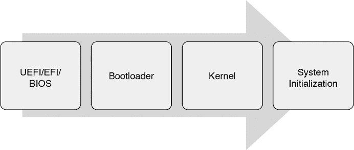

**图 1.1** 启动过程概述

`UEFI/EFI/BIOS` 执行完整性检查，然后加载引导程序。更多详情请参阅本章的“`UEFI/EFI`”小节。

标准的 Linux 引导程序是 GRand Unified Bootloader（GRUB 或 GRUB2）。它负责加载内核以及存储在名为 `initramfs` 文件中的相关内核模块（或库）（欲了解更多详情，请参阅本章的 `initramfs` 小节）。

内核从硬盘加载，执行一些关键启动任务，然后将启动过程的控制权交给系统初始化软件。

Linux 中三种不同的系统初始化系统是 SysVinit（最老的）、Upstart 和 Systemd（目前使用最广泛）。系统初始化负责启动系统服务。

### GRUB

GRand Unified Bootloader 也称为 Legacy GRUB，是一种较旧的引导程序，在现代 Linux 系统上很少使用。考试中的大多数配置文件和命令都关注 GRUB2，它是 GRUB 的改进版本。更多详情请参阅接下来的 `GRUB2` 小节。

### GRUB2

GRUB2 设计用于替代 Legacy GRUB。两者之间有几处变化，包括以下内容：

- 不同的配置文件。
- GRUB2 支持更多启动设备，包括 LVM（逻辑卷管理）和软件 RAID 设备。
- GRUB2 支持 UEFI 和 EFI。更多详情请参阅本章的 `UEFI/EFI` 小节。

#### 启动选项

GRUB2 设计用于替代 Legacy GRUB。两者之间有几处变化，包括以下内容：

- 不同的配置文件。
- GRUB2 支持更多启动设备，包括 LVM（逻辑卷管理）和软件 RAID 设备。
- GRUB2 支持 UEFI 和 EFI。更多详情请参阅本章的 `UEFI/EFI` 小节。

预计考试题将关注 GRUB2，因为 Legacy GRUB 很少使用。

GRUB2 设计用于替代 Legacy GRUB。两者之间有几处变化，包括以下内容：

- 不同的配置文件。
- GRUB2 支持更多启动设备，包括 LVM（逻辑卷管理）和软件 RAID 设备。
- GRUB2 支持 UEFI 和 EFI。更多详情请参阅本章的 `UEFI/EFI` 小节。

#### 启动选项

GRUB2 设计用于替代 Legacy GRUB。两者之间有几处变化，包括以下内容：

- 不同的配置文件。
- GRUB2 支持更多启动设备，包括 LVM（逻辑卷管理）和软件 RAID 设备。
- GRUB2 支持 UEFI 和 EFI。更多详情请参阅本章的 `UEFI/EFI` 小节。

预计考试题将关注 GRUB2，因为 Legacy GRUB 很少使用。

#### 启动选项

GRUB2 设计用于替代 Legacy GRUB。两者之间有几处变化，包括以下内容：

- 不同的配置文件。
- GRUB2 支持更多启动设备，包括 LVM（逻辑卷管理）和软件 RAID 设备。
- GRUB2 支持 UEFI 和 EFI。更多详情请参阅本章的 `UEFI/EFI` 小节。

#### 启动选项

GRUB2 设计用于替代 Legacy GRUB。两者之间有几处变化，包括以下内容：

- 不同的配置文件。
- GRUB2 支持更多启动设备，包括 LVM（逻辑卷管理）和软件 RAID 设备。
- GRUB2 支持 UEFI 和 EFI。更多详情请参阅本章的 `UEFI/EFI` 小节。

预计考试题将关注 GRUB2，因为 Legacy GRUB 很少使用。

## UEFI/EFI


**图 1.1** 启动过程概述

`UEFI/EFI/BIOS` 执行完整性检查，然后加载引导程序。更多详情请参阅本章的“`UEFI/EFI`”小节。

标准的 Linux 引导程序是 GRand Unified Bootloader（GRUB 或 GRUB2）。它负责加载内核以及存储在名为 `initramfs` 文件中的相关内核模块（或库）（欲了解更多详情，请参阅本章的 `initramfs` 小节）。

内核从硬盘加载，执行一些关键启动任务，然后将启动过程的控制权交给系统初始化软件。

Linux 中三种不同的系统初始化系统是 SysVinit（最老的）、Upstart 和 Systemd（目前使用最广泛）。系统初始化负责启动系统服务。

### GRUB

GRand Unified Bootloader 也称为 Legacy GRUB，是一种较旧的引导程序，在现代 Linux 系统上很少使用。考试中的大多数配置文件和命令都关注 GRUB2，它是 GRUB 的改进版本。更多详情请参阅接下来的 `GRUB2` 小节。

### GRUB2

GRUB2 设计用于替代 Legacy GRUB。两者之间有几处变化，包括以下内容：

- 不同的配置文件。
- GRUB2 支持更多启动设备，包括 LVM（逻辑卷管理）和软件 RAID 设备。
- GRUB2 支持 UEFI 和 EFI。更多详情请参阅本章的 `UEFI/EFI` 小节。

#### 启动选项

GRUB2 设计用于替代 Legacy GRUB。两者之间有几处变化，包括以下内容：

- 不同的配置文件。
- GRUB2 支持更多启动设备，包括 LVM（逻辑卷管理）和软件 RAID 设备。
- GRUB2 支持 UEFI 和 EFI。更多详情请参阅本章的 `UEFI/EFI` 小节。

预计考试题将关注 GRUB2，因为 Legacy GRUB 很少使用。

有多个 Live Linux 发行版允许你直接从 CD 或 DVD 启动。这种技术被称为“从 ISO 启动”，因为在这些介质上存储操作系统的文件格式被称为 ISO 镜像。

以下是从 ISO 启动的几个优点和原因：

- 系统可能是一个没有硬盘的轻量级客户端（thin client）。
- 从基于安全的 ISO 镜像启动对于解决宿主机操作系统上的问题（病毒、蠕虫或其他安全完整性破坏）非常有帮助。
- 某些 Live Linux 发行版可以通过启动宿主机操作系统来修复问题。
- ISO 也可以用于在系统上安装新的发行版。

在大多数情况下，从 ISO 镜像启动需要指示 BIOS/UEFI/EFI 从包含 ISO 介质的驱动器启动。不过，也可以配置 `GRUB` 同样从 ISO 介质启动（尽管这种情况很少见）。

## 从 HTTP/FTP 启动

从 HTTP 或 FTP 启动几乎完全是为了从安装服务器进行安装。这种介质通常是“只读的”，这意味着它无法提供一种良好的方法来提供实时文件系统，以便可以在其中同时读取和写入数据。

### 文件位置

本节重点介绍旧版 `GRUB` 和 `GRUB2` 配置数据存储的文件和目录。

### `/etc/default/grub`

`GRUB2` 通过编辑 `/etc/default/grub` 文件或 `/etc/grub.d` 目录下的文件进行配置。`/etc/grub.d` 目录中的文件是“高级文件”，超出了本书的范围。这些文件通常由软件开发者创建，并作为软件包安装的一部分插入该目录。

这里是一个典型的 `/etc/default/grub` 文件的示例：

点击此处查看代码图像

```bash
[root@localhost ~] cat /boot/grub/grub.conf
GRUB_TIMEOUT=5
GRUB_DEFAULT=saved
GRUB_TERMINAL_OUTPUT="console"
GRUB_CMDLINE_LINUX="crashkernel=auto rhgb quiet"
```

图 1.4 描述了 `/etc/default/grub` 文件的典型设置。

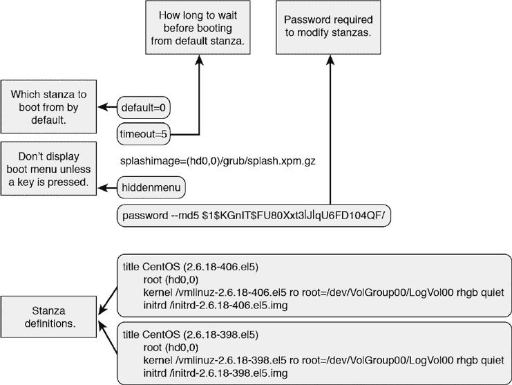

**图 1.4** `/etc/default/grub` 组件

### `/etc/grub2.cfg`

`GRUB2` 的主要配置文件是 `/boot/grub2/grub.cfg`。此文件永远不应直接编辑，因为它是由 `grub2-mkconfig` 命令创建的（更多详情请参见本章中的“`grub2-mkconfig`”小节）。

`/etc/grub2.cfg` 文件只是指向 `/boot/grub2/grub.cfg` 文件的符号链接。

### `/boot`

`/boot` 目录是启动文件所在的位置。它包括：

- 内核文件（例如 `vmlinuz-4.17.8-200.fc32.x86_64`）。
- `initramfs` 文件（例如 `initramfs-4.17.8-200.fc32.x86_64.img`）。
- `grub2` 目录，其中存放 `GRUB2` 配置文件。

### `/boot/grub`

`/boot/grub` 目录是传统的 `GRUB` 配置文件的位置。

### `/boot/grub2`

`/boot/grub2` 目录是 `GRUB2` 配置文件的位置。

### `/boot/efi`

在利用 UEFI 的系统中，`/boot/efi` 目录是 `GRUB` 配置文件的位置。

### 启动模块和文件

内核模块是为内核提供更多功能的小代码。有关内核模块以及如何在已启动的系统中使用它们的更多详情，请参阅第 2 章“在给定场景下，安装、配置和监控内核模块](#ch02.xhtml_ch02)”。

通常情况下，在启动过程中需要这些内核模块。例如，内核默认并不知道如何读取 LVM（逻辑卷管理）卷，因此如果关键文件系统位于 LVM 卷上，可能需要一个提供该功能的内核模块来正确启动系统。

本节重点介绍如何在启动过程中为内核提供必要的模块。

#### 命令

本小节重点介绍你需要了解的用于管理启动过程中所需的内核模块的命令。

#### `mkinitrd`

此 `initramfs` 文件由 `mkinitrd` 命令创建，该命令反过来调用 `dracut` 工具：

点击此处查看代码图像

```bash
[root@localhost ~]# mkinitrd /boot/initramfs-2.6.32.68.x86_64.img
  2.6.32.68
```

`mkinitrd` 命令的第一个参数是你想要创建的 `initramfs` 文件名。第二个参数是内核版本。

注意，你很少直接使用 `dracut` 实用；但它被列为考试目标，因此请注意 `mkinitrd` 会在后台执行 `dracut` 命令。

注意，如果你在基于 Debian 的系统上工作，则使用 `mkinitramfs` 命令代替 `mkinitrd` 命令。

#### `dracut`

参见本章中的“`mkinitrd`”小节。

#### `grub2-install`

通常引导加载程序是在启动过程中安装的，但引导加载程序可能会损坏并需要重新安装。要安装引导加载程序，执行 `grub-install` 命令并提供你想要安装 `GRUB` 的设备。例如，以下命令将 `GRUB` 安装在第一个 SATA 硬盘上：

点击此处查看代码图像

```bash
[root@localhost ~]# grub2-install /dev/sda
```

#### `grub2-mkconfig`

`grub2-mkconfig` 仅用于 `GRUB2`，它将从 `/etc` 目录下的可编辑文件生成 `GRUB2` 配置文件。此命令将 `/etc/default/grub` 文件和 `/etc/grub.d` 目录下的文件转换为 `GRUB2` 配置文件（`/boot/grub/grub.cfg` 或 `/boot/grub/menu.lst`）。

图 1.5 提供了一个视觉示例。

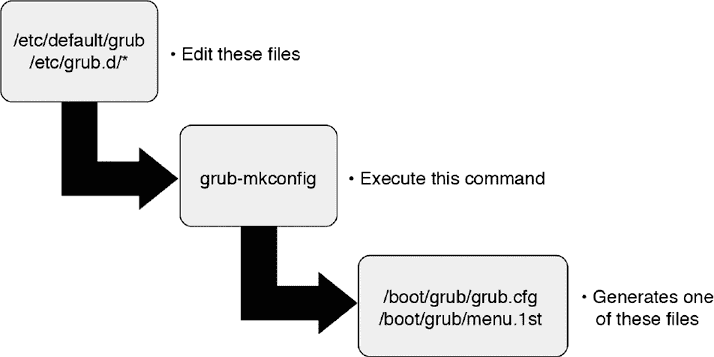

**图 1.5** `grub-mkconfig` 命令

注意：

在某些系统中，命令名称为 `grub-mkconfig`。

#### `initramfs`

此文件包含启动所需的内核模块的微型根系统。它位于 `/boot` 文件系统中，每个内核都有唯一的 `initramfs` 文件。`initramfs` 文件由 `mkinitrd` 命令创建（更多信息请参见本章的小节）。

#### `vmlinuz`

`vmlinuz` 文件存储在 `/boot` 目录中。每个版本的内核都有不同的 `vmlinuz` 文件，名称通常包含内核版本。以下是一个示例：

点击此处查看代码图像

```text
vmlinuz-4.17.8-200.fc32.x86_64
```

与 `vmlinux` 文件不同，`vmlinuz` 文件是内核的压缩版本。

#### `vmlinux`

`vmlinux` 文件指的是内核本身，采用“静态链接可执行文件格式”。此文件通常不是管理员查看或修改的文件。通常此文件用于构建 `vmlinuz` 文件，即 `vmlinux` 文件的压缩版本。

### 内核恐（Kernel Panic）

当内核出现问题导致系统崩溃时，就会发生内核恐。通常当发生时，数据会使用 `kdump` 功能存储。内核专家可以查看这些数据以确定崩溃的原因。

- `rmmod`
- `depmod`

### 位置

- [`/usr/lib/modules/[kernelversion]`](#ch02.xhtml_ch02lev2sec8)
- `/usr/lib/modules`
- `/etc/modprobe.conf`
- `/etc/modprobe.d/`

#### 命令

本节涵盖了与管理 Linux 系统上模块相关的命令。模块是存储在文件中的代码，允许内核执行特定任务。模块可以提供如网络功能或处理特定类型文件系统的能力。

### `lsmod`

`lsmod` 命令显示加载到内存中的内核模块。

语法：

```bash
lsmod
```

`lsmod` 命令的输出：

每行描述一个模块。每行包含三列信息：

- 模块名称。
- 模块的大小（字节）。
- 使用该模块的“实体”。“实体”可以是文件系统、进程或另一个模块。如果另一个模块正在使用此模块，则会列出依赖模块的名称。否则，将提供指示有多少个“实体”使用该模块的数值。

示例：

点击此处查看代码图像


[root@OCS ~]# lsmod | head
Module                          Size       Used by
tcp_lp                          12663      0
bnep                            19704      2
bluetooth                       372944     5     bnep
rfkill                          26536      3     bluetooth
fuse                            87741      3
xt_CHECKSUM                     12549      1
ipt_MASQUERADE                  12678      3
nf_nat_masquerade_ipv4          13412      1     ipt_MASQUERADE
tun                             27141      1

## insmod

`insmod` 命令用于向当前运行的内核添加模块。

语法：

```
insmod [module_name]
```

需要指定模块的精确位置。例如：

```
[root@OCS ~]# lsmod | grep fat
[root@OCS ~]# insmod /usr/lib/modules/3.19.8-100.fc20.x86_64/kernel/fs/fat.ko
[root@OCS ~]# lsmod | grep fat
fat                    65107  0
```

`insmod` 命令没有选项；但每个模块可能可以通过以下语法将模块传递到模块中：

```
insmod module options
```

`insmod` 命令有两个缺点：

- 你必须知道模块的精确位置。
- 如果模块有任何依赖关系（即需要另一个模块的模块），则加载将失败。

## modprobe

`modprobe` 命令用于从当前运行的内核中添加和删除模块。注意，它还会尝试加载模块依赖项。

语法：

```
modprobe [options] [module_name]
```

当用于删除模块（使用 `-r` 选项）时，`modprobe` 命令也会删除依赖模块，除非它们正被子系统的其他部分（例如内核或进程）使用。

`modprobe` 命令的关键选项：

- `-c` 显示当前的 `modprobe` 配置。
- `-q` 使 `modprobe` 在静音模式下运行。
- `-R` 显示所有与别名匹配的模块，帮助你调试问题。
- `-r` 从内存中移除指定的模块。
- `-v` 显示详细信息；这有助于确定 `modprobe` 如何执行任务。

## modinfo

`modinfo` 命令用于提供有关模块的详细信息。

语法：

```
modinfo [module_name]
```

示例：

```
[root@OCS ~]# modinfo xen_wdt
filename:        /lib/modules/3.19.8-100.fc20.x86_64/kernel/drivers/watchdog/xen_wdt.ko
license:         GPL
version:         0.01
description:     Xen WatchDog Timer Driver
author:          Jan Beulich <jbeulich@novell.com>
srcversion:      D13298694740A00FF311BD0
depends:
intree:          Y
vermagic:        3.19.8-100.fc20.x86_64 SMP mod_unload
signer:          Fedora kernel signing key
sig_key:         06:AF:36:EB:7B:28:A5:AD:E9:0B:02:1E:17:E6:AA:B2:B6:52:63:AA
sig_hashalgo:    sha256
parm:            timeout:Watchdog timeout in seconds (default=60)(uint)
parm:            nowayout:Watchdog cannot be stopped once started (default=0) (bool)
```

`modinfo` 输出中最重要的部分之一是“parm”值，它们描述了可以传递给此模块以影响其行为的参数。请参见本章的相应章节获取更多详情。

## dmesg

`dmesg` 命令显示内存中的内核环形缓冲区副本。它通常用于显示启动消息以便调试。

语法：

```
dmesg
```

示例：

```
[root@OCS ~]# dmesg | head
Initializing cgroup subsys cpuset
Initializing cgroup subsys cpu
Linux version 2.6.32-573.7.1.el6.x86_64
  (mockbuild@c6b8.bsys.dev.centos.org) (gcc version 4.4.7 20120313
  (Red Hat 4.4.7-16) (GCC) ) #1 SMP Tue Sep 22 22:00:00 UTC 2015
Command line: ro root=/dev/mapper/VolGroup-lv_root
rd_NO_LUKS LANG=en_US.UTF-8 rd_NO_MD rd_LVM_LV=VolGroup/lv_swap
SYSFONT=latarcyrheb-sun16 crashkernel=auto rd_LVM_LV=VolGroup/lv_root KEYBOARDTYPE=pc KEYTABLE=us rd_NO_DM rhgb quiet
KERNEL supported cpus:
      Intel GenuineIntel
      AMD AuthenticAMD
      Centaur CentaurHauls
BIOS-provided physical RAM map:
```

## rmmod

`rmmod` 命令用于从当前运行的内核中移除模块。

语法：

```
rmmod [options] [module_name]
```

示例：

```
[root@OCS ~]# lsmod | grep fat
fat                    65107  0
[root@OCS ~]# rmmod fat
[root@OCS ~]# lsmod | grep fat
```

默认情况下，该命令不会移除正在使用的模块。

`rmmod` 命令的关键选项：

- `-f` 强制移除正在使用的模块。
- `-w` 等待模块不再被使用。
- `-v` 显示详细信息。

## depmod

`depmod` 命令构建 `modules.dep` 文件。

语法：

```
depmod
```

`modules.dep` 文件包含模块关系，并由 `modprobe` 命令用于确定加载哪些模块。例如：

```
[root@OCS ~]# grep fat /usr/lib/modules/3.19.8-100.fc20.x86_64/modules.dep
kernel/fs/fat/fat.ko:
kernel/fs/fat/vfat.ko: kernel/fs/fat/fat.ko
kernel/fs/fat/msdos.ko: kernel/fs/fat/fat.ko
```

在上面的示例中，`vfat.ko` 和 `msdos.ko` 模块需要 `fat.ko` 模块，但 `fat.ko` 模块没有依赖项。

`depmod` 命令通常在系统上放置新模块时执行。这通常是软件包安装过程的一部分，但也可以手动执行。虽然 `depmod` 命令有几个选项，但通常不使用。

## 文件

模块和模块信息存储在特定位置。本节回顾了这些位置，你应该在考试中熟悉它们。

### /usr/lib/modules/[kernelversion]

系统中安装的每个内核在 `/usr/lib/modules` 目录下都有对应其特定模块的目录：

```
[root@OCS ~]# ls /usr/lib/modules
3.17.8-200.fc20.x86_64  3.18.7-100.fc20.x86_64  3.19.8-100.fc20.x86_64
```

在之前的示例输出中，显示了三个内核目录。这意味着系统中存储了三个内核。通常最新版本是正在使用的版本，但可以通过运行 `uname` 命令来验证这一点。

```
[root@OCS ~]# uname -r
3.19.8-100.fc20.x86_64
```

这些目录的重要性部分在于，如果你手动向系统添加了新的内核模块，你应该在运行 `depmod` 命令之前，将它们放置在 `/usr/lib/modules` 下当前正在使用的内核目录中。

#### /usr/lib/modules

请参见本章中之前的“/usr/lib/modules/[kernelversion]”章节。

#### /etc/modprobe.conf

在某些发行版中，`/etc/modprobe.conf` 文件用于修改模块的加载和卸载方式。虽然该文件在之前的 Linux 发行版中很常用，但现在大多数发行版都使用 `/etc/modprobe.d` 目录中的配置设置。

更多细节请参见下一节“/etc/modprobe.d/”。

#### /etc/modprobe.d/

`/etc/modprobe.d` 目录的内容是修改模块加载和卸载方式的文件。请注意，在某些系统上，你可能也会将这些文件放在 `/lib/modprobe.d` 和 `/run/modprobe.d` 目录中。

这些文件中的设置包括：

- `alias`：模块的别名。
- `install`：代替加载模块运行的命令或多个命令（通常是一个脚本，在满足其他条件后也会加载特定模块）。
- `options`：在加载模块时传递给模块的参数，用于修改模块的行为。请注意，这些参数可以通过 `modinfo` 命令显示（详情请参见本章中的相关章节）。
- `remove`：代替卸载模块运行的命令或多个命令（通常是一个脚本，在满足其他条件后也会卸载特定模块）。

`install` 设置的示例：

```
[root@OCS ~]# cat /lib/modprobe.d/dist-alsa.conf
## ALSA Sound Support
#
# We want to ensure that snd-seq is always loaded for those who want to use
# the sequencer interface, but we can't do this automatically through udev
# at the moment...so we have this rule.
#
# Remove the following line if you don't want the sequencer.
install snd-pcm /sbin/modprobe --ignore-install snd-pcm && /sbin/modprobe snd-seq
```

## 第 3 章 在给定场景下，配置并验证网络连接参数

本章提供了关于以下主题的信息和命令：

诊断工具

- `ping`
- `netstat`
- `nslookup`
- `dig`
- `host`
- `route`
- `ip`
- `ethtool`
- `ss`
- `iwconfig`
- `nmcli`
- `brctl`
- `nmtui`

配置文件

- `/etc/sysconfig/network-scripts/`
- `/etc/sysconfig/network`
- `/etc/hosts`
- `/etc/network`
- `/etc/nsswitch.conf`
- `/etc/resolv.conf`
- `/etc/netplan`
- `/etc/sysctl.conf`
- `/etc/dhcpd.conf`

链路聚合

- 聚合
- 主备用模式
- 负载均衡

### 诊断工具

#### ping

`ping` 命令用于验证远程主机是否可以响应：

```
[root@OCS ~]# ping -c 4 google.com
64 bytes of data from 142.250.190.46: icmp_seq=0 ttl=117 time 9.2 ms
64 bytes of data from 142.250.190.46: icmp_seq=1 ttl=117 time 8.5 ms
64 bytes of data from 142.250.190.46: icmp_seq=2 ttl=117 time 9.1 ms
64 bytes of data from 142.250.190.46: icmp_seq=3 ttl=117 time 8.8 ms

--- google ping statistics ---
4 packets sent, 4 received, 0% packet loss, time 3005ms
rtt min/avg/max/mdev = 8.5/8.90/9.20/0.285 ms
```

默认情况下，`ping` 命令将持续发送包，直到用户按下 `Ctrl+C` 停止。

#### netstat

`netstat` 命令用于显示网络连接：

```
[root@OCS ~]# netstat -ant
Active internet connections
Recv-Q Send-Q Local Address           Foreign Address         State
tcp        0      0 0.0.0:22              0.0.0.0:*                LISTEN
tcp        0      0 127.0.0.1:631        0.0.0.0:*                LISTEN
tcp        0      0 10 192.168.1.10:54321    142.250.190.46:443     ESTABLISHED
```

`netstat` 命令用于显示网络连接、路由表、网络接口统计以及数据包统计。

#### nslookup

`nslookup` 命令设计用于执行简单的 DNS 查询：

```
[root@OCS ~]# nslookup google.com
Server:          192.168.1.1
Address:         192.168.1.1

Non-authoritative answer:
Name:    google.com
Address: 142.250.190.46
```

虽然 `nslookup` 命令经常被认为过时，但它仍在使用。

#### dig

`dig` 命令用于对特定服务器执行 DNS 查询：

```
[root@OCS ~]# dig google.com

; <<>> DiG 9.9.4-RedHat-9.9.el7 <<>> google.com
;; global options: +cmd
;; Got answer:
;; ->>HEADER<<- opcode: QUERY, status: NOERROR, id: 5640
;; flags: qr ra; QUERY: 1, ANSWER: 1, AUTHORITY: 0, ADDITIONAL: 1

;; OPT PSEUDOSECTION:
; EDNS: version: 0, flags:; udp: 512
;; QUESTION SECTION:
;google.com.                 IN       A

;; ANSWER SECTION:
google.com.        268       IN       A      216.58.217.206

;; Query time: 32 msec
;; SERVER: 192.168.1.1#53(192.168.1.1)
;; WHEN: Sun Mar 05 17:01:00 PST 2017
;; MSG SIZE rcvd: 55
```

要查询特定的 DNS 服务器而非主机的默认 DNS 服务器，请使用以下语法：

```
dig @server host_to_lookup
```

| `-x address` | 执行反向查找（当提供 IP 地址时返回主机名）。 |

#### host

`host` 命令通常用于执行简单的主机名到 IP 地址的转换操作（也称为 *DNS 查询*）。以下是一个示例：

```
[root@OCS ~]# host google.com
```


以下内容展示了 `host` 命令的用法及其输出示例：

```
[root@OCS ~]# host google.com
google.com has address 172.217.4.142
google.com has IPv6 address 2607:f8b0:4007:800::200ee
google.com mail is handled by 30 alt2.aspmx.l.google.com.
google.com mail is handled by 50 alt4.aspmx.l.google.com.
google.com mail is handled by 20 alt1.aspmx.l.google.com.
google.com mail is handled by 10 aspmx.l.google.com.
google.com mail is handled by 40 alt3.aspmx.l.google.com.
```

下表描述了 `host` 命令的常用选项：

| 选项 | 描述 |
| --- | --- |
| `-t` | 指定想要显示的查询类型；例如，`host -t ns google.com` 将显示 Google 的名称服务器。 |
| `-4` | 仅执行 IPv4 查询。 |
| `-6` | 仅执行 IPv6 查询。 |
| `-v` | 详细模式；输出类似于 `dig` 命令的结果。 |

### route

`route` 命令可显示路由表：

```
[root@OCS ~]# route
Kernel IP routing table
Destination Gateway      Genmask      Flags Metric Ref Use Iface
default     192.168.1.1  0.0.0.0      UG    100    0   0   enp0s3
192.168.0.0 0.0.0.0      255.255.0.0  U     100    0   0   enp0s3
192.168.1.0 0.0.0.0      255.255.0.0  U     100    0   0   enp0s3
```

此信息也可以通过 `ip` 命令显示：

```
[root@OCS ~]# ip route show
default via 192.168.1.1 dev enp0s3 proto static metric 100
192.168.0.0/16 dev enp0s3 proto kernel scope link
  src 192.168.1.24 metric 100
192.168.1.0/24 dev enp0s3 proto kernel scope link
  src 192.168.1.26 metric 100
192.168.122.0/24 dev virbr0 proto kernel scope link
  src 192.168.122.1
```

`route` 命令还可以用于修改默认路由器：

```
route add default gw 192.168.1.10
```

要添加新路由器，执行以下命令：

```
route add -net 192.168.3.0 netmask 255.255.255.0 gw 192.168.3.100
```

该命令将所有发往 `192.168.3.0/24` 网络的网络数据包发送到 `192.168.3.100` 路由器。

### 注意

这些更改是临时的，仅在系统下次重启前有效。永久更改需要在系统的配置文件中进行，这些文件因发行版而异。

### ip

`ip` 命令是一个较新的命令，旨在取代一系列与网络接口相关的命令。

语法：

```
ip [options] object command
```

下表描述了一些较重要的对象：

| 对象 | 指代 |
| --- | --- |
| `addr` | IPv4 或 IPv6 地址 |
| `link` | 网络设备 |
| `route` | 路由表条目 |

下表描述了一些可以执行的常用命令：

| 命令 | 描述 |
| --- | --- |
| `add` | 添加对象。 |
| `delete` | 删除对象。 |
| `show` (或 `list`) | 显示有关对象的信息。 |

以下示例显示了设备的网络信息，类似于 `ifconfig` 命令：

```
ip addr show
1: lo: <LOOPBACK,UP,LOWER> mtu 65536 qdisc noqueue state UNKNOWN
    inet 127.0.0.1/8 scope host lo
       valid_l preferred
    inet6 ::1/64 scope host 
2: enp0s3: <BROADCAST,MULTICAST,LOWER> mtu 1500 qdisc fq_cod state UP
    inet 192.168.1.10/24 scope global group enp0s3
       inet6 fe80::205:6ff:fe1a:83c2/64 scope link no 
```

### ettool

`etool` 命令用于显示和配置网络设置，例如速度和双工值。这些设置通过自动协商自动完成；但也可以手动设置。

语法：

```
etool [option] device
```

例如，要显示信息的摘要，请使用以下命令：

```
[root@OCS ~]# ettool eth0
Settings for eth0:
  Supported ports: [ TP ]
  Supported link:
  Auto-negotiation: on
  Speed: 1000Mb/s
  Duplex: Full
  Port: Twisted Pair
  PHYAD: 0
  Transceiver: internal
  MDI-X: off (auto)
  Wake-on: d
  Current message level: 0x00000007
```

注意：如果此设备和连接设备都支持自动协商，则不需要手动设置速度和双工设置。

`ettool` 命令提供了大量的输出。下表描述了一些更有用的数据：

| 输出 | 描述 |
| --- | --- |
| Supported link modes | 该设备可以使用的速度和双工值。 |
| Supports auto-negotiation | 如果此设备和连接设备都支持自动协商，则不需要手动设置速度和双工设置。 |
| Advertised link modes | 该设备告诉其他它可以使用的速度和双工值。 |
| Speed | 设备当前使用的速度设置。 |
| Duplex | 设备当前使用的双工值。 |
| Link detected | 如果此项设置为“yes”，则该设备当前正通过网络连接到另一个设备。 |

`ettool` 命令的有用选项包括：

| 选项 | 描述 |
| --- | --- |
| `-i` | 提供此设备的驱动程序信息。 |
| `-S` | 显示此设备的统计信息。 |
| `-p` | 通过使其链路灯闪烁来识别此设备。当系统有多个网卡时非常有用。 |
| `speed value` | 手动设置设备的速度值；*value* 是要设置设备的速度值。 |
| `duplex value` | 手动设置设备的双工值；*value* 应该是 full（全双工）或 half（半双工）。 |
| `autoneg value` | 启用自动协商；*value* 应该是 yes 或 no。 |

### ss

`ss` 命令用于显示 socket 信息。

语法：

```
ss [options]
```

在没有任何任何选项的情况下，它列出所有打开的 socket。例如：

```
[root@OCS ~]# ss | wc -l
160
[root@OCS ~]# ss | head
Netid  State      Recv-Q Send-Q   Local Address:Port Peer Address:Port
u_str  ESTAB      0      0       /var/run/dovecot/anvil 23454966
  * 23454965
u_str  ESTAB      0      0       /var/run/dovecot/anvil 23887673
  * 23887672
u_str  ESTAB      0      0       /run/systemd/journal/stdout
  13569                 * 13568
u_str  ESTAB      0      0                      * 13893 * 13894
u_str  ESTAB      0      0                      * 13854 * 13855
u_str  ESTAB      0      0                      * 13850 * 13849
u_str  ESTAB      0      0                      * 68924 * 68925
u_str  ESTAB      0      0                      * 17996 * 17997
u_str  ESTAB      0      0       /var/run/dovecot/config 9163531
  * 9163871
```

`ss` 命令的常用选项包括：

| 选项 | 说明 |
| --- | --- |
| `-lt` | 列出监听的 TCP 套接字。 |
| `-lu` | 列出监听的 UDP 套接字。 |
| `-lp` | 列出拥有每个套接字的进程 ID (PID)。 |
| `-n` | 将 IP 地址解析为主主机，也不将端口号解析为端口名称。 |
| `-a` | 显示所有信息。 |
| `-s` | 显示摘要。 |

#### iwconfig

`iwconfig` 命令用于显示或设置无线网络接口的信息。

语法：

```
iwconfig [interface] [parameters]
```

如果未提供参数，此命令将显示所有网络接口：

```
[root@OCS ~]# iwconfig
lo         no wireless extensions.
eth0       no wireless extensions.
wlan0      IEEE 802.11bgn  ESSID:"test1"
           Mode:Managed  Frequency:2.412 GHz  Access Point:
             Not-Associated
           Tx-Power=20 dBm
           Retry min limit:7   RTS thr:off   Fragment thr=2352 B
           Power Management:off
           Link Quality:0  Signal level:0  Noise level:0
           Rx invalid nwid:0  Rx invalid crypt:0  Rx invalid frag:0
           Tx excessive retries:0  Invalid misc:0  Missed beacon:0
```

可以使用参数来配置无线接口。例如，要将设备模式更改为 Ad-Hoc，请执行以下命令：

```
[root@OCS ~]# iwconfig wlan0 mode Ad-Hoc
```

`iwconfig` 命令的常用参数如下：

| 参数 | 说明 |
| --- | --- |
| `essid` *value* | 设置 ESSID 名称（即网络名称）。 |
| `nwid` *value* | 设置网络 ID (Network ID)。 |
| `mode` *value* | 设置模式（*value* 为 Ad-Hoc, Managed, Master 等）。 |
| `ap` *value* | 强制网卡使用指定的接入点。 |

#### nmcli

`nmcli` 命令用于配置 NetworkManager，这是一个被设计用于检测和配置网络连接的工具。

语法：

```
nmcli [options] object [command]
```

示例：

```
[root@OCS ~]# nmcli device status
DEVICE      TYPE       STATE       CONNECTION
virbr0      bridge     connected   virbr0
enp0s3      ethernet   connected   enp0s3
lo          loopback   unmanaged   --
virbr0-nic  tun        unmanaged   --
```

`object` 对象是以下关键字之一：

| 关键字 | 描述 |
| --- | --- |
| `connection` | 管理网络连接 |
| `device` | 管理特定设备 |
| `general` | 用于 NetworkManager 状态信息 |
| `networking` | 启用或禁用网络或显示当前状态 |
| `radio` | 用于无线电（无线）网络信息和配置 |

常用的 `nmcli` 命令包括：

| 命令 | 描述 |
| --- | --- |
| `status` | 显示当前设置。 |
| `on\|off` | 开启（或关闭）某项设置。 |
| `up\|down` | 启用（或禁用）接口。 |
| `add\|delete` | 添加新设备或删除现有设备。 |

#### brctl

`brctl` 命令用于创建、修改或查看以太网桥接器 (Ethernet bridge)。以太网桥接器从用户的角度将不同的网络连接到同一个网络。

语法：

```
brctl [command]
```

从创建桥接器开始：

```
[root@OCS ~]# brctl addbr bridge1
```

接下来，添加作为桥接器部分的接口：

```
[root@OCS ~]# brctl addif bridge1 eth1
```

常用的 `brctl` 命令包括：

| 命令 | 描述 |
| --- | --- |
| `delbr` | 只要桥接器不包含任何接口，即可删除桥接器。 |
| `delif` | 从桥接器中删除接口。 |
| `show` | 列出系统上所有的桥接器。 |
| `show` *brname* | 显示特定桥接器的信息。 |

此文件存在基于 Red Hat 的发行版中，例如 Red Hat Enterprise Linux、CentOS 和 Fedora。它包含了基础网络信息：

```
[root@OCS ~]# more /etc/sysconfig/network
HOSTNAME=ocs.onecoursesource.com
NETWORKING=yes
```

下表列出了一些常见的 `/etc/sysconfig/network` 配置设置：

| 设置 | 描述 |
| --- | --- |
| `HOSTNAME` | 该系统的主机名。 |
| `NETWORKING` | 当设置为 `yes` 时，系统启动时将启用网络。设置为 `no` 时，系统启动时时不配置网络。 |

### /etc/hosts

`/etc/hosts` 文件是用于定义主机名到 IP 地址映射的地方：

```
[root@OCS ~]# more /etc/hosts
192.168.1.24 server.sample999.com
127.0.0.1    OCS
::1          OCS
```

每行描述一种映射关系。第一个字段是 IP 地址，第二个字段是主机名，可选的第三字段显示别名地址。

在大多数情况下，此文件仅用于本地主机或本地局网上的主机。通常，主机名到 IP 地址的映射是由 DNS 服务器处理的。

### /etc/network

`/etc/network` 目录是存储 Debian 系网络文件的传统位置。这包含了 Debian、Ubuntu 和 MintOS 发行版。

主要的配置文件是 `/etc/network/interfaces`。在以下示例中，文件的前两行定义了环回设备（loopback），文件的剩余部分定义了一个静态分配的 `eth0` 设备：

```
[root@OCS ~]# /etc/network/interfaces
auto lo
iface lo inet loopback
iface eth0 inet static
 address 192.168.11.100
 netmask 255.255.255.0
 gateway 192.168.11.1
 dns-domain example.com
 dns-nameservers 192.168.11.1
```

`eth0` 的 DHCP 客户端配置可能如下：

```
auto eth0
iface eth0 inet dhcp
```


注意，在某些系统（如 Ubuntu）上，`/etc/network/interfaces` 已被 `/etc/netplan` 目录下的配置文件取代。更多详情请参见本章的“`/etc/netplan`”部分。

### `/etc/nsswitch.conf`

名称服务切换（NSS）配置文件 `/etc/nsswitch.conf` 用于应用程序确定从哪些源获取名称服务信息以及顺序。例如，对于网络，此文件包含了名称服务器解析器的位置，该解析器是提供主机名到 IP 地址转换的工具：

点击此处查看代码图像

```bash
[root@OCS ~]# grep hosts /etc/nsswitch.conf
#hosts:     db files nisplus nis dns
hosts:       files dns
```

`files dns` 的值意味着“首先查看本地 `/etc/hosts` 文件，如果本地文件中没有所需的映射，则查看 DNS 服务器”。

下表描述了常见的主机名到 IP 地址的转换工具：

| 工具 | 描述 |
| --- | --- |
| `files` | 本地 `/etc/hosts` 文件 |
| `dns` | 一个 DNS 服务器 |
| `NIS` | 一个网络信息服务服务器 |

### `/etc/resolv.conf`

`/etc/resolv.conf` 文件包含了系统的 DNS 服务器列表。一个典型的文件如下：

点击此处查看代码图像

```bash
[root@OCS ~]# cat /etc/resolv.conf
search sample999.com
nameserver 192.168.1
```

如果你在使用 NetworkManager 等工具来配置网络设置，或者正在使用 DHCP 客户端，那么此文件通常由这些工具填充。对于服务器，此文件通常是手动定义的。

下表描述了 `/etc/resolv.conf` 文件的常见设置：

| 设置 | 描述 |
| --- | --- |
| `nameserver` | DNS 服务器的 IP 地址；文件中最多可以有三行 `nameserver`。 |
| `domain` | 用于指定本地域，允许在 DNS 查询时使用短名。 |
| `search` | 使用短名进行 DNS 查询时使用的可选域列表。 |

### `/etc/netplan`

`/etc/netplan` 目录是 Ubuntu 以及一些其他基于 Debian 的发行版中存储网络配置文件的新位置。这些文件的格式是 YAML（YAML 不是标记语言），这是一种类似于 JSON 的文件格式。

以下是一个静态分配的 `ens33` 设备的示例：

点击此处查看代码图像

```yaml
[root@OCS ~]# cat /etc/netplan/01-netcfg.yaml
network:
 version: 2
 renderer: networkd
 ethernets:
   ens33:
     dhcp4: no
     dhcp6: no
     addresses: [192.168.1.2/24]
     gateway4: 192.168.1.1
     nameservers:
       addresses: [8.8.8.8,8.8.4.4]
```

要将 `ens33` 设备配置为 DHCP 客户端，请使用以下语法：

点击此处查看代码图像

```yaml
[root@OCS ~]# cat /etc/netplan/01-netcfg.yaml
network:
 version: 2
 renderer: networkd
 ethernets:
   ens33:
     dhcp4: yes
     dhcp6: yes
```

**注意**

在更改 `/etc/netplan` 目录中的文件后，运行 `netplan apply` 命令使更改生效。

### `/etc/sysctl.conf`

`/etc/sysctl.conf` 文件用于指定启动时启用哪些内核设置。

示例：

点击此处查看代码图像

```text
[root@OCS ~]# cat /etc/sysctl.conf
## 系统默认设置位于 /usr/lib/sysctl.d/00-system.conf 中。
# 要覆盖这些设置，请在此处输入新设置，或者
# 在 /etc/sysctl.d/<name>.conf 文件中。
#
# 更多信息请参阅 sysctl.conf(5) 和 sysctl.d(5)。
net.ipv4.ip_forward=1
```

在上一个示例中，内核参数 `ip_forward` 被开启，这意味着该机器将作为两个网络之间的路由器。

有数千可能的内核设置，包括几十个影响网络的设置。`ip_forward` 设置是最常见的网络设置之一。

### `/etc/dhcpd.conf`

`/etc/dhcpd.conf` 文件用于配置 DHCP 服务器。安装 DHCP 服务器软件包后，一个示例 `dhcpd.conf` 文件将放置在 `/usr/share/doc` 目录结构（`/usr/share/doc/dhcp*/dhcpd.conf.sample`）。通常配置 DHCP 服务器的管理员会将此示例文件复制到 `/etc` 目录并根据本地网络进行修改。

下表描述了 `/etc/dhcpd.conf` 文件的常见设置：

| 设置 | 描述 |
| --- | --- |
| `option domain-name` | 提供给 DHCP 客户端的默认域。可以通过子网设置覆盖。 |
| `option domain-name-servers` | 提供给 DHCP 客户端的默认 DNS 服务器名称。可以通过子网设置覆盖。 |
| `default-lease-time` | 为 DHCP 客户端提供的默认租约时间。可以通过子网设置覆盖。 |
| `max-lease-time` | 允许 DHCP 客户端的最大租约期。可以通过子网设置覆盖。 |
| `subnet` | 提供给 DHCP 客户端的 IP 地址和其他网络信息集合的定义。更多信息请参见下表。 |

下表描述了 `/etc/dhcpd.conf` 的常见子网设置：

| 设置 | 描述 |
| --- | --- |
| `range` | 提供给 DHCP 客户端的 IP 地址范围。 |
| `option domain-name-servers` | 提供给该子网 DHCP 客户端的 DNS 服务器名称。可以覆盖任何默认设置。 |
| `option domain-name` | 提供给该子网 DHCP 客户端的域。可以覆盖任何默认设置。 |
| `option routers` | 网关地址。 |
| `default-lease-time` | 为此子网的 DHCP 客户端提供的默认租约时间长度。这会覆盖任何默认设置。 |
| `max-lease-time` | 此子网的 DHCP 客户端允许的最大租约期。这会覆盖任何默认设置。 |

以下是一个取自示例文件的简单例子：

点击此处查看代码图像

```text
option domain-name "example.org";
option domain-name-servers ns1.example.org, ns2.example.org;
default-lease-time 600;
log-facility local7;
subnet 10.254.239.0 netmask 255.255.255.224 {
  range 10.254.239.10 10.254.239.20;
  option routers rtr-239-0-1.example.org, rtr-239-0-2.example.org;
}
```

## 绑定（Bonding）

绑定的目的是让系统将多个网络接口视为单个网络接口。这提供了比单个网络接口能够管理的大得多的带宽。本节将讨论绑定的概念。

## 聚合（Aggregation）

聚合是绑定的核心概念。要创建一个网络绑定，你需要将两个或多个网络接口组合到一个单一簇中。这就是聚合的定义。

聚合可以通过手动方式管理，首先创建一个网络绑定，然后将设备添加到该绑定中：

点击此处查看代码图像

```bash
[root@OCS ~]# ip link add bond0 type bond
[root@OCS ~]# ip link set eth0 master bond0
[root@OCS ~]# ip link set eth1 master bond0
```

要自动创建此绑定，你需要修改配置文件。例如，在传统的基于 Debian 的发行版中，将把以下代码添加到 `/etc/network/interfaces` 文件中：

点击此处查看代码图像

```text
iface bond0 inet static
         address 192.168.1.100
         netmask 255.255.255.0
         gateway 192.168.1.1
         dns-nameservers 192.168.1.1
         dns-search domain.local
                  slaves eth0 eth1
                  bond_mode 0
                  bond-miimon 100
                  bond_downdelay 200
                  bound_updelay 200
```

注意，你也可以使用 NetworkManager 创建网络绑定，如图 3.2 所示。

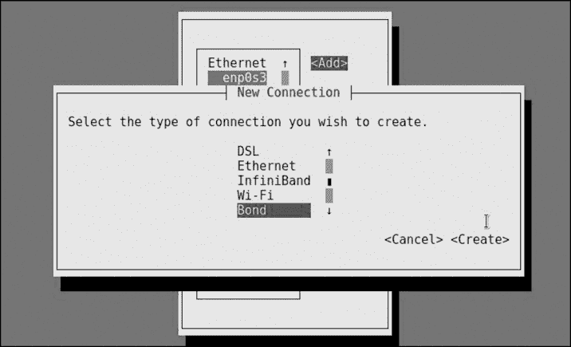

**图 3.2** 使用 NetworkManager 创建网络绑定

为了让绑定能够正常工作，你首先需要加载 bonding 内核模块。这可以通过手动完成：

点击此处查看代码图像

```bash
[root@OCS ~]# modprobe bonding
```

**注释**

如果在配置文件中配置了绑定，则该模块在系统启动期间自动加载。

## 主备模式（Active/Passive）

网络绑定支持多种模式。其中一种模式被称为“主备模式（active-backup）”，其中只有一个设备处于激活状态，其他设备在激活设备发生故障时作为备用。

要设置此模式，请使用以下语法：

点击此处查看代码图像

```text
[root@OCS ~]# ip link add bond0 type bond mode 1

iface bond0 inet static
        address 192.168.1.100
        netmask 255.255.255.0
        gateway 192.168.1.1
        dns-nameservers 192.168.1.1
        dns-search domain.local
                slaves eth0 eth1
                bond_mode 1
                bond-miimon 100
                bond_downdelay 200
                bound_updelay 200
```

也可以通过向 `/etc/sysctl.conf` 文件添加以下内容将此传递给 bonding 内核参数（注意，大多数管理员倾向于通过这种方法编辑网络配置文件）：

点击此处查看代码图像

```text
alias bond0 bonding
options bond0 miimon=80 mode=5
```

## 负载均衡（Load Balancing）

有几种影响负载均衡的绑定模式。负载均衡允许系统根据某些标准（设备速度、轮询等）在不同的网络设备之间共享流量。下表提供了所有模式及其目的的列表：

| 设置 | 描述 |
| --- | --- |
| `mode=0` | 轮询：数据包以轮询方式传输；每个从设备获得相同数量的数据包。 |
| `mode=1` | 此章中的“主备模式”小节。 |
| `mode=2` | 异或：传输接口基于源地址和目的 MAC 地址的异或操作。 |
| `mode=3` | 广播：所有数据包在所有从设备上广播。 |
| `mode=4` | 802.3ad：为具有相同速度和双工设置的设备创建网络绑定。需要安装 `ethtool` 来执行网络设备的探测。 |
| `mode=5` | 自适应发送负载均衡：根据网络从设备的速度等标准进行负载均衡。 |
| `mode=6` | 自适应负载均衡：与 `mode=5` 类似，但还会对网络数据包进行 MAC 地址重写。 |

# 第 4 章 给定场景，在 Linux 环境中管理存储

本章提供了有关以下主题的信息和命令：

### 基础分区

- 原始设备
- GPT
- MBR

### 文件系统层级

- 真实文件系统
- 虚拟文件系统
- 相对路径
- 绝对路径

### 设备映射（Device mapper）

- LVM
- `mdadm`
- 多路径（Multipath）

## 工具

- XFS 工具
- LVM 工具
- EXT 工具
- 命令
  - `mdadm`
  - `fdisk`
  - `parted`
  - `mkfs`
  - `iostat`
  - `df`
  - `du`
  - `mount`
  - `umount`
  - `lsblk`
  - `blkid`
  - `dumpefs`
  - `resize2fs`
  - `fsck`
  - `tune2fs`
  - `e2label`

### 位置

- `/etc/fstab`
- `/etc/cryptab`
- `/dev/`
- `/dev/mapper`
- `/dev/disk/by-`
  - `id`
  - `uuid`
  - `path`
  - `multipath`
- `/etc/mtab`
- `/sys/block`
- `/proc/partitions`
- `/proc/mounts`

### 文件系统类型

- `ext3`
- `ext4`
- `xfs`
- `nfs`
- `smb`
- `cifs`
- `ntfs`

### 基础分区

分区用于将硬盘划分为较小的组件。然后，每个组件都可以被视为不同的存储设备。在每个分区上都可以创建独立的文件系统（`btrfs`、`xfs` 等）。

## 分区

传统的基于 PC 的分区在创建数量上存在局限性。最初只允许创建四个分区，这些被称为 `primary partitions`（主分区）。随着对分区需求的增加，出现了一种技术，允许将其中一个主分区转换为扩展分区。在扩展分区内部，你可以创建额外的名为 `logical partitions`（逻辑分区）。

在图 4.1 中，`/dev/sda1`、`/dev/sda2` 和 `/dev/sda3` 是主分区。`/dev/sda4` 分区是一个扩展分区，作为 `/dev/sda5`、`/dev/sda6` 和 `/dev/sda7` 逻辑分区的容器。

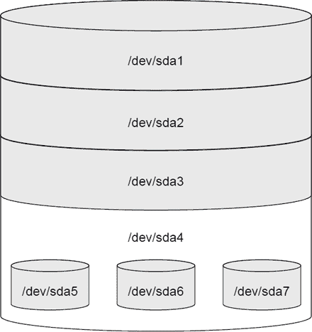

**图 4.1** 传统分区结构

在大多数使用传统分区的发行版中，你将被限制为共 15 个分区（通过内核调整可以将此数字增加到 63）。

传统的分区表存储在主引导记录（MBR）中。一种新的分区表称为 GUID 分区表（GPT），它没有与 MBR 分区表相同的限制或布局。

可以使用几种不同的工具来创建或查看分区，包括 `fdisk`、`parted` 以及安装程序提供的基于 GUI 的工具。GUI 工具因发行版而异。

`fdisk` 和 `parted` 都支持命令行选项，并且都可以作为交互式工具执行。

### 原始设备（Raw Devices）

原始设备是与块设备文件（分区、硬盘等）关联的设备文件。当你创建了这种关联时，就可以对块设备进行直接访问。要创建原始设备，请使用 `raw` 命令：

点击此处查看代码图像

```bash
# raw /dev/raw/raw1 /dev/vda
/dev/raw/raw1:  bound to major 252, minor 0
```

一旦创建了原始设备，你就可以使用 `dd` 等命令对对应的块文件执行操作。`dd` 命令通常用于创建整个硬盘的副本。

#### GPT

GUID 分区表（GPT）是一种分区方案，旨在克服 MBR 的局限性（参见本章的“MBR”节）。与 MBR 不同，GPT 没有四个主分区的限制。也不需要扩展分区或逻辑分区。GPT 每个硬盘设备支持多达 128 个分区。

#### MBR

MBR 分区表通常被称为“传统”分区，以区别于 GUID 分区表等较新的分区表。MBR 分区表默认仅允许四个分区。对于 Linux 等操作系统来说，这是一个极具限制性的因素。

然而，MBR 分区表中的一个主分区可以转换为扩展分区。在扩展分区内部，可以添加额外的分区。这些额外的分区被称为 `logical`（逻辑）分区。参见图 4.2 的视觉示例。

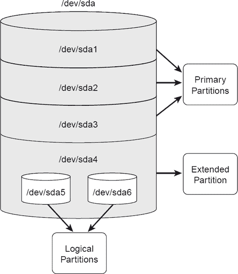

**图 4.2** 分区

有关创建 MBR 分区的详细信息，请参见本章的“`fdisk`”和“`parted`”节。


关于硬盘设备名称的说明：硬盘通过`/dev`目录下的设备名称引用。基于 IDE 的设备名称以`/dev/hd`开头，而 SATA、SCSI 和 USB 设备名称以`/dev/sd`开头。系统的第一块硬盘命名为`a`，因此第一个 SATA 设备为`/dev/sda`。第二个 SATA 设备将是`/dev/sdb`，依此类推。分区从 1 开始顺序编号，例如`/dev/sda1`、`/dev/sda2`和`/dev/sda3`。

## 文件系统层次结构

`filesystem`（文件系统）一词通常令人困惑，因为它可以指两个不同的东西：真实文件系统和虚拟文件系统。本节将探讨这两种类型的区别，以及相对路径与绝对路径之间的区别。

### 真实文件系统

真实文件系统是放置在物理存储设备（如分区、软件 RAID 设备或 LVM 逻辑卷）上的文件系统。典型的真实文件系统包括 ext3、ext4 和 xfs。有关这些真实文件系统的更多信息，请参见本章后面的“Filesystem Types”节。

### 虚拟文件系统

一旦真实文件系统放在物理设备上，就需要挂载到虚拟文件系统中。虚拟文件系统从根目录（`/`目录）开始，包含物理文件系统的集合。根目录本身就是真实文件系统之一。其他的位于名为“挂载点”的目录下。

常见的挂载点包括`/usr`、`/var`和`/home`；但这些目录也可能包含根文件系统的数据。这取决于分区方案是如何布局的。

参见本章后面的“lsblk”和“df”节学习如何显示分区。

### 相对路径

相对路径引用文件或目录的方式。如果你使用相对于当前目录的路径名称，它被称为`relative path`（相对路径）。以下是一些示例：

- `cd test`：移动到当前目录下的`test`目录。
- `ls abc/xyz`：列出`xyz`目录下的文件，该目录位于`abc`目录下，而`abc`目录位于当前目录下。
- `cd ..`：从当前目录向上移动一级（`..`字符表示当前目录的上级目录）。
- `cp data/abc.txt .`：将当前目录下`data`目录下的`abc.txt`文件复制到当前目录（单个`.`代表当前目录）。

另请参见下一节“Absolute Paths”。

### 绝对路径

绝对路径引用文件或目录的方式。如果你使用相对于根目录（`/`）的路径名称，它被称为`absolute path`（绝对路径）。

注意，绝对路径始终以`/`字符开头，而相对路径永远不以`/`字符开头。

另请参见本章之前的“Relative Paths”节。

## 设备映射器

普通分区分配了可预测且自动分配的设备名称。系统上的第一块磁盘分配为`/dev/sda`（除非它是旧的 IDE 设备，在这种情况下被分配为设备文件`/dev/hda`）。系统上的第二块磁盘分配为`/dev/sdb`。

其他设备类型，例如逻辑卷管理器（LVM），没有可预测的自动分配的设备名称。相反，它们使用一种称为设备映射器（device mapper）的功能。

参见下一节“LVM”设备映射器的运行示例。

### LVM

LVM 设计旨在解决普通分区的若干问题，包括：

- 普通分区不是“可调整大小的”。LVM 提供了更改名为`logical volumes`（逻辑卷）的分区结构大小的方法。
- 普通分区的大小不能超过其所在硬盘的总体大小。通过 LVM，可以将多个物理设备合并在一起，创建一个大得多的逻辑卷。
- 在备份数据时，活跃的文件系统会带来挑战，因为备份过程中对文件系统进行的更改可能会导致备份损坏。LVM 提供了一项名为“快照”（snapshot）的功能，可以让你轻松地正确备份运行中的文件系统。

LVM 由一个或多个物理设备合并成一个单一空间容器组成，该空间可用于创建类似分区的设备。物理设备可以是整个硬盘、硬盘上的分区、可移动介质设备（USB 驱动器）、软件 RAID 设备或任何其他存储设备。

创建 LVM 的第一步是现有的物理设备并将其转换为物理卷（PV）。这通过执行`pvcreate`命令来实现。例如，如果你有三块硬盘，如图 4.3 所示，并且你想将它们都变成 PV，可以执行以下命令：

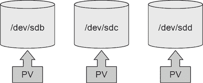

**图 4.3** 物理卷

```bash
pvcreate /dev/sdb /dev/sdc /dev/sdd
```

接下来，通过执行以下命令将这些 PV 放入卷组（VG）：

```bash
# vgcreate vol0 /dev/sdb /dev/sdc /dev/sdd
```

将 VG 视为一组存储设备，你想要用它们创建名为逻辑卷的类似分区结构。因此，如果`/dev/sdb`是一个 60GB 的硬盘，`/dev/sdc`是一个 30GB 的硬盘，`/dev/sdd`是一个 20GB 的硬盘，那么通过上述命令创建的 VG 就有 110GB 的可用空间来创建逻辑卷（LV）。你可以使用所有 110GB 创建单个 LV，也可以创建许多较小的 LV。请参见图 4.4 以查看卷组的视觉演示。

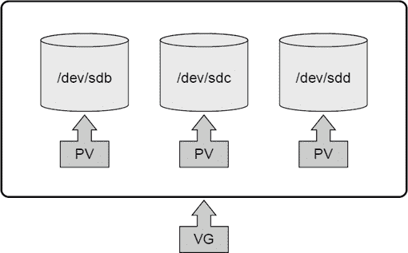

**图 4.4** 卷组

PV 内部的空间被划分成称为`extents`（区）的小块。每个区默认为 4MB（在创建 VG 时，可以使用`vgcreate`命令的`-s`选项进行修改）。要创建 LV，执行`lvcreate`命令并指定分配给 LV 的区数量，或者提供一个大小（该大小将向上取整到区的大小）：

```bash
lvcreate -n lv0 -L 400MB vol0
```

结果将是一个名为`/dev/vol0/lv0`的设备文件，它将有 400MB 的可用原始空间。请参见图 4.5 的视觉示例。

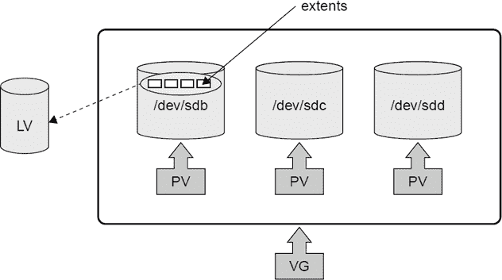

**图 4.5** 逻辑卷

你可以像对待普通分区一样对待`/dev/vol0/lv0`，包括在设备上创建文件系统并挂载它，如下：

```bash
mkfs -t ext4 /dev/vol0/lv0
mkdir /data
mount /dev/vol0/lv0 /data
```

你可以使用此设备名称来指代新的 LV 设备名称（`/dev/vol0/lv0`文件）。然而，你会发现这实际上并不是一个设备名，而是指向`/dev/mapper/vol0_lv0`文件的符号链接。设备映射（device mapper）是内核的一个组件，用于生成新的设备文件（技术上是块设备文件）。它在`/dev/mapper`目录下创建这些文件，在 LVM 的情况下，创建了与旧 LVM 技术后兼容的符号链接。

### 多路（Multipath）

某些存储设备仅通过网络可用。这产生了一个故障点：网络本身。如果你失去了对远程存储设备的网络访问（可能是因为路由器故障或实施了新的防火墙规则），那么系统上的应用程序可能无法正常运行。

多路（Multipath）的概念是为远程存储设备创建不同的网络路径。这需要额外的网络设置，包括配置到网络存储设备的不同路由。

关于配置多路的细节超出了 Linux+ 考试的范围，本书将不会涉及。多路概念是一个考试目标，因此请准备好回答有关多路目的的问题。

## 工具

有多种工具用于管理文件系统和存储设备。在本节中将涵盖 XFS、LVM 和 EXT 工具。

### XFS 工具

`xfs_metadump`命令转储（拷贝）从未挂载的 XFS 文件系统的元数据到文件中，用于调试。下表详细介绍了 XFS 工具的一些重要选项：

| 选项 | 说明 |
| --- | --- |
| `-e` | 如果发现文件系统错误，停止转储。 |
| `-g` | 显示转储进度。 |
| `-w` | 如果发现文件系统错误，显示错误消息。 |

`xfs_info`命令用于显示 XFS 文件系统的几何结构，类似于 ext2/ext3/ext4 文件系统的`dumpe2fs`命令。`xfs_info`命令没有特殊选项。

### LVM 工具

查看以下列表以总结更重要的 LVM 工具：

- `vgremove`：删除一个 VG。该 VG 不能包含任何 LV。
- `vgreduce`：从 VG 中删除一个 PV。
- `vgextend`：向现有的 VG 添加一个 PV。
- `vgdisplay`：显示关于 VG 的信息。
- `pvdisplay`：显示关于 PV 的信息。
- `lvdisplay`：显示关于 LV 的信息。
- `lvextend`：扩展 LV 的大小。注意这只会调整 LV 的大小，而不会调整 LV 内部的文件系统。请参见本章的`resize2fs`章节。

请参见本章的`LVM`章节以获取更多信息。

### EXT 工具

请参见`mkfs`、`dumpe2fs`、`resize2fs`和`tune2fs`章节以获取更多细节。

### 命令

Linux+ 考试可能会出现许多管理存储设备的命令。本节将涵盖这些命令。

#### mdadm

要创建一个软件 RAID 设备，执行如下命令：

```bash
# mdadm -C /dev/md0 -l 1 -n 2 /dev/sdb /dev/sdc
mdadm: array /dev/md0 started.
```

上述命令使用了以下选项：

- `-C`：指定 RAID 设备名称。
- `-l`：指定 RAID 级别。
- `-n`：指定物理设备的数量。

创建 RAID 设备后，可以通过查看`/proc/mdstat`文件的内容查看有关设备的信息：

```text
# more /proc/mdstat
Personalities : [raid1]
md0 : active raid1 sdc[1] sdb[0]
      987840 blocks [2/2] [UU]
unused devices: <none>
```

`mdadm --detail`命令也可用于显示软件 RAID 设备的信息。

#### fdisk

`fdisk`实用是一个交互式工具，允许你显示和修改传统的（非 GUID）分区表。要显示分区表，使用`-l`选项（作为 root 用户），如下：

```text
#### fdisk -l /dev/sda

Disk /dev/sda: 42.9 GB, 42949672960 bytes
4 heads, 32 sectors/track, 655360 cylinders, total 83886080 sectors
Units = sectors of 1 * 512 = 512 bytes
Sector size (logical/physical): 512 bytes / 512 bytes
I/O size (minimum/optimal): 512 bytes / 512 bytes
Disk identifier: 0x000c566f

     Device Boot Start   End       Blocks     Id    System
   /dev/sda1   * 2048    83886079  41942016   83    Linux
```

要修改驱动器的分区表，请运行不带`-l`选项的`fdisk`命令：

```bash
#### fdisk /dev/sda
Command (m for help):
```

你可以在“Command”提示符下输入几个实用的命令，包括以下：

| Command | 描述 |
| --- | --- |
| `d` | 删除分区。 |
| `l` | 列出分区类型。 |
| `m` | 打印可能命令的菜单。 |
| `n` | 创建新分区。 |
| `p` | 打印当前分区表。 |
| `q` | 退出不保存任何更改。 |
| `t` | 修改分区表类型。 |
| `w` | 将更改写入（保存）到硬盘上的分区表中。 |

### Parted

`parted`实用是一个交互式工具，允许你显示和修改传统的分区表和 GUID 分区表。它还可以在分区上创建文件系统。

要显示分区表，请使用`-l`选项（以 root 用户身份运行此命令）：

```text
#### parted -l /dev/sda
Model: ATA VBOX HARDDISK (scsi)
Disk /dev/sda: 42.9GB
Sector size (logical/physical): 512B/512B
Partition Table: msdos

Number  Start   End      Size     Type     File system  Flags
 1      1049kB  42.9GB    primary  ext4         boot

Model: Linux device-mapper (thin) (dm)
Disk /dev/mapper/docker-8:1-264916-
f9bd50927a44b83330c036684911b54e494e4e48efbc2329262b6f0e909e3d7d: 107GB
Sector size (logical/physical): 512B/512B
Partition Table: loop

Number  Start    End     Size       File system   Flags
 1        0.00B  107GB     ext4

Model: Linux device-mapper (thin) (dm)
Disk /dev/mapper/docker-8:1-264916-
77a4c5c2f607aa6b31a37280ac39a657bfd7ece1d940e50507fb0c128c220f7a: 107GB
Sector size (logical/physical): 512B/512B
Partition Table: loop

Number     Start     End     Size     File system Flags
 1           0.00B  107GB     ext4
```

要修改驱动器的分区表，请运行不带`-l`选项的`parted`命令：

```text
#### parted /dev/sda
GNU Parted 2.3
Using /dev/sda
Welcome to GNU Parted! 输入 'help' 以查看命令列表。
(parted)
```

下表显示了你可以在“parted”提示符下输入的几个实用的命令：

| Command | 描述 |
| --- | --- |
| `rm` | 删除分区。 |
| `?`或`help` | 打印可能命令的菜单。 |
| `mkpart` | 创建新分区。 |
| `mkpartfs` | 创建新分区和文件系统。 |
| `print` | 打印当前分区表。 |
| `quit` | 退出不保存任何更改。 |
| `w` | 将更改写入（保存）到硬盘上的分区表中。 |

### mkfs

`mkfs`命令将在分区上创建文件系统。该命令的基本语法为`mkfs -t fstype partition`。`fstype`可以是以下类型之一：

| Type | 描述 |
| --- | --- |
| `ext2` | 创建 ext2 文件系统（大多数发行版的默认值）。 |
| `ext3` | 创建 ext3 文件系统。 |
| `ext4` | 创建 ext4 文件系统。 |
| `bfs` | 创建 btrfs 文件系统。 |
| `vfat` | 创建 VFAT（DOS）文件系统。 |
| `ntfs` | 创建 NTFS（Windows）文件系统。 |
| `xfs` | 创建 XFS 文件系统。 |

注意，`mkfs`命令是其他命令的前端实用程序。例如，执行命令`mkfs -t ext4 /dev/sdb7`将导致执行`mkfs.ext4 /dev/sdb7`命令。

每个特定的文件系统创建工具都有几十种可能的选项，影响文件系统的创建方式。这些选项从`mkfs`命令传递给`mkfs`启动特定文件系统创建命令。

### iostat

`iostat`命令提供设备（包括分区）的输入/输出统计信息。当使用`-d`选项执行时，它提供各种信息：

```text
#iostat -d egrep "Device|sd"
Device         tps     kB_read/s    kB_wrtn/s    kB_read    kB_wrtn
sda           1.62         17.05        12.08     969749     686696
sdb           0.02          3.76         0.00     213643         88
sdc           0.01          0.11         3.59       6239     203860
```

以下是该输出的值：

- `Device`：存储设备的设备文件名。
- `tps`：每秒事务数。
- `kB_read/s`：每秒从设备读取的千字节数据。
- `kB_wrtn/s`：每秒写入设备的千字节数据。
- `kB_read`：从设备读取的总千字节数据。
- `kB_wrtn`：写入设备的总千字节数据。

在尝试确定设备上的读/写操作负载是否过大时，这些数据非常有用。这需要你随时间监控这些信息，因为通过读取一次此输出很难判断是否存在问题。必须将输出与其他时间点的数据进行比较，以确定是否存在问题。


注意：`iostat` 命令还有其他选项，但考试的重点是使用 `iostat` 命令显示存储设备信息。因此，`-d` 选项是你应该熟悉的。

## `df`

`df` 命令显示分区和逻辑设备的使用情况：

点击此处查看代码图像

```
### df
Filesystem   1K-blocks  Used      Available Use% Mounted on
udev         2019204    12        2019192   1%   /dev
tmpfs        404832     412       404420    1%   /run
/dev/sda1    41251136   6992272   32522952  18%
```

## `du`

`du` 命令提供目录中估估的磁盘使用量。例如，执行命令 `du -sh /home/user` 将以人类可读的格式显示 `/home/user` 目录的总大小。

下表详细列出了 `du` 命令的重要选项：

| 选项 | 描述 |
| --- | --- |
| `-h` | 以人类可读的格式显示值。 |
| `-i` | 显示 inode 信息。 |
| `-s` | 显示摘要而不是每个子目录的大小。 |

## `mount`

`mount` 命令可以显示当前挂载的文件系统：

点击此处查看代码图像

```
### mount
/dev/sda1 on / type ext4 (rw)
proc on /proc type proc (rw,noexec,nosuid)
sysfs on /sys type sysfs (rw)
none on /sys/fs/cgroup type tmpfs (rw,noexec,nosuid,nodev)
none on /sys/fs/fuse/connections type fusectl (rw)
none on /sys/kernel/debug type debugfs (rw)
none on /sys/kernel/security type securityfs (rw)
udev on /dev type devtmpfs (rw,mode=0755)
devpts on /dev/pts type devpts (rw,noexec,nosuid,gid=5,mode=0620)
tmpfs on /run type tmpfs (rw,noexec,nosuid,size=10%,mode=0755)
none on /run/lock type tmpfs (rw,noexec,nosuid,nodev,size=524280)
none on /run/shm type tmpfs (rw,nosuid,nodev)
none on /run/user type tmpfs (rw,noexec,nosuid,nodev,size=104857600, mode=0755)
none on /sys/fs/pstore type pstore (rw)
rpc_pipefs on /run/rpc_pipefs type rpc_pipefs (rw)
systemd on /sys/fs/cgroup/systemd type cgroup (rw,noexec,nosuid,nodev, none,name=systemd)
```

`mount` 命令也可以用于手动挂载文件系统。提供要挂载的设备作为第一个参数，将挂载点（挂载目录）作为第二个参数（以 root 用户身份执行以下命令）：

```
#### mkdir /data
#### mount /dev/sdb1 /data
```

下表详细列出了 `mount` 命令的重要选项：

| 选项 | 说明 |
| --- | --- |
| `-a` | 挂载 `/etc/fstab` 文件中列出的所有挂载选项为“auto”的文件系统。 |
| `-o` | 指定一个挂载选项（例如，`mount -o acl /dev/sdb1 /data`）。 |
| `-t` | 指定要挂载的文件系统类型。这通常不是必要的，因为 `mount` 命令可以通过探测分区确定文件系统类型。 |

### `umount`

使用 `umount` 命令手动卸载文件系统：

点击此处查看代码图像

```bash
#### mount | grep /data
/dev/sdb1 on /data type ext3 (rw)
# umount /data
```

下表详细列出了 `umount` 命令的重要选项：

| 选项 | 说明 |
| --- | --- |
| `-r` | 如果卸载操作失败，则尝试以只读模式挂载文件系统。 |
| `-f` | 强制卸载。这通常用于 NFS 服务器无响应时的 NFS 挂载。 |

## `lsblk`

如果你刚刚创建了文件系统，可能很容易记住使用了哪个设备文件来访问该文件系统。但是，如果你忘记了哪些设备文件是用的，可以执行 `lsblk` 命令（以下命令是在原生虚拟机上执行的——因此设备名称为 `vda`、`vda1` 和 `vda2`）：

点击此处查看代码图像

```bash
### lsblk
NAME   MAJ:MIN RM  SIZE RO TYPE MOUNTPOINT
vda    252:0    0  254G  0 disk
⊢vda1  252:1    0  250G  0 part /
⌞vda2  252:2    0    4G  0 part [SWAP]
```

## `blkid`

你可以通过 `blkid` 命令查看你的标签（label）和 UUID：

点击此处查看代码图像

```bash
### blkid
/dev/sda1: UUID="4d2b8b91-9666-49cc-a23a-1a183ccd2150" TYPE="ext4"
/dev/sda3: LABEL="mars" UUID="bab04315-389d-42bf-
  9efa-b25c2f39b7a0" TYPE="ext4"
/dev/sda4: UUID="18d6e8bc-14a0-44a0-b82b-e69b4469b0ad" TYPE="ext4"
```

## `dumpe2fs`

`dumpe2fs` 命令将显示文件系统的元数据，如下命令所示：

点击此处查看代码图像

```bash
# dumpe2fs /dev/sdb1 | head
dumpe2fs 1.42.9 (4-Feb-2014)
Filesystem volume name:        <none>
Last mounted on:                <not available>
Filesystem UUID:                dbc79125-2d95-47c7-
                                  8799-2ef7842c79cc
Filesystem magic number:       0xEF53
Filesystem revision #:           1 (dynamic)
Filesystem features:            has_journal ext_attr resize_inode
                                  dir_index filetype sparse_super
Filesystem flags:                signed_directory_hash
Default mount options:          user_xattr acl
Filesystem state:                clean
Errors behavior:           Continue
```

**注意**

之前的命令应以 root 用户身份执行。由于此命令的输出可能超过 100 行，因此使用了 `head` 命令来限制输出。

尽管 `dumpe2fs` 命令有几个选项，但它们通常只用于特定的用例。

## `resize2fs`

`resize2fs` 命令通常与调整逻辑卷的大小结合使用。一旦逻辑卷（LV）调整了大小，底层的 ext3 或 ext4 文件系统也必须调整大小。

如果计划增大 LV，应该先执行 `lvextend` 命令，然后执行 `resize2fs` 命令。`resize2fs` 不需要大小值，因为它将增加到 LV 的大小。以下是一个示例：

```bash
lvextend -L+1G /dev/vol0/lv0
resize2fs /dev/vol0/lv0
```

如果计划缩小 LV，你必须先调整文件系统的大小，然后使用 `lvreduce` 命令减小 LV 的大小。这是因为如果你先缩小 LV，系统将无法访问新 LV 尺寸之外的文件系统：

```bash
resize2fs /dev/vol0/lv0 2G
lvreduce -L2G /dev/vol0/lv0
```

## `fsck`

`fsck` 工具用于查找未挂载文件系统的错误（请以 root 用户身份运行此命令）：

点击此处查看代码图像

```bash
# fsck /dev/sdb1
fsck from util-linux 2.20.1
e2fsck 1.42.9 (4-Feb-2014)
Pass 1: Checking inodes, blocks, and sizes
Pass 2: Checking directory structure
Pass 3: Checking directory connectivity
Pass 4: Checking reference counts
Pass 5: Checking group summary information
/dev/sdb1: 11/12544 files (0.0% non-contiguous), 6498/50176 blocks
```

该工具非常直观。它根据对文件系统的探测调用正确的文件系统检查工具，并在发现错误时提示用户。要修复错误，请在提示时回答“y”或“yes”。

由于“yes”几乎总是最合适的答案，`fsck` 工具支持 `-y` 选项，该选项会自动对每个提示回答“yes”。

`fsck` 命令执行特定于文件系统的工具。在 ext2/ext3/ext4 的情况下，`fsck` 工具支持 `-y` 选项，它会自动对每个提示回答“yes”。

## `tune2fs`

`tune2fs` 命令用于显示或修改文件系统的元数据。请看以下命令：

点击此处查看代码图像

```bash
# tune2fs -l /dev/sdb1
```

## `e2label`

要更改文件系统的标签，使用 `e2label` 命令：

点击此处查看代码图像

```bash
# e2label /dev/sda3 mars
### blkid
/dev/sda1: UUID="4d2b8b91-9666-49cc-a23a-1a183ccd2150" TYPE="ext4"
/dev/sda3: LABEL="mars" UUID="bab04315-389d-42bf-
  9efa-b25c2f39b7a0" TYPE="ext4"
/dev/sda4: UUID="18d6e8bc-14a0-44a0-b82b-e69b4469b0ad" TYPE="ext4"
```

## 位置

许多与存储设备管理相关的文件和目录可能会出现在 Linux+ 考试中。本节介绍了这些文件和目录。

### `/etc/fstab`

`/etc/fstab` 文件用于指定要挂载的文件系统、挂载到哪里以及在挂载过程中使用哪些选项。该文件在启动过程中用于配置启动启动的文件系统。

每行描述一个挂载过程。以下是这些行中的示例：

点击此处查看代码图像

```
/dev/sda1 /  ext4  defaults   1  1
```

每行分为六个数据字段，用空格分隔：

*   要挂载的设备（`/dev/sda1`）。
*   挂载点（`/`）。
*   文件系统类型（`ext4`）。
*   挂载选项（`defaults`）。
*   Dump 级别（`1`）。该字段与 `dump` 命令有关，很少使用。
*   fsck 字段（`1`）。值 0 表示“在系统启动时不对该文件系统运行 `fsck`”，而值 1 或更高表示“在系统启动时对该文件系统运行 `fsck`”。

### `/dev/`

`/dev` 文件系统包含设备文件。设备文件用于访问物理设备（如硬盘驱动、键盘和 CPU）和虚拟设备（如 LVM 设备、伪终端和软件 RAID 设备）。`/dev` 文件系统是基于内存的，不存储在硬盘上。

下表详细列出了 `/dev` 中的关键文件：

| 文件 | 描述 |
| --- | --- |
| `/dev/sd*` | `/dev` 目录中以 “sd” 开头的设备是 SATA、SCSI 或 USB 设备。设备名 `/dev/sda` 指第一个设备，`/dev/sdb` 指第二个设备，以此类推。如果设备有分区，它们从 1 开始编号。 |
| `/dev/sda1` | 示例：第一个 SATA、SCSI 或 USB 设备的第一个分区。 |
| `/dev/hd*` | `/dev` 目录中以 “hd” 开头的设备是基于 IDE 的设备。设备名 `/dev/hda` 指第一个设备，`/dev/hdb` 指第二个设备，以此类推。如果设备有分区，它们从 1 开始编号。 |
| `/dev/hda1` | 示例：第一个基于 IDE 的设备的第一个分区。 |
| `/dev/cdrom` | 指向系统上第一个 CD-ROM 的符号链接。 |
| `/dev/dm*` | `/dev` 目录中以 “dm” 开头的设备是软件 RAID 或 LVM 设备。设备名 `/dev/dm-0` 指第一个设备，`/dev/dm-1` 指第二个设备，以此类推。 |
| `/dev/tty*` | `/dev` 目录中以 “tty” 开头的设备是终端设备。设备名 `/dev/tty0` 指第一个设备，`/dev/tty1` 指第二个设备，以此类推。 |

### `/dev/mapper`

查看本章中的 “设备映射器” 。

### `/dev/disk/by-`

你可能发现使用 `/dev/disk` 目录的内容按 UUID、标签等查看设备也是很有用的：

点击此处查看代码图像

```bash
# ls /dev/disk
by-label  by-uuid
# ls -l /dev/disk/by-uuid
total 0
lrwxrwxrwx 1 root root 10 Oct 25 22:06
  14872d7d-bd78-49a2-a179-8d5c168310ca -> ../../vda1
lrwxrwxrwx 1 root root 10 Oct 25 22:06
  a1345ce8-384a-4a25-8170-a066a147c53c -> ../../vda2
```

`/dev/disk` 目录下的常用子目录包括：

* `id`: 使用基于硬件序列号命名的设备文件的符号链接
* `uuid`: 使用基于设备 UUID 命名的设备文件的符号链接
* `path`: 使用基于到设备硬件路径命名的设备文件的符号链接（从 CPU 到设备的硬件路径）
* `multipath`: 使用基于分配给设备的多路径（multipath）命名的设备文件的符号链接

### `id`

查看本章早些时候的 `/dev/disk/by-` 节。

### `uuid`

查看本章早些时候的 `/dev/disk/by-` 节。

### `path`

查看本章早些时候的 `/dev/disk/by-` 节。

### `multipath`

查看本章早些时候的 `/dev/disk/by-` 节。

### `/etc/mtab`

系统自动在 `/etc/mtab` 中存储所有挂载文件系统的列表。这是一个示例：

点击此处查看代码图像

```bash
# cat /etc/mtab
/dev/sda1 / ext4 rw,errors=remount-ro 0 0
proc /proc proc rw,noexec,nosuid,nodev 0 0
sysfs /sys sysfs rw,noexec,nosuid,nodev 0 0
udev /dev devtmpfs rw,mode=0755 0 0
devpts /dev/pts devpts rw,noexec,nosuid,gid=5,mode=0620 0 0
tmpfs /run tmpfs rw,noexec,nosuid,size=10%,mode=0755 0 0
/dev/sda3 /mnt/data ext4 rw 0 0
/dev/sda4 /mnt/timemachine ext4 rw 0 0
```

该文件的内容与 `/proc/mounts` 文件的内容相似。更多信息请查看本章后面的 “/proc/mounts” 节。

### `/sys/block`

`/sys` 文件系统旨在提供内核感知的设备和总线的重要信息。`/sys` 文件系统是基于内存的，不存储在硬盘上。

下表详细列出了 `/sys` 中的关键文件和目录：

| 文件/目录 | 描述 |
| --- | --- |
| `/sys/block` | 描述块设备，如硬盘、CD-ROM、DVD 以及 RAID 和 LVM 设备。例如：`sda`（第一个 SATA 或 USB 驱动器）、`dm-0`（第一个 LVM 设备）和 `sr0`（第一个 CD-ROM 或 DVD）。 |
| `/sys/bus` | 描述连接到系统总线的设备。 |
| `/sys/bus/cpu` | 描述连接到系统的 CPU。查看 `/sys/bus/cpu/devices` 以获取每个 CPU 的详情。 |
| `/sys/bus/cpu/devices` | 描述连接到系统的 USB 设备。 |

### `/proc/partitions`


`/proc` 文件系统提供有关进程、内核功能和系统硬件的信息。`/proc` 文件系统是基于内存的，不存储在硬盘上。

下表详细列出了`/proc`中的关键文件和目录：

| 文件/目录 | 描述 |
| --- | --- |
| `/proc/cmdline` | 用于启动系统的内核参数。 |
| `/proc/cpuinfo` | 关于 CPU 的信息。 |
| `/proc/devices` | 内核识别的每个字符和块设备文件列表。 |
| `/proc/mdstat` | 关于 RAID 设备的信息。 |
| `/proc/meminfo` | 关于系统内存的信息。 |
| `/proc/modules` | 当前加载到内存的所有内核模块列表。 |
| `/proc/partitions` | 内核分区表。注意，这可能与硬盘分区表中的内容不同。 |
| `/proc/swaps` | 内核识别的所有交换空间列表。 |
| `/proc/vmstat` | 虚拟内存信息。 |
| `/proc/sys` | 包含可调内核参数的目录。 |

### `/proc/mounts`

系统自动在`/proc/mounts`中存储所有挂载文件系统的列表。这是一个示例：

点击此处查看代码图像

```bash
$ cat /proc/mounts
rootfs / rootfs rw 0 0
sysfs /sys sysfs rw,nosuid,nodev,noexec,relatime 0 0
proc /proc rw,nosuid,nodev,noexec,relatime 0 0
udev /dev devtmpfs rw,relatime,size=1980172k,nr_inodes=495043,
  mode=755 0 0
devpts /dev/pts devpts rw,nosuid,noexec,relatime,gid=5,
  mode=620,ptmxmode=000 0 0
tmpfs /run tmpfs rw,nosuid,noexec,relatime,size=404804k,
  mode=755 0 0
/dev/disk/by-uuid/309b3416-5a59-4954-b4a6-f2c105d9aac
  / ext4 rw,relatime,errors=remount-ro,data=ordered 0 0
```

`/etc/mtab`文件与`/proc/mounts`文件内容之间的主要区别在于，`/proc/mounts`文件包含更多信息，包括挂载选项。

更多信息请查看本章中的“etc/mtab”节。

### 文件系统类型

在 Linux+ 考试中，可能会遇到关于文件系统类型的问题。你应该了解以下文件系统的基本功能和特性。

#### `ext3`

该文件系统是`ext2`文件系统的扩展，设计位于磁盘设备（分区）上。虽然有几点不同，但`ext3`的重大变化是引入了日志（journaling）。日志通过创建对文件更改的日志（journal），有助于防止文件系统损坏。在系统崩溃的情况下，`ext3`文件系统的恢复时间应该较快，因为可以使用日志快速修复受损的文件元数据。

#### `ext4`

`ext4`文件系统是`ext3`文件系统的替代品。它支持更大的文件系统和单个文件大小。性能在该版本中也得到了改进。

#### `xfs`

另一种基于磁盘的文件系统，以高性能和处理大文件能力而闻名。

#### `nfs`

这是一种源于 Unix 系统的网络文件系统。虽然这是一个较旧的文件系统，但它是 Unix 和 Linux 系统之间共享目录结构的标准方法。该文件系统的新版本包含了现代的安全特性和性能改进。

#### `smb`

该文件系统也被称为 Samba 文件系统。它基于`cifs`，旨在提供基于网络的共享。

#### `cifs`

该文件系统用于 Microsoft Windows 系统，以便跨网络共享文件夹。Linux 上的 Samba 工具用于连接到`cifs`共享。

#### `ntfs`

该文件系统位于 Microsoft Windows 平台上的基于磁盘的系统中。务必记住，Linux 发行版无法识别`ntfs`文件系统。

## 第 5 章 比较与对比云和虚拟化概念及技术

本章提供了有关以下主题的信息和命令：

### 模板

- `VM`
- `OVA`
- `OVF`
- `JSON`
- `YAML`
- 容器镜像

### 引导（Bootstrapping）

- `Cloud-init`
- `Anaconda`
- `Kickstart`

### 存储

- 精简配置 vs. 厚备配置
- 持久化卷
- 对象存储（Blob）
- 块存储（Block）

### 网络考虑因素

- 桥接（Bridging）
- 叠加网络（Overlay networks）
- `NAT`
- 本地（Local）
- 双宿主（Dual-homed）

### 虚拟机监控程序类型

### 工具

- `libvirt`
- `virsh`
- `vmm`

### 注意

在考试中，重要的一点是意识到此目标要求你对云和虚拟化概念及技术进行`比较和对比`。对于 Linux+ 考试，你不应该被问及关于这些技术的配置或管理的任何问题。云和虚拟化本身是非常大的话题，有几项认证考试专门针对这些技术。获得 Linux+ 认证的人应该理解这些技术背后的概念，但并不非得专家。

本章的重点是云和虚拟化概念及技术，以符合考试要求。

## 模板

虚拟机（VM）是一个与一个或多个操作系统共享物理系统的操作系统。对系统硬件的访问通过一个称为虚拟机监控程序（hypervisor）的特殊软件进行管理（详情请参见本章中的“虚拟机监控程序类型”部分）。

虚拟机的一个优势是可以将虚拟机从一个物理系统移动到另一个物理系统。另一个优势是可以克隆或复制虚拟机。为了执行其中任一任务，可以使用虚拟机模板。模板是 VM 的定义，包含有关 VM 的信息。

本节重点介绍不同的模板格式类型。在大多数情况下，你不需要直接修改模板，因为有工具来创建和修改这些文件。然而，理解模板类型之间的一些差异是非常重要的，这样你就知道何时可以使用这些类型。

### `VM`

参见本章中的“模板”部分获取虚拟机（VM）的描述。

### `OVA`

`OVA`是使用开放虚拟化格式（Open Virtualization Format）保存并以 TAR 格式存储的虚拟机模板。除了以 TAR 格式存储外，它本质上与`OVF`相同。某些虚拟机监控程序支持`OVA`格式，而另一些只支持`OVF`格式。参见本章中的“OVF”节。

`OVA`通常用于发布虚拟机解决方案，而`OVF`通常由虚拟机监控程序原生用于定义和克隆虚拟机。`OVA`文件格式应以`.ova`扩展名结尾。

### `OVF`

开放虚拟化格式（OVF）是由分布式管理任务小组（DMTF）开发的标准。该标准定义了一个包含以下文件：

- 一个描述文件（XML 格式），描述 VM 的组件（元数据）和设置
- 磁盘镜像（可选）
- 额外的资源（如 ISO 文件）

`OVF`文件格式应以`.ovf`扩展名结尾。

### `JSON`

某些虚拟化和基于云的技术利用 JavaScript 对象表示法（JSON）文件格式来存储或传输数据。`JSON`是一种简单的结构，利用以下主要数据格式：对象（键值对）、数组（也称为列表）、字符串和数字。还有三个关键字值：`true`、`false`和`null`。

这是一个 JSON 示例文件：

点击此处查看代码图像

```json
{
        "name": "Sue Smith",
        "phone": ["555-555-5555", "555-555-5556"],
        "address": {
                "street": "123 Main St.",
                "city": "Anytown",
                "state": "CA"
        }
}
```

### `YAML`

`YAML`与`JSON`相似，某些虚拟化和基于云的技术利用`YAML`文件格式来存储数据。它的数据结构与`JSON`相似，但存在明显的差异。`JSON`使用字符“{}”和“”来定义对象和数组，而`YAML`使用缩进来创建这些结构。

这是一个 YAML 示例文件（注意：对比本章中 JSON 节的示例）：

```yaml
---
name: Sue Smith
phone:
- 555-555-5555
- 555-555-5556
address:
  street: 123 Main St.
  city: Anytown
  state: CA
```

### 注意

`YAML`最初是一个代表“另一种标记语言”的缩写。XML 和 HTML 是标记语言的其他例子。随着时间的推移，YAML 的目标变成了一种“人类友好的数据序列化标准”，因此 YAML 被转换了一个反写，意思是“YAML 不是标记语言”。

### 容器镜像

容器与虚拟机相似，它们看起来像是独立的操作系统（OS）。然而，虚拟机通常需要更多硬件资源，而容器更轻量，并在宿主机 OS 上运行。因此，系统支持的容器比虚拟机多得多。

容器与虚拟机相似，因为它们都使用镜像来创建运行实例。该镜像和运行的容器由软件程序管理，类似于管理虚拟机的虚拟机监控程序。流行的容器软件包括：

- Docker
- Container Linux
- `cgroups`

### 引导（Bootstrapping）

通常，引导指的是任何在不需要外部协助的情况下进行自启动的过程。例如，所有操作系统都使用引导来启动系统。当你打开系统电源时，它开始执行来自 BIOS 或 UEFI 的代码。该代码找到并启动引导加载程序（Linux 系统上的 GRUB 或 GRUB2），引导加载程序反过来启动内核。内核本身负责启动操作系统的其余部分。

然而，引导不仅仅是一个用于启动操作系统的术语。该术语也应用于自动化安装操作系统的过程。这是云和虚拟化技术的关键组成部分，本节重点介绍用于这些技术的一些引导工具。

#### `Cloud-init`

顾如其名，`cloud-init`是一个配置为提供云实例初始化的工具。该工具利用预先配置的镜像，并且足够灵活，可用于不同的解决方案。你可能通过`cloud-init`执行的典型操作包括添加 SSH 密钥、执行网络配置、执行“安装后”运行的脚本以及其他类似任务。

#### `Anaconda`

`Anaconda`是一个非常流行的开源安装程序。许多发行版都使用此程序作为默认安装程序，包括：

- Red Hat Enterprise Linux
- Fedora
- CentOS
- Scientific Linux
- Oracle Linux

`Anaconda`具有一个名为“kickstart”的功能，可以自动完成安装过程。详细信息请参阅本章节的`Kickstart`小节。

#### `Kickstart`

为了自动执行由`Anaconda`安装程序执行的安装，你可以使用 kickstart 文件。该文件本质上包含了`Anaconda`在安装过程中提出的所有问题的答案。

使用该文件的优势是安装可以自动化，因此不需要人工干预。kickstart 文件还可以配置为执行安装后任务，例如安装额外的软件、创建额外的用户账户以及类似任务。然而，提供自定义值（如自定义网络设置）是 kickstart 文件缺乏的功能。

kickstart 文件可以手动创建，但你也可以安装一个名为 kickstart 配置器（通常是`system-config-kickstart`包）的程序，提供一个基于 GUI 的工具，允许你轻松创建 kickstart 文件。此外，如果你在基于`Anaconda`的系统上进行手动安装（参见本章节的`Anaconda`节），那么`Anaconda`安装程序将创建一个名为`/root/anaconda-ks.cfg`的文件，该文件包含一个配置良好的 kickstart 文件，其中包含了你在安装期间提供的答案。

## 存储

云和虚拟化技术的存储有多种选择。本节探讨了这些存储设备的核心概念。

### 瘦置分配与厚分配（Thin vs. Thick Provisioning）

厚分配（Thick Provisioning）存储解决方案是指所有请求的存储空间都被分配（准备就绪）。精置分配（Thin Provisioning）存储解决方案是按需要分配空间。精置分配的优势是成本效益更高，缺点是如果物理存储空间耗尽，卷将失败。

### 持久卷（Persistent Volumes）

持久卷（`PV`）在 pod 被删除后仍然存在。对于存储需要跨 pod 重启而生存的数据非常重要。持久卷有几种类型，例如：

- 本地（Local）：卷存储在特定的节点上。
- 网络（Network）：卷存储在网络连接存储设备上。
- 云（Cloud）：卷存储在云提供者的存储服务上。

### 对象（Blob）

`blob`是以非结构化数据存储的数据类型。它通常用于存储图像、视频和其他大文件。

### 块（Block）

`block`存储是以固定大小块存储数据的存储类型。这通常用于数据库和文件系统。块存储的一些示例包括：

- 光纤通道（`FC`）
- 互联网小型计算机接口（`iSCSI`）
- 以太网上的 ATA（`AoE`）

## 网络考虑

本节重点关注在构建云时应考虑实现的网络组件。

### 桥接（Bridging）

在云计算中，通常会有多个网段。建立这些网段之间连接的一种方法是使用路由器。桥接是路由的替代方案。桥接设备合并网络段。桥接有不同类型：

- 简单：连接两个网段。
- 多端口：连接多个网络。
- 透明：也称为学习桥接；构建路由表。
- 源路由：路由由流量的源端构建。

### 覆盖网络（Overlay Networks）

覆盖网络是构建在另一个网络之上的网络。在使用了两种不同网络协议的情况下，这可能是必要的。例如，可能有一个使用光纤协议的光网络，但需要在该网络上进行基于 IP（互联网协议）的通信。光纤协议不支持 IP，因此使用了覆盖网络。

### NAT

网络地址转换（`NAT`）是一种技术，对来自私有 IP 网络的网络数据包进行翻译，以便将其路由到公共网络。该主题将在第 19 章“给定场景，实现并配置 Linux 防火墙](#ch19.xhtml_ch19)”中的`Netfilter`部分进行详细介绍。

### 本地

本地网络（或局域网`LAN`）是直接相互通信的系统集合。通常网络以广播形式发送数据，任何设备都可以监听`LAN`上的所有流量。这是划分网络的原因之一，特别是云中的网络，因为你不希望某能直接访问一个正在广播敏感数据的网络上的系统。

### 双宿主机（Dual-Homed）

考虑一种情况：一台关键服务器通过路由器连接到网络，而该路由器宕机了。现在对该系统的访问被中断了。

限制这种可能性的一种方法是将服务器配置为双宿主系统（dual-homed system）。双宿主系统具有多个网络接口的系统，通常是为了冗余目的而设置。系统中添加了额外的网卡，每块网卡都会与不同的路由器通信。如果一个路由器故障，服务器仍然可以通过其他路由器访问。

## 虚拟机监控器的类型

虚拟机监控器主要有两种类型：

- **原生监控器（Native hypervisors）：** 也称为裸机（bare-metal）或 Type-1 监控器。这些监控器直接与系统硬件交互。这种类型的监控器自 20 世纪 60 年代一直存在，当时 IBM 创建了第一批虚拟机监控器。现代原生监控器包括：
  - Hyper-V KVM
  - Red Hat Enterprise Virtualization
  - VMware vSphere vCloud
  - VMware Infrastructure Xen
  - Oracle VM Server for x86 XenClient

- **托管型监控器（Hosted hypervisors）：** 也称为 Type-2 监控器。这些监控器作为软件运行在宿主机操作系统上。现代托管型监控器包括：
  - Microsoft Virtual Server
  - Parallels
  - QEMU
  - VirtualBox
  - VMware Fusion
  - VMware Player
  - Workstation Windows
  - Virtual PC

## 工具

本节重点关注与虚拟机配合使用的工具。请记住，本节的目标是“对比分析云计算与虚拟化概念及技术”。对于考试，你应该理解这些工具的用途，但这些工具的细节不应出现在考试中。

### `libvirt`

为了让虚拟机监控器执行与硬件相关的任务，它们需要与内核交互。`libvirt`库用于在监控器和内核之间提供接口。

多个虚拟机监控器兼容`libvirt`，包括以下：

- Xen
- VirtualBox
- VMware（Workstation、Player、ESXI 和 GSX）
- Parrallels

### `virsh`

`virsh`是`libvirt`软件的一个组件，是一个命令行工具，允许你管理虚拟机（在`libvirt`文档中被称为“客体域/guest domains”）。例如，`virsh list`命令将提供所有客体域的列表。

这里是其他`virsh`命令：

- `autostart`：让客体域在宿主机操作系统启动时自动启动。
- `console`：连接到客体域的控制台。
- `create`：使用来自 XML 文件的数据创建客体域。
- `destroy`：立即终止客体域。这不是优雅关机，而是类似于断开系统电源。
- `cpu-stats`：显示客体域的 CPU 统计数据。
- `reboot`：重启客体域。
- `restore`：从保存的状态恢复客体域。
- `save`：保存客体域的当前状态。


- `shutdown`：优雅地关闭客体域。

### `vmm`

`vmm` 是虚拟机管理器。例如，`virt-manager` 是一个基于 GUI 的工具，可管理 KVM 虚拟机。

## 第 6 章：给定场景，配置本地化选项

本章提供了有关以下主题的信息和命令：

### 文件位置

- `/etc/timezone`
- `/usr/share/zoneinfo`

### 命令

- `localectl`
- `timedatectl`
- `date`
- `hwclock`

### 环境变量

- `LC_*`
- `LC_ALL`
- `LANG`
- `TZ`

### 字符集

- `UTF-8`
- `ASCII`
- `Unicode`

### 文件位置

系统启动时，需要知道如何调整时间以反映正确的时区。这些时区信息存储在本节定义的文件中。

#### `/etc/timezone`

这是基于 Debian 的系统（`debian`）上系统时区所在的位置：

[点击此处查看代码图片]

```text
[root@OCS ~]# more /etc/timezone
America/Los_Angeles
```

该文件应设置为 `/usr/share/zoneinfo` 目录指定的数值。例如，`America/Los_Angeles` 指的是 `/usr/share/zoneinfo/America/Los_Angeles` 文件。

#### `/usr/share/zoneinfo`

该目录包含所有时区文件，直接位于目录下或位于子目录中：

[点击此处查看代码图片]

```text
[root@OCS ~]# ls /usr/share/zoneinfo
Africa      EET       Greenwich    Mexico      right
America     Egypt     Hongkong     MST         ROC
Antarctica  Eire      HST          MST7MDT     ROK
Arctic      EST       Iceland      Navajo      Singapore
Asia        EST5EDT   Indian       NZ          Turkey
Atlantic    Etc       Iran         NZ-CHAT     UCT
Australia   Europe    iso3166.tab  Pacific     Universal
Brazil      GB        Israel        Poland      US
Canada      GB-Eire   Jamaica      Portugal    UTC
CET         GMT       Japan         posix       WET
Chile       GMT0      Kwajalein     posixrules  W-SU
CST6CDT     GMT-0     Libya         UTC
```

### 命令

系统启动时，需要知道如何调整时间以反映正确的时区。这些时区信息存储在本节定义的文件中。

#### `localectl`

`localectl` 命令可以显示或修改日期时间。

语法：

```text
localectl [options]
```

要显示数值，请使用 `status` 命令：

[点击此处查看代码图片]

```text
[root@OCS ~]# localectl status
   System Locale:  LANG=en_US
       VC Keymap: us
      X11 Layout: us
```

使用以下语法设置区域设置和键盘：

[点击此处查看代码图片]

```text
[root@OCS ~]# localectl set-locale "LANG=de_DE.utf8"set-keymap "de"
```

#### `timedatectl`

`timedatectl` 命令可以显示系统时钟。

语法：

```text
timedatectl [option] [value]
```

示例：

[点击此处查看代码图片]

```text
[root@OCS ~]# timedatectl
       Local time:  Wed 2018-10-10 14:41:41 PDT
   Universal time:  Wed 2018-10-10 21:41:41 UTC
         RTC time:  Wed 2018-10-10 09:51:09
       Timezone:  America/Los_Angeles (PDT, -0700)
      NTP enabled:  yes
 NTP synchronized:  yes
  RTC in local TZ:  no
       DST active:  yes
  Last DST change:  DST began at
                    Sun 2018-03-11 01:59:59 PST
                    Sun 2018-03-11 03:00:00 PDT
  Next DST change:  DST ends（时钟将回拨一小时） at
                    Sun 2018-11-04 01:59:59 PDT
                    Sun 2018-11-04 01:00:00 PST
```

#### `date`

使用 `date` 命令显示系统时钟：

语法：

```text
date [option] [format] [value]
```

示例：

```text
[root@OCS ~]# date
Wed Oct 10 14:42:28 PDT 2018
```

`date` 命令的输出通常用于生成唯一文件名，因为该命令的输出格式非常灵活。这是一个示例：

```text
[root@OCS ~]# date "+%F"
2018-10-10
[root@OCS ~]# touch data-$(date "+%F")
[root@OCS ~]# ls data*
data-2018-10-10
```

下表详细列出了一些更常用的日期格式：

| 格式 | 描述 |
| --- | --- |
| `%a` | 星期几缩写 (Sun) |
| `%A` | 星期全称 (Sunday) |
| `%b` | 月份缩写 (Jan) |
| `%B` | 月份全称 (January) |
| `%d` | 月中的几 |
| `%D` | 与 `%m/%d/%y` 相同 |
| `%F` | 与 `%Y-%m-%d` 相同 |
| `%m` | 月 |
| `%n` | 行符 |
| `%y` | 两位年份 |
| `%Y` | 四位年份 |

作为 root 用户，可以使用以下语法通过 `date` 命令设置系统时钟：

```text
[root@OCS ~]# date Wed Oct 10 14:42:28 PDT 2018
```

#### `hwclock`

`hwclock` 命令用于显示实时时钟 (RTC)。

语法：

```text
hwclock [option] [value]
```

要查看 RTC，请不带参数执行 `hwclock` 命令：

```text
[root@OCS ~]# hwclock
Wed 10 Oct 2018 02:37:52 AM PDT  -0.669647 seconds
```

`hwclock` 命令的重要选项包括：

| 选项 | 描述 |
| --- | --- |
| `--date` | 与 `--set` 选项配合使用，设置 RTC |
| `--set` | 根据 `--date` 选项提供的参数设置 RTC |
| `-s` 或 `--hctosys` | 根据当前 RTC 时间设置系统时间 |
| `--systz` | 根据当前时区重置 RTC |
| `-w` 或 `--systohc` | 根据当前系统时间设置 RTC 时间 |

### 环境变量

BASH shell 和其他进程需要定制化操作以适应用户所在的位置。例如，如果需要显示货币且用户位于美国，则应使用 `$` 字符。如果用户位于英国，则应使用 `£` 字符。

本节侧重于用于根据用户的区域设置（locale）告知程序使用哪些设置的变量。

#### `LC_*`

`LC_*` 指一组本地化设置，用于更改 shell 和其他程序处理用户地理区域（或用户熟悉的区域）的差异的方式。可以通过执行 `locale` 命令来查看这些值：

```text
[root@OCS ~]# locale
LANG=en_US.UTF-8
LANGUAGE=en_US
LC_CTYPE="en_US.UTF-8"
LC_NUMERIC="en_US.UTF-8"
LC_TIME="en_US.UTF-8"
LC_COLLATE="en_US.UTF-8"
LC_MONETARY="en_US.UTF-8"
LC_MESSAGES="en_US.UTF-8"
LC_PAPER="en_US.UTF-8"
LC_NAME="en_US.UTF-8"
LC_ADDRESS="en_US.UTF-8"
LC_TELEPHONE="en_US.UTF-8"
LC_MEASUREMENT="en_US.UTF-8"
LC_IDENTIFICATION="en_US.UTF-8"
LC_ALL=
```

更重要的设置在下表中描述：

| 设置 | 描述 |
| --- | --- |
| `LANG` | 参见本章的 `LANG` 节。 |
| `LC_CTYPE` | 大小写转换。 |
| `LC_NUMERIC` | 数字格式。 |
| `LC_TIME` | 时间和日期格式。 |
| `LC_COLLATE` | 排序。 |
| `LC_MONETARY` | 货币格式。 |
| `LC_MESSAGES` | 消息格式。 |
| `LC_PAPER` | 纸张格式。 |
| `LC_NAME` | 名称格式。 |
| `LC_ADDRESS` | 地址格式。 |
| `LC_TELEPHONE` | 电话格式。 |
| `LC_ALL` | 参见本章的 `LC_All` 节。 |

使用 `locale -a` 命令查看所有可用。

#### `LC_ALL`

设置时，`LC_ALL` 将覆盖所有其他 locale 设置。这是一种通过修改一个环境变量来更改所有 locale 设置的简单方法。通常为特定命令设置它，如下所示：

```text
[root@OCS ~]# LC_ALL=es_ES.UTF8 man
```

更多详情请参见本章的 `LC_*` 子节。

#### `LANG`

设置时，`LANG` 将提供一个默认的 locale 值。但可以通过设置其他 locale 变量来对特定的 locale 特性进行覆盖。例如，以下操作将默认语言设置为西班牙语，但使用英语的日期/时间格式：

```text
[root@OCS ~]# LANG=es_ES.UTF8 LC_TIME=en_US.utf8 man
```

更多详情请参见本章的 `LC_*` 子节。

#### `TZ`

`TZ` 变量可以设置与系统默认不同的时区：

```text
[root@OCS ~]# date
Tue Feb 28 21:58:33 PST 2017
[root@OCS ~]# TZ=America/Goose_Bay date
Wed Mar 1 01:59:02 AST 2017
```

更多关于系统时区的信息，请参见本章的 `/etc/timezone` 和 `/usr/share/zoneinfo` 节。

# 第二部分：系统操作与维护

## 第 7 章：给定场景，进行软件安装、配置和删除

本章提供了关于以下的信息：

### 软件包类型

- `.rpm`
- `.deb`
- `.tar`
- `.tgz`
- `.gz`

### 安装工具

- `RPM`](ch07.xhtml_ch07lev26)
- `dpkg`](ch07.xhtml_ch07lev27)
- `APT`](ch07.xhtml_ch07lev28)
- `YUM`](ch07.xhtml_ch07lev29)
- `DNF`](ch07.xhtml_ch07lev30)
- `Zypper`](ch07.xhtml_ch07lev31)

### 构建工具

- 命令`](ch07.xhtml_ch07lev212) (`make`](ch07.xhtml_ch07lev3sec1), `make install`](ch07.xhtml_ch07lev3sec2))
- `ldd`](ch07.xhtml_ch07lev213)
- 编译器`](ch07.xhtml_ch07lev214)
- 共享库`](ch07.xhtml_ch07lev215)

### 仓库

- 配置`](ch07.xhtml_ch07lev216)
- 创建`](ch07.xhtml_ch07lev217)
- 同步`](ch07.xhtml_ch07lev218)
- 位置`](ch07.xhtml_ch07lev219)

### 获取命令

- `wget`](ch07.xhtml_ch07lev220)
- `curl`](ch07.xhtml_ch07lev221)

包类型是一种用于定义文件中应存储什么类型的内容的文件类型。类型由文件扩展名（`.rpm`、`.deb` 等）指示。了解哪些包类型对应哪些扩展名非常重要，这将决定了使用什么工具来管理包文件。

### `.rpm`

`.rpm` 扩展表示 Red Hat 包文件。Red Hat 包文件使用 `rpm` 命令管理。请参见本章的“[RPM”节。

### `.deb`

`.deb` 扩展表示 Debian 包文件。Debian 包文件使用 `dpkg` 命令管理。请参见本章的“[dpkg”节。

### `.tar`

`.tar` 扩展表示使用 `tar` 命令创建的文件。更多信息请参阅第 20 章中的“给定场景下，备份、恢复和压缩文件”部分以及“[tar”节。

### `.tgz`

`.tgz` 扩展表示使用 `tar` 命令并配合 `gzip` 实用程序压缩选项选项创建的文件。更多信息请参阅第 20 章中的“[tar”节和“gzip”节。

### `.gz`

`.gz` 扩展表示使用 `gzip` 命令创建的文件。更多信息请参阅第 20 章中的“gzip”节。

## 安装工具

本节重点介绍用于不同包类型的各种安装工具。

### `RPM`

`rpm` 命令可用于安装、升级和删除系统中已经下载的包。以下是一些实用的选项：

| 选项 | 描述 |
| --- | --- |
| `-i` | 安装包。 |
| `-U` | 如果存在旧版本的包，则更新包；如果不存在旧版本，则从头安装。 |
| `-F` | 如果存在旧版本的包，则更新包；如果不存在旧版本，则不执行任何操作。 |
| `-e` | 移除包，包括配置文件。 |
| `-l` | 列出当前安装的包。 |
| `-q` | 执行包查询；可以使用额外的选项来精调查询。 |
| `-f` | 确定特定文件属于哪个包。 |

对 `rpm` 命令使用 `-q` 选项执行查询。以下是一些用于精调查询的额外选项：

| 选项 | 描述 |
| --- | --- |
| `-a` | 返回所有已安装包的列表 |
| `-c` | 列出与指定包一起安装的配置文件 |
| `-d` | 列出与指定包一起安装的文档文件 |
| `-i` | 显示指定包的信息 |
| `-K` | 验证指定包的完整性 |
| `-l` | 列出与指定包一起安装的所有文件 |
| `-provides` | 列出指定包提供的功能 |
| `-R` | 列出指定包所需的功能 |
| `-s` | 显示包安装的每个文件的状态（正常、未安装或已替换） |

示例：

```bash
$ rpm -qc cups
/etc/cups/classes.conf
/etc/cups/client.conf
/etc/cups/cups-files.conf
/etc/cups/cupsd.conf
/etc/cups/lpoptions
/etc/cups/printers.conf
/etc/cups/snmp.conf
/etc/cups/subscriptions.conf
/etc/dbus-1/system.d/cups.conf
/etc/logrotate.d/cups
/etc/pam.d/cups
```

### `dpkg`

使用 `dpkg` 命令管理本地 Debian 包。

`dpkg` 命令的语法如下：

```text
dpkg [option] command
```

一些实用的选项：

| 选项 | 描述 |
| --- | --- |
| `-i` | 安装包 |
| `-r` | 移除包但保留配置文件 |
| `-P` | 移除包，包括配置文件（清除） |
| `-l` | 列出当前安装的包 |
| `-L` | 列出与包一起安装的文件（例如，`dpkg -L zip`） |
| `-V` | 验证指定包或包的完整性 |
| `-s` | 显示包状态 |
| `-C` | 检查损坏的包 |
| `-S` | 列出负责在系统中安装特定文件的包名（例如，`dpkg -S /usr/bin/zip`） |

当安装包时，它可能会作为安装过程的一部分运行配置脚本。若要在未来的某个时刻再次运行此配置脚本，请使用 `dpkg-reconfigure` 命令。虽然该命令有一些选项，但它们很少被使用。

`dpkg-reconfigure` 的语法如下：

```text
dpkg-reconfigure
```

### `APT`


使用`apt`命令管理 Debian 包。`apt`命令的语法如下：

```
apt [option] command
```

一些实用的选项：

| 选项 | 描述 |
| --- | --- |
| `install` | 安装包 |
| `upgrade` | 更新所有已安装的包 |
| `remove` | 移除包 |
| `purge` | 移除包及其配置文件 |
| `update` | 更新本地包索引 |
| `search` | 搜索包 |

* 发行名称（例如：`wheezy`, `jessie`, `stretch`, 或 `sid`）
* 类名称（例如：`oldstable`, `stable`, `testing`, 或 `unstable`）

组件可以是以下内容之一：

* `main`: 软件包必须符合 DFSG（Debian 自由软件指南）。
* `contrib`: 软件包必须符合 DFSG，但软件包依赖项不符合。
* `non-free`: 软件包不符合 DFSG。

Debian Jessie 版本默认文件的示例：

```
deb http://httpredir.debian.org/debian jessie main
deb-src http://httpredir.debian.org/debian jessie main

deb http://httpredir.debian.org/debian jessie-updates main
deb-src http://httpredir.debian.org/debian jessie-updates main

deb http://security.debian.org/ jessie/updates main
deb-src http://security.debian.org/ jessie/updates main
```

### YUM

`yum`命令用于从存储库安装软件。它也可用于删除软件和显示有关软件的信息。下表强调了主要的`yum`命令和选项：

| 命令/选项 | 说明 |
| --- | --- |
| `install` | 从存储库安装软件包以及任何依赖包。例如：`yum install zip`。 |
| `groupinstall` | 从存储库安装整个软件组。例如：`yum groupinstall "Office Suite and Productivity"`。 |
| `update` | 更新指定的软件包。 |
| `remove` | 从系统中删除指定的软件包以及任何依赖包。 |
| `groupremove` | 从系统中删除指定的软件组。 |
| `list` | 列出有关软件包的信息，包括哪些已安装，哪些是可用的。例如：`yum list available`。 |
| `grouplist` | 列出有关软件组的信息，包括哪些软件包属于某个组；不带参数运行`yum grouplist`可查看可用软件组列表。 |
| `info` | 提供有关特定软件包的信息。例如：`yum info zip`。 |
| `groupinfo` | 提供有关特定软件组的信息。 |
| `-y` | 自动对任何提示回答“是”。例如：`yum -y install zip`。 |

`yum list`命令的重要选项：

| 选项 | 说明 |
| --- | --- |
| `all` | 列出所有软件包（已安装或可用的）。 |
| `installed` | 列出所有当前安装的软件包。 |
| `available` | 列出所有当前未安装但可安装的软件包。 |
| `updates` | 列出系统当前安装且在存储库中有可用更新版本的软件包。 |

注意

通配符（或 *globs*）可以与`yum`命令一起使用。这里有一个示例：

```
# yum list installed "*zip*"
Loaded plugins: fastestmirror, langpacks
Repodata is over 2 weeks old. Install yum-cron?
  Or run: yum makecache fast
Loading mirror speeds from cached hostfile
 * base: mirror.supremebytes.com
 * epel: mirror.chpc.utah.edu
 * extras: mirrors.cat.pdx.edu
 * updates: centos.sonn.com
Installed Packages
bzip2.x86_64                 1.0.6-13.el7           @base
bzip2-libs.x86_64            1.0.6-13.el7           @base
gzip.x86_64                  1.5-8.el7              @base
perl-Compress-Raw-Bzip2.x86_64 2.061-3.el7          anaconda
unzip.x86_64                6.0-15.el7              @base
zip.x86_64                   3.0-10.el7             @anaconda
```

`yumdownloader`命令用于下载软件包而不安装软件。生成的 RPM 文件可以手动安装，或复制到其他系统进行安装。

以下是`yumdownloader`命令的一些重要选项：

| 选项 | 说明 |
| --- | --- |
| `--destdir` | 用于指定下载 RPM 文件的目录。（默认是当前目录）。 |
| `--resolve` | 用于下载指定软件包的依赖包。（默认仅下载指定的软件包）。 |
| `--source` | 用于下载源 RPM，而不是二进制（可安装的）RPM。 |

`/etc/yum.conf`文件是`yum`命令的主要配置文件。

示例：

```
[main]
cachedir=/var/cache/yum/$basearch/$releasever
keepcache=0
debuglevel=2
logfile=/var/log/yum.log
exactarch=1
obsoletes=1
gpgcheck=1
plugins=1
installonly_limit=5
bugtracker_url=http://bugs.centos.org/set_project.php
  ?project_id=23&ref=http://bugs.centos.org/
  bug_report_page.php?category=yum
distroverpkg=centos-release
```

以下是`/etc/yum.conf`文件的关键设置：

| 设置 | 说明 |
| --- | --- |
| `cachedir` | 下载后存放 RPM 文件的目录。 |
| `logfile` | 包含`yum`操作的日志文件位置。 |
| `gpgcheck` | 值为 1 表示执行 GPG（GNU Privacy Guard）检查以确保软件包有效；0 表示不执行 GPG 检查。（这可以通过每个存储库配置文件的特定设置来覆盖；详情请参见本章的“/etc/yum.repos.d”部分）。 |
| `assumeyes` | 值为 1 表示对任何是/否提示始终回答“是”；0 表示不做任何假设（改为提供提示）。 |

`/etc/yum.repos.d`目录包含以`.repo`结尾的文件，用于指定 yum 存储库的位置。每个文件定义了一个或多个存储库，如图 7.3 所示。

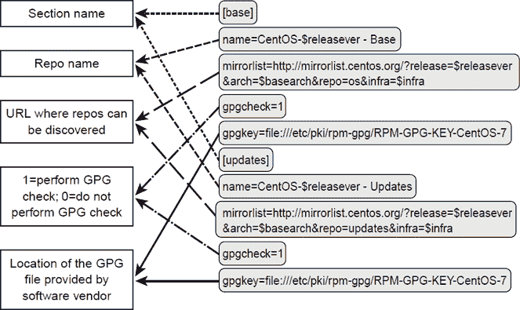

**图 7.3** `/etc/yum.repos.d`中文件的格式

#### DNF

`dnf`工具被设计为 yum 的增强和替代品。大部分更改都是针对软件的“后端”进行的。大多数`dnf`命令的功能与`yum`命令相似，只是命令名称变为`dnf`。

在后端，DNF 工具更好地处理了依赖关系并解决了一些 Yum 的缺陷（例如使用旧版本的 Python）。YUM 尚未被完全取代，因此知道这两个命令均可使用是非常重要的。

#### Zypper

`zypper`命令常见于 SUSE 系统。它源自 RPM 软件套件，工作方式与`yum`非常相似。它具有自动依赖检查并使用存储库。它的命令结构和选项与`yum`几乎相同。这里有一个示例：

```
zypper install pkg_name
```

如果你知道如何使用`yum`命令，那么在大多数情况下，你可以将“yum”替换为“zypper”，命令将成功运行。

### 构建工具

使用某些工具来创建供他人使用的软件。本节将探讨一些实用的构建工具。

#### 命令

可以使用多个命令来创建软件。本节涵盖了这些命令中重要且可能出现在考试中的。

##### make

`make`命令使用名为`Makefile`的文件来执行特定操作。`make`命令用于从源代码构建和维护程序和其他类型的文件。`make`工具的主要功能是确定大型程序的哪些部分需要重新编译，并发布重新编译它们所需的命令。每个`Makefile`都由软件开发者编写，以执行与软件项目相关的操作。通常这包括以下类型的功能：

* 编译软件的操作。关于此主题的更多信息，请参见本章的“编译器”
* 安装软件的操作。
* 对旧版本的编译代码进行“清理”的操作。

以下是一个仅包含安装操作的简单`Makefile`示例：

```make
# more /usr/lib/firmware/Makefile
# This file implements the GNOME Build API:
# http://people.gnome.org/~walters/docs/build-api.txt

FIRMWAREDIR = /lib/firmware

all:

install:
        mkdir -p $(DESTDIR)$(FIRMWAREDIR)
        cp -r * $(DESTDIR)$(FIRMWAREDIR)
        rm -f $(DESTDIR)/usbdux/*dux $(DESTDIR)/*/*.asm
        rm $(DESTDIR)$(FIRMWAREDIR)/{WHENCE,LICENSE.*,LICENCE.*}
```

## make install

`make`命令的`install`选项旨在从源码将代码安装到系统。取决于软件开发者如何创建`Makefile`，它还可能包含编译过程。更多信息请参阅本章中的“编译器”和“make”部分。

## ldd

你可以使用`ldd`命令查看特定命令使用了哪些共享库。以下是`ldd`命令的语法：

```
ldd [options] FILE
```

示例：

```
# ldd /bin/cp
         linux-vdso.so.1 =>  (0x00007ffc35df9000)
         libselinux.so.1 => /lib64/libselinux.so.1  (0x00007f93faa09000)
         libacl.so.1 => /lib64/libacl.so.1 (0x00007f93fa800000)
         libattr.so.1 => /lib64/libattr.so.1 (0x00007f93fa5fa000)
         libc.so.6 => /lib64/libc.so.6 (0x00007f93fa239000)
         libpcre.so.1 => /lib64/libpcre.so.1 (0x00007f93f9fd8000)
         liblzma.so.5 => /lib64/liblzma.so.5 (0x00007f93f9db2000)
         libdl.so.2 => /lib64/libdl.so.2 (0x00007f93f9bae000)
         /lib64/ld-linux-x86-64.so.2 (0x00007f93fac42000)
         libpthread.so.0 => /lib64/libpthread.so.0(0x00007f93f9992000)
```

使用`ldd`命令的目的是排查你编写的代码中的问题。该命令不仅告诉你调用了哪些库，还会具体说明每个库是从哪个目录被调用的。当库的行为不符合你的预期时，这非常有用。

下表描述了`ldd`命令的实用选项：

| 选项 | 说明 |
| --- | --- |
| `-v` | 详细模式；打印额外信息。 |
| `-u` | 显示任何未使用的直接依赖。 |

## 编译器

编译器是一种将源代码（以纯文本格式编写）并转换为可执行二进制代码的程序。有许多不同的编译器，每种编译器都为处理特定语言设计。例如，`gcc`编译器用于编译用 C 或 C++ 语言编写的代码。

虽然管理员可能需要学习特定编译器的细节，但这将根据具体情况而定。通常，编译器在软件的构建过程中自动调用的。这由`make`工具完成。更多信息请参阅本章中的“make”部分。

## 共享库

共享库是可执行程序使用的文件。它们的设计目的是让开发者能够依赖现有的代码来执行功能。

这些共享库遵循命名规范`lib*name*.so.*ver*`，其中`name`是库的唯一名称，`ver`用于指示库的版本号（例如，`libkpathsea.so.6.1.1`）。

通常，共享库文件存储在 Linux 发行版的以下位置之一：

* `/lib` 或 `/lib64`
* `/usr/lib` 或 `/usr/lib64`
* `/usr/local/lib` 或 `/usr/local/lib64`

如果你的操作系统是 32 位发行版，预计可以在`/lib`、`/usr/lib`和`/usr/local/lib`下看到库。在 64 位平台上，`/lib64`、`/usr/lib/64`和`/usr/local/lib64`目录是你预期库的地方。

## 仓库

仓库是存储信息的中心位置。对于软件管理，仓库是存储软件包的地方。`apt`和`yum`等工具可以连接到仓库、验证包依赖关系并安装软件包。

### 配置

更多信息请参阅本章中的“yum”部分。

#### 创建

要创建仓库，请遵循以下步骤：

1. 安装`creatrepo`包。
2. 创建目录。
3. 运行`scanpackages`命令生成元数据。
4. 运行`creatrepo`命令构建索引。

### 同步

同步的过程是更新仓库。通常使用`reposync`用于此目的，以确保本地副本与远程仓库保持同步。

## 语法

```
curl location
```

## 示例

```bash
# curl http://onecoursesource.com
<!DOCTYPE HTML PUBLIC "-//IETF//DTD HTML 2.0//EN">
<html><head>
<title>301 Moved Permanently</title>
</head><body>
<h1>Moved Permanently</1>
<p>The document has moved
  <a href="#62;
```

注意，数据是显示在屏幕上的，而不是像`wget`命令那样存储在文件中。你可以使用重定向将内容放入文件中。

## 第 8 章. 给定场景，管理用户和组

本章提供了有关以下主题的信息和命令：

#### 创建

* `useradd`
* `groupadd`

#### 修改

* `usermod`
* `groupmod`
* `passwd`
* `chage`

### 删除

* `userdel`
* `groupdel`

### 查询

* `id`
* `whoami`
* `who`
* `w`
* `last`

### 配额

* 用户配额
* 组配额

### 配置文件 (BASH 参数)

* 用户级 (`.bashrc`, `.bash_profile`, `.profile`)
* 全局级 (`/etc/bashrc`, `/etc/profile.d/`, `/etc/skel`, `/etc/profile`)

### 重要文件及文件内容

* `/etc/passwd`
* `/etc/group`
* `/etc/shadow`

#### 创建

本节重点介绍用于创建用户和组账户的命令。

#### useradd

root 用户使用`useradd`命令来创建用户账户。

示例：

```bash
[root@OCS ~]$ useradd julia
```

以下是`useradd`命令的一些重要选项：

| 选项 | 描述 |
| --- | --- |
| `-c` | 设置用户的注释或 GECOS 字段。 |
| `-d` | 指定用户的家目录。这通常与`-m`选项一起使用，`-m`会创建该目录。 |


### 创建

root 用户使用 `useradd` 命令来创建用户账户。

示例：

```bash
[root@OCS ~]$ useradd -g 505 -G 506,507 -u 508 -p password -s /bin/bash -d /home/username -m -k /etc/skel username
```

`useradd` 命令的常用选项如下：

| 选项 | 描述 |
| --- | --- |
| `-e` | 设置账户的过期日期（更多信息请参见本章的 `/etc/shadow` 节）。 |
| `-f` | 设置账户的非活动时间（更多信息请参见本章的 `/etc/shadow` 节）。 |
| `-g` | 指定用户的主组。 |
| `-G` | 指定用户的辅助组。 |
| `-k` | 指定 `skel` 目录；系统会自动从该目录复制文件到用户的家目录。 |
| `-s` | 指定用户的登录 `shell`。 |
| `-u` | 指定用户的 `UID`。 |

#### groupadd

root 用户使用 `groupadd` 命令来创建组账户。

示例：

```bash
[root@OCS ~]$ groupadd -g 2050 test
```

`-g` 选项用于指定新组的 `GID`。

#### 修改

本节重点介绍用于修改用户和组账户的命令。

#### usermod

root 用户使用 `usermod` 命令来修改用户账户。

示例：

```bash
[root@OCS ~]$ usermod -s /bin/tcsh julia
```

`usermod` 命令使用了许多与 `useradd` 命令相同的选项。请参考本章的 `useradd` 节以获取这些选项列表。

#### groupmod

root 用户使用 `groupmod` 命令来修改组账户。

示例：

```bash
[root@OCS ~]$ groupmod -n test
```

`groupmod` 的重要选项包括：

| 选项 | 描述 |
| --- | --- |
| `-g` | 为新组指定 `GID`。 |
| `-n` | 修改组名。 |

#### passwd

`passwd` 命令允许用户修改密码。root 用户也可以使用此命令更改任何用户的密码。以下是 `passwd` 的选项：

| 选项 | 描述 |
| --- | --- |
| `-d` | 设置过期日期。 |
| `-e` | 立即过期。 |
| `-f` | 设置密码更改最小天数。 |
| `-l` | 锁定账户。 |
| `-p` | 设置密码。 |
| `-q` | 显示状态。 |
| `-u` | 设置有效期天数。 |
| `-W` | 设置过期警告天数。 |

#### chage

`chage` 命令由 root 用户修改密码过期设置。以下是 `chage` 的选项：

| 选项 | 描述 |
| --- | --- |
| `-d` | 设置最后修改日期。 |
| `-E` | 设置过期日期。 |
| `-m` | 设置密码更改最小天数。 |
| `-M` | 设置有效期天数。 |
| `-W` | 设置过期警告天数。 |
| `-l` | 列出过期信息。 |

### 删除

本节重点介绍用于删除用户和组账户的命令。

#### userdel

root 用户使用 `userdel` 命令删除用户账户。

示例：

```bash
[root@OCS ~]$ userdel susan
```

`userdel` 命令的一个重要选项是 `-r`，它会删除用户账户及其家目录。

#### groupdel

root 用户使用 `groupdel` 命令删除组账户。

示例：

```bash
[root@OCS ~]$ groupdel test
```

注意：在运行此命令之前，请确保已移除该组的文件（或将其重新分配）。

### 查询

本节重点介绍用于查询用户和组账户的命令。

#### id

`id` 命令将显示基本账户信息。不带参数运行时，它会显示当前用户的 `UID`、用户名、主 `GID` 和名称，以及所有的组组成：

```bash
[root@OCS ~]$ id
uid=0(root) gid=0(root) groups=0(root)
```

当传递用户名参数时，它会提供该用户的信息：

```bash
[root@OCS ~]$ id bo
uid=1001(bo) gid=1001(bo) groups=1001(bo),10(wheel),20001(temprandy)
```

#### whoami

`whoami` 命令显示有效用户 `ID`。

示例：

```bash
[root@OCS ~]$ whoami
```

#### who

`who` 命令显示当前登录的用户：

```bash
[root@OCS ~]# who
student         :0          2017-02-18 01:52 (:0)
student         pts/0       2017-02-18 01:52 (:0)
student         pts/1       2017-03-05 19:55 (:0)
student         pts/2       2017-03-06 18:24 (:0)
root            pts/3       2017-03-06 18:24 (localhost)
```

`who` 命令的输出包含用户名、用户正在使用的终端设备、登录日期和时间以及用户登录来源（`:0` 表示本地登录）。下表描述了 `who` 命令的常用选项：

| 选项 | 说明 |
| --- | --- |
| `-b` 或 `--boot` | 上次系统启动的时间。 |
| `-H` 或 `--heading` | 在列上显示标题。 |
| `-q` 或 `--count` | 显示当前登录的用户数。 |

## w

`w` 命令显示谁正在登录以及其他有用信息：

```bash
[root@OCS ~]# w
 18:25:08 up 3 days,  1:24,  5 users,  load average: 0.27, 0.08, 0.07
USER    TTY     FROM      LOGIN@  IDLE    JCPU  PCPU  WHAT
student :0      :0        18Feb17 41:48  1.01s  gdm-session-wor
student pts/0   :0        18Feb17 4.00s  0.46s  20.33s /usr/libexec/gn
student pts/1   :0        Sun19   1:32   0.04s  0.00s  less -s
student pts/2   :0        18:24   12.00s 0.05s  0.01s  /usr/bin/sss_ss
root    pts/3   localhost 18:24   12.00s 0.03s  0.03s  -bash
```

输出的第一行与 `uptime` 命令相同。更多详情请参阅第 21 章中的“给定一个场景，分析系统属性并进行相应的修复”章节中的“`uptime`”部分。`JCPU` 列代表“作业 CPU”（Job CPU），表示从该终端启动的所有进程所占用的 CPU 时间。`PCPU` 列代表“进程 CPU”（Process CPU），表示当前进程（列为输出行中的最后一项）所占用的 CPU 时间。

下表描述了 `w` 命令的常用选项：

| 选项 | 说明 |
| --- | --- |
| `-h` 或 `--no-header` | 不在列上显示标题。 |
| `-s` 或 `--short` | 简短模式；不显示 `JCPU` 或 `PCPU` 列。 |

## last

`last` 命令显示当前和之前登录的信息：

```bash
[root@OCS ~]# last -10
root     pts/3 localhost Mon Mar 6 18:24  still logged in
student  pts/2 :0        Mon Mar 6 18:24  still logged in
student  pts/1 :0        Sun Mar 5 19:55  still logged in
student  pts/1 :0        Sat Feb 18 01:56 - 01:56 (00:00)
student  pts/0 :0        Sat Feb 18 01:52 still logged in
student  :0    :0        Sat Feb 18 01:52 still logged in
(unknown :0    :0        Sat Feb 18 01:48 - 01:52 (00:03)
reboot   system boot 3.10.0-327.18.2.
  Tue Jan 24 13:43 - 19:15 (41+05:31)
student  pts/1  :0     Sun Jan 22 08:22 - 01:46 (26+17:24)
student  pts/0  :0     Thu Jan 19 12:19 - 01:46 29+13:27)

wtmp begins Sat Jun 11 20:51:56 2016
```

下表描述了 `last` 命令的常用选项：

| 选项 | 说明 |
| --- | --- |
| `-x` | 仅显示 `x` 次登录。 |
| `-a` | 为远程登录显示主机名。 |
| `-d` | 显示登录的 IP 地址。 |
| `-F` | 显示完整的登录和注销时间。 |

## Quotas（配额）

配额允许管理员限制个人或组可使用的磁盘空间。配额是针对文件系统的。本节重点介绍如何启用和查看配额。

### 用户配额

要启用用户配额，你必须使用 `usrquota` 挂载选项挂载文件系统。可以通过向 `/etc/fstab` 文件的挂载选项字段中添加 `usrquota` 来：

```bash
/dev/sdb1       /        ext4        usrquota    1         1
```

### 注意

要启用组配额，请使用 `grpquota` 启动选项。这两个选项可以一起使用（`usrquota,grpquota`），以便在文件系统中同时启用用户和组配额。

然后你可以使用以下命令重新挂载文件系统（由 root 用户执行）：

```bash
[root@OCS ~]$ mount -o remount /
```

关于这些任务的更多详情，请参阅第 4 章中的“`/etc/fstab`”和“`mount`”部分“给定一个场景，在 Linux 环境中管理存储”。

在启用了 `usrquota` 选项挂载文件系统后，你需要执行以下 `quotacheck` 命令来创建初始配额数据库：

```bash
[root@OCS ~]$ quotacheck -cugm /dev/sdb1
```

这将在挂载点产生新文件：

```bash
[root@OCS ~]$ quotacheck
```

以下是 `quotacheck` 的一些选项：

| 选项 | 说明 |
| --- | --- |
| `-c` | 创建新的配额文件。 |
| `-g` | 处理组。 |
| `-u` | 处理用户。 |
| `-m` | 不尝试卸载文件系统。 |

要创建或编辑用户的配额，请使用 `edquota` 命令后跟用户名：

```bash
[root@OCS ~]$ edquota
```

`edquota` 命令将进入编辑器（通常默认为 `vi`）并显示以下内容：

```bash
{
  user
}
Filesystem  blocks  soft  hard
/root.user
```

### 注意

在 `edquota` 命令中使用 `-g` 选项来编辑组配额。`edquota` 命令将进入编辑器并显示以下内容（用户示例）：

```bash
[root@OCS ~]$ edquota
```

下表描述了配额的字段：

| 键名 | 描述 |
| --- | --- |
| `Filesystem` | 启用了配额的分区。 |
| `blocks` | 用户当前使用的块数。 |
| `soft` | 代表块的软配额的值；如果用户创建了超过此限制的文件，将发出警告。 |
| `hard` | 代表块的硬配额的值；如果用户创建了超过此限制的文件，将发出错误且无法创建更多文件。 |
| `inodes` | 用户当前拥有的文件数。 |
| `soft` | 代表文件的软配额的值；如果用户创建了超过此限制的文件，将发出警告。 |
| `hard` | 代表文件的硬配额的值；如果用户创建了超过此限制的文件，将发出错误且无法创建更多文件。 |

### 注意

可以通过执行 `edquota -t` 命令设置宽限期。关于宽限期的更多详情，请参阅“配额”。

用户可以执行 `quota` 命令来显示该账户的配额：

```bash
[sarah@OCS ~]$ quota
Disk quotas for user sarah (uid 507):
     Filesystem  blocks  quota  limit  grace  files  quota  limit  grace
      /dev/sda1   20480    30000  60000         1      0    0
```

注意用户超出软配额时的输出；在以下示例中，用户 `sarah` 超过了块的软限制：

```bash
[sarah@OCS ~]$ quota
Disk quotas for user sarah (uid 507):
     Filesystem  blocks  quota  limit  grace  files  quota  limit  grace
      /dev/sda1  40960*  30000  60000  7days     2      0    0
```

一旦用户超过软配额（soft quota），系统将提供一个宽限期。用户必须在宽限期将文件系统使用的空间降低到软配额以下，否则当前使用量将转换为硬配额限制（hard quota limit）。

### 注意

根用户可以通过执行 `edquota -t` 命令设置宽限期。有关该命令的更多细节，请参见“`edquota`”章节。

以下是 `quota` 命令的一些重要选项：

| 选项 | 描述 |
| --- | --- |
| `-g` | 显示组配额而不是特定用户的配额。 |
| `-s` | 以人类可读的大小显示信息，而不是块大小。 |
| `-l` | 仅显示本地文件系统的配额信息（而不是基于网络的文件系统配额）。 |

根用户使用 `repquota` 命令来显示整个文件系统的配额（以下命令必须由根用户执行）：

```bash
[root@localhost ~]$ repquota /
*** Report for user quotas on device /dev/sda1
Block grace time: 7days; Inode grace time: 7days
                        Block limits                   File limits
User             used    soft  hard  grace       used  soft  hard  grace
------------------------------------------------------------------------
root       --  4559956      0     0            207396    0      0
daemon     --      64       0     0                 4    0      0
man        --    1832       0     0               145    0      0
www-data   --       4       0     0                 1    0      0
libuuid    --      40       0     0                 6    0      0
syslog     --    3848       0     0                23    0      0
messagebus --       8       0     0                 2    0      0
landscape  --       8       0     0                 2    0      0
pollinate  --       4       0     0                 1    0      0
vagrant    --  550060       0     0             29906    0      0
colord     --       8       0     0                 2    0      0
statd      --      12       0     0                 3    0      0
puppet     --      44       0     0                11    0      0
ubuntu     --      36       0     0                 8    0      0
sarah      +-   40960   30000 60000  6days          2    0      0
```

以下是 `repquota` 命令的一些重要选项：

| 选项 | 描述 |


| `-a` | 显示 `/etc/fstab` 文件中指定了配额挂载选项的文件系统的配额。 |

| `-g` | 显示组配额而不是特定用户的配额。 |

| `-s` | 以人类可读的大小显示信息，而不是块大小。 |

`quotaon` 命令用于开启文件系统的配额。通常情况下，系统启动时，它会自动开启配额。然而，您可以通过执行 `quotaoff` 命令后跟文件系统的名称来关闭配额（以下命令必须由根用户执行）：

点击此处查看代码图像

```
[root@OCS ~]$ quotaoff /dev/sdb1
[root@OCS ~]$ quotaon /dev/sdb1
```

### 组配额

组配额适用于组中每个成员的配额。创建组配额的方法与创建用户配额非常相似，极少数例外情况已在本章的“用户配额”子节介绍。

### 配置文件

当用户登录系统时，会启动一个登录 shell。当用户登录后启动一个新的 shell 时，被称为*非登录 shell*（non-login shell）。在每情况下，都会使用初始化文件来设置 shell 环境。执行哪些初始化文件取决于 shell 是登录 shell 还是非登录 shell。

图 8.1 展示了用户登录系统时执行哪些初始化文件。

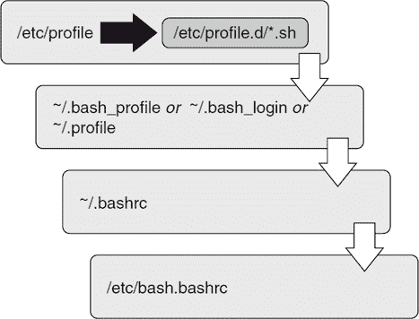

**图 8.1** 用户登录系统时执行的初始化文件

以下是对图 8.1 的解释：

1. 用户登录时执行的第一个初始化文件是 `/etc/profile` 文件。在大多数 Linux 平台上，该脚本包含了执行 `/etc/profile.d` 目录下所有以 “.sh” 结尾的初始化文件的代码。*`/etc/profile` 文件的目的是让管理员放置代码，这些代码会在每个 BASH shell 用户登录时都会执行（通常是登录消息和环境变量定义）。*

2. 执行 `/etc/profile` 文件后，登录 shell 在用户的家目录中查找名为 `~/.bash_profile` 的文件。如果找到，登录 shell 执行该文件中的代码。否则，登录 shell 查找名为 `~/.bash_login` 的文件。如果找到，登录 shell 执行该文件中的代码。否则，登录 shell 查找名为 `~/.profile` 的文件并执行该文件中的代码。*这些文件的目的是让每个用户可以放置代码在该特定用户每次登录时都会执行（通常是环境变量定义）。*

3. 下一个执行的初始化文件是 `~/.bashrc` 脚本。*该文件的目的是让每个用户可以放置代码在该用户每次打开新 shell 时都会执行（通常是别名和函数定义）。*

4. 下一个执行的初始化文件是 `/etc/bash.bashrc` 脚本。*该文件的目的是让管理员可以放置代码，这些代码会在用户每次打开新 shell 时都会执行（通常是别名和函数定义）。*

图 8.2 展示了用户打开新 shell 时执行哪些初始化文件。

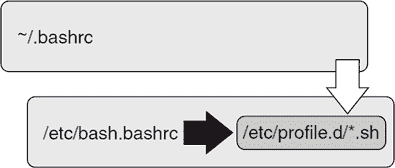

**图 8.2** 用户启动非登录 shell 时执行的初始化文件

以下是对图 8.2 的解释：

1. 用户打开非登录 shell 时执行的第一个初始化文件是 `~/.bashrc` 脚本。*该文件的目的是让每个用户可以放置代码在该用户每次打开新 shell 时都会执行（通常是别名和函数定义）。*

2. 下一个执行的初始化文件是 `/etc/bash.bashrc` 脚本。在大多数 Linux 平台上，该脚本包含了执行 `/etc/profile.d` 目录下所有以 “.sh”结尾的初始化文件的代码。*这些初始化文件的目的是让管理员可以放置代码，这些代码会在用户每次打开新 shell 时都会执行（通常是别名和函数定义）。*

#### BASH 参数

初始化文件可用于修改多个 bash shell 特性。例如，可以设置 变量来修改 bash shell 或程序的行为。有关 变量的更多细节，请参见第 25 章中的“Shell 环境和 变量”章节以及“给定场景，部署并执行基础 BASH 脚本”。

本节涵盖了通常设置这些特性的初始化文件。

##### 用户项

用户可以通过修改家目录下的初始化文件来控制自己的个人环境。本节涵盖这些文件。

###### .bashrc

当用户打开一个新的 BASH shell 时，`~/.bashrc` 文件中的命令会被执行。这允许用户通过在向该文件中放置命令来设置账户。

有关初始化文件如何使用的更多细节，请参阅本章的“配置文件”节。

请注意，`.bashrc` 文件通常包含 BASH 脚本代码。有关 BASH 脚本的详情，请参阅第 25 章”。

### .bash_profile

当用户登录系统且该用户的登录 shell 为 BASH shell 时，如果 `~/.bash_profile` 文件存在，则会执行该文件中的命令。这允许用户通过在在该文件中放置命令来设置账户。

有关初始化文件如何使用的更多细节，请参阅本章的“配置文件”节。

请注意，`.bash_profile` 文件通常包含 BASH 脚本代码。有关 BASH 脚本的详情，请参阅第 25 章”。

### .profile

当用户登录系统且该用户的登录 shell 为 BASH shell 时，如果 `~/.profile` 文件存在，则会执行该文件中的命令。这允许用户通过在在该文件中放置命令来设置账户。

有关初始化文件如何使用的更多细节，请参阅本章的“配置文件”节。

请注意，`.profile` 文件通常包含 BASH 脚本代码。有关 BASH 脚本的详情，请参阅第 25 章”。

### 全局条

管理员可以通过修改 `/etc` 目录下的初始化文件来控制所有用户的 BASH 环境。本节涵盖了这些文件。

### /etc/bashrc

当用户打开一个新的 BASH shell 时，会执行 `/etc/bashrc` 文件中的命令。只应允许 root 用户修改 `/etc/bashrc` 文件。这允许 root 用户通过在该文件中放置命令来设置所有的 BASH 用户账户。

有关初始化文件如何使用的更多细节，请参阅本章的“配置文件”节。

请注意，`/etc/bashrc` 文件通常包含 BASH 脚本代码。有关 BASH 脚本的详情，请参阅第 25 章”。

### /etc/profile.d/

软件开发者通常有修改用户账户的 BASH 环境的需求。例如，考虑一个使用 shell 变量作为传递程序密钥信息的软件，例如用户账户信息或系统信息。

软件通常由 root 用户安装，因此开发者可以使用这种特权直接修改全局初始化文件，例如 `/etc/profile` 或 `/etc/bashrc` 文件。危险的之处在于，这种修改可能会意外影响其他全局设置。

软件开发者（有时是管理员）不会修改主配置文件，而是将文件放在 `/etc/profile.d` 目录下。由于 `/etc/profile` 文件中存在以下代码，该目录也被视为初始化文件的存放位置：

点击此处查看代码

```
for i in /etc/profile.d/*.sh ; do
    if [ -r "$i" ]; then
        if [ "${-#*i}" != "$-" ]; then
            . "$i"
        else
            . "$i" >/dev/null
        fi
    fi
done
```

这段代码的意思是：“如果在 `/etc/profile` 目录下存在以 `.sh` 结尾的文件且它是可读的，则在当前 shell 中源（运行）该文件的内容。”

注意

要了解更多关于此代码的信息，请参阅第 25 章”。

因此，在确定 BASH 初始化过程中发生了什么时，务必查看 `/etc/profile.d` 的内容。以下是一个常见的示例：

点击此处查看代码

```
[root@OCS ~]$ ls /etc/profile.d
256term.csh    colorls.csh  lang.csh  vim.csh
256term.sh     colorls.sh   lang.sh   vim.sh
colorgrep.csh  cvs.csh      less.csh  which2.csh
colorgrep.sh   cvs.sh       less.sh   which2.sh
```

有关初始化文件如何使用的更多细节，请参阅本章的“配置文件”节。

请注意，`/etc/profile.d` 目录下的文件通常包含 BASH 脚本代码。有关 BASH 脚本的详情，请参阅第 25 章”。

### /etc/skel

创建新用户账户时，`/etc/skel` 目录用于新账户提供默认文件，例如 BASH 配置文件（`.bashrc`、`.profile` 等）。有关更多细节请参阅本章的“useradd”小节。

### /etc/profile

当用户登录系统且该用户的登录 shell 为 BASH shell 时，会执行 `/etc/profile` 文件中的命令。只应允许 root 用户修改 `/etc/profile` 文件。这允许 root 用户通过在该文件中放置命令来设置所有的 BASH 用户账户。

有关初始化文件如何使用的更多细节，请参阅本章的“配置文件”节。

请注意，`/etc/profile` 文件通常包含 BASH 脚本代码。有关 BASH 脚本的详情，请参阅第 25 章”。

### 重要文件及文件内容

用户和组账户信息存储在明文文件中。本节涵盖了这些文件。

#### /etc/passwd

`/etc/passwd` 文件用于存储账户信息。它包含了大部分用户账户数据，除了密码和密码有效期策略（有关这些设置的详情，请参阅本章的“/etc/shadow”节）。

`/etc/passwd` 文件中的每一行描述一个用户账户。

示例：

点击此处查看代码

```
root:x:0:0:root:/root:/bin/bash
```

每一行被分为多个字段。下表描述了这些字段：

| 字段 | 描述 |

| --- | --- |

| 用户名 | `root:x:0:0:root:/root:/bin/bash` 是用户登录系统时提供的名称。 |

| 密码占位符 | `root:x:0:0:root:/root:/bin/bash` 是旧版 Unix 中密码曾经存放的地方。 |

| UID | `root:x:0:0:root:/root:/bin/bash` 是用户 ID。 |

| GID | `root:x:0:0:root:/root:/bin/bash` 是用户的主组。 |

| GCOS | `root:x:0:0:root:/root:/bin/bash` GCOS 代表通用电气公司操作系统；它通常是用户的真实姓名和其他标识性数据。 |

| 家目录 | `root:x:0:0:root:/root:/bin/bash` 是用户的家目录。 |

| 登录 shell | `root:x:0:0:root:/root:/bin/bash` 是用户的登录 shell。 |

#### /etc/group

`/etc/group` 文件用于存储组信息。`/etc/group` 文件中的每一行描述一个组账户。

示例：

```
admin:x:110:bob,sue
```

每一行都被拆分成了多个字段。下表描述了这些字段：

| 字段 | 描述 |

| --- | --- |

| 组名 | `admin:x:110:bob,sue` 是组的名称。 |

| 密码占位符 | `admin:x:110:bob,sue` 是旧版 Unix 中密码曾经存放的地方。 |

| GID | `admin:x:110:bob,sue` 是组 ID。 |

| 成员列表 | `admin:x:110:bob,sue` 是组的成员。 |

#### /etc/shadow

`/etc/shadow` 文件用于存储用户密码信息（有关其他账户数据详情请参阅本章的“etc/passwd”节）。

`/etc/shadow` 文件中的每一行描述一个用户账户。带有有效密码的账户示例：

点击此处查看代码

```
student:$6$ciPSOxID$E5p6cgsPs2lng7dQjrVMIUBGhd/dqs49d
jnCB1h1oGhryfitzaVGvsODflyNU67uX3uBraVY0GIOO2zaVGeZ/.:
17116:0:99999:7:30:17246:
```

带有锁定密码的账户示例：

点击此处查看代码

```
bob:*LK*:17116:0:99999:7:30:17246:
```

每一行都被拆分为数据字段。下表描述了这些字段：

| 字段 | 描述 |

| --- | --- |

| **用户名** | `bob:*LK*:17116:0:99999:7:30:17246:`:这是用户名，与 `/etc/passwd` 文件中的条目匹配。 |

| **密码** | `bob:*LK:*17116:0:99999:7:30:17246:`:这是用户的密码或某些锁定值。注意密码是加密的。 |

| **最后修改时间** | `bob:*LK:*17116*:0:99999:7:30:17246:`:这是自 1970 年 1 月 1 日以来用户上次更改密码的天数。系统将其用于接下来的三个字段。 |

| **最小间隔** | `bob:*LK*:17116:*0*:99999:7:30:17246:`:这是用户更改密码后，可以再次更改密码之前的天数。 |

| **最大间隔** | `bob:*LK*:17116:0:*99999*:7:30:17246:`:这是用户更改密码后必须再次更改密码之前的天数。如果用户在此限制之前未更改密码，账户将被锁定。 |

| **警告间隔** | `bob:*LK*:17116:0:99999:*7*:30:17246:`:这是在账户锁定前多少天开始在用户登录时开始发出警告。 |

| **非活动期** | `bob:*LK*:17116:0:99999:7:*30*:17246:`:账户锁定后，用户拥有的“宽限天数”，可以登录——但前提是在登录时提供新密码。 |

| **过期日期** | `bob:*LK*:17116:0:99999:7:30:*17246*:`:这是自 1970 年 1 月 1 日以来用户账户过期的天数。 |

| **未使用** | `bob:*LK*:17116:0:99999:7:30:17246:`:这是一个未使用的字段，未来可能会使用。 |

## 第 9 章 根据给定场景创建、修改和重定向文件

本章提供了相关主题的信息和命令：

#### 编辑器

*   `nano`

*   `vi`

### 文件读取器

*   `grep`

*   `cat`

*   `tail`

*   `head`

*   `less`

*   `more`

### 输出重定向

*   `<`

*   `>`

*   `|`

*   `<<`

*   `>>`

*   `2>`

*   `&>`

*   `stdin`

*   `stdout`

*   `stderr`

*   `/dev/null`

*   `/dev/tty`

*   `xargs`

*   `tee`

*   在此文档 (Here documents)

## 文本处理

*   `grep`

*   `tr`

*   `echo`

*   `sort`

*   `awk`

*   `sed`

*   `cut`

*   `print`

*   `egrep`

*   `wc`

## 文件和目录操作

*   `touch`

*   `mv`

*   `cp`

*   `rm`

*   `scp`

*   `ls`

*   `rsync`

*   `mkdir`

*   `rmdir`

*   `ln` (符号链接)

*   Hard (硬链接)

*   `unlink`

*   `find`

*   `locate`

*   `grep`

*   `which`

*   `diff`

#### 编辑器

#### nano

`nano` 编辑器是一个实用的工具。你应该了解以下常用命令：

| 命令 | 描述 |

| --- | --- |

| `^G` | 显示帮助文档。 |

| `^O` | 保存文件。 |

| `^X` | 退出编辑器。 |

| `^K` | 切剪一行（删除并放入内存中）。可以使用多次 `^K` 切剪多行。 |

| `^U` | 粘贴切出的行。注意这不是撤销操作，而是粘贴操作。 |

| `^^` | 开始并结束文本以进行标记。标记的文本可以复制。使用 `^` 开始标记，使用方向键选择，然后使用最后的 `^` 结束标记。注意第二个 `^` 是实际字符，而第一个代表控制字符。 |

| `^W` | 在文档中搜索文本。 |

| `^F` | 向前移动一页。 |

| `^B` | 向后移动一页。 |

| `^n` | 移动到特定行。例如，`^5` 移动到第 5 行。 |

| `^C` | 显示文档中的当前位置。 |

#### vi

`vi` 编辑器是 Linux 和 Unix 环境的标准文本编辑器。虽然它不像其他编辑器那样友好，但有一些优点：

*   `vi` 编辑器（或 `vim`，`vi` 的改进版本）存在于每个 Linux 发行版中。这意味着如果你知道如何使用 `vi` 编辑器编辑文件，无论您在哪个发行版上工作，你都可以编辑文件。


- 因为`vi`是仅限命令的编辑器，它不需要图形用户界面（GUI）。这很重要，因为许多 Linux 服务器没有安装 GUI，这意味着你无法使用基于 GUI 的文本编辑器。
- 一旦你深入理解了`vi`，你会发现它是一个非常高效的编辑器，与大多数编辑器相比，你可以使用它非常快速地编辑文件。这是因为所有命令都是短的且基于键盘的，所以你不需要浪费时间离开键盘去使用鼠标。

要使用`vi`编辑器编辑新文件，你只需输入不带参数的命令，或者输入`vi 文件名`。

由于`vi`编辑器设计为仅使用键盘操作，这带来了一个挑战，因为有时按键应该执行命令，而有时按键应该代表要插入到文档中的字符。为了让按键执行不同的任务，`vi`有三种操作模式：

- **命令模式（Command mode）：** 这是默认模式。当你打开`vi`时，你将处于命令模式。在此模式下，你可以执行移动光标、删除文本和粘贴文本的命令。
- **插入模式（Insert mode）：** 在插入模式下，插入任何按键都会作为新文本出现在文档中。当你完成新文本添加后，可以按下`Escape`键返回默认模式（命令模式）。
- **末行模式（Last line mode）：** 末行模式也称为`ex mode`，允许你执行更复杂的操作，例如将文档保存为不同名称的文件。要从命令模式进入末行模式，请按下`:`键。输入命令并按下`Enter`后，命令将执行，通常你会返回命令模式。在某些情况下，你可能需要按下`Escape`键返回命令模式。

### 注意

你无法直接从插入模式切换到末行模式，反之亦然。要进入插入模式或末行模式，必须先处于命令模式。按下`Escape`键即可进入命令模式。

在`vi`编辑器中搜索文件时，你可以在命令模式下工作时使用`/`或`?`字符。当你输入`/`或`?`字符时，屏幕左下方会出现一个提示符，如图 9.2 所示。

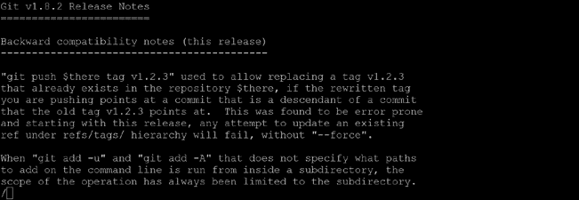

**图 9.2** 在`vi`编辑器中搜索文件

在`/`或`?`提示符处，输入你想搜索的值。你可以在该值中使用正则表达式。例如，如果你输入`/^the`，那么`vi`编辑器将搜索下一个出现在行首的字符串“the”。

`/`字符执行正向搜索，而`?`在文档中进行反向搜索。如果你没有找到要查找的内容，可以使用`n`字符查找下一个匹配项。当以`/`字符开始搜索时，`n`字符将继续在文档中正向搜索。当以`?`字符开始搜索时，`n`字符将继续在文档中反向搜索。

要反转当前搜索，请使用`N`字符。例如，假设你通过输入`?^the`开始搜索。使用`N`字符将在文档中正向搜索。

在命令模式下，你可以使用以下按键在屏幕上移动：

| 键 | 描述 |
| --- | --- |
| `h` | 向左移动一个字符。 |
| `j` | 向下移动一行。 |
| `k` | 向上移动一行。 |
| `l` | 向右移动一个字符。 |

在命令模式下，你可以使用以下按键之一进入插入模式：

| 键 | 描述 |
| --- | --- |
| `i` | 在光标字符之前进入插入模式；使用`I`键在当前行开头插入。 |
| `o` | 在当前行下方打开新行并进入插入模式；使用`O`键在当前行上方打开新行。 |
| `a` | 在光标字符之后进入插入模式；使用`A`键在当前行末尾插入。 |

在命令模式下，你可以使用以下按键修改文本：

| 键 | 描述 |
| --- | --- |
| `c` | `c`键与其他键组合更改数据。例如，`cw`将更改当前单词，`c$`将从光标位置更改到行尾。完成修改后，按下`Escape`键。 |
| `d` | `d`键与其他键组合删除数据。例如，`dw`将删除当前单词，`d$`将删除从光标位置到行尾的内容。所有删除的数据都存储在缓冲区中，可以使用`p`或`P`键粘贴回文档。 |
| `p` | 在使用`d`键剪切文本或使用`y`键复制文本后，可以使用`p`或`P`键粘贴。小写`p`将粘贴在当前光标之后，而大写`P`将粘贴在光标之前。 |
| `y` | `y`键与其他键组合复制数据。例如，`yw`将复制当前单词，`y$`将复制从光标位置到行尾的内容。所有复制的数据都存储在缓冲区中，可以使用`p`或`P`键粘贴回文档。 |
| `dd` | `dd`命令将删除当前行。 |
| `yy` | `yy`命令将复制当前行。 |

在命令模式下，你可以通过输入以下按键保存和/或退出文档：

| 键 | 描述 |
| --- | --- |
| `ZZ` | 保存并退出文档。这等同于`:wq`。 |
| `:w!` | 强制`vi`编辑器将文档中的更改写入文件。 |
| `:q!` | 强制`vi`编辑器退出，即使文件中的更改未保存。 |
| `:e!` | 打开新文件进行编辑，并遗忘自上次写入以来文档中的所有更改。这需要一个文件名作为参数（例如，`:e! myfile.txt`）。 |

### 文件读取器

文件读取器是用于查看文本文件内容的命令。本节重点介绍一些流行的 Linux 文件读取器。

#### `grep`

使用`grep`命令在文件中搜索包含特定模式的行。默认情况下，`grep`命令在找到匹配模式时将显示整行。

示例：

点击此处查看代码图像

```bash
[student@OCS ~]$ grep "the" /etc/rsyslog.conf
# 若要启用高精度时间戳，请注释掉下行。
# 为所有日志文件设置默认权限。
```

### 注意

执行搜索的模式使用基础正则表达式。关于基础正则表达式的更多细节，请参见本章的“附录：regex”部分。

以下是`grep`的一些选项：

| 选项 | 描述 |
| --- | --- |
| `-c` | 显示匹配行的计数，而不是显示每个匹配的行。 |
| `-color` | 匹配的文本以与其他文本不同的颜色显示。 |
| `-E` | 在基础正则表达式的基础上使用扩展正则表达式。关于扩展正则表达式的更多细节，请参见本章的“附录：regex”部分。 |
| `-f` | 固定字符串；模式中的所有字符都将被视为普通字符，而不是正则表达式字符。 |
| `-e` | 用于在一个`grep`命令中指定多个模式（例如，`grep -e pattern1 -e pattern2 file`）。 |
| `-f file` | 使用指定`file`中的模式。 |
| `-i` | 忽略大小写。 |
| `-l` | 显示匹配模式的文件名，而不是显示文件中匹配的每一行。这在搜索多个文件时非常有用（例如，`grep "the" /etc/*`）。 |
| `-n` | 在显示行之前显示行号。 |
| `-r` | 递归搜索目录结构中的所有文件。 |
| `-v` | 反向匹配；返回不包含指定模式的所有行。 |
| `-w` | 仅匹配整个单词；例如，命令`grep "the" file`将匹配字母“the”，即使它是较长单词（如“then”或“there”）的一部分，但命令`grep -w "the" file`仅将“the”作为一个独立的单词进行匹配。 |

#### `cat`

`cat`命令显示文本文件的内容。重要的选项包括：

| 选项 | 说明 |
| --- | --- |
| `-A` | 与`-vET`相同。 |
| `-e` | 与`-vE`相同。 |
| `-E` | 在每行的末尾显示`$`字符（用于查看行尾的空白字符）。 |
| `-n` | 对输出的所有行进行编号。 |
| `-s` | 将多个空行转换为单个空行。 |
| `-T` | 为每个制表符显示“^I”字符（用于查看空格而非制表符）。 |
| `-v` | 显示“不可打印”字符（如控制字符）。 |

#### `tail`

`tail`命令显示文本数据的底部部分。默认显示最后十行。使用`-n`选项可以显示不同数量的行：

点击此处查看图像

```bash
[student@OCS ~]$ cal 12 1999
    December 1999
Su Mo Tu We Th Fr Sa
          1  2  3  4
 5  6  7  8  9 10 11
12 13 14 15 16 17 18
19 20 21 22 23 24 25
26 27 28 29 30 31

[student@OCS ~]$ cal 12 1999 | tail -n 2
26 27 28 29 30 31
```

以下是一些重要的选项：

| 选项 | 说明 |
| --- | --- |
| `-f` | 显示文件的底部部分并“跟踪”变化，这意味着当数据写入文件时，继续显示对文件进行的任何更改。 |
| `-n +x` | 从行号`x`显示到文件末尾。 |

#### `head`

`head`命令显示文本数据的顶部部分。默认显示前十行。使用`-n`选项可以显示不同数量的行：

点击此处查看图像

```bash
[student@OCS ~]$ ls -l | head -3
total 12
drwxrwxr-x. 2 student student 6 Aug 22 16:51 book
drwxrwxr-x. 2 student student 6 Aug 22 16:51 class
```

#### `less`

`less`命令用于显示大块文本数据。与`cat`命令不同，`less`命令在显示第一页信息后会暂停。键盘上的按键允许用户滚动文档。下表强调了更有用的移动键：

| 移动键 | 说明 |
| --- | --- |
| `h` | 显示帮助屏幕（`less`命令移动键的摘要）。 |
| `SPACEBAR` | 在当前文档中向前一页。 |
| `b` | 在当前文档中向后一页。 |
| `ENTER` | 在当前文档中向下移动；向下箭头键也可以执行此操作。 |
| `UP ARROW` | 在当前文档中向上移动。 |
| `*term` | 在文档中搜索`term`（这可以是正则表达式或纯文本）。 |
| `q` | 退出查看文档并返回 shell。 |

### `more`

`more`命令是`less`命令的一个功能稍弱的版本。基本上，`more`命令可以做的一切事情，`less`命令也作为一项功能具备。然而，`less`命令具有`more`命令不具备的额外功能。

参见本章中的“less”小节以了解更多关于这些命令的信息（该小节列出的所有内容都包含在`more`命令中）。

### 输出重定向

每个命令都能发送两个输出流（标准输出和标准错误），并可以接受一个数据流（标准输入）。在文档中，这些术语也可以以下方式描述：

- 标准输出 = `STDOUT`或`STDOUT`
- 标准错误 = `stderr`或`STDERR`
- 标准输入 = `STDIN`或`STDIN`

默认情况下，`STDOUT`和`stderr`被发送到终端窗口，而`STDIN`来自键盘输入。在某些情况下，你想更改这些位置，这是通过名为“重定向”的过程实现的。

下表描述了执行重定向的方法：

| 方法 | 说明 |
| --- | --- |
| `cmd < file` | 覆盖`STDIN`，使输入来自指定的文件。 |
| `cmd > file` | 覆盖`STDOUT`，使输出进入指定的文件。 |
| `cmd 2> file` | 覆盖`stderr`，使输出进入指定的文件。 |
| `cmd &> file` | 同时覆盖`STDOUT`和`stderr`，使输出进入指定的文件。 |
| `cmd1 \| cmd2` | 覆盖`STDIN`，将`cmd1`的输出作为`cmd2`的输入。 |

在以下示例中，`cal`的标准输出被重定向到了名为`month`的文件：

```bash
[student@OCS ~]$ cal 12 1999 > month
```

现在，`month`文件包含了 1999 年 12 月的日历：

```text
[student@OCS ~]$ cat month
December 1999
Su Mo Tu We Th Fr Sa
          1  2  3  4
 5  6  7  8  9 10 11
12 13 14 15 16 17 18
19 20 21 22 23 24 25
26 27 28 29 30 31
```

在下面的示例中，我们将标准错误重定向到了一个`error`文件：

```bash
[student@OCS ~]$ cal 13 1999 2> error
```

由于不存在 13 月，因此产生的错误信息被写入了`error`文件：

```text
[student@OCS ~]$ cat error
cal: cannot do month '13': Invalid argument
```

在下面的示例中，我们同时重定向了`STDOUT`和`stderr`：

```bash
[student@OCS ~]$ cal 12 1999 &> output
```

现在，`output`文件包含了日历内容和错误信息：

```text
[student@OCS ~]$ cat output
December 1999
Su Mo Tu We Th Fr Sa
          1  2  3  4
 5  6  7  8  9 10 11
12 13 14 15 16 17 18
19 20 21 22 23 24 25
26 27 28 29 30 31
```

在下面的示例中，我们使用管道符`|`将一个命令的输出传递给另一个命令的输入：

```bash
[student@OCS ~]$ cal 12 1999 | tail -n 2
26 27 28 29 30 31
```

请注意，执行顺序会产生影响。在上例中，版权文件的前 40 行被发送到`tail`命令。然后，这 40 行中的最后 10 行被发送到`nl`命令进行编号。请注意当先执行`nl`命令时，输出的差异：

点击此处查看代码

```text
[student@OCS ~]$ nl copyright | head -50
36 b) If you have received a modified that was
37 mentioned under a) you are allowed to further…
38 unmodified, as mentioned at). If you make…
39 the text under a) applies to those changes.
40 c) Provide all the changes, including source…
41 copy of the modified you distribute. This…
42 the form of a. You can choose…
43 for new code you add. The changes and their…
44 restrict others from making their own changes…
45 version of.
45 d) When you have a modified Vim which includes changes as
47 mentioned
```

#### `<<`

参阅“重定向”。

#### `>>`

参阅“重定向”。

#### `2>`

参阅“重定向”。

#### `&>`

参阅“重定向”。

#### `stdin`

参阅“重定向”。

#### `stdout`

参阅“重定向”。

#### `stderr`

参阅“重定向”。

#### `/dev/null`

在某些情况下，你可能不想看到命令的`stdout`或`stderr`。例如，考虑以下`find`命令：

点击此处查看代码

```bash
[student@OCS ~]$ find /etc -name "hosts"
find: '/etc/named': Permission denied
find: '/etc/polkit-1/localauthority': Permission denied
find: '/etc/polkit-1/rules.d': Permission denied
find: '/etc/pki/rsyslog': Permission denied
find: '/etc/pki/CA/private': Permission denied
find: '/etc/sudoers.d': Permission denied
find: '/etc/grub.d': Permission denied
find: '/etc/phpMyAdmin': Permission denied
find: '/etc/selinux/targeted/modules/active': Permission denied
find: '/etc/webmin/lpadmin': Permission denied
find: '/etc/webmin/iscs-target': Permission denied
```

注意大量的“Permission denied”（权限拒绝）消息。这是由于没有权限查看位于特定目录的内容。你并不关心这些消息，并希望它们不要显示。你可以将这些消息重定向到`/dev/null`设备文件。这个文件被称为“位桶”（bit bucket），作为一个永远不需要倒的垃圾桶。发送到`/dev/null`的任何内容都会被立即丢弃。由于之前的`find`命令中的错误信息是发送到`stderr`的，因此可以使用以下语法将其丢弃：

点击此处查看代码

```bash
[student@OCS ~]$ find /etc -name "hosts" 2> /dev/null
/etc/hosts
```

有关`2>`符号的细节，请参阅本章重定向。

#### `/dev/tty`

`/dev`目录下的几个文件用于将数据发送到显示设备。这些包括虚拟终端：


点击此处查看代码

```
[student@OCS ~]$ ls /dev/tty*
/dev/tty    /dev/tty20  /dev/tty33  /dev/tty46  /dev/tty59
/dev/tty0   /dev/tty21  /dev/tty34  /dev/tty47  /dev/tty6
/dev/tty1   /dev/tty22  /dev/tty35  /dev/tty48  /dev/tty60
/dev/tty10  /dev/tty23  /dev/tty36  /dev/tty49  /dev/tty61
/dev/tty11  /dev/tty24  /dev/tty37  /dev/tty5   /dev/tty62
/dev/tty12  /dev/tty25  /dev/tty38  /dev/tty50  /dev/tty63
/dev/tty13  /dev/tty26  /dev/tty39  /dev/tty51  /dev/tty7
/dev/tty14  /dev/tty27  /dev/tty4   /dev/tty52  /dev/tty8
/dev/tty15  /dev/tty28  /dev/tty40  /dev/tty53  /dev/tty9
```

虚拟终端是在登录时创建的。以下是`tty`命令的示例：

```
[student@OCS ~]$ ls
[student@OCS ~]$ cal | tee cal.txt
    January 2017
Su   Mo  Tu  We  Th  Fr  Sa
 1    2   3   4   5   6   7
 8    9  10  11  12  13  14
15   16  17  18  19  20  21
22   23  24  25  26  27  28
29   30  31
```

`tty`命令旨在提供你当前正在使用的终端信息。例如，假设你想对`/etc`目录中每个以字母“e”开头的文件运行`wc -l`：

```
[student@OCS ~]$ ls -d /e* | xargs wc -l
1 /etc/environment
1 /etc/22
2 total
```

`xargs`从`STDIN`获取数据以构建并执行命令。该命令的格式如下：

```
xargs [options] [command]
```

`xargs`有一些重要的选项：

| 选项 | 说明 |
| --- | --- |
| `-0` | 处理空格问题。通常用于文件名包含空格的情况；每个字符被视为字面量。 |
| `-d` | 用于更改参数之间的分隔符（默认是空格）。 |
| `-n` *max-args* | 指定每个`command`的最大参数数量。 |
| `-p` | 在执行`command`之前提示用户。 |
| `-t` | 在执行命令之前显示该`command`。 |

#### tee

如果你想让`STDOUT`同时发送到终端和文件，请将输出发送到`tee`命令，并提供一个指示要存储信息的文件的参数。例如：

`tee`命令只有几个选项。最实用的是`-a`选项。默认情况下，`tee`命令将完全覆盖文件；`-a`选项告诉`tee`命令追加到文件中。

here document（在此处文档）是一种重定向技术，允许你向命令发送大块数据。例如，假设你想将以下文本发送到`stdout`：

“我们选择前往月球。我们选择在这一十年内前往月球，并完成其他事情，不是因为它们是容易，而是因为它们是困难，因为这个目标将有助于组织和衡量我们最好的能量和技能，因为这个挑战是我们愿意接受的，是我们不愿推迟的，也是我们想要赢得，而且其他事情也是如此。”

使用 here document，你可以使用语法：

点击此处查看代码图像

```
cat <<EOF
We choose to go to the moon. We choose to go to the moon in this
decade and do the other things, not because they are easy, but because
they are hard, because that goal will serve to organize and measure
the best of our energies and skills, because that challenge is one
that we are willing to accept, one we are unwilling to postpone, and
one which we intend to win, and the others, too.
EOF
```

两个`EOF`标签之间的所有内容都会被发送给`cat`命令，就像来自`stdin`一样。这提供了一种使用 WYSIWYG（所见即所得）显示文本的方法。通常 here document 用于 shell 脚本，但也可以在命令行中使用。

## 文本处理

由于 Linux 主要是命令行环境，因此存在大量的文本操作。无论是命令的输出还是文件的内容，通常经常需要处理这些数据。本节重点介绍不同的文本处理工具。

#### grep

请参见本章中之前的“grep”子节。

### tr

`tr`命令用于将字符从一组翻译到另一组。该命令的语法为`tr SET1 [SET2]`。

例如，以下操作会将`date`命令的输出转换为大写字母：

点击此处查看代码图像

```
[student@OCS ~]$ date
Sat Dec 3 20:15:05 PST 2016
[student@OCS ~]$ date | tr 'a-z' 'A-Z'
SAT DEC 3 20:15:18 PST 2016
```

注意，为了对文件使用`tr`命令，你必须将文件重定向到`tr`命令，如下所示，因为`tr`命令不接受文件作为参数：

```
tr 'a-z' 'A-Z' < file
```

这里是`tr`命令的一些重要选项：

| 选项 | 说明 |
| --- | --- |
| `-d` | 当省略第二组时使用；它会删除匹配的字符。例如，以下命令将删除`date`命令输出中的所有数字：`date | tr -d ‘0-9’`。 |
| `-s` | 重复匹配的字符在翻译之前转换为单个字符。因此，如果执行命令`tr -s ‘a’‘A’`，则“aaabc”将先转换为“abc”，然后翻译为“Abc”。 |

### echo

`echo`命令用于向标准输出显示信息。例如，假设你想显示`$PATH`变量的值：

点击此处查看代码图像

```
[student@OCS ~]$ echo $PATH
/usr/local/bin:/usr/bin:/usr/local/sbin:/usr/sbin:
  /home/bo/.local/bin:/home/bo/bin
```

这里是`echo`命令的一些重要选项：

| 选项 | 说明 |
| --- | --- |
| `-n` | 不在字符串末尾包含换行符。 |
| `-e` | 启用“反斜杠转义”；例如，`\n`是换行符，`\t`是制表符。 |

### sort

`sort`命令用于排序文本数据。默认情况下，它将每行数据拆分为字段，使用空白作为默认分隔符。它默认还对数据中的第一个字段进行排序，执行字典排序：

点击此处查看代码图像

```
[student@OCS ~]$ cat individuals.txt
tom
nick
sue
Tim
[student@OCS ~]$ sort individuals.txt
nick
sue
Tim
tom
```

这里是`sort`命令的一些重要选项：

| 选项 | 说明 |
| --- | --- |
| `-f` | 忽略大小写（本质上不区分大小写）。 |
| `-h` | 人类化的数值排序（例如，2K 低于 1G）。 |
| `-n` | 数字排序。 |
| `-M` | 按月份排序。 |
| `-r` | 用于反转排序顺序。 |
| `-t` | 用于更改字段分隔符（例如，`sort -t “:” file.txt`）。 |
| `-u` | 用于删除重复行。 |

要对默认以外的字段进行排序，请使用`-k`选项。例如：

点击此处查看代码图像

```
[student@OCS ~]$ more people.txt
1  tom
2  nick
3  sue
4  tim
[student@OCS ~]$ sort -k 2 people.txt
2  nick
3  sue
4  tim
1  tom
```

### awk

`awk`命令用于修改简单数据库格式的文本。例如，考虑以下数据：

点击此处查看代码图像

```
[student@OCS ~]$ head /etc/passwd
root:x:0:0:root:/root
bin:x:1:1:bin:/bin
daemon:x:2:2:daemon:/sbin
adm:x:3:4:adm:/var/adm
lp:x:4:7:lp:/var/spool/lpd
sync:x:5:0:sync:/bin
shutdown:x:6:0:shutdown:/sbin
halt:x:7:0:halt:/sbin
mail:x:8:0:mail:/var/mail
operator:x:9:0:root:/root
使用`awk`命令，你可以将显示的数据拆分为不同的字段并执行操作：

点击此处查看代码图像

```
[student@OCS ~]$ head /etc/passwd | awk -F: '{print $1}'
root
bin
daemon
adm
lp
sync
shutdown
halt
mail
```

在之前的示例中，`-F`用于指定分隔符。每个字段被分配给变量。这些变量在下表中：

| 变量 | 说明 |
| --- | --- |
| `$1`, `$2`, 等 | 字段。 |
| `$0` | 整个行。 |
| `NF` | 字段的数量（不要使用$）。 |
| `NR` | 当前行号。 |

这里是`awk`命令的一些重要选项：

| 选项 | 说明 |
| --- | --- |
| `-F` | 指定字段分隔符。 |
| `-f` | 指定包含`awk`命令的文件。 |

### sed

使用`sed`工具对文件进行自动化修改。`sed`命令的基本格式为`sed s/RE/string/`。

“RE”指的是*正则表达式*，一种使用特殊字符匹配模式的特性。请参见本章中的“附录：正则表达式”部分更多关于正则表达式的细节。

`sed`命令示例：

点击此处查看代码图像

```
[student@OCS ~]$ head -n 5 /etc/passwd
root:x:0:0:root:/root:/bin
bin:x:1:1:bin:/bin
daemon:x:2:2:daemon:/sbin
adm:x:3:4:adm:/var/adm
lp:x:4:7:lp:/var/spool/lpd
[student@OCS ~]$ head -n 5 /etc/passwd | sed 's/bin/----/'
root:x:0:0:root:/root:/----
----:x:1:1:bin:/bin
daemon:x:2:2:daemon:/sbin
adm:x:3:4:adm:/var/adm
lp:x:4:7:lp:/var/spool/lpd
```

`sed`是一个非常强大的工具，具有许多功能。下表描述了一些更有实用的`sed`功能：

| 特性 | 说明 |
| --- | --- |
| `/RE/d` | 从`sed`命令的输出中删除匹配 RE 的行。 |
| `/RE/c*string*` | 将匹配 RE 的行更改为*string*的值。 |
| `/RE/a*string*` | 在所有匹配 RE 的行之后添加*string*。 |
| `/RE/i*string*` | 在所有匹配`RE`的行之前添加`string`。 |

`sed`命令有两个重要的修饰符（添加在`sed`操作末尾的字符）：

* `g`：意味着“全局（global）”。默认情况下，只替换第一个`RE`模式匹配项。当使用`g`修饰符时，将进行所有替换。请参见图 9.3 示例。

    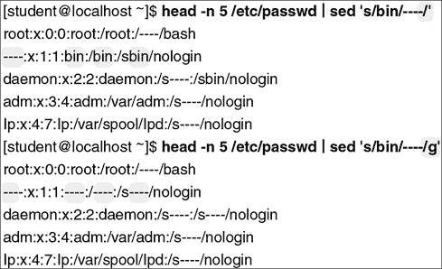

    **图 9.3** `g`修饰符

* `i`：意味着“忽略大小写（case-insensitive）”。此修饰符匹配任何大小写的字母字符。因此，命令`sed ‘s/a/-/i’`会匹配“a”或“A”并将其替换为字符“-”。

`sed`命令还可以修改原始文件（而不是在屏幕上显示修改后的数据）。要修改原始文件，请使用`-i`选项。

### cut

`cut`命令用于显示数据的“部分”。以下是`cut`命令的一些重要选项：

| 选项 | 描述 |
| --- | --- |
| `-b` | 用于按字节定义要打印的部分。 |
| `-c` | 用于按字符定义要打印的部分。 |
| `-d` | 用于指定分隔符（配合`-f`选项使用）。 |
| `-f` | 用于指定要显示哪些字段。 |

使用字段的示例：

点击此处查看代码图像

```
[student@OCS ~]$ head -2 /etc/passwd
root:x:0:0:root:/root:/bin/bash
bin:x:1:1:bin:/bin:/sbin/nologin
[student@OCS ~]$ head -2 /etc/passwd | cut -d: -f1,7
root:/bin/bash
bin:/sbin/nologin
```

使用字符的示例：

点击此处查看代码图像

```
[student@OCS ~]$ ls -l /etc/passwd
-rw-r--r--. 1 root root 2607 Nov 3 10:15 /etc/passwd
[student@OCS ~]$ ls -l /etc/passwd | cut -c1-10,42-
-rw-r--r-- /etc/passwd
```

### egrep

`egrep`命令的功能与`grep -E`命令相同。更多详细信息请参见本章中的第一个“grep”小节。

### wc

用于显示数据的行数、单词数或字符数。默认情况下，显示所有三个值：

点击此处查看代码图像

```
[student@OCS ~]$ wc sample.txt
 2 4 24 sample.txt
```

以下是`wc`命令的一些重要选项：

| 选项 | 描述 |
| --- | --- |
| `-c` | 仅显示字节数。（对于文本数据，一个字节代表一个字符。） |
| `-m` | 仅显示字符数。 |
| `-l` | 仅显示行数。 |
| `-w` | 仅显示单词数。 |

## 文件和目录操作

任何文件系统都包含成千上万需要管理的文件和目录。本节重点关注用于管理这些文件系统对象的 Linux 命令。

### touch

`touch`命令有两个功能：创建一个空文件以及更新现有文件的修改和访问时间。要创建文件或将现有文件的时间戳更新为当前时间，请使用以下语法：

```
touch filename
```

以下是`touch`命令的一些重要选项：

| 选项 | 描述 |
| --- | --- |
| `-a` | 仅修改访问时间，不修改修改时间。 |
| `-d DATE` | 将时间戳设置为指定的`DATE`（例如，`touch -d “2018-01-01 14:00:00”`）。 |
| `-m` | 仅修改修改时间，不修改访问时间。 |
| `-r file` | 使用`file`的时间戳作为设置指定文件时间戳的参考（例如，`touch -r /etc/hosts /etc/passwd`）。 |

### mv

`mv`命令用于移动或重命名文件。

示例：

```
mv /tmp/myfile ~
```

以下是`mv`命令的一些重要选项：

| 选项 | 描述 |
| --- | --- |
| `-i` | 如果移动过程会导致覆盖现有文件，则提供交互式提示。 |
| `-n` | 不覆盖现有文件。 |
| `-v` | 详细模式（描述移动文件和目录时执行的操作）。 |

### cp

`cp`命令用于复制文件或目录。该命令的语法如下：

点击此处查看代码图像

```
cp [options] file|directory destination
```

`file|directory`是要复制的文件或目录。`destination`是将文件或目录复制到的位置。以下示例将`/etc/hosts`文件复制到当前目录：

点击此处查看代码图像

```
[student@OCS ~]$ cp /etc/hosts .
```

注意，*必须*指定目标位置（因此上一个示例中代表当前目录的 “.” 字符）。

下表提供了`cp`命令的一些重要选项：

| 选项 | 描述 |
| --- | --- |
| `-i` | 如果复制过程会导致覆盖现有文件，则提供交互式提示。 |
| `-n` | 不覆盖现有文件。 |
| `-r` | 复制整个目录结构（“r”代表递归）。 |
| `-v` | 详细模式（描述复制文件和目录时执行的操作）。 |

### rm

`rm`命令用于删除文件和目录。

示例：

```
rm file.txt
```


以下是 `rm` 命令的一些重要选项：

| 选项 | 描述 |
| --- | --- |
| `-i` | 在删除文件之前提供交互式提示。 |
| `-r` | 删除整个目录结构（“r”代表递归）。 |
| `-v` | 详细模式（描述删除文件和目录时执行的操作）。 |

### scp

`scp` 命令用于通过安全 Shell 服务向和从远程系统复制文件。要将文件从本地机器复制到远程机器，请使用以下语法：

```
scp filename user@machine:/directory
```

在此语法中，`user` 是远程系统上的帐户名。`machine` 是远程系统，`/directory` 代表你想存储文件的位置。

以下是 `scp` 命令的一些重要选项：

| 选项 | 描述 |
| --- | --- |
| `-P port` | 指定要连接的端口号。SSH 服务器通常使用端口 22，这是 `scp` 命令的默认端口。 |
| `-p` | 尝试保留原始文件的时间戳和权限。 |
| `-r` | 递归模式（复制整个目录）。 |
| `-v` | 详细模式。 |

### ls

`ls` 命令用于列出目录中的文件。以下是 `ls` 命令的一些重要选项：

| 选项 | 描述 |
| --- | --- |
| `-a` | 列出所有文件，包括隐藏文件。 |
| `-d` | 列出目录名，而不是目录的内容。 |
| `-F` | 在文件名末尾添加字符以指示其类型；示例包括 `=`=可执行文件、`/`=目录和 `@`=符号链接文件。 |
| `-h` | 当 `-h` 与 `-l` 配合使用时，以易读格式提供文件大小。 |
| `-i` | 显示每个文件的 inode 值。 |
| `-l` | 显示详细列表（见表后的示例）。 |
| `-r` | 反转文件列表的输出顺序。 |
| `-S` | 按文件大小排序。 |
| `-t` | 按修改时间排序（最新的文件列在前）。 |

`ls -l` 命令的输出每个文件包含一行，如图 9.4 所示。

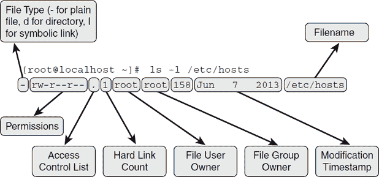

**图 9.4** `ls -l` 命令

### rsync

`rsync` 命令对于跨网络远程复制文件非常有用。它通常用于需要复制之前文件的更改的情况，因为它比其他远程复制方法处理得更高效。

语法：

```
rsync [options] source destination
```

以下是 `rsync` 的一些重要选项：

| 选项 | 描述 |
| --- | --- |
| `-t` | 保留原始修改时间。 |
| `-v` | 详细模式。 |
| `-r` | 递归（传输整个目录）。 |
| `-l` | 保留符号链接。 |
| `-p` | 保留原始权限。 |

#### mkdir

`mkdir` 命令用于创建目录。

示例：

```
mkdir test
```

以下是一些重要的 `mkdir` 选项：

| 选项 | 描述 |
| --- | --- |
| `-m perm` | 为新目录设置权限，而不是使用 umask 值。 |
| `-p` | 在必要时创建父目录；例如，`mkdir /home/bob/data/january` 将创建路径中不存在的所有目录。 |
| `-v` | 详细模式，通过为创建的每个目录打印消息。 |

#### rmdir

`rmdir` 命令用于删除空目录。如果目录不是空的，该命令将失败（使用 `rm -r` 删除目录及其内部所有文件）。

示例：

```
rmdir data
```

#### ln

存在两种类型的链接文件：硬链接和软链接（也称为符号链接）。在决定是链接文件还是创建文件副本时，理解这些链接类型非常重要。本节介绍了链接的用途以及如何使用 `ln` 命令创建链接。

##### 符号链接（软链接）

当你创建一个软链接时，原始文件包含数据，而链接文件“指向”原始文件。对原始文件进行的任何更改也会显示在链接文件中，因为使用链接文件始终会导致通过链接跳转到目标文件。删除原始文件会导致断链，使链接文件失效并导致数据完全丢失。

图 9.5 展示了软链接。

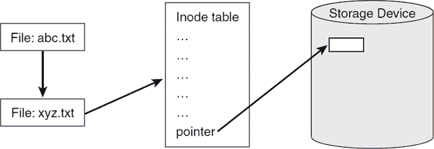

**图 9.5** 软链接

在图 9.5 中，`abc.txt` 文件被软链接到 `xyz.txt` 文件。`abc.txt` 文件指向文件名 `xyz.txt`，而不是同一个 inode 表（尽管图中未显示，但 `abc.txt` 文件有它自己的 inode 表）。当访问链接文件的进程遵循链接时，可以通过 `abc.txt` 文件访问 `xyz.txt` 对应的数据。

复制文件会产生数据的完整且独立的副本。原始文件的更改对复制文件中的数据没有影响。复制文件中的更改对原始文件中的数据没有影响。删除这些文件中的任何一个都不会影响另一个。

要创建链接，请按以下方式执行 `ln` 命令：`ln [-s] target_file link_file`。你可以为任何文件或目录创建软链接：

```
[root@OCS ~]$ ln -s /boot/initrd.img-3.16.0-30-generic initrd
```

`ls` 命令可以查看软链接和硬链接。软链接非常容易识别，因为在执行 `ls -l` 命令时会显示目标文件：

```
[root@OCS ~]$ ls -l /etc/vtrgb
lrwxrwxrwx 1 root root 23 Jul 11 2015
  /etc/vtrgb -> /etc/alternatives/vtrgb
```

##### 硬链接

当你对文件创建硬链接时，没有办法区分“原始”文件和“链接”文件。它们只是指向同一个 inode 的两个文件名（更多信息请参见本章中的“inodes”小节），因此也指向相同的数据。如果你有十个硬链接文件并删除了其中九个，数据仍然存在剩余的文件中。

图 9.6 展示了硬链接。

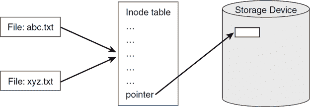

Inodes 在符号链接和硬链接方面非常重要。更多细节请参见本章中的“符号链接（软链接）”和“硬链接”节。

### find

`find` 命令将根据不同的标准在实时文件系统中搜索文件和目录。以下是命令的格式：

```
find [options] starting_point criteria action
```

`starting_point` 是开始搜索的目录。`criteria` 是要搜索的内容，而 `action` 是对结果执行的操作。

以下选项用于修改 `find` 命令的行为：

| 选项 | 描述 |
| --- | --- |
| `-maxdepth` *n* | 限制搜索子目录的深度；例如，`find -maxdepth 3` 将搜索限制在三层子目录以内。 |
| `-mount` | 防止搜索作为挂载点的目录。当你从 `/` 目录进行搜索时，这非常有用。 |
| `-regextype` *type* | 当使用正则表达式（RE）时，此选项指定将使用的 RE 类型；`type` 可以是 emacs（默认）、posix-awk、posix-basic、posix-egrep 或 posix-extended。 |

大多数基于属性的选项允许你指定一个数值作为参数。可以在该数值前加上 `-` 或 `+` 字符来表示“小于”或“大于”。例如，使用 `+5` 意味着“大于五个”。以下是一些重要的基于属性的选项：

| 选项 | 描述 |
| --- | --- |
| `-amin` *n* | 根据访问时间匹配文件；例如，`-amin -3` 将匹配在过去三分钟内访问过的文件。 |
| `-group` *name* | 匹配由 `name` 组所有的文件。 |
| `-name` *pattern* | 根据提供的 `pattern` 匹配文件或目录；`pattern` 可以是正则表达式。 |
| `-mmin` *n* | 根据修改时间匹配文件；例如，`-mmin -3` 将匹配在过去三分钟内修改的文件。 |
| `-nogroup` | 匹配不属于任何组的文件。 |
| `-nouser` | 匹配不属于任何用户的文件。 |
| `-perm` *mode* | 匹配符合 `mode`（八进制或符号模式）指定权限的文件；请参见下表中的示例。 |
| `-size` *n* | 根据文件大小匹配文件；值 `n` 前可以加上 `+`（大于）或 `-`（小于），并带有一个单位修饰符：`c` 表示字节，`k` 表示千字节，`M` 表示兆字节或 `G` 表示吉字节。 |
| `-type` *fstype* | 根据文件类型搜索文件（使用“d”表示目录，“f”表示普通文件，“l”表示符号链接，等等）。 |
| `-user` *username* | 匹配所有由 `username` 用户所有的文件（例如，`find /home -user bob`）。 |

以下是使用 `-perm` 选项的一些示例：

| 选项 | 描述 |
| --- | --- |
| `-perm 775` | 匹配恰好符合八进制权限 775 (rwxrwxr-x) 的文件 |
| `-perm u=rw`* | 匹配恰好符合所有者读和写权限 (rw) 符号权限的文件 (rw-------) |
| `-perm -444` | 匹配符合八进制权限 444 但忽略任何其他权限值的文件（可能的匹配项：rwxrwxr-x, r--r--r--, rwxr--r--) |
| `-perm ugo=r`* | 匹配所有三个权限组都具有读取 (r) 符号权限的文件并忽略任何其他权限值（可能的匹配项：rwxrwxr-x, r--r--r--, rwxr--r--) |
| `-perm /444` | 匹配符合 444 八进制权限之一的文件并忽略任何其他权限值（可能的匹配项：r--------, rw-rw-r--, rwxr--r--) |

一旦找到文件，就可以对该文件执行操作。以下是一些重要的基于操作选项：

| 选项 | 描述 |
| --- | --- |
| `-delete` | 删除所有匹配的文件（例如，`find /tmp -name "*.tmp" -delete`）。 |
| `-exec` *command* | 对每个匹配的文件执行命令（参见下例示例）。 |
| `-ls` | 列出每个匹配文件的详细信息。 |
| `-ok` | 在每个匹配的文件上执行命令，但在每次匹配之前提示用户；提示是一个是/否问题，以确定用户是否想要执行该命令。 |
| `-print` | 打印每个匹配的文件名；这是默认的操作选项。 |

以下是 `-exec` 选项的示例：

```
[root@OCS ~]# find /etc -name "*.cfg" -exec file {} \;
/etc/grub2.cfg: symbolic link to '../boot/grub2/grub.cfg'
/etc/enscript.cfg: ASCII text
/etc/python/cert-verification.cfg: ASCII text
```

`\;` 用于构建命令行。例如，在在上一个 `find` 示例中执行的命令是 `file /etc/grub2.cfg; file /etc/enscript.cfg; file /etc/python/cert-verification.cfg`。在 `;` 之前的 `\` 是为了转义 BASH shell 对 `;` 字符的含义，以便 `;` 字符作为普通参数传递给 `find` 命令。

`{}` 字符代表命令中放置匹配文件名的位置。这可以使用多次，如下一个示例所示，该示例为每个匹配的文件创建一个副本：

```
find /etc -name "*.cfg" -exec cp {} /tmp/{}.bak \;
```

### locate

`locate` 命令根据通常每天创建的数据库来搜索文件。它不搜索实时文件系统，这意味着它不能用于查找最近的文件。然而，`locate` 命令执行搜索的速度比 `find` 命令快，因为搜索数据库比搜索实时文件系统快。

示例：

```
[student@OCS ~]$ locate passwd.1.gz
/usr/share/man/cs/man1/gpasswd.1.gz
/usr/share/man/de/man1/gpasswd.1.gz
/usr/share/man/fr/man1/gpasswd.1.gz
/usr/share/man/hu/man1/gpasswd.1.gz
/usr/share/man/it/man1/gpasswd.1.gz
/usr/share/man/ja/man1/gpasswd.1.gz
/usr/share/man/ja/man1/passwd.1.gz
/usr/share/man/man1/gpasswd.1.gz
/usr/share/man/man1/htpasswd.1.gz
/usr/share/man/man1/kpasswd.1.gz
/usr/share/man/man1/ldappasswd.1.gz
/usr/share/man/man1/lpasswd.1.gz
/usr/share/man/man1/lppasswd.1.gz
/usr/share/man/man1/passwd.1.gz
/usr/share/man/pt_BR/man1/gpasswd.1.gz
/usr/share/man/ru/man1/gpasswd.1.gz
/usr/share/man/zh_CN/man1/gpasswd.1.gz
```

以下是 `locate` 命令的一些重要选项：

| 选项 | 描述 |
| --- | --- |
| `-i` | 执行不区分大小写的搜索。 |
| `-r` | 在匹配文件名时使用正则表达式而不是通配符（globbing）。 |

有关 `locate` 命令使用的数据库的更多细节，请参见本章中的“updatedb”节。

#### grep

参见本章中的第一个“grep”节。

#### which

`which` 命令搜索二进制可执行文件。如果指定的命令是别名，它会报告，并搜索 `$PATH` 变量中的位置。以下是一些示例：

```
[student@OCS ~]$ echo $PATH
/usr/local/bin:/bin:/usr/bin:/usr/local/sbin:/usr/sbin:
  /home/student/.local/bin:/home/student/bin
[student@OCS ~]$ which ls
alias ls='ls --color=auto'
         /bin/ls
[student@OCS ~]$ which awk
/bin/awk
[student@OCS ~]$ which rougeone
/usr/bin/which: no rougeone in (/usr/local/bin:/bin:/usr/bin:
/usr/local/sbin:/usr/sbin:
  /home/student/.local/bin:
  /home/student/bin)
```

以下是 `which` 命令的一些重要选项：

| 选项 | 描述 |
| --- | --- |
| `-a` | 显示所有匹配项；`which` 命令通常在找到第一个匹配后退出。 |
| `--skip-alias` | 不搜索别名。 |
| `-s` | 仅搜索匹配的源代码文件。 |

### whereis

`whereis` 命令用于搜索二进制可执行文件、源代码和帮助页。它利用了标准位置以及 `$PATH` 和 `$MANPATH` 等变量来确定搜索范围。

示例：

```
[student@OCS ~]$ whereis ls
ls: /usr/bin/ls /usr/share/man/man1/ls.1.gz
  /usr/share/man/man1p/ ls.1p.gz
```

以下是 `whereis` 命令的一些重要选项：

| 选项 | 描述 |
| --- | --- |
| `-b` | 仅搜索匹配的可执行二进制文件。 |
| `-m` | 仅搜索匹配的帮助页。 |
| `-s` | 仅搜索匹配的源代码文件。 |

### diff

`diff` 命令用于比较两个文件。

语法：

```
diff [options] file1 file2
```

以下是 `diff` 命令的一些重要选项：

| 选项 | 描述 |
| --- | --- |
| `-q` | 简要显示差异。 |
| `-y` | 并排显示文件（更易查看差异）。 |
| `-i` | 忽略大小写的比较。 |
| `-w` | 忽略所有空白字符。 |

### updatedb

`locate` 命令使用的数据库由 `updatedb` 命令创建。该命令通常由定时任务（cron job）每天自动执行，也可以由 root 用户手动执行。

当执行 `updatedb` 命令时，它会创建操作系统上所有文件的数据库。该数据库根据存储在 `/etc/updatedb.conf` 文件中的规则创建。一个典型文件如下：

```
[student@OCS ~]$ more /etc/updatedb.conf
PRUNE_BIND_MOUNTS = "yes"
```


```text
PRUNEFS = "9p afs anon_inodefs auto autofs bdev binfmt_misc

  cgroup cifs coda configfs cpuset debugfs de

vpts ecryptfs exofs fuse fuse.sshfs fusectl gfs gfs2 hugetlbfs

  inotifyfs iso9660 jffs2 lustre mqueue nc

pfs nfs nfs4 nfsd pipefs proc ramfs rootfs rpc_pipefs securityfs

  selinuxfs sfs sockfs sysfs tmpfs ubifs

 udf usbfs"

PRUNENAMES = ".git .hg .svn"

PRUNEPATHS = "/afs /media /mnt /net /sfs /tmp /udev

  /var/cache/ccache /var/lib/yum/yumdb /var/spool/cups

  /var/spool/squid /var/tmp"
```

`/etc/updatedb.conf` 文件中的重要设置包括：

| 设置 | 描述 |
| --- | --- |
| `PRUNEFS` | 表示指定文件系统上的文件将包含在数据库中 |
| `PRUNENAMES` | 表示匹配指定模式的文件将包含在数据库中 |
| `PRUNEPATHS` | 表示指定目录中的文件将包含在数据库中 |

## Bonus：regex

### 注意

正则表达式未正式列为考试目标。然而，与考试主题相关的问题（如 `grep`、`sed` 和 `find` 命令）可能包含正则表达式。因此，这是一个为了考试复习和学习的良好课题。

`regex` 一词代表正则表达式（RE），它是一种旨在匹配其他字符的字符或字符集。例如，在支持 RE 的工具中，`.` 字符会匹配任何类型的单个字符，而 `[a-z]` 则会匹配任何单个小写字母。

正则表达式有两种类型：基础（basic）和扩展（extended）。基础正则表达式是原始的，而扩展正则表达式是较新添加的。使用 RE 的工具通常默认支持基础正则表达式，并具有某些开关或功能来启用扩展正则表达式。尽管文档可能将基础正则表达式标记为过时，但大多数现代工具仍在使用它们。

常用的基础正则表达式描述在下表中：

| RE | 描述 |
| --- | --- |
| `^` | 匹配行首。 |
| `$` | 匹配行尾。 |
| `*` | 匹配前一个字符零次或多次。 |
| `.` | 匹配恰好一个字符。 |
| `[ ]` | 匹配 `[ ]` 内内的恰好一个字符；允许字符列表（`[abc]`）或字符范围（`[a-c]`）。 |
| `[^]` | 匹配 `[ ]` 内*不是*的恰好一个字符；允许字符列表（`[^abc]`）或字符范围（`[^a-c]`）。 |
| `\` | 转义正则表达式的特殊含义；例如，模式 `\.\*` 会匹配值 `.*`。 |

常用的扩展正则表达式描述在下表中：

| RE | 描述 |
| --- | --- |
| `( )` | 将一组字符组合形成一个表达式；例如，`(abc)`。 |
| `X|Y` | 匹配 `X` 或 `Y`。 |
| `+` | 匹配前一个字符或表达式一次或多次。 |
| `{X*}` | 匹配前一个字符或表达式 `X` 次。 |
| `{X*,}` | 匹配前一个字符或表达式 `X` 次或多次。 |
| `{X*,YY}` | 匹配前一个字符或表达式 `X` 到 `Y` 次。 |
| `?` | 前一个字符或表达式是可选的。 |

## 第 10 章：给定场景，管理服务

本章提供了有关以下主题的信息和命令：

### Systemd 管理

- `systemctl`
- `enabled`（已启用）
- `disabled`（禁用）
- `start`（启动）
- `stop`（停止）
- `mask`（锁定）
- `restart`（重启）
- `status`（状态）
- `daemon-reload`（重载守护进程）

### Systemd-analyze blame

### 单元（Unit files）

- 目录位置
- 环境参数
- 目标（Targets）
- `hostnamectl`
- 自动挂载（Automount）

### SysVinit

- `chkconfig`
  - `on`
  - `off`
  - `level`
- 运行级别（Runlevels）
  - 0–6 级的定义
  - `/etc/init.d`
  - `/etc/rc.d`
  - `/etc/rc.local`
  - `/etc/inittab`
  - `runlevel`、`telinit`

### 服务（Service）

- `restart`（重启）
- `status`（状态）
- `stop`（停止）
- `start`（启动）
- `reload`（重载）

## Systemd 管理

Systemd 使用“目标”（targets）代替 SysVinit 使用的运行级别。每个目标都有启动的服务。参见图 10.1 的典型 Systemd 启动序列示例。


**图 10.1** Systemd 启动过程概述

目标定义在 `/usr/lib/systemd/system` 目录下。考虑以下目标文件示例：

```bash
# cat /usr/lib/systemd/system/graphical.target

#  此文件是 systemd 的。

#

#  systemd 是自由软件；你可以根据 GNU 较宽公共许可证

#  的条款对其进行分发和或修改，该许可证由

#  自由软件基金发布；该许可证的第 2.1 版本或

#  （根据你的选择）任何更高版本。

[Unit]

Description=图形界面

Documentation=man:systemd.special(7)

Requires=multi-user.target

Wants=display-manager.service

Conflicts=rescue.service rescue.target

After=multi-user.target rescue.service rescue.target

  display-manager.service

AllowIsolate=yes
```

默认目标是由从 `/etc/systemd/system/default.target` 到 `/usr/lib/systemd/system` 目录下目标文件的符号链接定义的。

示例：

```bash
# ls -l /etc/systemd/system/default.target

lrwxrwxrwx. 1 root root 36 Jun 11 20:47

  /etc/systemd/system/default.target ->

   /lib/systemd/system/graphical.target
```

使用以下命令显示默认目标：

```bash
# systemctl get-default

multi-user.target
```

使用 `systemctl list-unit-files --type=target` 命令列出可用的目标。这会产生大量的输出，因此以下示例使用了 `head` 命令来限制输出：

```bash
# systemctl list-unit-files --type=target | head

UNIT FILE                   STATE

basic.target                static

bluetooth.target            static

cryptsetup-pre.target       static

cryptsetup.target           static

ctrl-alt-del.target         disabled

cvs.target                  static

default.target              enabled

emergency.target            static

final.target                static
```

使用以下命令设置默认目标：

```bash
# systemctl set-default graphical-user.target

rm '/etc/systemd/system/default.target'

ln -s '/usr/lib/systemd/system/graphical-

  user.target' '/etc/systemd/system/default.target'
```

## Systemctl

`systemctl` 命令用于管理基于 Systemd 的发行版。例如，要切换到另一个目标，执行以下命令：

```bash
systemctl isolate multi-user.target.
```

### Enabled（已启用）

`enable` 选项配合 `systemctl` 命令使用，用于在启动时启动服务。

语法：

```bash
systemctl enable service
```

你可以使用以下命令判断该服务当前是已启用还是禁用：

```bash
# systemctl is-enabled cups

enabled
```

### Disabled（已禁用）

`disable` 选项配合 `systemctl` 命令使用，用于更改当前在启动时运行的服务，使其在启动时不再启动。语法：`systemctl disable service`。

你可以使用以下命令判断该服务当前是已启用还是禁用：

```bash
# systemctl is-enabled cups

enabled
```

### Start（启动）

`start` 选项配合 `systemctl` 命令使用，用于启动当前未运行的服务。

语法：

```bash
systemctl start service
```

你可以使用以下命令判断该服务当前是否正在运行：

```bash
# systemctl active cups

enabled
```

### Stop（停止）

`stop` 选项配合 `systemctl` 命令使用，停止当前运行的服务。

语法：

```bash
systemctl stop service
```

你可以使用以下命令判断该服务当前是否正在运行：

```bash
# systemctl active cups

enabled
```

### Mask（掩码）

掩码（mask）一个服务使其完全无法启动或启用。这通常用于系统中存在冲突服务的情况，且由于某种原因，该服务无法或不应从系统中移除。

掩码服务的语法为 `systemctl mask service`。

### Restart（重启）

`restart` 选项配合 `systemctl` 命令使用，重启当前未运行的服务。

语法：

```bash
systemctl restart process_name
```

你可以使用以下命令判断该服务当前是否正在运行：

```bash
# systemctl active cups

enabled
```

### Status（状态）

`status` 选项配合 `systemctl` 命令使用，显示服务的当前状态。

语法：

```bash
systemctl status process_name
```

这里是显示 CUPS 服务状态的示例：

```bash
# sysctl status cups

• cups.service - CUPS Scheduler

   Loaded: loaded (/lib/systemd/system/cups.service; enabled;

  vendor preset: enabled)

   Active: active (running) since Mon 2019-01-07 00:10:18 PST;20h ago

     Docs: man:cupsd(8)

 Main PID: 4195 (cupsd)

    Tasks: 1 (limit: 4780)

   CGroup: /system.slice/cups.service

           ⌞4195 /usr/sbin/cupsd -l

Jan 07 00:10:18 student-VirtualBox systemd[1]: Started CUPS Scheduler.
```

### Daemon-reload（重载守护）

Systemd 的一个组件由 `systemd.generator` 工具创建，用于创建依赖树并根据不同标准自动创建单元文件。要让 `systemd.generator` “重启”，你需要执行 `systemctl daemon-reload` 命令。这不是一项常见任务，但当你对 Systemd 进行手动更改时可能需要执行它。它经常在软件安装需要重启 `systemd.generator` 工具时被执行。

### Systemd-analyze blame（分析启动项）

`systemd-analyze` 命令可判断 Systemd 配置是否存在错误，并对 Systemd 进行调试。它有很多选项，但 Linux+ 考试重点关注其中一个，即 `blame` 选项，显示如下：

```bash
# systemd-analyze blame | head

     1min 3.507s clamd.service

         41.478s fail2ban.service

         12.274s mariadb.service

         10.043s httpd.service

          9.510s network.service

          7.033s csf.service

          6.095s postfix.service

          4.774s webmin.service

          4.124s ossec-hids.service

          2.949s rsyslog.service
```

该命令的输出显示所有当前运行的服务以及每个服务成功加载所需的时间。你可以使用此工具对服务进行故障排除，因为加载时间过长可能存在问题。然而，加载加载也可能是服务启动的正常部分，因此最好有一个基准进行比较。

### Unit Files（单元文件）

单元文件用于定义服务。要显示系统上定义了哪些单元文件，使用 `systemctl` 命令的 `list-units` 选项：

```bash
# sysctl list-units | head

UNIT FILE                                     STATE

proc-sys-fs-binfmt_misc.automount             static

-.mount                                       generated

dev-hugepages.mount                           static

dev-mqueue.mount                              static

proc-sys-fs-binfmt_misc.mount                 static

snap-core-5662.mount                          enabled

snap-core-5742.mount                          enabled

snap-core-6130.mount                          enabled

snap-gnome\x2d3\x2d26\x2d1604-64.mount        enabled

snap-gnome\x2d3\x2d26\x2d1604-70.mount        enabled
```

要查看单元文件的内容，使用 `systemctl` 命令的 `cat` 选项：

```bash
# systemctl cat cups

# /lib/systemd/system/cups.service

[Unit]

Description=CUPS Scheduler

Documentation=man:cupsd(8)

[Service]

ExecStart=/usr/sbin/cupsd -l

Type=simple

Restart=always

[Install]

Also=cups.socket cups.path

WantedBy=printer.target
```


上述输出的第一行提供了单元文件的位置。`[Unit]` 部分描述了该服务。`[Service]` 部分指定了应该启动哪个进程，以及关于如何配置该进程的一些选项。

`[Install]` 部分包含 `WantedBy` 设置，它指示了哪个目标“想要”启动此服务。它还可能包含 `Also` 设置，用于指示应该启动的其他服务。

**注意**：这里使用了“服务”一词，但单元文件可以定义许多不同的 Systemd 组件，包括挂载点、设备、套接字等。

你不必担心如何创建自己的单元文件（unit file），但你应该熟悉本章此节中描述的功能和设置。

**额外的单元文件命令**：

- `systemctl list-dependencies` unit：列出此功能或服务所需的其他功能或服务。
- `systemctl show` unit：列出单元的属性。
- `systemctl edit` unit：用于编辑单元文件。

## 目录位置

以下是你在使用 Systemd 时应该熟悉的几个目录位置：

- `/lib/systemd/system`：Systemd 文件的标准位置。大多数由软件包提供的 Systemd 文件都存储在此位置。在某些系统（例如基于 Red Hat 的发行版）上，使用 `/usr/lib/systemd/system` 目录代替 `/lib/systemd/system` 目录。
- `/etc/systemd/system`：Systemd 文件的备用位置。管理员创建的大多数 Systemd 文件存储在此位置。
- `/run/systemd/system`：此位置包含“运行时单元”，它们实际上是动态创建的单元，通常由系统当前正在运行的程序创建。

## 环境参数

某些单元（特别是服务）需要环境参数才能正确运行。这些参数可以在单元文件中通过两种方式进行设置。一种方法是指向包含参数的文件。这可以通过单元文件中的 `EnvironmentFile` 设置来实现，如下所示：

```
# systemctl cat cron

# /lib/systemd/system/cron.service

[Unit]
Description=Regular background program processing daemon
Documentation=man:cron(8)

[Service]
EnvironmentFile=-/etc/default/cron
ExecStart=/usr/sbin/cron -f $EXTRA_OPTS
IgnoreSIGPIPE=false
KillMode=process

[Install]
WantedBy=multi-user.target
```

如果服务已经有了标准或旧版的配置文件，通常使用 `EnvironmentFile` 设置。要直接在单元文件中设置参数，请使用 `Environment` 设置，如下所示：

```
[Service]
Environment="Test=value1"
Environment="Demo=value2"
```

## Targets

请参见本章的“Systemd Management”节。

## Hostnamectl

`hostnamectl` 命令可查看和更改主机及系统信息。当不带参数使用时，会显示系统信息：

```
# hostnamectl
   Static hostname: student-VirtualBox
         Icon name: computer-vm
           Chassis: vm
        Machine ID: 7235c52cf8114b8188c985c05afe75c9
           Boot ID: e6ba643d8da44542a90a26c4466adca7
    Virtualization: oracle
  Operating System: Ubuntu 18.04.1 LTS
            Kernel: Linux 4.15.0-43-generic
      Architecture: x86-64
```

`set-hostname` 允许你指定两种类型的主机名之一：

- `--static`：更改将在 `/etc/hostname` 文件中进行，并在重启后有效。
- `--transient`：更改仅适用于当前启动的系统。不会对 `/etc/hostname` 文件进行任何更改。

还有一项功能允许你创建一个更灵活的主机名（打破标准网络主机名规则的）。为此使用 `--pretty` 选项。通过 `--pretty` 和 `--static`，更改将在 `/etc/machine-info` 文件中进行。

## Automount

自动挂载（Automount）是在进程访问挂载点时挂载资源的过程。当进程停止使用挂载点后，资源会被卸载。通常，自动挂载用于挂载远程网络共享或挂载移动媒体（如 CD-ROM 和 USB 磁盘）。

传统的自动挂载功能由 `autofs` 守护进程处理。Systemd 提供了此功能，并逐渐取代 `autofs` 守护进程。注意第 4 章“在 Linux 环境中管理存储”涵盖了挂载过程本身的细节。本节将仅涵盖 Systemd 提供的自动挂载过程。

你可以通过创建单元文件来创建自动挂载，如下：

```
$ cat /etc/systemd/system/mnt-test.automount
[Unit]
Description=Automount Test

[Automount]
Where=/mnt/test

[Install]
WantedBy=multi-user.target

$ cat /etc/systemd/system/mnt-test.mount
[Unit]
Description=Test

[Mount]
What=nfs.example.com:/export/test
Where=/mnt/test
Type=nfs

[Install]
WantedBy=multi-user.target
```

**注意**：自动挂载单元的文件必须与挂载点名称匹配（`/mnt/test` = `mnt-test.automount`）。

由于你创建了新的单元文件，你需要执行 `systemctl daemon-reload` 命令。请查看本章的“Daemon-reload”节了解更多该命令的作用。

以下是禁用挂载单元并启用自动挂载单元的方法：

```
$ systemctl is-enabled mnt-test.mount
disabled
$ systemctl is-enabled mnt-test.automount
enabled
```

要进行测试，使用 `cd` 命令切换到自动挂载挂载点。

### SysVinit

init 进程由内核启动。它读取 `/etc/inittab` 文件来决定系统启动到哪种运行级别（runlevel）。这由“initdefault”行定义。

所有 `sysinit` 行首先执行。然后执行所有第二个字段与“initdefault”行第二个字段值相同的行。例如，`id:5:initdefault:` 意味着“运行所有第二个字段值为 5 的行”。

`/etc/rc.d/rc.sysinit` 行将系统启动到“单用户”模式。`/etc/rc.d/rc` 脚本将系统其余部分启动到脚本参数指定的运行级别。此 `rc`（运行控制）脚本会执行 `/etc/rcX.d` 目录中的所有文件（*X* = 运行级别）。例如：`/etc/rc5.d`。

此目录中所有以 *K* 开头的文件都将带有 `stop` 参数执行，有效地杀死或停止与脚本相关的服务。例如，`/etc/rc5.d/K73ldap` 如果 LDAP 服务正在运行，则会停止它。

此目录中所有以 *S* 开头的文件都将带有 `start` 参数执行，有效地启动与脚本相关的服务。例如，`/etc/rc5.d/S55sshd` 会启动 SSH 服务。

`/etc/rcX.d` 目录中的所有脚本实际上都是 `/etc/init.d` 目录中脚本的符号链接。请参见图 10.2 获取 SysVinit 进程的视觉演示。


**图 10.2** SysVinit 进程概述

## chkconfig

`chkconfig` 命令用于显示或修改服务的启动或停止时间。本节演示了该命令的功能。

使用 `--list` 选项显示每个脚本的当前状态，如下例所示：

```
# chkconfig --list | head
NetworkManager 0:off 1:off 2:off 3:off 4:off 5:off 6:off
acpid          0:off 1:off 2:on  3:on  4:on  5:on  6:off
anacron        0:off 1:off 2:on  3:on  4:on  5:on  6:off
atd            0:off 1:off 2:off 3:on  4:on  5:on  6:off
auditd         0:off 1:off 2:on  3:on  4:on  5:on  6:off
autofs         0:off 1:off 2:off 3:on  4:on  5:on  6:off
avahi-daemon   0:off 1:off 2:off 3:on  4:on  5:on  6:off
avahi-dnsconfd 0:off 1:off 2:off 3:off 4:off 5:off 6:off
bluetooth      0:off 1:off 2:on  3:on  4:on  5:on  6:off
capi           0:off 1:off 2:off 3:off 4:off 5:off 6:off
```

### on

要开启某个服务（例如蓝牙服务），执行以下命令：

```
# chkconfig bluetooth on
# chkconfig --list bluetooth
bluetooth       0:off   1:off   2:on   3:on   4:on   5:on   6:off
```

请参阅本章中的“level”章节，了解有关为什么该服务在运行级别 2、3、4 和 5 中被开启的详细信息。

### off

要关闭某个服务（例如蓝牙服务），请执行以下命令：

```
# chkconfig bluetooth off
# chkconfig --list bluetooth
bluetooth   0:off 1:off 2:off 3:of  4:off 5:off 6:off
```

### level

要为默认运行级别开启默认设置，请执行以下命令：

```
# chkconfig bluetooth on
# chkconfig --list bluetooth
bluetooth   0:off 1:off 2:on  3:on  4:o   5:on  6:off
```

你也可以精确指定你想开启或关闭脚本的特定运行级别：

```
# chkconfig bluetooth --level 2 off
# chkconfig --list bluetooth
bluetooth   0:off 1:off 2:off 3:on  4:on  5:on  6:off
```

注意，默认级别定义在初始化脚本本身中：

```
# grep chkconfig /etc/rc5.d/S55sshd
# chkconfig: 2345 55 25
```

2345 用于表示该服务应在哪些运行级别下默认开启或启动。

#### 运行级别 (Runlevels)

当 SysVinit 系统启动时，内核启动的第一个进程被称为 `init` 进程。该进程用于启动所有额外的服务，取决于系统启动时所在的运行级别。

##### 0–6 的定义

将运行级别想象为操作系统的功能状态。你可以为每个运行级别定义可用的服务和功能。你应该了解三个不同的运行级别集：Linux 标准基础（LSB）集、Red Hat 集和 Debian 集。下表概述了这三组设置。标准集在 Linux 发行版中已很少使用，但它能让你对运行级别的原始用途有一个良好的理解。如果你使用的是基于 Red Hat 的发行版，你应该注意运行级别的功能状态与基于 Debian 的系统的区别。

| 运行级别 | Linux 标准基础 (LSB) | Red Hat | Debian |
| --- | --- | --- | --- |
| 0 | 停止系统。 | 停止系统。 | 停止系统。 |
| 1 | 单用户模式。 | 单用户模式。 | 单用户模式。 |
| 2 | 无网络且无 GUI 的多用户模式。 | 无 NFS 共享且无 GUI 的多用户模式。 | 2–5 均为带有 GUI 的多用户模式。 |
| 3 | 无 GUI 的多用户模式。 | 无 GUI 的多用户模式。 | 2–5 均为带有 GUI 的多用户模式。 |
| 4 | 未定义。 | 运行级别 3 的副本。 | 2–5 均为带有 GUI 的多用户模式。 |
| 5 | 带有 GUI 的多用户模式。 | 带有 GUI 的多用户模式。 | 2–5 均为带有 GUI 的多用户模式。 |
| 6 | 重启系统。 | 重启系统。 | 重启系统。 |

##### /etc/init.d

请参考本章中的“SysVinit”子章节。

##### /etc/rc.d

请参考本章中的“SysVinit”子章节。

##### /etc/rc.local

如果你想在启动过程中执行某些命令，可以将它们放在 `/etc/rc.local` 文件中，而不是创建一个完整的 init 脚本。存储在此文件中的任何命令将在正常启动期间执行。

##### /etc/inittab

请参考本章中的“SysVinit”子章节。

##### 命令：runlevel

要查看当前运行级别，请执行 `runlevel` 命令：

```
# runlevel
N 5
```

##### 命令：telinit

`telinit` 命令允许你将系统切换到不同的运行级别。你可以通过指定 `-t` 选项以及切换到新运行级别之前等待的秒数来延迟运行级别的切换，如下所示：

```
# telinit -t 60 3
```

#### 服务 (Service)

在 SysVinit 系统上，可以使用 `service` 命令动态控制服务。本节回顾了该命令的功能。

##### 重启 (Restart)

`service` 命令的 `restart` 选项将停止并重新启动服务：

```
# sudo service cups restart
Stopping cups
Starting cups
```

##### 状态 (Status)

`service` 命令的 `status` 选项将显示服务的当前状态：

```
# service cups status
cups is stopped
```

##### 停止 (Stop)

`service` 命令的 `stop` 选项将停止服务：

```
# service cups stop
Stopping cups
```

##### 启动 (Start)

`service` 命令的 `start` 选项将启动服务：

```
# service cups start
Starting cups
```

##### 重载 (Reload)

`service` 命令的 `reload` 选项将重新加载服务的配置。当你修改了配置但不想通过重启服务来断开现有用户连接时，这非常有用：

```
# service cups reload
Reloading cups
```


注意，并非所有服务都支持 `reload` 选项。

- **按时间戳搜索文件**：用户和管理员经常使用时间戳来搜索丢失或缺失的文件。如果系统时间不准确，文件时间戳就不会准确，导致难以找到文件。
- **事务日志时间戳**：许多事务操作都包含时间戳。例如，每封发送或收到的电子邮件都有其这些操作的时间戳。另一个例子是银行和信用卡交易。为了确保交易的安全性和可靠性，确保这些时间戳尽可能准确至关重要。

NTP 的目的是确保系统时间的准确。系统被配置为 NTP 客户端，它将根据从一个或多个 NTP 服务器接收的数据来设置系统时间。通常使用三个或多个 NTP 服务器以尽力确保最准确的时间。

组织可能会部署自己的 NTP 服务器，但在 `pool.ntp.org` 上也有公开的服务器。服务器根据其准确性进行分类。这是通过给服务器分配“层”（stratum）值来实现。这是一个从 0 到 15 的数值，数值越小，被认为时钟越准确。

自称为“第 0 层”的时钟可能从原子钟获取时间戳，并且在响应 NTP 请求时延迟非常小。自称为“第 1 层”的时钟则从“第 0 层”服务器获取时间戳。

### SSH

SSH（Secure Shell）是一种允许主机之间进行安全通信的服务。其安全特性包括对称加密、非对称加密和哈希。SSH 用于以下场景：

- 作为 telnet 和其他不安全远程连接服务（如 `rlogin`）的安全替代方案。在客户端上，使用 `ssh` 命令来实现此功能。
- 作为 `ftp` 和 `rcp` 等文件传输方法的安全替代方案。在客户端上，使用 `sftp` 命令替换 `ftp`，使用 `scp` 命令替换 `rcp`。
- 作为 `rsh` 等远程执行方法的安全替代方案。在客户端上，使用该命令来实现此功能。

### Web

Web（也称为“万维网”）是互联网的一个组件，可以通过网络浏览器访问。该术通常与“互联网”互换使用，但互联网指的是全球范围内连接的所有系统，包括提供其他功能（如数据库访问和邮件服务）的服务器。

### 证书颁发机构

IT 安全问题之一围绕着“信任”的概念。例如，假设你想在线连接你的银行，并在浏览器中输入银行的 URL。你的浏览器从远程服务器获得响应，但你如何确保该远程服务器真的是你的银行，而不是劫持你连接尝试的服务器呢？

解决办法是数字证书。当浏览器连接到服务器时，服务器会发布一个与数字证书相关的签名。网络浏览器会咨询名为证书颁发机构（CA）的第三方组织来验证签名。通过使用 CA 进行验证，在客户端系统和服务器之间建立了信任。

### DNS 服务器

虽然用户倾向于使用主机名或 URL 地址访问其他系统，但系统本身使用 IP 地址。因此，当你执行类似 `ping [www.google.com]` 的命令时，在发送 ping 请求之前需要将其转换为 IP 地址。

由于互联网上有数百万个系统，跟踪所有的主机名和 IP 地址可能是一项艰巨的任务。域名服务（DNS）协议提供了解决方案。DNS 使用一系列域名服务器来执行主机名到 IP 地址的转换。域名服务器负责了解主机主机名及其对应的 IP 地址，由于该过程分布在数千个不同的系统上，使得更新和维护这些翻译的任务变得更加容易。

### DHCP

你自己的系统需要你所在地网络的特定网络信息。这包括 IP 地址、网关 IP 地址、域名服务器和子网掩码（network mask）等信息。这些网络信息可以手动分配，对于不在网络间移动的服务器来说这样很好，但对于在网络之间移动的移动设备并不容易。

动态主机配置协议（DHCP）服务器自动为客户端系统提供这些网络信息。当客户端配置为 DHCP 服务器时，它会发送请求让 DHCP 服务器提供这些网络信息。一旦接收到数据，客户端会自动配置自己，允许系统在网络上通信。

### 文件服务器

文件服务器是共享文件的系统。Linux 系统上通常使用几种不同的文件服务器：

- **FTP 服务器**：虽然 FTP 服务器提供的安全性较低（它们不加密网络数据），但在某些情况下它们仍被广泛使用。例如，你可能想在互联网上公开共享文件。使用匿名用户账户（不需要密码身份验证的账户）的 FTP 服务器只要该服务器被配置为不允许上传文件，就是一个很好的解决方案。在访问 FTP 服务器方面，个人用户需要通过 FTP 客户端程序发起访问。
- **SFTP 服务器**：可以使用 SSH（参见本章中的“SSH”）来提供类似 FTP 的访问，但它是安全的方式。这种类型的文件共享需要用户身份验证并保护数据传输。在访问 SFTP 服务器方面，个人用户需要通过 SSH 客户端程序发起访问。
- **Samba**：Samba 是一种可以同时共享文件和打印机的服务。它的设计用于共享文件的方式允许 Microsoft Windows 客户端能够访问共享内容。它还可以与 Microsoft 服务器域集成。这使得 Samba 成为混合多种操作系统的环境中的良好解决方案。在访问 FTP 服务器方面，个人用户可以通过 Samba 客户端程序发起访问，但管理员也可以通过挂载点（文件系统中可目录）配置访问。
- **NFS**：NFS（网络文件系统）主要设计用于在 Linux 或 Unix 系统（即 `nix` 系统）之间共享文件。虽然有一些非 `nix` 客户端程序可用，但它们并不常用。NFS 缺乏其他文件服务器中的许多现代安全功能，但考虑到它通常只用于局域网（LAN），这些安全问题并不十分担心。与 FTP 或 SFTP 不同，用户不会发起对 NFS 服务器的访问。管理员会挂载 NFS 共享，通过客户端系统的文件系统结构提供该共享。

### 身份验证服务器

身份验证服务器用于验证客户端系统用户账户的系统。Linux 系统上有几种不同的身份验证服务器：

- **RADIUS**：RADIUS（远程认证拨入用户服务）服务器有不同的选项，包括 GNU Radius、FreeRADIUS、OpenRADIUS 和 BSDRadius。每种服务器都有共同的功能集，但也提供一些不同的功能。所有 RADIUS 服务器都设计用于提供中央 AAA（认证、授权和计数）服务。RADIUS 服务器可用于各种身份验证操作，因为它们不仅限于 Linux。
- **IPA**：身份、策略和审计（IPA）是多种不同技术的结合，提供了身份验证服务器的功能。有几种不同的 IPA 选项，但通常包含以下功能：

  - **轻量级目录访问协议 (LDAP)**：这提供了一种存储和检索账户数据的方法。
  - **Kerberos**：一种提供用户账户中央授权的服务。
  - **NTP**：参见本章中的“NTP”。
  - **DNS**：参见本章中的“名称服务器”。
  - **CA**：参见本章中的“证书授权”。

### 代理（Proxy）

代理服务器在两个系统之间充当“中间人”的角色。例如，如果你通过网络浏览器连接到 Web 服务器，可以使用代理服务器来处理与该服务器的连接。代理服务器具有优势的原因有几个：

- 代理服务器可以监控网络流量并根据流量内容进行过滤。
- 代理服务器可以通过伪装成来自不同的系统或网络来绕过过滤器。
- 代理服务器可以记录网络流量以及对远程系统的访问。
- 代理服务器可以通过在客户端或服务器端缓存静态数据来提高性能。
- 代理服务器可以提供安全功能，使连接更安全。
- 代理服务器甚至可以将数据从一种格式转换为另一种。例如，它们可以用于将数据从一种语言翻译成另一种语言。

Linux 上常用的代理服务器是 Squid，其他其他执行特定任务的服务器。

### 日志（Logging）

日志记录是从服务获取报告并将数据存储到文件或数据库中以便以后检索的过程。一种常用的日志服务称为 Syslog（该服务本身作为 `syslogd` 进程运行）。该服务将其日志文件存储在 `/var/log` 目录下，通常是可以直接查看的纯文本文件。大多数现代 Linux 系统使用 `syslogd` 的较新变体 `rsyslogd`，该服务与 `syslogd` 类似，但具有更多的配置功能。

另一种与 `rsyslogd` 配合使用的日志方法称为 `journald`。`journald` 服务是 `systemd` 的组件，`systemd` 是一种用于在启动过程中管理进程的功能。虽然 `journald` 也将日志文件存储在 `/var/log` 目录，但数据是以二进制格式存储的并通过 `journalctl` 命令显示。

### 容器（Containers）

你可能已经熟悉虚拟机的概念了。容器共享虚拟机的一些特征，但也有一些关键区别。

虚拟机（VM）是运行在另一个操作系统（OS）之内的操作系统。通过称为虚拟机管理程序（hypervisor）的应用程序为虚拟机虚拟组件，如 CPU 和 RAM。关于虚拟机的更多细节请参阅第 5 章，“云与虚拟化概念及技术的对比”。

容器像一个轻量级的虚拟机。它通常像一个独立的系统；例如，容器通常有自己的网络配置（如 IP 地址）。然而，容器不需要虚拟机所需的所有组件，例如独立的虚拟 CPU、专用的内存或专用的磁盘空间。因此，你的系统可能能够支持数百个容器，而可能只能同时运行少数几个虚拟机。

最流行的基于容器的软件程序之一是 `docker`。通过 `docker`，你可以在基于 Linux 的系统中创建并执行容器。

### VPN

虚拟专用网络（VPN）是一种允许在公共网络上建立虚拟网络的服务。因此，数据可以通过安全的方式跨公共网络进行共享。Linux 提供了许多可用 VPN 软件。

### 监控（Monitoring）

监控是一个用于描述主动观察系统运行活动的通用术语。Linux 提供了大量的监控工具；其中一些工具监控进程活动（例如 `top` 命令）、网络活动（`wireshark`、`tcpdump` 等）、系统活动（Nagios、Cacti 等）以及用户活动（`psacct`、`who`、`w`、`lsof` 等）。监控本身是一个庞大的话题，但对于考试来说，只需要了解监控是什么，而不需要支持它的海量细节和工具。

### 数据库（Database）

数据库是一个用于存储数据并根据请求返回数据的系统。这是 Linux 中许多可用选项的话题之一。

从意义上说，存储在 `/etc` 目录结构中的大多数文件都是简单的数据库（例如 `/etc/passwd` 文件）。然而，大多数数据库的定义包含需要某些数据库管理系统对数据库内存储的数据提供受控访问。你可以认为用于直接管理 `/etc` 文件中的数据（例如 `useradd` 命令修改了 `/etc/passwd` 文件）；但将这些工具称为“数据库管理系统”有一点牵强。

大多数人认为更健壮的软件程序才是数据库管理系统。这包括 Oracle、MySQL、PostgreSQL、Apache Derby 和 Firebird 等程序。

### 打印服务器（Print Server）

打印服务器管理打印作业（向打印机发送数据的请求）。Linux 最常用的打印服务器是通用 Unix 服务（CUPS）。CUPS 可以配置为将打印作业发送到打印队列。当打印机可用时，CUPS 将打印作业从队列发送到打印机。

CUPS 还允许取消打印作业、设置打印作业优先级以及连接到其他打印服务器（例如通过 Samba 共享或来自 Microsoft Windows 打印服务器的服务）。

### 邮件服务器（Mail Server）

邮件服务器是负责发送、接收和存储电子邮件的程序。邮件服务器使用基于简单邮件传输协议（SMTP）的系统无关方法来管理邮件消息，这允许一个邮件服务器软件与另一个不同的邮件服务器交互。

Sendmail 是传统上非常流行的邮件服务器，但大多数管理员倾向于避免使用 sendmail，因为它配置非常困难（复杂）且没有强大的安全功能。然而，你应该意识到它是可能的解决方案，并且在许多旧服务器上仍在使用。

### 负载均衡器（Load Balancer）

负载均衡器是一种将工作分散到多个服务器或系统的实用程序。考虑一个被频繁使用的网站，如 [www.google.com](http://www.google.com)。如果 Google 只有一个 Web 服务器，传入的请求将很快淹没服务器。相反发生的情况是每个请求都被分配到成千上万 Web 服务器之一。Google 从未报告过它拥有多少台服务器，但估计数量数以百万。

负载均衡器用于许多不同的服务，包括邮件服务器、数据库管理服务器和文件服务器。执行相似功能的服务器组被称为集群（参见下文“集群化”）。

### 集群（Clustering）

`集群`一词意味着将一组计算机组合在一起以提供特定的服务。例如，响应 [www.google.com](http://www.google.com) 请求的 Web 服务器集合就是一个集群。

集群可以提供巨大的处理能力，在不同系统之间分配负载（参见本章中的“负载均衡器”），并提供巨大的存储空间。

## 第 12 章 针对给定场景，自动化和调度作业

本章提供了有关以下主题的信息和命令：

- 管理 `cron` 和 `at` 作业
- `cron`
- `at`
- `crontab`
- `fg`
- `bg`
- 跳转到章节内容
- `kill`
- `Ctrl-c`
- `Ctrl-z`
- `nohup`

### cron

`cron` 服务允许你调度在特定时间运行进程。该服务利用 `crond` 守护进程，该进程每分钟检查一次应该执行哪些进程。本节描述了如何使用此服务以及如何使用 `at` 命令。

### at

`at` 命令用于调度在未来的某个特定时间执行一个或多个命令。该命令的语法为 `at time`，其中 `time` 表示你想要执行命令的时间。例如，以下命令将允许你调度一个明天下午 5 点运行的命令：

```text
at 5pm tomorrow

at>
```

当出现 `at>` 提示符时，输入要在指定时间执行的命令。要执行多个命令，按回车键获得另一个 `at>` 提示符。

完成后，按住 Ctrl 键并按 d 键。这将产生一个 `<EOT>` 消息并创建 `at` 任务。这是一个示例：

```text
[root@OCS ~]$ at 5pm tomorrow

at> /home/bob/rpt.pl

at> echo "report complete" | mail bob

at> <EOT>

job 1 at Thu Feb 23 17:00:00 2017 a bob
```

以下是 `at` 命令的一些重要选项：

| 选项 | 说明 |
| --- | --- |
| `-m` | 当任务执行时，向创建 `at` 任务的用户发送电子邮件。 |
| `-f filename` | 从 `filename` 读取命令。在不经常运行相同的 `at` 任务时非常有用。 |
| `-v` | 显示 `at` 任务将执行的时间日期。 |

`atq` 命令列出当前用户的 `at` 任务：

```text
[root@OCS ~]$ atq

1        Thu Feb 23 17:00:00 2017 a bob
```

输出包含任务编号（示例中为 1）、命令执行的日期以及用户名（示例中为 bob）。

`atq` 命令没有常用的选项。

要在 `at` 任务执行之前删除它，请运行 `atrm` 命令后加上要删除的任务编号。

示例：

```text
[root@OCS ~]$ atq

1         Thu Feb 23 17:00:00 2017 a bob

[root@OCS ~]$ atrm 1

[root@OCS ~]$ atq
```

`atrm` 命令没有常用的选项。

作为管理员，你可以使用配置文件来确定用户是否可以使用该命令。`/etc/at.deny` 和 `/etc/at.allow` 文件用于控制对 `at` 命令的访问。

这些文件的每个格式均为每行一个用户名。这是一个示例：

```text
[root@OCS ~]$ cat /etc/at.deny

alias

backup

bin

daemon

ftp

games

gnats

guest

irc

lp

mail

man

nobody

operator

proxy

sync

sys

www-data
```


下表描述了`/etc/at.deny`和`/etc/at.allow`文件的工作原理：

| 情况 | 说明 |
| --- | --- |
| 仅存在`/etc/at.deny`文件。 | 此文件中列出的所有用户都被拒绝访问`at`命令，而所有其他用户都可以成功执行`at`命令。当你想要拒绝少数用户访问但允许大多数用户访问时，请使用此文件。 |
| 仅存在`/etc/at.allow`文件。 | 此文件中列出的所有用户都被允许访问`at`命令，而所有其他用户都无法成功执行`at`命令。当你想要允许少数用户访问但拒绝大多数用户访问时，请使用此文件。 |
| 两个文件都不存在。 | 在大多数 Linux 发行版中，这意味着只有 root 用户可以使用`at`命令。然而，在某些平台上，这会导致允许所有用户使用`at`命令。 |
| 两个文件都存在。 | 仅查询`/etc/at.allow`文件，完全忽略`/etc/at.deny`文件。 |

### `crontab`

`crontab`命令允许用户查看或修改其 crontab 文件。crontab 文件允许用户调度定期执行的命令，例如每小时一次或每月两次。

以下是`crontab`命令的一些重要选项：

| 选项 | 说明 |
| --- | --- |
| `-e` | 编辑 crontab 文件。 |
| `-l` | 列出 crontab 文件。 |
| `-r` | 删除 crontab 文件中的所有条目。 |

crontab 文件的每一行被分为字段，由一个或多个空格字符分隔。下表描述了这些字段：

| 字段 | 说明 |
| --- | --- |
| 第一字段：分钟 | 命令应该执行的分钟。值可以是 0–59。可以使用单个值或值列表，例如 0,15,30,45。也可以使用范围（1–15）。`*`字符表示“所有可能的值”。 |
| 第二字段：小时 | 命令应该执行的小时。值可以是 0–23。可以使用单个值或值列表，例如 0,6,12,18。也可以使用范围（8–16）。`*`字符表示“所有可能的值”。 |
| 第三字段：日期 | 命令应该执行的日期。值可以是 1–31。可以使用单个值或值列表，例如 1,15,30。也可以使用范围。`*`字符表示“所有可能的值”。 |
| 第四字段：月份 | 命令应该执行的月份。值可以是 1–12。可以使用单个值或值列表，例如 1,6,12。也可以使用范围。`*`字符表示“所有可能的值”。 |
| 第五字段：星期 | 命令应该执行的星期。值可以是 0–7（0 和 7 都代表星期日）。可以使用单个值或值列表，例如 1,3,5。也可以使用范围。`*`字符表示“所有可能的值”。 |
| 第六字段：命令 | 要执行的命令名称。 |

例如，以下 crontab 条目将在每个工作日（周一至周五）、每月、从上午 8 点开始到下午 4 点半，每半小时执行`/home/bob/rpt.pl`脚本：

```bash
0,30 8-16 * * 1-5 /home/bob/rpt.pl
```

| 情况 | 说明 |
| --- | --- |
| 两个文件都存在。 | 仅查询`/etc/cron.allow`文件，完全忽略`/etc/cron.deny`文件。 |

`/etc/crontab`文件充当系统 crontab 表。系统管理员编辑此文件以允许在特定间隔内执行系统关键进程。以下是一个示例的`/etc/crontab`文件：

点击此处查看代码图像

```bash
[root@OCS ~]$ cat /etc/crontab

SHELL=/bin/sh

PATH=/usr/local/sbin:/usr/local/bin:/sbin:/bin:/usr/sbin:/usr/bin

#   m  h    dom mon dow user command

17  *           *  *  *     root    cd / && run-parts /etc/cron.hourly
```

每一行配置都描述了一个要执行的进程、何时执行以及以哪个用户名执行该进程。每行被分为多个字段，由一个或多个空格字符分隔。下表描述了这些字段：

| 字段 | 描述 |
| --- | --- |
| 第一个字段：分钟 | 命令应执行的分钟。值可以是 0–59。可以使用单个值或取值列表，例如 0,15,30,45。也可以使用范围值（1–15）。`*`字符表示“所有可能的值”。 |
| 第二个字段：小时 | 命令应执行的小时。值可以是 0–23。可以使用单个值或取值列表，例如 0,6,12,18。也可以使用范围值（8–16）。`*`字符表示“所有可能的值”。 |
| 第三个字段：日期 | 命令应执行的几几。值可以是 1–31。可以使用单个值或取值列表，例如 1,15。也可以使用范围值（1–10）。`*`字符表示“未指定”，除非第五字段也是`*`字符，在这种情况下，`*`字符表示“所有可能的值”。 |
| 第四个字段：月份 | 命令应执行的月份。值可以是 1–12。可以使用单个值或取值列表，例如 6,12。也可以使用范围值（1–3）。`*`字符表示“所有可能的值”。 |
| 第五个字段：星期 | 命令应执行的星期。值可以是 0–7（其中 0=周日，1=周一 …… 6=周六，7=周日）。可以使用单个值或取值列表，例如 1,3,5。也可以使用范围值（1–5）。`*`字符表示“未指定”，除非第三字段也是`*`字符，在这种情况下，`*`字符表示“所有可能的值”。 |
| 第六字段：用户名 | 执行命令的用户名。 |
| 第七个字段：命令名称 | 要执行的命令名称。 |

### `fg`

可以使用`fg`命令在前台重新启动已暂停的进程：

点击此处查看代码图像

```bash
[student@OCS ~]$ jobs

[1]+ Stopped                        sleep 999

[student@OCS ~]$ fg %1

sleep 999
```

`fg`命令没有常用的选项。

> **注意**
>
> 你可以通过在运行进程的窗口中按住 Ctrl 键并按 Z 来暂停正在在前台运行的进程。详情请参见本章的“Ctrl-z”节。

### `bg`

可以使用`bg`命令在后台重新启动已暂停的进程：

点击此处查看代码图像

```bash
[student@OCS ~]$ jobs

[1]+ Stopped                      sleep 999

[student@OCS ~]$ bg %1

[1]+ sleep 999 &

[student@OCS ~]$ jobs

[1]+ Running                      sleep 999 &
```

`bg`命令没有常用的选项。

> **注意**
>
> 你可以通过在运行进程的窗口中按住 Ctrl 键并按 Z 来暂停正在在前台运行的进程。详情请参见本章的“Ctrl-z”节。

### `&`

默认情况下，在命令行启动启动的进程在前台运行。这意味着在在前台运行的进程终止之前，无法访问 BASH shell。

在后台运行进程允许你继续在 BASH shell 中工作并执行额外的命令。要在后台执行进程，请命令末尾添加`&`字符，如下所示：

```bash
[student@OCS ~]$ xeyes &
```

### `kill`

`kill`命令可更改进程状态，包括停止（杀死）它。

语法：

```bash
kill PID|jobnumber
```

要停止一个进程，首先确定其进程 ID（PID）或作业号，然后将该数字作为参数提供给`kill`命令：

点击此处查看代码图像

```bash
[student@OCS ~]$ jobs

 [1]- Running                       sleep 999 &

 [2]+ Running sleep 777 &

 [student@OCS ~]$ kill %2

 [student@OCS ~]$ jobs

 [1]- Running                       sleep 999 &

 [2]+ Terminated                    sleep 777

 [student@OCS ~]$ ps -fe | grep sleep

 student 17846 12540 0 14:30 pts/2       00:00:00 sleep 999

 student 17853 12540 0 14:31 pts/2       00:00:00

  grep --color=auto sleep

 [student@OCS ~]$ kill 17846

 [student@OCS ~]$ ps -fe | grep sleep

 student 17856 12540 0 14:31 pts/2       00:00:00

  grep --color=auto sleep

 [1]+ Terminated                         sleep 999
```

这里是一些重要的选项：

| 选项 | 描述 |
| --- | --- |
| `-9` | 强制杀死。当执行常规`kill`命令时进程未退出时使用。 |
| `-l` | 用于提供其他数值列表，这些值可用于向进程发送不同的 kill 信号。 |

### Ctrl-c

当进程在前台运行时，可以通过按住 Ctrl 键并按字母`c`向进程发送 SIGINT 信号。SIGINT 信号设计用于提前停止程序。

### Ctrl-z

当进程在前台运行时，可以通过按住 Ctrl 键并按字母`z`向进程发送 SIGTSTP 信号。SIGTSTP 信号设计用于暂停程序。然后可以通过`bg`或`fg`命令重新启动程序。

详情请参见本章的“bg”和“fg”节。

### `nohup`

每个进程都有一个启动它的父进程。例如，如果你在 BASH shell 中执行一个命令，该命令的父进程就是 BASH shell 进程。

当父进程被停止时，所有子进程都会收到一个挂断（HUP）信号。该 HUP 信号设计用于停止子进程。默认情况下，子进程在收到 HUP 信号时将停止。

要避免这种情况，请使用`nohup`命令执行子进程：

点击此处查看代码图像

```bash
[student@OCS ~]$ nohup some_command
```

这种技术通常用于远程登录系统时，并希望在断开连接后某些命令仍继续运行。当你断开连接时，你运行的所有程序都会收到 HUP 信号。使用`nohup`命令允许该特定进程继续运行。

`nohup`命令没有常用的选项。

## 第 13 章 解释 Linux 设备的用法和操作

本章提供了关于以下主题的信息和命令：

### 设备类型

* 蓝牙
* WiFi
* USB
* 显示器
* GPIO
* 网络适配器
* PCI
* HBA
* SATA
* SCSI
* 打印机
* 视频
* 音频

### 监控和配置工具

* `lsdev`
* `lsusb`
* `lspci`
* `lsblk`
* `dmesg`
* `lpr`
* `lpq`
* `abrt`
* `CUPS`
* `udevadm`（add、reload-rules、control、trigger）

### 文件位置

* `/proc`
* `/sys`
* `/dev`
* `/dev/mapper`
* `/etc/X11`

## 热插拔设备

* `/usr/lib/udev/rules.d`（系统规则 – 优先级最低）（ch13.xhtml_ch13lev2sec29）
* `/run/udev/rules.d`（易性规则）（ch13.xhtml_ch13lev2sec30）
* `/etc/udev/rules.d`（本地管理 – 优先级最高）（ch13.xhtml_ch13lev2sec31）
* `/etc/udev/rules.d`（ch13.xhtml_ch13lev2sec32）

## 设备类型

本节简要描述了你可以在 Linux 系统上看到的各种设备系统。

### 蓝牙

蓝牙设备设计用于极短距离的无线通信。它使用的通信标准非常适用于耳机、键盘和鼠标等 I/O（输入/输出）设备。

### WiFi

与蓝牙类似，WiFi 设备也设计用于无线通信，但这项技术具有更大的带宽和范围。你可能已经习惯将 WiFi 作为笔记本电脑和平板电脑联网的主要手段。

### USB

通用串行总线（USB）接口提供线通信。它有广泛的用途，从基于 USB 的键盘鼠标到 USB 外部设备。

### 显示器

显示器用于显示笔记本电脑或桌面系统的输出内容。显示器配置文件位于`/etc/X11`目录。

### GPIO

通用输入/输出（GPIO）是芯片上的一个可编程引脚。制造商提供这些引脚是为了提供灵活性。一个很好的例子是树莓派（一种经常使用 Linux 作为基础操作系统的设备）。树莓派有一排 GPIO 引脚，允许你连接各种可编程设备。

### 网络适配器

网络适配器允许通过有线连接进行网络通信。

### PCI

外围部件接口（PCI）是主板上的一个插槽。任何连接到 PCI 插槽的设备都称为 PCI 设备。这可能包括网卡和声卡。`lspci`命令显示已连接的 PCI 设备（更多信息请参见本章中的“lspci”子节）。

### HBA

主机总线适配器（HBA）是连接到主板的卡或电路板，通常通过一个 PCI 插槽连接。

### SATA

串行 ATA（或 Serial ATA）是一种经常用于大规模存储设备的接口。大多数现代硬盘和光驱驱动器（CD-ROM、DVD 等）都是 SATA 设备。更多信息请参阅第 4 章，“在特定场景中在 Linux 环境中管理存储](#ch04.xhtml_ch04)”。

### SCSI

与 SATA 类似，SCSI（小型计算机系统接口）是一种经常用于大规模存储设备的接口。这种接口在笔记本和桌面系统中很少见，但可能会在某些高端服务器上发现它。更多信息请参阅第 4 章。

### 打印机

打印机允许你对数字文件或照片制作物理副本。现代 Linux 系统使用通用 Unix 打印服务（CUPS）来管理打印机。更多信息请参见本章中的“CUPS”子节。

### 视频

视频设备也称为显卡。这些设备允许计算机与显示器通信。更多信息请参阅第 14 章“比较和对比 Linux 图形用户界面”以及本章中的“`/etc/X11`（ch13.xhtml_ch13lev2sec28）”子节。

### 音频

音频设备允许计算机与扬声器或耳机通信。由于这是一种非常成熟的通信手段，将标准音频设备连接到 Linux 很少需要任何配置。然而，非常高端和新的音频接口卡可能在 Linux 上支持。

## 监控与配置工具

本节重点介绍几种用于显示硬件设备信息或配置这些设备的实用程序。

### `lsdev`

`lsdev`命令显示系统识别的设备。这是一个示例：

点击此处查看代码图像

```text
[root@OCS ~]# lsdev

Device DMA IRQ I/O Ports

------------------------------------------------

0000:00:1f.0 1000-107f 1180-11bf

acpi 9

cascade 4

e100 2000-203f

eth0 20

eth1 16

[root@OCS ~]# lspci | grep 00:1f.0

00:1f.0 ISA bridge: Intel Corporation 82801BA ISA Bridge(LPC) (rev 12)
```

在前面的输出中，你可以看到显示的第一个设备占据了两个 I/O 端口范围，并有一个数字 ID，这是一个 PCI 地址。示例中的第二个命令在`lspci`命令的输出中搜索该地址，显示它是到传统 ISA 总线的桥。

下一个设备是高级配置和电源接口（ACPI），它允许硬件和软件协作管理电源消耗。它通过中断号 9 与 CPU 通信。

接下来是名为`cascade`的 DMA（直接内存访问）设备，硬件用它两个 DMA 控制器相互通信。它具有 DMA 通道 4。

最后三个项目是网络外设。第一个是网络驱动程序，它保留了一些 I/O 端口。最后两个是卡；每个卡都有 IRQ（中断请求线）。

### `lsusb`

`lsusb`命令显示连接到总线的设备。

语法：

```bash
lsusb [options]
```

以下是`lsusb`命令的一些关键选项：

* `-D`显示特定的 USB 设备（作为参数指定），而不是扫描`/dev/bus/usb`目录并显示所有 USB 设备。
* `-t`以树形格式显示 USB 设备。
* `-v`显示“详细”消息。

示例：

点击此处查看代码图像

```text
[root@OCS Desktop]# lsusb

Bus 001 Device 002: ID 1221:3234 Unknown manufacturer Disk(Thumb drive)

Bus 001 Device 001: ID 1d6b:0002 Linux Foundation 2.0 root hub

Bus 002 Device 001: ID 1d6b:0001 Linux Foundation 1.1 root hub
```

### `lspci`

`lspci`命令显示连接到 PCI 总线的设备。

语法：

```bash
lspci [options]
```

以下是`lspci`命令的一些关键选项：

* `-b`是“以总线为中心”，意味着显示 IRQ（中断请求线）数字。
* `-n`显示设备编号而不是名称；名称通常存储在`/usr/share/hwdata/pci.ids`或`/usr/share/hwdata/pci.ids.gz`中。
* `-nn`同时显示设备编号和名称。
* `-v`显示“详细”消息。
* `-vv`显示更多的“详细”消息。
* `-vvv`显示最“详细”的消息。

示例：

点击此处查看代码图像

```text
[root@OCS ~]# lspci

00:00.0 Host bridge: Intel Corporation 440FX - 82441FX
```


# PMC [Natoma] (rev 02)

`00:01.0 ISA bridge: Intel Corporation 82371SB PIIX3 ISA`

`[Natoma/ Triton II]`

`0001.1 IDE interface: Intel Corporation 82371AB/EB/MB PIIX4 IDE (rev 01)`

`00:02.0 VGA compatible controller: InnoTek Systemberatung GmbH VirtualBox Graphics Adapter`

`00:03.0 Ethernet controller: Intel Corporation 82540EM Gigabit Ethernet Controller (rev 02)`

`00:04.0 System peripheral: InnoTek Systemberatung GmbH VirtualBox Guest Service`

`00:05.0 Multimedia audio controller: Intel Corporation 82801AA AC'97 Audio Controller (rev 01)`

`00:06.0 USB controller: Apple Inc. KeyLargo/Intrepid USB`

`00:07.0 Bridge: Intel Corporation 82371AB/EB/MB PIIX4 ACPI (rev 08)`

`00:0b.0 USB controller: Intel Corporation 82801FB/FBM/FR/FW/FRW (ICH6 Family) USB2 EHCI Controller`

`00:0d.0 SATA controller: Intel Corporation 82801HM/HEM (ICH8M/ICH8M-E) SATA Controller [AHCI mode] (rev 02)`

## lsblk

`lsblk` 命令显示连接到系统的块设备。例如，以下命令在虚拟机上执行，显示了单个虚拟硬盘（`vda`）和两个分区（`vda1` 和 `vda2`）：

```
[root@OCS ~]# lsblk
NAME    MAJ:MIN RM  SIZE RO TYPE MOUNTPOINT
vda     252:0    0  254G  0 disk
⊢vda1 252:1    0  250G  0 part /
⌞vda2 252:2    0    4G  0 part [SWAP]
```

`lsblk` 命令的重要选项包括：

| 选项 | 说明 |
| --- | --- |
| `-a` | 列出所有设备，包括空设备。 |
| `-l` | 以列表格式输出，而不是树状格式。 |
| `-p` | 显示完整的设备名称路径（例如，`/dev/vda` 而不仅仅是 `vda`）。 |

## dmesg

`dmesg` 命令显示内核环形缓冲区内存中的拷贝。

示例：

```
[root@OCS log]# dmesg | head
Initializing cgroup subsys cpuset
Initializing cgroup subsys cpu
Linux version 2.6.32-573.7.1.el6.x86_64
  (mockbuild@c6b8.bsys.dev.centos.org)  (gcc version 4.4.7 20120313
  (Red Hat 4.4.7-16) (GCC) ) #1 SMP Tue Sep 2222:00:00 UTC 2015
Command line: ro root=/dev/mapper/VolGroup-lv_root
  rd_NO_LUKS LANG=en_US.UTF-8 rd_NO_MD
  rd_LVM_LV=VolGroup/lv_swap SYSFONT=latarcyrheb-sun16
  crashkernel=auto rd_LVM_LV=VolGroup/ lv_root
  KEYBOARDTYPE=pc KEYTABLE=us rd_NO_DM rhgb quiet
KERNEL supported cpus:
     Intel GenuineIntel
     AMD AuthenticAMD
     Centaur CentaurHauls
BIOS-provided physical RAM map:
   BIOS-e820: 0000000000000000 - 000000000009fc00 (usable)
```

### lpr

请参阅本章中的“CUPS”小节。

### lpq

请参阅本章中的“CUPS”小节。

### abrt

请参阅本章中的“CUPS”小节。

### CUPS

通用 Unix 打印系统（CUPS）可以通过命令行工具、Web 界面或（取决于你的发行版）基于 GUI 的工具进行配置。由于 Linux+ 多选择考试的性质，问题侧重于命令行工具。

要创建打印机，请使用 `lpadmin` 命令，如下所示：

```
lpadmin -p printer_name  -E -v device_name
```

以下是 `lpadmin` 命令的一些重要选项：

| 选项 | 说明 |
| --- | --- |
| `-p` | 用于指定打印机名称。 |
| `-E` | 启用打印机并将打印队列设置为接受模式。 |
| `-v` | 用于指定设备名称（称为 `device-uri`）；对于远程打印机使用以下设备名称：`socket://IP_address`。 |
| `-d` | 设置系统默认打印机。 |
| `-x` | 删除打印机。 |

可以通过执行 `cupsctl` 命令执行某些 CUPS 配置。默认情况下，它显示当前设置：

```
[root@OCS ~]# cupsctl
_debug_logging=1
_remote_admin=0
_remote_any=0
_share_printers=0
_user_cancel_any=0
BrowseLocalProtocols=dnssd
DefaultAuthType=Basic
JobPrivateAccess=default
JobPrivateValues=default
MaxLogSize=0
SubscriptionPrivateAccess=default
SubscriptionPrivateValues=default
WebInterface=Yes
```

下表描述了可以使用 `cupsctl` 命令和相关文件进行的重要设置：

| 设置 | 描述 |
| --- | --- |
| `_debug_logging` | 启用（`--debug-logging`）或禁用（`--no-debug-logging`）调试模式以获取更多或更少的日志。 |
| `_remote_admin` | 允许（`--remote-admin`）或禁止（`--no-remote-admin`）远程访问 CUPS 的管理功能。 |
| `_remote_any` | 允许（`--remote-any`）或禁止（`--no-remote-any`）从互联网（远程系统）访问 CUPS 服务。 |
| `_share_printers` | 自动共享打印机（`--share-printers`）或不共享打印机（`--no-share-printers`）。 |
| `_user_cancel_any` | 允许（`--user-cancel-any`）或禁止（`--no-user-cancel-any`）用户取消任何打印作业（禁止仍允许用户操作）。 |

`/etc/cups` 目录是配置文件的所在位置：

| 文件 | 说明 |
| --- | --- |
| `classes.conf` | 定义打印机类（打印机集合） |
| `cupsd.conf` | CUPS 服务的主要配置文件 |
| `printers.conf` | 定义打印机的配置文件 |

在某些情况下，你可能希望停止打印作业从队列发送到打印机。这可能是因为卡纸。要停止向打印机发送打印作业，请使用以下命令：

```bash
cupsdisable printer
```

要允许打印作业从队列发送到打印机，请使用以下命令：

```bash
cupsenable printer
```

当打印机拒绝时，队列中的打印作业仍会被发送，但不会发送新的打印作业。当你使用 `cupsreject` 命令时，使用 `-r` 选项提供拒绝原因：

```bash
cupsreject -r "printer down" printer
```

要允许打印作业发送到打印机，请使用以下命令：

```bash
cupsaccept printer
```

就绪的打印机被认为是接受状态的。以下演示了接受/拒绝与启用/禁用之间的区别：

```
print request -> [accept|reject] -> print queue -> [enable|disable] -> printer
```

### udevadm

如果你更改了 `udev` 规则（请参阅本章中的“/etc/udev/rules.d”小节了解添加 `udev` 规则），然后执行以下命令将新规则加载到内核内存：

```bash
# udevadm control --reload
```

在创建设备后，可以使用以下命令验证规则：

```bash
# udevadm trigger
```

请参阅本章的“/etc/udev/rules.d”章节来添加 `udev` 规则，并参阅本章的 `udevadm` 章节来加载新规则。

#### reload-rules

请参阅本章的 `udevadm` 章节获取关于为 `udev` 重新加载新规则的信息。

#### control

请参阅本章的 `udevadm` 章节。

#### trigger

请参阅本章的 `udevadm` 章节。

## 文件位置

文件系统的多个位置包含了有关设备的有用信息。本节将探索一些关键位置及其包含的数据。

### /proc

`/proc` 文件系统提供了有关进程、内核特性和系统硬件的信息。`/proc` 文件系统基于内存的，不存储在硬盘上。

以下是 `/proc` 中的关键文件和目录：

| 文件/目录 | 描述 |
| --- | --- |
| `/proc/cmdline` | 用于启动系统的内核参数。 |
| `/proc/cpuinfo` | 关于 CPU 的信息。 |
| `/proc/devices` | 内核识别的字符设备和块设备文件列表。 |
| `/proc/mdstat` | 关于 RAID 设备的信息。 |
| `/proc/meminfo` | 关于系统内存的信息。 |
| `/proc/modules` | 当前加载到内存的所有内核模块列表。 |
| `/proc/partitions` | 内核分区表。注意，这可能与硬盘分区表中的内容不同。 |
| `/proc/swaps` | 内核识别的所有交换空间（swap）列表。 |
| `/proc/vmstat` | 虚拟内存信息。 |
| `/proc/sys` | 包含可调内核参数的目录。 |

### /sys

`/sys` 文件系统旨在提供有关内核感知的设备和总线的重要信息。`/sys` 文件系统基于内存的，不存储在硬盘上。

以下是 `/sys` 中的关键文件和目录：

| 文件/目录 | 描述 |
| --- | --- |
| `/sys/block` | 描述块设备，例如硬盘、CD-ROM、DVD 以及 RAID 和 LVM 设备。示例：`sda`（第一个 SATA 或 USB 驱动器）、`dm-0`（第一个 LVM 设备）和 `sr0`（第一个 CD-ROM 或 DVD）。 |
| `/sys/bus` | 描述连接到系统总线的设备。 |
| `/sys/bus/cpu` | 描述连接到系统的 CPU。查看 `/sys/bus/cpu/devices` 可以查看每个 CPU 的细节。 |
| `/sys/bus/cpu/devices` | 描述连接到系统的 USB 设备。 |

### /dev

`/dev` 文件系统包含设备文件。设备文件用于访问物理设备（如硬盘、键盘和 CPU）和虚拟设备（如 LVM 设备、伪终端和软件 RAID 设备）。`/dev` 文件系统基于内存的，不存储在硬盘上。

以下是 `/dev` 中的关键文件：

| 文件 | 描述 |
| --- | --- |
| `/dev/sd*` | `/dev` 目录中以“sd”开头的设备是 SATA、SCSI 或 USB 设备。设备名 `/dev/sda` 指向第一个设备，`/dev/sdb` 指向第二个设备，以此此类推。如果设备有分区，它们将从 1 开始编号。 |
| `/dev/sda1` | 示例：第一个 SATA、SCSI 或 USB 设备的第一个分区。 |
| `/dev/hd*` | `/dev` 目录中以“hd”开头的设备是 IDE 的设备。设备名 `/dev/hda` 指向第一个设备，`/dev/hdb` 指向第二个设备，以此此类推。如果设备有分区，它们将从 1 开始编号。 |
| `/dev/hda1` | 示例：第一个 IDE 设备的第一个分区。 |
| `/dev/cdrom` | 指向系统上第一个 CD-ROM 的符号链接。 |
| `/dev/dm*` | `/dev` 目录中以“dm”开头的设备是软件 RAID 或 LVM 设备。设备名 `/dev/dm-0` 指向第一个设备，`/dev/dm-1` 指向第二个设备，以此此类推。 |
| `/dev/tty*` | `/dev` 目录中以“tty”开头的设备是终端设备。设备名 `/dev/tty0` 指向第一个设备，`/dev/tty1` 指向第二个设备，以此此类推。 |

### /dev/mapper

普通分区会自动分配一个可预测的设备名称。系统上的第一块磁盘被分配为 `/dev/sda`（除非它是旧的 IDE 设备，在这种情况下会被分配为设备文件 `/dev/hda`）。系统上的第二块磁盘被分配为 `/dev/sdb`。

其他设备类型（例如逻辑卷管理器 LVM）没有可预测的自动分配的设备名称。相反，它们使用一种称为设备映射器（device mapper）的功能。

更多细节请参阅 `第 4 章` 中的 `/dev/mapper` 章节。

### /etc/X11

`/etc/X11/xorg.conf` 文件是 X 服务器的主要配置文件。该文件分为不同的配置部分，包括：

| 节 | 描述 |
| --- | --- |
| `Files` | 用于指定服务器所需的文件路径；例如，`FontPath` 条目用于指示字体的位置。 |
| `ServerFlags` | 提供全局 X 服务器选项。 |
| `Module` | 加载 X 服务器模块；例如，要加载 DRI 模块，在 `Module` 节中包含 `Load "dri"`。 |
| `Extensions` | 启用 X11 协议扩展。 |
| `InputDevice` | 用于定义输入设备，如鼠标和键盘。 |
| `Device` | 用于定义输出设备，如显卡。 |
| `Monitor` | 定义连接到系统的显示器。 |
| `Screen` | 将设备（显卡）与对应的连接显示器匹配。 |

以下是一个示例的 `/etc/X11/xorg.conf` 文件：

```
Section "Module"
     Load "dbe"
     Load "ddc"
EndSection

Section "Extensions"
    Option "Composite" "Enable"
EndSection

Section "Files"
    FontPath "/usr/X11/lib/X11/fonts/75dpi/:unscaled"
    FontPath "/usr/X11/lib/X11/fonts/100dpi/:unscaled"
    FontPath "/usr/X11/lib/X11/fonts/misc/"
EndSection

Section "InputDevice"
    Identifier     "Keyboard1"
    Driver        "kbd"
EndSection

Section "InputDevice"
    Identifier "Mouse1"
    Driver        "mouse"
    Option "Protocol"    "Microsoft"
    Option "Device"      "/dev/input/mice"
EndSection

Section "Monitor"
    Identifier "Monitor1"
EndSection

Section "Device"
    Identifier "Card1"
    Driver "fbdev"
    Option "fbdev" "/dev/fb0"
EndSection

Section "Screen"
    Identifier "Screen1"
    Device "Card1"
    Monitor "Monitor1"
    DefaultDepth 24
    Subsection "Display"
      Modes "1024x768" "800x600" "640x480"
    EndSubsection
EndSection

Section "ServerLayout"
     Identifier "Simple Layout"
     Screen "Screen1"
EndSection
```


```text
InputDevice "Mouse1" "CorePointer"

InputDevice "Keyboard1" "CoreKeyboard"

EndSection
```

## 注意

虽然 `xorg.conf` 通常位于 `/etc/X11` 目录，但其位置可能随操作系统发行版而异。（更多细节和可能的路径请参见手册页 `man xorg.conf`。）

### 热插设备

`udev` 是 Linux 内核的设备管理器。它利用 `sysfs` 中的设备信息管理 `/dev` 下的设备文件。系统上的每个可访问设备在 `/dev` 下都有对应的设备文件。如果在计算机运行时插入设备，`udev` 可以对其进行配置并供系统使用。支持在运行时插入的设备也称为热插设备，与冷插设备形成对比，后者需要重启电脑才能使用。

#### `/usr/lib/udev/rules.d`（系统规则 – 优先级最低）

这些是 `udev` 设备管理器的规则，不应被修改，因为它们是由开发者创建的。`/etc/udev/rules.d` 中的规则具有更高的优先级，并用于覆盖 `/usr/lib/udev/rules.d` 目录中的规则。关于 `udev` 规则的更多细节，请参见本章的“`/etc/udev/rules.d`”章节。

#### `/run/udev/rules.d`（临时规则）

这些是 `udev` 设备管理器的规则，由应用程序和守护进程动态创建和销毁。关于 `udev` 规则的更多细节，请参见本章的“`/etc/udev/rules.d`”章节。

#### `/etc/udev/rules.d`（本地管理 – 最高优先级）

请参见本章的“`/etc/udev/rules.d`”章节。

#### `/etc/udev/rules.d`

`udev` 设备管理器由 `/etc/udev/rules.d` 目录中的配置文件管理。该目录中的每个文件都可以包含修改设备文件行为的条目，例如设置设备文件的所有者或权限。根据安装方式，典型系统默认可能会在 `/etc/udev/ruled.d` 目录中包含一些文件。

如果你想创建自定义规则，应该将它们放在 `/etc/udev/rules.d/10-local.rules` 文件中。有许多可能的规则；以下是一个简单的示例：

```text
KERNEL=="hdb", GROUP="users"
```

之前的规则意味着“如果创建了 `/dev/hdb` 设备（可能是一个辅助驱动器，如 USB 驱动器），则将组所有权交给 `users` 组。”

更多细节请参见本章的“`udevadm`”小节。

## 第 14 章 比较与对比 Linux 图形用户界面

本章提供了有关以下主题的信息和命令：

### 服务器

- Wayland
- X11

### GUI

- Gnome
- Unity
- Cinnamon
- MATE
- KDE

### 远程桌面

- VNC
- XRDP
- NX
- Spice

### 控制台重定向

- SSH 端口转发（本地、远程、X11 转发、VNC）

### 辅助功能

意识到以下主题的目标是“比较和对比 Linux 图形用户界面”是非常重要的。这意味着并不要求你配置、管理或了解使用图形用户界面或相关概念的细节，而是能够回答关于这些组件组成部分的问题。

### 服务器

图形用户界面（GUI）为用户提供了使用键盘之外的方法与操作系统交互的手段。GUI 利用硬件优势（如计算机鼠标或触摸屏），允许用户更轻松地向程序提供输入。此外，GUI 比前几代操作系统的终端显示提供了更灵活的视觉显示。

在 Linux 中，GUI 服务器是提供硬件与桌面之间接口的软件。本节描述了两种常见的 Linux GUI 服务器：Wayland 和 X11。

#### Wayland

Wayland 的目标是提供一个比 X11 更简单的结构（更多细节请参见本章下一节的 `X11`）。内核中的新功能能够提供 X11 传统上提供的许多功能。因此，与轻量级的 Wayland 相比，X11 的实现往往显得“臃肿”。

某些发行版（如 Ubuntu）已经采用了 Wayland。可能会有更多发行版跟进，以简化 Linux 窗口平台。

#### X11

X11 软件（也称为 X Window 系统或简称 X）是 MIT（马萨诸塞学院）于 1984 年创建的遗留系统。该程序现在包含一个由 X.Org Foundation 维护的开源版本。

X11 软件包含了与用于 GUI 系统的硬件组件交互的驱动程序，例如显示器和鼠标。X11 还提供了基本的 GUI 操作，例如在屏幕上绘制、调整大小和移动基于 GUI 的应用程序的能力。

重要的是，X11 并不提供实际的桌面。该软件由不同的项目提供。请查看下一节的 `GUI`。

#### GUI

KDE（现在称为 KDE Plasma）是第一个 Linux 桌面环境，而 GNOME 的发明主要是因为其作者对 KDE 桌面所用库的许可不满意。

使用哪一个并不重要，但许多人认为 KDE 更符合美学，而 GNOME 则从架构正确的角度处理问题。两者都能完成任务。

桌面环境可以通过以下常见标准定义（仅列举几个）：

- 文件管理器
- 控制面板/中心
- 窗口管理器
- 共同的外观和感受
- 集成办公套件
- 媒体播放器

其他三个流行的桌面——Unity、Cinnamon 和 MATE 列在考试中。请记住，你不需要了解这些桌面的细节，而是能够对它们进行比较和对比。下表提供了对这些桌面的简要比较。

| 桌面 | 特性 | 示例发行版 |
| --- | --- | --- |
| KDE Plasma | 高度可定制。包含许多工具、带标签页的文件管理器、桌面小部件。 | OpenSUSE 和 Kubuntu |
| GNOME | 仅包含 FOSS（自由且开源）软件。更简单易用，并遵循 HIG（用户界面指南）。已包含对 Wayland 的支持。 | Fedora 和 Debian |
| Cinnamon | 新的桌面，最初为 Linux Mint 设计以增强/替换 GNOME。包含 GNOME 组件，以良好的用户体验而闻名，专注于图形、效果和动画。 | Linux Mint |
| MATE | 新的桌面，最初是 GNOME 的扩展。比其他桌面更轻量，通常使用较少的系统资源，适用于资源有限的硬件。 | Manjaro Linux 和 Linux Mint MATE |
| Unity | 使用现有的桌面应用程序，重点是界面（而不是应用）。最初为 Ubuntu 设计，但现在由其他组织处理。 | 之前的 Ubuntu 版本 |

#### Gnome

请参见本章的 `GUI` 章节。

#### Unity

请参见本章的 `GUI` 章节。

#### Cinnamon

请参见本章的 `GUI` 章节。

#### MATE

请参见本章的 `GUI` 章节。

#### KDE

请参见本章的 `GUI` 章节。

### 远程桌面

远程桌面的想法是能够将运行在系统上的桌面显示在另一个系统上。下表提供了 Linux 中可用的不同远程桌面程序的简要比较。

| 程序 | 描述 |
| --- | --- |
| VNC | 该协议非常流行，不仅在 Linux 中，在 Microsoft Windows 中也是如此（尽管跨平台连接有问题）。在一个系统上启动 VNC 服务器，然后从一个或多个 VNC 客户端工具进行连接。VNC 全称为虚拟网络计算（Virtual Network Computing），是一种成熟的协议，源于 21 世纪初。 |
| XRDP | 这种桌面协议基于 FreeRDP 和 rdesktop 项目。一个显著的优势是，你可以在 Microsoft Windows 上使用 XRDP 客户端工具连接到运行 XRDP 服务软件的 Linux 桌面。 |
| NX | NX，又称 NoMachine，是一套跨平台（Linux、Windows 和 Mac）远程桌面软件套件，以其灵活性和功能特性闻名。它不仅可以用于原生安装的系统，也可以用于虚拟化安装系统。 |
| Spice | Spice 原本是一个闭源产品。Spice（独立计算环境简单协议）被红帽公司收购并于 2009 年作为开源产品发布。虽然它是专门针对 Linux 的（支持 Linux 和 Android），但对 Microsoft Windows 也有某些支持。它还包含对虚拟化环境的一些支持。 |

#### VNC

查看本章中的“远程桌面”节。

#### XRDP

查看本章中的“远程桌面”节。

#### NX

查看本章中的“远程桌面”节。

#### Spice

查看本章中的“远程桌面”节。

### 控制重定向

控制重定向是 Linux+ 考试目标中的一个术语，指的是 SSH 端口转发的过程。本节介绍端口转发的主题。

#### SSH 端口转发

`SSH port forwarding` 通常被称为 `SSH tunneling`。这种技术提供了一种使用 Secure Shell（SSH）提供的软件在两个系统之间建立安全连接的方法。本节探讨了几种常用的 SSH 端口转发技术。

##### 本地

当 SSH 转发过程从客户端机器发起时，这被称为 `local port forwarding`。在这种情况下，本地系统上的输出端口被配置为通过 SSH 连接到远程系统上的特定端口。这通常在本地系统上通过如下命令进行配置：

```bash
ssh -L 9000:onecoursesource.com:80 localhost
```

现在，来自 SSH 客户端的任何连接都将通过 SSH 服务器转发到目标服务器。

##### 远程

虽然创建远程 SSH 隧道的命令看起来与建立本地 SSH 隧道的命令非常相似，但结果略有不同：

```bash
ssh -R 9001:localhost:9001 name@remote
```

现在，来自 SSH 客户端的任何连接都将通过 SSH 客户端转发到目标服务器。

注意：此功能通常需要修改 `/etc/ssh/sshd_config` 文件，因为 `GatewayPorts` 值必须设置为 `yes`。

##### X11 转发

当你通过 SSH 连接到远程服务器时，你可以执行命令并在本地终端中查看命令的输出。然而，如果你尝试执行任何会导致 GUI 输出的程序，你本地系统上的 X 服务器将拒绝显示输出。

X11 转发隧道将赋予所有 SSH 客户端程序从基于 GUI 的程序中接收数据、以便在本地 X 服务器上显示的能力。这只需要在通过 `ssh` 命令连接时包含 `-X` 选项即可。

##### VNC

VNC（或虚拟网络计算）允许整个远程桌面显示在你的本地 X 服务器上。有许多 VNC 软件解决方案，包括以下：

- TigerVNC
- TightVNC
- RealVNC
- NoMachine

VNC 软件（也称为 VNC 服务器）必须安装在客户端系统上。并不是所有的 Linux 桌面都默认安装此软件。

### 辅助功能

桌面上有许多功能可以允许用户获得更丰富的体验。这些功能服务于许多从此类 `accessibility options` 中受益的个人。以下列表描述了这些功能和工具中最常见的：

- **粘滞键（Sticky Keys）**：允许用户执行组合键（如 `Ctrl-c`），而无需在按下组合键时按住修改键。
- **重复键（Repeat Keys）**：当用户按住键盘上的按键时，该功能会连续插入按键值。
- **慢键（Slow Keys）**：为键盘打字时“力度较重”的人设计。他们经常发现当手从一个键移动到另一个键并不小心按下另一个键时，会出现额外的（无意义的）字符。使用慢键，只有当按键被按住一段时间后，才会显示字符。
- **跳跳键（Bounce Keys）**：如果用户“手抖”并不小心重复输入按键，跳跳键可以防止这种情况发生。然而，这使得输入像“difficult”这样具有重复字母 `f` 的单词变得更加困难。
- **切换键（Toggle Keys）**：此功能用于在按下修改键（如 `Shift` 键）时提供声音。这让用户更容易知道自己是否按下了修改键。
- **鼠标键（Mouse Keys）**：启用鼠标键功能后，用户可以使用键盘上的键移动鼠标光标。
- **屏幕阅读器（Screen Reader）**：屏幕阅读器会将屏幕上显示的文字语音化。多种屏幕阅读器可用，包括 Orca、Emacspeak、eSpeak 和 festival。
- **盲显示器（Braille Display）**：盲显示器是一个提供盲文输出的“显示器”。
- **屏幕放大镜（Screen Magnifier）**：屏幕放大镜通过放大屏幕的一部分让用户能更好地看到屏幕。屏幕放大镜的一个示例是 KMagnifier，一个可用的程序。

### 辅助功能

桌面上有许多功能可以允许用户获得更丰富的体验。这些功能服务于许多从此类 `accessibility options` 中受益的个人。以下列表描述了这些功能和工具中最常见的：

- **粘滞键**：允许用户执行组合键（如 `Ctrl-c`），而无需在按下组合键时按住修改键。
- **重复键**：当用户按住键盘上的按键时，该功能会连续插入按键值。
- **慢键**：为键盘打字时“力度较重”的人设计。他们经常发现当手从一个键移动到另一个键并不小心按下另一个键时，会出现额外的（无意义的）字符。使用慢键，只有当按键被按住一段时间后，才会显示字符。
- **跳跳键**：如果用户“手抖”并不小心重复输入按键，跳跳键可以防止这种情况发生。然而，这使得输入像“difficult”这样具有重复字母 `f` 的单词变得更加困难。
- **切换键**：此功能用于在按下修改键（如 `Shift` 键）时提供声音。这让用户更容易知道自己是否按下了修改键。
- **鼠标键**：启用鼠标键功能后，用户可以使用键盘上的键移动鼠标光标。
- **屏幕阅读器**：屏幕阅读器会将屏幕上显示的文字语音化。多种屏幕阅读器可用，包括 Orca、Emacspeak、eSpeak 和 festival。
- **盲显示器**：盲显示器是一个提供盲文输出的“显示器”。
- **屏幕放大镜**：屏幕放大镜通过放大屏幕的一部分让用户能更好地看到屏幕。屏幕放大镜的一个示例是 KMagnifier，一个可用的程序。

- `sudoedit`

## 用户类型

- Root
- Standard
- Service

## 文件和目录权限

文件或目录的所有者有权通过权限允许或拒绝对该文件或目录的访问。此外，root 用户能够更改系统中任何文件或目录的权限。本节重点关注这些权限以及如何应用它们。

### 读、写、执行

每个文件和目录都拥有标准权限（也称为“读、写和执行”权限），用于允许或禁止用户访问。使用这些标准权限是每个 Linux 用户都应该掌握的，因为这是用户保护文件免受其他用户影响的主要方法。

要查看文件或目录的权限，请使用 `ls -l` 命令：

```text
[student@OCS ~]$ ls -l /etc/chrony.keys

-rw-r-----. 1 root chrony 62 May  9  2018 /etc/chrony.keys
```


输出的前十个字符表示文件类型（记住，第一位字符为连字符 [`–`] 表示普通文件，而 `d` 表示目录）以及文件的权限。权限被分为三组：文件的用户所有者（在上例中为 `root`）、所属组所有者（`chrony`）以及所有其他用户（称为“其他”）。

每组有三种可能的权限：读（由 `r` 表示）、写（由 `w` 表示）和执行（由 `x` 表示）。如果设置了权限，则显示表示该权限的字符；否则，显示连字符（`–`）来表示该权限未设置。因此，`r-x` 表示“设置了读和执行，但未设置写权限”。

读、写、执行权限的实际含义取决于对象是文件还是目录。对于文件，这些权限意味着：

- **读**：可以查看或复制文件内容。
- **写**：可以修改文件内容。
- **执行**：可以像程序一样运行文件。在创建程序后，你必须使其具有可执行权限才能运行它。

对于目录，它们意味着：

- **读**：可以列出目录中的文件。
- **写**：可以在目录中添加和删除文件（需要执行权限）。
- **执行**：可以“cd”进入目录或在路径中使用它。

## 用户、组、其他

参见本章的“读、写、执行”小节。

## SUID

下表描述了 `suid`、`sgid` 和粘滞位（sticky bit）的特殊权限集：

| | | suid | sgid | Sticky Bit |
| --- | --- | --- | --- | --- |
| **描述** | 在可执行文件上设置 `suid`，允许程序使用可执行文件用户所有者的权限访问文件。 | 在可执行文件上设置 `sgid`，允许程序使用可执行文件组所有者的权限访问文件。当它在目录上设置时，目录中的所有新文件都会继承目录的组所有权。 | 当目录上设置粘滞位时，目录中的文件只能由文件所有者、目录所有者或 root 用户删除。 |
| **设置** | `chmod u+s *file*` 或 `chmod 4xxx *file`（`xxx` 指普通的读、写、执行权限。） | `chmod g+s *file*` 或 `chmod 2xxx *file`（`xxx` 指普通的读、写、执行权限。） | `chmod o+t *file*` 或 `chmod 1xxx *file`（`xxx` 指普通的读、写、执行权限）。注意：粘滞位权限几乎设置为八进制值 1777。 |
| **移除** | `chmod u-s *file*` 或 `chmod 0xxx *file` | `chmod g-s *file*` 或 `chmod 0xxx *file` | `chmod o-t *file*` 或 `chmod 0xxx *file` |

有关 `chmod` 命令的详细信息，请参见本章的“chmod”小节。

## 八进制表示法

有关八进制表示法的详细信息，请参见本章的“chmod”小节。

## umask

`umask` 命令为文件和目录设置默认权限。这些默认权限仅在文件或目录最初创建时生效。

`umask` 命令接受一个参数：掩码值。掩码值是一个八进制值，应用于新文件或新目录的最大可能权限，如下表所示：

| 类型 | 新项目的最大可能权限 |
| --- | --- |
| 文件 | `rw-rw-rw-` |
| 目录 | `rwxrwxrwx` |

图 15.1 描述了 `027` umask 值如何应用于新文件，以及它如何应用于新目录。


**图 15.1** umask 的应用方式

**注意**
每个 shell 都有自己的 umask 值。如果你在一个 shell 中更改了 umask，它不会影响任何其他 shell 的 umask 值。要跨登录对 umask 进行持久性更改，请将 `umask` 命令添加到 `~/.bash_profile` 文件中。

## 粘滞位

参见本章的“SUID”小节获取有关粘滞位的详细信息。

## GUID

参见本章的“SUID”小节获取有关 GUID 的详细信息。

## 继承

与某些操作系统不同，Linux 的基础和高级权限不利用继承。继承的概念是指新文件或目录继承其创建所在目录的权限。

有一种方法可以让权限从父目录继承：通过使用 ACL（访问控制列表）。详细信息请参见“setfacl”小节。

## 工具

几个工具或命令允许你管理权限。本节涵盖了 Linux+ 考试中可以测试的工具。

### chmod

`chmod` 命令用于更改文件的权限。它可以通过两种方式使用：符号法和八进制法。在用八进制法时，权限被分配为数值值：

- 读 = 4
- 写 = 2
- 执行 = 1

使用这些数值值，一个数字就可以描述整组权限：

- 7 = `rwx`
- 6 = `rw-`
- 5 = `r-x`
- 4 = `r--`
- 3 = `-wx`
- 2 = `-w-`
- 1 = `--x`
- 0 = `---`

因此，要将文件的权限更改为 `rwxr-xr--`，你需要执行以下命令：

```
chmod 754 filename
```

下表演示了一些使用八进制法的示例：

| 示例 | 描述 |
| --- | --- |
| `chmod 755 file` | 设置为 `rwxr-xr-x`。 |
| `chmod 511 file` | 设置为 `r-x--xx`。 |
| `chmod 600 file` | 设置为 `rw-------`。 |

使用八进制权限时，你应该提供三个数字，这将更改所有权限。但如果你只想更改集合中的单个权限怎么办？对于这种情况，请通过向 `chmod` 命令传递三个值来使用符号法，如下表所示：

| 谁 | 什么 | 权限 |
| --- | --- | --- |
| u = 用户所有者 | + | `r` |
| g = 组所有者 | - | `w` |
| o = 其他 | = | `x` |
| a = 所有集合 | | |

以下演示了使用符号法向所有集合（用户所有者、组所有者和其他）添加执行权限：

```
[student@OCS ~]$ ls -l display.sh
-rw-rw-r--. 1 student student 291 Apr 30 20:09 display.sh
[student@OCS ~]$ chmod a+x display.sh
[student@OCS ~]$ ls -l display.sh
-rwxrwxr-x. 1 student student 291 Apr 30 20:09 display.sh
```

这里是 `chmod` 命令的一些重要选项：

| 选项 | 描述 |
| --- | --- |
| `-R` | 递归地将更改应用于整个目录结构。 |
| `-v` | 详细模式。输出显示所执行的更改。 |

### chown

`chown` 命令用于更改文件或目录的所有者或组所有者。下表演示了此命令的不同用法：

| 示例 | 描述 |
| --- | --- |
| `chown tim abc.txt` | 将 `abc.txt` 文件的所有者改为 tim 用户。 |
| `chown tim:staff abc.txt` | 将 `abc.txt` 文件的所有者改为 tim 用户，并将组所有者改为 staff 组。 |
| `chown :staff abc.txt` | 将 `abc.txt` 文件的组所有者改为 staff 组。 |

**注意**
只有 root 用户可以更改文件的所有者。要更改文件的组所有者，执行命令的用户必须拥有该文件，并且是所更改目标组的成员。

以下是 `chown` 命令的一些重要选项：

| 选项 | 描述 |
| --- | --- |
| `-R` | 递归地将更改应用于整个目录结构。 |
| `--reference=file` | 将所有者和组所有者改为 `file` 的所有权。 |
| `-v` | 详细模式。输出显示所执行的更改。 |

### chgrp

`chgrp` 命令旨在更改文件的组所有。该命令的语法为 `chgrp` [`*options*`] `*group_name*` `*file*`。在以下示例中，将 `abc.txt` 文件的组所有改为 staff 组：

```
[student@OCS ~]$ chgrp staff abc.txt
```

**注意**
要更改文件的组所有者，执行命令的用户必须拥有该文件，并且是所更改目标组的成员。

以下是 `chgrp` 命令的一些重要选项：

| 选项 | 描述 |
| --- | --- |
| `-R` | 递归地将更改应用于整个目录结构。 |
| `--reference=file` | 将所有者和组所有者改为 `file` 的所有权。 |
| `-v` | 详细模式。输出显示所执行的更改。 |

### getfacl

参见下一节的“setfacl”小节。

### setfacl

ACL（访问控制列表）允许文件所有者为特定的用户和组赋予权限。`setfacl` 命令用于在文件或目录上创建 ACL：

```
sarah@OCS:~$ setfacl -m user:dane:r-- sales_report
```

`-m` 选项用于为文件创建新的 ACL。`-m` 选项的参数格式为 `*what*:*who*:*permission*`。`*what*` 的值可以是以下内容之一：

- 当为特定用户应用 ACL 时使用 `user` 或 `u`。
- 当为特定组应用 ACL 时使用 `group` 或 `g`。
- 当为“其他”用户应用 ACL 时使用 `others` 或 `o`。
- 当设置 ACL 掩码时使用 `mask` 或 `m`。（掩码将在本节稍后解释。）

`*who*` 的值将是应用权限的用户或组。权限可以用符号值（`r--`）或八进制值（`4`）提供。

一旦在文件或目录上应用了 ACL，执行 `ls -l` 命令时，权限后面会出现加号 (+)，如下所示：

```
sarah@OCS:~$ ls -l sales_report
-rw-rw-r--+ 1 sarah sales 98970 Dec 27 16:45 sales_report
```

要查看 ACL，请使用 `getfacl` 命令：

```
sarah@OCS:~$ getfacl sales_report
# file: sales_report
# owner: sarah
# group: sarah
user::rw-
user:william:r--
group::rw-
mask::rw-
other::r--
```

以下示例演示了如何为组设置 ACL：

```
sarah@OCS:~$ setfacl -m g:games:6 sales_report
sarah@OCS:~$ getfacl sales_report
# file: sales_report
# owner: sarah
# group: sarah
user::rw-
user:william:r--
group::rw-
group:games:rw-
mask::rw-
other::r--
```

对于普通权限，使用 `umask` 值来确定应用于新文件和目录的默认权限。对于 ACL，你可以使用 `setfacl` 命令的 `-m` 选项为 shell 中创建的所有新文件和目录定义一组默认 ACL。在这种情况下，参数使用以下语法：`default:*what:who:permission*`。

以下示例将为 `reports` 目录创建一个默认 ACL：

```
sarah@OCS:~$ mkdir reports
sarah@OCS:~$ setfacl -m default:g:games:r-x reports
sarah@OCS:~$ setfacl -m default:u:bin:rwx reports
sarah@OCS:~$ getfacl reports
# file: reports
# owner: sarah
# group: sarah
user::rwx
group::rwx
other::r-x
default:user::rwx
default:user:bin:rwx
default:group::rwx
default:group:games:r-x
default:mask::rwx
default:other::r-x
```

以下示例演示了新文件和目录将如何继承在上一个示例执行的命令中所创建的 ACL：

```
sarah@OCS:~$ mkdir reports
sarah@OCS:~$ getfacl reports
# file: reports
# owner: sarah
# group: sarah
user::rwx
group::rwx
other::r-x
default:user::rwx
default:user:bin:rwx
default:group::rwx
default:group:games:r-x
default:mask::rwx
default:other::r-x
```

例如，你可能想限制一个账户的并发登录次数：

```
student            -            maxlogins           4
```

用户很少使用 `ulimit` 命令来限制自己的账户，因此该命令的选项没有理解其输出显示的内容那么重要。此外，某些限制极少使用。下表描述了常用的限制：

| 限制 | 描述 |
| --- | --- |
| `fsize` | 内存中允许的最大文件大小 |
| `cpu` | 允许的最大 CPU 时间 |
| `nproc` | 并发运行进程的最大数量 |
| `maxlogins` | 最大并发登录数 |

#### chage

请参阅第 8 章中的“[chage”节，以及“在给定场景下，管理用户和组。”

### 基于上下文的权限

文件和目录可能会被那些不理解权限或无意中提供了超出预期访问权限的用户破坏。这反映了系统管理领域的一句老言：“如果没有用户，什么都不会坏，系统也会变得更安全。”当然，对这句话的回应是：“如果没有用户，我们就没有工作可做了！”用户的错误经常会为存储在文件中的数据提供非预期的访问。

请注意，传统的 Linux 权限使用自主访问控制 (DAC)，而基于上下文的权限利用强制性访问控制 (MAC)。然而，当启用基于上下文的解决方案时，DAC 仍然有效（MAC 和 DAC 都会执行）。

基于上下文的权限可以配置以适应这种缺陷，通过在使用进程（程序）访问文件时提供额外的安全层级。本节涵盖了两种常用的基于上下文的方法：SELinux 和 AppArmor。

### SELinux 配置

可以应用 SELinux 安全策略，要求进程必须属于 SELinux 安全上下文（想象成“安全组”）才能访问文件和目录。普通权限仍将用于进一步定义访问，但在访问文件/目录时，会先应用此 SELinux 策略。

更关注的问题，也是大多数 SELinux 策略旨在解决的问题，是守护（或系统）进程如何构成安全风险。考虑一种情况：你有许多运行中的进程，提供各种服务。例如，其中一个进程可能是 Web 服务器，如下例所示：

```
root@OCS:~# ps -fe | grep httpd
root      1109     1  0  2018 ?        00:51:56 /usr/sbin/httpd
apache    1412  1109  0 Dec24 ?       00:00:09 /usr/sbin/httpd
apache    4085  1109  0 05:40 ?       00:00:12 /usr/sbin/httpd
apache    8868  1109  0 08:41 ?       00:00:06 /usr/sbin/httpd
apache    9263  1109  0 08:57 ?       00:00:04 /usr/sbin/httpd
apache   12388  1109  0 Dec26 ?       00:00:47 /usr/sbin/httpd
apache   18707  1109  0 14:41 ?       00:00:00 /usr/sbin/httpd
apache   18708  1109  0 14:41 ?       00:00:00 /usr/sbin/httpd
apache   19769  1109  0 Dec27 ?       00:00:15 /usr/sbin/httpd
apache   29802  1109  0 01:43 ?       00:00:17 /usr/sbin/httpd
apache   29811  1109  0 01:43 ?       00:00:11 /usr/sbin/httpd
apache   29898  1109  0 01:44 ?       00:00:10 /usr/sbin/httpd
```


注意在前面的输出中，每行都描述了一个在系统上运行的 Apache Web 服务器进程（`/usr/sbin/httpd`）。行的第一部分是启动进程的用户。以 `root` 运行的进程仅用于产生额外的 `/usr/sbin/httpd` 进程。然而，其他进程响应来自客户端工具（Web 浏览器）的传入网页请求。

想象一下，如果 Apache Web 服务器软件中发现安全漏洞，允许客户端工具获取其中一个 `/usr/sbin/httpd` 进程的控制，并向该进程发出自定义命令或操作。其中一个操作可以是查看 `/etc/passwd` 文件的内容，由于该文件设置的权限，该操作将是成功的：

```bash
root@OCS:~# ls -l /etc/passwd
-rw-r--r-- 1 root root 2690 Dec 11  2018 /etc/passwd
```

从上一个命令的输出中可以看到，所有用户都有查看 `/etc/passwd` 文件内容的能力。问问自己：你希望某个陌生人（通常称为黑客）能够查看存储用户账户数据的文件内容吗？

通过 SELinux 策略，可以对 `/usr/sbin/httpd` 进程进行“锁定”，每个进程只能访问特定的文件。这就是大多数管理员使用 SELinux 的原因：保护可能被黑客利用已知（或可能未知）漏洞进行攻击的进程。

本小节涵盖了管理 SELinux 安全策略的要点。

## SELinux 模式

### disabled（禁用）

在 `disabled` 模式下，SELinux 完全不工作。当用户尝试访问文件或目录时，不会进行任何检查。有关查看和更改 SELinux 模式的详情，请参阅本章中的 `setenforce` 和 `getenforce` 节。

### permissive（宽容）

在 `permissive` 模式下，SELinux 会执行检查但永远不会阻止对文件或目录的访问。此模式设计用于排除故障，因为在此模式下会创建日志消息。有关查看和更改 SELinux 模式的详情，请参阅本章中的 `setenforce` 和 `getenforce` 节。

### enforcing（强制）

在 `enforcing` 模式下，SELinux 会执行检查并在必要时阻止对文件或目录的访问。有关查看和更改 SELinux 模式的详情，请参阅本章中的 `setenforce` 和 `getenforce` 节。

## SELinux 策略

SELinux 策略是规则集合，决定了策略施加的限制。策略本身通常非常复杂，细节超出了 Linux+ 考试的范围。然而，了解策略是根据规则设置限制是非常重要的。

你还需要知道，最常用的策略之一是 `targeted`（目标）策略。该策略通常默认存在于安装了 SELinux 的系统中，并且通常是首次启用 SELinux 时的默认策略。

目标策略包含了旨在保护系统免受服务而非普通用户的规则。每个服务都被分配了一个或多个安全上下文、布尔值以及限制服务访问文件和目录能力的额外规则。

### targeted（目标）

请参阅本章中的 `SELinux Policy` 节。

## SELinux 工具

使用了大量工具来管理 SELinux。本小节涵盖了 Linux+ 考试需要掌握的工具。

### setenforce

你可以使用 `setenforce` 命令禁用安全策略（在测试新策略或排查 SELinux 问题时有用）：

```bash
root@OCS:~# setenforce 0
root@OCS:~# getenforce
Permissive
```

在 `Permissive`（宽容）模式下，SELinux 不阻止对文件和目录的任何访问，但会在系统日志文件中发出警告。

### getenforce

使用 `getenforce` 命令确定当前的 SELinux 模式：

```bash
root@OCS:~# getenforce
Enforcing
```

结果 `Enforcing` 表示 SELinux 已安装且安全策略当前处于激活状态。有关 SELinux 模式的更多信息，请参见本章中的 `disabled`、`permissive` 和 `enforcing` 小节。

### sestatus

`sestatus` 命令提供了 SELinux 的整体状态信息：

```bash
root@OCS:~# sestatus
SELinux status:                 enabled
SELinuxfs mount:                /sys/fs/selinux
SELinux root directory:         /etc/selinux
Loaded policy name:             targeted
Current mode:                   enforcing
Mode from config file:          enforcing
Policy MLS status:              enabled
Policy deny_unknown status:     allowed
Max kernel policy version:      28
```

### setsebool

要设置 SELinux 布尔值（Boolean），请使用 `setsebool` 命令：

```bash
root@OCS:~# getsebool -a | grep abrt_anon_write
abrt_anon_write --> off
root@OCS:~# setsebool abrt_anon_write 1
root@OCS:~# getsebool -a | grep abrt_anon_write
abrt_anon_write --> on
```

有关布尔值的信息，请参阅接下来的 `getsebool` 小节。

### getsebool

SELinux 安全策略的一部分包括布尔值。布尔值是一个可以分配真值或假值的设置。该值会影响 SELinux 策略的行为。

```bash
root@OCS:~# getsebool -a | head
abrt_anon_write --> off
abrt_handle_event --> off
abrt_upload_watch_anon_write --> on
antivirus_can_scan_system --> off
antivirus_use_jit --> off
auditadm_exec_content --> on
authlogin_nsswitch_use_ldap --> off
authlogin_radius --> off
authlogin_yubikey --> off
awstats_purge_apache_log_files --> off
```

为了确定某个布尔值的用途，请使用 `semanage` 命令：

```bash
root@OCS:~# semanage boolean -l | head
SELinux boolean                 State  Default Description
privoxy_connect_any             (on   ,   on)  Allow privoxy to connect any
smartmon_3ware                  (off  ,  off)  Allow smartmon to 3ware
mpd_enable_homedirs             (off  ,  off)  Allow mpd to enable homedirs
xdm_sysadm_login                (off  ,  off)  Allow xdm to sysadm login
xen_use_nfs                     (off  ,  off)  Allow xen to use nfs
mozilla_read_content            (off  ,  off)  Allow mozilla to read content
ssh_chroot_rw_homedirs          (off  ,  off)  Allow ssh to chroot rw homedirs
mount_anyfile                   (on   ,   on)  Allow mount to anyfile
```

有关如何设置布尔值，请参阅本章中的 `setsebool` 小节。

### chcon

使用 `chcon` 命令更改文件或目录的上下文：

```bash
root@OCS:~# chcon -t user_home_t /var/www/html/index.html
```

有关安全上下文的更多信息，请参阅本章中的 `ls -Z` 小节。

### restorecon

SELinux 规则定义了大多数系统文件的默认安全上下文。`restorecon` 命令用于重置文件或目录的默认安全上下文。示例：

```bash
root@OCS:~# restorecon /var/www/html/index.html
```

`restorecon` 命令的一个常用选项是 `-R`，它对目录结构执行递归更改。

有关安全上下文的更多信息，请参阅本章中的 `ls -Z` 小节。

### ls -Z

每个进程都在安全上下文中运行。要查看此，请使用 `ps` 命令的 `-Z` 选项（此处使用 `head` 命令仅是为了限制命令输出）：

```bash
root@OCS:~# ps -fe | grep httpd | head -2
system_u:system_r:httpd_t:s0 root   1109    1  0   2018 ?  00:51:56 /usr/sbin/httpd
system_u:system_r:httpd_t:s0 apache 1412 1109  0 Dec24 ?  00:00:09 /usr/sbin/httpd
```

安全上下文（`system_u:system_r:httpd_t:s0`）是复杂的，但对于理解 SELinux 基础知识，重要的部分是 `httpd_t`，它类似于安全组或域。作为此安全域的一部分，`/usr/sbin/httpd` 进程只能访问安全策略允许 `httpd_t` 访问的文件。该策略通常由 SELinux 专家编写，该专家应该对于哪些进程可以访问系统上的特定文件和目录拥有丰富的经验。

文件和目录也有由策略定义的 SELinux 安全上下文。要查看特定文件的安全上下文，请使用 `ls` 命令的 `-Z` 选项。


为了确定某个布尔值的用途，请使用`semanage`命令：

```
root@OCS:~# semanage boolean -l | head

SELinux boolean                 State  Default Description

privoxy_connect_any             (on   ,   on)

  Allow privoxy to connect any

smartmon_3ware                  (off  ,  off)  Allow smartmon

  to 3ware

mpd_enable_homedirs             (off  ,  off)  Allow mpd to

  enable homedirs

xdm_sysadm_login                (off  ,  off)  Allow xdm to

  sysadm login

xen_use_nfs                     (off  ,  off)  Allow xen to use nfs

mozilla_read_content            (off  ,  off)  Allow mozilla

  to read content

ssh_chroot_rw_homedirs          (off  ,  off)  Allow ssh to

  chroot rw homedirs

mount_anyfile                   (on   ,   on)  Allow mount to anyfile
```

有关如何设置布尔值，请参阅本章中的`setsebool`小节。

### chcon

使用`chcon`命令更改文件或目录的上下文：

```
root@OCS:~# chcon -t user_home_t /var/www/html/index.html
```

有关安全上下文的更多信息，请参阅本章中的`ls -Z`小节。

### restorecon

SELinux 规则定义了大多数系统文件的默认安全上下文。`restorecon`命令用于重置文件或目录的默认安全上下文。

示例：

```
root@OCS:~# restorecon /var/www/html/index.html
```

`restorecon`命令的一个常用选项是`-R`，它对目录结构执行递归执行更改。

有关安全上下文的更多信息，请参阅本章中的`ls -Z`小节。

### ls -Z

每个进程都在安全上下文中运行。要查看此，请使用`ps`命令的`-Z`选项（此处使用`head`命令仅是为了限制命令输出）：

```
root@OCS:~# ps -fe | grep httpd | head -2

system_u:system_r:httpd_t:s0 root   1109    1  0   2018 ?

  00:51:56 /usr/sbin/httpd

system_u:system_r:httpd_t:s0 apache 1412 1109  0 Dec24 ?

  00:00:09 /usr/sbin/httpd
```

安全上下文 (`system_u:system_r:httpd_t:s0`) 是复杂的，但对于理解 SELinux 基础知识，重要的部分是`httpd_t`，它类似于安全组或域。作为此安全域的一部分，`/usr/sbin/httpd`进程只能访问安全策略允许`httpd_t`访问的文件。该策略通常由 SELinux 专家编写，该专家应该对于哪些进程可以访问系统上的特定文件和目录拥有丰富的经验。

文件和目录也有由策略定义的 SELinux 安全上下文。要查看特定文件的安全上下文，请使用`ls`命令的`-Z`选项。

权限提升的核心概念是，用户可能需要能够使用比其用户账户拥有权限的账户来执行命令。例如，普通用户可能需要执行一个需要 root 用户访问权限的命令。有几种技术可以提供权限访问；本小节涵盖了考试可能涉及的技术。

#### su

`su`命令允许用户切换用户账户：

```
[student@OCS ~]# id

uid=1000(student) gid=1000(student) groups=1000(student)

context=unconfined_u:unconfined_r:unconfined_t:s0-s0:c0.c1023

[student@localhost ~]# su root

Password:

[root@OCS ~]# id

uid=0(root) gid=0(root) groups=0(root)

context=unconfined_u:unconfined_r:unconfined_t:s0-s0:c0.c1023
```

在执行`su`命令时，有一个允许的选项：`-`选项。当你使用`-`字符执行`su`命令时，将提供一个新的登录 shell（login shell）。当你不使用`-`字符时，提供的将是非登录 shell（non-login shell）。

#### sudo

经过管理员正确配置，用户可以使用`sudo`命令以其他用户（通常是 root 用户）身份运行命令。要以 root 身份执行命令，请输入：

```
sudo command
```

系统会提示输入自己的密码，如果`/etc/sudoers`文件中的设置正确，命令将正确执行。如果设置 get，将显示错误消息。

下表描述了`sudo`命令的常用选项：

| 选项 | 描述 |
| --- | --- |
| `-b` | 在后台运行命令。 |
| `-e` | 像`sudoedit`命令一样运行。参见本章中的“sudoedit”小节。 |
| `-l` | 列出此用户允许的命令。 |
| `-u user` | 以`user`而不是 root 用户的身份运行命令。 |

另请参见本章中的“visudo”部分获取关于`/etc/sudoers`文件的详情。

#### wheel

为非 root 用户提供 root 访问的常用方法是使用 wheel 组。如果在`/etc/sudoers`文件中启用（通常该行是被注释掉的），wheel 组中的任何人都将通过`sudo`命令以 root 用户身份运行任何命令：

```
%wheel   ALL=(ALL)    ALL
```

#### visudo

`/etc/sudoers`文件用于确定哪些用户可以使用`sudo`命令以其他用户（通常是 root 用户）身份执行命令。要编辑此文件，你必须以 root 用户身份登录，并且应该使用`visudo`命令而不是直接编辑该文件。

下表描述了`/etc/sudoers`文件的重要定义：

| 选项 | 描述 |
| --- | --- |
| `User_Alias` | 代表一组用户的名称（例如，`User_Alias ADMINS` = `julia, sarah`） |
| `Cmnd_Alias` | 代表一组命令的名称（例如，`Cmnd_Alias SOFTWARE` = `/bin/rpm, /usr/bin/yum`）。 |

`/etc/sudoers`文件条目的格式使用以下语法：

```
user             machine=commands
```

要允许 student 用户以 root 用户身份执行`/usr/bin/yum`命令，请在`/etc/sudoers`文件中添加如下条目：

```
student        ALL=/usr/bin/yum
```

要允许 ADMINS 的所有成员以 root 用户身份执行所有`SOFTWARE`命令，请在`/etc/sudoers`文件中添加如下条目：

```
ADMINS      ALL=SOFTWARE
```

#### sudoedit

如果你想使用 sudo 权限编辑文件，请考虑使用`sudoedit`或`sudo -e`命令。使用此功能需要能够使用用于编辑文件的命令（如`nano`、`vi`或`vim`）来编辑文件。

示例：

```
sudoedit file1
```

注意，所选的编辑器取决于变量。将参考以下变量：

* `SUDO_EDITOR`
* `VISUAL`
* `EDITOR`

如果未设置这些任何变量，则通常默认使用`vi`编辑器。

### 用户类型

本节介绍了你可能在基于 Linux 的系统中遇到的不同用户类型。

#### Root

root 账户是系统管理员账户。需要注意的是，root 账户特殊之处在于 UID `0`。任何 UID 为`0`的用户都是全系统管理员。作为安全提示，当你进行审计时，寻找任何 UID 为`0`的用户，因为这是常见的攻击技术。

#### Standard

任何 UID 为`1000`或更高的账户都被视为标准用户或普通用户账户。人们通常被分配标准用户账户，以便他们登录系统并执行任务。

#### Service

典型的 Linux 系统将有很多服务用户账户。这些服务用户账户的 UID 值通常小于`1000`，便于管理员识别这些为特殊账户。

这些服务账户通常被称为“守护进程账户”（daemon accounts），因为它们被基于守护进程的软件使用。*Daemons*是在后台运行并执行特定系统任务的程序。

其他服务账户可能存在，用于为操作系统提供功能。例如，“nobody”账户用于对通过 NFS（网络文件系统）共享的文件应用权限。

此外，如果你向系统添加新软件，可能会增加更多用户，因为软件供应商会同时使用用户和组账户来对软件部分文件提供受控的访问。

## 第 16 章 给定场景，配置并实现适当访问和身份验证方法

本章提供了有关以下主题的信息和命令：

* PAM
* 密码策略
* LDAP 集成
* 用户锁定
* 必须的、允许的或足够的
* `etc/pam.d/`
* pam_tally2
* faillock
* SSH
* `~/.ssh/`
* known_hosts
* authorized_keys
* config
* id_rsa
* id_rsa.pub
* 用户特定访问
* TCP 封装器
* `etc/ssh/` (ssh_config, sshd_config)
* ssh-copy-id
* ssh-keygen
* ssh-add
* TTYs
* `etc/securetty`
* `dev/tty`
* PTYs
* PKI
* 自签名
* 私钥
* 公钥
* 哈希
* 数字签名
* 消息摘要
* 作为客户端的 VPN
* SSL/TLS
* 传输模式
* 隧道模式
* IPSec
* DTLS

PAM（可插拔认证模块）已用于几乎所有尝试验证用户的 Linux 实用程序。这很重要，因为你不需要调整实用程序来更改用户身份验证的方式，而是修改 PAM 配置文件。

为了理解 PAM 有多有益，你应该意识到 PAM 可以完成的某些工作。虽然我们不会详细介绍所有内容，但以下是你使用 PAM 可以实现的一些示例：

* PAM 可用于强制更强健的密码策略。
* 你可以使用 PAM 限制用户登录系统的日期和时间。
* PAM 可以限制用户登录的来源。
* PAM 可以设置或取消环境变量。由于你可以为不同的实用程序设置不同的 PAM 规则，这意味着你可以为本地登录设置一套环境变量，SSH 登录有一套，FTP 登录又有一套。
* 可以 PAM 对用户账户设置限制。例如，可以限制用户可以执行的进程数。
* 你可以限制 root 用户登录的来源。通过只允许 root 用户本地登录或使用`su`命令获取 root 账户访问权限，可以提高系统的安全性。

请记住，这些只是你使用 PAM 可以完成的几件事。几十种不同的 PAM 模块提供了许多不同的身份验证功能。

### Note

PAM 可能是一个复杂的系统。请记住，本书内容的目标是为每个主题提供总结，而不是完整的描述。

### Password Policies

`pam_unix`模块提供了许多修改密码设置方式的功能。例如，考虑以下命令：

```
[root@OCS ~]# grep ^password /etc/pam.d/passwd

password    include       system-auth

[root@OCS ~]# grep ^password /etc/pam.d/system-auth

password    requisite     pam_cracklib.so try_first_pass retry=3

password    sufficient    pam_unix.so md5 shadow nullok

  try_first_pass use_authtok

password    required      pam_deny.so
```

`pam_unix`模块的`shadow`选项使得密码使用 shadow 系统存储。密码存储在`/etc/shadow`文件中，而不是`/etc/passwd`文件中。

你可以对该模块进行一些更改以使系统更安全。例如，如果你修改`/etc/pam.d/system-auth`文件中的`pam_unix`行以匹配以下内容，系统将不允许用户重复相同的密码：

```
password     sufficient      pam_unix.so md5 shadow nullok

  try_first_pass use_authtok remember=5
```

现在，每个用户的最后五个密码都会被记录，且用户在更改新密码时无法使用这五个密码之一。这防止了用户反复使用相同的密码。

下表描述了一些其他重要的`pam_unix`选项：

| 选项 | 描述 |
| --- | --- |
| `md5` | 使用 MD5 加密算法加密密码。 |
| `sha256` | 使用 SHA256 加密算法加密密码。 |
| `nullok` | 允许 root 用户为用户提供空密码。 |
| `remember=x` | 记住用户的旧密码，并在用户更改密码时不允许其使用这些密码。 |

### LDAP Integration

请注意，轻量级目录访问协议 (LDAP) 客户端配置不仅包含添加 PAM 组件。然而，考试目标是了解如何为 PAM LDAP 集成，因此本小节涵盖该内容。

LDAP 也可以在不同级别实现。例如，你可以让 LDAP 在用户登录时为用户创建家目录（或者你可以使用完全不同的技术，通过使用`automount`实用程序挂载网络驱动器）。至少应该在`/etc/pam.d/system-auth`文件中添加以下行：

```
auth        sufficient pam_ldap.so

auth          required       pam_env.so

auth          sufficient     pam_unix.so try_first_pass nullok

auth          required       pam_deny.so

account     sufficient pam_ldap.so

account       required       pam_unix.so

password    sufficient pam_ldap.so

password      requisite      pam_pwquality.so try_first_pass local_use

rs_only retry=3 authtok_type=

password      sufficient     pam_unix.so try_first_pass use_authtok nullok sha512 shadow

password      required       pam_deny.so

session       optional       pam_keyinit.so revoke

session       required       pam_limits.so

-session       optional      pam_systemd.so

session     optional  pam_ldap.so

session       [success=1 default=ignore] pam_succeed_if.so service in

 crond quiet use_uid

session       required       pam_unix.so
```


以下列表描述了在 PAM 中启用 LDAP 时可以启用的其他配置：

* `"auth sufficient pam_ldap.so"` 在 `/etc/pam.d/su` 和 `/etc/pam.d/su-l` 文件中：为 `su` 命令启用 LDAP
* `"password sufficient pam_ldap.so"` 在 `/etc/pam.d/passwd` 文件中：允许用户更改其 LDAP 密码
* `"session required pam_mkhomedir.so skel=/etc/skel umask=0022"` 在 `/etc/pam.d/system-login` 文件中：在用户登录时为用户创建包含骨架目录文件的家目录
* `"auth sufficient pam_ldap.so"` 在 `/etc/pam.d/sudo` 文件中：允许 LDAP 用户使用 `sudo` 命令（前提已为该用户配置了 sudo 访问的其他配置设置）

## User Lockouts

请参阅本章中的 `faillock` 和 `pam_tally2` 小节。

## Required, Allowed, or Sufficient

要理解 PAM 配置文件的含义，你首先必须理解第一列数据。第一列有四种类型：`auth`、`account`、`session` 和 `password`。它们的使用方式在图 16.1 中进行了视觉描述。

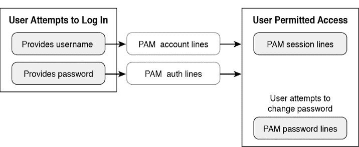

**图 16.1** PAM 类型

配置文件每行的第一个值（类型）基本上决定了何时使用该模块。每行的最后一个值是运行的 PAM 模块（或要查询的另一个配置文件）。中间的值称为控制值（control value）。当 PAM 模块返回成功或失败时，该返回值如何使用取决于控制值。

下表描述了不同的传统控制值。在阅读此表中的描述时，请注意，当解析一组规则时，最终结果必须成功，操作才能执行。例如，考虑以下规则：

```
account     required      pam_nologin.so
account     include       system-auth
```

为了验证用户账户，规则链的最终结果必须是成功的。这条规则链也被称为规则栈（rule stack）。

| Value | Description |
| --- | --- |
| `required` | **返回成功**：如果当前 PAM 模块返回成功，则检查列表中的下一条规则。如果这是最后一条规则，栈将返回成功值（除非之前的 `requisite` 规则执行失败）。**返回失败**：如果当前 PAM 模块返回失败，则不执行任何额外的模块。栈将返回失败值。换句话说，具有 `required` 值的模块必须返回成功，栈才能返回成功。 |
| `requisite` | 在某些方面，此值与 `required`（强制）相似。区别在斜体部分已突出显示。**返回成功**：如果当前 PAM 模块返回成功，则检查列表中的下一个规则。如果这是最后一个规则，栈将返回成功值。**返回失败**：如果当前 PAM 模块返回失败，则会执行额外的模块；然而，无论这些其他模块发生了什么，栈都将返回失败值。这有时很有用，因为额外的模块可能在日志文件中提供更多信息。 |
| `optional` | **返回成功**：如果当前 PAM 模块返回成功，则检查列表中的下一个规则。如果这是最后一个规则，栈将返回成功值（除非之前的 `requisite` 规则失败了除外）。**返回失败**：如果当前 PAM 模块返回失败，则检查列表中的下一个规则。如果这是最后一个规则，栈将返回成功值（除非之前的 `requisite` 规则失败了除外）。换句话之，模块的返回值对堆栈的成功或失败没有影响。异常：如果这是栈中唯一的规则，`optional` 的作用等于 `required`。 |
| `sufficient` | **返回成功**：如果当前 PAM 模块返回成功，则不再检查额外的规则。栈将立即返回成功值（除非之前的 `requisite` 规则失败了除外）。**返回失败**：如果当前 PAM 模块返回失败，则检查列表中的下一个规则。如果这是最后一个规则，栈将返回成功值（除非之前的 `requisite` 规则失败了除外）。换句话说，如果模块的返回值为成功，则不会检查其他模块，且栈自动为成功。返回失败对栈的整体返回值没有影响。 |
| `include` | 此值告诉 PAM 使用指定文件中的所有规则。仅使用当前类型（`auth`、`account` 等）的规则。 |

对于那些喜欢有更多直观视觉示例的读者，请查看图 16.2 中的流程图。注意，此图使用了以下信息：

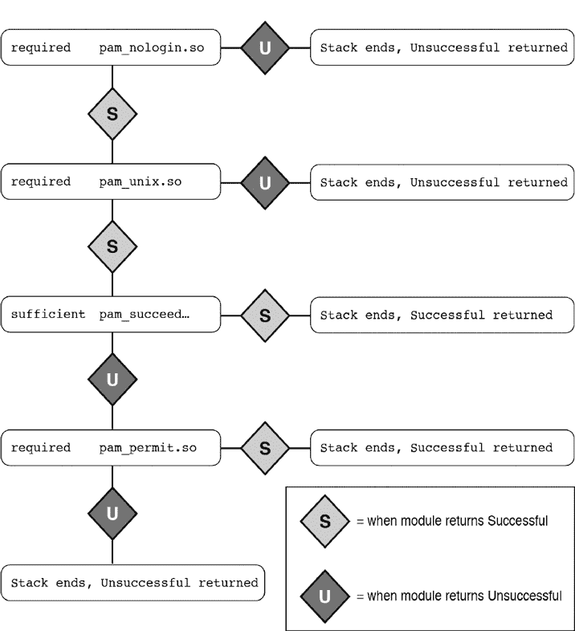

**图 16.2** PAM 控制值示例

```bash
[root@OCS ~]# grep ^account /etc/pam.d/sshd
account     required       pam_nologin.so
account     include        system-auth

[root@OCS ~]# grep ^account /etc/pam.d/system-auth
account     required       pam_unix.so
account     sufficient     pam_succeed_if.so uid < 500 quiet
account     required       pam_permit.so
```

## /etc/pam.d/

如果你查看 `/etc/pam.d` 目录的内容，它看起来类似于以下输出：

```bash
[root@OCS ~]# ls /etc/pam.d
atd                other            runuser-l        su-l
chfn               passwd           screen           system-auth
chsh               password-auth    smartcard-auth   systemd-user
config-util        polkit-1         smtp             usermin
crond              postgresql       smtp.postfix     vlock
cups               postlogin        smtp.sendmail    vsftpd
cvs                ppp              sshd             webmin
dovecot            proftpd          su               xserver
fingerprint-auth   remote           sudo
login              runuser          sudo-i
```

每个文件都设计用于配置使用 PAM 验证用户账户的命令或实用程序。例如，以下文件用于配置 Secure Shell 服务器如何使用 PAM：

```bash
[root@OCS ~]# more /etc/pam.d/sshd
#%PAM-1.0
auth        include      system-auth
account     required     pam_nologin.so
account     include      system-auth
password    include      system-auth
session     optional     pam_keyinit.so force revoke
session     include      system-auth
session     required     pam_loginuid.so
```

## pam_tally2

你可以通过使用 `/etc/pam.d/password-auth` 文件中的以下加粗设置，来因登录尝试失败而锁定用户：

```bash
auth          required      pam_env.so
auth          required      pam_tally2.so file=/var/log/tallylog deny=3 even_deny_root unlock_time=1200
auth          sufficient    pam_unix.so try_first_pass nullok
auth          required      pam_deny.so
account       required      pam_unix.so
account       required      pam_tally2.so
```

以下是这些行的键值：

* `file`：存储失败登录尝试的文件名
* `deny`：何时锁定用户（在达到此次数失败尝试后）
* `even_deny_root`：使此设置也适用于 root 账户和普通用户
* `unlock_time`：保持账户锁定状态的时间（秒）

## faillock

你可以通过使用 `/etc/pam.d/system-auth` 文件中的以下加粗设置，来因登录尝试失败而锁定用户：

```bash
auth          required     pam_env.so
auth          required     pam_faillock.so preauth silent audit deny=4 unlock_time=1200
auth          sufficient   pam_unix.so try_first_pass nullok
auth          [default=die] pam_faillock.so authfail audit deny=4 unlock_time=1200
auth          required     pam_deny.so
```

以下是这些行的键值：

* `deny`：何时锁定用户（在达到此次数失败尝试后）
* `unlock_time`：保持账户锁定状态的时间（秒）

## SSH

`ssh` 命令是一个允许你连接到 Secure Shell (SSH) 服务器的实用程序。该命令的语法如下：

```bash
ssh user@hostname
```

将 `user` 替换为想要登录的用户名，并将 `hostname` 替换为系统主机名或 IP 地址。

第一次使用 `ssh` 命令连接到系统时，它将发出以下提示：

```bash
[root@OCS ~]# ssh bob@server1
The authenticity of host 'server1' can't be established.
ECDSA key fingerprint is 8a:d9:88:b0:e8:05:d6:2b:85:df:53:10:54:66:5f:0f.
Are you sure you want to continue connecting (yes/no)?
```

这是为了确保你登录的是正确的系统。通常用户会对此提示回答 “yes”，假设他们正在登录正确的机器，但也可以通过联系远程系统的管理员来独立验证此信息。

在用户对此提示回答 “yes” 后，SSH 服务器指纹将存储在 `~/.ssh` 目录下的 `known_hosts` 文件中。

下表描述了 `ssh` 命令的选项：

| 选项 | 描述 |
| --- | --- |
| `-F` *configfile* | 指定 `ssh` 客户端使用的配置文件。默认配置文件为 `/etc/ssh/ssh_config`。有关此文件的详情，请参见本章中的“ssh_config”节。 |
| `-4` | 仅使用 IPv4 地址。 |
| `-6` | 仅使用 IPv6 地址。 |
| `-E` *logfile* | 将错误放在指定的日志文件中，而不是显示在标准输出上。 |

### ~/.ssh/

单个用户的 SSH 数据存储在每个用户家目录下的 `.ssh` 子目录中。SSH 使用该目录存储重要数据，用户可以修改该目录中的配置。本小节重点关注可能存储在 `~/.ssh` 目录中的文件。

#### known_hosts

与 SSH 服务器建立连接后，SSH 客户端会将服务器唯一的“指纹”密钥存储在用户的 `.ssh/known_hosts` 文件中：

```bash
[root@OCS ~]# cat .ssh/known_hosts
|1|trm4BuvRf0HzJ6wusHssj6HcJKg=|EruYJY709DXorogeN5Hdcf6jTCo= ecdsa-sha2-nistp256AAAAE2VjZHNhLXNoYTItbmlzdHAyNTYAAAAIbmlzd HAyNTYAAABBBG3/rARemyZrhIuirJtfpfPjUVnph9S1w2NPfEWec/f59V7nA ztn5rbcGynNYOdnozdGNNizYAiZ2VEhJ3Y3JcE=
```

通常情况下，该文件的内容应该保持不变；然而，如果重新安装了 SSH 服务器，它将拥有新的“指纹”密钥。这将要求所有用户删除 `.ssh/known_hosts` 文件中对应 SSH 服务器的条目。

### authorized_keys

当用户想要使用基于密码的 SSH 认证时，第一步是使用 `ssh-keygen` 命令创建认证密钥。有关此过程的详细信息，请参见“ssh-keygen”节。

创建认证密钥文件后，需要将公钥（`~/.ssh/id_dsa.pub` 或 `~/.ssh/id_rsa.pub` 文件的内容）复制到用户尝试登录的系统中。这需要将公钥放入 SSH 服务器上的 `~/.ssh/authorized_keys` 文件中。可以通过从客户端系统手动复制公钥文件的内容，并将其粘贴到 SSH 服务器上的 `~/.ssh/authorized_keys` 文件中来实现。或者，你也可以使用 `ssh-copy-id` 命令：`ssh-copy-id user@server`。

### config

用户可以通过创建 `~/.ssh/config` 文件来自定义 `ssh`、`scp` 和 `sftp` 等命令的工作方式。该文件中的格式和设置与 `/etc/sshd/ssh.conf` 文件中的相同。有关更多信息，请参见本章中的“ssh_conf”小节。

### id_rsa

`~/.ssh/id_rsa` 和 `id_rsa.pub` 文件的内容用于结合 `ssh-agent` 和 `ssh-add` 工具进行密码认证。有关这些工具的详细信息，请参见本章中的“ssh-add”小节。

### id_rsa.pub

`~/.ssh/id_rsa` 和 `id_rsa.pub` 文件的内容用于结合 `ssh-agent` 和 `ssh-add` 工具进行密码认证。有关这些工具的详细信息，请参见本章中的“ssh-add”小节。

## 用户特定访问

本小节提到了一种名为“无密码登录”的功能。如果用户经常登录特定的 SSH 服务器，该用户可能想要设置无密码登录。要实现这一点，你需要遵循以下步骤：

**第 1 步**。在 SSH 客户端机器上执行 `ssh-keygen` 命令，如本章中“ssh-keygen”小节所示。当提示输入密码（passphrase）时，按回车键留空（或者，你可以在 `ssh-keygen` 命令中使用 `-N` 选项，这样就不会提示密码）。

**第 2 步**。将 `~/.ssh/id_rsa.pub` 文件中的公钥复制到目标系统，即 SSH 服务器上的 `~/.ssh/authorized_keys` 文件中。这可以通过手动从客户端系统复制公钥文件的内容并粘贴到 SSH 服务器上的 `~/.ssh/authorized_keys` 文件来实现。或者，你也可以使用 `ssh-copy-id` 命令：`ssh-copy-id user@server`。

**第 3 步**。将 `authorized_keys` 文件的权限设置为 `600`：

```bash
chmod 600 ~/.ssh/authorized_keys
```


`/etc/ssh/ssh.conf`文件用于修改 SSH 客户端工具的行为，如`ssh`、`scp`和`sftp`。此文件影响所有用户，但用户可以通过在自己的家目录中创建自己的配置文件（即`~/.ssh/config`文件）来覆盖这些设置。

`ssh_config`文件的某些组件与`sshd_config`文件不同（在继续之前，请考虑回顾本章中的“sshd_config”小节）。首先，有一个系统级的`/etc/ssh/ssh_config`文件，它适用于所有用户。此外，每个用户可以在其家目录（`~/.ssh/config`）中创建一个文件，用于覆盖`/etc/ssh/ssh_config`文件中的设置。

除了文件之外，命令行选项也可以覆盖配置文件中指定的值。以下是所有信息解析的顺序：

1.  命令行选项
2.  用户的`~/.ssh/config`文件
3.  `/etc/ssh/ssh_config`文件

找到的第一个参数即为使用的。例如，如果在用户的`~/.ssh/config`文件中设置了`ConnectTimeout`，而在`/etc/ssh/ssh_config`文件中设置了不同的值，则将使用用户的配置文件来设置该值。

`ssh_config`文件与`sshd_config`文件之间的另一个重要区别是，`ssh_config`文件中的大多数设置都是`Host`设置的子设置。`Host`设置允许你为连接的不同 SSH 服务器指定不同的规则。例如，以下将在连接到`server1.localhost.com`时应用`0`的`ConnectTimeout`值，在连接到`test.example.com`时应用`600`的值：

```
Host server1.localhost.com
ConnectTimeout 0

Host test.example.com
ConnectTimeout 600
```

`ssh_config`中的许多设置与 SSH 服务器配置文件中的设置相关，例如以下`/etc/ssh/sshd_config`文件设置：

```
X11Forwarding yes
```

在客户端，通常通过执行基于`ssh`的命令时使用`-X`或`-Y`选项来启用此功能。然而，如果你希望此功能成为默认设置，可以在`/etc/ssh/ssd_config`或`~/.ssh/config`文件中使用以下设置：

```
ForwardX11 and ForwardX11Trusted
```

### sshd_conf

`sshd_conf`文件用于配置 SSH 服务器。该文件中的重要设置包括：

*   **Protocol**：设置为“1”、“2”或“1,2”，此设置定义了 SSH 服务器的协议类型。Protocol 1 不再支持，因此此值通常应设置为“2”。
*   **ListenAddress**: 指定分配给 SSH 接受连接的网卡的 IP 地址。例如：`ListenAddress 192.168.1.100:192.168.1.101`。
*   **Port**: SSH 服务器监听入站连接的端口。例如：`Port 2096`。
*   **LogLevel**: 你希望 SSH 服务器记录的日志。允许以下值：`QUIET`、`FATAL`、`ERROR`、`INFO`、`VERBOSE`、`DEBUG`、`DEBUG1`（与`DEBUG`相同）、`DEBUG2`、`DEBUG3`。
*   **PermitRootLogin**: 当此设置为“no”时，root 用户无法通过 SSH 直接登录。
*   **AllowUsers**或**DenyUsers**: 定义哪些用户可以通过 SSH 登录（`AllowUsers`）或哪些用户不能通过 SSH 登录（`DenyUsers`）。例如：`AllowUsers bob sue ted`。
*   **PasswordAuthentication**: 设置设置为“yes”（默认值），此设置允许用户通过提供用户名和密码登录。如果设置为“no”，用户将仅可以使用身份密钥登录。
*   **PubkeyAuthentication**: 当此设置为“yes”时，用户可以在服务器上存储公钥。公钥是由用户客户端系统上的`ssh-keygen`命令生成的。有关更多信息，请参阅本章中的“ssh-keygen”部分。
*   **Banner**: 指定一个文件，在用户验证过程之前显示该文件的内容。
*   **PrintMotd**: 如果此设置为 yes（默认值为 no），当用户通过 SSH 登录系统时，将显示`/etc/motd`文件的内容。有关`/etc/motd`文件的更多信息，请参阅 第 17 章 中的“MOTD”和“总结 Linux 环境中的安全最佳实践”。
*   **X11Forwarding**: 如果设置为 yes（默认值为 no），则提供了一种允许在 SSH 服务器上执行图形程序并在 SSH 客户端上显示的简单方法。这要求执行 SSH 客户端命令（`ssh`命令）时带有`-X`或`-Y`选项。有关更多信息，请参阅 第 14 章 中的“SSH 端口转发”和“比较与对比 Linux 图形用户界面”。
*   **MaxAuthTries**: 设置为数值，表示用户输入正确密码的尝试次数。默认值为 6。
*   **PermitEmptyPasswords**: 如果此设置为 no（默认值），如果用户账户的密码字段为空，则用户无法通过 SSH 登录。

### ssh-copy-id

`ssh-copy-id`命令用于将`ssh-keygen`命令创建的登录密钥复制到远程系统（另请参见本章中的“ssh-keygen”小节）。该命令的格式如下：

```
ssh-copy-id user@hostname
```

### ssh-keygen

`ssh-keygen`命令可生成身份密钥。它的常见用途是创建身份文件：

```
julia@OCS ~]$ ssh-keygen
Generating public/private rsa key pair.
Enter file in which to save the key (/home/julia/.ssh/id_rsa):
Enter passphrase (empty for no passphrase):
Enter same passphrase again:
Your identification has been saved in /home/julia/.ssh/id_rsa.
Your public key has been saved in /home/julia/.ssh/id_rsa.pub.
The key fingerprint is:
6d:40:24:e2:3e:62:7f:a4:f0:5d:d5:05:1b:06:fd:d7 bo@ubuntu
The key's randomart image is:
+--[ RSA 2048]----      +
|       . ..o .o+..   |
|   . . o   o.+         |
|    .          . o.   |
|   .     +     . S    |
|  + o . S .             |
|    + o                |
|     .                 |
|                       |
+-----------------      +
```

此命令的结果是两个新文件：`~/.ssh/id_rsa`和`~/.ssh/id_rsa.pub`。这些文件的内容将配合`~/.ssh/authorized_keys`文件用于密码验证。

RSA 是一种加密算法。另一种流行的加密算法是 DSA。使用 DSA 代替 RSA 需要对`ssh-keygen`命令使用`-t DSA`选项。使用该选项的结果是两个新文件：`~/.ssh/id_dsa`和`~/.ssh/id_dsa.pub`。

### 注意

在执行`ssh-keygen`命令期间如果提示输入密码短语，则在每次建立 SSH 连接时都需要输入该密码短语。通过使用`ssh-agent`和`ssh-add`工具可以避免重复输入此密码短语。有关这些工具的详细信息，请参阅本章中的“ssh-add”章节。

### ssh-add

ssh-agent 工具用于在使用无密码 SSH 身份验证时避免需要输入密码短语。有关设置无密码 SSH 身份验证的详细信息，请参阅本章中的“ssh-keygen”部分。

使用此功能的一种方法是执行以下命令：`ssh-agent bash`。这将启动一个 shell，其中 SSH agent 将缓存已添加的 RSA 和 DSA 密钥。可以使用`ssh-add`命令将这些密钥添加到 SSH agent 缓存中。

启动`ssh-agent`实用后，可以使用`ssh-add`命令将 RSA 和 DSA 密钥添加到 SSH agent 的缓存中。

要使用`ssh-add`工具，请执行不带参数的命令：

```
[julia@OCS ~]$ ssh-add
Identity added: /home/julia/.ssh/id_rsa (/home/julia/.ssh/id_rsa)
```

密钥添加后，它们将在未来的 SSH 连接中被自动使用。

### TTYs

“TTY”是一个与终端显示关联的设备文件。终端显示传统上是命令行登录屏幕，但带有显卡的现代 Linux 系统也可以将 GUI 或基于 Windows 的输出到 TTY 文件。

请参阅本章的“/dev/tty#”小节以获取更多信息。

#### /etc/securetty

`/etc/securetty`文件列出了 root 用户可以登录系统的所有设备文件。例如，如果你从该文件中删除所有`/etc/tty#`设备文件名，那么当用户坐在系统面前时，root 用户将无法登录。

默认情况下，此文件将包含用户可以从其登录的所有可能的设备文件。在安全至上的系统中，此文件通常会经过大幅修改，以防止 root 用户直接登录。这提供了更高的安全性，因为为了获得 root 权限，必须同时知道普通用户和 root 用户的密码（登录所需的普通用户密码和使用`su`命令切换到 root 账户所需的 root 密码）。

#### /dev/tty#

TTY 设备文件均命名为`/dev/tty#`，其中`#`实际上是一个数字：

```
[julia@OCS ~]$ ls /dev/tty*
/dev/tty    /dev/tty20  /dev/tty33   /dev/tty46   /dev/tty59
/dev/tty0   /dev/tty21  /dev/tty34   /dev/tty47   /dev/tty6
/dev/tty1   /dev/tty22  /dev/tty35   /dev/tty48   /dev/tty60
/dev/tty10  /dev/tty23  /dev/tty36   /dev/tty49   /dev/tty61
/dev/tty11  /dev/tty24  /dev/tty37   /dev/tty5    /dev/tty62
/dev/tty12  /dev/tty25  /dev/tty38   /dev/tty50   /dev/tty63
/dev/tty13  /dev/tty26  /dev/tty39   /dev/tty51   /dev/tty7
/dev/tty14  /dev/tty27  /dev/tty4    /dev/tty52   /dev/tty8
/dev/tty15  /dev/tty28  /dev/tty40   /dev/tty53   /dev/tty9
/dev/tty16  /dev/tty29  /dev/tty41   /dev/tty54   /dev/ttyS0
/dev/tty17  /dev/tty3   /dev/tty42   /dev/tty55   /dev/ttyS1
/dev/tty18  /dev/tty30  /dev/tty43   /dev/tty56   /dev/ttyS2
/dev/tty19  /dev/tty31  /dev/tty44   /dev/tty57   /dev/ttyS3
/dev/tty2   /dev/tty32  /dev/tty45   /dev/tty58
```


虽然有许多 TTY 文件，但在标准 Linux 发行版中通常只有七个在使用。其中一个一个预留给基于 GUI 的登录，另外六个提供命令行登录。通常 `/dev/tty1` 或 `/dev/tty7` 提供基于 GUI 的登录，但这因发行版而异。你可以通过按住 `Ctrl` 和 `Alt` 键并按下功能键在这些 TTY 接口之间切换。例如，`Ctrl-Alt-F1` 将切换到 `/dev/tty1` 设备接口。

注意，`/dev/ttyS#` 设备用于物理串口端口访问。

了解这些设备文件是非常重要的，因为有一项安全功能可以限制 root 用户登录系统的位置。请参阅“/etc/securetty”小节获取有关该功能的更多信息。

### PTYs

“PTY”术语指的是伪终端。这些是当用户远程登录（如 SSH 连接）或用户在基于 GUI 的环境中打开新终端窗口时为 shell 提供的终端。PTY 设备文件通常根据需要创建，并出现在 `/dev/pts` 目录中。每个 PTY 设备文件都有一个数字名称；例如，`/dev/pts/0` 将是第一个 PTY 设备文件。

了解这些设备文件是非常重要的，因为有一项安全功能可以限制 root 用户登录系统的位置。请参阅“/etc/securetty”小节获取有关该功能的更多信息。

### PKI

当用户尝试连接到服务器（如 Web 服务器）时，使用公钥基础设施（PKI）来确保该服务器确实是用户想要去的地方，而不是恶意服务器。这种结构通常还会提供服务器和用户之间加密数据的手段。

TLS 使用的技术（请参见本章的“SSL/TLS”小节）被称为非对称加密（也称为 PKC 或公钥加密）。在非对称加密中，使用了两个密钥：`public key` 和 `private key`。这些密钥用于加密和解密数据。

公钥用于加密发送到 Apache Web 服务器的数据。所有系统在请求时提供此密钥。例如，当浏览器首次连接到使用 TLS 的 Apache Web 服务器时，浏览器会请求服务器的公钥。该公钥会免费提供给浏览器。

从浏览器发送到服务器的任何额外数据（如用户名和密码）都使用此公钥进行加密。这些数据只能由服务器使用私钥解密（此过程称为*哈希*）。这就是*非对称加密*术语出现的地方。在对称加密中，使用同一个密钥来加密和解密数据。在使用非对称加密时，需要两个独立的密钥：一个加密数据，另一个解密数据。这意味着只有 Web 服务器可以解密从浏览器发送的数据。

你可能好奇浏览器究竟是如何知道它到达了正确的 Web 服务器而不是某些“恶意”Web 服务器的。当服务器发送其公钥时，它包含一个`digital signature`（称为`message digest`）。该数字签名可以发送到 CA（证书颁发机构）服务器，这是一个用于验证数字签名的受信任第三方系统。在某些情况下，服务器本身会通过名为`self-signed`（自签名）证书的过程提供签名。

从用户的角度来看，这一切都在后台发生，并且是完全透明的——除非出现问题且浏览器显示了警告消息。由于数字证书通常有有效期，最常见的问题是 CA 没有更新的数字证书，或者用户更改了计算机上的日期。

请参阅图 16.3 查看此过程的视觉示例。

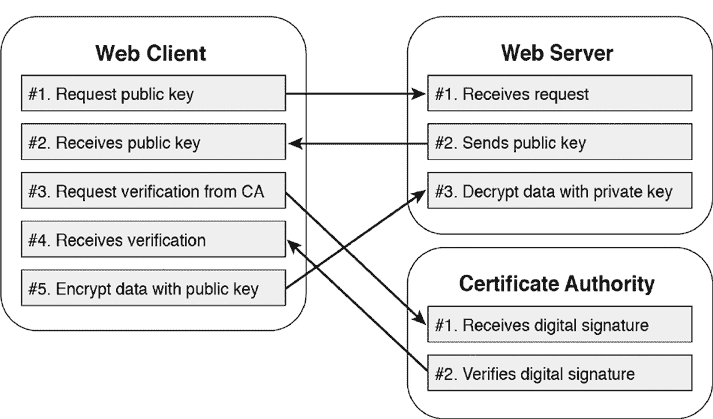

**图 16.3** SSL 过程

### VPN 作为客户端

考虑一家位于加利福尼亚州圣地亚某栋建筑内的组织。该组织为员工提供访问本地管理数据库中敏感数据的权限。通过将所有敏感数据的数据传输保留在公司的物理网络（局域网，或 LAN）中，公司获得了比数据通过互联网（广域网，或 WAN）传输时更高的安全性。

然而，随着公司的规模扩大，这种提供数据的方法变成了一种阻碍。需要出差会会的员工无法访问这些重要数据。公司还在考虑通过收购一家位于纽约市的公司来扩大规模，但对于数据将如何共享存在担忧。

你是公司的系统管理员，你的责任是开发一个可行的（且安全的）解决方案。幸运的是，有虚拟专用网络（`VPN`）。通过这个 `VPN`，你可以在 VPN 服务器和 VPN 客户端之间安全地传输数据。此功能与安全外壳（`SSH`）提供安全数据传输的方式非常；它利用公钥和私钥对数据进行加密和解密。VPN 服务器和 VPN 客户端之间的所有路由器只能看到加密的数据。

有很多不同的 VPN 软件解决方案可用，因此对于 Linux+ 考试来说，重要的是理解这些概念。如果你想进行一些实践，`OpenVPN` 是一个很好的选择，但请注意，任何考试题都应该关注技术本身，而不是任何特定的软件解决方案。

本节涵盖了你在使用 VPN 时应该了解的不同概念。

### SSL/TLS

传输层安全（`TLS`）是一种加密协议，用于 `VPNs` 以提供数据的安全传输。安全套接层（`SSL`）是 `TLS` 的前身，被认为已过时。

`TLS` 不仅用于 `VPNs`；它通常用于 Web 服务器通信、电子邮件传输和 IP 语音（`VoIP`）。

### 传输模式

对于 `VPN` 而言，传输模式是指仅对数据进行加密。在传输模式下，数据包中的 IP 信息是不加密的。这是配置站点间 `VPN` 的常用方法。站点间 `VPN` 在大型组织中很常见，网络流量必须穿越互联网从一个网络到达另一个网络。使用站点间 `VPN` 可以使数据传输更安全。

### 隧道模式

对于 `VPN` 而言，隧道模式是指数据和元数据（数据包中的 IP 数据）都被加密。这是配置客户端到站点 `VPN` 时的一种常用方法。

### IPSec

网协议安全（`IPSec`）用于 `VPNs` 中的身份验证和网络数据包加密。`IPSec` 与 `TLS` 有几点不同（参见本章中的“SSL/TLS”小节），但主要区别在于安全增强发生在 OSI 模型的哪个位置。`TLS` 在第 3 层以上执行操作，而 `IPSec` 在第 3 层执行。这是一个重要的区别，因为某些网络设备具有第 3 层功能但在第 3 层以上不起，这使得在这些设备上实现 `VPN` 非常困难。

### DTLS

数据报传输层安全（`DTLS`）利用基于数据报的安全特性提供安全的 `VPN` 传输。数据报在分组交换网络中作为传输的基本单元，并使用无连接的通信方法。`DTLS` 基于 `TLS`（参见本章中的“SSL/TLS”小节）。

## 第 17 章总结 Linux 环境下的安全最佳实践

本章提供了有关以下主题的信息和命令：

#### 启动安全

* 启动加载程序密码
* UEFI/BIOS 密码

#### 额外的身份验证方法

* 多因素身份验证 (令牌, 硬件, 软件, OTP, 生物识别)
* RADIUS
* TACACS+
* LDAP
* Kerberos (kinit, klist)

#### 通过 SSH 禁用 root 登录的重要性

#### 无密码登录 (强制使用 PKI)

#### Chroot 监狱服务

#### 不使用共享 ID

#### 拒绝主机的重要性

#### 操作系统数据与应用数据分离 (磁盘分区以最大化系统可用性)

#### 更改默认端口

#### 禁用或卸载未使用且不安全服务的的重要性

* FTP
* Telnet
* Finger
* Sendmail
* Postfix
* 磁盘加密)
* 限制 cron
* 禁用 Ctrl-Alt-Del
* 添加横幅
* MOTD

注意

对于 Linux+ 考试，重要的是，对于此目标下列出的主题，你应该能够“**总结 Linux 环境下的安全最佳实践**”。换句话说，不要求你了解有关设置、配置或管理安全实践的细节，而是要理解安全实践的功能是什么。

通过多因素身份验证，用户被要求提供多项证明其身份的证据。一种常见的多因素身份验证方法称为双因子身份验证，或 2FA。对于这种方法，用户需要提供两种形式的身份，可能包括以下内容：

* 用户所知的
* 用户拥有的
* 用户“是”的

本节涵盖了用于多因素身份验证的不同技术。

## 令牌 (Tokens)
令牌是由硬件设备或软件程序生成的唯一值（通常是数字或字母数字值）。令牌通常是持续性地自动生成的，并且通常只在短时间内有效，例如 30 秒。

## 硬件
硬件令牌是由硬件设备生成的。这通常是一个非常小的设备，例如钥匙扣（key fob）。该硬件设备可能具有额外的身份验证方法，例如指纹扫描器，但这种情况较为罕见。

## 软件
软件令牌是由程序生成的。一个常见的例子是移动设备上的应用程序。

## OTP
OTP 代表一次性密码。这是一种经常包含在双因子身份验证中的身份验证技术。在用户丢失或忘记密码时也可以使用这种技术。

## 生物识别
生物识别利用了多因素身份验证中“人所是的”的部分。用户的指纹、虹膜扫描或其他生物数据可用于验证用户的身份。

## RADIUS
远程认证拨入服务 (RADIUS) 是一种允许客户端系统使用服务器对用户进行认证的协议。该服务在集中位置提供 AAA（认证、授权和审计）管理。

RADIUS 经常与 TACACS+ 进行比较，但了解这些协议之间的差异超出了 Linux+ 考试的范围。最重要的是，要意识到 RADIUS 可以在安全策略中提供非常强大的功能，因为它提供了化的 AAA 管理。此外，你应该意识到 RADIUS 比 TACACS+ 具有更好的厂商无关性。

## TACACS+
终端访问控制器访问系统加+ (TACACS+) 是一种允许客户端系统使用服务器对用户进行认证的协议。该服务在集中位置提供 AAA（认证、授权和审计）管理。

TACACS+ 经常与 RADIUS 进行比较，但了解这些协议之间的差异超出了 Linux+ 考试的范围。最重要的是，要意识到 TACACS+ 可以在安全策略中提供非常强大的功能，因为它提供了集中 AAA 管理。此外，你应该意识到 TACACS+ 是 Cisco 开发的，不像 RADIUS 那样具有厂商无关性。

## LDAP
轻量级目录访问协议 (LDAP) 是一种提供目录服务信息的协议。这意味着该协议可以提供用户账户信息，但它不提供 RADIUS 或 TACACS+ 那种完整的 AAA 功能。LDAP 也经常用于存储与其他用户账户不直接相关的信息，例如主机名。

LDAP 可用于验证用户，但在考虑安全策略时，你应该意识到 RADIUS 和 TACACS+ 提供了更健壮的解决方案。例如，LDAP 不提供 RADIUS 和 TACACS+ 等 AAA 协议提供的“审计 (Accounting)”功能。

## Kerberos
Kerberos 协议利用基于票据的系统来验证用户。当客户端系统最初从用户处获取凭据进行认证时，这些信息会被发送到 Kerberos 认证服务器进行验证。认证服务器随后将信息传递给密钥分布中心 (KDC)，由其发放票据授予票 (TGT)。TGT 使用票据发放服务加密，并将加密所需的秘密密钥传回客户端系统。

该秘密密钥现在将用于后续的身份验证请求（例如，如果用户尝试登录 Kerberos 域内的另一个系统）。

### kinit
Kerberos 使用 `kinit` 工具来获取个人票据。该票据随后会被缓存在本地系统中，供未来的身份验证尝试。

### klist
`klist` 工具用于显示缓存的 Kerberos 票据列表。

## 通过 SSH 禁用 Root 登录的重要性
默认情况下，SSH 服务器将允许 root 用户直接登录。对于可以直接访问互联网的服务器，这构成了安全风险，因为黑客可以尝试直接登录 root 账户。通过禁用直接 root 登录，黑客首先需要破解一个非 root 账户，然后通过其他方法（如 `su` 或 `sudo` 命令）破解 root 账户。

通过修改 `/etc/ssh/sshd_config` 文件中的以下设置来实现禁用 SSH 直接 root 登录：

```
PermitRootLogin no
```

## 无密码登录
无密码登录系统允许用户无需密码登录。这通常与 SSH 相关，被认为既是便利特性也是安全特性。

该功能背后的原理是利用 SSH 密钥来验证用户身份。执行以下步骤：

**步骤 1**。在客户端系统上执行 `ssh-keygen` 命令以创建公私钥对。

**步骤 2**。将公 SSH 密钥复制到远程系统用户的 `.ssh` 目录中。大多数系统提供 `ssh-copy-id` 来执行此任务，也可以通过手动复制公钥来完成。

**步骤 3**。登录远程系统以验证在不需要密码的情况下提供访问。本地系统的私钥与远程系统对应的公钥的组合用于验证用户身份。

### 强制使用 PKI
公钥基础设施 (PKI) 可以应用于 SSH；它利用公 SSH 密钥进行用户账户认证（有关 SSH 密钥的更多细节请参见本章的“无密码登录”部分）。在鼓励使用 SSH 密钥进行认证的安全策略系统上，最好强制使用 PKI 以确保所有用户都使用这种方法。

通过对 `/etc/ssh/sshd_config` 文件进行以下更改可以：

```
PasswordAuthentication no

RSAAuthentication yes

PubkeyAuthentication yes
```

## chroot 监狱服务 (Chroot Jail Services)
chroot 监狱是一种仅访问文件系统一小部分的服务。该服务无法访问整个文件系统，只能访问一个子目录，该目录通常存放其配置数据。

chroot 监狱服务的主要安全优势是该服务无法看到或修改关键系统数据。例如，如果服务只能看到 `/var/chroot` 目录的内容，那么 `/etc/passwd` 和 `/etc/shadow` 等文件对该服务不可用。这对于容易受到黑客攻击的面向网络的服务器尤为重要。

某些服务（如 BIND）内置了 chroot 监狱配置。其他服务可能需要管理员使用 `chroot` 命令等命令手动创建监狱。

### 不共享 ID (No Shared IDs)
考虑以下输出：

点击此处查看代码图像

```
[root@OCS ~]# grep "x:1099:" /etc/passwd

ted:x:1099:1099:Ted Jones:/home/ted:/bin/bash

bob:x:1099:1099:Bob Smith:/home/bob:/bin/bash
```

由于两个用户共享相同的用户 ID (UID)，无法对他们的行为进行追溯。用户的身份是与账户 `UID` 绑定的，而不是账户名。任何审计策略都会将操作与 `UID` 关联，在这种情况下，当用户的账户关联相同的 `UID` 时，无法确定是哪个人执行了特定事件。这违背了最佳的安全措施。

## 拒绝主机的重要性

有几种不同的方法可以拒绝访问系统、服务或网络，包括：

* 防火墙
* TCP Wrappers
* PAM (可插拔认证模块)
* 个别服务配置

安全策略中拒绝主机的重要性源于：某些系统已知被用作黑客攻击的跳板点。这些主机应该始终被拒绝访问你的系统。注意：一些网站提供了受损系统的列表（搜索“黑名单网站”）。其中一个示例是 [`mxtoolbox.com`](https://mxtoolbox.com)。

## 将操作系统数据与应用程序数据分离

假设你正在测试的一个新应用程序“失控”了并破坏了存储它的文件系统。这可能是任何情况，从用巨大的日志文件填充文件系统到执行不安全的文件系统操作。

受破坏的文件系统可能会导致整个操作系统（OS）无法使用。因此，最好是将操作系统数据与应用程序数据分离。实现这一点的主要手段是使用单独的分区（详情请参见本章下一节的“最大化系统可用性的磁盘分区”）。

### 最大化系统可用性的磁盘分区

你有一些 IT 部门正在非生产系统上测试的新软件，你希望避免它对操作系统运行所需的文件造成任何伤害。最佳行动方案是创建一个单独的分区（或逻辑卷），并在该位置安装新软件。

即使在生产系统上，你也应该将应用程序安装位置与操作系统数据分开。这意味着你至少应该创建以下分区或卷：

* `/usr`：大多数软件都安装在这里。
* `/opt`：某些软件安装在这里（通常是第三方软件）。
* `/var`：用于分离日志文件和其他打印数据。
* `/boot`：将启动文件与所有其他内容分开。
* `/home`：将任何用户生成或安装的软件与操作系统数据分开。
* `/`：系统其余数据的位置（大部分是操作系统数据）。

## 更改默认端口

服务监听网络端口以获取入站连接`/etc/services` 文件按服务类型列出了标准端口号。例如：

点击此处查看代码

```
[root@OCS ~]# egrep "22/tcp| 22/udp" /etc/services

ssh   22/tcp       # The Secure Shell (SSH) Protocol

ssh   22/udp       # The Secure Shell (SSH) Protocol
```


标准服务（如上一个示例所示的 SSH 服务器）使用的端口被称为“良已知端口”。使用这些良已知端口的缺点是，黑客会尝试对这些端口上的服务进行破解攻击。因此，提供更高级别安全性的一种方法是使用与标准不同的端口。例如，可以将 SSH 服务器配置为监听不同于端口`22`的端口。

这种安全技术的缺点是，黑客仍然可以通过执行端口扫描攻击来确定正确的端口。因此，虽然这种技术可能成功阻止新手或自动攻击，但它并不是万无一失的。

## 禁用或卸载未用和不安全服务的重要性

某些服务应该永远不要使用或应谨慎使用。下一节重点关注不安全的服务以及应该使用的有限范围。

### FTP

文件传输协议（FTP）是一种常用的用于在系统之间传输文件的协议。由于数据在 FTP 客户端和服务器之间是以明文发送的，因此该协议是不安全的。这些数据包括任何用户账户信息，这意味着任何可以“嗅探”网络的人都能看到用户名和密码。

FTP 服务器确实提供了一个重要且实用的功能：匿名 FTP 服务。匿名 FTP 服务器不需要任何用户验证，并且应该只允许下载内容（不允许上传）。这允许某人创建一个仓库，其中存储供任何人下载的内容（例如 Linux 发行版的 ISO 文件）。

### Telnet

`telnet` 协议允许远程登录，但与 `ssh` 不同，它不提供加密。虽然可以使用`telnet`命令测试到远程端口的连接，但在安全至重要的现代系统中，不应使用 `telnet` 服务器。

### Finger

`finger` 术语与 Name/Finger 协议有关，该协议旨在提供有关计算机和用户的信息。`finger` 命令长期以来用作提供用户报告的方法。然而，由于这些信息是通过网络以明文发送的，在安全至重要的现代系统中，绝不应使用此命令和协议。

### Sendmail

参见下一节的“Postfix”。

### Postfix

`sendmail` 和 `postfix` 都是邮件服务器。通常，本地系统不需要电子邮件服务，或者至少外部不需要电子邮件。真正的邮件服务器应该配置为在远程邮件服务器之间发送和接收消息。

桌面系统和绝大多数非邮件服务器不应被配置为处理外部电子邮件。这可能需要对这些服务进行一些配置更改。

实际上，除非有需要进行远程访问，否则你真的应该考虑禁用或限制所有服务。例如，在大多数 Linux 发行版中，CUPS 打印服务器默认安装并配置为启动。如果相关系统不需要打印，请禁用并可能删除 CUPS 软件。

## 启用 SSL/TLS 的重要性

安全套接层（SSL）和传输层安全（TLS）是超文本传输安全协议（HTTPS）背后的技术。HTTPS 允许网络客户端和服务器以安全的方式连接。在访问敏感数据的 Web 服务器（如银行账户或在线购物网站）上，启用这些技术至关重要。用户可能会登录的网站也应启用这些技术以保护用户账户数据。这些技术确保网络客户端访问的是正确的 Web 服务器，而不是伪装成真实网站的某些恶意 Web 服务器。

## 启用 auditd 的重要性

`auditd` 守护进程用于记录用户账户活动。它允许管理员确定用户是否执行了任何未经授权的操作。

## CVE 监控

常见漏洞披露（CVE）是一个提供有关公开漏洞信息的系统。一旦在软件程序或操作系统中发现了漏洞，就会创建一个 CVE 报告。出于安全考虑，管理员应该监控相关报告并尽快对漏洞实施修复。未能这样做可能会导致系统被破坏。

### 不建议使用 USB 设备

USB 设备通常用于在桌面系统上存储和传输数据。但在服务器上，它们可能会带来安全风险，因为黑客可能向服务器注入数据或直接从服务器窃取数据。因此，禁用 USB 设备是常见做法，通常通过 BIOS 中的设置来实现。

即使在桌面级系统上，使用 USB 设备也会带来风险。如果桌面系统访问了敏感信息，USB 设备可能被用于窃取数据。此外，用户可能会无意中通过 USB 设备带入病毒或蠕虫软件。在某些组织中，USB 设备不仅被不建议使用，而且是被禁止的。

## 磁盘加密

磁盘加密技术使得，除非磁盘未加密，否则几乎无法访问硬盘上的数据。这可以在系统被盗时保护硬盘上的数据，因此它被广泛用于笔记本电脑设备。

当系统启动时，磁盘上的文件系统是未加密的。这意味着当用户当前登录时，磁盘并不是加密状态；相反，它只在系统未运行时处于加密状态。

更多细节请参阅下一节的 `LUKS` 小节。

### LUKS

Linux 统一密钥设置（LUKS）是一种常用在 Linux 系统的磁盘加密方法。当前版本的 LUKS 使用内核模块（`dm-crypt`）来执行加密和解密操作。

## 限制 cron 访问

普通用户有时会使用 `cron` 在非工作时间执行系统操作和运行代码。这种设计是为了利用系统活动较少的时间段。

有时用户会滥用此服务，在关键系统上执行他们不应执行的代码。作为管理员，你可以通过将用户名添加到`/etc/cron.deny`文件来限制 `cron` 访问。

## 禁用 Ctrl-Alt-Del

有多种方法旨在防止执行 Ctrl-Alt-Del（取决于你特定的 Linux 发行版）。然而，禁用 Ctrl-Alt-Del 的目的在所有 Linux 发行版上都是类似的：你想防止用户通过“三指礼”重启系统。

在 x86 系统上，按住`Ctrl`和`Alt`键同时按下`Del`键会导致系统重启。在桌面系统中可能不是坏事，但在服务器上这无疑会导致问题。

如果你有物理可访问的服务器（实际上任何带有键盘的服务器），请研究如何禁用 Ctrl-Alt-Del，并将此更改作为常规安全策略的一部分启用。

## 添加 Banner

许多提供远程访问的服务（如 FTP、SSH 或 Web 服务器）都有“横幅”（Banner）的概念。Banner 是在用户尝试登录系统之前显示的消息。通常，这用于向用户提供有关访问系统的警告，例如只有授权用户才应尝试访问系统。在某些情况下，这些 Banner 消息是法律要求的。

每个服务都有设置 Banner 的方法。你需要查阅文档来确定具体如何执行此操作。

## MOTD

用户登录系统后，系统会显示`/etc/motd`文件的内容。“每日消息”（MOTD）文件的目的是让管理员为用户提供有关其刚刚登录的系统的有用信息。

## 第 18 章. 在给定场景下，实现日志服务

本章提供了有关以下主题的信息和命令：

**关键文件位置**

- `/var/log/secure`
- `/var/log/messages`
- `/var/log/application`
- `/var/log/kern.log`

**日志管理**

- 第三方代理
- `logrotate`
- `/etc/rsyslog.conf`
- `journald`, `journalctl`
- `lastb`

### 关键文件位置

`/var/log` 目录是放置日志文件的标准位置。这些日志文件某些由日志守护进程创建，另一些由单个应用程序创建。本节涵盖了部分关键日志文件。

### /var/log/secure

`/var/log/secure` 文件包含与身份验证和授权操作相关的日志条目。这可能包括用户登录、尝试获取权限以及其他安全相关的任务条目。

下面的示例演示了通过 SSH 成功登录：

```bash
[root@OCS ~]# tail -n 2 /var/log/secure
Oct 13 16:34:55 OCS sshd[7547]: Accepted password
  for sarah from 72.220.222.74 port 63970 ssh2
Oct 13 16:34:55 OCS sshd[7547]: pam_unix(sshd:session):
  session opened for user sarah by (uid=0)
```

注意 `/var/log/secure` 条目是由日志守护进程生成的。

### /var/log/messages

`/var/log/messages` 文件包含各种条目。你可以预期看到来自许多服务的消息，包括内核和邮件系统。

下面的示例演示了 `crond` 重重启：

```bash
[root@OCS ~]# tail -n 2 /var/log/secure
Oct 13 16:34:55 OCS systemd: Stopping...
Oct 13 16:34:55 OCS systemd: Starting...
```

注意 `/var/log/messages` 条目是由日志守护进程生成的。

### /var/log/[application]

大多数现代应用程序或服务器在没有日志服务协助的情况下创建日志文件。例如，考虑以下输出：

```bash
[root@OCS ~]# ls /var/log
audit                journal                  ppp
boot.log             mail                    README
clamav               mailman                  sa-update
cron                 mariadb                  wtmp
drupal.log           ntp                     xferlog
httpd
```

在之前的输出中显示的日志文件中，只有少数几个由日志守护进程管理。例如：

- `yum` 工具将消息写入`/var/log/yum.log`。
- MariaDB 数据库程序将日志文件存储在`/var/log/mariadb`。
- CUPS 打印服务器将日志文件存储在`/var/log/cups`。

应用程序日志文件是否存在取决于系统中安装并启用了哪些软件。

### /var/log/kern.log

`/var/log/kern.log` 文件包含来自内核的消息。例如，以下内容演示了启动过程中生成的一些内核消息：

```bash
[root@OCS ~]# ls /var/kern.log
Jun 22 04:03:53 mail kernel: [ 0.000000] Initializing
  cgroup subsys cpuset
Jun 22 04:03:53 mail kernel: [ 0.000000] Initializing
  cgroup subsys cpu
Jun 22 04:03:53 mail kernel: [ 0.000000] Initializing
  cgroup subsys cpuacct
Jun 22 04:03:53 mail kernel: [ 0.000000] Linux
  version 3.19.8-100.fc20.x86_64 (mockbuild@bkernel01.phx2
  .fedoraproject.org) gcc version 4.8.3 20140911 (Red Hat 4.8.3-7)
  (GCC) ) #1 SMP May 12 17:08:50 UTC 2015
Jun 22 04:03:53 mail kernel: [ 0.000000] Command line:
  root=LABEL=root ro quiet biosdevname=0 LANG=en_US.utf8
```

请注意 `/var/log/kern.log` 条目是由日志守护进程生成的（尽管某些 Linux 发行版不创建此文件，而是将内核消息存储在`/var/log/messages`文件中）。

## 日志管理

作为管理员，你不仅需要知道日志文件存储在哪里，还需要知道如何管理这些文件。这包括配置生成哪些日志，以及备份和丢弃旧日志条目的频率。本节将重点关注这些重要任务。

### 第三方代理

`syslog` 服务自 1980 年以来一直存在。尽管它在创建时是非常先进的，但随着对复杂日志技术的需求，其局限性随着时间的推移而增加。

在 21 世纪 20 年代中期，出现了`rsyslog` 服务，它是传统 `syslog` 服务的扩展。`rsyslog` 服务包含了通过模块扩展功能的能力。

这些服务的配置（`syslog.conf` 文件的格式）是一致的，不同之处在于命名略有不同（例如`rsyslog.conf`）以及日志文件中提供的额外功能。

`syslogd` 或 `rsyslogd` 守护进程负责应用程序和系统事件的记录。它通过位于`/etc/syslog.conf`文件中的配置设置，决定记录哪些事件以及将日志条目放在何处。

以下是 `syslogd` 和 `rsyslogd` 命令的一些重要选项：

| 选项 | 说明 |
| --- | --- |
| `-d` | 启用调试模式。 |
| `-f` | 指定配置文件（默认为`/etc/syslog.conf`）。 |
| `-m x` | 每隔`x`分钟在日志文件中创建一个时间戳。设置为 0 则省略时间戳。 |
| `-r` | 使`syslogd`守护进程接受来自远程系统的日志。 |
| `-S` | 启用详细模式。 |
| `-x` | 禁止对 IP 地址进行 DNS 查询。 |

### logrotate

`logrotate` 命令是一个实用程序，用于确保存放日志文件的分区有足够的空间处理它们。日志文件的大小随时间推移而增加。`logrotate` 命令随时间轮转日志文件，以限制日志使用的文件系统空间。

该命令通过`/etc/logrotate.conf`文件和`/etc/logrotate.d`中的文件进行配置。通常，`logrotate` 命令被配置为作为 cron 作业自动运行：

```bash
[root@OCS ~]# cat /etc/cron.daily/logrotate
#!/bin/sh
/usr/sbin/logrotate /etc/logrotate.conf
EXITVALUE=$?
if [ $EXITVALUE != 0 ]; then
     /usr/bin/logger -t logrotate "ALERT exited
  abnormally with [$EXITVALUE]"
fi
exit 0
```

`/etc/logrotate.conf` 文件是 `logrotate` 命令的主要配置文件。这是一个典型的`/etc/logrotate.conf`文件示例：

```bash
[root@OCS ~]# cat /etc/logrotate.conf
# 详情请参阅 "man logrotate"
# 每周轮转日志文件
weekly
# 保留 4 周的备份日志
rotate 4
# 在轮转旧文件后创建新的（空）日志文件
create
# 如果你想压缩日志文件，请取消注释
#compress
# RPM 包将日志轮转信息放入此目录
include /etc/logrotate.d
# 没有包拥有 wtmp -- 我们将在这里进行轮转
/var/log/wtmp {
     monthly
     minsize 1M
     create 0664 root utmp
     rotate 1
}
```

该文件的顶部部分用于启用适用于 `logrotate` 实用程序轮转的所有文件的全局设置。这些全局设置可以通过如下定义的节对单个文件进行覆盖：

```bash
/var/log/wtmp {
     monthly
     minsize 1M
     create 0664 root utmp
     rotate 1
}
```


这些部分也出现在 `/etc/logrotate.d` 目录下的文件中。在本节的稍后部分将介绍更多相关内容。

### 表详细说明了 `/etc/logrotate.conf` 文件中的一些重要设置：

| 设置 | 说明 |
| --- | --- |
| `daily\|weekly\|monthly` | 轮转文件的频率。 |
| `rotate x` | 保留 `x` 个旧（备份）文件。 |
| `create` | 在备份旧日志文件时创建一个新的日志文件。 |
| `compress` | 压缩备份日志文件，默认使用 `gzip`；可以通过 `compresscmd` 设置更改 `compress` 命令。 |
| `compresscmd` | 指定在压缩备份日志文件时使用的压缩工具。 |
| `datetext` | 备份日志文件的通常命名规则为 `logfile.x`，其中 `x` 代表数字（`0`, `1`, `2` 等）；使用 `datetext` 将扩展名改为日期值（`YYYYMMDD`）。 |
| `mail address` | 将备份日志文件邮件发送到 `address`。 |
| `minsize x` | 仅当日志文件大小至少达到 `x` 指定的值时才进行轮转。 |
| `nocompress` | 不压缩日志文件的备份副本。 |
| `olddir dir` | 将备份日志文件放在 `dir` 目录中。 |

`/etc/logrotate.d` 目录下的文件用于覆盖 `logrotate` 实用程序 `/etc/logrotate.conf` 文件中的默认设置。这些文件的设置与 `/etc/logrotate.conf` 文件的设置相同。

### /etc/rsyslog.conf

`/etc/rsyslog.conf` 文件是 `syslogd` 守护进程配置文件之一。以下展示了一个典型的 `rsyslog.conf` 文件，并删除了注释和空行（同样注意，输出中还删除了名为模块的更高级功能）：

```
[root@OCS ~]# grep -v "^$" /etc/rsyslog.conf | grep -v "^#"

*.info;mail.none;authpriv.none;cron.none    /var/log/messages

authpriv.*                                  /var/log/secure

mail.*                                      -/var/log/maillog

cron.*                                      /var/log/cron

*.emerg                                     *

uucp,news.crit                              /var/log/spooler

local7.*                                    /var/log/boot.log
```

每一行代表一条日志规则，分为两个主要部分：选择器（例如 `uucp,news.crit`）和动作（`/var/log/spooler`）。选择器也分为两部分：设施（`uucp,news`）和优先级（`crit`）。

以下列表列出了可用的设施：

* `auth`（或 `security`）
* `authpriv`
* `cron`
* `daemon`
* `kern`
* `lpr`
* `mail`
* `mark`
* `news`
* `syslog`
* `user`
* `uucp`
* `local0` 到 `local7`

以下列表列出了可用的优先级：

* `debug`
* `info`
* `notice`
* `warning`（或 `warn`）
* `err`（或 `error`）
* `crit`
* `alert`
* `emerg`（或 `panic`）

以下列表列出了可用的动作：

* 普通文件（在文件名前使用 `-` 可以跳过每次日志条目的同步，从而减少硬盘写入）
* 命名管道
* 控制台或终端设备
* 远程主机
* 用户(s)，将日志写入指定用户的终端窗口（使用 `*` 表示所有用户）

### journald

`journald` 服务（有时也称为 `systemd-journald`）以特殊文件格式存储日志条目，以优化日志记录。本节介绍了 `journalctl` 命令，它用于显示 `journald` 日志条目。

### journalctl

在现代 Linux 系统中，日志处理由 `systemd-journald` 服务处理。查询 `systemd` 日志条目请使用 `journalctl` 命令：

```
[root@OCS ~]# journalctl | head

-- Logs begin at Tue 2017-01-24 13:43:18 PST, end

  at Sat 2017-03-04 16:00:32 PST. --

Jan 24 13:43:18 localhost.localdomain

  systemd-journal[88]: Runtime journal is using 8.0M

  (max allowed 194.4M, trying to leave 291.7M free

  of 1.8G available → current limit 194.4M).

Jan 24 13:43:18 localhost.localdomain

  systemd-journal[88]: Runtime journal is using 8.0M

  (max allowed 194.4M, trying to leave 291.7M free of 1.8G

  available → current limit 194.4M).

Jan 24 13:43:18 localhost.localdomain kernel:

  Initializing cgroup subsys cpuset

Jan 24 13:43:18 localhost.localdomain kernel:

  Initializing cgroup subsys cpu

Jan 24 13:43:18 localhost.localdomain kernel:

  Initializing cgroup subsys cpuacct

Jan 24 13:43:18 localhost.localdomain kernel:

  Linux version 3.10.0-327.18.2.el7.x86_64

  (builder@kbuilder.dev.centos.org) (gcc version

  4.8.3 20140911 (Red Hat 4.8.3-9) (GCC) ) #1 SMP

  Thu May 12 11:03:55 UTC 2016

Jan 24 13:43:18 localhost.localdomain kernel: Command

  line: BOOT_IMAGE=/vmlinuz-3.10.0-327.18.2.

  el7.x86_64 root=/dev/mapper/centos-root ro

  rd.lvm.lv=centos/root rd.lvm.lv=centos/swap

  crashkernel=auto rhgb quiet LANG=en_US.UTF-8

Jan 24 13:43:18 localhost.localdomain kernel:

  e820: BIOS-provided physical RAM map:

Jan 24 13:43:18 localhost.localdomain kernel:

  BIOS-e820: [mem 0x0000000000000000-0x000000000009fbff] usable
```

以下是 `journalctl` 命令的一些重要选项：

| 选项 | 说明 |
| --- | --- |
| `--all` 或 `-a` | 以完整格式显示所有字段。 |
| `-r` | 反转日志顺序，使最新的条目显示在前。 |
| `-k` | 仅显示内核消息。 |
| `--priority=value` | 仅显示优先级匹配 `value` 的消息（`emerg`、`alert`、`crit`、`err`、`warning`、`notice`、`info` 或 `debug`）。 |

`/etc/systemd/journald.conf` 文件用于配置 `systemd-journald` 服务。通常情况下，该文件默认包含所有被注释掉的取值。以下是 `/etc/systemd/journald.conf` 文件的某些重要设置：

| 设置 | 说明 |
| --- | --- |
| `Storage=value` | 指明存储日志数据的位置；`value` 可以是 `volatile`、`persistent`、`auto` 或 `none`。 |
| `compress=[1\|0]` | 如果设置为 `1`（真），则该选项表示在写入文件之前对日志条目进行压缩。 |

如果在 `/etc/systemd/journald.conf` 文件中设置了 `Storage=persistent`，`systemd-journald` 服务会将日志条目存储在 `/var/log/journal` 目录下。

### lastb

`lastb` 命令显示失败的登录尝试。

示例：

```
[root@OCS ~]# lastb -n 8

zabbix ssh:notty 203.153.32.67  Mon Oct 1 05:03 - 05:03 (00:00)

zabbix ssh:notty 203.153.32.67  Mon Oct 1 05:03 - 05:03 (00:00)

steven ssh:notty 211.73.25.162  Mon Oct 1 04:45 - 04:45 (00:00)

steven ssh:notty 211.73.25.162  Mon Oct 1 04:45 - 04:45 (00:00)

admin  ssh:notty 41.41.98.82    Mon Oct 1 03:42 - 03:42 (00:00)

admin  ssh:notty 41.41.98.82    Mon Oct 1 03:42 - 03:42 (00:00)

admin  ssh:notty 143.255.154.98 Mon Oct 1 03:42 - 03:42 (00:00)

admin  ssh:notty 143.255.154.98 Mon Oct 1 03:42 - 03:42 (00:00)

btmp begins Mon Oct 1 03:42:01 2018
```

以下是 `lastb` 命令的一些重要选项：

| 选项 | 说明 |
| --- | --- |
| `-a` | 在输出的最后一列显示主机名或 IP 地址。 |
| `-d` | 以 DNS 查询结果显示主机名（查询所有条目可能需要很长时间）。 |
| `-F` | 显示完整的日期时间戳。 |
| `-n x` | 显示最后 `x` 条条目（用数字替换 `x`）。 |

## 第 19 章. 给定场景下，实现并配置 Linux 防火墙

本章提供了关于以下主题的信息和命令：

### 访问控制列表
* 源
* 目的
* 端口
* 协议
* 日志
* 有状态 vs 无状态
* 允许 (Accept)
* 拒绝 (Reject)
* 丢弃 (Drop)
* 日志记录

### 技术
* `firewalld` (区域，运行时)
* `iptables` (持久性，链)
* `ufw` (`/etc/default/ufw`, `/etc/ufw/`)
* `Netfilter`

### IP 转发
* `/proc/sys/ipv4/ip_forward`
* `/proc/sys/ipv6/conf/all/forwarding`

### 动态规则集
* `Fail2ban`
* 防火墙

### 访问控制列表

防火墙（又称访问控制列表）是一种网络设备（硬件或软件），设计用于允许或阻塞网络流量。防火墙可以实现在多种设备上，包括路由器、服务器和用户系统。本节探讨了防火墙的基本概念。注意，`iptables` 子节中提供了具体的示例。

#### 源 (Source)
源指的是网络数据包的来源。可以创建防火墙规则，根据源的 IP 地址、端口或 MAC 地址过滤来自源的网络流量。

#### 目的 (Destination)
目的指的是网络数据包发送去。可以创建防火墙规则，根据目的的 IP 地址、端口或 MAC 地址过滤用于目的的网络流量。

#### 端口 (Ports)
端口是一个用于标识系统中服务的唯一数字。网络数据包包含源端口和目的端口。可以创建防火墙规则根据源端口或目的端口过滤网络流量。

#### 协议 (Protocol)
按协议过滤数据包是常见的。这可以是像 ICMP、TCP 或 UDP 的协议，也可以与特定端口相关的协议。

#### 日志记录 (Logging)
防火墙规则通常用于允许或阻塞网络数据包；但也有规则设计用于记录有关网络数据包的信息。当你想要查看将被稍后规则拦截的数据包信息时，这非常有用。

#### 有状态 vs 无状态 (Stateful vs. Stateless)
有状态规则是指适用于任何已建立连接的规则。假设你有一个如下防火墙：

* 允许大多数出站连接，包括访问网站、SSH 访问、FTP 站点等。
* 阻止大多数入站连接，以便外部用户无法连接你可能运行的服务。

这种场景下的问题是，当你连接到远程系统时，出站和入站规则都会生效。出站规则在你建立连接时生效，而入站规则在远程服务器响应时生效。如果你有一条阻止大多数入站连接的规则，你可能永远无法收到想要访问的网站的响应。

你可以通过创建“有状态规则”来克服这个问题。有状态规则本质上意味着“如果网络数据包是对本地发起请求的响应，则允许其通过防火墙”。

无状态规则是指无论之前是否建立了连接都生效的规则。

### Accept

一旦网络数据包匹配了防火墙规则的标准，将使用一个目标（target）来决定采取什么操作。`iptables` 有四个标准目标：`Accept`、`Reject`、`Drop` 和 `Log`。

`Accept` 目标告诉 `iptables` 允许数据包进入下一个过滤点。

### Reject

`Reject` 目标告诉 `iptables` 带错误消息将数据包返回给源。该消息不会传递到下一个过滤点。

另请参阅本章中的“Accept”子节。

### Drop

`Drop` 目标告诉 `iptables` 丢弃数据包。不会向源发送任何响应，消息也不会传递到下一个过滤点。

另请参阅本章中的“Accept”子节。

### Log

`Log` 目标告诉 `iptables` 创建包含数据包详细信息的日志记录。使用此目标，数据包既不被显式允许也不被阻塞，但规则集（链）中的后续规则可能会决定最终结果。

另请参阅本章中的“Accept”子节。

### Technologies

Linux 系统上可以实现许多防火墙技术。本节重点介绍你将在考试中遇到的技术。

#### firewalld

在基于 Red Hat 的发行版中，通常使用名为 `firewalld` 的实用来配置 `iptables` 规则。规则被配置为称为“区域”（zones）的类别，并通过 `firewall-cmd` 命令管理。

##### Zones

例如，你可以执行命令 `firewall-cmd --get-zones` 来显示所有可用区域：

```
root@OCS:~# firewall-cmd --get-zones

block dmz drop external home internal public trusted work
```

你可以在每个区域上设置不同的规则，并将区域规则集分配给不同的接口。例如，你的 `eth0` 接口可能连接到内部网络，因此你可能应用“trusted”或“internal”区域，这些区域的限制较少。相反，你的 `eth1` 接口可能连接到互联网，这意味着“dmz”或“external”区域可能是更好的解决方案。

##### Run Time

使用 `firewall-cmd` 命令在命令行创建的规则会影响系统中运行的防火墙。这被称为“运行时”（run time）防火墙。如果系统重启或重启防火墙服务，这些规则将会丢失。

要使“运行时”规则在系统或防火墙重置后持续，请使用以下命令：

```
root@OCS:~# firewall-cmd --runtime-to-permanent
```


# iptables

规则集（称为*链* `chains`）应用于不同的位置（称为*过滤点* `filter points`），使得此 ACL 软件更具灵活性。图 19.1 展示了这些过滤点。

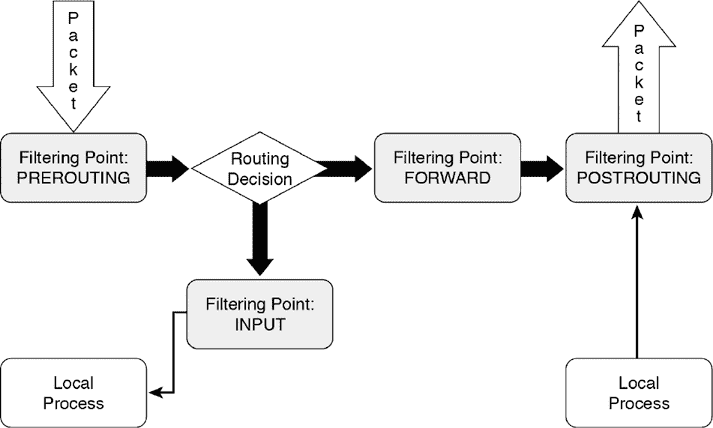

**图 19.1** 数据包过滤——出站数据包

规则类型（称为*表* `table`）可以放置在过滤点上。一个过滤点可以有一组或多组规则，因为 `iptables` 执行多种功能：过滤（阻止或允许）数据、对数据包执行 NAT 操作，或篡改（mangle）数据包。过滤点加上表（`filter`、`nat` 或 `mangle`）形成了一个单一的规则集，称为*链* `chain`。

将链视为一组决定对特定数据包采取什么操作的*规则*。例如，“`filter INPUT`”链上的某条规则可以根据源 IP 地址拦截入站数据包。另一个规则可以用于允许发往特定网络端口的数据包。

规则的顺序也非常重要。一旦找到匹配的规则，就会执行操作（称为*目标* `target`），并忽略额外的规则（如下文所述，有一个例外）。

有关目标的更多信息，请参阅本章中的“Accept”、“Drop”（[#ch19.xhtml_ch19lev2sec9](#ch19.xhtml_ch19lev2sec9)）、“Reject”（[#ch19.xhtml_ch19lev2sec8](#ch19.xhtml_ch19lev2sec8)）和“Log”子节。

下表描述了若干常见的 `iptables` 规则：

| Rule | Description |
| --- | --- |
| `iptables -t filter -L INPUT` | 显示 `INPUT-filter` 链的所有规则。 |
| `iptables -D INPUT 1` | 从 `INPUT-filter` 链中删除第 1 条规则。 |
| `iptables -F INPUT` | 清空 `INPUT-filter` 链的所有规则。 |
| `iptables -A INPUT -s 192.168.10.100 -j DROP` | 在 `INPUT-filter` 链末尾添加规则，丢弃所有来自 192.168.10.100 系统的数据包。 |
| `iptables -A INPUT -s 192.168.20.0/24 -j DROP` | 在 `INPUT-filter` 链末尾添加规则，丢弃所有来自 192.168.10.0/24 的数据包。 |

## Persistency

`iptables` 进行的所有更改只影响当前防火墙。如果系统重启，规则将会丢失。

你可以使用 `iptables-save` 命令将规则保存到文件中。通常，该命令的输出会到屏幕，但你可以将输出重定向到文件：

```bash
root@OCS:~# iptables-save > /etc/iptables.rules
```

- `MASQUERADE`（伪装）：当你的一个具有*动态分配*私有 IP 地址的内部网络（例如使用 DHCP）时使用。通过 `MASQUERADE`，你可以通过具有活动 IP 地址（在互联网上可路由的地址）的单一机器访问互联网。该系统通过 `MASQUERADE` 配置，用于将内部地址映射到外部通信。`MASQUERADE` 规则放置在 `POSTROUTING` 过滤点上。

由于大多数内部网络使用 DHCP 分配 IP 地址，因此 `MASQUERADE` 比 `SNAT` 更常见。它也更容易配置，因为 `SNAT` 要求你为每个内部系统创建规则。而使用 `MASQUERADE`，一个命令即可处理所有内部系统：

点击此处查看图片

```bash
root@OCS:~# iptables -t nat -A POSTROUTING -j MASQUERADE
```

注意，`NAT` 本身是不够的。你还必须在内核中实现 IP 转发功能。请查看下一节“IP 转发”。

## IP 转发

IP 转发是一个内核功能，允许数据包从一个网络传递到另一个网络。此功能通常用于在服务器上创建路由器。

这很简单，你只需要将以下文件的值设置为“1”：

- `/proc/sys/net/ipv4/ip_forward`：启用 IPv4 网络数据包的 IP 转发。
- `/proc/sys/net/ipv6/conf/all/forwarding`：启用 IPv6 网络数据包的 IP 转发。

## 动态规则集

并不是所有规则都是手动创建的。一些工具会动态创建防火墙规则。这些工具的目标是识别系统受攻击并创建规则阻止入侵尝试。

### DenyHost

`DenyHost` 工具类似于 `fail2ban`，但它专门为保护 SSH 服务器设计，它不创建 `iptables` 规则，而是创建 TCP Wrapper 规则。如果远程系统试图进行暴力攻击（使用可能的密码字典作为猜测用户密码的方法），`DenyHost` 将在 `/etc/hosts.deny` 文件中创建规则以阻止该远程系统。

### Fail2ban

`fail2ban` 守护进程将扫描特定的日志文件，搜索通过反复连接尝试试图破解系统的系统 IP 地址。

主配置文件是 `/etc/fail2ban/jails.conf` 文件。然而，如果你查看此文件，可能会看到以下消息：

点击此处查看图片

```text
# 如何激活监狱 (JAILS)：

#

# 你不应该修改此文件。

#

# 它在发行版更新中可能会被覆盖或改进。

#

# 请在 jail.local 文件或

# jail.d/customisation.local 中提供自定义内容。

# ，，要更改所有监狱的默认禁封时间 (bantime)

# 并启用 ssh-iptables 监狱，以下（未注释的）内容将

# 出现在 .local 文件中。

# 详情请参阅 man 5 jail.conf。
```

你在直接修改此文件时遇到的问题是，`fail2ban` 软件包的更新可能会覆盖此文件。正如文件中的警告建议的那样，你可以创建带有自定义内容的 `.local` 文件。

该文件命名为 `jails.conf`，是因为远程主机由于可疑活动被放入“监狱”（jail）中。就像真正的监狱一样，意图是在特定时间后让主机离开。

下表描述了文件中的一些关键设置：

| 设置 |  |
| --- | --- |
| `bantime` | 主机被封禁的时间（秒）。 |
| `maxretry` | 在“`findtime`”内连接失败的次数，超过该次数后主机会被封禁。 |
| `findtime` | “`maxretry`”条目使用的时间段（秒）。例如，如果应用了 `bantime = 600`、`findtime = 600`、`maxretry = 5` 的设置，那么在 600 秒内五次失败将导致封禁 600 秒。 |
| `enabled` | 如果 `enabled` 设置为“true”，则启用该监狱。这是一个非常重要的设置，因为 `jail.conf` 文件中该设置的默认值为“false”。只应该启用特定的部分（你想要使用的部分）。 |
| `ignoreip` | 允许你创建永远不封禁的 IP 地址“白名单”。 |

### IPset

`IPset` 工具旨在创建 IP 地址的“集”，然后使用该集将规则应用于一组系统。例如，以下命令将创建一个集：

点击此处查看图片

```bash
root@OCS:~# ipset create test hash:net
```

接下来的一组规则将把 IP 地址添加到“test”集中：

点击此处查看图片

```bash
root@OCS:~# ipset add test 192.168.100.0/24

root@OCS:~# ipset add test 192.168.100.0/24
```

等等，我看到原文中有两次 `192.168.100.0/24`。我将保持内容不变。

```bash
root@OCS:~# ipset add test 192.168.100.0/24

root@OCS:~# ipset add test 192.168.100.0/24
```

事实上，查看提供的源文本：

```bash
root@OCS:~# ipset add test 192.168.100.0/24

root@OCS:~# ipset add test 192.168.100.0/24
```

等等，源文本实际上写的是：

```bash
root@OCS:~# ipset add test 192.168.100.0/24

root@OCS:~# ipset add test 192.168.100.0/24
```

我重新检查一下。

当灾难发生时（例如硬盘故障或自然灾害），数据可能会损坏。使用归档和恢复工具可以帮助降低数据丢失的风险，并使信息从一个系统传输到另一个系统变得更容易。本节重点介绍这些工具。

## tar

`tar` 命令的作用是将多个文件合并为一个文件。要创建一个名为 `sample.tar` 的 tar 文件，请执行以下操作：

点击此处查看代码图像

```bash
tar -cf sample.tar files_to_merge
```

列出 `.tar` 文件的内容：

```bash
tar -tf sample.tar
```

提取 `.tar` 文件的内容：

```bash
tar -xf sample.tar
```

下表详细列了一些重要的选项：

| Option | Description |
| --- | --- |
| `-c` | 创建一个 `.tar` 文件。 |
| `-t` | 列出 `.tar` 文件的内容。 |
| `-x` | 提取 `.tar` 文件的内容。 |
| `-f` | 指定 `.tar` 文件的名称。 |
| `-v` | 详细模式（提供更多关于命令正在执行的操作细节）。 |
| `-A` | 将新文件追加到现有的 `.tar` 文件。 |
| `-d` | 比较 `.tar` 文件与目录中文件的差异。 |
| `-u` | 更新；仅将更新的文件追加到现有的 `.tar` 文件中。 |
| `-j` | 使用 `bzip2` 工具压缩/解压 `.tar` 文件。 |
| `-J` | 使用 `xz` 工具压缩/解压 `.tar` 文件。 |
| `-z` | 使用 `gzip` 工具压缩/解压 `.tar` 文件。 |

## cpio

`cpio` 命令的作用是创建归档。你可以通过将文件名作为标准输入（STDIN）发送到命令中来创建文件归档，如下例所示：

点击此处查看代码图像

```bash
[student@OCS ~]$ find /etc -name "*.conf" | cpio -ov > conf.cpio
```

下表详细列了一些重要的选项：

| Option | Description |
| --- | --- |
| `-d` | 与 `-i` 选项配合使用，提取 `cpio` 文件中的目录结构及文件。 |
| `-i` | 从 `cpio` 文件提取数据；文件应通过 STDIN 提供（例如，`cpio -i < conf.cpio`）。 |
| `-o` | 创建归档（输出文件）。 |
| `-t` | 列出 `cpio` 文件的目录。 |
| `-v` | 详细模式。 |

## dd

`dd` 命令可以执行与数据备份和创建文件相关的多种操作。一种常见用途是为整个驱动器备份；例如，以下命令将整个 `/dev/sdb` 设备备份到 `/dev/sdc` 设备：

点击此处查看代码图像

```bash
[student@OCS ~]$ dd if=/dev/sdb of=/dev/sdc bs=4096
```

`dd` 命令的另一个用途是创建一个可以作为交换文件的大文件：

点击此处查看代码图像

```bash
[student@OCS ~]$ dd if=/dev/zero of=/var/swapfile bs=1M count=50
```

下表详细列了一些重要的选项：

| Option | Description |
| --- | --- |
| `if=` | 指定输入文件。 |
| `of=` | 指定输出文件。 |
| `bs=` | 指定块大小。 |
| `count=` | 指定要创建/传输的块数。 |

## Compression

归档文件、日志文件和邮件队列随着时间的推移可能会变得很大。使用本节涵盖的压缩工具来缩小这些文件的大小。

### gzip

使用 `gzip` 命令压缩文件：

点击此处查看代码图像

```text
[student@OCS ~]$ ls -lh juju

-rwxr-xr-x 1 vagrant vagrant 109M Jan 10 09:20 juju

[student@OCS ~]$ gzip juju

[student@OCS ~]$ ls -lh juju.gz

-rwxr-xr-x 1 vagrant vagrant 17M Jan 10 09:20 juju.gz
```

注意，`gzip` 命令会用压缩文件替换原始文件。

下表详细列了一些重要的选项：

| Option | Description |
| --- | --- |
| `-c` | 将输出写入 STDOUT 且不替换原始文件。使用重定向将输出数据放入新文件中（例如，`gzip -c juju > juju.gz`）。 |
| `-d` | 解压缩文件（你也可以使用 `gunzip` 命令）。 |
| `-r` | 递归：当给定目录参数时，用于压缩目录（及其子目录）中的所有文件。 |
| `-v` | 详细：显示压缩百分比。 |

`gzip`、`xz` 和 `bzip2` 非常非常。最大的区别在于用于压缩文件的技术。`gzip` 命令使用 Lempel-Ziv 编码方法，而 `bzip2` 命令使用 Burrows-Wheeler 块排序文本压缩算法和霍曼编码。`xz` 命令使用 LZMA 和 LZMA2 压缩方法。

使用 `gzip` 命令解压 gzipped 文件：

点击此处查看代码图像

```text
[student@OCS ~]$ ls -lh juju.gz

-rwxr-xr-x 1 vagrant vagrant 17M Jan 10 09:20 juju.gz

[student@OCS ~]$ gunzip juju

[student@OCS ~]$ ls -lh juju

-rwxr-xr-x 1 vagrant vagrant 109M Jan 10 09:20 juju
```

## xz

使用 `xz` 命令压缩文件：

点击此处查看代码图像

```text
[student@OCS ~]$ ls -lh juju

-rwxr-xr-x 1 vagrant vagrant 109M Jan 10 09:20 juju

[student@OCS ~]$ xz juju

[student@OCS ~]$ ls -lh juju.xz

-rwxr-xr-x 1 vagrant vagrant 17M Jan 10 09:20 juju.xz
```

下表详细列了一些重要的选项：

| Option | Description |
| --- | --- |
| `-c` | 将输出写入 STDOUT 且不替换原始文件。使用重定向将输出数据放入新文件中（例如，`xz -c juju > juju.xz`）。 |
| `-d` | 解压缩文件（你也可以使用 `unxz` 命令）。 |
| `-l` | 列出现有压缩文件的信息（例如，`xz -l juju.xz`）。 |
| `-v` | 详细：显示压缩百分比。 |

`gzip`、`xz` 和 `bzip2` 命令非常相似。最大的区别在于用于压缩文件的技术。

## bzip2

使用 `bzip2` 命令压缩文件：

点击此处查看代码图像

```text
[student@OCS ~]$ ls -lh juju

-rwxr-xr-x 1 vagrant vagrant 109M Jan 10 09:20 juju

[student@OCS ~]$ bzip2 juju

[student@OCS ~]$ ls -lh juju.bz2

-rwxr-xr-x 1 vagrant vagrant 14M Jan 10 09:20 juju.bz2
```

注意，`bzip2` 命令会用压缩文件替换原始文件。

下表详细列了一些重要的选项：

| Option | Description |
| --- | --- |
| `-c` | 将输出写入 STDOUT 且不替换原始文件。使用重定向将输出数据放入新文件中（例如，`bzip2 -c juju > juju.bz2`）。 |
| `-d` | 解压缩文件（你也可以使用 `bunzip2` 命令）。 |
| `-v` | 详细：显示压缩百分比。 |

## zip

`zip` 命令用于将多个文件合并为一个压缩文件。创建一个包含 `/etc/mail` 目录下所有文件的压缩文件 `mail.zip`，使用以下格式：

点击此处查看代码图像

```text
[student@OCS ~]$ zip mail /etc/mail*

  adding: etc/mail/ (stored 0%)

  adding: etc/mailcap (deflated 53%)

  adding: etc/mailman/ (stored 0%)

  adding: etc/mail.rc (deflated 49%)
```


下表详细列了一些重要的选项：

| Option | Description |
| --- | --- |
| `-d` | 解压文件（你也可以使用 `unzip` 命令）。注意，压缩文件不会被删除。 |
| `-v` | 详细模式：显示压缩百分比。 |
| `-u` | 用新内容更新 `.zip` 文件。 |
| `-r` | 递归压缩，意味着你可以指定目录，该目录下的所有内容（包括所有子目录及其内容）都将被压缩。 |
| `-x file(s)` | 指定要从 `.zip` 文件中排除的 `file(s)`。 |

## 备份类型

许多备份工具允许你通过预定义的类型来指定备份内容。本节将介绍这些类型。

### 增量备份

增量备份将包含自上次增量备份或全量备份以来发生变化的所有文件。

增量备份具有几个优势：

* 每次备份所需的时间比全量备份短，在大多数情况下也比差异备份更短。
* 增量备份通常比全量备份和差异备份小，因此占用的存储空间更少。

然而，它也有一些缺点：

* 从增量备份中恢复可能非常耗时。首先，必须恢复全量备份，然后必须恢复每个增量备份，直到达到导致数据丢失的事件。
* 从增量备份中查找特定文件可能是很困难的，因为文件可能位于不同的位置。

另请参考本章中的“全量”和“差异”子节。

### 全量备份

通过全量备份，源端的所有内容都会被备份。这可能包括自上次备份以来没有变化的文件。

全量备份具有几个优势：

* 所有的源数据都位于一个备份中，更容易查找。
* 从全量备份中恢复比其他备份方法更快。

然而，它也有一些缺点：

* 全量备份可能是一个非常耗时的过程。
* 通常，全量备份占用的存储空间比其他方法多。
* 如果远程执行备份，全量备份将使用的带宽比其他方法多得多。

另请参考本章中的“增量”和“差异”子节。

### 快照克隆

使用逻辑卷管理 (`LVM`)，你可以为逻辑卷创建一个快照，它是文件系统的冻结镜像。这允许你安全地备份运行中的文件系统，因为快照克隆始终提供快照创建时文件系统的静态视图。

更多关于 `LVM` 的细节，请参阅第 4 章中的“`LVM`”节，“给定场景，在 Linux 环境中管理存储](#ch04.xhtml_ch04)”。

### 差异备份

差异备份将存档自上次全量备份后的任何文件。差异备份不考虑之前的差异备份或增量备份备份的文件。

差异备份具有几个优势：

* 所有的源数据都位于两个备份（全量和差异）中，比增量备份更容易查找文件。
* 从差异备份中恢复比增量方法更快。

然而，它也有一些缺点：

* 与增量备份相比，使用差异备份方案可能是一个耗时的过程。
* 通常，差异备份占用的存储空间比增量备份多。
* 如果远程执行备份，差异备份使用的带宽比增量备份多。

另请参考本章中的“增量”和“全量”子节。

### 镜像

*镜像* 是用于备份数据格式的术语。有几种不同的类型，包括：

* `tar`：由 `tar` 命令生成的文件格式。
* `ISO`: 通常用于生成 CD-ROM 文件系统的格式。

镜像非常重要，因为你需要使用正确的工具来正确处理镜像。有时文件名的扩展名（`file.tar`、`sample.iso` 等）会提供镜像类型。在镜像没有描述性的情况下，使用 `file` 命令：

```
[student@OCS ~]$ file sample
sample: POSIX tar archive (GNU)
```

## 离地/异地存储

Linux+ 考试的目标是了解如何使用工具将数据传输到远程存储位置（称为“离地存储”）。本节介绍了这些工具。

### SFTP

`sftp` 命令使用 SSH（Secure Shell）协议在网络上安全地传输文件。要访问远程系统，使用以下语法：

```
sftp user@machine
```

登录远程系统后，你将获得一个以以下提示符开头的接口：

```
sftp>
```

在此提示符下，可以使用多个命令传输文件并执行其他操作。下表描述了这些命令中较重要的：

| 命令 |  |
| --- | --- |
| `pwd` | 显示当前远程目录。 |
| `lpwd` | 显示当前本地目录。 |
| `cd` | 切换到远程系统的另一个目录。 |
| `lcd` | 切换到本地系统的另一个目录。 |
| `get` | 从远程系统的当前目录下载文件到本地系统的当前目录。使用 `-r` 获取整个目录结构。 |
| `put` | 从本地当前目录上传文件到远程系统的当前目录。使用 `-r` 上传整个目录结构。 |
| `ls` | 显示远程系统当前目录下的文件。 |
| `lls` | 显示本地系统当前目录下的文件。 |
| `exit` | 退出 `sftp`。 |

### SCP

另参阅第 9 章中的“`scp`”子节，“给定场景，创建、修改和重定向文件](#ch09.xhtml_ch09)”。

### rsync

另参阅第 9 章中的“`rsync`”子节。

## 完整性检查

当文件通过网络或其他手段从一个系统传输时，文件可能会被伪冒者或假文件替换。想象一下使用来自黑客注入数据的远程备份数据，这可能导致系统被破坏。

本节涵盖了用于验证文件完整性的技术。

### MD5

`md5sum` 命令创建一个唯一的“消息摘要”，可用于此后验证文件。以下操作创建了此摘要：

```
[student@OCS ~]$ md5sum output
b46d07ef1778eaaabbffca5e1cc94f81 output
```

如果文件发生变化，`md5sum` 的输出也会随。

以下是 `md5sum` 命令的一些重要选项：

| 选项 | 说明 |
| --- | --- |
| `-b` | 将文件视为二进制文件。 |
| `-c` | 从文件中读取消息摘要并与现有文件进行比对。 |

### SHA

与 `md5sum` 命令类似，另一组命令（`sha224sum`、`sha256sum`、`sha384sum` 和 `sha512sum`）也会创建消息摘要，但使用了不同的算法：

```
[student@OCS ~]$ sha256sum output
3c00f1d1b69b5fd901d6ff087d603bb07d272911254926d870c04
  8a69614ae96  output

[student@OCS ~]$ sha512sum output
5da0fb5eba5f8ac5bf9c7a58f3ca6c325294fc94595f386863c41
  f236ea84abf115642667ef16fc5d632466a91410929339e8b80fa8
  351f7cf982f9a20eee738  output
```

尽管算法和输出不同，这些命令与 `md5sum` 命令共享相同的选项。更多细节请参阅上一个子节“MD5”。

# 第四部分：Linux 故障排除与诊断

# 第 21 章。给定场景，分析系统属性并相应修复

本章提供了有关以下主题的信息和命令：

## 网络监控与配置

- 延迟（带宽 `bandwidth`、吞吐量 `throughput`）
- 路由路由
- 丢包
- 超时
- 域名解析
- Localhost 与 Unix 套接字
- 接口配置
- 命令
    - `nmap`
    - `netstat`
    - `iftop`
    - `route`
    - `iperf`
    - `tcpdump`
    - `ipset`
    - Wireshark
    - `tshark`
    - `netcat`
    - `traceroute`
    - `mtr`
    - `arp`
    - `nslookup`
    - `dig`
    - `host`
    - `whois`
    - `ping`
    - `nmcli`
    - `ip`
    - `tracepath`

## 存储监控与配置

- `iostat`
- `ioping`
- IO 调度（`cfq`、`noop`、`deadline`）
- `du`
- `df`
- LVM 工具
- `fsck`
- `partprobe`

## CPU 监控与配置

- `/proc/cpuinfo`
- `uptime`
- 负载 `loadaverage`
- `sar`
- `sysctl`

## 内存监控与配置

- `swapon`
- `swapoff`
- `mkswap`
- `vmstat`
- 内存溢出 (Out of memory)
- `free`
- `/proc/meminfo`
- 缓冲区缓存
- 丢失根密码
- 单用户模式

### 网络监控与配置

本节重点关注网络接口监控相关的命令。

#### 延迟

将延迟视为通信中的任何延迟（例如，数据包从一个主机传输到另一个主机所需的时间）。有时通过往返时间（发送网络数据包并接收响应的时间）来衡量。使用 `ping` 和 `traceroute` 等工具来确定是否存在延迟问题。

#### 带宽

带宽是可以通过介质传输的最大数据量。介质可以是网络电缆、无线网络甚至是接口本身。确定带宽的一个实用工具是 `netstat`。

#### 吞吐量

吞吐量是通过介质的实际数据量。此值受许多因素限制，包括带宽和干扰。`netstat` 和 Wireshark 工具有助于确定吞吐量。

#### 路由

路由是通过网关将网络数据从一个协议（IP）发送到另一个协议的过程。网关是一个具有多个接口并在网络之间传输数据的系统。使用 `route` 或 `netstat` 来确定主机上的路由情况。

#### 饱和

当吞吐量达到带宽值时就会发生饱和。一旦饱和成为经常发生的情况，网络就会变得缓慢或迟钝。这将增加问题并让用户感到沮丧。使用 Wireshark 等网络监控工具来确定是否频繁发生饱和。

#### 丢包

丢包是指远程系统不对传入的数据包做出响应。这可能是防火墙规则、饱和或网络配置不当导致。

#### 超时

超时用于判断是否发生丢包的软件组件。程序将向远程系统发送网络数据包并等待特定的时间。如果在此期间没有收到响应，则软件认为响应超时。超时会导致错误信息。某些软件会在发生问题时使用重试值再次发送网络数据包。

#### 域名解析

域名解析是将主机名转换为 IP 地址。反向域名解析是将 IP 地址转换为主机名。`dig`、`host` 和 `nslookup` 等工具可以提供域名解析功能。

#### Localhost 与 Unix 套接字

“localhost”术语指的是通过本地网络接口通信系统。发送到 `localhost`（IP 地址 `127.0.0.1`）的任何网络流量都不会发送网络，而是保留在内部。然而，它的行为类似于网络流量，因此如果你在本地机器上，可以使用 Wireshark 等网络嗅探工具来查看此类流量。

使用“Unix 套接字”是允许同一系统上的进程相互通信的方法。此信息不通过任何网络接口发送，无法使用网络嗅探工具查看流量。这使得排查 Unix 套接字问题变得困难得多。

#### 接口配置

接口配置涉及向网络接口分配设置，如 IP 地址、子网掩码和路由器信息。使用 `ip` 和 `route` 命令显示此类信息。

#### 命令

本节重点关注一组对排查网络问题用的命令。

##### nmap

`nmap` 命令用于探测远程系统，以确定哪些网络端口可以从本地系统访问。要使用 `nmap` 命令，请提供要扫描的系统的 IP 地址或主机名。这是一个示例：

```
# nmap 192.168.1.1

Starting Nmap 5.51 ( http://nmap.org ) at 2015-10-31 23:22 PDT
Nmap scan report for 192.168.1.1
Host is up (2.9s latency).
Not shown: 987 closed ports
PORT     STATE SERVICE
23/tcp   open  telnet
25/tcp   open  smtp
53/tcp   open  domain
80/tcp   open  http
110/tcp  open  pop3
119/tcp  open  nntp
143/tcp  open  imap
465/tcp  open  smtps
563/tcp  open  snews
587/tcp  open  submission
993/tcp  open  imaps
995/tcp  open  pop3s
5000/tcp open  upnp
Nmap done: 1 IP address (1 host up) scanned in 4.89 seconds
```

##### netstat

`netstat` 命令用于显示网络统计信息，以确定数据传输或接收是否存在问题。有关此命令的详情，请参阅第 3 章中的“route”节或“给定场景，配置并验证网络连接参数”。

##### iftop

`iftop` 命令提供了一种显示占用带宽最大的网络连接的方法。它是一个交互式显示，默认每秒更新一次，用于显示“顶部”网络连接。示例请参见图 21.1。

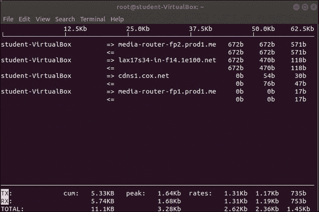

**图 21.1** `iftop` 命令

##### route

`route` 命令用于显示路由表，以确定到另一个网络的路由是否配置正确。有关此命令的详情，请参阅第 3 章中的“route”节。

##### iperf

`iperf` 命令提供创建两个系统之间吞吐量测试的方法。它需要在两个系统上安装并配置该工具：一个客户端和一个服务器。该命令的完整用法超出了考试范围。你应该了解该工具的作用以及它需要同时设置客户端和服务器这一事实。

##### tcpdump

在排排除网络问题或执行网络安全审计时，查看网络流量（包括与本地机器相关的流量）会有帮助。`tcpdump` 命令是一个“数据包嗅探器”，允许你查看本地网络流量。

默认情况下，`tcpdump` 命令会将所有网络流量输出到标准输出，直到你终止命令。这可能会导致屏幕上飞过大量数据。你可以使用 `-c` 选项将输出限制为特定的网络包数量：

```
# tcpdump -c 5
tcpdump: verbose output suppressed, use -v or -vv for full
  protocol decode
listening on eth0, link-type EN10MB (Ethernet), capture size 65535 bytes
11:32:59.630873 IP localhost.43066 > 192.168.1.1.domain:
  16227+ A? onecoursesource.com. (37)
11:32:59.631272 IP localhost.59247 > 192.168.1.1.domain:
  2117+ PTR? 1.1.168.192.in-addr.arpa. (42)
11:32:59.631387 IP localhost.43066 > 192.168.1.1.domain:
  19647+ AAAA? onecoursesource.com. (37)
11:32:59.647932 IP 192.168.1.1.domain > localhost.59247:
  2117 NXDomain* 0/1/0 (97)
11:32:59.717499 IP 192.168.1.1.domain > localhost.43066:
  16227 1/0/0 A 38.89.136.109 (53)
5 packets captured
5 packets received by filter
0 packets dropped by kernel
```

##### ipset

IPSet 工具设计用于创建 IP 地址的“集合（set）”，然后使用该集合对一组系统应用规则。例如，以下命令将创建一个集合：

```
root@OCS:~# ipset create test hash:net
```

下一组规则将将 IP 地址添加到“test”集合中：

```
root@OCS:~# ipset add test 192.168.100.0/24
root@OCS:~# ipset add test 192.168.110.0/24
root@OCS:~# ipset add test 192.168.120.0/24
```

接下来的命令将此规则应用到该集合：

```
root@OCS:~# iptables -I INPUT -m set --match-set
  test src -j LOG
```

有关 `iptables` 命令和防火墙配置的更多详情，请参阅第 19 章“给定场景，实现并配置 Linux 防火墙”。

##### Wireshark

Wireshark 是一个强大的网络嗅探器，提供了基于 GUI 和 TUI 的工具。要启动 GUI 工具，执行 `wireshark` 命令。输出应类似于图 21.2。

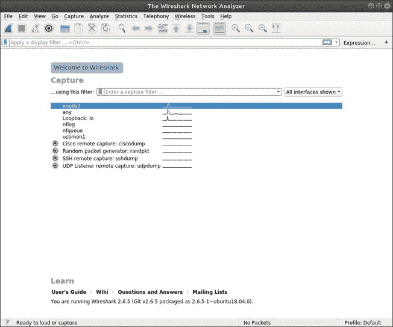

**图 21.2** `wireshark` 命令

要查看网络流量，你需要启动捕获。点击 **Capture**、**Start**。你还可以通过设置过滤器和选项来限制捕获的内容（点击 **Capture**、**Options**）。

要使用基于 TUI 的版本的 Wireshark，请以 root 用户身份执行 `tshark` 命令。这是一个示例：

```
# tshark
Capturing on 'enp0s3'
```


```text
1  0.000000000      10.0.2.15 → 68.105.28.11 DNS
   81 Standard query 0xeec4 A google.com OPT

2  0.001031279      10.0.2.15 → 68.105.28.11 DNS
   81 Standard query 0x3469 AAAA google.com OPT

3  0.017196416      68.105.28.11 → 10.0.2.15 DNS
   109 Standard query response 0x3469 AAAA google.com AAAA
   2607:f8b0:4007:800::200e OPT

4  0.017265061      68.105.28.11 → 10.0.2.15 DNS
   97 Standard query response 0xeec4 A google.com A 172.217.14.110 OPT

5  0.018482388      10.0.2.15 → 172.217.14.110 ICMP
   98 Echo (ping) request id=0x122c, seq=1/256, ttl=64

6  0.036907577      172.217.14.110 → 10.0.2.15 ICMP
   98 Echo (ping) reply id=0x122c, seq=1/256, ttl=251 (request in 5)

7  1.021052811      10.0.2.15 → 172.217.14.110 ICMP
   98 Echo (ping) request id=0x122c, seq=2/512, ttl=64

8
```

### tshark

请参本章中的“Wireshark”节。

### netcat

`nc`（也称为 netcat）的帮助页提供了关于 `nc` 的精彩总结：“nc（netcat）工具用于任何涉及 TCP 或 UDP 的操作。它可以打开 TCP 连接、发送 UDP 数据包、在任意 TCP 和 UDP 端口进行监听、进行端口扫描并处理 IPv4 和 IPv6。”

你可以使用 `nc` 命令显示开放端口，类似于 `netstat` 命令：

```bash
nc -z localhost 1000-4000

Connection to localhost 3260 port [tcp/iscs-target] succeeded!

Connection to localhost 3333 port [tcp/dec-notes] succeeded!
```

`-z` 选项也可对远程主机进行端口扫描。下表描述了该命令的其他选项：

| 选项 | 描述 |
| --- | --- |
| `-w` | 用于客户端在达到值后关闭连接。例如，`nc -w 30 server 333` 在建立连接 30 秒后关闭。 |
| `-6` | 使用此选项启用 IPv6 连接。 |
| `-k` | 在客户端断开后保持服务器进程活跃。默认行为是在客户端断开时停止服务器进程。 |
| `-u` | 使用 UDP 连接而非 TCP（默认）。这对于正确测试防火墙配置非常重要，因为 UDP 端口可能未被阻塞而 TCP 端口却被。 |
| `-l port_num` | 使 `nc` 命令作为服务器运行，监听由 `port_num` 参数指定的端口。 |

### traceroute

当你向远程系统发送网络数据包（特别是跨越 Internet 时），它通常需要经过多个网关才能到达目的地。你可以通过执行 `traceroute` 命令查看数据包通过的网关：

```text
traceroute onecoursesource.com

traceroute to onecoursesource.com (38.89.136.109), 30 hops max, 60 byte packets

 1  10.0.2.2  (10.0.2.2) 0.606 ms  1.132 ms  1.087 ms
 2  b001649-3.jfk01.atlas.cogentco.com (38.104.71.201)
    0.738 ms  0.918 ms  0.838 ms
 3  154.24.42.205 (154.24.42.205)  0.952 ms  0.790 ms  0.906 ms
 4  be2629.ccr41.jfk02.atlas.cogentco.com (154.54.27.66)
    1.699 ms  1.643 ms  1.347 ms
 5  be2148.ccr41.dca01.atlas.cogentco.com (154.54.31.117)
    8.053 ms  7.719 ms  7.639 ms
 6  be2113.ccr42.atl01.atlas.cogentco.com (154.54.24.222)
    18.276 ms  18.418 ms  18.407 ms
 7  be2687.ccr21.iah01.atlas.cogentco.com (154.54.28.70)
    32.861 ms  32.917 ms  32.719 ms
 8  be2291.ccr21.sat01.atlas.cogentco.com (154.54.2.190)
    38.087 ms  38.025 ms  38.076 ms
 9  be2301.ccr21.elp01.atlas.cogentco.com (154.54.5.174)
    48.811 ms  48.952 ms  49.151 ms
10  be2254.ccr21.phx02.atlas.cogentco.com (154.54.7.33)
    57.332 ms  57.281 ms  56.896 ms
11  te2-1.mag02.phx02.atlas.cogentco.com (154.54.1.230)
    56.666 ms  65.279 ms  56.520 ms
12  154.24.18.26 (154.24.18.26)  57.924 ms  58.058 ms  58.032 ms
13  38.122.88.218 (38.122.88.218)  79.306 ms  57.740 ms  57.491 ms
14  onecoursesource.com (38.89.136.109)  58.112 ms  57.884 ms  58.299 ms
```

### mtr

如果你想要一个非常酷的 `traceroute` 命令变体（参见本章的 `traceroute` 小节），请安装 `mtr` 命令。该命令每秒执行一次类似 `traceroute` 的操作，并用统计数据更新显示，如图 21.3 所示。

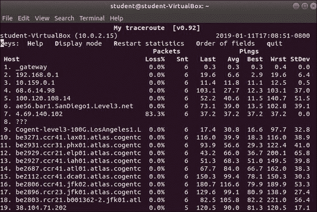

**图 21.3** `mtr` 命令

### arp

`arp` 命令用于查看 ARP 表或对其进行更改。当在不带参数的情况下执行时，`arp` 命令会显示 ARP 表：

```text
arp

Address         HWtype   HWaddress             Flags Mask    Iface

192.168.1.11    ether    30:3a:64:44:a5:02     C             eth0
```

如果远程系统更换了网卡，可能需要从 ARP 表中删除条目。可以通过使用 `arp` 命令的 `-d` 选项来实现：

```bash
arp -i eth0 -d 192.169.1.11
```

一旦地址从 ARP 表中删除，就不需要手动添加新地址了。当本地系统下次使用此 IP 地址时，它将在适当的网络上发送广播请求，以确定新的 MAC 地址。

#### nslookup

`nslookup` 命令用于显示主机名到 IP 地址的查询结果（或反向）。有关此命令的详情，请参见第 3 章的 `nslookup` 节。

#### dig

`dig` 命令用于显示主机名到 IP 地址的查询结果（或反向）。有关此命令的详情，请参见第 3 章的 `dig` 节。

### host

`host` 命令用于显示主机名到 IP 地址的查询结果（或反向）。有关此命令的详情，请参见第 3 章的 `host` 节。

### whois

`whois` 命令用于确定域名属于哪个公司或个人。输出通常还会包含如何联系该组织的信息，尽管出于隐私原因，这些信息可能会被隐藏：

```text
whois onecoursesource.com | head

Domain Name: ONECOURSESOURCE.COM

Registry Domain ID: 116444640_DOMAIN_COM-VRSN

Registrar WHOIS Server: whois.tucows.com

Registrar URL: http://www.tucows.com

Updated Date: 2016-01-15T01:49:45Z

Creation Date: 2004-04-07T19:45:31Z

Registry Expiry Date: 2021-04-07T19:45:31Z

Registrar: Tucows Domains Inc.
```

#### ping

`ping` 命令用于判断远程系统是否可达。它测量发送到主机的消息往返时间。请参见 `ping` 节。

#### nmcli

`nmcli` 命令用于管理网络设置。请参见 `nmcli` 节。

### ip

`ip` 命令用于显示网络接口信息。请参见 `ip` 节。

### tracerpath

`tracerpath` 命令用于显示数据包经过的路径。请参见 `tracerpath` 节。

### iostat

`iostat` 命令用于报告系统 I/O 统计数据。请参见 `iostat` 节。

### ioping

`iop` 命令用于监控 I/O 操作的延迟和吞吐量。

#### IO 调度

内核参数可优化 IO 调度。可以设置若干参数来更改行为。本节涵盖了 Linux+ 考试重要的参数。

要查看当前调度器，请查看 `/sys/block/<device>/queue/scheduler` 文件的内容（将 `<device>` 替换为实际设备名称）。例如：

```bash
[root@OCS ~]# cat /sys/block/sda/queue/scheduler

[noop] deadline cfq
```

括号内的值是默认值。要更改此值，如下所示使用 `echo` 命令：

```bash
[root@OCS ~]# echo "cfq" > /sys/block/sda/queue/scheduler

[root@OCS ~]# cat /sys/block/sda/queue/scheduler

noop deadline [cfq]
```

#### cfq

完全公平队列（Completely Fair Queuing）调度为每个进程都有一个独立的队列，并循环处理每个队列。

#### noop

该调度遵循先进先出（FIFO）原则。

#### deadline

这是标准调度器。该调度器创建两个队列——读队列和写队列。它还会为每个 I/O 请求加上时间戳，以确保请求得到及时处理。

有关此命令的详情，请参阅第 4 章中的 `du` 节。

### df

有关此命令的详情，请参阅第 4 章中的 `df` 节。

### LVM Tools

有关此命令的详情，请参阅第 4 章中的 `LVM Tools` 节。

### fsck

有关此命令的详情，请参阅第 4 章中的 `fsck` 节。

### partprobe

`partprobe` 命令通常在分区表发生变化且系统需要感知这些变化时才需要。最常见的例子是当你使用 `fdisk` 命令在当前已挂载文件系统的设备上更改分区时。`fdisk` 命令尝试通过内核调用通知系统分区表的变化，但由于文件系统正在“运行中”，该操作会失败。

为了解决这个问题，只需在退出 `fdisk` 工具后执行 `partprobe` 命令即可。

### CPU 监控与配置

本节重点介绍与 CPU 监控和配置相关的命令和文件。

#### /proc/cpuinfo

获取 CPU 信息的一种方法是查看 `/proc/cpuinfo` 文件的内容。该文件包含每个 CPU 的详细信息，如下所示：

```text
[root@OCS ~]# cat /proc/cpuinfo

processor       : 0
vendor_id       : GenuineIntel
cpu family      : 6
model           : 13
model name      : QEMU Virtual CPU version (cpu64-rhel6)
stepping        : 3
microcode       : 0x1
cpu MHz         : 2666.760
cache size      : 4096 KB
physical id     : 0
siblings        : 1
core id         : 0
cpu cores       : 1
apicid          : 0
initial apicid  : 0
fpu             : yes
fpu_exception   : yes
cpuid level     : 4
wp              : yes
flags           : fpu de pse tsc msr pae mce cx8 apic
  sep mtrr pge mca cmov pse36 clflush mmx fxsr sse sse2
  syscall nx lm nopl pni cx16 hypervisor lahf_lm
bugs            :
bogomips        : 5333.52
clflush size    : 64
cache_alignment : 64
address sizes   : 40 bits physical, 48 bits virtual
power management:

processor       : 1
vendor_id       : GenuineIntel
cpu family      : 6
model           : 13
model name      : QEMU Virtual CPU version (cpu64-rhel6)
stepping        : 3
microcode       : 0x1
cpu MHz         : 2666.760
cache size      : 4096 KB
physical id     : 1
siblings        : 1
core id         : 0
cpu cores       : 1
apicid          : 1
initial apicid  : 1
fpu             : yes
fpu_exception   : yes
cpuid level     : 4
wp              : yes
flags           : fpu de pse tsc msr pae mce cx8 apic sep
  mtrr pge mca cmov pse36 clflush mmx fxsr sse sse2 syscall nx
  lm nopl pni cx16 hypervisor lahf_lm
bugs            :
bogomips         : 5333.52
clflush size      : 64
cache_alignment  : 64
address sizes    : 40 bits physical, 48 bits virtual
power management :
```

#### uptime

`uptime` 命令显示系统运行的时间。对于系统监控来说，更重要的是它提供了系统当前用户数量的快速快照，以及过去 1、5 和 15 分钟的系统平均负载：

```text
[root@OCS ~]# uptime

16:16:00 up 1 day, 1:05, 6 users, load average: 0.60, 0.51, 0.25
```

#### loadaverage

`loadaverage` 命令显示系统平均负载。请参阅本章中的 `uptime` 子节。

#### sar

`sar` 命令显示的信息与 `iostat` 相同；但这些是随时间记录的（通常每隔 10 分钟一次）。这是一个示例：

```text
[root@OCS ~]# sar | head

Linux 3.10.0-229.el7.x86_64 (localhost.localdomain)

09/06/2015      _x86_64_(1 CPU)

12:00:01 AM  CPU   %user  %nic  %syste   %iowai  %stea  %idle

12:10:01 AM  all   0.11   0.00  0.10     0.01    0.00   99.78
```


`12:20:01 AM  all   0.08   0.00  0.07     0.02    0.00   99.84`

`12:30:01 AM  all   0.10   0.00  0.11     0.01    0.00   99.79`

`12:40:01 AM  all   0.10   0.00  0.11     0.01    0.00   99.79`

```
[root@OCS ~]# dd if=/dev/zero of=/var/extra_swap
  bs=1M count=200
200+0 records in
200+0 records out
209715200 bytes (210 MB) copied, 4.04572 s, 51.8 MB/s

[root@OCS ~]# mkswap /var/extra_swap
mkswap: /var/extra_swap: warning: don't erase bootbits sectors
         on whole disk. Use -f to force.
Setting up swapspace version 1, size = 204796 KiB
no label, UUID=44469984-0a99-45af-94b7-f7e97218d67a

[root@OCS ~]# swapon /var/extra_swap
[root@OCS ~]# swapon -s
Filename            Type        Size      Used    Priority
/dev/dm-1           partition   1048568   37664   -1
/dev/sdb1           partition   203768    0       -2
/var/extra_swap     file        204792    0       -3
```

### vmstat

如果你需要比 `free` 命令提供的更详细的信息，可以执行 `vmstat` 命令。请参考以下示例的输出：

```
[root@OCS ~]# vmstat
procs -----------memory---------- ---swap-- -----io----
  -system-- ------cpu-----
 r  b   swpd    free   buff   cache  si    so    bi    bo   in
  cs us sy id wa st
 2  0      0  776828   1704 2329456   0     0    49    89  115
  120  6  1  93  0  0
```

记住每一行内容并不是关键的，但你应该熟悉 `vmstat` 命令可以提供的输出内容。例如，在前一个示例的输出中，有一列标记为 `-----io----`。该列下有两个子列：

*   `bi`: 也称为“块入（blocks in）”，此值代表从块设备（如硬盘）接收的块数。
*   `bo`: 也称为“块出（blocks out）”，此值代表发送到块设备（如硬盘）的块数。

这些值可以用于判断性能问题是基于内存的还是基于磁盘的。如果 `bi` 和 `bo` 值较高，可能意味着进程正在被 I/O 阻塞。

### 字体 OOM Killer（内存溢出杀死）

当系统使用过多内存时会发生什么？Linux 内核有一个名为 OOM Killer（内存溢出杀死）的功能，它会通过杀死进程来释放内存。如果没有此功能，系统可能会停滞，且新进程将无法执行。

OOM Killer 通过为每个进程分配一个分数（称为“恶性评分”）并杀死得分最高的一个来决定杀死哪个进程。通常，这是占用内存最多的进程，而且很可能是服务器上的关键进程，例如邮件服务或 Web 服务器。

你可以搜索日志文件（通常为 `/var/log/messages` 或 `/var/log/kern.log`）来寻找 OOM Killer 已触发的证据。错误信息看起来如下：

```
host kernel: Out of Memory: Killed process 1466 (httpd).
```

#### 注意事项

有配置 OOM Killer 的方法（使用内核参数），但这些超出了 Linux+ 考试的范围。对于考试，你应该了解 OOM Killer 的功能以及如何判断 OOM Killer 是否已采取了行动。

### free

`free` 命令提供了虚拟内存（RAM 和交换空间利用率）的摘要，如下所示：

```
[root@OCS ~]# free
          total     used    free   shared   buff/cache   available
Mem:      3883128   774752  777300 18200    2331076      2784820
Swap:     839676         0  839676
```

`Mem:` 行描述 RAM，`Swap:` 行描述虚拟内存。输出列的描述如下：

*   `total`: 操作系统上的内存总量。
*   `used`: 当前正在使用的内存量。
*   `free`: 可用的内存量。
*   `shared`: 这是 `tmpfs` 使用的内存，`tmpfs` 是一种看起来像普通硬盘空间但实际上将数据存储在内存中的系统。
*   `buff/cache`: 缓冲区（buffer）或缓存（cache）是临时存储位置。
*   `available`: 新进程可用的内存。

下表描述了该命令的实用选项：

| 选项 | 说明 |
| --- | --- |
| `-b` 或 `--bytes` | 以字节为单位查看信息。 |
| `-m` 或 `--mega` | 以兆字节为单位查看信息。 |
| `-g` 或 `--giga` | 以吉字节为单位查看信息。 |
| `-h` 或 `--human` | 以人类可读格式查看信息。 |

### 僵尸进程（zombie process）

僵尸进程（zombie process）是指已经终止但尚未完全从内存中清除的进程。每个进程都由另一个进程启动，从而形成“父子”关系。当子进程结束时，父进程负责通知系统从内存中删除关于该子进程的所有细节。

在某些少数情况下，子进程可能会在父进程未感知的情况下结束。这将导致僵尸进程。在现代 Linux 系统上，僵尸进程相当罕见，通常表明存在需要修复的错误（bug）。

### 不可中断睡眠 (Uninterruptible Sleep)

处于不可中断睡眠状态的进程正在执行某些系统调用，这些调用会阻止其进程被中断（杀死）。在大多数现代 Linux 系统上，这种情况非常罕见，因为这些系统调用执行速度非常快。

如果一个进程在不可中断睡眠状态中持续了相当长的时间，很可能是软件 bug 导致的。

### 可中断睡眠 (Interruptible Sleep)

处于可中断睡眠状态的进程正在执行某种 I/O（输入/输出）操作，例如访问硬盘。这是一个非常常见的状态，因为 I/O 操作可能需要一些时间。

然而，如果一个进程处于可中断睡眠状态的时间很长，特别是当它影响了系统性能时，可能表明存在问题。可能是该进程尝试访问的设备存在错误（如硬盘上的坏数据块），或者程序存在 bug。

### 运行 (Running)

运行进程是指当前正在 CPU 上执行操作或在 CPU 队列中有操作的进程。

### 优先级 (Priorities)

Nice 值（Nice values）用于指示 CPU 哪个进程访问 CPU 的优先级更高。这些值的范围从 −20（最高优先级）到 19（最低优先级）。用户创建的任何任务的默认优先级均为 0。

请参阅本章中的“nice”小节，了解在执行命令时设置不同优先级的详细信息。

### 杀死信号 (Kill Signals)

`kill` 命令可更改进程的状态，包括停止（杀死）它。要停止一个进程，首先确定其进程 ID（PID）或作业号，然后将该数字作为参数提供给 `kill` 命令：

```
[student@OCS ~]$ jobs
 [1]- Running                       sleep 999 &
 [2]+ Running sleep 777 &
[student@OCS ~]$ kill %2
 [student@OCS ~]$ jobs
 [1]- Running                       sleep 999 &
 [2]+ Terminated                    sleep 777
[student@OCS ~]$ ps -fe | grep sleep
 student 17846 12540 0 14:30 pts/2          00:00:00 sleep 999
 student 17853 12540 0 14:31 pts/2          00:00:00 grep
  --color=auto sleep
[student@OCS ~]$ kill 17846
[student@OCS ~]$ ps -fe | grep sleep
 student 17856 12540 0 14:31 pts/2          00:00:00 grep
  --color=auto sleep
 [1]+ Terminated                    sleep 999
```

下表详细列出了 `kill` 命令的一些重要选项：

| 选项 |  |
| --- | --- |
| `-9` | 强制杀死。当执行普通 kill 命令时进程未退出时使用。 |
| `-l` | 用于提供其他数值列表，这些数值可向进程发送不同的 kill 信号。 |

信号（signal）是一种特殊的代码，用于指示进程应该采取何种操作。信号被用于暂停进程、停止进程、重启进程或其他操作。

下表详细列出了 `kill` 命令的一些重要信号：

| 信号 | 说明 |
| --- | --- |
| `SIGHUP` | 也称为信号 1；用于模拟终端断开（例如远程连接丢失）。通常情况下 `SIGHUP` 会导致程序终止，但可以使用 `nohup` 命令避免这种情况。请参阅第 12 章 中的“给定场景，自动化并调度作业”，以获取有关 `nohup` 命令的详细信息。 |
| `SIGINT` | 也称为信号 2；用于模拟 `Ctrl-c` 操作。请参阅第 12 章 中的“Ctrl-c”小节，获取 `Ctrl-c` 操作的详细信息。 |
| `SIGKILL` | 也称为信号 9；用于强制终止进程。 |
| `SIGTERM` | 也称为信号 15；用于正常终止进程。这是 `kill` 命令的默认信号。 |
| `SIGTSTP` | 也称为信号 20；用于停止（暂停）程序，类似于 `Ctrl-z` 操作。请参阅第 12 章 中的“Ctrl-z”小节，获取 `Ctrl-z` 操作的详细信息。 |

### 命令 (Commands)

可以使用若干条 Linux 命令来控制进程。本节将介绍这些命令。

#### nice

要指定一个与默认值不同的 nice 值，请通过 `nice` 命令执行作业：

```
[student@OCS ~]$ nice -n 5 firefox
```

注意，普通用户不能分配负的 nice 值。这些值只能由 root 用户使用。除了 `-n` 选项外没有其他有选项。

要查看进程的 nice 值，使用 `ps` 命令的 `-o` 选项并包含“nice”值：

```
[student@OCS ~] ps -o nice,pid,cmd
 NI PID CMD
 0 23865 -bash
 0 27969 ps -o nice,pid,cmd
```

#### renice

使用 `renice` 命令更改现有作业的 nice 值。这里是一个示例：

```
[student@OCS ~] ps -o nice,pid,cmd
 NI PID CMD
 0 23865 -bash
 5 28235 sleep 999
 0 28261 ps -o nice,pid,cmd
[student@OCS ~] renice -n 10 -p 28235
28235 (process ID) old priority 5, new priority 10
[student@OCS ~] ps -o nice,pid,cmd
 NI PID CMD
 0 23865 -bash
 10 28235 sleep 999
 0 28261 ps -o nice,pid,cmd
```

注意：普通（非 root）用户只能将现有进程的优先级更改为更低优先级。只有 root 用户可以将进程优先级更改为更高优先级。

下表详细列出了 `renice` 命令的一些重要选项：

| 选项 |  |
| --- | --- |
| `-g` *group* | 更改所有属于组文件的优先级。 |
| `-u` *user* | 更改所有属于用户文件的优先级。 |

#### top

`top` 命令显示定期更新的进程信息（默认每 2 秒一次）。`top` 命令输出的前半部分包含整体信息，而后半部分显示一个选定的进程列表（默认是使用 CPU 最多的进程）。

图 22.1 显示了 `top` 命令的一些典型输出。

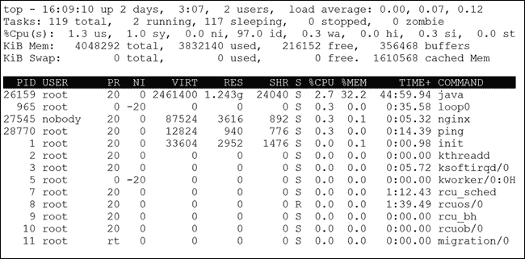

**图 22.1** **top** 命令输出

下表描述了在图 22.1 中显示的输出：

| 输出 |  |
| --- | --- |
| 第一行 | 源自 `uptime` 命令的输出。 |
| 第二行 | 系统上运行进程的摘要。 |
| 第三行 | 自上一次 top 数据刷新以来的 CPU 统计数据。 |
| 第四行 | 物理内存统计。（注意：在 **top** 命令中按 `E` 可以将值从字节转换为其他值。） |
| 第五行 | 虚拟内存统计。 |
| 剩余行 | 进程列表及相关信息。 |

在 `top` 命令运行时，可以使用交互式命令执行操作，如更改显示值、重新排序进程列表和杀死进程。这些交互式命令是单个字符。重要的交互式命令见下表：

| 命令 | 说明 |
| --- | --- |
| `h` | 帮助。显示交互式命令的摘要。 |
| `E` | 将默认值从千字节（KB）更改为其他值；值将循环回到千字节。 |
| `Z` | 切换颜色高亮的开启与关闭；使用小写 `z` 切换颜色显示和非颜色显示。 |
| `B` | 切换粗体的开启与关闭。 |
| `< >` | 将排序列向左 (`<`) 或向右 (`>`) 移动。 |
| `s` | 将更新值设置为与默认的 2 秒不同的值。 |
| `k` | 通过提供进程 ID (PID) 来杀死进程。 |
| `q` | 退出 `top` 命令。 |

`top` 命令还支持几个命令行选项，包括：

| 选项 | 描述 |
| --- | --- |
| `-d` | 设置数据刷新之间的时间。 |
| `-n` *number* | 在 `top` 命令退出之前的最大数据刷新次数。 |
| `-u` *username* | 仅显示由用户名拥有的进程。 |

#### time

`time` 命令用于确定运行命令所需的时间。这里有一个示例：

```
[student@OCS ~]$ time wget www.onecoursesource.com/index.php
--2019-05-04 05:17:29--  http://www.onecoursesource.com/index.php
Resolving www.onecoursesource.com (www.onecoursesource.com)
  ... 38.89.136.109
Connecting to www.onecoursesource.com
  (www.onecoursesource.com)|38.89.136.109|:80... connected.
HTTP request sent, awaiting response... 200 OK
Length: unspecified [text/html]
Saving to: 'index.php'
index.php [ <=> ] 12.25K --.-KB/s in 0s
2019-05-04 05:17:29 (97.0 MB/s) - 'index.php' saved [12548]
real 0m0.404s
user 0m0.000s
sys 0m0.000s
```

输出包含了总共经过的时间（“real”值）、用户进程占用的 CPU 时间（“user”值）以及系统进程占用的 CPU 时间（“sys”值）。

#### ps

`ps` 命令用于列出在系统上运行的进程。在不带参数的情况下，该命令将列出当前 shell 的任何子进程以及 BASH shell 本身，如下：

```
[student@OCS ~]$ ps
    PID TTY          TIME CMD
18360 pts/0          00:00:00 bash
18691 pts/0          00:00:00 ps
```


`ps` 命令的特殊之处在于，它支持较旧的 BSD 选项，这些选项通常前面没有连字符字符（`-`）。

下表详细列出了 `ps` 命令的一些重要选项：

| 选项 | 描述 |
| --- | --- |
| `-e` | 显示系统上运行的所有进程；也可以使用 BSD 的方法 `ps ax`。 |
| `-f` | 显示完整信息（关于每个进程的额外信息）。 |
| `-u` *username* | 显示所有由 *username* 拥有的进程。 |
| `-forest` | 提供进程分级结构树。 |

### lsof

`lsof` 命令用于列出打开的文件。当不带任何参数使用时，它将列出操作系统所有打开的文件，如下：

```
[root@OCS ~]# lsof | wc -l
25466
```

更实用的技术是列出所有与打开的网络连接相关的文件：

```
[root@OCS ~]# lsof -i
COMMAND  PID    USER      FD     TYPE      DEVICE     SIZE/OFF   NODE  NAME
avahi-dae   674     avahi        13u        IPv4        15730           0t0
                UDP      *:mdns
avahi-dae   674     avahi        14u        IPv4        15731           0t0
                UDP      *:49932
sshd       1411     root          3u        IPv4        18771           0t0
                TCP      *:ssh (LISTEN)
sshd       1411     root          4u        IPv6        18779           0t0
                TCP      *:ssh (LISTEN)
master     2632     root         14u        IPv4        20790           0t0
                TCP      localhost:smtp (LISTEN)
master     2632     root         15u        IPv6        20791           0t0
                TCP      localhost:smtp (LISTEN)
dnsmasq    2739     nobody        3u        IPv4        21518           0t0
                UDP        *:bootps
dnsmasq    2739     nobody         5u       IPv4        21525           0t0
                UDP      192.168.122.1:domain
dnsmasq    2739     nobody         6u       IPv4        21526           0t0
                TCP      192.168.122.1:domain (LISTEN)
cupsd      4099     root          12u       IPv6        564510          0t0
                TCP      localhost:ipp (LISTEN)
cupsd      4099     root          13u       IPv4        564511          0t0
                TC       localhost:ipp (LISTEN)
dhclien    26133    root           6u       IPv4        1151444         0t0
                UDP      *:bootpc
dhclient   26133    root          20u       IPv4        1151433         0t0
                UDP      *:14638
dhclient   26133    root          21u       IPv6        1151434         0t0
                UDP      *:47997
```

下表描述了 `lsof` 命令的常用选项：

| 选项 | 描述 |
| --- | --- |
| `-i` | 匹配 Internet 地址；也可以用于基于 IP 版本（`-i4` 或 `-i6`）或端口（`-i TCP:80`），或显示所有打开的连接。 |
| `-u` *user* | 列出由 *user* 打开的文件。 |
| `-p` *pid* | 列出进程 ID 为 *pid* 的进程打开的文件。 |

### pgrep

通常你利用 `ps` 和 `grep` 命令的组合来显示特定的进程，如下：

```
[student@OCS ~]$ ps -e | grep sleep
25194 pts/0 00:00:00 sleep
```

然而，`pgrep` 命令可以提供类似的功能：

```
[student@OCS ~]$ pgrep sleep
25194
```

下表详细列出了 `pgrep` 的的一些选项：

| 选项 | 描述 |
| --- | --- |
| `-G` *name* | 按组名匹配。 |
| `-l` | 显示进程名称。 |
| `-n` | 显示最近启动的进程。 |
| `-u` *name* | 按用户名匹配。 |

### pkill

在使用 `kill` 命令发送信号时，通过提供进程 ID 来指定。使用 `pkill` 命令，你可以提供进程名称、用户名或其他方法来指定发送信号的进程。例如，以下命令将向属于 sarah 的进程发送信号：

```
[student@OCS ~]$ pkill -u sarah
```

## 存储

* Inode 耗尽
* 不可变文件

## 授权权限不足

* SELinux 违规

## 环境和 shell 问题

注意

本章侧重于解决用户问题的工具和技术。在许多情况下，内容的核心知识已经在其他章节中涵盖过。因此，本章的重点将完全放在故障排除技术上，并为特定主题提供更多细节参考。

### 权限

当用户尝试访问文件或目录时，该对象的权限将决定是否允许访问。本节涵盖了如何处理有关文件和目录权限的问题。

更多信息请参阅第 15 章“给定场景，应用或获取适当的用户和/组权限及所有权”。

## 文件

有时，确定为什么无法访问某个文件或目录会非常令人沮丧。例如，考虑以下命令：

```
bob@OCS:~# cp sample /etc/skel
cp: cannot create regular file '/etc/skel/sample1':
  Permission denied
```

问题出在哪里？请记住系统会检查多种权限，例如 `sample` 文件的读取权限、`/`、`etc` 和 `skel` 目录的执行权限，以及 `skel` 目录的写权限。

要发现错误，首先仔细查看错误消息的输出。在这种情况下，问题似乎是在于 `/etc/skel` 目录中创建文件，而不是 `sample` 文件本身（后者会导致类似“无法读取‘sample1’”的错误）。

接下来，通过查看每个目录的权限或使用 `cd` 命令进入每个目录，确定你是否可以进入所有目录。最后，检查目标目录是否有写权限。

#### 目录

目录权限可能很复杂，导致难以排除访问目录的故障。例如，考虑以下情况：

```
[julia@OCS mydata]$ ls -l info
-rwxrwxrwx 1 julia julia 240 Feb 4 22:16 info
[julia@OCS mydata]$ rm info
rm: cannot remove 'info': Permission denied
```

julia 用户无法删除 `info` 文件这似乎不合逻辑。该文件属于 julia 账户，且 julia 账户对文件拥有所有权限。这里的问题在于，删除文件所需的权限是文件所在目录的写权限，如下：

```
[julia@OCS mydata]$ ls -ld .
dr-xrwxr-x 2 julia julia 4096 Feb 4 22:16 .
[julia@OCS mydata]$ chmod u+w .
[julia@OCS mydata]$ ls -ld .
drwxrwxr-x 2 julia julia 4096 Feb 4 22:16 .
[julia@OCS mydata]$ rm info
```

每当你遇到权限问题时，首先问问自己完成此任务需要哪些权限。考虑使用完整路径编写命令。例如，在这种情况下，与其考虑 `rm info` 命令，不如考虑 `rm /home/julia/data/info` 命令。检查每个目录的权限以确定问题可能所在的地方。

### 访问

当用户尝试访问系统时（例如尝试登录时），必须考虑两个组件：访问本身和认证。本节侧重于用户尝试访问系统时可能出现的问题，而“认证”节侧重于用户账户通过认证时出现的问题。

### 本地

本地访问系统的能力是指坐在系统面前并尝试直接登录。与远程访问相比，本地访问产生的问题较少：

* 硬件故障。
* 输入错误的用户账户信息。查看日志文件以发现此类错误。
* PAM 限制（参阅第 16 章“给定场景，配置并实施适当的访问和认证方法”获取更多关于 PAM 的信息）。

#### 远程

远程访问是指用户尝试通过网络连接系统。除了上一节描述的问题外，“本地”其他远程访问问题还包括以下内容：

* **TCP Wrapper 规则**：参阅第 16 章获取更多关于 TCP Wrappers 的信息。
* **服务配置错误**：例如，如果用户通过 SSH 连接，则 SSH 服务器可能配置错误或甚至没有运行。
* **基于服务的安全限制**：每个服务通常都有自己的安全功能。例如，可以配置 SSH 服务器允许 root 用户直接登录（参阅第 16 章获取更多关于 SSH 服务配置的信息）。
* **网络问题**：如果无法通过网络访问远程系统，用户将因为此网络问题无法访问。
* **防火墙限制**：防火墙可以阻止访问远程系统，使用户无法通过网络访问系统（参阅第 19 章“给定场景，实施并配置 Linux 防火墙”获取更多关于防火墙的信息）。

### 认证

认证过程与确定用户是否允许访问系统有关。例如，用户是否提供了正确的凭据（如正确的密码）？或者，用户是否在正确的时间和日期登录？本节侧重于如何确定在认证过程中是否发生了问题。

### 本地

本地用户认证通常依赖于存储在 `/etc/shadow` 文件中的密码信息。用户可能由于以下原因出现本地认证问题：

* 用户忘记了账户密码。
* 账户已过期。
* 账户有密码老化限制，且用户违反了这些限制。例如，可以配置账户每 60 天要求更改新密码。如果用户在此时间段内未更改账户密码，账户可能会被锁定。
* 管理员可能手动锁定了用户账户。
* PAM 限制可能会限制用户认证。

以下是排除本地认证问题的一些有用提示：

* 检查安全日志文件中的错误消息。
* 检查 `/etc/shadow` 文件中的用户账户设置。参阅第 8 章“给定场景，管理用户和组”获取有关该文件的详情。
* 检查 PAM 限制。参阅第 16 章获取更多关于 PAM 的信息。

#### 外部

外部认证由轻量级目录访问协议（LDAP）等服务处理。参阅第 16 章获取更多关于 LDAP 的信息。

#### 策略违反

策略通常由 PAM 定义。参阅第 16 章获取更多关于 PAM 的信息。

### 创建文件

用户可能因为几个不同问题导致创建文件的能力受到限制。本节侧重于用户被阻止创建文件的主要原因。请注意，这个问题最常见的原因之一——权限，已经在本章的“权限”节中涵盖过。

### 配额

如果文件系统启用了配额（quota），用户创建新文件的能力可能会受到限制。要确定配额是否是问题的原因，请考虑使用以下命令：

* 系统管理员应使用 `repquota` 命令显示文件系统上所有用户的配额。
* 普通用户应使用 `quota` 命令显示自己账户的配额限制。

请参阅第 8 章获取有关配额的更多信息。

## 存储

如果文件系统满了，用户将无法在文件系统中创建新文件。`df` 命令对于排查此类问题很有用。请参阅第 4 章“给定场景，在 Linux 环境中管理存储”获取有关显示文件系统使用情况的详情。

## Inode 耗尽

每个文件必须有一个唯一的 inode，用于跟踪文件元数据。每个文件系统的 inode 数量是有限的。通常这个限制非常高，耗尽 inode 的情况罕见，但如果一个文件系统有很多小文件，这可能会引发问题。

`df` 命令的 `--inodes` 选项对于排查此类问题很有用：

```
[student@OCS ~]$ df --inodes | grep /tmp
tmpfs             505992    602   505390    1%  /tmp
```

## 不变文件

文件属性影响用户访问文件和目录的方式。例如，一种非常有用的属性是使文件变为“不可变”（immutable）。不可变文件是完全无法更改的；任何人（包括 root 用户）都无法删除或修改它。要使文件不可变，请使用所示的 `chattr` 命令：

```
root@localhost:~# chattr +i /etc/passwd
```

请注意，现在没有用户可以更改 `/etc/passwd` 文件，这意味着无法向系统添加新用户（也无法删除现有用户）。

要查看文件的属性，请使用 `lsattr` 命令：

```
root@OCS:~# lsattr /etc/passwd
----i--------e-- /etc/passwd
```

连字符 `-` 表示未设置的文件属性。可以在 `chattr` 命令的帮助页中找到属性属性列表。下表描述了对系统安全重要的文件属性：

| 属性 | 说明 |
| --- | --- |
| `a` | 仅追加模式；仅允许将新数据放入文件中。 |
| `A` | 禁用修改访问时间戳。出于安全考虑，该时间戳对于确定关键系统文件何时被访问可能非常重要。然而，对于非关键文件，禁用访问时间可以提高系统速度，因为减少了硬盘写入次数。 |
| `e` | 区格式（Extent format），允许 SELinux 等关键功能（在本章稍后部分讨论）。 |
| `i` | 不可变；文件无法被删除或修改。 |
| `u` | 不可删除；文件无法删除，但可以修改内容。 |

要移除不可变属性，请使用以下命令：

```
root@OCS:~# chattr -i /etc/passwd
root@OCS:~# lsattr /etc/passwd
-------------e-- /etc/passwd
```


`chattr` 命令的重要选项包括：

- `-R`: 递归地将更改应用于整个目录结构。
- `-V`: 详细模式。输出显示所做更改的输出。

## 授权权限不足

两个主要机制可能会基于权限的限制拒绝用户授权：PAM 和 SELinux。PAM 在第 16 章中介绍。第 15 章提供了有关 SELinux 的详细信息以及如何确定是否发生了 SELinux 违规。

## 环境和 Shell 问题

用户账户的配置会影响账户的功能。主要考虑因素之一是用户 shell 变量的配置。请参阅第 25 章“给定场景，部署并执行基础 BASH 脚本”获取 shell 变量的详情。请注意，你需要特别关注`PATH`变量，因为它影响用户在不提供完整路径名的情况下执行哪些命令。

## 第 24 章 给定场景，分析并排排除应用程序和硬件问题

本章提供了有关以下主题的信息和命令：

**SELinux 上文违规**

**存储**

- 性能下降的存储
- 设备设备
- 缺失挂载点
- 性能问题
- 资源耗尽
  - 适配器
  - SCSI
  - RAID
  - SATA
  - HBA
- 存储完整性
  - 坏块

**防火墙**

- 限制性 ACL
- 被拦截端口
- 被拦截协议

**权限**

- 所有权
- 可执行文件
- 继承
- 服务账户

**依赖关系**

- 补丁
- 更新问题
- 版本控制
- 库
- 仓库

**排排除其他硬件问题**

- 内存
- 打印机
- 视频
- GPU 驱动程序
- 通信端口
- USB
- 键盘映射
- 硬件或软件问题
- 命令
  - `dmidecode`
  - `lshw`

### SELinux 上文违规

请参阅第 15 章“给定场景，应用或获取适当的用户组权限和所有权”获取有关 SELinux 违规的详情。

## 存储

本节讨论了存储设备的故障排除概念。你将介绍常见的存储问题，并学习从哪里查找问题原因。

#### 性能下降的存储

随着时间的推移，存储设备会变差并有时突然故障。为了在驱动故障之前确定是否存在任何问题，请考虑以下预防措施：

- **搜索坏块**：设备坏块的增加可能意味着存储性能下降。请参阅本章的“坏块”章节获取更多详情。
- **使用 SMART 工具**：自我监控、分析和报告技术（SMART）是硬盘和 SSD 中的的一种监控驱动健康的工具。并不是所有磁盘都支持此实用，但大多数现代磁盘都支持。`smartctl` 命令用于硬盘信息。例如，要进行健康检查，请尝试`smartctl -HH` *device_name* 命令。

- 如果是可拆卸设备，它可能未连接（或未妥善连接）。
- 如果是可拆卸设备，它可能需要开启电源。
- 如果是内部设备，可能存在连接松动。这在系统运输过程中经常发生。
- 它可能刚刚损坏了。
- 存储设备还需要内核适配器（又内核模块），并且模块可能没有加载到内存中。

### 缺失挂载点

当你挂载分区或卷时，挂载点（又称挂载目录）必须已经存在。如果不存在，将出现以下错误（用`/data`替换为你的挂载点）：

```
mount: mount point /data does not exist
```

要解决此问题，请创建挂载点：

```
root@OCS:~# mkdir /data
```

### 性能问题

可以使用`dd`命令测试存储设备的性能：

```
root@OCS:~# dd if=/dev/zero of=/var/test bs=1G
count=1 oflag=direct
1+0 records in
1+0 records out
1073741824 bytes (1.1 GB) copied, 42.474 s, 25.3 MB/s
```

`dd`命令用于创建大文件。该命令的优点是它可以精确地显示创建文件所需的时间，让你对存储设备的性能有一个直观的了解。你可以在不同的时间运行此命令（系统忙时、空闲时、一天的不同时间段等）以建立基准。

性能还与使用缓存有关。要激活缓存，请执行以下命令：

```
hdparm -W1 /dev/sda
```

要禁用缓存，使用以下命令：

```
hdparm -W0 /dev/sda
```

考虑在两种情况下（缓存开启和关闭）都运行`dd`命令，以查看它如何影响性能。

### 资源耗尽

对于存储设备，资源耗尽可能意味着以下情况之一：

- 设备没有更多可用空间来创建更多文件。可以使用`df`命令判断是否存在此问题。请参阅第 4 章中“给定场景，在 Linux 环境中管理存储”的“df”部分，了解更多关于该命令的信息。
- 设备 inode 耗尽。每个文件都需要一个 inode 来存储元数据。如果没有剩余的 inode，就无法创建新文件。可以使用`df`命令判断是否存在此问题。请参阅第 4 章中的“df”部分，以及第 9 章中“给定场景，创建、修改和重定向文件”的“inodes”小节，了解更多关于该命令和 inode 的知识。
- 用户受到磁盘配额的限制。请参阅第 8 章中“给定场景，管理用户和组”的“配额”部分，了解磁盘配额。

### 适配器

在 Linux 术语中，适配器是用于访问设备的内核模块。要查看此信息，请使用`lspci -v`命令（在此例中使用`tail`命令是因为 SATA 驱动器是列出的最后一个设备）：

```
root@OCS:~# lspci -v | tail -13
00:0d.0 SATA controller: Intel Corporation 82801HM/HEM
(ICH8M/ICH8
M-E) SATA Controller [AHCI mode] (rev 02) (prog-if 01 [AHCI 1.0])
         Flags: bus master, fast devsel, latency 64, IRQ 21
         I/O ports at d040 [size=8]
         I/O ports at 0000
         I/O ports at d050 [size=8]
         I/O ports at 0000
         I/O ports at d060 [size=16]
         Memory at f080a000 (32-bit, non-prefetchable) [size=8K]
         Capabilities: [70] Power Management version 3
         Capabilities: [a8] SATA HBA v1.0
         Kernel driver in use: ahci
         Kernel modules: ahci
```

注意列出“Kernel driver”为“ahci”的行。这是用于此 SATA 设备的内核模块。请参阅第 2 章中“给定场景，安装、配置和监控内核模块”获取更多关于内核模块的信息。

#### SCSI

小型计算机系统接口（SCSI）是一种用于将存储设备连接到系统的设备类型。请参阅本章中的“适配器”小节，了解更多关于查看 SCSI 设备驱动程序的方法。

#### RAID

独立磁盘冗余阵（RAID）是一种用于将存储设备连接到系统的设备类型。请参阅本章中的“适配器”小节，了解更多关于查看 RAID 设备驱动程序的方法。要了解更多关于 RAID 设备，请参阅第 4 章中的“mdadm”部分。

#### SATA

串行 ATA 连接（SATA）是一种用于将存储设备连接到系统的设备类型。请参阅本章中的“适配器”小节，了解更多关于查看 SATA 设备驱动程序的方法。

#### HBA

主机总线适配器（HBA）是一种用于将各种设备连接到系统的设备类型。通过 HBA 连接系统的常用存储设备是光纤（FC）和串行连接 SCSI（SAS）。请参阅本章中的“适配器”小节，了解更多关于查看 HBA 驱动程序的方法。

### 完整性

本节介绍了如何扫描坏块。

#### 坏块

要测试坏块，请使用`badblocks`命令：

```
root@OCS:~# badblocks -v /dev/sdb1
Checking blocks 0 to 1047551
Checking for bad blocks (read-only test): done
Pass completed, 0 bad blocks found. (0/0/0 errors)
```

SMART 工具也可以用于查找坏块。请参阅本章中的“降级存储”小节获取更多关于 SMART 的信息。

### 防火墙

当你排查位于防火墙后的系统访问问题时，了解如何查找规则非常重要。本节重点介绍你可能在 Linux+ 考试看到的某些规则。

注意
关于防火墙的更详细讨论可以在第 19 章中“给定场景，实施和配置 Linux 防火墙”找到。本节的重点仅在于由于防火墙引起的访问问题。

#### 限制性 ACL

如果对远程系统的访问被限制性防火墙 ACL 阻塞，它将是一个具有以下目标之一的 ACL：

- drop（丢弃）
- reject（拒绝）

重要的是，如果具有“reject”目标的 ACL 阻塞了访问，则应向数据包源返回某种“拒绝访问”的响应。如果具有“drop”目标的 ACL 阻塞访问，则完全不会返回任何响应。

#### 阻塞端口

要确定数据包是否根据其协议被阻塞，首先确定正在使用哪个端口。通常，服务将使用“标准”端口（在`/etc/services`文件中定义），但客户端和服务器软件都可以配置为使用非标准端口。先调查这一点，一旦你确定了正在使用的端口号，就查找阻塞该端口号的规则。

在接下来的示例中，你可以看到任何指向端口 23（通常用于 telnet 服务）的入站包都会被丢弃：

```
root@OCS:~# iptables -L INPUT
Chain INPUT (policy ACCEPT)
target     prot opt source                     destination
DROP       icmp --  anywhere                   anywhere
DROP       tcp  --  anywhere                   anywhere  tcp dpt:telnet
```

#### 阻塞协议

要确定数据包是否根据其协议被拦截，你应该首先确定该协议是什么。防火墙规则可以应用于 ICMP、TCP 和 UDP 等协议，这些协议包含了许多不同的网络通信（请查看`/etc/protocols`以获取所有可能被拦截的协议列表）。当你查看防火墙规则时，一个基于 ICMP 目标并拦截数据包的 ACL 看起来如下：

```
root@OCS:~# iptables -L INPUT
Chain INPUT (policy ACCEPT)
target     prot opt source                        destination
DROP       icmp -- anywhere                       anywhere
```

## 权限

文件和目录权限经常困扰扰用户，他们可能难以理解这些权限如何影响对这些对象的访问。本节探讨了其中的一些概念。有关权限的更多信息，请参阅第 15 章。

### 所有权

文件和目录所有权在权限中起着至关重要的作用。考虑以下情况：

- 文件或目录的用户所有者具有更改权限的能力。详情请参阅第 15 章中的“用户、组、其他”章节。
- 用户所有者还拥有一与其他所有用户不同的权限。详情请参阅第 15 章中的“用户、组、其他”章节。
- 组所有者拥有一组其他用户不的权限。详情请参阅第 15 章中的“用户、组、其他”章节。
- 用户和组所有权可以修改。详情请参阅第 15 章中的`chown`和`chgrp`章节。

### 可执行文件

可执行文件是设置了执行权限的文件。这对于像程序一样运行文件至关重要。详情请参阅第 25 章中的“目录和文件权限”以及“给定场景，部署并执行基础 BASH 脚本”。

### 继承

详情请参阅第 15 章中的“继承”章节。

### 服务账户

详情请参阅第 15 章中的“服务”章节。

### 组成员关系

参阅本章中的“所有权”小节，获取组关系如何影响权限的信息。

## 依赖关系

处理软件包时最大的问题之一就是依赖关系。幸运的是，`yum`和`apt`命令等工具可以处理依赖问题。然而，在某些情况下，必须使用手动方法，而无法利用这些自动化工具。

本节重点关注 Linux+ 考试中你应该掌握的与软件包依赖相关的某些概念。

### 补丁

补丁是更新软件的过程。通常，组织遵循补丁策略，该策略规定了执行补丁的频率和方式。例如，策略可能要求对所有系统进行 nightly 补丁。或者，策略可能要求使用“滚动方法”进行每月补丁，即某些系统（通常是非生产系统）首先进行补丁，在对新补丁系统进行初始测试后再对其他系统进行补丁。

### 更新问题

当你尝试更新系统或特定的软件软件包时，可能会出现几个问题，包括：

- 可能无法访问存储库。
- 你可能没有权限安装更新。通常这需要 root 权限。
- 更新可能包含导致软件损坏的缺陷（bug）。
- 更新可能包含导致整个操作系统崩溃的缺陷。
- 更新可能会覆盖之前的配置文件。在升级之前备份所有配置数据以避免出现此问题。
- 更新可能会覆盖现有的数据文件或数据库。在升级之前备份所有数据文件以避免出现此问题。
- 更新可能会导致程序行为发生变化。请务必确保让用户知晓程序中将发生的变化。

### 版本控制

当你显示软件软件包时，软件版本包含在包名中。以下是一个示例：

```
libXau-devel-1.0.8-2.fc32.x86_64.rpm
```

上一个软件包的版本是“1.0.8-2.fc32”。包名很重要，因为你不想尝试安装比系统中现有包更旧的包。

### 库

有关库的信息，请参阅第 7 章中的“给定场景，进行软件安装、配置、更新和卸载”。

### 存储库

有关存储库的信息，请参阅第 7 章中的“存储库”。

## 排除额外的硬件故障

与硬件设备相关的故障排除主题有很多。本节回顾了在处理这些设备时应该考虑的一些基础知识。

### 内存

关于排除内存问题的大部分有用信息在本章前面的部分，以及第 21 章中的“内存监控与配置”、“给定场景，分析系统属性并相应修复”。除了这些信息外，始终要考虑任何硬件（包括内存条）的兼容性问题。

### 打印机

打印机服务 (CUPS) 在第 13 章“解释 Linux 设备的使用和操作”中介绍过。通常，排除新打印机故障最大的问题与打印机驱动程序有关（访问 `cups.org` 网站获取新驱动）。其他常见问题包括：

- 卡纸：阅读打印机用户手册学习如何从打印机中清除纸。
- 禁用的打印队列：参阅第 16 章“给定场景，配置并实施适当访问和验证方法”，学习如何更改打印机状态。
- 无效的打印任务：参阅第 16 章学习如何从打印队列中删除打印任务。

### 视频

视频硬件问题通常源损坏的硬件设备（如显示器、显卡或显示器线）或兼容性问题，后者在使用较新的硬件时经常出现。对于兼容性问题，请咨询你的 X 服务器网站获取可能的新驱动。

### GPU 驱动程序

图形处理器 (GPU) 是用于处理与显卡（又称视频卡）相关数据的设备。通常，这些设备需要驱动程序才能正常工作。对于任何新的 GPU 尤其是如此。咨询 GPU 供应商网站获取详情。

GPU 管理的完整讨论超出考试范围。如果你想了解更多关于此主题，请考虑以下网站：

[`www.kernel.org/doc/html/v4.20/gpu/index.html`](https://www.kernel.org/doc/html/v4.20/gpu/index.html)

（注意：将“v4.20”替换为你系统上当前的内核版本以获得更准确的文档。）

### 通信端口

通常*通信端口*（communication ports）指的是服务使用的网络端口，但由于此主题与硬件排除有关，它更有可能指的是 I/O 端口或“串口”（comm ports）。I/O 端口用于与键盘、鼠标以及终端设备进行通信。

要显示 I/O 端口，请查看`/proc/ioports`文件（在以下示例中，仅使用了`head`命令来减少大量的输出内容）：

```
[root@OCS ~]# cat /proc/ioports | head
0000-001f : dma1
0020-0021 : pic1
0040-0043 : timer0
0050-0053 : timer1
0060-0060 : keyboard
0064-0064 : keyboard
0070-0071 : rtc0
0080-008f : dma page reg
00a0-00a1 : pic2
00c0-00df : dma2
```

另一种显示硬件信息的技巧是执行`lsdev`命令（在以下示例中，仅使用了`head`命令来减少大量的输出内容）：

```
[root@OCS ~]# lsdev | head
Device             DMA   IRQ  I/O Ports
------------------------------------------------
0000:00:01.1                  0170-0177 01f0-01f7 0376-0376
  03f6-03f6 d000-d00f
0000:00:03.0                  d010-d017
0000:00:04.0                  d020-d03f
```


`0000:00:05.0`                  `d100-d1ff` `d200-d23f`

`0000:00:0d.0`                  `d240-d247` `d250-d257` `d260-d26f`

`ACPI`                          `4000-4003` `4004-4005` `4008-400b` `4020-4021`

`acpi`                          `9`

`lsdev` 命令的主要重点是显示硬件 DMA、IOPorts 和中断。该命令从 `/proc/dma`、`/proc/ioports` 和 `/proc/interrupts` 文件收集信息，并以易读的格式显示它们。

## USB

要查看连接到你系统的 USB 设备信息，请执行 `lsusb` 命令。如果当前没有连接设备，输出将如下所示：

```
[root@OCS ~]# lsusb
Bus 001 Device 001: ID 1d6b:0001 Linux Foundation 1.1 root hub
```

之前的输出显示了根集器（root hub），它本质上就是 USB 端口。即使你有多个 USB 端口，可能也只会看到一个根集器。在某些情况下，你可能会看到多个；例如，如果你同时拥有 USB 2.0 和 USB 1.1 端口，每组端口都可能显示为一个根集器。

如果你向系统连接了设备，`lsusb` 命令的输出将类似于以下：

```
[root@OCS ~]# lsusb
Bus 001 Device 001: ID 1d6b:0001 Linux Foundation 1.1 root hub
Bus 001 Device 005: ID 058f:6387 Alcor Micro Corp. Flash Drive
```

`-v` 选项显示详细信息，而 `-d` 选项用于将供应商：产品号作为参数传递，以便将详细输出限制为单个 USB 设备（在以下示例中，仅使用了 `head` 命令来减少大量的输出内容）：

```
[root@OCS ~]# lsusb -v -d 058f:6387
Bus 001 Device 005: ID 058f:6387 Alcor Micro Corp. Flash Drive
Device Descriptor:
  bLength                 18
  bDescriptorType          1
  bcdUSB                1.10
  bDeviceClass             0 (Defined at Interface level)
  bDeviceSubClass          0
  bDeviceProtocol          0
  bMaxPacketSize0         64
```

每当你向系统添加任何硬件设备时，查看基于 Red Hat 的系统上的 `/var/log/messages` 文件内容（或基于 Debian 的系统上的 `/var/log/syslog` 文件）都会帮助，因为该文件向你展示了内核是如何识别该设备的。例如，当 USB 优存盘插入系统时，出现了以下消息：

```
[root@OCS ~]# tail /var/log/messages
Nov 10 12:50:15 localhost kernel: scsi10 : SCSI emulation
  for USB Mass Storage devices
Nov 10 12:50:16 localhost kernel: scsi 10:0:0:0: Direct-Access
  Generic Flash Disk         8.07 PQ: 0 ANSI: 2
Nov 10 12:50:16 localhost kernel: sd 10:0:0:0: Attached
  scsi generic sg8 type 0
Nov 10 12:50:16 localhost kernel: sd 10:0:0:0: [sdg]
  7831552 512-byte logical blocks: (4.00 GB/3.73 GiB)
Nov 10 12:50:16 localhost kernel: sd 10:0:0:0: [sdg]
  Write Protect is off
Nov 10 12:50:16 localhost kernel: sd 10:0:0:0: [sdg]
  Assuming drive cache: write through
Nov 10 12:50:16 localhost kernel: sd 10:0:0:0: [sdg]
  Assuming drive cache: write through
Nov 10 12:50:16 localhost kernel: sdg: sdg1
Nov 10 12:50:16 localhost kernel: sd 10:0:0:0: [sdg]
  Assuming drive cache: write through
Nov 10 12:50:16 localhost kernel: sd 10:0:0:0: [sdg]
  Attached SCSI removable disk
```

通过查看此输出，你可以确定连接的是什么类型的设备（通用闪存盘）以及设备名称是什么（`[sdg]`）。因此，现在你可以挂载 `/dev/sdg` 设备并访问 USB 闪盘上的数据。

## 键盘映射

键盘映射是确保键盘上的按键与你希望按键执行的操作的过程。使用 `xev` 命令来执行键盘映射操作。

## 硬件或软件兼容性问题

你经常需要回答的问题之一是当前的硬件错误是由于实际硬件问题，还是访问硬件软件的问题。没有绝对的规则来确定答案，但有一些方法可以用来确定问题来源，包括：

*   将设备移动到另一个系统看看问题是否仍然。
*   尝试另一个类似的硬件设备。
*   重新安装软件。
*   升级硬件驱动。

### 命令

本节介绍了一些显示硬件信息的命令。

#### dmidecode

`dmidecode` 命令用于显示硬件组件的描述（在以下示例中，仅使用了 `head` 命令来减少大量的输出内容）：

```
[root@OCS ~]# dmidecode | head
# dmidecode 3.1
Getting SMBIOS data from sysfs.
SMBIOS 2.5 present.
10 structures occupying 450 bytes.
Table at 0x000E1000
```

#### lshw

`lshw` 命令产生关于系统的大量信息，因此以下输出仅限于前几行：

```
[root@OCS ~]# lshw | head
    description: Computer
    product: VirtualBox
    vendor: innotek GmbH
    version: 1.2
    serial: 0
    width: 64 bits
    capabilities: smbios-2.5 dmi
```

* stdin
* stdout

## 元字符](#ch25.xhtml_ch25lev1sec11)

## 位置参数](#ch25.xhtml_ch25lev1sec12)

## 循环结构](#ch25.xhtml_ch25lev1sec13)
* while
* for
* until

## 条件语句](#ch25.xhtml_ch25lev1sec14)
* if
* case

## 转义字符](#ch25.xhtml_ch25lev1sec15)

### Shell 环境与 Shell 变量

Shell 变量用于存储信息。这些信息用于修改 Shell 本身的行为或外部命令。下表详细列出了一些常用的 Shell 变量：

| 变量 | 描述 |
| --- | --- |
| `HOME` | 当前用户的家目录。 |
| `ID` | 当前用户的 ID。 |
| `LOGNAME` | 登录当前会话的用户用户名。 |
| `OLDPWD` | 上一个目录位置（在上一次 `cd` 命令之前）。 |
| `PATH` | 查找命令的路径；更多信息请参阅 `PATH` 章节。 |
| `PS1` | 主提示符。 |
| `PWD` | 当前目录。 |

例如，`PS1` 变量定义了主提示符，通常使用特殊字符序列（`\u` = 当前用户名，`\h` = 主机名，`\W` = 当前目录）：

```
[student@OCS ~]$ echo $PS1
[\u@\h \W]\$
```

注意，定义变量时不带美元符号，但在引用时需要使用美元符号：

```
[student@OCS ~]$ PS1="[\u@\h \W \!]\$ "
[student@OCS ~ 93]$ echo $PS1
[\u@\h \W \!]$
```

要查看所有 Shell 变量，请使用 `set` 命令，如下所示：

```
[student@OCS ~ 95]$ set | head -5
ABRT_DEBUG_LOG=/dev/null
AGE=25
BASH=/bin/bash
BASHOPTS=checkwinsize:cmdhist:expand_aliases:extglob:
  extquote:force_fignore:
histappend:interactive_comments:progcomp:promptvars:sourcepath
BASH_ALIASES=()
```

当变量最初被创建时，它仅在创建它的 Shell 中可用。这种变量被称为*局部变量*。在某些情况下，你需要将变量传递给子进程。这是通过使用 `export` 命令实现的。更多细节请参阅本章的 `export` 章节。

注意，在 Shell 中创建的所有变量都是临时的。要使 Shell 变量持久化（即跨登录时持续存在），请参阅第 8 章中的 `Profiles` 部分，“给定场景管理用户和组](#ch08.xhtml_ch08)。”

#### PATH

脚本应放置于 `$PATH` 变量定义的目录之一：

```
[root@OCS ~]$ echo $PATH
/usr/local/sbin:/usr/local/bin:/usr/sbin:/usr/bin:/sbin:/bin:
/usr/games:/usr/local/games
```

通常，只有 root 用户才能在这些目录之一中放置文件，因此普通用户可以创建自己的目录并将其添加到 `$PATH` 变量中：

```
[bob@OCS ~]$ mkdir /home/bob/bin
[bob@OCS ~]$ PATH="$PATH:/home/bob/bin"
```

#### 全局

参阅本章中的 `Shell 环境与 Shell 变量` 和 `export` 章节。

#### 局部

参阅本章中的 `Shell 环境与 Shell 变量` 和 `set` 部分。

#### export

要将现有的局部变量转换为环境变量，请使用 `export` 命令：

```
[student@OCS ~]$ echo $NAME
Sarah
[student@OCS ~]$ export NAME
```

如果变量不存在，`export` 命令可以直接将其创建为环境变量：

当变量转换为环境变量时，当你想通过修改关键变量来更改进程的行为时，这非常有用。例如，`crontab -e` 命令允许你编辑 crontab 文件。要选择 `crontab` 命令使用的编辑器，请创建并导出 `EDITOR` 变量：`export EDITOR=gedit`。参见图 25.1 获取局部变量与环境变量的视觉示例。

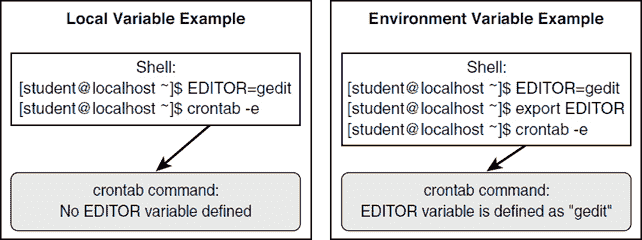

**图 25.1** 局部变量与环境变量

`export` 命令也可以用于显示所有环境变量：

```
export -p
```

#### env

`env` 命令显示当前 Shell 中的环境变量。在执行 `env` 命令时，不会显示局部变量。

`env` 命令的另一个用途是为命令的执行临时设置变量。

示例：

```
[student@OCS ~]# echo $TZ
[student@OCS ~]# date
Thu Dec 1 18:48:26 PST 2016
[student@OCS ~]# env TZ=MST7MDT date
Thu Dec 1 19:48:31 MST 2016
[student@OCS ~]# echo $TZ
[student@OCS ~]#
```

在执行命令时取消变量，请使用 `--unset=VAR` 选项（例如 `env --unset=TZ date`）。

#### set

`set` 命令在不带参数执行时会显示所有 Shell 变量和值。输出还包括在 Shell 中声明的任何函数。

`set` 命令也可以用于修改 Shell 的行为。例如，通常使用**未设置的**变量会导致返回“空字符串”。执行命令 `set -u` 在使用未定义变量时将产生错误消息，所示：

```
[student@OCS ~]$ echo $NOPE
[student@OCS ~]$ set -u
[student@OCS ~]$ echo $NOPE
bash: NOPE: unbound variable
```

下表提供了一些额外的 `set` 选项：

| 选项 | 描述 |
| --- | --- |
| `-b` | 当后台作业终止时，立即向 Shell 报告此情况。使用 `+b`（默认）以便在显示下一个提示符之前进行此报告。 |
| `-n` | 一种 Shell 编程功能，读取脚本中的命令但不执行它们。用于检查脚本的语法错误。 |
| `-u` | 当使用**未设置的**变量时抛出错误消息。 |
| `-C` | 不允许使用重定向操作符覆盖现有文件，例如 `cmd > file`。 |

使用 `unset` 命令从 Shell 中移除变量（例如 `unset VAR`）。

#### printenv

与 `env` 命令一样，`printenv` 命令用于显示环境变量；然而，`env` 命令具有额外的功能，而 `printenv` 命令仅用于显示环境变量。

#### echo

`echo` 命令用于显示信息。通常，它用于显示变量的值。

示例：

```
[student@OCS ~]$ echo $HISTSIZE
1000
```

`echo` 命令只有几个选项。最有用的是 `-n` 选项，它不在输出末尾打印换行符。

在 `echo` 命令的参数中可以包含一些特殊字符序列。例如，命令 `echo "hello\nthere"` 将发送以下输出：

```
hello
there
```

下表描述了 `echo` 命令的一些实用字符序列：

| 序列 | 描述 |
| --- | --- |
| `\a` | 响终端铃声。 |
| `\n` | 换行符。 |
| `\t` | 制表符。 |
| `\\` | 单个反斜符字符。 |

### #!/bin/bash

脚本的第一行应该包含解释器的路径。对于 BASH 壳脚本，这应该是 `bash` 命令的可执行文件路径。可以通过执行以下命令来找到此路径：

```
[root@OCS ~]$ which bash
/bin/bash
```

使用以下语法将此路径添加到脚本的第一行：

```
#!/bin/bash
```

`#`（哈希字符）和 `!`（惊感叹号字符）的组合形成了 shebang 序列。（快速读出“hash bang”这个词你就能发现 *shebang* 一词的来源；通常读法中末尾的 *e* 是不发音的）。

### 资源化脚本 (Sourcing Scripts)

大多数命令作为独立的进程进行执行，它们有自己的环境。`source` 命令允许你执行 bash 脚本，就好像脚本中的命令直接在命令行中执行的一样。

示例：

```
root@OCS ~ ~ source ./functions.sh
```

使用 `.` 命令可以实现与 `source` 命令相同的功能，如下：

```
[root@OCS ~]$ . ./functions.sh
```

这种技术通常用于 shell 脚本内部，从其他 shell 脚本加载代码。例如，一个脚本可能需要在另一个脚本中声明的变量。

### 目录和文件权限

脚本应该由普通用户所有，而不是 root 用户。运行 root 所有的脚本可能会导致安全问题。如果脚本由 root 所有，则永远不应该设置 suid 权限，因为这会导致严重的安全风险（大多数现代 Linux 发行版不允许 root 拥有的脚本设置 suid）。

创建脚本后，你需要添加执行权限以便像程序一样运行它：

```
chmod a+x script_name
```


#### chmod

查看第 15 章中的 “chmod”节，“对于给定的场景，应用或获取适当的用户和/或组权限及所有权](#ch15.xhtml_ch15)。”

### 扩展

BASH 壳脚本应该以 `.sh` 扩展结尾，以指示文件内容包含 BASH 壳脚本。`.bash` 扩展也被使用，但并不常用。

其他脚本语言应该有扩展名来指示语言类型：

*   Perl 脚本使用 `.pl`。
*   Python 脚本使用 `.py`。
*   TC shell 脚本使用 `.tcsh`。
*   C shell 脚本使用 `.csh`。

### 注释

在你的 BASH 壳脚本中创建注释很重要，因为它们可以帮助他人理解脚本中代码的作用。本节重点介绍如何创建注释。

#### #

注释以井号 `#` 字符开始，并延伸到行末尾。以下示例显示了整行的注释：

```
#设置计数变量:
count = 100
```

接下来的示例显示了包含代码的行中的注释：

```
count = 100 #设置计数变量
```

### 文件通配符 (File Globbing)

文件通配符（也称为 *wildcard*）是命令行提供的任何字符，代表文件名的的一部分。支持以下通配符：

| 通配符 | 说明 |
| --- | --- |
| `*` | 匹配文件名中的零个或多个字符。 |
| `?` | 匹配文件名中的任意单个字符。 |
| `[ ]` | 匹配文件名中的单个字符，只要该字符在 `[ ]` 字符内表示。 |

此示例复制所有以 `.txt` 结尾的文件：

```
[student@OCS ~]$ cp *.txt ~
```

下一个一个示例将删除所有长度为四个字符的文件：

```
[student@OCS ~]$ rm ????
```

要查看当前目录下所有以 `a`、`b` 或 `c` 开头的文件类型，请执行以下命令：

```
[student@OCS ~]$ file [abc]*
```

上一个命令也可以这样执行：

```
[student@OCS ~]$ file [a-c]*
```

其中 `a-c` 代表一个字符范围。这必须是 ASCII 文本表内的有效范围。要查看此表，请执行以下命令：

```
[student@OCS ~]$ man ascii
```

允许多个范围或值列表：

```
[student@OCS ~]$ file [a-cg-jz]*
```

通过在范围开头放置一个 `!` 字符，你可以指定哪些字符不能匹配。例如，以下命令将复制当前目录下所有不 `a`、`b` 或 `c` 开头的文件：

```
[student@OCS ~]$ cp [!abc]* ~
```

上一个示例还说明可以使用多个通配符字符创建复杂的模式。

### Shell 扩展 (Shell Expansions)

BASH 壳将许多字符视为“特殊”并将它们扩展为不同的含义。shell 扩展的一个示例是文件通配符（参见本章的“文件通配符”）。本节还提供了其他文件扩展功能的细节。

#### ${}

通过变量扩展 BASH 功能，你可以返回不同的值。例如，如果 `$name` 变量未设置，以下内容将返回“Bob”：

```
$ echo "Hello, ${name:-Bob}"
Hello, Bob$
echo "Hello, $name"
Hello,
```

注意，使用上述语法不会设置变量，而是针对这种情况使用提供的值。要返回一个值并同时设置变量，请使用以下语法：

```
$ echo "Hello, ${name:=Bob}"
Hello, Bob
$ echo "Hello, $name"
Hello, Bob
```

还有其他变量扩展功能。例如，以下语法将仅返回变量的前 24 个字符，产生一个更“振奋人心”的语句：

```
$ times="It was the best of times, it was the worst of times."
$ echo ${times: 0:24}
It was the best of times
```

注意在上述示例中，`0` 代表返回的起始位置，`24` 代表返回的字符数。

#### $()

命令替换是在较大的命令中执行子命令。这通常用于收集数据并存储在变量中。例如，以下命令将 `date` 命令的输出存储在 `$today` 变量中：

```
today=$(date)
```

命令替换可以通过使用两种方法之一完成：

*   `$(cmd)`
*   `‘cmd’`

注意第二方法使用的是反引号（也称为 *backtick*），而不是单引号。

#### ‘

参见本章的“$()”节。

### 重定向与管道

参见第 9 章中的“输出重定向”节，“给定场景创建、修改和重定向文件。”

### 退出状态 (Exit Codes)

当命令执行时，它会向执行它的 shell 或脚本返回一个成功（`0`）或失败（`>1`）。此状态存储在 `$?` 变量中。这是一个示例：

```
[root@OCS ~]$ ls /etc/skel
[root@OCS ~]$ echo $?
0
[root@OCS ~]$ ls /junk
ls: cannot access /junk: No such file or directory
[root@OCS ~]$ echo $?
2
```

此返回值可以用于条件语句以判断命令是否成功执行：

```
some_command
if [ $? -eq 0 ]
then
     echo "command executed successfully"
else
     echo "command failed"
fi
```

更多细节请参见本章的节。

#### stderr

参见第 9 章”节。

#### stdin

参见第 9 章”节。

#### stdout

参见第 9 章”节。

元字符是针对 BASH shell 的特殊字符。例如，文件通配符（`*`、`[ ]` 和 `?`）被视为元字符。本书中涵盖的额外元字符包括重定向字符（参见第 9 章中的“输出重定向”部分）和 `$` 字符（用于变量替换）。

### 位置参数

你可以像这样运行脚本：

```
./example.sh arg1 arg2 arg3
```

每个参数都存储在 `$1`、`$2`、`$3` 等。`$0` 是脚本本身的名字。

特殊的 BASH 变量 `$#` 包含传递脚本的参数数量。

### 循环结构

循环结构是 BASH 脚本中执行一组操作的代码，这些可能会执行多次。本节检查了三种常用的循环结构：`while`、`until` 和 `for` 循环。

#### while

`while` 循环设计用于只要条件语句返回真值就执行一组任务（命令）。例如，以下代码可用于检查用户输入以验证是否提供了正确的值：

```
read -p "Enter a zip code: "
while echo $zip | egrep -v "^[0-9]{5}$"
do
   echo "$zip is not a valid ZIP code, try again"
   read -p "Enter a zip code" zip
done
```

示例输出：

```
Enter a zip code: 8888
8888 is not a valid ZIP code, try again
Enter a zip code: huh?
huh? is not a valid ZIP code, try again
Enter a zip code: 92020
```

注意

`read` 命令从 `stdin` 读取输入，通常是用户的键盘输入。

#### for

`for` 循环用于遍历值列表。例如，以下代码将对文件列表执行 `wc -l` 命令：

```
for file in "/etc/r*.conf"
do
    wc -l $file
done
```

示例输出：

```
43 /etc/request-key.conf
 3 /etc/resolv.conf
61 /etc/rsyslog.conf
```

#### until

`until` 语句的作用类似于 `while` 语句，但它在条件语句为假值时执行其代码集。对比 `while` 语句和 `until` 语句的伪代码：

```
while conditional_check
do
    #如果 conditional_check 返回真则执行
done

until conditional_check
do
    #如果 conditional_check 返回假则执行
done
```

### 条件语句

`test` 语句用于执行条件测试。这些条件测试用于比较值和执行文件测试操作。

运行 `test` 语句的常用方法是将操作放在方括号内。例如，以下两个语句执行相同的操作：

```
test $name1 = $name2
[ $name1 = $name2 ]
```

下表描述了常用的 `test` 操作：

| 操作 | 描述 |
| --- | --- |
| `str1` = `str2` | 如果两个字符串相等则返回真。 |
| `str1` != `str2` | 如果两个字符串不相等则返回真。 |
| `-z` `str` | 如果 `str` 长度为零则返回真；例如 `[ -z $name ]`。 |
| `-n` `str` | 如果 `str` 长度不为零则返回真；例如 `[ -n $name ]`。 |
| `int1 -eq int2` | 如果两个整数相等则返回真。 |
| `int1 -ne int2` | 如果两个整数不相等则返回真。 |
| `int1 -gt int2` | 如果第一个整数大于第二个整数则返回真。 |
| `int1 -ge int2` | 如果第一个整数大于等于第二个整数则返回真。 |
| `int1 -lt int2` | 如果第一个整数小于第二个整数则返回真。 |
| `int1 -le int2` | 如果第一个整数小于等于第二个整数则返回真。 |
| `-d file` | 如果文件是目录则返回真。 |
| `-f file` | 如果文件是普通文件则返回真。 |
| `-e file` | 如果文件存在（无论它是什么类型的文件或目录）则返回真。 |
| `-r file` | 如果文件可读则返回真。 |
| `-w file` | 如果文件可写则返回真。 |
| `-x file` | 如果文件可执行则返回真。 |

#### if

`if` 语句用于根据条件语句的结果执行一个或多个命令。例如，如果变量 `$name` 被设置为“Bob”，则将显示“hi”：

```
if [ $name = "Bob" ]
then
   echo "hi"
fi
```

注意，要结束 `if` 语句内执行的命令，请使用 `fi` 语句（“if”的倒写）。

`else` 语句与 `if` 语句配合使用，在条件返回假值时提供替代方案。这里有一个示例：

```
if [ $name = "Bob" ]
then
   echo "hi"
else
   echo "I don't know you"
fi
```

可以执行多个条件检查，如下所示：

```
if [ $name = "Bob" ]
then
    echo "hi, Bob"
elif [ $name = "Sue" ]
then
    echo "hi, Sue"
else
    echo "I don't know you"
fi
```

有关条件表达式更多信息，请参见本章中的“条件语句”部分。

#### case

`case` 语句将变量的值与通配模式进行比较。

语法：

```
case $var in
glob 1)
    #statements
    #statements;;
glob 2)
    #statements;;
esac
```

使用两个分号（`;`）结束一组语句，并且必须在下一个通配符之前使用它们。

示例：

```
case $1 in
start)
 echo "Starting the process" ;;
stop)
 echo "Stopping the process" ;;
*)
 echo "I need start or stop" ;;
esac
```

### 转义字符

转义字符是指让特殊字符（又称元字符）被视为普通字符。例如，以下使用双引号禁用了重定向字符：

```
$ echo "this | that"
this | that
```

以下是一些转义字符：

- 双引号禁用重定向字符（`<`、`>`、`|`）和通配符字符（`*`、`[`、`]`）的特殊含义。
- 使用单引号禁用元字符。
- 在任何元字符之前放置一个 `\`（反斜杠字符）。

## 第 26 章：在给定的场景下，使用 Git 进行版本控制

本章提供了有关以下主题的信息和命令：

**参数**

- clone
- push
- pull
- commit
- merge
- branch
- log
- init
- config

**文件**

- .gitignore
- .git/

### 参数

Linux+ 将包含关于 `git` 命令参数的问题。本节涵盖了这些可测试的参数。

#### clone

`git clone` 命令从远程仓库的内容创建本地仓库。提供的参数是远程仓库的位置。

示例：

```
$ git clone https://gitlab.com/borothwell/ocs.git
Cloning into 'ocs'...
Username for 'https://gitlab.com': borothwell
Password for 'https://borothwell@gitlab.com':
remote: Counting objects: 3, done.
remote: Total 3 (delta 0), reused 0 (delta 0)
Unpacking objects: 100% (3/3), done.
Checking connectivity... done.
```

以下是 `git clone` 命令的一些重要选项：

| 选项 | 描述 |
| --- | --- |
| `-v` | 详细模式 |
| `--single-branch` | 仅克隆单个分支，而不是克隆整个仓库。 |

### push

`git commit` 命令仅更新本地仓库。要将本地仓库的更改送到远程仓库，请使用 `git push` 命令：

```
$ git push -u origin master
Username for 'https://gitlab.com': borothwell
Password for 'https://borothwell@gitlab.com':
Counting objects: 4, done.
Compressing objects: 100% (3/3), done.
Writing objects: 100% (3/3), 370 bytes | 0 bytes/s, done.
Total 3 (delta 0), reused 0 (delta 0)
To https://gitlab.com/borothwell/ocs.git
   12424f5..3b36054 master -> master
Branch master set up to track remote branch master from origin.
```

注意，上述输出中的最后信息解释了“origin”和“master”术语。“origin”指的是远程仓库，而“master”指的是应该更新的分支。

注意

`git push` 命令将尝试将更改合并到现有文件中。如果无法自动处理，你可能需要执行手动合并操作。更多信息请参阅本章的“合并（merge)”节。

### pull

如果远程仓库已发生更改，并且你想将这些更改下载到本地仓库，请使用 `git pull` 命令：

```
$ git pull origin master
```

`origin`指的是远程仓库，而`master`指的是应该更新的分支。

注意

`git pull` 命令将尝试将更改合并到现有文件中。如果无法自动处理，你可能需要执行手动合并操作。更多信息请参阅本章的“合并（merge)”节。

### commit

要将工作目录中的更改放入本地仓库，你首先需要先将其添加到暂存区（staging area），然后需要将它提交到仓库，如下所示：

```
$ git add first.sh
$ git commit -m "added first.sh"
[master 3b36054] added first.sh
 1 file changed, 5 insertions(+)
 create mode 100644 first.sh
```


`git add`命令将文件放入暂存区。`git commit`命令将取暂存区中的所有新文件并将它们提交到本地仓库。`-m`选项用于添加消息（在本例中，给出了提交的原因）。

### merge

假设你创建了一个新分支为文件添加一个新功能。在测试完此新功能后，你准备好在`master`分支中实现它。要做到这一点，你需要将新分支的内容（示例中的`feature127`分支）合并到`master`分支。首先提交`feature127`分支中的所有更改，然后切换回`master`分支：

```
$ git commit -a -m "feature added to showmine.sh"

[feature127 2e5defa] feature added to showmine.sh

 1 file changed, 5 insertions(+), 2 deletions(-)

$ git checkout master

Switched to branch 'master'

Your branch is ahead of 'origin/master' by 3 commits.

  (use "git push" to publish your local commits)
```

你必须处于你想要合并入的分支中，才能正确运行下一个命令。下面的`git merge`命令将将`feature127`分支的更改合并到`master`分支：

```
$ git merge feature127

Updating 4810ca8..2e5defa

Fast-forward

 showmine.sh | 7 +++++--

 1 file changed, 5 insertions(+), 2 deletions(-)
```

这种合并过程可能会更加复杂。例如，考虑以下命令的输出：

```
$ git merge master

Auto-merging showmine.sh

CONFLICT (content): Merge conflict in showmine.sh

Auto-merging hidden.sh

CONFLICT (content): Merge conflict in hidden.sh

Automatic merge failed; fix conflicts and then commit the result.
```

你可以看到合并没有完成，因为自动合并过程遇到了一些冲突。你也可以通过执行`git status`命令查看这些冲突：

```
$ git status

On branch test

Your branch is ahead of 'origin/test' by 1 commit.

  (use "git push" to publish your local commits)

You have unmerged paths.

  (fix conflicts and run commit)
```

```
$ git checkout master

Switched to branch 'master'

Your branch is ahead of 'origin/master' by 2 commits.

  (use "git push" to publish your local commits)

$ more hidden.sh

#!/bin/bash

#hidden.sh

ls -ld .* $1
```

## log

你可以使用`git log`命令查看在不同分支上的更改，以及你为每次更改提供的注释：

```
$ git log --oneline --decorate --all

ef2d7d5 (test) changed hidden.sh

2b44792 (HEAD, master) deleting test.sh file

19198d7 update 27

07bb91c (origin/master, origin/HEAD) adding showmine.sh

  and hidden.sh

75d717b added first.sh

9eb721e demostrating status

3b36054 added first.sh

12424f5 add README
```

`--oneline`允许`git log`命令提供每次更改的单行摘要。`--decorate`请求额外信息，如分支名称。`--all`要求查看所有分支的日志，而不仅仅是当前分支。

## init

要在当前本地目录中创建新仓库，请使用`git init`命令：

```
$ git init test

Initialized empty Git repository in /tmp/test/.git/
```

## config

`git config`命令用于配置`git`工具。以下是一些常用选项：

```
$ git config --global user.name "Bo Rothwell"

$ git config --global user.email bo@onecoursesource.com
```

`--global`选项会将配置选项存储在用户主目录下的配置文件中，如下：

```
$ more ~/.gitconfig

[user]

        name = Bo Rothwell

        email = bo@onecoursesource.com
```

`git`命令默认将使用此文件中的设置。你也可以通过`--local`选项将这些设置存储在当前仓库目录（当前目录下的`.git`目录）中。本地设置会覆盖全局设置。

还有几十个额外的设置，但大多数`git`命令的用户只会设置`user.name`和`user.email`。

## Files

Linux+ 考试将包含一些影响`git`命令行为的文件问题。本节涵盖了这些考试中测试的文件。

### .gitignore

要让`git`命令忽略某个文件，请在工作目录中创建一个名为`.gitignore`的文件，并将要忽略的文件放入该文件中。以下是一个示例：

```
$ touch notes

~/ocs$ git status -s

?? notes

$ vi .gitignore     #如下所示添加了 notes:

$ cat .gitignore

notes

$ git status -s

?? .gitignore
```

注意，`.gitignore`文件本身也必须放在`.gitignore`文件中：

```
$ git status -s

?? .gitignore

$ vi .gitignore       #如下所示添加了 .gitignore:

$ cat .gitignore

notes

.gitignore

$ git status -s
```

注意：你也可以在`.gitignore`文件中使用通配符（`*`、`?`和`[*range]`）来匹配一组文件。

### .git/

本地仓库数据存储在`git`命令创建的目录下的`.git`目录下。例如，考虑以下命令：

```
$ git init test

Initialized empty Git repository in /tmp/test/.git/
```

该命令在`/tmp`目录下执行，并创建了本地仓库目录`/tmp/test`。仓库数据实际上存储在`/tmp/test/.git`目录中：

```
$ ls /tmp/test/.git

branches config description HEAD hooks info objects refs
```


`.git` 目录不应直接修改。该目录包含包含 git 仓库所有文件和版本的数据库集。

## 第 27 章. 总结编排流程和概念

本章提供了有关以下主题的信息和命令：

* Agent
* Agentless
* Procedures
* Attributes
* Infrastructure automation
* Infrastructure as code
* Inventory
* Automated configuration management
* Build automation

注意

对于 Linux+ 认证考试，重要的是，对于列出的目标主题，你被要求能够“总结”编排流程和概念。换句话说，并不要求你了解有关设置、配置和管理编排流程的细节；相反，你应该理解编排的功能。

### Agent

编排目的是简化复杂的设置任务。通常，设置软件或服务需要多个步骤，而且有时这些步骤需要在多个系统上执行。通过编排，这些步骤被提前计划并自动执行，方法可以是运行单个命令或点击 GUI 或基于 Web 的界面上的按钮。

通常编排的组件之一是监控。监控用于判断是否因为系统发生了某些情况而需要采取操作。监控有两种类型：代理（agent）监控和无代理（agentless）监控。

`agent` 监控解决方案意味着在被监控的系统或组件上安装了某些软件。该代理会主动探测系统，并根据这些探测结果确定是否发生了需要采取操作的更改。

`agentless` 监控解决方案意味着系统中没有安装任何软件。无代理系统可以从系统接收数据，也可以通过进行远程查询来确定是否发生了更改。

### Agentless

参见本章中的“[Agent”。

### Procedures

编排的 `procedure`（程序）是完成操作所需的步骤集合。程序可以是一个相当直观的步骤集合，也可以非常复杂并与属性的值绑定。

### Attributes

`attribute`（属性）用于定义自定义自动化程序的参数。这些属性包含在每个编排流程中可能（且很可能）不同的数据。例如，假设程序被设计用于设置一个需要访问网络的系统。则需要为系统的 IP 地址、子网掩码、网关和路由器等项目定义属性。

### Infrastructure Automation

基础设施自动化是编排的一个组件。虽然许多人交替使用编排和自动化这两个术语，但它们之间存在区别。你完全可以有没有自动化的编排，但编排的主要目标之一是使过程自动化。

考虑以下编排场景：用户在基于 Web 的表单中填写数据字段。数据被用于填充属性（参见本章中的“#Attributes”）。用户随后点击“确定”按钮，然后执行程序（参见本章中的“#Procedures”）来编排一项服务。这就是没有自动化的编排。

现在考虑以下场景：一个代理正在监控系统，当达到某个阈值时（例如一小时内的最大 CPU 使用率），这会触发一个程序，该程序利用从数据库自动填充的属性来生成服务的第二个实例。整个过程中没有人工干预；编排过程自动处理了一切。这就是带有自动化的编排。

### 基础设施即代码

基础设施即代码（也称为 `IaC`）是编排过程的核心。`IaC` 不再手动配置或供应系统，而是利用软件工具（编排产品）来执行这些任务。

### 清单

当某项被编排时，编排软件需要对其进行跟踪。通常这个“某项”被称为 `instance`（实例），而关于该实例的信息存储在一个名为 `inventory`（清单）的数据库中。

### 自动化配置管理

长期以来，配置管理一直是系统管理员手动处理的标准流程。由于没有实现自动化，这一过程通常非常耗时，并会导致系统配置错误。

自动化配置管理的目的是确保软件、服务和系统维护在一致、可预测的状态。通过使用自动化配置管理工具，大量的工作负载将由自动化过程处理。与手动配置管理操作相比，这也能减少错误的发生。

常见的配置管理工具包括：
* `Chef`
* `Puppet`
* `Ansible`

### 构建自动化

构建（也称为软件构建）是将新的源代码构建成可执行代码的过程，通常通过称为“编译”的过程来实现。如果手动执行，这可能是一个枯燥的过程且容易出错，因为构建大型程序时可能会涉及许多复杂的步骤。

构建自动化利用遵循一套规则的实用程序来自动执行软件构建过程。当配置正确时，构建自动化可以加快构建过程，并减少手动执行该过程时产生的错误。

以下是一些常见的构建自动化工具：
* `Make`
* `Ant`
* `Gradle`
* `Rake`
* `Cake`

## 附录.创建你自己的日志

## 索引

### 符号

- `&` (连符号), 171
- `$()` shell 扩展 (BASH), 335
- `${}` shell 扩展 (BASH), 335
- `#!/bin/bash`, 332
- `?` (帮助) 命令, 47
- `~/.ssh`, 221–222

### A

#### 命令
- `aa-complain` 命令, 208
- `aa-disable` 命令, 208
- `aa-unconfined` 命令, 208

#### 路径
- 绝对路径, 41

#### 安全
- 目标目标，防火墙, 259

#### 访问
- cron 访问限制, 244
- LDAP, 238
- 本地访问, 309
- PAM, 214–221
- PKI, 230–231
- PTY, 230
- 远程访问, 309
- SSH, 221–228
- TACACS+ 238
- TTY, 228–229
- 用户管理, 309
- 客户端 VPN, 231–233
- 辅助功能选项（桌面版）, 191–192

#### 用户管理
- 账户（用户/组），管理
- BASH 参数, 103–106
- 创建账户, 94
- 删除账户, 95–96
- `/etc/group` 文件, 107
- `/etc/passwd` 文件, 106–107
- `/etc/shadow` 文件, 107–108
- 修改账户, 94–95
- 配置文件, 102–103
- 查询, 96–98
- 配额, 98–102
- ACL (访问控制列表), 258
- `getfacl` 命令, 199–201
- `setfacl` 命令, 199–201
- 故障排除, 318

#### 系统
- 采集命令, 89–91
- 激活/被动备份, 35–36
- 适配器（网络）, 175, 316
- 添加横幅, 245
- 代理/无代理监控, 351–352
- 聚合, 34–35
- 安培符 (&), 171
- Anaconda, 63
- AppArmor, 208–209
- 应用数据，与操作系统数据分离, 241
- `apt` 命令, 80–83
- `apt-cache` 命令, 81
- `apt-get` 命令, 80–81
- 存档/恢复工具, 268–269

#### 参数
- BASH, 337
- `git` 命令, 343–349
- `arp` 命令, 286
- ASCII 字符集, 75
- 非对称加密, 230
- `atq` 命令, 166
- `atrm` 命令, 166
- 属性（编排）, 352
- 音频设备, 175
- `auditd` 守护进程, 243
- 非对称加密, 230
- 生物识别认证, 238
- 数字签名（消息摘要）, 230
- 外部认证, 310
- Kerberos, 238–239
- LDAP, 238
- 本地认证, 309–310
- 多因素认证, 237–238
- PAM, 214–221
- PKI, 230–231
- PTY, 230
- 公钥/私钥认证, 230
- RADIUS, 238
- 自签名证书, 230
- SSH, 221–228
- TACACS+ 238
- TTY, 228–229
- 用户管理, 309–310
- 客户端 VPN, 231–233
- 认证服务器, 160–161
- 权限, 312
- 自动化配置（编排）, 353
- 构建（编排）, 353
- 任务, 165–172
- 自动挂载, 151–152
- `awk` 命令, 125–126

#### 备份
- 激活/被动备份, 35–36
- 差异备份, 273
- 全量备份, 272–273
- 增量备份, 272
- 快照克隆, 273
- 块（存储）, 317
- 带宽，网络延迟, 279
- 横幅（添加）, 245

#### BASH
- `$()` shell 扩展, 335
- `${}` shell 扩展, 335
- `#!/bin/bash`, 332
- 参数（位置参数）, 337
- case 语句, 340
- `chmod` 命令, 333
- 注释, 333
- 条件语句, 338–340
- 目录权限, 333
- 转义字符, 340–341
- 退出码, 336
- 扩展, 333
- 通配符（文件通配）, 334
- 文件权限, 333
- 全局条目, 104–106
- if 语句, 339–340
- 循环结构, 337–338
- for 循环, 337–338
- 元字符, 336
- 位置参数（参数）, 337
- shell 扩展, 334–335
- shell 变量, 328–332
- 来源脚本, 332
- test 语句, 338–339
- until 循环, 338
- 用户条目, 104
- 用户/组账户, 103–106
- while 循环, 337

#### BIOS
- 基础 RE（正则表达式）, 141
- `bg` 命令, 171
- 生物识别认证, 238
- BIOS, 4
- 密码, 236–237
- `blkid` 命令, 51
- 块, 64
- 块存储, 64
- 阻塞端口（防火墙），故障排除, 318
- 阻塞协议（防火墙），故障排除, 318
- 蓝牙设备, 174

- `/boot/grub` 目录, 7
- `/boot/grub2` 目录, 7
- 引导加载程序, 1
- GRUB, 2
- 启动菜单屏幕, 3
- 分段项（Stanza）编辑屏幕, 4
- GRUB2, 2
- 密码, 236
- 启动菜单屏幕 (GRUB), 3
- 启动模块/文件, 7
- 命令, 8–9
- initramfs, 9
- vmlinux, 9

#### 启动过程
- EFI, 4
- 从 FTP 启动, 5
- 从 HTTP 启动, 5
- 从 ISO 启动, 5
- NFS, 5
- 选项, 3
- 概述, 2
- PXE, 5
- 安全, 236–237
- Systemd 管理, 144–145
- UEFI, 4
- 自举, 62
- Anaconda, 63
- Cloud-Init, 62
- Kickstart, 63
- 粘跳键 (键盘), 192
- 盲文显示器, 192
- `brctl` 命令, 27
- 网络桥接, 65
- 缓冲区缓存输出, 295
- 构建自动化（编排过程）, 353
- 构建工具, 软件
- 命令, 86–88
- 编译器, 88
- 共享库, 88
- `bzip2` 命令, 271

### C
- CA (证书颁发机构), 159
- `cal` 命令, 121
- case 语句 (BASH), 340
- `cat` 命令, 115
- 证书 (自签名), 230
- `chage` 命令, 95

#### 字符集
- ASCII, 75
- Unicode, 75
- UTF-8, 75
- `chattr` 命令, 311–312
- `chcon` 命令, 207
- `chgrp` 命令, 198–199
- `chkconfig` 命令, 153–154
- `chmod` 命令, 195, 196–198, 333
- `chown` 命令, 198
- chroot 监狱服务, 240
- cifs 文件系统, 58
- Cinnamon, 189

#### 云计算
- 块对象 (blobs), 64
- 块 (blocks), 64
- 自举, 62–63
- 桥接, 65
- 双网卡系统, 66
- 虚拟机管理程序 (hypervisors), 66
- libvirt, 67
- 本地网络, 65–66
- NAT, 65
- 网络, 65–66
- 叠加层网络, 65
- PV, 64
- 存储, 63–64
- 模板, 60–62
- 厚置配置 (thick provisioning), 63
- 薄置配置 (thin provisioning), 63–64
- `virsh`, 67
- VMM, 67
- Cloud-Init, 62
- 集群, 164
- `at` 命令, 165–167
- 获取命令, 89–91
- 启动菜单屏幕 (GRUB), 3
- 启动模块/文件, 8–9
- 构建工具, 软件, 86–88
- 诊断工具, 18–27
- EXT 工具, 45, 48, 51
- 文件系统, 44–53
- 内核模块, 11–15
- 本地化, 70–73
- LVM 工具, 44–45
- 网络配置, 280–287
- 进程命令, 300–305
- 分段项编辑屏幕 (GRUB), 4
- 存储, 44–53
- XFS 工具, 44
- BASH 备注, 333
- 通信端口, 221–222
- 兼容性 (硬件/软件), 诊断, 324
- 编译器, 88
- 压缩工具, 269–272
- 条件语句 (BASH), 338–340
- 配置文件, 8–9
- CPU, 289–292
- CUPS (通用用打印系统), 179–181
- `dmesg` 命令, 178
- `lsblk` 命令, 178
- `lsdev` 命令, 176
- `lspci` 命令, 176–177
- `lsusb` 命令, 176–177
- 内存, 295
- 网络, 280–287
- SELinux, 203–204
- 存储, 287
- `udev` 命令, 181
- 镜像, 62
- 容器, 162
- 权限, 202
- `cp` 命令, 129–130
- `cpio` 命令, 269–272

#### cron
- 访问, 244
- 安培符号 (&), 171
- `atq` 命令, 166
- `atrm` 命令, 166
- `bg` 命令, 171
- `at` 命令, 165–167
- `crontab` 命令, 167–170
- Ctrl-c, 172
- Ctrl-z, 172
- `/etc/at.allow` 文件, 166–169
- `/etc/at.deny` 文件, 166–167
- `/etc/cron.deny` 文件, 168–169
- `fg` 命令, 170
- `kill` 命令, 171–172
- `nohup` 命令, 172
- 安全, 244
- Ctrl-Alt-Del, 禁用, 244
- Ctrl-c, 172
- Ctrl-z, 172

### D
- `d` 命令, 46
- 守护, 211
- auditd, 243
- fail2ban, 263–264
- databases, 162–163
- `date` 命令, 72
- `dd` 命令, 39, 269, 315
- `.deb` 扩展名, 78
- 降级存储，故障排除, 314
- 删除用户/组账户, 95–96
- DenyHost, 263

#### 依赖项
- 补丁, 319
- 故障排除, 319–320
- `depmod` 命令, 15

#### 桌面
- 无障碍辅助选项, 191–192
- 远程桌面, 189–191
- 目的地，通过防火墙过滤, 258
- `/dev/` 54–55
- `/dev` 文件系统, 183
- `/dev/disk` 目录, 55–56
- `/dev/disk-by`, 55–56
- `/dev/mapper.*` 参见 设备映射器
- `/dev/null` 文件, 119–120
- `/dev/tty` 文件, 120–121
- `/dev/tty#` 文件, 229
- 设备映射器, 183
- 逻辑卷, 43–44
- LVM, 41–44
- 多路, 44
- 物理卷, 42
- 卷组, 42–43
- `df` 命令, 49
- DHCP (动态主机配置协议), 159–160
- 诊断工具, 18–27
- `diff` 命令, 140
- 差异备份, 273
- `dig` 命令, 19–20, 286
- 数字签名 (消息摘要), 230

#### 目录
- 绝对路径, 41
- BASH 目录权限, 333
- `/boot` 目录, 7
- `/boot/efi` 目录, 7
- `/boot/grub` 目录, 7
- `/boot/grub2` 目录, 7
- `cp` 命令, 129–130
- `/dev/disk` 目录, 55–56
- `diff` 命令, 140
- `du` 命令, 49
- `/etc/apparmor.d/` 目录, 208
- `/etc/apparmor.d/tunables` 目录, 209
- `/etc/cups` 目录, 180
- `/etc/grub.d` 目录, 6
- `/etc/modprobe.d`, 16
- `/etc/netplan` 目录, 31–32
- `/etc/network` 目录, 30
- `/etc/pam.d/` 目录, 219–220
- `/etc/ssh` 目录, 225–227
- `find` 命令, 134, 136–138
- 硬链接, 133–134
- inodes, 135
- `/lib/modprobe.d`, 16
- `ln` 命令, 132–134
- `locate` 命令, 138
- `ls` 命令, 131, 134
- `mkdir` 命令, 132
- `mv` 命令, 129
- 权限, 194–202, 308
- `/proc/cmdline`, 57
- `/proc/cpuinfo`, 57
- `/proc/devices`, 57
- `/proc/mdstat`, 57
- `/proc/meminfo`, 57
- `/proc/modules`, 57
- `/proc/swaps`, 57
- `/proc/sys`, 57
- `/proc/vmstat`, 57
- 相对路径, 41
- `rm` 命令, 130
- `rmdir` 命令, 132
- `rsync` 命令, 131–132
- `/run/modprobe.d`, 16
- `scp` 命令, 130
- 服务管理, 149–150
- 软链接, 132–133
- `stat` 命令, 135
- 存储目录, 54–57
- `/sys/block`, 56
- `/sys/bus`, 56
- `/sys/bus/cpu`, 56
- `/sys/bus/devices`, 56
- 系统管理, 149–150
- `touch` 命令, 129
- `unlink` 命令, 135
- `updated` 命令, 140
- `/usr/share/doc`, 32
- `/usr/share/zone`, 70
- `/var/log/journal`, 254
- `where` 命令, 139
- `which` 命令, 139
- 强制模式 (SELinux), 204
- 加密 (磁盘), 244
- 禁用器, 192
- 盲文显示, 192
- 键盘, 192
- 屏幕, 192
- `dmesg` 命令, 16
- `dm` 命令, 229
- DTLS (数据传输安全), 259
- `df` 命令, 49
- `dnf` 命令, 79–80
- `drac` 命令, 7
- `egrep` 命令, 124
- 邮件, 163
- postfix, 243–244
- 加密 (磁盘), 244
- 强制模式 (SELinux), 204
- `env` 命令, 330
- 环境变量, 73, 330
- `LANG` 变量, 74
- `LC_*` 变量, 73–74
- `LC_ALL` 变量, 74
- `TZ` 变量, 74–75
- 转义字符 (BASH), 340–341
- `/etc/apparmor.d/` 目录, 208
- `/etc/apparmor.d/tunables` 目录, 209
- `/etc/apt/sources.list`, 81–82
- `/etc/at.allow` 文件, 166–169
- `/etc/at.deny` 文件, 166–167
- `/etc/cron.deny` 文件, 168–169
- `/etc/cups` 目录, 180
- `/var/log/[application]` 文件，248
- `/var/log/kern.log` 文件, 249
- `/var/log/messages` 文件, 248
- `/var/log/secure` 文件, 247–248
- `whereis` 命令, 139
- `which` 命令, 139
- 文件系统, 56
- 绝对路径, 41
- `cifs`, 58
- 命令, 44–53
- `/dev/54–55`
- `/dev` 文件系统, 183
- `dumpe2fs` 命令, 51–52
- `e2label` 命令, 53
- `/etc/fstab`, 54
- `ext3`, 58
- `ext4`, 58
- `fsck` 命令, 52–53
- 层次结构, 40–41
- `lsblk` 命令, 51
- `mkfs` 命令, 48
- `mount` 命令, 49–50
- `nfs`, 58
- `ntfs`, 58
- `/proc`, 182
- `/proc/mounts`, 57
- 真实文件系统, 40
- 相对路径, 41
- `smb`, 58
- `/sys`, 56, 182
- `umount` 命令, 50–51
- `usrquota` 挂载选项, 98–99
- 虚拟文件系统, 40–41
- `xfs`, 58
- `find` 命令, 134, 136–138
- `finger` 命令, 242

#### 防火墙
- Accept 目标, 259
- `ACL`, 258, 318
- 被阻塞端口, 故障排除, 318
- 被阻塞协议, 故障排除, 318
- `DenyHost`, 263
- Drop 目标, 259
- 动态规则集, 263
- `/etc/services` 文件, 265
- `fail2ban`, 263–264

##### 按...过滤
- 目的, 258
- 日志, 258
- 端口, 258
- 协议, 258
- 源, 258
- `firewalld`, 259–260
- IP 转发, 263
- `IPSet`, 265
- `iptables`, 260–262
- Log 目标, 259
- `Netfilter`, 262–263
- 包过滤, 260–262
- 特权端口, 265
- Reject 目标, 259
- 远程访问, 309
- 运行时规则, 260
- 有状态/无状态规则, 258–259
- 故障排除, 317–318
- `ufw`, 262
- 区域, 260
- `free` 命令, 294–295
- `fsck` 命令, 52–53

#### FTP (文件传输协议)
- 从启动, 5
- 服务器, 160, 242
- 全备份, 272–273

### G
- `getenforce` 命令, 205
- `getfacl` 命令, 199–201
- `getsebool` 命令, 206–207

#### Git
- 参数, 343–349
- `git branch` 命令, 347–348
- `git clone` 命令, 343–348
- `git commit` 命令, 344
- `git config` 命令, 345–349
- `.git` 文件, 343–350
- `.gitignore` 文件, 349–350
- `git init` 命令, 348
- `git merge` 命令, 346–347
- `git pull` 命令, 344–349
- `git push` 命令, 344–349
- `git status` 命令, 346
- `GPIO` (通用输入/输出), 74
- `GPU` 驱动程序, 321
- `GUI` (图形用户界面)
- `grep` 命令, 114–118
- BASH 管理, 103–106
- 创建组, 94
- 删除组, 96
- `/etc/passwd` 文件, 106–107
- `/etc/shadow` 文件, 107–108
- 修改账户, 94–95
- 查询, 102–103
- 组成员身份, 319
- `groupadd` 命令, 94
- `groupdel` 命令, 96
- `groupermod` 命令, 95
- `GRUB` (统一引导加载程序) 菜单, 2–4
- `GRUB2` (统一引导加载程序 2), 2–4
- `grub2-install` 命令, 2
- `grub2-mkconfig` 命令, 2
- `GNOME`
- `X11` (X)
- `GPT` (GUID 分区表), 39
- 磁盘
- 设备名称, 39
- 分区, 241
- 硬链接, 133–134
- 硬件问题, 故障排除, 320–325
- 硬件令牌, 多因素身份认证, 237
- 哈希, 230
- `HBA` (主机总线适配器), 175, 317
- `head` 命令, 116
- `help (?)` 命令, 47
- 此处文档, 122–123
- `HOME` 变量, 328
- `host` 命令, 20, 287
- 托管式虚拟机程序, 66
- `hostnamectl` 命令, 150–151
- 主机, 拒绝, 240–241, 263
- 热插拔设备, 185–186
- `HTTP` (超文本传输协议), 从...启动, 5
- `hwclock` 命令, 72–73
- 虚拟机程序

#### 托管型 Hypervisor
- 托管型 Hypervisor, 66
- 原生型 Hypervisor, 66
- 类型, 66

### I
- IaC (基础设施即代码)，编排过程, 352
- ID (标识)
- PID, 305
- 共享 ID 与安全, 240
- `id` 命令, 96
- `ID` 变量, 328
- `if` 语句 (BASH), 339–340
- `ifcfg-etho`, 28
- `ifcfg-interface`, 28–29
- `iftop` 命令, 281
- `ifup-wireless`, 28
- 镜像备份, 273–274
- 不可变文件, 311–312
- 增量备份, 272
- 基础设施自动化（编排过程), 352
- 继承，权限, 196
- initramfs, 9
- inodes, 135, 311
- `insmod` 命令, 12

#### 安装
- Anaconda, 63
- Kickstart, 63
- `make install` 命令, 87
- 软件包, 78–86
- 实例（编排过程), 353
- 完整性检查, 275
- 接口（网络），配置, 280
- 可中断睡眠状态（进程), 298
- 清单（编排过程), 353
- IO 调度, 288–289
- `ioping` 命令, 288
- `iostat` 命令, 48–49
- IP 地址，域名解析, 280
- `ip` 命令, 21–22, 287
- IP 转发, 263
- IPA（身份、策略与审计), 161
- `iperf` 命令, 282
- IPsec（网协议安全), 232–233
- IPSet, 265
- `ipset` 命令, 282–283
- `iptables`, 260–262
- ISO，从其启动, 5
- `iwconfig` 命令, 25–26

### J
- JavaScript, JSON, 61

#### Jobs
- 自动化, 165–172
- 调度, 165–172
- `journalctl` 命令, 253–254
- `journald`, 253
- JSON, 61

### K
- KDE Plasma, 189
- Kerberos, 161, 238–239
- 内核模块
- 启动模块/文件, 7–9
- commands, 11–15
- files, 15–16
- 内核恐, 9
- 键盘
- 粘跳键, 192
- 映射, 324
- 鼠标键, 192
- 屏幕键盘, 192
- 重复键, 192
- 慢键, 192
- 粘性键, 192
- 切换键, 192
- 故障排除, 324
- Kickstart, 63
- `kill` 命令, 171–172, 299–300
- `kinit` 命令, 239
- `klist` 命令, 239

### L
- `l` 命令, 46
- `LANG` 变量, 74
- `last` 命令, 98
- `lastb` 命令, 255
- 延迟, 网络, 279
- `LC` 变量, 73–74
- `LC_ALL` 变量, 74
- LDAP (轻量级目录访问), 161, 215, 238
- `ldd` 命令, 87–88
- `less` 命令, 116
- `/lib/modprobe.d`, 16
- 库（共享）, 88
- libvirt, 67
- 硬链接, 133–134
- 软链接（符号链接）, 132–133
- `ln` 命令, 132–134
- 负载均衡, 36, 163
- `loverage` 命令, 291
- 本地访问, 309
- 本地认证, 309–310
- 本地网络, 65–66
- 本地端口转发, 190–191
- 本地变量, 328–330
- `localectl` 命令, 70–71
- localhost, 280
- 本地化
- 字符集, 75
- 命令, 70–73
- 环境变量, 73–75
- `/etc/timezone`, 70
- `/usr/share/zoneinfo`, 70
- `locate` 命令, 138
- 日志文件，时间戳, 158
- 日志目标，防火墙, 259
- 日志, 161–162
- `/etc/logrotate.conf` 文件, 250–252
- `/etc/rsyslog.conf` 文件, 252–253
- `/etc/systemd/journald.conf` 文件, 254
- 防火墙日志过滤, 258
- `journalctl` 命令, 253–254
- `journald`, 253
- `lastb` 命令, 255
- `logrotate` 命令, 250–252
- 管理, 249–255
- `syslog`, 249–250, 252–253
- systemd-journald 服务, 254
- `/var/log/[application]` 文件, 248
- `/var/log/journal` 目录, 253
- `/var/log/kern.log` 文件, 249
- `/var/log/messages` 文件, 248
- `/var/log/secure` 文件, 247–248
- 逻辑设备，`df` 命令, 49
- 逻辑分区, 38
- 逻辑卷, 43–44, 52
- 登录
- 无密码登录, 239
- 禁用 root 登录, 239
- `LOGNAME` 变量, 328
- 循环结构（BASH), 337–338
- for 循环 (BASH), 337–338
- 丢失 root 密码, 295
- `lsmod` 命令, 11–12
- `lsof` 命令, 303–304
- `lspci` 命令, 177–178, 316
- `lsusb` 命令, 176–177, 322–323
- `ls-Z` 命令, 207
- LUKS (Linux 统一密钥设置), 244
- `lvdisplay` 命令, 45
- `lvextend` 命令, 45
- LVM (逻辑卷管理器), 41–44
- 快照克隆, 工具, 44–45

### M
- `m` 命令, 46
- 邮件服务器, 163
- `make` 命令, 86–87
- `make install` 命令, 87

#### managing
- 自动化配置 (编排过程), 353
- 日志, 249–255
- 权限, 196–202
- 进程, 297–298

#### services
- 自动挂载, 151–152
- `chkconfig` 命令, 153–154
- 目录, 149–150
- `hostnamectl` 命令, 150–151
- Systemd 管理, 144–148
- SysVinit, 152–156
- 单元文件, 148–150

#### Systemd
- 启动过程, 144–145
- 目录, 149–150
- `systemctl` 命令, 145–148
- `systemd-analyze` 命令, 147–148
- 目标, 144–145
- 单元文件, 148–149

#### user/group accounts
- BASH 参数, 103–106
- 创建账户, 94
- 删除账户, 95–96
- `/etc/group`文件, 107
- `/etc/passwd` 文件, 106–107
- `/etc/shadow` 文件, 107–108
- 修改账户, 94–95
- 权限提升, 209–211
- 配置文件, 102–103
- 查询, 96–98
- 配额, 98–102
- root 账户, 211
- 服务账户, 211–212
- 标准账户, 211
- MASQUERADE (伪装), 263
- ATE, 189
- MBR (主引导记录), 39
- `md5sum` 命令, 275
- `mdadm` 命令, 45–46
- 内存缓冲区缓存, 295
- OOM Killer, 294
- 故障排除, 320
- 内存配置, 292–295
- 数字签名, 230
- 字符 (BASH), 336
- `mkdir` 命令, 149
- `mkfs` 命令, 48
- `mkinitrd` 命令, 8
- `mkpart` 命令, 47
- `mkpartfs` 命令, 47
- `mkswap` 命令, 293
- `modinfo` 命令, 13
- `modprobe` 命令, 13
- 管理, 162
- 无代理管理, 351–352
- CPU, 289–292
- CUPS, 179–181
- CVE, 243
- `dmesg` 命令, 178
- `lsblk` 命令, 178
- `lsdev` 命令, 176
- `lspci` 命令, 177–178
- `lsusb` 命令, 176–177
- 内存, 292–295
- 网络, 278–287
- 存储, 287–289
- `udevadm` 命令, 181–182
- 显示器 (显示), 174
- 盲 ille 显示器, 192
- 屏幕键盘, 192
- 屏幕放大器, 192
- 屏幕阅读器, 192
- `more` 命令, 116
- MOTD (每日消息), 245
- `mount` 命令, 49–50
- 挂载点 (分区), 315
- 鼠标键 (键盘), 192
- mtr, 192
- `nmap` 命令, 280–281
- `nmcli` 命令, 26, 287
- `nmtui` 命令, 27
- `nohup` 命令, 172
- `nslookup` 命令, 19, 286
- `ntfs` 文件系统, 58
- NTP (网络传输协议), 158
- NX, 190

### O
- 八进制表示法。*参见* chmod 权限
- 离线/离系统存储, 274–275
- `OLDPWD` 变量, 328
- 屏幕软键盘, 192
- OOM (内存溢出) 杀进程进程, 294

#### 编排进程
- 代理/无代理监控, 351–352
- 属性, 352
- 自动化配置, 353
- 构建自动化, 353
- IaC (基础设施即代码), 352
- 基础设施自动化, 352
- 实例, 353
- 清单, 353
- 步骤, 352
- OS (操作系统), 将数据与应用数据分离, 241
- OTP (一次性密码), 237
- 输出重定向, 文件, 116–123
- OVA, 60
- 封叠层网络, 65
- OVF (开放虚拟化格式), 61
- 所有权权限, 故障排除, 318–319

### P
- `p` 命令, 46
- 软件包。*参见* 软件库; 软件
- `apt` 命令, 80–83
- `apt-cache` 命令, 81
- `apt-get` 命令, 80–81
- `.deb` 扩展名, 78
- `dnf` 命令, 86
- `dpkg` 命令, 79–80
- `.gz` 扩展名, 78
- 安装工具, 78–86
- `rpm` 命令, 78–79
- `.rpm` 扩展名, 78
- `.tar` 扩展名, 78
- `.tgz` 扩展名, 78
- `yum` 命令, 83–86
- `yum list` 命令, 83
- `yumdownloader` 命令, 84
- `zypper` 命令, 86
- 数据包丢弃, 279
- 数据包过滤, 260–262
- PAM (可插件认证模块), 214–215
- 控制值, 217–219
- `/etc/pam.d/` 目录, 219–220
- `faillock`, 220–221
- LDAP 集成, 215–216
- `pam_tally2`, 220
- 密码策略, 215
- 类型, 217
- `parted` 命令, 46–47
- 分区, 38
- `df` 命令, 49
- `fdisk` 命令, 46
- GPT, 39
- `iostat` 命令, 48–49
- 逻辑分区, 38
- MBR, 39
- `mkfs` 命令, 48
- 挂载点, 故障排除, 315
- `parted` 命令, 46–47
- 主分区, 38
- `/proc/partitions`, 57
- 原始设备, 39
- 安全, 241
- 结构, 38–39
- `partprobe` 命令, 289
- 被动/主动备份, 35
- `passwd` 命令, 95
- BIOS, 190
- 启动器, 236–237
- `chage` 命令, 95
- 组账户, 95
- 丢失的, 295
- OTP, 237
- PAM, 215
- `passwd` 命令, 95
- 无密码登录, 236–237
- UEFI, 236–237
- 用户账户, 95
- 补丁, 319
- `PATH` 变量, 328
- PCI (外设互连), 175
- `kill` 信号, 299–300
- `PID` 进程, 300–305
- 进程管理, 297–298
- AppArmor, 208–209
- BASH 目录, 333
- `chgrp` 命令, 95
- `chmod` 命令, 333
- `chown` 命令, 95
- 基于上下文的, 328–329
- 目录, 194–202
- 可执行文件, 194
- 执行, 194
- 文件, 116–123
- `getfacl` 命令, 199–201
- 组成员, 95
- 继承性, 196
- 所有权权限, 故障排除, 318–319
- 许可模式 (SELinux), 204
- 物理卷, 42
- `pgrep` 命令, 304–305
- `ping` 命令, 18, 287
- PKI (公共密钥基础设施), 230–231, 240
- `pkill` 命令, 305
- PAM 密码策略, 215
- SELinux 策略, 204–205
- 违规, 310
- 端口转发
- 本地端口转发, 190–191
- 远程端口转发, 191
- X11 转发, 191

#### 端口
- 被阻塞端口（防火墙），故障排除，318
- 通信端口，故障排除，321–322
- 防火墙过滤，258
- 特权端口，防火墙，265
- 安全，241–242
- 位置参数（参数），BASH, 337
- 后置 表达式，243
- 主分区，38
- print 命令，47
- 打印机服务器，163
- printenv 命令，331
- 打印机，175
- CUPS，179–181
- lpadmin 命令，179
- 故障排除，320–321
- 私钥/公钥认证，230
- 特权端口，防火墙，265

#### 权限
- 授权，312
- 提权，209–211
- 用户管理，310–312

#### /proc 文件系统
- `/proc`，182
- `/proc/cmdline`，57
- `/proc/cpuinfo`，57
- `/proc/cpunfo files`，289–291
- `/proc/devices`，57
- `/proc/mdstat`，57
- `/proc/meminfo`，57
- `/proc/meminfo files`，295
- `/proc/modules`，57
- `/proc/mounts`，57
- `/proc/partitions`，57
- `/proc/swaps`，57
- `/proc/sys`，57
- `/proc/vmstat`，57

#### 过程（编排进程），352

#### 进程
- 取符号符号 (&),171
- `bg` 命令，171
- Ctrl-c，172
- Ctrl-z，172
- `fg` 命令，170
- 可中断睡眠，298
- `kill` 命令，171–172
- kill 信号，299–300
- `lsof` 命令，303–304
- `nice` 命令，300
- `nohup` 命令，172
- 编排进程，351–353
- `pgrep` 命令，304–305
- PID，305
- `pkill` 命令，305
- 优先级，298
- `ps` 命令，303
- `renice` 命令，300–301
- 运行，298
- 状态，297–298
- `time` 命令，302–303
- `top` 命令，301–302
- 不可中断睡眠，298
- 僵尸进程，298
- 配置文件（用户/组账户），102–103

#### 协议（防火墙）
- 过滤，258
- 故障排除，318
- 代理服务器，161
- `ps` 命令，303
- `PS1` 变量，328
- PTY，230
- 公钥/私钥认证，230
- `PV`（持久化卷），64
- `pv` 命令，45
- `PWD` 变量，328
- `PXE`（预启动执行环境），5

### Q
- `q` 命令，46
- 查询（用户/组账户），96–98
- `quit` 命令，47
- `quotacheck` 命令，99
- `quota` 命令，99–100
- 文件，310
- 组配额，102
- `quota` 命令，100–101
- `quotacheck` 命令，99
- `quota` 命令，101–102
- 用户配额，98

### R
- RADIUS（远程认证服务），161,238

#### RAID 设备
- `mdadm` 命令，45–46
- 故障排除，317
- `raw` 命令，39
- 原始设备，39
- `RE`（正则表达式），141
- 读权限，194
- 文件系统，40
- 重定向文件，16–123
- 目标防火墙，259
- 相对路径，41
- 远程访问，309
- 远程桌面，189–191
- 远程转发，191
- 远程系统，99–101
- `renice` 命令，300–301
- 密钥，192
- 仓库，详见 软件包
- 配置，88
- 创建，88–89
- 位置，89
- 同步，89
- `repquota` 命令，101
- `resizefs` 命令，52
- 资源耗尽（存储），故障排除，316
- 归档，268–269
- `restorecon` 命令，207
- `rm` 命令，47–130
- `rmdir` 命令，132
- `rmmod` 命令，14–15
- 登录，239
- 密码，295
- root 用户，211
- `route` 命令，21
- 路由，网络，279
- `rpm` 命令，78–79
- `.rpm` 扩展，78
- `rsync` 命令，131–132
- `rsyslog` 命令，249–250
- 规则集（动态），防火墙，263
- `/run/modprobe.d`，16
- `/run/udev/rules.d`（临时规则），185
- 运行规则，防火墙，260
- `runlevel` 命令，155
- 运行级别，SysV，154–155
- 运行进程，298

### S
- Samba，160
- `sar` 命令，291
- SATA（串行接口），175,317
- 饱和，网络，279
- 调度调度，165–172
- `scp` 命令，130
- 屏幕放大器，192
- 屏幕阅读器，192
- SCSI（小型计算机接口），175,316
- 搜索，时间戳，158
- 应用数据，与操作系统数据分离，241
- auditd 守护进程，243
- 启动过程，236–237
- chroot 监狱服务，240
- cron 访问，限制，244
- Ctrl-Alt-Del，禁用，244
- CVE 监控，243
- 磁盘加密，244
- DTLS，233
- `finger` 命令，242
- 防火墙，258–265, 309, 317–318
- FTP 服务器，242
- hosts，拒绝，240–241
- IPsec，232–233
- Kerberos，238–239
- LDAP，238

#### 登录
- 禁用 root 登录，239
- 无密码登录，239
- LUKS，244
- MOTD，245
- 操作系统数据，与应用数据分离，241
- OTP，237
- 分区，241
- 无密码登录，239
- 密码，95, 295
- BIOS，236–237
- 引导加载程序，236
- OTP，237
- PAM，215
- UEFI，236–237
- PKI，240
- 端口，241–242
- postfix，243
- RADIUS，238
- root 登录，禁用，239
- sendmail，242–243
- 服务，309
- 共享 ID，240
- SSL，232, 243
- TACACS+ 238
- telnet 服务器，242
- TLS，232, 243
- 未用/不安全的服务，禁用/卸载，242–243
- USB 设备，243–244
- `sed` 命令，126–127
- 自签名证书，230

#### SELinux
- `chcon` 命令，207
- 配置，203–204
- 上下文违反，314
- 禁用模式，204
- 强制模式，204
- `getenforce` 命令，205
- `getsebool` 命令，206–207
- `ls-Z` 命令，207
- 许可模式，204
- 策略，204–205
- `restorecon` 命令，207
- `sestatus` 命令，205
- `setenforce` 命令，205
- `setsebool` 命令，206
- sendmail，242–243

#### 服务器角色
- 认证服务器，160–161
- CA，159
- 集群，164
- 容器，162
- 数据库，162–163
- DHCP，159–160
- 文件服务器，160
- FTP 服务器，160
- IPA，161
- Kerberos，161
- LDAP，161
- 负载均衡，163–164
- 日志，161–162
- 邮件服务器，163
- 监控，162
- 名称服务器，159
- NFS，160
- NTP，158
- 打印服务器，163
- 代理服务器，161
- RADIUS，161
- Samba，160
- SFTP 服务器，160
- SSH，158–159
- VPN，162
- Web (Wide)，159
- FTP，242
- GUI，187–188
- postfix，243
- sendmail，242–243
- telnet，242
- Wayland，188
- X11，188
- `service` 命令，155–156
- 服务账户，211–212
- 自动挂载，151–152
- `chkconfig` 命令，153–154
- 目录，149–150
- `/etc/services` 文件，265
- `hostnamectl` 命令，150–151
- `journald`，253
- 安全，309
- Systemd 管理，144–148
- systemd-journal 服务，254
- SysVinit，152–156
- unit 文件，148–150
- 未用/不安全的服务，禁用/卸载，242–243
- `sestatus` 命令，205
- `set` 命令，328, 330–331
- `setenforce` 命令，205
- `setfacl` 命令，199–201
- `setsebool` 命令，206
- `sftp` 命令，274
- SFTP 服务器，160
- sgid 权限，194–195
- SHA，275
- 共享 ID 与安全，240
- 共享库，88
- shell 变量，328
- `echo` 命令，331–332
- `env` 命令，330
- 环境变量，330
- `export` 命令，329–330
- `HOME` 变量，328
- `ID` 变量，328
- 地变量，328, 329–330
- `LOGNAME` 变量，328
- `OLDPWD` 变量，328
- `PATH` 变量，328–329
- `printenv` 命令，331
- `PS1` 变量，328
- `PWD` 变量，328
- `set` 命令，328, 330–331
- 用户管理，312
- 单用户模式，295
- 慢键（键盘），192
- smb 文件系统，58
- 快照克隆，备份，273
- SNAT（源地址转换），262
- 套接字（Unix），280
- 软链接（符号链接），132–133
- 软件。*参见* 软件包; 软件仓库
- 构建工具，86–88
- 兼容性，324
- 编译器，88
- 依赖项, 319–320
- `ldd` 命令, 87–88
- `make` 命令, 86–87
- `make install` 命令, 87
- 补丁，故障排除, 319
- 共享库, 88
- 超时, 279
- 令牌，多因素身份认证, 237
- 故障排除, 324
- 更新, 320
- 版本控制, 320
- `sort` 命令, 124–125
- 声设备, 175
- 源，通过防火墙过滤, 258
- `source` 命令, 332
- 源化脚本, BASH, 332
- Spice, 190
- `ss` 命令, 24–25
- SSH (安全外), 158–159, 221
- `~/.ssh`, 221–222
- `/etc/ssh` 目录, 225–227
- 端口转发, 190–191
- `ssh_conf` 文件, 225–226
- `ssh-add` 命令, 228
- `ssh-copy-id` 命令, 227
- `sshd_conf` 文件, 226–227
- `ssh-keygen` 命令, 227–228
- TCP 封装, 224–225
- 用户特定访问, 223–224
- SSL (安全套接层), 232, 243
- 标准用户账户, 211
- 分区编辑屏幕 (GRUB), 4
- `stat` 命令, 135
- 有状态/无状态规则，防火墙, 258–259
- 统计，`iostat` 命令, 48–49
- 粘滞位权限, 194–195
- 粘滞键 (键盘), 192

#### 存储
- 二进制对象, 64
- 块, 64
- 云计算, 63–64
- 命令, 44–53
- 配置, 287–289
- 降级存储, 314
- 设备映射器, 41–44
- 文件, 311
- 文件/目录, 54–57
- 文件系统, 40–41
- 完整性，故障排除, 317
- 缺失设备, 315
- 监控, 287–289
- 挂载点, 315
- 异地/离线存储, 274–275
- 分区, 38–39
- 性能，故障排除, 315
- PV, 64
- 资源耗尽, 316
- 厚置配置, 63
- 精简配置, 63–64
- 故障排除, 314–317
- 虚拟化, 63–64
- `su` 命令, 209
- `sudo` 命令, 209–210
- `sudoedit` 命令, 210–211
- suid 权限, 194–195
- `swapoff` 命令, 292
- `swapon` 命令, 292
- 符号链接 (软链接), 132–132
- 同步仓库, 89
- `/sys` 文件系统, 56, 182
- `/sys/block`, 56
- `/sys/bus`, 56
- `/sys/bus/cpu`, 56
- `/sys/bus/devices`, 56
- `/sys/log`, 249–250
- `systemd` 日志, 249
- `systemctl` 命令, 145
- systemd 启动过程, 144
- systemd 目录, 149–150
- systemd 分析, 147–148
- systemd 服务, 144–145
- SystemV 启动, 152–153
- `/etc/rc`, 56
- 运行级别, 55
- 服务命令, 56
- 46
- 目标, 238
- `.tgz` 扩展, 78
- 目标（防火墙规则）, 259
- 目标（防火墙规则）, 259
- 日志（防火墙规则）, 259
- systemd 管理, 144–145
- TCP 封装, 224–225
- `tcpdump` 命令, 282
- `tee` 命令, 122
- telnet 服务器, 242
- `awk` 命令, 125–126
- `cut` 命令, 127–128
- `echo` 命令, 124
- `egrep` 命令, 128
- `grep` 命令, 118
- `sed` 命令, 126–127
- `sort` 命令, 124–125
- `tr` 命令, 117, 123–124
- `wc` 命令, 128
- 文本编辑器
- `nano` 编辑器, 110–111
- `vi` 编辑器, 111–114
- `.tgz` 扩展, 78
- 厚置配置, 63
- 精简配置, 63–64
- 吞吐量，网络延迟, 279
- `time` 命令, 302–303
- `timedatectl` 命令, 71–72
- `timeouts`, 279
- `timestamps`
- `log files`, 158
- `searches`, 158
- `transaction logs`, 158
- `TLS` (传输层安全), 232, 243
- `toggle keys` (键盘), 192
- `tokens`, 多因子身份认证, 237
- `top` 命令, 301–302
- `touch` 命令, 129
- `tr` 命令, 117, 123–124
- `tracepath` 命令, 287
- `traceroute` 命令, 285
- `transaction logs`, `timestamps`, 158
- `transport mode` (VPN), 232

#### 故障排除
- `ACL`, 318
- `adapters` (网络), 316
- `bad blocks` (存储), 317
- `blocked ports` (防火墙), 318
- `blocked protocols` (防火墙), 318
- `communications ports`, 321–322
- `compatibility` (硬件/软件), 324
- `dependencies`, 319–320
- `firewalls`, 317–318
- `GPU drivers`, 321
- `hardware issues`, 320–325
- `HBA`, 317
- `keyboards`, 324
- `memory`, 320
- `permissions`, 318–319
- `ports`, 318, 321–322
- `printers`, 320–321
- `protocols`, 318
- `RAID devices`, 317
- `SATA`, 317
- `SCSI`, 316
- `SELinux context violations`, 314
- `software`, 319–320, 324
- `storage`, 314–317
- `updates` (软件), 320
- `USB devices`, 322–324
- `versioning` (软件), 320
- `video devices`, 321
- `tshark` 命令, 283–284
- `TTY`, 228
- `/dev/tty#` files, 229
- `/etc/securetty` files, 229
- `tty` 命令, 121
- `tune2fs` 命令, 53
- `tunnel mode` (VPN), 232
- `TZ` 变量, 74–75

### U

#### udev
- `/etc/udev/rules.d`, 186
- `hot pluggable devices`, 185–186
- `/run/udev/rules.d` (临时规则), 185
- `/usr/lib/udev/rules.d` (系统规则 - 优先级最低), 185
- `udevadm` 命令, 181–182

- `UEFI` (统一扩展固件接口), 4, 236–237
- `ufw`, 262
- `ulimit` 命令, 201–202
- `umask` 命令, 195–196
- `umount` 命令, 50–51
- `Unicode` 字符集, 75
- `uninterruptible sleep` (进程), 298
- `unit files` 服务管理, 150
- `Systemd` 管理, 148–149
- `Unity`, 189
- `Unix` 套接字, 280
- `unlink` 命令, 135
- `until` loops (BASH), 338
- `unused/unsecure` 服务 禁用/卸载, 242–243
- `updated` 命令, 140
- `updating` 软件, 320
- `uptime` 命令, 291
- `USB` 设备, 174
- `security`, 243–244
- `troubleshooting`, 322
- `user` 管理, 309
- `accounts`, `shell` 变量, 312
- `authentication`, 309–310
- `BASH` 参数, 103–106
- `creating` accounts, 94
- `deleting` accounts, 95–96
- `/etc/group` files, 107
- `/etc/passwd` files, 106–107
- `/etc/shadow` files, 107–108
- `modifying` accounts, 94–95
- `permissions`, 307–308
- `privilege escalation`, 209–211
- `privileges`, 310–312
- `profiles`, 102–103
- `queries`, 96–98
- `quotas`, 98–102
- `root` accounts, 211
- `service` accounts, 211–212
- `single user` mode, 295
- `standard` accounts, 211
- `useradd` command, 94
- `userdel` command, 96
- `usermod` command, 94–95
- `/usr/lib/modules`, 16
- `/usr/lib/modules/[kernel]` 15–16
- `/usr/lib/udev/rules.d` (系统规则 - 优先级最低), 185
- `/usr/share/doc` directory, 32
- `/usr/share/zoneinfo`, 70
- `usrquota` mount option, 98–99
- `UTF-8` 字符集, 75
- `UUID`, `blkid` 命令, 51

### V
- `/var/log/[application]` files, 248
- `/var/log/journal` directory, 254
- `/var/log/kern.log` files, 249
- `/var/log/messages` files, 248
- `/var/log/secure` files, 247–248
- `versioning` (软件), 故障排除, 320
- `vgdisplay` 命令, 45
- `vgextend` 命令, 45
- `vgreduce` 命令, 45
- `vgremove` 命令, 45
- `vi` 编辑器, 111–114
- `video devices`, 175, 321
- `virsh`, 67
- `virtual filesystems`, 40–41

#### Virtualization
- `blobs`, 64
- `blocks`, 64
- `bootstrapping`, 62–63
- `bridging`, 65
- `dual-homed systems`, 66
- `hypervisors`, 66
- `libvirt`, 67
- `local networks`, 65–66
- `NAT`, 65
- `networks`, 65–66
- `overlay networks`, 65
- `PV`, 64
- `storage`, 63–64
- `templates`, 60–62
- `thick provisioning`, 63
- 精细置备 (thin provisioning), 63–64
- `virsh`, 67
- VMM, 67
- `visudo` 命令, 210
- 虚拟机 (Virtual Machines), 162
- 容器镜像, 62
- JSON, 61
- OVA, 60
- OVF, 61
- 模板, 60–62
- VMM, 67
- YAML, 61–62
- vmlinux, 9
- vmlinuz, 9
- VMM (虚拟机管理器), 67
- `vmstat` 命令, 293–295
- VNC (虚拟网络计算), 190–191
- 卷 (volumes)
- 组, 42–43
- 逻辑卷, 43–44, 52
- LVM, 41–44
- 挂载点, 故障排除, 315
- 物理卷, 42
- PV, 64
- `resize2fs` 命令, 52
- VPN (虚拟专用网络), 162, 231–232
- DTLS, 233
- IPsec, 232–233
- SSL, 232
- TLS, 232
- 传输模式, 232
- 隧道模式, 232

### W
- `w` 命令, 46, 47, 97–98
- Wayland, 188
- `wc` 命令, 128
- Web (Wide), 159
- `wget` 命令, 89–91
- wheel 组, 210
- `whereis` 命令, 139
- `which` 命令, 139
- while 循环 (BASH), 337
- `who` 命令, 97
- `whoami` 命令, 96–97
- `whois` 命令, 287
- WiFi 设备, 174
- 通配符 (file globs), 334
- `wireshark` 命令, 283–284
- 写权限, 194

### X
- X11, 188, 191
- `xargs` 命令, 121–122
- xfs 文件系统, 58
- XFS 工具, 44
- `xfs_info` 命令, 44
- `xfs_metadump` 命令, 44
- XRDP, 190
- `xz` 命令, 270–271

### Y
- YAML, 61–62
- `yum` 命令, 61–62
- `yum` list, 81–82
- `yum` 命令, 83
- `yum` 下载器, 84
- `yum` 命令, 86
- zip 命令, 270–271
- 僵尸进程, 298
- 区域 (zones), 防火墙, 260
- `zypper` 命令, 86
