# CompTIA® Linux+ Powered by LPI：085099s3PB

- E. 维护系统时间 ...................................................... 421

由 LPI 认证考试目标提供

- 课程实验............................................................................................... 771

- 解决方案............................................................................................... 805

- 词表............................................................................................... 825

- 索引..................................................................................................... 845

# 关于本课程

`CompTIA® Linux+™` 基于 `LPI` 的认证课程涵盖 `CompTIA` 基于 `LPI` 的考试 `LX0–101` 和 `LX0–102`。该课程基于你现有的 `Linux` 操作系统用户级知识和经验，介绍了你在任何类型的 `Linux` 职业中都会用到的基础技能和概念。

`CompTIA® Linux+™` 基于 `LPI` 的认证课程可以从两个方面让你受益。如果你的工作职责包括 `Linux` 故障排除、安装或维护，或者你正准备从事任何与 `Linux` 相关的职业，它将为你提供成功所需的背景知识和技能。此外，如果你准备参加 `CompTIA® Linux+™` 基于 `LPI` 的考试（考试代码：`LX0–101` 和 `LX0–102`）以成为 `CompTIA® Linux+™` 认证专业人士，本课程也将为你提供帮助。

# 课程描述

## 目标学生

本课程适用于具有计算机硬件、软件和操作系统基础知识的初级计算机支持专业人员，他们希望增加对 `Linux` 概念和技能的认知与理解，为从事 `Linux` 支持或管理职业做准备，或者准备 `CompTIA® Linux+™` 基于 `LPI` 的考试（考试代码：`LX0–101` 和 `LX0–102`）。参加 `CompTIA® Linux+™` 认证课程的典型学生应具有至少 6 到 12 个月的 `Linux` 经验。

# 课程前提

为了确保你的成功，我们建议你先参加以下 `Element K` 课程或具备同等知识：

- `UNIX` 和 `Linux`：基础

- `UNIX` 和 `Linux`：高级用户

# 课程目标

在本课程中，你将获得安装和支持一个或多个 `Linux` 操作系统发行版所需的技能，并学习在准备 `CompTIA® Linux+™` 基于 `LPI` 的考试（考试代码：`LX0–101` 和 `LX0–102`）时所需的信息和技能。

你将能够：

- 识别基础 `Linux` 概念并执行基础 `Linux` 任务。
- 管理用户和组账户。
- 管理分区和 `Linux` 文件系统。
- 管理 `Linux` 中的各种文件。
- 学习 `Linux` 权限和所有权。
- 打印文件。
- 管理软件包。
- 管理内核服务。
- 使用 `Bash` 壳。
- 管理作业和进程。
- 管理系统服务。
- 配置 `Linux` 服务为用户提供网络连接。
- 配置基础互联网服务。
- 实施保护 `Linux` 系统的措施。
- 管理与 `Linux` 系统相关的硬件。
- 排除 `Linux` 系统问题。
- 安装 `Linux` 操作系统。
- 配置 `GUI`。

# 如何使用本书

## 作为学习指南

本书由若干课程和主题组成，涵盖一个学科或一组相关的主题。在大多数情况下，课程按熟练程度递增的顺序排列。

结果导向型的主题包含了你掌握内容所需的相关和支持信息。每个主题都有不同类型的活动，旨在让你练习准则和程序，并巩固你对课程中呈现的信息材料的理解。

在书末，你将找到贯穿整个课程使用的术语和概念的词表。你还会找到一个索引，以帮助在书中教学组件中查找信息。

## 在课堂上

本书旨在增强和支持课堂体验。程序和准则以简洁的方式呈现，并配有活动和讨论。提供信息的目的是参考和反思，以便理解和实践。

每节课程可能还包含一个实验室（`Lab`）或各种类型的模拟活动。你可以在 `CD-ROM` 上与其他课程文件一起找到模拟活动的文件。如果你的手册没有附带 `CD-ROM`，请访问 `http://elementkourseware.com` 下载文件。如果包含在内，这些互动活动将使你能够在沉浸式的业务环境中练习技能，或使用教室中无法提供的硬件和软件资源。通过 `CD-ROM` 或下载获取的课程文件可能还包含示例文件、支持文件以及供课程期间和课后使用的额外参考材料。

## 作为教学指南

有效地展示本书书中包含的信息和技能需要充分的准备。因此，作为讲师，你应该熟悉整个课程的内容，练习其组织结构和方法。你应该审查每项学生活动和练习题，以便在课堂上引导它们。

在全书中，你可以使用“讲师注释”（`Instructor Notes`），它们为你这位教师提供建议、问题答案和补充信息。你还可以参考“额外讲师注释”（`Additional Instructor Notes`），其中包含更详细的教学信息；这些注释出现在书末的独立章节中。附带的课程文件中可能提供 `PowerPoint` 幻灯片，这些文件可以通过随附的 `CD-ROM` 或从 `http://elementcourseware.com` 下载。文中也提到了这些幻灯片。如果你计划使用幻灯片，建议按照边栏讲师注释中的指示，在相应的内容期间显示它们。

课程文件可能还包括课程评估，可以在课前作为诊断性测试进行，也可以在课程完成后作为复习进行。这些考试型问题可以用于衡量学生对课程内容的理解和吸收情况。

## 作为复习工具

任何教学方法的有效性都取决于你（学生）愿意投入的时间和精力。此外，你在课上学到的某些信息可能立即对你来说并不重要，但以后可能会变得非常重要。出于这个原因，我们鼓励你在课堂学习结束后花一些时间回顾课程内容。

## 作为参考资料

本书的组织和布局使其成为未来参考的易于查的资源。利用词表、索引和目录，你可以将本书作为定义、背景信息和摘要的第一来源。

# 课程图标

| 图标 | 描述 |
|---|---|
| ⚠️ | `注意事项` 让学生意识到某些操作、设置或决策可能产生不易察知的潜在负面后果。 |
| 📺 | `显示幻灯片` 提示讲师显示特定的幻灯片。幻灯片仅包含在《教师指南》中。 |
| 👤 | `教师备注` 是针对教学交付、课堂策略、课堂工具、例外情况和其他特殊考虑提供的注释。教师备注仅包含在《教师指南》中。 |
| 📝 | `笔记页` 表示特意留白供学生书写的页面。 |
| 🎓 | `学生备注` 提供关于主题或任务的额外信息、指导或提示。 |
| 💿 | `版本备注` 指明特定版本软件所需的必要信息。 |

# 课程要求与设置

您可以在随书附赠的 `CD-光盘` 中的课程文件中找到运行本课程所需的硬件和软件要求列表，以及详细的教室设置程序。如果您的课程手册没有附带 `CD-光盘`，请访问 `http://www.elementk.com/courseware-file-downloads` 下载这些文件。

# 熟悉 Linux

课程耗时：2 小时

## 课程目标：

在本节中，您将识别基础 `Linux` 概念并执行基础 `Linux` 任务。

您将：

- 识别 `Linux` 历史和发展的关键事件。
- 输入基础 shell 命令。
- 在 `Linux` 中获取帮助。
- 启动和停止 `Linux`。

### 引言

您可能拥有使用 `Linux` 环境的经验，或者正准备首次学习 `Linux`。无论何种情况，了解 `Linux` 如何发展以及它的现状都是益的。在本节中，您将识别 `Linux` 历史和发展中的重要元素，并执行基础 `Linux` 任务。

`Linux` 刚出现时，并没有被企业界轻易接受。但今天，它在企业界迅速获得认可，特别是在网站托管方面。`Linux` 也越来越多地用于桌面系统，作为企业和个人对各种版本 `Microsoft Windows` 的可行替代方案。通过学习 `Linux` 的起源并熟悉其基本功能，您将成为一个更胜任的用户。

本节涵盖了以下 `CompTIA Linux+ LPI` 认证的全部或部分内容：

- 主题 B：
    - 目标 `103.1`, 目标 `105.5`, 目标 `104.7`, 目标 `105.2`, 目标 `109.3`

- 主题 C：
    - 目标 `103.1`

- 主题 D：
    - 目标 `101.2`, 目标 `101.3`, 目标 `106.2`, 目标 `108.2`, 目标 `110.2`

# 主题 A

## 复习 Linux 的历史与发展

不同制造商之间的操作系统差异巨大。即使你对 `Linux` 环境非常熟悉，对其根源有基本的了解对你大有益。

在本主题中，你将识别 `Linux` 历史和发展中的关键事件。


在过去的几年里，`Linux`在竞争激烈的操作系统市场中迅速占有一席之地。例如，`Linux`现在被广泛用于`Web`服务器和互联网系统。许多个人和组织由于其高安全性、低成本和许可许可方便，已经接受它作为桌面和服务器的替代方案。通过学习`Linux`的基础知识及其开发周期，你将理解并欣赏它的优势。

## 开源软件

### 定义

开源软件允许用户访问其源代码并赋予他们修改的权利。开源许可确保了软件可以免费且合法地重新发布。虽然个人用户对软件进行修改和改进，但通过确保对原始源代码的修改仅以补丁的形式发布，从而维护了作者代码的完整性。

### 示例


图 1-1：`Linux`是一个开源操作系统。

### 开源的需要

在计算机的早期，许多程序员会使用源代码与其他用户自由分享他们开发的新软件。这种社区化的方法让用户能够修改和改进软件。然而，随着大公司引入了限制性的许可实践，操作系统和实用程序无法被用户完全复制，用户不再能够访问源代码，导致用户无法创建自己自定义的软件版本。因此，一些程序员反感闭源和专有软件的概念。当时在麻省理工学院（`MIT`）人工智能实验室工作的`Richard Stallman`是想要创建替代性开源软件的程序员之一。今天使用的开源软件示例包括`Linux`、`Perl`、`PHP`、`Python`和`OpenOffice`。

### 自由软件 vs 开源软件

大多数自由软件也是开源的，但这两个术语不能互换。开源是一种开发方法，任何人都可以访问源代码，尽管可以通过特殊的许可协议来防止对代码的任何修改。自由软件侧重于保护用户自由的伦理问题，即对用户如何运行程序或允许用户复制和共享程序的频率没有限制。

### GNU 项目

`GNU's Not Unix`（`GNU`，意为“不是`Unix`”）是一个完全由自由软件组成的综合操作系统。`GNU`项目由`Richard Stallman`于 1984 年发起，是一项产生免费开源软件源码的计划。`Stallman`亲自编写了许多`GNU`软件，包括`GNU C`编译器或`emacs`编辑器。后来，几位程序员致力于开发更多与`GNU`实用程序兼容的工具。

> `Richard Stallman`选择了递归缩写 `'GNU's Not Unix'` 来表示 `GNU` 在设计上类似于 `Unix` 的免费版本，它不包含任何来自 `Unix` 的代码。注意 `GNU` 中的 `'G'` 包含在术语 `'guh-NOO'` 的发中。

### FSF

自由软件基金会（`FSF`）是由`Richard Stallman`于 1984 年成立的非利组织，旨在促进自由软件的发展。它倡导反对对版权所有、专有软件的垄断，确保所有用户在对使用、分发或修改没有任何限制的情况下获得所有软件。

自由软件指的是用户的权利而非成本，因此自由软件可以以价格出售。自由软件不能与免费软件（`freeware`）混淆，后者是指免费获取的软件。免费软件有时可能包括以演示版形式提供的专有软件。有关在线资源，请参阅 `http://www.fsf.org`。

### 著权共享（Copyleft）

#### 定义

`Copyleft`是一种确保所有原始作品及其衍生作品保持自由的方法。“copyleft”一词在本质上是“copyright（版权）”的反义词。自由软件基金会（`FSF`）建议所有自由软件应在通用公共许可证（`GPL`）下进行copyleft。

#### 示例：GNU 实用程序

在`GPL`下发布的`GNU`实用程序是copyleft的，因为它们不受版权保护。


图 1-2：Copyleft 符号。

### GPL

`GPL`是一种能够有效执行软件公共所有权的许可协议。`GPL`规定程序员拥有特定软件的版权。这防止了软件进入任何人都可以修改的公共领域。然后该软件受许可协议的约束，该协议允许其被自由使用、修改和复制。`Copyleft`是一种原则或标准，而`GPL`是它的实现。`Richard Stallman`提出了这一概念以保持软件的免费并对所有人可用。

## Linux 操作系统

`Linux`操作系统是一个完整的开源操作系统，它结合了`GNU`实用程序和`Linux`内核。内核是`Linux`操作系统的核心，负责管理计算机的所有物理设备。`Linux`内核是由`Linux Torvalds`在 1991 年开发的，当时还是赫尔辛基大学的一名学生。一年后，`Torvalds`在`GPL`下发布了`Linux`内核 1.0。`Linux`命令与其他类`Unix`操作系统的命令相似。许多为其他操作系统编写的程序运行在`Linux`上。

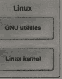

图 1-3：`Linux`是`GNU`实用程序与`Linux`内核的结合。

### Linux 内核的起源

`Linux Torvalds`是芬兰赫尔辛基大学的一名学生，他在 1991 年受到名为`Minix`的系统的启发，独立开发了一个类`Unix`操作系统内核供自个人使用。他在互联网上发布了自己的作品，并请求其他程序员帮助他开发。那时，`Linux`已经可以运行`bash`、`gcc`和`gnu-sed`等实用程序了。在`Torvalds`同意在`GPL`下发布`Linux`之前，`GNU`项目还不是一个完整的操作系统，而内核本身作为操作系统也是不的。

### Linux 时间线

下表概述了`Linux`开发过程中的重要日期。

| 版本 | 发布日期 |
| :--- | :--- |
| `GPLv1` | 1989年1月 |
| `GPLv2` | 1991年6月 |
| `GPLv3` | 2007年6月 |

#### Linux 相关事件

| 年份 | 事件 |
| :--- | :--- |
| 1984 | 理查德·斯托尔曼（`Richard Stallman`）启动了`GNU`项目。 |
| 1989 | `GNU`和`GPL`发布。 |
| 1991 | `Linus Torvalds`开发了一个名为`Linux`的类`Unix`操作系统（版本 0.02）。 |
| 1992 | `Linux`内核 1.0 在`GPL`协议下发布，`SUSE`和`TurboLinux`成立。 |
| 1993 | 红帽公司（`Red Hat`）成立，`Debian`项目开始，`Slackware`首次发布。 |
| 1994 | `Caldera Inc.`成立。 |
| 1995 | `Red Hat Linux 4.0`发布。 |
| 1996 | 建议将企鹅（`Tux`）作为`Linux`的吉祥物，`Linux`内核 2.0 发布。 |
| 1997 | `Red Hat Linux 5.2`和`Debian 1.3`发布。 |
| 1998 | `MandrakeSoft`成立，`Debian 2.0`发布。 |
| 1999 | `Red Hat Linux 6.0`和`SUSE 6.3`发布。 |
| 2000 | `Red Hat Linux 7.0`和`Caldera OpenLinuxDesktop 2.4`发布。 |
| 2001 | `Linux`内核 2.4、`SUSE 7.2`、`Debian 2.23r`、`Slackware 8.0`、`Caldera OpenLinux Server`和`Workstation 3.1`发布。 |
| 2002 | `GNOME 2.0`发布。 |
| 2003 | `Linux`内核 2.6 和`Fedora`发布。 |
| 2004 | `GNU`项目庆祝成立 20 周年，`GNOME 2.6`和`Ubuntu Linux`的第一个正式版本发布。 |
| 2005 | `Red Hat Enterprise Linux 4`发布。`Mandrake Linux`改名为`Mandriva Linux`。 |
| 2007 | `Red Hat Enterprise Linux 5`和`Red Hat Enterprise Linux 5 Update 1 (5.1)`发布。 |
| 2008 | `Linux`内核 2.6.28 和`Red Hat Enterprise Linux 5 Update 2 (5.2)`发布。 |
| 2009 | `Red Hat Enterprise Linux 5 Update 3 (5.3)`和`Linux`内核 2.6.29 发布。`Red Hat Enterprise Linux 5 Update 4 (5.4)`和`Linux`内核 2.6.30 至 2.6.32 发布。 |
| 2010 | `Red Hat Enterprise Linux 5 Update 5 (5.5)`和 2.6.33 发布。 |

#### Linux 的用途

`Linux`主要用于服务器、工作站和桌面电脑。

| 用途 | 描述 |
| :--- | :--- |
| 服务器 | 用作`Web`服务器托管网站，并作为为多个客户端提供文件访问的服务器。还用于控制和保护网络流量。 |
| 工作站 | 为面向程序员的业务环境设计。 |
| 桌面 | 侧重于运行办公软件、图形应用程序以及游戏的家庭用户。 |


### Linux 的相关事件

| 年份 | 事件 |
|---|---|
| 1984 | 理查德·斯托尔曼（`Richard Stallman`）启动了 `GNU` 项目。 |
| 1989 | `GNU` 和 `GPL` 发布。 |
| 1991 | `Linus Torvalds` 开发了一个名为 `Linux` 的类 `Unix` 操作系统（版本 `0.02`）。 |
| 1992 | `Linux` 内核 `1.0` 在 `GPL` 协议下发布，`SUSE` 和 `TurboLinux` 成立。 |
| 1993 | `Red Hat` 成立，`Debian` 项目开始，`Slackware` 首次发布。 |
| 1994 | `Caldera Inc.` 成立。 |
| 1995 | `Red Hat Linux 4.0` 发布。 |
| 1996 | 建议将企鹅（`Tux`）作为 `Linux` 的吉祥物，`Linux` 内核 `2.0` 发布。 |
| 1997 | `Red Hat Linux 5.2` 和 `Debian 1.3` 发布。 |
| 1998 | `MandrakeSoft` 成立，`Debian 2.0` 发布。 |
| 1999 | `Red Hat Linux 6.0` 和 `SUSE 6.3` 发布。 |
| 2000 | `Red Hat Linux 7.0` 和 `Caldera OpenLinuxDesktop 2.4` 发布。 |
| 2001 | `Linux` 内核 `2.4`、`SUSE 7.2`、`Debian 2.23r`、`Slackware 8.0`、`Caldera OpenLinux Server` 和 `Workstation 3.1` 发布。 |
| 2002 | `GNOME 2.0` 发布。 |
| 2003 | `Linux` 内核 `2.6` 和 `Fedora` 发布。 |
| 2004 | `GNU` 项目庆祝成立 20 周年，`GNOME 2.6` 和 `Ubuntu Linux` 的第一个正式版本发布。 |
| 2005 | `Red Hat Enterprise Linux 4` 发布。`Mandrake Linux` 改名为 `Mandriva Linux`。 |
| 2007 | `Red Hat Enterprise Linux 5` 和 `Red Hat Enterprise Linux 5 Update 1` 发布。 |
| 2008 | `Linux` 内核 `2.6.28` 和 `Red Hat Enterprise Linux 5 Update 2` 发布。 |
| 2009 | `Red Hat Enterprise Linux 5 Update 3` 和 `Linux` 内核 `2.6.29` 发布。`Red Hat Enterprise Linux 5 Update 4` 和 `Linux` 内核 `2.6.30` 至 `2.6.32` 发布。 |
| 2010 | `Red Hat Enterprise Linux 5 Update 5` 和 `2.6.33` 发布。 |

### Linux 的用途

`Linux` 主要用于服务器、工作站和桌面电脑。

| 用途 | 描述 |
|---|---|
| 服务器 | 用作 `Web` 服务器托管网站，并作为为多个客户端提供文件访问的服务器。还用于控制和保护网络流量。 |
| 工作站 | 为面向程序员的业务环境设计。 |
| 桌面 | 侧重于运行办公软件、图形应用程序以及游戏的家庭用户。 |

### Linux 的其他用途

该操作系统非常多功能。它可以作为：

- 域名服务器
- 路由服务器
- 数据库服务器
- 软件开发平台
- 并行处理器
- 网关服务器

### Linux 的优点

作为一种开源操作系统，`Linux` 在用户群的支持下不断演进。`Linux` 的优点每天都在增加。其中一些包括：

- 低成本。
- 许可方便。
- 增加检测漏洞的概率。
- 更好的性能和稳定性。
- 易于定制的能力。
- 安全性提高。
- 跨版本软件的兼容性。
- 以及，更小的文件大小和更少的系统资源。

### Linux 的缺点

与任何操作系统一样，`Linux` 也有一些缺点。其中包括：

- 主流应用数量有限。
- 可能缺乏对“单一供应商可以提供支持”的信任感。
- 操作系统是免费的，但培训员工使用它的成本可能可能是巨大的。

### Linux 与其他操作系统的比较

在许多方面，`Linux` 与其他操作系统是相同的。它具有图形用户界面（`GUI`），你可以用它编辑文档、浏览互联网和玩游戏。`Linux` 出色之处在于它的稳定性和可靠性。`Linux` 可以运行在 `Macintosh`、`PC` 甚至主机的所有硬件上。

### Linux 发行版

自创建以来，`Linux` 已经演变成数百种发行版，也称为 `distros`，每种都是根据设计者的需求定制的。如果你是初学者，你会发现根据安装情况选择其中一种主流发行版更容易。一些常见的发行版是：

- `Red Hat Enterprise Linux`
- `Fedora`
- `SUSE Linux Enterprise`
- `openSUSE`
- `Debian`
- `Mandriva`
- `Ubuntu`
- 以及 `Mint`

### 常见 Linux 发行版的互联网参考

你可以参考以下网站中的常见 `Linux` 发行版：

- [`Red Hat Linux`](https://www.redhat.com)
- [`Fedora`](https://www.fedaproject.org)
- [`SUSE Linux Enterprise`](https://www.novell.com)
- [`openSUSE`](https://www.opensuse.org)
- [`Debian`](https://www.debian.org)
- [`Mandriva`](https://www.mandriva.com)
- [`Ubuntu`](https://www.ubuntu.com)
- [`Mint`](https://www.linuxmint.com)

### 输入 shell 命令

现在你理解了 `Linux` 的起源，应该学习它的基础知识以便使用它。`Linux` 提示符是你输入命令的地方。在本主题中，你将描述 `shell` 并输入 `shell` 命令。

#### CLI


命令行界面（CLI）是操作系统的文本界面，用户通常在命令提示符处输入命令指示计算机执行特定任务。命令行解释器（或命令 shell）是实现文本界面输入的命令的程序。命令行解释器分析用户提供的输入文本，解释给定概念中的文本，然后提供输出。

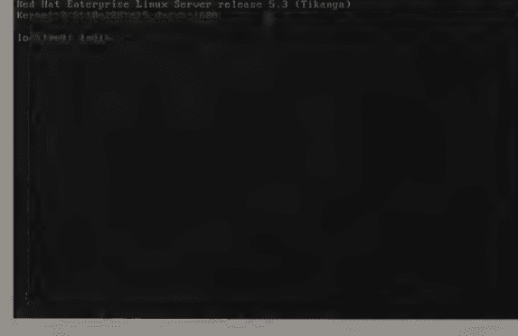

图 1-4：CLI 屏幕。

### 图形用户界面 (GUI)

Linux 图形用户界面 (GUI) 是图标、窗口和其他屏幕图形元素的集合，帮助用户与操作系统进行交互。桌面菜单提供了访问 Linux 桌面可用 GUI 应用程序的途径。有不同的 GUI 实现，例如 K 桌面环境 (KDE) 和 GNU 对象模型环境 (GNOME)。


图 1-5：GNOME 桌面。

下表列出了 GNOME GUI 中常用桌面菜单类的用途。

| 桌面菜单类别 | 用途 |
| --- | --- |
| 附件 (Accessories) | 访问执行工作任务的应用程序，例如创建文本文档和演示文或使用计算器。 |
| 互联网 (Internet) | 访问执行互联网任务的应用程序，如网络浏览器、电子邮件客户端、即时消息传递或网页编辑器。 |
| 声音与视频 (Sound & Video) | 访问查看电影和听音频文件或 CD 的应用程序。 |
| 系统工具 (System Tools) | 访问更改 Linux 系统设置的选项。 |
| 帮助 (Help) | 访问 Linux 帮助。 |

### Shell

定义：

Shell 是直接与用户交互的组件。它也作为 Linux 系统的命令解释器。Shell 接受用户命令并确保内核执行这些命令。Shell 还包含一种解释性编程语言。

下表描述了 Linux 中提供的各种 Shell。

| Shell | 说明 |
| --- | --- |
| `Bash` | 这是默认的 Linux shell。它在 `Bourne` shell 类型的环境中提供了 `C` shell 的灵活性。使用命令 `bash` 打开 `Bash` shell。 |
| `Bourne` | 这是由 Steve Bourne 在贝尔实验室开发的原始 Unix shell，适用于所有 Linux 系统。使用命令 `sh` 打开 `Bourne` shell。 |
| `C` shell | 这是由 Bill Joy 在伯克利开发的，旨在支持 C 语言开发环境。它还为了为了更具交互性的使用而设计，提供了多种方法来减少完成任务所需的输入量。使用命令 `csh` 打开 `C` shell。 |
| `Korn` | 这种 shell 是 `C` shell 和 `Bourne` shell 的结合。它使用了 `C` shell 的特性但采用了 `Bourne` shell 的语法。使用命令 `ksh` 打开 `Korn` shell。 |

### 示例：


图 1-6：空白的 shell 提示符。

## CompTIA® Linux+ Powered by LPI

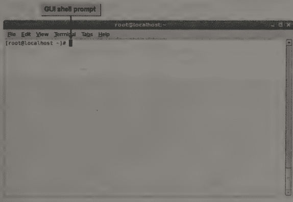

**图 1-7：** GUI 终端窗口中的 shell 提示符。

### 打开多个 Shell

你可以同时打开几个 shell，并在每个 shell 中运行不同的进程或程序。例如，要打开第二个 `Bash` shell，请在命令提示符处输入 `bash`。要打开 `C` shell，输入 `csh`。要关闭 shell，可以输入 `exit` 或按下 `Ctrl+D`。

### 确定当前 Shell

`echo` 命令允许你确定登录时建立的 shell。要确定当前 shell，输入 `echo $SHELL`，其中 `$SHELL` 是存储当前 shell 名称的环境变量。

### 逐页查看文件

要逐页查看文件，只需在想要打开的文件前输入 `more` 命令。例如，如果你想读取 `/etc/passwd` 文件，输入 `more /etc/passwd`。

### `head` 和 `tail` 命令

`head` 命令显示每个文件的前 10 行。`tail` 命令显示每个文件的后 10 行。当你只需要查看文件的开头或结尾时，这些命令非常有用。例如，你可以通过查看日志文件的最后 10 行来检查最近的日志条目。

第 1 课：熟悉 Linux 13

### 虚拟终端

终端或控制台是用于文本输入和显示的计算机接口，其中信息以预选字符数组的形式显示。Linux 在 CLI 模式下支持六个虚拟终端，它们提供带有 shell 登录提示符的文本终端。你可以通过使用组合键 `Ctrl+Alt+F1-F6` 在这些终端之间进行选择。你可以登录多个虚拟终端。

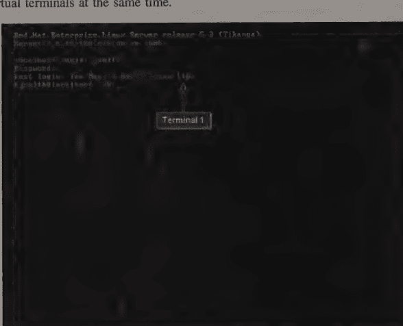

图 1-5：GNOME 桌面。

### Shell 命令

终端或控制台是用于文本输入和显示的计算机接口，其中信息以预选字符数组的形式显示。Linux 在 CLI 模式下支持六个虚拟终端，它们提供带有 shell 登录提示符的文本终端。你可以通过使用组合键 `Ctrl+Alt+F1-F6` 在这些终端之间进行选择。你可以登录多个虚拟终端。


图 1-5：GNOME 桌面。

**图 1-7：** GUI 终端窗口中的 shell 提示符。

#### 补全功能

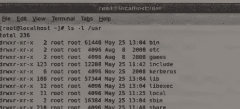

图 1-6：空白的 shell 提示符。

#### 参数

终端或控制台是用于文本输入和显示的计算机接口，其中信息以预选字符数组的形式显示。Linux 在 CLI 模式下支持六个虚拟终端，它们提供带有 shell 登录提示符的文本终端。你可以通过使用组合键 `Ctrl+Alt+F1-F6` 在这些终端之间进行选择。你可以登录多个终端。

**图 1-7：** GUI 终端窗口中的 shell 提示符。


图 1-6：空白的 shell 提示符。

#### 历史

终端或控制台是用于文本输入和显示的计算机接口，其中信息以预选字符数组的形式显示。Linux 在 CLI 模式下支持六个虚拟终端，它们提供带有 shell 登录提示符的文本终端。你可以通过使用组合键 `Ctrl+Alt+F1-F6` 在这些终端之间进行选择。你可以登录多个终端。

#### 外部路径

终端或控制台是用于文本输入和显示的计算机接口，其中信息以预选字符数组的形式显示。Linux 在 CLI 模式下支持六个虚拟终端，它们提供带有 shell 登录提示符的文本终端。你可以通过使用组合键 `Ctrl+Alt+F1-F6` 在这些终端之间进行选择。你可以登录多个终端。

#### 管道命令

终端或控制台是用于文本输入和显示的计算机接口，其中信息以预选字符数组的形式显示。Linux 在 CLI 模式下支持六个虚拟终端，它们提供带有 shell 登录提示符的文本终端。你可以通过使用组合键 `Ctrl+Alt+F1-F6` 在这些终端之间进行选择。你可以登录多个终端。

#### 发出多个命令

终端或控制台是用于文本输入和显示的计算机接口，其中信息以预选字符数组的形式显示。Linux 在 CLI 模式下支持六个虚拟终端，它们提供带有 shell 登录提示符的文本终端。你可以通过使用组合键 `Ctrl+Alt+F1-F6` 在这些终端之间进行选择。你可以登录多个终端。

#### `exec` 命令

终端或控制台是用于文本输入和显示的计算机接口，其中信息以预选字符数组的形式显示。Linux 在 CLI 模式下支持六个虚拟终端，它们提供带有 shell 登录提示符的文本终端。你可以通过使用组合键 `Ctrl+Alt+F1-F6` 在这些终端之间进行选择。你可以登录多个终端。

### `date` 命令

终端或控制台是用于文本输入和显示的计算机接口，其中信息以预选字符数组的形式显示。Linux 在 CLI 模式下支持六个虚拟终端，它们提供带有 shell 登录提示符的文本终端。你可以通过使用组合键 `Ctrl+Alt+F1-F6` 在这些终端之间进行选择。你可以登录多个终端。

#### 语法

`date` 命令的语法是 `date +[format]`，其中 `format` 是用于显示输出不同字段的字符串。

#### `date` 命令使用的字符

用于显示 `date` 命令不同字段的字符列举如下。

## CompTIA® Linux+ Powered by LPI

| 字符 | 描述 |
| --- | --- |
| `%d` | 显示月份中的一天（01 到 31）。 |
| `%D` | 以 `mm/dd/yy` 格式显示日期，其中 `mm` 是月份，`dd` 是日期，`yy` 是年份。 |


| `%H` | 以 24 小时格式显示当前小时（00 到 23）。 |
| `%l` | 显示当前小时（1 到 12）。此选项在小时后不显示 A.M. 或 P.M.。 |
| `%m` | 显示当前的月份（01 到 12）。 |
| `%M` | 显示当前分钟（00 到 59）。 |
| `%r` | 以 12 小时格式显示时间，即 `hh:mm:ss [A.M. 或 P.M.]`。 |
| `%R` | 以 24 小时格式显示时间，即 `hh:mm`。此选项不显示秒。 |
| `%S` | 显示秒（00 到 60）。 |
| `%T` | 以 24 小时格式显示时间，即 `hh:mm:ss`。此选项也显示秒。 |
| `%y` | 显示当前年份的后两位。 |
| `%u4Y` | 显示四位数的当前年份（`yyyy`）。 |

### `cal` 命令

`cal` 命令显示任何月份或年份的日历。如果你在执行 `cal` 命令时不指定月份或年份，它将显示当前月份日历。你可以通过在 `cal` 命令后指定月份和年份来显示某一年特定月份的日历。年份必须以 `yyyy` 格式指定。命令 `cal 10` 将显示公元 10 年的日历，而不是 2010 年。

第 1 节：熟悉 Linux 17

### `cal` 命令

```
root@localhost ~# cal
June 1938
Su Mo Tu We Th Fr Sa
   1 2 3 4 5
6 7 8 9 10 11 12
13 14 15 16 17 18 19
20 21 22 23 24 25 26
27 28 29 30

[root@localhost]#
```

图 1-11：使用 `cal` 命令查看当前月份日历。

#### 语法

`cal` 命令的语法为 `cal {month} {year}`。

#### `cal` 命令的选项

表中列出了 `cal` 命令的一些选项。

| 选项 | 描述 |
| --- | --- |
| `-m` | 将周一作为每周的第一天。 |
| `-j` | 显示儒略日期。 |
| `-y` | 显示当年的日历。 |

### `uptime` 命令

`uptime` 命令显示自系统运行开始的时间。`uptime` 命令的输出提供了有关当前时间、系统运行了多久以及当前有多少登录用户的信息。

## CompTIA® Linux+™ Powered by LPI

```
The uptime 命令
root@localhost:~ 
File Edit View Terminal Tabs Help
[root@localhost ~]# uptime
08:02:49 up 51 min, 2 users, load average: 0.01, 0.00, 0.00
[root@localhost ~]#
```

`图 1-12：使用 uptime 命令查看系统启动运行的时间。`

`负载平均值 (Load Average)` `uptime` 命令输出的最后一个字段显示系统过去 1 分钟、5 分钟和 15 分钟的平均负载。此信息可用于检查系统是否繁忙。

#### `who` 命令

`who` 命令用于确定当前登录系统的用户详情。`who` 命令的输出包括用户名、用户连接的系统名称以及用户连接持续的时间。

#### `who` 命令

```
root@localhost# #who
smith            2018-06-02 15:31
root             8         2018-05-21 15:16
root             pts/1    2018-06-02 15:37 (:0.0)
root@localhost# -j
```

`图 1-13: 使用 who 命令显示用户详情。`

`who 命令选项`

`-i` 选项可以查看用户空闲了多久。点 `.` 表示用户在过去一分钟内仍活跃，`old` 表示用户已空闲超过 24 小时，2 分钟到 23 小时 59 分钟之间的任何时间都显示他们空闲时长。`am i` 选项仅显示运行该命令的用户的信息。输出前会带有主机名。

### `whoami` 命令

`whoami` 命令用于显示你当前登录系统的用户名。有时，你可能需要登录系统并在不同用户之间切换，此时你可能不确定当前是以哪个身份登录的。在这种情况下，你可以使用 `whoami` 命令获取你的当前用户。（`img/b54ed9904f9bb8a2eb5097106fb2afd6_32_0.png`）1-14：使用 `whoami` 命令显示用户名

### `hostname` 命令

`hostname` 命令用于显示你当前登录系统的主机名。当你通过同一个终端登录不同的系统时，可以使用 `hostname` 命令识别你正在运行的系统。（`img/b54ed9904f9bb8a2eb5097106fb2afd6_32_1.png`）1-15：使用 `hostname` 命令查看 Linux 系统。

### `w` 命令

`w` 命令主要用于显示当前登录系统的用户详情及其操作。第一行显示系统状态。第二行显示一个表格，第一列列出登录用户，最后一列指示当前活动。其余列显示与用户相关的属性。

```
The w
```
（`img/b54ed9904f9bb8a2eb5097106fb2afd6_33_0.png`）1-16：使用 `w` 命令查看用户详情。

#### `last` 命令

`last` 命令显示登录和退出的历史，带有实际时间和日期。它还有一些选项可以过滤通过特定终端登录的用户。例如，`last 1` 将显示使用第一个终端登录的用户。`last` 命令从 `/var/log/wtmp` 文件检索信息。

#### `last` 命令

| File Edit View Terminal Tabs Help |

|---|---|---|---|

| `[root@localhost]#0.0` | `Wed Jun 2 15:37 logged in` |

| `smith tty` | | `Wed Jun 2 15:31 logged in` |

| `tty` | | `Tue 29 23:49 - 00:08 (07:19)` |

| `tty` | | `Tue 21 14:38 - 14:44 (00:07)` |

| `tty` | | `May 28 18:19 - 18:53 (23:34)` |

| `tty` | | `May 28 18:22 - 16:50 (22:28)` |

| `tty pts/1` | `0.0` | `May 29 18:21 - 18:21 (00:00)` |

| `tty` | | | `May 28 19:27 - 18:27 (00:53)` |

| `tty` | | | `Thu 27 17:46 - 18:18 (00:32)` |

| `tty` | | | `Fri 25 23:19 - 17:46 (-21:33)` |

| `:0` | | | `Fri 21 14:58 - (04:58)` |

| `:0` | | | `Fri 21 19:10 - 15:16 logged in` |

| `reboot system boot` | `2.6.18-120.el6` | `Fri 21 11:54 - 12:45 (00:51)` |

| `:0` | | | `Fri 21 11:54 - 11:54 (00:00)` |

| `reboot system boot` | `2.6.18-120.el6` | `May 28 12:35 - 12:36 (00:15)` |

| `:0` | | | `Thu 29 17:06 - 18:16 (17:10)` |

| `:0` | | | `Thu 29 17:05 - 17:06 (00:01)` |

| `:0` | | | `May 29 16:50 - 17:05 (00:15)` |

| `root` | | | `May 28 16:46 - 16:56 (00:10)` |

| `root` | | | `May 28 16:40 - 16:48 (00:08)` |

图 1-17：查看用户登录历史详情。

#### `echo` 命令

`echo` 命令用于在终端上显示一行文本。对于编写 shell 脚本的程序员非常有用，因为它可以用于显示额外信息。需要显示的文本应该插入在 `echo` 命令之后。你也可以通过在 `echo` 命令后指定变量名来显示存储在变量中的值。

#### `echo` 命令

| File Edit View Terminal Tags Help |

|---|---|---|---|---|

| `[root@localhost]# # echo "Create files"` |

| `Create files` |

| `[root@localhost]##` |

图 1-18：使用 `echo` 命令显示文本。

第1 节：熟悉 Linux 23

#### 语法

`echo` 命令的语法为 `echo {"string"}`。

### `sleep` 命令

`sleep` 命令用于指定时间暂停系统活动。命令 `sleep <time>` 会根据变量 `time` 值指定的秒数挂起提示符。

`img/b54ed9904f9bb8a2eb5097106fb2afd6_35_0.png`

### `cat` 命令

`cat` 命令用于显示、合并和创建文本文件。此命令经常用于读取较小的文本文件。


> `cat` 命令的名字是 `concatenate`（连接）一词的缩写。

### `cat` 命令

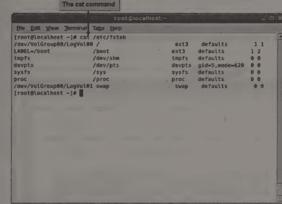

图 1-20：`cat` 命令显示文本文件。

`cat` 命令的选项如下表所示。

| 选项 | 描述 |
| --- | --- |
| `-n` | 在输出内容前加上相应的行号。 |
| `-b` | 对行进行编号，但排除空行。 |
| `-u` | 不对输出进行缓冲。 |
| `-s` | 不显示不存在的文件的结果。 |
| `-v` | 将非打印字符显示为可见字符（制表符、换行符和分页符除外）。 |
| `-e` | 在每行末尾、换行符之前打印一个 `$` 字符。 |
| `-t` | 将制表符打印为 `^I`，分页符打印为 `^L`。 |

#### 语法

`cat` 命令的语法为 `cat [命令选项] {文件名}`。

### `which` 命令

`which` 命令用于验证用户是否有权执行某条命令。它通过搜索分配给 `PATH` 变量的目录来显示命令的完整路径。例如，输入 `which cat` 后将显示输出：`/bin/cat`。

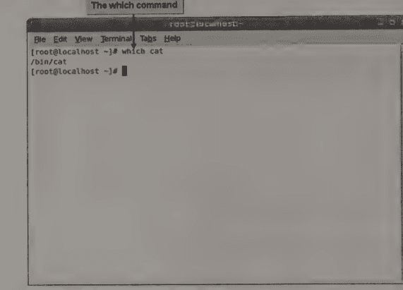

图 1-21：`which` 命令显示命令的完整路径。

## 如何输入 Shell 命令

**过程参考：登录您的系统**

要登录您的系统：

1. 登录系统的 GUI 界面。
   1. 在 `Username`（用户名）文本框中输入用户名。
   2. 在 `Password`（密码）文本框中输入用户密码。
2. 登录 Linux 系统的 CLI。
   1. 按 `Ctrl+Alt+F1` 切换到第一个终端。
   2. 登录系统，输入用户名。
   3. 输入密码。

**过程参考：监控用户登录**

要监控用户登录：

1. 以 `root` 身份登录。
2. 监控系统中的用户登录情况。
   - 要显示已连接用户的登录信息以及这些用户相关的进程，输入 `w`。
   - 要显示当前登录系统的用户，输入 `who`。

**过程参考：使用命令检查系统日期和日历**

要检查系统日期和日历：

1. 登录 Linux 系统的 CLI。
2. 要查看日期详情，在终端中输入 `date` 命令。
   - 要检查系统的当前日期和时间，输入 `date`。
   - 要以“月-日-年”格式查看日期，输入 `date +%m-%d-%y`。
   - 要以“小时-分钟-秒 [AM 或 PM]”格式查看当前时间，输入 `date +T`。
3. 要查看特定的日历，输入 `cal` 命令。
   - 显示当前月的日历，输入 `cal`。
   - 查看特定月份的日历，输入 `cal {月份} {年份}`。
   - 要以特定格式显示日历，输入 `cal [选项]`。
   > 此外，在 GUI 中，你可以选择 `System -> Administration -> Date & Time`，在 `Date/Time Properties` 属性对话框中查看系统日期和时间。
4. 如必要，要清除终端屏幕，输入 `clear` 命令。

### 过程参考：使用命令显示系统信息

要显示系统信息：

1. 输入合适的命令查看特定的系统信息。
   - 要检查系统运行持续的时间，输入 `uptime`。
   - 要显示登录历史，输入 `last`。
   - 要显示系统上的错误登录历史，输入 `last`。
   - 要显示你当前登录的系统主机，输入 `hostname`。
   - 要显示你当前登录的用户名，输入 `whoami`。

### 活动 1-2

**使用基础命令**

在开始之前：

1. 红帽企业级 Linux 5.3 服务器已设置并配置为使用 GNOME GUI。
2. 系统已启动并显示了 GUI 登录界面。

**场景：**

你的工作站上获得了一个 Linux 系统，并被要求与同事协作工作，他们也将从自己的系统访问你的系统。登录你的系统后，你决定检查连接到你系统的用户详情，以更新你对系统使用情况的情况。

> 每当说明“输入命令”时，你都需要输入该命令并按 `Enter`（回车键）。

1. 以 `jsmith` 身份登录 GUI。
   1. 要登录系统，在 `Username` 文本框中输入 `jsmith`。
   2. 在 `Password` 文本框中输入 `mys@word`。
2. 以 `jsmith` 身份登录第一个终端。
   1. 按 `Ctrl+Alt+F1` 切换到第一个终端。
   2. 登录系统，输入 `jsmith`。
   3. 输入 `mys@word`。
   4. 要检查系统的当前日期和时间，输入 `date`。
   5. 观察输出结果。
3. 以 `eric` 身份登录第五个终端。
   1. 按 `Ctrl+Alt+F5` 切换到第五个终端。
   2. 登录系统，输入 `eric`。
   3. 输入 `mys@word`。
   4. 要检查系统的当前日期和时间，输入 `date`。
   5. 观察输出结果。
4. 以 `ROBERT` 身份登录第六个终端。
   1. 按 `Ctrl+Alt+F6` 切换到第六个终端。
   2. 登录系统，输入 `ROBERT`。
   3. 输入 `mys@word`。
   4. 要查看当前月的日历，输入 `cal`。
   5. 观察显示的日历。
5. 查看当前登录 Linux 系统的用户列表。
   1. 按 `Ctrl+Alt+F1` 切换到第一个终端。
   2. 查看当前登录 Linux 系统的用户列表，输入 `who`。
   3. 观察用户列表。
6. 显示登录用户的信息。
   1. 要显示连接用户的信息，输入 `w`。
   2. 观察连接用户的信息。
   3. 要清除终端屏幕，输入 `clear`。

### 活动 1-3

**使用系统命令**

在开始之前：

1. 红帽企业级 Linux 5.3 服务器已设置并配置为使用 GNOME GUI。
2. 系统已启动并显示了 GUI 登录界面。

**场景：**

你已以 `jsmith` 身份登录第一个终端。在查看连接到你系统的用户详情后，你决定检查系统、运行时间以及系统日期时间。

1. 检查你的系统主机名。
   1. 要检查系统主机名，在命令行中输入 `hostname`。
   2. 观察你的系统主机名。
   3. 要清除终端屏幕，输入 `clear`。
2. 检查系统运行时间和当前日期时间。
   1. 要检查系统运行持续的时间，输入 `uptime`。
   2. 观察命令输出的第一列显示了系统运行的时间。
   3. 要检查系统的当前日期时间，输入 `date`。
   4. 观察显示的日期和时间。
3. 检查当前日历。
   1. 要查看当前月的日历，输入 `cal`。
   2. 观察当前月的日历。
   3. 要查看特定年份的日历，输入 `cal <年份>`。
   4. 观察该年份的日历。

## 手册页

手册页（或 `man pages`）包含了针对每个 Linux 命令的完整文档；它们以简单的 ASCII 文本格式呈现。可以使用 `man` 命令显示特定命令的手册页。系统默认提供了这些手册页。它们通常包含此类信息，如命令名称、其用途的描述、其支持的选项、该命令的常用用法示例以及相关命令列表。

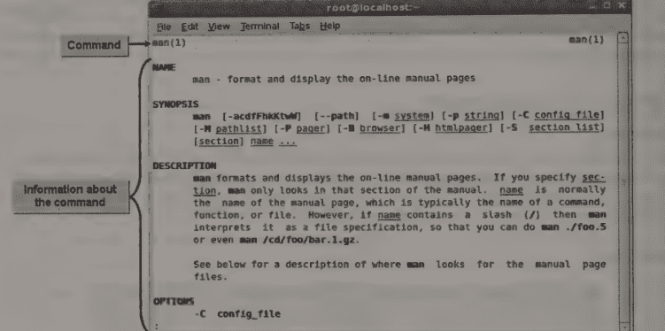

**图 1-23：** 查看手册页上的信息。

#### 语法

`man` 命令的语法为 `man {topic}`。

| 选项 | 描述 |
| --- | --- |
| `-a` | 查找所有匹配查询结果的条目。 |
| `-D` | 显示调试信息。 |
| `-f` | 显示命令的简短描述以及相应的手册页/章节。 |
| `-h` | 显示 `man` 命令的帮助选项。 |
| `-k` | 列出所有包含关键词的手册页/章节及其所在位置。 |
| `-X` | 在所有页面上搜索指定的字符串。 |
| `-t` | 格式化手册页以便进行打印。 |

#### `man` 命令选项

单个命令的手册页可能列在多个章节下。可以使用 `whatis` 命令列出特定命令的所有可用手册页章节。当命令列出一个章节时，意味着从多个来源获取同一命令的文档。这些章节通过命令旁显示的数字识别，例如 `fsck (8)`。

下表给出了各种手册页章节。

| 章节编号 | 包含内容 |
| --- | --- |
| `1` | 通用命令 |
| `2` | 系统调用 |
| `3` | C 库函数 |
| `4` | 特殊文件（通常位于 `/dev` 中） |
| `5` | 文件格式和约定 |
| `6` | 游戏和屏幕保护 |
| `7` | 杂项 |
| `8` | 系统管理命令和守护进程 |

#### Linux 手册页的键

你可以使用多个键在 Linux 手册页中导航。不同键的功能见下表。

| 键 | 用途 |
| --- | --- |
| `Home` | 移动到手册页开头 |


| 键 | 描述 |
| :--- | :--- |
| `End` | 移动到手册页结尾 |
| `Page Up` | 逐渐向上滚动页面 |
| `Page Down` | 逐渐向下滚动页面 |
| `N` | 移动到搜索术的下一次出现位置 |
| `P` | 移动到搜索术的上一次出现位置 |
| `Q` | 退出并返回 shell 提示符 |

### apropos 命令

`apropos` 命令通常用于用户不知道使用哪个命令来执行特定操作。它可以配合关键词使用，显示包含关键词的手册页列表及其手册页章节。`apropos` 命令会在定期更新的数据库中搜索指定的字符串并返回所有匹配的条目。

```
Keyword Keyword found in the entries
droot@localhost:~ 
File Edit View Terminal Tab "editing"
[root@localhost~# apropos "editing"]
(rpm) - Simple interface for editing the font path for the X page
(rpm) - Gnu Emacs major mode for editing SGML documents.
readline
(3) - get a line from user with editing
readline
(rpm) - A library for editing
```

`(1) - editing (DEVELOPMENT)`

在`man`和`apropos`命令之外，Linux 还提供了其他内置选项。

```
(DEVELOPMENT)
(1) - editing (DEVELOPMENT)
[root@localhost~# 
```

`(1) - editing (DEVELOPMENT)`


`图 1-24：使用` `apropos` `命令在网页中查找帮助。`

#### 语法

`apropos` 命令的语法为 `apropos {keyword}`。

### 内置帮助选项

除了 `man` 和 `apropos` 命令外，Linux 还提供了其他内置帮助选项。

| 帮助选项 | 描述 |
|---|---|
| `whatis` | 显示命令的简短描述以及相应的手册页/章节。`whatis` 命令会在定期更新的数据库中搜索指定的字符串。 |
| `info` | 显示包含更多信息的页面。`info` 命令的语法为 `info (command)`。 |
| `command --help` | 显示命令的快速摘要。该功能可与大多数命令配合。 |

### `/usr/share/doc` 目录

`/usr/share/doc` 目录包含了安装在系统中的文档，描述了配置或使用 Linux 的某些方面。

### `HOWTO`

`HOWTO` 文档可能安装在系统中，通常位于 `/usr/share/doc` 目录。HTML 版本可以通过任何网页浏览器查看，包括文本浏览器。文本文件可以通过 `cat`、`more` 或 `less` 命令查看。`HOWTO` 可以在系统中找到，也可以在 `http://linuxdocs.org/HOWTOs/HOWTO-INDEX/howtos.html` 找到。

`HOWTO` 是全面的文档，通常不是问答格式。然而，许多 `HOWTO` 在结尾有 `FAQ` 部分。`HOWTO` 有多种可用格式：纯文本、PostScript、PDF 和 HTML。除了 `HOWTO`，还有大量针对特定主题的微型 `HOWTO`。

### 从 `info` 页面获取帮助

要显示 `info` 页面，输入 `info`，不带选项和参数。单独运行 `info` 命令将显示如何使用 `info` 页面的帮助文件。输入 `info [topic]` 将显示指定主题的 `info` 页面。`info --help` 显示简要帮助描述。

当显示 `info` 页面时，任何前面带有星号 (\*) 的文本都是链接。使用方向键移动光标到文本，并按回车访问链接的 `info` 页面。要返回上一个文档，输入 `U`；输入 `D` 返回到页面顶部。输入 `Q` 返回到 shell 提示符。

### `LUGs`

Linux 用户和开发者的良好信息来源是 Linux 用户组（`LUG`）。这些可以是虚拟的（基于网页的），或者你所在的地区可能有一个小组。虚拟小组有时以公告板的形式存在。

### 在线帮助

互联网是获取任何发行版文档的最佳场所。有专门的网站和在线论坛可以帮助 Linux 用户。商业发行版的文档可以在各自的网站上获取。这些包括不同版本的发行说明、部署指南、安装指南和虚拟化指南。

要构建 `whatis` 数据库，请输入 `makewhatis`。

要显示指定命令的 `man` 页面章节和简短描述，请输入 `whatis {command name}`。

要查看指定章节下指定命令的 `man` 页面，请输入 `man [section] {command}`。

要关闭 `man` 页面，请按 `Q`。

### 过程参考：使用 `apropos` 命令查找相关的 Man Pages

使用 `apropos` 命令查找 `man` 页面：

- 1. 以用户身份登录。
- 2. 要在 `whatis` 数据库中搜索关键字并显示指定命令匹配的 `man` 页面章节，请输入 `apropos {keyword}`。
- 3. 要显示特定章节下特定命令的 `man` 页面，请输入 `man [section] {command}`。
- 4. 要关闭 `man` 页面并返回命令提示符，请按 `Q`。

### 过程参考：显示命令的 Info 文档

要显示命令的 `info` 文档：

- 1. 以用户身份登录。
- 2. 要读取指定命令的 `info` 文档，请输入 `info command`。
- 3. 在 `info` 页面之间进行导航。
    - 要在页面内导航，请使用向上箭头或向下箭头键。
    - 要在多个页面之间导航，请使用 `Page Up` 或 `Page Down`。
    - 要移动到下一页或上一页，分别输入 `n` 或 `p`。
    - 要在 `info` 页面上搜索特定字符串，请输入 `s`。
    - 要跳转到下一个链接，请按 `Tab`。
- 4. 要关闭 `info` 页面，请按 `Q`。

### 过程参考：显示命令的选项

要显示命令的选项：

- 1. 以用户身份登录。
- 2. 要显示命令语法和选项列表，请输入 `command --help`。
- 3. 要使用必要的选项执行所需任务，请输入 `command -options`。

### 活动 1-4
### 识别 Linux 文档类型及其用途

开始之前：

- 1. 按 `Ctrl+Alt+F5`。
- 2. 输入 `logout` 并按回车，从第五个终端注销 `eric`。
- 3. 按 `Ctrl+Alt+F6`。
- 4. 输入 `logout` 并按回车，从第六个终端注销 `robert`。
- 5. 按 `Ctrl+Alt+F1`。

场景：
你的经理 `Linda` 正在理解某些命令。她知道有几种类型的支持文档可用，但不确定如何使用它们。她听说实施 Linux 所涉及的隐藏成本中很大一部分是由于支持有限导致的。她希望你提交一份关于不同类型 Linux 文档及其用途的报告。你决定探索可用的帮助选项。

- 1. 显示 `gzip` 命令的帮助手册。
    a. 在命令行中，输入 `man gzip`
    b. 要继续阅读 `man` 页面，请按空格键。
    c. 要返回到命令行，请按 `Q`。

- 2. 构建 `whatis` 数据库。
    a. 要注销 `smith`，输入 `logout`
    b. 要以 `root` 身份登录，输入 `root`
    c. 在密码提示符处，输入 `p@ssword`
    d. 要构建 `whatis` 数据库，输入 `makewhatis`

- 3. 在 `man` 页面中搜索单词 `"zip"`。
    a. 输入 `apropos zip`
    b. 观察输出结果列出了所有找到关键字 `"zip"` 的实例。

- 4. 查看 `man` 页面中找到关键字的所在列表。
    a. 在命令行中，输入 `whatis gzip`
    b. 查看结果。
    c. 要清除终端屏幕，输入 `clear`

5. 对或错？在你的环境中的每个 Linux 系统上，编写一份关于具体安装和更改了内容的详细报告是一项常见做法。
— 正确
— 错误

6. 你的 Linux 系统上可能安装了哪些额外的帮助选项？
a) `--help`
b) `helpme`
c) `HOWTO`
d) `Textinfo`

7. `HOWTO` 以什么格式提供？
a) PostScript
b) 电子邮件
c) PDF
d) HTML

### 活动 1-5
### 使用 Linux Manual 页面获取帮助

**开始之前：**
你已经在 `CLI` 终端中以 `root` 身份登录。

**场景：**
你的组织支持全球的客户，你可能需要支持不同时区的客户。为了实现这一点，你的系统时间应该与客户系统的时间保持一致。你不确定更改系统日期和时间的步骤。你决定浏览 `man` 页面以寻求更多帮助。

- 1. 查找 `date` 命令的 `man` 页面。
    a. 要查看不同章节中 `date` 命令的相关 `man` 页面，输入 `whatis date`
    b. 要查看章节 1 下 `date` 命令的 `man` 页面，输入 `man 1 date`

- 2. 搜索 `man` 页面。
    a. 要移动到文本 `"FORMAT"` 的第一个实例，输入 `/FORMAT`
    b. 要导航到下一个文本 `"FORMAT"` 实例，输入 `/`
    c. 要查看 `date` 命令允许的各种格式，输入 `/`
    d. 要关闭 `date` `man` 页面，请按 `Q`。

- 3. 查看 `info` 页面。
    a. 要查看 `date` 命令的完整 `info` 文档，输入 `info date`
    b. 要导航到下一个 `"Examples"`，按 `/` 并输入 `Examples`
    c. 要跳转到下一个链接，请按 `Tab`。
    d. 要关闭 `info` 页面，请按 `Q`。

## 启动与停止

在上主题中，你识别了如何启动和停止 Linux。在本主题中，你将学习如何启动和停止服务。`service` 命令允许你管理系统中运行的服务。

### 服务
定义：
Linux 服务是在后台运行的应用程序或一组应用程序。服务可以大致分为关键服务和服务非关键服务。关键服务是对于 Linux 运行至关的核心服务。非关键服务是用户安装的服务。

`service` 的语法为 `{service name} {options}`。

### 守护进程
定义：
守护进程是在后台运行无需人工干预的程序。它处于休眠状态，直到事件触发它。某些守护进程定期运行。守护进程在系统启动时启动。

### Init 运行级别

`Init` 用于设置系统的运行级别。运行级别指定了可以存在的进程组。`Init` 在启动时从 `/etc/inittab` 文件中的脚本创建进程。你可以使用 `telinit` 命令更改当前运行级别。`Init` 是所有进程的父进程。

# 系统关机

`shutdown` 命令用于关闭系统。它会关闭文件并执行安全关机系统所需的其他任务。它会警告所有用户系统正在关机，并且在命令发布后无人可以登录。在某些安装或移除硬件后，有必要关机 Linux 系统。


`root@localhost~~`

```
[root@localhost]# shutdown -h now

Broadcast message from root (pts/1) (Thu Jul 23 12:37:41 2009):

The system is going down for system halt NOW!

[root@localhost]#
```


### Shutdown 命令选项

当你需要重启 Linux 系统时，应该使用带有适当选项的 `shutdown` 命令。`shutdown` 命令的语法为 `shutdown [-t seconds] [-options] time [warning message]`。

- `-t` 选项指定了在切换到另一个运行级别（runlevel）之前等待的秒数。其他选项如表所示。

| 选项 | 用途 |
| :--- | :--- |
| `-k` | 向所有人发送警告消息，但不会真正关闭系统。 |
| `-r` | 关机后重启系统。重启后，如果你正在使用引导加载程序加载不同的操作系统，你可以切换到另一个操作系统或登录 Linux。 |
| `-h` | 关机后停止系统。此时，你可以安全地关闭电源。 |
| `-n` | 在不调用 `init` 的情况下关闭系统。建议不要使用此选项。 |
| `-f` | 重启时跳过文件系统检查。 |
| `-F` | 重启时强制进行文件系统检查。 |
| `-c` | 取消正在进行的关机。此选项不用时间参数，但可以使用警告消息选项。 |

### 如何启动和停止 Linux

过程参考：从 Shell 管理运行级别

要从 Shell 管理运行级别：

1. 在命令提示符处，调出你当前的运行级别。
2. 切换到运行级别 1。
3. 验证你正处于运行级别 1。
4. 退出回到运行级别 3。

### 过程参考：从配置文件管理运行级别

要从配置文件管理运行级别：

1. 编辑 `/etc/inittab` 文件以从运行级别 1 开始。
2. 重启电脑。
3. 验证你正处于运行级别 1。
4. 编辑 `/etc/inittab` 文件以从运行级别 3 开始。
5. 重启电脑。

### 过程参考：切换运行级别之前提醒用户

在切换运行级别之前向连接到你系统的所有用户报警：

1. 以 `root` 身份登录 CLI。
2. 输入 `shutdown -t [seconds] now [message]` 或输入 `shutdown -k now`。

### `/etc/nologin` 文件

当延迟调用关机程序时，它会创建一个空的 `/etc/nologin` 文件，这将限制进一步的连接。如果你手动添加此文件，它将允许超级用户或 `root` 用户登录并限制所有其他人。`/etc/nologin` 文件中的内容将在每次登录失败时显示。

### 活动 1-6
### 与停止 Linux

在开始之前：
你已经在 CLI 中以 `root` 身份登录

场景：
你被分配了管理公司 Linux 实现的任务。作为开始，你必须学习启动和停止你的 Linux 系统，并熟悉各种运行级别。

1. 检查各种运行级别。
   a. 在命令行中输入 `more /etc/inittab`
   b. 按两次空格键继续。
   c. 观察显示器上显示的 `/etc/inittab` 文件内容。
   d. 要确定当前的运行级别，输入 `runlevel`
   e. 观察你当前的运行级别。

2. 切换到单用户模式。
   a. 在命令行中输入 `telinit 1`
   b. 观察之前运行级别的服务已停止，运行级别 1 服务已启动。
   c. 要验证你处于单用户模式，输入 `runlevel`
   d. 观察到命令显示 `1 S`，表示单用户 1。要返回默认运行级别（即运行级别 5），输入 `exit`
   e. 要切换到 CLI 的第一个终端，按下 `Ctrl+Alt+F1`。
   f. 在登录提示符处，输入 `root`
   g. 在密码提示符处，输入 `p@ssword`

3. 重启 Linux 系统。
   a. 在命令行中输入 `shutdown -r now`
   b. 观察系统从当前用户 `root` 向向连接到系统的其他用户发送广播消息，指示系统将重启。
   c. 观察在重启系统之前服务已停止且进程已被杀死。要切换到 CLI 的第一个终端，按下 `Ctrl+Alt+F1`。
   d. 使用密码 `p@ssword` 以 `root` 身份登录系统

## 课程 1 后续

在本节中，你识别了基本的 Linux 概念并执行了基本的 Linux 任务。这些技能可以帮助你支持 Linux 用户和机器。

1. 开源软件相比许可软件的优势是什么？

2. 使用 Linux 的优势是什么？


# 管理用户组账户

课程时长：1 小时 15 分

课程目标：
在本节中，你将：
- 创建用户账户。
- 配置用户。
- 管理用户账户。

引言

在本节中，你将：
- 创建用户账户。
- 配置用户。
- 管理用户账户。

# 主题 A

## 创建用户和组账户

在本节中，你将：
- 创建用户账户。
- 配置用户。
- 管理用户账户。

管理这些账户的第一步是创建账户。

### 用户账户

定义：
用户账户是定义系统上用户的信息的集合。用户在计算机上的表示。用户账户包括用户的用户名和密码、用户所属的组以及用户拥有的访问权限。当账户被创建时，它将被分配一个唯一的数字，即用户 ID (UID)。

示例：


图 2-1：系统存储用户信息的格式。

#### `useradd` 命令

`useradd` 命令用于添加新用户。你需要在命令中指定用户名以创建新账户。某些服务需要特殊的用户账户来运行。例如，`daemon` 是用于运行守护服务的用户账户。


图 2-2：使用 `useradd` 命令添加的新用户。

> 你可以使用 `adduser` 命令执行与 `useradd` 命令相同的功能。

#### 语法

`useradd` 命令的语法为 `useradd [options] {username}`

#### 特殊用户账户

特殊用户账户中用户的 UID 值将小于默认 UID 值（即 500）。特殊用户没有家目录。你可以使用 `useradd -r {special user name}` 命令创建一个特殊用户账户。

#### 默认用户账户

系统安装时会默认创建许多用户账户。一些主要的用户账户包括：

- `root`
- `bin`
- `daemon`
- `sshd`
- `nfsnobody`
- `apache`
- `squid`

# 根之根

每个 Linux 系统都至少有一个系统管理员，其工作是维护系统并为用户提供服务。这个用户就是 `root`。`root` 用户可以在 Linux 系统上执行任何任务，且不受任何限制。系统管理员还负责向系统中添加新用户，并为他们设置初始环境。

#### 其他类型的用户账户

其他类型的用户账户有：

- 本地用户账户（Local–Local user accounts）：允许用户登录到单台、特定的计算机系统。
- 域用户账户（Domain–Domain user accounts）：允许用户登录到计算机系统。然而，用户的身份会被域内的所有计算机识别。
- 宾客账户（Guest accounts）：安装时创建的内置用户账户。它们也被称为匿名账户。使用匿名账户，多个用户可以同时登录系统。通常，匿名账户不需要密码。

#### 密码

密码是一个允许 Linux 系统验证用户身份的实体。通常，当没有没有密码创建用户账户时，这些账户可能会被滥用。因此，当你创建一个用户账户时，应该立即使用 `passwd` 命令为该用户设置密码。在 Linux 中，如果没有为用户账户设置密码，该账户将自动锁定。这有助于防止未经授权的系统访问。

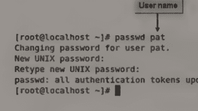

```
[root@localhost ~] passwd pat

Changing password for user pat.

New UNIX password:
```


`Retype UNIX password:`

`passwd: all authentication tokens updated successfully.`

`[root@localhost ~] #`


图 2-3：为用户 `pat` 设置密码。

> 你可以使用 `passwd` 命令更改你用户账户的密码。你无法更改任何其他用户账户的密码，因为 `passwd` 命令不允许你指定任何其他用户名。只有 `root` 用户可以通过通过 `passwd` 命令指定用户名来更改其他用户的密码。

#### 语法

`root` 用户可以通过输入 `passwd [用户名]` 为用户创建密码，其中 `[用户名]` 是设置密码的用户的名称。

#### 字典单词作为密码

如果你输入一个完全由字母文字文字母组成的真实单词作为密码，你将收到一条“弱密码”的消息，提示该密码是基于字典的。尽管显示了信息，密码仍然会被分配。强烈建议将其更改为更安全的密码。

#### `/etc/passwd` 文件

当你添加新用户时，用户信息会保存在 `/etc/passwd` 文件。

`/etc/passwd` 文件中有各种字段。

| 字段 | 说明 |
| --- | --- |
| 用户名 (User name) | 存储用户登录系统时的用户名。建议将用户账户限制在八个数字字母以内。 |
| 密码 (Password) | 以加密格式存储给用户的密码。 |
| 用户 ID (User ID) | 存储分配给每个用户的唯一数字。Linux 通过 `UID` 而不是用户名跟踪用户。 |
| `GID` (Group ID) | 存储分配给每个组的唯一数字。用户可以是多个组的成员。 |
| 全名 (Full name) | 存储用户的真实。 |
| 目录 (Home directory) | 显示用户登录后所处的默认目录。 |
| 登录 shell (Login shell) | 显示用户登录时启动的默认 `shell`。 |

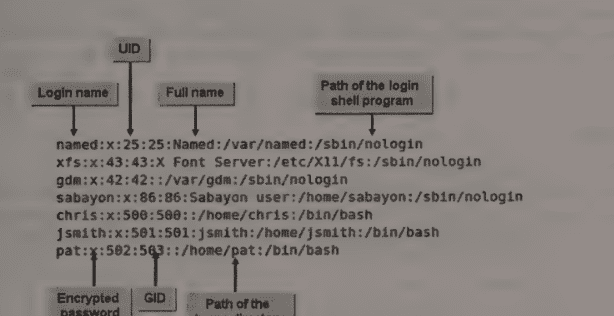

图 2-4：`/etc/passwd` 文件的内容。

#### 影子密码 (Shadow Passwords)

每个用户的密码都存储并加密在 `/etc/passwd` 文件中。该文件是可读的，这使得任何试图攻击系统的人都能轻松获取用户的加密密码副本。然后，通过使用各种技术，攻击者可以破解密码。你可以通过使用影子密码文件来解决这个问题。影子密码被存储并加密在 `/etc/shadow` 文件中。该文件只有 `root` 用户可以读取，这使得攻击者无法获取加密的密码。这有助于防止未经授权的系统访问。

#### `/etc/shadow` 文件

`/etc/shadow` 文件包含以下信息：

- 用户名：用户名
- 密码：加密的密码。
- 最后修改：自上次修改密码以来的。
- 最小：修改密码后可再次修改的天数。
- 警告：密码过期前多少天会警告。
- 激活：密码过期后多少天仍可登录。
- 失效：密码失效后的天数。
- 禁用：账户禁用的天数。
- 预留：保留字段。

### `id` 命令

`id` 命令用于显示 `UID`、`GID` 和组信息。

### `finger` 命令

`finger` 命令用于显示用户的姓名、登录时间、办公室位置和电话。

### 组

组是具有相同访问权限的用户集合。组成员用于限制对文件的访问。

语法：创建组的语法是 `groupadd {组名}`。

#### 标准组

表列出了安装时设置的标准组。

| 组 | GID | 默认成员 |
|---|---|---|
| root | 0 | |
| bin | 1 | |
| daemon | 2 | |
| sys | 3 | |
| tty | 4 | |
| disk | 5 | |
| lp | 6 | |
| mem | 7 | |
| kmem | 8 | |
| wheel | 9 | |
| mail | 10 | |
| news | 12 | |
| uucp | 13 | |
| man | 14 | |
| games | 15 | |
| gopher | 20 | |
| dip | 30 | |
| dial | 40 | |
| ftp | 50 | |
| nobody | 99 | |
| users | 100 | |

#### 用户私有组 (User Private Groups)

用户私有组（`UPG`）是在创建用户账户时创建唯一组。这是用户的主组。

#### `/etc/group` 文件

`/etc/group` 文件包含组列表，每行一个。每行由四个字段组成，用冒号分隔。`/etc/group` 文件也被称为组数据库。

> `/etc/passwd` 文件存储组的密码。


图 2-5：`/etc/group` 文件的示例。

下表列出了不同的字段及其用途。

| 字段 | 说明 |
|---|---|
| 组名 | 存储组名。 |
| 组密码 | 以加密格式存储组密码。 |
| GID | 组标识符，类似于用户的 `UID`。默认 `GID` 值为 500。 |
| 成员 | 以逗号分隔的组成员名称。 |

### 如何创建用户和组账户

**过程参考：创建用户账户**

要创建用户账户：

1. 以 `root` 身份登录命令行。
2. 在命令提示符下，输入 `useradd {用户名}` 来添加新用户。
3. 为该用户设置密码，输入 `passwd {用户名}`。
4. 确认密码。
5. 如果需要，使用新创建的用户名和密码登录系统。

> 在使用 `useradd` 命令创建用户时，会创建一个同名的用户私有组。

**过程参考：创建组账户**

要创建组账户：

1. 以 `root` 身份登录命令行。
2. 在命令提示符下，输入 `groupadd {组名}` 来添加新组。
3. 通过查看 `/etc/group` 文件验证组是否已创建。

### 活动 2-1：创建用户和组账户

**开始之前：**
你已经在 `srvA` 的 `CLI` 中以 `root` 身份登录。

**场景：**
有两名新员工加入了你们公司，需要为他们创建用户账户。此外，公司进行了大的重组。你的经理希望你根据新结构创建部门组。

**用户账户详情：**

- 新账户的用户名：`chris`
- `chris` 的密码：`myp@$$word`
- 新账户的用户名：`pat`
- `pat` 的密码：`myp@$$word`
- 需要创建的新组及其对应的 `GID` 编号：`IT_Support` (544)、`Customer_Support` (545)、`Programming` (546) 和 `Design` (547)

1. 添加新用户 `chris` 和 `pat`。
   a. 若要添加新用户，在命令行输入 `adduser chris`
   b. 若要更改用户的密码，输入 `passwd chris`
   c. 要分配新密码，输入 `myp@$$word`
   d. 要确认密码，输入 `myp@$$word`
   e. 观察密码是否成功更新。
   f. 若要添加另一个用户，输入 `adduser pat`
   g. 若要更改用户的密码，输入 `passwd pat`
   h. 要分配新密码，输入两次 `myp@$$word`。

2. 根据指定的 `GID` 编号添加用户组 `IT_Support`、`Customer_Support`、`Programming` 和 `Design`。
   a. 若要添加新组，输入 `groupadd -g 544 IT_Support`
   b. 若要添加第二个组，输入 `groupadd -g 545 Customer_Support`
   c. 若要添加第三个组，输入 `groupadd -g 546 Programming`
   d. 若要添加第四个组，输入 `groupadd -g 547 Design`

3. 检查用户账户和组是否已创建。
   a. 查看系统上的组账户，输入 `tail /etc/group`
   b. 观察新添加的组是否显示并已添加到组列表中。
   c. 观察用户账户是否创建了与同名的默认组。
   d. 若要查看用户账户，输入 `tail /etc/passwd`
   e. 观察新添加的用户是否显示并已添加到用户列表中。
   f. 若要清除终端屏幕，输入 `clear`

# 主题 B

## 配置用户配置文件

现在你已经可以创建用户和组账户了，下一步是配置用户配置文件。连接到系统的每个用户都需要一个独特的身份，以便与其他用户区分来。在本主题中，你将配置用户配置文件。

连接到系统的所有用户都需要对其系统进行定制化设置。此外，可能存在默认共享的文件。通过配置用户配置文件，每个用户都可以拥有一个独特的身份。这可以将用户与其他区分来。

### 用户配置文件

**定义：**

用户配置文件是一系列选项、偏好、书签和其他用户项，用于描述用户。用户配置文件定义了系统分配给用户的设置，如网络资源、数据、属性和权限。这些设置会在每个会话中保留。用户可以为配置文件指定一个名称。否则，该配置将被称为“默认用户（`Default User`）”。每个用户可以为业务或个人用途创建多个配置文件。

**示例：**

```
MAILCHECK=68

OPTIONAL=

OPTIND=1

GLIBCYPE=linux-gnu
```


```
PATH=/usr/local/sbin:/usr/local/bin:/usr/sbin:/usr/bin:/local/bin:bin:sbin:sb1

nusr=/usr/local/sbin:/usr/X11/bin:/root/sbin:/root/bin:sbin:/root/bin

PS2="8"

PPSIZE=719

PS4_COMMAND=echo -n "$USER(\033[0;32m%s\($PWD#$HOME)-"); echo -n "\007"

PS1="[\u@\w\$]"

PS2=''

PWD=/root

SHELL=/bin/bash

SHELLOPTS=spaceexpand:emacs:hashill:histexpand:interactive-comments:monitor

TERM=term

UID=0

UMASK=022

User=root

username=Root User
```


# 文件系统基础

#### 图 2-7：root 用户配置文件的值列表。

#### 修改默认选项

在配置用户配置文件时，你可以修改默认选项。常用的修改选项包括：

- `PS1`：此变量存储关于主提示符的信息，即用户登录时显示的提示符。该变量可以修改，也可以不修改。
- `PS2`：此变量存储关于次要提示符的信息。
- `PATH`：此变量存储命令的搜索路径信息。如果你想使用未存储标准目录中的命令，可以修改 `PATH`。

#### 隐藏文件和目录

系统中的某些文件和目录是隐藏的。`ls` 命令列出所有文件，但隐藏文件。要显示包括隐藏文件在内的所有文件，使用 `ls -a` 命令。隐藏文件和目录的名字以点开头。你也可以在隐藏文件的名称中添加点来隐藏它们。隐藏文件通常是那些需要极少编辑的文件。

#### 配置文件

当用户登录并启动新的 Bash 会话时，需要输入几个命令来定制用户的会话。如果用户每次登录都输入这些命令将非常繁琐。因此，这些命令被保存在特殊的可执行文件中，Bash 每次在用户登录时都会从那里运行这些命令。该文件被称为配置文件。

1. 如果需要，要观察设置，输入 `env | less`。
2. 输入 `vi /etc/profile`。
3. 要定义变量，输入 `{VARIABLE_NAME}={value}`。
4. 如果必要，你可以修改变量的值。例如，要全局为所有用户修改 `HISTSIZE` 配置，请导航到 `HISTSIZE` 变量并进行必要的更改。
5. 要导出变量，输入 `export {VARIABLE_NAME}`。
6. 保存并关闭文件。
7. 注销并以 `root` 身份登录。
8. 如果需要，要观察对设置的更改，输入 `env | less`。

## 程序参考：管理设置变量

要管理设置变量：

1. 在 CLI 中以 `root` 身份登录。
2. 如果必要，要观察设置变量，输入 `set | less`。
3. 如果必要，要验证输出，输入 `echo $Set variable {VARIABLE_NAME}`。
4. 输入 `vi .bash_profile`。
5. 要定义变量，输入 `Set variable {VARIABLE_NAME} = {value}`。
6. 要导出变量，输入 `export {VARIABLE_NAME}`。
7. 保存并关闭文件。
8. 注销并以 `root` 身份登录。
9. 如果需要，要验证更改，输入 `set | less`。

#### `unset` 命令

`unset` 命令用于临时删除已设置的变量。

### 活动 2-2
配置用户配置文件

数据文件：
`Desktopollies.txt`

开始之前：

1. 你已经在 `srvA` 的 CLI 中以 `root` 身份登录。
2. 在命令行中，输入 `cp /085099Data/Managing_Users_and_Groups/* /root`。
3. 要清除终端屏幕，输入 `clear`。
4. 切换到 GUI。
5. 以 `root` 身份登录。

场景：
你被分配任务，为初创公司 Our Global Company (OGC) Products 的员工创建用户账户并配置用户配置文件。根据公司的新政策，所有新用户账户都应提供 `Desktopollies.txt` 手册，并且用户的命令行提示符应显示公司名称和用户名。

`Desktopollies.txt` 文件位于根目录下。
公司名称为 "OGC Products"。

用户账户详情：

- 要创建的账户的用户名：`newUser`
- `newUser` 的密码：`myp$$word`

1. 将 `Desktopollies.txt` 文件移动为隐藏文件。
   a. 选择 Applications（应用程序）-> Accessories（附件）-> Terminal（终端）。
   b. 要切换到 `skel`，在 `root@localhost` 窗口输入 `cd /etc/skel`。
   c. 要查看隐藏文件，输入 `ls -al`。
   d. 要将 `Desktopollies.txt` 文件移动为隐藏文件，输入 `mv /root/Desktopollies.txt .Desktopollies.txt`。

2. 在命令行提示符处显示用户名和公司名称。
   a. 输入 `edit .bash_profile`
   b. 要到文件末尾新起一行，按 `Ctrl+End`。
   c. 要更改主提示符，输入 `PS1='[ OGC Products\u ]'`。
   d. 保存文件并关闭编辑窗口。
   e. 清除终端屏幕。

3. 将 `.Desktoppolicies.txt` 文件分配给 `newuser` 账户。
   a. 要添加 `newuser` 账户，输入 `useradd newuser`
   b. 要为 `newuser` 设置密码，输入 `passwd newuser`
   c. 要分配密码，输入 `myp@$$sword`
   d. 要确认密码，输入 `myp@$$sword`

4. 检查文件是否已移动。
   a. 要切换到第一个终端，按 `Ctrl+Alt+F1`。
   b. 注销 `root`。
   c. 以 `newuser` 身份登录。
   d. 显示公司名称。
   e. 要验证文件已移动，输入 `cat .Desktoppolicies.txt`
   f. 显示显示文件内容。
   g. 注销 `newuser` 账户。

### 主题 C

## 管理用户和组账户

在上一个主题中，你创建了用户账户并配置了用户配置文件。你的下一步是持续管理用户和组账户。这将能够有效地组织你的环境。在本主题中，你将管理用户和组账户。

一旦创建了用户或组账户，就有许多任务需要维护该账户。作为系统管理员，你需要维护许多账户的密码。这通过有效管理用户和组账户来实现。

### `userdel` 命令

`userdel` 命令允许你修改系统账户文件，删除引用现有用户的条目。然而，如果用户当前登录，它将不允许删除账户。在删除账户之前，你必须杀死该账户的所有运行进程。


图 2-10：`userdel` 命令用于删除未使用的用户账户。

#### 语法

`userdel` 命令的语法为 `userdel [options]`

#### `-r` 选项

`-r` 选项将删除主目录以及邮件池。

### `usermod` 命令

`usermod` 命令选项允许你修改各种用户参数。


下表给出常用的 `usermod` 选项：

| 选项 | 功能 |
| :--- | :--- |
| `-c` | 修改注释字段。 |
| `-d` | 为用户设置新的主目录。 |
| `-e` | 设置账户过期日期。 |
| `-g` | 修改主组 ID。 |
| `-L` | 锁定账户。 |
| `-p` | 设置加密密码。 |
| `-s` | 更改登录 shell。 |
| `-u` | 更改用户 ID。 |

#### 语法

`usermod` 命令的语法为 `usermod [options] username`。

### 过程参考：删除用户账户

要删除用户账户：

1. 以 `root` 身份登录。
2. 要删除用户账户，输入 `userdel [options] {user name}`。

### 过程参考：管理默认密码过期信息

要管理密码过期信息：

1. 以 `root` 身份登录。
2. 要打开 `/etc/login.defs` 文件，输入 `edit /etc/login.defs`。
3. 管理密码过期信息。
   - 要控制密码的最长使用天数，修改 `PASS_MAX_DAYS` 变量旁的值。
   - 要控制密码更改之间允许的最小天数，修改 `PASS_MIN_DAYS` 变量旁的值。
   - 要控制密码的最小长度，修改 `PASS_MIN_LEN` 变量旁的值。
   - 要控制在密码过期前发出警告的提前数，修改 `PASS_WARN_AGE` 变量旁的值。
4. 保存并关闭文件。

### 过程参考：设置或更改密码过期信息

要设置或更改特定用户的密码过期信息：

1. 以 `root` 身份登录。
2. 要更改指定用户的密码过期信息，输入 `chage [options] {user name}`。

### 过程参考：修改和删除组

要修改或删除组：

1. 以 `root` 身份登录。
2. 管理组。
   - 要更改 `GID`，使用 `groupmod -g {GID} {group name}` 命令。
   - 要删除组，使用 `groupdel {group name}` 命令。

### 活动 2-3
## 配置新用户账户

开始之前：

1. 以 `root` 身份登录命令行界面 (CLI)。
2. 在第一个终端中，修改 `/etc/skel/.bash_profile` 文件并删除以 `PS1` 开头的最后一行。
3. 要清除终端屏幕，输入 `clear`。

场景：

你正在担任一名初级系统管理员，你的机构聘佣了一位新的合同制网络管理员。你需要根据以下详情为这位新员工创建一个用户账户：

- 新账户的用户名：`netadmin1`
- `netadmin1` 用户的密码：`myp@$$word`
- `netadmin1` 用户账户的有效期到 2011 年 7 月。
- `/home/users/netadmin1` 目录应设置为 `netadmin1` 用户的默认主目录。

1. 创建名为 `netadmin1` 的用户账户。
   a. 要创建用户，输入 `useradd netadmin1`。
   b. 为新用户设置密码，输入 `passwd netadmin1`。
   c. 分配密码，输入 `myp@$$word`。
   d. 确认密码，输入 `myp@$$word`。
   e. 退出 `root` 账户，输入 `logout`。

2. 使用新用户账户详情登录系统。
   a. 以 `netadmin1` 登录。
   b. 查看默认主目录，输入 `pwd`。
   c. 观察到 `/home/netadmin1` 是 `netadmin1` 用户的默认主目录。
   d. 退出 `netadmin1` 账户。

3. 为新用户账户设置过期日期。
   a. 以 `root` 登录。
   b. 将明年的 7 月 31 日设置为 `netadmin1` 用户账户的过期日期，输入 `usermod -e (year)-07-31 netadmin1`。

4. 更改 `netadmin1` 用户的主目录。
   - 创建父目录，输入 `mkdir /home/users`。
   - 创建主目录，输入 `mkdir /home/users/netadmin1`。
   - 更改目录的所有权，输入 `chown netadmin1:netadmin1 /home/users/netadmin1`。
   - 将 `netadmin1` 用户的默认主目录更改为 `/home/users/netadmin1`，输入 `usermod -d /home/users/netadmin1 netadmin1`。
   - 退出 `root` 账户。

5. 检查 `netadmin1` 用户的主目录是否已更改。
   a. 以 `netadmin1` 登录。
   b. 查看新的主目录，输入 `pwd`。
   c. 观察主目录已更改为 `/home/users/netadmin1`。
   d. 退出 `netadmin1` 账户。

### 活动 2-4
## 管理组账户

开始之前：

1. 以 `root` 身份登录命令行界面 (CLI)。
2. 在终端上创建名为 `Finance` 和 `Marketing` 的两个组。
3. 要清除终端屏幕，输入 `clear`。

场景：

你被分配任务更改财务部门的 `GID`，使其与部门编号匹配。此外，你需要删除系统中的营销组，因为营销部门的工作将外包给其他公司。

1. 将 `GID` 更改为匹配财务部门编号 555。
   a. 更改财务部门的 `GID`，输入 `groupmod -g 555 Finance`。
   b. 验证更改已生效，输入 `tail -20 /etc/group`。
   c. 观察财务部门的 `GID` 已更改。

2. 删除用户组 `Marketing`。
   a. 输入 `groupdel Marketing`。
   b. 验证 `Marketing` 组已删除，输入 `tail -20 /etc/group`。
   c. 观察财务部门的 `GID` 已更改。（注：此处应为验证 `Marketing` 的删除）
   d. 按空格键退出显示。
   e. 清除终端。

## 课程后续

你现在熟悉用户和组账户。在本节中，你创建并管理了这些。

1. 组织成组有什么用？
2. 为什么配置这些是至关重要的？


# 文件系统标签

文件系统标签被分配给文件系统以便于识别。标签长度可达 16 个字符，并可以使用 `e2label` 命令进行显示或更改。

```


# The e2label command


图 3-2：文件系统标签示例。

## 语法

设置文件系统标签的语法为 `e2label /dev/{device(partition number)} (label name)`。也可以使用 `tune2fs -L (volume label) (device)` 命令进行设置。

## 文件系统类型

Linux 支持许多常见的文件系统类型。下表描述了一些常见的文件系统类型。

| 文件系统类型 | 描述 |
| --- | --- |
| `ext2` | 这曾是某些旧版本的原生 Linux 文件系统。在当前的 Linux 版本中仍然受到支持。 |
| `ext3` | 这是 `ext2` 的改进版本，目前是 Linux 的原生文件系统。在意外关机的情况下，`ext3` 恢复数据的速度快得多并能确保数据完整性。你可以轻松地将文件系统从 `ext2` 升级到 `ext3`。 |
| `reiserfs` | 它可以高效处理小文件。它处理小于 1K 的文件时比 `ext2` 快。如果配置恰当，它可以存储比 `ext2` 多的数据。 |
| `vfat` | 这是一种支持长文件名的 32 位文件系统。它与 Microsoft Windows XP 和 Windows NT 的 FAT 文件系统兼容。 |
| `XFS` | 这是一种 64 位的高性能日志文件系统，提供快速恢复并能高效处理文件。 |
| `JFS` | 这是一种 64 位的日志文件系统，速度快且可靠。能够更好地处理掉电和系统崩溃。 |
| `swap` | 这不是真正的文件系统，而是硬盘的一部分，用于 Linux 物理内存耗尽并需要更多内存的情况。Linux 会将一些未使用的文件从 `RAM` 推到“`swap`”中以释放内存。 |
| `ISO 9660` | 这是由国际标准组织（ISO）定义的文件系统标准，也称为 `CDFS`（光盘文件系统）。Linux 允许你访问使用此文件系统的 DVD 和 CD。 |

## 访问其他文件系统

Linux 允许访问其他文件系统并在需要时挂载它们。然而，你不能在这些文件系统上安装 Linux。

| 文件系统 | 描述 |
| --- | --- |
| `FAT` | `FAT`（文件分配表）文件系统兼容不同的操作系统，包括所有版本的 Windows、MS-DOS 和 UNIX。它主要用于格式化软盘。 |
| `NTFS` | `NTFS`（新技术文件系统）是 Windows 计算机推荐的文件系统。相比 `FAT` 或 `vfat`，`NTFS` 提供了许多增强功能，包括加密、文件和文件夹级安全、磁盘压缩以及针对极大驱动器和文件的扩展性。 |

### 分区

**定义：**
分区是硬盘上的一个区域，在逻辑上作为一个独立的磁盘运行工作。分区允许你将大硬盘转换为较小的、可管理的块，从而更好地组织信息。在将数据存储到分区之前，必须对分区进行格式化并分配文件系统。分区使用分区表识别，分区表存储在引导记录中。分区表最多可以包含四个主区的项目。分区可以分为主分区和扩展分区。每个分区的大小可以不同，但不能超过硬盘的总空空间。

**示例：**

```
[root@localhost ~]# fdisk /dev/sda

The number of cylinders for this disk is set to 5221.

There is nothing wrong with that, but this is larger than 1824, and some software that runs at boot time (e.g., old versions of LILO)

1) booting and partitioning software from other OS's (e.g. GRUB, OSX 2015M).
```

命令（或帮助）：`p`

```
/dev/sda: 42.9 GB, 460807296 bytes

units - cylinders of 16065 * 512 = 8225280
```


### 设备引导信息

| 设备引导 | 起始 | 结束 | 块 | Id | 系统 |
|---|---|---|---|---|---|
| `/dev/sda` | | | 13 | 164911 | 8 | Linux |
| `/dev/sda2` | | 14 | 5221 | 41833268 | 8 | Linux LVM |

命令（或帮助）：`p`

图 3-3：硬盘上的分区。

### 硬盘规格

在继续安装之前，你需要规划大小。下表列出了推荐的大小。

| 分区 | 推荐大小 |
| --- | --- |
| `/` | 双倍 GB |
| `/boot` | 100 MB |
| `swap` | 而异 |
| `/var` | 250 MB |
| `/home` | 变异 |

### 分区

大多数操作系统（包括 Linux）都使用分区。分区表取决于类型。

### 分区类型

分区有三种：主分区、扩展分区和逻辑分区。

| 分区类型 | 描述 |
| --- | --- |
| 主分区 | 硬盘上可以包含文件系统的部分。 |
| 扩展分区 | 扩展分区可以包含多个逻辑分区。 |
| 逻辑分区 | 扩展分区内部的分区。 |

### `fdisk` 工具

`fdisk` 是一个菜单驱动的程序，用于创建、修改或删除磁盘分区。`fdisk` 理解 DOS 和 Linux 分区表。

#### 语法

`fdisk` 工具的语法为 `fdisk [options] [device name]`。

#### `fdisk` 支持的命令行选项

`fdisk` 工具支持许多命令行选项。

| 选项 | 允许你 |
| --- | --- |
| `-b sector size` | 指定磁盘扇区数 |
| `-H heads` | 指定磁盘磁头数 |
| `-S sectors` | 指定每个磁道的扇区数 |
| `-p partition` | 以块为打印分区大小 |
| `-v` | 列出 `fdisk` 版本 |
| `-l` | 列出设备的分区表 |

`fdisk` 工具根据用户需求提供了各种磁盘分区的选项。下表描述了一些 `fdisk` 选项。

| 选项 | 允许你 |
| --- | --- |
| `n` | 创建新分区。子选项允许你指定分区类型和分区大小。 |
| `d` | 删除分区。 |
| `p` | 列出现有分区。 |

### `fdisk` 命令

| 设备 | 引导 | 起始 | 结束 | 块 | ID | 类型 |
|---|---|---|---|---|---|
| `/devhda1` | 1 | 841 | 675530 | 7 | HPFS/NTFS |
| `/devhda2` | 842 | 855 | 112455 | 83 | Linux |
| `/devhda3` | 856 | 920 | 522112+ | 82 | Linux swap |
| `/devhda4` | 921 | 4865 | 3168821+ | | Win95 Ext3 (LBA) |

图 3-4：使用 `fdisk` 工具创建的分区表。

# CompTIA® Linux+™ 由 LPI 提供

| 选项 | 允许您执行 |
| --- | --- |
| `w` | 将更改写入磁盘并退出工具。 |
| `q` | 撤销已做的更改并退出工具。 |

### `fstab` 文件

`fstab` 文件是一个配置文件，用于存储有关存储设备和分区的信息，以及分区应该在何处以及如何挂载的信息。`fstab` 文件位于 `/etc` 目录下。它只能由 `root` 用户进行编辑。`fstab` 文件由若干行组成——每行对应一个文件系统。

`fstab` 文件中的每行都有六个字段，字段用空格隔开。

| 字段 | 描述 |
| --- | --- |
| 设备或分区名称 | 指定必须挂载的设备或文件系统的名称。 |
| 默认挂载点 | 指明文件系统必须挂载的位置。 |
| 文件系统类型 | 指定设备或分区使用的文件系统类型。 |
| 挂载选项 | 指定在挂载文件系统时激活的一组逗号分隔的选项。 |
| Dump 选项 | 指明 `dump` 工具是否应该备份文件系统。通常指定 `0` 为 `dump` 选项，表示 `dump` 可以忽略该文件系统。 |
| fsck 选项 | 指定 `fsck` 工具检查文件系统的顺序。 |

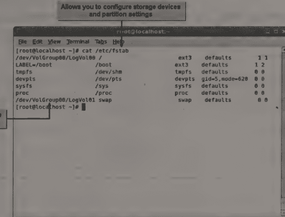

图 3-5：`/etc/fstab` 文件包含分区和文件系统设置。

### `mkfs` 命令

`mkfs` 命令用于在设备（通常是硬盘分区）上构建 Linux 文件系统。下表列出了 `mkfs` 命令的一些选项及其描述。

| 选项 | 允许您执行操作 |
| --- | --- |
| `-v` | 生成详细输出，当进程在处理数据时，输出消息将保持不断变化。 |
| `-V` | 生成详细输出，包括所有执行的特定于文件系统的命令。 |
| `-t {type}` | 指定要构建的文件系统类型。 |
| `fs-options` | 将特定于文件系统的选项传递给文件系统构建器。 |
| `-c` | 在构建文件系统之前检查设备是否存在坏块。 |
| `-l {file name}` | 从指定文件中读取坏块列表。 |

### 使用 `mkfs` 命令构建新的 Linux 文件系统

`mkfs` 命令用于构建新的 Linux 文件系统。下表给出了不同的 `mkfs` 命令。

| 如果您需要构建 | 使用此 `mkfs` 命令 |
|---|---|
| 一个 ext2 文件系统 | `mkfs.ext2 /dev/hdaPartition number` |
| 一个 ext3 文件系统 | `mkfs.ext3 /dev/hdaPartition number` |
| 一个 reiser 文件系统 | `mkfs.refs /dev/hdaPartition number` |
| 一个 vfat 文件系统 | `mkfs.vfat /dev/hdaPartition number` |
| 一个 XFS 文件系统 | `mkfs.xfs /dev/hdaPartition number` |
| 一个 JFS 文件系统 | `mkfs.jfs /dev/hdaPartition number` |

#### 语法
`mkfs` 命令的语法为 `mkfs [filesystem type] [options] [device]`。

### `mke2fs` 工具

`mke2fs` 工具用于创建 ext2 和 ext3 文件系统，它有多种选项。下表列出了其中一些选项。

| 选项 | 允许您执行操作 |
|---|---|
| `-b [block size]` | 指定块的大小（字节）。 |
| `-c` | 在创建文件系统时检查设备块的错误。 |
| `-f` | 指定分块的大小（字节）。 |
| `-j` | 创建一个带日志的 ext3 文件系统。 |
| `-M` | 设置挂载文件系统最后访问的目录。 |
| `-V` | 打印 `mke2fs` 工具的版本号。 |

#### 语法
`mke2fs` 工具的语法为 `mke2fs [options] (device)`。

> 命令 `mke2fs /dev/hdaPartition number` 将允许您构建一个 ext2 文件系统。

#### 通过 MBR 进行设备识别

设备识别在系统启动时由 MBR 执行，识别硬盘及其上的所有分区。MBR 包含两个主要组件，帮助它检测连接到系统的设备。

| 组件 | 描述 |
| --- | --- |
| 主分区表 | 包含硬盘上的分区列表。从技术上讲，硬盘可以有很多分区。该表显示分区 ID、其起始柱体数以及该分区占据的柱体数。 |
| 主引导代码 | 包含在硬盘上加载操作系统的程序。该程序被加载以启动引导过程。 |

#### 柱体 (Cylinder)

柱体是位于每个磁盘盘面上相同位置的所有磁道的总和。在多盘器磁盘上，柱体是每个盘面上具有相同道数的磁道的总和。在硬盘上，一个柱体由顶部的道和相应的底部道组成。

#### 分区管理

分区管理是创建、销毁和操作分区以优化系统性能的过程。有效的分区管理允许您跟踪分区中的数据并避免数据溢出。可以使用各种工具，如 `sfdisk`、`partprobe` 和 `GNU parted` 进行分区管理。

### `sfdisk` 工具

`sfdisk` 工具用于操作分区。该工具通过列出分区数量及其大小、检查分区以及对存储设备进行重新分区来管理分区。

```
root@localhost:~ 

File Edit View Tabs Help

root@localhost ~]# fdisk -l /dev/sda

Disk /dev/sda: 20480 cylinders, 255 heads, 63 sectors/track

Units: cylinders of 824880 bytes, blocks of 1024, counting from 0

Device      Start End Sectors Free Id System

/sda1             * 0 20479 104391 Linux

/sda2             20480 40959 2046462 LVM

/sda3             0
```


使用 `sfdisk` 工具操作分区。

| 选项 | 允许您执行 |
| --- | --- |
| 如果您需要构建 | 使用此 `mkfs` 命令 |
| 一个 `ext2` 文件系统 | `mkfs.ext2 /dev/hdaPartition number` |
| 一个 `ext3` 文件系统 | `mkfs.ext3 /dev/hdaPartition number` |
| 一个 `reiser` 文件系统 | `mkfs.refs /dev/hdaPartition number` |
| 一个 `vfat` 文件系统 | `mkfs.vfat /dev/hdaPartition number` |
| 一个 `XFS` 文件系统 | `mkfs.xfs /dev/hdaPartition number` |
| 一个 `JFS` 文件系统 | `mkfs.jfs /dev/hdaPartition number` |

#### 语法

`mkfs` 命令的语法为 `mkfs [filesystem type] [options] [device]`。

### `mke2fs` 工具

`mke2fs` 工具用于创建 `ext2` 和 `ext3` 文件系统，它有多种选项。下表列出了其中一些选项。

| 选项 | 允许您执行操作 |
| --- | --- |
| `-b [block size]` | 指定块的大小（字节）。 |
| `-c` | 在创建文件系统时检查设备块的错误。 |
| `-f` | 指定分块的大小（字节）。 |
| `-j` | 创建一个带日志的 `ext3` 文件系统。 |
| `-M` | 设置挂载文件系统最后访问的目录。 |
| `-V` | 打印 `mke2fs` 工具的版本号。 |

#### 语法

`mke2fs` 工具的语法为 `mke2fs [options] (device)`。

> 命令 `mke2fs /dev/hdaPartition number` 将允许您构建一个 `ext2` 文件系统。

#### 通过 MBR 进行设备识别

设备识别在系统启动时由 MBR 执行，识别硬盘及其上的所有分区。MBR 包含两个主要组件，帮助它检测连接到系统的设备。

| 组件 | 描述 |
| --- | --- |
| 主分区表 | 包含硬盘上的分区列表。从技术上讲，硬盘可以有很多分区。该表显示分区 ID、其起始柱体数以及该分区占据的柱体数。 |
| 主引导代码 | 包含在硬盘上加载操作系统的程序。该程序被加载以启动引导过程。 |

#### 柱体 (Cylinder)

柱体是位于每个磁盘盘面上相同位置的所有磁道的总和。在多盘器磁盘上，柱体是每个盘面上具有相同道数的磁道的总和。在硬盘上，一个柱体由顶部的道和相应的底部道组成。

#### 分区管理

分区管理是创建、销毁和操作分区以优化系统性能的过程。有效的分区管理允许您跟踪分区中的数据并避免数据溢出。可以使用各种工具，如 `sfdisk`、`partprobe` 和 `GNU parted` 进行分区管理。

### `sfdisk` 工具

`sfdisk` 工具用于操作分区。该工具通过列出分区数量及其大小、检查分区以及对存储设备进行重新分区来管理分区。

```
root@localhost:~ 
File Edit View Tabs Help
root@localhost ~]# fdisk -l /dev/sda
Disk /dev/sda: 20480 cylinders, 255 heads, 63 sectors/track
Units: cylinders of 824880 bytes, blocks of 1024, counting from 0
Device      Start End Sectors Free Id System
/sda1             * 0 20479 104391 Linux
/sda2             20480 40959 2046462 LVM
/sda3             0
/sda4             0
```

使用 `sfdisk` 工具操作分区。

```
root@localhost:~ 
```


# CompTIA® Linux+™ 由 LPI 提供

| 选项 | 允许您执行 |
| --- | --- |
| `w` | 将更改写入磁盘并退出工具。 |
| `q` | 撤销已做的更改并退出工具。 |

### fstab 文件

`fstab` 文件是一个配置文件，用于存储有关存储设备和分区的信息，以及分区应该在何处以及如何挂载的信息。`fstab` 文件位于 `/etc` 目录下。它只能由 `root` 用户进行编辑。`fstab` 文件由若干行组成——每行对应一个文件系统。

`fstab` 文件中的每行都有六个字段，字段用空格隔开。

| 字段 | 描述 |
| --- | --- |
| 设备或分区名称 | 指定必须挂载的设备或文件系统的名称。 |
| 默认挂载点 | 指明文件系统必须挂载的位置。 |
| 文件系统类型 | 指定设备或分区使用的文件系统类型。 |
| 挂载选项 | 指定在挂载文件系统时激活的一组逗号分隔的选项。 |
| Dump 选项 | 指明 `dump` 工具是否应该备份文件系统。通常指定 `0` 为 `dump` 选项，表示 `dump` 可以忽略该文件系统。 |
| `fsck` 选项 | 指定 `fsck` 工具检查文件系统的顺序。 |


**图 3-5：`/etc/fstab` 文件包含分区和文件系统设置。**

### mkfs 命令

`mkfs` 命令用于在设备（通常是硬盘分区）上构建 Linux 文件系统。下表列出了 `mkfs` 命令的一些选项及其描述。

| 选项 | 允许您执行操作 |
| --- | --- |
| `-v` | 生成详细输出，当进程在处理数据时，输出消息将保持不断变化。 |
| `-V` | 生成详细输出，包括所有执行的特定于文件系统的命令。 |
| `-t {type}` | 指定要构建的文件系统类型。 |
| `fs-options` | 将特定于文件系统的选项传递给文件系统构建器。 |
| `-c` | 在构建文件系统之前检查设备是否存在坏块。 |
| `-l {file name}` | 从指定文件中读取坏块列表。 |

### 使用 mkfs 命令构建新的 Linux 文件系统

`mkfs` 命令用于构建新的 Linux 文件系统。下表给出了不同的 `mkfs` 命令。

| 如果您需要构建 | 使用此 mkfs 命令 |
|---|---|
| 一个 `ext2` 文件系统 | `mkfs.ext2 /dev/hdaPartition number` |
| 一个 `ext3` 文件系统 | `mkfs.ext3 /dev/hdaPartition number` |
| 一个 `reiser` 文件系统 | `mkfs.refs /dev/hdaPartition number` |
| 一个 `vfat` 文件系统 | `mkfs.vfat /dev/hdaPartition number` |
| 一个 `XFS` 文件系统 | `mkfs.xfs /dev/hdaPartition number` |
| 一个 `JFS` 文件系统 | `mkfs.jfs /dev/hdaPartition number` |

#### 语法

`mkfs` 命令的语法为 `mkfs [filesystem type] [options] [device]`。

### mke2fs 工具

`mke2fs` 工具用于创建 `ext2` 和 `ext3` 文件系统，它有多种选项。下表列出了其中一些选项。

| 选项 | 允许您执行操作 |
|---|---|
| `-b [block size]` | 指定块的大小（字节）。 |
| `-c` | 在创建文件系统时检查设备块的错误。 |
| `-f` | 指定分块的大小（字节）。 |
| `-j` | 创建一个带日志的 `ext3` 文件系统。 |
| `-M` | 设置挂载文件系统最后访问的目录。 |
| `-V` | 打印 `mke2fs` 工具的版本号。 |

#### 语法

`mke2fs` 工具的语法为 `mke2fs [options] (device)`。

> 命令 `mke2fs /dev/hdaPartition number` 将允许您构建一个 `ext2` 文件系统。

#### 通过 MBR 进行设备识别

设备识别在系统启动时由 `MBR` 执行，识别硬盘及其上的所有分区。`MBR` 包含两个主要组件，帮助它检测连接到系统的设备。

| 组件 | 描述 |
| --- | --- |
| 主分区表 | 包含硬盘上的分区列表。从技术上讲，硬盘可以有很多分区。该表显示分区 ID、其起始柱体数以及该分区占据的柱体数。 |
| 主引导代码 | 包含在硬盘上加载操作系统的程序。该程序被加载以启动引导过程。 |

#### 柱体 (Cylinder)

柱体是位于每个磁盘盘面上相同位置的所有磁道的总和。在多盘器磁盘上，柱体是每个盘面上具有相同道数的磁道的总和。在硬盘上，一个柱体由顶部的道和相应的底部道组成。

#### 分区管理

分区管理是创建、销毁和操作分区以优化系统性能的过程。有效的分区管理允许您跟踪分区中的数据并避免数据溢出。可以使用各种工具，如 `sfdisk`、`partprobe` 和 `GNU parted` 进行分区管理。

### sfdisk 工具

`sfdisk` 工具用于操作分区。该工具通过列出分区数量及其大小、检查分区以及对存储设备进行重新分区来管理分区。

```
root@localhost:~ 

File Edit View Tabs Help

root@localhost ~]# fdisk -l /dev/sda

Disk /dev/sda: 20480 cylinders, 255 heads, 63 sectors/track

Units: cylinders of 824880 bytes, blocks of 1024, counting from 0

Device      Start End Sectors Free Id System

/sda1             * 0 20479 104391 Linux

/sda2             20480 40959 2046462 LVM

/sda3             0

/sda4             0
```


## 操作参考：为分区应用标签

要为分区应用标签：

1. 以 `root` 身份登录。
2. 要为分区应用标签，在命令提示符下输入 `e2label /dev/{device name}{partition number} {label name}`。
3. 要查看应用或关联的标签，输入 `e2label /dev/{device name}(partition number)`。
4. 如必要，使用标签挂载分区，输入 `mount LABEL={label name} {mount point}`。

### 活动 3-1
创建分区

**开始之前：**
1. 在 `srvA` 上，你已以 `root` 身份登录 CLI。
2. 要创建两个目录，在命令行输入 `mkdir /morning /evening`。
3. 清除终端屏幕。

**场景：**
你的组织有一个分班次工作的支持团队。一名员工在早班使用系统，另一名员工在晚班使用同一台系统。他们都需要根据此处提供的详细信息挂载独立的分区：

- 逻辑分区 `sdb5` 和 `sdb6` 分别挂载到 `/morning` 和 `/evening` 目录。
- `root` 用户登录名称：`root`
- `root` 用户密码：`p@ssword`

你还需要确保这些分区易于维护。需要应用到分区并用于挂载的标签为：
- 早班：`Mrng`
- 晚班：`Evng`

1. 创建一个扩展分区。
   - a. 要开始磁盘分区过程，输入 `fdisk /dev/sdb`。
   - b. 要创建新分区，输入 `n`。
   - c. 要创建扩展分区，输入 `e`。
   - d. 要接受分区的默认起始点，按 `Enter`。
   - e. 要指定分区大小，输入 `+15000M`。

2. 在扩展分区内创建两个逻辑分区。
   - a. 要创建新分区，输入 `n`。
   - b. 要接受分区的默认起始点，按 `Enter`。
   - c. 要指定分区大小，输入 `+1024M`。
   - d. 要创建另一个大小为 `1024M` 的逻辑分区，重复步骤 (a) 到 (c)。
   - e. 将分区表写入磁盘并退出实用程序，输入 `w`。
   - f. 要重启系统，输入 `reboot`。

在 GUI 登录界面，按 `Ctrl+Alt+F1` 切换到第一个终端。在 CLI 中使用密码 `p@ssword` 以 `root` 身份登录。

3. 为 `ext2` 文件系统设置逻辑分区。
   - a. 在 `/dev/sdb5` 上创建 `ext2` 文件系统，输入 `mkfs.ext2 /dev/sdb5`。
   - b. 要清除终端屏幕，输入 `clear`。
   - c. 在 `/dev/sdb6` 上创建 `ext2` 文件系统，输入 `mkfs.ext2 /dev/sdb6`。
   - d. 要清除终端屏幕，输入 `clear`。

4. 验证两个新分区是否有 `ext2` 文件系统。
   - a. 要运行 `GNU Parted` 实用程序，输入 `parted`。
   - b. 要选择 `sdb` 分区，输入 `select /dev/sdb`。
   - c. 在 `(parted)` 提示符下，输入 `print` 查看分区列表。
   - d. 观察分区五和六具有 `ext2` 文件系统。
   - e. 要退出 `parted` 实用程序，输入 `q`。
   - f. 要清除终端屏幕，输入 `clear`。

5. 为分区应用标签。
   - a. 要查看 `/dev/sdb5` 分区的现有标签，输入 `e2label /dev/sdb5`。
   - b. 观察到 `/dev/sdb5` 分区未设置标签。
   - c. 要应用新标签 `Mrng`，输入 `e2label /dev/sdb5`。
   - d. 要查看 `/dev/sdb6` 分区的现有标签，输入 `e2label /dev/sdb6`。
   - e. 观察到 `/dev/sdb6` 分区未设置标签。
   - f. 要应用新标签 `Evng`，输入 `e2label /dev/sdb6`。
   - g. 要清除终端屏幕，输入 `clear`。

6. 验证两个新分区是否有 `ext2` 文件系统。
   - a. 要验证分区是否具有 `ext2` 文件系统，输入 `e2label /dev/sdb5`。
   - b. 观察到分区具有 `ext2` 文件系统。
   - c. 要验证分区是否具有 `ext2` 文件系统，输入 `e2label /dev/sdb6`。
   - d. 观察到分区具有 `ext2` 文件系统。

7. 挂载分区。
   - a. 使用标签挂载分区，输入 `mount LABEL=Mrng /dev/sdb5 /morning`。
   - b. 使用标签挂载分区，输入 `mount LABEL=Evng /dev/sdb6 /evening`。

# CompTIA® Linux™ Powered by LPI™

| 目录 | 描述 |
| --- | --- |
| `/var` | 存储系统日志文件、打印机缓存以及某些网络服务的配置文件。例如 `/var/log/` 消息文件。 |
| `/tmp` | 存储临时文件。例如 `/tmp/filename.tmp`。 |
| `/opt` | 存储大型软件软件包的文件。这些软件包通常会在 `/opt` 目录下创建一个与其名称同名的子目录，并将其文件放置在该子目录中。例如 `/opt/ness` 文件。 |
| `/mnt` | 是用于临时挂载来自软盘、CD、DVD 和网络分区等位置位置的挂载点。 |
| `/media` | 允许访问临时和可移动设备的文件系统，如 CD-ROM 和软盘。 |

> 在 Linux 中，除 `root` 用户外，每个用户默认在 `/home` 中被分配一个特定的目录。用户可以在该目录中创建子目录和文件。一旦他们登录系统，他们自己的控制权就会自动放置在自己的家目录中。`root` 用户的家目录是 `/root`。

> 根据您的需求，为 `FHS`（文件层次结构标准）中的每个目录分配磁盘空间。例如，当连接到具有一百多名用户的网络时，您可以为 `/home` 目录分配更多的磁盘空间，以便每个用户在他们的目录中获得更多的存储空间。

# `/usr` 子目录

`/usr` 目录包含一些重要的子目录。

| 子目录 | 描述 |
| --- | --- |
| `/usr/bin` | 包含所有用户都可以执行的可执行程序。 |
| `/usr/local` | 包含默认存储的自定义构建应用程序。 |
| `/usr/lib` | 包含执行程序所需的对象库和内部二进制文件。 |
| `/usr/lib64` | 用途与 `/usr/lib` 相同，但用于 64 位系统。 |
| `/usr/share` | 包含只读的体系无关文件。这些文件可以在操作系统的不同架构之间共享。 |

### 文件命名规范

文件名是标识文件的字符字符串。通过在文件名中使用正确的字符组合，可以确保文件是唯一的且易于识别的。

### 指南

文件名可以：

- 使用任何大小写，但主要使用小写。
- 包含除斜杠（`/`）以外的任何字符，因为斜杠用于表示根目录。
- 包含字母数字、下划线、连字符和点。
- 永远不以连字符开头。
- 在字符之间留有空格，但不建议这样做。


> **图 3-9:** 使用适当规范命名的示例文件。

### 示例：恰当地命名文件

`Jim` 创建了一个包含某些审核信息的文本文件。他遵循 Linux 的命名规范，并将文件命名为 `audit_file.txt`。他还确保了文件名中的所有字母都是小写。此外，由于允许使用空格但不建议使用，他用下划线代替了空格。

### 创建带空格的文件

你可以通过在文件名中包含反斜杠（`\`）和空格来创建字符间带有空格的文件名。例如：`touch Audit\ File.txt` 将创建一个名为 `Audit.txt` 的文件。（注意：OCR 文本在此处似乎有逻辑错误）。

### 浏览器

在 Linux 中，你可以使用文件浏览器浏览文件系统。`Red Hat` 和 `Fedora` 发行版 `GNOME` 桌面上的默认文件浏览器是 `Nautilus` 浏览器。该浏览器以两种模式运行。

| 模式 | 描述 |
| --- | --- |
| 空间 (Spatial) | 这是默认模式，允许你通过记住上次的位置，在屏幕上精确地打开特定的窗口。你选择的每个文件夹或目录都在新的浏览器窗口中打开。 |
| 浏览器 (Browser) | 这种模式允许你在同一个窗口中显示选定的文件夹。你需要在计算机（`Computer`）窗口中修改偏好。 |

# CompTIA® Linux+™ Powered by LPI

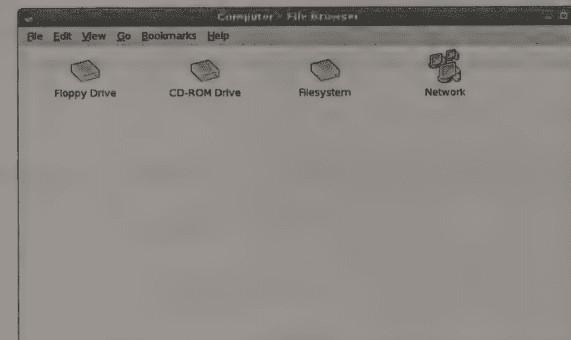

**图 3-10:** `Nautilus` 文件浏览器。

### 家目录

家目录是你登录系统时被放置的地方。在 Linux 中，默认情况下，除 `root` 用户外，每个用户在 `/home` 中被分配一个特定的目录。在许多 shell（包括 `Korn`、`C shell` 和 `Bash`）中，波浪号字符（`~`）代表你的家目录。用户可以在该目录中创建子目录和文件。一旦用户登录系统，控制权就会自动转移到用户的家目录。`root` 用户的家目录是 `/root`。`root` 用户可以访问系统上的所有文件和资源。

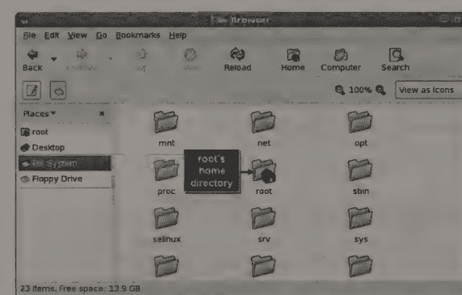

**图 3-11:** `root` 用户的家目录。

100 第 3 课：管理分区和 Linux 文件系统

### 当前工作目录

当前工作目录是你在任何时间正在访问的系统位置。例如，当你登录系统时，你被放置在家目录中。所以，你的当前工作目录就是你的家目录。可以使用 `pwd` 列出当前工作目录。

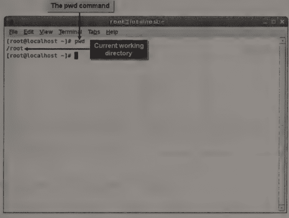

**图 3-12:** 使用 `pwd` 显示当前目录。

### `pwd` 命令

当你浏览文件系统时，可能需要知道当前目录。`pwd` 命令显示当前目录的完整路径。

### 父目录

父目录是当前目录上方的一层。你可以使用 `..` 表示法切换到父目录。


**图 3-13:** 父目录。

### 路径

路径有两种类型：绝对路径和相对路径。绝对路径从根目录开始。相对路径相对于当前目录。

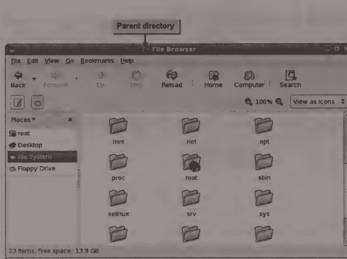

**图 3-14:** 绝对路径和相对路径。

### 绝对路径和相对路径

绝对路径从根目录（`/`）开始。相对路径相对于当前目录。点（`.`）表示当前目录，双点（`..`）表示父目录。

## 基本文件系统命令

有一些基础的文件系统命令允许你修改文件并显示文件系统信息。

| 命令 | 描述 |
| --- | --- |
| `cd` | 遍历目录结构。有多种方法指定要切换的目录路径名。 |
| `ls` | 列出目录中的文件。在不带任何选项的情况下运行命令时，它只显示文件名。然而，通过带相应选项运行命令，它可以列出大小、文件类型和权限等信息。 |
| `mv` | 将文件和目录从一个目录移动到另一个，或重命名文件或目录。 |
| `cp` | 复制文件。 |
| `rm` | 删除文件和目录。 |
| `touch` | 将文件的访问或修改时间更改为当前时间。 |
| `mkdir` | 创建目录。 |
| `rmdir` | 删除目录。 |
| `pushd` | 将目录添加到目录栈的顶部或旋转目录栈。 |

# 命令允许您执行

`popd` 从目录栈中移除条目。当未指定选项时，它会移除栈中的顶层目录。`popd` 命令的语法为 `popd [options]`。

#### `-v` 选项
`-v` 是一个命令选项，可以与基本文件管理命令配合使用。此选项以详细（verbose）的方式解释命令的运行过程，以产生所需的输出。

### `ls` 命令选项
`ls` 命令的选项如下表所示。

| 选项 | 描述 |
|---|---|
| `-l` | 显示详细列表，包括权限、硬链接数、所有者、组、大小、日期和文件名。 |
| `-F` | 显示文件的属性，例如 `*` 表示可执行文件，`/` 表示目录。 |
| `-a` | 显示目录中存在的所有文件，包括以点 (`.`) 开头的文件。 |
| `-R` | 递归地显示所有子目录。 |
| `-d` | 显示符号链接或目录的信息，而不是链接的目标或目录的内容。 |
| `-L` | 显示目录中的所有文件，包括符号链接。 |

#### 更改当前目录
有时，你需要离开家目录并进入文件系统中的另一个目录。在这种情况下，你可以使用 `cd` 命令允许你遍历目录结构。有几种方法可以指定你希望作为工作目录的目录路径名：

- 不带路径名的 `cd` 命令将你带回家目录，无论你当前所在的目录是什么。
- `cd [路径名]` 命令将你带到指定的路径名。路径可以是完整路径（从根目录到指定目录），也可以是相对路径（从当前工作目录开始）。
- `cd ~/[路径名]` 命令将你带到相对于家目录的指定目录。记住在必要时将 `~/[路径名]` 替换为 `$HOME`。

# 如何在 Linux 文件系统中进行导航

#### 过程参考：更改目录

要更改目录：

1. 在 CLI 中以用户身份登录
2. 要查看当前工作目录，输入 `pwd`。
3. 要更改目标目录，输入 `cd {目标目录的绝对路径或相对路径}`。
4. 如必要，输入 `pwd` 以验证你已切换到目标目录。

#### 过程参考：列出文件和目录

要列出文件和目录：

1. 在 CLI 中以用户身份登录
2. 要列出文件和目录，输入 `ls [options]` 命令。

### 过程参考：使用空间模式下的 Nautilus 浏览器处理文件和目录

要使用空间模式下的 `Nautilus` 浏览器处理文件和目录：

1. 在 GUI 中以用户身份登录
2. 双击桌面上的 `Computer（计算机）` 图标。
3. 双击所需的目录以打开它。
4. 双击目录中所需的文件。
5. 如必要，按 `Ctrl+Shift+W` 关闭所有父级窗口。
6. 点击 `Close（关闭）` 按钮关闭 `Nautilus` 浏览器。

### 过程参考：使用浏览器模式下的 Nautilus 浏览器处理文件

要使用浏览器模式下的 `Nautilus` 浏览器处理文件：

1. 在 GUI 中以用户身份登录。
2. 从菜单栏中选择 `Application -> Tools -> File Browser`。
3. 在右窗格或左侧窗格中双击所需的文件或目录以查看它。
4. 关闭 `Nautilus` 浏览器。

### 过程参考：设置 Nautilus 浏览器为始终以浏览器模式打开

1. 在 GUI 中以用户身份登录。
2. 双击桌面上的 `Computer（计算机）` 图标。
3. 在窗口中，选择 `Edit -> Preferences`。
4. 在 `File Management Preferences（文件管理偏好）` 对话框中，选择 `Behavior（行为）` 标签。
5. 在 `Behavior` 部分，勾选 `Always opens in browser windows（始终在浏览器窗口中打开）` 复选框并点击 `Close`。
6. 关闭 `Computer` 窗口。
7. 要以浏览器模式打开 `Nautilus` 浏览器，双击 `Computer` 图标。

### 活动 3-2
更改目录

**在开始之前：**
你已经在 CLI 中以 `root` 身份登录。

**场景：**
你被聘为某组织的初级管理员，并获得了 Linux 系统的管理权限。但是，作为超级用户，你在 `/home` 中没有指定的用于工作的目录。因此，你决定切换到家目录并处理文件。

1. 从 `/root` 目录切换到 `/home` 目录。
   a. 要查看当前工作目录，输入 `pwd`
   b. 观察到当前工作目录是 `/root`。要切换到家目录，输入 `cd /home`
   c. 要查看当前工作目录，输入 `pwd`
   d. 观察到当前工作目录已更改为 `/home`。

2. 列出目录中的文件。
   a. 要列出 `/home` 目录中的所有文件，输入 `ls -a`
   b. 观察目录中列出的文件。要清除终端屏幕，输入 `clear`

### 活动 3-3
使用 Nautilus 浏览器查看文件和目录内容

**在开始之前：**

1. 你已经在第一个终端中以 `root` 身份登录。
2. 切换到 GUI。
3. 以 `root` 身份登录。

**场景：**
一名新员工需要关于 GUI 中基本文件系统导航和使用的帮助。你决定通过浏览文件内容导航来演示 `Nautilus` 浏览器的用法。

1. 使用空间模式下的 `Nautilus` 浏览器打开目录。
   a. 双击桌面上的 `Computer（计算机）` 图标。
   b. 在窗口中，双击 `Filesystem（文件系统）` 对象。
   c. 观察浏览器以浏览器模式打开。要查看目录内容，输入 `pwd`。
   d. 关闭 `Nautilus` 浏览器。

2. 设置 `Nautilus` 浏览器始终以浏览器模式打开。
   a. 在窗口中，选择 `Edit -> Preferences`。
   b. 在 `File Management Preferences` 对话框中，选择 `Behavior` 标签。
   c. 在 `Behavior` 部分，勾选 `Always opens in browser windows（始终在浏览器窗口中打开）` 复选框并点击 `Close`。
   d. 关闭 `Computer` 窗口。
   e. 要验证更改，双击桌面上的 `Computer` 图标。
   f. 观察浏览器以浏览器模式打开。要查看 `/` 目录，双击左侧的 `FileSystem` 对象。
   g. 观察目录内容。
   h. 关闭浏览器。

### 主题 C

## 管理文件系统

现在你可以遍历文件系统，是时候学习如何管理它了。在本主题中，你将管理文件系统。

管理 Linux 文件系统将允许你根据需求对系统进行自定义。此外，你将能够组织文件和目录、挂载额外的驱动器并记录备份介质。

### 文件系统管理任务

在 Linux 中管理文件系统时，你将执行以下任务：

- 备份文件和目录。
- 挂载和卸载文件系统。
- 以及在分区上创建交换空间。

# 刻录

在管理文件系统时，你可能需要将某些数据刻录到光盘。Linux 允许通过 GUI 程序以及 CLI 刻录 CD 和 DVD。GUI 程序会引导你完成刻录过程。从 CLI 刻录：

1. 创建目录并复制想要刻录的文件。
2. 使用 `mkisofs` 命令为文件制作 ISO 镜像。
3. 使用 `cdrecord` 命令刻录 CD。

> 你必须在系统中安装 CD 或 DVD 刻录机才能刻录光盘。

### ISO 镜像

`ISO` 镜像或磁盘镜像是用于写入光盘（如 CD 和 DVD）的存档文件格式。它是由国际标准组织（`ISO`）定义的标准，扩展名为 `.iso`。

### 挂载点

**定义：**

`挂载点` 是本地或远程存储设备上信息的访问点。挂载点通常是一个空目录，文件系统被加载或挂载在此处以便用户访问该文件系统。如果目录已有内容，在卸载挂载的文件系统之前，这些内容对用户将是不可见的。

> 你可以使用 `/etc/fstab` 文件列出 Linux 系统启动和关机时需要挂载和卸载的文件系统。

### 示例：


**图 3-16：** 挂载文件系统的过程。

### `mount` 命令

在 Linux 中，文件系统无法被直接访问。它必须与一个目录关联，才能让用户访问。这种关联通过使用 `mount` 命令将文件系统加载并挂载（mounting）到一个目录中。在使用该文件系统后，需要使用 `mount` 命令通过卸载（unmounting）文件系统来将其从目录中解除关联。


# The `mount` command

File Edit View Terminal Tabs Help

```
[root@localhost ~]# -l

/dev/mapper/vg0-lvvol08 on / type ext3 (rw)

proc on /proc type proc (rw)

sysfs on /sys type sysfs (rw)

devpts on /dev/pts type devpts (rw,gid=5,node=628)

dev/sda on /boot type ext3 (rw)

tmpfs on /dev/shm type tmpfs (rw)

mon on /proc/sys/binfmt_misc type binfmt_misc (rw)

sunpc on /var/lib/nfs/rpc_pipefs type rpc_pipefs (rw)

[root@localhost ~]#
```

**图 3-17：** 当前挂载的文件系统列表。

## `mount` 命令选项

你可以为文件系统指定各种挂载选项。

| 选项 | 允许的操作 |
|---|---|
| `auto` | 指定该设备必须自动挂载。 |
| `noauto` | 指定设备不需要自动挂载。 |
| `nouser` | 指定仅允许 `root` 用户挂载设备或文件系统。 |
| `user` | 指定所有用户均可挂载设备或文件系统。 |
| `exec` | 允许执行文件系统中的二进制文件。 |
| `noexec` | 防止执行文件系统中的二进制文件。 |
| `ro` | 以只读模式挂载文件系统。 |
| `rw` | 以读写权限挂载文件系统。 |
| `sync` | 指定文件系统中的输入/输出操作应同步完成。 |
| `async` | 指定文件系统中的输入/输出操作应异步完成。 |

## 二进制文件 (Binaries)

二进制文件是编译成可执行程序的源代码，或者是经过汇编使计算机系统可以读取。二进制文件经过编码以便在互联网上传输。此外，二进制文件可以是图片、文字处理文件或电子表格文件。某些二进制文件可能包含损坏系统的病毒。

## 交换空间 (Swap Space)

**定义：**

交换空间是硬盘上的一个分区，当系统耗尽物理内存时使用。`Linux` 将 `RAM` 中的一些未使用文件推送到交换空间中以释放内存。通常，交换空间的大小是内存容量的两倍。

# CompTIA® Linux+™ 由 LPI 驱动

**示例：**

```
root@localhost: # 

[root@localhost ~]# fdisk -l

Disk /dev/hda: 80.0 GB, 8589934592 bytes

255 heads, 63 sectors/track, 9729 cylinders

Units = cylinders * 1605 * 512 = 8089934592 bytes

Device     Boot     Start        End  Blocks      ID System

/dev/hda              1        2558 2048283*  83 Linux

/dev/hdb2             2551     2681 1052257   82 Linux swap / Solaris

/dev/hdc3             2682     5112 1935664   83 Linux

/dev/hde4             5114     6938 14659312*  5 Extended

/dev/hf5             5114     5230 180991   83 Linux

/dev/hdg6             5239     5363 1004831   83 Linux

[root@localhost ~]#
```


图 3-18：在硬盘上创建交换空间。

交换空间可以是三种类型之一。

| 交换类型 | 说明 |
| --- | --- |
| 设备交换 (Device swap) | 在划分硬盘时配置设备交换空间。操作系统使用它来运行大型应用程序。 |
| 文件系统交换 (Filesystem swap) | 主要在安装 Linux 时配置。当可用交换空间耗尽时，操作系统将其作为应急资源。 |
| 伪交换 (Pseudo-swap) | 伪交换空间允许大型应用程序在内存有限的计算机上运行。 |

# 交换文件 (`Swap Files`)

交换文件用于存储从系统内存传输到磁盘的数据。它是动态的，其大小会随着数据进出内存而变化。它被用作在硬盘和 RAM 之间传输数据的介质。

# 交换分区 (`Swap Partitions`)

分区是硬盘上的一个虚拟内存区域，用于补充计算机的物理内存。Linux 创建交换分区是因为它们的性能优于交换文件系统。

### `mkswap` 命令

`mkswap` 是一个系统管理级命令，用于在磁盘分区上创建交换空间。它提供了执行各种任务的选项。

| 选项 | 允许的操作 |
| --- | --- |
| `-c` | 验证设备是否空闲。 |
| `-f` | 强制在设备上执行操作。 |
| `-p` | 设置大小。 |
| `-L` | 添加交换标签。 |

#### 语法

`mkswap` 的语法为 `mkswap [options] device`。

### 交换分区管理

`mkswap` 是用于在磁盘分区上创建交换空间的系统管理命令。管理交换分区的命令有：

| 命令 | 说明 |
| --- | --- |
| `swapon` | 用于激活指定的设备。 |
| `swapoff` | 用于停用设备。 |

# `swapon` 和 `swapoff` 选项

`swapon` 的一些常用选项如下表所示：

| 选项 | 说明 |
| --- | --- |
| `-e` | 跳过不存在的设备。 |
| `-a` | 激活所有交换空间。 |
| `-v` | 停用交换空间。 |

# 如何管理文件系统

要创建挂载点：

1. 以 `root` 身份登录。
2. 创建挂载点，执行 `mkdir {mount point}`。
3. 设置用户为所有者，执行 `chown {user} {mount point}`。

### `chgrp` 命令

`chgrp` 命令用于更改文件或目录的组。

# 过程：挂载文件系统

要挂载文件系统：

1. 以 `root` 身份登录。
2. 挂载指定的设备，执行 `mount /dev/{device name}{partition number} {mount point}`。
3. 验证文件系统已挂载，执行 `mount {mount point}`。

# 过程：启动时挂载文件系统

要在启动时挂载文件系统：

1. 以 `root` 登录命令行。
2. 打开 `/etc/fstab` 文件，执行 `vi /etc/fstab`。
3. 为新文件系统添加条目，输入 `{filesystem label}{device name}{partition number} {mount point} {filesystem type} {fsck options}`。
4. 保存并关闭文件。
5. 从 `/etc/fstab` 重新加载挂载表，执行 `mount -a`。
6. 验证文件系统是否在启动时自动挂载。
   a. 以 `root` 身份登录。
   b. 查看所有挂载的文件系统，执行 `mount`。

# 过程：卸载文件系统

要卸载文件系统：

1. 以 `root` 身份登录。
2. 卸载文件系统。
   - 要卸载文件系统，执行 `umount /dev/{device name}{partition number}`。
   - 或者，执行 `umount {mount point}`。

# 过程：管理文件系统

要管理文件系统：

1. 以 `root` 身份登录命令行。
2. 显示使用文件系统的进程详情，执行 `fuser {mount point}`。
3. 杀死所有使用文件系统的进程，执行 `fuser -km {mount point}`。
4. 卸载文件系统，执行 `umount {mount point}`。

> 文件系统在其他进程使用时无法卸载。

# 过程：管理交换分区

要管理交换分区：

1. 以 `root` 身份登录命令行。
2. 创建交换分区，执行 `mkswap /dev/{device name}{partition number}`。
3. 添加分区条目，打开 `/etc/fstab` 文件并输入 `{filesystem label}{device name}{partition number} none swap {dump options} (fsck options)`。
4. 激活交换分区，执行 `swapon {device name}`。
5. 停用交换分区并将其转换为标准的 Linux 文件系统，执行 `swapoff {device name}`。

# 过程：格式化分区为文件系统

要在分区上格式化文件系统：

1. 以 `root` 身份登录命令行。
2. 在分区上格式化文件系统：
   - 在设备的指定分区上创建指定的文件系统，执行 `mkfs -t {filesystem type} /dev/{device name}{partition number}`。
   - 或者，在设备的指定分区上创建 `ext2` 文件系统，执行 `mke2fs [options] /dev/{device name}{partition number}`。

### 活动 3-4
挂载文件系统

在开始之前：

1. 你已以 `root` 身份登录图形界面。
2. 切换到命令行界面（CLI）。
3. 若要在命令行中创建用户 `netadmin2`，输入 `useradd netadmin2`。
4. 若要为 `netadmin2` 设置密码，输入 `passwd netadmin2`。
5. 在 New UNIX 密码提示符处为 `netadmin2` 设置密码，输入 `myp@$$word`。
6. 在提示符处重新输入相同的密码以确认。
7. 若要卸载 `/dev/sdb5` 分区，输入 `umount /dev/sdb5`。
8. 若要卸载 `/dev/sdb6` 分区，输入 `umount /dev/sdb6`。
9. 若要进入根目录，输入 `cd /root`。
10. 若要清除终端屏幕，输入 `clear`。

场景：

你的办公室将举行一次会议。几个用户想将他们的系统移动到会议室，以便他们在会议期间访问自己的文件。你发现有多个系统需要移动，这将花费大量时间。因此，你决定从用户那里获取所需的文件，并将它们加载到会议室系统的独立分区中，以便用户访问自己的文件。

使用以下用户和分区详细信息挂载文件系统：

- 用户名：`netadmin1`，分区大小：1 GB，挂载点：`/admin1`，用户和组所有权为：`/admin1/netadmin1`
- 用户名：`netadmin2`，分区大小：1 GB，挂载点：`/admin2`，用户和组所有权为：`/admin2/netadmin2`

1. 为用户创建挂载点。
   a. 输入 `mkdir /admin1`
   b. 若要将 `netadmin2` 用户设置为 `/admin1` 挂载点的所有者，输入 `chown netadmin2 /admin1`
   c. 若要将 `netadmin1` 组设置为 `/admin1` 挂载点的所有者，输入 `chgrp netadmin1 /admin1`
   d. 按照从 (a)到 (c) 的步骤创建挂载点 `/admin2`，并将所有权和组所有权分配给 `netadmin2`。
   e. 若要清除终端屏幕，输入 `clear`

2. 挂载并验证文件系统。
   a. 若要挂载 `netadmin1` 的文件系统，输入 `mount -a /dev/sdb5 /admin1`
   b. 查看已挂载的分区，输入 `mount`
   c. 观察到显示 `"/dev/sdb5 /admin1 type ext2 (rw)"` 表示文件系统已挂载。
   d. 若要挂载 `netadmin2` 的文件系统，输入 `mount -a /dev/sdb6 /admin2`
   e. 查看已挂载的分区，输入 `mount`
   f. 观察到显示 `"/dev/sdb6 /admin2 type ext2 (rw)"` 表示文件系统已挂载。

3. 在 `fstab` 文件中创建一个条目，以便在系统启动时挂载 `/dev/sdb5` 和 `/dev/sdb6` 文件系统。
   a. 若要打开 `fstab` 文件，输入 `vi /etc/fstab`
   b. 若要到最后一行，按 `Shift+G`。
   c. 在插入模式下切换新行，按 `O`。


   d. 若要在系统启动时挂载 `/dev/sdb5` 文件系统，输入 `/dev/sdb5 /admin1 ext2 defaults 0 0`
   e. 若要在系统启动时挂载 `/dev/sdb6` 文件系统，输入 `/dev/sdb6 /admin2 ext2 defaults 0 0`
   f. 按 `Esc`。
   g. 保存并关闭文件。
   h. 若要清除终端屏幕，输入 `clear`
   i. 若要更新 `fstab` 文件，输入 `mount -a`

4. 检查指定的文件系统在系统启动时是否挂载。
   a. 若要重启系统，输入 `reboot`
   b. 若要切换到命令行界面，按 `Ctrl+Alt+F1`。
   c. 在 Linux 系统的命令行中以 `root` 身份登录。
   d. 若要验证文件系统在启动时已挂载到指定的挂载点，输入 `mount`
   e. 观察到分区 `/dev/sdb5` 和 `/dev/sdb6` 分别挂载到 `/admin1` 和 `/admin2` 目录。
   f. 若要清除终端屏幕，输入 `clear`

### 主题 D

## 维护文件系统

在管理 Linux 文件系统之后，学习如何保持其正常运行非常重要。在本主题中，你将维护 Linux 文件系统。

维护 Linux 文件系统将帮助你对系统进行故障排除和常规维护。如果发生停电或其他意外关机，你将需要知道如何验证本地设备的完整性。

### 文件系统维护任务

在 Linux 中维护文件系统涉及以下任务：

- 检查文件系统的完整性。
- 管理分区大小。
- 删除临时文件。
- 以及，执行系统恢复。

### 存储设备

Linux 中有不同的存储设备。每个设备都有特定的用途。

| 设备 | 描述 |
|---|---|
| 硬盘 | 一种可以存储大量数据的内部设备。可以快速访问。 |
| 软盘 | 一种可以存储较少数据的拆卸介质。访问速度不如硬盘快。 |
| 带机 | 用于在磁带上存储大量数据的设备。带机可以是内部的也可以是外部的。外部带机是便携的，而内部带机只有带带是拆卸的。数据在带机中按顺序访问。 |
| Zip 驱动器 | 闪盘之前的便携式存储设备。 |
| 闪盘 | 一种用于随身携带文件的小型便携存储设备。 |
| `CD-R(W)` | 一种存储 650-700 MB 数据的拆卸光盘。访问速度比其他存储介质快。 |
| `DVD-R(W)` | 一种存储 4.5 GB（或更多）数据的拆卸光盘。访问速度比其他存储介质快。 |

### 海量设备

海量设备是指在小型、合理可靠的物理封装中快速访问大量数据的存储设备类型。硬盘、带机、闪盘、`CD-R(W)`、`DVD-R(W)` 和 `Zip` 驱动器是一些常见的海量设备。

# `ATAPI`

附加数据包接口 (`ATAPI`) 用于控制存储设备的协议。`ATAPI` 为硬盘、`CD-ROM` 驱动器、带机和其他设备提供命令。

# 日志文件系统

日志文件系统是操作系统用于在中断后快速恢复的方法。日志文件系统可以消除在启动时检查文件系统的需求。通过使用日志文件系统，系统不会直接在磁盘上写入。相反，会在磁盘上维护一个日志。日志过程涉及：

1. 日志描述对磁盘的所有更改。
2. 后台进程进行更改并将其输入日志。
3. 如果系统关机，将在重启时执行待处理更改。
4. 以及，丢弃日志中的完整条目。


图 3-19：日志过程的阶段。

# 日志性能问题

日志系统对于小文件和小驱动器效果良好。随着文件和驱动尺寸增大，性能受到影响。性能下降的原因包括：

- 断电后文件系统的恢复时间。
- 跟踪文件系统的位图方法。
- 空间浪费和碎片。

### `fsck` 命令

`fsck` 命令用于检查文件系统的完整性。文件系统完整性指的是正确性和有效性。大多数系统在启动时会自动运行 `fsck` 命令，以便在使用之前检测并修复任何错误。文件系统错误通常由断电、硬件故障或系统不正常关机引起。

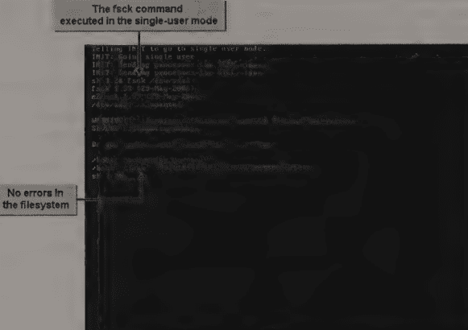

图 3-20：从单用户模式检查文件系统的完整性。

#### 语法

`fsck` 命令的语法为 `fsck -t {filesystem type} [options]`。

## 修复文件系统

可以使用 `fsck -r /dev/{filesystem}` 命令修复文件系统。该命令将提示你确认操作。如果你正在同时检查多个文件系统，则应避免此选项，因为它一次只能修复一个文件系统。

### `e2fsck` 命令

`e2fsck` 命令允许你检查 `ext2` 和 `ext3` 文件系统。在运行 `e2fsck` 命令之前，你需要卸载文件系统以防止损坏损坏。

`e2fsck` 命令的语法为 `e2fsck /dev/{filesystem}`。

### `tune2fs` 工具

`tune2fs` 工具用于帮助调整与 Linux 文件系统相关的参数。使用此工具，可以为现有的 `ext2` 或 `ext3` 文件系统添加日志（journal）。如果文件系统已经挂载，则日志在文件系统的根目录中是可见的。如果文件系统未挂载，则日志将隐藏。大多数 Linux 发行版都提供了 `tune2fs` 工具。

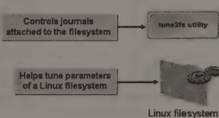

图 3-21：`tune2fs` 工具用于管理文件系统。

# 可调参数

使用 `tune2fs` 工具，你可以调整 Linux 机器上安装后扩展文件系统（如 `ext2` 和 `ext3`）的参数。可调参数允许你移除预留块；更改预留块计数；指定挂检查次数、检查之间的时间间隔以及内核代码的行为等。

### `tune2fs` 工具的选项

`tune2fs` 工具具有多种选项。

| 使用此选项 | 执行以下操作 |
| --- | --- |
| `-j` | 将现有文件系统转换为 `ext3` 文件系统。 |
| `-i` | 指定文件系统检查之间最大时间间隔（天、月或周）。 |
| `-c` | 指定文件系统检查之间的最大挂载次数。 |
| `-C` | 指定文件系统可以挂载的次数。 |
| `-r` | 指定预留块的数量。 |
| `-e` | 指定内核代码的行为，当检测到错误时，文件系统应该继续正常执行、以只读模式重新挂载还是导致内核崩溃（`panic`）。 |
| `-l` | 列出文件系统超级块中的内容。 |
| `-U` | 为文件系统设置指定的通用唯一标识符 (UUID)。 |

#### 语法

`tune2fs` 工具的语法为 `tune2fs [options] {device name}`。

### `dumpe2fs` 工具

`dumpe2fs` 工具主要用于管理基于 `ext2` 文件系统。它将 `ext2` 文件系统的状态转到标准输出设备，并打印所选设备的块组信息。

`dumpe2fs` 工具具有多种选项。

| 选项 | 允许你 |
| - | - |
| `-x` | 打印文件系统中块号的详细报告 |
| `-b` | 打印文件系统中的坏块 |
| `-f` | 强制工具显示文件系统状态，忽略文件系统标记 |
| `-i` | 显示来自 `e2image` 工具创建的镜像文件的文件系统数据 |

#### 语法

`dumpe2fs` 命令的语法为 `dumpe2fs [options] [block size] [device name]`。

### `debugfs` 工具

`debugfs` 工具允许你检查和修改 `ext2` 文件系统。执行 `debugfs` 工具时，会打开一个交互式 shell，可以使用它来检查和修改 `ext2` 文件系统。

# `debugfs` 工具支持的命令

下表提供了 `debugfs` 工具在交互式 shell 中支持的一些常用命令。

| 如果你需要 | 使用此命令 |
| - | - |
| 打开文件系统 | `open /dev/(filesystem)` |
| 关闭文件系统 | `close` |
| 查看文件系统信息 | `stats` |
| 寻找空闲块 | `ffb` |

# `xfs` 工具集

有很多 `xfs` 工具允许你操作 `xfs` 文件系统。

| `xfs` 工具 | 允许你 |
| `xfs_info` | 显示有关 `xfs` 文件系统的详细信息。 |
| `xfs_metadump` | 将 `xfs` 文件系统的元数据信息复制到文件中。 |
| `xfs_grow` | 扩展 `xfs` 文件系统以填充磁盘。 |
| `xfs_repair` | 修复并恢复损坏的 `xfs` 文件系统。 |
| `xfs_db` | 调试 `xfs` 文件系统。 |

# 如何维护 Linux 文件系统

过程引用：创建 `ext2` 文件系统

创建 `ext2` 文件系统：

1. 如果你已经有一个带有现有文件系统的驱动器：
   a. 将驱动器上的所有数据备份到可移动介质或其他驱动器。
   b. 使用 `umount` 命令卸载驱动器。
   c. 使用 `mkfs -t` 命令构建 `ext2` 文件系统。
2. 如果你有一个空驱动器：
   a. 使用 `mkfs -t` 命令构建 `ext2` 文件系统。
3. 使用 `mount` 命令挂载驱动器。
4. 为了反映对文件系统所做的更改，请更新 `/etc/fstab` 文件。

# 过程引用：创建 `ext3` 文件系统

创建 `ext3` 文件系统：

1. 如果你有一个带有 `ext2` 文件系统的驱动器：
   a. 使用 `umount` 命令卸载驱动器。
   b. 使用 `tune2fs -j` 命令转换文件系统。
2. 如果你已经有一个带有 `ext2` 以外现有文件系统的挂载驱动器：
   a. 将驱动器上的所有数据备份到可移动介质或其他驱动器。
   b. 使用 `umount` 命令卸载驱动器。
   c. 使用 `mkfs -t` 命令构建 `ext3` 文件系统。
   d. 使用 `mount` 命令挂载驱动器。
3. 如果你有一个空驱动器：
   a. 使用 `mkfs -t` 命令构建 `ext3` 文件系统。
   b. 使用 `mount` 命令挂载驱动器。

# 过程引用：创建 `reiserfs` 文件系统

创建 `reiserfs` 文件系统：

1. 如果你已经有一个带有现有文件系统的驱动器：
   a. 将驱动器上的所有数据备份到可移动介质或其他驱动器。
   b. 使用 `umount` 命令卸载驱动器。
   c. 使用 `mkfs -t` 命令构建 `reiserfs` 文件系统。
2. 如果你有一个带有 `ext2` 以外现有文件系统的挂载驱动器：
   a. 将驱动器上的所有数据备份到可移动介质或其他驱动器。
   b. 使用 `umount` 命令卸载驱动器。
   c. 使用 `mkfs -t` 命令构建 `reiserfs` 文件系统。
   d. 使用 `mount` 命令挂载驱动器。
3. 如果你有一个空驱动器：
   a. 使用 `mkfs -t` 命令构建 `reiserfs` 文件系统。
   b. 使用 `mount` 命令挂载驱动器。

# 过程引用：管理本地文件系统

管理本地文件系统：

1. 切换到单用户模式。
2. 使用 `fsck` 命令。

# 过程引用：管理 `ext2` 文件系统

管理 `ext2` 文件系统：

1. 切换到单用户模式。
2. 使用 `fsck` 命令。

# 过程引用：管理 `debugfs` 文件系统

管理 `debugfs` 文件系统：

1. 切换到单用户模式。
2. 使用 `debugfs` 命令。

5. 要清除终端屏幕，输入 `clear`

4. 修改 `fstab` 文件中的分区条目，以便在系统启动时挂载 `ext3` 文件系统。

   a. 要打开 `fstab` 文件，输入 `vi /etc/fstab`
   b. 导航到包含 `"/dev/sdb5"` 条目的行，并将光标置在 `"ext2."` 中的数字 2 之后。
   c. 要切换到插入模式，按 `I`。
   d. 输入 `3` 并按 `Delete`。
   e. 要导航到包含 `"/dev/sdb6"` 条目的行，按下方向键和左方向键，并将光标置在 `"ext2."` 中的数字 2 之后。
   f. 输入 `3` 并按 `Delete`。
   g. 按 `Esc`。
   h. 保存并关闭文件。
   i. 要清除终端屏幕，输入 `clear`
   j. 要更新 `fstab` 条目，输入 `mount -a`
   k. 要重启系统，输入 `reboot`

5. 检查系统启动时指定的文件系统是否已挂载。

   a. 要切换到命令行界面 (CLI)，按 `Ctrl+Alt+F1`。
   b. 在 Linux 系统的 CLI 中以 `root` 身份登录。
   c. 要查看挂载的分区，输入 `mount`
   d. 观察两个分区 `/dev/sdb5` 和 `/dev/sdb6` 的文件系统是否为 `"ext3"`。
   e. 要清除终端屏幕，输入 `clear`

## 第 3 节后续

在本节中，你在硬盘上创建了分区和文件系统。对文件系统结构的了解有助于你高效地导航、管理和维护文件系统。

1. 你认为什么时候需要格式化分区？为什么？
2. `ext3` 文件系统比 `ext2` 文件系统更好吗？好体现在什么种方面？

## 在 Linux 中管理文件

课程时长：2 小时 15 分钟

# 课程目标

在本节中，你将管理 Linux 中的各种文件。

你将：

- 在 Linux 中创建文本文件。
- 在 Linux 文件系统中定位文件。
- 使用正则表达式搜索文本文件。
- 对文本流应用过滤器。
- 管理文件链接。
- 备份和恢复文件。
- 使用 `MySQL` 管理数据库。

## 引言

在上一节课中，你管理了 Linux 文件系统。现在，是时候学习如何在 Linux 中操作文件和目录了。在本节中，你将管理各种类型的 Linux 文件。

作为 Linux 管理员，你应该在系统中良好地组织你的文件。学习如何创建、编辑、定位、链接、备份和恢复文件将帮助你根据需求定制系统。

本内容涵盖了以下 CompTIA+ Linux+ by LPI 认证目标的全部或部分内容：

- 主题 A:
  - 目标 103.8
- 主题 B:
  - 目标 103.3, 目标 103.7, 目标 104.7, 目标 110.1
- 主题 C:
  - 目标 103.7
- 主题 D:
  - 目标 103.2, 目标 103.7
- 主题 E:
  - 目标 104.6

# 主题 A

## 创建和编辑文件

在上一节课中，你处理了几种 Linux 文件系统类型。现在，你可以进入这些文件系统中创建和编辑文件的阶段。在这个主题中，你将创建并编辑文件。

处理文本文件对于大多数用户来说是一项基础且日常的任务。考虑一种场景：你可能需要提交一份关于当前项目的报告。你需要一个应用程序（例如文本编辑器）来创建报告。你也可以使用文本编辑器创建和配置文件，这将允许你对系统进行自定义。

### 文本编辑器

**定义：**

文本编辑器是一种允许你查看、创建或修改文本文件内容的应用程序。它最初是为了编写程序而创建，但现在用于编辑普通文本文件。文本编辑器在不同的模式工作，如命令模式和插入模式。各种类型的文本编辑器如 `Vim`、`gedit` 和 `nano` 都兼容 Linux。然而，文本编辑器并不总是支持文字处理器提供的格式选项。文本编辑器可以在 CLI 或 GUI 中运行。

**示例：**


图 4-1：插入模式下的 `Vim` 文本编辑器。

第 4 节：在 Linux 中管理文件 131


Command mode

`:Esc Quit View Journal Taps :help`

```
/dev/VolGroup00/LogVol00/ ext3 defaults 11

LABEL=/boot /boot ext3 defaults 12

tmpfs /dev/shm tmpfs defaults 0 0

devpts /dev/pts devpts mode=600 0 0

sysfs /sys sysfs defaults 0 0

proc /proc proc defaults 0 0

/dev/VolGroup00/LogVol01 swap defaults 0 0
```


### 文本编辑器列表

许多文本编辑器兼容 Linux。

| 文本编辑器 | 说明 |
|---|---|
| Vim | ViMproved，高度配置的基于文本的编辑器。 |
| Emacs | 强大且可扩展的文本编辑器和环境。 |
| gedit | 用于 GNOME 桌面环境的简单图形文本编辑器。 |
| Gvim | Vim 的图形版本。 |
| edit | 文本编辑器。 |
| nano | 简单、易用的文本编辑器。 |
| Pico | 基础文本编辑器。 |
| KWrite | KDE 桌面环境的编辑器。 |

## KDE

KDE 是一个免费开源桌面环境。

## Vim 命令

在命令模式下，输入冒号 `:` 运算符后，编辑器左下角会出现一个命令提示符。这表示用户处于执行模式，可以运行命令。


图 4-3：Vim 界面。

## Vim 模式

Vim 是一个模式编辑器，其模式决定了功能。常见模式列如下：

| 模式 | 描述 |
|---|---|
| 插入 (Insert) | 允许插入文本。 |
| 执行 (Execute) | 允许输入命令。 |
| 命令 (Command) | 允许执行编辑操作。 |
| 可视 (Visual) | 允许显示文本。 |

### 切换模式

你可以在 Vim 的不同模式之间切换。命令模式是 Vim 的默认模式。你可以使用单键从命令模式切换到任何其他模式。切换模式的键列如下：

| 键 | 功能 |
|---|---|
| i | 切换到插入模式并在光标左侧插入文本。 |
| A | 切换到插入模式并在行尾添加文本。 |
| I | 切换到插入模式并在行首插入文本。 |
| o | 切换到插入模式并在光标下方新建新行插入文本。 |
| O | 切换到插入模式并在光标上方新建新行插入文本。 |
| v | 切换到可视模式，按字符选择。 |
| V | 切换到可视模式，按行选择。 |
| : | 切换到执行模式以允许用户输入命令。 |
| Esc | 返回命令模式。 |

## 执行模式命令

在命令模式下，输入冒号 `:` 运算符后，编辑器左下角会出现一个命令提示符区域。这表示用户处于执行模式，可以运行 Vim 支持的命令。Vim 支持的一些命令如下：

| 命令 | 功能 |
|---|---|
| :w {文件名} | 如果是第一次保存，则使用文件名保存文件。 |
| :q | 在上次保存后没有任何更改时退出。 |
| :q! | 忽略所做的更改退出。 |
| :qa | 退出多个文件。 |
| :wq | 保存当前文件并退出。 |
| :e! | 在不关闭文件的情况下还原到上次保存的状态。 |
| ::{任何 Linux 命令} | 执行命令并在 Vim 界面中获取结果。 |
| zz | 仅在有更改时写入文件并退出 Vim 编辑器。 |

# Vim 选项

可以通过 `:help` 命令访问 Vim 内置文档的主要来源。要查找特定主题的帮助，可以将必要的主题作为参数添加。要退出帮助手册，可以使用 `:q`。`vimtour` 命令帮助初次用户通过练习 Vim 命令和快捷键来学习 Vim 的基础知识。


图 4-4：使用 Vim 文本查看帮助文件。

### 移动指令 (Motions)

移动指令是在命令模式下用于在文件中进行导航的单键快捷键。这些键可以将光标置在文档的任何位置。它们可以用于跨越字符、单词、行，甚至文本块移动光标。

| 导航键 | 用途 |
| :--- | :--- |
| H | 向左移动一个字符 |
| J | 向下移动一行 |
| K | 向上移动一行 |
| L | 向右移动一个字符 |
| ^ | 移动到当前行首 |
| $ | 移动到当前行尾 |
| W | 移动到下一个单词 |
| B | 移动到上一个单词 |
| E | 移动到当前单词末尾；如果你已经在单词末尾，则移动到下一个单词末尾。 |

| 导航键 | 用途 |
| :--- | :--- |
| (行号) Shift+G | 将光标移动到指定的行号。 |
| GG | 将光标移动到文件的第一行。 |
| G | 将光标移动到文件的最后一行。 |

# 使用方向键导航

除了使用 `K`、`J`、`H`、`L` 键在编辑器中导航外，你还可以使用上、下、左、右方向键。`Home`、`End`、`Page Up` 和 `Page Down` 等常规键在 Vim 中同样有效。

# 编辑操作 (Editing Operators)

命令模式下的编辑操作是强大的工具，可以通过简单的按键处理文本。它们也可以与移动指令结合使用编辑多个字符。

这里列出了一些常用的编辑操作。

| 编辑操作 | 用途 |
| :--- | :--- |
| x | 删除光标选中的字符。 |
| d | 删除文本。 |
| dd | 删除当前行。 |
| p | 在光标正下方行粘贴文本。 |
| P | 在光标正上方行粘贴文本。 |
| /[text string] | 在文档中搜索特定文本。 |
| ?[text string] | 在文档中反向搜索特定文本。 |
| y | 复制取（Yank）文本。 |
| yy | 复制光标正上方行。 |
| c[行范围]c | 在指定范围内开始更改。 |
| u | 撤销上次更改。 |
| U | 撤销当前行的所有更改。 |

> 在任何不小心撤销编辑的情况下，你可以按 `Ctrl+R` 重做最后的操作。

# 大小敏感

大多数 Vim 选项都是大小写敏感的。例如，`p` 选项粘贴光标正下方行剪切的文本，而 `P` 选项粘贴光标正上方行剪切的文本。

# 计数 (Counts)

计数是一个用于放大 Vim 中按键效果的数字。它可以与移动指令、操作或两者结合使用。当与光标配合使用时，光标移动将根据指定的计数进行倍增。当与编辑操作配合使用时，操作将按照指定的次数重复。

#### 语法

如果一起使用计数、移动指令和操作，其语法为 `operator *[count]* {motion}`。这使得光标按照计数指定的次数移动并执行该操作。

### diff 命令

`diff` 命令用于比较单个文本文件或目录的内容。该命令会显示两个文件及其之间的差异。

`diff` 命令有多种选项，允许你指定输出的性质。

| 选项 | 说明 |
| :--- | :--- |
| -b | 忽略空格差异。 |
| -i | 忽略大小差异。 |
| -t | 在输出行中扩展制表符。 |
| -w | 忽略空格和制表符差异。 |
| -c | 显示带有三行上下文的差异列表。输出显示涉及的文件及其创建日期，每个更改由一条包含十二个星号 (*) 的行分隔。从第一个文件中删除的行用连号 (-) 标记；添加到第二个文件的行用加号 (+) 标记。从一个文件移动到另一个文件的行在两个文件中都用感叹号 (!) 标记。 |


**图 4-5：使用 diff 命令比较同一文档的不同版本以跟踪更改。**

#### 语法

`diff` 命令的语法为 `diff {文件名 1} {文件名 2}`。

### patch 命令

`patch` 命令根据补丁文件中的指令更新文本文件。该补丁文件包含由 `diff` 命令生成的列表。

# 比较文本文件

`vimdiff` 命令允许你比较两个文本文件。该命令的语法与 `diff` 命令的语法相似。

### wc 命令

`wc` 命令用于计数行数、单词和字符数。如果指定了多个文件，它会显示每个文件的行数。


**图 4-6：使用 wc 命令计数。**

#### 语法

`wc` 命令的语法为 `wc [options] [file...]`。

### tr 命令

`tr` 命令用于翻译或删除标准输入中的字符。它通常与管道配合使用。

#### 语法

`tr` 命令的语法为 `tr [options] set1 [set2]`。

### uniq 命令

`uniq` 命令用于过滤文件中重复的行。它要求输入内容是排序的。

#### 语法

`uniq` 命令的语法为 `uniq [options] [file...]`。

2. 要打开文件，输入 `vim {file name}`。

3. 要进行必要的更改，请使用相应的 `vim` 快捷键。

4. 要保存并关闭文件，输入 `:wq`。

# 过程参考：使用 vim 命令打开多个窗口

使用 `vim` 命令打开多个窗口：

- 1. 以用户身份登录。
- 2. 打开多个窗口。
    - 要在多个窗口中打开不同的文件，输入 `vim -o {file name 1} {file name 2}`。
    - 要在一个窗口中打开新文件，按下 `Ctrl+W+N`。
    - 要在窗口之间切换，按住 `Ctrl+W` 并使用方向键。
- 3. 要进行必要的更改，请使用相应的 `Vim` 快捷键。
- 4. 如必要，按下 `Esc` 返回到命令模式。
- 5. 保存并关闭文件。
    - 要逐个保存并关闭文件，输入 `:wq`。
    - 或者，要同时关闭所有文件，输入 `:qa`。

# 过程参考：统计文件中的字数

要统计文件中的字数：

- 1. 在 CLI 中以用户身份登录。
- 2. 统计文件中的字数。
    - 要统计文件中的单词数、行数、字节数和字符数，使用 `wc [options] {file name}`。
    - 要统计命令输出中的单词数、行数、字节数和字符数，输入 `[command] | uniq [options]`。

# 过程参考：移除文件中重复和相邻行

要移除文件中重复和相邻行：

- 1. 在 CLI 中以用户身份登录。
- 2. 移除文件中的重复和相邻行。
    - 要移除文件中重复和相邻行，输入 `uniq [options] {file name}`。
    - 要移除命令输出中的重复和相邻行，输入 `[command] | uniq [options]`。

### 过程参考：在 CLI 中比较文件

在 CLI 中比较文件：

- 1. 在 CLI 中以用户身份登录。
- 2. 要比较文件内容是否存在差异，输入 `diff {file name 1} {file name 2}`。

### 过程参考：在 GUI 中比较文件

在 GUI 中比较文件：

- 1. 要切换到菜单，按下 `Ctrl+Alt+F7`。
- 2. 从菜单栏中选择 `Application→Accessories→Terminal`。
- 3. 要比较文件内容是否存在差异，输入 `vimdiff {file name 1} {file name 2}`。
- 4. 要返回终端，输入两次 `:q`。

### 过程参考：替换字符

要替换字符：

- 1. 在 CLI 中以用户身份登录。
- 2. 替换字符。
    - 要将一个字符替换为另一个并显示文件内容，输入 `tr '{character 1}' '{character 2}' < {file name}`。
    - 要从命令输出中将一个字符替换为另一个，输入 `{command} | tr '{character 1}' '{character 2}'`。

### 操作多个窗口

你可以选择水平或垂直排列窗口。按下 `Ctrl+W+V` 创建垂直分屏，或按下 `Ctrl+W+S` 水平分屏。

### 活动 4-1
使用 Vim 创建文本文件

开始之前：

- 1. 你已在 CLI 中以 `root` 身份登录。
- 2. 显示了第一个终端。

场景：
作为最近加入 OGC 的初级系统管理员，你每天有几个任务需要完成。由于你刚开始习惯日常工作，你决定通过创建一个名为 `Checklist.txt` 的文件来记录这些任务。

- 1. 创建名为 `Checklist.txt` 的文本文件。
    a. 输入 `vim Checklist.txt`
    b. 要切换到插入模式，按下 `I`。
    c. 观察到屏幕左下角显示文本 `"INSERT"`。
- 2. 向文件中输入数据。
    a. 输入 `Update Antivirus` 作为文件中的第一个条目。
    b. 输入 `Install New Printer` 作为第二个条目。
    c. 输入 `Fix Keyboard Issues` 作为第三条目。
    d. 输入 `Install New Monitor` 作为第四也是最后一个条目。

- 3. 在执行模式下保存文件并退出。
    a. 要返回命令模式，按下 `Esc`。
    b. 保存文件并退出文本编辑器，输入 `:wq`
    c. 清空终端屏幕，输入 `clear`

### 活动 4-2
在命令模式下编辑文本文件

数据文件：
`Softwarelist.txt`

开始之前：

- 1. 你已在 CLI 中以 `root` 身份登录。
- 2. 显示了第一个终端。
- 3. 在命令行，输入 `cp /085099Data/Managing_Files/* /root`。
- 4. 输入 `clear`。

场景：
你的经理要求你列出组织中使用的软件。你在 `Softwarelist.txt` 文件中列出了这些软件。但在提交之前，你想确保文档没有错误。你在文档中发现了以下错误：

- `Image Maker` 显示为 `Image Marker`。
- `Photoshop` 被输入为 `photoshop`。
- 关于 `Paintworks` 的详细信息重复了。

通过解决这些问题，你希望确保文档已准备好提交。

- 1. 将文本 `"Image Marker"` 的拼写更改为 `"Image Maker"`。
    a. 要打开 `Softwarelist.txt`，输入 `vim Softwarelist.txt`
    b. 要搜索 `Image Marker`，按下 `/`
    c. 到下一个匹配项，按下 `n`
    d. 跳转到上一个匹配项，按下 `p`
    e. 将 `"Image Marker"` 替换为 `"Image Maker"`，输入 `%s/Image Marker/Image Maker`
    f. 保存并退出，输入 `:wq`
    g. 清空屏幕，输入 `clear`
- 2. 修正 `photoshop` 的拼写。
    a. 要打开 `Softwarelist.txt`，输入 `vim Softwarelist.txt`
    b. 要搜索 `photoshop`，按下 `/`
    c. 将 `"photoshop"` 替换为 `"Photoshop"`，输入 `%s/photoshop/Photoshop`
    d. 保存并退出，输入 `:wq`
- 3. 移除 `Paintworks` 的重复条目。
    a. 要打开 `Softwarelist.txt`，输入 `vim Softwarelist.txt`
    b. 要搜索 `Paintworks`，按下 `/`
    c. 在该行时，按下 `dd`
    d. 保存并退出，输入 `:wq`

# 主题 B

### 定位文件

在上一个主题中，你创建了文件。有多种技术可以定位文件。学习如何定位文件将节省你的时间。

### locate 命令

`locate` 命令对存储在数据库中的文件名字符串进行快速搜索。该数据库必须定期更新才能生效。结果可能限于用户有权限的文件。

#### 语法

`locate` 命令的语法为 `locate {options} {string}`。

# locate 选项

`locate` 命令支持不同的选项以使搜索更有效。某些选项如下表所示。

| 选项 | 描述 |
| --- | --- |
| -r | 在搜索文件名时正则表达式。 |

| 选项 | 描述 |
| -c | 仅显示匹配的数量，而不是文件名。 |
| -e | 仅返回搜索时存在的文件。 |
| -i | 忽略文件名的大小写。 |
| -n number | 返回前几个匹配项。 |

# 更新 mlocate 数据库

`updatedb` 命令根据 `/etc/updatedb.conf` 构建数据库。该命令用于更新 `/var/lib/mlocate/mlocate.db` 数据库。`/etc/updatedb.conf` 包含了构建数据库时应排除的路径。要添加构建数据库时需要排除的路径，打开 `/etc/updatedb.conf` 文件，并在 `PRUNEPATH` 变量中指定该路径。例如，`PRUNEPATH=""` 将排除 `/etc` 目录。

虽然这是 `locate` 命令所搜索的默认数据库，但可能存在其他包含路径的数据库。如果在执行之前没有更新数据库，则之后创建的所有文件将被排除在外。

### whereis 命令

`whereis` 命令用于查看与命令相关的各种详细信息。`whereis` 命令有多种选项。

| 选项 | 用途 |
| :--- | :--- |
| -b | 仅搜索二进制文件。 |
| -m | 仅搜索手册页节。 |
| -s | 仅搜索源代码。 |
| -u | 搜索异常条目。 |

**图 4-11:** `ls` 命令的路径。

#### 语法

## 使用 whereis 命令

输入 `whereis ls` 后，将显示以下输出：
`ls: /bin/ls /usr/share/man/manl/ls.1.gz /usr/share/man/man1p/ls.1.gz`

其中 `/bin/ls` 表示 `ls` 命令的位置，`/usr/share/man/manl/ls.1.gz /usr/share/man/man1p/ls.1.gz` 表示 `ls` 命令帮助页的位置。

## GNOME 搜索工具

GNOME 搜索工具是一个用于根据特定标准搜索文件的图形化实用程序。你可以根据名称、大小、所有者、访问时间或内容搜索文件。这个强大的 GUI 支持不区分大小写的搜索、特定位置搜索和通配符搜索等功能。该工具结合了 `locate`、`find` 和 `grep` 等搜索命令。

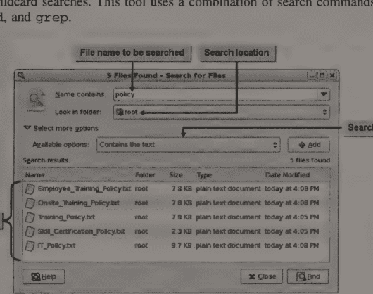

图 4-12: 使用 GNOME 搜索工具搜索文件。

## Kat

`Kat` 是适用于 KDE 的应用程序，用于通过从各种类型文件中提取并索引元数据、全文和缩略图来搜索文件。它作为一个目录，帮助快速检索文件。

## Beagle

`Beagle` 是一个 GNOME 桌面搜索应用程序，通过安装 `Kerry` 也可以在 KDE 中。它用于搜索文件、文件夹、文档、笔记、图像、视频、电子邮件、即时消息内容、浏览器历史记录和 RSS 馈。`Beagle` 会索引文件，使其能够快速检索搜索结果。它还允许用户根据修改日期、名称或相关性对搜索结果进行排序。

### find 命令

`find` 命令允许你在特定位置搜索符合某些搜索标准的目录和目录。它会递归搜索目录结构（包括子目录及其内容），从你输入的搜索位置开始。你可以对找到的文件执行一个或多个操作。

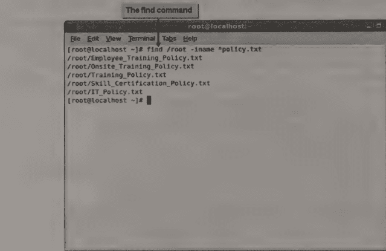

#### 语法

`find` 命令的语法为 `find [options] (search locations) (search criteria) [actions]`。

## find 对比 locate 命令

`locate` 命令搜索数据库并检索系统上存在的文件信息。然而，未能及时更新此数据库可能会产生过时的结果。相比之下，`find` 命令对文件系统进行实时搜索，并可能集中于特定位置。与 `locate` 命令相比，`find` 命令完成搜索可能需要更长时间。

### find 命令的工作原理

如果你还记得文件名的一部分，可以使用 `find` 命令在整个目录结构中搜索某个文件。可以指定一个或多个搜索路径，或使用目录表示法作为搜索路径。如果没有指定目录，`find` 命令将使用当前工作目录作为搜索起始位置。可以使用一个或多个标准来指定文件或目录的条件。如果有多个搜索标准，则在显示结果之前，文件或目录必须满足指定的所有条件。显示的结果可能限制为具有访问或执行权限的用户。你可以查看 `find` 命令的手动页以获取更多选项。

### 找到文件的选项

当系统找到符合你标准的列表时，可以对结果执行若干种操作。下表列出了这些选项。

| 选项 | 执行的操作 |
| :--- | :--- |
| -print | 显示找到的文件的位置。 |

## 选项执行的操作

| 选项 | 执行的操作 |
| :--- | :--- |
| -exec | 执行其后的命令。 |
| -ok | 以交互方式执行其后的命令。 |
| -delete | 删除文件。 |
| -fprint | 将结果存储在目标文件中。 |

### find 命令条件

`find` 命令可以配合一个或多个条件使用。这些条件字符串接受字符串或数字作为参数。

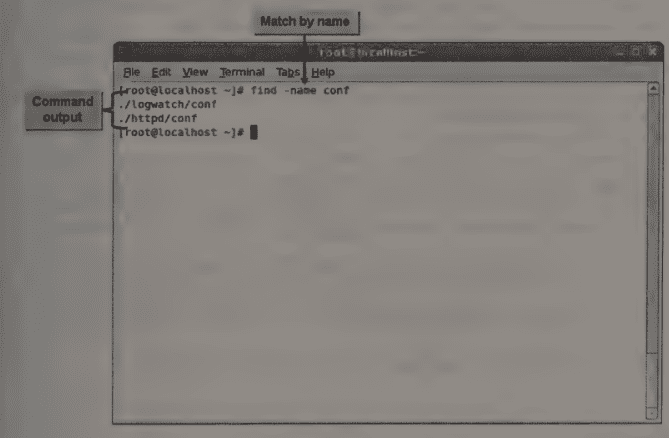

下表列出了一些常用条件。

| 条件 | 说明 |
| :--- | :--- |
| -name | 按名称匹配。可以使用正则表达式作为参数。 |
| -iname | 按名称匹配，忽略大小写。 |
| -user | 按所有者的用户名或 UID 匹配。 |
| -group | 按所有者组或 GID 匹配。 |
| -size | 按大小匹配。 |
| -perm | 按符号或八进制权限匹配。 |
| -type | 按文件类型匹配。 |

## CompTIA® Linux+™ Powered by LPI

| 条件 | 说明 |
| :--- | :--- |
| -newer | 通过比较修改时间匹配。返回修改晚于参考文件的文件。 |
| -atime | 按访问时间匹配。 |
| -mtime | 按修改时间匹配。 |
| -ctime | 按状态时间（更改）匹配。 |

### 逻辑运算符

你可以使用逻辑运算符组合条件。这些条件字符串接受字符串或数字作为参数。当指定多个条件时，默认只有满足所有条件的项会被返回。然而，可以使用 `OR` 运算符。`NOT` 运算符可以取反。

### 数值参数

数值参数用于指定数值。下表列出了大小的参数。

The table lists the arguments for size.

| 使用此参数 | 如果 |
| :--- | :--- |
| n | 等于（默认）。 |
| +n | 大于。 |
| -n | 小于。 |

下表列出了时间的参数。

The table lists the arguments for time.

| 使用此参数 | 如果 |
| :--- | :--- |
| n | 等于（默认）。 |
| +n | 大于。 |
| -n | 小于。 |

### 如何定位文件

### 参考过程：从数据库搜索文件

从数据库搜索文件：
1. 你已以 `root` 身份登录。
2. 要进入 `Server` 目录，输入 `cd /root`。
3. 如果必要，安装 `kernel-headers` 包，输入 `rpm -ivh kernel-headers`。
4. 清除屏幕，输入 `clear`。

### 4-3 搜索文件

开始之前：
1. 你已以 `root` 身份登录。

场景：
你需要对过去几年购买的所有外围制作报告。你想获取所有软件许可的详细信息。为了定位包含这些文件的，你决定对 `"software"` 进行本地搜索。

1. 搜索数据库包含 `"software"` 的文件名。
   a. 更新数据库，输入 `updatedb`
   > 这可能需要几分钟。请等待更新完成直到命令行提示符出现。
   b. 要搜索名称包含 `"software"` 的所有文件，输入 `locate -i *software*`
   c. 观察列出的包含 `"software"` 的所有文件（包括系统文件）。
2. 确保列出包含 `"software"` 的目录名。
   a. 切换到根目录，输入 `cd /`
   b. 搜索包含 `"software"` 的所有路径，输入 `ls -lR | grep -i "software" | more`
   c. 要检查任何包含 `"software"` 术的目录，按空格键直到列表末尾。
   d. 观察结果中显示的 `/usr/src/kernels/2.6.18-128.el5-i686/include/config` 下的 `software` 目录。

### get 4-4
在 GUI 中搜索文件

在开始之前：

- 1. 你已在 CLI 中以 **root** 身份登录。
- 2. 要更改所有者，请在终端中输入 `chown -R jsmith /08599Data/Locating_Files/*..`。
- 3. 要创建 `work_files` 目录，输入 `mkdir /work_files`。
- 4. 要拷贝文件，输入 `cp -pR /08599Data/Locating_Files/* /work_files`。
- 5. 要清除终端屏幕，输入 `clear`。

场景：

作为系统管理员，你负责执行定期的系统清理。你想清除所有不必要的空文件。你决定在 Linux 文件系统中搜索空文件并将其标记为待删除。

- 1. 打开 GNOME 搜索工具。
    - a. 切换到 GUI。
    - b. 以 **root** 身份登录。
    - c. 要打开 GNOME 搜索工具，选择 `Places（位置）→ Search for Files（搜索文件）`。
- 2. 指定搜索位置为 `/work_files` 目录。
    - a. 为了让搜索包含所有文件，在 **Search for Files** 对话框中，在 **Name contains**（名称包含）文本框内输入 `*`。
    - b. 打开浏览窗口，在 **Look in folder**（查看文件夹）下拉菜单中选择 **Other**（其他）。
    - c. 在右格中显示更多目标目录，在 **Places** 列表中双击 **File System**（文件系统）。
    - d. 要查看更多目录，在 **Browse** 对话框中，向下滚动 **Name** 列表。
    - e. 要选择 `/work_files` 目录并退出窗口，在 **Name** 列表中选择 **work_files** 并点击 **Open**（打开）。
- 3. 搜索空文件。
    - a. 点击“Select more options”（选择更多选项）旁边的切换按钮以显示更多搜索选项。
    - b. 要将搜索结果限制为空文件，从 **Available options**（可用选项）下拉列表中选择 **File is empty**（文件为空）并点击 **Add**（添加）。
    - c. 在 `/work_files` 目录内搜索空文件，点击 **Find**（查找）。
    - d. 最大化窗口并向下滚动观察列出的所有空文件。
    - e. 关闭搜索文件 窗口，点击 `Close`（关闭）。

### 主题 C
使用正则表达式搜索文本

在在上一个主题中，你在 Linux 系统中定位了文件。在 Linux 中，你可以通过指定文本的特定部分甚至只是文件的某些字符来搜索文本文件。然后你可以对这些字符进行所需的修改。在本主题中，你将搜索文本文件以定位文本和字符。

假设你创建了一个新的文本文件，其中有大量内容。现在，你发现你需要修改一个特定的单词。逐行查看文本来定位一个单词是一项艰巨的任务。使用纯文本搜索选项也会耗费时间。这正是正则表达式可以派用场的地方。

### 正则表达式

定义：
正则表达式是表示单词、一组词或一个句子的字符字符串。它们描述了一种搜索模式。定位文本、替换文本和处理字符串是正则表达式的主要用途。

示例：正则表达式
要拷贝所有以 `".html"` 结尾的文件，使用 `cp *.html ../`。

表达式
表达式是一组字符。它们通过将变量、常量与运算符组合而成。它们被用于 `if` 和 `while` 语句。执行算术比较、字符串比较和测试文件是表达式的主要功能。如果表达式包含 `<`、`>`、`&` 或 `|` 符号，则需要括号。

#### 如何使用正则表达式搜索文件

过程参考：使用正则表达式工具搜索
使用正则表达式工具进行搜索：

- 1. 在 CLI 中以 **root** 身份登录。
- 2. 使用正则表达式工具搜索。
    - 要使用正则表达式工具遍历文件系统，输入 `ls -1 | grep -(options) (带有记法元素的正则表达式).` 。
    - 要使用正则表达式工具搜索文件内容，输入 `grep -(options) (带有记法元素的正则表达式) (文件名).` 。

# 带有记法元素的正则表达式

带有记法元素的正则表达式是结合了通配符、数字和字符的搜索字符串。

例如，`[^e]?b[1-9]` 整体被称为带有记法元素的正则表达式，其中记法元素是 `^`、`?`  ` `[1-9]`。该表达式搜索以字母 `"e"` 开头、后跟一个字符/数字、然后是字母 `"b"`，最后是 1 到 9 之间的数字的文件/单词/目录。

另一个带有记法元素的正则表达式示例是 `1\{5}`，其中 `\{}` 是记法元素。该表达式搜索数字 `"1"` 连续出现五次。正则表达式通常被称为 `regexp`。

### 活动 4-5
搜索文本文件

数据文件：
`Leave_Log.txt`

- 在开始之前：
  1. 你已在 GUI 中以 **root** 身份登录。
  2. 切换到 CLI。
  3. 要切换到 `/root` 目录，输入 `cd /root`。
  4. 要创建一个新目录，输入 `mkdir HR`。
  5. 要拷贝数据文件，输入 `cp /085099Data/Managing_Files/Leave_Log.txt /root/HR.`。
  6. 要清除终端屏幕，输入 `clear`。

场景：
作为系统管理员，你负责执行定期的系统清理。你想清除所有不必要的空文件。你决定在 Linux 文件系统中搜索空文件并将其标记为待删除。

- 1. 打开 GNOME 搜索工具。
    - a. 切换到 GUI。
    - b. 以 **root** 身份登录。
    - c. 要打开 GNOME 搜索工具，选择 `Places→Search for Files`。
- 2. 指定搜索位置为 `/work_files` 目录。
    - a. 为了让搜索包含所有文件，在 **Search for Files** 对话框中，在 **Name contains** 文本框内输入 `*`。
    - b. 打开浏览窗口，在 **Look in folder** 下拉菜单中选择 **Other**。
    - c. 在右格中显示更多目标目录，在 **Places** 列表中双击 **File System**。
    - d. 要查看更多目录，在 **Browse** 对话框中，向下滚动 **Name** 列表。
    - e. 要选择 `/work_files` 目录并退出窗口，在 **Name** 列表中选择 **work_files** 并点击 **Open**。
- 3. 搜索空文件。
    - a. 点击“Select more options”（选择更多选项）旁边的切换按钮以显示更多搜索选项。
    - b. 要将搜索结果限制为空文件，从 **Available options**（可用选项）下拉列表中选择 **File is empty**并点击 **Add**。
    - c. 在 `/work_files` 目录内搜索空文件，点击 **Find**。
    - d. 最大化窗口并向下滚动观察列出的所有空文件。
    - e. 关闭搜索文件 窗口，点击 `Close`。

### 主题 D
对文本流应用过滤器

在上一个主题中，你在 Linux 系统中定位了文件。在 Linux 中，你可以通过指定文本的特定部分甚至只是文件的某些字符来搜索文本文件。然后你可以对这些字符进行所需的修改。在本主题中，你将搜索文本文件以定位文本和字符。

### 文本流

定义：文本流是一行或多行文本的序列，可以写入以便在文本显示器上读取。在从文本流读取或向文本流写入时，程序通过读取每行末尾的 `NL`（换行符）将数据划分为行。

示例：

| 行序列 | 大多数人都有公开演讲的机会，NL 无论是在会议、聚会还是仪式上，NL 策划组织良好且有趣的演示文稿 NL 以满足你的观众的需求。NL |

**图 4-16：** 使用 `NL` 字符的行序列。

**文本流的局限性** 在读取或向文本流写入时，不应更改文本流的位置。取决于所使用的文本文件类型，文本流可能不支持所有的字符值。

#### 如何对文本流应用过滤器

**过程参考：** 使用 `join` 命令修改输出

要使用 `join` 命令修改文本文件的输出：

1. 如果必要，导航到相关目录。
2. 若要根据两个文件的第一列内容并接随其余列来连接这两个文件（前提是文件的第一列在标准输出中相同），请输入 `join {file name 1} {file name 2}`。
3. 如果必要，要连接这两个文件并将输出重定向到文件，请输入 `join {file name 1} {file name 2} > {file name}`。

> 使用重定向命令时，你可能会生成额外的文件。例如，当你使用多个文本命令生成所需的输出时，你可以将内容从一个文件重定向到另一个文件，从而额外的文件。你可能需要删除这些不需要的文件以避免混淆。

**过程参考：** 将 `cut` 命令的输出流通过 `sort` 命令传递

通过将 `cut` 命令的输出导向 `sort` 命令来修改输出：

1. 如果必要，导航到相关目录。
2. 若要将 `cut` 命令的输出传递给 `sort` 命令，输入 `cut {options} {delimiter}-{field number}{file name} | sort {options}`。

#### cut 命令选项

`cut` 命令用于剪切选定的列或字段。下表给出了常用的 `cut` 命令选项及其用途。

| 如果你需要 | 使用此 cut 命令选项 |
|---|---|
| 将一个字段与另一个字段隔开。 | -d={delimiter} |
| 如果未找到分隔符则抑制该行。 | -s |
| 指定字段编号。例如，f2 表示第二个字段。 | -f={column number / column list} |

#### 分隔符

分隔符可以是制表符、空格、冒号、分号、句或逗号，用于将一个字段与其他字段隔开。

#### sort 命令选项

`sort` 命令排列文件中的行。下表给出了常用的 `sort` 命令选项及其用途。

| 如果你需要 | 使用此 sort 命令选项 |
|---|---|
| 指定字段值。例如，-k2 表示第二个字段。 | -k={column number} |
| 根据字符串数值比较并排序行。 | -n |
| 按降序排序字段。注意：默认情况下，字段按升序排序。 | -r |
| 将一个字段与另一个字段隔开。 | -t={delimiter} |

#### Textuitil 命令

`textuitil` 命令用于修改输出。下表给出了常用的 `textuitil` 命令及其描述。

| 如果你需要 | 使用此 Textuitil 命令 |
|---|---|
| 将文件中的制表符转换为相应数量的空格。 | expand {file name} |
| 通过为指定的文件填充空行将文本格式化为指定的宽度。 | fmt {file name} |
| 显示文件的前 10 行。 | head {file name} |
| 计算文件的行数。 | nl {file name} |
| 以八进制格式转储指定的文件。 | od {file name} |
| 合并一个或多个文件的行。 | paste {one or more files} |
| 将文本文件转换为打印。 | pr {file name} |

| 如果你需要 | 使用此 Textutil 命令 |
| --- | --- |
| 将文件拆分为等大小的部分。 | split {file name} |
| 反反顺序显示文件到标准输出。 | tac {file name} |
| 显示文件的最后 10 行。 | tail {file name} |
| 将字符从一种格式转换为另一种并输出到标准输出。 | tr {one format} {another format} |
| 将指定文件的空白转换为相应数量的制表符。 | unexpand {file name} |
| 删除排序文件中的重复行。 | uniq {file name} |
| 打印指定文件的行数、字数和字符数。 | wc {file name} |

### 活动 4-6
应用 Textutil 命令修改输出

**数据文件：**
`Empclaimfeb.txt, Empclaimjan.txt`

**在开始之前：**

1. 你已以 `root` 身份登录 CLI。
2. 若要复制数据文件，输入
   `cp /085099Data/Managing_Files/Empclaim*.txt /root/HR.`
3. 若要清除终端屏幕，输入 `clear`。

**场景：**
财务部门的同事 `Mike` 想为员工提交的报销创建一个月度报告。该报告涵盖 1 月和 2 月份，并按员工编号排序。你将帮助 `Mike` 创建合并报告。

合并报告应为 `Empclaim.txt`。

1. 合并 `Empclaimjan.txt` 和 `Empclaimfeb.txt` 创建报告。
   a. `join Empclaimjan.txt Empclaimfeb.txt > Empclaim.txt`
   b. `cat Empclaim.txt`
   c. 观察文件内容。
2. 根据编号对字段进行排序。
   a. `sort -n Empclaim.txt > Empclaim.txt`
   b. `cat Empclaim.txt`
   c. 观察文件内容。
3. 删除 `HR` 目录下的不需要的文件。
   a. `rm Empclaimjan.txt Empclaimfeb.txt`
   b. `ls`
   c. 观察只剩下 `Empclaim.txt` 和 `Leave.txt`。

### 主题 E
链接文件

你知道如何在系统中定位文件。为这些文件创建链接或快捷方式可以让你更容易找到它们。在本主题中，你将链接文件。在 Linux 中链接文件可以帮助你跟踪文件，而无需在文件结构进行搜索。你可以通过链接帮助不熟悉 Linux 的用户访问相关文件。

### inode

索引节点（inode）是计算机对文件的引用。索引节点表（inode table）是包含文件系统中单个文件信息的数据结构。inode 是表中的一个项，包含了 inode 所在设备的信息、文件类型、模式以及所有者的 UID 和 GID。它还包含有关文件链接数、文件字节数、访问和修改时间、inode 本身最后修改时间，以及文件在硬盘上的数据块地址。`ls -i` 命令用于定位文件的 inode 编号。

- 在 `debugfs` 工具界面中，你可以使用 `ffi` 命令查找空闲 inode。
- 根据权限，文件模式可以是可写、可读或可执行的。`chmod` 命令允许你修改文件的权限。

### ln 命令

`ln` 命令用于创建文件的链接。链接允许一个目录中的文件名指向另一个目录中的文件。链接本身不包含数据，它只是对另一个文件的引用。对链接进行的任何更改都会反映在原始文件中。


图 4-18：使用 `ln` 命令创建的链接。

#### 语法
`ln` 命令的语法为 `ln [option] {target} {link name}`。

#### 命令选项
`ln` 命令有多种选项。下表列出了某些常用选项。

| 选项 | 用途 |
| --- | --- |
| --backup | 备份现有的目标文件。 |
| -f | 现有的目标文件。 |
| -s | 创建符号链接而非硬链接。 |
| -i | 在删除目标文件时进行提示。 |
| -v | 在链接之前打印文件名。 |

# CompTIA® Linux+ Powered by LPI

### 链接的类型

使用 `ln` 命令，你可以创建两种链接：硬链接和符号链接。

| 链接 | 描述 |
| --- | --- |
| 硬链接 | 硬链接是对另一个文件的引用；它允许文件数据在同一文件系统的不同位置拥有多个名称。应用程序将硬链接视为真实文件。如果在创建硬链接后删除了原始文件，链接文件中的所有内容仍然可用。硬链接无法在两个目录之间创建，也无法在两个不同的文件系统之间创建。 |
| 符号链接 | 符号链接是对文件或目录的引用，允许你从不同的目录访问已挂载的文件系统。与硬链接不同，符号链接可以在两个文件系统之间创建。如果在创建符号链接后删除了原始文件，原始内容将丢失。符号链接也被软链接（soft link）。 |


**图 4-19：** 为同一个文件创建的硬链接和软链接。

> 硬链接和软链接是 ext2 文件系统的特性，在大多数 Unix 和类 Unix 操作系统（如 Linux）的文件系统中很常见。

第 4 ：在 Linux 中管理文件 171

### 如何链接文件

#### 过程参考：查看文件或目录的 Inode 号

要查看文件或目录的 inode 号：

- 以用户身份登录 CLI。
- 若要查看 inode 详细信息，输入 `ls -i {file or directory name}`。

#### 过程参考：链接文件

要链接文件：

- 以用户身份登录 CLI。
- 创建链接。
  - 要创建硬链接，输入 `ln {source file} {destination file}`。
  - 要创建软链接，输入 `ln -s {source file} {destination file}`。
- 要查看文件的 inode，输入 `ls -i {file name}`。

#### 过程参考：通过链接复制文件

要通过链接复制文件：

- 以 `root` 身份登录 CLI 并在并切换到相关目录。
- 要创建符号链接，输入 `ln -s {file/directory name} {link name}`。

> 符号链接通过浅蓝色的链接名称指示，并带有一个指向源文件的箭头。

- 通过符号链接复制文件，输入 `cp {link name} {target name}`。
- 如果必要，检查文件是否已复制，输入 `ls -1`。

#### 过程参考：使用链接文件支持系统管理

要链接文件以支持系统管理任务：

- 以 `root` 身份登录 CLI 并切换到相关目录。
- 为系统任务创建符号链接，输入 `ln -s {system file} {link name with path}`。
- 如果必要，执行系统文件，输入 `{link name}`。

### 活动 4-7
链接文件

数据文件：
`Audit_File_09, Software_List.txt, New_Policies.txt`

场景：
你被分配了一项任务：审查更新后的员工政策文档以检查错误、统计文档字数，并在本地系统中创建该文档的链接作为备份。你还想通过删除当前工作目录中的未使用的文件来清理系统，并备份政策文档。

1. 列出当前工作目录中的文件。
  a. 要更改目录，输入 `cd /root`。
  b. 要列出目录中的文件，输入 `ls -1`。
  c. 观察到当前工作目录中的所有文件都已列出。

2. 将 `Audit_File_09` 文件移动到 `/jsmith` 目录并删除 `Software_List.txt` 文件。
  a. 要将审计文件移动到 `/jsmith` 目录，输入 `mv -v Audit_File_09 /home/jsmith`。
  b. 要验证文件传输完成，输入 `ls -1 /home/jsmith`。
  c. 要从 `/root` 目录删除软件文件，输入 `rm Software_List.txt`。
  d. 确认删除，输入 `y` 并按回车。
  e. 检查文件是否已删除，输入 `ls`。
  f. 观察到 `Software_List.txt` 已删除。

3. 编辑 `New_Policies.txt` 文件以检查错误并生成字数。
  a. （此处原文未提供具体操作，通常为编辑器命令）
  b. （此处原文未提供具体操作）
  c. （此处原文未提供具体操作）
  d. （此处原文未提供具体操作）
  e. （此处原文未提供具体操作，使用 `wc` 统计字数）
  f. （此处原文未提供具体操作）

4. 为文件创建硬链接。
  a. （此处原文未提供具体操作）
  b. （此处原文未提供具体操作）
  c. （此处原文未提供具体操作）

### 活动 4-8
频繁创建链接

数据文件：
`file.txt, Currentdatetime`

开始之前：

1. 以 `root` 身份登录 CLI 并显示终端。
2. 备份文件，使用 `Currentdatetime`。
3. 复制文件，使用 `Currentdatetime`。
4. 修改文件，使用 `file.txt`。
5. 清理终端。

场景：
你想为文件添加频繁链接。

1.  true还是否？当你删除文件时，链接将失效。
2. 在目录中创建一个名为 `"auditlog"` 的硬链接。
3.  true还是否？当你删除文件时，链接将失效。
4. 创建名为 `"Time"` 的符号链接。

### cpio 命令

`cpio` 命令用于在归档之间复制文件。它包含在标准的 Linux 发行版中。`cpio` 命令有三种运行模式。

| 运行模式 | 描述 |
|---|---|
| 导出 cpio -o | 在此模式下，命令将文件复制到归档。它读取输入以获取文件名列表，然后将文件复制到标准输出。 |
| 导入 cpio -i | 在此模式下，命令从归档复制文件。它从标准输入提取文件。 |
| 传递 cpio -p | 在此模式下，命令将文件从一个目录复制到另一个目录。它读取标准输入以获取文件名列表，并将这些文件创建并复制到目标目录。 |

### dd 命令

`dd` 命令用于复制和转换文件，以便将其从一种类型的介质传输到另一种类型。`dd` 命令有多种选项。

> 选定的输入文件被复制到选定的输出文件中。如果没有选择任何文件，则使用标准输入和标准输出。

| 选项 | 用途 |
|---|---|
| if={file name} | 指定从哪个文件读取数据。 |
| of={file name} | 指定将数据写入哪个文件。 |
| bs={number of bytes per block} | 指定从输入文件读取数据并写入输出文件的每块字节数。 |
| count={number of blocks} | 指定从输入文件写入输出文件的块数。 |

#### 语法

`dd` 命令的语法为 `dd [operand]...` 或 `dd [option]`。

### dump 命令

`dump` 命令将文件系统中所有文件转储到磁带或其他文件中。也可以用于转储指定日期后修改的文件。`dump` 命令有多种选项。下表提供了一些常用的 `dump` 命令选项。

| 选项 | 用途 |
| --- | --- |
| -0 | 进行全备份 |
| -1 to 9 | 制作增量备份或部分备份 |
| -b [maximum block size] | 指定每个转储记录的千字节 |
| -f (location of the target file) | 指定目标位置 |
| -z(compression level) | 指定 1 到 9 之间的压缩级别 |

#### 语法

`dump` 命令的语法为 `dump {-level} -f {file} {filesystem/file/directory}`。

### tar 命令

`tar` 命令允许你创建数据归档。你可以对以前创建的归档使用该命令来提取文件、存储额外文件、更新文件以及列出已存储的文件。`tar` 命令还可以通过管道将其输出重定向到可用设备、文件或其他程序。

> tar 源自 Tape ARArchive（带存档）。

### tar 命令

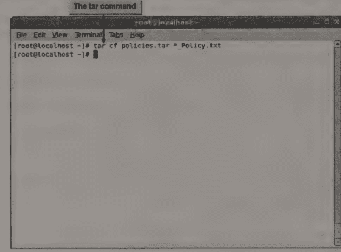

**图 4-21:** 使用 `tar` 命令归档文件。

#### 语法

`tar` 命令的语法为 `tar [options] {source file} (destination file)`。

### gzip 命令

GNU zip (`gzip`) 是一种压缩选定文件的实用程序。`gzip` 命令有几个选项。

下表描述了这些命令选项。

| 选项 | 描述 |
|---|---|
| -d | 解压缩文件。 |
| -f | 即使文件有多个链接或文件已存在也强制对文件进行压缩或解压缩。 |
| -h | 显示帮助屏幕。 |
| -L | 显示 `gzip` 许可协议。 |
| -n | 省略原始文件名和时间戳。 |
| -N | 保存原始文件名和时间戳。 |
| -q | 抑制所有警告。 |
| -r | 进入目录并压缩文件。 |
| -v | 显示压缩或解压缩文件的名称和减少百分比。 |
| -t | 检查压缩文件的完整性。 |

`gzip` 命令的语法为 `gzip [options] {file name}`。

### 文件压缩工具

文件压缩工具（如 `gzip`）尝试只压缩普通文件而忽略符号链接。可以使用 `gzip -d`、`gunzip` 或 `zcat` 将压缩文件恢复到原始形式。如果保存在压缩文件中的原始文件名不适用于其文件系统，则会根据原始名称提供一个新名称。

### 文件归档工具

各种文件归档工具允许你对文件进行压缩、解压缩并运行其他文本处理实用程序。下表描述了某些实用程序。

| 实用程序 | 描述 |
| --- | --- |
| bzip2 | 以比 `gzip` 命令快的速度压缩文件。该命令的语法为 `bzip2 {file name}`。 |
| bunzip2 | 解压缩使用 `bzip2` 命令压缩的文件。该命令的语法为 `bunzip2 {file name}`。 |
| bzcat | 解压缩使用 `bzip2` 命令输出到标准输出的文件。该命令的语法为 `bzcat {file name}`。 |
| bzdiff | 在压缩文件上运行 `diff` 命令。该命令的语法为 `bzdiff {file name}`。 |
| bzip2recover | 从损坏的 `bzip2` 文件中恢复数据。该命令的语法为 `bzip2recover {file name}`。 |
| bless | 在压缩文件上运行 `less` 命令。该命令的语法为 `bless {file name}`。 |
| bzmore | 在压缩文件上运行 `more` 命令。该命令的语法为 `bzmore {file name}`。 |

> bzip 是一个被 `bzip2` 代替的压缩工具。

### unzip 命令

`unzip` 命令用于列出、测试和提取 `ZIP` 归档中的压缩文件。`unzip` 命令包含选项。下表提供了部分选项。

| 选项 | 描述 |
| --- | --- |
| -c | 将文件提取到标准输出 |
| -t | 在提取前进行测试 |
| -f | 提取新文件并刷新现有文件 |
| -z | 显示归档注释 |
| -v | 以详细方式提取并列出文件 |

> > `unzip` 命令将指定 `ZIP` 归档中的所有文件提取到当前工作目录。

> 语法为 `unzip [options] {file name} -d [directory]`。

### 确定备份策略的指南

有效的备份策略可以提供快速方便的恢复，在发生意外时减少数据丢失。

### 指南

为了选择有效的备份策略，请遵循以下指南：

- 确定要执行的备份范围。
- 你是否需要备份一台计算机？
- 你是否需要备份多台计算机？
- 计算机是否位于同一个位置？
- 数据是否分布在不同位置？
- 识别需要备份的数据。
- 数据是否存储在单个系统上？
- 数据是否分布在服务器之间？
- 数据是否可以轻松替换？
- 确定备份的最合适时间。
- 通知用户备份计划。
- 检查存储空间。
- 确定旧版本是否可以删除。
- 保留旧版本。

### restore 命令

`restore` 命令允许你从使用 `dump` 命令创建的备份中恢复文件或文件系统。该命令可以在网络上恢复数据。

下表描述了常用的 `restore` 命令选项。

| 选项 | 允许实现的操作 |
| --- | --- |
| -C | 将备份文件与源文件进行比较。 |
| -i | 在恢复模式下运行 `restore` 命令，以部分恢复备份。 |
| -r | 对备份的文件进行完整恢复。 |
| -f (/备份文件位置) | 指定备份文件的位置。 |

### 卷号 (Volume Number)

在可移动存储设备（如磁带驱动器）上对大文件备份时，文件的总大小将被分成较小的卷并存储在多个磁带驱动器中，每个磁带驱动器通过特定的卷号识别。当你想要恢复在多个卷上创建的备份时，请从最后一个卷号到第一个卷号指定卷号。硬盘由于是单一卷，因此卷号始终为 1。

### 使用 tar 命令恢复文件

`tar -xvf` 命令将恢复源文件或目录结构的所有内容。要恢复 `tar` 文件的部分内容，使用你想要提取的文件的路径和名称。你必须使用创建 `tar` 文件时使用的精确路径和名称。你也可以通过使用命令 `tar -xvf [destination] [source]` 来进行交互式恢复。

### 使用 cpio 命令恢复文件

你需要备份数据的主要原因是，如果文件损坏或删除，你可以检索这些数据。如果你使用 `cpio` 命令将文件移动到另一个位置，你需要将文件从归档文件中提取出来使用。存入选项的格式为 `cpio -icdv < [归档文件名].`

### 如何备份和恢复文件

过程参考：使用 `dump` 命令归档

使用 `dump` 命令归档：

- 1. 在 CLI 中以 `root` 身份登录。
2. 若要进行完整备份，输入 `dump -0 -f {目标文件} {源文件}`。
3. 要向现有备份文件添加更新，输入 `dump -{Hanoi 序列} -f {目标文件} {源文件}`。

# 过程参考：使用 tar 和 gzip 命令备份文件

使用 `tar` 和 `gzip` 命令备份文件：

- 1. 确定你想要备份的文件并将它们放入目录中。
2. 使用 `tar` 命令对所有文件进行分组。
3. 使用 `gzip` 命令压缩 `tar` 文件。
4. 将文件保存到另一个位置（FTP 站点、CD、DVD、磁带、软盘等）。

# 过程参考：使用 restore 命令恢复备份

使用 `restore` 命令恢复备份：

- 1. 在 CLI 中以 `root` 身份登录。
2. 导航到你想要恢复备份文件的目录。
3. 恢复备份。
   - 若要恢复使用 `dump` 命令创建的备份，输入 `restore -rf /备份文件位置`。

# 过程参考：使用 gzip 和 tar 命令从备份中恢复文件

使用 `tar` 和 `gzip` 命令从备份恢复文件：

- 1. 从你的备份位置（FTP 站点、CD、DVD、磁带、软盘等）复制文件。
2. 使用 `gzip` 命令解压缩文件。
3. 使用 `tar` 命令解包文件。
4. 如果需要，将保存的单个文件移回它们各自的各个。

### 练习 4-9
执行备份

开始之前：

- 1. 你已在 CLI 中以 `root` 身份登录。
2. 若要在根目录下创建 `Reports` 目录，输入 `mkdir Reports`。
3. 若要导航到 `/root/Reports` 目录，输入 `cd Reports`。
4. 若要创建存储项目数据的项目文件，输入 `vi project`。
5. 保存并关闭文件。
6. 若要清除终端屏幕，输入 `clear`。

场景：
你的同事 `Chris` 正在做一个非常重要的项目，他想对系统进行每日备份。他还希望设置一个提醒，每当登录系统时都创建备份。
所有项目相关文件都在 `/root` 目录中，它们需要保存为 `/tmp` 目录下的 `project_backup`。

- 1. 在 `/tmp` 目录对 `/root` 文件进行备份。
  a. 若要进行完整备份，输入 `dump -0 -f /tmp/project_backup /root`
  b. 观察到最后一行显示消息“DUMP IS DONE”，表示备份成功。
  c. 若要清除终端屏幕，输入 `clear`
  d. 若要压缩备份文件，输入 `bzip2 /tmp/project_backup`

- 2. 在系统登录时设置执行备份的提醒。
  a. 输入 `vi /etc/issue`
  b. 若要跳转到文件末尾，按 `Shift+G`。
  c. 若要移动到新行，按 `O`。
  d. 输入 `Welcome to Linux! Remember to Backup Your Project Data`
  e. 按 `Esc`。
  f. 保存并关闭文件。

- 3. 验证当用户下次登录时是否显示了提醒。
  a. 若要验证登录界面是否显示了该提醒，输入 `logout`
  b. 观察到显示消息“Welcome to Linux! Remember to Backup Your Project Data”。
  c. 以 `root` 用户身份登录。

### 练习 4-10
恢复备份数据

开始之前：

- 1. 你已在 CLI 中以 `root` 身份登录。
2. 若要在根目录下创建 `Reports` 目录，输入 `mkdir Reports`。
3. 若要导航到 `/root/Reports` 目录，输入 `cd Reports`。
4. 若要创建存储项目数据的文件，输入 `vi project`。
5. 保存并关闭文件。
6. 若要清除终端屏幕，输入 `clear`。

场景：
你的同事 `Chris` 正在做一个非常重要的项目，他想对系统进行每日备份。他还希望设置一个提醒，每当登录系统时都创建备份。
所有项目相关文件都在 `/root` 目录中，它们需要保存为 `/tmp` 目录下的 `project_backup`。

- 1. 在 `/tmp` 目录对 `/root` 文件进行备份。
  a. 若要进行完整备份，输入 `dump -0 -f /tmp/project_backup /root`
  b. 观察到最后一行显示“DUMP IS DONE”，表示备份成功。
  c. 若要清除终端屏幕，输入 `clear`
  d. 若要压缩备份文件，输入 `bzip2 /tmp/project_backup`

- 2. 在系统登录时设置执行备份的提醒。
  a. 输入 `vi /etc/issue`
  b. 若要跳转到文件末尾，按 `Shift+G`。
  c. 若要移动到新行，按 `O`。
  d. 输入 `Welcome to Linux! Remember to Backup Your Project Data`
  e. 按 `Esc`。
  f. 保存并关闭文件。

- 3. 验证当用户下次登录时是否显示了提醒。
  a. 若要验证登录界面是否显示了该提醒，输入 `logout`
  b. 观察到显示“Welcome to Linux! Remember to Backup Your Project Data”。
  c. 以 `root` 用户身份登录。

你需要备份数据的主要原因是，如果文件损坏或删除，你可以检索这些数据。如果你使用 `cpio` 命令将文件移动到另一个位置，你需要将文件从归档文件中提取出来使用。存入选项的格式为 `cpio -icdv < [归档文件名].`

恢复数据

开始之前：

- 1. 你已在 CLI 中以 `root` 身份登录。
2. 若要在根目录下创建 `Reports` 目录，输入 `mkdir Reports`。
3. 若要导航到 `/root/Reports` 目录，输入 `cd Reports`。
4. 若要创建存储项目数据的项目文件，输入 `vi project`。
5. 保存并关闭文件。
6. 若要清除终端屏幕，输入 `clear`。

场景：
你的同事 `Chris` 正在做一个非常重要的项目，他想对系统进行每日备份。他还希望设置一个提醒，每当登录系统时都创建备份。
所有项目相关文件都在 `/root` 目录中，它们需要保存为 `/tmp` 目录下的 `project_backup`。

- 1. 在 `/tmp` 目录对 `/root` 文件进行备份。
  a. 若要进行完整备份，输入 `dump -0 -f /tmp/project_backup /root`
  b. 观察到最后一行显示消息“DUMP IS DONE”，表示备份成功。
  c. 若要清除终端屏幕，输入 `clear`
  d. 若要压缩备份文件，输入 `bzip2 /tmp/project_backup`

- 2. 在系统登录时设置执行备份的提醒。
  a. 输入 `vi /etc/issue`
  b. 若要跳转到文件末尾，按 `Shift+G`。
  c. 若要移动到新行，按 `O`。
  d. 输入 `Welcome to Linux! Remember to Backup Your Project Data`
  e. 按 `Esc`。
  f. 保存并关闭文件。

- 3. 验证当用户下次登录时是否显示了提醒。
  a. 若要验证登录界面是否显示了该提醒，输入 `logout`
  b. 观察到显示“Welcome to Linux! Remember to Backup Your Project Data”。
  c. 以 `root` 用户身份登录。

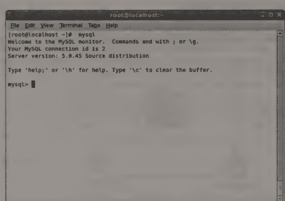

图 4-24：MySQL 客户端界面的欢迎界面。

### MySQL 配置文件

MySQL 的主配置文件 `my.cnf` 位于 `/etc/` 目录。你可以在此文件中设置 MySQL 应用程序的全局选项。默认选项通常足够使用；但如果你需要将 MySQL 与应用程序集成，则可能需要修改此文件。这允许你设置简单选项，例如数据目录路径、用户名和日志文件目录，以及高级选项，例如 `table_cache` 和 `key_buffer`，这些可以为 MySQL 守护进程设置。

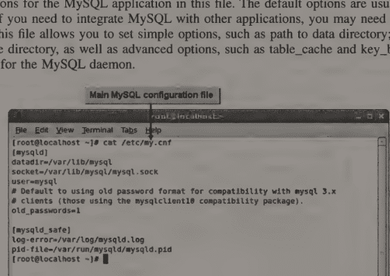

图 4-25：mysql 配置文件的内容。

### mysqld

`mysqld` 或 MySQL 守护进程也是 MySQL 服务器。它允许你管理 MySQL 服务器服务。在安装 MySQL 后，你需要手动启动此守护进程。你可以启动、停止、重启或查看 MySQL 服务器的状态。此服务需要运行，客户端才能连接并使用 MySQL。

MySQL 守护进程

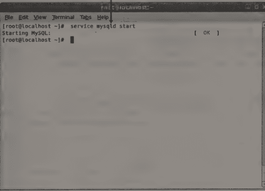

**图 4-26：**启动 `mysqld` 服务。

### MySQL 命令

客户端使用 MySQL 命令与 MySQL 服务器交互。

| MySQL 命令 | 允许你执行 |
| --- | --- |
| select | 获取所有记录或符合特定标准的记录。 |
| create | 在关系型数据库管理系统 (RDBMS) 中创建对象，如数据库、表或索引。 |
| alter | 修改现有表或数据库。 |
| update | 更新表中的值。 |
| use | 将特定数据库设置为当前数据库，以便修改该数据库的对象。 |
| show | 显示当前数据库中可用的表。 |
| insert | 向表的行或记录中输入值。 |
| describe | 显示表的结构。 |
| delete | 从表中删除一行或多行。 |

## CompTIA® Linux+™ Powered by LPI

`insert`、`update` 和 `delete` 命令也被称为数据操作命令 (DML)，因为它们允许你修改表中的数据。

当这些命令带有完整的语法时，也称为语句 (statements)。

### select 语句中的可选子句

可选子句可用于 `select` 语句。这些子句必须按照优先级使用，且每个子句都有特定的用途。

| 可选子句 | 目的 |
| --- | --- |
| where | 用于指定仅从表中检索某些行的条件。 |
| group by | 用于将数据数据组织成组的列标识符。 |
| having | 与 `GROUP BY` 配合使用的条件，指定结果中包含的组。 |
| order by | 按一列或多列对查询结果进行排序的条件。 |

### 常见 SQL 查询和操作

SQL 查询可执行数据库的各种操作。下表说明了各种操作及其对应的 SQL 查询。

| 操作 | SQL 查询 |
| --- | --- |
| 从表中提取所有字段。 | select * from table_name; |
| 从表中提取某些字段。 | select field_name_1, field_name_2..., field_name_n from table_name; |
| 从字段中提取所有行。 | select field_name from table_name; |
| 根据某些条件提取行。 | select field_name from table_name where condition; |

### select 命令中使用的范围操作符

下表提供了用于 `select` 命令中 `where` 子句的范围操作符列表。

## CompTIA® Linux+™ Powered by LPI

| 条件 | 用途 | 示例 |
| --- | --- | --- |
| in | 确定某个值是否等于特定值列表中的任何值。 | select * from emp where dept_id in (10,20,30); |
| any, some | 将值与特定的值列表进行比较。必须与简单比较运算符之一结合使用。 | select * from emp where dept_id= any (select dept_id from dept where dept_name='Sales' or dept_name='Systems'); |
| all | 将值与列表中的每个值进行比较。必须与简单比较运算符之一结合使用。 | select * from emp where salary >= all (select avg(basic) from emp group by dept_id); |
| between a and b | 确定一个值是否大于或等于 a 且小于等于 b。 | select * from emp where dept_id between 10 and 50; |

### 链接 (Joins)

**定义：**
连接是一种用于合并关系型数据库中两个或多个表中的值的查询。它会产生一个称为连接表的临时表。连接通过使用它们的键字段来连接表。

**示例：连接两个表**
你有两个表：`Employees`（员工）和 `Projects`（项目）。`Employees` 表具有 `EmployeeName`（员工姓名）和 `ProjectID` 字段，`Projects` 表具有 `ProjectID` 和 `ProjectName`（项目名称）。`Employees` 表中出现的所有 `ProjectID` 都未列在 `Projects` 表中，且所有的...

### 活动 4-11
使用 MySQL

在开始之前：

- 1. 切换到图形用户界面（GUI）。
2. 导航到 `/relsource/Server` 文件夹。

场景描述：
一名初级数据库管理员加入了你的组织。作为一名 Linux 管理员，你需要帮助该初级管理员在 Linux 系统上安装基于 Web 的数据库。此外，你需要确保客户端能够连接到该数据库。

- 1. 选择 MySQL 文件。
a. 要导航到 MySQL 包，在 Server - File Browser 窗口中输入 `mysql`。
b. 观察到窗口右下角显示了一个文本框。在文本框中输入 `mysql`。
c. 观察到 `mysql-5.0.45-7.el5.i386.rpm` 文件被自动选中。
d. 要查看其他文件，按 `Page Down` 键。
e. 要选择该文件，按 `Ctrl` 键并点击 `mysql-server-5.0.45-7.el5.i386.rpm`。

- 2. 选择其他文件。
a. 向下滚动直到找到 `perl-DBD` 包。
b. 要选择该文件，按 `Ctrl` 键并点击 `perl-DBD-MySQL-3.0007-2.el5.i386.rpm`。
c. 要选择该文件，按 `Ctrl` 键并点击 `perl-DBD-1.52-2-el5.i386.rpm`。
d. 验证状态栏显示消息“4 items selected (14.6 MB)”。

- 3. 安装 MySQL 包。
a. 右键点击选中的任何包，并选择“Open with Software Installer”（用软件安装程序打开）选项。
b. 在“Installing packages”窗口中，观察到列出了四个包。
c. 点击“Apply”（应用）。
d. 在“Software installed successfully”消息框中，点击“OK”。
e. 关闭 Server - File Browser 窗口。

- 4. 启动 MySQL 守护进程并验证安装是否成功。
a. 要显示终端窗口，选择 `Applications（应用程序）→Accessories（附件）→Terminal（终端）`。
b. 要启动 MySQL 守护进程，输入 `service mysqld start`。
c. 观察到“Starting MySQL”消息后显示了“OK”状态消息，表示 MySQL 守护进程已成功启动。
d. 要自动启动 MySQL 守护进程服务，输入 `chkconfig mysql on`。
e. 要验证你是否连接到 MySQL 服务器，输入 `mysql`。
f. 观察到显示 `mysql` 提示符，表示 MySQL 功能正常，你可以使用它来创建数据库。
g. 要退出 `mysql` 提示符，输入 `quit`。
h. 要清除终端窗口，输入 `clear`。

### 活动 4-12
执行现有的 sql 脚本命令

**数据文件：**
`users.sql`

**在开始之前：**

- 1. 切换到命令行界面（CLI）。
2. 以 `root` 身份登录。
3. 要进入 `Managing_Files` 目录，输入 `cd /08509Data/Managing_Files`。
4. 要清空终端屏幕，输入 `clear`。

场景描述：
数据库管理员有一些需要在 Linux 中重用的 `sql` 脚本。你需要帮助数据库管理员在 Linux 中执行一个示例脚本，以填充新数据库并根据需要更新数据。

需要执行的更新：

- 1. 为 `userid` 为 `503` 的 `eric` 添加一条新记录。
2. 将 `userid` 为 `508` 的用户名从 `"patrick"` 改为 `"pat"`。
3. 删除 `userid` 为 `509` 的记录。

- 1. 在正确位置复制 `users.sql` 文件并连接到 MySQL。
a. 要将脚本文件复制到 `mysql` 目录，在终端中输入 `cp users.sql /var/lib/mysql`。
b. 要切换到 `mysql` 目录，输入 `cd /var/lib/mysql`。
c. 要连接到 MySQL 服务器，输入 `mysql`。

- 2. 创建一个新的 `userinfo` 数据库并将其设置为当前数据库。
a. 要创建一个新数据库，在 `mysql` 提示符下输入 `create database userinfo`。
b. 要将其设置为当前数据库，输入 `use userinfo`。
c. 观察到显示消息“Database changed”。

- 3. 执行 `users` 脚本并验证值。
a. 要执行脚本，输入 `source users.sql`。
b. 观察到因为脚本已执行而显示了消息“Query OK”。
c. 要查看现有表，输入 `show tables;`。
d. 要查看 `users` 表中的所有记录，输入 `select * from users;`。

- 4. 根据要求修改数据库记录。

- a. 要为 `Eric` 添加一条新记录，输入 `insert into users values ('503', 'eric');`。
- b. 要验证新记录已插入，输入 `select * from users;`。
- c. 要更新用户名，输入 `update users set user_name='pat' where user_id='5008';`。
- d. 要验证记录已更新，输入 `select * from users;`。
- e. 要删除记录，输入 `delete from users where user_id='509';`。
- f. 要验证记录已删除，输入 `select * from users;`。
- g. 要根据 `user_id` 字段对输出排序，输入 `select * from users order by user_id;`。
- h. 观察到屏幕上显示了排序后的记录。
- i. 要退出 `mysql` 提示符，输入 `quit`。
- j. 要清空终端屏幕，输入 `clear`。

## 课程 4 后续

在本节中，你学习了如何定位文件、编辑文件、备份和恢复文件，并探索了权限。

- 1. 你如何操作 Linux？
- 2. 你偏好使用哪个编辑器？

## Linux 权限与所有权

**课程目标：**

在本节中，你将：
- 修改文件的权限。
- 修改目录的权限。
- 修改所有权。

### 引言

在处理文件时，你可能需要修改权限和所有权。在本节中，你将学习权限与所有权。
在 Linux 中，修改文件的所有权将允许权限授予特定用户。

- A. 修改权限和所有权。
- B. 理解权限和所有权。
- C. 修改权限。
- D. 设置高级权限。

## 主题 A：修改权限和所有权

在处理文件时，你可能需要修改权限和所有权。在本节中，你将学习权限与所有权。
在 Linux 中，修改文件的所有权将允许权限授予特定用户。

- A. 修改权限和所有权。
- B. 理解权限和所有权。
- C. 修改权限。
- D. 设置高级权限。

### 主题 B：理解权限和所有权

在处理文件时，你可能需要修改权限和所有权。在本节中，你将学习权限与所有权。
在 Linux 中，修改文件的所有权将允许权限授予特定用户。

- A. 修改权限和所有权。
- B. 理解权限和所有权。
- C. 修改权限。
- D. 设置高级权限。

### 主题 C：修改权限

在处理文件时，你可能需要修改权限和所有权。在本节中，你将学习权限与所有权。
在 Linux 中，修改文件的所有权将允许权限授予特定用户。

- A. 修改权限和所有权。
- B. 理解权限和所有权。
- C. 修改权限。
- D. 设置高级权限。

### 主题 D：设置高级权限

在处理文件时，你可能需要修改权限和所有权。在本节中，你将学习权限与所有权。
在 Linux 中，修改文件的所有权将允许权限授予特定用户。

- A. 修改权限和所有权。
- B. 理解权限和所有权。
- C. 修改权限。
- D. 设置高级权限。

### 权限

权限是授予用户的访问权限。`ls -l` 命令列出文件列表。每项包含以下列：

| 列号 | 描述 |
|---|---|
| 0 | 第一列显示是文件 (-) 还是目录 (d)。 |

### ls -l 命令

`ls -l` 命令列出文件列表。每项包含以下列。

示例：

- -rw-r--r-- 1 user group 4096 Jan 01 12:00 filename

图 1：授予用户的权限。

列内容所示：

| 列号 | 描述 |
|---|---|
| 1-3 | 用户（所有者）权限。有效的用户位于第 11 列。 |
| 4-6 | 组权限。有效的组位于第 12 列。 |
| 7-9 | 其他用户的权限。除了指定的用户和组之外的任何用户都获得这些权限。 |
| 10 | 链接数。文件通常有一个链接数。对于目录，链接数是子目录的数量加二（对于目录本身及其父目录）。 |
| 11 | 显示文件的所有者。 |
| 12 | 显示文件所属的组。该组的所有成员都具有第 4-6 列所示的权限。 |
| 13 | 显示或目录的大小（字节）。 |
| 14 | 显示文件创建或最后修改的日期和时间。 |
| 15 | 显示文件名或目录名。 |

> 使用 `ls -ld [目录名]` 命令列出指定目录的目录。不会显示目录内容。

## 访问类别

Linux 权限中的访问类别决定 Linux 如何解释文件的权限。如果用户的 UID 与权限匹配，则应用用户级权限。如果用户的 GID 与权限匹配，则授予权限。如果都不匹配，则应用普通用户的权限。访问类别的符号如下表所示：

| 访问类别 | 描述 |
|---|---|
| u | 修改用户级别的权限。 |
| g | 修改组级别的权限。 |
| o | 修改其他用户的权限。 |
| a | 全局修改所有用户的权限。 |

### 权限字符串

Permission String

`ls -l` 命令的输出显示文件或目录的权限字符串。权限字符串包含十个字符。第一个字符表示文件类型；`d` 表示目录，连字符 `-` 表示其他。第二、第三和第四个字符表示文件或目录所有者或用户的权限。第五、六、第七个字符表示组权限，第八、第九和第十个字符表示其他人的权限。

### 权限级别

权限由文件所有者授予或拒绝。下表列出了各种权限的级别及其描述。

| 权限级别 | 描述 |
|---|---|
| 用户级 r/w/x 权限 | 只有所有者可以读取、写入和执行文件。 |
| 组级 r/w/x 权限 | 只有所有者所属组的成员可以读取、写入和执行文件。 |
| 其他级 r/w/x 权限 | 所有用户都可以读取、写入和执行文件。 |

### 文件所有者

文件所有者是创建文件或目录的用户。文件所有者可以设置权限，指定其他用户或组是否有权读取、写入或执行该文件。

### chmod 命令

`chmod` 命令允许你修改文件或目录的默认权限。文件所有者或系统管理员可以更改文件或目录的权限。

```bash


## Original permissions for the file

```
$ ls -l --is -l ... anaconda-cs.cfg

total 72

-rw-r--r-- 1 root root 1480 May 25 11:48 anaconda-cs.cfg
-drwxr-xr-x 2 root root 4096 May 25 10:32 Desktop
-rw-r--r-- 3 root root 4096 May 25 11:48 install.log.syslog
-drwxr-xr-x 3 root root 4096 Jun 24 16:33 lines

$ chmod u+w Products.txt

-rw-r--r-- 1 root root 2048 Oct 21 17:37 (rw-r--r--)
-rw-r--r-- 1 root root 1480 May 25 11:48 anaconda-cs.cfg

total 72

-rw-rw-r-- 1 root root 30599 May 25 11:48 install.log.syslog
-drwxr-xr-x 3 root root 4096 May 24 18:14 syslog
-rw-rw-r-- 1 root root 3567 May 25 08:36 Office.txt
```


图 5-2：使用 `chmod` 命令修改权限。

#### 语法

`chmod` 命令的语法为 `chmod [options] (mode) {file name}`。

## chmod 命令选项

`chmod` 命令支持不同的选项来修改权限。可以同时使用一个或多个选项。

| 选项 | 描述 |
| - | --- |
| `-c` | 报告权限所做的更改。 |
| `-f` | 隐藏大多数错误信息。 |
| `-v` | 为处理的每个文件显示诊断条目。 |
| `-R` | 递归修改文件和目录的权限。 |

## chmod 模式

`chmod` 命令支持两种模式：字符模式和数字模式。字符模式允许你使用三个组件设置权限，即：访问类别（如 `u`/`g`/`o`/`a`）、运算符（如 `+`/`-`/`=`）以及权限属性（如 `r`/`w`/`x`）。数字模式由三位数字表示。

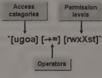

**图 5-3：** 字符模式的组成部分。

## 与权限相关的运算符

运算符决定是授予还是移除权限。下表列出了与 Linux 权限相关的常用运算符。

| 运算符 | 描述 |
| - | --- |
| `+` | 授予权限。 |
| `-` | 拒绝权限。 |
| `=` | 使分配的权限覆盖现有权限。分配与参考文件相似的权限。 |

## 权限属性

权限属性精确定义了用户允许对特定文件执行的操作。表中列出了这三种权限属性。

## 使用字符法修改权限

| 权限属性 | 允许你执行 |
|---|---|
| `r` (读) | 查看文件内容 |
| `w` (写) | 修改文件内容 |
| `x` (执行) | 运行文件（如果它是可执行程序且结合了读属性）。 |

可以使用字符法更改文件或目录的权限。使用此方法时，`chmod` 命令的语法为 `chmod {options} {access categories}{operator}{permission levels} {file name or directory name}`。

## 使用八进制权限数字修改权限

Linux 系统使用八进制（基8）数字来指定权限。每个权限（`r`, `w`, 和 `x`）都有关联的数字。

| 八进制数字 | 属性 | 字母 |
|---|---|---|
| `4` | 读 | `r` |
| `2` | 写 | `w` |
| `1` | 执行 | `x` |

通过相加你想授予的权限的八进制数字，可以获得分配给目录或文件的整体权限数字。全权限（读、写、执行）等同于 `4 + 2 + 1`，即 `7`。读和写权限等同于 `4 + 2`，即 `6`。完全权限以三位数数字表示，其中每个数字分别对应用户、组和其他人的权限。

使用数字法更改权限的语法为 `chmod {number} {file name}`。

## 如何修改文件权限

### 过程参考：查看文件或目录

查看文件或目录的权限：

1. 以用户身份登录。
2. 查看文件或目录的权限：
   - 查看文件的权限，输入 `ls -l {file name}`。
   - 查看目录的权限，输入 `ls -ld {directory name}`。
   - 使用 `Nautilus` 浏览器查看文件或文件夹的权限：
     - 右键点击文件和文件夹并选择**属性 (Properties)**。
     - 要查看文件或文件夹的权限，选择**权限 (Permissions)** 选项。

### 过程参考：修改文件或目录

修改文件或目录的权限：

1. 以 `root` 身份登录。
2. 在 CLI 或 GUI 中更改文件或目录的权限：
   - 在 CLI 中修改权限，输入 `chmod {options} {access categories}{operator}{permission levels} {file name or directory name}`。
   - 在 GUI 中修改权限：
     - 右键点击文件或文件夹并选择**属性 (Properties)**。
     - 要查看文件或文件夹的权限，选择**权限 (Permissions)** 选项。

## 练习 5-1：使用字符法修改权限

**文件：**
`Products.txt`

**准备工作：**

1. 以用户身份登录。
2. 查看文件或目录的权限：
   - 要查看文件的权限，输入 `ls -l {file name}`。
   - 要查看目录的权限，输入 `ls -ld {directory name}`。
   - 使用 `Nautilus` 浏览器查看文件或文件夹的权限：
     - 右键点击文件和文件夹并选择**属性 (Properties)**。
     - 要查看文件或文件夹的权限，选择**权限 (Permissions)** 选项。

**任务：**
更改 `Products.txt` 的权限，以便所有者可以写入该文件。

1. 查看 `Products.txt` 的权限。
2. 使用字符法修改 `Products.txt` 的权限。
3. 验证 `Products.txt` 的权限。

## 练习 5-2：使用八进制数字修改权限

**文件：**
`anaconda-cs.cfg`

**准备工作：**

1. 以 `root` 身份登录。
2. 查看文件或目录的权限。
3. 更改文件或目录的权限。

**任务：**
更改 `anaconda-cs.cfg` 的权限，以便所有用户都可以读取该文件。

1. 查看 `anaconda-cs.cfg` 的权限。
2. 使用八进制数字修改 `anaconda-cs.cfg` 的权限。
3. 验证 `anaconda-cs.cfg` 的权限。

## 练习 5-3：使用字符法修改权限

**文件：**
`install.log.syslog`

**准备工作：**

1. 以 `root` 身份登录。
2. 查看文件或目录的权限。
3. 更改文件或目录的权限。

**任务：**
更改 `install.log.syslog` 的权限，以便组用户可以读取和写入该文件。

1. 查看 `install.log.syslog` 的权限。
2. 使用字符法修改 `install.log.syslog` 的权限。
3. 验证 `install.log.syslog` 的权限。

## 练习 5-4：使用八进制数字修改权限

**文件：**
`Office.txt`

**准备工作：**

1. 以 `root` 身份登录。
2. 查看文件或目录的权限。
3. 更改文件或目录的权限。

**任务：**
更改 `Office.txt` 的权限，以便所有用户都可以读取、写入和执行该文件。

1. 查看 `Office.txt` 的权限。
2. 使用八进制数字修改 `Office.txt` 的权限。
3. 验证 `Office.txt` 的权限。

### 补充步骤

- `b.` 从位于“其他”（Others）下拉列表下访问（Access）下拉列表中选择“只读”（Read-only）。
- `c.` 点击“关闭”（Close）保存修改并退出 `Skill_Certification_Policy.txt` 属性对话框。
- `d.` 关闭“目录 - 文件浏览器”窗口。

## 修改默认权限

之前，你修改了文件和目录权限。现在，你需要了解如何更改文件的默认权限。在本主题中，你将修改 Linux 中的默认权限。

修改默认文件权限将允许为用户创建的文件设置更高或更低的安全级别。这将允许高级用户创建对其他用户来说完全安全的文件。

## 默认文件和目录权限

在 Linux 中，默认权限根据用户权限分配给新创建的文件和目录。由 `root` 用户创建的文件，默认权限为 `644`，这意味着 `root` 用户具有读取和写入权限，而组用户和其他用户只有读取权限。对于 `root` 用户创建的目录，默认权限为 `755`，这意味着 `root` 用户具有读取、写入和执行权限，而组用户和其他用户只有读取和执行权限。对于访问权限受限的用户，Linux 为新创建的文件分配 `664` 权限，为新创建的目录分配 `775` 权限。这些默认权限由文件创建掩码 `umask` 决定。然而，`root` 用户可以更改默认权限。

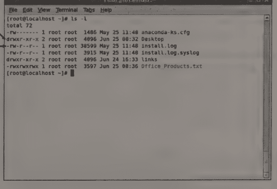

图 5-4：`ls` 命令显示默认文件和目录权限。

## `umask` 命令

`umask` 命令自动更改新创建的文件和目录的默认权限。出于安全考虑可以更改新创建的文件和目录的默认权限。

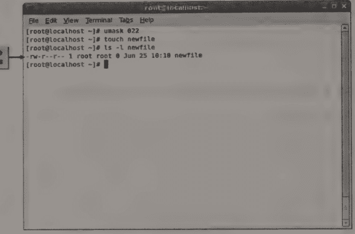

图 5-5：使用 `umask` 命令修改默认文件权限。

#### 语法

`umask` 命令的语法为 `umask {number}`。

## `umask` 对文件的影响

默认情况下，Linux 中不可执行文件的基础权限为 `rw-rw-rw-` 或 `666`。通过输入 `umask 0022`，从该刻起直到系统重启期间创建的所有文件分配的权限将变为 `rw-r--r--` (`644`)。使用 `umask` 命令提供的数字指定了需要从默认设置中清除的权限。第一个数字允许你通过设置高级权限来保护文件。其他三个数字允许你设置普通权限。

| 数字 | 清除的内容 |
|---|---|
| `0` | 不从用户的默认权限中清除任何内容，保留 `rw--` |
| `2` | 清除组的写入权限，仅保留 `r--` |
| `2` | 清除其他人的写入权限，仅保留 `r--` |

这些设置对应于 `root` 用户的默认 `umask`。

## `umask` 对目录的影响

默认情况下，Linux 中目录的基础权限为 `rwxrwxrwx` 或 `777`。通过输入 `umask 0022`，从该刻起直到系统重启期间创建的所有目录的权限将变为 `rwxr-xr-x` (`755`)。使用 `umask` 命令提供的数字指定了需要从默认设置中清除的权限。第一个数字允许你通过设置高级权限来保护目录。其他三个数字允许你设置普通权限。

| 数字 | 清除的内容 |
|---|---|
| `0` | 不从用户的默认权限中清除任何内容，保留 `rwx`。 |
| `2` | 清除组的写入权限，仅保留 `r-x`。 |
| `2` | 清除其他人的写入权限，仅保留 `r-x`。 |

这些设置对应于 `root` 用户的默认 `umask`。

## 如何修改默认权限

### 过程参考：修改默认权限

修改默认权限：

1. 以 `root` 身份登录。
2. 要更改默认 `umask` 值，输入 `umask {umask number}`。
3. 创建一个新文件以验证从现在开始创建的文件是否具有不同的默认权限。

## 活动 5-3
修改默认权限

**开始之前：**

- 你已经在 GUI 中以 `root` 身份登录。
- 系统上已存在 `Chris` 的用户账户。

**场景：**
你的同事 `Chris` 创建了大量文档文件，系统上的其他用户可以使用这些文件。你的经理希望从现在起她创建的所有文件对所有用户都可见且可修改。

**用户账户详情：**
- 用户名：`chris`
- 密码：`myp@$$word`

**步骤：**

1. 将 `Chris` 系统上的 `umask` 值改为 `0000`。
   - a. 切换到第四个终端。
   - b. 在 `Chris` 系统上以 `chris` 身份登录。
   - c. 要查看当前 `umask` 值，输入 `umask`。
   - d. 观察到 `umask` 值显示为 `0002`。
   - e. 创建具有现有权限的测试文件，输入 `touch newfile`。
   - f. 要更改 `umask` 值，输入 `umask 0000`。

2. 检查 `umask` 值是否已更改。
   - a. 要查看新的 `umask` 值，输入 `umask`。
   - b. 观察到 `umask` 值现在显示为 `0000`。

3. 创建具有现有权限的文件。
   - a. 要查看新的 `umask` 值，输入 `umask`。
   - b. 观察到 `umask` 值现在显示为 `0000`。

## 修改文件所有权

更改文件或目录的所有权。

- 在命令提示符处修改文件或目录的所有权。
- 要更改文件或目录的用户所有权，输入 `chown [command options] [username][{group name}] {file or directory name}`。
- 要更改文件或目录的组所有权，输入 `chgrp [command options] {group name} {file or directory name}`。

- 使用 `Nautilus` 浏览器修改文件或目录的所有权。
  1. 右键点击文件或目录并选择“属性”（Properties）。
  2. 选择“权限”（Permissions）选项卡。
  3. 根据需要修改所有权。
     - 从“所有者”（Owner）下拉列表中，选择用户级的文件或目录所有者。
     - 从“组”（Group）下拉列表中，选择组级的文件或目录所有者。

## 活动 5-4
使用命令行修改文件和目录的所有权

**在开始之前：**
要返回第一个终端，请按 `Ctrl+Alt+F1`。

**场景描述：**
你的同事 `Patrick` 创建了大量文件。他希望有一个中心位置来存储这些文件。作为系统管理员，你决定创建一个目录 `/work_files/pat_files/files`，并将该目录的所有权交给 `Pat`。

**步骤：**

1. 创建 `/work_files/pat_files` 目录并验证其已创建。
   - a. 要切换到 `/work_files` 目录，输入 `cd /work_files`。
   - b. 创建工作目录，输入 `mkdir pat_files`。
   - c. 查看带有所有权详情的 `/work_files` 目录内容，输入 `ls -l`。
   - d. 观察到 `root` 是 `pat_files` 目录的所有者。

2. 将 `pat_files` 目录的所有权更改用户 `Patrick`。
   - a. 要更改工作目录的所有权，输入 `chown pat pat_files`。
   - b. 查看带有所有权详情的目录内容，输入 `ls -l`。
   - c. 观察 `pat_files` 目录的所有者为 `Patrick`。
   - d. 清空终端屏幕。

## 主题 D

### 设置高级权限

现在你已经修改了文件和目录的所有权，为用户设置高级权限。某些情况下，你可能需要使用特殊权限允许用户访问文件或目录。在本主题中，你将设置高级权限。

虽然只允许具有 `root` 或管理员权限的用户执行某些命令是理想的，但有时其他用户需要执行这些命令。设置高级权限允许其他用户执行和维护系统程序，这样 Linux 管理员就不必亲自操作。这将为管理员节省时间和精力。

#### 特殊权限

当普通权限不足时（通常是在进程的情况下），会使用特殊权限。通过特殊权限，允许权限较低的用户执行一个只能由 `root` 用户运行的文件。设置用户 ID (`SUID`) 或 `setuid` 是允许用户拥有与文件所有者相似的权限。组 ID (`SGID`) 或 `setgid` 是允许用户拥有与文件组所有者相似的权限。

#### `SUID` 和 `SGID` 权限

`SUID` 和 `SGID` 命令是强强大的工具，它们允许用户执行任务，而不会出现因拥有该用户或组的实际权限而引起的问题。然而，这些工具也是危险的。

在将文件权限设置为 `SUID` 或 `SGID` 时，应考虑以下点：

- 使用完成任务所需的最低权限。不建议给文件设置与 `root` 用户相同的 `SUID` 或 `SGID`。通常可以配置权限较的用户来执行该任务。
- 注意后门。如果用户运行一个 `SUID` 设置为 `root` 的程序，那么当用户通过后门时，用户将保留 `root` 作为有效 UID。以下可以作为后门：
  - 允许你调用 shell（shell out）的程序。
  - 具有多个入口和出口的程序。

#### `chattr` 命令

`chattr` 命令用于更改 Linux 文件系统中文件的属性。

下表列出了 `chattr` 命令语法使用的选项描述。

| 命令选项 | 用途 |
| :--- | :--- |
| `-R` | 递归更改目录及其内容的属性。 |
| `-V` | 显示 `chattr` 命令的输出并打印程序版本。 |
| `-v {version}` | 设置文件的版本号。 |
| `+i` | 将文件标记为只读。 |
| `-i` | 移除文件的只读属性。 |

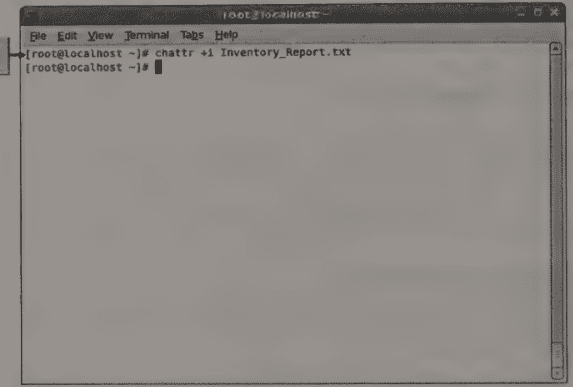

图 5-7：使用 `chattr` 命令设置的文件属性。

##### 语法

`chattr` 命令的语法为 `chattr [ -RV ] [-v version] [[mode](file names)]`。

#### `lsattr` 命令

`lsattr` 命令用于列出 Linux 文件系统中文件的属性。下表描述了 `lsattr` 命令语法使用的选项。

| 选项 | 用途 |
| --- | --- |
| `-R` | 递归列出目录及其内容的属性。 |
| `-V` | 显示程序版本。 |
| `-a` | 列出目录中的所有文件。 |
| `-d` | 像处理文件一样列出目录，而不是列出其内容。 |
| `-v` | 设置文件的版本号。 |

##### 语法

`lsattr` 命令的语法为 `lsattr [ -RV ] [-v version] [[file names]]`。

#### 粘性位

粘性位确保只有文件所有者、目录所有者或 `root` 用户才能删除或重命名其中的文件。

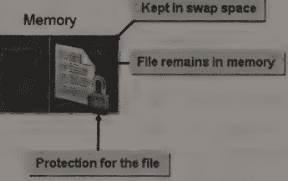

图 5-6：目录上的粘性位。

#### 不变位

定义：不可变位是一种防止文件被修改、删除或重名的属性，即使是 `root` 用户也不行。

#### ACL

访问控制列表 (ACL) 是附加到对象上的权限列表。通常，一个文件与三组权限相关：所有者、组和其他其他人（other）。ACL 允许为不属于这些组的单个用户或组分配权限。

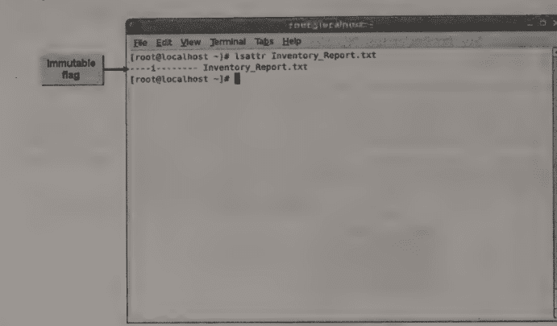

图 5-9：不可变位防止修改文件。

## 与 ACL相关的命令

ACL 可以在文件系统级或文件和目录级管理。要获取文件的 ACL 指定，可以使用 `getfacl` 命令。要设置文件和目录的访问规范，可以使用 `setfacl` 命令及其不同选项。

### 高级权限命令

高级权限命令可以有效地为用户设置特殊的文件或目录访问权限。下表列出了一些常用命令。

| 命令 | 用途 |
| --- | --- |
| `chmod u(operator)s {file name}` | 为文件设置 `SUID`。 |
| `chmod g(operator)s {directory name}` | 为目录设置 `SGID`。 |
| `chmod o(operator)t {file name}` | 为文件设置粘性位。 |
| `umask {value}` | 设置默认的文件创建模式。 |
| `chattr {operator}i {file name or directory name}` | 为文件或目录设置不可变位。 |

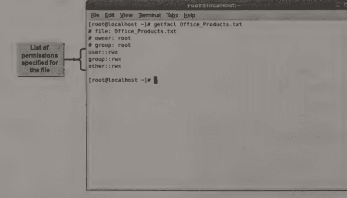

图 5-10：使用 `getfacl` 命令显示的文件的 ACL。

管理文件和目录的 ACL：

- 要查看指定文件或目录的 ACL，输入 `getfacl {文件名或目录名}`。
- 要为指定文件或目录设置 ACL，输入 `setfacl -m {g | u | o}:[用户名或组名]:[r,w & x 组合] {文件名或目录名}`。
- 若要让指定目录中新创建的内容继承所有权限，输入 `setfacl -m d:{g | u}:[用户名或组名]:[r,w & x 组合] {目录名}`。
- 要移除指定文件或目录的 ACL 设置，输入 `setfacl -x {g | u}:[用户名] {文件名或目录名}`。

### 过程参考：更改新文件的默认组所有者

要更改新文件的默认组所有者：

1. 在 CLI 中以 `root` 身份登录。
2. 要更改目录的组所有，输入 `chgrp {组名} {目录名}`。
3. 如果需要，查看目录组所有者的状态，输入 `ls -l`。
4. 为目录设置 `SGID`，输入 `chmod g+s {目录名}`。
5. 如果需要，查看目录的组权限状态，输入 `ls -l`。
6. 输入 `cd {目录名}`。
7. 如果需要，输入 `touch {文件名}`。
8. 如果需要，验证新创建文件的组所有者状态，输入 `ls -l`。

## 活动 5-5
设置用户文件访问权限

**数据文件：**
`Salaryaccount.txt`

**开始之前：**

1. 你已在 CLI 中以 `root` 身份登录。
2. 要添加新用户 `tax`，输入 `useradd tax`。要更改用户 `tax` 的密码，输入 `passwd tax`。
3. 输入 `my@$$word` 并按 **Enter**。
4. 要确认密码，输入 `my@$$word` 并按 **Enter**。
5. 根据以下详细信息，按照步骤 2 到第 4 步创建另外两个用户：
   - 用户名：`income`，密码：`my@$$word`
   - 用户名：`expenditure`，密码：`my@$$word`
6. 要将用户添加到 `tax` 组，输入 `usermod -G tax income`。将 `expenditure` 用户添加到 `tax` 组，输入 `usermod -G tax expenditure`。
7. 要退出 `root` 用户，输入 `logout`。
8. 以 `tax` 身份登录。输入 `my@$$word` 并按 **Enter**。
9. 要创建一个新目录，输入 `mkdir Finance`。退出 `tax` 用户，输入 `logout`。
10. 以 `root` 身份登录。输入 `p@$$word` 并按 **Enter**。
11. 将数据文件拷贝到 `Finance` 目录，输入 `cp /08S099Data/Linux_Permissions/* /home/tax/Finance`。退出 `root` 用户，输入 `logout`。

**场景：**
你在一家机构担任初级系统管理员。财务部由三个组组成：`Income`、`Expenditure` 和 `Tax`。`Income` 和 `Expenditure` 是 `Tax` 组的成员。财务经理不希望 `Tax` 组更改位于 `/home/tax/Finance` 目录下的 `Salaryaccount.txt` 文件。

**用户账户详情：**
- `tax` 用户的登录名：`tax`
- `tax` 用户密码：`my@$$word`
- `income` 用户的登录名：`income`
- `income` 用户密码：`my@$$word`
- `expenditure` 用户的登录名：`expenditure`
- `expenditure` 用户密码：`my@$$word`

**步骤：**

1. 为 `tax` 用户的主目录设置组读和执行权限。
   - a. 在 CLI 中以 `tax` 身份登录。
   - b. 切换到主目录，输入 `cd ..`。
   - c. 查看 `tax` 目录的访问权限，输入 `ls -l`。
   - d. 为 `tax` 用户的主目录设置组读和执行权限，输入 `chmod g+rx tax`。
   - e. 清除屏幕。
   - f. 查看 `tax` 用户主目录更改后的访问权限，输入 `ls -l`。

2. 移除 `Finance` 目录的组写权限。
   - a. 切换到 `tax` 目录，输入 `cd tax`。
   - b. 查看 `Finance` 目录的访问权限，输入 `ls -l`。
   - c. 移除 `Finance` 目录的组写权限，输入 `chmod g-w Finance`。
   - d. 查看 `Finance` 目录更改后的访问权限，输入 `ls -l`。
   - e. 退出账户。

3. 为 `Finance` 目录设置只读权限。
   - a. 以 `root` 身份登录。
   - b. 为 `Finance` 目录设置不可变位，输入 `chattr +i /home/tax/Finance`。
   - c. 退出终端。

4. 检查 `tax` 组成员是否能够删除 `Salaryaccount.txt` 文件。
   - a. 以 `income` 用户身份登录。
   - b. 切换到 `Finance` 目录，输入 `cd /home/tax/Finance`。
   - c. 查看目录内容，输入 `ls -l`。
   - d. 验证 `Salaryaccount.txt` 文件是否可以被删除，输入 `rm Salaryaccount.txt`。
   - e. 观察是否显示了提示消息，确认删除受权限保护的文件。
   - f. 确认删除文件，输入 `y`。
   - g. 观察是否显示了表示权限被拒绝的消息。
   - h. 退出。

## 课程后续

在本节中，你修改了文件和目录的权限及所有权。现在，你将能够保护 Linux 系统的安全。

1. 如何加固 Linux？
2. 什么时候应该修改权限？

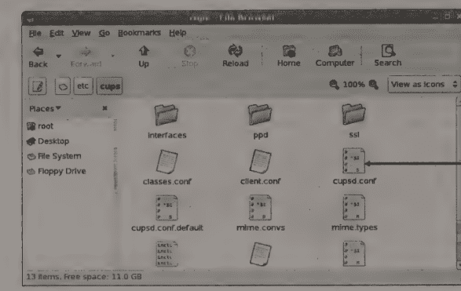

## 打印过程

打印过程允许你打印文档。此过程涉及多个步骤。当用户在应用程序中调用打印文档的命令时，会发生以下步骤：

1. 应用程序调用打印客户端软件。
2. 文件通过打印客户端传递到打印机后台打印程序（printer spooler）。
3. 随后文件通过一系列过滤器，将文档从一种格式转换为另一种格式，最后发送到打印机。
4. 打印机随后打印文件。


**图 6-5：** 打印文档涉及的过程。

**图 6-4：** 位于 `/etc/cups` 目录下的 `cupsd.conf` 文件。

## 打印缓冲 (Spooling)

打印缓冲是临时存储打印作业的程序。如果打印机处于忙状态，打印作业将被放置在等待队列或打印队列中。这些作业存储在一个名为 spool 的临时存储空间中。当打印机空闲时，队列中的文件会被打印。这防止了程序在缓慢的打印过程中必须等待。

## 打印队列

**定义：**
打印队列是一个对传入的打印作业进行排序的临时存储区域。打印进程使用打印队列，以便需要打印机的应用程序无需等待当前打印作业完成即可发布打印命令。打印作业列表列出了当前正在打印的文件详细信息以及待打印的文件。打印队列允许多个用户共享打印机。

**示例：**

```
```


`root@localhost:~`

`$ lp -l pq`

Job being  Owner  Size  File(s) Total Size

printed   active  11    (stdin)  2048 bytes

waiting   root    12    (stdin)  1024 bytes

to be     root    13    (stdin)  2048 bytes

printed   root    14    (stdin)  1024 bytes

         root    15    (stdin)  23552 bytes

         root    16    (stdin)  2048 bytes

         root    17    (stdin)  1024 bytes

         root    18    (stdin)  1024 bytes

         root    19    (stdin)  23552 bytes

`[root@localhost ~#]`


图 6-6：队列中的打印作业。

## 如何配置本地打印机

**过程参考：使用打印配置对话框添加打印机**

使用打印机配置对话框添加打印机：

1. 将打印机连接到 `LPT1` 端口。打开打印机并装纸。
2. 在 GUI 中以 `root` 身份登录。
3. 打开打印配置对话框。
    - 在终端上，输入 `system-config-printer`。
    - 从面板（Panel）选择系统→管理→打印。
4. 在“打印配置 - localhost”的工具栏上，点击“新建打印机”（New Printer）。
5. 在“新建打印机”对话框中，在“打印机名称”（Printer Name）文本框中输入打印机名称。
6. 如必要，在“描述”（Description）文本框中输入打印机描述。
7. 如必要，在“位置”（Location）文本框中输入打印机位置详情。
8. 继续进行打印机安装，点击“下一步”（Forward）。
9. 要安装打印机，在“选择连接”（Select Connection）列表框的“设备”（Devices）列表框中，选择打印机设备并点击“下一步”。
10. 在“厂商”（Makes）列表框中，选择打印机厂商并点击“下一步”。
11. 在“型号”（Models）列表框中，选择相应的型号，并点击“下一步”。
12. 要添加新打印机，在确认页面上点击“应用”（Apply）。
13. 要关闭打印配置对话框，从菜单选择文件→退出（File→Quit）。

**过程参考：使用 CUPS 界面添加打印机**

使用 CUPS 界面添加打印机：

1. 如必要，按下 `Ctrl+Alt+F7` 切换到 GUI。
2. 在 GNOME 面板中，点击 Web 图标。
3. 在地址栏中双击现有地址。
4. 要启动 CUPS 浏览器界面，输入 `localhost:631`。
5. 在首页（Home）选项卡上，在“欢迎”部分点击“添加打印机”（Add Printer）。
6. 在“添加打印机”页面，在“名称”、“位置”和“描述”文本框分别输入打印机的名称、位置和描述。
7. 要配置本地打印机，在“管理”（Administration）选项卡中，从“设备”列表中选择 `LPT #1`。点击“继续”。
8. 在“厂商/制造商”部分，在厂商列表中选择打印机厂商。点击“继续”。
9. 在“型号/驱动程序”部分，在型号列表中选择你的打印机型号并点击“继续”。
10. 在身份验证对话框中，输入 `root` 用户和密码。点击 `OK`。
11. 如必要，在“设置打印选项”网页上按需修改设置并关闭 CUPS 浏览器界面。

## 活动 6-1 配置通用打印机

**在开始之前：**

1. 切换到 GUI。
2. 打印机已连接到系统的并行端口 (`LPT1`) 并已开启。
3. 打印机已装纸。

**场景：**

你想从 Linux 系统打印文件。但是，你还没有配置打印机。你已经物理连接了打印机，现在需要配置它。

- 在 Linux 系统中添加打印机。
    - 选择系统→管理→打印。
    - 要添加打印机，在“打印配置 - localhost”对话框中，点击“新建打印机”。
    - 在“新建”对话框中，在“打印机名称”文本框中输入 `printer1` 并按 `Tab`。
    - 在“描述”文本框中输入 `Test` 并按 `Tab`。
    - 在“位置”文本框中输入 `Lab` 并点击“下一步”。

- 选择要配置的打印机厂商和型号。
    - 在“设备”列表框中，确保选择了 `LPT #1` 并点击“下一步”。
    - 在“厂商”列表框中，确保选择了 `Generic` 并点击“下一步”。
    - 在“型号”列表框中，向下滚动并选择 `PostScript Printer`。
    - 在“驱动程序”列表框中，选择 `Generic - PostScript_Printer -PostScript.ppd (recommended)` 选项并点击“下一步”。
    - 在确认页面上，观察到显示消息“正在创建打印机 `printer1` at `parallel:/dev/lpt0.`”点击应用到打印机。

- 检查 `printer1` 是否已添加到“本地打印机”列表并将其设置为默认打印机。
    - 观察 `printer1` 已添加到“本地打印机”列表。
    - 在“服务器设置”部分，点击 `printer1`。
    - 要设置为系统默认打印机，在“设置”选项卡中，在“默认打印机”部分点击“设置为默认打印机”。
    - 关闭“打印配置 - localhost”对话框。

## 活动 6-2 在 Linux 中配置 USB 打印机

**开始之前：**

1. 你在 GUI 中以 `root` 身份登录。
2. USB 打印机已连接到系统的 USB 端口并已开启。
3. 打印机已装纸。

**场景：**

作为系统管理员，被要求在 Linux 中设置打印机。

1. **检查打印机配置。**
    a. 选择系统→管理→打印。
    b. 在“打印配置 - localhost”窗口中，观察“本地打印机”部分列出了 USB 打印机。
    c. 选择 `printer1`。
    d. 要设置为默认打印机，在“设置”选项卡中，在“默认打印机”部分点击“设置为默认打印机”。
    e. 观察到显示消息“这是默认打印机”。

2. **打印测试页。**
    a. 点击“测试页”打印测试页。
    b. 观察到一个显示框，显示文本“测试页已提交 `jobID`”。
    c. 要打印测试页，点击 `OK`。
    d. 收集测试页的纸质副本并存档。
    e. 要取消其他测试，点击 `Cancel Tests`。
    f. 关闭“打印机配置 localhost”窗口。

在上一个主题中，你配置了一个与 Linux 系统兼容的打印机。安装打印机后，你已经准备好打印文件了。在本主题中，你将 Linux 系统中打印文件。

打印文件是一项常规任务。在 Linux 中学习打印将在你记录系统信息和更改时节省时间。虽然你可以从 GUI 打印，但学习从命令行打印将让你从其他位置打印时拥有更大的自由。

## 命令

Linux 包含各种方便打印过程的命令。某些命令描述在下表中。

| 命令 | 描述 |
| --- | --- |
| `lp` | 提交文件进行打印或更改等待中的打印作业。该命令的语法为 `lp [options] (file name)`。 |
| `lpr` | 提交文件进行打印。命令行输入的文件将发送到指定的打印机，或者在打印机忙时发送到打印队列。如果命令行没有输入文件，`lpr` 命令从标准输入读取打印文件。该命令的语法为 `lpr [options] [file name]`。 |
| `lpq` | 显示打印队列的状态。该命令的语法为 `lpq [print queue name]`。 |
| `lprm` | 取消队列中的打印作业。该命令的语法为 `lprm [print job id]`。 |
| `lpc` | 允许你启动或停止打印机、启用或禁用队列，并获取打印机和队列的状态报告。该命令的语法为 `lpc [parameter]`。 |
| `lpstat` | 显示 CUPS 状态信息。该命令的语法为 `lpstat [options]`。 |
| `cancel` | 从打印队列中删除作业。该命令的语法为 `cancel [options]`。 |

### `lpr` 命令

`lpr` 命令包含多种选项，允许您指定打印输出的性质。
`lpr` 命令的选项如表所示。

| 选项 | 用途 |
| --- | --- |
| `-E` | 连接到服务器时强制加密。 |
| `-P {destination}` | 使用指定的打印机打印文件。 |
| `-# {copies}` | 将打印份数设置为 1 到 100 之间。 |
| `-C {name}` | 设置作业名称。 |
| `-l` | 指定打印文件已格式化并直接发送，无需过滤。 |
| `-o {option}` | 设置作业选项。 |
| `-p` | 指定打印文件需要带有阴影页眉进行格式化，页眉包含文件的日期、时间、作业名称和页码。 |
| `-r` | 指定在打印完成后后应删除打印文件。 |

### `lpc` 命令

`lpc` 命令包含多种选项，允许您管理打印作业。

### `pr` 命令

`pr` 命令在打印之前对文件进行格式化。默认情况下，`pr` 命令将输出发送到终端屏幕。它也常与将输出发送到打印机的命令结合使用。`pr` 命令会格式化包含页码、文件名、日期和时间的文件页眉。

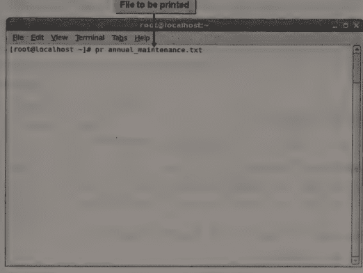

**图 6-7:** 使用 `pr` 命令打印文档。

**语法**

`pr` 命令的语法为 `pr [options] {file name}`。

### `pr` 命令选项

`pr` 命令提供了许多可用的格式化选项。

| 选项 | 描述 |
| --- | --- |
| `-{column}` | 生成多列输出，数据按列排列。 |
| `-d` | 生成双倍间距输出。 |
| `-m` | 合并文件。 |
| `-F` | 确保打印页之间通过分页符而不是换行符分隔（页眉包含 3 行页眉）。 |
| `-l [#]` | 修改输出的页长度，其中 `#` 是每页行数。 |
| `-h [new header text]` | 允许您更改每页顶部页眉的内容，其中 `[new header text]` 将替换默认页眉内容中的文件名。|

### 在管道中使用 `pr`

当使用 `pr` 命令格式化输出时，可以使用重定向操作符 (`>`) 和管道将格式化后的输出发送到文件进行打印。例如，`pr -145 sales > sales.out` 创建 `sales.out` 文件，该文件已格式化并准备好打印。此外，您可以使用 `lpr` 命令将格式化后的文件直接发送到打印机。例如，`pr -145 sales | lpr` 命令将格式化的 `sales` 文件直接发送到默认打印机。

## 如何打印文件

**过程引用：不带文本格式打印文件**

要打印不带文本格式的文件：

1. 进入包含要打印的文件的目录。
2. 使用 `cat {file name} | lpr` 命令打印文件。

**过程引用：带文本格式打印文件**

要打印带文本格式的文件：

1. 进入包含要打印的文件的目录。
2. 若要带文本格式查看查看文件，输入 `pr [options] {file name} | more`。
3. 若要带文本格式打印文件，输入 `pr [options] {file name} | lpr`。

## 活动 6-3 为打印格式化文本

**开始之前：**

1. 您已在 GUI 中以 `root` 身份登录。
2. 显示终端窗口。

**场景：**

由于最近启动过程的更改和硬盘升级，您想打印系统文件的副本以便备份。对这些文件的任何进一步更改都应该记录在并打印新版本。您决定使用文本格式化功能在打印文件之前修复任何对齐问题。

1. 使用 `more` 命令显示 `/etc/fstab` 和 `/etc/initstab` 文件的内容：
    a. 要查看 `/etc/fstab` 文件的内容，输入 `more /etc/fstab`。
    b. 观察 `/etc/fstab` 文件的内容显示在屏幕上。
    c. 要查看 `/etc/initstab` 文件第一页的内容，输入 `more /etc/initstab`。
    d. 要查看 `/etc/initstab` 文件的下一页，按 `Spacebar`。
    e. 观察 `/etc/initstab` 文件的内容显示在屏幕上。
    f. 要查看文件的剩余部分，按 `Spacebar`。

2. 使用 `pr` 命令显示 `/etc/initstab` 文件：
    a. 输入 `pr /etc/initstab | more`。
    b. 观察日期、标题和页码已显示。
    c. 要查看 `/etc/initstab` 文件的下一页，按 `Spacebar`。
    d. 要查看文件的剩余部分，按 `Spacebar`。观察屏幕上显示的 `/etc/initstab` 文件内容。

3. 预览具有双倍行间距和标题“`The fstab entries.`”标题的 `/etc/fstab` 文件。
    a. 要查看应用于文件上的格式化，输入 `pr -d -h "The fstab entries"`。
    b. 观察应用于文件上的格式化。

4. 预览具有双倍行间距和标题“`The fstab entries.`”标题的 `/etc/fstab` 文件。
    a. 输入 `pr -d -h "The fstab entries" /etc/fstab | more`。

## 主题 D

### 配置远程打印

现在你已经学会了管理本地打印作业和队列，现在你将能够将这些打印技术应用到网络中。在本主题中，你将学习连接并使用远程打印机。

企业和家庭用户建立网络是为了传输文件。在有了这些基础设施的基础上，跨网络打印是可行的。使用远程打印机进行打印允许你尽可能地减少环境中所需的打印机数量。你可以让一台打印机供更多的用户共享。

#### 打印服务器

**定义：**

打印服务器是一台允许网络中的用户访问中央打印机的计算机。打印服务器充当缓冲器的角色，存储要打印的信息，直到打印机空闲。打印服务器可以被程序设置为按照接收到的顺序或按优先级顺序执行打印作业。

**示例：**

**图 6-8：** 打印服务器管理网络上的打印作业。

#### LPI 授权的远程打印®

在网络环境中，Linux 系统的用户可以通过 Linux 打印系统使用远程打印机打印文件。当你输入 `lpr` 命令时，你指定的文件会被复制到远程溢打印目录中，并在那里等待，直到远程打印服务器可以打印它。

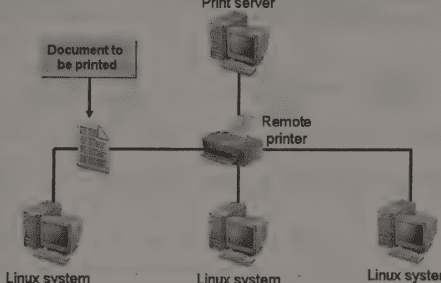

图 6-9：通过 Linux 打印系统在网络上打印。

**语法**

远程打印文档的语法为 `lpr -P [printer name] [file name]`，其中 `[printer name]` 是远程打印机的名称，`[file name]` 是你想要打印的文件名。

#### 远程打印机权限

如果你正在设置远程打印机，请确保你的系统具有访问远程打印机的正确权限。权限指定在连接打印机的系统上的 `/etc/hosts.lpd` 文件或 `/etc/hosts.equiv` 文件中。这些文件列出了可以使用本地打印机的远程系统名称，并且可以通过修改这些文件来添加或删除对打印机的访问权限。

#### 管理远程打印作业

就像你可以管理本地打印作业（例如从队列中删除作业、挂起作业或重新排序作业）一样，你也可以管理远程打印作业。你可能无法作为普通用户执行此操作，可能需要具有远程打印机管理访问权限的人为你操作。但是，你应该能够挂起或删除自己的作业。

第 6 课：打印文件 249

#### Samba

Samba 是一套网络共享工具，有助于在运行不同操作系统的计算机组成的异构网络上共享文件和打印机。Samba 是一个开源软件应用程序，提供了增强的并行性、更好的性能和极少的维护。通过使用服务器消息块 (SMB) 协议，Samba 使 Linux 系统能够与运行其他操作系统的计算机通信，并共享打印机等网络资源。


图 6-10：Samba 允许 Linux 系统访问连接到 Windows 操作系统的打印机。

#### Samba 服务器

Samba 允许 Linux 模拟 Windows 服务器提供的某些服务。它允许用户在 Linux 和 Windows 之间共享资源。Samba 还通过使用活动目录 (AD) 支持提供网络安全。AD 帮助提供经过验证的用户访问和限制的访问权限。通过使用共享网络资源，你可以让 AD 打印变得简单安全。

#### SMB 协议

SMB 是一种客户端-服务器协议，用于在网络上共享和传输文件。它允许网络上的客户端向服务器发送、打印或扫描请求。服务器反过来为客户端提供该设备的服务。SMB 主要用于运行 Windows 操作系统的计算机。

#### 配置 Samba

若要配置 Samba，你必须编辑 `/etc/samba/smb.conf` 文件。在文件中必须设置以下配置选项：

```


```
load printers = yes

printing = cups

printcap name = cups
```

在 `[printers]` 部分，你应该会有类似下所示的内容：

```
[printers]

comment = All Printers

path = /var/spool/samba

browseable = no

public = yes

guest ok = yes

writeable = no

printable = yes

printer admin = root, @atndamba
```


修改文件后，必须重启 `smb` 服务以使更改生效。

# `printers.conf` 文件

`printers.conf` 文件存储在 `/etc/cups` 目录，它将网络上的本地打印机集定义为共享资源。打印机列表通过使用 `cups` 守护进程自动生成。它可以被配置为仅允许显式公布的打印机。该文件包含一组指令，定义了被共享打印机的特性。

# 如何配置远程打印

过程参考：安装 Samba

要安装 Samba：

1. 在 GUI 中以 `root` 登录。
2. 挂载包含最新版本 Samba 包的 Linux 安装 CD-ROM。
3. 导航到 `/media/(name of the media)/Server` 文件夹。
4. 选择 `samba [package version].rpm` 和 `perl - Convert -ASN1 - {package version}.rpm` 文件。
5. 右键点击并选择“用软件安装程序打开”。
6. 在“正在安装软件包”窗口中，验证已列出两个包并点击“应用”开始安装软件包。
7. 如果必要，为了安装这两个包，在“无法验证 `{package version}`”框中，点击“仍然”。
8. 要完成安装，在“软件已安装”消息框中，点击“确定”。

# 过程参考：使用 Samba 共享打印机

要使用 Samba 共享打印机：

1. 打开 `/etc/samba/smb.conf` 文件。
2. 定义共享：
   - `[share name]`
   - 定义溢出路径：`path = (path to the spool)`
   - 指定打印机名称：`printer = (printer name)`
   - 指定是否允许访客：`public = {yes | no}`
   - 指定打印权限：`printable = {yes | no}`
   - 如果必要，包含注释：`comment = (Printer Description)`
3. 保存并关闭文件。
4. 要验证 `smb.conf` 是否正确，输入 `testconfig /etc/samba/smb.conf`。
5. 要系统启动时启动服务，输入 `chconfig`。
6. 要重启服务，输入 `service restart`。
7. 查看连接打印机的系统的 IP 地址，输入 `ifconfig`。
8. 从其他 Linux 系统验证你创建的打印机共享。

# 活动 6-5 配置远程打印机

1. 在 `svr` 上，你已在 GUI 中登录。
2. 双击桌面上的计算机/服务器图标。
3. 导航到 `resource` 文件夹。
4. 在服务器文件浏览器中，导航并选择 `perl - Convert -ASN1 - 0.20 - 1.1.noarch.rpm` 和 `samba - 3.0.33 - 3.7.el5i86.rpm` 文件。
5. 右键点击并选择“用软件安装程序打开”。
6. 在安装窗口中，验证已列出两个包并点击“应用”开始安装软件包。
7. 在“软件已安装”消息框中，点击“确定”完成安装。
8. 关闭服务器文件浏览器窗口。
9. 选择 `系统` → `管理` → `打印`，显示“打印配置-本地”窗口。
10. 在左侧窗格中，选择“服务器设置”。
11. 在右侧窗格中，在“基本服务器设置”部分，勾选“共享到此系统的已打印机”。
12. 点击“应用”。
13. 关闭“打印配置-本地”窗口。
14. 选择 `应用程序` → `辅助工具` → `终端` 在 GUI 中启动终端窗口。

你已经配置了一个本地打印机。由于你有许多文档需要从其他 Linux 系统打印，你决定将该打印机设置为共享，并授予 `smith` 用户账户对其进行远程访问。

1. 修改 `smb.conf` 文件以共享打印机。
   a. 要在文本编辑器中打开 `smb.conf` 文件，在终端窗口中输入 `vi /etc/samba/smb.conf`
   b. 导航到“共享定义”部分。
   c. 导航到打印机部分包含 `browseable` 变量行的开头。
   d. 要切换到插入模式，按 `I`。要在当前行之前插入新行，按 `Enter` 然后按 `Tab`。
   e. 要移动到上一行，按上箭头键并按 `Tab`。
   f. 输入 `打印机名称 = printer`
   g. 按下方向键并按两次退格键。
   h. 为了使其可以通过浏览器访问，输入 `yes` 并按下方向键。再按两次退格键。
   i. 要允许访客账户访问打印机共享，输入 `yes`
   j. 要返回命令模式，按 `Esc` 键。保存文件并退出编辑器。

# 添加新的 `smb` 用户并重启 `smb` 服务。

- 要将 `jsmith` 添加到 `smb` 用户列表，输入 `smbpasswd -a jsmith`
- 要设置空密码，按两次 `Enter`（回车键）。
- 要查看 Linux 系统的 IP 地址，输入 `ifconfig`
- 记录下系统的 IP 地址。
- 要重启 Samba 服务器，输入 `smb restart`

# 访问远程打印机。

- 在 `srvB` 上，以 `root` 身份登录 GUI。
- 选择 `系统` → `管理` → `打印`。
- 要添加打印机，在 `Printer configuration - localhost` 对话框中，点击 `New Printer`（新建打印机）。
- 在 `New Printer` 对话框中，在 `Printer Name`（打印机名称）文本框中输入 `printer1` 并按 `Tab` 键。
- 在 `Description`（描述）文本框中输入 `Remote Printer`（远程打印机）并按 `Tab` 键。
- 在 `Location`（位置）文本框中输入 `Printer on srvA` 并点击 `Forward`（下一步）。
- 在 `Devices`（设备）列表中，观察到选中了 `LPT #1`。
- 通过 `SAMBA` 选项选择 `Windows Printer`（Windows 打印机）。
- 在右窗中，观察到显示 `MYGROUP` 共享。
- 双击 `MYGROUP` 共享。
- 在右窗中，观察到显示 `SRVA`。
- 双击 `SRVA` 共享。
- 在右窗中，观察到显示打印机。
- 选择打印机。
- 观察 `smb` 部分，打印机路径已填充在文本框中。点击 `Forward`（下一步）。

# 选择打印机驱动并将远程打印机设置为默认打印机。

- 在 `Makes`（厂商）列表中，确保选中了 `Generic` 并点击 `Forward`（下一步）。
- 在 `Models`（型号）列表中，向下滚动并选择 `PostScript Printer`（PostScript 打印机）。

c. 在 `Drivers`（驱动程序）列表中，选择 `fomatic: Generic - PostScript-Printer -Postscript.ppd` 并点击 `Forward`（下一步）。

d. 在确认页面上，观察到显示消息“Going to create a new printer at `smb:/MYGROUP/SRVA/printer`”（将在 `smb:/MYGROUP/SRVA/printer` 创建新打印机）。

e. 要添加打印机，点击 `Apply`（应用）。

f. 观察到 `Remote Printers`（远程打印机）部分添加了一个新打印机 `printer@192.168.0.2`。

g. 要将 `printer1` 设置为默认打印机，在左窗中选择 `printer1`，在右窗中点击 `Make Default Printer`（设为默认）。

h. 观察到 `printer1` 已设置为默认打印机。

i. 关闭 `Printer configuration - localhost` 对话框。

5. 在远程打印机上打印 `install.log` 文件。
   a. 在桌面上，双击 `root` 的 `Home` 文件夹。
   b. 在 `root` 窗口中，双击 `install.log` 文件。
   c. 要打印文件，选择 `File`（文件）-> `Print`（打印）。
   d. 在 `Print`（打印）对话框中，观察到选择了远程打印机 `printer@srvA` 并点击 `Print`（打印）。
   e. 切换到 `srvA`。
   f. 要启动打印队列中的作业，在任务栏上点击 `Web Browser`（网络浏览器）图标。
   g. 要查看打印队列中的作业，在地址栏选择现有地址并输入 `http://localhost:631/jobs`
   h. 点击 `Show Active Jobs`（显示活动作业）。
   i. 观察到打印队列中显示 `install.log` 文件。
   j. 关闭 `Jobs CUPS 1.3.7 - Mozilla Firefox` 窗口和终端窗口。
   k. 切换到 `srvB`。
   l. 关闭 `gedit` 和 `root` 窗口。

# 第 6 节后续

在本节中，你学习了使用 Linux 打印服务。你配置了本地和远程打印机，使用各种打印命令打印了文件，并管理了打印作业和队列。现在你将能够设置打印机连接并打印文件的备份记录。

1. 管理打印队列有什么好处？
2. 本地打印机和网络打印机之间有什么区别？

# 管理软件包

课程时长：2 小时

# 课程目标

在本节中，你将管理软件包。

你将：
- 使用 RPM 软件包管理器管理软件包。
- 验证软件包。
- 升级和刷新软件包。
- 配置存储库。
- 使用 YUM 软件包管理器管理软件包。
- 使用 Debian 软件包管理器管理软件包。
- 使用源文件管理软件包。

## 引言

你探索了基本的 Linux 环境，处理了文件并打印了它们。现在，你准备好安装软件包以方便软件的分发和安装。在本节中，你将管理软件包。

你需要在系统上安装软件以有效完成所需任务。为此，你需要了解软件包、软件包管理器以及如何在你的系统中安装它们。除非软件包完全安装，否则软件将无法运行。

本节涵盖了以下 CompTIA Linux+ Powered by LPI 认证对象的全部或部分：

- Topic A:
  - 目标 102.5
- Topic D:
  - 目标 102.5, 目标 110.3
- Topic E:
  - 目标 102.5
- Topic F:
  - 目标 102.4

# 主题 A：使用 RPM 管理软件包

在系统上安装软件将增加计算机的能力，并使你能够执行一组新任务或更快地完成一组常用任务。在安装软件之前，你需要知道如何管理软件包。在这个主题中，你将使用 RPM 软件包管理器管理软件包。作为 Linux 专业人员，你需要在系统上安装软件。软件包是一个集合。你需要知道如何将这些软件包添加到系统中。即使一个软件包没有正确安装，软件也将无法工作。因此，有必要了解软件包和软件包管理器。

## 软件包

定义：

`软件包`是一个类、函数或过程集合，可以作为一个单元导入。软件包包含了运行应用程序所需的文件。每个软件包都是专门为特定的 Linux 发行版编译的。

## 软件包管理器

定义：

软件包管理器允许你搜索、升级或删除软件包的工具。它跟踪每个软件包提供的文件。软件包管理器还提供了查询选项来列出已安装的软件包。软件包的命名遵循 `name-version-release.architecture`。`RPM` 和 `YUM`（Yellow dog Updater）是软件包器的示例。

## 记录已安装软件包的更改

建议记录对已安装软件包进行的任何更改。这将帮助你解决问题并跟踪之前安装的版本。

## 依赖关系

依赖是目标软件包为了实现功能所依赖的软件包。依赖链可以存在多个级别。例如，软件包 `A` 只有在软件包 `B` 之后安装。同样，软件包 `B` 只有在软件包 `C` 之后安装。软件包管理器可以获取所需的软件包，节省时间和精力。依赖管理是软件包管理器的主要功能。

> `RPM` 有一些辅助工具，如 `up2date` 和 `yum` 用于管理依赖关系。

## `RPM` 软件包管理器

`RPM` 软件包管理器（`RPM`）由红帽开发，是一种维护软件包的工具。

通过提供标准的软件包格式，`RPM` 能够轻松地管理 Linux 系统和服务器。`RPM` 提供了标准的安装机制、关于已安装软件包的信息以及卸载和升级软件包的工具。

图 7-4: 显示了 `RPM` 工具的各种选项。

> `RPM` 根据 GNU 通用公共许可证 (`GPL`) 分发，可用于许多 Linux 发行版，甚至可以用于其他的 UNIX 实现。

## `RPMS` 目录

`Red Hat` 发行版包含包含软件包的 `RPMS` 目录。你也可以在互联网和 `FTP` 站点找到软件包。可以找到软件包的网站之一是 `http://rpmfind.net`。

## 安装软件包

当你安装 Linux 时，你可能会安装随附的所有软件包。然而，只安装你需要的软件包会更好。以后，当你需要安装额外的软件包时，可以使用你的 CD 或 DVD（或你获取的任何源）来获取额外的包。你可以检查软件包的更新版本是否发布，并安装最新版本。

## `/usr/lib/rpm/*` 目录

`/usr/lib/rpm/*` 目录包含管理 `RPM` 软件包所需的 `RPM` 工具。`/var/lib/rpm/*` 目录包含已安装软件包的 `RPM` 数据库。默认情况下，`rpmrc` 配置文件位于 `/usr/lib/rpm*` 目录。`rpmrc` 文件包含 `RPM` 架构兼容性信息。如果你想让 `RPM` 设置适用于全局配置，请将 `rpmrc` 文件放在 `/etc` 目录。如果将 `rpmrc` 文件以 `.rpmrc` 的形式放在任何用户的家目录下，则 `RPM` 设置将仅适用于该特定用户。

## `RPM` 命令

常用的 `RPM` 软件包管理命令允许你执行软件包管理任务。

常用的 `RPM` 软件包管理命令见下表。

| 命令 | 允许你 |
| --- | --- |
| `rpm -i (package name)` | 安装软件包。 |
| `rpm -F (package name)` | 重新安装软件包。 |
| `rpm -U (package name)` | 升级软件包。 |
| `rpm -e (package name)` | 移除软件包。 |

> 在 `rpm -i` 命令的某些现有选项后添加 `h` 将会在软件包存档解包时打印 50 个哈希值（`hashes`）。添加 `v` 将为你提供所执行的软件包管理任务的详尽状态。例如，`rpm -ivh (package name)` 将指示 `RPM` 软件包安装的状态。

## `RPM` 组件

`RPM` 软件包管理器包含许多组件。使用这些组件，你可以维护系统上安装的软件包列表。

| 组件 | 说明 |
| --- | --- |
| `RPM` 本地数据库 | 跟踪系统上安装的软件包。 |
| `RPM` 软件包 | 包含安装软件包所需的许多可执行文件和脚本。 |
| `YUM` | 作为 `RPM` 的前台软件包安装器。 |
| `RPM` 软件包文件 | 软件包的源代码。 |

## `RPM` 查询

`RPM` 查询是一个函数，用于查询 `RPM` 关于已安装和未安装软件包的信息。`rpm -q` 命令有多种选项，可以提供不同的输出。

```
rpm -q
```


## rpm query

File Edit View Detail Help

```bash
[root@localhost ~]# rpm -qi samba
```

Name: Red Hat, Inc.

Version: 3.0.33

Release: 3.7.5

Build Date: Tue 09 Dec 2008 11:03:42

Install Date: Thu 25 Jun 2009 11:37 AM EDT Host: h820-ci-b7-build

group: System Environment/Daemons Source: samba-3.0.33-7.el5.src

Size: 31836025

License: GPL Version 2

Signature: DSA/SHA1, Nov 15 Dec 2008 05:05:28 PM EST, Key ID: 532610931707186

Packager: Inc http://www.redhat.com/

Summary: Samba

Description: The Samba server.


图 7-5：使用`RPM`查询获得的`samba`软件包基本详情。

`RPM`查询的选项列在下方。

| 选项 | 作用 |
| --- | --- |
| `-qa` | 列出你系统上安装的所有软件包。 |
| `-qc {package name}` | 列出指定软件包的配置文件。 |
| `-qi {package name}` | 提供软件包的详细信息，如安装日期、大小、签名和摘要。 |

# CompTIA® Linux+™ Powered by LPI

| 选项 | 允许你 |
| --- | --- |
| `rpm -ql {package name}` | 列出软件包中的文件。 |
| `rpm -qR {package name}` | 列出软件包依赖。 |
| `rpm -qa | grep {package name}` | 将`rpm`查询命令的结果发送给`grep`命令，以搜索特定软件包的的结果。 |
| `rpm -qf {file name}` | 查找哪个软件包提供了特定文件。 |
| `rpm -qpl {package name}` | 列出尚未安装的软件包中的所有文件。 |
| `rpm -qp {package name}` | 列出以特定字母或名称开头的软件包。例如，在语法中，如果你将`[package name]`替换为`mysql*`，将获得所有以`mysql`开头的软件包列表。 |

### 语法

# `rpm2cpio`工具

# 如何使用`RPM`管理软件包

**过程参考：安装软件包**

要安装软件包：

1. 下载你想要安装的`rpm`文件。
2. 要安装软件包，使用`rpm -ivh {package name}`命令。
3. 如果必要，下载依赖包。

**过程参考：卸载软件包**

要卸载软件包：

1. 要卸载软件包，使用`rpm -e {package name}`命令。

# 活动 7-1：管理软件包

**准备工作：**
- 你以`root`身份登录。
- 你打开了一个终端。

**场景：**
你有一个`Linux`系统，需要安装和管理软件包。

**任务：**
1. 在`/opt`下创建一个名为`rpms`的目录。
2. 进入`/rpms`目录。
3. 安装`Adobe Reader`软件包。
4. 列出`Adobe Reader`软件包中的文件。
5. 检查`Adobe Reader`软件包的状态。
6. 卸载`Adobe Reader`软件包。

**步骤：**
```bash
mkdir /opt/rpms
cd /opt/rpms
rpm -ivh adobe-reader.rpm # 替换为实际文件名
rpm -ql adobe-reader
rpm -qi adobe-reader
rpm -e adobe-reader
```

### 语法

`RPM`验证的语法为`rpm -V {package_name}`。

# 验证软件包的重要性

软件包的完整性也可以通过`RPM`系统进行验证。此验证过程可以确保软件包文件位于正确的目录中且未被修改，并具有正确的权限。具体而言，`RPM`会检查软件包中每个文件的大小、`MD5`校验和、权限、类型、所有者和组。

> `MD5`校验和就像是文件的指纹；它可以用于唯一地标识文件并验证其完整性。

# 验证错误代码

你可以检查特定的软件包或所有软件包。如果软件包一切正常，则不会显示任何消息，并返回到命令提示符。如果检测到问题，将显示一个八字符的字符串来提醒你已发生更改。根据此输出，你可以判断软件包是否需要重新安装。下表列出了验证错误代码，其顺序与软件包验证过程中出现错误时的顺序相同。

| 错误代码 | 描述 |
|---|---|
| `S` | 安装后文件大小发生变化。 |
| `M` | 权限或文件类型模式不同。 |
| `K` | `MD5`校验和失败。 |
| `D` | 设备属性错误。 |
| `L` | 符号链接错误。 |
| `U` | 与原始的用户设置不同。 |
| `G` | 与原始的组设置不同。 |
| `T` | 当前文件修改时间与原始文件修改时间不匹配。 |

输出中出现的八个字符任何一个都表示该特定测试失败。如果测试成功，将显示句号（`.`）。如果命令跳过了某个测试，将显示问号（`?`）。

# 如何验证软件包

**过程参考：验证软件包**

要验证软件包：

1. 以`root`身份登录。
2. **验证已安装的软件包：
    * 要验证所有`rpm`软件包，使用`rpm -Va`命令。
    * 要验证单个`rpm`软件包，使用`rpm -Vv {package_name}`命令。
    * 要验证软件包中的特定文件，使用`rpm -V -f {file_name}|-p {package_name}`命令。

# 练习 7-2 验证软件包

在开始之前：
1. 你已经在`GUI`中以`root`身份登录。
2. 终端窗口已显示。

场景：
你的经理要求你将之前使用的`DOS`和`Mac`文件转换为`UNIX`格式，并确保客户端能够访问`Samba`帮助页。在确保应用程序安装后，决定验证软件包是否已就绪。

1. 检查是否安装了`dos2unix`和`samba-client`软件包。
   a. 要检查是否安装了`dos2unix`软件包，在终端输入`rpm -q dos2unix`
   b. 观察到`dos2unix-3.1-27.1`软件包已安装。
   c. 要检查是否安装了`samba-client`软件包，输入`rpm -q samba-client`
   d. 观察到`samba-client-3.0.33-3.7.el5`软件包已安装。

2. 验证`dos2unix`软件包。
   a. 要验证该软件包，输入`rpm -Vv dos2unix`
   b. 观察没有错误且显示了六行内容。

3. 验证`samba-client`软件包。
   a. 要验证该软件包，输入`rpm -Vv samba-client`
   b. 观察没有错误且列出了文件，随后是目录。
   c. 要统计使用该软件包安装的文件数，输入`rpm -Vv samba-client | wc -l`
   d. 观察到命令显示总共`26`行，这表明`26`个文件属于`samba-client`软件包。
   e. 要清除终端窗口，输入`clear`

### 主题 C
升级软件包

现在你已经了解了验证软件包的方法，可以学习升级软件包。在本主题中，你将通过更新和刷新已安装的软件包来升级软件包。

系统管理的方面之一是保持系统软件更新。许多应用程序处于活跃开发中，并定期发布新版本。这些新版本可能会添加功能、修复旧版本中的错误，或提供重要的安全更新。`RPM`能够快速方便地升级软件包。这可以让你避免为了获得最新版本而必须卸载并重新安装软件包。升级软件包允许你在最短的时间内获得应用程序的最新功能。

# 升级/刷新软件包

可以使用`upgrade`或`freshen`选项轻松地升级软件包。

| 选项 | 描述 |
| --- | --- |
| `Upgrade` | 将软件包版本与已安装的软件包版本进行对比。如果找到软件包，则将升级它。如果未找到软件包，则将安装它。更新软件包使用的语法是`rpm -U {package_name}`。 |
| `Freshen` | 将软件包版本与已安装的软件包版本进行对比。如果找到软件包，则将更新它。如果未找到软件包，则不安装。刷新软件包使用的语法是`rpm -F {package_name}`。 |

# 刷新软件包

输入`rpm -Fvh *`会自动升级那些已安装的软件包。

# 如何升级和刷新软件包

**过程参考：升级软件包**

要升级软件包：

1. 下载更新的软件包。
2. 使用`rpm -Uvh {package_name}`更新现有软件包。
3. 要验证软件包已更新，使用`rpm -qi {package_name}`。

**过程参考：刷新软件包**

要刷新软件包：

1. 下载更新的软件包。
2. 使用`rpm -Fvh {package_name}`刷新现有软件包。
3. 要验证软件包已刷新，使用`rpm -qi {package_name}`。

# 练习 7-3 升级软件包

数据文件：
`AdobeReader9.1.0-1.i686.rpm`

在开始之前：
1. 你已经在`GUI`中以`root`身份登录。
2. 进入`/Managing_Packages`目录。将`AdobeReader9.1.0-1.i686.rpm`拷贝到`/rpms`目录。
3. 要清除终端窗口，输入`clear`。

场景：
你在`Linux`系统上安装了`PDF`软件供用户查看。用户尝试打开时遇到了错误。在检查错误后，你决定升级`PDF`软件。

1. 安装新版本的`Adobe Reader`。
   a. 在终端中升级`Adobe Reader`输入`rpm -Uvh *.rpm`
   b. 观察到`AdobeReader`的进度条达到`100%`，表明软件包已安装。

2. 验证`Adobe Reader`软件包已升级。
   a. 查看软件包信息，输入`rpm -qi AdobeReader`
   b. 观察到版本为`"9.1.0"`，发布版本为`"1"`。
   c. 进入`bin`目录，输入`cd /opt/Adobe/Reader9/bin`
   d. 启动应用程序，输入`.read`
   e. 要接受条款，在`Adobe Reader - License`对话框中点击“接受”。
   f. 观察到`Acrobat Reader`窗口已显示。
   g. 关闭`Acrobat Reader`窗口。
   h. 要清除终端窗口，输入`clear`

# 仓库类型

仓库有两种类型：在线仓库和本地或私有仓库。在线仓库位于互联网。可以直接从互联网下载包并安装到系统中。本地或私有仓库存储在系统中。由于源文件可用，仓库极大地简化了系统更新过程。仓库使得系统管理员能够同时更新多个系统。

# `createrepo`命令

`createrepo`命令用于创建`yum`仓库。它会生成名为`repodata`的`XML`元数据，并根据现`rpm`包创建仓库。

下面列出了`createrepo`命令的各种选项。

| 选项 | 可以实现的功能 |
| --- | --- |
| `-p` | 以`XML`格式输出。 |
| `-s` | 选择用于创建仓库的校验和格式（如`SHA`或`MD5`）。 |
| `-c (目录名)` | 将仓库与校验和进行比较并检查包的完整性。为包校验和创建一个缓存目录。 |
| `-x (文件名(s))` | 从仓库中排除指定的文件。 |
| `-h` | 显示帮助菜单。 |
| `-v` | 以详细模式运行命令。 |

### 语法

`createrepo`命令的语法为`createrepo [options] {directory}`。

# 如何配置仓库

**过程参考：创建私有仓库**

要创建一个仓库：

1. 以`root`身份登录。
2. 在终端中，输入`mkdir /{directory name}`创建目录。
3. 在目录中填充包。
4. 要创建一个私有仓库，输入`createrepo -v /{directory name}`。
5. 如果你在目录中添加或删除了包，请再次运行`createrepo`命令。

**过程参考：配置额外的仓库**

要配置额外的仓库：

1. 以`root`身份登录。
2. 进入`/etc/yum.repos.d`目录，输入`cd /etc/yum.repos.d`。
3. 创建文件，输入`vi {file name}`。
4. 切换到插入模式。
5. 输入所需信息。
   - 设置仓库名称，输入`name = repository name`。
   - 为仓库提供描述，输入`description of the repository`。
   - 设置仓库的基`URL`，输入`baseurl = {URL of the repository}`。
   - 控制仓库状态，输入`enabled = {0 | 1}`。
   - 控制`GPG`签名验证，输入`gpgcheck = {0 | 1}`。
6. 保存并关闭文件。

# `GPG`

`GnuPG`(`GPG`)是一种用于加密和签名包或文件的免费软件。加密或签名用于验证在网络上共享的任何文件的真实性。

# 活动 7-4 配置仓库

开始之前：

1. 你已经在`GUI`中以`root`身份登录。
2. 终端窗口已显示。
3. 要切换到`Server`目录，输入`cd /source/Server`。
4. 要在`yum`配置文件中启用`gpgcheck`，将`gpgcheck=0`这一行更改为`gpgcheck=1`。保存文件并退出编辑器。
5. 要清除终端窗口，输入`clear`。

场景：

你被分配了使用`kickstart`更新网络上若干系统的任务。在安装过程中，你发现安装文件夹中有数百个包，你每次都必须搜索`kickstart`包。因此，你决定通过创建一个包含特定包的`kickstart`仓库来简化工作，这样你就可以调用仓库而不是搜索包了。

1. 安装`createrepo`包。

2. 创建一个私有仓库。
   a. 进入目录`/`，输入`cd /`。
   b. 创建私有仓库，输入`createrepo -v /rhelsource`。
   c. 观察到来自`/source/Server`目录的`225`个包已进入仓库。


处理所有包需要一些时间。


3. 配置新仓库。
    a. 进入 `/etc/yum.repos.d` 目录，输入 `cd /etc/yum.repos.d`。
    b. 创建 `rhelsource` 文件，输入 `vi rhelsource`。
    c. 切换到插入模式。
    d. 指定仓库名称，输入 `name = rhelsource`。
    e. 指定仓库描述，输入 `My Local Repository`。
    f. 指定基 URL，输入 `baseurl = file:///rhelsource/Server/`。
    g. 启用 gpgcheck，输入 `enabled = 1`。
    h. 禁用 gpgcheck，输入 `gpgcheck = 0`。
    i. 退出命令模式，按下 `Esc.`。
    j. 保存并关闭文件。

4. 在 yum 配置文件中禁用 gpgcheck。
    a. 进入 `yum.conf` 文件，输入 `/etc/yum.conf`。
    b. 跳转到 `gpgcheck=1` 所在行，输入 `/gpg`。
    c. 切换到插入模式。
    d. 禁用 gpgcheck，将 `gpgcheck=1` 更改为 `gpgcheck=0`。
    e. 退出命令模式，按下 `Esc.`。
    f. 保存并关闭文件。
    g. 清除终端窗口，输入 `clear`。

# 主题：使用 YUM 管理包

Yellow dog Updater (`YUM`) 是一种用于更新、安装和管理包的包管理器。它会自动检测依赖并配置系统。

# YUM 命令

| 命令 | 可以实现的功能 |
|---|---|
| `install` | 安装包。 |
| `check-update` | 检查可用的更新。 |
| `remove` | 指定的包。 |
| `list` | 显示包的状态。 |
| `info` | 显示包的详细信息。 |
| `localinstall` | 从本地仓库安装包。 |

### 语法

`YUM` 命令的语法为 `yum [options] [command] (package name)`。

# yumdownloader 工具

`yumdownloader` 工具允许从 yum 仓库下载 rpm 包。该工具是 `yum-utils` 包的一部分。

`yumdownloader` 的语法为 `yumdownloader [options] (package name)`。

# 如何使用 YUM 管理包

过程参考：使用 YUM 管理包

使用 YUM 管理包：

1. 以 `root` 身份登录。
2. 使用 YUM 管理包：
    * 使用 YUM 安装包，输入 `install (package name)`。
    * 使用 YUM 移除包，输入 `remove (package name)`。
    * 显示包描述，输入 `info (package name)`。
    * 使用指定包更新系统，输入 `update (package name)`。

# 主题 F

# 使用 Debian 包管理器管理软件包

在上一个主题中，你使用 YUM 包管理器管理了软件包。你可能还需要在其他 Linux 发行版中管理软件包，这些发行版拥有自己的如 `apt` 这样的包管理器。

作为一名 Linux 管理员，你可能需要删除过时的软件包以释放磁盘空间。如果你知道这些包的安装位置，删除不需要的包将变得更容易。你需要跟踪在安装包期间添加的所有文件。这可以通过 Debian 包管理器来实现。

# Debian 归档包安装过程

Debian 归档包安装过程包含三个阶段：检查依赖、解压和配置。

1. 在**检查依赖**阶段，包管理器会检查指定的 Debian 归档包所需的众多依赖项。
2. 在**解压**阶段，Debian 归档包及其依赖包会被解压到硬盘的文件系统中。
3. 在最后的**配置**阶段，可以根据默认值或自定义值对解压的文件进行配置，以满足你的需求。此外，你还可以选择在稍后重新重新配置软件包及其依赖项。


图 7-9：Debian 归档包安装过程的阶段。

# DEB 工具

DEB 工具是一组用于基于 Debian 的 Linux 发行包管理的工具。
DEB 工具用于安装、列出和删除符合 DEB 打标准的软件包。

> 软件包工具 (`APT`) 是 DEB 工具套的前端，旨在使其更易用。

DEB 工具套包含的工具如下表所示。

| 工具 |  |
| --- | --- |
| `dpkg` | 它是主要的包管理程序。其主要目的是安装和删除 DEB 软件包。 |
| `dpkg-deb` | 它是 Debian 二进制包的归档工具。用于从目录提取 DEB 包内容并显示包信息。它还用于收集和删除有关 Debian 归档的信息。 |
| `dpkg-reconfigure` | 这是一个允许你升级已安装软件包的工具。它允许你为软件包的原始安装选择选项。此外，你还可以为此工具选择前端应用程序。 |
| `dpkg-split` | 它将软件包拆分成更小的部分。这对于将软件包拆分成 1.44 MB 的大小非常有用，以便放入一系列软磁盘中。 |
| `dselect` | 它是 `dpkg` 包的菜单驱动前端界面。通过此实用程序，你可以安装和删除软件包。 |

# Debian 归档包管理命令

Debian 包管理命令可用于获取 Debian 归档包的信息。

这些命令有多种选项。

| 选项 | 用途 |
| --- | --- |
| `dpkg -p [Debian 包名]` | 查看软件包的版本、依赖性和完整性。 |
| `dpkg -L [Debian 包名]` | 列出软件包的内容。 |
| `dpkg -1 [Debian 包名]` | 查看安装状态。 |
| `dpkg --yet-to-unpack` | 查找尚未安装的软件包。 |
| `dpkg -S [文件或包名]` | 查找包含特定文件或软件的软件包。 |

# apt-get 命令

`apt-get` 命令用于互联网或从发行版 CD 安装或升级软件包。在安装或升级软件包时，`apt-get` 命令会访问 `/etc/apt/sources.list` 文件中列出的网站或 CD-ROM。

`apt-get` 命令有多种选项。

| 选项 | 用途 |
|---|---|
| `apt-get install (Debian 包名)` | 安装软件包。 |
| `apt-get remove (Debian 包名)` | 卸载软件包。 |
| `apt-get update` | 更新可用新软件包列表。 |
| `apt-get upgrade (Debian 包名)` | 升级软件包。 |

### 语法

`apt-get` 命令的语法为 `apt-get [options] {command}`。

## apt-get conf 文件

`apt-get` conf 文件是 `apt-get` 命令的配置文件。该文件存储了额外信息，例如下载软件包时的尝试次数和可用缓存内存。

## /var/lib/dpkg/* 目录

`/var/lib/dpkg/` 目录包含已安装软件包的 Debian 数据库。默认情况下，位于 `/etc/dpkg/dpkg` 目录下的 `/var/lib/dpkg` dpkg.cfg 文件（dpkg 配置文件）包含所有的 dpkg 行选项。

## aptitude

`aptitude` 是 `APT` 包管理器的基于文本的前端工具。用法与 `apt-get` 命令相同。

## Alien

`Alien` 是 Debian 中的一个程序，可以将其他 Linux 发行版格式的软件包转换为 Debian。它支持在 Linux Standard Base、RPM、deb、Stampede 和 Slackware 等软件包之间转换。

## 转换示例

`alien --to-deb (文件名)` 命令将 `.rpm` 包转换为 `.deb` 包。

# 如何使用 Debian 包管理器管理软件包

**过程参考：使用 Debian 包管理器安装软件包**

要使用 Debian 包管理器通过命令行安装 Debian 归档包：

1. 确保系统上已安装 Debian Linux。
2. 在 CLI 中以 `root` 身份登录。
3. 要安装软件包，输入 `dpkg -i`。

**过程参考：使用 Debian 包管理器升级软件包**

要使用 Debian 包管理器通过命令行升级 Debian 归档包：

1. 确保系统系统上已安装 Debian Linux。
2. 在 CLI 中以 `root` 身份登录。
3. 要升级软件包，输入 `dpkg --upgrade`。

**过程参考：使用 Debian 包管理器卸载软件包**

要使用 Debian 包管理器通过命令行删除 Debian 归档包：

1. 确保系统上已安装 Debian Linux。
2. 在 CLI 中以 `root` 身份登录。
3. 要卸载软件包，输入 `dpkg -r`。

**过程参考：使用 Debian 包管理器管理软件包**

要使用 Debian 包管理器通过命令行管理 Debian 归档包：

1. 确保系统上已安装 Debian Linux。
2. 在 CLI 中以 `root` 身份登录。
3. 要搜索软件包，输入 `apt-get search`。

**过程参考：使用 Alien 命令安装软件包**

使用 Alien 命令安装软件包：

1. 在 CLI 中以 `root` 身份登录。
2. 要从其他发行版安装软件包，输入 `alien -i`。

# 活动 7-6

使用 Debian 包管理器管理软件包

数据文件：
`Training_Policy.txt`

开始之前：

1. 重启并启动系统上的 Debian Linux。
2. 在 GUI 中以 `root` 身份登录。
3. 在“此会话以特用户运行”对话框中点击“继续”。
4. 复制 `Training_Policy.txt`。
   a. 在桌面上双击 `/`
   b. 在窗口中，双击 `root`。
   c. 在 `root` 窗口中，双击 `0850Data` 文件夹。
   d. 在 `0850Data` 窗口中，双击 `Managing Packages` 文件夹。
   e. 复制 `Training_Policy.txt` 并将其粘贴到桌面 `root` 的 Home 文件夹中。
5. 关闭所有窗口。
6. 将 `Debian 5.0.0 i386 Bin-1` 盘插入光驱。
7. 启动终端窗口。
8. 在终端窗口中，输入 `cd /cdrom/debian/pool/main/1/less`
9. 将软件包复制到 `/root` 目录，输入 `cp less_418-1_i86.deb /root`。
10. 清空终端，输入 `clear`。

场景：

用户正在 Debian Linux 系统上查看 `Training_Policy.txt` 文件。由于文件内容有多页且在屏幕上滚动，他在查看文件内容时遇到了困难。你决定在他的系统上安装 `less_418-1_i86.deb` 软件包。安装后，你决定记录程序版本号以供文档。

1. 安装软件包并查看版本号。
   a. 进入 `root` 目录，输入 `cd /root`
   b. 安装软件包，输入 `dpkg -i less_418_1_i86.deb`
   c. 观察软件包被选择、解压和设置，并处理了 `man-db`。
2. 使用 `less` 命令查看 `Training_Policy.txt` 文件。

要查看 `less` 包的版本号，请输入 `dpkg -l less`

观察到安装的 `less` 包版本为 "418 - 1。"

要查看 `Training_Policy.txt` 文件的第一页，输入 `less Training_Policy.txt`

要查看文件的下一页，按**空格键 (Spacebar)**。

观察到显示下一页。要关闭文件，按 **Q**。

清除终端窗口，输入 `clear`

# 主题 G

## 使用源文件管理包

在上一个主题中，你使用特定于 Linux 发行版的包管理器来管理包。你可能会遇到需要从源代码构建包的情况。在本主题中，你将使用源文件来管理包。

Linux 支持不同类型的包。作为一名 Linux 管理员，你需要了解允许你处理包的包管理器。标准包管理器在能够识别的文件类型数量上存在限制，而且它们可能仅在某些 Linux 发行版可用。虽然你可能安装相关的包管理器来处理所需的文件类型，但文件类型的数量可能使这在实践中变得不可行。为了克服这一点，你需要能够处理通用文件，而不依赖包管理器。作为 Linux 管理员，处理源文件的能力将赋予你在任何 Linux 发行版中故障故障和管理包的技能和灵活性。无论特定包是否存在，你都可以安装包。

## makefile

makefile 是一个描述文件，包含了构建可执行应用程序所需的详细信息、依赖关系和规则。它被用于配置、编译和安装应用程序或驱动程序。系统内置用于维护、更新和重新生成程序组的构建规则会被 makefile 的内容所覆盖。

```


`root@localhost:~ $$`

File Edit View Terminal Tabs Help

`NAME`=redhat-rpm-config

`VERSION`= `$(shell awk '/Version:/ {print $2}' '${NAME}.spec')`

`CVSROUT` = `$(shell cat CVS/Root 2>/dev/null || echo :)`

`CVSTAG` = `REDHAT_RPM_CONFIG=$(subst ... ${VERSION})`

`all:`

`tag-archive:`

`create-archive:`

```
  cva -o -F $(CVSTAG)
  mkdir -rf /tmp/${NAME}
  cd /tmp/${NAME} && cp -d $(CVSROUT) export -f $(CVSTAG) $(NAME) || echo "Um"
  export.banded
  mkdir -rf /tmp/${NAME}-$($(VERSION)
  tar -czf /tmp/${NAME}-$(VERSION).tar.gz $(NAME)-$(VERSION)
  rm -rf /tmp/${NAME}
  cp /tmp/${NAME}-$(VERSION).tar.gz .
  rm -f /tmp/${NAME}-$(VERSION).tar.gz
  echo --
  echo "The final archive is in ${NAME}-$(VERSION).tar.gz"
```


# 课程 7：管理包

## 什么是 makefile


图 10：`makefile` 用于配置、编译和安装应用程序或驱动程序。

## `makefile` 命令

`makefile` 允许你从源代码构建应用程序或驱动程序。它被用于按顺序发布命令。

### 命令用途

| 命令 | 用途 |
| --- | --- |
| `./configure` | 收集系统信息以编译应用程序。 |
| `make` | 编译应用程序。 |
| `make install` | 安装新编译的程序。 |
| `make uninstall` | 卸载程序。 |
| `make clean` | 在成功编译应用程序后进行清理。 |
| `make test` | 安装 `perl` 模块。这是包管理功能中的一个可选命令。 |

> 在上述命令中，`make clean` 和 `make test` 是可选的，而前四个命令在任何 `makefile` 操作中都是必须的。

## `autoconf`

你可以使用 `autoconf` 创建自动配置包的 `shell` 脚本。由 `autoconf` 创建的 `shell` 脚本可以独立运行。

## Tarballs (包)

某些应用程序尽管实际上只是 `tar` 文件，也被称为 `tarballs`。`tarballs` 有若干种不同的格式，如下表所示。

### 格式描述

| 格式 | 描述 |
| --- | --- |
| `.tar` | 不带额外压缩的标准 `tar` 文件。 |
| `.tar.gz` 或 `.tgz` | 标准的 `gzip` 压缩的 `tar` 文件。 |
| `.tar.bz2` | 使用 `bzip2` 工具进一步压缩的 `tar` 文件。 |
| `bin.tar`, `bin.tar.gz` 或 `.bin.tgz` | 包含二进制文件而非源文件的 `tar` 文件。 |

## 从 `makefile` 编译

源文件以 `tarball` 格式提供。要编译应用程序，你需要在命令行界面或通过 `GUI` 操作。首先，切换到包创建的目录。在这里，你应该能找到一个 `INSTALL` 文件。大多数 `tarballs` 包含一个或多个文件：`INSTALL`、`COPYING`、`README` 和 `CHANGES`。`INSTALL` 文件通常安装 `tarballs` 的通用过程。如果程序需要以特定方式安装，你可以在 `INSTALL` 或 `README` 文件中找到必要信息。理论上是这样运作的，但它并不总是有效，通常是因为对其他程序的依赖。

## `makefile` 和 `configure` 脚本

通常情况下，应用程序供应商提供一个 `makefile` 或一个 `configure` 脚本来构建可执行程序。这两个文件都带有默认设置，你可以根据自己的喜好对这些文件进行自定义定制。例如，你可以指定你需要的位置。

当你使用 `makefile` 构建程序时，你需要进行更改。当供应商提供 `configure` 脚本时，你可以运行它。

## 驱动程序

驱动程序是连接到计算机的程序。`Linux` 有一个内核，允许添加设备。

## 如何使用源文件管理包

步骤参考：编译应用程序或驱动程序

- 1. 下载源代码。
- 2. 解压文件。
- 3. 在包含文件的目录下执行 `./configure` 命令。
- 4. 接下来使用 `make` 命令编译应用程序。
- 5. 使用 `make install` 命令安装应用程序。
- 6. 使用 `make clean` 命令清理编译期间产生的文件。

## 活动 7-7
### 使用源文件管理包

数据文件：
`httpd-2.211.tar.gz`

开始之前：

- 1. 在系统上启动 `Red Hat Linux`。
- 2. 在 `GUI` 中登录 `root`。
- 3. 显示终端窗口。
- 4. 到 `Managing_Packages` 目录，输入 `cd /home/user/Managing_Packages`。
- 5. 将 `httpd-2.211.tar.gz` 文件复制到 `/usr` 目录。
- 6. 进入 `/usr` 目录，输入 `cd /usr`。
- 7. 清除终端窗口，输入 `clear`。

场景：
同事想在运行 `Linux` 的系统上安装最新版本的 `Web` 服务器。必要的文件已经下载，但你的同事需要帮助从源文件安装 `Web` 服务器。

- 1. 提取 `Web` 服务器的源文件。
  a. 输入 `gunzip httpd-2.211.tar.gz` 解压缩并提取文件。
  b. 输入 `tar xvf httpd-2.211.tar` 提取归档文件。
  c. 输入 `clear` 清除终端窗口。

- 2. 使用源代码配置 `Web` 服务器。
  a. 输入 `cd httpd-2.211` 切换到目录。
  b. 输入 `./configure --prefix=/etc/apache` 配置 `httpd` 源文件。
  c. 输入 `clear` 清除终端窗口。
  d. 输入 `make` 构建可执行程序。
  e. 输入 `clear` 清除终端窗口。
  f. 输入 `make install` 安装包。
  g. 输入 `clear` 清除终端窗口。

- 3. 启动 `Web` 服务器并验证主页是否显示。
  a. 输入 `./httpd -d /etc/apache -k start` 启动 `httpd` 服务。
  b. 在终端中输入 `firefox http://localhost` 启动 `Web` 浏览器。
  c. 在 `Mozilla Firefox` 窗口中，观察到显示了消息“It works!”
  d. 关闭 `Mozilla Firefox` 窗口。
  e. 若要清空屏幕，在终端窗口中输入 `clear`。

## 主题 H

## 管理共享库

在主题 H 中，你从源码安装了程序。这些以及所有其他应用程序的运行都需要文件和服务。在本主题中，你将管理共享库，以确保依赖应用程序的正常运行。

作为系统管理员，你将需要处理系统软件以及安装的所有其他应用程序。其中许多应用程序可能需要相似的服务来确保其正常运行。让具有相似需求的应用程序能够轻松访问这些服务将非常有帮助。管理共享库可以轻松实现这一目标。

## 共享库

定义：

共享库是一个包含例程的文件，这些例程被各种应用程序使用。操作系统需要时将共享库加载到内存中。然后它们将与其他应用程序共享。当链接到共享库的可执行文件被加载时，共享库会被加载。

示例：

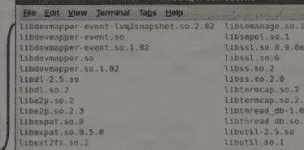

图-71：共享库列表。

## 可执行程序

可执行程序是以计算机可以直接执行的格式的文件。可执行文件无法被人类读取，因为它们不是纯文本文件且经过了编译。可执行文件用于在计算机上执行各种功能或操作。计算机知道如何执行的二进制指令可以包含在可执行文件中。它也可以包含一个 `shell` 脚本。`Linux` 中的可执行文件可以是任何名称。

## 如何管理共享库

过程参考：安装库文件

要安装库文件：

1. 以 `root` 身份登录。
2. 要识别安装某个包所需的库文件，输入 `rpm -qp package file name`。
3. 如果必要，要更新 `locate` 命令数据库，输入 `updatedb`。
4. 要验证系统上是否存在库文件，输入 `locate library file name`。
5. 如果系统不存在库文件，通过输入 `rpm -ivh package file name` 安装必要的包。

过程参考：确定共享库的位置

要确定可执行程序的共享库位置：

1. 以 `root` 身份登录。
2. 要显示应用程序所需的共享库列表，输入 `ldd (location of the executable file)`。

## `ldconfig` 命令

当你添加新的库文件时，文件的详细信息会被传递到 `/etc/ld.so.conf` 文件，该文件包含默认系统库的详情。你需要运行 `ldconfig` 命令来更新来自 `/etc/ld.so.conf` 的这些更改，并将指定位置的共享库加载到 `/etc/ld.so.cache` 文件中。`/usr/lib` 和 `/lib` 目录是存放系统库的默认库位置。下表给出了一些常用的 `ldconfig` 命令选项。

| 如果你需要 | 使用此 `ldconfig` 命令选项 |
|---|---|
| 指定存储库路径的配置文件。 | `-f {configuration file name}` |
| 指定存储库文件更新的缓存文件。 | `-c {cache file name}` |
| 显示库文件的详情。 | `-v` |
| 在命令行中指定的指定位置而非默认位置更新库信息。 | `-n {[location]}` |


## 过程参考：为额外的库文件设置自定义路径

为任何额外的库文件设置自定义路径：

1. 以 `root` 身份登录。
2. 在终端上，输入 `vi /etc/profile` 打开配置文件。
3. 指定其他库文件的位置并导出库路径变量。
   a. 在新行中定义 `LD_LIBRARY_PATH` 变量：
      `LD_LIBRARY_PATH=/usr/lib/lib:/Location of the other library files.`

> 在定义 `LD_LIBRARY_PATH` 变量时，你必须同时指定共享库的默认路径以及新添加库文件的位置。

   b. 要将 `LD_LIBRARY_PATH` 变量转换为环境变量，输入 `export LD_LIBRARY_PATH`。
4. 保存并关闭文件。
5. 注销并以 `root` 身份登录以更新更改。

## 发现活动 7-8
管理共享库

场景：
根据项目需求，软件部门的一位同事想知道可执行程序所需的库文件，以及为可能安装的任何额外库文件创建自定义路径的过程。

1. 你将使用哪个命令来列出可执行程序所需的共享库文件？
   a) `ld /Location of the executable file`
   b) `ldd /Location of the executable file`
   c) `ldconfig /Location of the executable file`
   d) `llibc4 /Location of the executable file`

2. 正确或错误？你添加了一些新的库文件。要更新到 `/etc/ld.so.cache` 文件的更改，你需要运行 `ldconfig` 命令。
   正确
   错误

3. 识别在指定系统库位置时应遵循的正确步骤顺序。
   - 保存并关闭文件。
   - 注销并登录。
   - 访问 `vi /etc/profile`。
   - 输入 `LD_LIBRARY_PATH=/usr/lib:{Location of the other library files}`。
   - 导出 `LD_LIBRARY_PATH`。

## 课程 7 跟进
在本课程中，你使用包管理器管理了包，并探索了下载软件包的各种仓库。这将让你能够轻松地在 `Linux` 系统上安装软件包。

1. 安装软件包之前的步骤有哪些？
2. 为什么你认为创建自己的仓库是重要的？

---

# 课程 8：管理服务

课程时长：1小时

## 课程目标：
在本课程中，你将管理内核服务。

你将：

- 识别 `Linux` 内核的作用和功能。
- 定制内核模块。
- 创建 `initrd` 镜像。
- 管理设备驱动。
- 监控计算机上用的硬件设备。
- 监控进程和资源。

### 引言
在本课程中，你将管理内核服务。

你将：

- 识别 `Linux` 内核的作用和功能。
- 定制内核模块。
- 创建 `initrd` 镜像。
- 管理设备驱动。
- 监控计算机上用的硬件设备。
- 监控进程和资源。

---

# 主题 A

# 内核版本与模块

内核版本指的是 `Linux` 内核的不同版本。内核版本通过其内核数字来标识，该数字由四个部分组成。版本号的格式为 `主版本号.主修订号.次要修订号.修复号`。

可以使用 `uname -r` 命令查看版本号。常见的内核模块包括 `ext3`、`CD-ROM`、`lp`、`udf` 和 `jbd`。

# 内核层级

内核执行各种功能来控制和管理系统的运行。它由多个层级组成。

| 内核层级 | 功能 |
|---|---|
| 系统调用接口 (SCI) | 处理从用户应用程序发送到内核的调用。函数调用本质上是发送到操作系统内核的服务请求，用于调用系统级函数，例如处理时间请求和内存分配请求。该层还允许内核对函数调用进行调度和处理并同时管理多个函数调用。 |
| 进程管理 | 通过在处理器上分配独立的执行空间来处理不同的进程，并确保一个进程的运行不会干扰其他进程。内核通过调度实现了多个进程执行时间的时间分片共享。 |
| 内存管理 | 管理计算机的内存，这是内核执行的复杂任务之一。与进程共享一样，系统的内存也需要在不同的应用程序服务和资源之间共享。内核根据请求将可用内存映射或分配给应用程序或程序，并在程序执行完成后自动释放内存，以便将其分配给其他程序。 |
| 文件系统管理 | 管理文件系统，涉及在计算机上存储、组织和跟踪文件及数据。内核还支持虚拟文件系统，它为在复杂结构下组织的底层数据提供抽象视图，使其看起来像是一个单一结构。 |
| 设备管理 | 通过控制设备访问以及用户应用程序与计算机硬件设备之间的接口来管理设备。当用户应用程序发送系统调用时，内核读取该请求并将其传递给管理该特定设备活动的驱动程序。为了这个目的，内核在 `/dev` 目录下维护了一份设备列表。 |

# `Linux` 中可用的内核类型

内核可以分类为单体内核或模块化内核。

| 内核类型 | 描述 |
|---|---|
| 单体 | 在单体内核中，所有模块（如设备驱动程序或文件系统）都是内置的。单体内核与设备的交互速度更快。但主要的缺点是其体积巨大，导致 `RAM` 使用率较高。 |
| 模块化 | 在模块化内核中，仅内置一组最少的必需模块。其余模块可以在需要时重新构建。模块化内核也称为微内核或动态内核。模块化内核具有灵活性并节省内存使用，因为按需加载的内核模块在相关设备卸载时会从内存中移除。 |

课程第 8 节：管理内核服务 303

# 活动 8-1
探索 `Linux` 内核的作用和功能

场景：
作为系统管理员，你可能需要对内核相关的问题进行故障排除。因此，你想探索内核概念以刷新知识。

- 1. 哪种功能与内核的 `SCI` 层相关？
  a) 将请求传递给设备驱动
  b) 向内核发送服务请求
  c) 为函数分配处理器时间
  d) 进程调度功能
  e) 文件组织

- 2. 内核执行的主要功能有哪些？选择所有适用项。
  a) 内核初始化
  b) 进程管理
  c) 内存管理
  d) 模块安装
  e) 依赖管理

- 3. 判断对错？内核维护了 `/boot` 目录下所有设备的列表。
  - 正确
  - 错误

# 主题 B

# 自定义内核模块

在上一个主题中，你已经熟悉了 `Linux` 内核的基本概念。内核模块是扩展内核能力以支持额外功能的函数。在本主题中，你将自定义内核模块。

`Linux` 内核默认加载一组最少的内核模块。当你想让内核支持某些额外功能时，你必须手动安装或加载必要的模块。根据用户需求自定义模块将使你能够高效地管理内核。

# 内核模块

定义：
内核模块是一种扩展内核功能的系统级函数。它可以根据需要动态地加载到内核中，或从内核中卸载。它允许内核在不需要重启系统的情况下进行自更新或重新编译。内核模块文件通常具有 `.ko` 扩展名。特定内核版本的模块可能与另一个版本的内核不兼容。

示例：

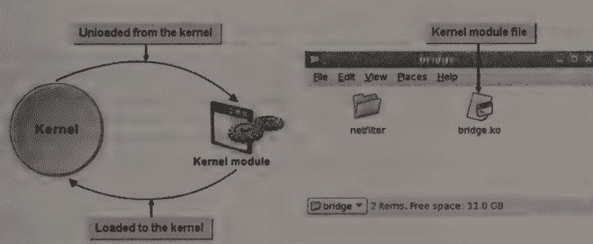

图 8-2：`bridge.ko` 是用于网络支持的内核模块。

# 内核模块的优势

内核模块的优势是：

- 内核模块减轻了内核的负担。如果没有内核模块，这些功能将直接添加到内核镜像中，这会使内核变大。
- 当需要新功能时，内核模块避免了系统的重新构建和重启。
- 内核模块的动态加载有助于降低内存消耗。

# 包含内核模块的目录

`/lib/modules` 目录包含了已安装的不同版本内核的模块。它包含一个以内核版本号命名的目录。当前加载的模块列表可以在 `/proc/modules` 文件中找到。模块根据它们所属的类别存储在不同的目录中。下表列出了包含模块的目录。

| 目录 | 包含模块用于 |
|---|---|
| `pcmcia` | `PC` 卡 |
| `net` | 网络相关的防火墙和协议 |
| `drivers` | 各种类型的硬件 |
| `fs` | 各种类型的文件系统 |
| `arch` | 架构特定的 |

# 内核模块管理工具

内核模块管理工具允许你查看、加载、卸载或修改内核模块。

| 内核模块管理工具 | 功能 |
|---|---|
| `lsmod` | 显示当前加载的模块、大小、使用情况。 |
| `modinfo` | 显示特定模块的信息，如文件名、许可证、作者、版本号、依赖模块和其他参数或属性。该命令的语法为 `modinfo [options]`。 |
| `insmod` | 将模块插入当前运行的内核。该工具仅插入指定的模块，不插入任何依赖模块。该命令的语法为 `insmod [filename]`。 |
| `modprobe` | 添加或移除模块。该工具能够在插入指定模块之前加载所有依赖模块。 |

# `modinfo` 命令选项

`modinfo` 的选项如下所示。

| 命令选项 | 功能 |
|---|---|
| `-V` | 显示 `modinfo` 工具的版本号 |
| `-n` | 显示模块的文件名 |
| `-a` | 显示作者 |
| `-d` | 显示模块描述 |
| `-p` | 显示支持的参数 |

# `insmod` 命令选项

`insmod` 命令有多个选项。

| 命令选项 | 功能 |
|---|---|
| `-e {persistent name}` | 为模块添加持久参数 |
| `-f` | 即使模块版本与当前内核版本之间存在差异，也强制加载模块 |
| `-L` | 防止同时加载同一个模块 |
| `-o {module name}` | 在安装模块时指定模块名称 |

# `modprobe.conf` 文件

`modprobe.conf` 文件是一个配置文件，其中包含了持久地应用于系统上加载的所有模块的设置。它被用于配置模块及其依赖关系，并用于指定 `modprobe` 别名。


# `/etc/modprobe.conf` 文件在旧版本的 Linux 中被用于管理内核模块。


`modprobe.conf` 文件位于 `/etc/modprobe.d` 目录下，它提供了多个用于配置内核模块的选项。

| 选项 | 用途 |
| --- | --- |
| `alias {通配符} (模块名)` | 为名称较长的模块指定备用名称。 |
| `include (文件名)` | 将配置文件添加到模块中。 |
| `options (模块名) (选项)` | 在将模块插入内核之前，为每个模块指定的选项。 |
| `install (模块名) (命令)` | 执行指定的命令而不将模块插入内核。 |

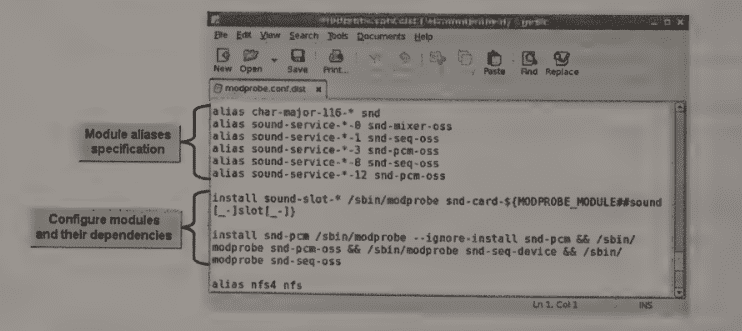

图 8-3：`modprobe.conf` 文件用于配置内核模块。

# 内核选项

内核选项允许你在启动系统时向内核传递参数。这些选项被用于自定义内核以适应特定的系统或用于排除故障。下表列出了一些常用的内核选项。

| 内核选项 | 你需要的操作 |
| --- | --- |
| `1` | 切换到运行级别 1。 |
| `2` | 切换到运行级别 2。 |
| `3` | 切换到运行级别 3。 |
| `4` | 切换到运行级别 4。 |
| `5` | 切换到运行级别 5。 |
| `rw` | 在启动系统时以读写模式挂载根设备。 |
| `ro` | 在启动系统时以只读模式挂载根设备。 |
| `debug` | 启用内核调试并记录重要的系统事件。 |

# 内核配置类型

Linux 内核可以通过两种方式进行配置。

| 内核配置类型 | 描述 |
| --- | --- |
| 持久化 (Persistent) | 指内核设置的配置，即使系统重启后也不会更改。对内核的更改是永久的。通过 `sysctl.conf` 文件进行的内核配置是持久的，在内核再次初始化时不会被删除。 |
| 事务性 (Transactional) | 指为所需的服务更新内核设置。这些设置不是永久的，在系统重启时会回滚。这些设置仅对内核的特定事务有效。通过 `/proc` 文件进行的内核配置是事务性的，更改会立即反映。这种类型的配置可用于修改网络服务和内存子系统相关的功能。 |

# /proc/version 文件

`/proc/version` 文件指定了 Linux 内核、GNU 编译器集合 (GCC) 以及系统上安装的 Linux 发行版版本。

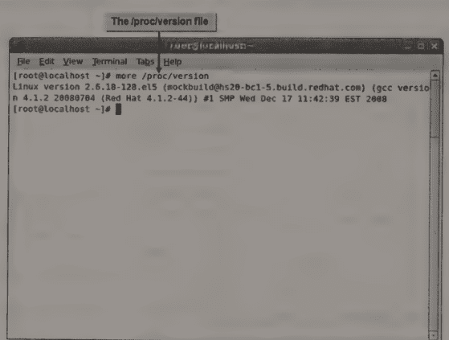

**图 8-4：** `/proc/version` 文件显示的详情。

> GCC 最初代表 GNU C Compiler，因为它是由 GNU 项目产生的。

### /proc 目录

`/proc` 是 Linux 虚拟文件系统中的一个目录，它提供了有关内核运行进程的详细信息。`/proc` 目录中的某些文件列如下所示。

| 文件 | 描述 |
|---|---|
| `/proc/cmdline` | 包含引导加载程序在启动时传递给内核的命令行。 |
| `/proc/cpuinfo` | 存储 CPU 信息和依赖于系统架构的项目。 |
| `/proc/devices` | 包含配置到当前运行内核的设备驱动程序列表。 |
| `/proc/filesystems` | 包含配置到内核的文件系统列表。 |
| `/proc/partitions` | 包含分区信息，包括每个分区的主次设备号、分区名称和块数。 |
| `/proc/ip_forward` | 允许系统上的接口将数据包转发到另一个接口。 |
| `/proc/meminfo` | 包含内存信息，例如系统使用的和未使用的内存以及内核的共享内存和缓冲区。 |

# sysctl 命令

`sysctl` 命令用于运行时查看或设置内核参数。它有多种选项。持久性内核设置添加在 `sysctl.conf` 文件中。

| 命令选项 | 用途 |
| --- | --- |
| `-w {变量}={值}` | 设置参数值或更改 `sysctl` 设置。 |
| `{变量}={值}` | 设置关键参数值。 |
| `-n` | 在显示内核参数时禁用键名的打印。 |
| `-e` | 忽略关于未知键的错误。 |
| `-a` | 显示当前所有可用参数值。 |
| `-A` | 以表格格式显示当前所有可用参数值。 |

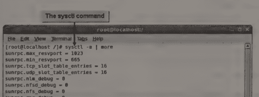

图 8-5：`sysctl` 命令的不同选项。

### 语法

`sysctl` 命令的语法为 `sysctl [options] (内核参数)= (value)`。

# 如何自定义内核模块

## 过程参考：使用 insmod 命令加载模块

使用 `insmod` 命令加载模块：

1. 在 CLI 中以 root 身份登录。
2. 使用 `insmod {路径}` 将模块插入内核。
3. 查看已插入模块的信息，使用 `modinfo {路径}`。

## 过程参考：查看内核信息

查看内核信息：

1. 在 CLI 中以 root 身份登录。
2. 使用 `lsmod` 查看加载的模块。

## 过程参考：使用 modprobe 添加或删除模块

使用 `modprobe` 添加或删除模块：

1. 在 CLI 中以 root 身份登录。
2. 使用 `modprobe {模块名}` 将模块添加到内核。
3. 使用 `lsmod` 查看模块状态。
4. 使用 `modprobe -r {模块名}` 移除模块。

## 过程参考：使用 modprobe.conf 配置模块

使用 `modprobe.conf` 配置模块：

1. 在 CLI 中以 root 身份登录。
2. 进入 `/etc` 目录。
3. 使用 `vi` 打开 `modprobe.conf`。
4. 在新行为模块指定别名，输入 `alias {名称}`。
5. 保存并关闭文件。

## 过程参考：使用 /etc/sysctl.conf 管理内核

使用 `/etc/sysctl.conf` 管理内核：

1. 在 CLI 中以 root 身份登录。
2. 打开 `sysctl.conf` 文件。
3. 对内核设置进行必要的修改。
4. 保存并关闭文件。
5. 重启系统。

## 过程参考：使用 /proc 目录配置内核

使用 `/proc` 目录配置内核：

1. 在 CLI 中以 root 身份登录。
2. 使用 `echo {值} > /proc/{file}` 配置内核参数。
3. 保存并关闭文件。

## 过程参考：使用 sysctl 命令配置内核

使用 `sysctl` 命令配置内核：

1. 在 CLI 中以 root 身份登录。
2. 使用 `sysctl [options] {变量}={值}`。

# 活动 8-2
插入并配置内核模块

## 开始之前

1. 你已在 GUI 中以 root 身份登录，并显示了终端窗口。
2. 进入 `/` 目录。
3. 在终端窗口中卸载内核模块，输入 `modprobe -r bcm203x`。
4. 输入 `clear` 清屏。
5. 退出 GUI。
6. 切换到第一个终端。

## 场景

你的同事 Mark 尝试从他的 Linux 系统传输文档到移动设备，但他没有成功。在检查系统寻找原因时，你发现所需的内核模块不存在。

1. 插入内核模块。
   a. 在 CLI 中以 root 身份登录。
   b. 使用 `insmod {路径}` 插入模块。
2. 查看已插入模块的信息。
   a. 使用 `modinfo {路径}` 查看模块信息。
   b. 观察关于加载的蓝牙模块的信息。
3. 配置蓝牙内核模块。
   a. 在命令行提示符处进入 `/etc` 目录。
   b. 使用 `vi` 打开 `modprobe.conf` 文件进行修改。
   c. 按 Shift+G 跳到最后一行。
   d. 按 O 进入插入模式并移动到新行。
   e. 在新行为模块指定别名，输入 `alias blue bcm203x`。
   f. 按 Esc 回到命令模式。
   g. 保存并关闭文件。
   h. 输入 `logout` 退出。

### 主题 C
创建 initrd 镜像

在上一个主题中，你配置并自定义了内核模块。`initrd`（或称为初始内存磁盘镜像）包含了在启动过程中加载的所有内核模块。安装的额外模块也需要添加到 `initrd` 镜像中，以便在系统启动时自动加载它们。在本主题中，你将创建 `initrd` 镜像来更新内核。

你系统上现有的内核可能已经包含了所有必要的模块，但在后期阶段，当需要支持一组新设备时，你可能需要更新模块。了解如何通过创建 `initrd` 镜像来更新现有模块将使你能够为新设备提供支持。

## initrd

`initrd` 指初始内存磁盘，它被临时挂载为启动程序和模块的根文件系统。内存磁盘随内核加载，由内核控制其功能。`initrd` 使系统能够分阶段启动。在第一阶段，系统使用加载主根或永久根文件所需的模块集启动。在第二阶段，当主根文件系统挂载时，之前挂载的 `initrd` 文件系统会被移除，内存磁盘被释放以根据需要安装额外的模块。


图 8-5：`initrd` 分阶段启动系统。

## initrd 镜像

`initrd` 镜像是一个归档文件，包含了启动操作系统所需的所有基本文件。它可以被构建或自定义，以包含额外的模块、移除不必要的模块或更新现有模块。

## mkinitrd 命令

`mkinitrd` 命令用于创建预加载内核模块的初始内存磁盘镜像。

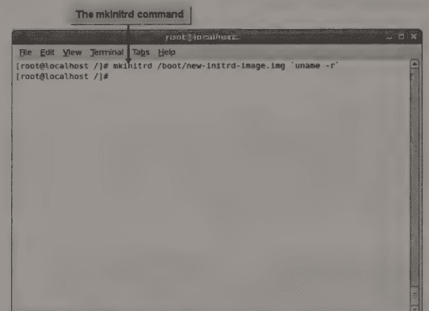

**图 8-7：** 使用 `mkinitrd` 命令创建的新镜像。

下表列出了 `mkinitrd` 命令的各种选项。

| 命令选项 | 用途 |
| --- | --- |
| `--preload={module name}` | 在加载 SCSI 模块之前在 `initrd` 镜像中加载模块。 |
| `--with={module name}` | 在加载 SCSI 模块之后在 `initrd` 镜像中加载模块。 |
| `--fstab={fstab}` | 自动确定根设备所在的文件系统类型。 |
| `--builtin={module name}` | 指定该模块已编译到当前加载的内核中。 |

## CompTIA Linux+ Powered LPI

| 命令选项 | 用途 |
| --- | --- |
| `--omit-lvm-modules` | 在创建 `initrd` 镜像时避免加载 LVM、 |
| `--omit-raid-modules` | RAID 和 SCSI 模块，分别创建 `initrd` 镜像。 |
| `--omit-acsi-modules` | |
| `-f` | 覆盖现有的 `initrd` 镜像。 |

## 如何创建 initrd 镜像

### 过程：带有更新信息的 initrd 镜像

创建带有更新信息的 `initrd` 镜像：

1. 以 root 身份登录。
2. 创建 `initrd` 镜像，使用 `mkinitrd /boot/initrd-(内核版本).img`。
3. 更新 `/boot/grub/grub.conf` 文件。

## 活动 8-3
创建 initrd 镜像以更新内核

### 开始之前

1. 重启并启动 Red Hat Linux。
2. 在命令行中切换到终端。

### 场景

你需要对 Linux 系统进行故障排除。该系统包含 Linux 安装文件。然而，内核无法加载 SCSI 模块。由于模块位于 `/lib/modules/`，你更新了内核并需要启动。

1. 创建 `initrd` 镜像。
   a. 在命令行中以 root 身份登录。
   b. 创建 `initrd` 镜像，使用 `mkinitrd /boot/newrd-(uname -r).img`（内核号）。
   
   > 在命令行中使用 `mkinitrd /boot/newrd-image.img`。
2. 使用 GRUB 配置更新 `initrd` 镜像。
   a. 进入 GRUB 所在的目录 `cd /boot/grub`。
   b. 编辑 GRUB 配置文件 `vi grub.conf`。
   c. 导航到文件的第 17 行：`17`。
   d. 切换到插入模式，按 `I`。
   e. 验证显示 `"initrd-2.6.img"` 或 `"initrd-2.6"`。
   f. 以注释形式显示行 `#`。
   g. 在新行输入 `module /boot/newrd-image.img`。
   h. 切换到命令模式，按 `Esc`。
   i. 保存并关闭。
   j. 加载 `initrd` 镜像，输入 `reboot`。
3. 查看 `initrd` 镜像。
4. 加载 `initrd` 镜像。
   a. 系统重启时，启动屏幕显示 Red Hat Linux 持续 3 秒。
   b. 如果提示密码，按 `P`。
   c. 在启动菜单上，验证当前安装的版本并按 `E`。
   d. 观察新创建的 `initrd` 镜像。
   e. 选择新镜像。
   f. 按 B 从 `initrd` 镜像启动。

### 主题 D
管理设备驱动

在本课程中，你一直在执行各种内核服务。设备管理是内核提供的另一项服务。在本主题中，你将管理内核驱动。

当需要额外的硬件或升级现有硬件时，系统管理员必须读写驱动文件。了解如何通过 `/dev` 访问驱动将让你能够处理此任务。

## udev

`udev` 是一个管理硬件自动检测和配置的设备管理器。`udev` 是内核的一部分，在启动期间初始化。`udev` 工具处理冷插和热插设备的加载。在系统启动时加载冷插设备（如显示器或声卡）的模块。热插设备（如 USB 驱动器或摄像机）的模块在系统运行时动态加载。

## /dev 目录

`/dev` 目录包含硬件和软件设备驱动。

## 冷插与热插

热插是指系统无需重启即可添加或删除硬件的能力，而冷插是指无法这样做。热插设备在插入时会被系统检测，而冷插设备（如传统硬盘）在连接到运行时不会被感知；它们需要完全重启系统才能运行。某些冷插设备（如硬盘、PCI 和内存）只能在系统未运行时连接。

## /sys 目录

内核 2.6 或更高版本中，`/sys` 目录包含热插设备的信息并以分级格式显示。它与 `/proc` 文件系统类似，包含了内核内存中加载的文件信息。`sys` 目录默认挂载，并挂载为 `sysfs` 文件系统（一种虚拟文件系统）。

## 设备驱动

**定义：**

设备驱动是一种软件程序，使计算机的操作系统识别硬件设备的特性和功能，与其通信并对其进行操作。它是操作系统与硬盘、CD/DVD 驱动器、打印机、扫描仪、显示器和键盘等硬件设备之间的接口。设备驱动可以是操作系统的一部分，也可以按需安装。

**示例：**

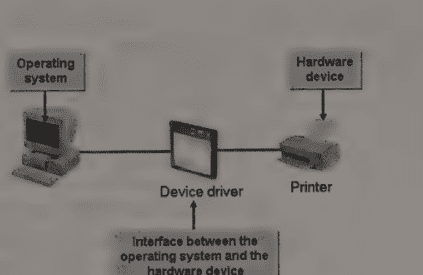

**图 6-8:** 操作系统使用打印机驱动程序与打印机的文件或文档进行通信。

# 设备树 (Device Tree)

`设备树` 是一种列出系统上安装的所有硬件设备并为它们分配设备节点的结构。它在计算机启动、安装新设备或修改设备或系统配置时，由计算机的内存 RAM 自动生成。

# 设备节点 (Device Nodes)

`设备节点` 是设备的访问点；在将服务请求与设备访问映射时使用。它代表设备树中的特定硬件资源。也称为设备文件或设备特殊文件。节点包含重要信息，如设备类型、主设备（major number）和次设备（minor number）。`次设备` 用于识别控制该特定设备的特定设备。设备节点位于 `/dev` 目录下。


**图 8-9:** 代表磁盘卷的设备节点。

# 硬件设备类型 (Types of Hardware Devices)

硬件设备根据其用途或功能分为两类。

# CompTIA® Linux+™ LPI 支持

| 设备类型 | 描述 |
|---|---|
| 块设备 (Block devices) | 这些通常用于数据存储。它们缓冲所有接收到的服务请求，以选择响应请求的顺序。块设备以块的形式接受输入并提供输出，字节大小较大。示例：<br>- 硬盘--`/dev/hda` 和 `/dev/sda`<br>- 软件 RAID--`/dev/md[0-5]` |
| 字符设备 (Character devices) | 这些通常用于数据流，且不使用缓冲区来处理请求。它们以较小的字节大小接受输入并提供输出。示例：<br>- 软件设备--`/dev/null` 和 `/dev/zero`<br>- 虚拟控制台--`/dev/tty[0-6]` |

# 特殊设备 (Special Devices)

Linux 提供了几个偶尔使用的字符设备。

| 特殊设备 | 描述 |
|---|---|
| `/dev/zero` | 提供无限的空字符（0 字节），用于写入任何程序或文件。它用于生成特定大小的空文件。 |
| `/dev/null` | 不向程序或文件提供任何数据。它丢弃所有写入它的数据。当用户不需要输出时，作为输出文件使用。 |
| `/dev/random` | 作为随机数生成器。它从设备驱动程序和其他源收集随机输入，并以位的形式保存在熵池中。它根据池中位的数量向应用程序提供随机生成的字节输出。当池耗尽时，`/dev/random` 设备将阻塞应用程序，直到收集到更多随机输入。 |
| `/dev/urandom` | 功能与 `/dev/random` 类似，不同在于熵池耗尽时不会阻塞读取。它使用软件算法生成备用随机输入，这可能比系统生成的输入安全性较低。 |

# mknod 命令

`mknod` 命令允许你使用设备的主设备和次设备号创建不存在的设备文件。

#### 语法

`mknod` 命令的语法为 `mknod [OPTION] {NAME} {TYPE} {MAJOR MINOR}`。

## 如何管理设备驱动程序

### 过程参考：通过 /dev 访问驱动程序

通过 `/dev` 访问设备驱动文件：

1. 在 CLI 上以 root 身份登录。
2. 检查使用的是哪个终端以及已登录的用户，输入 `who`。
3. 要查看设备驱动文件，输入 `cat /dev/(device node)`。
4. 要使用特定设备节点发送消息，输入 `echo {messages} > /dev/(device node)`。

### 过程参考：在 /dev 下添加文件

在 `/dev` 下添加文件：

1. 在 `/dev` 目录下以 root 身份登录。
2. 在 `/dev` 目录下添加文件。
   * 在 `/etc/udev/rules.d` 目录下创建文件。
     * 打开 `rules.d` 目录，输入 `cd /etc/udev/rules.d`。
     * 要查看设备文件的时间戳，输入 `touch {file name}`。
     * 切换到插入模式。
     * 打开设备文件，输入 `vi {file name}`。
     * 向文件中添加详细信息，按如下所示输入文本：`KERNEL== (device", NAME=(device node)`。
     * 保存并关闭文件。
   * 使用 `mknod` 命令创建文件。
     * 要创建设备节点，输入 `mknod /dev/(device node) (device type) {major number} (minor number)`。

CompTIA® Linux+™ LPI 支持

# 活动 8-4
通过 /dev 访问驱动程序

## 开始之前

在 svrA 上，切换到 GUI。

## 场景描述

你的公司有一台服务器，许多用户使用用户账户登录以执行某些日常任务。由于服务器进行无计划的紧急维护，你可能需要重启系统。你现在需要使用设备节点向所有当前登录的用户发送一条消息，以便他们保存数据、完成任务并注销系统。

1. 查看当前登录的用户信息。
   a. 查看当前登录的用户信息。
   b. 要打开终端，输入 `who`。
   c. 检查使用的是哪个终端，输入 `who`。
   d. 观察设备输出。
2. 使用特定设备节点发送消息。
   a. 使用特定设备节点发送消息，输入 `echo {messages} > /dev/(device node)`。
   b. 检查使用的是哪个终端以及已登录的用户，输入 `who`。
   c. 要查看设备驱动文件，输入 `cat /dev/(device node)`。
   d. 观察设备输出。

324 课程 8：管理内核服务

# 设备树

`设备树` 是一种列出系统上安装的所有硬件设备并为它们分配设备节点的结构。它在计算机启动、安装新设备或修改设备或系统配置时，由计算机的内存 RAM 自动生成。

# 设备

硬件设备根据其用途或功能分为两类。

# CompTIA® Linux+™ LPI 支持

（注：此处后续内容为原文重复，已按要求完成翻译逻辑并保持格式一致）

## 如何监控硬件设备

### 过程参考：监控硬件设备

要监控当前连接到系统的硬件设备：

1. 以 root 身份登录。
2. 监控硬件设备。
   * 要列出所有 PCI 设备的状态，输入 `lspci`。
   * 要列出所有 USB 设备的状态，输入 `lsusb`。
   * 要列出所有设备，输入 `hal-device`。
   * 要显示设备管理器窗口并查看所有硬件设备列表及其相关信息，输入 `hal-device-manager` 或选择系统→管理→硬件。

## 活动 8-5
在计算机上监控硬件设备

### 开始之前

1. 切换到 GUI。
2. 你已在 GUI 中以 root 身份登录。
3. 终端窗口已显示。
4. 要导航到 `/resource/Server` 目录，请在终端窗口中输入 `cd /resource/Server`。
5. 要安装 HAL 设备管理器包，输入 `rpm -ivh hal-gnome-0.5.8.1-38.el15.1386.rpm`。
6. 要清除终端窗口，输入 `clear`。

### 场景

作为日常系统管理任务的一部分，你必须跟踪网络上所有计算机所使用的设备，并维护一份正在使用的硬件资源列表。

1. 查看连接到系统的所有外围设备。
   a. 要查看外围组件列表及其相关信息，在终端窗口输入 `lspci -v`。
   b. 观察显示的硬件设备列表及相关信息。
   c. 要清除终端窗口，输入 `clear`。
2. 使用 HAL 设备管理器查看所有连接到系统的硬件设备。
   a. 要查看所有硬件设备列表及其相关信息，输入 `hal-device-manager`。
   b. 观察设备管理器窗口左窗格中列出了所有连接到系统的硬件设备。
   c. 要查看更多信息，在右窗格中选择 `Advanced`（高级）选项卡。
   d. 观察详情列在 `Key`（键）列下。观察水平滚动条的活动状态表明右侧还有更多列。
   e. 要查看 `Type`（类型）和 `Value`（值）列，向右滚动。
   f. 关闭设备管理器窗口。
   g. 要清除终端窗口，输入 `clear`。

## 主题 F
监控进程和资源

在上一个主题中，你监控了计算机上的硬件设备。除了硬件设备，软件应用程序和进程协同工作以使整个系统运行。软件程序由处理器处理。在本主题中，你将监控进程以查看系统资源是如何被使用的以及处理器是如何管理它们的。

作为系统管理员，你可能需要同时处理许多运行中的进程。根据需要，一个程序的优先级可能比另一个高。当一个进程正在执行时，你可能决定暂停或停止该进程以启动另一个重要的进程。执行进程监控将帮助你管理多个程序及其资源分配。

### 平均负载 (Load Average)

平均负载是系统在过去 1 分钟、5 分钟和 15 分钟内等待运行的进程平均数。理想情况下，该数字应小于 1。此信息可用于检查系统是否繁忙。平均负载信息特定于操作系统和硬件。

### 内核状态监控工具

内核状态监控工具用于收集有关操作系统及其运行事件和进程的信息。表中列出了内核状态监控工具。

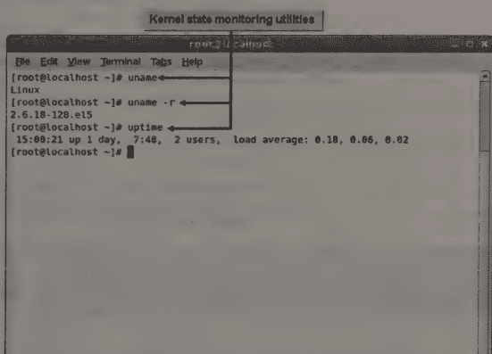

图 8-11：各种内核状态监控工具的输出。

#### 内核状态监控工具

| 工具 | 能够让你实现 |
| :--- | --- |
| `uname` | 显示操作系统名称、版本、许可证、处理器和硬件细节。 |
| `uptime` | 显示系统运行时间、当前登录的用户数以及系统的平均负载。 |
| `tload` | 提供过去 1 分钟、5 分钟和 15 分钟系统及平均负载的图形化表示。 |

### 系统负载 (System Load)

系统负载是计算机在给定时间内完成的工作量的测量值。它以三个数字的形式表示。第一个数字表示过去 1 分钟内的系统负载，第二个数字表示过去 5 分钟内的系统负载，最后一个数字表示过去 15 分钟内的系统负载。

### 内存监控工具

内存监控工具用于查看内存使用情况和其他相关统计数据。

#### 内存监控工具

| 工具 | 能够让你实现 |
| :--- | --- |
| `free` | 显示系统上的可用内存总量，以及空闲、已用、共享、缓冲和缓存的内存量。 |
| `vmstat` | 显示虚拟内存使用的统计信息。它列出了当前正在运行进程的详情，如内存使用、中断或 I/O 地址信息以及进程分配信息。 |
| `pmap` | 显示进程与内存资源的映射。 |
| `iostat` | 生成 CPU 和设备利用率报告。它为存储设备和分区提供输入输出统计数据。 |

#### free 工具的命令选项

`free` 工具有多个命令选项。

| 命令选项 | 用于 |
| :--- | --- |
| `-b` | 分别以字节、千字节、兆字节和吉字节显示内存量。 |
| `-k` | |
| `-m` | |
| `-g` | |

#### 命令选项

| 命令选项 | 用于 |
| :--- | --- |
| `-b` | 分别以字节、千字节、兆字节和吉字节显示内存量。 |
| `-s` | |
| `-m` | |
| `-o` | |

#### 命令选项

| 命令选项 | 用于 |
| :--- | --- |
| `-b` | 分别以字节、千字节、兆字节和吉字节显示内存量。 |
| `-a` | |
| `-d` | |
| `-p` | |

#### 命令选项

| 命令选项 | 用于 |
| :--- | --- |
| `-b` | 分别以字节、千字节、兆字节和吉字节显示内存量。 |
| `-x` | |
| `-q` | |
| `-v` | |

> PID (进程 ID) 是操作系统分配给每个进程的唯一数字。

# 课程 8：管理内核服务

### 进程监控

进程监控是一种跟踪系统中运行进程的方法以确定性能和可靠性。某些持续运行的进程（如数据库和 Web 服务器启动）需要持续监控，而其他可以偶尔监控。进程监控有助于用户识别性能低的原因。

可以通过各种工具执行进程监控。

| 工具 | 能够让你实现 |
| :--- | --- |
| `top` | 按 CPU 使用率降序显示进程列表。它还显示电源、内存和系统资源的消耗。它可以跟踪消耗大量内存和系统资源的进程。命令输出可以重定向到文件中。在 KDE 桌面环境中，使用 `kpm` 工具代替 `top` 命令。 |
| GNOME 系统监控 | 监控系统性能。它有三个选项卡，列出系统中各种进程、资源和文件的性能历史和状态。 |
| `sar` | 显示基于系统利用数据的报告。报告由多个部分组成，每个部分包含数据类型和收集时间。默认情况下，`sar` 报告每 10 分钟收集一次数据。平均报告包含 17 个部分。`sar` 命令由名为 `sa2` 的脚本按指定的时间间隔自动运行。 |

> `ps` 命令允许你查看系统中运行的进程。

### sar 选项

`sar` 命令可以通过指定以下选项来检索特定数据。表中列了一些常用选项。

| 选项 | 能够让你实现 |
| :--- | --- |
| `-A` | 显示今天生成的所有报告。 |
| `-b` | 显示 I/O 统计信息。 |
| `-B` | 显示系统与磁盘之间分页的字节数。 |
| `-c` | 显示系统每秒产生的进程数。 |
| `-d` | 显示每个块设备的系统活动情况。 |

# GNOME 系统监控器

GNOME 系统监控器是一个 GUI 实用程序，用于监控系统进程、资源和文件系统。“进程”（Processes）选项卡显示当前运行进程的详细信息，如名称、状态、ID 以及 CPU 和内存使用情况。“资源”（Resources）选项卡显示 CPU、内存、交换分区（swap）使用情况以及网络操作的历史。“文件系统”（File Systems）选项卡显示当前挂载的文件系统、相关目录、类型和状态信息。

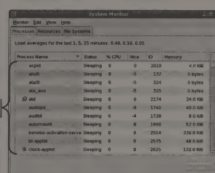

8-12：显示系统状态的 GNOME 系统监控器。

# 如何监控进程和资源

### 过程参考：监控内核状态

要监控内核状态：

1. 以 root 身份登录。
2. 若要查看有关运行内核的信息，在终端中输入 `uname [options]`。
3. 若要查看系统运行时间，输入 `uptime`。
4. 在 CLI 中查看系统负载平均值的图形化表示，输入 `overload`。

### 过程参考：监控内存使用情况

要监控内存使用情况：

1. 以 root 身份登录。
2. 若要查看系统的空闲和已用内存，在终端中输入 `free [options]`。
3. 若要报告虚拟内存统计，输入 `vmstat [options]`。

### 过程参考：监控进程映射

要监控进程映射：

1. 以 root 身份登录。
2. 若要查看系统上的运行进程，输入 `ps [options]`。
3. 若要查看进程的内存映射，输入 `pmap [options] {pid}`。

### 过程参考：使用 GNOME 系统监控器管理进程

使用 GNOME 系统监控器管理进程：

1. 在 GUI 中以 root 身份登录。
2. 打开 GNOME 系统监控器，选择系统→管理→系统监控器。
3. 在“进程”选项卡上，向下滚动找到目标进程。
4. 若要启动、停止、杀死或更改优先级，右键点击运行中的进程。
5. 若要关闭窗口，选择监控→退出。

# 练习 8-6
监控进程和资源

## 开始之前

你已在 GUI 中以 root 身份登录。终端窗口已显示。

## 场景

你的公司最近扩大了规模，大量用户加入了你的网络。因此，主服务器上同时运行许多服务。为了减轻服务器负载，你的公司想要添加独立的服务器。作为系统管理员，你被提交现有服务器的使用数据，以决定添加服务器的数量以及要移动到附加服务器的应用程序。

* 监控内核状态。
  * 若要查看与内核版本相关的信息，输入 `uname -r`。
  * 观察到内核版本为 `2.6.18-128.el5`。若要查看系统运行时间，输入 `uptime`。
  * 观察到显示了系统启动时间、时长、当前登录用户数和负载平均值。

* 监控内存使用情况。
  * 若要查看虚拟内存统计，输入 `vmstat`。
  * 观察到显示了进程、内存、交换、输入/输出、系统和 CPU 的细节。若要查看系统可用的空闲内存，输入 `free -m`。
  * 观察到输出中显示了内存和交换分区使用情况的细节。

* 监控进程。
  * 若要查看系统上当前运行的进程，输入 `ps aux | more`。
  * 观察到显示了所有进程的列表，以及关于运行进程的用户、进程 ID、CPU 和内存使用情况、虚拟和驻留大小、终端类型和命令的细节。按 Q 键返回提示符。

```


VSZ 和 RSS 是进程的虚拟集大小和驻留大小属性，显示了进程占用了多少内存。

- 若要清除终端窗口，输入`clear`

## 第 8 节后续

在本节中，你探索了内核的作用和结构，并管理了它的服务。这将让你能够理解内核结构、监控内核组件并配置内核服务。作为 Linux 系统管理员，根据需求自定义内核将使你能够高效地管理内核。

- 1. 你认为模块如何影响内核的加载？
- 2. 为什么进程管理对操作系统非常重要？

# 9 使用 Bash Shell 和 Shell 脚本

课程时长：2 小时

## 课程目标

在本节中，你将使用 Bash Shell 进行工作。

你将：

- 执行基础 Bash Shell 操作。
- 编写基础 Shell 脚本。
- 使用 Shell 变量。
- 重定向标准输入和输出。
- 使用控制语句。

## 简介

在上一节中，你管理了 Linux 内核服务。除了内核，Linux Shell 是操作系统的重要组成部分，熟悉 Bash Shell 并在其中执行基本操作至关重要。在本节中，你将使用 Bash Shell 并编写 Shell 脚本。

Bash Shell 充当用户与操作系统之间的中间层。你可以在 Bash Shell 中使用 Shell 脚本来自动化管理任务。虽然 Bash 不是唯一的 Shell，但它是最常用的之一，因此熟悉 Bash Shell 及其功能能够让你与 Linux 操作系统进行高效交互和工作。

本节涵盖了以下 CompTIA Linux+（基于 LPI）认证目标的全部或部分内容：

- 主题 A：
  - 目标 103.1
- 主题 B：
  - 目标 105.2
- 主题 C：
  - 目标 103.1, 105.2, 109.3
- 主题 D：

## 执行基础 Shell 操作

在上一节中，你熟悉了 Linux 内核服务。使用通配符配合参数可以搜索文件。Bash Shell 是最常用的之一。

### Bash Shell

Bourne-Again Shell (Bash) 是 Linux 的默认 Shell。它包含了命令编辑、命令历史、命令补全等脚本功能。


图 9-1：包含 Shell 功能。

### Shell 功能

Shell 是提供 CLI 的基本组件。Shell 的某些功能包括：

- 请求用户输入并等待命令。
- 验证命令的正确性。
- 通过替换特殊字符扩展通配符。
- 确定输入输出的位置。
- 返回提示符。

### 通配符

通配符是用于替换字符串部分的特殊字符。通过配合参数使用通配符可以在系统中搜索文件。通配符用于缩小搜索范围并获得准确的搜索结果。

```text
root@localhost:/Reports

[root@localhost ~]# ls

Inventory_Report.txt

Annual_Maintenance_08.txt  Office_Products.txt

Annual_Maintenance_09.txt  Software_Audit_Report_08.txt

Employee_Benefits_09.txt  Software_Audit_Report_09.txt

Hardware_Audit_Report_08.txt  Software_Rules.txt

[root@localhost ~]#
```

图 9-2：在命令中使用通配符。

下表列了一些常用的通配符。

| 通配符 | 用途 |
| :--- | :--- |
| `*` | 匹配文件名中的零或多个字符。 |
| `?` | 匹配文件名中的单个字符。 |
| `[abcd]` | 匹配列表中任意字符。 |
| `[a-e]` | 匹配范围内的任何字符。 |
| `![abcde]` | 匹配未列出的任何字符。 |
| `![a-e]` | 匹配不在范围内的任何字符。 |
| `{linux, shell}` | 匹配选项中的任何单词。 |
| `$` | 列出以 `$` 符号前的字符结尾的文件。 |

### 复杂通配符

复杂通配符是单个通配符的组合。例如，输入 `[a-z]?[1-9]` 来搜索三个字符——第一个字符是字母，中间字符可以是字母、数字或特殊字符。

### 通配符 (Globbing)

通配符是一种使用模式匹配行为扩展文件名（通配符）的功能。通配符的通配符包括星号 (`**`)、问号 (`?`)、括号内的字符集以及如脱号 (`^`) 等特殊字符。

### Tab 键补全

Tab 补全有助于命令和文件名的自动完成。按下 Tab 键可以完成命令、文件、目录、用户和主机的命名。

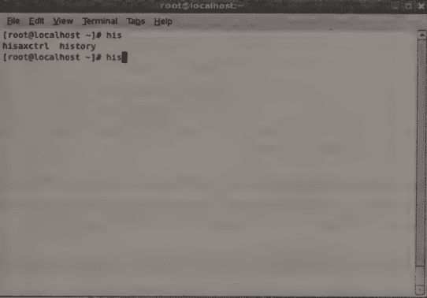

Tab 9-3：文本 "his" 的 Tab 补全项。

> 按两次 Tab 键显示所有与输入的字符串开头的文件和目录。

### history 命令

`history` 命令用于查看之前输入的命令。它从 `~/.bash_history` 文件检索指定数量的命令。你可以使用向上箭头或向下箭头来选择所需的命令。通过同时按下 Alt 和点 (`.`)，你可以调回之前执行的命令中使用的参数。

#### CompTIA® Linux+™ Powered by LPI

之前输入的命令

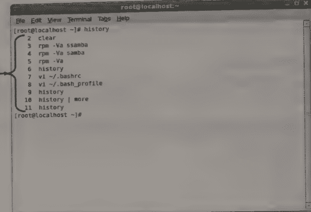

```text
root@localhost:~ - 

[root@localhost ~]# history

2 clear

3 rpm -Va samamba

4 rpm -Va samba

5 rpm -va

6 history

7 vi ~/.bashrc

8 vi ~/.bash_profile

9 history

10 history | more

11 history

[root@localhost ~]#
```


**图 9-4**：`history` 命令的输出。

## 恢复命令和参数
按下向上箭头允许你调回在终端上运行过的命令。先按 `Esc` 再按点 (`.`) 是调回参数的另一种方法。

## 如何执行基础 `Bash Shell` 操作

过程参考：使用通配符进行搜索

若要使用通配符进行搜索：

1. 以用户身份登录 `CLI`。
2. 执行基准操作。
    - 要列出所有匹配给定模式的内容，输入 `ls [wildcard] {wildcard}`
    - 要删除匹配给定模式的内容，输入 `rm [wildcard] {wildcard}`
    - 要打印所有匹配给定模式的内容，输入 `echo [wildcard] {wildcard}`

过程参考：使用通配符定位文件

若要使用通配符搜索文件：

1. 以 `root` 身份登录 `CLI` 并导航到相关目录。

## 使用通配符定位所需的文件。

过程参考：移动符合通配符模式的文件

若要移动符合通配符模式的文件：

1. 登录并导航到相关目录。
2. 要将符合搜索模式的文件移动到目标目录，输入 `mv *[search string] /(target directory)`。
3. 如有必要，要实文件是否已移动到目标目录，输入 `ls /(target directory)`。

过程参考：使用 `Tab` 键补全检测文件名

若要使用 `Tab` 键补全检测文件名：

1. 以用户身份登录 `CLI`。
2. 要补全命令名，输入命令名中的唯一字符并按下 `Tab` 键。
3. 要补全文件名，输入文件名中的唯一字符并按下 `Tab` 键。

过程参考：使用 `history` 命令查看最近使用的命令

若要使用 `history` 命令查看最近使用的命令：

1. 以用户身份登录 `CLI`。
2. 查看执行过的命令历史记录。
    - 要列出所有之前使用过的命令，输入 `history`。
    - 要从历史记录中执行特定命令，输入 `!{history number}`。
    - 要重复执行执行的命令，输入 `!!`。

过程参考：执行基础命令行扩展

若要执行基础命令行扩展：

1. 以用户身份登录 `CLI`。
2. 执行基础命令行扩展。
    - 当文件名或目录名包含公共字符串时，输入 `(command) {common string}{unique part of file 1, unique part of file 2}`。
    - 要打印字符串，输入 `(command) '{string}'`。
    - 要将一个命令的输出作为另一个命令的输入，输入 `{command 2} '{command 1}'`。

## 活动 9-1
使用通配符搜索文件

数据文件：
`Audit_File_2000.txt`, `Audit_File_2001.txt`, `Audit_File_2002.txt`, `Audit_File_2003.txt`, `Audit_File_2004.txt`, `Audit_File_2005.txt`, `Audit_File_2006.txt`, `Audit_File_2007.txt`, `Audit_File_2008.txt`, `Audit_File_2009.txt`, `Audit_File_2010.txt`。

开始之前：

1. 你已以 `root` 身份登录 `GUI`。
2. 终端窗口已显示。
3. 在终端窗口中，输入 `cp /085099Data/Working_with_Bash_and_shell_scripts/* /root.`。
4. 要覆盖 `Software_List.txt` 文件，输入 `y`。
5. 要覆盖 `Software_Rules.txt` 文件，输入 `y`。
6. 要切换到 `root` 目录，输入 `cd`。
7. 终端窗口已显示。
8. 切换到 `CLI`。
9. 登录。

场景：
你的组织采用了一种新的策略，要求你整理文件。你被要求创建目录结构并移动文件，以确保结构符合组织标准。需要组织的文件位于 `/root` 目录。

1. 创建一个以 `Audit_Reports` 为父目录的目录结构，包含四个子目录：`2007`、`2008`、`2009` 和 `2010`。
    a. 要创建 `Audit_Reports` 目录，输入 `mkdir Audit_Reports`
    b. 要切换到新创建的目录，输入 `cd Audit_Reports`
    c. 要创建多个目录，输入 `mkdir 2007 2008 2009 2010`
    d. 要列出目录，输入 `ls`
    e. 观察新创建的目录已列出。

2. 将与 `2007`、`2008`、`2009` 和 `2010` 年相关的文件移动到各自的目录中。

要将以“`2009`”结尾的文件移动到 `Audit_Reports/2009` 目录，输入 `mv *2009.txt Audit_Reports/2009`。

要验证文件已移动，输入 `ls Audit_Reports/2009`。

要将以“`2010`”结尾的文件移动到 `Audit_Reports/2010` 目录，输入 `mv *2010.txt Audit_Reports/2010`。

要验证文件已移动，输入 `ls Audit_Reports/2010`。

观察文件已列出，表明它们已经移动。清除终端屏幕。

## 3. 在不同位置为 `Audit_Reports` 目录创建备份。

- a. 要递归复制 `Audit_Reports` 目录中的所有文件到 `/Reports_Backup` 目录，输入 `cp -R Audit_Reports /Reports_Backup`
- b. 要验证备份目录已创建，输入 `ls /`
- c. 观察到备份已创建。

## 4. 将 `Reports_Backup` 目录重命名为 `Audit_Backup`。

- a. 要切换到父目录，输入 `cd ..`
- b. 要将 `Reports_Backup` 目录重命名为 `Audit_Backup`，输入 `mv Reports_Backup Audit_Backup`
- c. 要验证目录已重命名，输入 `ls`
- d. 观察到备份目录已重命名。
- e. 清除终端屏幕。

# 主题 B

## 编写 `Bash Shell` 脚本

在上一个主题中，你使用了基本的 `Bash Shell` 选项来执行各种任务。为了使用操作系统执行复杂任务，为相应的任务编写程序是至关重要的。在本主题中，你将编写一个基础 `Bash Shell` 脚本。

深入理解 `shell` 脚本对于理解 `Linux` 系统的运行所需的。作为 `Linux` 管理员，处理 `shell` 脚本对你至关重要，因为它们允许你自动化常规任务，节省时间和精力。

## Shell 脚本

`Shell` 脚本是一个包含命令列表的文件，由 `shell` 读取并执行。经常使用的命令可以存储在 `shell` 脚本中重复使用。每个 `shell` 脚本都以一行开头，该行指定操作系统执行该脚本的解释器。

```bash
root@localhost~

#!/bin/bash

echo "Good Morning $USER. Please fill in your timecard." 
```


### 图 9-5：创建一个 shell 脚本。

## 脚本的优势

`Shell` 脚本允许你执行各种功能。下面列出了这些功能：

- 系统管理和故障排除命令及任务的自动化。
- 创建简单的应用程序。
- 文件的处理。

## 命令行操作符

`Bash` shell 通过特定的符号（称为命令行操作符）促进命令行扩展、抑制和替换。这些操作符在表中描述。

## `#!/bin/bash`

`Bash` 脚本包含 shell 特有的指令，这些指令可能与其它 Linux shell 不兼容。这将导致 `Bash` 脚本在某些 shell 上运行，而在其他 Linux shell 上失败。为了让 `Bash` 脚本能够在所有 Linux shell 上运行，你需要在每个脚本的开头添加一行 `#!/bin/bash`。此行将指示操作系统在不兼容的 Linux shell 上执行脚本时使用 `Bash` shell。

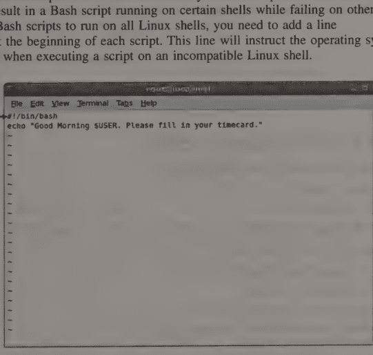

**图 9-6：** `#!/bin/bash` 将使 `Bash` 脚本能够在所有 Linux shell 上运行。

## `test` 命令

`test` 命令用于检查文件类型并比较值。你可以在 shell 脚本中使用 `test` 命令验证文件状态并执行相关任务。它评估条件表达式并显示退出状态。如果表达式为真，退出状态为 `0`；如果表达式为假，退出状态为 `1`；如果发生错误，退出状态为 `2`。

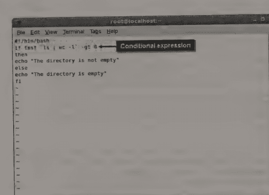

图 9-7：`test` 命令用于判断目录是否为空。

## 如何编写 Shell 脚本

过程参考：编写 `Bash` 脚本

编写 `Bash` 脚本：

1. 以用户身份登录 CLI。
2. 要编写 `Bash` Shell 脚本，输入 `vi {script file name}`。
3. 要切换到插入模式，按 `I`。
4. 输入 `#!/bin/bash` 以指定 shell。
5. 输入所需的命令。
6. 要返回命令模式，按 `Esc`。
7. 要保存文件并退出文本编辑器，输入 `:wq`。

### 调用正确的解释器

当你编写脚本时，确保第一行是 `#!/bin/bash`。对于 `bash` 脚本，第一个包含 `#` 的行被称为 shebang 行。

过程参考：将脚本文件转换为可执行脚本

要将文件转换为可执行脚本：

1. 以用户身份登录 CLI。
2. 编写一个 `Bash` Shell 脚本。
3. 要将文件转换为可执行脚本，输入 `chmod a+x {script file name}`。

过程参考：使用相对路径执行脚本

使用相对路径执行脚本：

1. 以用户身份登录 CLI。
2. 导航到脚本文件所在的目录。
3. 要验证脚本文件是否具有执行权限，输入 `ls`。
4. 使用相对路径执行脚本。

过程参考：使用绝对路径执行脚本

使用绝对路径执行脚本：

1. 以用户身份登录 CLI。
2. 导航到脚本文件所在的目录。
3. 使用绝对路径执行脚本。

## 编辑脚本

当你编写脚本时，确保第一行是 `#!/bin/bash`。对于 `bash` 脚本，第一个包含 `#` 的行被称为 shebang 行。

| 如果你需要 | 使用此 Shell |
| :--- | :--- |
| 设置用户配置 | `~/.bash_profile` |
| 设置登录命令 | `~/.bash_login` |
| 设置全局变量 | `~/.profile` |
| 设置 shell 变量 | `~/.bashrc` |
| 设置注销命令 | `~/.bashlogout` |
| 映射键盘 | `~/.inputrc` |

## 活动 9-4：使用脚本显示目录内容时间

场景：
你想删除未使用的文件。在继续之前，你想列出当前目录的内容。

1. 以 root 身份登录 CLI。
2. 编写一个简单的 `Bash` 脚本。
   a. 使用 `vi` 编辑打开脚本


   b. 输入 `echo "The files in $(pwd) are:"`
   c. 输入 `ls`
   d. 输入 `echo $(date)`
   e. 要切换到命令模式，按 `Esc`。
   f. 输入 `:wq` 保存脚本。
   g. 清除终端屏幕。

3. 执行脚本
   a. 将文本文件转换为可执行脚本，`chmod +x helloworld`
   b. 执行脚本，`./helloworld | less`
   c. 浏览显示并观察当前目录下的文件已列出。
   d. 要退出显示，按 `Q`。
   e. 清除终端屏幕。

### 主题 C

## 定制 Bash Shell

在上一个主题中，你编写了脚本。现在，是配置 `Bash` shell 了。由于 Linux 支持多用户，你可能希望根据每个用户的需求定制 `Bash` shell 的行为。在本主题中，你将使用 shell 变量和环境变量来定制 shell 环境。

## 变量

变量是指随时间变化的实体。大多数 shell 变量在你登录时由操作系统设置，或者在最初调用 shell 时设置。当你在 shell 脚本中定义变量时，它是该特定脚本的局部变量。该变量无法直接在命令行或其他脚本中使用。当你使用 `export` 命令导出该局部变量时，它就变成了环境变量，可以在命令行或其他脚本中使用。

### 语法

`export` 命令的语法为 `export {variable}`。

# 查看变量值

当你登录系统时，操作系统设置的变量会自动导出。由 shell 创建的变量在作用范围内保持为局部，除非你手动将它们导出。要显示变量的值，请使用 `echo` 命令，后跟一个美元符号（`$`）和变量名（`$` 与变量名之间不要有空格）。例如，要查看你的默认 shell，请输入 `echo $SHELL`。变量的值将显示在屏幕上。和 Linux 命令一样，shell 变量也是区分大小写的。

# 变量

除了使用和修改预定义变量外，你还可以创建变量。创建变量名时请遵循以下规则：

- 变量名必须以大写或小写字母或下划线开头。
- 初始字母或下划线可以跟随任意数量的大写或小写字母、`0` 到 `9` 的数字或下划线。
- 以下字符组合具有特殊含义，不应用作变量名或作为变量名的结尾：`@`, `#`, `$`, `%`, `?`, `-`, `_`, `.` 以及 `0` 到 `9`。

要给变量赋值，请输入变量名后跟等号和值（中间不要有空格）。要导出变量以供命令和其他 shell 使用，请输入 `export` 后跟你想导出的变量。

# 特殊 shell 参数

shell 对某些字符进行特殊处理。这些字符不能赋值给变量，因为它们传递了特殊含义。下表包含了特殊字符列表及其描述。

| 字符 | 描述 |
|---|---|
| `*` | 表示位置参数，从一开始。 |
| `@` | 表示从一开始的位置参数。当在双引号内发生展开时，每个参数都会展开为一个独立的单词。例如，`"$@"` 等同于指定了 `"$1" "$2"`。如果没有位置参数，`"$@"` 和 `@` 将被移除且不展开为任何内容。 |
| `#` | 表示十进制形式的位置参数个数。 |
| `?` | 表示最近执行的前台管道的退出状态。 |
| `-` | 表示调用时指定的、通过内置命令指定的或由 shell 本身使用 `-i` 选项设置的当前选项标志。 |
| `$` | 表示 shell 的 PID。在子 shell 中，它展开为调用 shell 的 PID，而不是子 shell 的 PID。 |
| `!` | 表示最近执行的后台命令的 PID。 |

# CompTIA® Linux+™ Powered by LPI

| 字符 | 描述 |
|---|---|
| `0` | 表示 shell 或 shell 脚本的。这在 shell 初始化时设置。如果在 shell 脚本文件中调用 `Bash`，`$0` 被设置为文件名。表示作为环境参数列表传递的用于调用正在执行的 shell 或 shell 脚本的绝对路径名。 |

## 使用 CDPATH 变量

在你的目录结构中，可能存在你想要频繁切换的目录。通过在 `CDPATH` 变量中定义所需的目录路径，你可以轻松地切换到该路径。

## 环境变量

环境变量是操作系统命令行 shell 中的一个存储位置。所有程序都可以访问它。环境变量由一个名称（通常用大写字母写）和一个值（例如路径名）组成。可以从 shell 直接查看环境变量。

```bash
# 用户特定的别名和函数

alias rm='rm -i'

alias cp='cp -i'

alias mv='mv -i'

# 挂载全局定义

if [ -f /etc/bashrc ]; then

    /etc/bashrc

fi

# 用户特定的环境和启动程序

PS1="Our Global Company \u "

PATH=$PATH:/root

HISTSIZE=1000

export PS1 PATH HISTSIZE
```


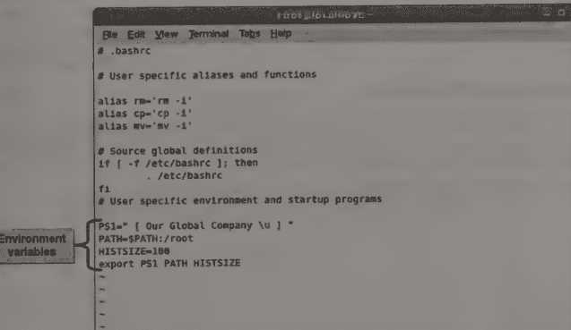

**图 9-9:** 为环境变量赋值。

## 引用环境变量

## 默认环境变量

下表提供了一些默认环境变量及其功能。

| 环境变量 | 描述 |
|---|---|
| `HOSTNAME` | 用于指定系统的主机名。 |
| `SHELL` | 用于指定系统的 shell 路径。 |
| `MAIL` | 用于指定存储邮件的路径。 |
| `HOME` | 用于指定用户目录。 |
| `PATH` | 用于指定用户的操作路径。 |
| `HSIZE` | 用于指定命令历史记录中存储的条目数。 |
| `USER` | 用于指定用户名。 |
| `EDITOR` | 用于指定环境的首选文本编辑器。 |
| `TERM` | 用于指定使用的终端名称。 |
| `PRINTER` | 用于指定系统的默认打印机。 |
| `PAGER` | 用于指定列出长文件内容所需的命令。 |
| `PS1` | 用于指定主提示符——登录时显示的提示符。 |
| `PS2` | 用于指定次提示符。 |

## `alias` 命令

`alias` 命令用于生成命令行别名。别名是较长表达式的简写。使用别名，你可以替换表达式中的某个单词。

```bash
alias rm='rm -i'
alias cp='cp -i'
alias mv='mv -i'
```

**图 9-10:** 查看命令。

## `$HISTSIZE`

`$HISTSIZE` 变量允许你设置历史文件中包含的最大行数。例如，为此变量赋值值 20，历史记录就会被截断。

```bash
# 用户特定的别名和函数
alias rm='rm -i'
alias cp='cp -i'
alias mv='mv -i'

# 挂载全局定义
if [ -f /etc/bashrc ]; then
    /etc/bashrc
fi

# 用户特定的环境和启动程序
PS1="Our Global Company \u "
PATH=$PATH:/root
HISTSIZE=1000
export PS1 PATH HISTSIZE
```

**图 9-11:** 为 `$HISTSIZE` 赋值。

# SUID 脚本

定义：

SUID 脚本是一个覆盖普通权限并以所有者权限运行的程序。使用 `chmod` 命令设置 SUID。需要注意脚本的安全，因为它容易被攻击。

示例：

```bash
$ cat ./suid.c
#include <unistd.h>

int main(int argc, char *argv[]) {
    execcl("/usr/bin/id", "id", (void*)0);
    return(0);
}

$ cc suid.c -o suid -Wall
$ sudo chmod root:wheel ./suid
$ sudo chmod +s ./suid
$ ./suid
uid=1000(sarnold) suid=0(root) gid=1000(sarnold) egid=0(wheel)
groups=1000(sarnold). 0 (wheel)
```


**图 9-12:** 一个 SUID 脚本。

# Shell 产生 (Spawning)

Shell 产生允许 shell 创建其自身的克隆。该副本被称为子进程。它成为新进程并也可以创建更多进程，从而导致多代进程产生。当用户输入命令时，shell 会产生一个子进程。shell 在等待子进程完成后，才会显示提示符以接受另一个命令。

# CompTIA® Linux+™ 由 LPI 授权

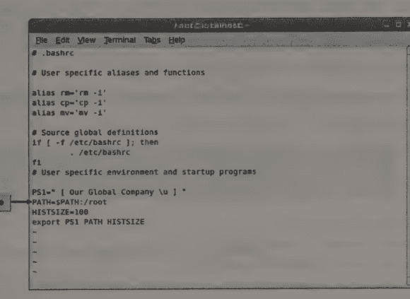

**图 9-13:** 在 `.bashrc` 文件中定义的搜索路径。

示例：
以下是一个搜索路径的示例，路径名称通过冒号分隔：
`/home/user/usr/local/bin:usr/bin:/bin`

非示例：
以下不是搜索路径，因为路径名称没有通过冒号分隔：
`/usr/bin /usr/local/bin`

# 如何使用 Shell 变量

## 过程参考：定义变量

要定义变量：

1. 在 CLI 中以用户身份登录。
2. 要定义变量，输入 `{VARIABLE}=(value)`。
3. 要显示变量关联的值，输入 `echo ${VARIABLE}`。

## 过程参考：为常用命令设置别名 (Alias)

要为频繁使用的命令设置别名：

1. 在 CLI 中以用户身份登录。
2. 要查看默认别名，输入 `alias`。
3. 要为常用命令设置别名，输入 `alias {alias name}='command'`。
4. 要查看系统上更新的别名，输入 `alias`。

## 过程参考：设置配置变量

设置配置变量：

1. 在 CLI 中以 root 身份登录。
2. 打开 `.bashrc` 脚本文件，编辑 `vim ~/.bashrc`。
3. 进行必要的更改，例如更改 `PS1`、`HTSIZE`、`PATH` 或 `alias`。
4. 导出变量并保存文件。
5. 为了使更改生效，注销并重新以 root 登录。

## 过程参考：为 PATH 变量指定脚本位置

要向 `PATH` 变量指定脚本位置：

> 你可以手动将 shell 脚本文件的位置添加到默认 `PATH` 变量中，并在任何位置执行该脚本。

1. 在 CLI 中以用户身份登录。
2. 输入 `vi {script file name}`。
3. 编写脚本命令并保存文件。
4. 要使该文件成为可执行脚本，输入 `chmod a+x {script file name}`。
5. 注销用户身份并以 root 登录。
6. 输入 `vi .bash_profile`。
7. 保存并退出。
8. 注销并重新登录 CLI。
9. 要执行该文件，输入 `{script file name}`。

## 过程参考：将脚本添加到 PATH 变量中的位置

你可以手动将 shell 脚本文件添加到任何位置中指定的默认位置中。要向 `PATH` 变量的默认位置添加脚本：

1. 在 CLI 中以用户身份登录。
2. 输入 `vi {script file name}`。
3. 编写你的脚本并保存文件。
4. 注销用户身份并以 root 登录。
5. 将脚本移动到 `PATH` 变量的默认位置，输入 `mv /home/user/(location of the script file)/{default location of the PATH variable}`。
6. 注销 root 身份并在 CLI 中以用户身份登录。
7. 输入 `{script file name}` 执行脚本。

# PATH 变量的默认位置

每当你执行命令或脚本时，系统会在默认 `PATH` 变量中指定的位置进行搜索。只有存在这些位置中的命令或脚本才能从任何位置执行。

用户的 `PATH™` 变量的默认位置如下：

- `/usr/local/bin`
- `/bin`
- `/usr/bin`

root 用户的 `PATH` 变量的默认位置如下：

- `/usr/local/bin`
- `/bin`
- `/usr/bin`
- `/usr/local/sbin`
- `/sbin`
- `/usr/sbin`

### 过程参考：管理 shell 脚本的所有权

管理 shell 脚本的所有权：

1. 在 CLI 中以 root 身份登录。
2. 查看 shell 脚本文件的所有者。
   a. 进入 shell 脚本所在的目录。
   b. 要查看 shell 脚本文件的所有权，输入 `ls -1`。
3. 更改所有者。
   - 要更改用户，输入 `{user name} {script file name}` 或
   - 要更改组所有者，输入 `chgrp {group name} {script file name}`。

### 过程参考：管理 shell 脚本的执行

管理 shell 脚本的执行：

1. 在 CLI 中以用户身份登录。
2. 进入 shell 脚本所在的目录。
3. 将文件转换为可执行脚本，输入 `chmod a+x {script file name}`。
4. 执行脚本。
   - 输入 `{script file name}`。
   - 输入 `./script file name`。
   - 输入 `/{directory where the script file is located}/{script file name}`。
   - 将脚本文件的目录添加到 `~/.bash_profile` 中的 `PATH` 变量中，然后注销以应用设置。登录并输入 `{script file name}` 或
   - 将脚本添加到 `PATH` 变量的默认位置并输入 `{script file name}`。

### 过程参考：管理脚本的 SUID 权限

管理 shell 脚本的 SUID 权限：

1. 在 CLI 中以用户身份登录。
2. 进入 shell 脚本所在的目录。

# 过程参考：启动 shell 时设置环境变量

在启动 shell 时设置环境变量：

> 你可以手动将 shell 脚本文件的位置添加到默认 `PATH` 变量中，并在任何位置执行该脚本。

1. 在 CLI 中以 root 身份登录。
2. 打开 `.bashrc` 脚本文件，编辑 `vim ~/.bashrc`。
3. 进行必要的更改，例如更改 `PS1`、`HTSIZE`、`PATH` 或 `alias`。
4. 导出变量并保存文件。
5. 为了使更改生效，注销并重新以 root 登录。

# 过程参考：为 PATH 变量指定脚本位置

向 `PATH` 变量指定脚本位置：

> 你可以手动将 shell 脚本文件的位置添加到默认 `PATH` 变量中，并在任何位置执行该脚本。

1. 在 CLI 中以用户身份登录。
2. 输入 `vi {script file name}`。
3. 编写脚本命令并保存文件。
4. 要使文件成为可执行脚本，输入 `chmod a+x {script file name}`。
5. 注销用户身份并以 root 登录。
6. 输入 `vi .bash_profile`。
7. 保存并退出。
8. 注销并重新登录 CLI。
9. 要执行文件，输入 `{script file name}`。

# 过程参考：将脚本添加到 PATH 变量中的位置

你可以手动将 shell 脚本文件添加到任何位置中指定的默认位置。要向 `PATH` 变量的默认位置添加脚本：

1. 在 CLI 中以用户身份登录。
2. 输入 `vi {script file name}`。
3. 编写你的脚本并保存文件。
4. 注销用户身份并以 root 登录。
5. 将脚本移动到 `PATH` 变量的默认位置，输入 `mv /home/user/(location of the script file)/{default location of the PATH variable}`。
6. 注销 root 身份并在 CLI 中以用户身份登录。
7. 输入 `{script file name}` 执行脚本。

# PATH 变量的默认位置

每当你执行命令或脚本时，系统会在默认 `PATH` 变量中指定的位置进行搜索。只有存在这些位置中的命令或脚本才能从任何位置执行。

用户的 `PATH™` 变量的默认位置如下：

- `/usr/local/bin`
- `/bin`
- `/usr/bin`

root 用户的 `PATH` 变量的默认位置如下：

- `/usr/local/bin`
- `/bin`
- `/usr/bin`
- `/usr/local/sbin`
- `/sbin`
- `/usr/sbin`

### 过程参考：管理 shell 脚本的所有权

管理 shell 脚本的所有权：

1. 在 CLI 中以 root 身份登录。
2. 查看 shell 脚本文件的所有者。
   a. 进入 shell 脚本所在的目录。
   b. 要查看 shell 脚本文件的所有权，输入 `ls -1`。
3. 更改所有者。
   - 要更改用户，输入 `{user name} {script file name}` 或
   - 要更改组所有者，输入 `chgrp {group name} {script file name}`。

### 过程参考：管理 shell 脚本的执行

管理 shell 脚本的执行：

1. 在 CLI 中以用户身份登录。
2. 进入 shell 脚本所在的目录。
3. 将文件转换为可执行脚本，输入 `chmod a+x {script file name}`。
4. 执行脚本。
   - 输入 `{script file name}`。
   - 输入 `./script file name`。
   - 输入 `/{directory where the script file is located}/{script file name}`。
   - 将脚本文件的目录添加到 `~/.bash_profile` 中的 `PATH` 变量中，然后注销以应用设置。登录并输入 `{script file name}` 或
   - 将脚本添加到 `PATH` 变量的默认位置并输入 `{script file name}`。

### 过程参考：管理脚本的 SUID 权限

管理 shell 脚本的 SUID 权限：

1. 在 CLI 中以用户身份登录。
2. 进入 shell 脚本所在的目录。

# 过程参考：启动 shell 时设置环境变量

在启动 shell 时设置环境变量：

> 你可以手动将 shell 脚本文件的位置添加到默认 `PATH` 变量中，并在任何位置执行该脚本。

1. 在 CLI 中以 root 身份登录。
2. 打开 `.bashrc` 脚本文件，编辑 `vim ~/.bashrc`。
3. 进行必要的更改，例如更改 `PS1`、`HTSIZE`、`PATH` 或 `alias`。
4. 导出变量并保存文件。
5. 为了使更改生效，注销并重新以 root 登录。

# 活动 9-5：在脚本中使用变量

**开始之前：**
1. 在 CLI 中以 root 身份登录。
2. 显示第一个终端。
3. 注销 root 身份。

**场景：**
你被分配了创建脚本的任务。在完成设置之前，你必须对以下内容进行自定义：

- 命令提示符应反映公司名称。
- `Filecard` 脚本应分配本地路径。
- 命令历史应显示最后 100 条记录。

1. 设置命令提示符反映你的公司名称。
   a. 以 *root* 身份登录。
   b. 要打开 `~/.bashrc` 文件，输入 `vim ~/.bashrc`。
   c. 要更改主提示符，在新的一行输入 `PS1=" [ Global Company \u "`。

2. 设置文件路径和历史大小。
   a. 将 `Filecard` 脚本所在的位置分配给 `PATH` 变量，位置，输入 `PS1=$PATH:/root`。
   b. 将 100 个值分配给历史文件内容，输入 `HISTSIZE=100`。

3. 导出变量并保存文件。
   a. 导出三个变量，类型 `export PS1 PATH HISTSIZE`。
   b. 切换到命令模式。
   c. 保存文件。

4. 检查更改。
   a. 注销 root 用户身份。
   b. 以 root 身份登录验证更改。
   c. 查看命令历史，输入 `history | less`。
   d. 遍历历史显示。观察到最后 100 条记录。
   e. 退出历史页面。清除终端。

# 活动 9-6：使用变量自定义系统

**开始之前：**
显示登录终端。

**场景：**
作为管理员，你需要为员工设置 Linux 系统。在完成设置之前，你必须对以下内容进行自定义：

- 命令提示符应反映公司名称。
- `Filecard` 脚本应分配本地路径。
- 命令历史应显示最后 100 条记录。

1. 设置命令提示符反映公司名称。
   a. 以 *root* 身份登录。
   b. 要打开 `~/.bashrc` 文件，输入 `vim ~/.bashrc`。
   c. 要更改主提示符，在新的一行输入 `PS1=" [ Global Company \u "`。

2. 设置文件路径和历史大小。
   a. 将 `Filecard` 脚本所在的位置分配给 `PATH` 变量，位置，输入 `PS1=$PATH:/root`。
   b. 将 100 个值分配给历史文件内容，输入 `HISTSIZE=100`。

3. 导出变量并保存文件。
   a. 导出三个变量，类型 `export PS1 PATH HISTSIZE`。
   b. 切换到命令模式。
   c. 保存文件。

4. 检查更改。
   a. 注销 root 用户身份。
   b. 以 root 身份登录验证更改。
   c. 查看命令历史，输入 `history | less`。
   d. 遍历历史显示。观察到最后 100 条记录（不包括最后的命令）。
   e. 退出历史页面。清除终端。

# 重定向标准输入和输出

在上一个主题中，你使用了变量执行了 shell 脚本。作为使用脚本自动化任务的一部分，你现在可能想要操作 Linux 命令和文件的输入与输出。在本主题中，你将重定向标准输入和输出。

想象一下你需要创建一个故障排除报告，其中包含一条命令以及其执行后产生的相应错误。在这种情况下，与其将输出或错误保留在报告中，不如你可以将命令的输出重定向到报告中。重定向技术可以帮助你快速快捷地完成某些任务。

# 标准输入

标准输入（或 `STDIN`）是一种作为命令输入源的文本流。通常，Linux 命令的标准输入来自键盘。在 GUI 的情况下，标准输入也可以来自鼠标。标准输入流是经过缓冲的，并且适合重定向。


# read 命令

`read` 命令用于从标准输入、键盘读取内容并将其赋值给变量。

# 标准输出

标准输出（或 `STDOUT`）是一种作为命令输出目的地的文本流。默认情况下，Linux 命令的标准输出被定向到终端屏幕。标准输出流是经过缓冲的，并且适合重定向。

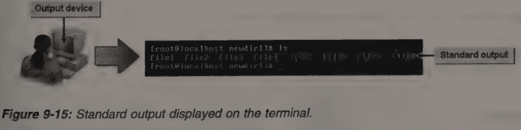

# seq 命令

`seq` 命令在标准输出上打印数字序列。它允许你指定起始值、结束值和增量值。`seq` 命令的语法为：`seq [起始值] [增量值] [结束值]`。例如，`seq 12` 将显示从 1 到 12 的数字，而 `seq 2 500` 将显示从 1 到 500 的所有奇数。

# 标准错误

标准错误（或 `STDERR`）是一种用于错误消息目的地的文本流。`STDERR` 流是不缓冲的。默认情况下，标准错误流在终端屏幕上打印错误消息，但可以通过将其重定向到所需的位置来更改它。


**图 9-16：** 显示器上显示的标准错误消息。

# 重定向符

**重定向符**是一种接受来自键盘以外源输入数据或将数据发送到显示器以外目的地的操作符。它通常使用文件作为输入或输出。重定向符可以将命令的输出作为另一个命令的输入。它还可以将输出数据同时发送到屏幕和文件。


**图 9-17：** 重定向到文件的命令输出。

有一些用于重定向输入或输出的运算符。常用运算符的功能描述如下表所示。

| 运算符 | 允许你执行 |
| --- | --- |
| `>` | 将标准输出重定向到另一个文件。 |

# CompTIA® Linux+™ Powered by LPI

| 运算符 | 允许你执行 |
| --- | --- |
| `>>` | 将标准输出追加到目的文件的末尾。 |
| `2>` | 将标准错误消息重定向到文件。 |
| `2>>` | 将标准错误消息追加到目的文件的末尾。 |
| `&` | 将命令的所有输出直接定向到文件。 |
| `<` | 从文件而非键盘或鼠标读取输入。 |
| `<<string` | 从键盘提供输入数据，用指定的字符串指示结束。 |
| `=` | 为变量赋值。 |
| `==` | 检查两个值是否相等。 |

> 分号 (`;`) 用于分隔变量、命令或值。

**重定向示例**
- `mail < myletter.txt` - 将取 `myletter.txt` 文件作为输入。
- `ls > file.txt` - `ls` 命令的输出将被重定向到名为 `file.txt` 的文件中。
- `ls file3.txt 2> errorfile.txt` - 假设 `file3.txt` 不存在，结果产生的错误将不会显示在屏幕上，而是将被重定向到名为 `errorfile.txt` 的文件中。

# 管道运算符

管道（pipe）是一种组合多个命令的操作符。它将一个命令的标准输出作为另一个命令的标准输入。首个命令的输出格式应与第二个命令所处理的格式兼容。管道运算符可以与 Linux 中的大多数命令一起使用。

第 9 节：使用 Bash Shell 和 Shell 脚本 367

### 示例：


**图 9-18：** 管道运算符用于组合两个 Linux 命令。

# 使用管道运算符的命令示例

- `ls | more` - `ls` 命令的输出是 `more` 命令的输入。

# Shell 脚本中的列表

在 shell 脚本中，你可以编写脚本通过创建一个列表按顺序执行多个命令。此列表可以使用四个符号之一（`;`、`&`、`&&`、`|`）分隔命令。脚本中使用的运算符如下：

| 运算符 | 描述 |
| --- | --- |
| `;` | 分隔命令，按顺序执行。 |
| `&` | 在后台执行命令。 |
| `&&` | 仅当前面的命令执行成功时执行后续。 |
| `||` | 仅当前面的命令执行失败时执行后续。 |

# xargs 命令

`xargs` 命令用于构建并执行命令行。管道运算符用于将第一个命令的输出作为第二个命令的输入。`xargs` 命令从标准输入添加参数以完成命令。

`xargs` 命令有多种选项：

| 选项 | 用途 |
| --- | --- |
| `-I {替换字符串}` | 将输入的每行视为单个参数。 |
| `-L {行数}` | 从标准输入读取指定数的行。 |
| `-p` | 在每个命令前提示用户。 |
| `-n {数量}` | 从标准输入读取指定数量的参数并插入。 |
| `-E {字符串}` | 表示输入的结束。 |
| `-t` | 将每个命令写入标准输出。 |
| `-s {大小}` | 设置参数列表的最大允许字符数。 |
| `-x` | 如果生成的命令超过了 `-n` 选项的数量、`-L` 选项的行数或 `-s` 选项的大小，则终止 `xargs` 命令。 |

# tee 命令

`tee` 命令读取标准输入，将其发送到标准输出设备，并复制到每个指定的文件。该命令允许用户在将输出发送到下一个命令之前将其记录在文件中，因此它是故障排除非常有用的工具。配合 `-a` 选项使用时，会将输出追加到每个输出文件而不是覆盖它。配合 `-i` 选项使用时，它会忽略中断信号。


**图 9-19：** 重定向到文件的 `df` 命令输出。

## 如何重定向输入和输出

### 程序参考：将标准输出重定向到文件

要将标准输出重定向到文件：

1. 以用户身份登录。
2. 将标准输出重定向到文件。
   - 要将命令的标准输出重定向到指定的文件，在命令提示符处输入 `{command} > {file name}`。
   - 要将命令的标准输出追加到指定文件的末尾，输入 `{command} >> {file name}`。

### 程序参考：将标准错误重定向到文件

要将标准错误重定向到文件：

1. 以用户身份登录。
2. 将标准错误重定向到文件。
   - 要将命令的错误信息重定向到指定的文件，输入 `{command} 2> {file name}`。
   - 要将命令的错误信息追加到指定文件的末尾，输入 `{command} 2>> {file name}`。

### 程序参考：将标准输出重定向到命令

要将标准输出重定向到另一个命令：

1. 以用户身份登录。
2. 要将一个命令的输出作为另一个命令的输入，输入 `{command 1} | {command 2} | {command 3}`。

### 程序参考：将标准输出重定向到文件和命令

要将标准输出同时重定向到文件和命令：

1. 以用户身份登录。
2. 要将各个阶段的输出保存到文件中并定向其他命令，输入 `{command 1} | tee {file name 1} | {command 2} | tee {file name 2} | {command 3}`。

### 程序参考：将标准输出和标准错误重定向到文件和命令

要将标准输出和标准错误重定向到文件和命令：

1. 以用户身份登录。
2. 重定向标准输出和标准错误。
   - 要将命令的标准输出重定向到一个文件并将错误信息重定向到另一个文件，输入 `{command} > {file name 1} 2> {file name 2}`。
   - 要将命令的所有输出重定向到一个文件，输入 `{command} &> {file name}`。
   - 要将命令的所有输出和标准错误信息重定向到另一个命令，输入 `{command 1} 2>&1 | {command 2}`。

### 程序参考：重定向标准输入

要重定向标准输入：

1. 以用户身份登录。
2. 重定向标准输入。
   - 要将文件作为命令的输入，输入 `{command} < {file name}`。
   - 要从键盘接受输入，直到提供指定的字符串作为输入，输入 `{command} <<{string}`。

## 活动 9-7
重定向内容

**数据文件：**
`Hardwareinventory.txt`, `Softwareinventory.txt`

**在开始之前：**

1. 你已经在 CLI 的第一个终端以 root 身份登录。
2. 要打开 `~/.bashrc` 文件，输入 `vim ~/.bashrc`。
3. 删除以 "PS1=" 开头的行。
4. 从以 "export" 开头的行中删除 `PS1`。
5. 保存并关闭文件。
6. 注销并以 root 身份登录。
7. 清空终端屏幕。

**场景：**
在你公司的主服务器上，与软件清单和硬件清单相关的数据存储在单独的文件中。你被分配的任务是将这些文件合并到一个名为 `Inventory.txt` 的新文件中，以便可以在线查看。

1. 将 `Softwareinventory.txt` 和 `Hardwareinventory.txt` 文件的内容重定向到 `Inventory.txt` 文件。
   a. 要创建一个空文件 `Inventory.txt`，输入 `touch Inventory.txt`。
   b. 要将 `Softwareinventory.txt` 文件的内容重定向到 `Inventory.txt` 文件，输入 `cat Softwareinventory.txt > Inventory.txt`。
   c. 要查看 `Inventory.txt` 文件的内容，输入 `cat Inventory.txt`。
   d. 清空终端屏幕。
   e. 要将 `Hardwareinventory.txt` 文件的内容追加到 `Inventory.txt` 文件，输入 `cat Hardwareinventory.txt >> Inventory.txt`。

2. 查看 `Inventory.txt` 文件。
   a. 要分页查看 `Inventory.txt` 文件的内容，输入 `cat Inventory.txt | less`。
   b. 按两次空格键导航到文件中的剩余页面。
   c. 要退出并返回 shell 提示符，按 `Q`。
   d. 清空终端屏幕。

### 主题 E

## 在 Shell 脚本中使用控制语句

在上一个主题中，你重定向了命令和文件之间的标准输入和输出。现在，你可能想编写简单的 shell 脚本来自动化重复任务。在本主题中，你将在 shell 脚本中使用控制语句。

考虑这样一个场景：你想根据用户的登录时间显示“早上好”、“下午好”或“晚上好”来问候用户。使用控制语句，你可以为每条消息指定时间范围，并根据用户登录的时间显示相关消息。

## 控制语句

控制语句是一种确定程序在测试条件下所走方向的指令。该方向可能与指令列出的顺序顺序不同。控制语句与一个或多个动作语句相关，这些语句只有在满足指定条件时才会执行。


**图 19：控制语句**

控制语句是一种确定程序在测试条件下所走方向的指令。该方向可能与指令列出的顺序顺序不同。控制语句与一个或多个动作语句相关，这些语句只有在满足指定条件时才会执行。

## 表达式

控制语句是一种确定程序在测试条件下所走方向的指令。该方向可能与指令列出的顺序顺序不同。控制语句与一个或多个动作语句相关，这些语句只有在满足指定条件时才会执行。

## 编程结构

控制语句是一种确定程序在测试条件下所走方向的指令。该方向可能与指令列出的顺序顺序不同。控制语句与一个或多个动作语句相关，这些语句只有在满足指定条件时才会执行。


```bash
```


```bash
if [ ManagerEnabled -eq 0 ]; then
  for i in 0 1 2 3; do
    if [ $i ];
    then
      ManagerEnabled=1
    fi
  done
  if [ ManagerEnabled -eq 1 ];
  then
    OPTIONS="$D"
  fi
fi
```

**图 20：编程结构**

## 循环

控制语句是一种确定程序在测试条件下所走方向的指令。该方向可能与指令列出的顺序不同。控制语句与一个或多个动作语句相关，这些语句只有在满足指定条件时才会执行。

## 测试结构

控制语句是一种确定程序在测试条件下所走方向的指令。该方向可能与指令列出的顺序不同。控制语句与一个或多个动作语句相关，这些语句只有在满足指定条件时才会执行。

## 函数

控制语句是一种确定程序在测试条件下所走方向的指令。该方向可能与指令列出的顺序不同。控制语句与一个或多个动作语句相关，这些语句只有在满足指定条件时才会执行。

```bash
# /etc/profile
# 系统级环境和启动程序，用于登录设置

# 函数和别名放在 /etc/bashrc

pathge () {
    if echo $PATH | /bin/egrep -q "([^|:])($:)"; then
        if [ "$2" = "after" ];
        then
            PATH=$1
        else
            PATH=$1:$PATH
        fi
    fi
}
```

一个示例函数。

## 变量

变量是程序内存中一个命名的存储位置，可以赋值。变量可以在不同时间持有不同的值，但一次只能持有一个值。用户变量正如其名由用户定义，对于当前 shell 是局部的。系统变量是由操作系统本身创建并维护的变量。

## 比较和逻辑运算符

某些比较、逻辑和算术运算符列在表中。

| 如果你需要 | 使用此运算符 |
|---|---|
| 检查两个值是否相等 | `==` |
| 检查第一个值是否大于第二个值 | `>` |
| 检查第一个值是否小于第二个值 | `<` |
| 检查两个值是否不等 | `!=` |
| 检查第一个值是否大于等于第二个值 | `>=` |
| 检查第一个值是否小于或等于第二个值 | `<=` |

| 逻辑运算符 | 描述 |
|---|---|
| `&&` | 逻辑与 (AND) |
| `\|\|` | 逻辑或 (OR) |
| `^` | 逻辑异或 (XOR) |
| `!` | 布尔非 (NOT) |

| 如果你需要 | 使用此算术运算符 |
| --- | --- |
| 将值加一。 | `++` |
| 将值减一。 | `--` |

## if 语句

最常用的结构是 `if` 语句。一个 `if` 语句包含一个需要评估的条件，以及在满足条件时要执行的一个或多个操作。如果条件不满足，将跳过这些操作，并执行脚本中的下一条语句。`fi` 表示这组指令的结束。

#### 语法

`if` 语句的语法如下：

```
if ( (需要满足的条件) )
then
{要执行的命令}
..
fi
```

## if...else 语句

`if...else` 语句允许根据条件评估的结果，在两个操作之间进行选择。如果满足条件，则执行第一个操作；否则，执行 `else` 部分之后的操作。`fi` 语句表示这组指令的结束。如果指令组多于两组，可以使用一个或多个 `elif` 语句来指定备选的操作序列。

#### 语法

`if...else` 语句的语法如下：

```
if ( (需要满足的条件) )
then
{要执行的命令}
..
else
{要执行的命令}
fi
```

## 循环语句

循环语句，也称为迭代语句，是一种控制语句，可以帮助你根据评估的特定条件重复执行脚本的某部分。条件是根据变量的值进行测试的。Bash 壳支持两种类型的循环：`for` 循环和 `while` 循环。在 shell 脚本中，要迭代的命令被包含在 `do` 和 `done` 语句之间。


## for 循环

`for` 循环根据语句条件部分内数值变量所指定的次数执行脚本的某部分。`for` 循环的独特之处在于，语句的条件部分包含了变量的初始值、测试条件以及变量值的增量或减量。

#### 语法

Linux 中的 `for` 循环允许你根据条件的评估重复一系列命令。例如，`for` 循环的语法如下：

```
for ((expr1; expr2; expr3))
do
  {要执行的命令}
done
```

在此语法中，`expr1` 是在第一次循环之前执行一次的初始语句，`expr2` 是测试条件，`expr3` 是在每个循环结束时执行的增量或减量表达式。

另一种语法：`for` 循环还有另一种语法：

```
{变量名} in {列表}
do
  {要执行的命令}
done
```

在此语法中，变量将被赋值列表中的一个值，并且会为列表给出的每个值执行一次循环。

## while 循环

`while` 循环允许你在满足特定条件时，固定次数地重复一组指令。在 `while` 循环中，条件是开放的。首先评估第一个表达式，如果表达式为真，则执行循环中的操作。执行将返回循环开头并再次评估该表达式。如果表达式为假，则执行跳转到下一条语句。

#### 语法

`while` 循环的语法如下：

```
while { 需要满足的条件 }
do
  {要执行的命令}
done
```

## until 循环

`until` 循环与 `while` 循环类似，不同在于当控制表达式为假时执行代码。例如，`until` 循环的语法如下：

```
until ( {需要满足的条件 }
do
  {要执行的命令}
done
```

## 如何使用控制语句

过程参考：在脚本中使用控制语句

要在脚本中使用控制语句：

1. 以用户身份登录。
2. 若要编写 Bash 壳脚本，在终端上输入 `vi {脚本文件名}`。
3. 切换到插入模式，按 `I`。
4. 输入 `#!/bin/bash` 以指定 shell 类型。
5. 输入你想要执行的命令。
6. 根据需要使用控制语句或循环。

- 若要使用 `if` 语句，输入：
```bash
if ( 需要满足的条件 ) 
then
  (要执行的命令)
fi
```

- 若要使用 `if...else` 语句，输入：
```bash
if ( 需要满足的条件 ) 
then
  (要执行的命令)
else
  (要执行的命令)
fi
```

- 若要使用 `for` 循环，输入 `for ((expr1; expr2; expr3))` 
```bash
do
  (要执行的命令)
done
```

- 若要使用 `while` 循环，输入：
```bash
while
  {需要满足的条件}
do
  (要执行的命令)
done
```

7. 若要返回命令模式，按 `Esc`。
8. 若要保存文件并退出文本编辑器，输入 `:wq`。
9. 若要将文件转换为可执行，输入 `chmod +x {文件名}`。

## 过程参考：在脚本中使用控制语句

要在脚本中使用控制语句：

1. 以用户身份登录。
2. 若要编写 Bash 壳脚本，在终端上输入 `vi {脚本文件名}`。
3. 切换到插入模式，按 `I`。
4. 输入 `#!/bin/bash` 以指定 shell 类型。
5. 输入你想要执行的命令。
6. 根据需要使用控制语句或循环。

- 若要使用 `if` 语句，输入：
```bash
if ( 需要满足的条件 ) 
then
  (要执行的命令)
fi
```

- 若要使用 `if...else` 语句，输入：
```bash
if ( 需要满足的条件 ) 
then
  (要执行的命令)
else
  (要执行的命令)
fi
```

- 若要使用 `for` 循环，输入 `for ((expr1; expr2; expr3))` 
```bash
do
  (要执行的命令)
done
```

- 若要使用 `while` 循环，输入：
```bash
while
  {需要满足的条件}
do
  (要执行的命令)
done
```


### 活动 9-8 编写创建目录的脚本

**开始之前：**
你已以 `root` 用户身份登录终端。

**场景：**
你想为所有员工创建单独的目录。因为单独创建目录非常耗时，你决定编写一个脚本来自动化此过程。

以下是编写脚本的细节：

*   脚本名称：`createdir`
*   提醒用户输入数量的提示文本：`要创建的目录数量`
*   获取目录总数的变量名：`Numberofdir`
*   用于 `for` 循环的变量名：`d`

1.  设置目录总数。
    a. 为脚本打开新文件，输入 `vim createdir`。
    b. 切换到插入模式。
    c. 指定 shell，输入 `#!/bin/bash`。
    d. 指定提示消息，输入 `echo "要创建的目录数量:"`。
    e. 读取用户输入，输入 `read Numberofdir`。

2.  编写创建目录的循环。
    a. 指定循环条件，输入 `for (( d = $Numberofdir ; d > 0 ; ))`。
    b. 指定迭代的开始，输入 `do`。
    c. 创建目录，输入 `mkdir Directory-$d`。
    d. 指定迭代的结束，输入 `done`。
    e. 切换到命令模式。
    f. 保存并关闭文件。
    g. 清空终端。

3.  执行 `createdir` 脚本。
    a. 将文件转换为可执行脚本，输入 `chmod +x createdir`。
    b. 要执行脚本，输入 `./createdir`。
    c. 要创建十个目录，输入 `10`。
    d. 清除终端屏幕。

4.  检查目录是否创建。
    a. 要查看已创建的目录，输入 `ls`。
    b. 观察屏幕上列出了十个新目录。
    c. 清除终端屏幕。

## 第 9 课后练习

在本节中，你自定义了 `Bash` shell 并在其中执行了各种操作。你还处理了脚本，在 shell 中重定向了输入和输出，并在脚本中使用控制语句来自动化重复任务。这将让你能够高效地执行系统管理员的工作。

1.  为什么在脚本中使用变量？
2.  `Bash` shell 最显著的特征是什么？请解释。
3.  通过运行 shell 脚本可以执行哪些各种任务？

# 第 10 课 管理作业与进程

**课程时长：** 1 小时 30 分钟

## 课程目标

在本节中，你将管理作业和进程。

你将：

*   管理作业和后台进程。
*   使用进程表管理进程。
*   处理延迟作业和离线作业。
*   调度作业。
*   维护系统时间。

### 引言

在上一节课中，你在 `Linux` 环境下使用了 shell 和 shell 脚本来帮助成功管理系统。在对 `Linux` 系统的日常管理中，可能还会出现需要在系统上同时运行各种实用程序的情况，而并不一定通过 shell 脚本来实现。在本节中，你将管理作业和进程。

`Linux` 的多任务处理能力允许你同时执行许多任务，例如编译程序、排序数据库和创建文档。当系统资源被同时利用时，系统性能会降低。系统管理员应该通过为用户运行的每个任务分配适当的资源，来有效地管理系统资源。

本节涵盖了以下 `CompTIA Linux+ Powered by LPI` 认证目标的全部或部分：

*   **Topic A:**
    *   目标 `103.5`
*   **Topic B:**
    *   目标 `101.3`, 目标 `103.5`, 目标 `103.6`
*   **Topic C:**
    *   目标 `103.5`
*   **Topic D:**

## Topic A

## 管理作业和后台进程

在上一节课中，你设置了 `Linux` 变量并执行了 shell 脚本来协助你日常管理 `Linux` 系统。然而，还有其他日常任务需要你管理以监督 `Linux` 系统，特别是处理多个用户的系统。例如，你可能需要管理在 `Linux` 环境中同时运行的许多进程。在本主题中，你将管理多个作业和后台进程。

大多数系统可以处理一个运行中的多个进程，但当数百名用户同时运行应用程序时会发生什么？作为此类环境下的管理员，你需要允许你高效管理系统资源的工具和选项。利用 `Linux` 的多任务处理能力，你可以在后台管理作业和进程。

### 进程

**定义：**

进程是执行数据任务的运行程序的实例。进程由存储在系统上的一系列步骤组成；这些进程将输入数据转换为输出。每个进程都被分配了一个唯一的 `PID`，并包含时间限制、共享内存或子进程。进程可以在系统的前台或后台运行。

**示例：**


图 10-1：系统上运行进程的 `PID`。

### 进程 ID (PID)

每当进程启动时，系统都会分配一个唯一的 `ID`（称为 `PID`）来标识进程。此外，每个进程都会继承启动进程的用户 `UID` 和 `GID`。这与 `Linux` 文件系统中文件和目录的所有权类似。

### init 进程

第一个进程在 `Linux` 中称为 `init`，它由内核在启动时启动且永不终止。`init` 进程的 `PID` 总是 `1`。

### 前台进程

前台进程是用户在特定时间内交互的程序。一次只能运行一个前台进程。当用户在程序之间切换时，不同的程序会在不同的时刻成为前台进程。前台进程通过在提示符处输入命令或在 `GUI` 中点击快捷方式启动。

### 后台进程

后台进程是允许 `Linux` shell 执行在后台运行命令的程序，使进程能够并行。当用户与前台进程交互时，许多进程可以作为后台进程运行。shell 不需要等待一个进程结束即可运行。可以通过在调用的命令后加上 ampersand (`&`) 后跟一个空格来在后台运行进程。


图 10-2：启动在后台运行的进程。

### 守护进程 (Daemons)

守护进程始终作为后台进程运行，永远不需要用户输入。其他进程临时留在后台，而用户忙于当前的前台进程。

### 程序与进程的关系

程序是一组描述如何执行任务的指令集。存在于系统上的命令就是一个程序。

# 如何管理作业和后台进程

**程序参考：管理作业**

管理作业：

1.  输入命令并在末尾添加和符号 (`&`) 以将作业置于后台运行。
2.  如必要，执行额外的命令。
    *   使用和符号 (`&`) 在后台执行另一个命令；或
    *   在不将其放入后台运行的情况下执行另一个命令。
3.  要查看后台运行的进程列表，请在命令行输入 `jobs`。
4.  管理正在后台运行的作业。
    *   要杀死后台运行的进程，输入 `kill %[作业编号]`。
    *   要将后台进程切换到前台，输入 `fg %[作业编号]`。
    *   要挂起前台作业，按下 `Ctrl+Z`。
    *   要重启已挂起的作业，输入 `bg %[作业编号]`。

# 活动 10-1 管理作业

**在开始之前：**

1.  你已在 `CLI` 中以 `root` 身份登录。
2.  显示了第一个终端。

**场景：**

作为系统管理员，你被要求节省在 `Linux` 系统上运行作业所需的时间。你还需要管理多个作业，而不是一次只运行一个作业。你可以通过将作业移动到后台处理来实现这一点。

1.  发布三个命令并将它们置于后台运行。
    a. 要让系统暂停 300 秒，输入 `sleep 300 &`。
    b. 要更新 `mlocate` 数据库，输入 `updatedb &`。
    c. 要让系统暂停 200 秒，输入 `sleep 200 &`。
    d. 要查看后台运行的进程列表，输入 `jobs`。
    e. 验证三个作业是否已列出。

2.  终止最后一个作业。
    a. 要杀死执行 `sleep 200 &` 命令的进程，输入 `kill %3`。
    b. 要查看后台运行的进程列表，输入 `jobs`。
    c. 验证第三个作业的状态是否显示为“Terminated”，表示该作业已终止。

3.  将第二个作业带到前台并将其挂起。
    a. 要将更新 `mlocate` 数据库的作业移到前台，输入 `fg %2`。
    b. 要挂起前台作业，按下 `Ctrl-Z`。
    c. 验证作业状态是否显示为“Stopped”，表示作业已停止。
    d. 要重启已挂起的作业，输入 `bg %2`。
    e. 要查看后台运行的进程列表，输入 `jobs`。
    f. 验证更新 `mlocate` 数据库的作业正在运行。
    g. 要清空终端屏幕，输入 `clear`。

# Topic B

# 使用进程表管理进程

在上一个主题中，你使用作业表管理了多个进程。虽然作业表对于每个用户的特定 shell 是唯一的，但进程表适用于整个系统。在本主题中，你将使用进程表来管理进程。

监控系统进程使系统管理员能够跟踪系统资源的使用情况。跟踪系统上运行的进程有助于你更好地管理资源分配。作为 `Linux` 管理员，你会发现进程表非常有用，因为它包含了系统中所有用户启动的所有进程的条目。通过进程表，你可以在 `Linux` 环境下管理系统上的进程。

## 进程表

进程表是一份总结了系统上当前运行进程的记录。它允许管理员跟踪由不同用户运行的所有进程。进程表中显示的一些细节包括 `PID`（进程 `ID`）、程序在内存中的大小、所有进程的用户名以及时间。


**图 10-5：** 列出系统上运行进程的进程表。

## 进程表与作业表

进程表的选项与作业表不同。进程表可以显示系统上运行的所有进程，无论是由哪个用户启动的，包括在启动时自动启动的系统进程。然而，作业表仅显示在用户当前 shell 中启动的进程。此外，进程表中显示进程的 `PID`，而作业表则根据启动的顺序显示它们的作业编号。在作业表中，只有原始进程被作为一个条目显示，但在进程表中，原始进程以及随后启动的所有后续进程都会被显示出来。因此，作业表中的单个条目在进程表中可能对应多个条目。某些作业控制命令只能通过通过作业编号引用进程来应用。

## ps 命令

`ps` 命令调用进程表。当在不带任何选项的情况下运行命令时，它会显示由当前 shell 运行的进程，详细信息包括 `PID`、与进程相关的终端、累积的 `CPU` 时间以及启动进程的命令。然而，可以使用不同的选项配合命令来过滤显示的字段或进程。


#### 语法

`ps` 命令的语法为 `ps [options]`。

# ps 命令选项

`ps` 命令支持多种选项。这里列出重要的选项。

| 选项 | 描述 |
| :--- | :--- |
| `a` | 显示所有进程。 |
| `e` | 显示所有进程。 |
| `l` | 使用长格式列出进程。 |
| `u` | 列出用户名和启动时间。 |
| `r` | 列出运行中的进程。 |
| `x` | 包括没有终端的进程。 |
| `T` | 列出停止的进程。 |

| 选项 | 描述 |
| :--- | :--- |
| `U {用户名}` | 根据指定的用户显示进程。 |
| `p {PID}` | 仅显示与 `PID` 关联进程。 |
| `C {命令}` | 根据命令名显示进程。 |
| `--tty {终端}` | 显示指定终端上的进程。 |

| 字段 | 描述 |
| :--- | :--- |
| `PRI` | 进程优先级。优先级越低数值越高。 |
| `NI` | 进程 `nice` 值。使用 `CPU` 时间越少的数值越高。 |
| `SIZE` | 虚拟镜像大小。 |
| `RSS` | 物理内存（`KB`）。 |
| `WCHAN` | 进程所在的内核函数。 |
| `STAT` | 状态。`R`（运行）、`T`（停止）、`D`（深度睡眠且不可中断）、`S`（睡眠）、`Z`（僵尸）和 `N`（正 `nice` 值）。 |
| `TT` | 与进程相关的 `TTY` 或终端。 |
| `PAGEIN` | 主页异常次数。 |
| `TRS` | 驻留文本大小。 |
| `SWAP` | 使用的交换空间（`KB`）。 |
| `SHARE` | 共享内存量。 |

## 子进程

由运行进程创建的进程被称为子进程。进程表包含了父进程和子进程。可能存在多级的进程。父进程可以产生子进程，子进程可以产生另一个子进程，以此类推。父进程必须运行，子进程才能运行。父进程被分配一个进程 `ID` (`PPID`)。


图 10-7：显示父进程和子进程的进程树。

## 识别子进程

识别子进程并不是一项容易的任务，特别是当多个进程和子进程同时运行时。通过检查 `PID` 的顺序，你可能确定进程创建的顺序并推断哪些进程是相关的。

## pstree 命令

`pstree` 命令允许你以树状格式列出 `Linux` 系统上运行的进程。这有助于你跟踪父进程和子进程。所有进程都列为 `init` 的子进程，这由初始分支表示。在 shell 中启动的进程将从 shell 的父进程分支出来。

# ptree 命令

```
ptree
```


`root@localhost # ptree`

`init--acpid`

`--auditd--audispd=(audispd)`

`-(auditd)`

`--autounount-4=(autounount)`

`--avahi-daemon-avahi.daemon`

`--bonobo-activati=(bonobo-activati)`

`--tt-applet`

`--clock-applet`

`--systemd`

`cupsd`

`2-[dbus-daemon]`

`-dbus-launch`

`-dhclient`

`-egquit- (escd)`

`-escd-(escd)`

`-events/d`

`-gm-server`

`-gcfsd-`

`-gdb-binary-gdb-Xorg`

`-gnome-session--ssh-agent`

`-gm-rh-security-(gm-rh-security)`

`-gnome-keyring-d`


## 图 10-8: 显示父进程和子进程的 ptree 命令。

## 进程识别命令

进程识别命令允许你使用进程的名称或其他相关属性提取有关进程的信息。

| 命令 | 描述 |
| --- | --- |
| `pidof` | 显示指定名称进程的 PID，仅在已知进程名称时可以使用。然而，建议给出进程的完整路径，因为可能有多个同名进程在运行。该命令的语法为 `pidof [options] (string)`。 |
| `pgrep` | 显示符合任何给定条件的进程的 PID，例如调用它的用户的用户名称或 UID、启动时间、父级 UID 等。该命令的语法为 `pgrep [options] (process name)`。 |

## `pidof` 命令选项

`pidof` 命令仅支持两个选项。

| 选项 | 用途 |
| --- | --- |
| `-s` | 指示程序只显示一个 PID。 |
| `-c` | 指示程序显示从相同根目录运行的 PID。 |

## `pgrep` 命令选项

`pgrep` 命令支持不同的选项，通过这些选项可以指定一个或多个搜索条件。

| 选项 | 用途 |
|---|---|
| `-f` | 指定进程的全路径。 |
| `-l` | 打印进程名称及其 PID。 |
| `-u {userid}` | 指定启动它的用户的 UID。 |
| `-G (groupid)` | 指定与进程相关的 GID。 |
| `-n` | 指定最近的进程。 |
| `-o` | 指定最老的进程。 |

# 信号

定义：

信号是发送给进程以执行某些操作的消息。它们用于暂停或终止进程。信号可能只影响指定的进程及其子进程。信号可以被进程执行、捕获、阻塞或忽略。

示例：


图 10-9: 发送进程的信号。

## `kill` 命令

使用不同的命令向进程发送信号以结束“kill”。

| 命令 | 描述 |
| --- | --- |
| `kill` | 向一个或多个进程发送任何指定的信号，或默认的终止信号。必须将 PID 作为参数。该命令的语法为 `kill [options] PID`。 |
| `pkill` | 根据名称和其他标识符向进程发送信号。该命令的语法为 `pkill [options] command`。 |
| `killall` | 杀死所有指定名称的进程。该命令的语法为 `killall [options] command`。 |

> `kill` 命令接受 PID 或作业号作为参数。因此，该命令也可以用作业控制工具。

### Kill 信号选项

你可以使用 kill 信号或其对应的数值向进程发送信号以终止该进程。

| 选项 | 用途 |
| --- | --- |
| `SIGKILL` or `9` | 向进程发送 kill 信号。 |
| `SIGTERM` or `15` | 发送终止信号。 |
| `SIGSTOP` or `19` | 停止进程。 |

> 有时，即使在关闭会话后，某些应用程序可能无法正常终止。在这种情况下，你需要使用 `ps` 命令识别该应用程序的 PID 然后进行 kill。

### 使用 PID 数字终止进程

你可以使用 `kill` 命令结合进程表来结束进程。通过输入 `kill` 后跟 PID，你可以终止特定的进程。然而，进程表可能会显示不属于你的进程。作为用户，你只能对你拥有的进程使用 `kill` 命令。作为 root，你可以杀死任何人的进程。

`kill` 命令提供了许多选项。这些选项被称为信号。某些进程无法通过 `kill` 命令消除。要终止这些进程，请使用带有 `-9` 的 `kill` 命令。这会立即终止进程。

## 进程状态

进程状态允许你识别进程的当前阶段。它由进程表中的单个字母表示。下面是各种进程状态。

| 状态 | 描述 |
| --- | --- |
| 不中断睡眠 (`D`) | 进程处于永久非活动状态。 |
| 运行 (`R`) | 进程正在运行或准备运行。 |
| 可中断睡眠 (`S`) | 进程在某些触发后等待运行。 |
| 停止 (`T`) | 进程可能被作业控制工具临时停止或正在被追踪。 |
| 死亡 (`X`) | 进程已被杀死。此状态永不显示。 |
| 僵尸 (`Z`) | 进程已结束，但在父进程确认之后。它将以“僵尸”的形式存在。

## `top` 命令

`top` 命令列出 Linux 系统上运行的所有任务。它作为一个进程管理工具，允许用户交互式地对进程进行优先级、排序或终止。它显示动态进程状态，反映实时变化。在该工具中按下不同的键可以执行进程管理操作。


图 10-10: 使用 `top` 命令管理进程。

### 管理进程的有用键

`top` 命令提供了一个交互式工具，可以使用一些快捷键管理进程。这里列出了一些常用的快捷键。

| 键 | 功能 |
|---|---|
| `Enter` | 刷新所有进程的状态。 |
| `Shift+n` | 按 PID 递减顺序排序任务。 |
| `u` | 切换显示提示符中指定的用户所属进程。 |
| `k` | 终止指定 PID 的进程。 |
| `r` | 调整指定 PID 进程的 `nice` 值。 |
| `h` | 显示帮助屏幕。 |
| `q` | 退出任务列表。 |

## `nice` 命令

`nice` 命令允许你为进程分配优先级。`nice` 值表示进程在与其他共享系统资源时的“友好”程度。你可以以比正常优先级更高或更低的优先级运行。你必须拥有 root 用户权限以更高的优先级运行命令。进程的优先级通常被称为 `nice` 值。

## `nice` 值

| PID | USER | PRI | NI | | | | load average: 0.81, 0.43, 0.54 |
|---|---|---|---|---|---|---|---|
| 1 | 12:08:56 | 21 | 2 | user | 0.00 | 0.00 | 0.00 | stopped, zombie |
| Task: 1 | 00:00:16 | 109 | -7 | | 0.0% | 0.0% | 0.0% | 0.0% |
| CPU(s): | (0.5us, 0.0sy, 99.7id, 0.0wa, 0.0si, 0.0ni, 0.0) | | | | | | |

使用 PID 数字终止进程

你可以使用 `kill` 命令结合进程表来结束进程。通过输入 `kill` 后跟 PID，你可以终止特定的进程。当你使用 `kill` 命令配合你启动的任务时，进程表可能会显示不属于你的进程。作为用户，你只能对你拥有的进程使用 `kill` 命令。作为 root，你可以杀死任何人的进程。

`kill` 命令提供了许多选项。这些选项被称为信号。某些进程无法通过 `kill` 命令消除。要终止这些进程，请使用带有 `-9` 的 `kill` 命令。这会立即终止。

## 进程状态

进程状态允许你识别进程的当前阶段。它由进程表中的单个字母表示。下面是各种进程状态。

| 状态 | 描述 |
| --- | --- |
| 不中断睡眠 (`D`) | 进程处于永久非活动状态。 |
| 运行 (`R`) | 进程正在运行或准备运行。 |
| 可中断睡眠 (`S`) | 进程在某些触发后等待运行。 |
| 停止 (`T`) | 进程可能被作业控制工具临时停止或正在被追踪。 |
| 死亡 (`X`) | 进程已被杀死。此状态永不显示。 |
| 僵尸 (`Z`) | 进程已结束，但在父进程确认之后。它将以“僵尸”的形式存在。

## `top` 命令

`top` 命令列出 Linux 系统上运行的所有任务。它作为一个进程管理工具，允许用户交互式地对进程进行优先级、排序或终止。它显示动态进程状态，反映实时变化。在该工具中按下不同的键可以执行进程管理操作。

### 管理进程的有用键

`top` 命令提供了一个交互式工具，可以使用一些快捷键管理进程。这里列出了一些常用的快捷键。

| 键 | 功能 |
|---|---|
| `Enter` | 刷新所有进程的状态。 |
| `Shift+n` | 按 PID 递减顺序排序任务。 |
| `u` | 切换显示提示符中指定的用户所属进程。 |
| `k` | 终止指定 PID 的进程。 |
| `r` | 调整指定 PID 进程的 `nice` 值。 |
| `h` | 显示帮助屏幕。 |
| `q` | 退出任务列表。 |

## `nice` 命令

`nice` 命令允许你为进程分配优先级。`nice` 值表示进程在与其他共享系统资源时的“友好”程度。你可以以比正常优先级更高或更低的优先级运行。你必须拥有 root 用户权限以更高的优先级运行命令。进程的优先级通常被称为 `nice` 值。

# `ptree` 命令

```
root@localhost # ptree

init--acpid

  --auditd--audispd=(audispd)

    -(auditd)

  --autounount-4=(autounount)
```


`--avahi-daemon-avahi.daemon`

`--bonobo-activati=(bonobo-activati)`

`--tt-applet`

`--clock-applet`

`--systemd`

`cupsd`

`2-[dbus-daemon]`

`-dbus-launch`

`-dhclient`

`-egquit-` (`escd`)

`-escd-` (`escd`)

`-events/d`

`-gm-server`

`-gcfsd-`

`-gdb-binary-gdb-Xorg`

`-gnome-session--ssh-agent`

`-gm-rh-security-` (`gm-rh-security`)

`-gnome-keyring-d`


**图 10-8: 显示父进程和子进程的 `ptree` 命令。**

## 进程识别命令

进程识别命令允许你使用进程的名称或其他相关属性提取有关进程的信息。

| 命令 | 描述 |
| --- | --- |
| `pidof` | 显示指定名称进程的 PID，仅在已知进程名称时可以使用。然而，建议给出进程的完整路径，因为可能有多个同名进程在运行。该命令的语法为 `pidof [options] (string)`。 |
| `pgrep` | 显示符合任何给定条件的进程的 PID，例如调用它的用户的用户名称或 UID、启动时间、父级 UID 等。该命令的语法为 `pgrep [options] (process name)`。 |

## `pidof` 命令选项

`pidof` 命令仅支持两个选项。

| 选项 | 用途 |
| --- | --- |
| `-s` | 指示程序只显示一个 PID。 |
| `-c` | 指示程序显示从相同根目录运行的 PID。 |

## `pgrep` 命令选项

`pgrep` 命令支持不同的选项，通过这些选项可以指定一个或多个搜索条件。

| 选项 | 用途 |
|---|---|
| `-f` | 指定进程的全路径。 |
| `-l` | 打印进程名称及其 PID。 |
| `-u {userid}` | 指定启动它的用户的 UID。 |
| `-G (groupid)` | 指定与进程相关的 GID。 |
| `-n` | 指定最近的进程。 |
| `-o` | 指定最老的进程。 |

# 信号

定义：

信号是发送给进程以执行某些操作的消息。它们用于暂停或终止进程。信号可能只影响指定的进程及其子进程。信号可以被进程执行、捕获、阻塞或忽略。

示例：


图 10-9: 发送进程的信号。

## `kill` 命令

使用不同的命令向进程发送信号以结束“kill”。

| 命令 | 描述 |
| --- | --- |
| `kill` | 向一个或多个进程发送任何指定的信号，或默认的终止信号。必须将 PID 作为参数。该命令的语法为 `kill [options] PID`。 |
| `pkill` | 根据名称和其他标识符向进程发送信号。该命令的语法为 `pkill [options] command`。 |
| `killall` | 杀死所有指定名称的进程。该命令的语法为 `killall [options] command`。 |

> `kill` 命令接受 PID 或作业号作为参数。因此，该命令也可以用作业控制工具。

### Kill 信号选项

你可以使用 kill 信号或其对应的数值向进程发送信号以终止该进程。

| 选项 | 用途 |
| --- | --- |
| `SIGKILL` or `9` | 向进程发送 kill 信号。 |
| `SIGTERM` or `15` | 发送终止信号。 |
| `SIGSTOP` or `19` | 停止进程。 |

> 有时，即使在关闭会话后，某些应用程序可能无法正常终止。在这种情况下，你需要使用 `ps` 命令识别该应用程序的 PID 然后进行 `kill`。

### 使用 PID 数字终止进程

你可以使用 `kill` 命令结合进程表来结束进程。通过输入 `kill` 后跟 PID，你可以终止特定的进程。然而，进程表可能会显示不属于你的进程。作为用户，你只能对你拥有的进程使用 `kill` 命令。作为 `root`，你可以杀死任何人的进程。

`kill` 命令提供了许多选项。这些选项被称为信号。某些进程无法通过 `kill` 命令消除。要终止这些进程，请使用带有 `-9` 的 `kill` 命令。这会立即终止进程。

## 状态

进程状态允许你识别进程的当前阶段。它由进程表中的单个字母表示。下面是各种进程状态。

| 状态 | 描述 |
| --- | --- |
| 不中断睡眠 (D) | 进程处于永久非活动状态。 |
| 运行 (R) | 进程正在运行或准备运行。 |
| 可中断睡眠 (S) | 进程在某些触发后等待运行。 |
| 停止 (T) | 进程可能被作业控制工具临时停止或正在被追踪。 |
| 死亡 (X) | 进程已被杀死。此状态永不显示。 |
| 僵尸 (Z) | 进程已结束，但在父进程确认之后。它将以“僵尸”的形式存在。 |

## `top` 命令

`top` 命令列出 Linux 系统上运行的所有任务。它作为一个进程管理工具，允许用户交互式地对进程进行优先级、排序或终止。它显示动态进程状态，反映实时变化。在该工具中按下不同的键可以执行进程管理操作。


图 10-10: 使用 `top` 命令管理进程。

### 管理进程的有用键

`top` 命令提供了一个交互式工具，可以使用一些快捷键管理进程。这里列出了一些常用的快捷键。

| 键 | 功能 |
|---|---|
| `Enter` | 刷新所有进程的状态。 |
| `Shift+n` | 按 PID 递减顺序排序任务。 |
| `u` | 切换显示提示符中指定的用户所属进程。 |
| `k` | 终止指定 PID 的进程。 |
| `r` | 调整指定 PID 进程的 nice 值。 |
| `h` | 显示帮助屏幕。 |
| `q` | 退出任务列表。 |

## `nice` 命令

`nice` 命令允许你为进程分配优先级。nice 值表示进程在与其他共享系统资源时的“友好”程度。你可以以比正常优先级更高或更低的优先级运行。你必须拥有 `root` 用户权限以更高的优先级运行命令。进程的优先级通常被称为 nice 值。

## nice 值

```
PID     USER      PRI    NI  TIME            CMD
load average: 0.81, 0.43, 0.54
1       root      21      2   user 0.00      0.00 0.00
Task: 1 user      00:00:16 109  -7   0.0%    0.0% 0.0%
CPU(s): 0.5us, 0.0sy, 99.7id, 0.0wa, 0.0si, 0.0ni, 0.0
```

使用 PID 数字终止进程
你可以使用 `kill` 命令结合进程表来结束进程。通过输入 `kill` 后跟 PID，你可以终止特定的进程。当你使用 `kill` 命令配合你启动的任务时，进程表可能会显示不属于你的进程。作为用户，你只能对你拥有的进程使用 `kill` 命令。作为 `root`，你可以杀死任何人的进程。

# CompTIA® Linux+™ Powered by LPI

`renice` 命令。


**图 10-12：** 使用 `renice` 命令更改进程的优先级。

**语法**
`renice` 命令的语法为：`renice {priority} {PID} [[-g [groupid]]] [[-u] [userid]]`。

## GNOME 系统监视器

GNOME 系统监视器是 GUI 中一个有效的进程管理工具。它提供了系统上运行的所有进程的实时显示，并允许你暂停、恢复、终止或重新调整优先级（`renice`）任何进程。除了管理进程，该应用程序还允许你跟踪系统资源，例如 CPU 和内存使用情况。它还会显示文件系统分配详情和使用的磁盘空间。

## 如何使用进程表管理进程

过程参考：管理进程

要管理进程：

- 1. 以 `root` 身份登录。
- 2. 管理系统上的进程。
    - 要查看从当前表中运行的进程，输入 `ps`。
    - 要查看系统上运行的所有进程，输入 `ps -e`。
    - 要终止一个进程，输入 `kill [PID]`。
    - 要强制终止一个进程，输入 `kill -9 [PID]`。

过程参考：更改进程的优先级

要更改进程的优先级：

- 1. 以 `root` 身份登录。
- 2. 根据需要更改进程的优先级。
    - 要以指定的优先级启动进程，在命令提示符处输入 `nice (priority) {command}`。
    - 要以指定的优先级更改运行进程的优先级，输入 `renice (priority) [options]`。


图 10-13：使用 GNOME 系统监视器管理进程。

## 过程参考：使用 `top` 命令更改进程的优先级

使用 `top` 命令更改进程的优先级：

- 1. 以 `root` 身份登录。
- 2. 要按 CPU 使用率排序显示进程，输入 `top`。
- 3. 要更改特定进程的优先级，按 `R`。
- 4. 输入想要更改优先级的进程的 PID。
- 5. 输入优先级数字。
- 6. 要退出显示，按 `Q`。

## 过程参考：使用 GNOME 系统监视器管理进程

使用 GNOME 系统监视器管理进程：

- 1. 在 GUI 中以 `root` 身份登录。
- 2. 打开系统监视器窗口。
    - 在终端窗口中输入 `gnome-system-monitor` 或
    - 在 GNOME 面板中选择系统(System)→管理(Administration)→系统监视器(System Monitor)。
- 3. 要定位进程，在进程(Processes)选项卡上向上或向下滚动。
- 4. 要启动、停止、杀死或更改优先级，右键点击运行中的进程并选择相关选项。
- 5. 要关闭窗口，选择监视(Monitor)→退出(Quit)。

- 3. 终止命令。
    a. 要终止运行 `sleep` 命令的进程，输入之前记录的格式为 `kill [PID]` 的 PID。
    b. 要列列仅运行在当前终端的进程，输入 `ps`。
    c. 观察到 `sleep` 命令不在运行进程列表中，其状态显示为“已终止”（Terminated）。
    d. 要清除终端屏幕，输入 `clear`。

## 活动 10-3
进程优先级排序

在开始之前：
你已经在 CLI 中以 `root` 身份登录。显示了第一个终端。

场景：
你想备份安装 CD 的本地副本。你预计复制过程将非常耗时，并在你注销系统后继续。你决定提高进程的优先级，以确保它按时完成，并允许进程在你注销后继续运行。

- 1. 查看系统上的进程。
    a. 要查看所有用户运行的进程，输入 `ps xl | less`。
    b. 检查具有最高 nice 值的进程。要查看列表下一页，按 `Page Down`。
    c. 一直按 `Page Down` 直到列表末尾。
    d. 要退出列表，按 `Q`。
    e. 清除终端屏幕。

- 2. 发布命令将安装文件作为后台进程进行复制。
    a. 要开始复制过程，输入 `cp -r /rhelsource/Server /opt/`。
    b. 观察到显示了 PID 和任务号。

> 点 (.) 也是代码的一部分。在执行此步骤时，确保包含它。

- 3. 使用 `top` 命令调整复制进程的优先级。
    a. 要打开进程管理工具，输入 `top`。
    b. 要调整进程优先级，按 `R`。
    c. 要指定要调整优先级的进程，输入 `{PID}`。
    d. 要指定 nice 值，输入 `-15`。
    e. 要退出进程列表，按 `Q`。
    f. 要查看 Server 目录下的文件，输入 `ls /opt/Server`。
    g. 观察到源 CD 文件已列出，这表示复制过程成功。清除终端屏幕。

### 主题 D

## 调度任务

在上一个主题中，你通过延迟和分离任务来解决了 CPU 使用率过高的问题。你可能还需要指定在特定时间执行的任务。在本主题中，你将学习如何调度任务。

作为系统管理员，你可能需要调度在特定时间运行的重复任务。例如，你可以安排每晚运行备份过程，使其不会影响用户的工作进度。调度任务是系统管理员日常工作的重要组成部分。

## `Cron`

定义：

`Cron` 是一个在 Linux 系统后台运行的守护进程，它在指定的日期或时间执行指定的任务。`Cron` 通常用于调度在 `crontab` 文件定义的周期性执行的任务。

示例：


**图 10-15：** `Cron` 在系统中执行指定的任务。

#### 语法

`cron` 守护进程的语法为 `cron [option]` (mail 命令)。

## `/etc/cron` 目录的意义

在 `/etc` 目录下，你会发现 `cron.d`、`cron.hourly`、`cron.daily`、`cron.weekly` 和 `cron.monthly` 等目录。根据 `bash` 脚本执行的频率，你需要将脚本文件存放在 `cron.hourly`、`cron.daily`、`cron.weekly` 或 `cron.monthly` 目录中。如果你想运行频率非小时、每天、每周或每月的 shell 脚本，则需要将脚本放在 `cron.d` 目录。

## `Cron` 任务

通过 `cron` 调度的任务称为 `cron job`。这些任务将在系统级或用户级运行。你为用户创建的 `cron` 任务存储在 `/var/spool/cron/[用户名]` 中。系统默认 `cron` 任务存储在 `/etc/crontab` 文件中。只有 `root` 用户可以访问系统级任务。


图 10-16：`crontab` 文件中列出的 `cron` 任务。

## 使用 `cron` 设置调度任务

调度 `cron` 任务是通过将任务添加到全局 `/etc/crontab` 文件来实现的。`crontab` 文件还可以包含环境变量，这些变量将在执行时传递给命令。`crontab` 文件中的任务称为条目，它们包含时间描述、运行命令的用户名和命令。`crontab` 条目的格式为：`(minute) {hour} (day of month) {month} {day of week} {user command}`这里列出了 `crontab` 条目的时间字段。

| 字段 | 允许的值 |
| --- | --- |
| 分钟 | 0-59 |
| 小时 | 0-23 |
| 日期 | 1-31 |
| 月份 | 1-12 或 Jan-Dec |
| 星期 | 0-7 (0 或 7 为星期日) 或 Sun-Sat |

除了指定特定的时间和日期外，还可以使用星号 (`*`) 描述模式来指定特定字段的所有值。例如，分钟字段中的星号表示命令应每分钟执行一次。除了星号外，允许通过连字符 (`-`) 分值来指定范围，并用逗号 (`,`) 分值来指定值列表。

## `tmpwatch` 命令

`tmpwatch` 命令作为每日 `cron` 任务运行，用于删除某些文件（例如 `/tmp` 目录下的文件），这些文件已未未被访问并占用磁盘空间。`tmpwatch` 命令具有多种选项。

| 选项 | 你可以实现 |
| - | - |
| `-u` | 根据访问时间删除文件 |
| `-m` | 根据修改时间删除文件 |
| `-a` | 移除所有类型的文件，包括目录 |
| `-d` | 限制 `tmpwatch` 命令删除目录，即使它们是空的或被标记为删除 |
| `-f` | 强制删除文件，覆盖所有访问规则 |

> 即使在清理过程中遇到错误，`tmpwatch` 程序也会退出。


**图 10-17：** 使用 `tmpwatch` 命令删除 `/tmp` 目录中的文件。

#### 语法

`tmpwatch` 命令的语法为 `tmpwatch [options] [hours]`。

## `logrotate` 命令

`logrotate` 命令作为每日 `cron` 任务运行，用于压缩、删除或发送日志文件。可以根据日志的大小配置为每周或每月运行一次。`logrotate` 命令具有多种选项。

> `logrotate` 的配置文件为 `/etc/logrotate.conf`。

| 选项 | 你可以实现 |
| --- | --- |
| `-d` | 开启调试模式，防止对日志进行任何更改。 |
| `-f` | 强制日志轮转，忽略其重要性删除旧文件并创建新文件。 |
| `-m (subject) (recipient)` | 将日志邮件给收件人。默认语法为 `/bin/mail -s`。 |


# 详情见 "logrotate"

## 每周轮转日志文件

`weekly`

## 保留一周的日志

`4`

## 如果需要创建新日志

`create`

## 压缩旧日志

`compress`

## 轮转日志

`rotate 4`

## 将日志邮件给收件人

`mail`


## 日志文件

图 10-18：日志文件。

## `logwatch` 工具

`logwatch` 工具作为每日 `cron` 任务运行，用于监控日志。它可以通过 `/etc/logwatch` 进行完全自定义。该工具搜索日志并允许设置详细级别。`High`、`medium` 和 `low` 分别对应 `Yesterday`、`Today` 和 `All`。

`logwatch` 工具具有多种选项。

| 选项 | 你可以实现 |
| --- | --- |
| `--detail (level)` | 设置报告的详细程度 |
| `--print` | 打印生成的报告 |
| `--range (range)` | 设置分析范围 |
| `--mailto (address)` | 将结果邮件给收件人 |
| `--save (file)` | 将输出保存到文件而不是显示 |

## 系统 `crontab` 文件

系统 `crontab` 文件是 `cron` 的配置文件 `/etc/crontab`。运行命令的用户名指定在 `crontab` 的第六字段中。当你为特定用户创建 `crontab` 时，第七字段包含要在指定时间执行的命令。系统 `crontab` 文件由 `root` 用户编辑。


图 10-19：带有系统级任务的 `/etc/crontab` 文件。

## 用户 `crontab` 文件

除了系统级任务，个人用户也可以调度任务。与系统级 `crontab` 不同，用户有自己的 `crontab` 文件。该文件的条目格式与系统级 `crontab` 相同，除了用户名字段。由于整个 `crontab` 文件属于单个用户，因此不包含用户名字段。虽然 `/etc/crontab` 文件可以直接编辑，但用户 `crontab` 文件最好通过 `crontab` 工具编辑。

## `at` 命令

`at` 命令在指定时间执行一组命令。该命令适用于仅执行一次命令。通过使用 `-f` 选项或输入重定向，`at` 命令从文件中读取命令列表。该文件需要是可执行的 `shell` 脚本。

下表列了一些常用的 `at` 选项及其描述。

| 选项 | 你可以实现 |
| --- | --- |
| `atq` | 显示超级用户以外的所有用户的队列 |
| `at -V` | 显示版本号 |
| `at -q [a-z]` | 显示指定队列中的任务 |
| `at -m` | 完成后向用户发送邮件 |
| `at -f (file name)` | 从文件读取任务而非标准输入 |
| `at -v` | 打印该任务排队的所有时间 |

### 语法

`at` 命令的语法为 `at [options] {time}`。

#### 使用命令指定时间

有很多常用的时间格式。下表列出了你可以用于调度作业的一些常用时间格式。

| 时间格式 | 描述 |
|---|---|
| `HH:MM A.M.` 或 `HH:MM P.M.` | 指定小时和分钟。 |
| `MMDDYY` 或 `MM/DD/YY` 或 `DD.MM.YY` | 指定日、月和年。 |
| `JAN` 或 `FEB` 或 `MAR` | 指定月份。 |
| `SUN` 或 `MON` 或 `TUE` | 指定星期几。 |

# `Anacron`

**定义：**

`Anacron` 是一个守护进程，它按指定的间隔（以天为单位）执行任务，不需要系统连续运行。`Anacron` 用于控制每日、每周或每月任务的执行。

**示例：**


图 10-21：正在执行计划任务的 `anacron` 守护进程。

## `/etc/anacrontab` 文件

`/etc/anacrontab` 文件是 `anacron` 程序的配置文件。该文件有四个字段。第一个字段显示任务未运行的持续数，第二个字段显示任务在（后必须运行的时间，第三个字段显示任务标识符，第四个字段显示由 `anacron` 实用程序执行的任务。

## 如何调度作业

**过程参考：使用 `cron` 命令派发任务**

使用 `cron` 命令派发任务：

1. 在 `CLI` 中以 `root` 身份登录。
2. 为 `root` 用户创建 `cron` 任务，输入 `crontab -e`。
3. 要切换到输入模式，按 `I`。
4. 为任务指定计划，输入 `{minute} {hour} {day of month} {month} {day of week} {必须执行的命令}`。
5. 要安装新的 `cron` 任务，保存并关闭文件。
6. 要验证新的 `cron` 任务是否已执行，检查是否收到了有关计划任务的电子邮件。
7. 要列出 `cron` 任务，输入 `crontab -l`。
8. 要从队列中删除任务，输入 `crontab -r`。

## 配置 `cron` 和 `at` 服务的访问

要配置用户对 `cron` 和 `at` 服务的访问，你需要在表列出的相应文件中执行以下操作。

| 如果你需要 | 你应该 |
|---|---|
| 允许用户使用 `cron` 服务 | 将用户添加到 `/etc/cron.allow` 文件中。 |
| 禁止用户使用 `cron` 服务 | 将用户添加到 `/etc/cron.deny` 文件中。 |
| 允许用户使用 `at` 服务 | 将用户添加到 `/etc/at.allow` 文件中。 |
| 禁止用户使用 `at` 服务 | 将用户添加到 `/etc/at.deny` 文件中。 |

## 过程参考：在特定时间调度任务

在特定时间调度任务：

1. 在 `CLI` 中以 `root` 身份登录。
2. 指定一个任务，输入 `at {特定时间格式}`。
3. 输入 `{必须执行的任务}`。
4. 要退出进程，按 `Ctrl+D`。
5. 要验证 `at` 任务是否已执行，检查是否收到了有关已执行任务的电子邮件。

## 过程参考：使用 `at` 命令管理任务

使用 `at` 命令管理任务：

1. 在 `CLI` 中以 `root` 身份登录。
2. 要查看待处理任务队列，输入 `atq`。
3. 要从队列中删除任务，输入 `atrm {任务号}`。

# 活动 10-5

使用 `crontab` 调度任务

**开始之前：**

你已在 `CLI` 中以 `root` 身份登录，显示第一个终端。

**场景：**

你的组织采用了一项新策略，要求所有用户每天填写时间表。高级系统管理员让你为所有系统创建一个每日提醒。

**需要提醒的用户账户信息：**

1. 登录名：`user1` 密码：`myp@word`

**任务：**

2. 每天在指定时间调度 `cron` 任务提醒。
    a. 创建 `user1` 用户账户，输入 `adduser user1`
    b. 为 `user1` 设置密码，输入 `passwd user1`
    c. UNIX 密码提示，输入 `myp@word`
    d. 新 UNIX 密码提示，输入 `myp@word`
    e. 要查看系统时间，输入 `date`
    f. 为 `user1` 指定 `cron` 任务，输入 `crontab -u user1`
    g. 观察文本编辑器自动打开。切换到插入模式，按 `I`。
    h. 调度 `cron` 任务，输入 `* * * * * /bin/echo "Please fill in your time"`
    i. 切换到命令模式，按 `Esc`。保存并关闭文件。
    j. 输入 `logout`

3. 检查 `user1` 是否收到提醒。
    a. 指定时间后，在 `CLI` 中登录 `user1`。
    b. 打开邮箱，输入 `mail`
    c. 读取邮件内容，输入 `1`
    d. 观察邮件包含时间表。输入 `d`
    e. 退出邮件服务，输入 `q`
    f. 退出 `user1` 账户，输入 `logout`

# 维护系统时间

在前面的主题中，我们在特定时间调度任务。仅仅调度循环任务是不够的，系统时间可能是不正确的。你还需要监控时钟，以便所有系统显示相同的时间。

假设你在一家拥有世界各地客户的公司工作，可能需要将系统时间与客户的时区同步，以便进行业务交易。

# `NTP`

网络时间协议 (`NTP`) 是一种用于将内部时钟与世界各地高精度时钟的平均时间同步的标准 `Internet` 协议。`NTP` 用于 `TCP/IP` 网络上的传输和接收时间。`NTP` 也用于将一台计算机的时钟与另一台电脑匹配并与网络时钟同步。


**图 10-22：** 使用 `NTP` 同步系统时钟。

# `pool.ntp.org` 服务

`pool.ntp.org` 是 `Internet` 上一组服务器，为使用 `NTP` 的 `Linux` 系统提供准确时间。

# `drift` 文件

`drift` 文件位于 `/etc/ntp` 目录。`NTP drift` 文件用于 `ntpd` 守护进程在系统重启时重置时间。`drift` 文件同步系统时钟和来自 `NTP` 服务器的时间。

# `ntp.conf` 文件

位于 `/etc` 目录下的 `ntp.conf` 文件包含 `NTP` 服务器的配置选项。该文件包含本地和公共服务器上所有主机的设置。`ntpd` 守护进程读取 `ntp.conf` 文件设置并连接到 `NTP` 服务器。

# `UTC`

**定义：**

协调世界时 (`UTC`) 是一种构成世界官方计时的时间尺度。`UTC` 独立于时区。以前被称为格林威治标准时间 (`GMT`)。它是格林威治午子线的时间，`UTC` 也包含了闰秒。

**示例：**


图 10-23：世界时区。

# 闰秒

闰秒是对 `UTC` 进行的调整，以考虑地球旋转的不规则性。标准秒是稳定的，而地球的运动则不是。因此，偶尔通过添加闰秒来调整标准分钟。结果某些分钟有 `61` 秒。标准小时始终为 `60` 分钟。标准天为 `24` 小时。

# `Linux` 和时区

在 `Linux` 中，你可以使用 `tzselect` 命令访问一个菜单驱动工具，允许你根据地理位置为系统选择时区。你需要在 `/etc/profile` 文件中定义环境变量 `TZ` 来为系统设置时区。

# 区域设置 (Locale Settings)

系统的某些设置根据系统的地理位置而异。这些设置被称为区域设置。下表列了一些常见的区域设置。

| 设置 | 描述 |
| --- | --- |
| 语言 | 系统语言必须根据该国家使用的语言或用户的选择进行调整。在 `Linux` 中，你可以使用 `system-config-language` 命令设置系统的默认语言。 |
| 键盘布局 | 系统的键盘布局必须根据输入系统语言的布局进行设置。你可以使用 `system-config-keyboard` 命令选择键盘布局。 |
| 字符集 | 有不同的字符集或编码方法可显示不同的语言。主要的字符集有：<br>* `Unicode`<br>* `ISO-8859` — 一种 `8` 位字符编码的行业标准。<br>* `ASCII` — 一种用于指定数字来表示大小写字母表的标准。美国标准信息交换代码的缩写。<br>* `UTF-8` — 一种用于 `Unicode` 的编码方案，允许你处理 `8` 位变长字符。`Unicode` 转换格式的缩写。你需要使用 `iconv` 程序从一种编码格式转换为另一种。 | |

# 设置

## 环境变量

一些与区域设置相关的常用环境变量有：

- `LANG` — 帮助确定用于显示系统的本地语言以及在系统消息中使用的本地语言。
- `LC_ALL` — 帮助设置所有区域设置的值。
- `LC_*` — 帮助设置针对每个区域设置特定值。这涵盖了多个环境变量。
- `LC_COLLATE` — 帮助指定字符的排序规则。用于正则表达式和排序目的。
- `LC_TYPE` — 帮助指定转换字符大小写时的区域设置。
- `LC_MESSAGES` — 帮助指定显示系统错误消息时使用的语言。
- `LC_MONETARY` — 帮助指定系统的货币格式。
- `LC_NUMERIC` — 帮助指定系统的数字格式。
- `LC_TIME` — 帮助指定系统的日期和时间格式。

## `/usr/bin/locale` 文件

`/usr/bin/locale` 文件是一个可执行程序，用于在标准输出设备上打印当前区域设置的当前值。它显示了为 `LANG`、`LC_TYPE`、`LC_NUMERIC`、`LC_TIME`、`LC_COLLATE`、`LC_MONETARY`、`LC_MESSAGES` 和 `LC_ALL` 等区域变量设置的当前值。

## 钟漂 (Clock Drift)

钟漂是指硬件时钟与系统时钟之间的时间偏差。硬件时钟也被称作实时时钟 (`RTC`)。它在系统关闭时跟踪时间，而不是在系统运行时跟踪。然而，系统时钟仅在系统运行时运行，并在启动时需要初始化。硬件时钟和系统时钟以不同的速率发生漂移，彼此相互独立，并且偏离真实时间。为了同步这两个时钟，需要测量并修正它们的漂移率。

## 系统时间

**定义：**

系统时间是由计算机内部时钟维护的时间。它是一个分辨率为毫秒的协调世界时。内部时钟电路由电池备份，即使在计算机关闭时也能保持时钟运行。系统时间用于为文件标记创建或修订的时间戳。它也可以通过不同的时区差异进行更改。

**示例：**


图 10-24：`GNOME` 桌面上的系统时间。

## `system-config-date` 命令

`system-config-date` 命令允许你打开日期/时间属性对话框，该对话框有助于更改系统日期和时间并配置时区。

## 日期/时间格式

国际标准组织 (`ISO`) 规定了日期时间的数值表示。日期的标准格式为 `YYYY-MM-DD`，其中 `YYYY` 代表格里哥历中的年份，`MM` 代表该年的月份，`DD` 代表月份中的日期。美式的日期格式为 `MM-DD-YYYY`。然而，欧洲人将日期写在月份之前。数字分隔符在不同国家也不同。时间的常用格式为 `hh-mm-ss`，其中 `hh` 代表小时，`mm` 代表分钟，`ss` 代表秒。

## 如何维护系统时间

**过程参考：使用 `system-config-date` 命令将系统时间与远程时间服务器同步**

使用 `system-config-date` 命令将系统时间与远程时间服务器同步：

1. 在 `GUI` 中以 `root` 身份登录。
2. 打开“日期/时间属性窗口。
    - 在 `GNOME` 面板中，选择 系统 → 管理 → 日期与时间，或
    - 在终端上，输入 `system-config-date` 命令。
3. 选择“网络时间协议”选项卡。
4. 使用 `NTP` 将系统时间与远程时间服务器同步。
    - 勾选“启用网络时间协议”复选框。
    - 添加新的 `NTP` 服务器。
        1. 要添加 `NTP` 服务器，点击“添加”。
        2. 要将新服务器添加到 `NTP` 服务器列表，在“新 `NTP` 服务器”文本框中，以 `(server name).pool.ntp.org` 的格式输入 `NTP` 服务器的域名或指定所需的名称。
        3. 如必要，在显示消息“`[host ntp server]` 不可用或未作为 `NTP` 服务器”的消息框中点击“否”。
    c. 管理现有的 `NTP` 服务器列表。
    - 要编辑现有条目，选择该条目并点击“编辑”。
    - 要删除现有条目，选择该条目并点击“删除”。
    d. 如必要隐藏高级选项，点击“显示高级选项”按钮。
    - 勾选或取消勾选“在启动服务前同步系统时”框。
    - 勾选或取消勾选“使用本地时间源”复选框。
5. 点击确定以应用设置并关闭窗口。

**过程参考：使用 `/etc/ntp.conf` 文件将系统时间与远程时间服务器同步**

使用 `/etc/ntp.conf` 文件将系统时间与远程时间服务器同步：

1. 以 `root` 身份登录。
2. 导航到 `/etc` 目录，输入 `cd /etc`。
3. 打开 `ntp.conf` 文件，输入 `vi ntp.conf`。
4. 指定时间详情。
    - 要设置服务器详情，输入 `server { ip-address | FQDN of the time server }`。
    - 要设置漂移文件位置，输入 `drift file { drift file location}`。
5. 保存并关闭文件。
6. 手动重置时钟，输入 `ntpdate`。
7. 要显示服务器已知的 `NTP` 服务器列表和摘要，输入 `ntp`。

`ntpd` 守护进程用于将系统时间与 `NTP` 服务器同步。

# `ntpdate` 命令

当 `ntpd` 守护进程未运行时，你可以使用 `ntpdate` 命令手动将系统时间与 `NTP` 服务器同步。例如，执行 `ntpdate -s {NTP 服务器的 FQDN}`。

# 练习 10-6

同步系统时钟

**开始之前：**

- 1. 显示了 `CLI` 中第一个终端的登录界面。
- 2. 切换到 `GUI`。
- 3. 你已经在 `GUI` 中以 `root` 身份登录。
- 4. 显示了终端窗口。

**场景：**

在你担任系统管理员的公司里，所有员工都必须填写工时卡，以跟踪他们的日常职责。你被分配的任务是标准化所有系统上显示的时间，以确保所有用户在工时卡上输入正确的时间。作为审计任务的一部分，你希望确保网络上的所有系统的时间都与时间服务器同步。为了确保工时卡的一致性，你决定配置 `NTP`。

- 1. 打开 `ntp.conf` 文件。
    a. 若要导航到 `/etc` 目录，输入 `cd /etc`
    b. 若要打开 `ntp.conf` 文件，输入 `vi ntp.conf`

- 2. 将系统时间与服务器同步。
    a. 若要到文件的最后一行，按 `Shift+G`。
    b. 若要切换到插入模式并移动到新行，按 `O`。
    c. 在新行输入 `server {服务器 IP 地址}`
    d. 若要切换到命令模式，按 `Esc`。
    e. 保存并关闭文件。

- 3. 启用 `NTP`。
    a. 若要打开“日期/时间属性”对话框，输入 `system-config-date`
    b. 选择“网络时间协议”选项卡。
    c. 若要使用 `NTP` 将系统时钟与远程时间服务器同步，勾选“启用网络时间协议”复选框。
    d. 验证显示了来自 `pool.ntp.org` 域的 `NTP` 服务器。
    e. 若要应用设置并关闭窗口，点击 `OK`。
    f. 观察到显示消息“正在连接 `NTP` 服务器”。
    g. 清空终端窗口。

# 练习 10-7

配置系统时区

**开始之前：**

1. 你已经在 `GUI` 中以 `root` 身份登录
2. 显示了终端窗口。
3. 切换到 `CLI`。
4. 以 `root` 身份登录。

**场景：**

你的组织有一个 `24x7` 的帮助热台，为全球客户提供持续支持。其中一位帮助热台主管接到指令，要求将其系统时间与日本标准时间（`JST`）同步，以便她能够服务日本客户。

- 1. 修改时区。
    a. 若要查看当前时区，输入 `date`
    b. 观察到系统当前时区为“`EDT`”。
    c. 若要启动菜单驱动的时区选择过程，输入 `tzselect`
    d. 若要选择 `Asia`（亚洲）作为亚洲，输入 `5`
    e. 若要选择 `Japan`（日本）作为国家，输入 `19`
    f. 若要接受设置，输入 `1`

- 2. 应用更改。
    a. 输入 `vi /etc/profile`
    b. 若要定义 `TZ` 变量，在新的一行输入 `TZ='Asia/Tokyo'` 并按 `Enter`。
    c. 若要导出 `TZ` 变量，输入 `export TZ`
    d. 按 `Esc`。
    e. 保存并关闭文件。
    f. 输入 `logout`。
    g. 若要应用设置，以 `root` 身份登录。若要查看更改时区设置，输入 `date`
    h. 观察到系统的新时区为“`JST`”。
    i. 输入 `logout`。

# 第 10 课课后练习

在本课中，你管理了 `Linux` 系统上的基本作业和进程。这将使你能够有效地跟踪系统资源的使用情况并高效地管理资源分配。

- 1. 如何通过管理进程来提高系统性能？
- 2. 你认为自动化系统进程会影响系统的性能吗？为什么？

# 第 11 课 管理系统服务

**课程时长：** 1 小时 30 分钟

# 课程目标

在本课中，你将管理系统服务。

**你将学习：**

- 配置系统服务以提高系统性能。
- 监控系统日志。
- 配置 `SELinux`。

## 简介

现在你已经检查了进程在 `Linux` 环境中的运行方式，你可以管理运行在 `Linux` 系统上的服务了。这些包括基础服务以及内核处理请求所需的其他服务。在本课中，你将管理系统服务。

通过系统服务，你可以为不同的用户提供各种系统资源。有时，你可能需要启动、停止或重启服务以保持系统高效运行。通过管理系统服务，你可以确保系统在最佳水平上运行，并能够获得最大的收益。

本课涵盖了以下 `CompTIA Linux+`（由 `LPI` 支持）认证全部或部分内容：

- Topic A：
    - 目标 `101.3`, 目标 `110.2`
- Topic B：
    - 目标 `101.2`, 目标 `103.2`, 目标 `103.7`, 目标 `108.2`

# Topic A

## 配置系统服务

在 `Linux` 系统上，有许多服务同时运行。这些服务需要以高效的方式进行安全和管理，以避免系统资源的任何堵塞。在本主题中，你将配置系统服务。

作为 `Linux` 管理员，你经常会遇到性能问题，例如处理缓慢和系统响应不当。通常，这些问题是由于管理不当的服务占用了更多系统资源，导致其他进程在极少的资源上运行。通过正确管理系统服务，你将能够提高系统的效率。

## 系统初始化

系统初始化从系统启动开始。它涉及操作系统及其各种组件的加载，包括启动过程。系统初始化由 `init` 程序执行。

### `inittab` 文件

位于 `/etc` 目录的 `inittab` 文件存储了系统初始化的相关信息。它显示了运行区的详情。

 *假设图片链接有效，若原文无图则保留占位*

图 11-1：`inittab` 文件显示了运行区的详情。

#### 数据存储格式

`inittab` 文件以 `id:runlevel:action` 的格式存储数据。

#### `/etc/init.d` 目录

`init.d` 目录存储了服务的初始化脚本。这些脚本被称为 `System V` 脚本，控制特定运行区的初始化。在系统启动时，通过 `inittab` 文件调用这些符号链接。`init.d` 目录中列出的服务包括 `anacron`、`cron` 和 `bluetooth`。

##### 语法

运行 `/etc/init.d` 中服务脚本的语法为 `{服务名称} {start/stop/status/restart}`。

## `chkconfig` 命令

`chkconfig` 命令用于控制每个运行区的服务。它通过初始化脚本中的符号链接控制服务。它也可以在系统启动期间启动或停止服务。

图 11-3：`chkconfig` 命令及其选项。

`chkconfig` 命令有多种选项。常用的选项列在下表中。

| 选项 | 功能 |
| --- | --- |
| `--level` | 指定要启用或禁用服务的级别。 |
| `--add` | 将服务添加到 `chkconfig` 管理的服务列表中。 |
| `--del` | 从 `chkconfig` 管理的服务列表中删除服务。 |
| `--list` | 列出所有运行区中 `chkconfig` 管理的服务。 |
| `on` | 在系统启动时启动服务。 |
| `off` | 在系统启动时停止服务。 |
| `reset` | 重置服务状态。 |

## `/etc/sysconfig` 目录

`/etc/sysconfig` 目录包含在系统启动时应启动的服务配置文件。这些文件包含了描述系统启动时如何初始化服务的设置。`/etc/sysconfig` 目录中列出的某些服务包括蓝牙（`bluetooth`）、`irda` 和 `kdump`。


图 11-4：在系统启动期间调用的带有各种配置文件的 `sysconfig` 目录。

### `system-config-services` 命令

`system-config-services` 命令允许你在当前的运行级别（`runlevel`）启动和停止系统服务。它是一个基于 `X` 的图形化工具，应该在 `GUI` 终端上运行。该命令打开“服务配置”窗口，该窗口显示两个选项卡：**后台服务** (`Background Services`) 选项卡，用于控制后台服务和守护进程；以及**按需服务** (`On Demand Services`) 选项卡，用于控制由 `systemd-command` 管理的服务。


**图 11-5：** 服务配置窗口。

## `inetd` 命令

`inetd` 命令也称为互联网“超级服务器”，是一个系统服务守护进程，允许你启动程序以访问不同的互联网服务。当你请求特定的互联网服务时，`inetd` 将启动所有相关的服务。由于它通过运行一个守护进程来支持多个相关服务，而不是实际上同时运行所有守护进程，从而减少了系统负载。`inetd` 命令使用 `/etc/inetd.conf` 文件来配置服务。该命令在大多数最新版本的 `Linux` 发行版中已不再使用，并被 `xinetd` 命令所取代。

## 如何配置系统服务

**过程参考：使用 `chkconfig` 命令配置服务**

使用 `chkconfig` 命令在不同的运行级别下配置服务：

- 1. 以 `root` 身份登录。
- 2. 在不同的运行级别下配置服务。
    - 要显示服务名称在每个运行级别下应该是停止还是启动，输入 `chkconfig --list {service name}`。
    - 要将服务添加到 `chkconfig` 管理中，输入 `chkconfig --add {service name}`。
    - 要从 `chkconfig` 管理中删除一个服务，输入 `chkconfig --del {service name}`。
    - 要为上述运行级别停止、启动或重置服务，输入 `chkconfig --level {levels} {service name} on|off|reset`。

## 活动 11-1

启用特定服务

**在开始之前：**

- 1. 切换到 `GUI`。
- 2. 显示终端窗口。
- 3. 要切换到 `/` 目录，输入 `cd /`。
- 4. 要停止蓝牙服务，输入 `service bluetooth stop`。
- 5. 要关闭所有级别下的蓝牙服务，输入 `chkconfig --level 2345 bluetooth off`。
- 6. 关闭终端窗口。
- 7. 切换到 `CLI` 中的第一个终端。
- 8. 以 `root` 身份登录。

**场景：**

作为系统管理员，你已经在其中一个系统中启用了蓝牙支持，以便用户可以使用他们的蓝牙设备。现在用户正在抱怨系统无法识别蓝牙设备。经过故障排除后，你发现问题是在系统重启后发生的。你需要防止该问题再次发生。

- 1. 修改不同运行级别下蓝牙服务的状态。
    a. 要检查不同级别下蓝牙服务的状态，输入 `chkconfig --list bluetooth`
    b. 观察到蓝牙服务在所有级别上已禁用。
    c. 要启用蓝牙服务在级别 `2` 到 `5` 运行，输入 `chkconfig --level 2345 bluetooth on`
    d. 要检查服务状态是否已更新，输入 `chkconfig --list bluetooth`
    e. 观察到蓝牙服务现在在级别 `2` 到 `5` 中已启用。

- 2. 启动蓝牙服务。
    a. 要检查 `bluetooth service` 的当前状态，输入 `service bluetooth status`
    b. 观察到输出显示 `hcid` 和 `sdpd` 均已停止。

> 主机控制接口守护进程 (`hcid`) 管理所有连接到系统的蓝牙设备。

`Linux` 中的蓝牙服务发现协议守护进程 (`sddpd`) 跟踪系统上注册的所有蓝牙服务，并对有关远程蓝牙设备的查询做出响应。

- c. 要启动蓝牙服务，输入 `service bluetooth start`
- d. 观察到“`Starting Bluetooth services`”旁边显示了“`OK`”状态，这表示蓝牙服务已成功启动。
- e. 要检查蓝牙服务的状态，输入 `service bluetooth status`
- f. 观察到显示了“`hcid pid (process id)` is running”和“`sddpd (pid (process id))` is running”的消息，这表示蓝牙服务已启动。
- g. 清除终端屏幕。

# 监控 B

在最后一个主题中，你配置了系统服务以提高系统的效率。为了确保对系统服务的更改已正确应用，你需要跟踪你所做的每项更改的状态。在本主题中，你将监控系统日志。

作为系统管理员，你将检查对系统进行的所有更改是否已应用，以确保系统正常工作。在管理系统服务时，实际上手动跟踪对不同服务所做的每项更改是不可能的。

## 日志

**定义：**

**系统日志**是由 `syslog` 跟踪和维护的活动记录。`syslog` 作为一个守护进程运行。系统日志包含启动时间、程序名和消息。

**示例：**


图 11-6：系统日志。

## 日志服务

日志服务是一个用于跟踪系统错误的守护进程，日志文件存储在 `/var/log`。除了这个主日志文件外，某些服务也会创建自己的日志文件。


图 11-7：使用日志服务跟踪。

## 集中日志服务器

**定义：**

集中日志服务器是用于实现集中日志服务的服务器。该服务器接收来自路由器、交换机、防火墙和工作站等设备的 `syslog` 消息，执行数据挖掘、在线告警并生成报告。

**示例：**


图 11-8：接收其他服务器和设备 `syslog` 消息的集中日志服务器。

## 自动化分析

维护期间，与其手动解析大型日志文件，不如通过编写 `Perl` 或 `Bash` 脚本来实现日志分析。例如，你可以编写一个 `Perl` 脚本来自动解析邮件文件并通知你拒绝的邮件。确保为脚本创建一个 `crontab` 条目。

## `Perl`

实用提取和报告语言（`Perl`）是一种用于编写脚本的编程语言。`Perl` 处理字符串具有强大功能；这就是为什么它被 `Web` 服务器广泛处理来自客户端的数据。在你的 `Perl` 脚本中，可以使用 `grep` 等工具从日志文件中提取特定文本。

## 自动旋转

自动旋转是一种定期旋转日志文件以保持最小日志大小的方法。`logrotate` 工具用于自动旋转。执行时，`logrotate` 在当前日志文件的文件名末尾添加 `.1`。以前旋转的文件带有 `-2`、`3` 等后缀。较旧的日志末尾数字较大。使用自动旋转，可以存储所有带有创建日期的文件副本。当达到大小限制时，旧文件会被挤出，通过旋转节省磁盘空间。

# `CompTIA Linux™` 由 `LPI` 提供

| 选项 | 用途 |
| :--- | :--- |
| `-m {interval}` | 指定日志中两条时间戳行之间的时间间隔。 |
| `-r` | 启用 `syslogd` 实用程序以从网络接收消息。 |

#### 语法

`syslogd` 实用程序的语法为 `syslogd [options]`。

### `logger`

`logger` 是系统日志模块的命令接口。`logger` 具有多种选项，允许您自定义需要记录的内容。

# `The klogd` 工具

内核日志守护进程 (`klogd`) 通过对内核消息进行优先级排序来跟踪内核消息。它监听内核消息源并拦截这些消息。`klogd` 作为 `syslogd` 的客户端运行，内核消息通过 `syslogd` 守护进程发送。`klogd` 也可以独立程序运行。

`klogd` 命令提供了许多选项来管理特定功能。下表列出了一些常用选项。

| 选项 | 能够 |
| :--- | :--- |
| `-c {n}` | 为消息设置默认日志级别 `n`，`n` 的范围从 `0` 到 `7`。<br>* `0`-紧急 (`Emergency`)<br>* `1`-告警 (`Alert`)<br>* `2`-关键 (`Critical`)<br>* `3`-错误 (`Error`)<br>* `4`-警告 (`Warning`)<br>* `5`-通知 (`Notice`)<br>* `6`-信息 (`Information`)<br>* `7`-调试 (`Debug`) |
| `-p` | 加载内核模块符号信息。 |
| `-k {文件名}` | 使用指定的文件作为存储内核符号信息的源。 |
| `-o` | 一次读取并记录缓冲区中所有的内核消息。 |
| `-d` | 切换到调试模式。 |
| `-f {文件名}` | 将消息记录到指定的文件中。 |
| `-s` | 使用系统调用接口对内核消息进行缓冲。 |

#### 语法

`klogd` 命令的语法为 `klogd [options]`。

# `/etc/syslog.conf` 文件

`/etc/syslog.conf` 文件控制 `syslog` 信息记录的位置。该文件由两列组成。第一列列出消息的设施（`facilities`）和严重性（`severities`）。第二列列出消息应该记录的文件。默认情况下，大多数消息存储在 `/var/log/messages` 文件中。


图 11-10: 带有日志配置设置的 `syslog.conf` 文件。

某些应用程序维护其独立于 `syslog.conf` 文件的自己的日志文件和目录。每个服务都有自己的日志存储文件。下表列出了一些常用的日志文件。

| 日志文件 | 说明 |
| :--- | :--- |
| `/var/log/syslog` | 存储系统日志文件，包含有关系统的信息。 |
| `/var/log/maillog` | 存储邮件消息。 |
| `/var/log/samba` | 存储 `Samba` 消息。 |
| `/var/log/mrtg` | 存储多路由器流量图 (`MRTG`) 消息。 |
| `/var/log/httpd` | 存储 `Apache Web` 服务器消息 |

# `MRTG`

`MRTG` 是一种基于 `GPL` 许可的免费软件，用于监控和测量网络链路上的流量负载。网络流量负载以图形形式表示。

# 日志文件分析

在日志文件中检查由日志守护进程生成的消息的过程被称为日志文件分析。日志消息是以特定应用程序或供应商的格式创建的，并按时间顺序排列。在分析期间，会将来自操作系统、网络和数据库等不同日志源的日志消息格式与预设格式进行比较。此外，还会根据访问的应用程序、系统或系统配置对每个用户对应的日志消息进行分类，以确保用户身份验证。


图 11-11: 日志文件分析涉及的各个步骤。

# `lastlog` 命令

`lastlog` 命令利用 `/var/log/lastlog` 文件中的数据显示所有用户的最新详细信息。除了用户名、日期和时间，它还会显示登录用户使用的终端。管理员使用 `lastlog` 命令查看从未用过的用户账户。

```


## 进入 `/path/to/xxx` 目录，找到 `xxx.json`。

在表达式 `cvar = avar + bvar` 中，加法运算符（`+`）将 `avar` 与 `bvar` 相加，得到它们的和 `cvar`

在 `List.of(arg0, arg1, arg2)` 中，`List` 接口的工厂方法 `of()` 接受一系列的元素，返回包含它们的只读列表。

之后我们这样调用 `cmd` 命令：`cmd arg0 arg1 arg2`。

```
if (condVar > someVal) {console.log("xxx")}
```

[content]

### lastlog 命令

```bash
[root@localhost:~# lastlog

Username        Port    From            Latest                   Login details of

root                    Wed Jul 8 12:05:46 -0400 2009  

int                *Never logged in**

damon               *Never logged in**

adm                *Never logged in** evenip                 *Never logged in**

sync                *Never logged in**

shutdown            *Never logged in**

hail                *Never logged in**

mail                *Never logged in**

news                *Never logged in**

users               *Never logged in**

users            *Never logged in**

gopher              *Never logged in**

rto                 *Never logged in**

nnobody             *Never logged in**

rpc                 *Never logged in**

mailall             *Never logged in**

sweep               *Never logged in**

nscd                *Never logged in**

hucp                *Never logged in**

rcuser             *Never logged in**
```

图 11-12: `lastlog` 命令的输出。

# grep 命令

`grep` 命令在文件或文件列表中搜索字符串，并打印匹配搜索字符串的行。`grep` 命令具有多种选项，允许您指定搜索标准。

下表列出了 `grep` 命令的选项。

| 选项 | 用途 |
| :--- | :--- |
| `-h` | 不带文件名打印匹配行。 |
| `-w` | 将搜索限制为仅限单词。 |
| `-c` | 显示匹配行的计数，而不是行本身。 |
| `-i` | 搜索时忽略大小写。 |
| `-l` | 列出包含匹配行的文件名。 |
| `-n` | 在找到结果的每行前面加上行号。 |
| `-s` | 抑制显示任何错误消息。 |
| `-e` | 指定一个或多个搜索模式 |


图 11-13: 使用 `grep` 命令在文件中搜索字符串。

#### 语法

`grep` 命令的语法为 `grep [options]`。

### egrep 和 fgrep

`fgrep` 命令搜索多个模式；然而，该命令使用的是正则表达式。

课程 11: 管理服务 447

# tail 命令

`tail` 命令用于从文件中检索数据。默认情况下，它显示最后 10 行。`tail` 有多种选项。下表列出了一些常用的选项。

| 选项 | 能够 |
| :--- | :--- |
| `--retry` | 强制 `tail` 打开无法打开的文件。 |
| `-c {总字节数}` | 从末尾打印指定数的字节。 |
| `-f` | 如果文件发生任何变化，更新 `tail` 输出。 |


图 11-14: `tail` 命令的输出。

#### 语法

`tail` 命令的语法为 `tail [options] {文件名}`

# awk 命令

`awk` 命令是一种执行模式匹配的命令。GNU 的 `awk` 版本称为 `gawk`。`awk` 关键字后面跟着模式、要的操作以及文件名。要的操作在大括号内指定。模式和操作应该在单引号内。如果没有指定模式，则对所有输入数据执行操作；然而，如果未指定操作，则打印整行。`awk` 命令可以在命令行执行，也可以在 `awk` 脚本文件中执行。


图 11-15: 使用 `awk` 命令从 `/etc/group` 文件中仅显示组名和 ID。

#### 语法

`awk` 命令的语法为 `awk [options] {}`。

### 模式

在 `awk` 脚本中，您可以提供模式以及代码块。如果模式匹配输入文件中的行，则脚本中的代码块将被执行。下表列出了所使用的模式类型。

| 模式 | same |
| :--- | :--- |
| `/正则表达式/` | 获取所有以 `"a"`、`"b"` 或 `"c"` 开头的记录。<br>示例: `/[abc]/` |
| `关系表达式` | 获取第一个字段包含 `"abc"` 的记录。<br>示例: `$1 = "abc"` |
| `模式1 && && 模式2` | 获取第一个字段包含 `"abc"` 且第二个字段包含 `"01"` 的记录。<br>示例: `($1 = "abc") && ($2 = "01")` |

# 模式描述

| 模式 | 描述 |
| --- | --- |
| `pattern_1 || pattern_2` | 获取满足以下条件的记录：第一个字段包含值 `"abc"` 或第二个字段包含值 `"01"`，或者两者都包含。示例：`($1 == "abc") || ($2 == "01")` |
| `pattern_1 ? pattern_2 : pattern_3` | 如果记录中的第一个字段包含值 `"10"`，则对第五个字段进行测试。如果第五个字段包含值 `"20"`，则打印该记录。如果记录的第一个字段不包含值 `"10"`，则评估记录的第九个字段。如果第九个字段包含值 `"30"`，则打印该记录。示例：`$1 == "10" ? $5 == "20" : $9 == "30"` |
| `pattern_1, pattern_2` | 打印范围记录，从第一个字段包含值 `"01"`的记录开始。将打印记录，直到 `awk` 命令找到一个第一个字段包含值 `"02"`的记录。示例：`$1 == "01", $1 == "02"` |

## sed 命令

`sed` 命令是一个命令行程序，可以根据命令行参数修改日志文件或文本文件。`sed` 命令可用于全局搜索和替换选项。`sed` 命令有多种选项。下表给出常用的命令选项及其用途。

| 选项 | 用途 |
| --- | --- |
| `d` | 删除匹配特定模式或行号的行。 |
| `-n,p` | 打印包含模式的行。 |
| `s` | 替换文件中字符串的首次出现。 |
| `s,g` | 全局替换文件中每个处出现的原始字符串为替换字符串。 |

#### 语法

`sed` 命令的通用语法为 `'(地址/模式/操作)' (文件名)`。如果有地址，它紧跟在命令名之后。接下来是用户形成的模式，然后是找到匹配时要执行的操作。最后一个参数是输入文件的名称。地址、模式和操作参数包含在单引号内。

## 如何监控系统日志

过程参考：配置系统日志

要配置系统日志：

1. 以 `root` 身份登录。
2. 要打开配置文件，输入 `edit /etc/syslog.conf`。
3. 要设置指定文件中记录的日志类型和严重级别，使用 `{设施} {严重级别} / {文件位置}` 存储日志消息的文件。
4. 保存并关闭文件。
5. 要重启系统日志服务并应用更改，输入 `service syslog restart`。

过程参考：配置 `syslogd` 作为中央网络日志服务器

要配置 `syslogd` 作为中央网络日志服务器：

1. 在 `CLI` 中以 `root` 身份登录。
2. 要打开 `syslog` 文件，输入 `edit /etc/sysconfig/syslog`。
3. 要向 `SYSLOG_OPTIONS` 参数中添加 `-f` 选项，输入 `SYSLOG_OPTIONS='-r -m 0'`。
4. 保存并关闭文件。
5. 要重启 `syslog` 服务，输入 `service syslog restart`。

过程参考：配置 `syslogd` 将日志输出发送到中央日志服务器

要配置 `syslogd` 将日志输出发送到中央日志服务器：

1. 以 `root` 身份登录。
2. 要打开系统日志配置文件，输入 `edit /etc/syslog.conf`。
3. 要将日志输出发送到远程日志服务器，使用 `{设施} {严重级别} @{日志服务器的 IP 或 FQDN}`。
4. 保存并关闭文件。
5. 要重启系统日志服务并应用更改，输入 `service syslog restart`。


# 过程参考：搜索并替换字符串

要搜索并替换字符串：

1. 在 CLI 中以用户登录。
2. 搜索并替换字符串。
   - 即使单行中出现多次旧字符串，也将将旧字符串替换为替换字符串，输入 `sed 's/{旧字符串}/{替换字符串}/g {文件名}'`。
   - 即使单行中出现多次旧字符串，也仅将旧字符串的首次出现替换为替换字符串，输入 `sed 's/{旧字符串}/{替换字符串}/ {文件名}'`。

## 过程参考：从日志文件中手动提取信息

从日志文件中手动提取信息：

1. 查看当前系统日志文件列表，输入 `ls /var/log`。
2. 使用合适的命令从日志文件中提取信息。
   - 要打印所选文件中特定列的输出，输入 `awk '{列名} ${列名}' '{文件名}'`
   - 要手动扫描日志文件并提取匹配特定活动的值，输入 `grep -r "{d} {文件名}"`。

## ACTIVITY 11-2

### 配置系统日志设置

**开始之前：**

1. 你已在 CLI 中以 root 身份登录。
2. 切换到 GUI。

**场景：**

作为系统管理员，你定期对网络系统进行例行检查。你发现日志显示了几个错误，是因为它们输入不正确。你只想在日志中显示警告和警报。因此，你决定配置 `syslog` 的设置。

1. 打开 `/etc/syslog.conf` 文件。
   a. 要打开终端窗口，选择 应用程序→辅助工具→终端。
   b. ...（略）
2. ...（略）
3. ...（略）
   - 1. ...（etc）
   log...
   ..
   .，输入 `edit /etc/syslog.conf`。
   b. ...（略）
   .，输入 `edit /etc/syslog.conf`。
   c. 按 `Ctrl+End` 到文件末尾。
2. 配置 `syslog`。
   a. 在终端中输入 `edit /etc/syslog.conf`。
   b. 选择 文件→保存。
   c. 选择 文件→退出编辑器。
   d. 在终端窗口中输入 `service syslog restart`。
   e. 在终端窗口输入 `clear`。

## ACTIVITY 11-3

### 配置 syslogd

**开始之前：**

1. 你已以 root 身份登录 GUI。
2. 显示终端窗口。

**场景：**

作为系统管理员，你希望系统作为中央网络日志服务器来跟踪活动。然而，你希望单独监控系统。为了实现这一点，你需要配置 `syslogd`。

1. 配置 `syslogd` 作为中央网络日志服务器。
   a. 在编辑器中输入 `edit /etc/sysconfig/syslog`。
   b. 选择 搜索→转到行。
   c. 在文本框中输入 6。
2. 修改 `/etc/sysconfig/syslog` 文件。
   a. 在 `SYSLOG_OPTIONS="` 的 `"` 和 `m` 之间放置光标。
   b. 向 `SYSLOG_OPTIONS` 参数中添加 `-r` 选项，使其变为 `SYSLOG_OPTIONS="-r m 0"`。
   c. 选择 文件→保存。
   d. 选择 文件→退出编辑器。
3. 重启 `syslog` 服务。
   a. 在终端中输入 `service syslog restart`。

## ACTIVITY 11-4

### 分析日志文件

**开始之前：**

1. 你已以 root 身份登录 GUI。
2. 显示终端窗口。
3. 切换到 CLI 中的第一个终端。

**场景：**

你的经理要求分析日志文件并记录结果。为此，你需要：

- 监控 `root` 登录的使用以防止未经授权的使用。
- 准备包含登录名、`GID` 和主目录的用户列表。
- 生成包含组名和 `GID` 的报告。

1. 定位 `root` 登录的使用实例。
   a. 进入日志目录，输入 `cd /var/log`。
   b. 显示 `root` 登录的结果，输入 `grep "ROOT LOGIN" secure`。
   c. 观察结果中显示的登录详情。要清除终端屏幕，输入 `clear`。
2. 生成包含登录名和其他详细信息的用户列表。
   a. 进入等目录，输入 `cd /etc`。
   b. 列出所有用户的登录名、`GID` 和主目录，输入 `awk -F: '{print $1,$3,$6}' passwd`。
   c. 观察用户账户显示的详细信息。要清除终端屏幕，输入 `clear`。
3. 生成包含 `GID` 的组列表。
   a. 列出所有组的组名和 `GID`，输入 `awk -F: '{print $1,$3}' group`。
   b. 观察组账户显示的详细信息。
   c. 要清除终端屏幕，输入 `clear`。

### 主题 C

# 配置 SELinux

此前，你通过监控系统日志文件来确保对服务的更改已正确应用。系统信息需要使用诸如 `SELinux` 等适当的安全措施来防止被误用或损坏。在本主题中，你将配置 `SELinux`。

即使服务器配置正确且运行正常，也可能发生安全攻击，这些攻击可能同时针对组织和个人。想象一下，你公司的服务器损坏了，所有关键数据都被删除了。你可以通过使用 `SELinux` 设置必要的安全检查来防止这种情况发生。

# 访问控制的类型

访问控制是限制访问系统资源的方法。只有授权的程序才允许访问系统资源。在 Linux 中，有两种类型的访问控制。

| 访问控制方法 | 描述 |
| --- | --- |
| 任意访问控制 (DAC) | 在 `DAC` 中，系统会检查用户拥有访问权限的资源。使用用户身份和密码等身份信息来识别用户的权限。在 `DAC` 下，有两种权限：管理员权限和非管理员权限。为了运行应用程序，必须提供管理员访问。管理员访问对文件系统具有完全裁量权，并使其暴露在安全威胁之下。例如，具有管理员权限的用户启动的恶意程序或进程可能会损坏文件系统中的数据。`DAC` 是 Linux 中的标准安全策略。 |
| 强制访问控制 (MAC) | 在 `MAC` 中，系统会检查用户没有访问权限的资源。`MAC` 通过 `SELinux` 应用。使用 `SELinux` 用户身份、角色和访问类型等身份验证信息来识别用户的权限。`MAC` 与 `DAC` 相反，必须为所有进程（称为主体）定义它们如何访问资源（称为对象），例如文件、目录、设备、内存资源和其他进程。操作是指主体对对象可以执行的动作，例如追加、读取、创建、执行和重命名。这是通过使用控制进程与对象之间交互的安全策略来实现的。例如，当主体尝试访问对象时，会在授予访问权限之前检查安全策略，以验证该主体是否有权访问该对象。 |

# 安全增强型 Linux (SELinux)

安全增强型 Linux (`SELinux`) 是红帽企业级 Linux 提供的默认增强功能，也适用于其他发行版。它由美国美国国家安全局在 Linux 操作系统上实现各种安全策略时开发。它提供了额外的文件系统和网络安全，使得未经授权的进程无法访问或篡改数据、绕过安全机制、违反安全策略或执行不可信的程序。它对进程和资源强制 `MAC`，并允许根据机性和完整性要求对信息进行分类和保护。这限制了恶意应用程序对信息造成的破坏。


**11-16：红帽企业级 Linux 5 的 `SELinux` 功能。**

> `SELinux` 功能作为红帽企业级 Linux (`RHEL`) 4 及更高版本的一部分。

# SELinux

| 模式 | 描述 |
| --- | --- |
| 禁止 (Disabled) | 在此模式下，`SELinux` 关闭。因此，不会实施 `MAC`，默认 `DAC` 方法将占据主流。 |
| 强制 (Enforcing) | 在此模式下，所有安全策略都被执行。因此，进程不能违反安全策略。 |
| 许可 (Permissive) | 启用 `SELinux`，但不执行安全策略。因此，进程可以绕过安全策略。但是，当发生安全违规时，会被记录并向用户发送警告消息。 |

# 安全策略

安全策略定义了系统上每个进程和资源的访问参数。位于 `/etc/selinux` 目录下的配置文件和策略源文件可以由 `root` 用户配置。

| 安全策略类型 | 描述 |
| --- | --- |
| 目标 (Targeted) | 根据目标策略，除了目标主体和对象外，所有其他主体和对象将在未限制环境中运行。未目标的主体和对象按 `DAC` 方法运行，而目标对象按 `MAC` 方法运行。默认启用目标策略。 |
| 严格 (Strict) | 严格策略与目标策略相反，系统的每个主体和对象都被强制按 `MAC` 方法运行。然而，`RHEL` 5 版本的 `SELinux` 不提供严格策略。 |

# 如何配置 SELinux

**过程参考：：控制系统上的 SELinux 状态**

如需控制系统上的 `SELinux` 状态：

1. 在 GUI 中以 `root` 登录。
2. 控制系统上的 `SELinux` 状态。
   - 使用 `/etc/sysconfig/selinux` 文件控制 `SELinux` 状态。


- 要打开策略文件，输入 `vi /etc/sysconfig/selinux`。
- 到插入模式。
- 要更改 `SELINUX` 变量以控制 SELinux 策略的模式，设置 `SELINUX={enforcing | permissive}`。
- 要更改 `SELINUXTYPE` 变量以控制 SELinux 策略的类型，设置 `SELINUXTYPE={targeted | strict}`。
- 保存并关闭文件。
- 在强制模式和许可模式之间切换。
    - 在强制模式和许可模式之间切换，分别输入 `setenforce {1 | 0}`。
    - 要查看模式，输入 `getenforce`。
- 使用 GUI 工具控制 SELinux 状态。
    - 打开 SELinux 管理窗口。
    - 要打开 SELinux 管理工具，输入 `system-config-selinux`。
    - 在 GNOME 面板中选择系统→SELinux。
3. 管理 SELinux 设置。
    - 要管理右侧面板中的模式，在左侧面板选择 `状态`。
    - 如果必要，更改其他设置。
    - 要关闭 SELinux 管理窗口，在菜单栏选择文件→退出。

# 过程参考：查看文件进程的安全上下文

如需查看文件进程的安全上下文：

1. 在 CLI 中以 root 登录。
2. 查看文件进程的安全上下文。
    - 要查看指定文件或目录的安全上下文，输入 `ls -Z[options] {file or directory}.`。
    - 要查看指定进程的安全上下文，输入 `ps -Z[options] {process}.`。

# 安全上下文

安全上下文是与进程相关的所有设置的集合。安全上下文由用户、角色和类型三个元素组成。根据安全上下文属性，SELinux 决定主体如何访问对象。

# 过程参考：更改文件的安全上下文

如需更改文件的安全上下文：

1. 在 CLI 中以 root 登录。
2. 更改文件的安全上下文。
    - 要为指定的文件或目录设置安全上下文，输入 `chcon [options] (security context) {file or directory}.`。
    - 要恢复指定文件或目录的默认安全上下文，输入 `restorecon {file or directory}.`。

# 活动 11-5

开始之前：

在 svrA 上，你已在 CLI 中以 root 登录。

场景：

你的系统包含需要防止任何未经访问的机密信息。你需要启用访问控制，防止进程读取或篡改数据和程序、绕过应用程序安全机制、执行未经授权的程序或违反系统安全策略干扰其他进程。

1. 配置 SELinux 模式。
    a. 配置 SELinux 设置，输入 `vi /etc/sysconfig/selinux`
    b. 进入 SELinux 模式配置行，输入 `/SELINUX=disabled`
    c. 进入插入模式，按下 `i`。
    d. 配置访问控制，设置 `SELINUX=permissive`。
2. 检查 SELinux 策略设置是否正确。
    a. 验证安全策略是否已设置为 `SELINUXTYEP=targeted`。
    b. 进入命令模式，按下 `Esc`。
    c. 保存并关闭文件。
    d. 要应用设置，输入 `reboot`。

## 第 11 课回顾

在本节课程中，你配置了系统服务、监控了系统日志并配置了 SELinux。这将使你能够以最佳水平利用你的 Linux 系统。

- 1. 你将如何使用系统日志来排查系统问题？
- 2. 为什么需要访问控制？

# 12 配置网络服务

课程时长：3 小时30 分

## 课程目标

在本节课程中，你将配置 Linux 服务为用户提供网络连接。

你将能够：

- 连接到网络。
- 配置路由。
- 配置客户端网络服务。
- 管理远程网络系统。

## 介绍

在上一节课中，你已经在计算机上配置了基础系统服务。有时，你可能需要与其他计算机建立连接以进行通信。在本节中，你将配置网络服务。

网络允许计算机相互通信并共享数据、软件和硬件资源。网络服务允许系统管理员发布信息、远程管理系统、通过邮件或聊天系统进行通信、促进技术共享、管理软件许可以及控制未经授权的访问。

本课程涵盖以下 CompTIA Linux+（由 LPI 驱动）认证全部或部分内容：

- 主题 A：
    - 目标 109.1, 目标 109.2, 目标 109.3, 110.2
- 主题 B：
    - 目标 109.1, 目标 109.2, 目标 109.3, 110.1
- 主题 C：
    - 目标 109.1, 目标 109.2, 109.3, 109.4
- 主题 D：
    - 目标 110.3

# 主题 A

## 连接到网络

在上一节课中，你仅在自己的计算机上处理数据和其他工具。有时，你可能需要与网络上的其他计算机共享数据和设备。在本主题中，你将连接到网络。

作为网络管理员，你可能需要管理和排查服务器、网络服务和工作站。为了管理网络，你应该理解网络及其组件的基本概念。通过连接网络，你将能够实现高效管理包含大量系统的网络所需的服务。

### 网络

定义：

网络是一组为了相互通信和共享资源而连接的计算机。网络上的每个设备被称为节点。网络的组件包括：服务器；客户端；通信电缆；资源（如文件或打印机）；网络适配器以及网络协议。

示例：


图 12-1：网络示例。

### 网络类型

网络根据其大小大致分为两类。

| 网络类型 | 描述 |
|---|---|
| 局域网 (LAN) | 连接较小地理区域（如楼层或一栋建筑）内计算机的网络。LAN 上的计算机通过以太网以 10 Mbps、100 Mbps 或 1,000 Mbps 的速度连接。与其他类型的网络（如 MAN 和 WAN）相比，LAN 是一种高速数据网络。 |
| 广域网 (WAN) | 连接广阔地理区域内计算机的网络。WAN 上的计算机通过桥器、路由器、集线器和中继器连接。该网络可以跨越国家或环球。WAN 可能连接 LAN 和 MAN。 |
| 城域网 (MAN) | 连接广阔地理区域（如城市及其郊区）内计算机的网络。MAN 上的计算机通过交换机、接入服务器和 ISDN 终端适配器连接。该网络是一种中速数据网络，可以连接两个或多个 LAN。 |

### 网络协议

定义：

网络协议是一组允许网络设备之间进行通信和数据传输的规则。这些规则规定了如何在网络之间共享数据。网络协议包括指定消息确认或数据压缩的惯例。

示例：数据传输

网络协议包含了规定现今所有网络中虚拟方式传输数据的方法的规则。它将数据发送到目的地并确认源端以确保数据送达。

### CompTIA Linux+™ 由 LPI 驱动


图 12-2：网络上两台计算机之间传输的数据。

### 网络协议类型

网络协议根据网络设置和网络需求选择。根据网络容量，协议从高层到低层不等。

| 网络协议 | 用途 |
|---|---|
| 传输控制协议 (TCP/IP) | 将数据包从网络上的一个系统传输到另一个系统。TCP 与 IP 绑定并作为互联网的核心层。TCP/IP 保证数据包按照发送时的顺序送达。 |
| 超文本传输协议 (HTTP) | 在全球范围内传输超文本文件。HTTP 允许 浏览器和 Web 服务器相互通信以请求文件并传输内容。HTTP 有许多版本。 |
| 文件传输协议 (FTP) | 在互联网上发送和接收文件。FTP 基于客户端/服务器架构。使用 FTP 客户端的用户必须登录远程系统，导航到文件系统并从该系统上传和下载文件。 |
| 控制消息协议 (ICMP) | 处理错误和控制消息。ping 工具使用 ICMP 进行探测。这种协议对于网络管理非常有用。 |
| 用户数据报协议 (UDP) | 独立传输数据，不判断数据是否到达目的地。它是 TCP/IP 协议族的一部分。 |

466 第 12 课：配置网络服务

### IP 地址

IP 地址是用于标识主机的唯一地址。它是一个 32 位二进制，显示为四个十进制数字（字节），并用点隔开。例如，`155.40.104.49` 是一个 IP 地址。

IP 地址的前两个字节标识所在的网络，后两个字节标识主机。


图 12-3：标识所在网络的 IP 地址。

## IP 版本


IP 版本 4 (`IPv4`) 和 IP 版本 6 (`IPv6`) 是目前使用的两种 IP 版本。随着互联网主机数量的快速增长，早期 `IPv4` 采用 32 位地址格式，其公网访问地址有限（还有预留和消耗的地址）。可能会出现地址耗尽的情况，路由可能会变得复杂。这将限制互联网访问。

因此，互联网上实现了一种新的 IP 版本，称为 `IPng` 或 `IPv6`。它通过实现 128 位二进制地址空间增加了 IP 地址池。`IPv6` 还具有简化的地址报头、分层寻址、支持时间敏感网络流量以及新的单播寻址结构等新功能。

## `IPv6` 与 `IPv4` 的兼容性

`IPv6` 与 `IPv4` 不兼容；因此目前它仅在少数测试和生产网络上部署。全面采用 `IPv6` 标准需要对 IP 路由器进行通用转换以支持互操作。

## IP 类

IP 类是根据规模和需求分配给企业或政府的 IP 地址块。每个 IP 地址都属于一个 IP 类。共有五类类：A 类、B 类、C 类、D 类和 E 类。IP 地址中的字节用于创建 IP 类。IP 类由互联网分配机构 (IANA) 分配。

每个 IP 类都有不同的使用标准，如下：

- A 类——用于大型网络。
- B 类——用于中型网络。
- C 类——用于中小企业。
- D 类——用于组播（例如 `Cisco` 路由器向所有其他 `Cisco` 路由器发送更新）。
- E 类——用于实验目的。

CompTIA® Linux+™ 由 LPI 提供

# 私有网络

有三个 IP 网络地址块被保留用于私有网络或内域网。

- `10.0.0.0` to `10.255.255.255`
- `172.16.0.0` to `172.31.255.255`
- `192.168.0.0` to `192.168.255.255`

这些地址可以用于建立内部 IP 网络，例如组织的局域网（LAN）。互联网上的路由器不会转发来自这些地址的数据包。这些地址仅对于它们所属的网络具有意义。在这些地址范围范围内，两个或多个组织可以为同一台机器分配相同的 IP 地址。除了这三个 IP 网络地址外，`127.0.0.1` 被留用作回环地址（loopback address）。

# 子网掩码

**定义：**

子网掩码是一个 32 位数字，分配给每个系统，用于将 32 位的二进制 IP 地址分为网络部分和节点部分。这使得 `TCP/IP` 具有路由性。子网使用二进制操作从 IP 地址中移除节点 ID，留下网络部分。IP 地址的网络部分也可以称为网络掩码（netmask）。子网掩码使用二进制值 1（或十进制值 255）来使 IP 地址的一个字节成为子网掩码，它充当过滤器，告诉服务器某个 IP 地址是在本地网络还是远程网络上。子网掩码帮助路由器识别数据包是需要保留在本地网络还是发送到另一个网络。

**示例：**

| IP 地址 | 139.87.140.76 |
| :--- | :--- |
| 子网掩码 | 255.255.255.0 |
| 网络 ID | 139.87.140.0 |

**图 12-4:** 子网掩码移除了 IP 地址的节点部分。

# 子网掩码值

该表列出了子网掩码的值。

| 子网掩码 | 子网数量 | A 类子网中的主机数量 | B 类 | C 类 |
| :--- | :--- | :--- | :--- | :--- |
| 128 | 2 | 8,388,606 | 32,768 | 126 |
| 192 | 4 | 4,194,304 | 16,384 | 62 |
| 224 | 8 | 2,097,152 | 8,192 | 30 |
| 240 | 16 | 1,048,576 | 4,096 | 14 |
| 248 | 32 | 524,288 | 2,048 | 6 |
| 252 | 64 | 262,144 | 1,024 | 2 |
| 254 | 128 | 131,072 | 512 | 0 |

| 子网数量 | 每个子网中的主机数量 |
| :--- | :--- |
| | **A 类** | **B 类** | **C 类** |
| 255 | 256 | 65,534 | 254 |

*注：原表格结构较为复杂，上述排版已尽量保留核心数据。根据原内容逻辑，最后一行“255”对应子网数量为255时的情况，其中“0”在原文中位于C类列末尾，保留原样。*

# IP 地址分类

`TCP/IP` 协议族的设计者定义了五种地址范围，称为地址分类，用于特定的网络用途和规模。自 90 年代初以来，互联网的变化使得有分类寻址变得过时。有分类寻址的少数遗迹之一是使用 A 类、B 类和 C 类术语来描述子网掩码。

| 分类和子网掩码 | 说明 |
| :--- | :--- |
| **A 类 `255.0.0.0`** | A 类子网掩码为每个网络拥有大量节点的网络提供少量的网络地址。<br>- 每个网络的节点数：16,777,214<br>- 网络 ID 部分：第一个字节<br>- 节点 ID 部分：最后三个字节<br>A 类地址仅供大型网络使用。大型电信公司和 ISP 在互联网开发早期就租赁了 A 类网络地址。 |
| **B 类 `255.255.0.0`** | B 类子网掩码提供大量的网络地址，每个网络的节点数较少。<br>- 每个网络的节点数：65,534<br>- 网络 ID 部分：前两个字节<br>- 节点 ID 部分：最后两个字节<br>大多数公司租赁了 B 类地址用于连接到互联网的网络。起初，有足够的 B 类地址可用，但现在只剩几个了…… |
| **C 类 `255.255.255.0`** | C 类子网掩码为每个网络节点数较少的网络提供大量的网络地址。<br>- 每个网络的节点数：254<br>- 网络 ID 部分：前三个字节<br>- 节点 ID 部分：最后一个字节<br>由于 C 类网络可以比任何其他类型多，它们是目前仍可地址。 |

# 无分类寻址

由于传统的 IP 地址分类对每类分类的可用地址数量有限制，现在已经有了利用无分类寻址的实现。在这些方案中，地址组之间没有严格的划分界限。

# 广播地址

**定义：**

广播地址是一种特殊的 IP 地址，用于向具有相同网络的所有主机发送消息。在子网中，广播地址是根据子网掩码的 1 确定的 32 位数字。

**示例：**

`(img/b54ed904f9bb8a2eb50)`

**图 12-5:** 广播。

# 广播地址格式

广播地址可能因分类而异。

| 分类 | 子网掩码 | 网络部分 | 节点部分 |
| :--- | :--- | :--- | :--- |
| A | 255.0.0.0 | w | xyz |
| B | 255.255.0.0 | xy | z |
| C | 255.255.255.0 | w | z |

# 端口

子网掩码是一个分配给每个系统的 32 位数字，用于将 32 位的二进制 IP 地址分为网络部分和节点部分。这使得 `TCP/IP` 具有路由性。子网使用二进制操作从 IP 地址中移除节点 ID，留下网络部分。IP 地址的网络部分也可以称为网络掩码。子网掩码使用二进制值 1（或十进制值 255）来使 IP 地址的一个字节成为子网掩码，它充当过滤器，告诉服务器某个 IP 地址是在本地网络还是远程网络上。子网掩码帮助路由器识别数据包是需要保留在本地网络还是发送到另一个网络。

端口是 0 到 65535 之间的逻辑点，用于交换信息。`Linux` 中，`/etc/services` 文件包含端口列表。

| 端口号 | 服务 |
| :--- | :--- |
| 1 | TCP 复用器 (TCPMUX) |
| 5 | 远程作业入口 (RJE) |
| 7 | ECHO |
| 18 | 消息发送 (MSG) |
| 20 | 文件传输 (FTP)-数据 |
| 21 | 文件传输 (FTP)-控制 |
| 22 | 安全 Shell (SSH) |
| 23 | Telnet |
| 25 | 简单邮件协议 (SMTP) |
| 29 | MSG |
| 37 | 时间 |
| 42 | 主机名 |
| 43 | Whols |
| 49 | Novell 网络 |
| 53 | 域名系统 (DNS) |
| 69 | 简单文件传输协议 (TFTP) |
| 70 | Gopher |
| 79 | Finger |
| 80 | HTTP |
| 103 | X400 标准 |
| 108 | SNA 网关 |
| 109 | POP2 |
| 110 | POP3 |
| 115 | 简单文件传输 (SFTP) |
| 118 | SQL |
| 119 | 网络新闻传输协议 (NNTP) |
| 123 | 网络时间协议 |
| 137 | NetBIOS 名称服务 |
| 139 | NetBIOS 数据报服务 |
| 143 | 交互邮件协议 (IMAP) |
| 150 | NetBIOS 会话服务 |
| 156 | SQL Server |
| 161 | SNMP |
| 179 | 边界网关协议 (BGP) |
| 190 | 网关访问控制协议 (GACP) |
| 194 | 时聊天 (IRC) |
| 197 | 目录位置服务 (DLS) |
| 389 | 轻量级目录访问协议 (LDAP) |
| 396 | IP 之 Novell 网络 |
| 443 | HTTPS |
| 444 | 简单网络分页协议 (SNPP) |
| 465 | 基于 TLS 的安全 SMTP |


| 546 | DHCP 客户端 |

| 547 | DHCP 服务器 |

| 631 | 互联网打印协议 (IPP) |

| 1080 | Socks |

| 3306 | MySQL |

## 端口范围

互联网数字分配机构（IANA）是一个国际机构，它将端口号分为三类：常用端口（预先分配给系统进程）、注册端口（供用户进程使用并列出以备参考）以及动态端口（当有服务请求时，由客户端操作系统分配）。

| 块 | 描述 |
| :--- | :--- |
| 常用端口 | 端口范围：0 到 1023。常用端口是为常见（或为人知的）服务预先分配的。通常情况下，运行在这些端口上的服务必须由特权用户启动。此范围内的服务包括 TCP 端口 80 上的 HTTP、TCP 端口 143 上的 IMAP 以及 UDP 端口 53 上的 DNS。 |
| 注册端口 | 端口范围：1024 到 49151。这些端口由软件制造商为特定应用程序注册，且不像常用端口范围内的服务那样常见。注册端口范围内的服务包括 TCP 端口 1080 上的 SOCKS 代理、TCP 端口 1214 上的 Kazaa 点对点共享，以及 TCP 和 UDP 端口 3074 上的 Xbox Live。 |
| 动态或私有端口 | 端口范围：49152 到 65535。这些端口为未注册的服务以及需要临时连接的服务保留。 |

## 网络接口

网络接口是两个系统之间的连接点。它可以使用硬件或软件实现。目前有多种类型的网络接口。

| 网络接口类型 | 描述 |
| :--- | :--- |
| 物理 | 使用硬件设备实现的网络接口。例如，以太网接口（用 `ethX` 表示，其中 X 代表接口编号）是通过网卡（NIC）设置的。 |
| 虚拟 | 使用软件支持实现的网络接口。例如，环回接口（`lo`）在不借助物理设备的情况下模拟网络接口。它通过将数据发送回生成的源地址来测试网络连通性和数据传输的准确性。 |

## 网络接口卡

**定义：**

**网络接口卡 (NIC)** 是一种允许计算机连接到网络的微型电路板。通过 NIC 在两台或多台计算机之间创建网络接口。为了连接到不同的网络（如有线网络或无线网络），计算机上也可以安装多个 NIC。连接到系统的不同 NIC 都有编号。NIC 通常是安装在系统扩展插槽中的内部或外部适配器卡。NIC 甚至可以集成在系统的主板上，或者通过 USB 端口连接。安装 NIC 后，必须对其配置以使用所需的地址和设置连接到特定的网络。

**示例：**


**图 12-7：** NIC 帮助连接网络上的计算机和其他设备。

## NIC 特性

NIC 具有一些区别于其他类型适配器卡的特殊特性。

| 特性 | 描述 |
| :--- | :--- |
| 网络连接端口 | 网络适配器将有一个或多个端口，专门配置用于连接到特定类型的网络电缆。某些旧卡具有多种类型的端口，以便其连接到几种不同类型的网络电缆。如今的网络连接已经标准化，几乎所有都使用一种端口类型。 |
| 物理网络地址 | 每个网络适配器都有一个由制造商固化在卡上的全局唯一物理地址。该物理地址唯一标识连接到网络电缆或介质的每一个独立卡。因此，物理地址也称为媒体访问控制（MAC）地址。MAC 地址长度为六字节。典型的 MAC 地址可能显示为 `00-00-86-47-F6-65`，其中前 3 个字节是厂商的唯一 ID。 |


### 网络适配器端口与物理地址

网络适配器将有一个或多个端口，专门配置用于连接到特定类型的网络电缆。某些旧卡具有多种类型的端口，以便其连接到几种不同类型的网络电缆。如今的网络连接已经标准化，几乎所有都使用一种端口类型。

每个网络适配器都有一个由制造商固化在卡上的全局唯一物理地址。该物理地址唯一标识连接到网络电缆或介质的每一个独立卡。因此，物理地址也称为媒体访问控制（`MAC`）地址。`MAC` 地址长度为六字节。典型的 `MAC` 地址可能显示为 `00-00-86-47-F6-65`，其中前 3 个字节是厂商的唯一 `ID`。

### 状态指示灯

网络适配器将有一个或多个端口，专门配置用于连接到特定类型的网络电缆。某些旧卡具有多种类型的端口，以便其连接到几种不同类型的网络电缆。如今的网络连接已经标准化，几乎所有都使用一种端口类型。


## 端口范围

互联网数字分配机构（IANA）是一个国际机构，它将端口号分为三类：常用端口（预先分配给系统进程）、注册端口（供用户进程使用并列出以备参考）以及动态端口（当有服务请求时，由客户端操作系统分配）。

| 块 | 描述 |
| :--- | :--- |
| 常用端口 | 端口范围：0 到 1023。常用端口是为常见（或为人知的）服务预先分配的。通常情况下，运行在这些端口上的服务必须由特权用户启动。此范围内的服务包括 TCP 端口 80 上的 HTTP、TCP 端口 143 上的 IMAP 以及 UDP 端口 53 上的 DNS。 |
| 注册端口 | 端口范围：1024 到 49151。这些端口由软件制造商为特定应用程序注册，且不像常用端口范围内的服务那样常见。注册端口范围内的服务包括 TCP 端口 1080 上的 SOCKS 代理、TCP 端口 1214 上的 Kazaa 点对点共享，以及 TCP 和 UDP 端口 3074 上的 Xbox Live。 |
| 动态或私有端口 | 端口范围：49152 到 65535。这些端口为未注册的服务以及需要临时连接的服务保留。 |

## 网络接口

网络接口是两个系统之间的连接点。它可以使用硬件或软件实现。目前有多种类型的网络接口。

| 网络接口类型 | 描述 |
| :--- | :--- |
| 物理 | 使用硬件设备实现的网络接口。例如，以太网接口（用 `ethX` 表示，其中 `X` 代表接口编号）是通过网卡（NIC）设置的。 |
| 虚拟 | 使用软件支持实现的网络接口。例如，环回接口（`lo`）在不借助物理设备的情况下模拟网络接口。它通过将数据发送回生成的源地址来测试网络连通性和数据传输的准确性。 |

## 网络接口卡

**定义：**

`网络接口卡 (NIC)` 是一种允许计算机连接到网络的微型电路板。通过 NIC 在两台或多台计算机之间创建网络接口。为了连接到不同的网络（如有线网络或无线网络），计算机上也可以安装多个 NIC。连接到系统的不同 NIC 都有编号。NIC 通常是安装在系统扩展插槽中的内部或外部适配器卡。NIC 甚至可以集成在系统的主板上，或者通过 USB 端口连接。安装 NIC 后，必须对其配置以使用所需的地址和设置连接到特定的网络。

**示例：**


**图 12-7：** NIC 帮助连接网络上的计算机和其他设备。

## NIC 特性

NIC 具有一些区别于其他类型适配器卡的特殊特性。

| 特性 | 描述 |
| :--- | :--- |
| 网络连接端口 | 网络适配器将有一个或多个端口，专门配置用于连接到特定类型的网络电缆。某些旧卡具有多种类型的端口，以便其连接到几种不同类型的网络电缆。如今的网络连接已经标准化，几乎所有都使用一种端口类型。 |
| 物理网络地址 | 每个网络适配器都有一个由制造商固化在卡上的全局唯一物理地址。该物理地址唯一标识连接到网络电缆或介质的每一个独立卡。因此，物理地址也称为媒体访问控制（MAC）地址。MAC 地址长度为六字节。典型的 MAC 地址可能显示为 `00-00-86-47-F6-65`，其中前 3 个字节是厂商的唯一 ID。 |
| 状态指示灯 | 网络适配器将有一个或多个端口，专门配置用于连接到特定类型的网络电缆。某些旧卡具有多种类型的端口，以便其连接到几种不同类型的网络电缆。如今的网络连接已经标准化，几乎所有都使用一种端口类型。 |

*(注：由于原文后半部分出现严重的字符重复乱码，上述内容已根据技术逻辑进行修复并翻译)*

| 选项 | 功能 |
| --- | --- |
| `key/enc` | 设置加密或混淆密钥以及安全模式。 |
| `power` | 设置电源管理参数。 |
| `commit` | 应用所有待处理更改。 |

## 单元 (Cells)

单元是接入点或塔楼覆盖的网络区域。

## RTS

RTS 是通信设备发送给接收设备的信号，用于验证接收设备是否准备好接收要发送的数据。例如，发送 RTS。

## 子网 (Subnets)

子网用于大学和公司等大型组织，将网络分为更小、易管理的段。子网是大型网络的逻辑划分。每个段都需要自己的网络地址和主机标识，被视为原始网络的子网。


**图 12-9：** 网络上的子网。

## LDAP

定义：

轻量级目录访问协议 (LDAP) 是一种用于客户端访问目录服务的通信协议格式。LDAP 以树形结构存储目录中的信息。在允许用户查询或修改目录之前，LDAP 运行在 TCP/IP 网络上。

示例：


**图 12-10：** 通过 LDAP 访问目录服务。

## LDAPv3

`LDAPv3` 使用简单身份认证层 (SASL) 提供强认证和数据安全。`LDAPv3` 控制扩展操作并通过安全套接层 (SSL) 提供数据传输。

## 独立守护进程 (Standalone Daemon)

独立 LDAP 守护进程 (`slapd`) 是目录服务，允许用户创建并提供连接到全局 LDAP 目录服务的服务。它支持不同的平台并提供基于认证的配置。在 `/etc/openldap` 目录下创建 `slapd.conf` 文件。`slapd` 目录服务提供域名、IP 地址以及高性能后端。它还支持同时配置多个数据库、多线程、创建目录服务的副本以及提供代理服务。

## LDAP 进程

LDAP 目录服务是一种客户端服务器模型，允许网络客户端使用服务器上的目录服务。以下阶段涉及 LDAP 进程：

- 1. LDAP 客户端向目录服务发送请求。
- 2. LDAP 服务器接受请求并验证用户。如果用户有效，则允许用户访问目录服务；否则，返回错误消息。
- 3. 用户向服务器发送请求搜索信息。
- 4. 服务器处理请求，并将结果或指针发送给客户端。


**图 12-11：** LDAP 进程中的不同阶段。

## 如何连接网络

过程参考：手动配置网卡

手动配置网卡：

- 1. 在 CLI 中以 `root` 登录。
- 2. 停止网络服务，输入 `service network stop`。
- 3. 进入 `cd /etc/sysconfig/network-scripts`。
- 4. 输入 `vi ifcfg-(device name)`。
- 5. 在文件中进行必要的更改。
- 6. 保存并关闭文件。
- 7. 重启网络服务，输入 `service network start`。

> `/etc/sysconfig/network-scripts/` 目录包含各种网络脚本，例如 `ifcfg-eth0`，它们会在系统启动时执行。

- 将启动协议更改为静态：将 `BOOTPROTO=dhcp` 改为 `BOOTPROTO=static` 并按回车。
- 指定网卡的 IP 地址：输入 `IPADDR=(IP address)` 并按回车。
- 指定子掩码地址：输入 `NETMASK=(netmask)`。

## BOOTPROTO

`BOOTPROTO` 是用于指定网卡配置模式的变量。如果 `BOOTPROTO=static`，则手动配置网卡；如果 `BOOTPROTO=dhcp`，则网卡将联系 DHCP 服务器获取 IP 信息。

## 过程参考：自动配置网卡

自动配置网卡：

- 1. 确保 DHCP 服务器已配置并运行。如有必要，请咨询系统管理员。
- 2. 在客户端系统的 CLI 中以 `root` 登录。
- 3. 进入 `cd /etc/sysconfig/network-scripts`。
- 4. 打开设备文件，输入 `ifcfg-(device name)`。
- 5. 将启动协议更改为 dhcp：将 `BOOTPROTO=static` 修改为 `BOOTPROTO=dhcp`。
- 6. 保存并关闭文件。
- 7. 重启网络服务，输入 `service network restart`。
- 8. 如必要，检查网络连通性，输入 `ping -(options) (destination IP address)`。


## pump 和 dhcpclient 命令

`pump` 和 `dhcpclient` 命令用于旧版本的 Linux 从 DHCP 服务器获取 IP 地址。在最新版本中，当你在 `/etc/sysconfig/network-scripts/` 中配置 `BOOTPROTO=dhcp` 时，系统会自动从 DHCP 服务器获取 IP 地址。

## ping 命令

`ping` 命令用于测试网络连通性。常用的 `ping` 命令如下表所示：


| 如果你需要 | 使用此 ping 选项 |
| --- | --- |
| 指定次数 ping 目标 IP 地址 | `-c {number}` |
| 以固定间隔 ping 目标 IP 地址 | `-i {number}` |
| 为指定网络泛送 ICMP 包 | `-b {number}` |

## ping 命令限制

由于 `ping` 命令会产生 ICMP 流量，因此只有当目标主机设置了防火墙拦截该流量时，才能依赖此命令。

## 过程参考：设置临时 IP 地址并与其他网络建立连接

设置临时 IP 地址并与其他网络建立连接：

1. 在 CLI 中以 `root` 登录。
2. 查看网络状态，输入 `service network status`。
3. 查看所有配置设备的详情，输入 `ifconfig`。
4. 为指定设备设置临时 IP 地址，输入 `ifconfig -a eth(number) (IP address)`。
5. 如必要，恢复原始配置，输入 `service network restart`。

## 过程参考：添加新网卡

添加新网卡：

1. 安装网卡。
    1. 关闭系统并断开电源。
    2. 拆下机箱。
    3. 将网卡插入空 PCI 插槽。
    4. 关上机箱。
    5. 将网线连接到网卡。
    6. 连接电源并重启系统。
2. 在 CLI 中以 `root` 登录。
3. 进入网络脚本目录，输入 `cd /etc/sysconfig/network-scripts`。
4. 创建一个空文件，`touch ifcfg-(device name)`。
5. 输入 `ifcfg-(device name)`。
6. 指定设备名称，输入 `DEVICE=eth(device name)` 并按回车。
7. 设置系统启动时自动激活该设备，输入 `ONBOOT=yes` 并按回车。
8. 输入 `BOOTPROTO=static` 并按回车。
9. 输入 `IPADDR=(IP address)` 并按回车。
10. 输入 `NETMASK=(netmask)`。
11. 保存并关闭文件。
12. 重启网络服务，输入 `service network restart`。

## 过程参考：禁用网卡

禁用网卡：

1. 在 CLI 中以 `root` 登录。
2. 禁用网卡。
    - 进入 `/etc/sysconfig/network-scripts` 并删除对应的 `ifcfg-eth(number)` 文件；
    - 或者输入 `ifdown eth(number)`。

# 删除网卡 (NIC)

要删除任何网卡设备，请删除位于 `/etc/sysconfig/network-scripts/` 目录下的对应 `ifcfg-eth{number}` 文件。

# 过程参考：使用 iwconfig 命令配置无线网络接口

要使用 `iwconfig` 命令配置无线网络接口：

1. 在 CLI 中以 `root` 身份登录。
2. 为无线接口指定不同的参数。
    - 要为无线设备设置网络名称，输入 `iwconfig {device number} essid {ess id} | {network name}`。
    - 要为无线设备设置网络 ID，输入 `iwconfig {device number} nwid {network id} | {domain id}`。
    - 要为无线设备指定别名，输入 `iwconfig {device number} nickname {nickname}`。
    - 要为无线设备设置模式，输入 `iwconfig {device number} mode [Ad-Hoc|Managed|Master|Repeater|Secondary|Monitor|Auto]`。
    - 要为无线设备设置频率或通道，输入 `iwconfig {device number} freq/channel {frequency value} | {channel number}`。
    - 要为无线设备设置接入点，输入 `iwconfig {device number} ap {access point id}|any|off`。
    - 要为无线设备设置比特率，输入 `iwconfig {device number} rate {bit rate}|auto`。
    - 要为无线设备设置加密密钥，输入 `iwconfig {device number} key {key value}`。
3. 查看已配置无线设备的详情。
    - 要查看所有已配置的无线设备的详情，输入 `iwconfig`。
    - 要查看特定无线设备的详情，输入 `iwconfig {device number}`。
4. 如需应用更改，请重启网络服务。

# 过程参考：配置 LDAP 客户端

要配置 LDAP 客户端：

1. 在 CLI 中以 `root` 身份登录。
2. 要配置 LDAP 客户端，输入 `authconfig-tui` 使用身份验证配置工具。
3. 在“Authentication”（身份验证）部分，选择“Use LDAP Authentication”（使用 LDAP 身份验证）。
4. 要进入下一页，按 `F12`。
5. 如需传输加密密码，在“LDAP Settings”（LDAP 设置）屏幕上，勾选“Use TLS”复选框。
6. 在“Server”（服务器）文本框中输入 LDAP 服务器信息。
7. 在“Base DN”文本框中输入基准区分名。
8. 要完成并关闭向导程序，按 `F12`。

# 过程参考：关闭未使用的网络服务

关闭未使用的网络服务。

1. 在 CLI 或 GUI 终端中以 `root` 身份登录。
2. 要停止不必要的网络服务，输入 `service (network service name) stop`。
3. 如需在启动时禁用网络服务，输入 `chkconfig (network service name) off`。

# 活动 12-1

手动连接网络

开始之前：

1. 重启系统 `svrB`，并显示 GUI 登录界面。
2. 以 `root` 身份登录 GUI。
3. 切换到 CLI 的第一个终端。

场景：

你正在一家只有几名员工的初创公司担任系统管理员。你的职责包括为你的组织（公司）设置和配置网络连通性。有一名新员工加入了你的公司。你需要为该员工分配一台系统并使其成为现有网络的一部分。该系统的网络配置详情如下：

- IP 地址：`192.168.0.248`
- 子网掩码：`255.255.255.0`

1. 识别系统的 IP 地址。
    1. 在 CLI 中以 `root` 身份登录。
    2. 要查看 `inet addr 192.168.0.X`，输入 `ifconfig`。
        > `inet addr` 或 `inetAddress` 是一个类，用于识别网络上主机的 IP 地址。
        > `X` 代表 `DHCP` 服务器为所有学生提供的不同主机字节值。
    3. 观察到结果包含关于以太网设备和环回设备的详情。此外，观察到 `HWaddr` 与接收 (`RX`) 数据包和发送 (`TX`) 数据包的详情一起显示。
    4. 要清除终端屏幕，输入 `clear`。

2. 手动验证 IP 地址。
    1. 要切换到 `network-scripts` 目录，输入 `cd /etc/sysconfig/network-scripts`。
    2. 要打开设备文件，输入 `ifcfg-eth0`。
    3. 观察到显示了网卡的默认配置。
    4. 验证存在 `BOOTPROTO=static` 行并按回车。
    5. 验证网卡设备的 IP 地址已设置为 `IPADDR=192.168.0.X`。
    6. 验证网卡设备的子网掩码地址设置为 `NETMASK=255.255.255.0`。
    7. 关闭文件。
    8. 要重启网络服务，输入 `service network restart`。
    9. 要清除终端屏幕，输入 `clear`。

3. 测试网络连通性。
    1. 要检查网络连通性，输入 `ping -c 5 192.168.0.2`。
    2. 观察到来自 `192.168.0.2` 的响应显示了五个包，带有 `ttl` 和时间，这表明网络功能正常。此外，观察到统计屏幕显示了发送和接收包的数量、丢包百分比以及总耗时的详情。
    3. 要清除终端屏幕，输入 `clear`。

# 主题 B

# 配置路由


在上一个主题中，你配置了网络接口的 `IP` 设置。路由允许你管理网络上的数据传输流量。它使数据能够从源传输到目的地。路由允许你管理网络上的数据传输流量。它使数据能够从源传输到目的地。路由允许你管理网络上的数据传输流量。它使数据能够从源传输到目的地。路由允许你管理网络上的数据传输流量。它使数据能够从源传输到目的地。路由允许你管理网络上的数据传输流量。它使数据能够从源传输到目的地。路由允许你管理网络上的数据传输流量。它使数据能够从源传输到目的地。路由允许你管理网络上的数据传输流量。它使数据能够从源传输到目的地。路由允许你管理网络上的数据传输流量。它使数据能够从源传输到目的地。路由允许你管理网络上的数据传输流量。它使数据能够能够源传输到目的地。在网络中，网络路由。如果网络路由拥塞，可能会导致系统崩溃。

# 路由器

定义：

路由器是连接多个网络的设备。路由器通过评估路径来实现数据在网络传输。路由器可以是专用设备，也可以作为软件运行。

示例：


**图 12-12：** 连接网络的路由器。

# 路由

定义：

`路由` 是为从源到目的移动数据包选择最佳路径的过程。为了协助路由，路由器应用适当的算法生成并维护网络路径，例如路径带宽、可靠性和成本。一旦分配了包的最佳路由，包交换就会从源主机传输到目标主机。

示例：


图 12-13：网络上的路由示例。

# 数据包

数据包是在网络上发送的格式化数据单元。除了用户数据外，它包含控制信息，例如源地址和目的地址，这是交付用户数据所需的。包也被称为数据报。

# 包交换技术

包交换技术用于在网络上的计算机之间传输数据。在包交换网络中，消息被拆分为包并独立传输或交换到所需的目的地。在此过程中，每个包可能会遵循不同的路径，但在目的地，数据包将重新组装成原始消息意图。这种技术确保了网络上更好的路由和传输效率。互联网是一个包交换网络。

# 包交换网络的优势

包交换网络的优势在于利用将发送到互联网的**拆分为包。当数据以包而不是一个大的数据流进行传输时，数据并不都通过相同的路径移动。由于数据被拆分成小包，数据包可以在互联网上通过各种路径发送（在几秒内），到达目的地，在那里数据包可以重新组装成原始数据。这意味着组成互联网的一个或多个较小网络停止服务也不会阻止数据包最终到达目的地，因为数据包可以采取不同的路径到达那里。如果几个包从未到达目的地，则可以通过不同的路径重新发送。

如果文件没有拆分成较小的包，只要其任何部分没有完整到达目的地，整个文件都必须重新发送。

## 路由表

路由器通过构建一个网络地址表来相互交换信息。这个信息基础被称为路由表。路由器参考此表来决定将数据包转发到何处。如果一个连接到四个网络的路由器收到的来自这些其中一个网络的数据包，它将确定其他三个网络中的哪一个是发送数据包的最佳路由，以便其快速到达目的地。


图 12-14：包含网络地址的路由表。

## route 命令

`route` 命令用于操作内核的 `IP` 路由表。它的主要用途是为特定的主机或网络设置静态路由。当使用 `add` 或 `del` 选项时，`route` 命令会修改路由表。如果不使用这些选项，`route` 命令将显示路由表的内容。

## CompTIA® Linux+™ Powered by LPI


**图 12-15：** `route` 命令的输出。

## 路由示例

该表显示了一些路由示例。

| 命令 | 描述 |
| --- | --- |
| `route add -net 127.0.0.0` | 使用子网掩码 `255.0.0.0`（根据目标地址确定的 A 类网络）添加普通环回条目，并与 `lo` 设备关联，假设该设备之前通过 `ifconfig` 错误地设置了。 |
| `route add -net 192.56.76.0 netmask 255.255.255.0 dev eth0` | 通过 `eth0` 添加到网络 `192.56.76.0` 的路由。C 类子网掩码修符并不是真的，因为 `192.*` 是一个类 `IP` 地址。这里可以省略 "dev" 单词。 |
| `route add default gw mango-gw` | 添加默认路由，如果没有其他匹配的路由，将使用该路由。所有使用此路由的数据包都将通过 `mango-gw` 网关。实际用于该路由的设备取决于如何到达 `mango-gw`——必须设置到 `mango-gw` 的静态路由。 |
| `route add -net 192.57.66.0 netmask 255... gw ip4` | 添加网络 `192.57.66.x`，通过通往 SLIP 接口的前述路由进行网关。 |
| `route add -net 10.0.0.0 netmask 255.0.0.0 reject` | 为私有网络 `10.x.x.x` 安装拒绝路由。 |

490 第 12 节：配置网络服务

## 网关 (Gateway)

定义：

网关是一种在不兼容系统之间转换数据的设备、软件应用程序或系统。网关可以在不同操作系统、电子邮件格式或网络之间翻译数据。它可以连接两个运行不同协议的异构网络，使其能够相互通信并交换信息。

示例：


图 12-16：连接异构网络的网关设备。

## 默认网关

默认网关作为网络段访问所有其他外部网络和互联网的接入点的关。分配给默认网关路由器的 `IP` 地址称为默认网关地址。它很重要，因为该地址被配置为该网段内所有计算机的接入点。它为进出该网段的数据包提供了访问路径。

## traceroute 命令

`traceroute` 命令用于打印数据包到达目的地所经过的路由。这在排除某些网络或互联网连接问题时非常有用。`traceroute` 命令有多个选项。

| 选项 | 描述 |
| --- | --- |
| `-d` | 设置套字级调试选项。 |
| `-n` | 以数字打印跳数地址。 |
| `-i {interface}` | 指定 `traceroute` 发送数据包的接口。 |
| `-g {gateway}` | 指定源路由网关。 |
| `-r` | 绕过正常路由表，直接将数据包发送到连接网络上的主机。 |
| `-w {waittime}` | 设置等待探测响应的时间（秒）。 |

> 与 `traceroute` 类似，`icmpdump` 是另一个可以安装在 Linux 系统上的网络监控包。

## netstat 命令

`netstat` 命令显示有关网络的统计信息，包括套接字状态、自动配置的接口、内存统计和路由表。不带参数的情况下，默认的 `netstat` 命令显示打开的套接字。下表描述了一些常用的 `netstat` 命令选项。

| 选项 | 显示 |
| --- | --- |
| `-r` or `--route` | 内核路由表。 |
| `-g` or `--groups` | 多播组组成情况。 |
| `-i` or `--interface` or `--interface={iface}` | 所有网络接口或指定接口的表格。 |
| `-M` or `--masquerade` | 伪装连接列表。 |
| `-s` or `--statistics` | 每个协议的统计摘要。 |
| `-e` or `--extend` | 额外的详细信息 |

```
root@localhost # netstat -s
Ip:
  28744 total packets received
  14 with invalid addresses
  0 forwards
  8 incoming packets discarded
  28717 incoming packets delivered
  1340 requests sent out
icmp:
  129 ICMP messages received
  0 ICMP message failed.
  icmp input histogram
    destination unreachable: 1
    echo replies: 128
  135 ICMP messages sent
  0 ICMP message failed.
  icmp output histogram:
    destination unreachable: 8
    echo replies: 128
icmpMsg:
  InType: 1
  InCode: 128
  OutType: 128
  OutCode: 8
```

图 12-17：`netstat` 命令显示每个协议的统计摘要。

## 如何配置路由

过程参考：为 IPv4 配置路由

要为 IPv4 地址配置路径：

- 1. 在 CLI 中以 root 身份登录。
- 2. 要添加静态路由，输入 `ip route`。
- 3. 使静态路由持久化：
    - a. 如需停止网络服务，输入 `ifdown(设备号)`。


- b. 进入`/etc/sysconfig/network-scripts`目录。
- c. 打开`ifcfg-设备号`配置文件。
- d. 配置路由，指定`(网络部分)/(长度) via (网关)`。
- e. 保存文件。
- f. 输入`ifup(设备号)`启动设备。

4. 输入`ip route`查看路由表。

## 过程参考：检查 IPv4 连接

要检查 IPv4 连接性：

1. 在 CLI 中以 root 身份登录。
2. 检查连接性：
    - 使用`ping 目标地址`测试系统。
    - 使用`traceroute 目标地址`查看路径。
    - 使用`mtr 目标地址`查看网络路径。

```
mtr 是一个结合了 traceroute 和 ping 功能的网络工具
```

## 过程参考：配置 IPv4 默认网关

要为 IPv4 配置默认网关：

1. 在 CLI 中以 root 身份登录。
2. 配置网关：
    - 配置全局默认网关：
        - 进入`/etc/sysconfig`目录。
        - 打开`network`文件。
        - 进入插入模式。
        - 指定网关 IP 地址，输入`GATEWAY={网关地址}`。
    - 保存并关闭文件。
    - 输入`ifdown(设备号)`停止设备。
    - 为每个网卡配置默认网关：
        - 输入`ifdown(设备号)`停止网络服务。
        - 进入`/etc/sysconfig/network-scripts`目录。
        - 打开`ifcfg-设备号`配置文件。
        - 设置网关 IP 地址，输入`GATEWAY={网关地址}`。
    - 保存并关闭文件。
    - 输入`ifup(设备号)`重启网络服务。

## 过程参考：为 IPv6 配置路由

要为 IPv6 地址配置路由：

1. 在 CLI 中以 root 身份登录。
2. 要添加静态路由，输入`ip -6 route add (网络部分)/(长度) via (网关地址)`。
3. 使静态路由持久化：
    - 如需停止网络服务，输入`ifdown(设备号)`。
    - 进入`/etc/sysconfig/network-scripts`目录。
    - 打开`route6-设备号`配置文件。
    - 配置路由，指定`(网络部分)/(长度) via (网关地址)`。
    - 保存文件。
    - 输入`ifup(设备号)`启动网络服务。
4. 输入`ip -6 route`查看更新后的路由表。

## 程序参考：检查 IPv6 连性

要检查 IPv6 连性：

1. 在 CLI 中以 root 身份登录。
2. 检查 IPv6 连性。
   - 要检查两个系统之间的连性，输入`ping6 [options] {IPv6 或目标系统的主机名}`。
   - 要查看到目标系统的网络路径，输入`traceroute6 [options] {IPv6 或目标系统的主机名}`。
   - 要跟踪网络路径并计算到目标系统的相关 MTU，输入`tracepath6 [options] {IPv6 或目标系统的主机名}`。

## 程序参考：配置 IPv6 地址默认网关

为 IPv6 地址配置默认网关：

1. 在 CLI 中以 root 身份登录。
2. 要打开 sysconfig 目录，在命令提示符处输入`cd /etc/sysconfig`。
3. 要打开网络设置文件，输入`vi network`。
4. 切换到插入模式。
5. 要设置网关的 IP 地址，指定`IPv6_DEFAULTGW={网关系统的 IPv6 地址}`。
6. 保存并关闭文件。
7. 要停止设备，输入`ifdown eth{设备号}`。
8. 要启动设备，输入`ifup eth{设备号}`。

## 活动 12-2

配置路由

开始之前：

1. 在 srvB 上，已以 root 身份登录 CLI。
2. 显示第一个终端。

场景：

作为系统管理员，你的任务之一是在新系统上配置网络连通性和 IP 地址。现在，你需要配置路由器设置以连接到网络上的其他计算机。

1. 指定用于自动配置路由的路由器设置。
    a. 要停止网络接口服务，输入`ifdown eth0`。
    b. 要配置默认网关，输入`cd /etc/sysconfig`。
    c. 要打开文件，输入`vi network`。
    d. 要跳到最后一行，按`Shift+G`。
    e. 要切换到插入模式并移动到新行，按`O`。
    f. 在新行上，输入`GATEWAY=192.168.0.2`。
    g. 要切换到命令模式，按`Esc`。
    h. 保存并关闭文件。
2. 启动网络接口并查看更新后的路由表。
    a. 要启动网络接口服务，输入`ifup eth0`。
    b. 要查看 IP 地址，输入`ifconfig`。
    c. 观察 srvB 的 IP 地址为`192.168.0.X`。
    d. 要查看更新后的路由表，输入`route`。
    e. 观察显示的网关地址。
    f. 要清除终端屏幕，输入`clear`。

### 主题 C

配置客户端网络服务

在在 上一个主题中，你配置了用于网络上计算机之间数据传输的路由器。系统的设置决定了它可以访问的网络资源。在本主题中，你将在客户端系统上配置网络服务。

在大型网络中，网络管理员很难手动为系统分配 IP 地址。对于网络用户来说，记住系统名称比记住 IP 地址更容易。如果没有适当的标识，系统将无法访问网络资源。作为系统管理员，你需要确保将 IP 地址正确地分配给系统，并且网络用户可以使用系统名称与其他网络系统通信。

## DHCP

动态主机配置协议 (DHCP) 根据需要向客户端分配 IP 地址。DHCP 不使用静态 IP 地址，而是在指定的时间内向客户端租用临时 IP 地址。


图 12-18：DHCP 服务器为客户端分配 IP 地址。

## DHCP 客户端

DHCP 客户端是从 DHCP 服务器获取网络连性信息的系统。

## DHCP 组件

DHCP 实现中包含多种组件，但并非每个 DHCP 设置中都需要存在。

| 组件 | 描述 |
| :--- | :--- |
| 选项 (Options) | 除 IP 地址和子网掩码之外可能分配给客户端系统的项目，例如默认网关和 DNS 服务器地址。 |

## CompTIA® Linux+™ 由 LPI 驱动

| 组件 | 描述 |
| :--- | :--- |
| 范围 (Scope) | DHCP 服务器分配给给定子网的地址范围或池。 |
| 预留 (Reservation) | 一种选项，客户端每次初始化后都能获得相同的配置信息。 |
| 租用 (Lease) | 在有限或无限时间内向客户端分配 IP 地址及其相关选项的过程。 |

## IP 地址的分配

IP 地址可以通过三种不同的方式进行分配。

| 分配类型 | 描述 |
| :--- | :--- |
| 手动 (Manual) | 要手动分配 IP 地址，管理员必须访问每个主机。主机可以是工作站或服务器。拥有大量工作站和服务器 IP 地址的小型组织使用此方法。当 IP 地址分配需要更改时，这种方法需要管理员进行更高的维护。 |
| 自动 (Automatic) | 通过使用自动分配，DHCP 服务器为主机分配永久 IP 地址。管理员无需访问每个系统。虽然这种方法减少了管理时间，但需要足够的 IP 地址供应。 |
| 动态 (Dynamic) | 通过动态分配，DHCP 服务器为主机分配临时 IP 地址。管理员无需分配。DHCP 服务器从地址池中提取地址并临时提供给工作站。管理员可以配置地址租用的时长。 |

## DHCP 过程

DHCP 是一种处理网络请求并分配 IP 地址的系统服务。该服务通过安装 DHCP 包在系统上激活。DHCP 过程分为几个阶段：

1. IP 请求阶段，客户端向 DHCP 服务器广播 IP 地址请求。
2. IP 阶段，DHCP 服务器接收并处理请求。通过发送 IP 地址、子网掩码、租用时长和 DHCP 服务器的 IP 地址向客户端做出响应（注：此处原文 release 疑为 offer 的笔误）。
3. 客户端接受阶段，客户端接受信息并将其广播到网络，以便服务器确保客户端使用的 IP 地址是唯一的。
4. 服务器验证阶段，服务器向客户端发送消息，确认已收到接受，且客户端已配置使用 TCP/IP。


5. 此外，在租用延期阶段，当租用时间过半时，客户端向服务器请求延长租用时间或请求新的 `IP` 地址。


图 12-19：`DHCP` 过程的不同阶段。

## `DNS`

域名系统 (`DNS`) 是一个分布式、层次数据库系统，维护网络上域名及其等效 `IP` 地址的信息。它使用信息将完全限定域名转换为数字 `IP` 地址，反之亦然。`IP` 地址用于网络计算机定位和相互通信。`DNS` 将 `IP` 地址翻译为相应的域名。它像一个中心系统，确保网络上没有重复的域名和 `IP` 地址。


图 12-20：使用 `DNS` 分配域名。

## `DNS` 工具

各种工具用于解析 `DNS` 主机名。一些解析工具包括 `dig`、`host` 和 `nslookup`。

## 域名

定义：

域名是赋予域的标签，域是 `DNS` 存储数据的层次结构中的一个节点。它是从节点到根节点所有标签的拼接。域名由字符串表示，每个节点之间由点分隔。每个域名在它的父域内都是唯一的。

### 示例：


图 12-21：为系统分配域名。

### 子域名

子域名是较大域名名的一部分。`DNS` 层次结构包含根级域名、随后是顶级域名、二级域名和子域名。每个顶级域名都包含子域名，这些子域名被称为子域。

### `FQDN`（完全限定域名名）

完全限定域名 (`FQDN`) 是一种在全局网络上唯一标识系统的方法。一个完整的域名由主机名、二级域名和顶级域名组成。

### 区域 (`Zones`)

定义：

区域（`Zone`）是 `DNS` 树状结构中的一个委托点，映射到一个域。一个区域可以映射到整个域及其所有子域，也可以映射到到域名的某个特定部分。每个区域将有一个权威名称服务器或一个或多个辅助名称服务器。区域有两种类型：正向区域和反向区域。

`CompTIA Linux+` 基于 `LPI`

示例：


图 12-22：使用区域进行域名委托。

#### 正向和反向区域

主要的 `DNS` 区域是正向区域和反向区域。

| 区域 | 描述 |
| --- | --- |
| 正向区域 | 用于将主机名映射到 `IP` 地址的区域。它包含更新所需的 `DNS` 服务器信息。 |
| 反向区域 | 用于将 `IP` 地址映射到主机名的区域。反向区域可用于解析域的 `IP` 地址以追踪未经授权的用户。 |

#### 域名解析过程

域名解析过程涉及多个阶段。

1. 应用程序将包含域名的 `DNS` 查询发送给解析器，请求 `IP` 地址。
2. 解析器在自己的缓存中搜索匹配的域名。如果找到任何条目，则将相应的 `IP` 地址转发给客户端应用程序。如果没有找到任何条目，则将查询转发给名称服务器。
3. 如果名称服务器是该区域的权威服务器，它将把回复发送给解析器。如果该名称是非权威的，则辅助名称服务器将查询转发给主或权威名称服务器，再由该服务器将回复发送给解析器。

然后，解析器解析 `IP` 地址并将回复发送给客户端。

应用程序发送 `DNS` 查询

解析器解析从名称服务器接收的回复


解析器查询名称服务器

图 12-23：域名解析过程的各个步骤。

### `dig` 工具

`dig` 工具与名称服务器交互并向用户显示结果。它可以被配置为查询单个名称服务器，或以批量形式查询多个名称服务器。它引用 `/etc/resolv.conf` 文件来获取要查询的名称服务器列表。

根据用户需求可以使用各种选项来配置 `dig` 工具。下表列出了一些常用的命令选项。

| 命令选项 | 描述 |
| --- | --- |
| `-b` | 设置查询的源 `IP` 地址。该工具将使用此 `IP` 地址查询名称服务器。 |
| `-f {文件名}` | 允许工具根据指定文件中列出的进程查询名称服务器。 |
| `-p {端口#}` | 指定用于查询的端口。 |
| `-d` | 强制工具仅使用 `IPv4` 协议进行查询。 |
| `-6` | 强制工具仅使用 `IPv6` 协议进行查询。 |
| `-t {查询类型}` | 设置查询类型。一些有效的查询类型包括 `soa`、`axfr`、`ixfr` 和 `mx`。 |

根据用户需求可以使用各种查询选项来配置 `dig` 工具。下表列出了一些常用的查询选项。

| 查询选项 | 作用 |
| --- | --- |
| `+tcp` | 设置解析器使用 `TCP` 服务查询名称服务器。 |

`CompTIA Linux+` 基于 `LPI`

| 查询选项 | 功能 |
| --- | --- |
| `+domain={主机名}` | 为目标域名创建搜索列表。 |
| `+search` | 配置解析器使用 `/etc/resolv.conf` 文件中指定或通过 `+domain` 选项指定的搜索列表。 |
| `+nssearch` | 配置解析器根据定义名称服务器的区域来搜索名称服务器。 |
| `+identify` | 显示回答查询的名称服务器的 `IP` 地址和端口号。 |
| `+trace` | 追踪从 `/etc/resolv.conf` 文件获取根名称服务器信息的 `DNS` 查询。 |

语法

`dig` 工具的语法为 `dig [options] {query options} {完全限定域名 | IP 地址}`。

### `host` 工具

`host` 工具是一个 `DNS` 查找工具，与 `dig` 工具类似。它用于将系统名转换为 `IP` 地址，反之亦然。`host` 工具有多种选项。

| 选项 | 功能 |
| --- | --- |
| `{name}` | 设置由 `host` 工具查找的域名。 |
| `-t {查询类型}` | 设置发送到名称服务器的查询类型。 |
| `-W {秒}` | 设置解析器在退出之前等待回复的时间。 |
| `-s` | 强制解析器在失败后立即终止查询过程，而不重试。 |

语法

`host` 工具的语法为 `host [options] {FQDN | IP 地址}`。

### `nslookup` 工具

`nslookup` 工具用于在 `Internet` 上查询名称服务器，并检查 `DNS` 配置文件中的名称-`IP` 地址映射是否正确。它以两种模式运行——交互式和非交互式。交互模式允许客户端向名称服务器查询特定信息。非交互模式仅显示关于主机的标准信息。

语法

`nslookup` 命令的语法为 `nslookup {主机名或 FQDN}`。

### 解析器文件

各种文件用于配置解析器以解析域名和主机名。

| 文件 | 描述 |
| --- | --- |
| `hosts` 文件 | `/etc/hosts` 文件包含网络上系统的主机名到 `IP` 地址的映射信息。在旧版本的 `Linux` 中，曾使用 `/etc/networks` 文件用于此目的。 |
| `host.conf` 文件 | `/etc/host.conf` 文件包含如何执行主机名查找的信息。例如，如果 `/etc/host.conf` 文件包含行 "order hosts,"，则首先在 `hosts` 文件中查找，然后在 `DNS` 中查找。 |
| `nsswitch.conf` 文件 | `/etc/nsswitch.conf` 文件包含关于每个数据库的工作信息。第一列包含数据库；剩余列指定使用顺序。例如，文件中的条目“hosts: dns”意味着本地文件中的条目优先级高于 `DNS` 中的条目。如果在本地文件中未找到条目，将继续搜索 `DNS`。 |
| `resolv.conf` 文件 | `/etc/resolv.conf` 文件（解析器配置文件）是提供 `Internet DNS` 访问的 `C` 库设置。配置文件包含解析器在首次调用时读取的关键字列表。三个不同的选项是 `name server`、`domain` 和 `search`。 |

### `named.conf` 文件

`named.conf` 文件是一个自定义配置文件，用于管理 `BIND` 服务。它在 `named` 服务启动时调用。它包含语句和注释。语句定义区域设置，注释包含关于语句的消息或描述。注释可以是单行的或多行的。

```
单行注释以 // 开始，多行注释以 /* 开始并以 */ 结束。
```

示例：

```
options {
  directory "/var/named";
}

zone "." {
  type hint;
  file "named.ca";
}

zone "1.0.0.127.in-addr.arpa" {
  type master;
  file "named.local";
}

zone "ourglobalcompany.com" {
  type master;
  file "ogc.forward";
}

zone "192.168.192.in-addr.arpa" {
  type master;
  file "ogc.reverse";
}
```


`"named.conf"` 24L, 286C


## 定义区域设置的语句

图 12-24：`named.conf` 中的各种声明。

# DNS 资源记录

DNS 资源记录定义了区域的参数。它包含五个部分：完全限定域名、TTL、记录类、记录类型和记录数据。资源记录的格式由请求注释（RFC）定义。资源记录中的记录数据取决于记录类型。

各种 DNS 记录及其使用的格式如表所示。

# CompTIA Linux+ 由 LPI 驱动

| DNS 记录 | 说明 |
| --- | --- |
| `SOA` | 权威起始起点 (`SOA`) 记录用于在字段字符串中指定有关区域的信息。`SOA` 记录告诉服务器对该区域具有权威性。每个区域仅包含一个 `SOA` 记录。`SOA` 记录的格式为：\n`@ IN SOA primary nameserver` \n`{hostmaster email}` \n`(serial number)` \n`(time to refresh)` \n`(time to retry)` \n`(time to expire)` \n`(minimum TTL)` |
| `NS` | 名称服务器 (`NS`) 记录用于定义特定区域的权威名称服务器。`NS` 记录的格式为 `IN NS {nameserver}`。名称服务器可以是 FDN。它可以是主服务器或从用服务器 |
| `A` | 地址记录（`A` 记录）用于为名称分配 IP 地址。`A` 记录的格式为 `{hostname} {IP address}`。IP 地址不应以句号 (`.`) 结尾。如果省略了主机名，`A` 记录将指向命名空间顶部的默认 IP 地址 |
| `PTR` | 指针 (`PTR`) 记录用于反向域名解析映射。它用于反向域名区域文件，将 IP 地址映射到名称。`PTR` 记录的格式为 `(last IP digit) IN PTR {FQDN of system}`。`(last IP digit)` 指定 IP 地址中的最后一个数字，它应该指向特定服务器的域名。`PTR` 记录应以句号结束。例如， `253 IN PTR svrA.example.com` |
| `MX` | 邮件交换器 (`MX`) 记录用于指定区域内对邮件服务器的偏好设置。`MX` 记录的格式为 `IN MX {priority value} {mail server name}`。最高优先级值为 `0`，分配给接收邮件的主机。两个主机具有相同的优先级，以便在它们之间平均分配。对于一个域，可以定义任意数量的 `MX` 记录 |
| `CNAME` | 规范名称 (`CNAME`) 记录用于将别名映射到真实名称。`CNAME` 记录也称为别名记录。`CNAME` 记录的格式为 `{alias name} IN CNAME {real name}`。`CNAME` 记录通常用于指向另一个域名 |
| `TXT` | 文本记录 (`TXT` 记录)用于将文本与主机名映射。它用于验证来自域的真实邮件源 |

第 12 课：配置网络服务 507

# 如何配置客户端网络服务

## 过程参考：配置 DHCP 客户端

配置 DHCP 客户端并从 DHCP 服务器获取 IP 地址：

1. 在 CLI 中以 `root` 身份登录。
2. 打开设备文件，输入 `vi /etc/sysconfig/network-scripts/ifcfg-eth0` 设备名称。
3. 验证 `BOOTPROTO=dhcp`。
4. 保存并退出。
5. 要应用设置，输入 `service network restart`。
6. 要验证系统是否已接收 IP 地址，输入 `ifconfig`。

`dhclient` 是一个实用，允许你使用 DHCP 协议配置一个或多个网络服务。如果协议失败，`dhclient` 将分配静态地址。

## 过程参考：配置 DNS 服务

在你的系统上配置 DNS 服务：

1. 以 `root` 身份登录。
2. 使用 `named.cachingnameserver.conf` 文件作为模板，输入 `cp /etc/named.caching-nameserver.conf /etc/named.conf`。
3. 配置 DNS。
   a. 指定全局配置选项。
   b. 为根、回环域以及正向和反向区域添加区域语句。
   c. 创建正向和反向区域文件。
4. 要检查 `named` 语法，输入 `named-checkconf -f /etc/named.conf`。
5. 启动 `named` 服务。
   a. 要启动 `named` 守护进程，输入 `service named start`。
   b. 如果服务已经在运行，要重新加载 `named` 守护进程，输入 `service named reload`。
   c. 要重新加载区域文件，输入 `rndc reload`。
   d. 要在系统启动时启动 `named` 服务，输入 `chkconfig named on`。

# 活动 12-3
配置 DHCP 客户端服务

开始之前：

1. `srvA` 已重启，并显示 GUI 登录界面。
2. 切换到 CLI 的第一个终端。
3. 以 `root` 身份登录。
4. 要安装 DHCP 软件包，在命令行中输入 `yum localinstall /resource/Server/dhcp*`。
5. 要继续安装，输入 `y`。
6. 清除终端屏幕。

开始之前：

1. 切换到标记为 `srvB` 的系统。
2. 你已以 `root` 身份登录 GUI，并显示终端窗口。

场景：

你的 IT 经理为你们组织的新分机构 OGC Systems 规划了网络布局。网络将包括两个 Linux 服务器（`srvA` 和 `srvB`）和 150 台工作站。DHCP 服务安装在 `srvA` 上，手动配置了 IP 地址 `192.168.0.1`。你需要配置 DHCP，以便 `srvB` 和工作站从 `srvA` 动态接收 IP 地址。根据网络策略文档，你发现要分配的 IP 地址范围可以从 `192.168.0.25` 到 `192.168.0.200`。

1. 修改网络设备设置从 DHCP 获取地址。
   a. 要打开网络设备设置，输入 `ifconfig`。
   b. 要编辑设备设置，输入 `vi /etc/sysconfig/network-scripts/ifcfg-eth0`。
   c. 将 `BOOTPROTO` 修改为 `dhcp`。
   d. 保存并退出。
   e. 要应用设置，输入 `service network restart`。
   f. 要验证系统已接收 IP 地址，输入 `ifconfig`。

2. 检查系统是否接收了 IP 地址。
   a. 要检查 `named`，输入 `ifconfig`。
   b. 观察 `192.168.0.25` 已分配。
   c. 要检查 DHCP，输入 `ifconfig`。
   d. 清除终端屏幕。

# 活动 12-4
配置 DNS 服务

开始之前：

1. 你已以 `root` 身份登录 GUI，并显示终端窗口。

场景：

你的 IT 经理为你们组织的新分机构 OGC Systems 规划了网络布局。网络将包括两个 Linux 服务器（`srvA` 和 `srvB`）和 150 台工作站。DHCP 服务安装在 `srvA` 上，手动配置了 IP 地址 `192.168.0.1`。你需要配置 DHCP，以便 `srvB` 和工作站从 `srvA` 动态接收 IP 地址。根据网络策略文档，你发现要分配的 IP 地址范围可以从 `192.168.0.25` 到 `192.168.0.200`。

1. 配置 DNS。
   a. 使用 `named.cachingnameserver.conf` 文件作为模板，输入 `cp /etc/named.caching-nameserver.conf /etc/named.conf`。
   b. 配置 DNS。
      i. 指定全局配置选项。
      ii. 为根、回环域以及正向和反向区域添加区域语句。
      iii. 创建正向和反向区域文件。
   c. 保存并退出。
   d. 要检查 `named` 语法，输入 `named-checkconf -f /etc/named.conf`。
2. 启动 `named` 服务。
   a. 要启动 `named` 守护进程，输入 `service named start`。
   b. 如果服务已经在运行，要重新加载 `named` 守护进程，输入 `service named reload`。
   c. 要重新加载区域文件，输入 `rndc reload`。
   d. 要在系统启动时启动 `named` 服务，输入 `chkconfig named on`。
3. 验证 DNS 服务。
   a. 要解析主机名，输入 `host google.com`。
   b. 观察 IP 地址返回。
   c. 要解析 IP 地址，输入 `host 8.8.8.8`。
   d. 观察主机名返回。

### 主题 D

# 管理远程系统

之前，你配置了网络服务允许系统访问网络资源。在向网络添加新系统的情况下，你将直接与系统通信并修改系统上的数据。作为系统管理员，你将处理来自不同位置的用户的需求。某些会议或活动需要你远程连接服务器。你可以从一个位置访问数据并排除故障。在本主题中，你将探索 SSH 和 VNC 并检查它们与系统通信的功能。

# PKC

定义：

公钥加密 (`PKC`) 是一种使用公钥和私钥对的加密方法。使用公钥加密数据并通过网络传输。当数据到达目的地时，使用私钥解密。

示例：


图 12-26: 使用两个密钥的加密数据。

示例：


图 12-27：SSH 在网络上控制安全通信。

## OpenSSH

`OpenSSH` 是 SSH 协议的免费版本，包含在大多数 Linux 发行版中。数据通过在两个系统之间建立的安全隧道进行传输。`Telnet` 传输的数据（包括密码）可以被网络上的任何系统轻易截获。`OpenSSH` 为通过 `Telnet` 及类似应用程序传输的数据提供了强力的客户端-服务器验证方法。


图 12-28：使用 `OpenSSH` 隧道进行数据传输。

## ssh-keygen 命令

`ssh-keygen` 命令用于生成、管理和转换身份密钥。下表列出了 `ssh-keygen` 命令的一些选项。

| 使用此 `ssh-keygen` 选项 | 如果您需要 |
|--- |--- |
| `-b {bits}` | 指定密钥中创建的位数。 |
| `-c` | 修改公钥和私钥文件中的注释。 |
| `-t {file name}` | 指定密钥文件的文件。 |
| `-l` | 显示指定的公钥文件的指纹。 |
| `-p` | 修改私钥文件的密码短语，而不是创建新的私钥。 |

## 公钥与私钥

私钥和公钥都参与验证过程。每个密钥都是字母、数字和特殊字符的集合，用于唯一标识每个系统。私钥参与公钥验证，并保留在本地系统中。公钥参与公钥验证，并被告知远程系统。私钥保留在本地系统中，公钥被告知远程系统。私钥绝不会传输到目标服务器。只有当远程的私钥与原始的公钥结合时，才会产生有效结果。在登录远程系统时，远程服务器会将私钥和公钥结合进行验证。如果用户需要登录系统并传输文件，则密钥必须匹配。真实性由远程服务器建立，由其授予必要的权限。

## 密钥文件

您使用 SSH 创建的密钥对存储在不同的文件中，取决于您使用的算法。

| 创建的文件 | 算法 |
| --- | --- |
| `id_dsa` and `id_dsa.pub` | DSA |
| `id_rsa` and `id_rsa.pub` | 使用 SSH 协议版本2 的 RSA |
| `identity` and `identity.pub` | 使用 SSH 协议版本1 的 RSA |

## Debian 上的 OpenSSH

在 Debian 上安装 `openssh` 时，会在 `/etc/ssh` 目录下创建两对（DSA 和 RSA 验证）公钥和私钥。创建的两个对是：`/etc/ssh/host_rsa_key` 和 `/etc/ssh/host_rsa_key.pub` 以及 `/etc/ssh/host_dsa_key` 和 `/etc/ssh/host_dsa_key.pub`（原文重复）。

## /etc/ssh/sshd_config 文件

`/etc/ssh/sshd_config` 文件是 SSH 服务器配置文件。该配置文件中的大多数行都被注释了，表示已启用的默认设置。您可以删除注释并更改默认设置。下表列出了一些 SSH 服务器配置选项。

| 使用此 `sshd` 选项 | 如果您需要 |
|--- |--- |
| `XForwarding yes` | 在一个系统上运行或停止程序，并在另一个系统上显示 X 窗口输出。 |
| `XForwarding no` | 在一个系统上停止运行程序，并在另一个系统上显示 X 窗口输出。 |
| `PermitRootLogin` | 允许 `root` 用户通过 SSH 登录。 |
| `MaxStartups {number}` | 指定到主机可以建立的最大连接数。 |
| `LoginGraceTime {time in seconds}` | 如果在登录宽时间内未建立连接，则丢弃连接。 |
| `AuthorizedKeysFile {file name}` | 指定包含身份密钥的文件位置。 |
| `PermitEmptyPasswords yes/no` | 指定是否允许或拒绝空密码。 |

## ssh-agent 程序

定义：
`ssh-agent` 程序是一个用于持有公钥验证私钥的程序。该程序随 X 会话或登录会话启动，并作为父进程，而所有其他程序或窗口都是它的客户端。`ssh-agent` 不通过通道发送私钥；相反，需要私钥的任务由代理执行，并将结果返回给客户端。初始状态，代理没有私钥。使用 `ssh-add` 工具添加密钥。

示例：


图 12-29：`ssh-agent` 的角色。

## 服务器密钥

当安装 SSH 服务器时，会自动创建用于验证的公共主机密钥和服务器密钥。服务器密钥不存储在设备的任何地方；它们每小时自动重新生成以确保安全。

## known_hosts 文件

当连接到远程主机时，主机会向您发送用于验证的公钥和服务器密钥。您的系统查找 `~/.ssh/known_hosts` 文件查找主机密钥条目，如果找到条目，将允许访问该主机。否则，将显示消息，说明远程主机的真实性尚未建立。您可以输入“yes”来信任远程主机并连接。每当与远程终端建立 SSH 连接，该系统或主机的公钥就会添加到 `~/.ssh/known_hosts` 文件中。

## ~/.ssh/authorized_keys 文件

`ssh` 客户端的公钥和私钥必须添加到远程服务器上的 `~/.ssh/authorized_keys` 文件中。

## SSH 协议版本

默认情况下，`OpenSSH` 同时兼容 SSH 协议版本1 和2。虽然使用 SSH 2 提供了增强的安全优势，但您可以根据客户端使用 SSH 1。

## 多路 SSH 连接

如果在连接 SSH 服务器期间网络或防火墙设置发生变化，可能会丢失连接。为了防止连接丢失，SSH 允许并发连接。可以使用 `MaxStartups` 选项指定到主机的最大连接数。然而，在登录超时过期之前，额外的连接将被丢弃。使用 `LoginGraceTime` 选项指定。

## SCP 命令

`SCP` 代表安全复制。`scp` 命令允许您在加密网络上传输文件的副本。它使用 SSH 提供安全性，使用密码和密码短语。使用 `scp` 命令可以从远程系统复制到本地主机，反之亦然。此外，您可以在两个远程系统之间传输文件。

## .hosts 和 .shorts

使用 `.hosts` 或 `.shorts`，SSH 允许用户仅通过用户名登录另一个主机。验证不需要密码或密码短语。这种方法对安全构成威胁，因为如果允许访问远程机器，他们就可以访问其他机器。这由主目录下的 `.hosts` 或 `.shorts` 文件。

## sftp 命令

`sftp` 命令用于通过 SSH 创建安全 FTP 隧道。这提供了 FTP 的功能和 SSH 的安全性。安全 FTP 在交互模式下与所有普通 FTP 命令兼容。


`sftp -C 192.168.0.1`

```

```

图 12-30：使用 `sftp` 连接到远程系统。

`sftp` 命令的语法是 `sftp {hostname}` 或 `sftp {user}@hostname`。该命令还可以配合 `-C` 标志使用文件压缩。

## 隧道

隧道是一种分层协议模型，其中一种协议构建在另一种协议之上。内部协议（称为负载协议）封装在另一种协议（称为交付协议）中。这为连接提供了安全性和灵活性。隧道协议包括 `GRE`、`GTP` 和 `MPLS`。

当建立 `SSH` 协议连接时会创建一个 `SSH` 隧道。`SSH` 隧道允许用户通过设置代理服务器访问网站并绕过防火墙。被防火墙拦截的协议被封装在未被防火墙拦截的不同协议中，从而建立连接。

## X Forwarding

定义：
X 转发是一种机制，程序在一台机器上运行，并将 X 窗口输出显示在另一台机器上。通过在 `/etc/ssh/sshd_config` 文件中将 `X11Forwarding` 选项设置为 `yes` 或 `no` 可以启用或禁用 X 转发。这允许通过 `SSH` 连接建立 `X11` 隧道。

示例：

```
root@localhost:/etc/x11$

File Edit View Window Tabs Help

# Accept-related environment variables

AcceptEnv LC LC TYPE LC COLLATE LC MONETARY LC MESSAGES

AcceptEnv LC PAPER NAME LC ADDRESS LC TELEPHONE LC MEASUREMENT

AcceptEnv LC_IDENTIFICATION LC_ALL

#AllowTcpForwarding yes

#GatewayPorts no

#X11Forwarding yes

#X11DisplayOffset 18

#X11UseHost yes

#PrintLast

#LastLog yes

#TCPKeepAlive yes

#UseSbd no

#UseForwardingSeparation no

#FeaturesEnvironment

#Compression delayed

#ClientAliveInterval 0

#ClientAliveCountMax 3

#PAM no

#UseDNS yes

#PidFile /var/run/sshd.pid

#MaxStartups 10
```

图 12-32：在配置文件中启用的 `X11` 转发选项。

## 端口转发

`SSH` 使用端口转发来保护 `TCP/IP` 协议。`SSH` 可以将客户端的本地端口映射到服务器上的远程端口。使用以下命令创建 `TCP/IP` 端口转发通道：

```
ssh -L local-port:(remote-hostname):(remote-port)

(username)@hostname
```

端口转发也用于通过网络防火墙安全地传输信息。

## VNC

定义：
虚拟网络计算（`VNC`）是一个跨平台的系统，用户可以通过它控制远程系统。虚拟网络由 `VNC` 客户端、`VNC` 服务器和 `VNC` 协议组成。客户端通过 `VNC` 协议查看服务器显示的输出。用户可以在任何时间运行多个 `VNC` 会话。然而，每个 `VNC` 客户端的显示可能与 `VNC` 服务器的显示有所不同。

`CompTIA®` `Linux+™` Powered by `LPI`

示例：

```

```

`图 12-33：` `VNC` 协议允许客户端查看由 `VNC` 服务器显示的输出。

## vncserver 命令

`vncserver` 命令用于启动带有 `VNC` 的系统。`$HOME/.vnc/xstartup` 文件允许用户控制运行在远程系统上的应用程序。你可以指定 `VNC` 服务器启动时使用的显示器编号。

```
The vncserver command

root@localhost~

ls -l view terminal tabs help

[root@localhost ~]# vncserver

New 'localhost:1 (root)' desktop is localhost:1

Starting applications specified in /root/.vnc/xstartup

Log file is /root/.vnc/localhost:1.log

[root@localhost ~]#
```


# 12 配置网络服务

## VNC 服务器与客户端

**图 12-34：** 在 Linux 系统上启用的 VNC。

`vncserver` 命令有多种选项。

| 选项 | 允许你执行的操作 |
| --- | --- |
| `-name {desktop name}` | 指定桌面名称。 |
| `-geometry {resolution}` | 指定远程桌面的分辨率。 |

| 选项 | 允许你执行的操作 |
| --- | --- |
| `-depth {depth}` | 指定桌面的像素深度。接受的值为 8、15 和 24。 |
| `-pixelformat {format}` | 指定像素格式，例如 `RGB` 和 `BGR`。 |

## vncviewer 命令

`vncviewer` 命令用于查看 VNC 客户端。有多种选项可用于指定 `vncviewer` 参数。


**图 12-35：** `vncviewer` 命令用于连接到 VNC 服务器。

`vncviewer` 命令有多种选项。

| 选项 | 允许你执行的操作 |
| --- | --- |
| `-display {Xdisplay}` | 指定 X 显示器。 |
| `-listen {port}` | 查找来自 VNC 服务器的反向连接。 |
| `-Shared` | 保持多个 VNC 连接开启。 |
| `-FullScreen` | 以全屏模式启动 VNC 客户端。 |
| `-via {gateway}` | 创建到网关系统的隧道并将客户端连接到主机。 |

## rdesktop 工具

`rdesktop` 是一个根据 GPL 协议发布的开源工具。它允许运行 Linux 的客户端系统登录到网络上运行 Microsoft Windows 的系统。它支持微软的远程桌面协议（RDP）。可以使用 `rdesktop` 命令登录到远程 Windows 系统。


**图 12-36：** Linux 系统借助 `rdesktop` 帮助登录到 Windows 系统。

### 语法

`rdesktop` 命令的语法为 `rdesktop [options] server[:port]`。

## rdesktop 命令

下表列了一些常用的 `rdesktop` 选项。

| 选项 | 用途 |
| --- | --- |
| `-u {username}` | 指定用户名。 |
| `-p {password}` | 指定密码。 |
| `-f` | 以全屏模式启动。 |
| `-g {width}x{height}` | 指定分辨率。 |

RDP 是一种多通道协议，允许用户连接到操作系统。

远程监控（RMON）允许你监控集线器和交换机。

## 过程参考：使用安全 Shell

将文件安全地传输到另一台计算机：

1. 以用户身份登录 CLI。
2. 使用 `scp` 工具传输文件时，输入 `scp {options} {source file or folder name} (user name@hostname) | {IP of the destination}:/{destination file} or {folder name}`。
3. 如果有提示，请将主机添加为受信任主机。
4. 传输文件时，输入密码。

- 3. 输入 VNC 服务器密码，该密码将供连接到此服务器的客户端使用。
- 4. 确认密码。
- 5. 记录显示的 `{server name}:{screen number}`。

### 参考参考：使用 VNC Viewer 连接到 VNC 服务器

要使用 VNC viewer 连接到 VNC 服务器：

- 1. 在客户端系统的 GUI 中以 `root` 身份登录。
- 2. 要查看 VNC 服务器，在终端中输入 `vncviewer {server name}:{screen number}`。
- 3. 要连接到 VNC 服务器，在 VNC 身份验证窗口的 `Password` 文本框中输入服务器密码。

## 活动 12-5：使用安全外壳 (SSH) 进行通信

开始之前：

1. 在 `srvA` 上，你已通过 CLI 以 `root` 身份登录。
2. 显示了第一个终端。
3. 在命令行处，将 `meeting_report` 文件从 `/08509Data/Configuring_Network` 目录复制到 `srvA` 的根目录。
4. 要生成密钥，输入 `ssh-keygen -d`。
5. 要在 `/root/.ssh` 中生成密钥 `id_rsa` 和 `id_rsa.pub`，按三次 `Enter` 键。
6. 清除终端屏幕。

场景：

你的办公室安排了一场讲座。作为系统管理员，用户要求你在讲堂室的系统与他们的系统之间建立安全连接，以便他们远程访问自己系统上的 `meeting_report` 文件。你决定配置 SSH 以建立连接并使用身份验证密钥对其进行加密。

1. 连接到网络上的另一台计算机。
   a. 要连接到服务器，在命令行处输入 `ssh root@192.168.0.2`
   b. 若要继续，输入 `yes`
   > 如果提示要继续连接，输入 `yes`。
   c. 如果提示，在 `root@192.168.0.2` 的密码提示处，输入 `p@ssword`
   d. 验证是否显示了上次登录时间。
   e. 要查看 `meeting_report` 文件的内容，输入 `cat meeting_report`
   f. 输入 `logout`

2. 使用 SSH 创建隧道。
   a. 要使用 SSH 创建隧道，在 `srvB` 上，输入 `ssh -L 3128:192.168.0.2:3128 root@192.168.0.2`
   b. 如果提示要继续连接，输入 `yes`
   c. 如果提示，在 `root@192.168.0.2` 的密码提示处，输入 `p@ssword`
   d. 验证是否显示了上次登录时间。
   e. 输入 `logout`

3. 使用 SSH 密钥验证隧道。
   a. 要生成密钥，输入 `ssh-keygen -d`
   b. 在 `/root/.ssh/` 中生成密钥 `id_dsa` 和 `id_dsa.pub`
   > 如果提示要覆盖文件，输入 `y`。
   c. 要将公钥复制到服务器，输入 `scp /root/.ssh/id_dsa.pub root@192.168.0.2:/root/.ssh/authorized_keys`
   d. 如果提示，在 `root@192.168.0.2` 的密码提示处，输入 `p@ssword`
   e. 观察文件是否已复制到服务器。

4. 将密钥从服务器复制到客户端。
   a. 要连接到 `srvA`，输入 `ssh root@192.168.0.2`
   > 如果提示要继续连接，输入 `yes`。
   b. 如果提示，在 `root@192.168.0.2` 的密码提示处，输入 `p@ssword`
   c. 要将公钥复制到客户端，输入 `scp /root/.ssh/id_dsa.pub root@192.168.0.X:/root/.ssh/authorized_keys`
   d. 在 `Enter passphrase for key` 提示处，按 `Enter`。
   e. 如果提示，在 `root@192.168.0.X` 的密码提示处，输入 `p@ssword`
   f. 如必要要继续，在提示处输入 `yes`
   g. 观察文件是否已复制到客户端。
   h. 要退出服务器，输入 `logout`

## 活动 12-6：实现 VNC

开始之前：
在 `srvA` 上完成：

1. 你已通过 CLI 以 `root` 身份登录。
2. 切换到 GUI。
3. 以 `root` 身份登录。
4. 显示终端窗口。
5. 在开始此活动之前，确保已安装软件包 `vnc-4.1.2-9.el5.i386.rpm` 和 `vnc-server-4.1.2-9.el5.i386.rpm`。否则，你可以使用命令 `yum localinstall /hel/server/vnc*` 安装软件包。
6. 要启动 VNC 服务器，在终端窗口中输入 `vncserver`。
7. 输入连接到此服务器的客户端所使用的 VNC 服务器密码。
8. 确认密码。
9. 记录显示的屏幕编号。
   
10. 创建目录，输入 `mkdir /employee`。
11. 清除终端窗口，输入 `clear`。

开始之前：
在 `srvB` 上完成：

1. 你已通过 CLI 以 `root` 身份登录。
2. 切换到 GUI。
3. 如必要，安装 viewer 包。

场景：
作为系统管理员，你想维护用户及其 IP 地址列表以跟踪资源。你发现用户详情尚未更新。

1. 使用 `vncviewer` 命令连接到 VNC 服务器。
   a. 要查看 VNC 服务器，输入 `vncviewer 192.168.0.2:X`
   b. 在 VNC 身份验证窗口的 `Password` 文本框中，输入 `p@ssword`
   c. 将鼠标定位终端。
2. 在 `/employee` 目录中创建文件。
   a. 导航目录，输入 `cd /employee`
   b. 创建文件，输入 `vi employee192.168.0.X`
   > 学生应在此处输入提供的屏幕编号。
   c. 切换到插入模式，按 `I`。
   d. 输入 `Name=XXXXX`
   > 学生应在 `employee192.168.0.X` 处输入系统编号。
   e. 输入 `IP=192.168.0.X`
   > 学生应在此处输入系统编号。
   f. 退出模式，按 `Esc`。
   g. 保存并关闭文件。
   h. 退出 VNC 服务器，点击 `Close` 按钮。
3. 验证文件已成功创建。
   a. 切换到 `srvA`。
   b. 在终端窗口中切换目录，输入 `cd /employee`
   c. 查看文件内容，输入 `cat employee192.168.0.X`
   > 学生应在此处输入系统编号。
   d. 观察文件内容，表明文件创建成功。
   e. 清除终端窗口，输入 `clear`。

## 课程 12 复习

在本课程中，你配置并管理了各种网络服务。你现在能够发布信息、远程管理系统、通过邮件或聊天通信、促进技术共享以及控制访问。

1. 在网络上集中管理 IP 地址有什么优点？
2. 在网络上启用 DNS 之前必须考虑的点。

# 13 配置基础互联网服务

课程时长：2 小时

# 课程目标

在本课程中，你将配置基础互联网服务：

- 配置电子邮件服务。
- 控制互联网服务。

### 引言

在上一节课程中，你配置了网络服务。现在，你想实现一种面向业务的服务，允许你在网络上的各种平台上共享资源并通信。在本课程中，你将配置基础互联网服务。

互联网提供了各种服务，如电子邮件、文件共享和下载以及网页浏览。组织的员工通常需要访问互联网并在各种平台上进行通信。作为系统管理员，你想实现一种提供应用程序间互操作性并涉及成本效益的简单服务。互联网服务有助于在各种网络之间安全地共享和传输资源。

本课程涵盖了 CompTIA Linux+ Powered LPI 认证的全部或部分：

- 主题 A：
  - 目标 108.3, 目标 109.1
- 主题 B：
  - 目标 109.1, 目标 110.2
- 主题 D：
  - 目标 110.2

# 主题 A：配置电子邮件服务

在上节中，你配置了基础网络服务。现在你需要通过互联网共享信息，因为这是最简单、标准的通信方式，并通过定义电子邮件过程提供客户端和服务器电子邮件服务。在本主题中，你将配置电子邮件服务。

不久前，组织仅使用互联网邮件端口和邮政服务进行业务通信。然而，今天我们通过电子邮件和即时消息进行电子通信。了解邮件如何运行对于实现电子邮件服务至关重要。

### 邮件协议

定义：

邮件协议是允许从邮件服务器发布电子邮件的规则。使用邮件协议，电子邮件可以存储在服务器上，或在读取时传输到客户端计算机。邮件协议允许用户在服务器上创建和管理文件夹、搜索消息或删除消息。`POP`、`IMAP` 和 `SMTP` 是最常用的邮件协议。

示例：


图 13-1：使用 `POP`、`IMAP` 和 `SMTP` 协议发布电子邮件。

### SMTP

简单邮件传输协议 (`SMTP`) 是一种定义了一系列规则的协议，允许向服务器发送电子邮件的程序与从客户端接收电子邮件的程序之间进行交互。邮件传输代理 (`MTA`) 或邮件用户代理 (`MUA`) 充当 `SMTP` 客户端。`SMTP` 服务器监听端口 `25` 以接收客户端响应。`SMTP` 使用 `TCP` 传输消息并使用 `IP` 进行路由。它包含许多状态码，用于设置服务器与客户端通信的特定条件。它还包含一组用于服务器与客户端通信的命令。

## CompTIA® Linux+ (基于 LPI)


**图 13-2:** 客户端使用 `SMTP` 的通信。

除了文本消息外，还可以通过扩展 `SMTP` (`ESMTP`) 使用电子邮件传输图形和附件。`SMTP` 客户端使用扩展 `HELLO` (`EHLO`) 命令与服务器通信，服务器用三种状态码之一进行响应：成功、失败或错误。

## 邮件置打印 (Mail Spooling)

置打印是一种处理电子邮件消息传输延迟的方法。如果电子邮件传输出现延迟，源计算机上的 `SMTP` 会将消息放入队列。如果没有延迟，源计算机上的 `SMTP` 将通过 `TCP` 连接将电子邮件消息发送到目标计算机。目标计算机上的 `SMTP` 接收电子邮件并将其放入用户的邮箱中。当目标计算机的用户向源计算机的用户发送回复时，会发生反向的过程。

## POP3

邮局协议第 3 版 (`POP3`) 用于通过端口 `110` 上的 `TCP` 连接检索电子邮件消息。`POP` 客户端连接到服务器并检索所有消息。它将其作为新消息存储在客户端 PC 上，从服务器上删除它们，并断开连接。它支持 `MIME` 格式的电子邮件消息。通常，`POP3` 支持以明文格式传输消息和密码。它还通过端口 `995` 上的 `TCP` 使用 `SSL` 协议加密消息来提供验证。

## IMAP

互联网消息访问协议 (`IMAP`) 用于通过端口 `143` 上的 `TCP` 连接检索电子邮件消息。客户端从服务器检索所有消息，服务器保留这些消息直到用户删除它们。尽管该协议以明文格式传输消息和密码，但它支持通过端口 `993` 上的 `TCP` 对消息进行 `SSL` 加密。此外，它支持 `MIME` 格式的电子邮件消息。

## 邮件队列

定义：
邮件队列是需要计算机处理的电子邮件消息的等待区域。
邮件队列的组织方式是：第一个添加到队列的项目也是第一个从队列发送的项目。

示例：


图 13-3: 电子邮件消息排列在队列中。

## 邮件传输代理 (MTA)

定义：
邮件传输代理 (`MTA`) 是互联网上用于 `SMTP` 发送电子邮件消息的程序。它们使用 `SMTP` 指明消息传输的成功或失败，并为失败的消息形成顺序队列。当不允许在服务器端存储邮件队列时，`MTAs` 经常使用 `SMTP` 的派生协议本地邮件传输协议 (`LMTP`)。`MTAs` 允许客户端处理邮件队列而不是服务器，并且不提供邮箱处理功能。

示例：


图 13-4: 电子邮件消息通过 `MTA` 的路由。

## MTA 的类型

`MTA` 支持虚拟主机、传输失败时自动重发消息以及 `Spamassin`——一种用于识别垃圾邮件的邮件过滤器。每个 `MTA` 都支持各种功能，为服务器提供默认的访问控制。

| 名称 | 描述 |
| :--- | :--- |
| `Sendmail` | 一种支持多种 Unix 类似系统的标准 `MTA`。它的设计使其作为一个单个实体运行。它移植了各种 `MTA` 和 `MDA`。它是一个从早期一直使用的 `MTA`。 |
| `Postfix` | 一种快速、安全且易于管理的 `MTA`。它与 `Sendmail` 类似但在内部功能上有所不同。与 `Sendmail` 不同，`Postfix` 支持模块化功能。它是一个免费的开源 `MTA`，可以作为 `Sendmail` 的替代方案。 |
| `Exim` | 一种灵活且免费获取的 `MTA`。与其他 `MTA` 不同，它具有广泛的功能，允许管理员通过系统控制邮件传输。最新版本已开发为基于 ACL（访问控制列表）的系统，提供了更详细、更灵活的控制。它有助于在 `MTA` 中集成反病毒和反垃圾邮件措施。 |
| `qmail` | 第一个管理大型邮件列表的安全邮件传输代理。它由多个模块组成，这些模块可以被任何包含相同接口的新模块替换。它引入了通配符概念，允许用户发布多个邮件地址用于发送。 |

## Sendmail 配置文件

安装 `Sendmail` 时，会在 `/etc/mail` 目录中创建配置文件。`sendmail.cf` 文件是 `Sendmail` 的配置文件。由于该文件很大，最好避免直接编辑该文件。相反，你可以对 `sendmail.mc` 文件进行更改，稍后使用 `m4` 工具更新 `sendmail.cf` 文件。

## Postfix 配置文件

`Postfix` 配置文件在 `/etc/postfix` 目录中创建。`main.cf` 和 `master.cf` 是两个主要的 `Postfix` 配置文件。`main.cf` 定义配置参数，`master.cf` 定义守护进程。大多数配置参数都设置为默认值。`master.cf` 主要定义客户端程序连接到服务的进程以及在请求服务时运行的守护进程。

## Qmail 配置文件

除 `.qmail` 文件外，所有 `Qmail` 配置文件都存储在 `/var/qmail/control` 目录。`.qmail` 文件位于 `-alias` 目录下。`.qmail` 文件用于控制邮件投递。

## Exim 配置文件

`exim` 配置文件创建在 `/etc/exim` 目录。`exim.conf` 文件是 `exim` 的主配置文件。

## Sendmail 模拟层命令

`smrsh` 程序是一个用于限制用户恶意行为并限制用户执行程序的 shell 工具。它是 `/bin/sh` 的替代品，并安装在 `/usr/bin/smrsh` 目录。当 `smrsh` 与 `Sendmail` 使用时，`smrsh` 目录允许 `Sendmail` 执行的 `smrsh` 程序的命令集被称为 `Sendmail` 模拟层命令。禁止执行的某些程序是 `sh`、`c` 和 `perl`。

## MUA

定义：

示例：


图 13-5: `MUA` 充当用户与 `MTA` 之间的接口。

## MDA

定义：

邮件投递代理 (`MDA`) 是将传入的电子邮件投递到目标接收者邮箱的程序。`MDA` 使用 `SMTP` 发送新邮件，使用 `IMAP` 检索消息。它还在本地机器上对消息进行分发和排序，以便 `MUA` 访问。

示例：


图 13-6: 电子邮件通过 `MDA` 投递到客户端。

## 邮件转发

邮件转发是一种自动转发电子邮件消息的功能。它也可以将邮件重定向到一个或多个地址。

## 电子邮件邮件过程

电子邮件邮件过程描述了创建、传输和存储消息的涉及的步骤。电子邮件邮件过程涉及五个阶段。

1. 发送者编写要发送的消息。发送者的 `MUA` 以电子邮件格式格式化消息，并使用 `SMTP` 将消息发送到发送者的 `MTA`。
2. 发送者的 `MTA` 检查 `SMTP` 提供的目标地址。根据目标地址，它通过 `UDP` 向 `DNS` 服务器发送针对特定域名的请求。`DNS` 服务器返回列有该域名支持的邮件交换器的 `MX` 记录。
3. 根据 `DNS` 服务器的响应，发送者的 `MTA` 使用 `SMTP` 将消息发送到接收者的 `MTA`。
4. 接收者的 `MTA` 再次将消息发送给接收者的 `MDA`，`MDA` 将其投递到存储所有接收者消息的队列中。
5. 最后，接收者的 `MUA` 通过称为邮件检索代理 (`MRA`) 的检索代理，使用如 `POP3` 和 `IMAP` 等协议从队列中检索消息。接收者然后打开收到的消息。


图 13-7：从一个系统向另一个系统发送电子邮件的过程。

## 如何配置电子邮件服务

### 程序参考：安装 Postfix

要安装 `Postfix`：

1. 以 `root` 身份登录。
2. 挂载包含 `postfix` 的红帽企业 Linux 安装介质。
3. 导航到 `/media/(介质名称)/Server` 目录。
4. 要安装 `postfix`，在命令行中输入 `rpm -ivh postfix-(version).{release}.i386.rpm`。
5. 要验证 `postfix` 是否已安装，输入 `rpm -qi postfix`。

### 程序参考：为入站邮件服务配置 Postfix

要配置 `Postfix` 以接收入站邮件：

1. 以 `root` 身份登录。
2. 设置完全限定域名（FQDN）。
   a. 输入主机 `hostname {完全限定域名}`。
   b. 打开 `/etc/sysconfig/network` 文件并确保已更新完全限定域名。
3. 使用 `vi` 编辑器打开 `/etc/postfix/main.cf` 文件。
4. 要接收来自远程服务器的邮件，请设置系统。
   a. 找到 "inet_interfaces = all" 指令并取消该行的注释。
   b. 找到 "inet_interfaces = localhost" 指令并注释该行。
5. 要指定由 `postfix` 邮件服务器控制的域名列表，找到 "mydestination = $myhostname, localhost.$mydomain, localhost,$mydomain, mail.$mydomain, $mydomain"。
6. 保存并关闭文件。
7. 要启动 `postfix` 服务，输入 `service postfix start`。
8. 要验证 `postfix` 服务器是否正在监听所有接口，输入 `netstat -plt | grep master`。
9. 要在系统启动时启用 `postfix` 服务，输入 `chkconfig postfix on`。

### 程序参考：为出站邮件消息配置 Postfix

要配置 `postfix` 以发送出站邮件消息：

1. 以 `root` 身份登录。
2. 导航到 `/etc/postfix` 目录。
4. 为出站邮件消息进行域名伪装。
   a. 找到 "myorigin" 并取消其注释。
   b. 若要伪装 `root` 用户，输入 `masquerade_exceptions = root`。
5. 保存并关闭文件。
6. 要重启 `postfix` 服务，输入 `service postfix restart`。

### 程序参考：使用 Sendmail 或 Exim 配置电子邮件别名

要使用 `Sendmail` 或 `Exim` 设置别名：

1. 使用 `vi` 编辑器打开 `/etc/aliases` 文件。
2. 添加电子邮件别名。别名可以是本地用户或文件名、命令、包含文件或外部地址。
   - `(用户名):别名(1), [别名2,别名3...]`
   - 为本地系统上存在的用户名添加别名。`(用户名):(该用户的别名)`。
   - 为您想要转发消息的外部地址添加别名。`(用户名):(电子邮件地址)`。
   - 为您想要转发消息的用户列表添加别名。用户列表在单独的文件中指定。`(用户名) :include:(包含用户名的文件路径):(文件名)`。
   - 为您希望追加该用户收到的消息的文件添加文件名。`(用户名):(文件路径)/(文件名)`
   - 或者，添加一个别名以启用从标准输入接收消息的 `Sendmail` 处理命令。`(用户名):<command>`。
3. 保存并关闭文件。
4. 要更新别名数据库文件，输入 `newaliases`。

### 程序参考：使用 Postfix 配置电子邮件别名

使用 `Postfix` 配置电子邮件别名：

1. 使用 `vi` 编辑器打开 `/etc/postfix/main.cf` 文件。
2. 验证 `alias_maps` 变量是否定义了别名文件的位置。`alias_maps = hash:/etc/aliases`
3. 保存并关闭文件。
4. 使用 `vi` 编辑器打开 `/etc/aliases` 文件。
5. 为本地系统上存在的用户名添加别名。`(用户名):{该用户的别名}`。
6. 保存并关闭文件。
7. 要更新别名数据库文件，输入 `newaliases`。
8. 要重启 `postfix` 服务，输入 `service postfix restart`。

### 程序参考：配置本地别名

要配置本地别名：

1. 以 `root` 身份登录。
2. 使用 `vi` 编辑器打开 `/etc/postfix/main.cf` 文件。
3. 找到 `alias_maps` 指令并验证该指令是否定义了别名文件的位置，格式为 `alias_maps = hash:/etc/postfix/aliases`。
4. 找到 `alias_database` 指令并验证该指令是否定义了别名文件的位置，格式为 `alias_database = hash:/etc/postfix/aliases`。
5. 保存并关闭文件。
6. 使用 `vi` 编辑器打开 `/etc/postfix/aliases` 文件。
7. 添加电子邮件别名，`(用户名):{alias1}, alias2, alias3`
   - 为本地系统上存在的用户名添加别名。`(用户名):{该用户的别名}`
   - 为要转发邮件的外部电子邮件地址添加别名。`(用户名):email地址`
   - 为包含要转发邮件的用户列表的文件添加别名。`(用户名):include:{包含用户名的文件路径}`
   - 为从标准输入接收消息的 `Sendmail` 命令添加别名。`(用户名):(command)`。
8. 保存并关闭文件。
9. 要更新别名数据库文件，输入 `newaliases`。
10. 要重启 `postfix` 服务，输入 `service postfix restart`。

### 程序参考：配置别名

要配置虚拟别名：

1. 以 `root` 身份登录。
2. 别名的配置语法。
   a. 使用 `vi` 编辑器打开 `/etc/postfix/main.cf` 文件。
   b. 找到 `mydestination` 指令并定义由邮件服务器控制的域名。`mydestination = $myhostname, localhost.$mydomain, localhost, $mydomain, mail.$mydomain, $mydomain`
   c. 保存并关闭文件。
   d. 使用 `vi` 编辑器打开 `/etc/aliases` 文件。
   e. 添加虚拟别名，`(用户名):email地址`
   f. 保存并关闭文件。
   g. 要更新别名数据库文件，输入 `postfix /etc/alias`。
   h. 要重启 `postfix` 服务。

### 程序参考：配置出站邮件消息

要配置 `postfix` 以发送出站邮件消息：

1. 以 `root` 身份登录。
2. 导航到 `/etc/postfix` 目录。
4. 为出站邮件消息进行域名伪装。
   a. 找到 "myorigin" 并取消其注释。
   b. 若要伪装 `root` 用户，输入 `masquerade_exceptions = root`。
5. 保存并关闭文件。
6. 要重启 `postfix` 服务，输入 `service postfix restart`。

### 程序参考：使用 Postfix 配置电子邮件别名

使用 `Postfix` 配置电子邮件别名：

1. 以 `root` 身份登录。
2. 使用 `vi` 编辑器打开 `/etc/postfix/main.cf` 文件。
3. 验证 `alias_maps` 变量是否定义了别名文件的位置。`alias_maps = hash:/etc/aliases`
4. 保存并关闭文件。
5. 使用 `vi` 编辑器打开 `/etc/aliases` 文件。
6. 为本地系统上存在的用户名添加别名。`(用户名):{该用户的别名}`。
7. 保存并关闭文件。
8. 要更新别名数据库文件，输入 `newaliases`。
9. 要重启 `postfix` 服务，输入 `service postfix restart`。

### 程序参考：配置本地别名

要配置本地别名：

1. 以 `root` 身份登录。
2. 使用 `vi` 编辑器打开 `/etc/postfix/main.cf` 文件。
3. 找到 `alias_maps` 指令并验证该指令是否定义了别名文件的位置，格式为 `alias_maps = hash:/etc/postfix/aliases`。
4. 找到 `alias_database` 指令并验证该指令是否定义了别名文件的位置，格式为 `alias_database = hash:/etc/postfix/aliases`。
5. 保存并关闭文件。
6. 使用 `vi` 编辑器打开 `/etc/postfix/aliases` 文件。
7. 添加电子邮件别名，`(用户名):{alias1}, alias2, alias3`
   - 为本地系统上存在的用户名添加别名。`(用户名):{该用户的别名}`
   - 为要转发邮件的外部电子邮件地址添加别名。`(用户名):email地址`
   - 为包含要转发邮件的用户列表的文件添加别名。`(用户名):include:{包含用户名的文件路径}|{文件名}
   - 为从标准输入接收消息的 `Sendmail` 命令添加别名。`(用户名):(command)`。
8. 保存并关闭文件。
9. 要更新别名数据库文件，输入 `postfix /etc/alias`。
10. 要重启 `postfix` 服务，输入 `service postfix restart`。

5. 要为接收者定义限制，请输入 `smtpd_recipient_restrictions = check_sender_access hash:/etc/postfix/recipient_access, [由逗号分隔的零或多个邮件客户端限制列表]`。
6. 保存并关闭文件。
7. 导航到 `/etc/postfix` 目录。
8. 打开发送者、接收者或客户端访问文件。
9. 定义限制条件。
   - 要允许中继继，输入 `{domain name} RELAY`。
   - 要接受来自指定域的邮件消息，输入 `{domain name} OK`。
   - 要拒绝来自指定域的邮件消息，输入 `{domain name} REJECT`。
   - 要拒绝来自发送者的邮件并显示任意消息，输入 `{domain name} ERROR: {### message}`。
   - 要在接收消息后丢弃它们，输入 `{domain name} DISCARD`。
10. 保存并关闭文件。
11. 要构建相应的访问数据库，输入 `postmap (发送者或接收者或客户端访问文件) <postmap (发送者或接收者或客户端访问文件)`。
12. 要重启 `postfix` 服务，输入 `service postfix restart`。

## 活动 13-1：配置 Postfix

开始之前：

1. 在 `srvA` 上，切换到 GUI。选择 `System->Administration->Network`。在 Network Configuration（网络配置）对话框中，选择 DNS 选项卡。
2. 在 Hostname（主机）文本框中，输入 `srvA.globalcompany.com` 并按 `Tab` 键。输入 `192.168.0.2` 作为主 DNS 和 DNS 路径。
3. 选择 Hosts（主机）选项卡并点击 `New`（新建）。在 Add / Edit Hosts 对话框中，在 Address（地址）文本框中，输入 `192.168.0.2` 作为 IP 地址。在 Hostname（主机）文本框中，输入 `srvA.globalcompany.com` 作为主机名。在 Aliases（别名）文本框中，输入 `srvA.globalcompany.com` 作为别名。
4. 在 Add / Edit Hosts 对话框中，点击 `OK`。选择 device（设备）选项卡。保存配置并点击 `Activate`（激活）以重启网络服务。
5. 在 `system-config-network` 消息框中，点击 `Yes`。
6. 在 `system-config-network` 消息框中，点击 `OK`。
7. 在 `srvB` 上，切换到 CLI。你已以 `root` 身份登录 CLI。显示了第一个终端。要停止 `sendmail` 服务，在命令行中输入 `service sendmail stop`。若要在系统启动期间禁用 `sendmail` 服务，输入 `chkconfig sendmail stop`。清除终端。
8. 在 `srvB` 上，切换到 GUI。选择 `System->Administration->Network`。在 Network Configuration 对话框中，选择 DNS 选项卡。在 Hostname 文本框中，输入 `srvB.globalcompany.com` 并按 `Tab` 键。输入 `192.168.0.2` 作为主 DNS 和 DNS 路径。
9. 选择 Hosts 选项卡并点击 `New`。在 Add / Edit Hosts 对话框中，在 Address 文本框中，输入 `192.168.0.3` 作为 IP 地址。在 Hostname 文本框中，输入 `srvB.globalcompany.com` 作为主机名。在 Aliases 文本框中，输入 `srvB` 作为别名。在 Add / Edit Hosts 对话框中点击 `OK`。
10. 选择 Devices 选项卡并点击 `Edit`。在 Ethernet Device 对话框中，选择静态 IP addresses 对象。点击 Address 文本框，输入 `192.168.0.3` 作为 IP 地址，并按 `Tab` 键。在 subnet mask（子网掩码）框中，输入 `255.255.255.0` 并按 `Tab` 键。在 Default gateway address（默认网关地址）文本框中，输入 `192.168.0.2` 并点击 `OK`。
11. 保存配置并点击 `Activate` 以重启网络服务。要关闭网络配置窗口，选择 `File->Quit`。切换到 `srvA` 的 CLI。清除终端屏幕。
12. 在 `system-config-network` 消息框中，点击 `Yes`。
13. 在 `system-config-network` 消息框中，点击 `OK`。

场景：

你的公司已经为 `globalcompany.com` 了使用 `Sendmail` 的邮件服务器。现在，由于组织增长，访问邮件服务器的用户数量增加，影响了服务器的性能。作为系统管理员，你决定将邮件服务器从 `Sendmail` 迁移到 `Postfix`。

1. 安装 `Postfix`。
   a. 在标记为 `srvA` 的系统上，输入 `yum localinstall /rhelsource/Server/postfix-2.3.3-2.1.el5_2.i1386.rpm` 并安装 `postfix-2.3.3-2.1.el5_2.i1386.rpm` 包。
   b. 若要继续，输入 `y`。
   c. 要将 `postfix` 设置为默认 `MTA`，输入 `alternatives --set mta /usr/sbin/sendmail.postfix`。

2. 在标记为 `srvA` 的服务器上配置入站邮件。
   a. 进入 `/etc/postfix` 文件夹。
   b. 使用 `vi` 编辑器打开 `main.cf` 文件。
   c. 找到行 `inet_interfaces = all` 并取消注释。
   d. 找到行 `inet_interfaces = localhost` 并将其注释。
   e. 要切换到命令模式，按 `Esc` 键。
   f. 找到代码 `$mydestination = $myhostname`。
   g. 取消注释行 `$mydestination = $myhostname, localhost.$mydomain, localhost, 以及 #mail.$mydomain, www.$mydomain, ftp.$mydomain.`。

3. 在标记为 `srvA` 的服务器上配置邮件别名。
   a. 找到指令 `alias_maps = hash;/etc/aliases`。
   b. 找到 `alias_database = hash;/etc/aliases` 指令并将文件位置更改为 `/postfix/`。
   c. 找到指令 `alias_database = hash;/etc/aliases` 指令。
   d. 取消注释行 `$mydestination = $myhostname, localhost.$mydomain, localhost, 以及 #mail.$mydomain, www.$mydomain, ftp.$mydomain.` 将文件位置更改为 `/postfix/`。
   f. 要切换到命令模式，按 `Esc` 键。
   g. 保存并关闭文件。
   h. 使用 `vi` 编辑器打开 `aliases` 文件。
   i. 输入 `root`。
   j. 输入 `root`。
   k. 要切换到命令模式，按 `Esc` 键。
   l. 保存并关闭文件。
   m. 更新 `aliases` 文件。
   n. 启动 `postfix` 服务。
   o. 要构建别名数据库，输入 `postmap /etc/aliases`。
   p. 启动 `postfix` 服务。

4. 检查配置。
   a. 从 `srvA` 切换到 `srvB`。切换到 CLI。
   b. 在标记为 `srvB` 的系统上，输入 `telnet globalcompany.com 25`。
   c. 输入 `HELO globalcompany.com`。
   d. 输入 `MAIL FROM: root@globalcompany.com`。
   e. 输入 `RCPT TO: chris@globalcompany.com`。
   f. 显示“Test mail - Postfix”。
   g. 退出邮箱。
   h. 清除终端。

5. 在 `srvA` 上定义限制条件。
   a. 使用 `vi` 编辑器打开 `main.cf`。
   b. 在文件末尾输入：
      ```
      smtptd_sender_restrictions = check_sender_access
      hash=/etc/postfix/sender_access
      ```
   c. 在文件末尾输入：
      ```
      smtptd_recipient_restrictions = check_recipient_access
      hash=/etc/postfix/recipient_access, reject_auth_destination
      ```
   d. 要切换到命令模式，按 `Esc` 键。
   e. 保存并关闭文件。
   f. 使用 `vi` 编辑器打开 `sender_access` 文件。
   g. 要在接收消息后丢弃它们，输入 `junk@gmail.com ERROR: 550 MAIL DISCARDED`。
   h. 要切换到命令模式，按 `Esc` 键。
   i. 保存并关闭文件。
   j. 构建发送者数据库，输入 `postmap /etc/postfix/sender_access`。
   k. 使用 `vi` 编辑器打开 `recipient_access` 文件。
   l. 要拒绝 `Eric` 的邮件，输入 `eric@globalcompany.com REJECT`。
   m. 要切换到命令模式，按 `Esc` 键。
   n. 保存并关闭文件。
   o. 构建接收者数据库，输入 `postmap /etc/postfix/recipient_access`。
   p. 重启 `postfix` 服务。
   q. 清除屏幕。

6. 检查来自 `junkmail.com` 的邮件是否被拒绝。
   a. 从 `srvA` 切换到 `srvB`。切换到 CLI。
   b. 在标记为 `srvB` 的系统上，输入 `telnet globalcompany.com 25`。
   c. 输入 `HELO globalcompany.com`。
   d. 输入 `MAIL FROM: junk@junkmail.com`。
   e. 输入 `RCPT TO: chris@globalcompany.com`。
   f. 显示错误消息“451 4:3.5 Server configuration error”，表示垃圾邮件过滤器正在工作。
   g. 退出 Telnet 连接。

7. 检查接收者 `Eric` 是否被允许发送邮件。
   a. 在标记为 `srvB` 的系统上，输入 `telnet globalcompany.com 25`。
   b. 输入 `HELO globalcompany.com`。
   c. 输入 `MAIL FROM: chris@globalcompany.com`。
   d. 输入 `RCPT TO: eric@globalcompany.com`。
   e. 显示错误消息“Recipient address rejected: Access denied.”。
   f. 退出 telnet 连接。
   g. 清除终端屏幕。

# 主题 B：控制互联网服务

在上一个主题中，你配置了电子邮件服务。互联网提供了许多服务和优势。这使得互联网成为几乎所有组织必不可缺的工具。在本主题中，你将控制互联网服务。

互联网服务对于业务的有效运行至关重要。互联网服务的任何中断或问题都可能导致工作瘫痪，并为组织带来高昂成本。作为 Linux 管理员，你的主要职责是确保互联网服务始终无问题地运行。

## xinetd 守护进程

`xinetd` 守护进程控制网络上的系统服务，并基于客户端-服务器架构。`xinetd` 的配置文件中列出了各种服务。当守护进程接收到对特定服务的请求时，它会检查配置文件并启动包含该服务的相应服务器。这使得能够在网络上进行更快速的服务管理，因为请求被即时处理。由 `xinetd` 管理的服务包括文件共享、`Telnet`、`rsync` 和时间管理。这些服务的设置可以使用 `/etc/xinetd.conf` 文件或位于 `/etc/xinetd.d` 目录下的特定服务文件进行控制。


**图 13-8：** `xinetd` 守护进程控制客户端和服务器上的服务。

## Telnet

**定义：**

`Telnet` 是一种终端仿真协议，允许站点的用户模拟远程主机上的会话。换句话说，它允许用户通过网络登录到另一台计算机。它通过将用户终端的按键转换为远程主机识别的指令，并将输出传回用户的终端并以远程主机的原生格式显示来实现。该服务是透明的；它给用户一种感觉，认为他们的终端直接连接到远程主机上。远程计算机需要安装一个 `Telnet` 服务器。

示例：


**图 13-9：** 与远程 `Telnet` 服务器通信的 `Telnet` 客户端。

### Telnet 的缺点

`Telnet` 不是一个非常安全的协议，因为它以明文传输密码。由于 `SSH` 更好的安全性，`Telnet` 已经在很大程度上被 `SSH` 取代。

## /etc/xinetd.conf 文件

`/etc/xinetd.conf` 文件是 `xinetd` 守护进程的配置文件，包含了由守护进程管理的服务列表。每当请求启动或停止某个服务时，守护进程都会引用该文件。该文件被分为不同的部分，每个部分包含相应服务的设置。服务可以是单线程或多线程的。


**图 13-10：** 带有各种配置设置的 `/etc/xinetd.conf` 文件。

可以使用许多选项配置 `/etc/xinetd.conf` 文件以满足用户需求。下表列出了一些常用的选项。

| 选项 | 能够实现的功能 |
| --- | --- |
| `service` | 指定服务名称。 |
| `wait` | 指定服务是单线程还是多线程。 |
| `user` | 指定在服务器上运行的进程的 UID。 |
| `server` | 指定调用服务时要启动的可执行文件。 |
| `disable` | 指定服务是启用还是禁用。 |

#### 语法

在 `xinetd` 配置文件中指定服务的语法为 `{属性赋值操作符} 值。

## libwrap.so 库

`libwrap.so` 文件是链接到由 `xinetd` 守护进程控制的服务库。有三个主要的二进制库文件：`libwrap.so`、`libwrap.so.0` 和 `libwrap.so.0.7.6`。这些文件位于 `/usr/lib` 目录中，控制 TCP 服务和额外的网络访问服务，包括网络访问配置文件中的找到设置。

## /etc/xinetd.d 目录

`/etc/xinetd.d` 目录包含由 `xinetd` 管理的服务配置脚本。该目录列出的某些服务包括 `ftp`、`kerberos` 和 `rsync`。每个服务都可以使用该目录中的配置文件进行单独配置。服务配置文件中的选项与 `/etc/xinetd.conf` 文件中的选项相似。


图 13-11：`xinetd.d` 目录包含用于 `xinetd` 管理的服务的配置文件。

## xinetd 访问控制

`xinetd` 守护进程有一组函数用于控制对其管理的服务的访问。
这些访问控制有两种类型：基于主机的和基于时间的。

| 访问控制类型 | 描述 |
|---|---|
| 基于主机的访问控制 | 通过在 `xinetd` 服务配置文件中使用 `no_access` 和 `only_from` 选项来限制主机来实现。在实施基于主机的访问控制时，使用主机访问控制来指定主机模式。主机可以用 IP 地址、子网掩码范围、网络名称或主机名的形式进行指定。 |
| 基于时间的访问控制 | 通过向服务配置文件中添加 `access_times` 选项来实现。 |

## 服务和应用程序访问控制

服务访问控制和应用程序访问控制是用于限制某些服务和应用程序的守护进程，这些访问控制通过引用 `libwrap.so` 文件中的主机名或 IP 地址来限制访问。这些守护进程的示例包括 `squid` 和 `httpd`。

## 如何控制互联网服务

### 过程参考：配置由 xinetd 管理的服务

配置由 `xinetd` 管理的服务：

1. 以 `root` 身份登录。
2. 列出由 `xinetd` 管理的服务，`ls /etc/xinetd.d/`
   > 在旧版本的 Linux 中，`/etc/xinetd.d/` 文件被称为 `/etc/inetd.d/`。
3. 管理启动时的 `xinetd` 守护进程。
   - 确保 `xinetd` 守护进程已配置。
4. 检查 `xinetd` 守护进程的状态，`service xinetd status`。
5. 启动 `xinetd` 守护进程，`service xinetd start`。
6. 停止 `xinetd` 守护进程，`service xinetd stop`。
7. 重启 `xinetd` 守护进程，`service xinetd restart`。
8. 重新加载 `xinetd` 守护进程，`service xinetd reload`。
9. 管理由 `xinetd` 控制的服务。
   - 在启动时启用或禁用服务，`chkconfig {service name} {on|off}`。
10. 使用位于 `/etc/xinetd.d` 中的配置文件管理服务。
   - a. 编辑特定服务的配置文件，`vi /etc/xinetd.d/{service configuration}`。
   - b. 禁用或启用服务，编辑 `disable = {yes|no}` 行。
   - c. 定义覆盖 `xinetd` 守护进程管理的所有服务的特定设置，编辑 `<赋值操作符> <value>`。
   - d. 保存并关闭文件。
   - e. 应用更改重新加载 `xinetd` 守护进程，`service xinetd reload`。

### 过程参考：在 /etc/xinetd.conf 文件中定义全局设置

在 `/etc/xinetd.conf` 文件中定义全局服务设置：

1. 以 `root` 身份登录。
2. 编辑 `xinetd` 配置文件，`vi /etc/xinetd.conf`。
3. 保存并关闭文件。
4. 应用更改并重启 `xinetd` 守护进程，`service xinetd restart`。

### 过程参考：配置 xinetd 管理服务的访问控制

配置 `xinetd` 管理服务的访问控制：

1. 以 `root` 身份登录。
2. 在 `/etc/xinetd.conf` 文件中定义特定服务的访问控制。
   - a. 定义允许访问特定服务的远程主机，`only_from = {list of IP addresses}`，
   - b. 定义禁止访问特定服务的远程主机，`no_access = {list of IP addresses}`，
3. 保存并关闭文件。
4. 应用更改并重启 `xinetd` 守护进程，`service xinetd restart`。

- 2. 使用 `Telnet` 发送邮件消息并观察结果，以确保 `SMTP` 服务器正常运行。
   a. 要指定主机名，输入 `HELO {server name}`。
   b. 要指定发件人邮箱地址，输入 `MAIL FROM: email address`。
   c. 要指定收件人邮箱地址，输入 `RCPT TO: email address`。
   d. 输入 `DATA`。
   e. 输入主题和消息。用句结束消息。

## 活动 13-2：启用服务访问控制

开始之前：

1. 在 `srvA` 上，你已以 `root` 身份登录到 CLI。
2. 要导航到根目录，输入 `cd /root`。
3. 要清空终端屏幕，输入 `clear`。

**场景：** 你在 OGC 担任系统管理员。你的机构有多个分支机构，你希望让在不同分支机构的员工能够相互通信。你想使用 `telnet` 协议传输文件并添加隧道功能。此外，你还需要配置该服务在系统启动时自动启动。最后，你必须确保无法从 IP 地址为 `192.168.0.205` 的系统访问该服务，因为它会被未经授权的用户访问。

1. 在系统上安装 `telnet` 服务。
   a. 要安装 `telnet` 服务，输入 `yum localinstall /resource/Server/telnet*`。
   b. 观察事务摘要（Transaction Summary）显示有一个包待安装。同时，观察总下载大小为 35 k。
   c. 要下载并安装该包，输入 `y`。
   d. 观察到显示消息“Complete”，表示 `telnet` 服务已安装。

2. 启用 `telnet` 服务器。
   a. 要打开 `telnet` 配置文件，输入 `vi /etc/xinetd.d/telnet`。
   b. 观察显示的默认配置项。同时，观察到由于 `disable=yes`，该服务已禁用。
   c. 要导航到“disable = yes”行，输入 `/dis`。
   d. 切换到插入模式。
   d. 将 `disable = yes` 改为 `disable = no`。

3. 为 `telnet` 服务启用访问控制。
   a. 在新行上，按 `Tab` 键。
   b. 输入 `only_from` 并按 `Tab` 键。允许仅从 `192.168.0.0/24` 访问该服务。
   c. 按 `Tab` 键并输入 `no_access`。要拒绝所有用户从 `192.168.0.205` 访问服务，按 `Tab` 键并输入 `=192.168.0.205`。
   d. 切换到命令模式。
   e. 保存并关闭文件。

4. 配置 `xinetd` 启动启动。
   a. 要启动 `xinetd` 服务，输入 `service xinetd start`。
   b. 要启用 `xinetd` 服务随系统启动，输入 `chkconfig xinetd on`。
   c. 清空终端屏幕。

## 第 13 节后续

在本节中，你配置了电子邮件服务并控制了互联网服务。现在，你将能够为跨网络的资源通信、共享和传输实现一种成本效益的解决方案。

1. 你会在你的机构中配置哪种邮件检索协议？为什么？
2. 在你的机构中实施 `sendmail` 有什么优势？

# 14 Linux 安全性

课程时长：1 小时 30 分钟

# 课程目标

在本节中，你将实施措施来保护 Linux 系统。

你将：

- 实现加密服务。
- 保护用户帐户。
- 实现 `iptables`。
- 实现安全目的的审计。
- 描述入侵检测系统（IDS）。

## 简介言

在上一节中，你配置了基础互联网服务。所有网络服务，无论多么基础，都需要安全保护。薄弱的安全性会导致来自不满的员工、黑客或竞争对手的损害或损失。在本节中，你将保护连接到网络的 Linux 系统。

为了妥善地保护 Linux 系统，管理员必须理解不同威胁将影响系统。需要实施特定的安全措施，允许管理员控制敏感数据的传输，并限制未经授权的用户访问网络。

本节涵盖了 CompTIA+ Linux+（由 LPI 支持）认证的全部或部分内容：

- 主题 A：
  - 目标 110.2，目标 110.3
- 主题 B：
  - 目标 105.1，目标 107.1，目标 110.1，目标 110.2
- 主题 E：
  - 目标 110.1

# 主题 A：系统安全基础

在上一节中，你处理了互联网和电子邮件服务。这些服务容易受到黑客的威胁，可能会导致严重问题。组织网络的安全漏洞无法通过破坏或数据窃取来妥协，这会严重影响业务。通过保护系统并以安全格式发送数据（只有数据接收者才能理解），可以避免这些情况。在本主题中，你将检查系统安全的基础。

计算机安全是业务战略的关键部分，组织不断要求更高层次的保护。在网上，可以实现各种 Web 和邮件服务。这些服务促进了数据传输，但始终存在数据窃取的风险。如果没有适当的安全机制，传输敏感数据是不可能的。

### 密钥

在登录远程机器时，主机会发送你的公钥和服务器密钥进行身份验证。你的系统查找 `known_hosts` 文件以查找条目，如果找到了条目，将授予你访问权限。


图 14-1：使用密钥保护数据。

密钥有两种类型：公钥和私钥。

| 密钥类型 | 描述 |
| :--- | :--- |
| 公钥 | 随请求传输的密钥。与私钥进行比较。只有当两者相关时，验证通过。 |
| 私钥 | 保留在本地不传输的密钥。随消息发送。 |

## 身份验证

身份验证验证用户身份真实。在数据通信中，验证发送者以确保数据来自来源。也要验证接收者，以确保数据去往目的地。

有多种确保身份验证的方法。

| 方法 | 描述 |
| :--- | :--- |
| `known_hosts` 文件 | 当连接主机时，主机发送你的公钥和服务器密钥进行身份验证。你的系统查找 `known_hosts` 文件以查找条目，如果找到了条目，将授予你访问权限。 |
| `SSH` 服务器 | 自动生成身份验证所需的公主机和服务器密钥的服务器。服务器密钥每小时重新生成一次以确保安全。 |
| 挑战握手认证协议 (`CHAP`) | 使用密钥加密用户名和密码信息并将其传输到网络的安全认证协议。`CHAP` 支持使用点对点协议（`PPP`）封装的线路。 |
| 密码认证协议 (`PAP`) | 用于登录网络的安全认证协议。在 `PAP` 中，未加密的用户名和密码通过网络传输到服务器。这些信息将与网络上所有用户的用户名和密码表进行比对。`PAP` 仅支持 `PPP` 线路。 |
| `Kerberos` | 一种用于客户端/服务器应用程序的网络认证服务。`Kerberos` 为登录网络的每个用户创建一个密钥或票据。票据被嵌入消息中以识别发送者。 |

- 单因素认证提供的是“你所知道的”，例如密码或 PIN 码。它基于从记忆中回忆某些信息或将信息写下来。这种认证方式的效果最低。
- 双因素认证，将“你拥有的”与“你所知道的”相结合。例如，你的 ATM 卡结合 PIN 码即可访问你的银行账户。
- 三因素认证，还通过生物识别提供用户的身份证明。它使用生理识别特征，如指纹、人声识别或签名识别。这是最有效的认证类型。

## 生物识别认证

为了提高系统的可靠性水平并方便用户使用（超越密码认证），可以引入生物识别认证。当此类系统被添加到身份验证方案中时，它被认为是强身份认证。之所以被称为“强认证”，是因为用户不仅通过数字方式被识别，还通过其生理特征（通过指纹扫描、虹膜扫描或手部几何结构）。

## 加密

加密是一种控制用户访问信息的方法，通过将数据配置为未经授权的用户无法解释的代码。然而，对于授权用户来说，这些数据以原始形式出现。密码也可以与加密一起用于保护数据。各种协议，如 `SSH`、`SSL` 和 `SECURENET`，被用于实现网络加密。


图 14-3：使用加密保护数据。

## 加密解决方案

加密计算机数据的授权用户必须拥有用于加密数据的密钥才能进行解密。可以使用特定的算法通过不同的解决方案对数据进行加密。

| 解决方案 | 描述 |
| --- | --- |
| `Blowfish` | 一种对称块密码，提供强加密并使用最长达 56 字节的密钥（448 位密钥）。其特性包括：
- 对强密钥的支持、处理和密码学。
- 能够擦除文件和清除空磁盘空间的安全性。 |
| `3DES` | 一种块密码算法（读音为 "triple dez"），可以使用密钥对数据进行加密和解密。`3DES` 使用 `DES`（数据加密标准）的三阶段，使其成为一个非常安全的选项。任何由 `DES` 加密的内容都有 72,000,000,000,000（或 72 亿）种可能的密钥。 |
| `MD5` | 消息摘要算法 5 (`MD5`) 是一种命令行程序，使用 `MD5` 算法生成并验证消息摘要（数字签名）。 |

`MD5` 算法用于数字签名应用，在这些应用中，大文件在用公钥加密系统下的私钥（密钥）加密之前，必须以安全的方式压缩。
`MD5` 也用于检查文件的完整性。

## 随机数生成

随机数生成是一种加密方法，其中内核被用于生成随机数并在传输前分配给文件。只有当接收者匹配这些数字时，传输才完成。控制随机数生成的算法是伪随机数生成（PRNG）算法。在 Red Hat Linux 中，内核文件 `/dev/random` 和 `/dev/urandom` 充当随机数生成器。利用排列和组合的概念，这些内核能够从单个源数字生成数百万位数的数字。


**图 14-4：** 使用随机数生成方法保护数据。

## 密码哈希

密码哈希用于一种加密方法，其中任意数据被封装在附加到文件上的指纹中。这个固定字符串被称为哈希值、校验和或消息摘要。可以通过验证哈希值来检查文件中数据的真实性。当对文件进行修改时，其哈希值也会发生变化。各种算法，如 `md2`、`md5`、`sha` 和 `sha` 被用于实现密码哈希函数。


图 14-5：使用密码哈希方法保护数据。

各种工具被用于检查文件的哈希值。

| 工具 | 能够让你 |
| --- | --- |
| `shasum` | 检查文件是否存在不正确的 `sha` 校验和。该工具的语法为 `shasum --check (文件名)`。 |
| `md5sum` | 检查文件是否存在不正确的 `md5` 校验和。该工具的语法为 `md5sum --check (文件名)`。 |

## 对称加密

对称加密仅使用单一密钥执行，该密钥同时用于加密和解密。各种工具被用于执行对称加密。

| 工具 | 用途 |
| --- | --- |
| `passwd` | 修改登录密码。已登录的用户只能更改自己的登录密码，而不能其他用户的。然而，这不适用于 `root` 用户。当你在命令行提示符处输入 `passwd` 命令时，会要求你输入当前密码，然后是想要设置的新密码。新密码将在下次登录系统时生效。 |
| `gpg` | 使用 GNU 隐私守护 (GnuPG) 加密系统加密消息。该工具具有各种命令和选项。该工具的语法为 `gpg [options] (command) [arguments]`。 |

| 工具 | 用途 |
| --- | --- |
| `openssl` | 通过创建密钥、证书和签名使用 `SSL` 协议加密和解密消息。该工具的语法为 `openssl {command} [arguments]`。 |
| `make` | 生成数字证书和密钥对。此命令必须在 `/etc/pki/tls/certs/` 目录下运行。该工具的语法为 `make file digital certificate` |


图 14-6：对称加密的密钥生成。

## 非对称加密

非对称加密使用密钥对形式的两个密钥执行。其中一个密钥用于加密，另一个密钥用于解密。


图 14-7：非对称加密的密钥生成。

非对称加密涉及两种主要协议：协议 1 和协议 2。一次只能实现一种协议。

| 协议 | 描述 |
| ------|---|
| 协议 1 | 发送者和接收者之间交换单一密钥。
1. 接收者首先生成密钥对，包含公钥和私钥。
2. 请求随后以加密形式连同接收者的公钥发送给发送者。私钥留在接收者。
3. 发送者接收请求，验证接收者发送的公钥，并以加密形式连同接收者的公钥返回请求的信息。
4. 接收者接收带有公钥的信息，并通过其私钥进行解密。 |
| 协议 2 | 数字签名与密钥加密结合使用。数字签名是发送者消息摘要加密时生成的唯一标识。
1. 发送者首先生成密钥对，包含公钥和消息摘要，使用发送者生成数字签名。
2. 公钥传输到网络上的所有系统。随后接收者向发送者发送请求。
3. 发送者接收请求，并加密形式连同其数字签名返回信息。
4. 接收者接收信息，并通过其公钥验证发送者的数字签名。 |

## 伪公钥

伪公钥由未经授权的用户生成以绕过公钥加密。它们被用于解密他们不应访问的信息。通过使用公钥指纹、形成信任组以及通过受信任的证书机构颁发数字证书，可以防止伪密钥的生成。

# 数字证书类型

数字证书是一种对称加密方法。目前有两种主要类型的数字证书。

| 证书类型 | 描述 |
|---|---|
| 证书颁发机构 | 证书颁发机构证书由共同且信任的证书颁发机构 (`CA`) 在收到证书签名请求 (`csr`) 后生成。这种方法的优点是可以防止伪造数字证书。 |
| 自签名 | 自签名证书由用户自行生成，并包含用户的公钥作为签名。因此，任何用户都可以创建自签名证书。然而，这种证书不提供对用户或组织身份的保证。 |

> `X.509` 格式是公钥证书的标准格式。

# 软件包完整性

Linux 中的每个软件包都分配有一个公钥，该公钥会与软件包一起安装。软件包完整性是检查软件包是否包含这些公钥的方法，以确保软件包来自信任的供应商。在安装软件包之前，有必要进行软件包完整性测试，因为从不可靠源安装软件包可能会导致安装不当和病毒攻击。`yum` 命令始终从 Red Hat 在线存储库连同公钥安装软件包。

`rpm` 命令用于检查文件完整性。

| 命令 | 功能 |
|---|---|
| `rpm --verify (package name)` | 检查软件包是否已安装。 |
| `gpg --import` | 将公钥导入 `rpm` 数据库。 |
| `/etc/pki/rpm/rpm-gpg/RPM-GPG-KEY-redhat*` | |
| `rpm --checksig (package name)` | 检查软件包是否具有有效签名。 |
| `rpm --addsign (package name)` | 为软件包分配有效签名。 |


# RADIUS

远程拨号接入用户服务 (`RADIUS`) 是一种客户端/服务器协议，用于实现网络上的集中认证、授权和计费。用户信息存储在中央数据库中，所有远程服务器共享。当用户发送访问服务或资源的请求时，`RADIUS` 允许远程访问服务器与中心服务器（存储在服务器的 `/etc/passwd` 文件中）进行通信，以验证用户的凭据。它通常利用用户的登录和密码，通过 `MD5` 算法加密密码来实现密码的安全传输。`RADIUS` 服务由互联网服务提供商 (`ISP`) 使用。


图 14-9：在网络提供远程认证服务的 `RADIUS` 协议。

# 作为网络访问服务器的 RADIUS 服务器

当网络包含多个远程访问服务器时，可以将其中一个配置为 `RADIUS` 服务器，并将所有其他服务器配置为 `RADIUS` 客户端。`RADIUS` 客户端将所有认证请求传递给 `RADIUS` 服务器进行验证。用户配置、远程访问策略和使用日志可以集中在。在这种配置中，远程访问服务器通被称为网络访问服务器 (`NAS`)。

# TCP Wrappers

定义：

TCP wrappers 是保护层，定义了允许和不允许连接到某些网络服务的主机计算机。TCP wrappers 软件包包含 `/lib/libwrap.so.0` 库。被 TCP wrappers 封装的服务使用 `libwrap.so.0` 库编译。TCP wrappers 独立于其所保护的网络服务运行。

示例：


图 14-10：带有保护层的 TCP wrappers。

# 如何实现加密服务

### 过程引用：配置加密

配置加密：

1. 以 `root` 身份登录。
2. 打开文件，进入 `/etc/{application}/{configuration file}`。
3. 找到包含加密详情的行。
4. 如必要，取消该行的注释。
5. 修改该行以更改加密类型。
6. 保存文件并退出编辑器。
7. 重启应用程序或设备的守护进程使更改生效。

### 过程引用：实现密码学服务

实现密码学服务：

1. 以 `root` 身份登录。
2. 实现密码学服务：
   - 生成随机数，输入 `openssl rand {options}`（伪随机字节数）。
   - 生成消息摘要。
     - 要计算并检查 `SHA1` 消息摘要，输入 `shasum [options] {file name}`。
     - 要计算并检查 `MD5` 消息摘要，输入 `md5sum [options] {file name}`。
     - 输出指定文件的消息摘要，输入 `openssl digest {digest options} {file name}`。
   - 使用 `gpg` 命令实现对称加密。
     - 要使用对称加密加密文件，输入 `gpg --symmetric {file name}`。

> `~/.gnpg` 是存储使用 `gpg` 命令创建的私钥和公钥的目录。

- 使用 `openssl` 命令实现加密。
  a. 加密并将输出存储在另一个文件中，输入 `openssl enc -salt -in {file name} -out {output file}`。
  b. 根据提示输入对称加密密码。

### 过程引用：验证软件包完整性

使用 `rpm` 命令验证软件包完整性：

1. 以 `root` 身份登录。
2. 将公钥导入 `rpm` 数据库，输入 `gpg --import /etc/pki/rpm/rpm-gpg/RPM-GPG-KEY-redhat*`。
3. 检查软件包是否已安装，输入 `rpm --verify (package name)`。
4. 检查软件包是否具有有效签名，输入 `rpm --checksig (package name)`。
5. 为软件包分配有效签名，输入 `rpm --addsign (package name)`。

### 过程引用：生成数字证书

生成数字证书：

1. 以 `root` 身份登录。
2. 使用 `openssl` 命令生成密钥：
   a. 生成公钥或私钥，输入 `openssl genrsa -out {file name}.key`。
   b. 生成证书请求，输入 `openssl req -new -key {file name}.key -out {file name}.csr`。
   c. 生成自签名证书，输入 `openssl req -x509 -new -key {file name}.key -out {file name}.crt -days 365`。

## 活动 14-1：配置加密

**开始之前：**
1. 在 `srvA` 上，你已以 `root` 身份登录 CLI。
2. 显示了第一个终端。

**场景：**
在分析日志文件时，你发现访问 `SSH` 服务的尝试失败。你决定配置 Linux 服务器，使其在通过 `SSH` 传输数据之前使用 `Blowfish` 对信息加密。

1. 编辑 `/etc/ssh/ssh_config` 文件。
   a. 要打开文件，输入 `vi /etc/ssh/ssh_config`
   b. 找到文本 "Cipher."。
   c. 取消注释行 `# Cipher 3des.`。
   d. 在同一行上删除 "3des."。
   e. 按 `I` 切换到插入模式。
   f. 按 `Spacebar` 并输入 `blowfish`
   g. 要保存并关闭文件，按 `Esc` 并输入 `:wq`

2. 重启 `sshd` 服务。
   a. 输入 `service sshd restart`
   b. 要检查服务是否启动，输入 `service sshd status`
   c. 验证 `openssh-daemon` 正在运行。
   d. 要清除终端屏幕，输入 `clear`

# 主题 B：安全用户账户

你现在已经熟悉了加密和基础系统安全。下一步是使用安全的计算环境来保护用户。在这个主题中，你将保护用户账户的安全。

鉴于 Linux 作为安全操作系统的声誉，人们可能有一种内在的倾向，以随意的态度对待用户安全。然而，作为一名 Linux 管理员，建立组织政策以帮助在你的 Linux 用户社区中建立最佳实践是非常重要的。通过这样做，你将限制灾难发生的可能性，特别是当你的用户群增长时。

## 环境文件

在 Linux 中，可以自定义多个环境文件。

| 文件 | 描述 |
| --- | --- |
| `/etc/hosts.allow` | 允许访问某些服务和主机。 |
| `/etc/hosts.deny` | 拒绝访问某些服务和主机。 |
| `/etc/limits` | 当系统安装了影子密码时，限制用户的资源。 |
| `/etc/login.defs` | 在安装了影子密码的系统上设置用户登录功能。 |
| `/etc/passwd` | 显示用户的用户名、真实姓名、主目录、加密密码和其他信息。 |
| `/etc/securetty` | 标识允许 `root` 用户登录的安全终端。 |
| `/var/log/secure` | 跟踪用户登录。建议定期检查此文件。 |

## /etc/login.defs 文件

`/etc/login.defs` 文件与影子密码配合使用，设置初始路径和其他参数，包括用户必须更改密码的频率以及什么级别的密码是可以接受的。

## 登录级别

在 Linux 中，你可以为资源提供 `root` 级或用户级的访问。默认情况下，`root` 用户具有对系统上所有信息的登录权限，而其他用户具有有限的登录权限。

| 登录级别 | 描述 |
| --- | --- |
| Root 登录 | Root 用户被视为一个特定的用户账户，UID 为 0。它拥有系统上其他用户都不具备的权限。具体来说，`root` 用户可以在系统的任何地方导航，更改任何文件，并操作系统控制，包括用户账户、存储设备和内核参数。系统管理员通常会有一个具有普通用户权限的所有者账户和一个 `root` 账户。根据经验，在从 `root` 用户账户工作之前，你应该尽可能在你的 UID 下进行操作。 |
| 用户登录 | 创建用户账户时必须考虑安全性。用户名（或登录 ID）和密码存储在两个文件中：`/etc/passwd` 和 `/etc/shadow`，并被设置了受限的访问权限以增加安全性。用户账户文件 `/etc/passwd` 设置为除 `root` 用户以外的所有人的只读文件。 |

## Root 用户的别名

如果你使用 `Bash` shell，可以作为一种预防措施为 `root` 创建一个别名。在这种情况下，别名是 `.bashrc` 文件中的一项，你可以在其中为特定的默认命令定义额外的操作。例如，用于删除或移除文件的 `rm` 命令可以赋予一个别名，根据你设置的标准提示你提供额外信息。

## su 命令

替换或切换用户（switch user, `su`）命令用于在不注销登录的情况下更改登录会话的所有者。它通常用于在普通用户和 `root` 用户之间切换所有者，以更改管理工作所需的访问权限。


**图 14-11:** 使用 `su` 命令切换用户。

## 登录 shell 与非登录 shell

登录 shell 是在用户登录期间创建的 shell。相反，非登录 shell 是你从一个登录 shell 内部调用的 shell。例如，从登录 shell 运行 `su` 命令会调用非登录 shell。然而，`GNOME` 终端中的 `su` 命令和执行的脚本都是非登录 shell。`logout` 命令只能在登录 shell 中运行，而 `exit` 命令可以在登录 shell 和非登录 shell 中运行。

### id 命令

你可以使用 `id` 命令查看标识信息。

## sudo 命令

`sudo` 命令允许用户以另一个用户的安全权限运行程序。它通常用于执行需要管理权限的任务。`sudo` 在 `/etc/sudoers` 文件中配置，该文件定义了哪些用户或组可以运行哪些命令。`sudo` 命令的语法为 `sudo [options] command`。例如，如果用户有，`sudo -h`。

```


`jsmith@localhost`

`sudo -v`


```
图 14-12：使用 sudo
```

## 密码策略

密码策略是一组帮助形成有效密码的指导原则。密码策略将用户划分为不同的级别。

## 准则

密码策略可能包含以下规则：

- 密码至少需要七个字符。
- 密码必须由数字、小写字母和特殊字符组成。
- 密码不能是常见的英语单词。
- 密码必须每三个月更改一次。
- 密码策略鼓励用户不要写下密码。
- 密码策略也可以通过培训实施。

## 示例：良好的密码策略

`OGC` 遵循严格的密码策略。员工被指示选择至少八个字符、包含数字、大写字母和特殊字符的密码。系统提示员工每月更改一次密码。这有助于增强公司数据的安全性。

# 如何保护用户账户

## 程序参考：以超级用户身份执行命令

要以超级用户身份执行命令：

1. 以非 `root` 用户的身份登录。
2. 要以超级用户身份运行命令，输入 `sudo <command which needs access>`。
3. 输入超级用户或用户的密码。
4. 观察命令是否已执行。

## 程序参考：实施影子密码（Shadowed Passwords）

要实施影子密码：

1. 在 CLI 中以 `root` 身份登录。
2. 影子密码。
   - 为用户实施影子密码，输入 `pwconv`。
   - 为组实施影子密码，输入 `grpconv`。
3. 要验证是否已创建影子文件，输入 `cat /etc/shadow`。

# `pwconv` 和 `pwnconv` 命令

`pwconv` 命令从 `/etc/passwd` 文件中删除使用 `passwd` 命令创建的密码，并在 `/etc/shadow` 文件中创建影子密码。此过程可以使用 `pwnconv` 命令逆转。

# `grpconv` 和 `grpunconv` 命令

`grpconv` 命令从 `/etc/group` 文件中删除使用 `passwd` 命令创建的密码，并在 `/etc/shadow` 文件中创建影子密码。此过程可以使用 `grpunconv` 命令逆转。

## 程序参考：限制用户登录

要限制用户登录次数：

1. 在 CLI 中以 `root` 身份登录。
2. 输入 `vi /etc/security/limits.conf`。
3. 要限制用户登录，输入 `Username - maxlogins Number of logins`。
4. 保存并关闭文件。

# 登录次数

你可以指定用户可以同时登录的最大会话数。例如，如果你指定 `Username - maxlogins 4`，这意味着用户将能够同时登录并运行四个不同的会话。如果将 `Username` 替换为 `*`，则意味着所有用户最多允许同时四个登录。

# 限制用户账户

你可以使用 `usermod` 命令通过指定有效期来限制用户账户。例如，`usermod -e yyyy-mm-dd (login name)`。

# `ulimit` 工具

`ulimit` 工具用于设置或获取 shell 及其后代写入的文件大小写入限制（任何大小的文件均可读取）。只有具有适当权限的进程才能增加限制。限制分为软限制或硬限制。通过 `ulimit` 命令，你可以更改软限制，最高可达到硬限制设置的最大值。你必须拥有 `root` 权限才能更改限制。下表列出了 `ulimit` 命令选项。

| 如果你需要 | 使用此 `ulimit` 命令选项 |
| --- | --- |
| 列出所有当前资源限制。 | `-a` |
| 指定核心转储的大小，以 512 字节块为单位。 | `-c` |
| 指定数据区域的大小，以 K 字节为单位。 | `-d` |
| 指定是否设置了给定资源的硬限制。 | `-H` |
| 设置 shell 创建的文件的最大大小。 | `-f` |
| 指定物理内存的大小，以 K 字节为单位。 | `-m` |
| 指定单个用户可用的进程数。 | `-u` |

## 程序参考：禁用 `Telnet` 和 `FTP` 服务的 `root` 访问

要禁用 `Telnet` 和 `FTP` 服务的 `root` 访问：

1. 以 `root` 身份登录。
2. 禁用 `Telnet` 服务的 `root` 访问。
   a. 用任何编辑器打开 `/etc/security` 文件。
   b. 移除 `tty0-tty9` 条目。
   c. 保存文件。
   d. 如果必要，重启 `Telnet` 服务。
3. 禁用 `FTP` 服务的 `root` 访问。
   a. 用任何编辑器打开 `/etc/vsftpd/ftpusers` 文件。
   b. 移除 `root` 条目。
   c. 保存文件。
   d. 如果必要，重启 `vsftpd` 服务。

# 活动 14-2
## 重置密码

**在开始之前：**

1. 在 `srvA` 上，你已以 `root` 身份登录 CLI。
2. 显示了第一个终端。退出 `root` 用户账户。

**场景：**

你对你的 Linux 系统拥有管理权限。你的同事 `Eric` 忘记了登录系统的密码，你被要求帮助他。

1. 切换到 `root` 用户账户。
   a. 以 `jsmith` 身份登录。
   b. 要切换到 `root` 用户账户，输入 `su - root`。
   c. 输入 `p@sswrd`。
   d. 要查看你的用户名，输入 `whoami`。
   e. 观察你已以 `root` 用户身份登录。

2. 修改 `Eric` 的密码。
   a. 要更改 `Eric` 的密码，输入 `passwd eric`。
   b. 要重置密码，输入 `myp@$$w0rd1`。
   c. 要确认密码，输入 `myp@$$w0rd1`。
   d. 观察密码已重置。要退出 `root` 用户账户，输入 `exit`。

3. 检查密码是否已更改并退出系统。
   a. 切换到 `eric` 用户账户，输入 `su eric`。
   b. 使用旧密码登录，在 `Password` 提示符下输入 `myp@$$w0rd1`。
   c. 观察登录失败，因为密码错误。要退出 `root` 用户账户，输入 `exit`。

- 阻止弹出消息。
- 端口的分配、转发和触发。

## 硬件防火墙

防火墙是一种硬件设备，可以是独立的，也可以内置在大多数路由器中，用于保护私有网络上的计算机免受未经授权流量的影响。它们被放置在私有网络和公共网络之间，用于管理入站和出站流量以及网络访问。

## 防火墙部署

防火墙可以在逻辑上位于内部之间。此外，它可以位于公司内部网络和单个服务器之间。建议根据安全管理员分配的规则，配置防火墙为拒绝或允许访问。

## 包过滤

包过滤是在检查每个数据包的用户定义内容（如 `IP` 地址）后，通过或阻塞入站和出站数据包的过程。它是第一种通过读取数据包头部来保护网络的防火墙。包过滤的局限性在于它设计为只查看数据包头部信息。`Netfilter` 是在 Linux 中实现包过滤的框架，用于管理防火墙和安全数据。它包含许多模块，可以检查数据包头部并过滤具有不正确头部的数据包。数据包在发送到目的地之前会经过多个阶段。数据包在特定点被过滤，过滤后的数据包被发送到下一阶段。`Netfilter` 活动可以根据用户需求进行配置。


图 14-14：`netfilter` 框架的工作原理。

## 代理服务器实现

代理也称为应用网关，是一种比纯包过滤器更安全、更灵活的防火墙解决方案。代理软件可以配置为拦截网络流量。代理识别请求并将发送到服务器。通过这种方式，内部客户端从未直接连接到外部服务器；因此，代理充当中间人，同时与客户端和服务器进行通信。主要优势是代理软件可以根据数据包中的实际数据允许或拒绝流量，而不仅仅是头部。


**图 14-15：** 服务器在网络上的功能。

## `iptables` 程序

**定义：**
`iptables` 程序是 Linux 中的一种防火墙程序，为内部网络提供保护。该程序使用称为 *chains*（链）的规则集来实现 *IP 过滤*。`filter`、`nat` 和 `mangle` 是 `iptables` 的三类类型。

**示例：**


**图 14-16：**通过使用 `iptables` 程序定义的链保护网络。

#### 语法
`iptables` 程序的语法为 `iptables [-t table] [commands] [chain/rule specification] [options/parameters]`。

## `ipchains` 程序

`ipchains` 程序是一个用于在 Linux 服务器上管理包过滤的 Linux 工具。对 `ipchains` 的支持直接编译到 Linux 内核中，`ipchains` 工具在 `iptables` 中插入和删除规则（注：根据语境可能指 `ipchains`）。这些规则定义了 Linux 系统是否允许或拒绝发送或接收数据包。


图 14-17：`ipchains` 中所有规则列表。

## `iptables` 和 `ipchains`

`ipchains` 和 `iptables` 区别之一是 `iptables` 可以被配置为状态包过滤器。使用 `iptables` 时，数据包内的头部将根据一组已知的规则（链）按顺序检查。如果数据包匹配规则，则将根据指定的内容（目标）对数据包做出决定。如果没有找到匹配项，将根据顺序中的下一条规则检查数据包。此过程一直持续到所有规则耗尽。在此时，`ipchains` 将查看 `ipchains` 以做出默认策略决策。

每个 `iptables` 包含特定的链。`filter` 表包含 `INPUT`、`OUTPUT` 和 `FORWARD` 链。`nat` 表包含 `PRERUTING`、`POSTROUTING` 和 `OUTPUT` 链，用于只需要过滤出站数据包的网络。`mangle` 表包含 `INPUT`、`OUTPUT`、`FORWARD`、`PRERUTING` 和 `POSTROUTING` 链，用于需要同时过滤入站和出站数据包的大型网络。

#### 语法

要检查你的 `ipchains` 安装情况，请使用 `rpm -q iptables` 命令。

# `ipchains` 的用途

`ipchains` 用于阻止对 Linux 服务器特权端口的访问。通过阻止所有入站流量的访问，管理员可以防止网络访问到连接到网络的 Linux 工作站。

## 如何实现 `iptables`

过程参考：配置 `iptables`

配置 `iptables`：

1. 以 `root` 身份登录。
2. 要启动 `iptables` 服务，输入 `service iptables start`。
3. 若要在在系统启动时自动启动 `iptables` 服务，输入 `chkconfig iptables on`。
4. 使用 `iptables` 管理规则。
    - 要添加规则，输入 `iptables -A forward -p icmp -j ACCEPT`。
    - 要删除规则，输入 `iptables -D forward -p icmp -j ACCEPT`。

## 活动 14-4
配置 `iptables`

之前：

1. 以 `root` 身份登录。
2. 要启动 `iptables` 服务，输入 `service iptables start`。
3. 若需在系统启动时自动启动 `iptables` 服务，输入 `chkconfig iptables on`。
4. 使用 `iptables` 管理规则。
    - 要添加规则，输入 `iptables -A forward -p icmp -j ACCEPT`。
    - 要删除规则，输入 `iptables -D forward -p icmp -j ACCEPT`。

- f. 要保存并关闭文件，请按 `Esc` 并输入 `:wq`
- g. 要创建 `/var/log/iptables` 文件，输入 `touch /var/log/iptables`
- h. 要重新启动 `syslog` 服务，输入 `service syslog restart`

### 主题 E

## 描述入侵检测系统 (IDS)

在上一个主题中，你实现了安全审计。为了保护包含机密数据的文件，你需要不断监控网络。在本主题中，你将描述入侵检测系统。

如果你的网络连接到公共网络，那么极有入侵者可能会追踪网络上的数据包并滥用你系统上的服务。作为 Linux 管理员，你需要意识到网络上的服务，这些服务将监控任何入站和出站包，并在任何文件或服务被损坏或篡改时发送警报。

## 网络监控工具

可以使用各种工具监控网络设备以及连接到这些设备的系统。

| 工具 | 用途 |
| --- | --- |
| `nmap` | 扫描整个网络中的各种端口以及在上面运行的服务及其状态。`nmap` 工具也可以通过 `nmap` 命令作为 GUI 前端运行。主要用于监控远程网络连接。`nmap` 工具有许多选项。这些选项帮助用户获取有关网络的特定信息。`nmap` 工具的语法为 `nmap [scan type] [target specification]`。 |
| `tcpdump` | 从网络接口查询字符串获取数据包信息。如果包头匹配查询中的表达式，则将数据包返回给用户。`tcpdump` 工具的语法为 `tcpdump [options] [expression]`。 |
| `wireshark` | 这是一个基于 GUI 的工具。运行 `wireshark` 命令后，会显示 `Wireshark` 网络分析工具。它的功能与 `tcpdump` 工具类似 |

## IDS

定义：
入侵检测系统 (IDS) 是一种安全传感器，用于保护门户、网络和文件免受黑客攻击。IDS 监控系统文件、日志文件和在网络上传的数据包。它还会检查网络数据流是否存在未经授权的签名和攻击。IDS 软件还可以分析数据并对管理员可能的安全问题发出警报。IDS 可以由各种硬件传感器、入侵检测软件和 IDS 管理软件组成。

示例：`Snort`
`Snort` 是一种监控网络上每个数据包的 IDS。如果检测到疑数据包，它会将警报传递给 `syslog` 文件。


**图 14-18:** IDS 保护网络免受黑客攻击。

## 被动式和主动 IDS

IDS 可以是被动的，也可以是主动的。被动 IDS 检测潜在的安全漏洞，记录活动并向安全人员警报。主动 IDS 执行相同的操作，然后采取适当措施阻止用户进行可疑活动。一些人将主动 IDS 视为入侵防御系统的一种，而不是独立的防御系统。

## `Tripwire`

定义：
`Tripwire` 是一种入侵检测工具，它将文件或目录的内容与包含该文件或目录位置及修改日期的数据库进行比较。它还监控文件的属性，例如二进制签名、大小或预期的大小变化。如果文件被更改，`Tripwire` 工具将通过电子邮件向管理员发送警报。

### 示例：


**图 14-19:** `Tripwire` 通过比较文件内容和监控其属性来检测入侵。

## `Tripwire` 数据库

`Tripwire` 数据库包含基线（baseline），即在特定时间记录的文件和目录的快照。当使用变得异常时，通过将最新的文件和目录与早期的快照比较，很容易发现问题。在安装并配置 `Tripwire` 后，应该初始化数据库。要初始化 `Tripwire` 数据库，执行以下命令：`/usr/bin/tripwire --init`。在初始化数据库时，`Tripwire` 根据策略中提到的某些规范创建文件系统对象。初始化数据库后应进行完整性检查。要查看整个数据库，执行命令 `/usr/bin/tripwire -m d --print-dbfile|`。

## `tw.cfg` 文件

`tw.cfg` 文件是 `Tripwire` 的配置文件。在生成 `tw.cfg` 文件之前，你可以修改 `tw.cfg.txt` 文件中的配置选项以适应你的需求。下表列出了部分配置选项。

| 选项 | 用途 |
|---|---|
| `POLFILE` | 修改策略文件 `tw.pol` 的位置。 |
| `DBFILE` | 修改数据库文件 `[hostname].twd` 的位置。 |
| `REPORTFILE` | 修改报告文件 `[hostname].[date].twr` 的位置。 |
| `SITEKEYFILE` | 修改站点密钥文件的位置。 |
| `LOCALKEYFILE` | 修改本地密钥文件的位置。 |
| `EDITOR` | 指定 `Tripwire` 在更新数据库时使用的编辑器。 |
| `MAILPROGRAM` | 指定 `Tripwire` 使用的邮件程序。 |
| `MAILMETHOD` | 指定 `Tripwire` 使用的邮件协议。 |

> 如果未在 `twcfg.txt` 文件中正确指定 `Tripwire` 的文件位置，则无法创建 `tw.cfg` 文件。

## `Snort`

定义：
`Snort` 是一种监控网络流量的网 IDS。`Snort` 监控网络上的每个数据包。如果检测到疑数据包，它会将警报传递给 `syslog` 文件。

示例：


**图 14-20:** `Snort` 监控流量。

## `Snort` 选项

表中列了一些常用的 `snort` 选项。

| 选项 | 用途 |
| --- | --- |
| `-v` | 以详细模式运行 `Snort`。 |
| `-i` | 监听接口。 |
| `-l` | 指定日志目录。 |
| `-n` | 指定数据包数量。 |
| `-D` | 以守护进程模式运行 `Snort`。 |

## `Portsentry`

定义：
`Portsentry` 是一种监控网络的 IDS。它是网络上的一个守护进程。如果检测到端口攻击，它会向 `syslog` 报告并警告管理员。

> `Portsentry` 通常用于检测端口扫描。

示例：


**图 14-21:** `Portsentry` 检测入侵。

## `Nessus`

定义：
`Nessus` 是一种审计远程主机安全性的 IDS。它生成报告，列出所有缺陷和可能的应对方法。它由部分组成：服务器和客户端。服务器使用 `nessusd` 守护进程维护漏洞数据库。客户端使用该数据库。

示例：


**图 14-22:** `Portsentry` 审计安全。

+ 5. 哪种工具可以审计运行在网络上的远程主机和服务的安全性？
a) `Portsentry`
b) `Nessus`
c) `Tripwire`
d) `Snort`

+ 6. 当检测到端口攻击时，`portsentry` 会执行什么操作？

## 第 14 节回顾

在本节课程中，你检查了用于保护连接到网络的 Linux 系统的各种可用方案。你配置了加密、加固了用户账户、实现了 `iptables` 和安全审计，并检测了入侵。现在，你将能够允许或限制用户对网络资源的访问，并通过有效保护机密数据来维护网络安全。

+ 1. 你将使用哪种加密方法来保护数据？为什么？
+ 2. 你将如何检测网络上的入侵？


# 15 硬件管理

课程时长：2 小时 10 分钟

# 课程目标：

在本节课程中，你将管理与 Linux 系统相关的硬件。

你将：

- 识别常见的硬件组件和资源。
- 配置可拆卸硬件。
- 配置磁盘配额。

# 简介

在上一节课程中，你配置了各种服务并确保了网络的安全性。在操作 Linux 时，会遇到硬件相关的问题。在本节课程中，你将管理硬件。

作为 Linux 管理员，你需要定期升级硬件组件。通过添加、删除、管理和排查硬件故障，你可以确保系统的效率。

本节课程涵盖了以下 `CompTIA Linux+ Powered by LPI` 认证的全部或部分：

- `Topic A`：
  - 目标 101.1，目标 104.2
- `Topic B`：
  - 目标 101.1
- `Topic C`：
  - 目标 104.2，目标 104.4

# 主题 A

## 识别常见的硬件组件和资源

市场上有很多各种计算机硬件和外围组件。然而，并非所有的都兼容 Linux。在本主题中，你将识别 Linux 常见的硬件组件和资源。

在安装任何操作系统之前，你需要确保所有的硬件和外围组件已就位。然而，并非所有硬件都兼容所有系统。深入理解每个组件以及它们在 Linux 系统中的工作原理，对于你成功安装至关重要。

## 硬件组件

Linux 系统的基础硬件包括中央处理器（`CPU`）或浮点单元（`FPU`）、硬盘、内存、网络适配器和显卡。额外的组件可能包括 `CD-ROM` 驱动器、声卡、调制解器、`USB` 设备、`FireWire` 设备、`PCMCIA/Cardbus` 卡、打印机或扫描仪。

## 硬件资源

硬件资源（如 `IRQs`、`DMA`、内存地址和小小型计算机系统接口 (`SCSI`) `ID`）可能会导致 Linux 系统中的配置冲突。为了防止系统中出现此类冲突，在配置设备资源设置之前，请先检查文档。当所有设备配置完成后，不要直接保留其设置，因为可能会产生不利影响；因此，在选择设备时应确保它们互不冲突。

### `SCSI` 类型

`SCSI`，读音为 "skuzzy"，是一组用于将外围设备连接到计算机的标准。它是硬盘和 `CD-ROM` 驱动器的常用格式。`SCSI` 有许多种类型，每种类型都有其自己的规范。

| `SCSI` 类型 | 总线宽度和最大吞吐量 |
|---|---|
| `SCSI-1` | 8 位 @ 5 MB/sec |
| `Wide SCSI` | 16 位 @ 10 MB/sec |
| `Ultra SCSI` | 16 位 @ 40 MB/sec |
| `Fast SCSI` | 8 位 @ 10 MB/sec |
| `Fast Wide SCSI` | 16 位 @ 20 MB/sec |
| `Ultra SCSI` | 8 位 @ 20 MB/sec |
| `Ultra2 SCSI` | 16 位 @ 40 MB/sec |
| `Ultra3 SCSI` | 16 位 @ 160 MB/sec |
| `Ultra-320 SCSI` | 16 位 @ 320 MB/sec |
| `Ultra-640 SCSI` | 16 位 @ 640 MB/sec |

# `SCSI` ID

每个 `SCSI` 设备都有一个唯一的 `SCSI` ID，也称为 `SCSI` 地址，分配给它以便主机适配器能够识别与其通信的设备。最低 `SCSI` ID 为 0，窄 `SCSI` 的最高为 7 或 15，宽 `SCSI` 为 0 到 15。优先级由驱动器 ID 决定，7 为最高优先级。

通常，提供系统与 `SCSI` 之间接口的主机总线适配器 (`HBA`) 被分配 ID 7。较慢设备应该具有较高优先级的 ID，以免快速设备独占总线。因此，主驱动器地址应分配较低的数字，而慢设备（如磁带机）应分配较高的 ID 号。窄 `SCSI` 的优先级为 7, 6, 5, 4, 3, 2, 1, 0；宽 `SCSI` 的优先级为 7, 6, 5, 4, 3, 2, 1, 0, 15, 14, 13, 12, 11, 10, 9, 8。`SCSI` ID 使用跳线或 `DIP` 开设置。

# `SCSI` ID

每个 `SCSI` 设备都有一个唯一的 `SCSI` ID，也称为 `SCSI` 地址，分配给它以便主机适配器能够识别与其通信的设备。最低 `SCSI` ID 为 0，窄 `SCSI` 的最高为 7 或 15，宽 `SCSI` 为 0 到 15。优先级由驱动器 ID 决定，7 为最高优先级。通常，提供系统与 `SCSI` 之间接口的主机总线适配器 (`HBA`) 被分配 ID 7。较慢设备应该具有较高优先级的 ID，以免快速设备独占总线。因此，主驱动器地址应分配较低的数字，而慢设备（如磁带机）应分配较高的 ID 号。窄 `SCSI` 的优先级为 7, 6, 5, 4, 3, 2, 1, 0；宽 `SCSI` 的优先级为 7, 6, 5, 4, 3, 2, 1, 0, 15, 14, 13, 12, 11, 10, 9, 8。`SCSI` ID 使用跳线或 `DIP` 开设置。

# `SCSI` ID

| `SCSI` 类型 | 总线宽度和最大吞吐量 |
|---|---|
| `SCSI-1` | 8 位 @ 5 MB/sec |
| `Wide SCSI` | 16 位 @ 10 MB/sec |
| `Ultra SCSI` | 16 位 @ 40 MB/sec |
| `Fast SCSI` | 8 位 @ 10 MB/sec |
| `Fast Wide SCSI` | 16 位 @ 20 MB/sec |
| `Ultra SCSI` | 8 位 @ 20 MB/sec |
| `Ultra2 SCSI` | 16 位 @ 40 MB/sec |
| `Ultra3 SCSI` | 16 位 @ 160 MB/sec |
| `Ultra-320 SCSI` | 16 位 @ 320 MB/sec |
| `Ultra-640 SCSI` | 16 位 @ 640 MB/sec |

# `SCSI` IDs

| 设备 | `IRQ` | I/O |
|---|---|---|
| `fd0` (floppy drive 1) | | 7 |
| `fd1` (floppy drive 2) | | 10 |
| `fd2` (floppy drive 3) | | 15 |
| `fd3` (floppy drive 4) | | 21 |
| `lp0` (port 1) | | 25 |
| `lp1` (port 2) | | 29 |
| `lp2` (port 3) | | 33 |
| `lp3` (port 4) | | 37 |
| `lp4` (port 5) | | 41 |
| `lp5` (port 6) | | 45 |
| `lp6` (port 7) | | 49 |
| `lp7` (port 8) | | 53 |
| `lp8` (port 9) | | 57 |
| `lp9` (port 10) | | 61 |
| `lp10` (port 11) | | 65 |
| `lp11` (port 12) | | 69 |
| `lp12` (port 13) | | 73 |
| `lp13` (port 14) | | 77 |
| `lp14` (port 15) | | 81 |

# Disk Space

`df` 和 `du` 命令用于磁盘空间。`df` 命令允许你查看可用空间、文件系统、大小、使用率和挂载点。`du` 命令显示使用情况。


图 15-1：`df` 命令显示可用空间。


图 15-2：`du` 命令显示目录大小。

# 如何识别硬件组件和资源

步骤参考：识别硬件组件和资源

识别硬件组件和资源：

1. 以 `root` 用户身份登录。
2. 切换到 `/proc` 目录。
3. 记录硬件组件供参考。
   * 显示 `CPU` 信息，使用 `cpuinfo` 命令。
   * 显示设备信息，使用 `devices` 命令。
   * 显示分区信息，使用 `partitions` 命令。
   * 显示当前硬盘大小和使用情况，使用 `df -h` 命令。
   * 显示当前 `IRQ` 资源，使用 `interrupts` 命令。

# 活动 15-1 确定硬件组件和资源

开始之前：

1. 在 `srvA` 上，你已以 `root` 登录。
2. 显示第一个终端。

`Jane` 希望她的团队成员切换到 Linux 系统，以便与公司其他部门接轨。为了确定额外的硬件需求，她希望你记录当前 Linux 系统正在使用的资源，以便她可以决定自己团队的需求。

1. 记录 `CPU` 信息。
   a. 在命令行查看 `CPU` 详情，输入 `cat /proc/cpuinfo`
   b. 记录型号、处理能力（`MHz`）和缓存大小。

2. 记录设备信息。
   a. 查看当前字符设备和块设备的列表，输入 `cat /proc/devices`
   b. 记录字符设备和块设备。

3. 记录硬盘分区数量和当前统计数据。
   a. 查看分区列表，输入 `cat /proc/partitions`
   b. 记录硬盘分区数量。
   c. 查看每个硬盘的可用空间，输入 `df -h`
   d. 记录硬盘总大小、已用空间和可用空间的详情。

4. 记录 `IRQ` 资源。
   a. 查看各种设备的 `IRQ` 列表，输入 `cat /proc/interrupts`
   b. 记录列出的设备的 `IRQ`。
   c. 清除终端屏幕。

# 主题 B
配置可热拔硬件

在上一个主题中，你检查了 Linux 系统的硬件要求。作为 Linux 管理员，你可能需要根据用户需求向系统添加额外的硬件设备或外部外设。在本主题中，你将配置可热拔硬件。

技术的进步可能要求你不断升级 Linux 系统的硬件配置。可热拔设备是升级 Linux 系统的一种方便且高效的方式。

## 可热拔硬件

Linux 系统允许你利用可热拔设备。下表描述了某些设备。

| 设备 | 示例 |
| --- | --- |
| 输入 | 键盘、指针设备、摇杆、扫描仪、摄像头、数位板和数码 |
| 网络 | 调制解器和网卡 (`NIC`) |
| 输出 | 打印机、声卡和扬声器 |
| 存储 | `CD`、`DVD`、磁带、软磁盘、`Zip` 驱动器、优 盘和硬盘 |

## `PC` 卡

`PC` 卡设计用于作为存储设备、网卡和调制解器。其标准和规范由个人电脑内存卡国际协会（`PCMCIA`）定义。`PC` 卡以前曾被称为 `PCMCIA` 卡。

## `PCMCIA` 组织

`PCMCIA` 组织是一个促进便携式计算机之间互换性和兼容性的联盟。该联盟定义了 `PC` 卡的标准。

## 卡与插槽服务

卡和插槽服务在便携式计算机启动时加载到内存中。这些软件随 `PC` 及其卡一起提供。这是两层软件，用于在插入 `PC` 卡时检测并支持它。它们还管理热插拔并将变更事件传递给为特定卡编写的高级驱动程序。

插槽服务与 `BIOS` 交互以识别可用插槽的数量。它可以内置在 `BIOS` 中，也可以通过软件添加。当系统启动时，它会检测 `PC` 卡的插入或移除。插槽服务与其上方的卡服务一起工作并直接与 `PC` 卡的控制器芯片通信。

## `CompTIA Linux+` 由 `LPI` 驱动

当插槽服务识别到插入 `PC` 卡时，卡服务会自动分配系统资源。卡服务管理 `PC` 卡所需的系统资源，如 `IRQ`、内存和 I/O 地址。此软件管理接口还与上层软件（如硬件驱动程序）配合工作，这些程序可能需要与 `PC` 卡交互。

## `cardmgr` 工具

`cardmgr` 工具监控 `PCMC` 插槽的卡插入和移除事件。当插入卡时，该工具会在已知卡数据库中查找该卡。如果识别出该卡，将加载相应的设备驱动程序并绑定到卡上。当卡弹出时，如果可能，卡的驱动程序将卸载。

由 `cardmgr` 工具创建的 `/var/run/stab` 文件包含 `PCMC` 卡的标识符和设备驱动程序信息。设备驱动程序行由一系列由制表符分隔的字段组成。这些字段如下表所示。

| 字段 | 说明 |
| --- | --- |
| 1 | 插槽号 |
| 2 | 设备类（识别由 `/etc/pcmcia` 中的哪个脚本来配置或关闭设备） |
| 3 | 驱动程序名称 |
| 4 | 当单个卡关联了多个具有相同驱动程序的设备时，用于监控设备 |
| 5 | 设备名称 |
| 6 | 主设备号（如需要） |
| 7 | 次设备号（如需要） |

## 任意命令

根据 `PCMCIA` 配置数据库的内容，`cardmgr` 工具在插入或移除合适的卡时也可能执行任意命令。所有的插入和移除事件、设备驱动程序的加载和卸载、启动和关闭命令以及警告都记录在系统日志文件中。每个插槽的当前卡和设备信息记录在 `/var/state/pcmcia/stab` 或 `/var/lib/pcmcia/stab` 文件中。

通常，当识别出卡时，`cardmgr` 工具将向控制台发送蜂声。在成功配置卡时也会产生蜂声。如果这些步骤中的任何一个失败，会产生低调的蜂声。弹出卡会产生单声蜂声。当 `cardmgr` 工具接收到 `SIGHUP` 信号时，它将重新加载配置文件。当 `cardmgr` 接收到 `SIGTERM` 信号时，它将关闭所有非忙碌插槽并退出，忙碌插槽的驱动程序将保持加载状态。如果设置了 `PCMCIA_OPTS` 环境变量，将在读取主配置文件后对其内容进行解析。

## `pcmcia` 文件

存储在 `/etc/pcmcia` 目录下的文件是一个配置数据库。它由 `cardmgr` 工具在启动时读取。它定义了卡服务可用的资源，解释了如何加载和初始化设备驱动程序，并描述了特定的 `PCMIA` 卡。

## `Stab` 文件更新

每当插入或弹出卡以及 `cardmgr` 工具接收到信号时，`cardmgr` 工具就会更新 `stab` 文件。`stab` 文件通常位于 `/var/state/pcmia` 或 `/var/lib/pcmia` 文件中，如果这两个目录都不可用，它将在 `/var/run` 文件中找到。

## `pccardctl` 工具

`pccardctl` 工具取代了 `cardctl` 工具，用于监控和控制 `PCMCIA` 插槽的状态。如果由 `root` 用户执行 `pccardctl`，则可以使用所有命令。如果由访问权限有限的用户执行，则仅可以访问信息性命令。卡控制命令如表所示。

| 命令 | |
| --- | --- |
| `status` | 显示当前插槽状态标志。 |
| `config` | 显示插槽配置，包括电源设置、中断和 I/O 窗口设置，以及 |
| `ident` | 显示标识信息。 |
| `suspend` | 关闭电源。 |
| `resume` | 恢复电源。 |
| `eject` | 弹出卡。 |
| `insert` | 插入卡。 |

## 选择 `PCMIA` 配置

你可以使用 `cardctl` 工具来选择方案。

## `USB`

通用串行总线 (`USB`) 是一种为各种外设设计的硬件接口。

## `USB` 标准

`USB 2.0` 是最常用的标准。通信速度为 480 Mbps。原始 `USB 1.1` 标准仍用于设备。通信速度为 12 Mbps。`USB 3.0` 也称为 `SuperSpeed USB` 是最新发布的标准，传输速率高达 5.0 Gbit/s。它比 `USB 2.0` 快 10 倍，且兼容 `USB` 设备。

`USB` 线缆在达到一定距离后性能会下降。为了解决这个问题，可以使用或多个集线器。`USB 1.1` 的最大长度为 3 米，而 `USB 2.0` 的最大长度为 5 米。在每情况下，可以使用五个集线器来扩展线缆。

## `USB` 即插用能力

`USB` 设备还整合了即插用技术，允许在连接后自配置。

## 内核支持

使用 `USB` 设备时，请确保你有支持 `USB` 的内核。`USB` 支持在内核 2.2.18 中添加，但最好运行 2.4 测试内核以及适用于下一个内核的任何补丁。要及时更新版本，因为内核的第一个分区可能会发生变化。

## Linux 中的 `USB`

Linux 将 `USB` 设备视为 `SCSI` 磁盘，将第一个设备注册为 `/dev/sda`，其中 "sda" 表示第一个分区。

## `USB` 驱动分层模型的基本架构

`USB` 驱动程序的基本架构由主机、上层软件层、主机控制器硬件层、物理总线和多个 `USB` 设备组成。下表列出了组件及其描述。

| 组件 | 说明 |
| --- | --- |
| 主机 | 包含两层，控制与 `USB` 设备之间的数据传输。 |
| 上层软件层 | 包括 `USB` 驱动程序。 |
| 主机控制器硬件层 | 在主机格式和 `USB` 物理格式之间转换数据。它被称为适配层。 |
| 物理总线 | 由一组连接外设的 `USB` 线缆组成。 |
| `USB` 设备 | 使用 `USB` 电气和数据格式规范与主机通信的外设设备。 |

# 主机接口 (Host Controller Interface)

主机接口（`HCI`）是一种允许外部设备与 `PC` 操作系统之间进行通信的接口。增强型主机接口（`ECI`）、开放式主机接口（`OHCI`）和通用主机接口（`UHCI`）是归类在 `HCI` 下的不同标准，统称为 `xHCI` 模块，其中 `x` 根据安装模块的特征是 `E`、`O` 或 `U` 的变体。

# `FireWire` 火线

`FireWire` 是一种基于 `IEEE 1394` 标准的高速串行总线，类似于 `USB`，运行速度可以比 `USB` 快 30 倍。`FireWire` 更高的带宽使其成为数字摄像机和高速硬盘等设备的理想选择。

# `FireWire` 线缆

在 `FireWire` 线缆中，电气触点位于 `IEEE 1394` 线缆连接器的结构内部。这有助于保护用户免受电击的影响。这些线缆使用方便且安全。用户可以盲目地将其插入系统。它们不需要终止器，也不需要设置手动 `ID`。

# 1394 子系统核心

1394 子系统的核心是一个管理高、低级驱动程序、处理事务并触发事件的模块。子系统高级驱动程序（或例程）通过调用函数 `hpsb_register_highlevel` 向 `IEEE 1394` 模块注册自身。

# 回环设备 (Loopback Device)

Linux 系统中的回环设备允许将文件或一组文件视为块设备。它允许你将文件系统镜像（如 `ISO`、`CD` 镜像和磁盘镜像）挂载到硬盘上。你可以在 Linux 文件系统中创建一个包含文件系统和文件的软磁盘或 `CD`，而无需实际将其复制或刻录到介质上。之后提取软磁盘或 `CD` 的副本。回环设备还用于文件系统加密。

# 配置可热拔硬件

程序参考：配置 `USB` 硬件

配置 `USB` 硬件：

1. 验证你的系统内核版本为 2.4 或更高。
2. 验证 `/proc/bus/usb` 目录已创建。

> `/proc/bus/usb` 目录包含有关连接到系统的设备的子目录。

3. 安装设备的驱动程序。
4. 插入设备。

程序参考：配置 `PCMCIA` 硬件

配置 `PCMCIA` 硬件：

1. 检查内核中是否编译了 `PCMCIA` 模块。
2. 验证 `/etc/pcmia/config.opts` 文件已创建。
3. 安装设备所需的任何驱动程序。
4. 插入设备。
5. 使用 `cardmgr` 工具程序配置设备。

程序参考：激活 `USB` 支持

激活 `USB` 支持：

1. 确保你的系统中已安装 `USB` 卡。
2. 在 CLI 中以 `root` 身份登录。
3. 输入 `vi /etc/modprobe.conf`。
4. 为了在启动期间根据 `USB` 驱动程序加载 `USB` 卡驱动，输入 `alias usb-controller driver/xhci driver`。
5. 保存并关闭文件。
6. 重启系统。
7. 如必要，验证 `USB` 支持已激活。
   a. 以 `root` 身份登录。
   b. 连接 `USB` 设备。
   c. 查看连接的 `USB` 设备，输入 `lsusb`。

# 发现活动 15-2
发现可热拔硬件

场景：
你的经理 `Linda` 对 Linux 实现的易用性和最终成功感到满意。她希望将 Linux 扩展到带有可热拔设备的业务笔记本电脑和其他台式电脑。检查 Linux 对可热拔硬件的使用并向你的经理报告结果。

1. 下列哪些陈述是正确的？选择所有适用项。
   a) `USB` 是基于 `IEEE 1394` 标准的高速串行总线。
   b) 回环设备允许你将文件系统镜像（如 `ISO`）挂载到硬盘上。
   c) `FireWire` 是连接数字摄像机到系统的理想选择。
   d) `PCMCIA` 以前被称为 `PC Card`。
   e) `cardmgr` 工具用于监控和控制 `PCMCIA` 插槽的状态。

2. 支持 `USB` 的最早内核是哪个？
   a) 2.2.18
   b) 2.4.16
   c) 2.6.22
   d) 2.2.13

3. 正确或错误？`USB` 设备信息位于 `/proc/usb` 目录中。
   - 正确
   - 错误

### 主题 C

## 配置磁盘配额

在上一个主题中，你识别并配置了可热拔硬件。其中一种是外部存储设备，用于访问存储的文件、备份内置存储设备或存储经常使用的文件。当硬盘空间不足以存储用户所需时，外部存储设备非常有帮助。管理此问题的一种方法是确保所有用户都有足够的磁盘空间来存储他们经常需要访问的单个文件，而不是为他们再也不会使用的文件提供过多空间。在本主题中，你将配置磁盘配额。

系统管理员必须承担的任务之一是限制磁盘空间的使用。用户可能需要在公共位置存储文件和数据。通过配置磁盘配额，你可以确保所有用户在该公共位置都有适当的存储空间。

## 磁盘配额

**定义：**
磁盘配额是分配给用户在计算机上存储文件的磁盘空间。需要为每个用户配置磁盘配额。每个实施了磁盘配额的文件系统都将有一个默认七天的宽限期（grace period）。这意味着当用户达到软限制（soft limit）时，宽限功能将被激活。软限制是一个值，超过该值后仅在宽限期内允许使用磁盘空间。一旦宽限期结束，软限制作为硬限制（hard limit）执行，或者将为磁盘使用设置一个最大限制，用户无法超过此限制。

**示例：**

| 磁盘配额是可选的且需要配置 | 软限制 | 硬限制 |
|---|---|---|
| 用户 `user1` (`uid` 532) 的磁盘配额： | | | |
| 文件系统 | | | |
| 块 (blocks) | `soft` | `hard` | inodes | `soft` | `hard` |
| `/dev/sda1` | 100 | 100 | 125 | 500 |


图 15-3：用户的磁盘配额。

## 配额管理

配额管理是对所有配额的有效分配和监控。Linux 有多种命令可以帮助简化配额管理工作。

> 分配配额的方式应使用户能够最大化利用率的方式。

| 命令 | 用途 |
|---|---|
| `edquota -u (用户名)` | 编辑特定用户的配额 |
| `edquota -g (组名)` | 编辑特定组的配额 |
| `setquota -u (用户名)` | 设置特定用户的配额 |
| `setquota -g (组名)` | 设置特定组的配额 |

## 配额报告

配额报告由系统创建，用于查看磁盘空间的使用情况。配额报告有两种类型：用户报告和组报告。

### 配额报告的内容

配额报告包含：

- 用户名。
- 用户在分区上使用的总块数（字节）。
- *软限制*，即配额用户允许的最大磁盘使用量。
- *硬限制*，即配额用户磁盘使用量的绝对限制。
- *宽限期*，即在启用配额的文件系统中执行软限制之前的时间限制。
- 分区上使用的索引节点（inodes）总数。
- 节点的软限制。
- 节点的硬限制。

## `quotacheck` 命令

`quotacheck` 命令检查启用了配额的文件系统，构建当前使用表并更新 `aquota.user` 文件。`quotacheck` 命令有多种选项。

| 选项 | 用途 |
|---|---|
| `-g` | 检查组配额。 |
| `-u` | 检查用户配额。 |
| `-a` | 检查 `/etc/mtab` 文件中指定的所有非 `NFS` 的文件系统。 |
| `-b` | 在写入新数据之前备份配额文件。 |
| `-c` | 执行新的扫描并保存到磁盘。 |

## 配额报告生成命令

有许多命令可生成有效的配额报告。

| 命令 | 能够实现 |
|---|---|
| `repquota -a` | 显示 `/etc/mtab` 文件中指示为具有配额的可读写文件系统的报告。 |
| `repquota -u {用户名}` | 显示特定用户的配额报告。 |
| `quota -uv {用户名}` | 以详细输出显示特定用户的配额报告。 |
| `warnquota -u` | 检查用户是否超过了分配的配额限制。 |
| `warnquota -g` | 检查组是否超过了分配的配额限制。 |

# 如何配置磁盘配额

过程参考：为文件系统设置磁盘配额

要为文件系统设置磁盘配额：

1. 在 CLI 中以 `root` 身份登录。
2. 为你想要分配给用户的分区指定用户配额。
   a. 输入 `vi /etc/fstab`。
   b. 在分区条目的第四个字段中，更改默认值。
      * 要为指定分区定义用户配额，将 `defaults` 更改为 `defaults,usquota`。
      * 要为指定分区定义组配额，将 `defaults` 更改为 `defaults,grpquota`。
      * 要为指定分区定义用户和组配额，将 `defaults` 更改为 `defaults,usquota,grpquota`。
   c. 保存并关闭文件。
3. 若要重新挂载分区，输入 `mount -o remount {mount point}`。
4. 要扫描磁盘使用情况并创建配额文件，输入 `quotacheck -c {point of the partition}`。

过程参考：管理系统上的配额服务

要管理系统上的配额服务：

1. 在 CLI 中以 `root` 身份登录。
2. 管理系统上的配额服务。
   * 要开启配额，输入 `quotaon [options] {mount point}`。
   * 要关闭配额，输入 `quotaoff [options] {mount point}`。

过程参考：为用户设置配额

要为用户设置配额：

1. 在 CLI 中以 `root` 身份登录。
2. 为用户设置配额。
   * 要设置用户配额，使用 `edquota` 命令。
     a. 输入 `edquota [options] {user or group name}`。
     b. 为块（blocks）和索引节点（inodes）指定软限制和硬限制。
     c. 保存并关闭文件。
   * 使用 `setquota` 命令为用户设置配额，输入 `setquota [options] {user or group name} {soft block limit} {hard block limit} (soft inode) (hard inode) [options] /dev/(device name){partition number}`。

过程参考：查看配额报告

要查看配额报告：

1. 在 CLI 中以 `root` 身份登录。
2. 查看配额报告。

* 要显示特定用户或组的配额报告，输入 `quota [options] [user or group name]`。
* 要显示指定挂载点的配额报告，输入 `repquota [options] {mount point}`。
* 要按照 `/etc/warnquota.conf` 中的配置将配额报告作为邮件消息发送给用户，输入 `warnquota [options]`。

# 活动 15-3
配置用户配额

在开始之前：

1. 在 `svRA` 上，你已在 CLI 以 `root` 身份登录。
2. 在终端上，创建一个新用户账户 `user2`。
3. 将 `myp@$$wrd` 设置为 `user2` 账户的密码。
4. 如必要，输入 `quotaon -a` 以启用磁盘配额。
5. 清空终端屏幕。

场景：

你的公司有一台公共服务器，所有员工都用于内部存储和共享文件。你收到了网络用户的投诉，由于公共服务器磁盘空间不足，因为某些员工在上面存储了大量数据。你决定根据以下细节分配磁盘配额以限制用户的磁盘使用情况：

分配给 `user1` 和 `user2` 的空间：

* 块软限制=100
* 块硬限制=125
* 索引节点软限制=500
* 索引节点硬限制=700

必须为 `user1` 和 `user2` 设置配额。

1. 为分区 `/` 配置用户配额。
   a. 要打开 `/etc/fstab` 文件，在终端输入 `vi /etc/fstab`。
   b. 要切换到插入模式，按 `i`。
   c. 要为 `/` 分区设置用户配额，在 `LABEL=/ / ext3 defaults 1 1` 行上，在 "defaults," 之后添加 `,usquota`。
   d. 要切换到命令模式，按 `Esc`。
   e. 保存并关闭文件。
   f. 要重启系统，输入 `reboot`。
   g. 在 GUI 中以 `root` 登录。
   h. 要显示终端窗口，选择 `Applications→Accessories→Terminal`。
   i. 要扫描磁盘使用情况并创建配额文件，输入 `quotacheck -cum /`。

2. 指定磁盘使用量。
   a. 要编辑 `user1` 配额，输入 `edquota -u user1`。
   b. 要切换到插入模式，按 `i`。
   c. 根据场景为 `user1` 指定硬限制和软限制值。
   d. 按 `Esc`。
   e. 保存并关闭文件。
   f. 按照 (a) 到 (e) 的步骤为 `user2` 指定磁盘空间使用情况并保存文件。
   g. 要清空终端窗口，输入 `clear`。
   h. 要应用更改，输入 `quota -u /`。
   i. 要清空终端窗口，输入 `clear`。

# 课程 15 总结

在本节课程中，你管理了与 Linux 系统相关的硬件。现在你将能够安全、高效地更换、升级、管理和排除 Linux 系统中任何硬件的故障。

1. 在网络上实施 `RAID` 有什么益处？
2. 分配磁盘配额有什么优势？为什么？

# 16 Linux 系统的故障排除

课程耗时：1 小时

# 课程目标

在本节课程中，你将对 Linux 系统进行故障排除。

你将：

* 使用 Linux 救援环境排除系统问题。
* 排除硬件故障。
* 排除连接和安全问题故障。

### 引言

在操作 Linux 系统时，你可能会遇到意想不到的问题。为了提供不受中断的服务，你需要能够解决问题。作为管理多个系统的管理员，你最终会遇到各种问题。如果没有正确的识别，寻找解决方案将既耗时又繁琐。因此，你必须熟悉识别和解决这些问题的程序。

本课程涵盖了 `CompTIA Linux+ Powered by LPI` 的部分：

* 主题 A：
    * 目标 101.2, 102.1, 110.1
* 主题 B：
    * 目标 101.2, 106.1, 108.4
* 主题 C：
    * 目标 109.3

# 主题 A
### 排除系统故障

之前你管理了组成 Linux 系统的硬件。Linux 本身是一个稳定的系统，但它仍然需要进行故障排除和维护。在操作 Linux 时，你可能会遇到影响系统或服务的故障。在本题中，你将排除基于系统的故障。

## 故障排除策略

排除策略是识别和解决故障影响的行动计划。在排除故障时，应考虑各种指南。

| 指南 | 描述 |
| --- | --- |
| 分析问题 | 在尝试排除故障之前，尝试根据症状（如错误消息）和其他可用信息（如日志文件和配置文件）识别问题。同时检查相关服务运行正常。 |
| 备份数据 | 在对配置文件、日志文件或任何重要数据进行实验之前，建议备份，以避免信息丢失和问题复杂化。 |
| 排除可能的原因 | 观察问题是否与硬件、应用程序、进程或其他任何服务有关。尝试通过一个或多个症状定位根源。消除根源将解决所有相关问题。 |
| 采用基础解决方法 | 在确定根本原因后，在采用复杂的解决程序之前，尝试基础解决方法。 |

## 基本故障排除模型

一些公司开发了系统且逻辑良好的排除流程。遵循这些指南将帮助你快速高效地发现并修复网络问题。一种故障排除模型将过程分为四个步骤。

1. 收集基本信息。
2. 制定行动计划。

执行计划并隔离问题。

4. 记录解决方案。

故障排除可能是一个困难的过程。可能没有人能出一出一完整且准确的故障排除方法，因为故障排除通常是基于经验的直觉判断完成的。

## Linux 救援环境

Linux 救援环境是一个独立的 Linux 程序，用于对损坏的 Linux 安装进行故障排除。它作为一个外部环境，通过该环境可以在不影响现有安装文件的情况下修复 Linux 系统中的错误。救援环境将 Linux 系统目录挂载到 `/mnt/sysimage` 目录下。根据问题的类型，这些目录将以读写或只读模式挂载。


**图 16-1:** 用于排除 Linux 问题的救援环境。

> 在某些情况下，当系统目录无法挂载到 `/mnt/sysimage` 目录时，将提供提示符以进行故障排除。

## `chroot` 模式

`chroot` 模式将 `/root` 目录切换到不同的位置进行恢复。它也被称为监狱模式（jail mode），因为用户将无法访问此目录及其子目录之外的任何文件或目录。

## 救援环境工具

救援环境中提供了一系列工具，用于排除不同的问题。

| 类别 | 工具 |
| --- | --- |
| 磁盘维护工具 | - `LVM` 工具，如 `lvcreate`, `lvresize` 和 `lvremove`。<br>- 软件 `RAID` 工具，如 `mdadm`。<br>- 磁盘分区和交换工具，如 `fdisk`, `sfdisk`, `mount`, `umount` 和 `mkswap`。<br>- 文件系统工具，如 `mkfs`, `tune2fs`, `fsck` 和 `e2fsck`。 |
| 网络工具 | - 网络调试工具，如 `ifconfig`, `route`, `dig`, `netstat`, `traceroute`, `host` 和 `hostname`。<br>- 网络连接工具，如 `ssh`, `ftp` 和 `scp`。 |
| 其他工具 | - Shell 命令，如 `chroot` 和 `bash`。<br>- 进程管理工具，如 `ps` 和 `kill`。<br>- 编辑器，如 `vi` 和 `nano`。<br>- 文件管理命令，如 `cd`, `rm` 和 `mv`。<br>- 内核管理工具，如 `sysctl`。<br>- 包管理工具，如 `rpm` 和 `yum`。 |

## 环境配置问题

配置问题可能会导致用户无法登录系统并访问服务器提供的服务。其他问题也可能系统变量或用户和组账户引起。下表提供了常见配置问题的症状、原因和解决方案。

| 症状 | 原因与解决方案 |
| --- | --- |
| 用户无法创建用户或组账户。 | **原因：** 用户没有管理员权限，或者由于内存不足，系统无法为用户账户分配内存。<br>**解决方案：** 检查是否已授予了用户所需的权限。此外，检查内存中是否有可以分配给用户账户的可用空间。 |

## 原因与解决方案

| 症状 | |
|---|---|
| 用户无法登录。 | **原因：** 用户账户或组账户的设置可能错误。<br><br>**解决方案：** 检查用户或组账户设置，包括登录系统的权限、shell 以及主目录的路径。 |
| 用户无法访问文件和目录。 | **原因：** 未授予用户所需的权限。<br><br>**解决方案：** 检查用户或组配额以及授予给用户的权限。 |
| 用户无法执行基本命令或应用程序。 | **原因：** 环境变量未正确设置。<br><br>**解决方案：** 检查环境变量和应用程序的库文件。 |
| 计划任务未执行。 | **原因：** `crond` 进程因无效配置未启动或停止。<br><br>**解决方案：** 检查 `crond` 进程是否正在运行。否则，检查 `crontab` 文件中的配置是否正确。 |
| 用户无法在运行级别（runlevels）之间切换。 | **原因：** `PATH` 变量未正确设置，或未授予用户切换运行级别的权限。<br><br>**解决方案：** 检查是否授予了用户更改运行级别的必要权限，或者 `bin` 目录路径是否在 `PATH` 变量中。 |

## 核心系统变量

核心系统变量影响应用程序和命令的行为。下表给出了一些系统变量及其功能。

| 使用此变量 | 如果你需要指定 |
|---|---|
| `HOSTNAME={hostname}` | 系统的主机名。 |
| `SHELL={shell path}` | 系统的 shell 路径。 |
| `MAIL={mail path}` | 邮件存储的路径。 |
| `HOME={home directory}` | 用户的主目录。 |
| `PATH={user path}` | 用户需要操作的路径。 |
| `HISTSIZE={number}` | 存储在历史记录中的条目数。 |
| `USER={user name}` | 用户名。 |

## 单用户模式

Linux 中的单用户模式通过将运行级别更改为 1 来初始化。它用于系统启动后不允许登录的情况。在单用户模式下禁用了网络功能，这使其成为排除网络问题的理想模式。单用户模式可以用于文件系统检查，因为分区在运行级别 1 中不会挂载。该模式甚至可以用于恢复 `root` 密码。

```sh
```


`passwd`

Change password for `root`

new `root` password

`helpe` `usermod`

`helpe` `1101` edit(`240129976`): do: for read-only fs `/dev/sda1`, `b2` not found

mount as "root" no denied: id:

do: for read-only fs `/dev/sda1`, `b2` not found

`passwd(1)`: `password`=`/shadow` `sh-j2`

`-j22`


**图 16-2:** 在单用户模式下更改密码。

## 启动盘

**定义：** 启动盘是一个用于启动系统的 Linux 程序，包含 `init`、`syslog` 等启动所需的配置文件、启动文件和程序。它可以是硬盘、软盘、CD-ROM 或 USB 驱动器。启动盘用于在硬盘崩溃后启动系统。某些发行版使用安装集中的第一个光作为启动盘。其他发行版允许创建用于启动系统的软盘。

示例：


**图 16-3:** 启动盘的内容。

### 内存盘 (Ramdisks)

内存盘是分配并用作分区的内存。分配的内存被视为硬盘。频繁访问的文件可以放在内存盘中，从而提高系统性能。

### 内存盘关键字 (The ramdisk word)

内存盘关键字是一个指定根文件系统位置的关键字。可以使用 `rdev` 命令设置并访问内存盘关键字。

## 引导加载器问题

如果用户无法启动系统，可能是由于引导加载器或硬件设备导致的磁盘错误。

| 症状 | 原因与解决方案 |
| --- | --- |
| 显示错误消息 "L"。 | **原因：** `LILO` 无法加载 `/boot/boot.b` 文件。<br>**解决方案：** 使用启动盘启动系统并重新安装 `LILO`。 |
| 显示错误消息 "LI"。 | **原因：** `LILO` 无法找到 `/boot/boot.b` 文件，或存在任何磁盘错误。<br>**解决方案：** 登录救援模式（rescue mode）并重新安装 `LILO`。 |
| 显示错误消息 "LIL"。 | **原因：** `LILO` 无法找到 `/boot/map.file`。<br>**解决方案：** 登录救援模式并重新安装 `LILO`。 |
| 显示错误消息 "LILO" 伴随不断滚动的 0 和 1 字符。 | **原因：** `BIOS` 不支持该硬盘。<br>**解决方案：** 更新 `BIOS` 或更换主板或硬盘。 |
| 显示“Kernel Panic”（内核恐慌）消息。 | **原因：** 文件系统损坏或无法访问。<br>**解决方案：** 登录救援模式并对文件系统进行完整性检查。 |

> `RHEL5` 不支持 `LILO`。

## 如何诊断 Linux 相关问题

**步骤参考：** 通过收集数据分析问题

通过收集数据来分析问题：

1. 在 `CLI` 中以 `root` 身份登录。
2. 使用适当的命令和文件收集有关问题的数据。
   - 要分析用户运行的命令历史，输入 `history`。
   - 要在排故障时在日志文件中查找指定的关键词，输入 `grep {keyword} {log file name}`。
   - 要查看文件与上次备份相比是否有任何更改，输入 `diff {current file} {backed up file}`。
   - 要查找在指定时间内修改的所有文件，输入 `find {location of the directory to search} -cmin {time in minutes}`。
   - 要在运行指定命令时收集更多信息，输入 `strace {command}`。
   - 要列出系统中所有活动进程的所有打开文件，输入 `lsof`。
   - 要查看日志文件及其更新时间，输入 `tail -f {log file name}`。
   - 配置系统日志以记录所有调试消息。
     1. 要打开系统日志配置文件，输入 `vi /etc/syslog.conf`。
     2. 要设置在指定文件中记录的类型和严重级别，输入 `{facility} {level of severity} {file where the log messages will get stored}`。
     3. 保存并退出。
     4. 要重启系统日志服务并应用更改，输入 `service syslog restart`。

## 诊断启动过程

| 原因 | 解决方案 |
|---|---|
| 如果没有出现引导加载器界面，则 `GRUB` 可能未配置正确。 | 在救援模式下配置 `/boot/grub/grub.conf` 文件。 |
| 如果出现提示符，则 `GRUB` 可能已损坏。 | 在救援模式下重新安装 `GRUB`。 |
| 如果内核未加载，则内核镜像可能损坏。 | 在救援模式下安装新内核。 |
| 如果内核未加载，则系统启动期间传递的参数可能错误。 | 在引导加载器屏幕上编辑 `GRUB` 以指定正确的参数。 |
| 如果发生内核恐慌（kernel panic），则： | 1. 在救援模式下，配置引导加载器配置。<br>2. 在救援模式下，在 `/etc/inittab` 文件正确定义参数。<br>3. 在救援模式下，对文件系统运行文件系统检查。 |
| 1. 引导加载器可能配置错误。<br>2. `/etc/inittab` 文件配置错误。<br>3. 或者，根文件系统配置错误。 | |
| 如果内核已加载但 `/etc/rc.d` 引起问题，则 `/etc/fstab` 文件可能有错误。 | 在救援模式下修复 `/etc/fstab` 文件。 |

### 原因

### 解决方案

如果内核已加载但 `/etc/rc.d` 引起问题，则 `fsck` 工具可能执行失败。

在救援模式下，手动运行 `fsck` 命令。

如果服务没有正确启动，则它们可能没有配置正确。

正确地配置服务。

## 步骤参考：使用 Linux 救援环境

使用 Linux 救援环境：

1. 要从恢复盘启动，修改 `BIOS` 设置。
2. 将第一张 `Red Hat` 安装光盘插入 CD-ROM 驱动器并启动系统。
3. 要进入救援模式，在启动提示符处输入 `linux rescue`。
4. 如需访问安装文件，请根据需要指定设置。
   1. 指定语言和键盘设置。
   2. 在设置网络（Setup Networking）页面，选择 `Yes`。
   3. 在网络配置（Network Configuration）页面，指定网络参数或 `eth0`，然后选择 `OK`。
5. 显示一条消息，说明根分区将挂载到 `/mnt/sysimage` 目录。要以读写权限挂载文件系统，选择 `Continue`。
6. 要继续启动过程，选择 `OK`。
7. 根目录现在挂载在内存磁盘（ramdisk）上。要将根目录更改为挂载在 `/mnt/sysimage` 目录中的，执行 `chroot /mnt/sysimage`。
8. 诊断故障原因并进行必要的更改以恢复系统。例如，如果系统由于配置错误无法启动，进行必要的更改。
9. 要退出根环境，输入 `exit`。
10. 要重启系统，输入 `reboot`。
11. 要退出救援模式，输入 `exit`。

## 活动 16-1：诊断 GRUB

在开始之前：

1. 在 `CLI` 中，你已以 `root` 身份登录。
2. 要导航到 `grub` 目录，输入 `/boot/grub`。
3. 要备份现有的 `GRUB` 配置，输入 `cp grub.conf grub.conf.bak`。
4. 打开当前文件，`vi grub.conf`。
5. 注释这些行。
6. 保存并关闭。
7. 要应用设置，输入 `reboot`。

场景：
你的系统通过提示符而非 `GUI` 启动。重启后，情况依然如。这表明 `GRUB` 存在问题。你希望系统通过 `GUI` 启动。

1. 诊断 `GRUB` 设置。
   1. 在 `grub` 提示符处，输入 `root`。
   2. 要查看当前的 `grub.conf`，输入 `cat /boot/grub/grub.conf`。
   3. 要导航到该目录，输入 `/boot/grub`。
   4. 要删除当前的 `GRUB` 配置，输入 `rm grub.conf`。
   5. 确认删除操作，输入 `y`。
   6. 要恢复 `GRUB` 配置，输入 `mv grub.conf.bak grub.conf`。
   7. 查看当前的 `grub.conf`，输入 `cat /boot/grub/grub.conf`。
2. 检查系统是否恢复。
   1. 切换到 `CLI`，按下 `Ctrl+Alt+F1`。
   2. 在 `CLI` 中以 `root` 身份登录。
   3. 清屏，输入 `clear`。

## 活动 16-2：诊断分区

在开始之前：

1. 在 `CLI` 中，你已以 `root` 身份登录。
2. 要进入根目录，输入 `/root`。
3. 更改文件系统标签，输入 `e2label /dev/sda2 /boot`。
4. 要应用设置，输入 `reboot`。

场景：
新员工 `Jim` 不小心更改了一些系统文件。当他尝试启动机器时，收到了错误消息“Checking filesystems. fsck.ext3: Unable to resolve 'LABEL=/boo'。”

1. 诊断标签问题。
   1. 在命令提示符处，输入 `root` 密码。
   2. 查看所有分区的标签，输入 `cat /etc/fstab`。
   3. 查看磁盘信息，输入 `fdisk -l`。
   4. 注意启动设备分区。
   5. 检查标签是否与 `/etc/fstab` 文件一致，输入 `e2label /dev/sda2`。
   6. 注意启动目录信息指定为 `/boo` 而非 `/boot`。
   7. 纠正标签错误，输入 `e2label /dev/sda2 /boot`。
2. 检查系统是否恢复。
   1. 验证系统重启并显示 `GUI` 登录界面。
   2. 在 `GUI` 中以 `root` 身份登录。

# 活动 16-3
## 运行级别（Runlevels）的故障排除

开始之前：

1. 在 `svrB` 上，你已以 `root` 身份登录到 `GUI`。
2. 切换到 `CLI` 终端。
3. 在 `CLI` 中以 `root` 身份登录。
4. 要访问包含运行级别信息的 `inittab` 文件，输入 `vi /etc/inittab`。
5. 将以“si:sysinit/etc/rc.d/rc.sysinit”开头的行进行注释。
6. 保存并关闭文件。
7. 要应用设置，输入 `reboot`。

场景：

你被要求排除一个无法启动并显示错误信息 "/etc/rc.5/S50microcode: microcode device /dev/cpu microcode does not exist.”的系统故障。你发现 `rc.d` 设置存在系统初始化错误。

1. 使用 `RHEL` 启动光盘排除运行层级的故障。
   1. 将 `RHEL 5` 救援光盘插入 CD/DVD 并重启系统。
   2. 要切换到 Linux 救援模式，在启动提示符处输入 `linux rescue`。

2. 选择语言和键盘配置选项。
   1. 在“选择语言”（Choose a Language）页面，在语言选择列表框中，确认已选择 `English`（英语），按 `Tab` 键并按 `Enter`。
   2. 在“键盘类型”（Keyboard Type）页面，在键盘类型区域确认已选择 `us`，按 `Tab` 键并按 `Enter`。

3. 配置网络设置并进入救援模式。
   1. 在“设置网络”（Setup Networking）对话框中，确认已选择 `Yes` 并按 `Enter`。
   2. 在“配置网络接口”（Configure Network Interface）对话框中，确认已选择 `Yes` 并按 `Enter` 以配置系统的 `eth0` 网络接口。
   3. 在 `eth0` 的网络配置页面，选择 `Enable IPv4 support`（启用 IPv4 支持）选项，按空格键，按两次 `Tab`，然后按 `Enter`。
   4. 在 `eth0` 的 `IPv4` 配置页面，选择 `Manual address configuration`（手动地址配置）。
   5. 在 `IP Address` 框中，输入你系统的 `IP` 地址。
   6. 按 `Tab`，在 `Prefix (Netmask)`（前缀/子网掩码）框中输入 `255.255.255.0`，然后按 `Tab` 和 `Enter` 进入下一页。
   7. 要进入下一页，在“杂项网络设置”（Miscellaneous Network Settings）页面，按 `F12`。
   8. 在“带数据的错误”（Error With Data）页面，确认已选择 `Continue`（继续）并按 `Enter` 忽略错误。
   9. 在“带数据的错误”页面，确认已选择 `Continue` 并按 `Enter` 忽略错误。
   10. 在“救援”（Rescue）页面，确认已选择 `Continue` 并按 `Enter` 忽略错误。
   11. 在“救援”页面，确认已选择 `OK` 并按 `Enter`。

4. 排除 `inittab` 设置的故障。
   1. 要挂载救援环境文件，在 `sh-3.2` 提示符处输入 `chroot /mnt/sysimage`
   2. 要进入 `inittab` 文件，输入 `vi /etc/inittab`。
   3. 要进入 `sysinit` 行，输入 `#si`。
   4. 要切换到插入模式，按 `i`。
   5. 观察光标是否位于行首 `#:sysinit:etc/rc/rc.sysinit`。
   6. 要取消注释声明，删除行首的 `#` 符号。
   7. 要退出命令模式，按 `Esc`。
   8. 保存并关闭文件。

重启系统之前，手动从 CD-RW 驱动器退出救援光盘。

   1. 要退出 `chroot` 环境，输入 `exit`。
   2. 要重启系统，输入 `reboot`。
   3. 观察系统正常启动并显示 `GUI` 登录界面。
   4. 在 `GUI` 中以 `root` 身份登录。

# 主题 B

# 排除硬件问题故障

在上一个主题中，你修复了 Linux 系统中基于系统的问题。除了系统本身之外，硬件设备也可能会损坏且无法正常工作。在本主题中，你将排除硬件问题。

系统可能会连接到扬声器模型等外部设备。有时，这些设备可能无法正常工作。找到问题的原因并修复它将帮助你解决硬件问题并保持系统运行顺。

# 故障排除工具

根据你面临的问题类型以及工作环境，可以使用许多故障排除工具。下表描述了其中一些工具。

| 工具 | 说明 |
| :--- | :--- |
| `dmesg` | 一项系统管理命令，用于检查和控制内核初始化过程。它用于打印内核初始化期间系统上各种硬件设备状态的消息。也可以从 `/var/log/dmesg` 文件访问状态消息。 |
| `dev` | 用于创建启动磁盘或可恢复磁盘的文件。 |
| `GNU Parted` | 一个允许你创建、删除、调整大小、移动和复制硬盘分区的程序。 |
| `HardDrive` | 一种在图形界面中提供硬件检测的服务。 |
| `KNOPPIX` | 一个包含 `GRU/Linux` 软件的可启动光盘（或 DVD），包括自动硬件检测和支持。`KNOPPIX` 可以作为救援系统。 |
| `ifconfig` | 用于查看 `IP` 地址和子网掩码并验证其已分配的文件。它也可以用于调试或调优系统。 |
| `proc` | `proc` 文件系统是作为内核数据结构接口的伪文件系统。每个进程在 `/proc` 目录下都有一个子目录。 |

# 通过启动和停止进程来定位问题

（注：此部分的原文文本在源中似乎损坏或乱码，但结构表明指向了进程管理。）

# 硬件问题

硬件设备在使用系统的任何时候都可能出现。

| 症状 | 原因与解决方案 |
| :--- | :--- |
| 用户无法从扬声器听到声音。 | 原因：扬声器或声卡工作不正常。解决方案：检查扬声器及其相应的驱动。 |
| 调制解调器无法拨入或拨出。 | 原因：配置与调制设置之间不匹配，或者可能是调制故障。解决方案：检查调制和串口设置。 |
| 系统启动时，显示器切换到节电模式或电源灯闪烁。 | 原因：`CPU` 无法与显示器建立连接。解决方案：检查显示器线是否连接到系统并检查显卡功能。 |
| 哑终端设备无法启动。停留在屏幕。 | 原因：哑终端无法与服务器连接。解决方案：检查串口和电缆。 |
| 连接到 `UPS` 的系统突然关机。 | 原因：`UPS` 故障，或 `UPS` 设置与配置文件之间不匹配。解决方案：检查串口、电缆和配置文件。 |
| 用户无法切换到 `GUI` 模式。 | 原因：由于配置设置导致鼠标工作不正常，或设备存在问题。解决方案：拔掉并重新插入鼠标，然后重启系统。 |

# 症状

# 原因与解决方案

用户无法访问磁盘或 CD 驱动器。

原因：驱动程序未挂载或驱动程序存在问题。

解决方案：检查读/写指示灯是否亮起。否则，检查连接到驱动器的电源线。

# 查看硬件详情

表中列出了一些经常用于查看硬件详情的命令。

| 命令 | 用途 |
| --- | --- |
| `dmesg` | 查看启动信息。 |
| `/sbin/lspci` | 查看 `PCI` 卡的信息。 |
| `lsdev` | 查看已安装硬件的信息。 |
| `/sbin/lsmod` | 查看已加载模块列表。 |
| `/bin/uname` | 查看系统信息，如内核名称、发布和版本号、硬件平台和操作系统。 |

## 如何排查硬件问题

### 过程参考：排查声卡问题

要排查声卡问题：

1. 确认扬声器已连接、开启且正常工作。
2. 如果扬声器正常但问题仍然存在，验证在启动时是否检测到声卡。
   1. 确认声卡是否列在 `lspci` 命令的输出中。
   2. 如果未检测到声卡，请联系您的硬件工程师解决声卡问题。
3. 如果检测到声卡但问题仍然存在，验证声卡模块是否已加载。
   1. 确认声卡详情是否列在 `ls` 命令和 `lsmod`（模块名）命令的输出中。
   2. 如果声卡未加载，在 `/etc/modprobe.conf` 文件中为声卡添加条目。若要在文件中添加条目，您需要知道插槽号和用于声卡的模块名称，并按以下格式指定它：`alias sound-slot-[插槽号] (模块名)`。

> `/lib/modules/[内核版本]/kernel/sound` 目录包含声卡的模块。

   3. 若要自动加载模块，请重启系统。

### 过程参考：排查调制解调器问题

要排查调制解调器问题：

1. 确认调制解调器已正确连接到系统并电源。
2. 检查电话线并确认其已正确连接到调制解调器。
3. 验证调制解调器速度设置正确。
   1. 确认 `/etc/mget+/sendfax/mget.config` 文件指定的调制解调器速度等于或小于您的调制解调器速度。
   2. 如果未设置调制解调器速度，修改文件中的速度参数，并按格式设置速度：`speed (单位为 bps)`。
4. 验证串口设置正确。
   1. 确认 `setserial -a /dev/ttyS0` 命令输出列出的设置与您的调制解调器规格匹配。
   2. 如果串口设置不当，使用以下命令进行更改：`setserial /dev/ttyS(端口号) | spd_normal | spd_hi | spd_vhi` 和 `setserial /dev/ttyS(端口号) baud_base (波特率)`。
5. 如果仍然无法拨号调制解调器，则问题与硬件有关。请联系您的硬件工程师解决问题。

### 过程参考：排查 LCD 面板问题

要排查 LCD 面板：

1. 确认 LCD 面板已正确连接到系统并开启。
2. 验证 VGA 卡模块配置正确。
   1. 确认 `/etc/X11/xorg.conf` 文件中 Screen 部分的所有参数均已正确输入。
   2. 如必要，根据您的 LCD 面板规格修改参数。
   3. 确认显示器参数（如 `DefaultDepth`、`Viewport` 和 `Depth`）配置正确。

   1. 在 `/etc/X11/xorg.conf` 文件，确认 `DefaultDepth`、`Viewport` 和 `Depth` 参数设置正确。
   2. 如必要，根据您的 LCD 面板规格修改参数。

4. 如果 LCD 显示器工作不正常，则问题与硬件有关。请联系您的硬件工程师解决问题。

### 过程参考：排查哑终端问题

要排查哑终端问题：

1. 确认哑终端设备已正确连接到服务器。

### 验证串口配置是否正确。

1. 确认 `setserial -a /dev/ttyS0` 命令输出中列出的设置与您的设备规格匹配。

2. 如必要，使用以下命令更改串口设置：
```bash


`setserial /dev/ttyS(端口号) (spd_normal | spd_hi | spd_vhi) and`

`setserial /dev/ttyS(端口号) baud_base [波特率].`

```
- 3. 如果 U 盘工作不正常，则问题与硬件有关。请联系您的硬件工程师解决问题。

# 过程参考：与 UPS 设备相关的问题

要排查 UPS 设备的问题：

- 1. 确认 UPS 设备已正确连接到服务器。
- 2. 验证串口配置是否正确。
  - a. 确认 `setserial -a /dev/ttyS0` 命令输出中列出的设置与您的设备规格匹配。
  - b. 如必要，使用以下命令更改串口设置：
    ```bash
    setserial /dev/ttyS(端口号) (spd_normal | spd_hi | spd_vhi) and
    setserial /dev/ttyS(端口号) baud_base [波特率].
    ```
```


# 过程参考：U盘问题

- 1. 确认鼠标已连接、开启并正常工作。
- 2. 重启系统。
- 3. 如果 U 盘工作不正常，则问题与硬件有关。联系您的硬件工程师解决问题。

# 过程参考：鼠标问题

要排查鼠标问题：

- 1. 确认鼠标已连接、开启并正常工作。
- 2. 重启系统。
- 3. 如果鼠标工作不正常，则问题与硬件有关。联系您的硬件工程师解决问题。

# 过程参考：软磁盘问题

要排查软磁盘问题：

- 1. 确认磁盘已正确连接到系统。
- 2. 如果磁盘工作不正常，则问题与硬件有关。联系您的硬件工程师解决问题。

# 过程参考：X

要排查 X：

- 1. 切换到运行级别 `3`。

# 过程参考：排查打印问题

要排查打印问题：

- 1. 确认打印机已正确连接且电源已开启。
- 2. 检查纸盒是否有纸张。
- 3. 验证守护进程是否正在运行，如果未运行，检查服务状态。
- 4. 检查打印任务状态。
  - a. 在 CLI 或 GUI 窗口中，输入 `lpq -P (打印队列)`。
- 5. 重启服务，输入服务。
- 6. 验证打印任务正在执行，输入 `lpr (文件名)`。

# 发现活动 16-4

**硬件问题排查**

**场景：**
贵公司举办了一场展会，您设置了带有 LCD 显示器的哑终端来展示公司产品。您负责硬件问题。

- 1. 在哪个文件中修改 `DefaultDepth`、`Viewport` 和 `Depth` 等显示器参数？
  a) `/etc/x11Config`
  b) `/etc/F86`
  c) `/X11/F86Config`
  d) `/etc/X11/xorg.conf`

- 2. 一个显示器没有输出。可能是什么问题？（多选）
  a) LCD 面板未正确连接到系统。
  b) VGA 卡模块配置错误。
  c) 串口设置不正确。
  d) 显示器参数（如 `DefaultDepth`、`Viewport` 和 `Depth`）配置错误。

- 3. 对吗？在 `/etc/X11/xorg.conf` 文件中，`Screen` 部分包含 LCD 显示器的 VGA 卡模块参数。
  - 对
  - 错

- 4. 在其中一个终端上，用户无法听到动画相关的音频。排查此问题的第一步是什么？
  a) 验证在启动时是否检测到声卡。
  b) 验证声卡模块是否已加载。
  c) 联系硬件工程师解决问题。
  d) 确认扬声器已连接、开启且正常工作。

- 5. 你将使用哪个命令来验证串口端口设置？
  - a) `setserial -q`
  - b) `setserial -v`
  - c) `setserial -a`
  - d) `setserial -z`

### 主题 C

# 排除网络连接和安全问题的故障

在上一个主题中，你识别并解决了 Linux 中基于系统和硬件的问题。在网络环境中，Linux 系统往往容易出现与连接和安全相关的问题。你需要不断识别并准备漏洞。在本主题中，你将对网络连接和安全问题进行故障。

安全涵盖许多不同方面；从密码、权限到数据加密、防火墙，甚至是物理安全。尽管有所有这些保护，如果你不了解导致安全泄露的症状，或者不熟悉修复损坏文件所需的步骤，你的网络将保持开放状态，并易受到潜在攻击的威胁。

## 网络问题

如果用户无法连接到网络，他们将无法登录系统或访问服务或共享资源。网络问题可以分为硬件相关问题和服务相关型问题。与硬件相关的网络问题可以通过检查网络设备（包括网线和网卡）来解决。与服务相关的网络问题可以通过检查系统或服务器的网络设置来修复。

## 网络故障排除工具

`traceroute`、`ping` 和 `arp` 工具在排除与远程网络服务相关的问题时非常有用。

| 工具 | 用途 |
| :--- | :--- |
| `traceroute` | 跟踪到达目的地所需的路由数据。通过利用 `IP` 协议的 `TTL` 字段，`traceroute` 尝试从发送者和最终目的地之间路径上的每个网关获取 `ICMP Time_Exceeded` 响应。<br><br>发送带有短 `TTL` 的 `UDP` 探测包。然后，`traceroute` 工具监听来自网关的 `ICMP Time_Exceeded` 回复。此过程一直持续，直到你收到 `ICMP Port_Unreachable` 响应，这意味着你要么已经到达了主机，要么达到了默认的最大跳数（30）。每个响应的系统地址都将打印在你的屏幕上；如果在五秒内没有收到响应，则为该探测打印一个星号 `(*)`。 |
| `ping` | 验证网络上的系统是否可以访问。它检查主机名、`IP` 地址以及远程系统是否可以到达。`Ping` 使用 `ICMP Echo_Request` 数据报来检查主机之间的连接，发送回显包然后等待回复包。 |
| `arp` | 显示关于地址解析协议 (`ARP`) 缓存的信息，例如硬件地址、主机名和网络接口。 |

## ARP

地址解析协议 (`ARP`) 是一种网络协议，用于 `IP` 将网络地址映射到 `MAC` 地址。

## 网络安全问题的症状

系统的安全性有多种方式可能被破坏。建议在排除故障之前检查 Linux 日志文件。某些指示潜在安全问题的症状包括：

- 服务中断或拒绝服务 (`DoS`)。
- 未经授权的系统处理数据。
- 无法解释的系统硬件更改。
- 盗窃（数据信息和破坏行为）。
- 异常的软件特征。
- 以及，怀疑的病毒爆发。

## 安全提示

避免使用仅基于 `IP` 地址的身份验证方法。保持网络数据包更新，并关注 `BIND`、`Postfix` 和 `SSH` 等程序的新版本。禁用不必要的网络服务。

## 系统安全监控工具

可以使用各种工具有效监控系统的任何安全问题并识别症状。

### CompTIA® Linux+ (由 LPI 支持)

| 工具 | 描述 |
| :--- | :--- |
| 系统日志文件 | 有三类型的系统日志文件可以帮助监控系统安全：<br>`Log`: 此文件包含有关建立的连接和传输的文件的信息。<br>`Stats`: 此文件列出文件传输统计数据。<br>`Debug`: 此文件包含调试信息以及远程系统连接的登录和密码信息。 |
| 中央网络日志服务器 | 服务器生成的报告包含有关服务器日志和在线警报的有用信息，可以对其进行分析以识别安全泄露或威胁。 |
| `chkconfig` | 此工具可检查配置文件并更新系统服务的运行级别信息。 |

## 网络安全漏洞

尽管 Linux 被认为是一个安全的操作系统，但系统网络仍可能被未经授权的用户访问。一旦攻击者获得了系统的访问权限，几乎任何安全系统都可以被破坏。

漏洞包括：

- 蠕虫和病毒通过电子邮件信息传播。
- 具有 `root` 权限的用户恶意执行程序。
- Linux 内核中的潜在漏洞。
- 易于破解的密码。
- 运行在系统的服务，如 `FTP`、`SMB`、`Sendmail` 和 `SNMP`。
- 域名欺骗。
- 运行存在漏洞版本 `BIND` 的 `DNS` 服务器。
- 以及，远程过程调用 (`RPCs`)。

## IP 欺骗

`IP` 欺骗是一种更改或伪造你的 `IP` 地址的技术，以诱导目标系统相信你的 `IP` 身份是另一个具有欺骗地址的系统。

## 软件漏洞

软件漏洞导致了许多成功攻击，因为攻击者是机会主义。他们利用最有效且广泛获取的攻击工具利用已知的缺陷。他们还依赖于不修复问题并在互联网上扫描漏洞系统的组织。

## BIND 攻击

在 `BIND` 攻击中，入侵者可以删除你的系统日志并安装工具以获得管理权限。此外，获得访问权限的攻击者会使用受攻击系统来扫描运行漏洞版本 `BIND` 的网络系统。实际上，入侵者利用被破坏的系统攻击数百个远程系统，导致额外的损害。

## Sendmail 缺陷

多年来，`Sendmail` 被发现了许多缺陷。在最常见的入侵中，攻击者向运行 `Sendmail` 的机器发送一条伪造的邮件。随后，`Sendmail` 将该邮件解释为将其密码文件发送给攻击者的指令。

## SNMP 缺陷

`SNMP` 使用未加密的社区字符串作为身份验证机制，许多 `SNMP` 设备的默认社区字符串是 `public`。嗅取的 `SNMP` 流量可以发现有关网络结构的信息，以及连接到上面的系统和设备。

## 蜜罐系统

设计用于吸引攻击者的系统被称为蜜罐 (`Honeypot`)。如果攻击者成功绕过你的数据包过滤器并开始扫描，蜜罐应该是配置为对已知攻击漏洞的系统。


图 16-5：蜜罐的功能。

## 蜜罐的目标

蜜罐有几个目标：

- 提供一个诱饵，使攻击者远离其他设备。你希望攻击者看到一个他们知道可以利用并获得访问权限的漏洞系统。这个系统必须让攻击者将精力集中在利用该系统上，而不是旁边的带有重要数据的服务器上。
- 预知蜜罐系统会被攻击，以便在登录时可以采取额外措施。这些日志应该频繁地移出系统——如果你的网络是高价值目标，可能需要每小时或每天移动一次。

为了提高检测和响应事件的能力。该理论认为，如果你了解攻击者正在对你的蜜罐 (`honeypot`) 执行什么，你就能更好地做好防御准备，或者在可能的情况下防止针对你生产系统的攻击。

### 涉及蜜罐的法律问题

请注意，使用蜜罐技术可能涉及法律问题。故意设置蜜罐可能被视为诱捕 (`entrapment`)，因此适用于与现实世界中相同的规则。

另一个问题是隐私问题。如果攻击者在蜜罐上建立了一个 `IRC` 服务器，则可能会记录该服务器上的所有对话。目前尚无针对这一主题的明确法律。然而，需要注意的是，律师可能会提出有充分的辩护论点。

### 网络问题故障排除指南

在排查网络问题时，良好的指南可以帮助你缩小问题范围，并规划解决该问题的步骤。

#### 指南

要对网络问题进行故障排除：

- 1. 定义问题并收集事实。
- 2. 如果可能，重现问题。
- 3. 考虑所有可能性。
- 4. 创建并实施行动计划。
- 5. 观察并记录结果。
- 6. 提供反馈。

#### 示例：排查网络问题

你有一个客户端系统无法访问服务器。作为第一步，你 `ping` 了服务器，发现没有收到响应。之后，你使用 `traceroute` 来确定问题发生在链条的哪个位置。你发现问题出在路由器上。你采取了纠正措施，记录了结果，并通知用户服务器已可以访问。

## 如何排除网络连接和安全问题

**程序参考：** 排除网络问题

要对网络问题进行故障排除：

- 1. 验证网线是否插好。
- 2. 获取有关错误的更多信息，查看 `/var/log/messages` 文件。
- 3. 验证网络服务对于当前运行级别 (`runlevel`) 是否可用，查看 `runlevel.d`
  a. 验证 `/etc/rc.d/{runlevel}` 目录下是否存在网络文件。
  b. 如果文件不存在，在运行级别中启用网络服务，输入 `chkconfig --level {runlevel} network` 命令。
- 4. 验证网络服务已启动。
  a. 要查看网络服务的状态，输入 `service network status`。
  b. 如果服务已停止，请启动它，输入 `service network start`。
- 5. 验证通过查看 `ifconfig` 的输出来分配的 `IP` 地址和子网掩码。
  a. 要查看 `IP` 地址和子网掩码，输入 `ifconfig`。
  b. 如果没有显示 `IP` 地址和子网掩码，请确定 `IP` 地址是手动分配还是通过 `DHCP` 服务器分配的。
    1. 如果 `IP` 地址通过 `DHCP` 分配，在 `/etc/sysconfig/network-scripts` 文件中将 `BOOTPROTO` 参数更改为 `dhcp`。
    2. 如果 `IP` 地址是手动分配的，验证 `/etc/sysconfig/network-scripts` 文件中是否设置了 `IPADDR` 和 `NETMASK` 参数。
    3. 重启网络服务。
  c. 要验证你是否能够连接到网络，使用命令 `/bin/ping {IP address}` `ping` 网络网关。
- 6. 验证默认网关和路由表配置正确。
- 7. 验证你网络上的主机到 `IP` 地址的解析工作正常。
  - 如果你在网络中实施了 `DNS`，请验证 `DNS` 条目是否正确。
    a. 使用 `host`、`dig` 或 `nslookup` 命令验证 `DNS` 配置文件中的主机到 `IP` 地址的映射是否正确。
    b. `dig {host name or FQDN}`
    c. `host {host name or FQDN}`
    d. `nslookup {host name or FQDN}`
  - 如果你没有在网络中实施 `DNS`，请验证 `/etc/hosts` 文件具有正确的主机到 `IP` 地址的映射信息。
- 8. 验证 `IP` 转发已启用。
  a. 验证 `/proc/sys/net/ipv4/forward` 文件的值为 1。
  b. 如果文件包含 0，将该值更改为 1。
    1. 在 `/etc/sysctl.conf` 文件中，将 `net.ipv4.ip_forward` 参数的值修改为 1。
    2. 运行 `sysctl` 命令通过 `sysctl -p /etc/sysctl.conf` 文件应用更改。
- 9. 验证你尝试访问的服务端口在目标主机上是开启的。
  a. 使用 `Telnet` 通过特定端口访问服务，`telnet {host name} (port number)`。
  b. 在 `/etc/hosts.allow` 和 `/etc/hosts.deny` 文件以及 `iptables` 中，验证你是否被允许访问这些端口。
  c. 如果端口未开启，使用 `service {service name} start` 命令启动服务，或通过在 `rc.local` 文件中为启动脚本添加条目。
- 10. 验证主机名已设置。
  a. 使用 `hostname` 命令显示主机名。
  b. 如果未设置主机名，要添加主机条目，请修改 `/etc/sysconfig/network` 文件。

**程序参考：** 排除安全问题

要对安全问题进行故障排除：

- 1. 检查你新创建的 `/var/log/iptables`。
- 2. 检查 `/var/log/messages`。
- 3. 检查 `/var/log/secure`。

### 发现活动 16-5

## 问题

**场景：** 你最近收到了一些与网络连接相关的工单。错误信息显示 `FTP` 无法访问。你已确认电缆是完好的。可能的原因是什么？选择所有项。
a) 网络服务未启动。
b) `resolve.conf` 文件不包含条目。
c) 网络参数（如 `IP` 地址、子网掩码或默认网关）未设置。
d) 防火墙已禁用。

2. 你已确认网络服务运行且参数设置正确。但用户仍然无法连接。你的第一步是什么？
a) 验证主机名。
b) 验证 `DNS` 条目。
c) 验证 `IP` 转发已启用。
d) 验证尝试访问的服务端口在目标主机上是开启的。

3. 正确还是错误？要永久设置主机名，你需要修改 `/etc/sysconfig/network` 文件。
- 正确
- 错误

### 课6后续

在本节中，你熟悉了 Linux 的各种故障排除策略。这将使你能够有效地处理在使用 Linux 系统时出现的大多数问题。

1. 你何时会排除引导加载程序？为什么？
2. 在什么情况下你会排除系统环境问题？


# 17 安装 Linux

课程时长：1 小时 20 分钟

## 课程目标

在本节中，你将安装 Linux 操作系统。你将：

- 准备安装 Linux。
- 识别 Linux 启动阶段。
- 配置 `GRUB` 引导加载程序。
- 安装 Linux 操作系统。
- 执行后安装任务。

## 简介

你已经了解 Linux 操作系统的所有元素和服务。熟悉 Linux 操作系统的服务和工作原理将有助于你在安装时识别自己的需求。在本节中，你将安装 Linux 操作系统。

作为 Linux 专业，你需要确保计算机设置和硬件配置足以运行 Linux。此外，你还需要确定需要安装哪些功能。

本节涵盖了 CompTIA Linux+ Powered by LPI 认证的部分或全部内容：

- Topic A：目标 101.1, 目标 101.2
- Topic B：目标 101.2, 目标 102.2, 目标 105.1
- Topic C：目标 101.1, 目标 102.1, 目标 102.2
- Topic E：目标 106.1

## 主题 A

# 安装准备

在上一节课程中，你对设备进行了一些故障排除，以确保整个 Linux 系统的顺畅运行。优化 Linux 系统性能的一种方法是仅选择被 Linux 完全支持的外围设备和硬件设备。在本主题中，你将执行成功安装 Linux 所需的准备工作。

准备新的 Linux 安装就像准备一顿丰盛的饭肴。你需要收集所有必要的食材来完成任务。充分的准备将有助于防止在首次尝试启动系统时出现失败。

## 硬件兼容性

在购买任何硬件组件之前，你应该做的第一件事是检查它是否在 Linux 的硬件兼容性列表（`HCL`）上。在安装 Linux 之前，你应该收集有关你系统的信息。大部分信息可以在你的系统文档中找到。在购买硬件组件之前需要解决的问题如下表所示。

| 组件 | 需要解决的问题 |
| --- | --- |
| 硬盘 | - 安装了多少设备?<br>- 是 `IDE` 还是 `SCSI`?<br>- 硬盘有多大？<br>- 硬盘包含多少个磁道？ |
| 硬盘控制器 | - 是 `IDE` 还是 `SCSI`?<br>- 制造商是谁？ |
| 内存 | 安装了多少 `RAM`？ |
| `CD-ROM` | 接口类型是 `IDE`、`SCSI` 还是其他？（如果不是 `IDE` 或 `SCSI`，你将记录品牌和型号。） |
| `SCSI` 适配器 | 制造商是谁？<br>- 型号是什么？ |
| 网卡 | 制造商是谁？<br>- 型号是什么？ |
| 鼠标 | 什么类型的？（如果是串口，请记录连接的端口。） |
| 显示器 | - 制造商是谁？<br>- 型号是什么?<br>- 显示器的水平和垂直刷新率范围是多少？ |
| 显示适配器 | - 显示适配器使用了什么芯片组?<br>- 显示适配器使用了多少显存？ |

## Linux 发行版测试

发行（如 `Red Hat, Inc.`）会测试 Linux 是否在特定硬件上正常运行。测试后，他们为每个支持的版本生成 `HCL`。这些列表包含了硬件信息，但由于你拥有的计算机系统配置与他们测试的配置不同，制造规格的差异无法保证与任何硬件兼容。`HCL` 是在特定条件（通常是多种条件）下测试过的硬件列表，应该作为指南使用，而不是硬件能够开箱即用完美工作的绝对证明（因为你的系统配置可能与测试系统略有不同）。

## 硬件兼容性网站

以下 Linux 硬件兼容性网站将帮助你判断硬件是否能与 Linux 工作：

- `Red Hat` 硬件兼容性列表—`https://hardware.redhat.com/`
- `Mandriva` 硬件兼容性列表—`https://hcl.mandriva.com/`
- `SUSE` 硬件兼容性列表—`https://en.opensense.org/Hardware`
- `Fedora` 硬件兼容性列表—`https://fedoraproject.org/wiki/HCL`
- `Ubuntu` 硬件兼容性列表—`https://www.ubuntuhub.com/`
- `Linux Mint` 硬件兼容性列表—`https://www.linuxminth.org`

## CPU 兼容性

确定你的 `CPU` 是否兼容 Linux 是重要的。某些 Linux 发行版是为不同的 `CPU` 类型定制的。

## 在新系统上安装

在新系统上，Linux 安装程序通常会自动识别硬件。不过，提前收集信息仍然是一个好主意，以防程序无法识别出你的配置。

## 收集安装信息

根据你安装的设备，你可能需要从各种资源中查找信息。

- 收集信息的一种方法是查看系统启动时可用的 `CMOS` 或诊断信息。冷启动你的系统并显示诊断信息。这些信息在不同系统上以不同的方式显示。例如，在许多 `Compaq` 系统上，当蓝色光标移动到屏幕右上角时，按下 `F10`。在某些系统上，当显示设置信息（或类似消息）时，按下 `Delete`（或消息中指定的按键）。

- 访问设备附带的说明书通常是了解组件的最佳方法之一。制造商网站通常也包含有关设备的价值信息。

- 如果你没有文档，也没有应用程序或实用程序提供这些信息，你就需要打开机箱查看内部。许多卡、主板和组件上都打印有制造商和型号信息。然而，它们可能没有解释跳线设置的指南。

如果你的工作站要连接到网络，你还需要关于分配给计算机的网络地址的信息。某些系统将固定的网络地址，而另一些系统每次访问网络时都会获取网络地址。联系系统或网络管理员了解如何设置你的系统。

## Linux 安装方法

可以使用不同的方法在服务器和工作站上安装 Linux。

| 安装方法 | 描述 |
| --- | --- |
| 本地 `CD/DVD-ROM` 安装 | Linux 可以从一组安装 `CD/DVD-ROM` 安装。这要求系统的 `BIOS` 设置支持从 `CD/DVD-ROM` 启动。这类似于本地安装，是安装 Linux 最简单的方法。 |
| 本地硬盘安装 | 可以通过在本地硬盘上准备安装文件来完成 Linux 安装。 |
| `USB` 盘安装 | 如果系统不支持 `CD/DVD-ROM` 或其他安装模式，也可以通过 `USB` 盘安装 Linux。要启用从 `USB` 盘启动，必须将 `disk.img` 文件从镜像文件夹复制到 `USB` 盘中。 |
| 网络安装 | 可以在网络上进行 Linux 安装，将所有文件放在单独的服务器上，并通过 `NFS`、`FTP` 或 `HTTP` 安装到客户端。这种方法通常比基于 `CD/DVD` 的安装更快。 |

## 安装前检查清单

确保你的系统已准备好 Linux：

1. 收集有关你计算机的基本系统信息。
2. 根据 `HCL` 检查可用硬件。
3. 验证满足想要安装的发行版的最低系统要求。
4. 规划硬盘分区布局和相应的文件系统，包括根据物理 `RAM` 确定交换分区大小。
5. 如果必要，使用安装 `CD` 上提供的“测试媒体”（`Test Media`）选项检查安装媒体。

## Anaconda 安装程序

`Anaconda` 安装程序是一个通过文本或图形模式安装 Linux 的程序。它提供了逐步说明以引导整个安装过程。它还允许你对硬盘进行分区和组织，并管理 `RAID` 和 `LVM`。安装程序提供了多种供选择，并允许你根据操作系统需求安装不同的包。


**图 17-1:** `Red Hat Enterprise 5` 中的 `Anaconda` 安装程序。

**LVM**
逻辑卷管理器（`LVM`）是一种用于管理计算机系统磁盘存储的软件工具。

**RAID**
独立磁盘冗余阵（`RAID`）是一种用于在服务器或独立磁盘存储系统的多个硬盘的不同位置上存储相同数据的方法。

## 分区工具

**定义：**
Linux 操作系统通常安装在硬盘的分区上。*分区工具*是一个用于管理硬盘分区的程序。它允许你创建新分区、修改现有分区的属性、为分区分配文件系统以及删除分区。分区工具还允许你指定分区的大小并指示该分区是主分区还是逻辑分区。最常用的工具是 `fdisk`。

**示例：** `Disk Druid`
`Disk druid` 是在安装过程中用于驱动器分区的程序。

## CompTIA® Linux+ Powered by LPI


**图 17-2：** `Red Hat Linux` 安装过程中出现的磁盘分区组件。

## 分区设备名称

对于 `IDE` 磁盘，分区名称通常为 `/dev/hda1` 或 `/dev/hda2`；对于 `SCSI` 磁盘为 `/dev/sda1` 或 `/dev/sda2`。

## 重新分区策略

如果你有足够的可用空间，可以添加另一个驱动器来安装 Linux，或者对现有驱动器进行分区。大多数基于 `DOS` 的系统有一个包含整个驱动器的单一分区。这导致你没有空间来安装 Linux。你可以删除现有分区并将其缩小以容纳 Linux，或者使用分区工具对其进行调整。

除非你使用特殊工具，否则你必须删除并重新创建合适大小的分区。近年来，已经开发出几种工具可以在不破坏数据的情况下移动分区边界。

## 破坏性重新分区

破坏性重新分区是一种传统方法。你使用 `fdisk` 工具删除现有分区，然后重新创建分区。这意味着你将丢失分区上保存的所有数据。因此，在删除分区之前，如果你想保留任何信息，将对其进行备份，删除并重新创建分区，然后恢复信息。

## 非破坏性重新分区

第三方工具允许你移动分区边界，而不破坏当前存储在分区中的数据。这被称为非破坏性重新分区。你必须非常小心，并严格遵守工具的文档说明，以避免无意中破坏数据。`Partition Magic` 和 `Partition-It` 是为此目的购买的第三方工具。

## 无分区安装

无分区安装适用于想要尝试 Linux 而不完全安装的用户。它只需要一个具有空闲空间的格式化 `DOS` 分区。然而，它不具备完整工作站安装的所有选项，而且你每次运行 Linux 都需要使用启动盘。它通常被称为 `Live CD`。

## FIPS 程序

第一个非破坏性交互式分区分割 (`FIPS`) 程序是一个 Linux 发行版自带的免费工具。它可以用于调整文件分配表 (`FAT`) 分区的大小。运行 `FIPS` 时，会创建两个分区：你调整大小的分区和 `FIPS` 创建的分区。

> `FIPS` 包含在 `Red Hat Linux CD-ROM` 的 `duisils` 目录下。

## FIPS 局限性

`FIPS` 适用于磁盘扇区大小为 512 字节的 `DOS` 分区。12 位 `FAT` 不会被 `FIPS` 分割。因此，分区不会缩小到 4085 个簇以下；这需要将 16 位 `FAT` 作为 12 位 `FAT`。它不适用于扩展 `DOS` 分区。如果你已经有了四个分区，就无法使用 `FIPS` 分割分区；`FIPS` 需要一个空闲条目以便创建。由于它必须运行的硬件和软件配置非常多样，`FIPS` 可能在所有系统上无法正常工作。

## BIOS

基本输入/输出系统 (`BIOS`) 是一种作用于计算机硬件和操作系统之间的低级固件。可以根据用户的需要修改 `BIOS` 设置。`BIOS` 在启动引导过程和确定启动设备设置方面起着重要作用。当计算机通电时，`BIOS` 被加载到内存中，启动开机自检 (`POST`)。

> `BIOS` 大小随厂商而异，最大尺寸为 8 MB。

## ROM BIOS

你的计算机中有多个 `BIOS`。当人们提到 `BIOS` 时，通常指的是主系统 `BIOS`。然而，还有用于控制外设的 `BIOS`。通常，视频卡有自己的 `BIOS`，包含显示视频信息的硬件驱动指令。`SCSI` 主机适配器、硬盘和其他外设也可以包含自己的 `BIOS` 指令。

## 即插即用

如果你的 `BIOS` 支持即插即用标准，主 `BIOS` 将查找设备并配置即插即用设备。当发现即插即用设备时，`BIOS` 在屏幕上显示消息提示用户输入和操作。

## POST

`POST` 按照特定顺序对系统硬件组件进行扫描。下表列出了测试这些组件的顺序。

| 组件 | 测试描述 |
|---|---|
| 处理器 | 如果此测试失败，系统将停止且不显示任何消息。 |
| `ROM BIOS` | 计算一系列校验和；如果不匹配，系统将停止。 |
| `DMA` 控制器 | 如果此测试失败，系统将停止。 |
| 中断控制器 | 如果此测试失败，你将听到一声长鸣声，后跟一声短鸣声；系统将停止。 |
| 定时芯片 | 如果此测试失败，系统将停止。 |
| 视频卡 | 如果此测试失败，你将听到一声长鸣声和两声短鸣声；`ROM BIOS` 被复制到 `RAM` 内存中。 |
| 扩展板 | 初始化板卡，必要时将扩展板的 `ROM` 复制到高内存。 |
| `RAM` 内存 | 通过向每个内存位写入位来计数并测试 `RAM`。 |
| 键盘 | 检查键盘是否存在以及任何粘滞键。 |
| 软盘驱动器 | 向适配器发送信号以激活软盘驱动器电机。 |
| 其他资源 | 查询并行端口和串串口。 |

## CMOS

互补金属氧化物半导体 (`CMOS`) 是一个带有电池备电源的内存区域，用于存储系统设置。在引入 `CMOS` 之前，设置是通过跳线帽配置的。与开关相比，它提供了更多的配置选项。通过 `CMOS` 配置的一些内容包括：

- 密码：你可以指定是否需要密码。
- 驱动器顺序：系统检查驱动器的顺序。
- 内存：某些系统会指定安装了多少内存。
- 驱动器类型：指定连接的硬盘类型。
- 显示器：指定显示器。
- `IDE` 硬盘
- `ATAPI CD-ROM`
- 其他启动设备

## 过程参考：启用或禁用集成外设

要启用或禁用串口、并行口、调制调器和声卡等集成外设：

1. 根据制造商的说明访问 `BIOS`。
2. 进入 `Advanced`（高级）菜单。
3. 选择 `I/O Device Configuration`（输入输出设备配置）选项并按 `Enter`。
4. 选择要启用或禁用的所需外设并按 `Enter`。
   - 要启用外设，选择所需的中断/`IRQ` 值并按 `Enter`。
   - 如果发生 `IRQ/IO` 冲突需要禁用外设，选择 `Disabled`（禁用）选项。
5. 按 `Esc` 返回 `Advanced`（高级）菜单。
6. 保存设置并退出 `BIOS`。

## IRQ、DMA 和 I/O 地址的正确设置

如果与现代和声卡等设备发生 `IRQ/IO` 冲突，可以更改这些设备的设置。在 `Advanced Menu screen`（高级菜单屏幕）中选择所需的外设后，按 `Enter` 查看选项并为设备选择所需的 `IRQ/IO` 选项。

## 常见 IRQ 设置

图中显示了某些中断请求（`IRQ`）设置。

| 中断请求 (IRQ) |
| :--- |
| `ISA 0` 系统定时器 |
| `ISA 1` 标准 101/102 键键盘或 `Microsoft Natural PS/2` 键盘 |
| `ISA 3` 通信端口 (`COM2`) |
| `ISA 4` 通信端口 (`COM1`) |
| `ISA 6` 标准软磁盘控制器 |
| `ISA 7` `ECP` 打印机端口 (`LPT1`) |
| `ISA 8` 系统 `PCI-PCI` 总线时钟 |
| `ISA 9` 兼容 `ACPI` `Microsoft` 系统 |
| `ISA 12` `PS/2` 兼容鼠标 |
| `ISA 13` 数字数据控制器 |
| `ISA 14` 主 `IDE` 通道 |
| `ISA 15` 次 `IDE` 通道 |
| `PCI 9` (`IRQ 9`) `82801/BAJ/BAM SMB` 控制器 - 2443 |
| `PCI 17` (`IRQ 17`) `Intel(r) 82801/BAJ/BAM AC97` 音频控制器 |
| `PCI 19` (`IRQ 19`) `Intel(r) 82801/BAJ/BAM USB` 主机控制器 - 2442 |
| `PCI 20` (`IRQ 20`) `Intel(r) PRO/IO/100 VE` 桌面连接 |

## 常见 DMA 设置

图中显示了一些典型的直接内存访问（`DMA`）设置。

- 直接内存访问 (`DMA`)
- 2 标准软磁盘控制器
- 3 `ECP` 打印机端口 (`LPT1`)
- 4 直接内存访问控制器

## 常见 I/O 设置

图中显示了一些典型的输入/输出（`I/O`）设置。


# Input/Output (IO) PCI Bus Line

## [0000000-00000CF7] PCI Bus

- `[0000000-00000001]` Direct Memory Access Controller
- `[0000020-00000021]` Programmable Interrupt Controller
- `[000002E-0000002F]` Motherboard Resources
- `[0000040-00000043]` System Timer
- `[0000060-00000060]` Standard 101/102 Keyboard or Microsoft PS/2 Keyboard
- `[0000061-00000061]` System Speaker
- `[0000064-00000064]` Standard 101/102 Keyboard or Microsoft PS/2 Keyboard
- `[0000070-00000073]` System CMOS/RTC Real-Time Clock
- `[0000080-0000008F]` Direct Memory Access Controller
- `[00000A0-000000A1]` Programmable Interrupt Controller
- `[00000C0-00000C0F]` Direct Memory Access Controller
- `[00000F0-0000FFFF]` Digital Data Processor
- `[0000170-00000177]` Secondary IDE Channel
- `[00001F0-000001F7]` Primary IDE Channel
- `[0000274-00000277]` ISAP Read Data Port
- `[0000279-0000027F]` ISAP Read Data Port
- `[00002F2-00000F26]` Communication Port (COM2)
- `[00000370-00000376]` Secondary IDE Channel
- `[00000378-0000037F]` ECP Printer Port (LPT1)
- `[00000380-00000388]` Intel(R) 8215 Graphics Controller
- `[000003C0-000003CF]` Intel(R) 8215 Graphics Controller
- `[000003F0-000003F5]` Standard Floppy Disk Controller
- `[000003F6-000003F6]` Primary IDE Channel
- `[000003F7-000003FF]` Standard Floppy Disk Controller
- `[000003F8-000003FF]` Communication Port (COM1)
- `[000004D0-000004D1]` Motherboard Resources
- `[00000778-0000077F]` ECP Printer Port (LPT1)
- `[00000880-0000087F]` Motherboard Resources


## 常见 IRQ 设置

## 发现活动 17-1 准备安装 Linux

场景：
你是一个系统管理员，正在考虑安装 Linux。

1. 默认的引导程序是什么？
   a) LILO
   b) GRUB
2. 正确或错误：LILO 支持分区。
   - 正确
   - 错误
3. 收集信息的最佳时间是？
   a) 安装 Linux 后
   b) 安装期间
   c) 安装 Linux 前

## 识别启动阶段

在本主题中，我们将学习启动序列。启动序列是一个加载操作系统的程序。

# 定义引导程序

定义：引导程序是一个加载操作系统的程序。它也被称为启动管理器。

示例：
 图17-3 引导程序的功能

## 引导程序组件

引导程序使用三个主要组件：

| 组件 | 描述 |
| :--- | :--- |
| 引导扇 | 它是 BIOS 加载的第一个组件，大小为 512 字节。 |
| 第二阶段加载器 | ... |

## 引导程序类型

| 引导程序 | 描述 |
| :--- | :--- |
| GRUB | 一种流行的 Linux 引导程序，允许你在 MBR 中放置特定指令。 |
| LILO | 一种 Linux 引导程序，允许启动 16 种不同的配置镜像。 |
| ELILO | 用于 UEFI（统一扩展接口）机器的引导程序。它支持从 FAT32 文件系统本地启动以及通过 DHCP/TFTP 网络启动。 |
| Loadlin | 为硬件配置与 LILO 不兼容的用户提供的替代。与 LILO 不同，Loadlin 是一个 DOS 程序，需要用户先进入 DOS 运行 Linux。 |
| System Commander | 一种第三方引导程序，也可以作为启动管理器使用。它具有功能启动管理器和分区软件。 |
| SysLinux | 与 loadlin 类似的 MS-DOS 程序，但不适用于通用引导程序。 |

## GRUB 加载顺序

GRUB 按以下顺序加载：首先加载主引导程序，然后是二级引导程序，最后是操作系统。在接收到启动操作系统的正确指令后，GRUB 定位启动文件并将控制权交给该操作系统。

## LILO 启动过程

LILO 通过两个阶段加载自身，每个阶段由多个较小的过程组成。在启动过程中，会显示四个字母提示中的字母。当 LILO 完全加载后，它会显示 LILO 提示。

在启动的第一阶段中，LILO 将自身移动到内存地址并设置栈。然后它加载二级引导程序并将控制权转移给它。一旦二级引导程序启动，它将继续执行启动过程并显示 LILO: 提示。

# LILO 未成功加载，它会在显示器的某处冻结。下表了显示和启动过程的每个步骤。

| LILO 显示 | 第一阶段引导加载程序 | 第二阶段引导加载程序 | 说明 |
| --- | --- | --- | --- |
| L error | 已加载 | 无法加载。 | 显示两位错误代码。 |
| LI | 已加载 | 已加载但无法执行。 | 这通常是由几何不匹配引起的。 |
| LIL | 已加载 | 已启动但无法加载描述符。 | 这通常是由介质故障或几何不匹配引起的。 |

## LILO 的优势
LILO 不依赖于特定的文件系统。它可以从软磁盘和硬盘启动 Linux 内核镜像，甚至可以启动其他操作系统。在启动时可以选择多达 16 个不同镜像中的一个。可以为每个内核独立设置各种参数，例如根设备。

LILO 可以用作 MBR，MBR 是硬盘的第一个扇区。计算机的 BIOS 查找 MBR 以获取如何加载操作系统的指令。如果你只安装了 Windows 95 或 DOS，它只包含加载该操作系统的指令。

## LILO 配置文件

LILO 的设置保存在 `/etc/lilo.conf` 文件中。当你启动系统时，LILO 使用此文件中的信息来确定如何启动你的系统。

## UEFI
早期称为可扩展固件接口 `EFI`，UEFI 规定了运行在操作系统和平台固件之间的接口。它是启动系统的 BIOS 替代方案，但并没有取代 BIOS。

## 启动过程
计算机每次启动时都会重复从硬盘加载操作系统的启动过程。它涉及一系列顺序步骤，可以分为 BIOS 初始化、引导加载程序、内核和 init 初始化以及启动脚本。
启动过程由以下步骤组成：

- 1. BIOS 检查外围设备（如软磁盘、CD 驱和硬盘）是否存在可启动介质。它定位一个用于启动系统的有效设备。
- 2. BIOS 从 MBR 将主引导加载程序加载到内存中。引导加载程序包含启动机器所需指令的程序。它还会加载分区表。
- 4. 用户将看到一个图形界面，显示系统中的可启动的不同操作系统。用户应选择一个操作系统并按回车键启动系统。如果用户没有响应，将启动默认操作系统。
- 5. 引导加载程序确定内核并找到相应的内核二进制文件。然后将压缩的 initrd 上传到内存中并将启动过程的控制权交给内核。
- 6. 内核配置可用硬件，包括处理器、I/O 子系统和存储设备。如果系统实现了任何虚拟设备（如 LVM 或软件 RAID），则会对它们进行初始化。内核配置的组件将逐一显示在屏幕上。
- 7. 内核挂载根分区并释放未使用的内存。为了设置用户环境，将执行 init 程序。
- 8. init 程序搜索 initabb 文件，该文件包含必须启动的运行级别（runlevel）详细信息。它设置环境路径，检查文件系统，初始化串口，并为该运行级别运行后台进程。
- 9. 如果选择了图形模式，则启动 xdm 或 kdm 并在屏幕上显示登录窗口。
- 10. 用户输入用户名和密码登录系统。
- 11. 系统验证用户身份。如果用户有效，则执行配置文件、.login、.bash_login 和 .bash_profile 文件。启动 shell，系统准备好供用户工作。

> xdm 指 X Window 桌面管理器。在 RHEL 5.3 中，使用 GNOME 或 KDE 的用户分别使用 gdm 或 kdm，gdm 是默认桌面管理器。


**图 17-74:** 启动过程的阶段。

## 超块 Superblocks

**定义：**
**超级块**通常称为 sb，是存储在磁盘上的数据结构，包含文件系统的控制信息。Linux 分区是以块为单位讨论的。超级块包含分区的前 512 字节。它包含有关文件系统使用的块大小、根目录的位置以及最后检查时间的信息。

> 磁盘上的每个分区由一个数字标识。数字 1 分配给第一个分区，数字 2 分配给第二个分区，以此此类推。

示例：


**图 17-5:** 硬盘上的超级块。

第 17 节：安装 Linux 671

## 扇区 Sectors

定义：
扇区是从磁盘上读取或写入的最小存储单元。一个扇区默认存储 512 字节。一组扇区称为一个轨道（track）。

示例：


**图 17-6:** 硬盘上的超级块。

## MBR

定义：
主引导记录 `MBR` 是第一个扇区。它包含加载操作系统的指令。

## GRUB

定义：
GRUB `通用统一引导加载程序` 是一个用于启动 Linux 的程序。它允许你选择加载哪个内核。

## menu.lst 文件

`menu.lst` 文件是一个 GRUB 配置文件，它列出了系统上所有可用的内核及其分区号、启动信息以及启动了哪个内核的详细信息。`menu.lst` 文件存储在 `/boot/grub/` 目录下。


图 17-10：显示系统内核详细信息的 menu.lst 文件。

## GRUB 命令

GRUB 命令允许用户根据用户需求，在每个运行级别上配置和修改 GRUB 设置。GRUB 命令分为通用命令和 CLI 命令。

| 通用命令 | 功能 |
| --- | --- |
| bootp | 使用 BOOTP 协议初始化网络设备。 |
| device | 创建磁盘镜像并指定一个文件作为 BIOS 驱动器。此命令也用于在驱动器错误时对 GRUB 进行故障排除。 |
| dhcp | 使用 DHCP 协议初始化网络设备。 |
| password | 为菜单文件设置密码。锁的文件将不会设置编辑属性。 |
| ifconfig | 配置网络。可以使用此命令配置网关、IP 地址、子网掩码和服务器地址。 |
| terminal | 指定终端设置。只有指定了此命令后才能使用串口。 |
| serial | 配置各种串口设备和端口的设置。 |

## CompTIA® Linux™ Powered by LPI

| CLI 命令 | 功能 |
|---|---|
| boot | 从 CLI 向计算机加载操作系统。 |
| cat (文件名) | 显示文件内容。 |
| find | 搜索文件。 |
| setup | 安装并配置各种服务，如身份验证、防火墙和系统服务。 |
| install | 安装 GRUB 和其他工具。 |
| kernel | 加载内核启动镜像。 |
| Lmodule | 加载内核模块。 |
| halt | 关闭你的系统。 |
| reboot | 重启你的系统。 |
| exit | 退出 GRUB shell。 |


678 第 17 节：安装 Linux

## GRUB 菜单特定命令

菜单特定命令用于从配置文件配置 GRUB。它们可以在 `grub.conf` 配置文件的全局部分启用。

| 命令 | 功能 |
|---|---|
| default | 为启动条目数字 NUM 设置默认条目，GRUB 在启动条目错误时使用该条目。 |
| fallback | 设置回退条目，允许 GRUB 覆盖启动条目中的任何错误。 |
| hiddenmenu | 从控制终端向用户隐藏菜单控制。这不会影响启动条目。 |
| timeout | 设置启动到默认条目之前的超时值。在此处通过在超时前按 Esc 键可以禁用 hiddenmenu 命令。 |
| title | 开始一个新的启动条目，该条目将显示在菜单界面上。 |

## 如何配置 GRUB

过程参考：配置 GRUB 引导加载程序

配置 GRUB 引导加载程序：

1. 在 CLI 中以 root 身份登录。
2. 要打开 `grub.conf` 文件，输入 `vi /boot/grub/grub.conf`。

> 你也可以使用软链接 `/boot/grub/menu.lst` 文件来配置 GRUB 管理器。

3. 进行必需的更改，以指定备用启动位置和备份选项。
4. 保存并关闭文件。

过程参考：使用密码保护 GRUB

使用密码保护 GRUB：

1. 在 CLI 中以 root 身份登录。
2. 要创建一个 MD5 加密密码，输入 `grub-md5-crypt`。
3. 要导航到 `/boot/grub` 目录，输入 `cd /boot/grub`。
4. 要打开 `grub.conf` 文件，输入 `vi grub.conf`。
5. 要切换到插入模式，按 `I`。
6. 要指定你的密码，在 `hiddenmenu` 选项下方的新行上输入 `password --md5`。
7. 保存并关闭文件。

过程参考：将 GRUB 安装为引导加载程序

将 GRUB 安装为引导加载程序：

1. 在 CLI 中以 root 身份登录。
2. 要识别系统的启动设备，输入 `cat /boot/grub/device.map`。
3. 要安装 GRUB 引导加载程序，输入 `grub-install (启动设备)`。
4. 要检查系统是否使用指定的引导加载程序启动，输入 `reboot`。

过程参考：手动设置 GRUB

手动设置 GRUB：

1. 以 root 身份登录。
2. 要打开 GRUB shell，在命令提示符处输入 `grub`。
3. 输入 `root (启动设备节点，分区)`。
4. 输入 `setup (启动设备节点，分区)`。
5. 要关闭 GRUB shell，输入 `quit`。
6. 要重启系统，输入 `reboot`。

过程参考：从菜单编辑模式启动

从菜单编辑模式启动：

1. 启动系统。
2. 在 GRUB 图形启动界面上，按 `Esc` 键
3. 要进入菜单编辑模式，选择一个条目并按 `E`。
   * 要编辑某一行，选择该行并按 `E`。
   * 要删除某一行，选择该行并按 `D`。
   * 要添加某一行，选择该行并按 `O`。
   * 要打开 GRUB shell，选择该行并按 `C`。
4. 要启动系统，按 `B`。

过程参考：为设备设置正确的硬件 ID

为不同设备设置正确的硬件 ID：

1. 启动系统并按相应的键进入 BIOS 实用程序。
2. 在 `Options` 部分，选择 `Configure Settings` 并按回车。
3. 访问 `Boot Device` 选项并按回车。
4. 在 `Boot Configuration` 屏幕上，按回车并选择你想要启动的设备，然后按回车。
5. 要返回主屏幕，按 `Esc`。
6. 保存设置并退出 BIOS。

## 活动 17-3 配置 GRUB

开始之前：

1. 在 GUI 上，以 root 身份登录。
2. 切换到 CLI。

场景：系统收到用户投诉，系统无法正常启动。作为初级管理员，你被分配了排除系统故障的任务。你发现引导加载程序没有安装，由于由于保护，有人修改了引导加载器的设置。你决定重新安装 GRUB 并用密码保护它。

以下是你的登录信息：

* 你的登录名为 `root`。
* 你的密码是 `password`。

1. 安装 GRUB 引导管理器。
   a. 在 CLI 中以 root 身份登录。
   b. 要安装 GRUB，输入 `grub-install /dev/sda`。
   c. 验证是否显示“Installation finished”消息。这表示 GRUB 已成功安装。

2. 为 GRUB 生成 MD5 加密密码。
   a. 为 GRUB 生成密码，输入 `grub-md5-crypt`。
   b. 在密码提示符处，输入 `password`。
   c. 在密码提示符处，再次输入 `password`。
   d. 观察生成的密码。此密码将在活动中用于密码保护 GRUB。

3. 为 GRUB 启用密码保护。
   a. 要导航到 `/boot/grub` 目录，输入 `cd /boot/grub`。
   b. 要打开 `grub.conf` 文件，输入 `vi grub.conf`。
   c. 转到 `hiddenmenu` 行，输入 `/hd`。要切换到插入模式并移动到新行，按 `O`。
   e. 在 `hiddenmenu` 选项下行输入 `password --md5`。在密码部分，学生必须输入他们拥有的密码。
   f. 要退出模式，按 `Esc`。
   g. 保存并关闭文件。

4. 检查 GRUB 是否启用了密码保护。
   a. 要重启系统，输入 `reboot`。
   b. 在 GRUB 图形启动界面上，按 `A`。

## 主题：安装操作系统

你可能以前安装过操作系统。然而，安装技术并不适用于所有操作系统。在了解启动过程后，你将准备好安装 Linux。在本主题中，你将在计算机上安装 Linux。

## 如何安装操作系统

过程参考：从 CD-ROM 安装 Linux

从 CD-ROM 安装 Linux：

1. 在启动提示符处，选择安装模式（文本或图形模式）。
2. 如有，检查启动媒体并开始安装。
3. 要开始安装，点击 Next。
4. 选择所需的语言。
5. 选择所需的键盘类型。
6. 输入安装分区数量并点击 OK。
7. 如果正在使用新硬盘，将显示警告消息；点击 Yes 继续。
8. 从分区布局下拉列表中选择所需的分区布局并点击 Next。
9. 如果显示警告消息，点击 Yes 继续。
10. 如有，检查分区表并点击 Next。
11. 在引导加载程序安装页面上，选择引导加载程序的类型及其位置，然后点击 Next。
12. 在网络配置页面，配置网络并点击 Next。
13. 为机器选择所需的时区并点击 Next。
14. 输入 root 并点击 Next。
15. 接受默认包列表或选择 Customize now 并点击 Next。
16. 选择必要的包并点击 Next。
17. 在安装完成页面点击 Reboot 完成安装并重启系统。

过程参考：在网络上安装 Linux

在网络上安装 Linux：

1. 要查看启动媒体选项，在启动提示符处输入 `linux ask`
2. 选择适当的网络安装介质并按回车。

# CompTIA® Linux+ Powered by LPI

+ 4. 选择所需的键盘类型。
5. 选择安装方法的类型。
6. 配置网络设置。
7. 指定远程安装服务器信息。
8. 如必要，检查启动媒体并启动安装。
9. 点击“下一步”开始安装。
10. 输入安装编号并点击“确定”。
11. 如果您使用的是新硬盘，将显示警告消息；点击“是”继续。
12. 从分区布局下拉列表中，选择所需的分区布局并点击“下一步”。
13. 如果显示警告消息，点击“是”继续。
14. 如必要，检查分区表并点击“下一步”。
15. 在引导加载程序安装页面上，选择引导加载程序的类型及其位置，然后点击“下一步”。
16. 在网络配置页面，配置网络并点击“下一步”。
17. 为机器选择所需的时区并点击“下一步”。
18. 输入 root 密码并点击“下一步”。
19. 接受默认包列表或选择“现在自定义”并点击“下一步”。
20. 选择必要的软件包并点击“下一步”。
21. 在安装完成页面，点击“重启”完成安装并重启系统。

## 过程参考：配置安装后设置

要配置安装后设置：

+ 1. 在安装后的欢迎界面上，点击“向前”。
2. 接受许可协议并点击“向前”。
3. 如必要，自定义防火墙设置并点击“向前”。
4. 如必要，自定义 SELinux 设置并点击“向前”。
5. 如必要，启用 kdump 并点击“向前”。
6. 如必要，自定义日期和时间设置并点击“向前”。
7. 使用 RHN 设置软件更新并点击“向前”。
8. 创建一个用户并点击“向前”。
9. 如必要，自定义声卡设置并点击“向前”。
10. 如必要，从额外的 CD 盘安装软件。
11. 点击“完成”完成安装。
12. 使用用户名和密码登录系统。

## 过程参考：访问网络安装服务器

要访问网络安装服务器：

+ 1. 以 root 身份登录。
2. 将安装 CD 插入 CD-ROM 驱动器并使用命令 `mount: /dev/cdrom /[mount point]` 进行挂载。

684 第 17 ：安装 Linux

要将安装镜像拷贝到目标文件夹，输入 `cp -R /{mount point}/* /{destination directory}/`。

将 CD 换成下一个安装 CD 并执行步骤 2 和 3。

配置在远程安装期间使用的服务器。

+ a. 为网络安装配置 NFS 服务器。
  1. 要打开 exports 文件，输入 `vi /etc/exports`。
  2. 要指定获取安装文件的目标目录，输入 `/{destination directory} [options]`。
  3. 保存并关闭文件。
  4. 要启动 NFS 服务器，输入 `service nfs start`。
  5. 若要导出该目录，输入 `exportfs -r`。

+ b. 为网络安装配置 FTP 服务器。
  1. 确保对于基于 FTP 的安装，`/{destination directory}` 为 `/var/ftp/ftp`。
  2. 要指定获取安装文件的目标目录，输入 `/{destination directory} [options]`。
  3. 保存并关闭文件。
  4. 要启动 FTP 服务器，输入 `service vsftpd start`。

+ c. 为网络安装配置 HTTP 服务器。
  1. 确保对于基于 HTTP 的安装，`/{destination directory}` 为 `/var/www/html`。
  2. 要指定获取安装文件的目标目录，输入 `/{destination directory} [options]`。
  3. 保存并关闭文件。
  4. 要启动 httpd 服务器，输入 `service httpd start`。

## 过程参考：创建启动媒体

要创建启动媒体：

+ 1. 以 root 身份登录。

+ 2. 创建启动 CD。
  a. 要将启动镜像拷贝到指定位置，在命令提示符下，输入 `cp /media/images/boot.iso {destination directory}`。
  2. 要导航到该位置，输入 `cd {destination directory}`。
  3. 要创建启动 CD，输入 `ddrecord -v boot.iso`。

+ b. 创建启动 USB 驱动器。
  1. 要将 `bootdisk.img` 的内容重定向到 USB 设备节点所在，在命令提示符下，输入 `cat /media/images/boot.img /dev/{device name}(device number)`。

## 活动 17-4
安装 Linux

开始之前：

+ 1. 在 SvB 上，显示 GUI 登录界面。
2. 将 Red Hat Enterprise Linux CD 1 插入 CD-ROM 驱动器并从 CD-ROM 启动系统。

场景：
需要为你组织的一名新员工分配一个 Linux 系统。你被分配的任务是安装 Linux 操作系统并配置基本的网络设置以连接到组织的网络。

+ 1. 为服务器系统启动 Red Hat Enterprise Linux 5 安装过程。

> 确保 Red Hat Enterprise Linux CD 1 已插入 CD-ROM 驱动器并从 CD-ROM 启动系统。

+ a. 要在图形模式下安装 Linux，在启动提示符处按 Enter 键。
b. 要跳过媒体文本并开始安装过程，在“Welcome to Red Hat Enterprise Linux Server”页面上，在“CD Found”对话框中，按 Tab 键然后按 Enter 键。
c. 在 Red Enterprise Linux 5 页面，点击“下一步”。
d. 在 Enterprise Linux 5 页面，点击“下一步”。
e. 在 Red Enterprise Linux 5 页面，点击“下一步”。
f. 在安装编号页面，点击“下一步”。
g. 在安装选项页面，点击“下一步”。

+ 2. 手动分区硬盘。
  a. 勾选删除已驱动器上的分区并点击“下一步”。
  b. 在警告消息框中，点击“是”。

+ 3. 设置网络。
  a. 在网络设备部分，点击“编辑”。
  b. 在编辑对话框中，为 IPv4 支持选择手动配置并取消勾选 IPv6 支持。

698 在地址框中输入 `192.168.0.<number>` 然后按 Tab 键。

在子网掩码（Prefix）框中，输入 `255.255.255.0` 并点击“确定”。

在网络配置页面，验证主机名 `hostname.localdomain` 并点击“下一步”。

在未指定网关系统 IP 的继续安装，在数据消息框中，点击“继续”。

在未指定主 DNS 系统 IP 的继续安装，在数据消息框中，点击“继续”。

+ 4. 设置时区和 root 密码。

+ a. 在时区选择页面，在位置部分，验证已选择 `America/New_York` 并点击“下一步”。

+ b. 在 Root 密码页面，在 Root 密码框中，输入 `p@ssword` 然后按 Tab 键。

+ c. 在确认框中，输入 `p@ssword` 并点击“下一步”。

+ 5. 为系统选择所需的软件包。

+ a. 在软件选择页面，在包含部分，勾选软件开发和 Web 服务器。勾选虚拟化复框并点击“下一步”。

+ b. 在自定义部分，勾选“现在自定义”选项并点击“下一步”。

+ c. 在软件包选择页面，在第一个列表中，验证已选择“桌面环境”选项，在相邻的列表中，勾选 KDE (K 桌面环境)。

+ d. 在第一个列表中，选择“服务器”选项，在相邻的列表中，勾选 DNS 名称服务器、FTP 服务器和网络服务器。

+ e. 在第一个列表中，选择“基本系统”选项，在相邻的列表中，勾选系统工具并点击“下一步”。

+ 6. 执行安装。

+ a. 在“开始安装”页面，点击“下一步”。

+ b. 在“所需安装媒体”消息框中，点击“继续”。

> 在继续安装过程之前，必须准备好“所需安装媒体”对话框中显示的一套 CD。

+ c. 当出现提示时，将 Red Linux CD-02、CD-03 和 CD-04 插入 CD 驱动器。

# 7. 配置安装后设置。

-   a. 在“欢迎”页面上，点击“下一步”。
-   b. 在“许可协议”页面上，确认已选择“是，我同意许可协议”选项，然后点击“下一步”。
-   c. 在“防火墙”页面上，从防火墙下拉列表中选择“已禁用”，然后点击“下一步”。
-   d. 在确认消息框中，点击“是**”。
-   e. 在“SELinux”页面上，从“SELinux 设置”下拉列表中选择“已禁用”，然后点击“下一步”。
-   f. 在确认对话框中，点击“是**”。
-   g. 在“Kdump”页面上，点击“下一步”。
-   h. 在“日期和时间”页面上，确认日期和时间已设置为当前日期，然后点击“下一步”。
-   i. 在“设置软件更新”页面上，选择“否，我希望稍后再注册”选项并点击“下一步”。
-   j. 在 Red Hat 网络连接对话框中，点击“不用，我稍后连接”。
-   k. 在“完成更新设置”页面上，点击“下一步”。
-   l. 在“创建用户”页面上，点击“下一步”。
-   m. 在确认消息框中，点击“继续”。
-   n. 在“声卡”页面上，点击“下一步”。
-   o. 在“附加 CD”页面上，点击“完成”。
-   p. 如需重启系统，在确认对话框中，点击“确定**”。

### 主题 E
## 执行安装后任务

在上一个主题中，你已成功安装了 Linux。现在，你需要开始使用该操作系统。在本主题中，你将执行安装后任务。

在操作你的新 Linux 系统之前，你需要执行某些基础任务。首，，如果你想使用 GUI 环境，就必须配置 X Windows。其次，你必须记录你的设置。文档是解决未来问题、获取设备升级以及防止网络故障导致财务损失的关键。记录设置、配置、拓扑结构和历史记录的更改可以帮助你排除以后出现的问题。

## X Windows 配置

X Windows（也称为 X 或 XII）是一个运行在操作系统之上的客户端/服务器多用户系统。X Window 系统配置选项为你提供了使用图形界面或文本界面的选择。主配置文件定义了 X 服务器环境的硬件设备和其他关键组件。配置选项包括显示器、显卡、键盘、指针设备等许多。


**图 17-12：** 用于配置 X Windows 的“显示设置”对话框。

## Red Hat 运行级别

如果你在 Red Hat Linux 安装程序期间选择 X Window 系统，你将可以选择图形登录或文本登录界面。如果你选择文本登录界面，你将在运行级别 3 中运行。如果你选择图形登录界面，你将在运行级别 5 中运行。

## 虚拟桌面

有时用户需要在桌面上打开多个窗口。通常，为了帮助管理在同时运行的不同程序之间切换的需求，用户会采取以下措施之一：

-   保持所有窗口打开，这可能导致桌面混乱。
-   最小化不需要的窗口并使用任务栏或按 Alt+Tab 在它们之间切换。这种方法可能仍然有些混乱。
-   或者，使用虚拟桌面。

默认配置根据发行版提供两个或四个桌面。例如，Ubuntu 默认提供两个桌面，而 RHEL 提供四个。用户可以通过点击桌面屏幕底部面板上的桌面按钮来在虚拟桌面之间切换。


**图 17-13：** 面板上的虚拟桌面按钮。

## 文档

在排除故障时，对设置、配置、拓扑结构和历史记录进行充分且适当的记录是有价值的。这包括记录已安装的硬件和软件组件、安装的原因和时间、操作者以及其他重要且特定的信息。

### 包含日志文件信息

检查日志文件：

-   `/var/log/messages`
-   `/var/log/dmesg`
-   `/tmp/install`

这些文件包含了安装期间捕捉的信息。你可能希望将这些文件的纸质副本包含在安装文档中。

## 如何执行安装后任务

程序引用：配置 X Windows

要配置 X Windows：

1. 登录 GNOME。
2. 选择 应用→系统设置→显示。
3. 如果必要，调整显示设置。
    * 分辨率
    * 色深
4. 要调整硬件设置，选择“硬件”选项卡。
    * 显示器类型
    * 显卡
5. 要调整多个显示器的设置，选择“双头”选项卡并修改设置。

CompTIA® Linux+ 由 LPI 提供

## 活动 17-5
### 配置 X Windows

**开始之前：**
显示 svB 的 GUI 登录界面。

**场景：**
由于你的经理希望新手用户能够使用 Linux，你应该熟悉配置 X Windows。这将允许新手用户在 GUI 环境中工作，对于那些具有个人计算经验并转向 Linux 的人来说，这样更舒适。

1. 登录 GNOME 并查看显示设置。
   a. 在登录界面上，输入 **root** 并按 **回车**。
   b. 密码，输入 **p@ssword** 并按 **回车**。
   c. 选择 **系统**→**管理**→**显示**。

2. 调整分辨率。
   a. 将分辨率更改为 640x480。
   b. 要接受更改，点击 **确定**。
   c. 在消息框中，点击 **确定**。
   d. 要重启 X 服务器，按 **Ctrl+Alt+Backspace**。
   e. 在 GUI 中以 root 登录。
   f. 选择 **系统**→**管理**→**显示**。
   g. 验证分辨率已更改为 640x480。

3. 验证显卡和显示器类型设置正确。
   a. 选择 **硬件** 选项卡。
   b. 验证显示器设置为你当前正在使用的显示器。
   c. 验证显卡设置为你当前正在使用的显卡。
   d. 在 **显示设置**对话框中，点击 **确定**。

692 第 17课：安装 Linux

## 第 17 课后续

在本课中，你执行了安装后任务。你还记录了你的操作。这些步骤确保了你 Linux 的安装。

1. 启动过程如何影响系统？

2. 启动系统的运行级别是哪个？


## 18 配置 GUI

课程耗时：1 小时

# 课程目标：

在本课中，你将配置 GUI。

你将：

-   实现 X。
-   自定义显示管理器。
-   自定义窗口环境。
-   配置辅助功能设置。

### 引言

在之前的课程中，你使用 CLI 来执行任务。然而，对于那些不熟悉 CLI 的人来说，Linux 还提供了一个更用户友好的 GUI 用于系统管理。在本课中，你将配置 GUI。

Linux 提供了在 CLI 和 GUI 之间来回切换的活性。虽然命令行允许你快速执行操作，但 GUI 更符合用户习惯，并且在你忘记命令时可以让你轻松找到选项。

-   目标 106.1, 106.2
-   目标 106.2
-   目标 102.4
-   目标 106.3

# 主题 A
## 实现 X

在上一个主题中，你执行了安装后任务。有时，当你引导用户通过某个流程时，他们可能不理解让你在 CLI 中输入的命令。在这种情况下，你可以选择 GUI，因为它更用户友好。在 Linux 中结合 GUI 和 CLI 为用户提供了更大的控制权和更多的选项。在本主题中，你将实现 X 以配合 GUI。

### X.Org

X.Org 是某些 Linux 发行版中 X Window GUI 系统的免费版本。它提供了输入硬件（如鼠标和键盘）与桌面环境之间的接口。它是平台无关且可扩展的，因为可以通过更改或添加新功能进行修改。

### X 服务器

定义：

X 服务器是一个通过提供 X Window 系统来实现 GUI 的程序。它运行在本地机器上并管理键盘、鼠标和显示设备。它将 Windows 协议命令转换为机器语言命令。它将 GUI 命令转换为客户端的 X Windows 协议命令。X 服务器可以在屏幕上绘制图形并显示文本。

## CompTIA Linux+™ 由 LPI 支持

示例：


**图 18-1：** GUI 桌面。

## X 协议

**X 协议**是 X 窗口系统中客户端和服务器使用的标准协议。使用该协议，可以交换窗口操作请求。

## xdpyninfo 工具

**xdpyninfo** 工具显示有关 X 服务器的信息。 的细节包括与客户端和服务器之间通信相关的参数值、可用的屏幕类型以及可用的视觉类型。默认情况下，该工具会显示与 X 服务器相关的统计信息。这些统计信息涵盖了显示器名称、版本号、供应商详情和 pixmap 格式等细节。

## xwininfo 工具

**xwininfo** 工具显示 GUI 中当前选定窗口的信息。可以使用鼠标、指定其 ID 或指定名称来选择窗口。显示的细节包括：窗口 ID；四个窗口坐标的位置、宽度、高度、颜色和深度；以及窗口的各种状态，如位图重力状态 Bit Gravity State、窗口重力状态 Window Gravity State 和映射状态 Map State。

## X 客户端

**定义：**
X 客户端是借助 Xlib 库编写的应用程序，该库允许程序访问任何 X 服务器。X 客户端向 X 服务器发送请求以执行某些操作，例如创建窗口。作为请求的响应，X 服务器发送 X 客户端的事件。X 客户端还会接收来自服务器请求的错误。可以有多个 X 客户端向 X 服务器发送请求。

示例：


**图 18-2：** 桌面上的 X 客户端应用程序。

## X 字体服务器

**定义：**
字体服务器 `Xfs` 是为 X 服务器和连接到 X 服务器的 X 客户端应用程序提供字服务的服务。etc/init.d/xfs 脚本启动 Xfs 服务器。字体路径是系统中存储字体文件的路径集合，可以使用 Xfs 字体进行编辑。字体可以存储在某一台机器上，该机器充当网络字体服务器。多个 X 服务器可以通过网络共享这些字体。Xfs 支持 TrueType、Type1 和位图字体。

示例：


图 18-3：为客户端提供字体的 X 字体服务器。

## XOrg 运行级别

X 窗口系统在两个运行级别启动：运行级别 3 和运行级别 5。当你启动机器时，它以图形模式启动，即运行级别 5。你也可以以 CLI 或文本模式启动机器，即运行级别 3。运行级别 3 是全多用户模式。可以使用 startx xinit 命令从运行级别 3 启动 X 服务器。


图 18-4：不同的运行级别启动会导致不同的显示。

## 远程 X 会话

**定义：**
远程 X 会话允许远程工作站上的用户查看主机的 X 窗口并运行主机的应用程序。这些会话可以在本地和远程 TCP/IP 网络上运行。远程 X 会话可以是基于主机的或基于用户的。基于主机的会话通过调用 xhost 命令实现，它允许用户添加或删除主机。基于用户的会话通过 xauth 工具实现，该工具通过密钥授权访问远程 X 主机的用户。

示例：


**图 18-5：** 网络上的远程 X 会话。

## 远程 X 会话中使用的命令

xhost 和 xauth 命令用于管理远程 X 会话。提供了许多用于有效会话管理的选项。

| 选项 | 允许您 |
| --- | --- |
| xhost -help | 显示用法信息。 |
| xhost +(name) | 向连接到 X 服务器的主机或用户列表添加名称。 |
| xhost -(name) | 从连接到 X 服务器的主机或用户列表中删除名称。 |
| xauth -f {authfile} | 设置 xauth 使用的授权文件。 |
| xauth -i | 让 xauth 绕过授权文件锁。 |
| xauth -v | 让 xauth 打印状态消息。 |

## X 站

**定义：**
X 站是连接到网络并设计用于远程运行 X 窗口系统的终端或无盘工作站。X 系统并不连接到计算机的 CPU。网络上所有的 X 站连接到一个中央工作站。中央工作站为终端提供操作系统、内存、程序和 CPU 周期。

示例：


图 18-6：连接到中央工作站的 X 站。

## 如何实现

### 参考步骤：为显示器自定义 X

要自动自定义 X：

- 1. 登录 GUI。
- 2. 选择显示器设置。
- 3. 要显示终端，选择应用程序 `Applications` -> 附件 `Accessories` -> 终端 `Terminal`。
- 4. 输入 system-config-display。
- 5. 选择硬件 `Hardware` 卡。
- 6. 在“屏幕 `Screen`”部分，点击配置 `Configure`。
- 7. 保存设置，点击 OK。
- 8. 在提示中，点击 OK。
- 9. 选择系统 `System` -> root。
- 10. 重新登录以验证更改。

X 窗口会自动检测显示器类型及其设置。你也可以参考手册来了解类型和最佳设置。

## x-config 命令

x-config 命令用于使用配置文件配置 X 服务器。

- -config {file}: 指定配置文件。
- -display {display}: 指定使用的显示器。
- -reset: 将 X 服务器重置为默认设置。
- -root {file}: 指定用于根窗口的配置文件。
- -default: 使用默认的根窗口配置。
- -version: 显示 X 服务器的版本。

## xvidtune 命令

xvidtune 命令显示 xvidtune 对话框，以配置水平和垂直显示设置。

> 该命令如果使用不当，可能会对显示器或显卡造成永久性。因此，你必须确保在完全理解设置目的之前，不要更改任何设置。

## 参考步骤：安装字体

要安装字体：

- 1. 在 GUI 中以 root 身份登录。
- 2. 要显示终端，选择应用程序 `Applications` -> 附件 `Accessories` -> 终端 `Terminal`。
- 3. 创建目录并将字体拷贝到该目录。
  a. 创建字体目录，输入 mkdir /(目录名)。
  b. 输入 cp /{包含字体的目录名)/(字体名称).ttf /(目录名)。
  c. 输入 cd /(目录名)。
- 4. 重启 X 服务器以应用更改。

# CompTIA® Linux+™ 由 LPI 驱动

+ 4. 在新目录创建 font.scale 和 font.dir 文件。
   a. 输入 `tmkfontdir -d /{directory name} -o /{directory name}/fonts.scale`。
   b. 输入 `mkfontdir /{directory name}`。
5. 要将新目录添加到默认字体服务器配置文件，编辑 `/etc/X11/fs/config`，
   输入 `chkfontpath -a /{directory name}`。
6. 如必要，查看新添加的字体路径，输入 `chkfontpath --list`。
7. 要重启 xfs 服务，输入 `service xfs restart`。

+ 8. 要显示字体偏好对话框，选择系统（System）→偏好（Preferences）→字体（Fonts）。
9. 点击菜单按钮到应用程序字体（Application font）。
10. 在选择字体（Pick a Font）对话框中，在字体（Family）列表中选择已安装的字体。
11. 点击 OK 并点击关闭（Close）。

# xorg.conf 文件

xorg.conf 文件是 XOrg 的配置文件。该文件用于配置 X Window 参数，并位于 `/etc/X11/xorg.conf` 目录。

# 过程参考：配置 X 使用字体服务器

要配置 X 使用字体服务器：

+ 1. 在 CLI 中以 root 身份登录。
2. 要重启 Xfs 服务器，输入 `service xfs restart`。
3. 如必要，要使 Xfs 在系统启动时可用，输入 `chkconfig xfs on`。
4. 要启动 X Window，输入 `startx`。

# 过程参考：在运行级别 3 中配置 XOrg

要在运行级别 3 中配置 XOrg：

+ 1. 在 CLI 中以 root 身份登录。
2. 要进入运行级别3（runlevel 3），输入 `init 3`。
3. 要从命令行启动 X 服务器，输入 `xinit`、`startx` 或 `init 5`。

# 过程参考：在运行级别 5 中配置 XOrg

要在运行级别 5 中配置 XOrg：

+ 1. 以 root 身份登录。
2. 在命令提示符处，打开 init.d 文件，输入 `vi /etc/init.d`。
3. 要进入运行级别5（runlevel 5），确保行 `id: runlevel:initdefault` 读取为 `id:5:initdefault`。
4. 保存并关闭文件。
5. 重启电脑。

# 过程参考：导出 X 会话

要导出 X 会话：

+ 1. 在 GUI 中以 root 身份登录。
2. 要设置显示变量，在终端中输入 `DISPLAY=(client IP address):0.0`。

704 第18 节：配置 GUI

DISPLAY 是一个环境变量，用于指定导出 X 显示器的位置。

+ 3. 在客户端机器的 GUI 中以 root 身份登录。

+ 4. 要将服务器添加到主机列表，输入 `xhost +{server IP address}`。

# 活动 18-1
配置字体服务器

数据文件：

MalOtf.ttf

开始之前：

+ 1. 你已在 srvA 的 GUI 中以 root 身份登录。
2. 显示终端窗口。
3. 在终端窗口中检查是否安装了 `libFSFS-1.0.0-3.1.i386.rpm` 包，输入 `rpm -qi libFSFS`。
4. 检查是否安装了 `xorg-x11-xfs-1.0.2.i386.rpm` 包，输入 `rpm -qi xorg-x11-xfs`。
5. 检查是否安装了 `chkfontpath-1.10.1-1.i386.rpm` 包，输入 `rpm -qi chkfontpath`。
6. 从 `/085099Data/Graphical_User_Interface` 拷贝 MalOtf.ttf 文件到 `/root` 目录。
7. 要清除终端窗口，输入 `clear`。

场景：
你正在为组织中各个部门的新员工设置电脑。图形部门的新员工需要高分辨率和颜色设置的 Linux GUI。该员工还希望在系统中安装 MalOtf.ttf。

+ 1. 安装新字体。
a. 要创建字体目录，输入 `mkdir /usr/share/fonts/local`
b. 要将字体文件拷贝到 `/usr/share/fonts/local` 目录，输入 `cp /root/MalOtf.ttf /usr/share/fonts/local`
c. 进入本地目录，输入 `cd /usr/share/fonts/local`
d. 输入 `mkfontdir -d /usr/share/fonts/local -o /usr/share/fonts/local/fonts.scale`
e. 输入 `mkfontdir /usr/share/fonts/local`
f. 输入 `chkfontpath -a /usr/share/fonts/local`

+ 2. 配置新字体。
a. 要重启 xfs 服务，输入 `service xfs restart`
b. 要清除终端窗口，输入 `clear`
c. 要显示字体偏好对话框，选择系统（System）->偏好（Preferences）->字体（Fonts）
d. 点击应用程序字体（Application font）旁边的菜单按钮。

+ e. 在**选择字体（Pick a Font）**对话框中，在**字体（Family）**列表中向上滚动并选择 **MalOtf** 并点击 OK。

+ f. 点击关闭（Close）。

# 活动 18-2
配置 XOrg 服务器

开始之前：

+ 1. 你已在 GUI 中以 root 身份登录。
2. 显示终端窗口。
3. 在终端窗口中检查是否安装了 `libFSFS-1.0.0-3.1.i386.rpm` 包，输入 `rpm -qi libFSFS`。
4. 检查是否安装了 `xorg-x11-xfs-1.0.2.i386.rpm` 包，输入 `rpm -qi xorg-x11-xfs`。
5. 检查是否安装了 `chkfontpath-1.10.1-1.i386.rpm` 包，输入 `rpm -qi chkfontpath`。
6. 从 `/085099Data/Graphical_User_Interface` 拷贝 MalOtf.ttf 文件到 `/root` 目录。
7. 要清除终端窗口，输入 `clear`。

场景：
你正在为组织中各个部门的新员工设置电脑。图形部门的新员工需要高分辨率和颜色设置的 Linux GUI。该员工还希望在系统中安装 MalOtf.ttf。

+ 1. 安装新字体。
a. 要创建字体目录，输入 `mkdir /usr/share/fonts/local`
b. 要将字体文件拷贝到 `/usr/share/fonts/local` 目录，输入 `cp /root/MalOtf.ttf /usr/share/fonts/local`
c. 进入本地目录，输入 `cd /usr/share/fonts/local`
d. 输入 `mkfontdir -d /usr/share/fonts/local -o /usr/share/fonts/local/fonts.scale`
e. 输入 `mkfontdir /usr/share/fonts/local`
f. 输入 `chkfontpath -a /usr/share/fonts/local`

+ 2. 配置新字体。
a. 要重启 xfs 服务，输入 `service xfs restart`
b. 要清除终端窗口，输入 `clear`
c. 要显示字体偏好对话框，选择系统（System）->偏好（Preferences）->字体（Fonts）
d. 点击应用程序字体（Application font）旁边的菜单按钮。

+ e. 在**选择字体（Pick a Font）**对话框中，在**字体（Family）**列表中向上滚动并选择 **MalOtf** 并点击 OK。

+ f. 点击关闭（Close）。

