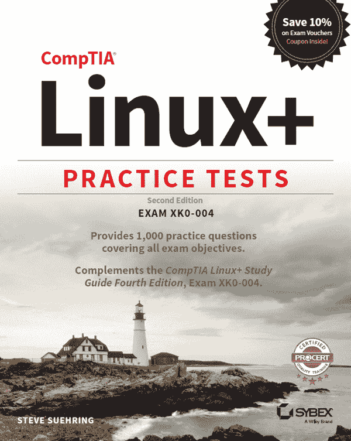

# CompTIA Linux+ 实践指南：考试 XK0-004




高级采购编辑：Kenyon Brown  
开发编辑：Tom Cirtin  
技术编辑：Kevin Ryan  
制作编辑：Amy Odum  
校对编辑：Tiffany Taylor  
编辑经理：Pete Gaughan  
制作经理：Kathleen Wisor  
执行编辑：Jim Minatel  
校对员：Kathryn Duggan  
索引员：Ted Laux  
封面协调员：Brent Savage  
封面设计：Wiley  
封面图片：© Jeremy Woodhouse/Getty Images, Inc.

版权所有 © 2019 John Wiley & Sons, Inc., 印第安纳州印第安波利  
在加拿大同步出版  
ISBN: 978-1-119-55596-4  
ISBN: 978-1-119-55602-2 (ebk.)  
ISBN: 978-1-119-55610-7 (ebk.)  
美国制造

除根据 1976 年美国美国版权法第 107 节或第 108 节的许可外，未经出版者事先书面许可，或通过向版权许可中心支付适当的副本费用（222 Rosewood Drive, Danvers, MA 01923, (978) 750-8400，传真 (978) 646-8600），本出版物的任何部分不得以任何形式或电子、机械、复印、录音、扫描或其他方式复制、存储在检索系统中或传输。向出版者申请许可的请求请致许可部门：John Wiley & Sons, Inc., 111 River Street, Hoboken, NJ 07030, (201) 748-6011，传真 (201) 748-6008，或访问`http://www.wiley.com/go/permissions`。

责任限制/免责：出版者和作者对本书内容的准确性或完整性不作任何陈述或保证，并特别否认所有保证，包括但不限于适用于特定用途的保证。销售或促销材料不得创建或扩大任何保证。书中包含的建议和策略可能不适用于每种情况。本书的出售基于以下理解：出版者并未提供法律、会计或其他专业服务。如果需要专业协助，应寻求胜任专业人士的服务。出版者和作者对由此产生的损害概不承担责任。书中提到的组织或网站仅作为引用和/或进一步信息的潜在来源，并不意味着作者或出版者认可该组织或网站可能提供的信息或其可能提出的建议。此外，读者应注意，书中列出的互联网网站在本书编写与阅读之间可能已经发生了变化或消失。

有关我们其他产品和服务的通用信息或获取技术支持，请联系我们的美国客户服务部门：(877) 762-2974；美国境外拨打 (317) 572-3993 或传真 (317) 572-4002。

Wiley 以多种印刷和电子格式以及按需打印的形式出版。本书标准纸质版包含的部分材料可能未包含在电子书或按需打印中。如果本书提到的媒体（如 CD 或 DVD）未包含在所购买的版本中，您可以在`http://booksupport.wiley.com`下载这些材料。有关 Wiley 产品的更多信息，请访问`www.wiley.com`。

美国国会图书馆控制号：2019938095

商标：Wiley、Wiley 标志和 Sybex 标志是 John Wiley & Sons, Inc. 及其/分公司在美国和其他国家的商标或注册商标，未经书面许可不得使用。CompTIA 是计算技术行业协会的注册商标。所有其他商标均为其各自所有者的财产。John Wiley & Sons, Inc. 与书中提到的任何产品或供应商无关。

10 9 8 7 6 5 4 3 2 1

*致 Tim Krause*

## 致谢

感谢协助完成本书编写的团队：编辑经理 Pete Gaughan；采购编辑 Kenyon Brown；技术编辑 Kevin Ryan；项目编辑 Tom Cirtin；制作编辑 Amy Odum；校对编辑 Tiffany Taylor 以及 Aptara 的排字员。

同时也感谢在整个书籍撰写和项目努力过程中支持我的所有个人，包括我的家人，Partners 的 Patti、Rob 和 Jim，Soundworks 的每一个人，以及我在 UWSP 的同事们。

## 关于作者

`Steve Suehring`是威斯康星大学史文斯波特分校（University of Wisconsin—Stevens Point）计算与新媒体技术的助理教授。在 2015 年加入教学院之前，Steve 在各种技术工程、系统和网络管理以及系统架构角色中拥有 20 年的领域经验。Steve 写过几本书，并担任过 *LinuxWorld* 杂志编辑。

## 引言

本书是 *CompTIA Linux+ Study Guide: Exam XK0-004*（第 4 版）的配套教材。本书是 *CompTIA Linux+ Study Guide: Exam XK0-004*（第 4 版）的配套教材。本书是 *CompTIA Linux+ Study Guide: Exam XK0-004*（第 4 版）的配套教材。本书是 *CompTIA Linux+ Study Guide: Exam XK0-004*（第 4 版）的配套教材。本书是 *CompTIA Linux+ Study Guide: Exam XK0-004*（第 4 版）的配套教材。本书是 *CompTIA Linux+ Study Guide: Exam XK0-004*（第 4 版）的配套教材。本书是 *CompTIA Linux+ Study Guide: Exam XK0-004*（第 4 版）的配套教材。本书是 *CompTIA Linux+ Study Guide: Exam XK0-004*（第 4 版）的配套教材。本书是 *CompTIA Linux+ Study Guide: Exam XK0-004*（第 4 版）的配套教材。本书是 *CompTIA Linux+ Study Guide: Exam XK0-004*（第 4 版）的配套教材。本书是 *CompTIA Linux+ Study Guide: Exam XK0-004*（第 4 版）的配套教材。本书是 *CompTIA Linux+ Study Guide: Exam XK0-004*（第 4 版）的配套教材。本书是 *CompTIA Linux+ Study Guide: Exam XK0-004*（第 4 版）的配套教材。本书是 *CompTIA Linux+ Study Guide: Exam XK0-004*（第 4 版）的配套教材。本书是 *CompTIA Linux+ Study Guide: Exam XK0-004*（第 4 版）的配套教材。本书是 *CompTIA Linux+ Study Guide: Exam XK0-004*（第 4 版）的配套教材。本书是 *CompTIA Linux+ Study Guide: Exam XK0-004*（第 4 版）的配套教材。本书是 *CompTIA Linux+ Study Guide: Exam XK0-004*（第 4 版）的配套教材。本书是 *CompTIA Linux+ Study Guide: Exam XK0-004*（第 4 版）的配套教材。本书是 *CompTIA Linux+ Study Guide: Exam XK0-004*（第 4 版）的配套教材。本书是 *CompTIA Linux+ Study Guide: Exam XK0-004*（第 4 版）的配套教材。本书是 *CompTIA Linux+ Study Guide: Exam XK0-004*（第 4 版）的配套教材。本书是 *CompTIA Linux+ Study Guide: Exam XK0-004*（第 4 版）的配套教材。本书是 *CompTIA Linux+ Study Guide: Exam XK0-004*（第 4 版）的配套教材。本书是 *CompTIA Linux+ Study Guide: Exam XK0-004*（第 4 版）的配套教材。本书是 *CompTIA Linux+ Study Guide: Exam XK0-004*（第 4 版）的配套教材。本书是 *CompTIA Linux+ Study Guide: Exam XK0-004*（第 4 版）的配套教材。本书是 *CompTIA Linux+ Study Guide: Exam XK0-004*（第 4 版）的配套教材。本书是 *CompTIA Linux+ Study Guide: Exam XK0-004*（第 4 版）的配套教材。本书是 *CompTIA Linux+ Study Guide: Exam XK0-004*（第 4 版）的配套教材。本书是 *CompTIA Linux+ Study Guide: Exam XK0-004*（第 4 版）的配套教材。本书是 *CompTIA Linux+ Study Guide: Exam XK0-004*（第 4 版）的配套教材。本书是 *CompTIA Linux+ Study Guide: Exam XK0-004*（第 4 版）的配套教材。本书是 *CompTIA Linux+ Study Guide: Exam XK0-004*（第 4 版）的配套教材。本书是 *CompTIA Linux+ Study Guide: Exam XK0-004*（第 4 版）的配套教材。本书是 *CompTIA Linux+ Study Guide: Exam XK0-004*（第 4 版）的配套教材。本书是 *CompTIA Linux+ Study Guide: Exam XK0-004*（第 4 版）的配套教材。本书是 *CompTIA Linux+ Study Guide: Exam XK0-004*（第 4 版）的配套教材。本书是 *CompTIA Linux+ Study Guide: Exam XK0-004*（第 4 版）的配套教材。本书是 *CompTIA Linux+ Study Guide: Exam XK0-004*（第 4 版）的配套教材。本书是 *CompTIA Linux+ Study Guide: Exam XK0-004*（第 4 版）的配套教材。本书是 *CompTIA Linux+ Study Guide: Exam XK0-004*（第 4 版）的配套教材。本书是 *CompTIA Linux+ Study Guide: Exam XK0-004*（第 4 版）的配套教材。本书是 *CompTIA Linux+ Study Guide: Exam XK0-004*（第 4 版）的配套教材。本书是 *CompTIA Linux+ Study Guide: Exam XK0-004*（第 4 版）的配套教材。

### 目标映射

下表列出了 CompTIA+ 考试的五个领域及其占比百分比。

| 领域 | 考试占比 | 章节 |
| --- | --- | --- |
| **领域 1.0 硬件与系统配置** | 21% | 1 |
| 1.1 启动过程概念 | | |
| 1.2 根据场景安装、配置和监控内核模块 | | |
| 1.3 根据场景配置并验证参数 | | |
| 1.4 根据场景管理 Linux 环境下的存储 | | |
| 1.5 比较和对比虚拟化技术 | | |
| 1.6 根据场景配置本地化选项 | | |
| **领域 2.0 系统运行与维护** | 26% | 2 |
| 2.1 根据场景进行软件安装、配置和删除 | | |
| 2.2 根据场景管理用户和用户组 | | |
| 2.3 根据场景创建、修改和重定向文件 | | |
| 2.4 根据场景管理服务 | | |
| 2.5 总结并解释服务器角色 | | |
| 2.6 根据场景自动化和调度任务 | | |
| 2.7 说明 Linux 设备的使用和操作 | | |
| 2.8 比较和对比 Linux 图形用户界面 | | |
| **领域 3.0 安全** | 19% | 3 |
| 3.1 根据场景应用或获取正确的用户和/组权限及所有权 | | |
| 3.2 根据场景配置并实施适当的访问和验证方法 | | |
| 3.3 总结 Linux 环境下的安全最佳实践 | | |
| 3.4 根据场景实施日志服务 | | |
| 3.5 根据场景实施并配置 Linux 防火墙 | | |
| 3.6 根据场景备份、恢复和压缩文件 | | |
| **领域 4.0 Linux 故障排除与诊断** | 20% | 4 |
| 4.1 给定场景，分析系统属性并进行相应的修复 | | |
| 4.2 给定场景，分析系统进程以优化性能 | | |
| 4.3 给定场景，分析并排排除用户问题 | | |
| 4.4 给定场景，分析并排排除应用程序和硬件问题 | | |
| **领域 5.0 自动化与脚本编写** | 14% | 5 |
| 5.1 给定场景，部署并执行基础 Bash 脚本 | | |
| 5.2 给定场景，使用 Git 进行版本控制 | | |
| 5.3 总结编排过程和概念 | | |

## 指南

1. 封面
2. 目录
3. 第一章

## 页面

1. i
2. iii
3. iv
4. v
5. vii
6. ix
7. xv
8. xvi
9. xvii
10. 1
11. 2
12. 3
13. 4
14. 5
15. 6
16. 7
17. 8
18. 9
19. 10
20. 11
21. 12
22. 13
23. 14
24. 15
25. 16
26. 17
27. 18
28. 19
29. 20
30. 21
31. 22
32. 23
33. 24
34. 25
35. 26
36. 27
37. 28
38. 29
39. 30
40. 31
41. 32
42. 33
43. 34
44. 35
45. 36
46. 37
47. 38
48. 39
49. 40
50. 41
51. 42
52. 43
53. 44
54. 45
55. 46
56. 47
57. 48
58. 49
59. 50
60. 51
61. 52
62. 53
63. 54
64. 55
65. 56
66. 57
67. 58
68. 59
69. 60
70. 61
71. 62
72. 63
73. 64
74. 65
75. 66
76. 67
77. 68
78. 69
79. 70
80. 71
81. 72
82. 73
83. 74
84. 75
85. 76
86. 77
87. 78
88. 79
89. 80
90. 81
91. 82
92. 83
93. 84
94. 85
95. 87
96. 88
97. 89
98. 90
99. 91
100. 92
101. 93
102. 94
103. 95
104. 96
105. 97
106. 98
107. 99
108. 100
109. 101
110. 102
111. 103
112. 104
113. 105
114. 106
115. 107
116. 108
117. 109
118. 110
119. 111
120. 112
121. 113
122. 114
123. 115
124. 116
125. 117
126. 118
127. 119
128. 120
129. 121
130. 122
131. 123
132. 124
133. 125
134. 126
135. 127
136. 128
137. 129
138. 130
139. 131
140. 132
141. 133
142. 134
143. 135
144. 136
145. 137
146. 138
147. 139
148. 140
149. 141
150. 142
151. 143
152. 144
153. 145
154. 146
155. 147
156. 148
157. 149
158. 150
159. 151
160. 152
161. 153
162. 154
163. 155
164. 156
165. 157
166. 158
167. 159
168. 160
169. 161
170. 162
171. 163
172. 164
173. 165
174. 166
175. 167
176. 168
177. 169
178. 170
179. 171
180. 172
181. 173
182. 174
183. 175
184. 176
185. 177
186. 178
187. 179
188. 180
189. 181
190. 182
191. 183
192. 184
193. 185
194. 186
195. 187
196. 188
197. 189
198. 190
199. 191
200. 192
201. 193
202. 194
203. 195
204. 196
205. 197
206. 198
207. 199
208. 200
209. 201
210. 202
211. 203
212. 204
213. 205
214. 206
215. 207
216. 208
217. 209
218. 210
219. 211
220. 212
221. 213
222. 214
223. 215


224. 216

225. 217

225. 218

226. 219

227. 220

228. 221

229. 222

230. 223

231. 224

232. 225

233. 226

234. 227

235. 228

236. 229

237. 230

238. 231

239. 232

240. 233

241. 234

242. 235

243. 236

244. 237

245. 238

246. 239

247. 240

248. 241

249. 242

250. 243

251. 244

252. 245

253. 246

254. 247

255. 248

256. 249

257. 250

258. 251

259. 252

260. 253

261. 254

262. 255

263. 256

264. 257

265. 258

266. 259

267. 260

268. 261

269. 262

270. 263

271. 264

272. 265

273. 266

274. 267

275. 268

276. 269

277. 270

278. 271

279. 272

280. 273

281. 274

282. 275

283. 277

284. 278

285. 279

286. 280

287. 281

288. 282

289. 283

290. 284

291. 285

292. 286

293. 287

294. 288

295. 289

296. 290

297. 291

298. 292

299. 293

300. 294

301. 295

302. 296

303. 297

304. 298

305. 299

306. 300

307. 301

308. 302

309. 303

310. 304

311. 305

312. 306

313. 307

314. 308

315. 309

## 1.1 启动过程

以下是使用的文件和工具：

- 引导加载器：Anaconda、NFS、HTTP
- 启动：Kickstart、持久化
- 卷：桥接、叠加
- 虚拟机：Libvirt、vmm
- 配置：`/etc/grub.cfg`
- `/boot/initrd`
- `/boot/vmlin`
- `grub-mkconfig`

## 1.2 管理内核模块

以下是使用的文件和工具：

- `lsmod`
- `insmod`
- `modprobe`
- `dmesg`
- `rmmod`
- `depmod`
- `/lib/modules`
- `/etc/modprobe.conf`

## 1.3 配置并验证网络

以下是使用的文件和工具：

- `ping`
- `netstat`
- `nslookup`
- `dig`
- `host`
- `route`
- `ip`
- `ethtool`
- `ss`
- `iwconfig`
- `nmcli`
- `brctl`
- `/etcconfig/network`
- `/etcconfig/network-scripts/`
- `/etc/hosts`
- `/etc/resolv.conf`
- `/etc/netplan`
- `/etc/sysctl.conf`
- `/etc/dhcp.conf`

## 1.4 管理存储

以下是使用的文件和工具：

- LVM、mdadm、Multipath
- 文件系统：ext3、ext4、xfs、smb、cifs、ntfs
- `fdisk`
- `parted`
- `mkfs`
- `iostat`
- `df`
- `du`
- `mount`
- `umount`
- `tune2fs`
- `fsck`
- `/etc/fstab`
- `/etc/cryptab`
- `/dev/mapper`
- `/dev/disk/by-id`
- `/etc/mtab`

## 1.5 比较云与虚拟化

以下是使用的文件和工具：

- 模板：OVA、OVF、JSON、YAML
- 容器镜像
- 虚拟机：VMs
- 虚拟化：Libvirt、virsh

## 1.6 配置本地化选项

以下是使用的文件和工具：

- `/etc/timezone`
- `/usr/share/zoneinfo`
- `localectl`
- `timedatectl`
- `date`
- `hwclock`
- `time`
- 环境变量：`LC_*`、`LC_ALL`、`LANG`、`TZ`
- 字符集：UTF-8、ASCII、Unicode

1. 哪个命令会自动加载模块及其依赖项？

A. `modprobe`

B. `lsmod`

C. `insmod`

D. `rmmod`

2. 启动时的哪个选项会将系统带单用户模式？

A. `single-user`

B. `su`

C. `single`

D. `root`

3. 在 GRUB 启动期间，按下哪个键可以显示 GRUB 菜单？

A. Shift

B. E

C. V

D. H

4. 哪个命令可以查看内核环缓冲区以进行故障排除？

A. `lsboot`

B. `boot-log`

C. `krblog`

D. `dmesg`

5. 哪个命令可以获取当前加载内核模块的列表？

A. `insmod`

B. `modlist`

C. `ls --modules`

D. `lsmod`

6. EFI 系统分区通常挂载在哪个路径？

A. `/etc/efi`

B. `/efi`

C. `/sys/efi`

D. `/boot/efi`

## 7. 假设一个 USB 闪存包含单个分区并在 `/dev/sdb` 上可用，使用哪条命令将该磁盘挂载到 `/media/usb`？

1. `mount /dev/sdb1 /media/usb`
2. `usbconnect /dev/sdb0 /media/usb`
3. `mount /dev/sdb0 /media/usb`
4. `usbmount /dev/sdb1 /media/usb`

## 8. 设备已加载并正常工作，但 `lsmod` 的输出中没有显示设备驱动程序的原因是什么？

1. 使用 `systemd` 意味着大多数设备不需要驱动程序。
2. 使用 `initramfs` 意味着默认启用了支持。
3. 系统不需要该设备的驱动程序。
4. 该设备的支持已直接编译到内核中。

## 9. `rmmod` 命令的哪个选项会导致模块等待其不再被使用时再卸载模块？

1. `test`
2. `b`
3. `w`
4. `unload`

## 10. 哪条命令会输出新的 GRUB2 配置文件并将输出发送到正确的启动位置？

1. `update-grub > /boot/grub/grub.cfg`
2. `update-grub boot > /boot/grub.cfg`
3. `grub-rc.d`
4. `grub-boot`

## 11. 在 MBR 分区系统中可用的主分区最大数量是多少？

1. 2
2. 4
3. 1
4. 5

## 12. 当使用 `fdisk` 等工具处理磁盘分区时，你看到类型 `0x82`。这是哪种类型的分区？

1. Linux
2. Linux swap
3. NTFS
4. FAT

## 13. 使用 GRUB2 时，为了设置超时等项目，你应该编辑哪个文件？

1. `/etc/default/grub`
2. `/etc/grub/boot`
3. `/etc/boot/grub.d`
4. `/grub.d/boot`

## 14. `grub2-mkconfig` 命令的哪个选项会将输出发送到文件而不是 `STDOUT`？

1. `stdout`
2. `fileout`
3. `-o`
4. `-f`

## 15. 在以下选项中，什么大小对于 Linux 系统的 `/boot` 分区最为合适？

1. 100 MB 到 500 MB 之间
2. 1 GB 到 10 GB 之间
3. `/boot` 不应单独分区
4. 少于 5 MB

## 16. 下列哪条命令初始化物理磁盘分区供 LVM 使用？

1. `lvmcreate`
2. `pvcreate`
3. `fvcreate`
4. `lvinit`

## 17. 下列哪条命令将 GRUB 安装到第二个 SATA 磁盘的 MBR 中？

1. `grub2-install /dev/hdb2`
2. `grub2-install /dev/sda2`
3. `grub2-config /dev/sda`
4. `grub2-install /dev/sdb`

## 18. 哪条命令用于 LVM 创建逻辑卷？

1. `pvcreate`
2. `lvmcreate`
3. `lvcreate`
4. `volcreate`

## 19. 创建 LVM 逻辑卷的逻辑顺序是什么？

1. 物理卷创建、卷组创建、逻辑卷创建
2. 物理卷创建、逻辑卷创建、卷组创建
3. 逻辑卷创建、物理卷创建、卷组创建
4. LVM 创建、格式化、分区

## 20. 在修改 `/etc/default/grub` 文件后应该运行哪条命令？

1. `grub`
2. `grub-mkconfig`
3. `grub-inst`
4. `reboot`

## 21. 哪条命令用于搜索供 LVM 使用的物理卷？

1. `lvmcreate`
2. `pvcreate`
3. `lvmdiskscan`
4. `lvmscan`

## 22. GRUB Legacy 文件报告硬盘为 `hd(0,0)`。这对应于以下哪个磁盘和分区？

1. `/dev/hdb2`
2. `/dev/hda0`
3. `/dev/disk1`
4. `/dev/sda1`

## 23. 下列哪条命令将 GRUB 安装到第一个 SATA 驱动器的主引导记录 (MBR) 中？

1. `grub-install /dev/hda`
2. `grub-install /dev/sda`
3. `grub-install /dev/hd0,0`
4. `grub -i /dev/hda`

## 24. 在 `ext3` 文件系统上运行 `fsck` 时，过程比预期的长，并且需要管理员输入以修复问题。下次运行 `fsck` 可以添加什么选项，以便命令自动尝试修复错误而无需干预？

1. `-o`
2. `-V`
3. `-y`
4. `-f`

## 25. 向系统插入新硬盘后，使硬盘在 Linux 中可使用的正确顺序是什么？

1. 使用 `fdisk` 创建分区，然后挂载这些分区。
2. 挂载分区。
3. 使用 `fdisk` 创建分区并使用 `-a` 挂载所有新创建的分区。
4. 使用 `fdisk` 创建分区，然后使用 `mkfs` 等命令格式化分区，然后挂载分区。

## 26. 你正在使用存储区域网络 (SAN)，由于 SAN 厂商创建的内核模块不当导致 Linux 系统经常出现错误。当 SAN 发送更新时，会导致文件系统被挂载为只读。你可以使用哪条命令和选项来更改文件系统的行为，以考虑到 SAN 的错误？

1. `mount --continue`
2. `tune2fs -e continue`
3. `mkfs --no-remount`
4. `mount -o remount`

## 27. 下列哪个描述了 `ext2` 和 `ext3` 文件系统之间的主要区别？

1. `ext3` 主要是错误修复更新。
2. `ext3` 默认启用了日志功能。
3. `ext3` 更改了磁盘工具。
4. `ext3` 没有显著区别。

## 28. 根据文件系统层次结构 (FHS)，挂载点的正确位置是什么？

1. `/etc`
2. `/var`
3. `/tmp`
4. `/srv`

## 29. `mount` 命令的哪个选项会挂载所有文件系统？

1. `-f`
2. `-d`
3. `-a`
4. `-m`

## 30. 哪个命令和选项用于显示文件系统挂载的次数？

1. `tune2fs -h`
2. `etc/fstab`
3. `-a`
4. `xfsnt`

## 31. 哪个选项显示进度条？

1. `-g`
2. `-p`
3. `-f`
4. `-v`

## 32. 系统磁盘空间不足，且未启用配额。你可以使用哪条命令确定可能包含大文件的目录？

1. `du`
2. `df`
3. `ls`
4. `locate`

## 33. 哪个文件包含要挂载的文件系统、其分区以及应该使用的选项？

1. `/etc/filesystems`
2. `/etc/mounts`
3. `/etc/fstab`
4. `/srv`

## 34. 根据 FHS，可移动媒体的正确挂载点是什么？

1. `/etc`
2. `/srv`
3. `/tmp`
4. `/media`

## 35. 哪个文件包含当前挂载文件系统的信息，包括其挂载选项？

1. `/etc/mtab`
2. `/etc/fstab`
3. `/tmp/files`
4. `/etc/filesystems`

## 36. `umount` 命令的哪个选项会在卸载失败时尝试将文件系统重新挂载为只读？

1. `-o`
2. `-r`
3. `-f`
4. `-v`

## 37. 下列哪个代表了 `/etc/fstab` 文件的正确格式？

1. `<directory> <device> <type> <options>`
2. `<device> <type> <options>`
3. `<device> <type> <options> <dump> <fsck>`
4. `<device> <directory> <type> <options> <dump> <fsck>`

## 38. 下列哪个命令用于识别分区的 UUID？

1. `blkid`
2. `ls`
3. `find`
4. `cat`

## 39. `xfs_info` 命令功能等同于哪条命令和选项？

1. `xfs_test -n`
2. `xfs_list`
3. `tunexfs -i`
4. `xfs_growfs -n`

## 40. 下列哪条命令将在第一个 SATA 驱动器上创建 `btrfs` 文件系统？

1. `mkfs /dev/sda1`
2. `mkfs.btrfs /dev/sda`
3. `mkfs.btr2fs /dev/sda1`
4. `mkfs -b /dev/sda`

## 41. 使用哪个命令和选项来设置在运行 `fsck` 之间文件系统可以挂载的最大次数？

1. `tune2fs -c`
2. `dumpe2fs`
3. `tune2fs -m`
4. `setmount`

## 42. 哪个命令可以用于更改磁盘的分区方案，例如在不删除现有分区的情况下更改其大小？

1. `resize2fs`
2. `parted`
3. `mkfs`
4. `rfdisk`

## 43. 假设 USB 驱动器使用 VFAT 文件系统，以下哪个命令会将 `/dev/sdb1` 的 USB 设备挂载到 `/media/usb` 目录？

1. `mount -t vfat /dev/sdb1 /mnt`
2. `usbmount /dev/sdb1 /mnt/usb`
3. `mount -t vfat /dev/sdb1 /mnt/usb`
4. `mount -t usb /dev/sdb1 /mnt/usb`

## 44. `gdisk` 内部哪个选项将更改分区名称？

1. `n`
2. `b`
3. `v`
4. `c`

## 45. `dumpe2fs` 命令的哪个选项可以用于显示因标记为坏块而被保留的块？

1. `-v`
2. `-f`
3. `-b`
4. `-m`

## 46. `fsck` 的哪些选项可以检查 `/etc/fstab` 中列出的所有文件系统同时排除根分区？

1. `-NR`
2. `-AM`
3. `-X`
4. `-C`

## 47. `/etc/fstab` 中的哪个选项设置了设备在启动时检查的顺序？

1. `options`
2. `dump`
3. `fsck`
4. `checkorder`

## 48. 哪个文件用于指示 Linux 服务器上的本地时区？

1. `/etc/timez`
2. `/etc/timezoneconfig`
3. `/etc/timezone`
4. `/etc/localtz`

## 49. 在哪个目录下可以找到与各个地区时区相关的文件？

1. `/etc/timezoneinfo`
2. `/etc/zoneinfo`
3. `/var/zoneinfo`
4. `/usr/share/zoneinfo`

## 50. `virsh` 内部哪个命令用于获取域的信息？

1. `info`
2. `dominfo`
3. `domainlist`
4. `infodom`

## 51. 哪个环境变量控制日期和时间的格式，例如 12 小时或 24 小时制钟？

1. `LOCALE_DATE`
2. `DATE_FORMAT`
3. `LC_TIME`
4. `LC_DATE`

## 52. 以下哪些编码中一种提供了字符的多字节表示？

1. ISO-8859
2. `UTF-8`
3. `ISO-L`
4. `UFTMulti`

## 53. 哪个命令可以查看系统上可用的时区？

1. `tzd`
2. `/etc/locale`
3. `timedatectl`
4. `tzsel`

## 54. 在用户主目录的 `.profile` 中添加以下哪行将将他们的时区设置为中部标准时间（Central time）？


1. `TZ=/Central ; export TZ`

2. `TIMEZONE=’America/Chicago’ ; export TIMEZONE`

3. `et TZ=/Central`

4. `TZ='America/Chicago’; export TZ`

### 55. `LANG` 变量的以下哪些值可以配置系统尽可能地跳过本地化翻译？

1. `LANG=COMPAT`

2. `LANG=NONE`

3. `LANG=C`

4. `LANG=END`

### 56. 如果你需要为特定会话临时重新配置所有区域变量和设置，可以使用哪个环境变量？

1. `LC_LIST`

2. `LC_GLOBAL`

3. `LC_ALL`

4. `ALL_LOCALE`

### 57. 以下哪个命令将系统级时区设置为 `'America/Los_Angeles'`？

1. `ln -sf /usr/share/zoneinfo/America/Los_Angeles /etc/localtime`

2. `ln -sf America/Los_Angeles ; /etc/localtime`

3. `ln -sd /etc/localtime /usr/share/timezone/America/Los_Angeles`

4. `ln -sf /etc/localtime /usr/share/zoneinfo/America/Los_Angeles`

### 58. 哪个区域相关的变量用于货币相关设置？

1. `LC_MONE`

2. `LC_CURRENCY`

3. `LC_MONETARY`

4. `LC_CURR`

### 59. 哪个命令用于查询和操作系统上的硬件时钟？

1. `hwc`

2. `ntpdate`

3. `systime`

4. `hwclock`

### 60. `date` 命令的哪个选项可以设置日期和时间？

1. `date -f`

2. `date -t`

3. `date --change`

4. `date -s`

### 61. `hwclock` 命令的哪个功能将硬件时钟设置为当前系统时间？

1. `-w`

2. `-s`

3. `-a`

4. `-m`

### 62. 以下哪个命令根据当前系统时间将硬件时钟设置为 UTC？

1. `hwclock --utc`

2. `hwclock --localtime`

3. `hwclock --syst`

4. `hwclock --outc`

### 63. 以下哪个命令在不对涉及 IP 进行 DNS 查询的情况下显示默认路由？

1. `netstat -rn`

2. `netstat -n`

3. `netstat -r`

4. `netstat -f`

### 64. 以下哪一个不被用作本地非互联网的私有地址？

1. `172.16.4.2`

2. `192.168.40.3`

3. `10.7.0.24`

4. `143.23.6`

### 65. 以下哪个命令添加了 `192.168.1` 默认网关？

1. `route add 192.168.1 eth0`

2. `route -n 192.168.1`

3. `route add default 192.168.1 eth0`

4. `route 192.168.1-default eth0`

### 66. `host` 命令的哪个选项将查询权威名称服务器？

1. `-s`

2. `-t`

3. `-ns`

4. `-a`

### 67. `ping` 命令的哪个选项允许生成 ICMP 数据包？

1. `-i`

2. `-I`

3. `-t`

4. `-a`

### 68. 以下哪个命令查询 `example.com` 的邮件服务器？

1. `dig example.com mx`

2. `dig example.com`

3. `host example.com`

4. `mx`

### 69. 以下哪一个表示 IPv6 的 `localhost`？

1. `::1`

2. `1::`

3. `::0`

4. `127::`

### 70. 哪个命令用于监听 `netlink`？

1. `listen`

2. `netlink`

3. `a`

4. `monitor`

### 71. `/etc/nss.conf` 中的以下哪些行导致使用本地 `group`？

1. `group: files`

2. `group:`

3. `group files`

4. `group]`

### 72. 以下哪个 `dig` 命令直接向 `192.168.2.5` 查询 `example.com` 而不是本地解析器？

1. `dig @192.168.2.5 example.com`

2. `dig example.com @192.168.2.5`

3. `dig -192.168.2.5 example.com`

4. `dig server=192.168.2.5`

### 73. 以下哪个命令将遍历 `hosts` 数据库？

1. `getent hosts`

2. `gethosts`

3. `nslookup`

4. `host`

### 74. `/resolv.conf` 中的以下哪些行将 DNS 服务器设置为 `192.168.1.4`？

1. `nameserver 192.168.1.4`

2. `dns 192.168.1.4`

3. `server 192.168.1.4`

4. `name-server 192.168.1.4`

### 75. 以下哪个命令为 `192.168.51.0/24` 网络添加通过其网关 `192.168.51.1` 的路由？

1. `route add -net 192.168.51.0 netmask 255.255.255.0 192.168.51.1`

2. `route add -net 192.168.51/24 gw 192.168.51`

3. `route -net 192.168.51.0/24 192.168.51.1`

4. `route add 192.168.51.1 -n 192.168.51.0//255.255.255.0`

### 76. 以下哪个命令显示正在监听的网络服务或套以及未监听的套？

1. `netstat -a`

2. `netlink -a`

3. `sockets -f`

4. `opensock -l`

### 77. 以下哪一个代表 `/etc/hosts` 的正确配置行？

1. `192.168.1.4 cwa.braingia.org cwa`

2. `cwa.braingia.org cwa 192.168.1.4`

3. `cwa.braingia.org 192.168.1.8 alias cwa`

4. `alias cwa.braingia.org cwa 192.168.1.4`

78. 下列哪个命令可以使用 `eth0` 将默认网关更改为 `192.168.1.1`？

1. `ip route default gw 192.168.1.1`

2. `ip route change default via 192.168.1.1 dev eth0`

3. `ip route default gw update 192.168.1.1`

4. `ip route update default 192.168.1.1 eth0`

79. 下列哪个命令显示 `example.com` 域名的起始（Start of Authority）信息？

1. `dig example.com soa`

2. `dig example.com authority`

3. `dig example.com -auth`

4. `dig -t auth example.com`

80. 假设你想允许本地客户端访问网络上的主机，而不需要通过为 `example.com` 或 `example.org` 添加域名来使用完全限定域名。`/etc/resolv.conf` 中的哪个选项可以提供此功能？

1. `search`

2. `domain`

3. `local-domain`

4. `local-order`

81. 下列哪个命令可以防止流量到达主机 `192.168.1.3`？

1. `route add -host 192.168.1.3 reject`

2. `route -nullroute 192.168.1.3`

3. `route add -null 192.168.1.3`

4. `route add -block 192.168.1.3`

82. 下列哪个命令可以模拟 Microsoft Windows 中的 `ping` 命令，该命令在发送四个数据包后会自动退出？

1. `ping -n 4`

2. `ping -t 4`

3. `ping -p 4`

4. `ping -c 4`

83. 你需要防止本地客户端访问特定的主机 `www.example.com`，而是将它们重定向到本地主机。下列哪种是覆盖指定主机的 DNS 查找的方法？

1. 为 `www.example.com` 的 IP 地址添加防火墙条目以防止流量通过。

2. 使用 `route` 命令从路由表中删除 `www.example.com`。

3. 添加一条空回路由（null route）以防止访问 `www.example.com` 的 IP 地址。

4. 在 `/etc/hosts` 中为 `www.example.com` 添加条目并指向 `127.0.0.1`。

84. 在运行 `ip route change` 后，应该执行下列哪个命令？

1. `ip route flush cache`

2. `ip route reload`

3. `ip route cache reload`

4. `ip route restart`

85. 使用 `dig` 发送 SPF 记录的 DNS 查询应该使用哪个选项？

1. `-t txt`

2. `-t spf`

3. `-t mx`

4. `-t mailspf`

86. 使用 `route` 命令查看可用路由时，有一条路由包含标志 `UG`，而其他路由包含 `U`。路由表中的字母 `G` 代表什么？

1. `G` 表示该路由是有效的（good）。

2. `G` 表示该路由是不可用的（unavailable）。

3. `G` 表示这是一个网关（gateway）。

4. `G` 表示该路由是一个聚合路由（aggregate）。

87. 下列哪个命令向 IP 为 `192.168.1.4` 的服务器请求 `example.org` 的区域传输？

1. `dig example.org @192.168.1.4 axfr`

2. `dig example.org @192.168.1.4`

3. `dig example.org @192.168.1.4 xfer`

4. `dig example.org #192.168.1.4 xfer`

88. 使用 `iostat` 评估性能时，哪个选项按分区显示块设备显示信息？

1. `-a`

2. `-c`

3. `-d`

4. `-p`

89. 下列哪个命令可以显示当前的磁盘利用率？

1. `df`

2. `du`

3. `diskutil`

4. `diskuse`

90. 你正在使用一个旧版本的 CentOS 5 系统，并需要重新创建 RAM 磁盘（ramdisk）。下列哪个命令用于此目的？

1. `mkinitrd`

2. `mkramdisk`

3. `mkdisk --init`

4. `mkfs.init`

91. 下列哪个命令用于显示系统上当前加载的模块？

1. `ls -mod`

2. `lsmod`

3. `listmod`

4. `mod --list`

92. 下列哪个命令创建模块及其依赖项的列表？

1. `lsmod`

2. `depmod`

3. `modlist`

4. `listmod`

93. `sysctl` 的哪个选项可以显示所有值及其当前设置？

1. `-a`

2. `-b`

3. `-d`

4. `-c`

94. 下列哪个命令安装内核模块，包括其依赖项？

1. `lsmod`

2. `modprobe`

3. `modinst`

4. `instmod`

95. 哪个命令用于确定模块依赖于哪些其他模块？

1. `modinfo`

2. `modlist`

3. `modprobe`

4. `tracemod`

96. 下列哪个命令将模块插入到运行的内核中，但不解决依赖关系？

1. `lsmod`

2. `modinstall`

3. `insmod`

4. `moduleinst`

97. `modprobe` 的哪个选项会移除模块并尝试移除其依赖的任何未使用的模块？

1. `-v`

2. `-r`

3. `-d`

4. `-f`

98. 在下列哪个目录中可以找到通过 `modprobe` 加载模块的黑名单信息？

1. `/etc/blacklist`

2. `/etc/modprobe.d`

3. `/etc/blacklist.mod`

4. `/etc/modprobe`

99. 在使用 CentOS 6 系统时，使用哪个命令创建初始 RAM 磁盘？

1. `mkinit`

2. `dracut`

3. `mkraminit`

4. `mkinitfs`

100. 如果你想让通过 `sysctl` 命令设置的值在启动时生效，你应该将变量及其值存放在哪个文件中？

1. `/etc/sysctl.cfg`

2. `/etc/sysctl.conf`

3. `/lib/sysctl`

4. `/var/sysctl.conf`

101. `modprobe` 的下列哪个选项会显示模块的依赖项？

1. `--show-deps`

2. `--show-depends`

3. `--deps`

4. `--list-depends`

102. 下列哪个命令将 `/dev/sda1` 挂载到 `/boot` 分区？

1. `mount /dev/sda /boot`

2. `mount /boot /dev/sda1`

3. `mount /dev/sda1 /boot`

4. `mount -dev sda1 /boot`

103. 下列哪个命令的哪个选项更改启动顺序？

1. `efootmgr -c`

2. `efootmgr -B`

3. `efootmgr -o`

4. `efootmgr -n`

104. 下列哪个引导程序可以用于从 ISO9660 CD-ROM 启动？

1. `ISOLINUX`

2. `EFIBOOT`

3. `ISOFS`

4. `BOOT`

105. 使用 UEFI 时，下列哪个文件可以用引导程序？

1. `shim.uefi`

2. `shim.efi`

3. `shim.fx`

4. `efi.shim`

106. 在 UEFI shell 中执行的下列哪个命令控制引导？

1. `bootcfg`

2. `bcfg`

3. `grub-install`

4. `grcfg`

107. 下列哪个被识别为存储磁盘分区和操作系统位置的磁盘扇区？

1. Minimal Boot Record (MBR)

2. Master Boot Record (MBR)

3. Init Sector

4. Master Partition Table (MPT)

108. 使用 PXE 启动时，TFTP 服务器上的下列哪个文件对于使用 PXELINUX 作为引导程序的系统是必须的？

1. `pxelinux.tftp`

2. `pxelinux.boot`

3. `pxelinux.conf`

4. `pxelinux.0`

109. `grub-install` 的哪个选项会将 GRUB 镜像放置在备目录目录？

1. `--boot-dir`

2. `-b`

3. `-boot`

4. `--boot-directory`

110. 使用 shim 引导 UEFI 系统时，下列哪个文件在 `shim.efi` 之后加载？

1. `grubx64.cfg`

2. `grub.conf`

3. `grubx64.efi`

4. `efi.boot`

111. EXT 工具的一部分，`mke2fs` 命令的哪个选项设置要创建的文件类型？

1. `-f`

2. `-a`

3. `-t`

4. `-e`

112. 哪个文件用于存储启动时要挂载的加密设备列表？

1. `/etc/cryptdev`

2. `/etc/crypttab`

3. `/etc/encrtab`

4. `/etc/fsencrypt`

113. `dumpe2fs` 的哪个选项显示给定分区的坏块？

1. `-bb`

2. `-C`

3. `-b`

4. `-f`

114. `xfs_check` 的哪个选项用于验证存储在文件中的文件系统？

1. `-v`

2. `-a`

3. `-f`

4. `-d`

115. 你正在执行 `xfsrestore`。`xfsdump` 在执行时使用的块大小为 4M。你需要在 `xfsrestore` 上调用哪个选项，使其能够成功使用该转储文件？

1. `-b 4M`

2. `-g 1M`

3. `-i 1M`

4. `-k 1028K`

116. 你在 `/etc/fstab` 中看到了 `defaults` 单词。`defaults` 包含了哪些选项？

1. `ro`, `exec`, `auto`

2. `rw`, `suid`, `dev`, `exec`, `auto`, `nouser`, `async`

3. `rw`, `exec`, `auto`, `nouser`, `async`

4. `rw`, `exec`, `nouser`, `async`, `noauto`, `suid`


117. `xfsdump` 的以下哪个选项设置了包含在转储中的文件最大大小？

1. `-p`

2. `-s`

3. `-z`

4. `-b`

118. 哪种分区类型用于指示软件 RAID 阵列（例如使用 `mdadm` 构建的阵列）？

1. `0xmd`

2. `-x-`

3. `0xRD`

4. `0xFD`

19. 处理世界标识符 (WWID) 时，在 Red Hat 服务器的哪个目录下可以找到指向当前 `/dev/sd` 设备名的符号链接？

1. `/dev/disk/wwid`

2. `/dev/wwid`

3. `/dev/disk/by-id`

4. `/dev/sd.wwid`

120. 下列哪个命令用于显示 LVM 设置中给定物理卷的信息？

1. `pvdisp`

2. `pvlist`

3. `pvdisplay`

4. `pvl`

121. 使用命令 `ls -l` 查看 `/dev/disk/by-path` 中的信息时，以下文件名代表来自光纤的 LUN？

1. `/dev/fc0`

2. `pci-0000:1a:00.0-fc-0x500601653ee0025f:0x0000000000000000`

3. `pci-0000:1a:00.0-scsi-0x500601653ee0025f:0x0000000000000000`

4. `/dev/fibre0`

122. 下列哪个命令用于显示 LUN 的路径信息？

1. `luninfo -a`

2. `ls -lun`

3. `multipath -l`

4. `dm-multi`

123. 哪个命令用于从精简配置存储中删除未使用的文件系统块？

1. `thintrim`

2. `thtrim`

3. `fstrim`

4. `fsclean`

124. 使用 `tune2fs` 设置如 `stripe_width` 等扩展选项时，需要哪个命令行选项来表示后面跟着扩展选项？

1. `-extend`

2. `-E`

3. `-e`

4. `-f`

125. `mdadm` 的哪个选项用于创建新阵列？

1. `--create`

2. `--start`

3. `--begin`

4. `--construct`

126. 逻辑卷的信息可以在以下哪个目录中找到？

1. `/dev/lvinfo`

2. `/dev/map`

3. `/dev/mapper`

4. `/dev/lvmap`

127. `mdadm` 的哪个选项用于监控 RAID 阵列的异常？

1. `--mon`

2. `--watch`

3. `--monitor`

4. `--examine`

128. 在监控模式下运行 `mdadm` 时，`/etc/mdadm.conf` 中的哪个选项设置了发现问题时的邮件发送目标？

1. `MAILTO`

2. `MAILADDR`

3. `MAILFROM`

4. `MAILDEST`

129. 使用 `ip` 命令时，如果没有其他指定，默认使用哪种协议族？

1. `tcpip`

2. `ip`

3. `inet`

4. `arp`

130. 哪个命令用于为无线设备设置 `essid`、信道和其他相关选项？

1. `ifconfig`

2. `iwconfig`

3. `wlancfg`

4. `iconf`

131. 下列哪个命令显示网络套接字及其分配内存？

1. `ss -m`

2. `mpas`

3. `mem`

4. `free`

132. `ss` 命令的哪个选项显示与套接字相关的进程 ID？

1. `-l`

2. `-a`

3. `-p`

4. `-f`

133. 在 Debian 系统中，哪个目录层次结构可以找到配置信息以及用于存放接口启动或关闭时运行的脚本目录？

1. `/etc/netconf`

2. `/etc/netconfig`

3. `/etc/net.d`

134. 下列哪些字符对于主机是有效？

1. `_`

2. `-`

3. `.`

4. ` `

135. `/etc/resolv` 中的以下哪一行启用了调试？

1. `options`

2. `debug`

3. `trace`

4. `kernel`

136. 下列哪个命令用于卸载文件系统？

1. `umount`

2. `unmount`

3. `dmount`

4. `mount`

137. 下列哪个项用于挂载文件系统？

1. `mount`

2. `disk`

3. `fdisk`

4. `attach`

138. 下列哪个项用于检查磁盘分区？

1. `fdisk`

2. `gdisk`

3. `parted`

4. 以上全部

139. 下列哪个项用于格式化分区？

1. `mkfs`

2. `format`

3. `makefs`

4. `create`

140. 下列哪个项用于调整文件系统大小？

1. `resize2fs`

2. `xfs_growfs`

3. `resizefs`

4. `expand`

1. `NAT` 使用主机适配器的 IP 地址进行所有网络活动，而桥接（bridging）允许虚拟机获取它自己的 IP。

2. `NAT` 允许虚拟机获取它自己的 IP，而桥接使用主机适配器的 IP 地址进行所有网络活动。

3. `NAT` 用于允许外部客户端访问虚拟机，而桥接将两个虚拟机连接在一起。

4. 在虚拟化中，`NAT` 和桥接（bridging）指的是同一种东西。

151. 假设你需要添加一个带有自定义命令的内核模块，例如在加载时指定选项。你可以在哪个文件中添加此配置？

1. `/etc/modprobe-cfg`

2. `/etc/modprobe.conf`

3. `/etc/modprobe.cf`

4. `/etc/modprobe.cfg`

152. 哪种网络绑定（bonding）模式用于主备（active/passive）配置？

1. `active-passive`

2. `active-balance`

3. `active-backup`

4. `active-back`

153. 使用哪个命令将内核安装到 `/boot` 目录，并使用 `/usr/lib/kernel` 中的文件？

1. `kernel-ins`

2. `ins-kernel`

3. `install-kernel`

4. `kernel-install`

154. 在排查未找到的文件时，你注意到文件位置被链接为 `../file.txt`。该文件使用了哪种路径？

1. 虚拟

2. 符号

3. 相对

4. 绝对

155. 使用 `fdisk` 对磁盘进行分区时，你为系统创建了两个分区，但磁盘上仍有剩余空间，也称为未分配空间（unallocated space）。未分配空间的另一个名称是什么？

1. 高可用

2. 冗余

3. 原始设备

4. 分区转发

156. `LIBVIRT_DEBUG` 的以下哪个值被用于启用 `libvirt` 的调试日志？

1. 1

2. 2

3. 3

4. 4

157. 下列哪项描述描述了 anaconda 和 kickstart 之间的关系？

1. Anaconda 用于脚本化安装，而 kickstart 用于启动系统。

2. Kickstart 用于脚本化安装，而 anaconda 用于安装系统。

3. Anaconda 用于安装系统，而 kickstart 用于启动系统。

4. Kickstart 用于安装系统，而 anaconda 用于启动系统。

158. 哪个命令可以确定 Linux 命令花费了多少时间？

1. `time`

2. `cmdtime`

3. `timeproc`

4. `proctime`

159. 在云环境中，哪种存储类型格式最适合将大对象作为单文件存储？

1. 块存储

2. `ext2`

3. `cifs`

4. Blob

160. 使用哪一层来允许客户端应用程序以标准方式与磁盘设备交互，无论磁盘架构如何？

1. 虚拟文件系统

2. 冗余文件系统

3. 物理文件系统

4. ICE

161. 下列哪些文件系统可以使用 `resize2fs` 调整大小？

1. `nfs`

2. `ext2`

3. `ext3`

4. `cifs`

162. `virsh` 命令的哪个子命令用于连接到虚拟化主机（hypervisor）？

1. `plug`

2. `hypervisorconnect`

3. `conhyper`

4. `connect`

163. 你需要确定系统是否支持 ASCII 和 Unicode。`iconv` 的哪个选项可以显示给定系统上的可用字符集？

1. `--showchar`

2. `--show`

3. `--list`

4. `--all`

164. 下列哪项最准确描述 `/dev/` 文件系统？

1. `/dev/` 文件系统用于存储已连接设备的设备信息。

2. `/dev/` 文件系统用于配置文件。

3. `/dev/` 文件系统用于开发。

4. `/dev/` 文件系统用于将设备列入内核。

165. 下列哪个文件显示了挂载的文件系统？

1. `/etc/fstab`

2. `/proc/mounts`

3. `/fs`

4. `/root/mounts`

116. 与基于 Windows 的文件系统工作时，看到它被挂载为 `CIFS`。`CIFS` 代表什么？

1. 通用信息共享 (Common Information Sharing)

2. 通用互联网系统 (Common Internet System)

3. 克隆文件共享 (Cloned File Sharing)

4. 秒级创建 (Created In Seconds)

167. 使用 `cloud-init` 部署 EC2 实例时，配置文件应该使用哪种格式？

1. XML

2. YAML

3. HTML

4. JS

168. `blkid` 命令的哪个选项清除缓存以移除不存在的设备？

1. `-p`

2. `-a`

3. `-g`

4. `-m`

169. 虽然你可以使用 `blkid` 获取文件系统的 UUID，但文件系统上的哪个位置显示此信息？

1. `/dev/diskbyuuid`

2. `/dev/uuid`

3. `/dev/fs/uuid`

4. `/dev/disk/by-uuid`

170. 在脚本场景中，你需要为网络等项目启用旧版位置。哪个文件可以用于此配置？

1. `/etc/dev`

2. `/etc/networking`

3. `/etc/sysconfig`

4. `/etc/netdev`

171. 在构建绑定（bonded）时，哪种协议应该支持聚合？

1. 802.11

2. LACP

3. LinkAG

4. 802

172. `vmm` 命令的哪个选项用于安装虚拟机？

1. `virt-install`

2. `vm-install`

3. `install-virt`

4. `launch`

173. `fsck` 检查文件系统时，哪个选项跳过根文件系统？

1. `-A`

2. `-M`

3. `-R`

4. `-S`

174. 哪种类型的虚拟化器被认为是第一型？

1. 裸金属 (Bare-metal)

2. 宿主机型 (Hosted)

3. Linux 上的

4. 云端

175. 哪个文件包含分区及其主、次设备号？

1. `/dev/disk`

2. `/dev/partitions`

3. `/proc/disk`

4. `/proc/partitions`

176. 假设用于 `sda` 的块存储设备，哪个文件可以查看 I/O 请求数？

1. `/proc/sys/sda`

2. `/proc/sys/sda/stat`

3. `/sys/block/sda/stat`

4. `/sys/disk/stat`

177. 下列描述描述 OVA 文件？

1. 它是一个虚拟机设备文件。

2. 它是一个 YAML 格式的开放虚拟机配置文件。

3. 它是一个开放虚拟化应用程序。

4. 它是一个开放资源。

178. `/etc/netplan` 目录下的文件应该使用什么语法？

1. JSON

2. YAML

3. XML

4. Key=Value

179. 使用 `du` 命令诊断哪些目录很大时，你想以更易读的格式汇总输出。应该使用哪些选项？

1. `--summarize`

2. `-uh`

3. `-h`

4. `-sh`

180. 使用位于 `/dev/disk/by-multipath` 的多路径设备时，该设备的标识符是什么？

1. `UUID`

2. `WWID`

3. `GUID`

4. `DISKID`

181. 在使用 kickstart 启动时，下列哪项不是有效选项？

1. CD-ROM

2. NFS

3. HTTP

4. SFTP

182. 在 Linux 绑定场景下，以下哪些模式被用于负载均衡？

1. `balance`

2. `lb`

3. `balance-rr`

4. `balance-load`

183. 在排查内核问题并使用控制台时，由于控制台本身不断显示消息导致难以操作。`dmesg` 的哪个选项可以禁用向控制台日志？

1. `-o "no logging console"`

2. `-D`

3. `-Q`

4. `-F`

184. `rmmod` 的哪个选项强制卸载模块？

1. `-f`

2. `-a`

3. `-w`

4. `-h`

185. 哪一个命令行选项可以修改 `depmod` 的行为，使其在比较 `modules.dep` 时仅添加较新的模块？

1. `-A`

2. `-B`

3. `-C`

4. `-D`

186. 哪个命令以树状结构打印设备和分区信息，包括分区大小和当前挂载状态？

1. `fsck`

2. `lsblk`

3. `blkshow`

4. `shblk`

187. 你需要创建一个供 `parted` 命令使用的脚本。当使用 `parted` 命令获取分区列表时，哪个额外的选项可以格式化输出，以便更容易被脚本解析？

1. `-p`

2. `-S`

3. `-m`

4. `-v`

188. 哪个命令用于创建以太网桥接？

1. `bridgecon`

2. `brctl`

3. `bridgeman`

4. `BridgeManager`

189. 哪个文件用于维护 DHCP 的配置？

1. `/etc/dhcpd.conf`

2. `/etc/DHCP.cfg`

3. `/etc/DHCPconf.txt`

4. `/sys/dhcp.conf`

190. 你正在处理一个名为 `ens3` 的网络接口，并想要确定该设备使用的是哪个驱动程序。哪个命令对此目的是有效的？

1. `ip list ens3`

2. `netstat ens3`

3. `ethtool -i ens3`

4. `ethlist ens3`

191. 在交互式使用 `nslookup` 时，以下哪个命令可以更改查询的目标地址？

1. `dest`

2. `server`

3. `queryhost`

4. `destination`

# 第 2 章：系统操作与维护

本章涵盖了以下 COMPTIA LINUX+ 考试目标：

## 2.1 给定场景，执行软件的安装、配置、更新和卸载

### 包类型

* `rpm`

* `deb`

* `tar`

* `tgz`

* `gz`

### 安装工具

* `RPM`

* `Dpkg`

* `APT`

* `YUM`

* `DNF`

* `Zypper`

### 构建工具

#### 命令

* `make`

* `make install`

* `ldd`

#### 编译器

#### 共享库

#### 获取命令

* `wget`

* `curl`

## 2.2 给定场景，管理用户和组

### 创建

* `useradd`

* `groupadd`

### 修改

* `usermod`

* `groupmod`

* `passwd`

* `chage`

### 删除

* `userdel`

* `groupdel`

### 查询

* `id`

* `whoami`

* `who`

* `w`

* `last`

### 配额

* 用户配额

* 组配额

### 配置文件

#### Bash 参数

* 用户条目

    * `.bashrc`

    * `.bash_profile`

    * `.profile`

* 全局条目

    * `/etc/bashrc`

    * `/etc/profile.d/`

    * `/etc/skel`

    * `/etc/profile`

#### 重要文件及文件内容

* `/etc/passwd`

* `/etc/group`

* `/etc/shadow`

## 2.3 给定场景，创建、修改和重定向文件

### 文本编辑器

* `nano`

* `vi`

### 文件读取器

* `grep`

* `cat`

* `tail`

* `head`

* `less`

* `more`

### 输出重定向

* `<`

* `>`

* `|`

* `<<`

* `>>`

* `2>`

* `&>`

* `stdin`

* `stdout`

* `stderr`

* `/dev/null`

* `/dev/tty`

* `xargs`

* `tee`

* Here documents (在此文档中)

### 文本处理

* `grep`

* `tr`

* `echo`

* `sort`

* `awk`

* `sed`

* `cut`

* `printf`

* `egrep`

* `wc`

* `paste`

### 文件和目录操作

* `touch`

* `mv`


# 2.4 给定场景，管理服务

## Systemd 管理

### Systemctl

- Enabled（启用）
- Disabled（禁用）
- Start（启动）
- Stop（停止）
- Mask（屏蔽）
- Restart（重启）
- Status（状态）
- Reload（重载）

### Systemd-analyze

### 单元文件

- 目录位置
- 环境参数
- Targets（目标）
- Hostnamectl
- Automount（自动挂载）

## SysVinit

- `chkconfig`
- on（开启）
- off（关闭）
- Runlevels（运行级别）
- 0–6
- `/etc/init.d`
- `/etc/rc.d`
- `/etc/local`
- `/etc/inab`

## 服务

- Restart（重启）
- Stop（停止）
- Start（启动）

# 2.5 总结并解释服务器角色

- `NTP`
- `SSH`
- `Web`
- 证书机构
- 名称服务器
- `DHCP`
- `SNMP`
- 文件服务器
- 身份验证服务器
- 代理
- 日志
- 容器
- `VPN`
- 监控
- 数据库
- 打印服务器
- 负载均衡
- 集群

# 2.6 给定场景，自动化和调度任务

- `cron`
- `at`
- `crontab`
- `fg`
- `bg`
- `&`
- `kill`
- `Ctrl+C`
- `Ctrl+Z`
- `nohup`

# 2.7 解释 Linux 设备的使用和操作

## 设备类型

- 客户端设备
- `Bluetooth`（蓝牙）
- `WiFi`
- `USB`
- 监控器
- `GPIO`
- 网络适配器
- `PCI`
- `HBA`
- `SATA`
- `SCSI`
- 打印机
- 视频
- 音频

## 监控和配置工具

- `lsdev`
- `lsusb`
- `lspci`
- `lsblk`
- `dmesg`
- `lpr`
- `lpq`
- `abrt`
- `CUPS`
- `udevadm`
  - `add`（添加）
  - `reload-rules`（重载规则）
  - `control`（控制）
  - `trigger`（触发）

## 文件位置

- `/proc`
- `/sys`
- `/dev`
- `/dev/mapper`
- `/etc/X11`

## 热插设备

- `/etc/rc5/udev`
- `/etc/udev/rules.d`

# 2.8 比较对比 Linux 图形用户界面

## 服务器

- `Wayland`
- `X11`

## GUI

- `Gnome`
- `Unity`
- `Cinnamon`
- `MATE`
- `KDE`

## 远程桌面

- `VNC`
- `XRDP`
- `NX`
- `Spice`

## 控制台重定向

- `SSH` 端口转发
  - Local（本地）
  - Remote（远程）
  - `X11` 转发
  - `VNC`

## 辅助功能

1. 哪个命令允许你查看当前的 IRQ 分配情况？
   - `view /proc/irq`
   - `cat /proc/interrupts`
   - `cat /dev/irq`
   - `less /dev/irq`

2. udev 设备的配置是通过操作哪个目录下的文件来完成的？
   - `/udev/devices`
   - `/devices/`
   - `/udev/config`
   - `/etc/udev`

3. 哪个命令用于获取 USB 设备列表？
   - `usb-list`
   - `lsusb`
   - `ls-usb`
   - `ls --usb`

4. 在使用 SysVinit 的 Linux 系统初始化过程中，哪个运行级别（runlevel）对应单用户模式？
   - Runlevel 5
   - Runlevel SU
   - Runlevel 1
   - Runlevel 6

5. 在使用 SysVinit 的系统中，服务的启动和停止脚本存储在哪个目录中？
   - `/etc/init-d`
   - `/etc/init`
   - `/etc/sysV`
   - `/etc/init.d`

6. 哪个命令可以重启系统？
   - `init 6`
   - `shutdown -h -t now`
   - `init 1`
   - `refresh-system`

7. 在 SysV 系统上工作时，哪个 `chkconfig` 选项会显示所有服务及其运行级别？
   - `--reload`
   - `--list`
   - `--all`
   - `--ls`

8. 连接到 USB 的驱动会被视为哪种类型的设备？
   - Medium（介质）
   - Coldplug（冷插拔）
   - Hotplug（热插拔）
   - Sideplug（侧插拔）

9. `systemd` 服务文件中哪个选项指示要执行的程序？
   - `StartProgram`
   - `ShortCut`
   - `ExecStart`
   - `Startup`

10. 在运行 `systemd` 的计算机上显示默认目标（target）的命令是什么？
    - `systemctl defaults`
    - `update-rc.d defaults`
    - `systemctl runlevel`
    - `systemctl get-default`

11. `systemctl` 命令的哪个选项会更改服务使其在系统下次启动时运行？
    - `enable`
    - `startonboot`
    - `loadonboot`
    - `start`

12. 以下哪项最能描述 `/proc` 文件系统？
    - `/proc` 包含待处理的文件信息。
    - `/proc` 包含进程的配置文件。
    - `/proc` 包含当前运行进程的信息，包括内核。
    - `/proc` 包含邮件和网络文件等变量数据。

13. 哪个命令用于更新系统上共享库的链接和缓存？
    - `ldcache`
    - `cache-update`
    - `link-update`
    - `ldconfig`

14. 使用哪个命令和选项将 Debian 系统更新到最新版本的软件？
    - `apt-update`
    - `apt-get upgrade`
    - `dpkg -U`
    - `apt-cache clean`

15. 给 `yum` 命令提供的哪个选项将安装给定的包？
    - `update`
    - `configure`
    - `install`
    - `get`

16. 当处理 `rpm` 包文件并使用 `rpm2cpio` 时，默认输出发送到哪个位置？
    - `STDOUT`
    - 文件 `cpio.out`
    - 文件 `a.out`
    - 文件 `/tmp/cpi.out`

17. 哪个命令用于确定给定命令依赖于哪些库？
    - `ldconfig`
    - `librarylist`
    - `listdeps`
    - `ldd`

18. 哪个命令将以树形格式检索关于计算机上 USB 连接的信息？
    - `lsusb -tree`
    - `lsusb --tree`
    - `lsusb -t`
    - `usblist --tree`

19. 每个总线支持多少个 SCSI 设备？
    - 7 到 15
    - 2 到 4
    - 12
    - 4

20. 可以使用哪个命令和选项来确定给定的服务是否已加载？
    - `systemctl --ls`
    - `telinit`
    - `systemctl status`
    - `sysctl -a`

21. 在 `systemd` 控制的系统中，哪个命令会将系统置于单用户模式？
    - `systemctl one`
    - `systemctl rescue.target`
    - `systemctl single-user`
    - `systemctl runlevel one`

22. 如果你修改了 `/etc/init.d` 文件并希望在不重启系统的情况下重新加载更改，你会使用哪个命令？
    - `init-refresh`
    - `init 6`
    - `telinit`
    - `reload-init`

23. 哪个命令显示系统的当前运行级别？
    - `show-level`
    - `init --level`
    - `sudo init`
    - `runlevel`

24. `systemd` 单元文件存储在哪个文件夹中？
    - `/etc/system.d`
    - `/lib/system.d`
    - `/lib/systemd/system`
    - `/etc/sysconf`

25. 哪个选项最能描述使用 `ls -la` 命令收集到的内容？
    ```
    lrwxrwxrwx 1 root root 35 Oct 8 14:00 /etc/mail -> /etc/config/mail
    ```
    - 这是一个名为 `/etc/mail` 的文件，使用符号链接连接。
    - 这是一个名为 `/etc/config/mail` 的文件，所有者为 `lrwxrwxrwx`。
    - 这是一个名为 `/etc/mail` 的目录，用户所有。
    - 这是一个名为 `/etc/config/mail` 的本地目录。

26. 使用哪个命令配合 `systemd` 列出可用的服务单元？
    - `systemd list-units`
    - `systemctl list-units`
    - `systemd unit-list`
    - `systemctl show-units`

27. `lspci` 的哪个选项用于同时显示数字代码和设备名称？
    - `-numdev`
    - `-n`
    - `-nn`
    - `-devnum`

28. USB 设备的信息存储在哪个目录中？
    - `/etc/usb`
    - `/var/usb`
    - `/lib/sys/usb`
    - `/proc/bus/usb`

29. 串行 ATA（SATA）磁盘将使用以下哪个标识符？
    - `/dev/hdX`
    - `/dev/sataX`
    - `/dev/sdX`
    - `/disk/sataX`

30. 为运行 Postfix 的邮件服务器划分磁盘时，哪个分区/挂载目录应该是最大的，以便于邮件存储？
    - `/etc`
    - `/usr/bin`
    - `/mail`
    - `/var`

31. 哪个 `yum` 选项显示指定包的依赖关系？
    - `list`
    - `deplist`
    - `dependencies`
    - `listdeps`

32. `rpm` 命令的哪些选项将在显示安装进度的同时显示详细输出？
    - `-ivh`
    - `-wvh`
    - `-avh`
    - `--ins`

33. 哪个命令在 Debian 系统上搜索名为 `zsh` 的包？
    - `apt-cache search zsh`
    - `apt-get search zsh`
    - `apt-cache locate zsh`
    - `apt search zsh`

34. 在哪个目录下可以找到 `yum` 使用的仓库？
    - `/etc/yum.conf`
    - `/etc/repos`
    - `/etc/yum.d`
    - `/etc/repos.d`

35. 哪个 `rpm` 选项可以验证文件自安装以来是否被更改？
    - `-V`
    - `-v`
    - `--verbose`
    - `--filesum`

36. 以下哪项通常用于存储共享库？
    - `/lib`
    - `/etc/lib`
    - `/usr/lib`
    - `/usr/local/lib`

37. 哪个命令更新 Debian 系统的软件包缓存？
    - `apt-get cache-update`
    - `apt-cache update`
    - `apt-get update`
    - `apt-get upgrade`

38. 你需要更新软件包仓库的配置文件。在 Debian 系统中，当前软件包仓库的细节存储在哪个文件中？
    - `/etc/apt.list`
    - `/etc/sources.list`
    - `/etc/apt/sources.list`
    - `/etc/apt.d/sources.list`

39. 使用哪个命令来对安装 Debian 包时做出的更改进行重新配置？
    - `dpkg-reconfigure`
    - `dpkg -r`
    - `dpkg --reconf`
    - `apt-get reinstall`

40. 哪个 `yum` 选项执行软件包缓存的搜索？
    - `seek`
    - `query`
    - `--search`
    - `search`

41. 哪个 `rpm` 命令选项可以显示内核的版本？
    - `rpm kernel`
    - `rpm -q kernel`
    - `rpm search kernel`
    - `rpm --list kern`

42. `/etc/yum.conf` 中的哪一个选项用于确保在系统更新时不更新内核？
    - `exclude=kernel*`
    - `exclude-kernel`
    - `updatekernel=false`
    - `include-except=kernel`

43. 在 Debian 系统上，哪个命令用于搜索并提供给定包的信息，包括该包当前是否已安装？
    - `dpkg -i`
    - `dpkg -s`
    - `apt-cache`
    - `apt-info`

44. 下列哪一个命令可以安装之前下载的 Debian 包？
    - `dpkg -i <package name>`
    - `apt-install <package name>`
    - `apt-slash <package name>`
    - `dpkg -U <package name>`

45. 你需要下载一个包的源代码进行安装。该包具有 `.tgz` 扩展名。下列哪个命令可以解压并提取该包？
    - `tar -xvf`
    - `tar -zcvpf`
    - `tar -zxvf`
    - `tar -xf`

46. 你需要获取使用 `zypper` 命令的 OpenSUSE 系统上安装的包的信息。`zypper` 命令的下列哪个选项可以显示包的信息？
    - `inf`
    - `getInfo`
    - `info`
    - `i`

47. 你需要在由 `dnf` 包系统管理的 Fedora 系统上查找可用的包。`dnf` 命令的哪个选项可以查找给定包？
    - `search`
    - `info`
    - `find`
    - `locate`

48. 在使用 `sed` 进行替换操作时，必须包含哪个选项以确保替换适用于整行，而不仅仅是第一个实例？
    - `g`
    - `a`
    - `r`
    - `y`

49. `wc` 命令的哪个选项可以打印给输入的行数？
    - `-f`
    - `-a`
    - `-l`
    - `-o`

50. `head` 和 `tail` 命令默认打印的行数分别是多少？
    - `head` 为 10，`tail` 为 5
    - `head` 为 5，`tail` 为 10
    - `head` 和 `tail` 均为 10
    - `head` 和 `tail` 均为 3

51. 你正尝试使用 `rmdir` 删除一个目录，但其内部仍包含多个文件和其他目录。假设你确定要删除该目录及其所有内容，用于删除该目录及其所有内容的命令和参数是什么？
    - `rm -f`
    - `rm -rf`
    - `rmdir -a`
    - `rmdir -m`

52. 哪个命令可以找到当前目录下名称以 `2019` 开头的目录？
    - `find ./ -name "2019"`
    - `find ./ -type d -name "2019"`


### 53. 下列哪个命令可以从 `/etc/passwd` 文件中提取排序后的列表提供用户名？

1. `cat /etc/passwd | awk -F : ’{print $1}’ | sort`
2. `sort /etc/passwd | cut`
3. `echo /etc/passwd`
4. `cat /etc/passwd | awk ’{print $1}’ | sort`

### 54. `ls` 的哪些选项会产生包含隐藏（点）文件的输出，且该列表的顺序使得最新的文件位于输出的末尾？

1. `-la`
2. `-lat`
3. `-latr`
4. `-ltr`

### 55. 如果在已存在的文件上执行 `touch` 命令，结果将会是什么

1. 文件的访问时间将更改为执行 `touch` 命令时的当前时间。
2. 文件将被覆盖。
3. 没有变化。
4. 文件将会被追加内容。

### 56. `mv` 和 `cp` 的哪个选项都会导致命令在覆盖已存在的文件之前进行提示？

1. `-f`
2. `-Z`
3. `-r`
4. `-i`

### 57. 下列哪个命令会将 `/etc/passwd` 的内容发送到 `STDOUT` 和一个名为 `passwordfile` 的文件？

1. `cat /etc/passwd > passwordfile`
2. `var /etc/passwd | passwordfile`
3. `cat /etc/passwd | tee passwordfile`
4. `echo /etc/passwd | stdout > passwordfile`

### 58. 服务器当前的层次结构包含一个名为 `/usr/local` 的目录。你需要在下方创建一个名为 `/usr/local/october` 的额外目录。哪个命令可以实现此目标？

1. `mkdir -p /usr/local/october`
2. `mkdir /usr/local/october`
3. `mkdir /usr/local/october`
4. `mkdir -p /usr/local`

### 59. `cp` 命令的哪些选项用于递归复制？

1. `-f`
2. `-Z`
3. `-r`
4. `-i`

### 60. `cut` 命令的默认分隔符是哪个？

1. 冒号
2. 制表符
3. 空格
4. 逗号

### 61. 哪个命令的哪个选项用于将进程放入后台运行？

1. `bg`
2. `fg`
3. `&`
4. `^`

### 62. 在 `Vi` 编辑中，哪个命令用于在光标下方打开新行？

1. `f`
2. `a`
3. `o`
4. `i`

### 63. `head` 命令的哪些选项可以指定行数？

1. `-n`
2. `-f`
3. `-g`
4. `-l`

### 64. `kill` 命令的哪个信号可以强制停止进程？

1. `-15`
2. `-f`
3. `-9`
4. `-stop`

### 65. 下列哪个命令可以搜索每个用户的 `.bash_history` 文件以确定用户是否调用过 `sudo`？

1. `find /home -name "bash_history" | grep sudo`
2. `find /home -name "bash_history" | xargs sudo`
3. `find /home/.bash_history | xargs sudo`
4. `find /home -type history | xargs sudo`

### 66. 在使用 `less` 命令处理文件时，需要搜索文件中更早出现的字符串实例。哪个键会向后搜索？

1. `/`
2. `H`
3. `?`
4. `C`

### 67. 在 `Vi` 中，哪个命令可以进入插入模式？

1. `f`
2. `a`
3. `o`
4. `i`

### 68. `kill` 命令发送哪个信号可以重启进程？

1. `-HUP`
2. `-RESTART`
3. `-9`
4. `-SIG`

### 69. 下列哪个命令可以搜索 `.bash_history` 文件以确定用户是否调用过 `sudo`？

1. `find /home -name "bash_history" | grep sudo`
2. `find /home -name "bash_history" | xargs sudo`
3. `find /home/.bash_history | xargs sudo`
4. `find /home -type history | xargs sudo`

### 70. 哪个 `find` 命令可以定位在过去 24 小时内修改过的文件？

1. `find ./ -type f -mtime 1`
2. `find ./ -type f -mtime 24`
3. `find ./ -type f -mtime +1`
4. `find ./ type -f 24`

### 71. 哪个命令可以将所有 `.txt` 扩展的文件移动到 `/tmp` 目录？

1. `mv txt* tmp`
2. `move *txt /temp`
3. `mv *.txt /tmp`
4. `mv *.txt tmp`

### 72. 假设你有一个文件 `zips.txt` 包含邮政编码，你需要确定文件中有多少唯一的邮政编码。下列哪个命令可以实现此目的？

1. `sort zips.txt | uniq -c`
2. `uniq zips.txt`
3. `count zips.txt`
4. `cat zips.txt | uniq -c`

### 73. 你正在使用 `less` 命令处理文件，并需要搜索文件中更早出现的字符串实例。哪个键会向后搜索？

1. `/`
2. `H`
3. `?`
4. `C`

### 74. 哪个命令可以确定如果从当前环境和位置输入，将运行的可执行文件的位置？

1. `which`
2. `what`
3. `whatis`
4. `when`

75. 另一管理员修改了存储在 `/usr/local/bin` 中的一个本地脚本，该脚本用于管理目的。该更改也立即反映在你家目录下的脚本副本中。然而，当你使用 `ls` 查看该文件时，它看起来像是一个普通文件。这种情况最可能的原因是什么？

1. 文件在编辑后被执行了。
2. 管理员将文件复制到了你的目录下。
3. 你的文件是原始文件的硬链接。
4. 文件已从备份恢复。

76. 哪个命令可以打印文件的 inode 索引号？

1. `in -l`
2. `ln -i`
3. `ls -i`
4. `inodelist`

77. `ln` 命令的哪个选项可以创建指向另一个文件的符号链接？

1. `-sl`
2. `-s`
3. `-l`
4. `--ln`

78. 如果你需要定位给定命令的各种元素（例如其二进制文件和 man 手页），可以使用以下哪个命令？

1. `whatis`
2. `find`
3. `whereis`
4. `ls`

79. 哪个命令用于检查文件系统上的用户配额？

1. `quota -u`
2. `runquota -u`
3. `qcheck -u`
4. `quotacheck -u`

80. 使用 `ls -la` 获取目录列表时，你看到一个权限为 `lrwxrwxrwx` 的对象。这是什么类型的对象？

1. 它是一个目录。
2. 它是一个符号链接。
3. 它是一个临时文件。
4. 它是一个本地文件。

81. 哪个命令和选项将输出当前启用配额且处于读写状态的所有文件系统的配额使用摘要？

1. `repq -a`
2. `repquota -a`
3. `quotarun -a`
4. `quota -u`

82. `locate` 命令报告了过时信息。应该运行哪个命令来让 `locate` 命令更新其数据库？

1. `locatedb -u`
2. `locate -u`
3. `updatedb`
4. `updatelocate`

83. 你需要启用 Web 服务器（以 `www-data` 用户和组运行）写入名为 `/home/webfiles` 的目录。哪些命令将最安全的方式完成此任务？

1. `chgrp www-data /home/webfiles ; chmod 775 /home/webfiles`
2. `chmod 777 /home/webfiles`
3. `chgrp www-data /home/webfiles ; chmod 711 /home/webfiles`
4. `chmod 707 /home/webfiles`

84. `find` 命令的哪个选项将根据 inode 号搜索文件？

1. `-inode`
2. `-type`
3. `-in`
4. `-inum`

85. 登录 bash shell 时，用户配置文件的查找位置顺序是什么？

1. `.bash_login`, `.profile`, `/etc/profile`
2. `.bash_profile`, `.bash_login`, `.profile`
3. `.profile`, `.bash_login`, `.bash_profile`
4. `.bash_login`, `.bash_profile`, `.profile`

86. 你应该将文件放在哪个目录中，以便在创建用户时将它们自动复制到用户的家目录中？

1. `/etc/userhome`
2. `/etc/templateuser`
3. `/etc/skel`
4. `/home/skel`

87. 哪个 bash 参数或选项会导致 shell 在不读取初始化文件的情况下执行？

1. `--no-rc`
2. `--no-init`
3. `--norc`
4. `--rc-none`

88. 你需要创建一个每次登录系统时都可用的函数。该函数应该放在哪个文件中？

1. `.bash_profile`
2. `.rc`
3. `/etc/profile`
4. `.bash_run`

89. `/etc/X11/xorg.conf` 中的哪个部分用于描述特定显卡和显示器对的配置？

1. `Server`
2. `Screen`
3. `VidMode`
4. `Video`

90. 假设 SSH 服务器上已启用 X 转发，使用哪个环境变量来设置从 SSH 会话内部新创建的窗口的位置？

1. `DISPLAY`
2. `XTERMINAL`
3. `XTERM`
4. `XDISP`

91. 在 Gnome 的 GDM 等显示管理器的 greeter 部分中，哪个选项设置了本地登录用户的欢迎消息？

1. `LoginMessage`
2. `Login`
3. `WinGreet`
4. `Welcome`

92. 在 Gnome 中，你需要添加名为“粘滞键”（sticky keys）的辅助选项。应该连续按下五次哪个键来启用粘滞键？

1. `Ctrl`
2. `Enter`
3. `Shift`
4. `Tab`

93. Gnome 使用哪个程序作为屏幕阅读？

1. `Orc`
2. `Screed`
3. `Screen`
4. `Reader`

94. 使用 KDE 时，哪个程序提供放大功能？

1. `xmag`
2. `mag`
3. `pmag`
4. `kmag`

95. SSH 配置文件中的以下哪个选项需要启用，以便通过连接发送 X 会话？

1. `X11Connect`
2. `X11Forward`
3. `ForwardX`
4. `XForward`

96. 哪个文件包含用户名和真实姓名等用户信息，并对系统所有用户可读？

1. `/etc/pass`
2. `/etc/shadow`
3. `/etc/passwd`
4. `/etc/userinfo`

97. 以下哪项将在每天的凌晨 12:15 和下午 12:15 通过 `cron` 执行一个任务？

1. `0,12 15 * * *`
2. `15 0,12 * * *`
3. `15 * * 0/12`
4. `*/12 * * 15`

98. 哪个文件用于提供可以添加和删除 `cron` 任务的用户列表？

1. `/etc/cron.job`
2. `/etc/cron.allow`
3. `/etc/cron.users`
4. `/etc/crontab`

99. 以下哪个命令安排了一系列命令在一小时后执行？

1. `atq +1hr`
2. `at now + 1 hour`
3. `atq`
4. `at -1`

100. 你需要删除一个用户，包括其家目录。以下哪个命令可以完成此任务？

1. `userdel`
2. `userdel -r`
3. `userdel -R`
4. `deluser`

101. 以下哪个命令更改名为 `Admins` 的组为 `DomainUsers`？

1. `groupmod -n DomainUsers`
2. `groupch DomainUsers`
3. `chgroup DomainUsers`
4. `group -N DomainUsers`

102. 在哪个目录下可以找到对应于拥有 `cron` 任务的用户的文件？

1. `/var/spool/cron/crontabs`
2. `/var/spool/jobs`
3. `/etc/cron`
4. `/etc/cron`

103. 哪个命令删除 ID 为 3 的 `at` 任务？

1. `atq`
2. `at -l`
3. `atrm 3`
4. `rmat 3`

104. 以下哪项用作系统范围的 `cron` 文件？

1. `/etc/cron.d`
2. `/etc/cron.sys`
3. `/etc/crontab`
4. `/etc/tab`

105. 在哪个目录下你会找到每天通过 `cron` 运行的脚本？

1. `/etc/cron.daily`
2. `/etc/cron.weekly`
3. `/etc/hourly`
4. `/crontab`

106. 运行 `useradd` 时，需要指定哪个选项来创建用户的家目录？

1. `-h`
2. `-m`
3. `-x`
4. `-a`

107. 以下哪个命令会锁定用户的密码登录，但不阻止其他形式的登录？

1. `usermod -L`
2. `userdel -r`
3. `useradd -h`
4. `userlock`

108. 以下哪项在放入 `/etc/crontab` 后将以 `www-data` 用户身份运行名为 `/usr/local/bin/changehome.sh` 的命令？

1. `1 1 * * * www-data /usr/local/bin/changehome.sh`
2. `www-data changehome.sh`
3. `*/1 www-data changehome.sh`
4. `* * */www-data /usr/local/bin/changehome.sh`

109. 以下哪个命令产生列出系统中所有用户最后密码更改日期的报告？

1. `passwd -a`
2. `passwd -S`
3. `passwd -a -S`
4. `passwd --all`

110. 哪个文件包含用户名、UID 和加密密码列表？

1. `/etc/passwd`
2. `/etc/shadow`
3. `/etc/encpass`
4. `/etc/grouppass`

111. 在配置身份验证服务器时，下列哪项最准确描述了 Linux 系统 UID 和 GID 之间的关系？

1. 对于给定的用户，`UID` 和 `GID` 在整个系统中是相同的。
2. 每个用户都有相同的 `UID` 和 `GID`，且这些 ID 是在用户创建时创建的。
3. `UID` 代表用户，而 `GID` 是一个全局唯一的用户 ID。
4. `UID` 和 `GID` 之间没有直接关系。

112. 使用哪个命令可以将用户的家目录更改为 `/srv/data/username` 并同时移动该目录的内容？

1. `usermod -d /srv/data/username -m`
2. `homedir -m /srv/data/username`
3. `userex -m /srv/data/username`
4. `userchg /m /srv/data/username -d`

113. `useradd` 命令的哪个选项可以为用户添加组？

1. `-g`
2. `-x`
3. `-l`
4. `-G`

114. 假设密码必须每 60 天更改一次。哪个命令可以在不实际更改账户密码的情况下，更改用户最后更改密码的日期？

1. `chage -f`
2. `chage -W`
3. `chage -l`
4. `chage -d`

115. 哪个命令用于列出 `<username>` 的 `cron` 条目？

1. `crontab -l -u <username>`
2. `crontab -u <username>`
3. `cron -u <username>`
4. `cronent -u <username>`

116. `useradd` 命令的哪个选项创建系统用户而非普通用户？

1. `-r`
2. `-s`
3. `-a`
4. `-S`

117. 哪个文件包含组的加密密码信息？

1. `/etc/group`
2. `/etc/gshadow`
3. `/etc/gsecure`
4. `/etc/group.conf`


### 118. 下列哪项最准确描述了`groupdel`命令？

1. 你可以使用`-f`选项强制删除组。
2. 如果要删除用户的主组，则必须先删除该用户或更改其主组。
3. `groupdel`可以在任何时间运行，无论组内成员关系如何。
4. `groupdel`的`-r`选项会在删除组后递归更改用户的`GID`。

### 119. 下列哪个命令可以显示给定用户的`UID`、主组和附加组信息？

1. `id`
2. `getid`
3. `passwd`
4. `chage`

### 120. `usermod`命令的哪个选项用于更改给定用户的真实名称？

1. `-R`
2. `-n`
3. `-d`
4. `-c`

### 121. 假设你使用`-r`选项删除了一个`UID`为1501的用户账户。你还应该运行哪个命令来查找可能由该用户拥有的其他文件？

1. `find -id 1501`
2. `grep 1501 *`
3. `grep -u 1501 *`
4. `find / -uid 1501`

### 122. 在配置本地NTP服务器角色时，你可以将服务器的NTP客户端设置为哪个服务器地址？

1. `127.0.0.1`
2. `192.168.1.100`
3. `ntp.example.com`
4. `pool.ntp.org`

### 123. 在配置邮件服务器角色时，假设服务器正在运行Postfix，在更改邮件别名后必须运行哪个命令？

1. `service postfix restart`
2. `newaliases`
3. `alias -n`
4. `postfix -e`

### 124. 在打印服务器上，你会在哪个目录层级下找到与CUPS打印系统相关的配置文件？

1. `/etc/cupsd`
2. `/etc/cups.d`
3. `/etc/CUPS`
4. `/etc/cups`

### 125. 在Qmail服务器上，你会在哪个目录下找到邮件队列？

1. `/var/spool/qmail`
2. `/var/qmail/queue`
3. `/var/spool/mailq`
4. `/var/spool/qmail/queue`

### 126. 你正在创建一个日志服务器。使用哪个`syslog`级别来提供信息？

1. `kern`
2. `emerg`
3. `debug`
4. `info`

### 127. 运行NTP守护进程时，你可以执行哪个命令以交互模式与NTP服务器协作？

1. `ntpd`
2. `ntpdate`
3. `ntpq`
4. `ntp-interactive`

### 128. 下列哪个命令将文件放入打印队列？

1. `lpr`
2. `lpd`
3. `lpq`
4. `lpx`

### 129. CUPS管理界面的默认端口是什么？

1. `tcp/53`
2. `tcp/8080`
3. `udp/456`
4. `tcp/631`

### 130. 下列哪个URL可以查看CUPS中已完成的任务列表？

1. `http://localhost:631/jobs`
2. `http://localhost:631/`
3. `http://localhost:631/`
4. `http://cups/jobs/`

### 131. 下列哪个命令会导致Postfix服务器上处理邮件队列？

1. `postqueue -f`
2. `postqueue -D`
3. `postfix -q`
4. `postsuper -q`

### 132. 一位开发者创建一个应用程序，并希望利用`syslog`将日志记录到自定义文件中。对于此类应用程序，应该使用哪个设施（facility）？

1. `syslog`
2. `kern`
3. `local`
4. `user`

### 133. 用户需要处理打印机和与打印机相关的项目。下列哪个命令可以将该用户（称为`username`）添加到为此目的的适当组中？

1. `usermod -aG printerusers username`
2. `usermod -aG lpadmin username`
3. `usermod -gA username`
4. `usermod -a username username`

### 134. 使用哪个命令可以收集并显示运行`sendmail`的服务器上处理的邮件的统计数据？

1. `mailq`
2. `mailstats`
3. `statmail`
4. `sendmailstats`

### 135. 下列哪个命令用于在运行`systemd`的服务器上重启CUPS？

1. `systemctl restart cups.service`
2. `systemctl restart cups`
3. `systemctl restart cups.target`
4. `systemctl restart cups`

### 136. 在配置SNMP服务器时，哪些端口需要通过防火墙允许SNMP流量？

1. 23和25
2. 110和143
3. 80和443
4. 161和162

### 137. 你需要查看`last`命令日志文件中捕获之外的信息。`last`命令的哪个选项可以从替代文件加载？

1. `-a`
2. `-t`
3. `-e`
4. `-f`

### 138. 你需要检查当前登录系统的人员。下列哪个命令可以显示这些信息？

1. `listuser`
2. `fuser`
3. `ls -u`
4. `w`

### 139. 使用`usermod -e`使账户过期时，下列哪项代表正确的日期格式？

1. `YYYY-MM-DD`
2. `MM/DD/YYYY`
3. `DD/MM/YY`
4. `MM/DD/YY HH:MM:SS`

### 140. 在基于`systemd`的系统中，使用哪个命令可以防止给定服务（如`httpd.service`）在启动时运行？

1. `systemctl disable httpd.service`
2. `systemctl stop httpd.service`
3. `systemd disable httpd.service`
4. `systemd enable httpd.service boot=no`

### 141. 在`/etc/shadow`的以下条目中，数字15853指什么？`mail:*:15853:0:99999:7::`

1. mail用户的`UID`
2. mail拥有的数量
3. 自1970/1/1以来最后更改密码的日期
4. 账户过期天数

### 142. 你需要部署一种监控解决方案，根据可配置的性能条件提供警报以及高级脚本响应。下列哪个软件包执行这些任务？

1. `MySQL`
2. `ntop`
3. `mrtg`
4. `nagios`

### 143. 你正在升级在同一服务器上以前编译过的内核。下列哪个命令可以将现有内核配置的内容合并到新内核中？

1. `config --merge`
2. `make oldconfig`
3. `merge config`
4. `int configs`

### 144. 下列哪个命令用于实时查看与内核相关的`udev`事件？

1. `udevls all`
2. `lsudev -f`
3. `udevmon -a`
4. `udevadm monitor`

### 145. 在更改`systemd`服务配置后，你应该执行以下哪个命令以使更改生效？

1. `systemd reload`
2. `reboot`
3. `systemctl daemon-reload`
4. `systemctl reboot`

### 146. 下列哪个文件包含了系统的运行级别以及对应`rc`文件的引用？

1. `/etc/runlevels`
2. `/etc/inittab`
3. `/etc/rc`
4. `/etc/runlevel`

### 147. `/etc/init.d`中的文件被链接到哪个层级结构中，以便在SysV系统的不同运行级别下执行？

1. `/etc/rc.S`
2. `/etc/rc`
3. `/etc/boot/rc`
4. `/etc/rc.d`

### 148. 作为系统管理员，你需要更改`automount`的选项。以下哪个文件是`autofs`自动挂载器的默认配置文件？

1. `/etc/autofs`
2. `/etc/auto.master`
3. `/etc/autofs.conf`
4. `/etc/automounter.conf`

### 149. 你购买了使用NVMe协议的新SSD硬件，但在传统上找到此类存储的普通`/dev/sd*`位置找不到这些磁盘。你应该在哪个位置查找这些驱动器？

1. `/dev/nd*`
2. `/dev/nvme*`
3. `/dev/nv*`
4. `/dev/nvme/*`

### 150. 下列哪个目录结构包含光纤通道（Fibre Channel）的WWN等信息？

1. `/sys/class/wwn`
2. `/sys/class/fc_host`
3. `/sys/class/fclist`
4. `/sys/class/fc/wwn`

### 151. 关于逻辑卷（logical volumes）的信息可以在以下哪个目录中找到？

1. `/dev/lvinfo`
2. `/dev/map`
3. `/dev/mapper`
4. `/dev/lvmap`

### 152. 在配置WiFi时，下列哪个命令会显示无线设备`wlan0`的链路状态等信息？

1. `iw dev wlan0 link`
2. `wlan0 list`
3. `iw wlan0 -l`
4. `iw dev link`

### 153. 你正在配置DHCP服务器。下列哪个命令将检查系统日志以获取有关DHCP活动的信息？

1. `grep -i dhcp /var/log/syslog`
2. `grep -v dhcp /var/log/syslog`
3. `grep -vi dhcp /var/log/kern.log`
4. `dmesg | grep dhcp`

### 154. `dmesg`的哪个选项在内容读取一次后清除内核环缓冲区？

1. `-C`
2. `-c`
3. `-a`
4. `-e`

### 155. `rsync`命令的哪个选项提供了归档模式？

1. `-r`
2. `-o`
3. `-a`
4. `-f`

### 156. 当使用`gcc`编译器编译软件时，对于包含用于`make`命令的命令和关系的文件，推荐的名称是什么？

1. `Makefile`
2. `makefile`
3. `make.file`
4. `Makefile.txt`

### 157. 你下载了一个扩展名为`.gz`的源文件。下列哪个命令将解压缩该文件？

1. `unzip`
2. `gunzip`
3. `dezip`
4. `uncomp`

### 158. `make`的哪个目标（通常位于大多数项目的`makefile`中）会将编译后的文件放置到最终位置，并执行其他操作，如使适当的文件可执行？

1. `list`
2. `distclean`
3. `run`
4. `install`

### 159. 在创建本地软件包仓库时，`/etc/yum.repos.d/`下的`.repo`文件中的哪个选项用于设置仓库的URL？

1. `url`
2. `repourl`
3. `httpurl`
4. `baseurl`

### 160. 运行`lsblk`命令时，`/boot`没有列出单独的分区。系统很可能是从哪个分区启动的？

1. `/`分区下有一个`/boot`目录。
2. `/boot`分区被隐藏了。
3. 系统尚未构建`/boot`分区。
4. `/boot`分区未在`lsblk`中显示。

### 161. 使用哪个命令可以搜索当前位置下所有文件中包含字符`DB`的文件？

1. `grep -r "DB" *`
2. `grep -ri "DB" *`
3. `cat * | less`
4. `cat *.txt | grep DB`

### 162. 你正在使用一个文件服务器，客户端报告通过NFS共享的文件系统已无法访问。应该向`umount`传递哪个选项以强制卸载客户端上的文件系统？

1. `-nfs`
2. `--fake`
3. `-f`
4. `-n`

### 163. 哪个字符设置了`STDIN`的主体？

1. `<`
2. `>`
3. `<<<`
4. `|`

### 164. 下列哪个命令显示谁正在登录？

1. `who`
2. `is`
3. `enable`
4. `whousers`

### 165. 哪个配置文件是BIND的默认配置？

1. `named.conf`
2. `named.cfg`
3. `bind.cfg`
4. `bind`

### 166. 在创建证书时，下列哪个命令生成了用于SSL的私钥？

1. `openssl genkey /example.com`
2. `openssl -key /example.com`
3. `openssl -out /example.com`
4. `openssl -priv /example.com`

### 167. 在创建Squid配置时，你需要为本地创建一个访问列表。

1. `accesscontrol`
2. `acl`
3. `access-control`
4. `list`

### 168. Squid配置中哪个指令配置了给定的ACL是否可以使用代理？

1. `access_allow`
2. `http`
3. `proxy_access`
4. `access`

### 169. 哪个守护进程负责响应NetBIOS名称请求？

1. `smbd`
2. `nmbd`
3. `winbindd`
4. `samba`

### 170. OpenSSH配置中的下列哪个选项用于确定root用户是否可以登录？

1. `PermitRoot`
2. `AllowRoot`
3. `RootLogin`
4. `PermitDirectRoot`

### 171. OpenVPN配置中的哪个选项让客户端知道它可以访问网络`192.168.5.0/24`？

1. `client-route 192.168.5.0`
2. `push "route 192.168.5.0 255.255.255.0"`
3. `push "route 192.168.5.0/24"`
4. `client-route "192.168.5.0/24"`

### 172. 如果你的显示会话使用Wayland，设置的环境变量是什么？

1. `WAYLAND_DISPLAY`
2. `WAYLANDORG`
3. `WAYLAND_SESSION`
4. `WAYLAND_DISP`

### 173. 使用哪个命令可以查看中断等设备信息？

1. `lsint`
2. `ls -interrupts`
3. `lsdev`
4. `ls-int`

### 174. 在使用`udevadm`命令时，你需要重新加载规则以添加新的客户端设备。可以使用哪个选项来实现此更改？

1. `udevadm control -R`
2. `udevadm --stop`
3. `udevadm -stop-queue`
4. `udevadm -R`

### 175. 你将部署一个以Linux为基础操作系统的大型服务器解决方案。服务器资源将分为运行Linux和Windows的多个较小的虚拟机。下列最能描述这种服务器角色和技术的名称？

1. Systemization
2. MultiSys
3. Containers
4. UserDev

### 176. 你需要重启运行在较旧的非`systemd`的Linux发行版上的Apache服务器。假设该服务器的名称为`apache2`，以下哪个命令可以用于重启Apache服务器？

1. `apache2.service restart`
2. `restart-daemon apache2`
3. `service apache2 restart`
4. `service restart apache2`

### 177. 当使用NX或NoMachine显示进行访问时，哪一个配置选项设置了显示端口？

1. `DisplayPort`
2. `DisplayBase`
3. `ListenPort`
4. `ListenXPort`

### 178. 在选择登录类型时，以下哪项最准确描述了Cinnamon和Cinnamon (Software Rendering)两个选项之间的差异？

1. 描述为Software Rendering的选项用于图形生产环境。
2. 描述为Software Rendering的选项使用3D加速。
3. 描述为Software Rendering的选项用于增强视频驱动程序。
4. 描述为Software Rendering的选项禁用了3D加速。

### 179. 当使用带有Raspbmc Linux的树莓派时，你需要配置系统以打开LED。以下哪项是通常用于此目的的接口？

1. USB
2. HBA
3. `GPIO`
4. SNP

### 180. 以下哪个命令可以用于排查各种服务的启动时间？

1. `time`
2. `bootmsg`
3. `systemd-boot`
4. `systemd-analyze blame`


## 181. 你正在排查作为负载均衡器的 HAProxy 的问题。用户报告说他们从 HAProxy 服务器收到了“400”响应。“400”响应意味着什么？

1. 请求无效或过大。
2. 请求未经过授权。
3. 请求超时。
4. 存在内存溢出情况。

## 182. 在 MATE 桌面环境中，以下哪一个是文件管理器的名称？

1. Naut
2. `caja`
3. `fm`
4. `fileexp`

## 183. SSH 的哪个选项可以创建一个到远程客户端也可以连接的端口转发？

1. `-L`
2. `-R`
3. `-P`
4. `-E`

## 184. `wget` 命令的哪个选项记录输出？

1. `-r`
2. `-o`
3. `-b`
4. `-k`

## 185. 在启用了 `systemd` 的服务器上执行时，`service status` 命令等于哪个命令？

1. `systemd status`
2. `journald status`
3. `service-systemd status`
4. `systemctl status`

## 186. 你需要比较两个文件以确定它们之间是否存在差异。哪个命令可以用于此目的？

1. `dcat`
2. `tar`
3. `diff`
4. `dtool`

## 187. Apache 配置文件的哪个指令有助于使用单个 IP 地址为多个域名提供服务？

1. `<VirtualServer>`
2. `<VirtualHost>`
3. `<VirtContainer>`
4. `<Virtualization>`

## 188. `openssl` 的哪个子命令用于创建证书签名请求 (CSR)？

1. `req`
2. `csr`
3. `gencsr`
4. `newcsr`

## 189. 给 `kill` 命令的哪个信号可以用于指示 BIND 应该重载其配置？

1. `-15`
2. `-1`
3. `-9`
4. `-2`

## 190. 你正在排查一个守护进程，并从命令行手动启动了该守护进程，使其不会 fork 到后台。可以使用哪个键组合来终止该守护进程？

1. `Ctrl+A`
2. `Ctrl+B`
3. `Ctrl+C`
4. `Ctrl+D`

## 191. 你需要将输出重定向到文件，而不是覆盖现有文件，而是追加输出。使用哪个字符组合表示 `STDOUT` 应该被追加？

1. `<>`
2. `a>`
3. `>a`
4. `>>`

## 192. 哪个服务命令用于停止服务？

1. `shutdown`
2. `stop`
3. `norun`
4. `runstop`

## 193. 哪个端口是 VNC 使用的默认基础端口？

1. 59
2. 59000
3. 5900
4. 590

## 194. 以下哪个目录用于 CentOS 7 中的自动错误报告工具？

1. `/var/spool/abrt`
2. `/var/spool/autobug`
3. `/var/tmp/abrt`
4. `/var/tmp/autobug`

## 195. 以下哪个命令配合 `udevadm` 用于重放事件？

1. `replay`
2. `trigger`
3. `play`
4. `evplay`

## 196. `hostnamectl` 的哪个命令可以用于设置运行其上的机器类型？

1. `set-machine`
2. `machine-type`
3. `set-type`
4. `chassis`

## 197. 作为系统管理员，你有一个需要在启动时执行的自定义服务。然而，该服务没有传统的服务管理脚本。你可以将命令放置在哪个文件中，以便其在启动时执行？

1. `/etc/rcd`
2. `/etc/custom.service`
3. `/etc/rc.local`
4. `/etc/rc.d/rc.service`

## 198. 以下哪个命令用于控制 BIND 名称服务器？

1. `bind-config`
2. `named-config`
3. `rndc`
4. `rdmc`

## 199. 你被指派使用 Red Enterprise Linux 配置集群角色。以下哪个文件系统可能被使用？

1. `ext2`
2. `GFS`
3. `CIFS`
4. `FAT`

## 200. 在配置远程访问时，你应该在哪个段中添加视频设备？

1. `<display>`
2. `<video>`
3. `<video>`
4. `display=`

## 201. 你需要重定向 `STDIN` 直到遇到特定的字符组合。以下运算符可以用于此目的？

1. `STDIN`
2. `<<`
3. `&`
4. `>`

## 202. `chkconfig` 的哪个选项允许你设置服务的运行级别？

1. `--level`
2. `--runlevel`
3. `-l`
4. `-rl`

## 203. `curl` 命令的哪个选项设置保存输出的本地？

1. `-f`
2. `-o`
3. `-O`
4. `-l`

## 204. 以下哪个命令用于添加组？

1. `groupadd`
2. `addgrp`
3. `grpadd`
4. `creatroup`

## 205. 哪个命令允许你确定关联用户的用户名？

1. `uid`
2. `myid`
3. `whoami`
4. `w`

## 206. 登录时运行的脚本和其他文件存储在哪个目录下？

1. `/etc/login`
2. `/etc/profile`
3. `/etc/bash.defs`
4. `/etc/profile.d`

## 207. Unity 桌面通常出现在哪个 Linux 发行版中？

1. Ubuntu
2. Red Hat
3. Slackware
4. SuSE

## 208. 在 Debian 系统上启动时执行 `udev` 的命令可以在哪个目录找到？

1. `/etc/udev`
2. `/etc/rcS.d`
3. `/etc/rc5.d`
4. `/etc/rc5/udev`

## 209. 你正在一个以前使用 SysVinit 但现在使用 `systemd` 的系统上停止守护进程。在该系统中停止服务的正确命令和顺序是什么？

1. `systemctl <service> stop`
2. `systemctl stop <service>`
3. `systemd stop <service>`
4. `systemd <service> stop`

## 210. 配置用于 X11 的显示器时，在哪个部分更改显示器的细节？

1. `Video`
2. `Display`
3. `Monitor`
4. `Disp`

## 211. 你需要为长时间运行的进程重定向输出，不需要查看或捕获输出。你可以将输出重定向到哪个位置以便不占用磁盘空间？

1. 普通文件
2. `/dev/null`
3. `/dev/random`
4. 网络接口

## 212. `paste` 命令的哪个选项用于设置分隔符？

1. `-f`
2. `-d`
3. `-o`
4. `-m`

## 213. `service` 命令的哪个目标会使守护进程重新读取其配置文件而不重启守护进程本身？

1. `read`
2. `load`
3. `start`
4. `reload`

## 214. 在为 `systemd` 配置环境参数时，用于创建变量的键名是什么？

1. `ENV`
2. `Environment`
3. `Envvar`
4. `ENVPARAM`

## 215. 使用哪个操作符来重定向 `STDIN`，例如从文件重定向输入？

1. `>`
2. `<`
3. `^`
4. `*`

## 216. 在使用 `udev` 配置网络适配器使其具有特定且一致的名称时，你会编辑 `udev` 规则文件。规则文件中的哪个选项可以确保设备始终具有 `eth0` 的名称？

1. `ATTR-NAME="eth0"`
2. `NAME="eth0"`
3. `DEV_NAME="eth0"`
4. `NAME_DEV="eth0"`

## 217. 通常在哪个目录下可以找到 Xorg 配置文件 `xorg.conf`？

1. `/etc/xorg`
2. `/etc/x`
3. `/etc/Xorg`
4. `/etc/X11`

## 218. 在使用 ALSA 配置音频时，使用哪个命令来查看混音器卷？

1. `alsaconfig`
2. `alsacfg`
3. `alsamixer`
4. `amix`

## 219. 哪个包提供了远程桌面协议的开源实现？

1. `ordp`
2. `xrdp`
3. `tdpx`
4. `xr`

## 220. 你正在配置一个数据库服务并需要为 MySQL 打开默认端口。MySQL 的默认端口是？

1. 6592
2. 25
3. 389
4. 3306

## 221. 你需要确定 Linux 系统中安装了哪个显卡。哪个命令可以帮助实现目的？

1. `dmesg | grep -i vga`
2. `vgadetect`
3. `lsvid`
4. `lsvga`

## 222. 你已从命令行手动执行了一个守护进程，现在需要挂起该进程。可以使用哪个键组合来实现此目的？

1. `Ctrl+S`
2. `Ctrl+C`
3. `Ctrl+Z`
4. `Ctrl+B`

## 223. 在配置 Apache 作为 Web 服务器角色时，以下哪个指令告诉服务器 SSL 私钥的所在位置？

1. `SSLKeyFile`
2. `SSLCertificatePrivateKey`
3. `SSLCertificateKeyFile`
4. `SSLPrivateKey`

## 224. 使用哪个命令为无线设备设置参数如 essid、通道和其他相关选项？

1. `ifconfig`
2. `iwconfig`
3. `wlancfg`
4. `iconf`

## 225. 哪个命令可以将整个文件中的小写字母转换为大写字母？

1. `du`
2. `touc`
3. `conv`
4. `tr`

## 226. 你被要求为初学者推荐一个简单的基于命令行的文本编辑器。你应该推荐以下哪一个？

1. Vi
2. Nano
3. `nc`
4. ShellRedirect

## 227. 你需要确保某个服务在 `systemd` 系统上不启动。应该使用哪个 `systemctl` 命令来实现此目的？

1. `disable`
2. `delete`
3. `mask`
4. `norun`

## 228. 以下哪个命令是大多数 Linux 系统上常见的简单分页器？

1. `more`
2. `pg`
3. `grep`
4. `mr`

## 229. 以下哪一个是用于重定向 `STDOUT` 和 `STDERR` 的操作符？

1. `&>`
2. `>`
3. `~`
4. `!`

## 230. 哪个设备被用当前进程的终端？

1. `/dev/termcur`
2. `/dev/tdev`
3. `/dev/tty`
4. `/dev/curproc`

## 231. 哪个命令可以使用特殊格式化的字符串进行打印？

1. `printf`
2. `echo`
3. `print`
4. `here`

## 232. 你需要通过脚本程序化删除一系列文件。可以使用哪个命令删除这些文件？

1. `remove`
2. `rmfile`
3. `unlink`
4. `rem`

## 233. 你需要将一个文件复制到远程系统，但该远程系统没有运行 FTP 或任何其他文件共享服务。你有能力通过 SSH 登录服务器。以下哪个命令可以用于此目的？

1. `scp`
2. `ncftp`
3. `go`
4. `xfer`

## 234. 当 Apache 内的 TraceEnable 设置为 Off 时，返回哪个 HTTP 状态码？

1. 405
2. 100
3. 302
4. 200

## 235. 你正在后台运行一个进程，并需要进程在你注销后继续。应该使用哪个命令确保进程在注销后仍然继续？

1. `run`
2. `cont`
3. `nohup`
4. `runproc`

## 236. 你向电脑插入了一个 USB 蓝牙设备。以下哪个命令用于判断该设备是否被检测？

1. `bluetooth -d`
2. `bludetect`
3. `lsblue`
4. `lsusb | grep -i bluetooth`

# 第 3 章

## 安全

本章涵盖以下 COMPTIA LINUX+ 考试目标：

### 3.1 在给定的场景下，应用或获取适当的用户和/组权限及所有权

#### 文件和目录权限

- 读取、写、执行
- 用户、组、其他
- SUID
- 进制表示法
- `umask`
- 粘性位（Sticky bit）
- GUID
- 继承

工具：
- `chmod`
- `chown`
- `chgrp`
- `getfacl`
- `setfacl`
- `ls`
- `ulimit`
- `chage`

#### 基于上下文的权限

SELinux 配置：
- 禁用 (Disabled)
- 许可 (Permissive)
- 强制 (Enforcing)

SELinux 策略：
- 目标 (Targeted)

SELinux 工具：
- `setenforce`
- `getenforce`
- `sestatus`
- `setsebool`
- `getsebool`
- `chcon`
- `restorecon`
- `ls -Z`
- `ps -Z`

AppArmor：
- `aa-disable`
- `aa-complain`
- `aa-unconfined`
- `/etc/apparmor.d/`
- `/etc/apparmor.d/tunables`

权限提升：
- `su`
- `sudo`
- `wheel`
- `visudo`
- `sudoedit`

用户类型：
- Root（根）
- 标准 (Standard)
- 服务 (Service)

### 3.2 在给定的场景下，配置并实施适当的访问和认证方法

#### PAM

- 密码策略
- LDAP 集成
- 用户锁定
- 要求的 (Required)、允许的 (allowed) 或充分的 (sufficient)
- `/etc/pam.d/`
- `pam_tally2`
- `faillock`

#### SSH

- `~/.ssh/`
  - `known_hosts`
  - `authorized_keys`
  - `config`
  - `id_rsa`
  - `id_rsa.pub`
- 用户特定访问
- TCP 封装（TCP wrappers）
- `/etc/sshd/`
  - `ssh.conf`
  - `sshd.conf`
- `ssh-copy-id`
- `ssh-keygen`
- `ssh-add`

#### TTYs

- `/etc/securetty`
- `/dev/tty#`

#### PTYs

#### PKI

- 自签名
- 私钥
- 公钥
- 哈希算法
- 数字签名
- 消息摘要

#### 作为客户端的 VPN

- SSL/TLS
- 传输模式
- 隧道模式
- IPSec
- DTLS

### 3.3 总结 Linux 环境下的安全最佳实践

#### 启动安全

- 引导程序密码
- UEFI/BIOS 密码

#### 额外的认证方法

- 多因素认证
  - 令牌 (Tokens)
    - 硬件
    - 软件
  - OTP（一次性密码）
  - 生物识别
- RADIUS
- TACACS+
- LDAP
- Kerberos
  - `kinit`
  - `klist`

#### 禁用通过 SSH 登录 root 的重要性

- 无密码登录
- 强制使用 `PKI`
- Chroot jail 服务
- 不共享 ID
- 拒绝主机的重要性
- 操作系统数据与应用程序数据分离
  - 通过磁盘分区最大化系统可用性
- 更改默认端口
- 禁用或卸载未使用且不安全服务的重要性
  - `FTP`
  - `Telnet`
  - `Finger`
  - `Sendmail`
  - `Postfix`
- 启用 SSL/TLS 的重要性
- 启用 `auditd` 的重要性
- `CVE` 监控
- 限制使用 USB 设备
- 磁盘加密
  - `LUKS`
- 限制 `cron` 访问
- 禁用 `Ctrl+Alt+Del`
- 添加 banner（横幅）
- MOTD

### 3.4 给定场景，实现日志服务

- 关键文件位置
  - `/var/log/secure`
  - `/var/log/messages`
  - `/var/log/[application]`
  - `/var/log/kern.log`
- 日志管理
  - 第三方代理
  - `logrotate`
  - `/etc/rsyslog.conf`
  - `journald`


- `journalctl`
- `lastb`

## 3.5 给定场景，实现并配置 Linux 防火墙

### 访问控制列表

- 源
- 目的
- 端口
- 协议
- 日志记录
- 有状态 vs. 无状态
- 接受 (`Accept`)
- 拒绝 (`Reject`)
- 丢弃 (`Drop`)
- 记录 (`Log`)

### 技术

- `firewalld`
  - 区域 (`Zones`)
  - 运行时 (`Runtime`)
- `iptables`
  - 持久化 (`Persistency`)
  - 链 (`Chains`)
- `ufw`
  - `/etc/default/ufw`
  - `/etc/ufw/`
- `Netfilter`

### IP 转发

- `/proc/sys/net/ipv4/ip_forward`
- `/proc/sys/net/ipv6/ip_forward`

### 动态规则集

- `DenyHosts`
- `Fail2ban`
- `IPset`

### 常见应用防火墙配置

- `/etc/services`
- 特权端口

## 3.6 给定场景，对进行备份、恢复和压缩

### 归档与恢复工具

- `tar`
- `cpio`
- `dd`

### 压缩

- `gzip`
- `xz`
- `bzip2`
- `zip`

### 备份类型

- 增量 (`Incremental`)
- 全量 (`Full`)
- 快照克隆 (`Snapshot clones`)
- 差异 (`Differential`)
- 镜像 (`Image`)

### 离线/离系统存储

- `SFTP`
- `SCP`
- `rsync`

### 完整性检查

- `MD5`
- `SHA`

1. 哪个命令将创建 `/dev/sda1` 磁盘分区的镜像并将镜像放入名为 `output.img` 的文件中？

   1. `dd if=sda of=/dev/sda1`
   2. `dd if=output.img of=/dev/sda1`
   3. `dd if=/dev/sda1 of=output.img`
   4. `echo /dev/sda1 > output.img`

2. 哪个命令将监控 `/var/log/httpd/access.log` 的 Apache 日志并在新日志条目创建时持续滚动？

   1. `watch /var/log/httpd/access.log`
   2. `tail /var/log/httpd/access.log`
   3. `tail -f /var/log/httpd/access.log`
   4. `mon /var/log/httpd/access.log`

3. 你收到一个扩展名为 `.lzma` 的文件。你可以使用哪个命令解压这个文件？

   1. `xz`
   2. `lz`
   3. `gz`
   4. `bzip`

4. 下列哪个命令将正确将名为 `a.out` 的文件的组所有权更改为 users？

   1. `chgrp users a.out`
   2. `chgrp a.out users`
   3. `groupchg a.out users`
   4. `grpchg users a.out`

5. `umask` 的哪个选项将以 POSIX 格式显示将使用的权限？

   1. `-P`
   2. `-p`
   3. `-S`
   4. `-v`

6. 根据 FHS（文件系统层次标准），服务器特定于数据的正确位置是？

   1. `/etc`
   2. `/var`
   3. `/tmp`
   4. `/srv`

7. 下列哪个命令为名为 `homescript.sh` 的文件启用粘滞位（sticky bit）？

   1. `chmod +sticky homescript.sh`
   2. `chmod 755 homescript.sh`
   3. `chmod u+s homescript.sh`
   4. `chown u+sticky homescript.sh`

8. `umask` 报告为 `022`。对于新创建的不可执行文件，生效的权限是什么？

   1. `u+rw, g+r, w+r`
   2. `755`
   3. `022`
   4. `a+r`

9. `chown` 的哪个选项递归递归更改所有权？

   1. `-f`
   2. `-R`
   3. `-a`
   4. `-m`

10. `chgrp` 的哪个选项将更改给定目录内所有文件的组所有权？

    1. `-directory`
    2. `-d`
    3. `-R`
    4. `-V`

11. 一条命令通过 `ls -la` 获取了以下列表：

    `-rwsr-xr-x 1 suehring suehring 21 Nov 2 13:53 script.sh`

    列表中用户权限中的 `s` 表示什么？

    1. 该程序设置了 `suid` 位。
    2. 这是一个符号链接。
    3. 该文件将是执行的。
    4. 该文件是一个特殊的系统文件。

12. 在 bash 中 source 一个文件时，假设当前用户拥有该文件，需要哪个 `chmod` 命令来提供最小权限以确保文件被正确 source？

    1. `chmod 600`
    2. `chmod 755`
    3. `chmod 777`
    4. `chmod 400`

13. 下列哪个命令移除账户的过期时间？

    1. `sudo chage -l username`
    2. `sudo chage -E username`
    3. `sudo chage --no username`
    4. `sudo chage username`

14. 你需要确定 LDAP 集成是否正常工作。为了这一点，你想像 `nsswitch.conf` 那样获取用户列表。可以使用哪个命令？

    1. `getuser`
    2. `getent`
    3. `usermod`
    4. `userlist`

15. 哪个文件包含不允许创建 `cron` 计划任务的用户列表？

    1. `/etc/cron`
    2. `/etc/cron.deny`
    3. `/etc/cron.allow`
    4. `/etc/userlist`

16. 哪个系统日志设施用于来自内核的消息？

    1. `syslog`
    2. `kernel`
    3. `kern`
    4. `system`

17. 下列哪个命令用于检查 `systemd` 日志文件？

    1. `journlist`
    2. `ctlj`
    3. `journalctl`
    4. `jctl`

18. 提供日志服务的 `systemd` 服务名称是什么？

    1. `systemd-journald`
    2. `systemd-loggingd`
    3. `systemd-syslog`
    4. `systemd-logger`

19. `logrotate.conf` 中的哪个配置选项会导致在所选日志运行轮转时，将日志邮件发送到 admin@example.com？

    1. `mail`@example.com
    2. `sendmail`@example.com
    3. `maillog`@example.com
    4. `logmail`@example.com

20. 假设在 `rsyslogd` 的 `/etc/rsyslog.conf` 配置文件中已设置 `$ModLoad imudp` 配置选项，哪些额外选项用于配置服务器监听端口？

    1. `$Port 514`
    2. `$UDPServerRun 514`
    3. `$Listen 514`
    4. `$UDPListen 514`

21. `journald.conf` 中的哪个选项控制单个日志文件的最大大小？

    1. `SystemMaxFileSize`
    2. `MaxFile`
    3. `LogFileSize`
    4. `LogSize`

22. 你正在部署 Exim 服务器并需要与防火墙协作以打开正确的入端口。你应该允许哪个协议和端口用于正常的 SMTP 流量？

    1. TCP/23
    2. TCP/25
    3. TCP/110
    4. TCP/143

23. `logrotate` 配置文件中的哪个选项禁用日志文件的压缩？

    1. `compressoff`
    2. `limitcompress`
    3. `nocompression`
    4. `nocompress`

## 24. 为了让主、备名称服务器针对给定域名进行通信，需要在防火墙中开启哪些端口（或协议）？

1. `udp/53`
2. 均为 `tcp/53` 和 `udp/53`
3. `tcp/53`
4. `udp/53` 和 `tcp/503`

## 25. 在检查服务器上的开放端口时，你看到 TCP 端口 3000 在列表中，但没有对应的协议名称（例如 `smtp`、`imaps` 等）。在哪个文件中可以找到端口到协议的转换列表，并通过自定义来添加此新端口？

1. `/etc/ports`
2. `/etc/p2p`
3. `/etc/ppp`
4. `/etc/services`

## 26. ICMP 运行在哪个端口上？

1. `TCP/43`
2. `UDP/111`
3. `UDP/69`
4. `ICMP` 不使用端口。

## 27. 下列哪些协议使用了三次握手？

1. `ICMP`
2. `TCP`
3. `UDP`
4. `IP`

## 28. 下列哪个命令可以显示账户信息，如过期日期、最后修改密码日期和其他相关细节？

1. `usermod -l`
2. `userinfo -a`
3. `chageuser -l`
4. `chage -l`

## 29. 哪个命令用于创建 SSH 的公/私钥对？

1. `ssh -k`
2. `ssh-keygen`
3. `ssh-genkey`
4. `ssh -key`

## 30. 对于将接受基于密钥的 SSH 认证的服务器，你应该将公钥放在哪个文件中？

1. `~/.ssh/authorized_keys`
2. `~/.ssh/keys`
3. `~/.ssh/keyauth`
4. `~/.sshd/authkeys`

## 31. 你需要以特定用户的身份执行命令。下列哪个命令可以实现这一操作？

1. `sudo -u`
2. `sudo -U`
3. `sudo -s`
4. `sudo -H`

## 32. `/etc/sudoers` 中的哪个选项会导致指定的命令不再提示输入密码？

1. `PASSWORD=NO`
2. `NOPASSWD`
3. `NOPASSWORD`
4. `NOPROMPT`

## 33. 下列哪个命令将显示当前登录用户的 CPU 时间、内存和其他限制条件？

1. `reslimit`
2. `limitres -a`
3. `ulimit -a`
4. `proclimit -n`

## 34. 在使用 TCP wrappers 时，`/etc/hosts.deny` 文件中的哪一行将阻止 192.168.1.0/24 网络内的任何主机访问由 `xinetd` 运行的服务？

1. `BLOCK: 192.168.1.0/24`
2. `REJECT: 192.168.1.0`
3. `ALL: 192.168.1.0/255.255.255.0`
4. `NONE: 192.168.1/255.255.255.0`

## 35. 你在 SSH 中使用基于 RSA 的密钥对。默认情况下，`~/.ssh` 中私钥文件的名称是什么？

1. `id_rsa`
2. `id_rsa.priv`
3. `id_rsa.key`
4. `rsa_key.priv`

## 36. `su` 命令的哪个选项将以非交互会话执行单条命令？

1. `-s`
2. `-u`
3. `-c`
4. `-e`

## 37. 在指定密钥服务器后，`gpg` 的哪个选项用于指定发送到密钥服务器的密钥？

1. `key-name`
2. `keyname`
3. `send-key`
4. `sendkey`

## 38. 下列哪个命令应该用于编辑 `/etc/sudoers` 文件？

1. 任何文本编辑器，如 Vi 或 emacs
2. `editsudo`
3. `visudo`
4. `visudoers`

## 39. 哪个文件可以用于存储已知 SSH 密钥的服务器级主机缓存？

1. `/etc/sshd_known_hosts`
2. `/etc/ssh_known_hosts`
3. `~/.ssh/known_hosts`
4. `/root/ssh_known_hosts`

## 40. 为了让 X11 转发工作，必须在目标服务器的 `/etc/sshd/sshd.conf`（或 `/etc/ssh/sshd_config`）启用哪个选项？

1. `XForward yes`
2. `Xenable yes`
3. `X11Forwarding yes`
4. `Xconnection yes`

## 41. 下列哪个命令生成 GnuPG 密钥对？

1. `gpg --gen-key`
2. `gpg --key`
3. `gpg --send-key`
4. `gpg --create-key`

## 42. 你需要禁用 `/etc/inetd.conf` 中的一个服务。在该文件中哪个字符被用作注释符？

1. `-`
2. `#`
3. `/`
4. `%`

## 43. 哪个文件被用作 gpg 公钥环的默认存储位置？

1. `publickeys.gpg`
2. `pubring.gpg`
3. `public.gpg`
4. `public.gpg`

## 44. `su` 命令的哪个选项用于获取普通环境？

1. `-s`
2. `-u`
3. `-c`
4. `-e`

## 45. LUKS 使用哪个密钥派生函数？

1. `PBKDF`
2. `SSL`
3. `RSA`
4. `DSA`

## 46. 下列哪个项用于配置 `dm-crypt`？

1. `setup`
2. `dm-crypt`
3. `setup`
4. `dm-crypt`

*(注：原文选项重复，此处按样翻译)*

## 47. 下列哪个通配符可以用于匹配所有主机？

1. `*`
2. `ALL`
3. `NAMED`
4. `EXCLUDE`

## 48. 创建 `tar` 归档时，哪个选项用于文件名？

1. `-c`
2. `-b`
3. `-f`
4. `-d`

## 49. `tar` 的哪个选项会添加压缩的文件？

1. `-z`
2. `-x`
3. `-c`
4. `-f`

## 50. 下列哪个文件应用于提供登录前的消息？

1. `/motd`
2. `/issue`
3. `/login`
4. `/message`

## 51. `rsync` 的哪个选项会删除在目标主机上不存在的文件？

1. `--delete`
2. `--remove`
3. `-del`
4. `-rem`

## 52. 在创建 `tar` 归档时，你需要排除归档中的文件？

1. `-x`
2. `--exclude`
3. `--ex`
4. `--remove`

## 53. 下列哪个文件可以提供登录后的消息？

1. `/motd`
2. `/issue`
3. `/login`
4. `/message`

## 54. `gzip` 的哪个选项将压缩已压缩的文件？

1. `-z`
2. `-x`
3. `-c`
4. `-f`

## 55. `gzip` 的哪个选项可以静默警告信息？

1. `-v`
2. `-q`
3. `-L`
4. `-r`

## 56. `rsync` 的哪个选项用于确定文件的修改时间？

1. `--mod-time`
2. `--modify-time`
3. `--mod-res`
4. `--modify-window`

## 57. `bzip2` 的下列哪个选项将输出发送到 STDOUT？

1. `-s`
2. `-c`
3. `-d`
4. `-f`

## 58. `rsync` 的哪个选项指定同步过程的远程 shell 或传输使用 SSH？

1. `-t ssh`
2. `--overssh`
3. `-e ssh`
4. `-F ssh`

## 59. 为 `chroot` 监狱配置 BIND 时，应该在哪个文件中设置 `chroot` 用户使用的目录？

1. `/etc/bind.home`
2. `/etc/bind.user`
3. `/etc/passwd`
4. `/etc/bindauth`


## 60. 使用 `dnssec-keygen` 生成密钥时，`rndc` 认证必须使用什么算法？

1. `sha1`
2. `sha256`
3. `md5`
4. `hmac-md5`

## 61. 哪个选项启用特定网站或服务器的 SSL 配置？

1. `SSLEngine`
2. `SSLDirect`
3. `SSLEnable`
4. `SSLConnect`

## 62. Squid 默认监听哪个端口？

1. 3000
2. 3128
3. 5150
4. 10300

## 63. 在 Active Directory 环境中使用 `net` 命令时，哪个选项启用使用 Kerberos 认证？

1. `-b`
2. `-k`
3. `-l`
4. `-a`

## 64. 对于可插式认证模块（PAM）机制，单独配置文件存储在哪个目录下？

1. `/etc/pamd`
2. `/etc/pam`
3. `/etc/pam.d`
4. `/etc/pam.conf.d`

## 66. `slapd` LDAP 守护进程在哪个端口监听连接？

1. 389
2. 3389
3. 3306
4. 110

## 67. 当文件 `/etc/nologin` 时，哪一个 PAM 模块防止 root 以外的账户登录？

1. `pam_login.so`
2. `pam_preventlogin.so`
3. `pam_nologin.so`
4. `pam_logindef.so`

## 68. 哪个 PAM 模块负责正常或标准的密码认证？

1. `pam_auth.so`
2. `pam_login.so`
3. `pam_unix.so`
4. `pam_standardlogin.so`

## 69. 哪个 PAM 模块提供了检查和强制执行密码强度的机制以执行密码策略？

1. `pam_passwdstr.so`
2. `pam_cracklib.so`
3. `pam_libpasswd.so`
4. `pam_strpass.so`

## 70. Postfix TLS 配置中的证书和密钥应该是什么什么格式？

1. PKCS
2. PEM
3. TLS
4. SSL

## 71. 哪个 `iptables` 链用于创建端口重定向？

1. `REDIRECT`
2. `PREROUTING`
3. `PORTREDIR`
4. `ROUTING`

## 72. 以下哪个命令用于将当前的 `iptables` 规则保存到文件中？

1. `save-iptables`
2. `iptables-create`
3. `iptables-save`
4. `ipt-save`

## 73. 以下哪个命令可以列出当前的 `iptables` 规则，同时不尝试解析主机或端口名？

1. `iptables -L`
2. `iptables -List -no-resolve`
3. `iptables -a`
4. `iptables -nL`

## 74. 以下哪个目录包含 `fail2ban` 系统的配置文件？

1. `/etc/fail2ban.cfg`
2. `/etc/fail2ban.d`
3. `/etc/f2b`
4. `/etc/fail2ban`

## 75. 在 OpenSSH 配置中，哪个选项禁用了空密码？

1. `DisableEmptyPass`
2. `PermitEmptyPasswords`
3. `EmptyPasswordAuth`
4. `PermitPasswordLength`

## 76. 以下哪个命令将 `INPUT` 链的默认策略设置为丢弃没有特定规则允许通过的数据包？

1. `iptables INPUT DROP`
2. `iptables chain INPUT policy DROP`
3. `iptables -P INPUT DROP`
4. `iptables POLICY=DROP CHAIN=INPUT`

## 77. OpenVPN 在哪个端口和协议上监听？

1. ICMP/1194
2. UDP/1194
3. TCP/1194
4. VPN/1194

## 78. 以下哪项最能描述 `iptables` 中 `DROP` 和 `REJECT` 目标之间的区别？

1. `DROP` 和 `REJECT` 的作用相同。
2. `DROP` 静默丢弃数据包，而 `REJECT` 返回 ICMP 确认包。
3. `REJECT` 静默丢弃数据包，而 `DROP` 返回 ICMP 确认包。
4. `DROP` 返回直接消息，而 `REJECT` 发送重定向。

## 79. 以下哪个部分 `iptables` 规则设置了每分钟限制三条日志目的配置？

1. `-m limit 3 -j LOG`
2. `-m limit --limit 3/minute --limit-burst 3 -j LOG`
3. `-m limit --limit 3`
4. `-m limit --limit-minute 3 --burst 3 -j LOG`

## 80. 以下哪个部分 `iptables` 规则允许入的 ICMP 流量？

1. `-A INPUT -p ICMP -j ACCEPT`
2. `-A IN -P ICMP`
3. `-A INPUT -P ACCEPT-ICMP`
4. `-A IN -P ICMP -j ACCEPT`

## 81. 以下哪个部分 `iptables` 规则阻止了来自源 IP 192.168.51.50 的所有流量？

1. `-A INPUT -p ALL 192.168.51.50 -j ACCEPT`
2. `-A INPUT -p ALL -s 192.168.51.50 -j DROP`
3. `-A INPUT -p ALL -s 192.168.51.50 -j BLOCK`
4. `-A INPUT -p ALL -f 192.168.51.50 -j DISCARD`

## 82. 以下哪个部分 `iptables` 规则允许所有主机连接到 TCP 端口 2222？

1. `-A INPUT -p TCP -s 0/0 --destination-port 2222 -j ACCEPT`
2. `-A TCP -s ALL -p 2222 -j ACCEPT`
3. `-A INPUT -p TCP -s * --destination-port 2222 -j ALLOW`
4. `-A INPUT --destination-port */* -j ACCEPT`

## 83. 以下哪个命令启用了用于 NAT 的转发？

1. `echo "1" > /proc/sys/ipv4/nat`
2. `echo "1" > /proc/sys/ipv4/ip_forward`
3. `iptables --enable-forward`
4. `ip-forward --enable`

## 84. 在 `fail2ban` 的 jail 配置中，哪个选项设置了监控失败的日志文件的名称和位置？

1. `logpath`
2. `monitor`
3. `logfile_mon`
4. `monitor_log`

## 85. 哪个命令将公钥复制到另一台服务器用于 `SSH`？

1. `ssh-key`
2. `ssh-copy-key`
3. `ssh-sendkey`
4. `ssh-copy-id`

## 86. `/etc/sudoers` 中的哪个选项将管理和安全邮件的目标地址设置为 `sudo`？

1. `mail`
2. `mailto`
3. `secmail`
4. `adminmail`

## 87. NTP 通信应该允许防火墙通过哪个端口？

1. 139
2. 161
3. 123
4. 194

## 88. 调用 `rsync` 的 `-a` 选项时包含了哪些选项？

1. `-rlpt`
2. `-rlptgo`
3. `-rpfsxl`
4. `-rlptD`

## 89. 你正在寻找与服务器上 SSL 配置相关的文件。在查看 `/etc/ssl` 后，文件可能在哪个其他目录中？

1. `/etc/sslconfig`
2. `/usr/share/ssl`
3. `/etc/pki`
4. `/etc/private`

## 90. 哪个 OpenSSH 配置指令用于指定允许使用 SSH 登录的用户？

1. `AllowUsers`
2. `PermitUsers`
3. `UsersAllowed`
4. `AllowedUsers`

## 91. `iptables` 中 `LOG` 目标中的哪个选项设置了位于日志条前的字符串？

1. `--log-prefix`
2. `--prepend`
3. `--log-prepend`
4. `--log-str`

## 92. 在 SELinux 配置中，哪个选项控制策略是目标模式（targeted）还是严格模式（strict）？

1. `SEPOLICY`
2. `SELINUXTYPE`
3. `SETARGET`
4. `SELINUXPOLICY`

## 93. 当命令 `getenforce` 返回 `Permissive` 时，以下哪项最能描述 SELinux 的状态？

1. `Permissive` 返回意味着 SELinux 已启用，但规则未执行，尽管 DAC 规则仍然有效。
2. `Permissive` 返回意味着 SELinux 未启用。
3. `Permissive` 返回意味着 SELinux 已启用，尽管规则未执行且 DAC 规则无效。
4. `Permissive` 返回意味着 SELinux 正在使用强制执行策略。

## 94. 以下哪项描述了 `ssh.conf` 和 `sshd.conf` 配置文件（通常位于 `/etc/sshd/` 或 `/etc/ssh`）之间的主要区别？

1. `sshd.conf` 是系统 SSH 的配置文件，`ssh.conf` 是选项配置文件。
2. `sshd.conf` 是系统 SSH 守护进程的配置文件，`ssh.conf` 提供全局客户端 SSH 配置。
3. `sshd.conf` 用于 SSH 将被禁用时，`ssh.conf` 用于 SSH 启用时。
4. `sshd.conf` 是客户端连接读取的第一个配置文件，而 `ssh.conf` 是服务器配置读取的第一个配置文件。

## 95. 使用 PAM 时，标记为 `required` 的模块执行失败。以下哪项描述了该领域内其他模块的情况？

1. 当 `required` 模块失败时，立即停止处理。
2. 在处理完所有 `required` 模块后停止处理。
3. 继续处理直到遇到另一个 `required` 模块。
4. 继续处理其他模块，但最终失败。

## 96. root 账户的 UID 是什么？

1. 1000
2. 0
3. 100
4. 65535

## 97. 使用如 Google Authenticator 等系统提供双因素认证是哪种令牌的示例？

1. 硬件
2. 软件
3. 基于令牌的
4. 基于用的

## 98. 你需要禁用使用 `Ctrl+Alt+Del` 组合键重启 Linux 计算机的功能。你会在哪个文件中找到此组合键的配置？

1. `/etc/ctrlaltdel`
2. `/etc/shutdown`
3. `/etc/keymap`
4. `/etc/inittab`

## 99. `firewalld` 的预定义区域位于哪个目录中？

1. `/etc/firewalld/`
2. `/usr/lib/firewalld/zones/`
3. `/usr/firewalld/zones/`
4. `/etc/firewall/zones`

## 100. 你需要为 GRUB 设置引导加载程序密码。为了实现这一点，应该在 `/boot/grub/grub.conf` 中设置以下哪个配置选项？

1. `login`
2. `prompt`
3. `boot-passwd`
4. `password`

## 101. 假设 `sestatus` 命令的输出显示 SELinux 处于 `Permissive`（宽容）模式，使用哪个命令将模式更改为 `Enforcing`（强制）？

1. `setenforce en`
2. `setenforce 1`
3. `setenforce on`
4. `setenforce --enable`

## 102. 你的组织使用 `ssh-agent` 进行 SSH 身份验证辅助。哪个命令可以将私钥添加到 `ssh-agent`？

1. `ssh-privkey`
2. `ssh-agent-key`
3. `ssh-add`
4. `ssh-addkey`

## 103. 下列哪个命令用于显示给定文件的访问控制列表（ACL）信息？

1. `getfacl`
2. `getacl`
3. `acldisp`
4. `showacl`

## 104. 下列哪个命令可以防止 root 用户在控制台登录？

1. `echo > /etc/securetty`
2. `echo "NoRootCon" > /etc/securetty`
3. `rm /etc/securetty`
4. `echo "RootCon=no" > /etc/securetty`

## 105. 你需要为通过 SSH 连接的特定主机提供一个特殊的用户名和其他相关参数。你应该将此项信息添加到哪个文件中？

1. `~/.ssh/hosts`
2. `~/.ssh/known_hosts`
3. `~/.ssh/config`
4. `~/.ssh/hostconfig`

## 106. 你正在使用 `chmod` 修改多个与 Web 相关的文件，以便 Web 服务器/公共用户读取它们。你应该在 `chmod` 命令中添加哪个选项，以便权限能够继承到其他文件？

1. `-R`
2. `-v`
3. `-i`
4. `-M`

## 107. 下列哪个命令可以用于获取有关 GUID 分区表的更多信息？

1. `guidinfo`
2. `guid -info`
3. `gdisk`
4. `blkguid`

## 108. `setsebool` 的哪个选项会将当前值写入磁盘，以便它们在下次重启时生效？

1. `-A`
2. `-P`
3. `-D`
4. `-M`

## 109. 在使用 AppArmor 时，配置文件（profiles）位于哪个目录中？

1. `/etc/apparmor/`
2. `/etc/apparmor.d/`
3. `/etc/appa.d/`
4. `/etc/armor.d/`

## 110. 下列哪个协议提供数据报安全？

1. DS
2. DSSL
3. DTLS
4. DLS

## 111. 下列哪个命令显示失败登录尝试的列表？

1. `badlogin`
2. `lastb`
3. `lastf`
4. `flogins`

## 112. 使用 Kerberos 认证时，下列哪个命令显示票缓存（ticket cache）？

1. `ktix`
2. `ktel`
3. `kinit`
4. `klist`

## 113. 你怀疑第三方日志代理程序在使用大量的系统资源。下列哪个命令可以帮助排除此问题？

1. `ps aux | grep <agent>`
2. `uptime`
3. `sysreport <agent>`
4. `psrep`

## 114. `ls` 命令的哪个选项可以显示所有权和权限信息？

1. `-m`
2. `-l`
3. `-b`
4. `-f`

## 115. `getsebool` 的哪个选项返回整个 SELinux 布尔值列表？

1. `-a`
2. `-b`
3. `-c`
4. `-d`

## 116. 哪个 AppArmor 命令使用 `netstat` 来确定没有 AppArmor 配置文件的网络相关进程？

1. `aa-profiles`
2. `aa-netstat`
3. `aa-unconfined`
4. `aa-netlist`

## 117. 哪个组可以限制执行 `su` 命令的访问？

1. `super`
2. `admins`
3. `wheel`
4. `runsu`

## 118. 你需要更改文件的 SELinux 安全上下文。应该使用以下哪个命令来实现此目的？

1. `setcontext`
2. `sesecon`
3. `chcon`
4. `setcon`

## 119. 下列哪个是使用基于 SSL 的 VPN 客户端的优势？

1. `options`
2. `features`
3. `use`
4. `methods`

## 120. 在配置 `sshd` 时，哪些算法是可用的？

1. `SHA256`
2. `MD`
3. `SHA1`
4. `EC`

## 121. 下列哪个捕获变化？（注：上下文暗示备份的类型）

1. `Full`
2. `Snapshot`
3. `Incremental`
4. `Image`

## 122. 下列哪个违反了哪种最佳实践？

1. `Integrity`
2. `Availability`
3. `Shared`
4. `Password`

## 123. 下列哪个可以用于启动？

1. `GRUB`
2. `UEFI`
3. `Root`
4. `SHA`

## 124. 下列哪个可以提供认证？

1. `finger`
2. `fingerprint`
3. `bio`
4. `reader`

## 125. `restorecon` 的哪个选项可以在不更改的情况下查看？

1. `-n`
2. `-r`
3. `-g`
4. `-p`

## 126. 你需要允许用户编辑一个由 root 拥有的文件。假设使用 `sudo` 执行哪个？

1. `vim`
2. `nano`
3. `sudo`
4. `visudo`


## 127. 你需要查看系统中各种进程的 SELinux 上下文。使用哪个命令？

1. `showcon`
2. `proccon`
3. `lcon -Z`
4. `ps -Z`

## 128. 哪个 PAM 模块可以在失败后锁定账户？

1. `pam_lock`
2. `pam_tally2`
3. `pam_loginlock`
4. `pam_watchlog`

## 129. 哪个 VPN 模式通常用于客户端到服务器的流量？

1. `Tunnel`
2. `Transport`
3. `Site-to-Site`
4. `Site-to-Server`

## 130. Linux 中使用哪种设备命名约定表示伪终端？

1. `/dev/tty0`
2. `/dev/P0`
3. `/dev/pty`
4. `/dev/tys`

## 131. 下列哪个命令将 AppArmor 配置文件放入投诉模式（complain mode）？

1. `aa-complain /etc/apparmor.d/*`
2. `aa-enable -complain /etc/apparmor.d/*`
3. `aa-enable -complain /etc/apparmor/*`
4. `aa-complain /etc/apparmor/*`

### 135. `firewall-cmd` 命令的哪个选项将当前运行时配置设置为在计算机下次重启时可用？

1. `--set-perm`
2. `--make-perm`
3. `--runtime-to-permanent`
4. `--current-to-persistent`

### 136. 你的其中一个客户需要传输一个大文件，并要求在服务器上启用 FTP。出于安全考虑，你可以提供哪些更安全的选项？

1. `USB`
2. `Email (SMTP)`
3. `SSL`
4. `SFTP`

### 137. 你应该使用哪个网站来监控通过 CVE 过程报告的新安全公告？

1. 新闻网站
2. `https://cve.mitre.org`
3. `https://www.example.com`
4. 供应商网站

### 138. 在使用 `ufw` 时，你需要允许 SSH 流量。以下哪条命令可以实现此场景？

1. `ufw allow tcp/22`
2. `ufw enable`
3. `ufw allow ssh`
4. `ufw enable tcp/21-22`

### 139. 哪个守护进程可以监控系统文件发生的变化？

1. `end`
2. `alogd`
3. `auditd`
4. `mond`

### 140. 你需要为企业网络中的路由器和交换机等各种网络组件提供身份验证。向 Linux 服务器添加哪种身份验证服务来实现此场景？

1. `SSH`
2. `Kerberos`
3. `TACACS+`
4. `Telnet`

### 141. 以下哪个与 Netfilter 关联的防火墙控制软件名称？

1. `iptables`
2. `ipt`
3. `netfw`
4. `netfilterfw`

### 142. 你需要从旧版本 HPUX 创建的备份中提取文件。`tar` 命令似乎对这些文件无效。以下哪个项可以从此备份中提取内容？

1. `gzip`
2. `bzip2`
3. `cpio`
4. `hpb`

### 143. 使用 `scp` 复制文件时，防火墙中需要开放哪个端口？

1. `TCP/21`
2. `TCP/22`
3. `TCP/20` 和 `TCP/21`
4. `UDP/53`

### 144. 你正在使用 `ls` 命令查看目录内容，但没有看到以点（`.`）开头的文件。`ls` 的哪个选项显示这些文件？

1. `-a`
2. `-b`
3. `-c`
4. `-d`

### 145. 你认为系统已经被入侵，文件可能被修改过。在脱离系统并卸载一个受影响的分区后，你接下来可以做什么？

1. 使用 `dd` 创建分区的镜像以进行保存。
2. 使用 `tar` 创建备份。
3. 使用 `fdisk` 检查分区。
4. 使用 `mkfs` 重新格式化分区。

### 146. SSH 的哪个选项指定了用于身份验证的私钥？

1. `-m`
2. `-i`
3. `-k`
4. `-a`

### 147. 哪个实用程序可以创建文件的校验和，以确保其完整性？

1. `sha1sum`
2. `mdsum`
3. `shasum`
4. `shacheck`

### 148. `zip` 命令的哪个选项会导致命令遍历目录？

1. `-g`
2. `-m`
3. `-r`
4. `-a`

### 149. 你正在 Debian 系统上工作，需要设置文件的所有权，使得以前执行 Apache 的用户可以写入文件。你可以使用哪个命令来确定 Apache 以什么用户身份运行？

1. `ps auwx | grep apache`
2. `ls -a`
3. `free | grep httpd`
4. `monapache`

### 150. 你发现 Apache 进程的所有者是 `www-data`。哪个命令可以更改文件 `<filename>` 的所有权，使得 `www-data` 可以写入该文件？

1. `chown www-data <filename>`
2. `chown apache-www-data <filename>`
3. `chmod www-data +w <filename>`
4. `chmod www-data.apache <filename>`

### 151. 在脚本环境中使用 `sudo` 时，可以使用哪个选项来指定非交互模式？

1. `-f`
2. `-m`
3. `-n`
4. `-l`

### 152. telnet 运行在哪个端口？

1. `TCP/22`
2. `TCP/20`
3. `TCP/100`
4. `TCP/23`

### 153. 哪个命令用于关闭 AppArmor 配置文件？

1. `aa-disable`
2. `aa-turnoff`
3. `aa-enable -d`
4. `aa-off`

### 154. 哪个命令和选项用于查看给定文件的 SELinux 安全上下文？

1. `ls -context`
2. `file -Z`
3. `ls -Z`
4. `sel -context`

### 155. Linux 中可以通过以下哪条命令提供数字签名？

1. `gds`
2. `gpg`
3. `dmc`
4. `gds2`

### 156. 你需要对 AppArmor 的全局行为进行更改。与其直接编辑配置文件，哪个目录包含可以更改的常用设置？

1. `/etc/apparmor.d/configs`
2. `/etc/apparmor/globals`
3. `/etc/apparmor/edits`
4. `/etc/apparmor.d/tunables`

### 157. 以下哪个目录包含 `UFW` 的配置？

1. `/etc/ufwd`
2. `/etc/ufw.d`
3. `/etc/ufw`
4. `/etc/ufirewall`

### 158. 哪个软件可以配合 `iptables` 使用以有效地拦截范围？

1. `ipblock`
2. `ipset`
3. `iplist`
4. `ipcoll`

### 159. 你创建了用于 SSH 的公钥和私钥。哪个项可以配合远程主机以拦截流量？

1. 公钥
2. 私钥
3. 公钥和私钥
4. 既不是公钥也不是私钥

### 160. 哪个数字表示目录所有者具有读写-执行权限？

1. 711
2. 644
3. 755
4. 777

### 161. 使用 `rsyslog` 时，可以通过哪个文件确定记录哪些项目？

1. `/etc/rsyslog.conf`
2. `/etc/rsys.conf`
3. `/etc/rsyslog.conf`
4. `/etc/rsys.cfg`

### 162. `satus` 的哪个选项显示文件的上下文？

1. `-f`
2. `-v`
3. `-m`
4. `-a`

### 163. `chage` 的哪个选项设置密码有效有效期？

1. `-v`
2. `-m`
3. `-M`
4. `-d`

### 164. SSH 配置中的哪个选项启用使用 Kerberos 进行身份验证？

1. `UseKerberos`
2. `KerberosAuthentication`
3. `EnableKerberos`
4. `KerberosEnable`

### 165. 你在使用 `iptables-save` 查看表的内容。`iptables-save` 的哪个选项可以指定表名称而不是输出所有表？

1. `-t`
2. `-a`
3. `-s`
4. `-i`

### 166. 数字数字以下的端口被认为是已知端口？

1. 256
2. 512
3. 1024
4. 65535

### 167. 在哪个目录下你会找到由 `logrotate` 轮的各种日志配置文件？

1. `/etc/logrotate`
2. `/etc/logs`
3. `/etc/logrotate.d`
4. `/var/spool/logrotate`

### 168. `journalctl` 命令的哪个选项会在创建新日志时持续更新显示？

1. `-tail`
2. `-t`
3. `-f`
4. `-l`

### 169. 哪个 PAM 模块负责执行最大登录数和 CPU 时间等限制？

1. `pam_enforce.so`
2. `pam_limittest.so`
3. `pam_max.so`
4. `pam_limits.so`

### 170. 当使用 LDAP 进行身份验证时，将 `slapd.conf` 配置文件中的 `loglevel` 设置为 0x10 时会记录什么？

1. 无调试
2. 跟踪调试
3. 统计日志
4. 发送和接收的数据包

### 171. LDAP over SSL 在哪个端口监听连接？

1. 389
2. 443
3. 636
4. 3128

### 172. 以下哪个 PAM 模块可以使用外部文件进行授权和身份验证场景？

1. `pam_fileauth.so`
2. `pam_listfiles.so`
3. `pam_filesauth.so`
4. `pam_fileauth.so`

### 173. `ssh-keygen` 的哪个选项用于设置将创建的密钥类型？

1. `-k`
2. `-t`
3. `-e`
4. `-i`

## 第 4 章：Linux 故障排除与诊断

本章涵盖了以下 CompTIA LINUX+ 考试目标：

### 4.1 给定场景，分析系统属性并进行相应的修复

- 网络监控与配置
  - 延迟
  - 带宽
  - 吞吐量
  - 路由
  - 饱和
  - 丢包
  - 超时
  - 域名解析
  - Localhost 对比 Unix socket
  - 适配器
    - RDMA 驱动程序
  - 接口配置
  - 命令
    - `nmap`
    - `netstat`
    - `iftop`
    - `route`
    - `iperf`
    - `tcpdump`
    - `ipset`
  - Wireshark
    - `tshark`
  - `netcat`
  - `traceroute`
  - `mtr`
  - `arp`
  - `nslookup`
  - `dig`
  - `host`
  - `whois`
  - `ping`
  - `nmcli`
  - `ip`
  - `tracepath`
- 存储监控与配置
  - `iostat`
  - `ioping`
  - I/O 调度
    - `cfq`
    - `noop`
    - `deadline`
  - `du`
  - `df`
  - LVM 工具
  - `fsck`
  - `partprobe`
- CPU 监控与配置
  - `/proc/cpuinfo`
  - `uptime`
  - `loadaverage`
  - `sar`
  - `sysctl`
- 内存监控与配置
  - `swapon`
  - `swapoff`
  - `mkswap`
  - `vmstat`
  - 内存溢出终止 (OOM killer)
  - `free`
  - `/proc/meminfo`
  - 缓冲区缓存输出
- root 密码丢失
  - 单用户模式

### 4.2 给定场景，分析系统进程以优化性能

- 进程管理
- 进程状态
  - 僵尸 (Zombie)
  - 不可中断睡眠
  - 可中断睡眠
  - 运行
- 优先级
- 杀死信号
- 命令
  - `nice`
  - `renice`
  - `top`
  - `ps`
  - `lsof`
  - `pgrep`
  - `pkill`
- 进程 ID (PID)

### 4.3 给定场景，分析并解决用户问题

- 权限
  - 文件
  - 目录
- 访问
  - 本地
  - 远程
- 身份验证
  - 本地
  - 外部
  - 策略违反
- 文件创建
  - 配额
  - 存储
  - Inode 耗尽
  - 不变文件
- 授权权限不足
  - SELinux 违反
- 环境和 shell 问题

### 4.4 给定场景，分析并解决应用和硬件问题

- SELinux 上文违反
- 存储
  - 降级存储
  - 设备缺失
  - 卷缺失
  - 挂载点缺失
  - 性能问题
  - 资源耗尽
  - 适配器
    - SCSI
    - RAID
    - SATA
    - HBA
      - `/sys/class/scsi_host/host#/scan`
  - 存储完整性
    - 坏块
- 防火墙
  - 限制性 ACL
  - 阻塞的端口
  - 阻塞的协议
- 权限
  - 所有权
  - 可执行文件
  - 继承
  - 服务账户
  - 组关系
- 依赖关系
  - 补丁
  - 更新问题
  - 版本控制
  - 库
  - 环境变量
  - GCC 兼容性
  - 仓库
- 排除其他硬件问题
  - 内存
  - 打印机
  - 视频
    - GPU 驱动程序
  - 通信端口
  - USB
  - 键盘映射
  - 硬件或软件兼容性问题
  - 命令
    - `dmidecode`
    - `lshw`

### 1. 你正在排除存储问题，串行 ATA (SATA) 磁盘或挂载点可能丢失。SATA 磁盘使用哪个标识符？

1. `/dev/hd`
2. `/dev/sata`
3. `/dev/sd`
4. `/dev/sata`

### 2. 你正在检查 USB 磁盘不可用的问题。使用哪个命令获取列表？

1. `list`
2. `lsusb`
3. `lsusb`
4. `ls --usb`

### 3. 你丢失了密码并进入单用户模式。启动时提供的哪个选项会启动系统？

1. `single-user`
2. `su`
3. `single`
4. `root`

### 4. 当未检测到硬盘时，以下哪是良好的第一步？

1. 拔掉磁盘。
2. 检查 BIOS。
3. 重启服务。
4. `disk-detect`

### 5. 在 `grub >` 提示符下，哪个命令将显示 GRUB 看到的分区？

```
ls
```

### 6. BIOS 将 DVD 驱动器识别为第一个磁盘，导致系统不再启动。最可能的原因是什么？

1. 分区问题。
2. 安装 DVD 驱动器时硬盘损坏了。
3. BIOS 中未启用热插拔选项。
4. 未检测到 DVD 驱动器。

### 7. 你已将 USB 磁盘连接到系统，需要找到它在系统中的连接点。完成此任务的最佳方法是哪个？

```
dmesg looking for the disk
```


## 8. 每个总线支持多少个 `SCSI` 设备？

1. 7 到 15
2. 2 到 4
3. 12
4. 4

## 9. 使用哪个命令更新系统上共享库的链接和缓存？

1. `ldcache`
2. `cache-update`
3. `link-update`
4. `ldconfig`

## 10. 使用哪个命令和选项将 `Debian` 系统更新到最新软件？

1. `apt-update`
2. `apt-get upgrade`
3. `dpkg -U`
4. `apt-cache clean`

## 11. 给 `yum` 命令的哪个选项将安装包？

1. `update`
2. `configure`
3. `install`
4. `get`

## 12. 在使用 `bash` shell 时，以下哪个命令将 `/usr/local/lib` 添加到 `LD_LIBRARY_PATH`？

1. `set PATH=/usr/local/lib`
2. `export LD_LIBRARY_PATH=$LD_LIBRARY_PATH:/usr/local/lib`
3. `LD_LIBRARY_PATH=/usr/local/lib`
4. `connectpath LD_LIBRARY_PATH=/usr/local/lib`

## 13. 在哪个目录中你会找到 `Yum` 使用的仓库？

1. `/etc/yum.conf`
2. `/etc/repos`
3. `/etc/yum.conf.d`
4. `/etc/yum.repos.d`

## 14. 使用哪个命令来确定给定命令依赖于哪些库？

1. `ldconfig`
2. `librarylist`
3. `listdeps`
4. `ldd`

## 15. 关于 `Linux` 交换空间（`swap space`），以下哪项描述是正确的？

1. `Swap` 用于存储临时数据库表。
2. 当 `RAM` 不足时，`Swap` 用作额外的内存。
3. 邮件服务器使用 `Swap` 用于安全性。
4. `Swap` 用于临时从网络中清除数据。

## 16. 下面哪项通常不用于存储库？

1. `/lib`
2. `/etc/lib`
3. `/usr/lib`
4. `/usr/local/lib`

## 17. 你正尝试从仓库在 `Debian` 系统上安装新软件包。该软件包似乎不存在。以下哪个命令可以更新 `Debian` 系统的软件包缓存？

1. `apt-get cache-update`
2. `apt-cache update`
3. `apt-get update`
4. `apt-get upgrade`

## 18. `Debian` 系统中当前软件包仓库的详情存储在哪个文件中？

1. `/etc/apt.list`
2. `/etc/sources.list`
3. `/etc/apt/sources.list`
4. `/etc/apt.d/sources.list`

## 19. 哪个命令用于为 `LVM` 使用而初始化物理磁盘分区？

1. `lvmcreate`
2. `pvcreate`
3. `fvcreate`
4. `lvinit`

## 20. 使用哪个命令可以使用 `LVM` 创建一个逻辑卷？

1. `pvcreate`
2. `lvmcreate`
3. `lvcreate`
4. `volcreate`

## 21. 创建 `LVM` 逻辑卷的逻辑顺序是什么？

1. 物理卷创建、卷组创建、逻辑卷创建
2. 物理卷创建、逻辑卷创建、卷组创建
3. 逻辑卷创建、物理卷创建、卷组创建
4. `LVM` 创建、格式化、分区

## 22. `yum` 的哪个选项执行软件包缓存的搜索？

1. `seek`
2. `query`
3. `--search`
4. `search`

## 23. `rpm` 的哪个命令选项可以显示内核版本？

1. `rpm kernel`
2. `rpm -q kernel`
3. `rpm search kernel`
4. `rpm --list`

## 24. `/etc/yum.conf` 中的哪个选项用于确保在系统更新时不更新内核？

1. `exclude=kernel`
2. `exclude-kernel`
3. `updatekernel=false`
4. `include-except=kernel`

## 25. `Linux` 系统应该创建哪种类型的分区（非交换分区）？

1. 82
2. 83
3. 84
4. L

## 26. 哪个命令在 `Debian` 系统上搜索并提供给定软件包的信息，包括其当前是否已安装？

1. `dpkg -i`
2. `dpkg -s`
3. `apt-cache`
4. `apt-info`

## 27. 哪个命令用于搜索供 `LVM` 使用物理卷？

1. `lvmcreate`
2. `pvcreate`
3. `lvmdisk`
4. `lvmscan`

## 28. 下面哪项安装了之前下载的软件包？

1. `dpkg -i <package>`
2. `apt-install <package>`
3. `apt-slash <package>`
4. `dpkg -U <package>`

## 29. 你正在对用户报告的问题进行故障排除，怀疑它可能与他们的环境变量有关。用户应该运行哪个命令来使用 `bash` 查看当前设置？

1. `environment`
2. `env`
3. `listenv`
4. `echoenv`

## 30. 你需要编写一个脚本来收集系统上运行的所有 `Apache` 实例的进程 ID（`PID`）。以下哪个命令可以实现这一目标？

1. `ps auwx | grep`
2. `pgrep apache`
3. `processlist apache`
4. `ls -p apache`

## 31. 用户报告服务器上的各种程序发生崩溃。检查日志时，你发现某些进程报告内存溢出（`out-of-memory`）状况。你可以使用哪个命令查看整体内存使用情况，包括交换空间？

1. `tree`
2. `pgrep`
3. `uptime`
4. `free`

## 32. 使用哪个命令可以确定当前的负载平均，并带有自上次启动以来时间的信息？

1. `uptime`
2. `sysinfo`
3. `bash`
4. `ls -u`

## 33. 你需要启动一个需要终端和前台处理的长时间运行进程。由于安全限制，你无法离开窗口。哪个命令将允许启动进程并在稍后返回继续会话？

1. `fg`
2. `bg`
3. `kill`
4. `screen`

## 34. 可以运行哪个命令来确定由当前用户派生的进程的默认优先级？

1. `prio`
2. `nice`
3. `renice`
4. `defpriority`

## 35. 你使用 `&` 将几个任务置于后台。使用哪个命令可以查看当前后台运行的任务列表？

1. `procs`
2. `plist`
3. `jobs`
4. `free`

## 36. 使用哪个命令可以根据名称杀死任何进程？

1. `killproc`
2. `killname`
3. `killall`
4. `kill -f`

## 37. 你正在对磁盘使用问题进行故障排除，怀疑分区已耗尽索引节点（`inodes`）。以下哪个命令显示所有文件系统的索引节点使用情况？

1. `df -i`
2. `ls -i`
3. `du -i`
4. `dm -i`

## 38. 在运行 `fsck` 处理 `ext3` 文件系统时，由于内核模块导致运行时间比预期的要长。可以将哪个选项添加到 `fsck` 以自动尝试修复无需干预？

1. `-o`
2. `-V`
3. `-y`
4. `-f`

## 39. 你在使用一个存储网络（`SAN`），导致文件系统以只读方式挂载。可以使用 `mount` 命令及其选项来更改此行为？

1. `--continue`
2. `tune2fs -e`
3. `no-remount`
4. `-remount`

## 40. 使用哪个命令格式化交换分区？

1. `fdisk`
2. `mkswap`
3. `format`
4. `-s`

## 41. 系统分区磁盘空间不足，且未启用配额。你可以使用哪个命令确定可能包含大文件的目录？

1. `du`
2. `df`
3. `ls`
4. `locate`

## 42. 在文件系统上设置哪个选项以启用用户配额？

1. `quotaon`
2. `enquota=user`
3. `usrquota`
4. `userquota`

## 43. `quotacheck` 的哪个选项用于首次创建文件？

1. `-f`
2. `-u`
3. `-m`
4. `-c`

## 44. 在 `bash` 脚本的 `if` 条件中，以下哪些测试项将确定文件是否存在并可供执行测试的用户读取？

1. `-e`
2. `-s`
3. `-a`
4. `-r`

## 45. 配置本地用户访问时，`LightDM` 默认允许访客登录。`SeatDefaults` 中的哪个配置选项可以禁用访客？

1. `guest-login=false`
2. `guest=false`
3. `allowg=false`
4. `allow-guest=false`

## 46. 下面哪个命令允许名为 `cwa` 的主机连接到 `X` 服务器？

1. `xconnect cwa`
2. `xterm +cwa`
3. `xhost +cwa`
4. `xf cwa`

## 47. 如果用户账户不允许交互式登录计算机，可以将该用户账户设置为哪个 shell？

1. `/bin/bash`
2. `/bin/tcsh`
3. `/bin/zsh`
4. `/bin/false`

## 48. 在排查磁盘使用情况时，使用哪个命令可以确定 `systemd journal` 日志文件占磁盘空间？

1. `journalctl --disk`
2. `journalctl -du`
3. `journalctl --disk-usage`
4. `journalctl -ls`

## 49. 你在服务器的一个接口上遇到困难，该接口目前处于关闭状态。假设设备本身没有硬件故障，你可以使用哪个命令和选项来显示接口信息？

1. `ifconfig -a`
2. `ifup`
3. `netstat -n`
4. `ifconfig`

## 50. 下列哪项不被用于内部、非互联网使用的私有地址？

1. `172.16.4.2`
2. `192.168.40.3`
3. `10.74.5.244`
4. `143.236.32.231`

## 51. 下列哪个命令为接口 `eth0` 添加了默认网关 `192.168.1.1`？

1. `route add default gateway 192.168.1.1 eth0`
2. `eth0 --dg 192.168.1.1`
3. `route add default gw 192.168.1.1 eth0`
4. `route define eth0 192.168.1.1`

## 52. `host` 命令的哪个选项会查询给定域名的权威名称服务器？

1. `-t ns`
2. `-t all`
3. `-n`s
4. `-named`

## 53. `ping` 命令的哪个选项允许你选择生成 `ICMP` 数据包的接口？

1. `-i`
2. `-I`
3. `-t`
4. `-a`

## 54. 下列哪个命令查询域名 `example.com` 的域邮件服务器？

1. `dig example.com mx`
2. `dig example.com`
3. `host -t smtp example.com`
4. `dig example.com smtp`

## 55. `traceroute` 命令的哪个选项将使用 `SYN` 包进行追踪？

1. `-T`
2. `-t`
3. `-s`
4. `-i`

## 56. 使用哪个命令可以监听 `netlink` 消息？

1. `ip monitor`
2. `netlink -a`
3. `ip netlink`
4. `route`

## 57. 下列哪个 `dig` 命令会将对 `example.com` 的查询直接发送到 `192.168.2.5` 服务器，而不是本地配置的解析器？

1. `dig example.com @192.168.2.5`
2. `dig -t 192.168.2.5 example.com`
3. `dig -s 192.168.2.5 example.com`
4. `dig server=192.168.2.5 example.com`

## 58. 下列哪个命令会列出 `hosts` 数据库？

1. `getent hosts`
2. `gethosts`
3. `nslookup`
4. `host`

## 59. 下列哪行配置将使用 `/etc/resolv.conf` 将 `DNS` 服务器设为 `192.168.1.4`？

1. `dns 192.168.1.4`
2. `dns-server 192.168.1.4`
3. `nameserver 192.168.1.4`
4. `name-server 192.168.1.4`

## 60. 下列哪个命令为服务器的网络 `192.168.51.0/24` 添加了通过网关 `192.168.51.1` 的路由？

1. `route add -net 192.168.51.0 netmask 255.255.255.0 gw 192.168.51.1`
2. `route add -net 192.168.51/24 gw 192.168.1.51`
3. `route -net 192.168.51.0/24 192.168.51.1`
4. `route add 192.168.51.1 -n 192.168.51.0/255.255.255.0`

## 61. 下列哪个命令显示当前正在监听的网络服务或套接字以及未监听的套接字？

1. `netstat -a`
2. `netlink -a`
3. `sockets -f`
4. `opensock -l`

## 62. 下列哪项代表了 `/etc/hosts` 的正确配置行？

1. `192.168.1.4 cwa.braingia.org cwa`
2. `cwa.braingia.org cwa 192.168.1.4`
3. `cwa.braingia.org 192.168.1.8 alias cwa`
4. `alias cwa.braingia.org cwa 192.168.1.4`

## 63. 下列哪个命令为 `eth0` 设备配置了位于 `/24` 网络中的 IP 地址 `192.168.1.1`？

1. `ifconfig eth0 192.168.1.1/24`
2. `ifconfig eth0 192.168.1.1/255.255.255.0`
3. `ifconfig eth0 192.168.1.1 netmask 255.255.255.0`
4. `ifconfig 192.168.1.1 netmask 255.255.255.0 eth0`

## 64. 下列哪个命令将使用 `eth0` 将默认网关更改为 `192.168.1.1`？

1. `ip route default gw 192.168.1.1`
2. `ip route change default via 192.168.1.1 dev eth0`
3. `ip route default 192.168.1.1`
4. `ip route default 192.168.1.1 eth0`

## 65. 在排查连接超时的问题时，你认为防火墙阻止了 `SSH`。这里使用的是哪个端口？

1. `23`
2. `25`
3. `22`
4. `20`

## 66. `netcat` 的哪个选项会在端口 `8080` 上创建监听器？

1. `netcat -p 8080`
2. `netcat -l 8080`
3. `netcat 8080`


### 48. 在排查磁盘使用情况时，使用哪个命令可以确定 `systemd journal` 日志文件占磁盘空间？

1. `journalctl --disk`
2. `journalctl -du`
3. `journalctl --disk-usage`
4. `journalctl -ls`

### 49. 你在服务器的一个接口上遇到困难，该接口目前处于关闭状态。假设设备本身没有硬件故障，你可以使用哪个命令和选项来显示接口信息？

1. `ifconfig -a`
2. `ifup`
3. `netstat -n`
4. `ifconfig`

### 50. 下列哪项不被用内部、非互联网使用的私有地址？

1. `172.16.4.2`
2. `192.168.40.3`
3. `10.74.5.244`
4. `143.236.32.231`

### 51. 下列哪个命令为接口 `eth0` 添加了默认网关 `192.168.1.1`？

1. `route add default gateway 192.168.1.1 eth0`
2. `eth0 --dg 192.168.1.1`
3. `route add default gw 192.168.1.1 eth0`
4. `route define eth0 192.168.1.1`

### 52. `host` 命令的哪个选项会查询给定域名的权威名称服务器？

1. `-t ns`
2. `-t all`
3. `-n`s
4. `-named`

### 53. `ping` 命令的哪个选项允许你选择生成 `ICMP` 数据包的接口？

1. `-i`
2. `-I`
3. `-t`
4. `-a`

### 54. 下列哪个命令查询域名 `example.com` 的域邮件服务器？

1. `dig example.com mx`
2. `dig example.com`
3. `host -t smtp example.com`
4. `dig example.com smtp`

### 55. `traceroute` 命令的哪个选项将使用 `SYN` 包进行追踪？

1. `-T`
2. `-t`
3. `-s`
4. `-i`

### 56. 使用哪个命令可以监听 `netlink` 消息？

1. `ip monitor`
2. `netlink -a`
3. `ip netlink`
4. `route`

### 57. 下列哪个 `dig` 命令会将对 `example.com` 的查询直接发送到 `192.168.2.5` 服务器，而不是本地配置的解析器？

1. `dig example.com @192.168.2.5`
2. `dig -t 192.168.2.5 example.com`
3. `dig -s 192.168.2.5 example.com`
4. `dig server=192.168.2.5 example.com`

### 58. 下列哪个命令会列出 `hosts` 数据库？

1. `getent hosts`
2. `gethosts`
3. `nslookup`
4. `host`

### 59. 下列哪行配置将使用 `/etc/resolv.conf` 将 `DNS` 服务器设为 `192.168.1.4`？

1. `dns 192.168.1.4`
2. `dns-server 192.168.1.4`
3. `nameserver 192.168.1.4`
4. `name-server 192.168.1.4`

### 60. 下列哪个命令为服务器的网络 `192.168.51.0/24` 添加了通过网关 `192.168.51.1` 的路由？

1. `route add -net 192.168.51.0 netmask 255.255.255.0 gw 192.168.51.1`
2. `route add -net 192.168.51/24 gw 192.168.1.51`
3. `route -net 192.168.51.0/24 192.168.51.1`
4. `route add 192.168.51.1 -n 192.168.51.0/255.255.255.0`

### 61. 下列哪个命令显示当前正在监听的网络服务或套以及未监听的套？

1. `netstat -a`
2. `netlink -a`
3. `sockets -f`
4. `opensock -l`

### 62. 下列哪项代表了 `/etc/hosts` 的正确配置行？

1. `192.168.1.4 cwa.braingia.org cwa`
2. `cwa.braingia.org cwa 192.168.1.4`
3. `cwa.braingia.org 192.168.1.8 alias cwa`
4. `alias cwa.braingia.org cwa 192.168.1.4`

### 63. 下列哪个命令为 `eth0` 设备配置了位于 `/24` 网络中的 `IP` 地址 `192.168.1.1`？

1. `ifconfig eth0 192.168.1.1/24`
2. `ifconfig eth0 192.168.1.1/255.255.255.0`
3. `ifconfig eth0 192.168.1.1 netmask 255.255.255.0`
4. `ifconfig 192.168.1.1 netmask 255.255.255.0 eth0`

### 64. 下列哪个命令将使用 `eth0` 将默认网关更改为 `192.168.1.1`？

1. `ip route default gw 192.168.1.1`
2. `ip route change default via 192.168.1.1 dev eth0`
3. `ip route default 192.168.1.1`
4. `ip route default 192.168.1.1 eth0`

### 65. 在排查连接超时的问题时，你认为防火墙阻止了 `SSH`。这里使用的是哪个端口？

1. `23`
2. `25`
3. `22`
4. `20`

### 66. `netcat` 的哪个选项会在端口 `8080` 上创建监听器？

1. `netcat -p 8080`
2. `netcat -l 8080`
3. `netcat 8080`

### 67. 下列哪个 `dig` 命令会将对 `example.com` 的查询直接发送到 `192.168.2.5` 服务器，而不是本地配置的解析器？

1. `dig example.com @192.168.2.5`
2. `dig -t 192.168.2.5 example.com`
3. `dig -s 192.168.2.5 example.com`
4. `dig server=192.168.2.5 example.com`

### 68. 假设你想要启用本地搜索。应该使用 `/etc/resolv.conf` 中的？

1. `search`
2. `domain`
3. `local`

### 69. 下列哪个命令阻止流量到达 `192.168.1.3`？

1. `route -192.168.1.3`
2. `route 192.168.1.3`
3. `route add 192.168.1.3`
4. `route reject`

### 70. 下列哪个描述了 `traceroute` 和 `tracepath` 的区别？

1. `traceroute` 需要 `root` 权限。
2. `tracepath` 提供每个点的 `MTU`，而 `traceroute` 不提供。
3. `tracepath` 适用于外部网络。
4. `traceroute` 适用于 `IPv6`。

### 71. 下列哪个命令将模拟 `ping` 发送四个包后退出？

1. `ping -n`
2. `ping -t`
3. `ping -p`
4. `ping -c`

### 72. 你在使用 `dig` 命令排查 `DNS` 问题并收到“status: NXDOMAIN”消息。下列哪项描述了 `NXDOMAIN` 的含义？

1. `NXDOMAIN` 意味着收到了非权威答案。
2. `NXDOMAIN` 意味着域名或主机不存在。
3. `NXDOMAIN` 表示查询成功。
4. `NXDOMAIN` 表示新增了域名。

### 73. 在运行 `ip route change` 后执行哪个命令？

1. `ip route flush`
2. `ip route reload`
3. `ip cache reload`
4. `ip restart`

### 74. 使用 `dig` 查询 `SPF` 记录应该使用哪个选项？

1. `-t txt`
2. `-t spf`
3. `-t mx`
4. `-t mailspf`

### 75. 在排查连接性问题时，你发现可以通过 `Web` 访问服务器，但无法 `ping` 它。下列哪项最好描述了这种情况可能的原因？

1. `TCP` 流量被防火墙阻止。
2. `DNS` 查找失败。
3. `ICMP` 流量被阻止。
4. 存在拒绝路由。

### 76. 使用 `route` 命令查看可用路由时，一条路由包含标志 `UG`，而其他路由包含 `U`。路由表中的字母 `G` 表示什么？

1. `G` 表示路由是好的。
2. `G` 表示路由不可用。
3. `G` 表示这是一个网关。
4. `G` 表示该路由是聚合的。

### 77. 下列哪个命令向 `192.168.1.4` 服务器请求 `example.org` 的区域传输？

1. `dig example.org @192.168.1.4 axfr`
2. `dig example.org @192.168.1.4`
3. `dig example.org @192.168.1.4 xfer`
4. `dig example.org #192.168.1.4 xfer`

### 78. 你需要临时防止用户通过 `SSH` 或其他手段登录系统。以下哪项描述了实现此任务的方法？

1. `touch /etc/nologin`
2. 禁用 `sshd`。
3. 删除 `/etc/login`。
4. 添加一个 `shadow` 文件。

### 79. 下面哪个命令会在整个文件系统中搜索设置了 `setuid` 位的文件？

1. `find ./ -perm suid`
2. `find / -perm 4000`
3. `find / -type suid`
4. `find / -type f -perm setuid`

### 80. 下面哪个命令扫描 `IP` 地址 `192.168.1.154` 的开放端口？

1. `nmap 192.168.1.154`
2. `lsof 192.168.1.154`
3. `netstat 192.168.1.154`
4. `netmap 192.168.1.154`

### 81. 下面哪个配置选项在 `/etc/security/limits.conf` 中为名为 `suehring` 的用户设置了 25 个进程的硬限制？

1. `suehring hard proc 25`
2. `suehring hard nproc 25`
3. `suehring proc 25 hard-limit`
4. `proc 25 suehring hard`

### 82. 下面哪个命令显示当前打开的端口以及使用该端口的进程？

1. `netstat -a`
2. `lsof -i`
3. `ps auwx`
4. `netlist`

### 83. 你正在使用 `nmap` 扫描主机的开放端口。然而，服务器正在拦截 `ICMP` 回显请求。你可以设置 `nmap` 的哪个选项来继续扫描？

1. `-P0`
2. `-no-ping`
3. `-s0`
4. `-ping-0`

### 84. `/etc/security/limits.conf` 中的哪个选项用于控制给定账户可以同时登录的次数？

1. `nlogins`
2. `loginmax`
3. `maxlogins`
4. `loginlimit`

### 85. `nmap` 的哪个选项设置扫描使用 `TCP SYN` 数据包来查找开放端口？

1. `-sS`
2. `-sT`
3. `-sY`
4. `-type SYN`

### 86. 下面哪个命令在服务器上搜索开启了 `setgid` 位的文件？

1. `find / -perm 4000`
2. `find ./ -perm setgid`
3. `grep setgid *`
4. `find / -perm 2000`

### 87. 使用 `iostat` 评估性能时，哪个选项会按分区显示块设备设备的信息？

1. `-a`
2. `-c`
3. `-d`
4. `-p`

### 88. 下面哪个命令显示与 `I/O` 相关的入块（blocks in）和出块（blocks out）？

1. `iorpt`
2. `iptraf`
3. `vmswap`
4. `vmstat`

### 89. 下面哪个命令可以显示当前登录用户列表，以及当前负载平均值和自上次重启以来的时间？

1. `uptime`
2. `w`
3. `swap`
4. `sysinfo`

### 90. 下面哪项描述了在使用 `top` 命令时更改排序顺序的方法，使得内存占用最高的用户显示在列表顶部？

1. 在 `top` 中，输入 `o` 然后选择 `mem`。
2. 在 `top` 中，按下 `Shift+F`，滚动到 `%MEM`，按 `S` 进行选择，然后按 `Q` 退出。
3. 在 `top` 中，按下 `S` 然后选择 `%MEM`。
4. 在 `top` 中，按下 `Shift+S`，选择 `%MEM`，然后按 `Q` 退出。

### 91. 下面哪个监控工具可以使用 `SNMP` 和脚本来收集用于吞吐量和带宽等性能相关图表的数据？

1. `ptop`
2. `pstree`
3. `Cacti`
4. `Grafr`

### 92. `swapon` 的哪个选项会静默跳过不存在的交换分区？

1. `-u`
2. `-e`
3. `-i`
4. `-o`

### 93. `fsck` 命令的哪个选项导致文件系统即使被标记为清洁（clean）也会运行检查？

1. `-f`
2. `-m`
3. `-a`
4. `-c`

### 94. 下面哪个命令禁用了交换空间？

1. `swapoff`
2. `swap -off`
3. `unmountswap`
4. `uswap`

### 95. 下面哪个 `swapon` 选项显示交换空间的大小及其已空间的信息？

1. `--list`
2. `-a`
3. `--show`
4. `-h`

### 96. 下面哪个命令显示 `LVM` 设置中给定物理卷的信息？

1. `pvdisp`
2. `pvlist`
3. `pvdisplay`
4. `pvl`

### 97. 下面哪个命令查找参与 `LVM` 配置的 `LVM` 物理卷和卷组？

1. `vgscan`
2. `lvmscan`
3. `lvlist`
4. `pvlist`

### 98. 下面哪个命令用于显示 `LVM` 设置中物理卷的列表？

1. `pvdisp`
2. `pvlist`
3. `pvdisplay`
4. `pvl`

### 99. 使用 `ip` 命令时，默认哪个族（family）？

1. `inet`
2. `ipv6`
3. `any`
4. `ip`

### 100. 你正在使用 `traceroute` 扫描主机的开放端口。然而，服务器正在拦截 `ICMP` 回显请求。你可以设置 `traceroute` 的哪个选项来继续扫描？

1. `-P0`
2. `-no-ping`
3. `-s0`
4. `-ping-0`

### 101. `/etc/security/limits.conf` 中的哪个选项用于控制给定账户可以同时登录的次数？

1. `nlogins`
2. `loginmax`
3. `maxlogins`
4. `loginlimit`

### 102. `nmap` 的哪个选项设置扫描使用 `TCP SYN` 数据包来查找开放端口？

1. `-sS`
2. `-sT`
3. `-sY`
4. `-type SYN`

### 103. 下面哪个命令在服务器上搜索开启了 `setgid` 位的文件？

1. `find / -perm 4000`
2. `find ./ -perm setgid`
3. `grep setgid *`
4. `find / -perm 2000`

### 104. 使用 `iostat` 评估性能时，哪个选项会按分区显示块设备设备的信息？

1. `-a`
2. `-c`
3. `-d`
4. `-p`

### 105. 下面哪个命令显示与 `I/O` 相关的入块和出块？

1. `iorpt`
2. `iptraf`
3. `vmswap`
4. `vmstat`

### 106. 下面哪个命令可以显示当前登录用户列表，以及当前负载平均值和自上次重启以来的时间？

1. `uptime`
2. `w`
3. `swap`
4. `sysinfo`

### 107. 下面哪项描述了在使用 `top` 命令时更改排序顺序的方法，使得内存占用最高的用户显示在列表顶部？

1. 在 `top` 中，输入 `o` 然后选择 `mem`。
2. 在 `top` 中，按下 `Shift+F`，滚动到 `%MEM`，按 `S` 进行选择，然后按 `Q` 退出。
3. 在 `top` 中，按下 `S` 然后选择 `%MEM`。


4. 在`top`中，按下`Shift+S`，选择`%MEM`，然后按`Q`退出。

### 108. 下面哪个监控工具可以使用 SNMP 和脚本来收集用于吞吐量和带宽等性能相关图表的数据？

1. `ptop`
2. `pstree`
3. `Cacti`
4. `Grafr`

### 109. `swapon`的哪个选项会静默跳过不存在的交换分区？

1. `-u`
2. `-e`
3. `-i`
4. `-o`

### 110. `fsck`命令的哪个选项导致文件系统即使被标记为清洁（clean）也会运行检查？

1. `-f`
2. `-m`
3. `-a`
4. `-c`

### 111. 下面哪个命令禁用了交换空间？

1. `swapoff`
2. `swap -off`
3. `unmountswap`
4. `uswap`

### 112. 下面哪个`swapon`选项显示交换空间的大小及其已空间的信息？

1. `--list`
2. `-a`
3. `--show`
4. `-h`

### 113. 下面哪个命令显示 LVM 设置中给定物理卷的信息？

1. `pvdisp`
2. `pvlist`
3. `pvdisplay`
4. `pvl`

### 114. 下面哪个命令查找参与 LVM 配置的 LVM 物理卷和卷组？

1. `vgscan`
2. `lvmscan`
3. `lvlist`
4. `pvlist`

### 115. 下面哪个命令用于显示 LVM 设置中物理卷的列表？

1. `pvdisp`
2. `pvlist`
3. `pvdisplay`
4. `pvl`

### 4. `-T`

116. `mke2fs`的哪个选项用于在创建文件系统时检查坏块？

1. `-a`
2. `-b`
3. `-c`
4. `-d`

117. `ping`命令的哪个选项显示延迟而非往返时间？

1. `-L`
2. `-i`
3. `-U`
4. `-d`

118. 下面哪个命令被用于测量网络吞吐量？

1. `tp`
2. `iperf`
3. `ith`
4. `ithrough`

119. 你想在 Linux 服务器上实时监控中断使用情况，以便排查通信端口的使用。以下哪个命令可以用于此目的？

1. `int`
2. `moni`
3. `itop`
4. `imon`

120. 你正在配置 RDMA 接口。以下哪个命令可以显示关于 InfiniBand 设备的信息？

1. `ibmon`
2. `ibstat`
3. `rdmon`
4. `rdstat`

121. 你需要通过更改优先级来提高进程 ID 4382 的性能。以下哪个命令可以完成此任务？

1. `renice -5 -p 4382`
2. `renice 5 -p 4382`
3. `renice 100 4382`
4. `renice 4382 +5`

122. `netstat`的哪个选项用于禁用 DNS 或主机名查找？

1. `-b`
2. `-h`
3. `-q`
4. `-n`

123. 你想在 Ubuntu 系统上找到与`sshd`进程关联的所有进程 ID。以下哪个命令可以完成此任务？

1. `ps -sshd`
2. `pidof sshd`
3. `pids sshd`
4. `ps --a=sshd`

124. 哪个 kill 信号向给定进程发送挂断信号（hangup）？

1. 1
2. 5
3. 24
4. 30

125. 哪个命令用于为系统中添加的新 GPU 驱动程序配置内核参数？

1. `gpuctl`
2. `gpuload`
3. `sysconfig`
4. `sysctl`

126. 你想更改新文件系统上的字节与 inode 比例，以防止 inode 耗尽。`mke2fs`的哪个选项可以完成此任务？

1. `-b`
2. `-r`
3. `-i`
4. `-u`

127. 哪个目录包含 FibreChannel HBA 端口的信息？

1. `/sys/fc/ports`
2. `/sys/class/hba`
3. `/sys/class/fc_host`
4. `/sys/class/fc/ports`

128. PAM 的哪种类型的模块接口用于设置策略，例如用户可以登录的时间？

1. `auth`
2. `account`
3. `password`
4. `policy`

129. 你需要在服务器上创建一个限制性的访问控制列表 (ACL)。防火墙中`INPUT`链的默认策略应该是哪个？

1. `deny`
2. `permit`
3. `accept`
4. `discard`

130. `ls`命令的哪个选项显示给定文件或目录的所有权，包括用户和组所有者？

1. `-o`
2. `-a`
3. `-l`
4. `-d`

131. 在创建将用于本地服务器的守护进程时，应该使用以下哪种通信方法？

1. Localhost/网络
2. Socket
3. 消息传递
4. RDP

132. 使用`free`命令确定内存使用情况时，哪一列显示内核用于内核缓冲区等项的内存？

1. `used`
2. `shared`
3. `buffers`
4. `cache`

133. 以下哪个命令提供了进入 NetworkManager 的命令行界面？

1. `nmc`
2. `dmc`
3. `nmcli`
4. `netman`

134. 哪个命令在类似`top`的界面中显示网络使用情况？

1. `iftop`
2. `iptop`
3. `ptop`
4. `netcap`

135. 你怀疑饱和影响了你的 Linux 服务器的网络性能。哪个命令可以帮助确定通过给定接口的流量大小？

1. `netp`
2. `sat`
3. `iptraf`
4. `ipsat`

136. 你正寻求优化 Linux 服务器的 I/O 调度器。哪种 I/O 调度算法是默认的？

1. `deadline`
2. `noop`
3. `cfq`
4. `iqueue`

137. 你想高效地管理规则，以便定义一组地址，并将单个规则应用于这些地址。哪个命令允许你创建地址组？

1. `ipgroup`
2. `iptables -group`
3. `addrgroup`
4. `ipset`

138. 你收到用户尝试在服务器之间进行 SSH 连接时的超时报告。应该使用哪个命令来排查这些报告？

1. `tcptroute`
2. `ping`
3. `telnet`
4. `ps`

139. 哪个命令可以用于以`pcap`格式捕获网络流量，以便稍后由 Wireshark 等工具进行分析？

1. `tcpcap`
2. `pdump`
3. `tshark`
4. `pcap`

140. 你需要确定 IP 的所有者。你尝试使用`nslookup`来确定主机名，但该 IP 没有 PTR 记录。哪个命令可以用于确定谁拥有该 IP？

1. `iplookup`
2. `ipowner`
3. `whois`
4. `bg`

141. 哪个命令可以帮助诊断磁盘的延迟问题？

1. `diskstat`
2. `statd`
3. `fdisk`
4. `ioping`

142. 哪个命令可以触发内核更新分区表？

1. `ifdisk`
2. `partup`
3. `partprobe`
4. `uppart`

143. 以下哪个命令可以用于显示跨多个参数的历史性能数据？

1. `sar`
2. `kernperf`
3. `pkern`
4. `perfshow`

144. `sysctl`的哪个选项显示所有可用参数？

1. `-a`
2. `-b`
3. `-c`
4. `-d`

145. 在检查`ps`命令的`state`列输出时，有一个状态为`D`的进程。该进程目前处于什么种状态？

1. 调试 (Debug)
2. 可中断睡眠 (Interruptible sleep)
3. 不中断睡眠 (Uninterruptible sleep)
4. 死亡 (Dead)

146. 在 Debian 或 Ubuntu 系统中键盘映射在哪个文件中设置？

1. `/etc/kbd.conf`
2. `/etc/default/keyboard`
3. `/etc/default/kbd.conf`
4. `/etc/keymap`

147. 你正在排查 Linux 系统上的打印机访问问题。CUPS 打印守护默认在哪个端口监听？

1. 25
2. 342
3. 631
4. 316

148. 你需要更改目录内文件的所有权，使其继承子目录和文件。`chown`命令的哪个选项可以完成此任务？

1. `-o`
2. `-R`
3. `-r`
4. `-f`

149. 哪个工具可以用于查找 SELinux 违规？

1. `sestat`
2. `secv`
3. `convio`
4. `ausearch`

150. 你在系统中添加了新的 RAID 适配器。哪个命令可以确保内核检测到了适配器？

1. `showraid`
2. `lsadapt`
3. `dmesg`
4. `raidlist`

151. 使用`pkill`时，哪个选项用于进程发送信号？

1. `<SIGNAL>`
2. `-s`
3. `-i`
4. `-h`

152. 你正在排查目录权限问题。该目录及其所有子目录都归 root 所有。在顶级目录内有一个权限为 755 的目录。然而，非 root 用户无法获取该目录的列表。以下哪项可能是问题所在？

1. 目录权限继承，因此顶级目录必须设置为禁用“其他”执行权限。
2. 子目录的权限需要设置为 777。
3. 子目录需要写权限。
4. 子目录的“其他”权限需要设置为 7。

153. `ioping`的默认请求大小是多少？

1. 4 bytes
2. 4 KB
3. 512 KB
4. 1024 KB

154. 在哪个文件中可以确定当前的 I/O 调度算法？

1. `/sys/block/<device>/queue/scheduler`
2. `/sys/block/<device>/iosch`
3. `/etc/iostat.cfg`
4. `/etc/default/ioscheduler`

### 155. `iftop`的哪个选项可以防止发生主机名查找？

1. `-d`
2. `-a`
3. `-t`
4. `-n`

### 156. 在`nslookup`命令行界面可以使用哪个命令来更改查询发送到的服务器？

1. `dest`
2. `server`
3. `srv`
4. `auth`

### 157. 用户写入其既不是所有者也不属于该目录所在组的目录，所需的最小权限是什么？

1. 写 (Write)
2. 读/写/执行 (Read/Write/Execute)
3. 读/执行 (Read/Execute)
4. 写/执行 (Write/Execute)

### 158. 下列哪种协议提供了在 Linux 系统外部进行验证的方法？

1. SSL
2. SSH
3. LDAP
4. AD

### 159. 在创建文件时，用户收到一个错误。该文件很大。用户可以执行哪个命令来确定文件大小限制？

1. `limit`
2. `ulimit`
3. `filelimit`
4. `flimit`

### 160. bash 脚本要对所有人可执行需要什么权限？

1. 755
2. 644
3. 777
4. 222

### 161. 哪个命令可以设置文件属性，例如使文件变为不可变？

1. `chr`
2. `fattr`
3. `chattr`
4. `fop`

### 162. 服务账户通常使用哪个范围的 UID？

1. 1 到 999
2. 1 到 100
3. 32,768 到 65,535
4. 1,000 到 1,999

### 163. 下列哪条命令可以获取用户当前的组成员列表？

1. `groupmem`
2. `groups`
3. `lsgr`
4. `getgr`

### 164. 你在 Linux 服务器上添加了一个交换磁盘并执行了`mkswap`。然而，检查`free`命令的输出时，交换空间并未被使用。你需要执行哪个命令？

1. `swapon`
2. `swap-en`
3. `actswap`
4. `swpact`

### 165. `ioping`的哪个选项设置了请求的大小？

1. `-m`
2. `-n`
3. `-f`
4. `-s`

### 166. 在寻找 SELinux 访问拒绝或违反时，应该查询哪些消息类型？

1. `AVC`
2. `DEN`
3. `AVC,USER_AVC`
4. `STOP,VIOL`

### 167. 哪个命令可以获取扩展硬件信息，包括关于主板的信息？

1. `mbhw`
2. `lsmb`
3. `dmidecode`
4. `lsallhw`

### 168. 你发现 RAID 阵列中的 SATA 磁盘已损坏。`mdadm`的哪个选项可以将磁盘从 RAID 阵列中移除并将其置于降级状态？

1. `rm`
2. `fail`
3. `rem`
4. `del`

### 169. `whois`的哪个选项可以抑制某些注册局的法律免责信息？

1. `-L`
2. `-q`
3. `-H`
4. `-s`

### 170. `iftop`的哪个选项设置了`iftop`监听的接口？

1. `-m`
2. `-i`
3. `-l`
4. `-a`

### 171. 向哪个文件 echo “- - -” 可以导致对 SCSI 主适配器进行新磁盘扫描？

1. `/sys/bus/scsi/hostscan`
2. `/sys/class/scsi_host/hostN/scan`
3. `/sys/class/<host>/scan`
4. `/etc/scsiadm`

### 172. 在执行本地身份验证时，哪个文件提供加密的密码信息？

1. `/etc/passwd`
2. `/etc/shadow`
3. `/etc/encrpass`
4. `/etc/passen`

### 173. 哪个选项用于显示当前文件属性的信息？

1. `lsfile`
2. `lsattr`
3. `showfile`
4. `exattr`

### 174. 内存溢出杀手（OOM killer）一直在杀死系统上的某些进程。`ps`输出中的哪些列对于确定特定进程的当前内存使用有帮助？

1. `size` 和 `rss`
2. `mem` 和 `swap`
3. `free` 和 `cache`
4. `phy` 和 `vir`

### 175. 哪个信号数字对应`SIGKILL`？

1. 1
2. 5
3. 9
4. 12

### 176. 下列哪种类是`host`命令查询的默认类型？

1. `EX`
2. `HS`
3. `FO`
4. `IN`

2. `chown +x script.sh`
3. `chmod script.sh +x`
4. `chmod 777 script.sh`

### 7. 哪个命令可以将函数和变量添加到当前 shell 中？

1. `source`
2. `echo`
3. `en`
4. `src`

### 8. 下列哪种是为脚本调用 bash shell 的正确方法，通常位于脚本的第一行？

1. `#!/BASH`
2. `#!bash`
3. `#!/bash`
4. `#!/bin/bash`

### 9. 你需要将命令的输出发送到日志文件中。覆盖日志文件的内容是可以接受的。下列哪个字符被用于重定向输出以满足这一场景？

1. `|`
2. `<`
3. `>`
4. `&`

### 10. 你需要创建一个名为`repo`的新空 git 仓库。下列哪种序列可以完成此任务？

1. `mkdir repo`; `cd repo`; `git init --bare`
2. `mkdir repo`; `git init repo/`
3. `git init repo –md`
4. `git create repo/`

### 11. 下列术语在编排和自动化场景中用于指代被管理的设备集合？

1. Device collection
2. Inventory
3. Machines
4. UsableObjects

### 12. 你需要打印 bash 脚本的输出，使得输出的字符串中出现单引号。应该使用哪个字符作为转义序列将单引号放入输出中？

1. `/`
2. `’`
3. `"`
4. `\`

### 13. 哪个退出码表示 bash 脚本执行成功？

1. 0
2. 1
3. 2
4. EOF

### 14. 下列哪个命令产生输出 `sit sat set`？

1. `echo s{i,a,e}t`
2. `echo s(i,a,e)t`
3. `echo s[i,a,e]t`
4. `echo s/i,a,e/t`

### 15. 下列哪个字符或字符序列是 bash 脚本中注释的开始？

1. `/*`
2. `//`
3. `#`
4. `’`

### 16. bash 脚本执行需要（任何）文件扩展名？

1. `.sh`
2. `.bash`
3. `.bat`
4. 不需要特殊的扩展名。

### 17. 在获取之前克隆的 git 仓库的更改后，使用哪个 git 命令将这些更改合并到本地副本？

1. `put`
2. `push`
3. `merge`
4. `inc`

### 18. 下列哪项最能地描述软件编排中代理（agent）的角色？

1. 代理是监听并执行来自服务器命令的软件。
2. 代理用于从一个操作系统迁移到另一个操作系统。


3. 代理是用于身份验证的硬件令牌。

4. 代理不用于软件编排。

#### 19. 能够根据高需求或负载部署额外的服务器是哪种自动化的示例？

1. `Build`

2. `Compile`

3. `Infrastructure`

4. `Config`

#### 20. 哪个命令可以用于在 `bash` 脚本中指示局部变量？

1. `localvar`

2. `ll`

3. `local`

4. `%local%`

#### 21. 哪个 `git` 命令用于从远程服务器获取仓库？

1. `clone`

2. `checkout`

3. `co`

4. `retr`

#### 22. 你需要将脚本名称回显给用户用于用法或帮助输出。哪个位置参数可以用于此目的？

1. `$me`

2. `$1`

3. `$myname`

4. `$0`

#### 23. 下列哪个命令可以打印当前 shell 环境的内容？

1. `echoenv`

2. `printenv`

3. `showenv`

4. `envvar`

#### 24. 你在 `bash` 脚本中编写一个 `while` 循环并需要比较两个字符串值。哪个运算符用于此目的？

1. `-ne`

2. `=`

3. `equal`

4. `eq`

#### 25. 你需要创建一个持续循环并在循环中执行某些命令的 `bash` 脚本。下列哪行可以完成此任务？

1. `if [ $exit -eq "exit" ]`

2. `while true; do`

3. `for ($i = 0, $i++)`

4. `continue until ($exit)`

#### 26. `bash` 脚本执行需要（任何）文件扩展名？

1. `.sh`

2. `.bash`

3. `.bat`

4. 不需要特殊的扩展名。

#### 27. 在获取之前克隆的 `git` 仓库的更改后，使用哪个 `git` 命令将这些更改合并到本地副本？

1. `put`

2. `push`

3. `merge`

4. `inc`

#### 42. 你正在使用 `git` 作为源代码管理工具进行一个编码项目的协作。同事们说他们看不到你的代码，尽管你一直在定期提交代码（`commit`）。以下哪项最可能是问题所在？

1. 你没有添加提交信息（`commit messages`）。
2. 你需要将提交 ID 发送给同事。
3. 你没有执行 `git push` 将代码发送到服务器。
4. 你正在使用 `-h` 标志进行提交。

#### 43. `chmod` 命令的哪个选项可以执行递归更改？

1. `-re`

2. `-R`

3. `-c`

4. `-v`

#### 44. `bash` 脚本中使用哪个字符序列来表示 `case` 语句中的默认情况（`case`）？

1. `()`

2. `*.*`

3. `**`

4. `*)`

#### 45. `bash` 脚本中使用哪个字符序列表示 `if` 条件语句的结束？

1. `}`

2. `fi`

3. `end`

4. `endif`

#### 46. `git` 仓库中默认分支的是什么？

1. `source`

2. `main`

3. `primary`

4. `master`

#### 47. 你需要将一个命令的输出作为另一个命令的输入。哪个字符可以实现这种场景？

1. `>`

2. `|`

3. `!`

4. `` ` ``

#### 48. 哪个 `git` 命令显示仓库工作副本（`working copy`）的当前状态？

1. `git list`

2. `git status`

3. `git state`

4. `git view`

#### 49. `echo` 命令的哪个选项可以抑制通常包含的结束换行符？

1. `-a`

2. `-n`

3. `-d`

4. `-y`

#### 50. 每个客户端节点安装的软件版本是自动化基础设施中哪项收集示例？

1. 清清单（`Inventory`）
2. 组（`Group`）
3. 过程（`Procedure`）
4. 构建（`Build`）

#### 51. 你需要将命令的标准错误输出（`STDERR`）重定向到文件中以捕错误。哪个字符序列可以用于此目的？

1. `>`

2. `%2>`

3. `2>`

4. `%%>`

#### 52. 你需要更改你的 `git` 环境，因为你的电子邮件地址更改了。以下哪个命令可以确保所有后续提交都使用你的新电子邮件地址？

1. `git config user.email`

2. `git change email`

3. `git config email.addr`

4. `git config email.address`

#### 53. 哪个 shell 内置命令用于显示只读变量列表？

1. `ro`

2. `readonly`

3. `env-ro`

4. `ro-env`

#### 54. 假设你正在使用 `bash` shell，并希望防止输出重定向意外覆盖现有文件。可以使用哪个命令和选项来调用此行为？

1. `setoutput -f`

2. `overwrite=no`

3. `overwrite -n`

4. `set -C`

#### 55. 你收到了一个没有扩展名的文件。你可以运行哪个命令来帮助确定可能是什么类型的文件？

1. `grep`

2. `telnet`

3. `file`

4. `export`

#### 56. 使用 `bash` 时，以下哪个命令显示命令历史的最后 50 行，包括当前会话中的命令？

1. `bashhist 50`

2. `history 50`

3. `cat .bash_history`

4. `tail -f .bash_history`

#### 57. 使用 `bash` 时，如何执行以特定字符串开头的最后一个命令，即使该命令不是你输入的最后一个？

1. 在命令前加 `!` 然后跟上要搜索的字符串。
2. 在历史中搜索该命令。
3. 在命令前加 `?` 然后跟上要搜索的字符串。
4. 这在 `bash` 中是不可能的。

#### 58. 哪个 shell 内置命令可以确定给定命令的运行位置？

1. `type`

2. `when`

3. `find`

4. `help`

#### 59. 哪个命令用于在 `bash` shell 中读取并执行文件中的命令？

1. `run`

2. `execute`

3. `source`

4. `func`

#### 60. 你需要一个所有用户注销时执行的命令。应该放在哪个文件中（假设所有用户都使用 `bash`）？

1. `~/.bash_logout`

2. `/etc/bash_logout`

3. `/home/.bash_logout`

4. `/etc/bash_logout`

#### 61. 以下哪个命令可以移除已设置的变量？

1. `unset`

2. `delete`

3. `remove`

4. `import`

#### 62. 在设置脚本的 shebang 行时，以下哪项有助于确定解释器？

1. `#!/usr/env`

2. `#!/bash`

3. `#!`

4. `/bin/bash`

#### 63. 以下哪项最好描述了 `PS1`？

1. `PS1` 用于设置位置。
2. `PS1` 用于提示符（`prompt`）。
3. `PS1` 是用户定义的。
4. `PS1` 没有值。

#### 64. `bash` 中的哪个变量用于访问第一个命令行参数？

1. `$ARG`

2. `$0`

3. `$1`

4. `$first`

#### 65. 以下哪个命令会打印一个从 0 开始的数字列表？

1. `list 0`

2. `seq 5`

3. `echo 0`

4. `seq 1`

#### 66. 以下哪项可以执行脚本？

1. `run`

2. `source`

3. `./`

4. `exec`

#### 67. 脚本中的哪个命令等待输入并将其放入变量？

1. `exec`

2. `get`

3. `read`

4. `prompt`

#### 68. 使用什么字符将一系列命令标记为函数？

1. 括号 `()`
2. 大括号 `{}`
3. 方括号 `[]`
4. 双引号 `" "`

#### 69. `bash` 脚本中使用哪个字符序列来终止 `case` 语句？

1. `end`

2. `done`

3. `esac`

4. `caseend`

#### 70. `declare` 命令的哪个选项以可以作为另一个命令输入的方式显示输出？

1. `-o`

2. `-n`

3. `-p`

4. `-m`

#### 71. `bash` 脚本中使用哪些字符来表示 `while` 循环中测试部分的开始和结束？

1. 括号 `()`
2. 大括号 `{}`
3. 方括号 `[]`
4. 双引号 `" "`

#### 72. 当带一个参数使用 `test` 内置命令时，如果该参数为空，返回值是什么？

1. `false`

2. `true`

3. `unknown`

4. `-1`

#### 73. 在使用波浪号 `~` 切换目录时，使用哪个环境变量？

1. `HOMEDIR`

2. `HOMEPATH`

3. `HOME`

4. `MAILPATH`

#### 74. 你想通过 `git commit` 历史查看单个文件的条目。应该使用哪个命令来实现此目的，假设名为 `nhl_scores.php`？

1. `git log --history nhl_scores.php`

2. `git log --follow nhl_scores.php`

3. `git history nhl_scores.php`

4. `git commit-history nhl_scores.php`

#### 75. 以下哪项最好描述自动化基础设施中清单的属性？

1. 客户端 IP 地址和软件版本等参数
2. 客户端节点数量
3. 用于编排的服务器软件
4. 部署架构模式

#### 76. 在 `bash` 脚本中比较整数以判断一个是否等于另一个，应该使用哪个运算符？

1. `-ro`

2. `===`

3. `-eq`

4. `-fe`

#### 77. 你想连续运行多个命令，但不想输出发送到下一个命令中。以下哪个元字符可以完成此任务？

1. `&`

2. `>`

3. `;`

4. `|`

#### 78. 使用哪个转义序列来表示警报或铃声？

1. `\a`

2. `\b`

3. `\c`

4. `\d`

#### 79. 下列中哪项是 `bash` 脚本中有效的变量声明，用于将变量 `NUM` 设置为 1？

1. `NUM = 1`

2. `$NUM = 1`

3. `NUM= 1`

4. `NUM=1`

#### 80. 下列哪个命令可以获取自纪元（`epoch`）以来的秒数，并将其放入 shell 脚本中名为 `DATE` 的变量中？

1. `DATE="$(date +%s)"`

2. `DATE="date"`

3. `DATE="$(date)";`

4. `DATE="$date %s"`

#### 81. 哪个序列用于标记 shell 脚本中 `for` 循环内执行的命令的开始和结束？

1. 大括号 `{ }`

2. 关键字 `do` 和 `done`

3. 分号 `;`

4. 制表符

#### 82. `declare` 命令的哪个选项会创建一个只读变量？

1. `-r`

2. `-ro`

3. `-p`

4. `-x`

#### 83. 哪个环境变量控制日期和时间的格式，例如 12 小时或 24 小时制钟？

1. `LOCALE_DATE`

2. `DATE_FORMAT`

3. `LC_TIME`

4. `LC_DATE`

#### 84. `netstat` 的哪个选项以类表格格式显示接口信息，可能适用于脚本？

1. `-i`

2. `-r`

3. `-t`

4. `-l`

#### 85. 你正在 SSH 会话中运行一个 shell 脚本。可以使用哪个组合键来终止该脚本？

1. `Ctrl+X`

2. `Ctrl+-`

3. `Ctrl+C`

4. `Ctrl+Esc`

#### 86. `bash` 脚本中的下列哪个条件判断将测试变量 `DAY` 是否等于 `SUNDAY`？

1. `if ($DAY == "SUNDAY")`

2. `if ($DAY -eq "SUNDAY")`

3. `if [[ $DAY == "SUNDAY" ]]`

4. `if [ DAY = "SUNDAY" ]`

#### 87. 下列哪个命令将 `~/code/bin` 添加到路径？

1. `PATH=~/code/bin:$PATH`

2. `PATH=/code/bin:$PATH`

3. `PATH=/home/code/bin:$PATH`

4. `PATH=PATH:~/code/bin`

#### 88. `git merge` 的哪个选项可以尝试回滚发生冲突的合并？

1. `--rollback`

2. `--abort`

3. `--rewind`

4. `--restart`

#### 89. 哪个环境变量可以更改通过 `git init` 创建的新 `git` 仓库的默认路径？

1. `GIT_DIR`

2. `GIT_HOME`

3. `GIT_DEST`

4. `GIT_LOC`

#### 90. 哪个字符序列用于在 `bash` 脚本中使用 `echo` 添加水平制表符？

1. `\h`

2. `\t`

3. `\a`

4. `\f`

#### 91. 你需要排除名为 `build.o` 的构建文件受 `git` 跟踪。在 `.gitignore` 文件可以使用哪个字符序列来排除或忽略所有目录中的文件？

1. `build.o`

2. `/build.o`

3. `**/build.o`

4. `build.*`

#### 92. 哪个文件通配序列将匹配所有以大写 *A* 或大写 *F* 开头的文件？

1. `[AF]*`

2. `[af]*`

3. `*AF*`

4. `AF*`

#### 93. 假设远程名称为 `origin`，可以使用哪个 `git` 命令获取关于远程的额外信息？

1. `git show origin`

2. `git remote show origin`

3. `git show remotes`

4. `git remote list`

#### 94. 哪个字符序列显示传递给 `bash` 脚本的命令行参数的数量？

1. `$NUM`

2. `$CLA`

3. `$+`

4. `$#`

#### 95. 如果希望用户在一段时间未活动后自动注销 shell，可以设置哪个环境变量？

1. `TIMEOUT`

2. `TMOUT`

3. `TO`

4. `IDLETIME`

#### 96. 你正在调试一个 `bash` 脚本并注意到有一行包含：`echo $NUM #sending $NUM to output`。这一行的结果是什么？

1. 它不会输出任何内容，因为它被注释了。
2. 它将导致语法错误，因为它是无效的。
3. 它将输出变量 `NUM`的内容。
4. 它将输出 `$NUM`。

#### 97. 使用 `git clone` 克隆仓库时，你需要更改远程名称使其不称为 `origin`。可以向 `git clone` 添加哪个选项来完成此任务？

1. `--origin`

2. `--remote`

3. `--name`

4. `--remote-name`

#### 98. 在虚拟服务器环境中工作时，`iostat` 输出中的哪一列显示由于虚拟机管理程序花费的时间（百分比）？

1. `proc`

2. `wait`

3. `user`

4. `steal`

#### 99. 如果你需要为会话临时配置所有的区域变量和设置，可以使用哪个环境变量？

1. `LC_LIST`

2. `LC_GLOBAL`

3. `LC_ALL`

4. `ALL_LOCALE`

#### 100. 在客户端节点执行的一组命令是哪种自动化类型的示例？

1. 过程 (`Procedure`)
2. 子集 (`Subset`)
3. 代理 (`Agent`)
4. 集合 (`Collection`)

#### 101. 字符序列用于表示 `bash` 脚本中 `case` 语句内单个语句的结束？

1. `//`

2. `eol`

3. `;;`

4. `<`

#### 102. 下列哪个命令删除当前已别名的命令？

1. `remove`

2. `rm`

3. `unalias`

4. `delete`

#### 103. 下列哪个测试将判断文件是否存在？

1. `-a`

2. `-e`

3. `-m`

4. `-i`

#### 104. `LANG` 环境变量的下列哪个值将尽可能跳过翻译？

1. `LANG=COMPAT`

2. `LANG=NONE`

3. `LANG=C`

4. `LANG=END`

#### 105. `git config` 命令的哪个选项显示已设置的所有参数？

1. `--list`

2. `--show`

3. `-u`


## 第 6 章

### 练习考试

4. `--display`

106. 如果需要将`STDERR`重定向到文件并追加，应该使用哪个字符序列？

1. `2>`
2. `2>>`
3. `&>>`
4. `1>>`

107. 使用基础设施即代码时，你收到一个扩展名为`.yml`的文件。该文件的格式可能是？

1. `YAML`
2. `XML`
3. Tab-分隔
4. Text

108. 下列哪项最符合命令`cat /etc/passwd | cut -d: -f1 > users.txt`的结果？

1. 第一个字段将被提取放入`users.txt`。
2. 第二个字段将被放入`users.txt`。
3. 根据冒号分离`passwd`文件并输出到`users.txt`。
4. `passwd`文件中以冒号开头的字段将显示并放入`users.txt`。

109. 哪个内置命令用于移动位置参数，使得`$2`变成`$1`，`$3`变成`$2`等？

1. `move`
2. `rev`
3. `shift`
4. `dec`

110. 你在使用`git pull`获取共享仓库的更改。向`git pull`添加哪个选项可以防止自动提交以便先查看结果？

1. `--pre-merge`
2. `--no-auto`
3. `--nc`
4. `--no-commit`

111. 下列哪对表示bash脚本中`until`循环的开始和结束？

1. `do`;`done`
2. `start`;`stop`
3. `beg`;`end`
4. `until`;`litnu`

112. 哪个退出码表示bash脚本中的通用错误？

1. `0`
2. `1`
3. `255`
4. `-1`

113. 在编写构建脚本时，你需要在运行`make`命令之前运行`configure`脚本。假设它与调用它的脚本在同一目录下，下列哪项将执行`configure`脚本？

1. `configure`
2. `./configure`
3. `../configure`
4. `/configure`

114. 假设一个文件之前已经添加并提交到`git`，使用`git commit`命令的哪个选项可以自动添加并提交该文件？

1. `-a`
2. `-b`
3. `-c`
4. `-d`

115. 哪个与locale相关的环境变量用于货币相关的本地化？

1. `LC_MONE`
2. `LC_CURRENCY`
3. `LC_MONETARY`
4. `LC_CURR`

116. 在用户主目录下的`.profile`中添加以下哪一行可以将时区设置为中部时间（Central time）？

1. `TZ=/Central ; export TZ`
2. `TIMEZONE=’America/Chicago’ ; export TIMEZONE`
3. `set TZ=/Central`
4. `TZ=’America/Chicago’; export TZ`

117. 以下哪一行在bash脚本中创建一个数组？

1. `ARRAY=(val1 val2)`
2. `ARRAY = "val1 val2"`
3. `ARRAY_PUSH($ARRAY,"val1","val2");`
4. `ARRAY{0} = "val1"`

118. shell脚本`while`循环中的哪个测试将检查一个值是否小于另一个值？

1. `-less`
2. `-lessThan`
3. `-lt`
4. `-lthan`

119. 假设一个空格分隔的值列表已定义为`LIST="one two three four"`，以下哪种`for`循环结构可以遍历列表中的元素？

1. `for LIST`
2. `for VAR in LIST`
3. `for VAR in $LIST`
4. `for $LIST -> $VAR`

120. 使用哪个关键词启动bash脚本中的备选条件？

1. `if`
2. `else if`
3. `elif`
4. `elsif`

121. `git`在哪个目录中存储存储元数据的本地副本？

1. `.gitmeta`
2. `gitlocalmeta`
3. `.git`
4. `git`

122. 你需要将`STDERR`和`STDOUT`都重定向到一个文件。以下哪个字符序列可以完成此任务？

1. `2>`
2. `2>&1`
3. `2+1`
4. `+2+1`

123. 在bash脚本中，你需要运行两个命令，但只有在第一个命令失败时才运行第二个命令。以下哪个元字符可以完成此任务？

1. `<>`
2. `&`
3. `&&`
4. `||`

124. 以下哪个命令创建一个名为`project1`的新分支并将`HEAD`指向该分支？

1. `git branch project1`
2. `git checkout project1`
3. `git checkout -b project1`
4. `git create project1 -H`

125. 以下哪项最能描述bash脚本中`while`循环和`until`循环之间的区别？

1. `while`循环总是执行一次；`until`循环不执行。
2. `until`循环总是执行一次；`while`循环不执行。
3. `while`循环在条件为真时一直执行；`until`循环直到条件为假为止执行。
4. `until`循环直到条件为真为止执行；`while`循环直到条件为假为止执行。

126. 在bash脚本中可以使用哪个语句来判断变量`$num1`是否大于`$num2`，假设两个变量包含整数？

1. `if [ "$num1" -gt "$num2" ]`
2. `if [ "$num1" > "$num2" ]`
3. `if ($num1 -gta $num2)`
4. `if [ $num1 gt $num2 ]`

127. 以下哪个协议通常用于无代理基础设施编排（agentless infrastructure orchestration）？

1. `SMTP`
2. `ICMP`
3. `SSH`
4. `FTP`

128. 以下哪个字符序列在bash脚本中展开或插值名为`VAR`的变量？

1. `VAR`
2. `$(VAR}`
3. `${VAR}`
4. `*VAR*`

### 练习考试

1. 哪个命令允许你查看当前的IRQ分配？

1. `view /proc/irq`
2. `cat /proc/interrupts`
3. `cat /dev/irq`
4. `less /dev/irq`

2. `udev`设备配置是通过操作哪个目录中的文件完成的？

1. `/udev/devices`
2. `/devices/`
3. `/udev`
4. `/etc`

3. 使用哪个命令加载模块及其依赖项？

1. `modprobe`
2. `lsmod`
3. `insmod`
4. `rmmod`

4. 在GRUB启动期间，可以按哪个键显示菜单？

1. `Shift`
2. `E`
3. `V`
4. `H`

5. 哪个命令可以查看内核缓冲区？

1. `dmesg`
2. `log`
3. `kernel`
4. `buffer`

6. 使用`-l`时，以下描述最符合事实？

1. 它是一个符号链接。
2. 它是一个目录。
3. 它是一个文件。
4. 它是一个设备。

7. 使用哪个命令列出可用单元（units）？

1. `systemd list`
2. `systemctl list-units`
3. `units`
4. `show`

8. `lspci`的哪个选项显示数字代码？

1. `-g`
2. `-n`
3. `-f`
4. `-v`

9. 使用哪个命令判断服务当前是否已加载？

1. `systemctl`
2. `init`
3. `systemctl status`
4. `status`

10. 分区磁盘时，哪个目录应该是挂载点？

1. `/etc`
2. `/usr/bin`
3. `/home`
4. `/var`

11. 哪个选项显示包的依赖项？

1. `list`
2. `deps`
3. `dependencies`
4. `show`

12. 哪个`rpm`选项将为安装显示详细输出？

1. `-avh`
2. `-vh`
3. `--h`
4. `--ins`

13. 哪个命令将在Debian系统上搜索名为`zsh`的包？

1. `apt-cache search`
2. `apt-get search`
3. `locate`
4. `search`

14. 哪个`rpm`选项可以验证自安装以来没有文件被更改过？

1. `-V`
2. `-v`
3. `--verbose`
4. `--files`

15. 以下哪条命令行持续监控单个进程？

1. `top -n 1`
2. `top -p 23`
3. `ps -nagios`
4. `top -pid nagios`

16. `xfs_metadump`的哪个选项显示进度？

1. `-g`
2. `-p`
3. `-f`
4. `-v`

17. SAN再次崩溃了，导致Linux中的一个文件系统严重损坏。使用哪个命令和选项可以在不造成更多损坏的情况下检查驱动内容？

1. `fdisk -f`
2. `mke2fs -c`
3. `debugfs -c`
4. `ls -a`

18. 以下哪个命令帮助你确定X会话中的窗口信息，包括窗口大小和位置？

1. `xkbinfo`
2. `xdspy`
3. `xwininfo`
4. `xver`

19. Linux服务器上哪个文件指示本地时区？

1. `/etc/timez`
2. `/etc/timezoneconfig`
3. `/etc/localtime`
4. `/etc/locartz`

20. 在哪个目录中可以找到与各个地区相关的文件？

1. `/etc/timezoneinfo`
2. `/etc/zoneinfo`
3. `/var/zoneinfo`
4. `/usr/share/zoneinfo`

21. 为了在创建用户时将文件复制到用户的主目录，应该将文件放在哪个目录中？

1. `/etc/skel`
2. `/etc/homedir`
3. `/home/usertemplate`
4. `/etc/template`

22. 哪个命令列出当前通过`at`调度的任务列表？

1. `atlist`
2. `atq`
3. `atl`
4. `at --jobs`

23. 下列编码中提供了字符的多字节表示？

1. `ISO-8859`
2. `UTF-8`
3. `ISO-L`
4. `UFTMulti`

24. LDAP over SSL运行在哪个端口？

1. 端口`53`
2. 端口`389`
3. 端口`636`
4. 端口`443`

25. 下列命令会根据自1970年1月1日以来的天数设置账户过期？

1. `passwd -e`
2. `chage -E`
3. `usermod -l`
4. `chguser`

26. SSH的哪个选项允许使用密钥进行身份验证？

1. `-i`
2. `-k`
3. `-f`
4. `--key`

27. 在脚本场景中，你需要防止`sudo`提示凭据或出于任何其他原因。使用哪个`sudo`选项来表示这一点？

1. `-n`
2. `--noprompt`
3. `-i`
4. `-q`

28. 根据`/etc/inittab`，通常用于单用户模式的运行级别（runlevel）是？

1. `1`
2. `2`
3. `5`
4. `6`

29. 下列命令提供了当前内存使用以及交换空间（swap）及其当前利用的概述？

1. `mem`
2. `free`
3. `pstat`
4. `swap`

30. 下列命令可以显示当前磁盘利用率，包括可用空间？

1. `df`
2. `du`
3. `diskutil`
4. `diskuse`

31. 下列命令每两秒收集一次，总共显示10次CPU相关的性能信息？

1. `sar -u 2 10`
2. `sar -u 10 2`
3. `sar -u 2`
4. `uptime -t`

32. `iostat`的哪个选项会导致显示以兆字节（megabytes）输出？

1. `-k`
2. `-l`
3. `-m`
4. `-o m`

33. 你正在使用旧版本的CentOS 5系统并需要重新创建初始内存磁盘（RAM disk）。哪个命令用于此目的？

1. `mkinitrd`
2. `mkramdisk`
3. `mkdisk --init`
4. `mkfs.init`

34. 创建`bzImage`使用什么压缩方法？

1. `zip`
2. `bzip3`
3. `gzip`
4. 无法确定

35. `fsck`命令的哪些选项会发现并自动假设它应该修复发现的错误？

1. `-ry`
2. `-vy`
3. `-my`
4. `-xy`

36. systemd系统启动到启动其他级别的单元名称是什么？

1. `default.target`
2. `init.target`
3. `initial.target`
4. `load.target`

37. 使用哪个命令格式化交换分区？

1. `mkfs -swap`
2. `mkswap`
3. `format -swap`
4. `mksw`

38. 你在`/etc/fstab`中看到`defaults`单词。哪些选项包含在defaults中？

1. `ro`, `exec`, `auto`
2. `rw`, `suid`, `dev`, `exec`, `auto`, `nouser`, `async`
3. `rw`, `exec`, `auto`, `nouser`, `async`
4. `rw`, `exec`, `nouser`, `async`, `noauto`, `suid`

39. 使用哪个命令从精简配置存储中删除未使用的文件系统块？

1. `thintrim`
2. `thtrim`
3. `fstrim`
4. `fsclean`

40. `mdadm`的哪个选项用于创建新数组？

1. `--create`
2. `--start`
3. `--begin`
4. `--construct`

41. 下列命令使用LVM创建逻辑卷？

1. `lvc`
2. `lvcreate`
3. `lvlist`
4. `lvmake`

42. 下列命令显示网络套接字及其分配的内存？

1. `ss -m`
2. `mpas`
3. `mem`
4. `free`

43. 在排查潜在硬件问题时，你需要确定哪个接口用于特定地址。实现此点的方法之一是使用`ping`命令监控设备上的活动。`ping`的哪个选项会让`ECHO_REQUEST`数据包淹没接口？

1. `-e`
2. `-a`
3. `-c`
4. `-f`

44. 下列`dd`命令一次读取和写入一兆字节？

1. `dd bsl=1024M`
2. `dd size=1M`
3. `dd bs=1M`
4. `dd rw=1M`

45. `rsync`命令的哪个选项仅检查文件大小作为判断文件是否应该同步的方法？

1. `--filesize`
2. `--size-only`
3. `--list-size`
4. `--file-size`

46. 为区域创建MX记录时，下列哪一个优先级最高？

1. `0`
2. `10`
3. `20`
4. `100`

47. 区域请求发送到哪个协议和端口上？

1. `UDP/53`
2. `ICMP/53`
3. `TCP/143`
4. `TCP/53`

48. `dig`命令可以使用什么类型来测试传输？

1. `xfr`
2. `transfer`
3. `zxfr`
4. `axfr`

49. 下列文件用于定义NFS共享的文件系统？

1. `/etc/nfs.cfg`
2. `/etc/nfs.conf`
3. `/etc/export.nfs`
4. `/etc/exports`

50. `dhcpd.conf`中的哪个选项指定允许客户端租约的最长时间？

1. `max-time`


2. `max-lease-time`

3. `lease-max`

4. `maximum-lease-duration`

## 51. 身份验证机制

你正在排查用户的身份验证问题。你认为系统使用本地文件和 LDAP 进行身份验证。`/etc/nsswitch.conf` 中的下列哪行显示了这些身份验证机制？

1. `passwd: files ldap`
2. `passwd [files ldap]`
3. `auth: local ldap`
4. `auth: localfiles ldap`

## 52. SSH 密钥生成

下列命令可以为 SSH 身份验证生成私公钥对？

1. `ssh-createkey`
2. `sshkey`
3. `ssh-key`
4. `ssh-keygen`

## 53. SSH 授权密钥

哪个文件包含了允许用于特定用户身份验证的密钥列表？

1. `~/ssh/keys`
2. `~/.ssh/pubkeys`
3. `~/.ssh/keyauth`
4. `~/.ssh/authorized_keys`

## 54. SATA 磁盘检测

一个新增的 SATA 磁盘在启动过程中没有显示。可以在哪里检查这个问题？

1. 使用系统日志
2. 使用 `debugfs`
3. 在 `fdisk` 工具中
4. 在计算机 BIOS 或固件中

## 55. 设置环境变量

下列命令使用 bash shell 将环境变量 `JAVA_PATH` 设置为 `/home/user/java2`？

1. `invoke JAVA_PATH=/home/user/java2`
2. `export JAVA_PATH=/home/user/java2`
3. `envvar JAVA_PATH=/home/user/java2`
4. `echo JAVA_PATH=/home/user/java2`

## 56. Bash 历史命令数量

`.bashrc` 中的哪个选项设置了 `.bash_history` 文件中保留的命令数？

1. `HISTLIMIT`
2. `HISTORYFILE`
3. `HISTSIZE`
4. `HISTNUM`

## 57. 使用 Bash 脚本格式化输出

你正在创建一个用户的 bash 脚本。下列命令以制表符格式打印 `/etc/passwd` 中的用户名和真实名称？

1. `cut -d: -f 1,6 /etc/passwd`
2. `sed ’s/://’ /etc/passwd`
3. `awk -F: ’{print $1,$5}’ OFS="\t" /etc/passwd`
4. `cat -o "\t" /etc/passwd`

## 58. 克隆 Git 仓库

哪个 `git clone` 命令将名为 `portalutils` 的仓库克隆到名为 `utils` 的目录中？

1. `git clone ssh://sourcehost/portalutils -d utils`
2. `git clone ssh://sourcehost:/portalutils utils`
3. `git clone ssh://sourcehost/:portalutils utils`
4. `git clone ssh://sourcehost::portalutils -d utils`

## 59. 使变量对子进程可用

下列命令对于使在当前 shell 中定义的变量对子进程可用是必要的？

1. `export`
2. `source`
3. `let`
4. `def`

## 60. 加载 Shell 脚本

你正在观察另一位管理员在服务器上执行工作。作为该工作的一部分，管理员使用了以下命令：

```bash
. variables.sh
```

下列哪个是 `. variables.sh` 的等效命令？

1. `let variables.sh`
2. `set variables.sh`
3. `source variables.sh`
4. `var variables.sh`

## 61. Bash 函数

下列哪项显示了一个名为 `sayHello` 的有效 bash 函数？

1. `function sayHello() { echo "hello"; }`
2. `function sayHello{}`
3. `function sayHello() { echo Hello }`
4. `function sayHello() { echo Hello } ;`

## 62. 设置密码过期时间

`useradd` 命令的哪个选项设置密码过期到账户禁用之间的天数？

1. `-n`
2. `-f`
3. `-e`
4. `-g`

## 63. 移除 Cron 任务

使用 `crontab` 命令可以使用哪个选项来移除指定用户的所有 cron 任务？

1. `-d`
2. `-e`
3. `-r`
4. `-l`

## 64. 解析 Systemd 日志

哪条命令用于解析基于 `systemd` 的系统日志文件条目？

1. `logger`
2. `journalentry`
3. `jrnctl`
4. `journalctl`

## 65. Syslog 设施

下列哪个 syslog 设施（facilities）捕获来自 `lp` 打印设施的消息？

1. `auth`
2. `messages`
3. `lpr`
4. `root`

## 66. LDAP 端口

为了让服务器接收标准的 LDAP 流量，需要通过防火墙哪个端口？

1. TCP 端口 25
2. TCP 端口 443
3. TCP 端口 143
4. TCP 端口 389

## 67. SSH 指定端口

使用端口 2200 连接到 `host.example.com` 的正确语法是？

1. `ssh -l 2200 host.example.com`
2. `ssh host;example.com`
3. `ssh host.example.com:2200`
4. `ssh host:2200 -d example.com`

## 68. Tar 权限保留

`tar` 命令的哪个选项可以保留权限？

1. `-x`
2. `-v`
3. `-z`
4. `-p`

## 69. 忽略补丁中的空白字符

在处理补丁文件时，可以使用哪个选项让补丁过程忽略空白字符？

1. `-w`
2. `-i`
3. `-e`
4. `-p`

## 70. DM-Crypt 加密类型

使用 `dm-crypt` 命令时，默认使用哪种加密类型？

1. `plain`
2. `SHA-256`
3. `LUKS`
4. `loop`

## 71. Journalctl 反序显示

`journalctl` 的哪个选项可以反序显示输出，最新的条目在前？

1. `-n`
2. `-r`
3. `-f`
4. `-b`

## 72. Systemd 紧急模式

当在救援模式下无法恢复时，可以使用哪个 `systemd` 目标作为救援模式的替代？

1. `emerg`
2. `recover`
3. `control-recover`
4. `emergency`

## 73. Rsync 文件所有权

在跨设备执行 `rsync` 时，你收到文件所有权无法保留的错误，可能是由于目标系统缺少用户或组。从 `rsync` 选项中删除哪个选项以便不再保留用户组所有权？

1. `-go`
2. `-o`
3. `-no-ownership`
4. `-remove-owners`

## 74. Ping 跳过路由表

`ping` 命令的哪个选项可以跳过路由表？

1. `-q`
2. `-r`
3. `-b`
4. `-A`

## 75. Patch 创建备份

`patch` 命令的哪个选项可以创建文件备份？

1. `-d`
2. `-b`
3. `-s`
4. `-c`

## 76. 编排代理软件

客户端机器上用于监听连接并在编排中代表服务器执行命令的软件通常被称为以下哪个？

1. `Executor`
2. `Runner`
3. `Agent`
4. `Host`

## 77. Bash 转义字符

哪些转义字符在 bash 中代表回车和换行？

1. `\enter`
2. `\r\n`
3. `\n`
4. `\c\n`

## 78. Bash 文件测试

bash 脚本中的哪一个文件测试用于检查文件是否存在？

1. `-f`
2. `-o`
3. `-l`
4. `-p`

## 79. 执行 Bash 脚本

下列哪项即使在没有设置执行位的情况下也会执行名为 `test.sh` 的 bash 脚本？

1. `./test.sh`
2. `test.sh --execute`
3. `bash test.sh`
4. `run test.sh`

## 80. 测试 Git 忽略模式

在测试 `.gitignore` 文件的排除模式时，可以使用哪个 `git` 命令和选项来查看将被忽略的结果？

1. `git ls-files -i --exclude-standard`
2. `git ls-files -i`
3. `git ls-files --exclude`
4. `git ls-files -v`

## 81. 执行 Bash 脚本

下列哪项即使在没有设置执行位的情况下也会执行名为 `test.sh` 的 bash 脚本？

1. `./test.sh`
2. `test.sh --execute`
3. `bash test.sh`
4. `run test.sh`

## 82. Tune2fs 最大计数

`tune2fs` 的哪个选项设置最大计数？

1. `-a`
2. `-b`
3. `-c`
4. `-d`

## 83. Mount 选项

可以哪个 `mount` 选项？

1. `-q`
2. `-v`
3. `-l`
4. `-f`

## 84. 查看当前路由

下列哪项显示当前路由？

1. `netstat`
2. `ifconfig`
3. `route`
4. `ip addr`

## 85. 测量内存占用

哪个工具可以测量内存占用？

1. `ps`
2. `iotop`
3. `iostat`
4. `ifconfig`

## 86. Vmstat I/O 等待统计

在查看 `vmstat` 时，哪个统计数据代表等待 I/O 的时间？

1. `sy`
2. `us`
3. `wa`
4. `io`

## 87. Uptime 时间间隔

`uptime` 中的三个数字代表什么样的时间间隔？

1. 1、5、15
2. 5、10、15
3. 10、30、60
4. 1、3、5

## 88. Sysctl 显示所有值

`sysctl` 的哪个选项显示所有值？

1. `-a`
2. `-b`
3. `-c`
4. `-d`

## 89. Systemctl 默认信号

使用 `systemctl` 杀死进程时，默认信号是什么？

1. `SIGKILL`
2. `SIGTERM`
3. `SIGINT`
4. `SIGCALL`

## 90. 查看共享库

下列哪项显示共享库？

1. `ldconfig -C`
2. `ldd -f`
3. `ldconfig -p`
4. `ldd -b`

# 答案与解析

## 第 1 章：硬件与系统配置

1. A. `modprobe` 命令加载模块及其依赖项（如果适用）。`lsmod` 命令用于列出已加载的模块，因此答案 B 错误。`insmod` 命令会加载指定的模块但不会加载其依赖项。答案 D `rmmod` 用于从内存中移除模块。

2. C. 在内核命令行上提供的 `single` 关键字将系统启动到单用户模式。其他选项不符合。

3. R. 使用 `crontab -r` 可以移除所有用户的 cron 任务。

4. D. `journalctl` 是用于解析基于 `systemd` 的系统日志文件的命令。

5. C. `lpr` 设施捕获来自 `lp` 打印设施的消息。

6. D. 标准 LDAP 流量使用端口 389。

7. C. `ssh host.example.com:2200` 是使用端口 2200 连接到主机的正确语法。

8. D. `tar` 命令的 `-p` 选项保留权限。

9. A. 在处理补丁文件时，可以使用 `-w` 选项让补丁过程忽略空白字符。

10. C. `dm-crypt` 默认使用 `LUKS`。

11. B. `journalctl` 的 `-r` 选项反序显示输出。

12. D. `emergency` 目标可以作为救援模式不可时的替代方案。

13. B. 为了不保留用户组所有权，应该从 `rsync` 选项中删除 `-o` 选项。

14. D. `ping` 的 `-A` 选项可以跳过路由表。

15. B. `patch` 命令的 `-b` 选项创建文件备份。

16. C. `Agent` 是客户端机器上监听连接并在编排中代表服务器执行命令的软件。

17. B. `\r\n` 代表回车和换行。

18. A. bash 脚本中的 `-f` 测试用于检查文件是否存在。

19. C. `bash test.sh` 即使在没有设置执行位也会执行脚本。

20. A. `git ls-files -i --exclude-standard` 可以查看将被忽略的结果。

21. C. `bash test.sh` 即使没有设置执行位也会执行脚本。

22. C. `tune2fs` 的 `-c` 选项设置最大计数。

23. C. 可以使用 `mount` 选项 `-l`。

24. A. `netstat` 显示当前路由。

25. A. `ps` 可以测量内存占用。

26. C. `vmstat` 中的 `wa` 代表等待 I/O 的时间。

27. A. `uptime` 中的三个数字代表 1、5 和 15 分钟。

28. A. `sysctl` 的 `-a` 选项显示所有值。

29. B. `SIGTERM` 是 `systemctl` 杀死进程时的默认信号。

30. C. `ldconfig -p` 显示共享库。

10. A. `update-grub` 命令将其输出发送到 `STDOUT`。因此，你必须使用 `>` 进行重定向并将输出发送到正确的文件。其他选项对于此目的均无效。答案 C 和 D 不是有效命令，而答案 B 包含无效的选项和无效的目标文件位置。

11. B. 基于 MBR 的磁盘最多可以划分为四个主分区，其中一个可以进一步划分或扩展为逻辑分区。

12. B. `0x82` 是 Linux 交换分区（swap），而 `0x83` 是 Linux。NTFS 为 `0x07`，FAT 为 `0.0c`。

13. A. `/etc/default/grub` 文件可以用于此目的。你也可以编辑 `/boot/grub/grub.cfg`，但本题没有提供该选项。

14. C. `-o` 选项可指定一个目标文件，输出将发送到该文件而不是 `STDOUT`。本题列出的其他选项不存在。

15. A. `/boot` 分区通常远小于 500 MB，但不应太小。随着更多内核的添加（例如在升级过程中），`/boot` 内部的使用空间将会增加。

16. B. `pvcreate` 命令初始化一个物理分区，供未来作为 LVM 逻辑卷使用。

17. D. `grub2-install` 命令用于将 GRUB 安装到磁盘上。第二个 SATA 磁盘为 `/dev/sdb`，因此答案 D 是正确选项。

18. C. `lvcreate` 命令用于使用 LVM 创建逻辑卷。`pvcreate` 命令在创建逻辑卷之前初始化物理卷。本题另外两个选项中的命令并不存在。

19. A. 首先初始化物理卷（PV），然后创建卷组（VG），最后创建逻辑卷（LV）。

20. B. 在修改了 `/etc/default/grub` 文件后，应运行 `grub-mkconfig` 命令，以便使用更改后的选项创建新的配置文件。

21. C. `lvmdiskscan` 命令查找已初始化并供 LVM 使用的物理卷。

22. D. GRUB Legacy 从 0 开始计数，并用逗号分隔磁盘字母和分区，因此 `0,0` 是第一个磁盘上的第一个分区。答案 A 和 C 不是系统上的第一个磁盘，答案 B 包含一个不存在的分区。

23. B. 安装 GRUB 的命令是 `grub-install`，第一个 SATA 驱动器是 `/dev/sda`。列为 `hda` 的设备通常是 PATA 驱动器，因此这些选项是不正确的。

24. C. `-y` 选项将尝试自动修复，实际上是回答“y”或 yes 而不是提示。在其他选项中，只有 `-V` 是有效的且会产生详细输出。

25. D. 第一步是使用 `fdisk` 创建一个或多个分区。然后格式化分区，最后挂载分区使用。可以使用 `mkfs` 及其子命令创建各种文件系统类型。这些文件系统类型包括 `ext3`、`ext4`、`xfs` 和 `ntfs`。

26. B. `tune2fs` 命令可此此，但应谨慎使用，因为它可能导致数据损坏。

27. B. `ext3` 中日志功能（journaling）提高了文件系统的可靠性和性能。

28. D. `/srv` 层次结构用于服务器程序的数据。`/etc` 层次结构是配置信息，而 `/var` 也是数据文件，但是邮件文件等变量文件。`/tmp` 目录用于临时文件。由于每个路径都以 `/` 开始，因此被视为绝对路径。

29. C. `-a` 选项挂载 `/etc/fstab` 中当前所有可用的文件系统。在列出的其他选项中，只有 `-f` 选项是可，它是“fake”选项的快捷方式，除了执行挂载的空运行（dry run）外，什么都不做。

30. A. `tune2fs` 命令显示关于文件系统的大量信息，包括文件系统挂载的次数。

31. A. `-g` 选项显示 dump 的进度。列出的其他选项不存在。

32. A. `du` 命令将递归地报告磁盘使用情况，与此处显示的命令不同。

33. C. `/etc/fstab` 文件用于存储在系统中挂载的文件系统信息。

34. D. `/media` 挂载点用于可移动介质。有关 FHS 的更多信息请参阅 `https://refspecs.linuxfoundation.org/FHS_3.0/fhs/index.html`。

35. A. `/etc/mtab` 文件包含当前挂载的文件系统。注意 `/etc/fstab` 包含文件系统信息，但不包含哪些文件系统当前已挂载。

36. B. `-r` 选项导致 `umount` 尝试以只读模式重新挂载。`-v` 选项详细模式，`-f` 选项强制操作。`-o` 选项不存在。

37. D. `gdisk` 中的 `c` 选项用于更改分区名称。`n` 选项创建新分区，`v` 选项验证磁盘，`b` 选项创建 GPT 备份。

38. A. `fsck` 命令用于检查文件系统。`dumpe2fs` 命令打印超级块和块组信息。

39. D. 接下来是 `xfs_growfs`。


40. B. `timedatectl` 命令包含一个`list-timezones`子命令显示已知的时区。`tzsel`命令不存在；但有一个类似的命令叫`tzselect`，它默认会显示一个逐步菜单来选择时区。最终输出将包含

41. B. `parted`命令可用于调整分区大小。`mkfs`命令不用于此目的，其他选项不存在。

42. C. VFAT 文件系统在`mount`命令中被称为`vfat`，`mount`的其他元素都是标准的。

43. D. `gdisk`中的`c`选项用于更改分区名称。`n`选项创建新分区，`v`选项验证磁盘，`b`选项创建 GPT 备份。

44. C. `-b`选项打印已知的坏块。`-f`选项用于强制显示，其他选项不存在。

45. B. `-A`选项检查`/etc/fstab`中的所有文件系统，而`-M`选项排除根目录。

46. C. `fsck`选项（在`/etc/fstab`中以数字表示）设置了设备在启动时进行检查的顺序。

47. C. `/etc/timezone`文件用于指示本地时区。列为选项的其他文件不存在。

48. D. 在`/usr/share/zoneinfo`层次结构中，你可以找到各种地区和时区的信息。该层次结构内的文件可以软链接到`/etc/localtime`。

49. B. `virsh`内的`dominfo`命令显示有关域的信息。其他命令无效。

50. C. `LC_TIME`环境变量用于控制日期的显示和行为，可以更改为不同的区域（locale），以实现所需的日期时间格式显示和行为。本题列出的其他选项不存在。

51. B. UTF-8 提供多字节字符编码，并被广泛接受为未来的编码标准。ISO-8859 是单字节编码。其他答案无效。

52. D. `TZ`环境变量用于此目的，且通用格式如所示，因此选项 D 是正确答案。

55. C. 设置`LANG=C`是 POSIX 兼容性的别名，将导致程序跳过本地化翻译。为`LANG`显示的其他选项均无效。

56. C. `LC_ALL`变量可设置区域语言等环境变量，并会覆盖其他变量。这可以在需要临时更改时使用。这里列出的其他变量不用于此目的，且默认不会创建。

57. A. `ln`命令用于此目的，`-s`选项创建符号链接，而`-f`选项强制或覆盖目标。其他选项和命令顺序均无效。

58. C. `LC_MONETARY`变量被某些程序用于确定货币的本地化设置。

59. D. `hwclock`命令用于查询和设置硬件时钟（例如系统固件或 BIOS 维护的时钟）。`ntpdate`命令用于设置本地系统时间，与硬件时钟无关。其他命令无效。

60. D. `-s`选项将命令指定的日期和时间设置为系统。如果有其他自动设置日期的方法，可能会覆盖该更改。例如，如果`ntpd`正在运行，该进程甚至在使用`date -s`设置后仍可能更改日期。

61. A. `-w`选项将硬件时钟设置为当前系统时间。`-s`选项则相反，将系统时间设置为硬件时钟。`hwclock`没有`-a`或`-m`功能。

62. A. `--systohc`将根据当前系统时间设置硬件时钟。需要使用`--utc`以确保时间被设置为 UTC。如果省略`--utc`，时间将默认为上一次运行该命令时使用的值，这可能是 UTC，但也可能是本地时间。因此，最佳选项是 A。

63. A. `netstat`命令可用于此目的，`-r`选项显示当前路由。添加`-n`可以防止 DNS 查询，有助于提高性能。

64. D. 私有 IP 地址存在于`10.0.0.0/8`、`172.16.0.0/12`和`192.168.0.0/16`范围内，因此 143 范围内的地址是公网 IP。

65. C. `route`命令用于此目的，通过`add`选项添加路由。默认网关使用`default gw`关键字后跟网关 IP 和适配器来添加。

66. A. `host`命令通过`-t`选项允许更改查询类型。使用`ns`作为类型将查询给定域的名称服务器。没有`all`类型，其他选项也无效。

67. B. `-I`选项允许选择接口。小写的`-i`选项设置间隔，而`-a`表示发声 ping。最后，`-t`仅启用启用基于 TTL 的 ping。

68. A. 可以通过将类型设置为`mx`使用`host`或`dig`命令来实现此目的。`mx`类型将查询给定域的邮件交换器。没有`smtp`类型。

69. B. IPv6 的本地回地址可以写为`::1`。显示的 127 等地址代表 IPv4 本地回范围，但并不符合 IPv4 或 IPv6 的正确写法。

70. A. 带有`monitor`选项/子命令的`ip`命令将会在 netlink 消息到达时显示它们。`ip`没有`netlink`子命令，且`route`命令无法用于此目的。

71. A. 语法为`database: databasename`，额外的数据库名称用空格分隔，如本题的正确选项所示。

72. A. `@`符号用于指示将查询发送到的服务器。这对于通过将查询直接发送到域的权威名称服务器来排查解析问题非常有用。在其他选项中，`-t`设置类型，其他选项均无效。

73. A. `getent`命令用于处理 NSS 数据库，`getent hosts`将显示使用`/etc/nsswitch.conf`中配置的数据库的可用主机。

74. C. 配置选项为`nameserver`，该选项的值为所需名称服务器的 IP 地址。多个选项会影响名称解析的执行，例如尝试次数和超时。更多信息请参阅`resolv.conf(5)`。

75. A. `route`命令可用于此目的，语法包括由`-net`选项表示的网络范围，随后是`netmask`单词和掩码位，最后是字母`gw`和网关 IP。显示的其他选项因多种原因无效，包括缺少关键字、选项和顺序。

76. A. `netstat`命令用于此目的，`-a`选项显示所有套接字（监听和非监听）。注意，经常有助于添加`-n`选项或如`netstat –an`那样组合选项，以防止名称查找。这样做可以显著提高命令的性能。

77. A. 正确格式是 IP 地址，后跟规范主机名，然后是该主机的任何别名。你可以使用`/etc/hosts`中的目覆盖 DNS 查询，这对于防止这些名称解析或提供不同的解析很有用。

78. B. `ip route`命令可用于此目的，语法使用`change`命令和`via`关键字。相同的操作可以通过`route`命令完成，但需要先删除现有网关然后重新添加新的默认网关。

79. A. `soa`类型用于查询域的权限起始（SOA）记录。注意，在许多情况下，`dig`会尝试在给定命令中查找域，可能看起来没有出错。例如，运行选项 D (`dig -t auth example.com`) 时，你将收到有关`example.com`的信息，输出中有一行说明`dig`忽略了无效的`auth`类型。

80. A. `search`选项用于此目的，可以提供多个域名，每个域名由空格或制表符分隔。`domain`选项在`/etc/resolv.conf`中有效，但不允许多个域名。

81. A. `route`命令可用于此目的，在描述的场景中，路由使用了`reject`目标。其他选项无效，因为它们对`route`命令使用了无效选项。

82. D. `-c`选项提供发送的 ping 数量。`-n`选项仅指定数字输出，而`-p`选项指定用于数据包内容的模式。最后，`-t`选项设置 TTL。

83. D. 本题的最佳选项是为主机在`/etc/hosts`添加条目。这样做始终会导致 DNS 查询解析到`127.0.0.1`。其他选项没有那么健壮，因为它们依赖于 [www.example.com](http://www.example.com) 始终具有相同的 IP 地址，或者解决方案需要额外的维护，以便在 [www.example.com](http://www.example.com) 的 IP 地址更改时不断添加新 IP 地址。

84. A. 在更改路由后应执行`ip route flush cache`命令。本题显示的其他命令无效。

85. A. SPF 记录存储在 DNS 的`txt`记录类型中，因此`-t txt`是此项的正确选项。在其他答案中，只有`-t mx`是有效的的；它返回给定域的邮件交换器。

86. C. `G`表示路由表中的网关。

87. A. `axfr`类型是区域传输，`@`符号表示发送查询的服务器。没有`xfer`类型，选项 B 只是发送到指定服务器的对域普通查询。

88. D. `iostat`的`-p`选项显示设备和分区的信息。`-c`选项显示 CPU 利用率，`-d`显示设备利用率。没有`-a`选项。

89. A. `df`命令显示磁盘使用信息，并有助于规划随时间变化的磁盘利用率。例如，如果你注意到磁盘利用率正在显著增加，可以做准备上线更多磁盘，甚至更改日志轮转策略使日志更快地轮转，从而释放空间。

90. A. `mkinitrd`命令在旧系统中用于创建初始内存磁盘（initial RAM disk）。初始内存磁盘用于加载（某些人可能会说是预加载）必要的模块，例如磁盘以及启动所需的其他关键组件。

91. B. `lsmod`命令用于显示当前加载的模块。这对于从内核内核或发行版提供的内核迁移到自定义内核的场景非常有用，因为你需要知道哪些模块需要编译到新内核中。

92. B. `depmod`命令用于创建模块列表。列表存储在名为`modules.dep`的文件中，其位置取决于所使用的 Linux 发行版。

93. A. `-a`选项显示`sysctl`的所有值及其当前设置。`-b`选项是二进制格式，不带任何换行符地显示值。`-d`选项是`-h`的别名，即帮助显示。没有`-c`选项。`sysctl`选项也可以在`/etc/sysctl.conf`中。

94. B. `modprobe`命令检查给定模块的依赖关系，并加载依赖项以及请求的模块。

95. A. `modinfo`命令提供给定内核模块的信息。你可以使用`modinfo`查找给定模块所需的参数以及它依赖的模块等信息。`modprobe`命令用于加载模块。没有`tracemod`或`modlist`命令。

96. C. `insmod`命令将模块插入运行的内核中。然而，它不会尝试解析依赖关系，如果存在不可依赖模块或内核符号，它将输出错误。

97. B. `-r`选项移除指定的内核模块，并可能尝试移除该模块所依赖的任何模块。`-d`选项设置模块的根目录，而`-v`是详细模式，`-f`强制加载模块。

98. B. `/etc/modprobe.d`目录用于存储与模块相关的配置信息（例如用于黑名单的配置），以及其他配置信息（如`udev`和模块选项）。

99. B. `dracut`命令用于为较新的系统创建初始内存磁盘，并取代了用于相同目的的旧`mkinitrd`命令。

100. B. 放在`/etc/sysctl.conf`中的变量和值将在启动时生效。列出的其他文件均无效。

101. B. `--show-depends`选项显示给定模块的依赖关系。其他选项对`modprobe`命令无效。

102. C. `mount`命令的格式为`[partition] [target]`，因此选项 C 是正确的。其他选项无效，因为参数顺序错误。

103. D. `-n`选项仅更改下次启动的启动顺序并从指定的分区启动。`-b`配合`-B`会修改后删除该选项。`-o`选项设置启动顺序。`-c`选项创建启动编号。

104. A. ISOLINUX 提供了一种格式化为 ISO 9660 的 CD-ROM 启动的方法。使用 ISOLINUX 启动的现场光盘或救援/恢复光盘非常常见。其他启动加载程序对此目的无效或不存在。

105. B. 由于微软在 UEFI 设计中做出了明显不安全的决策，通常需要一个 shim 来允许 Linux 在带有 UEFI 的系统上启动。文件`shim.efi`可作为此目的初始启动加载程序。

106. B. UEFI shell 中的`bcfg`命令用于配置基于 UEFI 的系统的启动加载程序。该命令可以接受各种参数，以配置启动加载程序和内核如何加载。在显示的其他命令中，`grub-install`是有效的。

107. B. 主引导记录（MBR）是磁盘的第一个扇区，包含关于结构的信息。可以使用`fdisk`等工具设置或查看它。

108. D. 分区类型 0xFD 用于软件 RAID 数组。

119. C. `/dev/disk/by-id`目录包含指向`/dev/sd`（如`/dev/sda`）的符号链接。因为 WWID 可用于跨系统识别设备，它们经常用于存储区域网络（SAN）上下文中。选项列出的其他目录不存在。

120. C. `pvdisplay`命令显示给定物理卷（PV）的信息。你可以使用`pvdisplay`查看构建 PV 的设备以及 PV 的范围大小（extent size）。

121. B. 包含字符`fc`的逻辑单元号（LUNs）是通过光纤（Fibre Channel）找到的。选项 B 和 C 之间的区别在于，选项 C 包含字母`scsi`，这通常代表本地磁盘。

122. C. `multipath`命令用于对 LUN 等设备的管理，并可用于查找服务器到 LUN 的路径，例如在 SAN 配置中。其他命令均无效，`ls`除外：`ls`是有效的，但显示的选项与 LUN 无关，而是`ls`命令各种标志的组合。

123. C. `fstrim`命令用于删除未使用的数据块。`fstrim`命令在 SAN 配置中频繁使用，用于将未使用的存储空间归还 SAN。`fstrim`命令也可以用于固态硬盘以达到相同的目的。显示的其他命令无效。

124. B. `-E`选项表示后面跟着一个扩展选项，例如`stripe_width`。`-f`选项强制执行操作，但在本解决方案中没有必要，`-e`选项设置错误时的行为。没有`-extend`选项。

125. A. `--create`选项启用创建一个使用`md`的 RAID 列。典型的参数是`/dev/mdN`设备。列出的其他选项对于`mdadm`无效。

126. C. `/dev/mapper`目录包含多路径设备（如逻辑卷）的信息。其他目录无效。

127. C. `--monitor`选项用于主动监控数组是否存在磁盘故障等问题。监控可以作为守护进程并在后台运行，从而在出现问题时发出报警。

128. B. `MAILADDR`选项用于设置`mdadm`在监控模式下记录 RAID 事件的邮件收目的地址。

129. C. 如果没有使用`-f`选项进行指定，`ip`命令默认使用`inet`族。该命令将尝试猜测正确的族并回退到`inet`。作为此命令选项列出的其他族对`ip`命令无效。

130. B. `iwconfig`命令与`ifconfig`命令类似，它与单个无线接口工作，用于设置和显示参数。在其他命令中，`ifconfig`命令是有效的，但不用于无线网络。其他命令无效。

131. A. `ss`命令提供了许多与`netstat`相同的功能，但可以显示某些扩展信息，例如特定 socket 的内存分配。`free`命令显示内存使用情况但不是按 socket 显示，另外两个命令不存在。

132. C. `-p`选项在`ss`输出中显示与给定 socket 关联的进程 ID。`-a`选项表示所有 socket，而`-l`表示监听 socket。`-f`选项用于指定协议族。

133. D. `/etc/network`目录包含网络接口的信息，并包含目录，这些目录进一步包含了在接口启动或关闭时执行的脚本。列出的其他目录不存在。

134. B. 在`/etc/hosts`中，只有字母数字、减号（或连字符）和点是有效的。

135. B. `/etc/resolv.conf`中的选项以`options`关键字开头，后面跟跟一个或多个选项，如`debug`。

136. C. `-f`选项将强制执行`umount`。`--fake`选项本质上是干运行，因为它不会实际卸载文件系统。另外两个选项不存在。

137. A. `--output`选项配置命令输出的位置，而不是到`STDOUT`。

138. A. `lpxelinux.0`文件包含支持从 HTTP 和 FTP 启动的必要代码。

139. B. `/etc/grub2.cfg`文件通常是`/boot/grub2/grub.cfg`的符号链接。

140. C. `vmlinuz`文件经过压缩，因此比`vmlinux`占用磁盘空间。两者都包含二进制格式的 Linux 内核。

141. C. 模块存储在`/usr/lib/modules/{kernel-version}`中。

142. C. `/var/log/kern.log`文件包含内核消息，可用于诊断内核崩溃（kernel panic）。

143. B. JSON 格式的文件是 JavaScript 对象表示。这些文件与 YAML 文件一起经常用于提供模板和配置信息，因为这两种格式都是轻量级且具描述性的。在处理虚拟机模板或自动化工作时，可能会遇到这些格式。

144. D. 持久卷在虚拟化环境部署之间保留数据。容器镜像用于原始启动。

145. B. 双网口网络配置是指具有两个网络接口的配置。桥接网络是指在虚拟化场景下使用主机适配器。叠加网络是构建在另一个网络之上的。转发（Forwarding）与本解决方案无关。

146. C. `localectl`命令用于查看和配置特定区域的键盘布局等设置。列出的其他命令不存在。


147. D. `/etc/sysconfig/network-scripts` 目录包含与网络配置相关的文件。不再建议直接编辑这些文件，而是通过 Network Manager 使用`nmcli`和`nmtui`等命令。其他路径默认不存在。

148. A. `e2label`命令更改文件系统标签。其他命令不存在。

149. B. OVF 采用 XML 格式。经常看到 YML 扩展名，它通常包含 YAML 格式的数据，但这与此问题无关。HTML 是一个有效的文档标准，但不是用于 OVF 文件。没有 OVFMeta 文档标准。

150. A. 网络地址翻译 (NAT) 有效地将虚拟机隐藏在主机 IP 地址之后。桥接允许虚拟机获取自己的 IP，从而让外部客户端也能访问。

151. B. `/etc/modprobe.conf`文件是一个旧文件，可能会在 Linux 的后续版本中被移除，它包含系统模块配置的信息。其他文件不存在。

152. C. `active-backup`模式用于创建`active-passive`配置，当其中一个适配器故障时，另一个将接管。其他选项无效。

153. D. `kernel-install`命令使用位于`/usr/lib/kernel`目录中的文件将内核及相关文件安装到`/boot`。这里列出的其他命令无效。

154. C. 相对路径以`/`以外的字符开头，而绝对路径始终以`/`开头，表示文件系统的根。其他选项虚拟（virtual）和符号（symbolic）不是描述路径的有效名称。

155. C. 原始设备（raw device）是指未分区的设备。原始设备有时用于虚拟化和数据库场景，由上层软件管理磁盘。显示的其他选项与此答案无关。高可用（Highly available）通常仅指冗余磁盘或网络场景。

156. A. 值 1 启用调试日志。值 2 是信息（info），3 是警告（warn），4 是错误（error）。

157. B. Anaconda 是 Red Hat 和 CentOS 系统的安装程序名称。Kickstart 可用于脚本和自动化安装过程。

158. A. `time`命令包含计时信息，如系统时间、用户时间和实际时间。其他命令无效。

159. D. Blob（或二进制大对象）是一种经常与云环境关联的存储格式。Blob 存储允许将单个对象作为独立对象存储。其他格式是有效的，但其他选项都不是此场景最合适的机制。

160. A. 虚拟文件系统 (VFS) 在真实文件系统和上层应用程序之间提供了抽象层。其他答案与此问题无关。

161. C. `ext3`和`ext4`文件系统可以使用`resize2fs`调整大小。NFS 和 CIFS 都是网络文件系统，因此与此问题无关。

162. D. `connect`子命令连接到虚拟机程序。其他选项不是`virsh`的有效子命令。

163. C. `--list`显示系统上可用的字符集。如果系统支持`ASCII`、`UTF-8`和`UNICODE`等字符集，则会显示它们。该题提供的其他选项并不存在。

164. A. `/dev/`文件系统用于存储已连接设备的信息。`/etc/`文件系统用于存储配置文件，且没有用于开发或内核设备列表的禁止性目录。

165. B. `/proc/mounts`文件显示当前挂载的文件系统。`/etc/fstab`文件用于挂载文件系统，但它不会随着文件系统挂载的变化而实时更新。列出的其他文件并不存在。

166. B. `CIFS`是通用网络文件系统，现在被视为遗留文件系统，已被`SMB3`代替。`CIFS`是`SMB`的实现，通常用于旧版本的 Microsoft Windows。

167. B. `YAML`格式用于配合`cloud-init`的配置文件。`XML`以及列出的其他格式不用于`cloud-init`。

168. C. `-g`选项清除缓存以移除不存在的设备。`-p`选项绕过缓存。`blkid`没有`-a`或`-m`选项。

169. D. `/dev/disk/by-uuid`文件显示系统上磁盘的`UUID`。其他位置并不存在。

170. C. `/etc/sysconfig/network`文件默认创建，但在`RHEL7`等系统上不再填充内容。对于依赖此位置的环境，可以使用它替代`Network Manager`。该题提供的其他选项并不存在。

171. B. 交换机应支持`LACP`才能使聚合正常工作。`802.11`协议用于无线网络，且没有`LinkAG`或`802.3ag`协议规范。

172. A. `virt-install`命令用于创建虚拟机。提供的其他答案并不存在。

173. C. 当使用`-A`选项时，`-R`选项会跳过根文件系统。`-M`选项不检查挂载的文件系统。没有`-S`选项。

174. A. `Type 1`虚拟机管理程序也称为裸机虚拟机管理程序，可以在没有宿主机操作系统的情况下直接安装。托管型虚拟机管理程序有时被称为`Type 2`。列出的其他选项既不是`Type 1`也`Type 2`。

175. D. `/proc/partitions`文件包含系统上的分区列表，以及它们的主号、次号和块数。`/dev/disk/`选项是一个目录而不是文件，因此对于此题是不正确的。显示的其他选项不存在。

176. C. `/sys/block/sda/stat`文件包含关于`sda`设备的信息。`/sys/block`层次结构包含了系统上块设备的信息。

177. A. `OVA`文件是设备虚拟机文件，意味着它包含了可以作为设备执行的信息和镜像，终端用户几乎或完全不需要配置。该题提供的其他选项未未使用，或未描述`OVA`文件。

178. B. `/etc/netplan`中的文件用于较新版本 Ubuntu 系统的网络配置，应使用`YAML`格式格式并以`.yaml`扩展名命名。

179. D. `-s`选项按目录汇总输出，而`-h`选项以更易于人类的方式呈现输出。

180. B. `WWID`（或全球标识符）是全局唯一的。`UUID`和`GUID`不是多路径设备的有效缩写。`UUID`通常用于普通块设备，而`GUID`是有时在应用程序使用的术语。没有与此题可能答案相关的`DISKID`名称。

181. D. `SFTP`无法配合`kickstart`使用。其他选项以及`FTP`和本地驱动器（未列出）均可用于`kickstart`。

182. C. `balance-rr`模式用于轮询负载均衡。提供的其他选项不是有效模式。

183. B. `-D`选项告诉`dmesg`停止向控制台显示消息。`-F`选项是有效的但用于从文件读取，因此与此题无关。没有`-o`或`-Q`选项。

184. A. `-f`选项强制卸载模块。其他选项对`rmmod`无效。

185. A. `-A`选项检查`modules.dep`以查找新模块，而不是在无更改时自动重新生成文件。`-C`选项更改配置文件的位置。其他选项对`depmod`无效。

186. B. `lsblk`命令以树形结构显示设备信息，并显示指定的其他信息、主号/次号信息以及分区是否为只读。在提供的其他选项中，`fsck`是唯一的命令，且它不用于所述用途。

187. C. `-m`选项以机器可读格式输出。`-v`选项打印`parted`的版本。没有`-p`或`-S`选项。

188. B. `brctl`命令用于创建以太网桥，并用于在创建后管理网桥。显示的其他选项无效。

189. A. `/etc/dhcpd.conf`文件用于配置`DHCP`。值得注意的是，该文件的位置在发行版之间不同，有时也可以`/etc/dhcp/dhcpd.conf`找到。该题提供的其他选项不是有效的文件位置。

190. C. 将使用`ethtool`命令实现此目的，`-i`选项显示正在使用的驱动程序。其他命令对此目的无效。

191. B. `server`命令更改在该会话期间从`nslookup`发送查询的目标地。显示的其他选项无效。

# 第 2 章：系统操作与维护

1. B. 当前中断 (IRQ) 分配包含在`/proc/interrupts`文件。因此，使用`cat`等命令查看文件内容是可行的。没有`view`命令，因此答案 A 错误。同样地，没有`/dev/irq`文件，因此答案 C 和 D 错误。

2. D. udev 的配置文件位于`/etc/udev`和相关的`/etc/udev/rules.d`中，这使得答案 D 正确。其他选项不存在。

3. B. `lsusb`命令用于获取系统中 USB 设备的基本列表。其他命令无效。在答案 D 的情况下，`ls`命令是有效的，但没有`--usb`选项。

4. C. 运行级别 1（有时显示为运行级别`s`或`S`）是单用户模式，其中许多服务不会启动。运行级别 5 和 6 用于其他用途，运行级别`SU`不是一个有效选项。

5. D. 在使用 SysVinit 的系统中，脚本存储在`/etc/init.d`中。你有时也可以在`/etc/rc.d/init.d`找到链接。其他选项对此题无效。

6. A. `init`命令可以访问不同的运行级别。运行级别 6 用于重启系统。答案 B 将关闭系统而不是重启。答案 C 将系统置于单用户模式。答案 D 不是一个有效选项。

7. B. `--list`选项将显示系统上所有服务在每个运行级别下的状态。`on`和`off`选项分别启用和禁用服务。

8. C. USB 设备通常被认为是热插拔设备。热插拔设备可以在系统“热”或通电时插入和移除，而冷插拔设备是指必须在系统关闭时插入和移除的设备。

9. C. `ExecStart`选项指示在`systemd`服务启动时执行的命令。

10. D. `systemctl get-default`命令将显示默认目标。其他命令无效。

11. A. `enable`选项配置服务在启动时运行。`start`选项（答案 D）用于立即启动服务。其他选项对此命令无效。

12. C. `/proc`文件系统包含当前运行进程的信息以及关于内核和系统当前启动的额外信息。

13. D. `ldconfig`命令更新当前的共享库缓存和列表。`ldconfig`读取`/etc/ld.so.conf`并合并其中发现的更改。此问题列出的其他选项并不存在。

14. B. `apt-get`的`upgrade`选项将已安装软件包的升级到最新版本。不存在`apt-update`命令，`dpkg`也没有`-U`选项。`apt-cache`命令用于处理包缓存。

15. C. `yum install`命令将安装指定的软件包。`update`选项将更新软件包。列出的其他选项并不存在。

16. A. `rpm2cpio`默认将其输出发送到`STDOUT`，因此在大多数情况下需要将该输出重定向到文件中。

17. D. `ldd`命令将列出命令参数依赖的库。

18. C. `lsusb`的`-t`选项将以树状格式打印输出，以便查看哪些设备连接到哪些总线。`lsusb`的其他参数无效，且`usblist`命令并不真实。

19. A. SCSI 每个总线支持 7 到 15 个设备，取决于 SCSI 的类型。

20. C. 在给出的选项中，`systemctl status`命令和选项是最合适的。`telinit`和`sysctl`命令用于此目的。同样，`--ls`选项对于`systemctl`是无效的。

21. B. `isolate`选项用于将系统移动指定的目标，因此选项 B 是正确的。其他选项并不存在。

22. C. 在对`/etc/inittab`做出更改后，可以使用`telinit`命令刷新系统。值得注意的是，答案 B 将重启系统，但根据问题要求这并不是给出的选项。答案 A 和 D 不是有效命令。

23. D. `runlevel`命令显示系统的当前运行级别。答案 B 不是`init`命令的有效选项，而在此`init`命令前添加`sudo`没有区别。答案 A 不是有效命令。

24. C. 单元配置文件存储在`/lib/systemd/system`。此问题的其他目录选项不相关，或者默认不存在。

25. A. 列表显示了`ln`命令在当前目录下创建的符号链接文件，链接到`.configs/fetchmail/.fetchmailrc`。该文件属于 root 用户和 root 组，创建于 2014 年 7 月 8 日。

26. B. `systemctl`命令用于处理服务目标（targets）。`list-units`命令用于列出目标。其他命令未用于此目的，或者在所需的选项下并不存在。

27. C. `-nn`选项同时显示数字和设备名称，因此答案 C 是确的。`-n`选项（答案 B）仅显示数字。另外两个选项并不存在。

28. D. `/proc/bus/usb`目录包含关于 USB 设备的信息。其他目录对于此目的无效。对于基于`udev`的内核，`/proc/bus/usb`可能默认不存在。该路径是旧`usbfs`的一部分。

29. C. SATA 磁盘的地址为`/dev/sdX`，就像 SCSI 磁盘一样。`/dev/hdX`是传统的 ATA 磁盘。其他选项并不存在。

30. D. 包含`/var`的分区应该是邮件服务器最大的，因为邮件队列存储在该层次结构中。`/etc/`层级通常很小，`/usr/bin`也是。`/mail`目录默认不存在。

31. B. `deplist`选项显示给定软件包的依赖。`list`选项显示特定软件包的信息，而另外两个选项无效。

32. A. `-ivh`选项将使用`rpm`安装文件，同时显示详细输出和用于进的哈希标记。呈现的其他选项不存在或未能完成指定任务。

33. A. `apt-cache`命令用于处理包缓存，`search`选项用于缓存缓存搜索提供的参数（在本例中为`zsh`）。`apt-get`命令用于软件包本身，而`apt-search`命令不存在。

34. D. `yum`软件仓库相关的配置文件位于`/etc/yum.repos.d`。在其他选项中，`/etc/yum.conf`是文件而不是目录，其他目录均不存在。

35. A. `-V`或`--verify`选项将检查给定软件包中的与包数据库中的版本（或校验和）进行对比。如果没有文件被更改，则不产生输出。注意，对于在安装期间或其他原因更改的文件可能会产生输出。同样注意此选项使用的是大写`V`，而不是表示详细输出的小写`v`。

36. B. `/etc/lib`目录通常不与库相关。其他选项不存在。


# 37. C. 位于`/etc/apt`的`sources.list`包含仓库列表。其他的 38. A. 的....

# 39. D. `search` 命令按包名和描述作为字段进行搜索。

# 40. B. `rpm -q kernel` 命令将显示内核版本。你也可以使用`uname -r` 实现相同目的。

# 42. A. `exclude` 选项可排除某些软件包。参数接受通配符，因此排除`kernel*` 将产生所需的行为。

# 43. B. `dpkg` 的`-s` 选项搜索给定软件包并提供其当前状态信息。`apt-cache` 命令未用于此目的，而`i` 选项安装 adp.. i... `dpkg` 将安装之前下载的`.` 软件包。其他命令不存在，且`dpkg` 的`-U` 选项不存在。

# 44. A. `dpkg` 的`-i` 选项将安装之前下载的`.deb` 软件包。其他命令不存在，`dpkg` 的`-U` 选项不存在。

# 45. C. `.tgz` 文件通常表示压缩的 tar 包。`-z` 选项表示文件应该解压缩，`-x` 表示文件应该解档。`v.. 最后，`-f` 选项指定要使用的文件。如果文件没有压缩（可能通过`.tar` 后缀看出），可以省略`-z` 选项。

# 46. C. `info` 选项在使用`zypper` 工具的系统上显示给定软件包的信息。

# 47. A. `search` 选项根据命令行给出的名称查找软件包。其他选项对于`dnf` 命令无效。

# 48. A. `g` 选项（也称为`global` 或`greedy`）将匹配操作应用于整行，而不仅仅是第一个匹配项。其他选项的生效方式类似于 Perl 兼容正则表达式。

# 49. C. `-l` 选项提供给定的输入行数。例如，`wc -l /etc/passwd` 将打印`/etc/passwd` 文件的行数。此问题中给出的其他选项对于`wc` 命令无效。

# 50. C. `head` 和`tail` 默认都打印 10 行输出。

# 51. B. `rm` 的`-rf` 选项会递归删除目录的内容，包括其他目录。由于存在额外的目录，单独用`-f` 选项在这种情况下将不起作用。`rmdir` 提供的其他选项并不存在。

# 52. D. `-type` 选项使`find` 将搜索限制在目录上，而`-name` 选项限制了返回元素的名称。注意由于题目的的表述方式，这里使用了通配符。还要注意使用`./` 表示从当前目录开始搜索。

# 53. A. `cat` 命令将显示`/etc/passwd` 文件的内容，然后将该输出传递给`awk` 命令。`awk` 命令随后解析其输入，按照`/etc/passwd` 指定的分隔符（即冒号`:`）进行拆分。输出随后打印并传递给`sort` 命令。选项 B 中的`sort` 命令将无法工作，因为`cut` 命令需要一个参数。同样，选项 C 中的`echo` 命令只会向`STDOUT` 输出`echo /etc/passwd`。

# 54. C. `ls` 的`-l` 选项产生长格式或列表格式输出，而`-t` 按时间戳排序。`-r` 选项反转顺序，并且需要`-a` 来包含隐藏（点）文件，因此答案 C 正确。

# 55. A. 当对已存在的文件运行`touch` 时，文件的时间戳将会改变。

# 56. D. `-i` 选项将使`cp` 和`mv` 都变为交互模式；即在覆盖之前进行提示。`-f` 选项将强制命令运行，而`-r` 是递归的。

# 57. C. `tee` 命令将输出同时发送到`STDOUT` 和指定的文件，因此答案 C 正确。选项 A 会将输出重定向到正确的文件，但不会同时重定向到`STDOUT`。其他答案不适用于此题。

# 58. A. `-p` 选项允许`mkdir` 创建额外的目录层级而不报错。在这种情况下，不带选项运行`mkdir` 将不起作用。`mkdir` 的`-r` 和`-f` 选项并不存在。

# 59. B. `-R` 选项将递归复制目录。注意，如果没有启用`-i` 选项，递归复制将覆盖目标位置中的文件。`-v` 选项增加详细信息但不会导致任何递归，而`-Z` 选项不存在。

# 60. B. `cut` 命令使用 Tab 键作为默认分隔符。可以通过`-d` 选项进行更改。

# 61. D. 如果一个命令已通过`&` 或`bg` 命令置于后台，`fg` 命令将将其带回前台。

# 62. A. 你需要将更改写入文件，因此你需要`:w`。加上`q` 也会退出。注意你也可以使用`ZZ` 写入并退出。`Vi` 中的`dd` 命令删除一行，而`x` 删除单个字符。

# 63. D. `-n` 选项会将`head` 和`tail` 的输出行数更改为指定的数量。本题列出的其他选项对`head` 来说都是无效的，而`tail` 的`-f` 选项会随着文件的增长而持续跟踪文件。

# 64. C. `-9` 选项调用`SIGKILL`，这将强制进程结束。信号`15` 是默认信号。`-f` 和`-stop` 选项不存在。

# 65. C. 在 bash 中，数字 1 代表`STDOUT`，2 代表`STDERR`。重定向两者意味着按照选项 C 所示的方式将它们合并。

# 66. D. 在正则表达式中，`*` 代表 0 个或多个字符，在这种情况下，问题并不关心用户是使用`/bin/bash` 还是`/usr/bin/zsh`。同样，`..` 匹配单个字符。但在 bash 和 zsh 的情况下，你需要同时查看第一个字符和可选的第二个字符：因此使用`?`，它使得第二个`.` 变为可选。最后，`$` 将模式锚定在字符串末尾，是该正则表达式的关键。

# 67. C. `o` 命令在当前光标位置下方打开一个新行。`a` 命令在光标后的字符处开始插入模式，而不是在行开始。`i` 命令在当前光标位置开始插入模式。

# 68. A. 在`kill` 命令中发送`-HUP` 将重启进程。在其他答案中，`-9` 将完全杀死进程。另外两个答案作为杀死杀死手段并不存在。

# 69. B. 以路径开头并接`-name` 参数的`find` 命令将定位所有名为`.bash_history` 的文件。`find` 命令的输出应该传递给`xargs`，它可以从标准输入构建进一步的命令。注意，此问题和解答假设所有用户都使用 bash shell 并保留历史记录。

# 70. A. 在`find` 命令中添加`-type f` 将搜索限制为仅文件，而`-mtime` 选项将限制为天格式的修改时间。

# 71. C. `mv` 命令用于移动文件，`*.txt` 将查找所有`.txt` 扩展的文件。注意在名称`tmp` 前带有有`/` 的完整目标路径。

# 72. A. 文件需要先进行排序，以便将相同的邮政编码分组。之后，将输出传递给`uniq` 将显示唯一的邮政编码，且`-c` 选项提供计数。

# 73. C. 在`less` 中，`?` 将在文件中反向搜索。`/` 用于正向搜索。`H` 键显示帮助，`X` 键没有映射的功能。

# 74. A. `which` 命令返回给定命令的完整路径，用于判断给定命令是否可用以及该命令运行的位置。

# 75. C. 该文件几乎确定是原始脚本的硬链接。虽然`ls` 不显示此信息，但`stat` 命令将显示它是一个链接，并显示文件所链接的 inode。

# 76. C. `ls` 的`-i` 选项显示目录下文件的 inode 索引号。其他选项不存在。

# 77. B. `ln` 的`-s` 选项创建一个符号链接（symlink）。

# 78. C. `whereis` 命令显示关于作为参数提供的命令的相关信息。例如，在 Debian 系统上输入`whereis apache2` 将显示二进制文件位置、配置文件位置以及其他相关细节。

# 79. D. `quotacheck` 命令用于更新给定文件系统的配额文件。`quota -u` 命令将显示给定用户的当前配额。其他命令不存在。

# 80. B. 列表中的`l` 表示符号链接。没有办法判断文件或目录是否是临时的。目录将显示`d` 而不是`l`。

# 81. B. `repquota` 命令用于此目的，`-a` 选项将显示所有文件系统的信息。如果给命令提供`-g` 选项，则显示组配额信息。

# 82. C. `updatedb` 命令将更新`locate` 命令使用的数据库。

# 83. A. 在这些选择中，最佳选项是将组更改为`www-data` 并更改权限使该组可以写入目录。不应使用选项 B，因为它允许对该目录进行全局写入。其他选项将不允许 Web 服务器组写入目录。

# 84. D. `-inum` 选项按 inode 号搜索文件。这在搜索涉及硬链接的文件时非常有用。

# 85. B. 用户配置文件的顺序是`.bash_profile`、`.bash_login` 和`.profile`。只有找到第一个文件会被执行，其他文件被忽略。`/etc/profile` 文件是系统级 bash 配置。

# 86. C. `/etc/skel` 目录包含要拷贝到用户主目录的文件。此题列出的其他目录默认不存在。

# 87. C. `--norc` 选项使 bash 在不读取`/etc/bash.bashrc`（Debian 派系）或`/etc/bashrc`（Red Hat 派系）文件以及本地`~/.bashrc` 文件的情况下执行。列出的其他选项并不是 bash 的选项。

# 88. A. 如果你的家目录中存在`.bash_profile` 文件，它将在登录时执行。请注意，将函数放置在`/etc/profile` 中技术上是可行的，但该函数将对所有用户可用，这并不是题目所要求的。

# 89. B. `xorg.conf` 中的`Screen` 部分用于逻辑上绑定给定的显卡和显示器，其中每一个都将在其在配置文件中各自对应的部分中定义。此题中显示的其他选项并不存在。

# 90. A. 当使用`SSH` 等协议时，可以使用`DISPLAY` 变量将 X 会话的窗口远程发送到另一台计算机。不存在`XTERMINAL` 或`XDISP` 环境变量，且`XTERM` 通常是一个终端窗口而不是环境变量。

# 91. D. `Welcome` 选项用于设置用户登录时在显示管理器中向用户显示的消息。对于远程用户，可以使用`RemoteWelcome` 消息来实现相同的目的。

# 92. C. Shift 键可在 Gnome 等其他图形界面中启用或禁用粘滞键（sticky keys），以实现辅助功能。

# 93. A. Orca 项目在 Gnome 中提供了辅助屏幕阅读器功能。在给出的其他选项中，`screen` 命令是有效的，但并非用于此目的。

# 94. D. `kmag` 程序用于放大桌面上的项目，并用作辅助技术。通常情况下，`kmag` 也可以与其他窗口管理器配合使用。

# 95. B. 必须启用`X11Forwarding` 选项，以便从 X 服务器生成的 X 连接或窗口能够通过`SSH` 连接发送。

# 96. C. `/etc/passwd` 文件包含有关系统用户的各种信息，如用户名和真实，以及用户 ID (UID) 和登录 shell。该文件是所有人可读的。

# 97. B. `cron` 的格式为`[分钟 小时 日期 月份 星期几]`，因此选项 B 是此题的正确答案。

# 98. B. `/etc/cron.allow` 文件是有权限创建和删除自己的`cron` 任务的用户列表。`/etc/crontab` 文件用于存储`cron` 任务。其他文件不存在。

# 99. B. `at` 命令用于运行你输入的一系列命令。与`cron` 不同，你可以从命令行调度命令，并按照输入的顺序执行它们，而无需为这些命令创建特定的脚本。选项 B 显示的语法将时间设置为现在一小时后。

# 100. B. `userdel` 命令用于此目的，`-r` 选项（小写）会同时删除家目录和邮件池文件。`-R` 选项（大写）通知`userdel` 命令使用`chroot` 目录。

# 101. A. `groupmod` 命令用于此目的，`-n` 选项用于更改组名。列出的其他命令并不存在。

# 102. A. `/var/spool/cron/crontabs` 包含每个当前有一个或多个`cron` 任务或条目的用户的文件。请注意，这里列出的其他文件对于此目的是无效。

# 103. C. `atrm` 命令根据 ID 删除任务。可以通过`atq` 命令获取 ID。所示`atq` 和`at -l` 命令将列出任务而不会删除它们。`rmat` 命令无效。

# 104. C. `/etc/crontab` 文件是一个纯文本文件，被视为系统级`cron` 文件。因此，该文件通常与任何单一用户关联，且在编辑此文件后不需要运行特殊命令。

# 105. A. `/etc/cron.daily` 目录包含每天执行的脚本等文件。对应的`cron.hourly`、`cron.weekly` 和`cron.monthly` 目录会根据目录名称所示，按各自的时间表运行。

# 106. B. `-m` 选项会导致创建用户的`home` 目录。默认情况下，如果没有指定此选项且未设置`CREATE_HOME`，则不会创建`home` 目录。`-h` 选项显示帮助文本，所示其他选项无效。

# 107. A. `usermod -L` 命令通过在加密密码中放置`!` 来锁定账户。如果用户有其他登录方式（例如使用`SSH` 密钥），使用`usermod -L` 将阻止其登录。

# 108. A. 添加用户名时的格式是将用户名置于调度时间和要运行的命令之间，因此选项 A 正确。此题显示的其他选项均无效。在选项 B 的情况下，没有调度时间；在选项 C 和 D 的情况下，调度时间格式不。

# 109. C. `passwd` 命令将用于此目的。`-a` 选项显示所有用户，但需要使用`-S` 来指示状态。单用`-S` 选项不会产生所有用户的报告，且`--all` 选项是`-a` 的别名。

# 110. B. `/etc/shadow` 文件包含用户名、UID 和加密密码，由于加密密码的敏感性，系统上的任何非 root 用户都无法读取。`/etc/passwd` 文件包含用户名和 UID 但但不包含加密密码。此题列出的另外两个文件不存在。

# 111. D. 系统上的 UID 和 GID 之间没有直接关系。UID 代表用户，而 GID 代表组 ID。在某些系统中，普通用户的 UID 和 GID 编号会匹配，但这并非强制要求，更多是种巧合。

# 112. A. `usermod` 命令用于此目的。`-d` 选项更改家目录，而`-m` 移动内容。此题所示的其他命令均无效。

# 113. D. `-G` 选项是用户将被添加的附加组列表。小写的`-g` 选项提供主 GID。`-l` 选项导致用户不会被添加到`lastlog` 和`faillog` 数据库。不存在`-x` 选项。

# 114. D. `chage` 命令用于此目的。`-d` 选项设置自上次更改密码以来的天数，自 1970 年 1 月 1 日起。`-W` 选项是更改密码的警告天数，`-l` 选项显示账户相关的各种设置列表。

# 115. A. `crontab` 命令可用于此目的，`-l` 选项用于列出`crontab` 条目。`-u` 选项指定当前用户以外的用户。

# 116. A. `-r` 选项创建一个系统用户，这通常意味着没有有效期、没有家目录且 UID 低于 1000。`-s` 选项定义 shell，通常不用于此目的。`-a` 和`-S` 选项不存在。

# 117. B. `/etc/gshadow` 文件包含安全信息，如在适用时的组加密密码。`/etc/group` 文件包含组的一般信息。作为选项列出的另外两个文件不存在。

# 118. B. `groupdel` 命令无法删除组，除非没有用户将给定组作为其主 GID。因此，选项 B 最符合情况。不存在`-f` 或`-r` 选项，使得选项 A 和 D 错误。

# 119. A. `id` 命令显示用户名、UID、主组和 GID，以及附加组。`passwd` 和`chage` 命令不用于此目的。不存在`getid` 命令。

# 120. D. `find` 命令将用于此目的。正确的语法所示选项 D 中。`group` 命令仅会在指定文件中查找数字 1501；而`grep` 的`-u` 选项包含字节偏移量，这对于此题并不适用。

# 122. A. 将地址设置为`127.0.0.1` 将使用本地回路接口（localhost）。其他本地 NTP 客户端将通过其正常的 IP 地址连接此服务器。

# 123. B. `newaliases` 命令用于在运行 Postfix、Sendmail 和 qmail 的服务器上重新创建别名数据库。运行`newaliases` 后后需要重启邮件服务器。选项 C 所示的`alias` 命令会为命令 shell 创建一个别名，但它与 Postfix 无关。

# 124. D. CUPS 的配置文件位于`/etc/cups`。然而，通过其 Web 界面管理 CUPS 也是很常见的。列出的其他目录都是无效的。

# 125. B. Qmail 目录默认包含在`/var/qmail` 中。队列目录为`/var/qmail/queue`。其他目录在 Qmail 的默认配置中无效。

# 126. D. `info` 严重级别为指定的设施（facility）提供信息消息。在给出的选项中，`emerg` 用于紧急消息，通常不被应用程序使用，而`debug` 是通过`syslog` 可用的最高或最详细的日志级别。

# 127. C. `ntpq` 命令为 NTP 服务器提供了一个交互式的、菜单式的界面。例如，你可以使用`ntpq` 检查 peer 的统计信息。选项 B 所示的`ntpdate` 命令用于设置时间的命令行工具。选项 A 所示的`ntpd` 命令将执行 NTP 守护进程本身。

# 128. A. `lpr` 命令将文件（或标准输入）放入打印队列供`lpd` 处理。`lpq` 命令打印当前队列。没有`lpx` 命令。

# 129. D. TCP 端口 631 用作进入 CUPS 的管理接口。访问该端口上的活动 CUPS 服务器将显示管理网站，用于处理打印队列和其他与 CUPS 相关的配置项。

# 130. A. 显示的 URL 将显示本地 CUPS 服务器的任务区域，其查询字符串名称为`which_jobs`，值为`completed`。所显示的其他 URL 均无效。

# 131. A. `postqueue -f` 命令用于清空队列。该命令将处理所有等待交付的电子邮件。其他命令对于此目的无效。

# 132. C. 该应用程序理论上可以使用任何日志设施，取决于正在开发的应用程序类型。然而，记录到自定义日志文件的要求意味着日志将具有不同的名称以及可能与标准日志不同的位置。因此，将日志记录到任何标准或系统级设施都不适用于此场景，因此使用其中一个本地设施（`local0` 到`local7`）是合适的。

# 133. B. 带有`-aG` 选项的`usermod` 命令用于将组添加到用户的组列表中。在这种情况下，用户需要是`lpadmin` 组的成员。

# 134. B. `mailstats` 命令用于描述的目的。在其他选项中，`mailq` 命令将显示当前邮件队列，但不会显示已处理邮件的统计。另外两个选项不是命令。

# 135. A. `systemctl` 命令用于控制服务。在这种情况下，应向 CUPS 服务发送`restart` 命令，如名称`cups.service` 所示。

# 136. D. SNMP 流量在端口 161 和 162 上进行。虽然流量通常在 UDP 上运行，但 TCP 端口也预留给了 SNMP。端口 110 和 143 分别用于 POP3 和 IMAP，而 23 和 25 分别是 telnet 和 SMTP。最后，端口 80 和 443 是 HTTP 和 HTTPS。

# 137. D. 使用`-f` 选项加载备用文件。这样做有助于所描述的场景：能够从旧日志文件中检查登录情况。`-a` 选项控制主机显示显示的位置，而`-t` 选项控制显示指定日期和时间之前的登录情况。没有`-e` 选项。

# 138. D. `w` 命令显示当前登录的用户以及系统运行时间（uptime）和平均负载等信息。`fuser` 命令用于显示打开的文件，而`ls` 的`-u` 选项控制文件列表的显示。没有`listuser` 命令。

# 139. A. `usermod` 命令的正确格式是`YYYY-MM-DD`。

# 140. A. 将为此目的`systemctl` 命令，子命令是`disable`。有一个`stop` 子命令，但它只会停止给定的服务，而不是防止其在开机时启动。其他选项由于各种原因无效，包括它们使用`systemd` 作为命令名而不是`systemctl`。

# 141. C. 上次更改密码的日期（自 1970 年 1 月 1 日以来的天数）包含在`shadow` 条目的第三字段中。过期日期将是由冒号分隔的第八个字段。

# 142. D. Nagios 提供了适用于描述场景的高级监控功能。Nagios 使用各种插件工作，这些插件监控设备和系统的许多方面。Ntop 和 mrtg 都提供图形统计数据，但没有指定的告警功能。

# 143. B. `make oldconfig` 命令将现有的配置文件集成到内核的新配置中。对于新内核中移动或更改的项目，仍需要小心，以确保配置正确。

# 144. D. `udevadm` 命令用于与内核中的`udev` 接口交互，`monitor` 子命令实时显示内核`uevent` 和其他`udev` 事件。

# 145. C. 将为此目的使用`systemctl` 命令，带有`daemon-reload` 子命令。`reboot` 选项可以重新加载`systemd` 配置，但这是错误的，因为它要求整个服务器重启，而这不是题目要求的。

# 146. B. `/etc/inittab` 文件包含各种运行级别（runlevels）以及在给定运行级别下运行的内容。例如，运行级别 1 是单用户，运行级别 6 是重启，依此类推。列出的其他文件不存在。

# 147. D. `/etc/rc.d` 层次结构包含指向`/etc/init.d` 内文件的符号链接。这些符号链接随后用于执行相应运行级别的脚本。例如，在启动时，系统将执行`runlevel` 目录下的脚本。

# 148. B. 文件`/etc/auto.master` 包含`autofs` 的配置。选项出的选项对此场景无效。

# 149. B. 支持 NVMe 的驱动器命名为`/dev/nvme*`。除了现代内核自带的，不需要特殊驱动程序。其他答案作为路径不存在。

# 150. B. `/sys/class/fc_host` 目录包含可用光纤连接的其他目录。在这些主机目录中，可以在名为`port_name` 的文件中找到 WWN（世界名称）。其他目录结构无效。

# 155. C. `-a` 选项提供存档模式，它是其他几个选项的替代方案。`-r` 选项表示递归，`-o` 选项表示应保留所有权，`-f` 选项启用过滤器。

# 156. A. 根据`make` 命令的`man(1)` 页面，`Makefile`（大写字母`M`）是文件的推荐名称。`makefile` 作为默认名称是有效的，但不是推荐选项。其他文件作为默认名称无效。

# 157. B. `gunzip` 命令用于解压使用`gzip` 压缩的文件。

# 158. D. `install` 目标会将最终编译后的文件安装到其适当的位置，并在适用情况下使它们具有可执行性。在其他选项中，`distclean` 有时被包含，用于将源文件恢复到原始状态。列出的其他目标无效。

# 159. D. `baseurl` 选项用于设置 URL，且必须是完全限定的，这意味着必须包含协议，例如`http://` 或`file://`。

# 160. A. `/boot` 目录几乎肯定存在，但尚未划分到独立的空间。如果`/boot` 分区确实是一个单独分区，它将不会对`lsblk` 隐藏。

# 161. A. 将为此目的使用`grep` 命令。注意`grep -r` 和`grep -ri` 之间的区别。问题并没有要求不区分大小写，因此选项 B 中使用`-i` 导致它是错误的。

# 162. C. `-f` 选项将强制执行卸载。`--fake` 选项本质上是一个空运行测试，因为它不会实际卸载文件系统。另外两个选项不存在。

# 163. C. `<<<` 字符组合从`STDIN` 或标准输入读取输入，并将其作为`mail` 命令的消息体。

# 164. B. `who` 命令显示当前登录的用户以及他们登录的日期时间。`whois` 命令显示有关域名的信息。其他命令无效。

# 165. A. 位于`/etc/` 或`/etc/bind/` 的`named.conf` 文件是 BIND 服务器的默认配置文件。该文件通常加载或包含其他用于特定配置的配置文件。

# 166. A. 将使用`openssl` 命令及其`genrsa` 选项。通过`-out` 指定输出文件。包含`openssl` 的其他命令都包含无效的选项。最后一个命令是`openssh`，不用于此场景。

# 167. B. `acl` 配置指令创建一个访问控制列表。访问控制列表是 Squid 代理设置中的强大功能，可以包含网络、MAC 地址、端口、浏览器等等。

# 168. B. `http_access` 指令与 ACL 指令结合使用，以定义对 Squid 代理的访问。其他指令在 Squid 中无效。

# 169. B. `nmbd` 守护进程负责 NetBIOS 名称服务请求的处理。`smbd` 守护进程负责文件和打印共享，`winbindd` 提供用户和组信息。没有名为`samba` 的守护进程。

# 170. A. `PermitRootLogin` 指令设置为`yes` 或`no`，决定 root 用户是否可以直接登录。显示的其他选项无效。

# 171. B. `push` 指令用于在连接时向客户端发送路由。在这种情况下，发送了网络和子网掩码，`255.255.255.0` 对于`/24` 是适当的。其他选项无效。

# 172. A. 如果你在使用 Wayland，则设置`WAYLAND_DISPLAY` 环境变量。你可以通过运行`echo $WAYLAND_DISPLAY` 看到它。如果有输出，说明你正在使用 Wayland。

# 173. C. 可以使用`lsdev` 命令查看中断和 DMA 地址等信息。选项 B 中，`ls` 命令没有`-interrupts` 选项。显示的其他命令无效。

# 174. A. `control` 子命令用于此目的。当给定大写的`-R` 选项时，它将导致`udev` 重新加载规则。

# 175. C. 容器通过多种类型的底层技术表示，描述了 Linux 中使用的虚拟化。例如，Docker 根据容器的概念运行，红帽也部署了一种简单称为 Linux Containers（Linux 容器）的技术。

# 176. C. 将为此目的使用`service` 命令，它需要服务的名称（问题已给出）和要执行的操作。在这种情况下，场景要求重启服务。

# 177. B. `DisplayBase` 配置选项用于配置 NX 监听的本地端口。该选项被添加到`11000` 上。例如，默认值为 1001，使得端口变为`11000 + 1001 = 12001`。

# 178. D. 软件渲染禁用了 3D 加速和视频驱动问题。

# 179. C. GPIO（通用输入输出）是树莓派上用于与 LED 等外部电子设备交互的接口。虽然可以使用 USB 接口实现此目的，但通常不会在此场景下使用。HBA 是主机总线适配器，用于磁盘通信。没有 SNP 接口。

# 180. D. 可以使用`systemd-analyze blame` 命令排排除启动时间。命令的输出显示了各个服务单元启动所需的时间。其他选项中，只有`time` 命令是有效的，但它不用于此目的。

# 181. A. 400 响应意味着请求出现问题，例如格式无效或请求过大。未经授权的请求通常也会收到 400 级的响应，但不是 400。

# 182. B. MATE 中文件管理器或文件资源器的工具名称是`caja`。其他答案作为文件管理器不存在。

# 183. B. `-R` 选项创建端口转发并允许远程客户端连接。`-L` 选项也创建端口转发，但不允许远程客户端连接。`-P` 和`-E` 选项在此场景下无效。

# 184. B. `-o` 选项将输出记录到文件。`-k` 选项转换链接，`-r` 选项表示递归。没有`-b` 选项。

# 185. D. 在启用了 systemd 的计算机上，service status` 等同于`systemctl status`。其他命令不存在指定的选项。

# 186. C. `diff` 命令用于比较两个（或多个）文件。其他选项中，只有`tar` 是有效命令，且它不用于此目的。

# 187. B. `<VirtualHost>` 指令开始一个用于通过虚拟服务器提供服务的区块。其他指令对 Apache 无效。

# 188. A. `req` 选项启动 CSR 生成过程，通常还需要`-new` 作为额外选项。其他子命令无效。

# 189. B. `-1` 或`-HUP` 信号重新加载给定的进程。`-15` 信号是默认终止信号，而`-2` 是中断信号。`-9` 信号是`kill`，在进程不响应正常信号的紧急情况下不被视为良好做法。

# 190. C. Ctrl+C 键组合终止或杀死此类场景中的进程。

# 191. D. `>>` 字符组合用于将输出追加到文件。由于是追加，输出不会覆盖现有文件。显示的其他字符组合对此目的无效。

# 192. B. `stop` 命令与`service` 命令配合使用，会导致给定服务关闭。可以使用`service start` 命令重新启动服务。显示的其他选项不是`service` 命令的有效命令。

# 194. C. 自动错误报告工具`abrt` 在 CentOS 7 上使用`/var/tmp/abrt`。在 CentOS 6 中，使用的是`/var/spool/abrt`。

# 195. B. `trigger` 命令用于重放或触发事件。显示的其他选项不适用于`udevadm`。

# 196. D. `set-chassis` 命令用于配置运行`hostnamectl` 命令的机器类型。这对于某些类型的应用程序非常有用。显示的其他命令均无效。

# 197. C. 文件`/etc/rc.local` 可以用于此目的。`/etc/rc.local` 中的命令将在计算机进入多用户模式后执行。显示的其他选项均不是用于此目的的有效文件。

# 198. C. `rndc` 命令用于控制 BIND 服务器，包括通过远程连接控制。显示的其他命令均无效。

# 199. B. 全局文件系统 (GFS)，特别是`GFS2`，在此场景下可能会用作集群或共享文件系统。`ext2` 文件系统不会用于此目的。可以使用`CIFS` 实现此目的，但`GFS2` 是 Red Hat 首的集群文件系统。`FAT` 文件系统不会用于此目的。

# 200. B. `<video>` 段用于在配置 Spice 时添加视频设备。显示的其他选项不适用于 Spice。

# 201. B. `<<` 运算符用于此目的，并将从`STDIN` 读取，直到遇到指定的字符或字符组合。这有时被称为 Here Document 或 HEREDOC。在此目的的其他选项中，只有`>` 是有效的，且它会导致`STDOUT` 重定向。

# 202. A. `--level` 选项启用设置特定的运行级别。给出的其他选项不适用于`chkconfig`。

# 203. B. `-o` 选项设置本地文件名。`-O` 选项保留远程文件名。`-f` 选项导致`curl` 静默失败，而`-l` 选项配合 FTP 用于产生仅名称列表。

# 204. A. `groupadd` 命令用于向系统添加组。显示的其他选项均无效。

# 205. C. `whoami` 命令显示当前有效用户 ID 的用户名。在显示的其他命令中，只有`w` 命令是有效的，它显示谁正在登录，而不是用户 ID 到用户名的关联。

# 206. D. `/etc/profile.d` 目录可以存储在登录时执行的文件和脚本。在其他答案中，`/etc/profile` 确实存在，但它文件而不是目录。其他答案都不是有效的目录。

# 207. A. Unity 桌面与 Ubuntu 关联最为密切。其他发行版使用不同的桌面管理器。

# 208. B. `/etc/rcS.d` 目录包含一个在 Debian 启动时配置`udev` 的脚本。其他目录未用于所描述的场景。

# 209. B. 正确的命令和顺序是`systemctl stop <service>`。这与`service` 命令不同，后者应该是`service <service> stop`。其他命令不适用于描述的场景。

# 210. C. `Monitor` 部分是 X11 配置中放置特定显示器配置的地方。显示的其他选项不适用于此场景。

# 211. B. `/dev/null` 位置将接受输入，且当输出重定向到它时不会消耗额外的磁盘空间。`/dev/random` 设备存在，但不适用于此场景。同样，重定向到网络接口或普通文件不符合此场景的标准。

# 212. B. `-d` 选项设置用于`paste` 的分隔符。显示的其他选项均不适用于`paste` 命令。

# 213. D. `reload` 目标或命令作为`service` 命令的一部分使用，会导致守护进程重新加载或重新读取其配置文件。

# 214. B. `Environment` 键用于为`systemd` 文件配置环境参数或变量。

# 215. B. `<` 运算符将输入从文件重定向到命令，以便该命令从文件中读取。`>` 运算符重定向`STDOUT`，其他运算符不适用于此场景。

# 216. B. `NAME` 参数设置设备的名称。显示的其他选项不是有效的`udev` 参数。

# 217. D. `/etc/X11` 目录通常用于 X Window 系统的配置，包括 Xorg 的主配置文件`xorg.conf`。其他路径均无效。

# 218. C. `alsamixer` 命令显示一个基于 ncurses 的界面，看起来像混合器，用于设置各种音频设备的音量。其他任何选项都不适用于此目的。

# 219. B. `xrdp` 包是远程桌面协议 (RDP) 的开源实现。此问题显示的其他选项不是该场景的有效包。

# 220. D. 端口 3306 是 MySQL 的默认端口。其他选项中，25 是 SMTP。

# 221. A. `dmesg` 命令将查看内核消息。当通过到`grep -i`（忽略大小写）时，你可以搜索这些消息。

# 222. C. Ctrl+Z 组合将挂起进程。其他选项是有效的。

# 223. C. `SSLCertificateFile` 指令指向私钥的位置。

# 224. B. `iwconfig` 命令与`ifconfig` 类似，用于无线接口设置并显示参数。

# 225. D. `tr` 命令可用于文本转换。Nano 是非常强大的。

# 226. B. Nano 编辑器适用于此场景。虽然 Vi 确实是一个文本编辑器，但初学者通常用它很困难。`nc` 不用于文本编辑。

# 227. C. `mask` 命令将单元文件链接到`/dev/null`，从而确保无法无法。`disable` 命令删除`/etc/systemd` 和`/lib/systemd` 之间的符号链接，但服务仍然可以运行。

# 228. A. `more` 命令提供了简单的分页功能。与需要在许多系统上安装的`less` 命令不同，`more` 通常是备用即可用的。

# 229. A. `&>` 运算符用于重定向`STDOUT` 和`STDERR`。`>` 运算符重定向`STDOUT`。

# 230. C. `/dev/tty` 设备是 Linux 系统上的特殊文件，是当前进程的终端。

# 231. A. `printf` 命令可用于为字符串添加特殊格式以便打印。`echo` 命令在某种程度上也可用于此目的，但在特殊格式方面不如`printf` 命令强大。

# 232. C. `unlink` 命令可用于删除文件，对于简单用途，它有时比`rm` 快。

# 233. A. `scp` 命令通过 SSH 复制或传输文件。`ncftp` 命令不能用于此目的。

# 234. A. 当 TraceEnable 禁用时，将发送“405, Method not allowed”响应。100 代码是继续，302 是重定向，200 是 OK。

# 235. C. `nohup` 命令导致`SIGHUP` 被忽略，从而实现了此问题所需的场景。

# 236. D. `lsusb` 命令显示 USB 设备。当结合`grep -i`（忽略大小写）使用时，你可以搜索蓝牙设备。

# 第 3 章：安全

1. C. `dd` 命令用于创建磁盘镜像等。在这种情况下，输入文件为`/dev/sda1`，输出文件为`output.img`。通常还会通过使用`bs` 参数添加`blocksize` 选项，例如`bs=1M`。

2. C. `tail` 命令提供作为参数给的文件的末尾部分。添加`-f` 选项后，当被追踪的文件添加新行时，输出将随之更新。

3. A. `xz` 命令可以压缩和解压缩多种格式的文件，其中一种是 LZMA。

4. A. `chgrp` 命令用于更改文件的组所有权。顺序为`chgrp <groupname> <target>`。

5. C. `-S` 选项以`u=rwx,g=rx,o=rx` 等格式显示输出。列出的其他选项不存在。

6. D. `/srv` 层次结构用于服务器程序的数据。`/etc` 层次结构是配置信息，而`/var` 也是数据文件，但它是变量文件，如邮件池文件。`/tmp` 目录用于临时文件。将数据保留在单独的分区有助于在操作系统分区出现问题时最大限度地提高系统可用性。

7. C. `chmod` 命令用于此目的，`u+s` 选项为指定目标的用户设置粘滞位（sticky bit）。

8. C. 022 `umask` 将一个一个新的非可执行文件转换为 644 权限。

9. C. `-R` 选项将以递归方式执行权限更改。

10. C. `-R` 选项设置递归选项，这意味着`chgrp` 将遍历给定目录并在指定的层次结构中执行组所有权更改操作。

11. A. `suid` 位允许程序以文件所有者的身份运行，无论执行该程序的人是谁。出于安全考虑，通常不建议使用 SUID。其他权限允许文件所有者读取 (`r`) 和写入 (`w`)。组和“其他”权限包括读取 (`r`) 和执行 (`x`)，但不包括写入。

12. D. 你至少需要能够读取被源化的文件，因此`chmod 400` 将正确设置权限。任何赋予额外权限的`chmod` 都是不必要的。当使用八进制符号授予权限时，数字 4 代表读取，2 代表写入，1 代表执行。有三种权限：用户（所有者）、组和其他（或世界）。因此，`chmod 400` 授予所有者“读取”权限，而不给组和其他/世界授予任何权限。

13. B. `chage` 命令将用于此目的，特别是使用`-E` 选项。当提供一个日期时，`chage` 将在该日期使账户过期。当提供`-1` 时，将移除过期，从而移除用户锁定。

14. B. `getent` 命令用于根据`/etc/nsswitch.conf` 文件显示条目。`getent` 的一个用例是在与 Microsoft Active Directory 或另一个 LDAP 服务集成时，用于检查是否可以连接到 LDAP 服务器。`usermod` 命令是有效的，但未用于此目的，且问题中显示的其他命令是无效的。

15. B. `/etc/cron.deny` 文件包含一个不能创建`cron` 计划任务的用户列表。`/etc/cron.allow` 文件用于提供允许创建`cron` 任务的用户列表。另外两个文件默认不存在。

16. C. `kern` 设施接收来自内核的消息用于日志记录。在其他选项中，`syslog` 用于记录关于`syslog` 本身的消息。显示的另外两个选项不是有效的`syslog` 设施。内核消息有时被放在名为`/var/log/kern.log` 的单独日志中。

17. C. `journalctl` 命令用于处理`systemd` 日志。在基于`systemd` 的系统上，`journalctl` 是调试和故障所需的中心命令。

18. A. 由`systemd` 管理的计算机上用于日志的服务被称为`systemd-journald`。你使用`journalctl` 查看日志条目，而不是标准的 Linux 工具集。

19. A. `mail` 选项将在`logrotate` 进程完成后将日志发送到指定的电子邮件地址。显示的其他选项在`/etc/logrotate.conf` 中并不存在。

20. B. `$UDPServerRun` 选项用于描述的目的。服务器应该监听的端口将作为该选项的值提供。显示的其他选项不是`rsyslogd` 的有效配置项。

21. A. `SystemMaxFileSize` 选项控制日志文件的大小，以确保日志不会引起磁盘使用相关的问题。`SystemMaxUse` 选项控制日志文件的总大小，`SystemMaxFileSize` 的默认值是`SystemMaxUse` 设置的八分之一，以便文件轮转。

22. B. SMTP 运行在 TCP 端口 25，如果其他服务器正在连接你的 SMTP 服务器，你将监听此端口并允许流量通过。端口 23 用于 telnet，端口 110 用于 POP3，端口 143 用于 IMAP，这些对于 SMTP 流量都是必需的。

23. D. `nocompress` 选项用于防止日志文件在轮转过程中被压缩或压缩。这在压缩会对性能产生负影响或需要额外处理的系统上可能是需要的。

24. B. 传统上，`udp/53` 用于 DNS 查询，但由于有主备备服务器，假设可能会发生区域传输。DNS 区域传输通常发生在`tcp/53` 上。

25. D. `/etc/services` 文件包含了基于 IANA 已知和分配端口的标准端口到协议信息。如果你想为服务提供自定义名称，可以通过编辑此文件来实现。默认没有`/etc/ports` 或`/etc/p2p` 文件，且`/etc/ppp` 通常是点点协议守护进程及相关服务的目录。

26. D. ICMP 是一个层  层协议，意味着它不使用端口进行通信。TCP/43 用于 whois，而端口 111 用于 sunrpc。UDP/69 用于 TFTP 协议。

27. B. TCP 是一种面向连接的协议，使用三次握手建立连接并提供有状态的协议。ICMP 不使用端口进行通信，而 UDP 是无连接或无状态的。IP 是核心互联网协议，不使用握手。

28. D. `chage` 命令用于处理老化信息，如过期日期、密码更改、密码更改之间的天数等。`-l` 命令列出给定账户的信息。`usermod` 命令用于更改账户，另外两个命令是无效的。

29. B. `ssh-keygen` 命令用于创建密钥对以代替密码用于 SSH。在其他选项中，`ssh` 命令确实存在，但`-k` 选项用于禁用 GSSAPI 凭证转发，而不是用于所述目的。

30. A. 存储在`home` 目录下`.ssh` 目录中的`authorized_keys` 文件包含了授权使用相应私钥登录服务器的公钥。

31. A. `-u` 选项用于此目的是正确的。大写的`-U` 选项设置列出权限的用户上下文。`-s` 选项设置 shell，`-H` 选项设置主目录。

32. B. `NOPASSWD` 选项导致`sudo` 在执行给定`sudo` 命令时不提示密码。这对于密码提示会引起问题的脚本化场景非常有用。

33. C. `ulimit` 命令显示此类限制，`-a` 选项显示当前登录用户的所有限制。其他命令是无效的。

34. C. 阻止访问每个服务的语法使用`ALL` 关键字，后跟策略将要应用的地址或网络。这很重要，因为你可能会注意到来自某些 IP 块的攻击，使用 TCP wrappers 进行阻塞提供了一种快速且有效的拦截方法。

35. A. 文件默认名为`id_rsa`，公钥名为`id_rsa.pub`。对于 DSA 密钥，名称为`id_dsa` 和`id_dsa.pub`。

36. C. `-c` 选项执行单个命令，但不通过交互式会话执行。`-s` 选项指定要使用的 shell。`su` 命令没有`-u` 或`-e` 选项。

37. C. `send-key` 选项后跟密钥名称会将密钥发送到由`keyserver` 选项指定的密钥服务器。这是将本地生成的公钥发送到公共服务器供他人使用的典型场景。所示的其他潜在答案的选项并不存在。

38. C. 虽然可以使用任何文本编辑器，但强烈建议使用`visudo` 命令编辑`/etc/sudoers`。使用`visudo` 可以启用语法检查，这有助于防止无效配置导致依赖`sudo` 的用户出现问题。

39. B. `ssh_known_hosts` 文件通常保存在`/etc/` 或`/etc/ssh/` 中，用于上述目的。注意，在某些系统上，此文件和其他 SSH 相关的配置可以在`/etc/sshd/` 中找到。指向`~` 或`/root` 的答案是错误的，因为题目指定的是服务器范围的列表。在`~/.ssh` 内部找到的`known_hosts` 文件表示用户的家目录。

40. C. 该选项名为`X11Forwarding`，且必须设置为`yes`，以便让目标服务器将基于 X 的窗口转发到本地客户端计算机。所示的其他选项均无效。请注意，在某些发行版中，配置文件位于`/etc/sshd/`，而在其他发行版中，配置文件位于`/etc/ssh/`。

41. A. `--gen-key` 子命令用于上述目的，并在 PKI 场景下生成自签名的私钥和公钥对。所示的其他选项并不存在。

42. B. 可以使用井号或哈标记 (`#`) 注释掉`/etc/inetd.conf` 中的行。在修改`/etc/inetd.conf` 后，应重启服务。

43. B. 位于`~/.gnupg` 中的`pubring.gpg` 文件包含公钥环。

44. C. `-` 选项是传递给`su` 进行登录的典型选项。没有`-u` 或`-U` 选项，且不存在`-login` 选项。有一个双横杠`--login` 选项，但题目显示的不是它。

45. A. 基于密码的密钥派生函数 2 (PBKDF2) 用于 LUKS 中密码加密的密钥派生。SSL 是安全套接层，通常用于 HTTP 流量的加密。RSA 和 DSA 都是加密算法，但与此问题无关。

46. A. `cryptsetup` 命令用于设置和帮助配置`dm-crypt` 卷。此题的其他命令无效。

47. C. `PARANOID` 通配符指定主机名和 IP 必须匹配。`ALL` 关键字也是 TCP wrappers 中有效的通配符，可用于`/etc/hosts.allow` 和`/etc/hosts.deny`。

48. A. `-c` 选项表示创建`tar` 文件。`-d` 选项用于比较两个`tar` 文件之间的差异，`-b` 选项提供块大小，而`-f` 指定`tar` 使用的文件。

49. C. `--remove-files` 选项在文件添加到存档后从文件系统中删除这些文件。`-r` 选项将文件追加到存档的末尾。`-d` 选项提供文件系统与存档之间的差异，`-f` 选项指定文件。

50. C. `/etc/issue` 文件用于在本地登录之前提供消息（例如登录横幅）。所示的其他文件对于上述目的无效。

51. A. 在`rsync` 存档模式同步时，`--delete` 选项会删除主机系统上不再存在的文件。所示的其他选项对`rsync` 无效。

52. B. `--exclude` 选项从存档中排除匹配模式的文件。该选项通过排除不必要的文件可以极大减小存档的大小。`-x` 选项是另一个从存档中提取文件的有效选项。

53. C. `motd` 文件（Message of the Day 的缩写）的内容在用户成功登录时显示。在其他选项中，`/etc/issue` 的内容会在本地登录之前显示。其他文件名对于此目的无效。

54. A. `-z` 选项将解压用`gzip` 压缩过的`tar` 文件。`-x` 选项用于提取，而`-c` 用于创建`tar` 文件。最后，`-f` 指定要处理的`tar` 文件。

55. B. `/etc/issue.net` 文件用于为 telnet 等远程登录提供消息。列出的文件对于上述目的无效。值得注意的是，像 telnet 这样不安全的协议通常被禁用（或应该禁用），以采用 SSH 等安全协议。

56. D. `--modify-window` 选项修改确定文件同步的行为。默认行为是匹配到最近的一秒。该选项对于不同文件系统之间的同步非常有用，例如 Microsoft FAT，它没有 Linux 文件系统的精度。

57. B. `-c` 选项将输出发送到`STDOUT`。`-d` 选项用于解压缩，而`-f` 强制操作。最后，`-s` 减少`bzip2` 的内存占用。

58. B. `-q` 选项抑制所有警告。`-v` 选项是详细模式，而`-L` 显示许可证。`-r` 选项是递归的。

59. C. `-e` 选项（也可用`--rsh=ssh` 提供）使用 SSH 作为传输手段，从而确保同步过程在加密隧道中进行。所示的其他选项无效。

60. C. `home` 目录应在`/etc/passwd` 中设置，并应设置为`chroot` 目录。列出的其他文件无效。

61. D. `rndc` 可用的算法只有`hmac-md5`，密钥可以使用`dnssec-keygen` 生成。所示的其他选项是加密或哈希算法，但未用于描述的场景。

62. A. `SSLEngine` 选项需要设置为`On` 才能为特定站点或服务器启用 SSL。其他选项无效。启用 SSL 非常重要，它可以提供某种安全级别，使得 HTTP 事务中的实际数据无法被查看。

63. B. Squid 默认监听在 3128 端口。列出的其他端口是有效的，但不是 Squid 的默认端口。由于配置错误，Squid 代理有时会成为攻击或未经授权的目标。因此，将默认端口更改为 3128 以外的端口是常见的。

64. B. `-k` 选项为`net` 命令启用 Kerberos 认证。`-a` 选项表示应使用非交互模式，`-l` 设置日志目录。没有`-b` 选项。

65. C. `/etc/pam.d` 目录存储各个 PAM 感知服务的配置文件。每个服务通常有自己的文件，根据其对 PAM 的使用进行管理。在其他选项中，没有目录是 PAM 使用的默认目录。

66. A. LDAP 的标准端口是 389，这是`slapd` 监听连接的端口。3389 端口是 RDP，而 3306 是 MySQL。最后，110 是 POP3。

67. C. `pam_nologin.so` 模块实现了当`/etc/nologin` 时防止非 root 用户登录的场景。该模块必须在特定服务的配置文件指定。例如，在 sshd PAM 文件中，以下行为 SSH 创建了此配置：

```


`account required pam_nologin.so`


# Linux 认证指南：题目解析与索引

## 第 3 章：安全与用户管理

### 题目 68-100

**68. C.** `pam_unix.so` 模块用于标准登录。`pam_unix.so` 的帮助页表明它用于“传统的密码身份验证”。列出的其他模块不是标准的 PAM 模块，尽管对于 Squid 有一个类似的 `pam_auth` 或 `squid_pam_auth` 模块。

**69. B.** `pam_cracklib.so` 模块强制密码强度选项。列出的其他文件不是有效的 PAM 模块。

**70. B.** PEM 格式用于 Postfix TLS 配置中的公钥和私钥。列出的其他方法是有效的加密算法或系统，但不适用于所描述的场景。与 Sendmail 一样，系统管理员应采取措施保护邮件服务器，防止服务器被用于发送未经请求的电子邮件。对于许多场景，为了从服务器转发邮件，不需要像 Postfix 或 Sendmail 这样完整的邮件服务器。

**71. B.** `PREROUTING` 链是 `nat` 表的一部分，包含在数据包到达时应用的规则。该链的常见用途是应用重定向规则。在其他答案中，`REDIRECT` 可能看起来是有效的，但它实际上是一个目标（target），而不是链（chain）。显示的其他选项均无效。

**72. C.** `iptables-save` 命令将当前的 `iptables` 规则发送到 `STDOUT`。输出可以保存到文件中，并在下次重启服务器时应用。显示的其他命令均无效。

**73. D.** `iptables -n` 选项导致 `iptables` 不解析主机名或端口名。`-L` 选项列出当前规则。没有 `-a` 选项。

**74. D.** `/etc/fail2ban` 目录包含与 `fail2ban` 相关的配置文件。显示的其他目录均无效。其他类似的软件如 DenyHosts 也可以使用，但在许多环境中已很大程度上被 Fail2ban 取代。

**75. B.** `PermitEmptyPasswords` 指令指定是否可以使用空密码进行身份验证。启用空密码是一个特殊的用例，且通常不建议这样做。显示的其他选项均无效。

**76. C.** `-P` 选项设置 `iptables` 中给定链的策略。在这种情况下，链是 `INPUT`，所需的策略是 `DROP`。

**77. B.** OpenVPN 默认在 UDP 端口 1194 上监听。其他组合不是有效的 OpenVPN 配置。

**78. B.** `DROP` 目标静默丢弃匹配规则的数据包。对于 `REJECT`，会发回 ICMP 不可到达消息。通常，首选 `DROP` 以减少拒绝服务 (DoS) 或其他信息收集问题的概率。

**79. B.** `-m` 匹配限制配合显示的配置选项（包括 `LOG` 目标）创建了所描述的场景。每分钟将产生三条日志。这有助于防止由于日志文件溢出或在攻击进行期间压垮服务器 I/O 而导致的拒绝服务。

**80. A.** 将使用 `INPUT` 链。当与 `-A` 选项一起使用时，它将规则添加到链中。`-p` 选项指定协议（在此情况下为 ICMP）；`-j` 选项指定目标（在此情况下为 `ACCEPT`）。`-P` 选项指定策略，不会用于此场景。

**81. B.** 将使用 `INPUT` 链，并且需要使用 `-A` 追加规则。当指定协议时，`ALL` 选项意味着规则中将包含所有协议。`-s` 选项指定源地址，在此情况下是单个 IP。最后，`DROP` 目标静默丢弃数据包。没有 `BLOCK` 或 `DISCARD` 目标，且 `ACCEPT` 目标不会拦截而是接受所有流量。

**82. A.** 将使用 `-A` 将规则添加到 `INPUT` 链中。在这种情况下，应用 `-p` 指定协议为 TCP 以及目标端口 2222。指定的源地址 `0/0` 将规则应用于所有主机。将使用 `ACCEPT` 目标。

**83. B.** 向 `/proc/sys/net/ipv4/ip_forward` 文件回显 `1` 可以启用 IP 数据包的转发。这对于利用 NAT 和其他用途是必要的。对于 IPv6 有一个类似的文件 `/proc/sys/net/ipv6/ip_forward`。没有 `/proc/sys/net/ipv4/nat` 文件。

**84. A.** `logpath` 指令决定 `fail2ban` 监控失败情况的日志文件。该文件作为特定 jail 大型配置的一部分。其他指令对 `fail2ban` 无效。

**85. D.** `ssh-copy-id` 命令将身份发送到远程服务器，然后可用于基于密钥的身份验证。显示的其他命令均无效。

**86. B.** `mailto` 配置选项设置与 `sudo` 相关的邮件的目标。列出的其他选项对 `sudo` 无效。

**87. C.** 端口 123 默认用于 NTP 通信。端口 161 是 SNMP，139 是 NetBIOS，194 是 IRC。

**88. D.** 通过 `-a` 调用的存档选项等同于 `rsync` 的其他几个选项，如递归、保留组和所有权等。该选项在创建备份时经常使用。

**89. C.** 与 SSL 相关的文件通常存储在 `/etc/ssl`（或其子目录）或 `/etc/pki` 层次结构中。没有 `/etc/private` 或 `/usr/share/ssl` 目录。

**90. A.** `AllowUsers` 指令指定允许登录服务器的用户。显示的其他选项均无效。

**91. A.** `--log-prefix` 选项指定当 `iptables` 创建日志条目时在前面的字符串。显示的其他选项对 `iptables` 无效。

**92. B.** `SELINUXTYPE` 选项可以设置为 `targeted` 或 `strict`。使用 `targeted` 模式，只有特定的网络守护进程受到保护。

**93. A.** 当返回 `Permissive` 时，SELinux 没有在执行规则，而是正在使用 DAC 规则。其他返回输出为 `Enforcing` 和 `Disabled`。

**94. B.** `sshd.conf` 文件用于服务器配置。在某些发行版中，此文件被称为 `sshd_config`。`ssh.conf` 文件用于系统层面的客户端配置。

**95. D.** 当所需的模块返回失败时，其他模块将继续处理，但身份验证最终会失败。这样做是为了发生日志记录，并让其他模块有机会处理身份验证尝试。如果应该立即失败而不处理其他模块，则应使用 `requisite` 选项而不是 `required`。

**96. B.** Linux 系统上 root 账户的 UID 为 0。通常，服务账户的 UID 低于 1000，很多时候低于 100。普通用户账户通常从 UID 1000 开始。

**97. B.** 虽然可能可以使用硬件令牌，但默认选项是基于软件的。还要注意，生成一次性密码的 OTP 解决方案在功能上与多因素身份验证相似。

**98. D.** `/etc/inittab` 文件包含类似于 `ca:12345:ctrlaltdel:/sbin/shutdown -t1 -a -r now` 的行。使用井号 (`#`) 注释此行将在重启系统后禁用此组合键。

**99. B.** `/usr/lib/firewalld/zones/` 目录包含用于 `firewalld` 的预定义区域。修改时，文件会被复制到 `/etc/firewalld/zones/`。

**100. D.** `password` 配置选项在 `/boot/grub/grub.conf` 中设置。此问题的其他选项对该场景无效。

### 题目 104-141

**104. A.** 通过用一个空的 `echo` 命令覆盖 `/etc/securetty`，root 将无法直接登录到控制台。在其他潜在的选项中，备选项 C 删除了 `/etc/securetty`，其效果是允许 root 从任何地方登录。

**105. C.** `~/.ssh/config` 文件是存放此类配置信息的适当位置。在其他答案中，只有 `~/.ssh/known_hosts` 存在，并且它包含了你连接过的主机的公钥信息。

**106. A.** `-R` 选项用于指示递归行为。在其他选项中，只有 `-v` 是有效的，且提供详细输出。

**107. C.** 可以使用 `gdisk` 命令查看给定分区的 GUID。所示其他命令都是无效的。

**108. B.** `-P` 选项使值在重启后依然有效。其他选项在 `setsebool` 中均无效。

**109. B.** 目录 `/etc/apparmor.d/` 是配置文件（profiles）所在的位置。

**110. C.** DTLS（即数据报传输层安全）用于数据报流量。列出的其他协议都是无效的。

**111. B.** `lastb` 命令查看 `/var/log/btmp` 以记录错误或失败的登录。所示其他命令都是无效的。

**112. D.** `klist` 命令在使用 Kerberos 认证时显示当前的票据（tickets）。在其他答案中，`kinit` 命令用于获取初始票据授予票据。其余答案均不是有效命令。

**113. A.** 可以使用 `ps` 命令帮助排除此类故障。在其他命令中，`uptime` 命令是有效的，但它只会报告整体的 CPU 使用信息。

**114. B.** `-l` 选项提供文件和目录的列表或详细列表，包括所有者和权限。`-m`、`-b` 和 `-f` 选项与描述场景无关。

**115. A.** `-a` 选项返回所有布尔值。其他选项在 `getsebool` 中均无效。

**116. C.** `aa-unconfined` 命令显示提供了网络端口但没有 AppArmor 配置文件的进程。其他命令都是无效的。

**117. C.** `wheel` 组可以限制只有该组成员的账户才能使用 `su` 命令。其他组默认情况下并不存在。

**118. C.** `chcon` 命令用于更改安全上下文。

**119. A.** SSL VPN 有时可以绕过原本会阻止 VPN 流量的防火墙。基于 SSL 的 VPN 通常不是 Linux 的默认选择。

**120. A.** 当选择 RSA 作为密钥类型时，`SHA256withRSA` 是默认选项。其他选项包括 `SHA1withRSA`、`SHA512withRSA`、`MD5withRSA` 和 `MD2withRSA`，其中 MD5 和 MD2 提供消息摘要格式。所示其他答案均不是有效的 RSA 哈希算法。值得注意的是，当选择 ECC 作为密钥类型时，`SHA1withEC` 是一个可用选项。

**121. C.** 增量备份仅捕获自上次备份以来的更改，可以节省空间。其他答案都是常用的备份类型。全备创建所有文件的备份。镜像（image）通常指的是磁盘分区的底层位对位复制。最后，快照克隆（snapshot clone）获取磁盘的镜像，并通过克隆或复制快照将其放置在安全位置。值得注意的是，增量备份有时被称为差异备份。

**122. C.** 在可用答案中，该账户是共享的这一事实意味着它违反了共享 ID 的最佳实践。这通常不会影响完整性或可用性，而密码策略指的是如密码的长度和过期时间等内容。

**123. B.** 在 BIOS 中设置密码可以防止系统启动或将启动过程移交给引导加载程序。在这种场景下，无论是 `GRUB` 还是 root 密码都派不上作用，因为攻击者拥有物理访问权限。

**124. B.** `fprint` 软件包可提供生物识别认证（如指纹认证）。在其他答案中，虽然有 `finger` 命令，但它通常应该被禁用，因为它会提供有关系统账户的信息。

**125. A.** `restorecon` 的 `-n` 选项显示当前上下文而不进行更改。在其他有效的选项中，`-r` 递归更改，而 `-p` 显示进度。

**126. C.** `sudoedit` 命令允许用户选择其喜好的编辑器来编辑文件。在其他答案中，`vim` 和 `nano` 都是有效的编辑器，但通过 `sudo` 允许它们可能会产生额外的安全影响。`visudo` 程序用于编辑 `/etc/sudoers` 文件本身，而这在场景中并未被指定。

**127. D.** `ps` 命令显示进程。当给定 `-Z` 选项时，会显示 SELinux 上下文。

**128. B.** `pam_tally2` 模块跟踪失败的登录，并可以在失败一定次数后锁定账户。注意 `pam_faillock` 提供了类似的功能。

**129. B.** 虽然隧道模式（Tunnel mode）可用于客户端流量，但它最常用于站点间（site-to-site）流量，因此传输（Transport）是本题的正确答案。隧道和传输模式都使用 IPSec 进行封装。

**130. C.** Linux 中的伪终端（Pseudo-terminals）以 `/dev/pty` 开头。标准终端为 `/dev/tty`，串口控制台以 `/dev/ttyS` 开头。

**131. A.** `aa-complain` 命令用于将配置文件放入投诉模式（complain mode）。配置文件位于 `/etc/apparmor.d/`，因此所示命令将所有配置文件置于投诉模式。

**132. D.** `/var/log/secure` 日志文件显示有关认证和授权的信息。在其他选项中，`/var/log/messages` 和 `/var/log/kern.log` 都存在，但它们通常不包含认证或授权信息。

**133. B.** `PermitRootLogin` 选项用于确定 root 是否可以直接通过 SSH 登录。通常禁用 SSH root 登录是最佳实践。

**134. D.** RADIUS 常指的 AAA 是认证（Authentication）、授权（Authorization）和计费（Accounting），其中计费是对拨号尝试和其他与 RADIUS 相关的事件进行记录。

**135. C.** `--runtime-to-permanent` 选项将当前的运行时配置设置为永久配置，并在启动时可用。

**136. D.** SFTP 是首选选项，因为它比旧的 FTP 提供了额外的安全性。总而言之，FTP 通常应该被禁用，因为凭据和其他流量没有加密。在其他选项中，诸如 Sendmail 和 Postfix 提供的电子邮件（SMTP）不提供加密，如果不使用则应禁用。SSL 本身不传输文件。由于场景未包含传输是否为远距离传输的细节，很难判断 USB 是否合适。然而，服务器上经常不建议使用 USB 设备，因为它们可能是另一个攻击向量。

**137. B.** 直接在 CVE 网站、邮件列表以及其他选项上进行监控，可以确保你获得最新的 CVE 信息。虽然监控新闻网站和供应商网站也可能发现 CVE，但这些信息的更新速度通常没有直接 CVE 网站快。

**138. A.** `ufw allow` 命令用于添加规则，而 SSH 运行在 TCP 22 端口。

**139. C.** `auditd` 守护进程可用于监控系统的文件访问或更改等情况。这些信息会被记录以供后续分析。

**140. C.** TACACS+ 常用于网络设备作为集中认证的手段，而不是在每个设备上存储或共享凭据。在其他答案中，没有一个选项能为场景中指定的远程设备提供认证服务。

**141. A.** 用于创建大多数系统防火墙的软件是 `iptables`。值得注意的是，后续版本被称为 `nftables`，但今天大多数系统中仍在使用 `iptables`。

### 题目 142-173

**142. C.** `cpio` 工具可以处理多种归档格式，其中一种就是由 HPUX 创建的归档。`gzip` 或 `bzip2` 命令可能无法打开或从文件中提取内容；这些工具通常用于压缩而非归档。

**143. B.** `scp` 工具使用 SSH 作为传输层，因此需要 TCP 端口 `22`。TCP 端口 `20` 和 `21` 用于旧版 FTP，而 `UDP/53` 用于 DNS 查询。

**144. A.** `-a` 选项显示以点开头的文件和目录。显示的其他选项与此场景无关。

**145. A.** 使用 `dd` 对分区创建位级镜像是一个好主意，以便保留任何入侵的证据。使用 `tar` 创建备份是一个较不优的选项。使用 `fdisk` 检查分区不会显示任何相关信息，而且在了解攻击范围之前，通常不应该对分区进行格式化。

**146. B.** `-i` 选项指定连接时使用的身份文件。显示的其他选项对 SSH 来说是有效的，但不能满足此场景的要求。

**147. A.** `sha1sum` 工具可创建和验证文件的校验和，以确保文件内容未更改。由于对碰撞以及 MD5 其他安全问题的考虑，SHA1 优于 MD5。

**148. C.** `-r` 选项告诉 `zip` 命令在创建归档时遍历目录。其他选项对该目的无效。

**149. A.** `ps` 命令在带有 `auwx` 等参数时，会显示所有进程以及这些进程的所有者。结合 `grep` 命令使用，可以显示出包含 `apache` 单词的进程。在其他系统上，这可能被称为 `httpd` 而不是 `apache`，但题目指定了 Debian 系统。

**150. A.** `chown` 命令更改文件或目录的所有者，题目中指定了 `www-data` 用户，因此该选项是此场景的唯一正确选项。

**151. C.** `sudo` 的非交互模式通过 `-n` 选项触发。其他选项对此场景无效。

**152. D.** Telnet 运行在 TCP 端口 `23` 上。在几乎所有环境中，都应该禁用 Telnet，因为它对 telnet 会话内的密码或其他流量不提供安全保护。如果旧版应用程序需要 telnet，那么防火墙将是下一个最佳选择，并且限制连接仅来自应用程序本身。

**153. A.** `aa-disable` 命令用于关闭与 AppArmor 使用的配置文件。显示的其他命令无效。

**154. C.** `ls` 的 `-Z` 选项用于查看 SELinux 安全上下文。`file` 命令是一个有效命令，但它没有 `-Z` 选项。

**155. B.** GnuPG 可以通过其 `gpg` 命令提供数字签名。显示的其他答案无效。

**156. D.** 目录 `/etc/apparmor.d/tunables` 包含经常更改的参数和配置。

**157. C.** 目录 `/etc/ufw` 通常包含 `UFW` 的配置信息。在许多系统中，`/etc/default/ufw` 也会包含经常更改的默认配置项。

**158. B.** `ipset` 项目和软件通过帮助创建 IP 地址集并将常用规则应用于这些集，从而有助于更有效的规则管理。

**159. A.** 公钥应该复制到远程主机。当它被复制并将内容放入 `~/.ssh/authorized_keys` 时，任何提供相应私钥的人都将被允许验证。

**160. C.** 使用八进制表示法时，数字 `4` 代表读，`2` 代表写，`1` 代表执行。用户、组和其他权限按此顺序显示八进制。因此，`7` 授予用户读-写-执行权限，`5` 授予组和其他读-执行权限。

**161. C.** 文件 `/etc/rsyslog.conf` 包含系统日志的配置信息。在某些系统上，该文件可能被称为 `rsyslogd.conf`。你可以在这里找到哪些日志项进入 `/var/log/messages` 以及系统上的其他日志内容。

**162. B.** `-v` 选项显示 `/etc/sestatus.conf` 中列出的文件的上下文。其他选项对 `sestatus` 无效。

**163. C.** `-M` 选项设置密码有效的最大天数，而 `-m` 设置两次密码更改之间的最小天数。其他选项与此场景无关。

**164. B.** `KerberosAuthentication` 是 SSH 服务器配置中的选项，用于控制用户是否可以使用 Kerberos 进行验证。

**165. A.** `-t` 选项配合表名可以将输出限制为仅指定的表，而不是所有表。其他选项对 `iptables-save` 无效。

**166. C.** 常用端口有时被称为特权端口，被认为是 1024 以下的端口。这些端口通常由系统守护进程和系统级服务提供。

**167. C.** 各种日志文件轮转策略的单独配置文件位于 `/etc/logrotate.d` 中。

**168. C.** `tail -f` 命令会在添加新内容时不断更新显示。`-t` 选项显示 `journalctl` 的条目。没有 `-l` 选项。

**169. D.** `pam_limits.so` 模块负责执行题目中提到的限制（如内存使用等）。其他选项是有效的。

**170. D.** 有多种方法可以为 `slapd` 指定日志级别，包括通过关键字、整数或如题目所示的通过十六进制。无调试（debugging）为 0，跟踪（trace）为 1，统计日志（stats logging）根据类型为 256 或 512，发送和接收的数据包（packets sent and received）为整数 16 或十六进制 0x10。

**171. C.** LDAPS 或 SSL 的端口是 636。端口 389 是标准的非 SSL LDAP。端口 443 用于 HTTPS，3128 用于 Squid 代理。

**172. B.** `pam_listfiles.so` 模块用于创建场景，通过这些场景你可以通过 PAM 系统创建控制身份验证和授权的文件。其他文件无效。

**173. B.** `-t` 选项为 `ssh-keygen` 设置密钥类型。其他选项不设置密钥类型，但可能对其他用途有效。

## 第 4 章：Linux 故障排除与诊断

### 题目 1-48

**1. C.** SATA 磁盘的地址为 `/dev/sdX`，与 SCSI 磁盘一样。`/dev/hdX` 是传统的 ATA 磁盘。其他选项不存在。

**2. B.** `lsusb` 命令用于获取系统中 USB 设备的基本列表。其他命令无效。在答案 D 的情况下，`ls` 命令是有效的，但没有 `--usb` 选项。

**3. C.** 在 Linux 内核命令行上给出 `single` 关键字将系统引导到单用户模式。其他选项无效。

**4. B.** 在故障排除时，检查并确保 BIOS 检测到磁盘是一个良好的第一步。答案 A 拔掉磁盘不会帮助它被检测。重启 Web 服务器不会帮助检测磁盘，且 `disk-detect` 命令不存在。

**5. A.** 在 `grub >` 提示符下的 `ls` 命令将以类似于 `(hd0,1)` 的格式显示可用分区。

**6. A.** 使用线缆选择（cable select）时，ATA 驱动器将按照它们在主板线缆上的插入顺序被检测。可能需要在线缆上物理交换驱动器。

**7. D.** 在给出的选项中，运行 `dmesg` 是查找内核分配驱动器位置的常用方法。重启系统不是好选项，尽管它可以生效。并没有 `/var/log/usb.log` 这样的文件；而且驱动器的位置可能会随端口而变化，取决于系统如何检测驱动器。

**8. A.** 根据 SCSI 的类型，SCSI 每个总线支持 7 到 15 个设备。

**9. D.** `ldconfig` 命令更新当前的共享库缓存和列表。`ldconfig` 读取 `/etc/ld.so.conf` 并合并其中发现的任何更改。此问题列出的其他选项命令并不存在。

**10. B.** `apt-get` 的 `upgrade` 选项将已安装软件包的系统升级到最新版本。不存在 `apt-update` 命令，`dpkg` 也没有 `-U` 选项。`apt-cache` 命令用于处理软件包缓存。

**11. C.** `yum install` 命令将安装指定的软件包。`update` 选项将更新软件包。列出的其他选项并不存在。

**12. B.** `export` 命令用于在 bash 中设置环境变量。其他命令不适用于此目的。

**13. C.** 与 Yum 仓库相关的配置文件位于 `/etc/yum.repos.d`。在其他选项中，`/etc/yum.conf` 是一个文件而不是目录，其他目录并不存在。

**14. D.** `ldd` 命令将列出命令参数所依赖的库，有助于解决 GCC 兼容性问题。

**15. B.** 当系统 RAM 内存不足时会使用交换空间（Swap space）。

**16. B.** `/etc/lib` 目录通常与库文件无关，除非手动创建，否则在 Linux 系统上通常不存在。其他选项要么包含系统库，要么可用于此。

**17. C.** `apt-get update` 命令将通过从软件包源获取最新的软件包列表来更新软件包缓存。`apt-cache` 没有 `cache-update` 选项或 `update` 选项。`upgrade` 选项用于更新系统软件包而非缓存。

**18. C.** 位于 `/etc/apt` 的 `sources.list` 文件包含 Debian 软件包仓库列表。其他文件路径默认不存在。

**19. B.** `pvcreate` 命令初始化物理分区，以便将来作为 LVM 逻辑卷使用。

**20. C.** `lvcreate` 命令用于使用 LVM 创建逻辑卷。`pvcreate` 命令在创建逻辑卷之前初始化物理卷。此问题其他两个选项中的命令不存在。

**21. A.** 先初始化物理卷，然后创建卷组，最后创建逻辑卷。

**22. D.** `search` 选项对包名和描述等各种字段进行搜索。

**23. B.** `rpm -q kernel` 命令将显示内核版本。你也可以使用 `uname -r` 实现相同目的。

**24. A.** `exclude` 选项可排除某些软件包。该参数接受通配符，因此排除所有 `kernel*` 更新将产生所需的效果。

**25. B.** 正常的 Linux 分区应创建类型 0x83。类型 82 用于交换（swap），而 84 是 OS/2 分区。没有 L 类型。

**26. B.** `dpkg` 的 `-s` 选项搜索指定的软件包并提供其在系统中当前状态的信息。`apt-cache` 命令不用于此目的，`dpkg` 的 `-i` 选项用于安装软件包。`apt-info` 命令不存在。

**27. C.** `lvmdiskscan` 命令查找已初始化以供 LVM 使用的物理卷。

**28. A.** `dpkg` 的 `-i` 选项将安装以前下载的软件包。其他命令不存在，`dpkg` 也没有 `-U` 选项。

**29. B.** `env` 命令将打印 Bash 的当前环境变量。`printenv` 命令也会执行相同的操作。此问题列出的其他命令并不存在。

**30. B.** 虽然 `ps auwx` 命令结合 `grep` 可以提供运行中的 Apache 实例的信息，但它提供的信息比此问题所需或有用的多得多。`pgrep` 命令仅提供进程 ID，因此符合题目给出的标准。

**31. D.** `free` 命令显示 RAM 和交换区的整体内存使用情况，用于判断何时可能需要额外的内存。

**32. A.** `uptime` 命令显示基本信息，如所述内容，以及登录系统的用户数和当前时间。`bash` 命令是一个 shell 环境，而 `ls` 命令不会显示所需信息。

**33. D.** `screen` 命令启动一个新的终端，可以根据需要断开连接和重新连接。在 `screen` 会话中运行的进程不知道自己正在 `screen` 会话中运行，因此满足此题所需的标准。`fg` 和 `bg` 命令不符合标准，而 `kill` 命令会停止进程。

**34. B.** `nice` 命令在不带参数运行时将输出当前登录用户的优先级，通常为 0。`renice` 命令可用于更改运行进程的优先级。此问题列出的另外两个命令不存在。

**35. C.** `jobs` 内置命令显示后台运行的任务列表。其输出包括作业号和任务状态。

**36. C.** `killall` 命令用于通过名称终止进程。

**37. A.** `df` 的 `-i` 选项产生所有文件系统上的 inode 信息。`ls -i` 选项会产生 inode 列表，但仅针对当前目录。`-i` 选项对 `du` 无效，且 `dm` 作为命令不存在。

**38. C.** `-y` 选项将尝试自动修复，实质上是回答 `y` 或 `yes` 而不是提示。在其他选项中，只有 `-V` 有效且会产生详细输出。

**39. B.** `tune2fs` 命令可用于此目的，但应小心使用，因为它可能导致数据损坏。

**40. B.** `mkswap` 命令格式化交换分区。`fdisk` 命令用于创建分区而非格式化。另外两个选项不存在。

**41. A.** `du` 命令将以递归方式报告磁盘使用情况，与此处显示的其他命令不同。

**42. C.** `usrquota` 选项将在指定的挂载点启用用户级配额。这通常在 `/etc/fstab` 中设置。

**43. D.** `-c` 选项首次创建文件。`-f` 选项用于强制检查，`-u` 用于用户配额，`-m` 用于不尝试重新挂载为只读。

**44. D.** `-r` 测试确定给定文件是否存在并可以被当前用户读取。`-e` 测试仅检查文件是否存在，而 `-s` 判断文件是否存在且大小大于零。没有 `-a` 文件测试。

**45. D.** `allow-guest` 选项更改 LightDM 访客登录的行为。禁止访客登录通常会让电脑更安全一些，尽管如果有人物理访问设备，他们可能通过其他方式获取访问。

**46. C.** `xhost` 命令用于控制对 X 服务器的访问。使用 `+` 符号添加主机，在其前面加 `-` 符号移除。

**47. D.** 将用户的 shell 设置为 `/bin/false` 将防止他们交互式地登录系统（例如通过 SSH）。此问题列出的其他选项都是有效的 shell，并允许交互式登录。

**48. C.** `journalctl` 命令用于此目的；`--disk-usage` 选项显示日志文件占用的磁盘空间，这些文件通常存储在 `/var/log/journal`。

### 题目 49-118

**49. A.** 此目的将使用 `ifconfig` 命令，并且需要添加 `-a` 选项，因为适配器处于禁用状态。`ifup` 命令可用于启动接口，但默认不显示信息。`netstat` 命令可以显示网络信息，但不支持 `-n` 选项。

**50. D.** 私有 IP 地址位于 `10.0.0.0/8`、`172.16.0.0/12` 和 `192.168.0.0/16` 范围内，因此 `143` 范围内的地址是公网 IP。

**51. C.** 此目的使用 `route` 命令，通过 `add` 选项添加路由。默认网关使用 `default gw` 关键字后跟网关和适配器的 IP 来添加。

**52. A.** `host` 命令允许通过 `-t` 选项更改查询类型。使用 `ns` 作为类型将查询给定域名的名称服务器。没有 `all` 类型，其他选项也是无效的。

**53. B.** `-I` 选项允许选择接口。小写的 `-i` 选项设置间隔，而 `-a` 表示发声 ping。最后，`-t` 仅启用基于 TTL 的 `ping`。

**54. A.** 可以通过将类型设置为 `mx` 使用 `host` 或 `dig` 命令来实现此目的。`mx` 类型将查询给定域的邮件交换器。没有 `smtp` 类型。

**55. A.** `-T` 选项导致 `traceroute` 使用 TCP 包。该选项需要 root 权限，对于防火墙可能拦截 `traceroute` 流量的情况很有帮助。`-i` 选项选择接口，而 `-s` 选择源地址。小写的 `-t` 选项设置服务类型 (ToS) 标志。

**56. A.** 带有 `monitor` 选项/子命令的 `ip` 命令将在 netlink 消息到达时显示它们。`ip` 命令没有 `netlink` 子命令，且 `route` 命令无法用于此目的。

**57. A.** `@` 符号用于直接向指定的服务器发送查询。这对于通过将查询直接发送到域的权威名称服务器来排除解析问题非常有用。在其他选项中，`-t` 设置类型，其余选项均无效的。

**58. A.** `getent` 命令用于处理 NSS 数据库，`getent hosts` 将显示使用 `/etc/nsswitch.conf` 中配置的数据库的可用主机。

**59. C.** 配置选项名为 `nameserver`，该选项的值为所需名称服务器的 IP 地址。有几个选项影响名称解析的执行方式，例如尝试次数和超时。更多信息请参阅 `resolv.conf(5)`。

**60. A.** 可以使用 `route` 命令实现此目的；语法包括由 `-net` 选项表示的网络范围，随后是 `netmask` 单词和掩码位，紧接着是 `gw` 单词和网关的 IP。显示的其他选项由于各种原因（包括缺少关键字、选项和顺序错误）均无效。

**61. A.** 此目的使用 `netstat` 命令，`-a` 选项显示所有套接字（包括监听和非监听的）。注意，通常添加 `-n` 选项或如 `netstat –an` 那样组合它们是有帮助的，以防止域名查找。这样做可以显著提高命令的性能。

**62. A.** 正确的格式是 IP 地址后跟规范主机名，然后是该主机的任何别名。你可以使用 `/etc/hosts` 中的条目来覆盖 DNS 查询，这对于防止这些名称解析或提供不同的解析很有用。

**63. C.** 用于配置接口的 `ifconfig` 命令以设备开始，后跟 IP 地址，然后是 `netmask` 关键字和要添加的掩码。由于这是 `/24`，掩码为 `255.255.255.0`。

**64. B.** 可以使用 `ip route` 命令实现此目的，其语法使用 `change` 命令和 `via` 关键字。使用 `route` 命令也可以完成相同的操作，但需要先删除现有网关，然后重新添加新的默认网关。

**65. C.** Secure Shell（或 SSH）默认在 TCP 端口 `22` 上运行。`TCP/23` 用于 telnet，`TCP/25` 用于 SMTP，`TCP/2200` 不与任何已知服务相关。

**66. B.** `nc` 命令用于启动 `netcat`，`-l` 选项使其进行监听。`-p` 选项用于指定 `netcat` 监听的端口。`-s` 选项指定本地源地址，不用于此场景。

**67. A.** `soa` 类型用于查询域的权限起始（Start of Authority）记录。注意在很多情况下，`dig` 会尝试在给定命令中查找域，可能看起来没有出错。例如，当运行选项 D (`dig -t auth example.com`) 时，你会收到关于 `example.com` 的信息，输出中有一行显示 `dig` 忽略了无效的类型 `auth`。

**68. A.** 此目的使用 `search` 选项可以提供多个域名，每个域名之间用空格或制表符分隔。`domain` 选项在 `/etc/resolv.conf` 中是有效的，但不允许多个域名。

**69. A.** 可以使用 `route` 命令实现此目的；在描述的场景中，使用了 `reject` 目标。显示的其他选项均无效，因为它们对 `route` 命令使用了无效的选项。

**70. B.** `tracepath` 命令在可能的情况下提供跳数的最大传输单元 (MTU)。`traceroute` 和 `tracepath` 均可在内部或外部使用，且都提供 IPv6 能力。`traceroute` 命令的某些选项可能需要 root 权限，但问题中提供的信息不足以使其成为正确选项。

**71. D.** `-c` 选项提供发送的 ping 计数。`-n` 选项仅指定数字输出，而 `-p` 指定用于数据包内容的模式。最后，`-t` 选项设置 TTL。

**72. B.** NXDOMAIN 是不存在的域或主机状态：基本上是发送查询的主机不存在。无错误的正常状态是“NOERROR”。

**73. A.** 修改路由后应执行 `ip route flush cache` 命令。问题中的其他命令均无效。

**74. A.** SPF 记录存储在 DNS 的 `txt` 类型中，因此 `-t txt` 是此目的的正确选项。在其他答案中，只有 `-t mx` 有效并返回给定域的邮件交换器。

**75. C.** 列出的唯一可能性是 ICMP 流量被拦截。由于可以使用 HTTP 访问，显然 TCP 流量是通的，且 DNS 也必须正常。

**76. C.** `G` 表示路由表中的网关。

**77. A.** `axfr` 类型是区域传输，`@` 符号表示发送查询的服务器。没有 `xfer` 类型。选项 B 只是向指定服务器发送的域查询。

**78. A.** 如果 `/etc/nologin` 存在，用户将被阻止登录系统。假设 SSH 配置中允许 root 登录，root 用户仍可以登录。

**79. B.** 此目的将使用 `find` 命令，权限可以描述为 `4000` 以表示 `setuid` 位的存在。`-type` 选项可用于更改返回的对象类型，但与描述的场景无关。

**80. A.** 使用 `nmap` 命令扫描开放端口。它将扫描指定地址或地址的开放 TCP 端口。显示的其他命令不扫描外部（离主机）IP 地址的开放端口。

**82. B.** `lsof` 命令可用于此目的；通过 `-i` 选项，它将显示网络端口及其对应的进程。`netstat` 命令在带有 `-a` 选项时会显示网络端口但不会显示进程。`ps` 命令用于进程而不是网络端口。最后，没有 `netlist` 命令。

**83. A.** 设置 `-P0` 会导致在扫描之前不发送 ping 请求，这适用于描述的场景。虽然有一个 `-s` 选项，但它不用于此目的。其他选项均无效。

**84. C.** `maxlogins` 参数用于控制给定账户的并发登录数。

**85. A.** `-s` 选项设置扫描类型，当后跟大写 `S` 时，将选项设置为 `SYN`。`T` 选项是 `Connect()` 扫描。`nmap` 没有 `Y` 选项或 `-type` 选项。

**86. D.** `find` 命令将用于此目的，并且需要 `-perm` 选项，具体为 `2000` 权限以表示 `setgid`。注意使用 `/` 表示将搜索整个服务器。所示的 `grep` 命令不能用于此目的，因为它只在当前目录下的文件中查找字符串 `setgid` 的存在。

**87. D.** `iostat` 的 `-p` 选项显示设备和分区的信息。`-c` 选项显示 CPU 利用率，`-d` 显示设备利用率。没有 `-a` 选项。

**88. D.** `vmstat` 命令用于显示有关性能的扩展信息，包括入块和出块。`iptraf` 命令用于提供网络级监控，列出的另外两个命令无效。

**89. B.** `w` 命令显示各种有用信息，包括平均负载、已登录用户和其他运行时间信息。`uptime` 命令不显示当前谁登录了系统。没有 `swap` 或 `sysinfo` 命令。

**90. B.** 在 `top` 中按下 Shift+F 可以让你选择显示哪些列以及这些列的排序顺序。在描述的场景中，你可以查看使用最高内存的进程。

**91. C.** Cacti 是一种图表绘图工具，它使用脚本以及 SNMP 来收集性能数据。图表有助于网络和系统性能的可视化。`pstree` 命令用于显示进程的树形结构。

**92. B.** `-e` 选项导致 `swapon` 跳过不存在的分区。其他选项对于此场景无效。

**93. A.** `-f` 选项强制 `fsck` 在本应干净的文件系统上运行。这对于你怀疑文件系统存在错误并在故障排除过程中需要验证的情况很有帮助。这也有助于为文件系统的转换做准备，例如使用 `btrfs-convert` 等工具时的情况。

**94. A.** `swapoff` 命令禁用交换空间，从而无法作为系统的虚拟内存可用。作为选项所示的其他命令无效。

**95. C.** `--show` 选项显示计算机上交换空间的信息，包括当前使用了多少交换空间。`-a` 选项激活所有交换空间。没有 `--list` 选项，`-h` 显示帮助。

**96. C.** `pvdisplay` 命令显示给定物理卷的信息。你可以使用 `pvdisplay` 查看构建 PV 的设备以及 PV 的区域大小。所示的其它命令无效。

**97. A.** `vgscan` 命令查找与 LVM 配置相关的物理卷和卷组。`vgscan` 命令在系统启动时运行，也可以手动运行。其他命令无效。

**98. C.** `pvscan` 命令显示给定服务器上的物理卷列表。显示的 PV 是那些已通过 `pvcreate` 初始化以用于 LVM 的卷。

**99. C.** `ip` 命令在未通过 `-f` 选项进行指定的情况下默认使用 `inet` 族。该命令将尝试猜测正确的族并回退到 `inet`。该命令选项列出的其他族对于 `ip` 命令无效。

**100. D.** `-n` 选项导致 `route` 仅使用数值，不进行名称解析。该选项适用于描述的场景。`-e` 选项导致输出为 `netstat` 格式。`route` 命令没有 `-d` 或 `-f` 选项。

**101. A.** 因为你正在处理 MAC 地址，所以将使用 `arp` 命令。`-d` 选项移除或删除 ARP 条目，这在此处是合适的，以便可以重新进行 MAC 地址解析。`netstat` 命令不会用于此目的。`hostname` 和 `dig` 命令用于名称解析，但不用于 MAC 地址或 ARP 表。

**102. B.** `-o` 选项从输出中删除换行符，使输出更适用于 `grep` 命令。`-l` 选项指定 `ip addr flush` 命令的循环次数。`-f` 选项指定协议族。没有 `-n` 选项。

**103. A.** `-s` 选项创建 ARP 表条目。`-d` 选项移除条目。`-c` 和 `--add` 不存在。

**104. C.** `-D` 选项列出给定计算机上的接口。`-d` 选项转储编译后的匹配代码，`-i` 选择接口。没有 `-a` 选项。

**105. B.** `-R` 选项要求尝试执行名称解析。`-n` 选项相反：它禁用名称解析。没有 `-b` 或 `-a` 选项。

**106. B.** `mtr` 命令提供了一种独特的方法，可以查看主机间路由中每个跳的实时信息。`traceroute` 和 `route` 命令都是有效的，但它们各自所示的选项是无效的。没有 `liveroute` 命令。

**107. A.** `--delay` 选项设置检查数组健康状况的间隔。参数值单位为秒。所示的其他选项无效。

**108. C.** `!H` 序列表示主机不可达。网络不可达是 `!N`。

**109. A.** `-m` 选项指定如何标记或标记数据包。`-a` 选项是听性 ping，`-p` 允许指定填充。没有 `k` 选项。

**110. B.** `-r` 选项显示关于刚完成的 `fsck` 的报告，包括 CPU 时间和退出状态。`-f` 选项强制执行请求的操作，`-s` 序列化 `fsck`，`-l` 创建 flock。

**111. D.** 文件 `/proc/meminfo` 提供了关于内存使用和利用率的丰富信息。这些信息大部分由各种命令显示，但这些命令的标准来源通常在该文件中找到。在其他选项中，`/proc/cpuinfo` 是有效的，该文件提供了有关计算机 CPU（s）的信息。

**112. D.** 使用 `nmap` 的 `-sX` 模式可以使用 Xmas 扫描。`-sT` 模式是 TCP 连接，`-sS` 是 TCP SYN。没有 `-sP` 选项。

**113. A.** `-s` 选项设置捕获的快照长度（snaplen），而不是默认的 65535 字节。`-l` 选项提供行缓冲，`-c` 在接收指定数量的数据包后停止，`-d` 将编译的数据包匹配代码转储为可读格式。

**114. D.** ICMP 没有端口。该协议不使用端口。

**115. B.** `-B` 选项更改格式，`T` 将比例尺设置为太字节。其他选项不存在。

**116. C.** `-c` 选项检查坏块。`-b` 选项设置块大小。没有 `-a` 或 `-d` 选项。

**117. C.** `-U` 选项显示延迟。在其他选项中，`-d` 用于调试，`-L` 抑制多组回环包，`-i` 设置数据包之间的间隔。

**118. B.** `iperf` 命令可测量吞吐量，并用于排除延迟问题。其他选项不是有效命令。

### 题目 119-182

**119. C.** `itop` 命令实时显示中断使用情况，其显示方式与 `top` 命令类似。该问题中显示的其他选项均有效命令。

**120. B.** `ibstat` 命令显示有关 Infiniband 设备的信息。其他命令均无效。

**121. A.** `renice` 命令用于更改优先级。数字越小，优先级越高。选项 A 显示了正确的语法。选项 B 将会降低优先级。选项 C 和 D 的语法无效。

**122. D.** `-n` 选项与 `netstat` 配合使用，用于防止主机名查找，这可以减慢输出速度。其他选项无法执行所需的任务。

**123. B.** `pidof` 命令显示与给定参数相关的所有进程。在这种情况下，选项 B 显示了正确的语法。其他选项中显示的 `ps` 命令是有效命令，但使用的语法与所示不符。

**124. A.** 数字 1 或 `SIGHUP` 是向进程发送挂断（hangup）信号的信号。图中所示的其他选项都是有效信号，但不是用于描述的目的。

**125. D.** `sysctl` 命令可用于更改运行内核中的参数。然而，这些更改在重启之间不会保存，如果系统重启，则需要重新应用。显示的其他命令均无效。

**126. C.** `-i` 选项设置字节与 inode 的比例。`-b` 选项设置块大小，`-r` 设置文件系统版本，且 `mke2fs` 没有 `-u` 选项。

**127. C.** `/sys/class/fc_host` 目录包含系统中 HBA 适配器端口的信息。其他选项不是有效目录。

**128. B.** `account` 模块接口是访问验证发生。在其他选项中，`auth` 和 `password` 接口用于不同的目的，并且没有 `policy` 接口。

**129. A.** 默认策略应为 `deny`。默认拒绝（deny-by-default）策略会丢弃包。值得注意的是，也可以使用 `reject` 策略，它会向发送者发送拒绝响应。其他选项不适合描述的任务。

**130. C.** `-l` 选项显示所有权信息，包括文件或目录的用户和组所有者。`-o` 选项仅显示用户但不显示组。显示的其他选项对于此目的无效。

**131. B.** 应该创建一个使用本地 socket 进行通信的程序。基于 socket 的程序不需要包含网络或协议信息，因此对于描述的任务，它们优于基于网络的程序。如果程序需要网络连接，则选项 A 将是合适的。其他选项不适用于此场景。

**132. C.** `buffers` 列显示分配给内核缓冲区的 RAM 数量。`Cache` 表示页缓存使用情况，`shared` 通常表示 `tmpfs` 使用情况。

**133. C.** `nmcli` 命令提供了 NetworkManager 的命令行界面。显示的其他选项不是有效命令。

**134. A.** `iftop` 命令用于通过一个类似于 `top` 命令的接口显示实时网络使用情况。给出的其他选项不是有效命令。

**135. C.** `iptraf` 命令实时显示给定接口的累计网络使用情况。显示的其他选项无效。

**136. C.** `cfq` 调度器是 Linux 系统的默认调度器。在显示的其他选项中，`deadline` 和 `noop` 是有效的但不是默认的。没有 `iqueue` I/O 调度器。

**137. D.** `ipset` 命令可以用于描述的目的。值得注意的是，你可以为每个 IP 和规则创建单独的 `iptables` 规则，但这样做的效率会低于使用 `ipset` 组并对该组应用单一规则。

**138. A.** 此目的应使用 `tcptraceroute` 命令。该命令尝试在指定的 TCP 端口连接到目标。这种方法比简单的 `ping` 更好，因为 ICMP 可能会被过滤，从而导致诊断不准确。其他命令将不会用于此目的。

**139. C.** `tshark` 命令允许将网络流量捕获到文件中。显示的其他命令无效。

**140. C.** `whois` 命令用于域名和 IP 地址的查询等，并将用于此目的。其他命令对于此目的无效。

**141. D.** `ioping` 命令向给定磁盘发送请求并记录请求所需的时间。在其他命令中，`fdisk` 是有效的，但不会用于确定性能相关的问题。其他命令无效。

**142. C.** `partprobe` 命令导致内核更新分区。其他选项不是有效命令。

**143. A.** `sar` 命令可显示各种性能相关信息，包括随时间捕获的信息。其他命令无效。

**144. A.** `-a` 选项显示所有可用参数。显示的其他选项对 `sysctl` 而言无效。

**145. C.** 状态 `D` 意味着不可中断睡眠。没有调试或死锁进程的状态，可中断睡眠的状态为 `S`。

**146. B.** 文件 `/etc/default/keyboard` 包含键盘映射信息。显示的其他选项无效。

**147. C.** 默认端口是 `631`。选项中列出的其他端口未用于 CUPS。

**148. B.** `-R` 选项以递归方式更改所有权。其他选项对于此目的无效。`chown` 有 `-f` 选项，但它是将输出变为静默。

**149. D.** `ausearch` 命令用于查找最近违反 SELinux 策略的违规。其他命令无效。

**150. C.** `dmesg` 命令显示内核环形缓冲区，是判断系统是否检测到新硬件的主要工具。其他选项无效。

**151. A.** 可以使用信号数字或符号名称，并如选项 A 所示，前面带有单个连字符（`-`）。其他选项不符合问题要求的目的。

**152. A.** 目录的执行权限是继承的，因此顶层目录不允许“其他”权限执行，而子目录内的列表需要该权限。

**153. B.** `ioping` 的默认大小为 4 KB。

**154. A.** 使用的 I/O 调度器位于 `/sys/block/<device>/queue/scheduler`。其他选项不是此场景的有效位置。

**155. D.** `-n` 选项防止 `iftop` 进行主机名查找。这有助于减少 `iftop` 输出中的噪声或不必要信息。其他选项无法完成所需的任务。

**156. B.** 在 `nslookup` 接口中运行 `server` 命令将设置发送查询的服务器。显示的其他选项对于此目的无效。

**157. D.** 用户需要写和执行权限才能写入他们既不是所有者也不拥有组所有权的目录。

**162. A.** 小于 1,000 的 `IDs`（不包括 0）通常用于服务账户。这并非强制要求，但是惯例之法。

**163. B.** `groups` 命令用于检索组列表。其他命令均无效。

**164. A.** `swapon` 命令激活交换空间供使用。其他命令无效。

**165. D.** 可以使用 `ioping` 的 `-s` 选项设置请求大小。显示的其他选项对 `ioping` 均无效。

**166. C.** 在 `ausearch` 命令中查找访问向量缓存 (AVC) 消息可以揭示有关策略违规的信息。通常在查询中还会包含 `USER_AVC`。显示的其他选项均无效。

**167. C.** `dmidecode` 命令显示 Linux 系统内部硬件的扩展信息。显示的其他选项不是有效命令。

**168. B.** `mdadm` 的 `fail` 选项表示磁盘已损坏。显示的其他选项无效。

**169. C.** `-H` 选项在尽可能抑制法律免责声明。其他选项无法完成此场景描述的任务。

**170. B.** `-i` 选项设置 `iftop` 的接口。显示的其他选项对于所需的任务无效。

**171. B.** 文件 `/sys/class/scsi_host/hostN/scan` 用于此目的，其中 `N` 是适配器编号。其他路径对于此场景描述的用途无效。

**172. B.** `/etc/shadow` 文件存储加密后的密码。`/etc/passwd` 文件不存储加密后的密码，其他选项无效。

**173. B.** `lsattr` 命令可以显示文件的扩展属性信息，例如文件是否为不可变文件。显示的其他选项无效。

**174. A.** `ps` 输出中的 `size` 和 `rss` 列有助于确定给定进程的内存占用。其他选项对于进程级排除无效。

**175. C.** `SIGKILL` 对应信号数 9。显示的其他数字是有效信号数，但不是 `SIGKILL`。

**176. D.** `IN` 类（或 Internet 类）是使用 `host` 命令查询的默认类别类型。可以使用 `host` 命令的 `-c` 选项进行更改。

**177. A.** 使用 `-r` 选项显示路由表。其他选项不显示路由表。

**178. C.** `-s` 选项对给定的参数显示摘要输出。显示的其他选项未能完成所需任务。

**179. B.** `ps` 命令列出进程，使用 `grep` 查找状态 `Z` 将显示僵尸进程。在其他选项中，`ps` 有 `-Z` 选项，但它不用于所述的用途。

**180. A.** `lshw` 命令显示系统内的所有硬件，提供有关该硬件许多方面的详细信息。显示的其他命令无效。

**181. B.** `-c` 选项设置 `ioping` 发送的请求数。给出的其他选项对 `ioping` 无效。

**182. B.** `R` 状态表示进程正在运行。其他选项不表示运行状态。

## 第 5 章：自动化与脚本

**1. A.** `echo` 命令用于从 Bash 脚本发送输出。其他选项不是有效命令。

**2. A.** Ansible 是无代理的，使用 SSH 和 Python 进行编排。Puppet 虽然有无代理模式，但通常使用代理进行编排。其他不是有效的编排包。

**3. B.** `env` 命令执行命令并为该命令执行启用自定义环境。`set` 命令更改环境变量，但不会像场景指定的那样为单个命令执行更改变量。其他选项不是有效命令。

**4. B.** `git` 中的 `pull` 命令获取更改并将其合并到当前工作副本中。`fetch` 命令仅检索但不合并更改。其他选项不是有效的 `git` 子命令。

**5. B.** 基础设施即代码（IaC）通常意味着使用开发者使用的相同工具来管理基础设施组件，例如源码管理以及程序或脚本，以及部署和配置更改的自动化。

**6. A.** 此方案将使用 `chmod` 命令。答案授予 `700` 开启了所有者的执行权限。其他选项的语法错误，或对于所描述的场景权限不当。

**7. A.** `source` 命令将文件参数中的函数添加到当前 shell 中。`source` 命令经常用于软件安装，以确保在执行安装脚本之前正确设置环境。

**8. D.** 字符序列 `#!/bin/bash` 将其随后的命令作为 Bash 脚本调用。

**9. C.** 大于符号 `>` 用于将输出重定向到文件，如果文件已存在将覆盖它。其他字符不满足此场景的要求。

**10. A.** 创建 `git` 仓库需要创建目录、将当前工作目录更改新目录，然后运行 `git init --bare`。其他命令不会创建空的 git 仓库。

**11. B.** `inventory` 术语在编排中通常指代受管理的设备集合。

**12. D.** 反斜杠 `\` 用于在 Bash 脚本中转义单引号等字符。其他字符无法实现预期结果。

**13. A.** 退出码 `0` 表示脚本未遇到错误。此退出码在 Linux 中通常与程序的成功执行相关。

**14. A.** Shell 扩展（或更准确地说，大括号扩展）可用于创建所示的输出。其他选项不会产生所示输出。

**15. C.** 井符号 `#` 用于表示后续内容是注释，且在行的剩余部分不会被执行。其他选项在其他语言中是有效的注释样式，但不适用于 Bash 脚本。

**16. D.** 执行 Bash 脚本不需要特殊扩展。作为选项显示的 `.sh` 扩展是任何类型 shell 脚本常见的扩展，但并非强制要求。

**17. C.** `merge` 命令合并对之前克隆的 `git` 仓库的更改。`push` 命令有效但未用于此目的。其他命令无效。

**18. A.** 代理（Agent）是运行在客户端的软件，在编排架构中监听来自服务器的命令。

**19. C.** 基础设施自动化与响应负载和需求增加（及删除）服务器最相关的术语。

**20. C.** 当作为函数的一部分执行时，`local` 命令用于在 Bash 脚本中创建局部变量。

**21. A.** `clone` 命令获取仓库副本供本地使用。`checkout` 和 `co` 命令用于 Subversion 而不用于 `git`。

**22. D.** 参数 `$0` 包含调用脚本名称。其他答案不满足此场景的要求。

**23. B.** `printenv` 命令可打印当前 shell 环境的内容（如环境变量）。显示的其他选项不是有效命令。

**24. B.** 单等号 `=` 在 Bash 脚本中用于字符串比较。在其他答案中，`-ne` 是有效的但用于比较整数。字符串 `eq` 如果前面跟一个单连字符字符（如 `-eq`），则将是一个运算符。在这种情况下，`-eq` 用于整数比较。

**25. B.** 评估布尔值 `true` 的 `while` 循环将完成所述任务。给出的其他选项在各种语法上都是错误的。

**26. B.** `git checkout` 命令将工作副本切换到指定分支，并将 `HEAD` 指向该分支。作为选项的其他命令对 `git` 无效。

**27. C.** `export` 命令将变量添加到当前环境中，并经常用于所描述的场景。其他选项均有效命令。

**28. B.** 使用 `echo` 命令可以显示 `PATH` 变量或其他任何 shell 环境变量当前的内容。Bash 中的变量使用 `$` 作为标识符的一部分。因此，任何不带 `$` 的选项都无效。

**29. A.** `$()` 序列在子壳中执行命令，这有助于确保 Bash 脚本中的全局变量不被修改。所示的其他序列对于所描述的场景均无效。

**30. B.** 此场景描述了如何通过编排（orchestration）管理配置，因此选项 B 是最接近的答案。

**31. B.** `-u` 选项或 `--unset` 将从环境中删除变量。其他选项对于 `env` 命令均无效。

**32. C.** 双和符号元字符 `&&` 仅在第一个命令以成功退出码退出时才执行右侧的命令。单个和符号 `&` 将命令发送到后台运行，因此选项 B 是错误的。管道符 `|` 会执行第二个命令，但无论第一个命令成功还是失败都会执行，因此选项 D 是错误的。

**33. B.** 两个大于符号 `>>` 将输出追加到指定目标。选项 A 仅包含一个大于符号，它会覆盖而非追加输出。选项 C 中的管道符 `|` 不会将输出发送到文件，而选项 D 不适用于所描述的目的。

**34. D.** 文件通配（File globbing）是特殊字符的扩展过程，这在该场景下是的。在这种情况下，否定字符是脱字符 `^`，因此选项 D 是正确的。

**35. B.** `.gitignore` 文件用于存储不会被版本控制的文件。

**36. C.** 此目的应使用 `for` 循环，因为它可以遍历列表。`until` 循环需要额外的代码，因此对于所描述的目的，它是不够优的结构。Bash 中没有 `do` 循环或 `foreach` 循环，因此这些选项是错误的。

**37. C.** 命令替换可以使用反引号（`` ` ``）或 `$()` 实现。这两种方法实质上等价，但并非完全相等。

**38. C.** `git log` 命令用于显示提交历史。所示的其他命令对于 `git` 均无效。

**39. A.** `-m` 选项允许在提交中包含消息，从而减少了进入编辑器创建提交消息的需要。所示的其他选项无法完成所需任务。

**40. B.** 构建自动化（Build automation）是提交时启动软件编译最合适的名称。

**41. A.** 在此场景中，STDIN 重定向是通过小于号 `<` 实现的，用于获取 `customers.sql` 的内容并发送到 `mysql` 命令。`mysql` 命令还可能包含类似 `-u` 指定用户名和 `-p` 提示密码的参数，但这些与场景无关，且并非所有情况下都是必须的。所示的其他选项对于所描述的目的均无效。选项 B 和 C 接收 `mysql` 命令的输出，而选项 D 是无效的字符序列。

**42. C.** 你很可能没有执行 `git push` 来将代码发送到服务器。在其他选项中，你不需要向队友发送提交 ID，也没有迹象表明你一直在提交代码本身。

**43. B.** `-R` 选项对 `chmod` 命令识别出的目标执行递归更改。其他选项不为 `chmod` 执行递归更改。

**44. D.** 右括号 `)` 用于表示情况（case）；当其前面有星号 `*` 时，表示默认情况。

**45. B.** 字符序列 `fi` 是 `if` 语句的倒写，表示 Bash 脚本中 `if` 条件的结束。作为选项所示的其他序列可能用于其他编程语言。

**46. D.** `master` 分支是 git 仓库中默认创建的分支。所示的其他名称可以使用，但不是默认的。

**47. B.** 管道符 `|` 将一个命令的输出发送（或管道传输）到另一个命令，在 Linux 环境中常用于创建复杂的命令序列，无论是通过脚本还是直接在命令行中执行。所示的其他选项不用于场景中描述的目的。

**48. B.** `git status` 命令用于显示工作区的当前状态，显示未跟踪的文件、已暂存待提交的文件等内容。所示的其他选项对于该场景均无效。

**49. B.** `-n` 选项抑制 `echo` 命令末尾的换行符，在脚本场景中非常有用。其他选项对于该命令均无效。

**50. A.** 基础设施的清单（inventory）包含诸如客户端上安装的软件版本等内容。

**51. C.** 重定向 STDERR 是通过字符序列 `2>` 实现的。普通的大于号 `>` 重定向 STDOUT。作为选项所示的其他字符序列对于所描述的目的均无效。

**52. A.** 此目的将使用 `git config` 命令，参数是 `user.email`。

**53. B.** `readonly` 命令显示当前会话中声明的只读变量列表。问题列出的其他命令不存在。

**54. D.** `set` 命令可用于多种目的更改 shell 环境的工作方式。其中一个选项是 `–C`，它可以防止输出重定向（如使用 `>` 的重定向）在文件已存在时覆盖文件。

**55. C.** `file` 命令可用于确定使用的是哪种类型的文件。这对于没有扩展名的文件特别有用，此时你可能不确定应该查看文件内容。选项 A `grep` 用于查找文件内容，但在此情况下没有帮助。`telnet` 和 `export` 命令不用于此目的。

**56. B.** `history` 命令将显示你的命令历史，包括当前会话的命令。你可以指定显示多少行历史，如本题的答案所示。注意 `.bash_history` 不显示当前会话的历史。

**57. A.** 在命令前加 `!` 将搜索历史并执行指定的命令。例如，`!vi` 将启动你上一次的 vi 会话。

**58. A.** 内置命令 `type` 返回 shell 将用于运行给定命令的位置。`find` 命令不能用于此目的，其他命令不存在。

**59. C.** `source` 命令用于执行文件中的命令。一个典型的用例是创建函数或变量，然后它们可以在当前会话中使用。列出的其他命令不存在。

**60. B.** 虽然每个用户都有 `.bash_logout`，但该文件存在于用户的家目录，因此用户可以对其编辑。因此，为了确保在注销时执行所需的命令，必须使用 `/etc/bash.bash_logout` 文件。

**64. C.** `$1` 变量在 bash 脚本中自动可用，代表第一个命令行参数。`$0` 变量是脚本本身。问题中列出的其他变量默认不存在。

**65. B.** `seq` 命令用于以各种格式打印数字序列。该题的答案提供了一个起始值（0）、增量（1）和最终数字（5），因此输了六个数字。

**66. D.** `exec` 命令执行作为参数给出的命令，然后将退出 shell。`source` 命令不会退出 shell。

**67. C.** `read` 命令等待用户输入并将该输入放入指定的变量中。`exec` 命令用于执行命令，其他选项对于所述目的均无效。

**68. A.** 括号用于表示函数，例如 `myFunction()`。括号是可选的，但随后紧接着的是大括号，大括号内包含调用函数时要执行的命令。

**69. C.** `esac` 序列是 `case` 的反写，用于表示 `case` 语句结束。在其他选项中，`done` 语句用于终止 Bash 中的某些循环。

**70. C.** `-p` 选项以完全限定的形式显示 `declare` 语句，然后可以通过管道或重定向到脚本将其作为另一个命令的输入。

**71. C.** 方括号用于表示 shell 脚本中 `while` 循环测试部分的开始和结束。其他语言通常使用圆括号来实现此目的。

**72. B.** `test` 内置命令将返回真，并用于测试变量的值是否为空。注意，`test` 内置命令的行为取决于参数的数量。

**73. C.** 当输入命令 `cd ~` 时，会查询 `HOME` 环境变量，该变量被自动设置为用户的家目录。其他以 `HOME` 开头的路径默认不存在，而此处所示的 `MAILPATH` 环境变量包含一个在交互式使用 shell 时检查邮件的路径列表。

**74. B.** 将使用 `git log` 命令实现此目的，并配合 `--follow` 选项以及要跟踪历史记录的文件名/路径。

**75. A.** 客户端的参数和其他事实信息在编排中也被称为 `attributes`（属性）。

**76. C.** 整数比较 `-eq` 用于在 Bash 脚本中比较整数。其他答案对于 Bash 脚本比较均无效。

**77. C.** 分号元字符将多个命令链在一起，但不会将一个命令的输出作为下一个命令的输入。如果需要将输出发送到下一个命令，则使用管道字符（选项 D）。单个与符号会将任务放在后台运行，因此选项 A 是错误的；大于号重定向标准输出，因此选项 B 也是错误的。

**78. A.** `\a` 转义序列在与 `echo` 命令配合使用时会发出警报或铃声。`\b` 选项是退格。`\c` 选项表示 `echo` 不应产生任何额外的输出。`echo` 没有 `\d` 选项。

**79. D.** 注意，变量名和等号之间不能有任何空格。同样，等号和变量内容之间也不能有任何空格。这使得答案 D 成为正确选项。

**80. A.** 提供的答案执行了命令替换，并将结果命令的值放入变量中。注意在日期上使用了 `+%s` 格式，这会根据问题要求将输出格式化为自纪元以来的秒数。选项 C 在 `DATE` 变量中提供日期，但不会按指定方式格式化。

**81. B.** 在 shell 脚本中，执行的命令从 `do` 关键字开始，到 `done` 关键字结束。其他语言通常使用大括号或制表符。

**82. A.** `declare` 的 `-r` 选项将创建或标记变量为只读。`-p` 选项以可以重用的格式打印输出。`-x` 选项导出变量。

**83. C.** `LC_TIME` 环境变量用于控制日期的显示和行为，可以更改为不同的区域（locale），以实现所需的日期时间格式化显示和行为。本题所示的其他选项均不存在。

**84. A.** `-i` 选项以表格格式显示接口信息。将显示如发送和接收字节以及接口的 MTU 等其他信息。`-r` 选项显示路由，而 `-l` 显示监听套接字。没有 `-t` 选项。

**85. C.** Ctrl+C 键组合会杀死你正在交互运行的 shell 脚本。其他键组合可能产生影响，但在此语境下或对于所需的行为无效。

**86. C.** Shell 脚本语法使用所示格式，被测条件周围使用方括号，字符串测试使用双等号。变量如所示以美元符号 `$` 前缀。

**87. A.** 设置 `PATH` 的语法用冒号分隔新路径，如正确选项所示。本题正确与错误选项之间的主要区别在于实际指定路径的显示方式。

**88. B.** `--abort` 选项尝试回滚有问题的合并。所示的其他选项均不是 `git merge` 命令的选项。

**89. A.** `GIT_DIR` 环境变量可更改默认位置，使其偏离通常创建新仓库的 `./.git` 目录。其他选项未被 git 作为环境变量使用。

**90. B.** `\t` 转义序列添加水平制表符。其他字符可能有不同的含义，因此对本题无效。例如，`\a` 是警报或铃声。

**91. C.** 双星号序列有特殊含义，表示文件将在所有目录中被忽略。

**92. A.** 该场景需要交替。因此，将使用方括号表示序列的开始。括号之后，单个星号表示通配符。其他选项对于描述的场景无效。

**93. B.** 将使用 `git remote` 命令实现此目的；当给定 `show` 选项和远程名称（此处为 `origin`）时，将显示关于该远程的其他信息。该命令用于显示推送代码目的地的信息。

**94. D.** `$#` 序列包含传递给 shell 脚本的命令行参数数量。所示的其他选项并非 Bash 预定义的。

**95. B.** `TMOUT` 变量可以在给定用户的 shell 中设置，他们在活动超过给定值（秒）后将被注销。此处列出的其他环境变量均不存在。

**96. C.** 该行将输出 `NUM` 变量的内容。注释出现在行内命令之后，只有 `#` 之后的代码会被忽略。

**97. A.** 使用 `--origin` 或 `-o` 选项可以更改名称，而不是默认的 `origin`。其他选择不是 `git clone` 的选项。

**98. D.** `steal` 列显示了由于虚拟机程序夺取另一个虚拟处理器的周期而等待的时间百分比，可以与基础设施自动化结合，指示需要部署额外的 CPU 资源。

**99. C.** `LC_ALL` 变量可以设置区域的环境变量并覆盖其他变量。这可以在需要临时更改时使用。此处列出的其他变量未用于此目的，且不是默认创建。

**100. A.** 过程是基础设施自动化的一部分，在客户端节点上执行的一个或多个命令。

**101. C.** 双分号用于表示 Bash 脚本中单个子句的结束。所示的其他序列无法完成所描述的任务。

**102. C.** `unalias` 命令用于删除之前定义的别名。`rm` 命令将删除普通文件但不删除别名。其他命令不存在。

**103. B.** `-e` 选项检查文件是否存在，通常用于 shell 脚本中的条件语句。其他选项可能在 shell 脚本中有效，但它们不是文件存在性的测试。

**104. C.** 设置 `LANG=C` 是 POSIX 兼容性的别名，将导致程序跳过本地化翻译。所示 `LANG` 的其他选项是无效的。

**105. A.** `--list` 选项显示 `git` 的当前配置参数。`git config` 命令的选项中不存在其他所示选项。

**106. B.** 数字 2 表示 `STDERR` 重定向，双大于符号表示输出将追加而不是覆盖。

**107. A.** 扩展名为 `.yml` 的文件通常包含 YAML。问题还给出了关于“基础设施即代码”的提示，许多工具使用 YAML 进行配置和过程。

**108. A.** `passwd` 文件将发送到 `STDOUT`，在那里被捕获并发送 `cut` 命令。`cut` 命令将使用冒号作为分隔符逐行分离文件内容。第一个字段将发送到 `STDOUT` 并放入名为 `users.txt` 的文件中。

**109. C.** `shift` 命令将位置参数向下移动一个。这对于具有多个命令行参数（每个包含一个选项）的复杂场景很有帮助。

**110. D.** 应该在 `git pull` 中添加 `--no-commit` 选项以防止合并被自动提交。

**111. A.** 与 `for` 循环，`until` 循环内的命令用 `do` 和 `done` 分隔。

**112. B.** 退出码 1 表示通用错误。退出码 0 表示成功，255 是超出范围。Bash 没有 -1 退出码。

**113. B.** `./configure` 模式通常用于调用配置脚本。选项 A 可能有效，但 `build` 目录通常不在路径中。

**114. A.** 在 `git commit` 中添加 `-a` 选项会自动提交之前已知的文件。`-c` 选项调用编辑器进行提交，其他选项不存在。

**115. C.** `LC_MONETARY` 变量被某些程序用于确定货币的本地化设置。

**116. D.** `TZ` 环境变量用于此目的，通用格式如所示，因此选项 D 是正确答案。

**117. A.** shell 脚本中的数组创建在以此方式用时涉及括号。你也可以使用方括号来定义单个元素，例如 `ARRAY[0] = "val1"`。

**118. C.** `-lt` 运算符用于测试脚本中的“小于”条件。其他运算符在 shell 脚本中无效。

**119. C.** 在这种情况下，`for` 循环结构需要在变量名 `LIST` 前面加上美元符号 (`$`），因此选项 C 正确。其他选项无法实现描述的目的。

**120. C.** `elif` 关键字用于在 shell 脚本中创建备选执行路径。其他结构如 `else if` 和 `elsif` 用于其他语言。

**121. C.** `.git` 目录用于存储仓库的元数据。

**122. B.** 选项 B 中所示字符序列是重定向 `STDERR` 和 `STDOUT` 的正确序列。在所示的其他选项中，选项 A 只重定向 `STDERR`。所示的其他选项无效。

**123. D.** 双管道元字符仅在第一个命令失败时执行右侧命令。单安培符号 `&` 将命令放入后台运行，因此选项 B 是错误的。双安培符号元字符 `&&` 仅在第一个命令成功时执行第二个命令，因此选项 C 是错误的。

**124. C.** `git checkout` 命令切换到 `HEAD` 指向的位置。通过添加 `-b` 选项，还会创建分支。

**125. D.** `while` 和 `until` 循环都会执行到条件改变为止。`while` 循环在条件不再为真时停止，`until` 循环执行到条件为真为止。

**126. A.** 整数比较通常使用如 `-gt`、`-eq` 等二进制比较运算符完成。选项 B 是错误的，因为 `>` 运算符用于方括号中。没有 `-gta` 运算符或 `gt` 运算符，因此选项 C 和选项 D 都是错误的。

**127. C.** SSH 通常用于无代理编排中节点之间的通信。不常见的是如 HTTPS 这样的协议。选项中的其他协议将不会用于无代理编排。

**128. C.** 变量或参数扩展通过封装在参数名周围的 `${ }` 完成。

## 第 6 章：模拟考试

**1. B.** 当前中断 (IRQ) 分配包含在 `/proc/interrupts` 文件。因此，使用 `cat` 等命令查看文件内容将是有效的。没有 `view` 命令，因此答案 A 错误。同样，没有 `/dev/irq` 文件，因此答案 C 和 D 错误。

**2. D.** udev 的配置文件位于 `/etc/udev`，这使得答案 D 正确。其他选项不存在。

**3. A.** `modprobe` 命令加载模块及其依赖项（如果适用）。`lsmod` 命令用于列出当前加载的模块，使得答案 B 错误。`insmod` 命令将加载给模块但不加载其依赖项。答案 D `rmmod` 用于从内存中删除模块。

**4. A.** 如果在控制权首次交给 GRUB 时按下 Shift 键，将显示 GRUB 菜单。

**5. D.** `dmesg` 命令显示内核环缓冲区的内容。在许多 Linux 发行版中，此日志也保存到 `/var/log/dmesg`。此问题所示的其他选项均为无效命令。

**6. A.** 列表显示了当前目录下的符号链接文件，链接到 `.configs/fetchmail/.fetchmailrc`。该文件由 root 用户和 root 组所有，于 2014 年 7 月 8 日。

**7. B.** `systemctl` 命令用于处理服务和目标（targets）。`list-units` 命令用于列出目标。其他命令未用于此目的，或不存在所需的选项。

**8. C.** `-nn` 选项同时显示数字和设备名称，使得答案 C 正确。`-n` 选项（答案 B）仅显示数字。另外两个选项不存在。

**9. C.** 在给出的选项中，`systemctl status` 命令选项最为合适。`telinit` 和 `sysctl` 命令未用于此目的。同样，`--ls` 选项对于 `systemctl` 是无效的。

**10. D.** 包含 `/var` 的分区应该是最大的，因为邮件暂存（mail spools）存储在此层次结构中。`/etc/` 目录通常很小，`/usr/bin` 也是。`/mail` 默认不存在。

**11. B.** `deplist` 选项显示给定软件包的依赖项。`list` 选项显示特定软件包的信息，而另外两个选项无效。

**12. A.** `-ivh` 选项将使用 `rpm` 安装文件，显示详细输出和用于进的哈希标记。其他选项不存在或未完成指定任务。

**13. A.** `apt-cache` 命令用于处理包缓存，`search` 选项用于在缓存搜索提供的参数（在本例中为 `zsh`）。`apt-get` 命令用于包本身，而 `apt-search` 命令不存在。

**14. A.** `-V` 或 `--verify` 选项将检查给定软件包中的文件与软件包数据库中的版本（或校验和）进行对比。如果没有文件被更改，则不会产生任何输出。请注意，对于在安装期间或其他原因更改的文件，可能会输出。另外，注意此选项使用的是大写 `V`，而不是表示详细模式（verbose）的小写 `v`。

**15. D.** `top` 命令用于持续监控 CPU 和内存使用等情况，`-p` 选项监控单个进程。通过配合 `pidof` 命令使用运行引号，可以将进程 ID 作为输入提供给 `-p` 选项。值得注意的是，这只有当进程只有一个实例时才有效。

**16. A.** `-g` 选项显示转储（dump）的进度。列出的其他选项不存在。

**17. C.** 可以使用 `debugfs` 命令用于此。当使用 `–c` 打开文件系统时，它将在灾难模式（catastrophic mode）打开，这意味着它是只读的且打开时不会读取 inode。

**18. C.** `xwininfo` 命令显示 X 会话中给定窗口的信息。此答案中列出的其他命令都是无效的。

**19. C.** 文件 `/etc/localtime`（可以是实际文件或符号链接）被用于指示本地时区。列出的其他选项文件不存在。

**20. D.** 在 `/usr/share/zoneinfo` 层次结构中，你将找到有关可用区域和时区的信息。该层次结构下的文件可以符号链接到 `/etc/localtime`。

**21. A.** `/etc/skel` 目录包含在创建用户时自动复制到该用户家目录的文件。此问题中列出的其他目录默认都不存在。

**22. B.** `atq` 命令显示使用 `at` 命令调度的任务列表。其他命令不存在，但选项 D 除外，该选项显示了 `at` 命令但使用了一个无效的选项（--jobs`）。

**23. B.** UTF-8 提供了多字节字符编码，并被广泛接受为未来的编码标准。ISO-8859 是单字节编码。其他答案均无效。

**24. C.** 基于 SSL 的 LDAP (LDAPS) 运行在端口 636 上。端口 53 用于 DNS；端口 389 用于普通的非 SSL LDAP；而端口 443 用于基于 SSL 的 HTTP。

**25. B.** 可以使用 `chage` 命令用于此目的，且 `-E` 选项接受自 1970/1/1 以来的天数。`passwd` 没有 `-e` 选项，`usermod` 的 `-l` 不会执行描述的操作。没有 `chguser` 命令。

**26. A.** `SSH` 的 `-i` 选项后跟随用于身份验证的私钥。这样做意味着公钥位于远程主机上的 `authorized_keys` 文件中。`-k` 选项禁用发送 GSSAPI 凭据，而 `-f` 用于请求 SSH 后后台运行。没有 `--key` 选项。

**27. A.** `-n` 选项有助于描述的场景，并将以非零值退出而不是提示。`-i` 选项设置登录名，在此场景下无效。`-q` 和 `--noprompt` 选项不存在。

**28. A.** 单用户模式通常是运行级别（runlevel） 1。在运行级别 1 中，不会启动网络服务。运行级别 2 有网络但通常没有服务。运行级别 5 是带网络的全多用户模式，运行级别 6 是重启。

**29. B.** `free` 命令显示 RAM 和交换区的当前内存使用情况，包括总可用量、当前使用量和当前空闲量。列出的其他命令不存在。

**30. A.** `df` 命令显示磁盘使用信息，并有助于规划随时间演变的磁盘利用率。例如，如果你注意到磁盘利用率显著增加，可以准备让更多磁盘上线，甚至更改日志轮转计划使日志轮转更快，从而释放空间。

**31. A.** 可以使用 `sar` 命令用于此目的，当提供显示格式的数字时，它将每隔 X 秒更新一次，执行 Y 次。

**32. C.** `-m` 选项导致磁盘相关统计使用兆字节作为单位而不是默认的千字节。

**33. A.** `mkinitrd` 命令在旧系统上用于创建初始内存磁盘。初始内存磁盘用于加载（某些人可能会说是预加载）磁盘和其他启动所需的关键模块。

**34. D.** `bzImage` 可能意味着使用了 bzip 来压缩镜像，但也可以仅仅是指“大 zImage”并使用 gzip 压缩。`bzImage` 通常用于可以超过 `zImage` 通常 512 K 限制的内核镜像。

**35. A.** `-r` 选项修复文件系统，而 `-y` 选项让 `fsck` 假设为“是”而不是提示。`-v` 选项是详细模式。`fsck` 没有 `-m` 或 `-x` 选项。

**36. A.** `default.target` 是 `systemd` 在启动时激活的默认目标单元。默认目标随后根据依赖关系启动其他服务。

**37. B.** `mkswap` 命令用于格式化交换分区。其他命令无效。

**38. B.** 挂载选项为 `defaults` 的文件系统将被挂载为读写 (`rw`)、`suid`，并具有执行可执行能力 (`exec`)。该文件系统将自动挂载 (`auto`)，但用户无法挂载它 (`nouser`)。字符和块特殊设备将被解释 (`dev`)，对磁盘的操作将以异步方式执行 (`async`)。

**39. C.** `fstrim` 命令用于删除未使用的块。`fstrim` 命令在 SAN 配置中频繁使用，将未使用的存储空间归给 SAN。`fstrim` 命令也可以用于固态硬盘以相同的目的。列出的其他命令无效。

**40. A.** `--create` 选项启用创建一个使用 `md` 的 RAID 数组。典型参数是 `/dev/mdN` 设备。列出的其他选项对 `mdadm` 无效。

**41. B.** `lvcreate` 命令用于从以前创建的物理设备和卷组创建逻辑卷。在使用逻辑卷之前，使用 `lvcreate` 是使用 LVM 三步骤中的最后一步。

**42. A.** `ss` 命令提供了许多 `netstat` 相同的功能，但可以显示一些扩展信息，例如给定套接字的内存分配。`free` 命令显示内存使用但不是按套接字，另外两个命令不存在。

**43. D.** `-f` 选项是洪泛 ping（flood ping）。这将有效地导致接口发送和接收大量流量，通常更容易在交换机上找到。`-a` 选项是听觉 ping，在 `ping` 时发出声音。`-c` 选项发送指定次数的 ping，且没有 `-e` 选项。

**44. C.** `bs` 选项用于指定块大小。可以使用各种后缀，例如 `M` 等于兆字节，`K` 等于千字节。

**45. B.** `--size-only` 选项检查正在同步的文件大小是否相同。这对于可能存在显著时间偏移或其他问题导致正常差异机制无法正常工作的情况，这很有帮助。列出的其他选项对 `rsync` 无效。

**46. A.** MX 记录中优先级最低的数字获胜，因此使 0 成为该域名优先级最高的 MX 记录。

**47. D.** DNS 通常使用 UDP 端口 53，但区域传输除外，在那种情况下由于大多数区域请求的大小，使用了 TCP 端口 53。

**48. D.** `axfr` 类型可以配合 `dig` 来请求区域传输。你请求区域传输的客户端需要获得授权才能发起传输。

**49. D.** 文件 `/etc/exports` 包含了使用 NFS 共享的文件系统的定义。其他文件对 NFS 无效。

**50. B.** `max-lease-time` 指令后跟秒数，它指定了给定主机在被清除之前可以拥有的租约时间。显示的其他选项在 `dhcpd.conf` 配置文件中无效的。

**51. A.** 在 `nsswitch.conf` 中，`passwd` 行包含有关身份验证的信息。其格式如正确答案所示。本地认证使用 `files` 关键字通过普通的 `passwd` 文件完成。通常还有一行名为 `shadow` 的行，假设服务器正在使用 shadow 密码。`shadow` 行遵循类似的格式。

**52. D.** `ssh-keygen` 命令生成公钥和私钥对，可用于客户端和服务器之间的用户身份验证。显示的其他命令是无效的。

**53. D.** `authorized_keys` 文件包含密钥，当客户端发送相应的私钥时，这些密钥可用于身份验证。其他文件是无效的。

**54. D.** 故障排除的逻辑起点应该是系统 BIOS 或固件，以确保计算机检测到了驱动器。

**55. B.** `export` 命令用于此目的，并接受答案所示的 `name=value` 键值对。其他命令是无效的，`echo` 命令除外，它只会将参数回到控制台。

**56. C.** `HISTFILESIZE` 选项配置历史文件中保留的命令数量。其他变量在 bash 中是无效的。

**57. C.** 显示的 `awk` 命令可用于此目的。`-F` 选项设置字段分隔符，`OFS` 选项设置输出字段分隔符。

**58. B.** 如果命令行传递了目录，`git clone` 命令将克隆到不同的目录，如选项 B 所示。显示的其他选项不是无效的 git clone 语法。

**59. A.** `export` 命令是必要的，这样在当前会话中手动定义的任何变量都可以对子进程可用。`source` 命令执行文件并可用于描述的目的，但需要额外的参数。`let` 和 `def` 命令是无效的。

**60. C.** `source` 命令与单个点（`.`）的功能等效。`set` 命令存在，但不是用于此目的。其他命令是无效的。

**61. A.** 正确语法如所示。注意，当命令包含在一行时，如答案所示，需要分号。

**62. B.** `-f` 选项设置账户过期与禁用之间的天数。`-g` 选项用于设置组 ID，而 `-e` 用于设置总过期日期。

**63. C.** `crontab` 命令的 `-r` 选项删除指定用户的所有 cron 条目。`-l` 选项列出 cron 任务，而 `-e` 编辑 crontab。没有 `-d` 选项。

**64. D.** `journalctl` 命令用于查看和解析以特殊格式维护日志的基于 `systemd` 系统的日志条目。`logger` 命令可创建日志条目，显示的其他命令不存在。

**65. C.** `lpr` syslog 设施将消息从 `lp` 子系统发送到 syslog。`auth` 设施用于安全相关消息。列出的其他选项不是 syslog 设施。

**66. D.** 标准 LDAP 流量在服务器上是 TCP 端口 389。TCP 端口 25 是 SMTP，443 是 HTTPS，143 是 IMAP。

**67. C.** 连接到备用端口时，可以使用 `-p` 选项设置端口，或使用冒号分隔主机和端口。

**68. D.** `-p` 选项保留权限。`-x` 选项提取，而 `-z` 使用 gzip 解压。`-v` 选项是 `verbose`（详细模式）。

**69. B.** `-i` 选项告诉 `patch` 忽略空格。当补丁文件与所需内容不完全匹配时，这可能是必要的。`-p` 选项设置补丁的目录级别，而 `-e` 告知 `patch` 解释为 ed 脚本。`patch` 没有 `-w` 选项。

**70. C.** LUKS 加密是 `dm-crypt` 命令的默认模式。其他模式包括 plain、loopaes 和 tcrypt。

**71. B.** `-r` 选项反转日志，首先显示最新条目。`-n` 选项显示最近的 N 个事件，`-f` 是 `follow`（跟踪），`-b` 告诉 journalctl 显示来自特定启动 ID 的消息。

**72. D.** 在救援模式无法恢复系统的情况下可以使用 `emergency` 目标。其他目标是无效的。

**73. A.** 如问题所示，你需要删除组所有权和用户所有权，因此都需要 `-g` 和 `-o`。其他选项是无效的，尽管你可以在存档过程中通过 `--no-g` 和 `--no-o` 移除单个选项，这等同于从命令中移除 `-g` 和 `-o` 选项。

**74. B.** `-r` 选项绕过路由表并允许接口直接发送包。`-A` 选项是自适应 `ping`，而 `-b` 启用向广播地址发送 ping。`-q` 选项是静默输出。

**75. B.** `-b` 选项在补丁之前创建原始文件的副本。这在连续补丁多个文件的脚本场景中特别有用。`-d` 选项在补丁之前更改目录，而 `-c` 告诉 `patch` 将补丁文件解释为普通 diff 文件。`-s` 选项使 patch 在静默模式下工作。

**76. C.** 编排软件可以使用代理（如问题描述所示），或者编排软件也可以是无代理的，不需要在每个客户端机器上安装特殊软件。

**77. B.** `\r` 转义序列是回车，`\n` 是换行。`\c` 序列调用控制字符，与此问题无关。

**78. A.** `-f` 文件测试检查文件是否存在，在描述的脚本场景中很有用。

**79. C.** 通过为脚本中的命令专门调用一个 shell，你可以执行脚本的内容。选项 A 需要设置执行位。

**80. A.** `ls-files` 命令将用于此目的，并将使用 `-i` 或 `--ignored` 配合排除模式，因此使 A 是正确的。选项 B 缺少必需的排除模式。

**81. A.** 从文件重定向输入使用小于号。选项 B 获取 `script.sh` 的输出并将其发送到 `file.txt`。选项 C 尝试使用 `file.txt` 作为输入，但没有方法将内容发送到 STDOUT。选项 D 执行 `script.sh` 并将其发送到 `file.txt`，这与场景相反。

**82. B.** `-c` 选项设置最大挂载次数。`-C` 选项设置当前挂载次数。`-b` 和 `-a` 选项不存在。

**83. D.** `-f` 选项（也称为 `fake`）对于需要调试挂载过程或需要为以前挂载的文件系统向 `/etc/mtab` 添加条目的情况有用。`-l` 选项显示标签，`-v` 是 `verbose`（详细模式）。

**84. A.** `netstat` 命令可用于此目的，`-r` 选项显示当前路由。添加 `-n` 防止 DNS 查询，这有助于性能。

**85. A.** `ps` 命令提供单个进程的处理器和内存使用信息。你可以使用这些信息预测容量。

**86. C.** `wa` 统计显示等待 I/O 的时间，可用于测量或寻找磁盘相关的瓶颈。`us` 统计是用户态进程的时间，而 `sy` 是内核进程的时间。`vmstat` 中没有名为 `io` 的统计数据。

**87. A.** `uptime` 命令的负载平均值以 1 分钟、5 分钟和 15 分钟增量显示。

**88. A.** `-a` 参数显示 `sysctl` 的所有值及其当前设置。`-b` 参数为 `binary`（二进制），在不包含任何换行符的情况下显示值。`-d` 参数是 `–h` 的别名，用于显示帮助信息。没有 `-c` 参数。

**89. B.** `SIGTERM` 信号是 `systemctl kill` 命令发送的默认信号。

**90. C.** `ldconfig` 命令用于处理库缓存，`-p` 参数打印缓存中的目录和库。`-C` 参数告知 `ldconfig` 使用不同的缓存。`ldd` 命令打印指定命令的库依赖关系，但给出的选项并不适用于 `ldd`。

## 综合在线环境

注册即可获得一年的在线学习环境和测试库权限，帮助你准备 CompTIA Linux+ 考试——购买本书即送！

在线测试库包含：

* **练习题** 巩固所学知识
* **赠送模拟考试** 测试你的知识

访问 [`www.wiley.com/go/sybextprep`](http://www.wiley.com/go/sybextprep) 注册并获取此工具包。

### 注册并访问在线测试库

注册书籍并访问测试库，请按照以下步骤操作：

1. 访问 `bit.ly/SybexTest`。
2. 从列表中选择您的书籍。
3. 完成所需的注册信息，包括回答安全验证以证明书籍所有权。您将通过电子邮件收到 PIN 码。
4. 按照邮件说明操作，或访问 [`www.wiley.com/go/sybextprep`](https://www.wiley.com/go/sybextprep)。
5. 输入您收到的 PIN 码，点击 `激活 PIN` 按钮。
6. 在创建账户或登录页面上，输入您的用户名和密码，并点击 `登录`。如果您还没有账户，请创建一个新账户。
7. 点击 `进入我的账户` 按钮将新书籍添加到“我的产品”页面。

## WILEY 用户许可协议

访问 [www.wiley.com/go/eula](http://www.wiley.com/go/eula) 访问 Wiley 的电子书 EULA。

