# CompTIA Linux+ 考试指南：XK0-005

## 致谢

首先，所有的荣耀和赞美归于上帝，他通过他的儿子耶稣基督使万事都能成就，并赐予我们永生的礼物。

非常感谢 Sybex 出色的团队，他们在这个项目中做出了卓越的工作。感谢高级采购编辑 Kenyon Brown 给我们机会参与这本书的创作。感谢开发编辑 Kim Wimpsett 让事情保持在正轨上，使这本书更加美观。谢谢你，Kim，感谢你所有的努力和尽职。技术校对 David Clinton 出色地复核了书中所有的工作，并提出了改进内容的建议。还要感谢年轻且有才华的 Daniel Anez (`theanez.com`) 的插图工作。我们要感谢 Waterside Productions, Inc. 的 Carole Jelen，她为我们安排了这个机会，并帮助我们的写作生涯。

Rich 特别想感谢他的妻子 Barbara，感谢她在本项目期间忍受他烦躁的态度，并用烘焙食品提振他的精神。

## 作者简介

**理查德·布鲁姆 (Richard Blum)**，CompTIA Linux+ ce, CompTIA Security+ ce, LPIC-1，在 IT 行业拥有超过 35 年的工作经验，担任系统管理员和网络管理员，并出版了多本 Linux 和开源书籍。Rich 是一名在线讲师，负责用于美国和各地学院的 Linux 和网络编程课程。在不沉迷于电脑技术时，Rich 喜欢花时间陪妻子 Barbara 和他的两个女儿 Katie 和 Jessica。

**克里斯汀·布雷斯纳汉 (Christine Bresnahan)**，CompTIA Linux+, LPIC-1，35 多年前在 IT 行业作为系统管理员开始接触计算机。Christine 是 Ivy Tech 社区学院的 adjunct 教授，在那里她教授 Linux 认证和 Python 编程课程。她还撰写书籍并为课堂制作教学资源。

## 技术编辑简介

**David Clinton** 是 Linux 服务器专家，也是拥有 10 年技术科目教学经验的亚马逊网络服务 (AWS) 解决方案架构师。除了他的书籍（Wiley/Sybex, Manning 和独立出版）外，他为 Pluralsight 制作了几十个视频课程。他的工作涉及 Linux 管理、AWS、数据分析、安全和服务器虚拟化。

# 引言

Linux 已成为服务器环境中增长最快的操作系统之一。大多数公司都在其基础设施中使用某种类型的 Linux 系统，并且 Linux 是云计算领域的主要参与者之一。构建和管理 Linux 系统的能力是许多公司目前正在寻找的技能。您对 Linux 了解得越多，在当今计算机行业中就越具有市场价值。

本书的目的是为您提供在 Linux 世界中取得成功所需的知识和技能。

## 什么是 Linux+？

CompTIA Linux+ 考试已成为计算机行业中展示 Linux 操作系统技能的一种基准。获得 CompTIA Linux+ 认证意味着您在 Linux 环境中工作自如，并且具备安装和维护 Linux 系统所必需的 skills。

此前，CompTIA 曾与 Linux 专业协会（LPI）合作推出 Linux+ 认证考试。然而，随着 2019 年 `XK0-004` 考试的发布，CompTIA 转向创建自己的考试，并继续这一趋势，发布了更新后的 `XK0-005` 考试。更新后的 Linux+ 认证仍是一项单一考试，涵盖操作 Linux 系统的实践组成部分。更新后的 Linux+ 考试侧重于 Linux 的四个领域：

- 系统管理
- 安全
- 脚本、容器和自动化
- 故障排除

`XK0-005` 考试采用基于绩效的、单选题和多选题来识别能够胜任 Linux 系统管理员工作的员工。该考试涵盖了与所有主要 Linux 发行版相关的任务，不专注于任何特定的发行版。它由 90 道题目组成，您将有 90 分钟的时间完成考试。

## 为什么要获得 Linux 认证？

随着 Linux 的日益流行（以及 Linux 相关工作的增加），炒作也随之而来。在所有围绕 Linux 的炒作中，雇主很难区分那些胜任的 Linux 管理员和那些只知道行话的人。这就是 Linux+ 认证的作用所在。

通过 Linux+ 认证，您将把自己确立为一位熟悉 Linux 平台并能够安装、维护和排查任何类型 Linux 系统问题的 Linux 管理员。通过使考试更加基于绩效，CompTIA 已将新的 Linux+ 考试确立为一种方式，使雇主有信心相信通过考试的人员具备完成工作所必需的 skills。

# 如何获得认证

任何通过 `XK0-005` 考试的人都可以获得 Linux+ 认证。参加考试没有先决条件，但 CompTIA 建议拥有 A+ 和 Network+ 认证或相当数量的经验，以及至少 12 个月的 Linux 管理员实践经验。

Pearson VUE 负责管理考试。考试可以在任何 Pearson VUE 考试中心参加。要注册考试，请致电 Pearson VUE (877) 619-2096，或在线访问 `http://home.pearsonvue.com/comptia` 进行注册。

参加考试后，您将立即收到分数通知。如果您通过，您将收到一封信，其中显示您的 Linux+ 认证资格以及一个验证号码，雇主可以使用该号码在线验证您的资格。


> Linux+ 考试是 CompTIA 持续教育（CE）考试轨道的一部分。它有效期为三年，但可以通过获得适量的持续教育单元（CEU）并支付年度费用来更新。

# 谁应该购买这本书

虽然任何想要通过 Linux+ 认证考试的人都会从这本书中受益，但这并不是购买它的唯一原因。本书涵盖了 Linux 世界的新手开始 Linux 之旅所需了解的所有材料。在熟悉 Linux 基础知识后，本书将作为快速查找日常 Linux 问题答案的极佳参考书。

本书的撰写假设您对基本的计算机和网络原理有了解。不需要有 Linux 经验即可从本书中受益，但如果您熟悉 Windows 或 macOS 环境中的计算机操作，例如如何使用键盘、使用光盘以及使用 USB 拇指驱动器，那将有所帮助。拥有一个可用的 Linux 系统以便跟随练习也很有帮助。许多章节包含一个简单的练习，将引导您了解本章中介绍的基本概念。这提供了通过考试和在 Linux 世界中表现出色所必需的宝贵实践经验。


> 虽然 CompTIA Linux+ 考试对 Linux 发行版保持中立，但不可能编写适用于所有 Linux 发行版的练习。话虽如此，本书中的练习假设您拥有 Ubuntu 20.04 LTS 或 Rocky Linux 8。您可以使用 Oracle VirtualBox 软件（可在此处下载：`https://virtualbox.org`）在虚拟环境中安装这些 Linux 发行版中的任何一种或两者。

## 本书结构

本书由30个章节组成，围绕 Linux+ 考试的不同目标领域进行组织：

- 第1章“准备环境”，帮助你查找并安装一个用于实验 Linux 和操作书中练习的 Linux 发行版。
- 第2章“服务简介”，介绍你在 Linux 中常见的各种服务器应用程序及其用途。
- 第3章“管理文件、目录和文本”，涵盖在命令行中处理文件和目录的基本 Linux 命令。
- 第4章“搜索和分析文本”，讨论 Linux 提供的用于处理文本文件的不同工具。
- 第5章“解释引导过程”，带你深入了解 Linux 操作系统启动的内部过程，展示如何自定义 Linux 引导过程。
- 第6章“维护系统启动和服务”，通过讨论用于控制程序启动的两种方法，向你展示 Linux 系统如何在启动时启动应用程序。
- 第7章“配置网络连接”，展示如何让 Linux 系统在局域网中正常工作，以及可用于帮助排查 Linux 系统网络问题的工具。
- 第8章“比较 GUI”，讨论 Linux 中可用的图形桌面环境。
- 第9章“调整本地化选项”，展示如何更改 Linux 系统的字符集和日期/时间格式，以适应不同国家使用的各种格式。
- 第10章“管理用户和组”，探索 Linux 如何处理用户帐户，以及如何将用户分配给组以管理对文件和目录的访问。
- 第11章“处理存储”，考察 Linux 系统中可用的存储方法和格式。
- 第12章“保护文件”，深入数据备份、归档和恢复的世界。
- 第13章“管理软件”，解释 Linux 如何管理软件应用程序，以及如何在各种 Linux 发行版类型上安装软件包。
- 第14章“维护内核模块”，讨论 Linux 如何使用内核模块来支持硬件，以及如何在 Linux 系统上管理内核模块。
- 第15章“应用所有权和权限”，探索保护 Linux 系统文件和目录的多种可用方法。它讨论了标准的 Linux 式权限，以及用于为 Linux 系统提供更高级别安全的更高级的 SELinux 和 AppArmor 应用程序。
- 第16章“查看访问和身份验证方法”，探索 Linux 可用于本地和网络环境中身份验证用户帐户的方法。
- 第17章“实施日志服务”，展示 Linux 如何记录系统事件，以及如何利用 Linux 系统日志来排查 Linux 系统中的问题。
- 第18章“监督 Linux 防火墙”，向你展示如何在网络环境中保护 Linux 系统。
- 第19章“拥抱最佳安全实践”，讨论你可以实施的几种常见方法，以增强 Linux 环境的安全性。
- 第20章“分析系统属性和补救措施”，探索你可用于排查不同类型 Linux 问题的方法。这包括网络问题、存储问题和操作系统问题。
- 第21章“优化性能”，讨论 Linux 如何处理运行中的应用，以及你可用于控制这些应用程序行为的工具。
- 第22章“调查用户问题”，探索如何排查和修复常见的用户相关问题，例如无法访问系统中的特定文件或目录。
- 第23章“处理 Linux 设备”，带你了解 Linux 支持的硬件设备类型，以及如何最好地在 Linux 系统上使它们正常工作。
- 第24章“排查应用程序和硬件问题”，专注于解决 Linux 系统中可能出现的存储、应用程序和网络问题的排查方法。
- 第25章“部署 Bash 脚本”，讨论如何创建自己的脚本以自动化 Linux 中的常见任务。
- 第26章“自动化任务”，承接 Bash 脚本的话题，展示如何安排脚本在一天、一周、一月或一年中的特定时间运行。
- 第27章“使用 Git 控制版本”，探索软件版本控制的世界，并演示如何使用常见的 Git 版本控制软件来管理自己的应用程序和脚本。
- 第28章“理解云和虚拟化概念”，带你了解云的基本知识，以及如何利用 Linux 创建自己的云计算环境。
- 第29章“检查云和虚拟化服务”，演示如何在 Linux 中实施云计算软件。
- 第30章“编排环境”，讨论如何在 Linux 环境中使用容器和编排引擎来控制应用程序开发环境并在受控环境中部署应用程序。

## 书中包含的内容

我们在书中提供了几种学习工具：

- **评估测试**。在本引言的末尾是一个评估测试，你可以参加该测试来检查你的 Linux 技能水平。在开始阅读本书之前参加测试；这将帮助你确定需要额外帮助的领域。问题的答案出现在测试中最后一个问题之后的单独一页上。每个答案都包含解释，并注明该材料所在的章节。
- **目标映射和开篇目标列表**。目标映射展示了 Linux+ 考试的每个目标在本书中的覆盖位置。此外，每章开头都有关于其覆盖目标的说明。利用这些可以准确查看每个考试主题的覆盖位置。
- **考试重点**。在每章末尾，摘要之后，是该章涵盖的考试重点列表。这些是你为准备考试而从该章中应掌握的关键主题。
- **章节复习问题**。为了在深入阅读本书时测试你的知识，每章末尾都有复习问题。每完成一章，请回答复习问题，然后对照附录中提供的答案检查你的答案。然后，你可以回头重读详细介绍你错过的题目所涉主题的章节。


> 本书中包含的评估测试、复习问题和其他测试元素并非源自实际的 Linux+ 考试题目，因此不要记忆这些问题的答案并假设自己会通过考试。你应该学习书中正文所描述的底层主题。这将有助于你回答本书提供的问题并通过考试。学习底层主题也是在工作中对你最有帮助的方法，这也是认证最终目标所在。

为了充分利用这本书，你应该从头到尾阅读每一章，然后通过章节复习问题来检查你的记忆和理解。即使你已经熟悉某个主题，复习该章中的材料也会有帮助。在 Linux 中，完成一项任务通常有多种方法。熟悉不同的方法有助于通过 Linux+ 考试。

## 交互式在线学习环境和题库

随书提供的交互式在线学习环境包含一个带有学习工具的题库，帮助你准备认证考试并增加你一次性通过考试的机会。题库包括以下内容：

- **模拟测试**。本书中的所有问题都包含在内，包括你在本引言末尾找到的评估测试，以及每章末尾包含复习问题的章节测试。此外，还有一个模拟考试。

使用这些问题来测试你对学习指南材料的掌握程度。在线题库可在多种设备上运行。

- **闪存卡。** 题目以数字闪存卡格式提供（一个问题对应一个正确答案）。你可以使用这些闪存卡来强化学习成果，并在考试前进行最后的考前准备。
- **其他学习工具。** 一本包含本书关键术语及其定义的术语表已作为完全可搜索的 PDF 文件提供。


与其他所有考试一样，CompTIA 的 Linux+ 认证会定期更新，最终可能会被废止或替换。在 CompTIA 不再提供该考试后的某个时间点，我们书籍和在线工具的旧版本将会被淘汰。如果你是在该考试被废止后购买了本书，或者是在该考试被废止后试图在 Sybex 在线学习环境中注册，请知悉我们不保证该考试不再可用时，其在线 Sybex 工具仍然可用。

前往 `www.wiley.com/go/sybextestprep` 进行注册，获取访问此交互式在线学习环境和带有学习工具的题库的权限。

## 本书中使用的排版约定

本书使用某些排版样式，以帮助你快速识别重要信息，并避免对屏幕提示等词语含义产生混淆。特别是，请留意以下样式：

- `*斜体文本*` 表示在章节中首次进行长篇描述的关键术语。（`*斜体*` 也用于强调。）
- `A monospaced font` 表示配置文件的内容、文本模式 Linux shell 提示符下显示的消息、文件名、文本模式命令名称以及互联网 URL。
- `*斜体等宽文本*` 表示变量，或从一个系统或命令执行到另一个系统或命令执行时有所不同的信息，例如文件名或进程 ID 号。
- `Bold monospace text` 表示你需要输入到计算机中的信息，通常是在 Linux shell 提示符下。此文本也可以是斜体的，以表示你应该为你的系统替换一个合适的值。（当命令单独位于一行时，前面会有非粗体等宽字的 $ 或 # 命令提示符，分别表示普通用户或系统管理员用户。）

除了这些可应用于单个单词或整个段落的文本约定外，还有一些约定用于突出显示文本片段，如下列示例所示：

一个注记表示有用或有意思但略显边缘的信息。例如，一个注记可能涉及少数几个网络，或者提到一个已过时的功能。

一个提示提供可以为你节省时间或避免挫折的信息，而这些信息可能并不完全显而易见。一个提示可能描述如何绕过某个限制，或如何使用某个功能来执行非常规任务。

警告描述潜在的陷阱或危险。如果你忽视警告，你可能会花大量时间从一个 bug 中恢复，甚至可能需要从头开始恢复整个系统。

侧边栏类似于注记，但篇幅更长。侧边栏中的信息很有用，但不适合放入正文的主流程中。

案例研究是一个真实世界场景，是一种描述在真实世界中特别接地气的任务或示例的侧边栏形式。这可能是我们或我们认识的人遇到的情况，也可能是关于如何解决真实世界、工作中的 Linux 环境中常见问题的建议。

### 练习

练习是你应该在自己的电脑上尝试的操作步骤，以帮助你学习本章的材料。不过，不要将自己局限于练习中描述的操作步骤。尝试其他命令和步骤，以真正了解 Linux。

## 考试目标

考试目标定义了你在 CompTIA Linux+ 考试中可能遇到的主题。考试开发人员确定这些主题与成为一名称职的 Linux 管理员所需的技能相关，并基于你展示对这些主题知识的掌握程度来设计考试题目。在此列出官方的 CompTIA Linux+ `XK0-005` 考试主题，以及书中涵盖这些主题的位置参考。

### 1.0 系统管理

#### 1.1 概述 Linux 基础。（第 5、8、11 和 23 章）

- 文件系统层次标准 (FHS)
- 基本启动过程
- 内核恐慌
- `/dev` 中的设备类型
- 从源码编译基本软件包
- 存储概念
- 列示硬件信息

#### 1.2 给定场景，管理文件和目录。（第 3、4 和 12 章）

- 文件编辑
- 文件压缩、归档和备份
- 文件元数据
- 软链接和硬链接
- 在系统间复制文件
- 文件和目录操作

#### 1.3 给定场景，使用适当的工具配置和管理存储。（第 11 章）

- 磁盘分区
- 挂载本地和远程设备
- 文件系统管理
- 监控存储空间和磁盘使用情况
- 使用逻辑卷管理器 (LVM) 创建和修改卷
- 检查 RAID 实现
- 存储区域网络 (SAN)/网络连接存储 (NAS)
- 存储硬件

#### 1.4 给定场景，配置和使用适当的进程和服务。（第 6、21 和 26 章）

- 系统服务
- 计划任务服务
- 进程管理

#### 1.5 给定场景，使用适当的网络工具或配置文件。（第 7 和 20 章）

- 接口管理
- 名称解析
- 网络监控
- 远程网络工具

#### 1.6 给定场景，构建和安装软件。（第 13 章）

- 软件包管理
- 沙盒应用
- 系统更新

#### 1.7 给定场景，管理软件配置。（第 9、14 和 17 章）

- 更新配置文件
- 配置内核选项
- 配置常见系统服务

### 2.0 安全性


### 2. 核心技能

#### 2.1 概述 Linux 环境中安全最佳实践的用途和使用方法。（第 16 和 19 章）

- 管理公钥基础设施 (`PKI`) 证书
- 证书使用案例
- 身份验证
- Linux 加固

#### 2.2 给定场景，实施身份管理（第 10 和 16 章）

- 账户创建和删除
- 账户管理

#### 2.3 给定场景，实施和配置防火墙。（第 18 章）

- 防火墙使用案例
- 常见防火墙技术
- 关键防火墙功能

#### 2.4 给定场景，为系统管理配置和执行远程连接。（第 16 章）

- `SSH`
- 以另一用户身份执行命令

#### 2.5 给定场景，应用适当的访问控制。（第 15 章）

- 文件权限
- 安全增强型 Linux (`SELinux`)
- `AppArmor`
- 命令行实用工具

### 3. 脚本、容器和自动化

#### 3.1 给定场景，创建简单的 shell 脚本来自动化常见任务。（第 4 和 25 章）

- Shell 脚本元素
- 标准流重定向
- 常见脚本实用工具
- 环境变量

#### 3.2 给定场景，执行基本的容器操作。（第 28 章）

- 容器管理
- 容器镜像操作

#### 3.3 给定场景，使用 Git 执行基本的版本控制。（第 27 章）

- `Git` 常见用途
- `Git` 命令

#### 3.4 概述常见的即代码基础设施技术。（第 27 和 30 章）

- 文件格式
- 实用工具
- 持续集成/持续部署 (`CI/CD`)
- 高级 `Git` 主题

#### 3.5 概述容器、云和编排概念。（第 28、29 和 30 章）

- `Kubernetes` 的优势和应用使用案例
- 单节点、多容器使用案例
- 容器持久存储
- 容器网络
- 服务网格
- 启动引导
- 容器注册表

### 4. 故障排除

#### 4.1 给定场景，分析和排查存储问题。（第 20 和 24 章）

- 高延迟
- 低吞吐量
- 每秒输入/输出操作 (`IOPS`) 场景
- 容量问题
- 文件系统问题
- I/O 调度器
- 设备问题
- 挂载选项问题

#### 4.2 根据给定场景，分析并排除网络资源问题。（第 7 章和第 20 章）

- 网络配置问题
- 防火墙问题
- 接口错误
- 带宽限制
- 名称解析问题
- 远程系统测试

#### 4.3 根据给定场景，分析并排除中央处理器（`CPU`）和内存问题。（第 7、20、21 和 24 章）

- 失控进程
- 僵尸进程
- 高 `CPU` 使用率
- 高平均负载
- 高运行队列
- `CPU` 时间
- `CPU` 进程优先级
- 内存耗尽
- 内存不足 (`OOM`)
- 交换
- 硬件

#### 4.4 根据给定场景，分析并排除用户访问和文件权限问题。（第 22 章）

- 用户登录问题
- 用户文件访问问题
- 密码问题
- 权限提升
- 配额问题

#### 4.5 根据给定场景，使用 systemd 诊断并解决 Linux 系统的常见问题。（第 6 章）

- 单元文件
- 常见 `systemd` 问题

## 如何联系出版商

如果您认为本书中存在错误，请向我们提出。在 John Wiley & Sons，我们深知向客户提供准确内容的重要性，但即使竭尽全力，仍可能出现差错。

若要提交可能的勘误信息，请通过电子邮件发送至我们的客户服务团队：`wileysupport@wiley.com`，邮件主题请设为“Possible Book Errata Submission”。

## 测试

1. 哪个软件包允许 Linux 服务器与 Windows 和 Mac 客户端共享文件夹和打印机？
    - A. `Postfix`
    - B. `Apache`
    - C. `Samba`
    - D. `Kerberos`
    - E. `Docker`

2. 哪个软件包允许开发者使用与应用开发时完全相同的环境来部署应用？
    - A. `Postfix`
    - B. `Apache`
    - C. `Samba`
    - D. `Kerberos`
    - E. `Docker`

3. 在命令行中输入命令 `cat -n File.txt`。结果是什么？
    - A. 将显示文本文件 `File.txt`。
    - B. 将显示文本文件 `File.txt`，并包含文件中的任何特殊隐藏字符。
    - C. 将显示文本文件 `File.txt`，并包含表示行尾字符的任何特殊符号。
    - D. 将显示文本文件 `File.txt`，并附带行号。
    - E. 将按相反顺序显示文本文件 `File.txt`。

4. 以下哪些是流编辑器？（请选择所有适用项。）
    - A. `vim`
    - B. `sed`
    - C. `awk`
    - D. `gawk`
    - E. `nano`

5. GRUB2 中哪个命令将 /boot 文件夹的位置定义为系统中第一块硬盘的第一个分区？
    - A. `set root=hd(0,1)`
    - B. `set root=hd(1,0)`
    - C. `set root=hd(1,1)`
    - D. `set root=hd(0,0)`
    - E. `set root=first`

6. 如果在系统日志中看到读写错误，应该使用什么工具来修复硬盘的任何坏扇区？
    - A. `mount`
    - B. `umount`
    - C. `fsck`
    - D. `dmesg`
    - E. `mkinitrd`

7. init 程序在 Linux 系统上启动后具有一个进程 ID 号。该进程的 ID 号通常是多少？
    - A. `0`
    - B. `1`
    - C. `2`
    - D. `10`
    - E. 未知

8. 您需要确定 systemd 系统的默认目标。应该使用以下哪个命令？
    - A. `grep initdefault /etc/inittab`
    - B. `runlevel`
    - C. `systemctl is-enabled`
    - D. `systemd get-target`
    - E. `systemctl get-default`

9. Cinnamon 桌面环境使用哪个窗口管理器？
    - A. `Mutter`
    - B. `Muffin`
    - C. `Nemo`
    - D. `Dolphin`
    - E. `LightDM`

10. 您的 X11 会话已挂起。使用什么按键组合来重启该会话？
    - A. `Ctrl+C`
    - B. `Ctrl+Z`
    - C. `Ctrl+Q`
    - D. `Ctrl+Alt+Delete`
    - E. `Ctrl+Alt+Backspace`

11. Linux 中哪个文件夹包含时区模板文件？
    - A. `/etc/timezone`
    - B. `/etc/localectime`
    - C. `/usr/share/zoneinfo`
    - D. `/usr/share/timezone`
    - E. `/usr/share/localectime`

12. 哪个 systemd 命令允许您查看和更改时间、日期以及时区？
    - A. `timedatectl`
    - B. `localectl`
    - C. `date`
    - D. `time`
    - E. `locale`

13. 以下哪些文件包含 useradd 命令使用的用户账户创建指令？（请选择所有适用项。）
    - A. `/etc/default/useradd` 文件
    - B. `/etc/useradd` 文件
    - C. `/etc/adduser.conf` 文件
    - D. `/etc/login.defs` 文件
    - E. `/etc/login.def` 文件

14. 您需要显示所有采用配额限制的文件系统上的各种配额。应该使用以下哪个命令？
    - A. `edquota -t`
    - B. `quotaon -a`
    - C. `quotacheck -cu`
    - D. `quotacheck -cg`
    - E. `repquota -a`

15. 原始设备文件 /dev/sdb1 引用的是哪个磁盘和分区？
    - A. 第二个 SCSI 存储设备上的第一个分区
    - B. 第一个 SCSI 存储设备上的第二个分区
    - C. 第二个 PATA 存储设备上的第一个分区
    - D. 第一个 PATA 存储设备上的第二个分区
    - E. 第二个 SATA 存储设备上的第二个分区

16. 哪个工具可以从多个物理分区创建逻辑卷？
    - A. `mkfs`
    - B. `pvcreate`
    - C. `lvcreate`
    - D. `fdisk`
    - E. `vgcreate`

17. 以下哪些可以作为备份工具使用？（请选择所有适用项。）
    - A. `gzip` 工具
    - B. `zip` 工具
    - C. `tar` 工具
    - D. `rsync` 工具
    - E. `dd` 工具

18. 系统管理员已创建备份存档，并通过网络将该文件传输到另一台系统。哪些工具可用于检查存档文件的完整性？（请选择所有适用项。）
    - A. `rsync` 工具
    - B. `md5sum` 工具
    - C. `sftp` 工具
    - D. `scp` 工具
    - E. `sha512sum` 工具

19. 应该使用哪个工具安装 DEB 软件包文件？
    - A. `dpkg`
    - B. `tar`
    - C. `gcc`
    - D. `rpm`
    - E. `gzip`

20. 使用哪个工具安装 RPM 软件包文件？
    - A. `dpkg`
    - B. `tar`
    - C. `gcc`
    - D. `rpm`
    - E. `gzip`

21. `lsmod` 工具提供与以下哪个其他工具或文件相同的信息？
    - A. `modinfo` 工具
    - B. `/proc/modules` 文件
    - C. `/etc/modules.conf` 文件
    - D. `insmod` 工具
    - E. `/run/modprobe.d/*.conf` 文件

22. 应该使用哪个工具来移除模块及其依赖模块？
    - A. `rmmod` 工具
    - B. `modinfo` 工具
    - C. `cut` 工具
    - D. `depmod` 工具
    - E. `modprobe` 工具

23. 应设置哪个特殊位以防止用户删除他人创建的共享文件？
    - A. `SUID`
    - B. `GUID`
    - C. `Sticky bit`
    - D. 读
    - E. 写

24. 可以使用哪个命令来更改分配给文件的属主？
    - A. `chmod`
    - B. `chown`
    - C. `chage`
    - D. `ulimit`
    - E. `chgrp`

25. 哪个目录包含各种 PAM 配置文件？
    - A. `/etc/pam/` 目录
    - B. `/etc/pam_modules/` 目录
    - C. `/etc/modules/` 目录
    - D. `/etc/pam.d/` 目录
    - E. `/etc/pam_modules.d/` 目录

26. 以下哪些可以覆盖 `~/.ssh/config` 文件中的设置？
    - A. `/etc/ssh/ssh_config` 文件中的设置。
    - B. `ssh` 工具的命令行选项。
    - C. 无法覆盖此文件中的设置。
    - D. `/etc/ssh/sshd_config` 文件中的设置。
    - E. `sshd` 守护进程配置文件中的设置。

27. 可以使用哪个命令在日志文件中实时显示新出现的条目？
    - A. `head`
    - B. `tail`
    - C. `tail -f`
    - D. `head -f`
    - E. `vi`

28. 使用哪个命令显示 `systemd-journald` 日志中的条目？
    - A. `journalctl`
    - B. `syslogd`
    - C. `klogd`
    - D. `systemd-journald`
    - E. `vi`

29. `/etc/services` 文件可供防火墙用于什么目的？
    - A. 指定要阻止的远程服务
    - B. 存储其 ACL 规则
    - C. 将服务名称映射到端口和协议
    - D. 确定是否可访问该端口
    - E. 指定哪些本地服务可以发送数据包

30. 关于 `netfilter`，以下哪些说法是正确的？（请选择所有适用项。）
    - A. 它被 `firewalld` 使用。
    - B. 它被 `UFW` 使用。
    - C. 它为防火墙技术提供 Linux 内核的代码钩子。
    - D. 它被 `iptables` 使用。
    - E. 它无需其他应用程序即可提供防火墙服务。

31. 以下哪项是特定网络段上可传输的最大数据量的度量？
    - A. 带宽
    - B. 吞吐量
    - C. 饱和度
    - D. 延迟
    - E. 路由

32. 哪个工具允许您查看特定于交换的磁盘 I/O？
    - A. `ipcs -m`
    - B. `cat /proc/meminfo`
    - C. `free`
    - D. `swapon -s`
    - E. `vmstat`

## 测试卷

33. 哪条命令行命令允许你查看当前在 Linux 系统上运行的应用程序？
    - A. `lsof`
    - B. `kill`
    - C. `ps`
    - D. `w`
    - E. `nice`

34. 哪条命令行命令允许你向正在运行的应用程序发送进程信号？（选择两项。）
    - A. `renice`
    - B. `pkill`
    - C. `nice`
    - D. `kill`
    - E. `pgrep`

35. Annika 将文件行 `PS1="My Prompt: "` 放入她的账户 `$HOME/.bash_profile` 文件中。此设置会在她下次登录系统时更改她的提示符。但是，当她启动一个子 shell 时，它没有正常工作。Annika 需要做什么来修复这个问题？
    - A. 将该文件行添加到 `$HOME/.profile` 文件而不是当前文件。
    - B. 无需任何操作。用户的提示符无法在子 shell 中更改。
    - C. 在文件中的同一行，在 `PS1` 之前添加 `export`。
    - D. 为了让此操作生效，将她的默认 shell 更改为 `/bin/dash`。
    - E. 将她的密码记录中的最后一个字段更改为 `/sbin/false`。

36. 一个既不是特定目录所有者也不是其组成员的用户，尝试在该目录上使用 `ls` 命令并收到权限错误。这意味着什么？
    - A. 该目录未对其他权限显示位 (`d`) 设置。
    - B. 该目录未对其他权限执行位 (`x`) 设置。
    - C. 该目录未对其他权限写入位 (`w`) 设置。
    - D. 该目录未对其他权限列表位 (`l`) 设置。
    - E. 该目录未对其他权限读取位 (`r`) 设置。

37. 哪些目录包含显示内核和系统信息的动态文件？（选择两项。）
    - A. `/dev`
    - B. `/proc`
    - C. `/etc`
    - D. `/sys`
    - E. `/dev/mapper`

38. Linux 中哪个目录包含 X Windows 系统的配置信息？
    - A. `/dev`
    - B. `/proc`
    - C. `/etc/X11`
    - D. `/sys`
    - E. `/proc/interrupts`

39. 如何修复“挂载点不存在”的问题？
    - A. 使用 `fsck` 实用工具修复坏磁盘扇区。
    - B. 使用 `badblocks` 实用工具修复坏磁盘扇区。
    - C. 如有必要，使用超级用户权限，并通过 `vgchange` 命令创建目录。
    - D. 如有必要，使用超级用户权限，并通过 `mkdir` 命令创建目录。
    - E. 如有必要，使用超级用户权限，并通过 `mountpoint` 命令创建目录。

40. Peter 正试图完成他的网络应用程序 Spider，但在访问远程服务器文件时遇到了问题，而此时并没有发生网络故障。他认为这与远程服务器的 ACL 限制过严有关。你需要调查此问题。在排查此问题时，你可能会使用以下哪些内容？（选择所有适用项。）
    - A. `firewall-cmd` 命令
    - B. `ufw` 命令
    - C. `iptables` 命令
    - D. `getacl` 命令
    - E. `setacl` 命令

41. 哪个 Bash shell 脚本命令允许你遍历一系列数据，直到数据完整为止？
    - A. `if`
    - B. `case`
    - C. `for`
    - D. `exit`
    - E. `$()`

42. 哪个环境变量允许你获取正在运行 shell 脚本的用户账户的数字用户 ID 值？
    - A. `SUSER`
    - B. `$UID`
    - C. `$BASH`
    - D. `$HOME`
    - E. `$1`

43. 在命令行中的命令后放置一个 & 符号会做什么？
    - A. 将命令从控制台会话断开
    - B. 安排该命令稍后运行
    - C. 在后台模式下运行该命令


- D. 将输出重定向到另一个命令
- E. 将输出重定向到一个文件

## 44. `cron` 表条目 `0 0 1 * * myscript` 何时运行指定命令？

- A. 每天凌晨 1 点
- B. 每月第一天的午夜
- C. 每周第一天的午夜
- D. 每天下午 1 点
- E. 每天午夜

## 45. 以下哪个包为你提供设置系统上 Git VCS 的工具？

- A. `git-vcs`
- B. `GitHub`
- C. `gitlab`
- D. `Bitbucket`
- E. `git`

## 46. 如果你没有在与 `git commit` 命令配合时加上带有参数的 `-m` 选项，会发生什么？

- A. 该命令将抛出错误消息并失败。
- B. 提交将会发生，但不会进行跟踪。
- C. 你将被带入编辑 `COMMIT_EDITMSG` 文件的编辑器中。
- D. 你的提交将失败，且该文件会从索引中移除。
- E. 没有事发生。这是一个可选开关。

## 47. 在一次虚拟化会议上，你无意中听到有人谈论使用 `blob` 在基于云的虚拟化服务中。他们使用的是哪种虚拟化服务？

- A. Amazon Web Services
- B. `KVM`
- C. Digital Ocean
- D. GitHub
- E. Microsoft Azure

## 48. 哪种网络方法通过软件来控制和管理网络通信，该软件由一个控制器程序以及两个 `API` 组成？

- A. 厚配置
- B. 薄配置
- C. `SDN`
- D. `NAT`
- E. `VLAN`

## 49. 你的公司决定需要一个编排系统（也称为引擎）。以下哪一个你可以选择？

（选择所有适用项。）

- A. Meso
- B. Kubernets
- C. Splunk
- D. Swarm
- E. AWS

## 50. 以下哪项用于容器编排？

（选择所有适用项。）

- A. 自动化配置管理
- B. 自愈
- C. DevOps
- D. 无代理监控
- E. 构建自动化

## 51. 哪种类型的云服务提供完整的应用程序环境，使互联网上的所有人都能运行它？

- A. `PaaS`
- B. 私有
- C. 公共
- D. `SaaS`
- E. 混合

## 52. Oracle VirtualBox 应用程序属于哪种类型的 hypervisor？

- A. `PaaS`
- B. `SaaS`
- C. 第二类
- D. 第一类
- E. 私有

## 53. 为了防止用户从那些位置以 `root` 用户账户登录 Linux 系统，你应该将控制台和终端文件名放在哪个文件中？

- A. `/etc/cron.deny`
- B. `/etc/hosts.deny`
- C. `/etc/security`
- D. `/etc/login.warn`
- E. `/etc/motd`

## 54. 哪个 Linux 程序记录用户文件和目录访问？

- A. `chroot`
- B. `LUKS`
- C. `auditd`
- D. `klist`
- E. `kinit`

## 55. 你将当前工作目录移动到 Linux 虚拟目录结构中的新位置，现在需要回到你刚才所在的目录。你应该使用哪个命令？

- A. `cd`
- B. `exit`
- C. `cd ~`
- D. `cd -`
- E. `return`

## 56. 要使用 `cp` 命令复制目录，你需要使用哪个选项？

- A. `-i`
- B. `-R`
- C. `-v`
- D. `-u`
- E. `-f`

## 测试卷答案

- 1. C. Samba 软件包允许 Linux 服务器和客户端使用微软 SMB 协议与 Windows 和 Mac 客户端或服务器通信，因此选项 C 正确。Postfix 软件包为 Linux 服务器提供电子邮件服务，而不是 Windows 服务，因此选项 A 不正确。Apache 包是 Web 服务器；它不允许 Linux 服务器与 Windows 和 Mac 客户端共享文件夹，因此选项 B 不正确。Kerberos 包提供身份验证服务；它不允许 Linux 服务器共享文件夹，因此选项 D 不正确。Docker 包提供用于在 Linux 服务器上部署应用程序的容器服务；它不允许 Linux 服务器与 Windows 或 Mac 客户端共享文件夹，因此选项 E 不正确。

- 2. E. Docker 包为开发人员提供了一种捕获应用程序整个开发环境并将其以容器形式部署到生产环境的方法，因此选项 E 正确。Postfix 包为 Linux 服务器提供电子邮件服务；它不部署应用程序，因此选项 A 不正确。Apache 包为 Linux 服务器提供 Web 服务器服务；它不部署应用程序环境，因此选项 B 不正确。Samba 包允许 Linux 服务器在 Windows 网络中与 Windows 客户端和服务器交互；它不提供用于部署应用程序的环境，因此选项 C 不正确。Kerberos 包为 Linux 服务器提供身份验证服务；它不部署应用程序，因此选项 D 不正确。

- 3. D. `cat -n file.txt` 命令将显示 `file.txt` 文本文件及其行号。因此，选项 D 正确。选项 A 中的命令将仅显示 `file.txt` 文件。因此，选项 A 是错误答案。要查看 `file.txt` 文件中的任何特殊隐藏字符，你需要输入命令 `cat -A file.txt`。因此，选项 B 是不正确的选择。行尾字符需要不同的 `cat` 命令选项，例如 `-E` 开关。因此，选项 C 是错误的选择。`cat` 命令没有开关允许将文本文件的内容按反向顺序显示。因此，选项 E 是不正确的选择。

- 4. B, C, D. `sed`、`awk` 和 `gawk` 实用工具都是流编辑器。因此，选项 B、C 和 D 正确。`vim` 和 `nano` 都被视为文本编辑器。因此，选项 A 和 E 是不正确的选择。

- 5. A. GRUB2 从 1 开始识别硬盘，但分区从 1 开始，所以第一块硬盘上的第一个分区将是 `0,1`，选项 A 正确。选项 B (`1,0`) 定义了第二块硬盘和一个不正确的分区号，因此是不正确的。选项 C 定义了第一个分区但属于第二块硬盘，因此是不正确的。选项 D 定义了第一块硬盘但不正确的分区，因此是不正确的。选项 E 使用了关键字 `first`，GRUB2 不识别该关键字，因此是不正确的。

- 6. C. `fsck` 程序可以在分区上执行文件系统检查和修复多种类型的文件系统，因此选项 C 正确。`mount` 程序用于将分区附加到虚拟目录；它无法纠正包含错误的分区，因此选项 A 不正确。`umount` 命令将分区从虚拟目录中移除，因此选项 B 不正确。选项 D（`dmessg` 命令）显示启动消息，选项 E（`mkinitrd` 命令）创建 `initrd` RAM 磁盘，两者均不正确。

## 7. B

`init` 程序通常在 Linux 系统完成启动流程后立即启动，其进程 ID（`PID`）为 1。因此，选项 B 是正确答案。Linux 内核的 `PID` 为 0，因此选项 A 是错误的。选项 C、D 和 E 也是不正确的选择。

## 8. E

`systemctl get-default` 命令将显示 `systemd` 系统的默认目标。因此，选项 E 是正确答案。`grep initdefault /etc/inittab` 命令将提取 SysV init 系统的默认运行级别。因此，选项 A 是错误的。`runlevel` 命令将显示 SysV init 系统的上一个和当前运行级别。因此，选项 B 是不正确的答案。`systemctl is-enabled` 命令显示作为命令行参数传递的特定服务是否配置为在系统启动时启动。因此，选项 C 是错误的选择。选项 D 是一个捏造的命令，因此是错误的。

## 9. B

Cinnamon 桌面环境使用 Muffin 窗口管理器。因此，选项 B 是正确答案。Mutter 是 GNOME Shell 桌面环境的窗口管理器，尽管 Muffin 是从该项目分支而来的。因此，选项 A 是错误的选择。Nemo 是 Cinnamon 的文件管理器，因此，选项 C 是错误的选择。Dolphin 是 KDE Plasma 桌面环境的文件管理器。因此，选项 D 是错误的选择。LightDM 是 Cinnamon 的显示管理器，因此，选项 E 也是不正确的选择。

## 10. E

`Ctrl+Alt+Backspace` 将终止你的 `X11` 会话然后重新启动它，使你在登录界面（显示管理器）处。因此，选项 E 是正确答案。`Ctrl+C` 组合键发送中断信号，但不会重启 `X11` 会话。因此，选项 A 是错误的。`Ctrl+Z` 按键组合发送停止信号，但不会重启 `X11` 会话。因此，选项 B 也是不正确的。`Ctrl+Q` 组合键将释放被 `Ctrl+S` 暂停的终端。然而，它不会重启 `X11` 会话，所以它也是一个错误的选择。`Ctrl+Alt+Delete` 按键组合可以设置为执行若干任务，具体取决于你的桌面环境。在某些情况下，它会调出关闭、注销或重新启动菜单。然而，它不会重启 `X11` 会话，因此选项 D 是不正确的选择。

## 11. C

基于 Debian 和基于 Red Hat 的 Linux 发行版都将时区模板文件存储在 `/usr/share/zoneinfo` 文件夹中，因此选项 C 是正确的。`/etc/timezone` 和 `/etc/localtime` 文件包含基于 Debian 和 Red Hat 系统的当前时区文件，而不是时区模板文件，因此选项 D 和 E 是不正确的。`/usr/share/timezone` 或 `/usr/share/localtime` 文件夹在基于 Debian 或基于 Red Hat 的 Linux 发行版中都不存在，因此选项 D 和 E 也是不正确的。

## 12. A

`timedatectl` 程序是 `systemd` 软件包的一部分，允许你查看和更改 Linux 系统的当前时间、日期和时区，因此选项 A 是正确的。`localectl` 程序也是 `systemd` 软件包的一部分，但它处理本地化信息，而不是时间和日期信息，因此选项 B 是不正确的。`date` 命令允许你查看和更改时间和日期，但不能更改时区设置，因此选项 C 是不正确的。`time` 命令显示应用程序使用的 `CPU` 时间流逝，而不是当前的时间、日期和时区，因此选项 D 是不正确的。`locale` 命令允许你查看 Linux 系统的本地化设置，而不是时间、日期或时区，因此选项 E 也是不正确的。

## 13. A, D

`/etc/default/useradd` 文件和 `/etc/login.defs` 文件是包含 `useradd` 命令使用的用户账户创建指令的文件。因此，选项 A 和 D 是正确答案。选项 B 中的 `/etc/useradd` 文件是一个捏造的文件名，因此选项 B 是错误的选择。`/etc/adduser.conf` 文件仅存在于使用 `adduser` 工具创建文件账户的 Linux 发行版上，因此选项 C 是错误的。`/etc/login.def` 文件是一个捏造的文件名，因此选项 E 也是不正确的选择。

## 14. E

`repquota -a` 命令将显示所有采用配额限制的文件系统上的各种配额。因此，选项 E 是正确答案。`edquota -t` 命令将编辑系统的配额宽限期。因此，选项 A 是错误的。`quotaon -a` 命令将为 `/etc/fstab` 文件中所有已挂载的非 `NFS` 文件系统自动启用配额，但它不会显示文件系统的配额。因此，选项 B 是不正确的选择。`quotacheck` 实用工具会创建 `aquota.group` 文件（如果使用 `-g` 选项），或创建 `aquota.user` 文件（如果使用 `-u` 开关），或者如果使用 `-ug` 则同时创建这两个文件。然而，它对于显示文件系统的配额没有作用。因此，选项 C 和 D 是错误的。

## 15. A

选项 A 是正确答案，因为 Linux 对 `SCSI` 和 `SATA` 裸设备使用 `/dev/sd*` 格式。设备由一个字母表示，从 `a` 开始，分区由一个数字表示，从 1 开始。因此，`/dev/sdb1` 指代第二个 `SCSI` 或 `SATA` 设备上的第一个分区。选项 B 将由 `/dev/sda2` 文件引用，因此是不正确的。选项 C 将由 `/dev/hdb1` 文件引用，因此是不正确的。选项 D 将由 `/dev/hda2` 引用，因此选项 D 是不正确的，而选项 E 将由 `/dev/sdb2` 引用，因此也是不正确的。

## 16. C

`lvcreate` 程序从多个分区创建逻辑卷，你可以将其用作单个逻辑设备来构建文件系统并将其挂载到虚拟目录，因此选项 C 是正确的。`mkfs` 程序在分区上创建文件系统，但不创建逻辑卷，因此选项 A 是不正确的。`pvcreate` 程序从分区识别物理卷，但不创建逻辑卷，因此选项 B 是不正确的。`fdisk` 程序创建和修改物理分区，而不是逻辑卷，因此选项 D 是不正确的。`vgcreate` 程序创建卷组以对物理分区进行分组，但不创建逻辑卷，因此选项 E 是不正确的。

## 17. B, C, D, E

`zip`、`tar`、`rsync` 和 `dd` 实用工具都可以用于创建数据备份。因此，选项 B、C、D 和 E 是正确答案。`gzip` 实用工具可以在创建备份之后使用，或通过 `tar` 选项用于压缩备份，因此选项 A 是唯一的错误选择。

## 18. B, E

`md5sum` 和 `sha512sum` 实用工具都会对文件生成哈希值，可以通过比较来确定是否发生了文件损坏，例如在网络上传输文件时。因此，选项 B 和 E 是正确答案。选项 A、C 和 D 中提到的实用工具允许你安全地传输文件，但不能检查文件的完整性。因此，选项 A、C 和 D 是不正确的选择。

## 19. A

`dpkg` 程序用于安装和删除使用 `DEB` 文件格式的基于 Debian 的软件包，因此选项 A 是正确的。`tar` 程序用于创建和提取使用 `.tar` 文件扩展名的磁带归档格式文件，因此选项 B 是不正确的。`gcc` 程序用于将源代码编译为可执行程序，因此选项 C 是不正确的。`rpm` 程序用于安装和删除使用 `RPM` 文件格式的基于 Red Hat 的软件包，因此选项 D 是不正确的。`gzip` 程序压缩文件并为其添加 `.gz` 文件扩展名，因此选项 E 是不正确的。

## 20. D

`rpm` 程序用于安装和删除使用 `RPM` 文件格式的基于 Red Hat 的软件包，因此选项 D 是正确的。`dpkg` 程序用于安装和删除使用 `DEB` 文件格式的基于 Debian 的软件包，因此选项 A 是不正确的。`tar` 程序用于创建和提取使用 `.tar` 文件扩展名的磁带归档格式文件，因此选项 B 是不正确的。`gcc` 程序用于将源代码编译为可执行程序，因此选项 C 是不正确的。`gzip` 程序压缩文件并为其添加 `.gz` 文件扩展名，因此选项 E 是不正确的。

## 21. B

`/proc/modules` 文件包含与 `lsmod` 实用工具显示的信息相同的信息（尽管 `lsmod` 实用工具将其格式化的好多了）。因此，选项 B 是正确答案。`modinfo` 实用工具提供详细的模块数据，而 `lsmod` 只显示简要信息。因此，选项 A 是错误的。`/etc/modules.conf` 文件是内核模块配置文件，它不提供与 `lsmod` 实用工具相同的信息。因此，选项 C 也是不正确的。`insmod` 命令用于动态加载内核模块，因此它是一个错误的答案。`/run/modprobe.d/*.conf` 文件是内核模块配置文件，它们不提供与 `lsmod` 实用工具相同的信息。因此，选项 E 也是不正确的选择。

## 22. E

`modprobe` 实用工具及其 `-r` 开关是用于移除（卸载）内核模块及其任何依赖项的实用工具。因此，选项 E 是正确答案。`rmmod` 实用工具将移除内核模块，但不会移除其任何依赖项。因此，选项 A 是错误的。`modinfo` 命令不卸载内核模块，而是显示关于指定模块的详细信息。因此，选项 B 是不正确的选择。`cut` 实用工具用于过滤文本文件并将过滤后的文本显示到 `STDOUT`。它不涉及内核模块的移除，因此选项 C 是错误的选择。`depmod` 实用工具用于创建模块及其依赖项的列表，但不用于移除模块。因此，选项 D 是不正确的选择。

## 23. C

分配给目录的粘滞位限制了该目录中的所有文件，使得即使组中具有写入权限的用户账户，也仅允许文件所有者删除文件，因此选项 C 是正确的。`SUID` 位允许标准用户以文件所有者的权限运行应用程序，但不会阻止用户删除共享文件，因此选项 A 是不正确的。`GUID` 位用于目录，以确保在目录中创建的所有文件具有与目录相同的组，但它不会阻止该组中的用户删除文件，因此选项 B 是不正确的。读和写标准权限位控制对文件的读取或对文件的写入访问，但它们不会阻止用户删除文件，因此选项 D 和 E 都是不正确的。

## 24. B

`chown` 命令允许你设置分配给文件的两个属性：所有者和组，因此选项 B 是正确的。`chmod` 命令允许你更改文件的权限，但不能更改文件的所有者，因此选项 A 是不正确的。`chage` 命令管理用户账户的密码老化，而不是文件的所有者，因此选项 C 是不正确的。`ulimit` 命令允许管理员限制分配给用户的系统资源，但不将用户分配给文件，因此选项 D 是不正确的。`chgrp` 命令允许你更改分配给文件的组，但不能更改所有者，因此选项 E 是不正确的。

# 评估测试答案

- 25. D. `/etc/pam.d/` 目录包含各种 PAM 配置文件。因此，选项 D 是正确答案。其他目录名称是虚构的。因此，选项 A、B、C 和 E 是错误答案。


- **26.** B. `~/.ssh/config` 文件中的设置可以通过在命令行提供的各种 `ssh` 实用程序选项覆盖。因此，选项 B 是正确答案。`/etc/ssh/ssh_config` 文件中的设置可以被 `~/.ssh/config` 文件中的设置以及 `ssh` 实用程序的命令行选项覆盖，所以选项 A 是错误答案。`/etc/ssh/sshd_config` 文件是 `sshd` 守护进程的配置文件，它用于提供 `SSH` 服务，而不是设置 `SSH` 客户端的配置。因此，选项 D 和 E 都是错误的选择。

- **27.** C. `tail` 命令的 `-f` 选项实时显示添加到文件中的新内容，所以选项 C 正确。`head` 和 `tail` 命令本身只列出文件中现有的条目，所以选项 A 和 B 错误。`head` 命令不支持 `-f` 选项，所以选项 D 错误。`vi` 编辑器也只显示文件中现有的数据，而不是新添加的数据，所以选项 E 错误。

- **28.** A. `systemd-journald` 应用程序为其日志文件使用自己的二进制文件格式，并且需要 `journalctl` 工具来读取它，所以选项 A 正确。`syslogd` 和 `klogd` 应用程序是 `syslog` 记录器，无法读取 `systemd-journald` 日志文件，所以选项 B 和 C 错误。`systemd-journald` 应用程序本身只是向日志中添加事件消息，并不读取日志，所以选项 D 错误。由于日志文件是二进制格式的，您不能使用标准的文本编辑器程序读取它，所以选项 E 错误。

- **29.** C. `/etc/services` 文件可能被防火墙（如 `UFW`）用来将特定的服务名称映射到其端口和协议。因此，选项 C 是正确答案。该文件不用于指定要阻止的远程服务或存储防火墙的 `ACL` 规则。因此，选项 A 和 B 是错误答案。`Linux` 防火墙应用程序不使用 `/etc/services` 文件来确定端口是否可访问或哪些本地服务可以发送数据包。因此，选项 D 和 E 是错误的选择。

- **30.** A、B、C、D. 被 `firewalld`、`UFW` 和 `iptables` 使用，`netfilter` 提供了植入 `Linux` 内核的代码挂钩，供防火墙技术使用以实现完全功能的防火墙能力。因此，选项 A、B、C 和 D 都是正确答案。不幸的是，`netfilter` 无法独立提供防火墙服务。因此，选项 E 是唯一错误的选择。

- **31.** A. `Bandwidth`（带宽）是测量在一段时间内两个网络点之间可传输的最大数据量的指标。因此，选项 A 是正确答案。`Throughput`（吞吐量）是测量两个网络点之间实际传输的数据量的指标，因此选项 B 是错误答案。当网络流量超过容量时发生 `Saturation`（饱和），但它不是一个测量指标。因此，选项 C 是错误答案。`Latency`（延迟）是源发送数据包到数据包目的地接收之间的时间。因此，选项 D 是错误的选择。`Routing`（路由）是将 `IP` 数据包转发到适当目的地的过程。因此，选项 E 也是错误答案。

- **32.** E. `vmstat` 实用程序提供了许多内存统计信息，包括与交换相关的磁盘 I/O。因此，选项 E 是正确答案。`ipcs -m` 命令允许您查看共享内存段，而不是与交换相关的磁盘 I/O。因此，选项 A 是错误答案。`cat /proc/meminfo` 命令显示有关系统 RAM 的详细信息。因此，选项 B 是错误答案。`free` 命令显示内存项目，如空闲内存、已用内存以及缓冲区/缓存使用情况。因此，选项 C 是错误的选择。`swapon -s` 命令显示交换空间元素，如类型、名称和优先级。因此，选项 D 也是错误的选择。

- **33.** C. 带有适当选项的 `ps` 命令显示在 `Linux` 系统上运行的活动应用程序，所以选项 C 正确。`lsof` 命令显示当前由应用程序打开的文件，但不是所有正在运行的应用程序，所以选项 D 错误。`kill` 命令根据进程 ID 停止正在运行的应用程序；它不显示所有正在运行的应用程序，所以选项 B 错误。`w` 命令显示系统上的所有当前用户，但不是所有正在运行的应用程序，所以选项 A 错误。`nice` 命令允许您以指定的优先级级别启动新应用程序，但不允许您显示当前正在运行的应用程序，所以选项 E 错误。

- **34.** B、D. `pkill` 和 `kill` 命令允许您向正在运行的应用程序发送 Linux 进程信号，所以选项 B 和 D 正确。`renice` 命令允许您更改正在运行的应用程序的优先级级别，但不能向其发送进程信号，所以选项 A 错误。`nice` 命令允许您以指定的优先级级别启动应用程序，但不能向已在运行的应用程序发送进程信号，所以选项 C 错误。`pgrep` 命令允许您显示正在运行的应用程序，但不向其发送进程信号，所以选项 E 错误。

- **35.** C. 该问题直接与 Annika 的环境文件中在 `PS1="My Prompt: "` 之前缺少 `export` 命令有关。当这个环境变量被导出并被设置时，它将在任何启动的子 shell 中被设置。因此，选项 C 是正确答案。由于 Annika 的环境文件存在，所以不会使用 `$HOME/.profile` 文件。因此，选项 A 是错误答案。可以在子 shell 中更改用户提示，所以选项 B 也是错误答案。更改 Annika 的默认 shell 不会解决此问题，所以选项 D 是错误的选择。如果 Annika 将密码记录中的最后一个字段更改为 `/sbin/false`，她将不再能够使用她的账户登录系统。因此，选项 E 是错误的选择。

- **36.** E. 为了允许用户列出目录中的文件，如果该用户不是目录的所有者或不属于目录的组，那么目录必须对其他权限设置读取（`r`）权限。因此，选项 E 是正确答案。没有显示（`d`）权限设置，所以选项 A 是错误答案。执行（`x`）权限允许用户将其当前工作目录更改为该目录，前提是所有父目录也都设置了该权限。因此，选项 B 是错误的选择。写入（`w`）权限允许用户在该目录内创建文件，所以选项 C 是错误答案。没有列出（`l`）权限设置，所以选项 D 也是错误的选择。

- **37.** B、D. Linux 内核使用 `/proc` 和 `/sys` 目录来生成包含内核和系统信息的动态文件，所以选项 B 和 D 正确。`/dev` 文件夹包含用于与设备通信的文件，而不是内核和系统信息，所以选项 A 错误。`/etc` 目录包含应用程序配置文件，而不是内核创建的用于显示内核和系统信息的文件，所以选项 C 错误。`/dev/mapper` 目录用于映射到 LVM 和 LUKS 物理设备文件的虚拟文件，而不是内核信息，所以选项 E 错误。

- **38.** C. `/etc/X11` 目录包含由 `X.org` 和 `XFree86` 应用程序使用的配置文件，用于控制 Linux 系统上的 `X` Windows 图形环境，所以选项 C 正确。`/dev` 目录包含用于从设备发送和接收数据的设备文件，而不是 `X` Windows 配置文件，所以选项 A 错误。内核使用 `/proc` 和 `/sys` 目录创建显示内核和系统信息的动态文件，而不是包含 `X` Windows 配置文件，所以选项 B 和 D 错误。`/proc/interrupts` 文件包含有关系统当前硬件设备使用的硬件中断的信息，而不是 `X` Windows 配置文件，所以选项 E 错误。

- **39.** D. 这个问题涉及一个缺失的目录。因此，要修复它，如有必要使用超级用户权限，并通过 `mkdir` 命令创建该目录。因此，选项 D 是正确答案。这个问题不涉及坏的磁盘扇区（而且您不能用 `badblocks` 实用程序修复坏的磁盘扇区），所以选项 A 和 B 是错误答案。对于逻辑卷中缺失的卷，您会使用 `vgchange` 命令，但对于缺失的目录则不适用。因此，选项 C 是错误答案。虽然 `mountpoint` 命令确实允许您查看特定目录是否为挂载点，但它不允许您创建缺失的目录。因此，选项 E 也是错误的选择。

- **40.** A、B、C. 由于问题涉及远程服务器，您需要调查本地和远程系统上的防火墙访问控制列表（ACL）。因此，根据所采用的防火墙，您可以在故障排除过程中使用 `firewall-cmd`、`ufw` 或 `iptables` 命令。因此，选项 A、B 和 C 是正确答案。`getfacl` 和 `setfacl` 命令处理文件继承问题，因此选项 D 和 E 是错误的选择。

- **41.** C. `for` 命令允许您逐个遍历一系列数据，直到数据集耗尽，所以选项 C 正确。`if` 和 `case` 语句对对象执行单次测试，以确定是否应运行一组命令；它们不遍历数据，所以选项 A 和 B 错误。`exit` 命令停止 shell 脚本并退出到父 shell，所以选项 D 错误。`$( )` 命令将命令的输出重定向到 shell 脚本中的变量，所以选项 E 错误。

- **42.** B. `SUID` 环境变量包含运行 shell 脚本的用户账户的数字用户 ID 值，所以选项 B 正确。`USER` 环境变量包含运行 shell 脚本的用户账户的文本用户名，而不是数字用户 ID 值，所以选项 A 错误。`BASH` 环境变量包含可执行 Bash shell 的路径，所以选项 C 错误。`HOME` 环境变量包含运行 shell 的用户账户的主目录位置，所以选项 D 错误。`$1` 位置变量包含运行 shell 脚本时命令行命令中列出的第一个参数，所以选项 E 错误。

- **43.** C. 与号（`&`）告知 shell 在控制台的会话中以后台模式运行指定的命令，因此选项 C 正确。`nohup` 命令用于将命令与控制台会话断开连接，因此选项 A 不正确。`at` 命令用于安排命令稍后运行，因此选项 B 不正确。管道符号（`|`）将命令的输出重定向到另一个命令，因此选项 I 不正确。大于号符号（`>`）将命令的输出重定向到文件，因此选项 E 不正确。

- **44.** B. `cron` 表格式通过分钟、小时、月日、月份和星期几来指定运行脚本的时间。因此，格式 `0 @ 1 * * *` 将在每个月的第一天 00:00（午夜）运行命令。这使得选项 B 正确，而选项 A、C、D 和 E 不正确。

- **45.** E. 此 `Git` 包提供用于在系统上设置 `Git` VCS 的工具，因此选项 E 是正确答案。`git-vcspage` 是虚构的，因此选项 A 是错误答案。`GitHub`、`gitlab` 和 `Bitbucket` 包也是虚构的，但它们与 `Git` 使用的云基于远程存储库（`GitHub`、`GitLab`、`BitBucket`）的名称相似。因此，选项 B、C 和 D 也是错误的选择。

- **46.** C. 如果未在 `git commit` 命令中附带带有参数的 `-m` 选项，您将进入 `vim` 编辑器以编辑 `COMMIT_EDITMSG` 文件。因此，选项 C 是正确答案。所有其他选项都是虚构的，因此不正确。

- **47.** E. 微软 `Azure` 云基于虚拟化服务提供 `blob`，这是通过互联网提供的大规模非结构化数据存储，可以使用 `.NET` 代码进行操纵。因此，选项 E 是正确答案。`Amazon Web Services`（`AWS`）和 `Digital Ocean` 都是云基于虚拟化服务，但它们不使用称为 `blob` 的存储，因此选项 A 和 C 是错误的回答。`KVM` 是一个 hypervisor，而不是云基于虚拟化服务，因此选项 B 是不正确的回答。`GitHub` 是用于版本控制的云基于远程存储库，因此选项 D 也是一个不正确的选择。

- **48.** C. 软件定义网络（`SDN`）是一种通过网络软件控制和通过网络通信的网络方法，该软件由控制器程序以及两个 `API` 组成。因此，选项 C 是正确答案。`Thick provisioning` 和 `thin provisioning` 指的是虚拟存储配置，而不是网络方法，因此选项 A 和 B 是错误的回答。网络地址转换（`NAT`）是一种虚拟化网络适配器配置，其工作原理类似于网络中的 `NAT` 路由器。因此，选项 D 是不正确的回答。`VLAN` 是一种虚拟（逻辑）局域网配置，因此，选项 E 也是一个不正确的选择。

- **49.** B, D. 只有 `Kubernetes` 和 `Swarm` 是编排系统。因此，选项 B 和 D 是正确的回答。`Mesos` 需要 `Marathon` 来实现编排引擎，因此选项 A 是错误回答。`Splunk` 可以在编排环境中用作监控工具，但它不是编排系统，因此选项 C 也是一个错误选择。`Amazon Web Services`（`AWS`）是您可以使用编排工具的云基于虚拟化服务，但它不是编排引擎。因此，选项 E 也是一个不正确的选择。

- **50.** A, B, D, E. 选项 A、B、D 和 E 中列出的概念都用于容器编排。虽然 `DevOps` 受益于容器编排并经常使用它，但它不是容器编排内部使用的。因此，选项 C 是一个不正确的选择。

- **51.** D. 软件即服务（`SaaS`）云服务类型提供完整的应用程序，允许任何人连接到您的应用程序，因此选项 D 正确。平台即服务（`PaaS`）云服务类型不包含应用程序；您必须自己提供，因此选项 A 不正确。`Private`、`public` 和 `hybrid` 都是实施云服务的方法，而不是云服务类型，因此选项 B、C 和 E 都是不正确的。

- **52.** C. `Oracle VirtualBox` hypervisor 安装在宿主操作系统之上，使其成为 Type II hypervisor，因此选项 C 正确。`PaaS` 和 `SaaS` 是云服务类型，而不是 hypervisor，因此选项 A 和 B 不正确。`Private` 云服务是在内部网络中实施云服务的方法，而不是 hypervisor 类型，因此选项 E 不正确。

- **53.** C. `/etc/security` 文件提供用户不能登录的位置列表，因此选项 C 正确。`/etc/cron.deny` 文件阻止用户安排作业，而不是使用 `root` 用户账户登录，因此选项 A 不正确。`/etc/hosts.deny` 文件阻止远程网络主机的访问；它不阻止本地终端或控制台的 `root` 访问，因此选项 B 不正确。`/etc/login.warn` 和 `/etc/motd` 文件包含在登录时显示的消息；它们不阻止用户以 `root` 用户账户登录，因此选项 D 和 E 都不正确。

- **54.** C. `auditd` 程序监控系统活动，包括用户文件和目录访问，并根据您创建的规则记录事件。因此，选项 C 正确。`chroot` 实用程序将应用程序限制在虚拟文件系统中的特定位置，但不记录用户文件和目录访问，因此选项 A 不正确。`LUKS` 系统加密磁盘分区，但不记录用户文件和目录访问，因此选项 B 不正确。`klist` 和 `kinit` 程序用于 `Kerberos` 用户身份验证，而不是记录用户文件和目录访问，因此选项 D 和 E 都不正确。

- **55.** D. `cd -` 命令将您的进程返回到虚拟目录系统中的前一个目录，因此选项 D 是正确答案。`cd` 和 `cd ~` 命令都将您的进程返回到您的主目录，这并不一定是前一个目录。因此，选项 A 和 C 是错误回答。`exit` 命令使您的进程退出当前 shell，而不是返回到前一个目录，因此选项 B 也是一个不正确的回答。`return` 命令用于 `Bash` shell 脚本中，用于从函数或从源脚本返回。因此，选项 E 也是一个不正确的选择。

- **56.** B. 与 `cp` 命令一起使用的 `-R` 选项允许您复制目录的内容。您也可以使用 `-r` 或 `--recursive` 选项达到相同的效果。因此，选项 B 是正确答案。`-i` 选项在覆盖现有目录之前会询问，但不会递归复制，因此选项 A 是错误回答。`-v` 选项为复制提供详细信息，这很有用，但不允许发生递归复制。因此，选项 C 也是一个不正确的回答。`-u` 选项很实用，因为它只允许 `cp` 命令覆盖具有相同名称的现有文件，如果正在复制的文件较新。但是，它不用于递归复制，因此选项 D 也是一个不正确的回答。`-f` 选项强制发生复制并覆盖任何具有相同名称的现有文件，但不强制进行递归复制。因此，选项 E 是一个不正确的选择。


# 第 1 章

## 准备您的环境


在开始您成功通过 CompTIA Linux+ 认证考试的旅程之前，您需要一个学习空间。学习空间由 Linux 系统（虚拟或物理）组成，您可以在其中积极尝试、练习和探索各种 Linux 命令和实用工具。除了阅读这本书之外，拥有一个可以自由工作的私人空间将有助于您的成功。

您可能已经具有在企业环境中使用 Linux 的经验。然而，很可能您只使用一个 Linux 发行版。要 Linux+ 考试，需要使用多个发行版进行培训。

此外，您的雇主可能会对在其系统中的任何风险行为皱眉。您需要自由尝试可能导致系统崩溃的 Linux 命令。您自己的学习空间，包含各种 Linux 发行版及其各种工具，是成功通过 Linux+ 考试的关键因素。

本章首先查看几个与学习空间环境设置相关的事项。我们还将探索各种 Linux 发行版供您学习使用。在本章末尾，我们将介绍访问 Linux 命令行的一种方法。

### 设置学习空间

您的学习空间必须是一个可以自由探索 Linux 及其各种发行版（简称为 *distros*）和实用工具的环境。虽然一些公司可能有一台可用的 Linux 服务器供您完全使用，但许多人并没有那么幸运。即使您是学生，有一个已经设置好并可供使用的精美实验室环境，您可能也想要拥有自己的空间，在那里您可以无限制地探索。

虽然有许多不同的方式设置个人学习空间，但我们将只关注少数几种，例如在旧笔记本电脑上设置 Linux、实施虚拟化环境以及使用云。希望这里的想法能激励您设置一个有用的探索和学研究环境。

#### 使用那台旧笔记本电脑


# 创建 Linux 学习空间

如果您有一台备用或旧的笔记本电脑放在那里，将其重新用作您的 Linux 学习空间可能会很适合您。如果您喜欢移动您的学习环境，这特别有用，例如，当家里变得有点吵和疯狂时，移动到家里另一个更安静的地方。旧台式电脑也可以工作，但您的移动性将降低。

无论您选择哪种系统，请确保它具备足够的容量来处理学习空间的最小硬件要求。如果您计划在单个系统上安装多个 Linux 发行版，单独启动它们，并且不使用虚拟化环境，那么表 1.1 将作为您的需求指南。

## 表 1.1 每次使用单个发行版时的硬件要求

| 资源 | 最低要求 | 建议配置 |
| :--- | :--- | :--- |
| 内存 | 2 GB | >= 4 GB |
| 可用磁盘空间 | 25 GB | >= 30 GB |
| 处理器 | 2 GHz 双核 | > 2 GHz 双核 |

虽然您可以使用这个学习空间，但它显然不是理想的。此外，您可以预期这种类型的 Linux 学习环境启动和运行速度较慢。只有在没有其他选择的情况下，才应使用此学习空间环境。

# 创建虚拟化环境

为您的 Linux 学习空间创建一个虚拟化环境是理想的。这种设置允许您同时启动多个 Linux 发行版，使您能够在它们之间快速切换，并提供对比和比较的体验。此外，在这样的环境中，您可以更彻底地探索网络实用工具。

> 如果您对虚拟化环境不熟悉，请不要绝望。不仅互联网上有许多资源可以帮助您快速上手，而且我们还在第 28 章“理解云和虚拟化概念”中涵盖了虚拟化概念。

有一些优秀且免费的虚拟化产品（称为`hypervisor`或`虚拟机管理器`）可供您安装。它们包括以下产品：

- **Oracle VirtualBox** 这款积极开发的开源软件可在`www.virtualbox.org`获取。它可以在 Linux、Windows、Macintosh 甚至 Solaris 上运行。假设您的硬件资源足够，您可以使用 VirtualBox 同时运行多个 Linux 发行版。该网站加载了有益的文档，并有社区论坛帮助您创建 Linux 学习空间。
- **VMware Workstation Player** VMware Workstation Pro 是一种专有的闭源虚拟化产品。VMware 提供名为 Workstation Player 的免费版本，可在此处获取：`www.vmware.com/products/workstation-player.html`。这个免费版本确实有一些限制。Workstation Player 一次只允许您运行一个虚拟机。此外，如果您想在公司场所安装它，必须支付费用。


如果您使用的是 Mac，VMware Workstation Player 将无法在您的系统上工作。相反，VMware 提供了另一种称为 VMware Fusion 的虚拟化产品。它可在`www.vmware.com/products/fusion.html`获取。不幸的是，Fusion 并非免费，但您可以免费试用。

- **Microsoft Hyper-V Server 2019** 这款闭源虚拟化产品可在许多当前的 64 位 Windows 版本上获取，例如 Windows 10 专业版和企业版。但是，Windows 10 家庭版不支持它。假设您的硬件资源足够，您可以使用 Hyper-V 同时运行多个 Linux 发行版。

请不要觉得受限于此列表。它仅包含一些建议您调查的`hypervisor`。如果您发现了更适合您环境的虚拟化产品，请将其用于您的学习空间。

在选择和安装特定`hypervisor`之前，确定您的笔记本电脑或选定系统是否有足够的容量来处理整个学习空间的最小硬件要求。如果您计划同时安装和运行多个 Linux 发行版，请使用表 1.2 作为您所需硬件资源的指南。但请注意，虚拟化产品的网站可能会提供更详细的信息。

## 表 1.2 使用虚拟化产品时的硬件要求

| 资源 | 最低要求 | 建议配置 |
| :--- | :--- | :--- |
| 内存 | 8 GB | >= 8 GB |
| 可用磁盘空间 | 70 GB | >= 100 GB |
| 处理器 | `x86_64` 2 GHz 双核 | `x86_64` > 2 GHz 双核 |

使用虚拟化学习空间非常灵活。图 1.1 展示了这种弹性学习环境的一个示例。

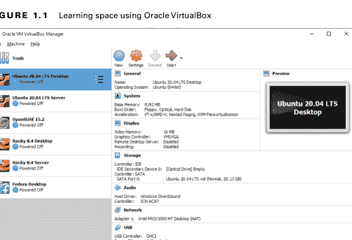

请注意图 1.1 中描绘的学习空间，其中包含两个 Ubuntu 和 Rocky Linux 发行版的安装实例。这些发行版提供了安装面向服务器的环境或面向图形的桌面环境的能力。使用 VirtualBox，您可以轻松安装这两种环境并对它们进行比较！

希望您已经开始构思如何配置您的私人学习空间。在此之前，我们还需要探索另一个平台类别。

# 转向云端

如果您没有拥有足够资源以提供多 Linux 发行版学习空间的笔记本电脑或台式机，请考虑云端。虽然云服务器在大型环境中变得越来越流行，但它们也可以提供一种运行单个 Linux 系统的方式。

有许多云服务提供商可以让您启动各种 Linux 发行版虚拟机，例如亚马逊网络服务（AWS）、微软 Azure 和 DigitalOcean。云服务变化迅速，您可能无法找到所需的 Linux 发行版版本。但是，花些时间查看云服务提供商的各种服务是值得的。对于您的学习空间来说，云端可能比新电脑更便宜。

如果您选择使用云服务，该服务可能不会提供探索某些 CompTIA Linux+ 目标的方式，例如通过 BIOS 与 UEFI 修改 Linux 服务器启动方式。在探索您的学习空间场所时请记住这一点。

在您确定学习空间的位置之前，请考虑各种推荐的 Linux 发行版及其版本。这些是您成功的学习空间环境的额外组成部分。

# 探索 Linux 发行版

CompTIA Linux+ 认证是中立的。从实际意义上来讲，这意味着考试的重点不是特定的 Linux 发行版。如果您有红帽企业 Linux（RHEL）的经验，您需要更多地了解 Ubuntu 和 openSUSE 发行版上的实用工具或功能，反之亦然。

人们很容易认为 Linux 发行版都是一样的，它们之间的差异很少。不幸的是，这是一个谬误。我们喜欢将 Linux 内核比作汽车的发动机，将发行版比作汽车的功能。如果您曾经租过车，汽车的功能通常与您通常驾驶的汽车的功能大相径庭。当您进入租来的汽车时，您需要花几分钟时间调整座椅，查看各种汽车控制，并在驶上路面前弄清楚如何使用它们。学习新发行版也是如此。好消息是，如果您拥有丰富的 Linux 经验，学习新发行版并不那么困难。

Linux 发行版通常基于其他发行版或发行版分支。两个流行的发行版组，包含有助于通过 Linux+ 考试的发行版，是基于 Red Hat 的和基于 Debian 的。这两个组之间的差异包括软件包、名称及其管理工具；配置文件名和/或位置；软件发布计划；防火墙配置实用工具；等等。Red Hat Inc. 倾向于关注企业和企业计算，而 Debian 项目关注自由软件。由于这些各种差异，有必要在学习空间中使用两个组的发行版。

了解哪些 Linux 发行版将有助于您成功通过 CompTIA Linux+ 认证考试非常重要。此外，您还应该知道哪些特定的发行版版本是有用的。

## 了解红帽企业 Linux

早期的 Red Hat Linux 始于 1995 年，最初是一个开源项目。它广受欢迎，一度成为最流行的 Linux 发行版，被用于教育环境、企业环境，甚至也被普通的 Linux 爱好者使用。然而，2003 年 Red Hat 停止了 Red Hat Linux 项目，转而支持红帽企业 Linux（RHEL）项目。RHEL 项目主要专注于企业级 Linux 环境。RHEL 是一个商业软件包；因此，在大多数情况下，你必须购买许可证才能使用它。作为回报，Red Hat 提供全面的客户支持，协助设置 Linux 系统并排查故障，这与大多数其他 Linux 发行版不同。

对于 Linux 爱好者来说，幸运的是，还有另一种运行 RHEL 的方式。由于 Linux 是一个开源软件包，Red Hat 被要求发布 RHEL 的源代码。随后，一些其他的 Linux 发行版利用 RHEL 的源代码应运而生。其中最受欢迎的是社区企业操作系统（CentOS）。它几乎是 RHEL 的完全副本，是准备 CompTIA Linux+ 认证考试的绝佳免费学习资源。

然而，正如在快速变化的 Linux 世界中常见的那样，情况已经改变。2014 年，CentOS 加入了 Red Hat 的开源与标准团队；2020 年，Red Hat 用一个名为 CentOS Stream 的新开发版本取代了原始的 CentOS 项目。虽然你仍然可以免费获取 CentOS Stream，但它不再是当前 RHEL 版本的完全副本，而是新概念的试验场，这使得它作为学习资源的好处减少了。

但别担心，CentOS 的原始开发者又启动了一个新的发行版，名为 Rocky Linux。Rocky Linux 回归了 CentOS 的初衷——它是最新 RHEL 版本的完全副本。你可以从 Rocky 网站`www.rockylinux.org`获取 Rocky Linux 发行版的 ISO。请注意，该发行版与许多其他发行版一样，提供多种版本。我们建议你获取 Rocky BaseOS 下载包，选择`8.x`版本系列（撰写本文时为`8.5`版本）。


> 随着时间的推移，新的 Rocky 发行版版本将会发布。虽然总是让人受诱惑去获取最新和最棒的版本，但在你的学习环境中使用它并不是有益的。请记住，CompTIA Linux+ 的目标在认证考试下一次更新之前是静态的。因此，使用认证考试创建时可用的发行版版本是明智的。

当你安装 Rocky Linux 时，系统会提示你选择想要安装的环境。对于学习 Linux 而言，通常最好安装图形桌面环境，因为它提供了访问所有你需要了解的 Linux 功能的最简便方式。

安装你的 Rocky Linux `8.x` BaseOS 发行版后，你应该更新软件包。为此，请使用你在安装期间设置的密码登录`root`账户，并发出清单 1.1 中显示的命令。

### 清单 1.1：在 Rocky Linux 上更新软件

```bash
# sudo dnf update
Loaded plugins: fastestmirror
[...]
Upgrade  3 Packages

Total download size: 1.3 M
Is this ok [y/d/N]: y
[...]
Complete!
# 
```

虽然 RHEL（及其衍生版本）是一个流行的发行版，但你还需要一个属于 Debian 阵营的发行版。接下来，我们将探讨 Ubuntu 发行版。

## 了解 Ubuntu

Ubuntu Linux 发行版由 Canonical LTD 管理，自 2004 年起就已存在。这款免费且流行的 Linux 发行版基于 Debian 发行版，是你个人 Linux 学习空间中必备的工具。

你可以从`www.ubuntu.com`获取 Ubuntu 发行版的 ISO。Ubuntu 有好几个版本，如果你想确保能够跟随本书中的示例，我们建议你下载 Ubuntu 桌面版`20.04 LTS`。


> Ubuntu 版本名称中的`LTS`代表`Long-Term Support`（长期支持）。这是 Canonical 用来表示将在延长的时间段内提供维护和安全更新的指标。对于`20.04 LTS`而言，你可以指望这些更新持续到 2025 年 4 月。

如果你不熟悉 Ubuntu，你需要了解几个重要的事项。默认情况下，你无法登录到`root`账户。相反，当你需要使用超级用户权限时，请登录你在安装期间设置的账户，并在你的命令行命令前加上`sudo`。清单 1.2 中展示了一个示例。

### 清单 1.2：在 Ubuntu 上使用 sudo

```bash
$ sudo grep root /etc/shadow
root:::17737:0:99999:7:::
$
```


> 如果你从未在终端中发出过命令行命令，建议你在尝试之前读完这一整章。你会在本章后面阅读更多关于终端的内容。

另一个重要的事项涉及安装 Ubuntu。如果你连接到网络，可以在安装发行版时自动更新其软件。你会在安装过程中看到一个列为 Download updates（下载更新）的选项，旁边有一个复选框。如果你选择在安装期间不安装更新，你可以稍后通过命令行手动发出清单 1.3 中显示的命令，使用超级用户权限在终端中更新软件。

### 清单 1.3：在 Ubuntu 上更新软件

```bash
$ sudo apt-get update
[sudo] password for Christine:
Hit:1 http://us.archive.ubuntu.com/ubuntu bionic InRelease
Get:2 http://us.archive.ubuntu.com/ubuntu bionic-updates InRelease
[88.7 kB]
[...]
Fetched 1,053 kB in 2s (631 kB/s)
Reading package lists... Done
$
$ sudo apt-get dist-upgrade
Reading package lists... Done
Building dependency tree
Reading state information... Done
Calculating upgrade... Done
The following packages will be upgraded:
[...]
Do you want to continue? [Y/n] Y
[...]
$
```

如果你只能容纳两个 Linux 发行版，Rocky Linux 和 Ubuntu 是不错的选择。如果你有额外的资源，值得再添加一个发行版，openSUSE。

## 了解 openSUSE

openSUSE 发行版于 1994 年首次发布，当时使用的是不同的名称 SUSE Linux。有许多公司参与了对其的支持，其中总部位于德国的 SUSE 公司是原始支持者。

这个发行版拥有非常忠诚且稳固的追随者群体。不仅 openSUSE 发行版得到了社区开发者的强力支持，openSUSE 用户也喜爱它。它的一个独特且流行的实用工具是 Yet another Setup Tool（YaST）。YaST 可以被视为一个命令中心实用工具，它允许你从一个界面控制许多系统服务。

你可以从`https://software.opensuse.org`获取 openSUSE 发行版的 ISO。这个发行版主要有两种版本：Leap 和 Tumbleweed。我们建议你选择 openSUSE Leap 的`15.x`版本系列。


openSUSE 社区在 2017 年更改了其发行版的版本号命名方案。`15.0`之前的版本是`42.3`。在你获取 openSUSE Leap 时，请注意这一巨大变化。

一旦你成功安装了 openSUSE，在探索这个发行版之前更新所有软件是一个好主意。要通过命令行更新软件，请手动在终端中发出清单 1.4 中显示的命令，并使用超级用户权限。

### 清单 1.4：在 openSUSE 上更新软件

```bash
$ sudo zypper patch
[sudo] password for root:
Loading repository data...
Reading installed packages...
Resolving package dependencies...
[...]

Note: System reboot required.
Continue? [y/n/.../? shows all options] (y): y
[...]
Warning: One of the installed patches requires a
reboot of your machine. Reboot as soon as possible.
There are some running programs that might use files
deleted by recent upgrade. You may wish to check and
restart some of them. Run 'zypper ps -s' to list these programs.
$
```

你可能已经注意到，最近三个发行版使用不同的命令来更新软件。这是你需要在学习空间中拥有多个发行版的另一个原因。接下来我们将看看另一个重要的发行版。

## 了解 Fedora

Fedora 由 Fedora Project 维护，该项目由 Red Hat 赞助。创新且有时处于最前沿的软件是此发行版的一个优秀特性。如果你想尝试新事物，Fedora 适合你。与其他发行版一样，这个发行版也有多种版本，Fedora Project 将其称为版本（editions）。我们建议你使用 Fedora 34 Workstation 版本。你可以在`https://getfedora.org`获取此 Fedora ISO 的副本。

请注意，这个特定的发行版每六个月更新一次版本。因此，你可能需要从以下位置检索 Fedora 34 Workstation：`https://dl.fedoraproject.org/pub/fedora/linux/releases/34/Workstation`。


Fedora 发行版不仅提供多种不同风格（`flavors`），还提供多种变种（`spins`）。变种是 Fedora 的特别版本。例如，如果你不满意 Fedora 预装的默认图形用户界面（`GUI`），可以选择拥有不同 `GUI` 的变种。如果你想浏览可用的各种 Fedora 变种，请查看 Fedora 项目变种网站：`https://spins.fedoraproject.org`。

与 Ubuntu 发行版类似，默认情况下你无法登录 `root` 账户。相反，当你需要使用超级用户权限时，请登录你在安装期间设置的账户，并在你的命令行命令前加上 `sudo`。

成功安装 Fedora Workstation 后，请更新软件。要通过命令行更新软件，请登录你在安装期间设置的账户，并使用超级用户权限，在终端中手动执行清单 1.5 中显示的命令。

### 清单 1.5： 在 Fedora 上更新软件

```
$ sudo su -c 'dnf upgrade'
[sudo] password for Christine:
[...]
  Install    4 Packages
  Upgrade  161 Packages

Total download size: 295 M
Is this ok [y/N]: y
Downloading Packages:
[...]
Complete!
$ 
```

如果更新的包非常少，你可能需要在命令中添加一个额外选项。在命令行终端中执行命令 `sudo su -c 'dnf upgrade --refresh'`。

如果你花在 Linux 图形界面的时间较多，或者你是 Linux 的新手，你可能不熟悉如何访问命令行终端。下一节将帮助你解决这个问题。如果你是资深的命令行用户，可以跳过这一节。

## 定位终端

为了探索 Linux 并为参加 CompTIA Linux+ 认证考试做准备，你需要在命令行上花一些时间。终端是你通往命令行的入口。一旦你了解如何定位和使用这个终端，你就可以开始阅读本书的其余内容了。

在大多数发行版中，到达终端的最简单方法是在系统启动后按下 `Ctrl+Alt` 加上其中一个功能键（通常是 `F2` 或 `F3`）的组合键。这将带你进入名为 `tty2` 的终端。在输入你在 Linux 发行版安装期间创建的用户名和密码后，你会看到提示符。图 1.2 显示了 openSUSE 发行版上的 `tty3` 终端。

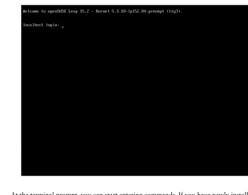

在终端提示符处，你可以开始输入命令。如果你是刚刚安装该发行版，请按照本章之前的指示更新其软件。要离开此终端，只需输入命令 `exit`。

> 如果你使用的是图形桌面环境，也可以通过使用终端应用程序来访问命令行。

## 总结

学习空间是一个虚拟或实体的 Linux 系统，你可以在其中探索、练习并尝试各种 Linux 命令和实用工具。拥有一个私人的学习空间是通过 CompTIA Linux+ 认证考试的必要条件。你可以在旧笔记本电脑、使用虚拟化软件（`hypervisor`）的当前笔记本电脑或在云中设置学习空间。

在你的学习空间中拥有多个 Linux 发行版也是必不可少的。由于发行版之间存在差异，能够随时访问它们以探索这些差异非常重要。

一旦设置好你的 Linux 学习空间，你就可以开始深入 CompTIA Linux+ 认证目标。我们将在下一章开始介绍这些目标。

# 第 2 章

# 服务简介


CompTIA Linux+ 认证考试的早期版本包含一个关于 Linux 服务器服务的目标，例如 Web 服务器、文件服务器和数据库服务器。`XK0-005` 考试不再将此作为正式目标，但其他目标假设你知道什么是 Linux 服务器服务，以及它们如何接受客户端的连接。尽管 Linux 在进入桌面市场方面经历了一段艰难的时期，但在服务器市场却蓬勃发展，因此了解 Linux 服务器如何工作以及当前流行的服务器软件包很重要。

Linux 服务器的普及很大程度上与其多用途性、性能和成本有关。本章帮助你了解 Linux 服务器的运行方式，并介绍你可以在 Linux 中安装和运行以向网络客户端提供服务的最常见的服务器软件包。

# 什么是 Linux 服务器？

在我们深入 Linux 服务器的细节之前，我们首先解释什么是 Linux 服务器，并展示 Linux 服务器与 Linux 桌面的区别。

Linux 桌面和 Linux 服务器使用相同的 Linux 内核，运行相同的 Shell，甚至具备运行相同程序的能力。区别在于它们主要运行哪些程序以及这些程序在系统上如何运行。

Linux 桌面主要专注于你从图形桌面界面运行的个人程序，例如浏览互联网或编辑文档。图形桌面为用户提供了一个易于与操作系统以及所有文件和程序交互的接口。你通过从菜单系统中选择或点击桌面图标来启动程序。在桌面世界中，一切都是交互式的。

Linux 服务器主要在没有人类交互的情况下运行。没有人坐在桌面前启动应用程序（事实上，许多服务器甚至没有专门的显示器和键盘）。

服务器运行向多个用户（客户端）提供共享资源（称为 *服务*）的程序，通常是在网络环境中。许多服务始终运行，即使没有客户端正在主动使用它们也是如此。

服务器程序很少依赖图形界面。相反，它们几乎总是利用 Linux Shell 的命令行界面（`CLI`）与服务器管理员交互，而且通常，管理员从远程客户端连接到服务器以与服务进行任何交互式操作。

由于与人类操作员几乎没有交互，服务器必须知道如何自行启动向客户端提供服务的程序。服务器运行这些服务的方式可能因服务器而异，也因服务而异。以下章节描述了 Linux 服务器如何启动服务以及如何向客户端提供对这些服务的访问。

# 启动服务

Linux 服务器运行服务程序主要有两种方式：

- 作为后台进程，始终运行并监听请求
- 作为由监听请求的父程序生成的进程

当 Linux 服务程序作为后台进程持续运行时，它被称为 *守护进程*（`daemon`）。Linux 服务器通常利用脚本在服务器启动时立即启动服务守护进程（参见第 6 章，“维护系统启动和服务”）。

Linux 守护进程程序通常以字母 `d` 结尾，以表明它们是守护进程。清单 2.1 展示了 MySQL 数据库服务器守护进程在服务器上后台运行的示例。

### 清单 2.1： 列出 MySQL 数据库服务器守护进程

```
$ ps ax | grep mysql
  5793 ?        S     0:00 /usr/sbin/mysqld --daemonize --pid-file=/run/mysqld/mysqld.pid
  5900 pts/0    S+    0:00 grep --color=auto mysql
$ 
```

`mysqld` 守护进程程序监听来自客户端的网络连接。当守护进程收到来自客户端的请求时，它会处理该请求并通过相同的网络通道将数据返回给客户端。


> 请注意，在 Linux 中运行在后台的程序名称是“`daemon`”（守护进程），而不是“*demon*”（恶魔），尽管二者常被混淆。守护进程源自希腊神话，是超自然生物，在需要时帮助人类。

Linux 服务器支持的服务越多，它必须在后台运行的守护进程就越多，等待客户端请求。每个守护进程都需要服务器上的内存资源，即使它只是在监听客户端。虽然今天的服务器拥有大量可用内存，但在 Linux 早期并非如此。因此，*超级服务器*（`super-servers`）应运而生。

超级服务器是监听多个不同应用程序网络连接的程序。当超级服务器收到客户端对某个服务的请求时，它会生成相应的服务程序。

为 Linux 创建的最初的超级服务器程序是 *互联网守护进程*（`inetd`）应用程序。`inetd` 程序作为守护进程运行，监听来自客户端的特定请求以及在需要时启动相应的服务程序。`inetd` 程序使用 `/etc/inetd.conf` 配置文件，允许你定义需要处理请求的服务。

*扩展互联网守护进程*（`xinetd`）应用程序是 `inetd` 的高级版本。它同样根据客户端请求启动服务程序，但包含额外功能，例如访问控制列表（`ACL`）、更高级的日志记录功能，以及设置时间表在不同时间或服务开关的能力。


## 监听客户端

标准 Linux 服务器支持大量服务。通常，单个 Linux 服务器会同时支持多个服务。这意味着多个客户端将向服务器提出多个服务的请求。关键在于将客户端的请求正确路由到相应的服务器服务。

每项服务，无论是作为*守护进程*运行还是从超级服务器运行，都使用独立的网络协议与其客户端通信。常见服务协议由*互联网工程任务组*（`IETF`）标准化，并发布为*请求评论*（`RFC`）文档。每个服务器软件程序使用为其服务指定的协议与其客户端通信，例如 Web 服务器使用 `HTTP`，电子邮件服务器使用 `SMTP`。

服务的网络协议精确定义了网络客户端如何使用预分配的*网络端口*与服务通信。端口在 `TCP` 和 `UDP` 标准中定义，以帮助分离发往同一 `IP` 地址的网络流量。`IETF` 将不同的服务分配给不同的端口进行通信。这类似于大型企业中使用的电话分机。你拨打一个电话号码即可到达该企业，然后选择一个独立分机以联系办公室内的特定个人。对于服务而言，客户端使用通用 `IP` 地址到达服务器，然后使用不同的端口到达单独的服务。

`IETF` 已定义了一套用于互联网常用服务的标准端口。这些被称为*知名端口*。表 2.1 展示了部分较常见的已分配知名端口。

Linux 上有大量可用的服务来为网络客户端提供应用程序。`/etc/services` 文件包含在 Linux 服务器上定义的所有端口。

以下章节将探讨你在 Linux 服务器上会找到的不同类型的服务，以及提供这些服务的常见 Linux 应用程序。

## 表 2.1 常见互联网知名端口号

| 端口号 | 协议 | 描述 |
| :-- | :-- | :-- |
| 20 和 21 | `FTP` | 文件传输协议（`FTP`）用于向服务器发送和接收文件。 |
| 22 | `SSH` | 安全外壳（`SSH`）协议用于向服务器发送加密数据。 |
| 23 | `Telnet` | `Telnet` 是一种不安全的协议，用于提供到服务器 shell 的交互界面。 |
| 25 | `SMTP` | 简单邮件传输协议（`SMTP`）用于在服务器之间发送电子邮件。 |
| 53 | `DNS` | 域名系统（`DNS`）提供名称服务，以在网络中将 `IP` 地址匹配到计算机名称。 |
| 67 | `DHCP` | 动态主机配置协议（`DHCP`）使客户端计算机能够自动获取网络上的有效 `IP` 地址。 |
| 80 | `HTTP` | 超文本传输协议（`HTTP`）允许客户端从服务器请求网页。 |
| 109 和 110 | `POP` | 邮局协议（`POP`）允许客户端与邮件服务器通信以读取其邮箱中的消息。 |
| 137-139 | `SMB` | 微软服务器使用服务器消息块（`SMB`）协议与客户端进行文件和打印共享。 |
| 143, 220 | `IMAP` | 互联网消息访问协议（`IMAP`）为客户端提供高级邮箱服务。 |
| 389 | `LDAP` | 轻量级目录访问协议（`LDAP`）提供对目录服务的访问，用于验证用户、工作站和其他网络设备。 |
| 443 | `HTTPS` | `HTTP` 的安全版本提供与 Web 服务器的加密通信。 |
| 2049 | `NFS` | 网络文件系统（`NFS`）提供 Unix 和 Linux 系统之间的文件共享。 |

## 提供基础服务

有一些基本的互联网服务，Linux 服务器擅长处理，并且已成为整个互联网的标准。Linux 服务器提供的三种互联网服务如下：

- Web 服务
- 数据库服务
- 电子邮件服务

以下章节讨论这些类型的 Linux 服务，并展示常用于支持它们的开源软件包。

## Web 服务器

迄今为止，Linux 服务器在互联网上最流行的用途是作为 Web 服务器。基于 Linux 的 Web 服务器托管了大多数网站，包括许多最流行的网站。

与许多 Linux 应用程序一样，你可以使用多个程序来构建 Linux Web 服务器。以下是你将遇到的最流行的程序，你应该了解它们。

### Apache 服务器

多年来，Apache Web 服务器已成为互联网上最流行的 Web 服务器之一。它是由伊利诺伊大学国家超级计算应用中心（`NCSA`）创建的第一个 Web 服务器软件包开发而来的。

Apache Web 服务器因其模块化而变得流行。Apache 服务器的每个高级功能都作为插件模块构建。当功能作为模块整合时，服务器管理员可以选择特定服务器在特定应用程序中需要的确切模块。这有助于减少在系统上运行 Apache 服务器守护进程所需的内存量。

### nginx 服务器

nginx Web 服务器（发音类似于“`engine-X`”）是相对较新的后来者。nginx 于 2004 年发布，旨在作为 Apache Web 服务器的高级替代方案，改进性能并提供一些额外功能，例如作为 Web 代理、邮件代理、网页缓存，甚至负载均衡服务器。虽然通过模块（如负载均衡）配置 Apache Web 服务器可以提供其中一些功能，但 nginx Web 服务器在设计时就内置了这些功能以提高性能。

核心 nginx 程序的内存占用小于更大的 Apache 程序，使其非常适合高流量环境。它能够处理超过 10,000 个同时网络连接客户端。

尽管仍相对较新，但 nginx Web 服务器正变得越来越流行，尤其是在高流量 Web 环境中。一种越来越流行的配置是使用 nginx Web 服务器作为前端，平衡到后端多个 Apache Web 服务器。这利用了 nginx 服务器处理大流量量的能力，以及 Apache Web 服务器处理动态 Web 应用的灵活性。

### lighttpd 软件包

在光谱的另一端，有时你可能需要一个轻量级 Web 服务器来处理网络应用程序传入的客户端请求。`lighttpd` 软件包提供了这样的环境。

`lighttpd` Web 服务器以其低内存占用和低 CPU 占用而闻名，使其非常适合较小的服务器应用程序，例如嵌入式系统。它还包含内置数据库，允许你在单个软件包中结合基本的 Web 和数据库服务。

## 数据库服务器

存储和检索数据是大多数应用程序的重要功能。尽管对于简单的数据存储应用程序，使用标准文本文件通常就足够了，但有时需要更高级的数据存储技术。

关系型数据库的出现使应用程序能够快速存储和检索数据。关系型数据库服务器允许多个客户端从集中位置访问相同的数据。结构化查询语言（`SQL`）为客户端向数据库服务器发送请求并检索数据提供了一种通用方法。

许多流行的商业数据库服务器可用于 Unix 和 Windows（甚至 Linux）；在 Linux 世界中，一些高质量的开源数据库已跃升至前列。这些数据库服务器软件包提供了许多（如果不是大部分）与昂贵的商业数据库软件包相同的功能，有时甚至能超越商业软件包。

以下章节讨论了你在 Linux 环境中工作时将遇到的三种最受欢迎的开源数据库服务器。

### PostgreSQL 服务器

`PostgreSQL` 数据库服务器最初是一个大学项目，并在 1996 年成为向公众提供的开源软件包。PostgreSQL 开发者的目标是实现一个完整的对象关系数据库管理系统，以媲美当时流行的商业数据库服务器。

PostgreSQL 以其高级数据库功能而闻名。它遵循商业数据库使用的标准原子性、一致性、隔离性和持久性（`ACID`）准则，并支持你在商业关系型数据库服务器中期望找到的许多花哨功能，如事务、可更新视图、触发器、外键、函数和存储过程。

PostgreSQL 非常通用，但通用性也带来了复杂性。过去，PostgreSQL 数据库因速度稍慢而闻名，但如今其在性能方面已取得了巨大的提升。不幸的是，旧的名声难以消除，PostgreSQL 在互联网领域仍然难以获得广泛认可。

### MySQL 服务器

与 PostgreSQL 软件包不同，`MySQL` 数据库服务器最初并未试图与商业数据库竞争。相反，它作为一个*项目*起步，旨在创建一个简单但快速的数据库系统。当时并未尝试实现复杂的数据库功能，它只提供运行迅速的基础功能。

由于专注于速度，MySQL 数据库服务器成为了许多知名互联网 web 应用程序中实际使用的数据库服务器。Linux 服务器运行 Apache web 服务器和 MySQL 数据库服务器，并利用 PHP 编程语言，这种组合被称为 LAMP 平台，可以在世界各地的 Linux 服务器中找到。

自创建以来，MySQL 数据库已添加了可与 PostgreSQL 和商业数据库相媲美的功能。然而，秉承其根源，MySQL 仍然保留了利用其闻名的快速存储引擎的选项。


> 2008 年，MySQL 项目被 Sun Microsystems 收购。2010 年，当 Oracle 收购 Sun Microsystems 时，默认情况下也接管了 MySQL 的开发。这让开源社区的许多人感到担忧，收购后不久，一组 MySQL 开发人员离开 Oracle 启动了 MariaDB 项目。MariaDB 是 MySQL 的副本，使用相同的源代码并具有相同的功能（增加了一些新功能）。许多 Linux 发行版现在默认使用 MariaDB 而不是 MySQL，因此如果你看到这种情况，请不要惊慌。

### MongoDB 服务器

随着面向对象编程和应用程序设计的流行度上升，面向对象数据库的使用也随之增加。目前，最流行的面向对象数据存储方法之一是被称为 NoSQL 的方法。

顾名思义，NoSQL 数据库系统存储数据的方式不同于使用 SQL 的传统关系型数据库系统。NoSQL 数据库不创建表，而是将数据存储为单个文档。与关系表不同，每个 NoSQL 文档可以包含不同的数据元素，每个数据元素独立于数据库中的其他数据元素。


一个日益受欢迎的 NoSQL 数据库软件包是`MongoDB`软件包。`MongoDB` 于 2009 年发布，作为一个完全符合 NoSQL 标准的数据库管理系统。它将数据记录存储为独立的`JavaScript 对象表示法` (JSON) 元素，使每个数据文档都独立于其他文档。

`MongoDB` 数据库服务器支持许多关系型数据库功能，如索引、查询、复制，甚至负载均衡。它允许你在查询中结合使用`JavaScript`，使其成为查询数据的非常通用的工具。


`MongoDB` 服务器安装后默认无安全设置——任何人可以连接服务器以添加和检索数据记录。这一“陷阱”甚至已成为一些知名网站数据泄露的问题所在。请在 web 应用程序中使用`MongoDB` 数据库时要格外小心。

## 邮件服务器

曾经，电子邮件是互联网的支柱。几乎每个人都有电子邮件地址，连接邮件服务器与外界沟通至关重要。虽然如今新技术正在占据主导地位（如短信、推特和即时消息），但电子邮件对大多数互联网用户来说仍是一项重要业务。几乎每个 Linux 服务器安装都使用某种类型的邮件服务器软件包。

Linux 不使用单一的整体程序来处理发送和接收邮件所需的所有部分，而是使用多个小型程序协同处理电子邮件消息。图 2.1 展示了大多数开源邮件软件如何在 Linux 环境中模块化电子邮件功能。

**图 2.1** Linux 模块化电子邮件环境

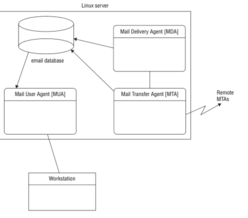

如图 2.1 所示，Linux 邮件服务器通常分为三个独立功能：

- 邮件传输代理 (MTA)

- 邮件投递代理 (MDA)

- 邮件用户代理 (MUA)

`MUA` 是与最终用户交互的程序，允许他们查看和操作电子邮件消息。因此，`MUA` 程序通常不在服务器端运行，而是在客户端运行。如图形化应用程序`Evolution`和`K-Mail`，在 Linux 桌面环境中阅读电子邮件很受欢迎。`MTA`和`MDA`功能位于 Linux 服务器上。以下部分展示了你在 Linux 中常见的`MTA`和`MDA`应用程序。

## 邮件传输代理

`邮件传输代理` (MTA) 负责处理服务器上的传入和传出电子邮件消息。对于每条传出消息，MTA 确定收件人地址的目的主机。如果目的主机是远程邮件服务器，MTA 必须与远程主机上的另一个 MTA 程序建立通信链路以传输消息。Linux 环境中有许多 MTA 软件包，但 Linux 考试重点关注其中三个：

- `sendmail`: `sendmail` MTA 软件包因极其通用而获得普及。`sendmail` 中的许多功能已成为电子邮件系统的代名词——虚拟域、消息转发、用户别名、邮件列表和主机伪装。不幸的是，`sendmail` 配置非常复杂。其庞大的配置文件有时会让新手邮件管理员感到不知所措。

- `Postfix`: `Postfix` MTA 被编写为一个模块化应用程序，使用几个不同的程序来实现 MTA 功能。`Postfix`的亮点之一是其简洁性。代替一个大型复杂配置文件，`Postfix`仅使用两个小型配置文件，通过明文参数和值名称来定义功能。

- `Exim`: `Exim` MTA 软件包坚持使用单一大型程序处理所有电子邮件功能的`sendmail`模型。它尽量尝试避免消息排队，在大多数环境中依赖即时投递。

## 邮件投递代理

通常，Linux 实现依赖独立的`邮件投递代理` (MDA) 程序将消息投递给本地用户。因为这些 MDA 程序仅专注于将消息投递给本地用户，它们可以增加包含 MDA 功能的 MTA 程序中不可用的附加功能。

MDA 程序从 MTA 程序接收发给本地用户的消息，然后确定这些消息的投递方式。消息可以直接投递给本地用户账户，或投递到用户定义的替代位置，通常通过结合过滤器实现。

Linux 中有两种常见的 MDA 程序：

- `Binnmail`: `binnmail` 程序是 Linux 中最流行的 MDA 程序。其名称来源于其在系统中的正常位置，`/bin/mail`。凭借其简洁性而变得流行。默认情况下，它可以读取存储在标准 `/var/spool/mail` 目录中的电子邮件消息，或者你可以将其指向替代邮箱。

- `Procmail`: `procmail` 程序由 Stephen R. van den Berg 编写，变得如此流行，许多 Linux 实现默认安装它。`procmail` 的流行源于其通用性，允许用户创建用户配置的规则，以便用户指导服务器如何处理收到的邮件。用户可以在其 `$HOME` 目录中创建个人 `.procmailrc` 文件，根据正则表达式将消息定向到单独的邮箱文件，将消息转发到替代电子邮件地址，甚至将消息直接发送到 `/dev/null` 文件以自动删除不需要的电子邮件。

# 服务本地网络

除了运行大型互联网 web 和数据库应用程序，Linux 服务器还常用于本地网络环境中，提供简单的网络服务。运行本地网络需要大量的幕后工作，而 Linux 服务器能够胜任。本节将介绍你在各种规模的本地网络中常见到的服务。

## 文件服务器

如今，文件共享在任何商业环境中已成为必需品。允许多名员工在公共文件夹中创建和编辑文件，可以大大改进任何项目的协作工作。

虽然在广域网环境中通过 web 服务器共享文件很常见，但在本地网络中还有其他更简单的方法。在本地网络环境中共享文件有两种基本方法：

- 点对点

- 客户端-服务器

在点对点网络中，一台工作站使另一台工作站可以访问存储在其硬盘上的本地文件。这种方法允许小型本地网络上两名员工之间的协作，但如果你需要在两个人以上之间共享数据，会变得有些困难。

客户端-服务器的文件共享方法利用集中式文件服务器来共享文件，多个客户端可以按需访问和修改这些文件。然而，使用集中式文件服务器时，管理员必须控制谁有权访问哪些文件和文件夹，以保护它们免受未授权访问。

在 Linux 世界中，有两种常见的用于共享文件的服务器软件包：`NFS`和`Samba`。

## NFS

`网络文件系统（NFS）` 是一种用于在网络环境中共享文件夹的协议。通过`NFS`，Linux 系统可以共享其虚拟目录的一部分到网络上，从而允许客户端以及其他服务器访问。

在 Linux 中，用于实现此功能的软件包是`nfs-utils`。`nfs-utils` 软件包提供了支持`NFS`的驱动程序，以及底层的客户端和服务器软件，既可以在网络上共享本地文件夹，也可以连接到本地网络上其他 Linux 系统共享的远程文件夹。使用`nfs-utils`，你的 Linux 系统几乎可以像挂载本地硬盘分区一样轻松地挂载远程共享的`NFS`文件夹。

## Samba

如今，微软 Windows 工作站和服务器已成为许多商业环境中的标准配置。虽然 Windows 工作站和服务器可以使用`NFS`，但 Windows 中默认使用的文件共享方法是微软创建的`服务器消息块（SMB）`协议。尽管微软服务器使用专有软件，但微软已将`SMB`协议作为网络标准发布，因此有可能创建能够使用`SMB`与 Windows 服务器和客户端进行交互的开源软件。

`Samba` 软件包（注意其名称中巧妙地嵌入了`SMB`）的创建目的是为了让 Linux 系统能够与 Windows 客户端和服务器进行交互。通过`Samba`，你的 Linux 系统既可以充当客户端，连接 Windows 服务器共享的文件夹，也可以充当服务器，允许 Windows 工作站连接到 Linux 系统上的共享文件夹。`Samba`在配置管理共享文件夹访问权限的正确参数时确实需要一些工作。

## 打印服务器

在商业环境中，为办公室里的每个人配备一台打印机在某种程度上是一种浪费。共享网络打印机的能力已成为大多数办公室的要求，并且在许多家庭环境中也越来越流行。

标准的 Linux 打印共享软件包称为`通用 UNIX 打印系统（CUPS）`。`CUPS`软件允许 Linux 系统通过专用打印驱动之上的通用应用程序接口连接到任何打印资源，无论是本地打印机还是通过网络连接的打印机。`CUPS`的关键在于打印驱动程序。许多打印机制造商为其打印机创建了`CUPS`驱动程序，因此 Linux 系统可以与其打印机连接。对于连接网络打印机，`CUPS`使用`互联网打印协议（IPP）`。

除了连接网络打印机外，`CUPS`系统还允许你将本地连接的打印机与其他 Linux 系统共享。这使得你可以将打印机连接到 Linux 服务器，并在本地网络中的多个用户之间共享它。


`Samba` 软件包也可以与`微软网络上的共享打印机`进行交互。你可以使用`Samba`将 Linux 工作站连接到`Windows 网络上的共享打印机`，甚至可以共享你本地连接的 Linux 打印机供`Windows 工作站`使用。

# 网络资源服务器

运行本地网络需要许多不同的资源来保持客户端和服务器同步。对于较大的网络，这一点尤为真实，因为网络管理员必须管理许多不同类型的客户端和服务器。

幸运的是，Linux 提供了一些不同的服务软件包，网络管理员可以使用它们来使生活更轻松。以下章节将介绍你可能在 Linux 服务器上遇到的一些基本面向网络的服务。

## IP 地址

本地网络上的每个设备必须拥有唯一的 IP 地址才能与其他设备交互。对于小型家庭网络，管理这可能不太困难，但对于大型商业网络，这项任务可能令人心力交瘁。

为了帮助简化这一要求，开发人员创建了动态主机配置协议（DHCP）。客户端可以从`DHCP`服务器请求网络的有效 IP 地址。中央`DHCP`服务器会跟踪已分配的 IP 地址，确保没有两个客户端获得相同的 IP 地址。

如今，你可以配置许多不同类型的网络设备作为`DHCP`服务器。大多数家庭宽带路由器提供此服务，大多数面向服务器的操作系统也是如此，例如 Windows 服务器以及，当然，Linux 服务器。

最流行的 Linux`DHCP`服务器软件包由互联网系统基金会（ISC）维护，称为`DHCPd`。几乎所有 Linux 服务器发行版都在其软件库中包含此软件包。

一旦你在网络上运行了`DHCPd`服务器，你需要告诉你的 Linux 客户端使用它来获取网络地址。这需要`DHCP`客户端软件包。对于 Linux`DHCP`客户端，有三个流行的软件包可供使用：

- `dhclient`

- `dhcpd`

- `pump`

大多数基于 Debian 和 Red Hat 的发行版使用`dhclient`软件包，甚至在安装过程中检测到网卡时默认安装它。`dhcpd`和`pump`应用程序不太为人所知，但你也可能会遇到它们。

## 日志记录

Linux 维护日志文件，记录系统运行期间的各种关键详细信息。日志文件通常存储在本地`/var/log`目录中，但在网络环境中，让 Linux 服务器将系统日志存储在远程日志服务器上可能非常方便。

远程日志服务器提供原始日志文件的安全备份，以及在系统崩溃或攻击者入侵情况下安全存储日志的地方。

Linux 中有两个主要的日志软件包，系统使用哪一个取决于它使用的启动软件（见第 6 章）：

- `syslogd：` `SysVinit`和`Upstart`系统利用`syslogd`服务接受来自远程服务器的日志数据。

- `journal：` `Systemd`系统利用`journald`服务进行本地和远程的系统信息日志记录。

`syslogd`和`journald`都使用配置文件，允许你定义数据如何记录以及服务器接受哪些客户端的日志消息。

# 名称服务器

使用 IP 地址来引用网络上的服务器对计算机来说没问题，但人类通常需要用某种文本形式来记忆地址。这就是域名系统（DNS）的作用。`DNS`将 IP 地址映射到网络上的主机命名方案。`DNS`服务器充当目录查找，以查找本地网络上服务器的名称。

Linux 服务器使用`BIND`软件包来提供`DNS`命名服务。`BIND`软件包是在互联网早期（1980 年代初）由加州大学伯克利分校开发的，并作为开源软件发布。

`BIND`中的主要程序是`named`，这是在 Linux 服务器上运行的服务器守护进程，它将为本地网络上的客户端将主机名解析为 IP 地址。`DNS`的美妙之处在于，一个`BIND`服务器可以与其他`DNS`服务器通信以查找远程网络上的地址。这允许客户端指向一个`DNS`名称服务器即可解析互联网上的任何 IP 地址！

> DNS 协议是基于文本的，容易受到攻击，例如主机名欺骗。`DNSSEC`协议在标准`DNS`数据包周围引入了一层加密，以帮助在主机名查找过程中提供一层安全性。请确保你的`BIND`安装支持`DNSSEC`以获得适当的安全性。

# 网络管理

对一个组织的多台主机和网络设备负责可能是一项令人应接不暇的任务。试图跟上哪些设备是活跃的或哪些服务器在满负荷运行可能是一个挑战。幸运的是，对于管理员来说，有一种解决方案。

`简单网络管理协议`（SNMP）提供了一种方式，让管理员可以查询远程网络设备和服务器，以获取关于它们的配置、状态甚至性能的信息。`SNMP`运行在简单的客户端/服务器范式下。网络设备和服务器运行一个`SNMP`服务器服务，该服务监听来自`SNMP`客户端软件包的请求。`SNMP`客户端向`SNMP`服务器发送数据请求。

多年来，`SNMP`标准发生了一些巨大的变化，主要是为了帮助增加安全性并提升性能。最初的`SNMP`版本 1（称为`SNMPv1`）仅提供简单的客户端密码身份验证，并将所有数据作为单独的

纯文本记录。`SNMP`版本 2（称为`SNMPv2`）实现了基本级别的安全机制，并提供了监控数据的批量传输功能，有助于减少监控设备所需的网络流量。当前版本（`SNMPv3`）同时利用了强身份验证和数据加密功能，并提供了一个更流畅的管理体系。

Linux 中最受欢迎的`SNMP`软件包是开源的`net-snmp`软件包。该软件包具有`SNMPv3`兼容性，允许您安全地远程监控 Linux 服务器的各个方面。

### 时间

为了让许多网络应用程序正确运行，服务器和客户端都需要将内部时钟与同一时间进行协调。网络时间协议（NTP）实现了这一点。它允许服务器和客户端跨多个网络在同一时间源上进行同步，根据需要增加或减少几分之一秒以保持同步。

对于 Linux 系统，`ntpd` 程序使 Linux 系统与 Internet 上的远程`NTP`服务器保持同步。通常，让一台 Linux 服务器使用`ntpd`与远程时间标准服务器同步，然后让局域网内的所有其他服务器和客户端将其时间同步到该本地 Linux 服务器。

## 实施安全

如今，安全是每个系统管理员最令人担忧的事项之一。面对 seemingly 无穷无尽的试图入侵服务器的人，实施安全是每个 Linux 管理员的重要职责。

幸运的是，Linux 提供了多层安全机制，您可以在 Linux 服务器环境中实施。以下章节将逐步介绍在 Linux 服务器中实施安全时可能会遇到的服务器软件包。

### 身份验证服务器

Linux 服务器的核心安全机制是为系统中的每个单独用户分配的标准用户 ID 和密码，并存储在`/etc/passwd`（在非安全遗留系统中）或`/etc/shadow`文件中。每个 Linux 服务器都维护自己的有效用户账户列表，这些账户有权访问该服务器。

在大型网络环境中，用户可能需要访问多个 Linux 服务器上的资源，记忆多个用户 ID 和密码可能是一项挑战。幸运的是，有几种不同的方法可以在网络中的多个 Linux 服务器之间共享用户账户数据库。

### NIS

网络信息系统（NIS）是一种目录服务，允许客户端和服务器共享通用的命名目录。`NIS`命名目录通常用作本地网络上用户账户、主机名甚至电子邮件信息的通用存储库。`NIS+`协议通过添加安全功能扩展了`NIS`。

`nis-utils` 软件包是一个用于在 Linux 环境中实施`NIS`或`NIS+`目录的开源项目。它包含在大多数 Linux 发行版的软件仓库中。


`NIS`系统最初由 Sun Microsystems 设计，并以巧妙的名称“Yellow Pages”（黄页）发布。然而，由于商标侵权问题，名称不得不改为更平淡无奇的`NIS`。

### Kerberos

`Kerberos` 由麻省理工学院（MIT）开发，是一种安全的身份验证协议。它使用对称密钥加密技术，通过集中的服务器数据库安全地验证用户。整个身份验证过程都是加密的，使其成为登录 Linux 服务器的安全方法。

您可以将`Kerberos`身份验证系统用于简单的服务器登录之外的更多场景。许多常见的 Linux 服务器应用程序提供了插件模块，以便与`Kerberos`数据库接口，从而验证应用程序用户。

### LDAP

网络身份验证系统已经广泛应用于商业网络领域。微软的活动目录（Active Directory）系统是目前使用最为广泛的网络身份验证系统。然而，开源世界也不甘落后，创建了自己的网络目录系统。

`轻量级目录访问协议`（`LDAP`）由密歇根大学创建，旨在为本地网络上的多个应用程序和设备提供简单的网络身份验证服务。在 Linux 领域，`LDAP`最流行的实现是`OpenLDAP`软件包。

`OpenLDAP`允许您设计分层数据库来存储网络中的对象。在分层数据库中，对象以类似树的方式相互连接，如图 2.2 所示。

分层数据库允许您按类型（如用户和服务器）、位置或两者进行对象分组。这为设计本地网络的身份验证提供了灵活的方式。

`OpenLDAP` 软件包包括客户端和服务器程序。客户端程序允许系统访问`OpenLDAP`服务器，以验证客户端或其他网络对象发出的请求。

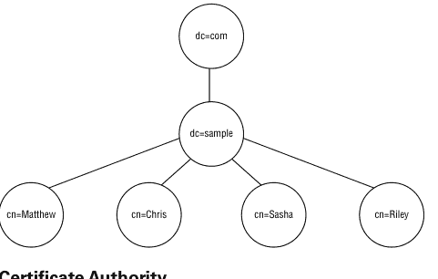

### 证书颁发机构

为服务器上每个用户分配用户 ID 和密码的时代即将结束（如果尚未结束的话）。通过用户 ID/密码登录服务器的方法存在许多安全问题，如共享用户账户、简单的密码，甚至分配无密码的账户。

验证用户的更好方法是使用证书。证书是一种实现双因素身份验证方法的加密密钥。要登录服务器，用户必须具备两个条件：

- 他们拥有的东西，例如证书文件

- 他们知道的东西，例如 PIN

证书用于识别网络上的特定用户。只应该有一个用户拥有证书并且知道访问证书所需的`PIN`。但是，服务器信任证书也很重要。为此，您需要一个证书颁发机构。


OpenSSL 软件包为服务器和客户端提供标准的证书功能。您可以设置 Linux 服务器为客户端创建证书，然后为网络应用程序对其身份进行验证。

### 访问服务器（SSH）

在当今的环境中，远程访问服务器是存在风险的。周围有许多人在窥探网络，寻找他们可以窃取的信息。不再是一个好主意使用 Telnet 或 FTP 等纯文本协议从远程位置登录服务器。

相反，您应该使用一种在客户端和服务器之间包含加密的远程访问协议。`Secure Shell`（SSH）在通过网络传输的数据周围提供了一层加密。

在 Linux 环境中实施 SSH 的最流行软件包是 `OpenSSH` 软件包。OpenSSH 软件包使用 SSH 提供安全的 Telnet、FTP 甚至远程复制功能。


OpenSSH 程序还支持一种称为隧道（tunneling）的功能。通过隧道，您可以将任何类型的网络事务包裹在加密层中，从而保护任何类型的网络应用程序，即使 OpenSSH 软件没有直接支持该应用程序。

### 虚拟专用网络

通过 Internet 远程连接到本地网络上的服务器可能是一件危险的事情。您的网络流量在到达您的服务器之前需要经过许多中间网络中的许多跳跃，这为窥探者提供了许多窥探数据的机会。

远程访问本地网络资源的解决方案是`虚拟专用网络`（VPN）协议。VPN 协议在远程客户端或服务器与本地网络上的 VPN 服务器之间创建安全的一对一隧道。这提供了一种安全的方法来远程访问本地网络上的任何服务器。

在`Linux`中，一种流行的 VPN 解决方案是`OpenVPN` 软件包。OpenVPN 软件包作为 Linux 服务器上的服务器服务运行，位于您的本地网络上。远程客户端可以使用 OpenVPN 连接到 OpenVPN 服务器以建立与服务器的连接，然后，一旦在服务器上，即可访问您本地网络的其余部分。

### 代理服务器

`Web 代理服务器`允许您拦截来自本地网络客户端的 Web 请求。通过拦截 Web 请求，您可以控制客户端如何与远程 Web 服务器交互。Web 代理服务器可以阻止您不希望网络客户端看到的网站，并且服务器可以缓存常见的网站，以便将来对相同页面的请求加载更快。

Linux 中最受欢迎的 Web 代理服务器是`Squid` 软件包。您可以将其配置为同时作为过滤器和缓存服务器运行。前文提到的 NginX Web 服务器软件包也具有作为 Web 代理服务器工作的能力，并且开始受到欢迎。

### 监控

如果您的网络上有多个 Linux 服务器，跟上它们的所有动态可能是一项挑战。系统管理员随时都应该看一眼

服务器的性能和日志文件，以便及时了解即将发生或已经发生的异常情况。

在 Linux 领域中，有几种可用的监控工具。Nagios 软件包正迅速成为一种流行工具，尤其是在云 Linux 系统中。Nagios 使用 SNMP 来监控 Linux 服务器的性能和日志，并通过简单的图形窗口环境提供结果。

## 提升性能

开发人员和高级 Linux 应用的管理员始终在寻找提升应用性能的方法。所有 Linux 管理员都应了解三种常见的性能提升方法。本节将介绍这些方法。

## 集群

计算机集群通过将应用程序功能分布在多台服务器之间来提高应用性能。集群中的每个服务器节点配置相同，可以执行相同的函数，但集群管理软件决定如何在服务器之间分配应用程序功能。由于集群中的每个服务器只处理应用程序的一部分，因此与必须在单台服务器上运行整个应用程序相比，你可以在集群中使用性能较低的服务器。

集群管理软件是集群性能的关键。早期尝试使用廉价 Linux 服务器创建集群的尝试之一是 Beowulf 集群。Beowulf 集群依赖于并行处理库（例如并行虚拟机 (PVM) 库）来在多台 Linux 服务器之间分配应用程序的库调用。

较新的集群版本包括 Apache Hadoop 项目和 Linux 虚拟服务器 (LVS) 项目。

## 负载均衡

负载均衡是集群的一种特殊应用。负载均衡器将完整的客户端请求重定向到集群中的一台服务器。虽然单台服务器处理整个请求，但客户端负载会自动分布在多台服务器之间。

常见的 Linux 负载均衡软件包包括 HAProxy、Linux 虚拟服务器 (LVS)，甚至 nginx Web 服务器。

## 容器

对于应用程序开发人员来说，最大的问题之一是如何创建一个与应用程序实际运行的服务器环境相匹配的开发环境。开发人员经常在工作站开发环境中使应用程序运行良好，但在移植到服务器时却崩溃失败。

Linux `容器`通过创建自包含环境来封装应用程序，从而帮助解决这一问题。容器将所需的应用程序文件、库文件和操作系统库打包成一个包，您可以轻松地在不同环境之间移动。

有多种可用的支持容器的 Linux 服务器软件包。目前，最流行的两个是 `Docker` 和 `Kubernetes`。你可以使用这些软件包轻松地将应用程序容器移植到任何 Linux 服务器，无论是物理服务器、虚拟服务器还是云服务器。

## 总结

Linux 服务器提供支持客户端和网络设备网络应用程序。服务器应用程序称为服务，由 Linux 服务器自动启动，无需人工干预。当 Linux 服务器可以直接启动服务时，它们被称为守护进程。守护进程在后台运行并监听客户端连接请求。超级服务器在后台运行并监听多个服务的客户端连接请求。当连接请求被接受时，超级服务器启动相应的服务。

Linux 支持各种类型的应用程序服务。Apache 和 nginx 服务为 Linux 提供 Web 服务器应用程序。对于数据库应用，PostgreSQL、MySQL 和 MongoDB 是最受欢迎的。如果你打算运行邮件服务器，sendmail、Postfix 或 Exim 应用程序应该能胜任。Linux 也非常适合作为本地网络环境的服务器。有开源软件包可用于文件、打印和网络服务器资源，以及用于安全身份验证和证书应用的软件包。

最后，可以通过将大量小型服务器集群在一起创建一个大型服务器来配置 Linux 服务器以实现容错。集群软件可以协作将应用程序拆分以便在多台服务器上同时运行，或者将单独的客户端分配给特定的服务器以实现负载均衡。为了支持应用开发，Linux 服务器还支持容器。容器允许开发人员将开发应用程序所用的相同环境迁移到生产环境，确保应用程序在开发环境和生产环境中的表现一致。

## 考试重点

- 描述在 Linux 中启动服务器程序的方式。Linux 中的服务器程序可以作为守护进程在后台持续运行，或者当客户端请求时由超级服务器守护进程启动。

- 解释客户端如何知道如何联系服务器程序。服务器应用程序在知名端口上监听客户端连接。客户端必须向想要交互的应用程序的知名端口发送连接请求到服务器。

- 描述 LAMP 堆栈中常用的组件。LAMP 堆栈使用 Linux 操作系统、Apache Web 服务器、MySQL 数据库服务器和 PHP 编程语言，为 Web 应用程序提供一个平台。

- 描述关系数据库和 NoSQL 数据库之间的区别。关系数据库将数据记录存储在独立的数据表中。每种数据类型由包含独立数据元素的一个或多个数据字段组成。数据记录是表中每个数据字段的数据实例。NoSQL 数据库将数据值存储在文档中。每个文档独立于数据库中的所有其他文档。每个文档还可以包含不同的数据元素。

- 理解 Linux 服务器在本地网络中共享文件的方式。Linux 服务器可以使用 `nfs-utils` 软件包与其他 Linux 服务器通信，使用 NFS 共享文件夹。本地 Linux 服务器可以挂载远程 Linux 服务器的文件夹，就好像它们是本地磁盘一样。Linux 服务器还可以使用 Samba 软件包在 Windows 本地网络上与 Windows 客户端和服务器共享文件，并映射位于 Windows 服务器上的文件夹。

- 理解哪些服务器软件包常用于支持本地网络的网络功能。`DHCPd` 软件包提供 DHCP 服务器服务，用于向客户端分配 IP 地址。`BIND` 软件包为本地网络上的客户端和服务器提供 DNS 服务器服务，用于主机名解析。`net-snmp` 软件包允许你使用 SNMP 实施远程设备管理，你可以使用 `ntpd` 软件包为本地网络创建 NTP 时间服务器。

- 描述如何使用 Linux 创建网络目录服务器。`OpenLDAP` 软件包允许你在本地网络上创建用户和设备的 LDAP 目录。客户端和其他服务器可以使用 LDAP 目录来认证网络上的用户和设备。

- 解释如何提高网络应用程序的性能。对于高流量环境中的网络应用程序，你可以通过实施集群或负载均衡环境来提高性能。在集群中，你可以使用 Apache Hadoop 等集群软件包将应用程序功能分布在多台服务器之间。使用负载均衡，你可以使用 HAProxy 和 Linux 虚拟服务器 (LVS) 等软件包在多台服务器之间分配客户端连接。

## 复习题

1. 哪种 Web 服务器用于流行的 LAMP 堆栈？

   - **A.** nginx
   - **B.** Apache
   - **C.** Lighttpd
   - **D.** PostgreSQL

2. 一个 ______ 在后台运行并监听单个应用程序的客户端连接请求。

   - **A.** 守护进程 (Daemon)
   - **B.** 超级服务器 (Super-server)
   - **C.** Shell
   - **D.** 图形桌面

3. 哪个开源数据库提供了快速性能并成为 Web 应用程序的流行选择？

   - **A.** MongoDB
   - **B.** PostgreSQL
   - **C.** MySQL
   - **D.** NoSQL

4. 服务器如何知道客户端请求发送到哪个应用程序守护进程？

   - **A.** IP 地址
   - **B.** 端口
   - **C.** 以太网地址
   - **D.** 服务

5. 哪些流行的开源 Web 服务器也可以作为负载均衡器？

   - **A.** nginx
   - **B.** Apache
   - **C.** PostgreSQL
   - **D.** Lighttpd

6. MongoDB 使用什么格式在数据库中存储数据元素？

   - **A.** 关系型
   - **B.** YAML
   - **C.** JSON
   - **D.** 加密

7. Linux 邮件处理流程的哪个部分负责将邮件发送到远程主机？

   - A. MUA
   - B. MTA
   - C. MDA
   - D. Evolutio

8. Linux 邮件处理流程的哪个部分允许你创建过滤器以自动重定向收到的邮件消息？

   - A. MUA
   - B. MTA
   - C. MDA
   - D. Evolutio

9. 你应该使用哪种协议在你的本地 Linux 服务器上挂载远程 Linux 服务器的文件夹？

   - A. SNMP
   - B. NTP
   - C. DHCP
   - D. NFS

10. ________ 软件包允许你的 Windows 工作站挂载存储在 Linux 服务器上的文件夹。

    - A. ntpd
    - B. Samba
    - C. DHCPd
    - D. Evolutio

11. 在 Linux 中，哪两个软件包用于维护日志文件？（选择两项。）

    - A. rsyslogd
    - B. journald
    - C. ntpd
    - D. DHCPd

12. 你应该在 Linux 服务器上加载哪个软件程序以将其时间与标准时间服务器同步？

    - A. DHCPd
    - B. BIND
    - C. ntpd
    - D. Samba

13. 哪个软件包允许 Linux 服务器打印到网络打印机？

    - A. DHCPd
    - B. BIND
    - C. ntpd
    - D. CUPS

14. 如果你看到 named 程序在 Linux 服务器后台运行，它提供什么服务？

    - A. 网络时间
    - B. 主机名解析
    - C. 动态 IP 地址分配
    - D. 打印

15. 哪个曾经被称为“黄页”的认证软件包？

    - A. Samba
    - B. Kerberos
    - C. NIS
    - D. BIND

16. 你需要安装哪个软件包才能让 Linux 服务器向本地网络中的客户端提供 IP 地址？

    - A. DHCPd
    - B. BIND
    - C. ntpd
    - D. Evolution

17. ________ 软件包允许你在私有网络上创建一个安全隧道，以便远程访问你的本地网络。

    - A. BIND
    - B. ntpd
    - C. OpenSSH
    - D. OpenSSL

18. 为了实现阻止本地网络客户端在工作时间访问体育网站的目标，你应该实施哪种服务器角色？

    - A. 一台 DHCP 服务器
    - B. 一台 Web 服务器
    - C. 一个 Web 代理
    - D. 一个容器

19. 为了提高公司网站的性能，你应该实施哪种服务器角色？

    - A. 一台负载均衡器
    - B. 一个 Web 代理
    - C. 一台 DHCP 服务器
    - D. 一个容器

20. ________ 允许开发人员轻松地在开发、测试和生产环境之间部署应用程序。

    - A. Web 代理
    - B. DHCP 服务器
    - C. 容器
    - D. 集群

# 第 3 章

## 管理文件、目录和文本

目标 1.2：根据场景，管理文件和目录


在早期的 Linux 岁月里，要完成任何事情，你都不得不与 `GNU/Linux` shell 交互。Shell 是一种特殊的交互实用工具，允许用户运行程序、管理文件、处理进程等。Shell 提供了一个命令行界面，在该界面上你可以输入基于文本的命令。这些命令实际上是程序。你可以在命令行输入成千上万的命令。然而，在日常工作中，你只需要定期使用其中几百个命令。

尽管你很可能已经接触过本章中的许多命令，但你可能并不了解它们的全部。此外，你可能在以低效的方式使用某些 shell 命令。本章的目的是提高你的 Linux 命令行工具包。我们将涵盖管理文件和目录的基础知识，审查文本文件，以及查找信息。我们将介绍简单且常用的 `ls` 命令，以及有趣的 `diff` 实用工具。本章中的命令和概念将在后续章节中进一步构建和使用。

### 处理文件和目录

Linux 系统上的文件存储在一个单一的目录结构中，称为`虚拟目录`。虚拟目录包含来自计算机所有存储设备的文件，并将它们合并到一个单一的目录结构中。此结构有一个单一的基础目录，称为`根目录`，通常简称为`root`。

在命令行上学习的第一项技能通常是导航虚拟目录结构，以及如何创建和删除目录。查看文件、创建文件、复制和移动文件以及删除文件也是重要的技能。以下部分描述了如何使用命令行命令来完成这些各种任务。

### 查看和创建文件

查看文件名称及其各种`元数据`的最基本命令是列表（`ls`）命令。元数据是描述数据并提供有关数据额外细节的信息。

发出列表命令时，你输入 `ls` 以及所需的选项或参数。列表命令的基本语法结构为：

```
ls [OPTION]... [FILE]...
```

在列表命令的语法结构中，[OPTION] 意味着你可以添加各种选项（也称为开关）来显示不同的文件元数据。方括号表示开关是可选的。[FILE] 参数表明你可以将目录或文件名添加到命令的末尾，以查看特定文件或其他虚拟目录结构位置中的文件的元数据。它也是可选的，由方括号表示。


Linux 系统的手册页（也称为 man 页）中展示了许多命令行命令的语法结构。要查找特定命令的语法结构，查看其 man 页（例如，`man ls`）并在 Synopsis（概要）部分中查找。

当你发出没有额外参数或选项的 `ls` 命令时，它会显示`当前工作目录`中所有文件和子目录的名称，如清单 3.1 所示。

**清单 3.1：** 使用 `ls` 和 `pwd` 命令

```
$ ls
Desktop Downloads Pictures Public Videos
Documents Music Project47.txt Templates
$
$ pwd
/home/Christine
$
```

你的当前工作目录是你的登录进程在虚拟目录结构中的当前位置。你可以通过发出 `pwd` 命令来确定此位置的目录名称，该命令也显示在清单 3.1 中。

要显示除文件和目录名称外的更多元数据，你需要向列表命令添加各种选项。表 3.1 显示了一些常用的选项。

表 3.1 列出了最好记住的 `ls` 命令选项，因为你经常会使用它们。然而，尝试所有各种 `ls` 命令选项和选项组合是值得的。花点时间在 man 页中浏览 `ls` 命令的选项。例如，你可以尝试 -lh 选项组合，如清单 3.2 所示，它使文件大小更易读。当你尝试各种命令选项时，你不仅为 Linux+ 认证考试做好了更好的准备，还会发现适合你特定需求的组合。

**表 3.1 ls 命令的常用选项**

| 短选项 | 长选项 | 描述 |
|:------|:-----|:------------|
| -a    | --all | 显示所有文件和子目录名称，包括隐藏文件的名称。 |
| -d    | --directory | 显示目录本身的元数据，而不是其内容。 |
| -F    | --classify | 使用指示代码（*,/,=>,@, 或 \|）对每个文件的类型进行分类。 |
| -i    | --inode | 显示所有文件和子目录名称及其关联的索引号。 |


| 选项 | 参数 | 描述 |
| :--- | :--- | :--- |
| `-l` | N/A | 显示文件和子目录元数据，包括文件类型、文件访问权限、硬链接计数、文件所有者、文件组、修改日期和时间以及文件名。 |
| `-R` | N/A | 显示目录的内容，并且对于原始目录树中的任何子目录，连续显示其内容（递归地）。 |

### 清单 3.2：探索 `ls -lh` 命令

```
$ pwd
/home/Christine/Answers
$
$ ls -l
total 32
drwxrwxr-x. 2 Christine Christine  6 Aug 19 17:34 Everything
drwxrwxr-x. 2 Christine Christine  6 Aug 19 17:34 Life
-rw-r--r--. 1 Christine Christine 29000 Aug 19 17:37 Project42.txt
drwxrwxr-x. 2 Christine Christine  6 Aug 19 17:34 Universee
$
$ ls -lh
total 32K
drwxrwxr-x. 2 Christine Christine  6 Aug 19 17:34 Everything
drwxrwxr-x. 2 Christine Christine  6 Aug 19 17:34 Life
-rw-r--r--. 1 Christine Christine 30K Aug 19 17:37 Project42.txt
drwxrwxr-x. 2 Christine Christine  6 Aug 19 17:34 Universee
$
```

请注意，某些发行版默认包含 `ls -l` 命令的别名。它是 `ll`（两个小写 L 字符），并在 CentOS 发行版上的清单 3.3 中进行了演示。Linux 命令行中的别名只是一个代表较长命令的短命令。

另一条通常较为复杂的命令。你可以通过在命令行输入 `alias` 来查看你的进程当前所有的别名。

### 列表 3.3：探索 `ll` 命令

```
$ ls -l
total 32
drwxrwxr-x. 2 Christine Christine     6 Aug 19 17:34 Everything
drwxrwxr-x. 2 Christine Christine     6 Aug 19 17:34 Life
-rw-r--r--. 1 Christine Christine 29900 Aug 19 17:37 Project42.txt
drwxrwxr-x. 2 Christine Christine     6 Aug 19 17:34 Universe
$
$ ll
total 32
drwxrwxr-x. 2 Christine Christine     6 Aug 19 17:34 Everything
drwxrwxr-x. 2 Christine Christine     6 Aug 19 17:34 Life
-rw-r--r--. 1 Christine Christine 29900 Aug 19 17:37 Project42.txt
drwxrwxr-x. 2 Christine Christine     6 Aug 19 17:34 Universe
```

如果你正在处理大量的文件和目录，有时查看它们的图形化概览会有帮助。如果你无法访问图形化桌面，你仍然可以使用 `tree` 命令在命令行中以伪图形化格式查看内容，如图 3.1 所示。

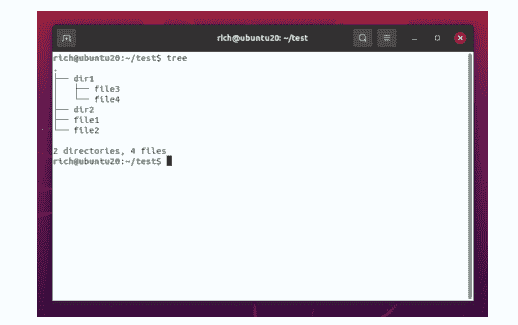

`tree` 命令的输出创建一个分层结构，显示哪些文件与哪些目录相关联，从而更容易理清头绪。

`touch` 命令允许你即时创建空文件。该命令的主要用途是更新文件的时间戳——访问时间和修改时间。然而，就学习目的而言，它很有用，因为它允许你快速创建用于实验的文件，如列表 3.4 所示。

### 列表 3.4：使用 `touch` 命令

```
$ touch Project43.txt
$ ls
Everything   Life   Project42.txt   Project43.txt   Universe
$ touch Project44.txt Project45.txt Project46.txt
$ ls
Everything   Project42.txt   Project44.txt   Project46.txt
Life         Project43.txt   Project45.txt   Universe
$
```

注意在列表 3.4 中，使用 `touch` 命令你可以一次创建一个或多个文件。要创建多个文件，只需在命令后列出文件名称，用空格分隔。

目录有时被称为文件夹。从用户角度来看，目录包含文件，但实际上，目录是一种用于定位其他文件的特殊文件。目录所负责的文件，其部分元数据存储在该目录文件内。这些元数据包括文件名以及与之关联的索引（inode）号。因此，可以通过其管理目录来定位文件。

你可以快速创建目录，但与其使用 `touch`，不如使用 `mkdir` 命令。`ls` 命令的 `-F` 选项将有助于此任务。它会显示任何目录（包括新创建的目录），并在每个目录名称后加上 `/` 指示符。列表 3.5 提供了一些示例。

### 列表 3.5：探索 `mkdir` 命令

```
$ ls -F
Everything/   Project42.txt   Project44.txt   Project46.txt
Life/         Project43.txt   Project45.txt   Universe/
$ mkdir Galaxy
$ ls -F
Everything/   Life/           Project43.txt   Project45.txt   Universe/
Galaxy/        Project42.txt  Project44.txt  Project46.txt
$
$ pwd
/home/Christine/Answers
$
$ mkdir /home/Christine/Answers/Galaxy/Saturn
$
$ ls -F Galaxy
Saturn/
$
```

要在当前工作目录中创建子目录，只需输入 `mkdir` 命令并跟上下级目录的名称，如列表 3.5 所示。如果你想在一个不同于当前工作目录的位置构建目录，可以使用绝对目录引用，如列表 3.5 中创建 Saturn 目录时所做的那样。


如果你在从当前工作目录创建目录并进入它们，很容易在目录结构中迷失方向。使用 `cd -` 命令可以快速返回你之前的当前工作目录，或者仅使用不带选项的 `cd` 命令返回你的主目录。

在构建目录时，要注意可能会发生一些错误。特别是在尝试创建目录树时，如列表 3.6 所示的示例。

### 列表 3.6：避免使用 `mkdir` 命令时的问题

```
$ ls -F
Everything/  Life/          Project43.txt  Project45.txt  Universe/
Galaxy/      Project42.txt  Project44.txt  Project46.txt
$
$ mkdir Projects/42/
mkdir: cannot create directory 'Projects/42/': No such file or directory
$
$ mkdir -p Projects/42/
$
$ ls -F
Everything/  Life/          Project43.txt  Project45.txt  Projects/
Galaxy/      Project42.txt  Project44.txt  Project46.txt  Universe/
$
$ ls -F Projects
42/
$
```

注意，当你尝试使用 `mkdir` 命令构建目录 `Projects` 及其 42 子目录时，会发生错误。如果没有父目录（`Projects`）预先存在，就无法创建子目录（42）。`mkdir` 命令的 `-p` 选项允许你覆盖此行为，如列表 3.6 所示，从而成功创建目录树。


> 每次发出 `mkdir` 命令后输入 `ls -F` 命令以确保目录已构建是很繁琐的。相反，使用 `mkdir` 命令的 `-v` 选项来接收目录成功构建的验证信息。

## 复制和移动文件

复制、移动和重命名文件和目录是基本技能。在执行这些任务时，命令之间存在一些细微差别，你需要了解这些差别。

要在本地复制文件或目录，请使用 `cp` 命令。要发出此命令，你需要使用 `cp` 以及所需的任何选项或参数。该命令的基本语法结构为：

```
cp [OPTION]... SOURCE DEST
```

如结构所示，命令选项不是必需的。然而，源（`SOURCE`）和目标（`DEST`）是必需的，如列表 3.7 中基本 `cp` 命令示例所示。

### 列表 3.7：使用 `cp` 命令

```
$ pwd
/home/Christine/SpaceOpera/Emphasis
$
$ ls
melodrama.txt
$
$ cp melodrama.txt space-warfare.txt
$
$ ls
melodrama.txt space-warfare.txt
$
$ cp melodrama.txt
cp: missing destination file operand after 'melodrama.txt'
Try 'cp --help' for more information.
$
```

在列表 3.7 中，第一次使用 `cp` 命令时，同时指定了源文件及其目标。因此不会发生问题。然而，第二次使用 `cp` 命令时，缺少目标文件名。这导致源文件未被复制，并生成错误消息。

有几个有用的 `cp` 命令选项。许多选项可以帮助你避免犯严重错误，例如意外覆盖文件或权限。表 3.2 显示了一些常用选项。

### 表 3.2 `cp` 命令的常用选项

| 短选项 | 长选项 | 描述 |
| :--- | :--- | :--- |
| `-a` | `--archive` | 执行递归复制，并保留文件的所有原始属性，如权限、所有权和时间戳。 |
| `-f` | `--force` | 覆盖任何与 `DEST` 同名的预存目标文件。 |
| `-i` | `--interactive` | 在覆盖任何与 `DEST` 同名的预存目标文件前询问。 |
| `-n` | `--no-clobber` | 不覆盖任何与 `DEST` 同名的预存目标文件。 |
| `-R`, `-r` | `--recursive` | 复制目录的内容，并且对于原始目录树中的任何子目录，也递归地复制其内容。 |
| `-u` | `--update` | 仅当源文件较新时，才覆盖与 `DEST` 同名的预存目标文件。 |
| `-v` | `--verbose` | 在命令执行时提供详细的命令操作信息。 |

要复制目录，你需要在 `cp` 命令中添加 `-R`（或 `-r`）选项。该选项执行递归复制。递归复制不仅创建新目录（`DEST`），还复制源目录管理的任何文件、源目录子目录及其文件。列表 3.8 展示了如何执行递归复制以及如何避免执行递归复制的示例。

### 列表 3.8：使用 `cp` 命令执行递归复制

```bash
$ pwd
/home/Christine/SpaceOpera
$
$ ls -F
Emphasis/
$
$ cp Emphasis Story-Line
cp: omitting directory 'Emphasis'
$
$ ls -F
Emphasis/
$
$ cp -R Emphasis Story-Line
$
$ ls -F
Emphasis/  Story-Line/
$
$ ls -R Emphasis
Emphasis:
chivalric-romance.txt      melodrama.txt
interplanetary-battles.txt space-warfare.txt
$
$ ls -R Story-Line/
Story-Line/:
chivalric-romance.txt      melodrama.txt
interplanetary-battles.txt space-warfare.txt
$
```

请注意，在列表 3.8 中第一次使用 `cp` 命令时，并未使用 `-R` 选项，因此源目录没有被复制。生成的错误消息 `cp: omitting directory` 可能有点令人困惑，但本质上它是在告诉你复制操作不会执行。当在列表 3.8 中使用 `cp -R` 命令复制源目录时，操作成功完成。递归复制选项是少数几个可以大写（`-R`）或小写（`-r`）的命令选项之一。

要在本地移动或重命名文件或目录，请使用单个命令：`mv`。该命令的基本语法与 `cp` 命令非常相似：

```bash
mv [OPTION]... SOURCE DEST
```

`mv` 命令的常用选项与 `cp` 命令选项类似。然而，你会注意到表 3.3 中列出的典型 `mv` 命令选项比常见的 `cp` 选项要少。一如既往，请务必使用 `man mv` 命令查看 `mv` 工具的手册页，以便在备考时回顾所有选项，并探索那些可能对您有用的不常见选项。

移动命令简单易用。列表 3.9 展示了重命名文件以及使用 `-i` 选项以避免将文件重命名为已存在文件的几个示例。

## 表 3.3 `mv` 命令的常用选项

| 短选项 | 长选项 | 描述 |
| :--- | :--- | :--- |
| `-f` | `--force` | 强制覆盖任何与 `DEST` 同名的已存在目标文件 |
| `-i` | `--interactive` | 在覆盖任何与 `DEST` 同名的已存在目标文件前询问 |
| `-n` | `--no-clobber` | 不覆盖任何与 `DEST` 同名的已存在目标文件 |
| `-u` | `--update` | 仅当源文件比已存在的同名目标文件更新时，才覆盖该目标文件 |
| `-v` | `--verbose` | 在执行命令时提供详细的命令操作信息 |

### 列表 3.9：使用 `mv` 命令

```bash
$ ls
chivalric-romance.txt    melodrama.txt
interplanetary-battles.txt  space-warfare.txt
$
$ mv space-warfare.txt risk-taking.txt
$
$ ls
chivalric-romance.txt    melodrama.txt
interplanetary-battles.txt  risk-taking.txt
$
$ mv -i risk-taking.txt melodrama.txt
mv: overwrite 'melodrama.txt'? n
$
```

在重命名整个目录时，不需要额外的命令选项。只需像重命名文件那样发出 `mv` 命令即可，如列表 3.10 所示。

### 列表 3.10：使用 `mv` 命令重命名目录

```bash
$ pwd
/home/Christine/SpaceOpera
$
$ ls -F
Emphasis/  Story-Line/
$
$ mv -i Story-Line Story-Topics
$
$ ls -F
Emphasis/  Story-Topics/
$
$ pwd
/home/Christine/SpaceOpera
$
$ ls
Emphasis  Story-Topics
$
$ ls Emphasis/
chivalric-romance.txt          melodrama.txt
interplanetary-battles.txt     risk-taking.txt
$
$ ls Story-Topics/
chivalric-romance.txt          melodrama.txt
interplanetary-battles.txt     space-warfare.txt
$
$ mv Emphasis/risk-taking.txt Story-Topics/risks.txt
$
$ ls Emphasis/
chivalric-romance.txt  interplanetary-battles.txt  melodrama.txt
$
$ ls Story-Topics/
chivalric-romance.txt          melodrama.txt  space-warfare.txt
interplanetary-battles.txt     risks.txt
$
```

你可以通过一条简单的 `mv` 命令同时移动并重命名文件，如列表 3.11 所示。`SOURCE`（源）使用文件的当前目录引用和当前名称。`DEST`（目标）使用文件的新位置以及新名称。

### 列表 3.11：使用 `mv` 命令移动并重命名文件

在列表 3.11 中，文件 `risk-taking.txt` 位于 `Emphasis` 目录中。通过使用单一的 `mv` 命令，它被移动到 `Story-Topics` 目录，同时被重命名为 `risks.txt`。

对于大型文件的极速复制，或者当你正在复制大量文件时，远程同步工具非常有用。该工具通常用于创建备份，可以通过网络安全地复制文件，并通过 `rsync` 命令访问。


> 当你通过网络将文件复制到远程主机时，文件传输过程通常需要通过加密方法保护。`rsync` 命令可以通过 OpenSSH 进行隧道传输，以提供数据隐私。此外，`scp` 命令也可以用于提供安全的文件复制机制。这两种方法都在第 12 章“保护文件”中有所介绍。

要快速在本地复制文件，`rsync` 命令的语法与 `mv` 命令的语法类似。它如下所示：

```bash
rsync [OPTION] ... SOURCE DEST
```

某些 `rsync` 选项将帮助你快速复制文件。某些开关适用于复制大文件或在本地创建备份，因此建议回顾表 3.4 中列出的常用 `rsync` 选项。

## 表 3.4 `rsync` 命令的常用本地复制选项

| 短选项 | 长选项 | 描述 |
| :--- | :--- | :--- |
| `-a` | `--archive` | 使用归档模式。 |
| `-D` | N/A | 保留设备文件和特殊文件。 |
| `-g` | `--group` | 保留文件的所属组。 |
| `-h` | `--human-readable` | 以人类可读的格式显示数值输出。 |
| `-l` | `--links` | 将符号链接作为符号链接复制。 |
| `-o` | `--owner` | 保留文件的所有者。 |
| `-p` | `--perms` | 保留文件的权限。 |
| N/A | `--progress` | 显示文件复制过程的进度。 |
| `-r` | `--recursive` | 复制目录的内容，对于原始目录树中的任何子目录，也连续复制其内容（递归）。 |
| N/A | `--stats` | 显示详细的文件传输统计信息。 |
| `-t` | `--times` | 保留文件的修改时间。 |
| `-v` | `--verbose` | 在执行命令时提供详细的命令操作信息。 |

归档模式由 `-a`（或 `--archive`）开关启用，是一个有趣的功能。使用这一个开关等同于使用 `-rlptgoD` 选项组合，这是一套流行的用于创建目录树备份的 `rsync` 命令选项集。

列表 3.12 展示了一个使用 `rsync` 工具复制大文件的示例。请注意，当复制完成时，该工具会输出有用的信息，例如数据传输速率。如果你想要更多的文件传输统计信息，请将 `--stats` 选项添加到你的命令中。

### 列表 3.12：使用 `rsync` 命令移动并重命名文件

```bash
# ls -sh /media/USB/Parrot-full-3.7_amd64.iso
3.6G /media/USB/Parrot-full-3.7_amd64.iso
#
# rsync -v /media/USB/Parrot-full-3.7_amd64.iso /home/Christine/
Parrot-full-3.7_amd64.iso

sent 3,769,141,763 bytes  received 35 bytes  3,137,030.20 bytes/sec
total size is 3,768,221,696  speedup is 1.00

# ls -sh /home/Christine/Parrot-full-3.7_amd64.iso
3.6G /home/Christine/Parrot-full-3.7_amd64.iso
#
```


远程同步工具在其输出中通常会显示一个加速比（speedup rating）。该比率与执行同步备份相关。如果你使用 `rsync` 命令定期将某个目录备份到另一个目录位置，加速比可以让你知道有多少个文件因为未被修改且已经备份过而不需要复制。例如，如果 600 个文件中都有 600 个需要复制到备份目录位置，加速比为 1.00。如果只有 600 个文件中的 300 个需要复制，加速比为 2.00。因此，当你使用 `rsync` 命令将单个文件复制到新位置时，加速比始终为 1.00。

## 删除文件

清理整个文件系统或仅仅是你自己的目录空间，通常始于删除不需要的文件和目录。理解执行此操作所需的命令及其开关至关重要，以避免在删除这些项目时出错。

最灵活且使用最广泛的删除工具是 remove 工具。它通过 `rm` 命令调用，其基本语法如下：

```bash
rm [OPTION]... FILE
```

`rm` 工具有很多实用选项，因此务必查看其 man 页面以了解所有选项。然而，最常用选项列在表 3.5 中。

### 表 3.5 `rm` 命令的常用选项

| 短选项 | 长选项 | 描述 |
| --- | --- | --- |
| `-d` | `--dir` | 删除任何空目录。 |
| `-f` | `--force` | 继续执行删除过程，即使命令指定要删除的某些文件不存在，并且在删除任何现有文件前都不询问。 |
| `-i` | `--interactive` | 在删除任何现有文件之前进行询问。 |
| `-I` | N/A | 在删除超过三个文件时，或使用 `-r` 选项时进行询问。 |
| `-R`, `-r` | `--recursive` | 删除目录的内容，并且对于原始目录树内的任何子目录，递归地删除其内容和子目录本身。 |
| `-v` | `--verbose` | 随着命令执行提供详细的命令操作信息。 |

要简单地删除单个文件，可以使用 `rm` 命令，指定要删除的文件名，并且不使用任何开关。然而，使用 `-i`（或 `--interactive`）选项以确保你没有删除错误的文件始终是个好主意，如清单 3.13 所示。

### 清单 3.13：使用 `rm` 命令删除文件

```bash
$ ls Parrot-full-3.7_amd64.iso
Parrot-full-3.7_amd64.iso
$
$ rm -i Parrot-full-3.7_amd64.iso
rm: remove write-protected regular file 'Parrot-full-3.7_amd64.iso'? y
$
$ ls Parrot-full-3.7_amd64.iso
ls: cannot access Parrot-full-3.7_amd64.iso: No such file or directory
$
$ rm -i Parrot-full-3.7_amd64.iso
rm: cannot remove 'Parrot-full-3.7_amd64.iso': No such file or directory
$
$ rm -f Parrot-full-3.7_amd64.iso
$
```

此外，注意清单 3.13 中显示，当文件已被删除后，如果你重新输入 `rm -i` 命令，会生成错误信息，但如果你输入 `rm -f` 命令，对于缺失的文件它不会显示任何信息。`-f`（或 `--force`）开关在你要删除大量文件且希望不显示错误信息时非常有用。

删除目录树或充满文件的目录可能会比较棘手。如果你只是输入 `rm -i` 命令，你会得到错误信息，如清单 3.14 所示。相反，你需要添加 `-R` 或 `-r` 选项，以便目录及其管理的文件被删除。

### 清单 3.14：使用 `rm` 命令删除包含文件的目录

```bash
$ cd SpaceOpera/
$
$ ls -F
Emphasis/ Story-Topics/
$
$ rm -i Emphasis/
rm: cannot remove 'Emphasis/': Is a directory
$
$ rm -ir Emphasis
rm: descend into directory 'Emphasis'? y
rm: remove regular empty file 'Emphasis/melodrama.txt'? y
rm: remove regular empty file 'Emphasis/interplanetary-battles.txt'? y
rm: remove regular empty file 'Emphasis/chivalric-romance.txt'? y
rm: remove directory 'Emphasis'? y
$
$ ls -F
Story-Topics/
$
```

如果你有很多文件需要删除，希望确保你删除的是正确的文件，并且不想对每个要删除的文件都回答 `y`，请改用 `-I` 选项而不是 `-i` 开关。当删除超过三个文件以及当你正在删除一个充满文件的目录并使用其中一个递归开关时，它会询问，如清单 3.15 所示。

### 清单 3.15：使用 `rm` 命令的 `-I` 选项

```bash
$ ls -F
Story-Topics/
$
$ rm -Ir Story-Topics/
rm: remove 1 argument recursively? y
$
$ ls -F
$
```

删除空目录，即不包含任何文件的目录，很简单。通过输入 `rmdir` 命令使用移除空目录工具。你会发现添加 `-v`（或 `--verbose`）开关也很有帮助，如清单 3.16 所示。

### 清单 3.16：使用 `rmdir` 命令

```bash
$ mkdir -v EmptyDir
mkdir: created directory 'EmptyDir'
$
$ rmdir -v EmptyDir/
rmdir: removing directory, 'EmptyDir/'
$
```

如果你想删除一个没有文件但包含空子目录的目录树，你也可以使用 `rmdir` 工具。需要提供完整的目录树名称作为参数，并且必须使用 `-p`（或 `--parents`）开关。一个示例显示在清单 3.17 中。

### 清单 3.17：使用 `rmdir` 命令删除空的目录树

```bash
$ mkdir -vp EmptyDir/EmptySubDir
mkdir: created directory 'EmptyDir'
mkdir: created directory 'EmptyDir/EmptySubDir'
$
$ rmdir -vp EmptyDir/EmptySubDir
rmdir: removing directory, 'EmptyDir/EmptySubDir'
rmdir: removing directory, 'EmptyDir'
$
```

你可能会出现一种情况，即需要从目录树中仅删除空目录。在这种情况下，你需要使用 `rm` 命令并添加 `-d`（或 `--dir`）开关，如清单 3.18 所示。

### 清单 3.18：使用 `rm` 命令删除树中的空目录

```bash
$ mkdir -v EmptyDir
mkdir: created directory 'EmptyDir'
$
$ mkdir -v NotEmptyDir
mkdir: created directory 'NotEmptyDir'
$
$ touch NotEmptyDir/File42.txt
$
$ rm -id EmptyDir NotEmptyDir
rm: remove directory 'EmptyDir'? y
rm: cannot remove 'NotEmptyDir': Directory not empty
$
```

一项重要的技能是理解用于创建和删除目录的命令，以及用于查看、创建、复制、移动、重命名和删除文件的各个命令。此外，牢固掌握常用命令选项也是至关重要的知识。这种专长是你 Linux 命令行工具包中宝贵的工具。

## 链接文件和目录

理解文件和目录链接是你 Linux 旅程的重要组成部分。虽然许多人很快就能学会如何链接文件，但他们不一定理解底层的链接结构。而这可能成为一个问题。在本节中，我们将探索文件链接及其影响。

有两种类型的链接。一种是符号链接，也称为软链接。另一种是硬链接，我们将首先介绍它。

### 建立硬链接

硬链接是一个文件或目录，它有一个索引（inode）号，但有两个或更多不同的文件名。拥有一个 inode 号意味着它是文件系统中的单个数据文件。拥有两个或更多名称意味着可以通过多种方式来访问该文件。图 3.2 显示了这种关系。在这个图中，已创建了一个硬链接。该硬链接有两个文件名，一个 inode 号，因此有一个位于磁盘分区上的文件系统位置。因此，该文件有两个名称，但在物理上是同一个文件。

#### 图 3.2 硬链接文件关系


硬链接允许你拥有一个文件的伪副本，而无需真正复制其数据。这通常用于文件备份中，当文件系统空间不足以备份文件的数据时。如果某人删除了该文件的一个名称，你仍然拥有另一个链接到其数据的文件名。

要创建硬链接，使用 `ln` 命令。对于硬链接，在发出 `ln` 命令之前，原始文件必须存在。被链接的文件必须不存在。它在命令发出时被创建。清单 3.19 显示此命令的操作。

### 清单 3.19：使用 `ln` 命令创建硬链接

```bash
$ touch OriginalFile.txt
$
$ ls
OriginalFile.txt
$
$ ln OriginalFile.txt HardLinkFile.txt
$
$ ls
HardLinkFile.txt  OriginalFile.txt
$
$ ls -i
2101459 HardLinkFile.txt  2101459 OriginalFile.txt
$
$ touch NewFile.txt
$
$ ls -og
total 0
-rw-rw-rw-   2 0 Aug 24 18:09 HardLinkFile.txt
-rw-rw-rw-   1 0 Aug 24 18:17 NewFile.txt
-rw-rw-rw-   2 0 Aug 24 18:09 OriginalFile.txt
$
```

在清单 3.19 中，通过 `touch` 命令创建了一个新的空白且空的文件 `OriginalFile.txt`。然后通过 `ln` 命令将其硬链接到 `HardLinkFile.txt`。注意，`OriginalFile.txt` 是在发出 `ln` 命令之前创建的，而 `HardLinkFile.txt` 是通过发出 `ln` 命令创建的。使用 `ls -i` 命令检查这些文件的 inode 号，你可以看到两个文件的号码是相同的。

同样在清单 3.19 中，在创建硬链接并检查 inode 号之后，创建了一个新的空文件，称为 `NewFile.txt`。这样做是为了比较链接计数。使用 `ls -og` 命令，显示文件的元数据，包括文件类型、权限、链接计数、文件大小、创建日期和文件名。此命令类似于 `ls -l`，但省略了文件所有者和组。你可以快速在命令输出中找到链接计数。它们紧挨着文件大小，由于文件是空的，所以所有大小都是 0。注意 `OriginalFile.txt` 和 `HardLinkFile.txt` 的链接计数都为 2。这是因为它们都硬链接到另一个文件。`NewFile.txt` 的链接计数为 1，因为它*未*硬链接到另一个文件。


如果你想删除一个链接文件但保留原始文件，使用 `unlink` 命令。只需在命令行输入 `unlink` 并将链接文件名作为参数包含进去。

在创建和使用硬链接时，请记住以下几点重要事项：

- 在发出 `ln` 命令之前，原始文件必须存在。
- 在 `ln` 命令中列出的第二个文件在发出命令之前必须*不*存在。
- 原始文件及其硬链接共享相同的 inode 号。
- 原始文件及其硬链接共享相同的数据。
- 原始文件及其任何硬链接可以存在于不同的目录中。
- 原始文件及其硬链接必须存在于同一个文件系统上。

### 构建软链接

通常，软链接文件提供指向某个文件的指针，该文件可能位于另一个文件系统上。这两个文件不共享 inode 号，因为它们并不指向相同的数据。图 3.3 展示了软链接的关系。

#### 图 3.3 软链接文件关系


要创建符号链接，需要使用带有 `-s`（或 `--symbolic`）选项的 `ln` 命令。示例如下，见列表 3.20。

### 列表 3.20：使用 `ln` 命令创建软链接

```bash
$ touch OriginalSFile.txt
$
$ ls
OriginalSFile.txt
$
$ ln -s OriginalSFile.txt SoftLinkFile.txt
$
$ ls -i
2101456 OriginalSFile.txt 2101468 SoftLinkFile.txt
$
$ ls -og
total 0
-rw-rw-r--, 1 0 Aug 24 19:04 OriginalSFile.txt
lrwxrwxrwx. 1 17 Aug 24 19:04 SoftLinkFile.txt -> OriginalSFile.txt
$
```

与硬链接类似，在发出 `ln -s` 命令之前，原始文件必须存在。软链接文件本身必须不存在。它是在命令发出时创建的。在列表 3.20 中，您可以通过 `ls -i` 命令看到，软链接文件不像硬链接文件那样共享相同的 inode 号。此外，软链接文件不会经历链接计数的增加。`ls -og` 命令显示了这一点，它还显示了软链接文件指向原始文件的指针。

> **提示**
>
> 有时候，您会有一个软链接文件指向另一个软链接文件。
>
> 如果您想快速找到最终文件，请使用 `readlink -f` 命令，并将其中一个软链接文件名作为参数传递给它。`readlink` 实用工具将显示最终文件的名称和目录位置。

在创建和使用软链接时，请记住以下几点：

- 在发出 `ln -s` 命令之前，原始文件必须存在。
- 在 `ln -s` 命令中列出的第二个文件在发出命令之前必须不存在。
- 原始文件及其软链接不共享相同的 inode 号。


- 原始文件及其软链接不共享相同的数据。

- 原始文件及其任何软链接可以存在于不同的目录中。

- 原始文件及其软链接可以存在于不同的文件系统上。

> **警告**
>
> 失效链接可能是一个严重的安全问题。失效链接，有时被称为`死链接`，是指软链接指向的文件已被**删除**或移动。软链接文件本身并未被移除或更新。如果创建了具有原始文件名和位置的文件，软链接现在将指向该新文件。如果恶意文件被放置在原始文件的位置，您的服务器安全可能会受到损害。请谨慎使用符号链接，并在需要删除链接文件时使用`unlink`命令。

文件和目录链接很容易创建。但是，理解这些链接的底层结构对于正确使用它们至关重要。

## 读取文件

Linux 系统包含许多文本文件。其中包括配置文件、日志文件、数据文件等。了解如何查看这些文件是一项基本但重要的技能。在下面的章节中，我们将探索几种可用于读取文本文件的实用工具。

## 读取整个文本文件

查看整个文本文件的基本实用工具是**连接（cat）**命令。虽然该工具的主要用途是将文本文件连接在一起并显示它们，但它通常也仅用于显示单个小的文本文件。要查看一个小文本文件，请使用以下基本语法的`cat`命令：

```
cat [OPTION]… [FILE]…
```

`cat`命令使用很简单。您只需输入该命令，然后跟上您想要读取的任何文本文件，如列表 3.21 所示。

### 列表 3.21：使用 cat 命令显示文件

```
$ cat numbers.txt
42
2A
52
0010 1010
*
$
```

`cat`命令只是将完整的文本文件输出到您的屏幕上。当您看到提示符返回时（如列表 3.21 中的`$`所示），您就知道提示符上面的那一行是文件的最后一行。


> `cat`命令有一个方便的新克隆工具，名为`bat`。由于`bat`实用工具具有许多额外功能，其开发者称其为“带翅膀的 cat”。您可以在`https://github.com/sharkdp/bat`上了解其功能。

`cat`命令的一个有用选项是`-n`（或`--number`）开关。使用此选项将显示行号以及文件文本，如列表 3.22 所示。

### 列表 3.22：使用 cat -n 命令显示文件

```
$ cat -n numbers.txt
  1 42
  2 2A
  3 52
  4 0010 1010
  5 *
$
```

另一个用于查看整个文本文件的有用命令是`pr`命令。它最初的用途是为打印格式化文本文件。然而，如今，当您需要特殊格式化时，它对于显示文件要有用得多。要查看一个小文本文件，请使用以下基本语法的`pr`命令：

```
pr [OPTION]… [FILE]…
```

特殊的格式化选项是该命令与简单使用`cat`命令的区别所在。表 3.6 展示了`pr`实用工具在显示文件时的一些有用选项。

**表 3.6** pr 命令的有用文件显示选项

| 短选项 | 长选项 | 描述 |
| :--- | :--- | :--- |
| `-n` | `--columns=n` | 以列格式显示文件，使用`n`列。 |
| `-l n` | `--length=n` | 将默认的 66 行页长更改为`n`行长。 |
| `-m` | `--merge` | 在显示多个文件时，并排显示它们，每列一个文件，并截断文件的行。 |
| `-s c` | `--separator=c` | 将默认的列分隔符从制表符更改为`c`。 |
| `-t` | `--omit-header` | 不显示任何文件头或页脚。 |
| `-w n` | `--width=n` | 将默认的 72 字符页宽更改为`n`字符宽。`-s`选项会覆盖此设置。 |

要显示一个文件，您需要使用页长选项`-l`（或`--length`）来缩短页长。如果您不使用此开关并且有一个非常短的文件，文本将从屏幕上滚动消失。此外，如果您只想查看文件中的文本，`-t`（或`--omit-header`）选项也很有用。列表 3.23 展示了`pr`命令的作用。

### 列表 3.23：使用 pr 命令显示文件

```
$ pr -tl 15 numbers.txt
42
2A
52
0010 1010
 *
$
```

`pr`实用工具真正出色之处在于同时显示两个短的文本文件。您可以快速并排查看这些文件。在这种情况下，使用`-m`（或`--merge`）选项很有用，如列表 3.24 所示。

### 列表 3.24：使用 pr 命令显示两个文件

```
$ pr -mtl 15 numbers.txt random.txt
42 42
2A Flat Land
52 Schroedinger's Cat
0010 1010 0010 1010
* 0000 0010
$
```


如果您想并排显示两个文件，并且不介意输出多么凌乱，您可以使用`paste`命令。就像学校用的胶水一样，它会将它们粘在一起，但不一定美观。

当文本文件比您的输出屏幕大时，如果使用诸如`cat`和`pr`之类的命令，文本可能会从屏幕上滚动消失。这可能会令人烦恼。幸运的是，有一些实用工具允许您读取文本文件的部分内容，这些内容将在下一部分中介绍。

## 读取文本文件部分

如果您只是想读取文件中的一行或一小部分，使用`cat`命令就没有意义了。如果您正在处理一个大的文本文件，这一点尤其如此。

`grep`实用工具可以帮助您找到包含特定文本字符串的文件行（或几行）。虽然该实用工具将在后面更详细地介绍，主要用于在文件中搜索文本模式，但它也非常适用于搜索单个字符串。`grep`命令的基本语法如下：

```
grep [OPTIONS] PATTERN [FILE...]
```

在搜索特定文本字符串时，您在命令语法中使用该字符串作为`PATTERN`，并使用您要搜索的文件作为`FILE`。列表 3.25 展示了使用`grep`命令的示例。

### 列表 3.25：使用 grep 命令查找文件行

```
$ grep christine /etc/passwd
$
$ grep -i christine /etc/passwd
Christine:x:1001:1001::/home/Christine:/bin/bash
$
```

请注意，`grep`实用工具区分大小写。如果您输入的字符串与文件中的某个字符串不完全匹配（包括大小写），`grep`命令将不返回任何内容，正如列表 3.25 中第一个命令发生的情况一样。如果您使用`-i`（或`--ignore-case`）开关，`grep`将搜索该字符串的任何实例，而不区分大小写，如列表 3.25 中第二个命令所示。

显示文本文件部分内容的另一个实用工具是`head`实用程序。`head`命令的语法如下：

```
head [OPTION]... [FILE]...
```

默认情况下，`head`命令显示文本文件的前 10 行。示例见清单 3.26。

### 清单 3.26：使用 head 命令

```
$ head /etc/passwd
root:x:0:0:root:/root:/bin/bash
bin:x:1:1:bin:/bin:/sbin/nologin
daemon:x:2:2:daemon:/sbin:/sbin/nologin
adm:x:3:4:adm:/var/adm:/sbin/nologin
lp:x:4:7:lp:/var/spool/lpd:/sbin/nologin
sync:x:5:0:sync:/sbin:/bin/sync
shutdown:x:6:0:shutdown:/sbin:/sbin/shutdown
halt:x:7:0:halt:/sbin:/sbin/halt
mail:x:8:12:mail:/var/spool/mail:/sbin/nologin
operator:x:11:0:operator:/root:/sbin/nologin
$
```

值得尝试的一个很好的命令选项允许你覆盖仅显示文件前 10 行的默认行为。要使用的开关是`-n`（或`--lines=`），后跟一个参数。该参数决定了要显示的文件行数，如清单 3.27 所示。

### 清单 3.27：使用 head 命令显示较少的行数

```
$ head -n 2 /etc/passwd
root:x:0:0:root:/root:/bin/bash
bin:x:1:1:bin:/bin:/sbin/nologin
$
$ head -2 /etc/passwd
root:x:0:0:root:/root:/bin/bash
bin:x:1:1:bin:/bin:/sbin/nologin
$
```

请注意，在清单 3.27 中，使用`head`命令的`-n 2`开关和参数仅显示文件的前两行。然而，第二个命令省略了开关中的`n`部分，该命令的行为与第一个命令完全相同。

你也可以通过在使用`-n`（或`--lines=`）开关时使用负数参数来消除文件的底部行。这在清单 3.28 中有所演示。

### 清单 3.28：使用 head 命令不显示底部行

```
$ head -n -40 /etc/passwd
root:x:0:0:root:/root:/bin/bash
bin:x:1:1:bin:/sbin:/sbin/nologin
daemon:x:2:2:daemon:/sbin:/sbin/nologin
adm:x:3:4:adm:/var/adm:/sbin/nologin
$
$ head --40 /etc/passwd
head: unrecognized option '--40'
Try 'head --help' for more information.
$
```

请注意，在清单 3.28 中，这次`-n`开关的参数是负数（-40）。这告诉`head`命令显示文件的所有行，除了最后 40 行。如果你尝试在不使用`-n`开关的情况下使用负数参数（就像你可以使用正数参数那样），你会看到一条错误消息，如清单 3.28 所示。

如果你想显示文件的最后几行而不是前几行，请使用`tail`实用程序。其通用语法与`head`命令的语法类似：

```
tail [OPTION]... [FILE]...
```

默认情况下，`tail`命令将显示文件的最后 10 行文本。然而，你可以使用带有参数的`-n`（或`--lines`）开关来覆盖该行为。该参数告诉`tail`要显示从文件底部起的多少行。如果你在参数前加一个加号（+），`tail`实用程序将从指定的行号开始显示文件的文本行，直到文件末尾。清单 3.29 展示了以这三种方式使用`tail`的示例。

### 清单 3.29：使用 tail 命令

```
$ tail /etc/passwd
saslauth:x:992:76:Saslauthd user:/run/saslauthd:/sbin/nologin
pulse:x:171:171:PulseAudio System Daemon:/var/run/pulse:/sbin/nologin
gdm:x:42:42::/var/lib/gdm:/sbin/nologin
setroubleshoot:x:991:985::/var/lib/setroubleshoot:/sbin/nologin
rpcuser:x:29:29:RPC Service User:/var/lib/nfs:/sbin/nologin
nfsnobody:x:65534:65534:Anonymous NFS User:/var/lib/nfs:/sbin/nologin
sssd:x:990:984:User for sssd:/:/sbin/nologin
gnome-initial-setup:x:989:983::/run/gnome-initial-setup/:/sbin/nologin
tcpdump:x:72:72::/:/sbin/nologin
avahi:x:70:70:Avahi mDNS/DNS-SD Stack:/var/run/avahi-daemon:/sbin/nologin
$
$ tail -n 2 /etc/passwd
tcpdump:x:72:72::/:/sbin/nologin
avahi:x:70:70:Avahi mDNS/DNS-SD Stack:/var/run/avahi-daemon:/sbin/nologin
$
$ tail -n +42 /etc/passwd
gnome-initial-setup:x:989:983::/run/gnome-initial-setup/:/sbin/nologin
tcpdump:x:72:72::/:/sbin/nologin
avahi:x:70:70:Avahi mDNS/DNS-SD Stack:/var/run/avahi-daemon:/sbin/nologin
```

`tail`实用程序最有用的功能之一是其监视日志文件的能力。日志文件通常会在其底部追加新消息。在消息添加时监视它们非常有用。在`tail`命令上使用`-f`（或`--follow`）开关，并将要监视的日志文件名作为命令的参数提供。你会立即看到最近的几个日志文件条目。随着你继续监视，当新消息被添加到日志文件时，它们会显示出来。

> 注意 一些日志文件已在各种 Linux 发行版中被替换，现在消息保存在由`journald`管理的日志文件中。要监视添加到日志文件的消息，请使用`journalctl --follow`命令。

若要结束使用`tail`的监控会话，必须使用`Control+C`键组合。使用`tail`实用程序监视日志文件的示例见清单 3.30。

### 清单 3.30：使用 tail 命令监视日志文件

```
$ sudo tail -f /var/log/auth.log
[sudo] password for Christine:
Aug 27 10:15:14 Ubuntu1804 sshd[15662]: Accepted password [...]
Aug 27 10:15:14 Ubuntu1804 sshd[15662]: pam_unix(sshd:session): 
Open session 1 for user1
Aug 27 10:15:50 Ubuntu1804 systemd-login[588]: New session 1 of user1
Aug 27 10:15:50 Ubuntu1804 sudo: Christine : TTY=pts/1 ; PWD=/home/user1 ;
LIST=... ; COMMAND=sudo apt-get update
Aug 27 10:15:50 Ubuntu1804 sudo: pam_unix(sudo:session): session opened for user root by Christine
Aug 27 10:16:21 Ubuntu1804 login[10703]: pam_unix(login:session): session opened for user login
Aug 27 10:16:21 Ubuntu1804 systemd-login[588]: Removed session 1
^C
$
```

提示 如果你在自己的系统上跟随书中的命令操作，你的 Linux 发行版可能没有`/var/log/auth.log`文件。请尝试使用`/var/log/secure`文件。

## 读取文本文件页面

阅读大型文件文本的一种方法是使用*分页器*。分页器实用程序允许你一次查看一页文本，并以自己的速度浏览文本。常用的两个分页器是`more`和`less`实用程序。

尽管相当简单，`more`实用程序是一个很好的小型分页器工具。你可以通过按下空格键（向下翻页）或`Enter`键（向下移动一行）来向前浏览文本文件。但是，你无法向后浏览文件。使用`more`命令的示例见图 3.4。

### 图 3.4 使用 more 分页器

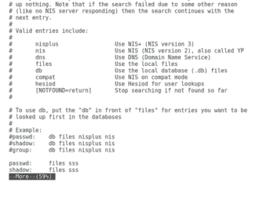

图 3.4 中显示的输出是通过在命令提示符下发出`more /etc/nsswitch.conf`命令获得的。请注意，`more`分页器工具会在屏幕底部显示你在文件中的进度。如果你想随时退出`more`分页器，必须按下`q`键。即使你已到达文件最后一行，这一点也适用。

一个更灵活的分页器是`less`实用程序。虽然它和`more`实用程序类似，允许你一页（或一行）地浏览文件，但这个分页器工具也允许你向后移动。然而，`less`实用程序的功能远不止于此，这就引出了这个分页器的著名描述：“`less`是`more`。”

图 3.5 展示了使用`less`实用程序打开`/etc/nsswitch.conf`文本文件。请注意，显示内容与图 3.4 看起来没有太大区别，但不要因此被骗。

### 图 3.5 使用 Less 分页器

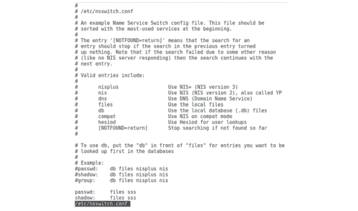

`less`分页器实用程序允许更快的文件遍历，因为它在显示文件第一页之前不会读取整个文件。你还可以使用上下箭头键遍历文件，使用空格键向前翻页，以及使用`Esc+V`键组合向后翻页。你可以通过按`?`键、输入你想查找的单词并按`Enter`键来在文件中搜索特定单词，从而向后搜索。将`?`键替换为`/`键，你可以向前搜索。与`more`分页器一样，你需要使用`q`键退出。


默认情况下，Linux`man`手册页实用程序使用`less`作为其分页器。学习`less`实用程序的命令将让你能够轻松地在各种`man`手册页中进行搜索。


`less` 实用程序具有惊人的功能。花时间去浏览 `less` 分页器的 `man` 手册页，并在大型文本文件上试用其各种文件搜索和遍历命令，这将非常值得。

# 查找信息

在你的 Linux 系统上查找各种信息有很多方法。了解这些方法很重要，这样你就可以做出良好的管理决策和/或快速解决问题。在执行管理任务时，它们将节省你的时间，并帮助你通过认证考试。在接下来的章节中，我们将探讨几个有助于查找信息的工具。

## 查看文件信息

浏览目录时，经常会看到一些不熟悉的文件，甚至可能忘记它们为什么在那里。Linux 提供了一些方便的命令来帮助你解决这个问题。

`file` 命令可以提供有关指定文件类型的基本信息，如清单 3.31 所示。

### 清单 3.31：使用 `file` 命令

```bash
$ file mytest
mytest: Bourne-Again shell script, ASCII text executable
$
```

`file` 命令的输出表明，Linux 将 `mytest` 文件识别为 shell 脚本文件，其格式为 ASCII 文本，且是一个可执行文件。

如果你想查看文件的创建、修改或最后访问时间，请使用 `stat` 命令，如清单 3.32 所示。

### 清单 3.32：使用 `stat` 命令

```bash
$ stat mytest
  File: mytest
  Size: 1016 Blocks: 8 IO Block: 4096 regular file
Device: 805h/2053d Inode: 1054186 Links: 1
Access: (0764/-rwxrw-r--)
Uid: ( 1000/ rich)
Gid: ( 1000/ rich)
Access: 2021-11-06 09:18:23.856584608 -0500
Modify: 2021-10-31 11:25:22.048406517 -0500
Change: 2021-10-31 11:25:22.048406517 -0500
Birth: -
$
```

如清单 3.32 所示，`stat` 命令的输出提供了有关文件的基本信息，例如文件名、大小、`inode` 号以及存储该文件的物理设备。它还提供了某些较难找到的信息，例如文件最后被访问和修改的时间。

## 探索文件差异

探索文本文件差异的一个方便命令是 `diff` 命令。它允许你逐行比较两个文件。该命令的基本语法是：

```bash
diff [OPTION]... FILES
```

使用 `diff` 实用程序，你可以执行多种比较。此外，你还可以格式化输出，使结果更易于查看。表 3.7 展示了一些常用选项。

**表 3.7 `diff` 命令的常用选项**

| 短选项 | 长选项 | 描述 |
| :--- | :--- | :--- |
| `-e` | `--ed` | 创建一个 `ed` 脚本，可用于使第一个被比较的文件变得与第二个被比较的文件相同。 |
| `-q` | `--brief` | 如果文件不同，输出一条简单的消息来表达这一点。 |
| `-r` | `--recursive` | 比较原始目录树内的任何子目录，并连续比较它们的内容以及子目录（递归）。 |
| `-s` | `--report-identical-files` | 如果文件相同，输出一条简单的消息来表达这一点。 |
| `-Wn` | `--width n` | 将输出的最大宽度显示为 `n` 个字符。 |
| `-y` | `--side-by-side` | 以两列形式显示输出。 |

若要简单查看两个文本文件之间是否存在差异，请输入带有 `-q` 开关和文件名的 `diff` 命令。清单 3.33 中给出了一个示例。为了帮助你看到确切的文件差异，首先使用 `pr` 命令以列格式并排显示两个文件。

### 清单 3.33：使用 `diff` 的 `-q` 命令快速比较文件

```bash
$ pr -mtw 35 numbers.txt random.txt
   42
   2A
   2A              Flat Land
   52              Schroddinger's Cat
   0010 1010       0010 1010
   *               0000 0010
   $
$ diff -q numbers.txt random.txt
Files numbers.txt and random.txt differ
$
```

对于文件之间的差异只需快速查看时，可以修改 `diff` 命令的输出，以列格式显示文件。为了获得更易于阅读的显示效果，请使用 `-y`（或 `--side-by-side`）选项结合 `-w`（或 `--width`）开关，如清单 3.34 所示。管道符号 (`|`) 用于指定第二个文件中与第一个文件不同的行。

### 清单 3.34：使用 `diff` 命令快速查看文件差异

```bash
$ diff -yW 35 numbers.txt random.txt
42            42
2A            | Flat Land
52            | Schrodinger's
0010 1010     0010 1010
*             | 0000 0010
$
```

`diff` 实用程序提供的不仅仅是差异；它还标明了为了使第一个文件与第二个文件相同，需要追加、更改或删除什么。要查看文件之间的确切差异以及所需的任何修改，请移除 `-q` 开关。清单 3.35 中给出了一个示例。

### 清单 3.35：使用 `diff` 命令

```bash
$ diff numbers.txt random.txt
2,3c2,3
< 2A
< 52
---
> Flat Land
> Schrodinger's Cat
5c5
< *
---
> 0000 0010
$
```

`diff` 命令的输出可能有点令人困惑。在清单 3.35 中，第一行输出显示 `2,3c2,3`。该输出告诉你，为了使第一个文件 `numbers.txt` 变得与第二个文件 `random.txt` 相同，你需要将 `numbers.txt` 文件中的第 2 到第 3 行更改为匹配 `random.txt` 文件中的第 2 到第 3 行。输出的接下来六行显示了每个文件中不匹配的内容，中间用虚线分隔。接下来，`5c5` 指定 `numbers.txt` 中的第 5 行需要更改以匹配 `random.txt` 文件中的第 5 行。


> **注意**
>
> `diff` 命令相当强大。它不仅能够告诉你文本文件行之间的差异，还可以为你创建一个脚本。该脚本允许你修改第一个被比较的文本文件，使其变成第二个文本文件的孪生版本。这一功能将在下一章中演示。

`diff` 实用程序输出中的字母 `c` 表示需要进行更改。你可能还会看到用于表示需要追加内容的 `a` 或用于表示需要删除内容的 `d`。

## 使用简单的定点命令

能够快速定位（定点）文件的命令非常有用。它们允许你确定系统上是否安装了特定的实用程序，查找所需的配置文件，查找有用的文档等等。这里涵盖的这些命令的优点在于它们易于使用。

`which` 命令显示作为参数传递的 shell 命令的完整路径名。清单 3.36 展示了使用此实用程序的示例。

### 清单 3.36：使用 `which` 命令

```bash
$ which diff
/usr/bin/diff
$
$ which shutdown
/usr/sbin/shutdown
$
$ which line
/usr/bin/which: no line in (/usr/local/bin:/usr/bin:/usr/local/sbin:/usr/sbin:/home/Christine/.local/bin:/home/Christine/bin)
$
$ echo $PATH
/usr/local/bin:/usr/bin:/usr/local/sbin:/usr/sbin:
/home/Christine/.local/bin:/home/Christine/bin
$
```

在清单 3.36 的第一个示例中，使用 `which` 命令查找 `diff` 命令的程序位置。该命令显示 `/usr/bin/diff` 的完整路径名。`shutdown` 实用程序位于 `sbin` 目录中。然而，`line` 程序未在此系统上安装，并且 `which` 实用程序显示了它搜索以查找该程序的所有目录。它使用 `PATH` 环境变量来确定要搜索哪些目录，其内容也在清单 3.36 中显示。


> **注意**
>
> 环境变量是修改进程环境的配置设置。当你输入一个命令 [程序] 名称时，`PATH` 变量设定 Linux 搜索程序二进制文件的目录。它也被其他命令使用，例如 `which` 实用程序。注意，在 `PATH` 列表中，目录名由冒号 (`:`) 分隔。

`which` 命令对于快速确定某个命令是否使用了别名也很方便。清单 3.37 展示了一个示例。

### 清单 3.37：使用 `which` 命令查看命令别名

```bash
$ which ls
alias ls='ls --color=auto'
        /usr/bin/ls

$ unalias ls

$ which ls
/usr/bin/ls
$
```

当在清单 3.37 中对 `ls` 命令使用 `which` 实用程序时，它显示当前-

另一个简单的定点命令是 `whereis` 实用程序。此实用程序允许你不仅-

### 清单 3.38：使用 `whereis` 命令

```bash
$ whereis diff
diff: /usr/bin/diff /usr/share/man/man1/diff.1.gz
/usr/share/man/man1p/diff.1p.gz

$ whereis line
line:
$
```

在清单 3.38 中发出的第一个命令搜索程序二进制文件、源代码文件，-

用于查找文件的一个方便且简单的实用程序是 `locate` 程序。此实用程序-

```bash
locate [OPTION]... PATTERN...
```

注意在语法中，`locate` 实用程序使用模式列表来查找文件。因此，你可以-

## 表 3.8 `locate` 命令的常用选项

| 短选项 | 长选项 | 描述 |
| :--- | :--- | :--- |
| `-A` | `--all` | 显示匹配所有模式的文件名，而不是仅显示匹配模式列表中某一个模式的文件。 |
| `-b` | `--basename` | 仅显示匹配模式的文件名，不包含匹配模式的任何目录名。 |
| `-c` | `--count` | 仅显示名称匹配模式的文件数量，而不是显示文件名。 |
| `-i` | `--ignore-case` | 在匹配文件名时忽略模式中的大小写。 |
| `-q` | `--quiet` | 在处理过程中不显示任何错误消息，例如权限拒绝。 |
| `-r` | `--regexp R` | 使用正则表达式 `R` 来匹配文件名，而不是使用模式列表。 |
| `-w` | `--wholename` | 显示匹配模式的文件名，包括匹配模式的任何目录名。这是默认行为。 |

要使用 `locate` 命令查找文件，只需输入 `locate` 加上文件名即可。如果该文件位于您的系统上且您拥有查看它的权限，`locate` 实用程序将显示该文件的目录路径和名称。列表 3.39 展示了这样一个示例。

**列表 3.39：** 使用 `locate` 命令查找文件

```bash
$ locate Project42.txt
/home/Christine/Answers/Project42.txt
$
```

使用 `locate` 命令时，`PATTERN` 可能会有一些棘手的地方，这归因于默认的模式文件通配（file globbing）。文件通配发生在你在命令的文件名参数中使用通配符（例如星号 (`*`) 或问号 (`?`)）时，文件名会被扩展为多个名称。例如，`passw*d` 可以扩展为文件名 `password` 或 `passwd`。

如果你没有在模式中输入任何通配符，`locate` 命令默认会在模式中添加通配符。因此，如果你输入模式 `passwd`，它会自动变为 `\*passwd\*`。因此，如果你只想搜索基本名称 `passwd`，而不进行文件通配，必须在模式周围添加引号（单引号或双引号），并在模式前加上 `\` 字符。列表 3.40 中给出了几个示例。

**列表 3.40：** 使用不进行文件通配的 `locate` 命令

```bash
$ locate -b passwd
/etc/passwd
/etc/passwd-
/etc/pam.d/passwd
/etc/security/opasswd
/usr/bin/gpasswd
[...]
/usr/share/vim/vim74/syntax/passwd.vim
$
$ locate -b '\\passwd'
/etc/passwd
/etc/pam.d/passwd
/usr/bin/gpasswd
/usr/share/bash-completion/completions/passwd
$
```

列表 3.40 中的第一个示例展示了如果允许默认的文件通配会发生什么。显示的文件数量比名为 `passwd` 的文件要多得多。显示的文件多到列表不得不截取以适应篇幅。然而，在第二个示例中，通过使用引号和 `\` 字符关闭了文件通配。使用 `locate` 实用程序的此模式提供了所需的结果，即显示名为 `passwd` 的文件。


> 如果你没有权限查看某个目录的内容，`locate` 命令无法显示位于该目录中且匹配你 `PATTERN` 的文件。因此，你的显示结果中可能会缺失一些文件。

请记住，`locate` 命令的 `PATTERN` 实际上是一个模式列表。因此，你可以添加额外的模式。只需确保用空格将它们隔开，如列表 3.41 所示。

**列表 3.41：** 使用带有模式列表的 `locate` 命令

```bash
$ locate -b '\\passwd' '\\group'
/etc/group
/etc/passwd
/etc/iproute2/group
/etc/pam.d/passwd
/usr/bin/passwd
/usr/share/X11/xkb/symbols/group
/usr/share/bash-completion/completions/passwd
$
```

你可能会遇到的另一个问题涉及新创建或下载的文件。`locate` 实用程序实际上是搜索 `mlocate.db` 数据库，而不是搜索虚拟目录结构。这个数据库通常每天仅通过 `cron` 任务更新一次。因此，如果文件是新创建的，`locate` 将无法找到它。

`mlocate.db` 数据库通过 `updatedb` 实用程序进行更新。如果你需要查找新创建或下载的文件，可以使用超级用户权限手动运行它。请注意，运行可能需要花费一些时间。

## 使用复杂的精确定位命令

虽然使用简单命令来定位文件很有用，但它们无法在需要根据诸如元数据之类的条件查找文件的情况下工作。幸运的是，有复杂的命令可以提供帮助。

`find` 命令非常灵活。它允许你根据数据（如文件所有者、文件最后修改时间、文件权限设置等）来定位文件。基本命令语法是：

```bash
find [PATH...] [OPTION] [EXPRESSION]
```

`PATH` 参数是起始目录，因为你指定了目录树中的一个起始点，而 `find` 将遍历该目录及其所有子目录（递归地）以查找你要找的文件或文件。你可以使用单个句点 (`.`) 指定当前工作目录作为起始目录。


`find` 命令本身还有一些选项，用于处理诸如跟随或不跟随链接以及调试等项。此外，如果找到特定文件，你还可以删除文件或执行命令。有关这些功能的更多信息，请参阅 `find` 实用程序的 `man` 页面。

`EXPRESSION` 命令参数及其前面的 `OPTION` 控制应用于搜索的元数据过滤器类型，以及可能限制搜索的设置。表 3.9 展示了更常用的 `OPTION` 和 `EXPRESSION` 组合。

`find` 实用程序具有许多功能。示例有助于澄清此命令的用法。列表 3.42 提供了一些示例。

## 表 3.9 `find` 命令的常用选项和表达式

| 选项 | 表达式 | 描述 |
|---|---|---|
| `-cmin` | `n` | 显示状态在 `n` 分钟前更改的文件名称。 |
| `-empty` | N/A | 显示为空且是常规文本文件或目录的文件名称。 |
| `-gid` | `n` | 显示组 ID 等于 `n` 的文件名称。 |
| `-group` | `name` | 显示组为 `name` 的文件名称。 |
| `-inum` | `n` | 显示 `inode` 号等于 `n` 的文件名称。 |
| `-maxdepth` | `n` | 搜索文件时，仅深入起始目录树的 `n` 层。 |
| `-mmin` | `n` | 显示数据在 `n` 分钟前更改的文件名称。 |
| `-name` | `pattern` | 显示名称匹配 `pattern` 的文件名称。许多正则表达式参数可用于 `pattern`，需要将其放在引号中以避免不可预测的结果。将 `-name` 替换为 `-iname` 以忽略大小写。 |
| `-nogroup` | N/A | 显示没有组名对应文件组 ID 的文件名称。 |


| `-nouser` | N/A | 显示没有用户名对应文件用户 ID 的文件名称。 |
| `-perm` | *mode* | 显示权限匹配 *mode* 的文件名称。可以使用八进制或符号模式。 |
| `-size` | *n* | 显示大小匹配 *n* 的文件名称。可以使用后缀使大小更便于人类阅读，例如 G 代表千兆字节。 |
| `-user` | *name* | 显示所有者为 *name* 的文件名称。 |

**列表 3.42：** 使用 `find` 命令

```bash
$ find . -name "*.txt"
./Project47.txt
./Answers/Project42.txt
./Answers/Everything/numbers.txt
./Answers/Everything/random.txt
./Answers/Project43.txt
./Answers/Project44.txt
./Answers/Project45.txt
./Answers/Project46.txt
./SpaceOpera/OriginalSFFile.txt
./SpaceOpera/SoftLinkFile.txt
$
$ find . -maxdepth 2 -name "*.txt"
./Project47.txt
./Answers/Project42.txt
./Answers/Project43.txt
./Answers/Project44.txt
./Answers/Project45.txt
./Answers/Project46.txt
./SpaceOpera/OriginalSFFile.txt
./SpaceOpera/SoftLinkFile.txt
$
```

列表 3.42 中的第一个示例正在当前工作目录树中查找具有 txt 文件扩展名的文件。请注意，`-name` 选项的 *pattern* 使用了引号，以避免不可预测的结果。在第二个示例中，添加了一个 `-maxdepth` 选项，以便 `find` 实用程序仅搜索两个目录：当前目录和向下一层子目录。

`find` 命令对于定期审计系统以及当你担心服务器被黑客入侵时都非常有用。`-perm` 选项对于其中一种审计类型很有用，示例如列表 3.43 所示。

**列表 3.43：** 使用 `find` 命令审计服务器

```bash
$ find /usr/bin -perm /4000
/usr/bin/newgrp
/usr/bin/chsh
/usr/bin/arping
/usr/bin/gpasswd
/usr/bin/chfn
/usr/bin/traceroute6.iputils
/usr/bin/pkexec
/usr/bin/passwd
/usr/bin/sudo
$
```

在代码清单 3.43 中，`/usr/bin` 目录正在使用 `find` 实用工具及其 `-perm` 选项接受对潜在危险 SUID 权限的审计。使用的表达式是 `/4000`，这将要求 `find` 实用工具搜索 SUID 设置（八进制代码 4），并且由于数字前有正斜杠（`/`），它忽略了其他文件权限（八进制代码 000）。结果生成的所有文件名都合法地使用了 SUID，因此这里没有任何可疑活动。

> **提示**
>
> 在较旧的 Linux 系统上，要执行如代码清单 3.41 所示的搜索，你会输入 `+4000` 来指定权限。现在加号（`+`）在此用途中已弃用，并被 `find` 命令中的正斜杠（`/`）符号取代。

在本章前面，我们简要介绍了 `grep` 命令，用于读取文本文件的一部分。你还可以使用这个巧妙的实用工具来搜索系统中的文件。

假设距离你上次修改 `/etc/nsswitch.conf` 配置文件已经很久了。现在出现了一个问题，要求你修改文件中的 `hosts:` 设置，但你无法记起它的准确名称。与其使用 `ls` 命令四处翻找，不如使用 `grep` 命令，如代码清单 3.44 所示，快速找到该文件的名称。

# 代码清单 3.44：使用 grep 命令查找文件

```
$ sudo grep -d skip hosts: /etc/*
/etc/nsswitch.conf:hosts:    files [...]
$
```

在代码清单 3.44 中，使用 `grep` 命令搜索 `/etc/` 目录中所有文件里的 `hosts:` 设置。`-d skip` 选项用于跳过任何目录文件，以消除有关它们的信息。`grep` 实用工具显示配置文件名，后跟一个冒号（`:`）以及设置所在的文件行。如果你不确定配置文件放置在 `/etc/` 目录树的哪个位置，可以附加 `-R`（或 `-r`，或 `-recursive`）选项来递归搜索指定的目录树。如果你没有权限搜索某些文件，`grep` 命令将发出烦人的错误消息。你将在下一章学习如何重定向这些错误消息。

快速找到文件以及 Linux 服务器上的各种类型的信息可以帮助你成为一名更有效、更高效率的系统管理员。尝试本节中对你来说较新的任何命令或其选项都是值得的投资。

# 总结

能够在 shell 命令行上有效且迅速地使用正确的命令对于你的日常工作非常重要。它允许你解决问题、管理文件、收集信息、浏览文本文件等。

本章的目的是增强你的 Linux 命令行工具集。这不仅有助于你的日常工作生活，也有助于你顺利通过 CompTIA Linux+ 认证考试。

# 考试要点

**解释处理文件和目录的基本命令。** 典型的文件和目录管理活动包括查看和创建文件、复制和移动文件以及删除文件。对于查看和创建文件和目录，使用 `ls`、`touch` 和 `mkdir` 命令。当需要复制、重命名或移动文件时，使用 `mv`、`cp` 或 `rsync` 命令之一。对于本地大文件复制，`rsync` 实用工具通常是最快的。你可以使用 `rmdir` 实用工具快速删除空目录，但对于充满文件的目录，你需要使用 `rm -r` 命令。此外，如果你需要确保删除的是正确的文件，请务必使用 `rm` 实用工具的 `-i` 选项。

**描述链接文件涉及的结构和命令。** 使用 `ln` 命令链接文件很容易。但是，描述底层链接结构对你很重要。硬链接文件共享同一个 inode 号，而软链接文件则不共享。如果被链接的文件被删除，软链接或符号链接可能会断开。了解 `readlink` 实用工具也很有用，它可以帮助你探索具有多个链接的文件。

**总结可用于读取文本文件的各类实用工具。** 要读取整个文本文件，你可以使用 `cat`、`bat` 和 `pr` 实用工具。每个实用工具都有其特殊功能。如果你只需要读取文本文件的第一行或最后一行，请使用 `head` 或 `tail` 命令。对于文件中的单个文本行，`grep` 实用工具非常有用。要分页审阅文件，你可以使用 `less` 或 `more` 分页实用工具。

**描述如何在你的 Linux 系统上查找信息。** 要确定两个文本文件的差异，`diff` 实用工具很有帮助。使用该实用工具，你还可以进行编辑并修改文件使其相同。当你需要快速查找系统中的文件并希望使用简单工具时，`which`、`whereis` 和 `locate` 命令会很好地服务于你。请记住，`locate` 实用工具使用一个数据库，该数据库通常每天只更新一次，因此你可能需要通过 `updatedb` 命令手动更新它。当简单的文件定位工具不够用时，有更复杂的搜索实用工具，例如 `find` 和 `grep`。`grep` 命令可以使用正则表达式辅助搜索。

# 复习题

1. 你正在查看一个很久没看过的目录，需要确定哪些文件实际上是目录。哪个命令是最佳选择？
   - A. `mkdir -v`
   - B. `ls`
   - C. `ls -F`
   - D. `ls -i`
   - E. `ll`

2. 你正在使用 `ls` 命令查看目录文件的元数据，但总是看到其中文件的元数据。哪个命令选项可以解决这种情况？
   - A. `-a`
   - B. `-d`
   - C. `-F`
   - D. `-l`
   - E. `-R`

3. 你刚创建了一个名为 `MyDir` 的空目录。你很可能使用了哪个命令？
   - A. `mkdir -v MyDir`
   - B. `touch MyDir`
   - C. `cp -R TheDir MyDir`
   - D. `mv -r TheDir MyDir`
   - E. `rmdir MyDir`

4. 你有一个超过 10 GB 大小的文件，需要备份到本地连接的驱动器。在这种情况下，使用哪个实用工具最好？
   - A. `readlink -f`
   - B. `mv`
   - C. `cp`
   - D. `scp`
   - E. `rsync`

5. 一位长期负责服务器管理的系统管理员离开了公司，现在你负责她的系统。她旧的用户账户目录树，`/home/Zoe/`，已被备份。哪个命令最适合用于快速删除她的文件，同时表明你正在删除正确的目录，但不强制你确认每个文件的删除？
   - A. `cp -R /home/Zoe/ /dev/null/`
   - B. `mv -R /home/zoe/ /dev/null/`
   - C. `rm -Rf /home/Zoe/`
   - D. `rm -ri /home/Zoe/`
   - E. `rm -rI /home/Zoe`

6. 有一个大型目录结构需要重命名。你应该考虑使用哪些 `mv` 命令选项？（选择所有适用项。）
   - A. `-f`
   - B. `-i`
   - C. `-n`
   - D. `-r`
   - E. `-v`

7. 你正在决定是否对数据文件使用硬链接还是符号链接。该文件为 5 GB，包含任务关键数据，并由另外三个人通过命令行访问。你应该怎么做？
   - A. 创建一个硬链接，使文件可以驻留在不同的文件系统中以进行数据保护。
   - B. 创建三个硬链接，并提供给其他三个人以进行数据保护。
   - C. 创建三个符号链接，并保护这些链接免受其他三个人的干扰以进行数据保护。
   - D. 创建一个符号链接，使文件可以驻留在不同的文件系统中。
   - E. 创建一个符号链接，使链接可以共享一个 inode 号。

8. 一个简短的基于文本的控制文件不再与读取它的程序正确配合工作。你怀疑该文件由于你最近执行的代码控制更新而意外损坏，尽管文件的代码控制都是正确的。在你的问题调查中，接下来应该对该文件使用哪个命令？
   - A. `cat -v`
   - B. `cat -z`
   - C. `cat -n`
   - D. `cat -s`
   - E. `cat -E`

## 第 4 章

## 搜索和分析文本

- 目标 1.2：给定一个场景，管理文件和目录
- 目标 3.1：给定一个场景，创建简单的 shell 脚本来自动化常见任务


管理 Linux 服务器涉及许多基于数据的重要步骤和决策。以敏捷且高效的方式收集所需信息至关重要。有许多 Linux 结构和工具可以帮助你快速发现你所寻求的知识。

在本章中，我们将为你的 Linux 命令行工具腰带增添更多工具。我们将涵盖文本的过滤和格式化以及重定向的基础知识，直到文本编辑。本章中的命令和概念将在后续章节中被构建和使用。

### 处理文本文件

一旦你找到或创建了一个文本文件，你可能需要以某种方式处理它以提取所需信息。理解如何过滤和格式化文本将有助于你完成这一任务。在以下章节中，我们将看看有助于你处理文本文件的工具和方法。

### 过滤文本

为了筛选大型文本文件中的数据，快速提取小数据部分会很有帮助。`cut` 实用程序是一个处理此任务的有用工具。它允许你查看文件记录中的特定字段。该命令的基本语法如下：

```bash
cut OPTION... [FILE]...
```

在我们深入研究这个命令之前，以下是一些关于 `cut` 命令你应该了解的基础知识：

- **文本文件记录**

  文本文件记录是单个以换行符（LF，即 ASCII 字符 LF）结尾的文件行。你可以通过 `cat -E` 命令查看你的文本文件是否使用此行尾字符。它将每个换行符显示为 `$`。如果你的文本文件记录以 ASCII 字符 NUL 结尾，你也可以对它们使用 `cut`，但你必须使用 `-z` 选项。

- **文本文件记录分隔符**

  为了正确使用某些 `cut` 命令选项，每个文本文件记录中必须存在字段。这些字段不是数据库样式的字段，而是由某些分隔符分隔的数据。分隔符是一个或多个字符，它们在记录内的不同数据项之间创建边界。单个空格可以是分隔符。密码文件 `/etc/passwd` 使用冒号（`:`）来分隔记录内的数据项。

- **文本文件更改**

  与其名称相反，`cut` 命令不会更改文本文件内的任何数据。它只是复制你想要查看的数据并显示给你。请放心，文件不会发生任何修改。

`cut` 实用程序有几个你会经常使用的选项。这些选项列在表 4.1 中。

**表 4.1** `cut` 命令的常用选项

| 短选项 | 长选项 | 描述 |
| :--- | :--- | :--- |
| `-c nlist` | `--characters nlist` | 仅显示 *nlist* 中指定的记录字符（例如，1-5）。 |
| `-b blist` | `--bytes blist` | 仅显示 *blist* 中指定的记录字节（例如，1-2）。 |
| `-d d` | `--delimiter d` | 指定记录的字段分隔符为 *d*。这会覆盖默认的制表符分隔符。为避免意外结果，请将 *d* 放在引号内。 |
| `-f flist` | `--fields flist` | 仅显示由 *flist* 指定的记录字段（例如，1,3）。 |
| `-s` | `--only-delimited` | 仅显示包含指定分隔符的记录。 |
| `-z` | `--zero-terminated` | 指定记录的行尾字符为 ASCII 字符 NUL。 |

几个 `cut` 命令的实例演示将有助于展示其功能。清单 4.1 展示了一些 `cut` 实用程序的示例。

**清单 4.1：** 使用 `cut` 命令

```bash
$ head -2 /etc/passwd
root:x:0:0:root:/root:/bin/bash
bin:x:1:1:bin:/bin:/sbin/nologin
$
$ cut -d ":" -f 1,7 /etc/passwd
root:/bin/bash
bin:/sbin/nologin
[...]
$
```

9. 你有两个短文本文件，其最大记录长度为 15 个字符。你想并排查看这些文件。以下哪个命令最适合使用？
- A. `pr -m`
- B. `pr -t1 20`
- C. `cat`
- D. `pr -mt1 20`
- E. `pr -mL 20`

10. 你有一个名为 `FileA.txt` 的长文件。`head -15 FileA.txt` 命令会做什么？
- A. 显示除最后 15 行外的所有行。
- B. 显示除前 15 行外的所有行。
- C. 显示文件的前 15 行。
- D. 显示文件的最后 15 行。
- E. 生成错误消息。

11. 你在一个由登录失败尝试文件中的信息生成的文本文件上执行了命令 `grep Hal`。它返回空值，但你刚刚通过故意让 `Hal` 账户登录失败进行了测试用例，该测试在生成文本文件之前进行。以下哪一项是你下一步的最佳选择？
- A. 使用 `tail` 命令浏览文本文件。
- B. 使用 `cat` 命令查看文本文件。
- C. 删除文本文件并使用登录失败尝试文件中的信息重新生成。
- D. 在文本文件上执行 `grep -d skip Hal` 命令。
- E. 在文本文件上执行 `grep -i Hal` 命令。

12. 你试图浏览一个相当大的文本文件。同事建议你使用分页器。以下哪一项最能描述你同事推荐的内容？
- A. 使用允许你查看文件前几行的工具。
- B. 使用允许你一次查看一页文本的工具。
- C. 使用允许你搜索文件的工具。
- D. 使用允许你过滤文件中文本的工具。
- E. 使用允许你查看文件最后几行的工具。

13. 以下哪一项没有描述 `less` 实用程序？
- A. 在显示文件的第一页之前，它不会读取整个文件。
- B. 你可以使用向上和向下箭头键在文件中移动。
- C. 你按空格键前进一页。
- D. 你可以使用 `Esc+V` 键组合后退一页。
- E. 你可以按 X 键退出实用程序。

14. 哪个 `diff` 选项是允许你快速确定两个文本文件是否彼此不同的最佳选项？
- A. `-e`
- B. `-q`
- C. `-s`
- D. `-W`
- E. `-y`

15. 你正在命令行下的 Linux 服务器上工作，你试图发出 `diff` 命令，并收到响应，表明找不到该命令。为了开始故障排除过程，下一步最佳操作是什么？
- A. 按下向上箭头键并按 Enter。
- B. 注销，重新登录，并重试该命令。
- C. 输入 `which diff` 命令。
- D. 输入 `whereis diff` 命令。
- E. 重新启动服务器并重试该命令。

16. 你试图在你的 Linux 服务器上查找一个名为 `conf` 的文件。使用 `locate conf` 命令进行搜索显示了许多包含字母 `conf` 的目录。以下哪一项是对这种情况发生原因的最佳描述？
- A. `locate` 实用程序仅搜索目录名称。
- B. 你没有使用 `-d skip` 开关。
- C. 这很可能是因为 `locate` 数据库已损坏。
- D. 你没有使用适当的正则表达式。
- E. 这是由于模式名称上的文件通配符造成的。

17. 你从公司的本地网站下载了一个重要的大文件 `fortytwo.db` 到你的 Linux 服务器，但被紧急情况打断了。现在你不记得把文件存储在哪里了。修复这个问题的第一步最佳操作是什么？


- A. 发出 `sudo updatedb` 命令。
- B. 发出 `locate -b fortytwo.db` 命令。
- C. 发出 `locate -b 'fortytwo.db'` 命令。
- D. 再次从公司的本地网站下载该文件。
- E. 发出 `locate fortytwo.db` 命令。

18. 你想使用 `find` 实用程序搜索特定文件 `main.conf`。该文件最有可能位于 `/etc/` 目录树的某个地方。在这种情况下，以下哪个命令是最佳选择？
- A. `find -r /etc -name main.conf`
- B. `find / -name main.conf`
- C. `find /etc -maxdepth -name main.conf`
- D. `find /etc -name main.conf`
- E. `find main.conf /etc`

19. 昨天，同事 Michael 因不端行为被解雇。他的账户和主目录被立即删除。你需要审计服务器，查看他是否虚拟目录系统中留下了任何文件。在这种情况下，以下哪个命令是最佳选择？
- A. `find / -name Michael`
- B. `find / -user Michael`
- C. `find / -min 1440`
- D. `find ~ -user Michael`
- E. `find / -nouser`

20. 你需要弄清楚哪些配置文件持有主机名指令。以下哪个命令是最佳选择？
- A. `which`
- B. `whereis`
- C. `grep`
- D. `locate`
- E. `find`

```
$ cut -c 1-5 /etc/passwd
root:
bin:x
[...]
$
```

在列表 4.1 中，使用 `head` 命令显示 `passwd` 文件的前两行。此文本文件使用冒号 (`:`) 来分隔每条记录中的字段。`cut` 命令的第一次使用通过 `-d` 选项指定了冒号作为分隔符。请注意，冒号被引号括起来，以避免出现意外结果。`-f` 选项用于指定仅显示字段 1（用户名）和 7（shell）。

列表 4.1 中的第二个示例使用了 `-c` 选项。在这种情况下，`nlist` 参数设置为 `1-5`，因此每条记录的前五个字符都会被显示。


> 有时保存 `cut` 命令的输出是有价值的。你可以通过重定向标准输出来完成这一点，这将在本章稍后介绍。

另一个用于过滤文本的好工具是我们的老朋友 `grep` 命令。`grep` 命令在正则表达式的运用上非常强大，这对过滤文本文件非常有用。但在我们讨论正则表达式之前，请先浏览表 4.2 中常用的 `grep` 实用程序选项。

## 表 4.2 `grep` 命令的常用选项

| 短选项 | 长选项 | 描述 |
| --- | --- | --- |
| `-c` | `--count` | 显示包含 PATTERN 匹配的文本文件记录的数量。 |
| `-d action` | `--directories=action` | 如果文件是一个目录，当 `action` 设置为 `read` 时，读取该目录，就好像它是一个普通的文本文件一样；当 `action` 设置为 `skip` 时，忽略该目录；当 `action` 设置为 `recurse` 时，如同使用了 `-R`、`-r` 或 `--recursive` 选项一样进行操作。 |
| `-E` | `--extended-regexp` | 将 PATTERN 指定为扩展正则表达式。 |
| `-i` | `--ignore-case` | 在 PATTERN 以及任何文本文件记录中忽略大小写。 |
| `-R`, `-r` | `--recursive` | 搜索目录的内容，并且对于原始目录树中的任何子目录，也依次搜索其内容（递归地）。 |
| `-v` | `--invert-match` | 仅显示不包含 PATTERN 匹配的文本文件记录。 |

许多命令都使用正则表达式。正则表达式是你为 `grep` 等实用程序定义的模式模板，该实用程序使用此模式来过滤文本。基本正则表达式 (BRE) 包含字符，例如点号后跟星号 (`.\*`)，用于表示多个字符，以及单个点号 (`.`) 用于表示一个字符。它们也可以使用方括号来表示多个字符，例如 `[a,e,i,o,u]`，或者表示一个字符范围，例如 `[A–Z]`。要查找以特定字符开头的文本文件记录，你可以在这些字符前面加上脱字符 (`^`) 符号。要查找以特定字符结尾的文本文件记录，请在这些字符后面加上美元符号 (`$`) 符号。

> 注意

> 你将在文档和技术描述中看到正则表达式的不同名称。该名称可能简写为 `regex` 或 `regexp`。

使用 `grep` 实用程序配合 BRE 模式相当简单。列表 4.2 展示了一些示例。

## 列表 4.2：使用带有 BRE 模式的 `grep` 命令

```
$ grep daemon.*nolgin /etc/passwd
daemon:x:2:2:daemon:/sbin:/sbin/nolgin
[...]
daemon:/dev/null:/sbin/nologin
[...]
$
$ grep root /etc/passwd
root:x:0:0:root:/root:/bin/bash
operator:x:11:0:operator:/root:/sbin/nologin
$
$ grep ^root /etc/passwd
root:x:0:0:root:/root:/bin/bash
$ 
```

在列表 4.2 的第一个 `grep` 示例中，`grep` 命令使用了一个使用 BRE `.\*` 字符的模式。在这种情况下，`grep` 实用程序将搜索密码文件中记录内 `daemon` 这个词的所有实例，如果该记录在 `daemon` 之后还包含 `nologin` 这个词，则显示该记录。

列表 4.2 中接下来的两个 `grep` 示例是在密码文件中搜索 `root` 这个词的实例。请注意，第一个命令显示了两行文件内容。第二个命令使用了 BRE `^` 字符，并将其放在 `root` 一词之前。这个正则表达式模式使得 `grep` 仅显示以 `root` 开头的密码文件行。在使用 `grep` 实用程序审计配置文件时，`-v` 选项非常有用。它生成一个不包含该模式的文本文件记录列表。列表 4.3 展示了一个示例，用于查找密码文件中不以 `nologin` 结尾的所有记录。请注意，BRE 模式将 `$` 放在单词的末尾。如果你将 `$` 放在单词之前，它将被视为变量名，而不是 BRE 模式。

## 列表 4.3：使用 `grep` 命令审计密码文件

```
$ grep -v nologin$ /etc/passwd
root::x:0:0:root:/root:/bin/bash
sync:x:5:0:sync:/sbin:/bin/sync
[...]
Christine:x:1001:1001::/home/Christine:/bin/bash
$
```

扩展正则表达式 (ERE) 允许更复杂的模式。例如，垂直符号 (`|`) 允许你指定两个可能的单词或字符集进行匹配。你还可以使用括号来指定额外的子表达式。


> 如果你希望更好地掌握正则表达式，有几个不错的资源。我们最喜欢的是 Richard Blum 和 Christine Bresnahan 著的《Linux Command Line and Shell Scripting Bible, 4th Edition》（第 4 版）中的第 20 章（Wiley, 2021 年出版）。

使用 ERE 模式可能相当棘手。一些使用 `grep` 配合 ERE 的示例会有帮助，例如列表 4.4 中所示的那些。

## 列表 4.4：使用带有 ERE 模式的 `grep` 命令

```
$ grep -E "^root|^dbus" /etc/passwd
root::x:0:0:root:/root:/bin/bash
dbus:x:81:81:System message bus:/:/sbin/nologin
$
$ egrep "(daemon|s).*nologin" /etc/passwd
bin:x:1:1:bin:/bin:/sbin/nologin
daemon:x:2:2:daemon:/sbin:/sbin/nologin
[...]
$
```

在第一个示例中，`grep` 命令使用 `-E` 选项来表示该模式是一个扩展正则表达式。如果你没有使用 `-E` 选项，就会出现不可预测的结果。ERE 模式周围的引号保护其不被错误解释。该命令搜索以单词 `root` 或单词 `dbus` 开头的任何密码文件记录。因此，在每个单词之前放置一个脱字符 (`^`)，并用垂直符号 (`|`) 分隔单词，表示记录可以以这两个单词中的任意一个开头。

在列表 4.4 的第二个示例中，请注意使用了 `egrep` 命令。`egrep` 命令等同于使用 `grep -E` 命令。这里的 ERE 模式使用引号以避免错误解释，并使用括号发出一个子表达式。子表达式由一个选择组成，该选择由单词 `daemon` 和字母 `s` 之间的垂直符号 (`|`) 指示。此外，在 ERE 模式中，使用 `.*` 符号表示在子表达式选择与文本文件记录中的单词 `nologin` 之间可以包含任何内容。

深呼吸一下。这内容有点多。然而，尽管 BRE 和 ERE 模式难以掌握，但使用 `grep` 配合它们从文本文件中过滤数据是值得的。

## 格式化文本

为了理解文本文件中的数据，你有时需要以某种方式重新格式化文件数据。有两个简单的实用程序可用于此目的。

`sort` 实用程序对文件的数据进行排序。请记住，它不会更改原始文件。只有输出被排序了。该命令的基本语法如下：

```
sort [OPTION]... [FILE]...
```

如果你想使用系统的标准排序顺序对文件内容进行排序，只需输入 `sort` 命令，后跟要排序的文件名称。列表 4.5 展示了一个此操作的示例。

## 列表 4.5：使用 `sort` 命令

```
$ cat alphabet.txt

Alpha
Tango
Bravo
Echo
Foxtrot
$

$ sort alphabet.txt

Alpha
Bravo
Echo
Foxtrot
Tango
$
```

如果文件包含数字，使用 `sort` 实用程序时，数据可能不是你所期望的顺序。要获得正确的数字顺序，请向命令添加 `-n` 选项，如列表 4.6 所示。

## 列表 4.6：使用 `sort -n` 命令

```
$ cat counts.txt

105
8
37
42
54
$
```

在清单 4.6 中，请注意该文件列出的数字数量不同，且处于未排序状态。第二个示例试图使用不带选项的 `sort` 命令对文件进行数字排序。这会产生错误的结果。然而，第三个示例使用了 `sort -n` 命令，正确地按数字顺序排列了文件。

`sort` 命令有几个有用的选项。常用开关如表 4.3 所示。

### 表 4.3 `sort` 命令的常用选项

| 短选项 | 长选项 | 描述 |
| :- | :- | :- |
| `-c` | `--check` | 检查文件是否已排序。如果文件已排序，则不产生输出。如果文件未排序，则显示文件名、行号、关键字 `disorder` 以及第一个无序行的文本。 |
| `-f` | `--ignore-case` | 排序时将小写字母视为大写字母。 |
| `-k n1 [,n2]` | `--key=n1 [,n2]` | 使用 `n1` 字段中的数据对文件进行排序。可选地，通过在 `n1` 后加逗号并指定 `n2` 来指定第二个排序字段。默认情况下，字段分隔符为空格。 |
| `-M` | `--month-sort` | 按一年中的月份顺序显示文本。月份必须列为标准的三字母缩写，如 `JAN`、`FEB`、`MAR` 等。 |
| `-n` | `--numeric-sort` | 按数字顺序显示文本。 |
| `-o file` | `--output=file` | 创建一个名为 `file` 的新排序文件。 |
| `-r` | `--reverse` | 按反向排序顺序显示文本。 |

`sort` 工具对于格式化小文本文件以帮助理解其包含的数据非常有用。另一个用于格式化小文本文件的有用命令是我们已经提到过的：`cat` 命令。

`cat` 命令最初的用途是连接文件以便显示。它的名字也由此而来。然而，它通常被用来显示单个文件。清单 4.7 展示了一个连接两个文件以显示其文本内容的示例，一个接一个。

### 清单 4.7：使用 `cat` 命令连接文件

```
$ cat numbers.txt random.txt
42
2A
52
0010 1010
*
42
Flat Land
Schrodinger's Cat
0010 1010
0000 0010
$
```

在清单 4.7 中显示的两个文件都以数字 `42` 作为第一行。这是唯一能判断一个文件在哪里结束、另一个文件在哪里开始的方法，因为 `cat` 工具在其输出中不标记文件的开始或结束。不幸的是，`cat` 工具有用的格式化选项往往未被充分利用。表 4.4 列出了一些常用开关。

### 表 4.4 `cat` 命令的常用选项

| 短选项 | 长选项 | 描述 |
| :--- | :--- | :--- |
| `-A` | `--show-all` | 等效于使用 `-vET` 选项组合。 |
| `-E` | `--show-ends` | 遇到换行符（行结束符）时显示 `$`。 |
| `-n` | `--number` | 为所有文本文件行编号，并在输出中显示该编号。 |
| `-s` | `--squeeze-blank` | 不显示重复的空文本文件行。 |
| `-T` | `--show-tabs` | 遇到制表符时显示 `^I`。 |
| `-v` | `--show-nonprinting` | 遇到不可打印字符时，使用 `^` 和/或 `M-` 表示法显示它们。 |

能够使用 `cat` 命令显示不可打印字符非常方便。如果在处理文本文件时遇到了某种奇怪的问题，你可以快速查看是否嵌入了任何不可打印字符。清单 4.8 包含此方法的示例。

### 清单 4.8：使用 `cat` 命令显示不可打印字符

```
$ cat bell.txt

$ cat -v bell.txt
^G
$
```

在清单 4.8 中，第一个 `cat` 命令显示了该文件，看起来它只包含一个空行。然而，通过使用 `-v` 选项，你可以看到文件中存在一个不可打印字符。`^G` 是脱字符表示法，表明不可打印的 Unicode 字符 `BEL` 嵌入在文件中。当显示文件时，该字符会发出铃声。

另一个用于格式化文本的实用工具集是 `pr` 和 `printf` 命令。`pr` 工具在第 3 章“管理文件、目录和文本”中已介绍过，因此让我们探索 `printf` 命令。它的唯一用途是格式化和显示文本数据。其基本语法如下：

```
printf FORMAT [ARGUMENT]...
```

基本思想是，你通过为 `ARGUMENT` 提供 `FORMAT` 来进行文本格式化。清单 4.9 展示了一个简单的示例。

### 清单 4.9：使用 `printf` 命令

```
$ printf "%s\n" "Hello World"
Hello World
$ 
```

在清单 4.9 中，`printf` 命令使用 `"%s\n"` 作为格式说明。它被引号包围以防止意外结果。`"%s` 告诉 `printf` 打印列在 `ARGUMENT` 中的字符字符串，在这个例子中是 `Hello World`。`FORMAT` 中的 `"\n` 部分告诉 `printf` 命令在打印字符串后打印一个换行符。这使得提示符可以在新行上显示，而不是在显示的字符串末尾。

> 虽然 `pr` 工具可以处理整个文本文件的格式化，但 `printf` 命令旨在格式化单行文本的输出。你必须结合其他命令并编写 `Bash` shell 脚本，以便它处理整个文本文件。

一旦你复习过 `printf` 命令的格式化字符，它们就不太难了。表 4.5 列出了几个常见的。

## 确定单词计数

除了格式化数据外，在管理服务器时，收集各种文本文件的统计信息也很有帮助。确定文本文件中计数的最简单和最常用的工具是 `wc` 工具。该命令的基本语法如下：

```
wc [OPTION]... [FILE]...
```

### 表 4.5 `printf` 命令的常用 FORMAT 设置

| FORMAT | 描述 |
| :----- | :----- |
| `%c` | 显示 ARGUMENT 的第一个字符。 |
| `%d` | 将 ARGUMENT 显示为十进制整数。 |
| `%f` | 将 ARGUMENT 显示为浮点数。 |
| `%s` | 将 ARGUMENT 显示为字符字符串。 |
| `\%` | 显示百分号。 |
| `\"` | 显示双引号。 |
| `\\` | 显示反斜杠。 |
| `\f` | 包含换页符。 |
| `\n` | 包含换行符。 |
| `\r` | 包含回车。 |
| `\t` | 包含水平制表符。 |

在清单 4.10 中，`printf` 命令用于打印一个小数点后三位的小数。只希望保留两位，因此使用了 `%.2f` 格式。

### 清单 4.10：使用 `printf` 命令格式化浮点数

```
$ printf "%.2f\n" 98.532
98.53
$
```

格式化文本数据有助于揭示信息。一定要多尝试所有这些命令，以获得一些有价值的经验。

当你不带任何选项发出 `wc` 命令并传入一个文件名时，该工具将按照顺序显示文件的行数、单词数和字节数。清单 4.11 显示了一个示例。

### 清单 4.11：使用 `wc` 命令

```
$ wc random.txt
5 9 52 random.txt
$
```

`wc` 命令有一些有用且常用的选项。如表 4.6 所示。

### 表 4.6 `wc` 命令的常用选项

| 短选项 | 长选项 | 描述 |
| :--- | :--- | :--- |
| `-c` | `--bytes` | 显示文件的字节计数。 |
| `-L` | `--max-line-length` | 显示文件最长行的字节计数。 |


| 选项 | 长选项 | 描述 |
| :--- | :--- | :--- |
| `-l` | `--lines` | 显示文件的行计数。 |
| `-m` | `--chars` | 显示文件的字符计数。 |
| `-w` | `--words` | 显示文件的单词计数。 |

在故障排查配置文件时，`wc` 的一个有趣选项是 `-L` 开关。一般来说，配置文件行长将小于 150 字节，尽管有例外。因此，如果你刚刚编辑了一个配置文件且该服务不再工作，请检查文件的最长行长度。比通常更长的行长表明你可能意外地合并了两个配置文件行。清单 4.12 显示了一个示例。

### 清单 4.12：使用 `wc` 命令检查行长

```
$ wc -L /etc/nsswitch.conf
72 /etc/nsswitch.conf
$
```

在清单 4.12 中，文件的行长显示正常最大行长为 72 字节。此 `wc` 命令开关对于拥有无法处理超过特定行长的文本文件的其他工具也很有用。

## 重定向输入和输出

在处理文本和文本文件以收集数据时，您可能希望保存这些数据。此外，您可能还需要结合多个优化步骤来获取所需的信息。

### 处理标准输出

了解 Linux 将每个对象视为文件这一点很重要。这包括输出过程，例如在屏幕上显示文本文件。每个文件对象都通过文件描述符来识别，该描述符是一个用于分类进程打开文件的整数。识别命令或脚本文件输出的文件描述符为 1。它也被缩写为 `STDOUT`，描述标准输出。

默认情况下，`STDOUT` 将输出引导至当前终端。进程的当前终端由 `/dev/tty` 文件表示。

在讨论标准输出时，一个简单且常用的命令是 `echo` 命令。执行 `echo` 命令并附带一个文本字符串，该文本字符串将显示在进程的标准输出（`STDOUT`）上，通常就是终端屏幕。示例见清单 4.13。

**清单 4.13：使用 `echo` 命令向 `STDOUT` 显示文本**

```bash
$ echo "Hello World"
Hello World
$ 
```

关于 `STDOUT` 的一个便利之处在于，您可以通过命令行上的重定向运算符来重定向它。重定向运算符允许您更改输入和输出的默认发送位置。对于 `STDOUT`，使用 `>` 重定向运算符来重定向输出，如清单 4.14 所示。

**清单 4.14：使用 `STDOUT` 重定向运算符**

```bash
$ grep nologin$ /etc/passwd
bin:x:1:1:bin:/bin:/sbin/nologin
daemon:x:2:2:daemon:/sbin:/sbin/nologin
[...]
$ grep nologin$ /etc/passwd > NologinAccounts.txt
$ 
$ less NologinAccounts.txt
bin:x:1:1:bin:/bin:/sbin/nologin
daemon:x:2:2:daemon:/sbin:/sbin/nologin
[...]
$
```

在清单 4.14 中，正在使用 `grep` 命令审计密码文件，以查找所有使用 `/sbin/nologin` shell 的账户。`grep` 命令的输出较长，因此在清单中进行了省略。将 `STDOUT` 重定向到文件会容易得多。清单 4.14 通过执行相同的 `grep` 命令，并在命令末尾添加重定向运算符 `>` 和文件名来实现这一点。其效果是将命令的输出发送到文件 `NoLoginAccs.txt` 而不是屏幕。现在可以使用 `less` 实用工具查看该数据文件。


如果使用 `>` 重定向运算符并将输出发送到已存在的文件，该文件的当前数据将被删除。在使用此运算符时要谨慎。

要将数据追加到现有文件，您需要使用略有不同的重定向运算符。`>>` 运算符会将数据追加到现有文件。如果文件不存在，则会创建该文件并将输出数据添加到其中。清单 4.15 展示了使用此重定向运算符的示例。

**清单 4.15：使用 `STDOUT` 重定向运算符追加文本**

```bash
$ echo "Nov 16, 2019" > AccountAudit.txt
$
$ wc -L /etc/passwd >> AccountAudit.txt
$
$ cat AccountAudit.txt
Nov 16, 2019
44 /etc/passwd
$
```

清单 4.15 中的第一个命令将在 `AccountAudit.txt` 文件中放入日期戳。由于需要保留该日期戳，下一个命令使用 `>>` 重定向运算符将 `STDOUT` 追加到文件。未来可以使用 `>>` 运算符继续向文件追加数据。

### 重定向标准错误

另一个方便重定向的对象是标准错误。识别命令或脚本文件错误的文件描述符为 2。它也被缩写为 `STDERR`，描述标准错误。与 `STDOUT` 类似，`STDERR` 默认发送到您的终端（`/dev/tty`）。

将 `STDERR` 发送到文件的基本重定向运算符是 `2>`。如果需要追加文件，请使用 `2>>` 运算符。清单 4.16 展示了重定向标准错误的示例。

**清单 4.16：使用 `STDERR` 重定向运算符**

```bash
$ grep -d skip hosts: /etc/*
grep: /etc/anacrontab: Permission denied
grep: /etc/auditpd: Permission denied
[...]
$
$ grep -d skip hosts: /etc/* 2> err.txt
/etc/nsswitch.conf:#hosts:        db_files nisplus nis dns
/etc/nsswitch.conf:hosts:          files dns myhostname
[...]
$
$ cat err.txt
grep: /etc/anacrontab: Permission denied
grep: /etc/auditpd: Permission denied
[...]
$
```

清单 4.16 中的第一个命令旨在查找 `/etc/` 目录中包含 `hosts:` 指令的任何文件。不幸的是，由于用户没有超级用户权限，因此生成了多条“权限拒绝”错误消息。这使输出杂乱无章，难以查看哪些文件包含该指令。

为了整理输出，清单 4.16 中的第二个命令使用 `2>` 重定向运算符将 `STDERR` 重定向到 `err.txt` 文件。这使得更容易查看哪些文件包含 `hosts:` 指令。如有必要，可以查看错误消息，因为它们现在位于 `err.txt` 文件中。


有时您希望将标准错误和标准输出发送到同一个文件。在这种情况下，使用 `&>` 重定向运算符来实现目标。

如果您不关心保留错误消息的副本，可以随时丢弃它们。这是通过将 `STDERR` 重定向到 `/dev/null` 文件来实现的，如清单 4.17 的片段所示。

**清单 4.17：使用 `STDERR` 重定向运算符移除错误消息**

```bash
$ grep -d skip hosts: /etc/* 2> /dev/null
/etc/nsswitch.conf:#hosts:        db_files nisplus nis dns
/etc/nsswitch.conf:hosts:          files dns myhostname
[...]
$
```

`/dev/null` 文件有时被称为*黑洞*。这个名称源于这样一个事实：您放入其中的任何内容都无法取回。

### 调节标准输入

默认情况下，标准输入通过键盘或其他输入设备进入您的 Linux 系统。识别命令或脚本文件输入的文件描述符为 0。它也被缩写为 `STDIN`，描述标准输入。

与 `STDOUT` 和 `STDERR` 一样，您也可以重定向 `STDIN`。基本重定向运算符是 `<` 符号。`tr` 命令是少数需要重定向标准输入的实用工具之一。示例见清单 4.18。

**清单 4.18：使用 `STDIN` 重定向运算符**

```bash
$ cat Grades.txt
89 76 100 92 68 84 73
$
$ tr " " "," < Grades.txt
89,76,100,92,68,84,73
$
```

在清单 4.18 中，文件 `Grades.txt` 包含由空格分隔的各种整数。第二个命令使用 `tr` 实用工具将这些空格更改为逗号（`,`）。由于 `tr` 命令需要 `STDIN` 重定向符号，因此在第二个命令中也使用了该符号，后跟文件名。请记住，该命令并未更改 `Grades.txt` 文件。它只是在 `STDOUT` 上显示了如果做出这些更改后文件的样子。

拥有一个重定向运算符的简明摘要是很好的。因此，我们在表 4.7 中提供了一个。

| 运算符 | 描述 |
| :--- | :--- |
| `>` | 将 `STDOUT` 重定向到指定文件。如果文件存在，则覆盖它。如果不存在，则创建它。 |
| `>>` | 将 `STDOUT` 重定向到指定文件。如果文件存在，则追加到它。如果不存在，则创建它。 |
| `2>` | 将 `STDERR` 重定向到指定文件。如果文件存在，则覆盖它。如果不存在，则创建它。 |
| `2>>` | 将 `STDERR` 重定向到指定文件。如果文件存在，则追加到它。如果不存在，则创建它。 |
| `&>` | 将 `STDOUT` 和 `STDERR` 重定向到指定文件。如果文件存在，则覆盖它。如果不存在，则创建它。 |
| `&>>` | 将 `STDOUT` 和 `STDERR` 重定向到指定文件。如果文件存在，则追加到它。如果不存在，则创建它。 |
| `<` | 将 `STDIN` 从指定文件重定向到命令中。 |
| `<>` | 将 `STDIN` 从指定文件重定向到命令中，并将 `STDOUT` 重定向到指定文件。 |

重定向 `STDOUT` 和 `STDIN` 的一个实际示例涉及第 3 章中介绍的 `diff` 实用工具。`diff` 实用工具允许您发现两个文本文件之间的任何差异，并更改不同的文本文件，使两个文件变得相同。它涉及几个步骤。前面的步骤显示在清单 4.19 中，并附带额外的解释性命令。

**清单 4.19：使用 `diff` 和重定向运算符**

```bash
$ pr -mtl 15 numbers.txt random.txt
42                      42
2A                      Flat Land
52                      Schroedinger's Cat
0010  1010               0010  1010
*
                         0000  0010
$
$ cp numbers.txt n.txt
$
$ diff -e n.txt random.txt > switch.sh
$
```

在清单 4.19 中，`pr` 实用工具并排显示了文件 `numbers.txt` 和 `random.txt`。您可以看到这两个文件之间存在差异。创建了一个新的 `numbers.txt` 文件副本，因此任何更改仅适用于新文件 `n.txt`，以防出现任何问题。`diff` 命令使用 `-e` 开关创建一个 `ed` 脚本。此脚本将使 `n.txt` 文件与 `random.txt` 文件相同。

在执行创建的脚本之前，必须向其添加一些附加项目。在清单 4.20 中，`echo` 命令被使用两次以向脚本追加字符。

**清单 4.20：通过重定向运算符更新 `ed` 脚本**

```bash
$ echo w >> switch.sh
$ echo q >> switch.sh
$
$ cat switch.sh
5c
0000 0010
```

# 扁平土地

在清单 4.20 中，最后一条命令将 `ed` 脚本 `switch.sh` 显示到标准输出。该脚本将修改 `n.txt` 文件，如清单 4.21 所示。

## 清单 4.21：通过 `ed` 脚本修改文件

```
$ diff -q n.txt random.txt
Files n.txt and random.txt differ
$
$ ed n.txt < switch.sh
21
52
$
$ diff -q n.txt random.txt
$
```

在清单 4.21 中，`diff` 命令对两个文件进行简单比较。请注意，它向 `STDOUT` 发送了一条消息，指出这两个文件不同。然后使用了 `ed` 实用程序。为了执行清单 4.21 中由 `diff` 命令创建的脚本，使用了 `STDIN` 重定向运算符。清单 4.21 中的最后一条命令表明这两个文件之间现在没有任何差异。

# 管道命令

如果你真想在 Linux 命令行上实现强大且快速的结果，你需要探索管道（pipes）。管道是一个简单的重定向运算符，由 ASCII 字符 124（`|`）表示，称为竖线、垂直斜杠或垂直线。

**提示**：请注意，某些键盘和文本显示器不将竖线显示为单条垂直线。相反，它看起来像垂直的双短横线。

使用管道，你可以在同一个命令行上将多个命令之间的 `STDOUT`、`STDIN` 和 `STDERR` 进行重定向。这才是强大的重定向。

使用管道符号进行重定向的基本语法如下：

```
command 1 | command 2 [ | command n], . . .
```

管道重定向的语法表明，第一个命令 `command1` 被执行。其 `STDOUT` 被重定向为第二个命令 `command2` 的 `STDIN`。此外，你可以管道连接的命令数量可以超过两个。请记住，管道中的任何命令的 `STDOUT` 都会被重定向为管道中下一个命令的 `STDIN`。清单 4.22 展示了管道重定向的简单用法。

## 清单 4.22：使用管道重定向

```
$ grep /bin/bash /etc/passwd | wc -l
3
$
```

在清单 4.22 中，管道中的第一个命令在密码文件中搜索任何以 `/bin/bash` 结尾的记录。这基本上就是找到所有使用 `Bash` shell 作为默认账户 shell 的用户账户。管道中第一个命令的输出作为输入传递给管道中的第二个命令。`wc -l` 命令将计算由 `grep` 命令生成的行数。结果表明，在这个 Linux 系统上，只有三个账户将 `Bash` shell 设置为默认 shell。

你可以富有创意地使用管道重定向。清单 4.23 展示了一个命令，该命令在一个管道中使用了超过四种不同的实用程序来审计使用 `/sbin/nologin` 默认 shell 的账户。

## 清单 4.23：对多个命令使用管道重定向

```
$ grep /sbin/nologin /etc/passwd | cut -d ":" -f 1 | sort | less
abrt
adm
avahi
bin
chrony
[...]
:
```

在清单 4.23 中，`grep` 命令的输出作为输入传递给 `cut` 命令。`cut` 实用程序仅从每个密码记录中删除第一个字段，即账户用户名。`cut` 命令的输出用作输入传递给 `sort` 命令，该命令按字母顺序对用户名进行排序。最后，`sort` 实用程序的输出作为输入管道传递给 `less` 命令，以便悠闲地浏览账户用户名。

在你希望保留命令管道输出的副本同时查看其内容的情况下，`tee` 命令会有所帮助。类似于水管中的 T 型接头，水流被发送到多个方向，`tee` 命令允许你将输出保存到文件并显示到 `STDOUT`。清单 4.24 包含了这个实用命令的一个示例。

## 清单 4.24：使用 `tee` 命令

```
$ grep /bin/bash$ /etc/passwd | tee BashUsers.txt
root:x:0:0:root:/root:/bin/bash
user1:x:1000:1000:Student User One:/home/user1:/bin/bash
Christine:x:1001:1001::/home/Christine:/bin/bash
$
$ cat BashUsers.txt
root:x:0:0:root:/root:/bin/bash
user1:x:1000:1000:Student User One:/home/user1:/bin/bash
Christine:x:1001:1001::/home/Christine:/bin/bash
$
```

清单 4.24 中的第一个命令在密码文件中搜索任何以 `/bin/bash` 结尾的用户账户记录。该输出被管道传递给 `tee` 命令，该命令既显示输出又将其保存到 `BashUsers.txt` 文件中。`tee` 命令在你通过命令行安装软件并希望查看正在发生的情况同时保留交易日志文件以便日后审查时非常有用。

# 创建 Here 文档

`STDIN` 重定向的另一种形式可以使用 here document（也称为 here text 或 heredoc）来实现。here document 允许你将多个项目重定向到一个命令中。它还可以使用脚本修改文件、创建脚本、在脚本中保持数据等。

Here document 重定向运算符是 `<<` 后跟一个关键字。这个关键字可以是任何内容，它标志着数据的开始以及数据的结束。清单 4.25 展示了一个使用 `sort` 命令和 here document 的示例。

## 清单 4.25：使用 `sort` 命令和 here document

```
$ sort <<EOF
> dog
> cat
> fish
> EOF
cat
dog
fish
$
```


在清单 4.25 中，输入 `sort` 命令后跟 `<<` 重定向运算符和关键字 `EOF`。按下回车键，会出现二级提示符 `>`，表示可以输入更多数据。输入了三个要排序的词。再次输入关键字 `EOF` 表示数据输入完成。此时，`sort` 实用程序按字母顺序对单词进行排序，并将结果显示到 `STDOUT`。

# 创建命令行

创建命令行命令是一项有用的技能。你可以使用几种不同的方法。其中一种方法是使用 `xargs` 实用程序。这个工具最好的地方是，当你发音它时听起来像个海盗，但它还有其他实用价值。通过将其他命令的 `STDOUT` 管道传递给 `xargs` 实用程序，你可以即时构建命令行命令。清单 4.26 展示了这样做的一个示例。

## 清单 4.26：使用 `xargs` 命令

```
$ find tmp -size 0
tmp/EmptyFile1.txt
tmp/EmptyFile2.txt
tmp/EmptyFile3.txt
$
$ find tmp -size 0 | xargs /usr/bin/ls
tmp/EmptyFile1.txt  tmp/EmptyFile2.txt  tmp/EmptyFile3.txt
$
```

在清单 4.26 中，第一个命令在 `tmp` 子目录中找到任何空文件（`-size 0`）。第二个命令做同样的事情，只不过这次 `find` 命令的输出作为 `STDIN` 管道传递给 `xargs` 实用程序。`xargs` 命令使用 `ls` 命令列出文件。请注意，`xargs` 不仅需要 `ls` 命令的名称，还需要该程序在虚拟目录树中的位置。

虽然清单 4.26 中的命令具有教育意义，但它们并不实用，因为你仅使用 `find` 实用程序就能获得相同的信息。清单 4.27 展示了使用 `xargs` 实用程序的功能性用法。

## 清单 4.27：使用 `xargs` 命令删除文件

```
$ find tmp -size 0 | xargs -p /usr/bin/rm
?/usr/bin/rm tmp/EmptyFile1.txt tmp/EmptyFile2.txt tmp/EmptyFile3.txt
?y
$
```

清单 4.27 中使用的 `xargs` 命令使用了 `-p` 选项。此选项使 `xargs` 实用程序在执行为构建的命令行命令之前停下来并请求权限。请注意，创建的命令将通过一个 `rm` 命令删除所有三个空文件。在你输入 `y` 并按下回车键后，命令被执行，三个文件被删除。这是一种查找和删除 unwanted 文件的便捷方式。

即时创建命令行命令的其他方法使用 shell 扩展。第一种方法是将要执行的命令放在括号内，并在前面加上美元符号。清单 4.28 展示了这种方法的一个示例。

## 清单 4.28：使用 $( ) 方法创建命令

```
$ touch tmp/EmptyFile1.txt
$ touch tmp/EmptyFile2.txt
$ touch tmp/EmptyFile3.txt
$
$ ls $(find tmp -size 0)
tmp/EmptyFile1.txt tmp/EmptyFile2.txt tmp/EmptyFile3.txt
$
```

在清单 4.28 中，再次使用 `find` 命令在 `tmp` 子目录中定位任何空文件。由于命令被 `$()` 符号包围，因此不会显示到 `STDOUT`。相反，文件名被传递给 `ls` 实用程序，后者将文件显示到 `STDOUT`。当然，删除这些文件会有用得多，但在接下来的几个示例中需要它们。

另一种方法是将要执行的命令放在反引号（`` ` ``）内。请注意，反引号不是单引号。通常可以在与波浪号（`~`）符号相同的键盘按键上找到反引号。清单 4.29 展示了这种方法的一个示例。

## 清单 4.29：使用反引号方法创建命令

```
$ ls `find tmp -size 0`
tmp/EmptyFile1.txt tmp/EmptyFile2.txt tmp/EmptyFile3.txt
$
```

请注意，在清单 4.29 中，创建的命令行命令的行为与清单 4.28 中构建的命令完全相同。反引号之间的命令被执行，其输出作为输入传递给 `ls` 实用程序。


反引号不再很受欢迎。虽然它们在创建命令方面执行与 `$()` 符号相同的职责，但它们更难看清，并且经常与单引号混淆。

创建命令的另一种方法是花括号扩展。这种便捷的方法允许你减少在命令行上的输入。清单 4.30 提供了花括号扩展的一个有用示例。

## 清单 4.30：使用花括号扩展创建命令

```
$ rm -i tmp/EmptyFile{1,3}.txt
rm: remove regular empty file 'tmp/EmptyFile1.txt'? y
rm: remove regular empty file 'tmp/EmptyFile3.txt'? y
$
```

请注意，在清单 4.30 中删除了两个文件。通过输入花括号（`{}`），你可以避免输入整个文件名。这些花括号包含两个由一个逗号分隔的文件后缀。这会导致 `rm` 实用程序在第一个文件名的花括号位置替换为 `1`，在第二个文件名的花括号位置替换为 `3`。本质上，花括号展开方法允许你在命令参数中表示多个替换项。因此，在临时构建命令时，你可以非常有创造力。

## 编辑文本文件

在管理 Linux 系统时，操作文本是一项常规工作。你可能需要借助流编辑器或功能完善的交互式文本编辑器来完成此任务。在接下来的部分中，我们将介绍这两种类型的编辑器。

### 认识文本编辑器

无论你需要修改配置文件还是创建 shell 脚本，能够使用交互式文本文件编辑器都是一项重要的技能。此外，了解一种以上的编辑器也是一个好主意。因此，我们将介绍 `nano` 和 `vim` 文本编辑器。

`nano` 编辑器是一个很好的入门工具，适合那些从未使用过编辑器或仅使用过 GUI 编辑器的用户。若要开始使用 `nano` 文本编辑器，请输入 `nano`，后跟你希望编辑或创建的文件名。图 4.1 展示了一个正在运行的 `nano` 文本编辑器界面。

**图 4.1** 使用 `nano` 文本编辑器

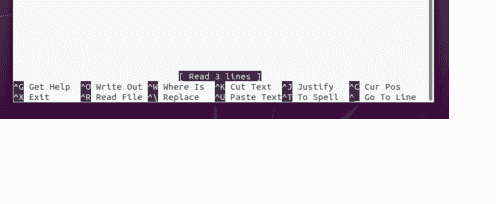

在图 4.1 中，你可以看到 `nano` 文本编辑器的四个主要部分。它们如下所示：

- **标题栏** 标题栏位于 `nano` 文本编辑器窗口的顶行。它显示当前编辑器版本以及你正在编辑的文件名。在图 4.1 中，正在编辑的文件是 `test1.txt` 文件。如果你只是输入 `nano` 而没有包含文件名，你将在标题栏中看到“New Buffer”（新缓冲区）。
- **主体部分** `nano` 文本编辑器的主体的主要部分是你执行编辑的地方。如果文件已包含文本，其首行将显示在此区域。如果你需要查看不在主体中的文本，可以使用方向键、`Page Up` 或 `Page Down` 键，和/或页面移动快捷键组合来浏览文本。
- **状态栏** 状态栏并不总是包含信息。它仅针对某些事件显示状态信息。例如，在图 4.1 中，文本文件刚刚在 `nano` 中打开，因此状态栏区域显示 `[ Read 3 lines ]`，表示已读取三行文本到编辑器中。
- **快捷键列表** 快捷键列表是编辑器最有用的功能之一。通过瞥一眼窗口底部的此列表，你可以看到最常见的命令及其关联的快捷键。此列表中的插入符（`^`）符号表示必须使用 `Ctrl` 键。例如，要从文件中删除文本，你先突出显示文本，然后按住 `Ctrl` 键，接着按下 `K` 键。要查看更多命令，请按下 `Ctrl+G` 组合键以获取帮助。

> 在 `nano` 文本编辑器的帮助子系统中，你会看到一些由 `M-k` 表示的键组合。一个例子是 `M-W`，用于重复搜索。这些是元字符键组合，其中 `M` 代表 `Esc`、`Alt` 或 `Meta` 键，具体取决于你的键盘设置。`k` 仅代表一个键盘按键，如 `W`。

`nano` 文本编辑器非常适合用于简单的文本文件修改。但是，如果你需要一个更强大的文本编辑器来创建程序或 shell 脚本，`vim` 编辑器是一个流行的选择。

在我们开始讨论如何使用 `vim` 编辑器之前，我们需要谈谈 `vim` 与 `vi` 的区别。`vi` 编辑器是一个 Unix 文本编辑器，当它被重写为一个开源工具时，得到了改进。因此，`vim` 代表“vi improved”（改进的 vi）。

你经常会发现 `vi` 命令会启动 `vim` 编辑器。在其他发行版中，只有 `vim` 命令会启动 `vim` 编辑器。有时两个命令都有效。列表 4.31 展示了如何使用 `which` 实用程序来确定 Red Hat Linux 发行版正在使用什么命令。

**列表 4.31：** 使用 `which` 确定使用哪个命令

```
$ which vim
/usr/bin/vim
$
$ which vi
alias vi='vim'
    /usr/bin/vim
$
```

列表 4.31 显示此 Red Hat Linux 发行版已将 `vi` 命令别名指向 `vim` 命令。因此，对于此发行版，`vi` 和 `vim` 命令都会启动 `vim` 编辑器。

> 一些发行版，如 Ubuntu，默认未安装 `vim` 编辑器。相反，它们使用一种替代方案，称为 `vim.tiny`，这将不允许你尝试此处讨论的各种 `vim` 命令。你可以通过获取 `vim` 程序文件名来检查你的发行版是否安装了 `vim`。输入 `type vi` 并按 `Enter`，如果收到错误或别名，则输入 `type vim`。一旦你收到程序的目录和文件名，输入 `readlink -f` 命令并跟上该目录和文件名。例如：`readlink -f /usr/bin/vi`。如果你看到 `/usr/bin/vi.tiny`，你需要要么切换到其他发行版以练习 `vim` 命令，要么安装 `vim` 软件包（参见第 13 章，“软件管理”）。

要开始使用 `vim` 文本编辑器，请根据你的发行版输入 `vim` 或 `vi`，后跟你希望编辑或创建的文件名。图 4.2 展示了一个正在运行的 `vim` 文本编辑器界面。

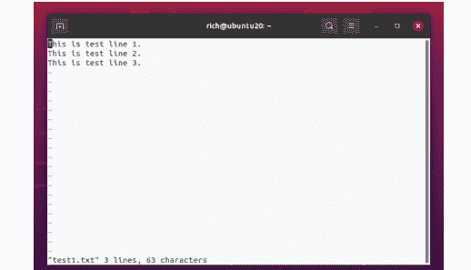

在图 4.2 中，正在编辑的文件又是 `test1.txt` 文件。`vim` 编辑器将文件数据加载到内存缓冲区中，并且该缓冲区显示在屏幕上。如果你在未提供文件名的情况下打开 `vim`，或者你输入的文件名尚不存在，`vim` 将为编辑启动一个新的缓冲区。

`vim` 编辑器在底行附近有一个消息区域。如果你刚刚打开一个已创建的文件，它将显示文件名以及读取到缓冲区中的行数和字符数。如果你正在创建新文件，你将看到消息区域中显示 `[New File]`。

`vim` 编辑器有三种标准模式，如下所示：

- **命令模式** 这是当你首次进入缓冲区时 `vim` 使用的模式；这有时也被称为普通模式（normal mode）。在此处，你输入按键来执行命令。例如，按下 `J` 键会将光标向下移动一行。这是快速移动浏览缓冲区最好的模式。
- **插入模式** 插入模式也称为编辑模式或输入模式。这是你可以执行简单编辑的模式。此模式下没有太多的命令或特殊模式按键。你从命令模式进入此模式，方法是按下 `I` 键。此时，消息 `--Insert--` 将显示在消息区域中。你通过按下 `Esc` 键离开此模式。
- **Ex 模式** 这种模式有时也被称为冒号命令，因为在此处输入的每个命令前都带有冒号（`:`）。例如，要退出 `vim` 编辑器且不保存任何更改，你输入 `:q` 并按 `Enter` 键。

由于你在进入 `vim` 编辑器的缓冲区时从命令模式开始，因此了解该模式下一些常用的移动命令是有益的。表 4.8 包含了一些供你参考的移动命令。

在 `vim` 编辑器缓冲区中快速移动很有用。然而，还有几个编辑命令有助于加快你的修改过程。例如，当你将光标移动到单词的第一个字母并按下 `CW` 时，该单词会被删除，你将进入插入模式。然后你可以输入新单词并按 `Esc` 以离开插入模式。

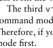

> 请记住，有些人保持在命令模式以定位到文件中的所需位置，然后按下 `I` 键跳到插入模式，以便更轻松地编辑文本。这是一种方便的方法。

一旦你在 `vim` 缓冲区中完成了所需的文本更改，就是保存工作的时候了。你可以在命令模式下输入 `ZZ` 将缓冲区写入磁盘，并从 `vim` 编辑器中退出你的进程。

`vim` 的第三种模式，Ex 模式，有额外的实用命令。你必须处于命令模式才能进入 Ex 模式。你无法从插入模式直接跳到 Ex 模式。因此，如果你当前处于插入模式，请先按 `Esc` 键返回命令模式。

## 表 4.8 常用 vim 命令模式移动命令

| 按键 | 描述 |
| :--- | :--- |
| `h` | 光标向左移动一个字符。 |
| `l` | 光标向右移动一个字符。 |
| `j` | 光标向下移动一行（文本中的下一行）。 |
| `k` | 光标向上移动一行（文本中的上一行）。 |
| `w` | 光标向前移动一个单词，位于下一个单词之前。 |
| `e` | 光标移动到当前单词的末尾。 |
| `b` | 光标向后移动一个单词。 |
| `^` | 光标移动到行首。 |
| `$` | 光标移动到行末。 |
| `gg` | 光标移动到文件的第一行。 |
| `G` | 光标移动到文件的最后一行。 |
| `nG` | 光标移动到文件第 `n` 行。 |
| `Ctrl+B` | 向上滚动接近一屏。 |
| `Ctrl+F` | 向下滚动接近一屏。 |
| `Ctrl+U` | 向上滚动半屏。 |
| `Ctrl+D` | 向下滚动半屏。 |
| `Ctrl+Y` | 向上滚动一行。 |
| `Ctrl+E` | 向下滚动一行。 |

表 4.9 展示了一些 Ex 命令，可以帮助你管理文本文件。请注意，所有按键都包含使用 Ex 命令所需的冒号 (`:`)。

在阅读了各种模式命令后，你可能会明白为什么有些人讨厌 `vim` 编辑器。需要知道的晦涩命令非常多。然而，有些人热爱 `vim` 编辑器，因为它非常强大。

## 表 4.9 常用 `vim` Ex 模式命令

| 按键 | 描述 |
| :--- | :--- |
| `:x` | 将缓冲区写入文件并退出编辑器。 |
| `:wq` | 将缓冲区写入文件并退出编辑器。 |
| `:wq!` | 将缓冲区写入文件并退出编辑器（覆盖保护）。 |
| `:w` | 将缓冲区写入文件并留在编辑器中。 |
| `:w!` | 将缓冲区写入文件并留在编辑器中（覆盖保护）。 |
| `:q` | 不将缓冲区写入文件即退出编辑器。 |
| `:q!` | 不将缓冲区写入文件即退出编辑器（覆盖保护）。 |
| `:! command` | 执行 shell `command` 并显示结果，但退出编辑器。 |
| `:r! command` | 执行 shell `command` 并将结果包含在编辑器缓冲区区域中。 |
| `:r file` | 读取 `file` 的内容并将其包含在编辑器缓冲区区域中。 |


某些发行版默认安装了 `vim` 教程。这是学习使用 `vim` 编辑器的便捷方式。要开始使用，只需在命令行输入 `vimtutor`。如果你需要在教程完成前离开，只需输入 Ex 模式命令 `:q` 退出即可。

只学习一种文本编辑器而忽略其他编辑器很有吸引力。当然，这无助于通过 CompTIA Linux+ 认证考试。但除此之外，在日常 Linux 工作中，至少了解两种文本编辑器也是有用的。对于简单的修改，`nano` 文本编辑器表现出色。对于更复杂的编辑，`vim` 编辑器是王者。两者都值得你花时间掌握。

## 了解流编辑器

有些时候，你希望编辑文本文件，而不需要调用全功能文本编辑器。在这种情况下，学习两种非常流行的**流编辑器**是值得的。流编辑器修改通过文件或管道输出传递给它文本。该编辑器使用特殊命令，在文本通过编辑器工具“流”过时进行文本修改。

我们要探索的第一个流编辑器称为 `sed`。调用它的命令是 `sed`。`sed` 实用程序根据你预先提供的一组命令编辑流式文本数据。它是一个快速编辑器，因为它只对文本进行一次遍历以应用修改。

`sed` 编辑器根据输入到命令行或存储在文本文件中的命令更改数据。该编辑器经过的过程如下：

- 从输入流中一次读取一行文本
- 将该文本与提供的编辑器命令进行匹配
- 按命令指定的方式修改文本
- 将修改后的文本输出到 `STDOUT`

当 `sed` 编辑器针对某行文本匹配完所有预指定命令后，它会读取下一行文本并重复编辑过程。一旦 `sed` 到达文本行的末尾，它就会停止。

在查看一些 `sed` 示例之前，了解该命令的基本语法很重要。其格式如下：

```
sed [OPTIONS] [SCRIPT]... [FILENAME]
```

默认情况下，`sed` 将使用来自 `STDIN` 的文本，根据预指定命令进行修改。示例如下所示（列表 4.32）。

**列表 4.32：** 使用 `sed` 修改 `STDIN` 文本

```
$ echo "I like cake." | sed 's/cake/donuts/'
I like donuts.
$
```

在列表 4.32 中，`echo` 命令输出的文本作为输入通过管道传输到流编辑器。`sed` 实用程序的 `s` 命令（替换）指定如果找到第一个文本字符串 `cake`，则将其更改为输出中的 `donuts`。请注意，`sed` 之后的整个命令被视为 `SCRIPT`，并用单引号括起来。还请注意，文本单词通过正斜杠 (`/`) 与 `s` 命令、引号以及彼此分隔。

请记住，仅使用 `s` 命令不会更改文本流中单词的所有实例。列表 4.33 展示了此示例。

**列表 4.33：** 使用 `sed` 全局修改 `STDIN` 文本


```bash
$ echo "I love cake and more cake." | sed 's/cake/donuts/'
I love donuts and more cake.
$
$ echo "I love cake and more cake." | sed 's/cake/donuts/g'
I love donuts and more donuts.
$
```

在列表 4.33 的第一个命令中，只有单词 `cake` 的第一次出现被修改了。然而，在第二个命令中，在 `sed` 脚本的末尾添加了一个 `g`，代表*全局*。这导致 `cake` 的所有出现都更改为 `donuts`。你还可以修改存储在文件中的文本。列表 4.34 展示了此示例。

**列表 4.34：** 使用 `sed` 修改文件文本

```bash
$ cat cake.txt
Christine likes chocolate cake.
Rich likes lemon cake.
Tim only likes yellow cake.
Samantha does not like cake.
$
$ sed 's/cake/donuts/g' cake.txt
Christine likes chocolate donuts.
Rich likes lemon donuts.
Tim only likes yellow donuts.
Samantha does not like donuts.
$
$ cat cake.txt
Christine likes chocolate cake.
Rich likes lemon cake.
Tim only likes yellow cake.
Samantha does not like cake.
$
```

在列表 4.34 中，文件包含包含单词 `cake` 的文本行。当将 `cake.txt` 文件作为参数添加到 `sed` 命令时，其数据会根据脚本进行修改。请注意，文件中的数据未被修改。流编辑器仅将修改后的文本显示到 STDOUT。

流编辑器有一些相当有用的命令选项。常用选项显示在表 4.10 中。

## 表 4.10 `sed` 命令常用选项

| 短选项 | 长选项 | 描述 |
|---|---|---|
| `-e` `script` | `--expression=script` | 将 `script` 中的命令添加到文本处理中。`script` 作为 `sed` 命令的一部分编写。 |
| `-f` `script` | `--file=script` | 将 `script` 中的命令添加到文本处理中。`script` 是一个文件。 |
| `-r` | `--regexp-extended` | 在 `script` 中使用扩展正则表达式。 |

一个便捷的选项是 `-e` 选项。它允许你在 `sed` 命令中使用多个脚本。示例如下所示（列表 4.35）。

**列表 4.35：** 使用 `sed -e` 使用多个脚本

```bash
$ sed -e 's/cake/donuts/ ; s/like/love/' cake.txt
Christine loves chocolate donuts.
Rich loves lemon donuts.
Tim only loves yellow donuts.
Samantha does not love donuts.
$
```

密切关注列表 4.35 中的语法变化。不仅使用了 `-e` 选项，脚本也略有不同。现在，脚本在两个脚本命令之间包含一个分号 (`;`)。这使得两个命令都可以处理文本流。

如果你有大量的 `sed` 脚本命令，可以将它们存储在文件中。这很方便，因为你可以反复使用脚本文件。列表 4.36 展示了使用 `sed` 脚本一次的示例。

**列表 4.36：** 使用 `sed -f` 使用脚本文件

```bash
$ cat script.sed
s/cake/donuts/
s/like/love/
$
$ sed -f script.sed cake.txt
Christine loves chocolate donuts.
Rich loves lemon donuts.
Tim only loves yellow donuts.
Samantha does not love donuts.
$
```

在列表 4.36 中，请注意 `sed` 脚本在每个文件行上只有单个 `sed` 命令。这里没有使用单引号。一旦使用带有 `-f` 选项和脚本文件参数的 `sed` 命令，更改将应用于文件数据并显示在 STDOUT 中。

`gawk` 实用程序也是一个流编辑器，但它通过其编程语言提供功能更强大的编辑过程。使用 `gawk` 编程语言，你可以做到以下几点：

- 定义变量以存储数据。
- 使用算术和字符串运算符来处理数据。
- 使用编程语言结构（如循环）为你的处理添加逻辑。
- 从数据创建格式化报告。

## gawk 编程语言

`gawk` 编程语言在从大型数据集创建格式化报告方面非常流行。你可以创建 `gawk` 程序并将它们存储在文件中以便重复使用。

`awk` 和 `gawk` 之间存在一些混淆，因此在深入探讨 `gawk` 工具之前，我们先来厘清这一点。`awk` 程序是为 Unix 操作系统创建的，因此当 GNU 项目重写它时，将其命名为 GNU `awk`，简称 `gawk`。然而，在许多发行版中，你可以使用其中任何一个命令，但它们实际上都调用了 `gawk` 程序。列表 4.37 展示了 Ubuntu 发行版中这种情况的一个示例。

### 列表 4.37：查看 `awk` 和 `gawk` 命令

```bash
$ which awk
/usr/bin/awk
$
$ readlink -f /usr/bin/awk
/usr/bin/gawk
$
$ which gawk
/usr/bin/gawk
$
```

在列表 4.37 中，你可以看到该发行版上存在 `awk` 命令。但是，当你跟随软链接路径找到实际使用的程序时，它指向的是 `gawk` 程序。`gawk` 命令也存在。

在查看一些 `gawk` 示例之前，理解该命令的基本语法非常重要。其语法如下：

`gawk [OPTIONS] [PROGRAM]… [FILENAME]`

与 `sed` 类似，你可以在与 `gawk` 命令同一行命令行上提供程序。它也使用单引号来包围脚本。然而，与 `sed` 不同，`gawk` 工具要求你将编程语言命令放在两个花括号之间。示例如图 4.38 所示。

### 列表 4.38：使用 `gawk` 修改 STDIN 文本

```bash
$ echo "Hello World" | gawk '{print $0}'
Hello World
$
$ echo "Hello World" | gawk '{print $1}'
Hello
$
$ echo "Hello World" | gawk '{print $2}'
World
$
```

`print` 命令将文本显示到 STDOUT，但请注意，STDIN 的不同部分会被显示，如列表 4.38 所示。这是通过 `gawk` 工具定义的数据字段变量实现的。它们的定义如下：

-   `$0` 变量代表整行文本。
-   `$1` 变量代表文本行的第一个数据字段。
-   `$2` 变量代表文本行的第二个数据字段。
-   `$n` 变量代表文本行的第 n 个数据字段。

`gawk` 工具还可以处理来自文件的数据。示例如图 4.39 所示。

### 列表 4.39：使用 `gawk` 修改文件文本

```bash
$ cat cake.txt
Christine likes chocolate cake.
Rich likes lemon cake.
Tim only likes yellow cake.
Samantha does not like cake.
$
$ gawk '{print $1}' cake.txt
Christine
Rich
Tim
Samantha
$
```

`gawk` 编程语言相当强大，允许你使用其他编程语言中常见的许多结构。在列表 4.40 中，尝试将输出中的单词 `cake` 更改为 `donut`。

### 列表 4.40：使用 `gawk` 结构化命令修改文件文本

```bash
$ gawk '{$4="donuts"; print $0}' cake.txt
Christine likes chocolate donuts
Rich likes lemon donuts
Tim only likes donuts cake.
Samantha does not donuts cake.
$
$ gawk '{if ($4 == "cake.") {$4="donuts"; print $0}}' cake.txt
Christine likes chocolate donuts
Rich likes lemon donuts
$
```

在列表 4.40 中，第一次尝试替换单词并未正常工作。这是因为有两行文本文件中的单词 `cake` 位于数据字段 `$5` 而不是数据字段 `$4`。第二次 `gawk` 尝试使用 `if` 语句检查数据字段 `$4` 是否等于单词 `cake`。如果该语句返回 `true`，则数据字段更改为 `donuts`，并且文本行显示在 STDOUT 上。否则，该文本行被忽略。

在命令行上使用复杂的编程结构可能会很棘手。最好将这些命令放入文件中。然而，在此之前，你需要了解一些常见的 `gawk` 选项。表 4.11 列出了典型的 `gawk` 开关。

**表 4.11 `gawk` 命令的常用选项**

| 短选项 | 长选项 | 描述 |
| :--- | :--- | :--- |
| `-F` `d` | `--field-separator` `d` | 指定分隔数据文件字段的分隔符。 |
| `-f` `file` | `--file=file` | 使用文件中的程序进行文本处理。 |
| `-s` | `--sandbox` | 在沙箱模式下执行 `gawk` 程序。 |

当数据文件的字段由逗号或冒号分隔时，使用字段分隔符选项非常方便。使用此开关从 `password` 文件中提取数据的示例如图 4.41 所示。

### 列表 4.41：使用 `gawk` 结构化命令提取文件数据

```bash
$ gawk -F : '{print $1}' /etc/passwd
root
bin
daemon
[...]
$
```

你可以将复杂的 `gawk` 程序放入文件中以供重复使用。列表 4.42 展示了这一点的一个示例。

### 列表 4.42：使用 `gawk` 程序文件

```bash
$ cat cake.txt
Christine likes chocolate cake.
Rich likes lemon cake.
Tim only likes yellow cake.
Samantha does not like cake.
$
$ cat script.gawk
{if ($4=="cake.")
{$4="donuts"; print $0}}
else if ($5=="cake.")
{$5="donuts"; print $0}}
$
$ gawk -f script.gawk cake.txt
Christine likes chocolate donuts
Rich likes lemon donuts
Tim only likes yellow donuts
Samantha does not like donuts
$
```

在列表 4.42 中，使用 `gawk` 编程语言编写了更复杂的 `if` 结构语句并保存到文件 `script.gawk` 中。此脚本不仅使用了 `if` 语句，还结合了 `else if` 结构。请注意，当 `gawk` 程序存储在文件中时，不需要单引号。使用 `-f` 开关，程序作用于 `cake.txt` 文件，并且每一行中相应的单词都被更改。

## 总结

能够处理数据以做出敏捷决策对于管理你的 Linux 系统非常重要。有许多 Linux 结构和工具可以帮助你发现所需的信息。

本章的目的是继续完善你的 Linux 命令行工具集。本章中新增的工具和结构将允许你搜索和分析文本，以高效的方式发现知识。

## 考试要点

**总结用于处理文本文件的各种实用工具。** 使用诸如 `grep`、`egrep` 和 `cut` 之类的实用工具可以更容易地过滤文本文件数据。过滤数据后，你可能希望使用 `sort`、`pr`、`printf` 甚至 `cat` 实用工具对其进行格式化以查看。如果你需要关于文本文件的一些统计信息，例如它包含的行数，`wc` 命令很有帮助。

**解释重定向的结构和命令。** 使用 STDOUT、STDERR 和 STDIN 重定向允许相当复杂的文本过滤和处理。`echo` 命令以及 here 文档也可以协助此过程。你还可以使用命令管道来执行重定向并生成用于审阅的优秀数据。

**描述用于编辑文本文件的各种方法。** 编辑文本文件是系统管理员生活的一部分。你可以使用全屏幕编辑器，如相当复杂的 `vim` 文本编辑器或简单且易于使用的 `nano` 编辑器。对于快速且强大的文本流编辑，请使用 `sed` 及其脚本或 `gawk` 编程语言。

## 复习题

1. 输入命令 `cat -E MyFile.txt`，显示的每一行末尾都有一个 `$`。这表明什么？

   - A. 文本文件在某种程度上已损坏。
   - B. 文本文件记录以 ASCII 字符 NUL 结束。
   - C. 文本文件记录以 ASCII 字符 LF 结束。
   - D. 文本文件记录以 ASCII 字符 `$` 结束。
   - E. 文本文件记录末尾包含 `$`。

2. `cut` 实用工具通常需要分隔符来处理文本记录。以下哪项最能描述分隔符？

   - A. 指定记录中一行开始的一个或多个字符
   - B. 指定记录中一行结束的一个或多个字符
   - C. 指定文本文件结束给命令行文本处理实用工具的一个或多个字符
   - D. 单个空格或冒号 (`:`)，在记录的不同数据项之间创建边界
   - E. 在记录的不同数据项之间创建边界的一个或多个字符

3. 以下哪些实用工具可以更改文件中的文本？（选择所有适用项。）

   - A. `cut`
   - B. `sort`
   - C. `vim`
   - D. `nano`
   - E. `sed`

4. 你有一个文本文件 `monitor.txt`，其中包含数据中心中使用的监视器信息。每条记录以 ASCII LF 字符结尾，字段由逗号 (`,`) 分隔。文本记录包含监视器 ID、制造商、序列号和位置。要显示每个数据中心监视器的监视器 ID、序列号和位置，应使用哪个 `cut` 命令？

   - A. `cut -d "," -f 1,3,4 monitor.txt`
   - B. `cut -z -d "," -f 1,3,4 monitor.txt`
   - C. `cut -f "," -d 1,3,4 monitor.txt`
   - D. `cut monitor.txt -d "," -f 1,3,4`
   - E. `cut monitor.txt -f "," -d 1,3,4`

## 复习题

- **5.** `grep` 实用程序可以在其 `PATTERN` 中使用正则表达式。以下哪项最能描述正则表达式？

    - A. 你为实用程序定义的一系列字符，该实用程序使用这些字符在文本文件中匹配相同的字符
    - B. ASCII 字符，如 LF 和 NUL，实用程序使用它们来过滤文本
    - C. 通配符，如 `*` 和 `?`，实用程序使用它们来过滤文本
    - D. 你为实用程序定义的模式模板，该实用程序使用该模式来过滤文本
    - E. 用于字符周围的引号（单引号或双引号），以防止意外结果

- **6.** 你是红帽 Linux 服务器上的系统管理员。你需要查看 `/var/log/messages` 文件中以日期 May 30 开头并以 IPv4 地址 192.168.10.42 结尾的记录。以下哪个 `grep` 命令是最佳选择？

    - A. `grep "May 30?192.168.10.42" /var/log/messages`
    - B. `grep "May 30.*192.168.10.42" /var/log/messages`
    - C. `grep -i "May 30.*192.168.10.42" /var/log/messages`
    - D. `grep -i "May 30?192.168.10.42" /var/log/messages`
    - E. `grep -v "May 30.*192.168.10.42" /var/log/messages`

- **7.** 以下哪项是可用于 `grep` 命令的 BRE 模式？（选择所有适用的选项。）

    - A. `Sp?ce`
    - B. `"Space, the .*frontier"`
    - C. `^Space`
    - D. `(lasting | final)`
    - E. `frontier$`

- **8.** 你需要在一个大型文本文件中搜索，找到任何包含 `Luke` 或 `Laura` 且位于记录开头的记录。同时，短语 `Father's` 必须位于记录的中间某处。以下哪个 ERE 模式可用于 `egrep` 命令来查找此记录？

    - A. `"^Luke$|^Laura$.*Father\s"`
    - B. `"^Luke|^Laura.*Father\s"`
    - C. `"(^Luke|^Laura).*Father\s"`
    - D. `"(Luke$|Laura$).* Father\s$"`
    - E. `"(^Luke|^Laura).*Father\s.*"`


- **9.** 文件`data.txt`需要按数字排序，并将其输出保存到新文件`newdata.txt`中。以下哪些命令可以完成此任务？（选择所有适用的选项。）
  - A. `sort -n -o newdata.txt data.txt`
  - B. `sort -n data.txt > newdata.txt`
  - C. `sort -n -o data.txt newdata.txt`
  - D. `sort -o newdata.txt data.txt`
  - E. `sort data.txt > newdata.txt`

- **10.** 以下哪些命令可以将`data.txt`和`datatoo.txt`文件的内容按顺序显示到`STDOUT`？（选择所有适用的选项。）
  - A. `ls data.txt datatoo.txt`
  - B. `sort -n data.txt > datatoo.txt`
  - C. `cat -n data.txt datatoo.txt`
  - D. `ls -l data.txt datatoo.txt`
  - E. `sort data.txt datatoo.txt`

- **11.** 文本文件`StarGateAttacks.txt`需要进行特殊格式化以便审阅。以下哪个命令是快速完成此任务的最佳命令？
  - A. `printf`
  - B. `wc`
  - C. `pr`
  - D. `paste`
  - E. `nano`

- **12.** 你需要将字符串`42.777`格式化为正确的两位小数浮点数。以下哪个`printf`命令的`FORMAT`设置是正确使用的方式？
  - A. `"%s\n"`
  - B. `"%.2s\n"`
  - C. `"%d\n"`
  - D. `"%.2c\n"`
  - E. `"%.2f\n"`

- **13.** 一个`Unicode`编码的文本文件`MyUnicode.txt`需要被查看。在决定使用什么实用程序查看文件内容之前，你对其使用了`wc`命令。该实用程序向`STDOUT`显示`2020 6786 11328`。以下哪项是正确的？（选择所有适用的选项。）
  - A. 该文件有 2,020 行。
  - B. 该文件有 2,020 个字符。
  - C. 该文件有 6,786 个单词。
  - D. 该文件有 11,328 个字符。
  - E. 该文件有 11,328 行。

- **14.** 以下哪项最能定义文件描述符？
  - A. 代表文件类型的字母
  - B. 代表进程打开文件的数字
  - C. 文件名的另一种说法
  - D. 代表标准输出的六个字符名称
  - E. 指示文件分类的符号

- **15.** 默认情况下，`STDOUT`流向哪个项目？
  - A. `/dev/tty`，其中`n`是一个数字
  - B. `/dev/null`
  - C. `>`
  - D. `/dev/tty`
  - E. `pwd`

- **16.** 以下哪个命令可以将文件`SpaceOpera.txt`显示到输出，同时将其副本保存到文件`SciFi.txt`中？
  - A. `cat SpaceOpera.txt | tee SciFi.txt`
  - B. `cat SpaceOpera.txt > SciFi.txt`
  - C. `cat SpaceOpera.txt 2> SciFi.txt`
  - D. `cp SpaceOpera.txt SciFi.txt`
  - E. `cat SpaceOpera.txt && SciFi.txt`

- **17.** 以下哪个命令将生成的任何错误消息都放入黑洞？
  - A. `sort SpaceOpera.txt 2> BlackHole`
  - B. `sort SpaceOpera.txt && BlackHole`
  - C. `sort SpaceOpera.txt > BlackHole`
  - D. `sort SpaceOpera.txt 2> /dev/null`
  - E. `sort SpaceOpera.txt > /dev/null`

- **18.** 以下哪个命令将确定文件`Problems.txt`中有多少条记录包含单词`error`？
  - A. `grep error Problems.txt | wc -b`
  - B. `grep error Problems.txt | wc -w`
  - C. `grep error Problems.txt | wc -l`
  - D. `grep Problems.txt error | wc -w`
  - E. `grep Problems.txt error | wc -l`

- **19.** 你想找到名为`42.tmp`的任何文件，该文件存在于当前目录的树结构中，并将其内容显示到`STDOUT`。以下哪些允许你构建一个命令来做到这一点？（选择所有适用的选项。）
  - A. `xargs (find . -name 42.tmp) cat`
  - B. `cat \`find . -name 42.tmp\``
  - C. `cat $(find . -name 42.tmp)`
  - D. `cat {find . -name 42.tmp}`
  - E. `find . -name 42.tmp | xargs cat`

- **20.** 你想编辑文件`SpaceOpera.txt`并决定使用`vim`编辑器来完成此任务。以下哪些是你可能会使用的`vim`模式？（选择所有适用的选项。）
  - A. `Insert`
  - B. `Change`
  - C. `Command`
  - D. `Ex`
  - E. `Edit`

## 系统启动和配置

### 第二部分


## 第 5 章：解释启动过程

- 目标 1.1：总结 `Linux` 基础知识。


本章检查 `Linux` 系统中的启动和初始化过程。首先，我们将查看计算机固件在启动过程中所起的作用，然后讨论 `Linux` 引导加载程序以及如何配置它们。接下来，本章讨论了 `Linux` 初始化过程，展示 `Linux` 如何决定在启动时启动哪些后台应用程序。本章最后介绍了一些可用于帮助挽救无法启动的系统的系统恢复选项。

### `Linux` 启动过程

当你打开 `Linux` 系统的电源时，它会触发一系列事件，最终导致登录提示符。通常，你不需要担心这些事件背后发生了什么；你只需登录并开始使用你的应用程序。

然而，有时你的 `Linux` 系统可能没有完全正确地启动，或者你期望在后台运行的应用程序可能没有运行。在这种情况下，了解 `Linux` 如何启动操作系统并启动程序有助于你解决问题。

以下部分逐步说明启动过程的步骤，以及你如何监视启动过程以查看哪些步骤失败了。

### 跟踪启动过程

`Linux` 启动过程可以分为三个主要步骤：

1. 工作站固件启动，执行硬件的快速检查（称为加电自检，或 `POST`），然后在可引导设备上查找引导加载程序。
2. 引导加载程序运行，并确定要加载哪个 `Linux` 内核程序。
3. 内核程序加载到内存中，并启动系统运行所需的后台程序（例如桌面环境的图形桌面管理器或服务器的 `Web` 和数据库服务器）。

虽然从表面上看，这三个步骤可能显得简单，但一系列操作协同工作以保持启动过程运行。每个步骤都会执行多个操作，为你的系统运行 `Linux` 做准备。

## 查看引导过程

你可以通过在系统引导时监视系统控制台屏幕来监控 `Linux` 引导过程。当系统检测硬件和加载软件时，你会看到许多信息性消息滚动经过。

某些图形桌面版 `Linux` 发行版在启动时会将引导消息隐藏在一个单独的控制台窗口中。通常，你可以按下`Esc`键或`Ctrl+Alt+F1`键组合来查看这些消息。

通常，引导消息滚动得很快，很难看清发生了什么。如果你需要排查引导问题，可以使用`dmesg`命令查看引导时消息。大多数 `Linux` 发行版会将引导内核消息复制到内存中的一个特殊环形缓冲区，称为`kernel ring buffer`（内核环形缓冲区）。该缓冲区是循环的，并设置为预定的大小。随着新消息记录在缓冲区中，旧消息会被轮换出去。

`dmesg` 命令显示当前存储在内核环形缓冲区中的最新引导消息，如图 5.1 所示。

### 列表 5.1 `Ubuntu` 工作站上 `dmesg` 命令的输出

```bash
$ dmesg
[    0.000000] Linux version 5.11.0-40-generic (buildd@lgw01-amd64-010) (gcc (Ubuntu 9.3.0-17ubuntu1~20.04) 9.3.0, GNU ld (GNU Binutils for Ubuntu) 2.34) #44~20.04.2-Ubuntu SMP Tue Oct 26 18:07:44 UTC 2021 (Ubuntu 5.11.0-40.44~20.04.2-generic 5.11.22)
[    0.000000] Command line: BOOT_IMAGE=/boot/vmlinuz-5.11.0-40-generic root=UUID=5423117e-4aaf-4416-ada7-01e07073b2e1 ro quiet splash
[    0.000000] KERNEL supported cpus:
[    0.000000]   Intel GenuineIntel
[    0.000000]   AMD AuthenticAMD
[    0.000000]   Hygon HygonGenuine
[    0.000000]   Centaur CentaurHauls
[    0.000000]   Shaoin  Shaogirl
[    0.000000] x86/fpu: Supporting XSAVE feature 0x001: 'x87 floating point registers'
[    0.000000] x86/fpu: Supporting XSAVE feature 0x002: 'SSE registers'
[    0.000000] x86/fpu: Supporting XSAVE feature 0x004: 'AVX registers'
[    0.000000] x86/fpu: xstate_offset[2]:  576, xstate_sizes[2]:  256
[    0.000000] x86/fpu: Enabled xstate features 0x7, context size is 832 bytes, using 'standard' format.
[    0.000000] BIOS-provided physical RAM map:
[    0.000000] BIOS-e820: [mem 0x0000000000000000-0x0000000000000fff] usable
[    0.000000] BIOS-e820: [mem 0x000000000009fc00-0x000000000009ffff] reserved
[  0.000000] BIOS-e820: [mem 0x000000000000f000-0x00000000000fffff] reserved
[  0.000000] BIOS-e820: [mem 0x00000000010000-0x0000000000dfffff] usable
[  0.000000] BIOS-e820: [mem 0x00000000df0000-0x00000000dffffff] ACPI data
[  0.000000] BIOS-e820: [mem 0x00000000fec00000-0x00000000fec00fff] reserved
[  0.000000] BIOS-e820: [mem 0x00000000fee00000-0x00000000fee00fff] reserved
[  0.000000] BIOS-e820: [mem 0x00000000ffcc0000-0x00000000ffffffff] reserved
[  0.000000] BIOS-e820: [mem 0x0000000100000000-0x000000021ffffff] usable
[  0.000000] NX (Execute Disable) protection: active
[  0.000000] SMBIOS 2.5 present.
[  0.000000] DMI: innotek GmbH VirtualBox/VirtualBox, BIOS VirtualBox 12/01/2006
[  0.000000] Hypervisor detected: KVM
[  0.000000] kvm-clock: Using msrs 4b564d01 and 4b564d00
[  0.000000] kvm-clock: cpu 0, msr 109001001, primary cpu clock
[  0.000000] kvm-clock: using sched offset of 3933158608 cycles
[  0.000001] clocksource: kvm-clock: mask: 0xfffffffffffffffx max_cycles: 0x1cd424ed4ffb, max_idle_ns: 881590591483 ns
[  0.000003] tsc: Detected 1497.589 Mhz processor
```

大多数 `Linux` 发行版还将引导消息存储在日志文件中，通常位于`/var/log`文件夹中。对于基于 `Debian` 和基于 `Red Hat` 的系统，该文件通常是`/var/log/boot.log`，但一些旧版 `Linux` 系统可能使用`/var/log/boot`。

虽然能够看到引导期间生成的不同消息很有帮助，但了解是什么生成了这些消息也很有用。本章将讨论这三个引导步骤中的每一个，并通过一些示例展示其工作原理。

## 固件启动

所有兼容 `IBM` 的工作站和服务器都使用某种内置固件来控制已安装操作系统的启动方式。在较旧的工作站和服务器上，这种固件被称为`Basic Input/Output System (BIOS)`（基本输入/输出系统）。在较新的工作站和服务器上，一种称为`Unified Extensible Firmware Interface (UEFI)`（统一可扩展固件接口）的方法维护系统硬件状态并启动已安装的操作系统。

### `BIOS` 启动

`BIOS` 固件有一个简单的菜单界面，允许你更改某些设置以控制系统如何查找硬件，并定义 `BIOS` 应使用哪个设备来启动操作系统。

原始 `BIOS` 固件的一个局限性是它只能从硬盘读取一个扇区的数据到内存中运行。这不足以加载整个操作系统。为了绕过这一限制，大多数操作系统（包括 `Linux` 和 `Microsoft Windows`）将引导过程分为两部分。

首先，`BIOS` 运行一个`bootloader`（引导加载程序）程序，这是一个小型程序，用于初始化必要的硬件以查找并运行完整的操作系统程序。它通常位于同一硬盘上的另一个位置，但有时位于单独的内部或外部存储设备上。

引导加载程序通常有一个配置文件，因此你可以告诉它在哪里找到要运行的实际操作系统文件，甚至生成一个小型菜单，允许用户在多个操作系统之间进行引导选择。

为了开始引导过程，`BIOS` 必须知道在已安装的存储设备上哪里可以找到引导加载程序。大多数 `BIOS` 设置允许你从几个位置加载引导加载程序：

- 内部硬盘
- 外部硬盘
- `CD` 或 `DVD` 驱动器
- `USB` 内存棒
- `ISO` 文件
- 使用 `NFS`、`HTTP` 或 `FTP` 的网络服务器

从硬盘引导时，你必须指定硬盘以及硬盘上的分区，以便 `BIOS` 从中加载引导加载程序。这是通过定义`Master Boot Record`（主引导记录，`MBR`）来完成的。

`MBR` 是系统第一个硬盘分区上的第一个扇区。计算机系统只有一个 `MBR`。`BIOS` 查找 `MBR` 并将存储在那里的程序读入内存。由于引导加载程序必须容纳在一个扇区中，它必须非常小，因此不能做太多事情。引导加载程序主要指向实际操作系统内核文件的位置，该文件存储在安装在系统的单独分区的引导扇区中。内核引导文件没有大小限制。


引导加载程序不需要直接指向操作系统内核文件；它可以指向任何类型的程序，包括另一个引导加载程序。你可以创建一个初级引导加载程序，它指向一个次级引导加载程序，后者提供加载多个操作系统的选项。这个过程被称为`chainloading`（链式加载）。

### `UEFI` 启动

随着操作系统变得更加复杂，显然需要开发一种新的引导方法。

`Intel` 于 1998 年创建了`Extensible Firmware Interface`（`EFI`，可扩展固件接口）来解决 `BIOS` 的一些局限性。到 2005 年，这一想法在其他供应商中流行起来，`Universal EFI (UEFI)` 规范被采纳为标准。如今，几乎所有兼容 `IBM` 的桌面和服务器系统都使用 `UEFI` 固件标准。
[/content]
</think>

[content]
- **9.** 文件`data.txt`需要按数字排序，并将其输出保存到新文件`newdata.txt`中。以下哪些命令可以完成此任务？（选择所有适用的选项。）

  - A. `sort -n -o newdata.txt data.txt`
  - B. `sort -n data.txt > newdata.txt`
  - C. `sort -n -o data.txt newdata.txt`
  - D. `sort -o newdata.txt data.txt`
  - E. `sort data.txt > newdata.txt`

- **10.** 以下哪些命令可以将`data.txt`和`datatoo.txt`文件的内容按顺序显示到`STDOUT`？（选择所有适用的选项。）

  - A. `ls data.txt datatoo.txt`
  - B. `sort -n data.txt > datatoo.txt`
  - C. `cat -n data.txt datatoo.txt`
  - D. `ls -l data.txt datatoo.txt`
  - E. `sort data.txt datatoo.txt`

- **11.** 文本文件`StarGateAttacks.txt`需要进行特殊格式化以便审阅。以下哪个命令是快速完成此任务的最佳命令？

  - A. `printf`
  - B. `wc`
  - C. `pr`
  - D. `paste`
  - E. `nano`

- **12.** 你需要将字符串`42.777`格式化为正确的两位小数浮点数。以下哪个`printf`命令的`FORMAT`设置是正确使用的方式？

  - A. `"%s\n"`
  - B. `"%.2s\n"`
  - C. `"%d\n"`
  - D. `"%.2c\n"`
  - E. `"%.2f\n"`

- **13.** 一个`Unicode`编码的文本文件`MyUnicode.txt`需要被查看。在决定使用什么实用程序查看文件内容之前，你对其使用了`wc`命令。该实用程序向`STDOUT`显示`2020 6786 11328`。以下哪项是正确的？（选择所有适用的选项。）

  - A. 该文件有 2,020 行。
  - B. 该文件有 2,020 个字符。
  - C. 该文件有 6,786 个单词。
  - D. 该文件有 11,328 个字符。
  - E. 该文件有 11,328 行。

- **14.** 以下哪项最能定义文件描述符？

  - A. 代表文件类型的字母
  - B. 代表进程打开文件的数字
  - C. 文件名的另一种说法
  - D. 代表标准输出的六个字符名称
  - E. 指示文件分类的符号

- **15.** 默认情况下，`STDOUT`流向哪个项目？

  - A. `/dev/tty`，其中`n`是一个数字
  - B. `/dev/null`
  - C. `>`
  - D. `/dev/tty`
  - E. `pwd`

- **16.** 以下哪个命令可以将文件`SpaceOpera.txt`显示到输出，同时将其副本保存到文件`SciFi.txt`中？

  - A. `cat SpaceOpera.txt | tee SciFi.txt`
  - B. `cat SpaceOpera.txt > SciFi.txt`
  - C. `cat SpaceOpera.txt 2> SciFi.txt`
  - D. `cp SpaceOpera.txt SciFi.txt`
  - E. `cat SpaceOpera.txt && SciFi.txt`

- **17.** 以下哪个命令将生成的任何错误消息都放入黑洞？

  - A. `sort SpaceOpera.txt 2> BlackHole`
  - B. `sort SpaceOpera.txt && BlackHole`
  - C. `sort SpaceOpera.txt > BlackHole`
  - D. `sort SpaceOpera.txt 2> /dev/null`
  - E. `sort SpaceOpera.txt > /dev/null`

- **18.** 以下哪个命令将确定文件`Problems.txt`中有多少条记录包含单词`error`？

  - A. `grep error Problems.txt | wc -b`
  - B. `grep error Problems.txt | wc -w`
  - C. `grep error Problems.txt | wc -l`
  - D. `grep Problems.txt error | wc -w`
  - E. `grep Problems.txt error | wc -l`

- **19.** 你想找到名为`42.tmp`的任何文件，该文件存在于当前目录的树结构中，并将其内容显示到`STDOUT`。以下哪些允许你构建一个命令来做到这一点？（选择所有适用的选项。）

  - A. `xargs (find . -name 42.tmp) cat`
  - B. ``cat $(find . -name 42.tmp)``
  - C. `cat $(find . -name 42.tmp)`
  - D. `cat {find . -name 42.tmp}`
  - E. `find . -name 42.tmp | xargs cat`

- **20.** 你想编辑文件`SpaceOpera.txt`并决定使用`vim`编辑器来完成此任务。以下哪些是你可能会使用的`vim`模式？（选择所有适用的选项。）

  - A. `Insert`
  - B. `Change`
  - C. `Command`
  - D. `Ex`
  - E. `Edit`

## 系统启动和配置

### 第二部分


## 第 5 章：解释启动过程

- 目标 1.1：总结 `Linux` 基础知识。


本章检查 `Linux` 系统中的启动和初始化过程。首先，我们将查看计算机固件在启动过程中所起的作用，然后讨论 `Linux` 引导加载程序以及如何配置它们。接下来，本章讨论了 `Linux` 初始化过程，展示 `Linux` 如何决定在启动时启动哪些后台应用程序。本章最后介绍了一些可用于帮助挽救无法启动的系统的系统恢复选项。

### `Linux` 启动过程

当你打开 `Linux` 系统的电源时，它会触发一系列事件，最终导致登录提示符。通常，你不需要担心这些事件背后发生了什么；你只需登录并开始使用你的应用程序。

然而，有时你的 `Linux` 系统可能没有完全正确地启动，或者你期望在后台运行的应用程序可能没有运行。在这种情况下，了解 `Linux` 如何启动操作系统并启动程序有助于你解决问题。

以下部分逐步说明启动过程的步骤，以及你如何监视启动过程以查看哪些步骤失败了。

### 跟踪启动过程

`Linux` 启动过程可以分为三个主要步骤：

1. 工作站固件启动，执行硬件的快速检查（称为加电自检，或 `POST`），然后在可引导设备上查找引导加载程序。
2. 引导加载程序运行，并确定要加载哪个 `Linux` 内核程序。
3. 内核程序加载到内存中，并启动系统运行所需的后台程序（例如桌面环境的图形桌面管理器或服务器的 `Web` 和数据库服务器）。

虽然从表面上看，这三个步骤可能显得简单，但一系列操作协同工作以保持启动过程运行。每个步骤都会执行多个操作，为你的系统运行 `Linux` 做准备。

## 查看引导过程

你可以通过在系统引导时监视系统控制台屏幕来监控 `Linux` 引导过程。当系统检测硬件和加载软件时，你会看到许多信息性消息滚动经过。

某些图形桌面版 `Linux` 发行版在启动时会将引导消息隐藏在一个单独的控制台窗口中。通常，你可以按下`Esc`键或`Ctrl+Alt+F1`键组合来查看这些消息。

通常，引导消息滚动得很快，很难看清发生了什么。如果你需要排查引导问题，可以使用`dmesg`命令查看引导时消息。大多数 `Linux` 发行版会将引导内核消息复制到内存中的一个特殊环形缓冲区，称为`kernel ring buffer`（内核环形缓冲区）。该缓冲区是循环的，并设置为预定的大小。随着新消息记录在缓冲区中，旧消息会被轮换出去。

`dmesg` 命令显示当前存储在内核环形缓冲区中的最新引导消息，如图 5.1 所示。

### 列表 5.1 `Ubuntu` 工作站上 `dmesg` 命令的输出

```bash
$ dmesg
[    0.000000] Linux version 5.11.0-40-generic (buildd@lgw01-amd64-010) (gcc (Ubuntu 9.3.0-17ubuntu1~20.04) 9.3.0, GNU ld (GNU Binutils for Ubuntu) 2.34) #44~20.04.2-Ubuntu SMP Tue Oct 26 18:07:44 UTC 2021 (Ubuntu 5.11.0-40.44~20.04.2-generic 5.11.22)
[    0.000000] Command line: BOOT_IMAGE=/boot/vmlinuz-5.11.0-40-generic root=UUID=5423117e-4aaf-4416-ada7-01e07073b2e1 ro quiet splash
[    0.000000] KERNEL supported cpus:
[    0.000000]   Intel GenuineIntel
[    0.000000]   AMD AuthenticAMD
[    0.000000]   Hygon HygonGenuine
[    0.000000]   Centaur CentaurHauls
[    0.000000]   Shaoin  Shaogirl
[    0.000000] x86/fpu: Supporting XSAVE feature 0x001: 'x87 floating point registers'
[    0.000000] x86/fpu: Supporting XSAVE feature 0x002: 'SSE registers'
[    0.000000] x86/fpu: Supporting XSAVE feature 0x004: 'AVX registers'
[    0.000000] x86/fpu: xstate_offset[2]:  576, xstate_sizes[2]:  256
[    0.000000] x86/fpu: Enabled xstate features 0x7, context size is 832 bytes, using 'standard' format.
[    0.000000] BIOS-provided physical RAM map:
[    0.000000] BIOS-e820: [mem 0x0000000000000000-0x0000000000000fff] usable
[    0.000000] BIOS-e820: [mem 0x000000000009fc00-0x000000000009ffff] reserved
[  0.000000] BIOS-e820: [mem 0x000000000000f000-0x00000000000fffff] reserved
[  0.000000] BIOS-e820: [mem 0x00000000010000-0x0000000000dfffff] usable
[  0.000000] BIOS-e820: [mem 0x00000000df0000-0x00000000dffffff] ACPI data
[  0.000000] BIOS-e820: [mem 0x00000000fec00000-0x00000000fec00fff] reserved
[  0.000000] BIOS-e820: [mem 0x00000000fee00000-0x00000000fee00fff] reserved
[  0.000000] BIOS-e820: [mem 0x00000000ffcc0000-0x00000000ffffffff] reserved
[  0.000000] BIOS-e820: [mem 0x0000000100000000-0x000000021ffffff] usable
[  0.000000] NX (Execute Disable) protection: active
[  0.000000] SMBIOS 2.5 present.
[  0.000000] DMI: innotek GmbH VirtualBox/VirtualBox, BIOS VirtualBox 12/01/2006
[  0.000000] Hypervisor detected: KVM
[  0.000000] kvm-clock: Using msrs 4b564d01 and 4b564d00
[  0.000000] kvm-clock: cpu 0, msr 109001001, primary cpu clock
[  0.000000] kvm-clock: using sched offset of 3933158608 cycles
[  0.000001] clocksource: kvm-clock: mask: 0xfffffffffffffffx max_cycles: 0x1cd424ed4ffb, max_idle_ns: 881590591483 ns
[  0.000003] tsc: Detected 1497.589 Mhz processor
```

大多数 `Linux` 发行版还将引导消息存储在日志文件中，通常位于`/var/log`文件夹中。对于基于 `Debian` 和基于 `Red Hat` 的系统，该文件通常是`/var/log/boot.log`，但一些旧版 `Linux` 系统可能使用`/var/log/boot`。

虽然能够看到引导期间生成的不同消息很有帮助，但了解是什么生成了这些消息也很有用。本章将讨论这三个引导步骤中的每一个，并通过一些示例展示其工作原理。

## 固件启动

所有兼容 `IBM` 的工作站和服务器都使用某种内置固件来控制已安装操作系统的启动方式。在较旧的工作站和服务器上，这种固件被称为`Basic Input/Output System (BIOS)`（基本输入/输出系统）。在较新的工作站和服务器上，一种称为`Unified Extensible Firmware Interface (UEFI)`（统一可扩展固件接口）的方法维护系统硬件状态并启动已安装的操作系统。

### `BIOS` 启动

`BIOS` 固件有一个简单的菜单界面，允许你更改某些设置以控制系统如何查找硬件，并定义 `BIOS` 应使用哪个设备来启动操作系统。

原始 `BIOS` 固件的一个局限性是它只能从硬盘读取一个扇区的数据到内存中运行。这不足以加载整个操作系统。为了绕过这一限制，大多数操作系统（包括 `Linux` 和 `Microsoft Windows`）将引导过程分为两部分。

首先，`BIOS` 运行一个`bootloader`（引导加载程序）程序，这是一个小型程序，用于初始化必要的硬件以查找并运行完整的操作系统程序。它通常位于同一硬盘上的另一个位置，但有时位于单独的内部或外部存储设备上。

引导加载程序通常有一个配置文件，因此你可以告诉它在哪里找到要运行的实际操作系统文件，甚至生成一个小型菜单，允许用户在多个操作系统之间进行引导选择。

为了开始引导过程，`BIOS` 必须知道在已安装的存储设备上哪里可以找到引导加载程序。大多数 `BIOS` 设置允许你从几个位置加载引导加载程序：

- 内部硬盘
- 外部硬盘
- `CD` 或 `DVD` 驱动器
- `USB` 内存棒
- `ISO` 文件
- 使用 `NFS`、`HTTP` 或 `FTP` 的网络服务器

从硬盘引导时，你必须指定硬盘以及硬盘上的分区，以便 `BIOS` 从中加载引导加载程序。这是通过定义`Master Boot Record`（主引导记录，`MBR`）来完成的。

`MBR` 是系统第一个硬盘分区上的第一个扇区。计算机系统只有一个 `MBR`。`BIOS` 查找 `MBR` 并将存储在那里的程序读入内存。由于引导加载程序必须容纳在一个扇区中，它必须非常小，因此不能做太多事情。引导加载程序主要指向实际操作系统内核文件的位置，该文件存储在安装在系统的单独分区的引导扇区中。内核引导文件没有大小限制。


引导加载程序不需要直接指向操作系统内核文件；它可以指向任何类型的程序，包括另一个引导加载程序。你可以创建一个初级引导加载程序，它指向一个次级引导加载程序，后者提供加载多个操作系统的选项。这个过程被称为`chainloading`（链式加载）。

### `UEFI` 启动

随着操作系统变得更加复杂，显然需要开发一种新的引导方法。

`Intel` 于 1998 年创建了`Extensible Firmware Interface`（`EFI`，可扩展固件接口）来解决 `BIOS` 的一些局限性。到 2005 年，这一想法在其他供应商中流行起来，`Universal EFI (UEFI)` 规范被采纳为标准。如今，几乎所有兼容 `IBM` 的桌面和服务器系统都使用 `UEFI` 固件标准。


UEFI 不依赖硬盘上的单个引导扇区来存放引导加载程序，而是指定一个特殊的磁盘分区，称为`EFI System Partition`（ESP，EFI 系统分区），用于存储引导加载程序。这允许任意大小的引导加载程序，并能够存储多个操作系统的多个引导加载程序。

ESP 设置使用旧的 Microsoft File Allocation Table (FAT) 文件系统来存储引导加载程序。在 Linux 系统中，ESP 通常挂载在`/boot/efi`目录中，引导加载文件通常使用`.efi`文件名扩展名存储，例如`linux.efi`。

UEFI 固件使用内置的小型引导加载程序（有时也称为`boot manager`，引导管理器），允许你配置要启动哪个引导加载程序文件。


并非所有 Linux 发行版都支持 UEFI 固件。如果你正在使用 UEFI 系统，请确保你选择的 Linux 发行版支持它。此外，许多 UEFI 系统利用`secure boot`（安全启动）功能，该功能启用后仅加载由已知签名证书数字签名的引导加载程序。这些系统中的许多只`recognize`（识别）Microsoft 证书，这使得引导 Linux 系统变得`complicated`（复杂），但并非`impossible`（不可能）。为了解决这个问题，大多数 Linux 发行版使用`chainloading`（链式加载）先加载由 Microsoft 签名的`shim`引导加载程序，然后指向真正的 Linux 引导加载程序。

使用 UEFI 时，你需要将每个希望在引导时出现在引导管理器界面菜单中的引导加载文件单独注册。然后你可以选择每次系统引导时要运行的引导加载程序。

一旦固件找到并运行了引导加载程序，它的任务就完成了。引导过程中的引导加载程序步骤可能有点复杂。下一节将深入探讨这一主题。

# Linux 引导加载程序

引导加载程序有助于弥合系统固件和完整的 Linux 操作系统内核之间的差距。在 Linux 中，有几种可供选择的引导加载程序。然而，在 Linux 发行版中默认使用的主要引导加载程序如下：

- Linux Loader (LILO)

- Grand Unified Bootloader (GRUB) Legacy

- GRUB2

在最初的 Linux 版本中，`Linux Loader`（`LILO`）引导加载程序是唯一可用的引导加载程序。它的功能极其有限，但它完成了其目的——从 BIOS 启动加载 Linux 内核。LILO 配置文件存储在单个文件`/etc/lilo.conf`中，该文件定义了要引导的系统。

不幸的是，LILO 不适用于 UEFI 系统，因此它在现代系统上的用途有限，并迅速淡出历史舞台。

第一个版本的 GRUB 引导加载程序（现在称为`GRUB Legacy`）创建于 1999 年，旨在提供一个更健壮、更可配置的引导加载程序来替代 LILO。GRUB 很快成为所有 Linux 发行版的默认引导加载程序，无论它们运行在 BIOS 还是 UEFI 系统上。

`GRUB2`于 2005 年创建，作为对 GRUB Legacy 系统的全面重写。它支持高级功能，例如加载硬件驱动模块，以及使用逻辑语句根据检测到的系统条件（例如是否连接了外部硬盘）动态更改启动菜单选项。


由于 UEFI 可以加载任意大小的引导加载程序，现在可以直接加载 Linux 操作系统内核，而无需特殊的引导加载程序。此功能从 3.3.0 版本开始集成到 Linux 内核中。然而，这种方法并不常见，因为引导加载程序在启动时可以提供更大的灵活性，特别是在处理多个操作系统时。

以下章节将介绍 GRUB Legacy 和 GRUB2 引导加载程序的基本知识，这应该涵盖如今你会遇到的几乎所有 Linux 发行版。

## GRUB Legacy

GRUB Legacy 引导加载程序旨在简化创建启动菜单和向内核传递选项的过程。GRUB Legacy 允许你使用菜单界面和交互式 shell 来选择多个内核和/或操作系统。你配置菜单界面以提供要启动的每个内核或操作系统的选项。交互式 shell 提供了一种在启动时即时定制启动命令的方式。

菜单和交互式 shell 都使用一组控制引导加载程序功能的命令。以下章节将介绍如何配置 GRUB Legacy 引导加载程序、如何安装它，以及如何在启动时与其交互。

## 配置 GRUB Legacy

当你使用 GRUB Legacy 交互式菜单时，需要使用特殊的 GRUB`菜单命令`告诉它显示哪些选项。

GRUB Legacy 系统在一个名为`menu.lst`的标准文本配置文件中存储菜单命令。此文件存储在`/boot/grub`文件夹中（虽然这不是强制要求，但一些 Linux 发行版会在硬盘上创建一个单独的`/boot`分区）。基于 Red Hat 的 Linux 发行版（如 CentOS 和 Fedora）使用`grub.conf`而不是`menu.lst`作为配置文件。

GRUB Legacy 配置文件由两部分组成：

- 全局定义

- 操作系统启动定义

全局定义部分定义了控制 GRUB Legacy 启动菜单整体操作的命令。全局定义必须位于配置文件的最前面。你可以进行的全局设置只有少数几个；表 5.1 显示了这些设置。

### 表 5.1 GRUB Legacy 全局命令

| 设置 | 描述 |
| :--- | :--- |
| `color` | 指定在启动菜单中使用的前景和背景颜色 |
| `default` | 定义默认选择的菜单选项 |
| `fallback` | 如果默认菜单选项失败，则使用的次要菜单选择 |
| `hiddenmenu` | 不显示菜单选择选项 |
| `splashimage` | 指向用作启动菜单背景的图片文件 |
| `timeout` | 指定在使用默认选项之前等待菜单选择的时间量 |

对于 GRUB Legacy，要定义命令的值，请将值列为命令行参数：

```
default 0
timeout 10
color white/blue yellow/blue
```

`color`命令定义菜单的颜色方案。第一对定义正常菜单项的前/后景颜色对，而第二对定义选中菜单项的前/后景颜色对。

在全局定义之后，你放置系统中已安装的各个操作系统的定义。每个操作系统应有其自己的定义部分。有许多启动定义设置可用于自定义引导加载程序如何找到操作系统内核文件。幸运的是，定义操作系统只需要少数几个命令。需要记住的命令如下：

- `title`—每个启动定义部分的第一行；这是显示在启动菜单中的内容。

- `root`—定义 GRUB`/boot`文件夹所在系统上的磁盘和分区。

- `kernel`—定义要加载的存储在`/boot`文件夹中的内核映像文件。

- `initrd`—定义初始 RAM 磁盘文件，其中包含内核与系统硬件交互所需的驱动程序。

- `rootnoverify`—定义非 Linux 启动分区，例如 Windows。

`root`命令定义包含 GRUB Legacy`/boot`文件夹的硬盘和分区。不幸的是，GRUB Legacy 引用这些值的方式有些独特：

`(hd`, `partition)`

同样不幸的是，GRUB Legacy 引用硬盘的方式与 Linux 不同；它使用编号系统来引用磁盘和分区，从 0 而不是 1 开始。例如，要引用系统上第一个硬盘的第一个分区，你应使用`(hd0,0)`。要引用第一个硬盘的第二个分区，你应使用`(hd0,1)`。`initrd`命令是 GRUB Legacy 中的另一个重要功能。它有助于解决使用专用硬件或文件系统作为根驱动器时出现的问题。`initrd`命令定义一个由内核在启动时挂载为 RAM 磁盘的文件，也称为`initrd`。然后内核可以从`initrd`RAM 磁盘加载模块，从而允许其访问未编译进内核本身的硬件或文件系统。位于`/boot`目录中的`initrd`RAM 磁盘文件被称为`initrd.img-kversion`，其中`kversion`是内核版本号。


如果你安装在系统上的新硬件需要在启动时可见，你需要修改`initrd`文件。你可以使用基于 Red Hat 的系统中的`mkinitrd`命令创建包含新硬件模块的新`initrd`RAM 磁盘映像。对于基于 Debian 的系统，该文件被称为`initramfs`，并使用`mkinitramfs`命令创建。或者，你可以使用`dracut`实用程序，它从框架创建`initramfs`映像并从已安装的模块复制文件。

清单 5.2 显示了一个示例 GRUB 配置文件，定义了用于启动的 Windows 和 Linux 分区。

### 清单 5.2

GRUB Legacy 配置文件示例

```
default 0
timeout 10
color white/blue yellow/blue

title Ubuntu Linux
root (hd1,0)
kernel (hd1,0)/boot/vmlinuz
initrd /boot/initrd

title Windows
rootnoverify (hd0,0)
```

此示例显示了两个启动选项——一个用于 Ubuntu Linux 系统，一个用于 Windows 系统。Ubuntu 系统安装在第二个硬盘的第一个分区上，而 Windows 系统安装在第一个硬盘的第一个分区上。Linux 启动选择指定要加载的内核文件以及要加载到内存中的`initrd`映像文件。


你可能注意到，在清单 5.2 示例中内核文件名被称为`vmlinuz`。不，那不是笔误——文件名末尾的 z 表示内核文件使用`bzimage`压缩方法进行压缩，这是大多数 Linux 发行版中非常常见的方法。对于未压缩的内核文件，内核映像文件通常被称为`vmlinux`。

## 安装 GRUB Legacy

构建 GRUB Legacy 配置文件后，必须在 MBR 中安装 GRUB Legacy 程序。执行此操作的命令是`grub-install`。

`grub-install`命令使用单个参数——要安装 GRUB 的分区。你可以使用 Linux 或 GRUB Legacy 格式指定分区。例如，要使用 Linux 格式，你应使用

```
# grub-install /dev/sda
```

在第一个硬盘的 MBR 上安装 GRUB。要使用 GRUB Legacy 格式，你必须用引号括起硬盘格式：

```
# grub-install '(hd0)'
```

如果你使用链式加载方法，并希望将 GRUB Legacy 的副本安装到分区的引导扇区而不是硬盘的 MBR，你同样必须指定分区，再次使用 Linux 或 GRUB 格式：

```
# grub-install /dev/sda1
# grub-install 'hd(0,0)'
```

在对配置文件进行更改后，你不需要在 MBR 中重新安装 GRUB Legacy。GRUB Legacy 每次运行时都会读取配置文件。

## 与 GRUB Legacy 交互

当你启动使用 GRUB Legacy 引导加载程序的系统时，你将看到一个显示你在配置文件中定义的启动选项的菜单。如果等待超时过期，默认启动选项将被处理。或者，你可以使用箭头键选择其中一个启动选项，然后按 Enter 键进行选择。

您也可以从 GRUB 菜单中即时编辑引导选项。首先，使用方向键定位到您需要修改的引导选项，然后按`E`键。使用方向键将光标移动到您需要修改的行，然后按`E`键进行编辑。按`B`键即可使用新的值启动系统。您也可以随时按`C`键进入交互 shell 模式，从而允许您即时提交命令。

## GRUB2

由于 GRUB2 系统旨在改进 GRUB Legacy，许多功能保持一致，但有一些细微差别。例如，GRUB2 系统将配置文件名更改为`grub.cfg`，并将其存储在`/boot/grub/`文件夹中（这使得您可以同时安装 GRUB Legacy 和 GRUB2）。一些基于 Red Hat 的 Linux 发行版也会在`/etc/grub2.cfg`文件中创建指向该文件的符号链接，以便于引用。

## 配置 GRUB2

GRUB2 中使用的命令也有一些变化。例如，GRUB2 不再使用`title`命令，而是使用`menuentry`命令，并且您还必须在`menuentry`命令后立即使用花括号将每个单独的引导部分包围起来。以下是 GRUB2 配置文件的示例：

```
menuentry "Ubuntu Linux" {
    set root=(hd1,1)
    linux /boot/vmlinuz
    initrd /initrd
}
menuentry "Windows" {
    set root=(hd0,1)
}
```

请注意，GRUB2 使用`set`命令将值分配给`root`关键字，并使用等号来分配设备。GRUB2 使用环境变量来配置设置，而不是使用命令。

GRUB2 还更改了分区的编号系统。虽然它仍然使用 0 来表示第一个硬盘，但第一个分区被设置为 1。因此，要定义第一个硬盘第一个分区上的`/boot`文件夹，您需要使用`set root=(hd0,1)`。

此外，请注意`root`、`nov`、`verify`和`kernel`命令在 GRUB2 中不再使用。非 Linux 引导选项使用`root`环境变量以与 Linux 引导选项相同的方式定义，并使用`linux`命令定义内核位置。

GRUB2 的配置过程也有所不同。虽然`/boot/grub/grub.cfg`文件是 GRUB2 使用的配置文件，但您永远不应修改该文件。相反，有单独的配置文件存储在`/etc/grub.d`文件夹中。这允许您（或系统）为系统中安装的每个引导选项创建单独的配置文件（例如，一个用于启动 Linux 的配置文件和另一个用于启动 Windows 的配置文件）。

对于全局命令，请使用`/etc/default/grub`配置文件。某些全局命令的格式已从 GRUB Legacy 命令更改，例如使用`GRUB_TIMEOUT`而不是`just timeout`。

大多数 Linux 发行版会在特定事件后自动生成新的`grub.cfg`配置文件，例如升级内核。通常，发行版会保留一个指向旧内核文件的引导选项，以防新内核失败。

## 安装 GRUB2

与 GRUB Legacy 不同，您不需要安装 GRUB2；只需运行`grub2-mkconfig`程序重新构建主安装文件即可。

`grub2-mkconfig`程序读取存储在`/etc/grub.d`文件夹中的配置文件，并将命令组装到单一的`grub.cfg`配置文件中。

您可以通过运行`grub2-mkconfig`命令手动更新配置文件：

```bash
# grub2-mkconfig -o /boot/grub2/grub.cfg
```

请注意，您必须使用`-o`命令行选项将`grub2-mkconfig`程序的输出重定向到`grub.cfg`配置文件。默认情况下，`grub2-mkconfig`程序仅将新配置文件的命令输出到标准输出。

> **注意**

> 基于 Debian 的 Linux 发行版（如 Ubuntu）使用 GRUB2，但编译的程序符合 GRUB Legacy 的命令名称，例如使用`grub-mkconfig`命令而不是`grub2-mkconfig`。不用说，这可能会造成很多混淆。您可以通过使用命令`grub-mkconfig -V`来确定使用的是哪个版本的 GRUB。

在某些情况下，您可能需要重新安装启动驱动器上的 GRUB2。为此，在创建`grub.cfg`配置文件后，您可以使用`grub2-install`命令将其安装到主硬盘上：

```bash
# grub2-install /dev/sda
```

> **注意**

> 除了分别运行`grub2-mkconfig`和`grub2-install`命令外，您还可以使用`update-grub2`命令（有时也称为`grub2-update`），它是一个前端，可以通过单个脚本执行这两个操作。

## 与 GRUB2 交互

GRUB2 引导加载器生成一个类似于 GRUB Legacy 方法的引导菜单。您可以使用方向键在引导选项之间切换，使用`E`键编辑引导项，或使用`C`键调出 GRUB2 命令行以提交交互式引导命令。图 5.1 显示了在 Ubuntu 系统上编辑 GRUB2 引导菜单中的条目。

### 图 5.1 编辑 Ubuntu GRUB2 菜单项

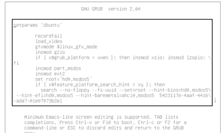

一些图形桌面（如 Ubuntu）将 GRUB 引导菜单隐藏在图形界面之后。通常，当系统首次启动时按住 Shift 键，即可显示 GRUB 引导菜单。

## 其他引导加载器

虽然 GRUB Legacy 和 GRUB2 是目前使用最流行的 Linux 引导加载器程序，但根据您使用的 Linux 发行版不同，您可能会遇到其他几种。

`Syslinux 项目`包含五个具有特定用途的独立引导加载器程序：

- `SYSLINUX`：用于使用 Microsoft FAT 文件系统的系统的引导加载器（常用于从 USB 闪存盘启动）

- `EXTLINUX`：用于从 ext2、ext3、ext4 或 btrfs 文件系统启动的迷你引导加载器

- `ISOLINUX`：用于从 LiveCD 或 LiveDVD 启动的引导加载器

- `PXELINUX`：用于从网络服务器启动的引导加载器


- `MEMDISK`：用于从其他 SYSLINUX 引导加载器启动旧版 DOS 操作系统的实用程序

ISOLINUX 引导加载器在发布 LiveDVD 版本的发行版中很流行。该引导加载器需要两个文件：包含引导加载器程序映像的 `isolinux.bin` 和包含配置设置的 `isolinux.cfg`。

PXE `LINUX` 引导加载器使用 `Pre-boot eXecution Environment (PXE)` 标准，该标准定义了网络工作站如何从中央网络服务器启动并加载操作系统。PXE 使用 `DHCP` 为工作站分配网络地址，并使用 `BOOTP` 从服务器加载引导加载器映像。网络服务器必须支持 `TFTP` 协议，以便将启动映像文件传输到工作站。

要利用 `PXE LINUX`，`TFTP` 服务器需要将 `PXE LINUX` 引导加载器程序（存储为 `/tftpboot/pxelinux.0`）提供给工作站下载。每个工作站还必须在 `/tftpboot/pxelinux.cfg` 目录中提供可用的配置文件。文件根据工作站的 `MAC` 地址命名，并包含该工作站所需的具体配置设置。


> 虽然 PXE 最初设计使用 `TFTP` 加载启动映像，但它已被修改为也可以使用 `NFS`、`HTTP` 甚至 `FTP` 从网络服务器加载存储的引导加载器映像。

## 系统恢复

启动 Linux 系统后却没有出现登录提示符，这是最糟糕的事情。Linux 启动过程中可能会出现许多问题，但大多数问题归结为两个类别：

- 内核故障
- 驱动器故障

以下部分介绍了您可以遵循的一些标准故障排除实践，以尝试恢复无法启动的 Linux 系统。

### 内核故障

内核故障是指 Linux 内核在内存中停止运行，导致 Linux 系统崩溃。这通常被称为 `内核恐慌`（`kernel panic`）。内核恐慌通常是软件变更的结果，例如在没有适当的模块或库变更的情况下安装新内核，或在新运行级别启动（或停止）程序。通常，这些类型的引导错误可以通过使用替代方法启动系统并编辑必要的文件来更改系统设置来修复。

### 在启动时选择以前的内核

导致启动失败的最大罪魁祸首之一是在升级 Linux 内核时，无论是自行升级还是从打包的发行版升级。当您安装新的内核文件时，保留旧的内核文件并在 `GRUB` 引导菜单中创建一个指向新内核的额外条目，始终是一个好主意。

通过在 `GRUB` 引导菜单中创建多个内核条目，你可以选择要启动的内核版本。如果新内核无法正确启动，你可以重新启动并选择旧的内核版本。

大多数 Linux 发行版在添加新内核时会自动执行此操作，在引导菜单中保留最近的旧内核可用，如图 5.2 所示。

### 图 5.2 带有多个内核选项的 Rocky Linux Grub 引导菜单

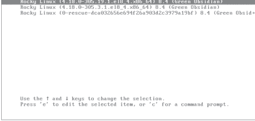

## 单用户模式

有时你可能需要执行某种系统维护操作，例如添加新的硬件模块或库文件，以便系统能够正确启动。在这些情况下，你希望系统启动时不允许多个用户连接，尤其是在服务器环境中。这被称为单用户模式。

`GRUB` 菜单允许你通过在引导菜单命令的 `Linux` 行中添加 `single` 命令来以单用户模式启动系统。为此，请在 `GRUB` 引导菜单的引导选项上按 `E` 键。

当你添加 `single` 命令时，系统将进入运行级别 1（或者对于使用 `Systemd` 启动方法的系统，进入 `runlevel-1.target`），这会为 `root` 用户账户创建一个单一登录界面。一旦你以 `root` 用户账户登录，你就可以修改必要的模块、`ini` 脚本或 `GRUB` 引导菜单选项，以使系统正确启动。

## 传递内核参数

除了单用户模式技巧外，你还可以在 `GRUB` 引导菜单的 `Linux` 命令中添加其他内核参数。内核接受用于改变其激活的硬件模块或查找特定硬件设备的设置的内核参数（这对于声卡和网卡尤其如此）。你可以在 `Linux` 命令中将不同的硬件设置指定为内核的额外参数，然后从 `GRUB` 菜单中的该条目进行启动。

## 根驱动器故障

对于 Linux 系统管理员来说，或许最糟糕的感觉就是看到引导加载程序无法读取根驱动器设备。然而，这种类型的错误可能并不是致命的，因为有时可以从损坏的根驱动器中恢复。

## 使用救援盘

许多 Linux 发行版都提供了 `救援盘`，以应对致命磁盘错误。救援盘通常从 `CD` 驱动器或作为 `USB` 启动盘启动，并将一个小型 Linux 系统加载到内存中。由于 Linux 系统完全在内存中运行，它可以释放所有工作站硬盘的空间，以便进行检查和修复。从系统命令行提示符，你可以对系统硬盘执行一些诊断和修复任务。

用于检查和修复硬盘错误的首选工具是 `fsck` 命令。`fsck` 命令并不是一个程序，而是一组针对不同类型文件系统（如 `ext2`、`ext3` 和 `ext4`）的命令的别名。你需要针对包含 Linux 系统根目录的分区设备名称运行 `fsck` 命令。例如，如果根目录位于 `/dev/sda1` 分区上，你将运行以下命令：

```
# fsck /dev/sda1
```

`fsck` 命令将检查 `inode` 表以及存储在硬盘上的文件块，并尝试将它们进行协调。如果发生任何错误，系统会提示你选择是否修复它们。如果分区上有许多错误，你可以添加 `-y` 参数自动回答所有修复问题“是”。在成功修复后，再次运行 `fsck` 命令是一个好主意，以确保所有错误都已被发现并纠正。继续运行 `fsck` 命令，直到你获得一次没有错误的干净运行结果。

## 挂载根驱动器

当 `fsck` 修复完成后，你可以通过将修复后的分区挂载到在内存中创建的虚拟目录中来测试该分区。只需使用 `mount` 命令将其挂载到一个可用的挂载目录：

```
# mount /dev/sda1 /media
```

你可以检查分区中存储的文件系统，以确保其未损坏。在重新启动之前，你应该使用 `umount` 命令卸载该分区：

```
# umount /dev/sda1
```

成功卸载分区后，你可以使用标准引导加载程序重新启动你的 Linux 系统，并尝试使用标准内核和运行级别进行启动。

虽然以单用户模式启动 Linux 并不常用，但知道如何操作以防万一总是很有帮助的。练习 5.1 通过一系列步骤帮助你练习以单用户模式启动 Linux 系统。

## 练习 5.1

### 使用救援模式

本练习将演示如何在单用户模式下启动你的 Linux 发行版，以便检查文件系统和配置，而无需执行完整的启动过程。要使用单用户模式，请遵循以下步骤：

1. 首先，正常启动你的 Linux 发行版，并在标准登录提示符（无论是图形桌面还是命令行登录）上以你的正常用户账户登录。
2. 输入 `runlevel` 以确定你系统的默认运行级别。返回的第一个字符指代前一个运行级别（N 表示由于系统已启动，没有前一个运行级别）。第二个字符是当前运行级别。在基于 Debian 的系统上这很可能是 2，在基于 Red Hat 的命令行系统上可能是 3，或者在基于 Red Hat 的图形桌面系统上可能是 5。
3. 现在重新启动你的系统，当 `GRUB2` 菜单出现时，按一个方向键以停止倒计时计时器。如果你使用的是隐藏 `GRUB2` 菜单的 Linux 发行版（例如 Ubuntu），请在系统启动时按住 `Shift` 键以显示 `GRUB2` 菜单。
4. 在 `GRUB2` 菜单中，使用方向键转到默认菜单条目（通常是列表中的第一个条目），然后按 `E` 键。这将使 `GRUB2` 进入编辑模式。
5. 查找 `linux` 或 `linux16` 菜单命令行。这些定义了用于启动会话的内核。
6. 转到 `linux` 或 `linux16` 行的末尾，并添加单词 `single`。按 `Ctrl+X` 临时保存更改，并使用该菜单条目启动你的系统。
7. Linux 系统将进入单用户模式。根据你的 Linux 发行版不同，它可能会提示你输入 `root` 用户账户密码，或按 `Ctrl+D` 继续正常启动。输入 `root` 用户账户密码以进入单用户模式。
8. 现在你处于 `root` 用户命令提示符。输入命令 `runlevel` 以查看当前运行级别。它应该显示运行级别 1。从这里你可以修改配置文件、检查文件系统并更改用户账户。
9. 通过输入 `reboot` 重启系统。
10. 你应该返回到之前的标准启动过程和 `GRUB2` 菜单选项。选择标准 `GRUB2` 菜单选项以启动你的系统，然后登录。
11. 在命令行提示符下，输入 `runlevel` 以确保你已回到 Linux 系统的正常默认运行级别。

## 摘要

虽然 Linux 发行版的设计目标是无需用户干预即可启动，但了解 Linux 启动过程有助于应对可能出现的问题。大多数 Linux 系统使用 `GRUB Legacy` 或 `GRUB2` 引导加载程序。这些程序都驻留在 `BIOS` 主引导记录（`Master Boot Record`）中，或者在 `UEFI` 系统的 `ESP` 分区中。引导加载程序加载 Linux 内核程序，该程序随后运行 `SysV init` 或 `Systemd` 程序以启动 Linux 系统所需的各个后台程序。

对 Linux 启动的讨论如果不包括系统恢复方法是不完整的。如果你的 Linux 系统无法启动，最可能的原因是内核问题或根设备问题。对于内核问题，你通常可以修改 `GRUB` 菜单以添加额外的内核参数，甚至从旧版本的内核启动。对于根驱动器问题，你可以尝试从救援模式启动到运行在内存中的 Linux 版本，然后使用 `fsck` 命令修复损坏的根驱动器。

## 考试要点

**描述 Linux 启动过程。** `BIOS` 或 `UEFI` 从主引导记录启动引导加载程序，通常是 Linux `GRUB Legacy` 或 `GRUB2` 程序。引导加载程序将 Linux 内核加载到内存中，内核转而查找要运行的 `/init` 程序。`/init` 程序启动独立的应用程序，并启动命令行终端或图形桌面管理器。

**描述 Linux GRUB Legacy 和 GRUB2 引导加载程序。** `GRUB Legacy` 引导加载程序将文件存储在 `/boot/grub` 文件夹中，并使用 `menu.lst` 或 `grub.conf` 配置文件来定义启动时使用的命令。这些命令可以创建一个引导菜单，允许你在多个引导位置、选项或功能之间进行选择。你必须使用 `grub-install` 程序将 `GRUB Legacy` 引导加载程序安装到主引导记录中。`GRUB2` 引导加载程序也将文件存储在 `/boot/grub` 文件夹中，但它使用 `grub.cfg` 配置文件来定义菜单命令。你不直接编辑 `grub.cfg` 文件，而是将文件存储在 `/etc/default/grub` 文件或 `/etc/grub.d` 文件夹中的单个配置文件中。运行 `grub-mkconfig` 程序从配置文件生成 `GRUB2` 配置，然后将输出重定向到 `/etc/grub.cfg` 文件。

**描述替代的 Linux 引导加载程序。** `LILO` 引导加载程序用于较旧的 Linux 系统。它使用 `/etc/lilo.conf` 配置文件来定义引导选项。Syslinux 项目创建了最受欢迎的替代 Linux 引导加载程序。`SYSLINUX` 引导加载程序提供了一个在 `FAT` 文件系统（如软盘和 `USB` 内存棒）上运行的引导加载程序。`ISOLINUX` 引导加载程序在 `LiveCD` 发行版中很流行，因为它可以从 `CD` 或 `DVD` 启动。它将引导加载器程序存储在 `isolinux.bin` 文件中，并将配置设置存储在 `isolinux.cfg` 文件中。`PXELINUX` 引导加载程序允许网络工作站从网络服务器启动。服务器必须包含 `pxeLinux.0` 映像文件以及 `pxelinux.cfg` 目录，该目录包含针对每个工作站单独的配置文件。`EXTLINUX` 引导加载程序是一个小型引导加载程序，可用于较小的嵌入式 Linux 系统。

**描述如何从内核恐慌中恢复。** `GRUB` 引导加载程序提供了一些选项，如果你的 Linux 系统无法启动或因内核恐慌问题而停止，这些选项可以帮助你。你可以在 `GRUB` 启动菜单中按 `E` 键编辑任何启动菜单条目，然后添加额外的内核参数，例如将系统置于单用户模式。你也可以使用救援磁盘将 Linux 启动到内存中，然后使用 `fsck` 命令修复任何损坏的硬盘，最后使用 `mount` 命令挂载它们以检查文件。

## 复习题

1. 工作站固件在启动时启动哪个程序？

   - A. 引导加载程序
   - B. `fsck` 程序
   - C. Windows 操作系统
   - D. `mount` 命令
   - E. `mkninitrd` 程序

2. 固件首先在哪里查找 Linux 引导加载程序？

   - A. `/boot/grub` 文件夹
   - B. 主引导记录 (MBR)
   - C. `/var/log` 文件夹
   - D. 引导分区
   - E. `/etc` 文件夹

3. ______ 命令允许我们检查最近的启动消息。

   - A. `fsck`
   - B. `init`
   - C. `mount`
   - D. `dmesg`
   - E. `mkninitrd`

4. 大多数 Linux 发行版使用哪个文件夹来存储启动日志？

   - A. `/etc`
   - B. `/var/messages`
   - C. `/var/log`
   - D. `/boot`
   - E. `/proc`

5. 工作站 BIOS 尝试在哪里查找引导加载程序？（选择所有适用项。）

   - A. 内部硬盘
   - B. 外部硬盘
   - C. DVD 驱动器
   - D. USB 存储棒
   - E. 网络服务器

6. 主引导记录位于哪里？（选择所有适用项。）

   - A. 系统第一个硬盘的第一个扇区
   - B. 系统任意硬盘的引导分区
   - C. 系统第一个硬盘的最后一个扇区
   - D. 系统任意硬盘的任意扇区
   - E. 系统第二个硬盘的第一个扇区

7. EFI 系统分区 (ESP) 在 Linux 系统中存储在 ______ 目录中。

   - A. `/boot`
   - B. `/etc`
   - C. `/var`
   - D. `/boot/efi`
   - E. `/boot/grub`

8. UEFI 引导加载程序文件使用什么文件扩展名？

   - A. `.cfg`
   - B. `.uefi`
   - C. `.lst`
   - D. `.conf`
   - E. `.efi`

9. 哪个是 Linux 中使用的第一个引导加载程序？

   - A. GRUB Legacy
   - B. LILO
   - C. GRUB2
   - D. SYSLINUX
   - E. ISOLINUX

10. GRUB Legacy 配置文件存储在哪里？

    - A. `/boot/grub`
    - B. `/boot/efi`
    - C. `/etc`
    - D. `/var`
    - E. `/proc`

11. GRUB2 配置文件存储在哪里？（选择所有适用项。）

    - A. `/proc`
    - B. `/etc/grub.d`
    - C. `/boot/grub`
    - D. `/boot/efi`
    - E. `/var`

12. 你必须运行 ______ 命令来生成 GRUB2 的 `grub.cfg` 配置文件。

    - A. `mkninetrtd`
    - B. `mkninramfs`
    - C. `grub-mkconfig`
    - D. `grub-install`
    - E. `fsck`

13. 你必须运行什么命令来保存对 GRUB Legacy 启动菜单的更改？

    - A. `mkninetrtd`
    - B. `mkninramfs`
    - C. `grub-mkconfig`
    - D. `grub-install`
    - E. `fsck`

14. ______ 固件方法已取代大多数现代 IBM 兼容计算机上的 BIOS。

    - A. FTP
    - B. UEFI
    - C. PXE
    - D. NFS
    - E. HTTPS

15. Linux 使用哪个内存区域来存储启动消息？

    - A. BIOS
    - B. GRUB 引导加载程序
    - C. MBR
    - D. initrd 内存盘
    - E. 内核环形缓冲区

16. 为了让 Linux 系统以单用户模式启动，你会在 GRUB2 的 `linux` 命令末尾添加什么命令参数？

    - A. `single`
    - B. `fsck`
    - C. `mkninetrtd`
    - D. `mkninramfs`
    - E. `dmesg`

17. 当 Linux 系统因系统错误而停止时，通常使用的术语是什么？

    - A. 内核恐慌
    - B. 内核环形缓冲区
    - C. initrd 内存盘
    - D. 引导加载程序
    - E. 固件

18. ______ 命令生成用于启动的 GRUB2 配置。

    - A. `mkinitrd`
    - B. `grub-mkconfig`
    - C. `grub-install`
    - D. `mkinitramfs`
    - E. `dmesg`

19. 哪个程序允许你修复损坏的硬盘分区？

    - A. `mount`
    - B. `umount`
    - C. `fsck`
    - D. `dmesg`
    - E. `mkinitrd`

20. 哪个命令允许你向运行中的 Linux 系统上的虚拟目录添加分区？


## 第 6 章

### 维护系统启动和服务


- **目标 1.4：** 在给定场景中，配置并使用适当的进程和服务
- **目标 4.5：** 在给定场景中，使用 `systemd` 诊断和解决 Linux 系统的常见问题


在你的 Linux 系统遍历启动过程后，它进入最终的系统初始化阶段，此时需要启动各种服务。服务或守护进程是一个执行特定任务的程序。第 2 章“服务简介”中介绍了几种服务。

初始化守护进程 (`init`) 决定启动哪些服务以及启动顺序。此守护程序还允许你停止和管理各种系统服务。

SysV 初始化 (SysV) 基于 Unix System V 初始化守护程序。虽然许多主要的 Linux 发行版不再使用它，但你仍然可能在公司较旧的 Linux 服务器中发现它的身影。

`systemd` 初始化方法是新近出现的。从 2010 年左右开始，它现在是流行的系统服务初始化和管理机制。此守护程序通过并行方式启动服务来减少初始化时间。

除了初始化之外，这些守护程序还负责在启动时间之后很好地管理这些服务。我们将在本章中探讨这些概念。

### 查看 init

在我们开始检查各种服务管理方法之前，先查看一下 `init` 程序本身是个好主意。传统上，服务启动由 `init` 程序处理。此程序可以位于 `/etc/`、`/bin/` 或 `/sbin/` 目录中。此外，它通常具有进程 ID (PID) 为 1。

`init` 程序或 `systemd` 是 Linux 系统上每个服务的父进程。如果你的系统安装了 `pstree` 程序，你可以通过在命令行键入 `pstree -p 1` 来查看描绘这种关系的图表。

这些信息将帮助你确定当前 Linux 发行版使用的是哪种系统初始化方法，`systemd` 还是 SysV init。首先使用 `which` 命令找到 `init` 程序的位置。Listing 6.1 中展示了一个示例。

```bash
# which init
/sbin/init
#
```

既然知道了 `init` 程序的位置，使用超级用户权限，你可以使用 `readlink -f` 命令查看该程序是否链接到另一个程序，如 Listing 6.2 所示。

#### Listing 6.2 检查 `init` 程序的链接

```bash
# readlink -f /sbin/init
/usr/lib/systemd/systemd
#
```

你可以从 Listing 6.2 中看到，该系统实际上使用的是 `systemd`。你可以通过查看 PID 1 来验证这一点，如 Listing 6.3 所示。

#### Listing 6.3 检查 PID 1

```bash
# ps -p 1
PID TTY          TIME CMD
  1 ?          00:00:06 systemd
#
```

在 Listing 6.3 中，使用了 `ps` 实用程序。此实用程序允许你查看进程。进程是一个正在运行的程序。`ps` 命令在 `CMD` 列中显示特定进程正在运行的程序。在这种情况下，`systemd` 程序正在运行。因此，该 Linux 系统使用 `systemd`。

请记住，这些发现方法并非万无一失。此外，还有其他系统初始化方法，例如现已不再使用的 Upstart。以下简短列表列出了使用 Upstart 的一些 Linux 发行版版本：

- Fedora `v9`~`v14`
- openSUSE `v11.3`~`v12.2`
- RHEL `v6`
- Ubuntu `v6.10`~`v15.04`

如果你使用的是第 1 章“准备你的环境”中推荐的发行版版本，请注意，那些发行版都是 `systemd` 系统。

### 管理 systemd 系统

`systemd` 方法在 Linux 系统管理服务方面引入了一个主要的范式转变。现在，可以在系统启动时、特定硬件组件连接到系统时、某些其他服务启动时等情况下启动服务。某些服务可以基于定时器启动。

在接下来的部分中，我们将重点介绍启动、停止和控制由 `systemd` 管理的操作。我们将带你了解 `systemd` 技术的结构、命令和配置文件。

# 探索单元文件

开始探索 `systemd` 的最简单方法是*通过 systemd 单元*。单元定义了服务、服务组或操作。每个单元由名称、类型和配置文件组成。目前有 12 种不同的 `systemd` 单元类型，如下所示：

- `automount`（自动挂载）
- `device`（设备）
- `mount`（挂载）
- `path`（路径）
- `scope`（作用域）
- `service`（服务）
- `slice`（切片）
- `snapshot`（快照）
- `socket`（套接字）
- `swap`（交换）
- `target`（目标）
- `timer`（定时器）

`systemctl` 实用程序是管理 `systemd` 和系统服务的主要入口。其基本语法如下：

```
systemctl [OPTIONS...] COMMAND [NAME...]
```

您可以使用 `systemctl` 实用程序提供当前在您的 Linux 系统中加载的各种单元列表。Listing 6.4 展示了一个简化的示例。

**Listing 6.4** 查看 systemd 单元

```
$ systemctl list-units
UNIT                        LOAD    ACTIVE SUB     DESCRIPTION
[...]
smartd.service              loaded  active running Self Monitor[...]
sshd.service                loaded  active running OpenSSH serv[...]
sysstat.service             loaded  active exited  Resets Syste[...]
[...]
graphical.target            loaded  active active    Graphical I[...]
[...]
$
```

在 Listing 6.4 中，您可以看到各种单元以及附加信息。单元通过 `name.type`（名称.类型）格式由其名称和类型标识。系统服务（守护进程）的单元文件具有 `.service` 扩展名。因此，安全 shell (SSH) 守护进程 `sshd` 的单元文件名为 `sshd.service`。

来自 `systemctl` 实用程序的许多显示默认使用 `less` 分页器。因此，要退出显示，您必须按 `q` 键。如果您想关闭 `systemctl` 实用程序使用 `less` 分页器的功能，请在命令末尾添加 `--no-pager` 选项。

服务组通过 `target` 单元文件启动。在系统启动时，`default.target` 单元负责确保在系统初始化时启动所有必需和期望的服务。它被设置指向另一个 `target` 单元文件的符号链接，如 Ubuntu 发行版上的 Listing 6.5 所示。

**Listing 6.5** 查看 default.target 链接

```
$ find / -name default.target 2>/dev/null
/usr/lib/systemd/system/default.target
[…]
$ readlink -f /usr/lib/systemd/system/default.target
/usr/lib/systemd/system/graphical.target
$ systemctl get-default
graphical.target
$
```

首先，在 Listing 6.5 中，`find` 实用程序用于定位 `default.target` 单元文件的完整文件名。然后使用 `readlink` 命令找到实际的目标文件，该文件决定了系统启动时启动哪些服务。在这种情况下，目标单元文件是 `graphical.target`。

同样，请注意 Listing 6.5 中 `systemctl` 命令比另外两个命令更容易使用。它只是 `systemctl get-default`，并显示实际的目标文件。由于 `default.target` 文件位于不同发行版的不同目录中，最好始终使用 `systemctl` 实用程序。Table 6.1 展示了更常用的系统启动 `target` 单元文件。

**TABLE 6.1** 常用系统启动 target 单元文件

| 名称 | 描述 |
|:---|:---|
| `graphical.target` | 通过本地终端和/或网络为多用户提供系统访问权限。提供图形用户界面 (GUI) 访问。 |
| `multi-user.target` | 通过本地终端和/或网络为多用户提供系统访问权限。不提供 GUI 访问。 |
| `network-online.target` | 提供一个在系统建立网络连接后运行的 target。这对于启动需要网络存在的应用程序非常有用。 |
| `runleveln.target` | 提供对 SysV init 系统的向后兼容性，其中 `n` 设置为 1–6，以表示所需的 SysV 运行级别等效项。 |

在 Table 6.1 中，您会注意到 `systemd` 提供了对经典 SysV init 系统的向后兼容性。SysV 运行级别将在本章后面涵盖。

> **提示**
>
> `systemd` 的主配置文件是 `/etc/systemd/system.conf` 文件。在这个文件中，您可以发现所有默认配置设置都通过井号 (#) 被注释掉了。查看此文件是了解当前 `systemd` 配置的快速方法。如果需要修改配置，只需编辑该文件即可。不过，明智的做法是先在命令行输入 `man systemd-system.conf` 查阅该文件的 man 手册页。

### 聚焦服务单元文件

服务单元文件包含信息，例如使用哪个环境文件、何时必须启动服务、哪些 `target` 希望启动此服务等。这些配置文件位于不同的目录中。

请记住，单元配置文件的目录位置至关重要，因为如果文件在两个不同的目录位置中找到，其中一个将优先于另一个。以下列表按优先级从低到高显示了目录位置：

1. `/etc/systemd/system/`
2. `/run/systemd/system/`
3. `/usr/lib/systemd/system/`

要查看可用的各种服务单元文件，您可以再次使用 `systemctl` 实用程序。然而，与查看单元时所需的命令略有不同，如 Listing 6.6 所示。

**Listing 6.6** 查看 systemd 单元文件

```
$ systemctl list-unit-files
UNIT FILE                    STATE
[...]
dev-hugepages.mount        static
dev-mqueue.mount           static
proc-fs-nfsd.mount         static
[...]
nfs.service                  disabled
nfslock.service              static
ntpd.service                 disabled
ntpdate.service              disabled
[...]
ctrl-alt-del.target        static
default.target               static
emergency.target             static
[...]
```

除了单元文件的基本名称外，您还可以在 Listing 6.6 中看到单元文件的状态。这些状态被称为启用状态（enablement states），指的是服务启动的时机。至少有 12 种不同的启用状态，但您通常会看到这三种：

- `enabled`：服务在系统启动时启动。
- `disabled`：服务不在系统启动时启动。
- `static`：如果另一个单元依赖于它，则服务启动。也可以手动启动。

要查看存储特定 `systemd` 单元文件的目录，请使用 `systemctl` 实用程序。Ubuntu 发行版上的示例如 Listing 6.7 所示。

**Listing 6.7** 查找并显示 systemd 单元文件

```
$ systemctl cat cron.service
# /lib/systemd/system/cron.service
[Unit]
Description=Regular background program processing daemon
Documentation=man:cron(8)
After=remote-fs.target nss-user-lookup.target
[Service]
EnvironmentFile=-/etc/default/cron
ExecStart=/usr/sbin/cron -f $EXTRA_OPTS
IgnoreSIGPIPE=false
KillMode=process
Restart=on-failure
[Install]
WantedBy=multi-user.target
$
```

请注意，在 Listing 6.7 中，第一行显示 `cron.service` 单元文件的基本名称和目录位置。接下来的几行是单元配置文件的内容。

对于服务单元文件，有三个主要的配置部分：

- `[Unit]`
- `[Service]`
- `[Install]`

在单元配置文件的 `[Unit]` 部分中，有基本的*指令*（directives）。指令是修改配置的设置，例如 Listing 6.7 中显示的 `After` 设置。Table 6.2 描述了常用的 `[Unit]` 部分指令。

**TABLE 6.2** 常用服务单元文件 `[Unit]` 部分指令

| 指令 | 描述 |
|---|---|
| `After` | 设置此单元在指定单元之后启动。 |
| `Before` | 设置此单元在指定单元之前启动。 |
| `Description` | 描述单元。 |
| `Documentation` | 设置一个指向文档来源的统一资源标识符 (URI) 列表。URI 可以是网络位置、特定系统文件、info 页面和 man 手册页。 |
| `Conflicts` | 设置此单元不与指定单元一起启动。如果指定的任何单元启动，此单元将不会启动。（`Requires` 的反义。） |
| `Requires` | 设置此单元与指定单元一起启动。如果指定的任何单元未启动，此单元将*未启动*。（`Conflicts` 的反义。） |
| `Wants` | 设置此单元与*指定*单元一起启动。如果指定的任何单元未启动，此单元*仍然*启动。 |


> `systemd` 和单元配置文件的 man 手册页中包含大量有用的信息。只需输入 `man -k systemd` 即可找到若干您可以探索的项目。例如，使用 `man systemd.service` 命令探索 `service` 类型单元文件指令及其他内容。您可以在命令行输入 `man systemd.directives` 查找有关各种指令的信息。

单元文件中的 `[Service]` 指令设置了特定于该服务的配置项。Table 6.3 描述了常用的 `[Service]` 部分指令。

**TABLE 6.3** 常用服务单元文件 `[Service]` 部分指令

| 指令 | 描述 |
|---|---|
| `ExecReload` | 指示在单元重新加载时运行的脚本或命令（以及选项）。 |
| `ExecStart` | 指示在单元启动时运行的脚本或命令（以及选项）。 |
| `ExecStop` | 指示在单元停止时运行的脚本或命令（以及选项）。 |
| `Environment` | 设置环境变量替代项，以空格分隔。 |
| `EnvironmentFile` | 指示一个包含环境变量替代值的文件。 |
| `RemainAfterExit` | 设置为 `no`（默认值）或 `yes`。如果设置为 `yes`，即使由 `ExecStart` 启动的进程终止，服务仍保持活动状态。如果设置为 `no`，当由 `ExecStart` 启动的进程终止时，将调用 `ExecStop`。 |
| `Restart` | 当由 `ExecStart` 启动的进程终止时，服务将被重启。如果发出 `systemctl restart` 或 `systemctl stop` 命令，则此指令被忽略。设置为 `no`（默认值）、`on-success`、`on-failure`、`on-abnormal`、`on-watchdog`、`on-abort` 或 `always`。 |
| `Type` | 设置启动类型。 |

表 6.3 中给出的说明不足以完全解释 `[Service]` 的 `Type` 指令。该指令至少可以设置为六种不同的规范，其中最常见的包括：

- `forking`：`ExecStart` 启动父进程。父进程创建服务的主进程作为子进程，然后父进程退出。
- `simple`：（默认值）`ExecStart` 启动服务的主进程。
- `oneshot`：`ExecStart` 启动服务的主进程，这通常是一个配置设置或快速命令，进程随后退出。


- `idle`：`ExecStart` 启动服务的主进程，但它会等待直到所有其他启动任务完成。


> 你只会发现单元文件中的 `[Service]` 部分位于服务单元文件中。这个中间部分对于每种单元类型都不同。例如，在自动挂载单元文件中，你会发现一个 `[Automount]` 部分作为中间的单元文件部分。

另一个需要额外解释的 `[Service]` 配置设置是 `Environment` 指令。Linux 系统使用一种称为环境变量的功能来存储有关 shell 会话和工作环境的信息（因此得名环境变量）。如果你希望确保某个环境变量为你的服务正确设置，你需要使用 `Environment` 指令。列表 6.8 展示了一个 Rocky Linux 发行版的示例片段。

### 列表 6.8 查看服务单元文件的 `Environment` 指令

```shell
$ echo $PATH
/usr/local/bin:/usr/bin:/usr/local/sbin:/usr/sbin:[...]

$ systemctl --no-pager cat anaconda.service
# /usr/lib/systemd/system/anaconda.service
[Unit]
Description=Anaconda
[...]
[Service]
Type=forking
Environment=HOME=/root MALLOC_CHECK_=2 MALLOC_PERTURB_=204 PATH=/usr/bin:/bin:/sbin:/usr/sbin:/mnt/sysimage/bin: [...]
LANG=en_US.UTF-8 [...]
[...]
```

在列表 6.8 中，你可以看到 `PATH` 环境变量的内容被显示。这个环境变量是一个用冒号分隔的目录列表，进程在这些目录中查找命令。`anaconda.service` 单元文件使用 `Environment` 指令将其特定的环境变量设置为其期望的环境参数。这些参数由空格分隔。你可以从列表 6.8 中看到，`Environment` 指令设置的一个参数是 `PATH`。


某些服务类型单元文件使用 `EnvironmentFile` 指令，而不是 `Environment` 指令。此指令指向包含环境参数的文件。列表 6.7 中显示的 `cron.service` 单元文件正是这样做的。

单元文件中的 `[Install]` 指令决定了如果启用或禁用特定服务会发生什么。一个已启用的服务是在系统启动时启动的服务。一个已禁用的服务是在系统启动时不启动的服务。表 6.4 描述了常用的 `[Install]` 部分指令。

## 表 6.4 常用的服务单元文件 `[Install]` 部分指令

| 指令 | 描述 |
| :--- | :--- |
| `Alias` | 设置额外的名称，可用于在 `systemctl` 命令中标识服务。 |
| `Also` | 设置必须与此服务一起启用或禁用的额外单元。通常额外的单元是 socket 类型的单元。 |
| `RequiredBy` | 指定需要此服务的其他单元。 |
| `WantedBy` | 指定管理此服务的目标单元。 |

## 聚焦目标单元文件

对于 systemd，你需要理解服务单元文件以及目标单元文件。目标单元文件的主要目的是在系统启动时分组启动各种服务。默认目标单元文件 `default.target` 符号链接到系统启动时使用的目标单元文件。在列表 6.9 中，使用 `systemctl` 命令定位并显示了默认目标单元文件。

### 列表 6.9 查找并显示 systemd 目标单元文件

```shell
$ systemctl get-default
graphical.target

$ systemctl cat graphical.target
# /usr/lib/systemd/system/graphical.target
[...]
[Unit]
Description=Graphical Interface
Documentation=man:systemd.special(7)
Requires=multi-user.target
Wants=display-manager.service
Conflicts=rescue.service rescue.target
After=multi-user.target rescue.service rescue.target display-manager.service
AllowIsolate=yes
```

请注意，在列表 6.9 中，`graphical.target` 单元文件具有与服务单元文件相同的许多指令。这些指令在表 6.2 中已经描述过。当然，这些指令适用于目标类型单元文件，而不是服务类型单元文件。例如，`graphical.target` 单元文件中的 `After` 指令将此目标单元设置为在指定单元（如 `multi-user.target`）之后启动。与类似服务单元一样，目标单元也有各种目标依赖链以及冲突。

在列表 6.9 中，还有一个我们尚未介绍的指令。如果将 `AllowIsolate` 指令设置为 `yes`，则允许此目标文件与 `systemctl isolate` 命令一起使用。本章后面将介绍此命令。

## 实际场景

### 修改系统配置文件

偶尔你可能需要根据 Linux 系统的要求更改特定的单元配置文件或添加额外的组件。但是，在执行此任务时要小心。你不应该修改 `/lib/systemd/system/` 或 `/usr/lib/systemd/system/` 目录中的任何单元文件。

要修改单元配置文件，请将文件复制到 `/etc/systemd/system/` 目录并在那里进行修改。此修改后的文件将优先于留在原始目录中的原始单元文件。此外，它还将保护修改后的单元文件免受软件更新的影响。

如果你只有少量额外组件，你可以扩展配置。使用超级用户权限，在 `/etc/systemd/system/` 目录中创建一个名为 `service.service-name.d` 的新子目录，其中 `service-name` 是服务的名称。例如，对于 OpenSSH 守护进程，你会创建 `/etc/systemd/system/service.sshd.d` 目录。这个新创建的目录被称为 drop-in 文件目录，因为你可以放入额外的配置文件。创建任何配置文件的名称类似于 `description.conf`，其中 `description` 描述配置文件的目的，例如 `local` 或 `script`。将你的修改指令添加到这个配置文件中。

在进行这些修改后，还有几个需要的步骤。通过发出 `systemd-delta` 命令查找并比较覆盖其他单元文件的单元文件。它将显示任何重复、扩展、重定向等的单元文件。审查此列表。它将帮助你避免修改或扩展服务单元文件带来的任何非预期后果。

要使你的更改生效，请对你修改或扩展了单元文件的服务发出 `systemctl daemon-reload` 命令。完成该任务后，发出 `systemctl restart` 命令以启动或重启服务。这些命令将在下一节中解释。

## 查看 systemctl

你可能已经注意到，虽然有各种命令来管理 systemd 和系统服务，但使用 `systemctl` 实用程序更容易且更快。

有几个基本的 `systemctl` 命令可供你管理系统服务。其中一个常用的是 `status` 命令。它提供了丰富的信息。列表 6.10 展示了 Ubuntu 发行版上的两个示例片段。

### 列表 6.10 通过 systemctl 查看服务单元的状态

```shell
$ systemctl status cron

 cron.service - Regular background program processing daemon
    Loaded: loaded (/lib/systemd/system/cron.service; disabled; vendor
preset: >
    Active: inactive (dead) since Sat 2021-11-20 14:28:12 EST; 5s ago
   Docs: man:cron(8)
  Process: 593 ExecStart=/usr/sbin/cron -f $EXTRA_OPTS (code=killed,
signal=T)
   Main PID: 593 (code=killed, signal=TERM)
```

Nov 20 14:13:44 ubuntu20 systemd[1]: 已启动定期后台程序进程

Nov 20 14:13:44 ubuntu20 cron[593]: (CRON) 信息 (pidfile fd = 3)

Nov 20 14:13:44 ubuntu20 cron[593]: (CRON) 信息 (正在运行 @reboot 任务)

Nov 20 14:17:01 ubuntu20 CRON[2329]: pam_unix(cron:session): 会话已打开

Nov 20 14:17:01 ubuntu20 CRON[2330]: (root) 命令 ( cd / & run-parts --report )

Nov 20 14:17:01 ubuntu20 CRON[2329]: pam_unix(cron:session): 会话已关闭

Nov 20 14:28:12 ubuntu20 systemd[1]: 正在停止定期后台程序进程

Nov 20 14:28:12 ubuntu20 systemd[1]: cron.service: 成功。

Nov 20 14:28:12 ubuntu20 systemd[1]: 已停止定期后台程序进程

$ systemctl status sshd

ssh.service - OpenBSD 安全 Shell 服务器

   加载: 已加载 (/lib/systemd/system/ssh.service; 已启用; 厂商预设: 已启用)

   状态: 自 2021 年 11 月 20 日星期六 14:13:45 EST 起处于活动 (运行) 状态；12min 前

     文档: man:sshd(8)

           man:sshd_config(5)

 主 PID: 686 (sshd)

   任务: 1 (限制: 9469)

 内存: 2.3M

 CGroup: /system.slice/ssh.service

           └─686 sshd: /usr/sbin/sshd -D [监听器] 0 of 10-100 启动次数

Nov 20 14:13:44 ubuntu20 systemd[1]: 正在启动 OpenBSD 安全 Shell 服务器...

Nov 20 14:13:45 ubuntu20 sshd[686]: 服务器正在 0.0.0.0 端口 22 上监听。

Nov 20 14:13:45 ubuntu20 sshd[686]: 服务器正在 :: 端口 22 上监听。

Nov 20 14:13:45 ubuntu20 systemd[1]: 已启动 OpenBSD 安全 Shell 服务器。

在列表 6.10 中，第一个 `systemctl` 命令显示了 `cron` 服务的状态。请注意实用程序输出的第三行。它表明该服务是 `disabled`（已禁用）的。第四行表明该服务是 `inactive`（非活动）的。本质上，这意味着 `cron` 服务未在运行（`inactive`），且未配置为在系统启动时自动启动（`disabled`）。在查看 `cron` 服务状态时，另一个需要关注的项是 `Loaded` 行。注意，这里显示了单元文件的完整文件名和目录位置。

`sshd` 服务的状态也显示出来，表明 `sshd` 正在运行（`active`）并配置为在系统启动时自动启动（`enabled`）。

你可以使用 `systemctl` 实用程序执行几条简单的命令来管理 systemd 服务并查看相关信息。常用命令列在表 6.5 中。这些 `systemctl` 命令通常使用以下语法：

```
systemctl COMMAND UNIT-NAME...
```

## 表 6.5 常用的 `systemctl` 服务管理命令

| 命令 | 描述 |
| :--- | :--- |
| `daemon-reload` | 加载运行中的指定单元的单元配置文件，以便在不停止服务的情况下使单元文件配置更改生效。注意，这与 `reload` 命令不同。 |
| `disable` | 标记指定单元 不 在系统启动时自动启动。 |
| `enable` | 标记指定单元在系统启动时自动启动。 |
| `mask` | 防止指定单元启动。无法使用 `start` 命令或在系统启动时启动该服务。使用 `--now` 选项可立即停止任何正在运行的实例。使用 `--running` 选项仅在下一次重启或使用 `unmask` 之前屏蔽该服务。 |
| `restart` | 停止并立即重启指定单元。如果指定单元尚未启动，则此操作仅会启动它。 |
| `start` | 启动指定单元。 |
| `status` | 显示指定单元的当前状态。 |
| `stop` | 停止指定单元。 |
| `reload` | 加载运行中的指定单元的服务配置文件，以便在不停止服务的情况下使服务配置更改生效。注意，这与 `daemon-reload` 命令不同。 |
| `unmask` | 撤销 `mask` 命令对指定单元的影响。 |

注意表 6.5 中 `daemon-reload` 和 `reload` 命令之间的区别。这是一个重要的区别。如果需要为正在运行的服务加载 systemd 单元文件配置更改，请使用 `daemon-reload` 命令。使用 `reload` 命令加载服务已修改的配置文件。例如，如果你修改了 ntpd 服务的配置文件 `/etc/ntp.conf`，并希望新配置立即生效，你将在命令行发出命令 `systemctl reload ntpd`。


在对服务使用 `systemctl mask` 命令时要小心。这将把服务链接到 `/dev/null`（黑洞），以防止任何形式的服务启动。这被描述为“第三级关闭”。你将无法手动启动该服务。此外，如果你在使用 `mask` 时没有使用 `--running` 选项，该服务在启动时也不会启动。你可以使用 `systemctl unmask` 命令重新启用启动该服务的能力。

除了表 6.5 中的命令外，还有一些其他便捷的 `systemctl` 命令可用于管理系统服务。在 CentOS 发行版上的示例显示在列表 6.11 中。

### 列表 6.11 使用 systemctl 确定服务是否正在运行

```
# systemctl stop sshd
#
# systemctl is-active sshd
inactive
#
# systemctl start sshd
#
# systemctl is-active sshd
active
#
```

在列表 6.11 中，使用 `systemctl` 及其 `stop` 命令停止了 OpenSSH 守护进程（`sshd`）。没有使用 `status` 命令，而是使用 `is-active` 命令快速显示服务已停止（`inactive`）。随后重新启动 OpenSSH 服务，再次使用 `is-active` 命令，显示服务现在正在运行（`active`）。表 6.6 描述了这些有用的服务状态检查命令。

## 表 6.6 便捷的 systemctl 服务状态命令

| 命令 | 描述 |
| :--- | :--- |
| `is-active` | 对于正在运行的服务显示 `active`，对于已达到失败状态的任何服务显示 `failed` |
| `is-enabled` | 对于配置为在系统启动时启动的任何服务显示 `enabled`，对于未配置为在系统启动时启动的任何服务显示 `disabled` |
| `is-failed` | 对于已达到失败状态的任何服务显示 `failed`，对于正在运行的服务显示 `active` |

服务可能因多种原因失败：硬件问题、单元配置文件中缺少依赖项设置、不正确的权限设置等等。你可以使用 `systemctl` 实用程序的 `is-failed` 命令来查看特定服务是否失败。示例显示在列表 6.12 中。

### 列表 6.12 使用 systemctl 确定服务是否失败

```
$ systemctl is-failed NetworkManager-wait-online.service
failed
$
$ systemctl is-active NetworkManager-wait-online.service
failed
$
```

在列表 6.12 中，你可以看到这个特定服务已失败。实际上，这是在启动前断开网线以强制失败所致，因此你可以看到服务的 `failed` 状态。如果服务未处于失败状态，`is-failed` 命令将显示 `active` 状态。

`systemctl` 程序是一个在处理 systemd 问题（如单元名称解析问题和服务未能按时启动）时很有用的工具。由于 systemd 启动方法可以控制 Linux 系统的众多方面，了解 `systemctl` 能为你做什么是个好主意。

## 检查特殊的 systemd 命令

`systemctl` 实用程序拥有若干超越服务管理的命令。此外，systemd 还有一些特殊命令。你可以管理在系统启动时启动哪些目标（服务组），在不同的系统状态之间跳转，甚至可以分析系统的启动时间性能。我们将在本节中查看这些各种命令。

要探索的一个特殊命令是 `systemctl is-system-running` 命令。此命令的示例显示在列表 6.13 中。


### 列表 6.13 确定系统的操作状态

```bash
$ systemctl is-system-running
running
$
```

你可能认为这里返回的状态显而易见，但它意味着你的 Linux 系统当前一切正常。表 6.7 显示了其他有用的状态。

### 表 6.7 `systemctl is-system-running` 提供的运行状态

| 状态 | 描述 |
| :--- | :--- |
| `running` | 系统完全正常运行。 |
| `degraded` | 系统存在一个或多个失败的单元。 |
| `maintenance` | 系统处于紧急模式或恢复模式。 |
| `initializing` | 系统正在启动引导。 |
| `starting` | 系统仍在引导中。 |
| `stopping` | 系统开始关机。 |

本章稍后将介绍维护（`maintenance`）运行状态。然而，如果您收到降级（`degraded`）状态，您应该检查您的单元，查看哪些单元已失败并采取相应措施。使用 `systemctl --failed` 命令查找失败的单元，如清单 6.14 中的代码片段所示。

### 清单 6.14 查找失败的单元

```bash
$ systemctl is-system-running
degraded
$ systemctl --failed
UNIT LOAD ACTIVE SUB DESCRIPTION
·rngd.service loaded failed failed Hardware RNG Entropy Gatherer Daemon
[...]
$
```

其他有用的 `systemctl` 实用命令涉及获取、设置和跳转系统的目标（`target`）。它们如下：

- `get-default`
- `set-default`
- `isolate`

您已经在清单 6.5 中看到过 `systemctl get-default` 命令的实际操作。该命令显示系统的默认目标。正如您可能猜测的那样，您可以使用超级用户权限通过 `systemctl set-<target>` 命令来设置系统的默认目标。

`isolate` 命令对于在系统目标之间跳转非常有用。当此命令与目标名称作为参数一起使用时，所有未在列出的目标中启用的服务和进程都将停止。任何在列出的目标中启用但未运行的服务和进程都会启动。清单 6.15 展示了一个简化的示例。

### 清单 6.15 跳转到不同的目标单元

```bash
# systemctl get-default
graphical.target
#
# systemctl isolate multi-user.target
#
# systemctl status graphical.target
[...]
Active: inactive (dead) since Thu 2018-09-13 16:57:00 EDT; 4min 24s ago
Docs: man:systemd.special(7)

Sep 13 16:54:41 localhost.localdomain systemd[1]: Reached target Graphical In...
Sep 13 16:54:41 localhost.localdomain systemd[1]: Starting Graphical Interface.
Sep 13 16:57:00 localhost.localdomain systemd[1]: Stopped target Graphical In[...]
Sep 13 16:57:00 localhost.localdomain systemd[1]: Stopping Graphical Interface.
[...]
#
```

在清单 6.15 中，使用超级用户权限，`systemctl isolate` 命令使系统从默认系统目标跳转到多用户（`multiuser`）目标。不幸的是，在这种情况下没有简单的命令来显示系统的当前目标。然而，`systemctl status` 命令很有用。如果您使用该命令并给出前一个目标的名称（在这种情况下是 `graphical.target`），您应该会看到它不再处于活动状态，因此不是当前的系统目标。请注意，状态显示中还展示了图形目标启动和停止的简短历史记录。

> **注意**
>
> `systemctl isolate` 命令只能用于某些目标。目标的单元文件必须设置 `AllowIsolate=yes` 指令。

还有两个特殊的目标：`rescue`（救援）和 `emergency`（紧急）。这些目标有时被称为模式，在此处进行描述：

#### 救援目标（Rescue Target）

当您让系统跳转到救援目标时，系统会挂载所有本地文件系统，只允许 `root` 用户登录系统，网络服务关闭，并且只有少数其他服务启动。`systemctl is-system-running` 命令将返回 `maintenance`（维护）状态。在此特定目标下，运行磁盘实用程序来修复损坏的磁盘是一项有用的任务。

#### 紧急目标（Emergency Target）

当您的系统进入紧急模式时，系统只挂载根文件系统，并且将其挂载为只读（`read-only`）。与救援（`rescue`）模式类似，它只允许 `root` 用户登录系统，网络（`networking`）服务关闭，并且只有少数其他服务启动。`systemctl is-system-running` 命令将返回 `maintenance`（维护）状态。如果您的系统自行进入紧急模式，则存在严重问题。此目标用于即使无法到达救援（`rescue`）模式的情况。

请注意，如果您跳转到救援（`rescue`）或紧急（`emergency`）模式，您将只能登录到 `root` 账户。因此，您需要拥有 `root` 账户密码。此外，您的屏幕可能会空白一分钟，所以不要惊慌。清单 6.16 展示了一个跳转到紧急模式的示例。

### 清单 6.16 跳转到紧急目标单元

```bash
# systemctl isolate emergency
Welcome to emergency mode! After logging in, type "journalctl -xb" to view system logs, "systemctl reboot" to reboot, "systemctl default" or '^D to try again to boot into default mode.
Give root password for maintenance
(or type Control-D to continue):
#
# systemctl is-system-running
maintenance
#
# systemctl list-units --type=target
UNIT LOAD ACTIVE SUB DESCRIPTION
emergency.target loaded active active Emergency Mode
[...]
#
# systemctl default
#
```

在清单 6.16 中，使用 `systemctl` 命令跳转到紧急模式。请注意，您不需要在紧急目标单元的文件名后添加 `.target` 扩展名。这对于所有 `systemd` 目标都是如此。一旦到达紧急模式，您必须在提示符处输入 `root` 密码。一旦到达命令行，您可以输入欢迎界面中列出的命令，或者尝试一些额外的 `systemd` 命令。

> **注意**
>
> 您可以跳转到的其他目标包括 `reboot`（重启）、`poweroff`（关机）和 `halt`（停止）。例如，只需输入 `systemctl isolate reboot` 即可重启您的系统。

请注意清单 6.16 中，当执行 `systemctl is-system-running` 命令时，响应是 `maintenance` 而不是 `running`。此外，当执行 `list-units` 命令时，它显示 `emergency.target` 处于活动状态。`systemctl default` 命令将导致系统尝试跳转到默认目标。

> **提示**
>
> 如果您使用 GRUB2 作为引导加载程序，您可以通过引导加载程序菜单到达不同的目标。只需将光标移动到通常引导您系统的菜单选项上，然后按 `E` 键进行编辑。向下滚动，找到以 `linux16` 命令开头的行。按 `End` 键到达行尾。按空格键并输入 `systemd.unit=<target-name>.target`，其中 `<target-name>` 是您希望系统激活的目标的名称。这在紧急情况下很有用。

一个方便的 `systemd` 组件是 `systemd-analyze` 实用工具。使用该工具，您可以调查系统的启动性能并检查潜在的系统初始化问题。表 6.8 包含了您可以使用 `systemd-analyze` 实用工具执行的一些常见命令。

### 表 6.8 常见的 `systemd-analyze` 命令

| 命令 | 描述 |
| :--- | :--- |
| `blame` | 显示每个运行单元初始化所花费的时间。单元及其时间从最慢到最快列出。 |
| `time` | 显示系统初始化在核心、初始 RAM 文件系统以及正常系统用户空间初始化上所花费的时间。（默认） |
| `critical-chain` | 以树状格式显示时间关键单元。可以传递单元文件参数，以将信息集中在该特定单元上。 |
| `dump` | 显示有关所有单元的信息。显示格式可能会在另行通知的情况下发生变化，因此仅应用于人工查看。 |
| `verify` | 扫描单元文件，如果找到错误则显示警告消息。接受单元文件名作为参数，但遵循目录位置优先级。 |

请注意，一些较长的 `systemd-analyze` 显示会被管道传输到 `less` 分页实用工具。您可以使用 `--no-pager` 选项关闭该功能。在清单 6.17 中，使用超级用户权限，展示了其中几个 `systemd-analyze` 命令的实际操作。

### 清单 6.17 使用 `systemd-analyze` 实用工具

```bash
# systemd-analyze verify
#
# systemd-analyze verify sshd.service
#
# systemd-analyze time
Startup finished in 665ms (kernel) +
3.285s (initrd) + 58.319s (userspace) = 1min 2.269s
#
# systemd-analyze --no-pager blame
30.419s NetworkManager-wait-online.service
[...]
4.848s kdump.service
4.707s firewalld.service
4.565s tuned.service
4.390s libvirtd.service
4.221s lvm2-monitor.service
[...]
632ms NetworkManager.service
607ms network.service
[...]
9ms sys-kernel-config.mount
#
```

清单 6.17 中使用的第一个命令允许您检查所有系统单元文件中的问题。第二个命令只检查 `sshd.service` 单元文件。如果您只是从那两个命令那里收到提示符，这表明未找到错误。

清单 6.17 中的第三个命令提供了有关系统初始化的时间信息。请注意，您可以省略 `time` 关键字，`systemd-analyze` 实用工具仍会显示系统初始化时间，因为这是该实用工具的默认操作。

清单 6.17 中的最后一个命令使用了 `blame` 命令。此显示从初始化耗时最长的单元开始。列表底部是初始化最快的单元。这是一个方便的初始化问题故障排除指南。要是您能用 `systemd-analyze blame` 来分析那些总是迟到的朋友就好了。

`systemd` 初始化方法在操作 Linux 系统及其服务时既灵活又可靠。前面的章节概述了管理 `systemd` 初始化系统的方法和命令。

## 管理 SysV init 系统

许多服务器管理员都经历过从 SysV init 系统迁移到 `systemd` 系统的过程。请记住，`systemd` 向后兼容 SysV init，因此理解 SysV init 至关重要。

首先，如果你想在没有 `systemd` 或现已废弃的 Upstart 干扰的情况下试验原始的 Linux SysV init 命令，请找到一个使用 SysV init 初始化方法的 Linux 发行版。找到它的一种方法是访问 DistroWatch 网站并使用其位于 `https://distrowatch.com/search.php` 的搜索工具。向下滚动到“按发行版标准搜索”部分，并在“Init 软件”中选择 SysV。任何仍在使用 SysV init 的 Linux 发行版都会显示在搜索结果中。

为了获取本书所需的干净 SysV init 列表，我们使用了一款来自 Linux 发行版过去的产品——Fedora 7。要获取这个旧发行版的 ISO 副本，请访问 `https://archives.fedoraproject.org/pub/archive/fedora/linux/releases`。


使用任何较旧且不再受支持的 Linux 发行版都会使你的系统面临许多问题。如果你选择承担此风险，请将 Linux 发行版放置在虚拟化环境中以减少暴露面；不要为虚拟机安装任何网卡 (NIC)；并关闭对主机文件系统的访问。

下一节应该能让你对 SysV init 有足够了解，以帮助 Linux 服务器向 `systemd` 的迁移过程。

### 理解运行级别

在系统启动时，SysV init 使用运行级别（`runlevels`）而不是目标（`targets`）来确定要启动的服务组。这些运行级别在表 6.9 和表 6.10 中定义。请注意，不同的发行版使用不同的运行级别定义。

#### 表 6.9 基于 Red Hat 的发行版 SysV init 运行级别

| 运行级别 | 描述 |
| :--- | :--- |
| 0 | 关闭系统。 |
| 1, s, 或 S | 用于系统维护的单用户模式。 |
| 2 | 未启用网络服务的多用户模式。 |
| 3 | 启用了网络服务的多用户模式。 |
| 4 | 自定义。 |
| 5 | 提供图形用户界面的多用户模式。 |
| 6 | 重启系统。 |

请注意，运行级别 0 和 6 在定义上并非真正的运行级别。相反，它们表示从当前系统状态到期望状态的过渡。例如，当前在运行级别 5 下运行的系统通过运行级别 0 过渡到关闭状态。

#### 表 6.10 基于 Debian 的发行版 SysV init 运行级别

| 运行级别 | 描述 |
| :--- | :--- |
| 0 | 关闭系统。 |
| 1 | 用于系统维护的单用户模式。 |
| 2 | 提供图形用户界面的多用户模式。 |
| 6 | 重启系统。 |

要确定系统的当前和前一个运行级别，你可以使用 `runlevel` 命令。显示的第一个数字或字母表示前一个运行级别（`N` 表示系统是新启动的），第二个数字表示当前运行级别。清单 6.18 展示了一个新启动的基于 Red Hat 的 SysV init 系统的示例，该系统正在运行级别 5 下运行。

#### 清单 6.18 使用 `runlevel` 命令

```bash
# runlevel
N 5
#
```

与使用默认目标的 `systemd` 不同，SysV init 系统使用配置文件 `/etc/inittab`。该文件过去用于启动许多不同的服务，但在近年仅启动终端服务并定义系统的默认运行级别。定义默认运行级别的文件行如清单 6.19 所示。

#### 清单 6.19 设置默认运行级别的 `/etc/inittab` 文件行

```bash
# grep :initdefault: /etc/inittab
id:5:initdefault:
#
```

在清单 6.19 中，请注意 `/etc/inittab` 文件记录中 `id:` 和 `:initdefault:` 之间的数字 5。这表明系统的默认运行级别是 5。`initdefault` 指定了系统启动后要进入的运行级别。

> **注意**
>
> 回顾本章中的表 6.1。你会发现 `systemd` 通过运行级别目标提供对 SysV init 的向后兼容性，这些目标可以用作默认目标，也可以在使用 `systemctl isolate` 命令切换目标时使用。

设置默认运行级别是配置某些服务在系统初始化时启动的第一步。接下来，每个服务必须有一个初始化脚本，通常位于 `/etc/init.d/` 目录中。清单 6.20 展示了该目录中各种脚本的一个片段示例。注意，在 `ls` 命令上使用了 `-1F` 选项以单列显示脚本并附加文件指示代码。`*` 文件指示代码表示这些文件是可执行程序（在这种情况下是 Bash shell 脚本）。

#### 清单 6.20 列出 `/etc/init.d/` 目录中的脚本文件

```bash
# ls -1F /etc/init.d/
acronr*
atd*
[...]
crond*
cups*
[...]
ntpd*
[...]
ypbind*
yum-updatesd*
#
```

这些初始化脚本负责启动、停止、重启、重新加载以及显示各种系统服务的状态。调用这些初始化脚本的程序是 `rc` 脚本，它可以位于 `/etc/init.d/` 或 `/etc/rc.d/` 目录中。`rc` 脚本运行特定目录中的脚本。所选目录取决于期望的运行级别。每个运行级别在 `/etc/rc.d/` 目录中都有自己的子目录，如清单 6.21 所示。

#### 清单 6.21 `/etc/rc.d/` 目录中的运行级别子目录


```
$ ls /etc/rc.d/
init.d    rc0.d    rc2.d    rc4.d    rc6.d    rc.sysinit
cf        rc1.d    rc3.d    rc5.d    rc.local
```

请注意，在列表 6.21 中，有七个名为 `rcn.d` 的子目录，其中 `n` 是 0 到 6 之间的数字。`rc` 脚本运行期望运行级别的 `rcn.d` 子目录中的脚本。例如，如果期望的运行级别是 3，则 `/etc/rc.d/rc3.d/` 目录中的所有脚本都会运行。列表 6.22 展示了该目录中脚本的一个片段。

**列表 6.22** `/etc/rc.d/rc3.d` 目录中的文件

```
$ ls -lF /etc/rc.d/rc3.d/
K01smolt@
K02vavahi-dnsconfd@
K02NetworkManager@
[...]
K99readahead_later@
S00microcode_ctl@
S04readahead_early@
[...]
S55cups@
S99local@
S99smartd@
```

请注意，在列表 6.22 中，脚本名称以 K 或 S 开头，后跟一个数字，然后是服务名称。K 代表 kill（停止），S 代表 start（启动）。数字表示在该运行级别中停止或启动该服务的顺序。这与 `systemd` 服务类型单元文件中的 `After` 和 `Before` 指令有些相似。

`/etc/rc.d/rcn.d/` 目录中的文件都是指向 `/etc/init.d/` 目录中脚本的符号链接。列表 6.23 展示了这一点的一个示例。

**列表 6.23** 显示 `/etc/rc.d/rc3.d/S55cups` 链接

```
$ readlink -f /etc/rc.d/rc3.d/S55cups
/etc/init.d/cups
```

`rc` 脚本会先遍历并运行所有 K 脚本，向每个脚本传递 `stop` 参数。然后它运行所有 S 脚本，向每个脚本传递 `start` 参数。这不仅确保了为特定运行级别启动正确的服务，还允许在系统初始化后在运行级别之间跳转，从而为新运行级别停止和启动某些服务。

> 如果你需要在系统初始化完成后立即执行某些命令或运行任何脚本，有一个文件专门用于此目的。`/etc/rc.local` 脚本允许你添加额外的脚本和/或命令。只要记住，直到所有其他 `SysV init` 脚本执行完毕后，该脚本才会运行。

脚本是 `SysV init` 过程的核心。要理解 `SysV init` 脚本，请务必先阅读第 25 章“部署 Bash 脚本”。该章将帮助你理解 Bash shell 脚本基础，进而帮助你理解 `SysV init` 脚本的内容。

### 调查 SysV init 命令

各种 `SysV init` 命令有助于启动和停止服务，管理在不同运行级别上部署的服务，以及在已运行的 Linux 系统之间跳转运行级别。我们将在本节中介绍各种 `SysV init` 命令。

在运行级别之间跳转与在 `systemd` 目标之间跳转略有不同。它使用 `init` 或 `telinit` 实用程序来实现。这两个实用程序基本上是双胞胎，可以互换使用。要在 `SysV init` 系统上跳转运行级别，基本语法如下：

```
init Destination-RunLevel
telinit Destination-RunLevel
```

列表 6.24 展示了一个在 `SysV init` 系统上从当前运行级别 5 跳转到目标运行级别 3 的示例。请注意，使用 `runlevel` 命令显示前一个和当前的运行级别。

**列表 6.24** 从运行级别 5 跳转到运行级别 3

```
# runlevel
N 5
#
# init 3
#
# runlevel
5 3
#
```

请注意，只要拥有适当的权限，你可以通过在命令行输入 `init 0` 或 `telinit 0` 来关闭 `SysV init` 系统。你还可以通过在命令行输入 `init 6` 或 `telinit 6` 来重启 `SysV init` 系统。

要查看由 `SysV init` 管理的服务状态，并控制其当前是否正在运行，请使用 `service` 实用程序。该实用程序的基本语法如下：

```
service SCRIPT COMMAND [OPTIONS]
```

`service` 实用程序中的 `SCRIPT` 指的是 `/etc/init.d/` 目录中的某个特定服务脚本。`service` 实用程序会执行该脚本，并向其传递指定的 `COMMAND`。服务脚本通常与服务同名。此外，你只需提供脚本的基本名称，而不需要指定目录位置。例如，对于 NTP 服务脚本 `/etc/init.d/ntpd`，你只需使用 `ntpd` 基本名称即可。

表 6.11 描述了 `service` 实用程序中 `COMMAND` 部分可以使用的各种常用项。请记住，如果脚本未处理该 `COMMAND`，或者其处理方式与常规不同，将会产生意外结果。

### 表 6.11 常用 service 实用程序命令

| 命令 | 描述 |
| --- | --- |
| `restart` | 停止并立即重启指定的服务。注意，如果指定的服务尚未启动，在尝试停止时会生成 `FAILED` 状态，随后该服务将被启动。 |
| `start` | 启动指定的服务。 |
| `status` | 显示指定服务的当前状态。 |
| `stop` | 停止指定的服务。注意，如果指定的服务已经停止，在尝试停止时会生成 `FAILED` 状态。 |
| `reload` | 加载正在运行的指定服务的服务配置文件。这允许你在不停止服务的情况下更改服务配置。注意，如果你尝试对已停止的服务执行 `reload` 命令，将生成 `FAILED` 状态。 |

查看 `service` 实用程序的实际示例会非常有帮助。列表 6.25 提供了一些示例供你参考。

### 列表 6.25 使用 service 实用程序

```
# service httpd status

httpd is stopped

#
# service httpd start
Starting httpd:          [   OK   ]
#
# service httpd status
httpd (pid 14124 14123 [...]) is running...
#
# service httpd stop
Stopping httpd:          [   OK   ]
#
# service httpd status
httpd is stopped
#
# service --status-all
anacron is stopped
atd (pid 2024) is running...
[...]
ypbnd is stopped
yum-updatesd (pid 2057) is running...
#
```

列表 6.25 中最后一个 `service` 实用程序示例值得指出。该命令允许你查看系统上的所有服务及其当前状态。请记住，此列表会快速滚动，因此将其 `STDOUT` 重定向到 `less` 分页器工具是个好主意，这样你可以更舒适地查看显示内容。


> **提示**
>
> 虽然某些 `SysV` init 命令已修改为可与 `systemd` 实用程序配合使用，但其他命令（如 `service --status-all`）可能会产生不可预测或令人困惑的结果。尽管保留旧命令的习惯很有诱惑力，但这些习惯可能会在未来给你带来问题。最好学习并使用原生系统命令。

要配置各种服务在不同运行级别启动，你可以使用两个不同的命令。使用哪个取决于你所使用的发行版。对于使用 `SysV` init 的 Red Hat 基础发行版，你应使用 `chkconfig` 实用程序。对于使用 `SysV` init 的 Debian 基础 Linux 发行版，应使用 `update-rc.d` 程序。

`chkconfig` 实用程序有几种不同的格式。它们允许你检查服务将在哪些运行级别启动或不启动。此外，你还可以针对特定运行级别启用（在系统启动时启动）或禁用（在系统启动时不启动）特定服务。表 6.12 描述了这些常用的 `chkconfig` 实用程序格式。

### 表 6.12 常用 chkconfig 实用程序格式

| 命令 | 描述 |
| --- | --- |
| `chkconfig service` | 检查 `service` 是否在当前的运行级别上已启用。如果是，命令返回真 (0)。如果否，命令返回假 (1)。 |
| `chkconfig service on` | 在当前的运行级别上启用 `service`。 |
| `chkconfig service off` | 在当前的运行级别上禁用 `service`。 |
| `chkconfig --add service` | 在运行级别 0–6 上启用此 `service`。 |
| `chkconfig --del service` | 在运行级别 0–6 上禁用此 `service`。 |
| `chkconfig --levels [levels] service on/off` | 在运行级别 `levels` 上启用 (on) 或禁用 (off) 此 `service`，其中 `levels` 可以是 0 到 6 之间的任意数字。 |
| `chkconfig --list service` | 显示运行级别以及 `service` 对每个级别是启用 (on) 还是禁用 (off) 状态。 |

表 6.12 中的第一个命令可能有点令人困惑。请注意，当实用程序检查服务是否在当前的运行级别上已启用时，会在 `$?` 变量中返回真或假。列表 6.26 展示了使用此命令并显示变量结果的示例。

### 列表 6.26 使用 chkconfig 实用程序检查服务状态

```
# runlevel
3 5
#
# chkconfig --list sshd
sshd
0:off
1:off
2:on
3:on
4:on
5:on
6:off
#
# chkconfig sshd
# echo $?
0
#
# chkconfig --list ntpd
ntpd
0:off
1:off
2:off
3:off
4:off
5:off
6:off
#
# chkconfig ntpd
# echo $?
1
#
```

注意在列表 6.26 中，系统当前的运行级别是 5。使用 `chkconfig --list` 命令检查了 `sshd` 服务，从显示中可以看到，该服务确实在运行级别 5 启动，由显示的 `5:on` 指示。因此，`chkconfig sshd` 命令应返回真。命令输入并返回提示符后，输入 `echo $?` 命令。这显示了一个 0，表明返回了真。是的，0 意味着真。这很令人困惑！

对于列表 6.26 中的 `ntpd` 服务，该服务未在运行级别 5 启动。因此，`chkconfig ntpd` 命令返回假，即 1。

要在多个运行级别启用服务，你需要使用 `--level` 选项。对于此选项，运行级别编号依次列出，中间没有分隔符。示例见列表 6.27。

### 列表 6.27 使用 chkconfig 实用程序启用/禁用服务

```
# chkconfig --list ntpd
ntpd               0:off   1:off   2:off   3:off   4:off   5:off   6:off
#
# chkconfig --level 35 ntpd on
#
# chkconfig --list ntpd
ntpd               0:off   1:off   2:off   3:on    4:off   5:on    6:off
#
# chkconfig --level 35 ntpd off
#
# chkconfig --list ntpd
ntpd               0:off   1:off   2:off   3:off   4:off   5:off   6:off
#
```

如果你使用的是基于 Debian 的 Linux `SysV init` 发行版，你需要使用 `update-rc.d` 实用程序来替代 `chkconfig` 实用程序。它拥有自己的一组选项和参数。

要在默认运行级别启动程序，只需使用以下格式：

```
update-rc.d service default
```

要从默认运行级别移除程序的启动，使用以下格式：

```
update-rc.d service remove
```

如果你想指定程序在哪些运行级别启动和停止，你需要使用以下格式：

`update-rc.d -f service start 40 2 3 4 5 . stop 80 0 1 6 .`

`40` 和 `80` 指定了在运行级别内程序应启动或停止的相对顺序（从 0 到 99）。这允许你自定义在启动序列期间确切启动或停止哪些特定程序。

正如你所见，管理 `SysV init` 脚本及其相关的运行级别可能颇具挑战性。但是，如果你必须维护这些系统之一，你现在已经了解了可以帮助你的工具。

## 深入探索 systemd

尽管存储处理及各种问题（如挂载文件系统）在第 11 章“处理存储”中得到了全面介绍，但我们希望在 `systemd` 仍在你脑海中保持新鲜时，查看 `systemd` 的挂载和自动挂载单元。我们认为这有助于你更好地保留这些重要的认证信息。

### 查看 systemd 挂载单元

使用 `systemd` 的发行版提供了额外选项来持久连接文件系统。文件系统可以指定在 `/etc/fstab` 文件中，也可以指定在挂载单元文件中。挂载单元文件提供配置信息，以便 `systemd` 挂载和控制指定的文件系统。


在使用 `systemd` 的 Linux 服务器上，即使你仅使用 `/etc/fstab` 文件，`systemd` 仍然管理这些文件系统。当服务器重启或 `systemd` 重新加载时，`/etc/fstab` 中列出的挂载点会被转换为原生单元。事实上，对于持久文件系统，使用 `/etc/fstab` 是首选方法，优于手动创建挂载单元文件。有关此过程的更多信息，请在命令行输入 `man systemd-fstab-generator`。

为每个挂载点创建单个挂载单元文件，且文件名包含挂载点的绝对目录引用。但是，绝对目录引用会去掉前面的正斜杠 (/)，后续的正斜杠转换为连字符 (-)，并去掉末尾的正斜杠。挂载单元文件名还具有 `.mount` 扩展名。例如，挂载点 `/home/temp/` 将有一个名为 `home-temp.mount` 的挂载单元文件。

### 探索挂载单元文件

挂载单元文件的内容与其他 `systemd` 单元文件类似，但包含一些特殊的部分和选项。在列表 6.28 中，使用 `/home/temp/` 挂载点，展示了一个挂载单元文件的示例。

**列表 6.28** 显示一个 `systemd` 挂载单元文件示例

```bash
# cat /etc/systemd/system/home-temp.mount
[Unit]
Description=Test Mount Units

[Mount]
What=/dev/sdo1
Where=/home/temp
Type=ext4
Options=defaults
SloppyOptions=on
TimeoutSec=4

[Install]
WantedBy=multi-user.target
```

请注意，该文件具有单元文件典型的三个部分，其中中间部分 `[Mount]` 包含特定于挂载类型单元文件的指令。`What` 指令可以使用设备文件名或通用唯一标识符 (UUID)，例如 `/dev/disk/by-uuid/UUID`。

`SloppyOptions` 指令非常有用，如果设置为 `on`，它会忽略特定文件系统类型不支持的任何挂载选项。默认情况下，它设置为 `off`。另一个有用的指令是 `TimeoutSec`。如果挂载命令未在规定时间内完成，则挂载被视为操作失败。

务必包含 `[Install]` 部分，并将 `WantedBy` 或 `RequiredBy` 指令设置为目标。如果未执行此操作，文件系统将在服务器启动时不会被挂载。

你可以使用标准的 `systemctl` 实用程序命令手动挂载和卸载单元。列表 6.29 包含部署 `home-temp.mount` 单元文件的示例。

**列表 6.29** 部署 `systemd` 挂载单元文件

```bash
# systemctl daemon-reload home-temp.mount
#
# systemctl start home-temp.mount
#
# ls /home/temp
lost+found
```

在列表 6.29 中，第一条命令加载新配置的挂载单元文件。第二条命令使 `systemd` 使用 `home-temp.mount` 单元文件挂载文件系统。第二条命令类似于启动服务的方式，它使用 `start` 命令。虽然你可以省略 `home-temp` 挂载参数且命令仍会工作，但 (a) 该参数为讨论的情境增加了清晰度/教育意义，且 (b) 该参数防止其他服务被重新加载，如果其他服务重启可能会导致问题。

为了确保文件系统正确挂载，就像服务单元一样，你使用 `systemctl` 实用程序获取已挂载文件系统的状态。示例显示在列表 6.30 中。

**列表 6.30** 检查 `systemd` 挂载单元的状态


```bash
# systemctl status home-temp.mount
 home-temp.mount - Test Mount Units
   Loaded: loaded (/etc/systemd/system/home-temp.mount; [...])
   Active: active (mounted) since Sat 2019-09-14 16:34:2[...])
   Where: /home/temp
   What: /dev/sdo1
   Process: 3990 ExecMount=/bin/mount /dev/sdo1 /home/temp[...])
   [...]
```

还需要一个额外的步骤。为了确保 `systemd` 持久地挂载文件系统，必须启用挂载单元文件以在启动时启动，就像启用其他 `systemd` 单元一样。示例显示在列表 6.31 中。

**列表 6.31** 启用 `systemd` 挂载单元

```bash
# systemctl enable home-temp.mount
 Created symlink from
 /etc/systemd/system/multi-user.target.wants/home-temp.mount to
 /etc/systemd/system/home-temp.mount.
```

这一切看起来应该非常熟悉！请记住，只有当你需要调整持久文件系统配置时，才应使用挂载单元文件。如果不这样做，最好使用 `/etc/fstab` 记录来持久挂载文件系统。

## 探索自动挂载单元

使用 `systemd`，你还可以配置按需挂载以及使用自动挂载单元进行并行挂载。此外，你可以设置文件系统在无活动时自动卸载。

自动挂载单元文件的运行机制与挂载单元文件类似。命名约定相同，只是文件扩展名为`.automount`。

在自动挂载单元文件中，对于`[Automount]`部分，只有以下三个指令可用：

- `Where`
- `DirectoryMode`
- `TimeOutIdleSec`

`Where`指令是必需的。它的配置方式与挂载单元文件中完全相同。使用该指令，你设置挂载点。

`DirectoryMode`指令不是必需选项。此设置确定自动创建的挂载点和父目录上的权限。默认情况下，它设置为八进制代码 `0755`。


> 你也可以在 `/etc/fstab` 文件中配置自动挂载点。但是，请记住，如果自动挂载点配置在 `/etc/fstab` 文件中且它有一个单元文件，则单元文件配置将优先。

`TimeOutIdleSec`指令也不是必需的。该特定指令允许你设置已挂载文件系统可以空闲的最长时间（以秒为单位）。一旦达到时间限制，文件系统将被卸载。默认情况下，此指令处于禁用状态。

## 关注定时器单元文件

定时器单元文件允许你定义在特定日期或时间发生的事件，类似于 `cron` 程序的工作方式（参见第 26 章，“自动化任务”）。定时器单元文件允许你微调程序启动的确切时间。

定时器单元文件由`.timer`文件扩展名标识，并包含`[Timer]`部分以定义确定何时启动事件所需的指令。表 6.13 描述了这些指令。

**表 6.13** 常用的定时器单元文件 `[Timer]` 部分指令

| 指令 | 描述 |
| :--- | :--- |
| `AccuracySec` | 指定定时器的精度。默认为一分钟。 |
| `OnActiveSec` | 定义定时器相对于定时器激活时刻的时间。 |
| `OnBootSec` | 定义定时器相对于系统启动时的时间。 |
| `OnCalendar` | 将定时器定义为特定的日期/时间值。 |
| `OnStartupSec` | 定义定时器相对于 `systemd` 程序启动时的时间。 |
| `OnUnitActiveSec` | 定义定时器相对于定时器单元最后一次激活时的时间。 |
| `OnUnitInactiveSec` | 定义定时器相对于定时器单元最后一次非激活时的时间。 |
| `Persistent` | 当设置时，定时器单元上次触发的时间存储在磁盘上。 |
| `RandomizedDelaySec` | 延迟定时器激活随机量的时间。 |
| `RemainAfterElapse` | 当设置时，已过期的定时器单元保持加载状态，允许你使用 `systemctl` 查询其状态。 |
| `Unit` | 定义定时器过时时启动的单元文件。 |
| `WakeSystem` | 当设置时，定时器单元将导致系统从挂起状态恢复。 |

如表 6.13 所示，定时器单元提供了设置定时器的多种选项。这允许你选择程序在系统上启动的确切时间。

## 总结

管理服务器最终系统初始化阶段是初始化守护程序的工作。该守护程序必须根据你在适当配置文件中提供的信息确定要启动哪些服务。此外，该守护程序可以在系统运行时管理服务。

经典的系统初始化守护程序 `SysV init` 仍然存在，但通常仅出现在较旧的发行版上。流行且现代的 `systemd` 在当前 Linux 发行版中广泛使用。它不仅允许更快的服务器启动时间，还提供其他服务，例如自动挂载文件系统。系统管理员常常发现自己从 `SysV init` 系统迁移到 `systemd` 服务器，因此理解这两种系统初始化方法至关重要。

## 考试要点

**描述 init 程序。** `init` 程序或 `systemd` 是 Linux 系统中每个服务的父进程。它通常具有 PID 1。该程序位于 `/etc/`、`/bin/` 或 `/sbin/` 目录中。在 `systemd` 服务器上，该程序是指向 `/usr/lib/systemd/systemd` 的符号链接。

**总结 systemd 单元概念。** `systemd` 单元定义一个服务、一组服务或一个操作，目前共有 12 种不同的 `systemd` 单元类型。要查看加载的单元，使用 `systemctl list-units` 命令。重点关注的四种 `systemd` 单元是 `service`、`target`、`mount` 和 `automount`。

## systemd 服务单元及其文件

服务单元控制服务的启动、停止和管理。它们的单元文件包含配置信息，这些信息由三个主要单元文件部分之一的指令提供：`[Unit]`、`[Service]` 和 `[Install]`。指令（如 `After` 和 `Before`）配置服务的启动时间。虽然 `[Unit]` 和 `[Install]` 文件部分是所有单元文件共有的，但 `[Service]` 部分及其指令是服务特有的。单元文件可能存在于三个目录位置之一，其位置很重要，因为如果某个特定单元存在多个文件，其中一个将基于其所在位置优先于其他文件。

## systemd 目标单元及其文件

目标单元负责启动服务组。在系统初始化时，`default.target` 单元确保所有必需和期望的服务被启动。它被设置为指向另一个目标单元文件的符号链接。用于系统初始化的主要目标单元是 `graphical.target`、`multi-user.target` 和 `runlevelN.target`，其中 n = 1–5，表示期望的 `SysV init` 运行级别体验。还有其他处理系统关机、halt、重启以及紧急模式和救援模式的目标单元。目标类型的单元文件类似于服务单元文件，但通常包含更少的指令。

## 通过命令管理 systemd 系统

`systemctl` 实用程序包含许多允许你管理和控制 `systemd` 单元的命令行。你可以使用 `systemctl isolate` 命令在目标之间切换。你可以通过 `systemctl enable` 命令设置特定服务在系统启动时运行，并用 `systemctl disable` 命令执行相反操作。其他命令允许你启动、停止、重启和重新加载单元，以及通过 `systemctl daemon-reload` 命令重新加载其单元文件。诸如 `systemctl is-system-running` 和 `systemctl get-default` 等有用命令可以帮助你评估当前的 `systemd` 系统。你可以使用 `systemd-analyze` 系列命令来评估服务器的初始化过程并找到改进的方法。

## 总结 SysV init 概念

经典的 `SysV init` 方法由 `/etc/inittab` 文件组成，该文件通过 `initdefault` 记录设置默认运行级别。运行级别确定启动哪些服务，默认运行级别确定系统在初始化时启动服务的位置。`rc` 脚本根据选择的运行级别启动和停止服务。它在适当的运行级别目录中执行脚本并传递适当的 `stop` 或 `start` 参数。位于各种运行级别目录中的脚本是 `/etc/init.d/` 目录中文件的符号链接。

## 通过命令管理 SysV init 系统

你可以通过 `runlevel` 命令确定 `SysV init` 系统的前一个和当前运行级别。可以通过 `init` 或 `telinit` 命令进入运行级别。可以检查服务状态；重新加载其配置文件；或使用 `status` 命令停止、启动或重启服务。你可以使用 `service --status-all` 命令查看 `SysV init` 系统上当前加载的所有服务。根据发行版不同，服务通过 `chkconfig` 或 `update-rc.d` 命令启用或禁用。

## 描述 systemd 挂载和自动挂载单元文件

如果你的服务器采用 `systemd`，除了管理系统初始化外，它还可以持久地附加文件系统。这些文件系统可以通过其关联的单元文件进行挂载或自动挂载。挂载和自动挂载单元文件名基于文件系统挂载点，但分别使用 `.mount` 或 `.automount` 文件扩展名。它们的单元文件内容有三个部分，类似于服务单元文件，只是挂载单元文件的中部部分是 `[Mount]`，而自动挂载单元文件的中部部分是 `[Automount]`。每个单元文件都有自己的特殊指令，指定应在挂载点挂载哪个分区以及其他项目，例如对于自动挂载单元，文件系统必须空闲多长时间才能被卸载。

## 复习题

1. `init` 程序可能位于以下哪些目录中？（选择所有适用项。）

    - A. `/etc/rc.d/`
    - B. `/etc/`
    - C. `/sbin/`
    - D. `/usr/lib/systemd/`
    - E. `/bin/`

2. 关于 `systemd` 服务单元，以下哪项是正确的？（选择所有适用项。）

    - A. 服务可以在系统启动时开始。
    - B. 服务可以并行开始。
    - C. 服务可以基于定时器开始。
    - D. 服务可以在所有其他服务启动后开始。
    - E. 可以阻止服务在系统启动时开始。

3. 以下哪项不是 `systemd` 目标单元？

    - A. `runlevel7.target`
    - B. `emergency.target`
    - C. `graphical.target`
    - D. `multi-user.target`
    - E. `rescue.target`

4. 你需要修改 `systemd` 服务单元配置。修改后的文件应该位于哪里？

    - A. `/etc/system/systemd/`
    - B. `/usr/lib/system/systemd/`
    - C. `/etc/systemd/system/`
    - D. `/usr/lib/systemd/system/`
    - E. `/run/system/systemd/`

5. 在你的服务器上，你需要 `Service-B` 在 `Service-A` 之前立即启动。在 `systemd` `Service-A` 单元配置文件中，你应该检查并可能修改哪个指令？

    - A. `Conflicts`
    - B. `Wants`
    - C. `Requires`
    - D. `Before`
    - E. `After`

6. 为了在单元配置文件中设置环境参数，你应该潜在地采用哪些指令？（选择所有适用项。）

    - A. `Type`
    - B. `Environment`
    - C. `EnvironmentParam`
    - D. `EnvironmentFile`
    - E. `PATH`

7. 你尝试使用 `systemctl isolate` 命令跳转到 `systemd` 目标，但它不起作用。你决定查看目标单元文件。你可能在那里看到什么导致此问题？

    - A. `static`
    - B. `AllowIsolate=yes`
    - C. `Type=oneshot`
    - D. `AllowIsolate=no`
    - E. `disabled`

8. 你修改了 OpenSSH 服务的配置文件 `/etc/ssh/ssh_config`。该服务已在运行。使用 `systemctl` 使此修改文件立即生效的最佳命令是什么？

    - A. `reload`
    - B. `daemon-reload`
    - C. `restart`
    - D. `mask`
    - E. `unmask`

9. 你的系统使用 `systemd`，并且有一个服务当前设置为不在系统启动时启动。你想改变这种行为并让它启动。你应该为该服务使用哪个 `systemctl` 命令？

    - A. `restart`
    - B. `start`
    - C. `isolate`
    - D. `disable`
    - E. `enable`

10. 你需要更改系统的默认目标。你应该使用哪个 `systemctl` 命令来完成此任务？

    - A. `get-default`
    - B. `set-default`
    - C. `isolate`
    - D. `is-enabled`
    - E. `is-active`

11. 你的 `systemd` 系统启动时间很长，你需要减少启动时间。哪个 `systemd-analyze` 命令最适合开始确定哪些单元需要首先调查？

    - A. `time`
    - B. `dump`
    - C. `failure`
    - D. `blame`
    - E. `verify`

12. 你较旧的基于 Debian 的 Linux 发行版系统使用 `SysV init`。它很快将升级到使用 `systemd` 的基于 Debian 的发行版。为了开始分析，你输入 `runlevel` 命令。以下哪些是你可能会看到的结果？（选择所有适用项。）

    - A. `N 5`
    - B. `3 5`
    - C. `N 2`
    - D. `2 3`
    - E. `1 2`

13. 你最近成为一台较旧 Linux 服务器的系统管理员，该服务器仍使用 `SysV init`。你确定其默认运行级别为 3。你在哪个文件中找到此信息？

    - A. `/etc/inittab`
    - B. `/etc/rc.d`
    - C. `/etc/init.d/rc`
    - D. `/etc/rc.d/rc`
    - E. `/etc/rc.local`

14. 在旧的 `SysV init` 系统上，哪个目录存储服务启动脚本？

    - A. `/usr/lib/systemd/system/`
    - B. `/etc/rc.d/rcn.d/`
    - C. `/etc/init.d/`
    - D. `/etc/systemd/system/`
    - E. `/run/systemd/system/`

15. 你正在管理一个 `SysV init` 系统，并需要在运行级别 1 执行紧急维护。为此，你需要切换运行级别。你可以采用哪些命令？（选择所有适用项。）

    - A. `telinit 5`
    - B. `telinit 1`
    - C. `init one`
    - D. `init s`
    - E. `init 1`

16. 一位客户抱怨您的 `SysV` 初始化系统上的某个服务无法正常工作。以下哪个命令是检查该服务的最佳命令？

    - A. `service start`
    - B. `service status`
    - C. `service --status-all`
    - D. `service stop`
    - E. `service reload`

17. 您需要为 Red Hat 系的 `SysV` 初始化系统在运行级别 3 和 5 上启用 DHCP 服务。您应该使用以下哪个命令？

    - A. `service enable dhcp 3,5`
    - B. `chkconfig --levels 3,5 dhcp on`
    - C. `chkconfig --levels 35 on dhcp`
    - D. `chkconfig --levels 35 dhcp on`
    - E. `service enable dhcp 35`

18. 您需要为 Debian 系的 `SysV` 初始化系统在默认运行级别上启用 DHCP 服务。您应该使用以下哪个命令？

    - A. `update-rc.d dhcp default`
    - B. `chkconfig --default dhcp on`
    - C. `update-rc.d default dhcp`
    - D. `update-rc.d defaults dhcp`
    - E. `update-rc.d dhcp defaults`

19. 对于在 `/var/log/` 挂载点挂载文件系统的挂载单元文件，以下哪个是适当的基名？

    - A. `/var/log.mount`
    - B. `/var/log.unit`
    - C. `var-log.mount`
    - D. `var-log.unit`
    - E. `var/log.mount`

20. 您正在管理一个 `systemd` 系统，需要创建一个自动挂载单元文件。您应该检查以下哪些指令，以便可能将其包含在此文件的 `[Automount]` 部分中？（选择所有适用项。）

    - A. `Where`
    - B. `Options`
    - C. `DirectoryMode`
    - D. `TimeOutIdleSec`
    - E. `What`

# 第 7 章

# 配置网络连接

- 目标 1.5：根据给定场景，使用适当的网络工具或配置文件
- 目标 4.2：根据给定场景，分析和排查网络资源问题


如今，将 Linux 系统连接到某种类型的网络几乎是一种必要需求。无论是出于在本地网络中共享文件和打印机的需要，还是出于连接互联网以下载更新和安全补丁的需要，大多数 Linux 系统都具有某种网络连接。


本章将介绍如何配置`Linux`系统以连接网络，以及在出现问题时如何排查网络连接故障。在`Linux`中配置网络设置有几种不同的方法，您需要在`Linux+`考试中掌握所有这些方法。首先，我们将介绍`Linux`发行版中配置文件的常见位置。接下来，我们将考察您手中可用的各种有助于简化网络设置配置的工具。之后，本章将讨论一些简单的网络故障排查技术，以便在出现问题时帮助您找到故障原因。

## 配置网络功能

您需要配置`Linux`系统的五个主要信息以便在网络上交互：

- 主机地址
- 网络子网地址
- 默认路由器（有时称为网关）
- 系统主机名
- 用于解析主机名的`DNS`服务器地址

在`Linux`系统中配置这些信息有三种不同的方法：

- 手动编辑网络配置文件
- 使用`Linux`发行版中自带的图形化工具
- 使用命令行工具

以下章节将逐一介绍这些方法。

## 网络配置文件

所有`Linux`发行版都使用网络配置文件来定义在网络上通信所需的网络设置。然而，并没有一种所有发行版都使用的单一标准配置文件。

相反，不同的发行版使用不同的配置文件来定义网络设置。表 7.1 展示了您最常遇到的`Linux`网络配置文件。

### 表 7.1 `Linux` 网络配置文件

| 发行版 | 网络配置位置 |
| :--- | :--- |
| `Debian` 系 | `/etc/network/interfaces` 文件 |
| `Red Hat` 系 | `/etc/sysconfig/network-scripts` 目录 |
| `openSUSE` | `/etc/sysconfig/network` 文件 |

虽然每个`Linux`发行版都使用不同的方法来定义网络设置，但它们具有相似的功能。大多数配置文件将所需的每个网络设置定义为配置文件中的独立值。列表 7.1 展示了基于`Debian`的`Linux`系统的示例。

### 列表 7.1：`Debian` 网络静态配置设置示例

```
auto eth0
iface eth0 inet static
    address 192.168.1.77
    netmask 255.255.255.0
    gateway 192.168.1.254
iface eth0 inet6 static
    address 2003:aef0:23d1:0a10::00a1
    netmask 64
    gateway 2003:aef0:23d1:0a10::0001
```

列表 7.1 中展示的示例为指定为`eth0`的有线网络接口分配了`IP`和`IPv6`地址。

列表 7.2 展示了如何使用网络上的`DHCP`服务器自动定义`IP`网络设置。

### 列表 7.2：`Debian` 网络 `DHCP` 配置设置示例

```
auto eth0
   iface eth0 inet dhcp
   iface eth0 inet6 dhcp
```

如果您只是想分配一个`IPv6`链路本地地址，该地址唯一标识本地网络中的设备，但不需要从`DHCP`服务器获取`IPv6`地址，请将`inet6`行替换为：

```
   iface eth0 inet6 auto
```

`auto`属性告诉`Linux`分配链路本地地址，这使得`Linux`系统能够与本地网络上的任何其他`IPv6`设备进行通信，但不具备全局地址。


从`17.04`版本开始，`Ubuntu`发行版偏离了标准的`Debian`方法，转而使用`Netplan`工具来管理网络设置。`Netplan`使用`/etc/netplan`文件夹中简单的`YAML`文本文件来定义系统中每个已安装网络接口的网络设置。默认情况下，`Netplan`只是将网络设置传递给`Network Manager`工具，因此您无需担心`Netplan`配置文件是如何设置的。

对于`Red Hat`系系统，您需要为每个网络接口在多个文件中定义网络设置，每个网络接口对应一个文件。每个文件的格式为：

```
ifcfg-interface
```

其中`interface`是网络适配器的设备名称，例如`ifcfg-eno8s3`。列表 7.3 展示了`Rocky Linux`系统的示例。

### 列表 7.3：`Rocky` 网络接口配置设置示例

```
TYPE=Ethernet
PROXY_METHOD=none
BROWSER_ONLY=no
BOOTPROTO=dhcp
DEFROUTE=yes
IPV4_FAILURE_FATAL=no
IPV6INIT=yes
IPV6_AUTOCONF=yes
IPV6_DEFROUTE=yes
IPV6_FAILURE_FATAL=no
IPV6_ADDR_GEN_MODE=stable-privacy
NAME=eno8s3
UUID=c8752366–3e1e–47e3–8162–c0435ec6d451
DEVICE=enp0s3
BOOT=yes
IPV6_PRIVACY=no
```

此配置表明该工作站正在使用`DHCP`过程自动从网络服务器获取网络信息。对于静态`IP`地址，您可以在配置文件中设置`IP`地址、默认网关和子网掩码。

大多数`Linux`发行版使用`/etc/hostname`文件来存储系统的本地主机名；然而，有些使用`/etc/HOSTNAME`。您还需要定义一个`DNS`服务器，以便系统可以使用`DNS`主机名。幸运的是，这是所有`Linux`系统都遵循的标准，由`/etc/resolv.conf`配置文件处理：

```
domain mydomain.com
search mytest.com
nameserver  192.168.1.1
```

`domain`条目定义了分配给网络的域名。默认情况下，系统会将此域名附加到您指定的任何主机名之后。`search`条目定义了用于搜索主机名的其他域名。`nameserver`条目是您在文件中指定分配给网络的`DNS`服务器的位置。某些网络可以有多个`DNS`服务器；只需在文件中添加多个`nameserver`条目即可。


对于使用`systemd`启动方法的系统，您可以使用`hostnamectl`命令来查看或更改主机名信息。此外，为了帮助加速与常用主机的连接，您可以手动将其主机名和`IP`地址输入到`Linux`系统的`/etc/hosts`文件中。`/etc/nsswitch.conf`文件定义了`Linux`系统在使用`DNS`查找主机名之前还是之后检查此文件。

## 图形化工具

`Network Manager`工具是一个流行的程序，许多`Linux`发行版都使用它来提供定义网络连接的图形界面。`Network Manager`工具在启动时自动启动，并以图标形式显示在桌面系统托盘区域。

如果系统检测到有线网络连接，图标将显示为连接在一起的块状迷你网络。如果系统检测到无线网络连接，图标将显示为空的无线电波信号。点击该图标，您将看到网络卡检测到的可用无线网络列表（如图 7.1 所示）。

点击您的接入点以从列表中选中它。如果您的接入点已加密，系统将提示您输入密码以访问网络。

网络管理器显示无线网络连接

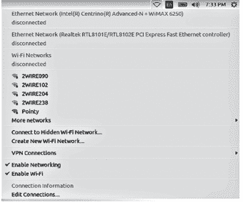

一旦您的系统连接到无线接入点，图标将显示为无线电信号。单击该图标，然后选择“编辑连接”以编辑系统的网络连接设置，如图7.2所示。

网络连接窗口

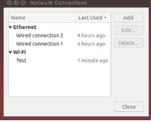

您可以选择要配置的网络连接（无线或有线），然后单击“编辑”按钮以更改当前配置。

`Network Manager`工具允许您使用手动配置选项指定全部四个网络配置值，或者将配置设置为使用`DHCP`来确定设置。`Network Manager`工具会自动使用更新后的设置更新相应的网络配置文件。

## 命令行工具

如果您没有使用图形化桌面客户端环境，则需要使用`Linux`命令行工具来设置网络配置信息。可供您使用的命令行工具相当多。以下几个部分将介绍您最有可能遇到的工具（并且您可能会在`Linux+`考试中看到这些工具）。

## 网络管理器命令行工具

`Network Manager`工具还提供两种不同类型的命令行工具：

- `nmtui` 提供一个简单的基于文本的菜单工具。
- `nmcli` 提供一个纯文本的命令行工具。

这两个工具都可以帮助引导您完成为`Linux`系统设置所需网络信息的流程。`nmtui`工具显示了一个简化版的图形工具，您可以在其中选择网络接口并为其分配网络属性，如图7.3所示。

### 图7.3 网络管理器的`nmtui`命令行工具

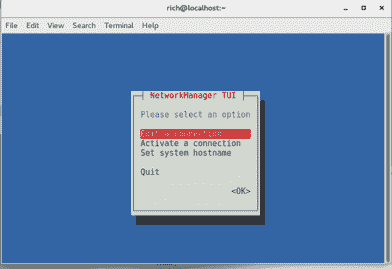

`nmcli`工具不尝试使用任何类型的图形功能；它仅提供一个命令行接口，您可以在其中查看和更改网络设置。默认情况下，该命令显示当前网络设备及其设置，如列表7.4所示。

### 列表7.4：`nmcli`命令的默认输出

```
$ nmcli
enp0s3: connected to enp0s3
"Intel 82540EM Gigabit Ethernet Controller (PRO/1000 MT Desktop Adapter)
      ethernet (e1000), 08:00:27:73:1C:6D, hw, mtu 1500
         ip4 default
            inet4 10.0.2.15/24
            route4 0.0.0.0/0
            route4 10.0.2.0/24
         inet6 fe80::5432:edbb:51ea:fb44/64
            route6 ff00::/8
            route6 fe80::/64
            route6 fe80::/64
```

`nmcli`命令使用命令行选项来允许您设置网络设置：

```
# nmcli con add type ethernet con-name eth1 ifname enp0s3 ip4 10.0.2.10/24 gw4 192.168.1.254
```

这样，您就可以在单个`nmcli`命令中设置所有必要的网络配置功能。

## `iproute2` 实用工具

`iproute2`软件包是一个较新的开源项目，包含一组用于管理网络连接的命令行实用工具。虽然该软件包包含几个不同的程序，但`ip`程序是最常用的。

`ip`命令是网络程序的瑞士军刀，正成为一种通过命令行定义网络设置的流行方法。它使用多个命令选项来显示当前网络设置或定义新的网络设置。表7.2显示了这些命令。

**表7.2 `ip`实用工具的命令选项**

| 参数 | 描述 |
| :--- | :--- |
| `address` | 显示或设置设备上的`IPv4`或`IPv6`地址。 |
| `addr label` | 定义配置标签。 |
| `l2tp` | 通过`IP`隧道传输以太网。 |
| `link` | 定义网络设备。 |
| `maddress` | 定义系统要监听的多播地址。 |
| `monitor` | 监视`netlink`消息。 |
| `mroutes` | 定义多播路由缓存中的条目。 |
| `mrules` | 定义多播路由策略数据库中的规则。 |
| `neighbor` | 管理`ARP`或`NDISC`缓存条目。 |
| `netns` | 管理网络命名空间。 |
| `ntable` | 管理邻居缓存操作。 |
| `route` | 管理路由表。 |
| `rule` | 管理路由策略数据库中的条目。 |
| `tcprmetrics` | 管理接口上的`TCP`指标。 |
| `token` | 管理令牌化的接口标识符。 |
| `tunnel` | 通过`IP`隧道传输。 |
| `tuntap` | 管理`TUN/TAP`设备。 |
| `xfrm` | 管理安全连接的`IPSec`策略。 |

每个命令选项都使用参数来定义执行的操作，例如显示网络设置或修改现有网络设置。列表7.5展示了如何使用`show`参数显示当前的网络设置。

### 列表7.5：`ip address`的输出

```
$ ip address show
1: lo: <LOOPBACK,UP,LOWER_UP> mtu 65536 qdisc noqueue state UNKNOWN group default qlen 1000
    link/loopback 00:00:00:00:00:00 brd 00:00:00:00:00:00
    inet 127.0.0.1/8 scope host lo
       valid_lft forever preferred_lft forever
    inet6 ::1/128 scope host
       valid_lft forever preferred_lft forever
2: enp0s3: <BROADCAST,MULTICAST,UP,LOWER_UP> mtu 1500 qdisc pfifo_fast state UP group default qdisc 1000
    link/ether 08:00:27:73:1c:6d brd ff:ff:ff:ff:ff:ff
    inet 10.0.2.15/24 brd 10.0.2.255 scope global noprefixroute dynamic enp0s3
       valid_lft 84411sec preferred_lft 84411sec
    inet6 fe80::5432:eddb:51ea:fb44/64 scope link noprefixroute
       valid_lft forever preferred_lft forever
```

此示例显示了`Linux`系统上的两个网络接口：

- `lo` 是本地回环接口。
- `enp0s3` 是有线网络接口。

本地回环接口是一种特殊的虚拟网络接口。任何本地程序都可以使用它与其它程序进行通信，就好像它们位于网络的另一端一样。这可以简化程序之间的数据传输。

`enp0s3`网络接口是`Linux`系统的有线网络连接。`ip`命令显示了分配给该接口的`IP`地址（同时分配了`IP`和`IPv6`链路本地地址），子网掩码值，以及关于接口上数据包的一些基本统计数据。

如果输出未显示分配给接口的网络地址，您可以使用`ip`命令指定接口的主机地址和子网掩码值：

```
# ip address add 10.0.2.15/24 dev enp0s3
```

然后使用`route`选项和`ip`命令为网络接口设置默认路由器：

```
# ip route add default via 192.168.1.254 dev enp0s3
```

然后使用`link`选项使网络接口处于激活状态：

```
# ip link set enp0s3 up
```

使用单一的`ip`命令，您可以管理网络连接所需的一切。

## `net-tools` 传统工具

如果您需要在一个较旧的`Linux`发行版上工作，`net-tools`软件包可能是您唯一可用的工具。`net-tools`软件包是`Linux`中管理网络配置各个方面的原始方法。您需要使用四个主要的命令行工具：

- `ethtool` 显示网络接口的以太网设置。
- `ifconfig` 显示或设置网络接口的`IP`地址和子网掩码值。
- `iwconfig` 设置无线接口的`SSID`和加密密钥。
- `route` 设置默认路由器地址。

`ethtool`命令允许您查看网络接口卡内部的以太网设置，并更改您可能需要与网络设备（如交换机）通信的任何属性。

默认情况下，`ethtool`命令显示网络接口的当前配置设置，如列表7.6所示。

### 列表7.6：`ethtool`命令的输出

```
$ ethtool enp0s3
Settings for enp0s3:
Supported ports: [ TP ]
Supported link modes: 10baseT/Half 10baseT/Full 100baseT/Half 100baseT/Full 1000baseT/Full
Supported pause frame use: No
Supports auto-negotiation: Yes
Supported FEC modes: Not reported
Advertised link modes: 10baseT/Half 10baseT/Full 100baseT/Half 100baseT/Full 1000baseT/Full
Advertised pause frame use: No
Advertised auto-negotiation: Yes
Advertised FEC modes: Not reported
Speed: 1000Mb/s
Duplex: Full
Port: Twisted Pair
PHYAD: 0
Transceiver: internal
Auto-negotiation: on
MDI-X: off (auto)
Cannot get wake-on-lan settings: Operation not permitted
Current message level: 0x00000007 (7)
drv probe link

Link detected: yes
$ sudo ifconfig enp0s3 down 10.0.2.10 netmask 255.255.255.0
```

您可以更改速度、双工模式以及网络接口是否尝试与交换机进行自动协商等特性。

您还可以使用`ifconfig`命令查看网络接口的当前统计信息，如清单 7.7 所示。

### 清单 7.7：来自 `ifconfig` 命令的网络接口统计信息


```
$ ifconfig

enp0s3: flags=4163<UP,BROADCAST,RUNNING,MULTICAST> mtu 1500
        inet 10.0.2.15  netmask 255.255.255.0  broadcast 10.0.2.255
        inet6 fe80::a00:2fff:fe55:dfbd  prefixlen 64  scopeid 0x20<link>
        ether 08:00:27:55:df:bd  txqueuelen 1000  (Ethernet)
        RX packets 19067  bytes 28092762 (26.7 MiB)
        RX errors 0  dropped 0  overruns 0  frame 0
        TX packets 6431  bytes 414153 (404.4 KiB)
        TX errors 0  dropped 0  overruns 0  carrier 0  collisions 0

lo: flags=73<UP,LOOPBACK,RUNNING>  mtu 65536
        inet 127.0.0.1  netmask 255.0.0.0
        inet6 ::1  prefixlen 128  scopeid 0x10<host>
        loop  txqueuelen 1000  (Local Loopback)
        RX packets 4  bytes 240 (240.0 B)
        RX errors 0  dropped 0  overruns 0  frame 0
        TX packets 4  bytes 240 (240.0 B)
        TX errors 0  dropped 0  overruns 0  carrier 0  collisions 0

virbr0: flags=4099<UP,BROADCAST,MULTICAST>  mtu 1500
        inet 192.168.122.1  netmask 255.255.255.0  broadcast 192.168.122.255
        ether 52:54:00:10:7a:b8  txqueuelen 1000  (Ethernet)
        RX packets 0  bytes 0 (0.0 B)
        RX errors 0  dropped 0  overruns 0  frame 0
        TX packets 0  bytes 0 (0.0 B)
        TX errors 0  dropped 0  overruns 0  carrier 0  collisions 0
```

使用 `ifconfig` 命令，您可以查看网络接口的链接状态、是否正在接收或发送数据包，以及是否有数据包丢失或冲突。这可能是一个方便的网络故障排除工具。

每个命令选项都利用参数来定义执行的操作，例如显示网络设置或修改现有网络设置。清单 7.7 展示了如何通过不使用命令行参数使用 `ifconfig` 命令来显示当前网络设置。

使用 `net-tools` 包时，您还必须使用独立的 `route` 命令设置默认路由器：

```
# route add default gw 192.168.1.254
```

您也可以单独使用 `route` 命令来查看系统当前配置的默认路由器：

```
$ route
  Kernel IP routing table
  Destination     Gateway         Genmask         Flags Metric Ref Use Iface
  default         192.168.1.254   0.0.0.0         UG    0      0   0   enp0s3
  192.168.1.0     *               255.255.255.0   U     1      0   0   enp0s3
```

为此 Linux 系统定义的默认路由器是 `192.168.1.254`，可以从 `enp0s3` 网络接口访问。输出还显示，要到达 `192.168.1.0` 网络，您不需要网关，因为那是 Linux 系统连接的本地网络。

如果您的网络通过多个路由器连接到多个网络，您可以使用 `route` 命令的 `add` 或 `del` 命令行选项在系统中手动创建路由表。其格式为：

```
route [add] [del] target gw gateway
```

其中 `target` 是目标主机或网络，`gateway` 是路由器地址。

如果您正在使用无线网卡，必须使用 `iwconfig` 命令分配无线 SSID 和加密密钥值：

```
# iwconfig wlp6s0 essid "MyNetwork" key s:mypassword
```

`essid` 参数指定接入点 SSID 名称，`key` 参数指定连接所需的加密密钥。注意加密密钥前面有一个 `s:`。这允许您以 ASCII 文本字符形式指定加密密钥；否则您需要使用十六进制值指定密钥。

如果您不知道本地无线连接的名称，可以使用 `iwlist` 命令显示无线网卡检测到的所有无线信号。只需指定无线设备的名称，并使用 `scan` 选项：

```
$ sudo iwlist wlp6s0 scan
```

一旦您查看了无线网卡配置，就可以像对待有线网卡一样为其分配 IP 地址和默认路由。


您可以使用 `/etc/sysctl.conf` 配置文件或存储在 `/etc/sysctl.d` 或 `/usr/lib/sysctl.d` 目录中的文件来微调网络接口的网络参数。此文件定义了 Linux 系统在与网络接口交互时使用的内核参数。这已成为设置高级安全功能（例如通过将 `icmp_echo_ignore_broadcasts` 值设置为 `1` 来禁用对 ICMP 消息的响应，或者如果系统有多个网络接口卡，通过将 `ip_forward` 值设置为 `0` 来禁用数据包转发）的流行方法。

## 其他网络功能

如果您的网络使用 DHCP，您需要确保在您的 Linux 系统上运行合适的 DHCP 客户端程序。DHCP 客户端程序在后台与网络 DHCP 服务器通信，并按照 DHCP 服务器的指示分配必要的 IP 地址设置。Linux 系统有三种常见的 DHCP 程序：

- `dhcpd`
- `dhclient`
- `pump`

`dhcpd` 程序是三者中最受欢迎的，但您在一些 Linux 发行版中仍会看到另外两个的使用。

当您使用 Linux 系统的软件包管理器实用程序安装 DHCP 客户端程序时，它会设置该程序在启动时自动启动并处理与网络交互所需的 IP 地址配置。


> 如果您正在处理充当 DHCP 服务器的 Linux 服务器，`/etc/dhcpd.conf` 文件包含服务器提供给 DHCP 客户端的 IP 地址设置。该文件包含 DHCP 服务器服务的每个子网的一个部分：

```
subnet 10.0.2.0 netmask 255.255.255.0 {
    option routers                  192.168.1.254;
    option subnet-mask              255.255.255.0;

    option domain-name              "mynetwork.com";
    option domain-name-servers      192.168.1.254;

    option time-offset              -18000;
    # Eastern Standard Time

    range 10.0.2.1 10.0.2.100;
}
```

您可能遇到的最后一个网络配置设置涉及网络接口绑定。绑定允许您将多个接口聚合为一个虚拟网络设备。

然后您可以告诉 Linux 系统如何使用三种不同的绑定类型来处理虚拟网络设备：

- 负载均衡：网络流量在两个或多个网络接口之间共享。
- 聚合：两个或多个网络接口组合成一个更大的网络管道。
- 活动/被动：一个网络接口处于活动状态，另一个用作故障容忍的备份。

您可以从表 7.3 中显示的七种不同绑定模式中进行选择。

### 表 7.3 网络接口绑定模式

| 模式 | 名称 | 描述 |
| :--- | :--- | :--- |
| 0 | `balance-rr` | 使用轮询方法通过接口提供负载均衡和故障容忍 |
| 1 | `active-backup` | 使用一个接口作为主接口，另一个作为备份提供故障容忍 |
| 2 | `balance-xor` | 通过在一个接口上传输并在第二个接口上接收提供负载均衡和故障容忍 |
| 3 | `broadcast` | 在两个接口上发送所有数据包 |
| 4 | `802.3ad` | 聚合接口以创建一个连接，组合接口带宽 |
| 5 | `balance-tlb` | 基于每个接口当前的传输负载提供负载均衡和故障容忍 |
| 6 | `balance-alb` | 基于每个接口当前的接收负载提供负载均衡和故障容忍 |

要初始化网络接口绑定，您必须首先加载 Linux 内核中的绑定模块：

```
$ sudo modprobe bonding
```

这会创建一个 `bond0` 网络接口，然后您可以使用 `ip` 实用程序对其进行定义：

```
$ sudo ip link add bond0 type bond mode 4
```

一旦您定义了绑定类型，就可以使用 `ip` 实用程序将适当的网络接口添加到绑定中：

```
$ sudo ip link set eth0 master bond0
$ sudo ip link set eth1 master bond0
```

然后，Linux 系统将把 `bond0` 设备视为一个单网络接口，使用您定义的负载均衡或聚合方法。


如果您的 Linux 系统中有多个网卡，并且选择将它们连接到不同的网络，您可以配置 Linux 系统作为这两个网络之间的网桥。`brctl` 命令允许您控制网桥的工作方式。不过，为了实现这一点，您必须在 `/etc/sysctl.conf` 文件中将 `ip_forward` 内核参数设置为 `1`，以启用网桥功能。

## 命令行网络工具

Linux 提供了丰富的网络工具用于连接远程主机，但没有比 `netcat` 程序更通用的了。`netcat` 程序既可以充当网络服务器，也可以充当网络客户端，使用 TCP 或 UDP 发送和接收数据报。本节介绍了 `netcat` 程序的一些多功能示例。

根据您的 Linux 发行版不同，`netcat` 程序可能以 `netcat` 或仅 `nc` 的形式提供。命令的格式很简单：

```
nc host port
```

其中 `host` 是远程服务器的 IP 地址或主机名，`port` 是连接使用的端口号。默认情况下，`netcat` 会尝试与远程服务器建立 TCP 连接。要建立 UDP 连接，请添加 `-u` 选项。

有许多不同的选项可用于自定义连接。表 7.4 列出了 `netcat` 的选项。

**表 7.4** `netcat` 命令选项

| 选项 | 描述 |
| :--- | :--- |
| `-4` | 仅使用 IPv4 地址 |
| `-6` | 仅使用 IPv6 地址 |
| `-c` | 在每行末尾使用回车/换行组合 |
| `-D` | 启用套接字调试 |
| `-d` | 不从 STDIN 读取 |
| `-h` | 显示 `netcat` 帮助文档 |
| `-i` | 指定发送和接收文本之间的延迟间隔 |
| `-k` | 当前连接终止后，继续监听传入连接 |
| `-l` | 监听传入连接，而不是初始化新连接 |
| `-n` | 不对主机名使用 DNS 查找 |
| `-p` | 指定连接使用的端口 |
| `-r` | 使用随机的源和/或目标端口 |
| `-S` | 启用 MD5 签名选项 |
| `-s` | 指定用于发送数据报的网络接口的 IP 地址 |
| `-T` | 指定连接使用的 IP 服务类型 (ToS) |
| `-t` | 回复服务器发送的 Telnet 协议选项 |
| `-U` | 使用 Unix 域套接字代替网络套接字 |
| `-u` | 使用 UDP 代替 TCP |
| `-v` | 启用详细模式以显示更多信息 |
| `-w` | 指定无活动断开的超时值 |
| `-X` | 使用 SOCK 或 HTTP 代理服务器协议 |
| `-x` | 指定连接使用的代理服务器 |
| `-z` | 扫描正在监听的应用程序，而不是尝试连接 |

`nc` 的一个出色的故障排除功能是能够直接向服务器发送 HTTP 请求，并查看 HTTP 响应以及返回的 HTML 代码。清单 7.8 展示了您会看到的输出示例。

### 清单 7.8：使用 netcat 检索 HTTP 数据

```
$ printf "GET / HTTP/1.0\r\n\r\n" | nc richblum.com 80
HTTP/1.1 200 OK
Date: Mon, 04 Dec 2021 16:14:35 GMT
Server: Apache
Vary: Accept-Encoding
Connection: close
Content-Type: text/html
<!DOCTYPE html PUBLIC "-//W3C//DTD XHTML 1.0 Transitional//EN"
  "http://www.w3.org/TR/xhtml1/DTD/xhtml1-transitional.dtd">
<html xmlns="http://www.w3.org/1999/xhtml">
<head>
  <link rel="stylesheet" type="text/css" href="main/mystyle.css" />
  <link rel="stylesheet" media="print" type="text/css"
        href="main/print.css" />
  <title>Rich Blum's Blog</title>
</head>
```

清单 7.8 中的输出显示了服务器发送的 HTTP 选项，随后是该网页的 HTML 代码。

您还可以从命令行在两个系统之间创建简单的聊天对话。在一个系统上，只需使用 `-l` 选项启动 `nc` 监听模式：

```
$ nc -l 8000
```

然后在另一个系统上，连接到远程系统上的该端口：

```
$ nc hostname 8000
```

现在，您在任何一边输入的文本都会显示在另一边！要断开连接，只需在连接的任何一边按 `Ctrl+C`。

最后，`netcat` 程序的另一个极其实用的用途是作为在两个系统之间快速传输文件的方法。只需将监听主机的输出重定向到一个文件：

```
$ nc -l 8000 > filename.txt
```

然后在发送主机上，将文件重定向为发送端 `nc` 命令的输入：

```
$ nc hostname 8000 < myfile.txt
```

当文件传输完成时，连接的两端都会自动终止，并且新文件将在接收主机上可用。这使得在系统之间移动文件变得轻而易举！

> 如果您需要测试与网络服务器的安全 SSL 连接，可以使用 `s_client` 软件包来完成。它可以利用证书与安全的服务器建立连接。

## 基本网络故障排除

安装好 Linux 内核后，您可以做几件事来检查以确保一切运行正常。以下各部分介绍了您应该了解的命令，用于监控网络活动，包括监视哪些进程正在监听网络以及从您的系统发起的哪些连接处于活动状态。

### 发送测试数据包

测试网络连接性的一种方法是向已知主机发送测试数据包。Linux 提供了 `ping` 和 `ping6` 命令来执行此操作。`ping` 和 `ping6` 命令使用 IP (`ping`) 或 IPv6 (`ping6`) 协议向远程主机发送互联网控制消息协议 (ICMP) 数据包。ICMP 数据包在幕后工作，以跟踪连接性并在系统之间提供控制消息。如果远程主机支持 ICMP，当它接收到 ping 数据包时，它会发回一个响应数据包。

`ping` 命令的基本格式是指定远程主机的 IP 地址：


```
$ ping 10.0.2.2
PING 10.0.2.2 (10.0.2.2) 56(84) bytes of data.
64 bytes from 10.0.2.2: icmp_seq=1 ttl=63 time=14.6 ms
64 bytes from 10.0.2.2: icmp_seq=2 ttl=63 time=3.82 ms
64 bytes from 10.0.2.2: icmp_seq=3 ttl=63 time=2.05 ms
64 bytes from 10.0.2.2: icmp_seq=4 ttl=63 time=0.088 ms
64 bytes from 10.0.2.2: icmp_seq=5 ttl=63 time=3.54 ms
64 bytes from 10.0.2.2: icmp_seq=6 ttl=63 time=3.97 ms
64 bytes from 10.0.2.2: icmp_seq=7 ttl=63 time=0.040 ms
^C
--- 10.0.2.2 ping statistics ---
7 packets transmitted, 7 received, 0% packet loss, time 6020ms
rtt min/avg/max/mdev = 0.040/4.030/14.696/4.620 ms
$ 
```

`ping` 命令会持续发送数据包，直到您按下 `Ctrl+C`。您还可以使用 `-c` 命令行选项来指定要发送的固定数量数据包，然后停止。

对于 `ping6` 命令，事情变得稍微复杂一些。如果您使用的是 IPv6 链路本地地址，还需要告诉命令使用哪个接口发送数据包：

```
$ ping6 -c 4 fe80::c418:2ed0:aaed:cbce%enp0s3
PING fe80::c418:2ed0:aaed:cbce%enp0s3(fe80::c418:2ed0:aaed:cbce) 56 data bytes
64 bytes from fe80::c418:2ed0:aead:cbce: icmp_seq=1 ttl=128 time=1.47 ms
64 bytes from fe80::c418:2ed0:aead:cbce: icmp_seq=2 ttl=128 time=0.478 ms
64 bytes from fe80::c418:2ed0:aead:cbce: icmp_seq=3 ttl=128 time=0.777 ms
64 bytes from fe80::c418:2ed0:aead:cbce: icmp_seq=4 ttl=128 time=0.659 ms

--- fe80::c418:2ed0:aead:cbce%enp0s3 ping statistics ---
4 packets transmitted, 4 received, 0% packet loss, time 3003ms
rtt min/avg/max/mdev = 0.478/0.847/1.475/0.378 ms
```

`%enp0s3` 部分告诉系统通过 `enp0s3` 网络接口发送 `ping` 数据包，以对应链路本地地址。

另一个有用的工具是 `traceroute` 命令。`traceroute` 命令利用了 ICMP 数据包的一个特性，即限制它们可以经过的网络“跳数”。通过操纵数据包中的该值，`traceroute` 命令允许您看到用于将数据包从客户端传输到服务器的网络路由器。

最后，`mtr` 程序是一个软件包，它利用从 `ping` 和 `traceroute` 命令检索的数据，在实时图表中记录网络可用性和延迟。图 7.4 显示了 `mtr` 命令追踪到 `linux.org` 服务器连接性的输出。

### 图 7.4 使用 `mtr` 监控到服务器的网络连接

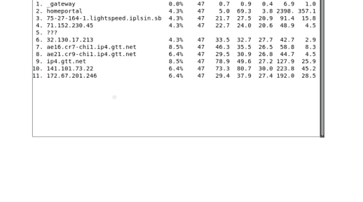

# 查找主机信息

有时问题并不在于网络连接性，而在于 DNS 主机名系统。你可以使用 `host` 命令来测试主机名：

```bash
$ host www.linux.org
www.linux.org is an alias for linux.org.
linux.org has address 107.170.40.56
linux.org mail is handled by 20 mx.iquemail.net.
$ 
```

`host` 命令查询 DNS 服务器以确定分配给指定主机的 IP 地址。默认情况下，它返回与主机名关联的所有 IP 地址。一些主机由负载均衡配置中的多个服务器支持。`host` 命令将显示与这些服务器关联的所有 IP 地址：

```bash
$ host www.yahoo.com
www.yahoo.com is an alias for atsv2-fp-shed.wg1.b.yahoo.com.
atsv2-fp-shed.wg1.b.yahoo.com has address 98.138.219.231
atsv2-fp-shed.wg1.b.yahoo.com has address 72.30.35.9
atsv2-fp-shed.wg1.b.yahoo.com has address 72.30.35.10
atsv2-fp-shed.wg1.b.yahoo.com has address 98.138.219.232
atsv2-fp-shed.wg1.b.yahoo.com has IPv6 address 2001:4998:58:1836::10
atsv2-fp-shed.wg1.b.yahoo.com has IPv6 address 2001:4998:58:1836::11
atsv2-fp-shed.wg1.b.yahoo.com has IPv6 address 2001:4998:58:4441d::3
atsv2-fp-shed.wg1.b.yahoo.com has IPv6 address 2001:4998:58:4441d::4
$ 
```

你还可以为 `host` 命令指定 IP 地址，它会尝试查找与该地址关联的主机名：

```bash
$ host 98.138.219.231
231.219.138.98.in-addr.arpa domain name pointer media-router-fp1.prod1.media.vip.ne1.yahoo.com.
$ 
```

然而请注意，IP 地址通常会解析为托管该网站的通用服务器主机名，而不是网站别名，例如这里的 `www.linux.org` 的 IP 地址就是这种情况。

另一个很好的工具是 `dig` 命令。`dig` 命令显示与特定主机或网络相关的所有 DNS 数据记录。例如，你可以查找特定主机的信息：

```bash
$ dig www.linux.org
```

```text
; <<> DiG 9.9.4-RedHat-9.9.4-18.el7_L5 <>> www.linux.org
; global options: +cmd
;; Got answer:
;; ->>HEADER<<- opcode: QUERY, status: NOERROR, id: 45314
;; flags: qr rd ra; QUERY: 1, ANSWER: 2, AUTHORITY: 0, ADDITIONAL: 1

;; OPT PSEUDOSECTION:
; EDNS: version: 0, flags:; udp: 4096
;; QUESTION SECTION:
;www.linux.org.		IN	A

;; ANSWER SECTION:
www.linux.org.	14400	IN	CNAME linux.org.
linux.org.	3600	IN	A	107.170.40.56

;; Query time: 75 msec
; SERVER: 192.168.1.254#53(192.168.1.254)
; WHEN: Sat Feb 06 17:44:29 EST 2016
; MSG SIZE rcvd: 72
```

或者，你可以查找与特定网络服务（如邮件服务器）相关的 DNS 数据记录：

```bash
$ dig linux.org MX
```

```text
; <<> DiG 9.9.5-3Ubuntu0.5-Ubuntu <<< linux.org MX
; global options: +cmd
;; Got answer:
;; ->>HEADER<<- opcode: QUERY, status: NOERROR, id: 16202
;; flags: qr rd ra; QUERY: 1, ANSWER: 1, AUTHORITY: 0, ADDITIONAL: 1
;; OPT PSEUDOSECTION:
; EDNS: version: 0, flags:; udp: 4096
;; QUESTION SECTION:
;linux.org. IN MX

;; ANSWER SECTION:
linux.org. 3600 IN MX 20 mx.igemail.net.

;; Query time: 75 msec
;; SERVER: 127.0.1.1#53(127.0.1.1)
;; WHEN: Tue Feb 09 12:35:43 EST 2016
;; MSG SIZE rcvd: 68
```

如果你需要查找多个服务器或域名的 DNS 信息，`nslookup` 命令提供了一个交互式界面，你可以在此输入命令：

```bash
$ nslookup
> www.google.com
Server: 192.168.1.254
Address: 192.168.1.254#53

Non-authoritative answer:
Name: www.google.com
Address: 172.217.2.228
> www.wikipedia.org
Server: 192.168.1.254
Address: 192.168.1.254#53

Non-authoritative answer:
Name: www.wikipedia.org
Address: 208.80.153.224
> exit
```

你还可以动态指定另一个 DNS 服务器的地址用于名称查找，如果名称解析失败，这是一种判断默认 DNS 服务器是否有故障的便捷方法。

最后一个可能很有用的工具是 `whois` 命令。`whois` 命令尝试连接到集中式互联网域名注册中心 `http://whois.networksolutions.com` 并获取关于谁注册了请求的域名的信息。列表 7.9 显示了 `whois` 命令的部分输出。

## **列表 7.9：** `whois` 命令的部分输出

```bash
$ whois linux.com
Domain Name: LINUX.COM
Registry Domain ID: 4245540_DOMAIN_COM-VRSN
Registrar WHOIS Server: whois.lapi.net
Registrar URL: http://www.lapi.net
Updated Date: 2021-03-18T15:40:08Z
Creation Date: 1994-06-02T04:00:00Z
Registry Expiry Date: 2022-06-01T04:00:00Z
Registrar: IAPI GmbH
Registrar IANA ID: 1387
Registrar Abuse Contact Email: abuse@lapi.net
Registrar Abuse Contact Phone: +49.68949396850
Domain Status: clientTransferProhibited
https://icann.org/epp#clientTransferProhibited
Name Server: NS1.DNSIMPLE.COM
Name Server: NS2.DNSIMPLE.COM
Name Server: NS3.DNSIMPLE.COM
Name Server: NS4.DNSIMPLE.COM
... 
```

理论上，注册中心包含域名的所有者完整的联系信息，但由于当今的隐私顾虑，这些信息通常被屏蔽。但通常会有该域名的联系电子邮件地址，以便你需要报告该域名的疑似滥用行为时使用。

# 高级网络故障排除

除了前面章节中展示的简单网络测试外，Linux 还有一些更高级的程序，可以提供关于网络环境的更详细信息。有时，能够看到 Linux 系统上哪些网络连接处于活动状态会有帮助。有两种方法可以排查该问题：`netstat` 命令和 `ss` 命令。

## `netstat` 命令

`netstat` 命令是 `net-tools` 包的一部分，可以为你提供丰富的网络信息。默认情况下，它列出系统上所有打开的网络连接：

```bash
# netstat
Active Internet connections (w/o servers)
Proto Recv-Q Send-Q Local Address           Foreign Address     State

Active UNIX domain sockets (w/o servers)
Proto RecvCnt Flags    Type State I-Node Path
unix 2 [ ] DGRAM 10825
@org/freedesktop/systemd1/notify
unix 2 [ ] DGRAM 10933
/run/systemd/shutdown
unix 6 [ ] DGRAM 6609
/run/systemd/journal/socket
unix 25 [ ] DGRAM 6611 /dev/log
unix 3 [ ] STREAM CONNECTED 25693
unix 3 [ ] STREAM CONNECTED 20770
/var/run/dbus/system_bus_socket
unix 3 [ ] STREAM CONNECTED 19556
unix 3 [ ] STREAM CONNECTED 19511
unix 2 [ ] DGRAM 24125
unix 3 [ ] STREAM CONNECTED 19535
unix 3 [ ] STREAM 18067
/var/run/dbus/system_bus_socket
unix 3 [ ] STREAM CONNECTED 32358
unix 3 [ ] STREAM 24818
/var/run/dbus/system_bus_socket
...
```

`netstat` 命令产生大量输出，因为在 Linux 系统上通常有很多程序使用网络服务。你可以使用 TCP 连接的 `-t` 命令行选项或 UDP 连接的 `-u` 选项将输出限制为仅 TCP 或 UDP 连接：

```bash
$ netstat -t

Active Internet connections (w/o servers)
Proto Recv-Q Send-Q Local Address Foreign Address State
tcp 1 0 10.0.2.15:58630 productsearch.ubu:https CLOSE_WAIT
tcp6 1 0 [::]localhost:57782 [::]localhost:ipp CLOSE_WAIT
$
```

你还可以使用 `-l` 选项获取哪些应用程序正在哪些网络端口上监听的列表：

```bash
$ netstat -l
Active Internet connections (only servers)
Proto Recv-Q Send-Q Local Address Foreign Address State
tcp 0 0 ubuntu02:domain *.* LISTEN
tcp 0 0 localhost:ipp *.* LISTEN
tcp6 0 0 [::]localhost: [::]:* LISTEN
udp 0 0 *::ipp *::*
udp 0 0 *:mdns *::*
udp 0 0 *:36355 *::*
udp 0 0 ubuntu02:domain *::*
udp 0 0 *:bootpc *::*
udp 0 0 *:12461 *::*
udp6 0 0 [::]:64294 [::]:*
udp6 0 0 [::]:60259 [::]:*
udp6 0 0 [::]:mdns [::]:*
...
```

如你所见，即使是标准的 Linux 工作站，后台也有许多事情正在发生，等待连接。

`netstat` 命令的另一个很棒的功能是，`-s` 选项显示系统在网络中使用的不同类型的包的统计信息：

```bash
# netstat -s

Ip:
240762 total packets received
0 forwarded
0 incoming packets discarded
240747 incoming packets delivered
206940 requests sent out
32 dropped because of missing route

Icmp:
57 ICMP messages received
0 input ICMP message failed.
ICMP input histogram:
destination unreachable: 12
timeout in transit: 38
echo replies: 7
7 ICMP messages sent
0 ICMP messages failed
ICMP output histogram:
echo request: 7

IcmpMsg:
InType0: 7
InType3: 12
InType11: 38
OutType8: 7
```

`Tcp`:

```
286 个活动连接打开
0 个被动连接打开
0 个连接尝试失败
0 个连接重置接收
0 个已建立连接
239933 个分段接收
206091 个分段发出
0 个分段重传
```


0 个错误分段接收
0 个重置发出

`Udp`:

- 757 个数据包接收
- 0 个去往未知端口的数据包接收
- 0 个数据包接收错误
- 840 个数据包发出
- 0 个接收缓冲区错误
- 0 个发送缓冲区错误

`UdpLite`:

`TcpExt`:

- 219 个 `TCP` 套接字在快速计时器中完成时间等待
- 15 个延迟确认发送
- 26 个延迟确认因套接字锁定而进一步延迟
- 快速确认模式被激活了 1 次
- 229343 个包头预测
- 289 个不含数据负载的确认接收
- 301 个预测确认
- `TCPRcvCoalesce`: 72755

`IpExt`:

- `InNoRoutes`: 2
- `InMcastPkts`: 13
- `OutMcastPkts`: 15
- `InOctets`: 410722578
- `OutOctets`: 8363083
- `InMcastOctets`: 2746
- `OutMcastOctets`: 2826

`netstat` 统计输出可以让你对 `Linux` 系统的网络繁忙程度有一个大致的了解，或者检查已安装的某个协议是否存在特定问题。

## 检查套接字

`netstat` 工具提供了丰富的网络信息，但有时很难确定究竟是哪个程序在监听哪个开放端口。此时 `ss` 命令可以为你提供帮助。

程序与端口的连接称为套接字。`ss` 命令可以链接哪些系统进程正在使用哪些活动的网络套接字：

```
$ ss -anpt

State Recv-Q Send-Q Local Address:Port Peer Address:Port
LISTEN 0 100 127.0.0.1:25 *:*
LISTEN 0 128 127.0.0.1:111 *:*
LISTEN 0 5 192.168.122.1:53 *:*
LISTEN 0 128 0.0.0.0:22 *:*
LISTEN 0 128 127.0.0.1:631 *:*
LISTEN 0 100 [::1]:25 [::]:*
LISTEN 0 128 [::1]:111 [::]:*
LISTEN 0 128 [::]:22 [::]:*
LISTEN 0 128 [::1]:631 [::]:*
ESTAB 0 0 [::1]:22 [::1]:40490
ESTAB 0 0 [::1]:40490 [::1]:22
users:(\"ssh",pid=15176,fd=3))
```

`-anpt` 选项显示监听和已建立的 `TCP` 连接及其相关的进程。此输出显示 `ssh` 主机（端口 22）有一个已建立的连接，并由进程 ID 15176（即 `ssh` 程序）控制。

## 监控网络

在排查网络应用程序问题时，查看网络“幕后”发生的情况往往很有帮助。了解客户端和服务器之间正在发送哪些 `TCP` 或 `UDP` 数据包对于确定哪里出了问题至关重要。幸运的是，`Linux` 提供了一些不同的工具来协助这项工作：

- `tcpdump`——传统的用于监控网络数据包的命令行工具
- `wireshark`——用于监控网络数据包并执行高级网络分析的图形化工具
- `tshark`——`Wireshark` 的命令行版本

`tcpdump` 程序是一个历史悠久但至今仍有用的传统工具，如果你手头只有这个工具的话，它依然很有价值。它提供系统上简单的网络数据捕获，并能对数据包进行基本的解码，以提取网络数据包中包含的不同数据。

`tcpdump` 程序还提供基本的过滤功能，允许你将捕获限制在单个主机、客户端或甚至网络会话中。

`wireshark` 包是一个开源的图形化工具，用于对数据包执行高级网络分析。`Wireshark` 不仅可以捕获和解码网络数据包，还提供流量类型的颜色编码，并且可以根据应用程序显示数据包组。图 7.5 展示了 `wireshark` 显示简单网络流量的示例。

### 图 7.5 `Wireshark` 网络分析窗口

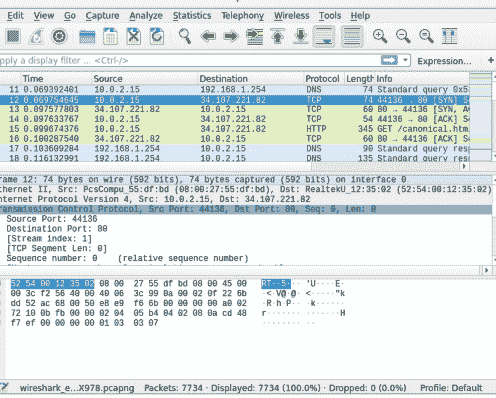

如果你的 `Linux` 系统没有图形桌面环境，你仍然可以通过 `tshark` 从命令行使用 `wireshark` 的强大功能。`tshark` 程序提供了许多与 `wireshark` 相同的网络分析工具，但在命令行上采用更基础的显示格式。


要查看网络接口上的所有网络流量，你必须在系统上拥有管理员权限。这通常意味着要么以 `root` 用户账户登录，要么从普通账户使用 `sudo` 命令获取 `root` 权限。

## 练习 7.1 确定网络环境

本练习将展示如何快速评估 `Linux` 系统的网络配置和程序，而无需翻找大量的配置文件。要记录你的系统网络信息，请遵循这些步骤（根据你的发行版，你可能需要先从软件仓库安装 `netstat` 和 `iwlist` 程序）：

1. 以 `root` 身份登录，或者通过在每个后续命令中使用 `su` 或 `sudo` 来获取 `root` 权限。
2. 输入 `ip address show` 以显示系统当前的网络接口。你很可能看到一个回环接口（名为 `lo`）和一个或多个网络接口。记下分配给每个网络接口的 `IP`（称为 `inet`）和 `IPv6`（称为 `inet6`）地址，以及硬件地址和网络掩码地址。
3. 如果你的系统有无线网卡，输入 `iwlist wlan0 scan` 以查看你所在区域的无线接入点。
4. 如果你的系统有无线网卡，输入 `iwconfig` 以显示你的网络接口当前的无线设置。
5. 输入 `route` 以显示系统中定义的路由。注意分配给你的系统的默认网关地址。它应该与分配给系统的 `IP` 地址位于同一网络中。
6. 输入 `cat /etc/resolv.conf` 以显示系统的 `DNS` 设置。
7. 输入 `netstat -l` 以显示监听传入网络连接的程序。标记为 `un*x` 的条目正在使用回环地址与系统内部的其他程序通信。
8. 输入 `ss -anpt` 以显示系统中拥有活动网络端口的进程。

## 总结

如果你有正确的工具，将 `Linux` 系统连接到网络可以很轻松。要连接 `Linux` 系统，你需要一个 `IP` 地址、一个子网掩码地址、一个默认路由器、一个主机名和一个 `DNS` 服务器。如果你不关心分配给 `Linux` 系统的是什么 `IP` 地址，你可以使用 `DHCP` 自动获取这些值。但是，如果你正在运行需要静态 `IP` 地址的 `Linux` 服务器，你可能需要手动配置这些值。`Linux` 在配置文件中存储网络连接信息。你可以手动修改文件以存储适当的网络信息，或者使用图形化或命令行工具来完成此操作。网络管理器（`Network Manager`）工具是 `Linux` 发行版中最常用的图形化工具。它允许你从图形窗口配置有线和无线网络设置。系统托盘区域中的网络管理器图标显示网络连接状态以及无线网卡的无线基本信息。

如果你必须从命令行配置网络设置，你需要几个不同的工具。对于无线连接，使用 `iwconfig` 命令设置无线接入点和 `SSID` 密钥。对于无线和有线连接，使用 `ifconfig` 或 `ip` 命令设置接口的 `IP` 地址和网络值。你可能还需要使用 `route` 命令来定义本地网络的默认路由器。

要使用主机名而不是 `IP` 地址，你必须为网络定义一个 `DNS` 服务器。你在 `/etc/resolv.conf` 配置文件中这样做。你还需要在 `/etc/hostname` 或 `/etc/HOSTNAME` 文件中定义 `Linux` 系统的主机名。

一旦网络配置完成，你可能需要对网络问题进行一些额外的故障排除。`ping` 和 `ping6` 命令允许你向远程主机发送 `ICMP` 数据包以测试基本连接性。如果你怀疑存在主机名问题，可以使用 `host` 和 `dig` 命令向 `DNS` 服务器查询主机名。

对于更高级的网络故障排除，你可以使用 `netstat` 和 `ss` 命令来显示系统中哪些应用程序正在使用哪些网络端口。

## 考试要点

描述配置和操作以太网网络接口所需的命令行实用程序。要在网络接口上设置网络地址，可以使用 `nm-connection-editor`、`nmcli`、`ip` 或 `ifconfig` 命令。`nm-connection-editor` 和 `nmcli` 命令可在利用网络管理器工具管理网络接口的系统上使用。`ip` 命令来自 `iproute2` 包，而 `ifconfig` 命令来自遗留的 `net-tools` 包。如果你使用 `ifconfig` 命令，你还需要使用 `route` 命令来设置网络的默认路由器（或网关）。

解释如何配置对无线网络的基本访问。`Linux` 使用 `iwlist` 命令列出无线网卡检测到的所有无线接入点。你可以使用 `iwconfig` 命令配置连接特定无线网络所需的设置。至少，你需要配置接入点 `SSID` 值，并且很可能需要指定加密密钥值以连接到接入点。

描述如何在 `Linux` 系统上操作路由表。对于遗留系统，使用 `route` 命令显示 `Linux` 系统使用的现有路由表。你可以通过使用 `add` 选项添加新路由，或使用 `del` 选项删除现有路由。通过在命令中添加 `default` 关键字，可以指定网络使用的默认路由器（网关）。对于利用 `iproute2` 包的系统，使用 `ip route` 命令显示和操作路由表。

## 摘要与分析

**概述用于分析网络设备状态的各个工具。** `ntm_ui`、`nmcli`、`ifconfig` 和 `ip` 命令用于显示系统上所有网络接口的当前状态。你还可以使用 `netstat` 或 `ss` 命令来显示所有监听端口的统计信息。

**描述 `Linux` 初始化网络接口的过程。** 基于 `Debian` 的 `Linux` 系统使用 `/etc/network/interfaces` 文件来配置 `IP` 地址、子网掩码和默认网关。基于 `Red Hat` 的 `Linux` 系统使用 `/etc/sysconfig/network-scripts` 目录中的文件。`ifcfg-ens3` 文件包含 `IP` 地址和子网掩码设置，而 `network` 文件包含默认网关设置。系统启动时会检查这些文件以确定网络接口的配置。较新版本的 `Ubuntu` 使用 `Netplan` 工具，该工具将网络配置存储在 `/etc/netplan` 目录中。

**解释如何测试网络连通性。** `ping` 和 `ping6` 命令允许你向远程主机发送 `ICMP` 消息并显示接收到的响应。`traceroute` 命令允许你查看到达特定远程主机所使用的网络路径。`mtr` 命令提供针对特定远程主机的实时连通性和响应统计数据。

**描述 `Linux` 中用于配置网络设置的图形化工具。** 网络管理器（`Network Manager`）提供了一个图形界面，用于更改网络接口的设置。网络管理器显示为系统托盘区域中的一个图标。如果 `Linux` 系统使用无线网卡，该图标显示为无线电波信号；对于有线网络连接，则显示为迷你网络图标。当你点击该图标时，它会显示当前的网络状态；对于无线接口，它会列出检测到的接入点。通过打开网络管理器界面，你可以设置静态 `IP` 地址信息，或者配置网络以使用 `DHCP` 服务器动态设置网络配置。

## 复习题

1. 哪两个命令可用于通过命令行在接口上设置 `IP` 地址、子网掩码和默认网关信息？
    - A. `netstat`
    - B. `ping`
    - C. `nmtui`
    - D. `ip`
    - E. `route`

2. 较新版本的 `Ubuntu` 使用哪个工具来设置网络地址信息？
    - A. `netstat`
    - B. `Netplan`
    - C. `iwconfig`
    - D. `route`
    - E. `ifconfig`

3. 哪个命令显示以太网卡的双工设置？
    - A. `ethtool`
    - B. `netstat`
    - C. `iwconfig`
    - D. `iwlist`
    - E. `route`

4. 哪个命令显示 `Linux` 系统中哪些进程正在使用哪些端口？
    - A. `iwconfig`
    - B. `ip`
    - C. `ping`
    - D. `nmtui`
    - E. `ss`

5. 如果 `Linux` 服务器没有安装图形化桌面，你可以使用哪两个工具从命令行配置有线网卡的设置？
    - A. `nmcli`
    - B. `iwconfig`
    - C. `ip`
    - D. `netstat`
    - E. `ping`

6. 哪个网络设置定义了用于将数据包路由到远程网络主机的网络设备？
    - A. 默认网关
    - B. 子网掩码
    - C. 主机名
    - D. `IP` 地址
    - E. `DNS` 服务器

7. 哪个设备设置定义了将主机名映射到 `IP` 地址的主机？
    - A. 默认网关
    - B. 子网掩码
    - C. 主机名
    - D. `IP` 地址
    - E. `DNS` 服务器

8. 用于自动向客户端分配 `IP` 地址的是什么？
    - A. 默认网关
    - B. `DHCP`
    - C. `ARP` 表
    - D. 子网掩码
    - E. `ifconfig`

9. 使用哪种地址类型以便本地应用程序可以使用网络协议相互通信？
    - A. 动态地址
    - B. 回环地址
    - C. 静态地址
    - D. 主机名
    - E. `MAC` 地址

10. 你使用哪个命令来查找某个域的邮件服务器？
    - A. `dig`
    - B. `netstat`
    - C. `ping6`
    - D. `host`
    - E. `ss`

11. 你使用哪个命令来查找系统中哪个应用程序正在使用特定的 `TCP` 端口？
    - A. `ip`
    - B. `ss`
    - C. `host`
    - D. `dig`
    - E. `ifconfig`

12. 基于 `Red Hat` 的系统使用哪个目录来存储网络配置文件？
    - A. `/etc/sysconfig/network-scripts`
    - B. `/etc/network`
    - C. `/etc/ifcfg-eth0`
    - D. `/etc/ifconfig`
    - E. `/etc/iwconfig`

13. 哪个配置行为 `Debian` 系统设置了动态 `IP` 地址？
    - A. `iface eth0 inet static`
    - B. `iface eth0 inet dhcp`
    - C. `auto eth0`
    - D. `iface eth0 inet6 auto`
    - E. `BOOTPROTO=dynamic`

14. 哪个文件包含 `Linux` 系统可以用来解析主机名的 `DNS` 服务器列表？
    - A. `/etc/dhcpd.conf`
    - B. `/etc/resolv.conf`
    - C. `/etc/switch.conf`
    - D. `/etc/network/interfaces`
    - E. `/etc/sysctl.conf`

15. 哪种 `ifconfig` 格式正确地为 `eth0` 接口分配了 `IP` 地址和子网掩码？
    - A. `ifconfig eth0 up 192.168.1.50 netmask 255.255.255.0`
    - B. `ifconfig eth0 255.255.255.0 192.168.1.50`
    - C. `ifconfig up 192.168.1.50 netmask 255.255.255.0`
    - D. `ifconfig up`
    - E. `ifconfig down`

16. 哪个命令显示你所在区域所有可用的无线网络？
    - A. `iwlisf`
    - B. `iwconfig`
    - C. `ifconfig`
    - D. `ip`
    - E. `arp`

17. `iwconfig` 命令中的哪个选项设置无线接入点名称？
    - A. `key`
    - B. `netmask`
    - C. `address`
    - D. `essid`
    - E. `channel`

18. 你可以使用哪个命令来显示并设置 `IP` 地址、子网掩码和默认网关的值？
    - A. `ifconfig`
    - B. `iwconfig`
    - C. `router`
    - D. `ifup`
    - E. `ip`

19. 哪个工具允许你向远程主机发送 `ICMP` 消息以测试网络连通性？
    - A. `netstat`
    - B. `ifconfig`
    - C. `ping`
    - D. `iwconfig`
    - E. `ss`

20. 你有一个无法连接到远程服务器的网络应用程序。你应该使用哪个命令行工具来监视从你的系统发出的网络数据包，以确保它们使用正确的网络端口？
    - A. `nc`
    - B. `tcpdump`
    - C. `ping`
    - D. `traceroute`
    - E. `mtr`

# 第 8 章 比较 GUI

- ✓ 目标 1.1：概括 `Linux` 基础


图形用户界面（`GUI`）是一组允许用户通过图标、窗口和其他各种视觉元素与计算机系统进行交互的程序。虽然有些人认为你应该仅通过基于文本的命令行来管理系统，但了解 `Linux GUI`（发音为“gooey”）仍然很重要。你可能需要使用某些 `GUI` 实用程序来管理系统及其安全性。


不同的 Linux 发行版带有各种默认的桌面环境，你可能需要为偏好图形用户界面的用户安装和管理这些环境。管理底层软件也是必要的。此外，你需要了解远程桌面及其客户端-服务器模型。通过网络传输的远程桌面交互容易受到隐私问题的影响，因此保护这些 GUI 传输至关重要。

对各种 GUI 桌面的访问应为所有人提供通用访问权限。GUI 桌面环境需要配置得能够适当地适用于视力、听力、手部及手指控制等方面存在障碍的人群。因此，我们很高兴在本章中介绍一个关于无障碍性的部分。

## 关注 GUI

在某些操作系统中，你的 GUI 相当僵化。你可能能够移动或添加几个图标，更改背景图片，或微调一些设置。然而，在 Linux 中，GUI 选择几乎令人眼花缭乱，灵活性极高。

在 Linux 中，GUI 是一系列协同工作的组件，为用户界面（UI）提供图形设置。其中一个组件是`桌面环境`。桌面环境为 GUI 提供预期的外观和感觉。它通常由以下图形部分和功能组成：

**`桌面设置`** `桌面设置`包括允许你对桌面环境进行配置更改的程序。例如，你可能希望桌面窗口在光标悬停时激活，而不是在点击时激活。

**`显示管理器`** 桌面环境的登录屏幕是你选择用户名并输入密码以获得系统访问权限的地方。如果系统上安装了多个桌面环境，显示管理器允许你在登录前选择它们。这些登录屏幕通常由公司修改，以包含关于系统适当使用的法律声明和/或公司徽标。

**`文件管理器`** 该程序允许您以图形化方式执行文件维护操作。通常，在文件管理器程序中的目录显示为文件夹图标。您可以执行诸如移动文件、查看目录内容、复制文件等操作。

**`图标`** `图标`是文件或程序的图形表示。它通过鼠标点击、手指触摸（如果屏幕是触摸屏）、语音命令等方式激活。

**`收藏夹栏`** 此窗口区域包含常用图标，这些图标通常使用频率较高。您可以按需移除或添加这些图标。某些桌面环境会随着您使用系统自动更新此栏，以反映您经常使用的图标。

**`启动器`** 该程序允许您搜索应用程序和文件。它还可以对搜索结果执行特定操作，例如启动或打开。

**`菜单`** 这些窗口区域通常通过图标访问。它们包含文件和/或程序列表，以及额外文件和/或程序选择的子列表。

**`面板`** `面板`是位于桌面环境主窗口最顶部或底部的细长矩形区域。它们也可以位于桌面的最左侧或最右侧。它们通常包含通知、系统日期和/或时间、程序图标等。

**`系统托盘`** `系统托盘`是一种特殊的菜单，通常附在面板上。它提供了访问程序的入口，这些程序允许用户注销、锁定屏幕、管理音频设置、查看通知、关闭或重新启动系统等。

**`小工具`** `小工具`分为`Applet`（小部件）、`Screenlet`（屏幕小部件）、`Desklet`（桌面小部件）等。它们是向用户桌面提供信息或功能的程序。例如，当前体育新闻可能持续显示在一个`Screenlet`上。另一个例子是便签`Applet`，它允许用户在桌面上放置看起来像便签的图形窗口并添加内容。

**`窗口管理器`** 这些客户端程序决定了窗口（也称为帧）在桌面上的呈现方式。这些程序控制窗口的大小和外观等元素。此外，它们还管理其他窗口的放置方式，例如并排显示或重叠显示。

许多 Linux 用户对他们使用的桌面环境充满热情，这是有充分理由的。有几个出色的桌面环境供您选择。我们将在以下章节中介绍其中一些桌面环境，并探讨对它们的通用可访问性。

## 了解 GNOME

`GNOME`桌面环境创建于 20 世纪 90 年代末，非常流行，是`CentOS`和`Ubuntu`等 Linux 发行版的默认桌面环境。目前，隶属于`GNOME`基金会的大型志愿者团队负责维护它。有关`GNOME`项目的更多信息，请访问`www.gnome.org`。

`GNOME 2`是更传统的桌面用户界面，而 2011 年发布的`GNOME 3`（现正式称为`GNOME Shell`）以其非传统界面引起了许多用户的强烈反应。这促使出现了几个`GNOME`项目分支。然而，随着时间的推移和几处更改，`GNOME Shell`逐渐占据主导地位。对于那些仍然偏好传统`GNOME 2`环境的用户，可以使用`GNOME Classic`桌面。

图 8.1 展示了`Ubuntu`发行版上的`GNOME Shell`桌面环境。

### 图 8.1 `GNOME Shell` 桌面环境


在图 8.1 中，注意顶部框架的`面板`，其最右侧包含时钟和`系统托盘`。`面板`最左侧的“活动”按钮允许您在窗口之间切换并提供搜索栏。UI 框架左侧的`收藏夹栏`显示各种应用程序图标以及一个多格图标，即“应用”按钮。“应用”按钮显示各种应用程序图标，使您可以快速访问所需的程序。

> 注意

> 请记住，默认桌面环境在每个 Linux 发行版中可能会有所修改。例如，`Rocky Linux`上的`GNOME Shell`除非您点击面板中的“活动”按钮，否则不会显示`收藏夹栏`，而`Ubuntu`上的`GNOME Shell`会自动显示`收藏夹栏`。

理解图形界面的最佳方式是亲自尝试一个桌面环境。然而，为了帮助您记忆构成这些不同桌面的各种组件，我们提供了一些表格。表 8.1 简要描述了`GNOME Shell`的各种组件。

**表 8.1** `GNOME Shell` 桌面环境默认组件

| 名称 | 程序名称和/或描述 |
| :--- | :--- |
| 显示管理器 | `GNOME Display Manager` (`GDM`)。 |
| 文件管理器 | `GNOME Files`（有时仅称为`Files`）。以前称为`Nautilus`。 |
| 收藏夹栏 | `GNOME Shell Dash`（有时称为`Dock`）。 |
| 面板 | 位于`GNOME Shell`框架顶部的单个面板。 |
| 系统托盘 | 位于单个面板的右侧。 |
| 窗口管理器 | `Mutter`。 |

`GNOME Shell`的一个有趣功能是，包含`系统托盘`的面板在`显示管理器`和`GNOME Shell`内部都可用。

## 探索 KDE Plasma

`Kool Desktop Environment` (`KDE`) 始于 1996 年，其第一个版本于 1998 年发布。随着时间的推移，`KDE`的名称不再仅仅指代一个桌面环境，而是指明了该项目的组织和支持它的强大社区。除了其著名的桌面环境外，`KDE`还有许多额外的软件项目。因此，在 2009 年，`KDE`的桌面环境重新命名为`KDE Plasma`。有关`KDE`小组的更多信息，请访问`www.kde.org`。

图 8.2 展示了`openSUSE LEAP`发行版上的`KDE Plasma`桌面环境。

在图 8.2 中，`面板`位于主 UI 框架的底部。这是旧系统中使用的更传统的`面板`位置，也是`KDE Plasma`被认为是新 Linux 用户优秀桌面环境的原因之一。在此`面板`上，包含通知、时间和其他各种`Plasmoids`（小工具）的`系统托盘`位于`面板`的右侧。应用菜单除了包含`收藏夹栏`外，还是各种程序的`启动器`，它位于`面板`的最左侧。表 8.2 简要描述了一些`KDE Plasma`组件。

**表 8.2** `KDE Plasma` 桌面环境默认组件

| 名称 | 程序名称和/或描述 |
| :--- | :--- |
| 显示管理器 | `SDDM` (`Simple Desktop Display Manager`) |
| 文件管理器 | `Dolphin` |
| 收藏夹栏 | 显示在应用菜单内部 |
| 面板 | 位于`Plasma`框架底部的单个面板 |
| 系统托盘 | 位于单个面板的右侧 |
| 小工具 | 称为`Plasmoids` |
| 窗口管理器 | `KWin` |

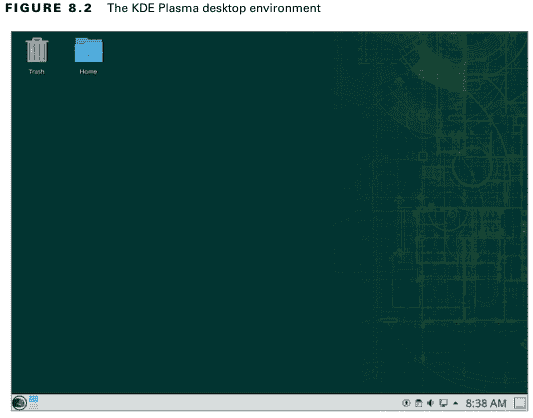

为了帮助那些熟悉通过文件夹图标访问文件的用户，`KDE Plasma`提供了文件夹视图。如图 8.2 所示，在`openSUSE Leap`发行版上，文件夹显示在默认 UI 中。主要桌面窗口上的这些图标允许您启动`Dolphin`文件管理器并直接跳转到文件夹图标上命名的目录。

> 许多桌面环境为每个用户提供了多个称为**`工作区`**的 UI。`工作区`可以是独立的桌面。例如，您可以在一个`工作区`上打开两个 GUI 应用程序，而在另一个`工作区`上仅打开一个终端模拟器。可以通过鼠标点击或按键组合（例如`Fedora 28 Wayland`桌面环境上的`Ctrl+Alt+上箭头/下箭头`）在`工作区`之间切换。使用多个`工作区`可能非常有用，特别是当您需要在工作时显得高效而老板正好走过的时候。

## 考虑 Cinnamon

`Cinnamon`桌面环境始于 2011 年，当时许多用户对`GNOME 3`（现为`GNOME Shell`）的发布做出了强烈反应。`Linux Mint`发行版的开发人员开始创建`Cinnamon`，作为`GNOME 3`的一个分支。从 2013 年末开始，`Cinnamon`官方成为“无`GNOME`”的。`Cinnamon`仍由`Mint`开发团队管理，您可以在其网站`www.linuxmint.com`上了解更多信息。

与`KDE Plasma`一样，`Cinnamon`以是新 Linux 用户的良好 UI 而闻名。图 8.3 展示了`Fedora Workstation`发行版上的`Cinnamon`桌面环境。

注意主 UI 框架底部`面板`的右侧。它有包含音频控制、时间和其他各种小工具的`系统托盘`。菜单是各种程序的`启动器`，也包含`收藏夹栏`，位于`面板`的最左侧。请注意，`Cinnamon`面板还包含用于快速启动的图标。

> 如果您想在第 1 章“准备您的环境”中安装的某个发行版上安装`Cinnamon`桌面环境，我们建议您在`Fedora 34 Workstation`上尝试。请使用具有超级用户权限的账户。这通常是您在系统安装期间设置的账户。访问终端并在命令行中输入命令`sudo dnf groupinstall -y "Cinnamon Desktop"`。务必包含命令的引号。安装完成后，重新启动您的系统。您可以通过系统显示管理器的齿轮图标提供的菜单访问`Cinnamon`桌面环境。

## 图 8.3 `Cinnamon` 桌面环境


`Cinnamon`桌面环境的布局应该有些熟悉，因为它类似于`KDE Plasma`的默认布局。两者的主 UI 窗口上都有文件夹图标。表 8.3 简要描述了一些`Cinnamon`组件。

### 表 8.3 `Cinnamon` 桌面环境默认组件

| 名称 | 程序名称和/或描述 |
| :--- | :--- |
| 显示管理器 | `LightDM` |
| 文件管理器 | `Nemo`（`Nautilus`的一个分支） |
| 收藏夹栏 | 显示在应用程序菜单内部 |
| 面板 | 位于`Cinnamon`框架底部的单个面板（称为`Cinnamon`面板） |
| 系统托盘 | 位于单个面板的右侧 |
| 小部件 | `Cinnamon Spices` |
| 窗口管理器 | `Muffin`（`GNOME Shell`的`Mutter`的一个分支） |

`Cinnamon Spices`不仅仅包含用于修改桌面环境的小部件（`applets`）和桌面小工具（`desklets`）。它还包括可下载和安装的主题和扩展，使你的`Cinnamon` UI 体验真正独一无二。`Cinnamon Spices`的官方存储库位于`https://cinnamon-spices.linuxmint.com`。

## 认识 MATE

`MATE`桌面环境也始于 2011 年，当时`GNOME 3`（现称为`GNOME Shell`）发布。它由阿根廷的一位`Arch Linux`发行版用户发起。发音为“ma-tay”，该桌面环境在宣布后仅两个月正式发布，衍生自`GNOME 2`。该桌面环境可用于多种 Linux 发行版，如`Arch Linux`、`Debian`、`Fedora`、`Ubuntu`、`Linux Mint`等。

> `MATE`的名字来源于一种由植物干叶制成的茶。这种植物（`Ilex paraguariensis`）原产于南美洲。马黛茶（`Mate tea`）是阿根廷的国饮。据称它具有茶的健康益处，并提供与喝咖啡类似的提神醒脑效果。

如果你曾经使用过旧的`GNOME 2`桌面环境，那么`MATE`会让你感到熟悉。图 8.4 展示了`Ubuntu Desktop`发行版上的`MATE`桌面环境。

### 图 8.4 `MATE` 桌面环境


`MATE`桌面环境中有两个`面板`：一个位于主 UI 框架的顶部，另一个位于其底部。`系统托盘`包含音频控制、时间以及各种其他小部件，位于顶部`面板`的右侧。应用程序（`Applications`）是一个菜单驱动的各种程序`启动器`，位于顶部`面板`的最左侧。请注意，此顶部`面板`还包含用于快速启动的图标。


如果你想在你第 1 章中安装的一个发行版上安装`MATE`桌面环境，我们建议你在`Ubuntu Desktop 20.04`上尝试。使用具有超级用户权限的账户。这通常是你在系统安装过程中设置的账户。访问终端并在命令行中输入`sudo apt-get update`来更新系统的存储库。当你收到提示后，安装`tasksel`程序。`tasksel`程序是一个图形实用工具，可以作为一个协调的过程安装多个相关软件包。换句话说，它使得安装具有大量依赖项的特定软件包变得更容易。要安装它，请在命令行中输入`sudo apt-get install tasksel`。然后，通过输入`sudo tasksel install ubuntu-mate-desktop`来安装`MATE`桌面环境。安装完成后，重新启动系统。你可以通过系统显示管理器齿轮图标提供的菜单访问`MATE`桌面环境。

在`MATE`桌面环境的底部`面板`上，左下角是显示桌面（`Show Desktop`）按钮图标。如果你在主要 UI 框架中打开了几个窗口，这将非常有用。只需点击显示桌面按钮，当前打开的所有窗口都会隐藏到底部`面板`。你可以通过再次点击显示桌面按钮来恢复底部`面板`上的所有窗口。表 8.4 简要描述了一些`MATE`组件。

### 表 8.4 `MATE` 桌面环境默认组件

| 名称 | 程序名称和/或描述 |
| :--- | :--- |
| 显示管理器 | `LightDM`。 |
| 文件管理器 | `Caja`（`Nautilus`的一个分支）。 |
| 收藏夹栏 | 使用收藏夹菜单代替，并通过应用程序菜单驱动`启动器`访问。 |
| 面板 | 一个面板位于`MATE`框架的底部，另一个面板占据`MATE` UI 的顶部。 |
| 系统托盘 | 位于顶部面板的右侧。 |
| 窗口管理器 | `Marco`（`Metacity`的一个分支）。 |

你可以向`MATE` UI 的顶部`面板`添加其他小部件。只需右键单击面板，然后从下拉上下文菜单中选择“添加到面板”（`Add To Panel`）。这将打开一个窗口，显示你可以安装的小部件。

## 设置辅助功能

在 GUI 环境中，辅助功能（`accessibility`）涉及用户使用桌面环境的能力。虽然 Linux 发行版提供的默认桌面环境对很多人有效，但辅助功能设置适应了所有潜在用户。这包括可能有视觉障碍、鼠标使用困难、手指运动问题等人士。了解关于这些适应措施的桌面环境配置很重要，这样你可以帮助为所有人提供访问权限。

每个桌面环境将提供略有不同的辅助功能配置方法。但大多数设置可以通过桌面环境控制面板完成，例如`GNOME Shell`设置中的通用访问（`Universal Access`）面板。


> 虽然大多数桌面环境提供名称不同的辅助功能控制面板，但你通常可以使用环境的搜索功能找到这些面板。好的搜索词包括“通用访问”（`universal access`）、“辅助功能”（`accessibility`）和“辅助技术”（`assistive technologies`）。

图 8.5 显示了从`Ubuntu`登录窗口打开的通用访问菜单。你可以在访问控制面板中找到更多辅助功能设置，通过搜索`GNOME Shell`搜索功能中的“`universal access`”（通用访问）。

对于有严重视觉障碍或视力不好的用户，几个辅助功能设置可能会有帮助。表 8.5 描述了常见的视觉障碍设置。

### 表 8.5 常见的视觉障碍辅助功能设置

| 名称 | 描述 |
| :--- | :--- |
| 光标闪烁 | 修改光标闪烁频率，使屏幕上的光标更容易定位。 |
| 光标大小 | 修改光标大小。 |
| 高对比度 | 增加窗口和按钮的亮度，并加深窗口边缘以及文本和光标的颜色。 |
| 大文本 | 修改字体大小。 |
| 屏幕阅读器 | 使用屏幕阅读器朗读 UI。流行的选择包括`Orca`屏幕阅读器和`Emacspeak`。 |
| 声音键 | 当大写锁定（`Caps Lock`）或数字锁定（`Num Lock`）打开（关闭）时发出哔声。也称为`切换键`（`toggle keys`）。 |
| 缩放 | 将屏幕或屏幕的一部分放大到不同的放大级别。 |

### 图 8.5 `GNOME Shell` 中的通用访问顶部面板菜单

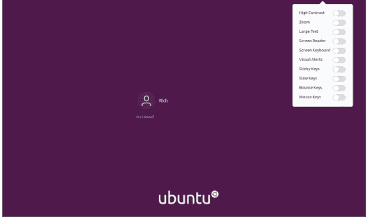

如果盲人用户可以使用盲文显示器，你可以安装`BRLTTY`软件包，该软件包可在大多数 Linux 发行版的存储库中找到。`BRLTTY`作为 Linux 守护程序运行，并通过盲文显示器提供控制台（文本模式）访问。你可以在其官方网站`http://mielke.cc/brltty`上了解有关此软件的更多信息。请注意，你也可以将`Orca`屏幕阅读器与可刷新盲文显示器一起使用。

> 如果你无法听到 Linux 系统上的声音警报，你可以启用视觉警报。因此，如果发生通常会产生声音的事件，则改为执行视觉闪烁。你可以将视觉警报设置为闪烁单个窗口或闪烁整个显示屏。

对于手部和/或手指受损的用户，几个辅助功能设置允许完全使用系统功能。常见设置列于表 8.6 中。

### 表 8.6 常见的手部和手指损伤辅助功能设置

| 名称 | 描述 |


## 辅助功能选项

| :--- | :--- |
| 弹跳键 | 有助于补偿单个按键意外多次按下的键盘选项。 |
| 双击延迟 | 修改两次鼠标点击之间允许时间的鼠标选项。 |
| 手势 | 通过组合鼠标点击和键盘按键来激活程序和/或选项的鼠标选项。 |

### 表 8.6 辅助功能选项

| 名称 | 描述 |
|---|---|
| 悬停点击 | 鼠标选项，当指针悬停在某项目上时触发鼠标点击。 |
| 鼠标按键 | 鼠标选项，允许您使用键盘按键来模拟鼠标功能。 |
| 重复按键 | 键盘选项，修改按键必须按下的时长以及确认按键重复的延迟。也称为键盘重复速率。 |
| 屏幕键盘 | 键盘选项，在 UI 上显示一个可视化键盘，可以使用鼠标或其他指向设备进行操作以模拟按键击键。 |
| 模拟次要点击 | 鼠标选项，设置一个主键与鼠标点击同时按下以模拟次要鼠标点击。 |
| 慢速按键 | 键盘选项，修改按键必须按下的时长以确认按键。 |
| 粘滞按键 | 键盘选项，设置键盘修饰键（如 `Ctrl` 和 `Shift`）保持其按下状态，直到按下下一个键为止。 |

`AccessX` 是一个程序，提供了表 8.6 中的许多选项。因此，您经常会在辅助功能控制面板中看到它的提及，例如在“打字辅助 (`AccessX`)”选项中。一个有趣的 `AccessX` 设置是 `Enable By Keyboard`，它允许您通过键盘按键来开启或关闭辅助功能设置。

# 提供 GUI 服务

提供 Linux 系统用户界面涉及许多组件。桌面环境组件只是这个拼图的一部分。图 8.6 是对向用户提供 GUI 服务的一种简略描述。

在图 8.6 中，请注意，窗口管理器在此场景中是一个中介。窗口管理器是一个代表 UI 与显示服务器（有时也称为窗口管理器）通信的程序。每个特定的桌面环境都有其默认的窗口管理器，例如 `Mutter`、`Kwin`、`Muffin`、`Marco` 和 `Metacity`。

在以下各节中，我们将重点介绍显示服务器，这是一个使用通信协议将 UI 的需求传输到操作系统并返回的程序。这种通信协议称为显示服务器协议，可以在网络上运行。

## 图 8.6 提供 GUI 组件

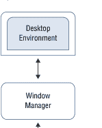

显示服务器团队的另一个成员是*合成器*。合成器程序将窗口内的各种显示元素排列起来，创建屏幕图像并将其传回给客户端。

> 在计算机打印文档之前，合成器是人。物理框架（称为 *chases*）装着雕刻有字母或图像的木块。合成器将木块排列到框架中形成单词和/或图像。合成器将框架交给印刷工，印刷工也是一个人。印刷工给木块上墨，然后将框架压在纸上，从而生成打印文档。合成器程序以类似的方式工作，只是它使用组合成单一屏幕图像的多个元素，并将其交给客户端。

## 探究 Wayland

`Wayland` 是 `X11` 显示服务器（稍后描述）的替代品。它被设计得更简单、更安全、更容易开发和维护。`Wayland` 特别定义了显示服务器及其各个客户端之间的通信协议。然而，`Wayland` 也是一个涵盖合成器、窗口服务器和显示服务器的统称。

`Wayland` 协议最初于 2009 年发布，现在被许多当前的 Linux 桌面环境使用，例如 `GNOME Shell` 和 `KDE Plasma`。如果您想深入了解 `Wayland`，请访问其网站 `https://wayland.freedesktop.org`。

练习 8.1 帮助您通过使用几个命令行指令来查看 Linux 发行版中的显示环境，以显示显示设置。

## 练习 8.1

### 检查您的显示服务器

您可以通过以下步骤快速确定您的桌面使用的显示服务器是 `X11` 还是 `Wayland`：

1. 登录到您系统的 GUI。这将为您启动一个 GUI 会话。

2. 打开一个终端仿真应用程序。

3. 在命令行输入 `echo $WAYLAND_DISPLAY` 并按下 `Enter` 键。如果您没有响应，只收到一个命令行提示符，那么您的系统很可能正在使用 `X11`。如果您收到响应，则您的桌面环境可能正在使用 `Wayland`。额外的测试将帮助您确认实际使用的是哪种。

4. 您需要获取 GUI 会话编号，因此输入 `loginctl` 并按下 `Enter`。记下会话编号。

5. 在命令行输入命令 `loginctl show-session session-number -p Type`，其中 `session-number` 是您在上一步获得的编号。如果您收到 `Type=Wayland`，则您的桌面环境正在使用 `Wayland`。如果您收到 `Type=X11`，则您的系统正在使用 `X11` 显示服务器。

`Wayland` 合成器是 `Weston`，它提供了一种相当基本的桌面体验。它是作为 `Wayland` 合成器的参考实现而创建的，这也是一个合成器要求示例，供希望创建自己的 `Wayland` 合成器的开发人员使用。因此，`Weston` 的核心重点是正确性和可靠性。

`Wayland` 的合成器是可替换的。换句话说，如果您需要更功能齐全的桌面体验，可以使用不同的合成器。有几个合成器可用于 `Wayland`，包括 `Arcan`、`Sway`、`Lipstick` 和 `Ceyland`。但是，您可能不需要专门去寻找 `Wayland` 合成器。许多桌面环境创建了自己的 `Wayland` 合成器，这些合成器通常嵌入在其窗口管理器中。例如，`Kwin` 和 `Mutter` 都完全处理 `Wayland` 合成器任务。


如果您有任何不支持 `Wayland` 的遗留 `X11` 应用程序，请不要绝望。`Weston` 软件包中提供了 `XWayland` 软件。`XWayland` 允许依赖 `X` 的应用程序在 `X` 服务器上运行，并通过 `Wayland` 会话显示。

如果您的 UI 使用 `Wayland`，但您遇到 GUI 问题，可以尝试几种故障排除技术。以下列表逐步介绍了一些基本方法。

**在没有 `Wayland` 的情况下尝试 GUI。** 如果您的 Linux 发行版有桌面环境的多种变体（带 `Wayland` 或带 `X11`），请注销您的 GUI 会话并选择不带 `Wayland` 的桌面环境。如果您的 UI 问题得到解决，那么您就知道这很可能与 `Wayland` 有关。

如果您没有多种桌面环境变体并且使用的是 `GNOME Shell` 用户界面，请关闭 `Wayland`。这样做需要使用超级用户权限并编辑 `/etc/gdm3/custom.conf` 文件。移除 `#WaylandEnable=false` 行中的 `#` 并保存文件。重启系统并登录到 GUI 会话，看看问题是否消失。

**检查您的系统显卡。**

如果您的系统在 `X11` 下运行正常，但在使用 `Wayland` 时出现问题，请检查您的显卡。前往显卡供应商的网站查看其驱动程序是否支持 `Wayland`。大多数都支持，但有几个著名的例外这里就不点名了。

**使用不同的合成器。**

如果您正在使用桌面环境的内置合成器或其他某个合成器，请尝试安装并使用 `Weston` 合成器软件包。请记住 `Weston` 是为可靠性而构建的。如果 `Weston` 不在您的发行版软件仓库中，您可以从 `https://github.com/wayland-project/Weston` 获取。该网站还包含有用的文档。如果使用 `Weston` 解决了您的 GUI 问题，那么您已经缩小了罪魁祸首的范围。


请注意，当拥有 `Wayland` 会话时，某些桌面环境命令不起作用。例如，如果您正在使用 `GNOME Shell`，`gnome-shell --replace` 命令将不起作用，只会生成消息 `Window manager warning: Unsupported session type`。

## 检查 X11

`X` 窗口系统（简称 `X`）自 1980 年代起就存在，因此它经受住了时间的考验。在 Linux 上，实现 `X` 的主导服务器是 `XFree86`，直到 2004 年发生许可证变更。这一变更导致许多 Linux 发行版转向使用 `X.org` 基金会实现的 `X`。

`X.org` 的服务器实现了 `X` 窗口系统版本 11。因此，您会看到关于 Linux `X` 显示服务器的各种名称，例如 `X.org-X11`、`X`、`X11`、`X.Org Server` 等。我们将在本章中使用 `X` 或 `X11`。

目前，`X11` 正在被 `Wayland` 迅速取代。不仅 `Wayland` 提供了更好的安全性，而且它更容易维护。较旧的 `X11` 配置中有许多过时且晦涩的选项。然而，您可能仍然会有使用 `X11` 的发行版，因此了解其基础知识很重要。


如果出于某种原因您的 `X11` 会话挂起，您可以快速终止它：返回显示管理器屏幕并重新登录系统。只需按下 `Ctrl+Alt+Backspace` 组合键。`X11` 会话将停止并为您重启，提供显示管理器屏幕以便您登录。

`X11` 的主要配置文件是 `/etc/X11/xorg.conf`，尽管有时它也被存储在任何 `/etc/` 目录下的位置。通常，这个文件不再被使用。相反，`X11` 使用运行时自动检测涉及每个图形界面会话的硬件，即时创建会话配置。

然而，在某些情况下，自动检测可能无法正常工作，你需要进行 `X11` 配置更改。在这些情况下，你可以创建配置文件。为此，请关闭 `X` 服务器，打开一个终端模拟器，并使用超级用户权限，通过 `xorg -configure` 命令生成该文件。该文件名为 `xorg.conf.new`，将位于你的本地目录中。进行必要的调整后，重命名该文件，将其移动到正确的位置，然后重启 `X` 服务器。

`xorg.conf` 文件有几个部分。每个部分包含重要的配置信息，如下所示：

- 输入设备：配置会话的键盘和鼠标
- 显示器：设置会话的显示器配置
- 模式：定义视频模式
- 设备：配置会话的视频卡
- 屏幕：设置会话的屏幕分辨率和颜色深度
- 模块：指示需要加载的模块
- 文件：如需为字体、模块和键盘布局文件设置文件路径名
- 服务器标志：配置全局 `X` 服务器选项
- 服务器布局：连接会话的所有输入和输出设备

请记住，许多桌面环境也在其用户界面中提供对话框，允许你配置你的图形界面 `X` 会话。很可能你很少或无需创建或调整 `X11` 配置文件。但是，如果你想深入研究 `X11` 配置文件的细节，请通过发出 `man 5 xorg.conf` 命令查看其手册页。


> 虽然大多数桌面环境使用自己的显示管理器，但 `X` 显示管理器是一种可供使用的基本显示管理器。它使用 `X` 显示管理器控制协议（`XDMCP`）。主要配置文件是 `/etc/X11/xdm/xdm-config`。

如果你需要排查 `X` 问题，两个实用工具可以帮助：`xdpyinfo` 和 `xwininfo`。`xdpyinfo` 命令提供有关 `X` 服务器的信息，包括可用的不同屏幕类型、默认通信参数值、协议扩展信息等。

`xwininfo` 实用工具专注于提供窗口信息。如果不给出选项，交互式实用工具会提示你点击你希望获取统计信息的窗口。显示的统计数据包括位置信息、窗口尺寸（宽度和高度）、颜色映射 ID 等。

> **注意**

> 请注意，如果你运行的是 `Wayland` 会话而不是 `X` 会话，`xwininfo` 命令将会挂起。按 `Ctrl+C` 退出挂起的命令。

虽然 `Wayland` 正在许多 Linux 系统上取代 `X` 成为默认显示服务器，但 `X` 服务器仍将持续存在一段时间。因此，理解两者不仅对认证目的有价值，对有效工作也是无价的。

## 使用远程桌面

如今，直接坐在连接到你的 Linux 服务器的显示器前是一种罕见现象。大多数服务器是位于受控环境中的机架安装系统，或者是运行在这些机架安装系统上的虚拟机。要访问这些服务器，另一房间中桌面用户的通常使用基于文本的 `OpenSSH` 实用工具。然而，有时你需要一个功能完整的桌面环境。

远程桌面软件使用客户端-服务器模型。服务器运行在远程 Linux 系统上，而客户端运行在本地系统上。例如，假设你需要访问位于办公楼某处服务器上的 Linux 虚拟机。你可以使用运行远程桌面客户端软件的笔记本电脑登录到运行远程桌面服务器软件的 Linux 虚拟机，并通过网络获得完整的桌面体验。

在接下来的部分中，我们将查看一些常见的 Linux 远程桌面实现。它们包括 `VNC`、`Xrdp`、`NX` 和 `SPICE`。

## 理解 VNC

虚拟网络计算（`VNC`）由奥利维蒂与甲骨文研究实验室开发。它是多平台的，并使用远程帧缓冲（`RFB`）协议。该协议允许客户端用户向服务器发送图形界面命令，如鼠标点击。服务器将桌面帧发送回客户端显示器。`RealVNC Ltd.` 由最初的 `VNC` 项目团队开发者组成，现在对 `VNC` 拥有商标权。

> **注意**

> 如果你正在使用 `KVM` 虚拟机（在第 28 章和第 29 章中涵盖），那么通常默认情况下，你通过 `VNC` 访问其桌面环境。但是，还有其他可用的选项，如 `SPICE`，将在本章后面涵盖。

`VNC` 服务器在 `TCP` 端口 `5900 + n` 处提供图形界面服务，其中 `n` 等于显示号，通常是 `1`（端口 `5901`）。在命令行上，你将 `VNC` 客户端（称为 `viewer`）指向 `VNC` 服务器的主机名和 `TCP` 端口。或者，你可以使用显示号代替完整的 `TCP` 端口号。客户端用户需要输入预定的密码，该密码用于 `VNC` 服务器，而不是 Linux 系统身份验证。一旦客户端用户通过 `VNC` 完成身份验证，系统就会向用户提供桌面环境的显示管理器输出，以便可以进行系统身份验证。`VNC` 服务器非常灵活，你也可以使用启用 `Java` 的 Web 浏览器来访问它。它在 `TCP` 端口 `5800 + n` 处提供该服务。也支持 `HTML5` 客户端 Web 浏览器。

**注意** `VNC` 客户端有两种类型的桌面用户界面：持久型和静态型。持久型桌面是当呈现时不会改变的用户界面。这类似于本地桌面体验：用户打开某些窗口，用户锁定屏幕并在离开本地系统时进行活动，用户回来并解锁屏幕，用户发现图形界面保持在完全相同的状态。持久型桌面仅通过 Web 浏览器访问可用。静态型桌面不提供保存状态的图形界面。

使用 `VNC` 时的积极好处包括：

- 它在提供远程桌面方面具有很高的灵活性。
- 桌面可供多个用户使用。
- 持久型和静态型桌面均可用。
- 它可以按需提供桌面。
- 可以通过 `ssh` 或客户端查看器命令行选项使用 `SSH` 隧道来加密流量。

`VNC` 可能存在的困难或担忧包括：

- `VNC` 服务器仅处理鼠标移动和击键。它不处理客户端的文件和音频传输或打印服务。
- `VNC` 默认不提供流量加密，因此你必须采用其他保护手段，如通过 `OpenSSH` 隧道传输。
- `VNC` 服务器密码以纯文本形式存储在服务器文件中。

除了 `VNC` 之外，还有实现 `VNC` 技术的替代方案。Linux 上一种流行的 `VNC` 实现是 `TigerVNC`（`https://tigervnc.org`）。它也在 `Windows` 上工作，因此你可以连接到远程 Linux 或远程 `Windows` 系统。要在 Linux 系统上安装服务器，请使用 `tigervnc-server` 包名。你需要进行一些设置以准备客户端并配置服务器以满足适当的客户端需求。网上有一些出色的教程。如果你想安装 `VNC` 客户端，只需使用 `tigervnc` 包名即可。

**提示** 在命令行通过命令访问远程桌面时，务必在图形界面环境中使用终端模拟器。如果你试图在图形界面外使用文本模式终端来发出这些命令，你将不会成功。

安装 `TigerVNC` 服务器后，你使用 `vncserver` 和 `vncconfig` 命令来控制它。在对服务器防火墙进行适当修改后，客户端可以使用 `vncviewer` 命令连接到服务器系统并获取远程桌面。例如，假设服务器（`example.com`）已正确配置，以便为显示号 1 为你提供远程桌面。你将通过另一个系统使用 `vncviewer example.com:1` 命令访问桌面。图 8.7 显示了一个从 `Fedora` 系统到 `CentOS` 服务器的 `TigerVNC` 连接，该服务器向用户提供 `GNOME Shell` 桌面环境。

**图 8.7** 使用 `TigerVNC`

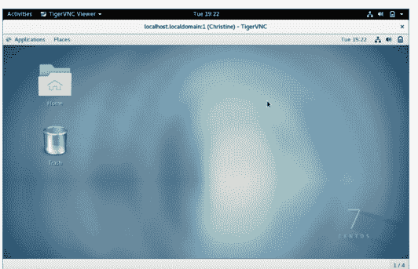

在配置你的 `VNC` 服务器时，务必对 `VNC` 服务器端口使用 `OpenSSH` 端口转发（本章后面涵盖）。另外配置防火墙以允许通过端口 22（或你用于 `SSH` 流量的任何端口号）的流量。

## 掌握 Xrdp

`Xrdp` 是 `VNC` 的替代方案。它支持远程桌面协议（`RDP`）。它使用 `X11rdp` 或 `Xvnc` 来管理图形界面会话。

`Xrdp` 仅提供 `RDP` 连接的服务器端。它允许从多个 `RDP` 客户端实现访问，例如 `xrdp`、`FreeRDP` 和 `Microsoft Remote Desktop Connection`。

`Xrdp` 已支持 `systemd`，因此你可以简单地使用 `systemctl` 命令来安装、启用和启动服务器。在 Linux 上，包名称为 `xrdp`。请注意，它可能不在你的 Linux 发行版的标准软件仓库中。

安装并启动 `Xrdp` 服务器后，请调整防火墙设置，以便流量可以访问标准 `RDP` 端口（`TCP` 3389）。然后，将你选择的 `RDP` 客户端指向服务器的主机名或 IP 地址，如有必要，还需向客户端提供 `RDP` 端口号。

根据你的 `RDP` 客户端不同，你可能会看到一个提示服务器不受信任的屏幕。如果这正是你刚刚设置好的服务器，那么你可以继续操作。你需要输入 Linux 系统的用户认证信息，但登录界面的具体形式取决于你正在使用的 `Xrdp` 客户端软件。图 8.8 展示了 `Xrdp` 运行时的一个示例。

### 图 8.8 使用 Xrdp

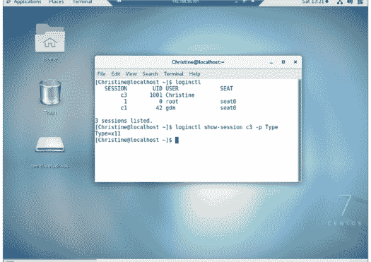


图 8.8 显示了从 Windows 10 系统到运行 Xrdp 服务器的 CentOS 7 Linux 服务器的连接。请注意终端模拟器中运行命令的输出。你可以看到一个 X11 会话正在被部署。

使用 Xrdp 的一些优点包括：

- `Xrdp` 使用 RDP，通过 TLS 加密其流量。

- 有各种各样的开源 RDP 客户端软件可供选择。

- 你可以连接到现有的连接，以提供持久的桌面环境。

- `Xrdp` 服务器处理鼠标移动和按键输入，以及音频传输和在远程系统上挂载本地客户端驱动器。

你可以在 `/etc/xrdp/xrdp.ini` 文件中确定各种 Xrdp 配置设置。该文件中的一个重要设置是 `security_layer` 指令。如果设置为 `negotiate`（默认值），Xrdp 服务器将与客户端协商要使用的安全方法。有三种方法可用：

- `tls` 为服务器认证和数据传输提供 SSL（TLS 1.0）加密。

  > 请注意，这种加密级别不足以符合支付卡行业（PCI）标准。

- `negotiate` 将安全方法设置为客户端可以使用的最高级别。如果连接是通过公共网络进行的，且客户端必须使用标准 RDP 安全方法，这可能会带来问题。

- `rdp` 将安全方法设置为标准 RDP 安全。这种方法不安全，容易受到网络攻击。

Xrdp 的使用相当简单。此外，由于许多面向 Windows 的用户已经熟悉远程桌面连接，因此通常在办公环境中部署它不需要太长时间。

## 探索 NX

NX 协议，有时被称为 NX 技术，由 NoMachine（www.nomachine.com）于 2001 年左右创建。NX 是另一种远程桌面共享协议。其 v3.5 核心技术是开源的，并在 GNU GPL2 许可证下提供。然而，当版本 4 发布时，NX 变成了专有和闭源软件。

但是，基于 NX3 技术的几种开源变体是可用的，包括 FreeNX 和 X2Go。它们都可以从各种 Linux 发行版获得，但不一定在其默认的软件仓库中。

使用 NX 产品的一些优点包括：

- 即使在高延迟问题的低带宽连接上，它们也能提供出色的响应时间。

- 它们比基于 VNC 的产品更快。

- 它们默认使用 OpenSSH 隧道，因此流量是加密的。

- 它们支持通过单个网络端口的多用户同时连接。

NX 技术压缩 X11 数据，从而减少通过网络发送的数据量，进而改善响应时间。它还大量使用缓存数据，以提供更好的远程桌面体验。

## 研究 SPICE

另一个有趣的远程连接协议是 Simple Protocol for Independent Computing Environments（SPICE，简单协议用于独立计算环境）。最初，它是 Qumranet 在 2007 年开发的闭源产品。然而，Red Hat 在 2008 年收购了 Qumranet，并使 SPICE 开源。其网站位于 [www.spice-space.org](www.spice-space.org)。

SPICE（有时写作 Spice）的开发旨在提供一个良好的远程桌面产品，允许连接到你的各种虚拟机。现在，SPICE 主要用于提供与 KVM 虚拟机的连接，进入了 VNC 的领域。


> VNC 和 Spice 都为 KVM 虚拟机提供远程桌面连接。虚拟机在第 28 章和第 29 章中有更详细的介绍。

SPICE 是平台无关的，并且还有一些不错的附加功能：

- SPICE 的客户端端使用多个数据套接字连接，你可以拥有多个客户端。

- 它提供类似本地连接的桌面体验速度。

- 它消耗较少的 CPU，因此你可以在拥有多个虚拟机的各种服务器上使用它，而不会影响它们的性能。

- 它允许高质量的视频流传输。

- 它提供实时迁移功能，这意味着如果虚拟机正在迁移到新主机，连接不会中断。

虽然 SPICE 只有一种服务器实现，但它有多种客户端实现。这些包括 `remote-viewer` 和 GNOME Boxes。

使用 SPICE 的另一个好处是其强大的安全功能。传输的数据可以是明文发送，也可以使用 TLS 进行加密传输。SPICE 客户端与远程 SPICE 服务器之间的认证是通过 Simple Authentication and Security Layer（SASL，简单认证和安全层）实现的。只要 SASL 支持，该框架允许使用各种认证方法。Kerberos 是一种支持的方法。

如果你仍然在使用 X11，你可以使用 Xspice。由 X.Org 创建的 Xspice 既可以作为独立的 SPICE 服务器，也可以作为 X 服务器运行。

## 端口转发

只向授权者提供数据访问权限至关重要。无论是发送明文数据还是远程桌面 GUI 客户端-服务器交互信息，两者都需要在网络上受到保护。

提供安全的一种方法是通过 SSH 端口转发，有时称为 SSH 隧道。SSH 端口转发允许你将连接从一个特定的网络端口重定向到端口 22，即 SSH 服务等待接收连接的地方。这允许数据流量通过安全加密的隧道来回移动，类似于虚拟专用网络（VPN）。

要使用 SSH 端口转发，你的 Linux 系统必须安装并启用 OpenSSH 服务。幸运的是，大多数发行版已经预装了此服务。你可以使用在第 6 章“维护系统启动和服务”中介绍的 `systemctl` 命令来检查它是否在运行。在清单 8.1 中，对系统上的 OpenSSH 服务进行了检查。它显示 OpenSSH 处于活动（运行）状态，并且已启用（将在启动时启动）。

### 清单 8.1 检查 OpenSSH 服务状态

```
$ systemctl is-active sshd
active
$ systemctl is-enabled sshd
enabled
$
```


如果你的系统没有 OpenSSH 服务器，你通常可以通过 `openssh` 包安装服务器和客户端。第 13 章“软件治理”讨论了 Linux 软件包的安装和管理。

在尝试 SSH 端口转发之前需要检查的另一项是 OpenSSH 配置文件 `/etc/ssh/sshd_config`。指令 `AllowTcpForwarding` 应设置为 `yes`。如果该指令设置为 `no`，你必须修改它以使用 SSH 端口转发。在清单 8.2 中，在一个 openSUSE 发行版上对该配置文件的此指令进行了检查。

### 清单 8.2 检查 AllowTcpForwarding 指令

```
$ sudo grep "AllowTcpForwarding yes" /etc/ssh/sshd_config
#AllowTcpForwarding yes
$
```

请注意，在清单 8.2 中，该指令被井号（`#`）注释掉了。这不是问题，因为默认情况下，`AllowTcpForwarding` 设置为 `yes`。

SSH 端口转发有以下三种形式：

- 本地

- 远程

- 动态

这些变体中的每一种都允许你执行各种类型的隧道传输流量。然而，由于我们要关注的是 GUI 环境，因此我们只涵盖用于远程桌面的本地和远程 SSH 端口转发。

## 本地

本地端口转发将流量从你系统上的 OpenSSH 客户端发送到客户端的 OpenSSH 服务器。客户端的 OpenSSH 服务器随后通过安全隧道将该流量转发到目标服务器。换句话说，出站流量被路由到另一个出站端口，并在离开客户端系统前通过 OpenSSH 进行隧道传输。

要在命令行中实现这一点，需要使用 `ssh` 命令的 `-L` 选项以及一些额外的参数。就远程桌面而言，命令的语法如下：

```
ssh -L local-port:127.0.0.1:remote-port -Nf user@destination-host
```

在该命令的语法中，包含以下参数：

- `destination-host` 是你登录以使用其驻留的桌面环境的计算机。

- `user` 是你希望用于身份验证以建立安全隧道的桌面主机用户名。

- `local-port` 是你在客户端端使用的应用程序端口号。

- `remote-port` 是目标主机上应用程序正在监听的端口。

- `127.0.0.1` 表示你正在使用本地 SSH 端口转发方法。

请记住，此命令仅建立隧道；它不提供远程桌面连接。因此，还有两个重要的命令选项：`-N` 选项让 OpenSSH 知道不需要远程终端进程，而 `-f` 选项表示在用户向服务器进行身份验证后，`ssh` 命令应转入后台。这两个选项允许用户在建立安全隧道后发出其他命令，例如远程桌面命令。

可以使用 VNC 来描述一个实用示例。回想一下，VNC 使用端口 `5900 + n`，其中 `n` 等于显示号。因此，如果在远程系统上你的桌面位于显示 2，你可以发出以下命令来使用 SSH 端口转发，并将本地 VNC 端口 `5901` 转发到远程主机的端口 `5902`：

```
ssh -L 5901:127.0.0.1:5902 -Nf Doug@example.com
```

一旦隧道建立，你就可以使用 VNC 远程桌面命令来访问并查看远程主机上的桌面环境。请记住，你需要进行一些防火墙配置以允许访问远程主机。

幸运的是，TigerVNC 提供了一种更简单的本地 SSH 端口转发方法。只需在 `vncviewer` 命令中使用 `-via localhost` 选项，如图 8.9 所示。

### 图 8.9 使用 TigerVNC 进行本地 SSH 端口转发

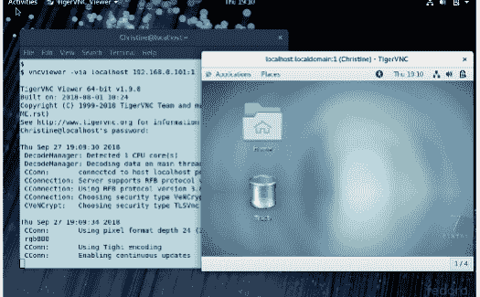

与 `vncviewer` 命令结合使用的 `-via localhost` 选项强制连接使用本地 SSH 端口转发。最后一个命令参数是目标主机的 IPv4 地址（你也可以使用主机名），后跟一个冒号和远程桌面的显示号（`1`）。这比使用更多的命令和选项要容易得多。

## 远程

远程 SSH 端口转发方法从目标主机（服务器）开始，而不是远程客户端。因此，在目标主机上，你使用以下命令语法创建远程桌面安全隧道：

```
ssh -R local-port:127.0.0.1:remote-port -NF user@client-host
```

此命令与本地方法有一些重要区别：

- 使用 `-R` 选项而不是 `-L` 选项。

- `client-host` 是远程客户端的 IP 地址或主机名（你将在此处发出远程桌面命令）。

- `local-port` 是你在使用 `vncviewer` 命令时用于 `client-host` 的端口号。

- `remote-port` 位于远程桌面服务器上。

## 你的 X11 连接的隧道传输

另一种在安全隧道内提供远程 GUI 交互的方法是 X11 转发。X11 转发允许你通过加密网络连接与远程系统上基于 X11 的各种图形实用程序进行交互。此方法也是使用 OpenSSH 服务来执行的。

首先，你需要检查是否允许 X11 转发。此设置位于 OpenSSH 配置文件 `/etc/ssh/sshd_config` 中。指令 `X11Forwarding` 应在远程系统的配置文件中设置为 `yes`。如果指令设置为 `no`，则必须修改它以启用 X11 转发。在列表 8.3 中，对 CentOS 发行版上的配置文件中的该指令进行了检查。

### 列表 8.3 检查 X11Forwarding 指令

```
grep "X11Forwarding yes" /etc/ssh/sshd_config
X11Forwarding yes
```

完成必要的配置文件修改后，使用的命令是 `ssh -X user@remote-host`。与之前 `ssh` 命令的用法类似，`user` 是驻留在 `remote-host` 系统上的用户帐户。`remote-host` 具有你希望使用的 GUI 实用程序，可以通过 IP 地址或主机名指定。图 8.10 展示了从远程 Fedora 客户端连接到 CentOS 服务器并在该服务器上使用图形实用程序的过程。

### 图 8.10 转发 X11

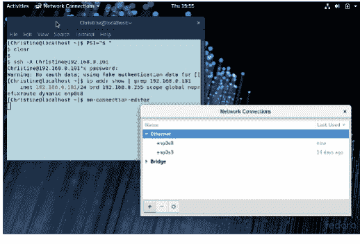

检查你的 IP 地址以确认已成功到达远程系统始终是个好主意。在图 8.10 中，`ip addr show` 命令用于此目的。完成工作后，只需输入 `exit` 即可退出 X11 转发会话。

> **警告** 你可能会读到关于使用 `ssh -Y` 命令进行 X11 转发的内容，这被称为受信任的 X11。这并不意味着连接更安全。事实上，恰恰相反。使用此命令时，你将远程服务器视为受信任的系统。这可能会导致许多安全问题，应避免使用。

## 摘要

为自己和系统用户创建、管理和故障排除 GUI 环境涉及一套重要的技能。你需要理解不同的桌面环境、其支持框架，以及如何安全且可靠地在网络上传输它们。

各种桌面环境，如 GNOME Shell、KDE Plasma、MATE、Cinnamon 和 Unity，提供了许多不同的环境来满足不同的需求和口味。当前不断发展的显示服务器世界，主要包含 Wayland 和较旧的 X11，支持这些 GUI 桌面。

Linux 提供了具有许多无障碍功能的 GUI 桌面环境，几乎可以满足任何 UI 需求。各种键盘和鼠标设置有助于有手部或手指困难的人。还有许多针对视力障碍者的实用工具，包括屏幕阅读器和缩放功能。

通过网络访问 GUI 是通过远程桌面软件实现的。VNC、Xrdp 和 NX 只是其中几个例子。SPICE 的独特之处在于其主要重点是为虚拟机提供远程桌面访问。

无论你访问的是机架式物理服务器还是运行在该服务器上的虚拟机，确保远程桌面连接的安全性都很重要。这是通过 SSH 端口转发实现的，如果必要，还可以通过 X11 转发。如果正确使用，两者都允许数据和 GUI 交互通过加密隧道安全传输。

## 考试要点

- 概述各种 GUI 部分和功能。桌面环境为 GUI 提供预设的外观和感觉。它具有图形部分，如收藏夹栏、启动区域、菜单、面板和系统托盘。GUI 还具有典型功能，如桌面设置、显示管理器、文件管理器、访问程序的图标、小部件和窗口管理器。

- 描述各种 GUI 桌面环境。当前 Linux 发行版使用的主要桌面环境包括 GNOME Shell、KDE Plasma、MATE 和 Cinnamon。

- 总结可用的通用访问工具。不同的无障碍工具位于菜单或面板中。这些面板位于桌面环境的不同位置，名称如通用访问、无障碍、辅助技术等。最好使用桌面环境的搜索功能来定位它们。针对视力障碍用户提供的各种访问工具包括光标闪烁、光标大小、对比度修改、文本放大、声音按键、缩放功能和屏幕阅读器。对于需要使用盲文技术的个人，可以使用 `brluty` 软件。对于听力障碍者，显示的窗口可以设置为闪烁而不是提供声音警报。当某人使用键盘有困难时，有许多可用的设置，如弹跳键、重复键、屏幕键盘、慢速键和粘滞键。对于鼠标使用困难，可以探索的工具包括双击延迟、手势、悬停点击、鼠标键和模拟次要点击。

- 解释显示服务器的作用。显示服务器是一个程序或程序组，它使用通信协议在 GUI 和操作系统之间传递信息。该通信协议称为显示服务器协议，并且可以在网络上运行。与显示服务器一起使用的关键程序之一是合成器。合成器在窗口内排列显示元素以创建屏幕图像。两个重要的显示服务器是 Wayland 和 X11。X11 是一个较旧的显示服务器，已存在一段时间。Wayland 是一个较新的显示服务器，它增加了许多所需的安全功能，并且更容易维护。

- 描述可用的远程桌面软件。远程桌面软件通过网络从远程服务器提供完全功能的桌面环境。它使用客户端-服务器模型，并且有几个可选择的软件包。它们包括 VNC、Xrdp、NX 和 SPICE。

- 总结 SSH 端口和 X11 转发。SSH 端口转发，有时称为 SSH 隧道，将连接从特定的网络端口重定向到端口 22 上的 SSH 服务。这允许数据流量通过类似于虚拟专用网络（VPN）的安全加密隧道来回传输。SSH 端口转发有三种不同的方法：本地、远程和动态。除了 SSH 端口转发外，还可用 X11 转发。它也提供 GUI 交互的安全隧道。但是，与其说是完整的桌面环境，你可以从远程系统的命令行启动基于 X11 的图形实用程序。

## 复习题

1. 下列哪项最准确地描述了一个桌面环境？

   - A. 一组允许用户通过图标、窗口和其他视觉元素与系统交互的程序

   - B. 一个输入用户名和密码以获得系统访问权限的屏幕

   - C. 一组协同工作以为用户界面提供图形设置的分量

   - D. 一个允许你以图形方式执行文件维护活动的程序

   - E. 一组确定窗口如何在桌面上呈现的程序

2. 下列哪些是 GUI 分量？（选择所有适用项。）

   - A. 收藏夹栏

   - B. 文件管理器

   - C. 图标

   - D. 命令行

   - E. 系统托盘

3. 下列哪一项在 GNOME Shell 中默认未使用？

   - A. SDDM

   - B. Files

   - C. Muttter

   - D. GDM

   - E. Dock

4. 下列哪一项是 KDE Plasma 的文件管理器？

   - A. Nautilus

   - B. Plasmoid

   - C. Dolphm

   - D. Kwin

   - E. Nemo

5. 关于 MATE 桌面环境，下列哪些说法是正确的？（选择所有适用项。）

   - A. MATE 是 GNOME Shell 的分叉版。

   - B. MATE 使用 Metacity 作为其窗口管理器。

   - C. MATE 的显示管理器是 LightDM。

   - D. MATE 的文件管理器是 Caja。

   - E. MATE 不再开发。

6. 下列哪项描述了声音键无障碍设置？

   - A. 当 Caps Lock 或 Num Lock 键开启或关闭时会发出声音。

   - B. 一个大声朗读 GUI 的程序，如 Orca。

   - C. 修改光标闪烁速率，以便更容易在屏幕上定位光标。

   - D. 输出到由 Orca 屏幕阅读器提供的可刷新盲文显示器。


- E. 屏幕或屏幕的一部分被放大到不同的放大级别。

7. 一位视力的同事正在 Linux 服务器上编程，突然他的盲文显示设备出现了奇怪的问题。你确定需要重新启动盲文服务。假设相应的 `systemd` 单元文件可用，你将使用哪个命令？

   - A. `systemctl restart braile`
   - B. `systemctl reload braile`
   - C. `systemctl restart brttty`
   - D. `systemctl restart brtty`
   - E. `systemctl reload brtty`

8. 下列哪项描述了慢速键无障碍设置？

   - A. 一种修改按键必须按住多久才能被确认的键盘选项
   - B. 一种将键盘修饰键（如 `Ctrl` 和 `Shift`）设置为保持按下状态直到按下下一个键的键盘选项
   - C. 一种修改按键必须按住多久并定义按键重复延迟的键盘选项
   - D. 一种设置主要按键与鼠标点击一起按以模拟次要鼠标点击的键盘选项
   - E. 一种在 UI 上显示可视化键盘并可通过鼠标或其他指点设备操作以模拟按键输入的键盘选项

9. 下列哪项与 Linux 操作系统通信以传输 UI 的需求？

   - A. 窗口管理器
   - B. 显示管理器
   - C. 桌面环境
   - D. Windows 服务器
   - E. 显示服务器

10. 关于合成器，下列哪些说法是正确的？（选择所有适用项。）

    - A. 合成器在窗口内排列各种显示元素以创建屏幕图像。
    - B. `Wayland` 是一个合成器。
    - C. `Mutter` 包含一个合成器。
    - D. `Kwin` 包含一个合成器。
    - E. `Weston` 是一个合成器。

11. 关于 `Wayland`，下列哪些说法是正确的？（选择所有适用项。）

    - A. 目前 `X11` 比 `Wayland` 更安全。
    - B. `Wayland` 使用 `$WAYLAND_DISPLAY` 环境变量。
    - C. `Weston` 是 `Wayland` 唯一的合成器。
    - D. `XWayland` 支持传统的 `X11` 程序。
    - E. 将 `WaylandDisable` 设置为 `true` 可在 `GNOME Shell` 中禁用 `Wayland`。

12. 下列哪个命令将帮助你确定你的显示服务器是 `Wayland` 还是 `X11`？

    - A. `$WAYLAND_DISPLAY`
    - B. `echo $ACCESSX`
    - C. `loginctl`
    - D. `echo $X1`
    - E. `runlevel`

13. 你在命令行使用命令 `gnome-shell --replace` 并收到来自该实用程序的错误消息。这表明什么？

    - A. `X11` 显示服务器挂起了。你需要重启服务器。
    - B. `--replace` 选项应该换成 `-R` 选项。
    - C. 你的显示服务器是 `Wayland`。
    - D. 当前正在使用 `XWayland`。
    - E. `Wayland` 已在此会话中禁用。

14. 关于 `X11`，下列哪些说法是正确的？（选择所有适用项。）

    - A. `XFree86` 是主要的 `X` 服务器。
    - B. `X.Org` 基金会开发 `X` 服务器。
    - C. `X` 服务器正在被 `Wayland` 取代。
    - D. `X11` 意味着用户可以有 11 个会话。
    - E. `X` 是 `X Window System` 的简称。

15. 你的系统正在运行 `X` 显示服务器，而用户的图形用户界面运行不正常。下列哪些命令你可以首先使用以诊断潜在问题？（选择所有适用项。）

    - A. `xwininfo`
    - B. `xorg -configure`
    - C. `xcpyinfo`
    - D. `xdpyinfo`
    - E. `loginctl`

16. 下列哪些是远程桌面？（选择所有适用项。）

    - A. `SPICE`
    - B. `NX`
    - C. `Xrdp`
    - D. `VNC`
    - E. `Caja`

17. 下列哪些远程桌面通常与虚拟机一起使用？（选择所有适用项。）

    - A. `SPICE`
    - B. `NX`
    - C. `Xrdp`
    - D. `VNC`
    - E. 以上皆是

18. `Xrdp` 使用哪种协议？

    - A. 远程帧缓冲协议
    - B. `Wayland` 协议
    - C. `NX` 技术协议
    - D. 简易 `ICE` 协议
    - E. 远程桌面协议

19. 你想使用 `SSH` 端口转发并使用其本地模式。你应该使用哪些 `ssh` 命令开关？（选择所有适用项。）

    - A. `-N`
    - B. `-X`
    - C. `-f`
    - D. `-R`
    - E. `-L`

20. 你（用户名 `Samantha`）登录到一台笔记本电脑（IP 地址 `192.168.0.42`），该电脑在你的公司 A 栋办公室运行 Linux `GNOME Classic` 桌面环境。C 栋的一台机架式 Linux 系统（IP 地址 `192.168.0.7`）出现了问题。你需要安全地访问远程系统上使用 `X11` 的 GUI 应用程序。你应该使用什么命令？

    - A. `ssh -Y Samantha@192.168.0.7`
    - B. `ssh -X Samantha@192.168.0.7`
    - C. `ssh -Y Samantha@192.168.0.42`
    - D. `ssh -X Samantha@192.168.0.42`
    - E. `ssh -L Samantha@192.168.0.42`


## 第 9 章

### 调整本地化选项

√ 目标 1.7：根据场景，管理软件配置

Linux 已成为一种全球现象。你可以在世界各地找到 Linux 桌面和服务器，处于许多不同种类的环境中。然而，由于其全球普及性，Linux 必须支持多种语言、日期和时间格式以及货币格式。


本章将介绍如何配置你的 Linux 系统，使其与运行该系统的当地环境融为一体。首先，本章讨论 Linux 如何处理不同的语言字符，包括如何格式化货币值。然后，它进一步讨论 Linux 如何处理不同国家使用的日期和时间。

### 理解本地化

世界上充满了不同的语言。不仅每个国家都有自己的语言（有时是一组语言），每个国家还有人们书写数值、货币值以及时日期的独特方式。为了使 Linux 系统在任何特定地点有用，它必须适应当地的各项做法。

本地化是将 Linux 系统适应特定区域设置的能力。为了实现这一点，Linux 系统必须有一种方法来识别如何处理当地语言中包含的字符。以下章节将讨论 Linux 如何实现这一点。

### 字符集

从根本上说，计算机处理的是 1 和 0，Linux 也不例外。然而，为了与人类交互，计算机需要知道如何说我们的语言。这就是字符集发挥作用的地方。

字符集定义了用于解释和显示语言中字符的标准代码。世界上有许多不同的字符集用于表示字符。以下是你会遇到的最常见的几种（也是 Linux+ 考试中会出现的几种）：

- `ASCII`：美国标准信息交换代码（`ASCII`）使用 7 位来存储英语中找到的字符。
- `Unicode`：一个国际标准，使用 3 字节代码，可以表示世界上所有国家已知使用的所有字符。
- `UTF`：`Unicode` 转换格式（`UTF`），将长的 `Unicode` 值转换为 1 字节（`UTF-8`）或 2 字节（`UTF-16`）的简化代码。在英语国家的工作场景中，`UTF-8` 字符集正在取代 `ASCII` 成为标准。

## 环境变量

Linux 在一组特殊的环境变量中存储区域设置（`locale`）信息（参见第 25 章“部署 `Bash` 脚本”）。需要确定 Linux 系统区域设置的程序只需获取适当的环境变量，即可查看应使用何种字符集。

Linux 提供了 `locale` 命令，帮助您轻松显示这些环境变量。列表 9.1 显示了安装在美国的 `Rocky Linux` 系统上设置的 `locale` 环境变量。

### 列表 9.1 Linux 的 locale 环境变量

```text
$ locale
LANG=en_US.UTF-8
LC_CTYPE="en_US.UTF-8"
LC_NUMERIC="en_US.UTF-8"
LC_TIME="en_US.UTF-8"
LC_COLLATE="en_US.UTF-8"
LC_MONETARY="en_US.UTF-8"
LC_MESSAGES="en_US.UTF-8"
LC_PAPER="en_US.UTF-8"
LC_NAME="en_US.UTF-8"
LC_ADDRESS="en_US.UTF-8"
LC_TELEPHONE="en_US.UTF-8"
LC_MEASUREMENT="en_US.UTF-8"
LC_IDENTIFICATION="en_US.UTF-8"
LC_ALL=
$
```

`locale` 命令的输出以这种格式定义了本地化信息：

语言_国家.字符 集

在列表 9.1 所示的示例中，Linux 系统配置为美国英语，并使用 `UTF-8` 字符集来存储字符。

每个 `LC_` 环境变量本身代表与区域设置相关的一类更多环境变量。您可以使用 `-ck` 选项连同类别名称一起，来探索某个类别中包含的环境变量，如列表 9.2 所示。

### 列表 9.2 LC_MONETARY 本地化类别的详细设置

```text
$ locale -ck LC_MONETARY
LC_MONETARY
int_curr_symbol="USD "
currency_symbol="$"
mon_decimal_point="."
mon_thousands_sep=","
mon_grouping=3:3
positive_sign=""
negative_sign=""
· · ·
monetary-decimal-point=46
monetary-thousands-sep=44
monetary-codeset="UTF-8"
```

列表 9.2 中显示的环境变量控制用于表示货币值的字符和格式。程序员可以对每个单独的环境变量进行微调，以自定义其程序在该区域设置中的确切行为。

## 设置您的区域设置

如列表 9.1 所示，Linux 处理本地化的方式包含三个组成部分。区域设置定义了系统使用的语言、国家和字符集。Linux 提供了几种不同的方法来更改这些本地化设置。

### 安装时的区域设置决策

当您首次安装 Linux 操作系统时，安装过程中提供的提示之一是默认系统语言。图 9.1 显示了 `Rocky Linux 8` 安装过程中的该提示。

当您从菜单中选择一种语言时，Linux 安装脚本会自动为该国家和语言正确设置本地化环境变量，包括表示所需字符所需的字符集。通常，这就是您设置 Linux 系统以在该区域设置下正确运行所需的全部操作。

### 更改您的区域设置

在您已安装 Linux 操作系统后，您仍然可以更改系统使用的本地化值。有两种可用的方法来实现这一点。您可以手动设置 `LC_` 环境变量，或者使用 `localectl` 命令。

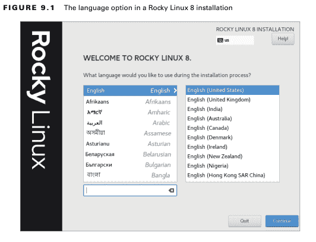

### 手动更改环境变量

对于手动方法，只需像设置其他任何环境变量一样，使用 `export` 命令更改单独的 `LC_` 本地化环境变量：

```text
$ export LC_MONETARY=en_GB.UTF-8
```

这对于更改单独的设置非常有效，但如果想更改系统的所有本地化设置，这会很繁琐。

与其单独更改所有 `LC_` 环境变量，`LANG` 环境变量可以在一个位置控制它们所有：

```text
$ export LANG=en_GB.UTF-8
$ locale

LANG=en_GB.UTF-8
LC_CTYPE="en_GB.UTF-8"
LC_NUMERIC="en_GB.UTF-8"
LC_TIME="en_GB.UTF-8"
LC_COLLATE="en_GB.UTF-8"  
LC_MONETARY="en_GB.UTF-8"  
LC_MESSAGES="en_GB.UTF-8"  
LC_PAPER="en_GB.UTF-8"  
LC_NAME="en_GB.UTF-8"  
LC_ADDRESS="en_GB.UTF-8"  
LC_TELEPHONE="en_GB.UTF-8"  
LC_MEASUREMENT="en_GB.UTF-8"  
LC_IDENTIFICATION="en_GB.UTF-8"  
LC_ALL=
```

某些 Linux 系统要求您同时设置 `LC_ALL` 环境变量，因此通常建议将其与 `LANG` 环境变量一起设置。

> 此方法会更改当前登录会话的本地化设置。如果需要永久更改本地化设置，您需要将 `export` 命令添加到 `$HOME` 文件夹中的 `.bashrc` 文件，以便每次登录时都执行该命令。

### localectl 命令

如果您使用的是利用 `systemd` 实用程序集（参见第 6 章“维护系统启动和服务”）的 Linux 发行版，则可以使用 `localectl` 命令。默认情况下，`localectl` 命令仅显示当前本地化设置：

```text
$ localectl  
    System Locale: LANG=en_US.UTF-8  
    VC Keymap: us  
    X11 Layout: us  
$
```

它不仅显示 `LANG` 环境变量设置，还显示键盘布局映射以及 `X11` 图形环境布局。

`localectl` 命令支持许多选项，但最常用的包括使用 `list-locales` 选项列出系统上安装的所有区域设置，以及使用 `set-locale` 选项更改本地化设置：

```text
$ localectl set-locale LANG=en_GB.utf8
```

这提供了一种更改整个 Linux 系统本地化设置的简便方法。

## 查看时间

与 Linux 系统关联的日期和时间对系统的正常运行至关重要。Linux 使用日期和时间来跟踪正在运行的进程，知道何时启动或停止任务，并记录发生的重要事件。确保您的 Linux 系统与您所在位置的准确日期和时间同步是必须的。

Linux 将时间处理为两个部分——与系统位置关联的时区，以及该时区内的实际日期和时间。以下部分将讲解如何更改这两个值。

### 处理时区

时间最重要的方面之一是时区。每个国家选择一个或多个时区，或相对于标准协调世界时 (`UTC`) 的偏移量，以确定国内的时间。如果您的 Linux 环境包括位于不同时区的服务器，了解如何设置正确的时区是必须的。

大多数基于 `Debian` 的 Linux 系统在 `etc/timezone` 文件中定义本地时区，而大多数基于 `Red Hat` 的 Linux 系统使用 `etc/localtime`。这些文件不是文本格式，因此您不能简单地编辑 `/etc/timezone` 或 `/etc/localtime` 文件来查看或更改时区。相反，您必须将该文件链接到存储在 `/usr/share/zoneinfo` 文件夹中的模板文件。

要确定 Linux 系统当前的时区设置，请使用不带选项的 `date` 命令：

```text
$ date
Sat Dec  4 08:20:23 EST 2021
$
```

时区显示为日期和时间显示末尾的标准三位字母代码，位于年份之前。

要查看系统当前使用的时区模板文件，只需使用 `ls` 命令显示活动的时区文件：

```text
$ ls -al /etc/localtime
lrwxrwxrw. 1 root root 38 Nov 30 09:06 /etc/localtime -> ../usr/share/zoneinfo/America/New_York
$
```

要更改 Linux 系统的时区，请将合适的时区模板文件从 `/usr/share/zoneinfo` 文件夹链接到 `/etc/timezone` 或 `/etc/localtime` 位置。`/usr/share/zoneinfo` 文件夹基于位置划分为子文件夹。每个位置文件夹也可能进一步细分为更详细的位置文件夹。最终，您将看到与您特定时区关联的时区模板文件，例如 `/usr/share/zoneinfo/US/Easter`。

在复制新的时区文件之前，您需要删除原始的 `timezone` 或 `localtime` 文件：

```text
$ sudo ln -s /usr/share/zoneinfo/America/Chicago /etc/localtime
$ date
Sat Dec 4 07:23:14 CST 2021
$ 
```

新的时区出现在 `date` 命令的输出中。


如果您只需要为单个会话或程序更改时区，而不是更改系统时区，您可以使用 `TZ` 环境变量来设置时区。这将覆盖当前会话的系统时区。

## 设置时间和日期

一旦您的 Linux 系统拥有正确的时区，您就可以着手设置正确的时间和日期值了。有几种不同的命令可用于执行此操作。

### 遗留命令

所有 Linux 发行版中都有两个用于处理时间和日期值的遗留命令：

- `hwclock` 显示或设置工作站或服务器内部 `BIOS` 或 `UEFI` 时钟保存的时间。
- `date` 显示或设置 Linux 系统保存的日期。


`hwclock` 命令提供了对 Linux 系统运行的物理工作站或服务器中内置的硬件时钟的访问权限。您可以使用 `hwclock` 命令将系统时间和日期设置为物理工作站或服务器上的硬件时钟。或者，它也允许您更改硬件时钟以匹配 Linux 系统上的时间和日期。

`date` 命令是时间和日期命令中的瑞士军刀。除了设置时间或/和日期外，它还允许您以多种格式显示时间和日期。`+` 选项允许您通过定义命令序列来指定用于显示时间或日期值的格式：

```
$ date +"%A, %B %d, %Y"
Saturday, December 04, 2021
$ 
```

表 9.1 显示了 `date` 命令中可用的不同命令序列。

**表 9.1** 日期格式命令序列

| 序列 | 描述 |
|---|---|
| `%a` | 星期几的缩写名称 |
| `%A` | 星期几的完整名称 |
| `%b` | 月份的缩写名称 |
| `%B` | 月份的完整名称 |
| `%c` | 日期和时间 |
| `%C` | 世纪（例如，20） |
| `%d` | 月中的数字日期 |
| `%D` | 完整的数字日期 |
| `%e` | 月中的日期，空格填充 |
| `%F` | SQL 格式下的完整日期 (YYYY-MM-dd) |
| `%g` | ISO 周号年份的最后两位数字 |
| `%G` | ISO 周号的年份 |
| `%h` | `%b` 的别名 |
| `%H` | 24 小时制的小时 |
| `%I` | 12 小时制的小时 |
| `%j` | 一年中的数字天数 |
| `%k` | 24 小时制的小时，空格填充 |
| `%L` | 12 小时制的小时，空格填充 |
| `%m` | 数字月份 |
| `%M` | 分钟 |
| `%n` | 换行符 |
| `%N` | 纳秒 |
| `%p` | AM 或 PM |
| `%P` | 小写的 am 或 pm |
| `%r` | 完整的 12 小时制时钟时间 |
| `%R` | 完整的 24 小时制小时和分钟 |
| `%s` | 自 1970-01-01 00:00:00 UTC 以来的秒数 |
| `%S` | 秒 |
| `%t` | 制表符 |
| `%T` | 完整时间，采用小时:分钟:秒格式 |
| `%u` | 星期几的数字；1 为周一 |
| `%U` | 一年中的周数数字，从周日开始 |
| `%V` | ISO 周数 |
| `%w` | 星期几的数字；0 为周日 |
| `%W` | 一年中的周数，从周一开始 |
| `%x` | 区域设置中表示为月/日/年或日/月/年的日期 |
| `%X` | 区域设置中的完整时间表示 |
| `%y` | 年份的最后两位数字 |
| `%Y` | 完整年份 |
| `%z` | `+hhmm` 格式的时区 |
| `%:z` | `+hh:mm` 格式的时区 |
| `%::z` | `+hh:mm:ss` 格式的时区 |
| `%:::z` | 带有 `:` 作为必要精度的数字时区 |
| `%Z` | 字母形式的时区缩写 |

如您从表 9.1 中可以看到，`date` 命令提供了许多在您程序和 shell 脚本中显示时间和日期的方法。

您也可以通过指定以下格式的值来使用 `date` 命令设置时间和日期：

`date MMDDhhmm[[CC]YY][.ss]`

月份、日期、小时和分钟的数值是必需的，年份和秒数是假设的，或者如果您愿意，也可以包括年份和秒数。

## `timedatectl` 命令

如果您的 Linux 发行版使用 `systemd` 工具集（参见第 6 章），您可以使用 `timedatectl` 命令来管理系统上的时间和日期设置：

```
$ timedatectl
        Local time: Sat 2021-12-04 08:27:18 EST
  Universal time: Sat 2021-12-04 13:27:18 UTC
        RTC time: Sat 2021-12-04 13:27:17
     Time zone: America/New_York (EST, -0500)
System clock synchronized: yes
      NTP service: active
      RTC in local TZ: no
$
```

`timedatectl` 命令提供了一站式的查询功能，可以查看所有时间信息，包括称为 `RTC` 的硬件时钟、日期信息以及时区信息。

您还可以使用 `timedatectl` 命令通过 `set-time` 选项来修改这些设置中的任意一项：

`# timedatectl set-time "2021-12-04 08:30:00"`

您还可以使用 `timedatectl` 命令同步工作站或服务器的硬件时钟以及 Linux 系统时间。

## 网络时间协议

如今，大多数连接到互联网的 Linux 系统都利用网络时间协议 (NTP) 使时间和日期与中心时间服务器保持同步。如果您的 Linux 系统这样做，您将无法使用 `date` 或 `timedatectl` 命令来更改时间或日期。相反，您需要将您的 Linux 服务器指向适当的时间服务器。

Linux 世界中有三种常见的 NTP 软件实现：

- `ntpd`：使用简单网络时间协议 (SNTP) 连接到时间服务器的遗留软件

- `chrony`：利用安全功能的 `ntpd` 软件的改进版本

- `timesyncd`：`Systemd` 启动工具包的一部分，提供 NTP 服务

    - 遗留的 `ntpd` 软件在技术上不再受支持，但由于其简单性，少数 Linux 发行版仍在使用它。大多数基于 Debian 的 Linux 发行版（包括 Ubuntu）使用 `Systemd` 启动工具，因此使用 `timesyncd` 服务来提供网络时间服务。尽管基于 Red Hat 的系统也使用 `Systemd`，但 Red Hat 选择实现功能更强大的 `chrony` 软件来提供网络时间服务。


`timesyncd` 软件将其配置设置存储在 `/etc/systemd/timesyncd.conf` 文件中。如果需要多个配置文件，它们存储在 `/etc/systemd/timesyncd.conf.d` 目录中。`chrony` 软件将其配置设置存储在 `/etc/chrony/chrony.conf` 配置文件中。

## 监控系统时间

Linux+ 考试还涵盖了 `time` 命令，尽管它与时间和日期没有直接关系。`time` 命令显示程序在 Linux 系统上运行所需的时间：

```
$ time timedatectl
Local time: Sat 2021-12-04 08:40:40 EST
Universal time: Sat 2021-12-04 13:40:40 UTC
RTC time: Sat 2021-12-04 13:40:38
Time zone: America/New_York (EST, -0500)
System clock synchronized: yes
NTP service: active
RTC in local TZ: no

real  0m0.037s
user  0m0.004s
sys  0m0.006s
$
```

在正常的命令输出之后，您还会看到三行附加信息：

- `real`：程序开始和结束之间经过的时间量

- `user`：程序消耗的 CPU 用户时间量

- `sys`：程序消耗的 CPU 系统时间量

    - 当您在故障排除似乎消耗额外系统资源进行处理的程序时，这些信息可能非常有价值。

练习 9.1 演示了如何在 Linux 中使用可用的不同区域设置、时间和日期功能。

## 练习 9.1

### 实验时间

本练习将演示如何在您的 Linux 系统上检查当前时间、日期和时区。

1. 以 `root` 身份登录，或使用 `su` 或在以下每个命令中使用 `sudo` 获取 `root` 权限。

2. 输入 `locale` 以显示系统当前的区域设置。写下为您的系统分配的当前字符集。

3. 通过设置 `LANG` 环境变量将区域设置为另一个国家/地区（例如英国）。输入 `export LANG=en_GB.UTF-8` 进行修改。

4. 输入 `locale` 以显示更新后的区域设置。

5. 如果您的 Linux 发行版使用 `Systemd` 工具，输入 `localectl` 以显示系统上定义的区域设置。

6. 通过输入 `localectl set-locale "LANG=en_GB.UTF-8"` 更改区域设置。

7. 使用 `locale` 或 `localectl` 命令将区域设置改回您正常的区域设置。

8. 输入 `date` 命令以显示系统上的当前日期和时间。

9. 通过输入 `time date` 观察在您的 Linux 系统上运行 `date` 命令所需的时间。输出显示了您的 Linux 系统处理该请求所花费的时间。

## 摘要

Linux 系统通过整合不同的字符集支持许多不同的语言。字符集定义了 Linux 系统如何显示和使用语言中包含的字符。虽然 Linux 支持许多不同的字符集，但最常见的是 `ASCII`、`Unicode`、`UTF-8` 和 `UTF-16`。`ASCII` 字符集仅适用于英语字符，而 `UTF-8` 和 `UTF-16` 字符集通常用于支持其他语言。

Linux 系统将字符集设置维护为一组以 `LC_` 开头的环境变量。`locale` 命令显示所有区域化环境变量。每个单独的 `LC_` 环境变量代表其他环境变量的一个类别。

## 考试要点

- 描述 Linux 如何与不同的语言协同工作。Linux 通过使用字符集来存储和显示语言字符。`ASCII`、`Unicode` 和 `UTF-8` 是 Linux 中最常用的字符集。

- 解释如何更改 Linux 系统上的当前字符集。你可以使用 `export` 命令来更改 `LANG` 或 `LC_ALL` 环境变量以定义新的字符集。如果你的 Linux 发行版使用 `Systemd` 工具，你还可以使用 `localectl` 命令来显示或更改系统字符集。

- 描述 Linux 系统上时区的设置方式。在 Linux 中，时区通过 `/usr/share/zoneinfo` 文件夹中的各个文件来定义。基于 Debian 的 Linux 发行版将相应的时区文件复制到 `/etc/timezone` 文件中，而基于 Red Hat 的 Linux 发行版则使用 `/etc/localtime` 文件。要更改单个脚本或程序的时区，请使用 `TZ` 环境变量。

### 复习题

1. 哪个字符集使用 7 位来存储字符？

   - A. `UTF-8`
   - B. `UTF-16`
   - C. `ASCII`
   - D. `Unicode`
   - E. `UTF-32`

2. 哪两个字符集使用转换代码来存储字符？

   - A. `UTF-8`
   - B. `UTF-16`
   - C. `ASCII`
   - D. `Unicode`
   - E. `locale`

3. 哪个字符集使用 3 字节代码并且可以表示世界上大多数语言使用的字符？

   - A. `ASCII`
   - B. `LC_ALL`
   - C. `UTF-8`
   - D. `UTF-16`
   - E. `Unicode`

4. 哪个 Linux 命令显示所有本地化环境变量及其值？

   - A. `date`
   - B. `time`
   - C. `hwclock`
   - D. `LANG`
   - E. `locale`

5. 哪两个环境变量控制所有本地化设置？

   - A. `LC_MONETARY`
   - B. `LC_NUMERIC`
   - C. `LANG`
   - D. `LC_CTYPE`
   - E. `LC_ALL`

6. `______________` 是将 Linux 系统适配到特定语言的能力。

   - A. `locale`
   - B. `Localization`
   - C. `Character set`
   - D. `Unicode`
   - E. `ASCII`

7. 哪个 `Systemd` 工具允许你更改 Linux 系统上的本地化设置？

   - A. `timedatectl`
   - B. `time`
   - C. `date`
   - D. `localectl`
   - E. `locale`

8. 哪个 Linux 命令更改本地化环境变量的值？

   - A. `time`
   - B. `export`
   - C. `locale`
   - D. `date`
   - E. `hwclock`

9. 哪个 `LC_` 环境变量决定 Linux 如何显示美元和美分数值？

   - A. `LC_NUMERIC`
   - B. `LC_MONETARY`
   - C. `LC_CTYPE`
   - D. `LC_TIME`
   - E. `LC_COLLATE`

10. 一个 `______________` 决定了特定位置相对于 UTC 时间的时区。

   - A. `time zone`
   - B. `localization`
   - C. `character set`
   - D. `locale`
   - E. `hardware clock`

11. 哪些 Linux 命令允许你从物理工作站或服务器获取时间？（选择所有适用的项。）

   - A. `date`
   - B. `hwclock`
   - C. `time`
   - D. `locale`
   - E. `timedatectl`

12. 基于 Red Hat 的系统使用哪个文件来定义 Linux 系统的时区？

   - A. `/etc/localtime`
   - B. `/etc/timezone`
   - C. `/usr/share/zoneinfo`
   - D. `/usr/share/timezone`
   - E. `/usr/share/localtime`

13. 哪个文件夹包含 Linux 支持的每个时区的模板文件？

   - A. `/etc/localtime`
   - B. `/usr/share/zoneinfo`
   - C. `/etc/timezone`
   - D. `$HOME`
   - E. `/usr/share/timezone`

14. 哪个命令显示当前日期、系统时间、硬件时间和时区？

   - A. `date`
   - B. `timedatectl`
   - C. `time`
   - D. `hwclock`
   - E. `localectl`

15. 你使用哪个命令以特定的输出格式显示当前时间和日期？

   - A. `date`
   - B. `time`
   - C. `timedatectl`
   - D. `localectl`
   - E. `hwclock`

16. 哪些命令允许你将 Linux 系统时间设置为工作站 BIOS 时钟时间？（选择所有适用的项。）

   - A. `hwclock`
   - B. `date`
   - C. `time`
   - D. `timedatectl`
   - E. `localectl`

17. 基于 Red Hat 的 Linux 系统使用哪个网络时间包来与网络时间服务器同步系统时间？

   - A. `ntpd`
   - B. `chrony`
   - C. `localectl`
   - D. `timedatectl`
   - E. `timesyncd`

18. 程序员可以使用哪个环境变量来暂时仅更改其环境中的时区设置？

   - A. `LANG`
   - B. `LC_MONETARY`
   - C. `LC_NUMERIC`
   - D. `LC_ALL`
   - E. `TZ`

19. 哪个字符集已取代 `ASCII` 成为美国 Linux 安装中使用的默认字符集？

   - A. `Unicode`
   - B. `UTF-16`
   - C. `UTF-8`
   - D. `UTF-32`
   - E. `locale`

20. 哪个命令列出在你的 Linux 系统上安装的所有本地化设置？

   - A. `locale`
   - B. `localectl`
   - C. `locale`
   - D. `LANG`
   - E. `LC_ALL`

那些可以进一步微调本地化设置的变量。你可以通过向 `locale` 命令添加 `-ck` 选项来显示那些环境变量的设置。

你使用 Linux `export` 命令来更改单个 `LC_` 环境变量。你可以设置特殊的 `LANG` 或 `LC_ALL` 环境变量，而不是更改所有的 `LC_` 环境变量。更改这些变量中的任何一个都会自动更改其他环境变量。或者，如果你的 Linux 发行版支持 `Systemd` 工具，你可以使用 `localectl` 命令来显示和更改本地化环境变量的值。

你必须为你的 Linux 系统定义一个时区。基于 Debian 的 Linux 发行版使用 `/etc/timezone` 文件来确定系统时区，而基于 Red Hat 的 Linux 发行版使用 `/etc/localtime` 文件。这两个文件都使用二进制格式，因此你不能直接编辑它们。Linux 在 `/usr/share/zoneinfo` 文件夹中维护了一个时区文件库。只需从 `/usr/share/zoneinfo` 文件夹复制或链接相应的时区文件到你的 Linux 系统的时区文件即可。

在 Linux 中，你可以使用三个命令来显示或更改时间和日期。`hwclock` 命令显示时间或维护你 Linux 系统的硬件时钟。你可以将 Linux 系统时间设置为该时间，或者将硬件时钟设置为你的 Linux 系统时间。`date` 命令允许你使用命令行序列以多种格式显示 Linux 系统的时间和日期。它还允许你从命令行设置 Linux 系统的日期和时间。对于使用 `Systemd` 工具的系统，`timedatectl` 命令提供了一个显示所有系统时间和日期信息的单一位置。


`time` 命令与当前系统时间无关，而是提供有关单个应用程序在 Linux 系统上使用时间量的信息。你可以使用 `time` 命令来查看应用程序从开始到结束经过的实际时间，以及它所需的系统或用户 CPU 时间量。

### 考试要点

- 描述 Linux 如何与不同的语言协同工作。Linux 通过使用字符集来存储和显示语言字符。ASCII、Unicode 和 UTF-8 是 Linux 中最常用的字符集。

- 解释如何更改 Linux 系统上的当前字符集。你可以使用 `export` 命令来更改 `LANG` 或 `LC_ALL` 环境变量以定义新的字符集。如果你的 Linux 发行版使用 Systemd 工具，你还可以使用 `localectl` 命令来显示或更改系统字符集。

- 描述 Linux 系统上时区的设置方式。在 Linux 中，时区通过 `/usr/share/zoneinfo` 文件夹中的各个文件来定义。基于 Debian 的 Linux 发行版将相应的时区文件复制到 `/etc/timezone` 文件中，而基于 Red Hat 的 Linux 发行版则使用 `/etc/localtime` 文件。要更改单个脚本或程序的时区，请使用 `TZ` 环境变量。

- 总结你可以用来处理 Linux 系统上时间和日期的工具。`hwclock` 命令允许你将 Linux 系统时间与系统上的硬件时钟同步，或者反过来。`date` 命令允许你以多种格式显示时间和日期，或设置当前时间和日期。`timedatectl` 命令来自 Systemd 工具，允许你显示有关系统和硬件时间日期的大量不同信息，并且允许你设置它们。

- 描述 NTP 的工作原理以及 Linux 系统如何使用它。网络时间协议（NTP）允许 Linux 系统从网络上的集中式服务器同步其时间和日期。有三个常用的软件包在 Linux 中实现 NTP：`ntpd` 包、`chrony` 包以及来自 Systemd 工具的 `timesyncd` 程序。

- 解释如何查看应用程序在系统上运行所需的时间。`time` 命令允许你在特定应用程序在系统上运行时为其放置计时器。`time` 命令的输出显示程序运行所花费的实际经过时间，以及应用程序所需的用户和系统 CPU 时间量。

## 管理系统

### 第三部分

#### 第 10 章

### 管理用户和组

+ ✓ 目标 2.2 在给定场景中，实施身份管理。


如果你想购买一件著名且昂贵的艺术品，你应该确保它不是赝品。换句话说，你希望确保它是真品。允许用户访问计算机系统也是同样的道理。你希望确保他们是已获授权访问系统的合法用户。这一过程称为 `认证`，其定义是确定一个人或程序是否为其所声称的身份。本章涵盖了管理 Linux 用于检查用户凭据并允许或拒绝访问系统的访问控制的管理工作。

除了用户认证之外，你还需要了解如何审计用户、管理组成员身份、配置用户环境，并在需要时为账户设置磁盘空间使用限制。我们还将涵盖这些主题。

#### 管理用户账户

添加和修改用户账户凭据（包括用户名、账户信息和密码）是系统管理的一个重要（但繁琐）部分。此外，你还需要知道在必要时如何删除这些凭据。管理用户账户和查看底层的凭据框架将在以下各节中介绍。

##### 添加账户

要在系统上添加一个新的用户账户，通常使用 `useradd` 工具。然而，该过程实际上涉及除了 `useradd` 命令以外的多个参与者。图 10.1 展示了该过程的图示。

在图 10.1 中可以看到，账户创建过程涉及多个“团队成员”。请注意，`/etc/skel` 目录被加粗显示。这是因为根据其他配置文件，该过程可能不使用它。对于 `/home/userid` 目录也是如此。根据系统的账户创建配置，它可能不会被创建，或者可能使用替代名称。你很快就会详细了解这些目录。

在深入了解 `useradd` 工具的详细信息之前，我们先来看看该过程创建端所涉及的两个文件和目录。

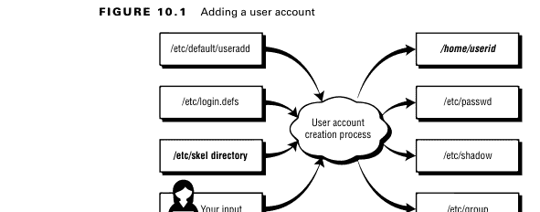

##### `/etc/login.defs` 文件

该配置文件在大多数 Linux 发行版中通常默认安装。它包含用于各种影子密码套件命令的指令。`影子密码套件` 是一个统称，指处理账户凭据的命令，例如 `useradd`、`userdel` 和 `passwd` 命令。

此配置文件中的指令控制密码长度、用户需要在多久后更改账户密码、是否默认创建主目录等等。该文件通常充满了注释和被注释掉的指令（这使得指令处于非活动状态）。列表 10.1 仅显示了在 Rocky Linux 发行版中移除空白行和注释行后，`/etc/login.defs` 文件内的活动指令。

**列表 10.1：** `/etc/login.defs` 配置文件中的活动指令

```bash
$ grep -v ^$ /etc/login.defs | grep -v ^#
MAIL_DIR	/var/spool/mail
UMASK		022
HOME_MODE	0700
PASS_MAX_DAYS	99999
PASS_MIN_DAYS	0
PASS_MIN_LEN	5
PASS_WARN_AGE	7
UID_MIN		1000
UID_MAX		60000
SYS_UID_MIN	201
SYS_UID_MAX	999
GID_MIN		1000
GID_MAX		60000
SYS_GID_MIN	201
SYS_GID_MAX	999
CREATE_HOME	yes
USERGROUPS_ENAB	yes
ENCRYPT_METHOD	SHA512
$
$
```

请注意列表 10.1 中的 `UID_MIN` 指令。`用户标识号（UID）` 是 Linux 用于识别用户账户的数字。`用户账户`，有时称为 `普通账户`，是指授权人员被赋予以访问系统并执行日常任务（如打开桌面应用程序或运行脚本）的账户。虽然人类使用账户名称，但 Linux 使用 UID。`UID_MIN` 指示允许用于用户账户的最低 UID。在列表 10.1 中的系统上，`UID_MIN` 设置为 1000。这是典型的，尽管有些系统将其设置为 500。

`系统账户` 是提供服务（守护进程）或执行特殊任务（如 `root` 用户账户）的账户。系统账户的最小 UID 由 `SYS_UID_MIN` 指令设置，其最大值由 `SYS_UID_MAX` 指令设置。此文件中的设置是典型的。

请记住，这些设置适用于在初始 Linux 发行版安装 `之后` 创建的账户。例如，`root` 用户账户的 UID 始终为 0，低于 `SYS_UID_MIN`，如列表 10.2 中的片段所示。

**列表 10.2：** `root` 用户账户的 UID

```bash
$ gawk -F: '{print $3, $1}' /etc/passwd | sort -n
0	root
1	bin
2	daemon
3	adm
[...]
```

表 10.1 简要介绍了一些对常见用户账户创建至关重要的附加指令。

**表 10.1 几个重要的 /etc/login.defs 指令**

| 名称 | 描述 |
| :--- | :--- |
| `PASS_MAX_DAYS` | 需要更改密码前的天数。这是密码的到期日。 |
| `PASS_MIN_DAYS` | 更改密码后，再次允许更改密码前必须等待的天数。 |
| `PASS_MIN_LENGTH` | 密码中所需的最小字符数。 |
| `PASS_WARN_AGE` | 在密码到期前向用户发出警告的天数。 |
| `CREATE_HOME` | 默认为 no。如果设置为 yes，将创建用户账户主目录。 |
| `ENCRYPT_METHOD` | 用于哈希账户密码的方法。 |

`/etc/login.defs` 文件仅用于用户账户过程创建端的一个配置文件。另一个文件将在下文介绍。

##### `/etc/default/useradd` 文件

`/etc/default/useradd` 文件是另一个指导账户创建过程的配置文件。它通常比 `/etc/login.defs` 文件短得多。列表 10.3 展示了 Rocky Linux 发行版的一个示例。

**列表 10.3：** `/etc/default/useradd` 配置文件

```bash
$ cat /etc/default/useradd
# useradd defaults file
GROUP=100
HOME=/home
INACTIVE=-1
EXPIRE=
SHELL=/bin/bash
SKELET=/etc/skel
CREATE_MAIL_SPOOL=yes
$
$ useradd -D
GROUP=100
HOME=/home
INACTIVE=-1
EXPIRE=
SHELL=/bin/bash
SKELET=/etc/skel
CREATE_MAIL_SPOOL=yes
$
```

请注意，在列表 10.3 中，有两种不同的方式来显示此文件中的活动指令。你可以使用 `cat` 命令，或者调用 `useradd -D` 命令。两者使用起来都同样简单。关于 `useradd -D` 命令的一个酷事实是，你可以使用它来修改 `/etc/default/useradd` 文件中的指令。

在列表 10.3 中，请注意 `HOME` 指令。它当前设置为 `/home`，这意味着任何新创建的用户账户的账户目录都将位于 `/home` 目录内。请记住，如果 `/etc/login.defs` 文件中的 `CREATE_HOME` 未设置或设置为 no，则默认不会创建主目录。

表 10.2 简要介绍了一些对常见用户账户创建至关重要的附加指令。

**表 10.2 几个重要的 /etc/default/useradd 指令**

| 名称 | 描述 |
| :--- | :--- |
| `HOME` | 用户账户目录的基础目录。 |
| `INACTIVE` | 密码过期且未更改后，账户被停用前必须等待的天数。参见表 10.1 中的 `PASS_MAX_DAYS`。 |
| `SKELE` | 骨架目录。 |
| `SHELL` | 用户账户的默认 shell 程序。 |

`SHELL` 指令需要更多解释。通常它设置为 `/bin/bash`，这意味着当你访问命令行时，你的用户进程正在运行 `/bin/bash` shell 程序。该程序在命令行上为你提供提示符，并处理你在那里输入的任何命令。

> 请注意，某些发行版（如 Ubuntu）默认将 SHELL 指令设置为 /bin/sh，这是指向另一个 shell 的符号链接。在 Ubuntu 上，它链接到 Dash shell 而不是 Bash shell。

##### /etc/skel 目录

`/etc/skel` 目录，或通常称为骨架目录（参见表 10.2），包含文件。如果为用户创建主目录，这些文件将在账户创建时复制到用户账户的主目录中。列表 10.4 展示了 Fedora Workstation 发行版中 `/etc/skel` 目录内的文件。

**列表 10.4：** `/etc/skel` 目录中的文件

```bash
$ ls -a /etc/skel
.  ..  .bash_logout  .bash_profile  .bashrc  .mozilla
$
```

在列表 10.4 中，`ls` 命令使用了 `-a` 选项，以便显示隐藏文件（以点号开头的文件）。请回忆，`ls` 命令如果不带 `-a` 选项，通常不会显示隐藏文件。这些文件包括账户环境文件以及 Mozilla Firefox 网络浏览器配置文件目录。我们将在本章后面介绍环境文件。如有需要，你可以修改这些文件中的任意一个，或者添加新的文件和目录。


> **注意** `/etc/skel` 中的文件仅在账户创建时才会被复制到用户主目录。因此，如果你稍后对这些文件进行了更改，必须手动或通过 shell 脚本将这些修改后的文件迁移到现有的用户账户中。

既然我们已经介绍了用户账户创建流程中“创建侧”涉及的文件，接下来让我们看看作为该流程的一部分被构建或修改的文件和目录。如有必要，请回过头查看图 10.1，以回顾各种文件和目录的名称。

#### /etc/passwd 文件

账户信息存储在 `/etc/passwd` 文件中。每个账户的数据占用该文件中的一行。当创建新账户时，会在 `/etc/passwd` 文件中添加一条针对该账户的新记录。列表 10.5 展示了一个片段示例。

**列表 10.5: /etc/passwd 文件中的账户记录**

```bash
$ cat /etc/passwd
root:x:0:0:root:/root:/bin/bash
bin:x:1:1:bin:/bin:/sbin/nologin
daemon:x:2:2:daemon:/sbin:/sbin/nologin
[...]
tcpdamp:x:72:72::/:/sbin/nologin
user1:x:1000:1000:User One:/home/user1:/bin/bash
Christine:x:1001:1001:Christine B:/home/Christine:/bin/bash
[...]
$
```

`/etc/passwd` 文件的记录包含多个字段。记录中的每个字段由冒号（`:`）分隔。总共有七个字段，如表 10.3 所述。

**表 10.3 /etc/passwd 文件的记录字段**

| 字段编号 | 描述 |
| :--- | :--- |
| 1 | 用户账户的用户名。 |
| 2 | 密码字段。通常此文件不再用于存储密码。该字段中的 `x` 表示密码存储在 `/etc/shadow` 文件中。 |
| 3 | 用户账户的用户标识号 (UID)。 |
| 4 | 用户账户的组标识号 (GID)。 |
| 5 | 注释字段。此字段是可选的。传统上，它包含用户的姓名。 |
| 6 | 用户账户的主目录。 |
| 7 | 用户账户的默认 shell。如果设置为 `/sbin/nologin` 或 `/bin/false`，则用户无法交互式登录到系统。 |

你可能会认为密码文件会存储密码，但由于其文件权限设置，密码文件容易受到安全威胁。因此，密码被存储在一项更受严格保护的 `/etc/shadow` 文件中。


> **提示** 你所在的工作组织可能仍将密码存储在 `/etc/passwd` 文件中。如果是这样，请礼貌地建议通过 `pwconv` 命令将密码迁移到 `/etc/shadow` 文件中。如果该组织拒绝这一建议，那就辞职离开吧，或者更好的是，赶紧找一家不同的公司工作。

你可能已经注意到，在 `/etc/passwd` 记录中，字段 #7 可能包含 `/sbin/nologin` 或 `/bin/false` 作为默认 shell。这是为了防止账户交互式登录到系统。`/sbin/nologin` 通常用于系统服务账户记录。系统服务（守护进程）确实需要系统账户，但它们并不进行交互式登录。相反，它们在后台以自己的账户名运行。如果恶意人员试图使用该账户进行交互式登录（且他们突破了其他防线，这一点你很快会学到），他们会被礼貌地踢出系统。基本上，`/sbin/nologin` 会显示一条简短的消息，并在你到达命令提示符之前将你注销。如果需要，你可以通过创建 `/etc/nologin.txt` 文件并添加所需文本来修改显示的消息。

`/bin/false` shell 则稍微“残酷”一些。如果将其设置为某用户账户的默认 shell，系统将不显示任何消息，用户会被直接注销出系统。

#### /etc/shadow 文件

创建账户时更新的另一个文件是 `/etc/shadow`。它包含有关账户密码的信息，即使你尚未为该账户提供密码。与 `/etc/passwd` 文件类似，每个账户的数据占用文件中的一行。列表 10.6 展示了一个片段示例。

**列表 10.6: /etc/shadow 文件中的账户记录**

```bash
$ sudo cat /etc/shadow
root:!:0:99999:7:::
bin:*:17589:0:99999:7:::
daemon:*:17589:0:99999:7:::
[...]
user1:$6$bvqdqUf[...]:17738:0:99999:7:::
Christine:Wb8i8Iw$g[...]:17751:0:99999:7:::
[...]
$
```

`/etc/shadow` 记录包含多个字段。记录中的每个字段由冒号（`:`）分隔。总共有九个字段，如表 10.4 所述。

**表 10.4 /etc/shadow 文件的记录字段**

| 字段编号 | 描述 |
| :--- | :--- |
| 1 | 用户账户的用户名。 |
| 2 | 密码字段。密码是加盐并经过哈希处理的密码。`!` 表示该账户尚未设置密码。`*` 表示该账户不能通过密码登录。密码前面的 `!` 表示该账户已被锁定。 |
| 3 | 上次密码变更的日期，采用 Unix Epoch 时间（天数）格式。 |
| 4 | 密码更改后可以再次更改密码前的天数。 |
| 5 | 必须更改密码前的天数。这是密码的过期日期。 |
| 6 | 密码过期前向用户发出警告的天数。（参见字段 #5） |
| 7 | 密码过期后（参见字段 #5）未更改，直到账户将被禁用的天数。 |
| 8 | 账户过期的日期，采用 Unix Epoch 时间（天数）格式。 |
| 9 | 称为 `特殊标志`。这是为未来特殊用途保留的字段，目前未使用，且为空。 |

请注意，字段 #1 是账户的用户名。这是与 `/etc/passwd` 文件共享的唯一字段。


> Unix Epoch 时间，也称为 POSIX 时间，是指自 1970 年 1 月 1 日以来的秒数，尽管 `/etc/shadow` 文件以天为单位表示时间。它在 Unix 和 Linux 系统中拥有悠久的历史，并可能在 2038 年引发问题。你不必拿出计算器来确定某个字段的日期所对应的 Epoch 值。相反，本章后面将介绍的 `chage` 实用程序可以帮你完成这项任务。

理解各种可能的过期机制至关重要。当密码过期发生时，会有一个宽限期。用户将拥有若干天（由字段 #7 指定）使用旧密码登录该账户，但必须立即更改密码。然而，如果密码已过期且用户未及时登录系统，该用户实际上将被锁定在系统之外。

对于账户过期，不存在宽限期。账户过期后，用户无法使用其密码登录该账户。

你可能已经注意到，我们尚未介绍 `/etc/group` 文件。该文件确实会在账户创建过程中被修改。然而，关于此文件的讨论将留给本章后面“管理组”部分。

### 账户创建流程

在涉及用户账户的配置时，不同的发行版往往差异很大。因此，在你开始使用 `useradd` 实用程序创建账户之前，明智的做法是回顾每个发行版用户账户配置文件中的某些指令（参见表 10.1 和 10.2）。在列表 10.7 中，检查了 Rocky Linux 发行版中的 `CREATE_HOME` 和 `SHELL` 指令。

**列表 10.7. 检查 Fedora Workstation 上的用户账户指令**

```bash
$ grep CREATE_HOME /etc/login.defs
CREATE_HOME     yes
$
$ useradd -D | grep SHELL
SHELL=/bin/bash
$
```

你可以看到，在此 Rocky Linux 发行版中，由于 `CREATE_HOME` 设置为 `yes`，主目录将默认创建。`SHELL` 指令指向 Bash shell（`/bin/bash`），这是大多数交互式用户账户的典型 shell。

如前所述，`useradd` 命令是大多数发行版上创建用户账户的主要工具。列表 10.8 展示了如何使用 `useradd` 实用程序在 Rocky Linux 发行版上创建账户。

## 清单 10.8：在 Rocky Linux 工作站上创建用户账户

```bash
$ sudo useradd DAdams
[sudo] password for Christine:
$

$ grep ^DAdams /etc/passwd
DAdams:x:1002:1002::/home/DAdams:/bin/bash
$

$ sudo grep ^DAdams /etc/shadow
DAdams:!!:17806:0:99999:7:::
$

$ sudo ls -a /home/DAdams/
. .. .bash_logout .bash_profile .bashrc .mozilla
$
```

由于我们在清单 10.8 中使用的 Rocky Linux 发行版将 `CREATE_HOME` 指令设置为 `yes`，且 `SHELL` 设置为 `/bin/bash`，因此无需使用任何 useradd 命令选项。所需的唯一参数是用户账户名称，即 `DAdams`。在使用该工具创建清单 10.8 中的账户后，请注意新用户账户的记录现在已存在于 `/etc/passwd` 和 `/etc/shadow` 文件中。此外，还创建了一个新目录 `/home/DAdams`，其中包含来自 `/etc/skel` 目录的文件。此时请记住，`DAdams` 账户尚未添加密码，因此其在 `/etc/shadow` 文件中的记录在密码字段中显示为 `!!`。

现在让我们看看在不同的 Linux 发行版上创建账户的情况。Ubuntu 桌面发行版的处理方式略有不同。在清单 10.9 中，我们可以看到 `CREATE_HOME` 未设置，因此默认值为 no。

## 清单 10.9：检查 Ubuntu 桌面上的用户账户指令

```bash
$ grep CREATE_HOME /etc/login.defs
$

$ useradd -D | grep SHELL
SHELL=/bin/sh
$
```

同样在清单 10.9 中，请注意 SHELL 指令设置为 `/bin/sh` 而不是 Bash shell。这意味着创建交互式用户账户时，如果需要，必须指定 Bash shell。

因此，在此 Ubuntu 发行版上创建用户账户时，如果希望账户拥有主目录并使用 Bash shell，则需要使用额外的 useradd 命令选项。useradd 工具拥有许多适用于不同需求有用选项，其中最常见的选项列于表 10.5 中。

### 表 10.5 useradd 命令的常用选项

| 短选项 | 长选项 | 描述 |
|---|---|---|
| `-c` | `--comment` | 注释字段内容。传统上包含用户的全名。可选。 |
| `-d` | `--home` 或 `--home-dir` | 用户主目录规范。默认操作由 `HOME` 和 `CREATE_HOME` 指令设置。 |
| `-D` | `--defaults` | 显示 `/etc/default/useradd` 指令。 |
| `-e` | `--expiredate` | 账户过期日期，格式为 `YYYY-MM-DD`。默认操作由 `EXPIRE` 指令设置。 |
| `-f` | `--inactive` | 密码过期后且未更改的天数，之后账户将被禁用。`-1` 表示账户永不被禁用。默认操作由 `INACTIVE` 指令设置。 |
| `-g` | `--gid` | 账户的组成员身份，用户登录系统时生效（默认组）。 |
| `-G` | `--groups` | 账户的附加组成员身份。 |
| `-m` | `--create-home` | 如果不存在，创建用户账户的主目录。默认操作由 `CREATE_HOME` 指令设置。 |
| `-M` | N/A 或 `--no-create-home` | 不创建用户账户的主目录。默认操作由 `CREATE_HOME` 指令设置。 |
| `-s` | `--shell` | 账户的 shell。默认操作由 `SHELL` 指令设置。 |
| `-u` | `--uid` | 账户的用户标识符 (UID) 编号。 |
| `-r` | `--system` | 创建系统账户而非用户账户。 |

我们需要使用表 10.5 中的几个选项在 Ubuntu 桌面发行版上创建用户账户。示例展示在清单 10.10 中。

## 清单 10.10：在 Ubuntu 桌面上创建用户账户

```bash
$ sudo useradd -md /home/JKirk -s /bin/bash JKirk
[sudo] password for Christine:
$
$ grep ^JKirk /etc/passwd
JKirk:x:1002:1002::/home/JKirk:/bin/bash
$
$ sudo grep ^JKirk /etc/shadow
JKirk::!17806:0:99999:7:::
$
$ sudo ls -a /home/JKirk/
. .. .bash_logout .bashrc examples.desktop .profile
$
$ sudo ls -a /etc/skel
. .. .bash_logout .bashrc examples.desktop .profile
$
```

请注意在清单 10.10 中，useradd 命令使用了三个选项。由于该系统未设置 `CREATE_HOME` 指令，因此需要 `-m` 选项来强制 useradd 为账户创建主目录。`-d` 开关指定目录名称应为 `/home/JKirk`。由于该系统的 SHELL 指令设置为 `/bin/sh`，因此需要 `-s` 选项将账户的默认 shell 设置为 `/bin/bash`。

在使用该工具创建清单 10.10 中的账户后，请注意新用户账户的记录现在已存在于 `/etc/passwd` 和 `/etc/shadow` 文件中。此外，还创建了一个新目录 `/home/JKirk`，其中包含该发行版 `/etc/skel` 目录中的文件。此时请记住，`JKirk` 账户尚未添加密码，因此其在 `/etc/shadow` 文件中的记录在密码字段中显示为 `!`。


> Ubuntu 和 Debian 发行版提倡使用 `adduser` 程序而不是 `useradd` 工具。它们的手册页将 `useradd` 命令称为“低级工具”。其他一些发行版包含指向名为 `adduser` 的 `useradd` 的符号链接，这可能有帮助（也可能没有）。`adduser` 的配置信息通常存储在 `/etc/adduser.conf` 文件中。

查看 `/etc/passwd` 和 `/etc/shadow` 文件中账户记录的另一种方式是通过 `getent` 工具。对于这个程序，只需传递文件名以及您希望查看其记录的账户名称即可。清单 10.11 中使用了该命令来查看在清单 10.10 中创建的账户。

## 清单 10.11：使用 getent 查看 Ubuntu 桌面上的用户账户

```bash
$ getent passwd JKirk
JKirk:x:1002:1002::/home/JKirk:/bin/bash
$
$ getent shadow JKirk
$
$ sudo getent shadow JKirk
JKirk::!17806:0:99999:7:::
$
```

请注意在清单 10.11 中，当不使用超级用户权限对 shadow 文件使用 `getent` 时，没有任何返回。这是因为 `getent` 遵循 `/etc/shadow` 文件上的安全设置。


> 如果需要修改 `/etc/default/useradd` 文件的指令设置，而不是使用文本编辑器，您可以使用 `useradd -D` 命令。只需添加所需的参数即可。例如，要修改 SHELL 指令以指向 Bash shell，请使用超级用户权限并执行 `useradd -D -s /bin/bash` 命令。

创建账户时，可以通过 `crypt` 工具创建密码，然后通过 `useradd` 工具的 `-p` 选项在创建账户时添加。但是，这不仅繁琐，而且被认为是一种不良做法。在下一节中，我们将讨论如何正确创建和管理账户密码。

## 维护密码

首次创建交互式账户时，您应该立即使用 `passwd` 工具为该账户创建密码。在清单 10.12 中，为 Rocky Linux 系统上的新 `DAdams` 账户创建了密码。

## 清单 10.12：在 Fedora 工作站上使用 passwd 为新账户设置密码

```bash
$ sudo passwd DAdams
Changing password for user DAdams.
New password:
Retype new password:
passwd: all authentication tokens updated successfully.
$
```

您也可以使用 `passwd` 工具更新特定用户的密码，并将用户的账户名称作为参数传递，类似于清单 10.12 中所示。如果需要更新您自己账户的密码，只需输入不带任何额外命令参数的 `passwd`。


> `passwd` 工具与可插拔认证模块（PAMs）协同工作。例如，当您通过 `passwd` 工具设置或更改密码时，`pam-cracklib` PAM 会检查密码，以标记容易被猜中的密码或使用字典中单词的密码。PAM 在第 16 章“查看访问和认证方法”中进行了更详细的介绍。

使用 `passwd` 工具不仅能设置和修改密码。您还可以锁定或解锁账户，设置账户密码为已过期，删除账户密码，等等。表 10.6 列出了常用的 `passwd` 开关；所有这些选项都需要超级用户权限。

## 表 10.6 passwd 命令的常用选项

| 短选项 | 长选项 | 描述 |
| :--- | :--- | :--- |
| `-d` | `--delete` | 删除账户的密码。 |
| `-e` | `--expire` | 将账户密码设置为已过期。用户下次登录时必须修改账户密码。 |
| `-i` | `--inactive` | 设置密码过期后未更改的天数，超过此天数账户将被停用。 |
| `-l` | `--lock` | 在 `/etc/shadow` 文件中的账户密码前添加一个感叹号 (`!`)，从而有效防止用户通过该账户密码登录系统。 |
| `-n` | `--minimum` | 设置密码更改后允许再次更改密码的最小天数。 |
| `-S` | `--status` | 显示账户的密码状态。 |
| `-u` | `--unlock` | 移除 `/etc/shadow` 文件中账户密码前的感叹号 (`!`)。 |
| `-w` | `--warning` 或 `--warndays` | 设置在密码过期前向用户发出警告的天数。 |
| `-x` | `--maximum` 或 `--maxdays` | 设置要求更改密码的天数。这是密码的过期日期。 |

表 10.6 中的某个选项需要更多的解释，那就是 `–S` 选项。示例展示在列表 10.13 中。

**列表 10.13：** 使用 `passwd -S` 查看账户的密码状态

```bash
$ sudo passwd –S DAdams
DAdams PS 2021-10-01 0 99999 7 -1 (Password set, SHA512 crypt.)
$
```

在列表 10.13 中，显示了 `DAdams` 账户的密码状态。状态包含账户密码的状态，该状态可以是可用密码 (P)、无密码 (NP) 或锁定密码 (L)。在密码状态之后，显示最后一次密码更改日期，接着是密码的最小、最大、警告和停用设置。括号内显示额外的状态信息，包括密码是否已设置以及用于保护密码的哈希算法。

你还可以使用 `chage` 工具以更具可读性的格式显示类似的密码信息，如列表 10.14 所示。

**列表 10.14：** 使用 `chage -l` 查看账户的密码状态

```bash
$ sudo chage -l DAdams
Last password change : Oct 02, 2021
Password expires : never
Password inactive : never
Account expires : never
Minimum number of days between password change : 0
Maximum number of days between password change : 99999
Number of days of warning before password expires : 7
$
```

`chage` 程序也可以修改密码设置。你可以使用各种命令选项（详情见其 man 页面），或者如列表 10.15 所示，以交互方式使用 `chage` 工具。

**列表 10.15：** 使用 `chage` 更改账户密码的设置

```bash
$ sudo chage DAdams
Changing the aging information for DAdams
Enter the new value, or press ENTER for the default

Minimum Password Age [0]: 5
Maximum Password Age [99999]: 30
Last Password Change (YYYY-MM-DD) [2021-10-02]:
Password Expiration Warning [7]: 15
Password Inactive [-1]: 3
Account Expiration Date (YYYY-MM-DD) [-1]:
$
```

请注意列表 10.15 中，密码过期警告被设置为 15 天。如果你的公司允许两周的假期，这是一个很好的设置。

## 修改账户

用于修改账户的工具是 `usermod` 程序。与 `passwd` 命令类似，你可以锁定和解锁账户，如列表 10.16 所示。

**列表 10.16：** 使用 `usermod` 锁定账户

```bash
$ sudo usermod -L DAdams
$
$ sudo passwd -S DAdams
DAdams LK 2021-10-01 5 30 15 3 (Password locked.)
$
$ sudo getent shadow DAdams
DAdams: !$$6B/zCaNx[...]:17806:5:30:15:3::
$
$ sudo usermod -U DAdams
$
$ sudo passwd -S DAdams
DAdams PS 2021-10-01 5 30 15 3 (Password set, SHA512 crypt.)
$
```

请注意列表 10.16 中，使用 `usermod -L` 命令锁定 `DAdams` 账户。`passwd -S` 命令显示密码状态为 `LK`，表示已锁定。在列表 10.16 中，`getent` 工具的输出显示在 `DAdams` 账户的密码前添加了一个感叹号 (`!`)，这就是导致账户被锁定的原因。然后通过 `usermod -U` 命令移除锁定，并重新检查状态。

你可以通过 `usermod` 工具的开关对多个用户账户进行修改。常用选项如表 10.7 所示。

## 表 10.7 usermod 命令的常用选项

| 短选项 | 长选项 | 描述 |
| :--- | :--- | :--- |
| `-c` | `--comment` | 修改注释字段的内容。 |
| `-d` | `--home` | 设置新的用户主目录规范。与 `-m` 选项一起使用可将当前目录的文件移动到新位置。 |
| `-e` | `--expiredate` | 修改账户的过期日期。使用 `YYYY-MM-DD` 格式。 |
| `-f` | `--inactive` | 修改密码过期后未更改且账户将被停用的天数。`-1` 表示账户永远不会被停用。 |


| `-g` | `--gid` | 更改账户的默认组成员身份。 |

| `-G` | `--groups` | 更新账户的附加组成员身份。如果仅指定新的组成员身份，请使用 `-a` 选项以避免移除其他组成员身份。 |

| `-l` | `--login` | 将账户的用户名修改为指定的名称。不修改主目录。 |

| `-L` | `--lock` | 通过在账户的 `/etc/shadow` 文件记录中的密码前添加感叹号来锁定账户。 |

| `-s` | `--shell` | 更改账户的 shell。 |

| `-u` | `--uid` | 修改账户的用户标识 (UID) 编号。 |

| `-U` | `--unlock` | 通过移除账户的 `/etc/shadow` 文件记录中密码前的感叹号来解锁账户。 |

请注意，你可以更改账户的默认组，并为账户提供附加组成员身份。账户组将在本章后面详细讲解。

`usermod` 真正方便的地方在于一种情况：你创建了账户但忘记检查发行版的账户创建配置设置。列表 10.17 展示了在 Ubuntu Desktop 发行版上这种情况的一个示例。

**列表 10.17：使用 `usermod` 修改账户**

```bash
$ sudo useradd -md /home/DBowman DBowman
$
$ sudo getent passwd DBowman
DBowman:x:1003:1003::/home/DBowman:/bin/sh
$
$ sudo usermod -s /bin/bash DBowman
$
$ sudo getent passwd DBowman
DBowman:x:1003:1003::/home/DBowman:/bin/bash
$
```

在列表 10.17 中，创建用户账户 `DBowman`，但当使用 `getent` 工具检查账户记录时，显示使用的是 `/bin/sh` shell 而不是 Bash shell。为了修复此问题，使用带有 `-s` 选项的 `usermod` 命令，将账户的 shell 修改为 `/bin/bash` shell。

## 删除账户

在 Linux 上删除账户相当简单。`userdel` 工具是完成此任务的关键工具。最常用的选项是 `-r` 开关。此选项将删除账户的主目录树及其内的任何文件。列表 10.18 展示了删除账户的一个示例。

**列表 10.18：使用 `userdel` 删除账户**

```bash
$ sudo ls -a /home/DBowman
. .. .bash_logout .bashrc examples.desktop .profile
$
$ sudo getent passwd DBowman
DBowman:x:1003:1003::/home/DBowman:/bin/bash
$
$ sudo userdel -r DBowman
userdel: DBowman mail spool (/var/mail/DBowman) not found
$
$ sudo ls -a /home/DBowman
ls: cannot access ‘/home/DBowman’: No such file or directory
$
$ sudo getent passwd DBowman
$
```

列表 10.18 中的前两个命令显示 `/home/DBowman` 目录存在且其中包含文件，并且该账户在 `/etc/passwd` 文件中确实有记录。第三个命令包含 `userdel -r` 命令，用于删除账户以及主目录。请注意生成了一条错误消息，指出未找到 `/var/mail/DBowman` 文件。这不是问题。它仅表示在创建账户时未创建此文件。最后，最后两个命令显示 `/home/DBowman` 目录及其文件已被移除，并且 `/etc/passwd` 文件不再包含 `DBowman` 账户的记录。


## 实际场景

### 账户删除策略

在删除系统上的任何账户之前，请与你的雇主的人力资源部门 staff 和/或法律部门或法律顾问核实。可能存在关于已离职或退休员工以及已离开公司跳槽的个人的文件保留策略。你可能需要在从系统中删除文件之前备份文件，和/或执行其他类型的文档记录。如果你的雇主没有此类策略，建议制定一个策略是个好主意。

## 管理组

组是 Linux 自主访问控制 (DAC) 的一部分，是一种组织结构。DAC 是传统的 Linux 安全控制机制，其中对文件或任何对象的访问基于用户的身份和当前的组成员身份。当创建用户账户时，会将其分配到一个特定的组，称为该账户的默认组。虽然用户账户可以拥有许多组成员身份，但其进程一次只能有一个指定的当前组。默认组是用户首次登录系统时账户的当前组。

组由其名称及其组标识号 (GID) 识别。这类似于用户通过 UUID 识别的方式，即 Linux 使用 GID 来识别特定的组，而人类使用组名称。

如果在创建用户账户时未指定默认组，则会创建一个新组。这个新组与用户账户名称相同，并被分配一个新的 GID。要查看账户的默认组，可以使用 `getent` 命令查看 `/etc/passwd` 中该账户的记录。请记住，记录中的第四个字段是该账户的 GID，即默认组。如果需要回顾 `/etc/passwd` 记录中各个字段的具体含义，请查阅表 10.3。列表 10.19 展示了查看 `DAdams` 账户默认组信息的示例，该账户是在 Rocky Linux 发行版上创建的。

### 列表 10.19：查看账户的组成员资格

```bash
$ getent passwd DAdams
DAdams:x:1002:1002::/home/DAdams:/bin/bash
$
$ sudo groups DAdams
DAdams : DAdams
$
$ getent group DAdams
DAdams:x:1002:
$
$ grep 1002 /etc/group
DAdams:x:1002:
$
```

列表 10.19 中的第一个命令显示 `DAdams` 账户的默认组 GID 为 1002，但未提供组名称。`groups` 命令确实显示了组名称，该名称与用户账户名称相同，均为 `DAdams`。这种情况通常发生在创建账户时未指定默认组的时候。第三个命令，另一个 `getent` 命令，显示组 `DAdams` 确实映射到 GID 1002。第四个命令确认了这一信息。

要将用户添加到新组或更改账户的默认组，该组必须预先存在。此任务通过 `groupadd` 实用程序完成。组的 GID 将由系统自动设置，但你可以使用 `-g` 命令选项来覆盖此默认行为。列表 10.20 展示了创建新组的示例。

### 列表 10.20：使用 `groupadd` 实用程序创建新组

```bash
$ sudo groupadd -g 1042 Project42
$
$ getent group Project42
Project42:x:1042:
$
$ grep Project42 /etc/group
Project42:x:1042:
$
```

请注意，列表 10.20 中创建新组需要超级用户权限。`getent` 实用程序以及 `grep` 命令用于显示 `/etc/group` 文件中的新组记录。`/etc/group` 文件中的字段以冒号 (:) 分隔，如下所示：

- 组名称
- 组密码：`x` 表示如果存在组密码，则存储在 `/etc/gshadow` 文件中。
- GID
- 组成员：属于该组的用户账户，以逗号分隔。


> Ubuntu 和 Debian 发行版提倡使用 `addgroup` 程序代替 `groupadd` 程序。他们认为 `groupadd` 命令是一个低级实用程序。

创建的新组没有为其创建组密码。然而，`/etc/group` 文件中 `Project42` 组记录中的 `x` 并不能证明这一点。为了确保没有设置组密码，列表 10.21 检查了存储组密码的 `/etc/gshadow` 文件。

### 列表 10.21：检查组密码

```bash
$ sudo getent gshadow Project42
Project42::::
$
```

列表 10.21 中的命令显示了 `/etc/gshadow` 文件中 `Project42` 组的记录。第二个字段包含一个感叹号 (`!`)，这表明没有为该组设置密码。


> 如果设置了组密码，允许用户账户访问其未属于的组。如果使用组密码，该密码通常由需要访问该组的各个用户共享。这是一种糟糕的安全实践。密码绝不应共享。每个账户都需要拥有自己的密码，对组的访问权限应仅通过组成员资格授予，而不是通过组密码。

创建新组后，你可以设置组成员资格，这相当于将用户账户添加到该组。列表 10.22 展示了使用 `usermod` 命令执行此操作的示例。

### 列表 10.22：使用 `usermod` 将账户添加到组

```bash
$ sudo groups DAdams
DAdams : DAdams
$
$ sudo usermod -aG Project42 DAdams
$
$ sudo groups DAdams
DAdams: DAdams Project42
$
$ getent group Project42
Project42:x:1042:DAdams
$
```

请注意，列表 10.22 中的 `usermod` 命令使用了两个选项：`-aG`。`-G` 选项将 `DAdams` 账户添加为 `Project42` 组的成员，但 `-a` 开关很重要，因为它保留了 `DAdams` 账户之前的所有组成员资格。将 `DAdams` 账户添加为 `Project42` 组成员后，在最后两个命令结果中可以看到，`/etc/group` 文件中 `Project42` 的记录已被更新。

如果你需要修改某个特定的组，`groupmod` 命令非常有用。使用 `-g` 选项修改组的 GID，使用 `-n` 开关修改组名称。在列表 10.23 中，`Project42` 组的 GID 被修改。

### 列表 10.23：使用 `groupmod` 修改组

```bash
$ getent group Project42
Project42:x:1042:DAdams
$
$ sudo groupmod -g 1138 Project42
$
$ getent group Project42
Project42:x:1138:DAdams
$
```

请注意，在列表 10.23 中，`Project42` 组的 GID 被修改为 1138。`getent` 命令确认 `/etc/group` 文件已更新。如果 GID 1138 已被其他组使用，`groupmod` 命令将显示错误消息并且不会更改该组的 GID。

要删除一个组，使用 `groupdel` 实用程序。列表 10.24 展示了一个示例。

### 列表 10.24：使用 `groupdel` 删除组

```bash
$ sudo groupdel Project42
$
$ getent group Project42
$
$ sudo groups DAdams
DAdams : DAdams
$
$ sudo find / -gid 1138 2>/dev/null
$
```

请注意，在删除 `Project42` 组后（见列表 10.24），`getent` 命令显示 `Project42` 组记录已从 `/etc/group` 文件中移除。真正有用的是，该已删除组的任何成员的组信息也已更新，如第三个命令所示。

删除组后，重要的是在整个虚拟目录系统中搜索可能具有该组访问设置的文件。你可以使用 `find` 命令和已删除组的 GID 来进行此审计。此任务的示例显示在第四个命令中。如果你需要帮助回忆如何使用 `find` 实用程序，请回顾第 3 章“管理文件、目录和文本”，其中最初介绍了该命令。

除了添加、修改和删除用户账户及组之外，管理它们还涉及一些其他关键任务。这些主题将在接下来的几个部分中介绍。

## 配置环境

在用户通过 Linux 系统身份验证之后、到达 Bash shell 命令提示符之前，用户环境会被配置。该环境由环境变量、命令别名以及各种其他设置组成。例如，第 3 章中介绍的 `PATH` 环境变量，在配置用户环境时经常会被操作。

用户环境配置通过环境文件完成。这些文件包含执行必要操作的 Bash shell 命令，并将在以下章节中结合一些环境变量的亮点进行介绍。

### 追踪 Bash 参数

Bash shell 使用一种称为环境变量的功能来存储关于 shell 会话和工作环境的信息（因此得名环境变量）。你可以使用 `set`、`env` 和 `printenv` 命令查看系统中设置的所有各种环境变量。然而，就用户环境而言，我们将仅关注其中的一些变量。这些变量列在表 10.8 中。

**表 10.8 与用户环境相关的一些环境变量**

| 名称 | 描述 |
| :--- | :--- |
| `HISTCONTROL` | 控制命令如何保存在历史列表中 |
| `HISTSIZE` | 控制保存在历史列表中的最大命令数 |
| `PATH` | 设置 shell 搜索命令程序的目录 |
| `PS1` | 配置 shell 的主提示符 |
| `SHELL` | 设置 shell 程序的绝对目录引用 |
| `USER` | 包含当前进程的用户账户名称 |

> 通常，环境变量的名称都是大写字母。然而，你有时也会看到它们以美元符号 (`$`) 开头书写，例如 `$PS1`。这是因为你可以通过添加 `$` 来使用或显示存储在环境变量中的值。例如，`echo $HISTSIZE` 将显示历史列表的最大保存命令数。

虽然你可以随时修改这些变量，但这里的重点是如何为用户登录过程持久地设置或修改这些参数。当你登录 Linux 系统以启动 Bash shell 时，默认情况下 Bash 会检查几个配置文件。这些文件称为环境文件，有时也称为启动文件。Bash 处理的环境文件取决于你启动 Bash shell 的方式。你可以通过三种方式启动 Bash shell：

- 作为默认登录 shell，例如在 tty/终端登录系统时
- 作为交互式 shell，通过派生一个子 shell 启动，例如在 Linux GUI 中打开终端模拟器时
- 作为非交互式 shell（也称为非登录 shell）启动，例如运行 shell 脚本时

环境文件实际上是 shell 脚本。shell 脚本在第 25 章“部署 Bash 脚本”中进行了更全面的介绍。接下来的章节将带你浏览可用的各种环境文件。

### 理解用户条目

在用户的家庭目录 `$HOME` 中，有四个潜在的环境文件。对于默认登录或交互式 shell，按以下顺序找到第一个文件并运行，其余的被忽略：

- `.bash_profile`

通常，第四个文件 `.bashrc` 是从前述列表中的文件运行执行的。但是，每当启动一个非交互 shell 时，`.bashrc` 文件都会运行。

在列表 10.25 中，在一个 Rocky Linux 发行版上，用户的目录中检查了所有四个环境文件。请注意，其中两个文件未找到。因此，在此系统上仅使用了 `.bash_profile` 和 `.bashrc` 文件。

**列表 10.25：审查用户账户的环境文件**

```bash
$ pwd
/home/Christine
$ ls .bash_profile .bash_login .profile .bashrc
ls: cannot access '.bash_login': No such file or directory
ls: cannot access '.profile': No such file or directory
.bash_profile .bashrc
$
```


当引用用户账户的环境文件时，通常会使用表示用户主目录的环境文件符号。例如，你可能会看到 `.bashrc` 环境文件被称为 `$HOME/.bashrc` 或 `~/.bashrc` 文件。

如果你想持久地修改你的 shell 的主提示符（`$PS1`），可以通过将修改添加到你的本地环境配置文件中来实现。列表 10.26 展示了在 Fedora Workstation 发行版中 `$PS1` 变量的修改。

**列表 10.26：持久设置用户账户的 shell 提示符**

```bash
$ grep PS1 .bash_profile
PS1="To infinity and beyond: "
$
```

请注意在列表 10.26 中，用户的提示符仍然设置为 `$`。在 `$HOME/.bash_profile` 文件中指定的新提示符将在该文件运行时才生效，这可以是手动执行，或者当用户注销并重新登录 shell 时自动执行。

这些单个用户的环境文件通常根据你的账户创建配置脚本，从 `/etc/skel` 目录中填充。对于未来的账户，你可以对骨架环境文件进行修改。请记住，任何能够访问命令行的个人用户都有能力修改他们自己的文件。因此，对于需要应用于所有用户的环境配置，最好在某个全局环境文件中创建全局条目，这将在下文介绍。

## 理解全局条目

全局配置文件修改所有启动 Bash shell 的用户的工作环境和 shell 会话。如前所述，这些文件中的全局条目可以通过账户用户向他们的 `$HOME` 环境文件中添加用户条目来进行修改。

全局环境文件包括以下内容：

- `/etc/profile` 文件
- `/etc/profile.d/` 目录中的文件
- `/etc/bashrc` 或 `/etc/bash.bashrc` 文件

你的 Linux 系统是拥有 `/etc/bashrc` 还是 `/etc/bash.bashrc` 文件，取决于你运行的是哪个发行版。这两个文件通常都是由用户的 `$HOME/.bashrc` 文件调用的。


建议为满足全局环境需求，不要修改 `/etc/profile` 或其他文件，而是创建一个自定义环境文件，赋予其 `.sh` 文件扩展名，并将其放置在 `/etc/profile.d/` 目录中。`/etc/profile.d/` 目录中所有的 `.sh` 文件都会通过 `/etc/profile` 环境文件在登录到 Bash shell 时运行。

现在你知道了如何对本地和全局用户环境进行持久更改。接下来，我们将探索监视这些用户。

## 查询用户

几个实用程序允许你审计当前正在访问系统的用户以及过去访问过系统的用户。你还可以验证当前使用的账户名称，并审查有关用户账户的各种信息。

### 探索 whoami 实用程序

`whoami` 命令将显示你当前使用的用户账户。虽然这可能看起来很傻，但知道当前使用的是什么账户很重要，特别是如果你的组织使用共享账户，或者你使用的发行版允许交互式登录到 root 账户。

> **提示**
>
> 共享用户账户以及直接登录到 root 用户账户被认为是不好的安全实践。如果你需要超级用户账户访问权限，最好获取 sudo 权限。`sudo` 命令在第 15 章“应用所有权和权限”中详细介绍。

`whoami` 命令在列表 10.27 中演示。请注意，它只显示当前用户账户的名称。

### 列表 10.27：使用 whoami 实用程序

```bash
$ whoami
Christine
$ 
```

### 理解 who 实用程序

`who` 命令提供比 `whoami` 实用程序稍多的数据。你可以查看有关自己账户的信息，或者查看系统中的所有当前用户。示例显示在列表 10.28 中。

### 列表 10.28：使用 who 命令

```bash
$ who
user1 tty2 2018-10-03 13:12
Christine pts/0 2018-10-03 14:10 (192.168.0.102)
$ 
```

请注意在列表 10.28 中，当单独使用 `who` 命令时，它显示所有当前系统用户、他们正在使用的终端、进入系统的日期和时间，以及对于远程用户，他们的远程 IP 地址。

虽然这是一个非常简短的命令，但 `w` 提供了大量有用的信息。示例显示在列表 10.29 中。

### 列表 10.29：使用 w 命令

```bash
$ w
09:58:31 up 49 min, 5 users, load average: 0.81, 0.37, 0.27
USER TTY LOGIN@ IDLE JCPU PCPU WHAT
user1 tty2 09:10 49:11 43.89s 0.30s /usr/libexec[...]
Christin pts/1 09:14 2.00s 0.04s 0.01s w
Rich tty3 09:56 1:3s 0.85s 0.81s top
KevIn tty4 09:57 1:03 16.17s 16.14s ls --color=[...]
Tim tty5 09:57 38.00s 0.08s 0.03s nano data42[...] 
$ 
```

请注意列表 10.29 中 `w` 命令的详细输出。第一行显示以下信息：

- 当前时间
- 系统已运行时长
- 当前访问系统的用户数量
- 过去 1、5 和 15 分钟的 CPU 负载平均值

接下来的几行涉及当前系统用户信息。列如下：

- `USER`：账户名称
- `TTY`：当前使用的终端
- `LOGIN`：用户登录账户的时间
- `IDLE`：自用户与系统交互以来经过的时间
- `JCPU`：账户已使用的总 CPU 时间
- `PCPU`：账户当前命令（进程）已使用的 CPU 时间
- `WHAT`：当前运行的命令

`w` 实用程序从 `/var/run/utmp` 文件中获取用户信息。它还从 `/proc/` 目录文件中收集其他数据以供显示。

### 使用 id 程序识别

`id` 实用程序允许你提取有关当前用户进程的各种数据。它还显示传递给你的 `id` 参数的那个账户的信息。`id` 命令提供了如列表 10.30 所示的简洁单行摘要。

#### 列表 10.30：使用 id 命令

```bash
$ id Dadams
uid=1002(Dadams) gid=1002(Dadams) groups=1002(Dadams)
$

$ id -un 1004
Kevin
$
```

如果你不想看第一个命令在列表 10.30 中提供的全部信息，你可以使用各种 `id` 实用程序选项来过滤结果，如列表 10.30 中的第二个命令所示。表 10.9 中展示了一些更常用的选项。

### 表 10.9 id 命令常用选项

| 短选项 | 长选项 | 描述 |
| :--- | :--- | :--- |
| `-g` | `--group` | 显示账户当前组的 GID，这是账户的默认组或通过 `newgrp` 命令达到的组 |
| `-G` | `--groups` | 通过每个组的 GID 显示账户的所有组成员身份 |
| `-n` | `--name` | 使用此开关与 `-g`、`-G` 或 `-u` 选项时，显示账户名称而不是 UID，或组名而不是 GID |
| `-u` | `--user` | 显示账户的 UID |

`id` 实用程序在 shell 脚本中非常有用。在片段列表 10.31 中，你可以看到它如何用于在 Rocky Linux 系统的 `/etc/profile` 文件中设置 `USER` 环境变量。

#### 列表 10.31：在环境文件中使用 id 实用程序

```bash
$ grep USER /etc/profile
    USER="`/usr/bin/id` -un"
[..]
$ 
```

## 使用 last 实用程序显示访问历史

`last` 命令从 `/var/log/wtmp` 文件中提取信息，并显示一个账户列表，显示它们最后一次登录/登出系统的时间，或者它们是否仍然已登录。它还显示系统重启发生的时间以及 wtmp 文件开始记录的时间。一个示例片段显示在列表 10.32 中。

#### 列表 10.32：使用 last 命令

```bash
$ last
Tim          tty5            Thu Oct  4 09:57  still logged in
Kev in       tty4            Thu Oct  4 09:57  still logged in
Rich         tty3            Thu Oct  4 09:56  still logged in
Christin  pts/1       192.168.0.102   Thu Oct  4 09:14  still logged in
user1        tty2            Thu Oct  4 09:10  still logged in
reboot  system boot 4.17.12-200.fc28  Thu Oct  4 09:09  still running
Christin  pts/0       192.168.0.102   Wed Oct  3 14:10 - 15:32  (01:22)
user1        tty2            Wed Oct  3 13:12 - 15:33  (02:21)
[..]
wtmp begins Thu Jul 26 16:30:32 2018
$ 
```

请注意，`/var/log/wtmp` 文件通常通过 `cron` 实用程序自动轮换，这在第 26 章“自动化任务”中介绍。如果你需要从旧的 wtmp 文件中收集信息，可以使用 `-f` 开关。例如，你可以输入 `last -f /var/log/wtmp.1` 来查看 `/var/log/wtmp.1` 文件中的数据。

`last` 命令以及这些部分介绍的其他实用程序对于审计当前用户和检查自己的账户身份很有帮助。它们是你 Linux 管理工具带上的更多工具。

## 管理磁盘空间使用情况

防止文件系统因文件过多而填满，进而导致程序或整个系统出现问题的一种方法，是限制用户的磁盘空间使用量。这是通过配额（quotas）来实现的。Linux 可以限制用户可创建的文件数量，也可以限制单个用户消耗的文件系统总空间。不仅用户账户可以设置这些限制，组也可以设置。

> **提示**
>
> Linux 系统通过 inode 号实现文件数量配额限制。在第 3 章中，我们提到了文件的 inode（索引）号。通常每个文件有一个 inode 号，除非该文件存在硬链接。

在特定文件系统上启用配额基本上需要四个步骤。你需要使用超级用户权限来完成这些步骤。具体如下：

1. 修改 `/etc/fstab` 文件以启用文件系统配额支持。
2. 如果文件系统已经挂载，请卸载并重新挂载它。如果文件系统之前未挂载，则只需挂载它即可。
3. 创建配额文件。
4. 设置用户或组配额限制及宽限期。

所需的 `/etc/fstab` 文件修改相当简单。你只需编辑该文件，并在文件系统的挂载选项（第四列）中添加 `usrquota`、`grpquota` 或两者。示例见清单 10.33。

**清单 10.33：** 在 `/etc/fstab` 文件中设置文件系统配额

```bash
$ grep /dev/sdb1 /etc/fstab
/dev/sdb1 /home/user1/QuotaFSTest ext4 defaults,usrquota,grpquota 0 0
```

修改 `/etc/fstab` 文件后，如果文件系统已挂载，你需要使用 `umount` 命令将其卸载。然后，使用 `mount -a` 命令挂载或重新挂载系统，该命令将挂载 `/etc/fstab` 文件中列出的任何未挂载的文件系统。示例见清单 10.34。

**清单 10.34：** 挂载或重新挂载启用了配额的文件系统

```bash
# umount /dev/sdb1
# mount -a
# mount | grep /dev/sdb1
/dev/sdb1 on /home/user1/QuotaFSTest type ext4 (rw,relatime,seclabel,quota,usrquota,grpquota,data=ordered)
#
```

注意清单 10.34 中，你可以使用 `mount` 命令和 `grep` 工具检查挂载是否成功。还要注意，挂载的文件系统同时启用了 `usrquota`（用户配额）和 `grpquota`（组配额）。

一旦文件系统正确挂载并启用了配额支持，你就可以创建用于强制执行限制所需的配额文件了。这通过使用 `quotacheck` 实用工具完成。`-c` 开关通过扫描文件系统来创建所需的文件，并记录当前的配额使用情况。`-u` 选项创建 `aquota.user` 文件，而 `-g` 选项创建 `aquota.group` 文件。因此，如果你只实施用户配额而不实施组配额，你可以省略 `-g` 开关，反之亦然。使用 `quotacheck` 的示例见清单 10.35。

**清单 10.35**：使用 `quotacheck` 创建用户和组配额文件

```bash
# quotacheck -cug /home/user1/QuotaFSTest
#
# ls /home/user1/QuotaFSTest
aquota.group aquota.user lost+found
#
```


如果你在多个文件系统上设置配额，你可以一次性发出 `quotacheck` 命令。只需使用 `-a` 选项与其他命令开关配合，它将为 `/etc/mtab` 文件中指定为当前挂载的所有启用配额的文件系统创建所需的配额文件。

创建好配额文件后，你可以通过使用 `edquota` 实用工具开始为用户账户和/或组创建配额限制。要编辑用户配额，请使用 `-u` 选项（这是默认选项）；要编辑组配额，请使用 `-g` 开关。编辑用户账户配额的片段示例见清单 10.36。

**清单 10.36**：使用 `edquota` 创建用户和组配额文件

```text
# edquota -u user1
Disk quotas for user user1 (uid 1000):
 Filesystem blocks soft hard inodes soft hard
/dev/sdb1 212 4096 6144 2 0 0
~
[...]
```

输入 `edquota` 命令后，你会进入配额文件的 `vim`（vi）编辑器，除非你将 `$EDITOR` 环境变量设置为指向其他文本编辑器。在配额文件中，有两项预设内容是你无法永久修改的：`blocks`（使用的块数）和 `inodes`（当前文件数量）。这是因为这些信息是在之前运行 `quotacheck` 命令时获取的，而不是通过 `edquota` 实用工具设置的。

但是，你可以修改块和 inode 的 `soft`（软）和 `hard`（硬）限制。当你设置块硬限制时，你正在设置用户可以用数据填满的最大块数。当你设置 inode 硬限制时，你正在设置用户可以创建的总文件数。一旦用户达到这些限制中的任何一个，该账户在此特定文件系统上就不再有任何可用的磁盘空间或文件创建权限。请注意，如果设置为 0，则限制被禁用。注意清单 10.36 中 inode 限制被禁用。

软限制稍微宽松一些。一旦用户达到设定的软限制，他们可以超越此限制一段时间。这被称为宽限期。

一旦你修改了用户（或组）配额，你需要为设置的任何软限制确定宽限期。为此，你使用 `edquota -t` 命令。这些宽限期适用于所有用户和组。示例见清单 10.37。

**清单 10.37：** 使用 `edquota -t` 设置软限制宽限期

```text
# edquota -t
Grace period before enforcing soft limits for users:
Time units may be: days, hours, minutes, or seconds

  Filesystem  Block grace period  Inode grace period
  /dev/sdb1        7days           7days
~
```

当你发出 `edquota -t` 命令时，你再次进入 `vim` 编辑器，除非你修改了 `$EDITOR` 环境变量。块和 inode 的宽限期都可以设置，可以是天数、小时、分钟，甚至秒，这看起来并不太“宽限”。

> 如果在启用文件系统配额时遇到某种异常问题，你可以使用 `quotaoff` 命令快速关闭它们，需使用超级用户权限。`-a` 选项允许你关闭系统所有启用配额的文件系统。你需要在命令中指定用户配额（`-u`）和/或组配额（`-g`）。一旦你修复了问题，使用 `quotaon` 命令重新打开文件系统配额。

修改用户配额限制并设置宽限期后，最好再次检查你的修改。`quota` 命令可以帮助此处。示例见清单 10.38。

**清单 10.38：** 使用 `quota` 检查用户的配额限制

```text
# quota -u user1
Disk quotas for user user1 (uid 1000):
  Filesystem  blocks  quota  limit  grace  files  quota  limit  grace
  /dev/sdb1     212  4096  6144        2     0      0
#
```

注意清单 10.38 中，`grace`（宽限期）列中没有列出用户账户的信息。这意味着用户*未*超过软限制，且*未*当前处于宽限期。

做完所有这些工作后，你应该进行另一次检查。你可以使用 `repquota` 命令审核所有实施了配额限制的文件系统。示例见清单 10.39。

**清单 10.39：使用 repquota 检查所有文件系统的配额**

```text
# repquota -a
*** Report for user quotas on device /dev/sdb1
Block grace time: 7days; Inode grace time: 7days
             Block limits               File limits
User          used    soft    hard    grace    used   soft    hard    grace
-------------------------------------------------------------------------
root          -- 12     0     0                  1      0     0
user1         -- 212    4096  6144               2      0     0
#
```

这应该能让你的文件系统保持正常运行。但是，请注意，使用 `quotacheck` 实用工具定期检查文件系统的配额是个好主意。你可以通过设置 `cron` 任务来自动化这一过程，如第 26 章所述。

## 摘要

管理 Linux 系统的用户账户和组成员身份涉及许多关键部分。你需要理解账户创建过程以及所使用的文件。在需要排除特定用户的身份验证故障时，你必须掌握整个机制。此外，能够使用各种实用工具来识别不同的用户也会有所帮助。

用户账户可以汇集到各种组中，这些组*提供*额外的访问权限。这些组成员身份是授权的一部分，用户借此进入各种文件和目录。了解组管理的关键领域对于正确的 Linux 系统管理至关重要。

除了通过正确认证和授权的用户及组机制保护系统外，你还可以保护文件系统免受过度使用。特别是，设置文件系统用户和组配额将提供额外的保护层。

## 考试要点


**描述管理用户账户的相关角色。** `/etc/login.defs` 和 `/etc/default/useradd` 文件用于配置 `useradd` 命令的默认行为设置。由于这些文件中的指令设置因发行版而异，因此在使用 `useradd` 实用程序创建账户之前，建议先浏览这些文件。当创建账户时，`/etc/passwd`、`/etc/shadow` 和 `/etc/group` 文件都会被修改。根据用户账户创建配置，可能会创建用户主目录，并从 `/etc/skel` 目录复制文件到其中。

**概述组管理。** 创建、修改和删除组所涉及的命令是 `groupadd`、`groupmod` 和 `groupdel` 命令。这些命令会导致 `/etc/group` 文件的修改。如果需要将用户添加到组中，需要使用 `usermod` 实用程序。用户可以轻松地使用 `newgrp` 程序从账户的默认组切换到账户所属的其他组。账户的组成员身份可以通过 `groups` 和 `getent` 命令以及查看 `/etc/group` 文件来审计。

**概述环境文件。** Bash shell 使用环境变量来存储有关 shell 会话和工作环境的信息。这些变量是通过环境文件设置的。运行哪些环境文件取决于用户登录系统的方式以及账户所在的发行版。用户环境文件是隐藏文件，即以点 (`.`) 开头，可能位于 `.bash_profile`、`.bash_login`、`.profile` 和 `.bashrc` 文件中。全局文件可能包括 `/etc/bashrc`、`/etc/bash.bashrc`、`/etc/profile` 以及 `/etc/profile.d/` 目录内的文件。

**解释查询用户账户信息的各种方法。** 你可以使用几种实用程序来确定当前已登录其账户以及未登录的用户账户信息。“who” 命令有三种变体，分别是 `whoami`、`who` 和 `w` 实用程序。`id` 程序有助于将 UID 和 GID 编号匹配到特定的用户账户。`last` 命令不仅有助于查看系统何时重新启动，还有助于查看用户当前是否已登录系统或该账户最后一次访问的时间。

**描述如何管理文件系统使用配额。** 在设置用户账户或组配额限制之前，你必须使用 `/etc/fstab` 文件中的 `usrquota` 和 `grpquota` 选项在文件系统上启用配额。卸载然后重新挂载文件系统后，你可以使用 `quotacheck` 实用程序创建所需的用户和/或组文件。完成此操作后，使用 `edquota` 命令设置用户或组限制。你还可以使用 `repquota` 程序查看和/或验证配额。

## 复习题

- 1. 以下哪些是 `/etc/passwd` 文件记录中的字段？（选择所有适用项。）
  - A. 用户账户的用户名
  - B. 密码
  - C. 密码修改日期
  - D. 特殊标志
  - E. UID
- 2. 以下哪些是 `/etc/shadow` 文件记录中的字段？（选择所有适用项。）
  - A. 密码过期日期
  - B. 账户过期日期
  - C. 密码
  - D. 注释
  - E. 默认 shell
- 3. 哪个字段在 `/etc/passwd` 和 `/etc/shadow` 文件记录中包含相同的数据？
  - A. 密码
  - B. 账户过期日期
  - C. UID
  - D. GID
  - E. 用户账户的用户名
- 4. 以下哪些命令可以查看 `/etc/passwd` 文件中 `NHUra` 账户的记录数据？（选择所有适用项。）
  - A. `getent NHUra passwd`
  - B. `cat /etc/passwd`
  - C. `passwd NHUra`
  - D. `grep NHUra /etc/passwd`
  - E. `getent passwd NHUra`
- 5. 你使用 `useradd -D` 命令查看账户创建配置指令。该命令从哪个文件获取其显示的信息？
  - A. `/etc/passwd` 文件
  - B. `/etc/shadow` 文件
  - C. `/etc/group` 文件
  - D. `/etc/login.defs` 文件
  - E. `/etc/default/useradd` 文件
- 6. 你使用适当的实用程序创建了一个账户，但由于某种原因，该账户的主目录未被创建。以下哪一项最有可能导致此情况发生？
  - A. `HOME` 指令设置为 `no`。
  - B. 你未使用超级用户权限。
  - C. `CREATE_HOME` 指令未设置。
  - D. `INACTIVE` 指令设置为 `-1`。
  - E. `EXPIRE` 日期已设置且早于今天。
- 7. 你的老板要求你立即从系统中删除 `K5ingh` 的账户及其所有主目录文件。你应该使用哪个命令？
  - A. `usermod -r K5ingh`
  - B. `rm -r /home/K5ingh`
  - C. `userdel K5ingh`
  - D. `userdel -r K5ingh`
  - E. `usermod -d K5ingh`
- 8. 以下哪些命令可以修改账户的 `/etc/shadow` 文件记录数据？（选择所有适用项。）
  - A. `passwd` 命令
  - B. `usermod` 命令
  - C. `userdel` 命令
  - D. `getent` 命令
  - E. `chage` 命令
- 9. 以下哪个命令允许你临时从账户的默认组切换到你所属的另一个组？
  - A. `usermod` 命令
  - B. `newgrp` 命令
  - C. `groups` 命令
  - D. `groupadd` 命令
  - E. `groupmod` 命令
- 10. 以下哪个命令最适合将 `Jkir` 添加为名为 `NCC-1701` 的新组的成员，且不删除该账户之前的任何组成员身份？
  - A. `usermod -g NCC-1701 Jkir`
  - B. `usermod -G NCC-1701 Jkir`
  - C. `usermod -aG NCC-1701 Jkir`
  - D. `groupadd NCC-1701`
  - E. `groupmod NCC-1701 Jkir`
- 11. 以下哪些命令可用于查看 `NCC-1701` 组的成员？（选择所有适用项。）
  - A. `groups NCC-1701`
  - B. `getent group NCC-1701`
  - C. `getent groups NCC-1701`
  - D. `grep NCC-1701 /etc/group`
  - E. `grep NCC-1701 /etc/groups`
- 12. 用户环境文件通常来自哪里？
  - A. `/etc/skel`
  - B. `/home/userid`
  - C. `$HOME`
  - D. `~`
  - E. `/etc/`
- 13. 一个用户已登录到 `try3` 终端。如果在用户的主目录中找到，以下哪个用户环境文件会首先被执行？
  - A. `.bash_login` 文件
  - B. `.bashrc` 文件
  - C. `.profile` 文件
  - D. `.bash.bashrc` 文件
  - E. `.bash_profile` 文件
- 14. 以下哪些文件和目录可能涉及为所有系统用户设置环境？（选择所有适用项。）
  - A. `/etc/bash_profile/`
  - B. `/etc/profile`
  - C. `/etc/profile.d/`
  - D. `/etc/bashrc`
  - E. `/etc/bash.bashrc`
- 15. 以下哪些命令显示发出命令的账户信息？（选择所有适用项。）
  - A. `whoami`
  - B. `who am i`
  - C. `cat $HOME/.bashrc`
  - D. `cat $HOME/.profile`
  - E. `id`
- 16. 以下哪个命令将显示 CPU 负载数据以及当前登录到系统的用户的信息？
  - A. `who` 命令
  - B. `id` 命令
  - C. `whoami` 命令
  - D. `w` 命令
  - E. `last` 命令
- 17. `last` 命令默认从哪个文件获取其数据？
  - A. `/var/run/utmp` 文件
  - B. `/var/log/wtmp` 文件
  - C. `/var/log/wtmp.1` 文件
  - D. `/etc/shadow` 文件
  - E. `/etc/passwd` 文件
- 18. 以下哪些是 `/etc/fstab` 文件中用于指定使用配额的 filesystem 的选项？（选择所有适用项。）
  - A. `usrgquota`
  - B. `quotaon`
  - C. `grpquota`
  - D. `quotacheck`
  - E. `aquota.user`
- 19. 在三个文件系统的组配额方面出现了问题。你需要快速移除所有文件系统的配额限制，以暂时解决此问题。最好的命令是什么？
  - A. `vi /etc/fstab`
  - B. `quotaooff -a`
  - C. `quotacheck -cg`
  - D. `quotacheck -cu`
  - E. `umount`
- 20. 你需要编辑配额宽限期。应该使用以下哪个命令？
  - A. `edquota -u`
  - B. `edquota -g`
  - C. `edquota -t`
  - D. `edquota -G`
  - E. `edquota --grace`

## 处理存储

- 目标 1.1：总结 Linux 基础知识。
- 目标 1.3：给定一个场景，使用适当的工具配置和管理存储。

世界依靠数据运转。无论是员工数据库、包含所有家庭照片的文件夹，还是你每周的保龄球分数，保存和检索数据的能力对于每个应用程序都是必不可少的。Linux 为应用程序提供了多种不同的文件存储和管理方式。本章首先讨论 Linux 如何处理存储设备的基础知识，然后逐步讲解如何在 Linux 环境中使用这些方法来管理数据。

### 存储基础

在计算机系统中持久化存储数据最常见的方式是使用硬盘驱动器（HDD）。硬盘驱动器是物理设备，它们使用一组旋转的磁盘盘片来存储数据，通过可移动的读写头在盘片上磁性地写入和读取磁图像。

如今，另一种流行的持久存储类型被称为固态硬盘（SSD）。这些驱动器使用集成电路以电子方式存储数据。SSD 中没有运动部件，这使它们比 HDD 更快且更具韧性。虽然目前 SSD 比 HDD 更昂贵，但技术正在迅速改变这一状况，HDD 可能很快就会成为过去式。

Linux 以相同的方式处理 HDD 和 SSD 存储设备。这主要取决于用于将驱动器连接到 Linux 系统的连接方式。以下各节描述了 Linux 连接和使用 HDD 及 SSD 设备时所使用的不同方法。

### 驱动器连接

虽然 HDD 和 SSD 在数据存储方式上有所不同，但它们都使用相同的方法与 Linux 系统进行接口交互。在 Linux 系统中，你会遇到四种主要的驱动器连接类型：

- 并行高级技术附件（PATA）使用并行接口连接驱动器，这需要一条宽电缆。每个 PATA 适配器支持两个设备。
- 串行高级技术附件（SATA）使用串行接口连接驱动器，但速度比 PATA 快得多。每个 SATA 适配器支持最多四个设备。
- 小型计算机系统接口（SCSI）使用并行接口连接驱动器，但速度达到 SATA 水平。每个 SCSI 适配器支持最多八个设备。
- 非易失性内存主机控制器接口规范（NVMe）使用并行接口连接固态硬盘，以实现最大数据传输速度。NVMe 标准每个适配器支持最多 12 个设备。

当你将一个驱动器连接到 Linux 系统时，Linux 内核会在 `/dev` 文件夹中为驱动器设备分配一个文件。该文件被称为原始设备，因为它提供了一条从 Linux 系统直接到驱动器的路径。写入该文件的任何数据都会写入驱动器，而读取该文件则会直接从驱动器读取数据。

对于 PATA 设备，该文件命名为 `/dev/hdx`，其中 `x` 是一个代表单个驱动器的字母，从 `a` 开始。对于 SATA 和 SCSI 设备，Linux 使用 `/dev/sdx`，其中 `x` 是一个代表单个驱动器的字母，同样从 `a` 开始。对于 NVMe 设备，Linux 使用 `/dev/nvmeX`，其中 `x` 再次是一个代表单个驱动器的字母。因此，要引用系统中的第一个 SATA 设备，你使用 `/dev/sda`，第二个设备则为 `/dev/sdb`，依此类推。

### 驱动器分区

大多数操作系统，包括 Linux，允许你将驱动器划分为多个部分。分区是驱动器中一个自包含的部分，操作系统将其视为独立的存储空间。

对驱动器进行分区可以帮助你更好地组织数据，例如将操作系统数据与用户数据分开。如果一个非法用户用数据填满了磁盘空间，操作系统在单独的分区上仍将有空间运行。

分区必须通过驱动器上的某种索引系统进行跟踪。使用旧式 BIOS 引导加载器方法（参见第 5 章，“解释启动过程”）的系统使用主引导记录（MBR）方法来管理磁盘分区。这种方法每个驱动器仅支持最多四个主分区。然而，每个主分区本身可以划分为多个扩展分区。

使用 UEFI 引导加载器方法（参见第 5 章）的系统使用更高级的 GUID 分区表（GPT）方法来管理分区，该方法每个驱动器支持最多 128 个分区。Linux 按照分区在驱动器上出现的顺序分配分区号，从 1 开始。

Linux 为每个独立的磁盘分区创建 `/dev` 文件。它将分区号附加到设备名称的末尾，并从 1 开始对主分区进行编号，因此第一个 SATA 驱动器上的第一个主分区将是 `/dev/sda1`。MBR 扩展分区从 5 开始编号，因此第一个扩展分区被分配的文件是 `/dev/sda5`。

### 自动驱动器检测

Linux 系统在启动时检测驱动器和分区，并为每一个分配一个唯一的设备文件名。然而，随着可移动 USB 驱动器（如存储棒）的发明，它们可以在系统运行时随意添加和移除，这种方法需要修改。

大多数 Linux 系统现在使用 `udev` 应用程序。`udev` 程序始终在后台运行，自动检测连接到运行中的 Linux 系统的新硬件。当你连接新驱动器、USB 设备或光盘驱动器（如 CD 和 DVD 设备）时，`udev` 会检测它们，并在 `/dev` 文件夹中为每一个分配一个唯一的设备文件名。

`udev` 应用程序的另一个特性是它还为存储设备创建持久设备文件。当你添加或移除可移动存储设备时，分配给它的 `/dev` 名称可能会发生变化，这取决于当时连接的设备。这使得应用程序难以每次找到相同的存储设备。

为了解决这个问题，`udev` 应用程序使用 `/dev/disk` 文件夹，基于驱动器的唯一属性创建指向 `/dev` 存储设备文件的链接。`udev` 创建四个独立的文件夹来存储链接：

- `/dev/disk/by-id` 根据制造商、型号和序列号链接存储设备。
- `/dev/disk/by-label` 根据分配给它们的标签链接存储设备。
- `/dev/disk/by-path` 根据它们连接的物理硬件端口链接存储设备。
- `/dev/disk/by-uuid` 根据分配给设备的 128 位通用唯一标识符（UUID）链接存储设备。

使用 `udev` 设备链接，你可以通过永久标识符具体引用某个存储设备，而不是引用它插入 Linux 系统的位置或时间。

## 分区工具

将驱动器连接到 Linux 系统后，你需要在上面创建分区（即使只有一个分区）。Linux 提供了几个用于操作原始存储设备以创建分区的工具。以下各节介绍了你在 Linux 中会遇到的最受欢迎的分区工具。

### 使用 fdisk

最常见的命令行分区工具是 `fdisk` 实用程序。`fdisk` 程序允许你在任何使用 MBR 方法索引分区的驱动器上创建、查看、删除和修改分区。

要使用 `fdisk` 程序，你必须指定你要操作的设备驱动器设备名称（而不是分区名称）：

```
$ sudo fdisk /dev/sda
[sudo] password for rich:
Welcome to fdisk (util-linux 2.23.2).
Changes will remain in memory only, until you decide to write them.
Be careful before using the write command.
Command (m for help):
```

`fdisk` 程序使用自己的命令行，允许你提交命令来操作驱动器分区。表 11.1 展示了你可以使用的常见命令。

#### 表 11.1 常见的 fdisk 命令

| 命令 | 描述 |
|:---|:---|
| `a` | 切换可引导标志。 |
| `b` | 编辑 `bsd` 磁盘标签。 |
| `c` | 切换 DOS 兼容性标志。 |
| `d` | 删除一个分区。 |
| `g` | 创建一个新的空 GPT 分区表。 |
| `G` | 创建一个 IRIX (SGI) 分区表。 |
| `l` | 列出已知的分区类型。 |
| `m` | 打印此菜单。 |
| `n` | 添加一个新分区。 |
| `o` | 创建一个新的空 DOS 分区表。 |
| `p` | 打印分区表。 |
| `q` | 退出不保存更改。 |
| `s` | 创建一个新的空 Sun 磁盘标签。 |
| `t` | 更改分区的系统 ID。 |
| `u` | 更改显示/输入单位。 |
| `v` | 验证分区表。 |
| `w` | 将表写入磁盘并退出。 |
| `x` | 额外功能（仅限专家）。 |

### fdisk 操作

`p` 命令显示磁盘当前的分区方案：


# 磁盘分区管理

## `fdisk` 命令示例

```
Command (m for help): p

Disk /dev/sda: 10.7 GB, 10737418240 bytes, 20971520 sectors
Units = sectors of 1 * 512 = 512 bytes
Sector size (logical/physical): 512 bytes / 512 bytes
I/O size (minimum/optimal): 512 bytes / 512 bytes
Disk label type: dos
Disk identifier: 0x000528e6

Device Boot    Start      End    Blocks  Id  System
/dev/sda1            2048  2099199  1048576 83 Linux
/dev/sda2         2099200  20971519  9436160 83 Linux
```

```
Command (m for help):
```

在此示例中，`/dev/sda` 磁盘被划分为两个分区：`sda1` 和 `sda2`。`Id` 和 `System` 列指的是该分区格式化以处理的文件系统类型。我们将在本章稍后的“理解文件系统”部分对此进行详细介绍。这两个分区都格式化为支持 Linux 文件系统。第一个分区分配了约 1 GB 的空间，而第二个分区分配了略多于 9 GB 的空间。

`fdisk` 命令功能较为原始，因为它不允许修改现有分区的大小；你所能做的只有删除现有分区并从头重建它。

若要从某个分区启动系统，你必须为该分区设置启动标志。你使用 `a` 命令来执行此操作。在输出列表中，可启动的分区会用星号（`*`）表示。

如果你对磁盘分区进行了任何更改，必须使用 `w` 命令退出，以便将更改写入磁盘。

## `gdisk` 操作

如果你在使用采用 GPT 索引方法的磁盘，你需要使用 `gdisk` 程序：

```
$ sudo gdisk /dev/sda
[sudo] password for rich:
GPT fdisk (gdisk) version 1.0.3

Partition table scan:
    MBR: protective
    BSD: not present
    APM: not present
    GPT: present
```

找到带有保护性 MBR 的有效 GPT；使用 GPT。

```
Command (? for help):
```

`gdisk` 程序会识别磁盘上使用的格式化类型。如果磁盘当前未使用 GPT 方法，`gdisk` 会提供选项将其转换为 GPT 磁盘。

转换磁盘指定方法时要小心。你选择的方法必须与系统固件（BIOS 或 UEFI）兼容。否则，你的磁盘将无法启动。


`gdisk` 程序还使用自己的命令提示符，允许你输入命令来操作磁盘布局，如表 11.2 所示。

### 常用 `gdisk` 命令

| 命令 | 描述 |
| :--- | :--- |
| `b` | 将 GPT 数据备份到文件。 |
| `c` | 更改分区名称。 |
| `d` | 删除分区。 |
| `i` | 显示分区的详细信息。 |
| `l` | 列出已知的分区类型。 |
| `n` | 添加新分区。 |
| `o` | 创建一个新的空 GUID 分区表 (GPT)。 |
| `p` | 打印分区表。 |
| `q` | 退出不保存更改。 |
| `r` | 恢复和转换选项（仅限专家）。 |
| `s` | 排序分区。 |
| `t` | 更改分区类型代码。 |
| `v` | 验证磁盘。 |
| `w` | 将表写入磁盘并退出。 |
| `x` | 扩展功能（仅限专家）。 |
| `?` | 打印此菜单。 |

你会发现，许多 `gdisk` 命令与 `fdisk` 程序中的命令相似，这使得在两个程序之间切换变得更加容易。其中一个可能很有用的新增选项是 `i` 选项，它可以显示关于分区的更详细信息：

```
Command (? for help): i
Partition number (1-3): 2
Partition GUID code: 0FC63DAF-8483-4772-8E79-3D69D8477DE4 (Linux filesystem)
Partition unique GUID: 5E4213F9-9566-4898-8B4E-FB8888A8DDE78
First sector: 1953792 (at 954.0 MiB)
Last sector: 26623999 (at 12.7 GiB)
Partition size: 24670208 sectors (11.8 GiB)
Attribute flags: 0000000000000000
Partition name: ''

Command (? for help):
```

## GNU `parted` 命令

GNU `parted` 程序提供了另一种命令行界面来处理磁盘分区：

```
$ sudo parted
GNU Parted 3.2
Using /dev/sda
Welcome to GNU Parted! Type 'help' to view a list of commands.
(parted) print
Model: ATA VBOX HARDDISK (scsi)
Disk /dev/sda: 15.6GB
Sector size (logical/physical): 512B/512B
Partition Table: gpt
Disk Flags: 
```

| 编号 | 起始 | 结束 | 大小 | 文件系统 | 名称 | 标志 |
| :--- | :--- | :--- | :--- | :--- | :--- | :--- |
| 1 | 1049kB | 1000MB | 999MB | fat32 | | boot, esp |
| 2 | 1000MB | 13.6GB | 12.6GB | ext4 | | |
| 3 | 13.6GB | 15.6GB | 2000MB | linux-swap(v1) | | |

```
(parted)
```

`parted` 程序的一个卖点功能是它允许你修改现有分区的大小，因此你可以轻松地缩小或扩展磁盘上的分区。

GNU `parted` 软件包还包含 `partprobe` 实用工具。`partprobe` 命令触发 Linux 系统重新读取特定磁盘的分区表。虽然在具有本地硬盘的系统上这不是必需的，但共享磁盘的系统可能需要使用此工具，如果一个系统更新了硬盘的分区表而另一个系统尚未知晓此更新的情况。

## 图形化工具

如果你正在图形桌面环境中工作，也可以使用一些图形化工具。其中最常见的是 GNOME 分区编辑器，称为 GParted。图 11.1 展示了在 Ubuntu 桌面环境中运行 `gparted` 命令的示例。

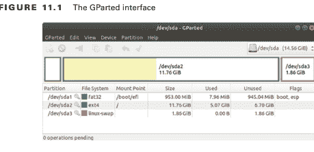

`gparted` 窗口每次显示系统中一个磁盘，并以图形布局展示该磁盘包含的所有分区。你右键单击分区以选择挂载或卸载、格式化、删除或调整分区大小的选项。

虽然完全可以以原始设备的方式与磁盘交互，但这通常不是 Linux 应用程序的工作方式。尝试读取和写入原始设备的数据需要大量的工作。相反，Linux 提供了一种方法来为我们处理所有繁琐的工作，我们将在下一节中介绍它。

## 理解文件系统

就像在壁橱里存放物品一样，在 Linux 系统中存储数据也需要某种组织方法才能高效。Linux 利用文件系统来管理存储在存储设备上的数据。文件系统利用一种方法来维护地图，以定位放置在存储设备中的每个文件。本节及后续章节描述了 Linux 文件系统，并展示了如何定位其中包含的文件和文件夹。

Linux 文件系统可能是操作 Linux 时最令人困惑的方面之一。在磁盘、CD 和 USB 存储棒上定位文件起初可能是一个挑战。

如果你熟悉 Windows 如何管理文件和文件夹，你就知道 Windows 为连接系统的每个存储设备分配驱动器号。例如，Windows 使用 `C:` 作为系统主驱动器，或使用 `E:` 作为插入系统的 USB 存储棒。

在 Windows 中，你习惯看到如下的文件路径：

```
C:\Users\rich\Documents\test.doc
```

此路径指示该文件位于用户 `rich` 的 `Documents` 文件夹中，该文件夹存储在分配了字母 `C`（通常是系统第一个驱动器）的磁盘分区上。

Windows 路径确切地告诉你文件存储在哪个物理设备上。然而，Linux 不使用此方法来引用文件。它使用虚拟目录结构。虚拟目录将安装在系统上的所有存储设备的文件路径合并到单一的目录结构中。

### 虚拟目录

Linux 虚拟目录结构包含一个根目录，称为根目录（`root` directory）。根目录根据其到达的文件夹路径列出其下方的文件和文件夹，类似于 Windows 的做法。


> **请注意这里的术语。** 尽管 Linux 中的主要管理员用户账户称为 `root`，但这与虚拟 `目录` 的 `root` 无关。它通常被称为 `root`，但表示为 `单个前向斜杠 (/)`。实际上，`root` 用户账户使用特殊的 Home 目录 `/root`，这使得事情变得更加混乱！

例如，一个 Linux 文件路径可能如下所示：

```
/home/rich/Documents/test.doc
```

首先，请注意 Linux 路径使用前向斜杠，而不是 Windows 使用的后向斜杠。这是一个让许多 Linux 新手管理员感到困惑的重要差异。就路径本身而言，还请注意没有驱动器号。路径仅指示文件 `test.doc` 存储在用户 `rich` 的 `Documents` 文件夹中；它没有提供任何关于哪个物理设备包含该文件的线索。

Linux 使用 *挂载点* 将物理设备放入虚拟目录中。挂载点是虚拟目录中的一个文件夹占位符，指向特定的物理设备。图 11.2 演示了此机制的工作原理。

在图 11.2 中，Linux 系统使用了两个磁盘。左侧的第一个磁盘与虚拟目录的根相关联。第二个磁盘挂载在 `/home` 位置，这是用户文件夹所在的位置。一旦第二个磁盘挂载到虚拟目录中，存储在该磁盘上的文件和文件夹就可以在 `/home` 文件夹下访问。

## 图 11.2 划分在两个磁盘上的 Linux 虚拟目录结构

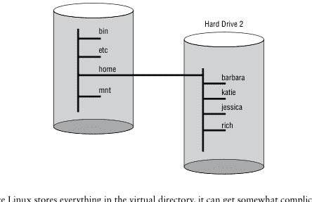

由于 Linux 将所有内容都存储在虚拟目录中，因此情况可能会变得有些复杂。幸运的是，有一个名为 Linux 文件系统层次标准（FHS）的标准格式定义了 Linux 虚拟目录的结构。FHS 定义了每个 Linux 系统上都应该存在哪些核心文件夹的名称和位置，以及它们应该包含什么类型的数据。表 11.3 仅展示了 FHS 中定义的几个更常见的文件夹。

## 表 11.3 常见的 Linux FHS 文件夹

| 文件夹 | 描述 |
| :--- | :--- |
| `/bin` | 系统以单用户模式运行所必需的可执行程序 |
| `/boot` | 包含用于启动系统的引导加载程序文件 |
| `/dev` | 设备文件 |
| `/etc` | 系统服务配置文件 |
| `/home` | 包含用户数据文件 |
| `/lib` | 可执行程序所需的库文件 |
| `/media` | 用作可移动设备的挂载点 |
| `/mnt` | 也用作可移动设备的挂载点 |
| `/opt` | 包含可选第三方程序的数据 |
| `/proc` | 提供内核和进程信息文件的虚拟文件系统，实时更新 |
| `/root` | 根用户账户的主目录 |
| `/sbin` | 系统所需的可执行程序 |
| `/sys` | 提供设备、驱动和部分内核信息文件的虚拟文件系统，实时更新 |
| `/tmp` | 包含系统用户创建的临时文件 |
| `/usr` | 包含标准 Linux 程序的数据 |
| `/usr/bin` | 包含本地用户程序和数据 |
| `/usr/local` | 包含本地安装特有的程序数据 |
| `/usr/sbin` | 包含系统程序和数据 |
| `/var` | 内容预期会频繁变化的文件，例如日志文件 |


虽然 FHS 有助于标准化 Linux 虚拟文件系统，但并非所有 Linux 发行版都完全遵循它。最好查阅特定的 Linux 发行版文档，了解其如何管理虚拟目录结构中的文件。

## 在文件系统中导航

使用虚拟目录使得在物理设备之间移动文件变得轻而易举。你不需要担心驱动器字母，只需关注虚拟目录中的位置：

```
$ cp /home/rich/Documents/myfile.txt /media/usb
```

在将文件从 `Documents` 文件夹移动到 U 盘时，我们使用了虚拟目录中文件和 U 盘的全路径。这种格式被称为 **绝对路径**。文件的绝对路径始终以根文件夹（`/`）开头，并包含虚拟目录树中到达该文件的所有文件夹。

或者，你可以使用 *相对路径* 来指定文件位置。文件的相对路径表示相对于你在虚拟目录树结构中的当前位置的文件位置。如果你已经在 `Documents` 文件夹中，只需输入

```
$ cp myfile.txt /media/usb
```

当 Linux 看到路径不以正斜杠开头时，它会假设该路径是相对于当前目录的。

## 格式化文件系统

在将磁盘分区分配给虚拟目录中的挂载点之前，必须使用文件系统对其进行格式化。Linux 支持多种文件系统类型，每种类型具有不同的特性和功能。以下章节讨论了 Linux 支持的不同文件系统以及如何为这些文件系统格式化磁盘分区。

### 常见文件系统类型

每个操作系统都使用自己的文件系统类型来存储磁盘上的数据。Linux 不仅支持几种自己的文件系统类型，还支持其他操作系统的文件系统。以下章节涵盖了你可以用于 Linux 分区的最常见的 Linux 和非 Linux 文件系统。

### Linux 文件系统

当你创建专门用于 Linux 系统的文件系统时，可以从六种主要文件系统中选择：

- **btrfs：** 一种较新的高性能文件系统，支持大小最高达 16 艾比字节（EiB）的文件和总文件系统大小 16 EiB。它还可以执行自身形式的廉价冗余磁盘阵列（RAID）以及逻辑卷管理（LVM）。它还包括额外的先进功能，如用于备份的内置快照、改进的容错能力和即时数据压缩。

- **eCryptfs：** 企业加密文件系统（eCryptfs）在将数据存储到设备之前对数据应用符合 POSIX 标准的加密协议。这为存储在设备上的数据提供了一层保护。只有创建该文件系统的操作系统才能从中读取数据。

- **ext3：** 也称为 `ext3fs`，这是原始 Linux `ext` 文件系统的后裔。它支持最大 2 提比字节（TiB）的文件，总文件系统大小为 16 TiB。它支持日志记录以及更快的启动和恢复。

- **ext4：** 也称为 `ext4fs`，它是原始 Linux 文件系统的当前版本。它支持最大 16 TiB 的文件，总文件系统大小为 1 EiB。它还支持日志记录并利用改进的性能特性。

- **XFS：** 由 Silicon Graphics 于 1993 年创建的 64 位高性能日志文件系统，并于 2001 年移植到 Linux。它支持最大 8 艾字节（exabytes）的文件系统。

- **swap：** 交换文件系统允许你使用物理驱动器上的空间为系统创建虚拟内存。然后系统可以将数据从常规内存交换到交换空间，从而为系统添加额外内存提供了一种方法。这不是用于存储持久数据的。

如今大多数 Linux 发行版都使用 `ext4fs` 文件系统作为默认设置，尽管 Red Hat 最近选择 `XFS` 文件系统作为默认设置。这两种文件系统都提供 *日志记录*，这是一种通过称为日志（`journal`）的日志文件来跟踪尚未写入驱动器的数据的方法。如果系统在数据写入驱动器之前发生故障，日志数据可以在下次系统启动时恢复并存储。

### 非 Linux 文件系统

Linux 的一个出色特性，使其如此多功能，是其能够读取存储在其他操作系统（如 Apple 和 Microsoft）格式化设备上的数据。这一特性使得在不同操作系统之间共享数据变得轻而易举。

以下是 Linux 可以处理的常见非 Linux 文件系统列表：

- **CIFS：** 通用 Internet 文件系统（CIFS）是 Microsoft 创建的一种文件系统协议，用于通过网络存储设备在网络上读写数据。它已公开发布，供所有操作系统使用。

- **HFS：** 分层文件系统（HFS）是 Apple 为其 macOS 系统开发的。Linux 也可以与更先进的 `HFS+` 文件系统交互。

- **ISO-9660：** *ISO-9660* 标准用于在 CD-ROM 设备上创建文件系统。

- **NFS：** 网络文件系统（NFS）是一种用于通过网络存储设备在网络上读写数据的开源标准。

- **NTFS：** 新技术文件系统（NTFS）是 Microsoft NT 操作系统及后续 Windows 版本使用的文件系统。自内核 *2.6.x* 起，Linux 可以读写 `NTFS` 分区上的数据。

- **SMB：** 服务器消息块（SMB）文件系统由 Microsoft 创建，是一种专有文件系统，用于网络存储以及与其他网络设备（如打印机）交互。对 SMB 的支持允许 Linux 客户端和服务器在网络上与 Microsoft 客户端和服务器交互。

- **UDF：** 通用光盘格式（UDF）常用于 DVD-ROM 设备存储数据。使用此文件系统，Linux 既可以从 DVD 读取数据，也可以向 DVD 写入数据。

- **VFAT：** 虚拟文件分配表（VFAT）是原始 Microsoft 文件分配表（FAT）文件系统的扩展。它不常用于驱动器，但常用于可移动存储设备，如 U 盘。


- `ZFS`：泽塔字节文件系统（`ZFS`）由 `Sun Microsystems`（现为 `Oracle` 的一部分）为其 `Unix` 工作站和服务器创建。这是另一种高性能文件系统，具有类似 `btrfs` Linux 文件系统的功能。

如果你计划仅将驱动器用于 Linux 系统，通常不建议使用非 Linux 文件系统格式化分区。Linux 支持这些文件系统主要作为一种与其他操作系统共享数据的方法。

## 创建文件系统

在 Linux 中创建文件系统的“瑞士军刀”是 `mkfs` 程序。`mkfs` 程序实际上是几个用于创建特定文件系统的独立工具的前端，例如用于创建 `ext4` 文件系统的 `mkfs.ext4` 程序。

`mkfs` 程序的美妙之处在于，你只需记住一个程序名称即可在 Linux 系统上创建任何类型的文件系统。只需使用 `-t` 选项来指定文件系统类型：

```bash
$ sudo mkfs -t ext4 /dev/sdb1
mk2fs 1.44.1 (24-Mar-2018)
Creating filesystem with 2621440 4k blocks and 655360 inodes
Filesystem UUID: f9137b26-0caf-4a8a-afdo-39200242ae8
Superblock backups stored on blocks:

32768, 98304, 163840, 229376, 294912, 819200, 884736, 1605632
Allocating group tables: done
Writing inode tables: done
Creating journal (16384 blocks): done
Writing superblocks and filesystem accounting information: done
$
```

指定 `-t` 选项后，只需在命令行中指定要格式化的分区设备文件名。请注意，`mkfs` 程序在格式化文件系统时幕后执行了许多操作。每种文件系统都有自己的方法

对文件和文件夹进行索引以及跟踪文件访问。`mkfs` 程序创建特定文件系统所需的所有索引文件和表格。


在指定分区设备文件名时要格外小心。当您格式化分区时，分区上任何现有数据都会丢失。如果您指定了错误的分区名称，可能会丢失重要数据，或者导致您的 Linux 系统无法启动。

## 挂载文件系统

一旦您使用文件系统格式化了磁盘分区，就可以将其添加到 Linux 系统的虚拟目录中。这个过程称为`挂载`文件系统。您可以从命令行手动将分区挂载到虚拟目录结构中，或者允许 Linux 在启动时自动挂载该分区。以下章节将介绍这两种方法。

## 手动挂载设备

要将文件系统临时挂载到 Linux 虚拟目录中，请使用 `mount` 命令。`mount` 命令的基本格式如下：

```bash
mount -t fstype device mountpoint
```

使用 `-t` 命令行选项来指定设备的文件系统类型：

```bash
$ sudo mount -t ext4 /dev/sdb1 /media/usbl
$ 
```

如果您在未指定任何参数的情况下使用 `mount` 命令，它将显示当前在 Linux 系统上挂载的所有设备。不过，请做好输出较长的心理准备，因为大多数 Linux 发行版会在虚拟目录中挂载许多虚拟设备以提供有关系统资源的信息。列表 11.1 显示了 `mount` 命令的部分输出。

### 列表 11.1 `mount` 命令的输出

```bash
$ mount
...
/dev/sda2 on / type ext4 (rw,relatime,errors=remount-ro,data=ordered)
/dev/sda1 on /boot/efi type vfat
(rw,relatime,fmask=0077,dmask=0077,codepage=437,iocharset=iso8859-1,shortname=mixed,errors=remount-ro)
...
/dev/sdb1 on /media/usbl type ext4 (rw,relatime,data=ordered)
/dev/sdb2 on /media/usb2 type ext4 (rw,relatime,data=ordered)
rich@rich-TestBox2:~$
```

为了节省空间，我们精简了 `mount` 命令的输出，仅显示系统上的物理设备。主硬盘设备（`/dev/sda`）包含两个分区，`USB` 闪存盘设备（`/dev/sdb`）也包含两个分区。

> **注意**
>
> `mount` 命令使用 `-o` 选项来指定文件系统的额外特性，例如以只读模式挂载、分配给挂载点的用户权限以及数据在设备上的存储方式。这些选项显示在 `mount` 命令的输出中。通常，您可以省略 `-o` 选项，让新的挂载点使用系统默认设置。

使用 `mount` 命令的缺点是它只是在虚拟目录中临时挂载设备。当您重启系统时，必须再次手动挂载这些设备。对于可移动设备（如 `USB` 闪存盘），这通常没问题，但对于更持久的设备，最好让 Linux 能自动为我们挂载它们。幸运的是，Linux 正好能做到这一点。

要从虚拟目录中移除已挂载的驱动器，请使用 `umount` 命令（注意少了个 `n`）。您可以通过指定设备文件名或挂载点目录来移除已挂载的驱动器。

## 自动挂载设备

对于永久性存储设备，Linux 维护 `/etc/fstab` 文件以指示哪些磁盘设备应在启动时挂载到虚拟目录中。`/etc/fstab` 文件是一个表格，指示磁盘设备文件（原始文件或其永久 `udev` 文件名之一）、挂载点位置、文件系统类型以及挂载磁盘所需的任何附加选项。列表 11.2 显示了 `Ubuntu` 工作站上的 `/etc/fstab` 文件。

### 列表 11.2 `/etc/fstab` 文件

```bash
$ cat /etc/fstab

# /etc/fstab: static file system information.
#

# Use 'blkid' to print the universally unique identifier for a
# device; this may be used with UUID= as a more robust way to name devices
# that works even if disks are added and removed. See fstab(5).
#
# <file system> <mount point>   <type>  <options>       <dump>  <pass>
# / was on /dev/sda2 during installation
UUID=46a8473c-8437-4d5f-a6a1-6596c492c3ce / ext4 errors=remount-ro 0 1
# /boot/efi was on /dev/sda1 during installation
UUID=864B-62F5 /boot/efi vfat umask=0877 0 1
# swap was on /dev/sda3 during installation
UUID=8673447a-0227-47d7-a67a-e68b37dd7188 none swap sw
/ 0
```

此 `/etc/fstab` 文件通过设备的 `udev` `UUID` 值引用设备，确保无论其在原始设备表中的顺序如何，都能访问正确的磁盘分区。第一个分区挂载到虚拟目录中的 `/boot/efi` 挂载点。第二个分区挂载到虚拟目录的根目录（`/`），第三个分区挂载为虚拟内存的交换区域。

您可以手动将设备添加到 `/etc/fstab` 文件中，以便在 Linux 系统启动时自动挂载。但是，如果它们在启动时不存在，这将导致启动错误。

> **提示**
>
> 在基于 `systemd` 的 Linux 服务器中，如果您仅使用 `/etc/fstab` 文件，`systemd` 仍然会管理这些文件系统。当服务器重启或 `systemd` 重新加载时，`/etc/fstab` 中列出的挂载点会被转换为原生单元。实际上，对于持久性文件系统，使用 `/etc/fstab` 比手动创建挂载单元文件是首选方法。有关此过程的更多信息，请在命令行中输入 `man systemd-fstab-generator`。

> **注意**
>
> 如果在任何分区上使用 `encryptfs` 文件系统类型，它们将出现在 `/etc/crypttab` 文件中，并会在启动时自动挂载。在系统运行期间，通过查看 `/etc/mtab` 文件，您还可以查看所有当前挂载的设备，无论它们是由系统自动挂载的还是由用户手动挂载的。

## 管理文件系统

一旦您创建了文件系统并将其挂载到虚拟目录中，您可能需要对其进行管理和维护，以确保一切顺利运行。以下章节介绍了 Linux 系统中用于管理文件系统的几种实用程序。

### 获取文件系统统计信息

在使用 Linux 系统时，毫无疑问，您最终需要监控磁盘性能和使用情况。有几种不同的工具可以帮助您做到这一点：

- `df` 显示按分区划分的磁盘使用情况。

- `du` 显示按目录划分的磁盘使用情况，适用于查找占用最多磁盘空间的用户或应用程序。

- `iostat` 显示按分区划分的磁盘统计信息实时图表。

- `lsblk` 显示当前分区大小和挂载点。

获取 Linux 系统磁盘空间状况快照的快速方法是使用 `df` 和 `du` 命令：

```bash
$ df -t xfs -h
Filesystem    Size Used Avail Use% Mounted on
/dev/mapper/r1-root   15G  6.6G  7.7G  47% /
/dev/sda1     1014M  351M  664M  35% /boot

$ sudo du -d 1
318632    ./boot
0         ./dev
0         ./proc
9448      ./run
0         ./sys
32400     ./etc
48        ./root
704712    ./var
5711056   ./usr
114656    ./home
369421    ./media
0         ./mnt
18856     ./opt
0         ./srv
12        ./tmp
7279241   .
$  
```

`df` 命令显示系统可用的总体磁盘空间，而 `du` 命令则帮助显示哪些目录包含最多的数据。

除了这些工具外，`/proc` 和 `/sys` 文件夹是内核用于记录系统统计信息的特殊文件系统。两个在与文件系统工作时可能很有用的目录是 `/proc/partitions` 和 `/proc/mounts` 文件夹，它们分别提供有关系统分区和挂载点的信息。此外，`/sys/block` 文件夹为每个挂载的驱动器包含单独的文件夹，显示分区和内核级统计数据。

如果你的 Linux 系统使用了专用存储设备，通常除了标准的 Linux 工具外，还有额外的命令工具可用。例如，如果你的 Linux 系统使用 `SCSI` 控制器，你可以使用 `lsscsi` 命令来显示连接到 `SCSI` 控制器的硬盘信息；或者对于使用光纤通道网络将存储区域网络（`SAN`）连接到你的 Linux 系统的系统，`fcstat` 命令非常有用。


某些文件系统，如 `ext3` 和 `ext4`，在创建时会分配特定数量的 `inode`。`inode` 是索引表中的一个条目，用于跟踪存储在文件系统上的文件。如果文件系统表中的 `inode` 条目用完，即使驱动器上还有可用空间，你也无法再创建更多文件。使用带有 `-i` 选项的 `df` 命令可以显示文件系统上已使用的 `inode` 百分比，这在关键时刻可能非常有用。

## 文件系统工具

Linux 使用 `e2fsprogs` 工具包为处理 `ext` 文件系统（如 `ext3` 和 `ext4`）提供实用工具。`e2fsprogs` 包中最流行的工具如下：

- `blkid` 显示有关块设备（如存储驱动器）的信息。

- `chattr` 更改文件系统上的文件属性。

- `debugfs` 手动查看和修改文件系统结构，例如恢复删除的文件或提取损坏的文件。

- `dumpe2fs` 显示块和超级块组信息。

- `e2label` 更改文件系统上的标签。

- `resize2fs` 扩展或缩小文件系统。

- `tune2fs` 修改文件系统参数。

这些工具有助于你微调 `ext` 文件系统上的参数，但如果文件系统发生损坏，你将需要 `fsck` 程序。

`XFS` 文件系统也有一套用于调优文件系统的工具。以下是你最常遇到的两个：

- `xfs_admin` 显示或更改文件系统参数，例如分配的标签或 `UUID`。

- `xfs_info` 显示已挂载文件系统的信息，包括块大小和扇区大小，以及标签和 `UUID` 信息。

如果你正在使用 `btrfs` 文件系统，`btrfs` 命令提供了访问多个管理文件系统实用工具的功能：

- `balance` 在多个设备之间平衡文件系统块

- `check` 对 `btrfs` 文件系统执行离线检查

- `device` 通过添加或删除物理设备，为 `btrfs` 文件系统提供设备管理。

- `filesystem` 为现有的 `btrfs` 文件系统提供文件系统管理实用工具，例如显示信息和调整文件系统大小。

- `quota` 允许你在 `btrfs` 文件系统上设置配额。

- `restore` 允许你从损坏的 `btrfs` 文件系统恢复文件。

虽然这些 `ext`、`XFS` 和 `btrfs` 工具很有用，但如果文件系统本身存在错误，它们无法帮助修复问题。为此，`fsck` 程序是应使用的工具：

```bash
$ sudo fsck -f /dev/sdb1
fsck from util-linux 2.31.1
e2fsck 1.44.1 (24-Mar-2018)
Pass 1: Checking inodes, blocks, and sizes
Pass 2: Checking directory structure
Pass 3: Checking directory connectivity
Pass 4: Checking reference counts
Pass 5: Checking group summary information
/dev/sdb1: 11/655360 files (0.0% non-contiguous), 66753/2621440 blocks
$
```

> **注意**
>
> 截至本文撰写时，`fsck` 的 `XFS` 模块不修复 `XFS` 文件系统。目前你需要使用 `xfs_repair` 工具。

`fsck` 程序是几个不同程序的前端，这些程序检查各种文件系统，以将索引与存储在该文件系统中的实际文件进行匹配。如果发生任何不一致，请运行 `fsck` 程序进入修复模式，它将尝试协调这些差异并修复文件系统。

## 存储替代方案

存储设备上的标准分区布局确实有其局限性。一旦你创建并格式化一个分区，扩大或缩小它就不太容易。单个分区也容易受到磁盘故障的影响，在这种情况下，存储在该分区中的所有数据都将丢失。

为了适应更动态的存储选项以及容错功能，Linux 引入了几种高级存储管理技术。以下各节介绍了三种流行的技术。

### 多路径

Linux 内核现在支持设备映射多路径（`DM-multipathing`），它允许你在 Linux 系统和网络存储设备之间配置多条路径。多路径通过聚合路径，在所有路径都处于活动状态时提供更高的吞吐量，或在其中一条路径变得不活动时提供容错功能。

Linux `DM-multipathing` 包括以下工具：

- `dm-multipath`：提供多路径支持的内核模块

- `multipath`：用于查看多路径设备的命令行命令

- `multipathd`：用于监控路径并激活/停用路径的后台进程

- `kpartx`：用于为多路径存储创建设备条目的命令行工具

`DM-multipath` 功能使用 Linux 中动态的 `/dev/mapper` 设备文件文件夹。Linux 为你添加到系统中的每个新多路径存储设备创建一个名为 `mpathN` 的 `/dev/mapper` 设备文件，其中 `N` 是多路径驱动器的编号。该文件对 Linux 系统而言充当普通设备文件，允许你在多路径设备上创建分区和文件系统，就像在普通驱动器分区上一样。

### 逻辑卷管理器

Linux 逻辑卷管理器（`LVM`）也利用 `/dev/mapper` 动态设备文件夹来允许你创建虚拟设备驱动器。你可以将多个物理驱动器分区聚合为虚拟卷，然后将其作为系统中的单个分区进行处理。

`LVM` 的好处在于，你可以根据需要添加或移除逻辑卷中的物理分区，从而扩展或缩小逻辑卷。

使用 `LVM` 有点复杂。图 11.3 演示了 `LVM` 环境的布局。

#### 图 11.3 Linux `LVM` 布局

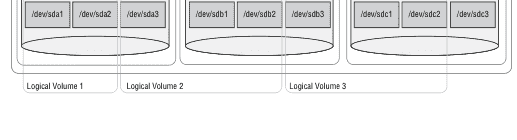

在图 11.3 所示的示例中，三个物理驱动器各包含三个分区。第一个逻辑卷由第一个驱动器的前两个分区组成。第二个逻辑卷跨驱动器，将第一个驱动器的第三个分区与第二个驱动器的第一和第二分区组合以创建一个卷。第三个逻辑卷由第二个驱动器的第三个分区和第三个驱动器的前两个分区组成。第三个驱动器的第三个分区未分配，需要时可以稍后添加到任何逻辑卷中。

对于每个物理分区，你必须使用 `fdisk` 或 `gdisk` 将分区类型标记为 `Linux LVM` 文件系统类型。然后，你必须使用几个 `LVM` 工具来创建和管理逻辑卷。表 11.4 列出了 Linux 中可用的 `LVM` 工具。

**表 11.4** Linux `LVM` 命令

| 命令 | 描述 |
| :--- | :--- |
| `lvchange` | 修改逻辑卷的设置 |
| `lvconvert` | 向非镜像逻辑卷添加或移除镜像 |


| 命令 | 描述 |
| :--- | :--- |
| `lvcreate` | 创建逻辑卷 |
| `lvdisplay` | 显示逻辑卷的信息 |
| `lvextend` | 扩充现有逻辑卷 |
| `lvm dump` | 创建 LVM 设置的 tar 包 |
| `lvremove` | 移除现有逻辑卷 |
| `lvrename` | 更改分配给逻辑卷的名称 |
| `lvresize` | 更改逻辑卷的大小 |
| `lvs` | 显示逻辑卷的信息 |
| `lvsscan` | 扫描系统中的逻辑卷 |
| `pvchange` | 修改物理卷的设置 |
| `pvck` | 检查物理卷上 LVM 元数据的一致性 |
| `pvcreate` | 创建物理卷 |
| `pvdisplay` | 显示物理卷的信息 |
| `pvmove` | 将一个设备上使用的卷移动到另一个设备 |

## 表 11.4 Linux LVM 命令（续）

| 命令 | 描述 |
| :--- | :--- |
| `pvremove` | 移除一个物理卷 |
| `pvs` | 显示关于物理卷的信息 |
| `pvscan` | 扫描磁盘以查找 LVM 和非 LVM 卷 |
| `vgcfbackup` | 创建卷组元数据的文本备份 |
| `vgcfrestore` | 从备份文件恢复卷组元数据 |
| `vgchange` | 修改卷组的设置 |
| `vgck` | 检查卷组的完整性 |
| `vgconvert` | 将 LVM 元数据从一种格式更改为另一种格式 |
| `vgcreate` | 将物理卷组合到一个卷组中 |
| `vgdisplay` | 显示关于卷组的信息 |
| `vgexport` | 导出一个卷组 |
| `vgextend` | 将物理卷添加到现有的卷组中 |
| `vgimport` | 导入一个卷组 |
| `vgimportclone` | 导入并重命名重复的卷组 |
| `vgmerge` | 将两个卷组合并为一个卷组 |
| `vmove` | 在卷组内的逻辑卷之间移动区（extents） |
| `vmremove` | 从卷组中移除物理卷 |
| `vgrename` | 更改现有卷组的名称 |
| `vgs` | 显示关于卷组的信息 |
| `vgscan` | 扫描磁盘以查找 LVM 卷组 |

逻辑卷会在 `/dev/mapper` 文件夹中创建条目，这些条目代表您可以使用文件系统格式化的 LVM 设备，可以像普通分区一样使用。列表 11.3 展示了创建新的 LVM 逻辑卷并将其挂载到您的虚拟目录中所需的步骤。

### 列表 11.3 创建、格式化和挂载逻辑卷

```
$ sudo gdisk /dev/sdb

Command (? for help): n
Partition number (1-128, default 1): 1
First sector (34-10485726, default = 2048) or {+}size[KMGTPE]:
Last sector (2048-10485726, default = 10485726) or {+}size[KMGTPE]:
Current type is 'Linux filesystem'
Hex code or GUID (L to show codes, Enter = 8300): 8e00
Changed type of partition to 'Linux LVM'

Command (? for help): w

Final checks complete. About to write GPT data.
THIS WILL OVERWRITE EXISTING PARTITIONS!!

Do you want to proceed? (Y/N): Y
OK; writing new GUID partition table (GPT) to /dev/sdb.
The operation has completed successfully.
```

```
$ sudo pvcreate /dev/sdb1
Physical volume "/dev/sdb1" successfully created.

$ sudo vgcreate newvol /dev/sdb1
Volume group "newvol" successfully created

$ sudo lvcreate -l 100%FREE -n lvdisk newvol
Logical volume "lvdisk" created.

$ sudo mkfs -t ext4 /dev/mapper/newvol-lvdisk
mke2fs 1.44.1 (24-Mar-2018)
Creating filesystem with 138996 4k blocks and 327680 inodes
Filesystem UUID: 06c871bc-2eb6-4696-896f-240313e5d4fe
Superblock backups stored on blocks:
	32768, 98304, 163840, 229376, 294912, 819200, 884736

Allocating group tables: done
Writing inode tables: done
Creating journal (16384 blocks): done
Writing superblocks and filesystem accounting information: done
```

```
$ sudo mkdir /media/newdisk
$ sudo mount /dev/mapper/newvol-lvdisk /media/newdisk
$ cd /media/newdisk
$ ls -al
total 24
drwxr-xr-x 3 root root 4096 Jan 10 10:17 .
drwxr-xr-x 4 root root 4096 Jan 10 10:18 ..
drw--- -- 2 root root 16384 Jan 10 10:17 lost+found
$
```

虽然 LVM 的初始设置比较复杂，但它确实提供了巨大的好处。如果您的逻辑卷空间不足，只需向该卷添加新的磁盘分区即可。

## 使用 RAID 技术

廉价磁盘冗余阵列（RAID）技术改变了大多数数据中心的数据存储环境。RAID 技术允许您通过结合多个驱动器到一个虚拟驱动器中，从而提高数据访问性能和可靠性，并实现数据冗余以进行故障容错。有几种常用的 RAID 版本：

- RAID-0：磁盘条带化（Disk striping），将数据分布在多个磁盘上以实现更快的访问。

- RAID-1：磁盘镜像（Disk mirroring）将数据复制到两个驱动器上。

- RAID-10：磁盘镜像和条带化提供条带化以提高性能，提供镜像以进行故障容错。

- RAID-4：带有奇偶校验的磁盘条带化在一个单独磁盘上存储奇偶校验位，以便可以恢复故障数据盘上的数据。

- RAID-5：带有分布式奇偶校验的磁盘条带化将奇偶校验位添加到数据条带中，使其出现在所有磁盘上，以便可以恢复任何故障磁盘。

- RAID-6：带有双奇偶校验的磁盘条带化同时条带化数据和奇偶校验位，以便可以恢复两个故障驱动器。

缺点是硬件 RAID 存储设备可能 somewhat 昂贵（尽管 I 代表什么），对于大多数家庭使用来说往往不实用。因此，Linux 实现了一个软件 RAID 系统，可以在任何磁盘系统上实现 RAID 功能。

`mdadm` 实用程序允许您指定用于任何类型 RAID 环境的多个分区。RAID 设备在 `/dev/mapper` 文件夹中显示为单个设备，然后您可以对其进行分区并格式化为特定的文件系统。您可以通过显示 `/proc/mdstat` 文件的内容来查看内核当前 RAID 状态。

## 加密分区

如今，数据安全性在大多数商业环境中是必须的。随着便携式笔记本电脑和外部存储设备的普及，敏感的公司（有时是个人）数据很容易被窃贼窃取。

保护数据的一道防线是`加密`。Linux 提供加密单个文件的实用程序，但这可能很繁琐。更好的解决方案是加密存储数据所在的整个分区。一个流行的工具是`Linux 统一密钥设置（LUKS）`。LUKS 系统由 Clemens Fruhwirth 于 2004 年创建，专门用于加密 Linux 分区。

LUKS 的核心实用程序是 `cryptsetup` 实用程序。它允许您创建加密分区，然后打开它们，使其可用于在 Linux 虚拟目录中格式化和挂载。

第一步是使用 `luksFormat` 选项格式化一个用于加密的分区：

```
$ sudo cryptsetup -y -v luksFormat /dev/sdb1

WARNING!
This will overwrite data on /dev/sdb1 irrevocably.

Are you sure? (Type 'yes' in capital letters): YES
Enter passphrase for /dev/sdb1:
Verify passphrase:
Key slot 0 created.
Command successful.
$
```

在此步骤中，您必须指定打开加密分区所需的密码。创建加密分区后，您可以使用 `luksOpen` 选项使其可用于使用：

```
$ sudo cryptsetup -v luksOpen /dev/sdb1 safedata
Enter passphrase for /dev/sdb1:
Key slot 0 unlocked.
Command successful.
$
```

`luksOpen` 选项要求您知道用于加密分区的密码。`luksOpen` 选项后的第一个参数指定物理分区，第二个参数定义用于将打开的分区映射到 `/dev/mapper` 目录中虚拟设备的名称：

```
$ ls /dev/mapper -l
total 0
crw-------. 1 root root    10, 236 Dec 22 08:29 control
lrwxrwxrwx. 1 root root       7 Dec 22 08:29 rl-root -> ../dm-0
lrwxrwxrwx. 1 root root       7 Dec 22 08:29 rl-swap -> ../dm-1
lrwxrwxrwx. 1 root root       7 Dec 22 09:02 safedata -> ../dm-2
$
```

`/dev/mapper/safedata` 设备文件现在引用已打开的加密分区，可以像普通 Linux 分区一样进行处理：

```
$ sudo mkfs -t ext4 /dev/mapper/safedata
mke2fs 1.45.6 (20-Mar-2020)
Creating filesystem with 257792 4k blocks and 64512 inodes
Filesystem UUID: e2f03597-0108-48b3-a66b-d58fdd9c427f
Superblock backups stored on blocks:
	32768, 98304, 163840, 229376

Allocating group tables: done
Writing inode tables: done
Creating journal (4096 blocks): done
Writing superblocks and filesystem accounting information: done
$ sudo mount /dev/mapper/safedata /mnt/mydata
$
```

创建文件系统并挂载分区后，您可以在 `/mnt/mydata` 目录中创建、修改和删除文件和目录，就像对待任何其他 Linux 文件系统一样。

若要关闭加密分区以使其无法访问，请使用 `luksClose` 命令选项：

```
$ sudo cryptsetup -v luksClose /dev/mapper/safedata
Command successful.
$ ls /dev/mapper -l
total 0
crw-------. 1 root root    10, 236 Dec 22 08:29 control
lrwxrwxrwx. 1 root root       7 Dec 22 08:29 rl-root -> ../dm-0
lrwxrwxrwx. 1 root root       7 Dec 22 08:29 rl-swap -> ../dm-1
$
```

当关闭加密分区时，Linux 会将其从 `/dev/mapper` 目录中移除，使其不可访问。若要再次挂载该分区，您需要使用 `cryptsetup` 命令中的 `luksOpen` 选项并提供密码。

## 练习 11.1

### 文件系统实验

本练习将演示如何使用 USB 闪存盘在 Linux 系统上对驱动器进行分区、格式化和挂载。您需要有一个空的 USB 闪存盘来执行此练习。USB 闪存盘上的所有数据都将被删除。

1. 登录您的 Linux 系统并打开一个新的命令提示符。

2. 将 USB 闪存盘插入您的系统。如果您使用的是虚拟机 (VM) 环境，可能需要配置 VM 以识别新的 USB 设备。

   - 对于 VirtualBox，点击“设备”菜单栏项，选择 USB，然后选择该 USB 设备名称。

3. Linux 系统应自动挂载该设备。输入 `dmesg | tail` 以显示系统控制台输出的最后几行。这应该会显示 USB 设备是否已挂载，以及如果是的话，分配给该设备的设备名称，例如 `/dev/sdb1`。

4. 使用命令 `sudo umount /dev/xxx` 卸载该设备，其中 `xxx` 是 `dmesg` 输出中显示的设备名称。

5. 输入 `fdisk /dev/xxx` 对磁盘进行分区，其中 `xxx` 是设备名称，不含分区编号（例如 `/dev/sdb`）。在命令提示符下，输入 `p` 以显示当前分区。

6. 输入 `d` 删除现有分区。

7. 创建新分区。输入 `n` 创建新分区。输入 `p` 创建主分区。输入 `1` 将其分配为第一个分区。按 Enter 键接受默认起始位置，然后再次按 Enter 接受默认结束位置。如果提示，输入 `y` 以移除原始的 VFAT 签名。

8. 保存新的分区布局。输入 `w` 保存设备布局并退出 `fdisk` 程序。

9. 在新分区上创建新的文件系统。输入 `sudo mksfs -t ext4 /dev/xxx1`，其中 `xxx` 是 USB 闪存盘的设备名称。

10. 在主文件夹中创建一个新的挂载点。输入 `mkdir mediatest1`。

11. 将新文件系统挂载到挂载点。输入 `sudo mount -t ext4 /dev/xxx1 mediatest1`，其中 `xxx` 是设备名称。输入 `ls mediatest1` 以列出当前文件系统中的任何文件。

12. 通过输入 `sudo umount /dev/xxx1` 移除 USB 闪存盘，其中 `xxx` 是设备名称。

13. 如果您想将 USB 闪存盘恢复为 Windows 格式，您可以将 USB 闪存盘的文件系统类型更改为 VFAT，或者使用文件管理器中的 Windows 格式工具重新格式化它。

## 摘要

在 Linux 系统上永久存储数据的能力是必不可少的。Linux 内核支持硬盘驱动器 (HDD) 和固态硬盘 (SSD) 技术，用于持久地存储数据。它还支持三种主要的驱动器连接类型——PATA、SATA 和 SCSI。对于您连接到系统的每个存储设备，Linux 会在 `/dev` 文件夹中创建一个原始设备文件。PATA 驱动器的原始设备是 `hdX`，SATA 和 SCSI 驱动器的原始设备是 `sdX`，其中 `x` 是分配给驱动器的驱动器字母。

一旦您将驱动器连接到 Linux 系统，就需要在驱动器上创建分区。对于 MBR 磁盘，您可以使用 `fdisk` 或 `parted` 命令行工具，或使用 `gparted` 图形工具。对于 GPT 磁盘，您可以使用 `gdisk` 或 `gparted` 工具。当您分区驱动器时，必须为其分配大小和文件系统类型。

在对存储设备进行分区后，您必须使用 Linux 认识的文件系统对其进行格式化。`mkfs` 程序是一个前端实用程序，可以使用 Linux 支持的大多数文件系统来格式化驱动器。ext4 文件系统目前是最受欢迎的 Linux 文件系统。它支持日志记录，并提供良好的性能。Linux 还支持更高级的文件系统，如 btrfs、xfs、zfs，以及当然还有 Windows 的 VFAT 和 NTFS 文件系统。

在分区上创建文件系统后，您需要使用挂载点和 `mount` 命令将文件系统挂载到 Linux 虚拟目录中。分区文件系统中包含的数据将显示在虚拟目录下的挂载点文件夹中。为了在启动时自动挂载分区，请在 `/etc/fstab` 文件中为每个分区创建一个条目。

有许多工具可以帮助您管理和维护文件系统。`df` 和 `du` 命令行命令分别用于检查分区和虚拟目录的磁盘空间。`fsck` 实用程序是修复损坏分区的重要工具，并在启动时自动针对自动挂载到虚拟目录中的所有分区运行。

Linux 还支持替代的存储解决方案，例如用于容错的多路径 I/O、逻辑卷（您可以添加和删除物理分区）、软件 RAID 技术，以及创建加密分区的能力。

## 考试要点

- **描述 Linux 如何与存储设备协同工作。** Linux 为连接到系统的每个存储设备在 `/dev` 文件夹中创建原始设备文件。Linux 还为存储设备中包含的每个分区分配一个原始设备文件。

- **解释如何准备分区以在 Linux 虚拟目录中使用。** 要在虚拟目录中使用存储设备分区，必须使用 Linux 认识的文件系统对其进行格式化。使用 `mkfs` 命令来格式化分区。Linux 识别多种不同的文件系统类型，包括 ext3、ext4、btrfs、xfs 和 zfs。


- **描述 Linux 如何实施容错存储配置。** Linux 支持两种类型的容错存储方法。多路径方法使用 `mdadm` 实用程序为同一存储设备创建两个路径。如果两个路径都处于活动状态，Linux 会聚合路径速度以提高到存储设备的性能。如果一个路径失败，Linux 会自动通过活动路径路由流量。Linux 还可以使用标准 RAID 技术来支持 RAID 级别 0、1、10、4、5 或 6，以实现容错和高性能存储。

- **描述 Linux 如何使用虚拟存储设备。** Linux 使用逻辑卷管理器 (LVM) 从一个或多个物理设备创建虚拟存储设备。`pvcreate` 命令从物理分区定义卷，而 `vgcreate` 命令从一个或多个虚拟卷创建卷组。然后，`lvcreate` 命令从卷组中的一个或多个分区在 `/dev/mapper` 文件夹中创建逻辑卷。这种方法允许您在文件系统中添加或移除驱动器，以根据需要扩展或缩小文件系统区域。

- **列出 Linux 中可用的一些文件系统工具。** `df` 工具允许您分析驱动器分区中可用和已使用的空间，而 `du` 工具允许您分析虚拟目录结构中的空间。`e2fsprogs` 包提供了大量用于调整 ext 文件系统的工具，如 `debugfs`、`dump2efs`、`tune2fs` 和 `blkid`。Linux 还提供 `xfs_admin` 和 `xfs_info` 工具用于处理 xfs 文件系统。`fsck` 工具可用于修复损坏的文件系统，并能修复大多数文件损坏的情况。

## 复习题

1. 哪种类型的存储设备使用集成电路存储数据且没有移动部件？
   - A. SSD
   - B. SATA
   - C. SCSI
   - D. HDD
   - E. PATA

2. Linux 会为连接到系统的第二个 SCSI 驱动器创建哪个原始设备文件？
   - A. `/dev/hdb`
   - B. `/dev/sdb`
   - C. `/dev/sdb1`
   - D. `/dev/hdb1`
   - E. `/dev/sda`

3. 哪个程序在后台运行以自动检测和挂载新的存储设备？
   - A. `mkfs`
   - B. `fsck`
   - C. `umount`
   - D. `mount`
   - E. `udev`

4. `udev` 程序使用哪个文件夹根据序列号为存储设备创建永久链接？
   - A. `/dev/disk/by-path`
   - B. `/dev/sdb`
   - C. `/dev/disk/by-id`
   - D. `/dev/disk/by-uuid`
   - E. `/dev/mapper`

5. 哪个分区工具提供图形界面？
   - A. `gdisk`
   - B. `gparted`
   - C. `fdisk`
   - D. `parted`
   - E. `fsck`

6. Linux 使用 `______` 来将新存储设备上的文件系统挂载到虚拟目录中，以供用户访问。
   - A. 挂载点
   - B. 盘符
   - C. `/dev` 文件
   - D. `/proc` 目录
   - E. `/sys` 目录

7. 第一个 Linux 文件系统的最新版本是什么？
   - A. `reiserFS`
   - B. `btrfs`
   - C. `ext3`
   - D. `ext4`
   - E. `nfs`

8. 你使用什么工具来在分区上创建一个新的文件系统？
   - A. `fdisk`
   - B. `mkfs`
   - C. `fsck`
   - D. `gdisk`
   - E. `parted`

9. 你使用什么工具手动将文件系统添加到虚拟目录？
   - A. `fsck`
   - B. `mount`
   - C. `umount`
   - D. `fdisk`
   - E. `mkfs`

10. `______` 程序是修复损坏文件系统的便捷工具。
   - A. `fsck`
   - B. `mount`
   - C. `umount`
   - D. `fdisk`
   - E. `mkfs`


## 第 12 章 保护文件

- 目标 1.2：在给定场景下，管理文件和目录


保护数据包括创建和管理 `备份`。备份通常被称为 `存档`，它是数据的一个副本，在数据被销毁或损坏时，可以在未来的某个时间点进行恢复。

备份你的数据是一项关键活动，但更重要的是规划你的备份。这些计划包括选择备份类型，确定要采用的正确压缩方法，以及确定哪些工具最能满足组织的数据需求。你可能还需要通过网络传输备份文件。在这种情况下，确保存档在传输过程中的安全性以及验证到达目的地后的完整性至关重要。本章涵盖了有关保护数据文件的这些各种主题。

### 理解备份类型

数据备份有不同的分类。理解这些不同的类别对于制定备份计划至关重要。以下是最常见的备份类型：

- 系统映像
- 完全备份
- 增量备份
- 差异备份
- 快照
- 快照克隆

本节将探讨每种备份类型。其中包括它们的优缺点。

**系统映像** `系统映像` 是操作系统二进制文件、配置文件以及启动 Linux 系统所需的其他任何内容的副本。其目的是快速将系统恢复到可引导状态。有时被称为 `克隆`，这些备份通常不用于恢复单个文件或目录，在某些备份工具的情况下，你甚至无法这样做。

**完全备份** `完全备份` 是所有数据的副本，忽略其修改日期。这种备份类型的主要优势是恢复系统数据所需的时间比其他类型少得多。然而，与其他类型相比，创建完全备份不仅耗时更长，而且需要更多的存储空间。它不需要其他备份类型即可完全恢复系统。

**增量备份** `增量备份` 仅复制自上次备份操作（任何类型的备份操作）以来已修改的数据。通常，文件的修改时间戳与上次备份类型的时间戳进行比较。与其他类型相比，创建这种备份类型所需的时间少得多，并且所需的存储空间也少得多。然而，这种备份类型的数据恢复时间可能很长。想象一下，你在周一进行了完全备份复制，在周二至周五进行了增量备份。周六磁盘崩溃，必须更换。更换磁盘后，你必须使用周一的备份恢复数据，然后继续使用周二至周五创建的增量备份恢复数据。这非常耗时，会导致系统恢复正常运行时出现重大延迟。因此，出于优化目的，需要定期完成完全备份。

**差异备份** `差异备份` 复制自上次完全备份以来所有已更改的数据。它可以被视为完全备份和增量备份之间的一种良好平衡。这种备份类型比完全备份花费更少的时间，但可能比增量备份花费更多时间。它比完全备份需要更少的存储空间，但比简单的增量备份需要更多的空间。此外，使用差异备份进行恢复所需的时间比使用增量备份少得多，因为只需要完全备份和最新的差异备份。出于优化目的，需要定期完成完全备份。

**快照** `快照备份` 被认为是一种混合方法，它是备份的一种略有不同的风味。首先，在备份介质上创建数据的完全（通常是只读的）副本。然后，使用指针（如硬链接）创建引用表，将备份数据与原始数据关联起来。下次创建备份时，不是创建完全备份，而是创建增量备份（只有修改或新文件被复制到备份介质），并复制和更新指针引用表。这会节省空间，因为每次额外备份只需要存储已修改的文件和更新后的指针引用表。

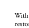

> 这里描述的快照备份类型是写时复制（copy-on-write）快照。
>
> 还有另一种称为 `分裂镜像快照` 的快照风味，其中数据保留在镜像存储设备上。运行备份时，创建所有数据的副本，而不仅仅是新数据或已修改的数据。

使用快照备份，你可以回到任何时间点，并从该点执行完整系统恢复。它还比其他备份类型使用少得多的空间。本质上，快照模拟了每天多次完全备份，而不占用与完全备份类型相同的空间或需要相同的处理能力。`rsync` 实用程序（本章稍后将介绍）使用这种方法。

**快照克隆** 快照备份的另一种变体是 `快照克隆`。一旦创建快照（例如 LVM 快照），它就会被复制，或克隆。快照克隆在数据 I/O 量大的环境中很有用。执行克隆时，由于克隆备份发生在快照上，而不是在原始数据上，因此你会将生产数据 I/O 的不良性能影响降到最低。

虽然不是所有快照都是可写的，但快照克隆通常是可修改的。如果你使用的是 LVM，你可以在另一个系统上挂载这些快照克隆。因此，快照克隆在灾难恢复场景中非常有用。

你特定的服务器环境以及数据保护需求将决定采用哪种备份方法。你可能需要前面提到的类型的组合，才能正确保护你的数据。

### 查看压缩方法

备份数据可能会消耗大量的额外磁盘或介质空间。根据你采用的备份类型，你可以利用数据压缩实用程序来减少这种消耗。Linux 上可用的以下流行实用程序：

- `gzip`
- `bzip2`
- `xz`
- `zip`

本节将探讨这些数据压缩方法各自的优缺点。

**gzip** `gzip` 实用程序于 1992 年开发，作为旧 `compress` 程序的替代品。使用 Lempel-Ziv (LZ77) 算法实现基于文本的文件压缩率达到 60-70%，`gzip` 长期以来一直是一种流行的数据压缩实用程序。要压缩文件，只需输入 `gzip` 后跟文件名即可。原始文件将被带有 `.gz` 文件扩展名的压缩版本替换。要逆转此操作，输入 `gunzip` 后跟压缩文件的名称。

**bzip2** 于 1996 年开发，`bzip2` 实用程序提供的压缩率高于 `gzip`，但执行数据压缩所需的时间稍长。`bzip2` 实用程序采用多层压缩技术和算法。直到 2013 年，这种数据压缩实用程序一直被用于压缩用于分发的 Linux 内核。要压缩文件，只需输入 `bzip2` 后跟文件名即可。原始文件将被带有 `.bz2` 文件扩展名的压缩版本替换。要逆转此操作，输入 `bunzip2` 后跟压缩文件的名称，该名称将解压（膨胀）数据。

> 注意
>
> 最初有一个 `bzip1` 实用程序。然而，在其分层方法中，采用了一种获得专利的数据压缩算法。因此，`bzip2` 被创建来替代它，并使用无专利的 Huffman 编码算法。

#### xz

`xz` 数据压缩实用工具于 2009 年开发完成，并迅速在 Linux 管理员中广受欢迎。借助 `LZMA2` 压缩算法，它的默认压缩率比 `bzip2` 和 `gzip` 更高。不过，如果使用特定的 `xz` 命令选项，在需要或希望的情况下，你可以使用旧版的 `LZMA` 压缩算法。2013 年，`xz` 压缩工具取代了 `bzip2`，用于压缩待发布的 Linux 内核。要压缩文件，只需输入 `xz`，后跟文件名即可。原始文件将被替换为带有 `.xz` 文件扩展名的压缩版本。若要撤销此操作，请输入 `unxz`，后跟压缩文件名。

#### zip

`zip` 实用工具能够同时对多个文件进行操作。如果你曾在 Windows 操作系统上创建过 `zip` 文件，那么你就已经使用过这种文件格式。多个文件被打包到单个文件中，通常称为文件夹或归档文件，然后进行压缩。与其他 Linux 压缩实用工具的不同之处在于，`zip` 不会替换原始文件。相反，它将文件的副本放入归档文件中。

要使用 `zip` 归档并压缩文件，请输入 `zip`，后跟最终归档文件的名称，该名称传统上以 `.zip` 扩展名结尾。在归档文件名称之后，输入一个或多个你想要放入压缩归档中的文件，它们之间用空格分隔。原始文件将保持原样，但它们的副本会被放入压缩的 `zip` 归档文件中。若要撤销此操作，请输入 `unzip`，后跟压缩归档文件的名称。

使用默认设置对各个压缩实用工具进行并排比较是很有帮助的。在列表 12.1 中，展示了在 Rocky Linux 发行版上的一个示例。

### 列表 12.1 比较各种 Linux 压缩实用工具

```bash
# cp /var/log/wtmp wtmp
# cp wtmp wtmp1
# cp wtmp wtmp2
# cp wtmp wtmp3
# cp wtmp wtmp4

# ls -lh wtmp?
-rw-r--r--. 1 root root 210K Oct  9 19:54 wtmp1
-rw-r--r--. 1 root root 210K Oct  9 19:54 wtmp2
-rw-r--r--. 1 root root 210K Oct  9 19:54 wtmp3
-rw-r--r--. 1 root root 210K Oct  9 19:54 wtmp4

# gzip wtmp1
# bzip2 wtmp2
# xz wtmp3
# zip wtmp4.zip wtmp4
adding: wtmp4 (deflated 96%)

# ls -lh wtmp2.*
-rw-r--r--. 1 root root  7.7K Oct  9 19:54 wtmp1.gz
-rw-r--r--. 1 root root  6.2K Oct  9 19:54 wtmp2.bz2
-rw-r--r--. 1 root root  5.2K Oct  9 19:54 wtmp3.xz
-rw-r--r--. 1 root root  7.9K Oct  9 19:55 wtmp4.zip

# ls wtmp?
wtmp4
#
```

在列表 12.1 中，首先使用超级用户权限将 `/var/log/wtmp` 文件复制到本地目录。然后制作了该文件的四个副本。使用 `ls -lh` 命令，你可以看到以人类可读格式显示的 `wtmp` 文件大小为 210K。接下来，使用了各种压缩实用工具。请注意，当使用 `zip` 命令时，必须提供归档文件的名称 `wtmp4.zip`，并在其后跟上任何文件名。在这种情况下，只有 `wtmp4` 被放入了 `zip` 归档中。当文件被各种实用工具压缩后，在列表 12.1 中又发出了另一个 `ls -lh` 命令。注意各种文件扩展名以及文件的压缩后大小。你可以看到 `xz` 程序对该文件的压缩率最高，因为其文件尺寸最小。列表 12.1 中的最后一个命令表明，除了 `zip` 以外的所有压缩程序都删除了原始文件。


> 对于上述所有数据压缩实用工具，你都可以通过 `#` 选项指定压缩级别并控制速度。`#` 是 1 到 9 之间的一个数字，其中 1 代表速度最快但压缩率最低，9 代表速度最慢但压缩率最高。`zip` 实用工具目前尚不支持这些压缩级别，但它支持解压缩级别。通常，这些实用工具默认使用 `-6` 作为压缩级别。由于存在有用但细微的差异，建议查阅每个实用工具的手册页以审查这些级别规格。

有许多压缩方法。然而，当使用压缩实用工具配合归档和恢复程序进行数据备份时，务必使用无损压缩方法。无损压缩顾名思义：不会丢失任何数据。`gzip`、`bzip2`、`xz` 和 `zip` 实用工具提供无损压缩。显然，在进行备份时不丢失数据非常重要。

## 比较归档和恢复实用工具

你可以使用几种程序来管理备份。一些更流行的产品包括 `Amanda`、`Bacula`、`Bareos`、`Duplicity` 和 `BackupPC`。然而，这些基于 GUI 和/或 Web 的程序通常以命令行实用工具为核心。我们在这里重点关注这些命令行实用工具：

- `cpio`
- `dd`
- `rsync`
- `tar`

### 使用 cpio 进行复制

`cpio` 实用工具名称代表“copy in and out”（复制进和复制出）。它汇集文件副本并将其存储在归档文件中。该程序有几个有用的选项。更常用的选项在表 12.1 中进行了描述。

**表 12.1** `cpio` 命令的常用选项

| 短选项 | 长选项 | 描述 |
| :------- | :------- | :------- |
| `-I` | N/A | 指定要使用的归档文件。 |
| `-i` | `--extract` | 根据所使用的其他选项，从归档中复制文件或显示归档中的文件。称为*复制入*模式。 |
| N/A | `--no-absolute-filenames` | 指定仅使用相对路径名。（默认使用绝对路径名。） |
| `-o` | `--create` | 通过将文件复制到其中来创建归档。称为*复制出*模式。 |
| `-t` | `--list` | 显示归档中的文件列表。此列表称为*目录表*。 |
| `-v` | `--verbose` | 在处理每个文件时显示该文件的名称。 |

要使用 `cpio` 实用工具创建归档，你必须生成文件列表并将其通过管道传入命令。列表 12.2 展示了执行此任务的示例。

### 列表 12.2 使用 cpio 创建归档

```bash
$ ls Project4?.txt
Project42.txt  Project43.txt  Project44.txt
Project45.txt  Project46.txt
$ ls Project4?.txt | cpio -ov > Project4x.cpio
Project42.txt
Project43.txt
Project44.txt
Project45.txt
Project46.txt
59 blocks
$ ls Project42.*
Project42.txt Project44.txt Project46.txt
Project43.txt Project45.txt Project4x.cpio
$
```

在列表 12.2 中，首先使用 `?` 通配符和 `ls` 命令显示当前工作目录中的各种文本文件。然后使用该命令，并将其 STDOUT（标准输出）作为 STDIN（标准输入）通过管道传入 `cpio` 实用工具。（如果需要回顾 STDOUT 和 STDIN 的知识，请参见第 4 章“搜索和分析文本”。）`cpio` 命令使用的选项是 `-ov`，这将创建一个包含所列文件副本的归档。它还会在文件被复制到归档时显示文件名。使用的归档文件名为 `Project4x.cpio`。虽然不是必需的，但被认为使用 `.cpio` 扩展名作为 `cpio` 归档文件是很好的形式。

> **注意**


你可以通过 `cpio` 实用工具基于数据的元数据（而非文件位置）进行备份。例如，假设你想为虚拟目录系统中由 `JKirk` 用户账户拥有的所有文件创建 `cpio` 归档。你可以使用 `find / -user JKirk` 命令并将其通过管道传入 `cpio` 实用工具来创建归档文件。这是一个便捷的功能。

你可以相当容易地查看存储在 `cpio` 归档中的文件。只需再次使用 `cpio` 命令，并使用其 `-itv` 选项和 `-I` 选项来指定归档文件，如列表 12.3 所示。

### 列表 12.3 使用 cpio 列出归档的内容

```bash
$ cpio -itvI Project4x.cpio
-rw-r--r--   1 Christin Christin   29900  Aug 19 17:37  Project42.txt
-rw-rw-r--   1 Christin Christin      0  Aug 19 18:07  Project43.txt
-rw-rw-p--   1 Christin Christin      0  Aug 19 18:07  Project44.txt
-rw-rw-p--   1 Christin Christin      0  Aug 19 18:07  Project45.txt
-rw-rw-p--   1 Christin Christin      0  Aug 19 18:07  Project46.txt
59 blocks
$
```

虽然代码清单 12.3 中未显示，但 `cpio` 实用工具会保留每个文件的绝对目录引用。因此，它常被用于创建系统镜像和完整备份。

要从归档中恢复文件，只需使用 `-i` 选项。但是，由于 `cpio` 会保留文件的绝对路径，如果你需要将文件恢复到另一个目录位置，这可能会比较棘手。为此，你需要使用 `--no-absolute-filenames` 选项，如代码清单 12.4 所示。

## 代码清单 12.4 使用 cpio 将文件恢复到不同的目录位置

```bash
$ ls -df Projects
  Projects/
$
$ mv Project4x.cpio Projects/
$
$ cd Projects
$ pwd
/home/Christine/Answers/Projects
$
$ ls Project4?.
  Project4x.cpio
$
$ cpio -iv --no-absolute-filenames -I Project4x.cpio
  Project42.txt
  Project43.txt
  Project44.txt
  Project45.txt
  Project46.txt
  59 blocks
$
$ ls Project4?.
  Project42.txt Project44.txt Project46.txt
  Project43.txt Project45.txt Project4x.cpio
$
```

在代码清单 12.4 中，`Project4x.cpio` 归档文件被移入一个已存在的子目录 `Projects`。通过 `--no-absolute-filenames` 选项剥离归档文件中的绝对路径名称，你可以将文件恢复到新的目录位置。如果你想将文件恢复到原始位置，只需省略该选项，并使用代码清单 12.4 中所示的其他 `cpio` 开关即可。

# 使用 tar 进行归档

`tar` 实用工具的名称代表“磁带归档器”（tape archiver），常用于创建数据备份。与 `cp` 类似，使用 `tar` 命令时，选定的文件会被复制并存储在一个单一文件中。这个文件被称为 `tar` 归档文件。如果该归档文件使用数据压缩工具进行压缩，则生成的压缩归档文件被称为 `tarball`。

`tar` 程序有几个有用的选项。表 12.2 描述了常用于创建数据备份的选项。

**表 12.2** `tar` 命令中常用于创建 tarball 的选项

| 短选项 | 长选项 | 描述 |
| :--- | :--- | :--- |
| `-c` | `--create` | 创建一个 `tar` 归档文件。备份可以是完整备份或增量备份，具体取决于所选的其他选项。 |
| `-u` | `--update` | 将文件追加到现有的 `tar` 归档文件中，但仅复制自原始归档文件创建以来被修改的那些文件。 |
| `-g` | `--listed-incremental` | 基于提供的文件中存储的元数据创建增量或完整归档。 |
| `-z` | `--gzip` | 使用 `gzip` 将 `tar` 归档文件压缩为 `tarball`。 |
| `-j` | `--bzip2` | 使用 `bzip2` 将 `tar` 归档文件压缩为 `tarball`。 |
| `-J` | `--xz` | 使用 `xz` 将 `tar` 归档文件压缩为 `tarball`。 |
| `-v` | `--verbose` | 在处理每个文件时显示该文件的名称。 |

要使用 `tar` 实用工具创建归档，你需要在选项和命令中添加一些参数。代码清单 12.5 展示了创建 `tar` 归档的示例。

## 代码清单 12.5 使用 tar 创建归档文件

```bash
$ ls Project4?.
Project42.txt Project43.txt Project44.txt
Project45.txt Project46.txt
$
$ tar -cvf Project4x.tar Project42.txt
Project42.txt
Project43.txt
Project44.txt
Project45.txt
Project46.txt
$
```

在代码清单 12.5 中，使用了三个选项。`-c` 选项创建 `tar` 归档。`-v` 选项显示文件在放入归档文件时的文件名。最后，`-f` 选项指定归档文件名，即 `Project4x.tar`。虽然并非强制要求，但在 `tar` 归档文件上使用 `.tar` 扩展名被视为良好的规范。命令的最后一个参数指定要复制到此归档中的文件。

> 你也可以使用旧式的 `tar` 命令选项。对于这种风格，你需要去掉 `tar` 选项开头的单个短横线。例如，`-c` 变为 `c`。请记住，旧式的 `tar` 命令附加选项之间不能有空间。因此，`tar cvf` 是有效的，但 `tar c v f` 是无效的。

如果你正在备份大量文件或大数据量，使用压缩工具是个好主意。通过在你的 `tar` 命令选项中添加一个额外的开关即可轻松实现。代码清单 12.6 展示了一个使用 `gzip` 压缩创建 `tarball` 的示例。

## 代码清单 12.6 使用 tar 创建 tarball

```bash
$ tar -zcvf Project4x.tar.gz Project4?.
Project42.txt
Project43.txt
Project44.txt
Project45.txt
Project46.txt
$
$ ls Project4x.tar.gz
Project4x.tar.gz
$
```

请注意代码清单 12.6 中 `tarball` 的文件名具有 `.tar.gz` 文件扩展名。使用 `.tar` 扩展名并添加一个指示所用压缩方法的标识符被视为良好的规范。但是，如果需要，你可以将其简化为 `.tgz`。

这个命令有一个有用的变体，可以同时创建完整备份和增量备份。一个简单的示例有助于解释这个概念。创建完整备份的过程如代码清单 12.7 所示。

## 代码清单 12.7 使用 tar 创建完整备份

```bash
$ tar -g FullArchive.snar -Jcvf Project42.txz Project42.txt Project43.txt Project44.txt Project45.txt Project46.txt
Project42.txt
Project43.txt
Project44.txt
Project45.txt
Project46.txt
$
$ ls FullArchive.snar Project42.txz
FullArchive.snar Project42.txz
$
```

请注意代码清单 12.7 中的 `-g` 选项。`-g` 选项创建一个称为快照文件的文件，即 `FullArchive.snar`。`.snar` 文件扩展名表示该文件是 `tarball` 快照文件。快照文件包含与 `tar` 命令配合使用以创建完整和增量备份的元数据。快照文件包含文件时间戳，因此 `tar` 实用工具可以确定自上次备份以来文件是否已被修改。快照文件还用于识别新文件或确定自上次备份以来是否有文件被删除。

前面的示例创建了指定文件的完整备份以及元数据快照文件 `FullArchive.snar`。现在，相同的快照文件将被用于帮助确定是否有任何文件已被修改、是新的或已被删除，以创建增量备份，如代码清单 12.8 所示。

## 代码清单 12.8 使用 tar 创建增量备份

```bash
$ echo "Answer to everything" >> Project42.txt
$
$ tar -g FullArchive.snar -Jcvf Project42_Inc.txz Project4?.txt
Project42.txt
$
$ ls Project42_Inc.txz
Project42_Inc.txz
$
```

在代码清单 12.8 中，文件 `Project42.txt` 已被修改。同样，`tar` 命令使用 `-g` 选项并指向之前创建的 `FullArchive.snar` 快照文件。这次，`FullArchive.snar` 中的元数据显示 `tar` 命令知道 `Project42.txt` 文件自上次备份以来已被修改。因此，新的 `tarball` 仅包含 `Project42.txt` 文件，这实际上是一个增量备份。你可以根据需要继续使用该快照文件创建额外的增量备份。

> `tar` 命令以“级别”来查看完整备份和增量备份。完整备份是包含所有指定文件的备份，被视为 0 级备份。完整备份后的第一个 `tar` 增量备份被视为 1 级备份。第二个 `tar` 增量备份被视为 2 级备份，以此类推。

每次创建数据备份时，验证它们是一个良好的实践。表 12.3 提供了一些用于查看和验证数据备份的 `tar` 命令选项。

**表 12.3** `tar` 命令中常用的归档验证选项

| 短选项 | 长选项 | 描述 |
| :--- | :--- | :--- |
| `-d` | `--compare` / `--diff` | 将 `tar` 归档文件的成员与外部文件进行比较，并列出差异。 |
| `-t` | `--list` | 显示 `tar` 归档文件的内容。 |
| `-W` | `--verify` | 在处理每个文件时对其进行验证。此选项不能与压缩选项一起使用。 |

备份验证可以采取多种形式。你可以使用 `tar` 命令的 `-v` 选项来确保期望的文件（有时称为成员）包含在你的备份中，以便在文件被包含在归档文件中时观察文件列表。你也可以在备份完成后验证期望的文件是否包含在备份中。使用 `-t` 选项列出 `tarball` 或归档文件的内容。示例如代码清单 12.9 所示。

## 代码清单 12.9 使用 tar 列出 tarball 的内容

```bash
$ tar -tf Project4x.tar.gz
Project42.txt
Project43.txt
Project44.txt
Project45.txt
Project46.txt
$
```

你可以通过将归档文件中的文件与当前文件进行比较来验证归档文件中的文件。完成此任务的选项是 `-d` 选项。示例如代码清单 12.10 所示。

## 代码清单 12.10 使用 tar 比较 tarball 成员与外部文件

```bash
$ tar -df Project4x.tar.gz
Project42.txt: Mod time differs
Project42.txt: Size differs
$
```

另一个良好的实践是在 `tar` 归档创建后立即自动验证备份。这很容易通过附加 `-W` 选项来实现，如清单 12.11 所示。

### 清单 12.11 使用 tar 自动验证备份的文件

```console
$ tar -Wcvf ProjectVerify.tar Project4?.txt
Project42.txt
Project43.txt
Project44.txt
Project45.txt
Project46.txt
Verify Project42.txt
Verify Project43.txt
Verify Project44.txt
Verify Project45.txt
Verify Project46.txt
$
```

如果您使用压缩来创建 `tar` 包，则不能使用 `-W` 选项。但是，您可以先创建并验证归档文件，然后在单独的步骤中对其进行压缩。您还可以在从 `tar` 归档文件中提取文件时使用 `-W` 选项。这对于立即验证从归档恢复的文件非常方便。

表 12.4 列出了一些您可以使用 `tar` 实用程序从 `tar` 归档文件或 `tar` 包中恢复数据的选项。请注意，用于创建备份的某些选项，例如 `-g` 和 `-W`，也可以在恢复数据时使用。

### 表 12.4 tar 命令常用的文件恢复选项

| 短选项 | 长选项 | 描述 |
| :--- | :--- | :--- |
| `-x` | `--extract` | 从 `tar` 包或归档文件中提取文件，并将其放置在当前工作目录中 |
| | `--get` | |
| `-z` | `--gunzip` | 使用 `gunzip` 解压缩 `tar` 包中的文件 |
| `-j` | `--bunzip2` | 使用 `bunzip2` 解压缩 `tar` 包中的文件 |
| `-J` | `--unxz` | 使用 `unxz` 解压缩 `tar` 包中的文件 |

使用 `tar` 实用程序从归档文件或 `tar` 包中提取文件相当简单。清单 12.12 展示了一个从先前创建的 `tar` 包中提取文件的示例。

### 清单 12.12 使用 tar 从 tar 包中提取文件

```
$ mkdir Extract
$
$ mv Project4x.tar.gz Extract/
$
$ cd Extract
$
$ tar -zxvf Project4x.tar.gz
Project42.txt
Project43.txt
Project44.txt
Project45.txt
Project46.txt
$
$ ls
Project42.txt Project44.txt Project46.txt
Project43.txt Project45.txt Project4x.tar.gz
$
```

在清单 12.12 中，创建了一个新的子目录 `Extract`。将清单 12.6 中创建的 `tar` 包移动到新子目录中，然后从 `tar` 包中恢复文件。如果您将此清单中使用的 `tar` 命令与清单 12.6 中使用的命令进行比较，您会注意到这里用 `-o` 选项取代了清单 12.6 中使用的 `-c` 选项。另外，请注意在清单 12.12 中，文件提取后并未移除 `tar` 包，因此您可以根据需要反复使用它。


> `tar` 命令还有许多其他功能，例如使用 `tar` 备份参数和/或创建备份和恢复 shell 脚本的能力。请访问 GNU tar 网站 `www.gnu.org/software/tar/manual`，以了解更多关于这个流行的命令行备份工具的信息。

由于 `tar` 实用程序是磁带归档器，如果您愿意，还可以将 `tar` 包或归档文件放置在磁带上。在挂载并正确定位磁带后，只需在 `tar` 命令中用 SCSI 磁带设备文件名（如 `/dev/st0` 或 `/dev/nst0`）替换归档或 `tar` 包文件名即可。

## 使用 dd 进行复制

`dd` 实用程序允许您备份磁盘上的几乎所有内容，包括一些较旧的 Linux 发行版仍在使用旧的主引导记录（MBR）分区。它主要用于创建整个硬盘或分区的低级副本。它常用于数字取证中创建系统镜像、复制损坏的磁盘以及擦除分区。

该命令本身相当简单。`dd` 实用程序的基本语法结构如下：

```
dd  if=input-device of=output-device [OPERANDS]
```

`output-device` 是整个驱动器或分区。`input-device` 也是如此。请确保为 `out` 选择正确的设备，为 `in` 选择正确的设备；否则，您可能会无意中擦除数据。

除了 `of` 和 `if` 之外，还有几个其他参数（称为操作数）可以帮助进行 `dd` 操作。常用选项在表 12.5 中进行了描述。

### 表 12.5 dd 命令常用的操作数

| 操作数 | 描述 |
| :--- | :--- |
| `bs=BYTES` | 设置一次读取和写入的最大块大小（`BYTES` 的数量）。默认值为 512 字节。 |
| `count=N` | 设置要复制的输入块数量（`N`）。 |
| `status=LEVEL` | 设置显示到 `STDERR` 的信息量（`LEVEL`）。 |

`status=LEVEL` 操作数需要稍作解释。`LEVEL` 可以设置为以下值之一：

- `none` 仅显示错误消息。
- `noxfer` 不显示最终传输统计信息。
- `progress` 显示定期传输统计信息。

通常通过示例来理解 `dd` 实用程序更容易。清单 12.13 展示了一个将一个完整磁盘逐位复制到另一个磁盘的简化示例。

### 清单 12.13 使用 dd 复制整个磁盘


```bash
# lsblk
NAME   MAJ:MIN RM SIZE RO TYPE MOUNTPOINT

[..]
  sdb      8:16   0  4M 0 disk
   |sdb1   8:17   0  4M 0 part
  sdc      8:32   0  1G 0 disk
   |sdc1   8:33   0 1023M 0 part
[..]

# dd if=/dev/sdb of=/dev/sdc status=progress
8192+0 records in
8192+0 records out
4194304 bytes (4.2 MB) copied, 0.232975 s, 18.0 MB/s
#
```

在清单 12.13 中，首先使用 `lsblk` 命令。当通过 `dd` 实用程序复制磁盘时，请确保驱动器未在虚拟目录结构中的任何位置挂载。此操作中涉及的两个驱动器 `/dev/sdb` 和 `/dev/sdc` 均未挂载。在 `dd` 命令中，使用 `if` 操作数指示要复制的磁盘，即 `/dev/sdb` 驱动器。`of` 操作数表示 `/dev/sdc` 磁盘将存储复制的数据。此外，`status=progress` 将显示定期传输统计信息。您可以从清单 12.13 中的传输统计信息看出 `/dev/sdb` 上没有太多数据，因此 `dd` 操作很快完成。

您还可以使用类似于清单 12.13 中显示的 `dd` 命令来创建系统镜像备份，只需进行一些必要的修改即可。基本步骤如下：

1. 关闭您的 Linux 系统。
2. 连接必要的备用驱动器。您需要为每个系统驱动器准备一个相同大小或更大的驱动器。
3. 使用 live CD、DVD 或 USB 启动系统，以便在备份操作之前保持系统驱动器未挂载或取消挂载它们。
4. 对于每个系统驱动器，发出一个 `dd` 命令，使用 `if` 操作数指定要备份的驱动器，使用 `of` 操作数指定备用驱动器。
5. 关闭系统，并移除包含系统镜像的备用驱动器。
6. 重新启动您的 Linux 系统。

如果您有一个不再使用的磁盘，您还可以使用 `dd` 命令将磁盘清零。示例显示在清单 12.14 中。

### 清单 12.14 使用 `dd` 将整个磁盘清零

```bash
# dd if=/dev/zero of=/dev/sdc status=progress
1061274672 bytes (1.1 GB) copied, 33.196299 s, 32.0 MB/s
dd: writing to '/dev/sdc': No space left on device
2097153+0 records in
2097152+0 records out
1073741824 bytes (1.1 GB) copied, 34.6304 s, 31.0 MB/s
#
```

`if=/dev/zero` 使用零设备文件向磁盘写入零。您需要至少执行此操作 10 次或更多次才能彻底擦除磁盘。您也可以使用 `/dev/random` 和/或 `/dev/urandom` 设备文件向磁盘写入随机数据。对于大型磁盘，此特定任务可能需要很长时间才能运行。最好仍然粉碎不再由您的公司使用的任何磁盘。

## 使用 `rsync` 进行复制

`rsync` 实用程序在第三章“管理文件、目录和文本”中首次介绍，以其速度著称。使用此程序，您可以在本地或远程复制文件，它非常适合创建备份。

在探索 `rsync` 程序之前，最好回顾一下几个常用选项。第三章中的表 3.4 包含了更常用的 `rsync` 选项。除了表 3.4 中列出的选项外，还有几个额外的开关有助于通过 `rsync` 实用程序进行安全数据传输：

- `-e` 或 `-rs` 选项更改用于本地和远程连接之间通信的程序。默认是 OpenSSH。
- `-z` 或 `--compress` 选项在传输过程中压缩文件数据。

在第三章中，我们简要提到了归档选项 `-a`（或 `--archive`），它指示 `rsync` 执行备份复制。但是，它需要更多的解释。此选项相当于使用 `-rlptgoD` 选项，并执行以下操作：

- 指示 `rsync` 复制目录内容，对于原始目录树内的任何子目录，依次复制其内容（递归地）。
- 保留以下项目：
  - 设备文件（仅在以超级用户权限运行时）
  - 文件组
  - 文件修改时间
  - 文件所有权（仅在以超级用户权限运行时）
  - 文件权限
  - 特殊文件
  - 符号链接

在本地进行 `rsync` 备份相当简单。最流行的选项 `-ahv` 允许您快速将文件备份到本地位置，如清单 12.15 所示。

### 清单 12.15 使用 `rsync` 在本地备份文件

```bash
$ ls -sh *.tar
40K Project4x.tar   40K ProjectVerify.tar
$
$ mkdir TarStorage
$
$ rsync -ahv *.tar TarStorage/
sending incremental file list
Project4x.tar
ProjectVerify.tar

发送 82.12K 字节，接收 54 字节，164.35K 字节/秒

总大小为 81.92K，加速比为 1.00

$ ls TarStorage
Project4x.tar	ProjectVerify.tar
$
```

`rsync` 工具真正的优势在于在网络备份过程中保护文件。

为了实现安全的远程复制，你需要在远程系统上启动并运行 OpenSSH 服务。此外，必须在本地和远程机器上都安装 `rsync` 工具。使用 `rsync` 命令通过网络安全复制文件的示例参见清单 12.16。

### 清单 12.16 使用 `rsync` 远程备份文件

```bash
$ ls -sh *.tar
40K Project4x.tar	40K ProjectVerify.tar
$
$ rsync -avP -e ssh *.tar user1@192.168.0.104:
user1@192.168.0.104's password:
sending incremental file list
Project4x.tar
	40,960 100%	7.81MB/s	0:00:00 (xfr#1, to-chk=1/2)
ProjectVerify.tar
	40,960 100%	39.06MB/s	0:00:00 (xfr#2, to-chk=0/2)
sent 82,121 bytes	received 54 bytes	18,261.11 bytes/sec
total size is 81,920	speedup is 1.00
$
```

注意清单 12.16 中 `rsync` 工具使用了 `-avP` 选项。这些选项不仅将复制模式设置为归档模式，还会在文件传输过程中提供详细信息。此清单中需要注意的重要开关是 `-e` 选项。该选项确定使用 OpenSSH 进行传输，并有效地创建了一个加密隧道，使得任何嗅探网络的人都无法看到流经的数据。命令中的 `*.tar` 仅选择要复制到远程机器的本地文件。`rsync` 命令中的最后一个参数指定了以下内容：

- 用于传输的远程系统上的用户帐户（`user1`）。
- 远程系统的 IPv4 地址，但也可以使用主机名。
- 文件的放置位置。在这种情况下，是主目录，由 `~` 符号表示。

还请注意最后一个参数中，IPv4 地址和目录符号之间有一个必需的冒号（`:`）。如果你没有包含这个冒号，你将把文件复制到一个名为 `user1@192.168.0.104~` 的新文件中，位于本地目录中。


> `rsync` 工具默认使用 OpenSSH。然而，使用 `-e` 选项是个好习惯。如果你使用任何 `ssh` 命令选项时尤其如此，例如指定要使用的 OpenSSH 密钥或使用不同于默认端口 22 的端口。第 16 章“查看访问和身份验证方法”中将更详细地介绍 OpenSSH。

`rsync` 工具对于将大文件复制到远程介质也非常有用。如果你有快速的 CPU 但网络连接缓慢，可以使用 `rsync -z` 选项压缩传输的数据，从而进一步加快速度。这并不是使用 `gzip` 压缩，而是通过 `zlib` 压缩库应用压缩。你可以在 `https://zlib.net` 找到更多关于 `zlib` 的信息。

## 保护场外/系统外备份

在商业中，数据就是金钱。因此，不仅创建数据归档至关重要，保护它们也至关重要。当备份传输到远程位置时，还有几种额外的方法来保护你的备份。

除了 `rsync`，你还可以使用基于安全复制协议 (SCP) 的 `scp` 工具。此外，基于 SSH 文件传输协议 (SFTP) 的 `sftp` 程序也是安全传输归档文件的一种手段。我们将在以下章节中介绍这两个工具。

### 通过 `scp` 安全复制

`scp` 工具专为以非交互方式在网络上两个系统之间快速传输文件而设计。该程序使用 OpenSSH。

它最适合用于需要即时安全复制的小文件，因为如果操作中途中断，它无法从中断处恢复。对于较大的文件或数量更多的文件，最好使用 `rsync` 或 `sftp` 工具。

有一些相当有用的 `scp` 选项。表 12.6 列出了一些常用开关。

#### 表 12.6 `scp` 命令常用复制选项

| 短选项 | 描述 |
| :---- | :---- |
| `-C` | 在传输期间压缩文件数据 |
| `-p` | 保留文件的访问和修改时间以及文件权限 |
| `-r` | 复制目录的内容，并且对于原始目录树中的任何子目录，连续复制其内容（递归） |
| `-v` | 显示有关命令执行的详细信息 |

从本地系统将文件安全复制到远程系统相当简单。你需要在远程系统上启动并运行 OpenSSH 服务。示例参见清单 12.17。

### 清单 12.17 使用 `scp` 将文件安全复制到远程系统

```bash
$ scp Project42.txt user1@192.168.0.104:~
user1@192.168.0.104's password:
Project42.txt 100% 29kB 20.5MB/s 00:00
$
```

请注意，为了完成此任务，没有使用任何 `scp` 命令选项。`-v` 选项提供了很多在这种情况下不需要的信息。

> **警告** `scp` 工具将覆盖与正在传输的文件同名的任何远程文件，而不会询问，甚至不会显示消息说明这一事实。在使用 `scp` 复制文件时，你需要注意不要覆盖任何现有文件。

使用 `scp` 的一个便捷方法是将从一台远程机器复制文件到另一台远程机器。示例参见清单 12.18。

### 清单 12.18 使用 `scp` 在远程系统之间安全复制文件

```bash
$ ip addr show | grep 192 | cut -d" " -f6
192.168.0.101/24
$
$ scp user1@192.168.0.104:Project42.txt user1@192.168.0.103:~
user1@192.168.0.104's password:
user1@192.168.0.103's password:
Project42.txt           100%  29KB  4.8MB/s   00:00
Connection to 192.168.0.104 closed.
$
```

首先，在清单 12.18 中，使用 `ip addr show` 命令检查当前机器的 IPv4 地址。然后使用 `scp` 工具将 `Project42.txt` 文件从一台远程机器复制到另一台。当然，你必须在这台机器上运行 OpenSSH，并且有一个可以登录的用户帐户。

### 通过 `sftp` 安全传输

`sftp` 工具也允许你在网络上安全传输文件。然而，它是为更交互式的体验而设计的。使用 `sftp`，你可以按需创建目录，立即检查传输的文件，确定远程系统的当前工作目录等等。此外，此程序使用 OpenSSH。

为了了解这种交互式工具的工作方式，最好看一下一个简单的示例。示例参见清单 12.19。

### 清单 12.19 使用 `sftp` 访问远程系统

```bash
$ sftp Christine@192.168.0.104
Christine@192.168.0.104's password:
Connected to 192.168.0.104.
sftp> 
sftp> bye
$
```

在清单 12.19 中，`sftp` 工具与用户名和远程主机的 IPv4 地址一起使用。一旦输入了用户帐户的正确密码，就会显示 `sftp` 工具的提示符。此时，你已连接到远程系统。在提示符下，你可以输入任何命令，包括 `help` 来查看所有可能命令的显示，以及如清单所示的 `bye` 退出工具。一旦你退出了工具，你就不再连接到远程系统。

在使用 `sftp` 交互式工具之前，了解一些更常见的命令是很有帮助的。表 12.7 列出了一些。

#### 表 12.7 `sftp` 命令常用命令

| 命令 | 描述 |
| :------ | :---------- |
| `bye` | 退出远程系统并退出工具。 |
| `exit` | 退出远程系统并退出工具。 |
| `get` | 从远程系统获取文件（或文件组）并将其（它们）存储在本地上。称为下载。 |
| `reget` | 恢复中断的 `get` 操作。 |
| `put` | 从本地系统发送文件（或文件组）并将其（它们）存储在远程系统上。称为上传。 |
| `reput` | 恢复中断的 `put` 操作。 |
| `ls` | 显示远程系统当前工作目录中的文件。 |
| `lls` | 显示本地系统当前工作目录中的文件。 |
| `mkdir` | 在远程系统上创建目录。 |
| `lmkdir` | 在本地系统上创建目录。 |
| `progress` | 切换进度显示的开/关。（默认为开。） |

如果你过去从未使用过 FTP 交互程序，那么前几次使用 `sftp` 工具时可能会有一点棘手。将一个本地文件发送到远程系统的示例参见清单 12.20。

### 清单 12.20 使用 `sftp` 将文件复制到远程系统

```bash
$ sftp Christine@192.168.0.104
Christine@192.168.0.104's password:
Connected to 192.168.0.104.
sftp> ls
Desktop Documents Downloads Music Pictures Public Templates Videos
sftp> lls
AccountAudit.txt Grades.txt Project43.txt ProjectVerify.tar
err.txt Life Project44.txt TarStorage
Everything NoLoginAccts.txt Project45.txt Universe
Extract Project42_Inc.txt Project46.txt
FullArchive.snar Project42.txt Project4x.tar
Galaxy Project42.tzx Projects
sftp> 
sftp> put Project4x.tar
Uploading Project4x.tar to /home/Christine/Project4x.tar
Project4x.tar 100% 40kB 15.8MB/s 00:00
sftp>
```

```bash
sftp> ls
Desktop   Documents   Downloads   Music   Pictures
Project4x.tar Public   Templates   Videos
sftp>
sftp> exit
$
```

如清单 12.20 所示，在与远程系统建立连接后，使用 `sftp` 实用工具中的 `ls` 命令来查看远程用户目录中的文件。使用 `lls` 命令来查看本地用户目录中的文件。接下来，使用 `put` 命令将 `Project4x.tar` 归档文件发送到远程系统。由于默认情况下进度报告已开启，因此无需发出 `progress` 命令。上传完成后，再次使用 `ls` 命令以检查该文件是否已存在于远程系统中，结果显示它确实存在。

## 实际场景

### 备份三原则

为了妥善保护数据，企业需要拥有多个归档。备份三原则通常适用于大多数组织，该原则规定你应为所有数据保留三个归档。其中一个归档存储在远程位置，以防止自然灾害或其他灾难性事件摧毁所有备份。另外两个归档存储在本地，但各自存放在不同的介质类型上。你听说过关于公司在重大数据丢失后破产的各种统计数据。更令人担忧的统计数据是，在那样重大的数据丢失之后，由于没有建立适当的归档和恢复程序而丢掉工作的系统管理员的数量。

`rsync`、`scp` 和 `sftp` 实用工具都提供了一种安全复制文件的手段。然而，在决定用于各种归档和检索计划的实用工具时，请记住没有一种实用工具能在所有备份情况下都有效工作。例如，一般来说，在备份中，`rsync` 比 `scp` 更合适，因为它提供了更多选项。但是，如果你只需要安全复制少数几个文件，`scp` 就很好用。`sftp` 实用工具非常适合任何交互式复制，但 `scp` 速度更快，因为 `sftp` 被设计为确认网络中发送的每个数据包。很可能你需要在你的公司备份计划中以某种方式运用所有这些不同的实用工具。

## 检查备份完整性

安全传输归档是不够的。你需要考虑归档可能在传输过程中损坏的可能性。

确保备份文件的完整性相当容易。几个简单的实用工具可以帮助实现这一点。

### 使用 MD5 算法进行摘要

`md5sum` 实用工具基于 MD5 消息摘要算法。它最初是用于密码学领域的。由于各种已知漏洞，它不再用于此用途。然而，它仍然非常适合检查文件的完整性。

一个简单的示例如清单 12.21 和清单 12.22 所示。使用本章前面使用 `sftp` 上传的文件，对原始文件和上传后的文件使用 `md5sum`。

### 清单 12.21 使用 `md5sum` 检查原始文件


```
$ ip addr show | grep 192 | cut -d" " -f6
192.168.0.101/24
$
$ md5sum Project4x.tar
efb8883196e58613b6274c69d88c Project4x.tar
$
```

**清单 12.22 使用 `md5sum` 检查上传的文件**

```
$ ip addr show | grep 192 | cut -d" " -f6
192.168.0.104/24
$
$ md5sum Project4x.tar
efb8883196e58613b6274c69d88c Project4x.tar
$
```

`md5sum` 生成一个 128 位的哈希值。你可以从两个清单中的结果看出，哈希值是匹配的。这表明在传输过程中没有发生文件损坏。


恶意攻击者可以创建两个具有相同 MD5 哈希值的文件。然而，就目前的状况而言，攻击者无法控制其的文件不能修改其 MD5 哈希值。因此，至关重要的是，你必须采取措施确保你的原始备份文件不是由第三方恶意用户创建的。更好的解决方案是使用更强大的哈希算法。

## 保护哈希算法

安全哈希算法 (SHA) 是各种哈希函数的一个系列。虽然通常用于密码学目的，但它们也可以用于验证归档文件的完整性。

Linux 上有几个实用工具实现了这些不同的算法。找到它们的最快捷方法是使用清单 12.23 中所示的方法。请记住，你特定的发行版可能会将它们存储在 `/bin` 目录中。

**清单 12.23 查看 SHA 实用工具名称**

```
$ ls -l /usr/bin/sha*?sum
/usr/bin/sha224sum
/usr/bin/sha256sum
/usr/bin/sha384sum
/usr/bin/sha512sum
$
```

每个实用工具都将其使用的 SHA 消息摘要包含在其名称中。因此，`sha384sum` 使用 SHA-384 算法。这些实用工具的使用方式与 `md5sum` 命令类似。清单 12.24 中展示了一些示例。

**清单 12.24 使用 `sha512sum` 检查原始文件**

```
$ sha224sum Project4x.tar
c36f1632cd4966967a6daa787cdf1a2d64ee55924e3993c69d9e9d0 Project4x.tar
$
$ sha512sum Project4x.tar
6d2cf04ddb20c369c2bcc77db294eb60d401fb443d327d776a17b477000efe46c00478caF25ec6fc09833d2f8c8d5ab910534ff4f05b5cc63f88a992faeb3 Project4x.tar
$
```

请注意清单 12.24 中由不同命令产生的不同长度的哈希值。`sha512sum` 实用工具使用 SHA-512 算法，这对于安全目的来说是最佳选择，通常用于在 Linux 的 `/etc/shadow` 文件中对加盐密码进行哈希处理。

你可以像清单 12.21 和 12.22 中使用 `md5sum` 程序那样，使用这些 SHA 实用工具来确保归档文件的完整性。这样，可以避免备份损坏，也可以防止对文件的任何恶意修改。

## 摘要

提供适当的文件归档和检索至关重要。理解你的业务和数据需求是备份规划过程的一部分。在制定计划时，要考虑完整性问题、归档空间可用性、隐私需求等。一旦制定了严格的计划，你就可以放心你的数据得到了保护。

## 考试要点

- **描述不同的备份类型。** 系统映像备份对操作系统运行所需的文件进行完整复制。这允许执行恢复操作，从而使系统重新启动并运行。完全、增量和差异备份在数据如何备份和恢复方面相互关联。快照和快照克隆也密切相关，并在高 I/O 环境中提供了实现严格备份的机会。

- **概述压缩方法。** 不同的实用工具，`gzip`、`bzip2`、`xz` 和 `zip`，提供不同级别的无损数据压缩。每一种的压缩级别与其运行速度相关。缩小归档数据文件的大小不仅对于备份存储是必要的，对于提高网络上的传输速度也是必要的。

- **比较各种归档/恢复实用工具。** 各种命令行实用工具在创建数据备份和恢复文件方面各有其优势。尽管 `cpio` 是最古老的之一，但它允许收集系统中各种文件并将其放入归档中。`tar` 实用工具长期以来一直与磁带介质一起使用，但它提供了严格且灵活的归档和恢复功能，使其在当今的环境中仍然非常有用。`dd` 实用工具在对整个磁盘创建系统映像时表现出色。最后，`rsync` 不仅非常快，而且它还允许通过网络进行加密传输以用于远程备份存储。

- **解释在其他系统上存储备份时的需求。** 为了将归档通过网络传输到另一个系统，提供数据安全非常重要。因此，通常使用 OpenSSH。此外，一旦归档文件到达最终目的地，至关重要的是确保在传输过程中没有发生数据损坏。因此，使用诸如 `md5sum` 和 `sha512sum` 等工具。

## 复习题

- 1. 生成归档所需的时间和空间不是问题，且系统环境并非高 I/O 负载。你只想每周为系统创建一次完整备份，并需要尽可能快地恢复数据。你应该使用哪种备份类型计划？

  - A. 每日全量归档

  - B. 每日增量归档

  - C. 每日差异归档

  - D. 每周全量归档；每日增量归档

  - E. 每周全量归档；每日差异归档

- 2. 系统管理员获取了一个归档文件，并对其应用了压缩工具。生成文件的扩展名为 `.gz`。使用的是哪个压缩工具？

  - A. `xz` 工具

  - B. `gzip` 工具

  - C. `bzip2` 工具

  - D. `zip` 工具

  - E. `dd` 工具

- 3. 你需要快速创建一个特殊的归档。该归档将是一个单一的压缩文件，其中包含虚拟目录结构中具有 `.snar` 扩展名的所有文件。你应该使用哪个归档工具？

  - A. `tar` 工具

  - B. `dd` 工具

  - C. `rsync` 工具

  - D. `cpio` 工具

  - E. `zip` 工具

- 4. 一名管理员需要使用 `tar` 工具创建完整备份，尽可能地进行压缩，并在文件被复制到归档时查看这些文件。管理员应该使用哪些 `tar` 选项？

  - A. `-xzvf`

  - B. `-xJvf`

  - C. `-czvf`

  - D. `-cJf`

  - E. `-cJvf`

- 5. 你需要对 `/dev/sdc` 驱动器上的所有数据进行底层备份，并希望使用 `/dev/sde` 驱动器来存储备份。应该使用哪个 `dd` 命令？

  - A. `dd of=/dev/sde if=/dev/sdc`

  - B. `dd of=/dev/sdc if=/dev/sde`

  - C. `dd of=/dev/sde if=/dev/sdc count=5`

  - D. `dd if=/dev/sde of=/dev/sdc count=5`

  - E. `dd if=/dev/zero of=/dev/sdc`

- 6. 你需要为用户目录树创建备份。你希望确保保留所有文件元数据。在使用超级用户权限时，使用 `rsync` 工具应该选用以下哪项？

  - A. `--r` 选项

  - B. `--z` 选项

  - C. `--a` 选项

  - D. `--e` 选项

  - E. `--rsh` 选项

- 7. 你决定使用 `rsync` 工具压缩正在创建的归档，并使用了 `-z` 选项。你使用的是哪种压缩方法？

  - A. `compress`

  - B. `gzip`

  - C. `bzip2`

  - D. `xz`

  - E. `zlib`

- 8. 关于 `scp` 工具，以下哪些说法是正确的？（多选）

  - A. 适合在网络上的两个系统之间快速传输文件

  - B. 比 `sftp` 工具更快

  - C. 一种交互式工具，有助于快速传输大文件

  - D. 在文件传输过程中可以中断且不会造成不良影响

  - E. 使用 OpenSSH 进行文件传输

- 9. 你正在使用 `sftp` 工具向远程系统传输本地备份文件，但进程中断了。接下来应该使用哪个 `sftp` 工具命令？

  - A. `progress` 命令

  - B. `get` 命令

  - C. `reget` 命令

  - D. `put` 命令

  - E. `reput` 命令

- 10. 你已完成全量归档并使用 `sftp` 工具将其发送到远程系统。你在本地归档及其远程副本上运行了 `md5sum` 程序。数字不匹配。这最可能的原因是什么？

  - A. 本地归档在创建时已损坏。

  - B. 归档在传输过程中损坏。

  - C. 你在 `sftp` 工具中使用了错误的命令。

  - D. 只有当发生损坏时数字才会匹配。

  - E. 你在 `md5sum` 中使用了错误的工具开关。

## 第 13 章

# 管理软件

*目标 1.6 在给定场景中，构建和安装软件*


Linux 系统的价值取决于你安装在它上面的软件。Linux 内核本身相当枯燥；你需要 Web 服务器、数据库服务器、浏览器和文字处理工具等应用程序才能对 Linux 系统做些有用的事情。本章讨论软件在 Linux 系统中的作用以及获取和管理软件的方法。首先，我们讨论在开源时代软件是如何创建的，以及如何检索和编译软件代码。接下来，我们将探索 Linux 如何通过捆绑预构建软件包使事情变得更容易，从而让应用程序的安装和移除变得轻而易举。

### 处理源代码

开源领域的“源”部分指的是用于创建应用程序的实际编程代码的可获得性。虽然许多商业应用程序对其窥探者隐藏源代码，但开源项目公开提供其程序代码，供任何人查看并在必要时进行修改。Linux 环境中的大多数应用程序都以开源项目的形式分发，因此你可以自由地在 Linux 系统上下载、修改、编译和运行这些应用程序。

虽然这听起来可能很复杂，但其实并没有。以下各节将逐步介绍在你的 Linux 系统上下载、解压缩、编译和运行开源应用程序代码的过程。

### 下载源代码

一旦开发人员准备好将其开源应用程序发布到世界，他们就会在互联网上发布它们。大多数开源包的开发人员使用网站来托管其代码和文档，许多甚至提供用户论坛，允许客户讨论问题和可能的改进。

虽然你可以使用图形浏览器连接到网站并下载源代码，但这并不总是可用的，尤其是在 Linux 服务器环境中。Linux 提供了几个命令行工具，帮助我们直接从命令行下载源代码文件。

`wget` 应用程序是 GNU 项目的一个命令行工具，它允许你使用 FTP、FTPS、HTTP 或 HTTPS 从远程服务器获取文件。你使用标准 URL 格式指定协议、服务器名称和要下载的文件，其中 `remotehost` 是托管文件位置的完整主机名，`filename` 是你希望检索的源代码文件的名称，包括所需的文件夹路径：

```
wget http://remotehost/filename
```


`wget` 应用程序支持许多命令行选项，帮助你自定义连接和下载。如果你编写脚本自动下载文件，这些选项特别有用。请查看 `wget` 的手册页，了解可用的不同选项。

另一种解决方案是 cURL 应用程序。它做的和 `wget` 一样，但支持更多协议，如 DAP、DICT、FILE、Gopher、IMAP、LDAP、POP3、RTSP、SCP、SFTP、SMTP 和 TFTP。它也使用标准 URL 格式让你指定协议、服务器名称和要下载的文件。

cURL 的一个良好功能是能够处理安全的 HTTPS 协议。如果远程网站使用的是自签名证书，或者证书由不可信的证书颁发机构 (CA) 签名，它会警告你。


软件分发领域相对较新的进展是 GitHub (https://github.com)。它为使用 Git 版本控制系统的项目（参见第 27 章，“使用 Git 控制版本”）提供了互联网上的集中位置。许多开源项目的代码现在都发布在 GitHub 上，即使该项目已经有专门的网站。你可以使用 `wget` 和 cURL 从 GitHub 下载项目代码。

### 捆绑源代码包

分发应用程序的源代码可能有点棘手。源代码项目通常由许多不同的文件组成：

- 源代码文件

- 头文件

- 库文件

- 文档文件

尝试分发一批大量文件对于一个项目来说可能是一个挑战。Linux 为此提供了一种有点奇怪的解决方案。

`tar` 程序最初是为将文件和文件夹归档到磁带驱动器以进行备份而开发的（`tar` 名称最初代表 tape archiver）。如今，它也被用于捆绑项目文件以便在互联网上分发。

`tar` 命令允许你指定多个文件，甚至多个包含文件的文件夹，将它们捆绑到一个输出文件中。然后你可以将整个项目捆绑作为单个文件传输，并在远程系统上提取文件和文件夹。它在用途上非常通用，以至于

可以那样做，因为有长长的命令行选项列表可用，这有时会显得令人望而却步。

对于大多数打包操作，在 `tar` 命令中，有三个基本的选项组是常用的：

- `-cvf`：创建一个新的 `tar` 文件

- `-tvf`：显示 `tar` 文件的内容

- `-xvf`：提取 `tar` 文件的内容

要创建一个新的 `tar` 存档文件，请指定输出文件名，然后是要打包的文件和文件夹列表，如清单 13.1 中的示例所示。

## 清单 13.1：使用 `tar` 命令打包文件

```bash
$ tar -cvf test.tar test1.txt test2.txt test3.txt
test1.txt
test2.txt
test3.txt
$ ls -al
total 32
drwxr-xr-x  2 rich rich  4096 Dec  5 08:33 .
drwxr-xr-x 19 rich rich  4096 Dec  5 08:28 ..
-rw-r--r--  1 rich rich   795 Dec  5 08:19 test1.txt
-rw-r--r--  1 rich rich  1020 Dec  5 08:19 test2.txt
-rw-r--r--  1 rich rich  2280 Dec  5 08:20 test3.txt
-rw-r--r--  1 rich rich 10240 Dec  5 08:33 test.tar
$
```

在清单 13.1 中，`test.tar` 是您想要创建的存档文件的名称。对于输入文件和文件夹，您可以使用通配符来指定名称，甚至可以将文件列表重定向到 `tar` 命令，使其在脚本中非常通用。使用 `tar` 打包文件夹的一个优点是，它保留了环境的文件夹结构，包括文件和文件夹的所有权，这使得提取文件和重建原始环境变得更加容易。

> **提示**

> 虽然并非强制要求，但在 Linux 中使用 `.tar` 文件扩展名来标识 `tar` 存档文件已经成为一种事实上的标准。这在 Linux 圈子中通常被称为 tarball（tar 包）。

如果您需要查看 `tar` 存档文件中包含的内容，请使用 `-tvf` 选项组：

```bash
$ tar -tvf test.tar
-rw-r--r-- rich/rich    795 2018-12-05 08:19 test1.txt
-rw-r--r-- rich/rich   1020 2018-12-05 08:19 test2.txt
-rw-r--r-- rich/rich   2280 2018-12-05 08:20 test3.txt
$
```

请注意，文件所有者信息和文件权限都保留在 `tar` 存档文件中。当您在另一个系统上提取这些文件时，它们将被分配给与原始文件分配的用户编号相匹配的用户 ID。

从 `tar` 文件中提取文件和文件夹只需使用 `-xvf` 选项组即可：

```bash
$ tar -xvf test.tar
test1.txt
test2.txt
test3.txt
$ ls -al
total 32
drwxr-xr-x 2 rich rich 4096 Dec 5 08:38 .
drwxr-xr-x 20 rich rich 4096 Dec 5 08:38 ..
-rw-r--r-- 1 rich rich 795 Dec 5 08:19 test1.txt
-rw-r--r-- 1 rich rich 1020 Dec 5 08:19 test2.txt
-rw-r--r-- 1 rich rich 2280 Dec 5 08:20 test3.txt
-rw-r--r-- 1 rich rich 10240 Dec 5 08:38 test.tar
$
```

`tar` 存档方法使为分发而打包文件变得容易，但它确实倾向于创建非常大的文件，处理起来可能比较麻烦。Linux 开发人员通常使用某种文件压缩工具来压缩最终的 `tar` 存档文件。

在 Linux 中，有许多创建压缩文件的方法。表 13.1 列出了您最常遇到的一些最流行的方法。

## 表 13.1 Linux 压缩方法

| **方法** | **文件扩展名** | **描述** |
|---|---|---|
| `bzip2` | `.bz2` | 对 `gzip` 方法的改进，可减小文件大小 |
| `compress` | `.Z` | 原始的 Unix `compress` 实用程序 |
| `gzip` | `.gz` | 一种快速压缩方法，生成中等大小的文件 |
| `xz` | `.xz` | 创建更小的压缩文件，但可能非常慢 |

目前在 Linux 中用于 `tar` 存档文件的最常见的 zip 实用程序是 GNU `gzip` 包。要压缩单个文件，请使用带有文件名的 `gzip` 命令，如清单 13.2 所示。

## 清单 13.2：压缩 `tar` 存档文件


```bash
$ gzip test.tar
$ ls -al
total 24
drwxr-xr-x 2 rich rich 4096 Dec 5 08:53 .
drwxr-xr-x 20 rich rich 4096 Dec 5 08:39 ..
-rw-r--r-- 1 rich rich 795 Dec 5 08:19 test1.txt
-rw-r--r-- 1 rich rich 1020 Dec 5 08:19 test2.txt
-rw-r--r-- 1 rich rich 2280 Dec 5 08:20 test3.txt
-rw-r--r-- 1 rich rich 204 Dec 5 08:33 test.tar.gz
$
```

如清单 13.2 所示，`gzip` 会在被压缩文件名的末尾添加 `.gz` 文件扩展名。


> 对于压缩的 tar 存档文件，您经常会看到开发人员将 `.tar.gz` 文件扩展名简化为仅 `.tgz`。

要解压压缩的 tarball 并提取原始文件，您有几个选择。一个选项是使用两步方法。首先直接在压缩的 tar 文件上使用 `gunzip` 命令：

```bash
$ gunzip test.tar.gz
```

这将恢复原始的 `test.tar` 文件。然后使用 `tar` 命令的标准 `-xvf` 选项提取 tar 文件。

第二个选项是通过在 `tar` 命令行中添加 `-z` 选项，一步完成解压和提取 tarball 文件：

```bash
$ tar -zxfv test.tgz
test1.txt
test2.txt
test3.txt
$ ls -al
total 24
drwxr-xr-x 2 rich rich 4096 Dec 5 09:03 .
drwxr-xr-x 3 rich rich 4096 Dec 5 09:02 ..
-rw-r--r-- 1 rich rich 795 Dec 5 08:19 test1.txt
-rw-r--r-- 1 rich rich 1020 Dec 5 08:19 test2.txt
-rw-r--r-- 1 rich rich 2280 Dec 5 08:20 test3.txt
-rw-r--r-- 1 rich rich 204 Dec 5 09:02 test.tgz
$
```


需要指出的一个重要事项是，当您直接使用 `gzip` 程序时，它会删除压缩文件并将其替换为原始文件，但当您使用 `tar` 命令的 `-z` 选项时，它会在解压和提取原始文件的同时保留压缩文件。

# 编译源代码

一旦您将源代码包文件下载到您的 Linux 系统上，您需要编译它们以创建可执行文件来运行应用程序。Linux 支持各种各样的编程语言，因此您需要知道该应用程序是用什么编程语言编写的。知道了这一点后，您需要为程序代码安装一个`编译器`。编译器将源代码转换为 Linux 系统可以运行的可执行文件。

在 Linux 中用于编译程序的最常见工具是`GNU 编译器集合`（`gcc`）。虽然最初创建时仅支持 C 编程语言，但`gcc` 现在支持令人惊叹的多种不同的编程语言，如 Ada、C++、Fortran、Go、Java、Objective-C、Objective-C++ 和 OpenMP。


大多数 Linux 发行版默认不包含 `gcc` 程序，因此您很可能需要在您的 Linux 系统上安装它。对于 Ubuntu，它是 `build-essentials` 包的一部分；而对于 Rocky Linux，您可以在 `Development Tools` 包组中找到它。

要编译简单的单文件程序，只需针对源代码文件运行 `gcc` 命令行命令，以生成您在系统上运行的可执行文件。`-o` 选项允许您指定编译输出文件的名称；否则，它将默认为难看的 `a.out` 文件名：

```bash
$ cat hello.c
#include <stdio.h>
int main() {
    printf("Hello, this is my first C program!\n");
    return 0;
}
$ gcc -o hello hello.c
$ ./hello
Hello, this is my first C program!
$
```

如前所述，大多数大型应用程序除了源代码文件外，还需要额外的头文件和库文件才能构建最终的应用程序文件。根据应用程序需要多少源代码、头文件和库文件，`gcc` 命令过程可能会变得非常漫长和复杂。必须在主程序文件编译之前按正确的顺序编译独立的库文件，这使得生成应用程序的路径图难以遵循。

有一个简单的解决方案可供您使用，帮助您跟踪所有这些。`make` 实用程序允许开发人员创建脚本，指导应用程序源代码包的编译和安装过程，即使是新手也可以从源代码编译和安装应用程序。

通常，使用 `make` 脚本安装应用程序涉及三个步骤：

1. 运行 `configure` 实用程序，它分析您的 Linux 系统并定制 `make` 脚本，以便为您的环境构建应用程序。
2. 单独运行 `make` 实用程序，以构建应用程序所需的库文件和可执行文件。
3. 以 root 用户帐户运行 `make install`，将应用程序文件安装在系统上的适当位置。

使 C 语言程序变得复杂的原因是，它们通常将应用程序功能拆分为单独的库文件。每个库文件包含一个或多个在应用程序代码中使用的专用函数。

将功能拆分到单独的库文件中的好处是，使用相同功能的多个应用程序可以共享相同的库文件。这些文件称为`共享库`，它们使应用程序的分发更容易，但使得跟踪哪些库文件与哪些应用程序一起安装变得更加复杂。

虽然编译应用程序源代码不需要，但如果您需要查找应用程序缺少的库文件，`ldd` 实用程序可能很有用。它显示指定应用程序文件所需的库文件列表：

```bash
$ ldd hello
    linux-vdso.so.1 (0x00007fff7df40000)
    libc.so.6 => /lib64/libc.so.6 (0x00007fe154e57000)
    /lib64/ld-linux-x86-64.so.2 (0x00007fe15521c000)
$
```

我简单的 `hello` 应用程序需要两个外部库文件，即标准的 `linux-vdso.so.1` 和 `libc.so.6` 文件，它们提供了使 `printf()` 函数能够显示输出的能力。`ldd` 实用程序还显示了这些文件在 Linux 系统上的位置。这本身在故障排查应用程序获取错误库文件的问题时也很有帮助。

# 应用程序打包

虽然 `tar`、`gcc` 和 `make` 程序使分发、编译和安装应用程序源代码变得更加容易，但对于安装新应用程序来说，这仍然是一个比较杂乱的过程。对于大多数 Linux 用户来说，他们想要的只是下载应用程序并使用它。

为了解决这个问题，Linux 发行版创建了一套用于捆绑已编译应用程序以供分发的系统。这种捆绑包被称为`软件包`，它包含运行单个应用程序所需的所有文件。这样，你就可以将整个应用程序作为一个单一的`软件包`来安装、删除和管理，而不必将其视为一组零散的文件。

在 Linux 系统中跟踪软件包的过程称为`软件包管理`。Linux 通过数据库来跟踪系统中的已安装软件包，从而实现软件包管理。软件包管理数据库不仅记录安装了哪些软件包，还记录每个应用程序所需的具体文件及其文件位置。要确定系统中安装了哪些应用程序，只需查询软件包管理数据库即可。

不出所料，不同的 Linux 发行版创建了不同的软件包管理系统，以操作它们的软件包管理数据库。然而，多年来，两个主要的软件包管理系统脱颖而出，并成为标准：

- Debian 软件包管理
- Red Hat 软件包管理

由于这两种方法非常流行，Linux+ 认证考试涵盖了这两种软件包管理方法，因此本章也将详细介绍这两种方法。

每个软件包管理系统都使用不同的方法来跟踪应用程序软件包和文件，但它们都跟踪类似的信息：

- `应用程序文件`：软件包数据库跟踪每个单独文件及其所在的文件夹。
- `库依赖项`：软件包数据库跟踪每个应用程序所需的库文件，如果在安装软件包时缺少依赖的库文件，它会发出警告。
- `应用程序版本`：软件包数据库跟踪应用程序的版本号，以便你了解是否有该应用程序的更新版本可用。

接下来的章节将讨论用于使用这些软件包管理系统的工具。

## 安装和管理软件包

Debian 和 Red Hat 软件包管理系统拥有一套相似的工具，用于在软件包管理系统中处理软件包。我们现在将查看这两个系统及其相应的工具。

## Debian 软件包工具

正如你可能猜测的那样，Debian 软件包管理系统主要用于基于 Debian 的 Linux 系统，例如 Ubuntu。Debian 将应用程序文件捆绑到一个单一的 DEB 软件包文件中以供分发。用于处理 DEB 文件的核心工具是 `dpkg` 程序。

`dpkg` 程序是一个命令行实用工具，具有在 Linux 系统上安装、更新和删除 DEB 软件包文件的选项。`dpkg` 命令的基本格式如下：

```
dpkg [options] action package-file
```

`action` 参数定义了要对文件执行的操作。表 13.2 列出了你需要使用的常见操作。

### 表 13.2 dpkg 命令的操作

| 操作 | 描述 |
|---|---|
| `-C` | 搜索已损坏的安装软件包并建议修复方法 |
| `--configure` | 重新配置已安装软件包 |
| `--get-selections` | 显示当前已安装的软件包 |
| `-i` | 安装软件包 |
| `-I` | 显示未安装软件包文件的信息 |
| `-l` | 列出与指定模式匹配的所有已安装软件包 |
| `-L` | 列出与软件包关联的已安装文件 |
| `-p` | 显示已安装软件包的信息 |
| `-P` | 删除已安装软件包，包括配置文件 |
| `-r` | 删除已安装软件包，但保留配置文件 |
| `-S` | 查找拥有指定文件的软件包 |

每个操作都有一组选项，你可以使用这些选项来修改操作的基本行为，例如强制覆盖已安装的软件包或忽略任何依赖错误。

要使用 `dpkg` 程序，你必须拥有可用的 DEB 软件包，这可以通过安装 DVD 或从互联网下载软件包获得。通常，你可以在应用程序网站上找到已准备好分发的 DEB 版本应用程序软件包，或者大多数发行版都维护了一个下载软件包的中心位置。


Debian 发行版还在 `www.debian.org/distrib/packages` 提供了一个 Debian 软件包的中央清算中心。

当你下载预编译应用程序的 DEB 软件包时，请务必确保你获得的是适合你工作站处理器芯片的正确软件包。源代码文件是针对特定处理器编译的，如果在你的系统上尝试运行错误的软件包将无法工作。通常，处理器类型会作为软件包名称的一部分添加。

一旦下载了 DEB 软件包，请使用带有 `-i` 选项的 `dpkg` 进行安装：

```bash
$ sudo dpkg -i zsh_5.3.1-4+b2_amd64.deb
Selecting previously unselected package zsh.
(Reading database ... 20432 files and directories currently installed.)
Preparing to unpack zsh_5.3.1-4+b2_amd64.deb ...
Unpacking zsh (5.3.1-4+b2) ...
dpkg: dependency problems prevent configuration of zsh:
 zsh depends on zsh-common (>= 5.3.1-4); however:
 Package zsh-common is not installed.

dpkg: error processing package zsh (--install):
 dependency problems - leaving unconfigured
Processing triggers for man-db (2.8.3-2ubuntu0.1) ...
Errors were encountered while processing:
 zsh
$
```

在这个示例中你可以看到，软件包管理软件会检查并确保应用程序所需的任何软件包都已安装，如果缺少任何依赖项，它会产生错误消息。这给你提供了线索，告诉你还需要安装哪些其他软件包。

如果你想查看系统上安装的所有软件包，请使用 `-l` 选项：

```bash
$ dpkg -l
Desired=Unknown/Install/Remove/Purge/Hold
| Status=Not/Inst/Conf-files/Unpacked/half-conf/Half-inst/trig-aWait/Trig
|| Err?=(none)/Reinst-required (Status, Err: uppercase=bad)
||/ Name Version Architecture Description
+++================+++++++++++++++++++================+=
ii accountsservic 0.6.45-1ubun amd64 query and manipulate accounts
ii acl 2.2.52-3buil amd64 Access control list utilities
ii acpi-support 0.142 amd64 scripts for handling ACPI
ii acpid 1:2.0.28-1ub amd64 Advanced Config and Power
ii adduser 3.116ubunt1 all add and remove users
ii adjm-theme-ub 0.3.4-0ubunt all Ajdium message style for Ubuntu
ii adwaita-icon-t 3.28.0-1ubuntu all default icon theme of GNOME
ii aisleriot 1:3.22.5-1 amd64 GNOME solitaire card game
```

你还可以在命令行中提供搜索词，以限制输出中返回的软件包：

```bash
$ dpkg -l openssh*
Desired=Unknown/Install/Remove/Purge/Hold
| Status=Not/Inst/Conf-files/Unpacked/half-conf/Half-inst/trig-aWait/Trig
|| Err?=(none)/Reinst-required (Status,Err: uppercase=bad)
||/ Name Version Architecture Description
++=-----------------------------------------------------------------=
ii openssh-client 1:7.6p1-4ubuntu amd64 secure shell (SSH) client
un openssh-server <none> <none> (no description available)
```

如果你需要删除软件包，你有两个选项。`-r` 操作删除软件包，但保留与该软件包关联的任何配置和数据文件。如果你只是想重新安装现有软件包且不想重新配置各项设置，这将很有用。如果你确实想要完全删除整个软件包，请使用 `-P` 操作，该操作会从系统中清除整个软件包，包括配置文件和数据文件。


`dpkg` 工具让你直接访问软件包管理系统，使在基于 Debian 的系统上安装应用程序变得更加容易。

## Red Hat 软件包工具

Red Hat Linux 发行版以及 Fedora、Rocky 和 CentOS 等其他基于 Red Hat 的发行版使用 RPM 软件包文件格式。用于处理 RPM 文件的主要工具是 `rpm` 程序。

与 `dpkg` 工具类似，`rpm` 程序也是一个用于安装、修改和删除 RPM 软件包的命令行程序。`rpm` 程序的基本格式如下：

```
rpm action [options] package-file
```

`rpm` 命令的操作如表 13.3 所示。

要使用 `rpm` 命令，你必须将 RPM 软件包文件下载到系统中。虽然你可以使用 `-i` 操作安装软件包，但更常见的是使用 `-U` 操作，它会在软件包已安装的情况下安装新软件包或升级软件包。添加 `-vh` 选项是一个流行的组合，它显示更新的进度及其正在执行的操作：

### 表 13.3 rpm 命令操作

| 操作 | 说明 |
|---|---|
| `-b` | 从源文件构建二进制软件包 |
| `-e` | 卸载指定的软件包 |
| `-F` | 仅当已存在更早版本时升级软件包 |
| `-i` | 安装指定的软件包 |
| `-q` | 查询指定的软件包是否已安装 |
| `-U` | 安装或升级指定的软件包 |
| `-V` | 验证软件包文件是否存在 |


```
$ sudo rpm -Uvh zsh-5.0.2-31.el7.x86_64.rpm
Preparing...                                ##################################### [100%]
Updating / installing...
1:zsh-5.0.2-31.el7        ##################################### [100%]
$
```

使用 `-q` 操作可以查询软件包管理数据库中已安装的软件包：

```
$ rpm -q zsh
zsh-5.0.2-31.el7.x86_64
$
```

如果需要移除已安装的软件包，只需使用 `-e` 操作即可：

```
$ sudo rpm -e zsh
$ sudo rpm -q zsh
package zsh is not installed
$
```

`-e` 操作不会显示其是否成功，但如果移除过程中出现问题，它将显示一条错误消息。

## 理解软件仓库

`dpkg` 和 `rpm` 命令是有用的工具，但它们都有一定的局限性。如果您正在寻找新的软件包进行安装，则需要您自己去找寻。此外，如果一个软件包依赖于其他软件包的安装，那么您需要先以正确的顺序安装这些依赖的软件包。随着时间的推移，这可能变得相当麻烦。

为了解决这个问题，每个 Linux 发行版都有自己的软件包中央集散地，称为软件仓库。软件仓库中包含经过测试并被确认为在发行版环境中能正确安装和工作的软件包。通过将所有已知的软件包放入单一的软件仓库中，Linux 发行版可以创建一个“一站式”购物环境，用于安装系统所需的所有应用程序。

大多数 Linux 发行版都会创建和维护自己的软件包仓库。还有一些用于处理软件包仓库的附加工具。这些工具可以直接与软件包仓库交互，以查找新的软件，甚至自动查找并安装应用程序运行所需的任何依赖软件包。

除了官方支持的发行版软件包仓库外，互联网上还涌现了许多第三方软件包仓库。通常，专业或定制的软件包不会作为正常 Linux 发行版仓库的一部分进行分发，但它们可以在第三方仓库中找到。软件仓库工具也允许您获取这些软件包。

以下章节将介绍如何使用 Debian 和 Red Hat 的软件仓库工具。

## Debian 软件仓库工具

用于处理 Debian 软件仓库的核心工具是 `apt` 工具套件。其中包括 `apt-cache` 程序，它提供关于软件包数据库的信息；以及 `apt-get` 程序，它执行安装、更新和移除软件包的工作。为了简化操作，`apt` 程序是一个前端脚本，可以根据需要调用上述核心程序中的任意一个。

`apt` 工具套件依赖 `/etc/apt/sources.list` 文件来识别查找软件仓库的位置。默认情况下，每个 Linux 发行版都会在该文件中填入其自己的仓库位置，但如果安装了发行版不支持的第三方应用程序，您也可以添加额外的仓库位置。

`apt-cache` 程序中有一些有用的命令选项，用于显示关于软件包的信息：

- `deps`：显示软件包所需的依赖项
- `pkgnames`：显示系统上安装的所有软件包
- `showpkg`：显示指定软件包的信息
- `stats`：显示系统的软件包统计信息
- `unmet`：显示已安装软件包的任何未满足的依赖项

`apt` 工具套件的“主力”是 `apt` 程序。它是用于从 Debian 软件仓库安装和移除软件包的工具。表 13.4 列出了 `apt` 命令。

### 表 13.4 apt 命令

| 操作 | 说明 |
| :--- | :--- |
| `autoremove` | 自动移除作为其他已安装软件包依赖项而自动安装的任何不再需要的软件包 |
| `full-upgrade` | 功能与 `upgrade` 相同，但会移除升级整个系统所需的任何已安装软件包 |
| `install` | 从仓库安装新的软件包 |
| `list` | 显示当前已安装的软件包 |
| `purge` | 移除指定的应用程序，连同其任何配置文件或数据文件 |
| `reinstall` | 尝试从仓库重新安装现有软件包 |
| `remove` | 移除指定的应用程序，但保留其任何配置文件或数据文件 |
| `satisfy` | 尝试解决已安装软件包中的软件依赖项 |
| `search` | 在仓库中搜索特定的软件包 |
| `show` | 显示指定软件包的信息 |
| `update` | 从所有已配置的仓库下载软件包信息 |
| `upgrade` | 从所有已安装的软件包中安装可用的升级 |

从仓库安装新软件包只需使用 `install` 操作指定软件包名称即可：

```
$ sudo apt install zsh
Reading package lists... Done
Building dependency tree
Reading state information... Done
Suggested packages:
  zsh-doc
The following NEW packages will be installed:
  zsh
0 upgraded, 1 newly installed, 0 to remove and 0 not upgraded.
Need to get 767 kB of archives.
After this operation, 2,390 kB of additional disk space will be used.
Get:1 http://us.archive.ubuntu.com/ubuntu focal/main amd64 zsh amd64
5.8-3ubuntul [707 kB]
Fetched 707 kB in 1s (731 kB/s)
Selecting previously unselected package zsh.
(Reading database ... 195185 files and directories currently installed.)
Preparing to unpack .../zsh_5.8-3ubuntul_amd64.deb ...
Unpacking zsh (5.8-3ubuntul) ...
Setting up zsh (5.8-3ubuntul) ...
Processing triggers for man-db (2.9.1-1) ...
$
```

如果需要任何依赖项，`apt` 程序也会获取这些依赖项并自动安装它们。


> `upgrade` 操作提供了一种极佳的方式，使您的基于 Debian 的整个系统保持最新状态，包括发布到发行版仓库的软件包和内核更新。运行该命令将确保您的软件包和 Linux 内核安装了所有安全补丁和错误修复。然而，这也意味着您完全信任发行版开发人员仅将经过测试的软件包放入仓库。偶尔，某个软件包可能会在完全测试之前进入仓库，从而引发问题。

## Red Hat 软件仓库工具

过去，用于处理 Red Hat 软件仓库的核心工具是 `yum` 工具（YellowDog Update Manager 的缩写，最初是为 YellowDog Linux 发行版开发的）。最近，该工具已被 `dnf` 工具取代，`dnf` 是 `yum` 的更新版本，增加了额外功能。`dnf` 工具允许您直接从 Red Hat 仓库查询、安装和移除系统上的软件包。

`yum` 和 `dnf` 命令都使用 `/etc/yum.repos.d` 文件夹来存放列出其检查软件包的不同仓库的文件。对于默认的 Rocky Linux 系统，该文件夹包含多个仓库文件：

```
$ cd /etc/yum.repos.d
$ ls -al
total 88
drwxr-xr-x.   2 root root 4096 Nov 30 09:15 .
drwxr-xr-x. 150 root root 8192 Dec 27 09:34 ..
-rw-r--r--.   1 root root 1485 Sep  4 13:28 epel-modular.repo
-rw-r--r--.   1 root root 1564 Sep  4 13:28 epel-playground.repo
-rw-r--r--.   1 root root 1422 Sep  4 13:28 epel.repo
-rw-r--r--.   1 root root 1584 Sep  4 13:28 epel-testing-modular.repo
-rw-r--r--.   1 root root 1521 Sep  4 13:28 epel-testing.repo
-rw-r--r--.  1 root root   700 Oct  8 19:29 Rocky-AppStream.repo
-rw-r--r--.  1 root root   685 Oct  8 19:29 Rocky-BaseOS.repo
-rw-r--r--.  1 root root  1753 Oct  8 19:29 Rocky-Debuginfo.repo
-rw-r--r--.  1 root root   350 Oct  8 19:29 Rocky-Devel.repo
-rw-r--r--.  1 root root   685 Oct  8 19:29 Rocky-Extras.repo
-rw-r--r--.  1 root root   721 Oct  8 19:29 Rocky-HighAvailability.repo
-rw-r--r--.  1 root root   680 Oct  8 19:29 Rocky-Media.repo
-rw-r--r--.  1 root root   670 Oct  8 19:29 Rocky-NFV.repo
-rw-r--r--.  1 root root   680 Oct  8 19:29 Rocky-Plus.repo
-rw-r--r--.  1 root root   705 Oct  8 19:29 Rocky-PowerTools.repo
-rw-r--r--.  1 root root   736 Oct  8 19:29 Rocky-ResilientStorage.repo
-rw-r--r--.  1 root root   671 Oct  8 19:29 Rocky-RT.repo
-rw-r--r--.  1 root root  2335 Oct  8 19:29 Rocky-Sources.repo
$
```

`yum.repos.d` 文件夹中的每个文件都包含关于某个仓库的信息，例如仓库的 URL 地址以及仓库内额外软件包文件的位置。`yum` 程序检查命令行请求的软件包是否存在于这些定义的每一个仓库中。

`dnf` 程序非常通用。表 13.5 展示了您可以与其配合使用的命令。

### 表 13.5 dnf 操作命令

| 操作 | 说明 |
| --- | --- |
| `alias` | 定义指向其他 `dnf` 命令列表的别名 |
| `autoremove` | 移除不再需要的作为依赖项而安装的任何软件包 |
| `check` | 检查本地软件包数据库并报告任何问题 |
| `check-update` | 检查指定软件包在仓库中的更新 |
| `clean` | 清理为仓库保留的临时文件 |
| `deplist` | `repoquery` 命令的已弃用别名 |
| `distro-sync` | 降级或安装软件包，使系统与当前仓库保持同步 |
| `downgrade` | 将指定的软件包降级到仓库中可用的版本 |
| `group` | 将一组软件包作为一个单一实体进行管理 |
| `help` | 显示 `dnf` 命令的帮助信息 |

### 表 13.5 dnf 操作命令（续）

| 操作 | 描述 |
| :--- | :--- |
| `history` | 显示先前的 `dnf` 命令 |
| `info` | 显示已安装和可用软件包的信息 |
| `install` | 从软件仓库安装软件包的当前版本 |
| `list` | 显示所有已安装和可用的软件包 |
| `makecache` | 下载软件仓库的元数据 |
| `mark` | 将指定软件包标记为已安装 |
| `module` | 管理模块软件包 |
| `provides` | 显示安装指定文件的软件包 |
| `reinstall` | 尝试重新安装指定软件包 |
| `remove` | 从系统中删除指定软件包，包括依赖该指定软件包的任何软件包 |
| `repoinfo` | 显示已配置软件仓库的信息 |
| `repolist` | 显示当前已配置软件仓库的列表 |
| `repoquery` | 在已配置的软件仓库中搜索指定软件包 |
| `repository-packages` | 对软件仓库中的所有软件包运行命令 |
| `search` | 在软件包元数据中搜索指定关键词 |
| `shell` | 显示一个交互式 shell，用于输入多个 `dnf` 命令 |
| `swap` | 移除并重新安装指定软件包 |
| `updateinfo` | 显示更新通知消息 |
| `upgrade` | 安装指定软件包的最新版本，如果未指定则安装所有软件包 |
| `upgrade-minimal` | 仅安装提供错误修复或安全修复的最新软件包版本 |

使用 `dnf` 安装新应用程序非常简单：

```bash
$ sudo dnf install zsh
Last metadata expiration check: 0:00:19 ago on Mon 27 Dec 2021 20:04:03 AM EST.
Dependencies resolved.

=========================================================================================================
 Package                Architecture    Version                 Repository           Size
=========================================================================================================
Installing:
 zsh                    x86_64          5.5.1-6.el8_1.2         baseos                 2.9 M

Transaction Summary
=========================================================================================================
Install  1 Package

Total download size: 2.9 M
Installed size: 6.9 M
Is this ok [y/N]: y
Downloading Packages:
zsh-5.5.1-6.el8_1.2.x86_64.rpm                  1.1 MB/s |  2.9 MB     00:02
--------------------------------------------------------------------------------
Total                                              376 kB/s |  2.9 MB     00:07
Running transaction check
Transaction check succeeded.
Running transaction test
Transaction test succeeded.
Running transaction
  Preparing        :                                                        1/1
  Installing       : zsh-5.5.1-6.el8_1.2.x86_64                             1/1
  Running scriptlet: zsh-5.5.1-6.el8_1.2.x86_64                             1/1
  Verifying        : zsh-5.5.1-6.el8_1.2.x86_64                             1/1

Installed:
  zsh-5.5.1-6.el8_1.2.x86_64

Complete!
$ 
```

`dnf` 的一个不错特性是能够按发行版对软件包进行分组。你不需要下载特定环境（例如使用 `Apache`、`MySQL` 和 `PHP` 服务器的 Web 服务器）所需的所有软件包，只需下载将这些软件包捆绑在一起的软件包组即可。这使得在系统上安装软件包变得更加容易。


> `openSUSE` Linux 发行版使用 `RPM` 软件包管理系统并以 `RPM` 文件分发软件，但并未使用 `yum` 或 `dnf` 工具。相反，`openSUSE` 创建了自己的软件包管理器 `ZYpp`。`ZYpp` 软件包中的主要工具是 `zypper` 程序。

## 图形化软件包工具

基于 Debian 和基于 Red Hat 的软件包管理系统都具有图形化工具，以便在桌面环境中更容易地安装软件。`gnome-software` 是 Ubuntu 和 Rocky 发行版中都可用的工具之一。


`gnome-software` 程序是 `PackageKit` 工具的图形化前端，而 `PackageKit` 本身是一个标准化多个软件包管理工具（包括 `apt` 和 `yum`）接口的前端。通过包含 `PackageKit` 和 `gnome-software`，Linux 发行版可以为用户提供标准的图形界面来管理他们的软件包。图 13.1 显示了 `gnome-software` 软件包在 Ubuntu 20.04 Linux 发行版中的外观。

### 图 13.1 Ubuntu 软件包图形化工具


你可以搜索软件包，查看已安装的软件包，甚至查看软件仓库中可用的更新软件包。如果你正在使用 Rocky Linux 发行版，`gnome-software` 界面看起来也是一样的，如图 13.2 所示。

最后，至少在图形化软件包管理工具方面，Linux 发行版之间正在实现某种标准化。

### 图 13.2 Rocky Linux 软件包图形化工具

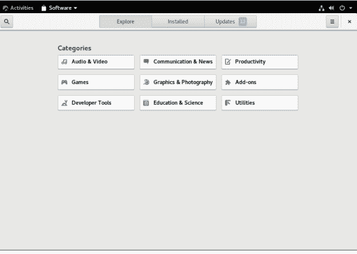

## 使用应用程序容器

Linux 世界中一个相对较新的特性是*容器*的使用。容器允许你将运行应用程序所需的所有文件（包括任何依赖项）打包到一个发行版包——即容器中。这确保你可以一次性安装运行应用程序所需的所有内容，并且无论你在什么平台上安装该容器，运行应用程序所需的所有文件都可用。

然而，这种方法的缺点是，多个应用程序之间共享的依赖项会为每个应用程序进行重复。但是，这种方法确保了每个应用程序都拥有正常运行所需的确切依赖项（和版本），并且它正迅速普及，特别是在应用程序可能需要频繁切换服务器的环境中。

不出所料，Linux 世界中存在多种应用程序容器格式。本节讨论 Linux+ 考试中涵盖的两种格式。

### 使用 Snap 容器

Ubuntu Linux 发行版的创建者 Canonical 开发了一种名为 `snap` 的应用程序容器格式。`snapd` 应用程序管理系统中安装的 `snap` 软件包，并在后台运行。你使用 `snap` 命令行工具查询 `snap` 数据库以显示已安装的 `snap` 软件包，并用于安装、升级和删除 `snap` 软件包。

要检查 `snap` 是否在你的系统上运行，请使用 `snap version` 命令：

```bash
$ snap version
snap 2.47.1+20.04
snapd 2.47.1+20.04
series 16
ubuntu 20.04
kernel 5.4.0-53-generic
$
```

如果 `snap` 正在运行，你可以使用 `snap list` 命令查看当前已安装的 `snap` 应用程序列表：

```bash
$ snap list
Name Version Rev Tracking Publisher Notes
core18 20200929 1932 latest/stable canonical* base
lxd 4.0.4 18150 4.0/stable/... canonical* -
snapd 2.47.1 9721 latest/stable canonical* snapd
$
```

要搜索 `snap` 软件仓库中的新应用程序，请使用 `snap find` 命令：

```bash
$ snap find stress-ng
Name Version Publisher Notes Summary
stress-ng V0.11.24 cking-kernel-tools - A tool to load, stress test and benchmark a computer system
$
```

要查看有关 `snap` 应用程序的更多信息，请使用 `snap info` 命令：

```bash
$ snap info stress-ng
name: stress-ng
summary: A tool to load, stress test and benchmark a computer system
publisher: Colin King (cking-kernel-tools)
store-url: https://snapcraft.io/stress-ng
contact:    colin.king@canonical.com
license:    GPL-2.0
description: |
    stress-ng can stress various subsystems of a computer. It can stress load
    CPU, cache, disk, memory, socket and pipe I/O, scheduling and much more.
    stress-ng is a re-write of the original stress tool by Amos Waterland but
    has many additional features such as specifying the number of bogo
    operations to run, execution metrics, a stress verification on memory and
    compute operations and considerably more stress mechanisms.
snap-id: YMJsyw4vySPDs8BcA7jx8U0tOVShUt6
channels:
  latest/stable:    V0.11.24    2020-11-13 (5273) 3MB -
  latest/candidate: V0.11.24    2020-11-13 (5273) 3MB -
  latest/beta:      V0.11.24    2020-11-13 (5273) 3MB -
  latest/edge:      V0.11.24-44-20201121-7613-g2627a 2020-11-21 (5298) 3MB -
$ 
```

要安装新的 `snap`，请使用 `snap install` 命令。

```bash
$ sudo snap install stress-ng
[sudo] password for rich:
stress-ng V0.11.24 from Colin King (cking-kernel-tools) installed
$ 
```

你可以使用 `list` 命令检查软件容器是否已安装：

```bash
$ snap list
| Name | Version | Rev | Tracking | Publisher | Notes |
|------|---------|-----|----------|-----------|-------|
| core18 | 20200929 | 1932 | latest/stable | canonical* | base |
| lxd | 4.0.4 | 18150 | 4.0/stable/... | canonical* | - |
| snapd | 2.47.1 | 9721 | latest/stable | canonical* | snapd |
| stress-ng | V0.11.24 | 5273 | latest/stable | cking-kernel-tools | - |
$ 
```

最后，你可以使用 `remove` 命令删除已安装的应用程序容器：

```bash
$ sudo snap remove stress-ng
stress-ng removed
$ 
```

在删除 `snap` 时，你会看到一些关于删除进程的消息。如果你更倾向于禁用而不是删除 `snap`，可以使用 `snap disable` 命令来禁用它而不移除。要重新启用 `snap`，请使用 `snap enable` 命令。

## 使用 Flatpak 容器

`flatpak` 应用程序容器格式作为一个独立的开源项目创建，与任何特定的 Linux 发行版都没有直接关联。话虽如此，阵营划分已经形成，基于 Red Hat 的 Linux 发行版倾向于使用 `flatpak` 而不是 Canonical 的 `snap` 容器格式。


> 虽然 Red Hat 桌面发行版默认安装 `flatpak`，但服务器发行版并非如此。不过，你可以轻松使用标准的 `dnf` 或 `rpm` 方法，以软件包形式安装 `flatpak`。

要显示当前系统上安装的 `flatpak` 容器，请使用 `list` 命令：

```
$ flatpak list
$
```

这不太令人兴奋。当你第一次安装 `flatpak` 时，不会有任何已安装的容器，但现在你知道 `flatpak` 已经安装了。

默认情况下，基于 Red Hat 的 Linux 发行版不会为 `flatpak` 配置任何软件仓库（在 `flatpak` 中，软件仓库被称为 *remotes*）。最受欢迎的 `flatpak` remote 是 Flathub。目前，要将 `flatpak` 指向 Flathub remote，请使用以下命令：

```
$ sudo flatpak remote-add --if-not-exists flathub
https://flathub.org/repo/flathub.flatpakrepo
[sudo] password for rich:
$
```

要在 `flatpak` 软件仓库中查找应用程序，请使用 `flatpak search` 命令：

```
$ sudo flatpak search mosh
```

| 名称 | 描述 | 应用程序 ID | 版本 | 分支 | Remotes |
| :--- | :--- | :--- | :--- | :--- | :--- |
| Mosh | The Mobile Shell | org.mosh.mosh | 1.3.2 | stable | flathub |

在处理容器时，你必须使用其应用程序 ID 值，而不是其名称。要安装该应用程序，请使用 `flatpak install` 命令：

```
$ sudo flatpak install org.mosh.mosh
Looking for matches...
Found similar ref(s) for 'org.mosh.mosh' in remote 'flathub' (system).
Use this remote? [Y/n]: Y
Required runtime for org.mosh.mosh/x86_64/stable
(runtime/org.freedesktop.Platform/x86_64/21.08) found in remote flathub
Do you want to install it? [Y/n]: Y
org.mosh.mosh permissions:
network	ssh-auth
```

| ID | 分支 | 操作 | Remote | 下载 |
|---|---|---|---|---|
| 1. `org.freedesktop.Platform.GL.default` | 21.08 | i | flathub | 130.9 MB / 131.2 MB |
| 2. `org.freedesktop.Platform.Locale` | 21.08 | i | flathub | 17.7 kB / 325.0 MB |
| 3. `org.freedesktop.Platform.openh264` | 2.0 | i | flathub | 1.5 MB / 1.5 MB |
| 4. `org.freedesktop.Platform` | 21.08 | i | flathub | 153.7 MB / 198.9 MB |
| 5. `org.mosh.mosh` | stable | i | flathub | 10.5 MB / 12.7 MB |

Installation complete.

```
$
```

要检查安装是否成功，请再次使用 `flatpak list` 命令：

```
$ flatpak list
```

| 名称 | 应用程序 ID | 版本 | 分支 | 安装 |
|---|---|---|---|---|
| Freedesktop Plat... | org.freedesktop.Platform | 21.08.7 | 21.08 | system |
| Mesa | ...freedesktop.Platform.GL.default | 21.3.1 | 21.08 | system |
| openh264 | ...g.freedesktop.Platform.openh264 | 2.1.0 | 2.0 | system |
| Mosh | org.mosh.mosh | 1.3.2 | stable | system |

```
$
```

最后，要删除应用程序容器，请使用 `flatpak uninstall` 命令：

```
$ sudo flatpak uninstall org.mosh.mosh
```

| | ID | 分支 | 操作 |
|---|---|---|---|
| 1. [~] | org.mosh.mosh | stable | r |

Uninstall complete.

```
$
```

处理 `flatpak` 容器与使用包管理系统有些不同，但一旦你熟悉了这种格式，它与标准包管理系统并没有太大区别。


AppImage 是 Linux 世界中分发软件的另一种格式。AppImage 有点不同，因为标准用户不需要 `root` 权限即可在系统上安装 AppImage 软件包。AppImage 不是将软件安装到标准 Linux 系统目录中，而是将应用程序分发为一个压缩磁盘镜像，标准用户可以在其主目录中挂载并运行该镜像。当然，这意味着系统中每个想要运行该应用程序的独立用户都必须下载一个单独的 AppImage 文件来运行该应用程序。

## 练习 13.1

**处理软件包**

本练习演示如何使用包管理系统来安装软件。

1. 登录到你的 Linux 系统并打开一个新的命令提示符。
2. 显示当前系统上安装的软件包。对于 Ubuntu 等基于 Debian 的系统，使用命令 `sudo apt-cache pgnames`。对于 Rocky 等基于 Red Hat 的系统，使用命令 `sudo dnf list`。
3. 如果 `zsh` shell 软件包尚未在你的系统上安装，请安装它。对于基于 Debian 的系统，使用命令 `sudo apt install zsh`。对于基于 Red Hat 的系统，使用命令 `sudo dnf install zsh`。如果 `zsh` 软件包已经安装，请尝试安装 `tcsh` 软件包，它是许多 Unix 系统中 C shell 的开源版本。
4. 再次显示系统上已安装的软件包，以查看新安装的软件包是否出现。
5. 现在从系统中删除该软件包。对于基于 Debian 的系统，使用命令 `sudo apt remove zsh`。对于基于 Red Hat 的系统，使用命令 `sudo dnf remove zsh`。
6. 再次显示已安装的软件包，以查看软件包是否已被正确移除。

## 摘要

轻松地安装和删除应用程序是每个 Linux 系统的必备功能。在开源世界中，开发人员使用 `tar` 和 `gzip` 实用工具创建 tarball 文件，将他们的应用程序作为源代码包发布。下载 tarball 文件后，你必须解压缩并提取其中的文件，才能编译应用程序。`gcc` 程序是编译许多开源应用程序最常见的程序。你使用 `configure` 和 `make` 实用工具创建并运行安装脚本，以便更容易地从源代码安装应用程序。

大多数 Linux 发行版通过预编译源代码并将必要的文件打包成软件包来简化应用程序安装。包管理软件使跟踪 Linux 系统上安装了哪些应用程序及其文件位置变得更加容易。基于 Debian 的 Linux 发行版使用 `DEB` 包管理格式和 `dpkg` 工具，而基于 Red Hat 的 Linux 发行版使用 `RPM` 包管理格式和 `rpm` 工具。

虽然包管理系统使安装和删除软件包变得更加容易，但查找软件包仍然有些麻烦。大多数 Linux 发行版现在维护自己的软件包仓库，并提供额外的工具，使从仓库获取和安装软件包变得更加容易。对于基于 Debian 的系统，使用包括 `apt-cache` 和 `apt-get` 在内的 `apt` 工具组以及 `apt` 来从仓库获取软件包并维护包管理数据库。对于基于 Red Hat 的系统，使用 `yum` 或 `dnf` 作为包工具。

应用程序容器在 Linux 世界中正变得越来越流行。应用程序容器将运行应用程序所需的所有软件（包括依赖应用程序和所有库）打包成一个单独的安装包。两种最受欢迎的应用程序容器格式是 `snap` 和 `flatpak`。

## 考试重点

* 描述开发人员如何打包他们的开源应用程序以进行分发。Linux 开发人员将源代码文件、头文件、库和文档文件打包成单个文件以进行分发。他们使用 `tar` 实用工具将多个文件和文件夹归档到单个归档文件中，然后通常使用 `gzip` 实用工具压缩归档文件。你可以使用 `wget` 或 `cURL` 程序下载源代码分发文件，然后使用 `gzip` 和 `tar` 实用工具解压缩和提取源代码文件。


### 从源代码生成可执行程序
解释如何从源代码 tarball 生成可执行程序。从分发 tarball 文件中解压缩和提取源代码文件后，你必须编译源代码以创建应用程序的可执行文件。首先，你必须使用 `configure` 实用工具。该工具检查你的 Linux 系统，确保其具有应用程序所需的正确依赖项，并配置安装脚本以找到这些依赖项。接下来，你运行 `make` 实用工具。`make` 实用工具运行一个脚本，该脚本使用 `gcc` 编译器编译必要的库和源代码文件，以生成适用于你系统的可执行文件。该脚本完成后，使用带有 `install` 选项的 `make` 脚本将可执行文件安装到你的 Linux 系统上。

### 应用程序的打包与分发
描述 Linux 如何打包应用程序以进行分发。Linux 使用包管理系统来跟踪系统上安装了哪些应用程序。发行版将预编译的应用程序文件打包成软件包，你可以轻松下载和安装。包管理数据库记录已安装的软件包及其包含的所有文件的位置。你还可以查询包管理数据库以确定安装了哪些软件包，并使用包管理工具从系统中删除软件包。基于 Debian 的系统使用 `dpkg` 工具与包管理数据库交互，而基于 Red Hat 的 Linux 系统使用 `rpm` 工具。

### 软件仓库的使用
描述 Linux 发行版如何使用软件仓库。虽然使用软件包使软件应用程序的安装、跟踪和删除变得更加容易，但你仍然必须能够找到应用程序的最新软件包。大多数 Linux 发行版通过创建当前应用软件包的集中式仓库以及用于处理软件包的工具来提供帮助，使...

存储库。对于基于 Debian 的系统，`apt` 工具套件允许你查询存储库中的软件包信息，并下载任何新或已更新的软件包。基于 Red Hat 的系统使用 `yum` 或 `dnf` 工具与其存储库进行交互。这三种工具都允许你查询远程存储库中的软件包、查询本地软件包管理数据库，并根据需要安装或删除软件包。

### 应用容器与包管理系统
解释应用容器与包管理系统有何不同。像 `snap` 和 `flatpak` 这样的应用容器将运行应用程序所需的所有文件（包括任何依赖的应用程序）打包到一个单一的软件包中。虽然这可能会创建依赖应用程序的重复副本，但它确保了每个应用程序都安装了精确正确版本的库和依赖应用程序以使其正常工作，从而使应用程序从一个系统迁移到另一个系统变得轻而易举。

## 复习题

1. 你应该使用哪两个程序从应用程序的网站下载 tarball？（选择两项。）
   - A. `wget`
   - B. `cURL`
   - C. `dpkg`
   - D. `rpm`
   - E. `yum`

2. Fred 收到了以源代码形式提供的应用程序。他应该运行什么脚本来创建可执行的应用程序？
   - A. `dpkg`
   - B. `rpm`
   - C. `yum`
   - D. `make`
   - E. `wget`

3. Sherri 正在尝试从源代码编译一个应用程序。在她创建应用程序可执行文件之前，她应该运行什么脚本来创建 `make` 脚本？
   - A. `make`
   - B. `make install`
   - C. `configure`
   - D. `gcc`
   - E. `dpkg`

4. 开源 Linux 应用程序最常用的编译器是什么？
   - A. `gcc`
   - B. `make`
   - C. `configure`
   - D. `dpkg`
   - E. `rpm`

5. Harry 已经完成了他的应用程序源代码，但需要对其进行打包以进行分发。他应该使用什么工具，以便它可以在任何 Linux 发行版中提取？
   - A. `dpkg`
   - B. `rpm`
   - C. `yum`
   - D. `apt-get`
   - E. `tar`

6. 通常一起使用哪些 `tar` 命令行选项从 tarball 文件中提取和解压文件？
   - A. `-Uvh`
   - B. `-zxvf`
   - C. `-xvf`
   - D. `-zcxf`
   - E. `-cvf`

7. Rocky Linux 发行版为软件包使用哪种文件扩展名？
   - A. `.deb`
   - B. `.rpm`
   - C. `.tgz`
   - D. `.tar`
   - E. `.gz`

8. Sally 需要在她的 Ubuntu Linux 系统上安装一个新软件包。该软件包以 DEB 文件形式分发。她应该使用什么工具？
   - A. `rpm`
   - B. `yum`
   - C. `dnf`
   - D. `dpkg`
   - E. `tar`

9. 你使用什么工具从基于 Red Hat 的存储库中安装软件包？（选择两项。）
   - A. `dpkg`
   - B. `tar`
   - C. `yum`
   - D. `apt-get`
   - E. `dnf`

10. 基于 Red Hat 的 Linux 发行版使用什么应用容器格式来安装应用程序？
    - A. `flatpak`
    - B. `rpm`
    - C. `dpkg`
    - D. `snap`
    - E. `gcc`

# 第 14 章

# 维护内核模块

目标 1.7：给定场景，管理软件配置。


模块（也称为内核模块）是一个自包含的驱动程序库文件。使用模块而不是将所有功能编译进内核的优点在于，它们使 Linux 内核更轻量、更灵活。因为模块可以动态地加载和卸载到内核中，所以我们可以在需要时或按需添加某些内核功能。它们在不重启系统的情况下扩展了内核的功能。

我们将查看各种内核模块类型、它们的文件存储位置以及模块配置文件的位置。本章还将探讨如何动态链接和取消链接模块，查看模块信息，以及移除模块。

### 探索内核模块

内核模块有不同的形式。它们如下：

- 设备驱动程序：促进与硬件设备的通信。
- 文件系统驱动程序：文件系统 I/O 所必需的。
- 网络驱动程序：用于实现网络协议。
- 系统调用：提供额外的功能以增加/修改系统服务。
- 可执行文件加载器：允许加载额外的可执行文件格式。

在处理模块时，你应该熟悉几个不同的文件和目录。支持内核所需的模块存储在 `/lib/modules/` 目录树中。系统中可用的每个 Linux 内核版本在 `/lib/modules/` 目录中都有自己的子目录。Ubuntu 20.04 发行版中此目录及其内核版本子目录的示例如清单 14.1 所示。

**清单 14.1：** 查看 `/lib/modules` 目录

```bash
$ ls -F /lib/modules
5.11.0-40-generic/ 5.4.0-31-generic/ 5.4.0-47-generic/
5.4.0-26-generic/ 5.4.0-42-generic/ 5.4.0-48-generic/
$
```

请注意，发行版可能会略有不同地实现此目录。例如，基于 Red Hat 的发行版将 `/lib/modules/` 目录硬链接到 `/usr/lib/modules/` 目录。因此，它们是同一个目录，但有两个不同的名称。Rocky Linux 8.5 系统上的示例片段如清单 14.2 所示。

**清单 14.2：** 查看 `/lib/modules` 和 `/usr/lib/modules` 目录

```bash
$ ls -F /lib/modules
4.18.0-305.19.1.el8_4.x86_64/  4.18.0-348.2.1.el8_5.x86_64/
4.18.0-305.3.1.el8_4.x86_64/     4.18.0-348.el8.x86_64/
$ ls -F /usr/lib/modules
4.18.0-305.19.1.el8_4.x86_64/  4.18.0-348.2.1.el8_5.x86_64/
4.18.0-305.3.1.el8_4.x86_64/   4.18.0-348.el8.x86_64/
$ ls -id /lib/modules
16808755 /lib/modules
$ ls -id /usr/lib/modules
16808755 /usr/lib/modules
$
```

注意清单 14.2 中这两个目录共享相同的 inode 号。硬链接在第 3 章“管理文件、目录和文本”中已经介绍过。如果需要，你可以自定义模块以定义所需的任何独特参数，例如设备运行所必需的硬件设置。在一些较旧的 Linux 发行版中有一个单一的配置文件 `/etc/modules.conf`，而在较现代的发行版中则有配置目录：

- `/etc/modprobe.d/` 或 `/etc/modules-load.d/` 包含在系统安装时生成或由管理员创建的配置文件。
- `/lib/modprobe.d/` 存储由第三方软件包生成的配置文件。
- `/usr/lib/modprobe.d/`，如果存在，通常硬链接到 `/lib/modprobe.d/` 目录。
- `/run/modprobe.d/` 存储在运行时生成的配置文件。

每个配置目录中都有多个具有 `.conf` 文件扩展名的配置文件。Rocky Linux 8.5 发行版上的示例如清单 14.3 所示。

**清单 14.3：** 查看 `/etc/modprobe` 目录

```bash
$ ls /etc/modprobe.d
firewalld-sysctls.conf  lockd.conf  nvidim-security.conf  tuned.conf
kvm.conf                ml4x.conf   truescale.conf        vhost.conf
$ ls /lib/modprobe.d
dist-alsa.conf  dist-blacklist.conf  libmlx4.conf  systemd.conf
$
```

在 Linux 虚拟目录系统中，内核模块以及模块配置文件有许多潜在位置。因此，明智的做法是查看一下你自己的 Linux 服务器，并记录它们的位置。


> 对于 systemd 系统，`systemd-modules-load.service` 负责在启动时加载内核模块。你可以使用 `grep` 在 service 单元文件中搜索 `ConditionDirectoryNotEmpty` 指令，以找到它可能从中加载模块的各种目录。

许多设备驱动程序内核模块要么在系统启动时加载，要么在硬件设备连接到系统时动态加载。如果出现问题，你需要知道使用哪些工具来帮助你诊断问题。有三个实用程序可以帮助处理模块：

- `dmesg` 显示当前的内核环形缓冲区。
- `lsmod` 显示简要的模块信息。
- `modinfo` 提供详细的模块数据。

就模块而言，模块故障有时会触发内核消息。`dmesg` 命令很方便，因为它可以查看与当前事件相关的内核消息。在启动时，你的发行版可能会快照内核环形缓冲区并将数据存储在文件中（通常是 `/var/log/dmesg` 文件）。这两个环形缓冲区信息来源都可以帮助你追踪内核模块问题。


> 环形缓冲区是内存中的固定大小数据结构。它不是环形的，而是更像是一个管子。在内核环形缓冲区中，随着新消息进入管子，旧消息会移向结构的末端，最旧的消息会从管子的末端“掉落”（被删除）。

`dmesg` 实用程序只需将当前内核环形缓冲区转储到 STDOUT。使用 `grep` 命令挖掘这些消息很有帮助。一个简短的示例如清单 14.4 所示。

**清单 14.4：** 使用 `dmesg` 和 `grep` 显示模块消息

```bash
$ dmesg | grep -i driver
[...]
[    1.674321] e1000: Intel(R) PRO/1000 Network Driver - version 7.3.21-k8-NAPI
[    3.614747] cdrom: Uniform CD-ROM driver Revision: 3.20
[...]
```

# 列表 14.5：使用 `lsmod` 显示模块状态

```bash
$ lsmod
Module         Size  Used by
af_packet      49152  4
[...]
bridge         172032  1 etable_broute
stp            16384  1 bridge
btrfs        1327104  1
[...]
scsi_dh_alua      20480  0
$
```

在 `lsmod` 的输出中，每个模块都单独列在一条行上。第一列是模块的名称。

请注意列表 14.5 中的 `Used by` 列。此列中的数字表示当前正在使用该模块的进程或其他模块的数量。如果另一个内核模块正在使用它，则会显示该其他模块的名称。


> 通过查看 `/proc/modules` 文件的内容，你可以获得 `lsmod` 实用程序显示的相同信息。但是，其格式没有 `lsmod` 那么美观。

你可以借助 `modinfo` 实用程序查找有关特定内核模块的更多详细信息。这可能需要使用超级用户权限，如列表 14.6 所示。

# 列表 14.6：使用 `modinfo` 显示详细的模块信息

```bash
$ sudo modinfo bridge
filename:	/lib/modules/[...]/kernel/net/bridge/bridge.ko
alias:	rtln-link-bridge
version:	2.3
license:	GPL
suserlease:	openSUSE Leap 15.0
srcversion:   D39BA7E56E769F636E31A8C
depends:      stp,llc
retpoline:    Y
intree:       Y
vermagic:     [...]SMP mod_unload modversions retpoline
$
```

请注意列表 14.6 中内核模块的文件名。内核模块文件通常具有 `.ko` 文件扩展名。还要注意的是，这里显示了模块的版本号。如果你需要追踪与特定模块相关的已知错误，这会很有帮助。

> 可以配置内核以禁止在运行时安装内核模块。虽然这种情况并不常见，但你也可能会遇到，所以知道这一点是好的。你可以使用 `sysctl` 命令加上 `-a` 选项来检查当前的内核选项设置：

```bash
$ sysctl -a
[...]
kernel.module_disable = 0
[...]
$
```

如果 `kernel.module_disable` 选项的值设置为 1，你将无法安装模块。大多数 Linux 发行版将启动时应用的内核设置存储在 `/etc/sysctl.conf` 文件中，或者在 `/etc/sysctl.d` 目录下的单独配置文件中。检查这些文件以查看该选项是否已设置，如果需要添加模块，请编辑该文件。

## 安装内核模块

Linux 通常会在系统需要时自动加载模块。不过，有时你可能想要测试新模块或尝试新的模块配置。为此，你可能需要手动将模块安装到内核中。这也称为模块的*插入*或*加载*。在本节中，我们将介绍几个可以帮助你向内核加载模块的实用程序。它们如下所示：

- `insmod`
- `modprobe`
- `depmod`

`insmod` 实用程序允许你向 Linux 内核插入单个模块。不幸的是，由于它非常基础，你必须提供模块文件的绝对目录引用。此外，该命令不会加载任何所需的模块依赖项。在 openSUSE 发行版上的一个示例片段如列表 14.7 所示。

# 列表 14.7：使用 `insmod` 向内核插入单个模块

```bash
$ lsmod | grep -i joydev
$
$ sudo insmod /lib/modules/.../kernel/drivers/input/joydev.ko
$
$ lsmod | grep -i joydev
joydev         24576    0
$
```

在列表 14.7 中，使用 `lsmod` 命令检查系统中是否存在模块名为 `joydev` 的已加载模块。未找到该模块。因此，`insmod` 命令使用完整的文件名和目录位置将其插入内核。再次使用 `lsmod` 命令以显示该模块确实已加载到内核中。

`modprobe` 命令比 `insmod` 实用程序更容易使用，因为你可以通过模块名称指定模块。它还会加载插入的模块运行所需的任何其他模块（依赖项）。一个示例片段如列表 14.8 所示，该示例使用 `modprobe` 命令的 `-v` 开关，在插入模块及其所有当前未加载的依赖项时显示更多信息。

# 列表 14.8：使用 `modprobe` 插入模块及其依赖项


## 加载模块

首先，使用 `sudo modprobe -v dm_mirror` 命令查看模块加载过程。

```text
$ sudo modprobe -v dm_mirror
insmod /lib/modules/.../kernel/drivers/md/dm-log.ko
insmod /lib/modules/.../kernel/drivers/md/dm-region-hash.ko
insmod /lib/modules/.../kernel/drivers/md/dm-mirror.ko
$
```

通过 `lsmod | grep -i dm_mirror` 可以检查已加载的模块及其依赖关系：

```text
$ lsmod | grep -i dm_mirror
dm_mirror       28672    0
dm_region_hash  16384    1 dm_mirror
dm_log          16384    2 dm_mirror,dm_region_hash
dm_mod          139264   3 dm_mirror,dm_log,dm_multipath
$
```

使用 `sudo modinfo dm_mirror` 查看模块详细信息：

```text
$ sudo modinfo dm_mirror
filename:       /lib/modules/.../kernel/drivers/md/dm-mirror.ko
license:        GPL
author: Joe Thornber
description: device-mapper mirror target
suserlease: openSUSE Leap 15.0
srcversion: A784B8C071D49F47F94E83B
depends: dm-region-hash,dm-mod,dm-log
retpoline: Y
intree: Y
vermagic: [~]SMP mod_unload modversions retpoline
parm: raid1_resync_throttle:A percentage [~]
$
```

`dm_mirror` 模块允许卷管理器镜像逻辑卷。在上述示例中，当使用 `modprobe` 命令加载此模块时，它还加载了另外两个 `dm_mirror` 模块正常工作所需的模块。请注意，`modprobe` 实用程序正在调用 `insmod` 实用程序来执行插入工作。还要注意到，`dm_mirror` 模块有一个稍有不同的文件名 `dm-mirror.ko`，如 `modinfo` 实用程序的输出所示。

`modprobe` 程序使用 `modules.dep` 文件来确定任何模块依赖项。此文件通常位于 `/lib/modules/` 子目录中。

### 列表 14.9：查看 modules.dep 依赖项文件

```text
$ ls /lib/modules/[/]/modules.dep
/lib/modules/[/]/modules.dep
$
$ grep -i mirror /lib/modules/[/]/modules.dep
kernel/drivers/md/dm-mirror.ko:
kernel/drivers/md/dm-region-hash.ko
kernel/drivers/md/dm-log.ko
kernel/drivers/md/dm-mod.ko
$
```

在列表 14.9 中，使用 `grep` 实用程序在 `modules.dep` 文件中搜索单词 `mirror`。要查看特定模块的依赖项，你需要在文件中定位该模块的文件名。在冒号（`:`）之后，模块的依赖项按其完整的模块文件名列出。因此，对于 `dm_mirror` 模块（`dm-mirror.ko`），模块依赖项是 `dm-region-hash`、`dm-log` 和 `dm-mod` 模块。这与之前示例中 `modinfo` 实用程序输出中显示的内容相对应。

你可以使用 `depmod` 命令扫描系统，查找任何未被自动检测到的硬件。这对于排查新设备的问题非常有用。一个示例片段如下所示。

### 列表 14.10：使用 depmod 实用程序更新 modules.dep 文件

```text
$ sudo depmod -v
[...]
/lib/modules/[...]kernel/sound/soc/intel/atom/snd-soc-sst-atom-hifi2-platform.ko needs
"snd_pcm_lib_preallocate_pages_for_all":
/lib/modules/[...]kernel/sound/core/snd-pcm.ko
[...]
$
```

在列表 14.10 中，`depmod` 实用程序扫描系统，确定所需的任何模块，检查模块的依赖项，并更新相应的 `modules.dep` 文件。请注意，它还将其活动显示到标准输出（`STDOUT`）。

## 移除内核模块

移除你在 Linux 系统中不再使用的任何内核模块是一个好主意。如果只需要移除（卸载）没有依赖项的模块，你可以使用 `rmmod` 命令。示例如下所示。

### 列表 14.11：使用 rmmod 实用程序移除模块

```text
$ lsmod | grep joydev
joydev                    24576    0
$
$ sudo rmmod -v joydev
$
$ lsmod | grep joydev
$
```

请注意列表 14.11 中，`rmmod` 实用程序能够理解模块名称，因此你不需要提供模块文件的绝对目录引用。一旦模块被卸载，`lsmod` 实用程序的输出中就不再显示该模块的名称。

`modprobe` 实用程序对于移除具有一个或多个依赖项的模块非常有用。你只需添加 `-r` 开关，并且如果你想要详细信息，包含 `-v` 开关，示例片段如下所示。

### 列表 14.12：使用 modprobe 实用程序移除模块及其依赖项

```text
$ sudo modprobe -rv dm_mirror
rmmod dm_mirror
rmmod dm_region_hash
rmmod dm_log
$
```

在列表 14.12 中，模块 `dm_mirror` 连同其两个依赖项一起被卸载。请注意，如果该模块未被加载，您将看不到任何消息，只会返回到命令行提示符。

## 总结

当内核模块出现故障或您需要测试新模块时，了解模块文件及其配置文件的位置至关重要。同样重要的是，能够使用为此目的提供的各种命令行实用程序来诊断问题。由于模块可以动态地与内核链接和解除链接，您应该了解如何使用正确的工具来执行这些任务。这些额外的 Linux 工具将帮助您快速解决与内核模块相关的问题。

## 考试要点

**描述内核模块文件的位置。** 内核模块文件具有 `.ko` 文件扩展名，通常位于 `/lib/modules/` 目录的子目录中。针对每个特定的 Linux 内核版本都有一个子目录。一些发行版拥有额外的目录，例如 `/usr/lib/modules/`，它们与 `/lib/modules/` 目录建立硬链接。

**区分模块配置文件的位置。** 较旧的 Linux 发行版使用单个文件 `/etc/modules.conf` 作为内核模块配置文件。更现代的发行版使用配置目录，这些目录可以是 `/etc/modprobe.d/`、`/etc/modprobe-load.d/`、`/lib/modprobe.d/`、`/usr/lib/modprobe.d/` 和/或 `/run/modprobe.d/` 目录。在配置目录中，模块配置文件具有 `.conf` 文件扩展名。

**总结用于排查模块故障的实用程序。** 由于内核模块发生故障时通常会发出内核消息，您可以使用 `dmesg` 实用程序查看最近的内核消息，或者查阅 `/var/log/dmesg` 文件（如果可用），以解决启动时的内核问题。`lsmod` 实用程序显示当前加载的所有模块、使用它们的进程数量和该数量，以及其他模块的名称。`modinfo` 程序非常有帮助，因为它显示有关模块的详细信息，包括其依赖项。

**比较用于安装内核模块的实用程序。** 低级别的 `insmod` 实用程序需要完整的模块文件名才能将模块插入内核，这可能比较繁琐。此外，它不会加载任何模块依赖项。另一方面，`modprobe` 实用程序只需要模块的名称。此外，它会搜索 `modules.dep` 文件以确定并加载任何模块依赖项。

**解释用于移除内核模块的实用程序。** `rmmod` 实用程序是一个低级实用程序。虽然它不需要完整的模块文件名就可以将模块从内核中解除链接，但它不会卸载任何模块依赖项。因此，您最终可能会发现不必要的模块仍然与内核保持链接状态。使用 `-r` 选项的 `modprobe` 实用程序将卸载该模块并解除任何模块依赖项的链接。

## 复习题

1. 关于内核模块，以下哪些说法是正确的？（选择所有适用的选项。）
   - A. 它是一个自包含的驱动程序库文件。
   - B. 它被编译进 Linux 内核。
   - C. 它允许在需要时添加功能。
   - D. 它可以在需要时加载。
   - E. 它使 Linux 内核更轻量、更敏捷。

2. 模块文件存储在哪里？（选择所有适用的选项。）
   - A. `/lib/modules/kernel/` 子目录
   - B. `/lib/modules/KernelVersion/` 子目录
   - C. `/usr/lib/modules/kernel/` 子目录
   - D. `/usr/lib/modules/KernelVersion/` 子目录
   - E. `/lib/kernel/modules` 子目录

3. 模块的配置信息可以存储在哪里？（选择所有适用的选项。）
   - A. `/etc/modules.conf` 文件
   - B. `/etc/modprobe.d/*.conf` 文件
   - C. `/etc/modules.d/*.conf` 文件
   - D. `/lib/modprobe.d/*.conf` 文件
   - E. `/usr/lib/modprobe.d/*.conf` 文件

4. 您需要确定已卸载的 `xyz` 模块的依赖关系。完成此任务的最佳实用程序是什么？
   - A. `dmesg`
   - B. `insmod`
   - C. `lsmod`
   - D. `modprobe`
   - E. `modinfo`

5. 您需要安装 `xyz` 模块，包括其所有必需的依赖项。您应该使用以下哪个实用程序？
   - A. `insmod`
   - B. `modinfo`
   - C. `modprobe`
   - D. `lsmod`
   - E. `depmod`

6. 当您在 Linux 系统上安装 USB 设备时，似乎该设备未被检测到。针对这种情况，以下哪个命令最适合进行故障排除？
   - A. `lsmod`
   - B. `modinfo`
   - C. `dmesg`
   - D. `depmod`
   - E. `insmod`

7. `modprobe` 实用程序使用 ______ 文件来确定任何模块依赖项。
   - A. `modules.dep`
   - B. `/lib/modules`
   - C. `/usr/lib/modules`
   - D. `/etc/modprobe.d`
   - E. `/lib/modprobe.d`

8. 您需要将 `abc` 模块插入 Linux 内核。该模块没有任何依赖项。使用什么实用程序最好？
   - A. `lsmod`
   - B. `modinfo`
   - C. `dmesg`
   - D. `depmod`
   - E. `insmod`

9. 您需要从 Linux 内核中卸载 `abc` 模块。该模块没有任何依赖项。使用什么实用程序最好？
   - A. `insmod`
   - B. `unload`
   - C. `rmmod`
   - D. `modprobe`
   - E. `rm -f`

10. 您需要移除 `xyz` 模块及其所有依赖项。使用哪个命令最好？
    - A. `dmesg`
    - B. `modprobe -r`
    - C. `lsmod`
    - D. `paste`
    - E. `groupdel`

## 系统安全

### 第四部分


## 第 15 章

### 应用所有权和权限

- 目标 2.5：在给定场景下，应用适当的访问控制。


防止未经授权访问文件和目录是任何 Linux 管理员工作的重要组成部分。Linux 提供了几种保护文件的方法，这使安全性变得稍微复杂一些。本章深入探讨 Linux 文件和目录安全，并展示如何在您的 Linux 系统上实现这些功能。首先，您将看到 Linux 如何为文件和目录分配所有权。然后，本章讨论自 Linux 诞生以来就已存在的基本文件和目录安全功能。接下来，将检查一些较新的方法，为您的系统上的文件和应用增加更多保护。一个简要的概述描述了当需要执行系统工作时，Linux 如何处理管理员权限。

## 查看文件和目录权限

Linux 的核心安全功能是文件和目录权限。Linux 通过为每个文件和目录分配所有者，并允许该所有者设置基本安全设置来控制对文件或目录的访问来实现这一目标。以下章节将介绍 Linux 如何处理文件和目录的所有权，以及您可以在 Linux 系统上的任何文件或目录分配的基本权限设置。

## 理解所有权

Linux 使用一种三级方法来保护文件和目录：

- **所有者：** 在 Linux 系统中，每个文件和目录都被分配给单个所有者。Linux 系统管理员可以为该文件或目录分配给所有者特定的权限。
- **组：** Linux 系统还将每个文件和目录分配给单个用户组。管理员随后可以分配给该组特定的权限，这些权限适用于该文件或目录，并且与所有者权限不同。
- **其他：** 此权限类别分配给任何不是所有者或不在已分配用户组中的用户账户。

通过向 `ls` 命令添加 `-l` 选项，你可以查看文件或目录被分配的属主和组，如清单 15.1 所示。

### 清单 15.1：查看文件属主和组设置

```bash
$ ls -l
total 12
-rw-rw-r-- 1 Rich sales 1521 Jan 19 15:38 customers.txt
-rw-r-r-r-- 1 Christine sales 479 Jan 19 15:37 research.txt
-rw-r-r-r-- 1 Christine sales 696 Jan 19 15:37 salesdata.txt
$
```

在清单 15.1 中，第一列 `-rw-rw-r--` 定义了对属主、组和其他人分配的访问权限。这将在本章后面的“控制访问权限”部分中进行讨论。清单 15.1 中的第三列，即 `Rich` 或 `Christine` 值，显示了被分配为该文件属主的用户账户。第四列 `sales` 显示了分配给该文件的组。


> 许多 Linux 发行版（例如 `Ubuntu` 和 `Rocky Linux`）都会将每个用户账户分配到一个与其账户同名的独立组中。这有助于防止意外共享文件。然而，当你在处理属主和组权限，并在两列中看到相同的名称时，这也可能会让事情变得稍微有些混乱。在此类环境中操作时请务必小心。

当用户创建文件或目录时，Linux 系统默认会自动将该用户分配为属主，并使用该用户所属的主组作为文件或目录的组。你可以使用 Linux 命令来更改分配给文件和目录的默认属主和组。接下来的章节将展示如何执行此操作。

## 更改文件或目录的属主

`root` 用户账户可以使用 `chown` 命令更改分配给文件或目录的属主。`chown` 命令的格式如下：

```bash
$ chown [options] newowner filenames
```

`newowner` 参数是分配给文件或目录的新属主的用户名，而 `filenames` 是要更改的文件或目录的名称。你可以在每个文件或目录名称之间加上空格来指定多个文件或目录：

```bash
$ sudo chown Christine customers.txt
$ ls -l
total 12
-rw-rw-r-- 1 Christine sales 1521 Jan 19 15:38 customers.txt
-rw-r-r-r-- 1 Christine sales 479 Jan 19 15:37 research.txt
-rw-r-r-r-- 1 Christine sales 696 Jan 19 15:37 salesdata.txt
$
```

`chown` 命令有几种可用的命令行选项，但它们大多晦涩且很少使用。其中一个可能对你有帮助的是 `-R` 选项，它递归地更改指定目录下所有文件的属主。

## 更改文件或目录的组

文件或目录的属主，或者 `root` 用户账户，可以使用 `chgrp` 命令更改分配给文件或目录的组。`chgrp` 命令使用以下格式：

```bash
$ chgrp [options] newgroup filenames
```

`newgroup` 参数是分配给文件或目录的新用户组名称，而 `filenames` 参数是要更改的文件或目录的名称。如果你是文件的所有者，你只能将组更改为你所属的组。

`root` 用户账户可以将组更改为系统中的任何组：


```bash
$ sudo chgrp marketing customers.txt
$ ls -l
total 12
-rw-r--r-- 1 Christine marketing 1521 Jan 19 15:38 customers.txt
-rw-r--r-- 1 Christine sales 479 Jan 19 15:37 research.txt
-rw-r--r-- 1 Christine sales 696 Jan 19 15:37 salesdata.txt
$
```


> `chown` 命令允许你使用以下格式同时更改分配给文件或目录的属主和组：
>
> `chown newowner:newgroup filenames`
>
> 这通常优于单独使用 `chgrp` 命令。

## 控制访问权限

在你确定了文件或目录的属主和组之后，你可以为每一层分配特定的权限。Linux 使用三种类型的权限控制：

- **读取：** 访问存储在文件或目录中的数据的能力
- **写入：** 修改存储在文件或目录中的数据的能力
- **执行：** 在系统上运行文件的能力，或列出目录中包含的文件的能力

你可以为每一层保护级别（属主、组和其他人）分配不同的读、写和执行权限。这就创建了一套分配给 Linux 系统中每个文件和目录的九种不同权限。当你使用 `-l` 选项时，这九个权限在 `ls` 输出中显示为第一列信息，如清单 15.1 所示。图 15.1 显示了权限在 `ls` 输出中显示的顺序。

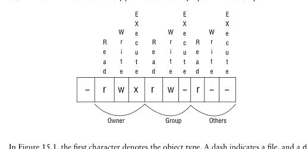

在图 15.1 中，第一个字符表示对象类型。短横线表示文件，而 `d` 表示目录。

接下来的三个字符按读、写、执行的顺序表示属主权限。短横线表示未设置该权限，而 `r`、`w` 或 `x` 表示已设置读、写或执行权限。在清单 15.1 的示例中，所有三个文件都使用 `rw-` 作为属主权限，这意味着属主有权读取和写入该文件，但不能执行或运行该文件。这在数据文件中很常见。

第二组三个字符表示文件或目录的组权限。同样，这按照读、写、执行的顺序使用；短横线表示未设置该权限。在对 `customers.txt` 文件进行更改并将其分配给 `marketing` 组后，`sales` 组只能读取 `research.txt` 和 `salesdata.txt` 文件，但 `marketing` 组可以既读取又写入 `customers.txt` 文件。

最后，第三组三个字符表示分配给非属主或非分配给该文件或目录的组的成员的用户账户的权限。同样使用了读、写、执行的顺序。在清单 15.1 的示例中，系统中的其他用户账户可以读取这些文件，但不能写入或执行它们。

`root` 用户账户或文件或目录的属主可以使用 `chmod` 命令更改分配的权限。

`chmod` 命令的格式可能会让人有些困惑。它使用两种不同的模式来表示属主、组和其他人的读、写和执行权限设置。这两种模式允许你定义相同的权限集，因此没有理由偏爱其中一种模式。

在`符号模式`中，你使用字母代码来表示属主 (`u`)、组 (`g`)、其他人 (`o`) 或所有人 (`a`)，并使用另一个字母代码来表示读 (`r`)、写 (`w`) 或执行 (`x`) 权限。如果你想添加权限，两个代码之间用加号 (`+`) 分隔；如果要移除权限，用减号 (`-`)；如果要仅设置该权限，则用等号 (`=`)。清单 15.2 展示了此方法的示例。

### 清单 15.2：更改文件权限

```bash
$ chmod g-w customers.txt
$ ls -al
total 12
-rw-r--r-- 1 Christine marketing 1521 Jan 19 15:38 customers.txt
-rw-r--r-- 1 Christine sales 479 Jan 19 15:37 research.txt
-rw-r--r-- 1 Christine sales 696 Jan 19 15:37 salesdata.txt
$
```

在清单 15.2 中，`chmod` 命令中的 `g-w` 代码表示我们移除了 `customers.txt` 文件的组写权限。

你可以组合使用两个字母代码，以便在单个 `chmod` 命令中进行多项更改，如清单 15.3 所示。

### 清单 15.3：组合权限更改

```bash
$ chmod ug=rwx salesdata.txt
$ ls -l
total 12
-rw-rw-r-- 1 Christine marketing 1521 Jan 19 15:38 customers.txt
-rw-rw-r-- 1 Christine sales 479 Jan 19 15:37 research.txt
-rwx-rwx-r-- 1 Christine sales 696 Jan 19 15:37 salesdata.txt
$
```

`ug` 代码将更改应用于属主和组，而 `rwx` 代码分配读、写和执行权限。我们使用等号来设置这些权限。

`chmod` 中可用的第二种模式称为`八进制模式`。使用八进制符号时，九个权限位表示为三个八进制数，分别对应属主、组和其他权限。表 15.1 展示了八进制数如何匹配三种符号模式权限。

## 表 15.1 八进制模式权限

| 八进制值 | 权限 | 含义 |
|:------------|:-----------|:--------|
| 0 | --- | 无权限 |
| 1 | --x | 仅执行 |
| 2 | -w- | 仅写入 |
| 3 | -wx | 写和执行 |
| 4 | r-- | 只读 |
| 5 | r-x | 读和执行 |
| 6 | rw- | 读和写 |
| 7 | rwx | 读、写和执行 |

必须按照正确的顺序指定所有者、组和其他人的三个八进制值，如清单 15.4 所示。

### 清单 15.4：使用八进制模式分配权限

```bash
$ chmod 664 research.txt
$ ls -l
total 12
-rw-r-- 1 Christine marketing 1521 Jan 19 15:38 customers.txt
-rw-rw-- 1 Christine sales 479 Jan 19 15:37 research.txt
-rwxrwx-- 1 Christine sales 696 Jan 19 15:37 salesdata.txt
$ 
```

八进制模式 `664` 将所有者和组的权限设置为读写（`6`），但将其他人的权限设置为只读（`4`）。你可以从 `ls` 输出中查看结果。这是一种方便的方式，可以在单个命令中为文件或目录设置所有权限。

### 探索特殊权限

Linux 使用三个特殊权限位来控制文件和目录的高级行为。

`Set User ID (SUID)` 位用于可执行文件。它告诉 Linux 内核以文件所有者的权限运行程序，而不是以实际运行该文件的用户账户的权限。此功能最常用于必须作为 `root` 用户账户运行的服务器应用程序，以便能够访问系统上的所有文件，即使启动进程的用户是标准用户。

`SUID` 位通过用字母 `s` 替代文件所有者的执行权限字母来表示：`rwsr-xr-x`。假设系统运行该文件需要执行权限。如果在一个对所有者没有执行权限的文件上设置了 `SUID` 位，则用大写字母 `S` 表示。

要为文件设置 `SUID` 位，在符号模式下将 `s` 添加到所有者权限中，或在八进制模式下在八进制模式设置的开头包含 `4`：

```bash
# chmod u+s myapp
# chmod 4750 myapp
```

`Set Group ID (SGID，也称为 GUID)` 位在文件和目录中的工作方式不同。对于文件，它告诉 Linux 以文件的组权限运行程序文件。它在组执行位位置中由 `s` 表示：`rwxrwSr--`。

对于目录，`SGID` 位帮助我们创建一个多个用户可以共享文件的环境。当目录设置了 `SGID` 位时，用户在该目录中创建的任何文件都会被分配为该目录的组，而不是该用户的组。这样，该组中的所有用户都可以拥有与共享目录中所有文件相同的权限。

要设置 `SGID` 位，在符号模式下将 `s` 添加到组权限中，或在八进制模式下在八进制模式设置的开头包含 `2`：

```bash
# chmod g+s /sales
# chmod 2660 /sales
```

最后，`sticky bit` 用于保护文件不被非所有者删除，即使他们属于对文件具有写权限的组。`sticky bit` 用 `t` 表示其他人执行位位置：`rwxrw-r-t`。

`sticky bit` 经常用于由他人共享的目录。组成员对目录中包含的数据文件具有读和写权限，但只有文件所有者才能从共享目录中删除文件。

要设置 `sticky bit`，在符号模式下将 `t` 添加到`其他`权限中，或在八进制模式下在八进制模式设置的开头包含 `1`：

```bash
# chmod o+t /sales
# chmod 1777 /sales
```

### 管理默认权限

当用户创建新文件或目录时，Linux 系统会为其分配默认的所有者、组和权限。默认所有者，顾名思义，是创建该文件的用户。默认组是所有者的主组。

用户掩码功能定义了 Linux 分配给文件或目录的默认权限。用户掩码是一个八进制值，代表要从文件的八进制模式 `666` 权限或目录的八进制模式 `777` 权限中移除的位。

用户掩码值通过 `umask` 命令设置。你可以通过在命令行上单独输入该命令来查看当前的 `umask` 设置：

```bash
$ umask
0022
$
```

`umask` 命令的输出显示四个八进制值。第一个八进制值代表分配给你创建的文件和目录的 `SUID (4)`、`GUID (2)` 和 `sticky (1)` 位的掩码。接下来三个八进制值分别对应所有者、组和其他人的权限设置的掩码。

掩码是应用于文件或目录权限位的按位掩码。掩码中设置的任何位都会从文件或目录的权限中移除。如果某个位未设置，则掩码不会更改该设置。表 15.2 演示了在你的 Linux 系统上创建文件和目录时，`umask` 值在实际中是如何工作的。

### 表 15.2 文件和目录常见 umask 值的结果

| umask | 创建的文件 | 创建的目录 |
| :---- | :------------ | :------------------ |
| 000 | 666 (rw-rw-rw- ) | 777 (rwxrwxrwx) |
| 002 | 664 (rw-rw-r--) | 775 (rwxrwxr-x) |
| 022 | 644 (rw-r--r--) | 755 (rwxr-xr-x) |
| 027 | 640 (rw-r----) | 750 (rwxr-x--) |
| 077 | 600 (rw------) | 700 (rwx-----) |
| 277 | 400 (r-------) | 500 (r-x-----) |

你可以通过在 Linux 系统上创建新文件和目录来测试这一点：

```bash
$ mkdir test1
$ touch test2
$ ls -l
total 4
drwxr-xr-x 2 rich rich 4096 Jan 19 17:08 test1
-rw-r--r-- 1 rich rich 0 Jan 19 17:08 test2
$
```

如预期那样（注意目录条目的权限列表以 `d` 开头），`umask` 值 `0022` 为 `test2` 文件创建了默认文件权限 `rw-r--r--`，即八进制 `644`，为 `test1` 目录创建了 `rwxr-xr-x`，即八进制 `755`。

你可以通过从命令行使用 `umask` 命令来更改用户账户的默认 `umask` 设置：

```bash
$ umask 027
$ touch test3
$ ls -l test3
-rw-r----- rich rich 0 Jan 19 17:12 test3
$
```

新文件的默认权限已更改为匹配 `umask` 设置。


`umask` 值通常设置在 Linux 系统在登录时运行的脚本中，例如在 `/etc/profile` 文件中。如果你从命令行覆盖该设置，它仅在你的会话期间有效。你可以通过将其添加到 `$HOME` 目录中的 `.bash_profile` 文件来覆盖系统默认的 `umask` 设置。

### 访问控制列表

Linux 的基本权限方法有一个缺点，即它有些有限。你只能为文件或目录分配给单个组或用户账户的权限。在需要不同组人员对文件和目录拥有不同权限的复杂业务环境中，这种方法行不通。

Linux 开发人员发明了一种更高级的文件和目录安全方法，称为`访问控制列表` (ACL)。ACL 允许你指定多个用户或组的列表以及分配给它们的权限。就像基本安全方法一样，ACL 权限使用相同的读、写和执行权限位，但现在可以将它们分配给多个用户和组。

要在 Linux 中使用 ACL 功能，你使用 `setfacl` 和 `getfacl` 命令。`getfacl` 命令允许你查看分配给文件或目录的 ACL，如清单 15.5 所示。

### 清单 15.5：查看文件的 ACL

```bash
$ touch test
$ ls -l
total 0
-rw-r----- 1 rich rich 0 Jan 19 17:33 test
$ getfacl test
# file: test
# owner: rich
# group: rich
user::rw-
group::r--
other::---
$
```

如果你只分配了基本安全权限给文件，这些权限仍然会出现在 `getfacl` 输出中，如清单 15.5 所示。

要为额外的用户或组分配权限，你使用 `setfacl` 命令：

```
setfacl [options] rule filenames
```

`setfacl` 命令允许你使用 `-m` 选项修改分配给文件或目录的权限，或使用 `-x` 选项移除特定权限。你用三种格式定义规则：

```text
u[ser]:uid:perms
g[roup]:gid:perms
o[ther]:perms
```

要为额外的用户账户分配权限，使用用户格式；为额外的组，使用组格式；为其他人，使用其他格式。对于 `uid` 或 `gid` 值，你可以使用数字用户标识号或组标识号，也可以使用名称。这是一个例子：

```bash
$ setfacl -m g:sales:rw test
$ ls -l
total 0
-rw-rw----+ 1 rich rich 0 Jan 19 17:33 test
$
```

此示例为 `sales` 组添加了 `test` 文件的读和写权限。注意 `setfacl` 命令没有输出。当你列出文件时，只显示标准的所有者、组和其他人的权限，但在权限列表中添加了加号 (`+`)。这表明该文件应用了额外的 ACL。要查看额外的 ACL，再次使用 `getfacl` 命令：

```bash
$ getfacl test
# file: test
# owner: rich
# group: rich
user::rw-
group::r--
group:sales:rw-
mask::rw-
other::---
$
```

`getfacl` 输出现在显示有两个组被分配了权限。默认文件组 (`rich`) 被分配了读权限，但现在 `sales` 组对该文件具有读和写权限。要移除权限，使用 `-x` 选项：

```bash
$ setfacl -x g:sales test
$ getfacl test
# file: test
# owner: rich
# group: rich
user::rw-
group::r--
mask::r--
other::---
```

Linux 还允许你在目录上设置默认 ACL，该 ACL 会被目录中创建的任何文件自动继承。这个特性称为 `继承`。

要在目录上创建默认 ACL，请以 `d:` 开头，后跟正常的规则定义。示例如下：

```
$ sudo setfacl -m d::sales:rw /shared/sales
```

此示例为 `/shared/sales` 目录中的 `sales` 组分配了读和写权限。现在，该文件夹中创建的所有文件都将自动获得 `sales` 组的读和写权限。

## 基于上下文的权限

原始权限方法和高级 ACL 方法这两种向文件和目录分配权限的方式都称为 `自主访问控制` (DAC) 方法。权限的设置由文件或目录所有者自行决定。管理员无法阻止用户在其目录中的所有文件上授予其他用户完全权限。

为了对 Linux 系统进行完整保护，最好使用某种 `强制访问控制` (MAC) 方法。MAC 方法允许系统管理员根据 Linux 系统中对象的上下文来定义安全策略，从而覆盖由文件和目录所有者设置的权限。MAC 方法为管理员提供了规则，不仅限制用户对文件和目录的访问，还限制在系统上运行的应用程序的访问。

> **注意**
>
> 在安全文献中，你也可能会看到 `基于角色的访问控制` (RBAC) 这个术语。RBAC 方法是 MAC 的一个子类别，它根据用户和进程在 Linux 系统中扮演的角色来设置安全权限。

- 目前 Linux 中有两种流行的 MAC 实现：
  - Red Hat 基于的系统使用 SELinux
  - Ubuntu 系统使用 AppArmor

接下来的章节将详细介绍如何在你的 Linux 环境中使用 SELinux 和 AppArmor。

### 使用 SELinux

`Security-Enhanced Linux (SELinux)` 应用程序是美国国家安全局 (NSA) 的一个项目，自版本 2.6.x 起已集成到 Linux 内核中。它现在是 Red Hat 基于的 Linux 发行版（如 Fedora、Rocky 和 CentOS）的标准组成部分，也是 Debian 基于的发行版的可选安装项。


SELinux 通过允许你设置策略规则来控制 Linux 系统上各种类型对象之间的访问，从而实施 MAC 安全，这些对象包括用户、文件、目录、内存、网络端口和进程。每次用户或进程尝试访问 Linux 系统上的对象时，SELinux 都会拦截该尝试并根据定义的策略规则进行评估。

### 启用 SELinux

`/etc/selinux/config` 文件控制 SELinux 的基本操作。你需要指定两个主要设置：

- `SELINUX`：此设置决定 SELinux 的运行模式。将其设置为 `enforcing` 可启用系统上的策略规则并阻止任何未经授权的访问。将其设置为 `permissive` 时，SELinux 监控策略规则并记录任何策略违规行为，但不强制执行它们。`disabled` 设置值会完全禁用 SELinux 对系统上活动的监控。
- `SELINUXTYPE`：此设置决定强制执行哪些策略规则。`targeted` 设置是默认设置，仅强制执行网络守护进程的策略规则。`minimum` 设置仅强制执行指定进程的策略规则。`mls` 设置使用多层安全，提供遵循 Bell-LaPadula 安全控制模型的先进策略，该模型是大多数要求高安全级别的美国政府环境和军事环境所强制执行的。它使用绝密、非机密和公开等安全分类。`strict` 设置对守护进程强制执行所有策略规则，但已不再推荐用于此目的。

要更改 SELinux 的状态，你也可以从命令行使用 `setenforce` 实用工具。但是，你只能使用该工具在 `enforcing` 和 `permissive` 模式之间切换 SELinux。要禁用 SELinux，你必须在 SELinux 配置文件中做出更改。要查看 SELinux 的当前模式，请使用 `getenforce` 实用工具：

```
$ sudo getenforce
Enforcing
$
```

如需更详细的 SELinux 状态列表，请使用 `sestatus` 实用工具：

```
$ sudo sestatus
SELinux status: enabled
SELinuxfs mount: /sys/fs/selinux
SELinux root directory: /etc/selinux
Loaded policy name: targeted
Current mode: enforcing
Mode from config file: enforcing
Policy MLS status: enabled
Policy deny_unknown status: allowed
Memory protection checking actual (secure)
Max kernel policy version: 33
$
```

启用 SELinux 后，它开始强制执行定义在一组策略中的对象访问规则。接下来的章节将解释 SELinux 策略的工作原理。

## 理解安全上下文

SELinux 使用安全上下文为系统上的每个对象标记。安全上下文定义了 SELinux 应用于该对象的策略。安全上下文的格式如下：

`user:role:type:level`

`user` 和 `role` 属性仅在多层安全模式中使用，可能会变得相当复杂。运行在默认目标安全模式下的系统仅使用 `type` 属性来设置对象安全类型并基于此控制访问。`level` 属性设置安全敏感度级别和许可级别。它在目标安全模式下是可选的，主要用于高安全环境。

要查看分配给对象的安全上下文，请在常见的 Linux 命令（如 `id`、`ls`、`ps` 和 `netstat`）中添加 `-Z` 选项。例如，要查看你的用户安全上下文，请使用以下命令：

```
$ id -Z

unconfined_u:unconfined_r:unconfined_t:s0-s0:c0.c1023

$
```

`unconfined_u` 用户安全上下文表示该用户账户未分配到特定的安全策略；同样，角色为 `unconfined_r`，类型为 `unconfined_t`。`s0-s0:c0.c1023` 级别安全上下文意味着该对象的安全级别和许可级别也已设置。

要查看文件的安全上下文，请使用以下命令：

```
$ ls -Z test1.txt

unconfined_u:object_r:user_home_t:s0 test1.txt
```

再次说明，`user` 属性为 `unconfined_u`，但此时 `type` 属性设置为 `user_home_t`。你可以在安全策略中使用此属性来设置每个账户 `$HOME` 目录中文件的访问权限。

要检查分配给进程的安全上下文，请使用以下命令：

```
$ ps -aZ | grep sshd

system_u:system_r:sshd_t:s0-s0:c0.c1023 ? Ss 0:00
/usr/sbin/sshd [...]
$
```

`sshd` 应用程序所需的进程被设置为 `system_u` 用户安全上下文和 `system_r` 角色安全上下文。这表明该进程与系统相关。该进程的类型安全上下文有所不同，这意味着可以通过单独的策略进行控制。

> **注意**
>
> 在 SELinux 文档和文献中，安全上下文通常被称为标签。SELinux 在首次启用时必须为系统上的每个对象分配标签，这可能是一个漫长的过程。

`semanage` 实用工具允许你查看和设置系统上用户账户的安全上下文。对于文件和目录，Linux 系统在创建时会根据父目录的安全上下文设置它们的安全上下文。你可以使用 `chcon` 或 `restorecon` 实用工具来更改分配给文件的默认安全上下文。

`chcon` 的格式如下：

```
chcon -u newuser -r newrole -t newtype filename
```

`newuser`、`newrole` 和 `newtype` 值定义了你希望分配给指定文件的新用户、角色和类型安全上下文。

`restorecon` 实用工具将文件或目录的安全上下文恢复为策略中定义的默认设置。你可以使用 `-R` 选项递归恢复指定目录下所有文件的安全上下文。

> **警告**
>
> `runcon` 实用工具允许你使用指定的安全上下文启动应用程序，但请务必小心。如果应用程序在没有访问任何必需配置或日志文件的情况下启动，可能会发生奇怪的事情，而且通常都会发生。

## 使用策略

SELinux 基于策略控制对系统对象的访问。在目标安全模式下，每个策略定义了特定类型安全上下文中的对象可以访问另一个类型安全上下文中的哪些对象。这称为类型执行。

例如，标记为 `sshd_t` 类型安全上下文的应用程序仅被允许访问标记为 `rpm_t` 类型安全上下文中的文件。这将应用程序的访问限制为系统中的某些文件。

SELinux 在 `/etc/selinux` 目录结构中以文本文件形式维护策略。例如，目标安全模式下的所有策略都位于 `/etc/selinux/targeted` 目录下。

创建自己的策略可能有点复杂。幸运的是，SELinux 包含策略组，称为模块，你可以将它们作为标准 RPM 软件包安装。使用 `semodule` 实用工具来列出、安装和删除系统中的策略模块。

为了让操作更加简便，SELinux 使用一种方法来启用和禁用单个策略，而无需修改策略文件。布尔值（Boolean）是一种开关，允许你基于策略名称，从命令行启用或禁用策略规则。要查看策略的当前设置，请使用 `getsebool` 命令：

```
$ getsebool antivirus_can_scan_system
antivirus_can_scan_system --> off
$
```

要查看系统的所有策略，请包含 `-a` 选项，如列表 15.6 所示。

### 列表 15.6：在 getsebool 命令中使用 -a 选项

```
$ sudo getsebool -a
abrt_anon_write --> off
abrt_handle_event --> off
abrt_upload_watch_anon_write --> on
antivirus_can_scan_system --> off
antivirus_use_jit --> off
auditadm_exec_content --> on
authlogin_nsswitch_use_ldap --> off
authlogin_radius --> off
authlogin_yubikey --> off
awsats_purge_apache_log_files --> off
boinc_execmem --> on
cdrecord_read_content --> off
cluster_can_network_connect --> off
cluster_manage_all_files --> off
cluster_use_execmem --> off
cobbler_anon_write --> off
cobbler_can_network_connect --> off
cobbler_use_cifs --> off
cobbler_use_nfs --> off
collected_tcp_network_connect --> off
condor_tcp_network_connect --> off
comman_can_network --> off
comman_use_nfs --> off
...
```

列表 15.6 仅显示了 `getsebool` 命令的部分输出；在大多数 Red Hat Linux 环境中，默认安装了许多不同的策略。

要更改布尔值设置，请使用 `setsebool` 命令：

```
$ sudo setsebool antivirus_can_scan_system on

$ getsebool antivirus_can_scan_system
antivirus_can_scan_system --> on
$
```

此设置仅适用于当前会话。要使更改永久生效，必须向命令添加 `-P` 选项。这样做可以让你完全控制为 SELinux 定义的策略设置。


每次 SELinux 因安全策略而拒绝某个事件时，它都会在 `/var/log/audit/audit.log` 文件中记录该操作。你可以查看此文件，以了解安全策略在你的系统上阻止了哪些事件。`audit2allow` 实用工具是一个便捷的工具，它可以读取审计日志条目，并生成一条允许被拒绝事件的策略规则。然而，请小心使用该工具，因为拒绝该事件可能有正当理由。

## 使用 AppArmor

基于 Debian 的 Linux 发行版通常使用 AppArmor MAC 系统。与 SELinux 相比，AppArmor 没有那么复杂或灵活；它仅控制应用程序可以访问的文件和网络端口。


自 Ubuntu 18.04 LTS 起，AppArmor 默认已安装，但实用程序和配置文件包并未安装。使用 `apt` 安装 `apparmor-utils` 和 `apparmor-profiles` 包。

AppArmor 同样基于策略定义访问权限，但将其称为配置文件（profiles）。配置文件在 `/etc/apparmor.d` 目录结构中为每个应用程序定义。通常，每个应用程序包安装其自身的配置文件。

每个配置文件都是一个文本文件，定义了应用程序允许与之通信的文件和网络端口以及每个文件/端口的访问权限。配置文件的名称通常引用应用程序可执行文件的路径，用点号替换斜杠。例如，`mysqld` 应用程序的配置文件名称为 `usr.sbin.mysqld`。


AppArmor 配置文件可以在配置定义中使用变量，称为可调参数（tunables）。这些变量在包含于 `/etc/apparmor.d/tunables` 目录的文件中定义。这允许你轻松修改变量以改变配置文件的行为，而无需修改配置文件本身。

要确定 Linux 系统上 AppArmor 的状态，请使用 `aa-status` 命令，如列表 15.7 所示。

### 列表 15.7：`aa-status` 命令输出

```
$ sudo aa-status
apparmor module is loaded.
63 profiles are loaded.
42 profiles are in enforce mode.
 /snap/snapd/14066/usr/lib/snapd/snap-confine
 /snap/snapd/14066/usr/lib/snapd/snap-confine//mount-namespace-capture-helper
 /snap/snapd/14295/usr/lib/snapd/snap-confine
 /snap/snapd/14295/usr/lib/snapd/snap-confine//mount-namespace-capture-helper
 /usr/bin/evince
 /usr/bin/evince-previewer
 /usr/bin/evince-previewer//sanitized_helper
...
21 profiles are in complain mode.
 /usr/sbin/dnsmasq
 /usr/sbin/dnsmasq//libvirt_leasheelper
avahi-daemon
chromium_browser
chromium_browser//chromium_browser_sandbox
chromium_browser//lsb:release
chromium_browser//xdgsettings
iendt
...
3 processes have profiles defined.
3 processes are in enforce mode.
 /usr/sbin/cups-browsed (687)
 /usr/sbin/cupsd (679)
 /snap/snap-store/558/usr/bin/snap-store (1795) snap.snap-store.ubuntu-software
0 processes are in complain mode.
0 processes are unconfined but have a profile defined.
$
```

列表 15.7 中 `aa-status` 命令的输出显示了所有处于强制（enforce）、投诉（complain）或禁用（disabled）状态的配置文件。安装 `apparmor-utils` 包后，你将有一些用于处理 AppArmor 的不同有用命令。你可以使用 `aa-unconfined` 命令来查看系统中没有定义配置文件的活跃网络端口的列表：

```
$ sudo aa-unconfined

465 /lib/systemd/systemd-resolved not confined
747 /usr/sbin/avahi-daemon not confined
748 /usr/sbin/cupsd confined by ‘/usr/sbin/cupsd (enforce)’
804 /usr/sbin/cups-browsed confined by ‘/usr/sbin/cups-browsed (enforce)’
885 /usr/sbin/xrdp-sesman not confined
912 /sbin/dhclient confined by ‘/sbin/dhclient (enforce)’
935 /usr/sbin/xrdp not confined
982 /sbin/dhclient confined by ‘/sbin/dhclient (enforce)’
992 /usr/sbin/apache2 not confined
993 /usr/sbin/apache2 not confined
994 /usr/sbin/apache2 not confined
1094 /usr/sbin/mysqld confined by ‘/usr/sbin/mysqld (enforce)’
```

要关闭特定配置文件，请使用 `aa-complain` 命令，该命令将配置文件置于投诉模式：

```
$ sudo aa-complain /usr/sbin/tcpdump
Setting /usr/sbin/tcpdump to complain mode.
```

在投诉模式下，任何对配置文件的违规操作都会被记录，但不会被阻止。如果你想完全禁用单个配置文件，请使用 `aa-disable` 命令：

```
$ sudo aa-disable /usr/sbin/tcpdump
Disabling /usr/sbin/tcpdump.
```

要重新开启配置文件，请使用 `aa-enforce` 命令：

```
$ sudo aa-enforce /usr/sbin/tcpdump
Setting /usr/sbin/tcpdump to enforce mode.
```

虽然不如 SELinux 灵活，但 AppArmor 系统为你的 Linux 系统上的受损应用程序提供基础级别的安全保护。

## 了解 Linux 用户类型

Linux 中一个比较令人困惑的话题是用户类型。在 Linux 中，并非所有用户都是平等的，某些用户账户具有不同的用途，因此权限也不同于其他账户。以下部分讨论了不同类型的 Linux 用户账户以及如何在它们之间切换。

### 用户账户类型

虽然在 Linux 中所有用户账户都是通过 `useradd` 工具以相同的方式创建的（参见第 10 章，“管理用户和组”），但并非所有用户账户的行为都相同。Linux 中有三种基本类型的用户账户：

- **Root（根用户）：** 根用户账户是系统上的主要管理员用户账户。它通过被分配特殊的用户 ID 值 0 来识别。根用户账户有权访问系统上的所有文件和目录，无论分配了何种权限设置。


- **Standard（标准用户）：** 标准 Linux 用户账户用于登录系统并执行标准任务，如运行桌面应用程序或 shell 命令。标准 Linux 用户通常被分配一个`$HOME`目录，具有存储文件和创建子目录的权限。除非文件所有者或目录所有者授予权限，否则标准 Linux 用户无法访问其`$HOME`目录以外的文件。大多数 Linux 发行版为标准用户账户分配大于 1000 的用户 ID。

- **Service（服务用户）：** 服务 Linux 用户账户用于在后台启动的应用程序，如网络服务（例如 Apache Web 服务器或 MySQL 数据库服务器）。通过将`passwd`文件中`shadow`部分的值设置为星号，这些用户账户受到限制，不能用于登录系统。此外，`/etc/passwd`文件中定义的登录 shell 被设置为`nologin`值，以防止访问命令 shell。服务账户通常具有小于 1000 的用户 ID。


> 某些 Linux 发行版（如 Ubuntu）不允许直接以 root 用户账户登录。相反，它们依赖权限提升（将在下一节中讨论）来允许标准用户账户执行管理任务。

### 提升权限

虽然 root 用户账户对整个 Linux 系统拥有完全访问权限，但通常认为以 root 用户账户登录以执行系统相关活动是一种不良做法。对于谁以 root 用户账户登录没有责任追踪机制，向组织中的多人提供 root 用户账户密码可能是危险的。

相反，大多数 Linux 管理员使用权限提升，允许其标准 Linux 用户账户以 root 管理员权限运行程序。这是通过三个不同的程序实现的：

- `su``su` 命令是*替代用户*（substitute user）的缩写。它允许标准用户账户以其他用户账户（包括 root 用户账户）的身份运行命令。要运行`su`命令，标准用户必须提供替代用户账户的密码。虽然这解决了知道谁在执行管理任务的问题，但它并没有解决多人知道 root 用户账户密码的问题。

- `sudo``sudo` 命令是 *substitute user do*（替代用户执行）的缩写。它允许标准用户账户以其他用户账户（包括`root`用户账户）的身份运行任何命令。`sudo`命令会提示用户输入自己的密码以验证其身份。

- `sudoedit``sudoedit` 命令允许标准用户以其他用户账户（包括`root`用户账户）的权限在文本编辑器中打开文件。`sudoedit` 命令同样会提示用户输入自己的密码以验证其身份。

虽然`su`命令的含义比较直观，但`sudo`和`sudoedit`命令可能稍显复杂。通过提供自己的用户密码以管理员权限运行命令，听起来似乎有点奇怪。

每个 Linux 系统都使用一个文件来定义哪些用户被允许运行`sudo`命令，该文件通常位于`/etc/sudoers`。`sudoers`文件不仅包含用户账户列表，还包含允许其用户拥有管理员权限的组列表。有两个常用的用户组用于授予这些权限。基于 Debian 的发行版使用`sudo`组，而基于 Red Hat 的发行版使用`wheel`组（*big wheel* 的缩写）。

> **警告**

> 切勿使用标准编辑器打开`sudoers`文件。如果多个用户同时打开`sudoers`文件，可能会发生异常情况并导致文件损坏。`visudo`命令可以安全地在编辑器中打开该文件，以便您进行修改。

## 限制用户和文件

最后，有两个命令需要了解，它们与文件所有权或权限没有直接关系，而是与用户和文件的限制有关。`ulimit`命令有助于限制每个用户账户对系统资源的访问。列表 15.8 展示了运行带有`-a`选项的`ulimit`命令的输出，该选项显示用户账户的设置。

### 列表 15.8：`ulimit` 命令输出

```
$ ulimit -a
core file size          (blocks, -c) 0
data seg size           (kbytes, -d) unlimited
scheduling priority         (-e) 0
file size               (blocks, -f) unlimited
pending signals             (-i) 19567
max locked memory       (kbytes, -l) 16384
max memory size         (kbytes, -m) unlimited
open files                (-n) 1024
pipe size            (512 bytes, -p) 8
POSIX message queues (bytes, -q) 819200
real-time priority (-r) 0
stack size (kbytes, -s) 8192
cpu time (seconds, -t) unlimited
max user processes (-u) 19567
virtual memory (kbytes, -v) unlimited
file locks (-x) unlimited
$  
```

随着用户账户消耗系统资源，它会对系统造成负载，但主要体现在 CPU 时间和内存方面。如果您在多用户 Linux 环境中工作，可能需要限制每个用户账户可以消耗的资源数量。这正是`ulimit`命令发挥作用的地方。表 15.3 列出了您可以用于限制用户账户特定资源的命令行选项。

**表 15.3 `ulimit` 命令选项**

| 选项 | 描述 |
| --- | --- |
| `-a` | 列出当前用户账户的限制 |
| `-b` | 设置最大套接字缓冲区大小 |
| `-c` | 设置最大核心文件大小 |
| `-d` | 设置进程的最大数据段大小 |
| `-e` | 设置允许的最大调度优先级 |
| `-f` | 设置允许写入的最大文件大小 |
| `-i` | 设置最大待处理信号数 |
| `-k` | 设置可分配的最大队列数 |
| `-l` | 设置可锁定的最大内存大小 |
| `-m` | 设置最大常驻集大小 |
| `-n` | 设置最大打开文件描述符数 |
| `-p` | 设置以 512k 块为单位的最大管道大小 |
| `-r` | 设置最大实时调度优先级值 |
| `-s` | 设置最大堆栈大小 |
| `-t` | 设置允许用户账户使用的最大 CPU 时间 |
| `-u` | 设置用户可同时运行的最大进程数 |
| `-v` | 设置用户可用的最大虚拟内存量 |
| `-x` | 设置最大文件锁数量 |
| `-P` | 设置用户账户可登录的最大伪终端数量 |
| `-T` | 设置用户可拥有的最大线程数 |

正如表 15.3 所示，通过`ulimit`命令，Linux 管理员可以对单个用户账户在系统上能做什么实施相当严格的限制。

您还可以设置关于用户可以对文件和目录做什么或不能做什么的限制。文件和目录属性定义了文件系统允许或阻止对该文件或目录执行的操作。

`chattr` 命令用于修改分配给文件或目录的属性。`chattr` 命令的格式为：

`chattr [ mode ] files...`

`mode` 选项定义了要设置或取消设置的属性。表 15.4 定义了 Linux 中可用的不同属性。

**表 15.4 Linux 文件和目录属性**

| 属性 | 描述 |
| --- | --- |
| `a` | 写入时只能以追加模式打开。 |
| `A` | 当文件打开时，文件的访问时间不会被修改。 |
| `c` | 自动压缩磁盘上的文件。 |
| `C` | 对于日志文件系统，文件写入时不会自动进行复制。 |
| `d` | 不要使用 dump 程序备份该文件。 |
| `D` | 所有更改都同步写入磁盘，不经过缓存（仅适用于目录）。 |
| `e` | Linux 使用扩展（extents）来映射磁盘上的块。 |
| `E` | 文件由文件系统加密。 |
| `F` | 应用于目录时，目录中的所有路径查找均不区分大小写。 |
| `i` | 文件不能被修改或删除。 |
| `I` | 使用哈希树对目录进行索引。 |
| `j` | 如果文件系统支持日志记录，则写入文件的数据在写入文件之前会先写入日志。 |
| `N` | 文件包含存储在 inode 表本身中的数据。 |
| `P` | 应用于目录时，目录中的文件继承目录的项目 ID。 |
| `s` | 如果文件被删除，其块会被清零并写回磁盘。 |
| `S` | 对文件的更改同步写入磁盘，而不是存储在缓冲区中。 |
| `t` | 如果文件末尾包含部分块碎片，它不会与其他文件合并。 |
| `T` | 目录被视为目录层级的顶部（用于存储目的）。 |
| `U` | 删除文件时保存其内容，以便启用 `undelete`（撤销删除）功能。 |
| `V` | 对文件应用文件认证。 |

要为文件或目录分配某个属性，请在该属性前加一个加号：

```
$ sudo chattr +i test1.txt
$ rm test1.txt
rm: cannot remove 'test1.txt': Operation not permitted
$ 
```

此示例为文件设置了不可变属性（`i`），使得无法删除该文件。这个特定属性只能由 root 用户账户设置，因此需要使用`sudo`命令。设置属性后，文件将不再可以被删除。

要显示当前应用于文件或目录的属性，请使用`lsattr`命令：

```
$ lsattr test1.txt
---i---------- test1.txt
$ 
```

要移除属性，请在`chattr`命令中使用减号：

```
$ sudo chattr -i test1.txt
$ lsattr test1.txt
----------- test1.txt
$ rm test1.txt
$ 
```


并非所有文件系统都支持所有文件和目录属性。您需要查阅特定文件系统的文档，以确定哪些文件和目录属性可供您使用。

练习 15.1 将介绍如何设置一个简单的共享目录，使多个用户账户都可以对文件进行读写访问。

## 练习 15.1 创建共享目录

本练习展示了如何使用 GUID 位创建允许多个用户既读又写文件的目录。

1. 登录您的 Linux 系统并打开一个新的命令提示符。

2. 使用命令`sudo useradd -m test1`创建第一个测试用户账户。使用命令`sudo passwd test1`为该测试账户分配密码。

3. 使用命令`sudo useradd -m test2`创建第二个测试用户账户。使用命令`sudo passwd test2`为该测试账户分配密码。

4. 使用命令`sudo groupadd sales`创建一个名为 sales 的新组。

5. 使用命令`sudo usermod -G sales test1`和`sudo usermod -G sales test2`将两个测试用户账户都添加到 sales 组中。您可以使用命令`cat /etc/group | grep sales`检查组文件以验证您的工作。您应该看到 test1 和 test2 用户账户都列为该组的成员。

6. 使用命令`sudo mkdir /sales`创建一个新的共享目录。使用命令`sudo chgrp sales /sales`更改分配给该目录的默认组。使用命令`sudo chmod g+w /sales`授予 sales 组成员对 /sales 目录的写权限。使用命令`sudo chmod g+s /sales`为 /sales 目录设置 GUID 位。这确保在 /sales 目录中创建的任何文件都被分配给 sales 组。

### 练习 15.1（续）

7. 从 Linux 系统注销；然后使用 test1 用户账户登录并打开一个新的命令提示符。

8. 使用命令`cd /sales`切换到 /sales 目录。

9. 使用命令`echo "This is a test" >> testfile.txt`创建一个新文本文件。你可以使用命令`cat testfile.txt`查看文件内容。

10. 从 Linux 系统注销；然后使用 test2 用户账户登录并打开一个新的命令提示符。

11. 使用命令`cd /sales`切换到 /sales 目录。

12. 使用命令`cat testfile.txt`查看测试文件。

13. 使用命令`echo "This was added by the test2 user account" >> testfile.txt`向测试文件添加内容。使用命令`cat testfile.txt`查看文件内容，以确保 test2 用户账户对该文件也有写权限。

14. 从 Linux 系统注销；然后使用你的常规用户账户登录。

15. 切换到 /sales 目录，并使用命令`cat testfile.txt`查看你是否能查看测试文件的内容。

16. 尝试使用命令`echo "This was added by me" >> testfile.txt`向文件添加文本。由于你不是 sales 组的成员，也不是文件的所有者，该命令应该会失败。

## 摘要

文件和目录安全是所有 Linux 管理员的重要职责。Linux 系统提供了多层安全机制，你可以将其应用于文件和目录以帮助保护它们的安全。

Linux 为系统中的所有文件和目录分配了一组读、写和执行权限。你可以为文件或目录的所有者、为 Linux 系统定义的特定组以及系统上的所有其他用户定义单独的访问设置。三种访问级别设置和权限的组合为每个文件和目录提供了九种可能的安全设置。你可以使用`chmod`命令来设置这些设置，使用符号模式或八进制模式。

文件和目录安全的一种更高级方法是为每个文件和目录设置访问控制列表（ACL）。ACL 可以为多个用户或组定义读、写和执行权限。`setfacl`命令允许你设置这些权限，而使用`getfacl`命令查看当前权限。

下一层级的安全涉及设置基于上下文的权限。基于 Red Hat 的 Linux 发行版使用 SELinux 程序，允许你设置基于使用上下文的策略规则，以控制对文件、目录、应用程序和网络端口的访问。对于基于 Debian 的 Linux 发行版，AppArmor 程序为访问文件的提供高级安全保护。

Linux 根据用户类型处理安全。root 用户账户在 Linux 系统上拥有完全的管理员权限，并且可以访问任何文件、目录或网络端口，无论任何安全设置如何。服务用户账户用于启动和运行需要访问有限文件和目录集合的应用程序。服务用户账户通常不能从终端登录系统，也不能打开任何类型的命令行 shell。最后一类用户账户是标准用户账户。这些账户是给需要登录终端并运行应用程序的普通系统用户使用的。

## 考试要点

**描述 Linux 中可用的文件和目录基本安全级别。** Linux 通过利用读、写和执行权限的三类权限来提供基本的文件和目录安全。文件或目录的所有者被分配一组权限，主组被分配另一组权限，其他人被分配第三组权限。你可以分别设置这三类权限，以控制组成员和 Linux 系统上其他用户的访问程度。

**解释如何修改分配给文件或目录的权限。** Linux 使用`chmod`命令为文件和目录分配权限。`chmod`命令使用两种独立模式来分配权限：符号模式和八进制模式。符号模式使用单个字母来标识所有者 (`u`)、组 (`g`)、其他人 (`o`) 和所有 (`a`) 的类别。随后，使用加号、减号或等号来表示添加、移除或设置权限。权限也由单个字母表示，分别为读 (`r`)、写 (`w`) 或执行 (`x`) 权限。在八进制模式中，使用八进制值来表示每个类别的三种权限。这三个八进制值定义了分配给文件或目录的完整权限集。

**描述 Linux 如何使用访问控制列表 (ACL) 为文件和目录提供额外保护。** Linux 允许你为每个文件和目录的多个用户和组设置额外权限。`setfacl`命令提供了一个接口，允许你定义分配给用户或文件系统或目录指定的所有者和主组之外的额外组的读、写和执行权限。`getfacl`命令允许你查看这些额外权限。

**描述 Linux 如何使用基于上下文的权限实现进一步的文件和目录安全。** 诸如 SELinux（针对基于 Red Hat 的发行版）和 AppArmor（针对基于 Debian 的发行版）等软件包提供基于角色的强制访问控制 (RBMAC)，以执行覆盖文件或目录所有者所设置的权限的安全策略。系统管理员可以定义策略（在 AppArmor 中称为配置文件），这些策略在应用任何标准权限或 ACL 规则后由 Linux 内核评估。你可以微调这些权限，以精确控制系统允许对每个单个文件或目录的访问类型。

## 复习题

1. 可以应用于文件或目录的权限有哪些？（选择三项。）
    - A. 读
    - B. 写
    - C. 删除
    - D. 修改
    - E. 执行

2. 在 Linux 中，哪些用户类别可以被分配权限？（选择三项。）
    - A. Root
    - B. 所有者
    - C. 组
    - D. 其他人
    - E. 部门

3. Sam 需要允许标准用户以 root 权限运行应用程序。她应该对应用程序文件应用哪个特殊权限位？
    - A. 粘滞位
    - B. SUID 位
    - C. GUID 位
    - D. 执行
    - E. 写

4. 八进制模式值 644 的等效符号模式权限是什么？
    - A. rwxrw-r--
    - B. -w-w-w-
    - C. -w-r--r--
    - D. rwxrw-rw-
    - E. rw-r--r--

5. Fred 被分配了在公司 Linux 服务器上创建新组的任务，现在需要为该组分配文件和目录的权限。他应该使用哪个 Linux 实用程序来更改分配给文件和目录的组？（选择所有适用项。）


- `chgrp`
- `chown`
- `chmod`
- `chage`
- `ulimit`

6. Sally 需要查看其 Linux 服务器上分配给文件的 ACL 权限。她应该使用什么命令？

- A. `ls -Z`
- B. `ls -l`
- C. `getfacl`
- D. `chmod`
- E. `setfacl`

7. 哪种 SELinux 模式会跟踪策略违规但不强制执行它们？

- A. 禁用
- B. 强制
- C. 目标式
- D. 宽容
- E. `MLS`

8. Ted 负责记录目录中一组文件分配的 SELinux 安全上下文。他应该使用什么命令？

- A. `getsebool`
- B. `setsebool`
- C. `ls -Z`
- D. `getenforce`
- E. `ls -l`

9. Mary 需要以标准用户身份登录她的 Linux 系统，但需要以管理员权限运行应用程序。她可以使用哪些命令来完成此操作？（选择所有适用项。）

- A. `su`
- B. `wheel`
- C. `visudo`
- D. `sudo`
- E. `adm`

10. 哪些用户组通常用于分配组成员权限，以便他们以管理员身份运行应用程序？（选择两项。）

- A. `lp`
- B. `adm`
- C. `wheel`
- D. `sudo`
- E. `su`

## 第16章

### 访问和认证方法详解


- **目标 2.1：** 总结安全最佳实践在 Linux 环境中的目的和使用方法。
- **目标 2.2：** 针对特定场景，实施身份管理。
- **目标 2.4：** 针对特定场景，配置并执行用于系统管理的远程连接。


妥善保护系统及其数据的一部分，在于提供适当的访问和认证方法。有许多工具可用于提供这些服务。

然而，了解这些工具的工作原理以及如何正确配置它们至关重要。

我们将查看各种认证和访问方法、它们的配置文件存储位置，以及如何正确配置它们。我们还会涵盖一些重要的加密和认证主题。

### 认识 PAM

可插拔认证模块（PAM）为 Linux 和应用提供集中式认证服务。Sun Microsystems 在 1997 年启动了 Linux-PAM 项目，旨在探索在 Linux 环境中使用可插拔认证。如今，PAM 通常用于所有 Linux 发行版。

PAM 提供认证库，这些库编译到应用程序中，成为需要认证的应用程序与认证方法之间的接口。它支持许多不同的底层认证库（称为模块），包括：

- **密码：** PAM 支持使用 `/etc/passwd` 和 `/etc/shadow` 密码文件，通过文本密码进行认证。
- **证书：** PAM 可以使用公钥基础设施（PKI）证书存储来认证用户。
- **轻量级目录访问协议（LDAP）：** PAM 可以连接到组织中的集中式 LDAP 服务器，以支持网络登录。
- **Kerberos：** PAM 支持 Kerberos 认证系统，该系统在客户端登录系统时向客户端颁发令牌。这些令牌随后可用于多个网络资源的认证。此过程通常称为单点登录（SSO），即只需登录一次即可访问网络上的多个资源。
- **多因素认证（MFA）：** PAM 支持多种 MFA 环境，例如生物识别、令牌、PKI 和通过电子邮件发送给用户的一次性密码。

PAM 的美妙之处在于，应用程序无需做任何更改即可利用不同的认证方法——PAM 通过配置文件控制这一切。使用 PAM 服务的应用程序是带有 PAM 库 `libpam.so` 编译的，并有一个关联的 PAM 配置文件。使用 PAM 的应用程序被称为“PAM 感知”（PAM-aware）。你可以使用 `ldd` 命令快速判断一个程序是否具有 PAM 感知能力。清单 16.1 展示了一个代码片段示例。

**清单 16.1：使用 ldd 判断应用程序是否 PAM 感知**

```bash
# ldd /bin/login | grep libpam.so
libpam.so.0 => /lib64/libpam.so.0 (0x00007fbf2ce17000)
#
```

在清单 16.1 中，`ldd` 实用程序用于显示程序的所有共享库依赖项。显示输出通过管道传递给 `grep`，以仅搜索 PAM `libpam.so` 库。在这种情况下，该应用程序是带有 PAM 库编译的。除了与 PAM `libpam.so` 库编译之外，应用程序还需要有一个配置文件才能使用 PAM。

### 探索 PAM 配置文件

PAM 配置文件位于 `/etc/pam.d/` 目录中。清单 16.2 展示了 Rocky Linux 发行版中该目录的文件。

**清单 16.2：查看 /etc/pam.d/ 目录的内容**

```bash
$ ls /etc/pam.d/
atd		gdm-fingerprint	pluto		su
chfn		gdm-launch-environment polkit-1		sudo
chsh		gdm-password	postlogin		sudo-
cockpit		gdm-pin		remote		su-
config-util	gdm-smartcard	runuser		system-auth
crond		login		runuser-l		systemd-user
cups		other		smartcard-auth	vlock
fingerprint-auth	passwd		sshd		vmtoolsd
gdm-autologin	password-auth	sssd-shadowutils	xserver
$
```

请注意，在清单 16.2 中有一个 `login` 配置文件。此文件在清单 16.3 中以片段形式显示。

**清单 16.3：查看 /etc/pam.d/login 文件的内容**

```bash
$ cat /etc/pam.d/login
#%PAM-1.0
[..]
auth		include		postlogin
account		required		pam_nologin.so
account		include		system-auth
password		include		system-auth
[..]
session		optional		pam_keyinit.so force revoke
[..]
$
```

PAM 配置文件中的记录具有特定的语法：

`类型` `控制标志` `pam模块` `[模块选项]`

类型（*TYPE*），有时也称为 *上下文* 或 *模块接口*，指定了特定的 PAM 服务类型。四种 PAM 服务类型显示在表 16.1 中。

**表 16.1** `/etc/pam.d/` 配置文件中记录里的 *TYPE*

| 接口 | 服务描述 |
| :--- | :--- |
| `account` | 实现账户验证服务，例如执行时间限制以及确定账户是否已过期 |
| `auth` | 提供账户认证管理服务，例如询问密码并验证密码是否正确 |
| `password` | 管理账户密码，例如执行最小密码长度限制并限制错误密码输入尝试次数 |
| `session` | 提供已认证账户的会话管理，用于会话开始和会话结束——例如记录会话开始和结束的时间——以及在需要时挂载账户的主目录 |

`/etc/pam.d/` 配置文件中记录的 *PAM-MODULE* 部分只是将执行工作的模块的文件名。例如，`pam_nologin.so` 在清单 16.3 的 `/etc/pam.d/login` 配置文件中显示。可以在模块文件名之后包含额外的模块选项。

指定的 *PAM-MODULE* 按照其在 PAM 配置文件中列出的顺序被调用。这被称为 *模块堆栈*。每个 *PAM-MODULE* 返回一个状态码，该状态码通过记录中的 *CONTROL-FLAG* 设置进行处理。这些状态码和设置共同创建一个最终状态，并将其发送给应用程序。表 16.2 列出了各种控制标志及其响应或操作。

**表 16.2** `/etc/pam.d/` 配置文件中记录的 *CONTROL-FLAG* 设置

| 控制标志 | 描述 |
| :--- | :--- |
| `include` | 将指定 PAM 配置文件的状态码和响应评级添加到最终状态中。 |
| `optional` | 有条件地将模块的状态码添加到最终状态中。如果这是 PAM 服务类型的唯一记录，则包含它。如果不是，则忽略该状态码。 |
| `requisite` | 如果模块返回失败状态码，则立即向应用程序返回最终失败状态，而不会运行配置文件中的其余模块。 |
| `required` | 如果模块返回失败状态码，则向应用程序返回最终失败状态，但只有在配置文件中的其余模块运行完毕后才执行。 |
| `substack` | 强制特定类型的包含配置文件协同工作，向主模块堆栈返回单个状态码。 |
| `sufficient` | 如果模块返回成功状态码，且前面的堆栈模块没有返回失败状态码，则立即向应用程序返回最终成功状态，而不会运行配置文件中的其余模块。如果模块返回失败状态码，则被忽略。 |

`/etc/pam.d/` 配置文件中模块堆栈提供最终状态的过程有点令人困惑。图 16.1 描绘了一种简化方式，帮助你理解这一过程。

**图 16.1** PAM 模块堆栈过程


以图 16.1 为指南，想象应用程序的主体（用户）需要认证以访问系统。使用相应的 `/etc/pam.d/` 配置文件。通过认证模块堆栈，用户经过各种安全检查点。在每个检查点，一个守卫（PAM 模块）检查不同的要求，确定用户是否具有所需的认证，并发出一张失败或成功卡。最后一个守卫审查状态卡及其剪贴板上列出的控制标志。这个守卫确定主体是否可以穿过“系统访问”门。当然，请记住，如果任何检查点被列为必要（requisite），并且用户未通过该检查点，他们将被立即拒之门外。

## 强制设置强密码

当通过 `passwd` 命令修改密码时，会调用 PAM。这些各种 PAM 模块有助于强制设置强密码：

- `pam_unix.so`
- `pam_pwquality.so`

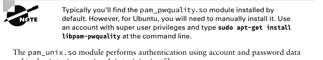

`pam_unix.so` 模块利用存储在 `/etc/passwd` 和 `/etc/shadow` 文件中的账户和密码数据执行身份验证。

`pam_pwhistory.so` 模块将用户新输入的密码与历史数据库进行检查，以防止用户重用旧密码。密码历史文件 `/etc/security/opasswd` 受到保护（locked down）。密码也会加盐并经过哈希处理，使用与存储在 `/etc/shadow` 文件中的密码相同的哈希算法。

要使用 `pam_pwhistory.so` 模块，您必须修改 `/etc/pam.d` 配置文件之一。除了指定密码类型和模块名称外，您还可以设置表 16.3 中列出的一个或多个 *MODULE-OPTIONS*。

**表 16.3** 防止密码重用的 *MODULE-OPTIONS*

| 模块选项 | 描述 |
| :--- | :--- |
| `enforce_for_root` | 如果使用此选项，在重置 `root` 账户密码时，必须检查其密码是否被重用。 |
| `remember=N` | 指定将记住 *N* 个密码。默认值为 10，最大值为 40。 |
| `retry=N` | 将重用密码条目限制为 *N* 个，超过此数量则返回错误。默认值为 1。 |

对于 Ubuntu，您需要将此配置信息放入 `/etc/pam.d/` 的 `common-password` 和 `/etc/pam.d/` 的 `common-auth` 文件中。对于其他发行版，您将此配置放入系统的默认 `/etc/pam.d/` 文件 `password-auth` 和 `system-auth` 中。


> 如果您直接修改 `/etc/pam.d/password-auth` 和 `system-auth` 文件，它们可能会被 `authconfig` 实用工具覆盖。您可以通过创建本地文件（例如 `password-auth-local`）来避免这种情况。Red Hat 有关于如何完成此任务的出色描述。只需使用您喜欢的搜索引擎，输入 “Hardening Your System with Tools and Services Red Hat” 即可找到此信息。

以下是新修改的 Rocky Linux `/etc/pam.d/password-auth` 文件的片段示例，如清单 16.4 所示。

### **清单 16.4：** 查看修改后的 /etc/pam.d/password-auth 文件

```bash
# grep password /etc/pam.d/password-auth
[..]
password    required      pam_pwhistory.so
password    sufficient    pam_unix.so [..] use_authtok
[..]
#
```

在清单 16.4 中，`grep` 命令被用于搜索 PAM 密码类型记录。新添加的 `pam_pwhistory.so` 模块记录使用了 `required` 控制标志且没有选项。请注意，下一条记录是对于 `pam_unix.so` 模块的，并且它使用了 `use_authtok` 选项，该选项告诉模块使用已输入的密码，而不是再次提示输入。通常，最好将密码历史记录直接放在此 `pam_unix.so` 记录的上方。


> `pam_pwhistory.so` 模块与 Kerberos 和 LDAP 不兼容。在使用之前，务必查阅其 `man` 页面。

现在强制实施密码历史功能，您可以尝试将密码重置为当前密码来测试它。一个片段示例如清单 16.5 所示。

### **清单 16.5：** 在强制实施密码历史后尝试重用旧密码

```bash
$ passwd
Changing password for user Christine.
Changing password for Christine.
(current) UNIX password:
New password:
BAD PASSWORD: The password is the same as the old one
[..]
passwd: Have exhausted maximum number of retries for service
$
```

使用 `pam_pwquality.so`，您可以对新密码强制执行规则，例如设置最小密码长度。您可以在 `/etc/security/pwquality.conf` 文件中配置所需的指令，或者将其作为模块选项传递。该文件的一个片段示例如清单 16.6 所示。

### 清单 16.6: 查看 /etc/security/pwquality.conf 文件的内容

```bash
$ cat /etc/security/pwquality.conf
# Configuration for systemwide password quality limits
[...]
# difok = 5
[...]
# minlen = 9
[...]
# dcredit = 1
[...]
$
```


`pam_pwquality.so` 模块取代了旧的、已弃用的 `pam_cracklib.so` 模块。这些模块的作用相似。因此，如果您熟悉已弃用的 `pam_cracklib.so`，那么您会认出 `pam_pwquality.so` 的配置。

您可以在 `pwquality.conf` 文件中设置多个密码质量指令。表 16.4 描述了一些常见的指令。

### 表 16.4 pwquality.conf 文件中的常见密码质量指令

| 指令 | 描述 |
| :--- | :--- |
| `minlen = N` | 强制新密码最少包含 *N* 个字符。（默认值为 9，允许的最小值为 6。）*credit 设置也会影响此指令。 |
| `dcredit = N` | 如果 *N* 为正数，则为包含的数字向密码的 `minlen` 设置添加 *N* 个信用点。如果 *N* 为负数，则密码中必须包含 *N* 个数字。（默认值为 1。） |
| `ucredit = N` | 如果 *N* 为正数，则为包含的大写字母向密码的 `minlen` 设置添加 *N* 个信用点。如果 *N* 为负数，则密码中必须包含 *N* 个大写字母。（默认值为 1。） |
| `lcredit = N` | 如果 *N* 为正数，则为包含的小写字母向密码的 `minlen` 设置添加 *N* 个信用点。如果 *N* 为负数，则密码中必须包含 *N* 个小写字母。（默认值为 1。） |
| `ocredit = N` | 如果 *N* 为正数，则为包含的其他字符（非字母或数字）向密码的 `minlen` 设置添加 *N* 个信用点。如果 *N* 为负数，则密码中必须包含 *N* 个其他字符。（默认值为 1。） |
| `difok = N` | 强制新密码中必须有 *N* 个不同的字符。 |

为了帮助您理解表 16.4 中的信用指令，让我们关注 `dcredit` 设置。如果您设置 `dcredit = -3`，这意味着如果新密码中有三个数字，那么所需的密码长度 `minlen` 将减少三。


完成 `pwquality.conf` 文件中的指令后，您需要在使用 `/etc/pam.d/` 配置文件中启用 `pam_pwquality.so` 模块。这与处理 `pwhistory.so` 模块的方式类似。

## 锁定账户

当恶意用户通过反复尝试特定系统账户的不同密码来试图获取系统访问权限时，就会发生暴力破解攻击。为了防止这些攻击，您可以在一定数量的失败尝试后锁定用户账户。

> **警告**
>
> 在修改用于用户账户锁定的 PAM 配置文件时要非常小心。如果配置错误，您可能会锁定所有账户，包括您自己的和/或 `root` 账户。

`pam_tally2.so` 和 `pam_faillock.so` 模块允许您实施账户锁定。选择哪一个取决于您的发行版（例如，Ubuntu 默认未安装 `pam_faillock`）以及您希望采用的各种模块选项。

这两个模块共享三个关键模块选项。它们在表 16.5 中有描述。

### 表 16.5 `pam_tally2.so` 和 `pam_faillock.so` 的关键模块选项

| 模块选项 | 描述 |
| :--- | :--- |
| `deny = N` | 在 N 次密码输入失败后锁定账户。（默认值为 3。） |
| `silent` | 不向用户显示任何信息消息。 |
| `unlock_time = N` | 在锁定 N 秒后解锁已锁定的账户。如果未设置此选项，管理员必须手动解锁账户。 |

在当前的 Ubuntu 发行版上，通常最好使用 `pam_tally2.so` 模块。请记住，在当前的 CentOS 发行版上，它可能无法很好地工作。在清单 16.7 中，修改后的 `/etc/pam.d/common-auth` 文件的片段显示包含此模块。

### 清单 16.7: 查看 Ubuntu `/etc/pam.d/common-auth` 文件的内容

```bash
$ cat /etc/pam.d/common-auth
auth required pam_tally2.so deny=2 silent

auth [0=] pam_unix.so nullok_secure
```

清单 16.7 中的 `pam_tally2.so` 配置允许在锁定账户之前仅进行两次失败的登录尝试。此外，它不会在特定时段后自动解锁账户。


在 Ubuntu 系统上，`pam-auth-update` 实用程序参与管理 PAM 模块。在修改 Ubuntu 系统上的 PAM 配置文件之前，了解该实用程序的工作方式是个好主意。查阅其 `man` 页面以获取详细信息。

`pam_tally2` 命令允许您查看失败的登录尝试。清单 16.8 展示了在 Ubuntu 发行版上此操作的一个示例。

### 清单 16.8: 使用 `pam_tally2` 实用程序查看登录失败

```bash
$ sudo pam_tally2
Login Failures Latest failure From
user1 4 11/08/19 16:28:14 /dev/pts/1
```

在清单 16.8 中，`user1` 账户有四次登录失败。由于 `pam_tally2.so` 模块选项设置为 `deny=2`，该账户现在已被锁定。您不能通过 `usermod` 或 `passwd` 实用程序解锁被 PAM 锁定的账户。相反，您必须使用 `pam_tally2` 命令并添加 `-r`（或 `--reset`）和 `-u`（或 `--user`）选项，如清单 16.9 所示。这会清除登录失败统计，从而不再锁定账户。

### 清单 16.9: 使用 `pam_tally2` 实用程序重置登录失败统计

```bash
$ sudo pam_tally2 -r -u user1
Login Failures Latest failure From
user1 4 11/08/19 16:28:14 /dev/pts/1

$ sudo pam_tally2
```


除了表 16.5 中显示的选项外，`pam_tally2.so` 模块还具有一些有用的模块选项。此外，`pam_tally2` 命令还有一些其他有用的开关。这些项目共享一个 `man` 手册页。您可以在命令行输入 `man pam_tally2` 来查看它。

在当前的基于 Red Hat 的发行版中，通常建议使用 `pam_faillock.so` 模块。清单 16.10 展示了一个经过修改的 `/etc/pam.d/system-auth` 文件的片段，其中包含了此模块。

### 清单 16.10：查看 Rocky Linux `/etc/pam.d/system-auth` 文件的内容

```bash
# cat /etc/pam.d/system-auth
[...]
auth          required            pam_env.so
auth          required            pam_faillock.so preauth silent audit deny=2
auth          required            pam_faildelay.so delay=20000000
auth          sufficient          pam_unix.so nullok try_first_pass
auth          [default=die]       pam_faillock.so authfail audit deny=2
auth          sufficient          pam_faillock.so authsucc audit deny=2
[...]
account       required            pam_faillock.so
account       required            pam_unix.so
[...
]
#
```

请注意，在清单 16.10 中有四条 `pam_faillock.so` 模块记录。在这些记录中，有几个选项和一个控制标志尚未介绍：

- `preauth`：如果连续认证尝试失败次数过多，则阻止用户访问。
- `audit`：如果输入了不存在的用户帐户，记录尝试的帐户名称。
- `[default=die]`：将返回代码视为失败。立即返回应用程序。
- `authfail`：将认证失败记录到相应的用户 tally 文件中。
- `authsucc`：标识失败的认证尝试是连续的还是不连续的。

为了让 `pam_faillock.so` 正常工作，您还需要修改 `password-auth` 文件，并添加与清单 16.10 文件中所添加的完全相同的记录。该文件也位于 `/etc/pam.d/` 目录中。

`faillock` 命令允许您查看失败的登录尝试。清单 16.11 展示了在 Rocky Linux 发行版上使用此命令的一个示例。

### 清单 16.11：使用 `faillock` 实用程序查看和重置登录失败统计

```bash
# faillock
user1:

When            Type  Source   Valid
2018-11-08 17:47:23 TTY   tty2       V
2018-11-08 17:47:31 TTY   tty2       V
#
# ls -f /var/run/faillock
user1
#
# faillock --reset --user user1
#
# faillock
user1:

When            Type  Source   Valid
#
```

请注意，在清单 16.11 中，`faillock` 实用程序会为每次失败的登录尝试显示记录。在这种情况下，由于设置了 `deny=2`，`user1` 帐户已被锁定。要解锁该帐户，再次使用 `faillock` 命令并添加适当的选项。清单 16.11 中另一个值得注意的项目是 `/var/run/faillock` 目录。当配置了 `pam_faillock.so` 模块时，每个用户在此目录中都会有一个登录失败统计文件。然而，该文件只有在首次发生登录失败时才会创建。


# PAM 与 LDAP 集成

为了让多台服务器共享同一个认证数据库，许多公司使用网络认证系统。`Microsoft Active Directory` 是当今最流行的系统之一。然而，在开源世界中，轻量级目录访问协议 (LDAP) 提供了此服务，其首选实现是 `OpenLDAP` 软件包。大多数 Linux 发行版都包含客户端和服务器软件包，用于在 Linux 网络环境中实现 LDAP。

如果您在系统上使用 LDAP，您可以将其与 PAM 集成。`pam_ldap.so` 模块是用于此目的的主要模块。它提供认证和授权服务，以及 LDAP 的密码更改管理。`pam_ldap.so` 模块的基本配置文件是 `/etc/ldap.conf` 文件。

您需要修改适当的 PAM 配置文件。这可能包括在基于 Red Hat 的系统上手动编辑 `/etc/pam.d/system-auth` 文件，或使用基于 Debian 的发行版中的 `pam-auth-update` 实用程序来修改 `/etc/pam.d/common-*` 文件。根据系统的发行版不同，集成 PAM 与 LDAP 可能还需要额外的配置活动。有关更多详细信息，请参阅特定发行版的文档和/或 `man` 手册页。

# 限制 Root 访问

最佳实践是使用 `sudo` 命令（参见第 15 章，“应用所有权和权限”）来获取超级用户权限，而不是登录到 `root` 用户帐户。更好的做法是通过其 `/etc/shadow` 文件记录禁用 `root` 帐户的登录。但是，如果您确实必须登录 `root` 帐户，您可以限制执行此操作的地点。

如果配置得当，`pam_security.so` PAM 模块和 `/etc/security` 文件用于限制 `root` 帐户的登录。它们通过限制 `root` 登录仅限于安全 TTY 文件中列出的设备来实现这一点。清单 16.12 展示了 Ubuntu 发行版中此文件的片段列表。

### 清单 16.12：查看 `/etc/security` 文件

```bash
$ cat /etc/security
# /etc/security: list of terminals on which root is allowed to login.
# See security(5) and login(1).
[...]
console

# Local X displays [...]
:0
:0.0
:0.1
[...]
# Virtual consoles
tty1
tty2
tty3
tty4
[...]
$
```

为了理解 `/etc/security` 文件的记录，您需要了解 TTY 终端是如何表示的。当您登录到虚拟控制台时（通常通过按下 `Ctrl+Alt+F n` 键序列到达），您正在登录一个由 `/dev/tty*` 文件表示的终端。例如，如果您按下 `Ctrl+Alt+F2` 并登录到 `tty2` 终端，该终端由 `/dev/tty2` 文件表示。请注意，清单 16.12 中的 `/etc/security` 文件记录仅显示虚拟控制台终端名称（例如，`tty4`），而不显示其设备文件。


> 如果您在终端模拟器中或已登录到控制台终端，您可以通过在命令行输入 `tty` 来查看您自己的进程当前的终端。

当您通过系统的图形界面登录时，`who` 或 `w` 命令的输出会在您进程的 TTY 列中显示类似 `:0` 的内容。在清单 16.12 中，您也可以找到这些登录的记录。

然后，如果您打开一个终端模拟器程序，您打开的是一个 TTY 终端，称为伪 TTY，由 `/dev/pts/*` 文件表示，例如 `/dev/pts/0`。这些 TTY 终端未列在 `/etc/security` 文件中，因为用户已经登录到图形环境。


> 如果您的系统使用 `pam_security.so` 模块但没有 `/etc/security` 文件，`root` 用户可以通过任何设备（如控制台终端或网络接口）访问系统。这被认为是不安全的环境。

`pam_security.so` 模块通常放置在 `/etc/pam.d/login` 和/或 `/etc/pam.d/remote` 配置文件中之一。清单 16.13 展示了一个在 Ubuntu 发行版上的片段示例。

### 清单 16.13：查找使用 `pam_security.so` 模块的文件

```bash
$ grep pam_security /etc/pam.d/*
/etc/pam.d/login:auth [...] pam_security.so
$
```


> 虽然此配置将禁用 `tty*` 和 `:0` 设备上的 `root` 帐户登录，但它并未禁用所有的 `root` 登录。`root` 帐户仍可通过 `SSH` 工具（如 `ssh` 和 `scp`）访问。（`SSH` 将在本章后面介绍。）此外，此 PAM 配置不会妨碍 `su` 和 `sudo` 命令（在第 15 章中介绍）访问 `root` 帐户。

在这个 Ubuntu 发行版中，只有 `login` PAM 配置文件包含 `pam_security.so` 模块。请注意，在清单 16.13 中，此模块使用的 PAM 服务类型是 `auth`。

# 探索 PKI 概念

密码学的主要目的是对数据进行编码，以隐藏或保持其私密性。在密码学中，明文（人类或机器可读的文本）通过密码算法转换为密文（人类或机器不可读的文本）。将明文转换为密文称为加密。将文本从密文转换回明文称为解密。

密码算法使用称为密钥的特殊数据进行加密和解密；它们也被称为密码密钥。当加密数据与其他人共享时，必须共享其中的一些密钥。如果来自可信来源的密钥被窃取并被来自恶意来源的密钥替换，就会引发问题。公钥基础设施 (PKI) 有助于保护密钥完整性。PKI 是一个由一组组件构成的结构，这些组件协同工作以证明密钥的真实性以及使用这些密钥的人或设备的有效性。

# 获取证书

PKI 团队的几个成员包括证书颁发机构 (CA) 结构和 CA 颁发的数字证书。在验证个人身份后，CA 向请求者颁发数字证书。数字证书提供身份证明以及嵌入的密钥，该密钥现在属于请求者。证书持有人现在可以使用证书密钥对数据进行加密，并使用证书对其进行签名。这为解密数据的人提供真实性和验证，特别是当数据通过网络传输时。

从商业 CA 获取数字证书需要付出努力以及金钱，尽管在开源 CA 站点方面正在取得进展，例如 `let's encrypt.org`，它提供免费的数字证书。如果您只是开发新应用程序、处于测试阶段或正在为认证考试做准备，您可以生成并签署自己的证书。这种类型的证书称为自签名数字证书。虽然自签名证书在某些情况下很有用，但永远不应将其用于 Internet 生产环境（尽管一些组织允许在内网应用程序中使用）。

# 发现密钥概念

理解密码密钥及其在加密/解密过程中的作用是至关重要的。密码密钥有两种类型：

### 私有密钥

对称密钥，也称为私有或秘密密钥，使用单个密钥和密码算法来加密数据。明文使用相同的密钥进行加密和解密，通常由称为口令短语（passphrase）的密码保护。对称密钥加密速度非常快。不幸的是，如果需要其他人解密数据，您必须共享私有密钥，这是它的主要缺点。

### 公钥/私钥对

非对称密钥也称为公钥/私钥对，它们使用加密算法和两个密钥来加密数据。通常，公钥用于加密数据，而私钥用于解密数据。私钥可以用密码短语保护，并且必须保密。这对密钥中的公钥是用于共享的。

系统用户和许多应用程序（如 `SSH`）都会使用非对称密钥。图 16.2 展示了一个两人之间使用公钥/私钥对的场景。

#### 图 16.2 非对称加密示例


请注意，在图 16.2 中，为了向 Helen 加密数据（在此情况下为一条消息），Bob 必须使用她的公钥。反过来，Helen 使用她的私钥解密数据。然而，如果 Bob 不确定他是否真正获取了 Helen 的公钥，就会出现问题。他可能从名为 Evelyn 的恶意用户那里获取了公钥，并意外地将加密消息发送给了她。这是一种中间人攻击（on-path attack）。后文将介绍的数字签名可以帮助解决这种情况。

### 数据安全

PKI（公钥基础设施）和密码学中的一个重要概念是哈希（hashing）。哈希使用单向数学算法，将明文转换为固定长度的密文。因为是单向的，所以无法“反哈希”已哈希的密文。通过哈希生成的密文称为消息摘要、哈希值、指纹或签名。

加密消息摘要的优点在于它可用于数据比较。例如，如果哈希对明文 `FileA` 和明文 `FileB` 生成了完全相同的消息摘要，那么这两个文件包含的数据完全相同。这种类型的哈希常用于网络取证。


哈希在确保大型下载文件在传输过程中未损坏等方面很有用。然而，加密哈希必须使用无碰撞（collision free）的算法。换句话说，哈希算法不能为两个不同的输入生成相同的消息摘要。一些较旧的哈希算法，如 `MD5`，并非无碰撞的。

请注意，简单的消息摘要（称为非加盐和非密钥消息摘要）仅使用明文文件作为输入生成。可以通过添加盐（salt）来增强这种哈希，盐是随输入文件一起添加的随机数据，用于保护哈希免受某些恶意攻击。加盐哈希用于 `/etc/shadow` 文件中以保护密码。密钥消息摘要是使用明文文件和私钥共同生成的。这种类型的加密哈希对多种恶意攻击具有很强的抵抗力，常用于 Linux 应用程序中，如 `SSH`。

### 签署传输


哈希的另一个实际应用是数字签名。数字签名是一种加密令牌，提供身份验证和数据验证。它本质上是对原始明文数据的消息摘要，然后使用用户的私钥加密，并与密文一起发送。

密文接收者使用发送者的公钥解密数字签名，从而获得原始的消息摘要。接收者还解密密文，然后对其明文数据进行哈希处理。一旦生成新的消息摘要，数据接收者就可以将新的消息摘要与发送的消息摘要进行比较。如果两者匹配，则数字签名得到验证，这意味着加密数据确实来自发送者。同时，这也表明数据在传输过程中未被篡改。


恶意个人可以拦截已签名的传输，用新的密文替换原始密文，并为该数据添加新的数字签名。仅签署传输并不能防范中间人攻击。最好将此方法与数字证书和其他安全层结合使用。

## 使用 `ssh`

当通过网络连接到远程服务器时，如果没有使用加密方式，网络嗅探器可以查看发送和接收的数据。`Secure Shell`（`SSH`）通过提供加密通信方式解决了这个问题。它是那些希望安全地向远程系统发送/从远程系统接收数据的人所使用的事实标准软件。

`SSH` 使用公钥/私钥对（非对称密钥）进行加密。当两个系统之间建立 `SSH` 连接时，每个系统都会向对方发送其公钥。

### 探索基本的 `SSH` 概念

你通常会在大多数发行版中默认找到已安装的 `OpenSSH`（`www.openssh.com`）。然而，如果你因为某种原因无法使用基本的 `SSH` 服务，你可能需要检查是否已安装所需的 `OpenSSH` 软件包（软件包管理在第 13 章“软件治理”中已介绍）。表 16.6 显示了本书使用的发行版及其基本 `OpenSSH` 服务软件包名称。

| 发行版 | `OpenSSH` 软件包名称 |
| :--- | :--- |
| `Rocky` | `openssh`, `openssh-clients`, `openssh-server` |
| `Fedora` | `openssh`, `openssh-clients`, `openssh-server` |
| `openSUSE` | `openssh` |
| `Ubuntu` | `openssh-server`, `openssh-client` |

要在两个系统之间创建安全的 `OpenSSH` 连接，请使用 `ssh` 命令。基本语法如下：

```
ssh [options] username@hostname
```


> **提示**
>
> 如果你尝试使用 `ssh` 命令并收到“no route to host”（无路由到主机）消息，请先检查 `sshd` 守护进程是否正在运行。在 `systemd` 系统上，使用超级用户权限的命令是 `systemctl status sshd`。如果守护进程正在运行，请检查你的防火墙设置，这在第 18 章“监管 `Linux` 防火墙”中有介绍。

为了成功建立加密连接，两个系统（客户端和远程端）都必须安装 `OpenSSH` 软件并且 `sshd` 守护进程正在运行。清单 16.14 显示了一个连接 `Rocky Linux` 系统到远程 `openSUSE Linux` 服务器的片段示例。

### 清单 16.14：使用 `ssh` 连接到远程系统

```
$ ssh christine@192.168.0.105
The authenticity of host '192.168.0.105 (192.168.0.105)' can't be established.
ECDSA key fingerprint is SHA256:BnaCOmb+ensityrFKk1RrSVwWxH4NrBW00S0Du+14m7w.
ECDSA key fingerprint is MD5:25:36:b0:b7:99:44:d7:74:1c:95:d5:84:55:6a:62:3c.
Are you sure you want to continue connecting (yes/no)? yes
Warning: Permanently added '192.168.0.105' (ECDSA) to the list of known hosts.
Password:
[...]
Have a lot of fun...
Christine@linux-1yd3:~$ ip addr show | grep 192.168.0.105
inet 192.168.0.105/24 [..] dynamic eth1
Christine@linux-1yd3:~$
Christine@linux-1yd3:~$ exit
logout
Connection to 192.168.0.105 closed.
$
$ ls .ssh
known_hosts
$
```

在清单 16.14 中，`ssh` 命令没有使用任何选项，包含远程系统账户用户名，并使用远程系统的 `IPv4` 地址而不是其主机名。请注意，如果本地账户名称相同，则不需要使用远程系统账户用户名。然而，在这种情况下，你必须输入远程账户的密码才能访问远程系统。

`OpenSSH` 应用程序在 `~/.ssh/known_hosts` 文件中跟踪任何之前连接过的主机。此数据包含远程服务器的公钥。

> `~/` 符号组合代表用户的家目录。你也可以在文档中看到 `$HOME` 作为表示方法。因此，为了通用表示包含隐藏子目录 `.ssh/` 和 `known_hosts` 文件的任何用户的家目录，它被写为 `~/.ssh/known_hosts` 或 `$HOME/.ssh/known_hosts`。

如果你过去没有使用 `ssh` 登录到特定的远程主机，你会看到一个看起来令人恐惧的消息，如清单 16.14 中所示。该消息只是告诉你这个特定的远程主机不在 `known_hosts` 文件中。当你在该消息的提示下输入 `yes` 时，它会被添加到集合中。

> 如果你之前已连接到远程服务器，并收到一条写着 `WARNING: REMOTE HOST IDENTIFICATION HAS CHANGED`（警告：远程主机标识已更改）的警告消息，请提高警惕。远程服务器的公钥可能已更改。然而，这也可能表明远程系统正在被伪造或已被恶意用户入侵。

# 清单 16.15：使用 `rsync` 通过 `SSH` 安全传输文件

在第三章“管理文件、目录和文本”中介绍过的 `rsync` 实用工具，可以利用 `SSH` 通过加密隧道快速将文件复制到远程系统。若要在 `rsync` 命令中 `OpenSSH`，需要在目标文件位置前添加 `username@hostname`。清单 16.15 展示了一个示例。

```bash
$ ls -sh Project4x.tar
40K Project4x.tar
$
$ rsync Project4x.tar Christine@192.168.0.105:~
Password:
$
```

在清单 16.15 中，`Project4x.tar` 文件通过 `rsync` 命令和 `OpenSSH` 被发送到远程系统。请注意，远程系统的用户名和 `IP` 地址后面加了一个冒号（`:`）。这是为了指定文件正在传输到远程系统。如果没有添加冒号，`rsync` 命令将不会传输该文件。它只会将文件重命名为带有 `Christine@` 前缀加上 `IP` 地址的名称。

在冒号之后，指定了文件的目录目标位置。`~` 符号表示将文件放置在用户的主目录中。如果需要，您也可以为文件赋予一个新名称。

您还可以使用 `ssh` 命令向远程系统发送命令。只需在 `ssh` 命令的末尾，用引号将命令括起来即可。清单 16.16 展示了一个示例。

# 清单 16.16：使用 `ssh` 向远程系统发送命令

```bash
$ ssh Christine@192.168.0.105 "ls -sh Project4x.tar"
Password:
40K Project4x.tar
$
```

在清单 16.16 中，该命令检查我们的文件是否已成功传输到远程系统。`Project4x.tar` 文件已成功移动。

# 配置 `SSH`

审查各种 `OpenSSH` 配置文件及其指令是一个好主意。确保您的加密连接正确配置对于保护远程系统通信至关重要。表 16.7 列出了主要的 `OpenSSH` 配置文件。

| 配置文件 | 描述 |
| :--- | :--- |
| `~/.ssh/config` | 包含 `OpenSSH` 客户端配置。可能被 `ssh` 命令选项覆盖。 |
| `/etc/ssh/ssh_config` | 包含 `OpenSSH` 客户端配置。可能被 `ssh` 命令选项或 `~/.ssh/config` 文件中的设置覆盖。 |
| `/etc/ssh/sshd_config` | 包含 `OpenSSH` 守护进程 (`sshd`) 的配置。 |

如果您需要修改 `SSH` 配置，了解需要修改哪个配置文件至关重要。以下指南可以提供帮助：

- 对于个人用户连接到远程系统，创建和/或修改客户端侧的 `~/.ssh/config` 文件。
- 对于所有用户连接到远程系统，创建和修改客户端侧的 `/etc/ssh/ssh_config` 文件。
- 对于传入的 `SSH` 连接请求，修改服务器侧的 `/etc/ssh/sshd_config` 文件。


> 请记住，为了使 `SSH` 客户端连接成功，除了正确的身份验证外，客户端和远程服务器的 `SSH` 配置必须兼容。

`OpenSSH` 有多种配置指令。您可以通过 `ssh_config` 和 `sshd_config` 文件的 `man` 页面浏览所有指令。然而，`sshd_config` 文件中有几个重要的指令：

- `AllowTcpForwarding`: 允许 `SSH` 端口转发。（参见第八章，“比较 `GULs`”。）
- `ForwardX11`: 允许 `X11` 转发。（参见第八章。）
- `PermitRootLogin`: 允许 `root` 用户通过 `SSH` 连接登录。通常应设置为 `no`。
- `Port`: 设置 `OpenSSH` 守护进程 (`sshd`) 监听传入连接请求的端口号。（默认值为 `22`。）

您可能需要修改客户端的 `ssh_config` 或 `~/.ssh/config` 文件的一个例子是，当远程系统的 `SSH` 端口在 `sshd_config` 文件中被修改时。在这种情况下，如果客户端配置文件未更改以匹配新端口，远程用户将不得不修改其 `ssh` 命令的选项。清单 16.17 展示了一个片段示例。在此清单中，远程 `Ubuntu` 服务器的 `OpenSSH` 监听端口 `1138`，而不是默认端口 `22`，用户必须使用 `ssh` 命令的 `-p` 选项才能到达远程服务器。

# 清单 16.17：使用 `ssh` 连接到远程系统的非默认端口

```bash
$ ssh -p 1138 192.168.0.104
[...]
Christine@192.168.0.104's password:
Welcome to Ubuntu 18.04.1 LTS (GNU/Linux 4.15.0-36-generic x86_64)
[...]
Christine@Ubuntu1804:~$
Christine@Ubuntu1804:~$ ip addr show | grep 192.168.0.104
    inet 192.168.0.104/24
[...]
Christine@Ubuntu1804:~$
Christine@Ubuntu1804:~$ exit
logout
Connection to 192.168.0.104 closed.
$
```

为了解决 `OpenSSH` 客户端用户的这一麻烦，请为个人用户创建或修改 `~/.ssh/config` 文件，或者为所有客户端用户修改 `/etc/ssh/ssh_config` 文件。在配置文件中将 `Port` 设置为 `1138`。这会让远程用户和系统管理员都更轻松。

> 系统管理员经常将 `OpenSSH` 默认端口从端口 `22` 更改为其他端口。在面向公共网络的服务器上，该端口经常成为恶意攻击者的目标。但是，如果在系统上使用 `SELinux` 更改 `OpenSSH` 端口，您需要让 `SELinux` 知晓此更改。所需的更改通常记录在 `SELinux` 系统的 `/etc/ssh/sshd_config` 文件顶部。

# 生成 `SSH` 密钥

通常，`OpenSSH` 会查找其系统的公钥/私钥对。如果未找到，`OpenSSH` 会自动生成它们。这些密钥对，也称为*主机密钥*，存储在 `/etc/ssh/` 目录下的文件中。清单 16.18 显示了 `Fedora` 发行版上的密钥文件。

# 清单 16.18：查看 `Fedora` 系统上的 `OpenSSH` 密钥文件

```bash
$ ls -1 /etc/ssh/*key*
/etc/ssh/ssh_host_ecdsa_key
/etc/ssh/ssh_host_ecdsa_key.pub
/etc/ssh/ssh_host_ed25519_key
/etc/ssh/ssh_host_ed25519_key.pub
/etc/ssh/ssh_host_rsa_key
/etc/ssh/ssh_host_rsa_key.pub
$
```

在清单 16.18 中，显示了公钥和私钥文件。公钥文件以 `.pub` 文件扩展名结尾，而私钥没有文件扩展名。文件名遵循此标准：

`ssh_host_ KeyType_ key`

密钥文件名的 *KeyType* 对应于创建密钥时使用的数字签名算法。您在系统中可能看到的不同类型如下：

- `dsa`
- `rsa`
- `ecdsa`
- `ed25519`


> 妥善保护私钥文件至关重要。私钥文件应具有 `0640` 或 `0600`（八进制）权限设置，并由 `root` 拥有。然而，公钥文件需要任何人可读。文件权限在第十五章“应用所有权和权限”中有所介绍。

有时您可能需要手动生成这些密钥或创建新密钥。为此，需使用 `ssh-keygen` 实用工具。清单 16.19 在 `Fedora` 系统上展示了使用此工具的一个片段示例。

# 清单 16.19：使用 `ssh-keygen` 创建新的公钥/私钥对

```bash
$ sudo ssh-keygen -t rsa -f /etc/ssh/ssh_host_rsa_key
Generating public/private rsa key pair.
/etc/ssh/ssh_host_rsa_key already exists.
Overwrite (y/n)? y
Enter passphrase (empty for no passphrase):
Enter same passphrase again:
Your identification has been saved in /etc/ssh/ssh_host_rsa_key.
Your public key has been saved in /etc/ssh/ssh_host_rsa_key.pub.
The key fingerprint is:
[...]
$
```

`ssh-keygen` 有几个选项。对于清单 16.19 中的命令，只使用了两个选项。`-t` 选项设置 `KeyType`，在此示例中为 `rsa`。`-f` 开关指定用于存储密钥的私钥文件。公钥存储在具有相同名称但添加了 `.pub` 文件扩展名的文件中。请注意，此命令会询问密码短语，该密码短语与私钥相关联。

# 使用 `SSH` 密钥进行身份验证

每次使用 `SSH` 的命令时输入密码可能会很麻烦。但是，您可以使用密钥而不是密码进行身份验证。设置此身份验证方法需要几个步骤：

1. 登录到 `SSH` 客户端系统。
2. 生成 `SSH ID` 密钥对。
3. 安全地将公钥 `SSH ID` 密钥传输到 `SSH` 服务器计算机。
4. 登录到 `SSH` 服务器系统。
5. 在服务器系统上将公钥 `SSH ID` 密钥添加到 `~/.ssh/authorized_keys` 文件。

让我们更详细地看看这些步骤。首先，您应该通过您将要用作 `SSH` 客户端的账户登录到客户端系统。在该系统上，通过 `ssh-keygen` 实用工具生成 `SSH ID` 密钥对。您必须指定正确的密钥对文件名，即 `id_TYPE`，其中 `TYPE` 是 `dsa`、`rsa` 或 `ecdsa`。清单 16.20 在客户端系统上创建 `SSH ID` 密钥对的一个片段示例。

# 清单 16.20：使用 `ssh-keygen` 创建 `SSH ID` 密钥对

```bash
$ ssh-keygen -t rsa -f ~/.ssh/id_rsa
Generating public/private rsa key pair.
Enter passphrase (empty for no passphrase):
Enter same passphrase again:
Your identification has been saved in /home/Christine/.ssh/id_rsa.
Your public key has been saved in /home/Christine/.ssh/id_rsa.pub.
[...]
$ ls .ssh/
id_rsa  id_rsa.pub  known_hosts
$
```

请留意列表 16.20 中密钥文件的名称。在这种情况下，`ssh-keygen` 命令会生成一个私钥，存储在 `~/.ssh/id_rsa` 文件中，以及一个公钥，存储在 `~/.ssh/id_rsa.pub` 文件中。如果需要，你可以输入密码短语（`passphrase`）。在这种情况下，没有输入密码短语。

一旦这些密钥在客户端系统上生成后，必须将公钥复制到服务器系统上。最好使用安全的方法，而 `ssh-copy-id` 工具可以让你这样做。它不仅将你的公钥复制过去，还会将其存储在你的服务器系统的 `~/.ssh/authorized_keys` 文件中。本质上，它通过一条命令完成了步骤 3 到 5 的操作。使用此工具的简化示例显示在列表 16.21 中。

## 列表 16.21：使用 `ssh-copy-id` 复制 `SSH` 公钥 `ID` 密钥


```
$ ssh-copy-id -n Christine@192.168.0.104
[..]
Would have added the following key(s):

ssh-rsa AAAAB3NzaC1yc2EAAAADAQABAAABAQC5P[...]
8w3VE5RWAXN[...]
========================
$ ssh-copy-id Christine@192.168.0.104
[..]Source of key(s) to be installed: "/home/Christine/.ssh/id_rsa.pub"
[..]
Christine@192.168.0.104's password:

Number of key(s) added: 1
[..]
$
```

请留意列表 16.21 中先使用了 `ssh-copy-id -n` 命令。`-n` 选项允许你查看哪些密钥将被复制并安装到远程系统上，而实际并不执行该操作（即试运行/dry run）。

在列表 16.21 中下次发出该命令时，移除了 `-n` 开关。因此，`id_rsa.pub` 密钥文件被安全地复制到服务器系统上，并且密钥被安装到 `~/.ssh/authorized_keys` 文件中。请注意，当使用 `ssh-copy-id` 命令时，用户必须输入其密码，以允许公钥 ID 密钥被复制到服务器上。

既然公钥 ID 密钥已复制到 SSH 服务器系统，就可以使用 `ssh` 命令连接客户端系统与服务器系统，而无需输入密码。这在列表 16.22 中展示，同时也展示了如何使用 `scp` 命令。注意，在使用 `scp` 命令复制文件时，必须在 IP 地址的末尾添加冒号 (`:`)。

## 列表 16.22：测试无密码 SSH 连接

```
$ ssh Christine@192.168.0.104
Welcome to Ubuntu 18.04.1 LTS (GNU/Linux 4.15.0-36-generic x86_64)
[...]
Christine@Ubuntu1804:~$ ls .ssh
authorized_keys known_hosts
Christine@Ubuntu1804:~$ exit
logout
Connection to 192.168.0.104 closed.

$ scp Project4x.tar Christine@192.168.0.104:~
Project4x.tar   100%  40KB   6.3MB/s   00:00
$

$ ssh Christine@192.168.0.104
Welcome to Ubuntu 18.04.1 LTS (GNU/Linux 4.15.0-36-generic x86_64)
[...]
Christine@Ubuntu1804:~$ ls
Desktop Downloads Music Project4x.tar Templates
Documents examples.desktop Pictures Public Videos
Christine@Ubuntu1804:~$ exit
logout
Connection to 192.168.0.104 closed.
$
```

> 如果你的 Linux 发行版没有 `ssh-copy-id` 命令，你可以使用 `scp` 命令来复制公钥 ID 密钥。在这种情况下，你需要手动将该密钥添加到 `~/.ssh/authorized_keys` 文件的末尾。为此，你可以使用 `cat` 命令和 `>>` 符号将公钥 ID 密钥的标准输出重定向并追加到授权密钥文件中。

## 使用身份验证代理进行身份验证

使用 SSH 连接远程系统的另一种方法是使用身份验证代理（authentication agent）。使用代理时，你只需输入一次密码来发起连接。之后，代理会在代理会话期间记住密码。设置这种身份验证方法需要几个步骤：

-   登录到 SSH 客户端系统。

-   生成 SSH ID 密钥对并设置密码短语。

-   安全地将 SSH 公钥 ID 密钥传输到 SSH 服务器计算机。

-   登录到 SSH 服务器系统。

-   将 SSH 公钥 ID 密钥添加到服务器系统的 `~/.ssh/authorized_keys` 文件中。

-   启动代理会话。

-   将 SSH ID 密钥添加到代理会话中。

步骤 1 到 5 与设置使用 SSH ID 密钥而非密码进行身份验证的步骤几乎相同。需要指出的一个例外是，当生成用于代理的 SSH ID 密钥对时，`必须` 创建密码短语。使用代理设置 ECDSA 密钥的简化示例显示在列表 16.23 中。

## 列表 16.23：生成并设置用于 SSH 代理的 ID 密钥

```
$ ssh-keygen -t ecdsa -f ~/.ssh/id_ecdsa
Generating public/private ecdsa key pair.
Enter passphrase (empty for no passphrase):
Enter same passphrase again:
Your identification has been saved in /home/Christine/.ssh/id_ecdsa.
[..]
$ ssh-copy-id -i ~/.ssh/id_ecdsa Christine@192.168.0.104
[..]
Number of key(s) added: 1
[..]
$
```

一旦你在远程系统上正确创建了带有密码短语的密钥对，安全传输并安装了服务器的授权密钥文件，你就可以使用 `ssh-agent` 工具来启动 SSH 代理会话。会话启动后，通过 `ssh-add` 命令将私有 ID 密钥添加到会话中。此过程的简化示例显示在列表 16.24 中。

## 列表 16.24：启动 SSH 代理会话并添加 ID 密钥

```
$ ssh-agent /bin/bash
[Christine@localhost ~]$ 
[Christine@localhost ~]$ ssh-add ~/.ssh/id_ecdsa
Enter passphrase for /home/Christine/.ssh/id_ecdsa:
Identity added: /home/Christine/.ssh/id_ecdsa (/home/Christine/.ssh/id_ecdsa)
[Christine@localhost ~]$ 
[Christine@localhost ~]$ ssh Christine@192.168.0.104
Welcome to Ubuntu 18.04.1 LTS (GNU/Linux 4.15.0-36-generic x86_64)
[..]
Christine@Ubuntu1804:~$ exit
logout
Connection to 192.168.0.104 closed.
[Christine@localhost ~]$  
[Christine@localhost ~]$ exit
exit
$  
```

请留意列表 16.24 中，`ssh-agent` 命令后跟着 `/bin/bash`，这是 Bash shell。此命令启动了一个运行 Bash shell 的新会话，即代理会话。一旦使用 `ssh-add` 命令并输入私有密码短语将私有 SSH ID 密钥添加后，你就可以再次连接远程系统而无需输入密码或密码短语。然而，如果你退出代理会话并再次启动它，你必须重新添加密钥并重新输入密码短语。

> **警告** 如果希望移除代理会话中的 ID 密钥，`ssh-add` 命令允许你这样做。为此请包含 `-d` 选项。

SSH 代理会话允许你一次进入会话并添加密钥，然后通过加密的 SSH 方法尽可能多次地连接远程系统，而无需反复输入密码或密码短语。这不仅提供了安全性，还提供了便利性，这是一种很少见的组合。

## 安全地使用 SSH

你可以做几件事来增强系统上的 SSH 安全性：

-   使用不同于默认端口 22 的 SSH 端口。

-   禁用通过 SSH 进行 root 登录。

-   管理 TCP Wrappers。

本章前面提到的一个项目是，对于任何面向公共的系统，不要使用端口 22 作为 SSH 端口。你可以通过修改 `/etc/ssh/sshd_config` 文件中的 `Port` 指令为其他端口号来更改这一点。请记住，这样做有利弊。强化你的防火墙可能是比更改默认 SSH 端口更好的替代方案。

另一个关键项目是禁用通过 SSH 进行 root 登录。默认情况下，任何允许 root 账户登录并启用了 OpenSSH 的系统都允许通过 SSH 进行 root 登录。由于 root 是标准的用户名，恶意攻击者可以利用它进行暴力破解攻击。由于 root 是一个超级用户账户，它需要额外的保护。

要禁用通过 SSH 进行 root 登录，请编辑 `/etc/ssh/sshd_config` 文件。将 `PermitRootLogin` 指令设置为 `no`，然后重启 OpenSSH 服务或重新加载其配置文件。

TCP Wrappers 是一种较旧的控制基于网络的服务访问的方法。如果服务可以使用 TCP Wrappers，那么该服务编译时会包含 libwrap 库。

你可以使用 `ldd` 命令来检查支持情况，简化示例显示在列表 16.25 中。在此列表示例中，在一个 Ubuntu 系统上，你可以看到 SSH 服务可以使用 TCP Wrappers。

## 列表 16.25：使用 `ldd` 命令检查对 TCP Wrappers 的支持

```
$ which sshd
/usr/sbin/sshd
$
$ ldd /usr/sbin/sshd | grep libwrap
    libwrap.so.0 [...]
```

TCP Wrappers 使用两个文件来确定谁可以访问特定服务。这些文件是 `/etc/hosts.allow` 和 `/etc/hosts.deny`。正如它们的名称所示，`hosts.allow` 文件通常允许访问指定的服务，而 `hosts.deny` 文件通常阻止访问。这些文件具有简单的记录语法：

```
service: IPaddress...
```

这些文件的搜索顺序至关重要。对于传入的服务请求，会发生以下情况：

-   检查 `hosts.allow` 文件中的远程 IP 地址。

-   如果找到，则允许访问，并且不再进行其他检查。

-   检查 `hosts.deny` 文件中的远程 IP 地址。

-   如果找到，则拒绝访问。

-   如果未找到，则允许访问。

因为如果远程系统的地址未在任一文件中找到，则允许访问，所以在 `/etc/hosts.deny` 文件中使用 ALL 通配符是最佳做法：

```
ALL: ALL
```

这禁用了所有对 `/etc/hosts.allow` 文件中未列出的任何 IP 地址的所有服务的访问。请注意，一些发行版使用 PARANOID 而不是 ALL 作为地址通配符。

记录的 `IPaddress` 可以是 IPv4 或 IPv6。要在 `hosts.allow` 文件中列出单个 IP 地址，你需要用逗号分隔指定它们，如下所示：

```
sshd: 172.243.24.15, 172.243.24.16, 172.243.24.17
```

输入允许访问 OpenSSH 服务的每一个单独 IP 地址并不是必需的。你可以指定整个子网。例如，如果你需要允许 C 类网络中所有 IPv4 地址访问服务器，你只需指定前三个地址八位位组后跟一个尾随的句点，如下所示：

```
sshd: 172.243.24.
```


TCP Wrappers 是在管理员开始使用防火墙之前创建的。虽然目前仍有一些用户使用，但其效用有限，许多发行版已将其视为弃用。最好将此防护功能迁移到你的防火墙中。

## 将 VPN 用作客户端

虽然 SSH 非常适合在同一局域网内从客户端安全连接到服务器，但对于通过公共网络访问远程系统而言，其用处并不大。幸运的是，`虚拟专用网络` (VPN) 在此场景下表现良好。VPN 在两个通过公共网络连接的不同网络系统之间建立安全的加密连接。该加密连接充当一个独立的私有网络，允许你在两个系统之间安全地传输任何类型的数据。Linux 上有很多不同的 VPN 软件包，例如 OpenVPN。

在选择作为客户端提供 VPN 的软件时，理解该软件包采用的安全方法至关重要。做出良好的 VPN 选择对于保持你的虚拟网络私有性至关重要。此外，你还应考虑数据包的传输方式。在使用 VPN 时，基于 UDP 的系统通常比基于 TCP 的系统提供更高的性能。

`SSL/TLS` `SSL/TLS` 实际上是同一种安全通信协议。它最初被称为 SSL (`Secure Sockets Layer`，安全套接字层)。随着协议的逐步改进和演进，其名称更改为 TLS (`Transport Layer Security`，传输层安全)。只要你使用的是当前版本，该协议就能提供系统之间通过网络的安全数据加密。你的 VPN 客户端应用程序至少应使用 TLS 1.2。早期版本的协议存在已知问题。

TLS 是一种面向流的协议，可防止路径攻击 (on-path attacks)。它采用对称加密来处理数据，并使用公钥来确认系统的身份。数据包含消息认证码，以防止在传输过程中被篡改。此外，TLS 具有限制被捕获的数据在稍后时间被重放的机制，这被称为`重放攻击` (replay attack)。


点对点隧道协议 (Point-to-Point Tunneling Protocol, PPTP) 是一种较旧的协议，存在许多记录在案的弱点。它容易受到路径攻击，因此任何使用此协议的 VPN 客户端都不应在你的系统中实现。

`DTLS` `数据报传输层安全协议` (Datagram Transport Layer Security, DTLS) 也是一种安全通信协议，但它设计为仅使用 UDP 数据包。因此，它有时被称为 UDP TLS。对于 TCP 这种基于连接的协议，建立连接时需要额外的通信。由于 UDP 是一种无连接协议，DTLS 速度更快，且不会受到其他基于流协议的性能问题影响。

DTLS 基于 SSL/TLS，并提供类似的安全保护。因此，它非常适合用于 VPN 软件。

`IPSec` `互联网协议安全` (Internet Protocol Security, IPSec) 不是一种加密协议，而是在网络层操作的一个框架。它本身不强制特定的密钥方法或加密算法。它通常是 VPN 应用的核心部分。

它采用认证头 (Authentication Header, AH) 协议进行认证。IPSec 还使用封装安全载荷 (Encapsulating Security Payload, ESP) 进行认证、数据加密、数据完整性等。对于密钥管理，通常采用互联网安全关联和密钥管理协议 (Internet Security Association and Key Management Protocol, ISAKMP)，但这并非必需。

IPSec 有两种模式：隧道模式和传输模式。在隧道模式下，所有数据及其为传输目的而添加的相关报头（称为`数据报` datagram）都受到保护。因此，没有人可以看到任何数据或路由信息，因为整个连接都是安全的。在传输模式下，只有数据受到保护，并由 ESP 进行保护。


OpenVPN 软件包使用一种自定义协议，有时被称为 OpenVPN 协议。不过，它确实使用 SSL/TLS 进行密钥交换。此软件产品支持多平台，并且不像 IPSec 那样在通过防火墙和 NAT 建立 VPN 时遇到问题。`因此`，OpenVPN 软件包非常流行。

有许多很好的安全 VPN 客户端选择。开始的好地方是创建一个环境所需功能的检查清单。

## 摘要

评估你的系统和用户对适当的访问和认证方法的需求，对于保障系统安全至关重要。使用正确的产品并正确配置它们，不仅有助于保持系统安全，还能减少用户的挫败感。它也会让你的工作变得更轻松。

## 考试要点

`总结各种 PAM 模块和功能。` PAM 是各种应用程序实现认证服务的单一接口。如果应用程序要使用 PAM，它必须与 `libpam.so` 模块一起编译，并拥有相关的 PAM 配置文件。这些配置文件位于 `/etc/pam.d/` 目录中。应用程序可以通过采用三个 PAM 模块中的任意一个来强制执行强密码——pam_unix.so、pam_pwquality.so 和 pam_pwhistory.so，以及 pam_pwquality.so（后者以前称为 pam_cracklib.so）。PAM 还可以提供账户锁定功能，以保护系统免受暴力攻击。这是通过 pam_tally.so 或 pam_faillock.so 模块实现的，具体取决于系统的发行版。如果你的环境集成了 LDAP，它也可以与 PAM 集成。用于此目的的 PAM 模块是 pam_ldap.so。

`描述 PKI 及其组件。` PKI 保护密钥的完整性。该框架包括 CA (证书颁发机构) 结构，它验证人员或设备的身份并提供签名的数字证书。证书包含一个公钥，可以发送给他人，以便他们可以验证该公钥有效且确实来自证书持有者。自签名证书是可用的，但仅应用于测试目的。对称密钥加密仅使用一个私钥进行数据的加密和解密。非对称密钥加密使用公钥/私钥对。通常，公钥用于加密，私钥用于解密。在加密之前对数据进行哈希处理，然后加密生成的消息摘要，可以将数字签名添加到你的传输加密数据中。它提供了一种数据完整性手段。


# 第 17 章

## 实施日志服务

**目标 1.7：** 给定场景，管理软件配置

Linux 系统运行时会发生很多事情。作为 Linux 管理员，你的工作之一就是了解具体发生了什么，并留意何时出现问题。完成这一任务的主要工具是日志服务。所有 Linux 发行版都实现了某种类型的日志服务，用于跟踪系统事件并将它们存储在日志文件中。

本章探讨 Linux 发行版中两种最流行的日志记录方法：`rsyslog` 和 `systemd-journal`。首先，本章解释 Linux 日志原理，帮助你了解日志记录的含义。然后，本章讨论生成日志的 `rsyslog` 和 `systemd-journald` 方法。

### 了解日志记录的重要性

所有 Linux 发行版都实现了某种日志记录方法。日志记录将指示何时发生事件以及具体发生事件的简短消息定向到用户、文件，甚至远程主机进行存储。如果出现问题，Linux 管理员可以查看日志条目以帮助确定问题的原因。

以下部分介绍了 Linux 中日志记录实现的基本原理，并展示了你在处理各种 Linux 发行版时最有可能遇到的主要日志记录软件包。

#### Syslog 协议

在 Unix 的早期，使用了多种日志记录方法来跟踪系统和应用程序事件。应用程序使用不同的日志记录方法，这使得系统管理员在排查问题时变得困难。

在 1980 年代中期，Eric Allman 定义了一种名为 `syslog` 的协议，用于记录其 `Sendmail` 邮件应用程序的事件。`syslog` 协议迅速成为记录 Unix 系统和应用程序事件的标准，并传入 Linux 世界。

`syslog` 协议之所以流行，是因为它定义了一种标准消息格式，指定了事件的时间戳、类型、严重性和详细信息。操作系统、应用程序甚至生成错误的设备都可以使用该标准。

事件类型被定义为设施（facility）值。设施定义了生成事件消息的内容，例如系统资源或应用程序。表 17.1 列出了 `syslog` 协议中定义的设施值。

**表 17.1 Syslog 协议设施值**

| 代码 | 关键字 | 描述 |
| :--- | :--- | :--- |
| 0 | `kern` | 由系统内核生成的消息 |
| 1 | `user` | 由用户事件生成的消息 |
| 2 | `mail` | 来自邮件应用程序的消息 |
| 3 | `daemon` | 来自在后台运行的系统应用程序的消息 |
| 4 | `auth` | 安全或身份验证消息 |
| 5 | `syslog` | 由日志记录应用程序本身生成的消息 |
| 6 | `lpr` | 打印机消息 |
| 7 | `news` | 来自新闻应用程序的消息 |
| 8 | `uucp` | 来自 Unix 到 Unix 复制程序的消息 |
| 9 | `cron` | 由 `cron` 任务调度器生成的消息 |
| 10 | `authpriv` | 安全或身份验证消息 |
| 11 | `ftp` | 文件传输协议应用程序消息 |
| 12 | `ntp` | 网络时间协议应用程序消息 |
| 13 | `security` | 日志审计消息 |
| 14 | `console` | 日志警报消息 |
| 15 | `solaris-cron` | 另一种调度守护进程消息类型 |
| 16-23 | `local0`-`local7` | 本地定义的消息 |

如表 17.1 所示，`syslog` 协议涵盖了 Linux 系统上可能出现的许多不同类型的事件。

每个事件还标记有一个严重性（severity）。严重性值定义了消息对系统健康的重要程度。表 17.2 显示了 `syslog` 协议中定义的严重性值。

**表 17.2 Syslog 协议严重性值**

| 代码 | 关键字 | 描述 |
| --- | --- | --- |
| 0 | `emerg` | 导致系统不可用的事件 |
| 1 | `alert` | 需要立即关注的事件 |
| 2 | `crit` | 严重但不需要立即关注的事件 |
| 3 | `err` | 允许系统或应用程序继续运行的错误状态 |
| 4 | `warning` | 系统或应用程序中的非正常警告状态 |
| 5 | `notice` | 正常但重要的状态消息 |
| 6 | `info` | 来自系统信息性消息 |
| 7 | `debug` | 开发人员的调试消息 |

结合设施和严重性代码以及简短的信息消息，提供了足够的日志信息，以排除 Linux 中几乎所有的问题。

### Linux 日志记录的历史

多年来，出现了许多用于 Linux 系统的开源日志记录项目。以下是其中最突出的：

- **Syslogd**：原始的 `syslog` 应用程序，该程序包含两个部分：`syslogd` 程序用于监控系统和应用程序的事件，以及 `klogd` 程序用于监控 Linux 内核的事件。
- **Syslogd-ng**：该程序增加了高级功能，例如消息过滤和将消息发送到远程主机的能力。
- **Rsyslog**：该项目声称 `r` 代表火箭般的速度（`rocket fast`）。速度是 `rsyslog` 项目的重点，`rsyslog` 应用程序迅速成为许多 Linux 发行版的标准日志记录软件包。
- **Systemd-journald**：这是用于系统启动和初始化的 `systemd` 应用程序的一部分（参见第 6 章，“维护系统启动和服务”）。许多 Linux 发行版现在使用它进行日志记录。它不遵循 `syslog` 协议，而是使用一种完全不同的方式来报告并存储系统和应用程序事件。

以下部分深入介绍了两种最流行的日志记录应用程序：`rsyslog` 和 `systemd-journald`。

## 使用 rsyslog 进行基本日志记录

`rsyslog` 应用程序利用了原始 `syslog` 协议的所有功能，包括配置格式和日志记录操作。以下部分将指导你如何配置 `rsyslog` 日志记录应用程序，以及在哪里查找它生成的常见日志文件。

### 配置

`rsyslog` 软件包使用 `rsyslogd` 程序来监控事件，并根据指令记录日志，同时使用 `/etc/rsyslog.conf` 配置文件来定义监听哪些事件以及如何处理它们。许多 Linux 发行版还使用 `/etc/rsyslog.d` 目录来存储单独的配置文件，这些文件作为 `rsyslog.conf` 配置的一部分被包含进来。这使得不同的应用程序可以定义自己的日志设置。

配置文件包含规则，定义了程序如何处理从系统、内核或应用程序接收到的 `syslog` 事件。`rsyslogd` 规则的格式如下：

```text
facility.priority action
```

`facility`（设施）条目使用标准的 `syslog` 协议设施关键字之一。`priority`（优先级）条目使用 `syslog` 协议中定义的严重级别关键字，但有一个不同之处。当你定义一个严重级别时，`syslog` 会记录该严重级别或更高（更低严重级别代码）的所有事件。因此，条目：

```text
kern.crit
```

会记录所有严重级别为 `critical`、`alert` 或 `emergency` 的内核事件消息。若要仅记录具有特定严重级别的消息，请在优先级关键字前使用等号：

```text
kern.=crit
```

你还可以对 `facility` 或 `priority` 使用通配符。条目：

```text
*,.emerg
```

会记录所有具有 `emergency` 严重级别的事件。

`action`（操作）条目定义了 `rsyslogd` 应如何处理接收到的 `syslog` 消息。你可供选择的六种操作选项如下：

- 转发到常规文件
- 将消息管道传输到应用程序
- 在终端或系统控制台上显示消息
- 将消息发送到远程主机
- 将消息发送到用户列表
- 将消息发送到所有已登录用户

列表 17.1 显示了 Ubuntu 20.04 系统中配置文件的条目。

#### 列表 17.1：Ubuntu 20.04 的 rsyslog.conf 配置条目

```text
auth,authpriv.*              /var/log/auth.log
*,*;auth,authpriv.none        -/var/log/syslog
kern.*                       -/var/log/kern.log
mail.*                       -/var/log/mail.log
mail.err                     /var/log/mail.err
*.emerg                      :omusrmsg:*
```

列表 17.1 中显示的第一个条目定义了一条规则，用于处理所有 `auth` 和 `authpriv` 设施类型的消息。这表明你可以通过用逗号分隔来指定多个设施类型。该规则还使用通配符作为优先级，因此所有严重级别都将被记录。该规则指示所有安全事件消息将被记录到 `/var/log/auth.log` 文件中。

第二个条目定义了一条规则，用于处理除安全事件（即 `*,none` 优先级）之外的所有事件（`*.*`）。事件消息被发送到 `/var/log/syslog` 文件。文件名前的减号告诉 `rsyslogd` 不要在每次写入后同步文件，从而提高了性能。其缺点是，如果在下一次正常的系统同步之前系统崩溃，你可能会丢失事件消息。

`kern.*` 条目定义了一条规则，将所有内核事件消息存储在一个单独的日志文件中，位于 `/var/log/kern.log`。这在 Linux 发行版中已成为一种标准做法。

`*.emerg` 条目定义了一条规则，用于处理所有紧急事件。`omusrmsg` 命令指示将事件消息发送到系统上的一个用户帐户。通过指定通配符，该规则将所有紧急事件消息发送到系统上的所有用户。

作为对比，列表 17.2 显示了 Rocky Linux 8.5 系统中 `rsyslogd` 配置文件的条目。

#### 列表 17.2：Rocky Linux 8.5 的 rsyslog.conf 配置文件

```text
*.* ,info;mail,none;authpriv,none;cron.none /var/log/messages
authpriv.*                   /var/log/secure
mail.*                       /var/log/maillog
cron.*                       /var/log/cron
*.emerg                      :omusrmsg:*
uucp,news.crit               /var/log/spooler
local7.*                     /var/log/boot.log
```

请注意，基于 Red Hat 的系统使用 `/var/log/messages` 文件记录信息消息，并使用 `/var/log/secure` 文件记录安全消息。

你可以猜到，对于繁忙的 Linux 系统来说，生成大型日志文件只是时间问题。为了应对这一问题，许多 Linux 发行版安装了 `logrotate` 实用工具。它根据时间或文件大小自动将 `syslog` 日志文件分割为存档文件。你通常可以通过日志文件名后添加的数字扩展名来识别存档的日志文件。

## 创建日志条目

如果你在 Linux 系统上创建和运行脚本（参见第 25 章，“部署 Bash 脚本”），你可能希望记录自己应用程序的事件。你可以使用 `logger` 命令行工具来实现：

```bash
logger [-isd] [-f file] [-p priority] [-t tag] [-u socket] [message]
```

## 复习问题

1. 若要应用程序使用 PAM，它需要使用哪个 PAM 库进行编译？

   - **A.** `ltd`
   - **B.** `pam_nologin.so`
   - **C.** `pam_unix.so`
   - **D.** `libpam`
   - **E.** `pam_cracklib`

2. 以下哪些是 PAM 控制标志？（选择所有适用项。）

   - **A.** `requisite`
   - **B.** `required`
   - **C.** `allowed`
   - **D.** `sufficient`
   - **E.** `optional`

3. 以下哪些操作可以显示失败的登录尝试？（选择所有适用项。）

   - **A.** `tally2`
   - **B.** `pam_tally2`
   - **C.** `pam_tally2.so`
   - **D.** `pam_faillock`
   - **E.** `faillock`

4. Leigh 使用 Luke 的公钥加密一条消息，然后将该消息发送给 Luke。收到消息后，Luke 使用他的私钥解密该消息。这描述了什么？（选择所有适用项。）

   - **A.** 对称密钥加密
   - **B.** 非对称密钥加密
   - **C.** 公钥/私钥加密
   - **D.** 密钥加密
   - **E.** 私钥加密

5. 以下哪项最能描述数字签名？

   - **A.** 已转换为密文的明文
   - **B.** 已转换为明文的密文
   - **C.** 一种证明密钥真实性及验证使用该密钥的人员或设备合法性的框架
   - **D.** 一个未经 CA 签署，而是由最终用户签署的数字证书
   - **E.** 一个原始明文哈希值，该哈希值经过私钥加密后随密文一起发送

6. OpenSSH 应用程序在什么文件中记录之前连接过的主机及其公钥？

   - **A.** `~/.ssh/known_hosts`
   - **B.** `~/.ssh/authorized_keys`
   - **C.** `/etc/ssh/known_hosts`
   - **D.** `/etc/ssh/authorized_keys`
   - **E.** `/etc/ssh/ssh_host_rsa_key.pub`

7. 以下哪些是 OpenSSH 配置文件？（选择所有适用项。）

   - **A.** `~/.ssh/config`
   - **B.** `/etc/ssh/ssh_config`
   - **C.** `/etc/ssh/sshd_config`
   - **D.** `/etc/sshd/ssh_config`
   - **E.** `/etc/sshd/sshd_config`

8. 在通过 SSH 密钥进行身份验证时，可能会涉及以下哪些文件？

   - **A.** `/etc/ssh/ssh_host_rsa_key`
   - **B.** `/etc/ssh/ssh_host_rsa_key.pub`
   - **C.** `~/.ssh/id_rsa_key`
   - **D.** `~/.ssh/id_rsa_key.pub`
   - **E.** `~/.ssh/id_rsa`

9. 关于 TCP wrappers，以下哪些说法是正确的？（选择所有适用项。）

   - **A.** 首先会查阅 `/etc/hosts.allow` 文件。
   - **B.** `/etc/hosts.allow` 文件应包含 `ALL: ALL` 以提供最佳安全性。
   - **C.** 如果应用程序是使用 `libwrap` 库编译的，则它可以采用 TCP Wrappers。
   - **D.** 远程系统的 IP 地址可以单独列出，也可以作为整个子网列出。
   - **E.** 许多发行版认为 TCP Wrappers 已过时，应改用防火墙。

10. 在使用 VPN 软件作为客户端时，可能涉及以下哪些协议或框架？（选择所有适用项。）

    - **A.** `Tunnel`
    - **B.** `SSL/TLS`
    - **C.** `Transport`
    - **D.** `IPSec`
    - **E.** `DTLS`

## 解释各种 SSH 功能和实用工具

`OpenSSH` 应用程序通过 `ssh` 命令和 `sshd` 守护进程提供 SSH 服务。要配置 SSH 客户端连接，你可以使用 `ssh` 命令行选项，或者采用 `~/.ssh/config` 或 `/etc/ssh/ssh_config` 文件。对于服务器端，配置文件是 `/etc/ssh/sshd_config`。当你最初从客户端到远程 SSH 服务器建立 SSH 连接时，服务器的密钥信息将存储在 `~/.ssh/known_hosts` 文件中。如果需要重新生成密钥或设置无密码登录，你可以采用 `ssh-keygen` 实用工具来创建所需的密钥。在设置无密码登录时，应该创建两个文件，它们位于 `~/.ssh/` 目录中，名称分别为 `id_rsa` 和 `id_rsa.pub`。公钥通过 `ssh-copy-id` 命令复制到 SSH 服务器系统并放置在 `~/.ssh/authorized_keys` 文件中。另一种替代方法是使用 `ssh-agent` 并通过 `ssh-add` 命令添加所需的密钥。

## 比较各种 VPN 客户端安全实现

VPN 软件通常在被需要穿越公共网络时使用，它在两个系统之间建立安全的加密连接。涉及的协议可能是 `SSL/TLS`、`DTLS` 和 `IPSec`。`SSL/TLS` 协议是面向流的，可防止路径攻击。`DTLS` 仅使用 `UDP` 数据包，这使其比仅使用 `TCP` 数据包的协议更快。`IPSec` 在网络层操作。它提供两种模式——隧道模式和传输模式。`OpenVPN` 是最受欢迎的 VPN 软件；它使用自己的专有协议，但采用 `SSL/TLS` 进行密钥交换。


`-i` 选项指定创建日志条目的程序的进程 ID (PID)，并将其作为事件消息的一部分。`-p` 选项允许你指定事件优先级。`-t` 选项允许你指定要添加到事件消息中的标签，以帮助在日志文件中更容易地找到该消息。消息可以作为命令行中的文本指定，也可以使用 `-f` 选项指定为文件。`-d` 和 `-u` 选项是用于将事件消息发送到网络的进阶选项。`-s` 选项将事件消息发送到标准错误输出。

在脚本中使用 `logger` 的一个例子如下所示：

```bash
$ logger This is a test message from rich
```

在 Ubuntu 系统上，你可以查看 `/var/log/syslog` 文件的末尾来查看日志条目：

```bash
$ tail /var/log/syslog
...
Feb 8 20:21:02 myhost rich: This is a test message from rich
```

请注意，`syslogd` 为消息添加了时间戳、主机和用户帐户。这是一个非常棒的故障排除工具！

## 查找事件消息

通常，大多数 Linux 发行版会在 `/var/log` 目录中创建日志文件。根据 Linux 系统的安全级别，许多日志文件对所有人可读，但有些可能不行。

如列表 17.1 和列表 17.2 所示，大多数 Linux 发行版为不同的事件消息类型创建单独的日志文件，尽管它们并不总是对日志文件名达成一致。单个应用程序在 `/var/log` 目录下拥有专门用于其自身应用程序事件消息的目录也很常见，例如 Apache Web 服务器的 `/var/log/apache2`。


查找系统中日志文件最简单的方法是检查 `/etc/rsyslog.conf` 配置文件。请记住同时查找 `/etc/rsyslog.d` 目录中的其他配置文件。

由于 `rsyslogd` 日志文件是文本文件，你可以使用 Linux 中可用的任何标准文本工具，如 `cat`、`head`、`tail`，当然还有 `vi` 来查看它们。管理员常用的一种技巧是将 `-f` 选项与 `tail` 命令一起使用。这会显示日志文件中的最后几行，然后监视文件以查找任何新条目并显示它们。


虽然不属于 `rsyslogd`，但一些 Linux 发行版还包含 `lastb` 工具。它显示 `/var/log/wtmp` 日志文件中的事件消息，许多 Linux 发行版使用该文件记录用户登录。

## 使用 systemd-journald 进行日志记录

Systemd 系统服务包包含了用于日志记录的 `systemd-journald` 日志实用工具。请注意，我们将其称为日志工具而不是日志记录工具。`systemd-journald` 程序使用自己的方法来存储事件消息，这与 syslog 协议指定的方法完全不同。

以下部分讨论如何使用 `systemd-journald` 程序来跟踪 Linux 系统上的事件消息。

### 配置

`systemd-journald` 服务从其配置文件 `/etc/systemd/journald.conf` 读取配置。当你检查此文件时，你会注意到没有定义任何规则，只有控制应用程序工作的设置：

- `Storage` 设置决定了 `systemd-journald` 如何存储事件消息。当设置为 `auto` 时，它会查找 `/var/log/journal` 目录并将事件消息存储在那里。如果该目录不存在，它将事件消息存储在临时目录 `/run/log/journal` 中，该目录会在系统关机时删除。你必须手动创建 `/var/log/journal` 目录才能使事件消息永久存储。如果你将 `Storage` 设置为 `persistent`，`systemd-journald` 会自动创建该目录。当设置为 `volatile` 时，它仅在临时目录中存储事件消息。
- `Compress` 设置决定是否压缩日志文件。
- 有几个文件维护设置可以控制日志允许使用的空间量，以及基于时间或文件大小拆分为存档日志文件的频率。
- `ForwardToSyslog` 设置决定 `systemd-journald` 是否应将接收到的消息转发给系统中运行的独立 syslog 程序（例如 `rsyslogd`）。这提供了两层日志记录功能。

有一些设置允许你自定义 `systemd-journald` 在你的系统中的工作方式。要查看所有设置的完整列表和解释，请在命令提示符下输入 `man journal.conf`。

## 查看日志

`systemd-journald` 程序并不将日志条目存储在文本文件中。相反，它使用自己的二进制文件格式，其工作原理类似于数据库。虽然这使得查看日志条目稍微困难一些，但确实为快速搜索特定事件条目提供了便利。

`journalctl` 程序是我们访问日志文件的界面。`journalctl` 命令的基本格式如下：

```
journalctl [options] [matches]
```

选项控制返回的数据，而匹配条件则决定显示的内容。表 17.3 列出了可用的选项。

### 表 17.3 journalctl 命令选项

| 选项 | 描述 |
| :--- | :--- |
| `-a` | 显示所有数据字段 |
| `-e` | 跳转到底部的日志并使用分页工具显示条目 |
| `-l` | 显示所有可打印的数据字段 |
| `-n <number>` | 显示最近指定数量的日志条目 |
| `-r` | 反转输出中日志条目的顺序 |

匹配参数定义要显示哪种类型的日志条目。表 17.4 列出了可用的匹配项。

### 表 17.4 journalctl 匹配参数

| 匹配项 | 描述 |
| :--- | :--- |
| `field` | 匹配日志中的特定字段 |
| `kernel` | 仅显示内核日志条目 |
| `priority=value` | 仅匹配具有指定优先级的条目 |
| `_UID=userID` | 仅匹配由指定用户 ID 创建的条目 |
| `_HOSTNAME=host` | 仅匹配来自指定主机的条目 |
| `_TRANSPORT=transport` | 仅匹配通过指定传输方式接收的条目 |
| `_UDEV_SYSNAME=device` | 仅匹配来自指定设备的条目 |
| `OBJECT_PID=processID` | 仅匹配由指定应用程序进程 ID 创建的条目 |

当您在日志中寻找特定事件条目时，`journalctl` 命令非常实用；它允许您使用匹配条件过滤事件，并使用选项决定如何显示它们，如清单 17.3 所示。

### 清单 17.3：journalctl 命令的输出

```
[rich@localhost ~]$ journalctl -r _TRANSPORT=kernel
-- 日志始于 Fri 2019-02-08 12:47:04 EST, 终于...
Feb 08 12:48:36 localhost.localdomain kernel: TCP: lp registered
Feb 08 12:48:17 localhost.localdomain kernel: fuse init (API version 7.22)
Feb 08 12:47:43 localhost.localdomain kernel: virbr0: port 1(virbr0-nic)
Feb 08 12:47:43 localhost.localdomain kernel: IPv6: ADDRCONF(NETDEV_UP):
Feb 08 12:47:43 localhost.localdomain kernel: virbr0: port 1(virbr0-nic)
Feb 08 12:47:35 localhost.localdomain kernel: e1000: enp0s8 NIC Link is Up
Feb 08 12:47:32 localhost.localdomain kernel: IPv6: ADDRCONF(NETDEV_CHANGE)
Feb 08 12:47:32 localhost.localdomain kernel: ip_set: protocol 6
Feb 08 12:47:32 localhost.localdomain kernel: IPv6: ADDRCONF(NETDEV_UP)
...
```

这使得浏览日志文件变得容易多了！练习 17.1 将引导你实时监控系统日志，并观察当你向 Linux 系统的日志设施发送消息时的情况。

## 练习 17.1 创建日志或日志条目

本练习演示如何创建日志或日志条目，并在 `rsyslog` 日志和 `systemd-journald` 日志中查看该条目。

1. 登录到 Linux 图形桌面，并打开两个新的命令提示符窗口。如果你使用的是虚拟终端，请打开两个独立的虚拟终端会话。

2. 在一个命令提示符窗口或虚拟终端会话中开始监控标准日志文件。在 Ubuntu 系统上，使用 `sudo tail -f /var/log/syslog`。对于基于 Red Hat 的系统（如 Fedora、Rocky 和 CentOS），使用 `sudo tail -f /var/log/messages`。

3. 在第二个命令提示符窗口或虚拟终端会话中，使用命令 `logger "This is a test log entry."` 创建日志事件。

4. 观察第一个窗口或虚拟终端会话中的输出。你应该能看到新的日志条目出现在适合你系统的日志文件末尾。

5. 使用命令 `journalctl -r` 显示日志的末尾。你应该能看到你的日志事件消息也出现在日志中。Debian 和基于 Red Hat 的系统都使用 `systemd-journald`，但也会将事件消息转发给 `rsyslogd` 应用程序，因此你通常可以在两个系统中看到事件。

## 摘要

记录发生在你的 Linux 系统或应用程序上的事件对于能够排除故障至关重要。Linux 系统已采用 syslog 协议方法来处理事件消息。syslog 协议定义了一种事件类型，称为设施（facility），以及事件严重级别。这有助于你确定哪些事件需要采取行动，哪些只是信息性的。

`rsyslogd` 日志应用程序利用 syslog 协议来记录系统和应用程序事件。`/etc/rsyslog.conf` 配置文件控制记录哪些事件以及如何记录。`rsyslogd` 应用程序可以将事件记录到文件、应用程序、远程主机、终端，甚至直接记录给用户。

Linux `systemd` 服务包还包括一种称为日志记录（journaling）的自身事件记录方法。`systemd-journald` 应用程序监控系统中的所有事件和应用程序，并将它们发送到特殊的日志文件。`systemd-journald` 的操作由 `/etc/systemd/journald.conf` 配置文件控制。你必须使用 `journalctl` 应用程序来读取存储在日志文件中的事件。

## 考试要点

- **描述大多数 Linux 日志应用程序使用的日志协议。** syslog 协议已成为大多数 Linux 日志应用程序的事实标准。它使用设施代码（定义事件类型）和严重级别（定义事件消息的重要性）来识别事件。`sysklogd`、`syslog-ng` 和 `rsyslogd` 应用程序都使用 syslog 协议来管理 Linux 中的系统和应用程序事件。
- **描述 rsyslogd 应用程序如何将事件引导至特定位置。** `rsyslogd` 应用程序使用 `/etc/rsyslog.conf` 配置文件来定义处理事件的规则。每条规则都指定了一个 syslog 设施和严重级别，以及要采取的操作。符合设施条件且优先级等于或高于所定义严重级别的事件将被发送到指定的操作。操作可以是将事件消息发送到日志文件、将消息管道传输到应用程序，或将事件消息发送到远程主机或系统中的用户。
- **解释 Systemd 服务如何使用不同的方法记录事件。** Systemd 服务包使用 `systemd-journald` 应用程序，它不使用 syslog 协议记录事件。相反，`systemd-journald` 创建自己的二进制日志文件来存储事件消息。二进制日志文件经过索引，以提供更快的搜索速度。`journalctl` 应用程序提供了向日志文件发送搜索查询并显示搜索结果的接口。

## 复习题

1. 哪种协议在 Linux 中追踪系统事件消息时成为事实标准？

   A. SMTP

   B. FTP

   C. NTP

   D. syslog

   E. journalctl

2. Nancy 想要编写一条 `rsyslogd` 规则，将来自系统作业调度器的事件消息分离到一个单独的日志文件中。她应该使用哪个 syslog 设施关键字？

   A. cron

   B. user

   C. kern

   D. console

   E. local0

3. 在 `rsyslogd` 中，哪个 syslog 严重级别具有最高的优先级排名？

   A. crit

   B. alert

   C. emerg

   D. notice

   E. err

4. 哪个 syslog 严重级别代表正常但重要的状况消息？

   A. crit

   B. notice

   C. info

   D. alert

   E. local0

5. 哪个 syslog 应用程序以火箭般的速度著称？

   A. syslogd

   B. syslog-ng

   C. systemd-journald

   D. klogd

   E. rsyslogd

6. `rsyslogd` 应用程序默认使用哪个配置文件？

   A. rsyslog.conf

   B. journald.conf

   C. syslogd.conf

   D. rsyslog.d

   E. syslog.d

7. James 需要将所有严重级别为警告（warning）或更高的内核消息记录到一个单独的日志文件中。他应该使用哪个设施（facility）和优先级（priority）设置？

   A. `kern.=warn`

   B. `kern.*`

   C. `*.info`

   D. `kern.warn`

   E. `kern.alert`

8. Barbara 希望确保她的 Linux 系统在下一次重启后保存日志文件。她应该使用哪个 `systemd-journald` 配置设置？

   A. `Storage=auto`

   B. `Storage=persistent`

   C. `ForwardToSyslog=on`

   D. `Storage=volatile`

   E. `ForwardToSyslog=off`

9. Katie 想要在她的 Linux 系统上显示日志日志（journal log）中最近的条目。她应该使用哪个 `journalctl` 选项？

   A. `-a`

   B. `-l`

   C. `-r`

   D. `-e`

   E. `-n`

10. Tony 正在尝试排查其 Linux 系统上某应用程序产生的错误，但他不得不翻遍日志文件中的大量条目才能找到它们。哪个 `journalctl` 匹配选项可以仅显示与该特定应用程序相关的日志条目，从而帮助他？

    A. `OBJECT_PID`

    B. `Kernel`

    C. `_TRANSPORT`

    D. `_UID`

    E. `_UDEV`

## 第 18 章：监督 Linux 防火墙


✓ 目标 2.3：给定场景，实施和配置防火墙


建筑物中的防火墙是防火墙，有助于防止火势在整个结构中蔓延。在计算机安全中，`防火墙` 防止 unwanted、unauthorized 或 malicious 网络流量的传播。

防火墙以不同的形式实现。你可以使用多种防火墙结构提供分层安全。防火墙可以是硬件设备或软件应用程序，基于网络或基于主机，以及网络层或应用层过滤器。在本章中，我们将看看基于主机的软件应用程序防火墙，它们在网络层运行。

### 提供访问控制

防火墙为你的系统或网络提供访问控制。在防火墙内实现的 `访问控制列表`（ACL）确定了哪些网络数据包被允许进入或出去。这通常被称为 `数据包过滤`。

> **注意**
>
> 不要将防火墙 ACL 与 Linux 文件和目录 ACL 混淆，后者在第 15 章“应用所有权和权限”中已涵盖。诸如 `setfacl` 和 `getfacl` 等命令与防火墙 `没有` 关联。

防火墙 ACL 通过审查其控制信息及其他网络数据来识别网络数据包。这可能包括以下信息：

- 源地址
- 目标地址
- 网络协议
- 入站端口
- 出站端口
- 网络状态

一旦识别了网络数据包，防火墙的 ACL 规则还决定对该数据包做什么。这些规则通常包括 `以下操作`：

- 接受（Accept）
- 拒绝（Reject）
- 丢弃（Drop）
- 记录（Log）

区分拒绝和丢弃很重要。拒绝操作通常包括发回报文给发送数据包的应用程序，而丢弃操作则不包括。通过丢弃网络数据包，Linux 系统不会向潜在恶意外部攻击者提供任何信息。

### 现实世界场景：防火墙日志

记录防火墙流量至关重要。你组织的要求决定了要追踪的数据量。如果你的公司必须遵守法规，如健康保险可携性与责任法（HIPAA）或支付卡行业数据安全标准（PCI DSS），日志数据量会增加。

除了合规问题外，防火墙日志可以被监控、提供警报，和/或采取必要措施来保护系统。这些日志有助于确定是否正在发生攻击。软件工具，如 Graylog 的开源产品（www.graylog.com），允许你实时处理防火墙日志。

管理你的防火墙日志是一个复杂的问题。NIST 特别出版物 800-92，《计算机安全日志管理指南》，是一份有帮助的出版物，可以指导你组织的分析需求并确定采取适当的步骤。


在 Linux 上，`/etc/services` 文件记录不同的标准应用程序服务名称及其对应的端口号和协议，以及任何别名。此信息由互联网号码分配机构（IANA）标准化。此服务目录被各种工具使用，如 `netstat` 网络工具，以及防火墙应用程序，如 `UFW`，以确定特定服务的适当端口和协议信息。

`/etc/services` 文件中的每个非注释记录使用以下语法：

```
ServiceName PortNumber/ProtocolName [Aliases]
```

默认情况下，端口号 1 到 1023 是特权端口。只有超级用户才能在特权端口上运行服务。因此，这些指定的端口有助于防止恶意用户在上面设置虚假服务。


`/etc/services` 文件不是一个配置文件。大多数服务都有配置文件，允许你根据需要更改其默认端口。例如，`OpenSSH` 配置文件 `/etc/ssh/sshd_config` 包含 `Port` 指令，默认设置为 22，你可以按需修改它。

防火墙可以以有状态或无状态方式运行。这两种技术都有优缺点：

无状态：这项技术是两者中较旧的。在这种模式下，防火墙只关注单个数据包。防火墙查看每个数据包的控制信息，并根据定义的 `ACL` 规则决定如何处理该数据包。这种简单性使无状态防火墙速度快。

然而，由于无状态防火墙不跟踪诸如活动网络连接、网络状态、数据流和流量模式等信息，它容易受到某些恶意活动的攻击。这包括在多个数据包之间传播的网络攻击。此外，无状态防火墙的 `ACL` 规则是静态的。如果管理员更改它们，防火墙软件通常必须重新启动。

有状态：这项技术是两者中较新的。虽然它也采用数据包过滤，但它不将数据包视为个体，而是视为一个团队。它跟踪活动网络连接，如 `TCP` 和 `UDP`，并监视网络状态。有状态防火墙确定数据包是否已分段。因此，它不易受到在多个数据包之间传播的攻击。

有状态防火墙在内存中保留网络信息。例如，当 `TCP` 连接的第一个数据包进入有状态防火墙的视野时，防火墙监视连接过程并跟踪其状态，如 `SYN-SENT`、`SYN-RECEIVED` 和 `ESTABLISHED`。一旦建立连接，防火墙在其基于内存的连接表中创建一个记录。它使用此记录来跟踪网络连接。因此，除了仅使用该连接数据包的 `ACL` 规则外，它还使用连接表。这使得它能够对已建立连接的单个数据包做出更快的决策。

虽然内存表允许对已建立连接进行更快的访问，但为新连接构建表中的记录速度较慢。此外，这使得有状态防火墙比无状态防火墙更容易受到 `DDoS` 攻击。

### 查看防火墙技术

嵌入在 Linux 内核中的是 `netfilter`。此软件提供代码钩子到内核，允许其他软件包实现防火墙技术。从功能角度来看，可以将 `netfilter` 视为植入 Linux 内核的网络嗅探器，提供数据包过滤服务。

维护 `netfilter` 的组织在 [https://netfilter.org](https://netfilter.org) 提供信息网站。他们还管理使用 `netfilter` 的 `iptables` 防火墙软件。

另一种使用 `netfilter` 的防火墙技术是 `firewalld`。较新的 `firewalld` 服务允许动态更新修改后的过滤规则，无需重启服务。对于基于 Red Hat 的发行版，如果在安装期间配置网络环境，它将默认安装 `firewalld` 服务。

基于 Debian 的发行版使用另一种利用 `netfilter` 的防火墙服务：简单防火墙（`UFW`）。此防火墙配置工具是 `netfilter` 防火墙的接口，提供更简单的用户管理。

虽然 `firewalld` 和 `UFW` 服务为 `netfilter` 防火墙提供易于使用的接口，但它们有一个额外的层，可能会减慢数据包过滤过程。这对于大多数服务器环境来说没问题，但如果将 Linux 用作专用网络防火墙，速度至关重要。`nftable` 服务提供对 `netfilter` 防火墙的底层访问，类似于 `iptables` 但没 `iptables` 那么复杂。

以下各部分讨论这四个防火墙服务。

### 熟悉 `firewalld`

`firewalld` 服务为 GUI 环境和命令行提供数据包过滤和用户界面。它支持 `IPv4` 以及 `IPv6`，还有更多。你可以在 `firewalld` 官方网站 [www.firewalld.org](http://www.firewalld.org) 找到更多详细信息。

这个防火墙服务被称为动态防火墙守护进程，因为你可以更改 `ACL` 规则而不需要重启服务。规则通过其 `D-Bus` 接口即时加载。

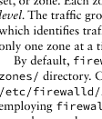

`D-Bus` 是消息总线守护进程。它在系统范围或每个会话基础上提供两个应用程序之间的通信服务。它还可以注册以接收事件通知，使其成为一个强大的通信工具。`firewalld` 服务使用 `dbus` Python 库模块来集成 `D-Bus` 服务。

`firewalld` 的一个核心部分是`区域`。网络流量被分组到预定义规则集，即`区域`。每个区域都有一个配置文件，定义此规则集，也称为`信任级别`。流量分组可以是系统的网络接口或源地址范围，后者识别来自其他系统的流量。每个网络连接一次只能是一个区域的成员。

默认情况下，`firewalld` 区域配置文件存储在 `/usr/lib/firewalld/zones/` 目录中。自定义或用户创建的区域配置文件存储在 `/etc/firewalld/zones/` 目录中。表 18.1 显示了使用 `firewalld` 的系统上预定义的区域。区域按最不受信任到最受信任的网络连接顺序列出。

## 表 18.1 预定义的 firewalld 区域

| 名称 | 描述 |
| :--- | :--- |
| `drop` | 丢弃所有传入网络数据包。仅允许出站网络连接。 |
| `block` | 仅接受源自本系统的网络连接。拒绝传入网络数据包，并发送 `icmp-host-prohibited` 或 `icmp6-adm-prohibited` 消息。 |
| `public` | 仅接受选定的传入网络连接。通常用于公共环境，其中网络上的其他系统是不可信的。 |
| `external` | 行为类似于 `public`，但通常用于外部网络，且为本地系统启用了伪装。 |
| `dmz` | 行为类似于 `public`，但用于非军事区（demilitarized zone），该区域可公开访问，且对内部网络的访问受到限制。 |
| `work` | 仅接受选定的传入网络连接。通常用于工作环境，其中网络上的其他系统大多是可信的。 |
| `home` | 行为类似于 `work`，但用于家庭环境，其中网络上的其他系统大多是可信的。 |
| `internal` | 行为类似于 `work`，但通常用于内部网络，其中网络上的其他系统大多是可信的。 |
| `trusted` | 接受所有网络连接。 |

`firewall-cmd` 实用程序允许您查看和操作各种 `firewalld` 配置设置。例如，要查看系统上的所有预定义区域，请使用 `--get-zones` 选项，如图 18.1 所示（在 Rocky Linux 发行版中）。

### 图 18.1：使用 `firewall-cmd` 命令查看预定义区域

```bash
$ firewall-cmd --get-zones
block dmz drop external home internal public trusted work

$
$ ls /usr/lib/firewalld/zones
block.xml drop.xml home.xml public.xml work.xml
dmz.xml external.xml internal.xml trusted.xml
$
```


`firewalld` 配置文件使用可扩展标记语言 (XML)。尽管您可能想直接编辑这些文件，但最好使用 `firewall-cmd` 实用程序来修改和管理防火墙配置。

`NetworkManager` 也与 `firewalld` 集成。因此，当通过 `NetworkManager` 添加新的网络设备时，`firewalld` 会自动将其分配给`默认区域`。`默认区域`通常预设`为公共区域`，但可以使用 `firewall-cmd` 实用程序进行自定义。您可以查看系统当前的默认区域，如图 18.2 所示。

### 图 18.2：使用 `firewall-cmd` 命令查看默认区域

```bash
$ firewall-cmd --get-default-zone
public
$
```

如果您需要不同的`默认区域`，您可以对其进行更改。只需使用超级用户权限并使用 `--set-default-zone=zone` 选项即可。

您还可以查看当前所有活动区域及其流量分组。只需使用 `--get-active-zones` 开关即可，如图 18.3 所示。

### 图 18.3：使用 `firewall-cmd` 命令查看活动区域

```bash
$ firewall-cmd --get-active-zones
public
    interfaces: enp0s8
$
```


如果需要，您可以使用图形化`firewalld`配置实用程序 `firewall-config`，而不是使用命令行实用程序。通常，只需在 GUI 的搜索框中输入`firewall`即可在 firewalld 系统上轻松找到此实用程序。

除了区域外，`firewalld` 还使用`服务`。服务是为特定提供的系统服务（如 DNS）预定义的配置集。配置信息可能包含端口列表、协议等项目。例如，DNS 服务配置集表示 DNS 在端口 53 上使用 `TCP` 和 `UDP` 协议。图 18.4 显示了 Rocky Linux 发行版上各种预定义服务的片段列表。

### 图 18.4：使用 `firewall-cmd` 命令查看预定义服务

```bash
$ firewall-cmd --get-services
[...]
amanda-client amanda-k5-client bacula bacula-client
[...]
dhcpd dhcp6 dhcpv6-client dns docker-registry
[...]
$
$ ls -1 /usr/lib/firewalld/services
amanda-client.xml
amanda-k5-client.xml
bacula-client.xml
bacula.xml
[...]
dhcp.xml
dns.xml
[...]
$
```

使用 `firewalld` 服务可以为特定提供的系统服务提供更简单的防火墙配置，因为您可以直接将它们分配给某个区域。图 18.5 显示了一个示例。

### 图 18.5：将 DNS 服务分配给 dmz 区域

```bash
# firewall-cmd --add-service=dns --zone=dmz
success
#
# firewall-cmd --list-services --zone=dmz
ssh dns
#
```

> **提示**：在紧急情况下，您可以快速禁用通过 firewalld 的所有网络流量。使用超级用户权限并在命令行中发出命令 `firewall-cmd --panic-on`。一旦情况稳定下来，您可以通过输入 `firewall-cmd --panic-off` 重新启用网络流量。

当您修改 `firewalld` 配置时，默认情况下您正在修改`运行时`环境。运行时环境是 `firewalld` 服务当前正在使用的配置。

另一个 `firewalld` 环境是`永久`环境。此环境是存储在配置文件中的防火墙配置。它在系统启动时（或 `firewalld` 重新启动或重新加载时）加载，并成为活动运行时环境。

这两个 `firewalld` 环境各有其用途。永久环境适用于生产环境，而运行时配置适用于测试防火墙设置更改。

如果您已在运行时环境中测试了防火墙配置更改并希望使其永久化，则很容易做到。只需使用超级用户权限发出 `firewall-cmd --runtime-to-permanent` 命令。如果您确信您的运行时环境配置修改是正确的，则可以在 `firewall-cmd` 命令后附加 `--permanent` 选项。这会将更改同时添加到运行时和永久环境。有关更多信息，请参阅 `firewall-cmd` 命令的手册页。

> **注意**
>
> `iptables` 服务不应与 `firewalld` 同时运行。这在 systemd 系统上很容易显示出来。使用超级用户权限并输入 `systemctl show --property=Conflicts firewalld` 命令。您将在输出中看到 `iptables.service` 列为冲突项。此外，尽管在许多 `firewalld` 系统上仍然可以使用 `iptables` 命令，但不建议使用它。代替 `iptables` 命令，请使用 `firewall-cmd` 或 `firewall-config` 实用程序来设置和管理您的防火墙配置。如果您实在无法放下过去，请带有 `--direct` 开关使用 `firewall-cmd` 命令。这允许您使用 `firewall` 直接接口并使用类似于 `iptables` 命令的操作。文档指出，直接接口应仅作为最后手段使用。

## 调查 `iptables`

`iptables` 防火墙服务使用一系列称为`链`的过程来处理进入系统的网络数据包。这些链决定了每个数据包在进入 Linux 系统到达适当应用程序时所经过的路径。当应用程序将数据包发回网络以发送给远程客户端时，这些链也参与其中。图 18.1 显示了在 Linux 系统上处理网络数据包时涉及的不同链。

请注意图 18.1 中有五个独立的链用于处理数据包：

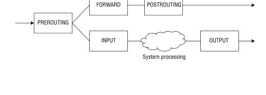

- `PREROUTING` 在路由决策过程之前处理数据包。

- `INPUT` 处理目的地位于本地系统的数据包。

- `FORWARD` 处理转发到远程系统的数据包。

- `POSTROUTING` 在转发过滤器之后处理发送到远程系统的数据包。

- `OUTPUT` 处理从本地系统输出的数据包。

每个链都包含`表`，这些表定义了处理数据包的规则。有五种表类型：

- `filter` 应用规则以允许或阻止数据包离开该链。

- `mangle` 应用规则以在数据包离开该链之前更改其特性。

- `nat` 应用规则以在数据包离开该链之前更改其地址。

- `raw` 应用 `NOTRACK` 设置于无需跟踪的数据包。

- `security` 应用强制访问控制规则。

实现网络地址转换 (NAT) 需要使用 `nat` 表在 `OUTPUT` 链中更改数据包地址。实现防火墙稍微复杂一些，因为您在此过程中对 `INPUT`、`OUTPUT` 和 `FORWARD` 链应用`filter` 表。这提供了多个位置来阻止数据包。

每个链还有一个`策略`值。策略条目定义了对该链的数据包在不适用任何规则时默认的处理方式。有两种不同的策略值：

- `ACCEPT`：将数据包传递到下一个链。

- `DROP`：不将数据包传递到下一个链。

您用来查看和更改 `iptables` 服务中链和过滤器的工具是 `iptables` 命令。表 18.2 显示了常用的 `iptables` 命令行选项。

## 表 18.2 iptables 命令的常用选项

| 选项 | 描述 |
| :--- | :--- |
| `-L [chain]` | 列出此`链`中的规则。如果未指定`chain`，则列出所有链中的所有规则。 |
| `-S [chain]` | 列出此`链`中规则的详细信息。如果未指定`chain`，则列出所有链中所有规则的详细信息。 |
| `[-t table]` | 将命令应用于此`table`。如果未指定 `-t table`，则将命令应用于`filter` 表。 |
| `-A chain rule` | 将此新`规则`添加到此`链`。 |
| 选项 | 描述 |
| :--- | :--- |
| `-I chain index rule` | 将此`新规则`插入到此`链`的此`索引`位置。 |
| `-D chain rule` | 将此`规则`从此`链`中删除。 |
| `-R chain index rule` | 将此`规则`从此`链`的此`索引`位置移除。 |
| `-F [chain]` | 移除（刷新）此`链`中的所有`规则`。如果未指定`链`，则移除所有`链`中的所有`规则`。 |
| `-P chain policy` | 为此`链`定义此默认`策略`。 |

若要快速查看过滤表中的链和规则，请使用超级用户权限并在 `iptables` 命令上加上 `-L` 选项。Listing 18.6 展示了 Fedora 系统上的一个片段示例。

### Listing 18.6: 查看过滤表的链和规则

```bash
$ sudo iptables -L
Chain INPUT (policy ACCEPT)
target     prot opt source               destination
ACCEPT     udp  --  anywhere             anywhere            udp dpt:domain
[...] 
Chain OUTPUT (policy ACCEPT)
target     prot opt source               destination
ACCEPT     udp  --  anywhere             anywhere            udp dpt:bootpc
OUTPUT_direct all  --  anywhere             anywhere
$
```


请注意，在这种情况下不需要`-t filter`选项。这是因为`iptables`命令默认将命令应用于过滤表。


如果你想阻止所有从Linux系统发出的数据包，只需将默认的`OUTPUT`链更改为`DROP`策略。请小心，如果你是通过`ssh`进入系统的，这将导致你的连接数据包也被丢弃！Listing 18.7展示了在Fedora系统上阻止所有出站数据包的片段示例。请注意，在此修改后，`ping`命令的操作不再被允许。

### Listing 18.7 使用 `iptables` 命令丢弃所有出站数据包

```bash
$ sudo iptables -P OUTPUT DROP
$
$ ping -c 3 192.168.0.105
PING 192.168.0.105 (192.168.0.105) 56(84) bytes of data.
ping: sendmsg: Operation not permitted
[.. .]
$ sudo iptables -P OUTPUT ACCEPT
$
$ ping -c 3 192.168.0.105
PING 192.168.0.105 (192.168.0.105) 56(84) bytes of data.
64 bytes from 192.168.0.105: icmp_seq=1 ttl=64 time=0.062 ms
[.. .]
$
```

在Listing 18.7中，当默认的`OUTPUT`链改回`ACCEPT`策略后，`ping`数据包被允许通过。

> `iptables`服务防火墙仅通过`iptables`命令管理IPv4数据包。如果你有IPv6数据包经过你的网络，你也必须使用`ip6tables`命令。

要更改链规则，你需要在`iptables`命令中使用一些额外的命令行选项。这些规则选项如表18.3所示。

### TABLE 18.3 `iptables` 命令常用的链选项

| 选项 | 描述 |
| :--- | :--- |
| `-d address` | 仅对具有此目标地址的数据包应用规则 |
| `-s address` | 仅对具有此源地址的数据包应用规则 |
| `-i name` | 仅对通过`name`网络接口进来的数据包应用规则 |
| `-o name` | 仅对通过`name`网络接口出去的数据包应用规则 |
| `-p protocol` | 仅对使用此协议的数据包应用规则，如`tcp`、`udp`或`icmp` |
| `-j target` | 将此目标动作（规则）应用于选定的数据包 |

表18.3中的`-j`选项需要稍作解释。这是实际应用于已识别数据包的规则。最常用的不同`target`值如下：

-   `ACCEPT`：将数据包传递到下一个链。
-   `DROP`：不将数据包传递到下一个链。
-   `REJECT`：不传递数据包，并向发送方发送拒绝通知。

将规则组合起来并添加到链中有点棘手，因此一个例子会有帮助。在片段Listing 18.8中，显示了一个IP地址为`192.168.0.104`的Ubuntu系统成功地向IP地址为`192.168.0.105`的远程Fedora系统发送`ping`。

### Listing 18.8: 成功向远程系统发送 ping

```bash
$ ip addr show | grep 192.168.0.104
inet 192.168.0.104/24 brd 192.168.0.255 [...] enp0s8
$
$ ping -c 1 192.168.0.105
PING 192.168.0.105 (192.168.0.105) 56(84) bytes of data.
64 bytes from 192.168.0.105: icmp_seq=1 ttl=64 time=0.305 ms

--- 192.168.0.105 ping statistics ---
1 packets transmitted, 1 received, 0% packet loss, time 0ms
rtt min/avg/max/mdev = 0.305/0.305/0.305/0.000 ms
$
```

现在，在Fedora系统上，使用超级用户权限，发出以下命令：`sudo iptables -I INPUT -s 192.168.0.104 -j REJECT`

这条新规则将被插入（`-I`）到`INPUT`链的过滤表中，索引为1（链中的第一条规则）。任何来自源（`-s`）地址`192.168.0.104`（Ubuntu系统）的数据包都将被拒绝（`REJECT`）。现在既然此规则已就位，当Ubuntu系统尝试`ping`Fedora系统时，它将失败，如片段Listing 18.9所示。

### Listing 18.9: 阻止向阻止数据包的远程系统发送 ping

```bash
$ ping -c 1 192.168.0.105
PING 192.168.0.105 (192.168.0.105) 56(84) bytes of data.
From 192.168.0.105 icmp_seq=1 Destination Port Unreachable

--- 192.168.0.105 ping statistics ---
1 packets transmitted, 0 received, +1 errors, 100% packet loss, time 0ms
$
```


你不必局限于`iptables`的默认链——你实际上可以创建自己的链。如果你想使用`LOG`目标创建特定数据包的日志文件，这尤其有用。请在`iptables`以及`iptables-extensions`的手册页中查找更多详细信息。

虽然你不需要重新加载`iptables`服务才能让新修改的规则生效，但这些规则没有*持久性*。换句话说，如果系统重启或`iptables`服务重新启动，你将丢失所有这些新增或修改的ACL规则。

只要`iptables`服务被启用以在系统启动时启动，Red Hat和基于Red Hat的发行版（如Fedora和Rocky Linux）将自动加载存储在这些文件中的`iptables`规则：

-   IPv4规则：`/etc/sysconfig/iptables`
-   IPv6规则：`/etc/sysconfig/ip6tables`

Debian和基于Debian的发行版（如Ubuntu）需要安装并启用额外的软件包`iptables-persistent`。此包用于加载持久规则的文件如下：

-   IPv4规则：`/etc/iptables/rules.v4`
-   IPv6规则：`/etc/iptables/rules.v6`


你不会在本书推荐的发行版版本中找到`iptables`服务的这些规则文件，因为它们使用较新的防火墙技术。如果需要，你可以使用Fedora版本20或更早版本来玩弄这些`iptables`文件。

如果你需要保存当前的`iptables`规则，请使用`iptables-save`命令。由于默认情况下它会将规则发送到STDOUT，因此此实用程序需要将其输出重定向到文件。

要恢复保存的`iptables`规则，请使用`iptables-restore`命令。此实用程序需要将其输入从文件重定向。因此，如果你在测试一个工作不佳的ACL更改，你可以快速恢复`iptables`的原始规则。在较旧的Fedora发行版中，你使用超级用户权限并发出`iptables-restore < /etc/sysconfig/iptables`命令来恢复所有原始IPv4规则。

## 探索 nftables

你可能已经注意到，在`iptables`中创建规则的格式有时会变得相当复杂，尤其是与`firewalld`等工具相比。`nftables`服务是一个很好的折中方案。

`nftables`服务提供了类似`iptables`的低级访问`netfilter`链的能力，使其极其高效且快速。然而，`nftables`中构建规则的命令语法已简化，使其更易于使用。

`nftables`服务利用与`iptables`相同的表、链、策略和规则概念。你可以使用`nft`命令的`list`选项列出已定义的现有表，如Listing 18.10所示。

### 清单 18.10：在 nftables 中列出表

```bash
$ sudo nft list tables
table ip filter
table ip6 filter
table bridge filter
table ip security
table ip raw
table ip mangle
table ip nat
table ip6 security
table ip6 raw
table ip6 mangle
table ip6 nat
table bridge nat
table inet firewalld
table ip firewalld
table ip6 firewalld
$
```

请注意，在Red Hat系统中，`firewalld`服务会在`netfilter`中创建自己的表，而`nftables`能够检测到这些表。要创建一个新表，请在`nft`中使用`add table`选项，如清单18.11所示。

### 清单 18.11：使用 nftables 创建新表

```bash
$ sudo nft add table ip rich
$ sudo nft list tables ip
table ip filter
table ip security
table ip raw
table ip mangle
table ip nat
table ip firewalld
table ip rich
$ sudo nft list table ip rich
table ip rich {
}
$
```

`add`命令创建了名为`rich`的表，但如清单18.11所示，该表默认为空。

创建表后，下一步是创建链（chains），其中将包含您为防火墙定义所设定的规则。正如您预期的一样，`add chain`选项用于执行此操作。`add chain`选项的基本格式如下：

```text
nft add chain [family] table_name chain_name { type type hook hook priority value ; [policy policy ;] [comment "text comment" ;] }
```

`type`值可以是`filter`、`router`或`nat`（与`iptables`相同），而`hook`值可以是`prerouting`、`input`、`forward`、`output`或`postrouting`（同样与`iptables`相同）。`priority`值决定了链的处理顺序；较低的优先级值会先被处理。`policy`值可以是`accept`或`drop`。清单18.12展示了创建链的一个示例。

### 清单 18.12：使用 nftables 创建新链

```bash
$ sudo nft 'add chain ip rich test { type filter hook input priority 0; policy drop; }'
$ sudo nft list table ip rich
table ip rich {
    chain test {
        type filter hook input priority 0; policy drop;
    }
}
$
```

如清单18.12所示，您必须用单引号将`add chain`命令括起来。此链的默认策略设置为`drop`，因此除非匹配到指示不同的规则，否则所有传入的数据包都将被丢弃。

一旦创建了链，您就可以使用`add rule`选项为链定义要应用的规则。规则的格式是`nftables`的一个卖点。该格式使用简单的语法，类似于流行的`tcpdump`监控程序所使用的语法。清单18.13展示了一个添加允许SSH流量的规则的示例。

### 清单 18.13：使用 nftables 添加新规则

```bash
$ sudo nft 'add rule ip rich test tcp dport ssh accept'
$ sudo nft list table ip rich
table ip rich {
    chain test {
        type filter hook input priority 0; policy drop;
        tcp dport 22 accept
    }
}
$
```

清单18.13显示规则已被添加到`test`链中。然后，您可以在同一链中创建额外的规则，或者创建具有不同优先级的额外链来包含更多规则。

要从表中删除规则，请使用`flush`表选项：

```bash
$ sudo nft flush table ip rich
$ sudo nft list table ip rich
table ip rich {
    chain test {
        type filter hook input priority 0; policy drop;
    }
}
$
```

要从表中删除链，请使用`delete chain`选项。要删除整个表，请使用`delete table`选项：

```bash
$ sudo nft delete table ip rich
$ sudo nft list tables ip
table ip filter
table ip security
table ip raw
table ip mangle
table ip nat
table ip firewalld
$
```


> 如果您决定使用`nftables`作为防火墙，建议禁用其他防火墙软件，例如`iptables`、`firewalld`或`ufw`。因为它们都使用相同的`netfilter`服务，每个防火墙配置中的规则可能会发生冲突——或者至少当您试图弄清楚为何某些内容被阻止或允许时，会使事情变得极其复杂。

## 了解 UFW

Ubuntu发行版的默认防火墙服务是简单防火墙（UFW）。它可以通过`ufw`命令行实用程序或GUI中的`Gufw`进行配置。


默认情况下，UFW服务是禁用的。您可以使用`sudo ufw enable`命令启动服务并设置其在启动时自动运行，但不要使用系统初始化工具，如`sysv-rc-conf`。这是因为此处涵盖的防火墙服务不是传统的SysV或systemd服务，而是`netfilter`防火墙的接口服务。因此，如果您选择启动UFW，请注意`iptables`或`firewalld`服务不能处于运行状态。

有几种UFW命令可以让您控制防火墙的状态以及查看其状态。这些命令显示在表18.4中。每一个命令都需要超级用户权限。

### 表 18.4 用于控制状态和查看状态的 ufw 命令

| 命令 | 描述 |
| :--- | :--- |
| `ufw enable` | 启动UFW防火墙并启用其在系统启动时启动 |
| `ufw disable` | 停止UFW防火墙并禁用其在系统启动时启动 |
| `ufw reset` | 禁用UFW防火墙并将其重置为安装默认设置 |
| `ufw reload` | 重新加载UFW防火墙 |
| `ufw status` | 显示UFW防火墙的当前状态 |

要查看UFW服务的当前状态，如果需要比仅`status`提供的更多信息，请使用`sudo ufw status verbose`。启用UFW防火墙服务并查看其当前状态的片段显示在清单18.14中。

### 清单 18.14 启用 UFW 并查看其状态

```bash
$ sudo ufw enable
[...]
Firewall is active and enabled on system startup
$
$ sudo ufw status verbose
Status: active
Logging: on (low)
Default: deny (incoming), allow (outgoing), disabled (routed)
New profiles: skip
$
```

查看UFW防火墙的冗长状态提供的信息有助于解释其配置：

-   **状态**：UFW服务正在运行并将在系统启动时启动（`active`），或者服务已停止且系统启动不会改变此状态（`disabled`）。
-   **日志记录**：该服务的日志记录功能可以设置为`off`；记录所有被阻止的数据包（`low`），这是默认设置；记录所有被阻止、无效、无策略匹配和新连接的数据包（`medium`），并施加速率限制；记录`medium`日志级别的数据包和所有其他数据包（`high`），并施加速率限制；以及记录所有内容且不施加速率限制（`full`）。
-   **默认值**：显示传入、传出和路由数据包的默认策略，这些策略可以设置为允许数据包、丢弃（`deny`）数据包，或拒绝数据包并发送拒绝消息。
-   **新配置文件**：显示自动将新配置文件加载到防火墙的默认策略，可以设置为`ACCEPT`、`DROP`、`REJECT`或`SKIP`，其中`ACCEPT`被视为安全风险。


各种默认 UFW 策略存储在 `/etc/default/ufw` 配置文件中。首次安装时，这些设置允许所有传出连接并阻止所有传入连接。您可以使用 `ufw` 命令及其各种参数根据需要修改防火墙。表 18.5 展示了一些常用参数。

### 表 18.5 ufw 命令的常用参数

| 参数 | 描述 |
| :--- | :--- |
| `allow <Identifiers>` | 将 `<Identifiers>` 标识的规则设置为允许数据包 |
| `deny <Identifiers>` | 将 `<Identifiers>` 标识的规则设置为拒绝（丢弃）数据包 |
| `reject <Identifiers>` | 将 `<Identifiers>` 标识的规则设置为拒绝数据包 |
| `delete RULE \| NUM` | 删除由 `RULE` 或 `NUM` 标识的规则 |
| `insert NUM RULE` | 在索引 `NUM` 处插入规则 |
| `default POLICY DIRECTION` | 修改默认 `DIRECTION` 策略，其中 `POLICY` 为 `allow`、`deny` 或 `reject`，`direction` 为 `incoming`、`outgoing` 或 `routed` |
| `logging LEVEL` | 设置日志记录级别，其中 `LEVEL` 为 `on`、`off`、`low`（默认）、`medium`、`high` 或 `full` |

在创建新的 UFW 规则时，您可以使用简单或完整语法。简单语法涉及仅使用端口号或其服务名称来指定规则。您还可以将协议添加到端口号中，如清单 18.15 所示。

## 列表 18.15：使用 ufw 简单语法添加 ACL 规则

```bash
$ sudo ufw allow 22/tcp
Rule added
Rule added (v6)
$
$ sudo ufw status
Status: active
To   Action   From
--   ------   ----
22/tcp   ALLOW   Anywhere
22/tcp (v6)   ALLOW   Anywhere (v6)
```

请注意，当添加规则时，应用了两条规则——一条用于 IPv4 数据包，另一条用于 IPv6 数据包。使用完整语法时，有很多选项可用。例如，你可以采用表格 18.6 中列出的设置。

### 表格 18.6：ufw 命令完整语法的常用设置

| 设置 | 描述 |
| :--- | :--- |
| `comment "字符串"` | 对于被拒绝的流量显示此注释 |
| `in` | 规则仅应用于入站流量 |
| `out` | 规则仅应用于出站流量 |
| `proto 协议` | 规则应用于此 `协议` |
| `port 端口号` | 规则应用于此 `端口号` |
| `from 源` | 规则来自此 `源` 的流量，该源可以是单个 IP 地址、子网或任意流量 |
| `on 接口` | 规则应用于此网络 `接口` 上的流量 |
| `to 目的` | 规则应用于去往此 `目的` 的流量，该目的可以是单个 IP 地址、子网或任意流量 |

> **注意**
>
> 在添加、删除或修改规则后，无需发出 `ufw reload` 命令。更改会自动生效。

你可以通过服务名称（例如 `telnet`）使用 `ufw` 命令来指定规则。这样做时，`ufw` 会检查 `/etc/services` 文件以确定该服务的适当端口和协议信息。

使用 UFW 完整语法的示例在列表 18.16 中显示。在这种情况下，来自 `192.168.0.0` C 类子网中任何系统的数据包将被拒绝访问此系统的 `80` 端口。

### 列表 18.16：使用 ufw 完整语法添加 ACL 规则

```bash
$ sudo ufw deny from 192.168.0.0/24 to any port 80
Rule added
$
$ sudo ufw show added
Added user rules (see 'ufw status' for running firewall):
ufw allow 22/tcp
ufw deny from 192.168.0.0/24 to any port 80
$
```

可以使用 `ufw show added` 命令查看任何用户添加的规则，如列表 18.16 所示。UFW 规则存储在 `/etc/ufw/` 目录中，用户添加的规则被放置在该目录内的 `user.rules` 文件中，如列表 18.17 所示。

### 列表 18.17：显示 `/etc/ufw/` 目录的内容

```bash
$ ls /etc/ufw/
after6.rules applications.d before.rules user6.rules
after.init before6.rules sysctl.conf user.rules
after.rules before.init ufw.conf
$
```

如果需要删除规则，最简单的方法是通过规则编号进行。首先通过编号查看规则，然后使用 `ufw delete` 命令，如列表 18.18 所示。

### 列表 18.18：通过编号删除规则

```bash
$ sudo ufw status numbered
Status: active

  To                 Action     From
  --                 ------     ----
  [ 1] 22/tcp         ALLOW IN   Anywhere
  [ 2] 80             DENY IN    192.168.0.0/24
  [ 3] 22/tcp (v6)    ALLOW IN   Anywhere (v6)

$ sudo ufw delete 2
Deleting:
deny from 192.168.0.0/24 to any port 80
Proceed with operation (y/n)? y
Rule deleted
$
```

UFW 为常见应用程序和守护程序使用 `配置`。这些配置存储在 `/etc/ufw/applications.d/` 目录中。使用 `ufw app list` 命令查看当前可用的 UFW 应用程序配置。示例在列表 18.19 中显示。

### 列表 18.19：查看可用的 UFW 应用程序配置

```bash
$ sudo ufw app list
Available applications:
  CUPS
  OpenSSH
$ sudo ufw app info OpenSSH
Profile: OpenSSH
Title: Secure shell server, an rshd replacement
Description: OpenSSH is a free implementation[...]
Port:
  22/tcp
$
```

你还可以查看这些配置的详细信息，如列表 18.19 中也可所见。配置不仅提供应用程序文档，还允许你修改应用程序使用的端口和协议，以及为系统需求创建非典型的应用程序配置。


> 不要修改 `/etc/ufw/applications.d/` 目录中的配置。相反，在该目录下创建一个子目录并命名为 `custom.d`。这将防止你的自定义配置在 UFW 软件包更新期间被覆盖。有关配置规范的更多细节，请参见 `ufw` 手册页。

一旦你创建了新的配置或更新了旧配置，请使用 `ufw app update all` 命令来更新 UFW 以适应配置更改。此外，当使用配置指定规则的端口和协议时，在创建新规则的语法中，你必须使用 `app` 而不是 `port`。

## 转发 IP 数据包

Linux 中有一个数据包转发功能。此功能用于各种目的，例如允许 Linux 将数据包转发到远程主机，或用于 IP 伪装。在使用该功能之前，必须在内核中启用数据包转发。要启用该功能，只需为 IPv4 设置 `ip_forward` 项，或为 IPv6 设置 `forwarding` 项。你可以使用 `sysctl` 命令做到这一点：

```bash
sudo sysctl -w net.ipv4.ip_forward=1
sudo sysctl -w net.ipv6.conf.all.forwarding=1
```

你可以使用 `cat` 命令在 `/proc` 文件系统条目中检查当前的内核值。如果文件包含数字 `1`，则表示该功能已启用，如列表 18.20 所示；如果禁用，则文件将包含数字 `0`。

### 列表 18.20：查看数据包转发文件

```bash
$ cat /proc/sys/net/ipv4/ip_forward
1
$ cat /proc/sys/net/ipv6/conf/all/forwarding
1
$
```

一旦设置了这些内核值，你的 Linux 系统就能够将一个网络接口的流量转发到另一个网络接口。如果 Linux 系统上有多个网络接口，它会通过路由表知道使用哪个接口将流量发送到远程主机。路由表在第 7 章“配置网络连接”中已涉及。

## 动态设置规则

在保护系统时，拥有监控网络和系统上运行应用程序的软件有助于发现可疑行为。这些应用程序称为 `入侵检测系统`（IDS）。一些 IDS 应用程序允许你动态更改规则，以阻止这些攻击。DenyHosts 和 Fail2Ban 是两个这样的 IDS 程序。

防火墙工具箱中另一个有用的工具是允许你快速更改规则而无需反复输入长 IP 地址或 MAC 地址的工具。IPset 可以帮助解决此问题。

### DenyHosts

DenyHosts 应用程序是一个 Python 脚本，有助于保护系统免受通过 OpenSSH 进行的暴力破解攻击。该脚本可以作为服务运行，也可以作为 `cron` 任务运行。

它监控发行版认证日志文件中的 `sshd` 日志消息，例如 `/var/log/secure` 和 `/var/log/auth.log`。如果发现来自同一主机的重复认证失败尝试，它通过 `/etc/hosts.deny` 文件阻止该 IP 地址。

要配置 DenyHosts，你需要修改其 `/etc/denyhosts.conf` 文件。你还需要准备好 TCP Wrappers 文件 `/etc/hosts.allow` 和 `/etc/hosts.deny`。


> DenyHosts 仅适用于 IPv4 OpenSSH 流量。对于其他流量，你需要使用不同的工具。此外，请注意，一些发行版软件包仓库声称 DenyHosts 不再被开发。因此，请谨慎安装和使用。

### Fail2Ban

Fail2Ban 服务也监控系统日志，查找来自同一主机的重复失败。如果检测到问题，Fail2Ban 可以阻止违规主机的 IP 地址访问你的系统。虽然 DenyHosts 仅支持 TCP Wrappers，但 Fail2Ban 可以支持 TCP Wrappers、`iptables`、`firewalld` 等。

`fail2ban-client` 程序监控系统和应用程序日志，查找问题。它监控常见的系统日志文件，如 `/var/log/pwdfail` 和 `/var/log/auth.log` 日志文件，查找多次登录失败。当检测到某个用户账户有太多登录失败尝试时，它会阻止该用户账户尝试登录的主机访问。

Fail2Ban 的一个很棒功能是可以监控单个应用程序日志文件，例如 Apache Web 服务器的 `/var/log/apache/error.log` 日志文件。就像系统日志文件一样，如果 Fail2Ban 检测到来自同一远程主机的连接尝试或错误过多，它将阻止该主机的访问。

`/etc/fail2ban/jail.conf` 文件包含 Fail2Ban 配置。它定义要监控的应用程序、它们的日志文件位置以及在检测到问题时采取的操作。


> 使用 Fail2Ban 的缺点是它可能会出现误报，即在真正没有问题的情况下检测到问题。这可能导致它阻止合法客户端访问系统。幸运的是，Fail2Ban 足够强大，你可以配置它在设定时间后解除阻止，以允许客户端正确重新连接。

### IPset

IPset 是 IP 地址、网络接口、端口、MAC 地址或子集的命名集合。通过创建这些集合，你可以轻松管理通过防火墙和其他支持 IPset 的应用程序进行分组。

`ipset` 实用程序用于管理 IPset（IP 集合），并需要超级用户权限。创建 IPset 时，你需要先确定要为其赋予的名称。之后，决定你希望如何存储该 IPset。你的存储选项包括 `bitmap`（位图）、`hash`（哈希）或 `list`（列表）。通过 `ipset` 命令创建 IPset 有两种方式：

```bash
ipset create IPset-Name storage-method:set-type
ipset -N IPset-Name storage-method:set-type
```

清单 18.21 展示了在 Rocky Linux 发行版上创建子网 IPset 并向其中添加成员的示例。

### 清单 18.21：创建并填充子网 IPset

```bash
# ipset create BadGuyNets hash:net
#
# ipset add BadGuyNets 1.1.1.0/24
# ipset -A BadGuyNets 2.2.0.0/15
#
```

一旦你完成了 IPset 的成员填充，你就可以检查你的成果。只需使用 `ipset list` 命令，如清单 18.22 中的片段所示。

### 清单 18.22：查看子网 IPset

```bash
# ipset list
Name: BadGuyNets
Type: hash:net
[...]
Members:
1.1.1.0/24
2.2.0.0/15
```

创建并填充 IPset 后，在 `iptables` 或 `firewalld` ACL 规则中阻止该 IPset。为了使 IPset 持久化，你可以通过 `ipset save` 命令保存它，并将其 STDOUT（标准输出）重定向到 `/etc/ipset.conf` 文件，或者使用 `-f` 选项。


创建 IPset 后，你需要启动 `ipset` 服务。然而，在 systemd 系统上，你可能找不到用于启动或启用的服务文件。因此，如果你的发行版使用 systemd，你需要创建 `ipset.service` 文件，或者从可靠来源获取该文件。

你可以使用 `ipset del` 命令从命名 IPset 中删除单个条目。要删除整个 IPset，你需要销毁它，如清单 18.23 所示。

### 清单 18.23：删除子网 IPset

```bash
# ipset destroy BadGuyNets
#
# ipset list
#
```


只有 `firewalld` 和 `iptables` 服务命令直接支持 IPset。然而，你可以将 IPset 与 UFW 配合使用，但这需要多做一点工作。你必须修改 `/etc/ufw/` 目录中的 `before.init` 和 `after.init` 脚本。请查阅 `ufw-framework` 的手册页以了解有关这些脚本的更多信息。

## 摘要

正确管理系统的防火墙应用程序及其数据包过滤 ACL（访问控制列表）对于保障系统安全至关重要。为此，你必须了解防火墙软件的底层框架、如何修改其 ACL 规则，以及可以与该软件一起使用哪些附加应用程序来阻止恶意网络流量。使用正确的产品并正确配置它们不仅有助于保持系统安全，还能使你的工作变得更加轻松。

## 考试要点

**总结各种防火墙功能。** 防火墙 ACL 识别允许进入或离开网络的哪些数据包。无状态防火墙查看每个数据包的控制信息，并根据定义的 ACL 规则决定如何处理该数据包。有状态防火墙跟踪活动的网络连接，例如 `TCP` 和 `UDP`；监控网络状态；并可以判断数据包是否已分片。防火墙采用 `/etc/services` 文件，该文件记录了不同的标准应用程序服务名称及其对应的端口号、协议和别名。

**描述 firewalld 及其命令。** 对于 `firewalld` 服务，网络流量被分组到一个区域（zone）中，该区域是一组预定义的规则集。每个区域都有一个配置文件来定义此规则集，也称为信任级别。`firewalld` 区域配置文件存储在 `/usr/lib/firewalld/zones/` 目录中。自定义或用户创建的区域配置文件存储在 `/etc/firewalld/zones/` 目录中。对于 `firewalld`，服务是为特定服务（如 DNS）预定义的配置集。当你修改 `firewalld` 配置时，默认情况下你修改的是运行时环境，即当前活动状态。永久环境是配置文件中的防火墙设置。`firewall-cmd` 实用程序允许你查看并与 `firewalld` 进行交互。

**描述 iptables 及其命令。** `iptables` 防火墙服务使用称为 `链`（chains）的一系列过程来处理进入系统的网络数据包。这些链决定了每个数据包在进入 Linux 系统时到达相应应用程序所经过的路径。每个链都有一个策略值，并包含定义处理数据包规则的表。`iptables` 中的 ACL 规则为识别出的数据包提供了目标值，这些值决定了对它们采取的操作。`iptables` 命令允许你查看和交互各种 `iptables` 配置设置。


# 描述 UFW 及其命令

简单防火墙（Uncomplicated Firewall，UFW）是 Ubuntu 发行版上的默认防火墙服务。它通过 `ufw` 命令行实用程序或用于图形界面的 `Gufw` 进行配置。默认的 UFW 策略存储在 `/etc/default/ufw` 配置文件中。创建新的 UFW 规则时，你可以使用简单或完整语法。用户添加的 UFW 规则存储在 `/etc/ufw/user.rules` 文件中。UFW 为常见应用程序和守护进程使用配置文件，它们存储在 `/etc/ufw/applications.d/` 目录中。

## 解释如何动态更改数据包过滤

`DenyHosts` 应用程序是一个 Python 脚本，它有助于保护系统免受通过 `OpenSSH` 发起的暴力破解攻击。它监控 `sshd` 日志消息，并修改 `/etc/hosts.deny` 文件以阻止已识别的攻击。`Fail2Ban` 服务也监控系统日志，查找来自同一主机的重复失败。如果检测到问题，`Fail2Ban` 会阻止违规主机的 IP 地址。`IPset` 是一组命名的 IP 地址、网络接口、端口、MAC 地址或子网。通过创建这些集合，你可以轻松通过防火墙阻止这些分组。

## 复习题

- 关于本章中介绍的 Linux 防火墙，以下哪些说法是正确的？（选择所有适用项。）
  - A. 它们使用 ACL 来允许数据包。
  - B. 它们检测恶意行为。
  - C. 它们检查网络数据包的控制信息。
  - D. 它们使用嵌入在 Linux 内核中的 `iptables`。
  - E. 它们采用配置文件来实现持久化。

- 以下哪个选项最好地描述了数据包过滤？
  - A. 通过其控制信息识别网络数据包并允许其进入系统
  - B. 通过其控制信息识别网络数据包并基于 ACL 规则决定如何处理
  - C. 通过其负载识别网络数据包并基于 ACL 规则决定如何处理
  - D. 通过其源地址识别网络数据包并基于 ACL 规则决定如何处理
  - E. 通过其负载识别网络数据包并基于其源地址决定如何处理

- 有状态防火墙相比无状态防火墙有哪些优势？（选择所有适用项。）
  - A. 它运行速度更快。
  - B. 它不容易受到 DDoS 攻击的影响。
  - C. 它判断数据包是否分片。
  - D. 它对已建立的连接运行速度更快。
  - E. 它容易受到 DDoS 攻击的影响。

- `firewalld` 服务使用 _____，这是一组预定义的规则集。
  - A. `netfilter`
  - B. `firewall-cmd`
  - C. Services
  - D. `reject`
  - E. Zones

- Peter 是一位 Linux 系统管理员，他一直在测试新的 `firewalld` 配置。测试成功。Peter 接下来应该做什么？
  - A. 使用超级用户权限，发出 `reboot` 命令。
  - B. 使用超级用户权限，发出 `firewall-cmd --panic-on` 命令。
  - C. 什么都不做。如果测试成功，运行时环境就是永久环境。
  - D. 使用超级用户权限发出 `firewall-cmd --runtime-to-permanent` 命令。
  - E. 发出另一个 `firewall-cmd` 命令，但为其添加 `--permanent` 选项。

- Peter 是一位使用 `iptables` 服务的系统的 Linux 系统管理员。他想添加一条规则，仅阻止传入的 `ping` 数据包，而不向源发送拒绝消息。他应该使用什么命令？
  - A. `sudo iptables -P INPUT DROP`
  - B. `sudo iptables -A INPUT -p icmp -j REJECT`
  - C. `sudo iptables -A INPUT -p icmp -j DROP`
  - D. `sudo iptables -D INPUT -p icmp -j DROP`
  - E. `sudo iptables -A OUTPUT -p icmp -j REJECT`

- 以下哪个命令允许你查看 `UFW` 防火墙中的各种规则及其关联的数字？
  - A. `sudo ufw show numeric`
  - B. `sudo ufw status`
  - C. `sudo ufw status verbose`
  - D. `sudo ufw status numbered`
  - E. `sudo ufw enable`

- 以下哪一个是 `UFW` 简单语法的示例，用于阻止所有传入和传出的 `OpenSSH` 连接而不提供阻止消息？
  - A. `sudo ufw deny 22/tcp`
  - B. `sudo ufw drop 22/tcp`
  - C. `sudo ufw reject 22/tcp`
  - D. `sudo ufw accept 22/tcp`
  - E. `sudo ufw block 22/tcp`

- 关于 `DenyHosts` 和 `Fail2Ban`，以下哪些说法是正确的？（选择所有适用项。）
  - A. 它是一个入侵检测系统（`IDS`）。
  - B. 它修改 `/etc/hosts.deny` 文件。
  - C. 它仅处理 `OpenSSH` 流量。
  - D. 它的配置文件名为 `jail.conf`。
  - E. 它可以与 `TCP Wrappers`、`iptables` 和 `firewalld` 配合使用。

- 弗吉尼亚正在管理一台装有防火墙的 Linux 系统。她已经设置了一个 `IPset` 并将其命名为 `BlockThem`。来自 `72.32.138.96` 地址的新攻击已经开始发生。作为超级用户，她应该执行什么命令才能将这个 IPv4 地址添加到该 `IPset` 中？
  - A. `ipset create BlockThem hash:net`
  - B. `ipset -n BlockThem hash:net`
  - C. `ipset save -f /etc/ipset.conf`
  - D. `ipset -A BlockThem 72.32.138.0/24`
  - E. `ipset add BlockThem 72.32.138.96`

## 第 19 章 拥抱最佳安全实践

目标 2.1：总结在 Linux 环境中安全最佳实践的用途

在本章中，我们将探讨一些用于提高 Linux 系统安全性的常见做法。幸运的是，许多经验丰富的 Linux 管理员为我们开辟了道路，以便我们在 Linux 系统中实施良好的安全实践。本章将这些实践分为三类：用户安全、系统安全和网络安全。

### 用户安全

虽然大量的工作都花在试图阻止未授权用户进入 Linux 系统上，但作为 Linux 管理员，你也需要关注已授权用户。以下章节讨论你可以在 Linux 系统上使用的技术，以帮助识别已授权用户、了解他们的操作，并在用户经过服务器认证后提供更易访问的网络资源。

#### 认证方法

标准的用户 ID/密码组合已在服务器环境中使用了数十年。然而，用户 ID/密码认证方法存在一些局限性：

- 用户可能会与他人共享其用户 ID 和密码。
- 用户生成的密码通常很容易猜出。
- 每个服务器都有自己独立的用户 ID 和密码数据库。需要登录多个服务器的用户必须多次提供其用户 ID 和密码。

由于这些局限性，Linux 管理员一直在使用其他认证方法。我们将考察你在 Linux+ 考试中会遇到的那些方法。

#### Kerberos

MIT 的学生开发了 `Kerberos` 项目，以支持网络上的单点登录（SSO）概念。通过 SSO，你只需登录网络一次即可访问网络上的任何服务器。`Kerberos` 认证过程涉及三个部分：

- 认证服务器 (AS)：用户登录 AS 以启动认证过程。AS 充当交通指挥员，引导登录过程通过涉及的多个 `Kerberos` 服务器。
- 密钥分配中心 (KDC)：AS 将登录请求传递给 KDC，KDC 向用户颁发一个票证授予票证 (TGT)，并在服务器上维护该票证。TGT 包含一个时间戳和有效期的限制。KDC 对该票证进行加密，使其更难被复制或伪造有效票证。
- 票证授予服务 (TGS)：当 KDC 向用户颁发票证后，用户可以登录支持 `Kerberos` 系统的网络上的服务器。当用户尝试登录服务器时，该服务器联系 TGS 以确定用户的票证是否有效。如果票证有效，服务器使用 `kinit` 实用程序将票证存储在凭据缓存中，该缓存维护用于登录服务器的任何票证。要查看服务器凭据缓存中包含的票证，请使用 `klist` 命令。

`Kerberos` 集中了认证过程，但仍需要各个服务器维护它们自己的数据库，记录服务器上用户账户可访问的对象。当在一个网络中处理多个服务器时，这本身可能会变得复杂。

### LDAP

这就是轻量级目录访问协议 (LDAP) 发挥作用的地方。`LDAP` 利用层级树状数据库结构来存储关于网络用户和资源的信息。网络管理员可以将各种网络资源的权限输入到 `LDAP` 数据库结构中。当用户账户请求访问服务器上的资源时，服务器会访问集中的 `LDAP` 数据库来确定是否应授予该用户访问该资源的权限。这为网络中所有服务器提供了一个集中的授权数据库。

`LDAP` 的一个良好特性是，你可以将 `LDAP` 数据库分布在网络上的多台服务器之间。每台服务器可以包含 `LDAP` 数据库树的一部分，或者整棵树的副本。这有助于加快查找过程，特别是对于地理上分散的网络。

> 虽然你可以使用 `LDAP` 进行用户认证，但许多网络管理员实施 `Kerberos` 用于认证和 `LDAP` 用于资源授权的组合。这利用了这两个软件包的优势，也是构建 Microsoft Active Directory 的模型。

### RADIUS

如其名称所示，远程认证拨号用户服务 (RADIUS) 协议是一种相对较旧的认证技术。它最初旨在为拨号公告板服务器提供集中式认证服务。然而，其简单性和易于实施使其成为需要简单认证方法的现代认证应用的流行选择。你会在需要认证网络访问的网络环境中常见到 RADIUS 认证服务器，例如网络交换机上的 IEEE 802.1x 认证保护。

RADIUS 协议允许认证服务器不仅认证用户账户，还认证关于用户的其他信息，如网络地址、电话号码和访问权限。虽然不如 `LDAP` 灵活，但它可以为网络上多台设备的认证提供一些基本的数据库功能。

### TACACS+

终端访问控制器访问控制系统 (`TACACS`) 定义了一系列在服务器环境中提供远程认证的协议。原始的 `TACACS` 认证协议在 Unix 系统的早期很流行。

原始 `TACACS` 协议使用集中式认证服务器从单一用户数据库中认证用户账户。网络上的每台服务器单独向集中服务器提交认证请求，这意味着即使用户有共同的认证数据库，他们也必须单独登录每台服务器。

`Cisco Systems` 更新了原始 `TACACS` 协议，并将该更新称为 `TACACS+`。`TACACS+` 协议结合了完整的认证、授权和记账功能，并且在数据穿越网络时对其进行加密。

### 多因素认证

使用用户 ID/密码方法认证用户账户已经存在很长时间了，并且充满了问题。没有任何东西能阻止用户与他人共享其用户 ID 和密码，从而允许他们登录系统并执行操作。

多年来，已经开发出了其他登录方法，以帮助提供更安全的登录环境。双因素认证的理念要求用户拥有两项信息才能登录系统：他们知道的东西（如密码）和他们拥有的东西。双因素认证利用了几种不同类型的拥有物：

- 生物特征：双因素认证最基本的形式是生物特征。生物特征使用你拥有的物理特征来认证你。这包括指纹、虹膜扫描甚至面部识别等特征。
- 令牌：数字令牌将数字 ID 存储为加密文件。你必须向服务器呈现该文件才能获得访问服务器的授权。令牌可以是硬件令牌，通常存储在 USB 设备上，如拇指驱动器；也可以是软件令牌，即驻留在网络设备上的文件。
- 公钥基础设施 (PKI)：PKI 通过引入异步密钥环境，为令牌增加了复杂性和安全性。在异步密钥系统中，两个令牌密钥一起使用：私钥和公钥。私钥与其公钥唯一匹配，没有其他密钥能匹配。用户控制其私钥，但可以将其公钥共享给任何需要它进行登录的服务器。然后，用户将私钥提供给服务器以进行登录。服务器将提供的私钥与服务器上存储的公钥进行匹配。
- 一次性密码：在使用一次性密码设置时，你使用标准的用户 ID 和密码登录服务器，但随后服务器会向你的用户账户预留的电子邮件地址或短信号码发送额外的密码。你必须能够访问该账户以接收额外密码并将其应用于登录。这可确保登录尝试是由控制该账户的人执行的。

## 唯一用户账户

任何安全计划的关键在于了解你的授权用户在做什么。这有助于检测蓄意对系统造成破坏的流氓用户，也有助于检测不小心做错事的初级用户。

监控用户的主要目标是不可否认性。不可否认性意味着用户可以采取的任何操作都可以追溯回该确切用户。因此，为了将系统上的每个操作归因于特定用户，每个用户必须使用唯一用户账户登录。各种 Linux 系统日志将跟踪该用户账户执行的操作及其时间。

不要允许用户与他人共享他们的用户账户，在任何情况下都不应将同一用户账户分配给多个人。这确保了当你看到系统日志文件中特定用户账户出现的不当行为时，你知道该询问哪个用户。这可能不会解决问题，但至少为故障排查提供了一个起点。

## 强制实施强密码

基于密码的身份验证的好坏取决于系统用户使用的密码。良好的安全实践要求用户密码应复杂并定期更改。不幸的是，大多数用户自己更倾向于不使用复杂密码，也不定期更改它们。幸运的是，Linux 提供了几种强制系统用户遵循良好安全实践的方法。

第 10 章“管理用户和组”介绍了 `/etc/login.defs` 配置文件，该文件定义了系统如何处理用户密码。使用此文件，你可以使用以下设置定义密码的一些基本安全设置：

- `PASS_MAX_DAYS`：在要求更改密码之前可使用的天数
- `PASS_MIN_DAYS`：密码更改后可以再次更改密码前必须经过的天数
- `PASS_MIN_LENGTH`：密码所需的最少字符数
- `PASS_WARN_AGE`：在密码过期前向用户发出警告的天数

这些设置适用于密码的长度和年龄，但不适用于复杂度级别。为此，你需要使用可插拔身份验证模块 (PAM) 身份验证服务中的功能（参见第 16 章“查看访问和身份验证方法”）。

如第 16 章所述，PAM 系统提供了控制 Linux 系统如何对访问的用户账户进行身份验证的库。每个库使用设置来定制用于验证用户的方法和过程。定义密码复杂度规则是这些库设置之一。

`pwquality.so` 库定义了适用于系统用户账户的密码规则。通过将此库添加到 PAM 规则中，你可以设置高于标准 `/etc/login.defs` 设置定义的额外密码规则。

> **注意**
>
> `pwquality.so` 库在基于 Red Hat 的发行版中默认安装，但在基于 Debian 的发行版中必须安装。对于基于 Debian 的发行版，例如 `Ubuntu`，请安装 `libpam-pwquality` 软件包。

在基于 Red Hat 的发行版中，你在 `/etc/pam.d/system-auth` 配置文件中定义密码质量设置。对于基于 Debian 的发行版，你在 `/etc/pam.d/common-password` 文件中定义它们。在这两个文件中，质量设置是在这一行定义的：

```
password requisite pam_pwquality.so
```

设置添加在行的末尾，格式如下：

```
directive=value
```

表 19.1 显示了 `pwquality.so` 库中可用的标准密码指令。

### 表 19.1 PAM 密码标准指令

| 指令 | 描述 |
| :--- | :--- |
| `difok` | 指定新密码相对于旧密码的字符更改数量 |
| `enforce_for_root` | 指定密码强制规则是否适用于 root 用户账户 |
| `maxrepeat` | 指定可以重复的最大字符数 |
| `minlen` | 指定最小密码长度 |
| `reject_username` | 如果密码包含用户名（正向或反向拼写），则拒绝该密码 |
| `retry` | 指定允许的密码尝试次数 |

你会注意到表 19.1 中的这些指令不包括任何密码复杂度指令。复杂度设置指令的工作方式略有不同，使用了一种称为“信用（credits）”的概念。

通过信用，你定义一个或多个类型的密码要求，例如大写字母、小写字母、数字或特殊字符，然后定义用户密码必须包含每种类型的数量（例如，一个大写字母、两个小写字母和一个数字）。只要满足规定类型和数量，密码可以是任何长度，顺序任意。表 19.2 显示了 `pwquality.so` 的复杂度指令。

### 表 19.2 PAM 密码复杂度指令

| 指令 | 描述 |
| :--- | :--- |
| `dcredit` | 数字字符的数量 |
| `lcredit` | 小写字符的数量 |
| `ocredit` | 特殊字符的数量 |
| `ucredit` | 大写字符的数量 |

信用指令有点奇怪，因为你需要指定值为负数。例如，要指定一个要求至少一个数字字符、两个小写字符和一个大写字符的复杂度规则，你可以使用如下规则：

```
password requisite pwquality.so dcredit=-1 lcredit=-2 ucredit=-1
```

所需字符可以出现在密码的任何位置，并且密码值中可以包含比指定最小值更多的字符。

## 限制 Root 账户

Root 用户账户很重要，因为它对 Linux 系统的所有方面都具有完全权限。你必须保护谁可以使用 root 用户账户以及他们可以从哪里使用它。

有一些安全最佳实践有助于限制 root 用户账户在你的 Linux 系统上的使用方式。以下部分讨论了一些你应该考虑的基本安全理念。

### 完全阻止 Root 访问

`su` 和 `sudo` 命令允许任何用户账户执行管理任务，而无需实际以 root 用户账户登录。这是更好的，因为它们提供了一种记录谁在执行这些管理任务的方法。使用 `su` 和 `sudo` 命令，甚至可能没有理由允许 root 用户账户登录。


# 系统安全配置

## 防止 root 用户登录

为了防止任何人以 `root` 用户账户身份登录到 Linux 系统，你可以使用一种涉及 `/etc/passwd` 文件的小技巧。`/etc/passwd` 文件维护有关用户账户的几个信息片段，包括用户账户登录到系统时 Linux 运行的 shell。锁定用户账户的技巧是将分配给 `root` 用户账户的默认 `Bash` shell 替换为 `/usr/sbin/nologin` shell，如下所示：

```
root:x:0:0:root:/root:/usr/sbin/nologin
```

`nologin` shell 不会生成可用的 shell；它只是在控制台上显示一条消息：

```
$ /usr/sbin/nologin
This account is currently not available.
$
```

当你将其作为用户的 shell 分配时，该账户无法登录系统，只能看到输出消息。为此，`root` 用户账户将无法登录，但 `su` 命令仍然可以正常工作。


> `/usr/sbin/nologin` 工具也很适用于保护服务账户。需要持续在后台模式下运行的应用程序，例如 Web 和数据库服务器，需要登录系统，但不能登录到 `Bash` shell。最佳安全实践要求每个应用程序使用自己的登录账户（称为服务账户），而不是以 `root` 用户账户身份登录，从而限制攻击者在应用程序被入侵时可以造成的破坏。限制服务账户的最佳方法是在 `/etc/passwd` 文件中将 `/usr/sbin/nologin` shell 指定为它们的默认登录 shell。

### 阻止从特定设备访问 Root

对于使用物理连接到系统的控制台的 Linux 系统，你可能希望阻止任何人走到系统前以 `root` 用户账户身份登录。

为了做到这一点，在系统上创建一个 `/etc/security` 文件。`/etc/security` 文件列出了 `root` 用户账户允许从中登录的所有设备。如果此文件为空，`root` 用户账户将无法从任何物理控制台登录，但这并不阻止 `root` 用户账户通过网络登录。

## 阻止 SSH 访问 root 账户

要阻止 `root` 用户账户通过网络登录，你需要修改 `OpenSSH` 程序，该程序为你的 Linux 系统提供安全连接。你可以通过修改 `OpenSSH` 配置文件中的设置来实现这一点。

`OpenSSH` 配置文件位于 `/etc/ssh/ssh_config`。用文本编辑器打开该文件，并查找这一行：

```
#PermitRootLogin yes
```

去掉井号以使设置生效，并将 `yes` 更改为 `no`，以阻止 `root` 用户账户通过 `SSH` 登录。

## 系统安全

作为 Linux 管理员，确保系统在任何情况下都保持运行和安全是你的职责。以下部分介绍了一些有助于完成此任务的技巧。

### 数据分离

当你安装大多数 Linux 发行版时，默认情况下它们为虚拟目录的根创建一个单一分区（参见第 11 章，“处理存储”），使用系统中所有可用的磁盘空间。在整个磁盘上仅创建一个分区提供了使用磁盘空间的最大灵活性；Linux 系统和用户都可以访问整个磁盘。然而，这可能会导致问题。

Linux 系统不断向虚拟目录写入数据。内核将每个内核事件记录到日志文件中。每个用户登录系统时，该事件都会被记录到日志文件中。在活动的 Linux 系统上，系统会向磁盘写入大量数据。

但在所有这些日志记录中有一个陷阱。如果 Linux 系统尝试向磁盘写入数据，但虚拟目录文件系统没有空间存储更多数据，系统就会停止运行。这在多用户 Linux 系统中可能是一个关键问题。

如果所有磁盘空间都分配给单一分区，则相同的磁盘空间用于管理系统文件和用户文件。如果用户决定将其整个音乐库存储到 Linux 系统上，可能会填满磁盘空间，而不留下任何空间用于系统日志记录。如果系统日志停止，没有人能够登录 Linux 系统！

在多用户环境中，将用户数据存储与系统存储分离始终是一种良好的实践。当你使用两个独立分区时，如果用户填满了他们的存储分区，系统仍可在其自己的存储分区中运行。

实现这一点的常见方法是在磁盘上创建两个分区，然后将一个分配给虚拟目录的根（`/`）文件夹，另一个分配给 `/home` 目录。

### 磁盘加密

数据落入错误的手中之中在当今世界已成为一个重大问题。有很多关于重要数据从被盗笔记本电脑中泄露、系统被入侵以及流氓应用程序将数据上传到远程网站的故事。

保护数据的一种方法是对其进行加密，这使得攻击者在数据被泄露时更难利用这些数据。

然而，加密单个文件有点麻烦。每次需要访问其中的数据时，你都需要解密文件，完成后再重新加密文件。此外，当你在解密状态下使用文件时，你容易受到可以读取数据的攻击。

与其加密单个文件，解决方案是使用 `磁盘加密`。磁盘加密在内核级别工作，并加密存储在磁盘分区上的每个文件。你不需要从你的应用程序做任何特殊操作。当你从加密磁盘上的文件读取数据时，内核会自动解密；当你将数据写入加密磁盘上的文件时，内核会自动加密它们。

`Linux 统一密钥设置（LUKS）` 应用程序在与文件系统上的文件交互时起中介作用。它使用两个组件在内核和应用程序之间进行接口：

- `dm-crypt`：此模块插入内核，并在虚拟映射驱动器和实际物理驱动器之间提供接口。它通过 `/dev/mapper` 区域实现这一点。
- `cryptmount`：`cryptmount` 命令创建虚拟映射驱动器，并通过 `dm-crypt` 模块将其与物理驱动器接口。这确保了所有传递到虚拟驱动器的数据在存储到物理驱动器之前都经过加密。

### 限制应用程序

就像繁忙的高速公路一样，如果你的 Linux 系统支持多个用户运行多个应用程序，有时可能会发生冲突。流氓应用程序可能会试图访问预留给另一个应用程序的数据（无论是偶然还是故意），从而给其他应用程序带来问题。

保护应用程序彼此隔离的一种方法是引入 `chroot 监狱`。`chroot` 工具在新的根目录结构中运行命令，位于标准 Linux 虚拟文件系统内。命令执行的所有磁盘访问都限制在新的根目录结构中。

`chroot` 工具的格式为：

```
chroot starting_directory command
```

第一个参数指定启动新根目录结构的位置。第二个参数定义要在新结构中运行的命令。当命令运行时，它引用相对于新根目录结构的文件和目录，而不是系统根目录结构。你可以在 Linux 系统虚拟文件系统的任何位置创建 `chroot` 监狱。

> **警告** 由于在 `chroot` 监狱中运行的应用程序认为新的根目录是真实的目录结构，你必须使用相同的路径将所需的任何 Linux 实用程序或库复制到新的根目录结构中。

### 防止未授权的重启

如果你的 Linux 服务器位于公共可访问区域，你可能需要采取预防措施，以防止攻击者重启服务器并接管控制。你可以遵循三种常见做法来防止这种情况。

#### 防止访问 BIOS/UEFI

当你启动计算机系统时，它使用基本输入/输出系统（`BIOS`）或较新的统一可扩展固件接口（`UEFI`）来控制系统的启动方式。访问这些实用程序中的任何一个都可能允许攻击者将系统重定向为从 `DVD` 光盘或其他便携介质启动。

为了限制这一点，在 `BIOS` 或 `UEFI` 软件中启用密码功能始终是一个好主意。当分配了密码后，你必须输入密码才能进入 `BIOS` 或 `UEFI` 菜单系统进行更改。

#### 防止访问 GRUB 引导加载器

在启动过程中，当 Linux 开始启动时，它使用 `GRUB` 引导加载器从硬盘加载适当的操作系统映像。`GRUB` 系统还提供了打破启动过程并访问 `GRUB` 菜单的方法，在那里你可以更改 Linux 系统的启动位置或方式。

为了保护你的 Linux 系统免受物理攻击，你还应该在 `GRUB` 引导加载器系统上设置密码，以防止未经授权的用户访问 `GRUB` 菜单。由于 `GRUB` 配置文件是纯文本，为了获得最佳安全性，你应该在将密码值存储到配置文件中之前对其进行加密。

要在基于 `Debian` 的系统上执行此操作，请使用 `grub-mkpasswd-pbkdf2` 实用程序：

```
$ grub-mkpasswd-pbkdf2
Enter password:
Reenter password:
PBKDF2 hash of your password is
grub.pbkdf2,sha512,10000,FES48777A9E101604D0DDB
610E6BB8BE2269D4E98E17C1533C3B64EE3305B21D4F8A6089EE900668C7BFCA4BE429D096E1D104
9A8F5C80A7621E5E17866DC556,250AAB4CDD8C82FB80D29D04DFC381946A76A9CE1059B2C109
015217A63422C748A4E66A2517E15659FB96CA4EA5559354A484C9C0D8DE37C099EAD79C27B
$
```

创建加密密码后，你可以将其添加到 `GRUB` 配置文件中的密码设置中。在 `Ubuntu` 系统上，该文件是 `/etc/grub.d/40_custom`。添加以下行：

```
set superuser "userid"
password_pbkdf2 userid password
```

其中 `userid` 是你想用于登录 `GRUB` 引导菜单的用户账户，`password` 是由 `grub-mkpasswd-pbkdf2` 实用程序提供的值。

对于基于 `Red Hat` 的系统，生成密码的实用程序是 `grub-md5-crypt`。添加到 `GRUB` 菜单文件的行是：

```
password -md5 password
```

现在，当你重启 Linux 系统时，在允许你进入 `GRUB` 菜单之前，系统会提示你输入用户账户和密码。

#### 禁用 Ctrl+Alt+Del 键组合

自 `Windows` 早期以来，`Windows` 操作系统就使用 `Ctrl+Alt+Del` 键组合（通常称为“三指问候”）来重启整个系统。这一操作已延续到 Linux 世界，并由大多数运行在 `IBM` 兼容硬件上的 Linux 发行版普遍支持。

如果你的 Linux 系统有一个对他人开放的物理控制台，禁用 `Ctrl+Alt+Del` 键组合以重启系统是一个好主意。如何禁用该键组合取决于你的 Linux 系统使用的启动方法。

对于使用 `SysV init` 方法的系统，`Ctrl+Alt+Del` 操作在 `/etc/inittab` 文件中定义：

```
ca::ctrlaltdel:/sbin/shutdown -t3 -r now
```

该键组合触发 `/sbin/shutdown` 程序，该程序启动 Linux 系统的关机。为了防止这种情况，你只需修改该键组合运行的程序。例如，如果要仅记录事件，请使用 `logger` 应用程序：

```
ca::ctrlaltdel:/bin/logger -p authpriv.warning -t init "Ctrl+Alt+Del was ignored"
```

现在，如果有人尝试使用 `Ctrl+Alt+Del` 键组合，该事件将仅在系统标准日志文件中触发一条记录，而不会重启系统。

对于使用 `systemd` 启动方法的系统，你需要使用 `systemctl` 命令禁用 `ctrl-alt-del.target` 目标：

```
$ sudo systemctl mask ctrl-alt-del.target
```

现在，`systemd` 也将忽略 `Ctrl+Alt+Del` 键组合。

## 限制未授权的作业

`at` 和 `cron` 实用程序允许用户在未登录系统的情况下安排作业。在某些环境中，这可能是一个安全问题，需要加以防止。

`at` 和 `cron` 实用程序都提供拒绝列表和允许列表文件，用于拒绝或允许用户账户安排作业。这些文件如下：

- `/etc/at.allow`
- `/etc/at.deny`
- `/etc/cron.allow`
- `/etc/cron.deny`

正如文件名所暗示的那样，`.allow` 文件包含允许安排作业的用户账户列表，而 `.deny` 文件包含被禁止安排作业的用户账户列表。Linux 检查这些文件的顺序可能变得有点复杂：

- 如果在 `.allow` 文件中找到某用户，则允许其安排作业，且不再执行进一步检查。
- 如果在 `.allow` 文件中未找到该用户，系统会检查 `.deny` 文件。
- 如果在 `.deny` 文件中找到该用户，则不允许其安排作业。
- 如果在 `.deny` 文件中未找到该用户，则允许其安排作业。

因此，默认情况下，如果 `.allow` 和 `.deny` 文件均为空或不存在，则 Linux 系统上的所有用户账户都被允许安排作业。

## 横幅和消息

向用户提供信息是 Linux 系统管理员的另一项重要职责。Linux 提供了两种方式，让你在向系统用户登录系统时展示预设消息：

- `/etc/login.warn`：在控制台登录时，系统会在登录提示之前显示 `login.warn` 文件的内容。这通常用于向系统上的攻击者显示法律声明和警告。
- `/etc/motd`：当用户登录到控制台或终端会话后，系统会立即显示 `motd` 文件（即“今日消息”的缩写）的内容。这通常用于提供信息性消息，例如系统是否存在硬件故障或即将计划停机维护。

## 限制 USB 设备

`USB` 设备极大地便利了我们的生活，但也带来了一些安全顾虑。对于负责保护系统数据的管理员来说，轻松插入便携式存储设备并复制文件的能力可能是一场噩梦。

对于需要高度数据保护的 system，防止用户插入 `USB` 存储设备以复制数据是一个好主意。虽然没有一个命令能直接帮助完成此任务，但你可以通过利用 `modprobe` 实用程序的工作原理来实现一种变通方案。

当用户插入 `USB` 存储设备时，内核会自动查找支持该设备的模块。如果没有安装，它会调用 `modprobe` 实用程序来自动加载支持该设备的适当内核模块。`modprobe` 实用程序使用配置文件来定义其运行方式以及查找模块文件的位置。配置文件存储在 `/etc/modprobe.d` 目录中。

除了配置文件外，`modprobe.d` 目录中还有 `blacklist.conf` 文件。`blacklist.conf` 文件定义了被阻止加载到内核中的模块。因此，一种变通方法是阻止与 `USB` 存储设备接口所需的模块加载。

当安装 `USB` 存储设备时，内核会加载两个模块：`uas` 和 `usb_storage`。为防止这种情况发生，请打开 `blacklist.conf` 文本文件并添加以下行：

```
blacklist uas
blacklist usb_storage
```

保存文件，然后重启 Linux 系统。这样，当用户插入 `USB` 存储设备时，系统将忽略内核加载与设备接口所需模块的请求。然而，它仍允许其他类型的 `USB` 设备（如键盘和鼠标）正常工作。

# 排查故障

鉴于互联网上充斥着各种病毒、恶意软件和间谍软件，如今很难追踪哪些应用程序可能会给你的系统带来问题。虽然与 `Windows` 系统相比，针对 Linux 系统编写的病毒较少，但它们仍然存在，你仍需保持警惕以保护系统。

作为 Linux 管理员，你需要了解针对你的 Linux 系统可能发起的各种攻击。美国国土安全部与 `MITRE` 公司（一家非营利组织）签订合同，公开发布信息系统安全警报，称为 `通用漏洞和披露`（`CVE`）。

`MITRE` 维护一个已发布的 `CVE` 事件数据库，并为每个条目分配唯一的 `CVE` 标识符。你可以在 `cve.mitre.org` 网站上查看当前的 `CVE` 事件。

每个 `CVE` 事件都描述了该事件涉及的风险，以及作为 Linux 管理员应采取的缓解风险的步骤。密切关注 `CVE` 数据库中针对 Linux 系统的新攻击非常重要。

# 审计

Linux 系统上可用的标准系统日志提供了关于系统状况的大量信息，但它们并不能涵盖所有内容。有些事件不会被记录，例如标准用户账户访问了不应访问的文件，或外部攻击者通过网络探测你的系统。

跟踪此类信息需要比标准 `rsyslog` 日志事件更强大的安全审计系统。`auditd` 软件包为我们提供了这种额外的日志记录级别。

`auditd` 软件包允许你定义自己的一组安全规则，以监控和记录多种不同类型的系统事件，例如以下事件：

- 用户对文件和目录的访问
- 应用程序发起的系统调用
- 用户运行的特定命令
- 用户的网络访问
- 外部主机发起的网络连接尝试

通过创建规则来定义要监控的事件。你可以创建三种类型的规则：

- 系统规则：记录应用程序发起的系统调用
- 文件系统规则：记录对文件和目录的访问
- 控制规则：修改 `auditd` 行为的规则

你可以通过在 `/etc/audit/audit.rules` 文件中定义规则，或者使用 `auditctl` 实用程序即时定义规则。使用 `auditctl` 实用程序定义的规则仅在系统重启前有效。添加到 `audit.rules` 文件中的规则是持久的。

# 网络安全

将 Linux 系统连接到网络就像把你家的前门向公众开放一样。网络上的任何设备都可以尝试从网络访问你的 Linux 系统。以下部分介绍了一些基本的 security 措施，可以帮助你在 Linux 系统连接到网络时保护系统。

## 拒绝主机

你可以实施的最基本的网络安全功能是使用 `/etc/hosts.deny` 文件。`/etc/hosts.deny` 文件创建一个拒绝列表，列出你不希望允许连接到 Linux 系统网络资源的主机。Linux 系统上的 `TCP Wrappers` 程序（在第 16 章中讨论）读取 `hosts.deny` 文件，并阻止这些主机访问系统的尝试。你可以在 `hosts.deny` 文件中按名称或 `IP` 地址列出主机。


如果你希望采取更激进的网络安全方法，可以使用 `/etc/hosts.allow` 文件。正如你可能猜到的那样，当存在 `hosts.allow` 文件时，只有列在其中的主机才被允许访问 Linux 系统上的网络资源。TCP Wrappers 应用程序处理 `hosts.allow` 和 `hosts.deny` 文件的方式与 `at.allow` 和 `at.deny` 文件的工作方式相同。如果两个文件均为空或缺失，则允许所有主机访问系统上的网络资源。

## 禁用未使用的服务

许多遗留网络应用程序仍然存在于 Linux 系统中。不幸的是，许多这些遗留网络应用程序使用不安全的方法来传输用户数据以及应用程序数据。更不幸的是，许多 Linux 发行版可能仍默认激活这些遗留网络应用程序，为你的 Linux 系统提供了一个你甚至可能不知道的“后门”。

一些可能仍在运行的常见遗留网络服务列在这里：

- **FTP：** 原始文件传输协议 (FTP) 使用 TCP 端口 21 和 22 以明文形式通过网络发送用户账户和应用程序数据。

- **Telnet：** 原始远程终端应用程序也使用 TCP 端口 23 以明文形式通过网络发送所有用户和应用程序数据。

- **Finger：** 一个旧的遗留应用程序，提供远程查找服务以查找 Linux 系统上的用户。此实用程序已被破解，通常不再安装，但你可以在 TCP 端口 79 上查找它。

- **邮件服务：** 如果 Linux 系统不需要发送和接收电子邮件，最好卸载可能已安装并在后台静默运行的任何邮件应用程序。两个最常见的 Linux 邮件软件包是 `sendmail` 和 `Postfix`。两者都使用 TCP 端口 25 从远程主机接收电子邮件消息。

## 更改默认端口

应用程序要在网络上通信，必须使用网络端口。端口是分配给应用程序的唯一数字，以便当远程客户端与服务器通信时，服务器知道将连接发送到哪个应用程序。

网络端口分为三个类别：

- **知名端口：** 0 到 1023 之间由互联网编号分配机构 (IANA) 正式分配给特定应用程序的端口

- **注册端口：** 1024 到 49151 之间已注册到 IANA 但未正式分配的端口

- **私有端口：** 大于 49151 的端口，可供任何应用程序使用

大多数流行的网络应用程序都已被互联网号码分配机构（IANA）分配了知名端口，并预期使用这些端口。这些端口列在 Linux 系统的 `/etc/services` 文件中。

作为额外的安全层级，一些 Linux 管理员更喜欢将通常使用知名端口的应用程序迁移到私有端口。这可能暂时阻止试图利用该应用程序的攻击者，因为该应用程序没有在其正常应该监听的端口上接收连接。然而，许多高级黑客使用端口扫描工具在非标准端口上查找应用程序。如果你确实将应用程序迁移到私有端口，你必须确保打算使用该应用程序的客户端知道分配的端口已更改。

**注意** 大多数网络应用程序在它们的配置文件中定义默认网络端口。通常，你只需编辑配置文件以更改默认端口并重启应用程序即可。但是，请确保连接到该应用程序的任何客户端也具备更改其尝试连接以访问该应用程序的端口的能力。

## 在网络上使用加密

如今，通过网络以明文发送任何类型的数据都不是一个好主意。与其使用传统的 `FTP` 应用程序传输数据和 `telnet` 使用远程终端，不如使用采用加密的新应用程序来完成这些任务。

安全套接字层（SSL）协议，以及更新的传输层安全（TLS）协议，通常用于加密在网络上传输的数据。要在 Linux 系统上实现这些协议，你需要安装 `OpenSSL` 包（在第二章“服务简介”中讨论过）。

`OpenSSL` 包并不提供实际的网络应用程序，而是一个库，提供在网络上发送和接收加密数据所需的框架。`SSL` 和 `TLS` 都需要使用证书来加密数据。它们使用 PKI，这需要服务器的私钥和可以发送给单个客户端以进行身份验证和加密网络流量的公钥。

在练习 19.1 中，你将练习在可移动 USB 存储棒上创建加密分区。这有助于在移动环境中保护你的数据。

## 练习 19.1

### 创建加密磁盘

本练习演示如何使用 `LUKS` 加密可移动 USB 存储设备，以便存储在该设备上的任何数据只能从你的 Linux 系统中读取。

- 1. 登录到你的 Linux 图形桌面。

- 2. 将一个空白 USB 存储设备（或一个你不在乎丢失数据的设备）插入工作站上的 USB 端口。

- 3. 从图形桌面菜单中打开“磁盘”（`Disks`）应用程序。

- 4. 从左侧存储设备列表中选择 USB 存储设备的图标。

- 5. 点击窗口右侧磁盘分区布局下方的减号按钮。在出现的对话框中点击“删除”（`Delete`）按钮（如果分区是 Linux 分区且当前已挂载，你必须先取消挂载它）。

- 6. 当分区被删除后，分区下方会出现一个加号按钮。点击加号按钮以创建新分区。

- 7. 点击“下一步”（`Next`）按钮以对整个 USB 驱动器进行分区。

- 8. 在卷名称（`Volume Name`）文本框中，输入 `Test Drive`。

- 9. 在测试（`Test`）部分，选择单选按钮“仅供 Linux 系统使用的内部磁盘 (ext4)”。

- 10. 在该选项下方，选中“密码保护卷 (`LUKS`）复选框。点击“下一步”（`Next`）。

- 11. 输入加密卷的密码，并确认该密码。不要忘记你选择的密码，因为你将在挂载新驱动器时需要它。

- 12. 点击“创建”（`Create`）以开始构建加密驱动器。

- 13. 当过程完成时，从你的文件管理器程序中查看该驱动器。

- 14. 移除 USB 驱动器并将其插入非 Linux 工作站。如果工作站提示你重新格式化驱动器，请选择“取消”（`Cancel`）。

- 15. 将驱动器插回你的 Linux 工作站。在密码提示处，输入你在步骤 11 中分配的密码。Linux 将挂载该驱动器并允许你读取和写入该驱动器。

- 16. 如果你希望将 USB 驱动器转换回正常使用，请将其插入工作站并按照提示重新格式化驱动器。

## 摘要

在当今世界保护 Linux 系统有许多方面。大多数安全实践可分为用户安全、系统安全和网络安全。对于用户安全，有许多不同的方法来验证用户并授权他们访问资源。`Kerberos` 包为多个网络服务器提供集中式登录系统。`LDAP` 包创建一个分布式数据库，用于定义资源和用户，并授予用户访问网络资源的权限。`RADIUS` 包是一个更简单的认证包，常用于网络设备，如交换机和路由器。`TACACS+` 协议由思科系统开发，旨在提供高级网络认证过程。

系统安全涉及保护 Linux 系统环境本身。系统安全的一个步骤是利用单独的分区来存放操作系统文件和用户数据文件。这样，如果某个过于热心的用户填满了磁盘空间，它也不会停止操作系统。如今，磁盘加密也变得是一项重要的工具，尤其是在可移动设备上存储数据时。保护应用程序相互之间不受干扰是另一个系统安全特性。通过 `chroot`  jail 过程，你可以在主文件系统中创建单独的文件系统区域，从而防止应用程序互相破坏彼此的文件。

网络安全如今已成为一个热门话题，Linux 提供了一些你可以使用的工具来提供帮助。`hosts.deny` 和 `hosts.allow` 文件允许你在通过通信时阻止特定主机或仅允许特定主机。如果你的 Linux 系统包含一些遗留网络工具的软件包，如 `FTP`、`Telnet` 和 `Finger`，确保这些软件包被禁用且用户无法运行它们是个好主意。如果你希望试图混淆潜在的攻击者，你可以将标准应用程序使用的默认 TCP 或 UDP 端口移动到备用端口号上。最后，本章讨论了使用 `OpenSSL` 包为网络流量提供 SSL 和 TLS 级别的加密。

## 考试要点

**描述 Linux 中可用的不同认证方法。** 对于网络服务器，四种最受欢迎的用户认证方法是：使用单点登录方法验证用户的 `Kerberos`；包含授权和认证的 `LDAP`；提供简单认证过程的 `RADIUS`；以及常用于网络设备的 `TACACS+`。Linux 还支持多种双因素认证方法，包括使用生物特征数据，如指纹、虹膜扫描和面部识别；提供识别用户数字证书的软件和硬件令牌；以及允许用户创建公钥和私钥的 PKI，从而保持私钥保密并仅向服务器公开公钥。

**描述在 Linux 系统上应考虑的不同类型的系统安全。** 系统数据和用户数据的分离是一个你可以实施的相对简单的安全特性。通过为用户数据创建单独的分区，你可以防止用户填满系统上的整个磁盘空间并停止服务器。使用加密存储在存储设备可能离开物理区域的环境中很有用，例如在笔记本电脑或外部存储设备中。使用 `chroot` 限制应用程序也有助于防止意外或恶意的应用程序获取其他应用程序使用的数据。同样，禁用 USB 存储设备对于需要控制数据离开服务器的系统是一个很好的选择。如果你的 Linux 系统位于物理安全脆弱的地方，通过禁用 `Ctrl+Alt+Del` 键组合以及实施 BIOS/UEFI 密码和 `GRUB` 启动菜单密码来防止未经授权的重启服务器也是一个好主意。

**解释在网络环境中保护 Linux 系统的不同方法。** 为了保护您网络中的 Linux 系统，您可以创建 `hosts.deny` 列表或 `hosts.allow` 列表。`hosts.deny` 文件允许您阻止可疑主机访问您系统中的网络资源。如果您愿意，也可以改用 `hosts.allow` 文件，仅允许特定主机连接到您系统上的应用程序。另外，禁用任何未使用的网络应用程序也是一个好主意，尤其是那些以明文发送和接收用户帐户和数据的应用程序，例如 `FTP`、`Telnet` 和 `Finger`。更改网络应用程序使用的默认端口也有助于阻止攻击者在您的系统中发现它们。最后，在 Linux 系统上的任何网络应用程序中引入加密也是一个好主意。`OpenSSL` 软件包为任何应用程序提供 SSL 和 TLS 加密服务。

## 复习问题

1. 哪种认证方法向用户发行票据，并有助于在服务器网络中实现单点登录功能？

   - A. `LDAP`
   - B. `Kerberos`
   - C. `RADIUS`
   - D. `TACACS+`
   - E. 生物特征识别

2. Mary 希望使用指纹识别器为用户实施双因素认证，以便他们与 Linux 系统进行身份验证。她应该研究实施哪种认证方法？

   - A. `LDAP`
   - B. 令牌
   - C. 生物特征识别
   - D. PKI
   - E. `Kerberos`

3. Jamie 有兴趣使用分布式数据库方法来授权用户访问位于多个网络服务器上的资源。哪种认证方法最适合她使用？

   - A. `LDAP`
   - B. `Kerberos`
   - C. 令牌
   - D. `RADIUS`
   - E. PKI

4. Fred 希望阻止用户通过任何控制台或终端会话直接使用 `root` 用户帐户登录。他最好的做法是什么？

   - A. 实施生物特征识别认证。
   - B. 实施令牌。
   - C. 使用 `Kerberos` 认证。
   - D. 从 `/etc/passwd` 文件中删除 `root` 用户条目。
   - E. 将 `root` 用户的默认登录 shell 设置为 `/usr/sbin/nologin`。

5. 您应该将哪个目录放置在单独的分区上，以将用户数据与系统数据隔离？

   - A. `/usr`
   - B. `/home`
   - C. `/etc`
   - D. `/sbin`
   - E. `/bin`

6. Sally 担心某个应用程序允许访客连接到她的 Linux 系统并访问数据库。她能做什么来限制该应用程序只能访问 Linux 服务器上的特定目录结构，从而无法访问系统数据？

   - A. 阻止该应用程序的网络端口。
   - B. 将该应用程序端口移动到私有端口号。
   - C. 将该应用程序放置在加密分区中。
   - D. 使用 `chroot` 运行该应用程序。
   - E. 将该应用程序放置在单独的分区中。

7. Ted 希望在磁盘级别提供加密，以便用户在存储文件时不需要单独加密文件。他应该使用哪个 Linux 功能？

   - A. `LUKS`
   - B. `chroot`
   - C. `auditd`
   - D. PKI
   - E. `Kerberos`

8. Ned 在日志中注意到，有一个用户帐户每天中午都会安排一个使用所有系统资源的任务。他如何防止该用户帐户这样做？

   - A. 对该用户帐户使用 `chroot`。
   - B. 使用 `nologin` 作为该用户的默认 shell。
   - C. 将该用户帐户添加到 `/etc/cron.deny` 文件。
   - D. 将该用户帐户添加到 `/etc/hosts.deny` 文件。
   - E. 创建 `/etc/motd` 消息，告知用户不要安排大型任务。

9. Tom 发现攻击者不断尝试从特定 IP 地址闯入他的 Linux 系统上的用户帐户。他能做什么来快速缓解这个问题？

   - A. 将该应用程序放入 `chroot` 监狱。
   - B. 将该用户帐户添加 `nologin` shell。
   - C. 实施双因素认证。
   - D. 将攻击者的 IP 地址添加到 `/etc/hosts.deny` 文件。
   - E. 将该用户帐户添加到 `/etc/cron.deny` 文件。

10. 尽管他发出了警告，Fred 仍然看到用户使用不安全的 `FTP` 向他的 Linux 服务器传输文件。他如何阻止这种情况？

    - A. 在 `/etc/motd` 文件中放置一条消息，告知用户停止。
    - B. 将 `FTP` 应用程序移动到不同的网络端口。
    - C. 将用户帐户放入 `/etc/hosts.deny` 文件。
    - D. 将用户帐户放入 `/etc/cron.deny` 文件。
    - E. 禁用 `FTP` 应用程序端口。

# 故障排除您的系统


# 第 20 章

# 分析系统属性和修复


- 目标 1.5：给定场景，使用适当的网络工具或配置文件。
- 目标 4.1：给定场景，分析和排除存储问题。
- 目标 4.2：给定场景，分析和排除网络资源问题。
- 目标 4.3：给定场景，分析和排除中央处理单元 (CPU) 和内存问题。


即使是维护良好的 Linux 系统也会遇到问题。新应用程序或修改后的应用程序会引入不同的性能变量，不可预见的事件会导致中断，而且老化的硬件组件可能会故障。要最小化这些影响，需要了解故障排除技术和工具，以及各个系统组件之间的交互作用。

## 网络故障排除

当网络问题发生时（它们肯定会发生），制定一个故障排除计划。首先，识别症状，审查最近的网络配置更改，并制定潜在的问题原因理论。接下来，以开放系统互连 (OSI) 模型为指导，查看硬件项目（例如电缆），然后进入数据链路层（例如网卡驱动程序），继续到网络层（例如路由器），等等。

### 探索网络问题

为了正确地创建故障排除计划，您需要了解各种网络配置和性能组件。理解这些元素有助于创建关于问题原因的理论，并帮助您通过 OSI 模型进行探索。

### 加速进程

熟悉一些网络术语和技术将有助于排除网络故障并提高您的网络性能。

**带宽** `带宽` 是指在一段时间内两个网络点之间可以传输的最大数据量。此测量值通常以每秒字节数表示。

作为一个例子，想想道路设计。有些道路被设计为可以安全地处理以 65 mph（约 105 kph）行驶的汽车。其他道路只能处理以约 35 mph（约 56 kph）移动的交通。

**吞吐量** `吞吐量` 是指在一段时间内两个网络点之间实际传输的数据量。它与带宽不同，带宽是最大速率，而吞吐量是实际速率。

由于诸如网卡故障或所使用的协议等项目，吞吐量可能无法达到最大带宽速率。回到道路类比，虽然有些道路可以安全地处理以 65 mph 行驶的汽车，但有些汽车可能因道路上的坑洼而行驶得更慢。

**饱和** `网络饱和`，也称为`带宽饱和`，发生在网络流量超过容量时。在这种情况下，毛巾类比很有帮助。想象你有一条吸满了水的毛巾。一旦它不能再吸收更多水，它就饱和了。

饱和有时也称为`拥塞`。使用我们的交通类比，当某条道路上有太多汽车时，就会发生拥塞，交通会变慢。

**延迟** `延迟` 是源发送数据包和数据包目的地接收它之间的时间。因此，`高延迟` 是慢的，通常是一个问题，而`低延迟` 是快的，通常是有利的。

高延迟通常由低带宽或饱和引起。此外，被网络流量过载的路由器可能导致高网络延迟。

**抖动** `抖动` 是一个术语，用于表示网络平均延迟的高偏差。对于视频等流媒体服务，抖动可能会产生严重的负面影响。

**路由** 由于网络被分割成段，您需要路由才能将数据包通过网络的各个段从点 A 传输到点 B。路由器连接这些网络段，并将 IP 数据包转发到其最终目的地的适当网络段。

路由器包含缓冲区，允许它们在出站队列变得过长时保存网络数据包。然而，如果路由器无法在合理的时间范围内转发其 IP 数据包，它将丢弃位于缓冲区中的数据包。这种情况通常发生在网络带宽饱和时。

一些路由器制造商试图通过增加路由器的缓冲区大小来避免数据包丢失。这会导致一种称为`缓冲区膨胀 (bufferbloat)` 的状况，由于数据包在路由器缓冲区中停留时间过长，导致拥塞段中的网络延迟增加。你可以在 `www.bufferbloat.net` 找到有关缓冲区膨胀、如何测试路由器以及解决方案的更多信息。

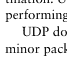

### 处理超时和丢失

`数据包丢弃`，也称为`数据包丢失`，发生在网络数据包未能到达其目的地时。不可靠的网络电缆、故障的适配器、网络流量拥塞和性能不佳的设备是数据包丢弃的主要原因。

UDP 不保证数据包投递。因此，在使用 UDP 的服务（如 VoIP）中，轻微的数据包丢失不会造成任何问题。大多数 VoIP 软件会弥补这些数据包丢失。你可能会听到 VoIP 连接中的人声听起来有些卡顿，这是出现轻微数据包丢失时的表现。


TCP 保证数据包交付，并会重新传输任何丢失的数据包。因此，如果采用 TCP 的服务发生网络数据包丢失，它会经历延迟。如果数据包丢失是由于网络流量拥塞，在某些情况下，TCP 数据包的重传只会使情况更糟。请记住，IP 允许路由器在缓冲区已满且无法足够快地发出已缓冲的数据包时丢弃数据包。这也会导致 TCP 重传数据包。


> 路由器上的数据包丢失也可能是由拒绝服务（DoS）攻击引起的，称为`数据包丢弃`或`黑洞攻击`。恶意用户通过手动方式或借助软件未经授权访问路由器。随后，路由器被配置为丢弃数据包而不是转发它们。

在网络通信中，`超时`通常是用于处理意外事件的预设时间段。例如，你打开 Web 浏览器并输入你想访问的站点地址。网站宕机，但浏览器仍在尝试连接。在预定的时间（指定的超时期限）后，浏览器停止尝试连接并发出一条`错误`消息。

你可能会因为多种原因遇到网络通信超时：

- 系统宕机。
- 使用了错误的 IP 地址。
- 某个服务未运行或未在该系统上提供。
- 防火墙正在阻止流量。
- 网络流量拥塞，导致数据包丢失。

如果你或你的系统进程正在经历与网络通信相关的超时，这些项目中的每一个都值得探索。

## 名称解析

在系统的全限定域名 (FQDN) 与其 IP 地址之间进行转换的过程称为`名称解析`。域名系统 (DNS) 是一种网络协议，它使用分布式数据库来提供所需的名称解析。

大多数系统仅使用客户端 DNS，这意味着它们向其他服务器请求名称解析信息。使用 `/etc/resolv.conf` 和 `/etc/hosts` 文件配置客户端 DNS 已在第 7 章“配置网络连接”中介绍。然而，关于名称解析问题和性能，还有几项额外内容需要你了解：

### 名称服务器位置

对于客户端 DNS，在名称服务器选择方面，位置很重要。如果选择在 `/etc/resolv.conf` 文件中设置的服务器位于地球的另一端，你的系统名称解析速度会比选择一个物理距离更近的服务器更慢。

### 考虑缓存

仅缓存的名称服务器会将其内存中保存最近的名称解析查询结果。如果你仅使用客户端 DNS，请考虑使用 `dnsmasq` 等软件将你的系统配置为仅缓存服务器。通过缓存名称解析，解析速度可以显著提高。

### 辅助服务器

如果你正在为你的公司管理 DNS 服务器，除了主服务器外，请考虑配置一个辅助服务器。该名称服务器从主服务器接收其信息，并且可以通过减轻主服务器的负担来提高名称解析性能。

## 正确配置

网络配置已在第 7 章中介绍。然而，有一些额外的特殊主题可以帮助你进行故障排除。

### 接口配置

能够查看 NIC 的配置和状态在故障排除过程中很重要。你可能需要查看其 IP 地址、MAC 地址、子网配置、错误率等。此外，理解配置项（例如 NIC 是静态的还是通过 DHCP 提供 IP 地址的）也是该过程的一部分。

请注意，如果你在系统中使用 `NetworkManager` 并以 `firewalld` 作为其防火墙服务，当添加新的网络设备时，它会自动被添加到 `firewalld` 默认区域。如果默认区域设置为 `public`，则网络设备将只接受特定的传入网络连接。有关 `firewalld` 的更多详细信息，请参见第 18 章“监督 Linux 防火墙”。

### 端口和套接字

端口和套接字是 Linux 网络中的重要结构。理解两者之间的差异有助于故障排除过程。

`端口`是协议（如 `TCP` 和 `UDP`）使用的数字，用于标识哪个服务或应用程序正在传输数据。例如，端口 `22` 是指定为 `OpenSSH` 的众所周知端口，而 `DNS` 监听端口 `53`。`TCP` 和 `UDP` 数据包在其报文中包含数据包源和目的端口。

程序对端口的连接是一个`套接字`。`网络套接字`是网络连接两个端点中的一个端点。该单个端点位于本地系统并绑定到特定端口。因此，网络套接字使用 IP 地址（本地系统）和端口号的组合。

### 本地主机 vs. Unix 套接字

本地主机指定和 Unix 套接字通常用于 SQL 等服务。能够区分两者很有帮助。

`Localhost` 是`本地环回接口`的主机名，该接口在第 7 章中首次描述。`Localhost` 使用 `IPv4` 地址 `127.0.0.1` 和 `IPv6` 地址 `::1`。基本上，它允许当前系统上的程序通过 `TCP` 测试或实现网络服务，而无需使用外部网络结构。

`Unix 套接字`（也称为 Unix 域套接字）是类似于网络套接字的端点。与通过网络在系统之间不同，这些端点套接字位于本地系统上的进程之间。你的系统的 Unix 域套接字执行进程间通信（IPC），其运作方式类似于 `TCP/IP` 网络。因此，这些套接字也称为`IPC`套接字。

如果你在这两者之间有服务配置选择，通常 Unix 套接字将比本地主机提供更好的性能。这是因为系统在本地主机使用正常的网络行为时消耗资源，例如执行数据校验和 `TCP` 握手。此外，由于特殊的 Unix 套接字文件以及 Unix 套接字理解文件权限这一事实，你可以通过设置这些文件的访问权限轻松实施访问控制。

### 适配器

`网络`适配器是允许网络通信的系统硬件。这些通信可以是有线或无线的。适配器也有 USB 外形规格，但通常不用于企业服务器环境。

网络适配器出现的常见问题是故障或即将故障的硬件以及不正确或低效的驱动程序。关于故障硬件，适配器上的错误率通常不应超过适配器每秒位数 (`bps`) 吞吐率的 0.01 百分比。


> 虽然网络接口卡 (NIC) 是一种适配器，但适配器并不总是 NIC。例如，USB 网络适配器不是 NIC。

### RDMA

`远程直接内存访问` (`RDMA`) 如果你的系统网络需要低延迟，`RDMA` 是一种值得考虑的技术。它允许在客户端和服务器内存之间进行直接访问。结果是显著降低网络延迟、提高带宽，并附带减少服务器 CPU 开销的好处。

不幸的是，这项技术需要特殊硬件。要在标准 Linux 系统以太网 NIC 上使用它，你需要采用`soft-RoCE`。该软件在融合以太网 (`RoCE`) 上提供 RDMA 功能。`soft-RoCE` 真正好的地方在于，其驱动程序自 `v4.8` 起就是 Linux 内核的一部分。

## 查看网络性能

开始故障排除过程需要了解要使用的各种工具。这里我们提供几个表格来协助你选择工具。

由于高延迟（慢速）和网络饱和往往同时发生，表 20.1 显示了你应使用来解决或监控这些问题的工具。请记住，在使用这些工具之前，你应该已经知道要故障排除的网络区段的带宽。

### 表 20.1 用于检查高延迟和饱和度的命令

| 命令 | 描述 |
| --- | --- |
| `iperf`, `iperf3` | 执行网络吞吐量测试。`iperf` 命令是该工具的第 2 版，而 `iperf3` 是第 3 版。 |
| `iftop -i adapter` | 以连续图形格式显示适配器的网络带宽使用情况（吞吐量）。 |
| `mtr` | 以连续图形或报告格式显示从源到目标路径中前 10 个路由器之间的近似传输时间和数据包丢失百分比。 |
| `nc` | 执行网络吞吐量测试。（也称为 `netcat`） |
| `netstat -s` | 显示按协议细分的摘要统计数据，其中包含数据包速率，但不包含吞吐量。此命令已弃用。 |
| `ping`, `ping6` | 执行简单的 ICMP 数据包吞吐量测试，并显示往返时间等项目的统计信息。 |
| `ss -s` | 显示按套接字类型细分的摘要统计数据，其中包含数据包速率，但不包含吞吐量。 |
| `traceroute`, `traceroute6` | 显示从源到目标每个路由器之间的近似传输时间，并在沿途发现最大传输单元（MTU）。 |
| `traceroute`, `traceroute6` | 显示从源到目标每个路由器之间的近似传输时间。 |

> **注意**
>
> 这些工具中的一些并未默认安装。此外，它们可能也不在发行版的标准软件源中。有关如何安装软件包的详细信息，请参阅第 13 章“管理软件”。

若要使用 `iperf` 工具测试吞吐量，你需要两台系统——一台充当服务器，另一台充当客户端。这两台系统都必须安装该工具，并且你需要通过防火墙允许访问其默认端口 `5001`（`iperf3` 为端口 `5201`）。列表 20.1 显示了在 Ubuntu 系统上设置并启动 `iperf` 服务器的部分示例。

### 列表 20.1. 设置 iperf 服务器

```bash
$ sudo ufw allow 5001
Rule added
Rule added (v6)
$ $ iperf -s -t 120
Server listening on TCP port 5001
[...]
```

`iperf` 命令的 `-s` 选项指示其以服务器模式运行。`-t` 选项非常有用，因为服务在指定的秒数后会自动停止。这有助于你避免使用 `Ctrl+C` 来停止服务器。

准备好服务器端后，配置客户端并执行吞吐量测试。列表 20.2 显示了在 Fedora 系统上设置并启动 `iperf` 客户端的部分示例。尽管最后的输出摘要列出了带宽（Bandwidth）列标题，但实际上它显示的是实现的吞吐量。

### 列表 20.2. 设置 iperf 客户端并执行吞吐量测试

```bash
$ sudo firewall-cmd --add-port=5001/udp
success
$ sudo firewall-cmd --add-port=5001/tcp
success
$ $ iperf -c 192.168.0.104 -b 90kb -P 5 -e -i 10
Server listening on TCP port 5001 with pid 3857
[...]
Client connecting to 192.168.0.104, TCP port 5001 with pid 3857
[...]
[ ID] Interval    Transfer  Bandwidth    Write/Err Rtry  Cwnd/RTT
[...]
[SUM]  0.00-10.04 sec   640 KBytes  522 Kbits/sec  5/0    2
[...]
[SUM]  0.00-11.40 sec   1.19 MBytes 873 Kbits/sec  850   5:5:0:0:0:0:0:835
$
```

请注意，防火墙规则不仅添加了 `TCP`，还添加了用于 `UDP` 流量的规则。这是因为 `iperf` 客户端使用了 `-b` 开关，这要求使用 `UDP`。`iperf` 和 `iperf3` 工具有许多可用选项。列表 20.2 中使用的选项在表 20.2 中进行了描述。

### 表 20.2 基本的 iperf 客户端选项

| 选项 | 描述 |
|:----------|:---------------|
| `-c server-address` | 创建一个连接到位于 `server-address` 的服务器的客户端 |
| `-b size` | 将目标带宽设置为 `size` 比特/秒（默认为 `1 Mb`） |
| `-d` | 在客户端和服务器之间执行双向测试 |
| `-P n` | 创建并运行 `n` 个并行客户端线程 |
| `-e` | 提供增强输出。在较旧的工具版本中不可用 |
| `-i n` | 在周期性带宽报告之间暂停 `n` 秒 |

另一个用于测试吞吐量的实用工具是 `netcat` 工具，其命令名称为 `nc`。与 `iperf` 一样，你需要设置服务器和客户端以执行测试。列表 20.3 显示了在 Ubuntu 系统上设置 `netcat` 服务器的示例。请注意，防火墙被修改以允许流量到达为 `netcat` 服务器选择的端口（`8001`）。

### 列表 20.3: 设置 nc 服务器

```bash
$ sudo ufw allow 8001
Rule added
Rule added (v6)
$
$ nc -l 8001 > /dev/null
```

`nc` 命令的 `-l` 选项指示其进入监听模式并充当服务器。`8001` 参数指示 `netcat` 监听端口 `8001`。由于 `netcat` 被用于测试吞吐量，因此没有显示任何接收数据的必要。因此，接收到的数据被丢弃到黑洞文件（`/dev/null`）中。

若要使用 `netcat` 执行测试，请采用一种向服务器发送数据包并允许你查看吞吐量速率的工具。`dd` 命令（在第 12 章“保护文件”中介绍）非常有效，列表 20.4 显示了在 Fedora 系统上执行测试的示例。

### 列表 20.4: 设置 nc 客户端并执行吞吐量测试

```bash
$ dd if=/dev/zero bs=1M count=2 | nc 192.168.0.104 8001 -i 2
2+0 records in
2+0 records out
2097152 bytes (2.1 MB, 2.0 MiB) copied, 0.10808 s, 19.4 MB/s
Ncat: Idle timeout expired (2000 ms).
$
```

请注意，对于 `dd` 命令，未使用输出文件（`of`）开关。这将强制将命令的输出发送到 `STDOUT`，然后通过管道（`|`）重定向到 `nc` 命令。`nc` 命令将输出作为数据包通过网络发送到 `ncat` 服务器的 IP 地址（`192.168.0.104`）的端口 `8001`，在那里，监听服务器接收数据包。`-i 2` 选项指示 `ncat` 在 2 秒的空闲时间后退出并返回到命令行。

当 `dd` 完成其操作时，会显示吞吐量速率。你可以通过增加由 `dd` 命令的 `bs` 选项指定的数据量以及通过 `count` 开关指定的发送次数来增加发送的测试流量。在列表 20.4 的示例中，只发送了两次 `1 Mb`。

> **注意**
>
> 在某些发行版中，你会发现 `ncat` 命令。该命令只是到 `nc` 工具的一个符号链接，为了方便而提供。

高延迟有时是由路由器过载引起的。有故障的硬件或不正确的配置（例如路由器的 `MTU` 设置过低）也会导致问题。`tracepath` 和 `traceroute` 工具不仅显示数据包经过网络路由器所走的路径，还可以提供吞吐量信息，从而帮助你确定潜在的问题区域。

`mtr` 工具可以提供良好的图形显示或简单报告，显示数据包的路径、传输时间以及抖动等项目。列表 20.5 显示了使用 `mtr` 生成静态报告的示例。

### 列表 20.5: 使用 mtr 工具生成路由器性能报告

```bash
$ mtr -o "L D A J" -c 20 -r 96.120.112.205
Start: 2018-12-21T13:47:39-0500

HOST: localhost.localdomain  Loss% Drop Avg Jtr
1.|-- _gateway        0.0%   0   0.8  0.1
2.|-- _gateway        0.0%   0   3.8  7.1
3.|-- 96.120.112.205  0.0%   0  15.5  1.8
$ 
```

`mtr` 命令的 `-o` 选项允许你指定要查看哪些统计数据。在此示例中，选择了数据包丢失（`L`）、丢弃（`D`）、平均传输时间（`A`）和抖动（`J`）。`-c` 开关允许你设置数据包通过路由器的次数，`-r` 选项指定你希望获得静态报告。要显示连续的图形显示，请省略 `-c` 和 `-r` 选项。`mtr` 的最后一个参数是目标 IP 地址。

有故障或即将失效的适配器也会导致高延迟。如果你怀疑错误、数据包丢失或超时正在导致网络问题，请尝试使用表 20.3 中的工具来显示这些统计数据。

### 表 20.3 查找故障/有缺陷网络适配器的命令

| 命令 | 描述 |
| --- | --- |
| `ethoal -S adapter` | 显示适配器摘要统计数据。 |
| `ifconfig adapter` | 显示适配器摘要统计数据。此命令已弃用。 |
| `ip -s link show adapter` | 显示适配器摘要统计数据。 |
| `netstat -i adapter` | 显示适配器摘要统计数据。若要随时间查看，请添加 `-c#` 开关，其中 `#` 是显示之间的秒数。此命令已弃用。 |

使用 `ip` 工具的示例片段显示在列表 20.6 中。请注意，即使没有数据包被丢弃，它也显示错误率徘徊在 0.05 百分比左右（RX 或 TX 数据包 / RX 或 TX 错误）。任何超过 0.01 百分比的速率都足以认为适配器有故障。

### 列表 20.6: 使用 ip 工具查看网络适配器统计信息

```bash
$ ip -s link show enp0s8
3: enp0s8: <BROADCAST,MULTICAST,UP,LOWER_UP> mtu 1500 [ ...]
[ ...]
RX: bytes packets errors dropped overrun mcast
201885893 3023900 1510 0 0 318
TX: bytes packets errors dropped carrier collsns
24443239380 15852137 7922 0 0 0
$ 
```


如果你遇到相当棘手的问题，可能值得直接查看在该网络上传输的数据包。用于执行此操作的工具具有多种名称，如网络嗅探器和数据包分析器。三个流行的是 `Wireshark`、`tshark` 和 `tcpdump`。`Wireshark`（一个 GUI 程序）和 `tshark`（也称为基于终端的 `Wireshark`）密切相关，这会在安装时造成混淆。表 20.4 列出了获取本书涵盖的各个发行版的正确工具所需的软件包名称。

### 表 20.4 Wireshark GUI 和 tshark 软件包名称列表

| 发行版 | Wireshark GUI 软件包 | tshark 软件包 |
|---|---|---|


| Rocky Linux 8 | `wireshark-gnome` | `wireshark-cli` |
| :--- | :--- | :--- |
| Fedora 35 | `wireshark` | `wireshark` |
| :--- | :--- | :--- |
| openSUSE Leap 15 | `wireshark` | `wireshark` |
| :--- | :--- | :--- |
| Ubuntu 20.04 LTS | `wireshark` | `tshark` |

安装好相应的软件包后，你就可以使用该工具来分析数据包。在 Ubuntu 系统上使用 `tshark` 的简单代码片段示例如清单 20.7 所示。`tshark` 命令的 `-i` 选项允许你指定嗅探数据包的接口。`-c` 开关允许你指定要捕获的数据包数量。

## 清单 20.7：使用 tshark 查看数据包

```
$ sudo tshark -i enp0s8 -c 10
[...]
Capturing on 'enp0s8'
1 0.000000000 192.168.0.100 -> 239.255.255.250 [...] 
2 0.493150205 fe80::597e:c86f:ddec:8901 -> ff02[...] 
3 0.683985479 192.168.0.104 -> 192.168.0.101 SSH[...]
4 0.684261795 192.168.0.104 -> 192.168.0.101 SSH[...]
5 0.684586349 192.168.0.101 -> 192.168.0.104 TCP[...]
[...]
10 1.198757076 192.168.0.104 -> 192.168.0.101 SSH[...]
198 Server: Encrypted packet (len=144)
10 packets captured
$
```

`tshark` 和 `tcpdump` 都允许你将嗅探到的数据存储到文件中。如果你更喜欢通过 GUI 应用程序查看数据，之后可以使用 `Wireshark` 工具查看数据包信息。

# 审查网络配置

在故障排除过程中，你可能需要检查各种网络配置。网络适配器配置已在第 7 章中介绍。你可以使用表 20.3 中列出的工具以及 `nmcli` 实用工具来审查适配器设置。

在本地网络段内，路由器不使用 IP 地址来定位系统，而是使用系统网络适配器的媒体访问控制（MAC）地址。MAC 地址通过地址解析协议（`ARP`）表或 IPv6 地址邻居发现（`NDisc`）表映射到其服务器的 IPv4 地址。错误的映射或重复的 MAC 地址会在你的网络中造成混乱。表 20.5 列出了你可以用于调查此问题的命令。

## 表 20.5 用于检查错误 MAC 映射或重复项的命令

| 命令 | 描述 |
| :--- | :--- |
| `arp` | 显示网络邻居的 `ARP` 表。检查是否存在错误或重复的 MAC 地址。 |
| `ip neigh` | 显示网络邻居的 `ARP` 和 `NDISC` 表。检查是否存在错误或重复的 MAC 地址。 |


对于你自己的服务器，错误的 DNS 信息是令人头疼的。此外，如果你考虑更改客户端 DNS 配置，有一些实用工具可以帮助你调查查询响应缓慢的问题。表 20.6 中的命令是引导你进行调查的实用工具。

## 表 20.6 用于研究域名服务器响应的命令

| 命令 | 描述 |
| :--- | :--- |
| `host FQDN` | 向 DNS 服务器查询 `FQDN` 并显示其 IP 地址。检查返回的 IP 地址是否正确。 |
| `dig FQDN` | 对 DNS 服务器执行针对 `FQDN` 的查询，并显示与其相关的所有 DNS 记录。检查返回的信息是否正确。 |
| `nslookup` | 以交互或非交互模式执行各种 DNS 查询。检查返回的信息是否正确。 |
| `whois` | 执行 Whois 服务器查询，并显示存储在那里关于 `FQDN` 的信息。检查返回的信息是否正确。 |

`nslookup` 实用工具对于测试 DNS 查找速度非常方便。在命令后跟随要查找的 `FQDN`，然后是你希望测试的 DNS 服务器。将其与 `time` 命令一起使用，以收集查找时间估算值，如清单 20.8 中的代码片段所示。

## 清单 20.8：使用 `nslookup` 实用工具和 `time` 命令测试 DNS 查找速度

```
$ time nslookup www.linux.org 8.8.8.8
[...]
Name:    www.linux.org
Address: 104.27.166.219
[...]
real    0m0.099s
[...]
$ time nslookup www.linux.org 9.9.9.9
[...]
Name:    www.linux.org
Address: 104.27.167.219
[...]
real    0m0.173s
[...]
$
```

> **注意** 如果你的系统在其防火墙或其他配置中使用了 IPsets，你可能也需要审查它们。使用超级用户权限并输入 `ipset list` 以查看各种 IPsets，然后审查它们在配置文件中的使用情况。

网络映射器（`nmap`）实用工具常用于渗透测试。然而，它对于网络故障排除也非常有用。尽管它通常不会默认安装，但大多数发行版的标准存储库中都有 `nmap` 软件包。

你可以使用 `nmap` 运行许多不同的扫描。清单 20.9 中的代码片段示例展示了在系统防火墙内部使用 `nmap`，通过 `-sT` 选项查看哪些端口提供了哪些服务。

## 清单 20.9：使用 nmap 实用工具查看 TCP 端口和服务

```
$ nmap -sT 127.0.0.1
[...]
PORT    STATE  SERVICE
22/tcp  open   ssh
631/tcp open   ipp
[...]
$
```

你可以使用 `nmap` 扫描整个网络段，并要求映射器对每个系统进行指纹识别，以识别其上运行的操作系统，通过 `-O` 选项实现。要执行此扫描，你需要超级用户权限，如清单 20.10 中的代码片段所示。

## 清单 20.10：使用 nmap 实用工具查看网络段系统的操作系统

```
$ sudo nmap -O 192.168.0.*
[…]
Nmap scan report for 192.168.0.102
[…]
Running: Linux 3.X|4.X
[…]
Nmap scan report for Ubuntu 18.04 (192.168.0.104)
[…]
Running: Linux 3.X|4.X
[…]
```

> 未经许可，请勿在家庭网络之外运行网络映射器实用工具。欲了解更多信息，请阅读位于 `https://nmap.org/book/legal-issues.html` 的 `nmap` 实用工具法律问题指南。

# 排查存储问题

数据存储是系统可能遇到问题的领域之一。存储故障通常集中在硬件故障、磁盘 I/O 延迟和磁盘空间耗尽上。我们将在以下部分重点关注这三个问题。

## 文件系统空间不足

没有什么比因磁盘空间耗尽导致的应用程序崩溃更能破坏系统正常运行时间统计数据了。协助排查和监控文件系统空间的两个实用工具是 `du` 和 `df` 命令，这在第 11 章“处理存储”中已介绍。

`df` 实用工具允许你查看总体空间使用情况。在清单 20.11 的示例中，仅通过 `-t ext4` 选项查看 `ext4` 文件系统，并且结果以人类可读格式显示（`-h`），提供了简洁的显示。

## 清单 20.11：使用 df 实用工具查看文件系统空间总计

```
$ df -h -t ext4
Filesystem  Size Used Avail Use% Mounted on
/dev/sda1 9.8G 7.3G 2.0G 79% /
$
```

如果你发现某个文件系统的使用率高于期望的百分比，请通过 `du` 命令定位文件系统上的潜在问题区域。首先，通过查看文件系统的挂载点目录并仅使用 `-d 1` 选项显示第一级子目录所占用的空间来获取摘要。一个示例如清单 20.12 中的代码片段所示，针对挂载点为 `/` 目录的文件系统。

## 清单 20.12：使用 du 实用工具查看子目录空间摘要

```
$ sudo du -d 1 /
[...]
2150868 /var
[...]
48840     /home
[...]
```

找到潜在的子目录问题后，通过 `du` 向下挖掘，以找到潜在的空间消耗大户，如清单 20.13 中的代码片段所示。

## 清单 20.13：使用 du 实用工具查找潜在的空间消耗大户

```
$ sudo du /var/log
[...]
499876    /var/log/journal/e9afc6ca5a8fb4a70b2ddec4b1894014d
[...]
```

如果你发现文件系统确实需要使用其所占用的磁盘空间，唯一的选择是增加更多空间。如果你最初在逻辑卷上设置了文件系统，通过 `LVM` 工具添加空间相当简单（创建逻辑卷在第 11 章中介绍）。

如果你的卷组中没有额外的物理卷可以添加到需要磁盘空间的文件系统卷，请执行以下操作：

1. 如果需要，向系统添加一个备用驱动器。
2. 使用 `pvcreate` 命令创建一个物理卷。
3. 使用 `vgextend` 将新的物理卷添加到组中。
4. 使用 `lvextend` 命令增加逻辑卷的大小。

## 等待磁盘 I/O

如果磁盘经历的 I/O 超出了其合理处理能力，它可能会拖慢整个系统。你可以使用显示 I/O 等待时间的实用工具（如 `iostat` 命令）来排查此问题。I/O 等待是一个性能统计量，显示处理器必须等待磁盘 I/O 的时间量。


如果您发现系统中未安装 `iostat` 实用程序，请安装 `sysstat` 软件包以获取它。软件包安装在第 13 章中已进行过介绍。

`iostat` 命令的语法如下：

```
iostat  [OPTION]  [INTERVAL]  [COUNT]
```

如果您直接在命令行输入 `iostat` 并按下回车键，您将看到系统自启动以来 CPU、文件系统和分区统计信息的静态摘要。然而，在故障排除情况下，这样做并没有太大价值。有几个有用的 `iostat` 选项可用于故障排除：

- `-y`: 不包含初始的“自系统启动以来”统计信息。
- `-N`: 显示逻辑卷的已注册设备映射名称。
- `-z`: 不显示没有活动的设备。
- `-p device`: 仅显示有关此设备的信息。

`iostat` 命令的两个参数允许随时间查看统计数据。`INTERVAL` 参数指定每次显示之间的间隔秒数，`COUNT` 设置显示次数。请记住，如果使用 `-y` 选项，在设定的间隔之后您才会看到第一批统计数据。

图 20.14 中的片段展示了一个使用 `iostat` 及适用于故障排除情况的适当选项的示例。在这种情况下，仅显示两个间隔 5 秒的统计数据。您可以看到 I/O 等待（`%iowait` 列）百分比相当高，这表明存在潜在问题。

### 图 20.14：使用 iostat 实用程序排查 I/O 等待问题

```
$ iostat -ynz 5 2
[...]
avg-cpu:  %user   %nice  %system  %iowait  %steal  %idle
          26.80     0.00     42.27     30.93     0.00     0.00

Device:            tps     kB_read/s     kB_wrtn/s     kB_read     kB_wrtn
sda               409.90          3.30       9720.72         16       47145
[...]
avg-cpu:  %user   %nice  %system  %iowait  %steal  %idle
          22.67     0.00     65.79     11.54     0.00     0.00

Device:            tps     kB_read/s     kB_wrtn/s     kB_read     kB_wrtn
sda               535.83          0.00       9772.77          0       48277
[...]
```


要定位导致高 I/O 的应用程序或进程，请使用 `iostat` 实用程序。它通常不会默认安装，但包含在 `sysstat` 软件包中。

对于高 I/O 问题，除了采用不同的磁盘技术外，您还需要审查 Linux 内核定义的 `I/O 调度`。I/O 调度是一系列处理 I/O 请求及其相关活动的内核操作。这些操作如何执行取决于在配置文件中选择特定的 I/O 调度器，如图 20.7 所示。

### 图 20.7 I/O 调度器

| 名称 | 描述 |
| :--- | :--- |
| `cfq` | 为每个进程创建队列，并在循环中处理各个队列，同时为读请求提供比写请求更高的优先级。当需要更平衡的 I/O 处理和/或系统具有多处理器时，此调度器效果很好。 |
| `deadline` | 批量处理磁盘 I/O 请求，并尝试在指定时间内处理每个请求。当需要增加数据库 I/O 并降低整体 I/O 延迟时，和/或使用了 SSD 时，和/或正在使用实时应用程序时，此调度器效果很好。 |
| `noop` | 将所有 I/O 请求放入单个 FIFO 队列并按顺序处理。当需要更低的 CPU 使用率和/或使用了 SSD 时，此调度器效果很好。 |

用于确定使用哪个 I/O 调度器的配置文件位于与每个磁盘关联的目录中。图 20.15 展示了如何在 Rocky Linux 发行版中找到各个磁盘目录及其关联的调度器文件。

### 图 20.15：定位磁盘的调度器文件

```bash
# ls /sys/block
dm-0 dm-1 sda sdb sdc sdd sr0
#
# cat /sys/block/sda/queue/scheduler
[mq-deadline] kyber bfq none
#
```

用于 `sda` 磁盘的调度器 `mq-deadline` 显示在方括号中。要更改当前的 I/O 调度器，只需使用超级用户权限和 `echo` 命令，如图 20.16 所示。


### 图 20.16：临时更改磁盘的调度器文件

```
# echo "bfq" > /sys/block/sda/queue/scheduler
# cat /sys/block/sda/queue/scheduler
mq-deadline kyber [bfq] none
#
```

如果您确定由于硬件限制，需要更换不同的新硬盘来处理所需的 I/O 级别，`ioping` 实用程序可以帮助您在测试过程中。`ioping` 实用程序通常不会默认安装，但通常可以在发行版的标准软件仓库中找到。

> `ioping` 实用程序可能会破坏磁盘上的数据！在使用该命令之前，请务必彻底理解其选项。如果您希望更安全的选择，请查看 `stress-ng` 工具。该实用程序允许您对磁盘、网络、系统 CPU 等进行压力测试。

使用 `ioping` 命令，您可以测试磁盘 I/O 延迟、寻道速率和顺序速度。您还可以尝试异步、缓存和直接 I/O 速率。图 20.17 中的片段示例展示了一个使用 `ioping` 命令从临时文件中读取随机数据块（非缓存）的简单测试。

### 图 20.17：使用 ioping 实用程序进行非缓存读取测试

```
# ioping -c 3 /dev/sda
4 KiB <<< /dev/sda [...]: request=1 time=20.7 ms (warmup)
4 KiB <<< /dev/sda [...]: request=2 time=32.9 ms
4 KiB <<< /dev/sda [...]: request=3 time=25.5 ms
--- /dev/sda (block device 15 GiB) ioping statistics ---
2 requests completed in 58.4 ms, 8 KiB read, 34 iops, 137.0 KiB/s
generated 3 requests in 2.03 s, 12 KiB, 1 iops, 5.92 KiB/s
min/avg/max/mdev = 25.5 ms / 29.2 ms / 32.9 ms / 3.72 ms
#
```

添加的 `-c 3` 选项指定了三次测试。更彻底的 `ioping` 测试有助于确定磁盘是否适合特定应用程序的需求。

## 测量磁盘性能

有助于确定磁盘驱动器整体 I/O 性能的一个基准测试是每秒输入/输出操作次数（`IOPS`）值。该值是存储设备每秒可以执行的输入或输出操作数量。`IOPS` 值不仅提供了一种评估磁盘驱动器性能的方法，还可以比较不同类型的存储，例如单个 `SATA` 或 `SSD` 驱动器与 `RAID` 或 `LVM` 设置。

在 Linux 环境中，用于确定 `IOPS` 值的流行工具是一个称为 `fio` 的灵活 I/O 工具。该工具在基于 Debian 和基于 Red Hat 的软件仓库中均可用作 `fio` 软件包，并且必须手动安装。

`fio` 工具对您指定的文件和目录执行多次读写操作，并指定您定义的文件大小和块大小。文件越大，获得的 `IOPS` 读数越准确。图 20.18 展示了在磁盘上执行 `fio` 测试的一个示例。

### 图 20.18：使用 fio 工具确定磁盘 I/O


# fio 测试示例

```
# fio --randrepeat=1 --ioengine=libaio --direct=1
   --gtod_reduce=1 --name=fiotest --filename=fiotest --bs=4k
   --iodepth=64 --size=1G --readwrite=randrw --rwmxread=75
```

正如你所见，`fio` 工具提供了大量关于读写测试的详细信息。你可以查阅 `fio` 的手册页以了解所有细节。在列表 20.18 中，我们这里关注的主要 IOPS 信息出现在以下两行中：

```
read: IOPS=23.4k, BW=91.4MiB/s
write: IOPS=7818, BW=30.5MiB/s
```

对于此磁盘驱动器，读 IOPS 值为 23400，写 IOPS 值为 7818。写 IOPS 值通常显著低于读 IOPS 值，这是正常的，因为向磁盘写入数据比读取数据花费的时间更长。现在，你可以使用这些值与其他存储设备进行比较。


## 固态硬盘

固态硬盘（SSD）在处理读写时与标准 SATA 或 SCSI 驱动器略有不同。当存储在 SSD 设备上的文件系统中的一个文件被删除时，需要运行 `fstrim` 应用程序来确定哪些内存位置可以回收（称为 SSD 修剪）。维护不必要的内存位置会减慢对 SSD 设备的读写访问速度。大多数 Linux 发行版会自动为内部 SSD 设备定期运行 `fstrim` 实用程序，但如果你在 Linux 系统中添加了外部 SSD 设备，你可能需要手动运行 `fstrim` 实用程序以帮助提高该设备的性能。

## 故障磁盘

如果 HDD 或 SSD 的一小部分无法响应 I/O 请求，磁盘控制器会将其标记为坏扇区。当坏扇区被标记时，通常控制器的固件会尝试将标记扇区的数据移动到新的位置，并将逻辑扇区重映射到新扇区。因此，数据是安全的。

随机的坏扇区并不表示驱动器即将故障。然而，如果你发现磁盘上的坏扇区越来越多，则说明需要更换它。因此，你应该监控这种情况。


如果驱动器具有自我监测、分析和报告技术（SMART），你可以使用 `smartctl` 实用程序来检查其健康状况。

偶尔，驱动器上的文件会丢失其对应的 inode 号，这被称为不匹配（在第 3 章“管理文件、目录和文本”中介绍），或者发生其他类型的磁盘损坏。这会留下数据原地不动，但没有任何东西可以访问它，问题必须手动修复。

一个允许你检查和修复 ext2、ext3 或 ext4 文件系统的实用程序是 `fsck` 命令（在第 11 章中介绍）。在运行该实用程序之前，必须卸载磁盘分区。


对于 btrfs 文件系统，使用 `btrfs check` 命令来检查和/或修复未挂载的 btrfs 驱动器。如果你有 XFS 文件系统，使用 `xfs_check` 实用程序来检查磁盘，并使用 `xfs_repair` 来检查和修复驱动器。

物理损坏或磨损有时会导致驱动器发出异常声音。你可能会听到咔哒声、磨擦声或刮擦声。这些迹象表明驱动器正在故障，应尽快更换。

在需要更换驱动器并重建分区的情况下，请记住你可以使用 `partprobe` 命令。这个不错的实用程序允许你的系统在不重启系统的情况下重新读取磁盘的分区表。你需要使用超级用户权限来调用它。

## 排查 CPU 故障

你需要根据服务器应用的需求正确确定 CPU 的规模。处理器过小会迫使你购买新的处理器，而处理器过大则无法充分利用其潜力。两者都会浪费金钱。

为了排查故障，你需要了解你的 CPU 的硬件——核心数量、是否使用超线程技术、缓存大小等。你可以轻松查看系统当前处理器的信息。使用 `less` 实用程序并传入 `/proc/cpuinfo` 文件名。该文件中列出的第一个处理器显示为 processor 0。

要查看 CPU 使用情况，可以使用 `uptime` 命令。它显示系统已运行多长时间，但更重要的是，它显示 CPU 负载平均值。负载平均值是等待或使用 CPU 的进程数量的平均值。例如，如果你有一个单核处理器，那么负载平均值为 2 意味着通常有一个进程正在使用 CPU，而另一个进程在等待。

`uptime` 实用程序显示三个负载平均值数字——1 分钟、5 分钟和 15 分钟的平均值。列表 20.19 中显示了一个示例。

**列表 20.19：使用 `uptime` 实用程序显示负载平均值**

```
uptime
15:12:41 up  54 min,   2 users,   load average: 0.95, 0.93, 0.90
```

这个单核 CPU 系统的负载平均值相当高，这表明存在潜在的严重问题。首先，检查是否存在失控的进程。如果没有，你需要调查诸如网络和磁盘中断等项目。`top` 实用程序在此处可以提供帮助。


对于单核 CPU，持续高于 0.70 的负载平均值表示存在问题。持续为 1.00 的负载平均值处于紧急级别。

如果你需要查看 CPU 随时间的性能变化，`sar`（系统活动报告器）实用程序非常有用。它通常默认安装在大多数发行版上，但如果需要安装，请使用 `sysstat` 软件包。

`sar` 实用程序使用由 `sadc` 程序存储在 `/var/log/sa/` 目录中的数据，该目录包含多达一个月的数据。默认情况下，它显示当前文件中的数据。如果没有选项或参数使用 `sar`，它将显示今天存储的 CPU 使用信息，间隔为 10 分钟，如列表 20.20 中的片段所示。

**列表 20.20：使用 `sar` 实用程序显示 CPU 使用情况**

```
$ sar -u
[...]
03:20:28 PM CPU %user %nice %system %iowait %steal %idle
03:30:18 PM all 32.15 0.00 67.85 0.00 0.00 0.00
03:40:01 PM all 19.07 0.00 26.88 0.00 0.00 54.05
[...]
Average: all 20.85 0.00 24.51 0.01 0.00 54.64
[...]
```

如果你的服务器运行多个虚拟机，`sar` 实用程序输出中的 `%steal` 列非常有用。该列显示系统上有多少 CPU 被虚拟机使用。


通过修改某些内核参数，你可能能够提高 CPU 性能，可以使用 `sysctl` 实用程序。例如，如果你的服务器有多个处理器，它们可能会经历抖动（类似于网络抖动），导致性能尖峰并导致应用变慢（高延迟）。如果设置为 1，`skew_tick` 参数可以减少这种抖动。

## 排查内存故障

进程使用 RAM 临时存储数据，因为访问速度比存储在磁盘上的数据更快。其中一种形式是磁盘缓冲，它可以提高磁盘读取性能。数据从磁盘读取并存储在称为缓冲区缓存的内存位置中一段时间。后续对该数据的访问是从内存而不是磁盘读取的，这显著提高了性能。

内存为进程提供的速度非常有价值，以至于 Linux 内核维护管理共享内存区域，并且管理员也维护共享内存区域。这些共享段允许多个运行的程序读写公共共享内存数据区域，这大大加快了进程之间的交互。

你可以通过查看 `/proc/meminfo` 文件来了解有关系统 RAM 的详细信息。要查看共享内存段，使用 `ipcs -m` 命令。你可以使用命令行工具（如 `free`、`sar` 和 `vmstat`）来查看系统的内存统计信息。

> 请注意，RAM 瓶颈通常会人为地降低 CPU 使用率。如果你增加系统的 RAM，处理器的负载也可能增加。

### 交换

内存被分成称为页的块。当系统需要更多内存时，使用内存管理方案，它获取空闲进程的内存页并将其复制到磁盘。此磁盘位置是一个特殊的分区，称为交换空间、交换或虚拟内存。如果空闲进程不再空闲，其内存页会被复制回内存。这种在磁盘交换空间之间复制内存页的过程称为交换。

如果你的系统没有适当大小的内存，你应该通过 `free` 命令看到高 RAM 使用率。此外，系统会增加交换，从而导致磁盘 I/O 增加。在这种情况下，`vmstat` 工具很有用，因为它允许你查看与交换相关的磁盘 I/O 以及进出设备的总块数。列表 20.21 中展示了使用 `vmstat` 实用程序的一个示例。

**列表 20.21：使用 `vmstat` 实用程序显示虚拟内存统计信息**

```
$ vmstat
procs -------------memory---------- ---swap-- -----io---- -system-- ------cpu-----
 r b swpd free buff cache si so bi bo in cs us sy id wa st
2 0 0 3149092 3220 355180 0 0 1978 43 812 783 27 17 26 29 0
```

在 Linux 系统中，交换空间是一个磁盘分区或一个文件。交换分区是作为系统交换空间的特殊磁盘分区。

> 通常建议不要将交换分区/文件存储在 SSD 上。这是因为它们的有限寿命和磨损平衡。大量的交换可能会导致 SSD 过早损坏。

一个有用的实用程序用于查看内存并确定交换是文件还是分区是 `swapon -s` 命令。如果可用，你可以从 `/proc/swaps` 文件获取相同的信息。列表 20.22 中展示了在 Rocky Linux 发行版上使用 `swapon -s` 命令的一个示例。

**列表 20.22：使用 `swapon` 实用工具显示交换分区**

```
$ swapon -s
Filename  Type      Size  Used  Priority
/dev/dm-1 partition  1769468 0  -2
$
```

请注意，在此 Rocky Linux 发行版中，交换空间是一个分区。在上一示例的交换空间统计信息中，优先级列显示为负 2（−2）。如果存在多个交换空间，该优先级数字将决定首先使用哪个交换空间。

另一个 `swapon -s` 示例在 Ubuntu 发行版上执行，如列表 20.23 所示。请注意，在这种情况下，交换空间是一个文件。

**列表 20.23：使用 `swapon` 实用工具显示交换文件**

```
$ swapon -s
Filename  Type      Size  Used  Priority
/swapfile  file      483800 0  -2
$
```

在 Linux 操作系统安装过程中，通常会创建一个交换分区或文件，并将其添加到 `/etc/fstab` 配置文件中。然而，您可能需要创建额外的交换分区/文件——例如，如果您增加了系统的 RAM。

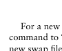

> 如果您的交换分区位于逻辑卷上，请使用 LVM 工具添加额外空间。只需遵循本章前面“故障排除存储问题”部分以及下一节中介绍的步骤即可。但是，您可以拥有一个以上的系统交换空间。事实上，在许多情况下，出于性能原因，这样做是可取的。

对于新的分区交换空间，一旦您创建了新的磁盘分区，请使用 `mkswap` 命令将该分区“格式化”为交换分区。您对新的交换文件和逻辑卷使用相同的命令。在 Rocky Linux 系统上使用超级用户权限的示例如列表 20.24 所示。

**列表 20.24：使用 `mkswap` 命令创建交换分区**

```
# mkswap /dev/sde1
Setting up swap space version 1, size = 1048572 KiB
no label, UUID=e5bd150a-2f06-42ed-a0a9-a7372abd9dee
# # blkid /dev/sde1
/dev/sde1: UUID="e5bd150a-2f06-42ed-a0a9-a7372abd9dee" TYPE="swap"
#
```

现在交换分区或文件已正确准备就绪，请使用 `swapon` 命令激活它。`free` 命令在此非常有用，因为它提供了当前可用和已用内存的简单视图。这两个命令的示例如列表 20.25 所示。

**列表 20.25：使用 `swapon` 命令激活交换分区**

```
$ free -h
Mem:  3.7G  359M  3.0G  9.3M  352M  3.1G
Swap: 1.5G  0B  1.5G
#
# swapon /dev/sde1
#
# swapon -s
Filename  Type  Size Used  Priority
/dev/dm-1  partition 1572860 0  -1
/dev/sde1  partition 1048572 0  -2
#
# free -h
Mem:  3.7G  366M  3.0G  9.3M  352M  3.1G
Swap: 2.5G  0B  2.5G
#
```

您可以看到，通过添加第二个交换分区，交换空间大小增加了 1 GB。`free` 命令的 `-h` 选项以更易读的格式显示内存信息。

> `free` 命令的缓冲区缓存输出显示在 `buff/cache` 列中。该命令的旧版本会为这些数据显示两列——`buffers` 和 `cache`。Linux 将其缓冲区缓存划分为不同的类别。缓冲区是内核缓冲区使用的内存，而缓存是进程页缓存和 slab（为单个缓存预留的连续内存页）使用的内存。现代 `free` 命令输出中的 `buff/cache` 列仅是这两种内存使用类别的总和。

如果需要，可以使用 `swapon` 命令将新交换分区的优先级从当前的负 2 (-2) 更改为更高的优先级，如列表 20.26 所示。较高的数字指定该交换分区在交换之前先于其他分区被使用。

**列表 20.26：使用 `swapon` 命令更改交换优先级**

```
# swpoff /dev/sde1
# 
# swapon -p 0 /dev/sde1
#
# swapon -s
#
Filename	Type	Size	Used	Priority
/dev/dm-1	partition	1572860	0	-1
/dev/sde1	partition	1048572	0	0
#
```

您必须首先使用 `swpoff` 命令在交换分区上取消分配，使其从交换空间中分离。之后，使用 `swapon -p` 优先级更改偏好优先级。您可以将优先级设置为 0 到 32767 之间的任何数字。

> **警告** 如果您想将系统移动到新的交换分区或文件，请不要在新的交换分区添加到交换空间之前，在当前交换分区/文件上使用 `swpoff` 命令。否则，您的系统可能会挂起。

如果新的交换分区一切正常，请将其添加到 `/etc/fstab` 文件中，以便它在系统重启时持久化。您可以完全模仿当前交换文件记录的设置，但请务必将名称更改为您的新交换分区/文件。

## 内存不足

默认情况下，Linux 内核允许自身向各个进程过度提交内存。这是为了效率和性能而做的。然而，由于这种允许，系统的可用内存可能会变得非常低。在严重的低内存情况下，Linux 首先回收旧内存页。如果它未能回收足够的 RAM 以摆脱关键状态，它会使用内存不足杀手（也称为 OOM 杀手）。


当触发时，OOM 杀手会扫描使用内存的各种进程并创建一个分数。该分数基于进程（及其子进程）使用的总内存以及能够摆脱严重低内存状态所需终止的最少进程数。内核、`root` 以及关键系统进程会自动被赋予低分数。如果进程具有高分数，它将被终止。`OOM` 杀手扫描并终止高分数进程，直到系统恢复正常的内存状态。


如果您想修改 `OOM` 杀手的行为，您可以通过 `sysctl` 命令使用以下内核参数来做到这一点：

`vm.panic_on_oom` 和 `kernel.panic`。

您可以通过 `sysctl` 命令强制内核防止内存过度提交，将 `vm.overcommit_memory` 内核参数从默认的 0 更改为 1。然而，这可能不是最佳解决方案。在许多系统中，通过将 `vm.overcommit_memory` 设置为 2 来微调内存过度提交会更好。这允许您分配在另一个内核参数 `overcommit_ratio` 中定义的内存量。在这种情况下，当进程请求导致系统超过设定的过度提交比例的内存时，分配将失败。


虽然您可以使用 `sysctl` 命令修改内核参数，但这些设置不是持久化的。要使设置持久化，请对 `/etc/sysctl.conf` 或您的发行版适用的 `sysctl` 配置文件进行相应的编辑。

## 应对丢失的 Root 密码

由于多种原因，忘记 `root` 账户的密码会带来麻烦。快速的解决方法是使用您自己账户的超级用户权限通过 `passwd` 命令重置它。但是，如果您正在使用 `root` 账户获取超级用户权限（这是一种不好的做法），或者您的权限不允许更改 `root` 密码，那么您就陷入困境了。但希望并未完全破灭。

在较旧的 `Linux` 发行版和少数现代发行版（`Ubuntu`）上，将系统引导至单用户模式将允许您访问 `root` 账户并通过 `passwd` 命令更改其密码。要这样做，请遵循以下步骤：

1. 引导（或重启）系统。当引导过程到达引导菜单时，在希望编辑的引导菜单行上按下 **E** 键（系统通常运行的内核版本）。
2. 使用箭头键找到包含 `linux` 或 `linux16` 的行。
3. 转到行末，按一次空格键，并输入 **1**。
4. 按下 **Ctrl+X** 引导系统。
5. 系统引导完成后，如果显示您处于紧急或救援模式，请按 **Enter** 键。
6. 使用 `passwd` 命令更改 `root` 账户的密码。
7. 使用 `reboot` 命令重启系统。

在某些现代 `Linux` 系统中，例如 `Rocky Linux` 和 `Fedora` 发行版，您需要采用略有不同的方法。请遵循以下步骤：

1. 引导（或重启）系统。当引导过程到达引导菜单时，在希望编辑的引导菜单行上按下 **E** 键（系统通常运行的内核版本）。
2. 使用箭头键找到包含 `linux` 或 `linux16` 的行。
3. 在该行中，找到 `ro`。这位于行的中间某处。
4. 将 `ro` 替换为 `rw init=/sysroot/bin/sh`。请勿替换该行中的其他任何内容，仅替换 `ro`。
5. 按下 **Ctrl+X** 引导系统。
6. 系统引导完成后，如果显示您处于紧急或救援模式，请按 **Enter** 键。
7. 输入 `chroot /sysroot` 以设置一个受限的根环境。
8. 使用 `passwd` 命令更改 `root` 账户的密码。
9. 如果系统使用 `SELinux`（`Rocky Linux` 和 `Fedora` 通常使用），通过输入 `touch /.autorelabel` 命令强制 `SELinux` 在下一次启动时自动重新标记系统。
10. 使用 `reboot` 命令重启系统。（注意：在尝试重启系统之前，您可能需要输入 `exit` 并按 **Enter** 键。）

您将不得不等待一段时间，让系统完成其 `SELinux` 重新标记过程。

## 摘要

排除 `Linux` 性能问题故障需要提前规划应对不利事件。此外，您必须理解各种系统属性之间的交互，例如处理器、磁盘、网络和内存。适当调整系统组件规模并配置 `Linux` 将提供一个更少故障的环境。

## 考试要点

**描述网络故障排除工具。** 如果您的网络经历高延迟，有助于排除此故障的工具包括 `iperf`、`iperf3`、`iftop`、`nr (netcat)`、`ping`、`ping6`、`ss`、`tracepath`、`traceroute6`、`traceroute` 和 `tracroute6`。这些实用工具还有助于检测网络饱和问题。如果故障或错误的适配器是问题所在，用于诊断此问题的工具是 `ethtool`、`ifconfig`、`ip` 和 `netstat`。这些实用工具以及 `nmcli` 还有助于解决 `NIC` 配置问题。

若要在路由器中解析地址，请使用 `arp` 或 `ip neigh` 命令。若要研究缓慢或不正确的名称服务器响应，`host`、`dig`、`nslookup` 和 `whois` 工具可提供帮助。

**总结潜在的磁盘问题及解决方案。** `du` 和 `df` 工具有助于防止系统耗尽文件系统空间，并在空间耗尽时协助故障排查。如果是逻辑卷，请在需要时使用 `LVM` 工具添加额外空间。I/O 等待时间可能会降低整体系统性能，可通过 `iostat` 命令查看。更改系统的 I/O 调度器有助于缓解此问题。`topping` 工具用于测试磁盘，以确定其是否适用于特定应用程序。要修复 `ext*` 文件系统，请使用 `fsck` 命令。`partprobe` 命令对新创建的分区效果良好，因为它可以强制重新读取磁盘分区表而无需重启系统。

**阐明 CPU 故障排查步骤。** 了解系统当前处理器的信息至关重要，你可以在 `/proc/cpuinfo` 文件中找到这些信息。要查看 CPU 使用率，请使用 `uptime` 和/或 `sar` 命令。如有必要且合适，你可以使用 `sysctl` 工具调整与处理器处理相关的内核参数。

**解释内存问题及解决方案。** 要查看详细的系统 `RAM` 信息，请查看 `/proc/meminfo` 文件的内容。如果系统内存大小不合适，你可以通过 `free` 命令看到较高的 `RAM` 使用率。此外，`vmstat` 工具允许你查看特定于交换（swapping）的磁盘 I/O，当内存大小设置不当时，交换量会增加。如果需要添加额外的交换空间，`mkswap` 工具可以“格式化”分区/文件为交换空间，而 `swapon` 命令则将其投入使用。如果需要将分区/文件从交换空间中解耦，请使用 `swapoff` 工具。如果内存使用达到临界水平，内核会释放 `OOM` 杀手（`OOM killer`），它会终止特定进程以使内存使用率回到合理水平。可以通过某些内核参数和 `sysctl` 工具来修改内存管理。

# 复习题

1. 关于网络套接字，以下哪些说法是正确的？（选择所有适用项。）

    - A. 用于标识正在传输数据的服务的编号
    - B. 网络连接的两个端点中的一个
    - C. 使用 `IP` 地址和端口号的组合
    - D. 本地系统上进程之间的端点
    - E. 提供比 `localhost` 更好的进程间通信（`IPC`）

2. 系统管理员 Preston 注意到 `IPv4` 网络似乎运行缓慢。他决定运行一些测试来检查高延迟。他应该使用以下哪些工具？（选择所有适用项。）

    - A. `iperf`
    - B. `ping`
    - C. `ip neigh`
    - D. `dig`
    - E. `tracroute`

3. Scott 提出了一种问题原因理论，认为路由器因流量饱和而丢弃队列中的 `TCP` 数据包。他应该使用以下哪些工具来测试这一理论？（选择所有适用项。）

    - A. `mtr`
    - B. `ifconfig`
    - C. `ethtool -s`
    - D. `tracepath`
    - E. `tracroute`

4. 网络工程师 Keenser 认为系统 `/etc/resolv.conf` 文件中名称服务器的选择不高效。他可以使用以下哪些工具来测试新的服务器选择？

    - A. `dnsmasq`
    - B. `whois`
    - C. `nmap`
    - D. `nslookup`
    - E. `ipset list`

5. Mera，一位 `Linux` 系统管理员，认为她系统上的一个新应用程序产生了过多的 I/O，导致某个分区出现问题，使得系统处理器显得迟钝。她应该使用哪个工具来测试她的问题原因理论？

    - A. `iostat`
    - B. `ioping`
    - C. `du`
    - D. `df`
    - E. `iotop`

6. 通过分析，Arthur 认为通过更改 I/O 调度器可以提高系统的 I/O 吞吐量。他的系统上有一个实时应用程序，该应用程序使用位于固态硬盘上的数据库。Arthur 应该选择哪个 I/O 调度器？

    - A. `scheduler`
    - B. `deadline`
    - C. `queue`
    - D. `cfq`
    - E. `noop`

7. 使用 `uptime` 命令，你会看到 `CPU` 平均负载的递增间隔是多少？（选择所有适用项。）

    - A. 1 分钟
    - B. 5 分钟
    - C. 10 分钟
    - D. 15 分钟
    - E. 20 分钟

8. Mary 希望查看系统处理器性能随时间的变化。哪个工具最适合她使用？

    - A. `uptime`
    - B. `sysstat`
    - C. `sar`
    - D. `cat /proc/cpuinfo`
    - E. `sysctl`

9. Gertie 需要确定交换空间元素的类型、名称和优先级。她应该使用哪个命令？

    - A. `vmstat`
    - B. `free`
    - C. `fstab`
    - D. `swapon`
    - E. `swapon -s`

10. Elliot 正在管理一个拥有多个交换空间的 `Linux` 系统。其中一个位于逻辑卷上，但需要更多空间以容纳近期将安装的额外 `RAM`。Elliot 添加交换空间的最好方法是什么？

    - A. 添加一个分区并使用 `mkswap` 命令进行格式化。
    - B. 添加一个文件并使用 `mkswap` 命令进行格式化。
    - C. 使用 `swapon` 工具添加一个分区。
    - D. 使用 `swapon` 工具添加一个文件。
    - E. 使用 `LVM` 工具增加逻辑卷大小。

# 第 21 章

## 性能优化

- 目标 1.4：根据场景，配置并使用适当的进程和服务。
- 目标 4.3：根据场景，分析和排查中央处理器（`CPU`）和内存问题。


本章讨论 `Linux` 如何处理系统中运行的应用程序。`Linux` 必须跟踪大量不同的程序，它们都在同一时间运行。作为 `Linux` 管理员，你的目标是确保一切运行顺畅。本章展示了 `Linux` 如何跟踪所有活动程序，以及你如何查看这些信息。你还将看到如何使用命令行工具来管理在 `Linux` 系统上运行的程序。

# 查看进程

在任何给定时刻，`Linux` 系统上都有大量活跃的程序在运行。`Linux` 将每个运行的程序称为进程。进程可以在前台运行，在控制台显示屏或图形桌面窗口上显示输出；也可以在后台运行，在幕后处理数据。`Linux` 系统为每个进程分配一个进程 ID（`PID`），并根据该 `PID` 管理进程对内存和 `CPU` 时间的使用。

当 `Linux` 系统首次启动时，它会启动一个称为 `init` 进程的特殊进程。`init` 进程是 `Linux` 系统的核心；它运行启动系统上所有其他进程的脚本，包括用于登录的文本控制台和图形窗口进程（参见第 6 章“维护系统启动和服务”）。

你可以使用 `ps` 命令查看当前在你的 `Linux` 系统上运行的具体进程。`ps` 命令的默认输出看起来像这样：

```
$ ps
  PID TTY          TIME CMD
 2797 pts/0    00:00:00 bash
 2884 pts/0    00:00:00 ps
$
```

默认情况下，`ps` 命令只显示在当前用户 shell 中运行的进程。在这个示例中，我们只运行了命令提示符 shell（`Bash`），当然还有 `ps` 命令本身。

`ps` 命令的基本输出显示分配给每个进程的 `PID`、启动它们的终端（`TTY`）以及进程使用的 `CPU` 时间。

`ps` 命令的一个棘手特性（也是使其变得复杂的原因）是 `Linux` 中曾经有两个版本的 `ps`。每个版本都有自己的一组命令行参数，用于控制其显示的信息。这使得在系统之间切换变得有些复杂。

最近，`GNU` 开发人员决定将这两个版本合并为单一的 `ps` 程序，并且当然，他们添加了一些自己的额外参数。当前 `Linux` 中使用的 `ps` 程序支持三种不同风格的命令行参数：

- `Unix` 风格参数，前面有一个短划线
- `BSD` 风格参数，前面没有短划线
- `GNU` 长参数，前面有两个短划线

这为 `ps` 命令提供了许多可能的参数和选项。你可以查阅 `ps` 手册页以查看所有可用参数。大多数 `Linux` 管理员都有自己常用的一组参数，用于提取相关信息。例如，如果你需要查看系统上运行的每个进程，请使用 `Unix` 风格的 `–ef` 参数组合，如下所示：

```
$ ps -ef
UID  PID  PPID C STIME TTY  TIME CMD
root     1     0  0 09:02 ?  00:00:02 /sbin/init
root     2     0  0 09:02 ?  00:00:00 [kthreadd]
root     3     0  0 09:02 ?  00:00:00 [ksoftirqd/0]
root     4     2  0 09:02 ?  00:00:00 [kworker/0:0]
root     5     2  0 09:02 ?  00:00:00 [kworker/0:0H]
root     6     2  0 09:02 ?  00:00:00 [kworker/u2:0]
root     7     2  0 09:02 ?  00:00:02 [rcu_sched]
root     8     2  0 09:02 ?  00:00:01 [rcuob/0]
root     9     2  0 09:02 ?  00:00:00 [rcuob_bh]
root    10     2  0 09:02 ?  00:00:00 [rcuob/0]
...
$
```

此格式提供了关于运行中进程的一些有用信息：

**`UID`**：负责运行该进程的用户

**`PID`**：进程的进程 ID

**`PPID`**：父进程的进程 ID（如果该进程是由另一个进程启动的）

**`C`**：进程整个生命周期内的处理器利用率

**`STIME`**：进程启动时的系统时间

**`TTY`**：进程启动所在的终端设备

**`TIME`**：运行该进程所需的累计 `CPU` 时间

**`CMD`**：进程中启动的程序名称

此外，请注意在 `–ef` 输出中，一些进程命令名称显示在方括号内。这表示当前已从物理内存交换到虚拟内存的进程

内存的硬盘部分。被交换到虚拟内存中的进程被称为*休眠*进程。通常，当进程正在等待某个事件时，`Linux` 内核会将该进程置于休眠模式。

当事件触发时，内核会向该进程发送信号。如果进程处于*可中断休眠模式*，它会立即接收信号并唤醒。如果进程处于*不可中断休眠模式*，它仅根据外部事件（例如硬件变为可用）唤醒。它会保存在休眠期间发送的任何其他信号，并在唤醒后对这些信号进行处理。


> 如果一个进程已经结束，但其父进程尚未确认终止信号（因为父进程正在休眠），该进程被视为*僵尸*进程。它处于运行和终止之间的悬而未决状态，直到父进程确认终止信号为止。

## 实时监控进程

`ps` 命令是获取系统上正在运行的进程快照的好方法，但有时你需要查看更多信息，才能了解你的 `Linux` 系统正在发生什么。如果你试图查找那些频繁在内存中换入和换出的进程的趋势，使用 `ps` 命令很难做到这一点。

相反，`top` 命令可以解决这个问题。`top` 命令显示与 `ps` 命令类似的进程信息，但它以实时模式显示。图 21.1 显示了 `top` 命令运行时的快照。

**图 21.1** `top` 命令的输出

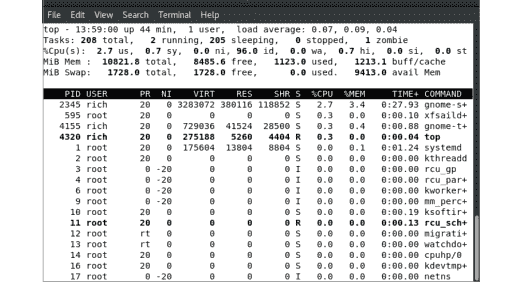

**`top`** 输出的第一部分显示系统的一般信息。第一行显示当前时间、系统运行时长、已登录的用户数以及系统负载平均值。

负载平均值显示为三个数字：1分钟、5分钟和15分钟的负载平均值。数值越高，系统经历的负载越大。1分钟负载值在短时间的活动爆发期间偏高并不常见。如果15分钟负载值偏高，你的系统可能遇到了麻烦。

第二行显示一般进程信息（在 **`top`** 中称为任务）：有多少进程正在运行、休眠、停止或处于僵尸状态。

下一行显示一般的 `CPU` 信息。`top` 显示会根据进程的所有者（用户进程与系统进程）和进程的状态（运行、空闲或等待）将 `CPU` 利用率分解为几个类别。表 21.1 描述了这些时间类别。

### 表 21.1 `top` `CPU` 类别

| 类别 | 符号 | 描述 |
| :--- | :--- | :--- |
| 用户 | `us` | `CPU` 用于运行应用程序代码的时间 |
| 系统 | `sy` | `CPU` 用于处理系统资源的时间 |
| 优先级调整 | `ni` | `CPU` 用于运行低优先级进程的时间 |
| 空闲 | `id` | `CPU` 不忙的时间 |


| 等待 | wa | CPU 用于等待磁盘或网络操作完成的时间（也称为 `iowait`） |
| 硬件中断 | hi | CPU 用于处理硬件中断的时间 |
| 软件中断 | si | CPU 用于处理软件中断的时间 |

接下来，有两行详细列出了系统内存的状态。第一行显示系统中物理内存的状态，包括总内存量、当前正在使用的量以及可用的量。第二个内存行显示系统中交换内存区域的状态（如果安装了交换内存），具有相同的信息。最后，下一节显示当前运行进程的详细列表，包含一些看起来应该很熟悉的信息列，类似于 `ps` 命令的输出：

- **PID:** 进程的进程 ID
- **USER:** 进程所有者的用户名
- **PR:** 进程的优先级
- **NI:** 进程的 nice 值
- **VIRT:** 进程使用的虚拟内存总量
- **RES:** 进程正在使用的物理内存量
- **SHR:** 进程与其他进程共享的内存量
- **S:** 进程状态（`D` = 可中断休眠，`R` = 运行，`S` = 休眠，`T` = 被跟踪或停止，以及 `Z` = 僵尸）
- **%CPU:** 进程正在使用的 CPU 时间份额
- **%MEM:** 进程正在使用的可用物理内存份额
- **TIME+:** 进程自启动以来使用的总 CPU 时间
- **COMMAND:** 进程的命令行名称（启动的程序）

默认情况下，当你启动 `top` 时，它会根据 **%CPU** 值对进程进行排序。你可以通过使用几个交互式命令之一来更改排序顺序。每个交互式命令都是你在 `top` 运行时可以按下的单个字符，并改变程序的行为。这些命令如表 21.2 所示。

### 表 21.2 `top` 交互式命令

| 命令 | 描述 |
| :--- | :--- |
| 1 | 切换单个 CPU 和对称多处理器（SMP）状态 |
| b | 切换表格中重要数字的加粗显示 |
| I | 切换 Irix/Solaris 模式 |
| z | 配置表格的颜色 |
| \ | 切换负载平均值信息行的显示 |
| t | 切换 CPU 信息行的显示 |
| m | 切换 MEM 和 SWAP 信息行的显示 |
| f | 添加或删除不同的信息列 |
| o | 更改信息列的显示顺序 |
| F 或 O | 选择用于对进程排序的字段（默认情况下为 **%CPU**） |
| < 或 > | 将排序字段向左 (<) 或向右 (>) 移动一列 |
| r | 切换正常或反向排序顺序 |
| h | 切换显示线程 |
| c | 切换显示进程的命令名称或完整命令行（包括参数） |
| i | 切换显示空闲进程 |
| S | 切换显示累计 CPU 时间或相对 CPU 时间 |
| x | 切换高亮显示排序字段 |
| y | 切换高亮显示运行中的任务 |
| z | 切换颜色和单色模式 |
| u | 显示特定用户的进程 |
| n 或 # | 设置要显示的进程数量 |
| k | 终止特定进程（仅当进程所有者或 root 用户时有效） |
| r | 更改特定进程的优先级（renice）（仅当进程所有者或 root 用户时有效） |
| d 或 s | 更改更新间隔（默认 3 秒） |
| W | 将当前设置写入配置文件 |
| q | 退出 top 命令 |

你可以对 `top` 命令的输出进行大量控制。使用 `F` 或 `O` 命令切换排序顺序基于哪个字段。你还可以使用 `r` 交互式命令反转当前排序。使用此工具，你通常可以找到那些接管你系统的流氓进程。一个相对较新的实用程序 `htop` 程序是 `top` 实用程序的改进版本，作为大多数 Linux 发行版中可安装的附加软件包提供。图 21.2 显示了 `htop` 输出显示的示例。

### 图 21.2 `htop` 命令树视图的输出

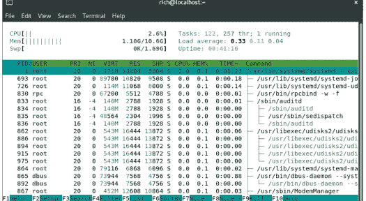

`htop` 输出使用颜色编码使阅读更容易，并使用鼠标选择项目。除了使用晦涩的字母作为操作外，它还使用功能键来轻松执行显示功能，例如对输出进行排序或过滤、搜索输出，或将输出排列成树状以轻松查看父进程和子进程。也许使它比 `top` 更受欢迎的特性之一是能够自定义输出显示，这样你只能看到你感兴趣监控的进程信息列。

## 管理进程

Linux 系统管理员的工作之一是要警惕那些可能会导致 Linux 系统崩溃的失控进程。你都已经看到了如何使用 `ps` 和 `top` 命令来监控系统中的进程表现；下一步是查看如何停止失控进程。

### 设置优先级

默认情况下，在 Linux 系统上运行的所有进程都是平等的；也就是说，它们具有获取 CPU 时间和内存资源的相同优先级。然而，你可能会运行一些应用程序要么不需要相同的优先级级别，要么可能需要更高的优先级级别。

`nice` 和 `renice` 命令允许你设置和更改分配给应用程序进程的优先级级别。`nice` 命令允许你以非默认的优先级设置启动应用程序。其格式如下：

```bash
nice -n value command
```


> 内核是最终决定者，决定它是否可以以不同的优先级级别启动应用程序，即使你告诉它可以。如果 Linux 系统负载很重，内核可以选择忽略任何 `nice` 或 `renice` 命令。

`value` 参数是 -20 到 19 之间的一个数值。数值越低，进程获得的优先级越高。默认优先级为 0。`command` 参数表示你希望以指定优先级启动的程序：

```bash
$ nice -n 10 ./myscript.sh
$
```

要更改已在运行的进程的优先级，请使用 `renice` 命令：

```bash
renice priority [-p pids] [-u users] [-g groups]
```

`renice` 命令允许你根据 PID 值列表、一个或多个用户启动的所有进程，或者一个或多个组启动的所有进程，来更改多个正在运行的进程的优先级。

```bash
$ renice 15 -p 3178
$
```


> 只有 root 用户账户才能设置低于 0 的优先级值，或降低正在运行的进程的优先级值（提高优先级）。

## 停止进程

有时进程会挂起，只需轻轻一推就能重新开始或停止。其他时候，进程会占用 CPU 拒绝释放。在这两种情况下，你需要一个允许你控制进程的命令。为此，Linux 遵循 Unix 的进程间通信方法。

在 Linux 中，进程使用进程信号彼此通信。进程信号是进程识别并可能选择忽略或执行的预定义消息。开发人员编程决定进程如何处理信号。大多数编写良好的应用程序具有接收和执行标准 Unix 进程信号的能力。这些信号如表 21.3 所示。

### 表 21.3 Linux 进程信号

| 编号 | 名称 | 描述 |
|---|---|---|
| 1 | SIGHUP | 挂断 |
| 2 | SIGINT | 中断 |
| 3 | SIGQUIT | 停止运行 |
| 9 | SIGKILL | 无条件终止 |
| 11 | SIGSEGV | 段错误 |
| 15 | SIGTERM | 尽可能终止 |
| 17 | SIGSTOP | 无条件停止但不终止 |
| 18 | SIGTSTP | 停止或暂停，但继续在后台运行 |
| 19 | SIGCONT | 在 STOP 或 TSTP 后恢复执行 |

虽然进程可以向另一个进程发送信号，但 Linux 中有两个命令允许你向正在运行的进程发送进程信号。

### `kill` 命令

`kill` 命令允许你根据进程 ID (PID) 向进程发送信号。默认情况下，`kill` 命令向命令行中列出的所有 PID 发送 `SIGTERM` 信号。不幸的是，你只能使用进程 PID 而不是其命令名称，这使得 `kill` 命令有时难以使用。

要发送进程信号，你必须是进程的拥有者或以 root 用户登录。

```bash
$ kill 3940
-bash: kill: (3940) – Operation not permitted
$
```

`SIGTERM` 信号只是礼貌地要求进程停止运行。不幸的是，如果你有一个失控的进程，它很可能会忽略该请求。当你需要强制时，`-s` 参数允许你指定其他信号（使用它们的名称或信号编号）。

通常接受的程序是首先尝试 `TERM` 信号。如果进程忽略它，则尝试 `SIGINT` 或 `SIGHUP` 信号。如果程序识别这些信号，它将尝试在关闭之前优雅地停止之前的操作。最强制的信号是 `SIGKILL` 信号。当进程接收到此信号时，它会立即停止运行。将此作为最后的手段，因为它可能导致文件损坏。

`kill` 命令令人担忧的一点是没有输出：

```bash
$ sudo kill -s SIGHUP 3940
$
```

要查看命令是否有效，你必须执行另一个 `ps` 或 `top` 命令，以查看违规进程是否已停止。

> **警告** 小心终止可能具有打开文件的进程。如果进程突然停止，文件可能会损坏且无法修复。通常先运行 `lsof` 命令查看打开文件及其进程列表是个好主意。

### `pkill` 命令

`pkill` 命令是一种强大的使用名称而不是 PID 编号停止进程的方法。`pkill` 命令允许你使用通配符，使其在你遇到系统失控时成为一个非常有用的工具：

```bash
$ sudo pkill http*
$
```

此示例将终止所有以 `http` 开头的进程，例如 Apache Web 服务器服务 `httpd`。

> **警告** 小心 `pkill` 命令的搜索功能。通常，最好将搜索词与当前正在运行的进程进行核对，以确保你不会意外终止任何匹配搜索的其他进程。`pgrep` 命令允许你显示所有匹配搜索词的进程。你还可以使用 `pidof` 命令查看指定程序的 PID，以确保你有正确的 PID 和应用程序。

以下练习演示如何监控 Linux 系统上的运行进程以及如何删除你不再想要运行的进程。

## 练习 21.1 管理正在运行的进程

1. 登录到 Linux 图形桌面，并打开两个新的命令提示窗口。

   - 如果你正在使用虚拟终端，请打开两个独立的虚拟终端会话。
2. 在第一个命令提示符中，输入 `sleep 1000`，运行 `sleep` 程序 1000 秒。

## 练习 21.1（续）

3. 在第二个命令提示窗口或虚拟终端会话中，输入 `pgrep sleep` 查找 `sleep` 程序的 PID。
4. 一旦知道 PID，输入 `sudo kill -SIGHUP pid` 使用 `kill` 命令提前停止它，其中 `pid` 是你在步骤 3 中找到的 `sleep` 程序的 PID。
5. 观察第一个窗口的命令提示符。它应该返回，表示 `sleep` 程序不再运行。
6. 输入 `pgrep sleep` 检查正在运行的进程，以确保命令不再运行。

## 摘要

管理在 Linux 系统上运行的应用程序是管理员的一项重要工作。Linux 系统为每个进程分配 CPU 时间和内存，了解每个进程如何消耗这些资源很有帮助。你可以使用 `ps` 命令查看正在运行的应用程序及其消耗的资源。使用 `ps` 命令有许多不同的方法来查看进程信息，允许你完全自定义显示方式。

要实时监控应用程序，请使用 `top` 命令。使用 `top` 命令，你可以查看应用程序的实时显示、其系统状态以及它们消耗的资源。`top` 命令允许你基于许多不同的功能对显示进行排序，例如 CPU 使用率或内存使用率。

要管理在系统上运行的应用程序，你可以使用 `nice` 和 `renice` 命令。`nice` 命令允许你以不同于已运行应用程序的优先级级别启动应用程序。这允许用户在后台以较低的优先级运行应用程序，或允许系统管理员以较高的优先级启动应用程序。使用 `renice` 命令，你可以更改已在运行的应用程序的优先级。

如果应用程序出现问题并需要停止，你可以使用标准的 Linux `kill` 命令，但你必须知道系统分配给应用程序的进程 ID。`pkill` 命令专门用于通过名称而不是进程 ID 停止应用程序。你也可以使用通配符来停止多个应用程序，但这样做可能很危险。要测试哪些应用程序将被停止，请使用 `pgrep` 命令使用通配符搜索查找正在运行的应用程序。

# 考试要点

解释如何查看在 Linux 系统上运行的应用程序状态。`ps` 和 `top` 命令显示系统中正在运行的应用程序状态。这两个命令都显示每个应用程序的状态，是正在运行、休眠还是等待资源。

解释如何查找系统中占用资源最多的应用程序。`top` 命令允许你实时监控 Linux 系统上正在运行的应用程序。它显示每个应用程序消耗的 CPU 和内存量，并允许你根据显示的数据字段进行排序。这使得你可以轻松监控在任一时刻哪些应用程序正在使用最多的 CPU 时间或最多的内存。

描述如何停止在 Linux 系统上造成问题的应用程序。Linux 应用程序被编程为响应 Linux 信号。`kill` 命令允许你向正在运行的应用程序发送信号。如果你向应用程序发送 `KILL` 信号，它将停止在系统上运行。或者，你可以发送 `INT` 信号来中断应用程序，如果应用程序有响应，你可以优雅地将其关闭。`pkill` 命令允许你根据进程名称向应用程序发送 Linux 信号，并允许你使用通配符字符指定进程名称。如果需要停止由单个父应用程序生成的多个应用程序，这种组合会非常方便。

# 复习题

1. `ps` 命令有哪三种选项风格？（选择三项。）

   - A. BSD 风格
   - B. Linux 风格
   - C. Unix 风格
   - D. GNU 风格
   - E. 数字风格

2. 如何识别 `ps` 命令的遗留 Unix 风格选项？

   - A. 在选项前使用双破折号。
   - B. 在选项前使用单破折号。
   - C. 不要在选项前加破折号。
   - D. Unix 风格选项是数字。
   - E. Unix 风格选项使用十六进制数字。

3. 默认情况下，如果不指定任何命令行选项，`ps` 命令显示什么？

   - A. 在终端上运行的所有进程
   - B. 所有活动进程
   - C. 所有休眠进程
   - D. 由当前 shell 运行的所有进程
   - E. 由当前用户运行的所有进程

4. Charles 发现他的 Linux 系统运行缓慢，需要找出是哪个应用程序导致的问题。他应该使用什么工具来显示系统中所有正在运行的进程的当前 CPU 利用率？

   - A. `top`
   - B. `ps`
   - C. `lsof`
   - D. `pkill`
   - E. `kill`

5. 哪个 `top` 命令显示累积 CPU 时间而不是相对 CPU 时间？

   - A. `l`
   - B. `F`
   - C. `r`
   - D. `y`
   - E. `S`

6. Shelly 认为她 Linux 系统上的某个应用程序占用了太多的物理内存，可能存在问题。她应该关注 `top` 显示中的哪一列数据？

   - A. `VIRT`
   - B. `RES`
   - C. `SHR`
   - D. `S`
   - E. `%MEM`

7. Jessica 有一个需要处理大量数字并使用大量系统资源的应用程序。她希望以较低的优先级运行该应用程序，以免干扰系统中的其他应用程序。她应该使用什么工具来启动该应用程序程序？

   - A. `renice`
   - B. `pkill`
   - C. `nice`
   - D. `kill`
   - E. `pgrep`

8. Jimmy 注意到他的 Linux 系统运行缓慢。他运行了 `top` 命令，发现一个数据密集型应用程序占用了大部分 CPU 时间。他不想杀死该应用程序，但希望降低其优先级，以免占用过多的 CPU 时间。他应该使用什么工具来更改正在运行的应用程序的优先级？

   - A. `renice`
   - B. `pkill`
   - C. `nice`
   - D. `kill`
   - E. `pgrep`

9. Hank 需要停止他 Linux 系统上一个应用程序的运行。他知道应用程序文件的名称，但不知道分配给它的进程 ID。他可以使用什么工具来停止该应用程序？

   - A. `renice`
   - B. `pkill`
   - C. `nice`
   - D. `kill`
   - E. `pgrep`

10. Frankie 使用 `ps` 命令找到了他需要停止的一个应用程序的进程 ID。他应该使用什么命令行工具根据进程 ID 来停止该应用程序？

    - A. `renice`
    - B. `pkill`
    - C. `nice`
    - D. `kill`
    - E. `pgrep`


# 第 22 章

## 调查用户问题

目标 4.4：根据场景，分析和排除用户访问及文件权限故障


一种古老的故障排除技巧是将问题一分为二：如果原因不在前半部分，那么就在后半部分。将第二部分再次一分为二，并继续分析。在本章中，我们将用户问题分为系统访问和文件困难。我们进一步细分这些问题类别，并引导你逐步考虑各个项目，以逐步接近解决方案。

# 故障排除访问

如果用户难以访问其期望的应用程序，认证问题的混合体可能是原因。我们将查看本地和远程访问以及认证场景。

## 本地

本地访问指的是使用直接连接到服务器的接口的用户。这些通常是服务器管理员，但也可能是应用程序用户。从收集一些基本信息开始故障排除：

- 这是一个新创建的用户账户吗？
- 该账户输入的用户名是什么？
- 用户曾经登录过该账户吗？


- 用户是尝试通过 GUI 还是基于文本的（虚拟）终端（例如，`tty2`）登录？

### 检查新创建的用户账户

如果账户是新创建的账户，请确认它是否构建正确。新的系统管理员通常使用`useradd`命令创建用户账户（参见第 10 章，“管理用户和组”），但忘记使用`passwd`实用工具添加其密码。使用`grep`或`getent`命令检查`/etc/passwd`和`/etc/shadow`文件记录。清单 22.1 展示了 Ubuntu Desktop 发行版上新用户账户`JKitRk`的一个示例。

**清单 22.1：** 使用`getent`命令查看用户账户记录

```
$ sudo getent passwd JKitRk
JKitRk:x:1002:1002::/home/JKitRk:/bin/bash
$
$ sudo getent shadow JKitRk
JKitRk::!:19780:0:99999:7:::
$
```

注意在`JKitRk` shadow 记录的密码字段中，有一个感叹号（`!`）。这表明未为该账户创建密码。


确保你的系统用户知道 Linux 上的用户名是大小写敏感的。其他操作系统，如 Windows，其用户名不区分大小写，这可能会导致混淆。

### 检查账户访问

查看该账户最近一次成功访问的时间。`lastlog`实用工具通过搜索`/var/log/lastlog`文件来查找已登录到系统的用户，但它只保留最近的登录记录。`last`命令搜索`/var/log/wtmp`文件以查找已登录/注销的用户，并保留最近登录及更早期的记录。此文件通常被轮换，早期版本会带有数字扩展名。因此，下一个较旧的`wtmp`版本是`wtmp.1`。`last`命令的`-f`选项可帮助你搜索各种文件，如清单 22.2 所示。

**清单 22.2：** 使用`last`命令查看成功登录

```
$ sudo last -f /var/log/wtmp -f /var/log/wtmp.* | grep JPicard
JPicard    tty3            Wed Jan  4 13:14 - 13:14  (00:00)
$
$ sudo lastlog -u JPicard
Username   Port      From      Latest
JPicard    tty3          Wed Jan  4 13:14:11 -0500  2023
$
```

注意`last`命令显示`JPicard`账户于 1 月 4 日在`tty3`终端登录，并通过`lastlog`命令得到确认。

你也可以使用`lastb`命令。该命令允许你搜索未成功的登录尝试，如清单 22.3 所示。注意`JPicard`账户在`tty4`终端有两次失败的登录尝试。

#### 列表 22.3：使用 `lastb` 命令查看失败的登录尝试

```
$ sudo lastb -f /var/log/btmp -f /var/log/btmp.* | grep JPicard
JPicard tty4                    Wed Jan  4 13:29 - 13:29  (00:00)
JPicard tty4                    Wed Jan  4 13:29 - 13:29  (00:00)
```

### 检查权限提升问题

大多数 Linux 发行版允许使用`sudo`命令让用户以`root`用户账户执行管理任务，这被称为权限提升。如果有一个用户账户不允许使用`sudo`命令，你需要检查几件事情。

首先，查看`/etc/sudoers`文件，看看哪些用户和组被允许提升其权限。如果该用户账户没有直接列在`/etc/sudoers`文件中，可能会有一些被指定的组。这些组的条目看起来像这样：

```
# Members of the admin group may gain root privileges
%admin ALL=(ALL) ALL

# Allow members of group sudo to execute any command
%sudo ALL=(ALL:ALL) ALL
```

在这个来自 Ubuntu 系统的配置中，`admin`组中的用户被允许使用`sudo`命令进行`root`权限提升，而`sudo`组的成员可以获得权限以任意用户账户身份执行任何命令。

下一步是查看该用户账户属于哪些组。最简单的方法是使用`id`命令：

```
$ id rich
uid=1000(rich) gid=1000(rich) groups=1000(rich),4(adm),24(cdrom),27(sudo),30(dip),46(plugdev),
120(lpadmin),131(lxd),132(sambashare)
$
```

`id`命令的输出显示了该用户账户所属的所有组。在此示例中，`rich`用户账户确实属于`sudo`组，因此它应该具有访问权限，可以使用`sudo`命令作为系统中的任何用户账户进行权限提升。

### 检查 GUI 问题

如果你发现该账户过去已成功登录到系统且近期没有失败的尝试，请查明用户的本地访问方式。如果使用的是 GUI，请让用户尝试登录到基于文本的终端，例如`tty2`终端。如果用户无法成功登录到终端，那么还有其他问题。紧随其后的几个章节部分将有所帮助。

如果用户可以成功登录到基于文本的终端但无法登录到 GUI，你就已经缩小了问题范围。确定哪些服务正在运行。对于较旧的 SysVinit 系统，`runlevel`命令将显示图形环境是否处于当前状态（参见第 6 章，“维护系统启动和服务”）。对于 systemd 系统，使用列表 22.4 中截断示例中显示的命令。

#### 列表 22.4：使用 `systemctl` 命令查看当前的 systemd 目标

```
$ sudo systemctl status graphical.target
   graphical.target - Graphical Interface
   [...]
   Active: active since Wed [...]
   [...]
```

`graphical.target`处于活动状态，这表明 GUI 服务可用。因此，提供 GUI 服务不是问题所在。开始调查其他潜在的 GUI 问题，从显示管理器开始（第 8 章，“比较 GUI”）。

> 注意
>
> 如果你的系统不使用图形环境，请检查是否允许多个用户登录到系统。对于 systemd 系统，检查`multi-user.target`是否处于活动状态。对于 SysVinit 系统，参见第 6 章。

### 检查终端问题

如果用户通常登录到基于文本的终端但无法登录，请让他们登录到不同的终端，无论是在不同的虚拟终端还是图形桌面上。如果登录成功，请使用`ls -l`命令查看原始终端的设备文件，以确定其是否已损坏。列表 22.5 中截断的示例展示了这一点。

#### 列表 22.5：使用 `ls -l` 命令查看终端设备文件

```
$ ls -l /dev/tty
 crw--w---- 1 root tty 4, 0 Jan 4 09:38 /dev/tty0
 crw--w---- 1 gdm tty 4, 1 Jan 4 09:38 /dev/tty1
 [...]
 crw--w---- 1 root tty 4, 9 Jan 4 09:38 /dev/tty9
$
```

注意每个终端设备文件记录开头的`c`。这表明设备文件是字符文件。如果你看到的是一个短横线（`−`），则文件已损坏。使用超级用户权限和`mknod`命令重新构建它。

> 注意
>
> 如果你试图登录到`root`账户或你自己的系统管理员账户并且忘记了密码，请遵循第 20 章“分析系统属性和修复”中“在丢失 Root 密码时生存”部分的指南。

如果用户尝试登录到另一个基于文本的终端但无法登录，请检查`getty`服务是否正在运行。这些服务为基于文本的终端提供登录提示。在 systemd 系统上检查`getty`服务的示例如列表 22.6 中截断所示。

#### 列表 22.6：使用 `systemctl` 命令检查 getty 服务

```
$ sudo systemctl status getty.target
  getty.target - Login Prompts
  [...]
  Active: active since Wed 2023-01-04 09:38:13 EST; 6h ago
  [...]
```

`getty.target`处于活动状态，因此`getty`服务可用。如果用户仍然无法登录到系统，你将需要探索其他问题。


检查`/etc/security/access.conf`文件。当用户尝试登录到系统时，会扫描此文件。其配置接受或阻止用户/组访问系统。它还可以禁止某些登录到基于文本的终端，以及源自网络的登录。

### 检查额外的本地问题

确定账户是否被锁定。你可以使用`passwd -S`或`getent`命令来检查这一点，如列表 22.7 中截断所示。

#### 列表 22.7：使用 `passwd` 和 `getent` 命令检查账户是否被锁定

```
$ sudo passwd -S KJaneway
KJaneway L 01/02/2019 0 99999 7 -1
$
$ sudo getent shadow KJaneway
KJaneway:!!$6$[...]0:L7898:0:99999:7:::
```

用户名`KJaneway`后的`L`表示该账户已被锁定。然而，对于未设置密码的账户，也会显示该代码。因此，也使用了`getent`命令。账户密码字段开头的感叹号（`!`）证实该账户确实已被锁定。如果需要，使用超级用户权限和`usermod -U`或`passwd -u`命令来解除账户锁定。


检查用户的键盘。有时错误的键盘映射或损坏的硬件会导致错误的字符被发送到认证程序。

账户可能已过期。账户过期日期通常是为临时账户用户设置的，例如承包商或实习生。你可以使用`chage`命令查看此信息，如列表 22.8 中截断所示。

#### 列表 22.8：使用 chage 命令检查账户是否已过期

```
$ date
Wed Jan 4 16:17:48 EST 2023
$

$ sudo chage -l JArcher
[...]
Account expires : Jan 01, 2023
[...]
```

注意此账户的过期日期已经通过。因此，`JArcher`账户现在已过期，用户无法登录该账户。如果这是一个错误或者你需要修改它，请使用超级用户权限和`chage -E`命令为账户设置新的过期日期。

确认用户正在使用正确的密码，并检查账户的密码是否已过期。同样使用`chage -1`命令来查看这些信息。

### 远程

对于远程访问问题，首先检查系统是否可以通过网络访问（故障排除在第 20 章中涵盖）。如果系统可访问，确定用户是如何尝试访问系统的。

如果用户使用的是 OpenSSH，首先确认 OpenSSH 服务器在系统上正在运行，并且防火墙已正确配置以允许访问（防火墙在第 18 章“监督 Linux 防火墙”中涵盖）。接下来审查`sshd_config`配置文件。`AllowUsers`和`AllowGroups`指令限制访问。确保这些设置正确。此外，验证该文件底部没有针对此特定用户的特定覆盖设置。务必审查客户端上的任何配置文件，例如`~/.ssh/config`和`/etc/ssh/ssh_config`（OpenSSH 在第 16 章“查看访问和认证方法”中涵盖）。

> 让用户在其`ssh`命令后添加`-vvv`选项。这将提供大量详细信息，有助于故障排除过程。

确定通过 OpenSSH 的认证是通过用户名和密码还是通过令牌进行的。如果是用户名/密码，请检查`sshd_config`指令`PasswordAuthentication`是否设置为`yes`。如果配置文件一切正常，下一节中的故障排除主题可能有所帮助。

如果 OpenSSH 认证是基于令牌（`token`）的，请确保私钥已从远程系统正确复制到服务器。同时，确认公钥已存储在客户端的`~/.ssh/authorized_keys`文件中。


如果您的用户正在使用远程桌面应用程序，例如 VNC、xrdp、NX 或 SPICE，请检查它们的配置。关于这些主题的更多信息，可参见第 8 章。

### 身份验证

层层叠加的认证软件可能是问题的核心。需要检查的一个地方是 PAM（在第 16 章中涵盖）。请查看 PAM 配置文件，例如`/etc/pam.d/sshd`，以确保指令设置正确。同时，使用`pam_tally2`或`faillock`实用工具检查用户的账户是否因登录失败次数过多而被锁定。

您的系统是否使用了其他身份验证产品，例如 LDAP（在第 16 章中涵盖）或 Kerberos（在第 19 章“拥抱最佳安全实践”中涵盖）？您需要检查它们的配置文件。此外，还请查阅它们的日志文件，以确保没有因策略违规而导致用户账户被锁定。

别忘了检查您的 Linux 内核安全模块，例如 SELinux 或 AppArmor（在第 15 章“应用所有权和权限”中涵盖）。虽然这些模块的目的是保护系统免受攻击者侵害，但有时策略违规可能会导致合法用户无法访问。对于 AppArmor，策略违规记录在`audit.log`（由`auditd`生成）或`messages.log`中，具体取决于其配置。如果使用`auditd`服务，您可以使用`ausearch`命令在`audit.log`文件中搜索 AppArmor 策略违规。

对于 SELinux，请使用`sealert`命令检查审计日志文件，如列表 22.9 所示。请注意，没有记录到任何 SELinux 策略违规。

#### 列表 22.9：使用 `sealert` 命令检查 SELinux 策略违规

```
$ sealert -a /var/log/audit/audit.log
100%: done
found 0 alerts in /var/log/audit/audit.log
$
```


对于身份验证问题，请也仔细查看以下各种日志文件：

- `/var/log/auth.log`（基于 Debian 的发行版）
- `/var/log/secure`（基于 Red Hat 的发行版）

这些日志文件通常包含认证失败等信息，可以为您提供大量信息。如有需要，可以使用`grep`搜索特定的用户名。

### 检查文件障碍

在管理文件时，可能会出现各种问题。了解常见问题将有助于您的文件故障排除工作。

#### 文件权限

您可能正在使用`vim`编辑器编辑配置文件，但尝试保存文件时，却收到“无法打开文件进行写入”的错误消息。这令人沮丧。这类问题直接与文件权限有关。

遇到这些问题时，首先使用`ls -l`命令查看文件的权限设置和所有权（在第 15 章中涵盖）。记下文件的属主和组。然后确定属主、组以及其他所有用户（`world`或`other`）的权限。列表 22.10 给出了一个示例。

**列表 22.10：** 使用`ls -l`命令确定文件权限

```
$ ls -l HelloWorld.sh
-rwxr-xr-- 1 root wheel 72 Jan 4 09:29 HelloWorld.sh
$
```

在这种情况下，文件的属主是`root`，该用户有权读取、写入和执行该文件。文件的组是`wheel`。该组的成员可以读取和执行该文件。最后，既不是文件属主也不属于文件组的其他所有人只能读取该文件。

如果尝试访问此文件时出现问题，请使用`id`命令确定用户的用户名和组成员身份。将其身份与文件权限进行比对，以找到问题所在。列表 22.11 给出了一个示例。

**列表 22.11：** 使用`id`命令排查文件访问问题

```
$ whoami
Christine
$
$ ./HelloWorld.sh
-bash: ./HelloWorld.sh: Permission denied
$ id Christine
uid=1001(Christine) gid=1001(Christine) groups=1001(Christine)
$
```

`Christine`无法执行此文件，因为她既不是文件的属主，也不在文件的组中（参见列表 22.10）。第三组权限适用于她，且只允许她读取文件。若要让她运行该文件，请将她添加到`wheel`组、将她设置为文件属主，或修改文件的全局权限。

#### 目录权限

虽然目录权限设置看起来与文件权限非常相似，但它们的效果不同。表 22.1 展示了权限对与该权限适用对象（属主、组或其他）相关操作的影响（在第 15 章中涵盖）。

**表 22.1 目录权限的影响**

| 权限 | 影响 |
| :--- | :--- |
| `r` | 允许用户显示目录中的文件 |
| `w` | 允许用户在目录中创建、移动（重命名）、修改属性和删除文件 |
| `x` | 允许用户通过`cd`命令将当前工作目录更改为此目录，前提是所有父目录也都设置了此权限 |

一些示例将帮助您理解这些权限。例如，用户`Christine`可以列出`/etc`目录的内容，这是因为该目录对其他用户（`world`）具有读取权限，如列表 22.12 的片段所示。

**列表 22.12：** 理解目录权限中读取特权的影响


```bash
$ whoami
Christine
$ ls -1d /etc
drwxr-xr-x. 143 root root 12288 Jan  4 09:22 /etc
$
$ ls /etc
abrt                 gshadow-             profile
adjtime              gss                  profile.d
[...]
$
```

下一个示例（列表 22.13）表明，父目录（`/home`）允许用户使用 `cd` 将当前工作目录更改为该目录。然而，子目录（`Samantha`）通过未授予执行（`x`）特权来阻止了这种操作。

**列表 22.13：** 理解目录权限中执行特权的影响

```bash
$ whoami
Christine
$ ls -ld /home/
drwxr-x-x. 5 root root 52 Nov 8 14:31 /home/
$ cd /home
$ pwd
/home
$ ls -ld /home/Samantha
drwx------. 5 Samantha Samantha 128 Nov 8 14:38 /home/Samantha
$ cd /home/Samantha
-bash: cd: /home/Samantha: Permission denied
$
```


> 如果子目录授予了执行权限，但其父目录之一未授予执行权限，用户将无法使用 `cd` 到达该子目录。该路径中的所有目录都必须为该用户设置执行权限。

如果您有一个在用户之间共享的目录，且用户能够删除彼此的文件，但并非希望如此，请对该目录使用粘滞位（`sticky bit`）。此权限（在第 15 章中涵盖）将解决此问题。

## 处理高级权限

除了标准的 Linux 文件和目录权限外，您可能会遇到使用了 Linux 更高级权限特性的系统。

访问控制列表（`ACL`）允许您除了标准的属主、组和其他设置外，还为多个用户或组指定权限。如果您的 Linux 系统使用 `ACL`，请始终使用 `getfacl` 实用工具检查应用于文件或目录的额外 `ACL` 权限：

```bash
$ getfacl test.txt
# file: test.txt
# owner: rich
# group: rich
user::rw-
user:sales:r-x
mask::r-x
other::r--
```

在此示例中，属主使用 `ACL` 将 `sales` 组的读取权限分配给了该文件。要更改 `ACL` 设置，请使用 `setfacl` 实用工具。

除了 `ACL` 权限外，Linux 系统还可能使用基于上下文的权限，采用 `SELinux`（最常见于基于 Red Hat 的 Linux 发行版）或 `AppArmor`（最常见于基于 Debian 的 Linux 发行版）。

要确定 `SELinux` 在您的 Linux 系统上是否处于活动状态，请使用 `sestatus` 命令：

```bash
$ sudo sestatus
SELinux status:               enabled
SELinuxfs mount:             /sys/fs/selinux
SELinux root directory:      /etc/selinux
Loaded policy name:          targeted
Current mode:                enforcing
Mode from config file:       enforcing
Policy MLS status:           enabled
Policy deny_unknown status:  allowed
Memory protection checking  actual (secure)
Max kernel policy version:   331
$
```

如果 `SELinux` 已启用，请使用 `ls` 命令的 `-Z` 命令行选项来查看文件和目录的附加上下文权限：

```bash
$ ls -Z test1.txt
unconfined_u:object_r:user_home_t:s0 test1.txt
$
```

您可以使用 `chcon` 命令更改文件的安全上下文：

```bash
chcon -u newuser -r newrole -t newtype filename
```

`SELinux` 使用策略来控制对对象的访问。`getsebool` 命令允许您列出策略并确定它们是处于活动还是禁用状态，并使用 `setsebool` 命令来激活或停用它们。

要确定 `AppArmor` 在您的系统上是否处于活动状态，请使用 `aa-status` 实用工具：

```bash
$ sudo aa-status
apparmor module is loaded.
...
$
```

## 文件创建

用户尝试创建文件时权限被拒绝。首先检查目录权限。如果目录权限正常，请考虑以下事项：

- **该分区是否强制执行配额？** 用户可能已达到配额限制。检查分区的 `/etc/fstab` 记录中是否存在 `usrquota` 或 `grpquota`，以查看此文件系统上是否启用了配额（在第 10 章中介绍），或者使用 `repquota` 实用工具。如果启用了配额，使用 `quota` 命令检查用户（或组）的配额使用情况。如果用户超出了配额限制且宽限期已过，请使用 `quotaoff` 关闭配额，延长用户的配额，或让用户删除不必要的文件。

- **磁盘是否已用完空间？** `df` 命令（在第 20 章中介绍）可以帮助您快速确定用户尝试创建文件的分区是否已用完空间。如果空间不足，请采取适当措施（同样在第 20 章中介绍）。

- **分区是否已用完 inode？** *inode 耗尽* 是一种不常见的情况，但确实会发生。`inode` 号（在第 3 章“管理文件、目录和文本”中介绍）是与文件关联的索引号。如果文件系统的 `inode` 耗尽，则无法在其上创建任何额外文件。通过执行 `df -i` 命令来检查是否存在此问题，该命令显示每个文件系统的 `inode` 使用情况。

如果 `inode` 已耗尽，您在文件系统创建后无法扩展它们。相反，请查找包含大量小且不必要的文件的目录（例如临时目录），并删除可以删除的内容。良好的做法是将创建许多小文件的应用程序放在自己的大容量分区上，并将其格式化以提供更高数量的 `inode` 号。在创建文件系统时，通过使用 `mke2fs -i` 命令等实用选项来增加 `inode` 数量，使其高于默认值。

- **用户的 umask 设置是什么？** `umask` 设置（在第 15 章中介绍）会从默认文件和目录权限设置中减去权限。因此，当用户创建文件和/或目录时，其上的权限设置会受此影响。让用户在命令行输入 `umask`（或检查用户的环境文件）以确定其设置。如果设置过高（例如，移除了创建子目录所需的写权限），则找到了问题的原因。

与访问问题类似，在用户无法创建或删除文件的情况下，请检查您的 Linux 内核安全模块（`SELinux` 或 `AppArmor`）。使用适当的工具浏览相应的策略违规日志文件（`/var/log/messages` 或 `/var/log/audit/audit.log`）。

在找到关于相关文件或目录的策略违规后，确定是文件/目录标签错误、策略不正确，还是可能使用了错误的 `security context`。采取适当措施解决问题。

## 探索环境和 Shell 问题

在处理用户问题时，潜在问题是用户账户的默认 shell。使用 `getent` 命令进行检查，如图 22.14 所示在 Ubuntu 发行版中的显示。

**图 22.14：** 使用 `getent` 命令确定账户的默认 shell

```bash
$ getent passwd BSisko
BSisko:x:1007:1007::/home/BSisko:/bin/sh
$
$ readlink -f /bin/sh
/bin/dash
$ 
```

请注意，默认 shell 没有使用 `/bin/bash`，而是使用了 `/bin/sh` shell。在此系统上，`/bin/sh` 文件链接到 `/bin/dash` shell。如果这不是您想要的，您可以通过 `usermod` 命令更改用户的默认 shell（参见第 10 章）。

设置不正确或错误的环境变量会导致各种用户困难。查看用户的环境文件（在第 10 章中介绍），如 `~/.profile` 文件。与此同时，使用 `set`、`env` 或 `printenv` 命令检查系统的全局环境变量设置。

确保环境变量被导出，以便它们在子 shell 中可用（当执行 shell 脚本时可能会发生子 shell）。此问题的示例如图 22.15 所示。

**图 22.15：** 演示当变量未被导出时会发生什么

```bash
$ EDITOR='nano'
$ echo $EDITOR
nano
$
$ bash
$
$ echo $EDITOR
$
$ exit
exit
$
```

用户设置环境变量 `EDITOR`，使其默认文本编辑器变为 `nano`。但是，当通过 `bash` 命令创建新的子 shell 时，设置会丢失。为了保持设置的持久性，需要将其导出并存储在用户的环境文件中。导出变量的示例如图 22.16 所示。

**图 22.16：** 演示 `export` 命令

```bash
$ export EDITOR='nano'
$
$ echo $EDITOR
nano
$
$ bash
$
$ echo $EDITOR
nano
$
```

同样重要的是，确保环境变量位于正确的文件中，无论是全局文件还是用户文件。此外，您必须了解用户进行的登录类型，以便将这些变量设置在正确的文件中（参见第 10 章）。

## 总结

用户问题故障排除很棘手。访问、身份验证、文件管理以及用户的 shell 和环境涉及许多组件。理解常见问题将有助于解决问题。

## 考试要点

- **总结用户访问问题/解决方案。** 对于受阻的本地访问，研究损坏的终端文件、配置错误的 GUI 组件以及过期的密码/账户。远程访问问题通常是由配置错误的 `OpenSSH` 组件或远程桌面应用程序引起的。其他问题可能涉及分层身份验证软件，如 `PAM` 或系统的内核安全模块，如 `SELinux` 或 `AppArmor`。

- **描述各种文件问题/解决方案。** 文件访问和管理需要理解基本的文件和目录权限以及所有权和组成员资格。需要审查的其他系统项目包括文件系统配额、磁盘空间、`inode` 使用情况和 `umask` 设置。还要检查内核安全模块日志文件中的策略违规。如果用户无法删除文件，请查找文件上设置的不可变位。

- **解释用户环境和 shell 问题。** 配置不当或未导出的环境变量会导致用户问题。检查各种环境文件，包括全局文件和用户文件，查找问题。用户账户的默认 shell 设置也可能导致困难。

## 复习题

1. 承包商 Lamar 声称他无法本地登录他的账户。昨天他还能登录。其他人似乎没有遇到访问系统的问题。你应该首先检查什么？

    A. 使用 `systemctl` 命令检查 GUI 服务是否正在运行。

    B. 查看 `OpenSSH` 服务器配置文件。

    C. 使用 `chage` 命令确定他的账户是否已过期。

    D. 使用 `faillock` 实用工具查看账户是否被锁定。

    E. 检查 `SELinux` 日志文件中的策略违规。

2. Irene 通常通过 `tty4` 终端本地登录系统，但今天无法登录。她在 `tty3` 终端尝试身份验证并成功登录。你应该首先检查什么？

    A. 使用 `systemctl` 命令确定 `getty` 服务是否正在运行。

    B. 查看 `/etc/security/access.conf` 文件中的访问规则。

    C. 使用 `passwd -S` 命令查看账户是否被锁定。

    D. 使用 `last` 命令查看她最后登录的时间。

    E. 使用 `ls -l` 命令检查 `tty4` 设备文件是否损坏。

3. Vincent 尝试使用 `OpenSSH` 远程登录系统但未成功。他问你可以做什么来帮助排除此问题。你首先应该建议什么？

    A. 检查 `/etc/ssh/sshd_config` 配置文件。

    B. 在 Vincent 的 `ssh` 命令中添加 `-vvv` 选项。

    C. 在 Vincent 的 `ssh` 命令中添加 `-X` 选项。

    D. 确认 Vincent 的公钥存储在 `~/.ssh/authorized_keys` 文件中。

    E. 检查 `~/.ssh/config` 配置文件。

4. Anton 难以确定为什么特定用户无法登录 Rocky Linux 系统，其中 `SELinux` 已禁用且未使用 `auditd`。以下哪些是最佳日志文件？（选择两项。）

    A. `/var/log/audit/audit.log`

    B. `/var/log/messages`

    C. `/var/log/auth`

    D. `/var/log/secure`

    E. `/var/log/lastlog`

5. Tarissa 需要运行一个 shell 脚本，该脚本的权限为 `rwxr--r--`，所有者为 `root`，所属组为 `wheel`。Tarissa 的用户账号是 `T2T1080`，她是 `admin` 组的成员。为了让她能够运行此脚本，可以执行以下哪些操作？（选择所有适用项。）

- **A.** 将 Tarissa 添加到 `wheel` 组中。

- **B.** 为 Tarissa 创建一个名为 `wheel` 的新账号。

- **C.** 在脚本文件的组权限中添加 `w`。

- **D.** 在脚本文件的组权限中添加 `x`。

- **E.** 无需任何操作。Tarissa 现在就可以运行该脚本。

6. Miles 需要将当前工作目录更改为 `/home/miles` 目录。他既不是该目录的所有者，也不属于该目录的组。假设所需的父目录权限已设置，要实现此操作成功发生，需要满足什么条件？

- **A.** 无需任何操作。`/home/miles` 目录是 Miles 的主目录，因此他可以默认访问。

- **B.** 需要添加执行 (`x`) 权限。

- **C.** 需要添加写入 (`w`) 权限。

- **D.** 需要添加读取 (`r`) 权限。

- **E.** 需要添加破折号 (`–`) 权限。

7. Sarah 是一名系统管理员，她尝试创建一个文件，但收到一条错误消息，表明无法创建该文件。以下哪几项可能是问题所在？（选择所有适用项。）

- **A.** 她尝试创建文件的文件系统设置了配额，且她已超出配额和宽限期。

- **B.** 她尝试创建文件的文件系统空间已耗尽。

- **C.** 她尝试创建的文件设置了不可变位（immutable bit），因此无法创建。

- **D.** 该操作触发了 `SELinux` 或 `AppArmor` 策略违规。

- **E.** 文件系统正在经历 `inode` 耗尽，因此无法容纳任何新文件。

8. 一名用户无法删除自己的某个文件，但能够删除其目录中的其他文件。John 是一名系统管理员，正在尝试排查此问题。他首先应该对该文件使用哪个命令？

- **A.** `chown`

- **B.** `chattr`

- **C.** `chmod`

- **D.** `umask`

- **E.** `lsattr`

9. Melissa 希望将她的默认编辑器设置为 `vim` 编辑器，并希望当她进入子 shell 时此设置保持不变。她应该怎么做？

- **A.** 在 `/etc/profile` 文件中放入 `EDITOR='vim'`。

- **B.** 在 `/etc/profile` 文件中放入 `export EDITOR='vim'`。

- **C.** 在她的 `~/.profile` 文件中放入 `EDITOR='vim'`。

- **D.** 在她的 `~/.profile` 文件中放入 `export EDITOR='vim'`。

- **E.** 在她的 `~/.bashrc` 文件中放入 `export EDITOR='vim'`。

10. Mark Watney 是一名系统管理员，他的账号 `MW2015` 被一名新的系统管理员实习生修改了。当 Mark 登录系统并尝试使用花括号对一组命令进行分组时，它不再起作用。其他人没有遇到这个问题。他怀疑他的账号默认 shell 已从 `/bin/bash` 更改为 `/bin/tcsh`。以下哪几项有助于确定他的怀疑是否正确？（选择所有适用项。）

- **A.** `cat /etc/profile`

- **B.** `echo $SHELL`

- **C.** `sudo grep tcsh /etc/passwd`

- **D.** `sudo getent shadow MW2015`

- **E.** `sudo getent passwd MW2015`

# 第 23 章


# 处理 Linux 设备

✓ 目标 1.1：总结 Linux 基础知识


典型的 Linux 系统连接着许多不同的硬件设备。列表可能包括硬盘、监视器、键盘、打印机、声卡和网络卡。作为 Linux 管理员，你的工作之一就是确保所有这些设备都能正常工作。本章将指导你如何安装和排查连接到你的 Linux 系统的不同类型硬件设备的问题。首先，本章讨论了你在 Linux 系统上可能需要处理的不同类型设备接口，以及它们如何与操作系统通信。随后，本章讨论了可用于监视和排查系统上这些设备工作问题的 Linux 实用工具。最后，本章深入探讨了热插拔设备的话题，随着 `USB` 设备的普及，这一话题变得极其重要。

## 与 Linux 设备通信


要使任何设备在你的 Linux 系统上工作，Linux 内核必须识别它并知道如何与其通信。内核使用已安装的模块（参见第 14 章，“维护内核模块”）来了解如何与系统中的每种硬件设备通信。如果特定硬件设备的模块未加载，则内核将无法与该设备通信。

安装内核模块后，内核必须知道如何与该设备通信。Linux 支持几种不同的硬件接口类型和与设备通信的方法。

## 设备接口

你连接到 Linux 系统的每个设备都使用某种标准协议与系统硬件通信。内核模块软件必须知道如何使用这些协议向硬件设备发送和接收数据。目前，有三种流行的标准用于连接设备。

### PCI 板卡

*Peripheral Component Interconnect*（PCI）标准于 1993 年开发，作为将硬件板卡连接到 PC 主板的方法。该标准已更新了几次，以适应更快的接口速度以及增加主板上的数据总线宽度。*PCI Express (PCIe)* 标准目前用于大多数服务器和桌面工作站，为外部硬件卡提供通用接口。许多不同的客户端设备使用 PCI 板卡连接到服务器或桌面工作站：

**内部硬盘**

使用 *Serial Advanced Technology Attachment (SATA)* 和 *Small Computer System Interface (SCSI)* 连接器的硬盘通常使用 PCI 板卡与工作站或服务器连接。Linux 内核自动识别连接到 PCI 板卡的 SATA 和 SCSI 硬盘。

**外部硬盘**

使用光纤通道标准的网络硬盘为服务器环境提供高速共享驱动器环境。为了在光纤通道网络上通信，服务器通常使用支持 *Host Bus Adapter (HBA)* 标准的 PCI 板卡。

**网络接口卡**

硬连线网络卡允许你使用常见的 RJ-45 电缆标准将工作站或服务器连接到局域网。这些类型的连接主要发现在需要高网络吞吐量的快速网络环境中。

**无线网卡**

有支持 IEEE 802.11 标准的 PCI 板卡可用于无线局域网连接。虽然不常用作服务器环境，但它们在 workstation 环境中很受欢迎。

**蓝牙设备**

蓝牙技术允许在点对点网络设置中与其他蓝牙设备进行短距离无线通信。它们最常出现在工作站环境中。

**视频加速器**

需要高级图形功能的应用程序通常使用视频加速器卡，将视频处理需求从 CPU 卸载，以提供更快的图形效果。虽然这些在 gameing 环境中很受欢迎，但你也会在视频处理应用中发现视频加速器卡，用于编辑和处理电影，以及在需要高级数学运算的应用程序（如区块链生成）中。

**声卡**

同样，需要高质量声音的应用程序通常使用专用声卡来提供高级音频处理和播放，例如处理 Dolby 环绕声以增强电影的音频质量。

## USB 接口

*Universal Serial Bus (USB)* 接口由于其易用性和对高速数据通信的支持日益增加而变得越来越流行。由于 USB 接口使用串行通信，它需要更少的连接器连接到主板，从而允许更小的接口插头。

USB 标准随着时间推移不断演进。最初的 1.0 版本仅支持最高 12 Mbps 的数据传输速度。2.0 标准将数据传输速度提升至 480 Mbps。当前的 USB 标准 4.0 允许最高 40 Gbps 的数据传输速度，使其适用于连接外部存储设备的高速场景。

种类繁多设备可以通过 USB 接口连接到系统。你可以找到硬盘驱动器、打印机、数码相机和摄像录影机、键盘、鼠标以及网卡等具有 USB 接口版本的产品。

## Linux 与 USB 设备

让 Linux 与 USB 设备交互有两个步骤。第一步是 Linux 内核必须安装正确的模块以识别服务器、工作站或笔记本电脑上安装的 USB 控制器。控制器提供 Linux 内核与系统 USB 总线之间的通信。当 Linux 内核能够与 USB 总线通信时，插入系统 USB 端口的任何设备都会被内核识别，但不一定可用。第二步是 Linux 系统必须为插入 USB 总线的特定设备类型安装内核模块。Linux 发行版默认安装了大量模块。如果你在 Linux 系统上遇到无法工作的 USB 设备，请参见第 14 章以获取有关安装内核模块的信息。

## GPIO 接口

通用输入/输出（GPIO）接口在用于自动化项目控制外部设备的小型实用 Linux 系统中变得流行。这包括流行的业余爱好者 Linux 系统，如 `Raspberry Pi` 和 `BeagleBone` 套件。

`GPIO` 接口提供多条数字输入和输出线，你可以单独控制它们，甚至精确到单个比特位。`GPIO` 功能通常由专用集成电路（IC）芯片处理，该芯片映射到 Linux 系统的内存中。

`GPIO` 接口非常适合支持继电器、灯光、传感器和电机等外部设备的通信。应用程序可以读取单独的 `GPIO` 线以确定开关的状态、打开或关闭继电器，或读取由任何类型的模数传感器（如温度或压力传感器）返回的数字值。

借助 `GPIO` 接口，你拥有使用 Linux 控制物体和环境的大量可能性。你可以编写程序来控制房间温度、感知门窗的开启或关闭、感知房间内的运动，甚至控制机器人的操作。

## /dev 目录

一旦 Linux 内核能够与接口上的设备通信，它必须能够向设备发送和从设备接收数据。对于许多设备，这是通过使用设备文件来完成的。设备文件是 Linux 内核在特殊的 `/dev` 目录中创建的文件，用于与硬件设备交互。

要从特定设备检索数据，程序只需读取与该设备关联的 Linux 设备文件即可。Linux 操作系统处理了与实际硬件交互的所有复杂细节。同样，要向设备发送数据，程序只需写入 Linux 设备文件。

当你向系统添加硬件设备（如 USB 驱动器、网卡或硬盘驱动器）时，Linux 会在 `/dev` 目录中创建一个代表该硬件设备的文件。应用程序随后可以直接与该文件交互以在设备上存储和检索数据。这比要求每个应用程序知道如何直接与设备交互要简单得多。

Linux 中有两种类型的设备文件，基于 Linux 向设备传输数据的方式分类：

- 字符设备文件：一次传输一个字符。这种方法常用于串行设备，如终端和 `USB` 设备。
- 块设备文件：传输大块数据。这种方法常用于高速数据传输设备，如硬盘驱动器和网卡。

设备文件的类型由权限列表中的第一个字母表示，如清单 23.1 所示。

### 清单 23.1：/dev 目录的部分输出

```bash
$ ls -al sd* tty*
brw-rw---- 1 root disk  8, 0 Feb 16 17:49 sda
brw-rw---- 1 root disk  8, 1 Feb 16 17:49 sda1
crw-rw-rw- 1 root tty   5, 0 Feb 16 17:49 tty
crw-w----- 1 root tty   4, 0 Feb 16 17:49 tty0
crw-w----- 1 gdm  tty   4, 1 Feb 16 17:49 tty1
```

硬盘设备 `sda` 和 `sda1` 显示字母 `b`，表明它们是块设备文件。`tty` 终端文件显示字母 `c`，表明它们是字符设备文件。

还有一些特殊的字符设备文件为 shell 提供有用的功能。值得注意的有：

- `/dev/null`：当数据重定向到此设备时，数据会被丢弃。这对于重定向你不希望显示的程序消息非常方便。
- `/dev/random` 和 `/dev/urandom`：这些设备文件提供对内核随机数生成器的访问。`/dev/random` 设备会阻止请求，直到生成足够的随机数据以计算真正的随机数。
- `/dev/urandom` 设备不阻止请求，而是使用当前可用的随机数据返回一个随机数。虽然准确度较低，但对于大多数随机数用途通常都没问题。
- `/dev/zero`：当从该设备读取数据时，它返回 `NULL` 字符（`0x00`）。这是一个创建空文件或擦除磁盘分区上先前存储的数据的绝佳资源。

除了设备文件，Linux 还提供了一种称为 *device mapper*（设备映射器）的系统。设备映射器功能由 Linux 内核执行。它将物理块设备映射到虚拟块设备。这些虚拟块设备允许系统拦截写入物理设备或从物理设备读取的数据，并对它们执行某种类型的操作。映射设备被逻辑卷管理器（`LVM`）用于创建逻辑驱动器，并被 Linux 统一密钥设置（`LUKS`）用于加密硬盘驱动器上的数据。


## /proc 目录

`/proc` 目录是你在排查 Linux 系统硬件问题时最有用的工具之一。它并不是文件系统上的物理目录，而是内核动态填充的虚拟目录，用于提供有关系统硬件设置和状态的信息访问。

Linux 内核在监控系统硬件状态时会更改 `/proc` 目录中的文件和数据。要查看硬件设备和设置的状况，你只需使用标准的 Linux 文本命令读取虚拟文件的内容即可。

针对不同系统特性有不同的 `/proc` 文件可用，包括硬件设备在系统中使用的中断请求（`IRQ`）、`I/O` 端口和 `DMA` 通道。以下部分讨论用于监控这些特性的文件以及你如何访问它们。

### 中断请求

中断请求（称为 `IRQ`）允许硬件设备指示它们有待发送给 `CPU` 的数据。`PnP` 系统必须为系统中安装的每个硬件设备分配一个唯一的 `IRQ` 地址。你可以通过使用 Linux `cat` 命令查看 `/proc/interrupts` 文件来查看当前 Linux 系统上使用的 `IRQ`，如清单 23.2 所示。

#### 清单 23.2：从 /proc 目录列出系统中断

```bash
$ cat /proc/interrupts
               CPU0
0:         36  IO-APIC  2-edge     timer
1:        297  IO-APIC  1-edge    i8042
8:      0 IO-APIC  8-edge      rtc0
9:      0 IO-APIC  9-fasteoi   acpi
12:     396 IO-APIC 12-edge     i8042
14:      0 IO-APIC 14-edge     ata_piix
15:     914 IO-APIC 15-edge     ata_piix
18:      2 IO-APIC 18-fasteoi  vboxvideo
19:    4337 IO-APIC 19-fasteoi  enp0s3
...
```

在清单 23.2 中，第一列指示分配给设备的 `IRQ`。某些 `IRQ` 由系统为特定硬件设备保留，例如 `0` 用于系统定时器，`1` 用于系统键盘。其他 `IRQ` 在设备在启动时被检测时由系统分配。

### I/O 端口

系统 `I/O` 端口是内存中的位置，`CPU` 可以在此处向硬件设备发送数据并从硬件设备接收数据。与 `IRQ` 一样，系统必须为每个设备分配唯一的 `I/O` 端口。这是由 `PnP` 系统处理的另一个功能。

你可以通过查看 `/proc/ioports` 文件来监控分配给系统硬件设备的 `I/O` 端口，如清单 23.3 所示。

#### 清单 23.3：显示系统中的 I/O 端口

```bash
$ cat /proc/ioports
0000-0cf7 : PCI Bus 0000:00
0000-001f : dma1
0020-0021 : pic1
0040-0043 : timer0
0050-0053 : timer1
0060-0060 : keyboard
0064-0064 : keyboard
0070-0071 : rtc_cmos
0070-0071 : rtc0
0080-008f : dma page reg
00a0-00af : pic2
00c0-00df : dma2
00f0-00ff : fpu
0170-0177 : 0000:00:01.1
0170-0177 : ata_piix
01f0-01f7 : 0000:00:01.1
01f0-01f7 : ata_piix
0376-0376 : 0000:00:01.1
0376-0376 : ata_pix
03c0-03df : vga+
03f6-03f6 : 0000:00:01.1
03f6-03f6 : ata_pix
0cf8-0cff : PCI conf1
0d00-ffff : PCI Bus 0000:00
```

在 Linux 系统上，任何时刻都有许多不同的 `I/O` 端口正在使用，因此你的输出结果很可能与此示例不同。使用 `PnP` 时，`I/O` 端口冲突并不常见，但有可能两个设备被分配到相同的 `I/O` 端口。在这种情况下，你可以使用 `setpci` 命令手动覆盖自动分配的设置。

## 直接内存访问

使用 `I/O` 端口向 `CPU` 发送数据可能会比较慢。为了加快速度，许多设备使用直接内存访问 (`DMA`) 通道。`DMA` 通道正如名称所暗示的那样；它们将数据从硬件设备直接发送到系统内存，而无需等待 `CPU`。`CPU` 随后可以在准备好时读取这些内存位置以访问数据。

与 `I/O` 端口一样，每个使用 `DMA` 的硬件设备必须被分配一个唯一的通道号。要查看系统当前正在使用的 `DMA` 通道，只需显示 `/proc/dma` 文件：

```bash
$ cat /proc/dma
4: cascade
$
```

此输出表明在 Linux 系统上只有 `DMA` 通道 `4` 正在使用。

## /sys 目录

用于处理设备的另一项工具是 `/sys` 目录。`/sys` 目录是另一个虚拟目录，类似于 `/proc` 目录。它提供了有关硬件设备的额外信息，系统上的任何用户都可以访问。

`/sys` 目录内有许多信息文件可用。它们根据设备在系统中的功能划分为子目录。你可以使用 `ls` 命令行命令查看系统上 `/sys` 目录内可用的子目录和文件，如清单 23.4 所示。

### 清单 23.4: /sys 目录的内容

```bash
$ ls -al /sys
total 4
dr-xr-xr-x 13 root root 0 Feb 16 18:06 .
drwxr-xr-x 25 root root 4096 Feb 4 06:54 ..
drwxr-xr-x 2 root root 0 Feb 16 17:48 block
drwxr-xr-x 41 root root 0 Feb 16 17:48 bus
drwxr-xr-x 62 root root 0 Feb 16 17:48 class
drwxr-xr-x 4 root root 0 Feb 16 17:48 dev
drwxr-xr-x 14 root root 0 Feb 16 17:48 devices
drwxr-xr-x 5 root root 0 Feb 16 17:49 firmware
drwxr-xr-x 8 root root 0 Feb 16 17:48 fs
drwxr-xr-x 2 root root 0 Feb 16 18:06 hypervisor
drwxr-xr-x 13 root root 0 Feb 16 17:48 kernel
drwxr-xr-x 143 root root 0 Feb 16 17:48 module
drwxr-xr-x 2 root root 0 Feb 16 17:48 power
$
```

注意可用的不同类别的信息。你可以获取有关系统总线、设备、内核以及已安装的内核模块的信息。

# 处理设备

Linux 提供了丰富的命令行工具，用于使用连接到系统的设备，以及在出现问题时监控和排除设备的故障。以下章节将介绍一些在处理 Linux 设备时你需要了解的一些流行工具。

## 查找设备

新的 Linux 管理员的首要任务之一是找到 Linux 系统上安装的不同设备。幸运的是，有一些命令行工具可以帮助解决这个问题。

## lsdev 命令

`lsdev` 命令行命令显示有关安装在 Linux 系统上的硬件设备的信息。它从 `/proc/interrupts`、`/proc/ioports` 和 `/proc/cmda` 虚拟文件中获取信息，并将它们合并为一个输出，如清单 23.5 所示。

### 清单 23.5: lsdev 命令的输出


进入`/path/to/xxx`目录，找到`xxx.json`。

在表达式`cvar = avar + bvar`中，加法运算符（`+`）将`avar`与`bvar`相加，得到它们的和`cvar`

在`List.of(arg0, arg1, arg2)`中，`List`接口的工厂方法`of()`接受一系列的元素，返回包含它们的只读列表。

之后我们这样调用`cmd`命令：`cmd arg0 arg1 arg2`。

```
if (condVar > someVal) {console.log("xxx")}
```
这是示例文本的重复，实际任务是对以下提供的待排版文本进行处理。

---

以下是根据要求对提供文本的排版结果：

### `lsdev` 命令

```
$ lsdev
Device DMA IRQ I/O Ports
...
acpi 9
ACPI           4000–4003 4004–4005 4008–400b 4020–4021
ahci           d240–d247 d248–d24b d250–d257 d258–d25b
ata_piix       14  15       0170–0177 01f0–01f7 0376–0376 03f6–03f6
cascade        4
dma                     0080–008f
dma1                    0000–001f
dma2                    00c0–00df
e1000                   d010–d017
enp0s3          19
fpu                     00f0–00ff
i8042           1  12
Intel                   d100–d1ff     d200–d23f
keyboard                0060–0060     0064–0064
ohci_hcd:usb1   22
PCI                     0000–0cf7 0cf8–0cff 0d00–ffff
pic1                    0020–0021
pic2                    00a0–00a1
piix4_smbus             4100–4108
rtc0            8        0070–0071
rtc_cmos                  0070–0071
snd_intel8x0    21
timer                     0
timer0                  0040–0043
timer1                  0050–0053
vboxguest       20
vboxvideo       18
vga+                    03c0–03df
$ 
```

这为你提供了一个查看所有运行在系统上的设备的重要信息的地方，使其易于识别任何可能导致问题的冲突。

> **注意** `lsdev` 工具是 `procinfo` 包的一部分。在某些 Linux 发行版中，你可能需要手动安装该包。

## `lsblk` 命令

`lsblk` 命令行命令显示有关安装在 Linux 系统上的块设备的信息。默认情况下，`lsblk` 命令显示所有块设备，如清单 23.6 所示。

### 清单 23.6: `lsblk` 命令的输出

```
$ lsblk
NAME MAJ:MIN RM SIZE RO TYPE MOUNTPOINT
loop0 7:0 0 34.6M 1 loop /snap/gtk-common-themes/818
loop1 7:1 0 2.2M 1 loop /snap/gnome-calculator/222
...
sda 8:0 0 10G 0 disk
sda1 8:1 0 10G 0 part
ubuntu--vg-root 253:0 0 9G 0 lvm /
ubuntu--vg-swap_1 253:1 0 976M 0 lvm [SWAP]
sr0 11:0 1 1024M 0 rom
$ 
```

如果你注意清单 23.6 的末尾，`lsblk` 命令还会指示相关的块，例如设备映射的 `LVM` 卷和相关的物理硬盘。你可以通过添加命令行选项来修改 `lsblk` 输出，以查看有关块的更多信息。`-S` 选项仅显示系统中 `SCSI` 块设备的信息：

```
$ lsblk -S
NAME HCTL TYPE VENDOR MODEL REV TRAN
sda 2:0:0:0 disk ATA VBOX HARDDISK 1.0 sata
sr0 1:0:0:0 rom VBOX CD-ROM 1.0 ata
$
```

这是查看系统上安装的不同 `SCSI` 驱动器的一种快速方法。

## `dmesg` 命令

内核环形缓冲区记录内核级事件的发生情况。由于它是环形缓冲区，缓冲区区域填满后，事件消息会被覆盖。你可以使用 `dmesg` 命令查看内核环形缓冲区中的当前消息。每当你安装新设备时，监控它都很有帮助，如清单 23.7 所示。

### 清单 23.7: `dmesg` 命令的部分输出

```
[ 2525.499216] usb 1-2: new full-speed USB device number 3 using ohci-pci
[ 2525.791093] usb 1-2: config 1 interface 0 altsetting 0 endpoint 0x1 has invalid maxpacket 512, setting to 64
[ 2525.791107] usb 1-2: config 1 interface 0 altsetting 0 endpoint 0x81 has invalid maxpacket 512, setting to 64
[ 2525.821079] usb 1-2: New USB device found, idVendor=abcd, idProduct=1234
[ 2525.821088] usb 1-2: New USB device strings: Mfr=1, Product=2, SerialNumber=3
[ 2525.821094] usb 1-2: Product: UDisk
[ 2525.821099] usb 1-2: Manufacturer: General
[ 2525.821104] usb 1-2: SerialNumber: [ 2525.927096] usb-storage 1-2:1.0: USB Mass Storage device detected
[ 2525.927096] usb-storage 1-2:1.0: USB Mass Storage device detected
[ 2525.927950] scsi host3: usb-storage 1-2:1.0
[ 2525.928033] usbcore: registered new interface driver usb-storage
[ 2525.940376] usbcore: registered new interface driver uas
[ 2526.961754] scsi 3:0:0:0: Direct-Access General UDisk 5.00 PQ: 0 ANSI: 2
[ 2526.966646] sd 3:0:0:0: Attached scsi generic sg2 type 0
[ 2526.992707] sd 3:0:0:0: [sdb] 31336448 512-byte logical blocks: (16.0 GB/14.9 GiB)
[ 2527.009197] sd 3:0:0:0: [sdb] Write Protect is off
[ 2527.009200] sd 3:0:0:0: [sdb] Mode Sense: 0b 00 00 08
[ 2527.026764] sd 3:0:0:0: [sdb] No Caching mode page found
[ 2527.026770] sd 3:0:0:0: [sdb] Assuming drive cache: write through
[ 2527.127613] sdb: sdb1
[ 2527.229943] sd 3:0:0:0: [sdb] Attached SCSI removable disk
```

`dmesg` 命令的输出显示了内核采取的识别插入系统的新 `USB` 设备的步骤。

由于内核负责检测设备并安装正确的模块，当设备没有正确工作时，`dmesg` 命令是一个很好的故障排除工具。它可以帮助你确定硬件设备模块是否未正确加载。

# 处理 `PCI` 设备

`lspci` 命令允许你查看 Linux 系统上当前安装和识别的 `PCI` 和 `PCIe` 设备。有许多命令行选项可以包含在 `lspci` 命令中以显示有关安装在系统上的 `PCI` 和 `PCIe` 卡的信息。表 23.1 显示了一些常用且实用的选项。

### 表 23.1 `lspci` 的命令行选项

| 选项 | 描述 |
| :--- | :--- |
| `-A` | 定义访问 `PCI` 信息的方法 |
| `-b` | 从卡的角度显示连接信息 |
| `-k` | 显示每个已安装 `PCI` 卡的内核驱动程序模块 |
| `-m` | 以机器可读格式显示信息 |

## 使用 `PCI` 设备

`lspci` 命令用于显示 `PCI` 设备的信息。以下是可用的选项：

- `-n`：以数字形式而非文本形式显示供应商和设备信息
- `-q`：查询集中式 `PCI` 数据库以获取已安装 `PCI` 卡的信息
- `-t`：显示树状图，展示卡与总线之间的连接
- `-v`：显示关于卡的附加信息（详细模式）
- `-x`：显示卡信息的十六进制转储

不带任何选项的 `lspci` 命令输出会显示连接到系统的所有设备，如图 23.8 所示。

### 图 23.8：使用 `lspci` 命令

```text
$ lspci
00:00.0 Host bridge: Intel Corporation 440FX - 82441FX PMC [Natoma] (rev 02)
00:01.0 ISA bridge: Intel Corporation 82371SB PIIX3 ISA [Natoma/Triton II]
00:01.1 IDE interface: Intel Corporation 82371AB/EB/MB PIIX4 IDE (rev 01)
00:02.0 VGA compatible controller: InnoTek Systemberatung Gmbh VirtualBox
   Graphics Adapter
00:03.0 Ethernet controller: Intel Corporation 82540EM Gigabit Ethernet
   Controller (rev 02)
00:04.0 System peripheral: InnoTek Systemberatung Gmbh VirtualBox Guest
   Service
00:05.0 Multimedia audio controller: Intel Corporation 82801AA AC'97 Audio
   Controller (rev 01)
00:06.0 USB controller: Apple Inc. KeyLargo/Intrinsic USB
00:07.0 Bridge: Intel Corporation 82371AB/EB/MB PIIX4 ACPI (rev 08)
00:08.0 SATA controller: Intel Corporation 82801IHR/IHEM (ICH9M/ICH9M-E) SATA
   Controller [AHCI mode] (rev 02)
$
```

您可以使用 `lspci` 命令的输出来排查 `PCI` 卡问题，例如当卡未被 Linux 系统识别时。

## 使用 `USB` 设备

您可以使用 `lsusb` 命令查看连接到您的 Linux 系统的 `USB` 设备的基本信息。表 23.2 展示了该命令可用的选项。

### 表 23.2：`lsusb` 命令选项

| 选项 | 描述 |
| :----- | :---------- |
| `-d` | 仅显示指定供应商 ID 的设备 |
| `-D` | 仅显示具有指定设备文件的设备信息 |
| `-s` | 仅显示使用指定总线的设备信息 |
| `-t` | 以树状格式显示信息，展示相关设备 |
| `-v` | 显示设备的附加信息（详细模式） |
| `-V` | 显示 `lsusb` 程序的版本 |

`lsusb` 程序的基本输出如图 23.9 所示。

### 图 23.9：`lsusb` 输出

```text
$ lsusb
Bus 001 Device 003: ID abcd:1234 Unknown
Bus 001 Device 002: ID 80ee:0021 VirtualBox USB Tablet
Bus 001 Device 001: ID 1d6b:0001 Linux Foundation 1.1 root hub
$
```

大多数系统都集成了标准 `USB` 集线器，用于将多个 `USB` 设备连接到 `USB` 控制器。幸运的是，市场上只有少数几种 `USB` 集线器，因此所有 Linux 发行版都包含了与每个 `USB` 集线器通信所需的设备驱动程序。这保证了您的 Linux 系统至少能检测到 `USB` 设备的连接。

## 支持显示器

两个基本元素控制着 Linux 系统的视频环境：显卡和显示器。为了显示任何类型的文本或图形，您的 Linux 系统必须知道如何与这两者交互。这就是 `X Window System` 软件发挥作用的地方。

`X Window System` 由麻省理工学院（`MIT`）开发，旨在为与显示器交互提供标准协议。由于最后定义的版本是第 11 版，因此 `X Window System` 通常简称为 `X` 或 `X11`。

`X11` 系统运行在 Linux 系统的图形桌面环境之下，如图 23.1 所示。

### 图 23.1：标准的 Linux 图形环境

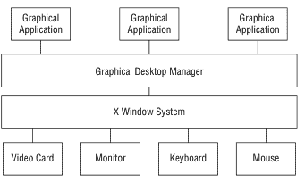

`X11` 的职责是与您系统视频环境的硬件层面（显卡、显示器、键盘和鼠标）进行交互，并提供一个标准接口，供任何桌面管理软件（如 `KDE` 或 `GNOME`）使用。正因为如此，`X11` 软件必须能够与所有这些硬件设备进行交互。

Linux 最初的 `X11` 软件是 `XFree86` 软件包。它因难以配置且难以在不同的视频硬件类型上正常工作而闻名。因此，出现了较新的 `X11` 软件包，并变得更加常见：

- `X.org`：一个面向 Linux 的、用户友好的 `X11` 软件包，作为 `XFree86` 的直接替代品开发，但使用简单的基于文本的配置文件。它将配置文件存储在通用的 `/etc/X11` 目录中。
- `Wayland`：一个更简单、更安全的图形软件包，由 `Red Hat` 开发，并作为开源软件发布。`Wayland` 在 Linux 发行版中越来越受欢迎，甚至正在快速取代 `X.org`。它为每个用户在主目录的 `~/.config/wayland-*.conf` 文件中存储单独的配置文件。

`X.org` 和 `Wayland` 系统都尝试在每次启动时自动检测系统中安装的显卡、显示器、键盘和鼠标，并相应地动态更改配置文件。如果您对显卡或显示器进行了更改，它们会自动检测新设备并相应地调整配置，这使得更换新的视频设备变得轻而易举。

**警告**

`X.org` 和 `Wayland` 软件包包含多个支持常见显卡和显示器的不同驱动程序。然而，对于这两个软件包，如果它们无法识别您系统上的特定显卡或显示器，它们默认会使用通用驱动程序，这可能无法提供最佳质量的视频体验。如果您的 Linux 系统使用特殊的显卡或显示器，最好获取它们的 Linux 驱动程序，并按照文档手动安装更新的驱动程序。

## 使用打印机

与 Linux 中的视频环境一样，Linux 中的打印功能可能相当复杂。随着各种类型的打印机可供使用，安装正确的打印机驱动程序以及使用正确的打印机协议与之通信可能是一场噩梦。

幸运的是，`Common Unix Printing System`（`CUPS`）为我们解决了许多此类问题。`CUPS` 为在 Linux 系统上处理任何类型的打印机提供了通用接口。它接受使用 `PostScript` 文档格式的打印任务，并通过**打印队列**系统将其发送到打印机。

打印队列是用于存储待打印文件的临时区域。打印队列通常不仅配置为支持特定的打印机，还支持特定的打印格式，例如横向或纵向模式、单面或双面打印，甚至是彩色或黑白打印。可以将多个打印队列分配给单个打印机，或者多个打印机可以接受分配给单个打印队列的任务。

`CUPS` 软件使用 `Ghostscript` 程序将 `PostScript` 文档转换为不同打印机可理解的格式。`Ghostscript` 程序需要针对不同打印机类型的不同驱动程序，以便知道如何转换文档，使其能在某种类型的打印机上打印。这是通过配置文件和驱动程序完成的。幸运的是，`CUPS` 安装了许多用于市场上常见打印机的不同驱动程序，并自动设置使用它们的配置要求。配置文件存储在 `/etc/cups` 目录中。

要在 Linux 系统上定义新打印机，您可以使用 `CUPS` Web 接口。打开浏览器并导航到 URL `http://localhost:631`。图 23.2 展示了 `CUPS` 使用的 Web 接口。

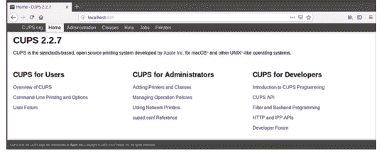

`CUPS` Web 接口允许您定义新打印机、修改现有打印机以及检查发送到每个打印机的打印任务的状态。`CUPS` 不仅识别直接连接的打印机，您还可以使用几种标准网络打印协议（如 `Internet Printing Protocol (IPP)` 或 `Microsoft Server Message Block (SMB)` 协议）配置网络打印机。

除了 `CUPS` Web 接口，还有几个命令行工具可用于与打印队列交互：

- `lpc`：启动、停止或暂停打印队列。
- `lpq`：显示打印队列状态，以及队列中等待的打印任务。
- `lpr`：向打印队列提交新的打印任务。
- `lprm`：从打印队列中移除特定的打印任务。

如果您在命令行中工作，可以检查任何打印队列的状态，也可以提交打印任务。对于每个命令，要指定打印机，请使用 `-P` 命令行选项以及打印机名称，如图 23.10 所示。

### 图 23.10：在 Linux 中从命令行打印


```text
$ lpq -P EPSON_ET_3750_Series
EPSON_ET_3750_Series is ready
no entries

$ lpr -P EPSON_ET_3750_Series test.txt
$ lpq -P EPSON_ET_3750_Series
EPSON_ET_3750_Series is ready and printing
Rank  Owner Job  File(s)          Total Size
active rich  1    test.txt         1024 bytes
$
```

图 23.10 的第一行使用`lpq`命令检查打印队列的状态，显示打印机已准备好接受新任务，且当前打印队列中没有任务。`lpr`命令提交一个新的打印任务以打印文件。在新的打印任务提交后，`lpq`命令显示打印机当前正在打印，并展示正在打印的打印任务。

> 基于 Red Hat 的系统使用自动错误报告工具（`abrt`）在检测到内核级别的硬件错误时创建报告。Red Hat Linux 客户可以将报告发送给技术支持以帮助排查硬件问题。

## 使用热插拔设备

计算机硬件通常分为两类：

- 冷插拔设备
- 热插拔设备

## 冷插设备

冷插设备是指只有在系统完全断电时才能连接到系统的硬件。这些设备通常包括机箱内部常见的部件，如内存、PCI 卡和硬盘。在系统运行期间，你不能移除这些设备。

相反，你通常可以随时添加和移除热插拔设备。它们通常是外部组件，例如网络连接、显示器和 USB 设备。热插拔设备的难点在于，Linux 内核需要以某种方式知道设备何时连接，并自动加载正确的设备驱动程序模块以支持该设备。

Linux 提供了一个完整的子系统来与热插拔设备交互，使其对用户可访问。该子系统在以下章节中描述。

## 检测动态设备

`udev` 设备管理器是一个程序，它在启动时由`init`进程（通常通过`/etc/rc5.d/udev`脚本在运行级别 5 下）或 `systemd` 系统自动启动，并始终在后台运行。它监听内核关于硬件设备的通知。当新的硬件设备插入正在运行的系统或现有硬件设备被移除时，内核会发送通知事件消息。

`udev` 程序监听这些通知消息，并将消息与定义在一组配置文件中的规则进行比对，这些文件通常存储在`/etc/udev/rules.d`目录下。如果设备匹配定义的规则，`udev` 将按照规则定义处理事件通知。

每个 Linux 发行版都定义了一组标准规则供 `udev` 遵循。规则定义了动作，例如当 USB 存储棒安装时将其挂载到`/media`文件夹下，或在移除 USB 网卡时禁用网络访问。你可以修改定义的规则，但通常没有必要。

## 操作动态设备

当 `udev` 程序在你的 Linux 系统上后台运行时，你仍可以使用 `udevadm` 命令行工具与其交互。`udevadm` 命令允许你向 `udev` 程序发送命令。`udevadm` 命令的格式如下：

```
udevadm command [options]
```

表 23.3 显示了可以发送到 `udevadm` 程序的命令。

### 表 23.3 udevadm 命令

| 命令 | 描述 |
| :--- | :--- |
| `control` | 修改 `udev` 的内部状态 |
| `info` | 查询 `udev` 数据库以获取设备信息 |
| `monitor` | 监听内核事件并显示它们 |
| `settle` | 监视 udev 事件队列 |
| `test` | 模拟 udev 事件 |
| `test-builtin` | 运行内置设备命令以进行调试 |
| `trigger` | 请求内核的设备事件 |

`control` 命令允许你更改当前正在运行的 `udev` 程序。例如，通过添加 `-R` 选项，你可以强制 `udev` 重新加载定义在 `/etc/udev/rules.d` 目录中的规则。

练习 23.1 将引导你查看连接 USB 存储设备到 Linux 系统时发生的内核消息和设备条目。

### 练习 23.1

### 向 Linux 系统添加 USB 存储设备

1. 登录到你的 Linux 图形桌面并打开一个命令提示窗口。
2. 在命令提示符下，输入 `lsusb` 命令以查看连接到系统的任何 USB 控制器和设备。
3. 将一个 USB 存储设备（如存储棒）插入 USB 端口；然后等待大约一分钟，以便内核检测到它。
4. 输入命令 `dmesg`，并观察内核检测到新的 USB 设备时进入的内核环形缓冲区条目。注意分配给新设备的设备名称（例如 `sdb1`）。
5. 再次输入 `lsusb` 命令，查看新设备是否出现在输出中。
6. 输入命令 `lsblk` 以查看块表中的设备和分区，并注意该分区在虚拟目录中的挂载位置。
7. 输入命令 `ls /dev/sd*` 以查看系统上的 SCSI 设备。你应该会在 `/dev` 文件夹中看到在 `dmesg` 输出中出现的 USB 设备名称作为设备文件出现。
8. 使用图形桌面界面安全弹出 USB 存储设备。
9. 输入命令 `dmesg` 以查看设备移除时的内核条目。
10. 输入命令 `ls /dev/sd*` 以查看设备文件是否已移除。

## 摘要

有很多方法可以将硬件设备连接到 Linux 系统。PCI 和 USB 接口都提供了一种标准方式，将设备连接到主主板以便它们进行通信。较新的 GPIO 接口提供了一种与使用单线进行输入和输出以控制传感器、开关、继电器和电机的小型设备交互的方法。

除了物理接口外，Linux 还使用文件与设备通信。当你将设备连接到系统时，Linux 会自动在 `/dev` 目录中创建一个文件，应用程序使用该文件向设备发送数据并从设备接收数据。内核使用 `/proc` 目录创建包含设备和系统状态信息的虚拟文件。`/sys` 目录也被内核用于创建有助于排查设备问题的文件。

Linux 提供了几个在尝试排查设备问题时你会发现很有用的命令行工具。`lsof` 命令允许你查看系统中所有设备的状态和设置。`lsblk` 命令提供关于已连接的块设备（如硬盘和网卡）的信息。`dmesg` 命令让你可以窥视内核环形缓冲区，查看内核在检测和处理设备时发出的内核事件消息。`lspci` 和 `lsusb` 命令允许你查看连接到 Linux 系统的 PCI 和 USB 设备。

Linux 还提供用于显示器和打印机的软件。由 `XFree86` 和 `X.org` 软件包使用的 X11 协议，检测并与连接到系统的视频卡、显示器、键盘和鼠标接口，为应用程序提供标准接口。CUPS 软件为应用程序向本地和网络打印机发送文档提供了标准方法。

最后，本章讨论了 Linux 如何处理热插拔设备。`udev` 应用程序监控内核事件，以获取关于 USB 端口上检测到的新硬件的信息。如果检测到新设备，`udev` 将按照规则集的定义处理该设备。`udevadm` 应用程序允许你控制 `udev` 在你的系统上的工作方式。

## 考试要点

**描述 Linux 系统如何与设备通信。** Linux 系统在 `/dev` 文件夹中创建文件，应用程序使用这些文件向设备发送数据并从设备检索数据。设备文件可以是字符文件，它们一次发送和接收一个字符；或者是块文件，它们以块为单位发送和接收数据。

**解释如何查找插入 Linux 系统的 PCI 板的硬件设置。** `lspci` 命令显示当前连接到系统的 PCI 设备。你可以将该信息与 `lsof` 命令一起使用，该命令显示每个设备使用的中断、I/O 端口和 DMA 通道。你还可以在 `/proc/interrupts`、`/proc/ioports` 和 `/proc/dma` 文件中找到该信息。

**解释 Linux 如何检测热插拔设备。** `udev` 应用程序在后台运行，监控内核环形缓冲区中的新设备。当添加新设备时，`udev` 应用程序从内核环形缓冲区消息中检测到它，并遵循包含在 `/etc/udev/rules.d` 目录中规则所定义的指示。

## 复习题

1. 哪种类型的硬件接口使用中断路、I/O 端口和 DMA 通道与 PC 主板通信？

    - A. USB
    - B. GPIO
    - C. PCI
    - D. 显示器
    - E. 打印机

2. Linux 系统使用哪种文件系统来跟踪用于与 PCI 板通信的端口？

    - A. `/proc/ioports`
    - B. `/proc/interrupts`
    - C. `/sys`
    - D. `/dev`
    - E. `/proc/dma`

3. Linux 在何处创建文件以直接发送数据到设备并从设备接收数据？

    - A. `/sys`
    - B. `/proc`
    - C. `/etc`
    - D. `/dev`
    - E. `/dev/mapper`

4. Katie Jane 在她的 Linux 系统上创建了一个新的 LVM 卷。她应该在虚拟目录的哪里查找与新卷相关的虚拟文件？

    - A. `/dev`
    - B. `/dev/mapper`
    - C. `/proc`
    - D. `/sys`
    - E. `/etc`

5. Joel 在他的 Linux 系统中安装了一张新的 PCI 卡，但现在与系统中的另一个设备发生冲突。他可以使用哪个命令来显示所有现有设备正在使用的中断、I/O 端口和 DMA 通道？

    - A. `lsdev`
    - B. `lsblk`
    - C. `lspci`
    - D. `lsusb`
    - E. `dmesg`

6. 哪个 Linux 命令可以显示内核环形缓冲区的内容？

    - A. `lsdev`
    - B. `lsblk`
    - C. `lspci`
    - D. `lsusb`
    - E. `dmesg`

7. 哪些软件包在 Linux 中实现了 X Windows 图形系统？（选择两项。）

    - A. `X.org`
    - B. `CUPS`
    - C. `Wayland`
    - D. `X11`
    - E. `udev`

8. Sophia 需要将她的 Linux 系统连接到办公室网络上的新网络打印机。她需要确保安装了哪个软件包，以便能够配置新的网络打印机？

    - A. `X.org`
    - B. `CUPS`
    - C. `Wayland`
    - D. `X11`
    - E. `udev`

9. 哪个程序在后台运行，监控内核环形缓冲区中的新设备消息？

    - A. `X.org`
    - B. `CUPS`
    - C. `Wayland`
    - D. `X11`
    - E. `udev`

10. 哪个程序允许你重新加载用于检测和安装新设备的已定义规则？

    - A. `udevadm`
    - B. `udev`
    - C. `lsusb`
    - D. `lspci`
    - E. `lsdev`

## 第 24 章

### 排查应用程序和硬件问题


- 目标 4.1：在给定场景中，分析和排查存储问题
- 目标 4.3：在给定场景中，分析和排查中央处理器 (CPU) 和内存问题


Linux 系统的首要目的是提供服务。然而，如果其某个应用程序或其使用的硬件未正常工作，系统将无法履行其职责。了解应用程序和硬件中常见及少量不常见的问题，将有助于你快速解决任何问题。

### 处理存储问题

排查存储问题的范围从易于检查的项目一直到奇怪且难以理解的问题。例如，如果你刚刚安装了一个驱动器，请测试连接以确保其牢固。之前工作正常的磁盘可能会遭受存储性能退化的影响。这些问题及其他更多问题将在以下各节中涵盖。

#### 探索常见问题

如果你是 Linux 系统管理的新手，很可能你尚未意识到常见的存储问题。以下内容可以帮助你做好准备：

`存储性能退化/模式`

`存储性能退化` 指的是存储介质因时间推移或使用不当而逐渐衰退，导致数据退化或丢失。例如，由于有限的程序/擦除 (PE) 循环次数，SSD 的耐久性是有限的。因此，在交换空间中使用 SSD 是不明智的。

`退化模式` 指的是 RAID 阵列中一个或多个磁盘发生故障的情况。在这种情况下，排查工作需要你使用 `mdadm -D` 命令来查看特定阵列的详细状态。如果状态包含 `degraded` 一词，请向阵列中添加另一个分区，以便其可以恢复。

`缺失设备`

存储设备在 Linux 上可能会“消失”，但原因各不相同。如果是网络附加存储 (NAS)，首先检查你的网络（参见第 20 章，“分析系统属性及补救措施”）。

如果是本地连接设备，且其他实用工具（如 `lsblk`）未显示该设备，请使用超级用户权限并尝试 `lspci -M` 命令。该命令将对所有 PCI 连接的设备进行彻底扫描。

通往 Linux 设备的通道是通过设备文件，例如 `/dev/sdb`。请确保特定分区的设备文件可用且未损坏。如有必要，使用 `mknod` 命令重新构建它。

检查你（或实用工具配置）是否使用了正确的设备文件名。整个磁盘由不带数字的设备文件名表示，例如 `/dev/sdc`。磁盘分区通过设备文件名及其编号指定，例如 `/dev/sdc2`。在使用 NVMe SSD 时，设备文件名（如 `/dev/nvme0n1p1`）包含额外的项，包括命名空间。

`缺失卷`

丢失设备的另一种形式是缺失卷。如果你对构成逻辑卷的物理设备进行 `pvs` 扫描，并收到“找不到设备”的消息，则说明存在缺失卷。通常，原因是磁盘故障或被意外移除。

如果逻辑卷组的一部分磁盘发生故障，缺失磁盘的 UUID 将显示在 `pvs` 扫描消息中。你可以使用 LVM 工具替换故障卷 (`pvck`)、恢复组元数据 (`vgcfgrestore`)、恢复组 (`vgscan`)，然后激活它 (`vgchange`)。

`缺失挂载点`

“挂载点不存在”错误消息意味着显而易见的问题——你试图在其上挂载文件系统的目录不存在。它要么被删除了，要么从一开始就不存在。只需使用适当的权限通过 `mkdir` 命令创建它即可。

然而，此错误消息也可能由不那么显而易见的问题产生。这涉及使用 `bind` 选项，无论是在命令行通过 `mount` 命令，还是在 `/etc/fstab` 文件中。此选项将文件系统从其当前挂载点移动到新挂载点。如果它尚未在别处挂载，你将收到“挂载点不存在”错误消息。

> 在删除目录之前，请检查它是否为挂载点。你可以快速通过执行 `mountpoint directory-name` 命令来完成此操作。

`存储完整性`

`坏块`（也称为坏扇区）是磁盘驱动器的一小块区域，由于损坏或物理损坏而无法响应 I/O 请求。单个坏块并不表示驱动器正在故障，但需要监控这些存储设备，因为坏扇区增加表明需要更换它。

除了使用 `fsck` 命令（在第 11 章“处理存储”中涵盖），你还可以使用 `badblocks` 实用工具来监控驱动器。它与 `fsck` 的不同之处在于，它专注于特定分区且不执行任何修复。在检查坏扇区之前备份并卸载分区是明智之举。通过发出 `badblocks -nsv partition-device-file` 命令使用非破坏性测试。该实用工具在运行时提供进度，并在测试完成后发出最终的坏块状态。

此外，磁盘制造商通常提供其自己的一组测试程序。通常，这些程序告诉你是否应更换驱动器，但不提供有关坏扇区的详细数据。


> `dmesg` 命令显示内核环形缓冲区，其中可能包含磁盘 I/O 错误等消息。这些是潜在问题的指示器。

`性能问题`

存储性能低下会影响应用程序。除了使用诸如 `iostat`、`ioping`、`iotop` 和 `sar` 等实用工具（在第 20 章中涵盖）来监控存储性能问题外，你还可以使用 `hdparm` 来确定驱动器的读取速度。该实用工具适用于 PATA 或 SATA 驱动器。具有 SCSI/ATA 命令转换的 SCSI 驱动器也得到支持。

`dstat` 实用工具类似于 `iostat`，但提供了有助于排查存储性能问题的额外有用数据。例如，此工具显示与网络使用或单个 LV 驱动器相关的吞吐量统计信息。

另一个专门针对逻辑卷工作的便捷实用工具是 `dmstats`。此工具允许设置和管理由设备映射器编目的任何设备的统计信息。你可以使用 `lsvik -p` 实用工具来确定与逻辑卷相关联的设备映射器文件名。

衡量磁盘性能的图形界面工具是 `gnome-disks` 实用工具。然而，在执行写入基准测试之前，请备份磁盘的任何数据。

`资源耗尽`

`资源耗尽` 是一种系统有限资源已被占用且无法供他人使用的情形。inode 编号或磁盘空间不足（在第 20 章中涵盖）是两个例子。


> 威胁代理可以通过文件描述符泄漏参与存储资源耗尽攻击。文件描述符通常用于编程语言中访问文件、管道或网络套接字。你可以通过在 `/etc/security/limits.conf` 文件中设置 PAM `nofile` 限制来防止此类型的攻击。（PAM 在第 16 章“查看访问和身份验证方法”中涵盖。）

### 处理专业问题

对于遇到问题的旧存储设备，你应该检查的第一件事是设备制造商是否有可用的新驱动程序或固件。这通常可以解决棘手的问题。

另一个需要检查的项目是设备的 Linux 模块（驱动程序）。如果它未加载或未构建到 Linux 内核中，你的设备将无法工作。从 `dmesg` 实用工具开始以获取一些线索。清单 24.1 中显示了一个片段示例。

## 列表 24.1：通过 `dmesg` 命令查找磁盘信息

```
# dmesg | grep sde
[..]
[     5.566479] sd 6:0:0:0: [sde] Attached SCSI disk
```


使用 `grep` 搜索 `dmesg` 命令的输出，以查找有关 `sde` 磁盘（`/dev/sde`）的信息。这里的重要线索是该磁盘是一个连接的 SCSI 磁盘。

可用的 SCSI 磁盘驱动信息存储在 `/sys/` 目录中，如列表 24.2 所示。

## 列表 24.2：通过 `ls` 和 `udevadm` 命令确定驱动

```
# ls /sys/bus/scsi/drivers
sd    sr
#
# udevadm info -an /dev/sde | grep DRIVERS | grep sd
        DRIVERS=="sd"
```

请注意，`sd` 和 `sr` 驱动用于 SCSI 设备。`udevadm` 命令确认哪个驱动被用于 `/dev/sde` 磁盘。

确定驱动（模块）后，使用 `lsmod` 命令检查其当前是否已加载到内核中。列表 24.3 展示了一个片段示例。

## 列表 24.3：使用 `lsmod` 命令确定模块是否已加载

```
# lsmod | grep sd
sd_mod                     4632  5
[..]
# modinfo sd_mod
filename:        /lib/modules/3.10.0-862.11.6.el7.x86_64/kernel/drivers/scsi/sd_mod.ko.xz
[..]
description:     SCSI disk (sd) driver
[..]
```

如果模块未加载，它可能已内置于内核中。您可以通过查看 `modules.builtin` 文件来检查此情况，如列表 24.4 的片段所示。

## 列表 24.4：使用 `cat` 命令确定模块是否已内置

```
$ cat /lib/modules/$(uname -r)/modules.builtin | grep sd_mod
kernel/drivers/scsi/sd_mod.ko
```

如果模块未加载或未内置于内核中，请使用超级用户权限和 `modprobe` 命令动态加载它（第 14 章，“维护内核模块”）。

## 探究 SATA

适配器是一种可能具有一个或多个软件接口的硬件。诸如 SATA 硬盘等不同的存储接口可能存在独特的问题。在 Linux 中，SATA 硬盘是自我配置的。它们通常连接到 SCSI 总线，并由 `/dev/sd*` 设备文件表示。

> 如果您使用的是内核版本早于 2.6.16（2006 年 3 月发布）的 Linux 发行版，请注意 SATA 的挂起和恢复是不受支持的。在恢复操作后访问设备时，系统将会挂起。通过内核补丁添加 SATA 电源管理支持来修复此问题。

在 Linux 中，由于频繁的磁头加载和卸载，一些 SATA 设备可能比其他设备更早发生故障。这通常是由于激进的电源管理所致。

如果 SATA 硬盘使用自我监测分析和报告技术（SMART），您可以通过 `smartctl -a` 命令检查这种情况。查看 `Start_Stop_Count`，它是加载和卸载的次数。对于特定磁盘，与其他驱动器相比，较高的计数表明存在此问题。使用该驱动器上的 `hdparm -B` 命令进行双重检查。如果命令返回一个较低的数字，例如 1，则确认了激进的电源管理。您可以使用超级用户权限并输入 `hdparm -B 127 设备文件名` 来修改此设置，这不仅会移除激进的电源管理，通常还能提高性能并延长硬盘寿命。

> 如果您使用的是虚拟机，`smartctl` 命令将失败。这是由于虚拟化磁盘不支持 SMART。

## 理解 SCSI

在 Linux 中，SCSI 框架由三个不可或缺的部分组成：

- 上层：设备驱动（例如磁盘驱动）层
- 中层：SCSI 路由层
- 下层：主机总线适配器（HBA）驱动层

上层最接近应用程序或用户命令，而下层 SCSI 层紧邻实际硬件。HBA 是电路板或集成电路适配器，它连接到磁盘驱动器。与设备驱动一样，HBA 驱动要么被加载，要么内置于内核中。

如果 HBA 或设备驱动未加载或未内置于内核中，则可能会出现问题。此前，在列表 24.3 和列表 24.4 中，对 SCSI 上层驱动进行了检查。在列表 24.5 中，一个片段示例展示了查找 HBA 驱动（模块）以及检查其是否已加载或内置的过程。

## 列表 24.5：确定模块名称及其是否已加载

```
# udevadm info -an /dev/sda | grep -i drivers
        DRIVERS=="sd"
[...]
        DRIVERS=="ahci"
[...]
#
# lsmod | grep ahci
ahci             34056  3
[...]
#
# modinfo ahci
[...]
description:    AHCI SATA low-level driver
[...]
```

请注意，HBA 驱动是高级主机控制器接口（AHCI）驱动，并且已加载到内核中。这个特定的驱动允许您热插拔 SATA 硬盘，它们被视为 SCSI 设备。换句话说，SATA 硬盘被附加到了 SCSI 框架中。

当您将 SATA 硬盘作为热插拔的 SCSI 设备附加时，您需要启用它。这可以通过重新启动系统或修改 `/sys/class/scsi_host/host#/scan` 文件来实现。# 是磁盘的 SCSI 主机号。列表 24.6 中展示了一个片段示例，说明了如何确定适当的主机号并修改文件。

## 列表 24.6：启用热插拔的 SATA 硬盘

```
# lsblk -S
NAME HCTL    TYPE VENDOR   MODEL     REV TRAN
[...]
sde  6:0:0:0   disk ATA    VBOX HARDDISK 1.0  sata
[...]
#
# echo '---' > /sys/class/scsi_host/host6/scan
```

在这个示例中，`lsblk -S` 命令仅显示已附加到 SCSI 框架的设备，而 SATA 硬盘是 `sde` (`/dev/sde`)。输出中的 HCTL 列显示了设备的主机号（第一个冒号前的第一个数字）。在这种情况下，主机号是 6。在确定磁盘的主机号后，将字符 `'---'` 回显到适当的文件中（注意每个破折号之间所需的空间）。此操作强制系统扫描附加到该主机号的 SCSI 框架的设备，从而启用该驱动器。

## 管理 RAID

Linux 系统可以部署软件和硬件 RAID。软件 RAID 阵列通过多设备（md）驱动实现。通过查看 `/proc/mdstat` 文件来检查您的软件 RAID 阵列的状态。

如果它是基于 SATA 的且某个驱动器离线，软件 RAID 阵列可能会挂起。如果 HBA 不处理热插拔，就会发生这种情况。因此，明智的做法是检查您的下层 SCSI 框架层的驱动是否支持热插拔。如果您的 HBA 使用 AHCI 模块（驱动），则允许热插拔。

基于硬件的 RAID 阵列通过连接到 Linux SCSI 框架的硬件设备进行管理。使用超级用户权限并在命令行输入 `lspci -knn | grep “RAID bus controller”` 来获取硬件 RAID 控制器的数据，如制造商和型号。如果您继承了 Linux 系统并需要获取制造商实用程序来故障排除和监控基于硬件的 RAID 阵列，这将非常有用。

## 发现应用程序权限问题

用户通知您，在尝试运行应用程序时，该应用程序发出了 I/O 错误。问题可能是权限问题。在开始故障排除之前，您需要收集一些信息：

1. 确定运行该应用程序的账户及其名称。
2. 找出引发错误的具体程序操作。
3. 获取应用程序尝试进行读写或尝试创建的任何文件的完整目录引用。
4. 如有适用，记录它试图启动的任何其他应用程序。
5. 如有适用，记录应用程序试图使用的任何本地或远程服务，例如 NTP 或文件服务器（第 2 章，“服务简介”）。


如果应用程序使用服务，例如 OpenSSH 和/或身份验证服务器，了解涉及哪些服务账户很重要。也要记录此信息。

当您拥有这些详细信息后，就可以开始故障排除流程了。

**所有权** 使用 `ls -l` 命令查看所涉及的各种应用程序文件。确定哪个用户名拥有这些文件以及授予这些所有者的权限。

不要忘记同时查看目录权限。你需要了解整个目录树的所有者及其权限。

如果应用程序并非在以拥有该文件或目录树的用户名下运行，你就需要进一步检查组成员资格以及可能的其他权限。关于文件和目录权限故障排除的内容在第 22 章“调查用户问题”中已有讲解，如果需要复习可以参考该章节。

### 组成员资格

查明运行该应用程序的终端用户所属的组。如果应用程序是在不同的账户下运行的，请检查该账户的组成员资格。

获得这些信息后，你可以检查涉及的应用程序文件。识别这些文件以及目录树的组权限，以发现任何潜在问题。

### 可执行文件

如果特定账户无法运行应用程序，请检查执行权限。请记住，如果应用程序会启动额外的程序，你还需要检查这些程序的权限。

如果你使用的脚本会改变其当前工作目录并因此失败，请检查它试图访问的目录树。为了使账户能够将其当前工作目录更改到该特定位置，目录树中的每一个目录都必须被授予执行权限。

### 继承

如果应用程序在特定目录中创建文件，但随后无法再访问这些文件，请检查是否通过 ACL 强制继承了权限（在第 15 章“应用所有权和权限”中有讲解）。如果目录具有默认 ACL，那么在该目录内创建的且未专门设置 ACL 的文件将继承该目录的 ACL。你可以使用 `getfacl -d` 或 `--default` 命令查看目录的默认 ACL。

如果你发现目录的默认 ACL 是问题的根源，请考虑移除默认 ACL 并在目录上定义所需的 ACL。另一种替代方案是显式设置应用程序文件的 ACL，这将覆盖继承的目录默认 ACL。使用 `setfacl` 工具来实施这些更改。

你可以尝试使用练习 24.1 来练习基本的应用程序权限问题故障排除。

## 练习 24.1

### 故障排除应用程序权限问题

1. 通过 tty 终端登录到你的 Linux 系统，使用一个非 root 账户，该账户可以通过 `sudo` 命令访问超级用户权限。
2. 在命令行提示符下，输入 `touch /tmp/fileA.txt` 并按下 Enter 键。`touch` 命令在第 3 章“管理文件、目录和文本”中已有讲解。
3. 通过输入 `sudo chown root:root /tmp/fileA.txt` 并按下 Enter 键，将新创建文件的所有者和组更改为 `root`。如果被要求，请输入该账户的 `sudo` 密码。`sudo` 和 `chown` 命令在第 15 章中有讲解。
4. 接下来，你将使用 `nano` 文本编辑器（在第 4 章“搜索和分析文本”中有讲解）创建一个小应用程序。输入 `nano application.sh` 并按 Enter 键。这将带你进入 `nano` 文本编辑器。
5. 输入以下内容，并在需要时按下 Enter 键：

```
#!/bin/bash
echo "Creating file /tmp/Activity.txt..."
echo "Hello World" > /tmp/Activity.txt
echo "Removing file..."
rm -ir /tmp/*.*
exit
```

6. 按下 `Ctrl+O`，然后按 Enter 键，将文本编辑器的缓冲区写入 `activity.sh` 文件。
7. 按下 `Ctrl+X` 退出文本编辑器。
8. 通过输入 `bash activity.sh` 并按 Enter 键来运行应用程序。
9. 当被询问时，在提示符处输入 `y` 并按 Enter 键。你应该至少会收到一条与尝试删除 `/tmp/fileA.txt` 文件相关的错误消息，但根据 `/tmp/` 目录中当前存在的文件和目录情况，你可能会收到更多错误消息。
10. 现在你可以开始故障排除过程。由于是你运行了应用程序，请记录你的用户账户名称。
11. 记录导致错误发生的操作。（提示：它与 `/tmp/fileA.txt` 文件有关。）
12. 记录问题文件的完整目录引用。（提示：查看上一步。）
13. 记录该应用程序并未尝试启动任何额外的应用程序，也未使用本地或远程服务。
14. 通过输入 `ls -ld /tmp` 并按 Enter 键，显示问题文件所在目录的所有权、组成员资格和各种权限。
15. 记录目录的所有者及其相关权限。
16. 记录目录的组及其相关权限。
17. 记录目录的其他权限。注意，如果在权限中看到 `t`，这指的是粘滞位（sticky bit）（在第 15 章中有讲解）。
18. 确定三组目录权限（所有者、组或其他）中哪一组适用于你的用户账户，并记录下来。
19. 使用第 22 章中的表 22.1 以及你在过去几步中发现的信息，找出此应用程序问题的原因。记录你的理论。
20. 该应用程序的问题是由使用 `/tmp/*.*` 文件通配符指定作为 `rm -ir` 命令的参数引起的。如果 `/tmp/` 目录设置了粘滞位，你的账户只能删除该目录中你自己拥有的文件。因此，如果需要，请修复此问题，将 `activity.sh` 应用程序中的 `rm -ir /tmp/*.*` 行更改为 `rm -i /tmp/activity.txt`。

## 分析应用程序依赖关系

在第 13 章“软件治理”中，我们讲解了使用包管理命令，如 `apt-cache depends` 和 `yum deplist`，来显示由仓库管理的应用程序的依赖关系。在程序及其各种依赖关系中，你可能会遇到一些特殊问题。这里将考察与认证考试更常见的相关问题。

### 版本管理

通常，应用程序软件和操作系统会不断更新。这些更新可能会提高性能或增加额外的功能。为了跟踪各种应用程序更新，采用了一种称为*版本管理*（versioning）的技术。版本管理是通过编号过程管理多个应用软件。应用程序的不同版本（*releases*）有不同的编号，通常较新的应用程序更新编号较高。

例如，Linux 内核*版本* 2.6.0 于 2003 年 12 月发布。可以在 `www.kernel.org` 找到当前的内核版本，与 2.6.0 *版本*相比，其编号数值较高。这些较高的编号表示较新的*版本*。

你可以使用*版本管理*来确定是否已发布应用程序更新或补丁。这在故障排除应用程序软件问题时很有帮助。

### 更新问题

如果应用程序遇到问题，请检查是否有新的软件更新。如果应用程序可以通过仓库获取，请使用你的发行版特定的包管理来检查新的*版本*（参见第 13 章）。

考虑设置一个具有应用程序环境的测试系统，并应用应用程序更新到该系统。你可以在更新生产应用程序之前进行彻底的计划测试。在应用任何生产应用程序更新之前，确保你有一个极好的备份。这两项措施可以保护你免受大多数糟糕情况的影响。

如果应用程序在最近的更新后开始出现 problems，请查看发行版的包管理历史记录信息。例如，在使用 RPM 的系统中，使用超级用户权限，你可以发出命令 `rpm -q package-name --last` 来查看 `package-name` 包的最新更新历史。在 Debian 系统中，检查 `/var/log/apt/history.log` 文件。你需要使用适当的包管理工具卸载导致问题的任何已安装包或库（参见第 13 章）。


> 在 modern Ubuntu 发行版中，未干预升级（unattended upgrades）已配置。这允许自动对软件进行安全升级，无需人工干预。如果你希望关闭此功能，请将 `/etc/apt/apt.conf.d/10periodic` 文件中的 `APT::Periodic::Update-Package-Lists` 指令从 1 更改为 0。在命令行输入 `man unattended-upgrade` 以了解有关此功能的更多信息。

当一个软件包依赖于另一个包或库才能正常工作时，称为*依赖项*（dependency）。*损坏的依赖项*（broken dependency，也称为*未满足的依赖项*）是一种不期望的情况，即软件包已安装，但其所需的一个或多个包或库未安装。有时，包升级会破坏依赖项，从而导致所谓的*损坏的包*（broken package）。

要检查损坏的依赖项，在 Debian 包管理系统中，使用 `apt-get check` 命令。YUM 包管理器不会更新导致损坏依赖项的程序，但如果你使用 `rpm` 工具安装了导致问题的程序，你可以在任何 Red Hat 包管理系统的上发出 `rpm -av` 命令来查看受损的软件包。

## 补丁

*补丁*（patch）指的是针对特定应用程序或系统服务的程序更改或配置文件更新。补丁可能会修正严重问题或修复安全漏洞，并且通常是在正常的软件更新周期之外发布的。*打补丁*（Patching）是应用补丁的行为。它不一定涉及更新系统的所有软件。在补丁管理上有很多相互矛盾的理论，但核心问题是让你的应用程序和 Linux 系统能够平稳、安全且有效地为你的用户运行。

内核补丁发布略有不同。它是一个特殊的源代码包，仅包含应用于主要内核源代码发布的更改。你只需下载补丁源代码包，使用 `Linux patch` 命令将补丁更新应用于系统上现有的内核源代码文件，然后重新编译内核。通常，当你更新系统上的包（软件）时，包管理器会为你处理此事。

## 处理库问题

应用程序功能通常被拆分到独立的库文件（共享库）中，以便使用相同功能的其他应用程序可以共享这些库文件。库的相关内容在第 13 章中已有介绍。

如果在软件升级后，应用程序开始出现异常，这可能是由于该应用程序所使用的某个共享库最近进行了升级所致。你可以通过在命令行输入 `ldd program-name` 来查看程序使用了哪些库。建议将此命令的输出重定向到另一个文件中。使用 `grep` 命令搜索包管理日志文件，以确定应用程序的某个库是否最近被更新。示例片段见清单 24.7。


### 清单 24.7：使用 `ldd` 和 `grep` 发现最近升级的库

```bash
$ which ssh
/usr/bin/ssh
$
$ ldd /usr/bin/ssh > lib.txt
$
$ cat lib.txt
[...]
libk5crypto.so.3 [...]
[...]
$
$ grep -B 2 -A 2 libk5crypto /var/log/apt/history.log
Start-Date: 2019-01-22 13:37:45
CommandLine: /usr/bin/unattended-upgrade
Upgrade: libk5crypto3:amd64 (1.16-2build1, 1.16-2ubuntu0.1)
End-Date: 2019-01-22 13:37:49
$
```

本示例中使用的应用程序是 OpenSSH 的 `ssh` 程序。注意其中一个库最近被升级了。（`grep` 命令中的 `-B` 和 `-A` 选项允许你提取匹配内容上下方额外的行。）如果问题恰好在库升级后不久出现，那你就找到了一个可能的原因。请检查该库是否有新的升级版本或补丁。如果没有，你可能需要卸载该库并安装较早版本。

## 探索环境变量问题

如果你新安装的应用程序无法运行，请检查 `PATH` 环境变量。该变量决定了 `Bash` shell 直接处理之外需要搜索哪些目录以查找程序。显示该变量内容的示例见清单 24.8。

### 清单 24.8：查看 `PATH` 环境变量

```bash
$ echo $PATH
/usr/local/sbin:/usr/local/bin:/usr/sbin:/usr/bin:
/sbin:/bin:/usr/games:/usr/local/games:/snap/bin
$
```

如果需要为所有用户修改此参数，请在 `/etc/profile.d/` 目录中创建一个 `Bash` 脚本文件（`Bash` 脚本在第 25 章“部署 Bash 脚本”中有介绍）。务必使用 `.sh` 文件扩展名。该文件的所有者必须是 `root`，并且属于 `root` 组。将该文件的其他（world）权限设置为 `r`，以便所有用户都能读取该文件。该脚本会在用户登录系统或启动新 shell 时由 `/etc/profile` 或 `/etc/bashrc` 文件读取，具体取决于你的发行版。

如果只有部分用户需要此特定的 `PATH` 修改，请在他们的 `~/.profile`、`~/.bash_profile` 或 `~/.bash_login` 文件中进行修改。环境变量文件在第 10 章“管理用户和组”中已有讨论。

## 获取 GCC 兼容性

在 Linux 中用于编译程序的最常见工具是 GNU 编译器集合（`GCC`）。如果你在 Linux 上使用 `GCC` 编译应用程序时遇到问题，可能有多种潜在原因。它们如下：

- `GCC` 使用系统 C 库，该库可能不符合 ISO C 标准。

- GNU C 与 ISO 之外的 C 版本之间存在一些显著的不兼容性。

- `GCC` 使用经过修正的系统头文件版本，这也可能导致问题。

请注意，除了上述问题外，你可能正在使用较旧版本的 `gcc`，需要更新它。例如，如果你的系统发行版是 `CentOS 7`，且正在使用 `gcc v4.4.*`，则需要升级 `GCC` 包。

你可以在 `GCC` 编译器的官方网站——[https://gcc.gnu.org](https://gcc.gnu.org) 上找到详细文档。该网站包含常见问题解答（FAQs）和其他有用信息。

## 追踪软件仓库问题

当你收到有关找不到、无法更新或无法安装包的奇怪错误消息时，首先要检查的是网络连接。通常，未连接网络是导致此问题的原因。然而，各种软件包仓库（也称为 `repos`）也可能变得损坏。

在使用 `Debian` 包管理器的系统上，如 `Ubuntu`，如果收到无法下载仓库信息或类似消息，请使用 `apt-get clean` 命令。该命令清理数据库和任何临时下载文件。之后，尝试使用 `apt-get update` 更新本地仓库，该命令会尝试获取仓库中软件包的最新信息。

> 在使用 `Debian` 包管理系统的系统中，建议使用 `apt-get dist-upgrade` 命令代替 `apt-get upgrade` 来更新系统的所有软件包。`dist-upgrade` 会防止任何软件升级导致依赖包损坏。

在使用 `Red Hat` 包管理器的系统上，如 `Rocky Linux`，根据你的发行版，你可以使用 `yum` 的 `clean all` 或 `zypper clean -a` 命令。接下来，使用 `yum check-update` 或 `zypper refresh` 命令更新本地仓库。

如果你正在尝试从非标准仓库安装或更新软件包，你可能需要在你的系统上启用该仓库。要查看系统上已启用的仓库列表，在 `Red Hat` 包系统上使用 `yum repolist` 或 `zypper repos` 命令。对于 `Debian` 包系统，你需要执行 `grep -v "#" /etc/apt/sources.list` 命令来查看已启用的仓库。

在添加任何额外的非标准仓库之前，请备份仓库文件，例如以下这些：

- `/etc/apt/sources.list`

- `/etc/yum.repos.d/*.*`

- `/etc/zypp/repos.d/*.*`

你需要手动编辑 `sources.list` 文件来添加并启用新仓库。要使用 `YUM` 添加并启用新仓库，请使用 `yum-config-manager --add-repo repository-url` 命令。`zypper` 命令类似，但还需要仓库名称别名——`zypper addrepo repository-url aliases`。

请记住，我们只触及了程序和它们的各类依赖关系中更常见的几个问题。请务必使用你发行版的 `man` 页面获取更多帮助。

## 检查 SELinux 上下文违规

应用程序问题可能由你系统的 Linux 内核安全模块引起，例如 `SELinux`（在第 15 章中有介绍）。不正确的策略配置会触发违规，从而阻止应用程序发挥其作用。首先使用 `sealert` 命令检查审计日志文件。如果该工具不可用，你可以通过安装 `setroubleshoot` 包来获取它。

错误标记的文件可能会导致问题，例如应用程序被拒绝访问。使用 `ls -Z` 命令查看文件的 `SELinux` 上下文。如果它或其父目录需要更改上下文，请使用 `chcon` 实用工具进行临时修改，使用 `semanage` 命令使其永久生效，并使用 `restorecon` 修复标签。别忘了使用这三个命令，否则问题无法解决。


你可以使用超级用户权限通过 `setenforce permissive` 命令将 `SELinux` 的模式从强制（`enforcing`）暂时更改为宽容（`permissive`）。这允许你进行上下文更改，并查看是否触发任何违规，而实际不会阻止访问。一旦你配置了正确的 `SELinux` 策略，使用 `setenforce enforcing` 命令将其恢复为强制模式。

受 `SELinux` 限制的应用程序需要设置适当的布尔值（Booleans）以允许适当的访问。`getsebool` 命令允许你查看应用程序的布尔值。如果需要更改它们，请使用超级用户权限和 `setsebool` 命令。


如果你在日志或日志文件中发现大量 `SELinux` 上下文违规，而过去并未出现应用程序问题，则有可能你的系统存在入侵者。请使用入侵检测工具进行确认。

## 探索防火墙阻挡

如果应用程序在网络中出现问题，且没有网络故障，你可能需要检查本地和远程系统的防火墙。任何应用程序更新或防火墙修改都可能触发此问题。防火墙在第 18 章“监管 Linux 防火墙”中已有介绍。

### 解除 ACL 限制

防火墙 `ACL` 通过审查其控制信息以及其他网络数据来识别网络数据包。因此，在排查与防火墙相关的应用程序问题时，你需要收集往返的应用程序数据包的以下信息：

- 源地址或主机名

- 目标地址或主机名

- 使用的网络协议

- 使用的入站端口

- 使用的出站端口

你还必须知道你的源系统和目标系统所使用的防火墙应用。收集到这些信息后，你可以审查两侧的防火墙设置，以确定 `ACL` 是否过于严格。

例如，如果你的应用程序主机系统使用 `firewalld`，你可以快速检查当前默认区域，如清单 24.9 所示。

### 清单 24.9：使用 `firewall-cmd` 命令查看默认区域

```bash
$ firewall-cmd --get-default-zone
drop
$
```

注意该系统将 `firewalld` 默认设置为 `drop` 区域。这意味着所有入站网络数据包都会被丢弃，只允许出站网络连接。如果应用程序接收来自其他系统的数据或连接，则此防火墙 `ACL` 设置过于严格。

### 解除端口封锁

如果应用程序依赖于另一个系统服务（守护进程），您就需要检查与该服务端口相关的规则。封锁外部服务所需的端口会对应用程序产生不利影响。如果您的应用程序设计使用未分配给知名服务的端口，也请进行检查。

例如，如果您在系统上提供公共 `Web` 服务，您需要允许与 `HTTPS` 协议 `443` 端口相关的入站和出站数据包。如果系统使用的是 `iptables` 防火墙软件，可以通过 `iptables -L` 命令查看当前的 `ACL` 规则。如果包过滤器通过特定规则或策略封锁了 `443` 端口，您可以使用类似清单 24.10 中的命令修改链，以开放 `443` 端口。

### 清单 24.10：使用 `iptables` 命令修改防火墙

```bash
$ iptables -A INPUT -p tcp --dport 443 -j ACCEPT
$
```

请记住，您还需要修改 `OUTPUT` 链规则，以便 `Web` 服务器能够建立连接。此外，如果应用程序允许 `HTTP` 流量，还必须修改 `80` 端口的规则。


在调查应用程序问题时，请查看防火墙日志文件条目。如有必要，通常可以增加记录的信息量。例如，`UFW` 防火墙有一个 `full` 设置，可以记录所有内容。

### 解除协议封锁

除了端口，还要了解应用程序使用的各种协议，如 `UDP`、`TCP` 和 `ICMP`。如果使用其他系统服务，还必须知道其使用的协议。`/etc/services` 文件可以提供帮助。

例如，假设应用程序正在与本地网络上的 `DNS` 缓存服务器协作。`DNS` 协议使用 `53` 端口。检查 `/etc/services`（知名端口）文件以找到其使用的传输协议，如清单 24.11 中的摘录所示。

### 清单 24.11：在 `/etc/services` 文件中检查 `DNS` 的协议

```bash
$ grep 53 /etc/services

domain        53/tcp # Domain Name Server
domain        53/udp
$
```

在 `DNS` 服务器系统上同时通过 `TCP` 和 `UDP` 解除 `53` 端口的封锁，因为 `DNS` 使用这两种传输协议监听请求。此外，对于入站和出站数据包，也请解除封锁。

## 排查其他硬件问题

Linux 需要硬件才能运行。当硬件停止正常工作时，Linux 无法正常运行。因此，了解如何排查所有硬件故障是 Linux 系统管理员的一项基本技能。

### 查看有用的硬件命令

在排查硬件问题时，有许多 Linux 命令行工具可以提供帮助。`lspci`、`lsusb` 和 `lsdev` 命令就是其中几个，这些命令在第 23 章“处理 Linux 设备”中介绍过。这里我们将介绍另外两个很好的实用工具：`dmidecode` 和 `lshw`。

### 理解 `dmidecode` 实用工具

在查看 `dmidecode` 命令之前，您需要了解分布式管理任务工作组（`DMTF`）及其标准。`DMTF` 是一个非营利组织，其目标是通过标准简化对可联网技术（如服务器）的管理。从本质上讲，它有助于简化系统管理。

`DMTF` 创建了桌面管理接口（`DMI`）和系统管理 BIOS（`SMBIOS`）标准。`DMI` 规范由四个组件组成，提供关于计算机所使用的硬件的信息以及一些其他有用的数据。`SMBIOS` 标准由用于读取计算机 BIOS 生成的管理信息的数据结构等项组成。这两个标准相互作用，并被硬件制造商广泛采用。

要使用这些标准，您需要两样东西：一台符合 `DMI/SMBIOS` 标准的计算机和一个软件界面来访问其数据结构。Linux 系统中的软件界面是 `dmidecode` 实用工具。

`dmidecode` 实用工具默认从 `sysfs` 文件系统获取信息，特别是从 `/sys/firmware/dmi/tables/` 目录中的表格。您可以使用清单 24.12 中的命令检查这些表格是否存在于您的系统中。请注意，在该系统上，这些表格是存在的。

### 清单 24.12：检查 `sysfs` 文件系统中的表格

```bash
# ls /sys/firmware/dmi/tables
DMI     smbios_entry_point
#
```

`dmidecode` 命令的 `-h` 选项描述了在硬件故障排除过程中可用于揭示信息的各种选项。虽然提取表格信息时必须使用超级用户权限，但获取帮助时无需这样做。示例显示在清单 24.13 中。

### 清单 24.13：查看 `dmidecode` 的帮助功能

```bash
$ dmidecode -h
Usage: dmidecode [OPTIONS]
Options are:
   -d, --dev-mem FILE        Read memory from device FILE (default: /dev/mem)
   -h, --help                Display this help text and exit
   -q, --quiet               Less verbose output
   -s, --string KEYWORD      Only display the value of the given DMI string
   -t, --type TYPE           Only display the entries of given type
   -u, --dump                Do not decode the entries
       --dump-bin FILE       Dump the DMI data to a binary file
       --from-dump FILE      Read the DMI data from a binary file
   --no-sysfs                Do not attempt to read DMI data from sysfs files
   -V, --version             Display the version and exit
$
```

在各种选项中，对故障排除最有用的是 `-t` 或 `--type` 开关。它允许通过提供参数（数字或关键字）从 `DMI/SMBIOS` 表中拉取指定信息。关键字参数可以是以下之一：

- `baseboard`

- `bios`

- `cache`

- `chassis`

- `connector`

- `memory`

- `processor`

- `slots`

- `system`

如果表中不包含所需信息，您将只会收到一条关于该实用工具尝试提取数据的位置以及可能支持的 `DMI` 和/或 `SMBIOS` 标准版本的消息。清单 24.14 显示了两个示例。请注意，表中没有可用的内存信息，但显示了一些系统数据。

### 清单 24.14：查看 `dmidecode` 表格数据

```bash
# dmidecode -t memory
# dmidecode 3.0
Getting SMBIOS data from sysfs.
SMBIOS 2.5 present.
```

```bash
# dmidecode -t system
# dmidecode 3.0
Getting SMBIOS data from sysfs.
SMBIOS 2.5 present.

Handle 0x0001, DMI type 1, 27 bytes
System Information
  Manufacturer: innoteK GmbH
  Product Name: VirtualBox
  Version: 1.2
  Serial Number: 0
  UUID: 3909BE96-5CA6-4801-8236-D6113BB5D2CF
  Wake-up Type: Power Switch
  SKU Number: Not Specified
  Family: Virtual Machine
```

> **注意** 如果您正在使用虚拟化 Linux 系统，则 `dmidecode` 实用工具的信息值得怀疑。此外，不要仅依赖此实用工具获取硬件信息。其 `man` 页甚至指出：“通常情况下，`DMI` 表中包含的信息是不准确、不完整或完全错误的。”

### 理解 `lshw` 实用工具

硬件信息存储在您系统的各个 `/proc/` 目录文件中。虽然您可以四处查找并自行挖掘出来，但 `lshw` 实用工具可以为您代劳。它提供关于系统处理器、内存、网卡（`NIC`）、`USB` 控制器、磁盘等的信息。它通常在大多数发行版中默认安装，或在标准软件仓库中可用（第 13 章介绍了软件包的安装）。

两个有用的选项是 `-short`，它生成格式良好的表格形式硬件数据显示；以及 `-businfo`，它显示与 `SCSI`、`USB`、`IDE` 和 `PCI` 设备相关的信息。使用 `-short` 选项的示例摘录显示在清单 24.15 中。

### 清单 24.15：使用 `lshw` 命令的 `-short` 选项

```bash
# lshw -short
```

| H/W 路径 | 设备 | 类别 | 描述 |
| :--- | :--- | :--- | :--- |
| /0 | | system | VirtualBox |


| /0 | | bus | VirtualBox |

| /0/0 | | memory | 128KiB BIOS |

| /0/1 | | memory | 4GiB System memory |

| /0/2 | | processor | Intel(R) Core(TM) [...] |

| /0/100 | | bridge | 440FX - 82441FX PMC [Natoma] |

| /0/100/1 | | bridge | 82371SB PIIX3 ISA [Natoma/Triton II] |

| /0/100/1.1 | `scsi1` | storage | 82371AB/EB/MB PIIX4 IDE |

| /0/100/1.1/0.0.0 | `/dev/cdrom` | disk | CD-ROM |

| /0/100/2 | | display | VirtualBox Graphics Adapter |

| /0/100/3 | `enp0s3` | network | 82540EM Gigabit Ethernet Controller |

| /0/100/4 | | generic | VirtualBox Guest Service |

| /0/100/5 | | multimedia | 82801AA AC '97 Audio Controller |

| /0/100/6 | | bus | KeyLargo/Intrepid USB |

| /0/100/6/1 | `usb1` | bus | OHCI PCI host controller |

| /0/100/7 | | bridge | 82371AB/EB/MB PIIX4 ACPI |

| /0/100/8 | `enp0s8` | network | 82540EM Gigabit Ethernet Controller |

| /0/100/9 | `scsi1` | storage | 82801H/HM (ICH8M/ICH8M-E) SATA [...] |

| /0/100/9/0/0 | `/dev/sda` | disk | 16GB VBOX HARDDISK |

| /0/100/9/0/1 | | volume | 1GiB Linux filesystem partition |

| /0/100/9/0/2 | `/dev/sda2` | volume | 13GiB Linux LVM Physical Volume partition |

| [...] | | | |

| /0/4 | | input | PnP device PNP0f03 |

| /1 | `virbr0-nic` | network | Ethernet interface |

| [...] | | | |

您还可以使用 `lshw` 实用工具的 `-class` 选项。此选项提供有关特定硬件组件的详细信息。可用的不同类别显示在 `lshw -short` 命令的输出中。使用 `-class` 选项的摘录示例显示在清单 24.16 中。

## 列表 24.16：在 `lshw` 命令中使用 `-class` 选项

```bash
$ sudo lshw -class display
*-display
      description: VGA compatible controller
      product: VirtualBox Graphics Adapter
      vendor: InnoTek Systemberatung GmbH
  [...]  configuration: driver=vboxvideo latency=0
```


另一个可以提供商件信息的实用工具是 `lshwinfo` 命令。它为您的故障排除过程提供额外数据。如果它没有默认安装在您的发行版中，请考虑手动安装它。

### 调查其他硬件问题

偶尔你会遇到罕见的硬件问题。能够迅速解决这些独特的问题将使你从同行中脱颖而出。

- **内存** 内存的物理问题很难诊断。此问题的一些症状包括系统性能随时间变慢，在运行内存密集型应用程序或启动时系统似乎挂起，间歇性发生内核恐慌或段错误，文件间歇性损坏，以及/或程序安装失败。

首先，确保这不是内存容量问题，因为内存容量问题通常表现出与硬件问题相似的症状。使用 `free` 和 `vmstat` 实用工具进行检查。

你可以使用 `lshw` 实用工具快速确定有关内存的硬件信息。只需发出 `lshw -class memory` 命令即可。

如果你最近添加了新的内存，那么很可能你获得了有故障的组件。电源尖峰或中断也可能损坏内存。无论如何，你都需要对内存进行测试。通常，你可以通过系统重启并在服务器启动菜单中访问 `memtest86` 或 `memtest86+` 选项来进行此类测试。如果此选项不可用，你可以使用 `memtester` 实用工具。这个命令行实用工具通常没有默认安装，但它可以在你的发行版仓库中或以 RPM 或 dpkg 文件的形式获取（参见第 13 章）。使用此实用工具时，你需要关闭任何生产应用程序并分块测试内存。

- **打印机** 外部硬件设备对于 Linux 通常是即插即用的，但确实会出现奇怪的问题。在处理打印机时，问题通常归结为过时/错误的驱动程序（PPD）或连接不良。首先使用 `dmesg` 检查内核环形缓冲区，并查看打印机错误日志文件，例如 `/var/log/cups/error_log`。

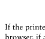

**注意** 不要购买杂牌货。确保你公司有兴趣购买的打印机已经被 Linux 支持。有几个网站可以提供帮助，例如 `www.openprinting.org/printers` 和 `tldp.org/HOWTO/printing-HOWTO/printers.html`。此外，使用你喜欢的搜索引擎并输入 `Linux compatible printers` 以找到更多结果。

如果打印机是最近安装的，请检查其配置。如果系统可用，你可以通过 Web 浏览器进入 `127.0.0.1:631` 在地址栏中完成此操作。如果你的系统没有图形用户界面，你可以查看 `/etc/cups/printers.conf` 文件以审查打印机配置。

确定打印机如何连接到系统。它是网络打印机吗？它通过 USB 电缆连接吗？打印机是直接连接到并行端口吗？如果是网络连接打印机，首先检查网络是否正常运行。如果打印机通过 USB 电缆连接，请从故障排除 USB 连接开始（在本章稍后介绍）。如果它使用你系统上的并行端口，可能是适配器有故障。如果可能，考虑将其切换到其他连接类型，例如 USB，或者获取具有更现代配置的新打印机。

检查打印机的 PostScript 打印机定义（PPD）文件或驱动程序是否需要更新。访问制造商或开源驱动程序网站以确定是否有可用更新。你可以使用 `lpinfo -m` 命令查看系统上所有当前可用的打印机驱动程序。请记住，问题可能涉及所需的打印机固件更新，因此也要检查这些更新。

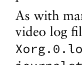

**注意** 一些制造商提供他们自己的 Linux 工具以协助打印机故障排除。例如，惠普提供 `hp-info` 和 `hp-toolset` 实用工具以帮助管理和解决其打印机的问题。

- **视频** 视频硬件问题表现为显示缓慢、音频滞后、屏幕闪烁等。你甚至可能看到黑屏或没有音频输出。某些问题甚至可能导致系统崩溃或挂起。

与许多其他硬件问题一样，首先检查内核环形缓冲区（`dmesg`）和视频日志文件。如果你的系统仍在使用 X11，请检查日志文件或 `/var/log/Xorg.0.0.log` 文件。如果你在使用 Wayland，请通过 `journalctl` 命令检查日志文件。


图形处理单元（GPU）存在于显卡或主板上。它是一个执行某些简单处理的组件，以减轻 CPU 的此类负担。通常显卡被称为 GPU 或 GPU 卡。

要找出你的系统使用什么显卡驱动程序，只需在命令行输入 `lspci -vnn` 并将 STDOUT 重定向到文件。解析该文件以查找单词 VGA。这将显示你的显卡驱动程序数据。你也可以使用 `lshw -class display`（或 `video`）并在那里查找驱动程序信息。当你获得驱动程序名称时，通过 `modinfo driver-name` 命令查找更多详细信息。检查制造商或开源网站以查看是否有可用的显卡驱动程序更新。如果没有，尝试在另一个系统上测试该卡，看看你是否需要更换它。


一些制造商提供他们自己的实用工具来管理他们的 GPU 卡。例如，Nvidia 为其显卡提供 `nvidia-smi` 和 `nvidia-settings` 命令。

### 通信端口

*通信端口* 是一个串行通信端口。尽管如今已很少见，但它常用于连接硬件，如销售点设备。代表这些串行端口的设备文件是 `/dev/ttyS*`。

在遇到串行通信设备问题时，通过发出 `dmesg | grep tty` 来查找正在使用的设备文件名，从而开始故障排除过程。当你拥有完整的设备文件名后，使用 `setserial` 实用工具。这将提供有关串行设备的详细信息。使用超级用户权限，在命令行输入 `setserial -a device-file-name`。在输出中查找中断请求（IRQ）号。

当你知道串行设备的 IRQ 后，你可以检查中断文件。如果你没有在 `/proc/interrupts` 文件中找到 IRQ 号，这表明串行设备的适当驱动程序未加载。

如果驱动程序已加载，请检查制造商的网站以查看是否有新更新的驱动程序。此外，检查串行设备的推荐配置，并使用 `setserial` 实用工具进行任何必要的修改。

### USB

如果你有一个 USB 设备（如打印机）直接连接到你的系统并出现问题，你可以使用一些简单的故障排除技术。首先，通过超级用户权限在命令行输入 `lsmod | grep usb` 以确保 USB 模块（驱动程序）已加载到内核中。如果你得到响应，则已加载。如果你只得到提示符，则使用 `modprobe` 命令加载该模块（第 14 章）。

如果驱动程序已加载，请尝试断开设备的 USB 电缆与系统的连接。通过 `journalctl -f` 命令监视日志文件。如果你使用的是较旧的 Linux 系统，请在适当的日志文件（例如 `/var/log/`）上使用 `tail -f` 命令。

`syslog` 或 `/var/log/rsyslog`。设置好监视后，将 USB 设备的线缆重新插回，查看生成了哪些日志消息。如果该 USB 设备是打印机，还要检查 `/var/log/cups/error_log` 中是否有相关信息。你可能会在这里发现一些重要细节。

完成上述操作后，使用 `lsusb -v` 命令查看设备是否出现在 USB 总线上。如果你能看到设备的制造商和产品信息，那么 Linux 就能识别该设备。如果你的系统中未安装 `lsusb` 工具，请使用 `dmesg` 查看内核环形缓冲区。

检查 USB 设备文件是否存在损坏。本章节前文的“探索常见问题”部分中的“丢失设备”列表项已讨论过此话题。

如果 USB 设备仍然无法正常工作，尝试将其连接到另一个 USB 端口。但是，在这样做之前，请在适当的日志文件或日志系统上设置另一个监视。你可能还想尝试更换 USB 线缆，看看能否解决问题。

### 键盘映射

如果在键盘上按下某个键，屏幕上却显示不同的字母，这很可能意味着你遇到了键盘映射问题。解决方法取决于你正在使用的特定发行版。

对于基于 Red Hat 的发行版，输入不带选项的 `localectl` 命令，当前键盘映射将显示出来。要查看可用的键盘映射列表，输入 `localectl list-keymaps`，系统将显示可用的键盘映射列表。这个列表可能相当长，因此你可能希望将标准输出重定向到 `less` 工具以便浏览。找到合适的键盘映射名称后，通过在命令行输入 `localectl set-keymap keymap-name` 来永久设置它。

> 你可能会想，如果键盘映射不正确，该如何输入这些命令。将这些命令写下来，然后尝试各种键盘按键，直到找到与每个命令字符或符号对应的按键并记录下来。现在使用记录的键盘按键来输入命令。大功告成！

对于基于 Debian 的发行版，请使用超级用户权限并输入 `dpkg-reconfigure keyboard-configuration` 命令。这将引导你进入一个基于文本的菜单系统，你可以选择适当的键盘映射。

### 硬件或软件兼容性问题

在购买任何新硬件（或者是软件）之前，请确保它能与你的 Linux 发行版兼容。请记住，虽然 Linux 是超级计算机中排名第一的操作系统内核，并且在服务器领域也是一强有力的竞争者，但它并不总是受到硬件制造商应有的重视。因此，新设备往往没有可用的驱动程序，或者你可能会得到制造商编写的质量低劣的设备驱动程序。请与 Linux 社区联系，寻找开发良好的驱动程序和硬件设备推荐。这将为你省去很多麻烦和烦恼。

## 摘要

从应用程序目录和文件权限，到过于严格的防火墙 ACL 和错误的 SELinux 上下文，有许多问题可能导致应用程序无法正常运行。此外，硬件问题，如坏磁盘扇区、内存模块损坏、不稳定的 USB 线缆以及需要更新的设备驱动程序，都需要具备知识的故障排除专家。牢固掌握本章的概念将帮助你获得这一专长。

## 考试要点

- **总结应用程序权限问题。** 当应用程序抛出与 I/O 或尝试启动另一个可执行文件相关的错误时，这可能是由于文件或目录权限不正确造成的。确定应用程序运行在哪个用户账户下，以及它试图访问的文件及其所在的目录。掌握这些信息后，收集文件所有权和组成员信息。查看与三种权限分类（所有者、组、其他）相关的各种权限，将开始揭示核心问题。在调查中还应包括目录权限和默认 ACL。

- **描述存储问题。** 常见的存储问题涉及存储降级、缺失设备和/或卷、缺失挂载点以及性能问题。它们还可能包括存储完整性问题和/或资源耗尽。`dmesg` 工具对于发现 SATA 和 SCSI 硬盘以及 HBA 的问题根本原因是必不可少的。发现和修复 RAID 问题还需要使用多设备（md）工具和 `/proc/mdstat` 文件。

- **解释应用程序依赖关系。** 使用适当的工具并检查应用程序的版本以及可用的软件包版本，可以让你发现表现不佳的应用程序软件是否有可用的升级。然而，更新软件包并非没有问题。软件更新可能无法正确更新软件包的依赖项或库，从而导致应用程序损坏。如果新更新需要编译，GCC 的问题可能会引起并发症。系统软件包仓库可能存在未发现的问题，这会阻止软件更新的发生。

- **详述限制性防火墙 ACL。** 通过网络与数据、服务或最终用户通信的应用程序可能会遇到过于严格的防火墙设置带来的问题。收集源地址（或主机）、目标地址、使用的网络协议以及客户端和服务器端使用的入站和出站端口。使用这些基本信息，审查防火墙的各种 ACL。如果防火墙设置正在阻止所需的访问，在实施更改之前，先审查潜在所需的更改。

- **总结非典型硬件问题。** 内存、打印机、视频设备、串行端口、USB 设备和键盘可能会提供有趣的故障排除问题。使用 `dmi decode` 和 `lshw` 工具以及 `dmesg`、`lspci`、`lsusb` 和 `lsdev` 命令有助于发现根本原因。缺失或过时的模块（驱动程序）、故障线缆、损坏的设备文件和错误的键盘映射是其中一些问题的来源。如果你在安装之前确保硬件和软件兼容，就可以节省时间并避免最初出现问题。

## 复习题

1. Peter 的系统中持续运行着一个内存密集型应用程序。为了帮助提高性能，他用固态驱动器（SSD）替换了旧的硬盘，而不是增加内存。以下哪项关于这种情况的描述最可能是正确的？

   - A. 用于应用程序数据的 SSD 将进入降级模式。

   - B. 用于交换分区的 SSD 将成为降级存储。

   - C. SSD 在其设备文件名中需要一个命名空间。

   - D. SSD 最终会成为缺失的卷。

   - E. SSD 将经历资源耗尽。

2. Mary 将第一个 SCSI 磁盘添加到当前仅具有 IDE 驱动器的 Linux 系统中。系统无法识别新的磁盘。她应该使用以下哪些命令来排查问题？（选择所有适用项。）

   - A. `ls /sys/bus/scsi/drivers`

   - B. `pvscan /dev/vg00/lvol0`

   - C. `lsmod | grep module-name`

   - D. `hdparm -B 127 device-filename`

   - E. `smartctl -a`

3. 系统管理员 Norman 运行一个 Python 程序，并收到 `I/O Error: [Error 13] Permission denied` 消息。为了开始排查此问题，他应该收集（或知道）哪些信息？（选择所有适用项。）

   - A. 磁盘类型，程序所在位置

   - B. 他的用户账户名称

   - C. 引发错误的程序操作

   - D. 程序 I/O 文件的文件名和目录位置

   - E. 程序名称

4. Harry 修改了一个应用程序，使其在一个目录中创建文件，然后向其中写入数据。程序创建文件没有问题，但无法向其中写入数据，并收到权限错误。以下哪项最可能是问题所在？

   - A. 目录所有权

   - B. 文件所有权

   - C. 文件组成员关系

   - D. 权限继承

   - E. 可执行权限

5. Ben 使用 `sudo apt-get upgrade` 命令更新其 Ubuntu 系统的软件包，但现在 Apache Web 服务无法正常工作。他应该运行什么命令？

   - A. `sudo apt-get clean`

   - B. `sudo zypper clean -a`


### 6. 应用程序编译问题

Peter 编写了一个新的 C++ 应用程序用于管理他的旧 Linux 服务器。新应用程序不包含任何编程或逻辑错误。然而，当他试图编译它时，它无法正常工作。以下哪项最可能是问题所在？

- A. 应用程序权限不正确
- B. 文件权限不正确
- C. `GCC` 缺失或过时
- D. 设备缺失或过时
- E. 软件源（repository）问题

### 7. SELinux 故障排除

Mary 通过 `sealert` 工具确认她的应用程序无法访问文件 `flash.txt`。她接下来应该使用什么命令？

- A. `ls -l flash.txt`
- B. `ls -Z flash.txt`
- C. `ls -l flash.txt -directory`
- D. `setroubleshoot`
- E. `restorecon`

### 8. NTP 连接故障排除

一个使用本地网络中 NTP 服务器的考勤打卡应用程序正在抛出关于无法连接服务器的错误。目前没有任何网络问题。以下哪些是解决此问题过程中的步骤？（选择所有适用项。）

- A. 检查 NTP 服务器上的防火墙 ACL。
- B. 检查应用程序服务器上的防火墙 ACL。
- C. 使用 `firewall-cmd --get-default-zone` 命令。
- D. 检查 `/etc/services` 文件中的 NTP 端口和传输协议。
- E. 查看防火墙日志条目。

### 9. 通信端口故障排除

你的系统管理员团队成员 Norman 告诉你，位于通信端口的设备无法工作。你应该发布什么命令来开始故障排除过程？

- A. `dmesg | grep -i COM`
- B. `dmesg | grep -i ttys`
- C. `sudo setserial -a /dev/COM1`
- D. `sudo setserial -a /dev/ttyS0`
- E. `cat /proc/interrupts`

### 10. USB 打印机故障排除

Harry 新安装的 USB 打印机无法工作。系统使用 CUPS。以下哪些可能是故障排除过程中包含的步骤？（选择所有适用项。）

- A. 发布 `less /etc/printcap` 命令。
- B. 使用 `lpinfo -m` 命令查看可用的 USB 端口。
- C. 监控适当的日志文件，并插入 USB 线。
- D. 使用 `dmesg` 和 `grep` 工具查找打印机信息。
- E. 使用 `lsusb -v` 命令查看设备是否位于 USB 总线上。

## 自动化你的系统

# 第六部分


## 第 25 章

### 部署 Bash 脚本


**目标 3.1**：给定一个场景，创建简单的 shell 脚本来自动化常见任务


Linux 系统管理员经常需要重复执行相同的任务，例如检查系统上的可用磁盘空间或创建用户账户。与其每次输入多个命令，不如编写在 shell 中运行的脚本来自动执行这些任务。本章探讨 `Bash` shell 脚本的工作原理，并展示如何编写自己的脚本来自动化 Linux 系统中的日常活动。

## Shell 脚本编写基础

`Shell` 脚本编写允许你编写小型程序来自动化 Linux 系统上的活动。`Shell` 脚本可以通过提供快速处理数据和生成报告的灵活性来为你节省时间，这些工作如果通过手动在命令提示符下输入多个命令完成将会非常繁琐。你可以使用 `shell` 脚本自动化几乎你在命令提示符下所做的任何事情。

以下章节将介绍 `shell` 脚本的基本知识以及如何开始编写它们。

## 运行多个命令

到目前为止，在这本书中，我们一直在命令提示符下输入单个命令并查看结果。Linux 命令行令人兴奋的一个功能是你可以在同一行命令提示符中输入多个命令，Linux 将处理所有这些命令。只需在你输入的每个命令之间放置一个分号：

```
$ date ; who
rICH    :0      2022-02-24  19:15 ( :0)
$ 
```

Linux `Bash` shell 运行第一个命令（`date`）并显示输出；然后运行第二个命令（`who`）并立即在第一个命令的输出之后显示该命令的输出。虽然这看起来微不足道，但这是 `shell` 脚本工作方式的基础。

## 重定向输出

`Shell` 脚本编写的另一个构建块是保存命令输出的能力。通常，当你运行一个命令时，你希望保存输出以供将来参考。为此，`Bash` shell 提供了输出重定向。

`输出重定向` 允许我们将命令的输出从监视器重定向到另一个设备，例如文件。当你需要记录在营业时间后运行的 `shell` 脚本的数据时，这个功能非常有用，这样你就可以在脚本运行时看到它做了什么。

要重定向来自命令的输出，你在命令后使用大于号（`>`），然后指定你想要用来捕获重定向输出的文件名称。这在清单 25.1 中进行了说明。

**清单 25.1：将输出重定向到文件**

```
$ date > today.txt
$ cat today.txt
Thu Feb 24 19:21:12 EST 2022
$
```

清单 25.1 中显示的示例将 `date` 命令的输出重定向到名为 `today.txt` 的文件。请注意，当你重定向命令的输出时，监视器上不会显示任何内容。输出中的所有文本现在都在文件中，通过使用 `cat` 命令显示文件内容可以看到这一点。

大于号输出重定向运算符会自动为输出创建一个新的文件，即使该文件已经存在。如果你愿意，你可以使用双大于号（`>>`）将输出追加到现有文件中，如清单 25.2 所示。

**清单 25.2：将命令输出追加到文件**

```
$ who >> today.txt
$ cat today.txt
Thu Feb 24 19:21:12 EST 2022
rich :0 2022-02-24 19:15 (:0)
$
```

`today.txt` 文件现在包含清单 25.1 中原始 `date` 命令的输出和清单 25.2 中运行的 `who` 命令的输出。


在 Linux 中，一切都是文件，包括命令的输入和输出过程。Linux 通过文件描述符（`file descriptor`）来识别文件，文件描述符是一个非负整数。`Bash` shell 将前三个文件描述符保留给输入和输出。文件描述符 0 称为 `STDIN`，指向 `shell` 的标准输入，通常是键盘。文件描述符 1 称为 `STDOUT`，指向 `shell` 的标准输出，通常是监视器。标准输出消息会显示在这里。文件描述符 2 称为 `STDERR`，这是 `shell` 发送被标识为错误的消息的地方。默认情况下，它指向与 `STDOUT` 文件描述符相同的设备，即监视器。你可以使用 `>>` 代替标准的 `>` 输出重定向字符，将 `shell` 脚本中的错误重定向到一个与正常输出不同的文件中。这允许你指定一个单独的文件来监控来自命令的错误消息。

输出重定向是 `shell` 脚本中的一个重要功能。有了它，我们可以从脚本生成日志文件，让我们有机会跟踪脚本在 Linux 系统后台模式运行时发生的事情。

## 管道传输数据

虽然输出重定向允许我们将命令输出重定向到文件，但`管道`允许我们将输出重定向到另一个命令。第二个命令使用第一个命令的重定向输出作为输入数据。当使用处理数据的命令（例如 `sort` 命令）时，这个功能非常有用。

管道符号是竖线（`|`）符号，通常出现在美国键盘上反斜杠键上方。清单 25.3 展示了使用管道的一个示例。

**清单 25.3：将命令输出通过管道传输到另一个命令**

```
$ ls | sort
Desktop
Documents
Downloads
Music
Pictures
Public
Templates
test.txt
today.txt
Videos
$
```

`ls` 命令的输出作为输入直接发送给 `sort` 命令，但这一切都在幕后进行。你看不到 `ls` 命令的输出显示在监视器上；你只能看到管道中最后一个命令的输出，在本例中即为 `sort` 命令。通过管道连接命令的数量没有限制。


`>`、`>>` 和 `|` 符号属于一组通常被称为 `元字符` 的字符。元字符是在 Linux `Shell` 中使用时具有特殊含义的字符。如果你需要将要使用元字符作为普通字符（例如，将 `>` 字符用作输出中的大于号，而不是重定向符号），你必须通过在元字符前放置反斜杠或将元字符放在单引号或双引号中来识别该元字符。这种方法称为 `转义`。

## Shell 脚本格式

通过分号或管道将多个命令放在同一行上，是一种处理数据的不错方式，但很快就会变得相当繁琐。每次你想运行这组命令时，都需要在命令提示符下输入所有命令。

然而，Linux 允许我们将多个命令放在一个文本文件中，然后从命令行将该文本文件作为程序运行。这被称为 `Shell` 脚本，因为我们在为 Linux `Shell` 编写要执行的命令脚本。

`Shell` 脚本文件是纯文本文件。要创建 `Shell` 脚本文件，你只需要使用任何你熟悉的文本编辑器即可。如果你使用的是基于 `KDE` 的图形桌面，可以使用 `KWrite` 程序；如果你使用的是基于 `GNOME` 的图形桌面，可以使用 `GEdit` 程序。

如果你直接在命令行环境中工作，你仍然有一些选择。许多 Linux 发行版都包含 `pico` 或 `nano` 编辑器，通过使用 ASCII 控制字符创建全屏编辑窗口，从而提供图形编辑器环境。

如果你的 Linux 发行版不包含 `pico` 或 `nano` 编辑器，还有一个最后的手段：`vi` 编辑器。`vi` 编辑器是一个基于文本的编辑器，使用简单的单字母命令。它是 Linux 环境中最古老的文本编辑器，可追溯到 `Unix` 早期，这也可能是它不够优雅或用户友好性的原因之一。

一旦你选择了文本编辑器，就可以开始创建你的 `Shell` 脚本了。首先，为了使你的 `Shell` 脚本正常工作，你需要遵循 `Shell` 脚本文件的特定格式。文件的第一行通常指定运行该脚本所需的 Linux `Shell`。这以某种奇怪的格式书写：

```
#!/bin/bash
```

Linux 世界将磅号与感叹号（`#!`）的组合称为 `Shebang`。它向操作系统指示使用哪个 `Shell` 来运行 `Shell` 脚本。大多数 Linux 发行版支持多个 Linux `Shell`，但最常见的是 `Bash` `Shell`。只要其他 `Shell` 已安装在 Linux 发行版上，你就可以为其他 `Shell` 编写的 `Shell` 脚本运行。


如果你没有在 `Shell` 脚本中指定 `Shebang` 行，Linux 将使用在 `/etc/passwd` 文件中为你的用户账户定义的默认 `Shell` 来运行脚本。通常建议指定一个 `Shell`，即使是你的默认 `Shell`，以避免任何混淆或错误。

指定 `Shell` 后，你就可以开始列出脚本中的命令了。你不需要将所有命令输入在同一行；Linux 允许你将它们放在不同的行上。此外，Linux `Shell` 假设每一行都是 `Shell` 脚本中的新命令，因此你不需要使用分号来分隔命令。列表 25.4 展示了一个简单的 `Shell` 脚本文件示例。

### 列表 25.4：一个简单的 Shell 脚本文件

```
$ cat test1.sh
#!/bin/bash
# This script displays the date and who's logged in
date
who
$ 
```

列表 25.4 中显示的 `test1.sh` 脚本文件以指定 `Bash` `Shell` 的 `Shebang` 行开头，`Bash` 是 Linux 中的标准 `Shell`。列表 25.4 中显示代码的第二行展示了 `Shell` 脚本中的另一个特性。以磅号开头的行被称为注释行。它们允许你在 `Shell` 脚本程序中嵌入注释，以帮助你记住代码的作用。`Shell` 在处理 `Shell` 脚本时会跳过注释行。你可以将注释行放在 `Shell` 脚本文件中 `Shebang` 行之后的任何位置。


注意在列表 25.4 中，我们在 `Shell` 脚本文件上使用了 `.sh` 文件扩展名。虽然这在 Linux 中不是必须的，但它已成为程序员之间的一种事实标准。这有助于识别该文本文件是一个可以在命令行运行的 `Shell` 脚本。

## 运行 Shell 脚本

如果你只是在命令提示符下输入 `Shell` 脚本文件来运行它，你可能会感到有点失望：

```
$ test1.sh
test1.sh: command not found
$ 
```

不幸的是，`Shell` 不知道在虚拟目录中在哪里找到 `test1.sh` 命令。原因是 `Shell` 使用一个名为 `PATH` 的特殊环境变量来列出它查找命令的目录。如果你的本地 `HOME` 文件夹不包含在 `PATH` 环境变量的目录列表中，你就不能直接运行 `Shell` 脚本文件。相反，你需要使用相对路径或绝对路径名来指向 `Shell` 脚本文件。最简单的方法是为该文件添加 `./` 相对路径快捷方式：

```
$ ./test1.sh
bash: ./test1.sh: Permission denied
$
```

现在 `Shell` 可以找到程序文件，但仍然存在错误信息。这次错误告诉我们没有权限运行该 `Shell` 脚本文件。使用带有 `-l` 选项的 `ls` 命令快速查看 `Shell` 脚本文件，可以看到该文件设置的权限：

```
$ ls -l test1.sh
-rw-r--r-- 1 rich rich 73 Feb 24 19:37 test1.sh
$
```

默认情况下，Linux 系统没有给任何人执行该文件的权限。你可以使用 `chmod` 命令为该文件的所有者添加该权限：

```
$ chmod u+x test1.sh
$ ls -l test1.sh
-rwxr--r-- 1 rich rich 73 Feb 24 19:37 test1.sh
$
```

`u+x` 选项为文件的所有者添加执行权限。现在你应该能够运行该 `Shell` 脚本文件并看到输出：

```
$ ./test1.sh
Thu Feb 24 19:48:27 EST 2022
rich	:0			2022-02-24 19:15 (:0)
$
```

现在你已经了解了创建和运行 `Shell` 脚本的基本知识，接下来的部分将深入探讨你可以添加的一些更高级的功能，以制作更花哨的 `Shell` 脚本。

## 高级 Shell 脚本编写

上一节带你了解了如何在 `Shell` 脚本文件中将普通命令行命令组合在一起，以便在 Linux `Shell` 中运行。我们将在此基础上展示更多在 `Shell` 脚本中可用的功能，使它们看起来和行为更像真正的程序。

### 显示消息

当你在 `Shell` 脚本文件中将命令串联起来时，输出看起来可能有点混乱。能够将输出分开并在每个列出的命令输出之间添加自己的文本进行自定义会很有帮助。

`echo` 命令允许你从命令行显示文本消息。在命令行使用时，它并不太引人注目：

```
$ echo This is a test
This is a test
$ 
```

但现在你具备了在 `Shell` 脚本文件的输出任何位置插入消息的能力。列表 25.5 演示了如何做到这一点。

**列表 25.5：在脚本中使用 echo 语句**

```
$ cat test1.sh
#!/bin/bash
# This script displays the date and who’s logged in
echo The current date and time is:
date

echo "Let’s see who’s logged into the system:"
who
$ ./test1.sh
The current date and time is:
Thu Feb 24 19:55:44 EST 2022

Let’s see who’s logged into the system:
rich      :0     2022-02-24 19:15 (:0)
$ 
```

列表 25.5 中显示的 `Shell` 脚本在 `test1.sh` 脚本中添加了三条 `echo` 命令。注意第一条 `echo` 命令没有使用引号，但第三条使用了。原因是第三条 `echo` 命令的文本输出中包含单引号。单引号在 `Shell` 中也是元字符，这会使 `echo` 命令感到困惑，因此你需要在文本周围放置双引号。还要注意第二条 `echo` 命令行上没有文本。这会输出一个空行，当你想要分隔多个命令的输出时，这是很有用的。

### 使用变量

编程的一部分是能够临时存储数据以便在程序中稍后使用。你通过使用变量来做到这一点。

变量允许你在内存中预留位置以临时存储信息，之后可以在脚本中通过引用变量名来回忆这些信息。

Linux `shell` 中有两种类型的变量可用。以下章节将解释如何在你的 `shell` 脚本中使用这两种类型。

## 环境变量

`环境变量` 跟踪特定的系统信息，例如系统名称、登录 `shell` 的用户名、用户的用户 ID (`UID`)、用户的默认主目录以及 `shell` 用于查找可执行程序的搜索路径。你可以使用 `set` 命令显示你 `shell` 中可用的完整活跃环境变量列表，如列表 25.6 所示。

**列表 25.6：使用 set 命令**


```bash
$ set
BASH=/bin/bash
BASHOPTS=checkwinsize:cmdhist:complete_fullquote:expand_aliases:extglob:extquote
:force_fignore:histappend:interactive_comments:progcomp:promptvars:sourcepath
BASH_ALIASES=()
BASH_ARGC=()
BASH_ARGV=()
BASH_CMDS=()
BASH_COMPLETION_VERSINFO=([0]="2" [1]="8")
BASH_LINENO=()
BASH_SOURCE=()
BASH_VERSION=[0]="4" [1]="4" [2]="19" [3]="1" [4]="release" [5]="x86_64-pc-linux-gnu")
BASH_VERSION='4.4.19(1)-release'
CLUTTER_IM_MODULE=xim
COLORTERM=truecolor
COLUMNS=80
DBUS_SESSION_BUS_ADDRESS=unix:path=/run/user/1000/bus
DESKTOP_SESSION=ubuntu
DIRSTACK=()
DISPLAY=::0
EUID=1000
GDMSESSION=ubuntu
...
```

存在跟踪命令行 shell 几乎每个功能的环境变量。你可以通过使用带美元符号前缀的环境变量名来在脚本内部调用这些环境变量，如列表 25.7 所示。

**列表 25.7：** 用于显示环境变量的 `test2.sh` shell 脚本文件

```bash
$ cat test2.sh
#!/bin/bash
# display user information from the system.
echo User info for userid: $USER
echo UID: $UID
echo HOME: $HOME
$ 
```

`$USER`、`$UID` 和 `$HOME` 环境变量常用于显示有关已登录用户的信息。如果你运行列表 25.7 中显示的 `test2.sh` shell 脚本，输出结果应该如下所示：

```bash
$ chmod u+x test2.sh
$ ./test2.sh
User info for userid: rich
UID: 1000
HOME: /home/rich
$ 
```

你看到的值应与你的用户账户相关。这允许你动态检索有关运行你的 shell 脚本的用户账户的信息，以定制输出。

> **提示**
>
> 如果你编写用于分发给其他 Linux 管理员使用的 shell 脚本，还有两个有用的环境变量：一个是返回脚本运行的当前 shell 程序的 `$SHELL` 变量，另一个是返回 shell 查找命令所在的目录列表的 `$PATH` 变量。通常检查这两个环境变量以确保你的脚本在任何 Linux 环境中都能正确运行是个好主意。

### 用户变量

`用户变量` 允许你在你的 shell 脚本中存储自己的数据。你使用等号给用户变量赋值。变量名、等号和值之间不得有空格。以下是几个例子：

```bash
var1=10
var2=23.45
var3=testing
var4="Still more testing"
```

shell 脚本会自动确定用于变量值的数据类型。在 shell 脚本内部定义的变量称为 `局部变量`，并且只能从 shell 脚本内部访问。`全局变量` 在 shell 脚本外部的主要 shell 级别定义，并被脚本 shell 环境继承。


> `set` 命令显示所有设置的全局变量。如果需要查看为你会话设置的局部变量，请使用 `printenv` 命令。`export` 命令允许你将变量标记为可导出，这意味着从你的 shell 派生的任何子进程都会看到它。最后，`env` 命令允许你运行脚本并修改脚本内部的环境变量，而不会影响系统环境变量。

正如环境变量一样，你可以使用美元符号引用用户变量。列表 25.8 展示了一个使用用户变量的 shell 脚本示例。

**列表 25.8：** 在 shell 脚本中使用用户变量

```bash
$ cat test3.sh
#!/bin/bash
# testing variables
days=10
guest=Katie

echo $guest checked in $days days ago
$
```

运行列表 25.8 中的 `test3.sh` 脚本会产生以下输出：

```bash
$ chmod u+x test3.sh
$ ./test3.sh
Katie checked in 10 days ago
$
```

一旦你将数据存储在用户变量中，你就可以在 shell 脚本中的任何地方引用它！

## 命令行参数

shell 脚本最多功能的特性之一是能够在运行脚本时将数据传入脚本。这允许你每次运行脚本时都用新数据定制脚本。

将数据传入 shell 脚本的一种方法是使用 `命令行参数`。命令行参数是你在运行命令时包含在命令行中的数据。只需在命令之后开始列出它们，每个数据值之间用空格分隔，格式如下：

```text
command argument1 argument2 ...
```

你在 shell 脚本代码中使用特殊的数字 `位置变量` 来检索这些值。使用变量 `$1` 检索第一个命令行参数，`$2` 检索第二个参数，以此类推。列表 25.9 展示了如何在你的 shell 脚本中使用位置变量。

**列表 25.9：在 shell 脚本中使用命令行参数**

```bash
$ cat test4.sh
#!/bin/bash
# Testing command line arguments
echo $1 checked in $2 days ago
$ chmod u+x test4.sh
$ ./test4.sh Barbara 4
Barbara checked in 4 days ago
$ ./test4.sh Jessica 5
Jessica checked in 5 days ago
$
```

`test4.sh` shell 脚本使用两个命令行参数。`$1` 变量保存人员的姓名，`$2` 变量保存他们多少天前入住的数字。当你运行 `test4.sh` shell 脚本时，务必在命令行中包含这两个数据值。如果位置变量不存在，shell 不会产生错误消息；你只是得不到预期的结果：

```bash
$ ./test4.sh rich
rich checked in days ago
$
```

由你在你的程序代码中检查位置变量是否存在。当我们讨论逻辑语句时，我们将探讨如何做到这一点。

## 退出状态

当 shell 脚本结束时，它会向启动它的父 shell 返回一个退出状态。退出状态告诉我们 shell 脚本是否成功完成。

Linux 为我们提供了特殊的 `$?` 变量，它保存上一个执行命令的退出状态值。要检查命令的退出状态，你必须在命令结束后立即查看 `$?` 变量。它根据 shell 执行的上一个命令的退出状态改变值：

```bash
$ who
rich :0    2019-02-20 23:16 (:0)
$ echo $?
0
$
```

按照惯例，成功完成的命令的退出状态为 0。如果命令带错误完成，则退出状态显示为正整数值。

你可以通过使用 `exit` 命令来改变你的 shell 脚本的退出状态。只需在 `exit` 命令中指定你想要的退出状态值：

```bash
$ /bin/bash
$ exit 120
exit
$ echo $?
120
$
```

在这个例子中，我们用 `/bin/bash` 命令启动了一个新的子 shell，然后使用 `exit` 命令以 120 的退出状态代码退出子 shell。回到父 shell 后，我们显示了 `$?` 变量的值，看它是否匹配我们在 `exit` 命令中设置的值。当你编写更复杂的脚本时，你可以通过改变退出状态值来指示错误。这样，通过检查退出状态，你可以轻松调试你的 shell 脚本。

## 编写脚本程序

到目前为止，我们已经探讨了如何在 shell 脚本中组合常规命令行命令，以自动化你作为系统管理员可能执行的常见任务。但 shell 脚本允许我们做远不止于此。Bash shell 提供了更多类似编程的命令，允许我们在 shell 脚本中编写完整的程序，例如捕获命令输出、执行数学运算、检查变量和文件条件以及循环执行命令。以下章节将引导你了解 Bash shell 中的一些高级编程特性。

### 命令替换

shell 脚本最有用的特性之一可能是存储和处理数据的能力。到目前为止，我们已经讨论了如何使用输出重定向将命令输出存储到文件中，以及使用管道将命令的输出重定向到另一个命令。然而，还有另一种技术可以给你在脚本中存储和使用数据时更多的灵活性。

`命令替换` 允许你将命令的输出分配给 shell 脚本中的用户变量。输出存储在变量后，你可以使用标准的 Linux 字符串操作命令（如 `sort` 或 `grep`）在显示之前操作数据。

要将命令的输出重定向到变量，你需要使用两种命令替换格式之一：

- 在命令周围放置反引号（`` ` ``）
- 在 `$()` 函数内使用命令

两种方法都会产生相同的结果——将命令的输出重定向到一个用户变量中。示例 25.10 演示了如何使用这两种方法。

### 示例 25.10：演示命令替换

```bash
$ var1=`date`
$ echo $var1
Fri Feb 18 18:05:38 EST 2022
$ var2=$(who)
$ echo $var2
rich :0 2022-02-18 17:56 (:0)
$
```

命令替换的输出存储在相应的变量中。然后，你可以在脚本程序的任意位置将这些变量作为标准字符串值使用。


反引号字符与单引号不同。它通常位于美国键盘上与波浪号（~）相同的键上。由于反引号和单引号容易混淆，在 Linux 领域使用 `$()` 函数格式变得更受欢迎。

## 执行数学运算

最终，你可能希望在 shell 脚本中不仅仅操纵文本字符串。世界围绕数字运转，在某个时刻你可能需要对数据进行一些数学运算。不幸的是，这是 Bash shell 显示出老态的一个方面。Bash shell 中的数学功能并不像新 shell（如 Z shell）中的功能那样花哨。不过，有几种方法可以在 Bash shell 脚本中使用简单的数学功能。

要在 shell 脚本中包含数学表达式，你需要使用一种特殊格式。这种格式将方程放置在 `$[]` 字符内：

```bash
result=$[ 25 * 5 ]
```

使用这种方法，你可以对数据执行许多不同的数学运算，但存在一个限制。`$[]` 格式仅允许使用整数；它不支持浮点数值。

如果你需要进行浮点数计算，在 Bash shell 中事情会复杂得多。一种解决方案是使用 `bc` 命令行计算器程序。`bc` 计算器是 Linux 中一个可以执行浮点运算的工具：

```bash
$ bc
bc 1.07.1
Software Foundation, Inc.
This is free software with ABSOLUTELY NO WARRANTY.
For details type 'warranty'.
12 * 5.4
64.8
3.156 * (3 + 5)
25.248
quit
$
```

不幸的是，`bc` 计算器也有一些自身的限制。浮点运算由一个名为 `scale` 的内建变量控制。你必须将此变量设置为你希望答案中保留的小数位数，否则你将无法得到期望的结果：

```bash
$ bc -q
3.44 / 5
0
scale=4
3.44 / 5
.6880
quit
$
```

要将 `bc` 计算嵌入到你的脚本中，事情会稍微复杂一些。你必须使用命令替换将计算输出捕获到变量中，但这里有一个转折。你需要使用的基本格式如下：

`variable=$(echo "options; expression" | bc)`

第一个参数 `options` 允许我们设置 `bc` 变量，例如 `scale` 变量。`expression` 参数定义了使用 `bc` 评估的数学表达式。虽然这看起来有点奇怪，但它是有效的：

```bash
$ var1=$(echo "scale=4; 3.44 / 5" | bc)
$ echo $var1
.6880
$
```

这并非理想状态，但对于小型项目来说是可行的。如果你有一个需要大量计算的大型编程项目，我们建议研究 Z shell。它支持许多高级数学功能和特性。

## 逻辑语句

到目前为止，所有展示的 shell 脚本都以线性方式处理命令——一个接一个。然而，并非所有编程都是线性的。有时你希望程序测试某些条件，例如文件是否存在或数学表达式是否为 0，并根据测试结果执行不同的命令。为此，Bash shell 提供了逻辑语句。

逻辑语句允许我们测试特定条件，然后根据条件评估为 True 还是 False 逻辑值分支到不同的代码段。因此，逻辑语句也常被称为条件语句。在 Bash 脚本中有几种不同的方法来逻辑语句。

### if 语句

最基本的逻辑语句是 `if condition` 语句。`if` condition 语句的格式如下：

```bash
if [ condition ]
then
    commands
fi
```

如果你指定的 `condition` 评估为 True 逻辑值，shell 会运行 `then` 代码段中的命令。如果 `condition` 评估为 False 逻辑值，shell 脚本会跳过 `then` 代码段中的命令。

条件表达式通常被称为 `comparison`（比较），因为它比较两个值。在 Bash shell 编程中，比较有许多不同的格式。有针对数值、字符串值、布尔逻辑值，甚至文件和目录的内建测试。表 25.1 列出了可用的不同内建测试。

### 表 25.1 条件测试

| 测试 | 类型 | 描述 |
| :--- | :--- | :--- |
| `n1 -eq n2` | 数值 | 检查 `n1` 是否等于 `n2` |
| `n1 -ge n2` | 数值 | 检查 `n1` 是否大于或等于 `n2` |
| `n1 -gt n2` | 数值 | 检查 `n1` 是否大于 `n2` |
| `n1 -le n2` | 数值 | 检查 `n1` 是否小于或等于 `n2` |
| `n1 -lt n2` | 数值 | 检查 `n1` 是否小于 `n2` |
| `n1 -ne n2` | 数值 | 检查 `n1` 是否不等于 `n2` |
| `str1=str2` | 字符串 | 检查 `str1` 是否与 `str2` 相同 |
| `str1!=str2` | 字符串 | 检查 `str1` 是否与 `str2` 不同 |
| `str1<str2` | 字符串 | 检查 `str1` 是否小于 `str2` |
| `str1>str2` | 字符串 | 检查 `str1` 是否大于 `str2` |
| `-n str1` | 字符串 | 检查 `str1` 的长度是否大于零 |
| `-z str1` | 字符串 | 检查 `str1` 的长度是否为零 |
| `-d file` | 文件 | 检查 `file` 是否存在且是目录 |
| `-e file` | 文件 | 检查 `file` 是否存在 |
| `-f file` | 文件 | 检查 `file` 是否存在且是文件 |
| `-r file` | 文件 | 检查 `file` 是否存在且可读 |
| `-s file` | 文件 | 检查 `file` 是否存在且非空 |
| `-w file` | 文件 | 检查 `file` 是否存在且可写 |
| `-x file` | 文件 | 检查 `file` 是否存在且可执行 |
| `-O file` | 文件 | 检查 `file` 是否存在且由当前用户拥有 |
| `-G file` | 文件 | 检查 `file` 是否存在且默认组与当前用户相同 |
| `file1 -nt file2` | 文件 | 检查 `file1` 是否比 `file2` 更新 |
| `file1 -ot file2` | 文件 | 检查 `file1` 是否比 `file2` 更旧 |

示例 25.11 展示了在 shell 脚本中使用 if-then 条件语句的一个例子。

### 示例 25.11：if 条件语句

```bash
$ cat test5.sh
#!/bin/bash
# testing the if condition

if [ $1 -eq $2 ]
then
    echo "Both values are equal!"
    exit
fi

if [ $1 -gt $2 ]
then
    echo "The first value is greater than the second"
    exit
fi

if [ $1 -lt $2 ]
then
    echo "The first value is less than the second"
    exit
fi
```

示例 25.11 中显示的 `test5.sh` 脚本评估作为命令行参数输入的两个值：

```bash
$ chmod u+x test5.sh
$ ./test5.sh 10 5
The first value is greater than the second
$
```

只有那个评估为 True 逻辑值的 if 语句中的命令被 shell 脚本处理了。

## case 语句

经常你会发现自己试图评估变量的值，在一组可能的值中寻找特定值，类似于我们在示例 25.11 中演示的那样。与其编写多个 if 语句来测试所有可能的条件，你可以使用 case 语句。

case 语句允许你以列表导向格式检查单个变量的多个值：


# 第 25 章

## 控制流

```bash
case variable in
    pattern1) commands1;;
    pattern2 | pattern3) commands2;;
    *) default commands;;
esac
```

`case` 语句将指定的变量与不同的模式进行比较。如果变量匹配模式，shell 执行该模式指定的命令。你可以使用竖线运算符分隔每个模式，在一行中列出多个模式。星号符号是不匹配任何列出模式的值的通配符。示例 25.12 展示了使用 `case` 语句的一个例子。

### 示例 25.12：`case` 语句

```bash
$ cat test6.sh
#!/bin/bash
# using the case statement

case $USER in
    rich | barbaro)
        echo "Welcome, $USER"
        echo "Please enjoy your visit";;
    testing)
        echo "Special testing account";;
    jessica)
        echo "Don't forget to log off when you're done";;
    *)
        echo "Sorry, you're not allowed here";;
    esac
$ chmod u+x test6.sh
$ ./test6.sh
Welcome,  rich
Please enjoy your visit
$
```

`case` 语句提供了一种更整洁的方式来指定每个可能变量值的各种选项。在示例 25.12 中，它检查特定的用户账户以输出特定消息。如果运行脚本的用户不是那些用户账户之一，它会显示另一条消息。

## 循环

在编写脚本时，你经常会遇到需要多次重复相同命令的情况，例如对目录中的所有文件应用一个命令。`Bash` shell 提供了一些基本的循环命令来满足这一需求。

### `for` 循环

`for` 语句遍历序列中的每个元素，例如目录中的文件或文本文档中的行。`for` 命令的格式如下：

```text
for variable in series; do
    commands
done
```

`variable` 成为一个占位符，在每次迭代中获取序列中每个元素的值。命令可以像使用脚本中定义的其他任何变量一样使用该变量。清单 25.13 展示了如何使用 `for` 循环遍历目录中的所有文件。

**清单 25.13：使用 `for` 循环**

```bash
$ cat test7.sh
#!/bin/bash
# iterate through the files in the Home folder
for file in $(ls | sort) ; do
    if [ -d $file ]
        then
            echo "$file is a directory"
    fi
    if [ -f $file ]
        then
            echo "$file is a file"
    fi
done
$ . /test7.sh
Deskop is a directory
Documents is a directory
Downloads is a directory
Music is a directory
Pictures is a directory
Public is a directory
Templates is a directory
test1.sh is a file
test2.sh is a file
test3.sh is a file
test4.sh is a file
test5.sh is a file
test6.sh is a file
test7.sh is a file
today.txt is a file
Videos is a directory
$
```

如果你运行 `test7.sh` Shell 脚本，你应该会看到主目录中文件和目录的列表：

```text
test4.sh is a file
test5.sh is a file
test6.sh is a file
test7.sh is a file
today.txt is a file
Videos is a directory
$
```

这避免了必须通过一系列 `if` 或 `case` 语句手动检查每个文件的大量编码工作。

在处理目录中的文件时，常用通配符来指定一组文件。你可以从以下三种方法中选择：

- 问号（`?`）代表一个字符。因此，`c?t` 将匹配 `cat`、`cot` 和 `cut`。
- 星号（`*`）代表任意字符、多个字符，甚至没有字符。因此，`c*t` 将匹配 `cat`、`caveat` 和 `ct`。
- 括号内的字符集仅匹配括号内的字符。因此，`c[au]t` 将匹配 `cat` 和 `cut`，但不匹配 `cot`。

这种使用通配符作为文件名的方法也称为文件通配（`globbing`），并且可用于遍历多个文件的任何场景。

### `while` 循环

另一个有用的循环语句是 `while` 命令。其格式如下：

```text
while [ condition ] ; do
commands
done
```

只要指定条件的评估结果为 `True` 逻辑值，`while` 循环就会持续循环。当条件的评估结果为 `False` 逻辑值时，循环停止。`while` 循环中使用的条件与 `if` 语句的条件相同，因此你可以测试数字、字符串和文件。清单 25.14 演示了如何使用 `while` 循环来计算数字的阶乘。

**清单 25.14：** 计算数字的阶乘

```bash
$ cat test8.sh
#!/bin/bash
number=$1
factorial=1
while [ $number -gt 0 ] ; do
  factorial=$[ $factorial * $number ]
  number=$[ $number - 1 ]
done

echo The factorial of $1 is $factorial
```

Shell 脚本检索传递给脚本的第一个参数，并在 `while` 循环中使用它。只要存储在 `$number` 变量中的值大于 0，`while` 循环就会持续循环。在每次循环迭代中，该值减少 1，因此在某一点上 `while` 条件变为 `False`。当这种情况发生时，`$factorial` 变量包含最终的计算结果。当你运行 `test8.sh` 程序时，你应该得到以下结果：

```bash
$ ./test8.sh 5
The factorial of 5 is 120
$ ./test8.sh 6
The factorial of 6 is 720
$ 
```

`while` 循环承担了遍历数字序列的所有繁重工作。现在，你可以将任意数字作为命令行参数插入并计算阶乘值！


> `while` 命令的反面是 `until` 命令。它遍历命令块，直到测试条件的评估结果为 `True` 逻辑值。

## 文本操作

Shell 脚本最强大的用途之一可能是快速且轻松地操纵大量数据。第 4 章“搜索和分析文本”介绍了许多用于查找和操作文本文件中文本的有用命令行实用程序；然而，在 Shell 脚本中使用这些实用程序会让它们威力大增。

Shell 脚本允许你逐行处理大量数据文件，搜索特定数据，甚至只用几个简单命令就将特定数据替换为其他数据。以下是你可以指间操作的常见命令行功能：

- **`globbing`（通配）**：通配允许你在脚本中使用通配符搜索多个文件和目录。
- **`parameter expansion`（参数扩展）**：通过在变量名周围加上花括号，例如 `${test}`，你可以利用参数扩展，这允许你基于偏移量和长度从变量中指定子串值。
- **`read`（读取）**：`read` 实用程序允许你逐行读取文本文件，以便使用标准文本操作工具进行处理。
- **`regular expressions`（正则表达式）**：使用正则表达式允许你在文件中查找和替换特定字符串。

练习 25.1 将指导你如何编写一个 `Bash` 脚本来查看在 `Linux` 系统上配置的所有用户账户的密码信息。


如需全面了解如何使用 Shell 脚本，请阅读 `Christine Bresnahan` 和 `Richard Blum` 著的 *Linux Command Line and Shell Scripting Bible, 4th edition*（Wiley, 2021 年版）。

### 练习 25.1

#### 编写 `Bash` 脚本以查看系统用户的密码信息

1. 登录到 `Linux` 图形桌面并打开一个命令提示符窗口。

2. 在命令提示符下，打开你选择的文本编辑器，通过输入 `nano pwinfo.sh`、`pico pwinfo.sh` 或 `vi pwinfo.sh` 创建文本文件 `pwinfo.sh`。

3. 将以下代码输入到新的文本文件中：

```bash
#!/bin/bash
# pwinfo.sh - display password information for all users
list=$(cut -d : -f 1 /etc/passwd)
for user in $list ; do
    echo Password information for $user
    sudo chage -l $user
    echo "---------"
done
```

4. 使用编辑器相应的保存命令保存该文件。

5. 通过输入 `chmod u+x pwinfo.sh` 给自己授予文件的执行权限。

6. 通过输入 `./pwinfo.sh` 运行 Shell 脚本。

7. 在 `sudo` 命令提示符处输入你的密码。

你应该会看到系统中配置的所有用户账户的 `chage` 密码信息列表。

## 摘要

基本的 Shell 脚本编写允许我们将多个命令组合起来，作为单个命令运行。你可以使用输出重定向将命令的输出重定向到一个文件，以便稍后读取，或者使用管道将一个命令的输出重定向为另一个命令的输入数据。

当你向文本文件添加多个命令以运行时，必须以 shebang 行（`#!`）开始文本文件，该标识了你想使用的 `Linux` shell。你还需要使用带有 `u+x` 选项的 `chmod` 命令给自己授予执行该文件的权限。你可能还需要在从命令提示符运行文件时指定文件的完整路径，或者修改系统上的 `PATH` 环境变量，以便 shell 可以找到你的 Shell 脚本文件。

`Bash` shell 提供了额外的功能，你可以将其添加到 Shell 脚本文件中，使它们看起来更像实际的程序。`echo` 语句允许你在脚本中的命令输出之间插入文本输出，以帮助修改脚本产生的输出。shell 还提供了你可以从 Shell 脚本内部访问的环境变量和用户变量。环境变量允许你获取关于脚本运行的 shell 环境的信息，例如哪个用户账户启动了 shell 以及关于该用户账户的信息。用户变量允许你在脚本内部存储和检索数据，使其表现得像一个实际的程序。

`Bash` shell 还提供了一些你可以在 Shell 脚本中使用的高级编程功能。命令替换允许你将命令的输出捕获到变量中，以便你可以从 Shell 脚本中的命令输出中提取信息。`Bash` shell 支持基本的整数数学运算，但不擅长处理浮点数。你需要借助 `bc` 计算器等其他程序来完成此任务。

最后，`Bash` shell 支持某些标准的编程功能，例如 `if` 和 `case` 逻辑语句，允许你针对特定条件测试数字、字符串和文件，并基于这些条件的结果运行命令。它还支持 `for` 和 `while` 循环，允许你遍历数据组，在处理一组命令内处理每个元素。这些功能可以帮助你的 `Bash` Shell 脚本表现得像一个实际的程序。

## 考试要点

**描述如何在 Shell 脚本中链接多个命令行命令。** `Bash` shell 允许你将多个命令顺序放置在一个文件中，当你从命令行运行该文件时，它将处理每个命令。每个命令的输出将显示在命令行输出中。

**解释如何在 `Bash` Shell 脚本中处理数据。** `Bash` shell 提供了两种在命令中处理数据的方法。输出重定向允许你将命令的输出重定向到一个文本文件，你或其他命令稍后可以读取。管道允许你将一个命令的输出重定向为另一个命令的输入数据。当你运行 Shell 脚本时，输出永远不会显示在监视器上；数据传输发生在幕后。

解释你能够从 Shell 脚本内部访问的数据类型。`Bash` Shell 提供了对环境变量的访问，这些变量包含了脚本所运行的 Shell 环境信息。你可以获取关于系统以及正在运行该 Shell 脚本的用户账户的信息。Shell 脚本还可以访问位置变量（`positional variables`），这允许你在运行 Shell 脚本时，从命令行向 Shell 脚本传递数据。

描述在 Shell 脚本中，如何在将命令的输出数据用于另一个命令之前对其进行操纵。命令替换（`Command substitution`）允许你将命令的输出重定向到 Shell 脚本中的一个用户变量。然后，你可以使用标准的 `Linux` 文本处理命令来操纵这些数据，例如对其进行排序或从中提取数据记录，然后再将变量数据重定向到另一个命令。

描述 `Bash` Shell 如何执行数学运算。`Bash` Shell 使用 `$[ ]` 符号来定义要处理的数学等式。`Bash` Shell 只能执行整数运算，因此这一功能有一定的局限性。

解释在 `Bash` Shell 脚本中实现逻辑的不同方法。`Bash` Shell 同时支持 `if` 语句和 `case` 语句。它们都允许你对一个数值、字符串值或文件进行测试，然后根据测试结果执行一组命令。

## 复习题

1. 在 `Linux` 中，用于定义 Shell 脚本所使用的 Shell 的 Shebang（`#!`）由哪个或哪些字符组成？

   - A. `>>`
   - B. `#!`
   - C. `|`
   - D. `>`
   - E. `2>`

2. `Henry` 需要将他脚本的输出存储到一个新的日志文件中，以便以后读取。他应该使用哪个或哪些字符来实现这一点？

   - A. `>>`
   - B. `#!`
   - C. `|`
   - D. `>`
   - E. `2>`

3. `Jasmine` 创建了一个新的 `Bash` Shell 脚本，并希望从命令行运行它。她应该分配什么 `chmod` 权限给该文件，以便将其作为 Shell 脚本运行？

   - A. `644`
   - B. `u+r`
   - C. `u+x`
   - D. `u+w`
   - E. `u=wr`

4. 哪个环境变量包含启动 Shell 的用户的用户名？

   - A. `$USER`
   - B. `$UID`
   - C. `$HOME`
   - D. `$BASH`
   - E. `$1`

5. `Zuri` 正在编写一个 `Bash` Shell 脚本，需要为一个变量分配一个数字。他应该怎么做？

   - A. `var1=$(10)`
   - B. `var1 = 10`
   - C. `var1=10`
   - D. `var1="10"`
   - E. `var1=`10`

6. `Cameron` 正在编写一个 `Bash` Shell 脚本，需要测试文件是否存在且该文件是一个常规文件。他应该编写哪行代码来实现这一点？

   - A. `if [ -e file ]`
   - B. `if [ -f file ]`
   - C. `if [ -d file ]`
   - D. `if [ -x file ]`
   - E. `if [ -w file ]`

7. 你要使用哪个字符或字符组合将一个命令的输出重定向到另一个命令？

   - A. `>>`
   - B. `#!`
   - C. `|`
   - D. `>`
   - E. `2>`

8. `Christina` 正在创建一个 `Bash` Shell 脚本，希望脚本失败时返回值为 2。她应该添加哪条语句来实现这一点？

   - A. `#!`
   - B. `$?`
   - C. `$1`
   - D. `exit`
   - E. `while`

9. 你应该使用哪个命令来执行命令替换，从而将命令的输出分配给 Shell 脚本中的一个变量？

   - A. `>`
   - B. `>>`
   - C. `$[ ]`
   - D. `|`
   - E. `$()`

10. 你应该在 Shell 脚本中使用哪个命令来执行数学运算？

    - A. `>`
    - B. `>>`
    - C. `$[ ]`
    - D. `|`
    - E. `$()`

# 第 26 章

# 任务自动化


目标 1.4：根据给定场景，配置和使用适当的进程和服务。


当你开始构建 Shell 脚本时，你很可能开始好奇如何在你的 `Linux` 系统上运行和控制它们。在本书之前的部分中，我们只实时从命令行界面直接运行命令和脚本。这不是在 `Linux` 上运行脚本的唯一方式。用于在 `Linux` 系统上运行 Shell 脚本还有许多其他选项。本章探讨了启动脚本的不同方法。此外，有时你可能会遇到脚本陷入循环的问题，你需要弄清楚如何让脚本停止，而不必关闭 `Linux` 系统。本章还探讨了控制 Shell 脚本在系统上如何以及何时运行的不同方式。

## 在后台模式下运行脚本


有时，直接从命令行界面运行 Shell 脚本会很不方便。一些脚本可能需要很长时间来处理，你可能不想让命令行界面被占用而等待。在脚本运行期间，你无法在终端会话中执行其他操作。幸运的是，这个问题有一个简单的解决方案。以下部分描述了如何在你的 Linux 系统上以后台模式运行脚本。

### 在后台运行

在后台模式下运行 Shell 脚本是一件相当简单的事情。要从命令行界面以后台模式运行 Shell 脚本，只需在命令后面放置一个 `&` 符号（ampersand）：

```text
$ ./test1.sh &
[1] 19555
$ This is a test program
Loop #1
Loop #2

$ ls -l
total 8
-rwxr--r-- 1 rich rich 219 Feb 26 19:27 test1.sh
$ Loop #3
```

当你在命令后面放置 `&` 符号时，它将命令与 Bash Shell 分离，并将其作为系统上的单独后台进程运行。首先显示的是 `[1] 19555` 这一行。

方括号中的数字是 Shell 分配给该后台进程的*作业编号*（job number）。Shell 为启动的每个进程分配一个唯一的作业编号。下一个数字是 Linux 系统本身分配给该进程的进程 ID（PID）。因此，在 Shell 中运行的每个进程都有一个唯一的作业编号，而在 Linux 系统上运行的每个进程都有一个唯一的 PID。

一旦系统显示这些项目，就会出现一个新的命令行界面提示符。你返回到 Shell，你执行的命令在后台模式下安全运行。

此时，你可以在提示符处输入新命令（如示例中所示）。但是，当后台进程仍在运行时，它仍使用你的终端监视器输出消息。你会注意到，从示例中可以看到，`test1.sh` 脚本的输出与从 Shell 运行的其他任何命令的输出混在一起显示。

当后台进程完成时，它会在终端上显示一条消息：

```text
[1]+ Done ./test1.sh
```

这显示了作业编号和作业的状态（Done，已完成），以及用于启动该作业的命令。

### 运行多个后台作业

你可以同时从命令行提示符启动任意数量的后台作业：

```text
$ ./test1.sh &
[1] 19582
$ This is the test1 program output
Test 1 Loop #1 output
$ ./test2.sh &
[2] 19597
$ This is the test2 program output
Test 2 Loop #1 output
$ ./test3.sh &
[3] 19612
$ This is the test3 program output
Test 3 Loop #1 output
Test 1 Loop #2 output
Test 2 Loop #2 output
Test 3 Loop #2 output
```

每次你启动一个新作业时，Shell 都会为其分配一个新的作业编号，Linux 系统会为其分配一个新的 PID。你可以使用 `ps` 命令查看所有脚本是否都在运行：

```text
$ ps au
USER     PID %CPU %MEM   VSZ   RSS TTY      STAT START     TIME COMMAND
rich 19498 0.0 1.2 2688 1628 pts/0 S 11:38 0:00 -bash
rich 19582 0.0 0.9 2276 1180 pts/0 S 11:55 0:00 /bin/bash ./test3.sh
rich 19597 0.1 0.9 2276 1180 pts/0 S 11:55 0:00 /bin/bash ./test2.sh
rich 19612 0.1 0.9 2276 1180 pts/0 S 11:55 0:00 /bin/bash ./test1.sh
rich 19639 0.0 0.4 1564 552  pts/0 S 11:56 0:00 sleep 10
rich 19640 0.0 0.4 1564 552  pts/0 S 11:56 0:00 sleep 10
rich 19641 0.0 0.4 1564 552  pts/0 S 11:56 0:00 sleep 10
rich 19642 0.0 0.5 2588 744  pts/0 R 11:56 0:00 ps au
$
```

你启动的每个后台进程都会出现在 `ps` 命令输出的运行进程列表中。如果所有进程都在你的终端会话中显示输出，情况很快就会变得非常混乱。幸运的是，解决这个问题的方法很简单，我们将在下一节中讨论。

**警告** 从终端会话使用后台进程时需要小心。请注意，从 `ps` 命令的输出中可以看出，每个后台进程都绑定到终端会话（`pts/0` 终端）。如果终端会话退出，后台进程也会退出。一些终端模拟器在终端有关联的运行中的后台进程时会给你发出警告，而另一些则不会。如果你希望脚本在你注销控制台后继续在后台模式下运行，你还需要做其他事情。下一节将讨论该过程。

### 在无控制台情况下运行脚本

有时，你希望从终端会话启动 Shell 脚本，然后让脚本在后台模式下运行直到完成，即使你退出了终端会话。你可以通过使用 `nohup` 命令来实现这一点。

`nohup` 命令运行另一个命令，阻塞发送给该进程的 `SIGHUP` 信号。这可以防止进程在你退出终端会话时退出（`nohup` 是 "no hangup" 的缩写）。

你可以将 `nohup` 命令与 `&` 符号结合使用，以便在后台运行脚本，同时防止其被中断：

```bash
$ nohup ./test1.sh &
[1] 19831
$ nohup: appending output to 'nohup.out'
$
```

与普通后台进程一样，Shell 会为该命令分配一个作业编号，Linux 系统会分配一个 PID 编号。区别在于，当你使用 `nohup` 命令时，即使你关闭终端会话，该脚本也会忽略由终端会话发送的任何 `SIGHUP` 信号。

由于 `nohup` 命令使进程与终端分离，该进程将失去与显示器的输出链接。为了处理该命令产生的任何输出，`nohup` 命令会自动将输出消息重定向到当前工作目录下一个名为 `nohup.out` 的文件中。

`nohup.out` 文件包含所有通常会发送到终端显示器的输出。在进程运行完毕后，你可以查看 `nohup.out` 文件以获取输出结果：

```bash
$ cat nohup.out
This is a test program

Loop #1
Loop #2
Loop #3
Loop #4
Loop #5
Loop #6
Loop #7
Loop #8
Loop #9
Loop #10
This is the end of the test program
$
```

输出内容会像进程在命令行上运行一样显示在 `nohup.out` 文件中！

> **警告**
>
> 如果你使用 `nohup` 运行另一个命令，输出将被追加到现有的 `nohup.out` 文件中。在同一目录下运行多个命令时要小心，因为所有输出都会发送到同一个 `nohup.out` 文件，这可能会导致混乱。

## 发送信号

如第 21 章“优化性能”中所述，Bash shell 可以向系统中运行的进程发送信号。这允许你在必要时停止或中断失控的应用程序进程。虽然第 21 章中讨论的 `kill` 和 `pkill` 命令非常适合停止后台进程，但要在控制台上控制前台运行的应用程序则比较困难。幸运的是，有两个基本的 Linux 信号可以通过键盘上的按键组合生成，以中断或停止前台进程。

### 中断进程

`Ctrl+C` 按键组合会生成一个信号中断（SIGINT）信号，并将其发送给当前在 shell 中运行的任何进程。你可以通过运行一个通常耗时较长的命令并按下 `Ctrl+C` 按键组合来测试这一点：

```bash
$ sleep 100

$
```

`Ctrl+C` 按键组合不会在显示器上产生任何输出；它只是停止当前在 shell 中运行的进程。

### 暂停进程

除了终止进程，你还可以在它正在做的事情中间将其暂停。有时这可能很危险（例如，如果脚本在一个关键系统文件上打开了文件锁），但通常它允许你在不实际终止进程的情况下窥视脚本内部正在做什么。

`Ctrl+Z` 按键组合会生成一个信号终端停止（SIGTSTP）信号，停止 shell 中运行的任何进程。停止进程与终止进程不同，因为停止进程时程序仍然保留在内存中，并可以从中断处继续运行。在下一节“作业控制”中，你将学习如何重启已停止的进程。

当你使用 `Ctrl+Z` 按键组合时，shell 会通知你该进程已停止：

```bash
$ sleep 100
[1]+ Stopped sleep 100
$
```

方括号中的数字表示 shell 中该进程的作业编号。如果你的 shell 会话有被停止的作业，Bash 会在你尝试退出 shell 时发出警告：

```bash
$ exit
logout
There are stopped jobs.
$
```

你可以使用 `ps` 命令查看被停止的作业：

```bash
$ ps au
USER   PID  %CPU %MEM    VSZ   RSS TTY      STAT    START  TIME     COMMAND
rich    20560  0.0  1.2  2688  1624 pts/0   S    05:15   0:00    -bash
rich    20605  0.2  0.4  1564  552 pts/0   T    05:22   0:00    sleep 100
rich    20606  0.0  0.5  2584  740 pts/0   R    05:22   0:00    ps au
$
```

`ps` 命令显示被停止的作业状态为 `T`，这表示该命令正在被跟踪或已停止。原始的 Bash shell 显示为 `S`，表示它正在休眠，等待脚本结束。`ps` 命令本身显示为 `R` 状态，表示它是当前正在运行的作业。

如果你真的想在被停止的作业仍处于活动状态时退出 shell，只需再次输入 `exit` 命令即可。shell 将退出，并终止该被停止的作业。或者，既然你已经知道该被停止作业的 PID，你可以使用 `kill` 命令发送一个信号杀死（SIGKILL）信号来终止它：

```bash
$ kill -9 20605
$
[1]+ Killed                sleep 100
$
```

当你杀死该作业时，起初你不会收到任何响应。但是，下一次你执行任何产生 shell 提示符的操作时，你会看到一条表明该作业已被杀死的信息。每次 shell 产生提示符时，它也会显示 shell 中任何状态发生变化的作业的状态。


另一个常用的按键组合是 `Ctrl+D`。它不是发送信号，而是向 shell 的标准输入发送一个文件结束（EOF）字符。这在输入数据流时非常有用，可以指示数据已完成。但是，如果你在没有数据的情况下发送 `Ctrl+D` 按键组合，会导致 shell 终止。如果该 shell 是你的登录 shell，你将自动从系统中注销。

### 作业控制

在上一节中，你了解了如何使用 `Ctrl+Z` 按键组合来停止 shell 中运行的作业。停止作业后，Linux 系统允许你终止或重启它。重启一个已停止的进程需要向其发送一个信号继续（SIGCONT）信号。

启动、停止、终止和恢复作业的功能被称为作业控制。通过作业控制，你可以完全控制 shell 环境中进程的运行方式。

以下几节描述了你可以用于查看和控制 shell 中运行作业的命令。

#### 查看作业

作业控制的关键命令是 `jobs` 命令。`jobs` 命令允许你查看当前由 shell 处理的作业。列表 26.1 使用 shell 脚本演示如何查看已停止的作业。

```bash
**Listing 26.1:** Stopping a running job

$ cat test2.sh
#!/bin/bash
# testing job control

echo "This is a test program $$"
count=1
while [ $count -le 10 ] ; do
 echo "Loop #$count"
 sleep 10
 count=$[ $count + 1 ]
done
echo "This is the end of the test program"
$ ./test2.sh
This is a test program 29011
Loop #1

[1]+ Stopped ./test2.sh
$ ./test2.sh > test2.sh.out &
[2] 28861
$
$ jobs
[1]+ Stopped ./test2.sh
[2]- Running ./test2.sh > test2.sh.out &
$
```

列表 26.1 中显示的脚本使用 `$` 变量来显示 Linux 系统分配给该脚本的 PID；然后进入循环，每次迭代休眠 10 秒。在示例中，我们从命令行界面启动第一个脚本，然后使用 `Ctrl+Z` 按键组合将其停止。接下来，另一个作业作为后台进程启动，使用了 `&` 符号。为了使生活更轻松一点，我们将该脚本的输出重定向到一个文件，这样它就不会出现在显示器上。

在两个作业启动后，我们使用 `jobs` 命令来查看分配给 shell 的作业。`jobs` 命令显示已停止和正在运行的作业及其作业编号，以及作业中使用的命令。

`jobs` 命令使用几个不同的命令行参数，如表 26.1 所示。

表 26.1 jobs 命令参数

| 参数 | 描述 |
| :--- | :--- |
| `-l` | 列出进程的 PID 以及作业编号 |
| `-n` | 仅列出自上次 shell 通知以来状态发生变化的作业 |
| `-p` | 仅列出作业的 PID |
| `-r` | 仅列出正在运行的作业 |
| `-s` | 仅列出已停止的作业 |

你可能已经注意到列表 26.1 输出中的加号和减号。带有加号的作业被视为*默认作业*。如果在命令行中未指定作业编号，任何作业控制命令都会引用该作业。带有减号的作业是当前默认作业处理完毕后将成为默认作业的那个。无论 shell 中有多少个作业在运行，任何时候只能有一个带加号的作业和一个带减号的作业。

列表 26.2 展示了当默认作业被移除时，下一个排队的作业如何接管默认状态的示例。

```bash
Listing 26.2: Demonstrating job control
$ ./test2.sh
This is a test program 29075
Loop #1

[1]+ Stopped        ./test2.sh
$ ./test2.sh
```

## 重启已停止的作业

在 Bash 作业控制下，你可以将任何已停止的作业重启为后台进程或前台进程。前台进程会接管你所操作的终端的控制权，因此使用此功能时请小心。

要在后台模式下重启作业，请使用 `bg` 命令以及作业编号：

```bash
$ bg 2
[2]+ ./test2.sh &
Test 2 Loop #2 output
Test 2 Loop #3 output
Test 2 Loop #4 output
$ jobs
[1]+ Stopped                 ./test2.sh
[2]- Running                 ./test2.sh &
Test 2 Loop #6 output
Test 2 Loop #7 output
Test 2 Loop #8 output
Test 2 Loop #9 output
Test 2 Loop #10 output
This is the end of the test2 program
[2]- Done . /test2.sh
$
```

由于我们是在后台模式下重启了该作业，命令行界面提示符会出现，从而允许我们继续执行其他命令。`jobs` 命令的输出现在显示该作业确实在运行（从现在出现在监视器上的输出可以看出）。

要在前台模式下重启作业，请使用 `fg` 命令以及作业编号：

```bash
$ jobs
[1]+ Stopped . /test2.sh
$ fg 1
. /test4
Loop #2
Loop #3
```

由于该作业在前台模式下运行，直到作业完成之前，我们不会得到新的命令行界面提示符。

# 像时钟一样精确运行

可以肯定的是，随着你开始使用脚本，会出现一种情况，你希望在一个预设的时间运行脚本，通常是在你不在场的时间。有两种常见的方法可以在预选定的时间运行脚本：

- `at` 命令

- `cron` 表

每种方法都使用不同的技术来安排脚本运行的时间和频率。以下各节将描述这些方法中的每一种。

## 使用 at 命令安排作业

`at` 命令允许你指定 Linux 系统运行脚本的时间。它将作业提交到队列中，并附带关于 shell 何时应运行该作业的指示。另一个命令 `atd` 在后台运行，并检查作业队列以查看是否有需要运行的作业。大多数 Linux 发行版在启动时会自动启动它。

`atd` 命令检查系统上的一个特殊目录（通常是 `/var/spool/at`）以查找使用 `at` 命令提交的作业。默认情况下，`atd` 命令每 60 秒检查一次此目录。当存在作业时，`atd` 命令检查该作业设定的运行时间。如果该时间与当前时间匹配，`atd` 命令就会运行该作业。

以下各节描述如何使用 `at` 命令提交要运行的作业以及如何管理这些作业。

## at 命令的格式

基本的 `at` 命令格式非常简单：

```bash
at [-f filename] time
```

默认情况下，`at` 命令将来自 STDIN 的输入提交到队列。你可以使用 `-f` 参数指定用于读取命令（你的脚本文件）的文件名。

`time` 参数指定你希望 Linux 系统运行该作业的时间。你在指定时间的方式上可以发挥很大的创造性。`at` 命令识别许多不同的时间格式。例如：

- 标准的小时和分钟，如 `10:15`

- 上午/下午指示符，如 `10:15 p.m.`


- 特定的命名时间，如 `now`（现在）、`noon`（中午）、`midnight`（午夜）或 `teatime`（4 p.m.）

如果你指定一个已经过去的时间，`at` 命令会在下一天的该时间运行该作业。

除了指定运行作业的时间外，你还可以使用几种不同的日期格式包含特定日期：

- 标准日期格式，如 `MMDDYY`、`MM/DD/YY` 或 `DD.MM.YY`
- 文本日期，如 `Jul 4` 或 `Dec 25`，可带或不带年份

你还可以使用不同的格式指定时间增量：

- 现在 + 25 分钟
- 明天 10:15 p.m.
- 明天 22:15
- 10:15 + 7 天

当你使用 `at` 命令时，该作业会被提交到一个*作业队列*。作业队列保存由 `at` 命令提交待处理的作业。有 26 个不同的作业队列可供不同的优先级级别使用。作业队列使用小写字母 `a` 到 `z` 进行引用。

默认情况下，所有 `at` 作业都提交到作业队列 `a`，这是最高优先级队列。如果你希望以较低优先级运行作业，可以使用 `-q` 参数指定字母。

## 检索作业输出

当作业在 Linux 系统上运行时，该作业没有关联的监视器。相反，Linux 系统使用提交该作业的用户的电子邮件地址。任何旨在发送到 `STDOUT` 或 `STDERR` 的输出都会通过邮件系统邮寄给用户。

列表 26.3 展示了一个使用 `at` 命令安排作业运行的简单示例。

### 列表 26.3：使用 `at` 命令启动作业

```bash
$ date
Thu Feb 24 18:48:20 EST 2022
$ at -f test3.sh 18:49
job 2 at Thu Feb 24 18:49:00 2022
$ mail
Heirloom Mail version 12.5 7/5/10. Type ? for help.
"/var/spool/mail/rich": 1 message 1 new
>N  1 Rich         Thu Feb 24 18:49   15/568   "Output from your job "
&
Message  1:
From rich@localhost.localhost   Thu Feb 24 18:49:00 2022
Return-Path: <rich@localhost.localhost>
X-Original-To: rich
Delivered-To: rich@localhost.localhost
Subject: Output from your job         2
To: rich@localhost.localhost
Date: Thu, 24 Feb 2022 18:49:00 -0500 (EST)
From: rich@localhost.localhost (Rich)
Status: R

"This script ran at 18:49:00"
"This is the end of the script"

&
```

如列表 26.3 所示，当我们运行 `at` 命令时，它产生了一个警告消息，指示系统使用哪个 shell 来运行脚本（分配给 `/bin/sh` 的默认 shell，对于 Linux 来说就是 Bash shell），以及分配给该作业的编号和作业计划运行的时间。

当作业完成时，监视器上不会出现任何内容，但系统会生成一条电子邮件消息。电子邮件消息显示了脚本生成的输出。如果脚本不产生任何输出，默认情况下它不会生成电子邮件消息。你可以通过在 `at` 命令中使用 `-m` 选项来改变这一点。这会生成一条电子邮件消息，指示作业已完成，即使脚本没有产生任何输出。

## 列出待处理作业

`atq` 命令允许你查看系统上有哪些待处理的作业：

```bash
$ at -f test3.sh 10:15
warning: commands will be executed using /bin/sh
job 7 at 2022-03-04 10:15
$ at -f test5 4PM
warning: commands will be executed using /bin/sh
job 8 at 2022-03-03 16:00
$ at -f test5 1PM tomorrow
warning: commands will be executed using /bin/sh
job 9 at 2022-03-04 13:00
$ atq
7	2022-03-04 10:15 a
8	2022-03-03 16:00 a
9	2022-03-04 13:00 a
$
```

作业列表显示作业编号、系统运行该作业的日期和时间，以及存储该作业的作业队列。

## 删除作业

在知道了作业队列中哪些作业是待处理的信息后，你可以使用 `atrm` 命令来删除待处理作业：

```bash
$ atrm 8
$ atq
7	2022-03-04 10:15 a
9	2022-03-04 13:00 a
$
```

只需指定你想要删除的作业编号。你只能删除你提交执行的作业。你不能删除其他人提交的作业。

## 安排定期脚本

使用 `at` 命令安排脚本在预设时间运行是很棒的，但如果你需要该脚本每天在同一时间运行，或者每周运行一次，或者每月运行一次怎么办？与其不断提交 `at` 作业，你可以使用 Linux 系统的另一个功能。

Linux 系统使用*cron*程序，允许你安排需要定期运行的作业。*cron*程序在后台运行，并检查称为*cron 表*的特殊表，以查找计划运行的作业。

## Cron 表格

Cron 表格使用一种特殊格式，允许你指定任务应该在何时运行。Cron 表条目的格式如下：

`min hour dayofmonth month dayofweek command`

Cron 表格允许你将条目指定为具体值、值范围（例如 1–5）或通配符（星号）。例如，如果你想每天上午 10:15 运行一个命令，你应该使用以下 Cron 表条目：

`15 10 * * * command`

由于在 Cron 表格中无法指示上午（a.m.）或下午（p.m.），对于下午的时间，你需要使用 24 小时制格式。`dayofmonth`、`month` 和 `dayofweek` 字段中使用的通配符表示 Cron 将在每个月的每一天上午 10:15 执行该命令。要指定在每个星期一下午 4:15 运行命令，你应该使用：

`15 16 * * 1 command`

你可以将 `dayofweek` 条目指定为三字符文本值（`mon`, `tue`, `wed`, `thu`, `fri`, `sat`, `sun`）或数值，其中 `0` 代表星期日，`6` 代表星期六。

这里还有另一个示例：要在每月 1 日正午 12 点执行命令，你应该使用以下格式：

`00 12 1 * * command`

`dayofmonth` 条目指定了月份的日期值（1–31）。

在指定要运行的命令或 shell 时，必须使用其完整路径名。你可以像常规命令行一样添加任何命令行参数或重定向符号：

`15 10 * * * /home/rich/test4.sh > test4out`

Cron 程序使用提交任务的用户帐户来运行脚本。因此，你必须具有访问命令列表中指定的命令和输出文件的适当权限。

## 创建 Cron 表格

所有系统用户（包括 `root` 用户）都可以拥有自己的 Cron 表格来运行计划任务。Linux 提供了 `crontab` 命令来处理 Cron 表格。要列出现有的 Cron 表格，请使用 `-l` 参数：

`$ crontab -l`

`no crontab for rich`

要向你的 Cron 表格中添加条目，请使用 `-e` 参数。这样做时，`crontab` 命令会自动启动 `vi` 编辑器，并显示现有的 Cron 表格，如果尚不存在则显示空文件。

## 使用 Systemd 定时器

采用 systemd 启动方法的系统（参见第 6 章“维护系统启动和服务”）还可以使用 Systemd 定时器功能自动启动程序。定时器单元文件允许你定义在特定日期或时间发生的事件，类似于 *cron* 程序的工作方式。不过，定时器单元文件允许你精确调整程序启动的确切时间。

定时器单元文件以 `.timer` 文件扩展名为标识，并包含一个 `[Timer]` 部分，该部分定义了确定何时启动事件所需的指令。表 26.2 描述了这些指令。

如表 26.2 所示，定时器单元提供了 *cron* 程序中不可用的几种设置定时器的选项，例如自程序上次完成以来经过的时间量。这允许你选择程序在系统上启动的确切时间。

以下练习将指导你如何在 Linux 系统上处理任务。

**表 26.2** 常用的定时器单元文件 `[Timer]` 部分指令

| 指令 | 描述 |
| :--- | :--- |
| `AccuracySec` | 指定定时器的精度。默认为一分钟精度。 |
| `OnActiveSec` | 定义相对于定时器激活时刻的定时器。 |
| `OnBootSec` | 定义相对于系统启动时刻的定时器。 |
| `OnCalendar` | 将定时器定义为特定的日期/时间值。 |
| `OnStartupSec` | 定义相对于 systemd 程序启动时刻的定时器。 |
| `OnUnitActiveSec` | 定义相对于定时器单元上次激活时刻的定时器。 |
| `OnUnitInactiveSec` | 定义相对于定时器单元上次停用时刻的定时器。 |
| `Persistent` | 设置后，定时器单元上次触发的时间将存储在磁盘上。 |
| `RandomizedDelaySec` | 通过随机时间量延迟定时器激活。 |
| `RemainAfterElapse` | 设置后，已过期的定时器单元保持加载状态，允许你使用 `systemctl` 查询其状态。 |
| `Unit` | 定义定时器到期时启动的单元文件。 |
| `WakeSystem` | 设置后，定时器单元将使系统从挂起状态恢复。 |

## 练习 26.1

从命令行操作任务

本练习将指导你如何在 Bash shell 中运行、暂停、停止和查看正在运行的任务。

- 登录你的 Linux 图形桌面并打开命令提示符窗口。
- 在命令提示符处，打开你选择的文本编辑器，并输入 `nano jotest.sh`、`pico jotest.sh` 或 `vi jotest.sh` 创建文本文件 `jotest.sh`。
- 在新文本文件中输入以下代码：

```bash
#!/bin/bash

# jotest.sh - 在循环中运行 sleep 命令以进行测试
echo "This is a test program $$"
count=1
while [ $count -le 10 ]; do
	echo "Program: $$ Loop #$count"
	sleep 10
	count=$[ $count + 1 ]
done
echo "This is the end of the test program"
```

- 使用编辑器的相应保存命令保存该文件。
- 输入 `chmod u+x jotest.sh` 为自己赋予该文件的执行权限。
- 输入 `./jotest.sh` 运行 shell 脚本。
- 按 `Ctrl+Z` 暂停任务。
- 输入 `./jotest.sh &` 在后台模式启动该任务的另一个副本。
- 输入 `jobs` 列出当前 shell 任务。
- 输入 `bg n` 在后台模式重启已暂停的任务，其中 `n` 是分配给已暂停任务的编号。
- 输入 `jobs` 列出当前 shell 任务。注意先前已暂停任务的状态。
- 使用 `kill -9` 命令连同分配给每个任务的相应 PID 值，停止正在运行的后台任务。
- 输入 `jobs` 查看当前正在运行的任务。

## 摘要

默认情况下，当你在终端会话 shell 中运行脚本时，交互式 shell 会挂起，直到脚本完成。你可以通过在命令名后添加 `&` 符号使脚本或命令在后台模式下运行。当你在后台模式下运行脚本或命令时，交互式 shell 会返回，允许你继续输入更多命令。使用此方法运行的任何后台进程仍然与终端会话相关联。如果你退出终端会话，后台进程也会退出。

为了防止这种情况发生，请使用 `nohup` 命令。该命令会拦截旨在停止该命令的任何信号，例如，当你退出终端会话时。这允许脚本即使你退出终端会话也能在后台模式下继续运行。

当你将进程移至后台模式时，你仍然可以控制其后续行为。`jobs` 命令允许你查看从 shell 会话启动的进程。一旦你知道后台进程的作业 ID，你就可以使用 `kill` 命令向该进程发送 Linux 信号，或使用 `fg` 命令将该进程调回 shell 会话的前台。你可以使用 `Ctrl+Z` 键组合暂停正在运行的前台进程，然后使用 `bg` 命令将其放回后台模式。

除了控制正在运行的进程外，你还可以确定进程在系统上的启动时间。不必直接从命令行界面提示符运行脚本，你可以计划进程在另一个时间运行。有几种不同的方法可以实现这一点。`at` 命令允许你预先设定时间运行一次脚本。`cron` 程序提供了一个接口，可以按定期计划的时间间隔运行脚本。

## 考试要点

描述如何从你的控制台或终端会话在后台模式下运行 shell 脚本。要在后台模式下运行 shell 脚本，请在命令行上的 shell 脚本命令后包含 `&` 符号。Shell 将在后台模式下运行该脚本，并生成另一个命令提示符供你在 shell 中继续操作。

解释如何将 shell 脚本与控制台或终端会话断开连接，以便在会话关闭时它继续运行。`nohup` 命令将 shell 脚本与 shell 会话断开连接，并将其作为单独进程运行。如果控制台或终端会话退出，shell 脚本将继续运行。

解释如何停止或暂停在控制台或终端会话前台运行的 shell 脚本。要停止在控制台或终端会话前台运行的 shell 脚本，请按 `Ctrl+C` 键组合。要暂停正在运行的 shell 脚本，请按 `Ctrl+Z`。

描述如何在控制台或终端会话中列出后台运行的 shell 脚本。`jobs` 命令允许你列出在控制台或终端会话中运行的命令。`jobs` 命令的输出显示了 shell 分配的作业编号和 Linux 系统分配的进程 ID。

描述如何在特定时间运行 shell 脚本。`at` 命令允许你安排作业在特定时间运行。你可以使用精确值（例如晚上 10:00）或常见的日期和时间引用（例如明天上午 10:00）来指定时间。

解释如何使 shell 脚本每天在设定的时间自动运行。`cron` 进程每分钟运行一次，检查计划运行的作业。你必须使用 `crontab` 命令在 cron 表中定义要运行的作业。

## 复习题

1.  Frank 希望在他的控制台会话中以后台模式运行他的大型数值计算应用程序。他需要使用什么命令来完成此操作？
    - A. `>`
    - B. `&`
    - C. `|`
    - D. `>>`
    - E. `nohup`

2.  你使用什么命令将 shell 脚本从当前控制台断开，以便它在控制台退出后仍能继续运行？
    - A. `>`
    - B. `&`
    - C. `|`
    - D. `>>`
    - E. `nohup`

3.  当 Melanie 运行一个 shell 脚本时，她注意到它占用了其 Linux 系统的所有内存，她需要停止它。她该如何操作？
    - A. 使用 `nohup` 命令启动它。
    - B. 使用 `&` 符号启动它。
    - C. 在脚本运行期间按下 `Ctrl+C`。
    - D. 使用管道符号重定向输出。
    - E. 使用 `kill` 命令停止它。

4.  你如何在控制台会话中临时暂停以前台模式运行的 shell 脚本？
    - A. 按下 `Ctrl+Z` 键组合。
    - B. 按下 `Ctrl+C` 键组合。
    - C. 使用 `nohup` 命令启动该命令。
    - D. 使用 `&` 符号启动该命令。
    - E. 使用 `fg` 命令启动该命令。

5.  你如何确定控制台会话中的默认作业？
    - A. 通过 PID 编号
    - B. 通过作业编号
    - C. 通过 `jobs` 输出中作业编号旁边的加号
    - D. 通过 `jobs` 输出中作业编号旁边的减号
    - E. 通过使用 `ps` 命令

6.  Barbara 在她的控制台会话中有一个以后台模式运行的应用程序，并需要将其切换到前台模式。她应该使用什么命令来执行此操作？
    - A. `bg`
    - B. `fg`
    - C. `nohup`
    - D. `&`
    - E. `at`

7.  什么命令允许你在特定时间运行 shell 脚本？
    - A. `nohup`
    - B. `&`
    - C. `at`
    - D. `|`
    - E. `>`

8.  Nick 需要每天午夜在他的 Linux 系统上运行一个报告。他应该怎么做？
    - A. 使用 `at` 命令安排作业。
    - B. 使用 `nohup` 命令运行作业。
    - C. 使用 `&` 符号运行作业。
    - D. 使用 `cron` 安排作业。
    - E. 使用 `atq` 命令运行作业。

9.  `cron` 表条目 `10 5 * * * myscript` 何时运行指定的 shell 脚本？
    - A. 每天上午 10:05
    - B. 每年 5 月 10 日
    - C. 每年 10 月 5 日
    - D. 每天下午 5:10
    - E. 每天上午 5:10

10.  Jane 需要检查计划为她的用户账户自动运行的作业。她应该使用什么命令来列出她用户账户的 `cron` 表条目？
    - A. `cron`
    - B. `at`
    - C. `crontab`
    - D. `jobs`
    - E. `nohup`

# 第 27 章：使用 Git 控制版本

- 目标 3.3：在给定场景中，使用 Git 执行基本版本控制


# Linux 开发平台与版本控制

Linux 是一个流行的开发平台。如果你正在为程序员管理系统，理解他们使用的各种工具非常重要。此外，你可能会发现自己在编写需要类似工具的复杂 shell 脚本。在本章中，我们将带你了解版本控制的概念以及实现它的流行工具 `Git`。

### 理解版本控制

两位软件开发者，`Natasha` 和 `Bruce`，正在为一个名为 `StoneTracker` 的新项目忙碌地工作。该项目被拆分为几个程序文件，由于各种修改和修订，现在文件名称类似于 `UI-3.2.A-73.py`。`Natasha` 和 `Bruce` 经常互相告知他们正在处理哪个文件，以便另一方不会意外覆盖它。此外，他们创建了几个目录树来存储各种项目文件修订版本。项目因这些复杂性以及所需的额外沟通而陷入困境。这些开发者需要版本控制。版本控制（也称为 源控制 或 修订控制）是一种组织各种项目文件并保护其修改的方法或系统。


版本控制方法或系统可以控制不仅仅是程序文件的内容。它们通常可以处理纯文本文件、可执行文件、图形、文字处理文档、压缩文件等等。

版本控制系统（`VCS`）提供了一个常见的中央存储和合并项目文件的地方，以便你可以访问最新的项目版本。`VCS` 保护文件不被其他开发者覆盖，并消除了关于谁正在修改文件的额外沟通。

额外的好处包括新开发者进入项目的情况。例如，如果 `Tony` 是一个新团队成员，他可以通过版本控制系统复制最新的 `StoneTracker` 项目文件并开始工作。

分布式 版本控制系统使项目更加容易。开发者可以离线进行工作，而不必担心是否连接到网络。开发工作在开发者自己的系统上本地进行，直到他们发送其修改的文件和 `VCS` 元数据的副本到远程中央系统。只有在那时才需要网络连接。一个附带的好处是现在工作已备份到中央位置。

一个用于 Linux 项目的新版本控制系统由 `Linus Torvalds` 在 2005 年创建。他渴望一个能够快速合并文件并提供 Linux 开发者所需其他功能的分布式 `VCS`。结果就是 `Git`，它是一个流行的高性能分布式 `VCS`。

`Git` 是一个分布式 `VCS`，通常用于敏捷和持续软件开发环境中。图 27.1 展示了 `Git` 环境的概念图。为了理解 `Git` 的底层原理，你需要了解有关其配置的几个术语：

**图 27.1 `Git` 环境的概念图**

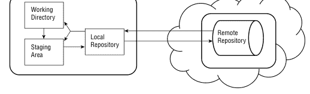

**工作目录** 工作目录是所有程序文件创建、修改和审查的地方。它通常是开发者主目录树中的一个子目录。开发者的计算机系统可以是本地服务器或笔记本电脑，具体取决于工作场所的要求。

**暂存区** 暂存区也称为 索引。此区域位于与工作目录相同的系统上。工作目录中的程序文件通过 `Git` 命令 (`git add`) 注册到暂存区。暂存区使用一个名为 `.git` 的隐藏子目录，该目录通过 `git init` 命令创建。

当文件被编目到暂存区时，`Git` 会创建或更新索引文件 `.git/index` 中有关这些文件的信息。数据包括校验和、时间戳和关联的文件名。

除了更新索引文件外，`Git` 还会压缩程序文件并将压缩数据存储为对象，也称为 blob，位于 `.git/objects/` 目录中。如果程序文件已被修改，它会被压缩并作为新对象存储在 `.git/objects/` 目录中。`Git` 不仅仅存储文件修改；它保留每个修改文件的压缩副本。

**本地存储库** 本地存储库包含每个项目文件的历史记录。它还使用 `.git` 子目录。项目树和提交信息作为对象通过 `Git` 命令 (`git commit`) 存储在 `.git/objects/` 目录中。这些数据被称为 快照。每次提交都会创建一个新的快照。你可以查看旧快照，并且如有需要可以恢复到之前的版本。

**远程仓库**

远程仓库通常是一个基于云的位置。然而，根据项目需求，它也可以是本地网络上的另一台服务器。知名的远程仓库包括 `GitHub`、`GitLab`、`BitBucket` 和 `Launchpad`。不过，迄今为止，`GitHub` 是最受欢迎的。

使用 `Git` 作为版本控制系统（`VCS`）包含以下好处：

- **性能**：除了向远程仓库发送/获取文件外，`Git` 仅使用本地文件进行操作，使其使用速度更快。
- **历史**：`Git` 捕获文件注册到索引时所有文件的内容。当提交完成到本地仓库时，`Git` 会创建并存储指向该时间快照的引用。
- **准确性**：`Git` 采用校验和来保护文件完整性。
- **去中心化**：开发人员可以在同一个项目上工作，但他们不必在同一网络或系统上。

较旧版本控制系统要求开发人员必须处于同一网络上，这并没有提供很大的灵活性。它们在操作上也更慢，这也是 `Linux Torvalds` 决定创建 `Git` 的原因之一。

## 设置 Git 环境

`Git` 工具通常默认未安装。因此，在设置 `Git` 环境之前，你需要先安装 `git` 软件包。有关软件包安装的详细信息，请参阅第 13 章“软件管理”。

在你的系统上安装了 `git` 软件包后，为新项目设置 `Git` 环境有四个基本步骤：

1. 创建一个工作目录。
2. 初始化 `.git/` 目录。
3. 设置本地仓库选项。
4. 建立远程仓库。

要开始新项目的流程，请创建一个工作目录。本地主文件夹中的一个子目录就足够了。示例显示在清单 27.1 中。

**清单 27.1：使用 `mkdir` 命令创建工作目录**

```bash
$ mkdir MxGuard
$ cd MxGuard
$ pwd
/home/Christine/MWGuard
$
```

在清单 27.1 中，你为项目创建了一个简单的子目录 `MWGuard`。创建工作目录后，你使用 `cd` 命令将当前工作目录移动到其中。

在工作目录内，初始化 `.git/` 目录。此任务使用 `git init` 命令。示例显示在清单 27.2 中。

**清单 27.2：通过 `git init` 命令初始化 `.git/` 目录**

```bash
$ git init
Initialized empty Git repository in /home/Christine/MWGuard/.git/
$ ls -ld .git
drwxrwxr-x. 7 Christine Christine 119 Feb 6 15:07 .git
$
```

`git init` 命令会创建 `.git/` 子目录。由于目录名称以点号 (.) 开头，它对于常规的 `ls` 命令是不可见的。要查看其元数据，请使用 `ls -a` 命令或将目录名称作为参数添加到 `ls` 命令中，如清单 27.2 所示。

> 你可以拥有多个 `.git/` 目录。只需为每个目录创建单独的工作目录即可。

如果这是你第一次在系统上构建 `.git/` 子目录，请修改全局 `Git` 仓库的配置文件，以包含你的用户名和电子邮件地址。此信息有助于跟踪文件更改。`git config` 命令允许你执行此任务，如清单 27.3 所示。

**清单 27.3：使用 `git config` 命令修改本地 `Git` 仓库的配置文件**

```bash
$ git config --global user.name "Christine Bresnahan"
$ git config --global user.email "cbresn377@ivytech.edu"
$ git config --get user.name
Christine Bresnahan
$ git config --get user.email
cbresn377@ivytech.edu
$
```

通过包含 `git config` 命令中的 `--global` 选项，如清单 27.3 所示，你将 `user.name` 和 `user.email` 数据存储在全局 `Git` 配置文件中。请注意，你可以通过使用 `--get` 选项并传递数据名称作为参数来查看此信息。

`Git` 配置信息存储在全局 `~/.gitconfig` 文件和本地仓库（即 `working-directory/.git/config` 配置文件）中。（某些系统还有一个系统级配置文件 `/etc/gitconfig`。）要查看所有不同的配置，请使用 `git config --list` 命令，如清单 27.4 所示。

**清单 27.4：使用 `git config --list` 命令查看 `Git` 配置设置**

```bash
$ git config --list
user.name=Christine Bresnahan
user.email=cbresn377@ivytech.edu
core.repositoryformatversion=0
core.filemode=true
core.bare=false
core.logallrefupdates=true
$ cat /home/Christine/.gitconfig
[user]
    name = Christine Bresnahan
    email = cbresn377@ivytech.edu
$ cat /home/Christine/MWGuard/.git/config
[core]
    repositoryformatversion = 0
    filemode = true
    bare = false
    logallrefupdates = true
$
```

通过 `--list` 选项显示的设置使用 `file-section.name` 格式。请注意，当通过清单 27.4 中的 `cat` 命令将两个 `Git` 配置文件（全局和项目本地仓库）显示到 `STDOUT` 时，会显示部分名称及其包含的数据。

当你的本地 `Git` 环境配置完成后，是时候建立你项目的远程仓库了。为了演示目的，我们选择了基于云的远程仓库 `GitHub`。如果你想跟着做，可以在 `github.com/join` 上设置一个免费的远程仓库。

虽然 `Git` 可以处理任何类型的文件，但它的工具主要针对纯文本文件。因此，你无法对所有非文本文件使用所有 `git` 实用程序。

在你建立了项目的远程仓库之后，你需要记录它提供的 URL。此网络地址用于将项目文件发送到远程仓库，这将在本章后面介绍。

## 使用 Git 提交

当你的 `Git` 环境建立后，你可以开始使用版本控制。有四个步骤：

1. 创建或修改程序文件。
2. 将文件添加到暂存区（索引）。
3. 将文件提交到本地仓库。
4. 将文件推送到远程仓库。

根据你的团队工作流程，你可能会在推进到下一步之前重复某些步骤。例如，在一天内，程序员会在文件完成时将其添加到暂存区。在一天结束时，开发人员将项目提交到本地仓库，然后将项目工作推送到远程仓库，以便非本地团队成员访问。

在清单 27.5 中，创建了一个名为 `MyScript.sh` 的简单 shell 脚本，用作 `Git VCS` 示例。

**清单 27.5：查看名为 `MyScript.sh` 的简单 shell 脚本**

```bash
$ cat MyScript.sh
#!/bin/bash
#
echo "Hello World"
#
exit
$
```

创建（或修改）程序后，将其添加到暂存区（索引）。这是通过 `git add` 命令完成的，如清单 27.6 所示。文件位于工作目录中，你在该目录中执行 `git add` 命令。

**清单 27.6：通过 `git add` 命令将程序添加到暂存区**

```bash
$ pwd
/home/Christine/MyGuard
$ git add MyScript.sh
$ git status
# On branch master
#
# Initial commit
#
# Changes to be committed:
# (use "git rm --cached <file>..." to unstage)
#
# new file: MyScript.sh
#
$
```

执行 `git add` 命令时不会提供任何响应。因此，要查看它是否如预期那样工作，请使用 `git status` 命令，如清单 27.6 所示。`git status` 命令显示一个新文件 `MyScript.sh` 被添加到了索引中。也请注意分支名称 `master`。`Git` 分支将在本章后面介绍。

你可以同时将当前工作目录中的所有文件添加到暂存区的索引中。要完成此操作，请发出 `git add .` 命令。注意命令末尾的句点 (.)。它实际上是一个通配符，告诉 `Git` 将工作目录中的所有文件添加到索引中。

> 如果你的工作目录中有不想添加到暂存区索引的文件，请在工作目录创建一个 `.gitignore` 文件。添加你不想包含在索引中的文件和目录的名称。此时，`git add .` 命令将忽略这些文件。

暂存区的索引文件名是 `.git/index`，当在清单 27.7 中使用 `file` 命令处理它时，文件类型显示为 Git 索引。`Git` 使用此文件来跟踪文件更改。

**清单 27.7：使用 `file` 命令查看暂存区索引文件**

```bash
$ file .git/index
.git/index: Git index, version 2, 1 entries
$
```

流程的下一步是将项目提交到本地仓库。这将创建一个项目快照，其中包含诸如项目当前树等信息

对数据进行结构化处理并提交。`Git` 将此类数据存储在 `.git/` 目录中。使用 `git commit` 命令即可完成提交操作，如清单 27.8 所示。`-m` 选项会为 `COMMIT_EDITMSG` 文件添加一行注释，该文件用于帮助跟踪变更。在项目生命周期的后续阶段进行提交时，在 `-m` 选项参数中包含额外信息（例如 `-m "Presentation Layer Commit"`）会很有用。

**清单 27.8：使用 `git commit` 命令提交文件**

```bash
$ git commit -m "Initial Commit"
[master (root-commit) 6d2370d] Initial Commit
 1 file changed, 5 insertions(+)
 create mode 100644 MyScript.sh
$
$ cat .git/COMMIT_EDITMSG
Initial Commit
$
$ git status
# On branch master
nothing to commit, working directory clean
$
```

当你将项目提交到本地仓库后，`git status` 命令将显示清单 27.8 中所示的消息，表明所有文件均已提交。

> 如果你未在 `git commit` 命令中指定 `-m` 选项及其参数，系统将进入 `vim` 编辑器，让你手动编辑 `.git/COMMIT_EDITMSG` 文件。关于 `vim` 编辑器的介绍请参阅第 4 章“搜索和分析文本”。

既然项目已提交到本地仓库，你可以通过将其推送到远程仓库来与其他开发团队成员共享。如果项目已完成，你还可以与其他人或整个世界共享。

如果这是一个新项目，在设置好远程仓库账户后，请创建一个名为 `README.md` 的 `Markdown` 文件。该文件的内容将显示在远程仓库的网页上，并描述该仓库。它使用一种称为 `Markdown` 的语言。清单 27.9 展示了创建该文件、将其添加到暂存区索引并提交流程的示例。

**清单 27.9：创建、添加并提交 `README.md` 文件**

```bash
$ pwd
/home/Christine/MWGuard
$
$ ls
MyScript.sh
$
$ echo "# Milky Way Guardian" > README.md
$ echo "## Programming Project" >> README.md
$
$ cat README.md
# Milky Way Guardian
## Programming Project
$
$ git add README.md
$
$ git status
# On branch master
# Changes to be committed:
#   (use "git reset HEAD <file>..." to unstage)
#
#       new file:   README.md
#
$ git commit -m "README.md commit"
[master 4541578] README.md commit
1 file changed, 2 insertions(+)
create mode 100644 README.md
```


你可以利用 `Markdown` 语言的各种特性，让你的 `README.md` 文件更加丰富多彩。请访问 `http://guides.github.com/features/mastering-markdown` 了解更多关于 `Markdown` 的信息。

你可以在任何时间查看 `Git` 日志，但在将项目推送到远程仓库之前查看日志始终是个好主意。清单 27.10 展示了如何查看日志的示例。每次提交都会分配一个哈希号以标识它，日志中会显示该哈希号。此外，请注意带有日期以及作者信息不同的注释行。

**清单 27.10：通过 `git log` 命令查看 `Git` 日志**

```bash
$ git log
commit 45415785c17c213bac9c47ce8159b19a69aac9f86
Author: Christine Bresnahan <cbresn377@ivytech.edu>
Date:   Fri Feb 11 13:49:49 2022 -0500

    README.md commit

commit 6d2370d2907345671123aaaaa71e147bd3f08f36
Author: Christine Bresnahan <cbresna377@ivytech.edu>
Date:   Wed Feb 9 15:23:11 2022 -0500

    Initial Commit
$
```


在将项目推送到远程仓库之前，你需要在系统中配置其地址。这通过 `remote add origin URL` 命令完成，其中 `URL` 是远程仓库的地址。示例如清单 27.11 所示。

## 清单 27.11：使用 `git remote` 命令配置远程仓库

```
$ git remote add origin https://github.com/C-Bresnahan/MwGuard.git
$
$ git remote -v
origin  https://github.com/C-Bresnahan/MwGuard.git (fetch)
origin  https://github.com/C-Bresnahan/MwGuard.git (push)
$
```

注意清单 27.11，你可以使用 `git remote -v` 命令检查远程地址的状态。在推送项目之前检查地址是个好主意。

> 如果你在 `URL` 中犯了一个错误，例如拼写错误，你可以使用 `git remote rm origin` 命令删除远程仓库的地址。删除后，使用正确的 `URL` 重新设置远程地址。

配置好远程仓库 `URL` 后，将你的项目推送到该位置。示例如清单 27.12 所示。

## 清单 27.12：使用 `git push` 将项目推送到远程仓库

```
$ git push -u origin master
Username for 'https://github.com': C-Bresnahan
Password for 'https://C-Bresnahan@github.com':
Counting objects: 6, done.
Compressing objects: 100% (3/3), done.
Writing objects: 100% (6/6), 561 bytes | 0 bytes/s, done.
Total 6 (delta 0), reused 0 (delta 0)
To https://github.com/C-Bresnahan/MwGuard.git
 * [new branch]      master -> master
Branch master set up to track remote branch master from origin.
$
```

通常，远程仓库会要求提供用户名和密码，除非你已设置其使用 `SSH` 密钥（`OpenSSH` 在第 16 章“查看访问和身份验证方法”中介绍过）。当项目推送到远程仓库后，你应该能够查看它。如果是私有仓库，你必须登录远程仓库才能看到你的工作。图 27.2 显示了该项目的远程仓库。请记住，不同的服务提供商会有不同的用户界面。

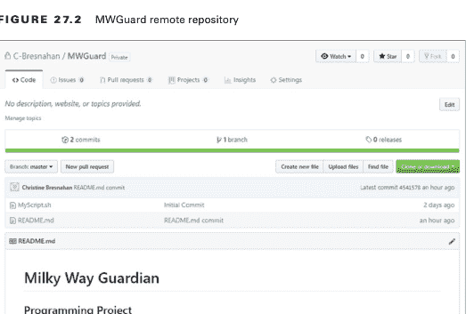

远程仓库的一个真正优点是你的项目团队可以使用 `git pull` 命令拉取项目的最新文件。你需要为他们设置访问远程仓库的权限，或者将其设为公开。清单 27.13 展示了拉取文件的简略示例。

## 清单 27.13：使用 `git pull` 从远程仓库拉取最新项目文件

```
$ whoami
Rich
$
$ git remote add origin https://github.com/C-Bresnahan/MWGuard.git
$
$ git pull -u origin master
[...]
Auto-merging MyScript.sh
[...]
$
```

> 注意  

> 如果拉取项目文件的个人在本地仓库中已经拥有某个文件的修改版本，且该版本尚未上传到远程仓库，则 `git pull` 命令将失败。不过，错误信息将指导如何修正此问题。

新的开发团队成员可以使用 `git clone` 命令从远程仓库将整个项目（包括 `.git/` 文件）复制到其本地系统。简略示例如清单 27.14 所示。

## 清单 27.14：通过 `git clone` 从远程仓库克隆项目

```
$ whoami
Samantha
$
$ ls
$
$ git clone https://github.com/C-Bresnahan/MWGuard.git
Cloning into 'MWGuard'...
[...]
remote: Total 6 (delta 0), reused 6 (delta 0), pack-reused 0
Unpacking objects: 100% (6/6), done.

$ ls
MWGuard
$ cd MWGuard
$ ls -a
.  ..  .git  MyScript.sh  README.md

$ git log
commit 45415785c17c213bac9c47ce815b91b6a9acf86
Author: Christine Bresnahan <cbresn377@ivytech.edu>
Date:   Fri Feb 11 13:49:49 2022 -0500

    README.md commit

commit 6d2370d2907345671123aaaal4e147bd3f08f36
Author: Christine Bresnahan <cbresn377@ivytech.edu>
Date:   Wed Feb 9 15:23:11 2022 -0500

    Initial Commit
$
```

当项目从远程仓库克隆时，工作目录会自动创建，同时还有 `.git/` 目录、`Git` 暂存区（索引）和本地仓库。`git log` 命令显示了项目的历史。这是新团队成员获取开始工作所需一切内容的简便方式。

## 标签

当你开始将新版本的文件提交到你的项目，且项目历史变得越来越长时，事情可能会迅速变得混乱。为了帮助保持一定的组织性，`Git` 软件提供了*标记（tagging）*功能。

标记允许你为特定的提交版本添加额外信息，例如版本号。然后，你可以轻松基于分配的标签来引用仓库中的特定版本。

`Git` 中有两种可用的标签格式：

- **轻量级（Lightweight）**：仅包含标签名称

- **附注（Annotated）**：包含标签名称，以及可提供额外信息以帮助识别版本的附加元数据

要创建轻量级标签，只需使用 `git tag` 命令，并附上标签名称：

```
$ git tag v2.0
$
```

该命令不会返回任何信息，但你可以通过使用不带任何参数的 `git tag` 命令来验证标签是否已创建，该命令会列出现有的标签名称：

```
$ git tag
v0.1
v1.0
v1.5
v2.0
$
```

要创建附注标签，请包含 `-a` 参数，以及 `-m` 参数以指定你想添加的描述性文本：

```
$ git tag -a v2.1 -m "development code for 2.0 branch"
$
```

标签可以帮助你区分生产版本和开发版本，使识别提交历史中发布变更的位置变得更加容易。

## 合并版本

`Git` 中一个有用的概念是分支。*分支* 是本地仓库中用于特定项目部分的区域。默认情况下，`Git` 将你的工作存储在 `master` 分支中，如列表 27.15 所示。

**列表 27.15：** 使用 `git status` 命令查看正在使用的分支

```
$ git status
# On branch master
nothing to commit, working directory clean
$
```

你可以在一个项目中拥有多个分支。一个简单的示例是拥有一个用于生产软件的分支（`master`），一个用于开发中软件的分支（`develop`），以及一个用于测试开发更改的分支（`test`）。你可以指定希望工作的分支，以保护另一分支中的文件不被修改。使用示例，你当然不希望将开发代码文件放入生产分支（`master`）中。相反，你希望它们在 `develop` 分支中维护，直到它们在 `test` 分支中测试完毕并准备好投入生产。

让我们看看一个需要使用分支的项目。`StoneTracker` 项目正处于生产阶段，其文件通过 `master` 分支进行管理，如列表 27.16 所示。

**列表 27.16：** 通过 `git branch` 命令查看当前正在使用的分支

```
$ git branch
* master
$
```

注意列表 27.16 中的 `* master` 行。星号 (`*`) 表示当前分支是 `master`，并且它是唯一的分支。如果有更多分支，它们也会被显示出来。当前分支旁边总有星号。

你可以使用 `git ls-tree` 命令查看特定分支内的文件名。`StoneTracker` 项目已提交的文件如列表 27.17 所示。

**列表 27.17：** 查看 `master` 分支中的文件名

```
$ git ls-tree --name-only -r master
README.md
ST-Data.py
ST-Main.py
$
```

在 `master` 分支（生产环境）中，`StoneTracker` 项目目前通过其业务层 `ST-Main.py` 使用基于文本的用户界面。开发团队需要添加一个表示层，以提供 `GUI`。为了在不影响生产的情况下创建这个新程序，他们使用列表 27.18 中显示的 `git branch` 命令为该项目创建一个新分支。

**列表 27.18：** 使用 `git branch branch-name` 命令创建新分支

```
$ git branch develop
$ git branch
    develop
    * master
$
```

注意列表 27.18 中，当新分支 `develop` 被创建时，它并未被设置为当前分支。要更改分支，需要使用 `git checkout` 命令，如列表 27.19 所示。

**列表 27.19：** 通过 `git checkout branch-name` 命令切换到一个分支

```
$ git checkout develop
Switched to branch 'develop'
$ git branch
    * develop
      master
$
```

现在分支已切换，对新用户界面（`ST-UI.py`）的开发就可以进行，而不会影响到 `master` 分支。但是，`Git` `VCS` 仍然被使用，如列表 27.20 所示。

**列表 27.20：** 在 `develop` 分支上使用 `GIT` `VCS`

```
$ ls
README.md ST-Data.py ST-Main.py ST-UI.py
$
$ git add .
$
$ git status
# On branch develop
# Changes to be committed:
#	(use "git reset HEAD <file>..." to unstage)
#
#	new file:	ST-UI.py
#
$
$ git commit -m "New User Interface"
[develop 1a91bc3] New User Interface
1 file changed, 47 insertions(+)
create mode 100644 ST-UI.py
$
```

当对新用户界面的开发（和测试）完成后，`develop` 分支将与 `master` 分支（生产）合并。要合并分支，使用 `git merge branch-name-to-merge` 命令。合并必须从目标分支执行。因此，在这种情况下，在发出命令之前，你必须先回到 `master` 分支，如列表 27.21 中的片段所示。

**列表 27.21：** 通过 `git merge` 命令合并分支

```
$ git checkout master
Switched to branch 'master'
$ git branch
  develop
* master
$ git merge develop
Updating 0e08e81..1a91bc3
Fast-forward
  ST-UI.py | 47 [..]
1 file changed, 47 insertions(+)
create mode 100644 ST-UI.py
$ git ls-tree --name-only -r master
README.md
ST-Data.py
ST-Main.py
ST-UI.py
$ git log
commit 1a91bc30050ef1c0595894915295cc458b2539b7
Author: Christine Bresnahan <cbresn377@ivytech.edu>
Date:   Fri Feb 11 18:03:18 2022 -0500

    New User Interface

commit 0e08e810dd767acd64e09e45fff614288144da45
Author: Christine Bresnahan <cbresn377@ivytech.edu>
Date:   Fri Feb 11 16:50:10 2022 -0500

    Initial Production Commit
$
```

注意列表 27.21 中，现在在 `master` 分支内，新的生产层程序 `ST-UI.py` 正在被管理。还请注意，两个分支之间的 `Git` 日志也被合并了，如 `git log` 命令所示。


还有另一种合并方式叫做变基（`rebase`）。变基不会简单地将提交和历史日志合并到一个分支中，而是为所有文件执行新的提交，从而简化了历史日志。要对项目进行变基，用 `git rebase` 命令替换 `git merge`。你采用哪一种取决于你组织的开发工作流程以及团队成员的偏好。

## 摘要

分布式 `VCS` 工具 `Git` 在许多方面都有助于开发者之外的需求。了解如何设置工作目录、暂存区以及本地和远程仓库是一项很好的技能。你不仅可以使用适当的术语与你的程序员交流，还可以实施 `Git` 来管理你的 `Linux` 系统的其他有用事务。

## 考试要点

描述版本控制。版本控制是一种组织各种项目文件并保护对其修改的方法或系统。分布式 `VCS` 允许开发者离线和独立工作。`Git` `VCS` 提供工作目录、暂存区（索引）和本地仓库，并使用由第三方提供的远程仓库。由于其高性能、维护的修改历史、文件保护以及去中心化，它很受欢迎。

解释如何设置你的 `Git` 环境。`git` 包提供了用于 `VCS` 的各种 `Git` 工具。使用 `mkdir` 命令为每个项目创建工作目录。暂存区和本地仓库都使用的 `.git/` 目录通过 `git init` 命令初始化。最后，第三方，如 `GitHub`，可以提供远程仓库，以用于各种 `Git` 工具。

详述使用 `Git` 进行提交。根据需要，通过 `git add` 实用程序将文件从工作目录移动到暂存区（索引）。项目的工作流决定了程序何时通过 `git commit` 命令移动到本地目录，然后通过 `git push` 实用程序移动到远程仓库。如果远程开发者需要最新的项目文件，使用 `git pull` 命令。对于需要所有项目文件（包括修改历史）的新团队成员，使用 `git clone` 命令。

总结 `Git` 分支。`Git` 分支是用于特定项目部分（如开发或项目测试）的本地仓库区域。默认情况下，主分支称为 *master* 分支。使用 `git branch branch-name` 命令创建新分支。你可以使用 `git branch` 实用程序查看可用的各种分支，该实用程序使用星号标记当前分支。要切换到另一个项目分支，使用 `git checkout branch-name`。在分支上的工作完成后，其 `VCS` 文件和项目文件可以通过 `git merge branch-name-to-merge` 命令与另一个分支合并。

## 复习题

1. 关于版本控制，以下哪项是正确的？（选择所有适用的。）

   - A. 提供一个合并和存储文件的公共位置

   - B. 要求文件名包含版本号

   - C. 可以是分布式的或非分布式的

   - D. 有助于保护文件不被覆盖

   - E. 可以处理程序以外的文件

2. 从概念上讲，`Git` 被分为不同的区域。以下哪项是这些区域之一？（选择所有适用的。）

   - A. 对象（`Blob`）

   - B. 本地仓库

   - C. 远程仓库

   - D. 索引

   - E. 工作目录

3. 以下哪些步骤是为首次设置 `Git` 环境所必需的？（选择所有适用的。）

   - A. 创建工作目录。

   - B. 在工作目录中初始化 `.git/` 目录。

   - C. 设置本地仓库选项。

   - D. 在准备就绪时向暂存区添加文件。

   - E. 建立远程仓库。

4. `Natasha` 已为她的一项新项目创建了工作目录。她接下来应该做什么来设置她的 `Git` 项目环境？

   - A. 发出 `mkdir` 命令。

   - B. 输入 `git config --list` 命令。

   - C. 设置她的 `GitHub` 仓库。

   - D. 输入 `git init` 命令。

   - E. 开始创建她的程序文件。

5. 在设置他的 `Git` 配置选项时，`Bruce` 在他的命令中使用了 `--global` 选项。这意味着什么？

   - A. 配置信息存储在 `GitHub` 上。

   - B. 配置信息存储在 `~/.gitconfig` 中。

   - C. 配置信息存储在工作目录的 `.git/config` 文件中。

   - D. 配置信息存储在工作目录的 `.git/index` 文件中。

   - E. 配置信息存储在工作目录的 `.git/objects` 目录中。

## 实现虚拟与云环境

### 第七部分

## 第 28 章

### 理解云计算与虚拟化概念

-   ✓ 目标 3.2：在给定场景下，执行基本的容器操作。

-   ✓ 目标 3.5：总结容器、云计算和编排概念。


# 云技术概述

云技术极大地改变了计算机领域的格局。将计算资源和应用程序迁移到共享网络环境中，改变了许多企业的业务模式及其向客户提供服务的方式。本章介绍了云的定义以及 `Linux` 在云计算中所扮演的主要角色。本章首先定义了什么是云计算以及不同类型的云计算环境。接着，讨论虚拟化在云计算中发挥的重要角色，以及这在 `Linux` 中是如何实现的。最后，你将了解容器在云计算中的定位，以及它们如何改变了开发人员的工作方式。

## 考虑云服务

在深入探讨 `Linux` 如何参与云计算之前，先定义一下什么是云以及它提供何种类型的资源是个好主意。

### 什么是云计算？

`云`这一术语的首次提及出现在 `1977` 年原始 `ARPAnet` 网络环境的文档中，`ARPAnet` 是现代互联网的前身。在那份文档中，云符号通常用来代表地理上分散的大型互连服务器网络。然而，在该环境中，每个服务器都是独立且自给自足的，没有分布式计算。

`云计算`这一术语与分布式计算有关。在分布式计算中，两个或更多服务器共享资源以完成单一任务，例如运行应用程序。这种环境成为我们现在所熟知的云计算的前身，并由亚马逊网络服务（`Amazon Web Services`，`AWS`）、`Google` 云平台（`Google Cloud Platform`）和 `Microsoft Azure` 等公司推广普及。

借助云计算，你可以通过互联网交付计算资源。现在，客户可以根据需要从云计算供应商处购买硬件和软件资源。这包括服务器、存储空间、数据库、网络、操作系统，甚至单个应用程序。

`图 28.1` 展示了提供云计算服务的三种不同方法。

**图 28.1** 云计算方法

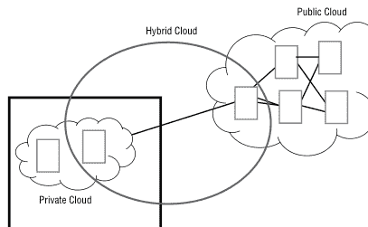

如 `图 28.1` 所示，提供云计算环境主要有三种方法：

- **公共云：** 在公共云计算环境中，第三方在组织外部提供所有计算资源。这个资源池通常由多个组织共享，这些组织也可以访问该平台。
- **私有云：** 在私有云计算环境中，每个组织独立构建自己的云计算资源，以在内部提供资源。
- **混合云：** 在混合云计算环境中，计算资源在组织内部提供，但也连接到外部公共云，以便在需要时补充资源。

### 云服务有哪些？

云计算环境可以根据每个客户的需求，定制提供给客户的资源级别。以下部分描述了你将从云计算供应商那里看到的三种最流行的资源级别提供模式。

#### 基础设施即服务 (`IaaS`)

在基础设施即服务 (`IaaS`) 模型中，云计算供应商提供低级别的服务器资源，以便为组织托管应用程序。如 `图 28.2` 所示，这些低级资源包括物理服务器所需的所有物理组件，包括 `CPU` 时间、内存空间、存储空间和网络资源。

**图 28.2** `IaaS` 云模型

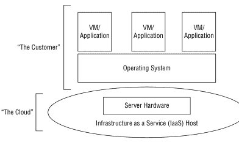

提供的服务器资源可能位于单台服务器上，或者分布在多台服务器上。在分布式环境中，服务器可能共置于单一设施中，或者分布在位于不同城市的多个设施中。这有助于提高可用性。

如 `图 28.2` 所示，在 `IaaS` 模型中，客户需要提供操作系统及其需要运行的任何应用程序。大多数 `IaaS` 环境支持 `Linux` 或 `Windows` 操作系统。客户负责操作系统所需的系统管理工作以及任何应用程序管理。云计算供应商负责维护物理基础设施环境。

#### 平台即服务 (`PaaS`)

在平台即服务 (`PaaS`) 模型中，如 `图 28.3` 所示，云计算供应商向客户提供物理服务器环境以及操作系统环境。

在 `PaaS` 模型中，云计算供应商负责物理组件以及操作系统管理。它提供系统管理支持，以确保操作系统正确修补并更新，以跟上当前版本和安全特性。这使得客户能够专注于开发在 `PaaS` 环境中运行的应用程序。

#### 软件即服务 (`SaaS`)

在软件即服务 (`SaaS`) 模型中，云计算供应商提供完整的应用程序环境，例如邮件服务器、数据库服务器或 `Web` 服务器。供应商提供执行功能所需的物理服务器环境、操作系统和应用程序软件。如 `图 28.4` 所示。

## 复习题

**6.** `Bruce` 已配置好他的 `Git` 环境，并完成了新的 `GreenMass.sh` 脚本。接下来他应该做什么？

- A. 将脚本添加到暂存区。
- B. 执行 `git init` 命令。
- C. 将脚本提交到本地仓库。
- D. 执行 `git log` 命令。
- E. 将脚本提交到远程仓库。

**7.** `Natasha` 的工作目录中有 `25` 个文件，她只想将其中 `22` 个文件添加到索引中。她计划使用 `git add .` 命令以提高效率。她应该怎么做？

- A. 将这三个文件移出工作目录。
- B. 通过 `git add` 命令逐个添加这 `22` 个文件。
- C. 为这三个文件创建一个新的工作目录。
- D. 将这三个文件的名称添加到 `.gitignore` 文件中。
- E. 暂时删除这三个文件。

**8.** `Natasha` 已完成她的开源项目，该项目定于今天向公众发布。她已将文件移至暂存区，将工作提交到本地仓库，并配置了远程仓库的地址。她的下一步是什么？

- A. 回家放松。她值得这样做。
- B. 将远程仓库克隆到她的本地系统。
- C. 将她的项目推送到远程仓库。
- D. 从远程仓库拉取她的项目。
- E. 使用 `remote add origin URL` 命令。

**9.** 以下哪个命令允许你切换到名为 `testing` 的新 `Git` 分支？

- A. `git branch testing`
- B. `git ls-tree --name-only -r testing`
- C. `git branch`
- D. `git commit -m "testing"`
- E. `git checkout testing`

**10.** `Tony` 创建了 `StoneTracker` 项目的一个名为 `report` 的新分支。他已经完成并测试了他的工作。现在他需要将其合并到 `StoneTracker` 项目的 `master` 分支。在切换到 `master` 分支后，他应该使用什么命令？

- A. `git merge master`
- B. `git merge report`
- C. `git rebase master`
- D. `git rebase report`
- E. `git checkout master`

## 理解虚拟化

云计算环境的缺点在于其计算密集度非常高。运行云计算环境需要大量的计算能力，而这可能会变得十分昂贵。

使云计算成为可能的技术是虚拟化，这也是 `Linux` 成为云服务商热门选择的原因。以下章节将介绍什么是虚拟化、有哪些不同类型的虚拟化，以及如何在 `Linux` 环境中实现虚拟化。

对于运行支持大量客户端应用程序的组织而言，标准性能模型规定应将应用程序的不同功能分离到不同的服务器上，如图 `28.5` 所示。

### 图 28.5 分离应用程序资源


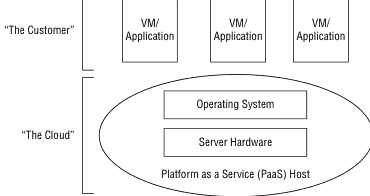


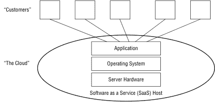

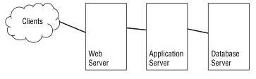

如图 `28.5` 所示，`Web` 服务器、应用程序服务器和数据库服务器位于不同的服务器上。客户仅与前端 `Web` 服务器通信。`Web` 服务器将连接传递给应用程序，而应用程序又与数据库服务器通信。从性能角度来看，这种模型是合理的，因为你可以为每个组件分配独立的计算资源。此外，从安全角度来看，这有助于将访问权限进行分区，使任何潜在攻击者的工作稍微困难一些。

然而，随着服务器容量的增加，这种模型变得效率较低。将整个物理服务器仅用于运行 `Web` 服务器，将另一个物理服务器仅用于运行数据库服务器，再将第三个物理服务器仅用于运行应用程序软件，这不仅无法充分利用服务器的全部性能，还会导致成本高昂。

这就是虚拟化的用武之地。通过虚拟化，你可以在单个物理服务器上运行多个较小的虚拟服务器环境。图 `28.6` 演示了这一概念。

### 图 28.6 服务器虚拟化概念


每个虚拟服务器都像独立服务器一样运行在物理服务器硬件上。这被称为 `虚拟机`（`VM`）。虚拟服务器之间互不交互，因此它们的表现就如同位于不同的物理服务器上一样。然而，需要一种机制让每个虚拟服务器公平地共享服务器上的物理资源，以避免它们之间发生冲突。

这正是 `虚拟机监视器`（`hypervisor`）发挥作用的地方。虚拟机监视器也称为 `虚拟机器监控器`（`VMM`），它充当虚拟机器之间共享的物理服务器资源的交通警。它为服务器上运行的每个虚拟机提供 `CPU` 时间、内存空间和存储空间的虚拟环境。就每个虚拟机而言，它认为自己对服务器资源拥有直接访问权限，并且完全不知道虚拟机监视器在中间控制着资源访问。

由于每个虚拟机都是服务器上的独立实体，你可以在不同的虚拟机中运行不同的操作系统。这使你能够轻松地在不同的操作系统中试验应用程序的运行情况，或者在同一操作系统的不同版本中进行试验——这一切都不需要购买额外的服务器。

### 虚拟机监视器的类型

实施虚拟机监视器有两种不同的方法。以下章节将讨论它们是什么以及它们之间的区别。

#### I 型虚拟机监视器

I 型虚拟机监视器通常被称为裸机虚拟机监视器。虚拟机监视器系统直接运行在服务器硬件上，中间没有其他层。虚拟机监视器软件直接与系统中的 `CPU`、内存和存储进行交互，并根据需要将其分配给每个虚拟机。图 `28.7` 展示了这种配置。


在 `Linux` 领域，有两种流行的 I 型虚拟机监视器软件包：

- **`KVM`：** 基于 `Linux` 内核的虚拟机（`KVM`）利用标准的 `Linux` 内核和一个特殊的虚拟机监视器模块（取决于使用的 `CPU`，是 `Intel` 还是 `AMD`）。安装完成后，它可以托管任何类型的客户操作系统。
- **`XEN`：** `XEN` 项目是硬件虚拟化的开源标准。它不仅支持 `Intel` 和 `AMD` `CPU`，还有一个适用于 `ARM` `CPU` 的版本。`XEN` 项目除了虚拟机监视器软件外，还包括其他软件，例如用于从客户操作系统管理虚拟机监视器的 `API` 栈。

#### II 型虚拟机监视器

II 型虚拟机监视器通常被称为 `宿主型虚拟机监视器`，因为它们运行在现有的操作系统安装之上。虚拟机监视器软件像主机操作系统上的任何其他应用程序一样运行。图 `28.8` 展示了 II 型虚拟机监视器的工作原理。


II 型虚拟机监视器软件将客户虚拟机作为主机操作系统上的独立进程运行。客户虚拟机支持客户操作系统，这些操作系统与主机操作系统完全隔离。因此，你可以使用 `Linux` 作为主机操作系统，同时运行 `Windows` 或 `macOS` 客户操作系统。

使用 II 型虚拟机监视器的吸引力在于，你可以在已安装的操作系统上运行它。你不需要创建新的服务器环境来运行虚拟机。对于 I 型虚拟机监视器，你必须将服务器专门用于托管虚拟机；而对于 II 型虚拟机监视器，你的服务器在托管虚拟机的同时还可以执行其他功能。

有许多流行的 `Windows` 和 `macOS` II 型虚拟机监视器，例如 `VMware Workstation` 和 `QEMU`，但对于 `Linux`，常用的是 `Oracle VirtualBox`。

### 虚拟机监视器模板

你在虚拟机监视器中创建的虚拟机必须经过配置，以确定它们所需的资源以及如何与硬件交互。你可以将这些配置设置保存为模板文件，以便轻松地在同一个虚拟机监视器或单独的虚拟机监视器服务器上复制虚拟机环境。

虚拟机配置的开源标准称为开放虚拟化格式（`OVF`）。`OVF` 格式创建一个由多个文件组成的分发包。该包使用单个 `XML` 配置文件来定义虚拟机的硬件环境要求。与该文件一起的还有其他文件，它们定义了虚拟机对网络访问、虚拟驱动器要求以及任何操作系统要求的配置。

`OVF` 模板的缺点在于分发时比较繁琐。解决这个问题的方法是开放虚拟化设备（`OVA`）格式。`OVA` 模板将所有 `OVF` 文件打包成一个单一的 `tar` 归档文件，以便于分发。

## 探索容器

虽然利用虚拟机是在服务器环境中启动多个服务器的绝佳方式，但它们在操作和分发应用程序方面仍然略显笨重。没有重复整个操作系统环境的需求来分发应用程序。解决这个问题的方法是容器。以下章节将探索什么是容器，以及它们如何改变开发人员管理和分发云环境中应用程序的方式。

### 什么是容器？

开发应用程序需要许多文件。应用程序运行时文件通常集中在单个目录中，但通常需要额外的库文件来将应用程序与数据库、桌面管理软件或内置操作系统功能进行接口对接。这些文件通常位于 `Linux` 虚拟目录中各个难以找到的位置。

由于运行应用程序所需的所有辅助文件，应用程序在开发中通常运行良好，但在部署到无法准确复制开发环境的生产环境中时却往往崩溃。在 `Windows` 世界中，这通常被称为“`DLL` 地狱”，因为不同的应用程序覆盖通用的 `DLL` 库文件，从而破坏了其他应用程序。然而，这并不局限于 `Windows` 世界；它同样适用于 `Linux` 世界。

容器旨在解决这个问题。容器收集运行应用程序所需的所有文件——运行时文件、库文件、数据库文件以及任何操作系统特定文件。容器使应用程序的运行变得自给自足；应用程序所需的一切都存储在容器内。

如果在服务器上运行多个应用程序，可以安装多个容器。如图 `28.9` 所示，每个容器仍然是针对特定应用程序的自包含环境。

应用程序容器具有可移植性。你可以在任何主机环境中运行相同的容器，并期望获得应用程序的相同行为。这对应用程序开发人员来说非常理想。开发人员可以在一个环境中开发应用程序容器，将其复制到测试环境，然后将应用程序容器部署到生产环境，而无需担心缺少文件。

### 图 28.9 在容器中运行应用程序


通过将应用程序打包并分发为容器，开发人员可以确保该应用程序对客户的运行方式与其在开发环境中的运行方式完全相同。

由于容器不包含完整的操作系统，它们比完整的虚拟机更轻量，从而更易于分发。以下各节描述了 `Linux` 中使用的两种最常见的容器打包系统。

> 第 `19` 章“拥抱最佳安全实践”讨论了使用 `chroot` 监狱（`chroot jails`）作为在 `Linux` 系统上隔离运行应用程序的一种方法。早期的容器利用这种相同的方法来隔离应用程序。如今的容器软件包使用 `chroot` 监狱来隔离应用程序，但还结合了高级 `Linux` 特性，如 `AppArmor`、`SELinux`、内核命名空间、控制组（`cgroups`）以及额外的内核能力。

## 容器软件

`Linux` 一直走在容器开发的 `forefront`，使其成为开发人员的流行选择。在 `Linux` 中，通常使用两个主要的容器软件包：

- `LXC`：`LXC` 软件包是作为创建容器的开源标准开发的。`LXC` 中的每个容器都比标准轻量级应用程序容器稍复杂一些，但不像完整虚拟机那么笨重，因此处于中间位置。`LXC` 容器包含自己的精简操作系统，直接与主机系统硬件接口，无需主机操作系统处理该部分。由于 `LXC` 容器包含自己的微型操作系统，有时被称为虚拟机，尽管这种说法并不完全正确，因为 `LXC` 容器仍然需要主机操作系统才能运行。
- `Docker`：`Docker` 软件包由 `Docker Inc.` 开发并作为开源项目发布。`Docker` 极其轻量，允许在同一主机 `Linux` 系统上运行多个容器。`Docker` 使用在主机 `Linux` 系统上运行的独立守护进程来管理已安装的 `Docker` 镜像。该守护进程监听来自各个容器以及来自允许你控制容器环境的 `Docker` 命令行的请求。

### 容器模板

与虚拟机一样，容器允许你创建模板以轻松复制容器环境。不同类型的 `Linux` 容器使用不同的方法来分发模板。

`LXC` 软件包使用一个名为 `LXD` 的独立实用程序来管理容器。在近期版本中，`LXD` 变得如此流行，以至于它现在本身也被打包为容器软件，尽管它仍然使用容器的 `LXC` 系统镜像。

`Docker` 使用 `Docker` 容器镜像文件来存储容器配置。容器镜像文件是一个只读容器镜像，可以存储和分发应用程序容器。

### 使用 Docker

`Docker` 容器软件包提供了一个简单的平台，用于在 `Linux` 环境中运行 `OS` 容器。然而，由于 `Docker` 与容器共享主机操作系统内核，你只能在 `Linux` `Docker` 主机上运行 `Linux` 容器。

你使用 `docker` 命令行工具来轻松与 `Docker` 系统交互，启动、停止并与容器交互。表 `28.1` 列出了你可以随 `docker` 命令使用的可用命令。

你可以从 `Docker` 配置文件构建新的容器镜像，也可以直接从容器仓库下载预配置的容器镜像，其他管理员在那里发布了他们的容器。`Docker` 本身在 `http://hub.docker.com` 维护一个容器仓库。

以下练习将指导你完成在你的 `Linux` 系统上安装和使用 `Docker` 以开始托管 `Linux` 容器的步骤。

**表 28.1 `docker` 实用命令**

| 命令 | 描述 |
| :--- | :--- |
| `attach` | 将主机的 `STDIN`、`STDOUT` 和 `STDERR` 连接到容器 |
| `build` | 从 `Docker` 配置文件创建新的容器镜像 |
| `commit` | 在本地系统上创建已编辑容器的新镜像 |
| `cp` | 在本地系统和容器之间复制文件和目录 |
| `exec` | 连接到正在运行的容器并执行命令 |
| `images` | 列出本地存储的容器镜像 |
| `inspect` | 显示关于容器的详细信息 |
| `kill` | 立即停止正在运行的容器 |


| `login` | 登录 Docker hub 仓库 |
| `logs` | 从正在运行的容器获取日志 |
| `ps` | 列出正在运行的容器 |
| `pull` | 从 Docker 仓库获取容器 |
| `push` | 将容器镜像提交到 Docker 仓库 |
| `rm` | 删除已停止的容器 |
| `rmi` | 从本地存储中删除容器镜像 |
| `run` | 启动容器镜像 |
| `stop` | 停止正在运行的容器 |
| `start` | 启动已停止的容器 |

## 练习 28.1

### 使用容器

1. 从你的发行版软件仓库安装 Docker 软件（参见第 13 章“管理软件”）。对于 Ubuntu，输入命令 `sudo apt install docker`。对于基于 Red Hat 的发行版，如 Rocky Linux，命令是 `sudo dnf install docker`。

2. 安装 Docker 软件后，你通过 `docker` 命令与其通信。通过在命令行输入 `sudo docker ps` 来检查 Docker 是否正在运行：

   ```
   $ sudo docker ps
   Emulate Docker CLI using podman. Create /etc/containers/nodocker to quiet msg.
   CONTAINER ID  IMAGE  COMMAND  CREATED  STATUS  PORTS  NAMES
   ```

   输出显示 Docker 正在运行，并列出当前正在运行的任何容器（目前为空）。

3. 通过输入命令 `sudo docker pull docker.io/library/httpd:latest` 获取用于通用 Apache Web 服务器的 Docker 定制容器镜像。这会导致 Docker 查询 `http://hub.docker.com` 上的 Docker 仓库并获取运行在通用 Linux OS 平台上的最新版本的定制 Apache Web 服务器。如果你需要使用特定版本的 Apache，可以在容器镜像名称后指定，例如 `httpd:2.4`。

4. 通过输入 `sudo docker run -d -t -p 8088:80 --name myApache httpd` 将 `httpd` 容器镜像部署到你的 Docker 环境中。此命令在后台模式下启动容器（`-d` 选项），将终端连接到容器（`-t` 选项），将容器上的 TCP 80 端口暴露给主机上的 8088 端口（`-p` 选项），并为容器赋予一个简单的名称以用于 `docker` 命令。重要的是要记住，容器是自包含的，因此要连接到容器上的端口，你必须指示 Docker 将该端口暴露给主机系统。运行此命令时，Docker 将显示分配给容器的 ID。通过输入 `sudo docker ps` 验证容器是否正在运行。

   ```
   $ sudo docker run -d -t -p 8088:80 --name myApache httpd
   Emulate Docker CLI using podman. Create /etc/containers/nodocker to quiet msg.
   43eee94b028d7b3c9a168cf29284428b155624f8bf3cfc5cb5c64c56548cc
   $ sudo docker ps
   Emulate Docker CLI using podman. Create /etc/containers/nodocker to quiet msg.
   CONTAINER ID  IMAGE                       COMMAND       CREATED              STATUS             PORTS                  NAMES
   43eee94b028d  docker.io/library/httpd:latest  httpd-foreground  4 seconds ago  Up 5 seconds ago  0.0.0.0:8088->80/tcp  myApache
   ```

### 练习 28.1（续）

输出结果表明，`httpd` 容器确实在运行，并且它已将容器的 TCP 80 端口映射到宿主系统的 TCP 8088 端口。

5. 在宿主机的 Linux 桌面上打开浏览器并输入 `http://localhost:8088`，以连接到正在容器中运行的 Apache Web 服务器。您将看到 Apache Web 服务器生成的通用“It works!”消息。

6. 通过输入 `sudo docker exec -i -t myApache bash` 在正在运行的容器中打开一个交互式 Bash shell。这将作为交互式终端连接到名为 `myApache` 的容器（`-i` 和 `-t` 选项），并运行 `bash` 命令，生成一个 shell 提示符。您应该会看到类似以下内容：

```bash
$ sudo docker exec -it myApache bash
Emulate Docker CLI using podman. Create /etc/containers/nodocker to quiet msg.
root@43ee094b028d:/usr/local/apache2#
```

7. Bash shell 命令提示符表示您已以 `root` 用户账户登录到容器操作系统，并且当前位于 `/usr/local/apache2` 目录中。从这里，您可以查看和修改 Apache Web 服务器配置文件，或在 `/usr/local/apache2/htdocs` 目录中创建新的 Web 页面。要返回到宿主系统命令行，请输入 `exit`。

```bash
root@43ee094b028d:/usr/local/apache2# exit
exit
[rich@localhost ~]$
```

8. 通过输入 `sudo docker stop myApache` 停止正在运行的容器。您可以通过输入 `sudo docker ps` 来验证容器已停止。

9. 通过输入 `sudo docker rm myApache` 从您的 Docker 系统中删除该容器。

10. 如果您不想再在工作站上保留 `httpd` 容器镜像，请输入 `sudo docker rmi httpd`。

## 摘要

云计算提供了一种轻松扩展公司计算资源的方式，而无需购买和管理自己的硬件。云计算有三个层级，每个层级提供不同的服务。基础设施即服务 (IaaS) 提供硬件资源，如服务器、存储和网络。平台即服务 (PaaS) 提供开发环境，由操作系统以及开发、测试和交付应用软件所需的任何库组成。软件即服务 (SaaS) 通过互联网从云服务器上运行应用程序。

云计算环境使用虚拟化来实施多台服务器，而无需大量物理硬件。通过虚拟化，一台大型服务器可以托管多个较小的客户系统。管理程序软件管理分配给每个客户系统的资源，并管理这些资源的使用方式。

有两种类型的使用管理程序环境。I 型管理程序直接与系统硬件交互。客户系统直接由管理程序软件接收系统资源。II 型管理程序运行在宿主操作系统之上。宿主操作系统与系统硬件交互，并为 II 型管理程序提供资源，后者进而将资源分配给客户系统。

容器是一种不同类型的虚拟化。容器为单个应用程序提供一致的运行环境。当您部署应用程序到容器中时，无论它在哪个服务器上运行，都保证应用程序容器以相同的方式运行。通过使用容器部署应用程序，您保证应用程序在开发、测试和生产环境中将以相同的方式运行。容器不像虚拟机那样包含大量的开销，使其更容易分发。

## 考试要点

- **描述提供云计算环境的三种主要方法。** 公有云托管在由第三方拥有和运营的服务器上。公司不拥有或运营任何服务器硬件；它只是利用这些服务器上的空间。其他公司可以在同一个公有云中租用空间。私有云托管在位于企业网络内部的服务器上。所有应用程序文件以及数据文件都驻留在企业网络内部。混合云利用私有云服务器，但也将它们与公有云服务器进行接口连接。使用混合云，数据可以位于外部的公有云中，也可以位于内部的私有云上。

- **解释三种云服务类型。** 基础设施即服务 (IaaS) 为客户提供硬件级别的服务。这包括服务器、存储空间以及连接它们的网络资源。平台即服务 (PaaS) 提供用于开发软件的按需环境。在 PaaS 云服务中，服务器硬件、操作系统和运行时库均由云服务提供。软件即服务 (SaaS) 在云环境中运行应用程序，允许客户通过互联网访问这些应用程序。

- **解释两种类型的管理程序。** I 型管理程序直接运行在系统硬件上。它们作为硬件和客户操作系统之间的中介。I 型管理程序为每个客户操作系统分配资源，确保每个系统都能获得足够的资源。II 型管理程序运行在宿主操作系统之上。宿主操作系统与服务器硬件交互；管理程序软件必须通过宿主操作系统来访问资源。客户操作系统仍然仅与管理程序软件交互。

- **描述容器与虚拟机的区别。** 大多数容器包不包含完整的操作系统，但虚拟机包含。容器包仅包含运行特定应用程序所需的库文件和应用程序运行时文件。这使得容器轻量且易于部署。

## 复习题

1. 哪种云服务方法仅利用由第三方拥有和运营的服务器？

    - A. 私有
    - B. 公有
    - C. 混合
    - D. II 型
    - E. I 型

2. Tom 目前在公司内部服务器上运行一个云平台，但他需要额外的处理能力来运行一个新应用程序。他可以检查哪种云服务方法，以便利用现有云平台而无需购买更多的内部服务器？

    - A. 私有
    - B. 公有
    - C. 混合
    - D. I 型
    - E. II 型

3. Sally 有兴趣在云中开发她的应用程序，而不必担心管理操作系统。她应该购买哪种类型的云服务？

    - A. PaaS
    - B. 私有云
    - C. IaaS
    - D. SaaS
    - E. 混合云

4. 哪种类型的云服务允许您在云提供的基础设施上启动自己的操作系统？

    - A. PaaS
    - B. 私有云
    - C. IaaS
    - D. SaaS
    - E. 混合云

5. 哪种类型的管理程序直接与宿主系统硬件进行接口？

    - A. 私有
    - B. 公有
    - C. II 型
    - D. I 型
    - E. 混合

6. Henry 已经在他的服务器上安装了 Red Hat Linux，但现在需要安装虚拟机。他应该使用哪种类型的管理程序包？

    - A. 私有
    - B. 公有
    - C. II 型
    - D. I 型
    - E. 混合

7. 哪种类型的管理程序模板将所有配置文件打包到单个文件中以便分发？

    - A. XML
    - B. JSON
    - C. OVA
    - D. OVF
    - E. YAML

8. Fred 想要打包他的应用程序，以确保无论他的客户使用哪种 Linux 发行版，它都能以相同的方式运行。他该如何做到这一点？

    - A. 将应用程序打包为容器。
    - B. 将应用程序打包为管理程序。
    - C. 将应用程序部署到私有云。
    - D. 将应用程序作为虚拟机部署。
    - E. 将应用程序捆绑为 `tar` 文件并部署。

9. 您应该使用哪种方法轻松地将应用程序从开发环境迁移到生产环境，而无需复制操作系统？

    - A. 公有云
    - B. 私有云
    - C. I 型管理程序
    - D. II 型管理程序
    - E. 容器

10. 哪种 Linux 容器包在宿主操作系统上以进程形式运行引擎，并提供一个命令行界面来控制容器？

    - A. Snap
    - B. Docker
    - C. KVM
    - D. XEN
    - E. VirtualBox

## 第 29 章 检查云和虚拟化服务

目标 3.5：概述容器、云和编排概念


在设计和管理各种云和虚拟化系统配置时，你需要了解虚拟网络和物理网络如何互操作、可用的各种磁盘存储选项、如何自动启动系统，以及如何在你的虚拟机上快速安装 Linux 发行版。此外，你还需要熟悉一些基本的虚拟机创建和管理工具。在本章中，我们将继续第 28 章开启的旅程，深入探讨云和虚拟化的主题。

### 专注于虚拟机工具

各种虚拟机实用程序允许你创建、销毁、启动、关闭和配置你的来宾虚拟机。有许多开源替代品可供选择。有些只能在命令行下工作，有时在 shell 脚本中使用，而有些则提供图形界面。在以下章节中，我们将介绍这些工具中的几个。

### 了解 `libvirt`

一个流行的虚拟化管理软件集是 `libvirt` 库。该系列包含以下元素：

- 一个应用程序编程接口（API）库，它被整合到多个开源 VMM（管理程序）中，例如 `KVM`
- 一个守护进程 `libvirtd`，它运行在虚拟机宿主系统上，并执行所需的来宾虚拟机管理任务，例如启动和停止虚拟机
- 命令行实用程序，例如 `virt-install` 和 `virsh`，它们运行在虚拟机宿主系统上，用于控制和管理来宾虚拟机

通常，大多数以 `vir` 或 `virt` 开头的命令行实用程序都使用 `libvirt` 库，你可以使用 `ldd` 命令来再次确认这一点。下面是一个在已安装管理程序软件包的 Rocky Linux 发行版上的示例，如清单 29.1 所示。

**清单 29.1：使用 `ldd` 命令检查 `libvirt`**

```bash
$ which virsh
/usr/bin/virsh
$
$ ldd /usr/bin/virsh | grep libvirt
libvirt-lxc.so.0 => /lib64/libvirt-lxc.so.0 (0x00007f4a3a10c000)
libvirt-qemu.so.0 => /lib64/libvirt-qemu.so.0 (0x00007f4a39f08000)
libvirt.so.0 => /lib64/libvirt.so.0 (0x00007f4a39934000)
$
```

`libvirt` 项目的一个主要目标是提供管理虚拟机的单一方式。它支持许多管理程序，如 `KVM`、`QEMU`、`Xen` 和 `VMware ESXi`。你可以在 `Libvirt.org` 网站上了解更多关于 `libvirt` 项目的信息。

### 查看 `virsh`

一个使用 `libvirt` 库的实用工具是 `virsh` shell。它是一个基本的 shell，你可以用它来管理系统中的虚拟机。

> **注意**
>
> 如果你想尝试 `virsh` shell，可以通过 `libvirt-client` 或 `libvirt-clients` 软件包获取它。对于较旧的发行版，它可能位于 `libvirt-bin` 软件包中。软件包安装在第 13 章“软件治理”中已有介绍。请注意，创建虚拟机需要额外的软件包。

如果你已安装 VMM（管理程序）产品，可以使用 `virsh` shell 来创建、删除、启动、停止和管理你的虚拟机。清单 29.2 展示了进入和退出 `virsh` shell 的示例。请记住，涉及虚拟机的 shell 命令通常需要超级用户权限。

**清单 29.2：探索 `virsh` shell**

```bash
$ virsh
Welcome to virsh, the virtualization interactive terminal.
Type: 'help' for help with commands
'quit' to quit
virsh # exit
$
```

你不必进入 `virsh` shell 就可以管理你的虚拟机。各种 `virsh` 命令可以直接从 Bash shell 中输入，这使得那些希望在 shell 脚本中使用命令以自动化虚拟机管理的人员非常受益。清单 29.3 展示了交互式使用 `virsh` 实用程序的示例。

**清单 29.3：交互式使用 `virsh` 实用程序**

```bash
$ virsh help setcpus
NAME
    setcpus - change number of virtual CPUs
SYNOPSIS
    setcpus <domain> <count> [--maximum] [--config]
    [--live] [--current] [--guest] [--hotpluggable]
DESCRIPTION
    Change the number of virtual CPUs in the guest domain.
OPTIONS
    [--domain] <string>    domain name, id or uuid
    [--count] <number>     number of virtual CPUs
    --maximum              set maximum limit on next boot
    --config               affect next boot
    --live                 affect running domain
    --current              affect current domain
    --guest                modify cpu state in the guest
    --hotpluggable         make added cpus hot(un)pluggable
$
```


在命令行创建虚拟机时，比 `virsh` 更简单的实用程序是 `virt-install`。它是一个 Python 程序，根据发行版的不同，通常可以从 `virtinst` 或 `virt-install` 软件包中获取。

### 使用 Virtual Machine Manager 进行管理

请注意，Virtual Machine Manager（也称为 `VMM`）不要与管理程序（`VMM`）混淆。Virtual Machine Manager 是一个用于创建和管理虚拟机的轻量级桌面应用程序。它是一个在许多使用图形用户界面（`GUI`）的发行版上可用的 Python 程序，可以从 `virt-manager` 软件包中获取。

Virtual Machine Manager 可以通过图形环境中的终端模拟器上的 `virt-manager` 命令启动。图 29.1 展示了 Rocky Linux 8 发行版上的 `VMM` 用户界面。

**图 29.1 Virtual Machine Manager**


你需要使用超级用户权限来运行 Virtual Machine Manager，如果 `virt-manager` 命令不是从具有这些权限的账户发出的，它将打开一个弹出窗口，要求输入 `root` 账户密码或类似内容，具体取决于发行版。

Virtual Machine Manager 通过其“`View`”菜单提供的一个很好功能是性能统计图表。此外，`GUI` 界面允许修改来宾虚拟机的配置，例如它们的虚拟网络（虚拟网络配置将在本章后面介绍）。


Virtual Machine Manager 默认提供一个虚拟网络计算（`VNC`）客户端查看器（`virt-viewer`）。因此，可以将图形（桌面环境）控制台连接到任何正在运行的虚拟机。但是，也可以配置 `SPICE` 来执行相同的功能。`VNC` 和 `SPICE` 在第 8 章“比较 GUI”中已介绍。

你可以在 `Virt-manager.org` 网站上查看 Virtual Machine Manager 的截图，阅读其文档并浏览其代码。

### 理解引导

引导（bootstrap）是鞋后跟上的一个小布料或皮革环。现在你用它们来帮助把鞋子穿到脚上，方法是用手指勾住环并拉紧。从那个小工具衍生出的短语“Pick yourself up by your bootstraps”，意思是不依靠任何外部帮助而从挫折中恢复。

随着时间推移，计算机行业开始模仿该短语，使用术语 `bootstrapping` 和 `booting`。它们经常互换使用，但通常启动系统是指给系统通电并让其通过引导加载程序代码启动。系统的 `bootstrap` 是指使用配置文件或先前系统安装的映像来安装新系统。

#### 使用 Shell 脚本启动

无论你是创建云中的来宾虚拟机还是在自己本地主机上，都有各种方法可以让它们启动。通过 `GUI` 启动几个虚拟机并不太难，但如果你公司使用了数百台虚拟机，你需要考虑自动化这个过程。

使用 `shell` 脚本启动虚拟机通常是一种自行构建的方法，尽管互联网上有许多示例。它在启动公司控制的宿主机器上的来宾虚拟机时效果最好。


如果你不想从头开始，请查看 `GitHub` 上可用的脚本。一个流行的项目，有多个分支，是 `http://github.com/gjtorres/kvm-install`。

你可以为你的各种虚拟机创建配置文件，并在需要时将其读入 `shell` 脚本中以进行启动。来宾虚拟机可以在宿主系统启动时、预定时间或按需启动。这是一种灵活的方法，允许大量的自定义。

## 实际应用场景

### 使用 Shell 脚本启动学校虚拟机

学校环境是使用客户虚拟机的绝佳场所，特别是在计算机科学课程中。虚拟机提供了一种经济且高度灵活的解决方案。

在服务器上，客户虚拟机根据课堂需求配置为使用临时或永久存储。例如，不需要在虚拟机上长期存储文件的学生会被提供具有临时虚拟磁盘的客户虚拟机。需要存储并稍后访问其文件的学生（例如编程专业的学生）则会被提供具有持久存储的客户机器。

这些客户虚拟机会通过脚本按需启动。脚本可以由讲师在课前启动，也可以通过 `cron` 作业进行调度（在第 26 章“自动化作业”中介绍），甚至通过 `systemd` 定时器（`systemd` 在第 6 章“维护系统启动和服务”中介绍）来触发。

在教室里，可以使用瘦客户机或学生（或学校提供的）笔记本电脑来访问客户虚拟机。这种机器的配置和部署简化了许多学校计算环境的复杂性，并通常降低了相关成本。

## 使用 Anaconda 进行 Kickstart

你可以使用 `kickstart` 安装方法快速且相对轻松地引导一个新系统（物理或虚拟）。这种基于 `RHEL` 的设置和执行系统安装的技术包括以下内容：

1. 创建一个 `kickstart` 文件以配置系统。
2. 将 `kickstart` 文件存储在网络或可拆卸设备（如 `USB` 闪存盘）上。
3. 将安装源（例如 `ISO` 文件）放置在哪里都能被 `kickstart` 进程访问到的地方。
4. 创建一个引导介质以启动 `kickstart` 进程。
5. 启动 `kickstart` 安装。

## 创建 Kickstart 文件

`kickstart` 文件是一个文本文件，包含你希望在新系统中做出的所有安装选择。虽然你可以手动使用文本编辑器创建此文件，但使用 `anaconda` 文件要容易得多。对于基于 Red Hat 的发行版，在安装过程中，该文件会被创建并存储在 `/root` 目录中，其名称为 `anaconda-ks.cfg`。它包含了系统安装时做出的所有安装选择。

> `Ubuntu` 发行版在系统安装时不会创建 `anaconda` 文件。相反，你必须安装 `system-config-kickstart` 工具（包名为 `system-config-kickstart`），并使用它来创建你的 `kickstart` 文件。`Ubuntu` 有一个名为 `preseeds` 的本地引导产品。鉴于此，使用它而不是基于 Red Hat 的 `kickstart` 方法可能是明智之举。此外，`openSUSE` 发行版有一个名为 `AutoYaST` 的工具，这是 `kickstart` 的另一种引导替代方案。

Listing 29.4 展示了 Rocky Linux 8 发行版 `anaconda` 文件的一个片段。

### Listing 29.4: 查看 anaconda-ks.cfg 文件

```
# cat /root/anaconda-ks.cfg
#version=RHEL8
# Use graphical install
graphical

repo --name="AppStream" --baseurl=file:///run/install/sources/mount-0000-cdrom/AppStream

%packages
@workstation-product-environment
@gnome-apps
@graphical-admin-tools
@office-suite
@system-tools
kexec-tools

%end

# Keyboard layouts
keyboard --xlayouts='us'
# System language
lang en_US.UTF-8

# Network information
network  --bootproto=dhcp --device=enp0s3 --ipv6=auto --activate
network  --hostname=localhost.localdomain

# Use CDROM installation media
cdrom

# Run the Setup Agent on first boot
firstboot --enable

ignoredisk --only-use=sda
autopart
# Partition clearing information
clearpart --none --initlabel

# System timezone
timezone America/New_York --isutc

# Root password
rootpw  --iscrypted  $6$Q./K9AvLGaoptbn4g$0caapjRhps6RRx9pkyNuCL5gj@3Em4mkWSMmaVCfI2Rzg12o8RNU2lCLr3MUGFTsCGjrq48S1TBCL2Uwz26K4N0
%addon com_redhat_kdump --enable --reserve-mb='auto'

%end

%anaconda
pwpolicy root --minlen=6 --minquality=1 --notstrict --nochanges --notempty
pwpolicy user --minlen=6 --minquality=1 --notstrict --nochanges --emptyok
pwpolicy luks --minlen=6 --minquality=1 --notstrict --nochanges --notempty
%end
```

请注意，在 Listing 29.4 中，`root` 密码存储在此文件中。如果在安装时创建了其他用户帐户，这些也会存储在这里。虽然这些值经过加密，但仍应妥善保管此文件，以免危及使用此文件进行引导的任何虚拟或物理系统。

为了创建系统安装的 `kickstart` 文件，请从 `anaconda` 文件开始，并将其复制用于你的新机器。通常使用 `ks.cfg` 作为 `kickstart` 文件名。之后，在文本编辑器中打开该文件并进行必要的修改。

`Kickstart` 文件使用特殊的语法，不幸的是，没有 `man` 手册页对其进行描述。你最好的选择是打开你喜欢的 Web 浏览器并输入 “Kickstart Syntax Reference” 以查找 `Fedora` 或 Red Hat 文档站点。


> 不要让 `kickstart` 文件中的打字错误导致安装问题。

> 除了让团队审查该文件外，请使用 `ksvalidator` 工具来查找 `kickstart` 文件中的语法问题。

## 存储 Kickstart 文件

对于常规的物理系统安装，通常会将配置好的 `kickstart` 文件存储在可移动介质（如 `USB` 闪存盘）上，或者如果你计划使用 `PXE` 或 `TFTP` 引导过程，则存储在网络中的某个位置。对于虚拟机创建，你可以将其存储在宿主系统的本地。无论如何，请确保文件得到妥善保护。

## 放置安装源

安装源通常是你用来安装 Linux 发行版的 `ISO` 文件。但是，你也可以使用 *安装树*，它是一个包含解压后的安装 `ISO` 文件内容的目录树。

对于常规物理系统，`ISO` 通常存储在可移动介质或网络位置。但是，对于虚拟机，只需将 `ISO` 或安装树存储在宿主系统上即可。甚至可以将它与 `kickstart` 文件放在同一目录中，就像 Listing 29.5 中显示的系统中所做的那样。

### Listing 29.5: 查看 ks.cfg 和 ISO 文件的位置

```
# ls /VM-Install/
ks.cfg ubuntu-20.04.1-live-server-amd64.iso
#
```

## 创建引导介质

对于物理安装，你选择的方法和介质取决于各种系统引导选项以及你将执行安装的系统类型。对于能够使用 `USB` 驱动器或 `DVD` 进行引导的服务器，一种简单的方法是将可引导的 live `ISO` 存储在其中一个选项中。

对于虚拟机安装，例如 `KVM` 虚拟化软件上的虚拟机，无需创建引导介质。这就变得越来越简单了！

## 启动安装

当所有准备就绪后，启动 `kickstart` 安装。对于物理系统，启动引导过程，到达引导提示符，并根据你的硬件环境、引导加载程序和 `kickstart` 文件的位置输入类似 `linux ks=hd:sdc1:/ks.cfg` 的命令。

对于虚拟系统，如果宿主机上可用，你可以简单地使用 `virt-install` 命令。除了用于创建虚拟机的其他选项外，你添加两个类似于以下选项：

```
--initrd-inject /root/VM-Install/ks.cfg
--extra-args="ks=file:/ks.cfg console=tty0 console=ttyS0,115200n8"
```

如果需要，你可以创建一个带有循环的 `shell` 脚本，并让它多次重新发出 `virt-install` 命令，以创建/安装你所需的任意数量的虚拟机。

## 使用 Cloud-init 进行初始化

`Cloud-init` 是一个 Canonical 产品（也是生产 `Ubuntu` 发行版的同一家公司）。它提供了一种引导虚拟化机器的方式。在其 Cloud-init.io 网站上，Canonical 对其有最好的描述：“云镜像是操作系统模板，每个实例都是其他每个实例的相同克隆。是用户数据赋予了每个云实例个性，而 cloud-init 是将用户数据自动应用于实例的工具。”

`cloud-init` 服务是用 Python 编写的，可用于基于云的虚拟化服务，如 Amazon Web Services (`AWS`)、Microsoft Azure 和 Digital Ocean，以及基于云的管理操作系统，如 `OpenStack`。你的虚拟机不一定需要在云中才能使用 `cloud-init`。它还可以使用 `VMware` 和 `KVM` 等 `VMM`（虚拟化软件）产品来引导本地虚拟机。此外，它受到大多数主要 Linux 发行版的支持。它被称为*行业标准*是有原因的。

`Cloud-init` 允许你配置虚拟机的 `hostname`、临时挂载点和默认区域设置。更好的是，可以创建预生成的 `OpenSSH` 私钥以提供对虚拟化系统的加密访问。自定义脚本可以用于在虚拟机引导时运行。这一切都是通过称为 `user-data` 的内容完成的，它既是一串信息，也可以是存储在通常是 Yet Another Markup Language (`YAML`) 格式文件中的数据。


如果你想查看 `cloud-init` 工具，你可以通过 `cloud-init` 包安装它（包安装已在第 13 章中介绍）。它在大多数主要 Linux 发行版上都可用。

`/etc/cloud/cloud.cfg` 文件是主要的 `cloud-init` 配置文件。命令行工具的名称，正如你可能猜到的那样，是 `cloud-init` 命令。使用 `cloud-init` 获取帮助的示例在 Listing 29.6 中展示。

### Listing 29.6: 使用 -h 选项获取 cloud-init 命令的帮助

```
$ cloud-init -h
usage: /usr/bin/cloud-init [-h] [--version] [--file FILES] [--debug] [--force]

{init,modules,single,query,dhclient-hook,features,analyze,develop,
collect-logs,clean,status} ...

optional arguments:
  -h, --help            show this help message and exit
```

| 标志                   | 描述                                                                  |
|------------------------|------------------------------------------------------------------------------|
| `--version`, `-v`      | 显示程序的版本号并退出                                       |
| `--file FILES`, `-f FILES` | 要使用的附加 `yaml` 配置文件                                   |
| `--debug`, `-d`        | 显示操作前额外的日志记录 (默认: `False`)                          |
| `--force`              | 即使未找到数据源也强制运行 (风险自负)          |

子命令：

```
{init,modules,single,query,dhclient-hook,features,analyze,devel,collect-logs,clean,status}
```

| 命令         | 描述                                                                  |
|-----------------|------------------------------------------------------------------------------|
| `init`          | 初始化 `cloud-init` 并执行初始模块                          |
| `modules`       | 使用给定的配置键激活模块                            |
| `single`        | 运行单个模块                                                          |
| `query`         | 从命令行查询标准化的实例元数据。                  |


| `dhclient-hook` | 运行 `dhclient` 钩子以记录网络信息 |
| :--- | :--- |
| `features` | 列出已定义的功能 |
| `analyze` | 开发工具：分析 `cloud-init` 日志和数据 |
| `devel` | 运行开发工具 |
| `collect-logs` | 收集并打包所有 `cloud-init` 调试信息 |
| `clean` | 删除日志和产物，以便 `cloud-init` 可以重新运行。 |
| `status` | 报告 `Cloud-init` 状态或等待完成。 |

```
$
```


> 您只会在一台宿主机上使用 `Cloud-init` 命令，虚拟机就是在这台宿主机上创建的。对于基于云的虚拟化服务，例如 `AWS` 或 `Microsoft Azure`，您需要通过其虚拟化管理界面提供 `user-data` 文件或信息，以引导新创建的虚拟机。

## 探索存储问题

我们很容易忘记，虚拟机并不使用实际的物理磁盘。相反，它们的虚拟磁盘仅仅是物理主机磁盘上的文件。根据所使用的 VMM（虚拟化监视程序/虚拟机管理器）和配置，单个虚拟磁盘可能由单个物理文件或多个物理文件表示。

在设置虚拟系统时，理解各种虚拟磁盘配置选项至关重要。您所做的选择将直接影响虚拟机的性能。许多虚拟化服务和产品在配置这些之前需要您理解一些术语。

**预配** 当创建虚拟机时，您会选择磁盘存储的量。然而，这比仅仅选择大小要复杂一些。虚拟磁盘可以采用精简预配或厚预配。

**厚预配** 是一种静态设置，其中选择虚拟磁盘大小，并在物理磁盘上创建预分配的物理文件。因此，如果您选择 700 GB 作为虚拟磁盘大小，则物理驱动器上将消耗 700 GB 的空间。一些虚拟化监视程序（VMM）具有厚预配的各种版本，例如惰性零分配（`lazy zero ticks`），这些版本会对性能产生影响。

**精简预配** 是动态增长的，这使得虚拟化监视程序仅消耗虚拟驱动器实际使用的磁盘空间量。因此，如果您选择 700 GB 作为虚拟磁盘大小，但只向虚拟驱动器写入了 300 GB 的数据，则物理驱动器上仅消耗 300 GB 的空间。随着更多数据写入虚拟驱动器，物理驱动器上将利用更多空间，直到达到 700 GB 的设置。请注意，反过来并不一定成立——当您从虚拟驱动器中删除数据时，它不会自动释放物理驱动器的磁盘空间。

通常采用精简预配是为了允许过度预配。在这种情况下，虚拟分配的磁盘空间多于物理可用的空间。其想法是，您可以根据需要扩展物理存储。例如，如果主机系统使用 LVM（在第 11 章“处理存储”中介绍），则根据需要向物理逻辑卷添加额外的卷以满足虚拟机的需求。

**持久卷** 许多虚拟化产品，如 `OpenStack` 和 `Kubernetes`，都使用术语“持久卷”。本质上，虚拟化的持久卷在操作方式上与物理磁盘类似。数据保存在磁盘上，直到系统或用户覆盖它。无论虚拟机是否正在运行，数据都保留在磁盘上；对于某些虚拟化产品，即使使用它的虚拟机被销毁后，数据仍可能保留。

**Blob（块）** Blob 存储是 `Microsoft Azure` 云平台的一个术语。Blob 存储是大规模的非结构化数据，通过互联网提供，并可以使用 `.NET` 代码进行操作。通常，blob 由图像、流媒体视频和音频、大数据等组成。

Blob 数据项按特定的用户账户分组到一个容器中，并且可以是三种不同类型之一：

-   **块 Blob (Block blobs)** 是文本和二进制数据块。这些 blob 不作为组进行管理，而是独立处理。它们的大小限制为 4.7 TB。
-   **追加 Blob (Append blobs)** 也是文本和二进制数据块。然而，它们的存储经过增强，以允许高效的追加操作。因此，这种 blob 类型通常用于记录日志数据。
-   **页 Blob (Page blobs)** 是简单的随机访问文件，其大小最多可达 8 TB。它们也被用作 `Azure` 虚拟机的虚拟磁盘。

## 考虑网络配置

物理系统上的应用程序能够通过网卡（NIC）和连接的网络到达外部世界。在虚拟化和虚拟化网络中，情况略有不同。虚拟化机器可以拥有任意数量的虚拟化 NIC，虚拟化监视程序可能提供虚拟化的内部交换机，并且 NIC 配置选择非常丰富。正确的配置会带来更高的网络和应用程序性能以及增强的安全性。

### 虚拟化网络

网络虚拟化在过去几年一直在发展。它过去意味着虚拟化在 OSI 第 2 层和第 3 层运行的交换机和路由器，但现在它可以包含更高层的防火墙、服务器负载均衡等。一些云服务提供商甚至提供网络即服务 (NaaS)。

两种基本的网络虚拟化概念是虚拟局域网 (VLAN) 和覆盖网络：

-   **VLAN** 要理解 VLAN，最好从局域网 (LAN) 的描述开始。LAN 上的系统和各种设备通常位于一个小区域，例如办公室或建筑物。它们共享通用的通信线路或无线链路，通常被划分为不同的网段，并且其网络流量以相对较高的速度传输。

    VLAN 也由 LAN 上的系统和各种设备组成。然而，这组系统和设备可以物理分布在不同 LAN 子网中。VLAN 基于逻辑和虚拟化连接，而不是物理位置和连接，并使用第 2 层广播消息。在第 3 层工作的路由器用于实现这种 LAN 虚拟化。

-   **覆盖网络** 覆盖网络是一种使用封装和通信信道带宽隧道的网络虚拟化方法。网络的通信介质（有线或无线）在虚拟上被分割成不同的信道。每个信道分配给特定的服务或设备。通过信道传输的数据包首先被封装在另一个数据包内部以便传输。当隧道信道的接收端获取到封装的数据包时，数据包会从胶囊中取出并进行处理。

    在覆盖网络中，应用程序管理网络基础设施。除了典型的网络硬件外，这种网络类型还使用虚拟交换机、隧道协议和软件定义网络 (SDN)。软件定义网络是一种通过软件控制和管理的网络通信方法。它由 SDN 控制器程序以及两个应用程序接口组成：`北向`和`南向`。网络上的其他应用程序将 SDN 视为逻辑网络交换机。

覆盖网络（Overlay networks）比非虚拟化网络方案提供更高的灵活性和利用率。它们还能降低成本并提供显著的可扩展性。

## 配置虚拟网卡

虚拟网卡（适配器）有时直接连接到主机系统的物理网卡。在其他时候，根据配置和使用的 hypervisor（宿主程序）不同，它们会连接到虚拟化交换机。图 29.2 展示了一个使用虚拟交换机的虚拟机适配器示例。

### 图 29.2 使用虚拟交换机的虚拟机


在配置虚拟机的网卡时，您有很多选择。理解您的选项对于做出正确的选择至关重要。

- **仅主机模式（Host-Only）**：`仅主机适配器`（有时称为`本地适配器`）连接到虚拟机宿主系统内部的虚拟网络。它与宿主系统所连接的外部物理（或虚拟）网络没有连接。

其结果是速度。如果宿主系统有两个或更多虚拟机，虚拟机之间的网络速度相当快。这是因为虚拟机的网络流量不经过线缆或空气传输，而是在宿主系统的内存（RAM）中发生。

这种配置还提供了增强的安全性。虚拟代理服务器就是一个很好的例子。通常，代理服务器位于本地系统和互联网之间。本地系统发送到互联网的 Web 请求会被代理服务器拦截，然后由代理服务器转发。它可以缓存数据以提高性能，充当防火墙，并提供隐私和安全性。宿主上的任何虚拟机都可以充当代理服务器，利用不同的网卡配置并具备访问外部网络的能力。另一个使用仅主机适配器的虚拟机通过该虚拟机代理服务器发送/接收其 Web 请求，从而增加其保护。

- **桥接模式（Bridged）**：桥接网卡使虚拟机成为宿主系统所连接的局域网（LAN）或虚拟局域网（VLAN）上的一个节点。虚拟机获得自己的 IP 地址，并且可以在网络上被看到。

在此配置中，虚拟网卡连接到宿主机的物理网卡。它向/从外部物理（或虚拟）网络发送/接收自己的流量。

这种配置在早期的虚拟代理服务器示例中被采用。代理服务器的网卡配置为桥接宿主，因此它可以到达外部网络，并作为网络上的常规系统节点运行。

- **NAT**：网络地址转换（NAT）适配器配置的工作方式类似于物理世界中 NAT 的工作方式。物理网络领域的 NAT 使用网络设备（如路由器）在计算机将流量发送到另一个网络段时“隐藏”局域网计算机系统的 IP 地址。所有其他局域网系统的 IP 地址被转换为其他网络段的单一 IP 地址。路由器跟踪每个局域网计算机的外部流量，因此当流量被发送回该系统时，它被路由到适当的计算机。

在虚拟化中，NAT 表由 hypervisor 维护，而不是由网络设备维护。此外，宿主系统的 IP 地址被用作发送到外部网络的单一 IP 地址。每个虚拟机在宿主系统的虚拟网络中拥有自己的 IP 地址。

物理和虚拟系统的 NAT 具有相同的好处。其中之一是通过将内部 IP 地址对外部网络保持私有来增强安全性。

- **双宿主模式（Dual-Homed）**：在物理世界中，双宿主系统（有时称为多宿主系统）是具有一个或多个活动网络适配器的计算机。通常，物理宿主被配置有多个网卡。这种配置提供冗余。如果一个物理网卡故障，负载将由其他网卡处理。此外，它提供外部网络流量的负载均衡。

在虚拟世界中，许多虚拟机是双宿主甚至多宿主的，具体取决于虚拟网络环境配置和目标。回顾我们的虚拟代理服务器示例，它是双宿主的，具有一个内部网络网卡（仅主机）用于与受保护的虚拟机通信，并且具有一个桥接适配器用于在外部网络上发送和接收数据包。图 29.3 展示了该虚拟代理服务器的完整网络图景。

### 图 29.3 虚拟代理服务器


物理和虚拟机的网络适配器配置对性能和安全性有影响。了解您的内部虚拟网络和外部物理网络以及目标，是做出这些选择的重要组成部分。

> 大多数容器软件包，如 `Kubernetes` 和 `Docker`，允许您在应用之间创建`服务网格`。服务网格是位于网络之上的专用基础设施层，有助于促进服务之间的通信。这使得应用程序的不同部分能够以高速方式相互通信。

## 摘要

配置您的云和/或虚拟化环境需要有关网络和存储选项的知识。此外，您需要了解如何快速启动大量虚拟机以及引导新的虚拟机。辨别一些不同的虚拟和云机器工具也很重要。牢固掌握这些概念后，您可以参与云和虚拟系统规划团队，这些团队可以成功将公司的物理系统迁移到更现代且成本效益更高的环境。

## 考试重点

- 描述各种虚拟机工具。`libvirt` 库是一个流行的虚拟化管理组件软件集合。它包括 `API`、守护进程（`libvirtd`）以及命令行实用程序，如 `virt-install` 和 `virsh`。`virsh` shell 是由 `libvirt` 库提供的一种工具，允许您管理系统的虚拟机。虚拟机管理器（也称为 VMM）是一个用于创建和管理虚拟机的轻量级桌面应用程序。您可以通过在终端仿真器中发出 `virt-manager` 命令来启动它。

- 解释引导实用程序。`kickstart` 安装方法使用包含新系统所需的所有引导选项的 `kickstart` 文件。在基于 `Red Hat` 的发行版中，可以从零开始而不是使用 `anaconda` 文件 `/root/anaconda-ks.cfg`，该文件可供修改以配置 `kickstart` 文件。`Ubuntu` 发行版默认不使用 `kickstart` 安装方法。相反，它们使用名为 `preseed` 的引导产品。`openSUSE` 发行版也有自己的替代方案，即 `AutoYaST`。`Canonical` 的产品 `cloud-init` 是一种引导实用程序，可用于本地虚拟机以及基于云的虚拟机。

- 详细说明各种虚拟存储选项。虚拟磁盘可以分配为厚型或薄型。厚型配置是一种静态设置，其中选择虚拟磁盘大小，并在物理磁盘上预先分配创建物理文件。薄型配置是动态增长的，这导致 hypervisor 仅消耗实际用于虚拟驱动器的磁盘空间。驱动器可以是持久性或临时的。临时卷在虚拟机停止时被丢弃，而持久磁盘不仅在虚拟机关闭时保留，有时甚至在虚拟机删除后仍保留。Blob 存储是指在 `Microsoft Azure` 云平台提供的非结构化数据。此存储通常由图像、流媒体视频和音频、大数据等组成。有三种 Blob 类型——块（block）、追加（append）和页（page）。

- **总结虚拟网络配置。** 一种网络类型是覆盖网络。此网络虚拟化方法使用封装和通信信道带宽隧道。除了典型的网络硬件外，此网络类型还使用虚拟交换机、隧道协议和软件定义网络（SDN）。网络适配器（NIC）也有许多配置虚拟化选项。双宿主虚拟机有两个虚拟化网卡。仅主机适配器连接到虚拟机宿主系统内部的虚拟网络，并且没有连接到外部网络。桥接网卡使虚拟机成为宿主系统所连接的网络上的一个节点。NAT 适配器为虚拟机创建虚拟 NAT 路由器。

## 复习题

- 1. 关于 `libvirt` 库软件集合，以下哪些说法是正确的？（选择所有适用项。）

  - A. 为 hypervisor（虚拟机管理程序）提供 `API` 库
  - B. 提供一个完整的 hypervisor（VMM）应用程序
  - C. 提供 `virsh` 和 `virt-install` 实用程序
  - D. 提供用于引导（bootstrap）的 `anaconda` 文件
  - E. 为主机系统提供 `libvirtd` 守护进程

- 2. Carol 希望使用 `Bash` shell 脚本自动管理她的虚拟机。在脚本中，她可以使用以下哪些实用程序？（选择所有适用项。）

  - A. `virsh`
  - B. `virtinst`
  - C. `virt-manage`
  - D. `virt-install`
  - E. `setvcpus`

- 3. Nick 正在 `RHEL` 系统上配置引导过程。他需要存储安装树。以下哪些位置可以存储它？（选择所有适用项。）

  - A. 网络位置
  - B. `USB` 闪存驱动器
  - C. `AutoYaST` 中
  - D. 预配置（`preseed`）目录中
  - E. `kickstart` 文件中

- 4. 关于 `cloud-init` 产品，以下哪些说法是正确的？（选择所有适用项。）

  - A. 它由微软创建和维护。
  - B. 它可用于基于云的虚拟化服务。
  - C. 它可用于基于云的管理操作系统。
  - D. 它受到大多数主流 Linux 发行版的支持。
  - E. 它是一个引导（bootstrap）产品。

- 5. Ms. Danvers 正在为公司 Miracle 设计一组虚拟机。目前，她的主机使用 LVM，但只有足够存储 1 TB 数据的磁盘空间。她的三个虚拟机立即需要 200 GB 的磁盘空间，但预计一年内每个将增长到 300 GB。她应该怎么做？

  - A. 将三个虚拟机配置为使用持久存储。
  - B. 将三个虚拟机配置为使用临时存储。
  - C. 将三个虚拟机配置为使用厚配置存储。
  - D. 将三个虚拟机配置为使用薄配置存储。
  - E. 将三个虚拟机配置为使用 blob 存储。

- 6. Mr. Fury 是银河大学的编程教授。下学期他决定让学生实验室使用虚拟机。学生们将创建一个整个学期都会使用的单一程序。对于 Mr. Fury 的学生虚拟机，最佳的磁盘存储选择是什么？

  - A. 持久存储
  - B. 临时存储
  - C. 厚配置存储
  - D. 薄配置存储
  - E. Blob 块存储

- 7. 关于覆盖网络，以下哪些说法是正确的？（选择所有适用项。）

  - A. 它是一种存储虚拟化方法。
  - B. 它是一种网络虚拟化方法。
  - C. 它是一种采用封装的方法。
  - D. 它是一种采用带宽隧道的方法。
  - E. 它是一种采用页面 blob 的方法。

- 8. Carol 需要她的所有虚拟机都作为主机 LAN 上的节点，并获取用于发送/接收网络流量的独立 IP 地址。她应该为它们配置哪种虚拟网卡类型？

  - A. 仅限主机（`Host-only`）
  - B. 桥接（`Bridged`）
  - C. `NAT`
  - D. 多重归属（`Multihomed`）
  - E. 双归属（`Dual-homed`）

- 9. Ms. Danvers 希望保持她三个虚拟机 IP 地址的私有性，但也希望它们使用主机的 IP 地址在主机网络上进行通信。她应该为它们配置哪种虚拟网卡类型？

  - A. 仅限主机（`Host-only`）
  - B. 桥接（`Bridged`）
  - C. `NAT`
  - D. 多重归属（`Multihomed`）
  - E. 双归属（`Dual-homed`）

- 10. Nick 在他的主机系统上创建了五个虚拟机。其中一个虚拟机被用作其他四个虚拟机的防火墙，这四个虚拟机使用仅限主机（`host-only`）适配器受限。防火墙虚拟机作为节点在主机系统的网络上运行。以下哪些描述了他的防火墙适配器配置？（选择所有适用项。）

  - A. 仅限主机（`Host-only`）
  - B. 桥接（`Bridged`）
  - C. `NAT`
  - D. 多重归属（`Multihomed`）
  - E. 双归属（`Dual-homed`）

## 第 30 章

## 环境编排

✓ 目标 3.4：总结常见的基础设施即代码技术


编排指的是对一个平衡且协调的过程进行组织，以在结果上实现一致性。在音乐中，管弦乐指挥帮助组织音乐家产生优美音乐所需经过的过程。指挥分析乐谱（音乐配方），确定所需的声音，并编排各个音乐家以达到期望且一致的结果。

计算领域的编排与音乐管弦乐队有很大的相似性，除了参与者是音乐家变成技术外。例如，以下是一些需要编排的 `IT` 过程：

- 应用程序开发
- 配置管理
- 灾难恢复
- 服务器监控
- 安全性

注意在这个列表中，许多过程是重叠的。例如，安全性不仅在服务器监控中很重要，对其他列表项也很重要。因此，`IT` 编排通常涉及多个技术层和工具。在本章中，我们将查看认证涵盖的 `IT` 过程编排子集。

### 理解编排概念

近年来受到大量关注的特定 `IT` 编排过程是 `DevOps`。该方法改进了软件交付操作。`DevOps` 包括以下组件：

- 持续集成
- 持续测试
- 持续交付（或部署）
- 基础设施即代码
- 基础设施自动化
- 监控和日志记录

### 探查程序

在 `DevOps` 中，理念是快速且持续地向客户提供新的软件功能、错误修复和期望的修改。重点是应用程序的持续小变化，而不是大型、单体的更新：

**持续应用程序处理**

`DevOps` 的一层涉及软件修订控制（参见第 27 章，“使用 `Git` 控制版本”），它将应用程序更改快速集成到主软件分支中（*持续集成*）。此外，这些更改经过自动化测试，以避免在分支合并时破坏应用程序（*持续测试*）。在前两个组件的帮助下，软件持续交付给客户（*持续交付*）。

**控制应用程序环境**

为了支持这个持续应用程序处理层，在 `DevOps` 中，开发环境和生产环境保持一致至关重要。这包括等效的硬件、设备驱动程序、操作系统版本、软件库等。该要求提供了一个软件开发环境，可以创建不受不匹配环境导致的 bug 和复杂性影响的无 bug 生产代码。

此外，环境更改必须以类似软件修订编排的方式进行控制和测试。例如，如果对开发环境中的 `Linux` 内核进行受控更新引入了未预见的 bug，可以在解决 bug 之前将环境回滚到以前的版本。环境更新通常以小块方式进行，就像处理应用程序修订一样，以便每个环境修改都能得到适当且离散的 management。经过测试的新环境被添加到一个注册表中，旧的环境也在那里维护，以防需要回滚到更早的环境。

**定义应用程序环境**

在 `DevOps` 中，开发和生产环境（基础设施）具有预定义规范，例如使用什么硬件、基本操作系统以及所需的软件包和关键代码库。非硬件规范通常通过自动化代码（*配置管理*）实现到环境中。

除了环境配置外，安全措施，如防火墙 `ACL`（第 18 章，“监督 `Linux` 防火墙”）和身份验证策略（第 16 章，“查看访问和身份验证方法”），也必须被编排。这也通过自动化代码（*策略即代码*）实现到环境中。

配置管理和策略即代码（policy as code）都属于 *基础设施即代码* 这一广义术语的范畴。使用基础设施即代码的一个好处是环境具有可重复性。此外，它们可以进行版本控制，这是在对应用程序环境中的策略和配置实施修订控制所必需的。关于这一 `DevOps` 组件，本章后续部分将做更深入的探讨。

## 部署应用程序环境

应用程序及其开发环境通常以持续的方式移动到生产状态（生产环境）。这种“持续方式”可以是每小时、每天、每周，或者任何满足应用程序业务需求的频率。

采用基础设施即代码技术的好处在于，部署应用程序及其环境的过程可以轻松地自动化（*基础设施自动化*）。红帽公司的 `Ansible` 产品就是用于此 `DevOps` 部署的工具之一。

## 监控应用程序环境

当应用程序在其生产环境中运行时，需要对其进行监控和记录。软件指标、基础设施资源使用率和性能统计数据只是需要监控和记录的几项内容之一。目标是跟踪应用程序环境，并确保其满足预设条件（环境健康度）。通常，这种监控也是自动化的。

随着业务需求的变化，记录的数据对于未来的期望环境状态具有价值。它提供了阈值和性能测量数据，使得决定需要哪些应用程序或基础设施变更变得更加容易。

此外，监控还可以提供关于潜在故障或资源耗尽事件的警报。如果超过了特定的预设限制，监控软件可以发出警报，甚至利用预定义的事件规则自行处理该事件。

编排是敏捷 `DevOps` 的关键。除了方法论之外，各种编排工具还提供了在持续软件交付业务环境中取得成功所需额外的速度。


## 注意

> 请记住，这里仅涵盖了几个 `DevOps` 概念。还有许多其他有趣的 `DevOps` 主题，包括微服务。若要深入了解 `DevOps`，建议阅读 `Sanjeev Sharma` 的《The DevOps Adoption Playbook》（威立出版，2017年）。

## 分析属性

虚拟化，更具体地说是容器（在第 28 章“理解云和虚拟化概念”中介绍），极大地协助了 `DevOps` 流程。`DevOps` 中的容器提供了以下内容：

- **静态环境**

  容器提供一个预定义的应用程序环境（也称为 *容器镜像*），该环境随时间保持不变（不可变）。容器在创建时预设了库和操作系统版本以及安全设置。所有这些设置都被记录下来。镜像内不会发出任何软件更新（例如通过 `sudo apt-get dist-upgrade` 命令）。

- **版本控制**

  在软件开发过程结束后，在将修改后的应用程序容器镜像移至生产环境之前，容器及其记录配置会注册到版本控制系统中。版本控制系统可以包含以前的应用程序容器镜像，包括当前在生产环境中的那个。有些公司使用由备份实现的手动版本控制系统。

- **替换而非更新**

  注册完成后，应用程序容器即可准备移至生产环境。生产应用程序容器镜像不会被更新以匹配开发镜像，而是停止生产容器。然后，开发应用程序容器镜像替代生产容器，并作为生产环境启动。因此，发生了环境切换。

- **高可用性**

  *复制* 是创建多个生产应用程序容器镜像副本并运行它们的过程。这允许您停止旧的、当前未使用的生产应用程序容器，并用新的生产应用程序容器替换它们，从而为您的应用程序用户提供持续的运行时间。使用容器和复制，旧的那种在凌晨时分停止生产环境以进行更新的方法已经不复存在。

要使用容器镜像完成这些任务，您需要编排。编排原则为在快节奏环境（如使用 `DevOps` 的环境）中实施应用程序容器镜像提供了工具、实用程序和指导。

### 现实世界场景

转向 `DevOps` 和编排

`Marty` 是一名技术运营主管。他负责管理支持其公司主要应用程序（名为 `Future`）的系统。

`Jennifer` 是 `Future` 应用程序的首席程序员。她和她的团队对其软件进行所需的增强并修复漏洞。当她的团队完成对应用程序的修改和测试后，该应用程序就会移动到 `Marty` 的系统上进入生产环境。

不幸的是，在这个环境中，问题随之而来。就服务器、操作系统版本和库而言，`Jennifer` 的开发计算机没有与 `Marty` 的生产系统保持同步。这向 `Future` 应用程序代码中引入了额外的漏洞，并给 `Jennifer` 和 `Marty` 都造成了大量的额外工作。此外，客户期望的修改进入生产环境的速度非常慢。`Marty` 和 `Jennifer` 倾向于互相指责。

一位同事 `Brown` 博士从 `DevOps` 培训中回来，提出了一种激进的（至少对他们而言）方法来转变公司的开发和生产流程。他建议如下：

1. 开发团队使用容器作为其环境，以创建 `Future` 应用程序的更改。

2. 生产应用程序环境也迁移到容器中，并将其镜像放入注册表以进行容器版本控制。

3. `Future` 应用程序的生产容器被复制，每个副本都使用诸如 `Kubernetes` 这样的工具运行，以满足客户需求。

4. 开发容器的配置和安全策略由 `Marty` 和 `Jennifer` 的团队确定，并记录（基础设施即代码）在诸如 `Puppet` 或 `SaltStack` 等工具中。

5. 而不是对 `Future` 应用程序进行大规模更改，`Jennifer` 的团队将对代码进行小的增量更改，并使用诸如 `Git` 这样的版本控制系统。

6. 这些小的软件代码更改通过诸如 `CircleCI` 或 `Jenkins` 这样的工具自动进行测试。

7. 经过测试的修改每周发布一次。

8. 在应用程序开发镜像完成测试和开发后，它被移动到容器注册表以进行版本控制。

9. 当前的 `Future` 应用程序生产容器镜像被停止，开发容器取而代之。这样做的目的是让 `Future` 应用程序的用户体验不到任何停机。如果需要，`Marty` 可以在出现问题时回滚到旧的生产容器镜像。

10. 在生产容器中，使用诸如 `Splunk` 这样的工具对 `Future` 应用程序进行监控并记录数据，以跟踪性能和其他指标。性能事件或容器停机可能会自动触发额外生产容器的复制。

11. `Jennifer` 和她的开发团队为更多客户请求的修改创建新的 `Future` 应用程序开发容器镜像，整个过程重新开始。

这种 `DevOps` 实施的结果大大减少了 `Future` 应用程序的软件错误，提高了客户期望的修改进入生产环境的速度，并改善了技术运营和软件开发团队之间的沟通。总体而言，这是一项双赢结果，许多公司如今正在发现这一点。

## 数据中心的供给

如果正确实施，容器编排提供了一种提高应用程序部署速度和敏捷性的方法。无论您公司的数据中心是在本地还是在云端，您都可以使用编排概念快速设置应用程序所需的基础设施。以下几个小节将介绍一些重要的基础设施供给概念。

## 编码基础设施

与物理数据中心类似，容器基础设施需要进行管理和控制。在编排中，容器的配置处理方式与软件修订的处理方式相似：

- **确定基础设施。**

  除了应用程序需求外，应用程序执行所在的环境必须预先规划。这项活动是软件开发和技术运营之间共同的。在这种共同活动中，选择了容器的操作系统、库、服务、安全配置以及任何其他支持软件或网络工具。

  确定的基础设施被冻结，为开发和生产提供不变（不可变）的环境。通常，此应用程序容器基础设施仅通过应用程序或开发人员的 `API` 访问。为了保护其不可变的环境，不提供诸如 `OpenSSH` 这样的远程访问服务。

- **记录基础设施。**

  预设的应用程序容器基础设施通常通过编排工具进行记录。配置管理和策略即代码设置（本章前文已介绍）被加载到实用程序的基础设施即代码门户中，这一过程称为 *自动配置管理*。数据随后用于通过 *构建自动化* 部署和复制应用程序容器。

- **提供修订控制。**

  基础设施即代码信息不仅被记录，还被插入编排代码注册表，提供版本控制。每当容器镜像基础设施发生更改时，其修改都会被跟踪。

- **排查基础设施故障。**

  如果应用程序容器部署到生产环境并出现问题，技术运营、软件开发人员或两者共同处理故障排除过程。需要检查的一项内容是生产容器的记录配置（及其修订版本），以确定是否有任何基础设施项目可能是罪魁祸首。

这提供了一种更容易的方法来追踪那个引起所有问题的讨厌的新软件库。各种编排工具允许快速确定已修改的基础设施组件，从而更快地解决问题。

以这种方式管理应用程序的基础设施可以提高应用容器部署的敏捷性。它还能加快投入生产环境的速度。一个编排的应用容器镜像的基本生命周期如**图 30.1** 所示。

请注意，在容器生命周期的末尾（通常是在新的应用容器镜像准备就绪时），容器镜像会被移除。但是，旧的应用容器镜像的配置应存储在版本控制系统（或备份存储）中，以便在新应用容器镜像出现任何问题时能够重新部署。

## **图 30.1** 基本的应用容器生命周期


## 自动化基础设施

借助自动化的配置管理，你不仅可以更轻松地排查基础设施故障并将环境回滚到早期版本，部署过程也是自动化的。出于性能和负载均衡的考虑，通常需要多个应用容器。你的环境可能需要数百个正在运行的生产级应用容器。

手动配置这些基础设施既繁琐，又肯定不快捷且不具备成本效益。借助编排工具和自动化配置管理，你可以轻松复制生产级应用容器，甚至无需参与该过程（构建自动化）。你只需告知你的编排工具在任何时候需要运行 X 个生产级应用容器镜像即可。

以下是当前正在使用的几种流行自动化实用工具：

- **`Ansible`**：由 `Red Hat` 拥有，其主要卖点是远程受控服务器无需运行独立的代理软件包。`Ansible` 使用 `OpenSSH` 和 `Python`，通过基于 `JSON` 的协议与远程服务器进行通信。配置文件是一个标准文本文件，可以存储在加密保险库中。

- **`Chef`**：一个基于 `Ruby` 的软件包，使用基于 `Ruby` 的“配方”来定义服务器配置；可以以客户端-服务器模式或独立模式运行。

- **`Puppet`**：使用其自己的语言为远程服务器定义系统配置，因此在配置方面几乎不需要编程知识。它使用客户端-服务器架构，要求远程受控服务器在后台运行客户端应用程序。目前有商业版和开源版两种版本。

- **`SaltStack`**：由 `VMware` 拥有，这是一个基于 `Python` 的配置管理工具，将服务器配置数据存储为 `YAML` 数据结构。

- **`Terraform`**：由 `HashiCorp` 拥有，它使用自己的声明式语言来存储服务器配置，你可以使用标准的 `JSON` 数据格式进行定义。它具备对所有资源进行图谱化的能力，允许操作员查看基础设施依赖关系。

## 比较有代理和无代理

编排监控、日志记录报告工具让你能够跟踪应用容器的健康状况（即它们的运行表现如何，以及每个容器是否仍然存活）。关于这些工具如何可能负面影响应用容器健康状况的担忧，引发了有代理与无代理之争。

*有代理的监控工具* 是一种编排实用工具，要求在受监控的应用容器中安装软件（即代理）。这些代理收集数据并将其传输到另一个位置，例如监控服务器。监控服务器管理信息，提供分析报告，并发送事件警报，例如容器崩溃。

*无代理的监控工具* 也是一种编排实用工具。在这种情况下，受监控的应用容器中未安装代理。相反，该工具使用容器内部预先存在和/或嵌入的软件，或容器外部环境中的软件来执行监控活动。


除了监控、日志记录和报告实用工具外，一些高级编排引擎也提供无代理编排。其中一个例子是 `Red Hat` 的 `Ansible`。

是否使用基于代理的还是无代理的编排实用工具引发了激烈的辩论。有些人认为代理会损害应用容器的性能，而另一些人则认为影响微乎其微。一些技术运维人员坚持认为无代理工具不灵活；而另一些人则认为在容器中安装和维护代理是不必要的麻烦。无论你选择哪一方，都要意识到大多数公司使用的是有代理和无代理编排工具的组合。

## 检查库存

编排监控实用工具可以自动处理应用容器的意外退出。当应用容器关闭时，这会触发一个事件，并且*期望状态*不再满足。期望状态是一种预定义的设置，声明应该部署和运行多少个容器。

例如，假设你的软件应用程序需要 10 个生产级应用容器运行才能高效处理工作负载。如果其中一个容器崩溃，容器库存现在变为 9。这会触发监控实用工具中的一个事件，表明期望状态不再满足。

许多编排实用工具采用*自愈*功能。通过自愈，如果当前未实现期望状态，编排工具可以自动部署额外的生产级应用容器。在上面的例子中，这意味着编排工具将立即使用容器存储的配置设置启动另一个生产级应用容器（构建自动化）。无需人工干预。

当一个新的生产级应用容器首次部署时，自愈编排属性将导致自动部署容器，直到满足期望状态为止。这非常方便。

## 审视容器编排引擎

容器的编排，无论是容器位于本地服务器还是云端，都需要各种编排引擎（也称为*编排系统*）。没有单一系统能完成所有工作。最好的组合是一组通用和专门的编排工具。

### 拥抱 Kubernetes

`Kubernetes` 最初由 `Google` 设计和使用，它是一个开源的编排系统，被许多人视为事实上的标准。`Kubernetes` 不仅非常流行且免费，而且高度可扩展、具备容错能力，并且（相对）易于学习。


在一些文档中，你会看到用 *k8s* 来指代 `Kubernetes`。其中的 8 替代了 `Kubernetes` 名称中的“ubernete”部分。

该系统的包含 `Google` 多年的编排经验，而且由于它是开源的，额外添加了社区期望的功能。这就是为什么许多公司采用它进行容器编排的原因之一。

每个由 `Kubernetes` 管理的即服务或应用程序包含以下主要组件：

- **集群服务**：使用 `YAML` 文件部署和管理应用 `Pod`
- **`Pod`**：包含一个或多个正在运行的应用容器
- **工作节点**：`Pod` 主机系统，使用 `kubelet`（代理）与集群服务通信
- **`YAML` 文件**：包含特定应用容器的自动化配置管理和期望状态设置

这种分布式组件配置允许高度可扩展性和极大的灵活性。它也非常适合采用 `DevOps` 模式的公司所期望的持续软件交付。

### 检查 Docker Swarm

`Docker`，流行的应用容器管理实用工具，创建了自己的编排系统，称为 `Docker Swarm`（也称为 `Swarm`）。一组 `Docker` 容器被称为集群，它在用户看来像是单个容器。要编排一个 `Docker` 集群，你可以使用 `Swarm`。

借助 `Swarm` 系统，你可以监控集群的健康状况，并在集群中的容器发生故障时将集群恢复到期望状态。如果当前的期望应用程序性能未满足，你还可以部署额外的 `Docker` 容器。在部署额外容器方面，`Swarm` 通常比 `Kubernetes` 更快。

虽然不如 `Kubernetes` 编排系统流行，但 `Docker Swarm` 也有其地位。它经常被那些对编排不熟悉但已经熟悉 `Docker` 工具的人使用。

### 考察 Mesos

`Apache Mesos` 不是一个容器编排系统。相反，由加州大学伯克利分校创建的 `Apache Mesos` 是一个分布式系统内核。它类似于 `Linux` 内核，但操作在更高的构造级别。它的一个功能是能够创建容器。总之，`Apache Mesos` 结合另一个产品 `Marathon`，确实提供了一定程度的容器编排系统框架。你可以粗略地将 `Mesos` 与 `Marathon` 的比较类比为 `Docker` 与 `Swarm` 的比较。

`Mesos` 结合 `Marathon` 提供高可用性和健康监测集成，并支持 `Mesos` 和 `Docker` 容器。这个编排框架在大型容器部署环境中拥有坚实的基础历史。


要了解有关 Mesos 结合 Marathon 的更多信息，不要使用像“Mesos 编排”这样的搜索引擎术语。相反，直接前往来源处 `https://mesosphere.github.io/marathon`。

### 总结

编排可以涉及计算领域内外的流程，因为许多系统都需要和谐、平衡和协调的程序以达到结果的一致性。DevOps 是一种 IT 方法，能从编排中受益匪浅，包括应用容器编排。这些成果使得诸如软件持续交付成为可能。即使在 DevOps 之外，应用容器编排对许多企业环境也有益。

# 考试要点

**描述编排程序。** 应用程序容器首先经过设计，安装选定的操作系统、库和支持软件作为安全和身份验证策略。镜像设计完成后，会被记录并存储，通常存放在版本控制注册中心中。随后，应用程序容器按需部署和复制。此时，应用程序容器进入监控阶段，并持续运行，直到容器镜像不再需要为止。

**解释编排应用程序容器的属性。** 应用程序容器镜像是静态的（不可变的），一旦设计和记录完成后就不会改变。对于开发型应用程序容器，只修改应用程序本身，而不修改基础设施或策略。容器镜像会注册到版本控制系统中，以便在需要时协助故障排查以及回滚。当新的应用程序容器镜像就绪时，旧的生产容器镜像会被停止，而不是更新。新的应用程序容器会被启动以取代旧容器。应用程序容器可以进行复制。因此，如果需要额外的应用程序容器，新镜像会被复制以满足需求。

**总结容器监控。** 编排监控工具可以在应用程序容器上安装软件（代理），或者使用已嵌入或现有的其他容器软件（无代理）。监控实用程序会收集性能数据和软件指标，并监控应用程序容器的健康状况。如果容器清单低于期望状态，编排工具可以使用自动化配置管理和构建自动化来复制容器数量，使应用程序容器清单恢复到期望状态。

## 复习题

- 1. 以下哪些可以使用编排？（选择所有适用项。）

    - A. 软件开发
    - B. 音乐制作
    - C. 服务器监控
    - D. DevOps
    - E. 容器

- 2. Connie，技术运营负责人，为开发团队提供了一个目前与生产环境相匹配的开发环境。她坚持除了应用程序修改外，环境不应有任何变化。为了符合 Connie 的要求，该开发环境应具备什么属性？

    - A. 自我复制
    - B. 不可变
    - C. `Kubernetes`
    - D. 基础设施即代码
    - E. 自我修复

- 3. Bill，软件开发团队负责人，理解 Connie（技术运营负责人）对静态且匹配的开发环境的需求。然而，由于他们正在使用容器，Bill 建议进行更好的改进。他应该建议以下哪项？

    - A. 修改生产容器，使其在应用程序准备投入生产时与开发容器相匹配。
    - B. 在应用程序准备投入生产时，将应用程序从开发容器移动到生产容器。
    - C. 在应用程序准备投入生产之前，停止开发容器上的任何软件更新。
    - D. 在应用程序准备投入生产时，用开发容器替换生产容器。
    - E. 在应用程序准备投入生产时，移除开发容器上不存在于生产容器中的任何更新。

- 4. 以下哪项编排容器属性最能向应用程序用户提供高可用性？

    - A. 不可变性
    - B. 版本控制
    - C. 复制
    - D. 自动化
    - E. 文档记录

- 5. 在 DevOps 和容器编排中，操作系统和库以及安全策略等非硬件项目会在编排工具中记录，并实现到所需环境中，这被称为什么是？

    - A. `Marathon`
    - B. 构建自动化
    - C. 开发环境
    - D. 容器
    - E. 基础设施即代码

- 6. Ms. Ward 需要将一个应用程序容器移至生产环境。她使用一种编排工具，该工具使用预定义的基础设施即代码来部署和复制所需的生产容器镜像。Ms. Ward 使用了哪种编排概念？

    - A. 监控
    - B. 构建自动化
    - C. 复制
    - D. 版本控制
    - E. `Docker Swarm`

- 7. 以下哪些是容器编排中自动化配置管理的好处？（选择所有适用项。）

    - A. 容器可以自动部署。
    - B. 容器可以自动复制。
    - C. 更易于故障排查基础设施问题。
    - D. 实现持续软件交付。
    - E. 跟踪基础设施修改。

- 8. Mr. Abbot 正在记录新编排工具的需求。他需要该工具自动部署和复制任何已崩溃的容器。这被称为？

    - A. 自我修复
    - B. 构建自动化
    - C. 持续集成
    - D. 基础设施即代码
    - E. `Pod` 构建

- 9. 以下哪些是由编排监控工具收集、使用或监控的项目？（选择所有适用项。）

    - A. 版本控制错误
    - B. 应用程序容器性能
    - C. 应用程序指标
    - D. 应用程序容器健康状况
    - E. 默认状态

- 10. Connie 为她的应用程序容器选择了一个无代理的编排监控实用程序。她做出这一决定可能使用了以下哪些理由？（选择所有适用项。）

    - A. Connie 希望在每个应用程序容器上安装监控软件。
    - B. 她不希望监控软件安装在每个应用程序容器上。
    - C. Connie 担心容器性能会受到监控软件的负面影响。
    - D. 她不担心容器性能会受到监控软件的负面影响。
    - E. Connie 希望使用大多数公司用于编排监控的工具。

## 复习题答案


# 第 2 章：服务简介

- 1. B. Apache Web 服务器因与 Linux 操作系统、`MySQL` 数据库服务器和 `PHP` 编程语言服务器结合使用而广受欢迎，从而构成了 `LAMP` 堆栈。`nginx` 服务器是一种较新的 Web 服务器，其受欢迎程度正在上升，但不属于 `LAMP` 堆栈。轻量级 Web 服务器具有较小的内存和 `CPU` 占用，使其非常适合嵌入式系统，但不适用于大规模 `LAMP` 应用程序。`PostgreSQL` 包是数据库服务器，而不是 Web 服务器。

- 2. A. 守护进程是在后台运行的单个应用程序，负责监听客户端连接请求，因此选项 A 是正确答案。超级服务器监听多个应用程序，因此选项 B 不适用。`Shell` 不监听网络连接；它以交互方式启动应用程序，因此选项 C 不正确。图形桌面也允许用户启动应用程序，但它不监听客户端连接请求，因此选项 D 不正确。

- 3. C. 在最初发布时，`MySQL` 数据库服务器专注于速度，使其成为高流量互联网 Web 应用程序的流行选择，因此选项 C 是正确的。`MongoDB` 数据库服务器提供面向对象的数据库功能，但不专注于性能，因此选项 A 不正确。`PostgreSQL` 数据库专注于实现高级数据库功能，而非速度，因此选项 B 不正确。`NoSQL` 是一种结合面向对象数据记录的数据库存储方法，本身并不是一个数据库服务器软件包，因此选项 D 不正确。

- 4. B. Linux 服务在知名端口上监听来自客户端的请求，因此选项 B 是正确的。服务器通常拥有一个单一 `IP` 地址来支持多个应用程序，因此选项 A 不正确。服务器通常也只有一个单一的以太网地址，因此选项 C 不正确。客户端无法在服务器上启动单独的服务，因此选项 D 不正确。

- 5. A. `nginx` Web 服务器可以充当负载均衡器并将客户端请求发送到多个后端 Web 服务器，因此选项 A 是正确的。`Apache` 和轻量级 Web 服务器不支持此功能，因此选项 B 和 D 不正确。`PostgreSQL` 服务器是数据库，而不是 Web 服务器，因此选项 C 不正确。

- 6. C. `MongoDB` 数据库服务器使用 `JSON` 格式存储数据记录。关系型数据库是一种数据库系统类型，而不是存储数据的方法，因此选项 A 不正确。`YAML` 是一种创建配置文件的纯文本方法，但不用于 `MongoDB` 数据存储，因此选项 B 不正确。`MongoDB` 数据通常不是加密的，因此选项 D 也不正确。

- 7. B. `MTA` 包负责与远程邮件主机连接以传递电子邮件消息，因此选项 B 是正确的。`MUA` 允许客户端连接到邮件服务器读取他们的消息，因此选项 A 不正确。`MDA` 允许你创建规则在本地处理邮件，而不是远程服务器，因此选项 C 不正确。`Evolution` 是一个电子邮件 `MUA` 客户端应用程序，而不是服务器 `MTA` 包。`Evolution` 包是一个图形化电子邮件客户端，因此选项 D 不正确。

### C. `MDA` 允许你创建过滤器以匹配电子邮件消息并将其重定向到其他文件夹，因此选项 C 正确。`MUA` 是用户界面，并不控制服务器如何投递传入邮件，因此选项 A 不正确。`MTA` 将邮件投递到远程主机，并接收来自远程主机的邮件，因此选项 B 不正确。`Evolution` 软件包是客户端的图形化 `MUA` 软件包，不允许创建过滤器来投递电子邮件消息，因此选项 D 不正确。

### D. `NFS` 协议用于与客户端共享网络上的文件夹区域，因此选项 D 正确。`SNMP` 是用于管理远程设备的网络协议，因此选项 A 不正确。`NTP` 是用于设置服务器时间的网络协议，因此选项 B 不正确。`DHCP` 是用于向网络设备分配 `IP` 地址的网络程序，因此选项 C 不正确。

### B. `Samba` 软件包允许 Linux 服务器使用 `SMB` 协议与 Windows 服务器和客户端通信，因此选项 B 正确。`ntpd` 守护程序监听来自远程时间服务器的请求，因此选项 A 不正确。`DHCPd` 软件包在 Linux 服务器上提供 `DHCP` 服务以分配网络 `IP` 地址；它不允许工作站映射 Linux 服务器上的文件夹，因此选项 C 不正确。`Evolution` 软件包是用于访问邮件文件夹中电子邮件的图形化桌面程序，不是服务器服务，因此选项 D 不正确。

### A, B. `rsyslogd` 程序被 SysV init 系统用于记录事件，而 `journald` 程序被 `systemd` 系统用于记录事件，因此选项 A 和 B 是正确答案。`ntpd` 程序提供时间服务而不是日志记录服务，因此选项 C 不正确。`DHCPd` 程序用于在本地网络上分配 `IP` 地址，而不是用于日志记录服务，因此选项 D 不正确。

### C. `ntpd` 服务使用 `NTP` 将服务器时间与远程系统同步，因此选项 C 正确。`DHCPd` 程序为本地网络上的设备分配 `IP` 地址，但不分配时间，因此选项 A 不正确。`BIND` 程序提供主机名解析服务，但不提供时间服务，因此选项 B 不正确。`Samba` 软件包允许 Linux 服务器与 Windows 客户端和服务器交互，但它不提供时间服务，因此选项 D 不正确。

### D. `CUPS` 应用程序提供打印机驱动和服务，允许 Linux 系统连接本地和远程打印机，因此选项 D 正确。`DHCPd` 程序为本地网络上的设备分配 `IP` 地址，但不会连接远程打印机，因此选项 A 不正确。`BIND` 应用程序提供主机名解析服务，但无法连接打印机，因此选项 B 不正确。`ntpd` 程序允许你将服务器时间与远程时间时钟同步，但不会连接网络打印机，因此选项 C 不正确。

### B. `named` 程序是 `BIND` 应用程序的一部分，它提供主机名解析服务，因此选项 B 正确。`ntpd` 程序提供网络时间，因此选项 A 不正确。`DHCPd` 程序提供本地网络上的动态 `IP` 地址分配，因此选项 C 不正确。`CUPS` 应用程序在 Linux 系统上提供打印服务，因此选项 D 不正确。

### C. `NIS` 软件包以前称为黄页（Yellow Pages, YP），但由于商标问题不得不改名，因此选项 C 正确。提供 Linux 中 Windows 客户端和服务器服务的 `Samba` 软件包指的是一种流行的拉丁舞，而不是黄页，因此选项 A 不正确。在 Linux 中确实提供身份验证服务的 `Kerberos` 软件包指的是守护冥界（Hades）的三头犬，而不是黄页，因此选项 B 不正确。`BIND` 应用程序指将名称绑定到 `IP` 地址，这与黄页的功能类似，但它以前并不称为黄页，因此选项 D 不正确。

### A. `DHCPd` 程序在本地网络上提供 `DHCP` 服务器服务，因此选项 A 正确。`BIND` 软件包提供主机名解析服务；它不分配 `IP` 地址，因此选项 B 不正确。`ntpd` 软件包提供网络时间服务，但不提供地址服务，因此选项 C 不正确。`Evolution` 是用于阅读电子邮件的客户端 `MUA` 软件包；它不向客户端提供 `IP` 地址，因此选项 D 不正确。

### C. `OpenSSH` 软件包允许你使用证书在网络上两个设备之间建立安全连接，因此选项 C 正确。`BIND` 软件包提供主机名解析，而不是安全连接，因此选项 A 不正确。`ntpd` 软件包在网络上提供时间服务，而不是安全连接，因此选项 B 不正确。`OpenSSL` 软件包允许你创建用于加密通信的证书，但它本身不执行通信，因此选项 D 不正确。

### C. Web 代理服务器允许你拦截客户端的 Web 请求，并根据你定义的规则阻止任何请求，因此选项 C 正确。`DHCP` 服务器为本地网络上的设备分配 `IP` 地址；它不拦截 Web 请求，因此选项 A 不正确。Web 服务器托管网站，但不拦截本地客户端发出的请求，因此选项 B 不正确。容器允许开发人员轻松地在不同环境中部署 Web 应用程序，但不拦截本地客户端的 Web 请求，因此选项 D 不正确。

### A. 负载均衡器将客户端请求发送到服务器集群中的一个服务器，以在服务器之间平衡流量，因此选项 A 正确。Web 代理服务器拦截来自客户端的 Web 请求，但只能过滤请求或将请求传递给目标主机，因此选项 B 不正确。`DHCP` 服务器为本地网络上的设备分配 `IP` 地址，但不帮助提高网络应用程序的性能，因此选项 C 不正确。容器允许开发人员轻松地将 Web 应用程序部署到不同环境，但无法控制流量去往哪个服务器，因此选项 D 不正确。

### C. 容器允许开发人员在受控环境中开发应用程序，并且可以轻松地部署到其他服务器，因此选项 C 正确。Web 代理拦截来自客户端的 Web 请求，但不控制应用程序的部署方式，因此选项 B 不正确。`DHCP` 服务器为本地网络上的设备分配 `IP` 地址，但不控制应用程序的部署方式，因此选项 B 不正确。集群可以通过在多个服务器之间分散负载来帮助提高应用程序性能，但不控制开发人员如何将应用程序部署到服务器上，因此选项 D 不正确。

# 第 3 章：管理文件、目录和文本

- 1. C. 选项 C 将为每个目录名称追加指示代码 `/`，因此它是最佳选择。`mkdir -v` 命令创建一个目录并告知你操作是否成功，但它不指示目录，因此选项 A 是错误答案。`ls` 命令仅显示文件和目录名称，因此选项 A 也是错误答案。`ls -1` 命令将显示文件名及其 inode 号，但它不指示目录，因此选项 D 不正确。虽然选项 E 在某些发行版中有效，可生成指示目录的长列表，但该命令并非在所有发行版中都别名为 `ls -1`，因此它不是最佳使用的命令。

- 2. B. `ls` 命令中的 `-d` 开关允许你查看目录文件的元数据，而不是查看该目录所管理文件的元数据。因此，选项 B 是正确选择。选项 A 是错误答案，因为 `-a` 开关强制 `ls` 命令显示隐藏文件，即以点 `.` 开头的文件。`-f` 开关将为每个文件追加指示代码，但不允许你查看目录的元数据，因此选项 C 是错误选择。`-1` 选项已经被使用，因为你正在查看元数据，所以不需要再添加。因此，选项 D 是不正确的答案。`-R` 开关允许你通过目录树递归查看文件信息，因此选项 E 也是错误选择。

- 3. A. `mkdir -v` 命令创建一个目录并告知你操作是否成功，因此选项 A 是正确答案。`touch` 命令创建空白且空的文件，因此选项 B 不正确。`cp -R` 命令将递归复制整个充满文件的目录到另一个目录。由于你不知道该目录 `TheDir` 是否为空，你很可能没有使用此命令，因此选项 C 是错误答案。`mv -r` 命令将目录重命名为新的目录名称。同样，你不知道该目录 `TheDir` 是否为空，因此你很可能没有使用此命令，从而选项 D 也是错误答案。选项 E 是不正确的答案，因为 `rmdir` 命令删除空目录。

- 4. E. `rsync` 实用程序允许你执行快速的本地复制，因此对于大文件，在这种情况下它是最佳的实用程序 E。因此，选项 E 是正确答案。`readlink -f` 命令通过一系列软链接查找所指向的文件，因此选项 A 是不正确的答案。`mv` 命令将重命名文件，而不是创建备份副本，因此选项 B 不正确。`cp` 命令确实创建文件副本。然而，它不如 `rsync` 实用程序快，因此不是最佳选择，使选项 C 成为错误答案。`scp` 命令也创建文件副本；然而，它也不如 `rsync` 实用程序快，因此不是最佳选择，使选项 D 成为错误答案。

- 5. E. `rm -rI` 命令将递归删除 `/home/Zoe` 目录树中的文件，并且它会询问后再开始，因此你知道你正在删除正确的树。因此，选项 E 是最佳答案。选项 A 不正确，因为 `cp` 命令仅复制文件；它不会移除它们。选项 B 不正确，因为不仅目录名称的一部分使用了错误的大小写，而且没有验证正确的目录是否正在被移动到黑洞设备 `/dev/null`。`rm -rf` 命令可以工作，但那不是最佳命令，因为它在开始之前不会询问，因此你不知道自己是否正在删除正确的目录树。事实上，`-f` 选项会抑制错误消息，因此选项 C 是错误的。选项 D 也可以工作，但这不是最佳答案，因为它使用了 `-r` 选项。如果 Zoe 的主目录中有多年的文件，由于在删除每个文件前必须确认，你可能会花很长时间来删除文件。因此，选项 D 是一个错误的答案。

### 6. B、C、E。


在重命名目录时，你只需要使用`mv`命令。然而，明智的做法是使用`-i`选项，这样如果新的目录名已经存在，该实用程序将停止并请求许可后才继续执行。更好的做法是使用`-n`选项；这样，如果你选择的新名称已经被使用，`mv`命令将不允许你覆盖它。此外，使用`-v`选项也很有价值，这样`mv`命令将以详细模式运行，告诉你正在发生什么。因此，选项 B、C 和 E 都是正确的选择。`-f`选项不是明智的选择，因为它强制重命名目录，即使已存在具有该名称的目录。因此，选项 A 是一个错误的答案。此外，没有`-r`开关，因为使用`mv`命令重命名目录不需要任何递归操作。因此，选项 D 是一个错误的选择。

### 7. B。

选项 B 是正确答案，因为硬链接将防止其他三个命令行界面用户意外删除数据。如果他们删除其链接的名称，他们不会删除数据。选项 A 是一个错误的选择，因为硬链接文件必须驻留在同一个文件系统中。选项 C 也是一个错误的选择，因为如果你没有为其他三个数据用户提供符号链接，他们将不得不直接访问数据文件，并可能会删除它。虽然创建符号链接可以通过让数据驻留在不同的文件系统中来保护数据，但如果它是关键数据，所使用的文件系统应足够严格以保护数据，因此你唯一的威胁将是人为的。因此，选项 D 是一个错误的答案。符号链接文件不共享`inode`号。因此，选项 E 是一个错误的选择。

### 8. A。

`cat -v`命令将显示可能嵌入在控制文件中导致其损坏的非打印字符，因此选项 A 是正确答案。`-z`选项只允许你在换行符是`NULL`时查看换行字符，因此，选项 B 是一个错误的选择。`-n`选项只对输出中的文本行进行编号，因此选项 C 也是一个错误的答案。`cat -s`命令会将文件中的多个空白行显示为一个空白行。这在调查中没有帮助，因此选项 D 是一个错误的答案。`-E`选项在遇到换行回车符时显示`$`，虽然可能有用，但这不是在这种情况下使用的最佳选项。因此，选项 E 是一个错误的答案。

### 9. D。

选项 D 是正确答案，因为要使用的最佳命令是`pr -mtL 20`命令。这将并排显示文件，删除任何文件头或文件尾，并将页长设置为 20 行，因此文件不会滚出屏幕。当然，你可能需要根据屏幕分辨率调整行长度。选项 A 不正确，虽然它会并排显示文件，但显示可能会滚出屏幕。选项 B 也不正确，因为该命令不会并排显示你的文件。选项 C 是一个错误的选择，因为`cat`命令不会并排显示文件。选项 E 的命令可能对你有效，但这不是最佳选择，因为不会删除文件头或文件尾。因此，选项 E 是一个错误的答案。

### 10. C。

`head`命令可以使用`-n 15`开关或`-15`开关来显示文件的前 15 行。因此，选项 C 是正确答案。要显示除最后 15 行之外的所有行，你需要使用`-n -15`开关，因此选项 A 不正确。要显示除前 15 行之外的所有行，你需要使用`tail`命令而不是`head`命令，因此选项 B 是一个错误的答案。此外，你需要使用`tail`来显示文件的最后 15 行，因此选项 D 也是一个错误的答案。选项 E 是一个错误的选择，因为在这种情况下该命令不会生成错误消息。

### 11. E。

账号名`Hal`在生成的文本文件中可能被列为`HaL`。因此，你最好的下一步是在`grep`命令上employ`-i`选项。这将快速搜索文本文件中的单词`HaL`，同时忽略大小写。因此，选项 E 是正确答案。选项 A 是一个错误的选择，因为`tail`命令不允许你搜索文件。选项 B 也是一个错误的答案，因为`cat`命令只是将整个文本文件显示在屏幕上，对于查找几行文本来说不是有效的方法。虽然你可能最终不得不重新生成文本文件，但在这样做之前，你应该检查`HaL`，忽略大小写。如果你找到了记录，那么你就节省了一些时间。因此，选项 C 也是一个错误的选择。最后，`grep`命令上的`-d skip`选项允许搜索跳过任何目录文件。这个选项在这种情况下是无用的，因此选项 D 是一个错误的答案。

### 12. B。

分页器实用程序允许你一次查看一页文本，并以自己的节奏浏览文本。因此，选项 B 是正确答案。一种只允许你查看文件前几行的实用程序在这种情况下没有用，这些实用程序不被称为分页器。因此，选项 A 是一个错误的答案。虽然`less`实用程序是一个分页器，并允许你搜索文本文件，但同事提到了分页器，其中包括`more`实用程序。使用`more`实用程序你不能搜索文本，因此选项 C 是一个错误的选择。你不需要过滤文件中的文本，过滤实用程序不被称为分页器，因此选项 D 是一个错误的答案。一种只允许你查看文件最后几行的实用程序在这种情况下没有用，这些实用程序不被称为分页器。因此，选项 E 是一个错误的选择。

### 13. E。

你需要使用`q`键退出`less`分页器实用程序；因此，只有选项 E 没有描述`less`，是正确答案。选项 A 是一个错误的答案，因为`less`在显示文件的第一页之前不会读取整个文件。你还可以使用上下箭头键遍历文件，使用空格键向前移动一页，使用`Esc+V`组合键向后移动一页，因此选项 B、C 和 D 是错误的答案。

### 14. B。

使用`diff`命令时的`-q`（或`-brief`）选项允许你快速确定两个文本文件是否不同。因此，选项 B 是正确答案。`-e`开关允许你创建一个稍后使用的`ed`脚本，因此选项 A 是一个错误的选择。`-s`选项允许你查看文件是否相同，并显示一条简单的消息说明这一事实。然而，它关注的是文件差异，因此不是最佳开关。因此，选项 C 是一个错误的答案。`diff`命令的`-w`选项允许你设置显示宽度，因此，选项 D 是一个错误的选择。`-y`开关将两个文件显示在两个列中，因此选项 E 也是一个错误的选择。

### 15. C。

选项 C 是正确答案，因为`which`命令将允许你快速查看你作为参数提供的程序的位置。如果你看到没有响应，你可以继续进行下一个故障排除步骤，确定`是否`该程序未安装。选项 A 不正确，因为这些操作将只是调用原始的`diff`命令并再次尝试。注销然后重新登录可能会重置你意外创建的一些变量，但这不是此故障排除过程中的良好第一步。因此，选项 B 是一个错误的答案。输入`whereis diff`命令将提供关于`diff`命令的额外信息，例如程序位置和源代码文件位置以及`man`页位置。这些额外信息是不需要的，因此选项 D 是一个错误的选择。仅仅因为命令不工作就重启服务器不是一个良好的故障排除第一步。因此，选项 E 也是一个错误的答案。

### 16. E。

默认情况下，`locate`命令使用文件通配符，它会在你输入的图案中添加通配符。因此，`conf`变成了`*conf*`。因此，选项 E 最好地解释了结果，是正确答案。`locate`命令将搜索指定图案的文件和目录名称，除非提供选项来修改此行为。因此，选项 A 是一个错误的答案。`locate`命令不使用`-d skip`开关（虽然`grep`命令确实使用它），因此，选项 B 是一个错误的答案。因为命令正常运行，所以`locate`数据库没有问题，因此选项 C 是一个错误的选择。此外，`locate`命令中未使用正则表达式开关，因此选项 D 也是一个错误的选择。

### 17. A。

`locate`实用程序搜索`mlocate.db`数据库，该数据库通常每天通过`cron`作业更新一次。因此，对于新创建的文件，你应该做的第一件事是使用超级用户权限通过`updatedb`命令更新`mlocate.db`。因此，选项 A 是正确答案。在更新数据库后，选项 B、C 或 E 中的任何命令都应该工作得相当好，其中选项 B 可能是最佳选择。然而，作为第一步，选项 B、C 和 E 是错误的答案。重新下载文件是冗长且耗时的，并且可能不必要地消耗磁盘空间。因此，选项 D 是一个错误的选择。

### 18. D。

使用`locate`命令时，`path`参数首先列出，这是一个起始点目录。`find`实用程序将搜索该目录及其所有子目录（递归地）以查找你寻找的文件或文件。此外，`-name`开关允许你按名称搜索文件，因此选项 D 是正确答案。选项 B 不正确，因为没有`-r`开关，也不需要。选项 B 在这种情况下不是最佳命令，因为起始目录是`/`，这是虚拟目录结构的根。由于文件很可能位于该目录树的某处，最好在`/etc`目录开始搜索。使用`-maxdepth`开关可能会阻碍搜索，因为它设置了停止搜索的子目录级别。因此，选项 C 是一个错误的答案。选项 E 是一个错误的选择，因为`path`和文件名被颠倒了，并且缺少`-name`开关。

### 19. E。

`find / -nouser`命令将搜索整个虚拟目录结构，查找任何没有关联用户名的文件。由于`Michael`的账号和主目录已被删除，他在虚拟目录结构中拥有的任何文件都不会有关联的用户名，只有用户 ID（`UID`）。因此，选项 E 是最佳答案。选项 A 不正确，因为`-name`开关是针对文件名的，而不是用户名。选项 B 也是一个错误的答案，因为`-user`开关用于搜索属于特定账户的文件。由于`Michael`的账户已被删除，他的用户名不再与任何文件相关联。选项 C 是错误的，因为正如`--min1`参数所指示的，你不知道他的文件何时可能经历过数据更改，因此这是一种试图识别这些文件的糟糕方法。选项 D 是不正确的选择，因为`find`命令是在用户的家目录中开始搜索过程，而不是虚拟目录结构的根目录（`/`）。

### 20. C。

`grep`实用工具能让你快速且有效地搜索文件内容。因此，选项 C 是正确答案。`which`实用工具可以帮助你通过名称定位程序的位置，但它不搜索其内容，所以选项 A 是不正确的选择。`whereis`命令会搜索文件的程序位置、源代码文件和手册页，但它无法搜索文件的内容，所以选项 B 也是错误的选择。`locate`实用工具会通过名称搜索文件的位置，但它无法搜索文件的内容，所以选项 D 是不正确的答案。`find`命令可以使用文件的元数据来查找文件，但它不搜索文件内部，所以选项 E 是错误的选择。

## 第 4 章：搜索和分析文本

### 1. C。

文本文件记录被视为以换行符（即`ASCII`字符`LF`）结尾的单行文件。你可以通过发出`cat -l`命令来查看你的文本文件是否使用这种行尾字符。因此，选项 C 是正确答案。文本文件可能已损坏，但该命令并未指出这一点，所以选项 A 是不正确的选择。文本文件记录以`ASCII`字符`LF`结尾，而不是`NUL`或`$`。因此，选项 B 和 D 是错误的。文本文件记录末尾确实可能包含`$`，但根据情况描述无法确定，所以选项 E 是错误的回答。

### 2. E。

为了正确使用某些`cut`命令选项，每个文本文件记录中必须存在字段。这些字段是由分隔符分隔的数据，分隔符是一个或多个字符，用于在记录的不同数据项之间创建边界。因此，选项 E 最好地描述了分隔符，是正确答案。选项 A 是编造的，是错误的回答。选项 B 描述的是行尾字符，例如`ASCII LF`。选项 C 是编造的，是错误的回答。虽然单个空格和冒号可以用作分隔符，但选项 D 不是最佳答案，因此是错误的选择。

### 3. C, D。

请记住，许多处理文本的实用工具除非使用重定向，否则不会更改文件内的文本。在此列表中，允许你修改文本的唯一实用工具是文本编辑器`vim`和`nano`。因此，选项 C 和 D 是正确答案。`cut`、`sort`和`sed`实用工具从指定的文本文件（单个或多个）中收集数据，根据使用的选项对其进行修改，并将修改后的文本显示到标准输出。文件中的文本未被修改。因此，选项 A、B 和 E 是不正确的选择。

### 4. A。

`cut`命令从作为其最后一个参数列出的文本文件中收集数据，并根据使用的选项显示数据。要将字段分隔符定义为逗号并显示每个数据中心监视器的监视器 ID、序列号和位置，要使用的选项是`'-d "," -f 1,3,4`。此外，由于文本文件的记录以`ASCII LF`字符结尾，因此处理这些记录不需要诸如`z`选项之类的特殊选项。因此，选项 A 是正确的选择。选项 B 使用了不必要的`-z`选项，因此是错误的回答。选项 C 是错误的选择，因为它颠倒了`-f`和`-d`选项。选项 D 和 E 是错误的回答，因为它们将文件名放在了命令开关之前。

### 5. D。

选项 D 是最佳答案，因为正则表达式是你为使用模式来筛选文本的实用工具（如`grep`）定义的模式模板。虽然你可以在`grep PATTERN`中使用一系列字符，但它们不被称为正则表达式，所以选项 A 是错误的回答。选项 B 描述的是行尾字符，而不是正则表达式字符，所以它也是错误的回答。虽然`?`用于基本正则表达式，但`*`不使用（不过`.*`被使用）。因此，选项 C 是错误的选择。引号可用于`PATTERN`周围，但它们不被视为正则表达式字符，因此选项 E 是错误的回答。

### 6. B。

选项 B 是最佳命令，因为此`grep`命令采用了正确的语法。它使用引号括住`pattern`以避免意外结果，并使用`.*`正则表达式字符来表示 5 月 30 日和`IPv4`地址之间可以是任何内容。不需要额外的开关。选项 A 不是最佳`grep`命令，因为它使用了错误的正则表达式`?`，该表达式只允许 5 月 30 日和`IPv4`地址之间存在一个字符。选项 C 和 D 不是最佳`grep`命令，因为它们使用了`-i`开关来忽略大小写，而在这种情况下并不需要。选项 E 中的`grep`命令是错误的选择，因为它使用了`-v`开关，这将显示不匹配`PATTERN`的文本记录。

### 7. A, B, C, E。

`BRE`是基本正则表达式，描述了你可以与`grep`命令一起使用的某些模式。`ERE`是扩展正则表达式，需要使用`grep -E`或`egrep`命令。选项 A、B、C 和 E 都是可以与`grep`命令一起使用的`BRE`模式，因此它们是正确选择。唯一的`ERE`在选项 D 中，因此，它是一个不正确的选择。

### 8. E。

为了满足搜索要求，选项 E 是应与`egrep`命令一起使用的`ERE`。因此，选项 E 是正确答案。选项 A 将返回以`Luke`结尾或以`Laura`结尾的记录。因此，选项 A 是错误的回答。选项 B 是错误的选择，因为它将返回以`Luke`开头或以`Laura`开头且`Laura`和`Father_is`短语之间有一个字符的记录。选项 C 的`ERE`中`Luke`和`Laura`部分正确，但它只允许名称和`Father_is`短语之间有一个字符，这将无法满足搜索要求。因此，选项 C 是错误的选择。选项 D 将试图返回以`Luke`结尾或以`Laura`结尾且包含`Father_is`短语的记录，因此`egrep`命令将不显示任何内容。因此，选项 D 是错误的回答。

### 9. A, B。

要对`data.txt`文件进行数值排序并将其输出保存到新文件`newdata.txt`，你可以使用`-o`开关保存文件，或者使用带有`>`符号的标准输出重定向。然而，在这两种情况下，你都需要使用`-n`开关来正确执行数值排序。因此，选项 A 和 B 都是正确的。选项 C 是错误的回答，因为该命令的语法中`newdata.txt`和`data.txt`被颠倒了。选项 D 和 E 没有使用`-n`开关，因此它们也是错误的回答。

### 10. C, E。

选项 C 和 E 中的命令都会将`data.txt`和`datatoo.txt`文件的内容一个接一个地显示到`STDOUT`。`cat -n`命令还会添加行号，但它仍将文件的内容串联到标准输出。因此，选项 C 和 E 是正确的。选项 A 只会将文件名显示到`STDOUT`，因此是错误的回答。选项 B 会对`data.txt`进行数值排序，清除`datatoo.txt`文件的内容，并用`data.txt`文件中数值排序后的内容替换它。因此，选项 B 是错误的回答。选项 D 将两个文件的元数据显示到`STDOUT`而不是其内容，因此也是错误的选择。

### 11. C。

`pr`命令的主要用途是专门格式化文本文件以便打印，它可以相当快地完成所需任务。因此，选项 C 是最佳选择。虽然`pr`实用工具可以处理整个文本文件的格式化，但`printf`命令侧重于格式化单行文本的输出。虽然你可以编写一个`shell`脚本来通过`printf`命令读取和格式化每个文本文件的行，但这将不是最快的方法。因此，选项 A 是错误的回答。选项 B 的`wc`命令将对文本文件执行计数，并不格式化文本文件内容，因此也是错误的回答。`paste`命令会“粗略地”并排组合两个或更多文本文件。因此，选项 D 是错误的回答。选项 E 是不正确的选择，因为`nano`文本编辑器会强制你手动格式化文本文件，这不是期望的操作。

### 12. E。

`printf FORMAT "%.2f\n"`将产生期望的结果`42.78`，因此选项 E 是正确答案。选项 A 中的`FORMAT`将简单地输出`42.777`，因此是不正确的选择。选项 B 中的`FORMAT`将输出`42`，因此是错误的回答。选项 C 中的`printf FORMAT`设置将产生错误，因此，它是一个不正确的选择。选项 D 的`printf FORMAT "%.2c\n"`将显示`42`，因此也是不正确的选择。

### 13. A, C。

`wc`实用工具输出的第一项是指定文本文件中的行数。因此，选项 A 是正确的。选项 C 也是正确的，因为`wc`实用工具输出的第二项是指定文本文件中的单词数。选项 B 是错误的回答，因为文件包含 2,020 行而不是字符。选项 D 是不正确的选择，因为你不知道是否使用了`ASCII`的`Unicode`子集作为文本文件的编码。你应始终假设最后一个数字是文件中的字节数。使用`wc`命令的`-m`或`--chars`开关来获取字符计数。因此，文件可能包含 11,328 个字节而不是字符。选项 E 也是错误的选择，因为文件中包含 2,020 行。


## 第 4 章：文件管理与系统维护

- 14. B。文件描述符是一个代表进程打开文件的数字。因此，选项 B 是正确答案。文件类型代码是一个代表文件类型的字母，显示为`ls -l`输出行的第一项。因此，选项 A 是错误的回答。选项 C 也是错误的，因为它是一个编造的答案。选项 D 是不正确的，因为它只描述了`STDOUT`，而`STDOUT`的文件描述符号为 1，只是几个文件描述符中的一个。文件指示符代码是一个符号，指示文件的分类，由`ls -F`命令生成。因此，选项 E 也是错误的选择。

- 15. D。默认情况下，`STDOUT`流向你的当前终端，该终端由`/dev/tty`文件表示。因此，选项 D 是正确答案。`/dev/ttyN`文件，例如`/dev/tty2`，可能在特定时间点是你的当前终端，但`/dev/tty`始终代表你的当前终端，所以选项 A 是错误的回答。选项 C 是不正确的，因为它

- 16. A. 选项 A 中的命令会将`SpaceOpera.txt`文件显示到输出中，同时将其副本保存到`SciFi.txt`文件中。因此，选项 A 是正确答案。选项 B 是错误的，因为它只会将`SpaceOpera.txt`的副本放入`SciFi.txt`文件。选项 C 也是错误选择，因为该命令会将`SpaceOpera.txt`文件显示到输出，并将任何错误消息放入`SciFi.txt`文件。`cp`命令只能将一个文本文件复制到另一个文件。它不会将原始文件显示到输出，因此选项 D 是错误的。选项 E 也是错误的选择，因为它会将`SpaceOpera.txt`的副本放入`SciFi.txt`文件，并包含生成的任何错误消息。

- 17. D. `/dev/null`文件也被称为黑洞，因为放入其中的任何内容都无法被检索。如果你不希望在执行命令时看到任何错误消息，可以将`STDERR`重定向到该文件。因此，选项 D 是正确答案。选项 A、B 和 C 是错误的，因为它们将输出重定向到一个名为`BlackHole`的文件，而不是`/dev/null`。选项 E 也是错误的，因为它将`STDOUT`重定向到`/dev/null`文件，而错误消息仍会被显示。

- 18. C. 要在`Problems.txt`文件中查找至少包含单词`error`一次的记录，需使用`grep`命令。正确的语法是`grep error Problems.txt`。要统计记录数，需将`grep`命令的`STDOUT`通过管道作为`STDIN`输入到`wc`工具。统计记录的正确语法是`wc -l`。因此，选项 C 是正确答案。选项 A 中的命令是错误的，因为其`wc`命令正在计算每个输入记录中的字节数。选项 B 是错误的，因为其`wc`命令正在计算每个输入记录中的单词数。选项 D 中的命令有两个问题。首先，其`grep`命令语法中要搜索的内容和要搜索的文件位置反了。其次，其`wc`命令正在计算每个输入记录中的单词数。因此，选项 D 是错误选择。选项 E 是错误的，因为其`grep`命令语法中要搜索的内容和要搜索的文件位置反了。

- 19. B, C, E. `xargs`命令、`$()`方法、反引号（``）和大括号扩展都允许你即时构建命令行命令。在这种情况下，只有选项 B、C 和 E 使用了正确的命令语法来查找名为`42_tmp`的文件（该文件存在于当前目录树的某处）并将其内容显示到`STDOUT`。因此，选项 B、C 和 E 是正确答案。选项 A 使用了错误的`xargs`命令语法，该命令将生成错误消息。因此，选项 A 是错误的。选项 D 使用了错误的大括号扩展语法，因此也是错误选择。

- 20. A, C, D, E. `vim`编辑器的三种模式是命令模式（也称为普通模式）、插入模式（也称为编辑或进入模式）和 ex 模式（有时称为冒号命令模式）。因此，选项 A、C、D 和 E 是正确答案。本题中唯一错误的选择是选项 B。

## 第 5 章：解释启动过程

1. A. 工作站固件会寻找引导加载程序来加载操作系统。

`fsck`程序（选项 B）用于检查并修复硬盘损坏，因此在 Linux 系统启动之前毫无用处。Windows 操作系统只有在 Windows 引导加载程序能够运行后才会启动，因此选项 C 是错误的。`mount`程序是一个用于将分区挂载到虚拟目录的 Linux 工具，这在 Linux 系统启动之前是不可用的，因此选项 D 也是错误的。`mkinitrd`程序用于创建用于启动的`initrd` RAM 磁盘，但在工作站启动时并不会运行它，因此选项 E 是错误的。

2. B. 工作站固件会查看第一个硬盘的第一个扇区以加载引导加载程序。这被称为主引导记录，因此选项 A 是正确的。引导加载程序本身可以使用链式加载器功能在启动分区中查找另一个引导加载程序，但固件无法做到这一点，因此选项 D 是错误的。选项 A 指定了用于存储`GRUB`配置文件和内核镜像文件的配置文件夹，但实际的`GRUB`引导加载程序不能存储在那里。选项 C 指定了通用的日志文件文件夹，但该文件夹不包含`GRUB`引导加载程序。选项 E 也指定了通用的 Linux 配置文件目录，但它不用于存储固件可以访问的`GRUB`引导加载程序。

3. D. 内核环形缓冲区（可以通过输入`dmesg`查看）包含来自内核的启动消息；因此，选项 D 是正确的。`fsck`程序（选项 A）修复损坏的分区，`mount`程序（选项 C）用于将分区挂载到虚拟目录，因此这两者都是错误的。选项 B，即`init`程序，用于从内核启动程序，而不是显示启动消息，因此也是错误的。选项 E，即`mkinitrd`程序，用于创建新的`initrd` RAM 磁盘，与启动消息无关，因此也是错误的。

4. C. 大多数 Linux 发行版将启动日志文件存储在`/var/log`文件夹中。`/etc`文件夹最常用来存储系统和应用程序配置文件，而不是启动日志，因此选项 A 是错误的。一些 Unix 系统使用`/var/messages`文件夹来存储日志文件，但 Linux 并未采用此标准，因此选项 B 也是错误的。`/boot`文件夹包含`GRUB`配置文件以及启动系统所需的镜像文件，但它不是 Linux 存储启动日志的地方，因此是错误的。`/proc`文件夹是独特的，Linux 内核在此动态存储系统信息，但它不存储启动日志信息。

5. A, B, C, D, E. BIOS 固件可以在多个位置查找引导加载程序。最常见的是查看系统上安装的内部硬盘；然而，如果未找到，它可以搜索其他位置。大多数工作站允许从外部硬盘或 DVD 驱动器启动。现代工作站现在还提供从插入工作站 USB 端口的 USB 存储棒启动的选项。最后，许多工作站提供`PXE`启动选项，这允许工作站从网络服务器远程启动。

6. A. 主引导记录（`MBR`）只位于一个地方：工作站第一个硬盘的第一个扇区；因此，选项 A 是唯一的正确答案。任何硬盘中的启动分区都可能包含引导加载程序，但它不是首先由固件运行的主引导记录；因此，选项 B 是错误的。其他位置都不是主引导记录的有效位置，因此选项 C、D 和 E 都是错误的。

7. D. ESP 存储在 Linux 系统的`/boot/efi`目录中。`UEFI`固件始终查找`/boot/efi`目录中的引导加载程序，因此选项 D 是正确的。`/etc`目录用于存储应用程序和系统配置文件，而不是引导加载程序，因此选项 B 是错误的。`/var`文件夹用于存储可变文件，如日志文件，而不是可启动文件，因此选项 C 是错误的。选项 E，即`/boot/grub`文件，在`GRUB Legacy`和`GRUB2`中用于存储引导加载程序配置文件以及内核镜像文件。但是，它不用于存储引导加载程序文件本身，因此选项 E 是错误的。

8. E. UEFI 规范不要求 UEFI 引导加载程序文件使用特定的扩展名，但在 Linux 中使用`.efi`文件扩展名来识别它们已成为一种常见做法；因此，选项 E 是正确的。选项 A 和选项 D 指定了用于识别`GRUB2`（选项 A）和`GRUB Legacy`（选项 D）配置文件的文件扩展名，而不是 UEFI 引导加载程序文件，因此两者都是错误的。选项 C 指定了`.lst`文件扩展名，这也用于`GRUB Legacy`配置文件，因此也是错误的。Linux 中不使用`.uefi`文件扩展名，因此选项 B 是错误的。

9. B. Linux Loader (`LILO`) 引导加载程序是 Linux 中使用的第一个引导加载程序，因此选项 B 是正确的。`GRUB Legacy`引导加载程序，尽管其名称如此，但并不是第一个引导加载程序，而是 Linux 中普遍使用的第二个引导加载程序。`GRUB2`引导加载程序是对`GRUB Legacy`引导加载程序的后续改进，因此选项 A 和 C 是错误的。选项 D，`SYSLINUX`引导加载程序，提供了与 Microsoft FAT 分区一起使用的功能，使你可以从软盘驱动器或 USB 存储棒启动 Linux，但它是一个后期的创造，并不是第一个 Linux 引导加载程序。选项 E，`ISOLINUX`，也是一个后期的引导加载程序，允许我们从 CD 或 DVD 驱动器启动 Linux。

10. A. `GRUB Legacy`配置文件存储在`/boot/grub`目录中，因此选项 A 是正确的。选项 B，`/boot/efi`目录，用于存储 UEFI 引导加载程序，而不是`GRUB`配置文件，因此是错误的。选项 C，`/etc`目录，存储许多应用程序和系统配置文件，但不包括`GRUB Legacy`配置文件。`/var`目录存储可变文件，如日志文件，但不包括配置文件，因此选项 D 是错误的。同样，Linux 使用`/proc`目录来提供动态内核运行时数据，而不是配置文件。

11. B, C. `GRUB2`引导加载程序在`/boot/grub`目录和`/etc/grub.d`目录中存储配置文件，因此选项 B 和 C 是正确的。Linux 使用`/proc`目录来提供动态内核运行时数据，而不是配置文件，因此选项 A 是错误的。选项 D，`/boot/efi`，存储 UEFI 引导加载程序文件，而不是`GRUB2`配置文件，因此也是错误的。选项 E，`/var`，用于存储可变文件，如日志文件，而不是配置文件，因此是错误的。

12. C. `grub-mkconfig`命令将`/etc/default/grub`文件中定义的配置以及`/etc/grub.d`文件夹中的所有文件合并到一个单独的`grub.cfg`配置文件中。`mkinitrd`命令（选项 A）用于创建新的`initrd`内存磁盘映像文件，因此它是错误的。同样，`mkinitramfs`命令（选项 B）也用于在 Debian 系统上创建`initrd`映像文件，因此它也是错误的。`grub-install`程序由`GRUB Legacy`引导加载程序使用，用于将引导加载程序安装到`MBR`或引导分区中，但并非用于生成`GRUB2`配置文件，因此它是错误的。选项 E 是`fsck`程序，它用于检查并修复硬盘分区，因此对于这个问题它是错误的选项。

13. D. `grub-install`命令将任何配置更改安装到`GRUB MBR`中，因此选项 D 是正确的。`mkinitrd`命令创建新的`initrd`内存磁盘映像文件，因此选项 A 是错误的。同样，`mkinitramfs`命令（选项 B）也用于在 Debian 系统上创建`initrd`映像文件，因此它也是错误的。`grub-mkconfig`命令在`GRUB2`系统中用于创建更新后的配置文件，但在`GRUB Legacy`系统中不使用，因此选项 C 是错误的。`fsck`程序检查并修复硬盘分区，因此选项 E 是错误的。

14. B. UEFI 固件方法已在大多数 IBM 兼容计算机中取代了`BIOS`，因此选项 B 是正确的。`FTP`、`PXE`、`NFS`和`HTTPs`不是固件方法，而是加载 Linux 引导加载程序的方法，因此选项 A、C、D 和 E 都是错误的。

15. E. 内核环形缓冲区（`kernel ring buffer`）是内存中用于在 Linux 系统启动时存储输出消息的区域，因此选项 E 是正确的。选项 A（`BIOS`）是工作站上的固件，而不是内存区域，因此它是错误的。`GRUB`引导加载程序（选项 B）是一个启动 Linux 系统的程序，并不位于内存中，因此它也是错误的。`MBR`是硬盘上存储 Linux 引导加载程序的位置，因此选项 C 是错误的。`initrd`内存磁盘是内存中存储启动过程所需模块的区域，但它不存储系统启动时的启动消息，因此选项 D 是错误的。

16. A. `single`命令参数指示 Linux 系统在启动后进入单用户模式，因此选项 A 是正确的。`fsck`命令检查并修复硬盘分区，因此选项 B 是错误的。`mkinitrd`和`mkinitramfs`命令都用于创建`initrd`内存磁盘文件，因此选项 C 和 D 是错误的。`dmesg`命令显示来自内核环形缓冲区的启动消息，因此选项 E 是错误的。

17. A. 当 Linux 系统因系统错误而意外停止时，会发生内核恐慌（`kernel panic`），因此选项 A 是正确术语。内核环形缓冲区在启动时存储启动消息，因此选项 B 是错误的。`initrd`内存磁盘是内存中存储系统启动所需模块文件的区域，因此选项 C 是错误的。引导加载程序和固件是 Linux 启动过程的一部分，它们并不指代系统停止的情况，因此选项 D 和 E 都是错误的。

18. B. `grub-mkconfig`命令处理存储在`/etc/grub.d`文件夹中的`GRUB2`指令以创建`/etc/grub2.cfg`配置文件，因此选项 B 是正确的。`mkinitrd`和`mkinitramfs`命令用于创建`initrd`内存磁盘以存储模块文件，因此选项 A 和 D 是错误的。`grub-install`命令在`GRUB Legacy`中用于将`GRUB`配置文件安装到正确位置，但在`GRUB2`中不使用，因此选项 C 是错误的。`dmesg`命令显示系统启动消息，并不属于`GRUB2`引导加载程序的一部分，因此选项 E 是错误的。

19. C. `fsck`程序可以对分区上的多种文件系统进行检查、修复和重建。您应该在任何因错误而无法挂载的分区上使用它。`mount`程序（选项 A）用于将分区附加到虚拟目录；它无法纠正包含错误的分区（并且通常会拒绝挂载该分区）。`umount`命令（选项 B）也是错误的。它用于从虚拟目录中移除已挂载的分区。选项 D（`dmesg`命令）显示启动消息，选项 E（`mkinitrd`命令）创建`initrd`内存磁盘，因此两者都是错误的。

20. A. `mount`命令允许您指定分区以及将分区文件和文件夹附加到虚拟目录中的位置。分区中包含的文件和文件夹随后将出现在虚拟目录中的该位置。`umount`命令（选项 B）用于移除已挂载的分区。选项 C（`fsck`命令）用于修复损坏且无法挂载的硬盘；它实际上并不挂载驱动器本身。选项 D 中的`dmesg`命令用于查看系统的启动消息，这可能告诉您硬盘附加到虚拟目录的位置，但它实际上并不执行附加操作。选项 E（`mkinitramfs`命令）创建`initrd`内存磁盘，并不直接处理将硬盘挂载到虚拟目录。

## 第 6 章：维护系统启动和服务

1. B, C, E. `init`程序可能存在于`/etc/`、`/sbin/`或`/bin/`目录中，具体取决于您的发行版及其版本，因此选项 B、C 和 E 是正确的。`/etc/rc.d/`目录在`SysVinit`系统中使用，不是`init`程序的位置，因此选项 A 是错误答案。`/etc/lib/systemd/`目录是`systemd`程序的位置，因此选项 D 也是不正确的选择。

2. A, B, C, D, E. 这是一道具有挑战性的题目，因为关于`systemd`服务单元的所有这些陈述都是正确的。这让您意识到由`systemd`管理的系统非常灵活。

3. A. 没有`runlevel7.target`。提供向后兼容`SysVinit`功能的合法`systemd`目标（`targets`）从`runlevel0.target`到`runlevel6.target`。因此，选项 A 是正确答案。`emergency.target`是一个特殊的`systemd`目标单元，用于进入紧急模式。当您的系统进入紧急模式时，系统仅挂载`root`文件系统并将其挂载为只读。因此，选项 B 是一个`systemd`目标单元，而不是正确答案。`graphical.target`是一个合法的`systemd`目标，它通过本地终端和/或通过网络提供多用户访问系统并图形用户界面。因此，选项 C 是一个不正确的选择。`multi-user.target`也是一个合法的`systemd`目标，就像`graphical.target`一样，但它不提供图形用户界面。因此，选项 D 也是一个错误答案。`rescue.target`类似于`emergency.target`，但它将`root`文件系统挂载为可读写。因此，选项 E 是一个不正确的选择。

4. C. 任何修改过的`systemd`服务单元配置文件都应存储在`/etc/systemd/system/`目录中。这将防止任何软件包升级覆盖该文件，并保持目录优先级，避免使用未修改的服务单元副本（这些副本可能位于`/usr/lib/systemd/system/`目录中）。选项 A 和 B 中的目录是虚构的。`/usr/lib/systemd/system/`目录应仅存储未修改的单元文件（这些文件默认提供），因此选项 D 是一个错误答案。`/run/systemd/system/`目录也是虚构的。


### 5. E

为了在启动 `Service-A` 之前立即启动 `Service-B`，`Service-A` 单元配置文件需要使用 `After` 指令，设置为类似 `After=Service-B.service` 的内容。因此，选项 E 是正确答案。

`Conflicts` 指令设置该单元不与指定单元一起启动。如果任何指定单元启动，该单元将不启动。因此，选项 A 是一个错误答案。

`Wants` 指令设置该单元与指定单元一起启动。如果任何指定单元未启动，该单元仍将启动。因此，选项 B 也是一个错误答案。

`Requires` 指令设置该单元与指定单元一起启动。如果任何指定单元未启动，该单元将不启动。因此，选项 C 是一个错误选择。

`Before` 指令设置该单元在指定单元之前启动。虽然这应设置在 `Service-A` 的单元配置文件中，但在此情况下，它不适用于 `Service-A` 的配置文件。因此，选项 D 也是一个错误答案。

### 6. B, D

Linux 系统使用环境变量来存储关于 shell 会话和工作环境的信息。如果您需要确保为服务正确设置某个特定的环境变量，您需要使用 `Environment` 指令和/或 `EnvironmentFile` 指令来设置环境参数。因此，选项 B 和 D 是正确答案。

`Type` 指令设置单元启动类型，例如 `forking`。因此，选项 A 是一个错误答案。

`EnvironmentParam` 是一个虚构的指令。`PATH` 是一个环境变量，您可以修改它作为您的单元的环境参数。然而，它不是一个指令。

### 7. D

如果一个目标单元文件具有 `AllowIsolate=no` 设置，则该目标不能与 `systemctl isolate` 命令一起使用。因此，选项 D 是正确答案。

选项 A 中的 `static` 是通过 `systemctl --list-unit-files` 命令显示单元文件的启用状态。因此，选项 A 是一个错误答案。

`AllowIsolate=yes` 指令允许该目标与 `systemctl isolate` 命令一起使用。因此，选项 B 也是一个不正确的选择。

`Type=oneshot` 是一个服务单元指令，您不会在目标单元文件中找到它。因此，选项 C 是一个错误答案。

选项 E 中的 `disabled` 也是一个启用状态，类似于 `static`，因此选项 E 也是一个错误选择。

### 8. A

使修改后的文件对 `OpenSSH` 服务立即生效的最佳命令是 `systemctl reload`。该命令将加载正在运行的指定服务的配置文件，而不停止服务。因此，选项 A 是最佳答案。

`daemon-reload` 将加载单元配置文件，而不是服务配置文件。

`restart` 命令将停止并立即重启服务。虽然这将加载修改后的服务配置文件，但它也会中断当前服务用户的服务。

`mask` 命令阻止特定服务启动；`unmask` 命令撤销 `mask` 命令的影响。

### 9. E

要将特定的服务单元设置为在启动时运行，你需要使用 `systemctl enable` 命令，后跟服务单元名称。因此，选项 E 是正确答案。

`restart` 命令会停止并立即重启服务，但无法控制服务单元是否在系统启动时启动。

`start` 命令会启动服务，但同样无法控制服务单元是否在系统启动时启动。

`isolate` 命令用于 `systemd` 目标单元，而不是服务单元。

选项 D 的 `disable` 命令会将特定的服务单元设置为不在启动时运行（禁用其启动）。

### 10. B

要更改系统的默认目标，你需要使用 `systemctl set-default` 命令，将目标名称作为参数传递，并使用超级用户权限。

`get-default` 命令会显示系统当前的默认目标。

`isolate` 命令用于跳转到新目标，而不是设置默认目标。

`is-enabled` 命令对于配置为在系统启动时启动的任何服务显示 `enabled`，对于未配置为在系统启动时启动的任何服务显示 `disabled`。它仅涉及服务，因此选项 D 是错误的选择。

`is-active` 命令也仅涉及服务。

### 11. D

`blame` 命令显示每个运行中的单元初始化所花费的时间，单元及其时间从最慢到最快列出。这样，你可以从列表顶部的单元开始进行调查。

`time` 命令显示系统初始化在内核和初始 RAM 文件系统上花费的时间，以及正常系统用户空间初始化所花费的时间。然而，它无法帮助你确定哪些单元配置可能导致启动缓慢。

`dump` 命令显示有关所有单元的数据，但数据格式并不便于追踪哪个单元在启动时初始化花费的时间最长。因此，选项 B 是错误的选择。

选项 C 的 `failure` 是一种服务状态，表示服务已失败。

`verify` 命令非常有用，它会扫描单元文件，如果发现任何错误，会显示警告信息。然而，它不提供配置信息来帮助你找出系统启动缓慢的原因。

### 12. C, E

使用 `SysV init` 的基于 `Debian` 的 `Linux` 发行版仅使用 `0` 到 `2` 的运行级别。`runlevel` 命令显示上一个运行级别，如果是新启动则显示 `N`。因此，在较旧的、使用 `SysV init` 的基于 `Debian` 的 `Linux` 发行版系统上，此 `runlevel` 命令只会显示选项 C 和 E。

选项 A 是错误的，因为它显示当前运行级别为 `5`，而基于 `Debian` 的系统不使用该运行级别。

选项 B 也是错误的，因为它也显示当前运行级别为 `5`。

选项 D 是错误的，因为它显示当前运行级别为 `3`，而基于 `Debian` 的系统也不使用该运行级别。

### 13. A

对于 `SysV init` 系统，默认运行级别存储在 `/etc/inittab` 文件中的 `initdefault` 记录中。因此，选项 A 是正确答案。

`/etc/rc.d` 是一个目录，而不是文件。因此，选项 B 是错误的。

`rc` 文件可以位于 `/etc/init.d/` 或 `/etc/rc.d/` 目录中的脚本。它在切换运行级别或引导系统时运行启动各种系统服务的脚本。然而，此脚本不包含任何有关默认运行级别的信息。因此，选项 C 和 D 是错误的选择。

`/etc/rc.local` 文件允许你在系统初始化完成后发出某些命令或运行任何脚本。然而，此脚本也不包含任何有关默认运行级别的信息。

### 14. C

存储旧（和新）`SysV init` 系统服务启动脚本的目录是 `/etc/init.d/` 目录。因此，选项 C 是正确答案。

`/etc/rc.d/rcn.d/` 目录在 `SysV init` 系统上使用，但它们包含指向 `/etc/init.d/` 目录中脚本的符号链接。因此，选项 B 是错误的。

选项 A、D 和 E 都是 `systemd` 目录。因此，它们都是错误的选择。

### 15. A, B, D, E

运行级别 `1` 也称为单用户模式。你可以使用 `/init` 或 `telinit` 命令跳转到该运行级别，并传递以下三个参数之一：`1`、`S` 或 `s`。因此，选项 A、B、D 和 E 是正确答案。

你不能使用 `o` 参数来访问运行级别 `1`，因此选项 C 是唯一错误的选择。

### 16. B

最佳使用的命令是 `service status` 命令，将服务名称作为参数传递给它。这将显示服务的当前状态，并允许你快速开始故障排除过程。因此，选项 B 是正确答案。

`service start` 命令将启动指定的服务，但你不知道此服务是否已停止。因此，它不是最佳使用的命令，选项 A 是错误的选择。

`service --status-all` 命令不是最佳使用的命令，因为它显示所有各种服务的状态。因此，选项 C 是错误的。

`service stop` 命令将停止指定的服务，如果服务已经停止，则提供 `FAILED` 状态。然而，这不是在 `SysV init` 系统上检查服务状态的最佳方式。

`service reload` 命令将加载指定服务的配置文件，如果服务已停止，则提供 `FAILED` 状态。再次说明，这不是检查服务状态的正确方式。

### 17. D

要在基于 `Red Hat` 的 `SysV init` 系统上为运行级别 `3` 和 `5` 启用 `DHCP` 服务，正确的命令是使用 `chkconfig --levels 35 dhcp on`。因此，选项 D 是正确答案。

选项 A 和 E 是错误的，因为你不能将 `service` 命令用于启用 `SysV init` 服务。

选项 B 是错误的，因为你不能使用分隔符（例如逗号）来分隔运行级别列表。

选项 C 是错误的选择，因为此命令中的服务名称和 `on` 参数颠倒了。

### 18. E

要在基于 `Debian` 的 `SysV init` 系统上为默认运行级别启用 `DHCP` 服务，正确的命令是使用 `update-rc.d dhcp defaults`。因此，选项 E 是正确答案。

选项 A 是错误的，因为最后一个命令参数应该是 `defaults` 而不是 `off`。

选项 B 是错误的，因为你不能将 `chkconfig` 命令用于基于 `Debian` 的发行版。

选项 C 是错误的选择，因为此命令中的服务名称和 `default` 参数颠倒了。此外，它还使用了错误的参数——参数应该是 `defaults`。

选项 D 中使用的命令是错误的，因为此命令中的服务名称和 `defaults` 参数颠倒了。

### 19. C

挂载单元文件名的创建方式是：移除绝对目录引用的前导正斜杠（`/`），将随后的正斜杠转换为连字符（`-`），并移除尾随正斜杠。挂载单元文件名还带有 `.mount` 扩展名。因此，`/var/log/` 挂载点的挂载单元文件将是 `var-log.mount`。因此，选项 C 是正确答案。

`/var/log.mount` 单元文件名是错误的，因为正斜杠未被移除或替换。

此外，`/var/log.unit` 基础文件名是错误的，因为正斜杠未被移除或替换。

此外，`var-log.un` 基础文件名是错误的，因为使用了错误的文件扩展名。

`var/log.mount` 单元文件名是错误的，因为中间的正斜杠未被连字符替换。

### 20. A, C, D

对于 `systemd` 自动挂载单元文件，`[Automount]` 文件部分中仅包含的指令是 `Where`、`DirectoryMode` 和 `TimeoutIdleSec`。因此，选项 A、C 和 D 是正确答案。

`Options` 和 `What` 指令是你在挂载单元文件的 `[Mount]` 部分中会看到的指令。因此，选项 B 和 E 是错误的选择。

## 第 7 章：配置网络连接

### 1. C, D

`nmtui` 命令提供交互式文本菜单，用于选择网络接口并设置网络参数，而 `ip` 命令提供用于设置网络参数的命令行工具，因此选项 C 和 D 都是正确的。

`netstat` 命令显示有关网络连接的信息，但它不设置网络参数，因此选项 A 是错误的。

`ping` 命令可以向远程主机发送 `ICMP` 数据包，但不设置本地网络参数，因此选项 B 是错误的。

`route` 命令设置路由网络参数，但不设置 `IP` 地址或子网掩码，因此选项 E 是错误的。

### 2. B

从版本 `17.04` 开始，`Ubuntu` 已切换到使用 `Netplan` 工具来设置网络地址信息，因此选项 B 是正确答案。

`netstat` 命令不设置网络信息，而是显示活动的网络连接，因此选项 A 是错误的。

`iwconfig` 命令设置无线网络参数，但不设置网络地址信息，因此选项 C 是错误的。

`route` 命令设置默认路由器信息，但不设置网络地址信息，因此选项 D 是错误的。

`ifconfig` 命令确实设置网络地址信息，但较新版本的 `Ubuntu` 不使用它，因此选项 E 是错误的。

### 3. A

`ethtool` 命令显示网卡的功能和参数，因此选项 A 是正确答案。

`netstat` 命令显示网络统计信息和连接，因此选项 B 是错误的。

`wconfig` 和 `iwlist` 命令用于设置无线网络参数，而不是以太网卡设置，因此选项 C 和 D 是错误的。

`route` 命令设置或显示路由信息，而不是以太网卡设置，因此选项 E 是错误的。

### 4. E

`ss` 命令显示 `Linux` 系统上打开的端口列表，以及每个端口关联的过程，因此选项 E 是正确的。

`iwconfig` 命令设置无线网络信息，而不是打开的端口，因此选项 A 是错误的。

`ip` 命令显示或设置网络接口上的网络信息，但不显示打开的端口，因此选项 B 是错误的。

`ping` 命令向远程主机发送 `ICMP` 消息，但不显示任何打开的端口，因此选项 C 是错误的。

`nmtui` 命令允许你配置网络接口的网络参数，但不显示系统上打开的端口，因此选项 D 是错误的。

## 第 8 章：比较图形用户界面

### 5. A、C

`nrc1` 和 `ip` 命令都允许你从命令行设置和更改网络设置，因此选项 A 和 C 都是正确的。

`iwconfg` 命令仅设置无线网络信息，因此选项 B 是错误的。

`netstat` 命令显示打开的端口，但不更改任何网络设置，因此选项 D 是错误的。

`ping` 命令发送 `ICMP` 数据包到远程主机进行测试，但它也不设置任何网络设置，因此选项 E 是错误的。

### 6. A

默认路由用于将数据包从本地网络发送到远程网络，因此，要与远程主机通信，你需要定义默认路由地址，这使得选项 A 正确。

子网掩码仅定义本地网络；它不定义如何处理发往远程主机的数据包，因此选项 B 是错误的。

主机名和 `IP` 地址仅定义本地主机的特征，因此选项 C 和 D 是错误的。

`DNS` 服务器定义了如何根据域名检索主机的 `IP` 地址，因此选项 E 是错误的。

### 7. E

`DNS` 服务器将主机名映射到 `IP` 地址，因此，为了在应用程序中使用主机名，你必须在网络配置中定义一个 `DNS` 服务器。因此，选项 E 是正确的。

默认路由仅定义了如何将数据包发送到远程主机；它不将主机名映射到 `IP` 地址，因此选项 A 是错误的。

子网掩码值定义了本地网络，但不定义如何映射主机名到 `IP` 地址，因此选项 B 是错误的。

主机名和 `IP` 地址定义了本地主机的特征，因此选项 C 和 D 是错误的。

### 8. B

动态主机配置协议（`DHCP`）用于为网络上的客户端工作站分配动态 `IP` 地址，因此选项 B 是正确的。

默认路由器不能为设备分配地址，因此选项 A 是错误的。

`ARP` 表将网卡的硬件地址映射到 `IP` 地址，但不分配 `IP` 地址，因此选项 C 是错误的。

子网掩码值确定了网络地址，但不确定主机的 `IP` 地址，因此选项 D 是错误的。

`i` 命令可以设置主机的静态 `IP` 地址，但不会自动分配 `IP` 地址，因此选项 E 是错误的。

### 9. B

回环地址是分配给回环接口的特殊地址，它允许本地应用程序相互通信，这使得选项 B 成为正确答案。

动态和静态 `IP` 地址被分配给网络接口，这些接口与远程系统交互，而不是本地应用程序，因此选项 A 和 C 是错误的。

主机名为远程连接识别本地主机，而不是为本地应用识别，因此选项 D 是错误的。

`MAC` 地址识别网卡的硬件地址，但不被本地应用程序使用，因此选项 E 是错误的。

### 10. A

`dig` 命令可以显示域名中单个主机的记录，你可以使用它来查找该域名的 `MX` 邮件主机，因此选项 A 是正确的。

`host` 命令仅显示主机 `IP` 地址信息；它无法根据 `DNS` 记录确定服务器类型，因此选项 D 是错误的。

`netstat` 和 `ss` 命令显示活动的网络连接，但不显示远程主机类型，因此选项 B 和 E 都是错误的。

`ping6` 命令发送 `IPv6 ICMP` 数据包以测试远程主机，但无法判断远程主机是否为邮件服务器，因此选项 C 是错误的。

### 11. B

`ss` 命令可以显示开放的端口以及拥有这些端口应用程序，因此选项 B 是正确的。

`ip` 和 `i` 命令仅显示或设置网络配置，因此选项 A 和 E 是错误的。

`host` 和 `dig` 命令仅显示主机名信息，因此选项 C 和 D 也是错误的。

### 12. A

基于 `Red Hat` 的系统使用单独的文件来存储 `IP` 地址和路由器信息。这些文件存储在与 `/etc/sysconfig/network-scripts` 文件夹中，因此选项 A 正确。

选项 B 是 `Debian` 基系统存储 `interfaces` 文件的位置，该文件包含网络配置设置。

`ifcfg-eth0` 是用于存储配置的文件，而不是文件夹，因此选项 C 是错误的。

`ifconfig` 和 `iwconfig` 是命令而不是文件夹，因此选项 D 和 E 是错误的。

### 13. B

`Debian` 系统使用 `iface` 设置来配置接口的功能，并且你必须指定 `dhcp` 选项以动态获取 `IP` 地址，这使得选项 B 正确。

选项 C 和 E 是错误的，因为它们不使用 `iface` 设置。

选项 A 为接口设置静态 `IP` 地址而不是动态地址，因此是错误的。

选项 D 设置链路本地 `IPv6` 地址而不是动态 `IP` 地址，因此是错误的。

### 14. B

`DNS` 服务器使用 `nameserver` 设置列在 `/etc/resolv.conf` 配置文件中，因此选项 B 是正确的。

`/etc/dhcpd.conf` 文件定义了 `DHCP` 服务器的配置设置，因此选项 A 是错误的。

`/etc/nsswitch.conf` 文件定义了系统搜索主机名的顺序，而不是使用的 `DNS` 服务器列表，因此选项 C 是错误的。

`/etc/network/interfaces` 文件定义了基于 `Debian` 系统的网络接口，而不是 `DNS` 服务器列表，因此选项 D 也是错误的。

`/etc/sysctl.conf` 文件定义内核网络参数，而不是 `DNS` 服务器列表，因此选项 E 是错误的。

### 15. A

`ifconfig` 命令必须指定网络接口、`IP` 地址，然后是 `netmask` 选项，接着是子网掩码地址。你可以使用 `up` 或 `down` 选项使网卡默认处于活动或非活动状态，但这不是必需的。

选项 A 是唯一以正确顺序使用正确值的选项。

选项 C 接近正确但未能指定网络接口。

选项 B 格式不正确，选项 D 和 E 未能列出必要的配置设置。

### 16. A

`iwlist` 命令显示由无线网卡检测到的可用无线网络接入点，因此选项 A 是正确的。

`iwconfig` 命令配置网卡以连接到特定接入点，但不会列出所有检测到的接入点，因此选项 B 是错误的。

选项 C 指定 `ifconfig` 命令，它用于为无线网卡分配 `IP` 地址，但不列出接入点。

选项 D 中指定的 `ip` 命令同样可用于设置网卡的 `IP` 地址，但不列出接入点。

选项 E，`arp` 命令，将硬件地址映射到 `IP` 地址，以便你可以查找网络中重复的 `IP` 地址，但它不列出无线接入点。


### 17

D。`SSID` 值定义了接入点名称，它通过 `iwconfig` 命令中的 `essid` 选项进行设置，这使得选项 D 成为正确答案。`key` 选项指定连接接入点所需的加密密钥，而不是接入点名称，因此选项 A 是错误的。`netmask` 和 `address` 值不由 `iwconfig` 命令设置，因此选项 B 和 C 是错误的。`channel` 选项定义了接入点使用的无线电频率，而不是接入点名称，因此选项 E 也是错误的。

### 18

E。`ip` 命令允许你同时显示和设置网络接口的 IP 地址、子网掩码和默认路由值，因此选项 E 是正确的。`ifconfig` 命令可以设置 IP 地址和子网掩码值，但不能设置默认路由。`iwconfig` 命令用于设置无线接入点设置，`router` 命令用于设置默认路由，但不设置 IP 地址或子网掩码值。`ifup` 命令仅激活网络接口；它不能设置地址值。

### 19

C。`ping` 命令向指定的远程主机发送 ICMP 数据包并等待响应，这使得选项 C 成为正确答案。`netstat` 命令显示关于网络接口的统计数据，因此它是错误的。`ifconfig` 命令显示或设置网络信息，但不发送 ICMP 数据包，因此选项 B 是错误的。`iwconfig` 命令显示或设置无线网络信息，但不处理 ICMP 数据包，因此选项 D 是错误的。`ss` 命令显示系统中打开的连接和端口的信息，因此选项 E 也是错误的。

### 20

B。`tcpdump` 命令显示通过系统网络接口的网络数据包，因此你可以使用它来监控网络上的应用程序数据包，这使得选项 B 成为正确答案。`nc` 命令允许你手动在网络中发送数据包，但它不允许你监控应用程序数据包，因此选项 A 是错误的。`ping` 和 `traceroute` 命令仅向远程服务器发送 ICMP 数据包；它们不监控数据包，因此选项 C 和 D 是错误的。`mtr` 命令可以显示到远程服务器的连接状态，但不允许你查看发往服务器的应用程序数据包，因此选项 E 是错误的。

### 1

C。桌面环境是一系列协同工作的组件，为用户提供图形化设置。因此，选项 C 是正确答案。图形用户界面（GUI）是一组允许用户通过图标、窗口和各种其他视觉元素与系统交互的程序。因此，选项 A 是错误的。显示管理器操作你选择用户名并输入密码以获得系统访问权限的屏幕。因此，选项 B 是错误的选择。文件管理器是允许你以图形方式执行文件维护活动的程序。因此，选项 i 也是错误的选择。窗口管理器是一组确定窗口如何在桌面上呈现的程序。因此，选项 E 也是错误的选择。

### 2

A、B、C、E。收藏夹栏、文件管理器、图标和系统托盘都是图形用户界面的一部分。因此，选项 A、B、C 和 E 是正确的选择。命令行是输入基于文本命令的位置，虽然你可以使用终端模拟器从 GUI 访问它，但它不被视为图形用户界面的一部分。因此，选项 D 是唯一错误的选择。

### 3

A。`SDDM`（`Simple Desktop Display Manager`）是 `KDE Plasma` 桌面环境的默认显示管理器。因此，选项 A 是正确答案。`Files`，也称为 `GNOME files`，是 `GNOME Shell` 桌面环境中的文件管理器。因此，选项 B 是错误的。`Mutter` 是 `GNOME shell` 窗口管理器，因此选项 C 是错误的。`GDM` 代表 `GNOME Display Manager`。因此，选项 D 是错误的选择。`Dock` 是 `GNOME Shell Dash` 的另一个名称，它是 `GNOME Shell` 中的收藏夹栏。因此，选项 E 也是错误的选择。

### C

C。`KDE Plasma` 的文件管理器名为 `Dolphin`（海豚）。因此，选项 C 是正确答案。`Nautilus`（总管理器）是 `Unity` 桌面环境的文件管理器，因此选项 A 是错误的。`Plasmoid` 是 `KDE Plasma` 小组件的另一个名称。因此，选项 B 是不正确的。`Kwin` 是 `KDE Plasma` 的窗口管理器，因此选项 D 是一个错误选择。`Nemo` 是 `Cinnamon` 桌面环境的默认文件管理器。因此，选项 E 是一个不正确的选择。

### C, D

C, D。`MATE` 的显示管理器是 `LightDM`，其文件管理器是 `Caja`。因此，选项 C 和 D 是正确答案。`MATE` 是 `GNOME 2` 桌面环境的分支版本，而不是 `GNOME Shell`，所以选项 A 是错误的。`MATE` 使用 `Metacity` 的分支版本 `Marco` 作为其窗口管理器，所以选项 B 也是一个错误选择。在编写本书时，`MATE` 正处于积极开发阶段，所以选项 E 是一个不正确的选择。

### A

A。声音键访问设置会在 `Caps Lock` 或 `Num Lock` 键开启或关闭时提供蜂鸣声。因此，选项 A 是正确答案。朗读 GUI 的程序，例如 `Orca`，是一种屏幕阅读器。因此，选项 B 是错误的。光标闪烁设置修改光标闪烁速率，以便更容易地在屏幕上定位光标。因此，选项 C 也是一个不正确的答案。输出到可刷新盲文显示设备由屏幕阅读器 `Orca` 提供，`Orca` 是一种屏幕阅读器。因此，选项 D 是一个错误选择。缩放设置允许将屏幕或屏幕的一部分放大到不同的放大级别。因此，选项 E 也是一个不正确的选择。

### D

D。盲文显示设备将使用 `brltty` 服务。选项 D 中提供了重启服务的正确 `systemctl` 命令。选项 A、B 和 C 均使用了盲文服务的错误名称。选项 E 中的命令将重新加载任何已修改的 `brltty` 配置文件，但不会重启服务。因此，选项 E 也是一个不正确的选择。

### A

A。慢速键是一个键盘选项，它修改了确认按键所需的按下时长。因此，选项 A 是正确答案。粘滞键是一个键盘选项，它将键盘修饰键（如 `Ctrl` 和 `Shift`）设置为保持按下状态，直到按下另一个键为止。因此，选项 B 是错误的。重复键是一个键盘选项，它修改了确认按键重复所需的按下时长，并定义了确认按键重复的延迟。因此，选项 C 也是一个错误选择。模拟次要点击实际上是一个鼠标选项，它设置一个主键与鼠标点击一起按下，以模拟次要鼠标点击。因此，选项 D 是一个不正确的答案。屏幕键盘是一个键盘选项，它在 UI 上显示一个可视键盘，可以使用鼠标或其他指向设备进行操纵以模拟按键输入。因此，选项 E 也是一个不正确的选择。

### E

E。显示服务器使用通信协议将 UI 的请求传输到操作系统，反之亦然。因此，选项 E 是正确答案。窗口管理器是一个代表 UI 与显示服务器通信的程序。因此，选项 A 是错误的。显示管理器控制桌面环境的登录屏幕，用户在此处选择用户名并输入密码以获取系统访问权限。因此，选项 B 也是一个错误选择。桌面环境是一种用户环境，它为 GUI 提供预定义的视觉外观和感觉，但它不传输 UI 的请求到操作系统，所以选项 C 是错误的。窗口管理器的另一个名称是窗口管理器，因此，选项 D 也是一个不正确的答案。

### 10

A, C, D, E。合成器在窗口内排列各种显示元素以创建屏幕图像。因此，选项 A 是正确答案。`Mutter` 和 `Kwin` 的主要职责虽然是作为窗口管理器，但也包含合成器。因此，选项 C 和 D 也是正确答案。`Weston` 是 `Wayland` 显示服务器的合成器，所以选项 E 也是一个正确的选择。`Wayland` 是显示服务器，而不是合成器。因此，选项 B 是唯一错误的选项。

### 11

B, D。`Wayland` 确实使用 `SWAYLAND_DISPLAY` 环境变量，所以选项 B 是正确答案。此外，`XWayland` 支持遗留的 `X11` 程序。因此，选项 D 是另一个正确答案。`Wayland` 是 `X11` 显示服务器的替代品，旨在更加安全。因此，选项 A 是错误的。`Wayland` 的合成器是可更换的，除了 `Weston` 之外还有几种其他合成器可供 `Wayland` 使用。因此，选项 C 是错误的。为了在 `GNOME Shell` 中禁用 `Wayland`，你编辑 `/etc/gdm3/custom.conf` 文件并将 `WaylandEnable` 设置为 `false`。因此，选项 E 也是一个不正确的答案。

### 12

C。`loginctl` 命令将帮助你确定当前的 GUI 会话编号。然后你可以再次使用带有会话编号的 `loginctl` 命令来确定你的 GUI 会话是 `Wayland` 还是 `X11`。因此，选项 C 是正确答案。虽然你可以发出 `echo $WAYLAND_DISPLAY` 命令来帮助确定你的 GUI 会话是 `Wayland` 还是 `X11`，但单独的 `$WAYLAND_DISPLAY` 不起任何作用。因此，选项 A 是错误的。`AccessX` 是一个最初提供许多通用访问设置的程序。`Wayland` 或 `X11` 中并没有名为 `AccessX` 的环境变量，因此，选项 B 是不正确的。`$X11` 环境变量是虚构的，所以选项 D 是一个错误选择。`runlevel` 命令允许你确定系统当前的运行级别，但不用于确定显示服务器。因此，选项 E 也是一个不正确的选择。

### 13

C。当你的显示服务器是 `Wayland` 时，某些命令，如 `gnome-shell --replace`，在你的 GUI 会话中无法正常工作。因此，选项 C 是正确答案。该场景并未表明 `X11` 显示服务器挂起。因此请不要重启服务器，并知道选项 A 是错误的。错误消息并未表明应该使用 `-R` 选项代替。因此，选项 B 是不正确的。如果使用 `XWayland`，你不会收到错误消息。因此，选项 D 也是一个错误选择。如果该会话禁用了 `Wayland`，命令不会生成错误消息。因此，选项 E 是一个不正确的选择。

### 14

B, C, E。X.Org 基金会确实开发了一个名为 `X11` 的 `X` 服务器。`X` 服务器正在被 `Wayland` 替代。`X` 是 `X Window System`（`X` 窗口系统）的缩写，它是一个显示服务器。所以选项 B、C 和 E 是正确的。`XFree86` 是 2004 年之前实现 `X` 的主流服务器。现在主流服务器是 X.Org 基金会的 `X11` 服务器，所以选项 A 是错误的。X.Org 的服务器实现了 `X Window System` 版本 11，这就是它有时被称为 `X11` 的原因。这并不是因为特定用户可以拥有的图形会话数量。因此，选项 D 也是一个不正确的选择。

### 15

A, D。`xwininfo` 和 `xdpyinfo` 命令提供有关 `X` 服务器的信息，包括可用的不同屏幕类型、默认通信参数值以及协议扩展信息，还有单个窗口信息。这两个实用程序将是开始诊断问题的最佳选择。因此，选项 A 和 D 是正确答案。`Xorg -configure` 为你的个人环境创建一个新的 `X11` 配置文件，这在故障排除过程的后期可能有用。然而，这不是开始诊断的最佳命令。因此，选项 B 是错误的。`xpyinfo` 命令是虚构的，使选项 C 成为一个不正确的答案。`loginctl` 命令可以帮助你确定用户是否使用 `X11` 或 `Wayland`，但既然你已经知道 `X` 显示服务器正在运行，发出此命令将无济于事。因此，选项 E 也是一个不正确的答案。

### 16

A, B, C, D。`SPICE`、`NX`、`Xrdp` 和 `VNC` 都是远程桌面。因此，选项 A、B、C 和 D 是正确答案。`Caja` 是 `MATE` 桌面环境的文件管理器，而不是远程桌面。因此，选项 E 是唯一不正确的答案。

### 17

A, D。`SPICE` 和 `VNC` 是远程桌面，通常与虚拟机一起使用。默认情况下，`VNC` 与 `KVM` 虚拟机一起使用。然而，你可以用 `SPICE` 替换 `VNC`。因此，选项 A 和 D 是正确答案。`NX` 和 `Xrdp` 通常不与虚拟机一起使用，因此，选项 B、C 和 E 不是正确答案。

### 18

E。`Xrdp` 远程桌面软件使用远程桌面协议 (`RDP`)。因此，选项 E 是正确答案。远程帧缓冲 (`RFB`) 协议由 `VNC` 使用。因此，选项 A 是错误的。`Wayland` 协议由 `Wayland` 显示服务器使用。因此，选项 B 也是一个错误选择。选项 C 也是一个不正确的答案，因为 `NX` 技术协议由 `NX` 远程桌面使用。用于独立计算环境的简单协议 (`SPICE`)，即 `Simple Protocol for Independent Computing Environments`，由 `Spice` 远程桌面使用。因此，选项 D 也是一个不正确的选择。

### 19

A, C, E。你需要指示 `openSSH` 服务器不需要终端，因为你只是建立隧道。因此，需要 `-N` 开关。`-f` 开关将 `openSSH` 隧道发送到后台，释放你的命令行界面，以便你可以输入远程桌面命令。`ssh` 命令的本地模式要求你使用 `-L` 开关来指定本地系统以及要使用的本地和远程端口。因此，选项 A、C 和 E 是正确的。`-X` 开关不用于 SSH 端口转发，所以选项 B 是错误的。`-R` 开关用于远程模式 SSH 端口转发。因此，选项 D 也是一个不正确的选择。

### 20

B。你需要采用 `X11` 转发。为了正确且安全地访问远程 Linux 系统并运行基于 `X11` 的应用程序，选项 B 中的命令是最佳选择。选项 A 中的命令使用通过 `-Y` 开关的信任 `X11`，这是不安全的。因此，选项 A 是错误的。选项 C 中的命令也使用 `-Y` 开关，所以选项 C 也是一个不正确的答案。选项 D 中的命令使用了正确的命令开关，但将连接发送到笔记本电脑而不是机架式 Linux 服务器。因此，选项 D 是错误的。选项 E 中的命令使用 `-L` 开关，这是用于本地 SSH 端口转发的，并且该开关的语法错误，试图将连接发送到笔记本电脑。因此，选项 E 是一个非常错误的选择。

## 第 9 章：调整本地化选项

1. C。`ASCII` 字符集使用 7 位代码来存储英语字符，因此选项 C 是正确的。`UTF-8` 字符集使用 1 字节（8 位）来存储字符，因此选项 A 是错误的。`UTF-16` 字符集使用 2 字节（16 位）来存储字符，因此选项 B 是错误的。`Unicode` 字符集使用 3 字节（24 位）来存储字符，因此选项 D 是错误的，而 `UTF-32` 字符集使用 4 字节（32 位）来存储字符，因此选项 E 是错误的。

2. A、B。`UTF-8` 和 `UTF-16` 字符集使用转换过程将 `Unicode` 字符集缩减为 1 字节（`UTF-8`）或 2 字节（`UTF-16`）的值，因此选项 A 和 B 是正确的。`ASCII` 字符集不转换任何字符，因此选项 C 是错误的。`Unicode` 字符集也不转换字符，因此选项 D 是错误的。`Locale` 是一个 Linux 命令，不是字符集，因此选项 E 是错误的。

3. E。`Unicode` 字符集使用 3 字节来存储字符，这提供了足够的空间来表示所有已知世界语言的字符，因此选项 E 是正确的。`ASCII` 字符集仅支持英语字符，因此选项 A 是错误的。`LC_ALL` 环境变量定义了 Linux 系统使用的字符集，但其本身并不是一个字符集，因此选项 B 是错误的。`UTF-8` 和 `UTF-16` 字符集都是 `Unicode` 字符集的子集，因此它们无法表示世界上正在使用的所有语言字符，因此选项 C 和 D 是错误的。

4. E。`locale` 命令显示所有 `LC_` 环境变量及其值，因此选项 E 是正确的。`date` 命令仅显示时间和日期，而不是本地化信息，因此选项 A 是错误的。`time` 命令显示应用程序在系统上使用的时间量，而不是本地化信息，因此选项 B 是错误的。`hwclock` 命令显示硬件时钟时间，而不是本地化信息，因此选项 C 是错误的。`LANG` 环境变量允许你在一个位置设置所有 `LC_` 环境变量，但它并不显示它们的所有设置，因此选项 D 是错误的。

5. C、E。`LANG` 和 `LC_ALL` 环境变量控制所有本地化环境变量设置，因此选项 C 和 E 是正确的。`LC_MONETARY`、`LC_NUMERIC` 和 `LC_CTYPE` 环境变量各自控制单一类别的本地化环境变量，但并非控制所有本地化环境变量，因此选项 A、B 和 D 都是错误的。

6. B。本地化是将 Linux 系统的字符集适应于使用当地语言的过程，因此选项 B 是正确的。`locale` 命令允许你查看字符集，但它并不将 Linux 系统适应于本地化环境，因此选项 A 是错误的。字符集用于指定语言字符，但它并不将 Linux 系统适应于特定语言，因此选项 C 是错误的。`Unicode` 和 `ASCII` 是两种类型的字符集，它们并不将 Linux 系统适应于特定语言，因此选项 D 和 E 是错误的。

7. D。`localectl` 命令是 `Systemd` 软件包的一部分，允许你显示和更改 Linux 系统的本地化设置，因此选项 D 是正确的。`timedatectl` 命令也是 `Systemd` 软件包的一部分，但它仅适用于时间和日期的更改，而不适用于本地化更改，因此选项 A 是错误的。`Time`、`date` 和 `locale` 程序是传统程序，不属于 `Systemd` 软件包，因此选项 B、C 和 E 是错误的。

8. B。`export` 命令设置与环境变量关联的值，因此选项 B 是正确的。`time` 命令显示应用程序在系统上使用的时间量，而不是环境变量的值，因此选项 A 是错误的。`locale` 命令显示本地化环境变量的值，但不允许你更改它们，因此选项 C 是错误的。`date` 命令显示和设置时间和日期值，但不设置本地化环境变量，因此选项 D 是错误的。`hwclock` 命令显示和设置硬件时钟，但不设置本地化环境变量，因此选项 E 是错误的。

9. B。`LC_MONETARY` 环境变量确定用于显示货币值的字符集，因此选项 B 是正确的。`LC_NUMERIC` 环境变量确定 Linux 如何显示数值，因此选项 A 是错误的。`LC_CTYPE` 环境变量确定程序使用的默认字符集，但并不一定仅用于货币值，因此选项 C 是错误的。`LC_TIME` 环境变量确定 Linux 系统如何显示时间，而不是货币值，因此选项 D 是错误的。`LC_COLLATE` 环境变量确定 Linux 如何对字母字符进行排序，而不是如何显示货币值，因此选项 E 是错误的。


- 10. A。每个时区确定应用于特定位置的与 `UTC` 的偏移量，因此选项 A 是正确的。本地化确定用于显示语言字符的字符，但不确定时间，因此选项 B 是错误的。字符集确定如何显示语言字符，但不确定时间，因此选项 C 是错误的。`locale` 确定 `Linux` 如何显示时间，但不确定实际的时间设置，因此选项 D 是错误的。硬件时钟是物理工作站或服务器在 `BIOS` 或 `UEFI` 中设置的时间；它不一定代表相对于 `UTC` 的时间，甚至可以存储为 `UTC` 值，因此选项 E 是错误的。

- 11. B、E。`hwclock` 和 `timedatectl` 命令都从物理工作站或服务器获取时间和日期，因此选项 B 和 E 是正确的。`date` 命令显示系统时间和日期，而不是在物理硬件上设置的时间和日期，因此选项 A 是错误的。`time` 命令显示程序在系统上使用的时间量，而不是工作站或服务器上的物理硬件时间和日期，因此选项 C 是错误的。`locale` 命令显示本地化环境变量及其值，而不是硬件时间和日期，因此选项 D 是错误的。

- 12. A。基于 `Red Hat` 的系统使用 `/etc/localtime` 文件来存储系统运行位置对应的适当时区文件，因此选项 A 是正确的。`/etc/timezone` 文件通常由基于 `Debian` 的系统使用，因此选项 B 是错误的。`/usr/share/zoneinfo` 文件夹存储你必须复制到 `/etc/localtime` 文件的时区文件，因此选项 C 是错误的。`/usr/share/timezone` 和 `/usr/share/localtime` 文件夹名称错误，因此选项 D 和 E 是错误的。

- 13. B。`/usr/share/zoneinfo` 文件夹包含 `Linux` 支持的每个时区的模板文件，因此选项 B 是正确的。`/etc/localtime` 和 `/etc/timezone` 文件是你复制或链接适当时区文件的位置，但它们都不是模板文件夹，因此选项 A 和 C 是错误的。`$HOME` 文件夹包含用户环境设置和用户文件，但不包含时区模板文件，因此选项 D 是错误的。`/usr/share/timezone` 文件夹名称错误，因此选项 E 是错误的。

- 14. B。来自 `Systemd` 软件包的 `timedatectl` 命令显示当前日期、`Linux` 系统时间、硬件时钟时间和时区，因此选项 B 是正确的。`date` 命令显示当前系统时间、日期和时区，但不显示硬件时间，因此选项 A 是错误的。`time` 命令显示应用程序在 `CPU` 上使用的时间量，而不是当前时间和日期，因此选项 C 是错误的。`hwclock` 命令显示当前硬件时间，但不显示系统时间、日期或时区，因此选项 D 是错误的。`localectl` 命令显示系统的本地化设置，但不显示时间、日期、硬件时间或时区，因此选项 E 是错误的。

- 15. A。`date` 命令允许你指定显示时间和日期的格式，因此选项 A 是正确的。`time` 命令显示应用程序消耗的 `CPU` 时间量，而不是当前时间和日期，因此选项 B 是错误的。`timedatectl` 命令显示当前时间和日期，但不允许你格式化输出，因此选项 C 是错误的。`localectl` 命令显示系统的本地化设置，但不显示当前时间和日期，因此选项 D 是错误的。`hwclock` 命令显示当前硬件时间，但不允许你指定格式，因此选项 E 是错误的。

- 16. A、D。`hwclock` 和 `timedatectl` 命令允许你将 `Linux` 系统时间与工作站 `BIOS` 时间同步，因此选项 A 和 D 是正确的。`date` 命令允许你更改日期和时间，但不允许你将其与工作站的 `BIOS` 时间同步，因此选项 B 是错误的。`time` 命令允许你显示应用程序消耗的 `CPU` 时间量，但不允许你将系统时间与工作站的 `BIOS` 时间同步，因此选项 C 是错误的。`localectl` 命令用于本地化，而不是用于设置时间，因此选项 E 是错误的。

- 17. B。基于 `Red Hat` 的 `Linux` 系统利用 `chrony` 软件包连接到网络时间服务器。`ntpd` 软件包是传统软件包，现在很少使用，因此选项 A 是错误的。`localectl` 命令不用于设置时间，因此选项 C 是错误的。虽然你可以使用 `timedatectl` 命令设置本地时间，但不能使用它通过网络时间服务器来设置时间，因此选项 D 是错误的。尽管基于 `Red Hat` 的系统利用 `Systemd` 实用工具，但它们不使用 `timesyncd` 程序进行网络时间同步，因此选项 E 是错误的。

- 18. E。`TZ` 环境变量覆盖会话应用程序的默认系统时区，因此选项 E 是正确的。`LANG` 和 `LC_ALL` 环境变量设置整个系统的时区，而不仅仅是编程环境，因此选项 A 和 D 是错误的。`LC_MONETARY` 和 `LC_NUMERIC` 环境变量设置货币值和数值的本地化，但它们不会更改时区设置，因此选项 B 和 C 是错误的。

## 第 10 章：管理用户和组

- 1. A、B、E。用户账户的用户名、密码（尽管通常只包含一个 `x`）以及 `UID` 都是 `/etc/passwd` 文件记录中的合法字段。因此，选项 A、B 和 E 是正确答案。密码修改日期和特殊标志是 `/etc/shadow` 文件中的字段。因此，选项 C 和 D 是错误选项。

- 2. A、B、C。密码过期日期、账户过期日期和密码都是 `/etc/shadow` 文件记录中的合法字段。因此，选项 A、B 和 C 是正确答案。注释和默认 shell 是 `/etc/passwd` 文件中的字段。因此，选项 D 和 E 是错误选项。

- 3. E。用户账户的用户名是 `/etc/passwd` 和 `/etc/shadow` 记录中唯一包含相同数据的字段。因此，选项 E 是正确答案。虽然这两个文件都有一个密码字段，但它们并不包含相同的数据。密码只能存在于这两个文件中的一个，最好是 `/etc/shadow` 文件。因此，选项 A 是错误答案。账户过期日期只存在于 `/etc/shadow` 文件中，所以选项 B 也是错误选项。`UID` 和 `GID` 字段只存在于 `/etc/passwd` 文件中，所以选项 C 和 D 也是错误答案。

- 4. B、D、E。虽然效率不高，但 `cat /etc/passwd` 命令可以让你查看 `/etc/passwd` 文件中的 `Nuhura` 账户记录。因此，选项 A 是错误的选项。`passwd Nuhura` 和 `getent passwd Nuhura` 命令也可以让你看到 `Nuhura` 记录。因此，选项 B、D 和 E 是正确的选项。选项 A 中的 `getent` 命令将用户名和文件名颠倒了，所以它是错误选项。此外，`passwd Nuhura` 命令试图更改账户密码而不是显示其文件记录，所以选项 C 也是错误答案。

- 5. E。`useradd -D` 命令允许你查看 `/etc/default/useradd` 文件中的账户创建配置指令。因此，选项 E 是正确答案。`/etc/passwd`、`/etc/shadow` 和 `/etc/group` 文件不包含账户创建配置指令，所以选项 A、B 和 C 是错误答案。虽然 `/etc/login.defs` 文件确实包含账户创建配置指令，但你不能使用 `useradd -D` 命令来显示它。因此，选项 D 也是错误选项。

- 6. C。如果未设置 `CREATE_HOME` 指令或将其设置为 `no`，那么创建用户账户时默认不会创建主目录。这很可能导致了该问题，所以选项 C 是正确答案。`HOME` 指令确定在为新账户创建主目录时使用的基目录名称，所以选项 A 是错误答案。如果你未使用超级用户权限，你甚至无法创建账户，所以选项 B 是错误选项。`INACTIVE` 指令涉及何时将账户视为不活跃，所以选项 D 也是错误答案。`EXPIRE` 指令涉及账户过期，而不涉及主目录创建。因此，选项 E 也是错误选项。

- 7. D。要立即删除 `K5ingh` 账户及其所有主目录文件，你需要使用超级用户权限执行 `userdel -r K5ingh` 命令。因此，选项 D 是正确答案。`usermod` 命令没有 `-r` 选项，所以选项 A 是错误答案。`rm -r /home/K5ingh` 命令只会删除账户的主目录文件，而不会删除用户账户。因此，选项 B 是错误答案。不带任何选项的 `userdel` 命令只会删除账户，而不会删除其任何主目录文件，所以选项 C 是错误选项。`usermod` 命令的 `-d` 选项用于更改账户的主目录。因此，选项 E 也是错误选项。

- 8. A、B、C、E。`passwd`、`usermod`、`userdel` 和 `chage` 命令都可以以某种方式操作（或删除）账户的 `/etc/shadow` 文件记录数据。因此，选项 A、B、C 和 E 都是正确的。虽然 `getent` 命令允许你显示 `/etc/shadow` 文件中的选定记录，但它不允许你操作文件内的数据记录。因此，选项 D 是唯一错误的选项。

- 9. B。`newgrp` 命令允许你从账户的默认组临时切换到你有成员资格的另一个组。因此，选项 B 是正确答案。`usermod` 命令可以进行这种切换，但它不适合临时情况，所以它是错误选项。`groups` 命令允许你显示组信息，而不是更改组，所以它也是错误答案。`groupadd` 和 `groupmod` 命令涉及组管理，但不涉及临时切换账户的默认组。因此，选项 D 和 E 也是错误选项。

- 10. C。`usermod -aG NCC-1701 JKirK` 命令会将 `JKirK` 作为成员添加到 `NCC-1701` 组中，而不会移除该账户之前的任何组成员身份。因此，选项 C 是正确答案。`usermod -g NCC-1701 JKirK` 命令会更改 `JKirK` 账户的主组成员身份，所以选项 A 是错误答案。选项 B 中的命令会将 `JKirK` 账户作为成员添加到 `NCC-1701` 组中，但会移除该账户之前的所有组成员身份。因此，选项 B 是错误答案。`groupadd NCC-1701` 命令只会添加 `NCC-1701` 组。因此，选项 D 也是错误答案。`groupmod` 命令用于修改组，因此选项 E 中的命令会产生不良结果。因此，选项 E 是错误选项。

- 11. B、D。`getent group NCC-1701` 和 `grep NCC-1701 /etc/group` 命令都可以让你查看 `NCC-1701` 组的各种成员。因此，选项 B 和 D 是正确答案。`groups` 命令用于查看账户的各种组成员身份。因此，选项 A 是错误答案。由于 `groups` 命令，人们总是倾向于在 `/etc/group` 文件名中添加一个 `s`。然而，该文件是 `group` 文件，而不是 `groups` 文件。因此，选项 C 和 E 是错误选项。

- 12. A。`skelton` 目录（即 `/etc/skel`）通常包含在创建账户主目录时复制到该目录中的用户环境文件。因此，选项 A 是正确答案。选项 B、C 和 D 都包含对 `home`（或潜在 `home`）目录的引用。这是用户环境文件最终所在的位置，而不是来源位置。因此选项 B、C 和 D 是错误答案。`/etc/` 目录是全局环境文件所在的地方。因此，选项 E 也是错误选项。

- 13. E。如果在用户账户的主目录中找到，`bash_profile` 用户环境文件将最先执行。因此，选项 E 是正确答案。如果 `bash_profile` 文件与用户主目录中的 `bash_login` 和 `profile` 用户环境文件同时存在，则后者将被忽略。因此，选项 A 和 C 是错误答案。`bashrc` 文件通常由其他用户环境文件之一调用以在交互式登录会话中执行。因此，选项 B 也是错误答案。`\.bash.bashrc` 文件，尽管名称类似于全局环境文件，但并不存在。因此，选项 D 是错误选项。

- 14. B、C、D、E。根据当前使用的 `Linux` 发行版，选项 B、C、D 和 E 中的文件（和目录）可能参与全局环境的设置。选项 A 中的目录虽然类似于用户环境文件名，但是凭空捏造的。因此，选项 A 是唯一错误的选项。

- 15. A、B、E。`whoami`、`who am i` 和 `id` 命令都将显示正在发出命令的当前账户的信息。因此，选项 A、B 和 E 是正确答案。虽然 `cat` 命令可以显示账户主目录中的用户环境文件，但它们不显示有关账户的信息。因此，选项 C 和 D 是错误选项。

- 16. D。`w` 命令显示过去 1、5 和 15 分钟的 `CPU` 负载信息，以及当前正在访问系统的用户的数据。因此，选项 D 是正确答案。`who` 命令将显示当前登录到系统的用户的信息，但不显示 `CPU` 负载数据。因此，选项 A 是错误答案。`id` 命令显示用户账户信息，而不是 `CPU` 负载数据或活动用户信息。因此，选项 B 也是错误选项。`whoami` 命令仅显示发出命令的当前用户的用户名。因此，选项 C 是错误答案。`last` 命令显示用户账户的过去和当前系统访问信息，但不涉及 `CPU` 负载数据。因此，选项 E 是错误选项。

- 19. C。`UTF-8` 字符集重复了 `ASCII` 字符集，并且它是大多数美国 `Linux` 安装中的默认设置，所以选项 C 是正确的。`Unicode`、`UTF-16` 和 `UTF-32` 字符集使用超过 1 字节来表示字符，因此它们通常不用于英语字符，这使得选项 A、B 和 D 不正确。`locale` 命令显示本地化环境变量及其值——它不是字符集代码，所以选项 E 不正确。

- 20. B。`localectl` 命令使用 `list-locales` 选项来显示 `Linux` 系统上安装的所有本地化设置，所以选项 B 是正确的。`timedatectl` 命令显示本地时间和日期，但不提供有关已安装哪些本地化文件的信息，所以选项 A 不正确。`locale` 命令显示本地化环境变量设置，但不列出已安装的本地化设置，所以选项 C 不正确。`LANG` 和 `LC_ALL` 环境变量设置当前本地化，但不能显示系统中安装了哪些本地化设置，所以选项 D 和 E 不正确。

## 第 11 章：存储处理

- 1. A. 固态硬盘（`SSD`）存储设备使用集成电路来存储数据，因此选项 A 是正确的。`SATA`、`SCSI` 和 `PATA` 是设备连接类型，而非存储设备类型，因此选项 B、C 和 E 均不正确。硬盘驱动器（`HDD`）存储设备使用磁盘盘片和读写磁头来存储数据，而非集成电路，因此选项 D 是不正确的。

- 2. B. `Linux` 为 `SCSI` 设备在 `/dev` 文件夹中创建名为 `sdx` 的文件。对于第二个 `SCSI` 设备，`Linux` 将创建文件 `/dev/sdb`，因此选项 B 是正确的。`/dev/hdd` 文件代表连接到系统的第二个 `HDD` 驱动器，因此选项 A 是不正确的，而 `/dev/sda` 代表连接到系统的第一个 `SCSI` 设备，因此选项 E 是不正确的。选项 C 和 D 均代表分区而非整个驱动器，因此它们都是不正确的。

- 3. E. `udev` 程序在 `Linux` 系统后台运行，并在存储设备连接到系统时检测并挂载它们，因此选项 E 是正确的。`mkfs` 程序在分区上创建文件系统；它不挂载它们，因此选项 A 是不正确的。`fsck` 程序修复文件系统，而不挂载它们，因此选项 B 是不正确的。`umount` 程序卸载文件系统，而非挂载它们，因此选项 C 是不正确的。`mount` 程序手动挂载文件系统，但不在后台运行，也不会自动检测它们，因此选项 D 是不正确的。

- 4. C. `udev` 程序在 `/dev/disk/by-id` 文件夹中创建与存储设备的原始设备文件相链接的文件。这些文件由制造商信息识别，包括分配给设备的序列号，因此选项 C 是正确的。`/dev/disk/by-path` 文件夹根据驱动器与系统的连接来链接文件，因此选项 A 是不正确的。`/dev/sdI` 文件代表分配给该设备的原始设备文件，而非永久链接文件，因此选项 B 是不正确的。`/dev/disk/by-uuid` 文件夹包含基于设备 `UUID` 值（而非序列号）的永久链接文件，因此选项 D 是不正确的。`/dev/mapper` 文件夹包含 `LVM` 和多路径系统的虚拟驱动器文件，而非指向原始设备文件的永久链接，因此选项 E 是不正确的。

- 5. B. `GNU gparted` 程序提供了一个图形窗口用于管理设备分区，因此选项 B 是正确的。`fdisk`、`fsdisk` 和 `parted` 程序都是命令行分区工具，因此选项 A、C 和 D 均不正确。`fsck` 程序是一个修复文件系统的工具，而非创建或修改分区，因此选项 E 是不正确的。

- 6. A. `Linux` 使用挂载点将存储设备上的文件系统插入到虚拟目录中，因此选项 A 是正确的。与 `Windows` 不同，`Linux` 不会为存储设备分配驱动器字母，因此选项 B 是不正确的。`/dev` 文件用作存储设备的原始设备；它们不访问文件系统，因此选项 C 是不正确的。`/proc` 和 `/sys` 文件夹由内核用于显示和更改存储设备信息，而非将文件系统添加到虚拟目录，因此选项 D 和 E 是不正确的。

- 7. D. `ext` 文件系统是 `Linux` 最初使用的文件系统，而 `ext4` 是其最新版本，因此选项 D 是正确的，选项 C 是不正确的。`reiserFS` 和 `btrfs` 文件系统是独立于 `ext` 文件系统创建的专业文件系统，因此选项 A 和 B 也是不正确的。`nfs` 文件系统旨在允许通过网络共享文件和文件夹，而非 `Linux` 最初的文件系统，因此选项 E 是不正确的。

- 8. B. `mkfs` 程序允许你在分区上创建新的文件系统，因此选项 B 是正确的。`fdisk`、`fsdisk` 和 `parted` 程序用于创建或修改分区，但不处理安装在上面的文件系统，因此选项 A、D 和 E 均不正确。`fsck` 程序修复文件系统，但不能创建文件系统，因此选项 C 是不正确的。


9. B. `mount`程序允许你将分区上的文件系统插入到虚拟目录中，因此选项 B 是正确的。`fsck`程序修复文件系统，但不将它们插入到虚拟目录中，因此选项 A 是不正确的。`umount`程序将文件系统从虚拟目录中移除，而非插入，因此选项 C 是不正确的。`fdisk`程序对设备进行分区，但不创建文件系统或将其插入到虚拟目录中，因此选项 D 是不正确的。`mkfs`程序创建文件系统，但不将它们插入到虚拟目录中，因此选项 E 也是不正确的。

10. A. `fsck`程序修复损坏的文件系统，因此选项 A 是正确的。`mount`程序将文件系统插入到虚拟目录中，但无法修复它们，因此选项 B 是不正确的。`umount`程序将文件系统从虚拟目录中移除，但无法修复它们，因此选项 C 也是不正确的。`fdisk`程序创建和修改分区，但不处理文件系统，因此选项 D 是不正确的。`mkfs`程序创建文件系统，但不修复它们，因此选项 E 是不正确的。

## 第12章：文件保护

1. E. 每周调度一次完整归档，并每日实施差异备份（即备份自上次完整归档以来所有新增或修改的数据），这将满足要求。因此，选项 E 是正确答案。由于你只想每周创建一次完整备份，因此选项 A 是错误答案。每天执行增量备份而没有定期的完整归档将导致恢复数据所需的时间很长。因此，选项 B 不符合要求，是一个不正确的选择。每日执行差异归档也不完全符合要求，因为你没有每周执行完整归档。因此，选项 C 是错误答案。选项 D 在数据恢复方面不如选项 E 时间高效，因为你必须应用每个增量来恢复数据，而不是一个差异归档。因此，选项 D 也是一个不正确的选择。

2. B. `gzip` 实用工具压缩数据文件并赋予它们 `.gz` 文件扩展名。因此，选项 B 是正确答案。`xz`、`bzip2` 和 `zip` 压缩实用工具压缩数据文件并赋予不同的文件扩展名，因此选项 A、C 和 D 是错误答案。`dd` 实用工具不是压缩程序。因此，选项 E 也是一个不正确的选择。

3. D. 为了快速创建虚拟目录结构中分散文件的归档，最佳使用工具是 `cpio` 程序。这是因为你可以使用 `find` 命令定位文件，然后将结果管道传输到 `cpio` 实用工具中。因此，选项 D 是正确答案。虽然 `tar` 实用工具使用 SNAR 文件，但它不是此场景中效率最高的程序，因此选项 A 是错误答案。`dd` 实用工具用于整个磁盘或分区，因此选项 B 是不正确的答案。`rsync` 和 `zip` 程序不是此场景中效率最高的实用工具，因此选项 C 和 E 也是不正确的选择。

4. E. `tar` 选项 `-czvf` 将使用最高压缩实用工具 `xz` 创建一个 `tar` 包，并允许管理员通过详细选项在文件被复制到压缩归档时查看文件。因此，选项 E 是正确答案。选项 A 和 B 中的开关执行提取（`-x`）操作，而不创建，因此它们是错误答案。选项 C 唯一的问题是它通过 `-z` 开关采用 `gzip` 压缩，因此它是一个不正确的选择。选项 D 缺少详细开关，因此它也是一个不正确的选择。

5. A. 选项 A 中的 `dd` 命令将正确完成工作，是正确答案。选项 B 到 D 中的 `dd` 命令输入和输出文件被颠倒，因此它们将破坏 `/dev/sdc` 驱动器上的数据。因此，选项 B、C 和 D 是错误答案。选项 E 中的 `dd` 命令将使用零清空 `/dev/sdc` 驱动器。因此，选项 E 也是一个不正确的选择。

## 第 12 章：文件传输管理（基于内容背景推断）

C. `–a` 开关允许你递归备份目录树并保留所有文件元数据。它相当于使用 `-rLptgoD` 开关。因此，选项 C 是正确答案。`–r` 开关仅允许递归操作，但不保留元数据（如文件所有权）。因此，选项 A 是错误选项。`–z` 开关仅使用压缩功能，没有其他作用，所以选项 B 是错误选项。`–e` 和 `–rsh` 开关用于指定向远程系统发送文件时使用的远程程序。因此，选项 D 和 E 也是错误选项。

E. 当你将 `–z` 开关与 `rsync` 工具结合使用时，你正在使用 `zlib` 库的压缩功能。因此，选项 E 是正确的。因此，选项 A、B、C 和 D 是错误选项。

A、B、E. 选项 A、B 和 E 都是关于 `scp` 工具的正确陈述，因此都是正确答案。`scp` 程序不是一个交互式工具，所以选项 C 是错误答案。此外，`scp` 工具不能被中断而不产生不良后果（你必须从头开始），所以选项 D 也是错误选项。

E. `reput` 命令将恢复你之前中断的操作，即上传本地备份到远程系统。因此，选项 E 是正确答案。`progress` 命令用于切换进度显示的开启和关闭，所以选项 A 是错误答案。`get` 命令和 `reget` 命令涉及从远程系统下载文件到本地系统。因此，选项 B 和 C 是错误选项。虽然 `put` 命令可能在操作开始之前被使用，但它不会恢复上传，所以选项 D 也是错误选项。

B. 在此场景中，最可能的原因是存档在传输到远程系统时发生了损坏。因此，选项 B 是正确的。如果本地存档在创建时已损坏，传输只会使其更加损坏或保持原样。因此，选项 A 是错误答案。在 `sftp` 工具中使用错误的命令或在 `md5sum` 程序中使用错误的开关通常不会导致损坏。因此，选项 C 和 E 是错误选项。只有当没有发生损坏时，数字才会匹配，因此选项 D 也是错误选项。

## 第 13 章：软件治理

A、B. 当开发者使用 `tar` 和 `gzip` 工具以源代码压缩包（`tarballs`）形式分发应用程序时，你通常需要从网站下载文件。`wget` 和 `cURL` 程序允许你从命令行下载文件，因此选项 A 和 B 是正确的。`dpkg` 工具用于安装 DEB 软件包文件，而不是压缩包，所以选项 C 是错误的。`rpm` 和 `yum` 工具用于安装 RPM 软件包文件，因此选项 D 和 E 是错误的。

D. `make` 脚本运行必要的编译步骤，以编译构建应用程序可执行文件所需的所有源代码和库文件，因此选项 D 是正确的。`dpkg` 工具安装 DEB 软件包文件，而不是源代码文件，所以选项 A 是错误的。`rpm` 和 `yum` 工具用于安装 RPM 软件包文件，因此选项 B 和 C 是错误的。`wget` 程序用于下载源代码包，但不用于构建它们，所以选项 E 是错误的。

### 3. C.

`configure` 工具会评估你的 Linux 系统，以确保满足所有依赖关系并且安装了正确的编译器工具，然后构建 `make` 脚本，因此选项 C 是正确的。使用 `install` 选项的 `make` 脚本只是运行 `make` 脚本，但并不创建它，所以选项 A 和 B 是错误的。`gcc` 程序编译源代码和库文件，但并不创建 `make` 脚本，所以选项 C 是错误的（注：原文此处逻辑似有误，按原文翻译，原文说“so option C is incorrect”但前文说 C 正确，通常 GCC 不创建 make script，但这里原文可能指 C 是正确答案的描述中的一部分，或者原文有误。根据上下文，configure 创建 make script。让我们仔细看原文："The `gcc` program compiles... so option C is incorrect." 这里原文逻辑混乱，gcc 不创建 make script 是对的，但为什么说 C 不正确？前一句说 configure 所以 C 正确。可能原文是指选项 C 的描述包含了 configure 的作用。无论如何，翻译原文意思：`gcc` 程序编译源代码和库文件，但不创建 `make` 脚本，因此选项 C 是不正确的。注意：这里原文可能有误，因为前一句刚说 C 正确。根据题目常规，configure 是生成 Makefile 的。这里我将忠实翻译原文文字，尽管其逻辑在原文中可能存在笔误。更正：看原文 "The `gcc` program compiles the source code and library files but doesn't create the `make` script, so option C is incorrect." 这句话本身是独立的判断。如果 C 是正确选项，那么这句话应该解释为什么 C 是错的？不，原文前面说 "so option C is correct"。然后说 gcc... so option C is incorrect. 这显然是原文的矛盾。作为翻译，我必须忠实于原文的**文字**。原文写的是 "so option C is incorrect"。因此翻译为“因此选项 C 是不正确的”。`dpkg` 安装 DEB 软件包文件，但不创建 `make` 脚本，因此选项 E 是不正确的。

### 4. A.

GNU 编译器集合（`gcc`）是 Linux 中最流行的编译器，因此选项 A 是正确的。`make` 工具运行 `make` 脚本来帮助使用 `gcc` 构建应用程序，但它并不直接编译源代码，所以选项 B 是错误的。`configure` 选项根据编译器程序的位置帮助构建 `make` 脚本，但它并不编译源代码，因此选项 C 是错误的。`dpkg` 和 `rpm` 程序分别是用于安装 DEB 和 RPM 软件包文件的软件包管理工具，且不用于编译源代码文件，因此选项 D 和 E 都是错误的。

### 5. E.

磁带归档工具，即 `tar` 应用程序，通常用于将源代码项目打包成单个可分发文件，因此选项 E 是正确的。`dpkg`、`rpm`、`yum` 和 `apt-get` 程序都处理软件包管理文件，而不用于归档源代码文件，因此选项 A、B、C 和 D 都是错误的。

### 6. B.

`tar` 程序的 `-zcvf` 命令行选项通常用于从 `tarball` 文件中解压缩和提取文件，因此选项 B 是正确的。`-Uvh` 选项组通常用于 `rpm` 程序安装软件包，但对 `tar` 程序无效，因此选项 A 是错误的。`-xvf` 命令行选项组合从 `tarball` 中提取文件，但不解压缩它们，因此选项 C 是错误的。`-zcvg` 选项组创建新的 `tarball` 并将其压缩，而不是提取和解压缩文件，因此选项 D 是错误的。`-cvf` 选项组创建新的 `tarball` 文件，但不从现有文件中提取文件，因此选项 E 是错误的。

### 7. B.

Rocky Linux 发行版使用 Red Hat 软件包管理系统，该系统使用 `RPM` 文件，因此选项 B 是正确的。`.deb` 文件扩展名用于标识基于 Debian 的软件包管理文件，因此选项 A 是错误的。`.tgz` 文件扩展名用于标识压缩的 tar 归档文件，因此选项 C 是错误的。`.tar` 文件扩展名用于标识 tar 归档文件，因此选项 D 是错误的；`.gz` 文件扩展名用于标识使用 `gzip` 工具压缩的文件，因此选项 E 是错误的。

### 8. D.

`dpkg` 程序用于在基于 Debian 的系统上安装 DEB 软件包文件，因此选项 D 是正确的。`rpm`、`yum` 和 `dnf` 程序都是用于 Red Hat 软件包管理系统的工具，而非基于 Debian 的系统，因此选项 A、B 和 C 都是错误的。`tar` 程序用于创建和提取 `tarball` 归档文件，而非 DEB 文件，因此选项 E 是错误的。

### 9. C, E.

`yum` 和 `dnf` 程序用于从 Red Hat 基础仓库安装 RPM 软件包，因此选项 C 和 E 是正确的。`dpkg` 和 `apt-get` 程序用于在基于 Debian 的软件包管理系统上安装 DEB 文件，因此选项 A 和 D 是错误的。`tar` 程序用于创建和提取归档文件，因此选项 B 是错误的。

### 10. A.

基于 Red Hat 的 Linux 发行版使用 `flatpak` 应用程序容器格式来安装容器，因此选项 A 是正确的。`snap` 应用程序容器格式用于 Ubuntu，但不用于 Red Hat，因此选项 D 是错误的。`rpm` 和 `dpkg` 格式用于软件包管理，而非应用程序容器，因此选项 B 和 C 是错误的。`gcc` 程序用于将源代码编译成可执行程序，因此选项 E 是错误的。

## 第 14 章：内核模块维护

### 1. A, C, D, E.

内核模块是一个自包含的内核库文件，并未预先编译到 Linux 内核中。它可以按需加载和卸载，从而在需要时提供额外的功能。这些内核模块使 Linux 内核保持更轻量、更敏捷。因此，选项 A、C、D 和 E 都是正确答案。唯一的错误答案是选项 B，因为内核模块并未编译到内核中。

### 2. B, D.

内核模块文件，根据发行版不同，可以存储在 `/lib/modules/kernelversion/` 或 `/usr/lib/modules/kernelversion/` 的子目录中。如果使用 `/usr/lib/modules/kernelversion/` 目录，它通常被硬链接到 `/lib/modules/kernelversion/` 目录。因此，选项 B 和 D 是正确答案。其他目录名称是虚构的。因此，选项 A、C 和 E 是错误选项。

### 3. A, B, D, E.

较旧的 Linux 发行版将模块配置信息存储在一个单一的配置文件中，即 `/etc/modules.conf`。在更现代的发行版中，配置信息存储在 `/etc/modprobe.d/`、`/lib/modprobe.d/`、`/usr/lib/modprobe.d/` 和 `run/modprobe.d/` 目录中的 `.conf` 文件中。因此，选项 A、B、D 和 E 都是正确答案。`/etc/modules.d/` 目录是虚构的，因此选项 C 是错误选项。

### 4. E.

`modinfo` 工具允许你查看作为命令参数传入的模块的详细信息。这些详细信息包括任何依赖关系。因此，选项 E 是正确答案。`dmesg` 命令有助于查看有关模块故障的内核消息，但不显示模块依赖信息。因此，选项 A 是错误答案。`insmod` 工具用于动态加载模块，因此选项 B 是错误选项。`lsmod` 命令显示当前已加载的模块。虽然它确实显示了当前使用该模块的其他模块，但由于它不列出依赖关系或显示未加载模块的信息，它不是最佳选择。因此，选项 C 也是错误答案。`modprobe` 工具用于加载和卸载内核模块，因此它也不是最佳选择。因此，选项 D 是错误选项。

### 5. C.

如果你将 `xyz` 模块作为参数传递给 `modprobe` 命令，该工具将动态加载 `xyz` 模块，同时也加载其所需的任何依赖项。因此，选项 C 是正确答案。`insmod` 工具用于动态加载模块。但是，它不会加载模块的任何依赖项，因此选项 A 是错误选项。`modinfo` 工具允许你查看作为命令参数传入的模块的详细信息，但它不会加载模块。因此，选项 B 是错误答案。`lsmod` 命令显示当前已加载的模块，因此选项 D 是错误

# 第 15 章：应用所有权和权限

1. A, B, E。你可以设置的基本 Linux 安全权限是读取、写入和执行访问，因此选项 A、B 和 E 是正确的。要删除文件，用户必须具有写入访问权限，因为不存在删除访问权限，所以选项 C 不正确。要修改文件，用户也必须具有写入访问权限，因为不存在特定的修改访问权限，所以选项 D 不正确。

2. B, C, D。Linux 用于分配权限的三个类别是所有者、组以及系统上的其他所有用户；因此答案 B、C 和 D 是正确的。`root` 用户账户已经对所有文件和文件夹拥有完全权限，因此它没有被指定为单独的类别，所以选项 A 不正确。Linux 不使用部门类别，因为部门必须被定义为组，所以选项 E 也不正确。

3. B。Set User ID 位 (`SUID`) 允许所有用户以 `root` 用户账户的身份运行应用程序，因此选项 B 是正确的。粘滞位 (`sticky bit`) 防止用户删除那些他们有组权限但并不拥有的文件。它不允许用户以 `root` 权限运行该文件，所以选项 A 不正确。GUID 位指示 Linux 将目录中所有文件的组分配设置为该目录的组分配，而不是创建该文件的用户账户的组分配。然而，它不允许用户以 `root` 用户账户的身份运行文件，因此选项 C 不正确。执行位和写入位为标准的用户、组或其他类别设置了这些权限。它们不允许用户以 `root` 用户账户的身份运行文件，因此选项 D 和 E 均不正确。

4. E。八进制模式权限 `644` 代表所有者的读/写权限以及组和 Other 类别的只读权限。在符号模式下，这将是 `rw-r--r--`，因此选项 E 是正确的。选项 A，`rwxrw-r--`，将是八进制模式 `764`，因此是不正确的。选项 B，`-w-w--w-`，将是八进制模式 `222`，因此是不正确的。选项 C，`-w-r-rw-`，将是八进制模式 `244`，因此也是不正确的。选项 D，`rwxrw-rw-`，将是八进制模式 `766`，因此也是不正确的。

5. A, B。`chgrp` 命令用于更改分配给文件或目录的组；然而，你也可以使用 `chown` 命令指定一个新组来同时更改所有者和组，因此选项 A 和 B 都是正确的。`chmod` 命令更改分配给文件或目录的权限，但不更改组，因此选项 C 不正确。`chage` 命令用于控制用户账户的密码，而不是分配给文件或目录的组，因此选项 D 不正确。`ulimit` 命令用于限制用户账户可使用的系统资源，而不是设置文件或目录的组分配，因此选项 E 不正确。


6. C。`getfacl` 命令检索分配给文件或目录的所有 ACL 权限，因此选项 C 是正确的。添加到 `ls` 命令的 `-Z` 选项显示 SELinux 上下文设置，而不是 ACL 权限，因此选项 A 不正确。选项 B，`ls` 命令的 `-l` 选项显示标准的 Linux 文件权限，而不是 ACL 权限，因此选项 B 不正确。`chmod` 命令允许你更改分配给文件或目录的标准权限，而不是显示 ACL 权限，因此选项 D 不正确。`setfacl` 命令允许你更改文件或目录的 ACL 权限，但不能查看它们，因此选项 E 不正确。

7. D。SELinux 的 `permissive`（宽容）模式会记录策略违规，但不会阻止操作的发生，因此选项 D 是正确的。`disabled`（禁用）模式允许所有操作发生，但不会记录它们，因此选项 A 不正确。`enforcing`（强制）模式会记录并执行策略违规，因此选项 B 不正确。选项 C 和 E，`targeted` 和 `MLS`，不是 SELinux 模式，而是定义要监控的守护程序类型；两者都是不正确的。

8. C。`ls` 命令的 `-Z` 选项显示分配给文件或目录的 SELinux 安全上下文，因此选项 C 是正确的。`getsebool` 命令显示策略规则的当前设置，而不是文件的安全上下文，因此选项 A 不正确。`setsebool` 命令启用或禁用策略规则，并且它不显示文件的安全上下文，因此选项 B 不正确。`getenforce` 命令显示当前的 SELinux 模式，而不是文件的安全上下文，因此选项 D 不正确。`ls` 命令的 `-l` 选项显示分配给文件的标准权限，而不是文件的 SELinux 安全上下文，因此选项 E 不正确。

9. A, D。`su` 命令允许你以其他用户（包括 root 用户账户）的身份运行应用程序，并且 `sudo` 命令允许你以 root 用户账户的身份运行应用程序，因此选项 A 和 D 都是正确的。`wheel` 和 `adm` 都是提供管理员权限的用户组，但它们本身不是运行应用程序的命令，因此选项 B 和 E 都是不正确的。`vi`/`sudo` 命令打开一个编辑器来编辑 sudoers 文件，以便你可以编辑它，但它不能运行其他应用程序，因此选项 C 不正确。

10. C, D。基于 Red Hat 的发行版使用 `wheel` 组，基于 Debian 的发行版使用 `sudo` 组，以允许成员在系统上获得管理员权限来运行应用程序，因此选项 C 和 D 是正确的。`lp` 组用于授予系统打印机访问权限，而不是以管理员权限运行应用程序，因此选项 A 不正确。`adm` 组在基于 Debian 的系统中通常用于授予日志文件访问权限，而不是以管理员权限运行应用程序，因此选项 B 不正确。选项 E，`su`，是一个用于以其他用户身份运行命令的命令行命令，而不是一个用户组，因此是不正确的。

# 第 16 章：查看访问和身份验证方法

1. D。为了使应用程序使用 PAM，它必须使用 `libpam`（也称为 `libpam.so`）库进行编译。因此，选项 D 是正确答案。选项 A 列出了 `ldd` 命令，该命令允许你查看与各种应用程序一起编译的模块。因此，选项 A 是错误的。选项 B、C 和 E 都是 PAM 模块，但都不是使应用程序具备 PAM 感知能力所需的 PAM 库模块。因此，选项 B、C 和 E 都是不正确的选择。

2. A、B、D、E。`requisite`、`required`、`sufficient` 和 `optional` 都是你在 PAM `/etc/pam.d/` 配置文件中可能找到的 PAM 控制标志。因此，选项 A、B、D 和 E 是正确的。选项 C，`allowed`，是编造的，因此是一个错误选项。

3. B、E。`pam_tally2` 和 `faillock` 命令显示失败的登录尝试，因此选项 B 和 E 是正确答案。`tally2` 命令不存在，因此选项 A 是一个错误答案。`pam_tally2.so` 模块涉及因登录尝试失败而锁定账户，但它不显示失败的登录。因此，选项 C 是一个错误选项。`pam_faillock` 是编造的，因此，选项 D 也是一个错误选项。

4. B、C。非对称加密，或公钥/私钥加密，涉及消息发送方使用接收方的公钥对消息进行加密。当接收方获得加密消息时，随后使用接收方的私钥对其进行解密。因此，选项 B 和 C 是正确答案。对称密钥加密也称为秘密密钥或私钥加密。它涉及发送方和接收方使用相同的秘密密钥对消息进行加密和解密。因此，选项 A、D 和 E 是错误选项。

5. E。选项 E 最准确地描述数字签名，因此是正确答案。选项 A 描述加密，因此是一个错误答案。选项 B 描述解密，因此也是一个错误选项。PKI 在选项 C 中描述，因此选项 C 是一个错误答案。选项 D 描述自签名数字证书，因此它也是一个错误选项。

6. A。`OpenSSH` 应用程序在每个用户的 `~/.ssh/known_hosts` 文件中跟踪之前连接过的主机及其公钥。因此，选项 A 是正确答案。`~/.ssh/authorized_keys` 文件在 SSH 服务器上使用，用于跟踪用于无密码认证的授权公钥。因此，选项 B 是一个错误答案。选项 C 和 D 是编造的，因此是错误选项。选项 E 是一个可以由 `ssh-keygen` 实用程序创建的 RSA 公钥，因此它也是一个错误选项。

7. A、B、C。`~/.ssh/config`、`/etc/ssh/ssh_config` 和 `/etc/ssh/sshd_config` 文件都是 `OpenSSH` 配置文件。因此，选项 A、B 和 C 是正确选项。选项 D 和 E 中列出的文件是编造的，因此是错误答案。

8. E。唯一正确的答案是选项 E。这些身份密钥以 `id_type` 为文件名创建私钥，以 `id_type.pub` 创建公钥。选项 E 中的密钥是一个使用 RSA 算法的私钥。选项 A 的密钥是一个用于建立密码认证 SSH 连接的 RSA 私钥，因此它是一个错误答案。选项 B 中列出的密钥是选项 A 密钥的公钥版本，因此它也是一个错误选项。选项 C 和 D 中列出的密钥是编造的，因此它们也是错误选项。

9. A、C、D、E。选项 A、C、D 和 E 都是关于 TCP 封装器的真实陈述，因此是正确的选项。你绝对不想在 `/etc/hosts.allow` 文件中放置 `ALL`，因为它会阻止所有人访问该服务。相反，你希望将此记录放置在 `/etc/hosts.deny` 文件中，以提供最好的安全性，因为它最后被检查。因此，选项 B 是一个错误选项。

10. B、D、E。选项 B 和 E 可能是作为客户端使用 VPN 软件时涉及的协议，因此它们是正确选项。`IPsec` 是一个框架，在作为客户端使用 VPN 软件时可能在网络层涉及，因此选项 D 也是一个正确答案。`Tunnel` 和 `transport` 是 `IPsec` 的模式，但不是框架或协议，因此选项 A 和 C 是错误选项。

## 第 17 章：实施日志服务

1. D。由 Sendmail 项目创建的 syslog 协议已成为 Linux 中记录系统事件消息的事实标准，因此选项 D 是正确的。SMTP 是一种邮件协议，FTP 代表文件传输协议，因此选项 A 和 B 都是错误的。NTP 代表网络时间协议，因此选项 C 是错误的。选项 E，`journalctl`，是一个用于读取 `systemd-journald` 日志文件的工具，而不是用于记录事件消息的协议，因此它也是错误的。

2. A。`cron` 应用程序在 Linux 系统上安排作业，因此 `cron` facility 关键字代表从作业调度器接收的事件消息，所以选项 A 是正确的。`user` 关键字代表从用户接收的事件，因此选项 B 是错误的。`kern` 关键字代表从内核接收的事件，因此选项 C 是错误的。`console` 关键字代表从系统控制台接收的事件，因此选项 D 是错误的。`local8` 关键字未在标准中定义，通常是在系统内定义的，但通常不接收来自作业调度器的事件，因此选项 E 是错误的。

3. C。`emerg` 严重性级别具有 0 的优先级，这是 syslog 中的最高级别，因此选项 C 是正确的。`crit` 严重性级别在级别 2，因此它不是最高级别，所以选项 A 是错误的。`alert` 关键字被分配级别 1，但它不是最高级别，因此选项 B 是错误的。`notice` 关键字被分配级别 5，不是最高级别，因此选项 D 是错误的。`err` 关键字被分配级别 3，不是最高级别，因此选项 E 是错误的。

4. B。`notice` 严重性级别代表重要但正常的系统事件消息，因此选项 B 是正确的。`crit` 和 `alert` 关键字代表关键或需要特别关注的事件消息，因此选项 A 和 D 是错误的。`info` 关键字代表仅提供信息且并不重要的事件消息，因此选项 C 是错误的。`local0` 关键字未由 syslog 协议定义，而是由本地系统定义，因此选项 E 是错误的。

5. E。`rsyslogd` 应用程序被设计为 `syslogd` 应用程序的更快版本，因此选项 E 是正确的。`syslogd` 应用程序是原始的 syslog 应用程序，以其速度并不出名，因此选项 A 是错误的。`syslog-ng` 应用程序被设计得比 `syslogd` 更通用，但并不是更快，因此选项 B 是错误的。`systemd-journald` 应用程序因读取日志条目的更快查询而闻名，但并未设计为在处理事件消息时更快，因此选项 C 是错误的。`klogd` 应用程序是原始 `sysklogd` 应用程序的一部分，也并不快，因此选项 D 是错误的。

6. A。`rsyslogd` 应用程序默认使用 `rsyslog.conf` 配置文件，因此选项 A 是正确的。选项 D，`rsyslog_d`，通常用作存储额外 `rsyslogd` 配置文件的文件夹，但它不是默认的配置文件名，因此是错误的。选项 B 和 C 是其他日志应用程序的配置文件，而不是 `rsyslogd`，因此它们是错误的。选项 E 不是有效的日志应用程序配置文件名。

7. D。`rsyslogd` 应用程序优先记录具有定义严重性级别或更高严重性级别的日志事件消息，因此选项 D 将记录所有处于 `warn`、`alert` 或 `emerg` 严重性级别的内核事件消息，因此是正确的。选项 A 的 facility 和 priority 设置将只记录具有警告严重性级别的内核消息，因此是错误的。选项 B 将记录所有内核事件消息，而不仅仅是警告或更高，因此是错误的。选项 C 将记录所有 facility 类型的事件消息，但包括 information 或更高严重性级别，因此是错误的。选项 E 将记录内核事件消息，但仅在 alert 或 emerg 严重性级别，而不包括 warning 级别，因此是错误的。

8. B。`Storage` 设置控制 `systemd-journald` 如何管理日志文件。将值设置为 `persistent` 确保日志文件将保留在 `/var/log/journal` 目录中，因此选项 B 是正确的。将值设置为 `auto` 仅在 `/var/log/journal` 目录存在时才确保日志文件持久化，因此选项 A 是错误的。将值设置为 `volatile` 确保文件不持久化，因此选项 D 是错误的。选项 C 和 E 指的是控制事件消息是否传递给 `rsyslogd` 应用程序的设置，因此它们都是错误的。

9. C。`-r` 选项以相反的顺序显示日志条目，因此最近的条目将首先出现。因此，选项 C 是正确的。`-a` 选项显示所有数据字段，但以正常顺序，因此选项 A 是错误的。`-1` 选项显示所有可打印数据字段，但以正常顺序，因此选项 B 是错误的。`-e` 选项跳转到日志文件的末尾，但以正常顺序而不是相反顺序显示剩余条目，因此选项 D 是错误的。`-n` 选项显示指定数量的条目，但以正常顺序，因此选项 E 是错误的。

10. A。`journalctl` 应用程序允许你通过使用 `OBJECT_PID` 匹配来按应用程序进程 ID (PID) 过滤与特定应用程序相关的事件消息，因此选项 A 是正确的。`kernel` 匹配检索由系统内核生成而不是由应用程序生成的事件消息，因此选项 B 是错误的。`_TRANSPORT` 选项根据事件消息是如何接收的而不是按应用程序进行过滤，因此选项 C 是错误的。选项 D，`_UID`，基于用户 ID 值而不是按应用程序过滤事件消息，因此是错误的。选项 E，`_UDEV`，按设备 ID 而不是按应用程序过滤事件，因此它也是错误的。

## 第 18 章：监督 Linux 防火墙

1. A、C、E。本章涵盖的 Linux 防火墙应用程序使用访问控制列表 (ACL) 来识别允许进入或离开系统的网络数据包。因此，选项 A 是正确答案。它们通过检查其控制信息以及其他网络数据来识别网络数据包。因此，选项 C 也是正确选项。

此外，Linux 防火墙应用程序使用配置文件来维持持久性，这使得防火墙配置能够在系统重启和/或防火墙应用程序启动或重新加载后依然存在。因此，选项 E 也是正确的答案。这些防火墙无法检测恶意行为；它们仅遵循预定义的规则。因此，选项 B 是一个错误答案。此外，它们使用的是嵌入在 Linux 内核中的 `netfilter`，而不是 `iptables`（后者实际上是一种防火墙服务），因此选项 D 也是一个不正确的选项。

2. B. 选项 B 最能描述包过滤。选项 A 描述了数据包如何被识别，但仅允许它们进入系统，因此不是最佳答案。数据包的载荷（payload）指的是其携带的数据。在包过滤中，数据包通过其控制信息进行识别，例如源 IP 地址。因此，选项 C 也不是正确答案。网络数据包的识别因素远不止源地址，因此选项 D 是一个错误答案。选项 E 也是一个错误答案，因为它关注的是数据包的载荷而非其控制信息。

3. C, D. 有状态防火墙使用内存表来跟踪已建立连接的数据包，这使得对于那些连接处理速度更快。此外，它还能判断数据包是否被分片，从而保护系统免受分布于多个数据包的攻击。因此，选项 C 和 D 是正确答案。无状态防火墙整体运行速度更快，且不那么容易受到 DDoS 攻击。因此，选项 A 和 B 是错误答案。虽然有状态防火墙容易受到 DDoS 攻击，但这并非其优点。因此，选项 E 也是一个不正确的选项。

4. E. 在使用 `firewalld` 时，网络流量被分组到一个区域（zone），这是一个预定义的规则集，也称为 `信任级别`。因此，选项 E 是正确答案。虽然 `firewalld` 确实使用了 `netfilter` 和 `firewall-cmd` 命令，但这些项目并非预定义的规则集，因此选项 A 和 B 是错误答案。服务是特定服务（如 DNS）的预定义配置集。因此，选项 C 也是一个错误答案。选项 D 是一个不正确的选项，因为拒绝数据包的区域被称为 `block`。

5. D. `firewalld` 的运行时环境是活动的防火墙，但如果配置没有保存为永久环境，它就不具备持久性。因此，在他成功测试后，他应该执行 `firewall-cmd --runtime-to-permanent` 命令，将运行时环境保存到永久环境中。因此，选项 D 是正确答案。重启系统会丢失测试过的运行时环境，因此选项 A 是一个错误答案。`--panic` 选项会阻止所有传入流量，因此选项 B 也是一个错误答案。在这种情况下，运行时环境与永久环境不同，因此选项 C 是一个错误的选择。虽然 `--permanent` 选项允许同时修改运行时和永久环境，但彼得并没有这样做，因此选项 E 也是一个错误答案。

6. 为了实现期望的结果，彼得需要修改 `iptables INPUT` 链，针对 ping 使用的协议，即 ICMP。此外，目标（target）需要设置为 `DROP`，以便不发送任何拒绝消息。因此，选项 C 是正确的 `iptables` 命令。选项 A 中的命令将为 `INPUT` 链中没有规则的所有传入数据包设置 `DROP` 策略，但这并不针对 ping 数据包。因此，选项 A 是一个错误答案。选项 B 中的命令将发送 `拒绝消息`，这不是期望的结果，因此也是一个错误答案。选项 D 中的命令试图删除一条规则，而不是添加一条规则。因此，选项 D 是一个错误的选择。选项 E 中的命令修改的是 OUTPUT 链而不是 INPUT 链，这将影响出站网络数据包。因此，选项 E 是一个不正确的选项。

7. D. `sudo ufw status numbered` 命令将显示 UFW 防火墙的 ACL 规则及其关联的编号。因此，选项 D 是正确答案。选项 A 是虚构的，因此是一个错误答案。选项 B 和 C 都会显示任何规则，但它们不会包含编号，因此这些选项是错误答案。选项 E 中的 UFW 命令启用防火墙但不显示 ACL 规则，因此也是一个不正确的选择。

8. A. 虽然所有这些选项都使用简单的语法，但选项 A 中的 `ufw` 命令将阻止所有传入和传出的 OpenSSH 连接，并且不发送阻止（拒绝）消息。因此，选项 A 是正确答案。`ufw` 命令中没有 `drop` 参数，因此选项 B 是一个错误答案。选项 C 中的命令将发送拒绝消息。因此，它是一个错误的选择。选项 D 中的命令将允许 OpenSSH 连接，因此它是一个错误答案。`ufw` 命令中没有 `block` 参数，因此选项 E 也是一个不正确的选择。

9. A, B. 选项 A 和 B 是关于 DenyHosts 和 Fail2Ban 的真实陈述。DenyHosts 仅适用于 OpenSSH 流量，而 Fail2Ban 可以处理许多不同类型的流量。因此选项 C 是一个错误答案。Fail2Ban 的配置文件名为 `/etc/fail2ban/jail.conf`，但 DenyHosts 的配置文件不是。因此，选项 D 也是一个错误答案。DenyHosts 只能与 TCP Wrappers 一起工作，而 Fail2Ban 可以与 `iptables`、TCP Wrappers、`firewalld` 等一起工作。因此，选项 E 是一个不正确的选择。


10. E. 选项 E 中的命令将正确地将新的 IP 地址添加到 `BlockThem` IPset 中。因此，它是正确答案。选项 A 和 B 中的命令创建 IPset，但不向其添加新地址。因此，这些选项是错误答案。选项 C 中的命令将保存当前 IPset 配置到 IPset 配置文件中。虽然这是弗吉尼亚在添加新地址后应该做的事情，但它不是当前需要的命令。因此，选项 C 是一个错误答案。选项 D 中的命令向 IPset 添加整个子网的地址，而不是单个 IP 地址。因此它也是一个错误答案。

## 第 19 章：拥抱最佳安全实践

1. B. Kerberos 认证方法使用票务授予系统，在成功认证后为用户账户分配一张票证。然后，网络中任何使用 Kerberos 的服务器都可以使用该票证来认证用户账户。因此，选项 B 是正确的。LDAP、RADIUS 和 TACACS+ 认证方法不使用票证进行用户认证，因此选项 A、C 和 D 都是不正确的。生物特征认证方法使用用户的物理特征来认证用户账户，但不会发行票证以实现单点登录，因此选项 E 是不正确的。

2. C. 生物特征利用用户的物理特征在 Linux 系统上进行认证，因此选项 C 是正确的。LDAP 和 Kerberos 仅作为单因素认证方法，因此选项 A 和 E 是不正确的。令牌和 PKI 都是双因素认证方法，但使用数字令牌而非物理特征进行认证，因此选项 B 和 D 是不正确的。

3. A. LDAP 认证方法允许管理员创建一个分布式数据库，该数据库不仅用于认证用户账户，还用于跟踪用户对网络资源的授权，因此选项 A 是正确的。Kerberos 和 RADIUS 认证方法不使用分布式数据库，也无法授权用户访问网络资源，因此选项 B 和 D 是不正确的。令牌和 PKI 是不使用分布式数据库的双因素认证方法，它们也不授权用户访问网络资源，因此选项 C 和 E 是不正确的。

4. E. 当您指定 `nologin` 实用程序作为用户账户的默认 shell 时，用户在成功登录后将收到一条消息，表明他们不允许访问系统，因此选项 E 是正确的。生物特征、令牌和 Kerberos 都是无法阻止 `root` 用户账户登录的认证方法，因此选项 A、B 和 C 都是不正确的。从 `/etc/passwd` 文件中删除 `root` 用户账户会将 `root` 用户账户从系统中移除，这将破坏需要 `root` 用户账户运行的应用程序，因此选项 D 是不正确的。

5. B. 在 Linux 系统上，所有用户数据通常存储在 `/home` 目录结构下，因此将 `/home` 目录放置在单独的磁盘分区上将用户数据与系统数据分离，使选项 B 成为正确答案。`usr`、`etc` 和 `bin` 目录都包含系统数据而非用户数据，因此选项 A、C、D 和 E 都是不正确的。

6. D. `chroot` 程序将应用程序限制在虚拟文件系统结构中的特定区域，因此选项 D 是正确的。阻止应用程序网络端口将阻止来宾连接到应用程序，因此选项 A 是不正确的。将应用程序移动到私有端口号不会限制对目录的访问，因此选项 B 是不正确的。将应用程序放置在加密分区或单独分区上不会阻止应用程序访问应用程序之外的数据，因此选项 C 和 E 是不正确的。

7. A. Linux 统一密钥设置（LUKS）功能提供磁盘级加密，使得存储在分区中的所有文件在写入时自动加密，在读取时解密，因此选项 A 是正确的。`chroot` 实用程序将应用程序限制在虚拟文件系统中的特定位置，但不加密文件，因此选项 B 是不正确的。`auditd` 实用程序创建系统活动的详细日志（如用户文件访问），但不加密文件或磁盘，因此选项 D 是不正确的。PKI 和 Kerberos 都是认证方法，而非磁盘加密方法，因此选项 D 和 E 都是不正确的。

8. C. `/etc/cron.deny` 文件是一个用户账户列表，这些账户被禁止安排任务，因此将用户添加到该文件中将阻止他们安排任务，使选项 C 成为正确答案。`chroot` 程序将应用程序限制在虚拟文件系统中的特定位置；它不会阻止用户安排任务，因此选项 A 是不正确的。`nologin` 程序防止用户账户登录系统，这是解决问题的极端方案，因此选项 B 不是一个好的解决方案。`/etc/hosts.deny` 文件阻止主机访问系统，而不是阻止用户安排任务，因此选项 D 是不正确的。`/etc/motd` 文件会在用户登录系统时向所有用户显示一条消息，但它不会阻止用户安排任务，因此选项 E 是错误的。

9. D. 阻止攻击者的最快方法是将其 IP 地址放入 `/etc/hosts.deny` 文件中，从而阻止他们访问系统，因此选项 D 是正确的。将应用程序放入 `chroot` 监狱（jail）可以防止应用程序访问监狱文件系统之外的文件，但无法阻止攻击者继续访问用户账户，因此选项 A 是错误的。在用户账户中添加 `nologin` shell 可以阻止攻击者访问该用户账户，但也会阻止合法用户访问该账户，因此选项 B 是错误的。实施双因素认证有助于阻止攻击者，但这不是一个快速解决方案，因此选项 C 是错误的。将用户账户添加到 `/etc/cron.deny` 文件可以阻止该用户账户安排任务，但无法阻止攻击者尝试登录该用户账户，因此选项 E 是错误的。

10. E. 禁用 FTP 应用程序的网络端口可以防止用户无法使用 FTP 服务，因此选项 E 是正确的。在 `/etc/motd` 文件中放置一条消息在用户登录时显示，无法阻止他们使用 FTP 服务，因此选项 B 是错误的。将 FTP 应用程序移动到不同的网络端口可能会暂时解决问题，但一旦用户发现替代端口，他们可以继续使用 FTP，因此选项 B 是错误的。`/etc/hosts.deny` 文件包含要阻止的远程主机的 IP 地址或主机名，而不是用户账户，因此选项 C 是错误的。`/etc/cron.deny` 文件阻止用户安排任务，而不是阻止访问网络应用程序，因此选项 D 是错误的。

## 第 20 章：分析系统属性与修复

1. B、C。网络套接字是网络连接两个端点中的一个单一端点。该单一端点位于本地系统上，绑定到特定端口，并使用 IP 地址和端口号的组合。因此，选项 B 和 C 是正确答案。端口使用数字来标识哪个服务或应用程序正在传输数据，因此选项 A 是错误答案。Unix 套接字是本地系统上进程之间的端点，与 `localhost` 相比提供进程间通信（IPC）具有更好的性能。因此，选项 D 和 E 是不正确的选项。

2. A、B、E。`iperf`、`ping` 和 `traceroute` 实用程序有助于测试网络的高延迟（缓慢），以确定原因。因此，选项 A、B 和 E 是正确答案。`ip netcfg` 命令用于检查路由表，经常用于本地网络段中重复或错误 MAC 地址导致问题的情况。因此，选项 C 是错误答案。`dig` 实用程序检查名称服务器解析，而不是高延迟。因此，选项 D 也是一个不正确的选项。

3. A、D、E。`mtr`、`tracepath` 和 `traceroute` 实用程序都允许 Scott 先生查看通过特定网络段传输的路由器数据包，并隔离哪些路由器可能正在丢弃数据包。因此，选项 A、D 和 E 是正确答案。`ifconfig` 工具用于查看和配置网络适配器。因此，选项 B 是错误答案。`ethtool -s` 命令显示适配器统计信息，但不显示路由器信息，因此选项 C 也是一个不正确的选项。

4. D。`nslookup` 实用程序可以与 `time` 命令一起使用，以测试新的名称服务器是否更高效（更快）。因此，选项 D 是正确答案。选项 A 中的 `dnsmasq` 是仅作为缓存的名称服务器软件，因此它是错误答案。`whois` 实用程序执行 Whois 服务器查询，而不是名称服务器。因此，选项 B 是一个不正确的答案。`nmap` 实用程序用于网络映射和分析（或渗透测试），因此选项 C 是一个错误的选择。`ipstat -list` 命令显示系统上的各种 IPset，但不涉及名称解析。因此，选项 E 是一个不正确的选项。

5. A。`iostat` 命令显示 I/O 等待时间，这是一个性能统计量，表示处理器必须等待磁盘 I/O 的时间量。因此，选项 A 是正确答案。`topimg` 实用程序更多用于测试新磁盘的性能项目，如磁盘 I/O 延迟、寻道速度、顺序速度等。因此，选项 B 是错误答案。`du` 和 `df` 命令在磁盘空间成为问题时很有用，但不提供 I/O 等待统计信息。因此，选项 C 和 D 是错误答案。`iotop` 实用程序有助于定位导致高 I/O 的应用程序或进程，但不能处理因高 I/O 导致的 CPU 延迟。因此，选项 E 也是一个错误答案。

6. B。`deadline` I/O 调度器适用于需要增加数据库 I/O 和降低总体 I/O 延迟的情况，和/或使用了 SSD，和/或使用了实时应用程序。因此，选项 B 是正确答案。选项 A 是 I/O 调度器配置文件的名称，因此它是错误答案。选项 C 是包含 I/O 调度器配置文件的目录中的一个子目录，例如 `/sys/block/sdc/queue/`。因此，选项 C 也是一个错误答案。`cfq` 调度器最适合需要更平衡的 I/O 处理和/或系统具有多处理器的情况。因此，选项 D 是错误答案。`noop` I/O 调度器适用于使用了 SSD 但需要更少 CPU 用量的情况。因此，选项 E 是一个不正确的选项。

7. A、B、D。`uptime` 命令显示 1、5 和 15 分钟增量值的 CPU 负载平均值。因此，选项 A、B 和 D 是正确答案，选项 C 和 E 是不正确的选项。

8. C。`sar` 实用程序是查看系统处理器性能随时间变化的最佳工具。它使用由 `sadc` 程序存储在 `/var/log/sa/` 目录中的数据，该目录包含多达一个月的数据。因此，选项 C 是正确答案。`uptime` 实用程序便于查看处理器性能，但 `sar` 是查看随时间变化的性能更好的工具。因此，选项 A 是错误答案。`sysstat` 是一个提供 `sar` 实用程序的包，因此选项 B 是一个不正确的答案。`/proc/cpuinfo` 文件包含详细的处理器信息，但不是查看 CPU 性能的最佳选择。因此，选项 D 也是一个错误的选择。`sysctl` 实用程序用于查看或调整内核参数。因此，选项 E 是一个不正确的选项。

9. E。`swapon -s` 命令允许 Gertie 查看 `swap` 空间元素的类型、名称和优先级。因此，选项 E 是正确答案。`vmstat` 实用程序提供大量内存统计信息，包括与交换相关的特定磁盘 I/O 以及进入和流出设备的总块数。然而，它不提供 Gertie 需要的信息，因此选项 A 是错误答案。`free` 命令显示内存项目，如空闲内存、已用内存和缓冲区/缓存使用情况。因此，选项 B 是一个不正确的答案。`fstab` 不是一个命令，而是一个文件。该文件是交换分区/文件必须拥有记录的地方，以便交换空间在重启后保持持久性。因此，选项 C 是一个错误的选择。`swapon` 实用程序将分区/文件从交换空间中解除绑定，因此选项 D 是一个不正确的选择。

10. E。在此场景中，由于已经存在多个交换空间，并且其中一个交换分区或文件位于逻辑卷上，Elliot 应该通过使用 LVM 工具增加逻辑卷来添加更多的交换空间。因此，选项 E 是正确答案。虽然 Elliot 需要在扩展逻辑卷后在逻辑卷上使用 `mkswap` 和 `swapon`，但选项 A、B、C 和 D 是对文件或分区使用这些实用程序，而不是逻辑卷。因此，这些选项是不正确的选择。

## 第 21 章：优化性能

1. A、C、D。Linux 中的 GNU `ps` 命令支持由传统 BSD 和 Unix `ps` 命令支持的参数，以及由 GNU 创建的新选项，因此选项 A、C 和 D 是正确的。没有用于 `ps` 命令的 Linux 风格选项，因此选项 B 是错误的。`ps` 命令不支持数字选项，因此选项 E 也是错误的。

2. B。GNU `ps` 命令的 Unix 风格命令行选项通过在选项前放置单个破折号来标识，因此选项 B 是正确的。较新的 GNU 选项通过使用双破折号来标识，因此选项 A 是错误的。传统 BSD 风格选项通过不在选项字母前放置任何内容来标识，因此选项 C 是错误的。Unix 风格选项仍使用字母，而不是十进制或十六进制数字，因此选项 D 和 E 都是错误的。

3. D。如果没有命令行选项，GNU `ps` 命令仅显示由当前 shell 运行的进程，因此选项 D 是正确的。要显示在特定终端上运行的所有进程，您需要添加 `-t` 选项，因此选项 A 是错误的。要显示所有活动进程，您必须添加 `-A` 选项，因此选项 B 是错误的。要显示休眠进程，您需要使用 `-ef` 选项，因此选项 C 是错误的。要显示由当前用户账户运行的所有进程，您需要添加 `-x` 选项，因此选项 E 是错误的。

4. A。`top` 命令显示系统上当前运行的进程，并每 3 秒更新一次，因此选项 A 是正确的。`ps` 命令显示当前运行的进程，但不实时更新，因此选项 B 是错误的。`lsof` 命令显示进程当前打开的文件，而不是进程本身，因此选项 C 是错误的。`pkill` 和 `kill` 命令用于停止正在运行的进程，而不是显示它们，因此选项 D 和 E 都是错误的。

5. E。`S` 命令根据每个进程的累积 CPU 时间显示进程，因此选项 E 是正确的。`l` 命令根据平均负载显示进程，因此选项 A 是错误的。`F` 命令允许您选择用于排序的字段显示，因此选项 B 不正确。`r` 命令反转显示的排序顺序，因此选项 C 不正确。`y` 命令高亮显示正在运行的任务，因此选项 D 不正确。

6. B. `top` 输出中的 `RES` 列显示应用程序使用的物理内存量，因此选项 B 正确。`VIRT` 列显示虚拟内存量，而非物理内存，因此选项 A 不正确。`SHR` 列显示使用的共享内存量，因此选项 C 不正确。`S` 列显示应用程序进程的状态，因此选项 D 不正确。`%MEM` 列显示应用程序正在使用的物理内存百分比，而非物理内存量，因此选项 E 不正确。

7. C. `nice` 命令允许你为应用程序指定优先级级别，因此选项 C 正确。`renice` 命令允许你更改已运行应用程序的优先级级别，但不能用于尚未启动的应用程序，因此选项 A 不正确。`pkill` 和 `kill` 命令用于停止正在运行的进程，而不是更改其优先级级别，因此选项 B 和 D 不正确。`pgrep` 命令显示与搜索词匹配的应用程序进程；它不会更改进程的优先级级别，因此选项 E 不正确。

8. A. `renice` 命令允许你更改已在本系统上运行的应用程序所分配的优先级级别，因此选项 A 正确。`pkill` 和 `kill` 命令允许你停止应用程序，但不能更改优先级级别，因此选项 B 和 D 均不正确。`nice` 命令允许你以指定的优先级级别启动应用程序，但不能更改已运行应用程序的优先级级别，因此选项 C 不正确。`pgrep` 命令允许你根据搜索词查找正在运行的应用程序，但不能更改其优先级级别，因此选项 E 不正确。

9. B. `pkill` 命令允许你根据进程名称的搜索词向正在运行的进程发送 HUP 信号，因此选项 B 正确。`renice` 命令允许你更改已运行应用程序的优先级级别，但不能停止它，因此选项 A 不正确。`nice` 命令允许你以指定的优先级级别启动应用程序，但不能停止已运行的应用程序，因此选项 C 不正确。`kill` 命令允许你停止正在运行的应用程序，但你需要使用进程 ID 号而非名称，因此选项 D 不正确。`pgrep` 命令允许你根据应用程序名称的搜索词查找正在运行的应用程序，但不能停止它们，因此选项 E 不正确。

10. D. `kill` 命令允许你通过指定进程 ID 来停止已运行的应用程序，因此选项 D 正确。`renice` 命令允许你更改应用程序的优先级级别，但不能停止它，因此选项 A 不正确。`pkill` 命令允许你停止应用程序，但通过指定其进程名称而非进程 ID，因此选项 B 不正确。`nice` 命令允许你使用指定的优先级级别启动应用程序，但不能停止应用程序，因此选项 C 不正确。`pgrep` 命令允许你根据应用程序名称的搜索词显示正在运行的应用程序，但不能停止它们，因此选项 E 不正确。

## 第 22 章：调查用户问题

1. C. 由于 Lamar 是一名合同工，他的账户应设置过期日期。因此，针对他的特定本地访问问题，首先要检查的是账户是否已过期。选项 C 是正确答案。GUI 服务可能未运行，但这不是首先要检查的内容（而且其他人没有问题，只有 Lamar 有问题）。因此，选项 A 是一个不正确的选择。Lamar 没有使用 OpenSSH 等实用程序，因此选项 B 是错误的回答。账户可能已锁定，但这不是首先要检查的内容，因此选项 D 是不正确的回答。SELinux 策略违规也可能是一个问题，但你不知道系统是否正在运行 SELinux 或 AppArmor。因此，选项 E 也是一个不正确的选择。

2. E. 由于 Irene 通常使用 `try4` 终端登录系统，今天遇到问题但可以使用 `try3` 终端登录，因此首先要检查的是 `try4` 设备文件是否损坏。因此，选项 E 是正确答案。如果 `getty` 服务未运行，Irene 将无法登录到 `try3` 终端，因此选项 A 是错误的回答。选项 B 不是首先要检查的项目，因此它是错误的回答。账户未锁定，因为 Irene 可以通过 `try3` 终端登录。因此，选项 C 是不正确的回答。使用 `last` 命令在此场景中没有帮助，除非你认为 Irene 搞混了，因此选项 E 也是一个不正确的选择。（注：原文此处逻辑疑似有误，最后一句提到选项 E 是错误选择，但前面已说 E 是正确答案，翻译忠实于原文语义，指出其内部逻辑矛盾但不做修正，或按原文直译。原文最后一句 "so option E is an incorrect choice as well" 与前面 "option E is the correct answer" 矛盾。通常此类题目中，若 E 是正确答案，最后一句可能是指代错误。但作为翻译，我将忠实翻译原文内容。）

**修正策略**：观察原文：

"Therefore, option E is the correct answer." -> E 是正确答案。


...so option E is an incorrect choice as well." -> 这句出现在讨论 `last` 命令（通常对应其他选项）之后。这里原文可能存在笔误，将某个选项误写为 E。但翻译任务要求“不要漏掉任何一行”，且“参考示例”中未显示逻辑纠错，仅显示格式转换。为了严谨，我将直译这句话，尽管它在逻辑上与前文矛盾。

*重新检查原文*：

"Using the `last` 命令 is not helpful in this scenario, unless you think Irene is confused, so option E is an incorrect choice as well."

这里原文确实写的是 "option E is an incorrect choice"。这可能是一个印刷错误，原本想说的是另一个选项（比如 F？或者重复了？）。或者前面的 "option E is the correct answer" 是笔误。

但在考试题目中，通常 E 是“检查设备文件”。如果 E 是正确答案，那么最后一句说 E 是错误的就是矛盾的。

无论如何，我的任务是翻译。我会直译。

### 3. B

为了求助于 Vincent，让他在他的 `ssh` 命令上添加 `-vvv` 选项。这将提供大量信息，有助于你追踪问题。因此，选项 B 是正确答案。`/etc/ssh/ssh_config` 配置文件位于服务器端，而 Vincent 无法访问该系统，因此选项 A 是错误的回答。`-X` 选项仅在你的系统通过网络转发 X11 GUI 服务器时才有用，因此选项 C 是一个不正确的选择。如果 Vincent 正在通过 `nssh` 使用基于令牌的认证，则需要检查这一点，但这不是首要处理的项目。因此，选项 D 是一个错误的选择。可能需要检查 `config` 文件，但这也不是首要处理的项目，因此选项 E 也是一个不正确的选择。

### 4. D, E

在这种情况下，Anton 查看的最佳日志文件是使用 `lastlog` 命令查看 `/var/log/secure` 和 `/var/log/lastlog`。因此，选项 D 和 E 是正确答案。由于未使用 `auditd`，选项 A 中的文件不可用，因此是错误的回答。由于未使用 SELinux，选项 B 中的文件也是一个不正确的回答。该系统 Rocky Linux 是一个基于 Red Hat 的系统，而不是 Debian，因此 `/var/log/auth` 文件不可用。因此选项 C 也是一个不正确的选择。

### 5. A, D

从列出的选项来看，要允许 Tarissa 运行该脚本，需将她添加到 `wheel` 组并给 shell 脚本文件的权限添加执行 (x) 权限。因此，选项 A 和 D 是正确答案。选项 B 对此情况毫无帮助，因此是错误的回答。将写 (w) 权限添加到组权限不会允许她（或 wheel 组成员）执行该文件。因此，选项 C 是一个错误的选择。需要采取行动，因此选项 E 不正确。

### 6. B

为了让 Miles 将其当前工作目录更改为 `/home/miles`，其他用户部分必须具有执行 (x) 权限。因此，选项 B 是正确答案。你不知道 Miles 的主目录配置，因此不能假设它是 `/home/miles`。因此，选项 A 是错误的回答。写 (w) 和读 (r) 权限不允许用户将当前工作目录更改为此目录。因此，选项 C 和 D...（原文在此处截断，我需检查是否有后续。原文最后一句是 "Therefore, options C and D"。这看起来像是不完整的句子。我将忠实翻译到此处。）

### 7. A, B, D, E

选项 A、B、D 和 E 包含 Sarah 文件创建问题的潜在原因，因此都是正确答案。具有不可变位 (immutable bit) 的文件无法删除，因此选项 C 是唯一不正确的选择。

### 8. E

在文件上使用的 `lsattr` 命令将显示不可变位是否已设置。如果此位已设置，在移除之前用户无法删除该文件。因此，选项 B 是正确答案。（注：原文开头说 "The `lsattr` command used on the file will display..."，然后说 "Therefore, option B is the correct answer." 这暗示选项 B 对应 `lsattr`。接着说 "The `chown` command ... option A ... The `chattr` command ... option B is an incorrect answer." 这里原文逻辑极其混乱，前后矛盾：先说 B 是 `lsattr` 且正确，后又说 B (`chattr`?) 是不正确的。再后面说 C (`chmod`) 和 D (`umask`)。

让我们仔细读原文：

"The `lsattr` command used on the file will display whether or not the immutable bit is set. If this bit is set, the user cannot delete the file until it is removed. Therefore, option B is the correct answer." -> 这里结论是 B 正确，且 B 对应 `lsattr`。

"The `chown` command changes a file’s ownership, and thus option A is the wrong answer." -> A 是 `chown`。

"The `chattr` command can add or remove certain file attributes, such as the immutable bit, but is not helpful at this point, so option B is an incorrect answer." -> 这里突然说 B (`chattr`?) 是不正确的。这与前面的 "option B is the correct answer" 矛盾。

"The `chmod` utility ... so option C is a wrong choice." -> C 是 `chmod`。

"The `umask` command ... so option D is an incorrect choice." -> D 是 `umask`。

显然原文存在严重的编辑错误，混淆了选项字母与命令的对应关系，或者前后结论矛盾。作为翻译者，我应当忠实于原文文本，即使它是自相矛盾的。

翻译如下：

E. 在文件上使用的 `lsattr` 命令将显示不可变位是否已设置。如果此位已设置，在移除之前用户无法删除该文件。因此，选项 B 是正确答案。`chown` 命令更改文件的所有权，因此选项 A 是错误的回答。`chattr` 命令可以添加或删除某些文件属性，如不可变位，但在此时没有帮助，因此选项 B 是不正确的回答。`chmod` 实用程序更改文件权限（模式），但在此情况下没有帮助，因此选项 C 是一个错误的选择。`umask` 命令显示或设置在创建文件或目录时从默认权限中移除的权限。这在此没有帮助，因此选项 D 是一个不正确的选择。

### 9. D

当将 `export EDITOR='vim'` 行放入她的 `~/.profile` 文件时，默认编辑器将被设置为 Melissa 的 `vim` 编辑器。当她进入子 shell 时，设置也将保持。因此，选项 D 是正确答案。如果完成选项 A 或 B，则系统上的每个人都会将 `vim` 编辑器作为其默认编辑器。因此，选项 A 和 B 是不正确的回答。选项 C 会将 `vim` 编辑器设置为 Melissa 的默认编辑器，但由于缺少 `export` 命令，当她进入子 shell 时不会设置。因此，选项 C 也是一个不正确的回答。`.bash_bashrc` 文件不存在于用户的本地目录中（它位于 `/etc` 目录中），也不是隐藏文件，因此选项 E 是一个不正确的选择。（注：原文提到的 `.bash_bashrc` 可能是笔误，通常指 `.bashrc`，但此处忠实翻译原文单词。）

### 10. B, C, E

`echo $SHELL` 命令将向 Mark 显示他的当前 shell。虽然这可能是一个修改过的环境变量，但这有助于确定他的默认 shell 是否已更改。因此，选项 B 是正确答案。`sudo grep tcsh$ /etc/passwd` 命令将显示任何默认 shell 为 `/bin/tcsh` 的 `/etc/passwd` 文件记录，包括 Mark 的记录。因此，选项 C 也是正确答案。`sudo getent passwd mw2015` 命令将显示 Mark 账户的密码文件设置，包括其默认 shell。因此，选项 E 也是正确答案。选项 A 的命令将显示配置文件环境配置文件中的设置，但由于只有 Mark 遇到这个问题，这种方法未设置 `SHELL` 环境变量。因此，选项 A 是错误的回答。选项 D 中的命令将显示 shadow 文件记录，而不是密码文件记录。因此，选项 D 是一个不正确的选择。

## 第 23 章：处理 Linux 设备

### 1. C

PCI 板使用中断、I/O 端口和 DMA 通道与 PC 主板发送和接收数据，因此选项 C 正确。USB 设备使用连接到主板的串行总线传输数据，不使用 DMA 通道，因此选项 A 不正确。GPIO 接口使用内存映射的专用 IC 芯片，而不使用中断和 I/O 端口，因此选项 B 不正确。监视器和打印机是硬件设备，而不是硬件接口，因此选项 D 和 E 不正确。

### 2. A

Linux 内核使用 `/proc/ioports` 文件来跟踪系统上已安装的 PCI 板卡所使用的 I/O 端口，因此选项 A 正确。内核使用 `/proc/interrupts` 和 `/proc/dma` 文件来跟踪中断和 DMA 通道。`/dev` 和 `/sys` 是不正确的。`/sys` 目录包含用于跟踪内核、模块和系统特性的文件，而不是 I/O 端口，因此选项 C 不正确。`/dev` 目录包含用于向设备传输数据和从设备读取数据的文件，而不是跟踪其 I/O 端口，因此选项 D 不正确。

### 3. D

内核在 `/dev` 目录中为 Linux 系统上的每个设备创建文件。这些文件用于向设备发送数据和从设备读取数据。因此，选项 D 正确。`/sys` 和 `/proc` 目录由内核用于显示系统信息，而不是传输数据，因此选项 A 和 B 不正确。`/etc` 目录用于配置文件，而不是传输数据，因此选项 C 不正确。`/dev/mapper` 目录由 LVM 和 LUKS 等虚拟系统用于创建虚拟文件，这些文件通过另一个应用程序间接与设备接口，而非直接接口，因此选项 E 不正确。

### 4. B

内核使用 `/dev/mapper` 目录创建虚拟文件，这些文件与操作虚拟 LVM 卷上数据的应用程序进行接口，然后再将数据发送到物理硬盘设备，因此选项 B 正确。`/dev` 目录包含物理设备文件，而不是虚拟文件，因此选项 A 不正确。内核使用 `/proc` 和 `/sys` 目录来显示内核和系统信息，而不是 LVM 卷的虚拟文件，因此选项 C 和 D 不正确。`/etc` 目录包含应用程序的配置文件，而不是 LVM 卷，因此选项 E 不正确。

### 5. A

`lsdev` 命令显示连接到此系统的所有设备的所有硬件信息，因此选项 A 正确。`lsblk` 命令仅显示块设备的信息，因此选项 B 不正确。`lspci` 命令仅显示 PCI 设备的信息，因此选项 C 不正确。`lsusb` 命令仅显示 USB 设备的信息，因此选项 D 不正确。`dmesg` 命令显示内核环形缓冲区中的消息，而不是当前设备的信息，因此选项 E 不正确。

### 6. E

`dmesg` 命令显示内核环形缓冲区中包含的内核事件消息，因此选项 E 正确。`lsdev` 命令显示设备的硬件信息，但不显示来自内核的消息，因此选项 A 不正确。`lsblk` 命令仅显示块设备的信息，不显示内核事件消息，因此选项 B 不正确。`lspci` 命令仅显示 PCI 设备的信息，不显示内核事件消息，因此选项 C 不正确。`lsusb` 命令仅显示 USB 设备的信息，不显示内核事件消息，因此选项 D 不正确。

### 7. A, C

X.org 和 Wayland 软件包实现了 Linux 的 X Windows 图形系统，因此选项 A 和 C 正确。CUPS 软件包实现了 Linux 的 PostScript 打印功能，而不是 X Windows 图形系统，因此选项 B 不正确。X11 是 X Windows 标准，但不是软件包，因此选项 D 不正确。`udev` 程序用于检测热插拔设备，而不是实现 X Windows 图形系统，因此选项 E 不正确。

### 8. B

CUPS 软件包提供了一个接口，用于转换 PostScript 文档并将其发送到通用打印机，因此选项 B 正确。`x.org` 和 Wayland 软件包用于在 Linux 中实现 X Windows 图形系统，而不是与打印机接口，因此选项 A 和 C 不正确。X11 是 X Windows 的标准，而不是打印机的软件包，因此选项 D 不正确。`udevd` 程序检测热插拔设备，但不直接与打印机交互，因此选项 E 不正确。

### 9. E

`udevd` 程序在后台运行，并监控内核环形缓冲区中来自新设备的事件消息，因此选项 E 正确。`x.org` 和 Wayland 软件包实现了 X Windows 图形系统，但不监听新设备，因此选项 A 和 C 不正确。CUPS 软件包与 Linux 系统上的打印机接口，但不监听新设备，因此选项 B 不正确。X11 是 X Windows 的标准，而不是一个监听新设备的软件包，因此选项 D 不正确。

### 10. A

`udevadm` 程序允许您向在后台运行的 `udevd` 应用程序发送控制消息，指示其重新加载定义在 `/etc/udev/rules.d` 目录中的规则，因此选项 A 正确。`udevd` 应用程序无法指示自身重新加载规则，因此选项 B 不正确。`lsusb`、`lspci` 和 `lsdev` 程序用于显示系统的硬件信息，而不是指示 `udevd` 程序重新加载定义好的规则，因此选项 C、D 和 E 都不正确。

## 第 24 章：故障排除应用程序和硬件问题

### 1. B

由于该应用程序内存占用密集且存在性能问题，系统的交换空间很可能正在承受来自 RAM 的高 I/O。SSD 具有有限的编程/擦除（PE）周期，持续从其中写入和移除数据（如在交换过程中发生的那样）会比正常情况更快地导致其存储性能退化。因此，选项 B 是正确答案。退化模式是指当 RAID 阵列中的一个或多个成员磁盘故障时，RAID 进入的模式。由于未说明应用程序数据是否存储在 RAID 阵列上，因此选项 A 是错误答案。虽然 NVMe SSD 需要在其设备文件名中包含命名空间，但由于未说明这些 SSD 是否为 NVMe 磁盘，因此选项 C 也是错误答案。当逻辑卷的一部分磁盘发生故障或被意外移除时，会发生卷缺失。由于未说明这些 SSD 是否涉及逻辑卷，因此选项 D 是一个错误选项。资源耗尽发生在系统的有限资源被占用且无法供他人使用的时候。对于磁盘，这包括 inode 编号或磁盘空间耗尽。虽然 SSD 可能会在某个时间点经历资源耗尽，但提供的信息不足以断定它们会如此。因此，选项 E 也是一个错误选项。

### 2. A, C

由于这是系统的第一块 SCSI 磁盘且未被识别，可能未加载适当的模块（驱动程序）。因此，Mary 应通过选项 A 中的命令检查系统上是否有驱动程序，并使用选项 C 中的命令检查它们当前是否已加载到内核中。`pvscan` 实用程序用于逻辑卷的卷组中的物理卷。因此，选项 B 是错误答案。选项 D 和 E 中的 `hdparm` 和 `smartctl` 命令用于检查和重置 SATA 设备的电源管理配置。因此，它们是错误选项。

### 3. B, C, D

为了开始排除此应用程序权限问题的故障，Norman 需要知道或确定选项 B、C 和 D 中列出的信息。磁盘类型，即程序驻留的位置，无助于此故障排除过程，因此选项 A 是错误答案。程序名称在这里也无助于解决问题，因此选项 E 是错误选项。

### 4. D

因为应用程序可以在特定目录中无问题地创建文件，但无法写入该文件，所以最可能是通过默认目录 ACL 发生的权限继承问题。因此，选项 D 是正确答案。如果目录所有权及其权限存在问题，应用程序将无法在该目录中创建文件。因此，选项 A 是错误答案。文件所有权和组成员资格必须由应用程序手动更改才能导致此问题。因此，选项 B 和 C 是错误答案。可执行权限涉及能够运行程序文件或更改进程当前工作目录的能力，因此选项 E 是一个错误选项。

### 5. E

升级可能通过破坏依赖项而损坏了 Apache 软件包。`sudo apt-get check` 命令将检查此类问题。因此，选项 E 是正确答案。选项 A 和 B 中的命令将清理仓库数据库和任何临时下载文件，但无助于排除此故障。因此，选项 A 和 B 是错误答案。选项 C 中的命令显示 Apache 服务使用的库文件，但它无助于排除故障，因此是一个错误答案。选项 D 的命令用于检查损坏的依赖项，但在基于 Red Hat 的系统上，因此是一个错误选项。

### 6. C

如果 Peter 无法编译完美编写的 C++ 应用程序，那么问题一定在于编译器 `GCC`。因此，选项 C 是正确答案。应用程序和文件权限不会导致此特定问题，因此选项 A 和 B 是错误答案。缺失或过时的设备不会是这种情况下的问题，因此选项 D 也是一个错误答案。由于 Peter 编写了此应用程序，而不是尝试从软件包仓库获取，因此选项 E 也是一个错误选项。


### 7. B
`sealert` 实用程序用于检查 SELinux 上下文违规的审计日志文件。因此，这里的问题围绕 SELinux 展开。`ls -Z` 命令将允许 Mary 查看 `flash.txt` 文件的 SELinux 上下文，以确定是否需要更改它。因此，选项 B 是正确答案。

选项 A 的命令不会显示文件的 SELinux 上下文，因此是错误答案。虽然 `flash.txt` 目录可能存在上下文问题，但 `ls -l` 命令不会显示它，因此选项 C 也是一个错误选项。选项 D 的 `setroubleshoot` 是一个软件包而不是命令，因此是错误答案。选项 E 的 `restorecon` 将修复 SELinux 标签，这可能用于修复过程，但不用于故障排除，因此是一个错误选项。

### 8. A, B, D, E
为了排除此故障，必须检查 NTP 服务器和应用程序服务器上的防火墙 ACL。任何一方都可能丢弃或拒绝数据包，因此选项 A 和 B 是正确答案。如果你没有 NTP 端口和传输协议的信息……

## 第 25 章：部署 Bash 脚本

1. B
`#!` 字符组合定义了 shebang（解释器指令），它告诉 Linux shell 使用哪种 shell 来运行 shell 脚本代码，因此选项 B 正确。`>>` 字符组合将命令的输出追加到文件中，因此选项 A 错误。`|` 字符将命令的输出管道传输到另一个命令，因此选项 C 错误。`>` 字符将命令的输出重定向到新文件或覆盖现有文件，因此选项 D 错误。`2>` 字符组合将命令的错误消息重定向到文件中，因此选项 E 错误。

2. D
`>` 字符将命令的所有输出重定向到新文件，或覆盖现有文件，因此选项 D 正确。`>>` 字符组合将命令的所有输出追加到现有文件中，因此选项 A 错误。`#!` 组合定义了要使用的 shell，因此选项 B 错误。`|` 字符将一个命令的输出管道传输到另一个命令，因此选项 C 错误。`2>` 字符组合仅将命令的错误消息重定向到新文件，而不是所有输出，因此选项 E 错误。

3. C
`u+x` chmod 权限为文件所有者分配执行权限，使您可以在命令提示符下运行该文件，这使得选项 C 正确。`644` 八进制权限仅为文件所有者分配读和写权限，而不分配执行权限，因此选项 A 错误。`u+r` 权限分配读权限，而非执行权限，因此选项 B 错误。`u-w` 权限仅分配写权限，而不分配执行权限，因此选项 D 错误。`u-wr` 权限为文件所有者同时分配读和写权限，但不分配执行权限，因此选项 E 错误。

4. A
`$USER` 环境变量包含启动 shell 的用户账户的文本用户名，因此选项 A 正确。`$UID` 环境变量包含数字用户 ID，而非文本用户名，因此选项 B 错误。`$HOME` 环境变量包含用户账户的主目录位置，而非用户名，因此选项 C 错误。`$BASH` 环境变量包含 Bash shell 可执行文件的位置，而非启动 shell 的用户名，因此选项 D 错误。`$1` 变量是一个位置变量，而非环境变量。它用于从启动 shell 的命令行命令中检索数据，而非标识启动 shell 的用户，因此选项 E 错误。

5. C
要为变量赋值，请使用等号，但变量名、等号和值之间不能使用空格，因此选项 C 正确。选项 A 使用了命令替换格式，这不会将值分配给变量，而是分配给命令的输出，因此选项 A 错误。选项 B 在变量名、等号和值之间放置了空格，因此选项 B 错误。选项 D 在值周围加上了引号，使其成为字符串值而非数值，因此选项 D 错误。选项 E 在值周围使用了反引号字符，这试图使用命令替换来运行它，这是不正确的。

6. B
`-f` 文件测试检查指定的对象是否存在，以及它是否是一个文件，因此选项 B 正确。`-e` 文件测试检查对象是否存在，而不检查对象类型，因此选项 A 错误。`-d` 文件测试检查对象是否存在但是一个目录而非文件，因此选项 C 错误。`-x` 文件测试检查当前用户账户对该文件是否具有执行权限，而非检查对象是否存在且是一个文件，因此选项 D 错误。`-w` 文件测试检查当前用户账户对该文件是否具有写权限，而非检查对象是否存在且是一个文件，因此选项 E 错误。

*注意：第 6 项中的 OCR 错误已根据标准的 Linux 文件测试标志（`-f`, `-e`, `-d`, `-x`, `-w`）进行了更正，这些标志被误识别为通用的 'file' 测试。*

7. C
竖线字符（`|`）将一个命令的输出管道传输到另一个命令的输入，因此选项 C 正确。`>>` 字符组合将命令的输出追加到现有文件中，而非另一个命令，因此选项 A 错误。Shebang（`#!`）用于标识运行脚本时要使用的 shell，而非将命令的输出重定向到另一个命令，因此选项 B 错误。`>` 字符将命令的输出重定向到新文件，而非另一个命令，因此选项 D 错误。`2>` 字符组合将命令的错误消息重定向到新文件，而非另一个命令，因此选项 E 错误。

8. D
`exit` 命令允许您在 shell 脚本退出时返回特定的错误状态，因此选项 D 正确。`#!` shebang 定义了运行 shell 脚本时要使用的 shell，而非退出状态，因此选项 A 错误。`$?` 字符组合显示上一条命令的退出状态；它不会返回特定的错误状态，因此选项 B 错误。`$1` 变量包含在从命令行启动 shell 脚本时使用的第一个命令行参数；它不会为 shell 脚本设置退出状态，因此选项 C 错误。`while` 命令允许您迭代一组命令，直到满足特定条件；当 shell 退出时，它不会返回特定的退出状态，因此选项 E 错误。

9. E
`$()` 命令将命令的输出分配给 shell 脚本中指定的变量，因此选项 E 正确。`>` 字符将命令的输出重定向到文件，而非变量，因此选项 A 错误。`>>` 字符组合将命令的输出追加到现有文件，而非变量，因此选项 B 错误。`$[]` 命令在 Bash shell 中执行整数数学运算，因此选项 C 错误。`|` 字符将命令的输出重定向到另一个命令，而非变量，因此选项 D 错误。

10. C
`$[]` 命令在 Bash shell 中执行简单的整数数学运算，因此选项 C 正确。`>` 字符将命令的输出重定向到新文件，因此选项 A 错误。`>>` 字符组合将命令的输出追加到现有文件，因此选项 B 错误。`|` 字符将命令的输出重定向到另一个命令，因此选项 D 错误。`$()` 命令将命令的输出重定向到 shell 脚本中的变量，因此选项 E 错误。

## 第 26 章：自动化任务

1. B
与号字符（`&`）告诉 shell 从控制台会话以后台模式启动命令，因此选项 B 正确。大于号（`>`）将命令的输出重定向到文件，因此选项 A 错误。管道符号（`|`）将命令的输出重定向到另一个命令，因此选项 C 错误。双大于号（`>>`）将命令的输出追加到文件，因此选项 D 错误。`nohup` 命令将会话与控制台会话断开，因此选项 E 错误。

2. E
`nohup` 命令将 shell 脚本与当前控制台会话断开，因此选项 E 正确。大于号（`>`）将命令的输出重定向到文件，因此选项 A 错误。与号（`&`）以后台模式运行 shell 脚本，因此选项 B 错误。管道符号（`|`）将命令的输出重定向到另一个命令，因此选项 C 错误。双大于号（`>>`）将命令的输出追加到文件，因此选项 D 错误。

3. C
`Ctrl+C` 键组合停止当前在控制台会话上以前台模式运行的任务，因此选项 C 正确。使用 `nohup` 命令启动命令会将任务与控制台会话断开，因此您无法通过控制台上的键命令停止它，这使得选项 A 错误。使用与号（`&`）命令启动任务会将任务置于后台模式，但不允许您停止该任务的运行，因此选项 B 错误。管道符号将 shell 脚本的输出重定向到另一个命令，因此选项 D 错误。`kill` 命令可以停止正在运行的 shell 脚本，但如果 shell 脚本在您的控制台会话中运行，您将无法从控制台提示符提交 `kill` 命令，因此选项 E 错误。

4. A
`Ctrl+Z` 键组合暂停当前在控制台会话上以前台模式运行的任务，因此选项 A 正确。`Ctrl+C` 键组合停止控制台会话中以前台模式运行的当前任务，而不是暂停它，因此 B 选项不正确。`nohup` 命令将作业与控制台会话断开连接，但不会暂停该作业，因此 C 选项不正确。`&` 符号在控制台会话中以后台模式运行作业，因此 D 选项不正确。`fg` 命令以前台模式恢复已停止的作业，因此 E 选项不正确。

## 第 26 章：Linux 中的作业控制

5. C
当您使用 `jobs` 命令列出当前作业时，默认作业编号旁边会有一个加号，因此 C 选项正确。作业编号旁边的减号表示下一个成为默认作业的候选作业，因此 E 选项不正确。PID 和作业编号都不指示默认作业，因此 A 和 B 选项均不正确。`ps` 命令列出正在运行的作业，但不会在控制台会话中标识默认作业，因此 E 选项不正确。

6. B
`fg` 命令允许您将当前正在运行或已停止的作业更改为在当前控制台会话中以前台模式运行，因此 B 选项正确。`bg` 命令将当前正在运行或已停止的作业更改为以后台模式运行，因此 A 选项不正确。`nohup` 命令将作业与控制台会话断开连接，因此 C 选项不正确。`&` 符号将作业置于后台模式，而非前台模式，因此 D 选项不正确。`at` 命令在特定时间以后台模式运行作业，因此 E 选项不正确。

7. C
`at` 命令允许您计划作业在特定时间运行，因此 C 选项正确。`nohup` 命令将作业与控制台会话断开连接，因此 A 选项不正确。`&` 符号在后台模式运行作业，因此 B 选项不正确。管道符号（`|`）和大于号符号（`>`）将作业输出重定向到命令或文件，因此 D 和 E 选项均不正确。

8. D
`cron` 程序检查每个用户账户的 cron 表，并自动运行任何已计划的作业，因此 D 选项正确。`at` 命令仅在计划的时间运行一次指定的命令，因此 A 选项不正确。`nohup` 和 `&` 符号命令不安排作业运行，因此 B 和 C 选项均不正确。`atq` 命令显示已通过 `at` 命令安排运行的作业，因此 E 选项不正确。

9. E
cron 表中指定的时间按分钟、小时、月份中的日期、月份和星期几的顺序列出。小时采用 24 小时制，因此指定条目将在每天凌晨 5:10 运行该作业，使 E 选项正确。A、B、C 和 D 选项基于指定条目均为不正确的时间。

10. C
`crontab` 命令允许您列出或编辑您自己用户账户的 cron 表，因此 C 选项正确。`cron` 命令读取每个用户账户的 cron 表并运行指定作业；它不列示作业，因此 A 选项不正确。`at` 命令允许您计划作业在特定时间运行，因此 B 选项不正确。`jobs` 命令允许您查看控制台会话中当前正在运行或已停止的作业，因此 D 选项不正确。`nohup` 命令将作业与控制台会话断开连接，因此 E 选项不正确。

## 第 27 章：使用 Git 控制版本

1. A、C、D、E
A、C、D 和 E 选项都包含有关版本控制的真实陈述，因此均为正确答案。版本控制不需要文件名中包含版本号，因此 B 选项是一个错误选择。

2. B、C、D、E
从概念上讲，Git 被划分为不同的区域，即工作目录、暂存区（也称为索引）、本地仓库和远程仓库。因此，B、C、D 和 E 选项是正确答案。blob 是 Git 存储在 `.git/objects/` 目录中对象的另一个名称。因此，A 选项是一个错误选择。

3. A、B、C、E
A、B、C 和 E 选项中列出的步骤均涉及首次设置 Git 环境。在环境设置完成且工作目录中已创建文件之后，才将文件添加到暂存区。因此，D 选项是唯一错误的选择。

4. D
由于 Natasha 正在设置她的 Git 环境，她接下来应该通过 `git init` 命令在工作目录中创建并初始化 `.git/` 目录。因此，D 选项是正确答案。`mkdir` 命令用于创建工作目录，而这已经完成了，因此 A 选项是错误的回答。`git config --list` 命令显示配置数据，这应该在 `.git/` 目录初始化之后进行，因此 B 选项是一个错误的选择。虽然 Natasha 现在可以设置她的 GitHub 仓库，但这并不是最佳的下一步，因此 C 选项是错误的回答。开始创建程序文件是一个错误的选择，因为 Natasha 仍在设置她的 Git 环境。因此，E 选项不正确。

5. B
由于 Bruce 在设置其 Git 配置选项时使用了 `--global` 选项，该信息存储在全局 `~/.gitconfig` 文件中。因此，B 选项是正确答案。此 Git 配置信息并未存储在 GitHub 上，而且在这种情况下，GitHub 甚至可能未被用作远程仓库，因此 A 选项是错误的回答。工作目录的 `.git/config` 文件是本地文件，而非全局文件，因此 C 选项是一个错误的选择。`.git/index` 文件和 `.git/objects` 目录不存储此类数据，因此 D 和 E 选项是错误选择。

6. A
Bruce 下一步应该做的是通过 `git add GreenMass.sh` 命令将其新脚本添加到暂存区（索引）。因此，A 选项是正确答案。`git init` 命令用于初始化工作目录中的 `.git/` 目录，是设置 Git 环境的一部分，因此 B 选项是错误的回答。该脚本目前不能提交到本地仓库，因为它尚未添加到暂存区。因此，C 选项是一个错误选择。`git log` 命令显示提交历史，此时并不适用，因此 D 选项是错误的回答。在脚本提交到本地仓库之前，无法将其提交到远程仓库。因此，E 选项是一个错误选择。

7. D
Natasha 通过使用 `git add .` 命令来高效操作，该命令将工作目录中的所有文件添加到暂存区（索引）。为了保持高效，她应该在工作目录中创建一个 `.gitignore` 文件，并将她希望排除在索引之外的三个文件的名称添加到该文件中。这将阻止它们被添加。因此，D 选项是正确答案。虽然 Natasha 可以将这三个文件移出工作目录，但这是一个粗糙且低效的选择，因此 B 选项是错误的回答。她也可以将 22 个文件单独添加到索引中，但这同样非常低效，就像为这三个文件创建一个新的工作目录一样。因此，B 和 C 选项都是错误的回答。暂时删除这三个文件将迫使 Natasha 在其他文件添加到索引后重新创建它们。这也是粗糙的做法，因此 E 选项是一个错误选择。

8. C
Natasha 准备将她的项目推送到远程仓库，因此 C 选项是正确答案。虽然她稍后可能回家休息，但如果项目发布给公众，她必须首先将其上传到远程仓库。因此，A 选项是错误的回答。克隆远程仓库是在某人想要所有项目文件以及 VCS 历史时进行的。在此场景中，Natasha 已经拥有这些数据，因此 B 选项是一个错误选择。由于项目已完成，无需从远程仓库拉取任何文件。因此，D 选项也是一个错误回答。`remote add origin URL` 命令用于配置远程仓库的地址（URL），Natasha 已经完成了这一步。因此，E 选项是一个错误选择。

9. E
`git checkout testing` 命令允许您切换到一个名为 `testing` 的新 Git 分支。因此，E 选项是正确答案。`git branch testing` 命令创建一个名为 `testing` 的新分支，而不是切换到它。因此，A 选项是错误的回答。B 选项中的命令允许您查看由 `testing` 分支管理的任何文件的名称，因此它是一个错误回答。`git branch` 命令显示该项目中的当前分支，并通过星号指定当前分支，但它不允许您切换分支。因此，C 选项是一个错误回答。D 选项中的命令将对本地仓库执行提交，并在日志文件中添加 `testing` 注释。因此，D 选项也是一个错误选择。

10. B
`git merge report` 命令将按照期望将 `report` 分支合并到 `master` 分支，因此 B 选项是正确答案。`git merge master` 命令将尝试将 `master` 分支合并到另一个分支，但由于 Tony 已经在 `master` 分支中，这不会起作用（也不是期望的），因此 A 选项是错误的回答。`rebase` 参数将尝试执行变基而不是合并。因此，C 和 D 选项是错误的回答。Tony 已经使用了 `git checkout master` 命令到达 `master` 分支，因此 E 选项是一个错误选择。

## 第 28 章：理解云和虚拟化概念

1. B
公有云服务利用由第三方公司托管的服务器，因此 B 选项正确。私有云服务使用由公司内部托管的服务器，而非第三方，因此 A 选项不正确。混合云服务利用内部和外部托管的服务器，而不仅仅是第三方，因此 C 选项不正确。类型 I 和类型 II 是虚拟机的类型，而非云服务，因此 D 和 E 选项不正确。

2. C
混合云服务利用公司内部服务器以及第三方地点的外部服务器。这提供了一种简单的方法来增强服务器功能，而无需购买自己的硬件，因此选项 C 是正确的。整个私有云都托管在内部，因此汤姆需要购买额外的服务器来支持该应用程序，所以选项 A 是错误的。公有云完全托管在第三方的外部网络上，因此汤姆无法使用他当前的云服务器，所以选项 B 是错误的。I 型和 II 型是管理程序（hypervisor）的类型，而不是云服务，因此选项 D 和 E 是错误的。

3. A
平台即服务（PaaS）云类型为客户提供完整的开发环境，因此选项 A 是正确的。私有云和混合云是实现云的方法，而不是云的类型，因此选项 B 和 E 是错误的。基础设施即服务（IaaS）云类型仅提供用于构建操作系统的硬件，因此莎莉还需要更多东西来开发她的应用程序，这使得选项 C 是错误的。软件即服务（SaaS）云类型提供完整的应用程序——它不允许你开发自己的应用程序——因此选项 D 是错误的。

4. C
基础设施即服务（IaaS）云类型允许你在云硬件上安装自己的操作系统，因此选项 C 是正确的。私有云和混合云是实现云的方法，而不是云的类型，因此选项 B 和 E 是错误的。平台即服务（PaaS）和软件即服务（SaaS）云类型提供操作系统，因此你无法安装自己的操作系统，这使得选项 A 和 D 是错误的。


5. D. I 型管理程序直接面向系统硬件，并充当中间层，控制来宾虚拟机的资源，因此选项 D 是正确的。II 型管理程序运行在宿主操作系统之上，不直接面向系统硬件，因此选项 C 是错误的。私有、公有和混合是实现云服务的方法，而不是管理程序，因此选项 A、B 和 E 都是错误的。

6. C. II 型管理程序安装在宿主操作系统上，并从宿主操作系统接收资源，因此选项 C 是正确的。I 型管理程序直接安装在服务器硬件上，无需宿主操作系统，因此选项 D 是错误的。私有、公有和混合是实现云服务的方法，而不是管理程序，因此选项 A、B 和 E 都是错误的。

7. C. 开放虚拟化器件（OVA）文件格式将所有虚拟机配置文件打包到单个 tar 文件中以便分发，因此选项 C 是正确的。开放虚拟化格式（OVF）格式定义了几个单独的文件来存储配置值，而不是单个文件，因此选项 D 是错误的。XML、JSON 和 YAML 都是配置文件格式，而不是打包配置文件的方法，因此选项 A、B 和 E 都是错误的。

8. A. 容器将应用程序运行时文件连同运行该应用程序所需的任何库文件一起打包。这确保应用程序可以在任何环境中运行，因此选项 A 是正确的。管理程序管理系统上的虚拟机，并不部署应用程序，因此选项 B 是错误的。将应用程序部署到私有云会使应用程序在弗雷德内部网络可用，但他网络外部的客户将无法运行该应用程序，因此选项 C 是错误的。将应用程序作为虚拟机部署会使应用程序运行一致，但要求每个客户都在其操作系统上安装相同的管理程序包，因此选项 D 是错误的。将应用程序文件打包为 tar 文件并不能确保所需的系统库存在于所有客户工作站上，因此选项 E 是错误的。

9. E. 容器包含运行应用程序所需的所有文件，无论宿主系统如何，因此选项 E 是正确答案。公有云和私有云并不能直接保证相同的开发和生产环境，因此选项 A 和 B 都是错误的。I 型和 II 型管理程序不直接托管应用程序，而是需要虚拟机，因此选项 C 和 D 都是错误的。

10. B. Docker 容器包作为宿主操作系统上的进程运行，并提供命令行界面来控制容器，因此选项 B 是正确的。Snap 包提供软件应用程序容器，但不提供控制它们的命令行界面，因此选项 A 是错误的。KVM、XEN 和 VirtualBox 包都是管理程序包，而不是容器，因此选项 C、D 和 E 都是错误的。

## 第 29 章：检查云和虚拟化服务

1. A, C, E. 选项 A、C 和 E 都包含关于 `libvirt` 库软件集合的真实陈述，因此都是正确答案。该软件集合并不提供完整的管理程序应用程序（尽管许多管理程序都集成了它），因此选项 B 是一个错误答案。此外，`libvirt` 库也不提供 `anconda` 文件。因此，选项 D 也是一个错误选项。

2. A, D. `virsh` 和 `virt-install` 实用工具是卡罗尔可以整合到她的 `Bash` 脚本中用于管理虚拟机的工具。因此，选项 A 和 D 是正确答案。`virtnst` 是一个包文件的名称，它提供诸如 `virsh` 等实用工具，因此选项 B 是一个错误答案。选项 C，`virt-manage`，是一个虚构的实用工具，因此选项 C 是一个错误答案。`setvcpus` 是一个可以与 `virsh` 实用工具一起使用的参数，而不是实用工具本身，因此选项 E 是一个错误选项。

3. A, B, E. 问题并未指出该系统是否将是虚拟的。通常对于物理安装，使用 `kickstart` 方法时，安装树存储在网络位置或可移动介质中，例如 USB 闪存盘。因此，选项 A 和 B 是正确答案。对于虚拟机安装，安装树（或 ISO）通常与 `kickstart` 文件一起存储。因此，选项 E 也是一个正确的选择。`AutoYaST` 和 `preseeds` 是 `openUSE` 和 `Ubuntu` 发行版中 `kickstart` 的替代方案，因此选项 C 和 D 是错误的选择。

4. B, C, D, E. 选项 B、C、D 和 E 是关于 `cloud-init` 应用程序的真实陈述，因此都是正确答案。唯一不正确的陈述在选项 A 中——`cloud-init` 产品是由 `Canonical` 创建和维护的。

5. D. 丹弗斯女士的最佳选择是配置这三个虚拟机使用精简配置存储。此方法允许虚拟机立即消耗 1 TB 主机磁盘空间中的 600 GB，并随着需求增长而扩展（这被称为过度配置）。随着虚拟机数据的增长，她可以为她的宿主机购买额外的磁盘空间并将其添加到逻辑卷中。因此，选项 D 是正确答案。没有足够的信息来确定虚拟机的磁盘是否应配置为持久或临时，因此选项 A 和 B 是错误答案。厚配置将导致这三个虚拟机分配 1.2 TB 的磁盘空间，这是不可用的，因此选项 C 是一个错误答案。Blob 存储用于 `Microsoft Azure` 虚拟机，而问题并未指出丹弗斯女士使用的是哪种云提供商环境。因此，选项 E 是一个错误选择。

6. A. 由于弗瑞先生的编程学生将在整个学期内专注于创建单个程序，虚拟机存储需要配置为持久性的。这将允许学生访问和修改虚拟机上的程序，而无需每次启动虚拟机时重新创建它。因此，选项 A 是正确选择。如果弗瑞先生使用临时存储，学生将不得不在每次虚拟机启动时重新创建他们的程序，因此选项 B 是一个错误答案。厚配置或精简配置存储的需求在问题中未讨论，因此选项 C 和 D 也是错误答案。Blob 存储用于 `Microsoft Azure` 虚拟机，而问题并未指出弗瑞先生使用的是哪种云提供商环境。因此，选项 E 是一个错误选择。

7. B, C, D. 覆盖网络是一种采用封装以及通道带宽隧道的网络虚拟化方法。因此，选项 B、C 和 D 是正确答案。它不是存储虚拟化方法，因此选项 A 是一个错误答案。此外，它不使用页 Blob（这是 `Microsoft Azure` 平台的存储选项），因此选项 E 也是一个错误选择。

8. B. 为了使卡罗尔的虚拟机都在其宿主机的局域网上作为节点运行，并获得它们将用于发送/接收网络流量的独立 IP 地址，她需要将它们配置为桥接适配器。因此，选项 B 是正确答案。配置为主机专用的 NIC 将无法在外部网络上通信，因此选项 A 是一个错误答案。NAT 适配器不会允许每个虚拟机作为宿主机网络上的节点运行，因此选项 C 是一个错误选择。多宿主和双宿主是描述虚拟机使用的 NIC 数量的术语，因此选项 D 和 E 是错误选择。

9. C. 配置了 NAT 适配器的虚拟机将保持其 IP 地址私有，并使用宿主机的 IP 地址在宿主机网络上进行通信。因此，选项 C 是正确答案。配置为主机专用的 NIC 将无法在外部网络上通信，因此选项 A 是一个错误答案。桥接适配器不会保持其分配的 IP 地址私有，因此选项 B 也是一个错误答案。多宿主和双宿主是描述虚拟机使用的 NIC 数量的术语，因此选项 D 和 E 是错误选择。

10. A, B, E. 为了使尼克的防火墙虚拟机充当其他四个虚拟机的防火墙，它需要一个主机专用适配器来与本地内部网络上的其他机器通信。防火墙虚拟机还需要一个桥接 NIC，以便作为宿主机网络上的节点。由于这个防火墙虚拟机有两个虚拟 NIC，它被视为双宿主。因此，选项 A、B 和 E 是正确的选择。在此场景中不需要或采用 NAT 配置类型，因此选项 C 是一个错误答案。此外，由于不需要超过两个虚拟适配器，因此它不是多宿主（超过两个）配置，选项 D 是一个错误选择。

## 第 30 章：编排环境

1. A、B、C、D、E。所有这些选项都包含可以使用编排的项目，因此都是正确的选择。既然编排指的是对流程的组织，使其平衡、协调并达成结果的一致性，那么不能使用编排的情况其实并不多。一个例外是你试图模拟随机混乱的情况。

2. B。为了满足 `Connie` 的要求，开发环境必须是不可变的（不可修改的）。因此，选项 B 是正确答案。自我复制无助于实现 `Connie` 对不变环境的要求，所以选项 A 是错误答案。`Kubernetes` 是一个编排引擎，而不是一个属性，所以选项 C 也是一个错误的选择。基础设施即代码并不能提供一个不变的环境，所以选项 D 是错误答案。在编排中，自愈涉及的问题与不变环境不同，所以选项 E 也是一个错误的选择。

3. D。借助容器编排和 `DevOps`，为了确保当应用进入生产环境时不出现问题，使生产环境与开发环境保持匹配，你只需将旧的生产环境替换为开发环境。就容器而言，这意味着你停止旧的生产容器，并启动新的开发容器作为替代的生产容器。因此，选项 D 是正确答案，并遵循“替换而非更新”的属性。虽然选项 A 中的答案也能起作用，但它极其繁琐、耗时，且充满潜在问题。因此，它是错误答案。选项 B 中的答案是将应用移入生产环境的老式方法，它不满足 `Connie` 对静态且匹配环境的期望。因此，它也是一个错误答案。如果在应用准备好进入生产环境之前，你停止了开发容器上发生的任何软件更新，这并不能使开发环境与生产环境相匹配。因此，选项 C 是错误的选择。选项 E 也能起作用，但比选项 A 中的答案更繁琐且充满更多潜在问题。因此，它也是一个错误的选择。

4. C。复制允许被编排的容器自动构建并部署多个副本。当容器崩溃以及当新的应用容器正在部署时，这提供了高可用性。因此，选项 C 是正确答案。不可变性防止环境问题导致应用程序问题，但它不是高可用性的最佳属性，因此，选项 A 是错误答案。版本控制允许你在生产环境中回滚和排查问题，这确实有助于提供更高的可用性，但同样，它不是实现这一点的最佳属性。因此，选项 B 也是一个错误答案。选项 D 提供了编排环境中的速度，这也助于为应用用户提供高可用性，但它也不是最佳倡导者。因此，选项 D 也是错误答案。虽然文档有助于故障排除过程并略微贡献于更高的可用性，但它也不是最佳选择。因此，选项 E 也是一个错误的选择。

5. E。`基础设施即代码` 是一个总称，涵盖了配置管理设置（操作系统、库、额外软件）和策略即代码项（安全策略、认证设置）。因此，选项 E 是正确选择。`Marathon` 是用于 `Mesos` 应用程序的编排工具。因此，选项 A 是错误答案。构建自动化使用基础设施即代码。因此，选项 B 是一个错误答案。可以使用`基础设施即代码`来构建开发环境。因此，选项 C 也是一个错误答案。容器也可以使用`基础设施即代码`来构建，但它本身不是代码，所以选项 D 也是一个错误的选择。

6. B。`Ward` 女士正在使用构建自动化。因此，选项 B 是正确答案。监控发生在容器部署之后，所以选项 A 是一个错误的选择。复制是 `Ward` 女士使用过程的一部分，但它并未描述容器部署，所以选项 C 不是最佳答案，是一个错误的选择。希望 `Ward` 女士使用了版本控制，这样她可以在需要时回滚或排查她的应用程序，但选项 D 不是正确答案。`Docker Swarm` 是一个编排系统，因此，选项 E 也是一个错误答案。

7. A、B、C、E。在容器编排中，自动化配置管理允许容器自动部署和复制（构建自动化）。此外，对`基础设施`问题的排查更容易，因为修改是在版本控制系统中跟踪的。因此，选项 A、B、C 和 E 都是正确答案。虽然自动化配置管理和被编排的容器可能是持续软件交付的一部分，但它们没有直接关系。因此，选项 D 是唯一的错误选择。

8. A。`Abbott` 先生需要一个能够执行自愈的编排工具。因此，选项 A 是正确答案。构建自动化可能涉及自愈，但它并未描述在容器崩溃后部署和复制容器的能力。因此，选项 B 是错误答案。持续集成是一种 `DevOps` 软件修订控制方法，它鼓励快速将应用更改集成到主分支。因此，选项 C 是一个错误答案。`基础设施即代码`可能被构建自动化采用，但它并未描述自愈的能力。因此，选项 D 是一个错误的选择。`Pod` 是 `Kubernetes` 编排引擎的一个组件。因此，选项 E 也是一个错误的选择。

9. B、C、D、E。应用容器性能、指标、容器健康状态和默认状态都是编排监控工具所收集、监视或使用的。因此，选项 B、C、D 和 E 都是正确答案。选项 A 是唯一的错误选择，因为版本控制系统不是被编排监控实用程序使用或监视的对象。

10. B、C。选择无代理编排监控工具的人通常不希望在他们的应用容器上安装监控软件（代理）。此外，他们担心安装该代理会对性能产生不利影响。因此，选项 B 和 C 是正确答案。由于选项 A 和 D 中的答案与选项 B 和 C 相反，它们是错误答案。此外，业界对于哪种（代理或无代理）最适合用于编排监控存在分歧，所以选项 E 也是一个错误的选择。

## 索引

- **A**

  - `aa-` 投诉命令, 457, 635
  - `disable` 命令, 457, 635
  - `force` 命令, 457, 635
  - `status` 命令, 456
  - `noconstrain` 命令, 456–457
  - 绝对路径, 341
  - 访问和认证
    - 关于, 499
    - 复习题答案, 869–871
    - 考试要点, 499–500
    - 管理访问权限, 442–445
    - 可插拔认证模块 (PAMs), 470–482
    - 公钥基础设施 (PKI), 483–485
    - 远程访问, 629–630
    - 复习题, 501–502
    - 安全外壳 (SSH), 486–498
    - 排查访问问题, 624–631
    - 将虚拟专用网络 (VPNs) 用作客户端, 498–499
  - 访问控制列表 (ACLs)
    - 关于, 448–450
    - 高级权限和, 633–635
    - 提供访问控制, 518–520
    - 解除限制, 682–683
  - 访问服务器 (SSH), 33–34
  - 可访问性, 设置, 245–247
  - `AccessX`, 247
  - 账户接口, 472
  - `AccuracySec` 指令, 190
  - 主动/被动, 213
  - `add chaddr` 命令, 532
  - `add` 命令, 531–532
  - `address` 参数, 206
  - 地址解析协议 (ARP), 585
  - `addrlable1` 参数, 206
  - 高级主机控制器接口 (ACHI) 驱动程序, 673
  - 高级权限, 633–635
  - `After` 指令, 164
  - 代理监控工具, 821
  - 无代理监控工具, 821
  - 聚合, 212
  - `alias` 命令, 166, 409
  - `Allman`, `Eric`, 504
  - `Also` 指令, 166
  - 美国标准信息交换码 (ASCII), 270
  - `anconda` 文件, 797–798
  - 注释标签, 762
  - `Ansible`, 820
  - 答案
    - 评估测试, IV–Xxii
    - 复习题答案
      - 访问和认证方法, 869–871
      - 应用和硬件问题, 883–885
      - `Bash` 脚本, 885–887
      - 启动过程, 841–844
      - 云和虚拟化概念, 890–893
      - 文件/保护, 863–864
      - 文件/目录管理, 833–837
      - 防火墙, 872–874
      - 图形用户界面 (GUI), 851–854
      - 任务自动化, 866–888
      - 内核模块, 866–867
      - `Linux` 设备, 881–883
      - 本地化, 855–858
      - 日志记录, 871–872
      - 网络连接, 848–851
      - 编排, 894–895
      - 所有权和权限, 868–869
      - 性能优化, 878–879
      - 安全, 874–876
      - 服务, 830–832
      - 软件, 864–866
      - 存储, 861–863
      - 系统属性和补救, 876–878
      - 系统启动和服务, 844–848
      - 文本, 837–840
      - 用户问题, 880–881
      - 用户和组, 858–861
      - 版本控制, 889–890
  - `Apache Handler` 项目, 35
  - `Apache` 网络服务器, 22

## 索引

- `AppArmor`, 455–457
- 附加 `blob`, 803
- `AppImage`, 417
- 应用程序容器
  - 概述, 413–414
  - `Flatpak` 容器, 416–417
  - `Snap` 容器, 414–415
- 应用程序与硬件
  - 应用程序打包, 400–413
  - 限制应用程序, 556–557
  - 故障排除
    - 概述, 688–692
    - 复习题答案, 883–885
    - 应用程序依赖项, 677–681
    - 应用程序权限, 674–677
    - 考试要点, 692–693
    - 防火墙阻塞, 682–684
    - 硬件命令, 684–688
    - 复习题, 694–696
    - `SELinux` 上下文违规, 681–682
    - 存储问题, 668–674
- `apt-cache` 程序, 406–408
- `apt-get clean` 命令, 680
- `apt-get` 程序, 406–408
- `apt-get update` 命令, 680
- 归档文件, 367
- 归档实用工具, 368–382
- 评估测试
  - 概述, xxxv
  - 答案, iv–lxii
  - 问题, xlv–liv
- 星号 (`*`), 93
- 非对称密钥, 484
- `at` 命令, 737–740
- `at` 实用工具, 559
- `atd` 命令, 738
- 原子性、一致性、隔离性和持久性 (ACID) 准则, 23
- `atq` 命令, 740
- 属性，分析, 816–818
- 音频卡, 645
- `audit2allow` 实用工具, 455
- 受审计的软件包, 561
- 审计, 561
- 认证接口, 472
- 身份验证。另请参阅访问和身份验证
  - 概述, 630–631
  - 使用身份验证代理, 494–496
  - 方法, 548–550


- 使用 SSH 密钥，492–494

- 认证头 (AH)，499

- 身份验证服务器 (AS)，31–33, 548

- 自动化配置管理，819

- 自动错误报告工具 (`abrt`)，659

- 自动驱动器检测，331–332

- 自动化
  - 基础设施，820–821
  - 任务 (任务角色自动化)

- `autotune` 单元，189–190

- `autoremove` 命令，407, 409

- `awk` 命令，120

### B

- 在后台模式下运行脚本，728–730

- 反引号 (`)，110, 712

- 备份，类型，364–366

- 坏块/扇区，669

- 平衡，348

- 带宽，574

- 带宽饱和，575

- 横幅，559

- `Bash` 参数，313–314

- `Bash` 脚本
  - 概述，700, 721–722
  - 高级主题，705–711
  - 复习题答案，885–887
  - 使用其启动，796–797
  - 命令替换，711–712
  - 命令行参数，709–710
  - 显示消息，706–709
  - 考试要点，722–723
  - 退出状态，710–711
  - 格式，703–704
  - 逻辑语句，714–717
  - 循环，717–720
  - 执行数学运算，712–713
  - 管道传输数据，702–703
  - 重定向输出，701–702
  - 复习题，724–725
  - 运行，704–705
  - 在后台模式下运行，728–730
  - 运行多个命令，700
  - 无控制台运行，730–731
  - 文本操作，720–721
  - 编写，711–721

- 基本输入/输出系统 (BIOS)，136–137, 557

- 基本正则表达式 (BREs)，93

- `bccalculator`，712–713

- `Before` 指令，164

- `bg` 命令，736–737

- `BIND` 软件包，30

- `bimail` 程序，27

- 生物特征识别，用于多因素身份验证，550

- 黑洞，104

- `blame` 命令，176

- `blkid`，348

- `blob`，751

- `blob` 存储，803

- 块 `blob`，803

- 块设备文件，647

- 阻塞
  - 来自特定设备的 `root` 访问，554
  - 来自 `SSH` 的 `root` 访问，555

- 蓝牙设备，645

- Blum, Richard (作者)，*Linux Command Line and Shell Scripting Bible*，第 4 版，94, 721

- 绑定，212, 213

- 启动管理器，138, 146–147

- 启动过程
  - 概述，134, 150
  - 复习题答案，841–844
  - 考试要点，150–151
  - 固件设置，136–138
  - `Linux`，134–136
  - `Linux` 引导加载程序，138–146
  - 复习题，152–155
  - 系统恢复，146–149

- 引导加载程序，137

- 引导加载程序
  - 概述，138–139
  - 替代方案，145–146
  - `GRUB` Legacy，139–143
  - `GRUB2`，143–145

- 引导
  - 使用 `shell` 脚本启动，796–797
  - `kickstart` 安装方法，797–801

- 大括号展开，110–111

- `brctl` 命令，214

- Brennan, Christine (作者)
  - *Linux Command Line and Shell Scripting Bible*，第 4 版，721
  - *Linux Command Line and Shell Scripting Bible*，第 4 版，94

- 桥接 `NIC`，806

- 损坏的依赖项，678

- 损坏的软件包，678

- 暴力攻击，477

- `BSD` 风格参数，609

- `btrfs check` 命令，594

- `btrfs` 文件系统，342–342

- 缓冲区，595

- 缓冲区缓存，595

- 缓冲区膨胀 (`bufferbloat`)，575

- 构建自动化，819

- `bye` 命令，384

- `bzip2` 实用工具，366, 397

### C

- 缓存，577

- 插入符 (`^`)，93

- `case` 语句，716–717

- 案例研究，xxviii

- `cat` 命令，64–65, 97–98, 671, 753

- `cd` 命令，49

- 证书颁发机构 (CA)，33, 483

- 证书
  - `PAM` 与证书，470
  - `PKI`，483

- `chage` 命令，306, 629

- `chainedloading`，137

- 链，`iptables` 服务与链，525–526

- 字符设备文件，647

- 字符集，270–271

- `chases`，248

- `chattr` 命令，348, 461, 463

- `check` 命令，348, 409

- `check-update` 命令，409

- `Chef`，821

- `chgrp` 命令，442

- `chroot` 配置实用工具，184–185

- `chmod` 命令，443

- `chown` 命令，442

- `chroot` 软件，280

- `chroot` 监狱，556–557

- `chroot` 实用工具，556

- `Cinnamon` 桌面环境，241–243

- 加密密钥，483

- 密文，483

- `clean` 命令，409

- 客户端
  - 监听客户端，20–21
  - 使用 `VPN` 作为客户端，498–499

- 客户端-服务器网络，27

- 云计算和虚拟化概念
  - 概述，786–787, 808
  - 复习题答案，890–893
  - 使用 `shell` 脚本启动，806–797
  - 引导，796–802
  - 云计算，774–775
  - 云服务，775–777
  - `cloud-init` 服务，801–802
  - 配置虚拟 `NIC`，805–807
  - 容器，781–786
  - 考试要点，787, 808–809
  - 虚拟化程序模板，781
  - 虚拟化程序，778–780
  - `kickstart` 安装方法，797–801
  - `libvirt` 库，792–793
  - 网络配置，804–807
  - 复习题，788–789, 810–812
  - 存储问题，802–803
  - `v` shell，793–794
  - 虚拟机管理器 (VMM)，794–796
  - 虚拟化，777–781
  - 网络虚拟化，804–805
  - 虚拟机工具，792–796

- 云计算，774–775

- 云服务，7–8, 775–777

- `cloud-init` 命令，801–802

- `cloud-init` 服务，801–802

- 集群，35, 823

- 代码列表
  - `a-status` 命令输出，456
  - 账户记录
    - 在 `/etc/passwd` 文件中，297
    - 在 `/etc/shadow` 文件中，299
  - 使用 `swapon` 命令激活交换分区，598
  - `/etc/login.defs` 文件中的活动指令，293–294
  - 添加
    - 通过 `git add` 命令将程序添加到暂存区，756
    - 使用 `nftables` 添加规则，532–533
  - 将命令输出追加到文件，701
  - 将 `DNS` 服务分配给 `dns` 区域，524
  - 使用 `find` 命令审计服务器，81
  - `awk` 命令，120
  - 阻止对远程系统的 `ping`，529
  - 计算数字的阶乘，719–720
  - `case` 语句，717
  - `chkconfig` 实用工具，185–186
  - 使用 `git clone` 命令从远程仓库克隆项目，761–762
  - 组合权限更改，444
  - 使用 `git commit` 命令提交文件，757
  - 比较
    - 使用 `diff` 命令比较文件，73, 74
  - `Linux` 压缩实用工具，367–368
  - 压缩 `tar` 归档文件，398
  - 使用 `git remote` 命令配置远程仓库，759
  - `/sys` 目录的内容，650–651
  - `cp` 命令，50
  - 创建
    - 添加并提交 `README.md` 文件，757–758
    - 使用 `git branch branch-name` 命令创建分支，764
    - 使用 `nftables` 创建链，532
    - 格式化并挂载逻辑卷，353–354
    - 使用 `ln` 命令创建硬链接，61
    - 填充子网 `IPset`，541
    - 设置 ID 密钥以与 `SSH` 代理一起使用，495
    - 使用 `ln` 命令创建软链接，62–63
    - 使用 `mkswap` 命令创建交换分区，597
    - 使用 `nftables` 创建表，531
    - 在 `Rocky Linux` Workstation 上创建用户账户，301
    - 在 `Ubuntu` Desktop 上创建用户账户，302–303
    - 使用 `mkdir` 命令创建工作目录，752–753
  - `n` 命令的默认输出，206
  - 使用 `rm` 命令删除目录，58
  - 使用 `rmdir` 命令删除空目录，59
  - 使用 `rm` 命令删除文件，57–58
  - 规则，537–538
  - 子网 `IPset`，542
  - 演示
    - 命令替换，712
    - `export` 命令，637
    - `job` 控制，735–736
  - 部署 `systemd` 挂载单元文件，188
  - 确定
    - 使用 `getent` 命令确定账户的默认 `shell`，636
    - 通过 `ls` 和 `udevadm` 命令确定驱动程序，671
    - 使用 `systemctl` 确定失败的服务，172
    - 使用 `ls -l` 命令确定文件权限，631
    - 使用 `cat` 命令确定模块是否已内置，671

## 来自 `Ubuntu` 工作站 `dmesg` 命令的输出

- 135–136

## `dmdecode` 表数据

- 686

## 显示

- 使用 `sar` 工具的 `CPU` 使用情况, 595
- `/etc/rc.d/rc3.d/55scups` 链接, 181
- `/etc/ufw/` 目录的内容, 537
- 使用 `head` 命令减少行数, 67
- 使用 `cat` 命令的文件, 64
- 使用 `pr` 命令的文件, 63–66
- I/O 端口, 649–650
- 使用 `uptime` 工具的负载平均值, 594
- 使用 `swapon` 工具的交换文件, 597
- 使用 `swapon` 工具的交换分区, 597
- `systemd` 挂载单元文件, 188
- 使用 `vmstat` 工具的虚拟内存统计, 596

## 启用

- 热插拔 `SATA` 驱动器, 673
- `systemd` 挂载单元, 189
- `UFW` 及查看状态, 534

## `/etc/default/useradd` 文件

- 295

## `/etc/inittab` 文件

- 180

## `/etc/fstab` 文件

- 345–346

## `/etc/skel` 目录

- 296–297

## `ethtool` 命令

- 209

## `/etc/rc.d/rc3.d` 目录中的文件

- 181

## 查找

- 磁盘的调度器文件, 590
- 以及显示 `systemd` 目标单元文件, 167
- 以及显示 `systemd` 单元文件, 163
- 失败的单元, 173
- 使用 `pam_security.so` 模块的文件, 482

## 使用 `grep` 命令的文件

- 66

## 使用 `locate` 命令的文件

- 77

## `init` 程序文件位置

- 158

## 使用 `du` 工具的潜在空间占用大户

- 588

## `gawk` 命令

- 120

## `fd` 命令

- 318, 319

## `if` 语句

- 715–716

## `ifconfig` 工具

- 210

## 通过 `git init` 命令初始化 `.git/` 目录

- 753

## `IP` 地址输出

- 207–208

## 跳转

- 到紧急目标单元, 175
- 在运行级别之间, 182
- 在目标单元之间, 174

## `last` 命令

- 319

## `Linux` 区域设置环境变量

- 271

## 列表

- `MySQL` 数据库服务器守护进程, 19
- 脚本文件, 180
- 来自 `/proc` 目录的系统中断, 648–649
- `nftables` 中的表, 531
- `ll` 命令, 47
- `ls` 命令, 45
- `ls -lh` 命令, 46–47
- 通过 `git merge` 命令合并分支, 765–766
- `mkdir` 命令, 48–50
- 修改 `AllowTCPForwarding` 指令, 258, 261
- 磁盘调度器文件的时效性, 591
- `/etc/services` 文件中的 `DNS` 协议, 684

## 文件权限

- 444

## 使用 `ed` 脚本的文件

- 106

## 使用 `nftables` 命令的防火墙

- 683

## 使用 `systemctl` 命令针对 `getty` 服务

- 628

## 针对组密码

- 311

## 针对 `libvirt` 使用 `ldd` 命令

- 792–793

## 本地 `Git` 仓库的配置文件使用 `git config` 命令

- 753

## 使用 `swapon` 命令的交换优先级

- 599

## 针对 `sysfs` 文件系统中的表

- 685

## 挂载/重新挂载启用配额的文件系统

- 320

## 使用 `mv` 命令移动和重命名文件

- 54

## 使用 `rsync` 命令

- 56

## `my` 命令

- 53

## 输出

- 来自 `dmesg` 命令, 653–654
- 来自 `journalctl` 命令, 512
- 来自 `lsblk` 命令, 653
- 来自 `lsdv` 命令, 651–652
- 来自 `mount` 命令, 344–345

## 执行

- 使用 `toping` 工具进行非缓存读取测试, 591
- 使用 `cp` 命令进行递归复制, 51–52
- 管道命令输出, 702
- 在 `Linux` 命令行中打印, 659
- 使用 `mtr` 工具生成路由器性能报告, 582
- 使用 `git pull` 命令从远程仓库拉取项目文件, 760–761
- 使用 `git push` 命令将项目推送到远程仓库, 759
- `pwd` 命令, 45
- 将输出重定向到文件, 701
- 使用 `mv` 命令重命名目录, 53–54
- 重新使用旧密码, 475
- 审查用户账户的环境变量, 315
- `rmdir` 命令, 59
- `root` 用户账户的 `UID`, 294
- `Ubuntu` 的 `syslog.conf` 配置项, 508
- `Rocky Linux` 的 `syslog.conf` 配置文件, 508
- 运行级别子目录, 181
- `Debian` 网络 `DHCP` 配置设置示例, 202
- `Debian` 网络静态配置设置示例, 201
- `GRUB` Legacy 配置文件示例, 141–142
- `Rocky` 网络接口配置设置示例, 202–203
- 向远程系统发送 `ping`, 529
- 在 `/etc/fstab` 文件中设置文件系统配额, 320

## 设置

- `perf` 客户端, 580
- `perf` 服务器, 580
- `nc` 客户端, 581
- `nc` 服务器, 581

## 设置用户账户的 Shell 提示符

- 315

## `LC_MONETARY` 区域设置类别的设置

- 271–272

## `SHA` 工具名称

- 388

## 简单的 Shell 脚本文件

- 704

## 启动 SSH 代理会话并添加 ID 密钥

- 495–496

## 停止

- 使用 `head` 命令显示底部行, 68
- 正在运行的任务, 734
- 通过 `git checkout branch-name` 命令切换分支, 764
- `systemd` 单元文件, 162
- `systemd` 单元, 160
- 使用 `nslookup` 工具测试 `DNS` 查找速度, 586
- 测试免密 `SSH` 连接, 494

## 故障排除

- 使用 `ldd` 命令处理文件访问, 631–632
- 使用 `iostat` 工具处理 I/O 等待, 589

## `ulimit` 命令

- 459–460

## 更新

- 通过重定向操作符更新 `ed` 脚本, 105–106
- `Fedora` 上的软件, 13
- `openSUSE` 上的软件, 12
- `Rocky Linux` 上的软件, 10
- `Ubuntu` 上的软件, 11

## 使用

- `$()` 方法创建命令, 110
- `getsubool` 命令的 `-a` 选项, 454
- 反引号 (`) 方法创建命令, 110
- 大括号扩展创建命令, 110–111
- `cat` 命令连接文件, 97
- `cat` 命令显示不可打印字符, 98
- `chage -l` 查看账户密码状态, 306
- `chage` 更改账户密码设置, 306
- `lshw` 命令的 `-class` 选项, 687
- `at` 命令启动任务, 739
- `Shell` 脚本中的命令行参数, 710


- `cp` 创建归档, 369–370

- `cp` 列出归档内容, 370

- `cp` 将文件恢复到不同的目录位置, 371

- `cut` 命令, 91–92

- `dd` 复制整个磁盘, 378–379

- `dd` 将整个磁盘清零, 379

- `depmod` 工具更新 `modules.dep` 文件, 431

- `diff` 命令, 74

- `diff` 命令配合重定向操作符, 104

- `dmesg` 配合 `grep` 显示模块消息, 436–437

- 脚本中的 `echo` 命令, 706

- `echo` 命令将文本显示到 `STDOUT`, 101

- `edquota -t` 设置软限制宽限期, 322

- `edquota` 创建用户和组配额文件, 321

- `faillock` 工具查看和重置登录失败计数, 480

- `file` 命令, 80–81

- `find` 命令, 80–81

- `fio` 工具确定磁盘 I/O, 592–593

- `gawk` 命令提取文件数据, 122

- `gawk` 命令修改文件文本, 121–122

- `gawk` 命令修改 `STDIN` 文本, 120–121

- `gawk` 程序文件, 123

- `getent` 在 Ubuntu 桌面版上查看用户账户, 303

- Git VCS 在开发分支上, 764–765

- `grep` 命令审计密码文件, 94

- `grep` 命令配合 `BRE` 模式, 93

- `grep` 命令配合 `ERE` 模式, 94

- `groupadd` 工具创建组, 310

- `groupdel` 删除组, 312–313

- `groupmod` 修改组, 312

- `cloud-init` 命令的 `-h` 选项, 801–802

- `head` 命令, 67

- here 文档配合 `sort` 命令, 108

- `insmod` 向内核插入单个模块, 429

- `iptables` 命令, 528

- `ldd` 和 `grep` 发现库, 679

- `ldd` 检查是否支持 `TCP Wrappers`, 497

- `ldd` 确定应用程序是否支持 `PAM`, 471

- `locate` 命令无文件通配符, 78

- `locate` 命令配合模式列表, 78–79

- `for` 循环, 718–719

- `lsmod` 显示模块状态, 437

- `lsof` 命令, 655

- `lssub` 命令, 656

- `md5sum` 检查文件, 387

- `modinfo` 显示详细模块信息, 437–438

- `modprobe` 插入模块及依赖项, 429–430

- `modprobe` 移除模块及依赖项, 431–432

- `netcat` 检索 `HTTP` 数据, 215–216

- 八进制模式分配权限, 445

- `pam_tally2` 工具重置登录失败计数, 478

- `pam_tally2` 工具查看登录失败, 478

- `passwd` 在 Fedora 工作站上用于新账户, 304

- `passwd -s` 查看账户密码状态, 305

- 管道重定向, 107

- `printf` 命令格式化浮点数, 99

- `quota` 检查用户的配额限制, 322–323

- `quotacheck` 创建用户和组配额文件, 321

- `requota` 检查文件系统的配额, 323

- `rm` 命令的 `-i` 选项, 58

- `rm` 移除模块, 431

- `rsync` 本地备份文件, 380–381

- `rsync` 远程备份文件, 381

- `rsync` 通过 `SSH` 安全传输文件, 448

- `runlevel` 命令, 179

- `scp` 从远程系统复制文件, 383–384

- `scp` 向远程系统复制文件, 383–384

- `sed -e` 使用多个脚本, 119

- `sed -f` 使用脚本文件, 119

- `sed` 流编辑器修改文件文本, 118

- `sed` 流编辑器修改 `STDIN` 文本, 117–118

- `service` 工具, 183–184

- `set` 命令, 707

- `sftp` 访问远程系统, 384

- `sftp` 向远程系统复制文件, 385–386

- `sha512sum` 检查文件, 388

- `lshw` 命令的 `-short` 选项, 687

- `sort` 命令, 95

- `sort -n` 命令, 95–96

- `ssh` 连接到远程系统的非默认端口, 490

- `ssh` 连接到远程系统, 487

## S

- 使用 `ssh` 向远程系统发送命令，488

- 使用 `ssh-copy-id` 复制 `SSH` 公钥 ID，493

- 使用 `ssh-keygen` 创建新的公钥/私钥对，491–492

- 使用 `ssh-keygen` 创建 `SSH` ID 密钥对，492

- `stat` 命令，72

- `STDERR` 重定向操作符，103

- 用于移除错误信息的 `STDERR` 重定向操作符，103–104

- `STDOUT` 重定向操作符，101–102

- Ubuntu 上的 `sudo`，10

- `sudo` 系统工具，177

- `tail` 命令，68–69

- 使用 `tar` 命令打包文件，396

- 使用 `tar` 将 `tarball` 成员与外部文件进行比较，375–376

- 使用 `tar` 创建存档文件，372–373

- 使用 `tar` 创建完整备份，374

- 使用 `tar` 创建增量备份，374

- 使用 `tar` 创建 `tarball`，373

- 使用 `tar` 从 `tarball` 中提取文件，377

- 使用 `tar` 列出 `tarball` 的内容，375

- 使用 `tar` 自动验证备份文件，376

- `tee` 命令，108

- 用于显示环境变量的 `test2.sh` 文件，708

- `touch` 命令，48

- 使用 `tshark` 查看数据报，584

- `ufw` 完整语法以添加 `ACL` 规则，537

- `ufw` 简单语法以添加 `ACL` 规则，536

- `Shell` 脚本中的用户变量，709

- 使用 `userdel` 删除账户，308–309

- 使用 `usermod` 将账户添加到组，311–312

- 使用 `usermod` 锁定账户，306–307

- 使用 `usermod` 修改账户，308

- `visudo` 工具，794

- `wc` 命令，100

- 使用 `wc` 命令检查行长度，100

- `whereis` 命令，76

- `which` 命令，75, 112–113

- `xargs` 命令，109

- 使用 `xargs` 命令删除文件，109

## V

- 验证
  - 使用 `chage` 命令检查账户是否已过期，629
  - 使用 `passwd` 和 `getent` 命令检查账户是否已锁定，628
  - 链接的 `init` 程序，159
  - `OpenSSH` 服务状态，258
  - `PID 1`，159
  - 使用 `sealert` 命令查看 `SELinux` 策略违规，630
  - `systemd` 挂载单元的状态，189
  - Fedora Workstation 上的用户账户指令，300
  - Ubuntu Desktop 上的用户账户指令，301

- 查看
  - 账户的组成员资格，310
  - 文件的 `ACL`，448
  - 使用 `firewall-cmd` 命令查看活跃区域，323
  - `anaconda-ks.cfg` 文件，798–799
  - 可用的 `LVM` 应用程序配置文件，538
  - 使用 `git status` 命令查看正在使用的分支，763
  - 使用 `which` 命令查看命令别名，76
  - 通过 `git branch` 命令查看当前正在使用的分支，763
  - 使用 `systemctl` 命令查看当前系统目标，627
  - 使用 `firewall-cmd` 命令查看默认区域，323, 683
  - 通过 `dmesg` 命令查看磁盘信息，671
  - `dmidecode` 帮助功能，685
  - `/etc/modprobe.d` 目录，435–436
  - `/etc/pam.d` 目录的内容，471
  - `/etc/pam.d/` 日志文件的内容，471–472
  - `/etc/security` 文件，481
  - `/etc/security/pam_tally2.conf` 文件的内容，476
  - 主分支中的文件名，763
  - 文件所有者和组设置，441
  - 使用 `df` 工具查看文件系统空间总计，587–588
  - 过滤表的链和规则，527
  - 使用 `git config --list` 命令查看 `Git` 配置设置，753
  - 通过 `git log` 命令查看 `Git` 日志，758–759
  - `ks.cfg` 文件位置，800
  - `/lib/modules` 目录，344, 435
  - 使用 `tail` 命令查看日志文件，69
  - 修改后的 `/etc/pam.d/passwd-auth` 文件，475
  - 模块依赖关系文件，430
  - 网络段系统，587
  - Fedora 系统上的 `OpenSSH` 密钥文件，491
  - 数据包转发文件，539
  - `PATH` 环境变量，680
  - 使用 `firewall-cmd` 命令查看预定义服务，524
  - 使用 `firewall-cmd` 命令查看预定义区域，522
  - Rocky Linux `/etc/pam.d/system-auth` 文件的内容，479
  - 服务单元文件的 `Environment` 指令，165–166
  - 通过 `systemctl` 查看服务单元状态，168–169
  - 简单的 `shell` 脚本，755
  - 使用 `file` 命令查看暂存区索引文件，756
  - 使用 `du` 工具查看子目录空间摘要，588
  - 子网 `IPset`，541
  - 使用 `last` 命令查看成功登录，625
  - 使用 `nmap` 工具查看 `TCP` 端口和服务，586–587
  - 使用 `ls -l` 命令查看终端设备文件，627–628
  - Ubuntu `/etc/pam.d/common-auth` 文件的内容，478
  - 使用 `lastb` 命令查看未成功的登录尝试，626
  - 使用 `getent` 命令查看用户账户记录，625
  - `/usr/lib/modules` 目录，435
  - `virsh` shell，793
  - `w` 命令，317
  - `who` 命令，317
  - `whoami` 命令，317
  - `whois` 命令，222

## W

- 编码，基础设施，819–820

- 冷插拔设备，660

- `color` 命令，140

- 逗号 (,)，104

- 创建命令行，109–111

- 命令行参数，709–710

- 命令行工具
  - 概述，205, 214–216
  - 附加网络功能，212–214
  - `iproute2` 软件包，206–208
  - `net-tools` 软件包，208–211
  - Network Manager，205–206

- 命令。另见针对硬件的特定命令，684–688

- 逻辑卷管理器 (`LVM`)，351–352

- 管道，106–108

- 运行多个，700

- 替换，711–712

- `SysV` init 系统，182–187

- 注释行，704

- 使用 `Git` 提交，755–762

- 通用互联网文件系统 (`CIFS`)，342

- 通用 Unix 打印系统 (`CUPS`)，28, 658–659

- 通用漏洞和暴露 (`CVE`)，560

- 通信端口，故障排除，689

- 社区企业操作系统 (`CentOS`)，9

- 比较
  - 概述，714–716
  - 文件比较，72–75

- 兼容性，故障排除，690

- 编译源代码，399–400

- 合成器，248

- `Compress` 设置，510

- `compress` 工具，397

- 压缩方法，366–368, 397

- 条件语句，714

- PAMs 的配置文件的，471–473

- 配置管理，815

- `configure` 工具，400

- 配置
  - `GRUB` Legacy，139–142
  - `GRUB2`，143–144
  - 网络，804–807
  - 用于网络的，577–578, 584–587
  - `rsyslog` 程序，507–509
  - Secure Shell (`SSH`)，488–490
  - `send-mail` 程序，510–511
  - 虚拟化 `NIC`，805–807

- `Conflicts` 指令，164

- 控制台，无需运行脚本，730–731

- 容器镜像，816–817

- 容器，35–36, 781–786, 822–823

- 上下文接口，472

- 基于上下文的权限，450–457

- 持续交付，815

- 持续集成，815

- 持续测试，815

- `control` 命令，660, 661

- 协调世界时 (`UTC`)，275

- `cp` 命令，50–52

## C

- `cpio` 工具 – 显示服务器

- `cio` 工具，369–371

- `CPU`，故障排除，594–595

- 创建

- `critical-chain` 命令，176

- `cron` 表，740–741

- `cron` 工具，539

- `crypt` 工具，304

- `cryptomount` 命令，556

- `cryptosetup` 命令，356

- 禁用 `Ctrl+Alt+Del` 键组合，558

- `cut` 命令，91–92, 107

## D

- 守护进程，19

- `daemon-reload` 命令，170

- 数据
  - 管道，702–703
  - 安全保护，484–485
  - 分离，555

- 数据中心，供应，819–822

- 数据库服务器，23–25

- `datafrag`，499

- 数据报传输层安全 (`DTLS`)，498–499

- 日期，设置，276–280

- `date` 命令，276–279, 700, 701

- `D-Bus`，521

- `dd` 命令，378, 582

- `dd` 工具，377–379

- 死链接，63

- Debian
  - 网络配置文件，201
  - 软件包工具，401–404
  - 软件库工具，406–408
  - `SysV` init 运行级别，179

- `debugfs`，348

- `default` 命令，140

- 默认权限，管理，446–448

- 默认端口，更改，562–563

- 降级模式，668

- 降级存储，668

- 删除账户，308–309

- 分隔符，90–91

- `DenyHosts` 应用程序，539–540

- 拒绝主机，561–562

- 应用程序依赖关系，677–681

- `depist` 命令，409

- 部署 `Bash` 脚本。参见 `Bash` 脚本

- 描述符指令，164

- 期望状态，821–822

- 桌面管理接口 (`DMI`)，684

- 桌面设置，236

- `/dev` 目录，647–648

- `devfs`，349

- `devfs` 映射，648

- 设备映射多路径 (`DM-multipathing`)，350

- 设备。另见 `Linux` 设备
  - 阻止特定设备访问 `root`，554
  - 接口，644–646
  - `USB`，限制，559–560

- `/dev/null` 文件，647

- `DevOps`，815–816, 817–818

- 《DevOps 采用手册》(Sharma)，816

- `/dev/random` 文件，647

- `/dev/urandom` 文件，647–648

- `/dev/zero` 文件，648

- `df` 命令，347, 635

- `df` 工具，587–588

- `dhcclient` 程序，29, 212

- `dhcpd` 程序，29, 212

- `diff` 命令，72–75, 104–105

- 差异备份，365

- `dig` 命令，220

- `dig` `FQDN` 命令，585

- 数字证书，483

- 数字签名，483

- 直接内存访问 (`DMA`)，650

- 目录
  - 更改组，442
  - 更改所有权，441–442
  - 管理（参见文件/目录管理）
  - 权限，632–633

- `disable` 命令，170

- 已禁用的服务，166

- 禁用
  - `Ctrl+Alt+Del` 键组合，558
  - 未使用的服务，562

- 自主访问控制 (`DAC`)，309, 450

- 磁盘缓冲，595

- 磁盘加密，556

- 磁盘 I/O，588–591

- 磁盘
  - `faillog`，593–594
  - 管理空间使用，320–323
  - 测量性能，591–593

- 显示管理器，236

- 显示服务器
  - 启动，247
  - 检查，249
  - 协议，247

- 分布式管理任务组 (`DMTF`), 684

- 分布式版本控制系统, 750–751

- 发行版
  - 简介, 8
  - `Fedora`, 12–13
  - `openSUSE`, 11–12
  - 红帽企业 Linux (`RHEL`), 9–10
  - `Ubuntu`, 10–11

- `distro-sync` 命令, 409

- `DistroWatch`, 178

- `dpkg` 命令/程序, 402

- `dm-crypt` 命令, 556

- `dmesg` 命令, 135–136, 633–654, 670, 671

- `dmesg` 实用工具, 436–437

- `dmidecode` 命令, 684, 685

- `dmidecode` 实用工具, 684–686

- `dm-multipath` 工具, 350

- `dmstats` 实用工具, 670

- `dmz` 区域, 524


`dnf` 命令, 408

`dnf` 工具, 408–411

`DNSSec` 协议, 30

Docker, 36, 783–784

`docker` 命令, 783–784

Docker Swarm, 823

`Documentation` 指令, 164

域名系统 (`DNS`), 30, 576–577

点号 (`.`), 93

`download` 命令, 409

下载源代码, 394–395

驱动器

*   自动检测驱动器, 331–332
*   连接, 330–331
*   分区, 331

`dstat` 实用工具, 670

`du` 命令, 347, 588

`du` 实用工具, 588

双宿主系统（多宿主系统）, 806–807

`dump` 命令, 176

`dump2fs`, 348

动态设备

*   检测, 660
*   操作, 660–661

动态主机配置协议 (`DHCP`), 29

### E

`e2fsprogs` 软件包, 348–349

`e2label`, 348

`echo` 命令, 101, 590–591, 706

`ed` 编辑器, 105–106

`edquota` 命令, 321–322

EFI 系统分区 (`ESP`), 138

`emergence` 目标, 175

`enable` 命令, 170

已启用服务, 166

加密

*   简介, 483
*   分区, 355–356
*   在网络中使用, 563–564

文件结尾 (`EOF`), 733

企业加密文件系统 (`eCryptfs`)

*   文件系统, 342

`Environment` 指令, 164

`Environment File` 指令, 165

环境变量

*   简介, 165, 271–272
*   在 `Bash` shell 中, 313–314
*   手动更改, 273–274
*   故障排除, 679–680
*   使用, 707–708

环境

*   简介, 4, 15
*   创建可视化环境, 5–7
*   发行版, 8–13
*   设置, 313–316
*   设置学习空间, 4–8
*   终端, 14
*   故障排除, 636–637
*   提升权限, 458–459

`essid` 参数, 311

`/etc/etcafault useradd` 文件, 295–296

`/etc/fstab` 文件, 320, 345–346

`/etc/login.defs` 文件, 293–295

`/etc/login.warn` 文件, 539

`/etc/modprobe` 目录，查看, 435–436

`/etc/mtab` 文件, 539

`/etc/pam.d/` 文件, 471, 472–473

`/etc/pam.d/common-auth` 文件, 478

`/etc/pam.d/login` 文件, 471–472

`/etc/pam.d/password-auth` 文件, 475

`/etc/pam.d/system-auth` 文件, 479

`/etc/passwd` 文件, 297–298

`/etc/security` 文件, 481–482

`/etc/security/pwquality.conf` 文件, 476–477

`/etc/services` 文件, 520, 684

`/etc/shadow` 文件, 298–300

`/etc/skel` 目录, 296–297

`ethtool` 工具, 208–211

`Ex` 模式命令, 116

考试要点

*   简介, xxxv
*   访问和认证方法, 499–500
*   应用程序和硬件问题, 692–693
*   `Bash` 脚本, 722–723
*   引导过程, 150–151
*   云和虚拟化概念, 787, 808–809
*   文件保护, 389
*   文件/目录管理, 83
*   防火墙, 542–543
*   图形用户界面 (`GUI`), 262–263
*   作业自动化, 744–745
*   内核模块, 432–433
*   `Linux` 设备, 662–663
*   本地化, 282–283
*   日志记录, 514
*   网络连接, 229–230
*   编排, 824
*   所有权和权限, 463
*   性能优化, 619
*   安全实践, 363–366
*   服务, 37
*   软件, 419–420
*   存储, 358–359
*   系统属性和修复, 601–602
*   系统启动和服务, 191–193
*   文本, 124
*   用户问题, 638
*   用户和组, 324
*   版本控制, 766–767

考试目标, xxxvii–xli

`ExecRLoad` 指令, 164

`ExecStart` 指令, 164

`ExecStop` 指令, 164

可执行文件, 675

执行权限, 442

练习

*   简介, xxxvii
*   向 `Linux` 系统添加 USB 存储设备, 661
*   检查显示服务器, 249
*   创建加密磁盘, 563–564
*   创建日志/日记条目, 513
*   创建共享目录, 463–464
*   确定网络环境, 228
*   试验文件系统, 357
*   试验时间, 281
*   管理运行中的进程, 617–618
*   从命令行操作作业, 743
*   排除应用程序权限问题, 675–677
*   使用救援模式, 149
*   操作容器, 785–786
*   操作软件包, 418
*   编写 `Bash` 脚本以查看系统用户的密码信息, 721

`Exim` `MTA`, 26

`ex+4` 命令, 14, 384, 711

退出状态, 710–711

`export` 命令, 637, 709

`EXPRESSION` 参数, 79

`ext3fs` 文件系统, 342

`ext4fs` 文件系统, 342

扩展互联网守护进程 (`xinetd`) 应用程序, 20

扩展正则表达式 (`ERE`), 94

可扩展标记语言 (`XML`), 523

外部硬盘, 645

`EXTINUX` 引导加载程序, 145–146

### F

设施值, 504–505

`Fail2Ban` 服务, 540

故障磁盘, 593–594

`faillock` 命令, 479–480

`faillock` 实用工具, 480

`fallback` 命令, 140

收藏夹栏, 237

`fdisk` 命令, 333–334

`fdisk` 程序, 352–354

`Fedora`

*   简介, 12–13
*   `OpenSSH` 与, 486

`Fedora Project` 衍生版, 13

`file` 命令, 72, 756

文件描述符, 101

文件管理器, 237

文件障碍

*   高级权限, 633–635
*   目录权限, 632–633
*   文件创建, 635–636
*   文件权限, 631–632

文件保护

*   简介, 364, 389
*   复习题答案, 863–864
*   备份类型, 364–366
*   检查备份完整性, 387–388
*   比较归档和恢复实用工具, 368–382
*   压缩方法, 366–368
*   考试要点, 389
*   复习题, 390–392
*   保护场外/系统外备份, 382–386

文件服务器, 27–28

文件传输协议 (`FTP`), 562

文件/目录管理

*   简介, 44, 82
*   复习题答案, 833–837
*   复制文件, 50–56
*   创建文件, 44–50
*   创建硬链接, 60–62
*   创建软链接, 62–63
*   考试要点, 83
*   探索文件差异, 72–75
*   查找信息, 71–82
*   链接文件和目录, 60–63
*   移动文件, 50–56
*   读取文件, 63–71
*   删除文件, 56–60
*   复习题, 84–88
*   使用复杂的精确命令, 79–82
*   使用简单的精确命令, 75–79
*   查看文件信息, 72
*   查看文件, 44–50

文件

*   更改组, 442
*   更改所有权, 441–442
*   创建, 635–636
*   限制, 459–463

文件系统, 349

文件系统层次结构标准 (`FHS`), 339–340

文件系统

*   简介, 337–338
*   创建, 343–344
*   格式化, 341–344
*   管理, 346–349
*   挂载, 344–346
*   导航, 341
*   获取统计信息, 346–348
*   空间耗尽, 587–588
*   工具, 348–349
*   类型, 341–343
*   虚拟目录, 338–340

过滤表, 527

过滤文本, 90–95

`find` 命令, 79–82, 110

`Finger`, 562

`fio` 工具, 592–593

防火墙日志, 519

`firewall-cmd` 命令, 522–525, 527

`firewalld-config`, 523

`firewalld`, 521–525, 682–683

防火墙

*   简介, 518, 542
*   访问控制列表 (`ACL`), 518–520
*   复习题答案, 872–874
*   `DenyHosts` 应用程序, 539–540
*   动态设置规则, 539–542
*   考试要点, 542–543
*   `Fail2Ban` 服务, 540
*   `firewalld` 服务, 521–525
*   转发 IP 数据包, 539
*   `IPset`, 540–542
*   `iptables`, 525–530
*   `nftables`, 530–533
*   复习题, 544–546
*   技术, 520–538
*   排除防火墙故障, 682–684
*   简易防火墙 (`UFW`), 533–538

固件启动, 136–138

闪存卡, xxvii

`flatpak` 容器, 416–417

`flatpak install` 命令, 416–417

`flatpak list` 命令, 416, 417

`flatpak search` 命令, 416

`flatpak uninstall` 命令, 417

文件夹，定义, 367. 另见 目录

`for` 循环, 718–719

分支：`ExecStart`, 165

格式化

*   文件系统, 341–344
*   `Shell` 脚本, 703–704
*   文本, 95–99

正斜杠 (`/`), 117

转发

*   简介, 257–259
*   IP 数据包, 539

`ForwardSyslog` 设置, 511

框架, 237

`free` 命令, 596, 598

空闲磁盘空间

*   单个发行版的硬件要求, 5
*   虚拟化产品的硬件要求, 6

`FreeNX`, 256

Frühwirth, Clemens, 355

`fscd` 命令, 148, 593, 669

### F

*   `fsck` 程序，349
*   完全备份，364–365
*   完整语法，535
*   `full-upgrade` 命令，407
*   完全限定域名 (`FQDN`)，576
*   图形处理单元 (`GPU`)，689
*   图形化工具，203–204, 337, 412–413
*   图形用户界面 (`GUI`)
    *   概述，236–237, 262
    *   复习题答案，851–854
    *   `Cinnamon` 桌面环境，241–243
    *   考试要点，262–263
    *   转发，237–262
    *   `GNOME` 桌面环境，237–239
    *   `Kool Desktop Environment (KDE)` `Plasma`，239–241
    *   本地端口转发，259–260
    *   `MATE` 桌面环境，243–245
    *   `NX` 协议，256
    *   远程桌面，252–257
    *   远程 `SSH` 端口转发，260
    *   复习题，264–267
    *   服务器，247–252
    *   设置辅助功能，245–247
    *   独立计算环境简单协议 (`SPICE`)，257
    *   故障排除，626–627
    *   `X11` 连接隧道，261–262
    *   虚拟网络计算 (`VNC`)，252–254
    *   `Wayland`，248–250
    *   `X11`，250–252
    *   `Xrdp`，254–256
*   `graphical.target` 文件，161
*   `Graylog`，519
*   `grep` 命令，66, 82, 92–95, 102, 107, 679, 711
*   `group` 命令，409
*   组标识号 (`GID`)，309
*   组成员资格，675
*   `groupadd` 实用程序，310
*   `groupdel` 命令，312–313
*   `groupmod` 命令，312
*   `groups`。参见 用户和组
*   `GRUB` 引导加载程序，防止访问，557–558
*   `GRUB` `Legacy`，139, 142
*   `GRUB2`，139
*   `grub-install` 命令，142
*   `GUID` 分区表 (`GPT`) 方法，331
*   `gunzip` 命令，398–399
*   `gzip` 实用程序，366, 397

### G

*   `gawk` 命令，119–123
*   `gcc` 命令，399–400
*   `Gdisk` 命令，335–336
*   `Gdisk` 程序，334–336
*   `GEdit` 程序，703
*   通用输入/输出 (`GPIO`) 接口，646
*   `get` 命令，384
*   `getent` 命令，624–625, 628, 636
*   `getent` 实用程序，308
*   `getfacl` 命令，449
*   `getsebool` 命令，454, 634
*   `Ghostscript` 程序，658
*   `Git`
    *   使用它提交，755–762
    *   设置环境，752–755
    *   `git add` 命令，756
    *   `git branch` 命令，763–764
    *   `git checkout` 命令，764
    *   `git clone` 命令，761–762
    *   `git commit` 命令，757
    *   `git config` 命令，753
    *   `git init` 命令，753
    *   `git log` 命令，758–759
    *   `git merge` 命令，765–766
    *   `git` 包，752
    *   `git pull` 命令，760–761
    *   `git push` 命令，759
    *   `git rebase` 命令，766
    *   `git remote` 命令，759
    *   `git status` 命令，757, 763
    *   `git tag` 命令，762
*   `GitHub`，395
*   全局条目，316
*   全局变量，709
*   通配符匹配，720
*   `GNOME` 桌面环境，237–239
*   `GNOME` 分区编辑器 (`GParted`)，337
*   `gnome-software` 程序，412
*   `GNU` 编译器集合 (`gcc`)，399, 680
*   `GNU` 长参数，609
*   `GNU/Linux` shell，44
*   `gparted` 命令，337
*   宽限期，322

### H

*   `HAProxy`，35
*   硬盘驱动器 (`HDD`)，330
*   创建硬链接，60–62
*   硬件。另参见 应用程序和硬件
    *   相关命令，684–688
    *   需求，5
    *   排除兼容性故障，690
*   硬件令牌，550
*   哈希，484–485
*   `head` 命令，67–68, 91–92
*   健康保险流通和问责法案 (`HIPAA`)，519
*   `help` 命令，409
*   创建 `here` 文档，108–109
*   `hidmememou` 命令，140
*   分层文件系统 (`HFS`)，342
*   高延迟，575, 578–579, 582
*   `HISTCONTROL` 环境变量，314
*   历史记录，记录，506
*   `history` 命令，410
*   `HISTSIZE` 环境变量，314
*   主机总线适配器 (`HBA`) 标准，645
*   `host` 命令，219–220
*   `host` `FQDN` 命令，585
*   查找主机信息，219–222
*   主机密钥，490
*   托管型 `hypervisor`，780
*   `hostnamectl` 命令，203
*   仅主机适配器（本地适配器），805–806
*   拒绝主机，561–562
*   热插拔设备，659–661
*   `htop` 命令，613–614
*   `hwclock` 命令，276
*   `hwinfo` 命令，487
*   混合云计算，775
*   `hypervisor`，5–6, 778–780

### I

*   基础设施即服务 (`IaaS`)，775–776
*   继承，450, 675
*   `init` 进程，158–159, 608, 660
*   `initrd` 命令，141
*   `inode`，348
*   `inode` 耗尽，635
*   重定向输入，101–111
*   插入内核模块。参见 安装，内核模块
*   `insmod` 实用程序，429–430
*   `install` 命令，407, 410
*   安装树，800
*   安装
    *   `GRUB` `Legacy`，142
    *   `GRUB2`，144
    *   内核模块，428–431
    *   软件包，401–405
*   交互式在线学习环境，xxxi-xxvii
*   接口
    *   配置，577
    *   用于设备，644–646
    *   内部硬盘，645
*   互联网数字分配机构 (`IANA`)，519
*   `internet` 守护进程 (`inetd`) 应用程序，19–20
*   互联网工程任务组 (`IETF`)，20
*   互联网打印协议 (`IPP`)，28, 639
*   互联网协议安全性 (`IPSec`)，499
*   互联网安全协会和密钥管理协议 (`ISAKMP`)，499
*   互联网系统协会 (`ISC`)，29
*   中断请求 (`IRQs`)，648–649, 689
*   可中断睡眠模式，610
*   中断进程，732
*   精细定点命令，79–82
*   入侵检测系统 (`IDSs`)，539
*   清单，821–822
*   I/O 端口，649–650
*   I/O 调度，590
*   I/O 等待，588
*   `toping` 实用程序，591, 670
*   `iOps` 值，592
*   `iostat` 命令，347, 588–589
*   `iostat` 实用程序，589, 670
*   `iostat` 实用程序，670
*   `ip addr show` 命令，262
*   IP 地址，29
*   `ip` 命令，206–208
*   转发 IP 数据包，539
*   `ip` 实用程序，583
*   `IPC` 套接字，578
*   `ipcs -m` 命令，596

### J


- `iperf` 命令，580

- `iperf` 实用程序，579–581

- `iproute2` 包，206–208

- `IPset`，540–542, 586

- `ipset del` 命令，541

- `ipset` 实用程序，541

- `iptables` 命令，521, 526–529, 683

- `iptables` 服务，525–530

- `iptables` 软件，683

- `iptables-restore` 命令，530

- IPv6 链路本地地址，202

- `is-active` 命令，171

- `is-enabled` 命令，171

- `is-failed` 命令，171, 172

- ISO-9660 标准，342

- `ISOLINUX` 引导加载程序，145–146

- `iwconfig` 工具，208–211

    - PAM 及，470

## K

- `kernel` 命令，141, 143

- 内核故障，146–148

- 内核模块

    - 概述，424–428, 432

    - 复习题答案，866–867

    - 考试要点，432–433

    - 安装，428–431

    - 移除，431–432

    - 复习题，434–435

- 内核环形缓冲区，135

- 基于内核的虚拟机 (KVM)，780

- 内核

    - 传递参数，147

    - 启动时选择，146–147

- 密钥分发中心 (KDC)，549

- 键盘映射，故障排除，690

- 带密钥的消息摘要，485

- `kickstart` 文件，798–801

- `kickstart` 安装方法，797–801

- `kill` 命令，616–617, 733

- Kool Desktop Environment (KDE) Plasma，239–241

- `kpartx` 工具，350

- `Kubernetes`，36, 822–823

## L

- JavaScript 对象表示法 (JSON)，24

- 抖动，575

- 作业自动化

    - 概述，728, 744

    - 复习题答案，887–888

    - 考试要点，744–745

    - 中断进程，732

    - 作业控制，734–737

    - 暂停进程，732–733

    - 重启已停止的作业，736–737

    - 复习题，746–747

    - 以后台模式运行脚本，728–730

    - 无控制台运行脚本，730–731

    - 使用 `at` 命令调度作业，737–740

    - 调度常规脚本，740–742

    - 发送信号，732–733

    - 查看作业，734–736

- 作业控制，734–737

- 作业编号，729

- 作业队列，738

- `jobs` 命令，735, 736

- `journalctl` 命令，511–512, 688, 689–690

- `journal` 包，30

- 日志记录，342, 510–512

## K

- `Kerberos`

    - 概述，32, 257

    - 用于身份验证，548–549

## L

- `l2tp` 参数，206

- `LAMP` 平台，24

- 笔记本电脑，4–5

- `last` 命令，319, 625

- `lastb` 命令，510, 625–626

- `lastlog` 命令，625

- 延迟，575, 578–579, 582

- `Launch`，237

- `led` 命令，679, 792–793

- `LED` 实用程序，400, 470–471, 497

- 设置学习空间，4–8

- `less` 命令，71, 107

- `less` 实用程序，690

- `/lib/modules` 目录，查看，434, 435

- 库，679

- `libvirt` 库，792–793

- `lighttpd` 包，23

- 轻量级目录访问协议 (LDAP)

    - 概述，32–33

    - 用于身份验证，549

    - PAM 及，470

    - PAM 集成，480–481

    - 轻量级标签，762

- `link` 参数，206

- `Linux`

    - 概述，xxxi

    - 认证，xxci–xxcxi

- `Linux` 命令，143

- `Linux 命令行与 Shell 脚本圣经，第 4 版 (Blum 和 Bresnahan)`，94, 721

- `Linux` 设备

    - 概述，662

    - 复习题答案，881–883

    - 与之通信，644–651

    - `/dev` 目录，647–648

    - 动态，660–661

    - 考试要点，662–663

    - 查找，651–654

    - 热插拔，639–661

    - 接口，643–646

    - 监视器，636–637

    - `PCI`，634–635

    - 打印机，658–659

    - `/proc` 目录，648–650

    - 复习题，664–665

    - `/sys` 目录，650–651

    - `USB`，655–656

    - 处理，651–659

- `Linux 文件系统`，341–342

- `Linux Loader (LILO)` 引导加载程序，138–139

- `Linux` 服务器

    - 概述，18–19

    - 启动服务，19–20

    - 监听客户端，20–21

- `Linux 统一密钥设置 (LUKS)`，355, 556, 648

- `Linux 虚拟服务器 (LVS)` 项目，35

- `list` 命令，407, 410

- `ll` 命令，47

- `ls` 命令，385, 386

- `mkidr` 命令，385

- `ln` 命令，60–63

- 负载平均值，594

- 负载均衡，35, 212

- 加载内核模块。参见 安装，内核模块

- 本地访问，故障排除，624–629

- 本地回环接口，208, 577

- 本地网络，服务，27–31

- 本地端口转发，259–260

- 本地仓库，751–752

- 局部变量，708–709

- 区域设置，272–274

- `locale` 命令，271

- `localectl` 命令，272–273, 274

- `localhost`，577

- 本地化

    - 概述，270, 281–282

    - 复习题答案，855–858

    - 字符集，270–271

    - 环境变量，271–272

    - 考试要点，282–283

    - 复习题，284–287

    - 设置区域设置，272–274

    - 设置时间和日期，276–280

    - 系统时间，280–281

    - 时区，275–276

- `locate` 命令，76–79

- 锁定账户，477–480

- 日志记录

    - 概述，29–30, 513

    - 复习题答案，871–872

    - 配置 `rsyslogd`，507–509

    - 配置 `systemd-journald`，510–511

    - 创建日志条目，509, 513

    - 考试要点，514

    - 查找事件消息，509–510

    - 防火墙，519

    - 历史，506

    - 重要性，504–506

    - 使用 `systemd-journald` 进行日志记录，510–513

    - 复习题，515–516

    - `syslog` 协议，504–506

    - 使用 `rsyslog`，507–510

    - 查看日志，511–512

    - 逻辑语句，714–717

- 逻辑卷管理器 (LVM)，350–354, 648

- `logrotate` 实用程序，509

- 循环，717–720

- 丢失，575–576

- 低延迟，575

- `ls` 命令，44–46, 385, 386, 671, 703, 705

- `ls -F` 命令，50

- `ls -I` 命令，627–628, 631

- `ls -lh` 命令，46–47

- `lsattr` 命令，463, 636

- `lslblk` 命令，347, 379, 652–653, 673

- `lsdev` 命令，651–652

- `lswlw` 命令，687–688

- `lshw` 实用程序，686–688

- `lsmod` 命令，429, 671

- `lsmod` 实用程序，437

- `lspci` 命令，654–655

- `lssub` 命令，655–656, 690

- `LXC` 包，782–783

## M

- `maddress` 参数, 207

- 邮件投递代理 (MDA), 26–27

- 邮件服务器, 25–27

- 邮件服务, 562

- 邮件传输代理 (MTA), 26

- `make` 实用工具, 400

- `makecache` 命令, 410

- `man` 页, 45, 71

- 强制访问控制 (MAC) 方法, 450

- `MariaDB`, 24

- `mark` 命令, 410

- `mask` 命令, 170

- 主引导记录 (MBR), 137, 331, 377

- `MATE` 桌面环境, 243–245

- `MD5` 算法, 387

- `mdadm` 实用工具, 354

- 媒体访问控制 (MAC) 地址, 585

- 成员, 375

- `MEMDISK` 引导加载程序, 145–146

- 内存

    - 单一分发的硬件要求, 5

    - 虚拟化产品的硬件要求, 6

    - 打印机, 687–688

    - 内存不足, 599–600

    - 故障排除, 595–600, 687

- 菜单命令 (GRUB), 139

- `menuentry` 命令, 143

- 菜单, 237

- 合并版本, 763–766

- `Mesos`, 823

- 消息摘要, 485

- 消息, 559, 706–709

- 元字符, 703

- 元数据, 44

- `Microsoft Active Directory`, 480

- `Microsoft 文件分配表 (FAT)` 文件系统, 138

- `Microsoft Hyper-V Server 2019`, 6

- `Microsoft 服务器消息块 (SMB)` 协议, 659

- 缺失的设备, 668–669

- 缺失的挂载点, 669

- 缺失的卷, 669

- `MITRE` 公司, 560

- `mkdir` 命令, 48–50, 385, 752–753

- `mkfs` 程序, 343–344

- `mkswap` 命令, 597

- `modinfo` 实用工具, 437–438

- `modprobe` 命令, 429, 560

- `modprobe` 实用工具, 431–432

- `module` 命令, 410

- 模块接口, 472

- 模块栈, 472

- `MongoDB` 数据库服务器, 24–25

- `monitor` 命令, 207, 661

- 监视器, 656–657

- `more` 命令, 70

- `mount` 命令, 344–345

- 挂载点, 338–339

- 挂载单元, 187–189

- 挂载

    - 文件系统, 344–346

    - 根驱动器, 148–149

- 移动文件, 50–56

- `mroute` 参数, 207

- `mrule` 参数, 207

- `mtr` 实用工具, 582

- 多因素身份验证, 470, 550–551

- `mupdat` 工具, 350

- `mupathpad` 工具, 350

- `multi-user.target` 文件, 161

- `mv` 命令, 52–54

- `MySQL` 数据库服务器, 24

## N

- `Nagio` 软件包, 35

- 名称解析, 576–577

- 名称服务器, 30, 576

- `nano` 文本编辑器, 111–112

- `nc` 命令, 581

- `nc` 服务器, 581

- 协商方法, 256

- `neighbor` 参数, 207

- `netcat` 命令, 214–215, 582

- `netcat` 实用工具, 214, 581

- `netfilter` 软件, 520–521

- `netns` 参数, 207

- `netstat` 命令, 222–225

- `net-tools` 包, 208–211

- 网络适配器, 578, 583

- 网络地址转换 (NAT), 526, 806

- 网络配置文件, 201–203

- 网络连接

    - 关于, 200, 228–229

    - 高级故障排除, 222–228

    - 复习问题答案, 848–851

    - 基础故障排除, 217–222

    - 命令行网络工具, 214–216

    - 配置功能, 200–214

    - 考试要点, 229–230

    - 复习问题, 231–234

- 网络文件系统 (NFS), 28, 342

- 网络信息系统 (NIS), 32

- 网络接口卡 (NIC), 578, 645

- 网络管理, 30–31

- `Network Manager` 工具, 203–204, 205–206, 523

- 网络映射器 (`nmap`) 实用工具, 586

- 网络资源服务器, 29–31

- 网络安全。参见 安全

- 网络套接字, 577

- 网络时间协议 (NTP), 31, 279–280

- `network-online.target` 文件, 161

- 网络

    - 配置, 804–807

    - 故障排除, 574–587

    - 虚拟化, 804–805

- 新技术文件系统 (NTFS), 342

- `nfs-utils`, 28

- `nftables` 服务, 530–533

- `nginx` Web 服务器, 22–23

- `nice` 命令, 615

- NIST 特别出版物 800-92，《计算机安全日志管理指南》, 519

- `nmap` 实用工具, 586–587

- `nmcl1` 工具, 205

- `ntauti` 工具, 205

- `noup` 命令, 730–731

- 无密钥消息摘要, 485

- 非 `Linux` 文件系统, 342–343

- 非登录 Shell, 314

- 不可否认性, 551

- 非加盐消息摘要, 485

- 非易失性内存表达 (NVMe), 331

- 普通账户, 294

- 北向, 804–805

- `NoSQL`, 24

- `ns lookup` 命令, 585–586

- `ntable` 参数, 207

- `nspd` 程序, 31

- `nspd` 软件, 279

- `NX` 协议, 256

## O

- 客观映射, xv

- 八进制模式, 444

- 异地/异系统备份, 382–386

- `OnActiveSec` 指令, 190

- `OnBootSec` 指令, 190

- `OnCalendar` 指令, 165

- `oneshot: ExecStart`, 165

- 一次性密码，用于多因素身份验证, 551

- `OnStartUpSec` 指令, 190

- `OnUnitActiveSec` 指令, 190

- `OnUnitInactiveSec` 指令, 191

- 开放虚拟化联盟 (OVA), 781

- 开放虚拟化格式 (OVF), 781

- `OpenLDAP` 软件包, 32–33, 480

- `OpenSSH` 软件包, 34, 486, 629–630

- `OpenSSL` 软件包, 33, 563

- `openSUSE`, 412

    - 关于, 11–12

    - 网络配置文件, 201

    - 与 `OpenSSH` 集成, 486

- `OpenVPN` 软件包, 34, 498, 499

- 操作数, 378

- `OPTION` 参数, 79

- `Oracle`, 24

- `Oracle VirtualBox`, xxxii, 5

- 编排

    - 关于, 814, 823

    - 复习问题答案, 894–895

    - 属性, 816–818

    - 基础设施自动化, 820–821

    - 基础设施编码, 819–820

    - 代理型与非代理型对比, 821

    - 概念, 814–818

    - 容器编排引擎, 822–823

    - `Docker Swarm`, 823

    - 考试要点, 824

    - 清单, 821–822

    - `Kubernetes`, 822–823

    - `Mesos`, 823

    - 探测, 815–816

    - 数据中心预配, 819–822

    - 复习问题, 825–827

- 内存溢出杀手 (OOM killer), 599–600

- 输出重定向, 101–111, 701–702

- 覆盖网络, 804–805

- 过度预配, 803

## P

- 所有权和权限

    - 关于, 440, 464–465, 674–675

    - 访问控制列表 (ACLs), 448–450

    - 复习问题答案, 868–869

    - `AppArmor`, 455–457

    - 更改文件/目录组, 442

    - 更改所有权, 441–442

    - 基于上下文的权限, 450–457

    - 控制访问权限, 442–445

    - 默认权限, 446–448

    - 提权, 458–459

    - 考试要点, 465

    - 文件和目录权限, 440–448


# 索引

## L

- Linux 用户类型, 457–459
- 限制用户和文件, 459–463
- 复习问题, 466–467
- SELinux, 451–455
- 特殊权限, 445–446
- 用户账户类型, 458
- patch 命令, 678
- 修补, 678
- PATH 参数, 79, 314
- 暂停进程, 732–733
- 支付卡行业数据安全标准 (PCI DSS), 519
- PCI 设备, 654–655
- PCI Express (PCIe) 标准, 645
- Pearson VUE, xxxi
- 点对点网络, 27

### 性能

- 提升, 35–36

#### 优化

- 关于, 618
- 复习问题答案, 878–879
- 考试要点, 619
- 管理进程, 614–618
- 实时监控进程, 610–614
- 进程, 608–610
- 复习问题, 620–622
- 设置优先级, 614–615
- 停止进程, 615–617
- 故障排除, 670

- 外围组件互连 (PCI) 标准, 644–645
- 永久环境, 524
- 权限。参见 所有权和权限
- 持久性, 530
- 持久设备文件, 332
- `Persistent` 指令, 191
- 物理帧, 248
- `ping` 实用工具, 583
- `ping6` 命令, 217
- `ping6` 实用工具, 583

### 精确命令

- 复杂的, 79–82
- 简单的, 75–79

### 管道

- 命令, 106–108
- 数据, 702–703

- `pkill` 命令, 617
- 平台即服务 (PaaS), 776

### 可插拔身份验证模块 (PAMs)

- 关于, 304, 470–471
- 身份验证, 430–431
- 配置文件, 471–473
- 强制执行强密码, 474–477
- 与 LDAP 集成, 480–481
- 锁定账户, 477–480
- 密码强度, 552–553

- `PackageKit` 工具, 412
- 软件包, 安装和管理, 401–405
- 应用程序打包, 400–413
- 数据包丢弃, 575–576
- 数据包过滤, 518
- 数据包丢失, 575–576
- 页面对象, 803
- `pan_tally2` 实用工具, 478
- 面板, 237
- 并行高级技术附件 (PATA), 330
- 并行虚拟机 (PVM) 库, 35
- 参数展开, 720
- `parted` 命令, 336–337

### 分区

- 驱动器, 331
- 工具, 332–337

- 分区加密, 355–356
- `partprobe` 实用工具, 337
- `paswd` 命令, 304–305, 474–477, 478, 600–601, 628
- `paswd` 接口, 472

### 密码

- 强制强密码, 474–477, 551–553
- root 密码丢失, 600–601
- 维护, 304–306
- 与 PAM 的关系, 470

## P

- 点对点隧道协议（PPTP），498
- 策略，使用，453–455
- 策略值，`iptables` 服务及，526
- 端口，577–578, 683
- 位置参数变量，709–710
- `Postfix` MTA，26
- `PostgreSQL` 数据库服务器，23–24
- PostScript 打印机定义（PPD）文件，688
- 开机自检（POST），134
- `pr` 命令，64–66, 98, 105
- 预启动执行环境（PXE），146
- 持久卷，803
- `print` 命令，121
- 打印队列，658
- 打印服务器，28
- `printenv` 命令，709
- 打印机，658–659, 687–688
- `printf` 命令，98–99
- `printf()` 函数，400
- 优先级，设置，614–615
- 私有云计算，775
- 私钥，483
- 私有端口，562–563
- 权限提升，故障排除，626
- 特权端口，519
- 探测，相关步骤，815–816
- `/proc` 目录，648–650
- 进程 ID（PID），608

### 进程

- 概述，608–610
- 中断，732
- 管理，614–617
- 实时监控，610–614
- 暂停，732–733
- 停止，615–617

### 处理器

- 单发行版的硬件要求，5
- 虚拟化产品的硬件要求，6

- `procinfo` 软件包，652
- `procmail` 程序，27
- 配置文件，455
- `progress` 命令，385
- 协议，解除阻塞，683–684
- `provides` 命令，410

### 预配

- 概述，803
- 数据中心，819–822

- `ps` 命令，608–612, 733
- `PS1` 环境变量，314
- 公有云计算，775

### 公钥基础设施（PKI）

- 概述，483–485
- 用于多因素认证，550–551

- 公共/私有密钥对，484
- `pump` 软件包，29
- `pump` 程序，212
- `Puppet`，821
- `purge` 命令，407
- `put` 命令，385
- `pwd` 命令，45
- `PXELINUX` 引导加载程序，145–146

## Q

- 查询用户，316–319
- 配额，349
- `quota` 命令，322–323
- `quotacheck` 命令，321
- `quotaoff` 命令，322
- `quote` 命令，635

## R

- `RandomizedDeLaySec` 指令，191
- 原始设备，331
- `rdp` 方法，256
- 读取权限，442
- `read` 实用工具，720
- 读取文件，63–71
- `readlink -f` 命令，63
- 变基，766
- 重启，防止未授权重启，537–538

### Red Hat Enterprise Linux（RHEL）

- 概述，9–10
- 网络配置文件，201
- 存储库工具，408–412
- `SysV init` 运行级别，178–179

- Red Hat 软件包工具，404–405

### 重定向

- 输入和输出，101–111
- 输出，701–702
- 标准错误，102–104

- 重定向运算符，101–102
- 廉价磁盘冗余阵列（RAID）技术，354, 674
- `regex` 命令，384
- 注册端口，562–563
- 正则表达式，93, 720
- `reinstall` 命令，407, 410
- 相对路径，341
- `reload` 命令，170, 183
- `RemainAfterExit` 指令，191
- `RemainInExit` 指令，165
- 远程访问，629–630
- 远程身份验证拨入用户服务（RADIUS），549–550
- 远程桌面协议（RDP），254–256

### 远程桌面

- 概述，252
- `NX` 协议，256
- 独立计算环境简单协议（SPICE），257
- 虚拟网络计算（VNC），252–254
- `Xrdp`，254–256

- 远程直接内存访问（RDMA），578
- 远程存储库，752
- 远程 SSH 端口转发，260
- 远程同步实用工具，56
- `remove` 命令，407, 410

### 删除

- 文件，56–60
- 任务，740
- 内核模块，431–432
- `service` 命令，615

### 复制

- 概述，817
- 使用 `rsync`，380–382

- `repoInfo` 命令，410
- `reposit` 命令，410
- `repoquery` 命令，410

### 存储库

- 概述，405–406
- `Debian` 工具，406–408
- 图形化软件包工具，412–413
- Red Hat 工具，408–412
- 故障排除，680–681

- `repository-packages` 命令，410
- `requota` 命令，323
- `repot` 命令，385
- 请求评论（RFC）文档，20
- `RequiredBy` 指令，166
- `Requires` 指令，164
- 救援磁盘，148
- 救援模式，149
- 救援目标，174–175
- `resize2fs`，348
- 救援耗尽，670
- `restart` 命令，170, 183
- `Restart` 指令，165
- 恢复，349
- 恢复实用工具，368–382
- `restorecon` 实用工具，453

### 限制

- 应用程序，556–557
- `root` 账户，553–555
- 未批准的任务，559
- `USB` 设备，559–560
- 用户和文件，459–463

### 复习题

- 概述，xxxv
- 访问和认证方法，501–502
- 应用程序和硬件问题，694–696
- `Bash` 脚本，724–725
- 启动过程，152–155
- 云计算和虚拟化概念，788–789, 810–812
- 命令行工具，205–214
- 文件保护，390–392
- 文件/目录管理，84–88
- 查找主机信息，219–222
- 防火墙，544–546
- 图形化工具，203–204
- 图形用户界面（GUI），264–267
- 任务自动化，746–747
- 内核模块，434–435
- `Linux` 设备，664–665
- 本地化，284–287
- 日志记录，515–516
- 监控网络，226–228
- `netstat` 命令，222–225
- 网络配置文件，201–203
- 网络连接，231–234
- 编排，825–827
- 所有权和权限，466–467
- 性能优化，620–622
- 安全实践，567–569
- 发送测试数据包，217–219
- 服务，38–41
- 套接字，226
- 软件，421–422
- 存储，360–361
- 系统属性和修复，603–605
- 系统启动和服务，194–197
- 文本，125–129
- 用户问题，639–641
- 用户和组，325–328
- 版本控制，768–769

- 版本控制。参见 版本控制
- 环形缓冲区，436
- `rm` 命令，56–58, 111
- `rmdir` 命令，59
- `rmmod` 实用工具，431
- `RHEL` `Linux`，9, 486
- 基于角色的访问控制（RBAC），450
- `root` 访问，限制，481–482
- `root` 命令，140, 141
- `root` 目录，44, 338
- `root` 驱动器，148–149
- `root` 密码，丢失，600–601
- `root` 用户账户，458, 553–555
- `rootnoverify` 命令，141, 143
- `route` 参数，207, 208–211
- 路由，575
- `rpm` 命令，404–405
- `RPM` 软件包管理系统，412
- `rpm` 实用工具，678
- `rsync` 命令，55–56, 381, 488
- `rsync` 实用工具，380–382, 386
- `rsyslog` 程序，507–510
- `rsyslog` 软件包，30

## S

- 备份的三法则，386
- `rule` 参数，207
- 规则，动态设置，539–542
- `runlevel` 命令，179, 626–627
- `runleveln.target` 文件，161
- 运行级别，178–182

### 运行

- 多个命令，700
- 在后台模式下运行脚本，728–730
- 在没有控制终端的情况下运行脚本，730–731
- `shell` 脚本，704–705

- 加盐哈希，485
- `saltStack`，821
- `Samba`，28
- 示例测试，xxx-xxxxi
- `sar` 实用工具，595, 670
- `satisfy` 命令，407
- 饱和度，575

### 调度

- 使用 `at` 命令调度任务，737–740
- 定期脚本，740–742

- `scp` 命令，383
- `scp` 实用工具，382–384, 386
- `SCSI`，672–673
- `sealert` 命令，630, 681
- `search` 命令，407, 410
- 次要服务器，577
- 安全拷贝协议（SCP），382
- 安全散列算法（SHA），388

### Secure Shell（SSH）

- 使用认证代理进行认证，494–496
- 使用 `SSH` 密钥进行认证，492–494
- 基本概念，486–488
- 从此处阻止 `root` 访问，555
- 配置，488–490
- 生成密钥，490–492
- 安全使用，496–498

- 安全套接字层（SSL）协议，563

### 安全

- 概述，564–565
- 访问服务器（SSH），33–34
- 复习题答案，874–876
- 审计，561
- 认证方法，548–550
- 认证服务器，31–33
- 横幅和信息，559
- 证书颁发机构，33
- 更改默认端口，562–563
- 相关背景，452–453
- 数据方面，484–485
- 派生钩子，561–562
- 禁用未使用的服务，562
- 磁盘加密，556
- 强制实施强密码，551–553
- 评估风险，560
- 考试重点，565–566
- 实施，31–35
- `Kerberos`，32
- 轻量级目录访问协议（LDAP），32–33
- 监控，34–35
- 多因素认证，550–551
- 网络信息系统（NIS），32
- 网络安全，561–564
- 防止未授权重启，557–558
- 限制应用程序，556–557
- 限制 `root` 账户，553–555
- 限制未批准的任务，559
- 限制 `USB` 设备，559–560
- 复习题，567–569

#### 索引

- 数据分离，555
- 独立用户账户，551
- 用户安全性，548–561
- 在网络中使用加密，563
- 虚拟专用网络（VPNs），34
- `Web` 代理服务器，34
- 安全增强型 `Linux`（SELinux），451–455
- `sEd` 命令，118–119
- `sed` 流编辑器，117
- 自我修复，822
- 自我监控、分析和报告技术（SMART），593, 672
- 自签名数字证书，483
- `SELinux`，681–682
- `semanage` 实用程序，453
- 发送信号，732–733
- 发送测试数据包，217–219
- `sendmail` `MTA`，26
- 数据分离，555
- 串行高级技术附件（SATA），330, 645, 672
- 服务器消息块（SMB），343
- 服务器，图形用户界面，247–252
- 服务命令，183
- 服务单元文件，162–166
- 服务用户账户，458
- 服务简介，18, 36
- 服务复习题答案，830–832
- 服务数据库服务器，23–25
- 服务禁用未使用项，562
- 服务考试要点，37
- 服务实施安全性，31–35
- 服务提升性能，35–36
- 服务 `Linux` 服务器，18–21
- 服务本地网络，27–31
- 服务邮件服务器，25–27
- 服务复习题，38–41
- 服务 `Web` 服务器，22–23
- 会话接口，472
- `sesstat` 实用程序，451–452
- `set` 命令，707, 709
- 设置组 ID（SGID）位，446
- 设置用户 ID（SUID）位，445–446
- `setenforce` 宽容命令，682
- `setfacl` 命令，448–449
- `setfacl` 实用程序，634
- `setfpc` 命令，650
- `setsebool` 命令，454–455, 682
- `settle` 命令，661
- 事件的严重性，505–506
- `sftp` 命令，384–385
- `sftp` 实用程序，384–386
- 共享库，400
- Sharma, Sanjeev（作者），《DevOps 采纳手册》，816
- `shebang`，703–704
- `shelL` 命令，410
- `SHELL` 环境变量，314
- `shell` 问题，636–637
- `shell` 脚本编写，314
- `shell` 脚本。参见 `Bash` 脚本
- `show` 命令，407
- 侧边栏，xxxvi
- 信号 继续（SIGCONT），734
- 信号 中断（SIGINT），732
- 信号 终端停止（SIGSTSTP），732
- 信号，发送，732–733
- 签署交易，485
- 简单认证和安全层（SASL），257
- 简单：`ExecStart`，165
- 简单网络管理协议（SNMP），30–31
- 简单定位命令，75–79
- 独立计算环境简单协议（SPICE），257
- 简单语法，535
- 单用户模式，147
- `skelton` 目录，296–297
- 小型计算机系统接口（SCSI），331, 645
- `smartc` 命令，672
- `snap` 命令，414
- `snap` 容器，414–415
- `snap find` 命令，414
- `snap info` 命令，414–415
- `snap install` 命令，415
- `snap list` 命令，414, 415
- `snap remove` 命令，415
- `snap version` 命令，414
- `snapshor`，751–752
- 快照备份，365
- 快照克隆，366
- 快照文件，374
- 套接字，226, 577–578
- 软链接，创建，62–63
- `soft-RoCE`，578
- 软件简介，394, 418–419
- 软件复习题答案，864–866
- 软件应用程序容器，413–418
- 软件容器，782–783
- 软件考试要点，419–420
- 软件打包应用程序，400–413
- 软件复习题，421–422
- 软件源代码，394–400


- 软件故障排除兼容性，690
- 软件即服务（SaaS），776–777
- 软件定义网络（SDN），804–805
- 固态硬盘（SSDs），330, 593
- `sort` 命令，95–97, 107, 108, 711
- 源代码简介，394
- 源代码打包，395–399
- 源代码编译，399–400
- 源代码下载，394–395
- 源代码控制。参见版本控制
- 南向，804–805
- 特殊权限，445–446
- 网络的速度，574–575
- `splashimage` 命令，140
- 分裂镜像快照，365
- `Squid` 包，34
- 标准用户账户，458
- `ss` 命令，226
- `ssh` 命令，487, 490
- SSH 文件传输协议（SFTP），382
- SSH 端口转发，258
- SSH 隧道，258
- `ssh-add` 命令，496
- `ssh-agent` 命令，496
- `ssh-copy-id` 命令，494
- SSL/TLS，498
- 暂存区，751
- 过期链接，63
- 标准错误，重定向，102–104
- 标准输入，调节，104–106
- 标准输出，处理，101–102
- `start` 命令，170, 183
- 启动文件，314
- `stat` 命令，72
- 有状态防火墙，520
- 无状态防火墙，520
- 静态环境，816–817
- `status` 命令，170, 183
- `STDERR`，102–104, 105, 106–107, 702, 739
- `STDIN`，104–107, 702
- `STDOUT`，101–102, 105, 106–107, 702, 739
- 粘滞位，446
- `stop` 命令，170, 183
- 停止进程，615–617
- 存储简介，330, 358
- 存储替代方案，349–357
- 存储复习题答案，861–863
- 存储自动驱动器检测，331–332
- 存储自动挂载设备，345–346
- 存储创建文件系统，344
- 存储设备映射多路径（DM-multipathing），350
- 存储驱动器连接，330–331
- 存储加密分区，355–357
- 存储考试要点，358–359
- 存储 `fdisk` 程序，332–334
- 存储文件系统工具，348–349
- 存储文件系统，337–349
- 存储格式化文件系统，341–344
- 存储 `gdisk` 程序，334–336
- 存储 `GNU` `parted` 命令，336–337
- 存储图形工具，337
- 存储完整性，669
- 存储 `kickstart` 文件，800
- 存储 `Linux` 文件系统，341–342
- 存储逻辑卷管理器（LVM），350–354
- 存储管理文件系统，346–349
- 存储手动挂载设备，344–345
- 存储挂载文件系统，344–345
- 存储导航文件系统，341
- 存储非 `Linux` 文件系统，342–343
- 存储驱动器分区，331
- 存储分区工具，332–337
- 存储廉价磁盘冗余阵列（RAID）技术，354
- 存储获取文件系统状态，346–348
- 存储复习题，360–361
- 存储故障排除，587–594, 668–674, 802–803
- 存储虚拟目录，338–340
- 存储设置，510
- 流编辑器，116–123
- 结构化查询语言（SQL），23
- `su` 命令，438, 554
- 替代用户，458
- 替代用户 `do`，459
- `sudo` 命令，10, 459, 481, 554, 626
- `sudo ifw enable` 命令，534
- `sudoedit` 命令，459
- `Sun Microsystems`，24, 32
- 超级服务器，19–20
- `swap` 命令，410
- `swap` 文件系统，342
- `swap` 空间，596
- `swapoff` 命令，598–599
- `swapon` 命令，596–597
- `swapon -s` 命令，596–597
- `swapon` 实用程序，597
- 交换，596–599
- `Swarm`，823
- 交换机，45
- 符号模式，443–444
- 对称密钥，483
- 语法结构，45
- `/sys` 目录，650–651
- `sysctl` 命令，600
- `sysctl` 实用程序，595
- `SYSLINUX` 引导加载程序，145–146
- `Syslinux` 项目，145
- `syslog` 协议，504–506
- `syslogd` 程序，506
- `syslogd-ng` 程序，506
- 系统账户，294
- 系统映像，364
- 系统消息块（SMB），28
- 系统属性和修复简介，601
- 系统属性和修复复习题答案，876–878
- 系统属性和修复磁盘 I/O，588–591
- 系统属性和修复考试要点，601–602
- 系统属性和修复磁盘故障，593–594
- 系统属性和修复文件系统空间，587–588
- 系统属性和修复丢失的根密码，600–601
- 系统属性和修复测量磁盘性能，591–593
- 系统属性和修复名称解析，576–577
- 系统属性和修复网络配置，577–578, 584–587
- 系统属性和修复网络速度，574–575
- 系统属性和修复复习题，603–605
- 系统属性和修复内存耗尽，599–600
- 系统属性和修复内存交换，594–599
- 系统属性和修复超时和丢失，575–576
- 系统属性和修复 CPU 故障排除，594–595
- 系统属性和修复内存故障排除，595–600
- 系统属性和修复网络故障排除，574–587
- 系统属性和修复存储问题故障排除，587–594
- 系统属性和修复查看网络性能，578–584
- 系统恢复内核故障，146–148
- 系统恢复根驱动器故障，148–149
- 系统安全性，555
- 系统启动和服务简介，158, 191
- 系统启动和服务复习题答案，844–848
- 系统启动和服务自动挂载单元，189–190
- 系统启动和服务考试要点，191–193
- 系统启动和服务 `init`，158–159
- 系统启动和服务复习题，194–197
- 系统启动和服务运行级别，178–182
- 系统启动和服务服务单元文件，162–166
- 系统启动和服务 `systemctl` 命令，167–178
- 系统启动和服务系统挂载单元，187–189
- 系统启动和服务 `systemd` 系统，159–178, 187–191
- 系统启动和服务 `SysV init` 命令，182–187
- 系统启动和服务 `SysV` 单元系统，178–187
- 系统启动和服务目标单元文件，166–167
- 系统启动和服务计时器单元文件，190–191
- 系统启动和服务单元文件，160–162
- 系统时间，280–281
- 系统托盘，237
- `systemctl` 命令，168–178, 255, 627, 628
- `systemctl daemon-reload` 命令，168
- `systemctl get-default` 命令，173
- `systemctl isolate` 命令，174
- `systemctl is-system-running` 命令，175, 176
- `systemctl status` 命令，174
- `systemd` 系统简介，159–178
- `systemd` 系统自动挂载单元，189–190
- `systemd` 系统管理，159–178
- `systemd` 系统挂载单元，187–189
- `systemd` 系统服务单元文件，162–166
- `systemd` 系统 `systemctl` 命令，168–178
- `systemd` 系统目标单元文件，167–168
- `systemd` 系统计时器单元文件，190–191
- `systemd` 系统单元文件，160–162
- `systemd` 计时器，742
- `systemd-analyze` 命令，176
- `systemd-delta` 命令，168
- `systemd-journald` 程序简介，506
- `systemd-journald` 程序日志记录，510–512
- 系统配置文件，修改，167–168
- `SysV init` 系统简介，178
- `SysV init` 系统命令，182–187
- `SysV init` 系统管理，178–187
- `SysV init` 系统运行级别，178–182

## T

- 表格，`iptables` 服务和，526
- 标签，762
- `tail` 命令，68–69

## T

- `tar` 归档文件，372
- `tar` 命令，375, 376, 377, 395–396
- `tar` 实用程序，372–377, 395
- `tar` 压缩包，372
- 目标单元文件，167–168
- TCP 封装，496–498, 540, 561–562
- `tcpsdump` 工具，226–228
- `tcprewriter` 参数，207
- `tee` 命令，107–108
- `Telnet`，562
- 模板
    - 容器，783
    - 宿主机，781
- 终端访问控制器访问控制系统 (TACACS)，550
- 终端
    - 定位，14
    - 故障排查，627–628
- `Terraform`，821
- 测试题库，xxxv–xxxvi
- `test` 命令，661
- 发送测试数据包，217–219
- `test–builtin` 命令，661
- 文本
    - 关于，90, 123
    - 复习题答案，837–840
    - 创建命令行，109–111
    - 创建 `here` 文档，108–109
    - 确定字数，99–100
    - 编辑文本文件，111–123
    - 考试重点，124
    - 过滤，90–95
    - 格式化，95–99
    - 处理标准输出，101–102
    - 操作，720–721
    - 管道命令，106–108
    - 处理文本文件，90–100
    - 重定向输入和输出，101–111
    - 重定向标准错误，102–104
    - 调节标准输入，104–106
    - 复习题，125–129
    - 流编辑器，116–123
    - 文本编辑器，111–116
- 文本文件记录更改，91
- 文本文件记录分隔符，90–91
- 文本文件记录，90
- 厚配置，803
- 薄配置，803
- 威胁代理，670
- 三指致意，558
- 吞吐量，574–575
- 票据授予服务 (TGS)，549
- `TigerVNC`，253–254
- 时间，31, 276–280
- `time` 命令，176
- 时区，275–276
- `timedatectl` 命令，279
- `timeout` 命令，140
- 超时，575–576
- 计时器单元文件，190–191
- `timesyncd` 软件，280
- `title` 命令，140
- `tls` 方法，256
- `token` 参数，207
- 令牌，用于多因素身份验证，530
- 工具
    - 用于文件系统，348–349
    - 用于分区，332–337
- `top` 命令，610–614
- `touch` 命令，48
- `tr` 命令，104
- `traceroute` 命令，218
- 传输，使用 `sftp`，384–386
- 传输控制协议 (TCP)，575–576
- 传输，签名，485
- 传输层安全性 (TLS) 协议，498, 563
- `tree` 命令，48
- `trigger` 命令，661
- 故障排查
    - 访问，624–631
    - 应用程序依赖项，677–681
    - 应用程序权限，674–677
    - 通信端口，689
    - 兼容性，690
    - CPU，594–595
    - 环境变量，679–680
    - 防火墙阻止，682–684
    - 键盘映射，690
    - 本地访问，624–629
    - 内存，595–600, 687
    - 网络，217–228, 574–587
    - 存储库，680–681
    - 存储，668–674, 802–803
    - 存储问题，577–594
    - 更新，677–678
    - USB 设备，689–690
    - 视频，688–689
- 信任级别，521
- `tshark` 工具，226–228
- 可调参数，455
- `tune2fs`，348
- `tunnel` 参数，207
- 隧道 `X11` 连接，261–262
- `tunTap` 参数，207
- `type` 指令，165
- 类型强制，453
- II 型虚拟机监视程序，779–780
- II 型虚拟机监视程序，780

## U

- `Ubuntu`
    - 关于，10–11
    - `OpenSSH` 和，486
    - `vim` 文本编辑器和，113
- `udev` 设备管理器，660
- `udev` 程序，331–332, 660–661
- `udevadm` 命令，660–661, 671
- `ufw app list` 命令，338
- `ufw app update` 命令，538
- `ufw` 命令，534–538
- `ufw delete` 命令，537–538
- `ufw show` 命令，537
- `ulimit` 命令，459–461
- 未批准的作业，限制，559
- 解锁
    - 端口，683
    - 协议，683–684
- 简化防火墙 (UFW)，521, 533–538
- `Unicode`，270
- 统一转换格式 (UTF)，270
- 统一可扩展固件接口 (UEFI)，136, 137–138, 557
- 不可中断睡眠模式，610
- `Unit` 指令，191
- 单元文件，160–162
- 通用访问，245–247
- 通用光盘格式 (UDF)，343
- 通用串行总线 (USB) 接口，645–646
- `Unix socket`，577–578
- `Unix` 风格参数，609
- `unlink` 命令，61
- `unmask` 命令，170, 446–447, 635
- 解除限制访问控制列表 (ACL)，682–683
- `until` 命令，720
- `update` 命令，407
- `updateinfo` 命令，410
- 更新，故障排查，677–678
- `upgrade` 命令，407, 408, 410
- `upgrade-minimal` 命令，410
- `uptime` 实用程序，594
- USB 设备
    - 关于，655–656
    - 限制，559–560
    - 故障排查，689–690
- 用户账户。参见 用户和组
- 用户数据报协议 (UDP)，575–576
- 用户条目，314–315
- `USER` 环境变量，314
- 用户标识号 (UID)，294
- 用户掩码功能，446
- 用户安全。参见 安全
- 用户变量，708–709
- `useradd` 命令，292, 300–302, 624
- `userdel` 命令，308–309
- `usermod` 命令，306–308, 311–312, 478
- 用户和组
    - 关于，292, 323, 638
    - 添加账户，292–304
    - 高级权限，633–635
    - 复习题答案，858–861, 880–881
    - 身份验证，630–631
    - `Bash` 参数，313–314
    - 检查对用户账户的访问，625–626
    - 检查用户账户，624–625
    - 删除账户，308–309
    - 目录权限，632–633
    - 环境和 shell 问题，636–637
    - 考试重点，324, 638
    - 文件创建，635–636
    - 文件障碍，631–636
    - 文件权限，631–632
    - 全局条目，316
    - `gid` 实用程序，318–319
    - `last` 实用程序，319
    - `local` 实用程序，624–629
    - 维护密码，304–306
    - 管理磁盘空间使用，320–323
    - 管理组，309–313
    - 管理用户账户，292–309
    - 修改账户，306–308
    - 查询用户，316–319
    - 远程访问，629–630
    - 限制用户，459–463
    - 复习题，325–328, 639–641
    - 设置环境，313–316
    - 访问故障排查，624–631
    - 用户账户类型，458
    - 唯一用户账户，551
    - 用户条目，314–315
    - `who` 实用程序，317–318
    - `whoami` 实用程序，316–317
    - `/usr/lib/modules` 目录，查看，435
    - `/usr/sbin/nologin` 实用程序，554

## V

- 配置虚拟化网卡，805–807
- `VM` 工具，792–796
- `vmstat` 实用程序，596
- `VMware Fusion`，6
- `VMware Workstation Player`，6
- `vncviewer` 命令，254, 260
- van den Berg, Stephen R.，27
- 变量，706–707
- `verify` 命令，176
- 版本控制


- 关于，750–752, 766, 817
- 复习题答案，889–890
- 使用 `Git` 提交，755–762
- 考试重点，766–767
- 合并版本，763–766
- 复习题，768–769
- 设置 `Git` 环境，752–755
- 标签，762
- 版本控制系统 (VCS)，750–751
- 版本化，677
- 垂直栏符号 (`|`)，94, 106–108
- `vi` 文本编辑器，112
- 视频，故障排查，688–689
- 视频加速器，645
- `vim` 文本编辑器，112–116, 631
- `vishush` 实用程序，793–794
- `virt-install` 命令，801
- 虚拟目录，44, 338–340
- 虚拟文件分配表 (VFAT)，343
- 虚拟机管理器 (VMM)，5–6, 794–796
- 虚拟机监视程序 (VMM)，778–780
- 虚拟内存，596
- 虚拟网络计算 (VNC)，252–254
- 虚拟专用网络 (VPN)，34, 498–499
- 虚拟化。参见 云和虚拟化概念
- 创建虚拟化环境，5–7
- 虚拟局域网 (VLAN)，804

## W

- `w` 命令，317
- `Wake System` 指令，191
- `WantedBy` 指令，166
- `Wants` 指令，164
- `Wayland`，248–250, 657
- `wc` 命令，99–100
- `web` 代理服务器，34
- `web` 服务器，22–23
- 知名端口，20–21, 562–563
- `Weston`，250
- `wget` 应用程序，394–395
- `whereis` 命令，76
- `which` 命令，75–76, 112–113
- `while` 循环，719–720
- `who` 命令，317–318, 700
- `whoami` 命令，316–317
- `whois` 命令，221–222, 585
- 小部件，237
- `Wiley`，xliii
- 窗口管理器，237
- 无线网卡，645
- `Wireshark`，583–584
- `wireshark` 工具，226–228
- 确定字数，99–100
- 工作目录，751, 752–753
- 写权限，442
- 编写脚本程序，711–721

## X

- `X Windows` 系统，656–657
- `X2Go`，256
- `X11` 转发，261–262
- `X11` 窗口系统，250–252, 261–262, 656–657
- `xargs` 命令，109
- `xdpyinfo` 命令，251
- `XEN` 项目，780
- `XFree86` 软件包，657
- `xfrm` 参数，207
- `XFS` 文件系统，342
- `xfs_admin`，348
- `xfs_info`，348
- `X.org`，657
- `xidp`，254–256
- `xwininfo` 命令，251–252
- `xz` 实用程序，367, 397

## Y

- 黄页 (YP)，32
- 另一种标记语言 (YAML)，801
- 另一个安装工具 (YaST)，11
- `yum` 命令，408

## Z

- Zettabyte 文件系统 (ZFS)，343
- `zip` 实用程序，367
- 僵尸，610
- `zones`，`firewalld`，521–522
- `zypper` 命令，681

# 在线题库

注册并激活后，可获得一年免费的在线交互题库访问权限，帮助你为 `CompTIA Linux+` 认证考试备考——购买本书即包含此项服务！本书中的所有章节复习题和练习测试都包含在在线题库中，以便你在限时和评分的环境中练习。

## 注册并访问在线题库

要注册你的书籍并获得在线题库的访问权限，请按照以下步骤操作：

1. 访问 `www.wiley.com/go/sybxtestpreprep`。
2. 从列表中选取你的书籍。
3. 填写必要的注册信息，包括完成安全验证以证明书籍所有权。你将收到一封包含 `PIN` 码的电子邮件。
4. 遵循电子邮件中的说明，或前往 `www.wiley.com/go/sybxtestpreprep`。
5. 在该页面上找到你的书籍并点击其旁边的“注册或登录”链接。然后输入你收到的 `PIN` 码并点击“激活 `PIN`”按钮。
6. 在创建账户或登录页面，输入你的用户名和密码，并点击登录；或者如果你还没有账户，则创建一个新账户。
7. 此时，你应该已进入题库网站，新的题库列表将显示在页面顶部。如果未看到它，请刷新页面或注销后重新登录。

# 威利最终用户许可协议

访问 `www.wiley.com/go/eula` 以获取威利电子书的 `EULA`（最终用户许可协议）。
