# CompTIA Linux+ XK0-004 认证指南

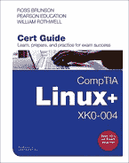

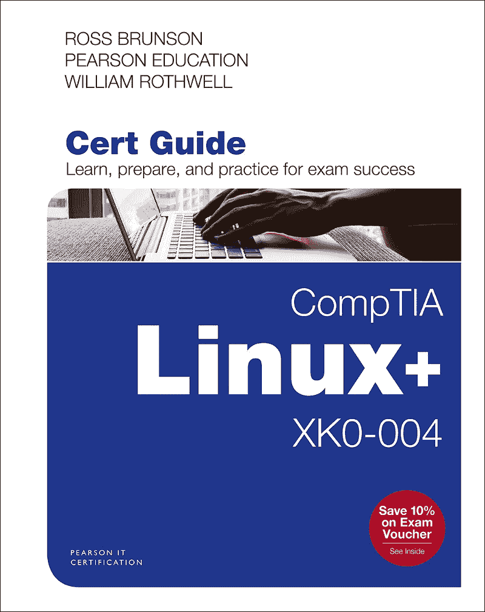

- 第三部分：账户管理
- 第 12 章 用户与组管理
- 第 13 章 账户安全
- 第 14 章 日志服务
- 第四部分：设备管理
- 第 15 章 Linux 设备
    - “我已经掌握了这些吗？”测验
    - 基础主题
    - 理解 Linux 硬件
    - 管理打印机与打印
    - Linux 图形用户界面
    - 辅助功能选项
    - 远程桌面
    - 总结
    - 考试准备任务
    - 复习所有关键主题
    - 定义关键术语
    - 复习题

# 第 16 章 硬件故障排除

## “我已经掌握这些吗？”测试

### 基础主题

## 存储监控与配置

## CPU 监控与配置

## 内存监控与配置

## 排除其他硬件问题

## 总结

## 考试准备任务

## 复习所有主题

## 定义关键术语

## 复习题

# 第 17 章 内核模块

## “我已经掌握这些吗？”测试

### 基础主题

## 理解内核模块

## 管理内核模块

## `modprobe` 命令

## 总结

## 考试准备任务

## 复习所有主题

## 定义关键术语

## 复习题

# 第 18 章 存储概念

## “我已经掌握这些吗？”测试

### 基础主题

## 基础分区

## 文件系统层级

## 设备映射 (Device Mapper)

## 文件系统类型

## 总结

## 考试准备任务

## 复习所有主题

## 定义关键术语

## 复习题

# 第 19 章 存储配置

## “我已经掌握这些吗？”测试

### 基础主题

## 磁盘分区工具

## 管理 LVM

## 管理软件 RAID

## 创建文件系统

## 高级文件系统命令

## 挂载与卸载

## 空间利用率

## 总结

## 考试准备任务

## 复习所有主题

## 定义关键术语

## 复习题

# 第五部分 网络管理

## 第 20 章 网络配置

## “我已经掌握这些吗？”测试

### 基础主题

## 网络概念概览

## 管理接口

## 网络配置工具

## 绑定 (Bonding)

## 总结

## 考试准备任务

## 复习所有主题

## 定义关键术语

## 复习题

## 第 21 章 网络故障排除

## “我已经掌握这些吗？”测试

### 基础主题

## 关键网络故障排除概念

## 网络故障排除工具

## 总结

## 考试准备任务

## 复习所有主题

## 定义关键术语

## 复习题

## 第 22 章 Linux 防火墙

## “我已经掌握这些吗？”测试

### 基础主题

## `iptables` 命令

## 额外的防火墙技术

## 总结

## 考试准备任务

## 复习所有主题

## 定义关键术语

## 复习题

# 第六部分 自动化

## 第 23 章 编排

## “我已经掌握这些吗？”测试

### 基础主题

## 编排

## 总结

## 考试准备任务

## 复习所有主题

## 定义关键术语

## 复习题

## 第 24 章 自动化任务

## “我已经掌握这些吗？”测试

### 基础主题

## 控制

## 退出后 (Leaving After)

## `cron` 系统

## 运行

## 总结

## 考试准备任务

## 复习所有主题

## 定义关键术语

## 复习题

## 第 25 章 管理本地化

## “我已经掌握这些吗？”测试

### 基础主题

## 时区

## 字符编码

## 区域设置 (Locales)

## 考试准备任务

## 复习所有主题

## 定义关键术语

## 复习题

## 第 26 章 BASH 脚本编写

## “我已经掌握这些吗？”测试

### 基础主题

## 脚本基础

## Shell 命令

## 总结

## 复习所有主题

## 定义关键术语

## 复习题

## 第 27 章 Git

## “我已经掌握这些吗？”测试

### 基础主题

## 版本控制

## Git 特性

## 分处理

## 执行差异 (Diffs)

## 合并文件

## 考试准备任务

## 复习所有主题

## 定义关键术语

## 复习题

# 第七部分 安全与服务器管理

## 第 28 章 服务器角色

## “我已经掌握这些吗？”测试

### 基础主题

## 服务器类型

## 服务器功能

## 总结

## 考试准备任务

## 复习所有主题

## 定义关键术语

## 复习题

## 第 29 章 安全最佳实践

## “我已经掌握这些吗？”测试

### 基础主题

## 主机安全最佳实践

## 身份验证安全最佳实践

## 服务安全最佳实践

## 横 (Banners)

## 总结

## 考试准备任务

## 复习所有主题

## 定义关键术语

## 复习题

# 第八部分 最终准备

## 第 30 章 最终准备

# 考试信息

# 准备工作

# 期末准备工具

# 期末复习/学习建议

## 总结

# 关键术语表

# 附录 A “我已掌握了吗？”测试与复习题答案

# 附录 B CompTIA Linux+ XK0-004 考试更新

## 请在书籍产品页获取最新信息

## 技术内容

# 附录 C 学习计划

## 引言 [此内容正在开发中。]

此内容正在开发中。

# 第一部分：软件管理

## 第 1 章 安装 Linux

本章涵盖了以下主题：

* 安装 Linux
* 使用虚拟化

虽然安装 Linux 不是当前版本 Linux+ 考试中列出的主题，但为了学习 Linux，你必须安装它。在犯错和吸取教训的过程中，你通常需要重新安装它。

此外，Linux+ 考试并不关注安装 Linux 的精确步骤，因为这些步骤在不同的 Linux 发行版之间有所不同，且不断变化。考试更关注的是你的 Linux 系统在安装后发生了什么变化。

由于侧重点不同，本章缺少书中其他章节开头和结尾的“我已掌握了吗？”测试和“复习题”章节。

本章主要通过向你展示如何操作，为你学习 Linux 操作系统做好成功准备，包括：

* 选择虚拟化方案
* 使用 ISO 文件作为安装源
* 使用快照
* 在虚拟机中安装 Linux 发行版

### 基础主题

### 硬件与 Linux 安装

精通 Linux 从理解运行操作系统的硬件开始。Linux 在硬件支持方面拥有一段坎坷的历史，因为它最初编写时没有得到制造商的帮助。随着时间的推移，硬件支持变得更好，兼容性信息也变得更容易找到。曾几何时，花费大量深夜钻读论坛以寻找另一个运行相同显卡的人是常有的。幸运的是，这类问题已经越来越罕见了。

通常情况下，你可以预期大多数服务器硬件和近几代桌面硬件具有极的兼容性。如果你只购买最新、最尖端（即最贵）的设备，你可能会发现需要进行额外的阅读和故障排除才能让设备正常工作。

我们建议使用虚拟化工具，如 `VMware Workstation`、`VMware Fusion`、`VirtualBox` 或 `KVM`。如果你这样做，在学习排除硬件问题方面将会少得多，因为你主要是在作为虚拟化系统的物理笔记本或台电脑之上运行软件。

通常，关于 Linux 安装的章节会讨论系统的硬件以及 Linux 如何处理和识别这些硬件；它会涵盖主板的各种组件以及它们如何通过内部总线连接，以及外围设备如何通过 `USB`、`SCSI` 等外部总线连接到系统。不过，我们不需要在本章中这样做，因为 Linux 是一个极的虚拟化客户端，当你虚拟化环境中安装 Linux 发行版时，你可以从一组预配置选项中选择你想让 Linux 发现并使用的组件。例如，大多数虚拟化环境都包含磁盘驱动选项，包括 `SCSI` 接口和 `IDE` 接口。

Oracle 的 `VirtualBox` 环境提供了七种可能的磁盘控制器选项，最常用的是 `IDE`、`SCSI` 和 `SATA`。Oracle `VirtualBox` 虚拟化应用程序中存储控制器的选择如下：

* 添加 IDE 控制器
* 添加 SATA 控制器
* 添加 SCSI 控制器
* 添加 SAS 控制器
* 添加 软盘控制器
* 添加 USB 控制器
* 添加 NVMe 控制器

#### 将 Linux 作为学习工具安装

许多年前，学习操作系统是一项针对物理设备的练习，很大一部分工作是操作系统的安装和重新安装。这通常包括大量的等待文件复制，以及对错误或配置错误进行故障排除。这种令人沮丧的过程主要是因为需要直接安装在物理系统上；当时虚拟化环境尚未广泛普及。

如今这个过程要简单得多。现在，你可以下载虚拟化环境或辅助程序，下载你所选发行版的 `ISO` 文件，在几分钟内就能安装好 Linux 并准备就绪。

理想情况下，你希望拥有一个不需要漫长等待或处理故障排除的环境。本章介绍了一些入门建议。

#### 设置虚拟化环境

接下来的章节详细说明了构建虚拟化学习环境所需的项目。请记住，这些仅仅是建议，你可以遵循这些建议，也可以按照自己的意愿进行。最重要的是，记住目标是安装好 Linux 并启用快照，这样你就可以需要时返回。本章的建议将帮助你让过程变得更容易。

##### 虚拟化主机系统

你需要一台计算机——台式机或笔记本电脑——配置足以作为合理的虚拟化环境主机。我们建议至少配置如下：

* **处理器：** 使用近期的 AMD 或 Intel 架构的桌面级或笔记本电脑（不是 Chromebook）。
* **主机操作系统：** 主机 OS 通常是 `Windows`、`Mac OS X` 或 `Linux`，尽管 `VirtualBox` 支持 `Solaris` 和 `OpenSolaris`。
* **内存：** 主操作系统至少需要 `2GB` 到 `4GB` 的 `RAM`，每个 Linux 虚拟机实例还需要 `1GB` 或更多内存。
* **硬盘：** 与整个操作系统相比，虚拟化环境非常小，因此请为每个 Linux 虚拟机分配大约 `10GB` 到 `20GB`。
* **网络设备：** 过去选择什么网卡或设备非常重要，但今天，只要你有一个可以在虚拟化环境中分配 `IP` 地址的网络设备就足够了。
* **客户操作系统：** 因为这是一本关于学习 Linux 的书，我们不会讨论任何无法运行 Linux 客端的虚拟化环境。

##### 安装媒体选项

虽然你可能仍然找到物理安装 CD 或 DVD，但建议从 Linux 发行版网站或各种可信来源下载 `ISO` 文件（CD 或 DVD 的镜像）。

注意：

你至少应该下载并安装两个 Linux 发行版：一个 `RPM` 包格式的，一个 `DEB` 包格式的。这是至关重要的，因为 Linux+ 考试要求你了解两种包格式的安装/配置/删除方法，并且你需要知道如何更新两种格式的包和安装。

Linux 发行版最可靠的来源之一是非常出色且活跃的 `Distrowatch.com` (`www.distrowatch.com`)，在本书编写时它已运营了近 18 年，提供了无数页面关于 Linux 发行版的新闻、教程以及指向各种大小、流行或冷门发行版的链接。

当然，你也可以去商业 Linux 发行版商的网站，获取其社区版（无订阅费）的最新副本。以下是几个例子：

* `www.opensuse.org`
* `www.centos.org`
* [www.ubuntu.com](http://www.ubuntu.com)

此外，实际上有成百甚至上千种可能的 Linux 发行版供你下载、安装和使用，以备 Linux+ 考试。

安装 Linux 虽然很重要，但如今它在整个 Linux 体验中所占的比例越来越小，而且通常不会花费大量时间。如前所述，Linux+ 考试并不真正涵盖 Linux 安装。因此，本章将展示如何进行几次示例安装，以便你决定是否要进一步尝试其他发行版。

## 下载 ISO 文件

要下载你喜爱的发行版的 ISO 文件，请前往下载页面，点击最新版本，如果在 32 位和 64 位之间有选择，请选择 64 位，然后将 ISO 文件保存到你本地系统的硬盘驱动器中。

本节将介绍如何下载 `RPM` 软件包（openSUSE）和 `DEB` 软件包（Ubuntu）。

### 下载用于安装的 openSUSE ISO

要下载 RPM 发行版，请在浏览器中导航到 [www.opensuse.org](http://www.opensuse.org)，将鼠标悬停在页面右侧的 Leap 绿色文字上，然后点击显示的 `Install Leap` 链接。

图 1-1 显示 openSUSE Leap 发行版的下载页面。

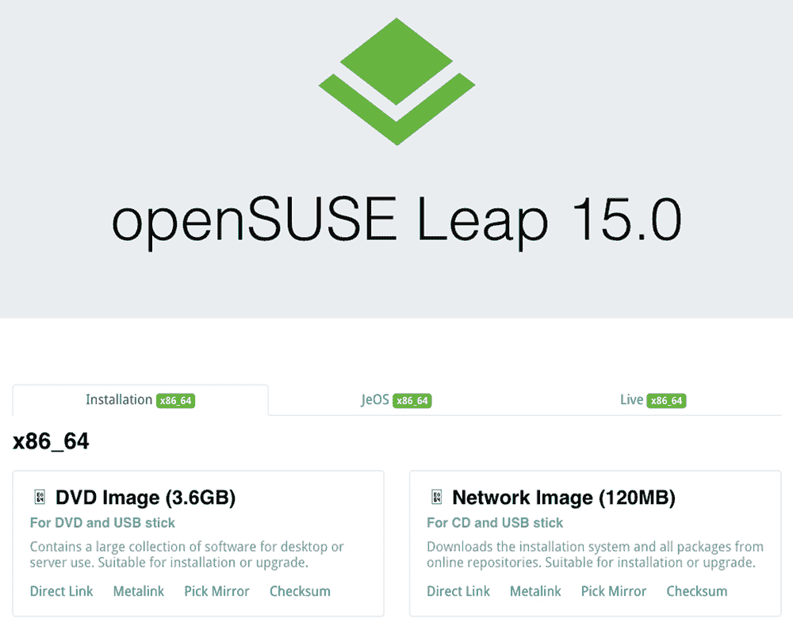

**图 1-1** openSUSE Leap 发行版的下载页面

随后会显示 Leap 主下载页面。注意，你可以使用大小为 3.6GB 的默认安装 `x86_64` 源，并且暂时可以不管网络镜像（Network Image）设置（除非你已经知道如何进行网络安装）。

图 1-1 中间右侧的 Live `x86_64` 链接适用于使用 Live 发行版的情况，这种发行仅使用系统内存而不会安装到硬盘上。

选择 DVD Image (3.6GB) 标题下的一个绿色链接来开始下载 ISO 文件。Direct Link（直接链接）选项是最简单的，如果你不熟悉镜像（mirrors）或种子下载（torrents），请使用该选项。

当“保存”或“打开”对话框弹出时，选择保存文件——并记住你把它放在了哪里。将所有 ISO 文件放在共同的 `/home/iso` 文件夹中是一个好主，或者在 Windows 上放在你认为合理的文件结构位置。

图 1-2 显示在 Mac 上保存 ISO 文件到磁盘时弹出的对话框。

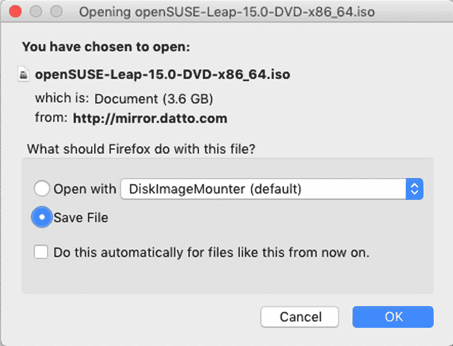

**图 1-2** 将 openSUSE ISO 文件保存到磁盘

### 下载用于安装的 Ubuntu ISO

选择并下载 openSUSE 发行版很容易，但获取 Ubuntu 发行版更加简单：导航到 [www.ubuntu.com](http://www.ubuntu.com)，点击 Download 菜单，选择那里列出的 Ubuntu Desktop LTS（长期支持）版本。当对话框弹出时，你应该选择将 ISO 文件保存到本地磁盘上的偏好位置。

## 安装 Ubuntu 虚拟机

本节将展示如何在 VirtualBox 中安装 Ubuntu。你需要下载并安装 VirtualBox，或者使用你选择的虚拟机环境。

### 注意事项

VirtualBox 文档非常详尽且优秀，在开始使用该软件之前，你应该打开在线版手册（参见 [`www.virtualbox.org/manual/UserManual.html`](https://www.virtualbox.org/manual/UserManual.html)）。

### 创建虚拟机

按照以下简单步骤创建虚拟机：

### 注意事项

为了保持本节简短，我们只在真正需要时显示截图。

**第 1 步.** 启动 VirtualBox 应用程序，点击 VirtualBox 界面左角的 `New` 图标。

**第 2 步.** 在“名称和操作系统”界面，输入

a. `ubuntustudy`

b. 类型：`Linux`

c. 版本：`Ubuntu (64-bit)`

**第 3 步.** 点击 `Continue`。

**第 4 步.** 在“内存大小”界面，在文本框中输入 `2048` 并点击 `Continue`。

**第 5 步.** 在“硬盘”界面，选择 `Create a Virtual Hard Disk Now`（立即创建虚拟硬盘）选项并点击 `Create` 按钮。

**第 6 步.** 在“硬盘文件类型”界面，确保选中了 `VDI`（VirtualBox 磁盘映像），并点击 `Continue`。

**第 7 步.** 在“物理硬盘上的存储”界面，选择 `Dynamically Allocated`（动态分配）项并点击 `Continue`。

**第 8 步.** 在“文件位置和大小”界面，确保文本框中输入了 `ubuntustudy`，确保大小设置为 10.00GB，并点击 `Create`。

Oracle VM VirtualBox 管理器主窗口再次出现，你应该在左侧面板中看到 `ubuntustudy` 虚拟机。此时，虚拟机应处于关闭状态。

### 挂载发行版 ISO

确保 VirtualBox 应用程序正在运行，并且你可以在左列表中看到 `ubuntustudy` 虚拟机。在此阶段 `ubuntustudy` 虚拟机不应开启。按照以下步骤操作：

**第 1 步.** 右键点击 `ubuntustudy` 虚拟机并选择 `Settings`（设置）。

**第 2 步.** 当设置界面出现，点击存储（Storage）图标，然后点击 `Controller: IDE Storage Device` 右侧带有绿色 `+` 号的小 CD-ROM 图标以添加光驱。

**第 3 步.** 当提示向 IDE 控制器添加新光驱时，点击 `Choose Disk`（选择磁盘）项打开文件选择对话框。

**第 4 步.** 导航到你的 Ubuntu 18.x ISO 文件位置，点击该 ISO 文件并点击 `Open` 按钮。

**第 5 步.** 当系统返回存储对话框时，确认 `ubuntu-xxxxx.iso` 文件作为 `Controller: IDE` 树下的项，并点击 `OK`。

### 在虚拟机上安装 Ubuntu

要在虚拟机上安装 Ubuntu，请遵循以下步骤：

**第 1 步.** 当主程序出现时，右键点击 `ubuntustudy` 虚拟机，选择 `Start`，点击 `Normal Start`（正常启动）项以正常启动虚拟机。

### 注意事项


当虚拟机启动时，你可能会在界面顶部看到一条或多条消息，例如“You have the Auto capture keyboard option turned on”（自动捕获键盘）。你可以阅读每条消息，然后点击带有白色 `x` 的蓝色圆圈关闭消息，或者点击 `Next` 图标关闭消息并防止其再次显示。

**第 2 步.** 当虚拟机启动并让你选择试用 Ubuntu（Try Ubuntu）或安装 Ubuntu（Install Ubuntu）时，选择`Install Ubuntu`。

**第 3 步.** 在“键盘布局”界面，选择合适的设置并点击`Continue`。

**第 4 步.** 在“更新和其他软件”界面，保持 `Normal Installation`（常规安装）单选按钮选中，并取消选择 `Download Updates while Installing Ubuntu`（在安装 Ubuntu 时下载更新）复选框。然后点击`Continue`。

**第 5 步.** 在“安装类型”界面，确保选中了 `Erase Disk and Install Ubuntu`（擦除磁盘并安装 Ubuntu）单选按钮，并点击`Install Now`（立即安装）。

**第 6 步.** 在“Write the Changes to Disk?（将更改写入磁盘？）”界面，点击`Continue`。

**第 7 步.** 在“Where Are You?（您在哪里？）”界面，选择合适的时区并点击`Continue`。

**第 8 步.** 在“Who Are You?（您是谁？）”界面，填写以下详细信息：

a. 姓名：`Tux`

b. 计算机名称：`ubuntustudy`

c. 选择用户名：`tux`

d. 选择密码：`linux`

e. 确认密码：`linux`

确保勾选 `Require My Password to Log In`（登录时需要我的密码）复选框。

**第 9 步.** 点击`Continue`开始安装系统。

### 注意事项

此过程需要几分钟时间，期间你会看到“Beaver（海狸）”屏幕，且软件将安装到系统中。

**第 10 步.** 当 `Installation Complete`（安装完成）对话框出现时，点击`Restart Now`（立即重启）按钮。

### 步骤 11

当出现最终安装界面时，你会看到“请移除安装介质，然后按回车”的提示，因为系统不知道这是一个磁盘镜像。系统将在无需你进行任何断开镜像操作的情况下正常启动，因此只需按回车。系统将重启并向你显示登录窗口。

### 步骤 12

点击橙色的`Tux User`框。

### 步骤 13

输入你之前输入的密码并点击`Sign In`。

### 步骤 14

登录后会出现“Ubuntu 新功能”屏幕，点击绿色的`Next`按钮。

### 步骤 15

在 `LivePatch` 屏幕上，点击绿色的`Next`按钮。

### 步骤 16

在“帮助改进 Ubuntu”屏幕上，点击`No, Don’t Send System Info`并点击绿色的`Next`按钮。

注意

步骤 16 和 17 的出现顺序可能与此处所示不同；只需按照出现的顺序回答即可。

### 步骤 17

在“您已就绪！”屏幕上，点击绿色的`Done`按钮。

### 步骤 18

如果弹出软件更新器对话框，点击`Remind Me Later`（而不是立即安装）。

#### 进入命令行

在 Ubuntu 上打开终端/命令行提示符：

### 步骤 1

点击界面左上角的`Activities`菜单。

### 步骤 2

在对话框中输入`terminal`。

### 步骤 3

当终端图标出现时，点击它以打开终端（Terminal）应用。

你也可以在左侧边栏底部的“收藏”（Favorites）菜单下方找到终端图标。

注意

取决于你的屏幕尺寸，你可能需要或不需要向下滚动“收藏”菜单才能看到终端图标。

在阅读这本书期间，你大约会打开 300 次终端。为了方便打开，你可以调整“收藏”菜单，使终端图标保持可见，或将该图标移动到“收藏”菜单的更上方。

当你打开命令行/shell/终端时，重新调整它，以便获得最大的空间来输入命令。你可以通过点击终端应用程序窗口中关闭（`x`）按钮左侧的正方形“最大化”按钮轻松实现这一点。

#### 快照的重要性

为你的学习机拍摄初始快照是非常重要的。这样做可以防止在你犯错或配置不当时需要重新安装虚拟机。

### 拍摄快照

要对运行中的虚拟机拍摄快照，你必须通过虚拟机实例的菜单项操作——不是 Ubuntu 的“文件”或其他菜单，而是该虚拟机的 `VirtualBox` 菜单。按照以下步骤拍摄快照：

### 步骤 1

在虚拟机运行且不是全屏模式的情况下，点击 `VirtualBox` 主菜单的`Machine`（机器）项。

### 步骤 2

点击`Take Snapshot`（拍摄快照）菜单项。

### 步骤 3

当快照对话框出现时，将`Snapshot 1`文本替换为`After Installation`。可选是在快照描述文本框中添加描述。点击`OK`。

### 步骤 4

当快照进度条完成且你重新获得主窗口时，你可以对已安装的系统进行更改，并在必要时恢复`After Installation`快照。

### 恢复快照

恢复快照实际上会将你带回到拍摄快照时的系统状态。按照以下步骤操作：

### 步骤 1

导航到 `VirtualBox` 管理器主界面。

### 步骤 2

在左侧列选择`ubuntustudy`虚拟机。

### 步骤 3

点击界面右上角的`Snapshots`（快照）按钮。（如果需要，点击`Machine Tools`按钮以使快照按钮可见。）将显示为 `ubuntustudy` 虚拟机存在的快照。

### 步骤 4

如果自拍摄快照以来发生了任何更改，且你希望恢复包含这些更改，请选择子层级结构中的`Current State`（已更改）项。

### 步骤 5

要恢复`After Installation`快照，右键点击快照并在菜单中选择`Restore`（恢复）选项。

### 步骤 6

当提示要从快照恢复时，取消勾选`Create a Snapshot of the Current Machine State`（创建当前机器状态的快照）复选框，并点击`Restore`按钮恢复快照。

通过正确且频繁使用快照，你可以从几乎任何问题中恢复。学习本书时，你可能想在完成每个练习之前拍摄快照。这样，如果发生任何意外，你就可以轻松地恢复系统。

## 总结

在本章中，你学习了如何通过安装 Oracle VirtualBox 等虚拟机管理器、创建虚拟机、获取必要的 ISO 文件以及在虚拟机内部安装 Linux，为你的认证考试准备创建一个适当的学习环境。你还学习了快照，包括如何制作和恢复快照。

这个学习环境将对你大有益益，允许你根据需要犯尽可能多的错误，并且能够撤销这些错误。

通过缩短错误发生到系统恢复运行之间的时间，你可以以最快的速度为考试复习并获得你所需的 Linux 知识。

请不要忘记安装第二个 RPM 软件包风格的虚拟机，例如 openSUSE、CentOS 或 Arch。

## 第 2 章 软件包的安装与管理

本章涵盖了以下主题：

- 包类型

- 安装工具

- 构建工具

- 软件源

- 获取命令

本章涵盖的考试目标如下：

- **目标 2.1**：给定一个场景，执行软件的安装、配置、更新和删除。

Linux 系统旨在具有实用性，例如作为某种应用程序服务器或允许用户读取邮件或浏览网页。Linux 内核非常出色，但单它本身做的不多；要让 Linux 系统变得有用，你需要软件。

Linux 有许多软件可用；你只需要安装它们。你可以根据你的发行版和软件打包的方式通过几种方法安装软件。

在过去，软件是以`[源码格式]`分发的，这需要编译成可以在计算机上运行的内容。源码格式仍然存在，但作为一个社区，我们已经转向分发`[二进制包]`，它们安装起来要容易得多。二进制包避免了编译步骤（因为已经过编译）；此外，依赖关系、库、配置和文档都会被自动管理。这些包有几种不同的格式，但最常见的是两种：Debian 风格和 Red Hat 风格。Linux+ 考试要求你熟悉这两种主要风格，因为许多计算环境同时拥有这两种类型的系统，且使用的软件包风格取决于项目以及系统提供的服务。

### “我已经认识这些了吗？”测验

“我已经认识这些了吗？”测验可以让你评估自己应该阅读整个章节，还是应该直接跳转到`[考试准备任务]`部分进行复习。如果你有疑问，请阅读整个章节。`表 2-1`概述了本章的主要标题以及对应的“我已经认识这些了吗？”测验问题。你可以在`[附录 A]`，“‘我已经认识这些了吗？’测验与复习题答案”中找到答案。

**表 2-1** “我已经认识这些了吗？”基础知识章节到问题映射

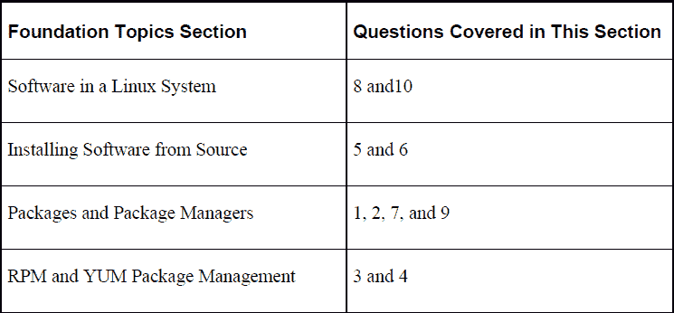

注意

自评估的目标是衡量你对本章主题的掌握程度。如果你不知道某个问题的答案，或者对答案只有部分把握，那么在进行自评估时，你应该将该问题标记为错误。对于你猜对的答案给自己计分会歪曲自评估结果，并可能给你带来虚假的安全感。

### 1. 下列哪项最可能是 Debian/Ubuntu 包文件？

a. `packagename.tgz`

b. `packagename.rpm`

c. `packagename.deb`

d. `packagename.sh`

### 2. 某个包被描述为带有某些元信息的 cpio 归包。哪种包类型最能描述这种包？

a. RPM

b. Slackware

c. Debian

d. Gentoo

### 3. 你如何安装名为`foo-1.2.3.rpm`的包？（选择两项。）

a. `yum install foo-1.2.3.rpm`

b. `rpm -i foo-1.2.3.deb`

c. `dpkg --update foo-1.2.3.rpm`

d. `apt-get insert foo-1.2.3.rpm`

### 4. 如果你想安装本地 RPM 包`rpm -i`并忽略任何依赖错误，你需要做什么？

a. 无需操作；这是默认设置的。

b. 添加`--force-depends`。

c. 添加`--force-nodeps`。

d. 添加`--force-install`。

### 5. 你希望在系统上编译一个软件包。为了为你的系统定制 makefile，必须先运行以下哪项？

a. `make conf`

b. `/configure`

c. `conf makefile.c`

d. `.configure`

### 6. 你从源码编译的命令执行不正常。你可以使用以下哪项查看它依赖于哪些库？

a. `ldconfig`

b. `ldd`

c. `ldattach`

d. `ls --lib`

### 7. 你正在系统上手动配置软件仓库。下列哪项可以包含仓库定义？

a. `/etc/apt/sources.list`

b. `/var/rpm`

c. `/sys/dpkg/repos`

d. `/var/cache/apt.d`

### 8. 正或错：`rpm`命令管理包；`yum`命令处理仓库。

a. 正

b. 错

### 9. 你希望从远程包仓库检索 RPM 包文件，并且你拥有所需文件的完整 URL。你使用哪种命令？（选择两项。）

a. `wget`

b. `dload`

c. `getfile`

d. `curl`

### 10. 你想创建一个本地文件，包含 www.example.com 网站主页的内容。下列哪项可以实现这一点？

a. `curl www.example.com`

b. `curl -o www.example.com`

c. `curl -O www.example.com`

d. `curl www.example.com > index.html`

### 基础主题

### Linux 系统中的软件

一个软件通常由五部分组成：

- **二进制文件 (Binaries)：** 你执行文件——称为命令、程序、应用程序、二进制文件或可执行文件——来执行特定任务。在本书中我们将它们统称为命令。当执行命令时，内核将其加载到内存并开始运行指令。

- **库 (Libraries)：** 库是共享组件，例如从磁盘读取文件或显示某些图形组件的方法。

- **配置 (Configuration)：** 配置通常以一个或多个文件的形式存在，这些文件被应用程序读取并指导其在执行和运行时如何运行。

- **文档 (Documentation)：** 文档提供了如何使用软件的说明。

- **数据 (Data)：** 数据存储了文本或二进制信息。

这五部分信息可能根据文件系统层级标准 (FHS) 分布在你的文件系统中。如果你想升级软件，通常需要在旧版本之上重新安装新版本，但这样做可能会导致某些文件的旧版本遗留在那里。最终，你会有好几个不确定是否可以删除的过时部分，你的系统也会变得混乱。删除软件时也会发生同样的问题。

FHS 描述了特定类型文件应该放置的位置，这有助于维护不同发行版之间的一致性。

### 共享库

软件开发者需要做的很多工作已经在其他程序中完成了。Linux 拥有处理诸如将文件写入磁盘、显示窗口甚至通过网络通信任务的库。库是软件开发者可以链接到应用程序的复用组件，以便可以使用库的功能。应用程序也可以为其他应用程序提供库，例如数据库为其他应用程序提供查询其数据的代码。


库可以是静态链接，也可以是动态链接到应用程序。在静态链接过程中，库的副本被放入生成的应用程序中。在动态链接中，应用程序只需要一系列存根（stubs），这些存根随后会指向系统级的库副本。

`[图 2-1]`详细详细展示了这一概念。

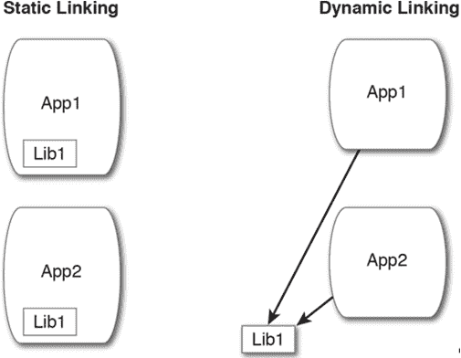

**图 2-1** 静态链接应用程序与动态链接应用程序的区别

`[图 2-1]`显示了两个应用程序 App1 和 App2，它们都使用一个名为 Lib1 的库。静态链接的版本在每个应用程序内部都有一个 Lib1 的副本，而动态链接的版本指向共同的 Lib1，因此体积更小。

使用静态链接，你不需要担心系统是否安装了该库，因为库已经构建在应用程序中了。结果是文件要大得多。动态链接生成的应用程序较小，但必须存在相应的共享库。

动态链接的最好的理由之一是易于升级。如果你需要升级内置的静态库，每个带有该库的应用程序都需要重新编译并链接。而在动态链接中，一次更新即可适用于所有二进制文件。

动态链接几乎用于所有情况，因为它节省了磁盘空间并简化了升级。

### 使用共享库

需要使用共享库的应用程序会请求名为`ld.so`的服务，也称为动态链接器。动态链接器知道所有共享库的存储位置并为应用程序加载库。

32 位库通常存储在`/lib`或`/usr/lib`中，64 位二进制文件存储在`/lib64`或`/usr/lib64`中。64 位系统可以加载 32 位应用程序，因此你会看到两者。64 位系统依赖于支持更多内存的新硬件，而 32 位则用于旧硬件。尽管 64 位机器从 21 世纪初就已存在，但 32 位代码仍被广泛使用。

发行版可以在任何地方存储特定的应用程序共享库，因此你可能会发现`/lib`只是`/usr/lib`的链接，而特定的应用程序可能会将它们的库存储在独立的目录中。


你可以通过扩展名`.so`识别共享库，它是 shared object（共享对象）的缩写。库文件通常包含版本号，如下：

```
[ross@localhost lib64]$ ls -l libcrypt*
-rwxr-xr-x 1 root root 36752 Sep 27 11:48 libcrypt-2.20.so
lrwxrwxrwx 1 root root 25 Sep 27 11:45 libcrypt.so -> libcrypt.so.1
lrwxrwxrwx 1 root root 16 Sep 27 11:45 libcrypt.so.1 -> libcrypt-2.20.so
```

在此示例中，你可以看到库文件是`libcrypt-2.20.so`，并且有两个符号链接：`libcrypt.so`指向`libcrypt.so.1`，而后者又是指向`libcrypt-2.20.so`的链接。这些文件中的每一个都代表一个版本号，具体取决于是谁或什么在请求，但它们最终都指向同一个文件。这意味着同一个系统上可以存在多个不兼容的共享库版本。应用程序只需要请求它们最初链接时使用的版本即可。

动态链接器会为你处理链接工作。它通过在运行二进制文件时进行查询来实现这一点。

## 确定所需的库


当你找到一个程序并想知道它所依赖的库是否存在时，你可以运行它并查看哪里会报错（不安全的方法），或者使用`ldd`命令查询程序所需的库：

```
$ ldd /usr/bin/passwd
 ...
 libc.so.6 => /lib64/libc.so.6 (0x00007fa7a3bae000)
 libcrypt.so.1 => /lib64/libcrypt.so.1 (0x00007fa7a3773000)
 /lib64/ld-linux-x86-64.so.2 (0x00007fa7a55be000)
```

此输出告诉你`passwd`命令需要访问`libc`（C 库，所有应用程序的基础功能集）、`libcrypt`以及一个命名特殊的共享库，后者实际上是动态链接器本身。

## 在其他地方查找库


某些库文件可能没有足够的头文件或内部信息，导致链接器在构建库目录链接时无法正确识别它们。


`ldconfig`程序读取`/lib`和`/usr/lib`目录以及`/etc/ld.so.conf`文件列出的任何目录中的所有库头部。根据这些头部文件和库的文件，`ldconfig`为库创建正确的链接。

### 注意事项


`ld.so.conf`可能包含类似`ld.so.conf.d/*.conf`的行。在这种情况下，那里指定的文件也会被`ldconfig`读取和处理。这意味着可以将包放置到其库所在的位置，而无需编辑共享文件。

`ldconfig`程序还会构建`/etc/ld.so.cache`文件，该文件是系统中库的有序列表二进制文件。此文件无法作为文本读取，但会被系统链接器`ld.so`用作快速引用。


库必须是动态链接器可的，或者添加到名为`LD_LIBRARY_PATH`的变量中，该变量包含用冒号（`:`）分隔的库路径。这为动态链接器提供了一个提示，让它去之前告知之外的地方查找。

要设置`LD_LIBRARY_PATH`变量，你可以在命令行声明它，如下：

```
# export LD_LIBRARY_PATH=/some/path/name
```

或者，你可以编辑`/etc/profile`或`~/.bash_profile`文件并将相同的命令复制进去。

### 警告

尽管在 Linux+ 中你需要了解`LD_LIBRARY_PATH`变量，但请记住它被认为存在安全风险。该变量可能允许未经授权的程序访问系统库（无意或是有意），并将系统库路径暴露给未经授权的用户。


## 从源码安装软件

源代码是所有计算的核心，而获取这些源码是 Linux 和开源软件的关键。如果没有源码，你就无法检查代码中是否存在漏洞、安全问题或其他缺陷。

当程序员生成源代码时，他们通常会对其进行归档（tar），或者创建一个名为 tar 包（tarball）的压缩归档包。tar 包通常使用`tar`命令和某些开关创建；然后将软件发布到互联网上，以便他人尝试并报告漏洞。


以下是通过源码安装程序的优点：

- 它允许对代码进行检查以发现缺陷、漏洞和安全问题。
- 它比二进制包更早发布。
- 编译可以针对当前系统对生成的程序进行优化。
- 它满足了对前沿的需求（Beta 测试可能很有趣！）

通常情况下，你不会以源码 tar 包以外的任何格式看到处于深度开发中的程序。在源码至少达到发布级或后期 Beta 稳定性之前，将其打包既耗时又笨拙。

从源码安装程序后，你会对这个过程更加熟悉，因此可以从小程序开始逐步进阶。例如，你可以下载并安装`rdesktop`（[`www.rdesktop.org`](http://www.rdesktop.org)），几分钟就能看到整个过程，包括编译时间。

天平的另一端是从源码安装 Apache 或 Samba，这是一个漫长得多且复杂的过程。


以下是通过源码安装程序的缺点：

- 它需要更复杂的安装过程。
- 必要的依赖项可能不存在或非常难以解决。
- 它通常文档不全，有时只有一个`readme`或`install`文件可用。
- 卸载源码包可能很困难，特别是当包的`Makefile`没有卸载程序时，这意味着你需要手动发现并删除包文件。

从源码安装时，可能会发生许多冲突和依赖问题。在各个发行版供应商作为产品的一部分发布包之前，这通常不适合没有足够的细心的人。如果你的目标是稳定性，请等待最终的发布；否则，你可能会花费几个小时寻找缺失的库和其他所需文件。

当性能和安全有需要时，你应该使用源码安装。

### 源码安装的组件

源码 tar 包通常包含以下内容：

- `configure script`：它检查系统并配置`Makefile`。
- `Makefile`：此文件控制安装位置、参数和其他变量。
- `Source files`：这些是源代码文件的目录。
- `Readme`：readme 文件包含关于安装过程的重要信息。
- `Install`：通常它包含实际的安装指令；并非所有源码安装都包含。
- `Install script`：这通常可以运行以执行安装的单一脚本。


### Makefile

`Makefile`是一组指令和编译参数，使安装成为可能。在经过`configure`脚本更新后，通常会运行`make`命令，然后运行`make install`命令来编译并安装软件。

引用`make`的手册页：

> `make`程序的目的是自动确定一个大型程序中哪些部分需要重新编译，并发布重新编译它们的命令。

`Makefile`通常包含以下部分：

- `Platform`：系统的平台
- `Debug`：如何处理错误
- `Optimize`：由`.configure`自定义的项目
- `Source`：源文件所在的位置
- `Targets`：all, install, clean, dist 等

`Makefile`的目标（Targets）值得稍微关注，因为对于它们的组成存在一些困惑。`make`命令本身通常只编译源代码，不做任何其他操作。运行带有`clean`目标的`make`命令通常会删除之前编译尝试留下的任何临时文件。如果你运行带有`install`目标的`make`命令，它会将编译后的代码放入路径中正确的目录，直到安装了正确的软件为止。

典型的`Makefile`具有以下路径和变量（尽管这会随程序而异）：

```
install-prefix = .
bin_dir = $(install-prefix)/bin
uparm_dir = $(install-prefix)/lib/uparm
include_dir = $(install-prefix)/include
```

这些指令告诉安装目标和其他目标将程序的各个部分放在何处。`$(install-prefix)`表示在编译时，软件将存储在当前目录的子目录下——例如，`./bin`、`./lib/parm`和`./include`。

## 源代码编译示例

在本示例中，一个简单的程序将在默认 Linux 系统上进行编译和安装。（你必须安装了`gcc`编译器以及相关的开发工具和库才能编译源代码。）以下是操作步骤：

**步骤 1.** 打开浏览器并访问[`www.rdesktop.org`](http://www.rdesktop.org)。

**步骤 2.** 点击`Download`链接。

**步骤 3.** 点击最新稳定版版本。

**步骤 4.** 从下载链接列表中选择离你最近的地点，然后点击页面右侧`Download`列下方的小页面图标。

**步骤 5.** 按照提示，将源代码放在你的用户主目录中。通常你只需点击正在使用的浏览器中的`Save`按钮即可。

**步骤 6.** 打开一个 shell 会话或`xterm`客户端。

**步骤 7.** 进入包含压缩文件的目录。

**步骤 8.** 解压存档文件。

**步骤 9.** 在滚动停止后，切换到源代码目录：

```
cd sourcedir
```

**步骤 10.** 运行`ls`命令并注意存在哪些文件。

**步骤 11.** 使用以下命令运行`configure`脚本：

```bash
./configure
```

**步骤 12.** 运行`make`命令编译软件。

**步骤 13.** 软件编译完成后，使用`make install`命令安装程序。

这些是从源代码安装应用或命令所需的 Basic 步骤。为了准备 Linux+ 考试，你不一定需要从源码进行安装；只需确保你了解典型源码安装的步骤，如下所示。

## 软件包与包管理器

`package`（软件包）是一个压缩归档文件，包含了组成特定命令、应用程序或一组应用程序的所有必要文件。软件包有多种不同的格式，例如`RPM`、`DEB`等，但尽管格式略有不同，的功能是类似的。

### 最常见的软件包类型

最常见的软件包类型是`rpm`（Red Hat 包管理器）和`deb`（Debian 包格式）文件。软件包还有其他几种格式，主要是压缩文件，如`.tar`（tar 存档）、`.tgz`（使用`gzip`命令压缩的 tar 存档）和`.gz`（使用`gzip`命令压缩的包）。

压缩（`.tar/.tgz/.gz`）文件不是可以通过`RPM`或`Apt`等包管理器安装的软件包。相反，它必须先解压，以便其中包含的文件可以被从源码编译，或者如果是二进制文件，则复制到相应的执行位置。

RPM 软件包文件通常采用`cpio`存档格式，扩展名为`.rpm`（例如`application.rpm`），由以下部分组成：

* **Header（头部）：** 头部是一个独立的结构，定义了文件的格式和标记数据，其中包含包信息、版权和版本、构建主机以及软件包完整性签名。
* **Archive（存档）：** 存档包含软件包文件，包括安装期间要运行的脚本、要复制的文件以及要创建的链接。

Debian 软件包通常采用`ar`存档格式，扩展名为`.deb`（例如`application.deb`），由以下部分组成：

* **data.tar.gz：** 一组层次结构相关的文件、手册页（man pages）、链接等，在安装期间会被复制到系统中。
* **control.tar.gz：** 所有包信息，包括版权、描述等。还包含任何在安装或删除软件包过程中应该运行的脚本。

### 包管理器

包管理器的发明是为了解决软件版本泛滥以及由于多次升级或安装导致的额外或遗弃文件冗余问题。

包管理器跟踪哪些文件属于哪个软件包，哪些软件包依赖于其他软件包，以及不同类型的文件存储在何处。所有现代 Linux 发行版都以某种方式使用包管理器。

### Debian 软件包管理

Debian 以及基于 Debian 的系统（如 Ubuntu）拥有强大的包管理系统，为管理员提供了查找、安装、查询和删除软件包的方法。软件包跟踪应用程序的部分，并帮助你确定安装给定软件包需要哪些其他软件包（依赖项），以及是否有任何软件包依赖于其他软件包。

Debian 软件包管理的单元是扩展名为`.deb`的文件（例如`application.deb`），如前所述。

你可以使用`dpkg`工具安装、删除和查询软件包，通常在单包模式下进行。安装多个软件包是可能的，但由于相互依赖的关系，可能会迅速变得复杂。

要安装一个软件包及其所有依赖项，甚至从在线更新的源获取新软件包，你需要使用如`APT`（高级包工具）套件之类的包管理工具。

通常统称为`apt-get`的`APT`套件可以使许多部分的软件包安装、更新甚至整个系统的升级，变得像几个易于记忆的命令和选项一样简单。

`aptitude`和`synaptic`等图形界面和文本界面构建在`APT`工具之上。它们为你提供了一个比记忆命令更易使用的界面。


所以，总结一下：本地软件包是`.deb`文件并用`dpkg`安装。`APT`处理远程软件包仓库的搜索和软件包下载。`Aptitude`等工具为`APT`提供了图形界面。图形工具和`APT`工具使用`dpkg`命令作为它们的底层包交互工具，为其提供所需的命令、选项和参数，以有效地轻松地自动化大量软件包的安装、删除和更新/升级过程。

#### 管理本地 Debian 软件包

`dpkg`工具操作系统上的软件包并可以处理你可能下载的`.deb`软件包。如果你系统上有一个软件包，可以使用`--info`选项查看其内部内容，如示例 2-1 所示。

**示例 2-1** 查找 .deb 文件内部的内容

```bash
# dpkg --info acct_6.5.5-1_amd64.deb
 new debian package, version 2.0.
 size 120424 bytes: control archive=1899 bytes.
 79 bytes, 4 lines conffiles
 746 bytes, 18 lines control
 1766 bytes, 27 lines md5sums
 507 bytes, 30 lines * postinst #!/bin/sh
 370 bytes, 26 lines * postrm #!/bin/sh
 163 bytes, 7 lines * prerm #!/bin/sh
 Package: acct
 Version: 6.5.5-1
 Architecture: amd64
 Maintainer: Mathieu Trudel-Lapierre <mathieu.tl@gmail.com>
 Installed-Size: 380
 Depends: dpkg (>= 1.15.4) | install-info, libc6 (>= 2.3)
 Section: admin
 Priority: optional
 Homepage: http://www.gnu.org/software/acct/
 Description: The GNU Accounting utilities for process and login accounting
 ...
```

软件包信息包含在`.deb`文件中；`dpkg`命令为你很好地显示它。顶部部分描述了为`dpkg`提供元数据的控制文件。文件本身为 120,424 字节，内部总共有 1899 字节的控制文件存档。在该存档内部有：

- `conffiles`：用于在软件包安装后配置包的文件列表。这些文件的处理方式与包中的其他文件不同；例如，在删除包时，这些文件不会被移除。
- `control`：包含所有包元数据的文件，例如依赖关系。
- `md5sums`：文件列表和校验和，以便你验证文件是否在任何时候都没有发生过更改。
- `postinst`：安装后运行的 shell 脚本。
- `postrm`：移除软件包后运行的 shell 脚本。
- `prerm`：在移除软件包之前运行的 shell 脚本。

在`control`信息之后，你会看到关于该软件包的各种信息，如名称、版本、目标硬件以及依赖关系。

## 使用 dpkg 安装软件包


安装软件包最常用的方法是在当前目录下通过命令行使用以下命令之一：

```bash
# dpkg --install gcc-4.7-base_4.7.2-5_amd64.deb
# dpkg -i gcc-4.7-base_4.7.2-5_amd64.deb
```

这会返回类似下面的输出：

```
Selecting previously unselected package gcc-4.7-base:amd64.
(Reading database ... 142987 files and directories currently installed.)
Unpacking gcc-4.7-base:amd64 (from gcc-4.7-base_4.7.2-5_amd64.deb) ...
Setting up gcc-4.7-base:amd64 (4.7.2-5) ...
```

有时你需要为某个软件包安装依赖项。你可以先安装依赖项，也可以在同一命令行中指定所有必要的软件包。后一种选项的命令如下：

```bash
# dpkg -i gcc-4.7-base_4.7.2-5_amd64.deb libgcc1_1%3a4.7.2-5_amd64.deb
```

## 移除软件包

当你使用`dpkg`命令移除软件包时，可以使用两种方法之一：`remove`或`purge`。`-r`或`--remove`选项移除软件包的文件，但保留磁盘上的任何配置文件。移除软件包的另一种方法是`-P`或`--purge`选项，它会移除软件包的所有文件，包括配置文件。

移除软件包但保留其配置文件，请使用以下命令：

```bash
## dpkg --remove package_name
## dpkg -r package_name
```


彻底清除软件包（包括配置文件），请使用以下命令：

```bash
## dpkg --purge package_name
## dpkg -P package_name
```

当软件包安装时，任何配置文件都会记录在`conffiles`文件中。你可以使用此文件确定在移除操作期间哪些文件保留，哪些文件在清除操作中也应该被清除。

## 依赖问题

当你处理软件包时，所需的软件包安装往往会在软件包数据库中找到与其尝试安装的文件冲突的条目。此外，有时在移除过程中，某个软件包想要移除的文件是其他软件包所依赖的。

遵循 Debian 稳健且不冗余的特性，使用软件包工具的`--force`选项可能会导致机器出现非常不愉快的情况。在移除具有依赖关系的软件包时请务必小心，并详细阅读`dpkg` `force`部分的手册页。对于 Linux+ 考试，你需要知道如何强制执行操作，但不需要知道所有 20 个左右的强制选项。

要强制移除数据库中标记为需要重新安装的损坏软件包，请使用以下命令：

```bash
# dpkg --force-reinstreq package_name
```

对标记为需要重新安装的软件包使用`--force-reinstreq`；它允许`dpkg`移除这些软件包。


此外，你可以在`--install`之后使用`--force-depends`选项将所有糟糕的错误信息转换为严重的警告，但该工具随后允许你执行正要执行的任何不明智的操作。

这里是一个例子：

```bash
## dpkg --install --force-depends package_name
```

最后，你可以使用`--force-remove-essential`选项。但请注意，覆盖依赖建议可能会导致你的系统处于损坏状态。


如果你必须这样做（通常是根据供应商或附近的 Debian 大师的指示），你可以强制安装软件包，无论与命令和选项产生什么冲突，如下：

```bash
# dpkg --install new_pkg.deb --force-conflicts
```

如果你在强制跳过冲突后对软件包或其他软件包出现问题，请记住你已经收到过警告。

## 查询软件包

请记住，当你查询软件包而不是引用本地磁盘或挂载文件系统上的`.deb`文件时，你实际上是在查询软件包数据库——即当前通过`dpkg`或其他软件包管理工具安装到系统中的所有软件包及其文件位置的完整列表。

可以对当前安装的软件包查询大量信息。特别是，你可以使用`-l`或`--list`选项列出软件包的存在、版本、名称和描述：

```bash
## dpkg --list krb*
## dpkg -l krb*
```

你可以使用单个软件包名（例如与 Kerberos 相关的软件包`krb5-user`），或使用之前的文件名查看如下输出所示的列表：

```
## dpkg --list krb*
Desired=Unknown/Install/Remove/Purge/Hold
| Status=Not/Inst/Conf-files/Unpacked/halF-conf/Half-inst/trig-aWait/Trig-
pend
|/ Err?=(none)/Reinst-required (Status,Err: uppercase=bad)
||/ Name Version Architecture Description
+++-=================-===============-===============-
==============================
un krb5-doc <none> (no description available)
ii krb5-locales 1.10.1+dfsg-5+ all Internationalization support for MIT
Kerberos
un krb5-user <none> (no description available)
```

在一些头部之后，输出显示有三个以`krb5`开头的软件包。其中两个以字符串`un`开头的行未安装，而`krb5-locales`安装版本为 1.10.1。Debian 软件包系统会向你显示以前在系统中安装过的软件包，这与其他系统不同。

你可以使用`-s`或`--status`选项检查特定软件包或多个软件包的状态：

```bash
# dpkg --status krdc
```

返回的输出是`--info`选项内容的简缩版本。

你可以使用`-L`或`--listfiles`选项查看软件包安装的文件：

```bash
# dpkg --listfiles coreutils
```

这将产生类似下面的输出（已截断以适应显示）：

```
/.
/bin
/bin/cat
/bin/chgrp
/bin/chmod
/bin/chown
```

使用`-S`或`--search`选项允许通过软件包数据库搜索磁盘上的安装文件，例如：

```bash
# dpkg -S apt.conf
```

以下输出包含了从数据库条目中找到`apt.conf`文件的各种位置：

```
apt: /etc/apt/apt.conf.d/01autoremove
unattended-upgrades: /etc/apt/apt.conf.d/50unattended-upgrades
apt: /usr/share/man/ja/man5/apt.conf.5.gz
apt: /usr/share/man/pt/man5/apt.conf.5.gz
apt: /usr/share/doc/apt/examples/apt.conf
apt-listchanges: /etc/apt/apt.conf.d/20listchanges
aptdaemon: /etc/apt/apt.conf.d/20dbus
aptdaemon: /etc/dbus-1/system.d/org.debian.apt.conf
```

输出列出了所有包含带有`apt.conf`名称文件的软件包。软件包名在左侧，文件名在右侧。注意，搜索字符串可以发生在文件名的任何位置，即使它是目录名。

某些软件包包含一个在安装包时执行的配置工具。该工具可以轻松地管理你正在安装的软件的初始设置。如果一个包包含此类配置工具，你可以通过`dpkg-reconfigure`命令加上包名再次运行该实用程序。

图 2-2 显示了此命令运行 Postfix 邮件服务器配置的输出：

```
# dpkg-reconfigure postfix
```


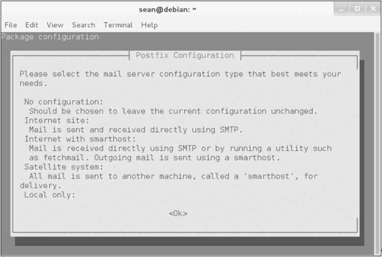

**图 2-2** 使用`dpkg-reconfigure`重新配置 Postfix

## 使用存储库

CD/DVD 或 ISO 镜像可能只包含的软件（或软件包）。对于任何发行版，可用软件量不断扩大，可以在网上找到，形式可以是单个源码集、可下载的预编译包，或者官方、半官方和非常非官方位置的组合，统称为*存储库*（repositories）。

Debian/Ubuntu 中的存储库可能会让人困惑，因为 Ubuntu 和 Canonical 之间关系紧密，因此在讨论存储库时，无法避免或不显示 Main 或官方 Canonical 支持的存储库。为了简单起见，我们将从 Ubuntu 发行版的角度讨论存储库，你可以查询任何你标准 Debian 可能需要学习的知识。

APT 工具通过维护远程服务器上可用软件包的本地缓存（包括依赖项）来工作。这意味着你搜索本地缓存的速度要比查询远程服务器快得多。


远程软件包库列表存储在`/etc/apt/sources.list`以及`/etc/apt/sources.list.d`下的各个文件中。每一行代表一个存储库。

`sources.list`文件可能如示例 2-2 所示。

**示例 2-2** 默认源列表文件

```
deb http://cdn.debian.net/debian/ wheezy main
deb-src http://cdn.debian.net/debian/ wheezy main

deb http://security.debian.org/ wheezy/updates main
deb-src http://security.debian.org/ wheezy/updates main

## wheezy-updates, 以前称为 'volatile'
deb http://cdn.debian.net/debian/ wheezy-updates main
deb-src http://cdn.debian.net/debian/ wheezy-updates main
```

### 什么是存储库？

简单来说，存储库是软件的集合或存档，系统可以对其进行寻址。存储库可以存在于本地磁盘、连接或挂载的磁盘上，甚至可以通过 HTTP 或 FTP 等共享协议跨越本地网络或广域网络上的服务器。

Ubuntu 存储库有多种类型，包括：

- **Main:** 由 Canonical 支持的免费开源软件包
- **Universe:** 社区维护的免费开源软件包
- **Restricted:** 针对设备的专有驱动程序包
- **Multiverse:** 具有版权或法律问题的软件

通常情况下，Ubuntu 安装介质包含来自最新版本 Main 和 Restricted 存储库的软件包，以便你实际上可以完成一个正确的安装。在现代 Linux 中，安装只是开始；为了获取更新和额外的软件，有必要配置正确的存储库。

### 查看已配置的存储库

在安装期间，系统会通过在`/etc/apt/sources.list`文件中放置适当的条目，或者如果你愿意，在`/etc/apt/sources.list.d`目录下放置以`.list`结尾的文件，来配置许多默认存储库。

一个填充好的`sources.list`文件示例如下：

```
# deb cdrom:[Ubuntu 18.04.1 LTS _Bionic Beaver_ - Release amd64
(20180725)]/ bionic main restricted
# 查看 http://help.ubuntu.com/community/UpgradeNotes 查看如何升级到
# 更新版本的发行版。
deb http://us.archive.ubuntu.com/ubuntu/ bionic main restricted
# deb-src http://us.archive.ubuntu.com/ubuntu/ bionic main restricted

## 在发行版最终发布后产生的重大错误修复更新
## 。
deb http://us.archive.ubuntu.com/ubuntu/ bionic-updates main restricted
# deb-src http://us.archive.ubuntu.com/ubuntu/ bionic-updates main
restricted
## 注意：来自此存储库的软件完全不受 Ubuntu
## 团队的支持。此外，请注意 universe 中的软件将不会收到来自 Ubuntu
## 安全团队的任何审查或更新。
deb http://us.archive.ubuntu.com/ubuntu/ bionic universe
# deb-src http://us.archive.ubuntu.com/ubuntu/ bionic universe
deb http://us.archive.ubuntu.com/ubuntu/ bionic-updates universe
# deb-src http://us.archive.ubuntu.com/ubuntu/ bionic-updates universe
## 注意：来自此存储库的软件完全不受 Ubuntu
## 团队的支持，并且可能不受免费许可。请自行确认
## 使用该软件的权利。此外，请注意 multiverse 中的软件
## 将不会收到来自 Ubuntu
## 安全团队的任何审查或更新。
deb http://us.archive.ubuntu.com/ubuntu/ bionic multiverse
# deb-src http://us.archive.ubuntu.com/ubuntu/ bionic multiverse
deb http://us.archive.ubuntu.com/ubuntu/ bionic-updates multiverse
# deb-src http://us.archive.ubuntu.com/ubuntu/ bionic-updates multiverse
```

在此示例中，几行包含以`#`（哈希或注释）字符开头的注释。未取消的行是实际的存储库配置。

存储库行的拆分如下：

- **deb:** 这表示存储库包含预编译或二进制包；它是最常见的存储库类型。
- **deb-src:** 这意味着存储库包含源代码包，这些代码被组合在一起以便于传输和“安装”，或复制到用户系统。
- **URL:** 在大多数情况下（即四个主存储库通道），URL 为`http://us.archive.ubuntu.com/ubuntu/`。咨询`www.ubuntu.com`上的官方镜像列表获取更多选项。
- **Trusty:** 这是 Ubuntu 发行版的发布名称或版本，影响从存储库拉取的软件。
- **Main:** 这是组件或部分的名称，全小写并用空格分隔。可以有多个组件或部分。

### 添加存储库

要在命令行手动添加存储库，你可以编辑`/etc/apt/sources.list`文件，向`/etc/apt/sources.list.d`目录添加包含适当行的文件，或者使用`add-apt-repository`命令，如下例所示：

```
# sudo add-apt-repository "deb http://us.archive.ubuntu.com/ubuntu/ bionic
universe"
Hit:1 http://us.archive.ubuntu.com/ubuntu bionic InRelease
Get:2 http://us.archive.ubuntu.com/ubuntu bionic-updates InRelease [88.7
kB]
Get:3 http://security.ubuntu.com/ubuntu bionic-security InRelease [83.2
kB]
Get:4 http://us.archive.ubuntu.com/ubuntu bionic-backports InRelease [74.6
kB]
Get:5 http://us.archive.ubuntu.com/ubuntu bionic-updates/main i386
Packages [389 kB]
Get:6 http://us.archive.ubuntu.com/ubuntu bionic-updates/main amd64
Packages [437 kB]
Get:7 http://us.archive.ubuntu.com/ubuntu bionic-updates/main Translation-
en [164 kB]
Get:8 http://security.ubuntu.com/ubuntu bionic-security/main i386 Packages
[164 kB]
Get:9 http://security.ubuntu.com/ubuntu bionic-security/main amd64
Packages [206 kB]
Get:10 http://security.ubuntu.com/ubuntu bionic-security/main Translation-
en [81.0 kB]
Fetched 1,687 kB in 1s (1,376 kB/s)
Reading package lists... Done
```

此过程将适当的存储库行添加到`/etc/apt/sources.list`文件中，使软件可以被查询、安装和使用。

虽然你可以使用`apt-add-repository`命令来完成许多操作，包括添加、移除以及在添加时自动更新，但更传统的做法是使用你喜欢的文本编辑器直接对`/etc/apt/sources`文件和目录树进行修改，或者使用图形化软件工具，而后者超出了本文讨论的范围。

## 安装远程软件包


现在你已经知道了什么是仓库以及如何将它们添加到系统中，你可以使用`apt-get`工具进行大多数远程软件安装操作了。每次调用`apt-get`之后都会跟着一个指示操作内容的命令。使用`install`命令来安装软件包，如示例 2-3 所示。

### 示例 2-3 安装远程软件包


```bash
# sudo apt-get install nginx-light
[sudo] password for tux:
Reading package lists... Done
Building dependency tree
Reading state information... Done
The following additional packages will be installed:
  libnginx-mod-http-echo nginx-common
Suggested packages:
  fcgiwrap nginx-doc
The following NEW packages will be installed:
  libnginx-mod-http-echo nginx-common nginx-light
0 upgraded, 3 newly installed, 0 to remove and 8 not upgraded.
Need to get 449 kB of archives.
After this operation, 1,503 kB of additional disk space will be used.
Do you want to continue? [Y/n] y
Get:1 http://us.archive.ubuntu.com/ubuntu bionic-updates/main amd64 nginx-common all 1.14.0-0ubuntu1.2 [37.4 kB]
Get:2 http://security.ubuntu.com/ubuntu bionic-security/universe amd64 libnginx-mod-http-echo amd64 1.14.0-0ubuntu1.2 [21.3 kB]
Get:3 http://security.ubuntu.com/ubuntu bionic-security/universe amd64 nginx-light amd64 1.14.0-0ubuntu1.2 [390 kB]
Fetched 449 kB in 1s (448 kB/s)
Preconfiguring packages ...
Selecting previously unselected package nginx-common.
(Reading database ... 163823 files and directories currently installed.)
Preparing to unpack .../nginx-common_1.14.0-0ubuntu1.2_all.deb ...
Unpacking nginx-common (1.14.0-0ubuntu1.2) ...
Selecting previously unselected package libnginx-mod-http-echo.
Preparing to unpack .../libnginx-mod-http-echo_1.14.0-0ubuntu1.2_amd64.deb ...
Unpacking libnginx-mod-http-echo (1.14.0-0ubuntu1.2) ...
Selecting previously unselected package nginx-light.
Preparing to unpack .../nginx-light_1.14.0-0ubuntu1.2_amd64.deb ...
Unpacking nginx-light (1.14.0-0ubuntu1.2) ...
Processing triggers for ufw (0.35-5) ...
Processing triggers for ureadahead (0.100.0-20) ...
Setting up nginx-common (1.14.0-0ubuntu1.2) ...
Created symlink /etc/systemd/system/multi-user.target.wants/nginx.service → /lib/systemd/system/nginx.service.
Processing triggers for systemd (237-3ubuntu10.6) ...
Processing triggers for man-db (2.8.3-2ubuntu0.1) ...
Setting up libnginx-mod-http-echo (1.14.0-0ubuntu1.2) ...
Setting up nginx-light (1.14.0-0ubuntu1.2) ...
Processing triggers for ureadahead (0.100.0-20) ...
Processing triggers for ufw (0.35-5) ...
```

示例 2-3 通过 `apt-get install nginx-light` 安装了 `nginx-light` 软件包。程序判断 `nginx-common` 软件包也是必需，因此这两个软件包都会被下载并安装。此时还会运行任何设置脚本，包括 `dpkg-reconfigure`。

最后，注意 `apt-get` 和 `dpkg` 命令之间的区别，特别是关于第一个选项。`apt-get` 命令开头没有横杠或多个横杠，而 `dpkg` 命令则有。例如，`dpkg -i` 安装本地软件包，而 `apt-get install` 安装远程软件包。不要被任何试图混淆这两者的问题误导，例如 `apt-get --install pkgname`。

### 使用缓存

APT 工具的工作原理是维护远程服务器上可用软件包（包括依赖项）的本地缓存。查询本地缓存的速度比查询远程服务器快得多。


在修改 `sources.list` 或获取任何上游更改后，你必须更新软件包缓存。你可以通过运行 `apt-get update` 获取。

当 APT 缓存是最新的时，你可以使用 `apt-cache` 命令调查软件包：

- `apt-cache search term`：搜索匹配术语的软件包。
- `apt-cache show package_name`：显示指定软件包的信息，包括描述和依赖关系。
- `apt-cache showpkg package_name`：显示软件包的更多技术细节，例如什么依赖于它、它依赖什么以及它提供了哪些服务。

### 升级系统

系统安装了许多软件包——数百个甚至上千个。这些软件包中的每一个在某个时候可能都需要更新。更新的形式有：

- 安全更新：修复软件包中的问题，这些问题可能导致坏人在机器上做坏事。
- 错误修复：修正软件中导致运行不正常、崩溃甚至丢失数据的问题。
- 功能改进：将某些软件更新到最新版本。

要更新特定的软件包，如此处所示重新安装该软件包：

```bash
# apt-get install cpio
Reading package lists... Done
Building dependency tree
Reading state information... Done
Suggested packages:
 libarchive1
The following packages will be upgraded:
 cpio
```

输出的最后两行显示 `apt-get` 升级了软件包而不是全新安装它。如果 `cpio` 没有安装，它将会被安装。如果在软件包缺失时不安装它对你来说重要的，请添加 `--only-upgrade` 长格式选项。

逐个更新软件包是很枯燥的。你可以运行 `apt-get dist-upgrade` 一次升级系统上所有的软件包。如果你运行的是更保守的系统，使用 `apt-get upgrade` 是一个更安全的选择。这两个升级选项的区别在于，`dist-upgrade` 可能会移除一些少量软件包以处理依赖问题，而 `upgrade` 宁愿失败也不愿移除软件包。

## 移除软件包

总有一天你想完全摆弃一个软件包。`apt-get` 命令有两个选项：`remove` 和 `purge`。区别在于 `remove` 会留下配置文件，而 `purge` 则会完全消除它们。

### 图形化管理器

有时，在界面中查看软件包管理是有用的，你可以在其中图形化查看软件包而不是在命令行操作。Debian 提供了两个图形化软件包管理器：`aptitude` 和 `synaptic`。它们都是 APT 工具的前端。Aptitude 有文本模式界面，而 Synaptic 是完全图形化的。图 2-3 显示了两者，其中 Synaptic 在左侧运行，Aptitude 在右侧的终端窗口运行。

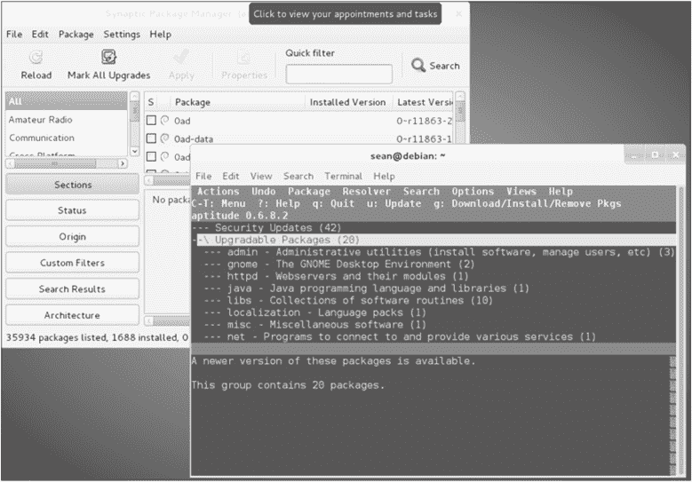

**图 2-3** 图形化软件包管理器

### RPM 和 YUM 软件包管理

RPM 不仅指软件包格式，还指 `rpm` 命令和 RPM 数据库。RPM 软件包管理风格的组件如下：

#### RPM 数据库：一组管理系统上 RPM 的文件

- 软件包文件：以 `.rpm` 扩展名分发的 RPM 格式软件包。
- `rpm` 命令：用于所有的软件包安装、移除和查询任务。

图形化软件包管理工具（如 `gnorpm` 或各种文件管理器（如 Nautilus 和 Konqueror）中内置的 RPM 处理程序）通常只是文本模式 `rpm` 命令的前端，并为安装软件包提供了友好的界面。

> **注意**
>
> 顺便提一下，在其他发行版中更广泛使用之前，RPM 最初代表 Red Hat Package Manager（红帽软件包管理器）。将系统称为 RPM Package Manager 会引起办公室里那些老兵们的不满，就像你把银行的自动取款机称为“ATM 机器”一样。

#### RPM 数据库

RPM 数据库是 Berkeley 数据库文件的集合，它们共同组成了已安装软件包以及这些软件包在系统中安装的文件数据库。


RPM 数据库位于 `/var/lib/rpm` 目录。该目录包含许多二进制格式的文件，供 `rpm` 命令使用。幸运的是，你不需要了解该目录中的所有文件及其用途，只需要知道它们存在且处于未损坏的状态即可。

对 RPM 数据库的修改仅限于 root 用户。非权限用户可以根据此数据库查询和验证已安装的软件包。


在频繁使用后，RPM 数据库可能会变得过时或损坏，可能需要重建。要从已安装软件包的头文件重建数据库，你需要作为 root 用户使用以下命令：

```bash
# rpm --rebuilddb
```

此命令在发现错误之前不会产生任何输出，即使发现了错误，这些错误也仅仅是信息性的，对解决问题帮助不大。

一次只能有一个用户使用数据库。这可以防止数据损坏，并防止两个人相互覆盖软件。如果你在某个 `rpm` 命令已锁定数据库时尝试运行另一个 `rpm` 命令，你会看到以下内容：

```text
warning: waiting for transaction lock on /var/lib/rpm/.rpm.lock
```

此消息仅表示数据库正在使用中，目前无法锁定额外的任务。这可以防止多个系统管理员因同时执行不兼容的任务而导致损坏。

## RPM 软件包文件

RPM 软件包有两种类型：源码包和二进制包。二进制 RPM 文件是一个离散软件包，安装时，它会将编译后的二进制文件、其他关联文件（如文档和配置）以及运行该软件包所需的任何其他文件复制到指定位置。


源码 RPM 文件是安装软件包所需的源码文件集合，外加包含一些从源码构建二进制 RPM 的指令。

已安装的软件包与未安装的软件包文件之间存在重要区别。关于已安装软件包的信息来自 RPM 数据库，而关于未安装软件包的信息来自 RPM 文件本身。在安装 RPM 文件后，就不再需要原始 RPM 文件。

在大多数情况下，一个 RPM 软件包包含一组文件和配置脚本，构成了一个软件程序或应用程序。值得注意的例外是专门用于放置文本配置文件的软件包，例如 `/etc` 目录下的文件。一个 RPM 软件包至少包含以下内容：

- 压缩的二进制应用程序文件。
- 软件包软件的名称和版本。
- 构建日期和构建主机。
- 软件包描述及其用途。
- 所需校验和和依赖关系。

### 软件包命名规范

已安装的软件包通过短名称识别，尽管某些操作需要使用长名称。通常，当存在多个短名称匹配的软件包时，执行删除操作需要使用长包名。

这是一个短软件包名称的示例：

```text
wireshark
```

这是一个长软件包名称的示例：

```text
wireshark-2.6.4-1.fc30
```

要找到安装了同一软件不同版本的两个软件包，请使用以下命令：

```bash
## rpm -q kernel
kernel-4.18.16-300.fc29.x86_64
kernel-3.17.8-300.fc21.x86_64
```

如果你使用 `-l` 和 `-i` 选项查看文件列表和信息页，查看特定软件包的信息可能会很困难。大多数情况下，你只想查看其中一个软件包的信息，因此为了只查看该软件包的细节，你必须在查询中使用长名称 `kernel-4.18.16-300.fc29`，这可以在查询中隔离该软件包。

## rpm 命令

文本模式 `.rpm` 软件包工具用于对系统上的软件包执行所有操作，无论是已安装在 RPM 数据库中的，还是未安装在磁盘上的。

使用 `rpm` 命令的常用操作包括：

- 安装软件包。
- 升级软件包。
- 移除和卸载软件包。
- 查询 RPM 数据库信息。
- 验证软件包文件。
- 检查安装文件。

`rpm` 命令的关键字和选项有多种格式。常用选项是单字母（例如，用于安装的 `-i`）。几乎总会有对应的长选项，且某些选项仅以长格式出现。

> **注意**
>
> 在 Linux+ 考试中，你可能会在多个位置看到长选项，要么在短选项之后，要么在整个命令的末尾。重要的是尝试过长选项，并知道你可以将它们附加在末尾，只要没有其他内容依赖于该选项的位置即可。

### 软件包验证

出于安全考虑，对从发行版网站以外任何来源下载的软件包进行验证或检查签名非常重要；否则你可能会安装恶意软件。RPM 使用两种检查来确保软件包的完整性：MD5 和 PGP（或其开源变体 GPG）。

MD5 作为校验和，确保软件包内容自创建以来未更改。PGP 或 GPG 签名与特定的个人或组织绑定，表明该个人或组织创建了该软件包。

验证通常发生在访问或安装软件包时，尽管也可以显式触发。要检查 `R` 统计环境的 MD5 校验和 GPG 签名，你使用以下命令：

```bash
# rpm -K R-3.5.1-1-fc29.x86_64.rpm
```

这将返回以下输出：

```text
R-3.5.1-1-fc29.x86_64.rpm: RSA sha1 ((MD5) PGP) md5 NOT OK (MISSING KEYS: (MD5) PGP#8e1431d5)
```


`NOT OK` 的出现表示签名无法验证。从发行网站导入密钥可以解决此问题。例如，如果你正在 Fedora 系统上工作，可以执行以下操作：

```bash
# rpm --import https://getfedora.org/static/8E1431D5.txt
# rpm -K R-3.5.1-1-fc29.x86_64.rpm
R-3.1.2-1-fc22.x86_64.rpm: rsa sha1 (md5) pgp OK
```

对于 Linux+ 考试，你只需要知道签名有 MD5 和 GPG 两种，以及 `--checksig` 和 `-K` 选项。关键是要确保手中的软件包是维护者的原始版本，而不是一个充满木马和 rootkit 的软件包。

### 软件包安装

通过软件包安装软件需要 root 权限、`rpm` 命令以及一个或多个软件包。在安装之前，`rpm` 命令会检查并确保：

- 存在足够的可用磁盘空间。
- 现有文件不会被覆盖。
- 软件包中列出的所有依赖关系已满足。

你至少使用 `-i` 选项（或 `--install`）安装软件包，并且通常可以包含其他可以改进体验的选项。要安装 `R` 软件包并获取进度条（由屏幕打印的井号组成）和安装时的详细消息，请使用以下命令：

```bash
# rpm -ivh R-3.5.1-1-fc29.x86_64.rpm
Preparing... ################################# [100%]
Updating / installing...
 1: R-3.5.1-1-fc29 ################################# [100%]
```

这些选项也适用于安装一组软件包。不要像之前那样指定单个软件包，而是指定文件通配符：

```bash
# rpm -ivh *.rpm
```

通配符可以用于安装和升级软件包，但不能用于删除软件包，因为通配符运算符 `*` 会展开匹配当前目录下的文件，而不是 RPM 数据库中的软件包。通配符在第 5 章“管理系统服务”中会有更详尽的描述，但目前你只需要理解 `*.rpm` 意味着“任何以 `.rpm` 结尾的文件”。

## 额外的安装选项

每当你安装 RPM 软件包时，请记住可能会出现特殊情况，例如系统中存在 RPM 不知晓的文件，但这些文件会被软件包的内容覆盖。有时这种情况发生在某人手动安装软件，或者之前的软件包操作失败时。

这种情况可以使用 `--replacefiles` 或 `--force` 选项来处理。（`force` 选项会覆盖许多此类保护措施，包括 `replacefiles`，后者仅会重写重复文件的保护措施。）例如，如果你尝试安装一个名为 `tarfoo-1.2-3.i386.rpm` 的包，而它在系统上发现一个会被包内文件覆盖的文件，你会收到一条此类错误信息，导致安装失败：


进入`/path/to/xxx`目录，找到`xxx.json`。

在表达式`cvar = avar + bvar`中，加法运算符（`+`）将`avar`与`bvar`相加，得到它们的和`cvar`

在`List.of(arg0, arg1, arg2)`中，`List`接口的工厂方法`of()`接受一系列的元素，返回包含它们的只读列表。

之后我们这样调用`cmd`命令：`cmd arg0 arg1 arg2`。

```
if (condVar > someVal) {console.log("xxx")}
```


```bash
# yum install R
Last metadata expiration check: 0:16:58 ago on Sun 25 Nov 2018 01:08:46 PM EST.
Dependencies resolved.
================================================================================
 Package                  Arch   Version                          Repository
                                                                           Size
================================================================================
Installing:
 R                        x86_64 3.5.1-1.fc29                     fedora   11 k
Installing dependencies:
 java-1.8.0-openjdk       x86_64 1:1.8.0.191.b12-8.fc29           updates 237 k
 java-1.8.0-openjdk-devel x86_64 1:1:1.8.0.191.b12-8.fc29         updates 9.8 M
 java-1.8.0-openjdk-headless
                          x86_64 1:1.8.0.191.b12-8.fc29           updates  32 M
 perl-XML-XPath           noarch 1.43-1.fc29                      updates  83 k
 perl-open                noarch 1.11-424.fc29                    updates  26 k
 R-core                   x86_64 3.5.1-1.fc29                     fedora   55 M
 R-core-devel             x86_64 3.5.1-1.fc29                     fedora   89 k
 R-devel                  x86_64 3.5.1-1.fc29                     fedora   10 k
 R-java                   x86_64 3.5.1-1.fc29                     fedora   11 k
 R-java-devel             x86_64 3.5.1-1.fc29                     fedora   11 k
 annobin                  x86_64 8.23-1.fc29                      fedora  122 k
 bzip2-devel              x86_64 1.0.6-28.fc29                    fedora  215 k
 dwz                      x86_64 0.12-9.fc29                      fedora  105 k
 efi-srpm-macros          noarch 3-3.fc29                         fedora   21 k
 expat-devel              x86_64 2.2.6-1.fc29                     fedora   49 k
 fontconfig-devel         x86_64 2.13.1-1.fc29                    fedora  127 k
 fpc-srpm-macros          noarch 1.1-5.fc29                       fedora   7.5 k
 freetype-devel           x86_64 2.9.1-2.fc29                     fedora  441 k
 gcc-c++                  x86_64 8.2.1-2.fc29                     fedora   12 M
Transaction Summary
================================================================================
Install  312 Packages

Total download size: 312 M
Installed size: 706 M
Is this ok [y/N]: Downloading Packages:
Installed:
  R-3.5.1-1.fc29.x86_64
  perl-File-ShareDir-1.116-3.fc29.noarch
  perl-List-MoreUtils-0.428-4.fc29.noarch
  perl-Params-Util-1.07-25.fc29.x86_64
  java-1.8.0-openjdk-1:1.8.0.191.b12-8.fc29.x86_64
  java-1.8.0-openjdk-devel-1:1.8.0.191.b12-8.fc29.x86_64
  java-1.8.0-openjdk-headless-1:1.8.0.191.b12-8.fc29.x86_64
  perl-XML-XPath-1.43-1.fc29.noarch
  perl-open-1.11-424.fc29.noarch
Complete!
... output omitted ...
```

示例 2-7 中的输出显示，`yum` 计算了依赖关系、下载了所有包并安装了它们。

### 注意事项

示例 2-7 中的 `yum` 事务输出相对于其原始的近 2000 行返回文本经过了大幅精简。如果你正在记录这些升级/更新，请注意日志文件可能会变得非常大！

### 注意事项

`yum` 命令通常不使用短横线或双短横线，而 `rpm` 命令则是如此。然而，接下来的我们将介绍一些显著的例外，例如 `-y` 选项，它可以有效地为安装问题提供所需的答案，从而实现自动化。

如果你想跳过确认安装的步骤，只需添加 `-y` 即可，如示例所示：

```bash
# yum -y install foo
```

可以只下载包而不安装它们。有几种方法可以实现这一点：

- 在 `y/d/N` 提示符处，回答 `d`（下载）而不是 `y`（是）。
- 使用 `yum install --downloadonly` 代替普通的 `yum install`。
- 使用 `yumdownloader` 代替 `yum`。

`yumdownloader` 命令的行为与 `yum install` 类似，但你拥有更多可用的选项：

- `--source`：下载源 RPM 而不是二进制 RPM。
- `--urls`：显示文件的 URL 而不是下载它们。
- `--resolve`：修改命令以也包含任何缺失的依赖关系。
- `--destdir`：指定文件存储的位置。

## 获取更新

YUM 知道从哪里获取新包以及系统上当前安装了哪些包，因此它还可以计算哪些包已经过时。升级包只需运行 `yum update *package_name`，因此 `yum update tcpdump` 会更新 `tcpdump` 包以及任何依赖项。

你可以通过 `yum check-update` 检查任何过时的包，并单独运行 `yum update` 来升级整个系统。

## 查找要安装的包

你可以通过不同的方式搜索远程仓库。如果你知道包的名称，可以使用 `yum list`：

```bash
# yum list tomcat
Last metadata expiration check: 0:08:45 ago on Mon 26 Nov 2018 11:31:19 AM EST.
Available Packages
tomcat.noarch      1:9.0.10-1.fc29                       fedora
```

可以拆分为单独组件的包通常作为共享共同前缀的独立包分发。假设你想查看可以向 Tomcat 添加哪些组件。你可以在 `yum list` 命令中使用通配符运算符，如示例 2-8 所示。

### 示例 2-8 列出匹配通配符的包

```bash
# yum list tomcat*
Last metadata expiration check: 0:09:01 ago on Mon 26 Nov 2018 11:31:19 AM EST.
Available Packages
tomcat.noarch      1:9.0.10-1.fc29                       fedora
tomcat-admin-webapps.noarch      1:9.0.10-1.fc29
tomcat-docs.noarch              1:9.0.10-1.fc29
tomcat-el-3.0-api.noarch          1:9.0.10-1.fc29
tomcat-javadoc.noarch              1:9.0.10-1.fc29
tomcat-jsss.noarch                   1:9.0.10-1.fc29
tomcat.noarch                      1:9.0.10-1.fc29
tomcat-native.x86_64               1:9.0.10-1.fc29
tomcat-servlet-4.0-api.noarch      1:9.0.10-1.fc29
tomcat-taglibs-parent.noarch       1:9.0.10-1.fc29
tomcat-taglibs-standard.noarch     1:9.0.10-1.fc29
tomcat-webapps.noarch              1:9.0.10-1.fc29
```

最后，如果你知道需要一个 Web 服务器但不确定选择哪一个，可以使用通用搜索，如示例 2-9 所示。

### 示例 2-9 在 YUM 仓库中搜索匹配概念的包

```bash
# yum search "web server"
Loaded plugins: fastestmirror, langpacks
Loading mirror speeds from cached hostfile
 * base: repo.miserver.it.umich.edu
 * extras: repo.miserver.it.umich.edu
 * updates: repo.miserver.it.umich.edu
=========================== N/S matched: web server ===========
libcurl.i686 : A library for getting files from servers
libcurl.x86_64 : A library for getting files from web servers
pcp-pmda-weblog.x86_64 : Performance Co-Pilot (PCP) metrics from web server logs
python-paste.noarch : Tools for using a Web Server Gateway Interface stack
python-tornado.x86_64 : Scalable, non-blocking web server and tools
xbean.noarch : Java plugin based web server

  Name and summary matches only, use "search all" for everything.
```

## 配置 YUM

`yum` 的主配置文件是 `/etc/yum.conf`。它包含了 `yum` 的全局选项以及所有仓库的默认值。你很少需要编辑此文件，但如果你试图确定文件的存放位置，它确实包含很有用的信息。示例 2-10 显示了默认的 Fedora 配置。

### 示例 2-10 CentOS 的默认 `yum.conf` 配置

```ini
[main]
cachedir=/var/cache/yum/$basearch/$releasever
keepcache=0
debuglevel=2
logfile=/var/log/yum.log
exactarch=1
obsoletes=1
gpgcheck=1
plugins=1
installonly_limit=5
bugtracker_url=http://bugs.centos.org/set_project.php?project_id=23&ref=http://bugs.centos.org/bug_report_page.php?category=yum
distroverpkg=centos-release

#  这里是默认值，如果你将其调大，yum 将无法检测远程元数据
# 是否有更新，因此你将“节省”了无需下载新元数据的
# 带宽，但会以 yum 无法获得正确信息为代价来“付出”。
#  对于像 Fedora 这样不保留旧软件包的发行版，拥有正确的
# 元数据至关重要。如果你不喜欢这种检查中断你的
# 命令行使用，那么最好每小时手动检查一次元数据
#（yum-updatesd 可以做到这一点）。
# metadata_expire=90m

# 将你的仓库放在这里，或者放在 /etc/yum.repos.d 
# 中名为 file.repo 的独立文件中
```

在示例 2-10 中，你可以看到所有缓存文件都存储在 `/var/cache/yum` 下，日志文件为 `/var/log/yum.log`。选项的完整列表位于 `yum.conf` 的 man 页面。

仓库配置文件存储在 `/etc/yum.repos.d` 中。每个文件可能包含多个仓库，但你会发现这些仓库是根据功能分组的。例如，主发行版仓库位于一个文件中，同时包含源包仓库和调试符号仓库。另一个文件包含了更新仓库、更新源以及更新的调试符号。

单个仓库的配置看起来如示例 2-11 所示。

### 示例 2-11 节选自 CentOS 的单个仓库配置

```ini
# CentOS-Base.repo
#
# 镜像系统使用客户端的连接 IP 地址和每个镜像
# 的更新状态来选择已更新且在地理位置上靠近# 客户端的镜像。除非你手动选择其他镜像，
# 则你应该使用它进行 CentOS 更新。
#
# 如果 mirrorlist= 不起作用，作为回退，你可以尝试
# 使用注释掉的 baseurl= 行。
#
#

[base]
name=CentOS-$releasever - Base
mirrorlist=http://mirrorlist.centos.org/?release=$releasever&arch=$basearch&repo=os&infra=$infra
#baseurl=http://mirror.centos.org/centos/$releasever/os/$basearch/gpgcheck=1
gpgkey=file:///etc/pki/rpm-gpg/RPM-GPG-KEY-CentOS-7

## 已发布的更新
[updates]
name=CentOS-$releasever - Updates
mirrorlist=http://mirrorlist.centos.org/?release=$releasever&arch=$basearch&repo=updates&infra=$infra
#baseurl=http://mirror.centos.org/centos/$releasever/updates/$basearch/gpgcheck=1
gpgkey=file:///etc/pki/rpm-gpg/RPM-GPG-KEY-CentOS-7

## 可能有用的额外包
[extras]
name=CentOS-$releasever - Extras
mirrorlist=http://mirrorlist.centos.org/?release=$releasever&arch=$basearch&repo=extras&infra=$infra
#baseurl=http://mirror.centos.org/centos/$releasever/extras/$basearch/gpgcheck=1
gpgkey=file:///etc/pki/rpm-gpg/RPM-GPG-KEY-CentOS-7
```

在示例 2-11 中，注意几个选项以美元符号（`$`）开头。这些是在调用 `yum` 时会被展开的占位符。`$releasever` 变为发行版版本，`$basearch` 变为硬件架构（例如 `x86_64`）。

仓库要么有一个 `baseurl`（指向仓库的链接），要么有一个 `metalink`（返回仓库的镜像列表。镜像将负载分散到不同公司托管的多个服务器上）。

配置中的一个重要指令是 `enabled`。当你运行 `yum` 命令时，只有已启用的仓库会被搜索。你可以通过在 `yum` 命令中添加 `--enablerepo reponame` 来启用仓库。


隐藏仓库是有帮助的，因为这可以让你访问更广泛的软件包，而无需配置该仓库。例如，你可以隐藏调试符号仓库，除非你确实需要调试符号（例如在尝试追踪崩溃时）。你还可以在需要时访问最前沿的软件，但默认安装更受信任的软件。

## 增强版 YUM（Dandified YUM）

包管理器领域最近增加的工具之一是 DNF（Dandified YUM），它在 Fedora 18 中首次亮相，旨在成为下一代 YUM 包管理器。

DNF 在命令行和选项方面（绝大部分）与 YUM 兼容，被认为比传统的 YUM 稍微更容易配置，并且使用的系统资源更少。

此外，DNF 相比 YUM 被认为更高效，且在处理依赖关系方面更好。

## Zypper

`zypper` 的名字在 openSUSE 和 SUSE Linux 产品中常用，它是 ZYpp 软件包引擎的命令行客户端。

`zypper` 的交互界面与 `apt` 类似，但其命令略有不同。

在 openSUSE 中，`zypper` 是管理软件包的首选工具。

### 使用 zypper 安装软件包

要列出可以安装的软件源，使用 `zypper` 列表仓库（`zypper lr`）命令，产生与图 2-4 所示类似的输出。此输出显示了可以从中安装软件的配置仓库。

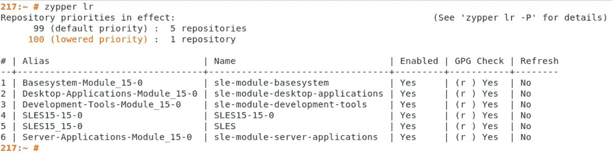

**图 2-4** `zypper lr` 输出

要刷新配置仓库的元数据（对于获取最新的仓库信息是必要的），使用 `zypper ref` 命令。该命令返回元数据更改列表，随后将存在你的系统中，以方便你选择的任何安装或更新，如图 2-5 所示。

要在仓库中启动特定特定软件包，使用 `zypper se vim` 命令。返回的结果将包含字符字符串 `vim` 的匹配项，这无疑包含了 `gvim` 软件包，你可以在图 2-6 的列表中看到。

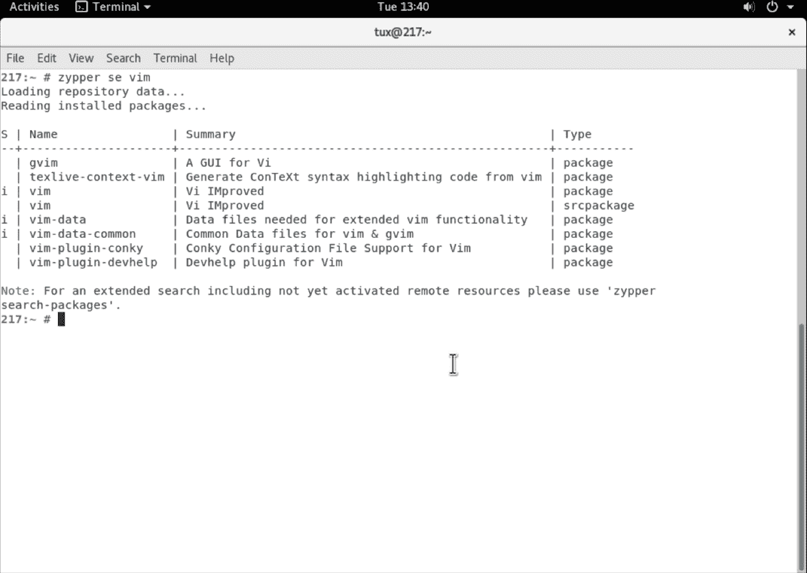

**图 2-6** `zypper se vim` 输出

> **注意**
>
> `zypper` 搜索输出显示了返回的软件包是否已安装；输出第一列的小写 `i` 表示已安装。

要在系统上安装 `gvim` 软件包，使用 `zypper in gvim` 命令，如图 2-7 所示。

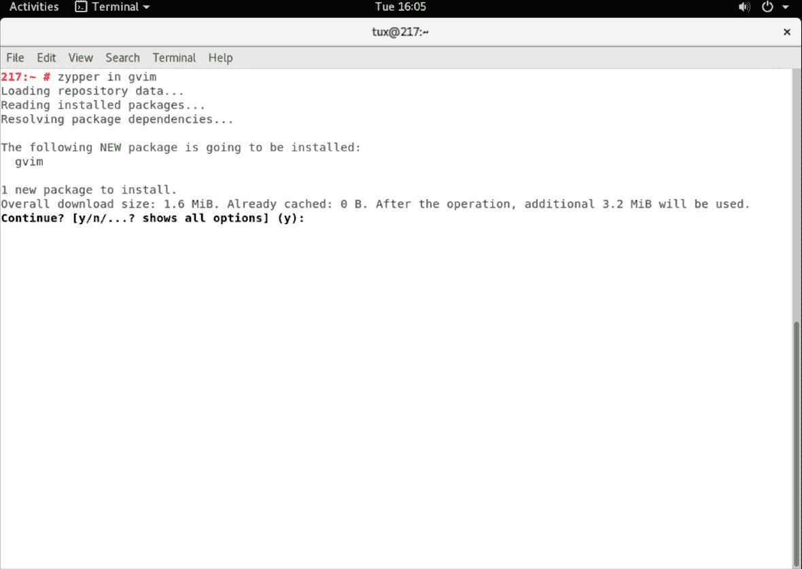

**图 2-7** 使用 `zypper` 安装 `gvim` 软件包

`zypper` 命令从仓库获取所需的软件包，并告知用户将发生什么。它通常要求用户输入 `y` 以同意下载并安装该软件包以及 `zypper` 识别出的任何依赖项。一旦用户回答了此提示，软件包就会被下载并安装，控制台会显示操作已完成，如图 2-8 所示。

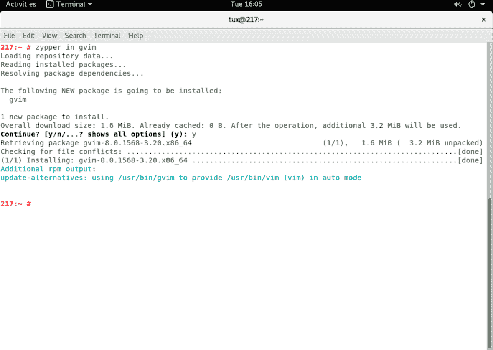

**图 2-8** 确认软件包的下载和安装

## 使用 zypper 移除软件包

软件包安装后，可以使用 `zypper rm gvim` 命令轻松地移除。

再次，系统会提示需要输入 `y` 回答，以确保确实要从系统中移除或卸载该软件包。

## 管理仓库

软件仓库可以有多种形式，最常见的是一种网络可访问的软件集合（通常是 RPM 软件包文件和附带元数据），在想要访问其内容的机器上被配置为仓库。

仓库可以分为官方且支持的（例如 SUSE Linux Enterprise（SLES）订阅提供的仓库）、官方但不受支持的（例如作为 openSUSE 项目的一部分进行配置和维护的仓库），以及第三方（例如非常有趣且实用的 Packman 仓库）。Packman 是 openSUSE 和 SLES 发行版可用最大、最多化的额外软件集合；它包含多媒体应用、第三方驱动程序等等。

## 列出系统中的仓库

列出系统上已配置的仓库非常简单：使用 `zypper lr` 命令（参见图 2-4）。

## 添加仓库

要添加仓库，你首先需要列出所有仓库，然后通过网络搜索或其他方法确定你想要添加的仓库。为了说明，本节展示了如何向我们的测试系统添加一个非-oss 仓库；non-oss 意味着该仓库包含不严格是开源软件的软件包，例如 Opera 浏览器。

要向系统已配置的仓库集添加仓库，命令遵循以下格式：

```bash
zypper ar <uri> <alias>
```

`zypper` 命令使用 `ar` 指令添加仓库，网络可访问的 `<uri>` 基本上是系统用于查询和下载软件包及元数据的 URL。随后是 `<alias>`，它是引用该仓库的友好名称。

要为系统添加 Leap 15.0 的 non-oss 仓库，请使用此命令：

```bash
zypper ar http://download.opensuse.org/distribution/leap/15.0/repo/non-oss Non-OSS
```

仓库被添加到系统，并会显示关于该仓库的一些有用信息，如图 2-9 所示。

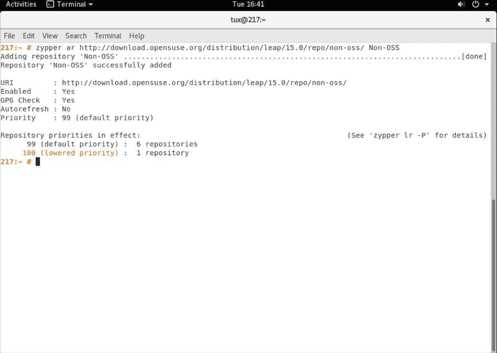

**图 2-9** 添加仓库

## 刷新仓库

要获取仓库的最新信息（在查询或从仓库中安装之前，你应该对所有仓库这样做），请使用 `zypper ref` 命令，如图 2-10 所示。

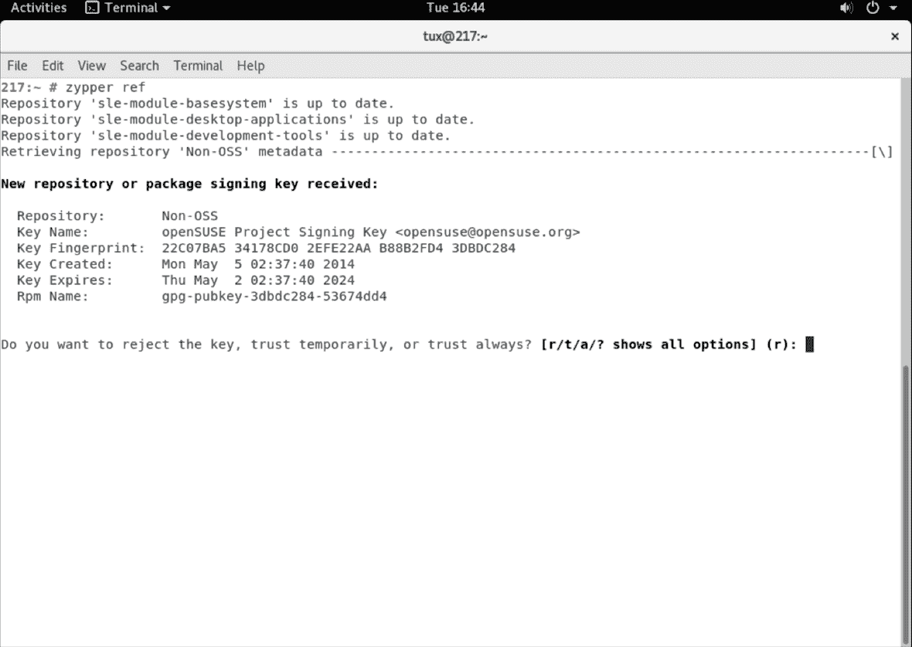

**图 2-10** 刷新仓库

必须接受新仓库，并且软件包签名密钥必须存储在本地；当你对“yes this once”（本次同意）回答 `y` 或对“always trust this repository”（始终信任此仓库）回答 `a` 时，`zypper` 会处理这些。选择 `a` 是一个好主意，如图 2-11 所示。

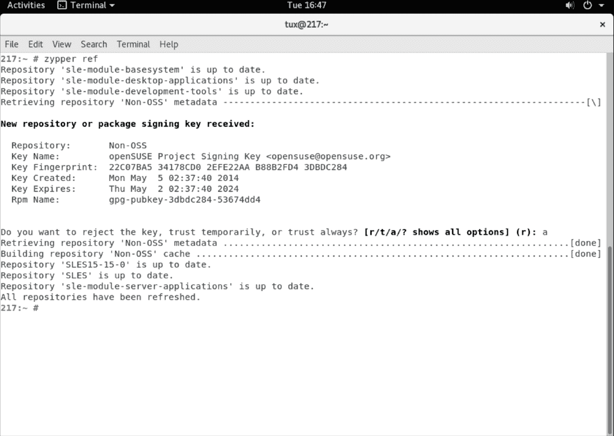

**图 2-11** 接受新仓库并在本地存储软件包签名密钥

如图 2-11 中的输出所示，仓库已被查询，其信息已下载，并准备好作为安装和更新源使用。

## 同步或镜像仓库

仓库同步或镜像的概念对于管理多个系统软件软件包仓库的人来说很重要。同步仓库通常是为了在组织防火墙内部提供在线仓库的镜像副本，这样只需要一个系统与上游仓库进行同步。

想象你有数百台物理或虚拟服务器都需要新的或更新的软件、补丁和修复等，并且所有它们都配置为通过组织的单一互联网连接源直接联系上游或官方仓库。这将迅速变得难以管理并浪费大量带宽。最好是配置一个同步或镜像本地仓库，除了同步或镜像服务器以外的所有系统都访问该仓库。

在 SUSE 中，这种系统被称为仓库镜像工具（RMT）。当 RMT 服务器被配置为同步或镜像 SUSE 的官方仓库时，所有内部系统都应配置为使用 RMT 服务器作为所有软件、补丁和修复的源。

## 获取软件的替代方法

当你想要作为更新或将使用该文件的脚本的一部分，从远程源脚本下载软件包或文件时，可以使用 `wget` 和 `curl` 命令。

例如，无需进一步交互即可从远程位置获取文件，使用以下命令：

```bash
wget http://ftp.gnu.org/gnu/wget/wget-1.5.3.tar.gz
```

该命令下载了 `wget` 命令的最新（发布时）的源源码版本，如图 2-12 所示。

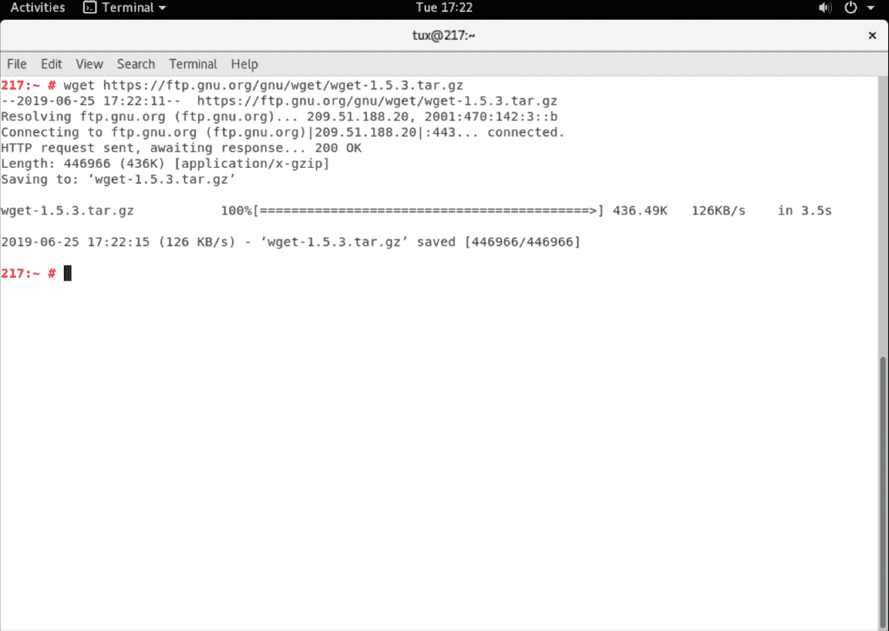

**图 2-12** 使用 `wget` 命令下载软件

关于何时使用 `curl` 代替 `wget` 下载文件存在很多困惑。虽然这两个命令在功能上非常相似，但 `curl` 通常用于同时下载和执行脚本文件，例如在虚拟机或容器环境的自动化安装情况下。

简单来说，之前下载的 `wget` 源码文件也可以用 `curl` 命令下载，如图 2-13 所示。

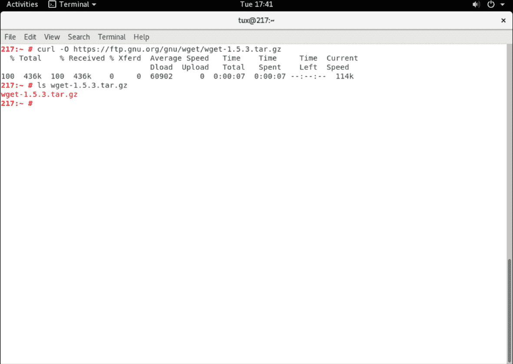

**图 2-13** 使用 `curl` 命令下载软件

`curl` 命令需要指定 `-O` 选项或 `--remote-name` 选项像 `wget` 那样下载文件；否则文件将发送到标准输出/控制台，而不会在磁盘上创建文件。

## 总结

在本章中，你学习了 Red Hat（RPM）和 Debian 软件包。软件包解决了在使用软件前需要编译软件的问题，提供了更方便的卸载和升级，并维护了依赖项列表。

Debian `dpkg` 工具仅对本地软件包操作。你可以叠加 `apt-get` 和 `apt-cache` 来连接到远程仓库并下载必要的软件包。在 RPM 世界中，你使用 `rpm` 处理本地软件包，使用 `yum` 处理远程软件包。

每个工具都有自己的命令行参数，涉及向工具传递命令，例如指示安装或删除。`dpkg` 和 `rpm` 期望命令采用单横杠或双横杠格式，例如 `-i` 或 `--install`。`yum` 和 `apt-get` 使用不带横杠的裸单词命令，例如 `install`。

## 考试准备任务

如引言中“如何使用本书”节所示，你有几个考试准备的选择：这里的练习题、第 30 章“最终准备”，以及 Pearson Test Prep 在线软件中的考试模拟题。

### 复习所有关键主题

复习本章最重要的主题，这些主题在页面外边页用“关键主题（Key Topics）”图标标记。表 2-2 列出了这些关键主题及其所在的页码。


**表 2-2** 第 2 章关键主题

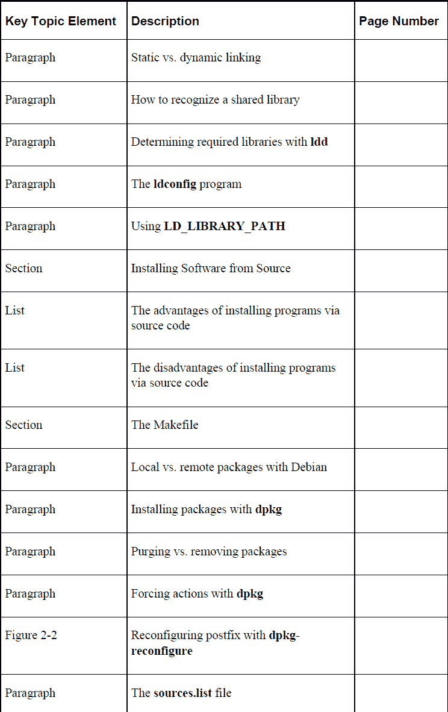

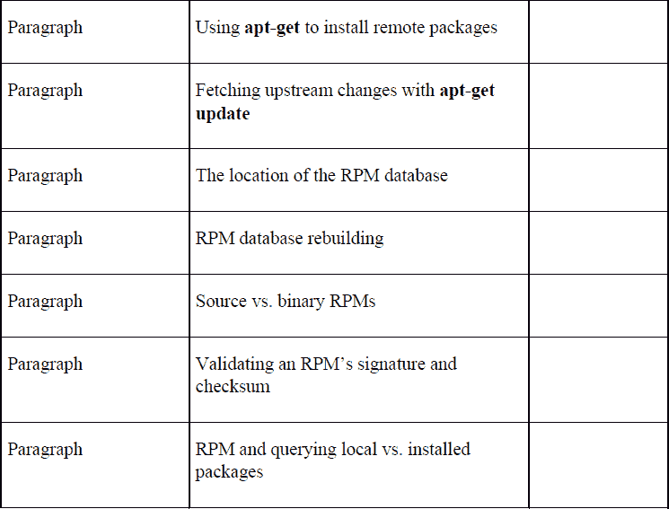

## 定义关键术语

定义本章的以下关键术语，并在术表中检查你的答案：

- 源码格式
- 二进制包
- 包管理器
- 库
- 链接
- 静态链接
- 动态链接
- 动态链接器（`ld.so`）
- 共享对象
- 高级包工具（APT）
- 源码 RPM
- Yellowdog Updater
- 修改版（YUM）
- DNF
- `zypper`

## 复习题

这些复习题的答案位于附录 A。

**1.** 下列哪个命令可以显示来自磁盘上包文件的软件应用程序修订历史？

- **a.** `rpm --revision tree-1.7.0-16.fc29.x86_64.rpm`
- **b.** `rpm -qp tree-1.7.0-16.fc29.x86_64.rpm --changelog`
- **c.** `rpm -qc tree-1.7.0-16.fc29.x86_64.rpm`
- **d.** `rpm -qlp tree-1.7.0-16.fc29.x86_64.rpm --showrev`

**2.** 下列哪个是 `ldconfig` 程序运行并处理了机器上所有库文件后产生的文件？

- **a.** `/etc/ld.so.conf`
- **b.** `/etc/ld.so.cache`
- **c.** `/var/cache/ld.so.cache`
- **d.** `/etc/ld.cache.d`

**3.** 运行 `ldd` 程序的目的是什么？

- **a.** 重建到库文件的链接
- **b.** 创建到库文件的链接
- **c.** 显示程序所需的库
- **d.** 读取程序的库能力

**4.** 哪个环境变量被用于提供额外的库支持，并且也被认为是一个安全风险？

- **a.** `LIBC_EXTRA`
- **b.** `LD_SO_ETC`
- **c.** `LD_LIBRARY`
- **d.** `LD_LIBRARY_PATH`

**5.** 下列哪些是收到以下错误消息的有效原因？（选择所有可能的）

```text
error: cannot get exclusive lock on /var/lib/rpm/Packages?
```

- **a.** 尝试以非 root 身份执行 `rpm install` 命令
- **b.** 同时执行多个 `remove` 命令
- **c.** 同时执行多个 `verification` 命令
- **d.** 同时执行多个 `install` 命令

**6.** 你需要用一条命令删除所有实例的安装的 `foobar` 包，无论其版本如何。下列哪个命令可以完成此任务？

- **a.** `rpm -e foobar`
- **b.** `rpm -ea foobar`
- **c.** `rpm -a foobar --remove`
- **d.** `rpm -e foobar --allmatches`

**7.** 你是两个防火墙的系统管理员，想要从当前目录的一组包应用更新，但你不想在系统上安装任何新包。哪个命令可以实现这一目标？

- **a.** `rpm -F *.rpm`
- **b.** `rpm -Uvh *.rpm`
- **c.** `rpm -qp *.rpm`
- **d.** `rpm -Fp *.rpm`

**8.** 哪个命令和选项允许你查看已安装包为了正常运行所需的权限列表？

- **a.** `rpm -qi`
- **b.** `rpm -qR`
- **c.** `rpm --whatrequires`
- **d.** `rpm -qa`

**9.** 你会使用哪个命令来查看你是否安装了 `iceweasel` 包？

- **a.** `apt-cache search iceweasel`
- **b.** `apt-get --list iceweasel`
- **c.** `dpkg --info iceweasel`
- **d.** `dpkg --list iceweasel`

**10.** 你会使用哪个命令将 `iceweasel` 包升级到最新版本？

- **a.** `apt-get install iceweasel`
- **b.** `apt-get update iceweasel`
- **c.** `apt-get upgrade iceweasel`
- **d.** `dpkg --install --upgrade iceweasel`

# 第 3 章 虚拟化

本章涵盖了以下主题：

- 什么是虚拟化？
- 虚拟化/虚拟机管理程序的类型
- 模板格式
- 引导虚拟机
- 虚拟存储
- 网络考虑

本章涵盖了以下考试目标：

- **目标 1.5：** 比较并对比云与虚拟化的概念及技术。

虚拟化特别是云计算是系统管理员和系统操作员日益关注的领域。这些技术允许将计算资源从本地现场分离，并对资源进行极大的控制，并根据需要提供大规模扩展和收缩的机会。

## “我真的懂这些吗？”测验

“我真的懂了吗？”测验可以帮助你评估是应该阅读整章，还是直接跳转到“考试准备任务”部分进行回顾。如果你有疑问，请阅读整章。表 3-1 概述了本章的主要标题以及对应的“我真的懂了吗？”测验问题。你可以在附录 A 中的“‘我真的懂了吗？’测验和复习题的答案”中找到答案。

**表 3-1** “我真的懂了吗？”基础主题章节与问题映射


### 注意事项

自评估的目标是衡量你对本章主题的掌握程度。如果你不知道问题的答案，或者对答案仅部分确定，你应该在自评估中将该问题标记为错误。对于你猜对的答案给自己分会扭曲你的自评估结果，并可能给你一种虚假的安全感。

**1.** 一个系统作为主机操作系统的客户端运行着某个版本的操作系统。下列哪个最能描述这种情况情况？

- **a.** 虚拟化
- **b.** 容器
- **c.** 切片（Slices）
- **d.** Chroot

**2.** 下列哪个是主要的闭源虚拟化供应商？

- **a.** VMware
- **b.** SUSE
- **c.** Red Hat
- **d.** Virtuozzo

**3.** 你发现一个文件显然经过压缩，并且显然打算用于虚拟化系统；它包含一个描述符、虚拟化磁盘文件和一个 CD/DVD 的 ISO 文件。这是什么类型的文件？

- **a.** VMDK
- **b.** KVM
- **c.** OVA
- **d.** OSX

**4.** 在熟悉一台运行了一段时间的旧机器时，你在磁盘上发现一组文件，其中一个以 `ks.cfg` 结尾。该机器可能使用了什么来安装？

- **a.** Jumpstart
- **b.** AutoYaST
- **c.** Anaconda
- **d.** Autoboot

**5.** 你正在安装一个据称需要大量存储的虚拟机，但直到下一个预算周期才会实施这些存储。你对磁盘应该采用何种配置方式？

- **a.** 粗模式（Thick）
- **b.** 粗体（Bold）
- **c.** 细模式（Skinny）
- **d.** 瘦模式（Thin）

**6.** 在安装虚拟机期间，你记得该主机永远不被直接访问，而只能通过通过操作系统的流量进行访问。哪种网络类型最好描述这种方法？

- **a.** 桥接（Bridge）
- **b.** 多宿主机（Multi-homed）
- **c.** NAT
- **d.** 叠加层（Overlay）

## 基础主题：什么是虚拟化？

从最简单最直接的方式来说，虚拟化技术允许主机操作系统在一个隔离的封装器中运行独立的操作系统实例，使其能够模拟真实的机器。

自 20 世纪 60 年代末首次创建/使用以来，虚拟化已经取得了巨大的进步。在那时，它以一种相当简单的方式划分系统资源以供多个用户使用。

虽然有些人将所有为操作系统或应用程序提供虚拟实例的尝试都称为虚拟化，但这并不是真正的虚拟化。目前已有许多方法可以让多个人或一组客户端访问看起来是完全功能正常的系统资源。这些方法可以分为多个级别，或者说是指使用单个操作系统来提供一个或多个用户空间虚拟实例、容器或虚拟机的能力，具体取决于所使用的方法。

操作系统虚拟化与容器化不同，后者本质上是应用级的虚拟化。操作系统虚拟化有效地虚拟化了整个操作系统，而应用级虚拟化仅虚拟化或抽象足够以支持被虚拟化程序的操作系统部分。

虚拟机监控程序（Hypervisor）是使主机操作系统与虚拟机分离的代码，用于创建、销毁和管理虚拟机。

表 3-2 提供了虚拟化类型的概览。


**表 3-2** 虚拟化类型

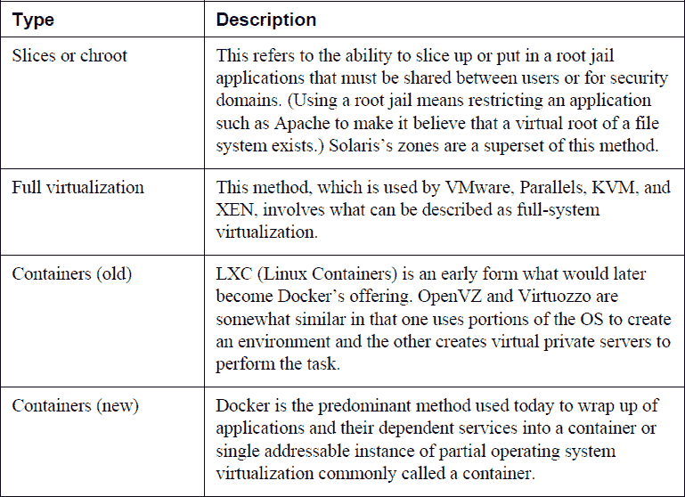


## 本地虚拟化


# 虚拟化概念

虚拟化的概念涉及运行在虚拟硬件上的操作系统副本，使操作系统认为自己安装在物理硬件上。早期的虚拟化用法基本上意味着在单台主机上托管多个虚拟机，并将其作为更多的服务器来使用，可以进行配置并用于服务。这通常意味着使用`VMware Workstation`或`Server`，尽管许多组织使用了`XEN`或`KVM`——特别是那些只虚拟化 Linux 系统的组织。大多数 Windows 虚拟化发生在上述`VMware`产品或 Windows 虚拟化产品上，如`Hyper-V`及其前身版本。

## 别人的 Linux 机器

最终，人们开始使用集中在特定公司及其数据中心的虚拟化，而不是本地公司或数据中心，例如许多租赁物理或虚拟服务器的组织（例如`HostGator`、`Linode`、`Rackspace`）。虽然这显然是虚拟化的用法，但它绝对不是我们今天所知的云虚拟化格式。


## 云虚拟化

`cloud`一词可以意味着很多事情。首先，`cloud`和`cloud virtualization`这两个术语通常与三大云供应商相关联：`Amazon Web Services`、`Google Cloud`和`Microsoft Azure`。（`Docker`和`Kubernetes`也是这些大型供应商环境中的支柱，但它们主要不在 Linux+ 考试的范围内。）

云虚拟化的关键在于，虽然它在某些方面与其他类型的虚拟化相似，但它提供了将配置资源扩展到无限的能力。这种扩展是智能扩展，你可以对其进行调整，以倾向于节省成本、性能或两者兼顾。


### 引导虚拟机

虚拟化与自动化交织在一起，历史上最耗时且最容易出错的任务之一就是安装操作系统。因此，讨论安装或实例化虚拟机（VMs）的各种方法是非常合适的。


启动（即准备好使用）`VMs`的主要问题是使用`Amazon AMI`方法，还是根据需要通过`Chef`、`Puppet`、`AutoYaST`、`Kickstart`或其他产品自行安装。这种争论的实际上在于：你是否为了速度和方便启动而使用`VMs`镜像，即使由于只需要一个无法轻易迁移到新创建的`VM`中的更新，镜像就会过时？或者你是否完全通过`YAML`文件编写安装脚本？虽然获取最新的软件对于你的 cheffed `VMs`的灵活性、安全以及（可能最重要的）兼容性非常有利，但任何需要从存储库下载大量组件、按适当顺序安装并确保每次都能运行的操作，其风险本质上都比直接启动机器镜像`VM`高。


### Amazon 机器映像

`Amazon`是云领域最大的供应商，认识到`Amazon Machine Image (AMI)`格式在引导或云初始化中是一个不可忽视的力量很好。将`AMI`视为一个模板，它包含系统根、操作系统以及任何你想包含在`AMI`中的其他内容。

`AMI`有点像冷冻晚餐：你可以“解冻”一个并在几秒钟内让它热气腾腾准备就绪，但它是预包的，如果你不喜欢或想对其进行定制，你就必须重新处理然后再次进行包装。

然而，说`AMI`是不可更改的或在实例化后无法在其上运行脚本是不准确的。除非你更改了用于启动实例的`AMI`，否则你始终必须进行启动后的修改，既然你这样做，为什么不直接使用许多优秀的工具之一（例如`Chef`、`Puppet`、`Salt`）对镜像进行定制呢？

### 云安装工具

虽然 Linux+ 考试目标仅提到`Cloud-init`、`Anaconda`和`Kickstart`，但你也可以使用如`Chef`、`Puppet`、`Salt`和`SUSE Manager`等工具。


## Cloud-init

`Cloud-init`是一个独特的工具。你可以单独使用它，它允许你在自定义云`VM`安装。然而，它真正的优势在于作为初始引导工具，为功能丰富的工具（如`Chef`和`Puppet`）准备`VM`环境。


## Puppet

以旧科幻电影《傀儡师》（The Puppet Masters）命名，`Puppet`是一种仍在被广泛使用的旧技术。它的核心优势在于让系统准备好提供其设计的服务。它的缺点是一个中心化系统，中央管理节点的故障可能是灾难性的。`Puppet`也因其架构容易产生瓶颈。

`Puppet`有自己的领域特定语言，如果你学习了它，`Puppet`相当容易使用。`Puppet`语言是`Ruby`语言的一种带有许多变化的非标准实现。


## Chef

`Puppet`的设计者汲取了许多教训，使他们使`Chef`成为比`Puppet`更可行、可扩展且可自愈的基础设施工具。`Chef`从一开始就被设计为可以使用中央对象存储的分布式工具，`Chef`并不依赖该存储库始终可用来完成工作。

`Chef`的领域语言符合`Ruby`语言标准，因此当 DevOps 工程师遇到内置实现无法处理配置问题的情况时，他或她可以使用完整的`Ruby`语言来解决问题。

`Chef`也设计为支持大规模扩展的；它可以处理多达 250,000 个节点，这是它优于`Puppet`工具的另一个领域。


## Anaconda/Kickstart

在 Red Hat Linux 早期版本中普及的`Kickstart`安装方法被用于自动化 Linux 的无人值安装。

`Kickstart`使用单个文件，其中包含所有配置和自动响应，对于执行 Linux（大多数情况下是 Red Hat Enterprise Linux）系统的非干预安装是必需的。

`Kickstart`需要以下组件：

• 安装介质（无论在本地或在网络资源上）

• Kickstart 文件（默认为`anaconda-ks.cfg`）

• 引导方法

Kickstart 文件相对简单，包含用于查询或配置项的关键字，以及用于选择、设置或对任何安装问题回答的值。

Kickstart 文件分为几个主要部分：

- **Command（命令）：** 此部分包含安装发行版的命令，如果需要，还包括答案。

- **Packages（软件包）：** 此部分列出了要安装的软件包选择，位于一个`%packages`开始并`%end`结束的段落中。要安装的软件包可以是组形式存在，也可以作为单个软件包出现。组以`@`为前，例如`@Sound and Video`，而单个软件包将直接通过短包名引用，例如`vim`。

- **Pre and post（前后处理）：** 这些部分包含在安装前和安装后执行的命令和函数。这些部分是基于段的，以`%pre`开始并以`%end`结束。确保 Pre 和 Post 部分位于 Anaconda 或 Kickstart 文件的末尾是非常重要的。


## 模板格式

虚拟化通常是为了提供自动化，因此讨论模板和模板系统是合适的。


### VM 模板

模板通常不是一个可启动或可用的 VM，而是 VM 的主版本，用于创建一个副本，并将其定制为可在特定环境中使用使用的 VM。

### 注意

VM 模板与 VM 克隆（VM clones）的不同之处在于，VM 模板的目的是作为主副本，最终运行的副本将是经过自定义命名、IP 地址等处理的该 VM 的运行副本。VM 模板永远不会被启动，而将其副本部署为 VM 则包括配置那些使系统具有唯一性的设置，例如名称、IP 地址等。

VM 克隆（VM clone）是对正在运行或已停止的 VM 的直接复制。启动的克隆具有与其克隆的 VM 相同的名称、IP 地址，甚至是 MAC 地址信息——因此会保证网络上出现问题。

管理员可能会创建一个 VM 模板，进行测试并使其完美，然后为一个新的软件项目为每个开发者的编码环境制作该 VM 的副本。VM 是完全相同的这一事实是这里的关键，这样每个人都根据相同的软件和设置进行工作。


### OVA/OVF 模板

使用 OVA/OVF 文件作为模板机制与使用简单的 VM 模板不同。开放虚拟设备（OVA）文件实际上是将一个或多个 VM 封装成一个可安装/可运行的包，例如一个虚拟设备，其中可能包含一个用于 NGINX 的 VM 和另一个用于 MySQL 的 VM，打包在一起并可以在 VMware 等环境中快速地使用。开放虚拟化格式（OVF）文件是一个压缩包，包含任何所需的证书和磁盘镜像文件，其格式类似于 TAR 归档文件。OVA 文件可以包含多个 OVF 文件，每个 OVF 文件都有效地表示一个 VM 实例。


### 配置模板

关于对于配置管理，使用 JSON 还是 YAML 最好，这种问题已经有很多讨论。你的选择主要取决于你正在做什么。


#### YAML（不是标记语言）

YAML 是 JSON 的超集（或包含 JSON）。YAML 主要用于具有基于段落的层级条目格式的配置文件，并且非常对人类友好且易于阅读。

YAML 还允许提供更丰富的功能集，以及为了文档说明和清晰度而包含注释的能力。


#### JSON（鲍恩）

JSON 用作序列化数据。它的格式比 YAML 简单，可以在 API 与其请求应用程序或服务之间进行数据交换和传输。

JSON 是 YAML 的子集，可以使用 YAML 解释器或解析器进行解析，因此你可以针对你的模板需求同时使用 YAML 和 JSON。


### 容器镜像

容器镜像是一个二进制文件，内部包含了作为 Docker 容器实例运行的所有必要组件。容器镜像像 VM 模板一样，使得部署多个给定配置的实例变得简单得多。

注册表（Registry）简单来说是 Docker 容器镜像的集合，经过适当的命名和标记，以便想要拉取和使用 Docker 镜像的人可以轻松做到。主要且最著名的 Docker 注册表是 Docker Hub，由 Docker 组织和社区运行，具有数千个满足从非常通用到极其特定用途的镜像，且易于发现和检索。可以通过 [`registry.hub.docker.com`](https://registry.hub.docker.com) 访问 Docker Hub。

## 虚拟化存储

虚拟机（VM）像传统系统一样需要存储，但通常 VM 使用某种类型的虚拟机磁盘文件，该文件在 VM 看来是一个真实的磁盘。VM 需要足够的存储空间并属于适当类型以满足特定目的的要求。


### 瘦与厚（Thin vs. Thick）

在为 VM 分配存储时，有两种主要可能性：

- **精简配置（Thin provisioning）：** 使用这种类型的配置，虚拟磁盘的大小在设置期间声明，但不会分配整个存储空间或将其标记为“已使用”只有实际需要的加上少量额外裕量的会被标记为“已使用”。实际使用的存储量与写入磁盘的实际文件相关，并根据需要分配更多空间。

- **厚性配置（Thick provisioning）：** 这种方法涉及预分配或将虚拟磁盘配置中指定的全部空间标记为“已使用”。不需要在扩展或收缩分配的空间上花费时间；它在开始时就已专用了了。

使用精简配置的优点是，你可以将虚拟磁盘标记为某个大小，但在对该虚拟磁盘进行实际写入之前，不需要投入该空间。缺点是可能会过度分配可用空间，如果你突然想要全部空间，可能会迅速耗尽宿主系统的实际存储。

使用厚性配置的优点是，一旦分配了虚拟机磁盘，VM 将将该数量标记为已使用，你不需要花时间尝试计算或为新文件寻找空间；空间在那里并准备就绪。这种方法的缺点是，所有分配的虚拟磁盘空间都被标记为已使用，你无法在没有剩余空间的机器上运行更多的 VM。


### 持久化卷（Persistent Volumes）

当你虚拟化 Kubernetes 时，存储卷绑定到 pod 或计算/应用程序单元。当 pod 被删除时，分配的存储会自动丢失，除非你配置了持久化卷。

有了持久化卷，pod 访问的存储卷的生命周期或存在时间完全独立于 pod 的生命周期（后者的变化极大）。这允许在 pod 之间使用持久化数据，并且单个 pod 的生死不会对持久化卷的寿命产生任何影响。


### 对象与块（Blobs and Blocks）

在虚拟化存储领域，可以根据存储需求使用对象和块。

BLOB 是二进制大对象（binary large object）。例如，在 Microsoft Azure 中，有块 blob（block blobs），它们是包含大小限制为 64MB 块的 blob；在一个定的块 blob 中，块的数量不超过 50KB。块 blob 非常适用于流式上传或大文件提交等用途，在这些场景中，数据以并行或半并行的方式上传，并在提交到存储设备时进行组装。

另一种类型的 blob 是页级 blob（page blob），其中每个页最大可达 512 字节；页级 blob 最大可以存储 1TB 的页。页级 blob 非常适合存储 HTML 页面或小随机读写操作类型的存储文件，因为其读写单位是页（即 512 字节）。

## 网络考虑因素

当你使用虚拟机时，你也会使用虚拟网络，这里有几种常用的方法是需要了解的。


### 桥接模式（Bridging）

在桥接网络中，虚拟机的网络接口（当然是软件定义的）通过虚拟以太网交换机（在 VMware 上默认为`VMNet0`）连接到实际主机的以太网或其他适配器；虚拟机适配器看起来像是一个完整的网络客户端或节点，并获得与主机适配器处于同一子网的 IP 地址。优点是虚拟机被视为网络上的完全参与者；缺点由于它是完全参与者，会占用一个 IP 地址。鉴于虚拟化主机系统上可能有很多虚拟机，桥接可能会消耗大量 IP 地址，而收益甚微。


### 叠加网络（Overlay Networks）

叠加网络涉及在底层网络之上叠加一个更特定或目标驱动的额外网络和协议层。

例如，互联网最初创建是为了叠加在物理电话网络之上，并在底层基础设施之上（但与之独立）进行所有的业务。

一个有趣的点是，现在情况发生了反转，由于 IP 语音（VoIP）的普及，如今的电话网络实际上是互联网基础设施的一种叠加！


### NAT（网络地址转换）

桥接连接的对面是网络地址转换（NAT），在 NAT 中，虚拟机被分配到一个私有的虚拟网络，该网络通常位于`10.0.0.0`、`172.16.0.0`或`192.168.0.0`范围内，并使用 NAT 设备或对象将其本地唯一的 IP 地址转换为可以在广域网中传输的内容。这种方法的主要优点是它进一步保护虚拟机免受外部网络危险的影响，并且不使用额外的 IP 地址。每个虚拟机都可以在 NAT 功能后拥有自己的虚拟网络，尽管你可以在同一个虚拟私有地址方案上有两个或多个虚拟机并相互通信。


### 本地模式（Local）

在本地网络中（也称为主机主机网络 host-only networking），虚拟机所在的网络实际上被限制为本地流量，它通常只通过虚拟以太网交换机与虚拟化主机通信。


### 双宿主机（Dual-homed）

运行虚拟机的主要优点之一是你可以将任务或服务隔离到特定的虚拟机，并让该虚拟机通过网络提供这些服务。

影响虚拟化主机系统的一个问题是，可能有许多虚拟机都在使用 NAT 或桥接网络，而虚拟化主机的单以太网接口可能成为瓶颈。双宿主机防止了这种瓶颈。通过双宿主机，你为虚拟机配置两个使用的以太网设备，并智能地分配虚拟机甚至虚拟机组使用某个特定的以太网设备作为其网络访问设备。这样一来，以太网接口就不会成为瓶颈或引起性能问题。

## 总结

在本章中，你学习了与虚拟化相关的概念，并学习了磁盘存储的类型、提供者和方法、网络虚拟化的类型等内容。

## 考试准备任务

正如引言中“如何使用本书”部分提到的，你会有几种准备考试的选择：这里的练习题、第 30 章、“最终准备”以及 Pearson Test Prep 在线软件中的考试模拟题。

## 复习所有关键主题

复习本章最重要的主题，这些主题在页外边上用“关键主题”图标标记。表 3-3 列出了这些关键主题及其所在的页码。


**表 3-3** 第 3 章 关键主题

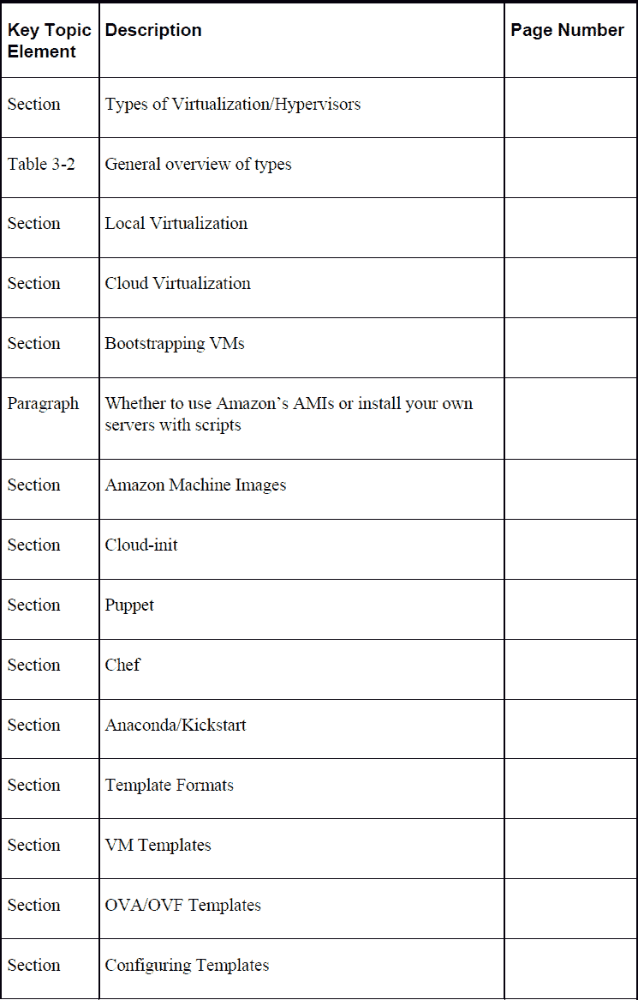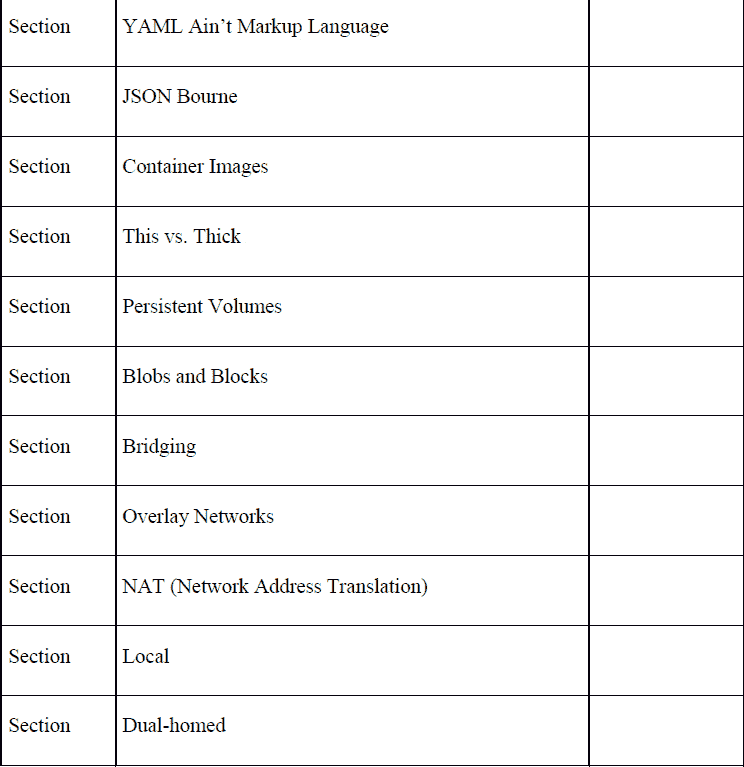

## 定义关键术语

定义本章的以下关键术语并在词表表中检查你的答案：

virtualization

network

OVF

OVA

VM template

Chef

Puppet

Cloud-init

NAT

dual-homed

## 复习题

复习题的答案在 附录 A 中。

**1.** 哪种虚拟网络允许虚拟机成为与虚拟化主机系统相同网络上的完全参与者？

**a.** 主机模式

**b.** 虚拟专用网络

**c.** 双宿主机

**d.** 桥接模式

**2.** 对或错：OVA 文件可以包含一个或多个 OVF 文件。

**a.** 对

**b.** 错


### 3. 对或错：JSON 是 YAML 的超集

- a. 对
- b. 错

### 4. 页级 blob 的存储限制是多大？

- a. 512 字节
- b. 256KB
- c. 64MB
- d. 无限制

### 5. 关于 Amazon 镜像（Amazon Machine Images），以下哪项是正确的？（选择两项。）

- a. 它们启动并提供服务很快。
- b. 它们在初始化期间是高度配置的。
- c. 它们的定价方式简单。
- d. 它们寿命很长。

# 第 4 章 启动过程

本章涵盖了以下主题：

- Linux 启动过程
- 系统启动选项
- 引导程序和文件
- 启动模块
- 内核恐

本章涵盖了以下目标：

- 目标 1.1：解释 Linux 启动过程概念。

在本章中，我们将讨论 Linux 启动过程、启动选项、引导程序及其文件以及内核恐的情况。

## “我掌握了吗？”测验

“我掌握了吗？”测验可以让你评估是应该阅读整个章节，还是直接跳转到“考试准备任务”部分进行复习。如果你有疑问，请阅读整个章节。表 4-1 概述了本章的主要标题以及相应的“我掌握了吗？”测验题。你可以在[附录 A “‘我掌握了吗？’测验和复习题的答案”](#app01.html_app01)中找到答案。

**表 4-1** “我掌握了吗？”基础主题章节与问题映射

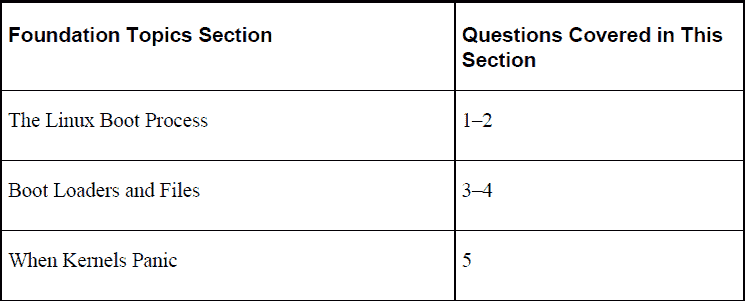

> **注意**
>
> 自评估的目标是衡量你对本章主题的掌握程度。如果你不知道问题的答案，或者对答案只有部分确定，那么在自评估时应将该问题标记为错误。为你猜对的答案打分会扭曲你的自评估结果，并可能给你带来虚假的安全感。

1. 在 `GRUB` 提示符下，你会指定什么文本以使 Linux 发行版的默认安装在系统初始化后直接运行到级别 2（`runlevel 2`）？

2. 下列哪项是当前发行版默认的引导程序？

   - a. `LILO`
   - b. `STITCH`
   - c. `GRUB`
   - d. `LOADLIN`

3. 扩展性固件接口（`EFI`）系统分区使用什么类型的文件系统来保证兼容性？

   - a. `EXT2`
   - b. `FAT`
   - c. `REISER`
   - d. `MBR`

4. 若要更改 `GRUB` 引导程序的配置，你会编辑以下哪一个文件？

   - a. `/grub/grub2.config`
   - b. `/etc/boot/grub`
   - c. `/etc/sysconfig/grub/boot`
   - d. `/boot/grub2/grub2.cfg`

5. 如果系统遇到内部错误并无法继续处理，发生了以下什么情况？

   - a. 停止错误（Stop error）
   - b. 死亡绿屏（Green screen of death）
   - c. 内核恐慌（Kernel panic）
   - d. 初始化零（Init zero）

## 基础主题

## Linux 启动过程

启动一个 Linux 系统不仅仅是打开系统并最终向你显示登录提示那么简单。相反，它是一系列事件，如果一切顺利，这些事件将导致你看到那个登录提示。

在本节中，我们将启动过程视为一系列任务，其目的是让系统达到可以进入默认运行级别的状态，在该状态下，由于配置、启动和管理系统服务或进程的各种方法，情况可能会变得复杂。

### 什么是启动过程？

Linux 的 `boot process`（启动过程）是指系统从硬件（或虚拟硬件）上电开始，直到所选操作系统达到所需的功能状态的过程。得益于 `systemd`、`Upstart` 以及其他初始化方法的流行，有许多途径可以实现运行中的系统。

Linux 启动过程可以分为四个不同的阶段：

1. 引导程序阶段
2. 内核阶段
3. 早期用户空间
4. 初始化进程（`Init process`）

## 系统启动选项

启动系统有很多方法。有些需要在本地磁盘上安装软件并进行配置，有些允许使用引导或安装服务器，还有一些允许你通过网络从远程文件系统启动。

### `initrd` 和 `initramfs`

Linux 运行在极其广泛的硬件上，许多发行版使用相当标准的 Linux 内核镜像以保持兼容性，并依赖于对每个系统特定硬件的检测以及加载所需的内核模块，以便在安装和随后的系统初始化期间正确适配这些硬件。

由于涉及的启动方法、样式和硬件类型极其丰富，这里存在一个类似于“鸡生还是蛋生”的问题：系统必须使用通用的 Linux 内核镜像从硬件启动，但根文件系统（root filesystem）在哪里？你又如何让通用镜像知道它的位置呢？

与其采用为特定硬件配置所需的模块直接编译进内核这种不优雅的方案，不如使用一个早期用户空间的临时文件系统。该临时文件系统位于磁盘上，其位置由固件或引导程序已知。系统会访问并挂载该临时文件系统，并提供一组可能的模块在启动过程中使用。内核和早期用户空间文件系统的镜像被加载到内存中，并告知内核镜像在内存中的位置，以便它可以检测其格式——即 `initrd` 或 `initramfs`。

`initrd` 方法非常老了，它实际上是一个文件系统的映像，表示为 `/dev/ram` 设备，并被挂载为内核使用的临时根文件系统。这种方法的缺点是，内核必须对该文件系统的驱动程序有编译或硬编码引用。如果磁盘发生了变化（例如更换磁盘、更改磁盘大小或几何结构、修改包含该文件的分区），可能会出现问题。

传统上用于创建初始 RAM 磁盘的命令是 `mkinitrd`，随后是要创建的 `initrd` 镜像及其对应的内核，如下例所示：

```bash
# mkinitrd /boot/initrd-3.10.0-862.14.4.el7.x86_64.img 3.10.0-862.14.4.el7.x86_64
```

如果有一个特定的模块应该加载，以便内核能够找到并访问带有 `initrd` 的磁盘，你可以通过 `--preload` 选项加上模块名来指定它，如下所示：

```bash
# mkinitrd --preload module.o /boot/initrd-3.10.0-862.14.4.el7.x86_64.img 3.10.0-862.14.4.el7.x86_64
```

更常用的提供早期用户空间文件系统的方法是 `initramfs`。这种方法使用从特定类型的归档文件（`cpio`）中解压出来的初始根文件系统，并挂载到内存中作为临时根文件系统。这种方法的一个明显优势是不需要预先编译或在内核中包含特殊模块，因此它是通用的，并兼容许多系统配置。

构建 `initramfs` 镜像最初通常涉及使用 `mkinitrd` 命令（这在 `initrd` 方法中也会用到），但 `dracut` 命令几乎会立即参与到 `initramfs` 镜像的构建中，它尝试以最少的硬编码脚本依赖来创建镜像。`dracut` 框架依赖 `udev`（内核中的设备管理器）来告诉它检测并挂载了哪些设备，当正确的设备挂载好时，系统会将根文件系统切换到该设备。

`dracut` 的一个主要优势是对启动设备的广泛支持，包括使用 `RAID` 和 `LVM` 的设备，以及更冷门的设备类型，例如通过 `iSCSI` 和 `NFS` 的远程设备。

使用 `dracut` 创建 `initramfs` 镜像相当简单。如果你单独运行该命令，系统会尝试为当前运行的内核创建一个功能性的 `initramfs` 镜像。这会导致错误信息，因为这是在尝试覆盖当前的 `initramfs` 镜像。

要在不覆盖镜像的情况下创建 `initramfs` 镜像，只需指定另一个镜像名称，然后就可以检查生成的 `initramfs` 镜像的格式：

```bash
# dracut some-image-file-name.img
```

### 使用 UEFI 启动

对于如今大多数 Linux 安装来说，棘手的问题是扩展性固件接口（`UEFI`）。`UEFI` 中让 Linux 发行版安装变得困难的部分被称为安全启动（`Secure Boot`）。安全启动表面上设计的目的是为了让坏人尽可能难以损坏、更换或更改你的引导管理器镜像，从而获得对你计算机的不当访问。

实际上，由于最初所有的 `UEFI Secure Boot` 镜像都必须由官方签名机构签名，而唯一的权威是微软，安装 Linux 变得困难得多，要求发行版维护者要么去微软获取引导镜像签名，要么创建自己完全替代的备签名机构并通过 `UEFI` 流程获得批准。

最佳解决方案（目前仍然有效的方案）是简单地在预启动系统配置中关闭 `UEFI Secure Boot`，从源头上避免整个问题。明确来说，你只需要禁用 `UEFI` 过程中的安全启动部分，而且继续使用 `UEFI` 有充分的理由。总的来说，它是相对于主引导记录（`MBR`）方法的改进。

`/boot/efi` 目录并非在每个发行版中都存在，但如果它在那里，通常用于必须对系统进行双启动的情况，因为 `UEFI` 系统需要一个可用的 `UEFI` 分区。

> **注意**
>
> 在本章的系统示例中，Ubuntu 机器没有 `/boot/efi` 目录，而 CentOS 机器有一个 `/boot/efi/EFI` 目录，其中包含一个名为 `centos` 的空目录。

如果系统配置为使用 `EFI` 启动，则会在 `/boot/efi` 上挂载一个 `FAT32` 分区（`EFI` 系统分区），该分区包含系统上各种操作系统启动选项的启动文件，扩展名为 `.efi`，如下文件所示，这是一个 `EFI` 启动镜像：

```text
/boot/efi/EFI/arch/vmlinuz-linux.efi
```

该文件也可以简单地命名为 `linux.efi`。

## 通过 PXE 启动

预启动执行环境（`PXE`）要求客户端具有支持 `PXE` 能力的网络网卡（`NIC`），并且服务器端需要一个支持 `PXE` 启动的 `DHCP` 服务器。

`PXE` 服务器端比客户端更复杂，需要以正确的组合支持多种协议，包括在客户端通过 `DHCP` 配置好网络后，有一个可用的有效网络启动程序（`NBP`）可以传输给客户端。


具备 `PXE` 能力的计算设备的启动过程如下：

1. **步骤 1：** 开启客户端设备，并在 `BIOS`/启动界面中选择 `PXE` 启动选项。
2. **步骤 2：** 客户端发送一个 `DHCPDISCOVER` 广播，其中内置了 `PXE` 选项，让 `DHCP` 服务器知道请求的类型。
3. **步骤 3：** `PXE` 能力的 `DHCP` 服务器返回一个 `DHCPOFFER` 广播，其中包含了 `PXE` 客户端设置网络堆栈并连接 `DHCP` 服务器的简单文件传输（`TFTP`）服务所需的所有网络信息。
4. **步骤 4：** `PXE` 客户端完成网络设置并启动 `NBP` 镜像的 `TFTP` 传输，将其存储在客户端的 `RAM` 中。
5. **步骤 5：** 最后，客户端使用 `NBP` 启动，并根据系统的不同，从 `TFTP` 服务器或其他网络资源（如网络文件系统 `NFS` 服务器）请求额外的启动文件。

## 通过 NFS 启动

我们已经查看了使用 `TFTP` 和 `DHCP` 服务器分配网络配置和网络启动程序。现在考虑从网络上 `NFS` 共享中的文件启动系统是合理的。

从 `NFS` 启动运行中的系统与 `PXE` 启动系统略有不同，后者通常用于安装（但不限于此功能）。

作为从 `NFS` 启动的示例，我们将使用无盘工作站的场景，整个操作系统将从 `NFS` 服务器下载并挂载到具备 `PXE` 能力的系统上。


以下是实现无盘工作站通过 `NFS` 启动并挂载其根文件系统需要执行的操作概述：

1. **步骤 1：** 选择一台服务器并安装/启用 `DHCP` 和 `TFTP` 服务。
2. **步骤 2：** 配置 `TFTP` 以支持 `PXE` 启动。
3. **步骤 3：** 将适当的 `pxelinux` 镜像复制到 `TFTP` 启动目录。
4. **步骤 4：** 确保 `DHCP`/`TFTP` 服务器的防火墙允许流量。
5. **步骤 5：** 配置 `DHCP` 服务器以支持 `PXE` 启动。
6. **步骤 6：** 创建一个包含完整 Linux 系统的根目录，以便通过 `NFS` 进行共享。各种发行版推荐使用 `rsync` 或使用 `YUM` 的 `--installroot` 选项。
7. **步骤 7：** 配置无盘工作站将启动的适当内核。
8. **步骤 8：** 创建并设置 `initrd` 方法的权限，将其复制到 `TFTP` 启动目录。
9. **步骤 9：** 通过将无盘根目录添加到 `/etc/exports` 文件中共享该目录，并重启 `NFS` 守护进程或使用 `exportfs` 命令。
10. **步骤 10：** 启动无盘工作站并选择 `PXE` 启动选项，当系统显示启动选项菜单时，选择刚刚配置的那个选项。系统将远程根文件系统挂载为自身的 `/` 文件系统，该系统现在是一个运行的系统。

## 通过 ISO 启动

从 `ISO` 文件（Linux 发行版安装 CD/DVD 的磁盘镜像）启动的设置相对简单。这样做的主要目的是为了获得一个磁盘救援环境，以防安装到磁盘的发行版出现问题或需要恢复密码。

真正需要的仅仅是 Linux 发行版 CD/DVD 的 `ISO` 镜像、一个足够容纳 CD/DVD 内容的空分区，以及编辑 `grub.cfg` 文件的权限，以便将菜单项之一指向你复制 `ISO` 文件的分区上的 `ISO` 文件。


从 `ISO` 启动救援系统有多种方法，这是一种相对简单的方法：

1. **步骤 1：** 选择一个 Linux 发行版并下载安装 CD/DVD。
2. **步骤 2：** 如果你是首次为系统安装 Linux，请在安装期间创建救援分区，确保将其标记为如 `RESCUE` 这样明显的名称，并在该分区上创建 `MS-DOS` 文件系统。
3. **步骤 3：** 如果你正在修改现有的正在运行的 Linux 系统，可以使用 `parted` 或 `gparted` 调整当前分区的大小，为救援分区腾出空间。（这远远超出了 Linux+ 考试的范围。）
4. **步骤 4：** 将 `ISO` 文件复制到磁盘并记录文件名。
5. **步骤 5：** 更新 `grub.cfg` 文件，包含一个启动语句，该语句使用 `MS-DOS` 分区作为根分区并作为回环设备（loopback device）挂载 Linux 发行版的 `ISO` 文件。
6. **步骤 6：** 启动系统并测试配置。

网上有许多教程可以引导你完成此过程的各个方面，该过程在不同的发行版上有所不同。这里的核心概念是你可以从磁盘设备上的 `ISO` 文件启动。

## 通过 FTP/HTTP 启动

通过 `FTP` 或 `HTTP` 启动的概念与 `PXE` 启动设备并从 `TFTP` 服务器获取必要的启动或安装文件相似。原始项目是 `Boot.Kernel.Org (BKO)` 项目，但此后 `boot.fedoraproject.org` 团队进一步扩展了其功能。

`boot.fedoraproject.org (BFO)` 项目使用名为 `ipxe` 的技术，它是 `PXE` 的改进，特别是在支持和使用比传统支持 `PXE` 的 `TFTP` 服务器更多协议方面。


使用 `ipxe`（以及 `BKO`/`BFO`）的步骤如下：

1. **步骤 1：** 下载 `BKO`/`BFO` 文件并将其刻录到合适的启动设备，如 USB 闪盘或 CD。
2. **步骤 2：** 从设备启动，使用熟悉的 `DHCPREQUEST` 获取设备的 IP 地址并连接网络。
3. **步骤 3：** 从 `boot.fedoraproject.org` 站点获取网络启动所需的 `BKO`/`BFO` 菜单和其他源。
4. **步骤 4：** 用户选择网络启动还是网络安装，从这里开始一切像正常安装一样进行。

显然，你必须具备网络连接以获取 `BKO`/`BFO` 项目文件并连接到菜单以及安装/网络启动源。

### 引导加载程序

在我们介绍可用/已测试的系统初始化选择的不同可能场景之前，必须快速查看引导加载程序。

从历史上看，你会发现运行 `LILO`（Linux 加载器）或早期版本的统一引导加载程序（`GRUB`）的系统。在接下来和未来的几十年里，你可能会在系统上遇到 `GRUB` 版本 1 以及越来越多的 `GRUB` 版本 2 引导加载程序。


可能的引导加载程序包括：

- **LILO：** `LILO` 是一个非常老且配置性较少的系统启动系统。`LILO` 启动的机器仍然存在于某些生产环境中，但 `LILO` 绝对不是可用的最佳或最新的选择。
- **GRUB：** `GRUB` 是如今几乎所有 Linux 生产实例和几乎所有用户实例的默认引导程序。它具有卓越的可配置性、针对几乎任何所需操作的启动选项，以及在启动过程中更改启动过程的能力，使其成为首选的引导程序。
- **SYSLINUX：** `SYSLINUX` 在如今的系统中已很少见，主要用于引导或救援磁盘选项，以便从实式 USB 设备和其他类型的非传统 Linux 系统启动 Linux。此外，`SYSLINUX` 还被广泛用于从 `DOS` 和早期 Windows 系统的 `FAT` 文件系统中加载 Linux 系统。
- **Loadlin：** 另一种从非 Linux 系统启动的方法，`Loadlin` 字面意思是将正在运行的非 Linux 操作系统交换或替换为正在运行的 Linux 版本。


Linux 计算机通常将引导程序放在两个地方之一：主引导记录（`MBR`）或其中一个 Linux 分区的第一个扇区。由于许多其他操作系统使用相同的方法——特别是 Windows 声称与 Linux 占用完全相同的 `MBR` 位置——可能会发生冲突。

### 注意

当你安装 Windows 时，它通常会使用整个磁盘，因此在安装 Linux 发行版作为双系统时，请准备好使用 `gparted` 或安装分区工具缩小 Windows 分区，为 Linux 分区留出足够的空间。

### 引导程序和文件

当计算机启动时，它不知道如何与所有外设通信，甚至不知道如何加载应用程序。但每台计算机都有一个 `基本输入输出系统 (BIOS)`，它提供了足够的智能来读写本地磁盘并在屏幕上显示一些文本。


计算机启动后，它会将控制权交给 `BIOS`，由 `BIOS` 初始化硬件并从引导磁盘读取第一个块——512 字节。该块包含引导程序的第一部分，它负责从磁盘加载引导管理器并运行它。磁盘上的这个特殊扇区被称为`主引导记录 (MBR)`。


如果现有的操作系统已经占用了 `MBR`，则 Linux 引导块可以放在 Linux 分区的第一个块中。在这种情况下，需要告诉第一个引导管理器将控制权交给 Linux 引导管理器。这很复杂，但这种`多系统引导 (multi-booting)`允许两个不同的操作系统在同一台计算机上共存。

引导管理器显示一个提供不同操作系统选择的菜单。通常，如果在短时间内没有收到输入，将选择默认值，这允许计算机在无人的情况下启动。引导管理器还可以向内核传递参数，例如以不同的方式初始化硬件、禁用有问题的功能或更改启动顺序。

有多种引导程序可用，但大多数发行版已统一采用`通用引导加载程序 (GRUB)`。

### GRUB Legacy 版

在 Linux 早期，引导管理器非常简单：你要么通过 `LOADLIN.EXE` 从现有的 Microsoft DOS 系统启动内核，要么直接使用 Linux 引导加载器（`LILO`）启动。后者相当缺乏活性。虽然你有一个基本的菜单系统，但任何更改都需要通过重写写到磁盘的引导程序来完成。甚至内核块在磁盘上的位置也需要提前知道！`LILO` 必须生成一个包含内核的块列表并将其写入已知位置，以便它在启动时将内核重新组合起来。

最终，GNU 基金会开始开发 `GRUB`。这种引导程序比其他的更灵活，因为它提供了一个交互式菜单，可以轻松地更改和适应以启动许多操作系统。`GRUB` 理解不同的文件系统，并且可以像读取文件一样从磁盘读取内核，而无需知道各个块在哪里。


`GRUB` 使用一个临时引导卷区（默认为 `/boot`）来存储内核和 `GRUB` 配置。`BIOS` 可能无法看到整个磁盘，因此将引导程序放在安全区域意味着它可以启动一个具有读取整个磁盘功能的内核。

## GRUB2

`GRUB2` 是目前正在使用的 `GRUB` 版本，并且从大约 2010 年以来，它一直是大多数发行版的默认版本。`GRUB2` 起初是作为为了稳定性和功能的核心重写，并迅速演变成了现在人们所知的 `GRUB2`。那些熟悉 `GRUB` 的人会很快理解 `GRUB2` 的语法、命令和结构；它们非常相似，除了极少数文件名和位置的更改以及许多重要且实用的功能外。

### GRUB2 的更改

`GRUB2` 的核心变化之一是配置文件的名称，从 `GRUB` 中的 `menu.lst` 或 `grub.conf` 变为 `GRUB2` 中的 `grub.cfg`。此外，在 `GRUB2` 中，主配置文件（`/boot/grub2/grub.cfg`）是由 `grub-mkconfig` 命令或安装程序生成的。由于目前系统更新的方式，你的 `/boot/grub2/grub.cfg` 文件可能会被内核或其他系统更新重新生成，因此为了安全起见，有两个位置可以安全地存储自定义内容，以便在 `/boot/grub2/grub.cfg` 文件发生任何自动更改后可用。

任何自定义（条目或参数）的两个位置是 `/etc/grub.d/40_custom` 文件和 `/boot/grub/custom.cfg` 文件。这些文件由 `grub-mkconfig` 命令读取并在生成 `/boot/grub2/grub.cfg` 文件时使用。

从 `GRUB` 到 `GRUB2` 的另一个更改是分区编号方式的变化。`GRUB` 使用 `fd/hd` 表示磁盘，设备上的第一个 `hd` 被标记为 `hd0`；该设备上的第一个分区被标识为 `hd0,0`。这在 `GRUB2` 中发生了变化，分区从数字 1 开始，而设备仍然从 0 开始。

此外，为了兼容性，文件名 `/etc/grub2.cfg` 是指向 `grub.cfg` 文件的符号链接。

### GRUB2 命令名称

按顺序简单提到 `GRUB2` 的命令名称。虽然文档可能在命令中省略 `2` 标识（例如，`grub-install` 与 `grub2-install`），但某些发行版在命令名称中使用版本号，而另一些则没有。例如，Ubuntu 在命令名中未使用 `2`，但 Fedora 和 CentOS 使用。找出某个发行版使用什么最简单的方法是输入命令的 `grub` 部分并两次 Tab 键，以获得如示例 4-1 所示的输出。

**示例 4-1** 系统上的 `grub`-相关命令示例

```text
root@tuxix:/boot# grub
grub                  grub-mklayout
grub-bios-setup       grub-mknetdir
grub-editenv          grub-mkpasswd-pbkdf2
grub-file             grub-mkrelpath
grub-fstest           grub-mkrescue
grub-glue-efi         grub-mkstandalone
grub-install          grub-mount
grub-kbdcomp          grub-ntldr-img
grub-macbless         grub-probe
grub-menulst2cfg      grub-reboot
grub-mkconfig         grub-render-label
grub-mkdevicemap      grub-script-check
grub-mkfont           grub-set-default
grub-mkimage          grub-syslinux2cfg
```

如你所示，此发行版在命令的 `grub` 部分没有使用 `2` 版本标识。

### 安装 GRUB2

安装 `GRUB2` 的第一步是让工具将其写入主引导记录，如下：

```text
[root@localhost ~]# grub2-install /dev/sda
Installing for i386-pc platform.
Installation finished. No error reported.
```

这会将引导扇镜像复制到磁盘，并将剩余文件到 `/boot`。如果你的启动分区不是 `/boot`，你可以覆盖此默认设置，例如示例 4-2 中的 `/mnt/tmpboot`。

**示例 4-2** 将 GRUB2 安装到备用位置

```text
[root@localhost ~]# grub2-install --boot-directory=/mnt/tmpboot /dev/sda
Installing for i386-pc platform.
Installation finished. No error reported.
[root@localhost ~]# tree -d /mnt/tmpboot/
/mnt/tmpboot/
└── grub2
 ├── fonts
 ├── i386-pc
 └── locale
 4 directories
```

在示例 4-2 中，`GRUB2` 文件安装到了 `/mnt/tmpboot`，`tree` 命令显示了引导管理器创建的目录。`GRUB2` 镜像及相关模块位于 `i386-pc` 目录下。

这种备启动盘选项通常用于在现有系统上制作启动盘，此时你会临时挂载一个磁盘镜像。

### 使用 GRUB2 命令行

你与 `GRUB2` 命令行的首次交互发生在启动过程中。当你启动计算机时，你会看到 `GRUB2` 菜单，提供了一个待启动内核的列表，以及一个进入 `c` 字符以进入命令行的选项。按此键将你带入一个简单的命令提示符：

```text
grub>
```

如果你无法正常启动，可以使用 `GRUB2` 命令行来检查运行中的系统并引导内核启动。你可以使用 `ls` 命令查看设备列表：

```text
grub> ls
(hd0) (hd0,msdos2) (hd0,msdos1)
```

分区的语法与 Linux 分区命名语法相似。需要记住的是，磁盘从 0 开始计数，但分区从 1 开始计数。因此，第一块磁盘上的第一个分区是 `hd0,msdos1`，它对应于 Linux 中的 `sda1`。通常很难知道哪个分区包含你想要的文件，因此你可以检查每个分区。虽然 shell 并不提供通配符，但你可以按下 Tab 键作为替代方案：

```text
grub> ls (hd0,msdos1)/vml<TAB>
```

可能的文件有：

```text
vmlinuz-0-rescue-1bc6a0e5dd394f63b228657b634ba252
vmlinuz-3.10.0-862.14.4.el7.x86_64
```

### 注意事项

如果你是 Linux 初手，可能会发现这些命名上的不一致性令人困惑。Linux 工具是由不同的人开发的，有不同的处理方式。Linux 内核中的设备命名非常一致，但 `GRUB` 是由另一组完全不同的人开发的，具有不同的目标。`GRUB` 的设计初衷是引导不同的操作系统，因此某些概念与 Linux 中的处理方式并不直接对应。

Tab 键会在设备上查找任何以 `vml` 开头的文件，这些是内核文件。这里显示了两个。如果你根据名称知道第二个是待引导的内核，可以通过提供内核名称和相应的初始 RAM 磁盘（initial RAM disk）名称为 `GRUB` 提供足够的信息来引导它。初始 RAM 磁盘（缩写为 `initrd`）包含了在内核运行的特定硬件上引导内核所需的额外驱动。

通过使用 Tab 补全，你可以找到要使用的正确内核和 `initramfs`，当设置好这些后，你可以输入 `boot`，它应该就能正常启动。以下是一个示例：

```text
grub> linux (hd0,msdos1)/vmlinuz-3.10.0-862\. genericroot=/dev/mapper/fedora-root ro
grub> initrd (hd0,msdos1)/initramfs-3.10.0-862.14.4.el7.x86_64.img
grub> boot
<boot process output truncated>
```

虽然引导内核涉及多个参数，但它们已经存在于 `grub.cfg` 文件中，你可以使用 `cat` 命令查看或在网上查找它。内核可以接受许多参数，但重要的是传递根文件系统的路径（`root=`），并且该系统初始应以只读方式引导（`ro`）。

在 Linux 早期，引导管理器出现问题意味着你需要找到包含 Linux 的 CD 或软盘，以便能够启动并开始恢复。`GRUB2` 的命令行意味着你仍然可以进入系统并更快速地修复它。

### 揭秘内核镜像

在内核引导配置领域，你不可避免两个两个看似随机的内核版本：`vmlinuz` 和 `vmlinux`。

简而言，`vmlinux` 文件是一个未压缩且静态链接的内核镜像文件。该文件主要用于早期的内核时代。该文件很小，可以加载到低内存的空闲区域。必须加载到低内存限制了镜像的大小为 512KB，因为它必须适应低端 640KB 的内存空间。

`vmlinuz` 和 `vmlinux` 文件是通过使用 `zImage` 选项编译内核生成的，该选项产生的内核设计为解压缩到那 640KB 的低内存中。

随着内核能力和功能的增长，内核镜像的大小也随之增大，它们很快就无法放入低内存的可用空间中；因此采用了 `vmlinuz` 方法。内核使用 `bzImage` 选项编译，这听起来与 `bzip2` 有关，但并不是。它产生一个压缩的内核镜像，该镜像在启动前不久会进行解压缩。这意味着镜像将无法放入低内存，因此它必须加载到高内存中（即 1MB 以上）。

### 配置 GRUB2

`GRUB2` 的配置文件称为 `grub.cfg`（在某些发行版中为 `grub2.cfg`）。在该文件中，你可以找到设置系统启动时看到的菜单的配置。


### 注意事项

`GRUB` 使用 `menu.lst` 和 `grub.conf` 进行配置。`GRUB` 和 `GRUB2` 之间的语法发生了变化，你发行版的默认设置可能看起来更像代码而不是配置文件。

配置 `GRUB2` 比配置 `GRUB` 更复杂。在 `GRUB` 中，你编辑 `grub.conf` 即可；而在 `GRUB2` 中，`grub.cfg` 是脚本生成的，你必须查看脚本才能如何进行更改。`grub-mkconfig` 命令为你生成配置文件，可选接收输出文件的路径。如果不指定文件，输出将显示在屏幕上，如示例 4-3 所示。

**示例 4-3** `grub-mkconfig` 命令输出

```text
# grub2-mkconfig -o /boot/grub/grub.cfg
Generating grub configuration file ...
Found linux image: /boot/vmlinuz-3.10.0-862.14.4.el7.x86_64
Found initrd image: /boot/initramfs-3.10.0-862.14.4.el7.x86_64.img
Found linux image: /boot/vmlinuz-3.10.0-862.el7.x86_64
Found initrd image: /boot/initramfs-3.10.0-862.14.4.el7.x86_64.img
Found linux image: /boot/vmlinuz-0-rescue-1bc6a0e5dd394f63b228657b634ba252
Found initrd image: /boot/initramfs-0-rescue-1bc6a0e5dd394f63b228657b634ba252.img evenDone
```

`grub-mkconfig` 的输入是 `/etc/default/grub` 和 `/etc/grub.d/` 中的文件。前者设置各种默认值；后者是一系列 shell 脚本：

```text
# ls /etc/grub.d/
00_header 20_linux_xen 30_uefi-firmware README
05_debian_theme 20_memtest86+ 40_custom
10_linux 30_os-prober 41_custom
```

每个脚本都按顺序运行，它们的输出全部合并到主输出中。如果你想为你的引导管理器菜单添加一个自定义部分，请查看标记为 `custom` 的文件并扩展它们或添加你自己的。

#### 启动时的常用命令

启动 Linux 时，你通常希望在过程开始时更改选项，例如更改默认的 `runlevel` 或 `target`、禁用或启用特定的硬件功能，或者为允许 Linux 加载设置特定模式。

> 注意

命令行提示符或启动选项提示符处输入的参数将在初始化时直接传递给内核。这些提示符通常位于启动过程早期，提供了首次输入任何参数的机会。某些发行版配置为显示启动屏幕或标志，你必须找到哪个按键允许输入启动参数。


以下是一些常见的 Linux 启动选项：

- **`vga`**：允许将帧缓冲区分辨率设置为指定的模式，例如 `vga=2`，这在历史上曾用于困难的笔记本 LCD 屏幕。
- **`apm`**：`APM`（自动电源管理）默认开启。在启动过程早期声明 `apm=off` 或 `noapm` 可以增强系统的兼容性。这应该仅在厂商或发行版提供的常见问题解答（FAQ）指示时才进行操作。
- **`init`**：在开头指定 `init` 会导致 `/sbin/init` 进程成为系统上运行的第一个进程。在不存在 `init` 的初始化方案中，这可能无法正常工作。
- **`panic=#seconds`**：内核在发生 panic（恐）错误后默认不会重启，这可能导致系统处于禁用状态，直到技术人员到达现场进行处理。如果发生 panic，内核将等待指定的秒数，然后重启并尝试正常加载。
- **`single` 或 `1`**：这些选项会导致系统跳过完全初始化到默认运行级别（runlevel），而是进入故障排除或简单的根用户级别状态，在该状态下，你是 root 用户且运行的进程极少。
- **`2`、`3`、`4` 或 `5`**：可以在 `GRUB` 提示符处输入这些选项，使系统初始化后移动到指定的运行级别；或者在 `systemd` 的情况下，移动到与指示运行级别匹配的指定目标。
- **`ro` 或 `rw`**：`ro` 选项导致根文件系统以只读模式挂载，以便在发生错误时可以在根文件系统上运行 `fsck`。`rw` 参数确保根文件系统以读/写模式挂载，这是默认状态。
- **`mem=xxxxM`**：这个旧的系统启动参数仅用于设置即将启动的系统可以访问的内存量。当你怀疑某个内存损坏或需要测试具有特定内存量的系统（例如测试机顶盒配置或其他限制硬件设备）时可以使用它。

> 注意

你需要查看你特定发行版和启动管理器的启动参数文档，以确定哪些选项是合适的。

### 内核发生 Panic

Linux 内核是一套复杂的软件和服务。事情并不总是进展顺利。例如，与硬件、驱动程序或软件包相关的某些可能会出现异常，或者内存地址可能被不恰地覆盖。


就像弹射座椅可以让你安全离开故障的战斗机一样，内核的设计目标是：当发生导致无法继续正常处理的情况时，进入 panic（恐）状态或停止运行。

#### 识别内核 Panic

你通常可以根据几个症状判断是否发生了内核 panic。最常见的症状是系统显示内核 panic 消息，该消息通常包含 panic 发生时正在运行的跟踪信息（trace information）。另一个常见迹象是神秘重启，除非日志文件中包含有关该问题的有用信息，否则对于管理员来说这些重启往往是模糊的。

由于导致内核 panic 的问题非常严重，系统通常无法继续正常运行，因此系统要么发生 panic 并向控制台显示跟踪信息并停止其他功能，要么就是自动重启。无论何种情况，系统在 panic 情况下最后执行的几件事之一都是尝试向日志写入已发生 panic。

#### 获取更多信息

如果你遭遇了多次内核 panic，你可以采取的一个可以尝试获取更多信息的步骤是查看你的系统日志配置，并尝试移除任何目标（日志文件）开头的 `-`，这样日志磁盘写入就不会被缓存或存储，从而让其他更重要的磁盘写入先完成。

#### 内核 Panic 原因

什么导致了内核 panic？遗憾的是有很多可能，包括以下内容：

- 硬盘扇区损坏
- 不完整、损坏或截断的内核模块


文件或目录权限问题。

引用无效或不存在的内存地址。

引用包含密钥的内存地址。

硬件故障，尤其是损坏或失效的 RAM。

CPU 故障或未处理的错误。

插入或移除硬件导致冲突、尝试加载损坏或不完整的模块。

一个经常被忽视但发生频率足以引起特别提到的原因是系统过热；无论是带有主机操作系统的硬件，还是虚拟化或容器化系统的底层硬件，物理过热或冷却问题都会导致系统 panic 或停止以避免进一步损坏。

## 总结

在本章中，你学习了许多关于 Linux 启动加载器的知识，特别是各个版本的 GRUB、启动过程的工作原理以及启动加载器配置文件的位置。此外，你还学习了关于内核 panic 及其原因的关键信息。

## 考试准备任务

正如引言中“如何使用本书”部分提到的，你有几种准备考试的选择：此处的练习、第 30 章、“最终准备”以及 Pearson Test Prep 在线软件中的考试模拟题。

### 复习所有关键主题

回顾本章中最重要的主题，这些主题在页面外边页用关键主题图标进行了标记。表 4-2 列出了这些关键主题以及它们所在的页码。


**表 4-2** 第 4 章 关键主题

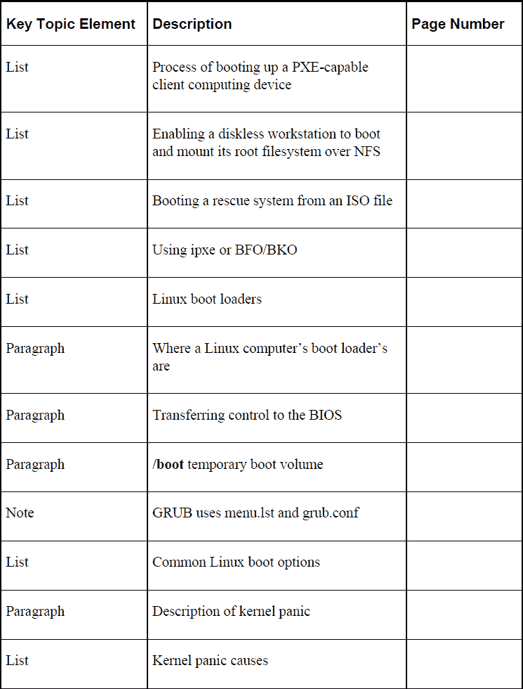

## 定义关键术语

定义本章中的以下关键术语并在术表中检查你的答案：

- 基本输入输出系统 (BIOS)
- 启动加载器
- init
- systemd
- Upstart
- reboot
- GRUB
- GRUB2
- UEFI
- PXE

## 复习题

这些复习题的答案在附录 A 中。

**1.** 你的组织希望从远程服务器启动某些系统，并从这些远程服务器挂载系统根。使用哪种协议向本地工作站提供初始 PXE 镜像？

**a.** TFTP
**b.** SMTP
**c.** HTTP
**d.** DHCP

**2.** 你的 Linux 服务器安装正确，但当你尝试启动它时，无法看到它安装的专用磁盘子系统。以下哪些命令有助于解决这种情况？（选择两项。）

**a.** `zImage`
**b.** `dracut`
**c.** `mkinitrd`
**d.** `initramfs`

**3.** 当你启动 Linux 系统时，屏幕只出现一个 `grub>` 提示符。什么命令可以显示系统检测到的可用驱动器？

**a.** `grubview`
**b.** `dd`
**c.** `less`
**d.** `ls`

**4.** 正确或错误：提供支持早期用户空间的根文件系统的 `initrd` 方法以 cpio 存档的形式存在磁盘上，并使用 `dracut` 作为其主要构建工具。

**a.** 正确
**b.** 错误

**5.** 你的服务器系统看起来良好，经常备份，并通过 UPS（不间断电源）供电，但在检查日志和系统运行时间后，你确定它每天至少重启一次。以下哪项最准确地描述了正在发生的情况？

**a.** 计划更新
**b.** 安全受损
**c.** 内核 panic
**d.** 系统宕机

## 第 5 章 管理系统服务

本章涵盖了以下主题：

- systemd 管理
- SysVinit

本章涵盖了以下目标：

- **目标 2.4:** 在定场景下，管理服务。

在本章中，我们将讨论系统管理和服务过程，以及它们是如何结构化、控制和管理的。

### “我已经掌握了吗？”测验

“我已经掌握这些了吗？”测验可以让你评估自己应该阅读整个章节，还是只需跳到“考试备习任务”部分进行复习。如果你有疑问，请阅读整个章节。表 5-1 列出了本章的主要级标题以及对应的“我已经掌握这些了吗？”测验题。你可以在附录 A 中的“‘我已经掌握这些了吗?’测验和复习题答案”中找到答案。

**表 5-1** “我已经掌握这些了吗？”基础知识章节与问题映射

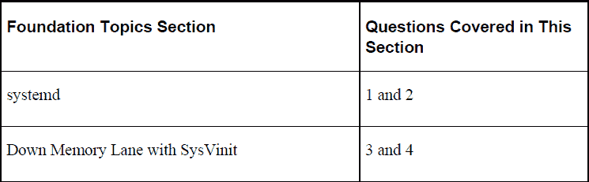

### 注意事项

自评估的目标是衡量你对本章主题的掌握程度。如果你不知道某个问题的答案，或者对答案只有部分把握，那么在自评估时，你应该将该问题标记为错误。对于你猜对的答案给自己计分会歪曲你的自评估结果，并可能给你一种虚假的安全感。

**1.** 你习惯在 SysVinit 系统上使用 `service` 命令，但最近升级到了基于 systemd 的系统。以下哪个命令是 `service` 命令最直接的替代品？

**a.** `systemdcfg`
**b.** `servicectrl`
**c.** `controlsvc`
**d.** `systemctl`

**2.** 在 systemd 系统上，以下哪一个不是有效的启动目标（target）？

**a.** `default.target`
**b.** `systemd.target`
**c.** `multi-user.target`
**d.** `graphical.target`
**e.** `emergency.target`

**3.** 你正在查看系统的 `/etc/init.d` 目录或 `/etc/rc.d/init.d` 目录，看到了许多服务名称。该系统显然在使用哪种启动和服务管理风格？

**a.** proc
**b.** SysVinit
**c.** systemd
**d.** Bootctl

**4.** 系统遇到了内部错误并崩溃。你想以最小的服务启动系统，并查看需要哪些修复。在这种情况下，哪个运行级别（runlevel）是逻辑选择？

**a.** 0
**b.** 1
**c.** 2
**d.** 3
**e.** 4
**f.** 5

### 基础知识

## systemd

`systemd` 既是一种新的系统初始化方法，对于那些一直使用 SysVinit 作为初始化方法的人来说，它又有些熟悉。

`systemd` 专为取代 SysVinit 系统而编写，同时保留了与 SysVinit 方法的某些联系以及一些命令的兼容性。

###### systemd 有何不同？

尽管 `systemd` 在引入时备受争议，经常被预测会增加系统依赖损坏的概率，并且因为它是新的而广广不受待，但 `systemd` 仍然已成为大多数现代 Linux 发行版的默认系统初始化方法。

`systemd` 的标志或主要特性是：

- 它不是 SysVinit。
- 它被认为比 SysVinit 更高效，且在操作上是并行的。
- 它比其他方法的依赖性更低。
- 它允许对服务的启动顺序以及对系统资源的优先处理进行更细致的排序。
- 它可以缩短系统启动时间。


与 SysVinit 方法中的 init 守护进程类似，`systemd` 守护进程通过 `/sbin/init` 的符号链接链接到。整个 `systemd` 工具包包含了 60 多个二进制文件，以下是其核心组件：

- `systemd`: 操作系统的系统和服务管理器
- `systemctl`: `systemd` 状态检查和状态控制工具
- `systemd-analyze`: 允许你检查系统启动的性能统计数据并查看跟踪和当前状态信息的工具

若干额外的守护进程和库构成了 `systemd` 的核心功能，包括：

- `journald`: `systemd` 的默认日志系统，使用二进制文件记录日志。它可以被 `rsyslog` 和 `syslog-ng` 等更传统的日志机制取代。
- `consoled`: 用于用户控制台的控制台守护进程，它用一个可能对系统更友组件取代了传统的虚拟终端系统。
- `networkd`: 为 `systemd` 网络访问提供网络支持的守护进程。
- `logind`: 设计用于取代 `Consolekit` 的守护进程，支持 X 显示管理器、用户登录等。

向管理员推荐 `systemd` 的附加功能包括：

- **日志记录能力**：系统的*整套*日志消息安全地存储在 `systemd` 的日志中，减少了消息丢失并提高了了故障排除的可靠性。
- **服务激活**：`systemd` 处理服务的方式将它们从特定的运行级别中释放出来，并允许它们更具按需性，由多种硬件和软件事件激活。
- **组件组**：`Cgroups` 在结构和功能上与历史上的 SysVinit 运行级别相似，它们具有关于何时启动以及在其他服务之前或之后启动的层次结构。`Cgroups` 通过为进程使用组标记极大提高了系统内存空间的整洁度，允许从内存中精确且完全地移除进程组。
- **资源分配**：由于你可以确定服务关联到哪个 `Cgroup`，因此可以精确地控制服务或服务组可以消耗的系统资源。以前你只能通过 `nice` 或 `renice` 控制失控或占用资源的进程，而 `systemd` 允许为每个服务设置精确的资源限制。这方面的例子是：一个受到极端访问的 Apache 服务器，传统上它会增加进程以占用系统的大部分资源。现在，该服务或服务组可以被精确控制。

###### systemd 中的单元

使用 `systemd` 代替 SysVinit 时，你将“初始化脚本”的概念替换为 systemd 的“单元（units）”。实际上，一个单元是一个表示系统服务配置的文件，就像 SysVinit 中的初始化脚本一样。


#### 备注

*unit（单元）*是系统的一种能力，由一个 `.service` 文件定义，因此你可能会在文档、关于 `systemd` 的对话中，甚至在这书中发现，在讨论由 `.service` 文件定义的单元时，*service（服务）*和*unit（单元）*是互换使用的。

`systemd` 单元有多种类型。服务的名称是文件名前的前缀，跟着一个 `.`，然后是服务的类型作为文件名的后缀，例如 `blahwoof.service`。

##### 单元目录位置

`systemd` 单元通常位于以下目录，按出现顺序排列，它们之间存在优先级：


- `/usr/lib/systemd/system/`: 随发行版安装的单元
- `/run/systemd/system`: 运行时创建的单元；可能高于非运行时或已安装的单元
- `/etc/systemd/system`: 由管理员控制的单元，对所有其他单元具有最高优先级

表 5-2 列出了服务类型以及每个服务的扩展名，并提供了每个服务的描述。

**表 5-2** systemd 单元类型

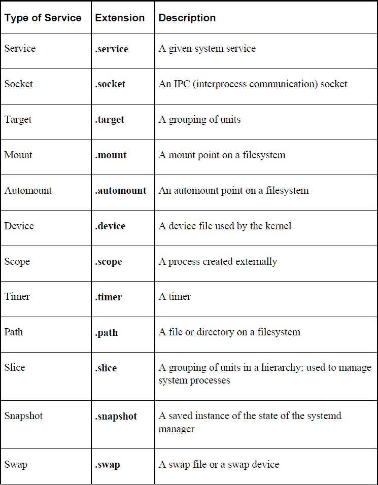

##### systemd 环境变量

`systemd` 环境变量通过定义该服务的 `foobar.service` 文件中 `[Service]` 部分的 `EnvironmentFiles=` 指令设置。

例如，为了让 `/etc/locale.conf` 文件中的信息在 `display-manager.service` 环境环境中，你需要在 `/etc/systemd/system/display-manager.service` 文件中放置以下行：

```
EnvironmentFile=-/etc/locale.conf
```

#### 备注

在文件前使用 `-` 字符用于在未找到该文件时禁用任何错误信息的生成。

## systemd 目标（Targets）与运行级别

在 SysVinit 系统中，有一组定义但可配置的运行级别，编号从 0 到 6。运行级别 本质上是一组能力或运行中的服务，你可以对它们进行预定义并设置系统启动到该级别，从而获得一组可预测的服务集合。


在 systemd 中，目标（targets）是新的运行级别。例如，`default.target` 文件通常是指向另一个目标文件的符号链接，例如 `graphical.target` 文件。目标对应于 SysVinit 的运行级别。表 5-3 显示了运行级别、目标与文件之间的相关性，并描述了启动每个运行级别或目标时会发生的操作。

**表 5-3** 启动运行级别和目标时发生的情况

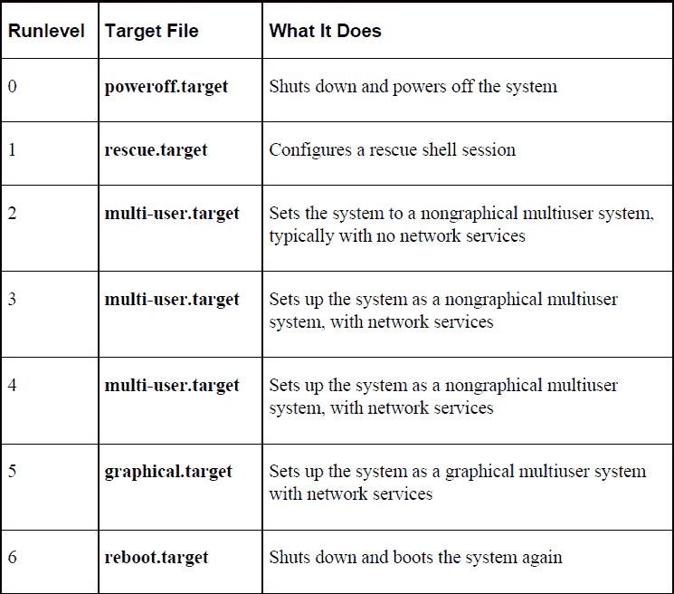

### Note

为了兼容性，目标还有另一种命名方式：`runlevel#.target`，其中 `#` 字符为 0 到 6。


## Wants（想要）与 Requires（需要）

systemd 过程使用一组被称为“wants”和“requires”的选项或需求来指示单元和单元组之间的依赖关系。

例如，如果你查看 `graphical.target` 文件的典型内容，可能会发现以下几行：

```
Requires=multi-user.target
After=multi-user.target
Wants=display-manager.service
```

`Requires` 语句意味着处理 `graphical.target` 之前，必须启动 `multi-user.target` 中列出的所有项，这意味着 `/usr/lib/systemd/multi-user.target` 目录中的所有链接服务都必须启动。只有在满足该需求后，才会处理 `Wants` 语句（这再次意味着启动相应目录中的链接服务，这次是 `/usr/lib/systemd/multi-user.target.wants` 目录），之后 `graphical.target` 将会被使用。

## 使用 systemd 启动

启动使用 systemd 的系统时，会发生之前概述相同的步骤。然而，当系统从 GRUB 启动 `systemd/init` 时，一个类似于 SysVinit init 脚本结构的结构会叠加在系统之上。


在内核和 initramdisk 之后读取的文件通常是 `default.target` 文件，它只是指向 `multi-user.target` 文件的链接。这里变得非常奇怪，因为尽管启动过程看起来简单（如示例 5-1 所示），但并非如此。

**示例 5-1** 启动过程的理论层次结构

```
Kernel
 |
 V
 multi-user.target
 |
 V
 graphical.target
```

实际情况是，`graphical.target` 需要 `multi-user.target`，后者需要 `basic.target`，而后者又需要 `sysinit.target`。这些每一个文件都必须成功加载其配置的服务才能移动到下一个，真实的启动顺序如示例 5-2 所示。

**示例 5-2** 启动过程的实际层次结构

```
 local-fs-pre.target
 |
 V
sysinit.target -- wants local-fs.target and swap.target
 |
 V
basic.target -- wants
 |
 V
multi-user.target -- wants
 |
 V
 graphical.target -- wants
```

需要一些时间才能适应 systemd 的工作方式，但在实践中，它与 SysVinit 及其在多个目录中的数十个链接并没有太大。


## 管理 systemd 的命令

正如之前简单提到的，几个命令是 systemd 场景的核心。本节的目标是带你了解这些命令的最常用用法，在后面的章节中，我们将扩展其中一些命令，以用于配置和管理 systemd 设备的特定方面。

`systemctl` 命令是你用于配置、修改、查询和管理单元文件、服务、目标以及关于 systemd 的几乎任何内容的主要工具。


### 服务/单元的状态

你可以使用 `systemctl` 启用或禁用单元/服务文件，这本质上是创建符号链接，其内容包含在单元文件的 `[Install]` 部分中。

一个 systemd 单元/服务可以处于多种状态，解释如下：

- **enabled:** 服务或单元已配置为系统启动时启动。
- **disabled:** 服务或单元已配置为在系统启动时不启动。
- **active:** 服务或单元当前正在运行。
- **inactive:** 服务或单元当前未运行，尽管如果发生连接请求或类似功能，它可能会再次变为激活状态。
- **stopped:** 这意味着服务或单元在你重启（如果它配置为系统启动时启动）或手动重启之前将不会做出响应。


### 列出服务

能够列出或找到系统上的服务是正确管理它们的关键。要列出系统上所有的服务或单元，使用以下命令：

```
# systemctl list-units --type service
```

此命令显示系统上所有的激活单元。在我们的测试系统中，它返回了 69 个单元，全部已加载并激活，但某些处于退出（exited）状态，这可能表示错误，或者是一个运行但不是持续运行守护进程的服务/单元。

要显示系统上所有加载的单元（包括未激活的），使用以下命令：

```
# systemctl list-units --type service --all
```

此命令显示系统上所有激活和未激活的服务/单元。我们的测试系统在该命令输出中返回了 151 个单元。

要列出系统上所有可用的服务/单元（无论状态如何），使用以下命令：

```
# systemctl list-unit-files
```

此命令显示系统上所有可能的的服务/单元。我们的测试系统返回了 403 个可用的服务/单元，处于各种状态。


### 启用和禁用服务

要启用给的服务，使用以下命令：

```
# systemctl enable servicename
```


此命令读取单元文件的 `[Install]` 部分，并在`/etc/systemd/system`目录中创建一个相应的符号链接，指向相应的`/usr/lib/systemd/system/somename.service`文件。通常不需要扩展名（`.service`），因为它是隐含的。

要禁用服务，使用以下命令：

```bash
# systemctl disable servicename
```

此命令从`/etc/systemd/system`目录删除指向`/usr/lib/systemd/system/somename.service`文件的符号链接。

### 注意

启用或禁用单元不等同于启动或停止单元；它只是创建适当的链接以便其正确使用，或者删除链接以便在指定该目标时不重新启动。

重新启用一个服务涉及连续禁用并重新启用该服务，这实际上是删除了然后创建了服务定义文件中 `[Install]` 部分指定的符号链接。

要重新启用一个服务，使用以下命令：

```bash
# systemctl reenable servicename
```

## 启动、停止、重启和状态

启动和停止服务非常简单，但先确定服务的状态通常是明智的。要查询服务的状态，输入`systemctl status servicename`命令，如示例 5-3 所示。

**示例 5-3：查询服务的状态**

```text
# systemctl status servicename
tuned.service - Dynamic System Tuning Daemon
   Loaded: loaded (/usr/lib/systemd/system/tuned.service; enabled; vendor preset: enabled)
   Active: active (running) since Sat 2019-01-05 18:29:04 EST; 2 weeks 2 days ago
     Docs: man:tuned(8)
           man:tuned.conf(5)
           man:tuned-adm(8)
 Main PID: 1170 (tuned)
    Tasks: 5
   CGroup: /system.slice/tuned.service
           └─1170 /usr/bin/python -Es /usr/sbin/tuned -l -P

Jan 05 18:29:01 localhost.localdomain systemd[1]: Starting Dynamic System Tuning Daemon...
Jan 05 18:29:04 localhost.localdomain systemd[1]: Started Dynamic System Tuning Daemon.
```

正如你从示例 5-3 的输出中看到的，`tuned`服务已加载并处于激活状态，且厂商已指定该服务默认启用，因此在系统启动时它通常会运行。

要停止`tuned`服务并查看输出结果，请使用以下命令：

```bash
# systemctl stop tuned
```

现在你可以使用与之前相同的命令来查询状态，如示例 5-4 所示。

### 示例 5-4：获取 Tuned 服务的状态

```text
# systemctl status tuned
tuned.service - Dynamic System Tuning Daemon
   Loaded: loaded (/usr/lib/systemd/system/tuned.service; enabled; vendor preset: enabled)
   Active: inactive (dead) since Tue 2019-01-22 09:45:26 EST; 57s ago
     Docs: man:tuned(8)
           man:tuned.conf(5)
           man:tuned-adm(8)
  Process: 1170 ExecStart=/usr/sbin/tuned -l -P (code=exited, status=0/SUCCESS)
 Main PID: 1170 (code=exited, status=0/SUCCESS)

Jan 05 18:29:01 localhost.localdomain systemd[1]: Starting Dynamic System Tuning Daemon...
Jan 05 18:29:04 localhost.localdomain systemd[1]: Started Dynamic System Tuning Daemon.
Jan 22 09:45:25 localhost.localdomain systemd[1]: Stopping Dynamic System Tuning Daemon...
Jan 22 09:45:26 localhost.localdomain systemd[1]: Stopped Dynamic System Tuning Daemon.
```

注意示例 5-4 中的输出，该服务仍然已加载，但它现在处于非激活（死亡）状态，因为它被命令停止了。

此时可以很容易地重新启动服务，或者不用停止再启动，而是直接执行`restart`命令：

```bash
# systemctl restart tuned
```

这与停止并启动服务的效果相同。如果由于某些原因你需要强制重新加载服务的配置，可以使用`reload-or-restart`命令：

```bash
# systemctl reload-or-restart tuned
```

该命令的效果是导致服务重新加载并再次读取其配置。


由于`systemd`的工作机制，重新加载服务或守护进程的概念比 SysV 稍微复杂。在 systemd 世界中重新加载运行中的守护进程会导致其对用户连接不可用，因此需要加载守护进程、重新读取配置文件并重建该守护进程的 systemd 依赖树。`daemon-reload`命令的概念与 SysV 中“重载信号（hupping）”或在不中断用户的情况下重启服务的概念非常粗略：

```bash
# systemctl daemon-reload
```

## 屏蔽服务（Masking Services）

启动和停止服务非常简单。有时某个服务会启动一个它认为想要或需要的依赖项，而你实际上并不希望使用该依赖项。禁用服务并保证它不会被加载；通常它仍然会被上层服务加载。这就是屏蔽（mask）或屏蔽操作（masking）大用场。

要屏蔽一个服务，你可以使用`mask`命令：

```bash
# systemctl mask servicename
```

该命令创建一个不指向正常位置的符号链接（正常位置应该是`/etc/systemd/system`中的某个服务文件），而是将链接创建到“黑洞”`/dev/null`。将依赖服务链接到`/dev/null`可以保证它不会被加载；即使它在系统的其他地方存在，该链接也具有优先级。

一旦服务被屏蔽，再次取消屏蔽（例如当你完成了某项需要屏蔽该服务的测试后）非常简单。你只需要删除指向`/dev/null`的符号链接即可。要取消屏蔽服务，输入以下命令：

```bash
# systemctl unmask servicename
```

### 注意

小心不要屏蔽关键系统服务，否则你的系统行为将变得不可靠或完全无法运行。


## 故障排除系统启动时间

另一个应该提到的故障排除工具是允许你分析 systemd 初始化时间的工具。`systemd-analyze`命令可以为你提供关于 systemd 功能和时机的大量信息。一个经常使用的选项是`blame`选项：

```bash
# systemd-analyze blame
```

该命令显示了当前系统中运行的单元列表，以及它们加载所需的时间。你可能需要这些数据的原因之一是查看为什么启动耗了这么多时间或被标记为等待状态。


## 为 systemd 设置环境参数

某些服务需要环境参数或变量才能运行，传统使用的方法（在`/etc/bashrc`或`~/.bashrc`中设置）可能很麻烦，因此你可以将适当的环境放在特殊文件中，该文件通过 systemd 单元中的`EnvironmentFile`指令进行引用。

```ini
EnvironmentFile=/etc/systemd/myservice
```

在该文件中设置的参数或环境变量会被自动读取并放入服务的环境中。


## 在 systemd 上设置主机名

在之前的服务管理方案中，简单的编辑文件并重启即可设置主机名，或者可以通过名称解析设置。

systemd 管理主机名的方法是使用`hostnamectl`命令。虽然有些人可能看不到使用特殊命令设置主机名的意义，但理解不同级别的主机名对于了解为什么使用标准化命令很重要。

`hostnamectl`命令解释了该工具识别的三个级别的主机名：

- **pretty**（漂亮）：这种高级主机名可以包含特殊字符且对用户友好（例如`Ross’s Great Laptop`）。
- **kernel or static**（内核或静态）：这种主机名用于内核启动时初始化的主机名，通常在其他地方不可见。
- **transient**（瞬态）：这种主机名通常由 DHCP 或 IP 管理方案设置。

`hostnamectl`命令向用户显示它感知的信息，它从`systemd-hostnamectl.service`获取，该服务是大多数主机名相关查询和信息的收集点：

```text
# hostnamectl
   Static hostname: n/a
   Transient hostname: 217
         Icon name: computer-vm
           Chassis: vm
        Machine ID: b44977c3fc6d40acaa25893225235c11
           Boot ID: 18df362437c54d90b3f9b9eaf0e60dcd
    Virtualization: vmware
  Operating System: SUSE Linux Enterprise Server 15
       CPE OS Name: cpe:/o:suse:sles:15
            Kernel: Linux 4.12.14-23-default
            Architecture: x86-64
```

多年来，Linux 广泛部署中的主要且通常唯一的服务管理机制是`SysVinit`方法。BSD 阵营使用不同的方案，但 Linux 在 SysVinit 上保持了相当好的统一。

SysVinit 使用`init`进程（该进程始终是进程 ID（PID）1），并利用许多包含服务链接的目录来控制在给定系统状态（称为运行级别，runlevel）下运行的内容。运行级别只是一组在一起并配置为在特定时间运行的系统服务。由于`systemd`目标（target）执行的功能与运行级别非常相似，`SysVinit`运行级别与`systemd`目标（如`multi-user.target`）有许多共同点，实际上`systemd`目标已经取代了`SysVinit`运行级别。

然而，目标比运行级别要动态得多，会有许多进程同时或在很大程度上并行启动；而 SysVinit 是一个非常有序且按顺序的过程，服务逐个启动并调用依赖项，然后启动下一个服务。

将 SysVinit 的启动想象成唱针在唱片机的凹槽中移动，非常同步且遵循给定顺序。将 systemd 的启动想象成向地板上撒了一盒兔子：起初是混乱的，但最终所有东西都会启动并运行。

## 为你温习一下吧？

作为复习，一旦`init`完成了任何所需的初始化工作，就会读取`/etc/inittab`文件，并解析设置默认运行级别的行。


文件中的行看起来如下：

```text
id:3:initdefault:
```

数字 3 是该系统配置的默认运行级别。一旦确定了默认运行级别，系统将进入特定的`rcX.d`目录（该目录包含指向`init.d`脚本的链接），并特定的数字顺序执行脚本。

表 5-4 比较了当年 Red Hat 和 Debian 系统上的`init.d`目录结构与当前所有版本使用的 systemd。

**表 5-4：Red Hat 与 Debian 中的服务位置**

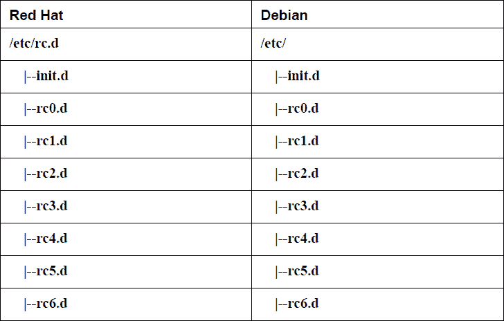

在每情况下，`init.d`目录都包含所有配置的守护进程可执行文件。它们通过两种脚本从运行级别目录进行链接：启动脚本和杀死脚本。这两个脚本都是指向`init.d`目录中守护进程可执行文件的符号链接。

启动脚本类似于`S20network`，其中大写 S 的存在表示守护进程自启动，数字强制执行特定的启动顺序，而服务名是链接名称的最后部分，作为记忆符。杀死脚本使用类似的命名约定。例如，`K09network`使用大写 K 而不是 S。大写 K 的存在表示守护进程优雅地关闭。

系统初始化完成后，`init`进程读取`/etc/inittab`文件并找到设置默认运行级别值的行。获取该值后，`init`进程找到相应的运行级别目录，并在进入该目录后按数字顺序（0 到 99）运行启动脚本。

当运行级别更改时，系统会记录当前运行级别守护进程的状态，检查目标运行级别的脚本，并保留那些定义为 S 符号链接的运行状态。如果目标运行级别中某个守护进程没有 S 符号链接，则其被视为未定义，在更改运行级别之前会运行终止该守护进程的 K 脚本。

## SysVinit 启动序列

Linux 系统的启动步骤在发行版之间相对相似，Slackware 和 BSD 变体除外。以下步骤显示了使用 SysVinit 系统初始化方法时的启动过程。systemd 和 Upstart 将在后续章节介绍。

SysVinit 启动过程如下：

**步骤 1。** 打开系统电源。

**步骤 2。** 基本输入输出系统（BIOS）代码加载并寻找有效的引导扇区。

**步骤 3。** BIOS 根据查找顺序从软磁盘、硬盘或 CD-ROM 加载引导扇区。

**步骤 4。** 读取主引导记录（MBR）；它位于第一个或活动硬盘第一个扇区的前 512 字节中。

**步骤 5。** 执行找到的任何引导程序代码。

**步骤 6。** 启动 GRUB 或已安装的引导程序。

**步骤 7。** 用户选择或输入选项，或者引导程序超时并开始加载默认项。

**步骤 8。** 如果你选择了 Linux 镜像/选项，将读取加载 Linux 内核的路径并执行压缩后的内核。

**步骤 9。** 当 Linux 内核加载时，它会初始化设备，加载任何必要的模块，寻找初始 RAM 磁盘（initrd）并在必要时加载。然后根据条目中`root=/dev/XXX`信息挂载根文件系统。

**步骤 10。** 加载`/sbin/init`程序并成为 PID 1，它是系统中所有其他进程的祖父。

**步骤 11。** `init`进程然后读取`/etc/inittab`文件，并为 Debian 系统运行`/etc/init.d/rcS`脚本，或为 Red Hat 系统运行`/etc/rc.d/init.d/rc.sysinit`脚本。

**步骤 12。** 系统初始化脚本加载必要的模块，检查根文件系统，挂载本地文件系统，启动网络设备，然后挂载远程文件系统（如果配置了）。

**步骤 13。** `init`进程再次读取`/etc/inittab`文件，通过执行相应目录中的脚本将系统更改为默认运行级别。

**步骤 14。** 执行运行级别脚本，默认运行级别目录中的`SXX`服务脚本按标准数字排序运行。（在大多数启动情况下这很容易看到，因为系统屏幕右侧会出现一长串绿色的 `[OK]` 标记，表示服务已正确加载。）

**步骤 15。** 加载`/etc/inittab`中设置的 mingetty 会话，系统（以及登录）显示登录提示并等待用户登录。

## 管理系统运行级别

能够正确管理系统的运行级别意味着你将能够以可预测的方式在相应的模式运行系统，并启用正确且准备就绪的服务。

### 注意

SysVinit 运行级别实际上等同于 systemd 目标。请参考表 5-3 获取常用运行级别的定义。


## 确定默认运行级别

在 SysVinit 系统上，确定运行级别很简单：你执行`runlevel`命令，它返回如下输出：

```text
N 2
```

第一列（包含字符 N）显示没有之前的运行级别，这意味着系统启动并到达运行级别 2（输出中的第二列），而没有经过中间步骤（如运行级别 1）。

### 注意

如果你看到之前的运行级别（如 1）然后是当前运行级别（在此例中为 2），你应该确定是你或另一位有效的管理员由于正当原因进入了单用户模式；否则，系统可能被破坏过。

此外，你可能还可以运行`who -r`命令来获取更像英语句子的输出：

```text
run-level 2 2015-03-01 10:14
```


在运行的 systemd 系统上，你可以使用`systemctl get-default`来确定默认目标。输出是符号链接指向的目标解析名称，例如：

```text
multi-user.target
```

### 注意

运行级别是互斥的，而目标不是。也就是说，只能有一个运行级别可以是当前运行级别，而你实际上可以拥有多个激活目标。

要确定所有激活的目标（targets），请使用`systemctl list-units --type=target`命令。输出是激活的目标文件的名称，例如：


```
multi-user.target
graphical.target
```


## 设置默认运行级别

在 SysVinit 系统上，设置默认运行级别简单，只需选择你需要的运行级别，然后编辑`/etc/inittab`文件，并将`id:5:initdefault:`修改为反映你所需的运行级别数字（将数字 5 替换为 0 到 6 之间的所需数字）。

在 systemd 机器上，你通过符号链接（symlink）指定特定的目标来更改默认运行级别。例如，要使系统默认进入`graphical.target`运行级别，你需要创建一个名为`default.target`的符号链接，指向`graphical.target`文件的相应位置：

```
ln -sf /usr/lib/systemd/system/graphical.target /etc/systemd/system/default.target
```


## 更改运行级别

在 SysVinit 系统上，更改当前运行级别涉及两个命令之一：`init`或`telinit`。

### 注意

`/sbin/telinit`命令是`/sbin/init`命令的符号链接，因此它们并不是两个不同的命令；`telinit`的存在是为了历史原因，或者如果你有许多使用它的旧脚本，出于反恐慌性考虑（即为了兼容那些仍使用`telinit`或在脚本中包含它的人）。

要将当前运行级别设置为 3，请以 root 身份或使用`sudo`执行命令：

```
init 3
```

在 systemd 机器上，你可以通过执行以下命令将当前目标设置为单个目标：

```
systemctl isolate runlevel5.target
```

或者

```
systemctl isolate graphical.target
```


## 从命令行关机和重启

妥善关机非常重要，可以避免文件系统缓冲区中未写入数据的不必要丢失或磁盘损坏。当前版本的 Linux 文件系统比几十年前要灵活且宽容得多，但在运行中的系统上直接断电几乎保证会导致问题（或多个问题）。

在 SysVinit 系统上，你可以使用几个命令来妥善关机，首先是：

```
halt -p
```

这会停止系统并使用硬件调用关机。

更常用的命令是`shutdown`命令，它有多个实用的选项：

- `-H, --halt:` 停止机器但不关机。
- `-P, --poweroff:` 停止并关闭机器电源。
- `-r, --reboot:` 在妥善关机后重启机器。
- `-k:` 不关机、停止或重启，仅写入一条全屏消息（也称为 -Kidding）。此选项旨在吓跑用户离开系统，以便执行关键任务。

你可以像之前使用 SysVinit 命令和选项那样对 systemd 机器关机，或者使用`systemctl`命令，如下：

- `systemctl halt`：功能正如其名：停止系统；不关机。
- `systemctl poweroff`：关机系统（停止）并关闭电源。
- `systemctl reboot`：关机系统（停止）然后重启系统。

### 注意

在不是 root 用户的系统上，或者 root 用户账户未用于正常管理的情况下，请在`systemctl`命令前加上`sudo`命令。你必须为账户配置`sudo`命令，一旦完成，就可以运行`systemctl`命令，例如：

```
sudo systemctl reboot
```

## 总结

在本章中，你学习了许多通过 SysV 和 systemd 进行系统化的知识，包括运行级别、单元、目标以及关于系统服务管理的更多。你还学习了如何设置默认运行级别/目标、更改运行级别和目标，以及妥善地关机和重启系统。

## 考试准备任务

正如引言中“如何使用本书”部分提到的，你有几种准备考试的选择：这里的练习、第 30 章、“最终准备](#ch30.html_ch30)”以及 Pearson Test Prep 在线软件中的考试模拟题。

### 复习所有关键点

复习本章最重要的主题，这些主题在页面外边缘用关键主题（Key Topics）图标标记。表 5-5 列出了这些关键点及其所在的页码。


**表 5-5** 第 5 章关键点

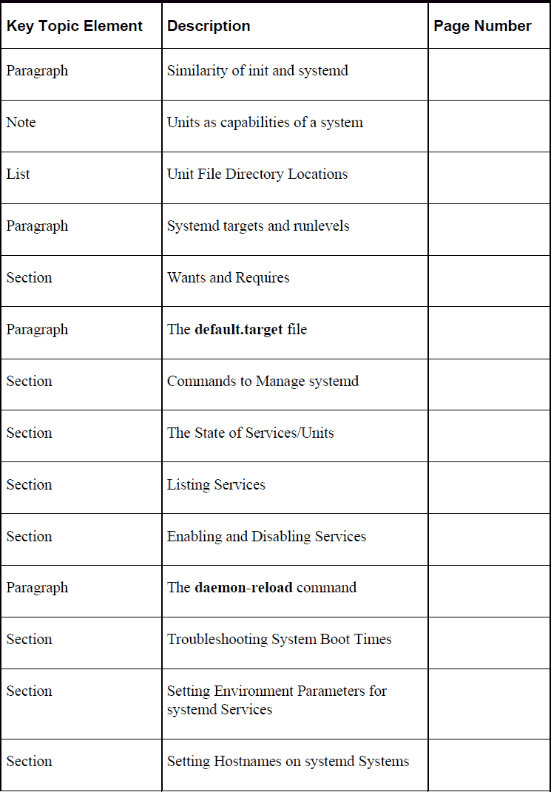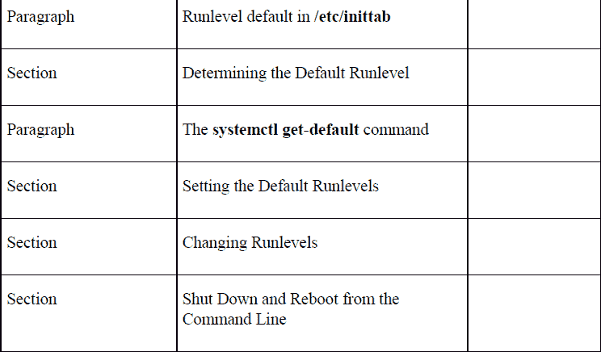

## 定义关键术语

定义本章的以下关键术语并在词表表中检查你的答案：

启动过程

BIOS

启动加载器

init 进程

systemd

启动日志

运行级别

关机

重启

## 复习题

这些复习题的答案在 附录 A 中。

**1.** 你希望基于 systemd 的服务器启动到非图形界面以节省宝贵的系统内存。你会使用以下哪一个目标作为默认？

**a.** `multi-user.target`

**b.** `non-graphical.target`

**c.** `normal-system.target`

**d.** `runlevel-3.target`

**2.** 你将一组服务归类，并希望系统在正常运行运行时将这些服务作为预定义集合使用。在 systemd 系统上，你称这组服务为什么？

**a.** Wants

**b.** Unit

**c.** Target

**d.** Required

**e.** Runlevel

**3.** 在 SysVinit 系统上，占用进程 ID (PID) 1 的守护进程的路径和文件名是什么？

**a.** `/etc/init`

**b.** `/sysv/init`

**c.** `/sbin/init`

**d.** `/var/init`

**4.** 下列哪个命令用于显示 SysVinit 系统上运行级别的状态？

**a.** `runlevel`

**b.** `sysvinit`

**c.** `chglevel`

**d.** `systemctl`

## 第 6 章. 系统性能

本章涵盖以下主题：

- 进程 ID
- 进程状态
- 优先级
- 信号
- 进程命令

本章涵盖以下目标：

- **目标 4.2：** 给定场景，分析系统进程以优化性能。

*系统性能*取决于你的系统硬件和软件，以及在这些有限硬件上使用系统软件运行的进程数量和类型。

启动、停止、管理、设置优先级和移除异常进程是确保 Linux 系统良好性能的必要技能。

### “我已经掌握了吗？”测验

“我已经掌握了吗？”测验可以帮助你评估是否应该阅读整章内容，还是直接跳转到“考试准备任务”部分进行复习。如果你有疑问，请阅读整章。表 6-1 概述了本章的主要标题和对应的“我已经掌握了吗？”测验题。你可以在 附录 A 中的“‘我已经掌握了吗？’测验答案”中找到答案。

**表 6-1** “我已经掌握了吗？”基础知识点章节到题目映射


### 注意事项

自评估的目标是衡量你对本章主题的掌握程度。如果你不知道某个问题的答案，或者对答案部分不确定，那么在进行自评估时，你应该将该问题标记为错误。为你猜对的答案给自己加分会偏差你的自评估结果，并可能给你带来虚假的安全感。

1. 下列哪个命令可以显示进程的树形层次结构及其相关信息？（选择所有适用项。）

**a.** `procheir`

**b.** `lsproc`

**c.** `ps`

**d.** `pstree`

2. 你想终止一个进程，但不想引起不的数据丢失或其他问题。哪个信号最合适？

**a.** `SIGTERM`

**b.** `SIGKILL`

**c.** `SIGEXCUSEME`

**d.** `SIGHUP`

3. 当你运行`jobs`命令时，输出的列表中其中一个作业旁边显示有一个`+`符号。这个`+`符号表示什么？

**a.** 一个使用的 CPU 比其他进程多的进程

**b.** 一个经过 nice 值调整（niced）或重新调整（reniced）的进程

**c.** 最近一次被操作过的进程

**d.** 最近运行过超过一次的进程

4. 你正常启动了一个进程，但通过进程管理工具发现它正在消耗大量的 CPU 资源。你会使用哪个命令将该进程的优先级更改为可以接受的优先级？

**a.** `sweeten`

**b.** `renice`

**c.** `like`

**d.** `fg`

5. 你需要启动一个进程，并在调用用户注销后让它继续运行。哪些命令可以让你实现这一点？（选择两个。）

**a.** `nohup`

**b.** `screen`

**c.** `nologout`

**d.** `leavit`

### 基础主题

## 进程管理

管理程序和进程对于运行 Linux 机器至关重要。各种实用可以帮助你管理进程。让我们从查看进程开始，然后删除进程。最后，我们将介绍进程优先级。


### 查看进程

当你需要查看机器上运行着什么时，无论机器上安装了什么 GUI 工具或程序，你都可以使用`ps`命令。`ps`命令用于显示进程信息，并带有用于格式化输出的开关。

例如，要显示用户及其 shell 启动的进程，只需输入`ps`命令，如下：

```
# ps
 PID TTY TIME CMD
19856 pts/0 00:00:00 bash
20057 pts/0 00:00:00 ps
```

这是系统进程的最简单视图，但它遗除了许多后台或未与终端关联的进程。`-a`选项基本上显示当前用户除 BASH shell 之外启动的任何进程。使用以下命令显示逐渐增加的信息：

```
# ps -a
 PID TTY TIME CMD
 1497 tty1 00:00:00 startx
 1510 tty1 00:00:00 xinit
 1523 tty1 00:00:00 gnome-session
 1528 tty1 00:00:00 xinitrc <defunct>
15075 pts/1 00:00:00 ps
... 为了可读性输出已截断。
```

显然，你在这里获得了更多信息，因为使用了一个开关来显示所有绑定终端的进程。如果系统中还有另一个用户，你也可以看到列出的她的进程。

现在输入以下内容：

```
ps -a | wc -l
66
```

重要的数字是`wc`命令报告的数字：输出的行数。每一行代表一个正在运行的进程。这台机器通过`ps`命令发现了 66 个进程。


需要了解的更多`ps`命令开关如下：

- `a`: 显示所有用户的进程。
- `u`: 显示进程的用户信息。
- `x`: 显示没有控制 tty 的进程。

## 有什么区别？

初级系统管理员之间对于为什么有时使用`ps aux`而有时使用`ps -aux`存在很多困惑。帮助页（man page）并没有什么帮助，但它确实告诉了你*为什么*使用或使用横杠。Linux 版本的`ps`命令是一个后来者。这个版本有两个主要的来源：BSD 和 POSIX，它们提供了处理命令和选项的虽但相似的方法。

BSD 风格在`ps`命令中使用选项的方法是，你可以将它们分组（例如`aux`），但前面不加横杠。POSIX 或 Unix 方法是你可以将它们分组，但它们前面必须带有一个横杠（例如`-aux`）。简而言之，这两种方法很相似，Linux 版本的`ps`允许任一方法。

使用`pstree`命令显示系统上进程的层次结构，如下例所示：

```
init-+-apmd
 |-atd
 |-bdflush
 |-bonobo-activati
 |-crond
 |-cupsd
 |-dhcpcd
 |-evolution-alarm
 |-gconfd-2
 |-gnome-cups-mana
 |-gnome-name-serv
 |-gnome-panel
 |-gnome-settings-
 |-gnome-smproxy
 |-gnome-terminal-+-bash
 | `-mgt-pty-helper
```

注意

`ps`和`pstree`命令有许多选项。对于 Linux+ 考试，尽可能多地了解它们是有好处的。这两个命令都具有以树形或层次化方式显示系统正在运行进程的能力。


Linux+ 考试可能会包含测试你对`ps`命令熟悉程度的问题，包括 Linux 使用什么作为该命令的等效命令：

```
# ps -ef
```

通过以下操作验证`ps -ef`与`ps aux`的相似程度：

```
# ps -ef > psef
# ps -aux > psaux
# vimdiff psef psaux
```

两个输出流之间有很多相似之处。`ps aux`命令来自 Linux，而`ps -ef`源于 Unix。


### free 命令

`free`命令用于确定系统上的空闲内存，不仅通过显示未使用的系统 RAM 数量，还提供有关空闲和已用物理内存的详细信息、使用了多少交换空间或基于磁盘的虚拟内存，以及使用的系统 RAM 有多少被缓冲区和缓存占用。

在我们教的每节课中都有这样一个时刻：学生/参与者看着`free`命令的输出，露出困惑的表情，因为他们无法将系统中实际使用的 RAM 量与当前负载联系起来。我们总是花时间解释，低负载系统上的系统 RAM 就像一辆只有半满乘客的巴士：每个乘客旁边的座位都有放置杂志、零食和饮料的空间，并且有足够的空间伸展。然后我们将乘客与运行的进程建立联系。我们指出，为乘客分配的空间类似于进程的工作集（运行所需的所有内容）。这里的关键在于，当负载较低时，系统可以将原本未使用的系统 RAM 分配给缓存和缓冲区等方便实用的项目，进程可以稍微伸展，并拥有完全加载的工作集以实现高效运行。

### 块和缓冲区

进程运行和系统处理速度的关键是块和缓冲区。像磁盘之类的块设备具有一个名为块的可寻址单位。这通常的大小为 512 字节。系统软件也使用称为“块”的结构，但它通常比硬盘设备上的物理块尺寸大得多。

当磁盘块被读取到系统内存时，它被存储在缓冲区中。一个缓冲区与仅一个块关联，该缓冲区用于在内存中对该块包含的数据进行地址。

### 页、Slab 和缓存

内核使用页来管理系统内存。处理器可以寻址非常小的内存单元（例如“字”或“字节”），但内存管理单元使用页并仅按页大小进行内存寻址。内核在`struct_page`表中处理内存的每一个页，并在表的每个页条目中包含管理该页至关重要的信息。

页经常被填充相同的数据，这些数据从缓冲区读取并写回缓存以便稍后读取。系统管理自己的结构并将页标记为已使用或空闲；系统还可以使用许多其他标记或参数，但它们在本次对话中并不重要。

缓存由`slabs`](#glossary.html_gloss_225)组成；一个 slab 通常是一个页，尽管它可以是多个连续的页。为了说明缓存与 slab 之间的关系，我们可以说缓存像一个城市，slab 像一个社区，而页则是该社区中的一个街区。

总而言之，块（blocks）是磁盘上的数据位置，当从磁盘请求文件或一组文件时，块会被读取到缓冲区（buffers）中；当这些缓冲区被读取到内存页时，该页就是组成缓存的一个 slab 或一组 slab 的一部分。

继续之前的巴士和乘客的类比，请记住，轻负载系统会显示出较大的 RAM 利用率，但同时也伴随着大量的缓存和缓冲区使用；而运行许多进程的重负载系统则显示有大量 RAM 在使用，但缓存和缓冲区的使用相对较低。实际上，随着你向系统中加载了更多进程，所有乘客/进程都必须收紧它们的工作集；将它们的杂志、零食、额外行李和饮料放在头顶架上或座椅下方；并尊重其他乘客/进程。

## 解释 free 显示的信息


`free`命令有许多选项，但在查看执行示例之前，讨论并定义你看到的输出列是非常关重要的。以下定义来自`free`的 man 页：

```
total    安装的总内存（/proc/meminfo 中的 MemTotal 和 SwapTotal）
used     使用的内存（计算方式为 total - free）
free     未使用的内存（/proc/meminfo 中的 MemFree 和 SwapFree）
shared   （主要）由 tmpfs 使用的内存（proc/meminfo 中的 Shmem，内核 2.6.32 及以上版本可用，如果不可用则显示为零）
buffers 内核缓冲区使用的内存（/proc/meminfo 中的 Buffers）
cached   页缓存使用的内存（/proc/meminfo 中的 Cached）
```

当你在阅读这一节时，请记住，所有这些信息都以原始格式存在于提到的`/proc/meminfo`目录的各种文件中。`free`命令简单来说就是读取这些数据，并以一种更有组织、更可配置的方式将其显示出来，供你阅读。

### Note

`free`命令与其他许多系统实用类似。它允许你以两种模式显示计数或数据，第一种是“这是一个巨大的字节级数字，祝你好运将其转换为人类可以理解的内容。”或者你也可以直接使用`-h`选项；它将数值转换为字节、千字节、兆字节、吉字节甚至拍太字节，如图 6-1 所示。Linux+ 考试可能会对`free`命令的选项进行测试，因此请密切关注本节中的示例。

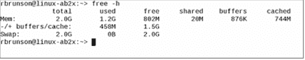

**图 6-1** 使用`-h`选项运行`free`命令

查看图 6-1 中的 total 列。那是运行`free`命令的虚拟机上的总 RAM。接下来的两列 used 和 free 确切地告诉我们有多少 RAM 正在被使用，以及剩余多少未被使用。


`buffers` 和 `cached` 列显示了当前用于存储缓存和缓冲器的 RAM 量，这些数字可能会随着时间的推移和负载的不同而变化。如果你想看到其中某些项目发生变化，可以使用命令。例如，要查看 `cached` 列的变化，执行 `find / -iname ".txt"` 命令来查找系统中你有权访问的每个文本文件，你会看到 `cached` 列扩大，因为它预测性地加载了许多系统现在假设你可能会读取或使用另一个工具使用的文件。然后再次运行 `free` 命令，查看数字的变化，特别是 `cached` 列，因为许多文件被找到并被预测性地缓存，以防你可能需要读取它们；这些读取将来自内存，而不是来自磁盘。


此外，你可以使用 `--all` 长格式选项来获取更详细的信息摘要。同时包含 `-h` 选项也有帮助，可以以千字节、兆字节、吉字节等单位获取摘要信息（请参见图 6-2）。

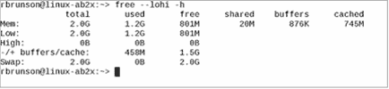

**图 6-2** 使用 `--all` 选项运行 `free` 命令

## 系统运行时间（Uptime）

使用 `uptime` 命令确定系统已“运行”了多久，或自重启以来运行了多久。此命令提供了一些有用信息：当前系统上的用户数，以及在过去 1、5 和 15 分钟内处理器运行队列的平均作业数。


运行队列中的作业信息对于判断为什么系统可能缓慢或看起来迟钝很有帮助。队列中有过多的作业意味着系统负载过重，或者正在花费大量从磁盘读取数据而非从内存缓存读取数据的时间（如前节所述）。

一种可能的解决方法是开始监控进程数量以及交换空间（swap space）的使用情况。大量的进程数量和活跃的交换空间使用（即未被分配但实际正在使用的空间）表明系统已过载。

轻负载系统返回的 `uptime` 输出如下：

```
14:22pm up 3 days 3:34, 3 users, load average: 0.00, 0.02, 0.05
```

### Note

我认识一些系统管理员，他们有一个 `cron` 任务，每 30 分钟运行一次 `top` 和 `uptime`，并将输出作为电子邮件发送给他们，这样他们就可以定期查看发生了什么，而不需要不断监控系统。这是获取重要信息的一种快速简单的方法。

## 向进程发送信号

传统上，在学习信号和进程时，你会被介绍一个信号列表，每个信号右侧都有一个解释，然后老师会教你 `kill` 和 `killall` 命令。如果你运气好，老师喜欢使用 `pgrep` 或 `pkill`，你也会学习一些关于这些命令的知识。

表 6-2 显示了常用的信号名称、它们的数字等值以及每个信号对进程的作用。


**表 6-2** Linux 信号

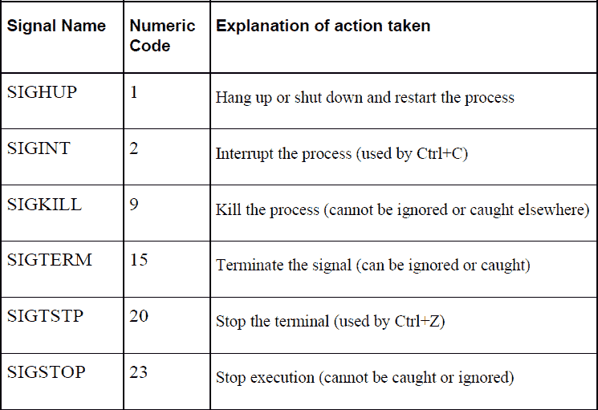

向给定进程发送信号的最常用方法是在命令或脚本处理时按下 `Ctrl+C`，而不是在不必要的情况下中断进程。如果你等了合理的时间仍没有发生变化，或者进程看起来死锁了，请尽管中断进程；只需注意你可能会丢失少量数据或遭受其他意料之外的后果。

### Note

显然，如果你正在运行一个生成数据的命令，中断可能会产生后果，但仅仅中断一个长时间的文件搜索或输出命令是相对无风险的。有时进程会被标记为“不可中断”或处于“不可中断睡眠”状态，这通常意味着进程正在等待来自磁盘或网络的 I/O。在 `egrep` 的第八列中，或者在使用 `aux` 选项的 `ps` 输出中，`D` 指示的存在表示不可中断睡眠状态。关于此状态的更多信息可以在 `ps` 命令的 man 页“PROCESS STATE CODES”头部找到。

另一种向运行中的进程发送信号的常用方法是按下 `Ctrl+Z` 向进程发送 `SIGTSTP` 或 `20` 信号，有效地暂停进程，通常该进程会通过 `bg` 命令放入后台，正如作业控制所示。这将在本章后部分的“作业控制”节中介绍。

## 通过 PID 杀死进程

停止进程的普通方法是使用 `kill` 或 `killall` 工具向其发送一个礼貌的终止信号。当你遇到一个无法从内存中移除的进程时，可能是因为它没有接收信号，或者可能是因为极其“固执”，你需要杀死该进程并将其从内存中移除。

请记住，`kill` 和 `killall` 命令仅仅是向进程发送信号；它们并不会真正删除进程。


默认的终止信号是数字 15，信号名称为 `SIGTERM`。该信号礼貌地请求进程结束，并允许它清理内存。如果你输入 `kill` 命令加上程序的进程 ID（`PID`），`SIGTERM` 信号（数字 15）就会发送到该程序。

`SIGHUP`、`HUP` 或 `1` 信号是一个特殊情况。我们可以称之为重置信号（bounce signal），进程并非仅仅被杀死，而是接收到信号结束并重新启动。使用重置信号最常见的原因是让服务器守护进程等进程停止、重新读取配置文件，然后再次启动。你可以通过 `-1` 或 `-HUP` 来指定此信号，如下所示：

```
kill -1 PID or kill -HUP PID（重置或重启进程）
```

### Note

许多服务器管理员不得不对服务器上的服务进行“重置”，要么是为了重新读取配置文件，要么是在服务神秘地停止工作后让其恢复运行。你可能会在 Linux+ 考试中看到重置信号；这是该主题中经常被遗漏的部分。


`SIGKILL` 或 `9` 信号是终极终止信号。即使进程是一个僵尸进程（即无法通过任何其他手段杀死），`kill -9 PID` 命令通常也能杀死进程并将其从内存中移除：

```
kill -9 PID or kill -KILL PID（给进程一发子弹，无处可逃）
```

被 `SIGKILL` 杀死的进程没有机会保存数据或执行任何其他操作。

## 使用其他标准杀死进程

有时你无法通过 `PID` 杀死进程——因为该 PID 不可用，或者你无法通过 `ps` 命令在进程表中找到它，或者由于其他原因。其他情况下，可能有许多同名的进程，你不希望花费大量时间通过 `PID` 一个一个杀死它们，或者你并不在乎具体是哪个进程；你只想清理掉那种特定的命名或相似进程并重新执行命令。


杀死多个同名进程最常见的方法是使用 `killall` 命令。我以前开玩笑说，这个命令是由一个极度沮丧且具备编程技能的 Netscape Communicator 用户设计的，这样他就可以清除机器上所有的 `netscape` 进程并重启浏览器，但这可能并不完全真实。（不过，根据我的经验，应该是这样的。）你可能会在 Google 的 Chrome 浏览器上遇到这个问题，所以如果你愿意，可以在你的 `killall` 命令中使用 `chrome`。

使用 `killall` 非常简单。你可以运行 `ps aux` 来查找你想要杀死的进程的名称，然后使用 `killall` 命令后跟名称，例如：

```
# killall process_name
```

在更高级或复杂的层面上，你可以使用 `pkill` 或 `process kill` 命令，它不仅限于使用进程的命令名称，还可以根据多种标准找到并向进程发送信号，包括：

- 进程名称
- 进程 ID
- 用户名
- 进程或会话 ID
- 终端


`pkill` 并不复杂，但如果你使用多个标准（例如用户名和控制终端），则所有标准必须匹配，否则信号将不会发送。`pkill` 命令有一个配套程序 `pgrep`，它通常用于在实际“扣动扳机”执行之前测试预期的 `pkill` 命令。


`pgrep` 的另一个强大实用的功能是你可以用它找到进程，并将它们传递给另一个命令，例如 `renice`。例如，要找到所有运行中的 Chrome 浏览器进程并更改它们的优先级级别，可以使用以下命令：

```
# renice +5 'pgrep chrome'
```

这会找到进程表中所有名为 `chrome` 的进程，并对它们执行 `renice +5` 命令，有效地将它们的优先级从默认值降低。

使用 `pkill` 时，你通常使用与 `pgrep` 相同的命令和选项，只是 `pkill` 会直接对进程执行信号传递，而不是像 `pgrep` 通常那样将输出到 stdout 或控制台。

### Note

关于作为 root 用户使用 `killall` 或 `pkill` 的快速警告：如果你以 root 身份运行任一命令，它将杀死系统中所有匹配标准的进程，无论所有者是谁，这可能不是你想要的。它还会让你面对你所有的用户，因为他们会打电话来询问服务器发生了什么。运行这些命令最安全的方法是作为普通用户，或者作为 root 用户时非常小心地运行。

## 查找正在使用资源的程序

对于系统操作员来说，没有什么比一个正在使用资源的进程更令人沮丧，因为它阻止了你卸载磁盘、执行磁盘检查或其他与磁盘交互——这仅仅是因为某个进程一直占用它。

### 介绍 `lsof`

当进程占用资源时，有一个 `lsof` 命令，最简单的情况下，它如其名所示列出打开的文件，尽管它在参数和选项的使用上可以非常详细。

在我们仔细查看 `lsof` 之前，重要的是意识到 Linux 系统上的打开文件有许多不同的类型，因为系统上的几乎一切都表示为文件。打开的文件包括以下类型：

- **普通文件（Regular）：** 普通文件可以是文本文件、图形、库等。
- **目录（Directory）：** 目录文件可以包含指向其他文件或目录文件的链接。
- **块设备（Block）：** 块文件提供了可以按块读写的设备的访问，例如磁盘设备。
- **字符设备（Character）：** 字符文件提供了对字符或原始设备的访问，如扫描仪、键盘、鼠标等。
- **库（Library）：** 库文件包括系统库，如 `libc`，或程序在运行期间调用的任何编译软件程序集。
- **套接字（Socket）：** 套接字是通信的端点。示例包括网络套接字，数据通过网络数据包发送到另一个系统。

### 使用 `lsof`

你可以使用 `lsof` 列出系统根目录下打开的文件，如示例 6-1 所示。

**示例 6-1** 列出系统根目录下的打开文件

```bash
# lsof /
```

```text
COMMAND    PID  USER   FD   TYPE DEVICE SIZE/OFF    NODE NAME
systemd    893 rossb  cwd    DIR    8,1     4096       2 /
mate-sess  936 rossb  txt    REG    8,1   248144  918396 /usr/bin/mate-session
mate-sess  936 rossb  rtd    DIR    8,1     4096       2 /
```

在上面的输出中，你看到了以下列：

- `COMMAND` - 程序/可执行文件/进程的名称
- `PID` - 命令的进程 ID（PID）
- `USER` - 命令所属的用户帐户
- `FD` - 文件描述符（文件类型），完整列表请参阅 `lsof` 的 man 手页
- `TYPE` - 文件类型的短代码，有很多种，请参阅 man 手页
- `DEVICE` - 文件的设备号，或内存或内核的引用
- `SIZE/OFF` - 文件的大小，或文件的偏移量（从文件开始或内存地址的距离）
- `NODE` - 本地文件、IP 数据包、流甚至是设备 IRQ 的节点号
- `NAME` - 文件所在的挂载点和文件系统的名称

要查找系统中由用户进程正在使用的所有打开文件，可以添加 `-u username` 选项：

```bash
lsof -u rossb
```

```text
COMMAND    PID  USER   FD   TYPE DEVICE SIZE/OFF    NODE NAME
systemd    893 rossb  cwd    DIR    8,1     4096       2 /
mate-sess  936 rossb  txt    REG    8,1   248144  918396 /usr/bin/mate-session
mate-sess  936 rossb  rtd    DIR    8,1     4096       2 /
```

要查找某个特定用户（如 root 用户）所有未打开的文件，可以使用以下命令：

```bash
lsof -u^root
```

```text
COMMAND    PID  TID            USER   FD      TYPE             DEVICE SIZE/OFF       NODE NAME
systemd-r  419      systemd-resolve  cwd   unknown                                        /proc/419/cwd (readlink: Permission denied)
systemd-r  419      systemd-resolve  rtd   unknown                                        /proc/419/root (readlink: Permission denied)
systemd-r  419      systemd-resolve  txt   unknown                                        /proc/419/exe (readlink: Permission denied)
```

## 作业控制（Job Control）

作业控制发明于用户只能访问单个终端时期，完成更多工作通常需要另一个终端。作业控制允许用户在前台应用程序工作的同时，在后台模式运行多个命令。

在使用 shell 时，可以运行、挂起程序然后将其放入后台，或者也可以一步到位调用命令并将其放入后台。


### 注意

当你将命令放入后台时，在命令行的末尾使用 `&` 字符并用空格隔开，例如 `command1 -option &`。这会导致命令在执行时被放入后台。

作业控制涉及以下步骤：

**步骤 1.** 启动一个任务，例如编辑器。

**步骤 2.** 按 `Ctrl+Z` 挂起程序。

**步骤 3.** 执行 `jobs` 命令查看状态：

```text
# jobs
[1]+ Stopped vim
```

**步骤 4.** 输入 `bg` 并按回车键将作业 1 发到后台：

```text
# bg
[1]+ vim &
```

**步骤 5.** 在后台启动另一个程序，如 `top`：

```bash
# top &
```

**步骤 6.** 运行 `jobs` 命令查看有哪些作业以及它们是如何编号的：

```text
# jobs
[1]- Stopped vim
[2]+ Stopped top
```

在 `jobs` 命令的输出中，作业可以有三种标记：

- 作业旁边的加号（`+`）表示当前作业，任何诸如 `fg` 或 `bg` 的命令默认都会对该作业生效。
- 作业旁边的减号（`-`）表示上一个作业或上一次操作的倒数第二个作业。
- 缺少字符表示普通作业，除非通过作业号指定，否则不会对其采取任何操作。

**步骤 7.** 使用 `fg` 命令将默认作业置于前台模式。`top` 命令回到前台。

**步骤 8.** 按 `Q` 退出 `top` 命令。

**步骤 9.** 再次运行 `jobs` 命令，注意 `vim` 作业现在又变成了当前作业。

**步骤 10.** 通过 `kill` 命令输入其 ID 来杀死 `vim` 作业：

```text
# kill %1
Vim: Caught deadly signal TERM
Vim: Finished.
```

**步骤 11.** 再次运行 `jobs` 命令。你将看到作业控制功能报告的操作结果。在这种情况下，作业 1 已被终止。


### 注意

准备好回答 Linux+ 考试中可能出现的问题，即使用什么命令或字符可以将 `jobs` 命令输出列出的进程放入后台或前台。你还应该知道 `jobs` 命令中的加符号表示什么。

## 管理进程优先级

Linux 使用优先级和调度的结合，在单处理器上以像是多任务处理的方式运行多个进程。在多处理器上，这实现了真正的多任务。

奇怪的是，进程优先级与其他许多事物一样是反的，它们的范围从最高的 `-20` 到最低的 `19`（参见图 6-3）。


**图 6-3** Linux 进程优先级

进程启动时的默认优先级通常为 `0`，除非程序员需要设置更高的起始优先级。虽然用户可以用较低的优先级（从 `0` 到 `19`）启动进程，但只有 root 用户可以以更高的优先级（从 `0` 到 `-20`）启动进程。

许多系统管理员在太晚之后才发现，多个程序以过高的优先级运行意味着什么。过多的高优先级进程会极大地减慢机器速度。

有两种主要时间指定或修改进程优先级：在启动时以及在运行时。

要以较低优先级（即较大的数值）启动程序，请使用 `nice` 命令：

```bash
# nice -n 10 command
```

这会导致命令在执行时被放入后台（注：此处原文逻辑可能为调整优先级，此处按字翻译）。

在运行时修改优先级，使用 `nice` 命令，后面跟上想要修改的增量，例如：

```bash
# nice -n 10
.
```

要修改运行中的优先级，使用 `renice` 工具，如下：

```bash
ps aux | grep mycompile
brunson 14729 19.2 0.6 1656 524/pts/0 R 01:30 mycompile
renice +5 14729
```


此命令使进程`mycompile`（PID 14729）以+5的优先级运行。使用`renice`工具时没有默认优先级，你必须指定优先级。

- `r:` 提示要受影响的PID，然后提供新的优先级。

### 注意事项

你可以通过按下R键对`top`命令的输出进行排序，按PID从高到低进行排序（反向排序）。你也可以使用`-o`选项调用`top`并指定排序字段，以便立即显示按该字段排序的结果。

最后，你可以使用`top`命令作为一种“发后即置之”的命令，通过以下命令将当前的`top`输出通过电子邮件发送给你：

```
top -b -n 1 | mail root@yourserver.xxx -s "Top output from Server 1"
```

此命令以批处理模式（`-b`）运行`top`一次迭代（`-n 1`），并将输出不发送到控制台，而是发送到指定主题行（`-s`）的电子邮件地址。在你的本地系统上尝试此操作，然后运行`mail`查看系统邮件。你会看到邮件的主题并阅读输出内容。

## 在注销后保持程序运行

系统管理员面临的一个常见问题是在没有GUI桌面或组件的服务器上通过命令行运行命令：如何在注销并离开一分钟、一小时或一天后，让命令或实用程序继续运行？此外，如何在离开命令行会话去喝咖啡、茶或使用洗手间，而不会让你的root用户会话悬挂并处于危险之中？

有一个工具的名称与SIGHUP信号部分相似：`nohup`命令被设计为用在命令前面，以便即使在控制tty或控制台退出后仍继续运行。将它想象为在机库或仓库中放飞一个气球：气球代表释放的进程，而建筑代表机器的内存空间。


`nohup`实用程序让你运行命令然后注销：

```
nohup somecommand
```

或者，你可以（并且应该！）使用下一节中描述的`screen`工具。

## 使用screen进行多个控制台会话

我是多年前开始使用`screen`的。当时我是一个实验室管理员，正在构建一套测试系统。过程的一部分是下载一个包含几个GB软件包的完整仓库供实验室使用，这花费了整整一天的时间。到下午6点，只完成了四分之三。我恰巧有一个重要的约定，意味着我不能留下来等待下载过程完成。我听说过`screen`命令，认为它在这种情况下可能有所帮助，于是我花了大约半小时学习它，停止了下载，使用`screen`命令/实用程序重新开始下载，到了第二天早上，所有内容都下载完成并正常运行。


`screen`命令是一个基于文本的窗口或会话管理器，它可以独立运行多个shell会话，所有会话运行在一个易于使用的文本界面内，且屏幕上关于其正常运行的指示极少。

`screen`为忙碌的系统管理员提供了许多方便的功能：

- 多个独立的会话
- 可以将这些窗口/会话用于本地或远程系统
- 能够在所有运行的窗口/会话之间剪切和粘贴文本
- 能够分离（detach）或“放弃”一个窗口（包括运行中的程序），这样你就可以注销、锁定屏幕或回家
- 每个窗口/会话独立的滚动回历史缓冲区
- 对于运行且你以后想查看其输出取证的会话进行自动输出日志记录

如果没有像`screen`这样的实用程序，你必须一直留在那里、使用图形窗口管理器并锁定屏幕，或者在无人看管的系统上保持会话开启，这些都不是优雅或安全的解决方案。

### 注意事项

`screen`命令通常安装在系统中，但如果没有可用，只需通过你的RPM安装程序或`apt-get`安装程序添加它。

一旦安装，调用`screen`就像输入它的名称一样简单，但`screen`提供了许多有趣的选项和功能，我们将在下一节中介绍重点。


### 获取screen窗口的Ctrl+A控制

`screen`中的几乎所有操作都始于按下Ctrl和a键。要查看命令的众多选项，按下Ctrl+A然后按?来打开帮助屏幕，如图6-5所示。

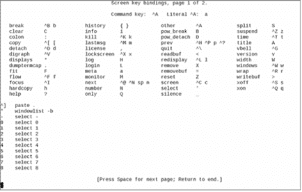

**图 6-5 screen** 帮助选项

### 在screen中创建窗口

一个新的“窗口”实际上是`screen`中控制台的新实例，因此当你创建一个窗口时，你只是打开了另一个shell会话，你可以在该会话中执行任何你想操作：输入命令、运行程序或shell允许你做的任何事情。

要在`screen`中创建窗口，按下Ctrl+A然后按C，你就会进入位于shell提示符的新会话/窗口。在该会话/窗口中，启动`top`命令，以便在你离开其他窗口时它能显示移动并保持运行。

```
top
```

### 注意事项

对于Linux+考试，你应该掌握`screen`的基本命令，特别是如何创建新窗口/会话并在其中自动运行命令（即`screen some_program`）。

现在通过按下Ctrl+A然后按P回到你之前的或初始会话/窗口，由于你只打开了两个窗口，在这种情况下N或P会带你进入另一个窗口。

现在通过输入Ctrl+A然后按C启动一个新的会话/窗口，并运行`strace top`，这会显示该`top`命令实例正在进行的系统调用的持续跟踪，并一直为你显示输出，直到你取消命令为止。

此时，你应该有三个会话/窗口可以来回，因此请练习使用Ctrl+A、N或Ctrl+A、P在会话/窗口之间前后移动。

你可以通过Ctrl+A然后按"（双引号）查看可用窗口的列表。例如，这将返回在`screen`下运行的会话列表并显示在实际屏幕上，你可以输入你想要的窗口会话编号（例如0、1或2），并直接跳转那里。

### 从screen中分离和重新连接

通过`screen`打开控制台的本地实例是一种常用的模式，但当你使用`screen`将会话作为新进程从`screen`中分离，并且它在你注销后仍保持运行时，它才真正大放异彩。


要分离进程，你可以在现有窗口中的运行进程执行分离，或者以分离模式启动窗口/进程。

分离当前窗口/进程的方法是切换到该窗口/会话并按下Ctrl+A然后按D，得到类似于下面的输出：

```
# screen localbash
[detached]
```

你可以使用`screen -ls`命令查看当前分离并运行的会话，它会显示类似于下面的输出：

```
There are screens on:
....................78229.Localbash (Detached)
....................78520.bashshell (Attached)
2 Sockets in /var/folders/d7/mgwnjgpx1wd6y7pg0jwzytx40000gr/T/.screen.
```

然后你可以通过输入命令直接并立即重新连接（唯一的）分离的会话：

```
# screen -r
```

窗口/会话现在回到了前台，程序运行状态就像它从未离开过或分离过一样，就像它一直都在正常运行一样。

如果有多个分离的会话，你可以通过指定PID来最容易地重新连接所需的会话，例如：

```
# screen -r 88229
```

### 注意事项

了解`screen`命令的主要操作对于Linux+考试和现实生活都有帮助。你应该能够在没有任何文档参考的情况下，完成本节涵盖的所有任务。如果你工作在仅支持shell或非图形界面会话的系统生产环境中（这是非常有可能的），那么`screen`命令应该是你日常工作工具箱的一部分。

## 通过screen锁定你的控制台

锁定`screen`会话是我们需要涵盖的最后一项，操作起来非常简单。每当你登录系统并运行`screen`且有一个活动的窗口/会话时，只需按下`Ctrl+A`然后按`X`即可锁定屏幕。


如果你在`~/.screenrc`文件中设置了密码，你必须输入该密码才能恢复对窗口/会话的访问；否则，锁定机制会提示你输入密钥或密码。你需要输入两次，然后系统会报告屏幕已锁定。

## 总结

在本章中，你学习了如何管理进程、发送信号来正确杀死并删除这些进程，以及强制系统服务重新读取其配置文件。你还学习了控制系统作业的基础知识、在作业运行期间管理这些作业的优先级，以及显示和理解系统上的许多信息。

最后，你学习了如何在注销后让程序运行，以及如何在仅限文本的系统上锁定系统并让进程运行。

## 考试准备任务

正如引言中“如何使用本书”部分提到的，你有几种选择可以进行考试准备：这里的练习、第30章、“最终准备”以及Pearson Test Prep联线软件中的考试模拟题。

### 复习所有关键主题

复习本章最重要的主题，这些主题在页外边缘用“关键主题（Key Topics）”图标标记。表6-3列出了这些关键主题以及它们所在的页码。


**表 6-3** 第6章 关键主题

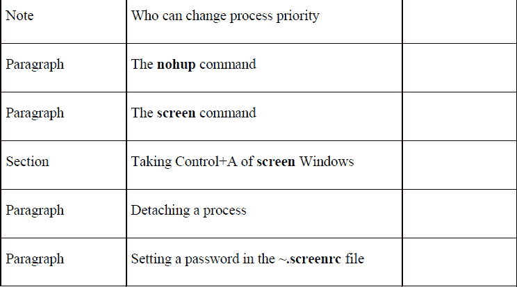

## 定义关键术语

定义本章的以下关键术语并在词表中检查你的答案：

进程（process）

作业（job）

进程标识符（PID）

优先级（priority）

信号（signal）

页（page）

slab

块（block）

缓存（cache）

队列（queue）

`screen`

窗口会话（window session）

控制台（console）

窗口（window）

## 复习题

这些复习题的答案位于附录。

**1.** 哪个命令显示系统上运行进程的频繁更新的显示？

**a.** threads

**b.** procinfo

**c.** mem

**d.** free

**e.** top

**2.** 你执行了一个本该结束进程执行的命令，但执行没有成功。你应该配合`kill`命令使用哪种信号来保证进程终止？

**a.** 15

**b.** 23

**c.** 9

**d.** 18

**e.** 27

**3.** 作为高使用率终端服务器的管理员，你突然注意到同一个用户登录了许多不同的终端，正在执行名称相似的进程，且这些进程的数量正在迅速增加。哪个命令可以允许你根据控制终端的用户和进程名称同时找到所有有问题的进程并杀死它们？

**a.** pkill

**b.** pgrep

**c.** pgmnorm

**d.** pkmon

**e.** pkexec

**4.** 正确或错误：`jobs`命令只能用于在文本模式运行或通过`ssh`命令运行的系统。它不能在如`gnome-terminal`或`xterm`等图形终端会话中使用。

**a.** 正确

**b.** 错误

**5.** 你刚刚执行了`screen`命令并处于BASH提示符。创建三个新的screen会话后，你想查看可用会话的列表。你会使用哪个键键来显示列表？

**a.** winlist

**b.** Ctrl+A "

**c.** ls

**d.** screen -list

## 第二部分：文件管理

## 第7章 文件操作

本章涵盖了以下主题：

- 文件和目录操作
- 输出重定向

本章涵盖了以下目标：

- **目标 2.3:** 给定场景，创建、修改和重定向文件。

你在Linux上进行的大部分工作都涉及某种方式操作文件。你必须知道某些文件放在哪里，例如二进制文件、配置和用户数据。你还需要能够从命令行操作文件，而不是使用图形用户界面。

Linux系统的一个巨大组成部分是对输入、输出和错误流的操作；数据去向哪里以及不去哪里；以及这些主要是文本的流如何从一个程序处理到另一个程序。

### “我知道这些了吗？”测试

“我知道这些了吗？”测试可以让你评估自己是应该阅读整章内容，还是直接跳到“考试准备任务”部分进行复习。如果你有疑问，请阅读整章。表7-1概述了本章的主要标题和对应的“我知道这些了吗？”测试题。你可以在附录A中的“‘我知道这些了吗？测试题和复习题的答案”中找到答案。

**表 7-1** “我知道这些了吗？”基础主题章节-问题映射

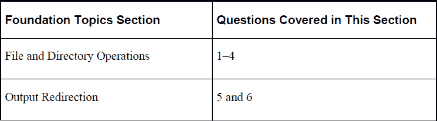

### 注意事项

自评估的目标是衡量你对本章主题的掌握程度。如果你不知道某个问题的答案，或者对答案只有部分确定，那么出于自评估的目的，你应该将该问题标记为错误。为你猜对的答案给分会歪曲你的自评估结果，并可能给你一种虚假的安全感。

**1.** 你执行了`foobar`命令并得到了一个非常意想不到的结果。你不想去路径中的每个目录寻找该可执行文件，而是希望有一个命令能告诉你路径中所有`foobar`命令的实例。哪个命令可以做到这一点？

**a.** file foobar

**b.** .?foobar

**c.** find foobar

**d.** which foobar

**2.** 你正在尝试创建一个新的嵌套目录：`/a/b/c/d/`。创建这个目录集最快的方法是什么？

**a.** mkdir /a; mkdir /a/b; mkdir /a/b/c; mkdir /a/b/c/d

**b.** mkdir /a/b/c/d

**c.** mkdir -p /a/b/c/d

**d.** md /a/b/c/d

**3.** 你知道你今天早上下载了一个名为`backup.tar.gz`的文件，但你不记得把它放在哪里了。哪个是查找该文件合适的命令？

**a.** find / -name backup.tar.gz

**b.** find backup.tar.gz

**c.** locate backup.tar.gz

**d.** whereis backup.tar.gz

**4.** 你刚刚用`touch`创建了一个新的空文件——至少你以为是——但你发现一个文件似乎刚刚创建，却包含旧数据。发生了什么？

**a.** touch重命名了较旧的文件副本。

**b.** touch更新了旧文件的日期和时间。

**c.** touch混淆了inode。

**d.** touch需要--new文件选项。

**5.** 你想处理系统上的文本流。下列哪项正确匹配文本流名称和文件描述符？

**a.** 0=stdin, 1=stdout, 2=stderr

**b.** 0=stdout, 1=stderr, 2=stdin

**c.** 0=stderr, 1=stdir, 2=stdout

**d.** 答案都不正确。

**6.** 哪些情况会阻止你创建硬链接？

**a.** 链接跨越文件系统。

**b.** 链接的源是一个隐藏文件。

**c.** 链接的源是一个设备文件。

**d.** 链接的源是一个目录。

**e.** 目标包含特殊字符。

### 基础主题

## 文件和目录操作

在Linux系统中正确处理文件和目录与任何其他任务一样重要，因为在Linux系统上花费的大部分时间花在命令行上。作为一名优秀的系统管理员，你应该知道如何创建、删除、编辑、设置权限、显示、移动、拷贝、链接和取消链接、查找和定位、确定文件和程序的类型，甚至确定两组文件和目录之间的差异。


#### Linux文件操作技巧

由于大多数用户和系统管理员来自Windows或其他操作系统的背景，对于经验较少的Linux系统管理员，这里有一些快速的建议可能会有所帮助：

- **隐藏文件并不是真的隐藏**：它们只是以`.`开头，例如`.bashrc`和`.bash_profile`文件。除非你显式要求显示，否则它们通常是不可见的，而且不会被`rm -f .*`等命令删除。

- **文件名可以包含多个句号或没有句号字符**：文件名`this.is.a.long.file`和`thisisalongfile`是完全合理且可能的。

- **文件名中的空格看起来很好，但输入起来很痛苦**：使用`_`或`-`代替空格，因为这比在所有空格前加`\`更整洁、更容易操作。（要在文件名中显示空格，系统会显示一个带有反斜杠前缀的空间。）

- **文件扩展不是强制性的**：然而，它们对于排序、选择和拷贝/移动/删除命令，以及快速识别文件类型非常有用。

### 基础导航

更改当前工作目录的命令`cd`经常被使用，而知道如何在文件系统中移动是Linux+考试的重点。

以下命令简单地将你从当前位置移动到`/etc`目录。这种移动使用绝对路径，可以在任何目录内部使用：

```
# cd /etc
```

该路径被称为*绝对*路径，因为它定义了从文件系统根目录开始的路径。如果路径以斜杠（/）开头，你就可以一眼看出它是绝对路径。

从当前目录移动到子目录既快速又简单。例如，这里显示了如何从`/etc/`目录的当前位置进入`/etc/samba`目录：

```
# cd samba
```

这被称为*相对路径*，因为你传递给`cd`命令的选项相对于当前目录的。你处于`/etc`，移动到`samba`就让你进入了`/etc/samba`。如果你在`/home`并运行`cd samba`，除非`/home/samba`也存在，否则它将无法工作。

如果你对当前所在的位置感到困惑，使用`pwd`命令打印工作（当前）目录：

```
# pwd
/etc/samba
```

`cd`命令本身会将你带回主目录，无论你在何处。波浪号（`~`）也表示“主目录”，所以`cd ~`将你带回主目录，而`cd ~sean`将你带到Sean的主目录。

#### 高级导航

获得一些复杂相对路径的经验是好的。例如，假设你在`/home1/user1`目录并想进入`/home2/user2`目录：


# `tree /`

```
/
|-- home1
| `-- user1
`-- home2
 `-- user2
```

你会使用哪条命令？


记住你没有使用绝对路径，而只是相对路径。答案是：

```
# cd ../../home2/user2
```

每一对 `..` 都会带你向上一级：第一对带你到 `/home1`，第二对带你到根目录。从那里开始是相对路径。练习这种方法并记住在这个练习中向上移动只会带你到达 `/home1` 目录。这是一个相对路径，因为路径不以 `/` 开头。你最终所在的目录取决于你开始的位置。

虽然这个相对和绝对路径的示例被用于更改目录，但它适用于任何提示你输入文件名的情况。

## 列出文件和目录

`ls` 命令用于列出目录或文件或两者。

如果你使用 `ls` 命令查看当前目录的多列输出，将只显示文件或目录的名称，而不显示关于文件的其他细节：

```
# ls
file1 file2 file3 file4
```

使用 `-l`（长格式）列出选项以单列形式查看特定文件或目录或一组文件和目录的所有细节，如下：

```
# ls -l
total 0
-rw-r--r-- 1 root root 0 Jan 24 18:55 file1
-rw-r--r-- 1 root root 0 Jan 24 18:55 file2
-rw-r--r-- 1 root root 0 Jan 24 18:55 file3
-rw-r--r-- 1 root root 0 Jan 24 18:55 file4
```


使用 `-l` 选项是使用 `ls` 命令并查看对象的权限、所有权和链接数的唯一方法。另一个其他可以提供此类信息的命令是 `stat` 命令，它一次显示一个文件系统对象。

使用 `ls` 命令的其他示例包括：

- `ls /home/user`：显示指定目录的普通列表。
- `ls -a`：列出所有文件，包括隐藏的 `.` 文件。
- `ls -d foo`：仅列出名为 `foo` 的目录，而不是其内容。
- `ls -i`：列出目标文件或目录的 inode 号。Linux 使用 inode 来表示磁盘上的文件；inode 将在本章稍后的“拷贝文件和目录”部分中讨论。
- `ls -l`：显示权限；链接以及日期、组和所有者信息。权限决定谁可以访问该文件，并在第 9 章“文件权限和提升”中详细讨论。
- `ls -lh`：显示文件大小的人类可读输出（单位为千字节、兆字节和吉字节），以及文件细节。

组合选项产生实用的结果。例如，如果你需要查看当前目录中的所有文件（包括隐藏文件）、它们的权限和它们的 inode 数，你将使用以下命令：

```
# ls -lai
290305 drwxr-x--- 13 root root 4096 Jan 24 18:55 .
 2 drwxr-xr-x 20 root root 4096 Jan 24 17:56 ..
292606 -rw-r--r-- 1 root root 1354 Jan 21 00:23 anaconda-ks.cfg
292748 -rw------- 1 root root 3470 Jan 24 18:16 .bash_history
290485 -rw-r--r-- 1 root root 24 Jun 10 2000 .bash_logout
290486 -rw-r--r-- 1 root root 234 Jul 5 2001 .bash_profile
290487 -rw-r--r-- 1 root root 176 Aug 23 1995 .bashrc
290488 -rw-r--r-- 1 root root 210 Jun 10 2000 .cshrc
```

#### 确定文件类型

由于 Linux 文件没有扩展名要求，一个可以轻松确定文件类型的工具至关重要。`file` 命令可以读取文件的头信息并将该数据与已知类型集进行匹配。


`file` 命令使用多个可能的来源，包括 `stat` 系统调用、魔数文件（`/usr/share/magic`）以及包含 ASCII 和 EBCDIC 的字符表。最后，如果文件是文本且包含来自给定编程或其他语言的可识别字符串，则用它来识别文件。

输出可以被使用、处理和过滤以显示有用信息。例如，仅对给定文件使用 `file` 命令即可显示类型：

```
$ file file1
file1: ASCII text
```

对已知的二进制文件运行 `file` 命令会显示关于文件架构和布局的各种元素，如下：

```
$ file /bin/ls
/bin/ls: ELF 32-bit LSB executable, Intel 80386, version 1 (SYSV), dynamically linked (uses shared libs), for GNU/Linux 2.6.32, stripped
```

对包含许多文件的目录运行 `file` 命令对于查看可能的类型很有用，但真正的价值在于使用管道操作符（`|`）和 `grep` 命令对输出进行过滤，以便只包含特定单词（例如 `empty`）的结果：

```
$ file /etc/* | grep empty
/etc/dumpdates: empty
/etc/exports: empty
/etc/fstab.REVOKE: empty
/etc/motd: empty
/etc/printconf.local: empty
```

这是寻找散落在系统中的空文件的一种方法。它们可能在 `/etc` 目录下是需要的，但只会弄乱 `/tmp` 等临时目录。

### Note

上一个命令中的星号（`*`）被称为 `glob`（通配）。glob 是一种通配符，根据模式匹配任意数量的文件。`/etc/*` 匹配 `/etc` 目录中的所有文件，例如 `/etc/foo` 和 `/etc/bar`，但不匹配 `/etc/foo/bar`，因为这实际上是指名为 `foo` 的子目录下名为 `bar` 的文件。

Linux（以及所有 Unix）的一个特点是，shell 负责将 glob 扩展为匹配的文件列表。如果你输入 `ls /tmp/thing*` 且有两个以 `thing` 开头的文件（例如 `thing1` 和 `thing2`），这等于你输入 `ls /tmp/thing1 /tmp/thing2`：

```
$ ls thing*
thing1 thing2
```

这种 glob 通配功能使得重命名一组文件变得更加困难。在 Windows 中，你可以输入 `ren *.foo *.bar`，任何扩展名为 `foo` 的文件都将扩展名变为 `bar`。在 Linux 中，输入 `mv *.foo *.bar` 会将 glob 扩展为匹配的文件列表：`*.foo` 将匹配你想重命名的文件，而 `*.bar` 将不会匹配任何内容。这与你可能预期的不同！以下输出显示了这个问题：

```
$ ls *.foo *.bar
ls: *.bar: No such file or directory
file1.foo file2.foo
$ echo mv *.foo *.bar
mv file1.foo file2.foo *.bar
$ mv *.foo *.bar
mv: target `*.bar' is not a directory
```

在输出中，第一个命令显示有三个扩展名为 `foo` 的文件，但没有扩展名为 `bar` 的文件。`echo` 命令显示其后的输出，从而显示了如果你单独运行 `mv` 命令将将执行的内容。`*.bar` glob 出现是因为没有匹配它的文件。错误发生是因为没有名为 `*.bar` 的目录。

还有其他的 glob 算符。示例 7-1 显示了一些文件 glob 的用法。

## 示例 7-1 使用 Glob 的示例

```
$ ls
file file1 file10 file11 file2
$ ls file*
file file1 file10 file11 file2
$ ls file?
file1 file2
$ ls *1
file1 file11
$ ls file[123]
file1 file2
```

示例 7-1 首先列出目录中的所有文件。使用 `file*` 也可以获得相同的文件列表，它匹配单词 `file` 后面跟任何内容或什么内容。注意，它包含了原始名称 `file`。接下来，`file?` glob 匹配任何以单词 `file` 开头且后跟一个字符的内容。`file` 和文件名中带有两位数字的文件都被排除在外。

### Note

glob 不一定出现在文件名的末尾。例如，`*1` 匹配任何以数字 1 结尾的内容。

最后，`file[123]` 使用方括号运算符，意味着“集合中的任意一个字符”。它匹配 `file1` 和 `file2`。


## 操作文件 (Touching Files)

`touch` 命令初看起来很奇怪，但经常派用。你给它一个或多个文件的名称，如果这些文件不存在则创建它们，如果已存在则更新它们的时间戳。

使用 `touch` 命令有许多原因，例如创建一个新的空白日志文件，或更新文件的修改时间以作为参考（例如知道上次运行作业的时间）。

要创建一个新文件，你可以使用相对路径在当前目录中创建：

```bash
# touch filename
```

或者你可以使用绝对路径来创建文件，如下所示：

```bash
# touch /home/ross/filename
```

当你准备参加 Linux+ 考试时，预期的会看到 `touch` 用于创建日志文件，以及使用参考文件来标记最后备份。换句话说，如果从成功备份中创建了日志文件，那么该文件就可以作为日期和时间参考文件，因为它发生在理想的时间点。

当你对现有文件使用 `touch` 时，默认操作是更新文件的所有三个时间：

- `access`（访问时间）：文件最后一次被写入/读取的时间
- `change`（更改时间）：文件内容被更改或文件元数据（所有者、权限、inode 节点）被更改的时间
- `modify`（修改时间）：文件内容最后一次更改的时间

准备软件包新版本的程序员会使用 `touch` 命令确保所有文件具有完全相同的日期和时间。因此，在有多个版本的情况下，可以通过文件日期来指代该版本。

设置文件的日期相对容易；以下命令将 `file1` 的日期设置为特定的日期和时间：

```bash
# touch -t 201901010830 file1
```

这里使用的时间格式是 `yyyymmddhhmm`，即四位年份、两位月份、两位日期、两位小时和两位分钟。

参考文件非常有用，特别是当你只想将一个文件或一组文件更新为特定的日期/时间，而不是当前的日期/时间时。你可以使用：

```bash
# touch -r reffile file2update
```

`reffile` 的日期/时间将被应用到 `file2update` 文件的日期/时间。

## 复制文件和目录

复制对象的一个方面是，该操作创建一个具有独立 inode 的新文件，inode 从字面上说是文件系统从表中分配的一个数字，它实际上是系统引用文件的方法；友好的文件名实际上是为了人类理解。


### Note

inode 是指向磁盘上文件的指针。inode 与所有其他文件一起作为文件系统的一部分被创建，取决于文件系统的类型，它的数量可以是有限的，也可以根据需要自动生成。inode 本质上等同于系统中存在文件，因为文件如果没有自己的 inode 或对 inode 的引用就无法存在。

这意味着操作系统将新文件视为与旧文件是分开的。这与移动（move）操作形成对比，移动操作是同一个文件（只要它在同一个文件系统中，就是同一个 inode）具有新名称。

当你在文件系统中创建一个对象时，它将拥有自己的权限。`cp` 并不总是将权限复制到新文件。这可以实现，但需要使用 `-p` 选项来保留权限和所有权。root 用户是唯一可以更改文件所有者的用户；因此，使用此选项的用户无论原始所有者是谁，始终拥有复制后的文件。

普通的复制执行非常简单，本质上导致文件被复制到新位置：

```bash
# cp file1 /dir1/file2
```

一些让复制文件变得更方便的选项包括：

- `-d`：不符号链接；而是复制链接。链接将一个文件指向另一个文件（参见本章后面的“链接文件”）。
- `-f`：强制覆盖现有文件。
- `-i`：在覆盖前交互式询问。
- `-l`：为源文件创建硬链接。
- `-r` 或 `-R`：递归遍历目录（复制所有内容）。
- `-s`：为源文件创建符号链接。
- `-u`：仅当源文件比目标文件新或目标不存在时才更新副本。
- `-x`：不遍历到从其他设备挂载的文件系统。

将现有目录复制到新目录非常简单：

```
# cp -r dir1 dir2
```

`-r` 选项是必要的，因为 `cp` 命令默认不处理目录。只要目标目录不存在，该命令就会在目标目录中创建源目录及其所有子文件和目录的完全相同的副本。

将源目录复制到已存在的目标目录并不涉及覆盖，而是将源目录变为目标目录的一个新子目录。例如，如果你处于 `/test` 目录并且具有以下结构，你可能认为执行 `cp -r dir1 dir2` 会覆盖 `dir2`——或者至少会提示你这样做：

```
## tree .
|-- dir1
| |-- file1
| `-- subdir1
`-- dir2
```

当你执行 `cp -r dir1 dir2` 命令时，文件系统（连同 `cp` 命令）会注意到到已存在的 `dir2` 条目，并自动将源目录作为子目录放入 `dir2` 中，如下所示：

```
|-- dir1
| |-- file1
| `-- subdir1
`-- dir2
 `-- dir1
 |-- file1
 `-- subdir1
```


将 `dir1` 的内容复制到 `dir2` 并完全镜像 `dir1` 的正确方法是关注*contents*（内容）这个词。通过给源（`dir1`）加上斜杠和星号（即 `dir1/*`），你告诉 `cp` 命令忽略目录条目，专注于目录内部的文件。

在相同的初始设置下，如果你执行命令 `cp -r dir1/* dir2`，你将得到正确的结果：

```
## tree .
|-- dir1
| |-- file1
| `-- subdir1
`-- dir2
 |-- file1
 `-- subdir1
```

Linux+ 考试将测试你正确复制目录及其内容的能力。此外，如果你看到一个仅有结尾斜杠但没有星号的源目录，例如 `dir1/`，这与使用 `dir1` 是等价。换句话说，要只复制目录的内容，你必须通过斜杠和星号（`dir1/*`）专门地指定它们。

在相对目录命名中使用的两个特殊字符经常用于复制文件。当前目录由单个点（`.`）表示，父目录由两个点（`..`）表示。例如，如果你当前在 `/home/rossb` 目录中并想从 `/home/lukec` 目录复制一组文件，你可以使用 `.` 字符来避免输入当前目录的完整路径。这两个命令执行相同的操作：

```
# cp /home/lukec/*.mp3 .
cp /home/lukec/*.mp3 /home/rossb
```


## 在系统间复制对象

虽然将文件复制到同一文件系统上的不同位置或同一机器上不同文件系统之间时使用 `cp` 命令，但计算机之间的文件复制是通过 `scp` 命令完成的。

`scp` 命令是 SSH 协议和工具包的一部分，它以与 `ssh` 相同的方式公钥/私钥机制在源系统和目标系统之间进行验证。

使用 `scp` 从 `systema` 复制文件到 `systemb` 比在同一机器上从一个目录到另一个目录的标准 `cp` 命令多几个命令行组件。例如，要将文件 `foobar.txt` 从 `systema` 复制到 `systemb`，你需要指定你想在远程系统上的用户；否则，它将使用源系统上的默认用户名。

例如，在以下命令中，假设你是 `systema` root，但想将 `foobar.txt` 复制到 `systemb` 的 `ross` 家目录：

```
# scp foobar.txt ross@systemb:~
ross@systema's password:
foobar.txt 100% |**********************| 1379 00:00
```

输入密码并完成任何其他提示后，文件将被复制到远程系统并放置在 `/home/ross` 目录。

`scp` 命令另一个有趣功能是从另一个系统复制到你的系统，只需反转命令顺序。例如，这是如何从 `systemb` 的 root 用户家目录将文件 `tarfoo.txt` 复制到 `systema` 的 `ross` 家目录：

```
# scp root@systemb:~/tarfoo.txt ross@systema:~
root@systema's password:
tarfoot.txt 100% |**********************| 1379 00:00
```

`scp` 命令还有一个实用的功能，从 `systema` 的用户视角从 `systemb` 复制到 `systemc`！Linux 仅使用 SSH 协议的隧道机制，并创建一个隧道让命令从 `systemb` 工作到 `systemc`；就好像你坐在 `systemb` 上将文件复制到 `systemc` 一样，只不过你实际上在 `systema` 上。


# 文件传输与同步工具：`scp`、`rsync`、`diff` 和文件管理

## `scp` 命令

```
# scp root@systemb:~/blahwoof.txt ross@systemc:~
root@systemc's password:
blahwoof.txt 100% |**********************| 1379 00:00
```

### 注意

`scp` 命令非常多能，虽然我们在这一节向你介绍了它的主要技巧和功能，但通过阅读 `scp` 和 `ssh` 的 man 页面，还有更多可以探索和学习的内容。


## `rsync` 的全能形

当我们讨论在系统周围甚至系统之间移动对象的问题时，包含 `rsync` 命令是非常重要的。

`rsync` 命令是一个极其强大的命令，我们无法完全涵盖它，但让我们看看它最出名以及可能最常用的用途是什么。

`rsync` 与 `copy` 命令类似，你可以使用 `rsync` 将文件从一个地方复制到另一个地方，从一个文件复制到另一个，甚至从一个目录树复制到另一个——这些都是 `copy` 命令可以的功能。

那么使用 `rsync` 命令的真正原因是什么？它的操作速度快、仅复制更改部分效率高以及在 SSH 内部使用以提高安全性的能力非常有用。`rsync` 命令之所以如此实用的主要方面是，`rsync` 可以创建一组文件和目录的副本，也可以用于仅复制文件和目录之间的更改。这使得它比传统的 `copy` 命令快得多且高效得多，因为它只需要复制文件和目录的变化。

为目录及其所有后代创建镜像，请使用以下命令：

```
# rsync -ar ./somedir /data/someotherdir
datafile1
datafile2
datafile3
<output truncated>
```

这使得从源（`somedir`）到目标（`/data/someotherdir`）的每个文件和目录都成为精确的镜像副本，如所述，包括所有内容、所有权、文件权限和文件的时间戳。

`rsync` 的一个主要功能是跨系统执行复制和镜像功能的能力。它可以以类似于 `scp` 命令的方式使用：

```
# rsync -avzh /home/ross/datafiles ross@192.168.10.20:~
datafile1
datafile2
datafile3
<output truncated>
```

该命令与远程系统连接并将 `/home/ross/datafiles` 传输到远程机器，并在该系统中创建或更新 `/home/ross/datafiles` 目录。

`rsync` 的另一个关键功能是可以通过 SSH 协议进行其所有其他正常操作，例如这种从本地系统到远程系统的目录树复制：

```
# rsync -avzh datafiles -e 'ssh -p 22' ross@192.168.10.20:~
datafile1
datafile2
datafile3
<output truncated>
```

并不是所有的 `rsync` 操作都是快速的。某些操作可能包含许多兆字节，或者更有可能是多个吉字节的数据。用于确定操作进度的一个非常有用的选项是 `--progress` 选项，你也可以添加 `--delete` 选项，以确保目标目录是源的镜像。

```
# rsync -avzh test --progress --delete ross@10.0.0.41:~
Password:
deleting test/etc2/xrdb/Xaw.ad
deleting test/etc2/xrdb/Tk.ad
deleting test/etc2/xrdb/Motif.ad
deleting test/etc2/xrdb/General.ad
deleting test/etc2/xrdb/Emacs.ad
deleting test/etc2/xrdb/Editres.ad
deleting test/etc2/xrdb/
deleting test/etc/mailcap.order
deleting test/etc/magic.mime

sent 97.42K bytes  received 124.60K bytes  63.43K bytes/sec
total size is 6.57M  speedup is 29.60
```

如你所见，这个命令已经完成了你想要：删除了源端不存在的各种文件和目录，并向远程系统提供了有关传输统计信息，包括传输过程中发送和接收的数据量以及传输的总数据量。

简而言之，`rsync` 是一个非常有用的命令，也是任何优秀系统管理员工具箱中的关键部分。它非常像 `copy` 命令和 `scp` 的结合，并带有其他一些强大的选项。


## 有什么区别？

在某些时候（根据我的经验，有很多次），你有一组文件或一个子目录树，你想将其与另一个子目录树，或将一组文件与一组类似的文件进行比较，目的是更新其中一个，或者可能只对更改进行备份。在这种情况下，你可以使用 `diff` 和 `rsync` 命令。

`diff` 命令是一个非常有趣的工具，它有一个非常特定的用途：确定两个项目之间的差异，无论它是两个文件，还是你想要对比和区分的包含文件和子目录的目录。

例如，假设你作为 root 用户，已将 `/etc` 目录复制到了备份位置，例如 `/backup/date-etc`。几天或几周后，你想知道运行中的 `/etc` 目录发生了什么变化，于是你运行了 `diff` 命令并使用 `less` 将输出显示在屏幕上，以便检查可能发生了更改。

要查看今天两个目录之间的不同之处，你应该使用：

```
# diff -rq /etc /backup/date-etc
Only in etc2: host.conf
Files etc/hosts and etc2/hosts differ
Only in etc2: java-11-openjdk
Only in etc2: modules-load.d
Only in etc2: rsyslog.conf
```

`-r` 选项意味着递归进入目录树以找到所有差异，而 `-q` 选项则简化或静默输出，告诉你高层面的差异，而不是大量的琐碎细节。（相信我，如果你设置了相应的选项，`diff` 可以深入到极其琐碎的细节。）

之前的 `diff` 命令返回的行告诉了你关于这两个位置状态的几点信息。第一行显示 `hosts.conf` 文件仅存在于 `date-etc` 备份目录中，因此在主 `/etc` 目录不存在。下一行显示 `hosts` 文件在两个目录之间的内容不同（你随后可能需要检查它……我们将在几分钟后进行操作）。

最后三行表示 `java`、`modules` 和 `rsyslog` 项目都只出现在 `date-etc` 目录中，因此它们已从系统的生产 `/etc` 目录中删除。

最后，让我们使用 `diff` 命令查看两个文件之间的差异。以下示例首先对上一个示例中的 `hosts` 文件运行简单的 `diff`：

```
# diff /etc/hosts /backup/date-etc/hosts
3d2
< 127.0.1.1\.   snowblower
```

输出显示第 3 行存在不同的内容；也就是说，有人在文件中添加了一行主机名解析，将主机名 `snowblower` 关联到本地。

查看文件及其差异的另一种极其有效的方法是使用 `-y` 选项以列的形式显示两个文件，并突出显示差异。例如，以下命令产生了如图 7-1 所示的结果：

```
# diff -y /etc/hosts /backup/date-etc/hosts
```

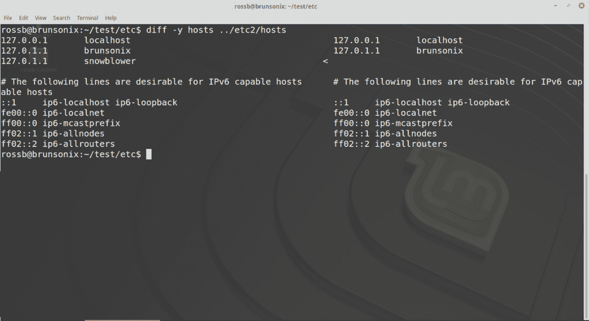

**图 7-1** 查看文件及其差异


`diff` 命令另一个非常酷且实用的功能是构建可以描述为供 `patch` 命令使用的“补丁”（patches）。

为了更好地描述和显示这种行为，让我们使用之前的两个 `hosts` 文件，通过先生成补丁文件，将 `/etc/hosts` 文件中的精确更改应用到 `/backup/date-hosts` 文件：

```
# diff /etc/hosts /backup/date-etc/hosts > hosts-file.patch
```

文件内容将只包含从第一个文件到第二个文件的文本/更改：

```
3d2
< 127.0.1.1\.   snowblower
```

要应用补丁以使第二个 `hosts` 文件与第一个文件完全匹配，你需要使用此命令：

```
# patch /backup/date-etc/hosts < hosts-file.patch
```

然后你可以使用基础的 `diff` 命令来确保文件是完全相同的：

```
# diff /etc/hosts /backup/date-etc/hosts
```

你应该不会看到任何输出，这意味着文件是相同的。

这个概念对于文本文件很有用，它也是 Linux 系统上所有软件补丁的基础概念：只需使用 `diff` 命令找到文件新版本中的差异，将这组差异重定向到补丁文件，然后将该补丁应用到需要更新的文件。

## 移动对象

`cp` 命令通过创建新文件、inode 和数据来复制文件，而 `mv` 命令简单地更改包含文件或目录条目的目录，或者如果它留在同一目录中，则修改文件中的条目。当你只更改指向文件的元数据时，你可以快速在同一设备上移动文件。如果文件移动跨越两个设备，文件将被复制到新设备并从旧设备中删除。

创建一个名为 `file1` 的文件，然后对其运行 `stat` 命令以检查详情，如示例 7-2 所示。

**示例 7-2** 在 `file1` 上运行 `stat` 命令

```
# touch file1
# stat file1
 File: `file1'
 Size: 0 Blocks: 0 IO Block: 4096 regular empty file
Device: fd00h/64768d Inode: 2261179 Links: 1
Access: (0664/-rw-rw-r--) Uid: (500/sean) Gid: (500/sean)
Access: 2015-02-03 21:47:46.000000000 -0600
Modify: 2015-02-03 21:47:46.000000000 -0600
Change: 2015-02-03 21:47:46.000000000 -0600
 Birth: -
```

现在使用 `mv` 命令将文件移动到新名称，如示例 7-3 所示。

**示例 7-3** 将文件移动到新名称

```
# mv file1 file2
# stat file2
 File: `file2'
 Size: 0 Blocks: 0 IO Block: 4096 regular empty file
Device: fd00h/64768d Inode: 2261179 Links: 1
Access: (0664/-rw-rw-r--) Uid: (500/sean) Gid: (500/sean)
Access: 2015-02-03 21:47:46.000000000 -0600
Modify: 2015-02-03 21:47:46.000000000 -0600
Change: 2015-02-03 21:48:41.000000000 -0600
 Birth: -
```

因为在示例 7-3 中设备和 inode 保持不变，你知道这与之前的文件是同一个文件。更改时间已修改以反映文件重命名的事实。

当你移动文件时，如果目标存在，`mv` 命令会覆盖它。该命令支持一个选项 `-i`，它会先检查目标是否存在。如果存在，`mv` 会询问你是否想要覆盖目标。某些发行版通过 shell 别名将 `-i` 作为默认选项。

你可以使用 `-u` 选项来避免覆盖较新的目标文件或目录，该选项保留对象的最新副本。

移动文件和目录的示例包括将单个目录移动到另一个名称，如下所示：

```
# mv -f dir1 dir2
```

这仅仅是将目录项 `dir1` 更改为新名称 `dir2`。`-f` 选项还会忽略“你确定吗？”的提示。

与 `cp` 命令一样，移动目录内容需要格式正确的命令；否则，你不会将目录移动到新名称，而是移动到现有目录的子目录下。例如，再次考虑 `/test` 目录，其结构如下：

```
## tree .
|-- dir1
| |-- file1
| `-- subdir1
`-- dir2
```

如果你是一个 Windows 管理员，运行以下命令将 `dir1` 移动到 `dir2` 是有意义的：

```
# mv dir1 dir2
```

如果你在 Linux 系统上执行此操作然后运行 `tree` 命令，你会看到以下输出：

```
## tree .
`-- dir2
 `-- dir1
 |-- file1
 `-- subdir1
```

这会将 `dir1` 移动到 `dir2` 下，因为 `dir2` 已经存在。要正确将源 `dir1` 的内容移动到目标 `dir2`，你不需要使用不存在的 `-r` 选项。（记住这一点，用于 Linux+ 考试。）你只需要使用斜杠和星号来引用 `dir1` 下的文件，如下：

```
# mv dir1/* dir2
```

### 注意事项

`*` 通配符运算符不匹配隐藏文件，因为它们以点号开头。处理这种情况实际上非常复杂，并且超出了 Linux+ 考试的范范围。

如果你运行 `tree` 命令，你会看到以下输出：

```
## tree .
|-- dir1
`-- dir2
 |-- file1
 `-- subdir1
```

最后，你传递给 `mv` 命令的目录并不总是在当前目录下。你可以使用绝对路径，例如使用 `mv /dir1 .` 将位于根目录下的 `dir1` 移动到当前目录。你也可以从系统的任何地方运行 `mv /dir1 /tmp` 将该目录移动到临时目录。


### 创建和删除目录

文件管理中的一项基本任务是能够创建和删除目录，这有时意味着一次创建或删除整个目录树。要创建一个名为 `dir1` 的目录，你使用 `mkdir dir1`。要在 `dir1` 目录下创建一个名为 `subdir1` 的目录，你使用 `mkdir dir1/subdir1`。

始终将任何目录路径的最后一段视为要创建或删除的对象，并将路径中的其余项目视为支持对象或父对象。`mkdir` 和 `rmdir` 命令在功能和选项上非常相似，包括 `mkdir` 能够通过单条命令从头创建深层子目录树（使用 `-p` 或 `parent` 选项来创建创建最后一个子目录所需的任何子目录）：

```
# mkdir -p /dir1/dir2/dir3/dir4
```

`rmdir` 命令的一个特点是它只能删除空目录。例如，链链 `/dir1/dir2/dir3/dir4` 的最后一个目录是该命令的真实目标，并且只有当该目录为空（不包含任何普通文件或目录文件）时，才能被删除：

```
# rmdir -p /dir1/dir2/dir3/dir4
```

通过在 `rmdir` 中使用 `-p` 或 `parent` 选项，你可以从最后一个子目录一直删除到最顶层——但前提是任何目录中的唯一条目必须是刚刚删除的那一个。`rmdir` 命令的一个选项允许它删除包含文件等内容的目录。它被称为 `--ignore-fail-on-non-empty`，我知道的 Linux 中最长的选项。我宁愿输入 20 次 `rm -rf targetdir` 也不愿使用这个怪物选项。

### 删除对象

你通常想在创建或复制对象后删除它们，对于大多数对象，可以使用 `rm` 命令完成此。也可以使用 `rmdir`。

使用 `rm` 命令删除文件只需选择要删除的目标以及最有效的选项。

如果你想删除特定文件且永远不收到确认消息提示，命令是 `rm -f target`。

要删除目录及其所有内容且不获取确认消息，命令是 `rm -rf /full/path/to/target`。

### 这些文件在哪里？

在 Linux 系统上拥有一种查找文件的机制至关重要，因为可能的目录和文件数量之多使得手动搜索几乎是不可能的。

完成此任务有两种方法：快速粗暴的方法或缓慢而有条理的方法。大多数人在放弃极其精确但有时缓慢的 `find` 命令之前，都会尝试快速的 `locate` 命令。


### 使用 locate 定位文件

查找文件或一组文件最快的方法是使用 `locate` 命令。它是快速的、数据库驱动的并且是。当你运行 `locate` 命令时，你是在搜索数据库而不是文件系统，并且只能看到你有权限访问的文件。数据库的缺点是它每晚更新一次，因此无法感知自上次更新以来发生的任何更改。

`locate` 显示结果的方式很奇特。你可能认为使用 `locate` 查找名为 `readme` 的文件只会找到名为 `readme` 的文件，但事实如此。它会找到任何包含文件名 `readme`的内容，包括普通文件和路径的任何部分。

例如，在尝试定位 `readme` 文件时，假设你运行了以下命令：

```
# locate readme
```

这会找到以下两个条目，一个文件名包含字符串 `readme`，另一个是目录：

```
/readme
/usr/src/linux-2.4.20-8/drivers/net/wan/8253x/readme.txt
```


使用 `locate` 命令查找你已知在磁盘上或在上次 `locate` 数据库更新之前存在的项目。`locate` 使用的数据库在系统运行维护程序或按需要每晚更新。如果你没有访问某个对象的权限，它就不会显示在 `locate` 输出中。

使用 `-i` 选项配合 `locate` 可以忽略大小写，并返回匹配你搜索字符串的任何内容，使用不区分大小写的匹配：

```bash
# locate -i string
```


`locate`数据库需要定期更新以确保良好的结果。你的发行版可能将其放在了深夜运行的任务列表中。有关深夜任务的更多信息，请参见第 24 章，“自动化任务](#ch24.html_ch24)”。更新数据库可能需要很长时间，在需要搜索时必须等待更新完成是令人沮丧的。

`updatedb`命令必须以`root`身份运行：

```
# updatedb
```

有时你想从`locate`数据库中排除某些文件或目录，因为它们要么不合适，要么仅仅是索引时间太长，而没有明显的益处。这在`/etc/updatedb.conf`文件中可以配置。该文件由更新命令读取并使用变量。

在配置文件中排除对象的两种方法是通过文件系统类型或路径。以下输出是一个有效的`/etc/updatedb.conf`文件的示例：

```
PRUNEFS="devpts NFS nfs afs sfs proc smbfs autoffs auto iso9660"
PRUNEPATHS="/tmp /usr/tmp /var/tmp /afs /net /sfs"
export PRUNEFS
export PRUNEPATHS
```

`PRUNEFS`关键字用于从`locate`数据库更新中排除文件系统类型；正如你预期的，`PRUNEPATHS`关键字用于排除目录树。注意，大多数路径都是临时数据位置或特殊的文件位置。

记住 Linux+ 考试：`locate`会返回路径或文件名中任何包含搜索字符串部分的的结果。考试可能会测试你何时使用`locate`命令以及何时使用`whereis`命令。


# 查找文件

`find`命令是用于系统中搜索文件对象最准确但最耗时的方法，因为它实时爬取文件列表，而不是像`locate`那样搜索索引数据库。该命令由几个（有时会让人困惑的）部分组成。但是，如果学习得当，它可以成为忙碌系统管理员的利器。

`find`命令的语法为：

```
find startpath -options arguments
```

为了理解这一语法，让我们来看一个实用的`find`命令示例：

```
# find /home -iname *.mp3
/home/snuffy/g3 - red house.mp3
```

此命令将起始路径设置为`/home`目录，然后查找任何字符串`mp3`的实例，该字符串作为文件扩展名或出现在文件名中最后一个`.`之后。它在用户`snuffy`的家目录下找到一个文件，并返回该文件的完整路径。


## `find`的选项包括

- `group`: 查找属于指定组的文件

- `newer`: 查找比指定文件更新的文件

- `name`: 查找文件名与区分大小写的字符串匹配的文件

- `iname`: 查找文件名与不区分大小写的字符串匹配的文件

- `user`: 查找属于指定用户的文件

- `mtime`: 查找修改时间；用于查找指定天数的文件

- `atime`: 查找自上次访问以来的天数

- `ctime`: 查找自目录条目上次更改以来的天数

`find`命令的一个有用功能是它可以对通常返回到标准输出的每一个条目执行另一个命令或脚本。

例如，要查找用户家目录下所有的 MP3 文件并将副本存档到根用户（root）的目录下，可以使用以下命令：

```
# find /home -iname *.mp3 -exec cp -f {} \;
```

此命令使用了`-exec`选项，它会逐行接受返回到标准输出的行，并将完整路径和文件名插入到大括号（`{}`）之间。当每行输出被解析并执行命令时，它会到达行尾的`\;`并返回标准输入处理下一行。输出的最后一行是执行了命令的最后一次；它不会一直运行直到报错。

在单个命令中运行多个操作符也是可能的。只需确保不要将一个运算符的值混入到下一个。你可以使用以下命令查找所有某个特定用户的所有 MP3 文件：

```
# find /home -iname *.mp3 -user snuffy
/home/snuffy/bls - all for you.mp3
```


`find`命令非常复杂，为了不让你对更多选项感到厌倦，本节提供了许多如何使用`find`的示例。

要查找一个文件并对其执行`cat`，请使用：

```
# find /etc -iname fstab -exec cat {} \;
```

要删除所有七天之前的`core`文件，请使用以下命令：

```
# find /home -mtime +7 -iname core -exec rm -f {} \;
```

查找系统中所有属于`bob`的文件并将所有权更改为`root`，请使用：

```
# find / -user bob -exec chown root {} \;
```

查找用户`tjordan`的所有文件并更改其组，请使用此命令：

```
# find /data -user tjordan -exec chgrp users {} \;
```

为了安全起见，你可以使用`-ok`代替`-exec`，以便每次运行命令时提示确认：

```
# find /data -user tjordan -ok chgrp users {} \;
```

要查找与硬链接相关的 inode，使用命令：

```
$ find / -inum 123456
```

Linux+ 考试涵盖了`find`命令的操作符以及在搜索结果上执行命令的能力。练习这里看到的所有示例，并发挥创意尝试各种可能性。特别注意`-mtime`及其兄弟选项：`-atime`和`-ctime`。

## 使用 grep

现在你已经知道如何查找或定位文件了，让我们查看它们的内容。`grep`经常与`find`或`locate`配合使用，它专门用于搜索文件内容（而`find`和`locate`专门用于查找系统的文件名）。

有趣的文本处理命令之一是`grep`。使用得当，它可以在单个文件中找到几乎任何字符串或短语、通过`stdin`传入的文本流，或整个文件目录（例如内核源码层次结构）。


`grep`（全局正则表达式打印）使用以下命令语法：

```
grep -options pattern file
```

`grep`命令有许多实用的选项，包括：

- `-c`: 此选项仅显示匹配项的数字计数，而不输出任何文件名或匹配内容。

- `-C #`: 此选项在匹配的字符串周围显示指定数量（`#`）的上下文。

- `-H`: 此选项为每个匹配项打印文件名；当你想要随后编辑该文件时它非常有用，并且它是搜索多个文件时的默认选项。

- `-h`: 此选项抑制每个文件的文件名显示，并且是搜索单个文件时的默认选项。

- `-i`: 此选项在不区分大小写的情况下搜索模式；显示所有匹配项。

- `-l`: 此选项仅显示匹配文件的文件名；不显示任何匹配的输出行。

- `-L`: 此选项显示不包含字符串匹配的文件名。

- `-w`: 此选项仅选择包含该字符串作为完整单词的行，而不是另一个单词的一部分。

- `-r`: 此选项读取并处理指定的所有目录以及其中所有的文件。

- `-x`: 此选项导致仅返回精确行匹配；行上的每个字符必须匹配。

- `-v`: 此选项显示文件中所有不匹配字符串的行；这与默认行为恰恰相反。

### 使用 grep 的示例

`grep`既可以使用文件和目录作为目标参数，也可以接收`stdout`进行解析。以下是一个使用`grep`解析输出的示例：

```
# who | grep ross
```

此命令解析`who`命令的`stdout`以查找名称`ross`，如果找到则打印该行。

以下更复杂的`grep`示例将`grep`与`find`命令结合在一起：

```
# find / -name readme -exec grep -iw kernel {} \;
```

此命令找到系统中所有名为`readme`的文件，然后对每个文件执行`grep`命令，搜索任何完整单词`kernel`的实例，且不区分大小写。完整单词搜索会找到字符串`kernel`，但不会找到*kernels*。

使用`grep`选项查找字符串的一种创新用法是让它显示不匹配字符串的行。例如，你可能想定期检查`/etc/passwd`，查看是否有没有影子密码的用户：

```
# grep -v :x: /etc/passwd
snuffy:$1$3O238jrk15uHEgxdtFTlxkK1:501:501::/home/snuffy:/bin/bash
```

看起来`snuffy`在`/etc/passwd`文件中有一个加密密码。因此，你应该运行`pwconv`命令来修复此问题并让`snuffy`立即更改密码。

### 注意

在课堂上，我们通常会花费合理的时间查阅帮助页（man pages）和额外的文档，阅读那些所谓的“友好的手册”。偶尔，学生会在文档中看到一些令他们觉得有趣的短语或单词，这时我们就会花时间向大家演示如何使用`grep`命令。我们都能从中找到乐趣，并对发现的内容发出一阵阵笑声，每个人最终都学到了许多关于`grep`的用法，可能还学到了一些使用其选项的新方法。本节展示了如何使用`grep`搜索特定术语，我们特意选择了一些温和的示例。对于 Linux+ 考试，你需要能够使用`grep`及其选项。

### 注意

在接后的示例中，`tail`命令及其选项被用于限制输出项目的数量，以便输出能够适应典型的屏幕。

要在额外的文档目录中搜索单词`fool`，请使用以下命令（参见图 7-2）：

```
# grep -ir fool /usr/share/doc | tail -n 15
```

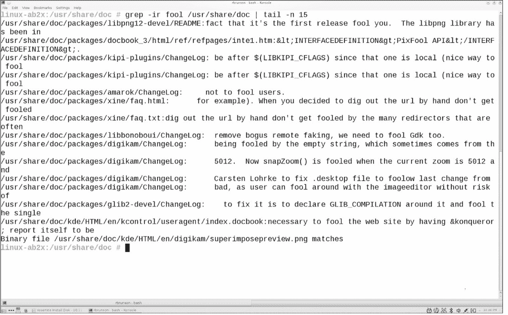

**图 7-2** `grep`命令搜索`fool`的输出

注意，你得到的匹配项既包含完整单词`fool`也包含`fooled`或`foolish`等词的一部分。如果你按下向上方向键并将单词`fool`改为`foolish`然后再次执行命令，你将得到图 7-3 所示的结果。

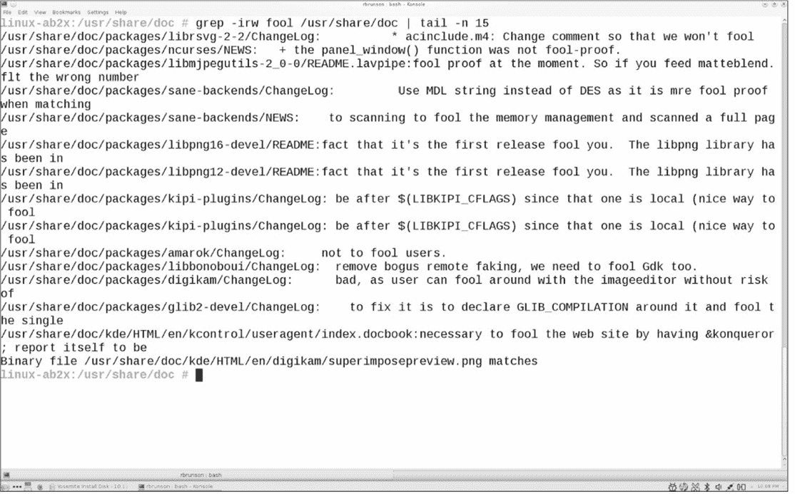

**图 7-3** `grep`命令搜索`foolish`的输出

现在假设你只想搜索精确的单词`fool`而它的任何变体。要查看仅包含完整单词的行，请添加`-w`选项（参见图 7-4）：

```
# grep -irw fool /usr/share/doc | tail -n 15
```


**图 7-4** `grep`命令作为完整单词搜索`fool`的输出

最后，让我们看看`grep`命令的一个非常有用的选项（`grep -v`），它允许你看到的不是匹配搜索项的普通输出行，而是匹配搜索的文件列表。当你想要将输出发送到编辑器、流编辑器或另一个文件转换命令时，此功能非常有用（参见图 7-5）。

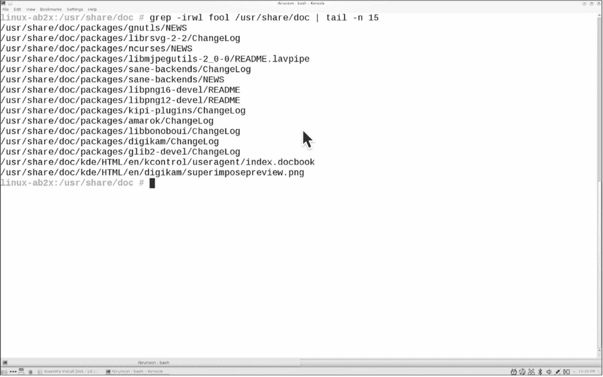

**图 7-5** 使用仅显示路径/文件的选项进行`grep`的输出

`grep`命令是多用途的。你可以通过阅读帮助页或其他文档发现它更多有用的选项。本节的讨论已经足够实用了，并且涵盖了 Linux+ 考试中通常包含的项目。

### 注意

作为最后的建议，尝试添加`-n`选项来显示文件中找到的项的行号，并添加`-v`选项来显示不是匹配查询的行，而是显示*不匹配*查询的行。当你知道自己不想要什么但不确定具体想要什么时，这非常有用。


### 哪个命令会运行？

Linux 机器提供了大量的命令和可执行脚本，你需要知道当你在命令行输入其名称时，可能的命令中哪一个会运行。答案取决于`PATH`变量的内容。该变量的内容被用一组顺序读取的位置，用于搜索可执行对象。

`which`命令用于确定从`PATH`变量查询的命令的完整路径。要确定通过输入名称实际执行的是哪个命令，请运行以下命令：

```
# which ls
alias ls='ls --color=tty'
 /bin/ls
```

所示，找到了两个包含`ls`命令的条目。第一个是别名（alias），它为`ls`命令设置了一些颜色函数；另一个是`/bin/ls`中真正的命令二进制文件。

当你执行命令时，它会找到第一个可用匹配，这可能不是你想要的，就像`ls`命令的情况那样。为了执行物理二进制文件并忽略任何已设置的别名，请在命令前加上反斜杠（\），如下所示：

```
# \ls
```

在系统中具有两个可执行文件的命令`gawk`上再次尝试：

```
# which gawk
/bin/gawk
```

这返回了单个条目，但 Linux 盒上有多个`gawk`命令：

```
# which -a gawk
/bin/gawk
/usr/bin/gawk
```

默认返回找到的第一个匹配命令，只有当你使用正确的开关时，它才会找到所有可能性。

### 查找命令

当你需要关于命令的更多信息，而不仅仅是哪一个会执行时，尝试使用`whereis`。此命令显示最多三个可能的信息，包括命令的二进制文件、帮助页路径以及该命令存在的任何源代码。其语法如下：

```
# whereis ls
ls: /bin/ls /usr/man/man1/ls.1.gz
```

`whereis`的选项包括：

- `-b`: 搜索二进制文件。

- `-m`: 搜索手册条目。

- `-s`: 搜索源代码。

- `-u`: 查找异常或文档不全的条目。

要通过名称查找文件但不获取路径中包含该名称的所有条目，请使用`whereis`命令而不是`locate`命令，因为后者会在路径的所有元素中搜索该字符串。

`type`命令告诉你命令是否被扩展。看看使用`type ps`时发生了什么：

```
# type ps
ps is /bin/ps
```

`type`命令的输出表示如果你输入`ps`，将运行`/bin/ps`应用程序。

`ls`命令经常被扩展以显示常用选项，例如为输出添加颜色：

```
# type ls
ls is aliased to 'ls --color=auto'
```

此输出显示，当你运行`ls`时，你实际上得到的是`ls --color=auto`。你可以通过`type`的`-a`选项查看`ls`的所有变体：

```
# type -a ls
ls is aliased to 'ls --color=auto'
ls is /bin/ls
```

`-a`选项显示 shell 同时知道一个别名和磁盘上的一个文件。


### 链接文件

链接有两种类型：符号链接（或软链接）和硬链接。每种都有自己的优缺点。系统管理员出于多种用途链接；其中首要目的是是在系统上创建快捷方式，让用户访问数据而无需导航多个目录级。

如果你的 Linux 系统上有用户，你需要一个可以被多个用户访问的单一挂载点。选项包括让用户导航到`/mnt/somemount`目录保存数据，并在每个用户的家目录中放置指向该挂载点的链接。使用链接完成这项任务要好得多。


#### 符号链接

符号链接主要用于从一个对象到另一个对象的快捷方式。符号链接创建一个带有自己的 inode 和指向链接文件路径的微型文件。符号链接可以跨文件系统和驱动器，主要是因为符号链接有自己的 inode。图 7-6 显示了符号链接与目标文件之间的关系。

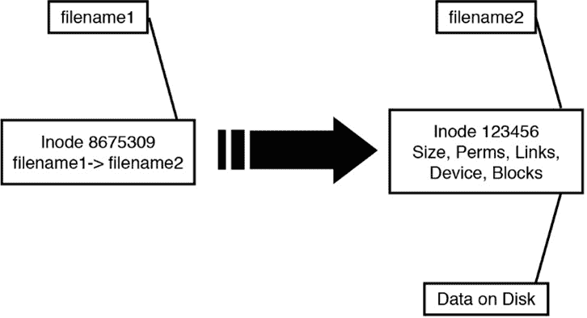

**图 7-6** 符号链接详情

例如，你可能会将外部磁盘挂载到`/mnt/projdata`挂载点，并希望每个用户都能从自己的家目录访问该远程共享。你只需要在每个用户的家目录中执行以下命令即可实现：

```
# ln -s /mnt/projdata projdata
# ls -l projdata
lrwxrwxrwx 1 root root 13 Jan 26 12:09 projdata -> /mnt/projdata
```

注意，新符号链接的列表显示了链接指向的确切位置，并且权限被设置为最大，以避免干扰目标对象的权限。

符号链接看起来总是具有相同的权限，但它们并不会更改这些权限。在符号链接上更改权限实际上更改的是目标文件的权限。

要取消（unlink）符号链接，你只需删除作为符号链接的文件，这会删除对原始文件的引用。虽然删除该符号链接文件看起来可能很危险，但默认情况下，这样做不会删除目标被链接文件。


## 硬链接

硬链接通常用于让文件出现在另一个地方。硬链接仅仅是目录中的一个额外名称，它指向完全相同的索引节点（inode），并共享原始文件除实际名称以外的所有方面（尽管如果它位于不同的目录中，文件名也可能是相同的）。图 7-7 显示了硬链接与目标文件之间的关系。

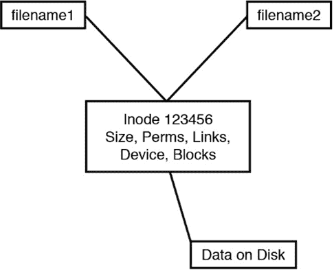

**图 7-7** 硬链接详情

关于使用硬链接的一个示例，考虑需要确保某个用户经常删除的文件对于该用户来说容易恢复。该用户 Jaime 经常出差，但当他在办公室时，似乎经常删除东西，或者声称系统吞噬了他的文件。当 Jaime 在飞行时，你并没有任何问题，所以问题一定出用户的用户的上。

为了在 Jaime 的家目录中锚定或备份重要文件（例如公司联系列表），你必须先创建一个备份目录，例如`/backup`。然后从 Jaime 的`ccontactlist.txt`文件到`/backup`目录中的一个文件创建一个硬链接，如下：


```bash
# cd ~jaime
ln ccontactlist.txt /backup/home_jaime_ccontactlist.txt
ls -l ccontactlist.txt
-rw-r--r-- 2 jaime users 0 Jan 26 13:08 ccontactlist.txt
```

注意，该文件看起来很正常，但链接计数数字 `2` 让你知道该文件的地方存在另一个名称条目。

同样注意，新硬链接的列表没有显示目标文件，似乎也没有以任何方式引用它。对此文件运行 `stat` 命令不会向你显示另一个文件名，除了较高的链接计数之外，似乎也不会感知它的存在。

文件的名称和位置是关于文件的唯一不存储在索引节点中的内容。你会在 Linux+ 考试中看到关于这个问题的问题。

如果目标位于另一个文件系统、磁盘或远程对象，则无法创建硬链接。将多个名称关联到同一个索引节点的需求使得这种远程创建是不可能的。

在更改硬链接文件的权限和所有权时要小心，因为所有名称条目都指向完全相同的索引节点。因此，任何更改都会立即应用到看似多个文件上，但实际上它们只是文件名。


删除具有多个硬链接的文件需要删除每个硬链接或多个名称。虽然看起来你正在取消链接文件，但由于它们在文件系统目录文件中是具有不同名称的完全相同的索引节点数据，你必须删除所有指向原始文件的文件才能成功地从原始文件执行“取消（unlink）”。

此外，要找到文件的所有链接，请运行以下命令：

```bash
# ls -i ccontactlist.txt
17392 ccontactlist.txt
find / -inum 17392
/home/jaime/ccontactlist.txt
/backup/home_jaime_ccontactlist.txt
```

当你通过查询公共索引节点找到文件的所有链接后，你可以删除指向原始文件的所有不需要的链接，但你需要非常小心不要移除指向该文件的*所有*链接；也就是说，不要完全删除该文件！


### 注意

对于 Linux+ 考试，请记住符号链接是另一个具有自身索引节点的实际文件。因此，大量的符号链接可能会给文件系统带来问题，例如包含用户家目录的文件系统。使用过多的索引节点可能会限制你使用可用存储空间。运行 `df -i` 命令查看统计信息。

## 处理输入/输出流

Linux 支持使用单独流来处理 shell 命令行上的数据。这些流被称为文件描述符（file descriptors），主要用于向程序和文件发送/接收数据并处理错误。

表 7-2 列出了三个文件描述符及其关联的文件。


**表 7-2** Linux 文件描述符

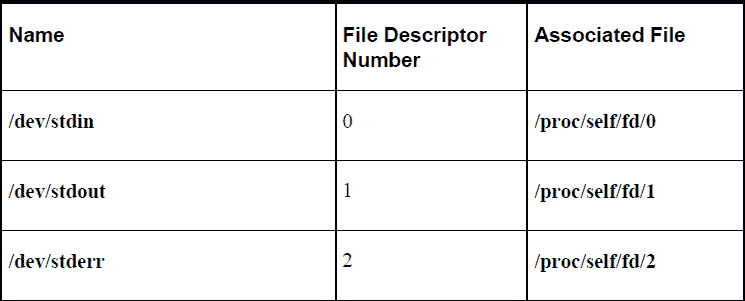


### 标准输入

标准输入（Standard in），或 `stdin`，是所有程序接受的内容或它们被假设接受的内容。大多数程序通过重定向的文件参数或使用文件作为程序的参数来接受 `stdin`：

```bash
program < file
```

或者：

```bash
program file
```

对于大多数程序，这些示例是等价的。接下来，我们将介绍几个没有正确处理参数的命令，例如 `tr` 命令。

### 注意

通常情况下，程序的 `stdin` 是另一个程序的 `stdout`（标准输出），且 `stdin` 和 `stdout` 通过管道符号（`|`）连接。


### 标准输出

标准输出（Standard out），或 `stdout`，是命令产生并显示在屏幕或控制台上的文本或数据。默认情况下，所有文本模式命令都会产生 `stdout` 并将其输出到控制台，除非它被重定向。要理解这一点，请运行以下命令：

```bash
$ cat /etc/fstab
```

显示在屏幕上的文本是 `stdout` 流的完美示例。先运行命令查看它们产生什么，然后再将输出重定向到文件被认为是优雅的，特别是因为你可能会遇到错误。


### 标准错误

标准错误，或 `stderr`，是 `stdout` 的并行流，默认情况下，它会在错误发生时混合在 `stdout` 流中显示。

### 注意

为了直视化这一点，想象一下两桶水。一个是 `stdout`，另一个是 `stderr`。如果你将它们倒出来并将水流混合，它们可能是不同的，但它们都流向同一个地方。

故意产生错误是很困难的；但你始终可以使用 `find` 命令产生一些访问拒绝或权限错误来进行实验。

作为普通用户，运行以下命令：

```bash
# find / -iname "*.txt"
```

你立即会看到错误，指示用户无法访问某些目录树以查找某些项目。注意，有用的输出（`stdout`）直接与错误消息（`stderr`）混合在一起，这使得分离这些流并将良好数据用于任何建设性工作可能变得困难。

### 注意

系统管理员的工作定义为寻找产生良好数据并妥善丢弃或存储产生的错误。良好数据可以发送到另一个程序，而错误通常在尽早被丢弃，以便使用处理器和资源更高效地产生良好数据。

为了清理良好数据并剔除坏数据，你需要使用重定向操作符。要查看此效果，使用向上箭头并重新运行上一个命令，如下：

```bash
# find / -iname *.txt 2> /dev/null | more
```

这产生了类似下面的输出：

```text
./.kde/share/apps/kdeprint/printerdb_cups.txt
./1.txt
./2.txt
./3.txt
```

注意，在使用 `2>` 重定向符号后，你只得到了良好数据（`stdout`），将坏数据（`stderr`）丢弃到了系统的黑洞或垃圾处理装置——换句话说，这是一个设计用于安全丢弃数据的伪设备。

你将在本章稍后的“重定向标准错误”部分学习更多知识。


#### Here Documents（在此文档）

由于我们一直在讨论流的概念，我们需要处理 `stdin` 或标准输入流的一个特殊方面，它被称为在此文档（here document）或 heredoc。

当你需要在程序执行（通常是脚本）的某一点允许从控制台输入文本时，你就会使用这里“在此处的文档”（here document）。当输入了特定的字符串（字符串限制符）时，文本输入结束，且该文本将成为程序、`echo` 语句等的一部分。以下简单的命令行元素就是其中的一个示例：

```bash
# cat << DONE
> this is input
> this is more input
> DONE
this is input
this is more input
#
```

在这个示例中，字符串限制符是文本 `DONE`。当在输入文本 `DONE` 后按下回车键时，shell 会识别你已完成文本输入，它会从输入的文本中移除两个字符串限制符 `DONE`，并使用 `cat` 命令将该文本输出到控制台。

创建“在此处的文档”是为了让你能够输入可能包含引号和变量的文本，而无需使用转义符（在字符前加 `\`）。引号和变量在在此处的文档正文中会按预期方式工作。值得注意的是，字符串限制符也可以用在此处的文档的文本内部；只有当它单独成一行时，它才会被解释为字符串限制符。


## 流的重定向

在追求良好数据的过程中，能够重定向或更改 `stdout` 和 `stderr`（以及某种程度的 `stdin`）的目标对于你的任务至关重要。

重定向符号包括：

- `<`：将文件内容重定向到命令的 `stdin` 流。`<` 输入重定向符号的文件描述符为 `0`，因此可能会看到 `<0` 被使用。
- `>`：将 `stdout` 流重定向到符号右侧的文件目标。`>` 输出重定向字符的文件描述符为 `1`，除了某些特定情况外，它是隐含的。
- `>>`：将 `stdout` 重定向到文件，将当前流追加到文件末尾而不是覆盖文件内容。这是 `>` 输出重定向描述符的修饰。
- `2>`：将 `stderr` 重定向到文件，将当前流追加到文件末尾而不是覆盖文件内容。这是 `>` 或 `2>` 输出重定向描述符的修饰。

### 注意事项

如果你使用 `>` 重定向符号写入文件，除非设置了 BASH shell 的 `noclobber` 选项，否则该文件将被覆盖。设置此选项后，你无法覆盖文件；它会产生错误。将数据放入该文件的唯一方法是使用 `>>` 重定向追加符号。可以通过运行 `Set -o noclobber` 命令进行配置。

## 重定向标准输入

重定向 `stdin` 涉及将文件内容发送到程序的 `stdin` 流。示例是 `sort < file1`。该命令本质上与 `cat file1 | sort` 命令相同。

## 重定向标准输出

重定向 `stdout` 涉及使用单个重定向符号（`>`）或两个符号（`>>`）进行追加。主要区别在于，使用单个重定向描述符会覆盖文件，而使用双重重定向符号追加到文件末尾。例如，以下命令会覆盖 `file2` 的内容，或者如果它不存在，则创建它：

```bash
# cat file1 > file2
```

以下命令将 `file1` 的数据追加到 `file2`，如果它不存在，则创建 `file2`：

```bash
# cat file1 >> file2
```

作为另一个示例，假设你运行了 `find` 命令，它产生了错误并将找到的文件打印到屏幕上。你可以通过以下命令将有效数据捕获到文件中，让错误显示在控制台上：

```bash
# find / -iname *.txt > foundfiles
```

当你重定向 `stdout` 时，在大多数情况下不需要使用数字或文件描述符 `1`。（换句话说，你可以直接使用 `>` 而不是 `1>`，因为 `1` 是隐含的并非必要的。）`stdout` 的重定向非常常见，单个 `>` 符号就足够。

## 重定向标准错误

重定向 `stderr` 意味着要理解默认情况下 `stderr` 显示在与 `stdout` 相同的位置上，混合在一起但可以分离。

继续上一个示例，但捕获 `stderr` 并让有效数据显示在默认目标（控制台），你需要将命令改为：

```bash
# find / -iname *.txt 2> errors
```

命令的 `2> errors` 部分重定向了 `stderr` 并将其放入文件 `errors` 中，释放 `stdout` 流使其显示在默认目标（控制台）甚至写入另一个文件。


理解使用 `stdout` 和 `stderr` 时发生了什么的关键在于将它们可视化，如图 7-8 所示。


**图 7-8** 数据流的路径

你可以看到，`>` 字符捕获了 `stdout` 流并将数据放入文件 `gooddata`，而 `stderr` 流不受影响，并发送到控制台进行显示。

捕获两个流并将它们放入不同的文件，只需在 `stderr` 数字前添加重定向符号即可。这个示例捕获了两个流并将它们放入各自的文件中，控制台不显示任何内容：

```bash
# find / -iname *.txt > gooddata 2> baddata
```

## 重定向重温

有时必须捕获特定命令的所有可能输出，因为它们会导致问题，例如当命令作为后台作业运行时，且你正在使用 `vi` 或其他基于控制台的程序。在编辑期间让 `stderr` 显示在屏幕上至少是令人不安的，如果你正在配置重要文件，那简直是危险的。


要捕获命令的所有输出并将其发送到系统的 `/dev/null` 或黑洞，你可以使用以下命令：

```bash
# find / -iname *.txt > /dev/null 2>&1
```

你将在 Linux+ 考试中看到像这个示例这样的内容，重要的是你亲自运行过此类命令——如果可能的话，运行多次。花几分钟实验本文所示的示例。如果你没有手动输入过很多次，在填空题中写对符号是很困难的。

### 注意事项

不要被 `/dev/null` 设备的使用所困扰；它的唯一用途是当一个全能的“伪”设备，你可以用它来丢弃任何种类的输出。


## 理解 `/dev/tty`

有时，你可能想要使用系统上的其他特殊文件之一，例如 `/dev/tty`。`/dev/tty` 的目的是为你提供一个始终连接到控制终端的设备，或者更清楚地说，就是正在用于启动特定程序的终端。

例如，如果你想确保输出始终显示在执行命令的终端上，那么任何对输出的引用都可以重定向到 `/dev/tty`，无论你是在本地控制台（例如 `/dev/ttyXX`）还是远程控制台（例如 `/dev/pts/XX`），输出都将发送到执行程序的同一个控制台。

要确定你当前所在的控制台类型和编号，请使用 `tty` 命令：

```bash
# tty
/dev/pts/0
```

此输出显示用户当前位于图形界面上的终端应用程序中，而不是非图形环境下的文本控制台上。


## 管道

管道（`||`）用于链接两个或多个程序的输出，通常在数据通过每个后续程序时对其输出进行过滤和更改。

管道（pipe）最简单的用法可能是获取特定命令的输出，并通过管道将输出发送到分页器（pagers）之一，例如 `more` 或 `less`。分页器之所以命名，是因为特别是使用 `more` 命令时，显示的输出不是在控制台中流式运行，而是像被切成了适合你屏幕的页面一样。例如，在图 7-9 中，`ls` 命令的标准输出被发送到 `less` 命令的标准输入：

```bash
# ls -l | less
```

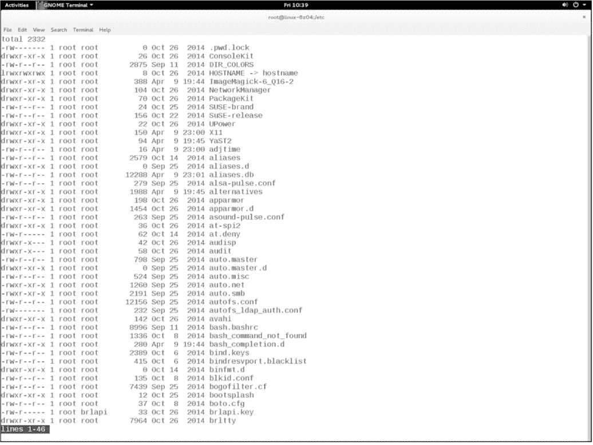

**图 7-9** 管道到 `less` 的命令输出

`less` 命令为查看输出提供了许多很棒的功能。你可以通过输入 `/` 字符后跟想要查找的字符串来向后搜索，如下例所示：

```text
/somestring
```

此外，在 `less` 中，你可以使用在其他程序中使用的大多数典型导航命令，例如 `vi` 或 `vim`（将在后面的章节介绍），如使用 `1G` 跳到文件第一行的第一个字符，或使用 `G` 跳到文件末尾。上页键、下页键以及传统的光标移动（`hjkl`）和方向键也可以在文件中导航。

管道也可以用于链联多个命令，每个命令都对第一个命令的输出进行处理以产生有用的结果。


### 注意

要记住，命令会将输出管道到其他命令，直到输出最终发送到屏幕/控制台，或通过输出重定向提交到文件（例如 `>` 或 `>>` 字符）。除非使用 `2>` 设计符将标准错误发送到文件位置或 `/dev/null` 设备，否则标准错误不会被重定向或捕获。

例如，要打印带有行号（`nl`）和打印格式（`pr`）的代码示例，你使用以下命令字符串：

```bash
# cat codesamp.c | nl | pr | lpr
```

了解重定向符号和管道之间的区别至关重要。假设你看到这样的命令：

```bash
# cat file1 | nl > pr
```

此命令会在当前目录下生成一个名为 `pr` 的文件，而不是经过 `nl` 和 `pr` 过滤后的输出。

### 注意

记住，重定向始终源于或指向文件，而管道始终源于或指向程序。

以下是一个使用管道产生可用数据的良好示例：

```bash
# sort < names | nl
```

此命令对 `names` 文件进行排序并进行行编号。

### 注意

记住，在为 `sort` 等程序指定文件参数时，你通常不需要包含 `<` 或输入重定向，但我们在这里包含了它，是因为你可能会在 Linux+ 考试中看到它。

另一个例子是：

```bash
# who | wc -l
```

此命令统计连接到系统的用户并仅显示总数。

这里还有一个例子：

```bash
# lsof /mnt/cdrom | mail root -s "CD-ROM Users"
```

此命令旨在向你显示当前正在访问或已打开服务器 CD-ROM 文件的用户，以便你可以在需要时知道让谁下线。

### 执行多个命令

有几种方法可以通过单次回车键执行多个命令。你可以使用特殊字符让系统执行多个命令，也可以使用更复杂的 `if/then` 类型的多命令执行。


#### 多命令操作符

在编译软件、调度备份作业或执行任何需要特定程序退出状态为特定值的任务时，你需要使用这些操作符。

### 注意

记住，这些命令中的每一个都有自己的 `stdin`、`stdout` 和 `stderr` 描述符。它们在操作符之间的每个命令中流入流出。

- `;`：分号导致所有列出的命令独立执行。接下来的示例在长时间编译完成后回显：

  ```bash
  make modules ; echo DO MAKE MODULES_INSTALL NEXT
  ```

  命令是独立执行的，任何一个命令都不会根据另一个命令的退出状态而失败或成功。

- `&&`：双安培符号在第一个命令的退出状态为 0（成功）时执行第二个命令。如果返回非零的退出状态（失败），则不尝试执行第二个命令。如果你是系统管理员，并希望在第一个命令成功后让第二个程序执行操作，请这样使用双安培符号：

  ```bash
  longcompile && mail root -s "compile complete"
  ```

  这组命令启动了一个长时间的编译；如果成功，你将收到一封主题为“compile complete”的电子邮件。

- `||`：双管道符号在第一个命令的退出状态为 0（成功）时不尝试执行第二个命令。如果第一个命令的退出状态为非零（失败），则尝试执行第二个命令。如果你想让第二个命令让你知道特定进程是否失败，而无需每天早上都翻阅日志文件怎么办？你可以使用以下：


`tar -czvf /dev/st0 / || mail root -s "doh, backup failed"`

正如你可能猜到的，这组命令尝试将全系统备份到 SCSI 磁带设备。只有在失败时，`root` 用户才会收到一封主题指示其失败的电子邮件。


## 命令替换

在某些情况下，你需要获取命令的输出并将其放入变量中，通常用于脚本编写。将命令的输出替换为命令本身是通过将命令括在反引号（`` ` ``）中实现的（该键输入法与波浪号 `~` 键相同，但不需要 Shift 键），如下所示：

```
# `somecmd`
```

例如，你可以将 `date` 命令的输出插入变量中，可能供脚本使用，如下例所示：

```
# export DATETIME=`date`
# echo $DATETIME
Tue Jan 13 17:18:35 PST 2004
```


`export` 命令用于创建一个名为 `DATETIME` 的变量，其内容由 `date` 命令填充。当执行此命令时，`date` 命令周围的反引号会导致该命令的输出作为值插入 `DATETIME` 变量中。

命令替换的另一个方面是将命令括在括号中并将其声明为变量，如下例所示：

```
# file $(grep -irl crud /usr/src/linux-2.4)
```

使用这种命令替换的主要原因是它允许你在命令中嵌套命令。你不再需要使用通配符，只需使用正确的替换即可。

命令替换的另一个有趣示例是查看给定的二进制文件并查看它需要哪些库，而无需该二进制文件的实际位置。这里是一个示例：

```
# ldd `which ls`

 linux-gate.so.1 => (0xb778c000)
 libselinux.so.1 => /lib/i386-linux-gnu/libselinux.so.1 (0xb774e000)
 libacl.so.1 => /lib/i386-linux-gnu/libacl.so.1 (0xb7745000)
 libc.so.6 => /lib/i386-linux-gnu/libc.so.6 (0xb7595000)
 libpcre.so.3 => /lib/i386-linux-gnu/libpcre.so.3 (0xb7557000)
 libdl.so.2 => /lib/i386-linux-gnu/libdl.so.2 (0xb7552000)
 /lib/ld-linux.so.2 (0xb778d000)
 libacl.so.1 => /lib/i386-linux-gnu/libacl.so.1 (0xb754c000)
```


## 使用 `tee` 命令拆分流

`tee` 命令的设计用于接收单个 `stdin` 流，并同时将一组相同的输出发送到指定的文件，并通过管道将另一组输出作为另一个程序的 `stdin`。

当你运行一个必须向文件产生输出的程序并且你想同时在屏幕上监控其进度时，可以使用 `tee`，例如使用 `find` 命令时。要将一路输出流重定向到单个文件并同时在屏幕上看到相同的输出，请使用：

```
# find / -iname *.txt | tee findit.out
```

此命令旨在将流的标准输出记录到文件中，并将另一个完整的流传递到控制台。必须同时记录并处理数据的金融机构会发现 `tee` 非常好用。


## 使用 `xargs` 命令处理输出

`xargs` 命令是另一个非常有用的命令。它接收来自另一个程序的返回结果列表（例如 `locate` 或 `find` 命令的输出，本质上是一系列路径/文件名），并逐个对其进行解析，供更简单或功能较弱的命令使用。

例如，假设你想将整个系统中所有的 readme 文件合并到位于你主目录（home directory）下的一个名为 `mongofile.txt` 的大文件中。这将使你能够通过一个命令来搜索文档：

```
# less mongofile.txt
```

要实现此操作，你需要使用 `find` 命令找到系统中 readme 文件的完整路径和文件名；然后使用 `cat` 命令将结果重定向到目标文件：

```
# find / -iname readme | cat > mongofile.txt
```

从没有出现严重错误来看，你似乎已经得到了你想要的结果：每个文件的每一行都顺序输出到了 `mongofile.txt`。然而，事实并非如此。

要查看发生了什么错误，执行 `less mongofile.txt` 命令，这会显示你并没有得到想要的输出：`cat` 命令并不智能，无法判断 `find` 命令的输出实际上是可以单独作为参数使用的离散行。它只是将收到的输出作为一个巨大的文本块进行原样回显（echo），而没有将单独的行视为 `cat` 命令可用的输出行。

### 注意

也许另一种更容易查看发生情况的方法是使用 `wc -l` 命令对 `mongofile.txt` 进行操作。它会返回文件中具体的行数以供你初始参考。（作为参考，当我运行该命令时得到了 679 行输出。）

再次运行命令，让 `xargs` 命令作为 `cat` 命令的缓冲区。它读取所有输出并逐行将单行作为参数传递给 `cat`，直到没有更多行可以提供给 `cat` 为止，如下：

```
# find / -iname readme | xargs cat > mongofile.txt
```

现在使用 `less mongofile.txt` 命令验证它是否按你最初设定的方式工作。你现在看到所有文件都已枚举并拼接在一起形成了一个大文件。

### 注意

同样，`wc -l` 命令显示了输出输出行数，在使用 `xargs` 之后，这个数字会显著增大，因为最终的 `mongofile.txt` 文件是所有文件输出的拼接，而不仅仅是第一个命令中文件列表的输出。（作为参考，当我运行该命令时得到了 76,097 行输出。）

## 总结

在本章中，你学习了如何使用 `find` 命令实时查找文件，以及通过 `locate` 命令进行数据库查找。在本章中，你还学习了如何使用 `cp`、`mv` 和 `touch` 命令复制、移动和更新文件，以及如何在命令行中正确使用文件通配符（globs）匹配文件。此外，你还学习了硬链接和符号链接，以及如何重定向和通道输入、输出和错误流。

## 考试准备任务

如引言中“如何使用本书”部分提到的，你有几种准备考试的方案：这里的练习、第 30 章、“最终准备”以及 Pearson Test Prep 在线软件中的考试模拟题。

## 复习所有关键主题

复习本章最重要的主题，这些主题在页面外侧边缘用“关键主题”（Key Topics）图标标记。表 7-3 列出了这些关键主题及其所在的页码。


**表 7-3** 第 7 章 关键主题

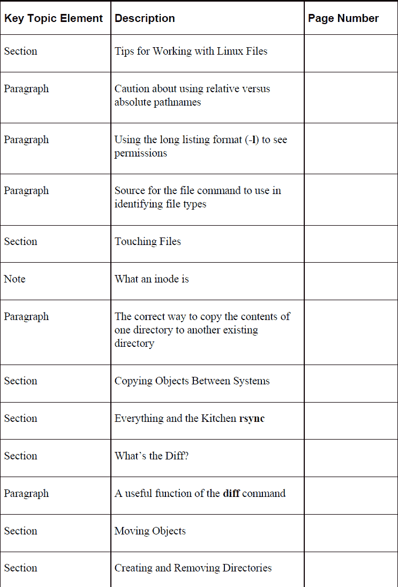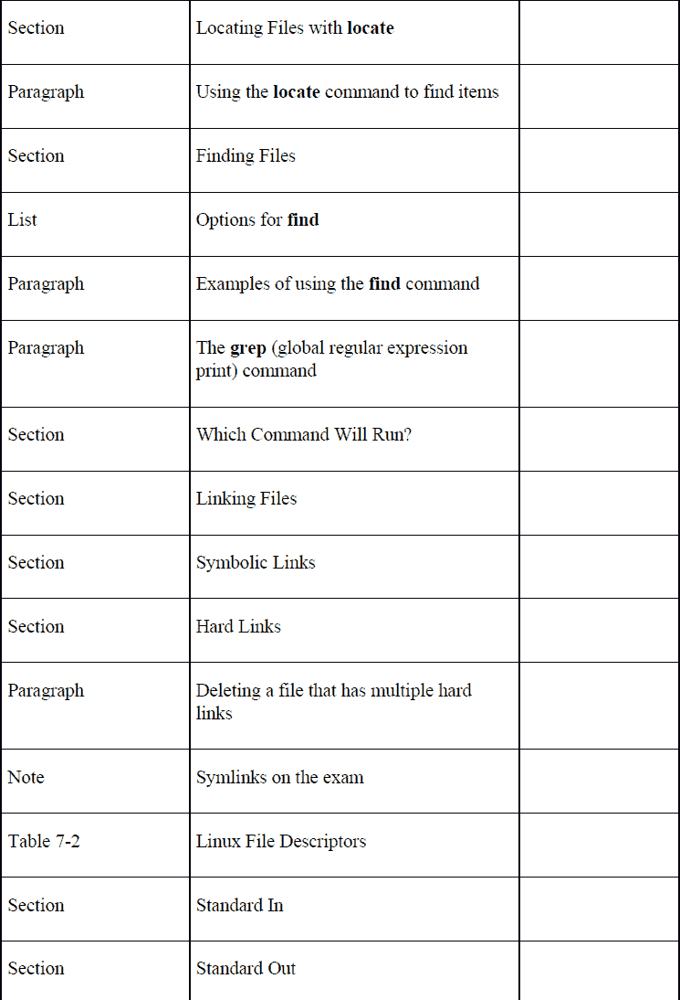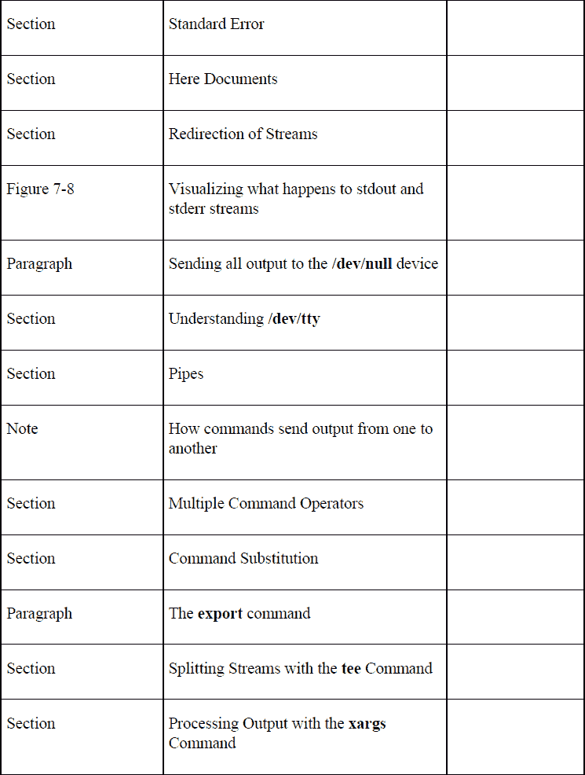

## 定义关键术语

定义本章的以下关键术语并在词表中检查你的答案：

- 文件系统层次结构标准 (FHS)
- 相对路径
- 绝对路径
- 硬链接
- 标准输出
- 标准输入
- 标准错误
- `stdin`
- `stdout`
- `stderr`
- 导出 (exporting)

## 复习题

这些复习题的答案在附录 A。

**1.** 你当前位于目录 `/home/user1/subdir1`，需要导航到目录 `/home/user3`。以下哪些命令可以实现此目标？（选择两个。）

**a.** `cd home/user3`

**b.** `cd ~/user3`

**c.** `cd ../../home/user3`

**d.** `cd ../../../home/user3`

**2.** 在示例中使用 `mkdir` 和 `rmdir` 命令的哪个选项来创建嵌套的子目录树？

示例：

```
/dir1/dir2/dir3/dir4
```

**a.** `-c`

**b.** `-n`

**c.** `-d`

**d.** `-p`

**3.** 下列哪个文件描述符与 stdout 匹配？

**a.** `/proc/self/fd/0`

**b.** `/proc/self/fd/1`

**c.** `/proc/self/fd/2`

**d.** `/proc/self/fd/3`

**4.** 下列命令的结果是什么？

```
$ find / -iname "*.txt" | file > sort
```

**a.** 当前目录下生成一个名为 `file` 的文件

**b.** 表示找不到文件的错误消息

**c.** 当前目录下生成一个名为 `sort` 的文件

**d.** 系统上的无尽循环

**e.** 以上都不是

**5.** 关于默认 Linux 系统上的文件，下列哪些陈述是正确的？（选择所有适用项。）

**a.** 文件名可以以数字开头。

**b.** 文件名可以包含多个点。

**c.** 文件名可以包含空格。

**d.** 文件名可以包含 ampersands（&符号）。

**e.** 文件名可以包含反斜杠。

**6.** 你当前位于 `/bbb` 目录，想将 `/ccc` 目录的内容移动到 `/bbb` 目录。实现此目标的最短命令是什么？

**a.** `mv /ccc/*.* .`

**b.** `mv ../ccc/*.* .`

**c.** `mv /ccc/* .`

**d.** `mv /ccc/ /bbb`

**7.** `mkdir` 和 `rmdir` 命令的哪个选项处理父目录？

**a.** `-c`

**b.** `-p`

**c.** `-d`

**d.** `-e`

**e.** `-z`

## 第 8 章. 文件处理 [此内容正在开发中。]

**此内容正在开发中。**

## 第 9 章. 文件权限与提升 [此内容正在开发中。]

**此内容正在开发中。**

## 第 10 章 SELinux 和 AppArmor

本章涵盖以下主题：

- SELinux 配置

- SELinux 上下文

- AppArmor

本章涵盖以下目标：

- **目标 3.1：** 给定场景，应用或获取适当的用户和/或组权限及所有权。

在第 9 章、“文件权限与提升”中，你学习了用户如何使用权限保护自己的文件和目录。权限是一个非常有用的功能；然而它们确实有一个很大的缺点：用户。

用户经常对权限感到困惑。典型用户可能不理解 Linux 权限的复杂性，特别是像目录写权限意味着用户可以删除目录中的所有文件等细节。

需要一种方法来保护用户不受自己的伤害。可用技术允许管理员在普通文件目录权限之上增加另一层保护。本章将探索这些技术中的两种：`SELinux` 和 `AppArmor`。

### “我了解这些吗？”测验

“我是否已经知道这些？”测验可以让你评估自己应该阅读整个章节，还是直接跳到“考试复习任务”部分进行复习。如果你有疑问，请阅读整个章节。表 10-1 列出了本章的主要标题以及相应的“我是否已经知道这些？”测验问题。你可以在附录 A 中的“‘我是否已经知道这些？测验和复习题答案”中找到答案。

## 表 10-1 “我是否已经知道这些？”基础主题章节与问题映射

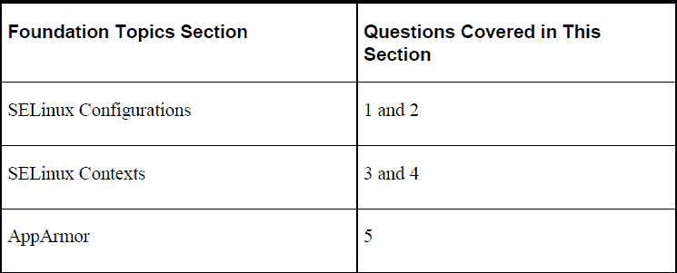

### 注意事项

自评估的目标是衡量你对本章主题的掌握程度。如果你不知道某个问题的答案，或者对答案只有部分确定，那么为了自评估的目的，你应该将该问题标记为错误。对于你猜对的答案给自己分会歪曲你的自评估结果，并可能给你一种虚假的安全感。

1. 强制访问控制设计用于保护什么？

**a.** 用户账户

**b.** 文件和目录

**c.** 组账户

**d.** 网络端口

2. 下列哪个是有效的 SELinux 模式？（选择所有项。）

**a.** 禁用 (Disabled)

**b.** 强制 (Enforcing)

**c.** 宽容 (Permissive)

**d.** 以上都不对。

3. 哪个命令用于显示进程的安全上下文？

**a.** `show`

**b.** `list`

**c.** `ps`

**d.** `ls`

4. 哪个命令用于显示文件的安全上下文？

**a.** `show`

**b.** `list`

**c.** `ps`

**d.** `ls`

5. 下列哪一个被认为是 MAC 安全系统？

**a.** SecureMAC

**b.** AppArmor

**c.** Lockdown

**d.** AppSecure

### 基础主题


文件和目录可能会被不了解权限或被意外授予意图之外访问权限的用户所破坏。系统管理有一句老话：“如果没有用户，什么东西都不会坏，系统也会更安全。”当然，对这句话的回答是：“如果没有用户，我们就没有工作可做了！”用户的错误往往确实会对存储在文件中的数据导致非意图的访问。

基于上下文的访问可以配置为在用进程访问文件时提供额外的安全层级，以处理权限被破坏的情况。文件和目录访问的控制权不在用户手中，而是由管理员处理。

关的不仅仅是用户文件和目录。想象一种情况：远程黑客能够利用漏洞获取你的 Web 服务器进程（`httpd` 进程）的控制。如果没有基于上下文的控制，该黑客可以将 `httpd` 进程读取关键系统文件（例如 `/etc/passwd` 文件），获取可能导致对系统或网络进一步侵入的信息。

传统的 Linux 权限（文件和目录的读、写、执行权限）使用自主访问控制 (DAC)，而基于上下文的权限则利用强制性访问控制 (MAC)。然而，当启用了基于上下文的解决方案时，DAC 仍然有效（MAC 和 DAC 都会被执行）。通常会首先评估 MAC 控制，如果允许访问，然后检查文件的权限。

本章涵盖了两种常用的基于上下文的方法：`SELinux` 和 `AppArmor`。

### SELinux 配置

`SELinux` 安全策略可能要求进程属于 `SELinux` 安全上下文（可以想象为“安全组”）才能访问文件和目录。普通权限仍用于进一步定义访问，但在访问文件/目录时，会先应用此 `SELinux` 策略。

更令人关注的问题，也是大多数 `SELinux` 策略旨在解决的问题，是守护进程（或系统进程）如何产生安全风险。考虑一种情况：你有许多提供各种服务的活动进程。例如，其中一个进程可能是 Web 服务器，如下例所示：

```
root@localhost:~# ps -fe | grep httpd
root      1109     1  0  2018 ?        00:51:56 /usr/sbin/httpd
apache    1412  1109  0 Dec24 ?        00:00:09 /usr/sbin/httpd
apache    4085  1109  0 05:40 ?        00:00:12 /usr/sbin/httpd
apache    8868  1109  0 08:41 ?        00:00:06 /usr/sbin/httpd
apache    9263  1109  0 08:57 ?        00:00:04 /usr/sbin/httpd
apache   12388  1109  0 Dec26 ?        00:00:47 /usr/sbin/httpd
apache   18707  1109  0 14:41 ?        00:00:00 /usr/sbin/httpd
apache   18708  1109  0 14:41 ?        00:00:00 /usr/sbin/httpd
apache   19769  1109  0 Dec27 ?        00:00:15 /usr/sbin/httpd
apache   29802  1109  0 01:43 ?        00:00:17 /usr/sbin/httpd
apache   29811  1109  0 01:43 ?        00:00:11 /usr/sbin/httpd
apache   29898  1109  0 01:44 ?        00:00:10 /usr/sbin/httpd
```

在输出输出中，每一行描述了系统上运行的一个 Apache Web 服务器进程（`/usr/sbin/httpd`）。行的第一部分是启动进程的用户。以 `root` 身份运行的进程仅用于产生额外的 `/usr/sbin/httpd` 进程。其他进程响应来自客户端工具（网页浏览器）的入 Web 页面请求。

想象一下，如果在 Apache Web 服务器软件中发现安全漏洞；该漏洞允许客户端工具获取其中一个 `/usr/sbin/httpd` 进程的控制，并向该进程发出自定义命令或操作。这些操作之一可以是查看 `/etc/passwd` 文件的内容，由于该文件设置的权限，该操作将成功：

```
root@localhost:~# ls -l /etc/passwd
-rw-r--r-- 1 root root 2690 Dec 11  2018 /etc/passwd
```

从此命令的输出可以看出，由于所有用户都有读取权限，因此所有用户都有查看 `/etc/passwd` 文件内容的能力。你希望某个随机黑客能够查看存储用户账户数据的文件内容吗？

通过 `SELinux` 策略，`/usr/sbin/httpd` 进程可以被“锁定”，使得每个进程只能访问一组特定的文件。这就是大多数管理员使用 `SELinux` 的原因：保护可能被黑客利用已知（或可能未知）漏洞攻击的进程。

### SELinux 模式


共有三种 `SELinux` 模式：

- **禁用 (Disabled):** 在禁用模式下，`SELinux` 完全不起作用。当用户尝试访问文件或目录时，不会进行任何检查。


**强制（Enforcing）：** 在强制模式下，SELinux 会执行检查并在必要时阻止对文件或目录的访问。

**宽容（Permissive）：** 在宽容模式下，SELinux 会执行检查但绝不会阻止对文件或目录的访问。此模式设计用于故障排除问题，因为在此模式下会创建日志消息。


使用`getenforce`命令确定当前的 SELinux 模式：

```
root@localhost:~# getenforce
Enforcing
```

结果`Enforcing`表示 SELinux 已安装且安全策略当前处于激活状态。


你可以通过发布`setenforce`命令更改模式（这在测试新策略或排除 SELinux 问题时很有用）：

```
root@localhost:~# setenforce 0
root@localhost:~# getenforce
Permissive
```

在宽容模式下，SELinux 不阻塞对文件和目录的任何访问，但会发出警告并在系统日志文件中显示。

你可以在强制模式和宽容模式之间切换，但禁用 SELinux 需要更改配置文件并重启系统。例如，在 RHEL（红帽企业 Linux）系统上，你将在`/etc/selinux/config`文件中更改`SELINUX`设置，如下所示：

```
root@localhost:~# cat /etc/selinux/config
# 此文件控制系统上 SELinux 的状态。
# SELINUX= 可以取以下三个值之一：
#       enforcing - 强制执行 SELinux 安全策略。
#       permissive - SELinux 打印警告而不是强制执行。
#       disabled - 不加载 SELinux 策略。
SELINUX=disabled
# SELINUXTYPE= 可以取以下两个值之一：
#       targeted - 保护特定的进程（目标）。
#       mls - 多级安全（Multi Level Security）保护。
SELINUXTYPE=targeted
```

相反，如果当前的 SELinux 模式为`disabled`，你可以将`/etc/selinux/config`文件中的`SELINUX`设置更改为`enforcing`或`permissive`并重启系统。在完成重启后，运行`getenforce`命令来验证更改已生效，这始终是一个良好的策略。

## SELinux 策略


SELinux 策略是一组规则，这些规则决定了策略施加了哪些限制。策略本身通常非常复杂，细节超出了 Linux+ 考试的范围。然而，了解策略是根据规则设置限制是非常重要的。


你还应该知道，最常用的策略之一是目标策略（targeted policy）。该策略通常默认存在于安装了 SELinux 的系统上，并且它通常是首次启用 SELinux 时启用的默认策略。

目标策略包含了旨在保护系统免受服务而非普通用户攻击的规则。每个服务都被分配了一个或多个安全上下文（security contexts）、布尔值以及限制该服务访问文件和目录权限的额外规则。


`sestatus`命令提供有关 SELinux 的总体状态信息，包括当前策略：

```
root@localhost:~# sestatus
SELinux status:                 enabled
SELinuxfs mount:                /sys/fs/selinux
SELinux root directory:         /etc/selinux
Loaded policy name:             targeted
Current mode:                   enforcing
Mode from config file:          enforcing
Policy MLS status:              enabled
Policy deny_unknown status:     allowed
Max kernel policy version:      28
```

## SELinux 布尔值

策略的具体组成部分以及如何创建策略超出了 Linux+ 考试的范围，因此也超出本书的内容。但是，你可以通过布尔值（Booleans）来修改策略的行为。布尔值是一个真/假值，用于改变 SELinux 执行强制访问控制（MAC）的方式。

一个 SELinux 策略通常包含几十个不同的布尔值。要确定布尔值的用途，请使用`semanage`命令：

```
root@localhost:~# semanage boolean -l | head
SELinux boolean                State  Default Description

privoxy_connect_any            (on   ,   on)  Allow privoxy to connect any
smartmon_3ware                 (off  ,  off)  Allow smartmon to 3ware
mpd_enable_homedirs            (off  ,  off)  Allow mpd to enable homedirs
xdm_sysadm_login               (off  ,  off)  Allow xdm to sysadm login
xen_use_nfs                    (off  ,  off)  Allow xen to use nfs
mozilla_read_content           (off  ,  off)  Allow mozilla to read content
ssh_chroot_rw_homedirs         (off  ,  off)  Allow ssh to chroot rw homedirs
mount_anyfile                  (on   ,   on)  Allow mount to anyfile
```

例如，在输出中，有一个名为`xdm_sysadm_login`的布尔值。XDM 是一个显示管理器，这意味着它是允许用户通过 GUI 界面登录系统的工具。此布尔值用于确定 XDM 软件是否允许 root 用户登录。`(off, off)` 用于显示该布尔值的默认值和当前值。在这种情况下，`off` 表示 root 用户无法通过 GUI 界面登录，因为该布尔值的描述是“允许 xdm 登录 sysadm”。


你也可以使用`getsebool`命令仅显示某个布尔值的当前值：

```
root@localhost:~# getsebool -a | head
xdm_sysadm_login --> off
abrt_handle_event --> off
abrt_upload_watch_anon_write --> on
antivirus_can_scan_system --> off
antivirus_use_jit --> off
auditadm_exec_content --> on
authlogin_nsswitch_use_ldap --> off
authlogin_radius --> off
authlogin_yubikey --> off
awstats_purge_apache_log_files --> off
```

当将布尔值作为参数时，`getsebool`命令仅给出该布尔值的当前值：

```
root@localhost:~# getsebool xdm_sysadm_login
xdm_sysadm_login --> off
```


要将 SELinux 布尔值设置为开启或关闭，请使用`setsebool`命令：

```
root@localhost:~# getsebool xdm_sysadm_login
xdm_sysadm_login --> off
root@localhost:~# setsebool xdm_sysadm_login 1
root@localhost:~# getsebool xdm_sysadm_login
xdm_sysadm_login --> on
```

提供参数`0`关闭布尔值，提供`1`开启布尔值。

注意，默认情况下，`setsebool`命令仅修改布尔值的当前状态。重启会导致所有布尔值恢复到之前的状态，除非在使用`setsebool`命令时使用了`-P`（代表 *persistent* 持久）选项：

```
root@localhost:~# setsebool -P xdm_sysadm_login 1
```

布尔值通常很长，输入起来很麻烦。`setsebool`和`getsebool`命令提供了独特的 Tab 补全功能。例如，注意当按下 Tab 键时的以下行为：

```
root@localhost:~# setsebool samba_<tab>
samba_create_home_dirs            samba_portmapper
samba_domain_controller           samba_run_unconfined
samba_enable_home_dirs            samba_share_fusefs
samba_export_all_ro               samba_share_nfs
samba_export_all_rw
```

## SELinux 上下文

SELinux 是如何保护文件（和目录）免受未经授权使用的？答案是使用 SELinux 上下文。

每个文件都可以应用一个上下文，该上下文将影响进程访问文件的能力。进程本身也应用了 SELinux 上下文，这个上下文本质上将进程置于安全组中。


每个进程都在安全上下文中运行。要查看此，使用`ps`命令的`-Z`选项，如下所示（此处使用`head`命令仅是为了限制命令的输出）：

```
root@localhost:~# ps -eZ | grep httpd | head -2
system_u:system_r:httpd_t:s0 root      1109     1  0  2018 ?        00:51:56 /usr/sbin/httpd
system_u:system_r:httpd_t:s0 apache    1412  1109  0 Dec24 ?        00:00:09 /usr/sbin/httpd
```

安全上下文（`system_u:system_r:httpd_t:s0`）很复杂，但对于理解 SELinux 基础，重要的部分是`httpd_t`，它类似于安全组或领域（domain）。作为此安全领域的一部分，`/usr/sbin/httpd`进程只能访问安全策略允许`httpd_t`的文件。此策略通常由 SELinux 专家编写，该专家应该在哪些进程能够访问系统上的特定文件和目录方面拥有丰富的经验。


文件和目录也有由策略定义的 SELinux 安全上下文。要查看特定文件的安全上下文，使用`ls`命令的`-Z`选项：

```
root@localhost:~# ls -Z /var/www/html/index.html
unconfined_u:object_r:httpd_sys_content_t:s0 /var/www/html/index.html
```

请注意，SELinux 上下文包含大量数据，导致文件名无法放在同一行内。正如你可能推断出的，以安全上下文`system_u:system_r:httpd_t:s0`运行的进程可以访问标记为`unconfined_u:object_r:httpd_sys_content_t:s0`上下文的文件。情况并不总是如此简单，SELinux 布尔值（Booleans）会对上下文的应用方式产生重大影响，但这基本上是核心思想。记住，参加 Linux+ 考试不需要成为 SELinux 专家（这是一件好事，因为这是一个巨大的主题）。

`unconfined_u:object_r:httpd_sys_content_t:s0`上下文是如何应用于`/var/www/html/index.html`文件的？通常，SELinux 安全上下文根据文件的位置自动应用。因此，放置在`/var/www/html`目录下的新文件也会被标记为`unconfined_u:object_r:httpd_sys_content_t:s0`上下文。


在某些情况下，你需要手动应用此上下文。例如，如果你从另一个位置移动文件，它可能会保留其原始的安全上下文。在这种情况下，使用`chcon`命令更改文件或目录的上下文：

```
root@localhost:~# chcon -t user_home_t /var/www/html/index.html
```


你还可以利用 SELinux 规则，这些规则定义了大多数系统文件的默认安全上下文。`restorecon`命令用于根据当前位置和这些 SELinux 规则重置文件或目录的默认安全上下文。这是一个示例：

```
root@localhost:~# restorecon /var/www/html/index.html
```

`restorecon`命令的一个常用选项是`-R`，它对目录结构执行递归更改。

## AppArmor


AppArmor 是一种强制访问控制（MAC）系统，其作用与 SELinux 类似，提供了一种基于上下文的权限模型。本节描述了 Linux+ 考试可能会测的 AppArmor 关键组件。

#### Note

本章关于 AppArmor 的信息比 SELinux 少。原因有以下几点：

• 作为一种 MAC，AppArmor 的概念与 SELinux 相似。

• SELinux 的使用频率通常比 AppArmor 高。虽然少数 Linux 发行版使用 AppArmor 作为默认 MAC，但主要是 SUSE 使用 AppArmor。

• Linux+ 考试目标中对 SELinux 的强调程度高于 AppArmor。

#### aa-disable


AppArmor 配置文件（profile）是一个规则集，描述了 AppArmor 应如何限制进程。可以使用`aa-disable`命令禁用特定的配置。另一个常用技术如下例所示：

```
root@localhost:~# ln -s /etc/apparmor.d/usr.sbin.mysqld /etc/apparmor.d/disable
root@localhost:~#  apparmor_parser -R /etc/apparmor.d/usr.sbin.mysqld
```

#### Note

使用`aa-status`命令查看配置的状态。要再次启用配置，请使用以下命令：

```
root@localhost:~# rm /etc/apparmor.d/disable/usr.sbin.mysqld
root@localhost:~#  apparmor_parser -r /etc/apparmor.d/usr.sbin.mysqld
```

#### aa-complain


如果你需要排查 AppArmor 配置文件，最好将其放入投诉模式（complain mode）。在这种模式下，不执行任何限制，但任何问题都会被报告。

使用`aa-complain`命令将配置放入投诉模式：

```
root@localhost:~#  aa-complain /usr/sbin/mysqld
Setting /usr/sbin/mysqld to complain mode.
```

将配置切回强制模式（enforcing mode），使用以下命令：

```
root@localhost:~#  sudo aa-enforce /usr/sbin/mysqld
Setting /usr/sbin/mysqld to enforce mode
```

#### aa-unconfined


使用`aa-unconfined`命令列出不受 AppArmor 配置文件限制的进程。

#### /etc/apparmor.d/


`/etc/apparmor.d`目录是 AppArmor 配置文件定义所在的位置。了解如何创建或读取这些文件超出 Linux+ 考试的范围，但了解这些配置的位置是重要的，以便确定哪些配置可用并使用如`aa-disable`之类的 AppArmor 命令。

#### /etc/apparmor.d/tunables


`/etc/apparmor.d/tunables`目录包含可用于微调 AppArmor 行为的文件。了解如何创建或读取这些文件超出 Linux+ 考试的范围。

## 总结


在本章中，你学习了强制访问控制（MAC）的要点，以及该功能如何与自主访问控制（DAC）配合以提供更安全的文件系统。你还学习了 Linux 的两种主要 MAC 解决方案：SELinux 和 AppArmor。

## 考试准备任务

正如引言中“如何使用本书”部分提到的，你有几种准备考试的选择：此处的练习题、第 30 章、“最终准备”以及 Pearson Test Prep 在线软件中的考试模拟题。

### 复习所有关键主题

复习本章中最重要的主题，这些主题在页面外边角用“关键主题”图标标记。表 10-2 列出了这些关键主题以及它们所在的页码。


**表 10-2** 第 10 章 关键主题

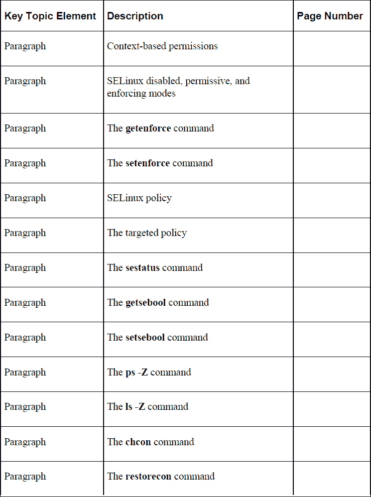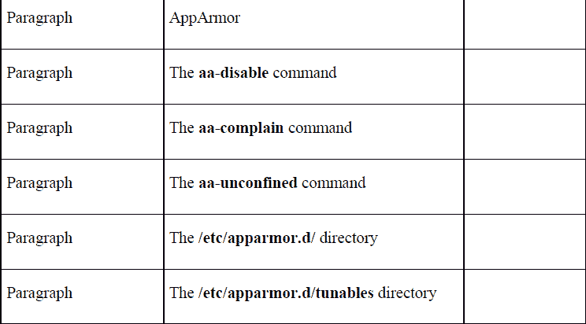

## 定义关键术语

定义本章中的以下关键术语，并在词表中检查你的答案：

- `SELinux`
- `AppArmor`
- 强制访问控制（`MAC`）
- 自主访问控制（`DAC`）
- `SELinux` 策略
- `SELinux` 上下文
- `SELinux` 布尔值

## 复习题

这些复习题的答案在附录 A。

1. _____ 使用 Linux 文件和目录权限来限制对这些项目的访问。

2. _____ 利用安全组或域来限制对对象（如文件和目录）的访问。

3. 下列哪些是 `SELinux` 上下文应用于？（选择所有适用项。）

   a. 文件

   b. 用户

   c. 进程

   d. 以上答案均正确。

4. 在哪种模式下 `SELinux` 完全不运行？

   a. 允许（Permissive）

   b. 禁用（Disabled）

   c. 不活动（Inactive）

   d. 空（Null）

5. 哪个命令显示当前的 `SELinux` 模式？

6. 哪个命令提供有关 `SELinux` 的总体状态信息？

7. 下列哪项用于更改 `SELinux` 策略行为的 `SELinux` 值？

   a. 标记（Flag）

   b. 上下文（Context）

   c. 开关（Switch）

   d. 布尔值（Boolean）

8. `ps` 和 `ls` 命令的哪个选项显示 `SELinux` 安全上下文？

9. 可以使用 _____ 命令将 `AppArmor` 放入投诉模式。

10. _____ 命令列出不受 `AppArmor` 配置文件限制的进程列表。

## 第 15 章 Linux 设备

本章涵盖了以下主题：

- 理解 Linux 硬件
- CUPS
- Linux 图形用户界面

本章涵盖了以下考试目标：

- **目标 2.7：** 解释 Linux 设备的用法和操作
- **目标 2.8：** 比较并对比 Linux 图形用户界面

Linux 使用多种技术与硬盘、打印机和显示器等设备进行通信。本章涵盖了这些技术，使你能够自定义系统与这些设备交互的方式。

## “我已经掌握这些了吗？”测验

“我已经掌握这些了吗？”测验可以帮助你评估是应该阅读整个章节，还是直接跳到“考试准备任务”部分进行复习。如果你有疑问，请阅读整个章节。表 15-1 列出了本章的主要章节标题以及对应的“我已经掌握这些了吗？”测验题。你可以在附录 A 中的“‘我已经掌握这些了吗？’测验与复习题答案”中找到答案。

**表 15-1** “我已经掌握这些了吗？”基础知识章节与问题映射表


### 注意

1. 以下哪项不用于外设设备与 CPU 及其他外设设备通信？

   a. I/O 端口

   b. 直接内存访问通道

   c. 中断请求

   d. TCP/IP 端口

2. 哪个命令可以提供系统中所有硬件和驱动程序的概述，包括用于与 CPU 通信的端口？

   a. `lspci`

   b. `lsdev`

   c. `lsusb`

   d. `sysinfo`

3. 你的打印机名为 `JonathansDesk`，在打印文档时出错，现在 CUPS 停止了打印机。你如何恢复打印任务？

   a. `cupsenable JonathansDesk`

   b. `lpq -P JonathansDesk`

   c. `cupsaccept JonathansDesk`

   d. `cupsaccept -P JonathansDesk`

4. 以下哪一个命令将名为 `resume.pdf` 的文件打印到名为 `Main` 的打印机？

   a. `lpr -d Main resume.pdf`

   b. `lp -P Main resume.pdf`

   c. `lp -d Main resume.pdf`

   d. `lpr resume.pdf`

5. 以下哪项最可能提供类似文件管理器的程序？

   a. X 服务器

   b. 显示管理器

   c. 窗口管理器

   d. 桌面

## 基础知识

### 理解 Linux 硬件

`硬件` 指运行你 Linux 操作系统的整个计算机，而 `外设` 是可移除的或与世界通信的硬件部分。显卡可以是主板的一部分，也可以是独立卡；无论何种情况，它都被视为外设。从技术角度来说，外设通过某种 `总线` 与 CPU 通信，这正是 Linux 支持工作变得复杂开始的地方。外设也被称为 `设备`。

`操作系统` 指的是整个系统，包括你使用的所有应用程序软件。Linux 是一个操作系统。操作系统的内核是管理硬件与应用程序之间交互的部分。Linux 内核运行在主板上的 CPU 和内存上。要向磁盘写入内容、在屏幕上显示内容或与巴西的 Web 服务器通信，内核必须通过连接 CPU 和外设的总线发送消息。将内核想象成一个协调所有飞机、跑道和地面人员的空中交通管制员。

每个硬件制造商处理数据的方式都不同，这使得任何操作系统的支持工作变得困难。解决方案是让内核学会一种通用语言，并让外设制造商提供 `驱动`，允许其特定硬件能够使用这种通用语言。在过去，制造商不愿花时间编写 Linux 驱动程序，因此这必须由社区完成。如果供应商没有提供足够的信息供 Linux 社区编写驱动程序，硬件通常无法获得支持。

### 注意

Linux 并不是由单一公司编写的；它是由像你这样想要让 Linux 更好的社区人员编写的。人们制作修复程序（称为 `补丁`），并将其提交以包含在 Linux 内核及相关工具中。Linux 项目的核心成员与提交者一起工作，确保补丁符合项目方向并具有足够的质量。其中一些人是喜欢解决困难问题的爱好者，有时他们是那些使用 Linux 的公司雇佣的并希望贡献改进建议的员工。

随着 Linux 支持的不断增加，越来越多的硬件有了由制造商直接提供的 Linux 驱动程序，或者由于愿意花时间让其正常运行的日益庞大的社区支持。

#### 设备类型

你应该了解 Linux 系统支持的以下类型设备：


- **蓝牙：** 蓝牙设备设计用于在极短距离内进行无线通信。它使用的一种标准对于 I/O（输入/输出）设备（如耳机、键盘和鼠标）来说非常有用。

- **WiFi：** 像蓝牙设备一样，WiFi 设备设计用于无线通信，但该技术具有更大的带宽和范围。你可能习惯将 WiFi 作为笔记本电脑和平板电脑跨网络通信的主要手段。

- **USB：** 通用串行总线（USB）接口提供有线通信。它有多种用途，从 USB 键盘和鼠标到 USB 外部设备。

- **显示器：** 显示器用于显示笔记本电脑或桌面电脑的输出。显示器配置文件位于 `/etc/X11`。更多细节请参见本章后面的“Linux 图形界面”部分。

- **GPIO：** 通用输入输出（GPIO）设备是芯片上的可编程引脚。制造商提供这些引脚是为了提供灵活性。一个很好的例子名为树莓派（Raspberry Pi）的设备——这种设备经常使用 Linux 作为基础操作系统。树莓派有一排 GPIO 引脚，允许你连接各种可编程设备。

- **网卡：** 网适配允许通过有线连接进行网络通信。

- **PCI：** 外围部件连接（PCI）是主板上的一个插槽。任何连接到 PCI 插槽的设备（如网卡或声卡）都被称为 PCI 设备。`lspci` 命令显示已连接的 PCI 设备。（更多细节请参见本章后面的“文件系统”部分。）

- **HBA：** 主通道适配器（HBA）是连接到主板的卡或电路板，通常通过 PCI 插槽之一连接。

- **SATA：** 串行高级技术附件（SATA）是一种经常用于存储设备的接口。大多数现代硬盘和光驱器（CD-ROM、DVD 等）都是 SATA 设备。更多细节请参见第 18 章“存储概念”和第 19 章“存储配置”。

- **SCSI：** 与 SATA 类似，小型计算机系统接口（SCSI）是一种经常用于大规模存储设备的接口。SCSI 设备在笔记本电脑和桌面级系统中很少见，但你可能会在一些高端服务器上发现它们。更多详情请参阅第 18 章和第 19 章。

- **逻辑存储设备：** 存储设备实际上是物理存储设备的集合。这些设备包括 `LVM`（逻辑卷管理）和 `RAID`（独立磁盘冗余阵列）。逻辑存储设备通过位于 `/dev/mapper` 目录下的特殊设备文件访问。更多详情请参阅第 18 章和第 19 章。

- **打印机：** 打印机是一种允许你对数字文件或照片制作物理副本的设备。现代 Linux 系统使用 `CUPS`（通用 Unix 打印系统）来管理打印机。更多详情请参阅本章稍后介绍“管理打印机和打印”部分。

- **视频：** 视频设备也被称为显卡。这些设备允许计算机与显示器通信。更多详情请参阅本章稍后的“Linux 图形用户界面”部分。

- **音频：** 音频设备允许计算机与扬声器或耳机通信。由于这种通信手段非常成熟，将标准音频设备连接到 Linux 很少需要任何配置。然而，非常高端和新的音频接口卡可能无法被 Linux 支持。

## 外设兼容性

外设兼容性通常出现在两种场景中：

- 你需要购买一些硬件并希望选择兼容 Linux 的设备。
- 你已经有了硬件，并需要让它运行起来。

查找哪些硬件受支持的最简单方法是检查你的发行版支持的设备列表，并咨询你喜欢的搜索引擎，看看其他人是如何做的。并不是所有发行版都提供这些硬件兼容性列表，特别是对于较新的设备。因此，你会发现自己最经常是在查看论坛或信任供应商。

大多数外设设备在某种程度上都能工作，你只需要学习如何激活高级功能。例如，那块昂贵的新 3D 显卡可能会启动并提供尚可的显示，但没有你付钱购买的所有加速功能。

如果你能启动一台带有该硬件的机器进入 Linux，即使是通过一个在内存中运行 Linux 的 Live DVD 而不是覆盖操作系统，你也可以使用后续章节中描述的一些技术。

### 注意

Live DVD 允许你在不对现有操作系统进行任何更改的情况下使用 Linux。要使用 Live DVD，你需要下载一个镜像并刻录到 DVD 或 USB 盘上，然后从该镜像启动计算机。你将获得一个完整的 Linux 安装，它运行在计算机内存中，而不会触碰现有的操作系统。如果你喜欢看到的内容，通常可以直接进入安装过程，或者可以重启电脑回到旧的操作系统。

所有主要的 Linux 发行版都提供了某种 Live DVD 镜像可以下载。使用它是一种低成本尝试新发行版的方法，避免了尝试启动多个操作系统的烦恼。

## 列出你的外设

外设通过名为 `bus` 的共享资源与 CPU 及其他外设通信。为了唯一标识硬件，CPU 需要能够通过以下几种手段中的一种或多种对外设进行寻址：

- **I/O 端口：** 标识设备的地址或地址范围（例如，0080、1000-107f）。
- **IRQ：** 中断请求（IRQs）向处理器信号发生了事件，并请求 CPU 检查该资源，该资源是有限的资源且有时可以共享。
- **DMA：** 直接存储器访问（DMA）允许外设直接访问系统内存，而不需要 CPU 的干预。

在 Linux 系统上查看当前硬件列表有两种方法：

- 查看 `/proc` 文件系统的内容。
- 使用其中一种硬件列出工具。

## `/proc` 文件系统


Unix 有一种哲学是“一切皆文件”，这意味着在某种程度上，系统和进程的硬件信息和状态信息暴露在文件系统中。在 Linux 中，这起始于 `procfs`，它通常挂载在 `/proc` 上。在此目录下，你会发现系统上的每个进程都有一个包含其自身信息的目录。必须保持状态才能工作的功能（例如跟踪系统正在处理的网络连接的防火墙）也通过 `/proc` 暴露其信息。

此外，`procfs` 包含了有关系统硬件的细节。如 `/proc/ioports`、`/proc/dma` 和 `/proc/interrupts` 等文件可以为调查的用户或管理员提供大量关于系统配置的相关信息。

顺便提一下，`procfs` 被称为 `伪文件系统`。它看起来是一个设备，但在任何实际硬件上都不存在。它只是以定义的格式向用户暴露内核信息的方法。

发生错误或冲突时，某些命令对于解决输出中显示的冲突至关重要。直接从 `/proc` 目录查看信息可以使用以下命令：

```bash
cat /proc/interrupts
cat /proc/ioports
cat /proc/dma
cat /proc/usb
cat /proc/pci
```

此外，一系列以 `ls*` 开头的命令收集相同的信息并以更易人类阅读的格式呈现出来。

相关命令如下：


- **lscpu：** 提供有关 CPU 的细节，例如每个插槽和内核的数量和速度。
- **lspci：** 显示大量关于 PCI 总线和设备的信息。它可以识别内核未知的总线设备，并为配置它们提供寻址信息。
- **lsscsi：** 如果系统支持 SCSI，则显示系统上 SCSI 设备的信息。这告诉你系统是否能看到磁盘。
- **lsdev：** 显示系统识别的设备。
- **lsraid：** 显示系统上的 RAID 设备。
- **lsusb：** 显示系统的 USB 信息和设备。
- **lsblk：** 显示连接到系统的块设备（磁盘）。
- **dmesg：** 显示“内核环形缓冲区”，这是在启动过程中创建的消息集合。这是一个确定系统在启动期间识别了哪些设备的好工具。

### 注意

在 Linux+ XK0-004 考试中，预计会关于这些程序输出的问题，例如哪一个显示了关于系统 I/O 端口、DMA 和 IRQ 最全面的信息。

`lsdev` 命令在一个输出流中显示最确定的信息集。示例 15-1 展示了 `lsdev` 命令的用法。

**示例 15-1：** `lsdev` 命令

```text
[root@OCS ~]# lsdev
Device DMA IRQ I/O Ports
------------------------------------------------
0000:00:1f.0 1000-107f 1180-11bf
acpi 9
cascade 4
e100 2000-203f
eth0 20
eth1 16
[root@OCS ~]# lspci | grep 00:1f.0
00:1f.0 ISA bridge: Intel Corporation 82801BA ISA Bridge (LPC) (rev 12)
```

在示例 15-1 中，显示的第一个设备占据了两个 I/O 端口范围，并有一个数字 ID，即 PCI 地址。示例中的第二个命令在 `lspci` 命令的输出中搜索该地址，显示它是通向旧式 ISA 总线的桥接器。

下一个设备是高级配置和电源接口（ACPI），它允许硬件和软件共同通信以管理功耗。ACPI 通过中断号 9 与 CPU 通信。

接下来是一个名为 `cascade` 的 DMA 设备，硬件用它让两个 DMA 控制器相互通信。它使用 DMA 通道 4。

最后三个条目用于网络外设。第一个是网络驱动程序，它预留了一些 I/O 端口；后两个用于网卡，每个网卡都有 IRQ（中断请求）。

### `procfs` 的朋友


使用 `procfs` 是用户暴露内核信息的最流行方法，但还有其他选项。`/proc` 下的文件是非结构化的，包含了关于进程和设备的信息。`sysfs` 的目标是通过将设备数据迁移到 `/sys` 来解决这些缺点。数据仍然存在于两者中，并且像 `lspci` 等设备工具在使用 `/proc`。

`udev` 是 Linux 内核的设备管理器。它通过使用来自 `sysfs` 的设备信息管理 `/dev` 下的设备文件。系统上的每个可访问设备在 `/dev` 下都有对应的设备文件。如果设备在计算机运行时插入计算机，`udev` 可以对其进行配置并供系统使用。支持运行时插拔的设备被称为热插拔设备，与冷插拔设备相对，后者要求在使用之前必须重启计算机。


`udev` 设备管理器由 `/etc/udev/rules.d` 目录下的配置文件进行管理。该目录下的每个文件都可以包含修改设备文件行为的条目，例如设置设备文件上的所有权或权限。取决于安装方式，典型系统默认在 `/etc/udev/ruled.d` 目录下可能会有一些文件。

如果你想创建自定义规则，应该将它们放在 `/etc/udev/rules.d/10-local.rules` 文件中。有许多可能的规则；以下提供了一个简单的示例：

```text
KERNEL=="hdb", GROUP="users"
```

这条规则意味着“如果创建了 `/dev/hdb` 设备（可能是一个辅助硬盘，如 USB 驱动器），则将组所有权赋予 `users` 组。”如果你更改了 `udev` 规则，需要执行以下命令将新规则加载到内核内存中：


# udevadm control --reload

在设备创建后，你可以使用以下命令验证该规则：

```
# udevadm trigger
```

### 管理打印机和打印

尽管有无纸办公的承诺，我们仍然生活在一个需要打印的世界里。将打印机连接到计算机在原理上是简单的，但当你允许其他人向共享打印机打印时，情况可能会变得相当复杂。

Linux 打印系统极具扩展性；它甚至可以检测正在打印的文件类型并模拟其他的网络打印系统。

#### 打印池进程 (Print Spooler)

打印机已经存在很久了，通过网络进行打印的需求也是如此。当有多人向同一台打印机提交工作（称为打印任务）时，可能某人在提交任务时，而另一个任务正在打印。需要某些东西来控制对打印机的访问，以便一个打印任务在另一个任务开始之前完成。这就是打印池进程的工作。

池进程对于接收来自远程计算机的整个作业并将其逐步喂给打印机也很有帮助。如果没有池进程，每台远程计算机都将负责通过较快的网络分发数据给慢得多的打印机。池进程让计算机跨网络发送打印任务，然后就可以不管它了。

打印池进程可以管理多个打印机。每台打印机都有一个或多个打印队列，任务在其中堆积等待发送打印机。

#### 网络打印协议

第一个进入 Unix 的打印协议是行打印机守护进程（LPD）协议（也称为行打印机远程[LPR]）。该协议非常简单：客户端与服务器之间的对话涉及快速握手，然后是任务本身。它是如此简单，打印机通常会实现该协议。

BSD Unix 包含了`lpr`工具集，而 SysV Unix 包含了名为`lp`的类似程序。两者在功能上相同，但命令行选项有所不同。

网络打印保持了多年，直到一个名为 LPRng（LPR 下一代）的开源项目尝试改进 BSD 打印。LPRng 与所有 BSD 命令兼容，但添加了新功能，例如改进的安全模型和更好的监控。

LPR 很简单，但在互联网日益崛起的的世界里，它缺乏变得越来越重要的功能。互联网打印协议 (IPP) 源于 Novell、Xerox、Microsoft 和 Lexmark 的协作。IPP 构建在 HTTP 之上，而 HTTP 是 Web 的动力，因此身份验证、加密和协议定义等问题已经解决。

与此同时，一个独立开发者开始为 Unix 编写一个更好的打印系统。该项目称为通用 Unix 打印系统 (CUPS)，它使用 IPP 并让管理打印机变得简单得多。CUPS 被 Linux 发行版采用，作者后来被 Apple 雇用，Apple 也购买了 CUPS 的权利并继续支持其开发。多年以后，CUPS 是 Linux 和 Apple OSX 系统中的主流打印系统。

#### CUPS 守护进程


通用 Unix 打印系统围绕一个守护进程构建，该进程监听来自客户端的打印请求以及来自人类管理打印机和队列的。数据传输通过互联网打印协议完成，该协议构建在 HTTP 之上，因此同一个守护进程可以完成这两项工作。

进入 CUPS 的打印请求经过一系列转换和过滤，直到到达 CUPS 后端（类似于打印机驱动程序）。这种过滤器和转换的流水线允许 CUPS 接受不同格式的数据并在各种打印机上正确打印。例如，你可以直接将图像文件发送到 CUPS，它将其识别为图像，然后翻译成打印机理解的内容。在另一个打印系统中，将图像发送到打印机会导致一页又一页的奇怪字符。你需要每个应用程序都完成翻译成本地系统支持的内容。

#### CUPS 流水线

如果你能理解打印任务流经 CUPS 的方式，当问题发生时你就能更好地解决它们。图 15-1 显示了用于处理打印任务的 CUPS 流水线。


**图 15-1** CUPS 如何处理打印任务

流水线的顶部是通过 LPR 或 IPP 接收任务的地方。如果接收的是 LPR 任务，将产生一个小型守护进程来处理连接并将其转换为 IPP。

接收打印任务并排队等待处理。图像通常以光栅格式保留，其他文件类型被转换为 PostScript（如果原本是 PostScript 则保持原样）。

一旦任务处于 PostScript 或光栅格式，就会应用其他过滤器。可以出于统计或计费目的对页面进行计数；页面可以调整大小以适应输出，或缩小以以便在一张纸上容纳多个页面。

最后的处理步骤涉及将 PostScript 或光栅文件转换为适用于目标打印机的输出。并非所有的打印机都支持 PostScript，因此这就是文件被转换为惠尔尔-雅普打印机控制语言（HP PCL）或私有格式的地方。

此步骤中的软件的作用类似于打印机驱动程序，不同之处是大多数打印机没有附带 Linux 驱动程序。许多项目涌现以支持不同的打印机，它们通过复制功能或允许你从原生驱动程序上传文件。这里有两个主要项目：`Foomatic` 和 `Gutenprint`。它们都为常见打印机提供了驱动程序，大多数打印机都被这两个项目支持。

最后，输出通过所需的手段发送到打印机。打印机可能通过 USB、串口、并行或网络连接，而 `CUPS back end` 负责将其发送到打印机。

最终终点不需要是打印机。目的地可以是另一个`IPP`队列或一个允许你打印到本地 PDF 文件的文件。

这种模块化的打印方法让每个步骤都能处理其最擅长的工作。过滤器不需要了解打印机，因为这些细节由另一个步骤处理。

## 配置 CUPS

你的系统可能已经安装了 CUPS，但你可以检查包管理器中的`cups`软件包以查看是否已安装。对于 Debian 发行版，命令是`dpkg -s cups`，对于 Red Hat，则是`rpm -q cups`。

尽管 CUPS 最终是通过磁盘上的配置文件进行配置，但大部分配置是在网络浏览器内部完成的。CUPS 守护进程可以与打印机和网络浏览器通信。

将浏览器指向`http://localhost:631`开始配置你的打印机。你会看到如图 15-2 所示的欢迎界面。


**图 15-2** CUPS 欢迎界面

从欢迎界面，选择“管理”（Administration）选项卡进入管理界面，如图 15-3 所示。


**图 15-3** CUPS 管理界面

此管理界面是执行 CUPS 配置的主要地方，例如添加和删除打印机、删除作业以及管理谁和什么可以打印。

从管理界面的左上角，如果选择“添加打印机”（Add Printer），CUPS 将尝试通过监听网络和检查 USB 外设来检测任何打印机。图 15-4 显示了发现的打印机列表，以及添加未被发现打印机的通用选项。


**图 15-4** 已发现的打印机列表

如果在“需要验证”（Authentication Required）弹出框中提示你提供信息，请提供用户名`Root`和 root 用户的密码。（更改 CUPS 需要普通用户不具备的权限。）

现代网络功能打印机实现了一种名为`Bonjour`的协议，帮助计算机发现打印机和其他设备。打印机会定期在网络上广播其可用性，CUPS 等应用程序会监听这些广播。

如果你有一台 USB 打印机，CUPS 也能发现它，它将与其他发现的打印机一起显示。回想本章前面的内容，`lsusb`命令通过查看`/proc`文件系统来显示连接到计算机的 USB 设备。相同的方法也用于寻找 USB 打印机。

并不是所有网络打印机都是可发现的。如果你有这样的打印机，打印机的状态页面应该提供足够的细节，通过“其他网络打印机”（Other Network Printers）选项之一完成剩余步骤。在下一个屏幕上，会提示你提供这些细节。在本例中，感兴趣的是发现的网络打印机。如果你看到同一个打印机多次，请担心。

点击“继续”（Continue）按钮查看连接到打印机的详情，如图 15-5 所示。


**图 15-5** 查看打印机连接设置

图 15-5 中的“添加打印机”页面显示了打印机的连接设置。你可以提供若干信息来组织你的打印机，其中大部分已为你填写好：

- 打印机名称，即队列名称。

- 描述，帮助人们在浏览时识别打印机。

- 打印机位置，供浏览者的进一步描述性信息。

- 连接字符串，对于发现的打印机，CUPS 不允许你编辑它。它告诉 CUPS 如何通过网络或本地端口连接到打印机。

- 是否向其他计算机共享打印机。

除了打印机名称外，你稍可以更改任何细节。

点击“继续”按钮进入下一步选择打印机的品牌和型号。

如图 15-6 所示，你有机会检查刚刚输入的设置，并选择打印机的品牌（或制造商）。


**图 15-6** 选择打印机品牌

如果你的打印机恰好包含 PostScript 打印机描述 (PPD) 文件，你可以从此页面上传它，而不是通过点击“浏览”（Browse）按钮并在本地计算机上找到文件并选择“添加打印机”来继续选择品牌和型号。PPD 文件位于制造商的网站上或随打印机附的磁盘上。

如果你没有 PPD 文件（这更有可能），请从列表中选择你的打印机制造商并点击“继续”。

下一步是选择打印机型号，如图 15-7 所示。


**图 15-7** 选择打印机型号

选择与你的打印机相关的选项或选择通用选项。例如，HP 打印机倾向于理解打印机控制语言 (PCL)，因此在图 15-7 中选择了 HP LaserJet Series PCL 6。

如果你的打印机没有列出，你可以尝试通用选项，或者检查你发行版的包系统查看是否有可用驱动程序。例如，对于 Epson 打印机，你可以运行`yum search Epson`或查找带有 Gutenprint（使用`apt-cache search gutenprint`）或 Foomatic（使用`apt-cache search foomatic`）的包。

最后，点击“添加打印机”，你将进入最后一步，如图 15-8 所示。


**图 15-8** 设置打印机的默认选项

这最后一步允许你为使用打印机的人设置默认选项。你可以点击“查询打印机默认选项”（Query Printer for Default Options）按钮，或者在底部选择自己的选项然后点击“设置默认选项”（Set Default Options）按钮。

默认选项设置了纸张大小和分辨率等属性。根据打印机，你还可以选择纸源或双面打印等功能。

选择“管理”（Administration）菜单返回主菜单。你现在配置好了打印机。

## CUPS 维护

打印机的基本管理可以在打印机状态界面进行。在管理界面上，点击“管理打印机”（Manage Printers）然后选择你的打印机。你可以在图 15-9 中看到示例。


**图 15-9** 查看打印机状态

此状态界面的关键部分如下：

- 标题，它还显示打印机和队列的状态，如正在处理、接受作业、未共享。

- “维护”（Maintenance）和“管理”（Administration）下拉列表，允许你管理打印机。

- 作业列表，显示正在打印或等待打印的打印作业。

### 打印机状态

打印机状态通过两种方式跟踪。首先，队列本身接受或拒绝作业。这指的是 CUPS 接收了打印请求并对该请求负责。即使打印机关闭，CUPS 也可以接受作业，因为它会溢存在磁盘的`/var/spool/cups`。当打印机准备好时，作业就会打印。

接下来，打印机本身可能处于以下状态之一：

- **空闲（Idle）：** 打印机未在打印任何内容，正在等待任务。

- **处理中（Processing）：** CUPS 正在向打印机发送数据。

- **停止（Stopped）：** 打印作业发生错误，因此 CUPS 停止了向打印机的后续打印任务。

- **暂停（Paused）：** 管理员临时挂起了向此打印机的打印。

在正常运行期间，打印机处于空闲或处理中状态。

### 维护与管理下拉菜单

“维护与管理”下拉菜单提供了若干选项，可以执行操作或更改打印机状态。

从“维护”下拉菜单中你可以：

- 打印测试页。

- 清洁打印头（这对喷墨打印机有用）。

- 打印自检页（例如打印机状态页）。

- 暂停或恢复打印机。

- 接受或拒绝队列中的后续任务。

- 将所有任务移动到另一个队列。

- 取消队列中的所有任务。

“暂停/恢复”与“接受/拒绝”之间的区别非常重要。队列处于接受模式或拒绝模式。尝试打印到拒绝模式队列的远程客户端将收到错误。如果队列处于接受模式但打印机已暂停，任务将被接受，但在打印机本身恢复之前将不会打印。

后后两个选项在处理出现故障的打印机时很有帮助。通常会有多个积压的任务，如果它们不会很快打印，你应该将它们移动到另一个打印机或将其删除，以便进行适当的故障排除。

### 管理菜单

“管理”下拉菜单提供了一些与打印机配置相关的选项：

- **修改打印机（Modify Printer）：** 回到你之前的设置步骤，以便更改地址或启用共享。

- **删除打印机（Delete Printer）：** 从系统中移除打印机。

- **设置默认选项（Set Default Options）：** 执行创建打印机的最后一步，即确定纸张大小等默认设置。

- **设置为服务器默认（Set as Server Default）：** 将此作为未分配队列的任务的默认队列。

- **设置允许的用户（Set Allowed Users）：** 如果设置了身份验证，则限制谁可以向队列打印，或防止某些人员打印。

### 任务列表（Jobs List）

任务列表按顺序显示等待打印的任务列表。“显示所有任务”（Show All Jobs）按钮会将视图切换为包含已打印的任务；否则，你只会看到等待打印的任务。

对于你看到的每个任务，你会有三个控制按钮：

- **保留（Hold）：** 在不将任务从队列中移除的情况下阻止该任务打印。再次点击该按钮释放任务。

- **取消（Cancel）：** 从队列中移除该任务。

- **移动任务（Move Job）：** 将任务移动到另一个队列。

### 命令行工具

CUPS 拥有多个命令行工具。某些是 CUPS 特有的，另一些是为了兼容旧的`lpr`/`lpd`打印系统。此外，CUPS 的配置存储在人类可读的文本文件中，可以进行编辑，而无需使用 Web 界面。

注意：Linux+ 考试侧重于命令行工具。查看网页配置对于理解 CUPS 很重要，但不在考试范围内。如果你没有打印机可以进行练习，可以在创建新打印机时选择“虚拟 PDF 打印机”选项，或使用类似`lpadmin -p FakePrinter -E -v /dev/null -m raw`的命令创建一个虚拟打印机。该命令创建一个名为`FakePrinter`的打印机，所有输出都会被丢弃；虚拟 PDF 选项会为你生成输出的 PDF。

#### 遗留工具

CUPS 提供了一个与旧`lp`打印系统兼容的接口。它用于从命令行打印以及查看打印队列。由于某些应用程序仍然通过遗留打印系统打印，因此此接口非常。

尽管这些遗留兼容命令最初是用于 LPR 协议，但 CUPS 实现的版本支持 IPP。

#### lp/lpr

`lp`和`lpr`命令会打印它们从输入流接收到的任何内容或通过命令行传递的文件。示例 15-2 显示了一种简单的打印方法。

**示例 15-2** 从命令行打印

```
# echo "testing" | lp
request id is Hewlett-Packard_HP_LaserJet_Pro_MFP_M127fn-6 (0 file(s))
# lp memo.ps
request id is Hewlett-Packard_HP_LaserJet_Pro_MFP_M127fn-7 (1 file(s))
```

该命令的响应是一条指示任务是否被接受的消息。如果你以与`lp`相同的方式使用`lpr`命令，它不会返回任何输出。

如果你不是打印到默认打印机，你需要使用`-d`选项告诉`lp`输出到哪个目标队列，例如使用`lp -d Hewlett-Packard_HP_ LaserJet_Pro_MFP_M127fn`。

`lp`和`lpr`在某些选项上有所不同，因为它们各自是其 BSD 和 SYSV 前身的兼容实现。最大的区别是`lp`期望通过`-d`指定打印机，而`lpr`期望通过`-P`。

要打印两份副本，使用`lp -n 2`或`lpr -2`。

### lpstat

`lpstat`提供关于打印机任务的信息。在带任何参数运行时，它会显示任务列表。

`lpstat`的一个很好的用法是通过`-a`选项查看打印队列的状态。示例 15-3 显示了这种操作。

**示例 15-3** 显示所有打印机状态

```
# lpstat -a
Hewlett-Packard_HP_LaserJet_Pro_MFP_M127fn
 accepting requests since Sat 02 May 09:47:31 PM CDT
```

`lpstat`主要关注队列而不是打印机本身。在示例 15-3 中，打印机处于暂停状态，但队列正在接受请求。以下是`lpstat`的其他用法：

- `lpstat -d`: 显示默认打印机的名称。

- `lpstat -r`: 指示 CUPS 是否正在运行。

- `lpstat -s`: 提供系统摘要。

- `lpstat -t`: 提供更详细的摘要。

在不带任何选项的情况下，`lpstat`显示当前用户排队的任务列表。

### lpq

`lpq`查询打印队列以及任务的状态。每个任务的描述都包含有用信息，例如所有者以及与其他命令使用的标识符。示例 15-4 显示了这样的查询。

**示例 15-4** 查询打印机状态

```
# lpq
Hewlett-Packard_HP_LaserJet_Pro_MFP_M127fn is not ready
Rank Owner Job(s) Total Size
1st root 3 Test Page 1024 bytes
```


示例 15-4 显示打印机未就绪，这与 Web 界面中的暂停状态相同。它没有关于队列状态的任何信息。你也可以看到队列中有一个任务 ID 为 3。

默认情况下，你只看到默认打印机。使用 `-a` 选项查看系统上的所有打印机，或使用 `-P` 指定单个打印机。`lpq` 与 `lpstat` 的不同之处在于，`lpstat` 在不带任何选项时显示当前用户排队的任务，而 `lpq` 显示所有用户的任务。

### `lprm`

`lprm` 从队列中移除任务，就像 `rm` 命令从文件系统中移除文件一样。示例 15-5 显示了移除打印任务。

**示例 15-5** 移除打印任务

```
# lprm 3
# lpq
Hewlett-Packard_HP_LaserJet_Pro_MFP_M127fn is not ready
no entries
```

`lprm` 命令在成功时不会输出任何内容；否则，它会尝试打印一条帮助信息，例如指示任务不存在或用户没有权限的消息。

与其他命令一样，你可以使用 `-P` 指定打印机。不带任务 ID 运行 `lprm` 将删除指定队列中优先级最高的任务。使用 `lprm -a` 删除队列中的所有打印任务。

取消任务的另一种方法是使用 `cancel` 命令。该命令的工作方式与 `lpq` 类似。例如，要取消任务 13，使用 `cancel 13`。如果你想取消默认队列以外的其他队列的任务，请使用连字符分隔队列名称和任务编号：

```
$ lpstat
Hewlett-Packard_HP_LaserJet_Pro_MFP_M127fn-9 sean 3072 Sun 03 May 2015
10:19:24 AM CDT
$ cancel Hewlett-Packard_HP_LaserJet_Pro_MFP_M127fn-9
```

这两种方法同样有效，在 Linux+ 考试中你应该掌握这两种方法。

## CUPS 工具

CUPS 提供了少量工具，用于从命令行与打印系统进行交互。

### `cupsaccept`/`cupsreject`

`cupsaccept` 和 `cupsreject` 命令控制指定队列的状态。与 `lp` 系列命令不同，指定打印机名称不需要单独的选项。

`cupsreject` 告诉 CUPS 拒绝所有发送到队列的任务，而 `cupsaccept` 则重新启用队列。示例 15-6 显示了一个示例。

**示例 15-6** 拒绝任务

```
# cupsreject Hewlett-Packard_HP_LaserJet_Pro_MFP_M127fn
# echo hi | lp
lp: Destination "Hewlett-Packard_HP_LaserJet_Pro_MFP_M127fn" is not
accepting jobs.
# lpstat -a
Hewlett-Packard_HP_LaserJet_Pro_MFP_M127fn not accepting requests since
Sat 02 May 2015 09:47:31 PM CDT -
```

示例 15-6 显示，在队列被拒绝后，任何向其打印的尝试都会导致错误，提示该队列不接受任务。此状态可以通过 `lpstat` 命令进行验证。

### `cupsenable`/`cupsdisable`

`cupsenable` 和 `cupsdisable` 命令启用和禁用打印机本身，而不是队列。与 `cupsaccept` 和 `cupsreject` 一样，你在命令行上提供打印队列的名称。

如果打印机因为错误而处于停止（stopped）状态，你可以使用 `cupsenable` 命令重新启用它。如果你需要为了某些维护而停止打印机，可以使用 `cupsdisable` 在继续接收任务的同时禁用打印。一旦重新启用打印机，任务将开始打印。

### `cupsctl`

`cupsctl` 是一个用于管理 CUPS 守护进程配置的工具。单独运行它可以获取当前配置选项列表。

默认情况下，CUPS Web 界面只监听来自运行它的机器的请求。如果你想启用远程管理，请运行 `cupsctl --remote-admin`。使用 `cupsctl --no-remote-admin` 禁用远程管理。

共享打印机通常只接受来自本地网络机器的请求。在较大的网络中，这可能会成为问题，因为两个相互通信的机器可能位于不同的网络，通过路由器连接。在这种情况下，运行 `cupsctl --remote-any` 以允许任何可以连接到计算机的人进行打印。使用 `cupsctl --no-remote-any` 禁用此功能。

如果你处于一个更非正式的环境，你信任用户即使任务不属于他们也会删除任务，你可以使用 `cupsctl --user-cancel-any` 允许任何人取消任务。

## 配置文件

CUPS 在 `/etc/cups` 中有多种文件。你可能想要更改的大多数选项都可以在 Web 界面中完成。管理界面中的服务器（Server）面板让你有机会设置一些全局选项，并在 Web 界面内部编辑一个一个文件。

以下是配置目录中的一些有趣文件：

- `classes.conf`：包含类（classes），类也可以在 Web 界面中创建。类是打印机组，打印到类会将任务排队到第一个可用的打印机。
- `cupsd.conf`：主配置文件，也可以在 Web 界面中编辑。它包含默认设置，如超时、关于不同人员可以执行操作的规则以及日志设置。
- `cupsd.conf.default`：如果你真的弄坏了生产环境的 `cupsd.conf`，你可以使用的默认配置文件。在 Web 上编辑配置文件也提供了恢复到默认文件的选项。
- `printers.conf`：你在系统中配置的每个打印机的配置。
- `ppd`：一个包含每个已配置打印机 PPD 文件的目录。

## 排除打印故障

排除打印故障似乎是系统管理中最乏燥的领域。它涉及用户参与、生成输出的软件应用程序、服务器上的队列以及必须以紧密公差运行的机械部件。打印是一个实时过程，由一系列组件玩着巨大的“烫豆子”游戏组成，其中一个组件试图尽可能地将工作移交给下一个组件。

排除打印故障需要理解打印任务的流程，以及调查该流程中每个步骤所需的工具。

问题倾向于分为两类：要么什么都没有打印，要么打印了东西，但运行不正常。

### 尝试从命令行打印

如果完全没有打印（特别是从应用程序内部），请尝试从命令行打印，以查看问题出在应用程序还是 CUPS。运行类似 `echo “test” | lp -d PRINTERNAME` 的命令并查看是否有输出。

如果命令在命令行有效但在应用程序中无效，很可能是应用程序的配置问题或权限问题。重新配置应用程序，特别注意打印机的名称和类型。

### 任务排队了吗？

如果你打印了某些内容但打印机没有输出，你应该检查任务是否已排队。可以通过 CUPS Web 界面查看“打印机（Printers）”标签页或使用 `lpq` 命令来实现。

如果任务没有排队，你应该检查 CUPS 是否正在运行。你还应该验证队列名称，并通过 Web 界面或 `lpstat -a` 命令确保队列正在接受任务。使用 `cupsaccept` 或 Web 界面重新启用队列。

### CUPS 能将任务发送到打印机吗？

如果你已验证客户端向队列提交任务，但队列没有被打印机处理，下一个检查应该是查看打印机是否处于停止（Stopped）状态或暂停（Paused）状态。如果是，通过 Web 界面或使用 `cupsenable` 命令重新启用它。

如果打印机处于停止（Stopped）状态，你就知道之前的任务出了问题。通过 `lprm` 或 Web 界面从队列中清除此任务可能会恢复任务流。

此时，最好检查打印机以确保其已开启并正确连接到网络。第 19 章讨论了测试设备网络连接性的方法。

打印机本身可能卡纸或显示错误。如果是这样，请处理这些问题。

### 开启调试

如果到目前为止的任何步骤都没有解决问题，你应该在 CUPS 内部启用额外的日志记录并检查这些日志。这可以在管理界面的服务器面板完成：

1. 勾选“为故障排除保存调试信息（Save Debugging Information for Troubleshooting）”，然后点击“更改设置（Change Settings）”。
2. 重试之前的排除步骤。
3. 点击“查看错误日志（View Error Log）”。

错误日志将指导后续的故障排除。

## Linux 图形用户界面

> **注意**
>
> 重要的是要意识到与此主题相关的目标是目标 2.8：“比较和对比 Linux 图形用户界面”。这意味着并不要求你配置、管理或了解使用图形用户界面或相关概念的细节；相反，你应当能够回答关于这些组件组成部分的问题。


X Window System（简单称为 `X` 或 `X11`）是一组为图形用户界面（GUI）提供基础的软件。为了理解 `X` 的功能，思考 `X` 做了什么以及它没有做什么会有帮助：

- `X` 提供了基本的窗口功能，如绘制图形程序、移动图形程序和调整图形程序的大小。
- `X` 提供了与硬件接口的手段，例如鼠标、显卡和显示器。
- `X` 不提供图形登录系统的方法。这由另一个称为 `display manager`（显示管理器）的软件工具处理。
- `X` 不提供“桌面”功能，如背景图像、基于窗口的菜单（启动应用程序）或右键菜单。这些功能由称为“桌面”的软件工具提供。
- `X` 不提供你从 GUI 程序中预期的标准功能。例如，你预期每个程序都有标题栏、关闭框和滚动条。这些功能是由称为 `window manager`（窗口管理器）的软件工具提供的，而不是由 `X`。

概念化 `X` 的最佳方法是考虑如果你只启动 `X` 服务，你的屏幕上会看到什么。这可以通过执行 `X` 命令来实现。屏幕将是空白的，除了一个代表你鼠标位置的大型 `X` 图标。不会提供登录界面，也没有图形程序在运行。要启动图形程序，你必须切换到命令行环境并在那里执行程序。

你还应该了解一种名为 `Wayland` 的新解决方案。`Wayland` 的目标是提供一个比 `X` 更简单的结构。内核中的新功能能够提供许多 `X` 传统提供的能力。因此，与轻量级的 `Wayland` 相比，`X` 的实现往往显得“臃肿”。

某些发行版（如 Ubuntu）已经采用了 `Wayland`。可能会有更多发行版跟进，以简化 Linux 窗口平台。

## Linux 桌面

`KDE`（现在称为 `KDE Plasma`）是第一个 Linux 桌面环境，而 `Gnome` 的发明主要是因为其作者对 `KDE` 桌面所用库的许可感到不满。

使用哪一个其实并不重要，但许多人觉得 `KDE` 更符合美学，而 `Gnome` 则从架构正确的角度处理问题。两者都能完成任务。

桌面环境可以通过以下共同标准来定义（仅列举几个）：

- 文件管理器
- 控制面板/中心
- 窗口管理器
- 共同的外观和感受
- 集成办公套件
- 媒体播放器

另外三个流行的桌面——Unity、`Cinnamon` 和 `MATE`——列在考试目标中。记住，你不需要了解这些桌面的细节；相反，你需要能够对它们进行比较和对比。表 15-2 对这些桌面提供了简要比较。


**表 15-2** Linux 桌面


## 辅助功能选项


桌面上提供了许多功能，允许用户获得更丰富的体验。这些功能服务于许多从此类“辅助选项”中受益的个人。以下章节介绍了这些功能/实用程序中最常见的。

### 粘滞/重复键（Sticky/Repeat Keys）

粘滞键（Sticky Keys）是一个允许用户执行键盘组合键（如 `Ctrl+C`）无需在按下组合键时按住修饰键的功能。例如，用户无需在按下 `c` 键的同时按住 `Ctrl` 键，只需按一次 `Ctrl` 再按一次 `c` 即可。

重复键（Repeat Keys）是一个当用户按住键盘上的键时会连续插入键值的功能。例如，如果在文字处理程序中按住键 `a`，你会看到屏幕上持续输入字母 `a`。图 15-10 显示了 `Gnome` 辅助技术程序的重复键功能。


**图 15-10** 重复键设置

### 慢速/反弹/切换键（Slow/Bounce/Toggle Keys）

慢速键（Slow Keys）是为在键盘上打字时“手重”的人设计的。他们经常发现当手从一个键移动到另一个键时，不小心按下另一个键，会出现额外的键。使用慢速键，只有在按住键一小段时间后，才会显示字符。

如果用户“手抖”并不小心重复按键，反弹键（Bounce Keys）可以防止字符被多次输入。不过，此设置会让输入如“difficult”之类的单词变得困难，因为 `f` 键会重复出现。

切换键（Toggle Keys）功能用于在按下修饰键（如 `Shift`）时提供声音。这让用户更容易知道自己是否按下了修饰键。

### 鼠标键（Mouse Keys）

当启用鼠标键时，用户可以使用键盘上的键来移动鼠标光标。在数字小键盘上，键 `1` 到 `4` 以及 `6` 到 `8` 代表移动鼠标的方向。按下 `5` 键代表单击鼠标。双击 `5` 代表双击。要使此功能生效，必须关闭 `Num Lock`（数字大写）功能。图 15-11 显示了 `Gnome` 辅助技术程序的鼠标键功能。


**图 15-11** 鼠标键设置

### 高对比度/大字体桌面主题

大多数桌面都提供不同的主题以便于查看。例如，高对比度主题提供纯色（通常是黑白色）以使显示更加清晰。图 15-12 显示了 `Gnome` 外观程序的界面选项卡。


**图 15-12** 主题设置

大字体主题用于比普通更大的字体显示字体。通常这不需要实际的主题，但可以在桌面设置的字体部分进行更改。

### 屏幕阅读器（Screen Reader）

屏幕阅读器会将屏幕上显示的文本通过语音输出。有多种屏幕阅读器可用，包括：

- `Orca`
- `emacspeak`
- `espeak`
- `festival`

### 盲文显示器（Braille Display）

盲文显示器提供盲文输出的“显示器”。

### 屏幕放大镜（Screen Magnifier）

屏幕放大镜通过放大屏幕的一部分允许用户更好地看到屏幕。屏幕放大器的示例是 `Kmagifier`，这是 `KDE` 桌面上的可用程序。

### 屏幕键盘（Onscreen Keyboard）

屏幕键盘允许用户使用鼠标通过虚拟键盘或在触摸屏上“打字”。屏幕键盘的示例是 `Gnome` 的 `GOK`。

## 远程桌面（Remote Desktop）

远程桌面的想法是将在一个系统上运行的桌面显示在另一个系统中。表 15-3 对 Linux 中提供的不同远程桌面提供了简要比较。


**表 15-3** 远程桌面应用程序


## 总结

在本章中，你学习了 Linux 内核如何与硬件交互。外围设备通过 I/O 端口、直接内存访问通道和中断请求的组合与内核通信。如 `lsdev` 和 `lspci` 等命令允许你检查外围设备使用的精确资源。

打印涉及一系列离散步骤，将打印作业从应用程序传输到打印机。通用 Unix 打印系统（CUPS）使用互联网打印协议（IPP）进行通信，而不是旧的基于行打印机远程（LPR）的命令。

一系列命令行工具允许你启用和禁用打印机及队列，并查询和修改正在处理的任务。

最后，你学习了与 GUI 组件相关的工具，包括从远程主机进行访问以及如何提供辅助功能。

## 考试准备任务

如引言中“如何使用本书”部分提到的，你有两种准备考试的供选择：此处的练习、第 30 章、“最终准备”以及 Pearson Test Prep 软件中的考试模拟题。

### 复习所有关键主题

复习本章中最重要的主题，这些主题在页外边框用“关键主题”图标标记。表 15-4 列出了这些关键主题及其所在的页码。


**表 15-4** 第 15 章关键主题


## 定义关键术语

定义本章的关键术语并在词表中检查你的答案：

- 打印溢出程序
- 打印队列
- 行打印机远程（Line Printer Remote）
- 互联网打印协议（Internet Printing Protocol）
- 通用 Unix 打印系统（CUPS）
- CUPS 后端
- 图形用户界面（GUI）
- KDE
- 辅助选项
- 桌面
- Gnome
- 硬件
- 集成外围
- 外围
- 总线
- 驱动程序
- 冷插拔（coldplug）
- 热插拔（hotplug）
- RAID
- 独立磁盘阵列（RAID）
- 逻辑卷管理器（LVM）

## 复习题

这些复习题的答案位于附录 A。

**1.** 访问运行在 Web 浏览器同一台机器上的 CUPS 管理界面的正确 URL 是什么？

- **a.** `http://localhost`
- **b.** `https://localhost`
- **c.** `http://localhost:631`
- **d.** `http://localhost:389`

**2.** 一个用户惊慌地给你打电话，说他向一个名为 OfficePrinter 的打印机打印了东西，结果它发出一页又页的垃圾信息。你转向命令行检查队列：

```
OfficePrinter is printing
Rank Owner Job File(s) Total Size
1st john 3 randomjunk 8765309 bytes
```

你如何停止该任务？

- **a.** 运行 `lprm -P OfficePrinter`。
- **b.** 运行 `lprm -P OfficePrinter 1`。
- **c.** 运行 `lpq -P OfficePrinter --delete-all`。


**d.** 关闭打印机。

**3.** 你的打印机之一 `CentralArea` 的进纸机构损坏了，几天内无法修复。与其让任务排队直到修复，你如何能让尝试向其打印的人立即收到错误提示，而不需要删除打印机？

**a.** 运行 `lpstat --disable -P CentralArea`。

**b.** 运行 `cupsreject -P CentralArea`。

**c.** 运行 `lpadmin -x CentralArea`。

**d.** 运行 `cupsreject CentralArea`。

**4.** 以下哪种辅助功能用于语音读出屏幕上显示的文本？

**a.** `Speaknow`

**b.** `Orca`

**c.** `Speakit`

**d.** `Text-to-speech`

**5.** 哪种辅助程序允许你通过按键盘键移动鼠标光标？

**a.** `Toggle Keys`

**b.** `Keyboard Keys`

**c.** `Mouse Keys`

**d.** `Slow Keys`

**6.** 以下哪个程序是有效的屏幕键盘程序？

**a.** `OSK`

**b.** `on-screen-keyboard`

**c.** `GOK`

**d.** `oc-key`

**7.** `lsdev` 命令是做什么的？

**a.** 显示 PCI 设备

**b.** 显示 I/O 端口

**c.** 显示 DMA 通道

**d.** 以上所有

**8.** 以下哪项是包含系统信息的伪文件系统？

**a.** `/dev`

**b.** `/proc`

**c.** `/usr`

**d.** `/sbin`

**9.** 哪个子系统管理 `/dev` 下的条目？

**a.** `systemd`

**b.** `init`

**c.** `procfs`

**d.** `udev`

**10.** 热插拔设备

**a.** 不需要驱动程序

**b.** 可以在重启系统的情况下插入和移除

**c.** 在不重启系统的情况下无法移除

**d.** 硬盘的名称

# 第 16 章 硬件故障排除

本章涵盖了以下主题：

- 存储监控与配置
- CPU 监控与配置
- 内存监控与配置
- 排除额外的硬件问题

本章涵盖了以下考试目标：

- **目标 4.1：** 给定一个场景，分析系统属性并进行相应的修复
- **目标 4.4：** 给定一个场景，分析并排除应用程序和硬件问题

最具挑战性的故障排除操作之一是处理硬件问题。由于可能的硬件设备种类广泛，这种故障排除需要大量的调研和耐心。

在本章中，你将学习许多旨在帮助你排除与 CPU、RAM、I/O 设备和其他硬件设备相关问题的命令和技术。它将帮助你建立一个工具箱，你可以使用这些工具来排除未来的硬件问题。

## “我已经掌握这些了吗？”测验

“我已经掌握这些了吗？”测验可以让你评估自己应该阅读整个章节内容，还是直接跳到“考试准备任务”部分进行复习。如果你有疑问，请阅读整个章节。表 16-1 概述了本章的主要标题和对应的“我已经掌握这些了吗？”测验题。你可以在附录 A 中的“‘我已经掌握这些了吗？’测验和复习题答案](#app01.html_app01)”中找到答案。

**表 16-1** “我已经掌握这些了吗？”基础知识章节与问题映射


### 注意事项

自评估的目标是衡量你对本章主题的掌握程度。如果你不知道某个问题的答案，或者对答案不完全确定，为了自评估的目的，你应该将该问题标记为错误。对于你猜正确的答案给自己分会歪曲你的自评估结果，并可能给你一种虚假的安全感。

**1.** 以下哪个命令可以执行简单的磁盘延迟测试？

**a.** `df`

**b.** `ioping`

**c.** `du`

**d.** `noop`

**2.** `uptime` 命令的输出显示在你具有两个 CPU 的系统中，过去 1 分钟的值为 1.50。在此期间，平均每个 CPU 忙的时间百分比是多少？

**a.** 50%

**b.** 75%

**c.** 100%

**d.** 150%

**3.** `iostat` 命令的哪个选项仅显示 CPU 负载信息？

**a.** `-c`

**b.** `-d`

**c.** `-h`

**d.** `-m`

**4.** 以下哪些命令显示内存使用情况？（选择所有适用项。）

**a.** `free`

**b.** `iostat`

**c.** `vmstat`

**d.** `netstat`

**5.** 以下哪个命令显示有关以太网设备的信息？

**a.** `lsmod`

**b.** `lsusb`

**c.** `lsdevices`

**d.** 以上都不正确。

## 基础知识

Linux 操作系统的许多组件都可能对系统性能产生影响。监控所有这些组件以主动保护系统可能是令人生畏的。为了让这项任务变得更容易，你应该熟悉各种用于监控系统的工具和实用程序。

你应该监控的最重要组件包括以下：

- **CPU 使用率：** 无论其他组件如何，如果你的 CPU 过载，性能就会受到影响。
- **内存使用率：** 系统内存耗尽可能会防止额外程序的执行，或者由于交换空间（swap space）被大量使用而减慢系统速度。
- **磁盘 I/O：** 特别是在托管数据库或邮件服务器的系统上，磁盘输入输出性能是需要监控的重要组件。
- **网络 I/O：** 任何经历过网络缓慢的人（可能每个人都经历过）都理解网络速度对系统运行有多么重要。

在深入学习各种用于监控系统的工具之前，你应该考虑最初为什么要监控系统。原因有很多，以下列表旨在让你了解为什么这个主题如此重要：

- **监控系统以发现整体性能问题：** 当管理员考虑监控系统时，这通常是他们首先想到的原因。没有人想要一个运行缓慢、迟钝的操作系统，恰当地监控你的系统可以帮助你发现性能问题。
- **监控系统以评估特定程序的性能：** 你可能被要求协助开发者测试新软件。一种方法是在运行特定软件时监控 CPU、内存、磁盘和网络使用。
- **监控系统以发现安全问题：** 显然，安全在当今的 IT 世界是一个巨大的问题。你不仅需要担心有人尝试窃取敏感数据，还需要监控系统是否有可疑活动。例如，网络活动的剧增可能表明存在暴力破解的尝试。

## 存储监控与配置


> **注意**
>
> Linux+ 目标 4.1：“给定场景，分析系统属性并进行相应的修复”包含了第 19 章中“存储配置”涵盖的几个主题。因此，以下主题未包含在本章中：
>
> - `iostat` 命令
> - `du` 命令
> - `df` 命令
> - LVM 工具
> - `fsck` 命令
> - `partprobe` 命令
>
> 请参阅第 19 章了解这些主题的详情。

### `ioping`


`ioping` 命令的作用是对磁盘进行简单的磁盘延迟测试。`Latency` 是衡量数据传输延迟的方式。通常，你想要对设备执行多次测试，如下命令所示，它对当前目录的文件系统执行了 100 次测试（包含了 `tail` 命令以限制输出）：

```bash
[root@localhost root]# ioping -c 100 . | tail
4 KiB <<< . (ext4 /dev/sda1): request=96 time=210.6 us
4 KiB <<< . (ext4 /dev/sda1): request=97 time=280.7 us
4 KiB <<< . (ext4 /dev/sda1): request=98 time=249.2 us
4 KiB <<< . (ext4 /dev/sda1): request=99 time=230.1 us
4 KiB <<< . (ext4 /dev/sda1): request=100 time=210.9 us

--- . (ext4 /dev/sda1) ioping statistics ---
99 requests completed in 22.6 ms, 396 KiB read, 4.38 k iops, 17.1 MiB/s
generated 100 requests in 1.65 min, 400 KiB, 1 iops, 4.04 KiB/s
min/avg/max/mdev = 143.1 us / 228.1 us / 369.1 us / 40.4 us
```

在查看 `ioping` 命令的输出时，你应该考虑两点：

- 结果应该与硬盘厂商提供的规格进行比较。
- 结果应该与基准测试进行比较。最好是在系统未被用户使用且没有太多活动时创建一个基准。

### I/O 调度


内核参数可以用于优化 I/O（输入/输出）调度器。可以设置几个参数来更改调度器的行为。对于 Linux+ 考试，以下参数非常重要：

- `noop`：该调度遵循 FIFO（先入先出）原则。
- `CFQ`：该调度代表完全公平队列（Completely Fair Queuing），为每个进程都有一个独立的队列，每个队列在连续循环中被服务。
- `Deadline`：这是标准调度器，它创建两个队列：读队列和写队列。它还在每个 I/O 请求上打上时间戳，以确保请求得到及时处理。

哪种调度器最合适取决于设备的用途；每个设备可以有不同的调度器。可能需要进行大量的调研来确定最佳的调度器。此外，其他内核参数可以进一步调优每个调度器的性能。

要查看当前调度器，请查看 `/sys/block/device/queue/scheduler` 文件的内容（其中 `device` 是实际设备名称）。例如：

```bash
[root@localhost root]# cat /sys/block/sda/queue/scheduler
[noop] deadline cfq
```

`[ ]` 字符内的值是默认值。要更改此值，请使用所示的 `echo` 命令：

```bash
[root@localhost root]# echo "cfq" > /sys/block/sda/queue/scheduler
[root@localhost root]# cat /sys/block/sda/queue/scheduler
noop deadline [cfq]
```

> **注意**
>
> 还可以设置内核参数使更改在重启后依然有效。请参阅第 20 章“网络配置”来学习 `sysctl` 配置文件。

## CPU 监控与配置

在监控 CPU 时，不仅要确定 CPU 是否过载，还要确定是什么导致了过载。例如，是用户进程还是系统进程？如果是在虚拟化环境中工作，是否是虚拟化管理程序的责任？确定这些问题的答案将帮助你排除系统性能问题。

### 基础 CPU 负载信息


`uptime` 命令显示系统运行了多久。对于系统监控来说，更重要的是，它提供了系统有多少用户以及最近 1、5 和 15 分钟系统负载平均值的快速快照。这里是一个示例：

```bash
[root@localhost ~]# uptime
 16:16:00 up 1 day,  1:05,  6 users,  load average: 0.60, 0.51, 0.25
```


平均负载经常让管理员感到困惑。该值旨在描述 CPU 负载。对于带有单个 CPU 的系统，0.50 的平均负载意味着 CPU 在该时间段内被使用了 50%。1.50 的平均负载意味着 CPU 任务过重；由于 CPU 正在处理其他请求，进程请求阻塞在队列中。如果这种情况经常发生，对系统来说不是一个理想的情况。

如果你有两个 CPU，那么必须以不同的方式看待这些数据。0.50 的平均负载意味着 CPU 在该时间段内被使用了 25%。1.50 的平均负载意味着 CPU 在该时间段内被使用了 75%。换句话说，以百分比表示的平均负载是通过负载值除以 CPU 数量并乘以 100 计算得出的。


发现 CPU 信息的另一种方法是 `/proc/cpuinfo` 文件，它包含每个 CPU 的详细信息，如示例 16-1 所示。

**示例 16-1** `/proc/cpuinfo` 文件

```text
[root@localhost ~]# cat /proc/cpuinfo
processor       : 0
vendor_id       : GenuineIntel
cpu family      : 6
model           : 13
model name      : QEMU Virtual CPU version (cpu64-rhel6)
stepping        : 3
microcode       : 0x1
cpu MHz         : 2666.760
cache size      : 4096 KB
physical id     : 0
siblings        : 1
core id         : 0
cpu cores       : 1
apicid          : 0
initial apicid   : 0
fpu             : yes
fpu_exception    : yes
cpuid level      : 4
wp              : yes
flags           : fpu de pse tsc msr pae mce cx8 apic sep mtrr pge mca cmov pse36 clflush mmx fxsr sse sse2 syscall nx lm nopl pni cx16 hypervisor lahf_lm
bugs            :
bogomips        : 5333.52
clflush size    : 64
cache_alignment : 64
address sizes   : 40 bits physical, 48 bits virtual
power management:

processor       : 1
vendor_id       : GenuineIntel
cpu family      : 6
model           : 13
model name      : QEMU Virtual CPU version (cpu64-rhel6)
stepping        : 3
microcode       : 0x1
cpu MHz         : 2666.760
cache size      : 4096 KB
physical id     : 1
siblings        : 1
core id         : 0
cpu cores       : 1
apicid          : 1
initial apicid   : 1
fpu             : yes
fpu_exception    : yes
cpuid level      : 4
wp              : yes
flags           : fpu de pse tsc msr pae mce cx8 apic sep mtrr pge mca cmov pse36 clflush mmx fxsr sse sse2 syscall nx lm nopl pni cx16 hypervisor lahf_lm
bugs            :
bogomips        : 5333.52
clflush size    : 64
cache_alignment : 64
address sizes   : 40 bits physical, 48 bits virtual
power management:
```

## 详细的 CPU 负载信息


监控 CPU 更有用的工具之一是 `iostat`。该工具也用于监控磁盘 I/O，但本节侧重于 CPU 监控功能。

当使用 `-c` 选项执行 `iostat` 命令时，该命令将为你提供自系统上次启动以来的 CPU 利用率统计信息，如下例所示：

```bash
[root@localhost ~]# iostat -c
Linux 3.10.0-229.el7.x86_64 (localhost.localdomain)     09/05/2015
_x86_64_(1 CPU)
avg-cpu:  %user   %nice %system %iowait  %steal   %idle
           1.84    0.00    1.18    0.33    0.00   96.65
```

输出的开头提供了系统摘要，包括内核版本、主机名、报告日期、内核类型以及系统拥有的 CPU 数量。报告的第二部分包含 CPU 统计数据；如果你有多个 CPU，这将会是所有 CPU 的平均值。提供的数值包括：

- `%user`：此值代表应用程序在用户级别运行时的 CPU 利用率百分比（作为普通用户账户运行的进程）。
- `%nice`：普通用户可以使用 `nice` 命令执行命令来更改进程的 CPU 优先级。此值代表这些进程的 CPU 利用率。
- `%system`：此值代表基于内核的进程的 CPU 利用率百分比。
- `%iowait`：此值代表 CPU 在执行下一次操作之前等待磁盘 I/O 操作完成的 CPU 利用率百分比。
- `%steal`：此值仅适用于虚拟 CPU。在某些情况下，虚拟 CPU 必须等待 hypervisor 处理来自其他虚拟 CPU 的请求。此值表示等待 hypervisor 处理虚拟 CPU 请求的时间百分比。
- `%idle`：此值代表 CPU 未处理任何请求的时间百分比。

`iostat` 命令的目的之一是确定可能问题的原因。幸运的是，这通常只需要理解命令的输出和一些常识。例如，考虑以下输出：


```
[root@localhost ~]# iostat -c
Linux 3.10.0-229.el7.x86_64 (localhost.localdomain)     09/05/2015
_x86_64_(1 CPU)
avg-cpu:  %user   %nice %system %iowait  %steal   %idle
           1.84    0.00    1.18   45.33    0.00   51.65
```

在这里你可以看到`%iowait`值的输出高于认为正常的范围。如果系统看起来运行很缓慢（用户抱怨进程运行缓慢、服务响应缓慢等），此值将提示你调查硬盘的利用情况。

在 Linux+ 考试中，不太可能被问及特定的`iostat`选项。然而，该命令有两个有用的参数：间隔（interval）和计数（count）。间隔总是第一个参数，表示在运行`iostat`报告之间等待秒数。计数是需要运行的报告数量。

例如，查看以下输出，它显示在进程系统使用达到峰值期间，`iostat`命令每秒显示一次统计信息，共显示三次：

```
[root@localhost ~]# iostat -c 1 3
Linux 3.10.0-229.el7.x86_64 (localhost.localdomain)     09/05/2015      _x86_64_(1 CPU)

avg-cpu:  %user   %nice %system %iowait  %steal   %idle
           6.30    0.40    0.98    0.42    0.00

avg-cpu:  %user   %nice %system %iowait  %steal   %idle
           6.30    0.40    0.98    0.42    0.00   92.00
avg-cpu:  %user   %nice %system %iowait  %steal   %idle
           6.30    0.40    0.98    0.42    0.00   92.00
avg-cpu:  %user   %nice %system %iowait  %steal   %idle
           6.30    0.40    0.98    0.42    0.00   92.00
0.00
avg-cpu:  %user   %nice %system %iowait  %steal   %idle
           6.30    0.40    0.98    0.42    0.00   92.00
avg-cpu:  %user   %nice %system %iowait  %steal   %idle
           6.30    0.40    0.98    0.42    0.00   92.00
avg-cpu:  %user   %nice %system %iowait  %steal   %idle
           6.30    0.40    0.98    0.42    0.00   92.00
```

## 内存监控与配置

如果内存出现问题，即使 CPU 再快系统也会停滞。请记住，当你监控内存利用率时，需要查看 RAM（随机存存储器）和交换空间（swap）。

### 基础内存使用信息

你需要了解的第一个内存相关的命令是`free`。该命令提供了虚拟内存（RAM 和交换空间）的摘要：

```
[root@localhost ~]# free
              total        used        free      shared  buff/cache
available
Mem:        3883128      774752      777300       18200     2331076
2784820
Swap:        839676           0      839676
```

`Mem:`行描述 RAM，`Swap:`行描述虚拟内存。输出列描述如下：

- `total:` 系统的内存总量。
- `used:` 当前使用的内存量。
- `free:` 空闲内存量。
- `shared:` 被`tmpfs`使用的内存量（一种看起来像普通磁盘空间但实际上存储在内存中的文件系统）。
- `buff/cache:` 临时存储位置中的内存量。
- `available:` 可供新进程使用的内存量。

默认以千字节（KB）显示值。你可以使用`-b`或`--bytes`选项查看更精确的值，也可以以兆字节（`-m`或`--mega`）或吉字节（`-g`或`--giga`）显示。还可以使用`-h`（或`--human`）选项，以适合“人类可读大小”的值显示。

### 详细内存使用信息


如果你需要比`free`命令提供的更详细的信息，可以执行`vmstat`命令。考虑以下示例中的输出：

```
[root@localhost ~]# vmstat
procs -----------memory----------  ---swap-- -----io---- -system-- ------
cpu-----
 r  b   swpd   free   buff   cache   si   so    bi    bo   in   cs us sy
id wa st
 2  0      0 776828   1704 2329456    0    0    49    89  115  120  6  1
93  0  0
```

不需要背诵这段输出的每一行，但你应该熟悉`vmstat`命令可以提供的输出。例如，在前面的输出中，有一列名为`-----io----`。在这一列下有两个子列：

- `bi`: 也称为“入块块”（blocks in），该值代表从块设备（如硬盘）接收的块数。
- `bo`: 也称为“出块块”（blocks out），该值代表发送到块设备（如硬盘）的块数。

这些值可以用于判断性能问题是基于内存的还是磁盘的。如果`bi`和`bo`值较高，可能意味着进程正阻塞在 I/O 上。


你还需要意识到`vmstat`命令显示了缓冲区缓存（buffer cache）输出，这包含在 Linux+考试目标中。缓冲区（在`buff`列下）代表当前用于磁盘块缓存（特别是文件元数据）的 RAM 使用量。缓存（cache）本身包含临时存储在内存中的文件内容。


注意，`free`和`vmstat`命令显示的大部分数据实际上来自`/proc/meminfo`文件，可以直接查看该文件。

### 内存溢出终止（OOM Killer）


当系统使用过多内存会发生什么？Linux 内核有一个名为 OOM killer（out of memory killer）的功能，它通过杀死进程来释放内存。如果没有此功能，系统可能会停滞，新进程可能无法执行。

OOM killer 通过为每个进程分配一个分数（称为“糟糕评分”）并杀死最糟糕的进程来决定杀死哪个进程。通常最糟糕的进程是内存内存进程，而且很可能是服务器上的关键进程，例如邮件服务或 Web 服务器。

你可以搜索日志文件（通常为`/var/log/messages`或`/var/log/kern.log`）来寻找 OOM killer 已触发的证据——如下所示：

```
host kernel: Out of Memory: Killed process 1466 (httpd).
```

注意

有配置 OOM killer 方法（使用内核参数），但它们超 Linux+ 考试的范围。对于考试，你应该了解 OOM killer 的功能以及如何确定 OOM killer 是否已采取行动。

### 交换空间（Swap Space）

当可用 RAM 低时，操作系统会使用交换空间。RAM 中当前未被使用的数据会被“交换”到硬盘，为其他进程使用 RAM 腾出空间。

通常，你在安装过程中会创建一个交换分区（swap partition）。在安装后的某个点，你可能会决定添加额外的交换空间。这可以是另一个交换分区或交换文件的形式存在。


要查看当前激活的交换设备，请执行带有`-s`选项的`swapon`命令：

```
[root@localhost ~]# swapon -s
Filename              Type          Size          Used         Priority
/dev/dm-1             partition     1048568     27100          -1
```

从`swapon -s`命令的输出中，你可以看到交换文件系统的设备名称（`/dev/dm-1`）、交换分区的大小（字节）以及该空间的使用量。优先级表示应该先使用哪个交换文件系统。

如果你有一个现有的交换设备（例如交换文件），可以使用`swapon`命令将其添加到当前使用的交换设备中。例如，以下命令添加了`/var/swap`文件：

```
[root@localhost ~]# swapon /var/swap
[root@localhost ~]# swapon -s
Filename            Type          Size          Used          Priority
/dev/dm-1           partition     1048568        27484         -1
/var/swap          file           51192          0             -2
```

为了在每次启动系统时启用此交换设备，请向`/etc/fstab`文件添加类似如下的一行：

```
/var/swap swap                    swap    defaults        0 0
```


如果你决定手动从当前交换空间中移除一个设备，请使用`swapoff`命令：

```
[root@localhost ~]# swapon -s
Filename             Type          Size          Used          Priority
/dev/dm-1            partition     1048568       27640         -1
/var/swap            file          51192         0             -2
[root@localhost ~]# swapoff /var/swap
[root@localhost ~]# swapon -s
Filename             Type          Size          Used          Priority
/dev/dm-1            partition     1048568       27640         -1
```

交换设备可以是一个存储设备（例如分区、逻辑卷、RAID）也可以是一个文件。通常情况下，存储设备比交换文件快一点，因为内核不需要通过文件系统即可访问存储设备上的交换空间。然而，你并不总是能够向系统添加新设备，因此你可能会发现交换文件更经常被用作次要交换设备。


假设你已经创建了一个类型为 82 的新分区（在本例中为`/dev/sdb1`），你可以执行以下命令将其格式化为交换设备：

```
[root@localhost ~]# mkswap /dev/sdb1
Setting up swapspace version 1, size = 203772 KiB
no label, UUID=039c21dc-c223-43c8-8176-da2f4d508402
```

记得你可以使用`swapon`命令将其添加到现有的交换空间中：

```
[root@localhost ~]# swapon -s
Filename             Type          Size          Used          Priority
/dev/dm-1            partition     1048568       37636         -1
[root@localhost ~]# swapon /dev/sdb1
[root@localhost ~]# swapon -s
Filename             Type          Size          Used          Priority
/dev/dm-1            partition     1048568       37636         -1
/dev/sdb1            partition     203768        0             -2
```

记住`swapon`命令只是一个临时解决方案。添加如下的条目以使其成为永久交换设备：

```
UUID=039c21dc-c223-43c8-8176-da2f4d508402 swap   defaults        0 0
```

要创建交换文件，首先需要创建一个大文件。使用`dd`命令最容易实现这一点。示例 16-3 展示了如何创建一个名为`/var/extra_swap`的 200MB 文件并将其启用为交换空间：

**示例 16-3** 创建文件并启用交换空间

```
[root@localhost ~]# dd if=/dev/zero of=/var/extra_swap bs=1M count=200
200+0 records in
200+0 records out
209715200 bytes (210 MB) copied, 4.04572 s, 51.8 MB/s
[root@localhost ~]# mkswap /var/extra_swap
mkswap: /var/extra_swap: warning: don't erase bootbits sectors
        on whole disk. Use -f to force.
Setting up swapspace version 1, size = 204796 KiB
no label, UUID=44469984-0a99-45af-94b7-f7e97218d67a
[root@localhost ~]# swapon /var/extra_swap
[root@localhost ~]# swapon -s
Filename           Type        Size        Used     Priority
/dev/dm-1          partition   1048568     37664    -1
/dev/sdb1          partition   203768      0        -2
/var/extra_swap    file        204792      0        -3
```

## 排除额外的硬件问题

在 Linux+ 考试的目标 4.4：“给定一个场景，分析并排除应用程序和硬件问题”下，列出了多种与硬件设备相关的故障排除主题。本节子章节直接摘自考试目标。

### 内存


关于排除内存问题的大部分有用信息已在本章较早位置的“内存监控与配置”部分中涵盖。除了这些信息外，始终始终考虑与任何硬件（包括内存条）的兼容性问题。

### 打印机


通用 Unix 打印系统 (CUPS) 服务在第 15 章“Linux 设备](#ch15.html_ch15)”中介绍。通常，排除新打印机最大的问题与打印机驱动程序有关；请咨询 cups.org 网站获取新驱动。

其他常见问题包括：

- **卡纸：**阅读打印机用户手册学习如何从打印机中清除纸张。
- **打印机队列禁用：**参考第 15 章学习如何更改打印机状态。
- **无效打印任务：**参考第 15 章学习如何从打印队列中删除打印任务。

**注意**

第 15 章还包含一个关于排除打印机问题的章节。

### 视频


通常，视频硬件问题源于损坏的损坏（如显示器、显卡或显示器线）或兼容性问题，后者在使用较新的硬件时经常出现。对于兼容性问题，请咨询您的 X 服务器网站以获取可能的可能驱动。

### GPU 驱动程序


GPU（图形处理器）是种用于处理与显卡（也称为视频卡）相关数据的设备。通常此类设备需要驱动程序才能正常工作。对于任何新的 GPU 尤其如此。请咨询提供 GPU 的供应商网站获取详情。

关于 GPU 管理的完整讨论超 Linux+ 考试的范围。如果你想了解更多此类主题，请访问 [`www.kernel.org/doc/html/v4.20/gpu/index.html`](https://www.kernel.org/doc/html/v4.20/gpu/index.html)（将此 URL 中的 v4.20 替换为系统中当前的内核版本以获取更准确的文档）。

### 通信端口


通常*通信端口*一词是指服务使用的网络端口，但由于此主题与硬件故障排除有关，在这种情况下指的是 I/O 端口，或“通信端口”。I/O 端口用于与键盘、鼠标和终端设备等设备进行通信。

要显示你的 I/O 端口，请查看`/proc/ioports`文件，如示例 16-4 所示。

### 示例 16-4 查看 I/O 端口

```
[root@localhost ~]# cat /proc/ioports
0000-001f : dma1
0020-0021 : pic1
0040-0043 : timer0
0050-0053 : timer1
0060-0060 : keyboard
0064-0064 : keyboard
0070-0071 : rtc0
0080-008f : dma page reg
00a0-00a1 : pic2
00c0-00df : dma2
00f0-0ffff : fpu
0170-0177 : 0000:00:01.1
  0170-0177 : ata_piix
01f0-01f7 : 0000:00:01.1
  01f0-01f7 : ata_piix
0376-0376 : 0000:00:01.1
  0376-0376 : ata_piix
03c0-03df : vga+
03f6-03f6 : 0000:00:01.1
  03f6-03f6 : ata_piix
03f8-03ff : serial
0cf8-0cff : PCI conf1
afe0-afe3 : ACPI GPE0_BLK
b000-b03f : 0000:00:01.3
  b000-b003 : ACPI PM1a_EVT_BLK
  b004-b005 : ACPI PM1a_CNT_BLK
  b008-b00b : ACPI PM_TMR
  b010-b015 : ACPI CPU throttle
b100-b10f : 0000:00:01.3
  b100-b107 : piix4_smbus
c000-c00f : 0000:00:01.1
  c000-c00f : ata_piix
c020-003f : 0000:00:01.2
  c020-c03f : uhci_hcd
c040-c07f : 0000:00:03.0
  c040-c07f : e1000
c080-c0bf : 0000:00:05.0
  c080-c0bf : virtio-pci
c0c0-c0df : 0000:00:06.0
  c0c0-c0df : virtio-pci
```

另一种显示硬件信息的技巧是执行`lsdev`命令，如示例 16-5 所示。

### 示例 16-5 `lsdev` 命令

```
[root@localhost ~]# lsdev
Device            IRQ  I/O Ports
--------------------------------
acpi_pm1a_cnt_blk 4    b004-b005
acpi_pm1a_evt_blk  4    b000-b003
acpi_pm_tmr       4    b008-b00b
acpi_gpe0_blk      4    afe0-afe3
ata_piix           1    b000-b03f
ata_piix           1    c020-c03f
acpi_cpu_throttle  4    b010-b015
ata_piix           1    c000-c00f
ata_piix           1    0170-0177
ata_piix           1    01f0-01f7
ata_piix           1    0376-0376
ata_piix           1    03f6-03f6
uhci_hcd           1    c020-c03f
piix4_smbus        1    b100-b107
virtio-pci        6    c080-c0bf
virtio-pci        6    c0c0-c0df
e1000              3    c040-c07f
fpu                1    00f0-0ffff
dma2               1    00c0-00df
pic2               1    00a0-00a1
dma page reg       1    0080-008f
rtc0               1    0070-0071
keyboard           1    0064-0064
keyboard           1    0060-0060
timer1             1    0050-0053
timer0             1    0040-0043
pic1               1    0020-0021
dma1               1    0000-001f
vga+               1    03c0-03df
serial             1    03f8-03ff
PCI conf1           1    0cf8-0cff
```

此处显示的输出包含厂商编号（在此例中为 058f）和产品编号（在此例中为 6387），当在使用`lsusb`命令的`-v`选项时，这些信息非常有用。`-v`选项显示详细信息，你通常并不希望为每个 USB 设备都显示这些信息，因为这会产生大量的输出。可以使用`-d`选项并将厂商和产品编号作为参数传递，将详细输出限制到单个 USB 设备，如示例 16-6 所示。

### 示例 16-6 `lsusb -v -d` 命令

```
[root@localhost ~]# lsusb -v -d 058f:6387

Bus 001 Device 005: ID 058f:6387 Alcor Micro Corp. Flash Drive
Device Descriptor:
  bLength                18
  bDescriptorType         1
  bcdUSB               1.10
  bDeviceClass            0 (Defined at Interface level)
  bDeviceSubClass         0
  bDeviceProtocol         0
  bMaxPacketSize0        64
  idVendor           0x058f Alcor Micro Corp.
  idProduct          0x6387 Flash Drive
  bcdDevice            1.04
  iManufacturer           1 Generic
  iProduct                2 Mass Storage
  iSerial                 3 04316D18
  bNumConfigurations      1
  Configuration Descriptor:
    bLength                 9
    bDescriptorType         2
    wTotalLength           32
    bNumInterfaces           1
    bConfigurationValue     1
    iConfiguration          0
    bmAttributes         0x80
      (Bus Powered)
    MaxPower              100mA
    Interface Descriptor:
      bLength                 9
      bDescriptorType         4
      bInterfaceNumber        0
      bAlternateSetting       0
      bNumEndpoints           2
      bInterfaceClass         8 Mass Storage
      bInterfaceSubClass      6 SCSI
      bInterfaceProtocol     80 Bulk-Only
      iInterface              0
      Endpoint Descriptor:
        bLength                 7
        bDescriptorType         5
        bEndpointAddress     0x01  EP 1 OUT
        bmAttributes            2
          Transfer Type            Bulk
          Synch Type               None
          Usage Type               Data
        wMaxPacketSize     0x0200  1x 512 bytes
        bInterval               0
      Endpoint Descriptor:
        bLength                 7
        bDescriptorType         5
        bEndpointAddress     0x82  EP 2 IN
        bmAttributes            2
          Transfer Type            Bulk
          Synch Type               None
          Usage Type               Data
        wMaxPacketSize     0x0200  1x 512 bytes
        bInterval               0
Device Status:     0x0000
  (Bus Powered)
```

当你向系统添加任何硬件设备时，查看基于 Red Hat 的系统的`/var/log/messages`文件或基于 Debian 的系统的`/var/log/syslog`文件可能会有所帮助，因为这些文件显示了内核是如何识别该设备的。例如，当向系统添加 USB 闪存盘时，会出现以下消息：

```
[root@localhost ~]# tail /var/log/messages
Nov 10 12:50:15 localhost kernel: scsi10 : SCSI emulation for USB Mass
Storage devices
Nov 10 12:50:16 localhost kernel: scsi 10:0:0:0: Direct-Access     Generic
Flash Disk       8.07 PQ: 0 ANSI: 2
Nov 10 12:50:16 localhost kernel: sd 10:0:0:0: Attached scsi generic sg8
type 0
Nov 10 12:50:16 localhost kernel: sd 10:0:0:0: [sdg] 7831552 512-byte
logical blocks: (4.00 GB/3.73 GiB)
Nov 10 12:50:16 localhost kernel: sd 10:0:0:0: [sdg] Write Protect is off
Nov 10 12:50:16 localhost kernel: sd 10:0:0:0: [sdg] Assuming drive cache:
write through
Nov 10 12:50:16 localhost kernel: sd 10:0:0:0: [sdg] Assuming drive cache:
write through
Nov 10 12:50:16 localhost kernel: sdg: sdg1
Nov 10 12:50:16 localhost kernel: sd 10:0:0:0: [sdg] Assuming drive cache:
write through
Nov 10 12:50:16 localhost kernel: sd 10:0:0:0: [sdg] Attached SCSI
removable disk
```

通过查看此输出，你可以确定连接的是什么类型的设备（通用闪存盘）以及分配给它的设备名称（`[sdg]`）。然后你可以挂载`/dev/sdg`设备并访问 USB 盘上的数据。

### 键盘映射


键盘映射是确保键盘上的按键与你想要执行的操作匹配的过程。使用`xev`命令来执行键盘映射。

### 硬件还是软件


你经常需要回答的问题之一是：“当前的硬件错误是实际硬件问题的结果，还是用于访问硬件的软件出现的问题？”没有硬性的规则可以遵循来判断答案，但你可以尝试一些方法来确定问题的根源，包括：

- 将设备移动到另一个系统查看问题是否仍然存在。
- 尝试另一个类似的设备。
- 重新安装软件。
- 升级硬件驱动程序。

#### 丢失 root 密码


如果你忘记了 root 密码或遇到一个 root 密码未系统，修复此问题的通用步骤如下：

**第 1 步** 重启系统进入单用户模式。（详情请参见后续章节“单用户模式”）。

**第 2 步** 挂载根文件系统。

**第 3 步** 手动编辑`/etc/shadow`文件并删除 root 密码。

**第 4 步** 重启系统并以 root 用户登录（不需要密码）。

**第 5 步** 设置 root 密码。

注意：步骤可能会根据你的发行版和其他配置设置而有所。请咨询你的发行版文档以获取更多细节。

#### 单用户模式


单用户模式是操作系统级别，只有 root 用户可以登录。该级别具有有限的功能（通常没有网络、图形用户界面等）。管理员使用此级别修复系统启动问题或恢复 root 密码。

有关如何进入单用户模式的详情，请参见第 4 章[“启动过程”](#ch04.html_ch04)。

##### 命令


Linux+ 考试目标中列出了两个你应该了解的硬件命令。第一个`dmidecode`，用于显示硬件组件的描述。示例 16-7 显示了该命令的一个示例。

### 示例 16-7 `dmidecode` 命令


# 硬件信息查看

执行`dmidecode`命令可以查看系统的硬件信息，输出如下：

```
[root@localhost ~]# dmidecode
# dmidecode 3.1
Getting SMBIOS data from sysfs.
SMBIOS 2.5 present.
10 structures occupying 450 bytes.
Table at 0x000E1000.

Handle 0x0000, DMI type 0, 20 bytes
BIOS Information
        Vendor: innotek GmbH
        Version: VirtualBox
        Release Date: 12/01/2006
        Address: 0xE0000
        Runtime Size: 128 kB
        ROM Size: 128 kB
        Characteristics:
                ISA is supported
                PCI is supported
                Boot from CD is supported
                Selectable boot is supported
                8042 keyboard services are supported (int 9h)
                CGA/mono video services are supported (int 10h)
                ACPI is supported

Handle 0x0001, DMI type 1, 27 bytes
System Information
        Manufacturer: innotek GmbH
        Product Name: VirtualBox
        Version: 1.2
        Serial Number: 0
        UUID: DB8F323E-EFB2-4815-880C-86C6E52E5C09
        Wake-up Type: Power Switch
        SKU Number: Not Specified
        Family: Virtual Machine

Handle 0x0008, DMI type 2, 15 bytes
Base Board Information
        Manufacturer: Oracle Corporation
        Product Name: VirtualBox
        Version: 1.2
        Serial Number: 0
        Asset Tag: Not Specified
        Features:
                Board is a hosting board
        Location In Chassis: Not Specified
        Chassis Handle: 0x0003
        Type: Motherboard
        Contained Object Handles: 0

Handle 0x0003, DMI type 3, 13 bytes
Chassis Information
        Manufacturer: Oracle Corporation
        Type: Other
        Lock: Not Present
        Version: Not Specified
        Serial Number: Not Specified
        Asset Tag: Not Specified
        Boot-up State: Safe
        Power Supply State: Safe
        Thermal State: Safe
        Security Status: None

Handle 0x0007, DMI type 126, 42 bytes
Inactive

Handle 0x0005, DMI type 126, 15 bytes
Inactive

Handle 0x0006, DMI type 126, 28 bytes
Inactive

Handle 0x0002, DMI type 11, 7 bytes
OEM Strings
        String 1: vboxVer_5.1.34
        String 2: vboxRev_121010

Handle 0x0008, DMI type 128, 8 bytes
OEM-specific Type
        Header and Data:
                80 08 08 00 05 8D 27 00

Handle 0xFEFF, DMI type 127, 4 bytes
End Of Table
```

另一个显示硬件信息的命令是`lshw`。该命令会产生大量信息，以下命令的输出仅限于前 10 行：

```
[root@localhost ~]# lshw | head
student-virtualbox
    description: Computer
    product: VirtualBox
    vendor: innotek GmbH
    version: 1.2
    serial: 0
    width: 64 bits
    capabilities: smbios-2.5 dmi-2.5 vsyscall32
    configuration: family=Virtual Machine uuid=DB8F323E-EFB2-4815-880C-
86C6E52E5C09
  *-core
```

## 总结

系统可能会出现许多问题。请记住，硬件问题确实会出现，为了解决这些问题，你必须知道使用什么工具以及寻找什么。本章描述了这些工具，并为你深入修复硬件问题的过程提供了一个起点。

## 考试准备任务

如引言中“如何使用本书”部分提到的，你可以在考试准备方面有几个选择：这里的练习、第 30 章、“最终准备”以及 Pearson Test Prep 在线软件中的考试模拟题。

### 复习所有关键主题

复习本章最重要的主题，这些主题在页外边上用“关键主题”图标标记。表 16-2 列出了这些关键主题以及它们所在的页码。


**表 16-2** 第 16 章 关键主题


## 定义关键术语

定义本章中的以下关键术语，并在词表中检查你的答案：

交换空间

平均负载

虚拟内存

换入块

换出块

USB

通用行总线

## 复习题

这些复习题的答案在附录 A。

**1.** `lsusb`命令的哪个选项显示 USB 设备的详细信息？

**a. -a**

**b. --all**

**c. -d**

**d. -v**

**2.** 下列命令可以显示磁盘利用率数据？（多选）

**a. iostat**

**b. pstree**

**c. netstat**

**d. sar**

**3.** `uptime`命令提供了什么时间段的 CPU 平均负载？

**a.** 1、3 和 5 分钟

**b.** 5、10 和 15 分钟

**c.** 1、5 和 15 分钟

**d.** 10、20 和 30 分钟

**4.** `iostat -c`命令输出中的哪一列提供了 CPU 不处理任何请求的时间百分比？

**a. %empty**

**b. %null**

**c. %inactive**

**d. %idle**

**5.** 下列哪个命令每 2 秒显示一次 CPU 统计，共显示 4 次？

**a. iostat -c 2 4**

**b. iostat -c 4 2**

**c. iostat -d 2 4**

**d. iostat -d 4 2**

**6.** 哪个命令像`iostat`命令一样显示 CPU 统计，但显示的是历史值而不是当前值。

**a. free**

**b. sar**

**c. vmstat**

**d. top**

**7.** `free`命令显示什么数据？（多选）

**a. RAM**

**b. Swap 空间**

**c. CPU**

**d. 网络数据**

**8.** `swapon`命令的哪个选项用于显示当前使用的交换空间？

_______________________________________

**9.** 哪个命令从当前未使用移除交换设备？

_______________________________________

**10.** `/proc/`文件夹中的哪个文件包含关于 CPU 的详细信息？

_______________________________________

# 第 17 章 内核模块

本章涵盖了以下主题：

• 理解内核模块

• `modprobe`命令

本章涵盖了以下考试目标：

• **目标 1.2:** 给定场景，安装、配置并监控内核模块。

为了给 Linux 内核提供更多功能，使用了被称为*可加载模块*的片段代码。本章重点关注管理员如何管理这些内核模块。

### “我已经这些了吗？”测验

“我已经这些了吗？”测验可以帮助你评估应该阅读整个章节内容，还是直接跳转到考试准备任务部分进行复习。如果你有疑问，请阅读整个章节内容。表 17-1 概述了本章的主要标题和相应的“我已经这些了吗？”测验题。你可以在附录 A 中的“我已经这些了吗？”测验和复习题”找到答案。

**表 17-1** “我已经这些了吗？”基础主题章节题目映射


注意

自测的目标是衡量你对本章主题的掌握程度。如果你不知道某个问题的答案，或者只有部分确定，你应该在自测中将该题标记为错误。为你猜出的答案打分会扭曲你的自测结果，并可能给你虚假的安全感。

**1.** 将所有代码包含在一个可执行文件中的内核被称为 _____ 内核。

**a.** Linux

**b. 单体**

**c. 完整**

**d. 分段**

**2.** 哪个命令显示当前加载到内存的模块？

**a. lspci**

**b. lsdev**

**c. lsusb**

**d. lsmod**

**3.** 哪个命令可以同时加载和卸载内核模块？

**a. lsmod**

**b. modconfig**

**c. module**

**d. modprobe**

**4.** 内核模块通常位于哪个目录结构中？

**a. `/etc/lib`**

**b. `/var/lib`**

**c. `/usr/lib`**

**d. `/sbin/lib`**

### 基础主题

## 理解内核模块

内核传统上分为两类：单体内核和微内核（也称为模块化）。单体内核将所有内核代码包含在一个单一的可执行程序中。这在现代系统中产生了问题，因为单体内核包含了许多并非所有系统都需要的代码。

为了更好地理解这一点，请考虑内核包含了能够执行以下任务的代码（尽管此列表并不完整）：

- 访问硬件设备，如 USB 设备、网络接口、蓝牙设备和终端接口

- 与不同文件系统类型通信，包括 CIFS、ext4 和 FAT

- 执行各种加密任务，例如加密驱动器

- 使用防火墙规则保护网络

考虑这样一种情况：你安装了一台没有蓝牙硬件且仅使用 ext4 文件系统的服务器（没有基于微软的 FAT 设备，也没有用于 CIFS 文件系统的 SAMBA 挂载）。如果 Linux 是一个单体内核，那么所有这些功能都将包含在内核中，这将导致时间的浪费（因为内核在启动期间会被加载到内存中）以及内存的浪费（为了存储不必要的内核功能）。

由于 Linux 内核是一个微内核，因此应该加载需要的组件（称为内核模块）。这里使用“应该”一词是因为可能加载了不必要的内核模块——因为内核模块是通过两种不同的方式之一进行加载的：

- 它们可能会根据内核编译的方式被默认加载。编译内核的过程包括指定哪些模块是内核默认包含的。标准内核是“最小化”的，因为它们默认包含的模块非常少。然而，可以构建自定义内核，其中可能包含对特定系统不需要的内核模块。关于此主题的进一步讨论超出了本书的范围。

- 内核模块可以根据需要或手动加载。例如，如果你连接了一个带有 FAT 文件系统的外部驱动器并挂载该资源，内核将自动将 FAT 内核模块加载到内存中以便与该设备通信。使用这种技术产生*可加载内核模块*。

使用可加载内核模块，启动过程会更快，因为内核整体上比单体内核小。此外，由于微内核更小，所需的内存也更少。还可以从内存中移除内核模块，如果它给系统引起了冲突或问题，这可能会很有用。

## 管理内核模块


要显示当前加载到内存中的所有内核模块，执行`lsmod`命令，如[示例 17-1]所示。（在本示例中，输出受`head`命令的限制，因为`lsmod`通常产生 50 到 75 行输出。）

**示例 17-1** `lsmod`命令

```
[root@OCS ~]# lsmod | head
Module                  Size  Used by
tcp_diag               12591  0
udp_diag               12801  0
inet_diag              18222  2 tcp_diag,udp_diag
unix_diag              12601  0
binfmt_misc            18035  1
ip6t_REJECT            12625  1
nf_reject_ipv6         13301  1 ip6t_REJECT
nf_log_ipv6            12726  6
ip6table_filter        12815  1
```

`lsmod`命令的每行输出描述一个模块。有三个字段的信息，如[表 17-2]所示（其中示例取自[示例 17-1] 输出的第四行）。

**表 17-2** `lsmod`命令输出的字段


虽然`lsmod`命令显示哪些模块当前加载到内存中，但`dmesg`命令可以显示内核加载的模块。例如，以下`dmesg`命令显示内核识别了一个 USB 设备，然后将`usbhid`模块加载到内存中（提供了`lsmod`命令以验证该模块仍加载在内存中）：

```
[root@OCS ~]# dmesg | grep usbhid
usbcore: registered new interface driver usbhid
usbhid: USB HID core driver
[root@OCS ~]#  lsmod | grep usb
usbhid                 49152  0
hid                   118784  2
```

注意：内核识别了一个 USB 设备并将`usbhid`模块加载到内存中（同时也提供了`lsmod`命令以验证该模块仍加载在内存中）：

```
[root@OCS ~]# dmesg | grep usbhid
usbcore: registered new interface driver usbhid
usbhid: USB HID core driver
[root@OCS ~]#  lsmod | grep usb
usbhid                 49152  0
hid                   118784  2
```

（注：原文文本中`lsmod | grep usb`部分输出似乎存在重复或截断，此处已根据上下文逻辑对齐翻译）

使用可加载内核模块，启动过程会更快，因为内核整体上比单体内核小。此外，由于微内核更小，所需的内存也更少。还可以从内存中移除内核模块，如果它给系统引起了冲突或问题，这可能会很有用。

## 手动加载和卸载模块

在大多数情况下，模块是自动加载的。一旦加载到内存，它们就会一直。


你想从内存中移除模块，可以使用`rmmod`命令：

```
[root@OCS ~]# lsmod
[root@OCS ~]# rmmod <module_name>
```

考虑以下关于从内存移除模块的重要注意事项：

- 从内存中移除模块是一个罕有的任务。即使模块没有被使用，它们占用的内存也很小，对系统几乎没有影响。你可以移除一个产生问题的模块，但不要在生产环境中这样做（在测试和开发环境中这样做）。

- 注意，即使存在依赖关系，`rmmod`命令也不会移除依赖模块。

- 如果`usbhid`模块有任何依赖它的项，`rmmod`命令将失败。更多细节请参见本章后面的“`modprobe`命令”章节。

插入模块到内存可以使用`insmod`命令。例如，以下命令将`fat`模块加载到内存：

```
[root@OCS fat]# lsmod | grep fat
[root@OCS fat]# insmod fat.ko
[root@OCS fat]# lsmod | grep fat
fat                    65107  0
```

```
[root@OCS fat]# uname -r
3.19.8-100.fc20.x86_64
```


在某些系统（如 Debian 和 Ubuntu）上，内核模块位于`/lib/modules/*kernel_version*/kernel`目录结构下。然而，Linux+ 目标仅提到了`/usr/lib/modules/*kernel_version*/kernel`目录结构。

如果模块依赖项尚未加载，`insmod`命令将失败。

请注意当尝试加载一个需要另一个尚未加载的模块时，`insmod`命令是如何失败的：

```
[root@OCS fat]# rmmod fat
[root@OCS fat]# ls
fat.ko  msdos.ko  vfat.ko
[root@OCS fat]# insmod vfat.ko
insmod: ERROR: could not insert module vfat.ko: Unknown symbol in module
```

此问题可以通过加载依赖模块来解决，但如果你查看错误信息，很难判断这个依赖模块是什么。因此，大多数管理员使用不同的命令将模块插入内存（并从内存中移除模块）：`modprobe`命令。

## modprobe 命令


由于`rmmod`和`insmod`命令的缺点，了解如何使用`modprobe`命令非常重要。例如，在使用`modprobe`命令时，你不需要知道模块所在的位置：

```
[root@OCS ~]# pwd
/root
[root@OCS ~]# modprobe fat
[root@OCS ~]# lsmod | grep fat
fat                    65107  0
```

你也不需要担心依赖模块，因为它们会自动加载。例如，注意当使用`modprobe`命令加载`vfat`模块时，`fat`模块是如何自动加载的：

```
[root@OCS ~]# rmmod fat
[root@OCS ~]# lsmod | grep fat
[root@OCS ~]# modprobe vfat
[root@OCS ~]# lsmod | grep fat
vfat                   17411  0
fat                    65107  1 vfat
```

`modprobe`命令是如何知道模块所在的位置以及依赖模块是什么的？它利用一个名为`modules.dep`的数据库文件：

```
[root@OCS ~]# ls /usr/lib/modules/3.19.8-100.fc20.x86_64
build                modules.dep          modules.softdep
kernel               modules.dep.bin      modules.symbols
modules.alias        modules.devname      modules.symbols.bin
modules.alias.bin    modules.drm          source
modules.block        modules.modesetting  updates
modules.builtin      modules.networking   vdso
modules.builtin.bin  modules.order
[root@OCS ~]# grep vfat /usr/lib/modules/3.19.8-100.fc20.x86_64/modules.dep
kernel/fs/fat/vfat.ko: kernel/fs/fat/fat.ko
```

在此输出中，`vfat`模块的位置列在第一个，冒号字符之后列出依赖项。


在大多数情况下，数据库文件`modules.dep`并不是你需要管理的文件。可以通过运行`depmod`命令更新此数据库；然而，这很少是手动执行的任务。如果你安装了包含内核模块的软件，软件应该配置为在安装过程部分运行`depmod`命令。如果你手动下载内核模块，你应该在将内核模块放在正确目录后运行`depmod`命令（位于`/usr/lib/modules/*kernel_version*/kernel`目录结构的某个位置，`kernel_version`是内核版本号）。

`modprobe`还可以移除模块及其依赖项。只需对命令使用`-r`选项即可：

```
[root@OCS ~]# lsmod | grep fat
vfat                   17411  0
fat                    65107  1 vfat
[root@OCS ~]# modprobe -r vfat
[root@OCS ~]# lsmod | grep fat
[root@OCS ~]#
```


可以通过修改`/etc/modprobe.conf`文件或位于`/etc/modprobe.d`目录下的文件来配置`modprobe`。`/etc/modprobe.conf`文件是主配置文件，并不是在所有的 Linux 发行版中都存在。`/etc/modprobe.d`目录下的文件是额外的配置文件。所有这些文件的格式都是相同的。`/etc/modprobe.d`目录文件的目的是提供一个地方，让开发者可以放置文件而无需修改主配置文件。它现在也是管理员创建自定义配置文件的标准位置。

在`modprobe`命令配置文件中可以使用几个设置：

- `alias:` 为模块创建别名（例如，`alias eth0 ipw2200`）。

- `install:` 用于指定在加载模块时要执行的命令（例如，`install scsi_hostadapter /sbin/modprobe ahci; /bin/true`）。

- `remove:` 用于指定在移除模块时要执行的命令（例如，`remove snd-hda-intel /sbin/modprobe -r snd-pcm-oss;`）。

- `options:` 用于指定在加载模块时传递给模块的选项（例如，`options e1000 debug=1`）。


这些选项基于特定模块支持的功能。要查看这些功能，可以使用`modinfo`命令显示模块的参数（parms），如示例 17-2 所示。

**示例 17-2** `modinfo`命令

```
[root@OCS ~]# modinfo e1000 | grep parm
parm:           TxDescriptors:Number of transmit descriptors (array of
int)
parm:           RxDescriptors:Number of receive descriptors (array of int)
parm:           Speed:Speed setting (array of int)
parm:           Duplex:Duplex setting (array of int)
parm:           AutoNeg:Advertised auto-negotiation setting (array of int)
parm:           FlowControl:Flow Control setting (array of int)
parm:           XsumRX:Disable or enable Receive Checksum offload (array
of int)
parm:           TxIntDelay:Transmit Interrupt Delay (array of int)
parm:           TxAbsIntDelay:Transmit Absolute Interrupt Delay (array of
int)
parm:           RxIntDelay:Receive Interrupt Delay (array of int)
parm:           RxAbsIntDelay:Receive Absolute Interrupt Delay (array of
int)
parm:           InterruptThrottleRate:Interrupt Throttling Rate (array
int)
parm:           SmartPowerDownEnable:Enable PHY smart power down (array of
int)
parm:           copybreak:Maximum size of packet that is copied to a new
buffer on receive (uint)
parm:           debug:Debug level (0=none,...,16=all) (int)
```

在示例 17-2 中显示的命令输出中，你可以看到`debug`选项假设了一个 0 到 16 之间的整数值。可以通过在配置文件中放置以下内容设置为自动使用：

```
options e1000 debug=1
```

也可以运行`modprobe`命令时手动设置（这将覆盖配置文件）：

```
[root@OCS ~]# modprobe e1000 debug=1
```

## 总结

在本章中，你学习了如何管理内核模块。你学习了`lsmod`和`rmmod`命令，它们可以通过`modprobe`命令克服局限性。你还学习了如何使用配置文件自定义`modprobe`。

## 考试准备任务

正如引言中“如何使用本书”部分提到的，你有几种准备考试的选择：这里的练习、第 30 章“最终准备”以及 Pearson Test Prep 软件中的考试模拟题。

### 复习所有关键主题

回顾本章中最重要的主题，这些主题在页面外边距标有关键主题图标。表 17-3 列出了这些关键主题及其所在的页码。


**表 17-3** 第 17 章的关键主题


## 定义关键术语

定义本章的以下关键术语并在术表中检查你的答案：

`monolithic kernel`

微内核

模块

## 复习题

这些复习题的答案位于 附录 A。

**1.** 下列哪项可以被认为是内核模块？

**a.** 使内核能够理解`ext4`文件系统的代码

**b.** 使内核能够与网络设备通信的代码

**c.** 为内核执行加密任务的代码

**d.** 以上所有

**2.** 下列哪种方式提供了对 Linux 微内核的访问权限？

**a.** 内核选项

**b.** 内核扩展

**c.** 内核模块

**d.** 这些答案都是正确的。

**3.** 在以下输出中，12591 指的是什么？

```
[root@OCS ~]# lsmod | head -2
Module                  Size  Used by
tcp_diag               12591  0
```

**a.** `tcp_diag`模块的大小（字节为单位）

**b.** `tcp_diag`模块加载到内存中的时长（分钟为单位）

**c.** `tcp_diag`模块的唯一代码

**d.** `tcp_diag`模块的依赖模块

**4.** 正确或错误：根据以下输出，`tcp_diag`模块目前不是任何其他模块的依赖。

```
[root@OCS ~]# lsmod | head -2
Module                  Size  Used by
tcp_diag               12591  0
```

**a.** 正确

**b.** 错误

**c.** 提供的信息不足。

**5.** 哪个命令仅在模块没有依赖项时才将其从内存中移除？

**a.** `delmod`

**b.** `modprobe -d`

**c.** `rmmod`

**d.** `insmod`

**6.** 为什么以下命令执行失败？

```
[root@OCS fat]# insmod vfat.ko
insmod: ERROR: could not insert module vfat.ko: Unknown symbol
in module
```

**a.** `vfat.ko`模块缺少一个尚未加载的依赖模块。

**b.** `vfat.ko`模块未列在`modprobe.conf`文件中。

**c.** 系统上不存在`vfat.ko`模块。

**d.** 命令在错误的目录下执行，因为`vfat.ko`模块不在当前目录中。

**7.** 哪个命令加载模块及其依赖项？

**a.** `modinfo`

**b.** `modprobe`

**c.** `modload`

**d.** `insmod`

**8.** 哪个命令构建内核模块依赖文件？

**a.** `modprobe -b`

**b.** `modupdate`

**c.** `modinfo`

**d.** `depmod`

**9.** `modprobe`的主配置文件位于哪个目录？

**a.** `/etc`

**b.** `/etc/modprobe.d`

**c.** `/usr/lib/modules`

**d.** `/lib`

**10.** 你使用哪个命令来显示模块的参数或选项？

**a.** `modopt`

**b.** `modparam`

**c.** `modinfo`

**d.** 以上都不是

# 第 18 章 存储概念

本章涵盖了以下主题：

- 基础分区

- 文件系统层次结构

- 设备映射 (Device mapper)

- 文件系统类型

本章涵盖了以下考试目标：

- **目标 1.4:** 在给定场景下，在 Linux 环境中管理存储。

作为管理员，你需要能够配置和管理存储设备。为了执行这些任务，理解存储概念（如分区、文件系统层次结构、设备映射和文件系统类型）至关重要。本章将探索这些概念，并在 第 19 章 “存储配置”中，你将学习如何执行存储设备管理任务。

### “我已经熟悉了吗？”测验

“我已经熟悉了吗？”测验可以帮助你评估应该阅读整个章节，还是直接跳到“考试准备任务”部分进行复习。如果你不确定，请阅读整个章节。表 18-1 概述了本章的主要标题以及对应的“我已经熟悉了吗？”测验问题。你可以在 附录 A “‘我已经熟悉了吗？测验与复习题的答案”中找到答案。

**表 18-1** “我已经熟悉了吗？”基础主题章节与问题映射


### 注意

自测的目标是衡量你对本章主题的掌握程度。如果你不知道某个问题的答案，或者对答案只有部分确定，那么出于自测目的考量，你应该将该问题标记为错误。对于你猜对的答案给自己分会扭曲你的自测结果，并可能给你一种虚假的安全感。

**1.** 哪种分区表允许你拥有数量最多的分区？

**a.** 主引导记录 (MBR)

**b.** GUID 分区表 (GPT)

**c.** 逻辑分区

**d.** 主分区

**2.** 哪个目录是虚拟文件系统的起点？

**a.** `/`

**b.** `/vert`

**c.** `/sys`

**d.** 这些答案都不正确

**3.** 下列哪项是真实文件系统合并到虚拟文件系统的位置？

**a.** 合并点 (Merge point)

**b.** 访问点 (Access point)

**c.** 初始化点 (Init point)

**d.** 这些答案都不正确。

**4.** LVM 设备文件由 ____ 管理。

**a.** 设备映射器 (device mapper)

**b.** `lvm`实用程序

**c.** `lvmadm`实用程序

**d.** 这些答案都不正确。

**5.** 下列哪个是网络文件系统？

**a.** `XFS`

**b.** `ext4`

**c.** `NFS`

**d.** 这些答案都不正确。

### 基础主题

## 基础分区

在用户可以使用磁盘存储信息之前，系统管理员必须执行几项任务：

**步骤 1.** 安装设备。

**步骤 2.** 对设备进行分区。

**步骤 3.** 在分区上创建文件系统。

**步骤 4.** 创建或选择挂载点（目录）。

**步骤 5.** 挂载文件系统。

**步骤 6.** 配置在启动时挂载文件系统。

**步骤 7.** 设置权限。


Linux 设备与`/dev`目录下的设备文件相关。该目录下有许多预存在的文件。正如你在 第 1 章 “安装 Linux”中所看到的，一个硬盘有一个类似于`/dev/sda`的相应设备文件。这块硬盘被称为“原始设备”。设备被划分为一个或多个分区，例如`/dev/sda1`。文件系统被应用于该分区，然后将设备连接到文件系统的其余部分，以使存储可用。最后，配置权限以允许必要的人访问它。

#### 分区

在现代系统中，你有两种分区方案可以使用：主引导记录 (MBR) 和 GUID 分区表 (GPT)。这两种技术之间有若干差异，但最重要的区别通常被认为是分区结构本身。

## MBR


使用 MBR 的系统，每个磁盘最多可以有四个主分区，在需要超过四个分区的情况下，可以将其中一个主分区槽交换为扩展分区。扩展分区随后可以进一步划分为更多分区，称为逻辑分区。

每个磁盘只能使用一个扩展分区。扩展分区可以包含无限数量的逻辑分区，尽管有很多警告建议将数量控制在 12 个左右。


扩展分区内的逻辑分区与主分区虚拟相同；它们只是只存在于扩展分区内部。主分区和逻辑分区之间没有可感知的区别，仅在于编号、在磁盘上的位置以及 Linux 机器的启动文件应该存在于主分区上。

## GPT


`MBR` 分区方案已经存在很长时间了，它为 x86 架构四个主分区的限制提供了解决方案。现代系统支持一种名为 `GPT` 的新分区方案。与 `MBR` 不同，`GPT` 没有四个主分区的限制。因此，不再需要扩展分区或逻辑分区。

使用 `GPT` 的限制仅为 128 个分区。请注意，某些旧的分区工具（如 `fdisk` 实用程序）不支持 `GPT`。

在第 19 章中，你将学习管理 `MBR` 和 `GPT` 分区的工具。

### 文件系统层次结构

普通用户通常将文件系统视为文件和目录的单一层次结构；然而，管理员必须理解，典型的文件系统是由一组相互独立的文件系统合并而成的。为了理解这一概念，请复习图 18-1。


**图 18-1** 文件系统

图 18-1 使用名为 `baobab` 的实用程序从典型用户的视角展示了文件系统。图形左侧的内容显示根目录下的文件夹（也称为目录）结构。似乎所有的子文件夹都包含同一个存储设备中，但这种情况并不多见。


这些子文件夹（例如 `/usr`、`/var` 和 `/home`）可能是单独分区。其他子文件夹（例如 `/mnt`）可能包含来自可移动媒体设备（如 `CD-ROM` 和 `USB` 驱动器）或网络存储设备的数据。每个存储设备都包含一个真实的文件系统。（有关真实文件系统的详细信息，请参见本章稍后的“文件系统类型”部分。）


典型用户拥有的文件系统被称为虚拟文件系统。虚拟文件系统由一组真实的文件系统组成，通过被称为*挂载点*的文件夹合并在一起。根目录（`/` 目录）是虚拟文件系统的起点。在第 19 章中，你将学习如何使用挂载点将新的真实文件系统合并到虚拟文件系统中。


### 注意

`Linux+` 考试目标 1.4：“给定场景，管理 Linux 环境中的存储”提到了两个本章未涵盖的主题：相对路径和绝对路径。这些主题在第 7 章”中有介绍。

### 设备映射

普通分区分配了预测且自动分配的设备名称。系统上的第一个磁盘分配为 `/dev/sda`（如果是旧的 `IDE` 设备，则分配为设备文件 `/dev/hda`）。系统上的第二块磁盘分配为 `/dev/sdb`。

其他设备类型（例如逻辑卷管理器 `LVM`）没有可预测的自动分配的设备名称。相反，它们使用一种名为设备映射器（`device mapper`）的功能。

本节介绍了 `LVM`，并演示了设备映射器功能的工作原理。同时也引入了 `RAID` 概念。在第 19 章中，你将学习如何创建和管理 `LVM` 设备和 `RAID` 设备。

#### RAID

当硬盘故障时，通常磁盘上的所有数据都会丢失。某些专业人士可能能够恢复部分数据，但这可能非常耗时且昂贵，而且专业人士最终可能无法恢复你真正需要的数据。

廉价磁盘阵列（`RAID`）是一种最初设计用于解决硬盘故障问题解决方案的技术。原始的 `RAID`（现在称为 `RAID 1`）在两块硬盘之间进行数据镜像。因此，如果其中一块硬盘故障，数据在第二块硬盘上仍然可用。

自原始 `RAID` 创建以来，后来又创建了其他几种 `RAID` 级别，包括以下两个：

- **RAID 0：** 此级别不提供任何冗余，而是通过将多个硬盘（或分区）合并为单个设备来增加可用存储空间。例如，三块每块 30GB 的硬盘可以可以产生一个具有 90GB 存储空间的 `RAID 0` 设备。数据以条带形式写入每个物理设备（硬盘/分区）中，这要求每个物理设备必须具有相同的大小，以避免浪费存储空间。`RAID 0` 可以提高从设备读取数据的性能。

- **RAID 5：** 此级别提供了更高效的物理存储设备利用方式。与将所有数据完全镜像到所有物理存储设备的 `RAID 1` 不同，`RAID 5` 向每个物理存储设备写入不同数据，但其中一个设备用于存储校验数据（`parity`）。如果物理存储设备丢失或损坏，可以使用校验数据和其他存储设备上的真实数据来恢复该设备上的数据。`RAID 5` 需要至少三个存储设备，并可能对系统性能产生负面影响，因此并不常用软件 `RAID`（内核执行的 `RAID`）。然而，硬件 `RAID`（由单独的处理芯片执行的 `RAID`）在高端服务器上常见。


`RAID` 设备是通过使用 `mdadm` 命令创建的。该命令将在第 19 章](#ch19.html_ch19)中详细介绍。就当前主题（设备映射和设备文件位置）而言，你应该意识到特定的设备名称与 `RAID` 设备相关。这些设备名称以 `/dev/md` 开头，并具有 0 到 31 之间的数值值。当你使用 `mdadm` 命令时，你将你的 `RAID` 分配给一个“`MD` 设备”，例如 `/dev/md0` 或 `/dev/md1`。（注意，在这种情况下，`MD` 代表*元数据/metadata*。）

## 逻辑卷管理器 (LVM)


随着时间的推移，调整物理磁盘分区以跟上需求变得疲惫。如果你需要比单盘更大的 `/home` 驱动器会怎样？当你增加更多空间时，直接扔掉旧硬盘吗？

企业级 `Unix` 使用基于企业 `Unix` 理念*逻辑卷管理器 (`LVM`)*解决了这个问题。通过 `LVM`，系统物理磁盘被组合成较小的池集，分区本身从这些池中构建。

图 18-2 显示了 `LVM` 的基本组件以及它们如何组合。


**图 18-2** 逻辑卷概念

`LVM` 中存储的基本单元是*物理卷 (`PV`)*。`PV` 对应于硬盘分区（如 `/dev/sda1`）或来自名为存储区域网络（`SAN`）的专用存储系统的某种块存储设备。一个或多个物理卷组合形成一个称为*卷组 (`VG`)*的存储池。在底层，物理卷被分成一系列*物理区域 (`PE`)*，以便于分配。

管理员随后将卷组划分为一系列*逻辑卷 (`LVs`)*。每个逻辑卷包含一个供操作系统使用的文件系统。

当逻辑卷上的文件系统完全从磁盘上的精确位置抽象化时，会发生很多有趣的事情。如果你需要逻辑卷的更多磁盘空间，可以从卷组的任何地方获取。如果卷组空间不足，只需向卷组中添加另一个物理卷，新的物理区域即可供任何逻辑卷使用。

只要文件系统支持，就可以通过调整其底层逻辑卷的大小来扩展或缩小文件系统。`LVM` 系统负责将物理区（`physical extents`）分配给逻辑卷，因此你就不再需要担心在磁盘上来回移动分区。

在增强型 `LVM` 系统中现在可以进行快照了。快照会对逻辑卷进行时间点复制，并将其作为另一个磁盘可用，同时允许对原始文件系统进行写入操作。这允许你备份快照镜像，而无需将文件或数据库离线；你可以继续工作并更改文件以便以后备份。

由于逻辑卷充当分区（你在其中创建文件系统并挂载它），它需要一个设备名称。当你运行创建卷组和逻辑卷的命令时，你需要为这些内容命名，如下例所示：

```
vgcreate vg1 /dev/sdb /dev/sdc
lvcreate -n lv1 -L 10G vg1
```

第 19 章


某些存储设备仅通过网络可用，这了一个故障点：网络本身。如果你丢失了对远程存储设备的网络访问——可能是因为路由器故障或实施了新的防火墙规则——系统上的应用程序可能无法正常运行。

多路径的想法是为远程存储设备创建不同的网络路径。这需要额外的网络设置，包括配置到网络存储设备的不同路由。

配置多路径的细节超出了 `Linux+` 考试的范围，书中也未涵盖。然而，`multipath` 一词包含在考试目标中，因此请准备好回答有关多路径用途的问题。

## 文件系统类型

当你在磁盘上划分出一个分区空间时，你需要告诉 `Linux` 如何使用该空间。你可能想在上面存储文件，直接存储或通过 `LVM` 间接存储。你可能想将其用于交换分区（`swapping`）。

`filesystem` 是一种组织结构，类似于数据库或分级结构，包含分区中的目录和文件。文件系统帮助 `Linux` 将文件布局到磁盘的块中，并在以后找到这些块。

将 `Linux` 系统上的一切都视为一个文件，从文件系统本身开始。通常，`inodes`（索引节点）存储有关文件的信息，例如所有者、权限、时间戳以及组成文件内容的块存储位置。`directory entry`（目录项）将文件名与 `inode` 关联，而目录本身只是一个文件和子目录的目录项列表。


`Linux` 支持不同的文件系统，这意味着管理员可以选择最符合数据需求的文件系统。支持的最流行的的文件系统包括：

- `ext2`：`Linux` 扩展文件系统，长期以来一直是默认文件系统。

- `ext3`：本质上是带有日志（记录）的 `ext2`，有助于在崩溃后更快恢复。

- `ext4`：在 `ext3` 基础上进行的性能改进。

- `ISO 9660`：`CD-ROM` 文件系统。

- `UDF`：`DVD` 文件系统。

- `VFAT`：`Windows` 可读的 32 位文件系统 (`FAT32`)。

- `NFS`：由 `Sun Microsystems` 开发的网络文件系统，是所有 `Unix/Linux` 的默认网络文件共享协议。

- `SMB`：`Samba` 文件系统，微软网络共享的默认文件共享协议。它也被称为 `CIFS`（通用互联网文件系统）。

- `XFS`：采用自 `Silicon Graphics (SGI)` 的扩展文件系统，具有许多功能的高性能文件系统。

- `NTFS`：`Microsoft Windows` 系统的默认文件系统。它通常与 `Linux` 不兼容。

还有更多可以在块设备上使用的文件系统，以及伪文件系统，例如 `procfs`。

每个文件系统都有优缺点。大多数文件系统是不兼容的，除了 `ext2`、`ext3` 和 `ext4` 文件系统，它们是原始 `ext` 标准的演进版本。

## 总结

在本章中，你学习了关于存储设备的关键概念。你首先学习了 `MBR` 和 `GPT` 分区结构。然后你学习了文件系统层次结构，包括虚拟文件系统和真实文件系统的区别。

最后，你学习了设备映射器的作用以及不同的文件系统类型。你将在第 19 章中使用本章获得的知识，在那里你将学习与管理存储设备相关的任务。

## 考试准备任务

如引言中“如何使用本书”部分提到的，你有几种准备考试的选择：此处的练习、第 30 章“最终准备”以及 `Pearson Test Prep Software Online` 中的考试模拟题。

### 复习所有关键主题

复本章中最重要的主题，这些主题在页外边缘用“关键主题”图标标记。表 18-2 列出了这些关键主题及其所在的页码。


**表 18-2** 第 18 章 关键主题


## 定义关键术语

定义本章的以下关键术语，并在术表中检查你的答案：

`mount points`

`root filesystem`

`volume group`

`absolute path`

`filesystem`

`logical volume (LV)`

`Logical Volume Manager (LVM)`

`PV`

`VG`

`logical extent`

`LV`

`physical extent`

`physical volume`

`extended partition`

`GPT`

`GUID partition table`

`logical partition`

`master boot record (MBR)`

`partition`

`primary partition`

## 复习题

这些复习题的答案在附录 A。

**1.** 下哪项代表基于 `MBR` 磁盘上的主分区设备文件？

**a. `/dev/vg0/lv0`**

**b. `/dev/sda7`**

**c. `/dev/sda1`**

**d. `/dev/md0`**

**2.** 哪种分区结构具有扩展分区？

**a.** `ext3`

**b.** `GPT`

**c.** `XFS`

**d.** `MBR`

**3.** `GPT` 磁盘上允许的分区最大数量是多少？

**a.** 32

**b.** 64

**c.** 128

**d.** 256

**4.** 下哪项代表逻辑卷？

**a. `/dev/vg0/lv0`**

**b. `/dev/sda7`**

**c. `/dev/sda1`**

**d. `/dev/md0`**

**5.** 下哪项代表 `RAID` 设备？

**a. `/dev/vg0/lv0`**

**b. `/dev/sda7`**

**c. `/dev/sda1`**

**d. `/dev/md0`**

**6.** 下哪项代表基于 `MBR` 磁盘上的扩展分区设备文件？

a. `/dev/vg0/lv0`

b. `/dev/sda7`

c. `/dev/sda1`

d. `/dev/md0`

7. 使用哪个命令来创建 `RAID` 设备？

a. `mkraid`

b. `mdadm`

c. `mdraid`

d. `raid-mk`

8. 下列哪项被用作创建卷组的底层存储设备？

a. 物理卷 (`Physical volume`)

b. 物理区 (`Physical extent`)

c. 逻辑卷 (`Logical volume`)

d. 卷存储 (`Volume store`)

9. 下列哪项对逻辑卷进行点拷贝，并使其作为另一个磁盘可用，同时允许对原始文件系统进行写入？

a. 快照 (`Snapshot`)

b. 镜像 (`Image`)

c. 冻点 (`Frozen point`)

d. 拷贝 (`Copy`)

10. 下列文件系统不支持日志？（选择所有项）

a. `ext2`

b. `ext3`

c. `ext4`

d. `VFAT`

# 第 19 章.存储配置

本章涵盖了以下主题：

- 磁盘分区工具

- 管理 `LVM`

- 管理软件 `RAID`

- 创建文件系统

- 高级文件系统命令

- 挂载与卸载

- 空间利用

本章涵盖了以下考试目标：

- **目标 1.4:** 在给定场景下，在 `Linux` 环境中管理存储。

现在你已经从第 18 章“存储概念”中学习了存储设备的一些关键概念，是时候开始实际操作了。本章重点关注你为了管理存储设备应该掌握的命令和配置文件。

### “我已经掌握这些了吗？”测验

“我已经掌握这些了吗？”测验可以让你评估应该阅读整个章节，还是简单地跳到“考试准备任务”进行复习。如果你有疑问，请阅读整个章节。表 19-1 概述了本章的主要标题以及对应的“我已经掌握这些了吗？”测验题。你可以在附录 A“我已经掌握这些了吗？”测验与复习题答案”中找到答案。

**表 19-1** “我已经掌握这些了吗？”基础主题章节与问题映射


### 注意

自评估的目标是衡量你对本章主题的掌握程度。如果你不知道问题的答案，或者对答案只有部分确定，那么为了自评估的目的，你应该将该问题标记为错误。对于你猜对的答案给自己分会歪曲自评估结果，并可能给你带来虚假的安全感。

1. 使用以下哪项来修改 `GUID` 分区表？

a. `fdisk`

b. `sdisk`

c. `genguid`

d. `parted`

2. 下列哪个项是创建 `ext4` 文件系统的有效命令？（选择所有项）

a. `mke4fs`

b. `mkfs`

c. `makefs.ext4`

d. `mkfs.ext4`

3. 你的服务器无法完成启动，因为一个文件系统发生错误导致无法挂载。哪个命令对你帮助最大？

a. `fsck`

b. `df`

c. `du`

d. `mkfs`

4. 下列哪些命令可以卸载文件系统？

a. `unmount`

b. `mount -u`

c. `mount -d`

d. `umount`

5. 哪个命令会按目录结构显示磁盘使用情况？

a. `iostat`

b. `du`

c. `df`

d. `ulimit`

### 基础主题

## 磁盘分区工具

标准的磁盘工具是 `fdisk` 实用。几乎每个系统都有 `fdisk` 副本，可用于创建或更改分区表。`fdisk` 工具仅限于基于 `MBR` 的分区，因此你应该知道如何使用 `parted` 工具来创建和修改 `GPT` 和 `MBR` 分区表。

#### fdisk


`fdisk` 是一个用于主引导记录 (`MBR`) 的方便命令行工具。`fdisk` 的一个核心概念是在在你告诉它保存之前，更改不会写入磁盘。这意味着在你准备好之前，可以操作分区表而不必担心任何永久性更改。

启动 `fdisk` 工具对驱动进行分区很容易；只需指定包含你要编辑的分区表的设备文件，如下例：

```
fdisk /dev/sda
```

### 注意

如果你想练习使用这些分区工具并且正在使用虚拟机 (`VM`)，请参阅你的虚拟机软件文档有关如何添加额外的磁盘设备。

以下步骤显示了如何使用 `fdisk` 在新磁盘上快速创建三个分区的布局，包括设置交换分区并在之后查看你的成果：

**步骤 1.** 启动 `fdisk` 程序，并传递设备名称（在此例中为 `sdb`）：

```
# fdisk /dev/sdb

Welcome to fdisk (util-linux 2.25.2).
更改将仅留在内存中，直到你决定写入它们。
在使用 write 命令前要小心。

设备不包含识别的分区表。
创建了一个新的 DOS 磁盘标签，磁盘标识符为 0x25fd25d2。
```

**步骤 2.** 尽管没有分区（根据上一条消息），输入 `p` 命令查看设备详情：


`Command (m for help): p`
`Disk /dev/sdb: 8 GiB, 8589934592 bytes, 16777216 sectors`
`Units: sectors of 1 * 512 = 512 bytes`
`Sector size (logical/physical): 512 bytes / 512 bytes`
`I/O size (minimum/optimal): 512 bytes / 512 bytes`
`Disklabel type: dos`
`Disk identifier: 0x25fd25d2`

**步骤 3.** 验证你正在使用正确的磁盘。消息显示它是 8GB 驱动器，这正是预期的。如果有分区，你可以用`d`命令清除它们。

**步骤 4.** 按`n`键创建一个新分区，然后按`p`键将其设为主分区。之后，指定它是第一个分区：

```
Command (m for help): n
Partition type
 p primary (0 primary, 0 extended, 4 free)
 e extended (container for logical partitions)
Select (default p): p
Partition number (1-4, default 1): 1
```

**步骤 5.** 当系统提示你根据起始扇区和结束扇区在磁盘上布局分区时，接受起始扇区的默认值（在本例中为 2048）：

```
First sector (2048-1677715, default 2048): 2048
```

**步骤 6.** 然后你可以输入类似`+1G`的值，表示你想让分区为 1GB：

```
Last sector, +sectors or +size{K,M,G,T,P} (2048-1677215, default
1677215): +1G
创建一个类型为 'Linux' 的分区 1，大小为 1 GiB。
```

**步骤 7.** 按`p`验证分区已创建，如示例 19-1 所示。

**示例 19-1** 验证分区已创建

```
Command (m for help): p
Disk /dev/sdb: 8 GiB, 8589934592 bytes, 16777216 sectors
Units: sectors of 1 * 512 = 512 bytes
Sector size (logical/physical): 512 bytes / 512 bytes
I/O size (minimum/optimal): 512 bytes / 512 bytes
Disklabel type: dos
Disk identifier: 0x2178bc7b

Device Boot Start End Sectors Size Id Type
/dev/sdb1 2048 2099199 2097152 1G 83 Linux
```

**步骤 8.** 以与第一个分区相同的方式创建另一个编号为 2 的主分区，如示例 19-2 所示。

**示例 19-2** 创建编号为 2 的分区

```
Command (m for help): n
Partition type
 p primary (1 primary, 0 extended, 3 free)
 e extended (container for logical partitions)
Select (default p): p
Partition number (2-4, default 2): 2
First sector (2099200-16777215, default 2099200): 2099200
Last sector, +sectors or +size{K,M,G,T,P} (2099200-16777215, default
16777215): +2G

Created a new partition 2 of type 'Linux' and of size 2 GiB.

Command (m for help): p
Disk /dev/sdb: 8 GiB, 8589934592 bytes, 16777216 sectors
Units: sectors of 1 * 512 = 512 bytes
Sector size (logical/physical): 512 bytes / 512 bytes
I/O size (minimum/optimal): 512 bytes / 512 bytes
Disklabel type: dos
Disk identifier: 0x2178bc7b

Device Boot Start End Sectors Size Id Type
/dev/sdb1 2048 2099199 2097152 1G 83 Linux
/dev/sdb2 2099200 6293503 4194304 2G 83 Linux
```

### 步骤 9. 将磁盘的剩余部分分配给主分区 3。请自行执行这些步骤，对于最后一步，只需按`Enter`键接受默认值。完成此步骤后，`p`命令的最后部分如下：

```
Device Boot Start End Sectors Size Id Type
/dev/sdb1 2048 2099199 2097152 1G 83 Linux
/dev/sdb2 2099200 6293503 4194304 2G 83 Linux
/dev/sdb3 6293504 16777215 10483712 5G 83 Linux
```

### 步骤 10. 最后两列`Id`和`Type`值得注意。`Id` `83`用于常规 Linux 分区。如果你想使用交换分区（swap）或 LVM，需要使用`t`命令显式设置分区类型。例如，你可以使用`ID` `82`将第二个分区设置为交换分区：

```
Command (m for help): t
Partition number (1-3, default 3): 2
Hex code (type L to list all codes): 82
Changed type of partition 'Linux' to 'Linux swap / Solaris'.
```

### 步骤 11. 将第三个分区作为 LVM 物理卷，其`Id`（十六进制）为`8e`：

```
Command (m for help): t
Partition number (1-3, default 3): 3
Hex code (type L to list all codes): 8e

Changed type of partition 'Linux' to 'Linux LVM'.
```

### 步骤 12. 使用`p`命令双击你的工作：

```
Device Boot Start End Sectors Size Id Type
/dev/sdb1 2048 2099199 2097152 1G 83 Linux
/dev/sdb2 2099200 6293503 4194304 2G 82 Linux swap / Solaris
/dev/sdb3 6293504 16777215 10483712 5G 8e Linux LVM
```

### 步骤 13. 按`w`键写入你的更改，然后按`Enter`：

```
Command (m for help): w
The partition table has been altered
Calling ioctl() to re-read partition table.
Syncing disks.
```

### 步骤 14. 在系统运行或查看分区表后确认你正确划分了磁盘布局，请运行以下命令：

```
fdisk -l
```

## parted


MBR 分区表格式已经过时了。它有几个局限性：

- 分区大小限制为 2TB
- 仅允许四个分区（尽管扩展和逻辑分区是绕过此限制的变方法）
- 没有校验和，因此单个比特错误就会导致磁盘失效

`parted`是磁盘分区工具中的“瑞士军刀”。它可以管理 GPT 和 MBR 格式的分区表，并修改分区标记和大小。通过在命令行传递设备来启动`parted`：

```
# parted /dev/sdb
GNU Parted 3.2
Using /dev/sdb
Welcome to GNU Parted! 输入 'help' 查看命令列表。
```

创建分区的命令是`mkpart`，你可以在同一行内指定所有参数。示例 19-3 显示了如何创建一个标签为`MyData`且从磁盘开始到 7GB 标记的分区。

**示例 19-3** 创建一个标签为`MyData`且从磁盘开始到 7GB 的分区

```
(parted) mkpart MyData 0.0 7G
Warning: The resulting partition is not properly aligned for best performance. 
Ignore/Cancel? ignore
(parted) p
Model: ATA VBOX HARDDISK (scsi)
Disk /dev/sdb: 8590MB
Sector size (logical/physical): 512B/512B
Partition Table: gpt
Disk Flags:

Number Start End Size File system Name Flags
 1 17.4kB 7000MB MyData
```

奇怪的是，`parted`不做之一就是设置文件系统类型。事实证明，Linux 并不在意这些 ID；例如，你可以用交换文件系统覆盖 LVM 分区，而 Linux 不会抱怨。将分区 ID 视为给阅读分区表的人的建议，而不是必须遵循的严格规则。

## 管理 LVM


**注意**

在阅读此节之前，你可能想复习第 18 章中关于 LVM 的部分。

要创建一个新的 LVM 设备，请执行以下步骤：

- **步骤 1。** 使用`pvcreate`命令将物理设备转换为物理卷（PV）。
- **步骤 2。** 使用`vgcreate`命令将 PV 合并为单个卷组（VG）。
- **步骤 3。** 使用`lvcreate`命令使用 VG 提供的空间创建逻辑卷（LV）。

例如，将硬盘`/dev/sdb`和`/dev/sdc`转换为 PV，请使用以下命令：

```
# pvcreate /dev/sdb /dev/sdc
  Physical volume "/dev/sdb" successfully created.
  Physical volume "/dev/sdc" successfully created.
```

使用这些新的 PV 创建一个新的 VG，请使用以下命令：

```
# vgcreate vg0 /dev/sdb /dev/sdc
```

使用新的 VG 创建 LV，使用以下命令：

```
# lvcreate -L100 -n lv0 vg0
```

创建 LV 后，你可以像对待分区一样对待`/dev/vg0/lv0`。例如，下一步是创建文件系统并将其挂载到目录下。这些步骤在“创建文件系统”章节中有介绍。记住`/dev/vg0/lv0`实际上是一个符号链接。`/dev/mapper`中的文件指向真实的设备。

你应该了解的其他 LVM 命令包括：

- `vgremove`：删除 VG。该 VG 不能包含任何 LV。
- `vgreduce`：从 VG 中删除 PV。
- `vgextend`：向现有 VG 添加 PV。
- `vgdisplay`：显示 VG 信息
- `pvdisplay`：显示 PV 信息
- `lvdisplay`：显示 LV 信息
- `lvextend`：扩展 LV 大。（注意这只调整 LV，而不调整其内部的文件系统。使用`resize2fs`命令调整文件系统。）
- `resize2fs`：调整 ext2、ext3 或 ext4 文件系统的大小。

## 管理软件 RAID

**注意**

在阅读此节之前，你可能想复习第 18 章中关于 RAID 的部分。


创建软件 RAID 设备，执行如下命令：

```
# mdadm -C /dev/md0 -l 1 -n 2 /dev/sdb /dev/sdc
mdadm: array /dev/md0 started.
```

命令使用了以下选项：

- `-C`：使用此选项指定 RAID 设备名称。
- `-l`：使用此选项指定 RAID 级别。
- `-n`：使用此选项指定 RAID 中物理存储设备的数量。

创建 RAID 设备后，可以通过查看`/proc/mdstat`文件的内容查看设备信息：

```
# more /proc/mdstat
Personalities : [raid1]
md0 : active raid1 sdc[1] sdb[0]
      987840 blocks [2/2] [UU]
unused devices: <none>
```

`mdadm --detail`命令也可以用于显示软件 RAID 设备的信息。

创建 RAID 设备后，你可以将`/dev/md0`视为一个分区。例如，后续步骤是创建一个文件系统，然后将文件系统挂载到挂载点目录下。这些步骤将在本章后后的“创建文件系统”和“挂载与卸载”章节中介绍。

## 创建文件系统

一旦你有了分区、逻辑卷或软件 RAID 设备，就可以在该设备上创建文件系统。请记住，第 18 章

尽管你有许多不同的文件系统可选择，但创建它们的命令是非常一致的。`mkfs`命令是这些创建文件系统的独立程序的前端。当`mkfs`命令配合`-t fstype`选项使用，它会调用`mkfs.fstype`程序来创建实际的文件系统。例如：

```
mkfs -t ext4 /dev/sdb1
```

该命令执行`mkfs`程序，并提供 ext4 作为类型，这会对目标分区执行`mkfs.ext4`程序，从而创建一个 ext4 文件系统。

长命令（称为文件系统构建器）可以直接调用，可以节省一些时间并减少困惑，如下：

```
mkfs.ext4 /dev/sda5
```

DOS 和 ext2 文件系统构建器有额外的快捷方式：分别为`mkdosfs`和`mke2fs`。

#### 文件系统创建选项

创建文件系统既可以快速简单，也可以花费一些时间并涉及许多选项。前一节给出了一些快速快捷的示例，现在让我们深入研究那些长且复杂的命令。

创建特定的文件系统（如 ext3）可以通过三种方法之一完成：

```
mkfs -t ext3 device
mkfs.ext3 device
mke2fs -j device
```

前两个选项的作用完全相同。第三种变体使用`-j`选项创建一个带有日志的 ext 文件系统——即 ext3。`/etc/mke2fs.conf`文件的内容对这些命令也有影响。

要设置文件系统的其他选项，可以使用特定选项或通用的`-O`选项（允许在`-O`之后指定多个选项）。

示例 19-4 中输入的命令在`/dev/sdb1`分区上创建了一个 ext3 文件系统，其块大小为 4096，预留块百分比为 2%，卷标签为`data`，并使用了`sparse_super`选项，该选项通过使用较少的超级块（superblock）副本来节省磁盘空间。

**示例 19-4 mkfs 与选项**

```
# mkfs.ext3 -b 4096 -m 2 -L data -O sparse_super /dev/sdb1
mke2fs 1.42.11 (09-Jul-2014)
/dev/sdb1 contains a ext4 file system
 created on Thu Feb 19 00:27:24 2015
Proceed anyway? (y,n) y
Creating filesystem with 1708980 4k blocks and 427392 inodes
Filesystem UUID: 2d6fa418-77f9-47f3-b6ad-e36026cda3a9
Superblock backups stored on blocks:
 32768, 98304, 163840, 229376, 294912, 819200, 884736, 1605632

Allocating group tables: done
Writing inode tables: done
Creating journal (32768 blocks): done
Writing superblocks and filesystem accounting information: done
```

**注意**

在 Linux+ 考试中，你需要确切知道`mkfs`选项的作用以及如何正确地格式化它们。之前的示例应该是一个坚实的基础。请练习使用常用的选项创建所有各种类型的文件系统。

你可以使用`dumpe2fs`命令检查文件系统参数，如示例 19-5 所示。

**示例 19-5 dumpe2fs**


```bash
# dumpe2fs -h /dev/sdb1
dumpe2fs 1.42.11 (09-Jul-2014)
Filesystem volume name: data
Last mounted on: <not available>
Filesystem UUID: 5b5a4a07-57e6-417c-8f1c-7d32e6c1bfeb
Filesystem magic number: 0xEF53
Filesystem revision #: 1 (dynamic)
Filesystem features: has_journal ext_attr resize_inode dir_index filetype
sparse_super large_file
Filesystem flags: signed_directory_hash
Default mount options: user_xattr acl
Filesystem state: clean
Errors behavior: Continue
Filesystem OS type: Linux
Inode count: 427392
Block count: 1708980
Reserved block count: 34179
Free blocks: 1645584
Free inodes: 427381
First block: 0
Block size: 4096
Fragment size: 4096
Reserved GDT blocks: 417
Blocks per group: 32768
Fragments per group: 32768
Inodes per group: 8064
Inode blocks per group: 504
Filesystem created: Sun Feb 22 13:31:36 2015
Last mount time: n/a
Last write time: Sun Feb 22 13:31:36 2015
Mount count: 0
Maximum mount count: -1
Last checked: Sun Feb 22 13:31:36 2015
Check interval: 0 (<none>)
Reserved blocks uid: 0 (user root)
Reserved blocks gid: 0 (group root)
First inode: 11
Inode size: 256
Required extra isize: 28
Desired extra isize: 28
Journal inode: 8
Default directory hash: half_md4
Directory Hash Seed: 60f8ddfe-961e-40af-8770-381bc895e28b
Journal backup: inode blocks
Journal features: (none)
Journal size: 128M
Journal length: 32768
Journal sequence: 0x00000001
Journal start: 0
```

`-h` 选项防止显示“组”信息，除非文件系统发生错误，否则这通常是不必要的。

## 高级文件系统命令

你机器上的文件系统相对健壮，但偶尔需要一些维护和关注。可以使用不同的工具来检查文件系统、配置影响性能的设置并调试其操作。

### 文件系统检查器


当文件系统损坏或出现错误时，需要进行文件系统检查。当你运行 `fsck` 工具时，你实际上是将工作委托给了适当的文件系统检查工具：

- `e2fsck`：检查 ext（ext2、ext3 和 ext4）文件系统的快捷命令。
- `dosfsck`：用于所有种类的 DOS/FAT 文件系统。
- `reiserfsck`：用于 ReiserFS 文件系统。

#### 注意

`fsck` 命令不检查 XFS 文件系统；你必须改用 `xfs_repair` 命令。

有时，`fsck` 实用程序会在启动过程中自动执行。挂载次数和最大挂载次数是系统判断何时在启动时自动执行 `fsck` 命令的依据。（请参见本章后面的“调优文件系统”，了解更多关于挂载次数和使用 `tune2fs` 的信息。）

如果文件系统是正常关闭的（例如通过 `shutdown` 或 `halt` 命令），那么 `fsck` 命令不需要检查任何内容。当文件系统被正确卸载时，内存中的任何数据都会刷到磁盘，磁盘被认为是“干净的”（clean）。如果计算机异常关机，可能会丢失部分缓存，文件系统可能会丢失数据。`fsck` 的工作就是修复此类数据丢失造成的损坏。

如果存在启动过程中无法自动修复的严重损坏，系统会向你显示“Ctrl+D 继续，否则输入 root 密码”。如果你输入 root 密码，将看到 shell 提示符和一个告诉你哪个文件系统需要检查的有用信息。

#### 注意

对未卸载或只读挂载的文件系统运行 `fsck`。这是强制性的，否则 `fsck` 可能会对用户正在打开的文件操作，导致损坏。

示例 19-6 显示了文件系统检查的示例。

#### 示例 19-6 文件系统检查示例

```bash
# fsck -v /dev/sda1
fsck from util-linux 2.25.2
e2fsck 1.42.11 (09-Jul-2014)
/dev/sda1 is mounted.
e2fsck: Cannot continue, aborting.
# umount /dev/sda1
# fsck -v /dev/sda1
fsck from util-linux 2.25.2
e2fsck 1.42.11 (09-Jul-2014)
/dev/sda1: clean, 430/128016 files, 182615/512000 blocks
```

## 调整文件系统


`tune2fs` 命令用于创建文件系统后设置参数。例如，最大挂载次数（mount count）决定了文件系统在强制执行 `fsck` 之前可以挂载次数。该数字默认设置为 `20`，除非你在创建文件系统时设置它，或之后使用 `tune2fs` 进行更改。以下示例将 ext3 日志文件系统的挂载次数设置为 `40`：

```bash
tune2fs -c 40 /dev/sda1
```

除了使用 `tune2fs` 设置挂载次数外，你还可以使用该命令更改错误检查。例如，如果你使用 `tune2fs -e`，当内核检测到文件系统错误时，系统将执行三种操作之一：

- `Continue`（继续）：正常继续。
- `remount-ro`：将文件系统重新挂载为只读，准备进行 `fsck`。
- `Panic`（恐慌）：导致内核崩溃，从而停止系统（除非你是系统测试人员，否则不建议这样做）。

与 root 用户关联的保留百分比（即仅供 root 用户使用的空间）也可以通过 `-g` 选项与系统组关联，例如所示：

```bash
tune2fs -g admins /dev/sdb1
```

## XFS 命令


ext 文件系统可能获得了大部分关注，但你不应该忽视 XFS。它现在是某些企业 Linux 系统的默认文件系统，因为它为大文件提供了高性能，并具备先进的日志和在线备份功能。

示例 19-7 演示了如何创建一个 XFS 文件系统。

### 示例 19-7 使用 `xfs` 创建 XFS 文件系统

```bash
# mkfs -t xfs -f /dev/sdb1
meta-data=/dev/sdb1 isize=256 agcount=4, agsize=427245 blks
 = sectsz=512 attr=2, projid32bit=1
 = crc=0 finobt=0
data = bsize=4096 blocks=1708980, imaxpct=25
 = sunit=0 swidth=0 blks
naming =version 2 bsize=4096 ascii-ci=0 ftype=0
log =internal log bsize=4096 blocks=2560, version=2
 = sectsz=512 sunit=0 blks, lazy-count=1
realtime =none extsz=4096 blocks=0, rtextents=0
```

许多参数最好保持默认值。值得注意的是一个参数是 `log`，它指了日志（journal）的存放在位置。默认情况下，它存储在与文件系统相同的设备上，但如果为了性能有需要，你也可以选择将其放置在专用设备上。

你还可以使用 `xfs_info` 命令来查看与 `dumpe2fs` 命令为 EXT 文件系统提供的相同细节。

ext4 和 XFS 之间的一些高级命令有所不同。你不是使用 `fsck` 来查找和修复问题，而是使用 `xfs_check` 查找问题，并使用 `xfs_repair` 修复问题。如果修复失败，你可能需要使用 `xfs_metadump` 命令并联系厂商支持。该命令将调试信息存入文件中，帮助厂商诊断问题。

XFS 的一个有趣之处是，你可以用 `xfs_growfs` 扩展文件系统，但不能缩小它。这并不是因为技术原因，而是因为该项目尚未实现它！实现这一功能将是大量工作，这些精力可以花在人们更常用的其他功能上。

XFS 的最后一个特性是它支持通过 `xfs_fsr` 命令进行在线碎片整理（在 XFS 术语中称为 `organization`）。随着时间的推移，组成单个文件的块可能会被放在磁盘的不同部分，这意味着文件变得碎片化；导致性能下降，因为磁头需要进行更多的寻道。重新组织（或去碎片化）文件涉及将其复制到一个新位置，使其处于一系列连续的块中。

## 挂载与卸载

文件系统必须挂载才能使用。挂载文件系统意味着将其放置在目录树中，以便用户访问它。

### 查看分区和文件系统设备文件信息


如果你刚刚创建了文件系统，可能很容易记住使用了哪个设备文件来访问该文件系统。然而，如果你忘记了哪些设备可用，可以执行 `lsblk` 命令。以下命令是在原生虚拟机上执行的，因此设备名为 `vda`、`vda1` 和 `vda2`：

```bash
# lsblk
NAME   MAJ:MIN RM  SIZE RO TYPE MOUNTPOINT
vda    252:0    0  254G  0 disk
├─vda1 252:1    0  250G  0 part /
└─vda2 252:2    0    4G  0 part [SWAP]
```


查看此信息的另一种方法是查看 `/proc/partitions` 文件的内容：

```bash
# cat /proc/partitions
major minor  #blocks  name

 252        0  266338304 vda
 252        1  262144000 vda1
 252        2    4193280 vda2
```


你可能发现 `/sys/block` 目录中的信息很有用。每个块设备（硬盘、分区等）在 `/sys/block` 目录下都有一个目录。在块设备子目录内有一组提供有关块设备信息的文件。

例如，考虑以下输出：

```bash
# ls /sys/block/vda
alignment_offset  device             mq         ro      subsystem
bdi               discard_alignment  power      serial  trace
cache_type        ext_range          queue      size    uevent
capability        holders            range      slaves  vda1
dev               inflight           removable  stat    vda2
```

从该输出中，你可以看出 `/dev/vda` 设备有两个分区（来自输出中的 `vda1` 和 `vda2` 目录）。额外的文件和目录提供了关于该设备的更多信息。

当你挂载文件系统时，你需要能够告诉 Linux 如何找到设备。有不同的方法可以实现。一种是引用设备文件名，例如 `/dev/sda1`。这在小规模范围内有效，但如果你添加或删除硬件，设备名称可能会改变。

为了避免这种不可预测的命名，信息可以存储在文件系统的超级块中以标识特定的文件系统。使用的两个元素是文件系统标签（label）和通用唯一标识符（UUID）。标签是人类生成的名称，在所有磁盘上应该是唯一的，而 UUID 是在创建文件系统时生成的，并且始终应该是唯一的。


你可以使用 `blkid` 命令查看你的标签和 UUID：

```bash
# blkid
/dev/sda1: UUID="4d2b8b91-9666-49cc-a23a-1a183ccd2150"
/dev/sda3: LABEL="mars" UUID="bab0415-389d-42bf-9efa-b25c2f397a0"
/dev/sda4: UUID="18d6e8bc-14a0-44a0-b82b-e69b4690ad"
```


在这里，你可以看到每个文件系统都有一个 UUID 来标识它，第二个还分配了标签。你永远不会更改 UUID，但你可能想更改标签。这可以通过 `e2label` 命令来实现：

```bash
# e2label /dev/sda3 pluto
# blkid
/dev/sda1: UUID="4d2b8b91-9666-49cc-a23a-1a183ccd2150"
/dev/sda3: LABEL="pluto" UUID="bab0415-389d-42bf-9efa-b25c2f397a0"
/dev/sda4: UUID="18d6e8bc-14a0-44a0-b82b-e69b4690ad"
```


你可能发现使用 `/dev/disk` 目录的内容按 UUID、标签等查看设备会很有用：

```bash
# ls /dev/disk
by-label  by-uuid
# ls -l /dev/disk/by-uuid
total 0
lrwxrwxrwx 1 root 10 Oct 25 22:06 14872d7d-bd78-49a2-a179-8d5c168310ca -> ../../../vda1
lrwxrwxrwx 1 root 10 Oct 25 22:06 a1345ce8-384a-4a25-8170-a066a147c53c -> ../../../vda2
```

- `path`：使用基于硬件路径（从 CPU 到设备的硬件路径）的文件名指向设备文件的符号链接。
- `multipath`：使用基于分配给设备的多路径（multipath）的文件名指向设备文件的符号链接（有关多路径路径的信息，请参阅第 18 章）。
- `uuid`：使用设备 UUID 的文件名指向设备文件的符号链接。

## 文件系统表


文件系统表存储在 `/etc/fstab` 文件中，它是一个定义了挂载每个文件系统所需参数的配置文件。虽然管理员可以随时手动挂载文件系统，但在 `/etc/fstab` 文件中描述挂载信息允许在启动过程中实现自动挂载。

`/etc/fstab` 文件的额外好处是，当你手动挂载时仅提供挂载点或设备名称，系统将查询 `/etc/fstab` 文件来确定其他信息，包括挂载选项。

以下是 `/etc/fstab` 文件的示例：

```fstab
LABEL=/ / ext3 defaults 1 1
LABEL=/boot /boot ext3 defaults 1 2
LABEL=/data /data ext3 defaults 1 2
none /proc proc defaults 0 0
none /dev/shm tmpfs defaults 0 0
/dev/sr0 /cdroms ext2 defaults 0 0
/dev/sda3 swap swap defaults 0 0
/dev/sdb1 /mnt/media auto noauto,user 0 0
/dev/cdrom /mnt/cdrom iso9660 noauto,users,ro 0 0
```

列的内容（从左到右）如下：

- `Device`（设备）：任何设备；本地设备文件、NFS 共享或 UUID 或分区标签。
- `Mount point`（挂载点）：设备文件系统连接的任何目录。该目录最初应该是空的。
- `Filesystem type`（文件系统类型）：有效的文件系统类型。
- `Options`（选项）：选项用逗号分隔。`defaults` 选项由 `rw`、`suid`、`dev`、`exec`、`auto`、`nouser`、`async` 和任何特定于文件系统的选项组成。
- `Dump`（转储）：如果此值为 `0`，则 `dump` 命令不对其进行操作；`1` 表示按需要转储文件系统。注意，在现代 Linux 发行版中，`dump` 命令很少使用，因此此值几乎总是 `0`。
- `fsck`：这会导致标记为 `1` 的文件系统首先被检查，然后是标记为 `2` 的文件系统，依此类推。值 `0` 表示“不要对此文件系统执行 `fsck`”。


文件系统定义在`/etc/fstab`文件中，每行一个文件系统。任何挂载的文件系统（无论是否在`/etc/fstab`中）都会自动存储在`/etc/mtab`中。这些信息（或大部分信息）也在`/proc/mounts`文件中。

### Note

Linux+ 考试目标提到了`/etc/crypttab`文件，它用于描述在启动过程中解密的加密文件系统。这是名为 LUKS（Linux 统一密钥设置）的更广泛主题的一部分，考试目标中并未提到它。因此，你应该了解`/etc/crypttab`文件的功能，但不需要担心考试中的具体细节。


输入`mount`命令查看当前文件系统列表。例如：

```
$ mount
/dev/sda1 on / type ext4 (rw,errors=remount-ro)
proc on /proc type proc (rw,noexec,nosuid,nodev)
sysfs on /sys type sysfs (rw,noexec,nosuid,nodev)
udev on /dev type devtmpfs (rw,mode=0755)
devpts on /dev/pts type devpts (rw,noexec,nosuid,gid=5,mode=0620)
tmpfs on /run type tmpfs (rw,noexec,nosuid,size=10%,mode=0755)
/dev/sda3 on /mnt/data type ext4 (rw)
/dev/sda4 on /mnt/timemachine type ext4 (rw)
```

将此与`/etc/mtab`的内容进行对比：

```
$ cat /etc/mtab
/dev/sda1 / ext4 rw,errors=remount-ro 0 0
proc /proc proc rw,noexec,nosuid,nodev 0 0
sysfs /sys sysfs rw,noexec,nosuid,nodev 0 0
udev /dev devtmpfs rw,mode=0755 0 0
devpts /dev/pts devpts rw,noexec,nosuid,gid=5,mode=0620 0 0
tmpfs /run tmpfs rw,noexec,nosuid,size=10%,mode=0755 0 0
/dev/sda3 /mnt/data ext4 rw 0 0
/dev/sda4 /mnt/timemachine ext4 rw 0 0
```

你可以通过`/proc/mounts`获取挂载磁盘的相同视图：

```
$ cat /proc/mounts
rootfs / rootfs rw 0 0
sysfs /sys sysfs rw,nosuid,nodev,noexec,relatime 0 0
proc /proc rw,nosuid,nodev,noexec,relatime 0 0
udev /dev devtmpfs rw,relatime,size=1980172k,nr_inodes=495043,mode=755 0 0
devpts /dev/pts devpts
rw,nosuid,noexec,relatime,gid=5,mode=620,ptmxmode=000 0 0
tmpfs /run tmpfs rw,nosuid,noexec,relatime,size=404804k,mode=755 0 0
/dev/disk/by-uuid/309b3416-5a59-4954-b4a6-f2c105d9aac5 / ext4
rw,relatime,errors=remount-ro,data=ordered 0 0
/dev/sda3 /mnt/data ext4 rw,relatime,data=ordered 0 0
/dev/sda4 /mnt/timemachine ext4 rw,relatime,data=ordered 0 0
```

所有三个输出显示的信息大致相同，但`/proc/mounts`中的信息最详细。前两个示例省略了任何默认选项，但`/proc/mounts`显示了所有的挂载选项，无论它们是默认的还是提供的。

## 手动挂载文件系统

如果文件系统没有在`/etc/fstab`文件中配置，可以使用以下语法手动挂载：

```
mount -t type -o option device mountpoint
```

以下手动挂载的示例包含了类型、一个选项、设备和挂载点：

```
mount -t iso9660 -o exec /dev/cdrom /mnt/cdrom
```

通过此`mount`命令，系统的 CD-ROM 被挂载，允许用户访问其内容。`exec`选项还意味着磁盘上的文件是可以执行的，例如如果 CD-ROM 包含了软件安装文件。

以下是重要的挂载选项：

- `-a`: 挂载`/etc/fstab`中列出的所有文件系统

- `-r`: 以只读模式挂载文件系统

- `-w`: 以读写模式挂载文件系统

- `-L`: 使用标签而不是设备文件名挂载

## 卸载文件系统


卸载命令`umount`的工作类似于`mount`命令，作用于`/etc/fstab`中的标签、挂载点或设备。

例如，要卸载`/mnt/cdrom`设备，使用以下命令之一：

```
umount /mnt/cdrom
umount /dev/cdrom
```

`umount`命令无法卸载任何正在使用的设备，包括通过文件管理器、会话或设备上的文件使用的设备。如果你不知道是谁在使用文件系统，可以使用`fuser`命令：

```
# fuser -m /mnt/data
/mnt/data: 1929
```

`-m`选项表示挂载的文件系统并返回其上打开文件的进程列表。在这种情况下，`/mnt/data`正被进程 1929 使用，`c`表示该进程将其作为当前目录。需要杀死该进程或让用户退出目录才能卸载设备。

### 空间利用

有多种方法可以确定系统上数据空间。知道何时使用每个命令很重要，因为它们的作用方式不同且显示的信息也不同。

### 使用 iostat


`iostat`命令提供设备（包括分区）的输入/输出统计。当带有`-d`选项执行时，它提供了多种信息：

```
#iostat -d egrep "Device|sd"
Device        tps    kB_read/s    kB_wrtn/s    kB_read    kB_wrt
sda          1.62        17.05        12.08     969749     686696
sdb          0.02         3.76         0.00     213643         88
sdc          0.01         0.11         3.59       6239     203860
```

此输出的值包括：

- **Device**: 存储设备的文件名

- **tps**: 每秒事务数

- **kB_read/s**: 每秒从设备读取的千字节数

- `kB_wrtn/s`: 每秒写入设备的数据千字节数

- `kB_read`: 从设备读取的总千字节数据数

- `kB_wrtn`: 写入设备的总千字节数据数

当你尝试确定设备上的读/写操作是否创建了过大的负载时，这些数据会非常有用。你需要随时间监控这些信息，因为仅通过读取一次输出结果很难判断是否存在问题。必须将输出结果与其他时间点的数据进行比较，以确定是否存在问题。

## 使用 `du`


要查看一组文件或文件树占用的空间，可以使用`du`命令。该命令可以配置为显示文件和目录的大小，包括摘要输出和人类可读的输出（KB、MB 和 GB）。

要汇总当前目录内每个文件和目录的磁盘使用情况（以块计），请使用以下命令：

```
# du *
8 a_directory
4 go
4 sharing
```

此命令会进入目录。在目录或文件名旁边报告的数值是该文件或该目录下所有文件所在的块数。

要以“人类可读”（KB、MB 和 GB）格式查看当前目录及其所有子目录，请使用以下命令：

```
# du -h
24K ./.gconfd
8.0K ./.gstreamer
8.0K ./.gconf/desktop/gnome/applications/window_manager
12K ./.gconf/desktop/gnome/applications
8.0K ./.gconf/desktop/gnome/file_views
24K ./.gconf/desktop/gnome
28K ./.gconf/desktop
... 输出已移除
```

要查看给定目录树（例如`/home`用户树）上所有文件使用的空间摘要，请使用此命令：

```
du -sh /home
```

典型的输出如下：

```
404 MB /home
```

## 使用 `df`


`df`命令与`du`命令不同：它作用于文件系统，而不是文件和目录。

`df`命令显示所有挂载文件系统的已用和可用磁盘空间，以每个文件系统为单位显示（此处使用了`-h`人类可读输出选项）：

```
# df -h
Filesystem Size Used Avail Use% Mounted on
/dev/sda2 5.5G 1.8G 3.5G 34% /
/dev/sda1 99M 9.3M 85M 10% /boot
none 62M 0 62M 0% /dev/shm
/dev/sdb8 966M 38M 909M 4% /data
```

注意，`df`只对挂载的文件系统有效。每行输出描述一个文件系统，输出包含以下信息：

- 存储文件系统的分区名称

- 文件系统的大小

- 文件系统已用空间

- 文件系统的可用空间

- 空间使用百分比

- 设备的挂载位置

## 总结

在本章中，你学习了如何操作磁盘设备和文件系统。你学习了如何使用`fdisk`和`parted`命令创建分区。本章还涵盖了 LVM 和 RAID 工具。

`mkfs`命令在分区上创建文件系统，并将工作委托给文件系统构建器（如`mkfs.ext4`）。使用`mount`命令挂载文件系统，使用`umount`卸载。如果计算机在未执行卸载步骤的情况下重启（例如停电后），文件系统将是不洁的并需要检查。文件系统检查工具`fsck`将工作委托给`fsck.ext4`等工具，但 XFS 文件系统除外，此时你需要使用`xfs_check`和`xfs_repair`来完成相同的工作。

Linux 提供了多种工具来调查磁盘空间使用，最流行的是`du`（它显示一系列文件和目录的磁盘使用情况）以及`df`（它显示磁盘剩余统计信息）。文件系统的可用空间以空闲字节数以及用于存储文件的空闲 inode 数表示。

## 考试准备任务

如引言中“如何使用本书”部分提到的，你有几种考试准备方案可以选择：这里的练习题、第 30 章、“最终准备”以及 Pearson Test Prep 在线软件中的考试模拟题。

## 复习所有关键主题

## 复习本章最重要的主题，这些主题在页面外边距用“关键主题”图标标记。表 19-2 列出了这些关键主题及其所在的页码。


**表 19-2** 第 19 章 关键主题


## 定义关键术语

与此目标相关的所有关键术语列在第 18 章。

## 复习题

复习题的答案在附录 A。

**1.** 哪个`fdisk`命令显示当前设备的分区表？

**a. t**

**b. p**

**c. d**

**d. s**

**2.** 哪个命令从 VG（卷组）中移除 PV（物理卷）？

**a. vgremove**

**b. pvremove**

**c. vgreduce**

**d. pvreduce**

**3.** 下列哪个是有效的软件 RAID 设备？

**a. /dev/sda**

**b. /dev/sda1**

**c. /dev/raid0**

**d. /dev/md0**

**4.** 你要求系统每挂载文件系统 50 次检查一次特定的文件系统。你会使用哪个命令来此此更改？

**a. debugfs**

**b. dumpe2fs**

**c. tune2fs**

**d. setfs**

**5.** 用户报告其一名同事占满了共享服务器上所有的磁盘空间。你会使用哪个命令显示该系统挂载文件系统的磁盘统计信息？

**a. dir**

**b. df**

**c. du**

**d. ls**

**6.** 哪个分区表允许拥有最大数量的主分区？

**a. 主引导记录（Master boot record）**

**b. GUID 分区表（GUID partition table）**

**c. 逻辑分区（Logical partition）**

**d. 主分区（Primary partition）**

**7.** `mkfs`命令的哪个选项用于指定想要命令创建的文件系统类型？

**a. -t**

**b. -m**

**c. -f**

**d. -e**

**8.** 哪个命令显示现有文件系统的参数？

**a. printe2fs**

**b. displaye2fs**

**c. showe2fs**

**d. dumpe2fs**

**9.** 哪个命令修复 XFS 文件系统上的文件系统问题？

**a. xfs_check**

**b. xfs_repair**

**c. xfs_metadump**

**d. xfs_fix**

**10.** 哪个命令显示或修改文件系统标签？

**a. e2label**

**b. fslabel**

**c. setlabel**

**d. displaylabel**

# 第 部分：网络管理

## 第 20 章 网络配置

本章涵盖了以下主题：

- 网络概念概述

- 管理接口

- 网络配置工具

- 绑定（Bonding）

本章涵盖了以下考试目标：

- **目标 1.3：** 给定场景，配置并验证网络连接参数。

如果没有网络连接，现代 Linux 系统看起来就像门门石一样没用（你的用户可能只会用它们来干这件事）。作为管理员，你的任务是配置系统不仅连接到本地网络，还要连接到互联网。这需要理解 IP 地址、子网掩码和网关等知识。

在本章中，你将学习网络的基本概念、如何显示网络信息、如何为 Linux 系统配置网络访问以及如何进行基础的网络故障排除。

### “我已经学会了吗？”测验

“我已经学会了吗？”测验可以让你评估自己是应该阅读整个章节，还是直接跳到“考试准备任务”部分进行复习。如果你有疑问，请阅读整章。表 20-1 概述了本章的主要标题以及对应的“我已经学会了吗？”测验问题。你可以在附录 A 找到答案，“我已经学会了吗？”测验和复习题的答案。”

## 表 20-1 “我已经学会过这些了吗？”基础知识章节与问题的映射


### 注意事项

自评估的目标是衡量你对本章主题的掌握程度。如果你不知道某个问题的答案，或者对答案只有部分确定，那么在进行自评估时，你应该将该问题标记为错误。对于你猜对的答案给自己分会歪曲你的自评估结果，并可能给你一种虚假的安全感。

**1.** 在类为`B` IP 地址`130.88.101.75`中，该地址的网络部分是什么？

**a.** 130

**b.** 130.88

**c.** 130.88.101

**d.** 101.75

**2.** 哪种协议提供可靠的数据包传输？

**a.** TCP

**b.** UDP

**c.** IGMP

**d.** ICMP

**3.** 哪个命令显示默认网关？

**a.** `ifconfig`

**b.** `route`

**c.** `ifup`

**d.** `ip`

**4.** 考虑`/etc/nsswitch.conf`文件中的以下条：

```
hosts: files dns nis ldap
```

当执行命令`ping test.com`时，将首先在哪个位置进行主机名解析？

**a.** DNS 服务器

**b.** NIS 服务器

**c.** LDAP 服务器

**d.** 本地文件

**5.** 网络绑定（network bonding）是在哪个文件中配置的？

**a.** `/etc/sysconfig/network`

**b.** `/etc/network/interfaces`

**c.** `/etc/network/bonding`

**d.** `/etc/network/bond.conf`

### 基础知识

## 网络概念概览

### 注意

Linux+ 考试目标并没有特别提到需要理解网络概念。然而，为了配置和维护网络，你需要了解许多网络基础知识。本节旨在对这些概念进行回顾。

`互联网协议 (IP)` 地址是网络上或互联网上主机的唯一地址或定位符。每台通过`传输控制协议/网协议 (TCP/IP)`通信的机器或网络设备都有一个`IP 地址`，通过该地址进行识别和通信。

互联网是由许多互连的小网络组成的大型网络。网络的最小构建单元是主机，或任何具有 IP 地址并能响应`ping`命令的机器。

除非连接到网络，否则主机被视为独立主机；网络上主机的逻辑分组通常被称为子网。


子网（subnet）和网段（segment）之间的区别在于，子网是基于地址对主机进行的逻辑分组，而网段通常是连接到同一线缆、集线器或交换机上的主机物理分组。

在尝试理解网络和主机的概念时，可以将网络想象成一条街道，街道上的房屋代表主机。如果你想找某特定的特定的房子，完全可以去那条街道，并沿着门牌号上往下寻找。`图 20-1` 将网络比作街道，主机比作房屋。


**图 20-1** 网络与主机

遵循网络是街道、网络上的主机是街道房屋的类比，两条街道之间的交汇点类似于路由器，或网络之间的`网关`。

## 必要的配置信息

要参与多个子网或网络，主机需要具备三样东西：

* **IP 地址：** 分配可以是静态或动态的，该地址必须有效才能工作。
* **网络掩码：** 每个逻辑网络或子网都有一个特定的`网络掩码`，有助于定义一段地址从哪里结束，另一段从哪里开始。这也被称为子网掩码，特别是在微软环境中。
* **网关地址：** 就像通向房间外的门，网关地址是与网关或路由器设备上的网卡或接口关联的本地 IP 地址。配置此地址为默认网关的主机在需要访问远程主机时会将流量发送到该地址。

## IP 地址

`IPv4` 地址由 32 位组成，分为四组每组 8 位的`字节`，字节之间用点分隔。这被称为`点点表示法`。特定的 IP 地址可以用位值表示。例如，`192.168.10.100` 的表示方式所示：

```
11000000.10101000.00001010.01100100
```

字节中的位具有特定的值，每个字节的位所具有的值如 `图 20-2` 所示。


**图 20-2** 字节中的位值

当字节中的某位被开启时，该值将加到任何其他开启的位值上，以形成十进制数字。考虑到位的排列方式，形成任何给定数字只有一种位模式。

将这些位想象成一组灯开关可能会有所帮助，每个开关代表一个特定的瓦特值。例如，如果你有一组对应瓦数的灯开关，如`图 20-3` 所示，你会开启 64、32 和 4 的开关来产生 100 瓦的光能。


**图 20-3** 灯开关类比

通常情况下，你使用的 IP 地址是由更高级别分配的——可能是你的 IT 部门、公司总部或互联网服务提供商 (ISP)。

## 网络与主机

所有使用 IP 地址进行网络的基本原则是，任何地址都包含两个部分。使用之前的“街道 = 网络”和“房屋 = 主机”类比，你可以将主机的地址（例如 `192.168.1.200`）看作分为两部分：街道或网络地址 (`192.168.1`) 和房屋或主机地址 (`.200`)。

正如同一条街道上的房屋使用该街道名称作为地址的一部分一样，主机地址被视为属于它与该网络其他主机共享的网络地址。为了与共享物理物理网络上的另一个系统通信，两个系统的 IP 地址的网络部分必须具有相同的数字。决定 IP 地址网络部分的是类组合以及名为`子网划分` 的功能。

## 地址类范围

请求注释 (RFC) 1918 定义了五个地址类范围。一个`地址类范围` 由第一个字节中前 2 位或 3 位的位模式定义。这很重要，因为地址类决定了每个结果网络默认情况下可能的主机数量。

`请求注释 (RFC)` 文档规定了互联网标准的规范。当某个特定规范的草案经过评估时，它会通过一个过程最终成为 RFC，RFC 类似于标准，但通常被视为坚定的建议。

五个地址类如下：

* **A 类：** 从 1 到 126，每个类最多允许 16,777,216 个主机地址。可以有 126 个 A 类网络。
* **B 类：** 从 128 到 191，每个类最多允许 65,536 个主机地址。可以有 16,382 个 B 类网络。
* **C 类：** 从 192 到 223，每个类最多允许 254 个主机地址。可以有 2,097,150 个 C 类网络。
* **D 类：** 从 224 到 239，该范围保留用于多组播等活动，通常不用于主机地址。
* **E 类：** 从 240 到 254，该范围预留供未来之用。

对于那些询问 127 范围在哪里的人，设计者认为认为将整个 127 范围留用于回环（loopback）或本地主机网络。是的，这意味着有 16,777,216 个地址全为了让某能 `ping` 自己的本地主机以检查 IP 是否工作！

请记住，A 类和 B 类地址范围内的可用 IP 地址通常通过自定义子网掩码划分为许多更小的网络，这将在本章节后续部分中介绍。

### 使用位来确定类别

如果你查看 A 类地址第一个字节的位模式，你会发现第一个位始终为 0（关闭），因为没有一个 A 类地址的第一个字节值会超过 126：

低值：`1= 00000001`

高值：`126 = 01111110`

同样，B 类地址的第一个字节的第一个位必须为 1（开启）。所有 B 类地址的范围从 128 及以上：

低值：`128 = 10000000`

高值：`191 = 10111111`

同理，如果第一个字节的前 2 位没有被设置为 1，就不可能存在 C 类地址。所有 C 类地址的范围从 192 及以上：

低值：`192 = 11000000`

高值：`223 = 11011111`

### 子网掩码

理解 IP 地址及其对应的网络（或子网）掩码的一种方法，是将每个 IP 地址视为由两个部分组成：网络部分和主机部分。网络掩码界定了网络位结束和可分配主机的主机位开始的位置。

对于每个类别，子网掩码停止的位置也是地址的网络部分结束且主机可分配部分开始的位置。例如，对于地址 `192.168.1.200` 和默认子网掩码，前三个字节代表网络，最后一个字节是分配给主机的地方。

地址类别范围带有其内置的默认子网掩码；每个范围内只能有一个默认掩码：

- **A 类：** `255.0.0.0` 或 `/8`（代表网络掩码的位数）
- **B 类：** `255.255.0.0` 或 `/16`（代表网络掩码的位数）
- **C 类：** `255.255.255.0` 或 `/24`（代表网络掩码的位数）

Linux+ 遵循行业标准，使用完整拼写的网络掩码（`255.255.255.0`）或简写符号（`/24`）来表示分配给主机或一组主机的任何网络掩码。数字 `24` 与用于子网掩码的位数有关。这种使用位数作为子网掩码的技术被称为无类网域间路由（CIDR）表示法。

注意：

准备好回答 Linux+ 考试中关于这两种网络掩码表示方法的问题。

### 使用默认网络掩码

如前所述，地址网络部分结束的地方就是子网掩码停止的地方。如果你有一个如 `192.168.10.0` 的网络地址以及默认子网掩码 `255.255.255.0` 或 `/24`，则存在一个网络（`192.168.10.0`），网络部分之外的剩余 8 位可分配给主机。

将网络地址和网络掩码表示为一组位可能会有帮助，如下所示：

```
11000000.10101000.00001010.00001010 (IP 地址)
11111111.11111111.11111111.00000000 (子网掩码)
```

IP 地址的网络划分在此处高亮。因为子网掩码是 `/24`（即默认 C 类网络掩码），你可以轻松地看到网络何时结束以及哪些部分可用于主机地址。此示例中的边界是最后一个点，为这个可分配给主机的单一网络留下了 8 位的地址。

### 网关地址，或“我拨号时需要加区号吗？”

网关地址之前被提到是主机网络配置的重要部分。如果主机需要在不同的网络上进行通信，它必须有一个通往该网络的门户或大门——通常被称为网关（也称为路由器）。

注意：

`gateway` 一术语在 IT 行业中没有固定的定义。一些 IT 专家坚持认为 `gateway` 实际上是指“默认网关”。上，一个系统可以连接到多个网络，每个网络都可以通过路由器连接。`default gateway` 并不是一个特定的路由器，而是你的系统默认发送网络流量的路由器。然而，许多 IT 专家认为 `gateway` 和 `router` 术语是同义词，而 `default gateway` 一词是将特定的路由器与其他路由器区分离开来。

当主机想要与网络上的另一个主机通信时，它会检查另一个主机的网络地址，以确定该主机是在本地网络还是另一个网络上。如果主机存在于本地网络，可以直接联系它；否则，必须使用网关。

实际上，这就像你需要给另一个人打电话，并需要确定她在同一个区号内（本地，直接拨号即可）还是在区号外（其他网络，需要先拨区号再拨号码）。

主机使用其网络掩码来确定是需要通过路由器发送针对远程主机的流量进行进一步传递，还是可以在本地网络上直接通信将流量传递给目标主机。

例如，如果你有 IP 地址 `192.168.10.10`，而目标主机 IP 地址为 `192.168.11.10`（两者都使用 `/24` 默认网络掩码），你的机器将如下查看你的 IP/掩码：

```
11000000.10101000.00001010.00001010
11111111.11111111.11111111.00000000
```

然后它对目标主机应用相同的网络逻辑，例如：

```
11000000.10101000.00001011.00001010
11111111.11111111.11111111.00000000
```

网络掩码由前三个字节中的数字表示。如果构成网络掩码的位中即使只有一个一个位存在差异，主机也必须“拨打区号”，或将流量发送到网关进行进一步传递。在这种情况下，网络是不同的（见阴影部分），因此需要网关。

### 广播地址

所有 IP 网络都使用广播的概念来发送发送旨在影响该网络上所有主机的流量。例如，如果你有一个由地址 `192.168.10.0` 表示的小型 C 类网络和默认子网掩码 `255.255.255.0`，网络地址是 `192.168.10.0`，但该网络每个主机的广播地址都是 `192.168.10.255`。无论网络大小如何，所有网络都包含`broadcast address`的概念，该地址无法分配给任何主机。

### 自定义网络掩码

自定义子网划分的艺术正在消失，但你必须能够在脑中处理至少 C 类自定义子网问题，以判断主机网关地址是否错误或在给定默认值和自定义网络掩码的情况下网络有多少主机。

#### 确定自定义网络掩码

在本节中我们讨论两种场景。在一种情况下，你创建子网图并确定自定义网络（子网）图；在另一种情况下，你解决分配的网络可以容纳多少主机。

##### 场景 1：从零开始自定义子网

假设你是一家小公司的系统管理员，你的老板想为主办公室和其他几个地点规划一组网络。他安排从网络零售商处租用一个 C 类网络，并告诉你需要六个网络，每个网络尽可能包含主机。

注意：

在提供的示例中，使用了私有 IP 类以避免在实际实现中出现任何潜在问题。`192.168.0.0/16` 代表一个在互联网上无法直接路由的私有网络。

你的任务是定义一个新的网络掩码，该掩码将应用于整个网络上的每个主机。每个子网必须有一个网络地址、一个广播地址和一个网关地址，以及来自剩余地址尽可能多的主机地址。

通常情况下，你会在最后一个字节中进行主机地址，但由于你正在将一个单一网络划分为多个更小的网络，最后一个字节的位将从最高值端（128）被“借用”或使用，导致每个生成的子网的主机位变少。

你知道你的网络地址信息如下：


以下是你需要执行的步骤：

**步骤 1.** 将网络数量（6）转换为二进制：

```
00000110
```

**步骤 2.** 将第 4 位之后的所有位都置为 1：

```
00000111
```

**步骤 3.** 从头到尾反转整个字节：

```
11100000
```

**步骤 4.** 将这些位相加以得到新的自定义网络掩码：

`128 + 64 + 32 = 224`（即新的子网掩码）

**步骤 5.** 从 0 开始并使用 LSB（最低有效位）或 `32` 作为网络的增量。（记住，取决于网络硬件，网络的 0 和 `224` 可能是网络地址和广播地址，因此可能无法使用。）

网络地址（`0`、`32`、`64` 等）不能被分配为主机地址。在这些新网络中，每个奇数地址（`1`、`33`、`65` 等）是第一个可能的的主机地址。典型示例请见下表。


**步骤 6.** 你现在可以将这些范围分配到你构建的网络中，每个范围代表 30 个主机地址、一个网络地址和一个广播地址。

之前列出的网络编号代表你分配主机的子网或网络。网络地址（如 `192.168.33.32`）不能分配给主机。它甚至没有被分配到任何地方；它是由网络上的主机和自定义网络掩码共同约定的。

此外，第一个和最后一个网络（`192.168.33.0` 和 `192.168.33.224`）传统上不被视为有效的主机分配，除非网络设备支持它。由于我们无法预测硬件能力，在这里我们使用最常用且兼容性最好的方法。

地址范围代表可分配给主机的数字，但有一个例外：每个范围的最后一个或奇数数字是广播地址，不能分配给主机。它用于在向网络发送广播时寻址所有主机。

### 场景 2：网络上有多少主机？

现在假设你是一家小公司的新顾问，入职仪式的一部分似乎是将你安置在一个方正的隔间里，给你一个工作站和一张写有你的 IP 地址和简写表示法网络掩码的纸，并让你发现自己的默认网关和其他 IP 信息。

你被提供的 IP 信息是 `10.30.200.120/26`，你的网关应该是你网络上最后一个可分配的主机 IP 地址。

你可以通过将 `26` 除以 `8` 将 `/26` 转换为标准子网掩码；每个 `8` 变成 `255`，余数 `2` 变成 `.192`。换句话说，将 `26` 转换为从左侧位开始向右移动的子网掩码中的位数。

要解决这个问题，你应该快速做一个子网划分题，例如：

**步骤 1.** `10.30.200.180` 地址是一个 A 类地址，但网络掩码 `26` 转换为 `255.255.255.192`，即原始 `10.0.0.0` 网络的一个小部分。

**步骤 2.** 将 `192` 转换为位值：

```
1100000
```

**步骤 3.** 最小位是 `64`，因此子网从 `0` 开始按 `64` 递：


**步骤 4.** 在确定你的网络（`180` 属于 `129–191` 网络）后你就可以停止，除非你必须完成所有的网络。

你的网络地址是 `10.30.200.128`，第一个可寻的主机 IP 地址是 `10.30.200.129`，最后一个可寻的主机 IP 地址是 `10.30.200.190`，广播地址是 `10.30.200.191`。你的子网中有 62 个主机 IP 地址。

### 注意事项

准备好重读 Linux+ 考试中的题目，以查看它们询问的是网络上所有的 IP 地址，还是要求你排除路由器和广播地址。如果你被询问可以分配给主机的 IP 地址数量，它总是一个偶数；如果你需要忽略或排除路由器/网关地址，它必须是一个奇数。

#### 附加协议

记住，协议是定义两个设备之间通信的规则集。有许多网络协议，但只有其中四个对于 Linux+ 考试至关重要。你应该熟悉以下协议：

- **IP（互联网协议）：** IP 处理网络上设备之间的寻址和通信。它定义了 IP 地址、子网划分和路由。
- **TCP（传输控制协议）：** TCP 设计用于作为 IP 的互补协议。这两个协议通常被描述为 TCP/IP 协议族。IP 关注系统的寻址，而 TCP 关注数据包的传输。它经常与 `用户数据报协议 (UDP)` 对比，因为它们执行的功能相似。TCP 与 UDP 的区别在于，数据包被认为是“可靠的的，因为 TCP 执行错误检查以确保所有数据包都到达目的地。虽然这会导致额外的开销，但在数据必须无错误通过的情况下是必要的。
- **UDP（用户数据报协议）：** UDP 设计用于作为 IP 的互补协议。这两个协议通常被描述为 UDP/IP 协议族。IP 关注系统的寻址，而 UDP 关注数据包的传输。它经常与 TCP 对比，因为它们执行的功能相似。UDP 与 TCP 的区别在于数据包是以无连接的方式发送的，因此没有错误检查。
- **ICMP（互联网控制消息协议)** 并熟悉常见的网络端口。为了理解端口，假设你决定通过 SSH 连接到远程系统。远程系统运行着许多基于网络的服务（FTP、SSH、邮件服务器等）。远程系统上的 SSH 服务器如何知道你正尝试通过 SSH 连接，而不是使用其他基于网络的服务？

答案是 SSH 服务器监听一个端口，该端口是分配给服务的数值。还记得 IP 地址就像房子地址的类比吗？事实上，它更像公寓地址，而端口号就是你尝试访问的公寓号。

服务如何决定监听哪个端口是复杂的。在传统上，服务本应该查看 `/etc/services` 文件中的条目。示例 20-1 显示了该文件的一小部分。

事实是，很少有服务会真的查看此文件。大多数服务在它们的配置文件中有设置，以指定要监听的端口（尽管大多数服务使用与 `/etc/services` 文件中的条目匹配的默认值）。

0 到 1023 端口被指定为良好端口。这些端口本应分配给常用的网络服务（有时被称为`遗留服务`）。1024 到 49151 端口被称为`注册端口`。这些端口由互联网地址数字分配机构 (IANA) 分配，以提供某种端口标准化。49152 到 65535 端口被称为`动态`（或`私有`或`临时`）`端口`。它们不能被“预留”，可以用于任何目的。

你应该了解以下端口号以及常用这些端口的业务：

• **20 和 21:** FTP
• **22:** SSH
• **23:** Telnet
• **25:** SMTP
• **53:** DNS
• **80:** HTTP
• **110:** POP3
• **123:** NTP
• **139:** NetBIOS
• **143:** IMAP
• **161 和 162:** SNMP
• **389:** LDAP
• **443:** HTTPS
• **465:** SMTPS
• **514:** Syslog
• **636:** LDAPS
• **993:** IMAPS


- `995`：`POP3S`

## IPv6

当我们在本章之前讨论互联网协议时，我们实际上是在讨论 IPv4（互联网协议第 4 版）。这个版本的 IP 已经在本地网络和互联网上广泛使用了几十年（自 1982 年以来）。该协议的新版本于 20 世纪 90 年代中期引入：IPv6。这两个 IP 版本有很多区别，IPv6 被认为是 IPv4 的巨大改进。然而，在被称为互联网的巨大网络中实现这一新协议已被证明是非常困难的。

以下是 IPv4 和 IPv6 之间的主要区别：

- **地址方案：** IPv4 使用 32 位进行建模（点十进制表示，例如 `192.168.1.1`）。IPv6 使用 128 位进行建模（十六进制表示，例如 `3FFE:F200:0134:AB00:0143:1111:8901:AAAA`）。IPv4 限于约 42 亿个地址，尽管考虑到由于子网划分丢失的 IP 地址，这个数量要低得多；相反，IPv6 有高得多的限制（`2¹²⁸`，或 `340,282,366,920,938,463,463,374,607,431,768,211,456`）。许多人认为这种差异是“最关键的”，因为有如此多设备连接到互联网（计算机、手机、平板电脑、路由器、电缆盒等），4.2 亿个唯一地址是不够的。

> **注意**
>
> NAT（网络地址转换）已用于解决 IPv4 中有限的互联网可连接地址问题。通过这项技术，私有网络可以使用不可路由的 IP 地址，并通过路由器将所有私有 IP 地址“翻译”为单个公共 IP 地址，从而汇聚所有互联网连接。通过 NAT，你可以使用单个公共 IP 地址连接数百台设备到互联网。有些人认为这项技术是 IPv6 没能真正快速普及的原因。

- **路由：** IPv6 的路由被认为更高效。
- **安全性：** IPv6 内置了安全性。对于 IPv4，安全性是作为一项单独的功能实现的，并且没有 IPv6 的内置安全性强大。
- **自动配置：** 对于 IPv4，地址要么是静态分配（通过配置文件），要么是动态分配（通过 `DHCP` 服务器）。在 IPv6 中，这两种技术都可用，但 IPv6 还允许`自动配置`，这使得管理变得简单得多。
- **头部：** 网络数据包的起始部分被称为`头部`。IPv6 包的头部比 IPv4 包的头部健壮得多，且所需的处理开销更少。

## 管理接口

Linux 机器有一个默认名为 `loopback`（环回）或 `local` 的接口。该设备显示为 `lo`（那是小写的 L，不是数字 1），可以像其他接口一样进行配置，主要区别是环回接口永远不会连接到网络。环回接口的存在是为了让你的机器即使在没有配置使用网卡的情况下，能够在接口上绑定 IP 地址。

### 查看 IP 信息

查看 IP 信息的主要工具是 `ifconfig` 命令。默认情况下，`ifconfig` 显示所有活动接口，包括环回接口。要显示 Linux 机器上的接口，你输入 `ifconfig` 命令，它产生的输出与示例 20-2 所示所示。

**示例 20-2** `ifconfig` 命令输出示例

```
eth0 flags=4163<UP,BROADCAST,RUNNING,MULTICAST> mtu 1500
 inet 192.168.1.21 netmask 255.255.255.0 broadcast 192.168.1.255
 inet6 fe80::a00:27ff:fe52:2878 prefixlen 64 scopeid 0x20<link>
 ether 08:00:27:52:28:78 txqueuelen 1000 (Ethernet)
 RX packets 310881 bytes 279637701 (266.6 MiB)
 RX errors 0 dropped 0 overruns 0 frame 0
 TX packets 64257 bytes 6386376 (6.0 MiB)
 TX errors 0 dropped 0 overruns 0 carrier 0 collisions 0

lo: flags=73<UP,LOOPBACK,RUNNING> mtu 65536
 inet 127.0.0.1 netmask 255.0.0.0
 inet6 ::1 prefixlen 128 scopeid 0x10<host>
 loop txqueuelen 0 (Local Loopback)
 RX packets 751 bytes 126427 (123.4 KiB)
 RX errors 0 dropped 0 overruns 0 frame 0
 TX packets 751 bytes 126427 (123.4 KiB)
 TX errors 0 dropped 0 overruns 0 carrier 0 collisions 0
```

此输出提供了丰富的信息；特别值得注意的是 `eth0` 接口。注意以下信息：

- **ether：** 这显示硬件地址，也称为媒体访问控制（MAC）地址，它是接口硬件的 48 位物理地址。
- **inet：** 分配给接口的地址。
- **broadcast：** 该机器所在网络的广播地址；它完全取决于子网掩码。
- **netmask：** 子网掩码，或者说是系统识别其所处逻辑网络的方式。

还要注意特定接口可能存在的接收（RX）和发送（TX）统计以及冲突。此外，本地接口虽然存在但不影响机器的网络状态。

> **注意**
>
> 如果你在 Linux+ 考试中看到 `ifconfig` 命令的输出，请仔细检查配置错误、冲突以及接口状态是否为开启。LPI 不怎么占用屏幕空间，所以这些信息将是问题的关键。


另一个重要的命令是 `ip` 命令，它旨在替代本章看到的许多命令。例如，`ip` 命令也可以像 `ifconfig` 命令一样显示网络配置数据。如果你执行 `ip addr show` 命令，其输出类似于示例 20-3 所示。

**示例 20-3** `ip addr show` 命令输出示例

```
1: lo: <LOOPBACK,UP,LOWER_UP> mtu 16436 qdisc noqueue state UNKNOWN
link/loopback 00:00:00:00:00:00 brd 00:00:00:00:00:00
 inet 127.0.0.1/8 scope host lo
 inet6 ::1/128 scope host
 valid_lft forever preferred_lft forever
2: eth0: <BROADCAST,MULTICAST,UP,LOWER_UP> mtu 1500 qdisc pfifo_fast state
UP qlen 1000
link/ether 08:00:27:08:ea:ff brd ff:ff:ff:ff:ff:ff
 inet 192.168.1.22/24 brd 192.168.1.255 scope global eth0
 inet6 fe80::a00:27ff:fe08:eaff/64 scope link
 valid_lft forever preferred_lft forever
```

### Red Hat 接口配置

在 Red Hat 机器上，`/etc/sysconfig/network-scripts` 目录包含了配置以及启动和关闭机器接口的脚本。

例如，如果你有一个 `eth0` 接口需要配置静态 IP 地址和其他其他配置，你可以修改 `/etc/sysconfig/network-scripts/ifcfg-eth0` 文件。该文件也可以通过名为 `system-config-network` 的工具进行修改。

要显示 `ifcfg-eth0` 文件，请使用以下命令：

```
# cat /etc/sysconfig/network-scripts/ifcfg-eth0
```

对于 IPv4 的静态配置，你将看到类似下面的输出：

```
DEVICE=eth0
ONBOOT=yes
BOOTPROTO=static
IPADDR=192.168.1.73
NETMASK=255.255.255.0
GATEWAY=192.168.1.1
```

对于 IPv6 的静态配置，你将看到类似下面的输出（对于自动配置，只需指定第一行）：

```
IPV6INIT=yes
IPV6ADDR=3FFE:F200:0134:AB00:0143:1111:8901:0002
IPV6_DEFAULTGW=3FFE:F200:0134:AB00:0143:1111:8901:0001
```

如果接口配置为 DHCP，对于 IPv4 你将看到类似下面的输出：

```
DEVICE=eth0
ONBOOT=yes
BOOTPROTO=dhcp
```

如果接口配置为 DHCP，对于 IPv6 你将看到类似下面的输出：

```
IPV6INIT=yes
DHCPV6C=yes
```

你决定要使用的方法可以通过编辑此文件并设置你需要的参数来实现。这些参数都是自言自语的，但 `BOOTPROTO` 参数除外。当 `BOOTPROTO` 参数设置为 `static` 或 `dhcp` 时，它会告诉网络守护进程如何配置此接口：是通过读取 `ifcfg-eth0` 文件中的其他参数（如果设置为 `static`），还是通过使用 DHCP 获取地址（如果设置为 `dhcp`）。

在更改这些设置后，通过执行 `service network restart` 来重启网络服务。这将重启网络并使接口下线后重新启动。

## Debian 接口配置

Debian 使用与 Red Hat 不同的接口配置样式。Debian 没有使用多个较小的脚本或配置文件，而是使用 `/etc/network/interfaces` 文件来处理所有接口。尽管 Debian 默认不包含 `system-config-networking` 工具，但某些 Debian 发行版中包含了 `netcardconfig` 程序，它执行的任务大致相同。

要查看此文件的内容，请使用以下命令：

```
# cat /etc/network/interfaces
```

这将产生类似于示例 20-4 所示的输出。

**示例 20-4** `/etc/network/interfaces` 文件的内容示例

```
# /etc/network/interfaces -- ifup(8), ifdown(8) 的配置文件
# 回环接口
# 在升级时自动添加
auto lo eth0
iface lo inet loopback
iface eth0 inet static
 address 192.168.15.5
 netmask 255.255.255.0
 network 192.168.15.0
 broadcast 192.168.15.255
 gateway 192.168.15.2
```

interfaces 文件中定义的每个接口都以关键字 `iface` 开头，然后是接口名称、地址类型（`inet` 用于 IP，`ipx` 用于 IPX，`inet6` 用于 IPv6）以及接口的方法（`static` 或 `dhcp`）。

在用正确的参数配置接口文件后，建议使用 `/etc/init.d/networking restart` 重启网络守护进程。这将重启网络并使接口下线后重新启动。

注意，Debian 的接口文件包含网关地址，但没有像 Red Hat 那样使用大写字母。此外，Debian 在 interfaces 文件的参数和值之间不使用等号（`=`）。Debian 也将脚本作为输入或源文件，而 Red Hat 则是如此。

## 查看和配置网关

例如，如果你有一个 `eth0` 接口需要配置静态 IP 地址和其他其他配置，你可以修改 `/etc/sysconfig/network-scripts/ifcfg-eth0` 文件。该文件也可以通过名为 `system-config-network` 的工具进行修改。

要显示 `ifcfg-eth0` 文件，请使用以下命令：

```
# cat /etc/sysconfig/network-scripts/ifcfg-eth0
```

对于 IPv4 的静态配置，你将看到类似下面的输出：

```
DEVICE=eth0
ONBOOT=yes
BOOTPROTO=static
IPADDR=192.168.1.73
NETMASK=255.255.255.0
GATEWAY=192.168.1.1
```

对于 IPv6 的静态配置，你将看到类似下面的输出（对于自动配置，只需指定第一行）：

```
IPV6INIT=yes
IPV6ADDR=3FFE:F200:0134:AB00:0143:1111:8901:0002
IPV6_DEFAULTGW=3FFE:F200:0134:AB00:0143:1111:8901:0001
```

如果接口配置为 DHCP，对于 IPv4 你将看到类似下面的输出：

```
DEVICE=eth0
ONBOOT=yes
BOOTPROTO=dhcp
```

如果接口配置为 DHCP，对于 IPv6 你将看到类似下面的输出：

```
IPV6INIT=yes
DHCPV6C=yes
```

你决定要使用的方法可以通过编辑此文件并设置你需要的参数来实现。这些参数都是自言自语的，但 `BOOTPROTO` 参数除外。当 `BOOTPROTO` 参数设置为 `static` 或 `dhcp` 时，它会告诉网络守护进程如何配置此接口：是通过读取 `ifcfg-eth0` 文件中的其他参数（如果设置为 `static`），还是通过使用 DHCP 获取地址（如果设置为 `dhcp`）。

在更改这些设置后，通过执行 `service network restart` 来重启网络服务。这将重启网络并使接口下线后重新启动。

例如，假设你想在一个具有图 20-4 所示示例配置的主机上执行 `ping snowblower` 命令。当使用名称而不是 IP 地址时，客户端软件会请求系统将该名称解析为 IP 地址。系统遵循以下步骤：

**步骤 1。** 系统引用 `/etc/nsswitch.conf` 文件中的 `hosts:` 行来确定查找名称解析的顺序。在图 20-4 中，`hosts:` 行被设置为首先查找本地文件，然后是 DNS 服务器，最后是 NIS 服务器：

```
hosts: files dns nis
```

**步骤 2。** 系统在 `/etc/hosts` 文件中查找名称 `snowblower` 到 IP 的解析；在这种情况下，它找到了一个 IP 地址为 `10.0.0.2` 的匹配项。

**步骤 3。** 系统将 IP 地址返回给客户端，事务的名称解析部分完成。

作为一个更复杂的例子，让我们看看在具有上述配置的主机上执行 `ping shpdoinkle` 命令会发生什么。系统遵循相同的通用步骤，但增加了一项：

**步骤 1。** 系统首先引用 `/etc/nsswitch.conf` 文件中的 `hosts:` 行来确定解析顺序。

**步骤 2。** 检查 `/etc/hosts` 文件以查找匹配项。

**步骤 3。** 当未找到项时，读取 `/etc/nsswitch.conf` 文件，并发现下一个解析选项为 DNS。

**步骤 4。** 系统随后读取 `/etc/resolv.conf` 文件中的名称服务器条目，实际预期上限为三个。`/etc/resolv.conf` 文件定义了该系统使用的 DNS 服务器。

**步骤 5。** 系统查询找到的第一个名称服务器进行名称解析。如果名称解析成功，则停止解析。如果第一个名称服务器在合理时间内没有回复，它将尝试下一个配置的名称服务器，直到没有条目为止；如果未找到解析，则失败。

**步骤 6。** 如果名称解析成功，系统将 IP 地址返回给客户端，事务的名称解析部分完成。

**步骤 7。** 如果所有 DNS 查询均失败，将查询 NIS 服务器，因为 `hosts:` 行的最后一条是 `nis`。这假设该系统配置了 NIS 服务器。


Linux 系统上可以使用其他与名称解析相关的文件，但默认情况下，大多数在您今天看到的 Red Hat 或 Debian 系统上不存在：

- `/etc/hostname:` 用于静态存储完全限定域名，例如 `snowblower.brunson.org`。
- `/etc/networks:` 用于将网络名称映射到其他 IP 相关的网络；在 Solaris 环境中比在 Linux 中用更多。
- `/etc/host.conf:` 功能与 `/etc/nsswitch.conf` 文件类似。它设置了搜索解析源的顺序；此文件会被 `/etc/nsswitch.conf` 覆盖。

## `/etc/netplan`


`/etc/netplan` 目录是 Ubuntu 以及其他基于 Debian 的发行版中存储网络配置的新位置。这些文件的格式是 YAML（YAML Ain’t Markup Language），一种与 JSON 相似的文件格式。

示例 20-5 展示了一个静态分配的 `ens33` 设备。

**示例 20-5** 静态分配的 `ens33` 设备

```
# cat /etc/netplan/01-netcfg.yaml
network:
 version: 2
 renderer: networkd
 ethernets:
   ens33:
     dhcp4: no
     dhcp6: no
     addresses: [192.168.1.2/24]
     gateway4: 192.168.1.1
     nameservers:
       addresses: [8.8.8.8,8.8.4.4]
```

要将 `ens33` 设备配置为 DHCP 客户端，请使用示例 20-6 所示的命令。

**示例 20-6** 将 `ens33` 设备配置为 DHCP 客户端


# cat /etc/netplan/01-netcfg.yaml

```
network:
 version: 2
 renderer: networkd
 ethernets:
   ens33:
     dhcp4: yes
     dhcp6: yes
```

注意：在更改 `/etc/netplan` 目录中的文件后，运行 `netplan apply` 命令使更改生效。

## /etc/sysctl.conf


`/etc/sysctl.conf` 文件用于指定启动时启用哪些内核设置，如示例 20-7 所示。

**示例 20-7** `/etc/sysctl.conf` 文件的内容

```
# cat /etc/sysctl.conf
# 系统默认设置位于 /usr/lib/sysctl.d/00-system.conf。
# 要覆盖这些设置，请在此处输入新设置，或
# 在 /etc/sysctl.d/<name>.conf 文件中
#
# 更多信息请参阅 sysctl.conf(5) 和 sysctl.d(5)。
net.ipv4.ip_forward=1
```

在此输出中，你可以看到内核参数 `ip_forward` 已开启，这意味着机器将充当两个网络之间的路由器。

有数千种可能的内核设置，包括几十个影响联网的设置。`ip_forward` 设置是最常用的网络设置之一。

## 网络配置工具

使用了许多命令来查看、配置和排除网络配置故障，包括以下：

• `ethtool`: 用于更改网络驱动程序或查询驱动程序。

• `ifconfig`: 用于设置和显示主机的 IP 地址和子掩码。

• `ifup`: 用于启用接口。

• `ifdown`: 用于禁用接口。

• `ip`: 设计用于取代`ifconfig`、`ifup`、`ifdown`、`route` 等命令集合。

• `route`: 用于设置和显示主机的路由和网关信息。

• `dhcpcd`、`dhclient` 和 `pump`: 分别用于启动、释放或更新客户端的 DHCP 分配地址。

• `host`、`nslookup` 和 `dig`: 用于查询 DNS 名称并返回有关目标主机的信息。

• `hostname`: 用于设置或查看主机名；其他名称工具可以创建指向此文件的名称链接。

• `netstat`: 用于查看网络子系统信息、统计数据以及已连接的主机/端口。

• `ping`: 用于快速确认主机存活并有响应；本质上是网络“你好”。

• `traceroute`: 用于确定流量到达给定远程主机所经过的路由设备的路径、名称和状态。

• `tcpdump`: 用于捕获和检查来自网络的数据包内容。

注意：本文包含了其中某些命令的详细信息。然而，某些命令将在第 21 章“网络故障排除”中讨论。

### 网络工具示例

之前列出的许多工具都是复杂且健壮的程序，可以作为一本更长书籍的主题。本节包含这些工具的快速示例和相关的考试提示。

#### NetworkManager


如果你在现代 Linux 发行版上工作，那么很有可能你的网络是使用 NetworkManager 配置的。该工具的帮助页概述非常有帮助：

NetworkManager 守护进程通过管理主网络连接和其他接口（如以太网、WiFi 和移动宽带设备），尝试使网络配置和操作尽可能地简单和自动。当该设备的连接可用时，NetworkManager 将连接到任何网络设备，除非该行为被禁用。有关网络的信息通过 D-Bus 接口导出给任何感兴趣的应用程序，提供了一个丰富的 API，用于检查和控制网络设置及操作。

到底为什么要让网络配置和操作“尽可能地简单和自动”呢？因为有越来越多的人开始在自己的机器上使用 Linux，而这些机器通常是笔记本电脑。笔记本电脑是移动的，因此它们连接的网络在不断变化。NetworkManager 的设计是为了让移动桌面用户的生活变得更轻松。

NetworkManager 自带实用的工具。例如，`nmtui` 命令是一个用于配置网络设备的交互式工具。请参考图 20-5 查看该工具的示例。


**图 20-5** `nmtui` 命令

另一个实用的 NetworkManager 命令是`nmcli` 命令。它为 NetworkManager 提供了一个命令行界面，允许你查看 NetworkManager 信息并更改其行为。

例如，你可以通过执行以下命令查看 NetworkManager 组件的当前状态：

```
# nmcli nm status
RUNNING         STATE           WIFI-HARDWARE   WIFI       WWAN-HARDWARE
WWAN
running         connected       enabled         enabled    enabled
enabled
```

你还可以通过执行以下命令禁用 WiFi：

```
# nmcli nm wifi off
```

### ethtool 命令


`ethtool` 命令用于显示和配置网络设备设置，例如传输速度和双工值。通常，这些设置是通过一个名为*自动协商*（auto-negotiation）的过程自动配置的。通过自动协商，两个网络设备会确定最佳速度和双工值并自动使用该值；然而，这些设置也可以手动指定。

`ethtool` 命令还可以显示或修改其他常用的网络设备设置。例如，要显示信息的摘要，可以使用 `ethtool eth0` 命令，如示例 20-8 所示。

**示例 20-8** 显示网络设备设置摘要

```
# ethtool eth0
Settings for eth0:
        Supported ports: [ TP ]
        Supported link modes:   10baseT/Half 10baseT/Full
                                100baseT/Half 100baseT/Full
                                1000baseT/Full
        Supported pause frame use: No
        Supports auto-negotiation: Yes
        Advertised link modes:  10baseT/Half 10baseT/Full
                                100baseT/Half 100baseT/Full
                                1000baseT/Full
        Advertised pause frame use: No
        Advertised auto-negotiation: Yes
        Speed: 1000Mb/s
        Duplex: Full
        Port: Twisted Pair
        PHYAD: 0
        Transceiver: internal
        Auto-negotiation: on
        MDI-X: off (auto)
        Supports Wake-on: umbg
        Wake-on: d
        Current message level: 0x00000007 (7)
                               drv probe link
        Link detected: yes
```

`ethtool` 命令提供了大量的输出。表 20-2 描述了该输出中一些有用数据。

**表 20-2** `ethtool` 命令输出


表 20-3 描述了 `ethtool` 命令的一些实用选项。

**表 20-3** `ethtool` 命令选项


### ss


`ss` 命令用于显示 socket 信息。在不带任何选项的情况下，它列出所有打开的 socket，如示例 20-9 所示。

**示例 20-9** 使用 `ss` 显示 socket 信息

```
#  ss | wc -l
160
# ss | head
Netid  State      Recv-Q Send-Q   Local Address:Port       Peer
Address:Port
u_str  ESTAB      0      0      /var/run/dovecot/anvil 23454966
* 23454965
u_str  ESTAB      0      0      /var/run/dovecot/anvil 23887673
* 23887672
u_str  ESTAB      0      0      /run/systemd/journal/stdout 13569
* 13568
u_str  ESTAB      0      0                    * 13893                 *
13894
u_str  ESTAB      0      0                    * 13854                 *
13855
u_str  ESTAB      0      0                    * 13850                 *
13849
u_str  ESTAB      0      0                    * 68924                 *
68925
u_str  ESTAB      0      0                    * 17996                 *
17997
u_str  ESTAB      0      0      /var/run/dovecot/config 9163531
* 9163871
```

表 20-4 描述了 `ss` 命令的一些实用选项。

**表 20-4** `ss` 命令选项


### ifconfig 命令

`ifconfig` 命令主要用于查看或设置主机的 IP 地址。你可以使用此命令设置默认网关外的一切，包括接口的启动或激活。

要配置 `eth0` 接口在 192.168.33.0 网络上通信，IP 地址为 192.168.33.2，子网掩码为 255.255.255.0 并激活该接口，请使用以下命令：

```
# ifconfig eth0 192.168.33.2 netmask 255.255.255.0 up
```

`ifconfig` 命令显示系统运行或激活的接口。如果任何接口处于关闭状态或未激活，可以使用 `-a` 选项显示：

```
# ifconfig -a
```

### route 命令


`route` 命令在本章前面提到过，用于添加默认网关，但它也可以用于防御正在进行的攻击的系统。

当某个主机遭受拒绝服务（DoS）攻击或正尝试某种拒绝服务时，你可以采取的最快操作是添加一条路由，使任何对攻击者 IP 地址的响应都通过环回地址（loopback address）路由，从而有效地导致你的系统将流量错误地路由到该主机。

要停止特定主机攻击服务器，请在服务器上打开 shell 并输入以下命令（其中 `10.1.1.69` 是攻击者的 IP 地址）：

```
# route add 10.1.1.69 lo
```

你的主机原本要返回给攻击主机的任何流量现在都被发送到环回网络，在那里它们会超时，导致攻击主机超时并放弃对你那台糟糕服务器的攻击。

显然，这不是长期解决方案，但在你的本地网络上尝试一下：从一个主机使用 `ping` 命令，并在被攻击的主机上输入之前的 `route` 命令。你会发现攻击主机或被 ping 的主机很快就会遭遇超时。

**注意**

虽然与 `route` 命令不直接相关，但如果你需要在主机上开启转发，一种方法是将 `1` 写入 `/proc/sys/ipv4/ip_forward` 文件：

```
# echo 1 > /proc/sys/ipv4/ip_forward
```

这将有效地开启不同接口之间的流量转发。

### DHCP 客户端


**注意**

本节描述的工具没有特别提到 Linux+ 考试目标。然而，了解它们是有用的，且 `/etc/dhcpd.conf` 文件是考试目标。

本节假设你了解如何使用 DHCP，并理解 IP 地址是从 DHCP 服务器租用的，除非通过本节提到的客户端工具进行续约，否则将超时过期。

根据发行版，要让接口请求 DHCP 地址，必须存在一个或多个相关的 DHCP 的程序：

- `dhcpcd`

- `dhclient`

- `pump`

`dhcpcd`（DHCP 客户端守护进程）运行在客户端，帮助配置客户端 IP 地址并监控租有效期，并在需要时请求新的租。

`/sbin/dhcpcd` 守护进程通常由启动脚本或 `/sbin/ifup` 调用；该工具会在 Red Hat 机器上执行 `/etc/sysconfig/network-scripts/ifup` 脚本，在 Debian 机器上执行 `/etc/network/interfaces` 脚本。

如果你需要立即刷新或更新客户端的地址租约，可以重启（发送 HUP 信号）`dhcpcd` 守护进程：

```
# dhcpcd -k
```

这会杀死并重启守护进程，导致它重新联系 DHCP 服务器获取新租约，或重新确认旧租约。

某些发行版使用 `dhclient` 程序作为获取 DHCP 租约的方法；它们使用 `dhclient.conf` 文件进行配置，包括超时和重试值。`dhclient` 命令尝试为所有设置为使用 DHCP 的接口获取租约，并将租约信息保留在 `dhclient.leases` 文件中。使用 `dhclient` 非常简单。如果你需要新地址，请重启网络服务并运行以下命令：

```bash
# dhclient
```

`pump` 命令是另一个你可以用于获取 DHCP 租约的命令。要使用 `pump` 获取新地址，请如下使用命令：

```bash
# pump
```

当然，在运行可用的客户端工具后，最好使用 `ifconfig` 或 `ip` 命令确认是否实际获取或更新了地址。

## host、getent 和 dig 命令


`host`、`getent` 和 `dig` 命令用于名称查找或对主机名或完全限定域名（FQDN）进行故障排除。

`host` 命令非常简单，除了返回主机名解析后的 IP 地址外，它几乎没有其他用途。你可以像这里所示那样用主机名运行它：

```bash
# host brunson.org
```

这将返回如下所示的输出：

```
brunson.org has address 192.168.1.1
```

**注意**

你可以使用此命令的选项收集有关目标主机或域的更多信息，但这些选项在 Linux+ 考试中未测试。

`host` 命令专门设计用于执行 DNS 查找。当你的系统同时从 DNS 服务器和本地主机文件（`/etc/hosts`）解析主机名时，这可能会产生问题。相反，`getent` 命令可以同时搜索这两个位置（以及 NIS 和 LDAP 服务器上的主机名到 IP 地址的翻译）。

`getent` 命令使用上述 `/etc/nsswitch.conf` 文件来确定搜索顺序。例如，考虑此文件中的以下条目：

```
hosts: files dns
```

根据之前的输出，`getent` 命令首先搜索本地的 `hosts` 文件，如果没有找到查找项，则执行 DNS 查询。该命令的执行方式如示例所示：

```bash
# getent hosts brunson.org
```

如果你只想执行 DNS 查询，`dig` 命令是正确的工具。你可以在命令行模式或批量模式（针对更大的目标服务器集）使用 `dig` 命令。`dig` 命令使用以下语法：

```bash
dig server name type
```

在这种情况下，`server` 是你正在查询信息的域或服务器 IP。通常，只有在你需要指定特定服务器时才使用 `server` 部分。`name` 是你正在搜索的实际域或主机，例如 lpi.org。`type` 允许你指定想查看 MX、SIG、A 或 ANY 记录类型。

使用 `dig` 命令相对简单。要仅查找 brunson.org 域的 MX（邮件服务器）记录，请使用命令 `dig brunson.org MX`，它将返回示例 20-10 所示的输出。

**示例 20-10** `dig` 命令输出示例


`dig` 命令用于查询 DNS 相关信息，其输出格式如下所示：

```
; <<>> DiG 9.2.4rc2 <<>> brunson.org MX
;; global options: printcmd
;; Got answer:
;; ->>HEADER<<- opcode: QUERY, status: NOERROR, id: 41375
;; flags: qr rd ra; QUERY: 1, ANSWER: 1, AUTHORITY: 2, ADDITIONAL: 3
;; QUESTION SECTION:
;brunson.org. IN MX
;; ANSWER SECTION:
brunson.org. 3598 IN MX 0 brunson.org.
;; AUTHORITY SECTION:
brunson.org. 1835 IN NS NS3.INDYSERV.NET.
brunson.org. 1835 IN NS NS4.INDYSERV.NET.
;; ADDITIONAL SECTION:
brunson.org. 1835 IN A 207.238.213.12
NS3.INDYSERV.NET. 167293 IN A 207.238.213.33
NS4.INDYSERV.NET. 167293 IN A 207.238.213.34
;; Query time: 65 msec
;; SERVER: 192.168.33.2#53(192.168.33.2)
;; WHEN: Wed May 12 11:31:16 2004
;; MSG SIZE rcvd: 141
```

`dig` 查询的输出是结构化的，包含以下内容：

- **HEADER:** 包含有关 `dig` 环境和选项的信息。
- **QUESTION:** 此部分简单地回显查询内容。
- **ANSWER:** 此部分是对查询的回答。
- **AUTHORITY:** 此部分显示作为请求目标权威名称服务器的服务器。
- **ADDITIONAL:** 这是一个汇总部分，通常显示目标的名称服务器。
- **STATISTICS:** 此部分显示了回答查询所需的时间（以毫秒或秒为单位）以及查询的日期和时间。

**注意**

预计会在 Linux+ 考试中看到 `host`、`getent` 和 `dig`。特别准备使用 `dig` 命令查找特定类型的主机。

# 主名工具

`hostname` 命令用于查看和设置系统的主机名和域名。系统的主机名可以使用此命令设置，也可以在启动过程中通过各种脚本设置，取决于发行版和版本。

`hostname` 命令链接到以下命令：

- `domainname`
- `dnsdomainname`
- `nisdomainname`
- `ypdomainname`

你也可以使用 `hostname` 命令的选项来获取信息，如下例：

```bash
# hostname --fqdn
```

此返回的输出与以下类似：

```
localhost.localdomain
```

# 使用 netstat


`netstat` 命令对于确定网络接口统计、本地机器的进出连接以及许多其他信息非常有用。

不带任何选项的情况下使用 `netstat` 会输出系统上已打开的 socket 列表，但使用选项会产生最有用的输出。

`netstat` 命令有很多选项；最相关的选项包括：

- `-t`: 显示 TCP 统计数据。
- `-r`: 显示路由表。
- `-a`: 显示所有功能接口上的所有 socket。
- `-c`: 显示统计数据的刷新视图（每 1 秒一次）。
- `-p`: 显示与每个 socket 相关的程序名称和 PID（这非常有用！）。

要查看所有接口的使用情况，请使用 `netstat -s` 命令，它将返回类似所示的输出：

```
Ip:
 216167 total packets received
0 forwarded
0 incoming packets discarded
216092 incoming packets delivered
104652 requests sent out
80 dropped because of missing route
```

`netstat` 命令也可用于查看系统的路由表：

```bash
# netstat -r
```

此返回的输出与以下类似：

```
Kernel IP routing table
Destination Gateway Genmask Flags Window irtt Iface
192.168.1.0 * 255.255.255.0 U 40 0 0 eth0
127.0.0.0 * 255.0.0.0 U 40 0 0 lo
default 192.168.1.1 0.0.0.0 UG 40 0 0 eth0
```

`netstat` 命令的最后一个与考试相关的用途是用于检测和排除到你机器的连接。

要查看系统系统的连接，请使用以下命令（使用 `head` 命令和行号来保持输出易于管理）：

```bash
# netstat -a | head -n 20
```

此命令返回大量输出。示例 20-11 显示了此输出的截断版本，让你了解在你在使用此命令时在系统上会看到的内容。

**示例 20-11** `netstat` 命令输出示例

```
1 Active Internet connections (servers and established)
2 Proto Recv-Q Send-Q Local Address Foreign Address ________ State
3 tcp 0 0 *:pop3s *:* LISTEN
4 tcp 0 0 *:netbios-ssn *:* LISTEN
5 tcp 0 0 *:sunrpc *:* LISTEN
6 tcp 0 0 192.168.15.5:domain *:* LISTEN
7 tcp 0 0 *:ssh *:* LISTEN
8 tcp 0 0 *:smtp *:* LISTEN
9 tcp 0 0 *:7741 *:* LISTEN
10 tcp 0 1 192.168.15.5:36651 206.235.223.112:smtp SYN
11 tcp 0 48 192.168.15.5:ssh 192.168.15.1:4417 ESTABL
12 tcp 0 0 192.168.15.5:36619 www.certmag.com:www ESTABL
13 0 1 192.168.15.5:36657 206.235.223.112:pop3 SYN
14 tcp 0 1 192.168.15.5:36653 206.235.223.112:pop3 SYN
15 tcp 0 0 192.168.15.5:36594 moviesunlim:www ESTABL
16 tcp 0 0 192.168.15.5:36595 moviesunlim:www ESTABL
```

`netstat` 命令的输出分为若干列，包括：

- **Proto:** 这是所使用的协议，通常是 TCP 或 UDP。
- **Recv-Q:** 这是尚未被连接到套接字上的服务或客户端接收的字节数。
- **Send-Q:** 这是尚未被远程主机确认的字节数。
- **Local Address:** 这是你的机器，地址以及服务的端口号或名称。
- **Foreign Address:** 这是连接的远端或另一个用户的机器的地址和端口号。
- **State:** 如果连接处于活跃状态或最近活跃过，此项通常设置为 ESTABLISHED（已建立）；否则，当几乎完成数据包处理时，它可能是 TIME_WAIT；当套接字作为等待连接的服务/守护进程时，则是 LISTEN（监听）。

示例 20-11 中的输出包含以下关键项：

- **第 6 行：** Local Address 列中的 `192.168.15.5:domain` 以及状态 LISTEN 代表一个名称服务器（通常是 Bind）正在本地机器上监听 DNS 查询。
- **第 10 行：** 这是从这台机器上使用电子邮件客户端连接到远程 SMTP 服务器的起始阶段（因此状态为 SYN）。
- **第 11 行：** Local Address 列中的 `192.168.15.5:ssh` 显示这是 SSH 连接的守护进程端，远程地址 `192.168.15.1:4417` 是连接的客户端。
- **第 12 行：** 这是本地机器上的 Web 客户端连接并请求远程机器上站点的数据（如第 15 行和 16 行所示）。
- **第 13 行和第 14 行：** 这些是从本地机器到远程机器的 POP3 连接。

### 注意

预计 Linux+ 考试中会看到 `netstat` 输出，并被要求在考试中选出正确连接的客户端和服务器端。这在现实生活中也很重要，因为知道谁正在连接到你负责的系统总是一个好主意！

使用 `netstat -c` 连续显示 `netstat` 输出；在 cron 任务中使用 `netstat` 以跟踪主机在非工作时间发生的情况。

## ping 命令


`ping` 命令使用互联网控制消息协议 (ICMP) 的 ECHO_REQUEST（回请求）和 ECHO_RESPONSE（响应）数据包来确定主机是否运行正常，或至少能够响应 ping 请求。`ping` 命令有许多用途，包括查找主机是否可用、网络是否可达以及网关是否正常工作。

`ping` 命令是确定主机是否存活最简单、容易的方法。如果你需要确定一组数据包所经过的路由，使用接下来介绍的 `traceroute` 命令会更有用且更准确。

要确定主机是否运行正常（或至少响应 ICMP 请求），请使用此命令：

```
# ping 192.168.1.1
```

它将返回类似下面的输出：

```
PING 192.168.1.1 (192.168.1.1) from 192.168.1.73 : 56(84) bytes of data.
64 bytes from 192.168.1.1: icmp_seq=1 ttl=150 time=9.23 ms
64 bytes from 192.168.1.1: icmp_seq=2 ttl=150 time=0.774 ms
64 bytes from 192.168.1.1: icmp_seq=3 ttl=150 time=0.715 ms
64 bytes from 192.168.1.1: icmp_seq=4 ttl=150 time=11.3 ms
```

使用 `ping` 命令时，观察返回 ECHO_RESPONSE 所花费的时间。如果你看到任何高于 1000ms 的值，你可能正经历主机与目标之间的某些拥塞。某些延迟是可以预期的。最好的方法是定期测量响应时间；任何偏离常的巨大波动可能表明存在问题。

当你使用 `ping`、`traceroute` 和类似的通常接受主机名或 IP 地址作为目标的实用程序时，重要的是 DNS 可能不存在或未配置，而且最快的方法是使用 `-n` 选项指示不要尝试让 DNS 解析主机名。

## iwconfig 命令


无线网络的配置可能比以太网设备更复杂。这通常是因为硬件供应商一直在努力为无线设备开发真正的标准，而以太网设备已经标准化多年。虽然确有一些无线标准，但供应商在他们的无线设备中包含非标准特征并不罕见。

要显示无线网络接口的参数，请执行 `iwconfig` 命令，如示例 20-12 所示。

**示例 20-12** `iwconfig` 命令

```
# iwconfig
lo        no wireless extensions.
eth0      no wireless extensions.
wlan0     IEEE 802.11bgn  ESSID:"test1"
          Mode:Managed  Frequency:2.412 GHz  Access Point: Not-Associated
          Tx-Power=20 dBm
          Retry min limit:7   RTS thr:off   Fragment thr=2352 B
          Power Management:off
          Link Quality:0  Signal level:0  Noise level:0
          Rx invalid nwid:0  Rx invalid crypt:0  Rx invalid frag:0
          Tx excessive retries:0  Invalid misc:0   Missed beacon:0
```

由于 `lo` 和 `eth0` 设备不是无线设备，因此没有提供相关数据。根据示例 20-12 所示的输出，`wlan0` 设备支持无线 b、g、n 类型，这在确定连接到哪些无线路由器时非常重要。`ESSID` 参数表示此设备已连接到名为 `test1` 的无线路由器。

在 Mode 设置中可以指定多个不同的值。该设置在 `iwconfig` 命令的 man 页面中有详细描述：

设置设备的运行模式，这取决于网络拓扑结构。模式可以是 Ad-Hoc（由单个单元组成且没有接入点的网络）、Managed（节点连接到由许多接入点组成的网络，并具有漫游功能）、Master（节点作为同步主或作为接入点）、Repeater（节点在其他无线节点之间转发数据包）、Secondary（节点作为备份主/中继器）、Monitor（节点不与任何单元关联并被动监控该频率上的所有数据包）或 Auto（自动）。

你可以使用 `iwconfig` 命令更改无线网络设置。例如，要将模式改为 Ad-Hoc，请执行以下命令：

```
# iwconfig wlan0 mode Ad-Hoc
```

绑定（Bonding）的目的是让系统将多个网络接口视为单个网络接口。这提供了比单个网络接口能够管理的带宽。本节将讨论与绑定相关的概念。

## 聚合 (Aggregation)


聚合是绑定的核心概念。要创建一个网络绑定（network bond），你需要将两个或多个网络接口组合到单个聚类中。这正是聚合的定义。

要手动管理聚合，你首先需要创建一个网络绑定，然后向该绑定添加设备：

```
# ip link add bond0 type bond
# ip link set eth0 master bond0
# ip link set eth1 master bond0
```

若要自动创建此绑定，你需要修改配置文件。例如，在传统的基于 Debian 的发行版中，会将以下代码添加到 `/etc/network/interfaces` 文件中：

```
iface bond0 inet static
        address 192.168.1.100
        netmask 255.255.255.0
        gateway 192.168.1.1
        dns-nameservers 192.168.1.1
        dns-search domain.local
                slaves eth0 eth1
                bond_mode 0
                bond-miimon 100
                bond_downdelay 200
                bound_updelay 200
```

注意，你也可以使用 NetworkManager 创建网络绑定，如图 20-6 所示。


**图 20-6** 使用 NetworkManager 创建网络绑定

为了让绑定正常工作，你首先必须加载 bonding 内核模块。这可以通过手动完成：

```
# modprobe bonding
```

### 注意

如果在配置文件中配置了绑定，该模块应在系统启动期间自动加载。

## 主备模式 (Active/Passive)


网络绑定支持多种模式。在"主备式"（active-backup）模式下，只有一个设备处于活动状态，其他设备在活动状态设备发生故障时作为备用。

要设置此模式，请使用以下语法：

```
# ip link add bond0 type bond mode 1
```

在 `/etc/network/interfaces` 文件中：

```
iface bond0 inet static
        address 192.168.1.100
        netmask 255.255.255.0
        gateway 192.168.1.1
        dns-nameservers 192.168.1.1
        dns-search domain.local
                slaves eth0 eth1
                bond_mode 1
                bond-miimon 100
                bond_downdelay 200
                bound_updelay 200
```

也可以通过向 `/etc/sysctl.conf` 文件添加以下内容将此设置传递给绑定内核参数（尽管大多数管理员倾向于编辑网络配置文件而不是使用这种方法）：

```
alias bond0 bonding
options bond0 miimon=80 mode=5
```

## 负载均衡 (Load Balancing)


多种绑定模式会影响负载均衡。负载均衡允许系统根据某些标准（设备速度、轮询等）在不同的网络设备之间分流流量。表 20-6 列出了所有模式及其用处。

**表 20-6** 影响负载均衡的绑定模式


## 总结

在本章中，你学习了涉及网络的相关概念，包括 IP 地址、端口、协议和子网划分。你学习了配置网络必须修改哪些文件。你还学习了几个允许你更改网络配置并执行故障排除任务的网络命令。

## 考试准备任务

如引言中“如何使用本书”部分所述，你有几种准备考试的策略：此处的练习、第 30 章的“期前准备”，以及 Pearson Test Prep 在线版软件中的考试模拟题。

## 复习所有关键主题

复习本章最重要的主题，这些主题在页面外边角用“关键主题”图标标记。表 20-7 列出了这些关键主题及其所在的页码。


**表 20-7** 第 20 章关键主题


## 定义关键术语

定义本章中的以下关键术语，并在术语表中检查你的答案：

IP 地址

网络子掩码

网关

IPv4

IPv6

字节

点点四位表示法

子网划分

地址类范围

请求评论（RFC）

广播地址

网际协议（IP）

传输控制协议（TCP）

用户数据报协议（UDP）

网际控制消息报协议（ICMP）

端口

自动配置

动态主机配置协议（DHCP）

域名系统（DNS）

默认网关

## 复习题

这些复习题的答案在附录 A。

**1.** 你需要查看用户工作站上的路由信息。你会使用哪个命令（以及任何必要的选项）来完成操作？

**2.** 你想查找特定域的邮件服务器，但不想看到所有的地址记录。下列哪些命令可以实现这一点？（选择所有适用项。）

**a.** `digger`

**b.** `host`

**c.** `resolver`

**d.** `dig`

**3.** 下列哪个是`/etc/nsswitch.conf`文件中`hosts:`行解析方法的有效条目？（选择所有适用项。）

**a.** `files`

**b.** `ylwpage`

**c.** `dns`

**d.** `nis`

**4.** 下列哪些命令可以显示本地接口的 IP 地址？（选择所有适用项。）

**a.** `ip`

**b.** `route`

**c.** `route`

**5.** 在 Red Hat 机器上，哪个目录包含用于配置启动和关闭接口的脚本？

**a.** `/etc/sysconfig/networking`

**b.** `/etc/sysconfig/network-scripts`

**c.** `/etc/sysconfig/network`

**d.** `/etc/sysconfig/network-config`

**6.** `netstat`命令的哪个选项显示路由表？

**a.** `-t`

**b.** `-R`

**c.** `-r`

**d.** `-f`

**7.** 当发生主机查找时，首先查询哪个文件？

**a.** `/etc/hosts`

**b.** `/etc/resolv.conf`

**c.** `/etc/nsswitch.conf`

**d.** `/etc/hostname`

**8.** 下列哪些是有效的 NetworkManager 工具？（选择所有适用项。）

**a.** `nmtool`

**b.** `nmcli`

**c.** `nmtui`

**d.** `nmconfig`

**9.** 什么命令用于显示和配置网络设备设置（例如传输速度和双工值）？

**a.** `ethtool`

**b.** `ping`

**c.** `nmcli`

**d.** `nmconfig`

**10.** 为了显示无线网络接口的参数，你使用哪个命令？

**a.** `iwconfig`

**b.** `wi-config`

**c.** `ipconfig`

**d.** `ifconfig`

## 第 21 章 网络故障排除

本章涵盖了以下主题：

- 关键网络故障排除概念
- 网络故障排除工具

本章涵盖以下考试目标：

- **目标 1.3:** 给场景，配置并验证网络连接参数。

排除网络问题可能具有挑战性。有很多需要测试的故障点，包括硬件和软件。因此，在尝试排除网络问题之前，你必须理解许多网络功能。你还需要开始建立网络故障排除和性能工具箱（命令和实用程序）。本章将探索许多此类工具，帮助你准备排除网络问题。

### “我了解这些了吗？”测验

“我已经掌握了这些内容吗？”测试可以让你评估是应该阅读整个章节，还是直接跳到“考试准备任务”部分进行复习。如果你不确定，请阅读整个章节。表 21-1 列出了本章的主要标题以及对应的“我已经掌握了这些内容吗？”测试题。你可以在附录 A“‘我已经掌握了这些内容吗？测试与复习题答案](#app01.html_app01)”找到答案。

表 21-1 “我已经掌握了这些内容吗？”基础主题章节与问题映射


### 注意

自评估的目标是衡量你对本章主题的掌握程度。如果你不知道某个问题的答案，或者对答案只有部分把握，那么在进行自评估时，你应该将该问题标记为错误。对于你猜对的答案给自己计分会歪曲你的自评估结果，并可能给你带来虚假的安全感。

**1.** 用于通过网络介质传输的最大数据量的术语是什么？

**a.** 吞吐量

**b.** 延迟

**c.** 饱和

**d.** 带宽

**2.** 远程系统未对入站网络包做出响应的术语是什么？

**a.** 数据包丢失

**b.** 数据包阻塞

**c.** 无响应数据包

**d.** 数据包失败

**3.** 下列哪些命令显示数据包到达目的地之前经过的所有路由器？（多选题）

**a.** `traceroute`

**b.** `tracehop`

**c.** `mtr`

**d.** `tracepath`

**4.** 下列哪些命令可以查看网络流量？（多选题）

**a.** `wireshark`

**b.** `tcpdump`

**c.** `tshark`

**d.** `host`

**5.** ARP 表包含以下哪些？（多选题）

**a.** 主机名

**b.** IP 地址

**c.** MAC 地址

**d.** 路由器

### 基础主题

### 核心网络故障排除概念


为了正确监控网络并发现网络错误，理解一些关键概念非常重要：

- **延迟:** 将延迟理解为通信中的任何延迟（例如，网络包从一个主机传输到另一个主机所需的时间）。有时延迟通过通信的往返时间来衡量（即发送网络包并接收响应所需的时间）。使用`ping`和`traceroute`命令等工具可以确定是否存在延迟问题。

- **带宽:** 这是通过介质传输的最大数据量。介质可以是网络线缆、无线网络甚至是网络接口本身。`netstat`命令是确定带宽的有用工具。

- **吞吐量:** 这是通过介质的数据量。该值受带宽、延迟和干扰等许多因素的限制。`netstat`和 Wireshark 实用程序可以用于确定吞吐量。

- **路由:** 通过网关将网络数据从一个 Internet 协议网络发送到另一个网络的过程。网关是一个具有多个网络接口并在网络之间传输数据的系统。使用`route`或`netstat`命令可以确定主机上的路由。

- **饱和:** 这是指吞吐量经常（或持续）达到带宽值的情况。几乎每个网络都会偶尔出现饱和，但当它变成经常发生时，网络看起来就会缓慢或迟钝。这会导致延迟问题并让用户感到沮丧。使用 Wireshark 等网络监控工具可以确定是否频繁发生饱和。

- **数据包丢失:** 当远程系统不对入站网络包响应时，就会发生数据包丢失。这可能是防火墙规则、饱和或网络配置错误。

- **超时:** 超时用于判断是否发生了数据包丢失的软件组件。程序向远程系统发送网络包并等待特定时间段响应。如果在此期间没有发生响应，软件将认为响应已超时。超时会导致软件产生错误消息。某些软件使用重试值来尝试重新发送网络包，以防错误或问题（如饱和）阻止了第一个网络包到达目的地。

- **域名解析:** 域名解析涉及将主机名转换为 IP 地址。当 IP 地址转换为主机名时，发生反向域名解析。`dig`、`host`和`nslookup`命令可以提供域名解析功能。

- **localhost 与 Unix socket:** `localhost`术语指的是通过特殊的本地网络接口进行通信的系统。发送到`localhost`（IP 地址`127.0.0.1`）的任何网络流量都不会发送到网络，而是保留在内部。然而，它的行为类似于网络流量，如果你在本地机器上，可以使用 Wireshark 等网络嗅探工具查看这些流量。Unix socket 允许同一系统上的进程进行相互通信。它们交换的信息不通过任何网络接口发送，因此无法使用网络嗅探工具查看网络流量。这使得排除 Unix socket 问题变得困难。

- **接口配置:** 在接口配置中，IP 地址、子网掩码和路由器信息等网络设置被分配给网络接口。使用`ip`和`route`命令可以显示此类信息。

## 网络故障排除工具


Linux+ 考试目标在目标 4.1“给定场景，分析系统属性并进行相应的修复”和目标 1.3“给定场景，配置并验证网络连接参数”中包含一些重复主题，包括：

- `ping`命令
- `netstat`命令
- `nslookup`命令
- `dig`命令
- `host`命令
- `route`命令
- `ip`命令
- `nmcli`命令

由于这些工具在第 20 章“网络配置”中已详细介绍，因此在本章中不再重复介绍。然而，由于本章的重点是网络故障排除，表 21-2 提供了在故障排除过程中使用这些工具的总结。

表 21-2 使用故障排除工具


#### traceroute 命令


当你向远程系统发送网络包时，特别是跨越互联网时，它在到达目的地之前通常需要经过几个网关。你可以通过执行`traceroute`命令看到数据包经过的网关，如示例 21-1 所示。

**示例 21-1** `traceroute`命令

```
# traceroute onecoursesource.com
traceroute to onecoursesource.com (38.89.136.109), 30 hops max, 60 byte
packets
 1  10.0.2.2 (10.0.2.2)  0.606 ms  1.132 ms  1.087 ms
 2  b001649-3.jfk01.atlas.cogentco.com (38.104.71.201)  0.738 ms  0.918 ms
0.838 ms
 3  154.24.42.205 (154.24.42.205)  0.952 ms  0.790 ms 0.906 ms
 4  be2629.ccr41.jfk02.atlas.cogentco.com (154.54.27.66)  1.699 ms  1.643
ms 1.347 ms
 5  be2148.ccr41.dca01.atlas.cogentco.com (154.54.31.117)  8.053 ms  7.719
ms 7.639 ms
 6  be2113.ccr42.atl01.atlas.cogentco.com (154.54.24.222)  18.276 ms
18.418 ms 18.407 ms
 7  be2687.ccr21.iah01.atlas.cogentco.com (154.54.28.70)  32.861 ms
32.917 ms 32.719 ms
 8  be2291.ccr21.sat01.atlas.cogentco.com (154.54.2.190)  38.087 ms
38.025 ms 38.076 ms
 9  be2301.ccr21.elp01.atlas.cogentco.com (154.54.5.174)  48.811 ms
48.952 ms 49.151 ms
10  be2254.ccr21.phx02.atlas.cogentco.com (154.54.7.33)  57.332 ms 57.281
ms 56.896 ms
11  te2-1.mag02.phx02.atlas.cogentco.com (154.54.1.230)  56.666 ms 65.279
ms 56.520 ms
12  154.24.18.26 (154.24.18.26)  57.924 ms 58.058 ms 58.032 ms
13  38.122.88.218 (38.122.88.218)  79.306 ms 57.740 ms 57.491 ms
14  onecoursesource.com (38.89.136.109)  58.112 57.884 ms 58.299 ms
```

这个输出看起来很有用，但它并不能像你期望的那样经常帮助你解决网络问题。例如，假设你尝试连接到远程系统，如`test.onecoursesource.com`，但你无法获得任何响应。你确定该系统已运行并连接到互联网，因此你执行了`traceroute`命令来排故障：

```
# traceroute onecoursesource.com
traceroute to test.onecoursesource.com (38.89.136.120), 30 hops max, 60
byte packets
 1  10.0.2.2 (10.0.2.2)  0.606 ms  1.132 ms  1.087 ms
 2  b001649-3.jfk01.atlas.cogentco.com (38.104.71.201)  0.738 ms  0.918 ms
0.838 ms
 3  154.24.42.205 (154.24.42.205)  0.952 ms  0.790 ms 0.906 ms
 4  ***
 5  ***
#Output omitted
 30  ***
```

嗯，问题就在这里：网关 4——无论它是什么——似乎没有响应！嗯，不完全是。`traceroute`命令使用 ICMP 数据包，而这些数据包可能会（而且经常会被）网关忽略。你在输出中看到的`***`可能是一个运行正常但只是不响应 ICMP 数据包的网关。

即使网关 4 有问题，你也需要确定下一步做什么。列在 3 号的网关最可能在你的控制范围之外。你可以尝试寻找负责网关 3 的人员/公司，但在你找到并联系该个人或公司之前，该网关可能已经调整到使用不同的网关 4。网关通常非常智能，互联网上的网关几乎总是配置为在与其通信的对象无响应时能够切换到另一个网关。

那么，`traceroute`命令完全没用吗？对于拥有许多内部网关的大型组织来说并不是。大型组织中，网络数据包在连接到互联网之前通过多个网关并不罕见。`traceroute`命令可以用于确定由于内部网关无响应而导致的错误。


如果你想要一个非常酷的`traceroute`命令变体，请安装`mtr`命令。该命令每秒执行一次“类似 traceroute”的操作，并更新统计数据显示，如图 21-1 所示。


**图 21-1** `mtr`命令

### 注意

`mtr`命令恰好也是一个极佳的“老板屏”——当你担心老板可能会进你的办公室时，用来掩盖在工作中摸鱼的屏幕（并不是说我在支持这种行为！）。老板屏是一个让你看起来像在做重要事情的程序。你只需要在老板到达时将其调到终端的前端即可。对于典型的经理来说，`mtr`命令看起来很专业，并让你看起来正忙于某些重要的事情！


对于 Linux+ 考试，你应该了解`tracepath`命令，它与`traceroute`命令类似。事实上，`tracepath`命令的帮助页（man page）很好地描述了差异：“它类似于`traceroute`，只是不需要超级用户权限，且没有花哨的选项。”

#### tcpdump 命令


在排除故障网络问题或执行网络安全审计时，查看网络流量（包括与本地机器无关的流量）很有帮助。`tcpdump`命令是一个“数据包嗅探器”，允许你查看本地网络流量。

默认情况下，`tcpdump`命令会将所有网络流量显示到标准输出，直到你终止该命令。这可能会导致屏幕上飞过大量惊人的数据。你可以通过`-c`选项将输出限制为特定数量的网络包，如下：

```
# tcpdump -c 5
tcpdump: verbose output suppressed, use -v or vv for full protocol decode
listening on eth0, link-type EN10MB (Ethernet), capture size 65535 bytes
11:32:59.630873 IP localhost.43066 > 192.168.1.1.domain: 16227+ A?
onecoursesource.com. (37)
11:32:59.630873 IP localhost.43066 > 192.168.1.1.domain: 16227+ A?
```

要查看网络流量，你需要启动捕获，可以通过点击“Capture”（捕捉）然后点击“Start”（开始）来实现。你也可以通过设置过滤器和选项（点击“Capture”然后“Options”（选项））来限制捕获的内容。图 21-3 显示捕获包的示例。


**图 21-3** 捕获包


要使用基于 TUI 的 Wireshark，请以 root 用户身份执行`tshark`命令：

```
# tshark
Capturing on 'enp0s3'
    1 0.000000000    10.0.2.15 → 68.105.28.11 DNS 81 Standard query 0xeec4
A google.com OPT
    2 0.001031279    10.0.2.15 → 68.105.28.11 DNS 81 Standard query 0x3469
AAAAgoogle.com OPT
    3 0.017196416 68.105.28.11 → 10.0.2.15    DNS 109 Standard query
response 0x3469 AAAA google.com AAAA 2607:f8b0:4007:80::200e OPT
    4 0.017265061 68.105.28.11 → 10.0.2.15    DNS 97 Standard query
response 0xeec4 A google.com A 172.217.14.110 OPT
    5 0.018482388    10.0.2.15 → 172.217.14.110 ICMP 98 Echo (ping)
request  id=0x122c, seq=1/256, ttl=64
    6 0.036907577 172.217.14.110 → 10.0.2.15    ICMP 98 Echo (ping) reply
id=0x122c, seq=1/256, ttl=251 (request in 5)
    7 1.021052811    10.0.2.15 → 172.217.14.110 ICMP 98 Echo (ping)
request  id=0x122c, seq=2/512, ttl=64
    8 1.039492225 172.217.14.110 → 10.0.2.15    ICMP 98 Echo (ping) reply
id=0x122c, seq=2/512, ttl=251 (request in 7)
```

### arp 命令


大多数用户和管理员使用主机名与远程系统通信。主机名必须翻译为 IP 地址，因为互联网协议（IP）使用的是 IP 地址而不是主机名。此功能由解析器提供，例如 DNS 服务器。

IP 是一个名为开放系统互连模型（OSI 模型）的七层网络模型的一部分。在该模型的第 2 层，设备使用网络网卡的 MAC 地址进行通信。在大多数情况下，两个主机要进行通信，它们不仅需要知道对方的 IP 地址，还需要知道对方的 MAC 地址。

最初，本地系统并任何其他主机的 MAC 地址。当首次使用远程 IP 地址时，发送到网络上的广播请求会匹配该 IP 地址。具有匹配 IP 地址的机器会响应原始请求，向原始主机报告其 MAC 地址。原始系统随后会将此 MAC 地址和相应的 IP 地址存储在名为`ARP table`的内存地址中。

`arp`命令用于查看 ARP 表或对其进行更改。当不带任何参数参数执行时，`arp`命令会显示 ARP 表，如下所示：

```
# arp
Address                  HWtype  HWaddress           Flags Mask
Iface
192.168.1.11             ether   30:3a:64:44:a5:02   C
eth0
```

如果远程系统的网卡被更换，则可能需要从 ARP 表中删除条目。可以通过使用`arp`命令的`-d`选项来实现：

```
# arp -i eth0 -d 192.169.1.11
```

当地址从 ARP 表中删除后，就不需要手动添加新地址了。当本地系统下次使用此 IP 地址时，它将向适当的网络发送广播请求，以确定新的 MAC 地址。

### nmap 命令


`nmap`命令用于探测远程系统，以确定从本地系统可以访问哪些网络端口。由于这在许多方面都有用，包括：

- 确定远程系统上可用哪些服务
- 测试远程系统上的安全功能，例如 TCP wrappers
- 如果从远程网络执行`nmap`命令，验证网络防火墙的有效性

注意

`nmap`命令被认为是一种端口扫描工具。对你没有书面授权扫描的系统进行端口扫描可能会让你陷入麻烦，因为端口扫描被视为一种黑客技术。

要使用`nmap`命令，请提供想要扫描的系统的 IP 地址或主机名。例如，示例 21-2 显示了对路由器执行扫描的输出。

**示例 21-2** `nmap`命令

```
# nmap 192.168.1.1
Starting Nmap 5.51 ( http://nmap.org ) at 2015-10-31 23:22 PDT
Nmap scan report for 192.168.1.1
Host is up (2.9s latency).
Not shown: 987 closed ports
PORT     STATE SERVICE
23/tcp   open  telnet
25/tcp   open  smtp
53/tcp   open  domain
80/tcp   open  http
110/tcp  open  pop3
119/tcp  open  nntp
143/tcp  open  imap
465/tcp  open  smtps
563/tcp  open  snews
587/tcp  open  submission
993/tcp  open  imaps
995/tcp  open  pop3s
5000/tcp open  upnp
Nmap done: 1 IP address (1 host up) scanned in 4.89 seconds
```

描述开放端口的行以端口号/协议开始（例如`23/tcp`），并以相应的服务（例如`telnet`）结束。

默认情况下，只扫描传输控制协议（TCP）端口。要扫描用户数据报协议（UDP）端口，请使用`-sU`选项组合，如示例 21-3 所示。

**示例 21-3** 扫描 UDP 端口

```
# nmap -sU 192.168.1.1
Starting Nmap 5.51 ( http://nmap.org ) at 2015-10-31 23:22 PDT
Nmap scan report for 192.168.1.1
Host is up (2.9s latency).
Not shown: 987 closed ports
PORT     STATE SERVICE
23/tcp   open  telnet
25/tcp   open  smtp
53/tcp   open  domain
80/tcp   open  http
110/tcp  open  pop3
119/tcp  open  nntp
143/tcp  open  imap
465/tcp  open  smtps
563/tcp  open  snews
587/tcp  open  submission
993/tcp  open  imaps
995/tcp  open  pop3s
5000/tcp open  upnp
Nmap done: 1 IP address (1 host up) scanned in 4.89 seconds
```

默认情况下，只扫描某些端口（约 1000 个）。要扫描所有端口，请使用示例 21-4 所示的命令。

**示例 21-4** 扫描所有端口

```
# nmap -p 1-65335 192.168.1.1
Starting Nmap 5.51 ( http://nmap.org ) at 2015-10-31 23:22 PDT
Nmap scan report for 192.168.1.1
Host is up (2.9s latency).
Not shown: 65421 closed ports
PORT     STATE SERVICE
23/tcp   open  telnet
25/tcp   open  smtp
53/tcp   open  domain
80/tcp   open  http
110/tcp  open  pop3
119/tcp  open  nntp
143/tcp  open  imap
465/tcp  open  smtps
563/tcp  open  snews
587/tcp  open  submission
993/tcp  open  imaps
995/tcp  open  pop3s
5000/tcp open  upnp
Nmap done: 1 IP address (1 host up) scanned in 5731.44 seconds
```

通常一个端口关联有一个服务。`nmap`命令还可以探测这些服务以确定可用服务的版本。此功能并不适用于所有服务，但对于那些支持的服务，它可以提供有用信息。使用`-sV`选项组合来查看服务信息，如示例 21-5 所示。

**示例 21-5** 扫描服务信息

```
# nmap -sV 192.168.1.1
Starting Nmap 5.51 ( http://nmap.org ) at 2015-11-01 09:41 PST
Nmap scan report for 192.168.1.1
Host is up (1.0s latency).
Not shown: 987 closed ports
PORT     STATE SERVICE VERSION
23/tcp   open  telnet?
25/tcp   open  smtp?
53/tcp   open  domain      dnsmasq 2.15-OpenDNS-1
```

剩余输出省略

假设你在网络上发现了一个 IP 地址为`192.168.1.11`的机器，但你甚至不知道它是什么种系统。`nmap`命令的用处之一是它可以通过探测提供关于该系统是什么种系统的线索。例如，在该 IP 地址上执行`nmap`命令可以让你对机器是什么种系统有一个大致的想法，如示例 21-6 所示。

**示例 21-6** 探测机器

```
# nmap -sU 192.168.1.11
Starting Nmap 5.51 ( http://nmap.org ) at 2015-10-31 23:38 PDT
Nmap scan report for 192.168.1.11
Host is up (0.00045s latency).
Not shown: 992 filtered ports
PORT     STATE         SERVICE
67/udp   open|filtered dhcps
137/udp  open          netbios-ns
138/udp  open|filtered netbios-dgm
443/udp  open|filtered https
1900/udp open|filtered upnp
4500/udp open|filtered nat-t-ike
5353/udp open|filtered zeroconf
5355/udp open|filtered llmnr
Nmap done: 1 IP address (1 host up) scanned in 52.23 seconds
```

鉴于`netbios-ns`以及输出列表中列出的其他服务都是基于 Microsoft Windows 的服务，该未知系统很可能是 Windows 操作系统。

在某些情况下，你可能可以使用`-O`选项来确定操作系统类型，但这并不总是成功的，如示例 21-7 所示。

### 示例 21-7：尝试确定操作系统类型

```
# nmap -O 192.168.1.11
###Output omitted
Aggressive OS guesses: QEMU user mode network gateway (91%), Bay Networks
BayStack 450 switch (software version 3.1.0.22) (85%), Bay Networks
BayStack 450 switch (software version 4.2.0.16) (85%), Cabletron ELS100-
24TXM Switch or Icom IC-7800 radio transceiver (85%), Cisco Catalyst 1900
switch or RAD IPMUX-1 TDM-over-IP multiplexer (85%), Sanyo PLC-XU88
digital video projector (85%), 3Com SuperStack 3 Switch 4300, Dell
PowerEdge 2650 remote access controller, Samsung ML-2571N or 6555N
printer, or Xerox Phaser 3125N printer (85%), Dell 1815dn printer (85%)
No exact OS matches for host (test conditions non-ideal).
OS detection performed. Please report any incorrect results at
http://nmap.org/submit/ .
Nmap done: 1 IP address (1 host up) scanned in 15.37 seconds
```

那么，你最初是如何发现`192.168.1.11`这台机器的？`nmap`命令的另一个有用功能是它可以扫描整个网络以确定哪些 IP 地址正在使用。要执行此操作，请使用`-sP`选项组合，如示例 21-8 所示。

### 示例 21-8：探测网络

```
# nmap -sP 192.168.1.0/24
Starting Nmap 5.51 ( http://nmap.org ) at 2015-10-31 23:51 PDT
Nmap scan report for 192.168.1.0
Host is up (0.00043s latency).
Nmap scan report for 192.168.1.1
Host is up (0.0026s latency).
Nmap scan report for 192.168.1.2
Host is up (0.70s latency).
Nmap scan report for 192.168.1.3
Host is up (0.045s latency).
Nmap scan report for 192.168.1.4
Host is up (0.043s latency).
Nmap scan report for 192.168.1.7
Host is up (0.00011s latency).
Nmap scan report for 192.168.1.11
Host is up (0.0020s latency).
Nmap scan report for 192.168.1.12
Host is up (0.00013s latency).
Nmap scan report for 192.168.1.14
Host is up (3.7s latency).
Nmap scan report for 192.168.1.16
Host is up (0.00088s latency).
```

你甚至可以使用`--iflist`选项查看关于自己系统的信息，包括网络接口列表和路由表，如示例 21-9 所示。

### 示例 21-9：列出网络接口

```
# nmap --iflist
Starting Nmap 5.51 ( http://nmap.org ) at 2015-11-01 09:39 PST
************************INTERFACES************************
DEV  (SHORT) IP/MASK      TYPE     UP MTU   MAC
lo   (lo)    127.0.0.1/8  loopback up 65536
eth0 (eth0)  10.0.2.15/24 ethernet up 1500  08:00:27:E0:E2:DE
**************************ROUTES**************************
DST/MASK    DEV  GATEWAY
10.0.2.0/24 eth0
0.0.0.0/0   eth0 10.0.2.2
```

#### nc 命令


`nc`命令（也称为`netcat`命令）的帮助页提供了`nc`命令的优秀摘要：

`nc`（或`netcat`）工具用于几乎涉及 TCP 或 UDP 的任何操作。它可以打开 TCP 连接、发送 UDP 包、在任意 TCP 和 UDP 端口上监听、进行端口扫描并处理 IPv4 和 IPv6。与`telnet(1)`不同，`nc`脚本编写非常良好，并将错误消息分离到标准错误中，而不是发送到标准输出（而`telnet(1)`在某些情况下会这样做）。

`nc`命令有许多用途。例如，假设你想在上线使用该端口的服务之前，知道特定端口是否被你的公司防火墙拦截。在内部服务器上，你可以让`nc`命令在端口端口监听连接：

```
# nc -l 3333
```


你最终会在`nc`命令下方看到一个空行。接下来，在网络之外的远程系统上，你可以运行以下`nc`命令进行连接（将`server`替换为本地系统可解析的主机名或 IP 地址）：

```
# nc server 3333
```

如果建立了连接，你会在`nc`命令下方看到一个空行。如果你在这个空行上输入某些内容并按回车键，你输入的内容就会出现在服务器上`nc`命令的下方。实际上，通信是双向的：你在服务器上`nc`命令下方输入的内容也会出现在客户端上。

以下是`nc`命令的一些实用选项：

- `-w`: 此选项用于客户端，以便在达到超时值后自动关闭连接。例如，`nc -w 30 server 333`在建立连接 30 秒后关闭连接。
- `-6`: 使用此选项启用 IPv6 连接。
- `-k`: 使用此选项在客户端断开连接后保持服务器进程处于活动状态。默认行为是在客户端断开连接时停止服务器进程。
- `-u`: 使用此选项使用 UDP 连接而非 TCP 连接（默认值）。这对于正确测试防火墙配置非常重要，因为 TCP 端口可能会被拦截，而 UDP 端口可能不会被拦截。

你还可以使用`nc`命令显示开放的端口，类似于你使用`netstat`命令的方式：

```
# nc -z localhost 1000-4000

Connection to localhost 3260 port [tcp/iscsi-target] succeeded!

Connection to localhost 3333 port [tcp/dec-notes] succeeded!
```

`-z`选项也可以用于对远程主机进行端口扫描。

### 注意

我不预计你在考试中看到`nc`命令的某个功能，但它是传输各种类型数据的有效技术。假设传输是从客户端到服务器，那么在服务器上，你使用以下格式：

```
nc -l 3333 | cmd
```

而在客户端上，你使用以下格式：

```
cmd | nc server 3333
```

例如，你可以通过`tar`命令将整个`/home`目录结构从客户端传输到服务器，首先在服务器上执行以下命令：

```
nc -l 333 | tar xvf -
```

然后在客户端上，你执行以下命令：

```
tar cvf - /home | nc server 333
```

客户端将`/home`目录结构的内容成 tar 包。`-`告诉`tar`命令将输出输出到标准输出。数据通过客户端的`nc`命令发送到服务器，然后服务器的`nc`命令将这些数据发送给`tar`命令。结果是客户端的`/home`目录被复制到服务器的当前目录下。

#### whois 命令

`whois`命令用于确定哪个公司或个人拥有某个域名。输出通常还包含有关联系该组织的信息，但也可能出于隐私原因被屏蔽。以下是使用`whois`命令的示例：

```
whois onecoursesource.com | head

   Domain Name: ONECOURSESOURCE.COM
   Registry Domain ID: 116444640_DOMAIN_COM-VRSN
   Registrar WHOIS Server: whois.tucows.com
   Registrar URL: http://www.tucows.com
   Updated Date: 2016-01-15T01:49:45Z
   Creation Date: 2004-04-07T19:45:31Z
   Registry Expiry Date: 2021-04-07T19:45:31Z
   Registrar: Tucows Domains Inc.
   Registrar IANA ID: 69
   Registrar Abuse Contact Email:
```


# iftop 命令


`iftop` 命令提供了一种显示占用带宽最大的网络连接的好方法。它是一个交互式显示，默认每 1 秒更新一次，以显示“顶部”的网络连接。图 21-4 显示了一个示例。


**图 21-4** `iftop` 命令

# iperf 和 ipset 命令


本章涵盖了目标 4.1 中的“网络监控与配置”部分，该目标是“给定场景，分析系统属性并进行相应的补救”。在目标 4.1 的这一部分中，有两个目前尚未介绍：

• `iperf`: 此命令提供了一种创建两个系统之间吞吐量测试的方法。它必须在两个系统（客户端和服务器）上安装并配置。`iperf` 命令的完整范围超出了 Linux+ 考试的范围。不过，你应该了解该工具的用途，以及它需要同时设置客户端和服务器的事。

• `ipset`: 此工具创建 IP 地址集，然后使用这些集合对一组系统应用规则，该内容将在第 22 章“Linux 防火墙”中介绍。因此，本章不再涉及它。

## 总结

在本章中，你学习了与网络故障排除相关的概念。你还接触了许多可以帮助确定网络问题原因的命令，例如监控网络流量的命令、收集本地和远程主机的信息，以及探测系统以确定问题。

## 考试准备任务

正如引言中“如何使用本书”部分提到的，你有几种准备考试的选择：此处此处的练习题、第 30 章“最终准备”以及 Pearson Test Prep 在线软件中的考试模拟题。

# 复习所有关键主题

复习本章中最重要的主题，这些主题在页外边上用“关键主题”图标标出。表 21-3 列出了这些关键主题以及它们所在的页码。


**表 21-3** 第 21 章 关键主题


## 定义关键术语

定义本章的以下关键术语并在词表中检查你的答案：

latency (延迟)

bandwidth (带宽)

throughput (吞吐量)

routing (路由)

saturation (饱和)

packet drop (丢包)

timeouts (超时)

## 复习题

这些复习题的答案在附录 A 中。

**1.** 用户抱怨是因为从互联网下载文件花费非常长时间。这个问题最可能与以下哪项相关？

**a.** 路由 (Routing)
**b.** 丢包 (Packet drop)
**c.** 超时 (Timeouts)
**d.** 饱和 (Saturation)

**2.** 下列哪个命令最可能帮助你解决域名解析问题？

**a.** `netstat`
**b.** `dig`
**c.** `arp`
**d.** `route`

**3.** `traceroute` 命令的输出在其中一行显示为 ********。这意味着什么？

**a.** 数据包在该路由器上被丢弃。
**b.** 该路由器未正确配置。
**c.** 该路由器不响应 ICMP 数据包。
**d.** 有防火墙阻止对该路由器的访问。

**4.** `tcpdump` 命令的哪个选项限制了采集的网络包数量？

______________________________________________________

**5.** 哪个 Wireshark 命令在命令行中运行，而不是通过 GUI？
______________________________________________________

**6.** 哪个命令从 ARP 表中删除 `eth0` 设备的 MAC 地址？

**a.** `arp -i eth0 -r 192.169.1.11`
**b.** `arp -i eth0 -e 192.169.1.11`
**c.** `arp -i eth0 -d 192.169.1.11`
**d.** `arp -i eth0 -x 192.169.1.11`

**7.** 下列哪项被认为是端口扫描工具？（选择所有适用。）

**a.** `nc`
**b.** `traceroute`
**c.** `tracepath`
**d.** `nmap`

**8.** 下列哪项可以用于监听网络连接？

**a.** `nc`
**b.** `traceroute`
**c.** `tracepath`
**d.** `nmap`

**9.** 哪个命令有助于确定哪个公司或个人拥有域名？
______________________________________________________

**10.** 哪个命令提供了一种显示占用带宽最大的网络连接的好方法？
______________________________________________________

## 第 22 章 Linux 防火墙

本章涵盖了以下主题：

• `iptables` 命令
• 额外的防火墙技术

本章涵盖了以下考试目标：

• **目标 3.5:** 给定场景，实施并配置 Linux 防火墙。
• **目标 4.4:** 给定场景，分析并排查应用程序和硬件问题。

系统或网络安全的辅助组件之一是将“坏人”隔在外面，同时让“好人”获得他们所需的访问。这意味着你需要确保对系统的网络访问是安全且稳定的。

防火墙允许你允许或阻止网络连接。防火墙可以检查每个网络包并确定是否应该允许进入。在本章中，你将学习创建防火墙的基础知识。

## “我学会这些了吗？”测试

“我学会这些了吗？”测试可以让你评估自己应该阅读整个章节，还是直接跳转到“考试准备任务”部分进行复习。如果你有疑问，请阅读整个章节。表 22-1 概述了本章的主要标题和相应的“我学会这些了吗？”测试题。

**表 22-1** “我学会这些了吗？”基础主题-章节-问题映射


注意

自测的目标是衡量你对本章主题的掌握程度。如果你不知道某个问题的答案，或者对答案仅部分确定，为了自测的目的，你应该将该问题标记为错误。对于你猜对的答案给自己分会扭曲你的自测结果，并可能给你带来虚假的安全感。

**1.** 如果没有匹配 `iptables` 规则，将使用 _____ 目标。
__________________________________________

**2.** 下列哪项不是有效的 `iptables` 目标？

**a.** REFUSE
**b.** REJECT
**c.** ACCEPT
**d.** LOG

**3.** `iptables` 命令的哪个选项显示当前的防火墙规则？
__________________________________________

**4.** 下列哪个实用程序在 `/etc/host.deny` 中创建规则，以防止在攻击期间访问 SSH 服务器？

**a.** `DenyHosts`
**b.** `ufw`
**c.** `Fail2ban`
**d.** `IPset`

**5.** `fail2ban` 工具的主配置文件是 `/etc/fail2ban/_____` 文件。

### 基础主题

*防火墙*是一种旨在允许或阻止网络流量的网络设备。防火墙可以实现在各种设备上，包括路由器、网络服务器和用户系统。

IT 行业中提供了各种防火墙软件。任何创建路由器设备的组织都会提供某种形式的防火墙软件。这包括像你的家用无线路由器之类的无线访问设备。

即使在 Linux 中，在选择防火墙软件时也有多种选择。有几十个开源和商业软件包可供选择。如此多的选择会让事情变得复杂，无论对于本书中的内容，还是对于防火墙在现实世界的实现。

出于学习防火墙的目的，本章将重点关注 `iptables`，这是在大多数 Linux 发行版中默认提供的防火墙。在现实场景中，`iptables` 是一个很好的解决方案并且被广泛使用。然而，你也应该考虑探索其他防火墙软件，因为你的环境需求可能需要不同的解决方案。

## iptables 命令


要在系统上创建防火墙规则，你可以使用 `iptables` 命令。该命令允许你创建规则来执行以下一项或多项功能：

• 阻塞网络数据包。
• 将网络数据包转发到另一个系统。在这种情况下，本地系统既充当另一个网络的防火墙，又充当路由器。
• 执行网络地址翻译 (NAT) 操作。NAT 提供了一种让私有网络内的主机访问互联网的方法。
• 篡改（修改）网络数据包。虽然这是一个很有用的功能，但它超出了本书的范围。

#### 数据包过滤概述

在你开始使用 `iptables` 命令创建规则之前，你应该理解防火墙服务是如何工作的。图 22-1 显示了发送到系统的数据包是如何过滤的。


**图 22-1** 数据包过滤——入站数据包

在图 22-1 中，过程从左上角开始，数据包被发送到系统。`iptables` 服务使用一组规则来决定对该数据包做什么。第一组规则发生在 `PREROUTING` 过滤点。这些规则既可以用于允许数据包继续进入下一步，也可以用于阻塞数据包。

如果数据包允许继续通过 `PREROUTING` 过滤点，内核将决定该数据包是设计为发送到本地系统，还是应该传递到另一个网络（换句话说，路由到另一个网络）。图 22-1 未包含如果数据包被路由到另一个网络会发生什么；该场景请参考图 22-2。


**图 22-2** 数据包过滤——路由数据包

对于目标是本地系统的数据包，将使用另一个过滤点来决定数据包是否被允许或阻塞。`INPUT` 过滤点规则应用于这些数据包。

你可能在奇怪为什么到为止有两组规则（之后会有更多）。考虑一下：可能有一些你想要完全阻塞的数据包，无论它们的目标是本地系统还是将路由到不同的网络。你可以在 `PREROUTING` 过滤点上放置阻塞这些数据包的规则。然而，如果你只想阻塞某些发送到本地系统的数据包，则你可以在 `INPUT` 过滤点上放置规则。

图 22-2 展示了路由到另一个网络的数据包会发生什么。

被路由到另一个网络的数据包首先必须通过 `FORWARD` 过滤点的一组规则。这允许你创建一组仅适用于路由到另一个网络的数据包的规则。

注意，在 `FORWARD` 过滤点之后，数据包会被发送到另一个过滤点（`POSTROUTING`）。拥有具有两个独立规则集的两个过滤点似乎很奇怪，但其原因如图 22-3 所示。


**图 22-3** 数据包过滤——出站数据包

数据包不仅在发送到主机时不受过滤限制，当数据包从主机发送时也是如此。对于任何源自本地系统上运行的进程的数据包，都可以在 `OUTPUT` 过滤点上应用规则。如果你希望有一个适用于所有出站数据包（包括路由数据包和源自本地系统的数据包）的规则，你应该在 `POSTROUTING` 过滤点上放置规则。

#### 重要术语


在上一节中，你接触到了 `过滤点`（filtering point）这一术语。规则类型被称为 `table`，可以放置在过滤点上。过滤点可以有一组或多组规则，因为 `iptables` 执行多项功能：要么过滤（阻塞或允许）数据，对数据包执行 NAT 操作，或者篡改数据包。过滤点和表（`filter`、`NAT` 或 `mangle`）组合成一组规则，称为 `chain`。将链视为一组决定对特定数据包采取什么行动的`规则`。例如，`filter INPUT` 链上的规则可以根据源 IP 地址阻塞入站数据包。另一条规则可以用于允许指向特定端口的数据包。


规则的顺序很重要。一旦找到匹配的规则，就会执行一个操作（称为 `target`），并且将忽略后续规则（如后文所述）。以下是不同的目标类型：

• `ACCEPT`：允许数据包继续进入下一步（过滤点、路由决策等）。
• `DROP`：不允许数据包继续进入下一步；直接丢弃它。
• `REJECT`：不允许数据包继续进入下一步，但向数据包源发送响应消息，告知其被拒绝。这与 `DROP` 不同，因为使用 `DROP` 时，源永远不知道发生了什么。
• `LOG`：创建日志记录。注意，`ACCEPT`、`DROP` 或 `REJECT` 目标会导致不再评估后续规则，但 `LOG` 会产生日志记录并评估额外的规则。因此，你可以创建一个规则来记录尝试，然后用另一个规则删除或拒绝该尝试。

注意

通常 `DROP` 被认为比 `REJECT` 更安全，因为黑客利用 `REJECT` 响应作为探测系统或网络的手段。即使是负面响应为黑客提供了有用信息。例如，`REJECT` 可能表明目标机器值得入侵（为什么要保护不重要的系统？），或者表明某些端口被阻塞而另一些是允许的。

每个链还有一个 `默认链策略`。如果你没有编辑过链，该策略设置为 `ACCEPT`。这意味着如果数据包没有匹配链中的任何 `DROP` 或 `REJECT` 规则，默认策略 `ACCEPT` 将允许它继续进入下一步。

在安全至关重要的系统中，你可能希望将此默认规则更改为 `DROP`，这意味着只有匹配链中 `ACCEPT` 规则的数据包被允许移动到过程的下一步。

由 `iptables` 创建的防火墙可能非常复杂——远超本书的范围。例如，除了 `filter`、`NAT` 和 `mangle` 表之外，还有一个名为“raw”的表，书中并未介绍。此外，过滤点可以拥有多条规则（例如，针对 `OUTPUT-filter` 的一组规则、针对 `OUTPUT-nat` 的一条以及针对 `OUTPUT-mangle` 的一条）。然而，并不是所有的表都可以用于创建规则（例如，你不能创建 `PREROUTING` filter 规则）。这些复杂的情况将在专门专注于防火墙的书书中讨论；而本书的讨论包含了防火墙的具体场景。

### 使用 iptables 过滤入站包

常见的防火墙任务涉及配置系统以允许或阻止入站包。此类任务可以应用于单个主机或整个网络（如果当前系统同时也充当路由器角色）。要执行此任务，你需要在 `INPUT-filter` 链上放置规则。

现代 Linux 发行版中，包含一些默认防火墙规则是常见的。你可以通过执行以下命令查看当前规则：

```
root@localhost:~# iptables -t filter -L INPUT

Chain INPUT (policy ACCEPT)

target     prot opt source               destination

ACCEPT     udp  --  anywhere             anywhere  udp dpt:domain

ACCEPT     tcp  --  anywhere             anywhere  tcp dpt:domain

ACCEPT     udp  --  anywhere             anywhere  udp dpt:bootps

ACCEPT     tcp  --  anywhere             anywhere  tcp dpt:bootps
```

此时，我们暂不担心这些规则的作用；它们将在稍后进行描述。要将这些规则从链中移除，你可以单独删除它们。例如，以下命令删除了 `INPUT-filter` 链中的第一条规则：

```
root@localhost:~# iptables -D INPUT 1

root@localhost:~# iptables -L INPUT

Chain INPUT (policy ACCEPT)

target     prot opt source               destination

ACCEPT     tcp  --  anywhere             anywhere  tcp dpt:domain

ACCEPT     udp  --  anywhere             anywhere  udp dpt:bootps

ACCEPT     tcp  --  anywhere             anywhere  tcp dpt:bootps
```

在这里你不需要包含 `-t filter`，因为 `filter` 是默认表。

你还可以使用 `-F` 选项（`F` 代表 *flush*，清空）移除链中的所有规则：

```
root@localhost:~# iptables -F INPUT

root@localhost:~# iptables -L INPUT

Chain INPUT (policy ACCEPT)

target     prot opt source               destination
```

要阻止所有来自特定主机的网络包，请使用以下命令：

```
root@localhost:~# iptables -A INPUT -s 192.168.10.100 -j DROP

root@localhost:~# iptables -L INPUT

Chain INPUT (policy ACCEPT)

target     prot opt source               destination

DROP       all  --  192.168.10.100        anywhere
```


`-s` 选项代表“source”（源）。该值可以是 IP 地址也可以可以是网络地址：

```
root@localhost:~# iptables -A INPUT -s 192.168.20.0/24 -j DROP

root@localhost:~# iptables -L INPUT

Chain INPUT (policy ACCEPT)

target     prot opt source               destination
```


`DROP       all  --  192.168.10.100       anywhere`

`DROP       all  --  192.168.20.0/24      anywhere`

你可以使用 `-A` 选项将新规则放置在链的末尾。请记住这一点很重要，因为规则是顺序评估的。假设你想允许 `192.168.20.0/24` 网络中的一台机器访问此系统。使用 `-I` 选项在阻止该网络的规则之上插入一条新规则（例如，`-I INPUT 2` 表示“将此规则作为规则 2 插入，并将所有剩余规则向下移动一位”）：

```
root@localhost:~# iptables -I INPUT 2 -s 192.168.20.125 -j ACCEPT

root@localhost:~# iptables -L INPUT

Chain INPUT (policy ACCEPT)

target     prot opt source               destination

DROP       all  --  192.168.10.100       anywhere

ACCEPT     all  --  192.168.20.125       anywhere

DROP       all  --  192.168.20.0/24      anywhere
```

### 按协议过滤


按协议过滤数据包是很常见的。这可以是 ICMP、TCP 或 UDP 等协议，也可以与特定端口相关的协议（如使用 22 端口的 Telnet）。要阻止 ICMP 等协议，可以使用类似下面的命令（第一条命令清空之前的规则，以便我们专注于讨论的规则）：

```
root@localhost:~# iptables -F INPUT

root@localhost:~# iptables -A INPUT -p icmp -j DROP

root@localhost:~# iptables -L INPUT

Chain INPUT (policy ACCEPT)

target     prot opt source               destination

DROP       icmp --  anywhere             anywhere
```

查看 `/etc/protocols` 文件可获取与 `-p` 选项配合使用的协议列表。


要阻止特定端口，你需要提供 `-m` 选项以及 `--sport`（源端口）或 `--dport`（目的端口）。对于入站包，你通常使用 `--dport` 选项，因为你关注的是在本地系统特定端口建立的连接：

```
root@localhost:~# iptables -A INPUT -m tcp -p tcp --dport 23 -j DROP

root@localhost:~# iptables -L INPUT

Chain INPUT (policy ACCEPT)

target     prot opt source               destination

DROP       icmp --  anywhere             anywhere

DROP       tcp  --  anywhere             anywhere  tcp dpt:telnet
```

`iptables` 需要 `-m` 选项来使用扩展模块，扩展模块是 `iptables` 的可选附加功能。在上一个示例中，使用了 TCP 匹配扩展模块。

注意

你也可以这样指定端口范围：`--dport 1:1024`

`iptables -L` 命令的输出会自动端口号转换为名称（例如，23 被转换为 telnet）。如果它可以执行 DNS 查询，它还会将 IP 地址转换为主机名。为了避免这些转换，请使用 `-n` 选项：

```
root@localhost:~# iptables -L INPUT -n

Chain INPUT (policy ACCEPT)

target     prot opt source               destination

DROP       icmp --  anywhere             anywhere

DROP       tcp  --  anywhere             anywhere  tcp dpt:23
```


记住你也可以在 `/etc/services` 文件中查找端口号。回想端口 1 到 1023 被视为特权端口。

### 多重标准

你可以组合多个标准来创建一个更复杂的规则。要使规则匹配，所有标准都必须匹配。例如，假设你想创建一个同时匹配协议和源 IP 地址的规则。以下规则将执行此任务：

```
root@localhost:~# iptables -A INPUT -p icmp -s 192.168.125.125 -j DROP

root@localhost:~# iptables -L INPUT

Chain INPUT (policy ACCEPT)

target     prot opt source               destination

DROP       icmp --  anywhere             anywhere

DROP       tcp  --  anywhere             anywhere  tcp dpt:telnet

DROP       icmp --  192.168.125.125      anywhere
```

示例中添加的规则表示“丢弃任何来自主机 `192.168.125.125` 的 ICMP 包”。

### 基于目的过滤


如果你查看 `iptables -L INPUT` 命令的输出，你会发现有一个 `destination` 列：

```
root@localhost:~# iptables -L INPUT

Chain INPUT (policy ACCEPT)

target     prot opt source               destination

DROP       icmp --  anywhere             anywhere

DROP       tcp  --  anywhere             anywhere  tcp dpt:telnet

DROP       icmp --  192.168.125.125      anywhere
```

在具有多个网卡或一个网卡具有多个 IP 地址的情况下，你可能希望为不同的网络接口创建不同的规则。在每个网卡只有一个 IP 地址的情况下，你可以为每个网络接口创建不同的规则：

```
root@localhost:~# iptables -F INPUT

root@localhost:~# iptables -A INPUT -i eth0 -s 192.168.100.0/24 -j DROP

root@localhost:~# iptables -A INPUT -i eth1 -s 192.168.200.0/24 -j DROP

root@localhost:~# iptables -L INPUT

Chain INPUT (policy ACCEPT)

target     prot opt source               destination

DROP       all  --  192.168.100.0/24     anywhere

DROP       all  --  192.168.200.0/24     anywhere
```

之前的 `iptables -L INPUT` 命令输出没有显示不同的网络端口。要查看这些端口，你必须使用 `-v` 选项（代表“verbose”，详细模式）：

```
root@localhost:~# iptables -L INPUT -v

Chain INPUT (policy ACCEPT 2 packets, 144 bytes)

 pkts bytes target   prot opt in     out   source

destination

    0     0 DROP     all  --  eth0   any   192.168.100.0/24     anywhere

    0     0 DROP     all  --  eth1   any   192.168.200.0/24     anywhere
```

`-v` 选项提供了更多信息，包括有多少网络数据包匹配了指定的规则。这些信息在测试防火墙规则时非常有用。

在接口被分配了多个 IP 地址的情况下，使用 `-d` 选项来指示该规则适用于目标地址：

```
root@localhost:~# iptables -F INPUT

root@localhost:~# iptables -A INPUT -d 192.168.50.1 -s 192.168.200.0/24 -j DROP

root@localhost:~# iptables -L INPUT

Chain INPUT (policy ACCEPT)

target     prot opt source               destination

DROP       all  --  192.168.200.0/24     192.168.50.1
```

## 修改默认策略

防火墙的一个常见用途是允许特定的数据包并默认拒绝所有其他数据包。这可以通过更改默认策略来实现。例如，假设当前系统处于内部网络中，并且你想确保只有少数系统可以访问它。以下规则可以完成此任务：

```
root@localhost:~# iptables -F INPUT

root@localhost:~# iptables -A INPUT -s 10.0.2.0/24 -j ACCEPT

root@localhost:~# iptables -P INPUT DROP

root@localhost:~# iptables -L INPUT

Chain INPUT (policy DROP)

target     prot opt source               destination

ACCEPT     all  --  10.0.2.0/24          anywhere
```

在将默认策略设置为 `DROP` 时请务必非常小心。如果你正远程登录到系统，并且没有创建允许允许你的登录会话数据包通过的规则，那么你的新默认策略可能会阻止你对系统的访问。

## 回顾原始规则

现在你已经学习了创建防火墙规则的一些基础知识，回想本章早些时候，系统默认启用了一些规则：

```
root@localhost:~# iptables -t filter -L INPUT

Chain INPUT (policy ACCEPT)

target     prot opt source               destination

ACCEPT     udp  --  anywhere             anywhere  udp dpt:domain

ACCEPT     tcp  --  anywhere             anywhere  tcp dpt:domain

ACCEPT     udp  --  anywhere             anywhere  udp dpt:bootps

ACCEPT     tcp  --  anywhere             anywhere  tcp dpt:bootps
```

理解防火墙的一部分不仅是编写规则，还意味着了解规则是如何适用的。例如，如果你查看此输出中的规则，你会发现几个端口（`domain`，即端口 53，以及 `bootps`，即端口 67）被允许通过 `INPUT` 过滤点，因为目标是 `ACCEPT`。这实际上对防火墙没有影响，因为该链的默认策略也是 `ACCEPT`。如果将策略更改为 `DROP`，这些规则将对哪些数据包被允许、哪些被阻止产生影响。

## 保存规则


到目前为止，进行的所有更改都只影响当前运行的防火墙。如果系统重启，使用 `iptables` 命令所做的所有更改都将丢失，规则将恢复到默认值（持久规则）。

你可以使用 `iptables-save` 命令将规则保存到文件中。通常此命令的输出会发送到屏幕，但你可以将输出重定向到文件：

```
root@localhost:~# iptables-save > /etc/iptables.rules
```

你具体应该在哪里保存规则以及它们如何自动加载，取决于你的发行版。某些发行版使用了前端工具，例如 Red Hat Enterprise Linux 上的 `firewalld` 或 Ubuntu 上的 `ufw`（uncomplicated firewall）。这些工具不仅用于配置防火墙规则（代表你运行 `iptables` 命令），它们还保存规则。规则在系统重启期间会自动恢复。

### 注意

由于有许多这类“iptables 助手”（包括 `iptables`），我们通过此命令来探索 `iptables`。如果你没有使用这些工具之一，可以创建一个使用以下命令恢复规则的脚本：

```
root@localhost:~# iptables-restore < /etc/iptables.rules
```

## 使用 iptables 过滤出站数据包

你可能会奇怪为什么要阻止出站数据包。考虑一下，在许多组织中，最大的安全忧虑之一是访问可能导致安全受损的用户。例如，假设有一个你的组织不允许的文件共享网站。为了防止这种访问，你可以在 `OUTPUT` 链上创建一个防火墙规则：

```
root@localhost:~# iptables -F OUTPUT

root@localhost:~# iptables -A OUTPUT -m tcp -p tcp -d 10.10.10.1 --dport 80 -j DROP

root@localhost:~# iptables -L OUTPUT

Chain OUTPUT (policy ACCEPT)

target     prot opt source               destination

DROP       tcp  --  anywhere             10.10.10.1
```

如果你打算禁止访问远程系统，使用 `REJECT` 目标可能比使用 `DROP` 目标被认为更用户友好。记住，使用 `DROP` 时不会向数据包源头返回响应。然而，`REJECT` 目标会响应错误消息，因此网络浏览器将显示错误信息。

也许你想允许这种访问，但创建一个日志记录，以便你确定哪些系统正尝试访问远程系统：

```
root@localhost:~# iptables -F OUTPUT

root@localhost:~# iptables -A OUTPUT -m tcp -p tcp -d 10.10.10.1 --dport 80 -j LOG

root@localhost:~# iptables -L OUTPUT

Chain OUTPUT (policy ACCEPT)

target     prot opt source               destination

LOG        tcp  --  anywhere             10.10.10.1

tcp dpt:http LOG
```

## 状态规则


本章目前提供的所有规则都是“无状态”规则。在防火墙术语中，无状态规则是不依赖于任何已建立连接（或“状态”）的规则。当你使用类似下面的规则的防火墙时，这可能会产生问题：

• 允许大多数出站连接，包括到网站、SSH 访问、FTP 站点等连接

• 阻止大多数入站连接，以便外部用户无法连接你可能运行的服务

你可以通过创建 `stateful rules`（状态规则）来克服这种情况，本质上意味着“如果网络包是对本地机器发起的请求的响应，则让通过防火墙”。以下是一个状态规则的示例，允许 Web 服务器（至少是端口 80）的响应通过防火墙：

```
iptables -A INPUT -p tcp --dport 80 -m state --state NEW,ESTABLISHED -j ACCEPT
```

## 日志规则


假设你想丢弃入站数据包，但又想保留这些数据包的日志。你可以创建一个如下的 `LOG` 规则：

```
iptables -A INPUT -i eth0 -s 192.168.100.0/24 -j LOG
```

这是一个非常直接的规则。任何进入 `eth0` 网络设备且来自 `192.168.100.0/24` 网络的入站包都应该被记录。然而，请记住还需要另一个规则来丢弃这些数据包：

```
iptables -A INPUT -i eth0 -s 192.168.100.0/24 -j DROP
```


为了同时记录和丢弃数据包，`LOG` 规则必须放在最前面。一旦选择了 `DROP` 目标，链中的后续规则将不再生效。如果选择了 `LOG` 目标，`iptables` 将继续在链中查找更多规则。

## 实现 NAT

NAT 有几种不同的形式：

- `DNAT`：目标地址网络转换（Destination NAT）；当你想将服务器放置在防火墙后面，但仍允许从外部网络进行访问时使用。`DNAT` 规则放置在 `PREROUTING` 过滤点上。
- `SNAT`：源地址网络转换（Source NAT）；当你拥有一个具有静态私有 IP 地址的内部网络时使用。使用 `SNAT`，你可以通过一个具有活动 IP 地址（可在互联网上路由的地址）的单一机器引导访问 Internet。该系统通过 `SNAT` 配置，用于将内部地址映射到外部通信。`SNAT` 规则放置在 `POSTROUTING` 过滤点上。
- `MASQUERADE`：伪装（Masquerade）；当你拥有一个具有动态分配私有 IP 地址的内部网络（例如使用 DHCP）时使用。使用 `MASQUERADE`，你可以通过一个具有活动 IP 地址（可在互联网上路由的地址）的单一机器引导访问 Internet。该系统通过 `MASQUERADE` 配置，用于将内部地址映射到外部通信。`MASQUERADE` 规则放置在 `POSTROUTING` 过滤点上。

由于大多数内部网络使用 DHCP 分配 IP 地址，`MASQUERADE` 比 `SNAT` 更常见。因为它更容易配置，`SNAT` 需要你为每个内部系统创建规则。而使用 `MASQUERADE` 一个命令即可处理所有内部系统：

```bash
root@localhost:~# iptables -t nat -A POSTROUTING -j MASQUERADE
```


**注意**

请注意 NAT 本身是不够的。你还需要在内核中实现 IP 转发功能。这是一个简单的问题，你只需要将以下每个文件的值设置为 `1` 即可：

- `/proc/sys/net/ipv4/ip_forward`
- `/proc/sys/net/ipv6/ip_forward`

请参阅第 20 章，“网络配置”，了解如何通过修改 `/etc/sysctl.conf` 文件来永久生效这些更改。


**注意**

执行 NAT 和 IP 转发的内核组件被称为 Netfilter。

## 额外的防火墙技术

`iptables` 实用工具是一种非常流行的防火墙技术。有多个与 `iptables` 工具配合运行的工具，以及不同的防火墙解决方案。本节将探索这些主题。

### firewalld


在基于 Red Hat 的发行版中，通常使用名为 `firewalld` 的工具来配置 `iptables` 规则。规则被分为称为“区域”（zones）的类别，并使用 `firewall-cmd` 命令管理规则。

例如，你可以执行命令 `firewall-cmd --get-zones` 来显示所有可用区域：

```bash
root@localhost:~# firewall-cmd --get-zones

block dmz drop external home internal public trusted work
```

你可以在不同的区域上设置不同的规则，并将区域规则集分配给不同的接口。例如，如果你的 `eth0` 接口连接到内部网络，你可以对其应用 `trusted` 或 `internal` 区域，这些区域的规则限制较少。如果你的 `eth1` 接口连接到互联网，你可能对其使用 `dmz` 或 `external` 区域。

**注意**

使用 `firewall-cmd` 命令在命令行创建的规则会影响系统上的活动防火墙。这被称为运行时防火墙（runtime firewall）。如果系统重启或重启防火墙服务，这些规则将会丢失。

**注意**

`firewalld` 工具是一个很大的课题，完全的覆盖超出了 Linux+ 考试的范围。为了准备考试，请务必理解“区域”（zones）。

### ufw


在基于 Debian 的发行版中，你可能能够使用 `ufw`（简单防火墙）。与 `firewalld` 类似，`ufw` 充当创建 `iptables` 规则的前端接口。例如，以下命令创建了一个允许入站和出站 SSH 连接的规则：

```bash
root@localhost:~# ufw allow ssh
```


**注意**

创建的规则存储在以下位置：

- `/etc/default/ufw` 文件
- `/etc/ufw` 目录

**注意**

`ufw` 工具是一个很大的课题，完全的覆盖超出了 Linux+ 考试的范围。为了准备考试，请务必理解 `ufw` 的配置数据存储在哪里。

## 动态规则集


并不是所有规则都是手动创建的。多个工具可以动态创建防火墙规则。这些工具的目标是识别系统何时受到攻击，并创建规则来阻止黑客尝试。

### fail2ban 服务

这是一个非常简单的示例，在该章节中你还有许多其他可以使用的功能。例如，你可以创建一个自定义动作规则，包括在规则被用于封锁 IP 地址时向某人发送电子邮件：

```ini
[sshd]

enabled = true

maxretry = 3

action   = iptables[name=SSH, port=ssh, protocol=tcp]

           sendmail-whois[name=SSH, dest=root,

sender=fail2ban@example.com]
```

`action` 设置告诉 `fail2ban` 守护进程要执行哪些动作。动作通常定义在 `/etc/fail2ban/action.d/iptables.conf` 文件中，你可以查看该文件以了解更多关于这些动作的设计用途。

## DenyHosts


`DenyHosts` 实用程序与 `fail2ban` 类似，但它专门设计用于保护 SSH 服务器，并且它不创建 `iptables` 规则，而是创建 TCP wrapper 规则。如果某个远程系统似乎正在尝试暴力破解（使用可能密码的字典作为猜测用户密码的手段），`DenyHosts` 将在 `/etc/hosts.deny` 文件中创建一个规则来封锁该远程系统。

## IPset


`IPset` 实用程序旨在创建 IP 地址集合，然后使用这些集合对一组系统应用规则。例如，以下命令创建了一个集合：

```bash
root@localhost:~# ipset create test hash:net
```

下一组规则将 IP 地址添加到 `test` 集合中：

```bash
root@localhost:~# ipset add test 192.168.100.0/24
root@localhost:~# ipset add test 192.168.110.0/24
root@localhost:~# ipset add test 192.168.120.0/24
```

下一个命令将规则应用于此集合：

```bash
root@localhost:~# iptables -I INPUT -m set --match-set test src -j LOG
```


## 总结

本章的重点是防火墙，特别是`iptables`。你学习了如何通过在`INPUT-filter`链上创建规则来保护系统或网络免受黑客攻击。你还学习了如何在`OUTPUT-filter`链上创建规则来阻止对外部主机的访问，以及如何配置`NAT`以允许内部私系统访问互联网。

你还探索了一些设计为创建防火墙辅助的实用程序，如`firewalld`、`ufw`和`fail2ban`。

## 考试准备任务

正如引言中“如何使用本书”部分所提到的，你有几种准备考试的选择：此处的练习题、第 30 章、“最终准备”以及 Pearson Test Prep 在线软件中的考试模拟题。

## 复习所有关键主题

复习本章最重要的主题，这些主题在页外侧边处用关键主题图标标记。表 22-3 列出了这些关键主题以及它们所在的页码。


**表 22-3** 第 22 章 关键主题


## 定义关键术语

定义本章的以下关键术语并在词表中检查你的答案：

`router`

`firewall`

`NAT`

`DNAT`

`chain`

`default chain policy`

`extension module`

`filtering point`

`firewalld`

`mangle`

`table`

`target`

`ufw`

## 复习题

这些复习题的答案在附录 A 中。

**1.** 使用`iptables`命令时，创建一个根据目标端口进行过滤的规则需要使用以下哪些选项？（选择所有项。）

**a.** `-p`

**b.** `--dport`

**c.** `-d`

**d.** `-m`

**2.** 为了显示端口号和 IP 地址而不是名称，你应该使用哪个选项？

___________________________________________________

**3.** 下面哪项描述了`DNAT`的用途？

**a.** 阻止网络数据包进入网络

**b.** 记录网络数据包

**c.** 将网络数据包重定向到另一个主机

**d.** 以上都不是

**4.** 填以为连接到`eth0`网络接口的所有客户端系统配置`NAT`：

`iptables -t nat -A POSTROUTING -o eth0 -j _____`

**5.** `/proc/sys/net/ipv4/`_____ 文件可用于配置 Linux 系统成为 IPv4 路由器。

____________________________________________________

**6.** 下面哪个文件可用于配置 Linux 系统成为 IPv6 路由器？

**a.** `/proc/sys/net/ipv6/conf/all/ip_forwarding`

**b.** `/proc/sys/net/ipv6/ip_forwarding`

**c.** `/proc/sys/net/ipv6/forwarding`

**d.** `/proc/sys/net/ipv6/conf/all/forwarding`

**7.** 填入缺失的选项：

`iptables _____ -A INPUT -s 192.168.1.22 -j DROP`

**8.** 下面哪些是内置目标？（选择所有项。）

**a.** `DROP`

**b.** `LOG`

**c.** `ACCEPT`

**9.** `fail2ban`的以下设置允许你将 IP 列入白名单？

**a.** `white-list`

**b.** `ignoreip`

**c.** `allowip`

**d.** `white-ip`

**10.** 下列在`fail2ban`配置文件中指定名为`sshd`部分的正确方法是？

**a.** `"sshd"`

**b.** `<sshd>`

**c.** `[sshd]`

**d.** `{sshd}`

# 第六部分：自动化

## 第 23 章：编排

本章涵盖以下主题：

- 自动化与编排

本章涵盖了以下考试目标：

- **目标 5.3:** 总结编排过程和概念。

在系统管理的早期，管理员的角色定义得相当明确。管理员负责管理用户账户、系统安全以及软件包的配置和更新。

今天，管理员的角色可以有很大差异。管理员经常被要求管理更复杂的系统，例如数据库或 Web 服务器。这需要对 Linux 上发现的各种产品和服务有更好的理解。

本章重点关注这些主题中的一个主题：编排。对于 Linux+ 考试，目标 5.3 规定你应该“总结编排过程和概念”。换句话说，你不需要了解设置、配置或管理这些组件的细节，但你确实需要理解什么是编排并能够描述一些关键概念。

### “我已经掌握了吗？”测验

“我已经掌握了吗？”测验能够让你评估自己是应该阅读整个章节，还是直接跳转到“考试准备任务”部分进行复习。如果有疑问，请阅读整个章节。表 23-1 概述了本文的主要标题以及对应的“我已经掌握了吗？”测验问题。你可以在附录 A，“‘我已经掌握了吗？测验和复习题的答案”中找到答案。

### 注意

自评估的目标是衡量你对本章主题的掌握程度。如果你不知道问题的答案，或者对答案不确定，那么在自评估时应将该问题标记为错误。为你猜对的答案打分会扭曲你的自评估结果，并可能给你带来一种虚假的安全感。

**1.** 哪种监控解决方案需要在被监控的系统或组件上安装某些软件？

a. 代理（Agent）监控解决方案

b. 无代理监控解决方案

c. 自动化监控解决方案

d. 匿名监控解决方案

**2.** 哪种术语描述了通过使用软件工具来执行编排过程？

a. `AIC`

b. `IIaC`

c. `IaC`

d. 以上都不对。

**3.** 编排实例存储在什么位置？

a. 主引导记录 (Master boot record)

b. GUID 分区表 (GUID partition table)

c. 逻辑分区

d. 以上均不是

### 基础主题

## 自动化与编排

编排的目的是简化复杂的设置任务。通常，设置软件或服务需要多个步骤，有时这些步骤需要在多个系统上执行。通过编排，这些步骤被预先计划，并通过运行单个命令或点击 GUI 或基于 Web 的界面上的按钮来自动执行。

自动化是编排的一个组件，通过对过程进行配置使其自动发生。通过提供自动化，系统和软件可以按需要进行编排，而无需任何人工干预。

### 代理与无代理

编排的组件通常是`监控`。监控用于判断是否因为系统上发生了某些情况而需要执行操作。监控有两种类型：代理监控和无代理监控。


使用`代理`监控解决方案时，被监控的系统或组件上安装了某些软件。该代理会主动探测系统，以确定是否发生了任何操作的更改。


使用`无代理`监控解决方案时，系统中没有安装软件。无代理系统可以从系统接收数据，也可以进行远程查询以确定是否发生了变化。

### 过程与属性


编排的`过程`是完成该操作需要执行的步骤集合。过程可以是一个非常简单的步骤集合，也可能非常复杂并与属性的值绑定。


`属性`用于定义用于自定义自动化过程的参数。这些属性包含对于每个编排过程可能（且很可能）不同的数据。例如，假设一个过程设计用于设置一个需要访问网络的系统。则需要为系统的 IP 地址、子网掩码、网关和路由器等定义属性。

### 基础设施自动化


基础设施自动化是编排的一个组件。虽然许多人交替使用`编排`和`自动化`术语，但它们之间是有区别的。你完全可以没有自动化的编排，但编排的主要目标通常是实现过程的自动化。

考虑以下编排场景：用户在基于 Web 的表单中填写数据字段。这些数据用于填充属性。然后用户点击 OK 按钮，执行一个过程来编排服务。（更多信息请参阅本章较前的`过程与属性`章节。）这是没有自动化的编排。

现在，假设当代理监控系统并达到某个阈值（例如一小时内的最大 CPU 使用率）时，触发了触发器。该触发器启动一个过程，使用从数据库自动填充的属性来生成服务的第二个实例。在此过程中没有人工干预；编排过程自动处理了一切。这是带自动化的编排。

### 基础设施即代码


`基础设施即代码`（称为`IaC`）是编排过程的核心。通过`IaC`，你不再手动配置或供应系统，而是使用软件工具（编排产品）来执行这些任务。

### 清单


当某个项被编排时，编排软件需要跟踪它。通常，“这个某物”被称为`实例`，关于此实例的信息存储在名为`清单`的数据库中。

### 自动化配置管理


配置管理长期以来系统管理员手动处理的标准过程。由于没有自动化，这个过程通常非常耗时，并且经常导致系统配置错误。

自动化配置管理的目的是确保软件、服务和系统保持在一致、可预测的状态。通过使用自动化配置管理工具，大量的工作负载由自动化过程处理。与手动配置管理操作相比，这产生的错误更少。

常见的配置管理工具包括：

- `Chef`
- `Puppet`
- `Ansible`

### 构建自动化


通过`构建`（也称为`软件构建`），新的源代码被构建成可执行代码，通常通过一个称为`编译`的过程完成。当手动执行时，这是一个可能枯燥且容易出错的过程，因为构建大型程序时有很多复杂的步骤。

构建自动化涉及使用遵循一组规则的程序来自动化软件构建过程。如果配置正确，构建自动化可以加速构建过程，并减少手动执行此过程时产生的错误。

常见的构建自动化工具包括：

- `Make`
- `Ant`
- `Gradle`
- `Rake`
- `Cake`

## 总结

在本章中你学习了编排提供的一些特性。你还学习了自动化，它允许在不需要任何人工交互的情况下对服务和系统进行编排。

记住，编排是一个非常的话题题，如何使用`Chef`或`Puppet`等工具实现编排过程所需的知识比本章提供的多。然而，本章的目标是为你参加 Linux+ 考试做准备，该考试重点是编排和自动化概念。

## 考试准备任务

正如引言中“如何使用本书”部分提到的，你有几种准备考试的选择：此处的练习、`第 30 章`、`最终准备`以及 Pearson Test Prep 考试准备在线软件中的考试模拟题。

## 复习所有关键主题

复习本章中最重要的主题，这些主题在页外边角用“关键主题”图标标记。`表 23-2`列出了这些关键主题及其所在的页码。


**表 23-2** `第 23 章`关键主题


## 定义关键术语

定义本章的以下关键术语，并在术语表中检查你的答案：

`代理`

`无代理`

`过程`

`属性`

`IaC (基础设施即代码)`

## 复习题

这些复习题的答案在`附录 A`中。

**1.** 哪种类型的监控解决方案系统中没有安装监控软件？

a. 代理监控解决方案

b. 无代理监控解决方案

c. 自动化监控解决方案

d. 匿名监控解决方案

**2.** 完成编排操作需要执行的一系列步骤的术语是什么？

a. 属性 (Attribute)

b. 过程 (Process)

c. 配置 (Configuration)

d. 程序 (Procedure)

**3.** 以下哪个术语适用于自定义自动化过程的参数？

a. 属性 (Attribute)

b. 过程 (Process)

c. 配置 (Configuration)

d. 对象 (Object)

**4.** 哪些是常见的配置管理工具？（多选）

a. `Chef`

b. `Ant`

c. `Puppet`

d. `Rake`

**5.** 哪些是常见的构建自动化工具？（多选）

a. `Chef`

b. `Ant`

c. `Puppet`

d. `Rake`

## 第 24 章 自动化任务

本章涵盖了以下主题：

- 作业控制
- 注销后保持程序继续运行
- cron 系统
- 运行即时作业

本章涵盖了以下考试目标：

- **目标 2.6：** 在给定场景下，自动化并调度作业。

运行一台服务器或一组服务器通常涉及一些周期性的清理任务。需要删除临时文件、轮转日志、使缓存过期、运行报告等等。你可以选择每个工作日都面对一份不断增长的待办事项清单，也可以学习如何让 Linux 在你睡觉的凌晨时段调度运行作业。

### “我已经掌握这些了吗？”测验

“我已经掌握这些了吗？”测验可以帮助你评估是应该阅读整个章节，还是直接跳到“考试准备任务”部分进行复习。如果你有疑问，请阅读整个章节。表 24-1 概述了本章的主要标题以及对应的“我已经掌握这些了吗？”测验题。你可以在附录 A 中的“我已经掌握这些了吗？”测验和复习题答案”中找到答案。

**表 24-1** “我已经掌握这些了吗？”基础知识点章节与题目映射


### 注意

自评估的目标是衡量你对本章主题的掌握程度。如果你不知道问题的答案，或者对答案只有部分确定，在自评估时，你应该将该问题标记为错误。对于猜对的答案给自己分会歪偏自评估结果，并可能给你一种虚假的安全感。

**1.** 以下哪个组合键可以暂停或停止程序的执行，并允许你对其进行作业控制？

a. `Ctrl+C`

b. `Ctrl+Z`

c. `Ctrl+P`

d. `Ctrl+Q`

e. `Ctrl+F`

**2.** 你的任务是运行一组脚本由 root 用户运行的自动化报告。根据经验，你知道这些报告通常运行时间超过 8 小时的工作日，而且你现在领固定工资，所以你不想通宵。

以下哪些命令可以让你在无人的情况下运行脚本，即使在你晚上晚上注销后也是如此？（多选）

a. `nohup`

b. `exec`

c. `screen`

d. `unattend`

e. `control`

**3.** 考虑以下 cron 条目并选择正确的语句。

```
0 10 12 * * /usr/local/bin/backup.sh
```

a. `backup.sh`将每月 12 日午夜后 10 分钟运行。

b. `backup.sh`将每月 12 日上午 10 点运行。

c. `backup.sh`将每年每天的中午 12 点后 10 分钟运行。

d. `backup.sh`将每年每天上午 10 点后 12 分钟运行。

**4.** 考虑以下 cron 条目并选择正确的语句。

```
* */2 * * 1 /usr/local/bin/ping.sh
```

a. `ping.sh`将在周一每两小时运行一次。

b. `ping.sh`将每月第一号每半小时运行一次。

c. `ping.sh`将在周一每半小时运行一次。

d. `ping.sh`将每月第一号每两小时运行一次。

**5.** `at`与 cron 有何区别？

a. `at`只能调度到最近的一天。

b. `at`用于手动创建的即时作业。

c. `at`用于每天在特定时间运行的周期性作业。

d. `at`在系统负载低时运行作业。

### 基础知识点

#### 作业控制

作业控制发明于用户只能访问单个终端且通常完成更多工作需要另一个终端的时代。作业控制允许用户在前台应用程序工作的同时，在后台模式下运行多个命令。

使用 shell 时，可以运行、挂起程序然后将其放入后台，或者一步到位调用命令并将其放入后台。


### 注意

当你将命令放入后台时，在命令行的末尾使用`&`字符，并用空格隔开，例如`command1 -option &`。这将在执行时将该命令放入后台。

以下步骤显示了如何使用作业控制：

**步骤 1.** 启动一个任务，例如编辑器。

**步骤 2.** 按`Ctrl+Z`挂起程序。

**步骤 3.** 执行`jobs`命令查看状态：

```
$ jobs
[1]+ Stopped vim
```

**步骤 4.** 输入`bg`并按 **Enter** 将作业 1 发送到后台：

```
$ bg
[1]+ vim &
```

**步骤 5.** 使用以下命令在后台启动另一个程序，如`top`：

```
$ top &
```

**步骤 6.** 运行`jobs`命令查看有哪些作业以及是如何编号的：

```
$ jobs
[1]- Stopped vim
[2]+ Stopped top
```


在 `jobs` 命令的输出中，作业可能有三种标记之一：

- 旁边的加号（`+`）表示当前作业，任何如 `fg` 或 `bg` 的命令默认都会对该作业操作。
- 旁边的减号（`-`）表示上一个作业或最后操作的倒第二个作业。
- 缺少字符表示普通作业，除非通过作业号指定，否则不会对其采取任何操作。

**步骤 7。** 使用 `fg` 命令将默认作业切换到前台模式。`top` 命令应回到前台。

**步骤 8。** 按 `Ctrl+C` 退出 `top` 命令。

**步骤 9。** 再次运行 `jobs` 命令，注意 `vim` 作业现在又是当前作业。

**步骤 10。** 通过 `kill` 命令输入其 ID 来杀死 `vim` 作业：

```bash
$ kill %1

Vim: Caught deadly signal TERM

Vim: Finished.
```

**步骤 11。** 再次运行 `jobs` 命令；你会看到作业控制功能报告的操作结果。在这种情况下，作业 1 被终止了。


### 注意

准备好回答 Linux+ 考试中关于可能使用什么命令或字符将 `jobs` 命令输出中列出的进程放入后台或前台。你还应该知道 `jobs` 命令中的 `+` 符号表示什么。

## 注销后保持程序继续运行

作为一个系统管理员，当你在没有 GUI 桌面或组件的服务器上通过命令行运行命令时，存在一个常见问题：你如何在注销并离开几小时或一天，同时让命令或工具继续运行？

与之相关且相似的问题是：你如何离开命令行会话去喝杯咖啡或茶，或其他使用设施，而不会让你的 root 用户会话悬挂并处于危险状态？

有一个工具与 `SIGHUP` 信号同名或部分同名：`nohup` 命令。它的设计用于命令之前，以便在控制终端或控制台退出后，该命令仍能继续运行。可以将使用 `nohup` 想象成将一个气球释放到机库或仓库中。气球代表被释放的进程，而建筑代表你机器的内存空间。


你可以如下所示运行 `nohup` 工具（其中 `somecommand` 是你想要后台 unattended 运行的命令）：

```bash
$ nohup somecommand
```

然后你可以注销并离开，你的命令将继续运行，而不会让机器暴露于入侵者的攻击。

## `cron` 系统

`cron` 是 Linux 中主要的作业调度器。它以希腊语中表示时间的词 *chronos* 命名，`cron` 按照固定的时间表为你运行任务。任务可以是任何可以在命令行运行的内容，包括调用另一个 shell 脚本的任务。

人们通常会在系统预计使用率较低的时间段（例如夜间）安排密集型任务。将交互式用户会话与重型批处理分开，可以让两类任务都获得更好的性能。你的 Linux 系统几乎有很多任务设置为在夜间或至少每天运行一次。

`cron` 包含几个组成部分。一个名为 `crond` 的守护进程在后台运行，并代表所有用户执行任务。任务通过 `crontab` 配置，这是一个用于操作单个用户 cron 表的工具。最后，`/etc` 下的一系列配置文件可以包含任务，并控制哪些用户可以使用 `crontab` 添加任务。

## 配置 `crontab`

cron 系统随着时间的推移而演进。工具本身已经不断改进，提供了更多的配置选项。发行版还添加了更多默认设置，以使常见任务更简单。本章将带你了解各种可用选项，并明确哪些是发行版的配置，哪些是 cron 选项。

`crontab`（或 cron 表）既是存储用户任务列表的对象，也是你可以用来管理该表格的工具。

## 使用 `crontab` 命令


使用 `crontab` 最简单的方法是带有 `-e` 标志运行它，这意味着你想编辑当前用户的 crontab。你会被放入一个显示当前 crontab 的编辑器。在你做出更改并保存后，系统会检查你的输入以确保 crontab 有效。如果验证检查失败，你将获得返回并修复问题的选项，这样你就不会丢失你的更改。

### 注意

你用于修改 crontab 的编辑器是通过 `EDITOR` 环境变量设置的，默认是 `vi`。如果你更倾向于使用 `nano`（例如），请确保你的 `.bash_profile` 文件包含 `export EDITOR=/bin/nano`。

如果你是 root 用户，`-u` 选项允许你提供用户名，以便查看或编辑该用户的 crontab。例如，要编辑 bo 的 crontab，请运行 `crontab -e -u bo`。

你可以使用 `-l` 标志显示 crontab 而不是编辑它：

```bash
# crontab -l -u bo

PATH=/usr/local/bin:/bin:/usr/bin:/usr/local/sbin:/usr/sbin:/sbin:/home/bo/bin
MAILTO=bo@example.com

25 * * * * /usr/bin/php /home/bo/fof/update-quiet.php > /dev/null 2>&1

0 2 * * * /home/bo/bin/database_backup 2>&1
```

### 时间匹配

crontab 本身在格式上经过了一些改进，大多数 crontab 是基于这样一个想法构建的：有五列来指定任务运行的时间，行的其余部分包含要执行的文本。


这些列的顺序是：

1. **分钟（0–59）**
2. **小时，24 小时制（0–23）**
3. **每月几（1–31）**
4. **月份（1–12）**
5. **星期（0–7，其中 0 和 7 均代表星期日）**

每一列都必须填写。如果你想匹配某列的所有值，请使用星号（`*`）。下面的示例说明了时间表是如何运作的：

- `0 12 * * *`：分钟为 0，小时为 12，任务设置为在每天中午 12:00 在所有月份和日期运行。
- `0 0 1 1 *`：分钟和小时均为 0，意味着午夜。日期和月份均为 1，即 1 月 1 日。此任务在元旦的午夜运行。
- `* * * * *`：每分钟运行一次。
- `30 5 * * 1`：每周一早上 5:30 运行。

必须所有列都匹配，任务才会运行。一个有趣的例外是，如果你同时指定了日期和星期（第 3 列和第 5 列），任务会在匹配其中任何一个时运行。否则，所有列都必须匹配任务才能运行。因此，`30 5 1 * 1` 在每月 1 号且每个周一的早上 5:30 运行。

### 写出月份和星期的名称

之前显示的语法使用数字表示月份和星期（1 是 1 月，2 是 2 月，以此类推）。


你可以通过前三个字母来写出月份和星期的名称。这不仅更容易记忆，而且有助于列更有意义。

`0 0 * jan sun` 在 1 月的每个星期日的午夜运行。整个文件不需要保持一致，你可以根据方便使用数字或名称。

### 建立多次匹配

你目前为止看到的语法并不允许同一个任务在多个时间运行。如果你想在午夜和正午运行同一个任务，你需要两个单独的。通常情况下，cron 的语法已经演进到允许这一点。


指定多次时间的一种方法是用逗号隔开项目。例如，使用以下语法在午夜和正午运行任务：

```cron
0 0,12 * * *
```

第一列仍然是 `0`，表示任务在分钟为 0 时运行。小时列现在是 `0,12`，意味着任务将在小时为 0 或 12 时运行（即午夜或正午）。

这在使用月份名称时同样有效。通过这种方法，可以在 6 月、7 月和 8 月每天运行两次任务：

```cron
0 0,12 * jun,jul,aug *
```


在多个时间运行任务的第二种方法是给出一个值范围。与其使用 `jun,jul,aug`，上例可以写成 `jun-aug`。或者要在从早上 9:00 到下午 5:00 之间的每小时运行任务，你可以使用：

```cron
0 9-17 * * *
```

此设置会在早上 9:00 运行第一个任务，并在下午 5:00 运行最后一个任务。

这些方法还可以结合使用（例如 `8-10,16-18`）。

### 步进值

下一个优化是提供一种简单的方法，通过跳过某些周期来运行任务，例如每两小时运行一次任务。你可以通过 `0,2,4,6,8,10,12,14,16,18,20,22` 来，但这太乱了！


相反，你可以每两小时在整点运行一次任务：

```cron
0 */2 * * *
```

或者你可以每 30 分钟运行一次任务：

```cron
*/30 * * * *
```

或者你可以在奇数小时运行任务：

```cron
0 1-23/2 * * *
```

将 `/` 运算符理解为“跳过此数字”。

### 组合 `crontab`

到目前为止我们查看了 crontab 的前五列，它们共同描述了任务运行的时间。行中剩余的任何文本将在指定时间作为命令运行。例如，此行在每天午夜运行 `/usr/local/bin/backup.sh` 程序：

```cron
0 0 * * * /usr/local/bin/backup.sh
```

你运行的命令可以是任何有效的 shell 代码。例如，以下代码仅在 `/var/lock/maintenance` 不存在时才在午夜运行备份脚本：

```bash
0 0 * * * if [[ ! -f /var/lock/maintenance ]]; then
/usr/local/bin/backup.sh; fi
```

### 关于 `PATH` 的问题

有时候，在命令行运行的脚本在通过 cron 运行时可能无法工作。这是因为环境不同，因为 cron 不会运行你的 `.bash_profile` 和 `.bashrc` 脚本。因此，你可以预期一个极简的环境，包括一个基本的 `PATH`。

你可以通过添加如下 cron 条目来亲身验证：

```cron
* * * * * env > /tmp/env
```

该任务每分钟运行一次，并将环境导出到 `/tmp/env`：

```text
SHELL=/bin/sh
USER=bo
PATH=/usr/bin:/bin
PWD=/home/bo
LANG=en_US.UTF-8
SHLVL=1
HOME=/home/bo
LOGNAME=bo
_=/usr/bin/env
```


cron 任务的环境相当稀疏：路径只包含 `/usr/bin` 和 `/bin`。它还缺少你在自己的 shell 中习惯的任何添加，例如在 `.bash_profile` 中的内容。

虽然在 cron 中运行的脚本可以自由在内部设置自己的变量，但 cron 允许你以通常格式设置环境变量：

```cron
PATH=/usr/bin:/bin:/usr/local/bin:/home/bo/bin

0 0 * * * /usr/local/bin/backup.sh
```

随后，备份脚本将在第一行设置了扩展路径的情况下运行。

你不限于只设置路径。任何变量都有效。某些变量名是特殊的：


- `MAILTO`：打印到屏幕上的任何内容都会邮件到此地址。
- `SHELL`：使用不同的 shell 运行任务。默认使用 `/bin/bash`。
- `CRON_TZ`：为 crontab 使用备用时区；否则使用系统时间。

### 处理输出

脚本通常会向屏幕打印某些内容，用于调试、状态更新或记录错误。任务打印到屏幕上的任何内容都会通过电子邮件发送给当前用户，可以使用 crontab 内部的 `MAILTO` 变量进行覆盖。处理此问题有三种方法：

- 直接接受邮件。这通常会让你的早晨变得无聊，因为你需要处理一整晚的邮件。
- 编写脚本，使其仅在出现实际错误时产生输出。
- 在 crontab 中，将输出重定向到 `/dev/null`。

这些选项都有其优缺点。如果脚本运行失败是一个问题，你应该有某种方式知道这种失败，无论是通过带有输出的邮件，还是通过外部监控系统。邮件太多通常意味着你最终会忽略所有邮件。你选择的选项取决于任务。

对于一个输出无关紧要的频繁任务，很容易将输出重定向到“黑桶”：

```cron
25 * * * * /usr/bin/php /home/bo/fof/update-quiet.php > /dev/null 2>&1
```

在整点后 25 分钟，执行一个 PHP 脚本。输出被重定向到 `/dev/null`，错误流通过 `2>&1` 重定向到标准输出流。

回想每个程序都有一个标准输出流和一个错误流，而普通的重定向只作用于后者。`2>&1` 确保错误也被重定向。如果没有此操作，普通输出会被重定向，但错误不会，从而导致产生邮件。在某些情况下这可能是理想的。

### 别名

大多数发行版都包含一个带有别名扩展的 cron 版本。该扩展为常用的调度计划提供了别名：

- `@reboot`：重启后运行一次。
- `@yearly`：每年 1 月 1 日午夜运行一次。
- `@annually`：与 `@yearly` 相同：每年 1 月 1 日午夜运行一次。
- `@monthly`：在每月第一日的午夜运行。
- `@weekly`：每周日午夜运行一次。
- `@daily`：每天午夜运行一次。
- `@hourly`：每小时运行一次，在整点。

因此，以下两个 crontab 是相同的：

```cron
0 0 * * * /usr/local/bin/backup.sh

@daily /usr/local/bin/backup.sh
```

### 其他文件

随着 cron 多年的增长，用于运行任务的文件数量增加了。

使用 `crontab` 命令编辑的 crontabs 存储在 `/var/spool/cron` 中，你可以通过运行此命令查看它们：


```bash
# ls -l /var/spool/cron/

total 4

-rw------- 1 root root 0 Nov 17 19:54 root

-rw------- 1 bo   bo 559 Mar 29 12:16 bo
```

从此输出中你可以看到有两个 crontabs：一个针对 root，一个针对 bo。root 的 crontab 是空的。这些文件只是文本文件。

尽管作为 root 用户你可以自己编辑 `/var/spool/cron` 中的文件，但你应该始终使用 `crontab` 命令，以便进行语法检查。普通用户被禁止直接编辑这些文件，因为他们无法访问 `/var/spool/cron` 目录。

## 系统 crontabs

某些软件包需要捆绑周期性任务。例如，`sysstat` 包包含一个名为系统活动报告器或 `sar` 的有用工具。cron 任务每 10 分钟触发一次以收集某些统计，另一个任务在午夜左右触发以归档当日统计。

如果该工具操作 root 的 crontab，如果 root 用户不知道为什么该条目出现在那里，它可能会被意外删除。在包删除后移除该条目也会变成一个问题。


其他的 crontabs 旨在仅由 root 用户操作。一个名为 `/etc/crontab` 的共享文件以及位于 `/etc/cron.d` 的包含单独表的目录是可用的。该文件通常由发行版本身用于列出默认任务，或供管理员列出任何手动输入的任务。当软件包需要它自己的 cron 文件时，该目录对于包管理的集成最有帮助。当包被删除或升级时，可以删除或更改 cron 文件，而不会意外影响其他 cron 条目。

这些系统 crontabs 有一个重要的区别：它们包含第六列，位于调度计划和要运行的命令之间。该列指示应使用哪个用户来执行任务。

系统 crontab 的示例如下：

```cron
# 默认每周周日凌晨 1 点运行一次系统级 raid 检查

0 1 * * Sun root /usr/sbin/raid-check
```


前五列安排了在周日凌晨 1:00 运行任务。第 6 列表示将由 root 用户运行它。命令是`/usr/sbin/raid-check`。

### 方便的 `crontab`

通过特定时间调度任务的一个问题是它们都在同一时间运行。通常你并不关心任务运行的具体时间，只想让它按小时、每天、每周或每月运行。`cron` 安装时的配置为这些时间段中的每个时期提供了一个目录，并在预定时间到达时按顺序运行每个目录中的任务。这些目录如下：


- `/etc/cron.hourly`：这里的任务每小时运行一次。
- `/etc/cron.daily`：这里的任务每天运行一次。
- `/etc/cron.weekly`：这里的任务每周运行一次。
- `/etc/cron.monthly`：这里的任务每月运行一次。

这些方便任务并不一定按照可预测的调度运行（我们将在本章稍后讨论原因）。例如，系统可能保证每月任务每月运行一次，但你无法确定它是否会在每月 1 号午夜准确发生。

放入这些目录中的文件只是脚本。你不需要包含任何调度列或用户列，因为它们大部分是由安装脚本放置的。例如，`logrotate` 包需要每天运行以维护系统日志，因此它在 `/etc/cron.daily` 中放置了一个运行该脚本的脚本。（有关 `logrotate` 的更多信息，请参阅第 14 章“日志服务”。）`locate` 命令所使用的数据库的定期更新也从 `cron.daily` 运行。

### 限制访问

有时你并不希望每个人都能使用 `cron` 任务。两个文件 `/etc/cron.allow` 和 `/etc/cron.deny` 分别实现了白名单策略和黑名单策略。

你应该只保留这两个文件中的其中一个；否则行为将难以理解。`cron` 允许用户访问编辑 `crontab` 的决策过程如下：


**第 1 步。** 如果 `/etc/cron.allow` 存在，则只有文件中的用户和 root 用户可以使用 `crontab`。

**第 2 步。** 如果 `/etc/cron.allow` 不存在但 `/etc/cron.deny` 存在，则后文件中的任何人都被拒绝访问。

**第 3 步。** 如果两个文件都不存在，则只有 root 可以管理 `cron`。

大多数系统附带有一个空的 `/etc/cron.deny` 文件，以便任何人都可以访问自己的 `crontab`。需要注意的是，任何存在的 `crontab` 都会继续运行，且 root 用户仍然可以管理被拒绝用户的 `crontab`。`cron.allow` 和 `cron.deny` 文件只控制谁可以编辑自己的 `crontab`。

### 运行临时任务

最后一类可以调度的任务是临时任务。`cron` 和 `anacron` 定期运行任务——例如，在每天晚上运行你的日志轮转。有时你想运行一次任务，但不是现在运行。对于此类情况，你使用 `at` 命令及其它的伙伴 `batch`。

#### `at` 命令

`at` 命令设计用于在特定时间运行一次任务。`at` 命令的任务或作业队列在 `/var/spool/at` 目录下，每个文件代表一个作业。


一个典型的 `at` 任务旨在处理在奇特时间发生的单次或极低频率的任务。例如，许多系统管理员会使用 `at` 提醒自己参加会议或执行某些任务：

```bash
$ at 2pm today

at> xmessage "take a break"

at> <EOT>

job 1 at 2004-04-02 14:00
```

你在命令行中输入上一个代码块的第一行（`at 2pm today`），这将导致 `at>` 提示符。然后你输入想要执行的命令，按回车，并按 `Ctrl+D` 结束任务。`<EOT>` 通知表示任务结束，然后一行会回显作业的调度信息。

或者，你也可以通过标准输入传递你想运行的作业：

```bash
$ echo '/usr/local/bin/backup.sh' | at 20:00 today

job 10 at Sun Mar 29 20:00:00 2015
```


`at` 命令可以配合多种时间指定符使用，有些复杂，有些很简单：

- **midnight（午夜）：** 在当天的 00:00 运行任务。
- **noon（中午）：** 在当天的 12:00 运行任务。
- **teatime（下午茶时间）：** 在 16:00 运行任务。（`at` 的英国根源在这里显而易见。）
- **time-of-day（一天之中）：** 在特定时间运行任务，例如下午 2:00 或凌晨 5:00。
- **date（日期）：** 指定特定日期的时间，例如 `2pm jul 23` 或 `4am 121504`。
- **now + time（现在 + 时间）：** 指定从当前时间起任意数的分钟、小时、天和周，例如 `now + 30 minutes`。

`at` 命令只启动作业。几个命令可以帮助你管理系统上的 `at` 作业，包括这些：


- `atq`：显示 `at` 队列中作业的摘要，包括作业号、日期时间和执行用户。（你也可以通过 `at -l` 查看）。它不会显示作业本身的内容；如需查看，root 用户需要查看 `/var/spool/at` 中的文件。
- `atrm`：通过作业号删除 `at` 作业，作业号通过使用上一个命令和语法 `atrm #` 获取，其中 `#` 是作业号。`at -d` 是它的同义词。

`at` 有一对安全文件 `/etc/at.allow` 和 `/etc/at.deny`，允许用户队列 `at` 作业或防止他们这样做。这些文件的行为与 `cron` 的限制相同。如果 `at.allow` 文件存在并包含用户名，则只有这些用户和 root 用户允许使用 `at`。如果 `at.deny` 文件存在并包含用户名，则这些用户被拒绝，所有其他人都被允许。如果两个文件都不存在，只有 root 用户允许提交 `at` 作业。

#### `batch` 命令

使用 `batch` 命令相对简单；它是 `at` 命令的某种扩展，并共享相同的帮助页。`batch` 命令用于在没有特定时间但在特定的系统利用率阈值运行时运行任务或作业。你可以想象的，某些系统很忙，你需要确定哪些作业可能是需要的。

`cron` 条目通过 `crontab` 命令进行管理，条目本身具有特定的格式，包括分钟、小时、日期、月份和星期，以及命令本身。用户编辑其自己的 `crontab` 的权限通过 `/etc/cron.allow` 和 `/etc/cron.deny` 进行管理，而 root 用户始终能够编辑 `crontab`。

在本章中，你还学习了 `at` 机制，它允许你在未来的某个特定时间运行即时性作业任务（ad hoc jobs）。

## 考试准备任务

如引言中“如何使用本书”节所述，你可以在考试准备方面有几种选择：此处的练习题、第 30 章“最后的准备”以及 Pearson Test Prep 在线软件中的考试模拟题。

### 复习所有关键主题

复习本章最重要的主题，这些主题在页外边距用“关键主题”（Key Topics）图标标记。表 24-2 列出了这些关键主题及其所在的页码。


**表 24-2** 第 24 章关键主题


## 定义关键术语

定义本章的以下关键术语并在术语表中检查你的答案：

- `PATH`
- `cron`
- `job`

## 复习题

这些复习题的答案在附录 A。

**1.** 你想从凌晨 1:00 开始，每隔一小时运行一次任务，且没有其他限制。哪个 `crontab` 条目可以实现这一点？

**a.** `*/120 * * * *`

**b.** `1/2 * * * *`

**c.** `0 */2 * * *`

**d.** `0 1-23/2 * * *`

**2.** 你配置了一个使用 `batch` 命令运行的作业，但显然系统利用率从未下降到默认值。以下哪个命令可以用于为 `batch` 命令设置自定义值？

**a.** `batchavg`

**b.** `atconfig`

**c.** `atrun`

**d.** `crontab`

**3.** 你正尝试设置一个每晚运行的作业，但脚本一直因“找不到命令”的错误而终止。你 `crontab` 中的以下哪项可能有帮助？

**a.** `PATH=/usr/local/bin:/sbin:/usr/sbin:/usr/bin:/bin`

**b.** `SHELL=/bin/sh`

**c.** `MAILTO=you@yourdomain.com`

**d.** `ABORT_ON_ERROR=false`

**4.** 用户 `crontab` 存储在何处？

**a.** `/var/spool/cron`

**b.** `$HOME/.cron`

**c.** `/var/cron`

**d.** `/usr/local/cron`

**5.** 如果 `cron.allow` 和 `cron.deny` 同时存在，会发生什么？

**a.** 只拒绝 `cron.deny` 中的用户使用 `crontab`。

**b.** 只允许 `cron.allow` 中的用户使用 `crontab`。

**c.** 只允许 root 用户使用 `crontab`。

**d.** 首先检查 `cron.deny`，然后检查 `cron.allow`。

**6.** 以下哪个目录包含指定 `cron` 运行作业的用户的 `crontab`？

**a.** `/etc/crontab`

**b.** `/var/spool/cron`

**c.** `/etc/cron.daily`

**d.** `/etc/cron.d`

**7.** 你用 `at` 命令创建了一个作业，但后来发现你不想让该命令运行。你如何删除该作业？

**a.** 运行 `at -q` 找到作业，然后运行 `at -d` 删除它。

**b.** 运行 `rm /var/spool/at/***`。

**c.** 运行 `at -l` 找到作业，然后运行 `atrm` 删除它。

**d.** 运行 `atq` 找到作业，然后运行 `at -r` 删除它。

**8.** 如果你想在系统负载较低时运行作业，哪个命令是最好的？

**a.** `batch`

**b.** `at`

**c.** `crontab`

**d.** `anacron`

**9.** 哪个命令可以使用以下内容将 `top` 命令置于前台？（选两个）

```text
jobs

[1]- Stopped vim

[2]+ Stopped top
```

**a.** `fg`

**b.** `fg +`

**c.** `fg %2`

**d.** `fg +2`

**10.** 以下哪项可以暂停前台作业？

**a.** `Ctrl+A`

**b.** `Ctrl+C`

**c.** `Ctrl+Z`

**d.** `Ctrl+X`

# 第 25 章 管理本地化

本章涵盖了以下主题：

- 本地化与国际化

本章涵盖了以下考试目标：

- **目标 1.6：** 给定场景，配置本地化选项。

`Shell` 赋予了你对系统强大的力量。你可以执行简单任务，如复制文件和运行程序。你可以将许多任务合并为一个，通过几次击键执行重复性任务，甚至将简单的决策交给 `shell`。初看之下，这是一个令人生畏的界面。只要具备一点知识，你就可以开始使用它的高级功能。

### “我已经掌握了吗？”测验

“我已经掌握了吗？”测验可以让你评估自己是应该阅读整个章节内容，还是直接跳转到“考试准备任务”部分进行复习。如果你有疑问，请阅读整章。表 25-1 概述了本章的主要标题以及对应的“我已经掌握了吗？”测验题。你可以在附录 A 中的“‘我已经掌握了吗？’测验与复习题的答案”找到答案。

**表 25-1** “我已经掌握了吗？”基础主题章节与问题的映射表


> **注意**
>
> 自评估的目标是衡量你对本章主题的掌握程度。如果你不知道某个问题的答案，或者只对答案部分确定，那么为了自评估，你应该将该问题标记为错误。对于你猜正确的答案给自己分会偏差你的自评估结果，并可能给你虚假的安全感。

**1.** 你想给在 Bay 的朋友打电话，但不知道她在哪个时区。以下哪项命令可以帮助你确定那里的时间？

**a.** `tzselect`

**b.** `TZ=America/Bay`

**c.** `LC_TIME=America/Bay`

**d.** `date --timezone=America/Bay`

**2.** 哪些命令可以设置系统日期？（全选）

**a.** `dateconfig`

**b.** `date`

**c.** `timedatectl`

**d.** `localectl`

**3.** 时区文件存储在哪个目录下？

**a.** `/etc/timezone`

**b.** `/usr/share/zoneinfo`

**c.** `/usr/bin/zoneinfo`

**d.** `/etc/zoneinfo`

**4.** 以下哪项是有效的字符集？

**a.** `ASCODE`

**b.** `AFT-8`

**c.** `Unicode`

**d.** 以上均不是有效字符集。

**5.** 哪个命令可以同时更改本地化和键盘布局？

**a.** `systemctl`

**b.** `kbctl`

**c.** `lckbctl`

**d.** 以上都不对。

### 基础主题

不同的地方有不同的数字、货币和时间表示方式。在美国，习惯将日期的月份放在第一个。向北到达加拿大，你会看到月份的位置有所不同。北美标准使用逗号作为千分位符，并使用点分隔整数和小数。但飞到法国，你会看到人们使用逗号来分隔整数和小数。除了这些差异，不同国家使用不同的货币。

国际化和本地化是允许计算机以一种方式存储信息，但以用户习惯的方式显示信息的概念。国际化允许系统以不同的方式显示信息，而本地化是将特定地区的所有更改封装在一个 `locale` 中的过程。

## 时区

最明显的本地化特征与时间有关。地球上的每个位置都属于一个时区。时区被定义为相对于协调世界时间（UTC）的偏移。`UTC+0` 也称为格林威治标准时间（GMT），因为它是以伦敦格林威治为中心的。

许多地区都实行某种形式的`夏令时（DST）`。夏令时是一种在夏季将时钟拨快一小时的系统，以利用更长的白昼。每个夏令时区都会设置增加和移除小时的日期。

Linux 机器物理上可能位于一个时区，但用户可能会从其他时区远程连接。Unix 有一种简单的方法处理这个问题：所有时间戳都存储在 `UTC` 中，每个用户都可以自由设置自己选择的时区。系统会在向用户显示值之前添加或移除时区偏移量。

Unix 将时间存储为自 1970 年 1 月 1 日 UTC 午夜以来的秒数。这个特殊日期被称为 `epoch`，或 Unix 的生日。截至 2019 年年中，当前的 Unix 时间戳已超过 15.6 亿。

## 显示和设置系统时间

日期和时间必须包含时区，才能具有与其他日期时间比较足够的意义。`date` 命令显示当前的日期和时间。以下是它的用法示例：


```bash
$ date

Fri Jun 28 21:15:01 CDT 2019
```

时区显示为 `CDT`（中部夏令时间），即 `UTC-5`。你可以使用加号（`+`）和百分比编码指定不同的格式，如示例所示：

```bash
$ date +"%Y-%m-%dT%H:%M:%z"

2019-06-28T21:19:-0500
```

这种日期格式没有使用单词形式的时区，而是使用了 `ISO 8601` 格式偏移量。当你使用 `date -u` 时，时间将以 `UTC` 显示，写为 `+0000` 或有时写为 `Z`（`Zulu` 的缩写，是军事和航空领域指代 `UTC` 的方式）。

`date` 命令中的百分比编码每个都有特殊含义：

- `%Y`：四位年份
- `%m`：两位月份
- `%d`：两位日期
- `%H`：24 小时制中的两位小时
- `%M`：两位分钟
- `%z`：时区偏移量

其他字符（如 `T`、冒号和破折号）按原样显示。运行 `man date` 获取完整的编码列表。

如果你拥有管理员权限，还可以使用 `date` 命令更改系统时钟时间。例如，要将时间设置为 2018 年 10 月 1 日下午 6:20，执行以下命令：

```bash
$ date 100118202018
```

## 显示和设置硬件时钟


`date` 命令显示系统时钟（操作系统维护的时钟）。这可能与硬件时钟（也称为 `real-time clock`）不同，可以通过运行 `hwclock` 命令显示硬件时钟：

```bash
$ hwclock

Mon 01 Oct 2018 06:09:36 PM PDT  -0.414662 seconds
```

你可以通过 `--set` 和 `--date` 选项组合设置硬件时钟。以下命令没有输出：

```bash
hwclock --set --date="2018-10-01 06:12:40"
```

通常系统时钟或硬件时钟之一是准确的。例如，系统时钟可能会缓慢偏离准确时间，此时该时钟需要重置为（希望）更准确的硬件时钟。要将系统时钟设置为当前硬件时钟时间，请使用以下命令：

```bash
hwclock --hctosys
```

相反，如果你正在使用 `NTP`（网络时间协议），系统时钟可能比硬件时钟更准确。要将硬件时钟设置为与系统时间相同，使用以下命令：


`$ hwclock --systohc`

## 设置时区

每个时区的配置——以及延伸出的任何夏令时——存储在`/usr/share/zoneinfo`下的`zoneinfo`文件中。例如`/usr/share/zoneinfo/America/Winnipeg`包含了温尼伯市的所有配置。与 Linux 中的大多数配置文件不同，这些文件包含二进制数据，无法直接查看。


系统时区存储在名为`/etc/localtime`的文件中。根据发行版的不同，它是相应的`zoneinfo`文件的副本或指向相应文件的符号链接。通常使用符号链接是为了清晰显示正在使用哪个时区。例如，你可以通过以下命令将当前时区设置为温尼伯：

```
$ ln -sf /usr/share/zoneinfo/America/Winnipeg /etc/localtime
```


没有设置时区的用户将获得`/etc/localtime`提供的默认区域。他们可以通过`TZ`环境变量覆盖该设置。

```
# date +%z
-0500
# TZ=Asia/Hong_Kong date +%z
+0800
```

在前面的示例中，第一个命令的系统时区是`UTC-5`，但仅针对该命令将其覆盖为香港时区。用户同样可以在其`.bash_profile`文件中设置`TZ`以使更改持久生效。

Linux 发行版包含了从菜单设置时区的工具。根据发行版的不同，这可能是`tzselect`、`tzconfig`或`dpkg-reconfigure tzdata`。`tzselect`命令帮助你找到所需的时区名称，并将将其持久化的工作留给你。另外两个命令会为你完成对`/etc/localtime`文件的修改。


此外，你的发行版可能在其他文件中以单词形式存储时区（例如 Deb Debian 的`/etc/timezone`和 Red Hat 的`/etc/sysconfig/clock`）。

## timedatectl 命令


对于 Linux+ 考试，你应该了解较新的命令`timedatectl`，它可以用于查看和更改系统上的日期和时区。`示例 25-1`显示了显示日期和时区的示例。

**示例 25-1** 显示日期和区域

```
[root@server1]# timedatectl status

      Local time: Mon 2018-10-01 18:23:23 PDT
  Universal time: Tue 2018-10-02 01:23:23 UTC
        RTC time: Mon 2018-10-01 13:23:48
        Timezone: America/Los_Angeles (PDT, -0700)
     NTP enabled: yes
NTP synchronized: yes
 RTC in local TZ: no
      DST active: yes
 Last DST change: DST began at
                  Sun 2018-03-11 01:59:59 PST
                  Sun 2018-03-11 03:00:00 PDT
 Next DST change: DST ends (时钟回拨一小时) at
                  Sun 2018-11-04 01:59:59 PDT
                  Sun 2018-11-04 01:00:00 PST
```

`timedatectl`命令也可用于修改系统时钟、`RTC`（实时钟或硬件时钟）以及时区设置。

## 字符编码


过去，计算机使用美国信息交换标准代码（`ASCII`）。ASCII 将字符编码为 7 位，这意味着有 128 种可能的字符。如果你只使用英语，这没问题，但最终不同语言中带重音字符的需求填满了所有可能的字符空间。

大多数系统至少以 8 位存储信息，因此计算机开始使用之前被忽略的位来存储特殊字符，为字符提供了新的 128 个位置。

然后，厂商开始在英语字符和标点符号未使用的空间内创建自己的字符集，并将其称为`code pages`（代码页）。ASCII 字符 200 在某一个代码页中可能是带重音的 N，在另一个代码页中可能是希腊字母。如果你想使用不同的字符，必须切换到不同的代码页。

其中一些代码页被纳入`ISO 8859 标准`中，该标准定义了标准的代码页。ISO 8859-1 是带有英语字符的拉丁字母表，ISO 8859-9 是带有土耳其字符的拉丁字母表。令人困惑的是，ISO 8859-3 包含部分土耳其字符以及其他语言的字符。

在 20 世纪 90 年代初，显然是一团糟，人们聚集在一起制定了一种可以处理所有内容的新标准。因此，通用编码标准`Unicode`诞生了。


Unicode 将每个可能的字符定义为`code point`（代码点），这是一个数字。原始的 ASCII 集合被映射到前 127 个值以保持兼容性。最初，每个 Unicode 字符被编码为 2 字节，这意味着有约 16,000 个可能的字符。这种被称为`UCS-2`（2 字节通用编码字符集）的编码最终无法容全球所有语言和符号所需的字符数量。`UTF-16`（16 位 Unicode 转换格式）通过允许使用第二对字节来表示超过 16KB 的内容解决了这个问题。


大约同一，`UTF-8`正在开发中。每个字符至少 2 字节的限制与现有的 ASCII 文件不兼容。因此，UTF-8 编码允许使用 1 到 6 个字节来编码字符，字符的长度巧妙地编码在数字的高位中。UTF-8 与原始的 127 个字符完全兼容，但仍然可以任何 Unicode 代码点。

UTF 在很大程度上是主导编码类型。

### 表示区域（Locales）

每个区域由两个或三个变量表示（在 第 26 章 中进一步讨论，“`[BASH 脚本基础知识`”）：

* 语言代码 (ISO 639)
* 国家代码 (ISO 3166)
* 编码（可选）

同时拥有语言和国家似乎很奇怪，但请考虑，一个国家可能使用多种语言，而两个共享共同语言的国家可能使用不同的方言。问问任何来自法国的人，他们对加拿大魁北的法语怎么看吧！

因此，语言和国家是不同的。ISO 639 描述语言名称，例如英语的`en`、德语的`de`和西班牙语的`es`。ISO 3166 用于国家。虽然德国的国家代码恰好是`DE`，语言代码是`de`，但一个国家在这方面的标识并不一定相同。美国和加拿大都以英语（`en`）作为官方语言，它们分别是`US`和`CA`。

编码进一步描述了字符在区域文件中存储的方式。特定的区域文件可能使用旧的 ISO 8859 编码或更健壮的 Unicode，即使在 Unicode 内部也有多个变体，如 UTF-8、UTF-16 和 UTF-32。

英语位于`en_US.UTF-8`区域，西班牙语位于`es_ES.utf8`。使用`locale -a`命令查看系统上安装了哪些区域，如 示例 25-2 所示。


**示例 25-2** 使用`locale -a`命令查看系统上安装的区域

```
# locale -a
C
C.UTF-8
en_AG
en_AG.utf8
en_AU.utf8
en_BW.utf8
en_CA.utf8
en_DK.utf8
en_GB.utf8
... 输出省略 ...
es_ES.utf8
es_GT.utf8
es_HN.utf8
es_MX.utf8
es_NI.utf8
POSIX
```

### 备回区域（Fallback Locales）

有时你不想处理区域，特别是当你编写一个处理其他程序输出的脚本时，因为这些输出可能会根据用户的区域而变化。在这种情况下，你可以临时使用`C`区域。`C`（也可以称为`POSIX`）是一个通用的 8 位 ASCII 区域。

### 区域的内容

每个区域文件都包含关于如何显示或翻译各种项目的指令：

* **地址（Addresses）：** 邮政编码格式下各个部分的排序
* **排序（Collation）：** 如何排序，例如带重音符号字符的排序，或者大写单词是分组在一起还是与小写单词分开
* **测量（Measurement）：** 各种单位的显示
* **消息（Messages）：** 系统消息和错误的翻译
* **货币（Monetary）：** 货币符号如何显示和命名
* **姓名（Names）：** 人名的显示惯例
* **数值（Numeric）：** 如何显示数字，例如千位分隔和小数点
* **纸张（Paper）：** 该国家使用的纸张尺寸
* **电话（Telephone）：** 电话号码如何显示
* **时间（Time）：** 日期和时间格式，例如年、月、日的顺序，或 24 小时对比使用 a.m. 和 p.m.

这些区域文件通常作为独立包随操作系统分发以节省空间。如果你不需要翻译，可以在支持的系统使用`locale-gen`在不安装任何包的情况下生成其余项目（参见 示例 25-3）。

**示例 25-3** 使用`locale-gen`

```
# locale-gen fr_FR.UTF-8
正在生成区域...
 fr_FR.UTF-8... 完成
生成完毕。
# locale-gen fr_FR.UTF-8
```

### localectl 命令


某些 Linux 发行版包含一个命令，不仅可以更改区域，还可以更改键盘。当提供`status`选项时，`localectl`显示这些值，如 示例 25-4 所示。

**示例 25-4** 使用`localectl`

```
# localectl status
   System Locale: LANG=en_US
      X11 Layout: us
```

你可以使用以下命令设置区域和键盘：

```
# localectl set-locale "LANG=de_DE.utf8" --keymap de
```

`localectl`相比`locale`命令的优势在于，当你更改区域时，通常会匹配键盘。

### Linux 如何使用区域

Linux 中的国际化是通过`gettext`库处理的。如果程序员使用该库编写应用程序并正确注释他们的消息，用户就可以通过环境变量更改行为。有许多内容可以本地化，例如数字和消息，`gettext`拥有一系列环境变量来检查哪个区域是合适的。按顺序这些：


* `LANGUAGE`
* `LC_ALL`
* `LC_XXX`
* `LANG`

`LANGUAGE`变量仅在打印消息时查询。`LC_ALL`提供了在设置了其他变量的情况下强制执行区域的力量。此外，冒号 (:) 给系统提供了一个尝试的区域列表。`LC_XXX`赋予管理员覆盖特定元素的权限。例如，如果`LANG`设置为`en_US.UTF-8`，用户可以通过设置`LC_MONETARY`来覆盖货币显示。

在 示例 25-5 中，时间设置切换到法语区域，并以法语显示日期。`locale`命令显示当前设置，如下：

**示例 25-5** 使用`locale`

```
# locale
LANG=en_CA.UTF-8
LANGUAGE=en_CA:en
LC_CTYPE="en_CA.UTF-8"
LC_NUMERIC="en_CA.UTF-8"
LC_TIME="en_CA.UTF-8"
LC_COLLATE="en_CA.UTF-8"
LC_MONETARY="en_CA.UTF-8"
LC_MESSAGES="en_CA.UTF-8"
LC_PAPER="en_CA.UTF-8"
LC_NAME="en_CA.UTF-8"
LC_ADDRESS="en_CA.UTF-8"
LC_TELEPHONE="en_CA.UTF-8"
LC_MEASUREMENT="en_CA.UTF-8"
LC_IDENTIFICATION="en_CA.UTF-8"
LC_ALL=

此示例源自一个典型的英语系统。你可以只覆盖它的部分：

# LC_TIME=fr_FR.UTF8 date
samedi 7 mars 2015, 23:11:23 (UTC-0600)
# LC_MESSAGES=fr_FR.UTF8 man
What manual page do you want?
# LANGUAGE='' LC_MESSAGES=fr_FR.UTF8 man
Quelle page de manuel voulez-vous?
```

正如引言中“如何使用本书”章节提到的，在考试准备方面，你有几种选择：此处的练习题、第 30 章、“期前准备”以及 Pearson Test Prep 在线软件中的考试模拟题。

### 复习所有关键主题

复习本章最重要的主题，这些主题在页外边缘用“关键主题”图标进行了标记。表 25-2 列出了这些关键主题以及它们所在的页码。


**表 25-2** 第 25 章 关键主题


## 定义关键术语

定义本章中的以下关键术语，并在术表中检查你的答案：

变量

本地化

国际化

区域设置

时区

格林威治标准时间 (GMT)

GMT

夏令时

协调世界时间 (UTC)

时间戳 (epoch time)

ASCII

ISO 8859 标准

UTF-16

UTF-8

Unicode

## 复习题

这些复习题的答案位于附录 A。

**1.** 你正在夏威夷度假。在忽略你为什么选择把工作电脑带去度假的情况下，你将如何更改系统上所有内容的时区？

**a. export TZ=US/Hawaii**

**b. ln -sf /usr/share/zoneinfo/US/Hawaii /etc/localtime**

**c. ln -sf /usr/share/zoneinfo/US/Hawaii /etc/timezone**

**d. echo “US/Hawaii” > /etc/profile**

**2.** 考虑以下输出：

```
# locale
LANG=en_US.UTF-8
LC_TIME="es_ES.UTF-8"
LC_MESSAGES="en_CA.UTF-8"
LC_ALL="de_DE.UTF-8"
```


## 复习题

这些复习题的答案位于附录 A。

**1.** 你正在夏威夷度假。在忽略你为什么选择把工作电脑带去度假的情况下，你将如何更改系统上所有内容的时区？

- **a.** `export TZ=US/Hawaii`
- **b.** `ln -sf /usr/share/zoneinfo/US/Hawaii /etc/localtime`
- **c.** `ln -sf /usr/share/zoneinfo/US/Hawaii /etc/timezone`
- **d.** `echo “US/Hawaii” > /etc/profile`

**2.** 考虑以下输出：

```bash
# locale

LANG=en_US.UTF-8

LC_TIME="es_ES.UTF-8"

LC_MESSAGES="en_CA.UTF-8"

LC_ALL="de_DE.UTF-8"
```

如果你运行 `date` 命令，将使用哪个区域设置进行格式化？

- **a.** 美式 (US) 英语
- **b.** 西班牙语 (ES)
- **c.** 加拿大 (CA) 英语
- **d.** 德语 (DE)

**3.** 什么功能允许系统以不同的方式显示信息？

- **a.** 区域设置 (Locale)
- **b.** 标准化
- **c.** Unicode
- **d.** 国际化

**4.** 协调世界时间的另一个名称是什么？

- **a.** 国际标准时间
- **b.** 格林威治标准时间
- **c.** 标准时钟
- **d.** 国际标准时间

**5.** 你发现系统时钟发生了偏移，不再准确。你进行了一些研究，发现 RTC（实时时钟）是准确的。你可以执行哪个命令将系统时钟设置为 RTC？

- **a.** `hwclock --hctosys`
- **b.** `hwclock --rtctosys`
- **c.** `hwclock --setsysclock`
- **d.** 这些答案都不正确。

**6.** 你需要使用香港时区执行 `date` 命令。下列哪个命令可以完成此任务？

- **a.** `TZ=Asia/Hong_Kong; date +%z`
- **b.** `TZ=Asia/Hong_Kong | date +%z`
- **c.** `date +%z TZ=Asia/Hong_Kong`
- **d.** 这些答案都不正确。

**7.** 下列哪个命令可以同时修改系统日期和时区？

- **a.** `date`
- **b.** `hwclock`
- **c.** `timedatectl`
- **d.** `systime`

**8.** 下列哪个项不包含在区域文件中？

- **a.** 测量单位
- **b.** 货币单位
- **c.** 纸张尺寸
- **d.** 时区

**9.** 你需要显示区域设置和键盘布局。`localectl` 命令的哪个选项将显示这些值？

- **a.** `status`
- **b.** `show`
- **c.** `display`
- **d.** `mode`

**10.** 下列哪个项用于强制设置默认语言输出的区域设置，即使设置了其他某些变量？

- **a.** `LANG`
- **b.** `LC_ALL`
- **c.** `LANGUAGE`
- **d.** `LC_IDENTIFICATION`

# 第 26 章：BASH 脚本基础

本章涵盖了以下主题：

- 脚本基础
- Shell 脚本命令

本章涵盖了以下目标：

- **5.1：** 给定一个场景，部署并执行基础 BASH 脚本。

## 基础主题

Linux+ 考试目标 5.1 下列的一些主题在其他章节中涵盖：

- 对于“重定向和管道”，请参见第 7 章，“文件操作”。
- 关于“目录和文件权限”的详情见第 9 章，“文件权限与提升”。
- “文件通配符（file globbing）”主题在第 7 章中。

## 复习所有关键主题

自测的目标是衡量你的掌握程度。如果你不确定答案，请标记该问题。

复习本章最重要的主题，这些主题在页外边缘用“关键主题”图标进行了标记。表 25-2 列出了这些关键主题以及它们所在的页码。


**表 25-2** 第 25 章关键主题


## 定义关键术语

定义本章中的以下关键术语，并在术表中检查你的答案：

- 变量
- 本地化
- 国际化
- 区域设置
- 时区
- 格林威治标准时间 (GMT)
- GMT
- 夏令时
- 协调世界时间 (UTC)
- 时间戳 (epoch time)
- ASCII
- ISO 8859 标准
- UTF-16
- UTF-8
- Unicode

## 复习题

这些复习题的答案位于附录 A。

**1.** 你正在夏威夷度假。在忽略你为什么选择把工作电脑带去度假的情况下，你将如何更改系统上所有内容的时区？

- **a.** `export TZ=US/Hawaii`
- **b.** `ln -sf /usr/share/zoneinfo/US/Hawaii /etc/localtime`
- **c.** `ln -sf /usr/share/zoneinfo/US/Hawaii /etc/timezone`
- **d.** `echo “US/Hawaii” > /etc/profile`

**2.** 考虑以下输出：

```bash
# locale

LANG=en_US.UTF-8

LC_TIME="es_ES.UTF-8"

LC_MESSAGES="en_CA.UTF-8"

LC_ALL="de_DE.UTF-8"
```

如果你运行 `date` 命令，将使用哪个区域设置进行格式化？

- **a.** 美式 (US) 英语
- **b.** 西班牙语 (ES)
- **c.** 加拿大 (CA) 英语
- **d.** 德语 (DE)

**3.** 什么功能允许系统以不同的方式显示信息？

- **a.** 区域设置 (Locale)
- **b.** 标准化
- **c.** Unicode
- **d.** 国际化

**4.** 协调世界时间的另一个名称是什么？

- **a.** 国际标准时间
- **b.** 格林威治标准时间
- **c.** 标准时钟
- **d.** 国际标准时间

**5.** 你发现系统时钟发生了偏移，不再准确。你进行了一些研究，发现 RTC（实时时钟）是准确的。你可以执行哪个命令将系统时钟设置为 RTC？

- **a.** `hwclock --hctosys`
- **b.** `hwclock --rtctosys`
- **c.** `hwclock --setsysclock`
- **d.** 这些答案都不正确。

**6.** 你需要使用香港时区执行 `date` 命令。下列哪个命令可以完成此任务？

- **a.** `TZ=Asia/Hong_Kong; date +%z`
- **b.** `TZ=Asia/Hong_Kong | date +%z`
- **c.** `date +%z TZ=Asia/Hong_Kong`
- **d.** 这些答案都不正确。

**7.** 下列哪个命令可以同时修改系统日期和时区？

- **a.** `date`
- **b.** `hwclock`
- **c.** `timedatectl`
- **d.** `systime`

**8.** 下列哪个项不包含在区域文件中？

- **a.** 测量单位
- **b.** 货币单位
- **c.** 纸张尺寸
- **d.** 时区

**9.** 你需要显示区域设置和键盘布局。`localectl` 命令的哪个选项将显示这些值？

- **a.** `status`
- **b.** `show`
- **c.** `display`
- **d.** `mode`

**10.** 下列哪个项用于强制设置默认语言输出的区域设置，即使设置了其他某些变量？

- **a.** `LANG`
- **b.** `LC_ALL`
- **c.** `LANGUAGE`
- **d.** `LC_IDENTIFICATION`

## 你知道这些吗？

自测的目标是衡量你的掌握程度。如果你不确定答案，请标记该问题。

**1.** BASH 注释以哪个字符开始？

- **a.**
- **b.** `!`
- **c.** `#`
- **d.** `--`

**2.** 在审查一个脚本时，你看到：

```bash
if [[ -x /etc/ ]]; then
  . /etc/
elif [[ -x $HOME/.profile ]]; then
  . $HOME/.profile
fi
```

下列哪个正确？

- **a.** `/etc/` 需要存在才能工作。
- **b.** 如果它们存在。
- **c.** 如果 `/etc/` 被标记为可执行，它将被执行。
- **d.** `$HOME/.profile` 的优先级高于 `/etc/`。

**3.** 在脚本执行期间，`$1` 存储什么？

- **a.** 传递给脚本的第一个参数
- **b.** 调用脚本的 shell
- **c.** 脚本的名字
- **d.** 脚本的进程 ID

**4.** 考虑转录：

```bash
$ ./report.pl

$ echo $?
```

关于刚刚发生了什么可以说明什么？

- **a.** 命令执行成功。
- **b.** 一个参数通过环境变量传递给 `report.pl`。
- **c.** 脚本运行了 1 秒。
- **d.** 脚本执行发生了错误。

**5.** 你在脚本中使用 `case` 语句并不断收到如下消息：

```text
script1: line 10: syntax error: unexpected end of file
```

该错误的可能原因是什么？

- **a.** 你没有设置默认条件。
- **b.** 你忘记用 `esac` 闭 `case`。
- **c.** 你使用了旧的 `[ ]` BASH 风格而不是 `[[ ]]`。
- **d.** 你在应该比较字符串时比较了整数。

## 脚本基础

脚本只是包含一些命令的文本文件。以下是一个用于部署新软件的典型脚本：

```bash
#!/bin/bash

# Deploy the application. Run as deploy foo-1.2.war

cp $1 /usr/local/tomcat/webapps/application.war

service tomcat restart

echo "Deployed $1" | mail group@example.com
```

逐行来看，该脚本的作用如下：


- **第 1 行：** 被称为 `shebang` 行，它以井号（`#`）和感叹号（`!`）开头，此行告诉内核应该使用 `/bin/bash` 命令来解释该脚本。
- **第 2 行：** 注释以 `#` 开始，用于帮助人类理解程序。计算机会忽略 `#` 以及该行之后的所有内容。
- **第 3 行：** `$1` 是在命令行传递给脚本的第一个参数。此行将指定的文件复制到目标目录。
- **第 4 行：** 运行另一个脚本来重启服务。
- **第 5 行：** 发送电子邮件。

除了 `$1` 变量、`shebang` 行和注释外，此脚本与你在命令行执行的操作完全相同。在这个示例脚本中只有三个命令，你可能会好奇将这些命令放入 shell 脚本中有什么意义。请考虑以下问题：

- 即使手动运行这个过程只需要一分钟，它也会分散你的注意力，因为整个过程中它都会占用你的精力。
- 你可能会出错。
- 今天可能是三个命令，但随着时间的推移，命令可能会增加。
- 如果你不写下这个过程并培训同事如何运行它，你就无法休假。

所有这些问题都可以通过脚本来解决。脚本是可预测的，不像手动运行命令那样容易受到人为错误的影响。你可以随着时间的推移向脚本添加命令。与其复杂的文档和培训，你只需要教人们如何运行你的脚本即可。

## 环境变量与设置

变量用于存储运行中的 shell 或程序的信息。每个进程都有自己的变量。在 `BASH` shell 中有两种不同类型的变量：


- **局部变量：** 这些变量仅对当前的 `BASH` shell 可。当在 `BASH` shell（或 `BASH` 脚本）中执行新程序或命令时，这些变量不会提供给新进程。
- **环境变量（也称为全局变量）：** 这些变量存储值的方式与局部变量相同，并可以被当前的 `BASH` shell 使用。然而，当从 `BASH` shell 启动另一个进程时，这些变量会被传递给新进程。这样做的好处可以在 shell 中创建变量，然后用它们修改另一个进程的行为。

要创建一个局部变量，可以使用如下的命令：

```bash
$ a=25
```


你可以使用 `echo` 命令显示变量的内容。注意，在获取变量值时，要在变量名之前使用 `$` 字符（但在给变量赋值时不需要）：

```bash
$ echo $a

25
```

通常你会看到引号包裹在 `echo` 命令预期要打印的字符串周围：

```bash
$ echo "It was the best of times, it was the worst of times."

It was the best of times, it was the worst of times.
```

这通常不是必须的，但如果存在元字符（`BASH` shell 特有的字符），你应该考虑使用引号来转义特殊含义。例如，以下命令会在屏幕上打印 `this | that`：

```bash
$ echo "this | that"

this | that
```

去掉引号后，`|` 字符被视为重定向字符。如果你输入以下命令，你将运行 `echo` 并尝试将输出发送到名为 `that` 的命令：

```bash
$ echo this | that

-bash: that: command not found
```

双引号会禁用重定向字符（`<`、`>` 和 `|`）和通配符（`*`、`?`、`[` 和 `]`）的特殊含义。在双引号内，变量和命令替换仍然发生：

```bash
$ echo "Current directory is `pwd`.  Home directory is $HOME."

Current directory is /home/sarah.  Home directory is /etc.
```

使用单引号禁用所有元字符，包括用于重定向、通配、命令替换和变量子替换的字符：

```bash
$ echo 'this | that'

this | that

$ echo 'Current directory is `pwd`.  Home directory is $HOME.'

Current directory is `pwd`.  Home directory is $HOME.
```

你也可以在任何元字符之前放置 `\`（反斜杠）字符使其成为 `BASH` shell 的普通字符：

```bash
$ echo this \| that

this | that

$ echo Current directory is \`pwd\`.  Home directory is \$HOME.

Current directory is `pwd`.  Home directory is $HOME.
```


要显示所有 shell 变量（包括环境变量和局部变量），使用 `set` 命令。该命令提供大量的输出，以下示例限制为五行输出：

```bash
$ set | head -5

BASH=/bin/bash

BASHOPTS=checkwinsize:cmdhist:expand_aliases:extquote:force_fignore:histap
pend:hostcomplete:interactive_comments:login_shell:progcomp:promptvars:sou
rpath

BASH_ALIASES=()

BASH_ARGC=()

BASH_ARGV=()
```


环境变量通常使用两种方法之一创建。第一种方法是将变量创建为局部变量，然后使用 `export` 命令将其转换为环境变量：

```bash
$ b=50

$ export b
```

第二种方法是直接使用 `export` 命令设置变量：

```bash
$ export c=75
```

两种方法都会导致变量被设置为环境变量。在变量设置后，它的行为就像局部 shell 变量一样，但在 shell 内执行另一个进程除外。作为演示，本节使用了以下脚本：

```bash
$!/bin/bash

#display.sh

echo "This is a: $a"

echo "This is b: $b"
```

考虑以下命令及其输出：

```bash
$ a=25

$ export b=50

$ ./display.sh

This is a:

This is b: 50
```

从输出中你可以看到，环境变量 `$b` 被传递到了 `display.sh` shell 程序中。局部变量 `$a` 没有被传递给 `display.sh` 程序，因此该变量没有打印值。


要显示所有环境变量，请使用 `env` 或 `printenv` 命令。`env` 命令提供大量的输出，以下示例限制为五行输出：

```bash
$ env | head -5

XDG_SESSION_ID=8447

HOSTNAME=mail.onecoursesource.com

TERM=xterm

SHELL=/bin/bash

HISTSIZE=1000
```

## 变量扩展


当你尝试显示一个未设置的变量时会发生什么？默认情况下，返回空字符串（`""`）值：

```bash
$ echo "Hello, $name"

Hello,
```

通过变量扩展 `BASH` 功能，你可以返回不同的值。例如，如果 `$name` 变量未设置，以下命令将返回 `Bob`：

```bash
$ echo "Hello, ${name:-Bob}"

Hello, Bob

$ echo "Hello, $name"

Hello,
```


注意使用此命令并没有设置变量，而是在情况下使用了提供的值。要返回值并同时设置变量，使用以下命令：

```bash
$ echo "Hello, ${name:=Bob}"
Hello, Bob
$ echo "Hello, $name"
Hello, Bob
```

还有其他的变量扩展功能。例如，以下语法仅返回变量的前 24 个字符，得到一个更积极的陈述：

```bash
$ times="It was the best of times, it was the worst of times."
$ echo ${times: 0:24}
It was the best of times
```

注意在此示例中，`0`代表要返回的第一个字符，`24`代表要返回的字符总数（从字符`0`开始）。

## `PATH`变量

你始终可以通过以下两种方法之一引用当前目录下的可执行文件：

- **绝对路径**：`/home/sarah/command`
- **相对路径**：`./command`

这些方法非常繁琐，因为它们要求你记住每个命令的位置，或者移动到命令所在的目录。与其使用这些方法，不如考虑使用`PATH`变量，该变量包含一个由冒号分隔的目录列表，用于查找命令的位置。例如，如果你尝试在不使用绝对路径或使用`./`相对路径方法的情况下执行命令，系统将搜索`PATH`变量中列出的目录（按从左到右顺序）：

```bash
$ echo $PATH
/usr/local/bin:/usr/bin:/usr/local/sbin:/usr/sbin:/home/sarah/.local/bin:/home/sarah/bin
```

可以通过修改`PATH`变量来让`shell`查找不同的目录。它通常由管理员在`/etc/profile`文件为所有用户设置。每个用户可以修改自己的`~/.bash_profile`文件来自定义自己的`PATH`变量。你可以轻松地更改当前路径并添加目录，而不会破坏之前的路径定义：

**步骤 1。** 编辑`~/.bash_profile`文件。

**步骤 2。** 导航到文件末尾。

**步骤 3。** 添加以下行，并将`yournewpath`替换为适用于系统的路径：

```bash
export PATH=$PATH:yournewpath
```

## 运行脚本

运行脚本有三种。第一种与运行二进制应用程序相同：

```bash
$ ./test.sh
Hello, world
```


需要注意的是，要使第一种方法生效，脚本必须设置执行权限。例如，在创建`test.sh`文件后，可以使用以下命令为所有人赋予可执行权限：

```bash
$ chmod a+x test.sh
```

第二种方法是将脚本作为参数传递给一个新的`shell`：

```bash
$ bash test.sh
Hello, world
```

第二种方法在测试期间具有优势，因为你可以向`bash`命令传递参数。例如，`bash`命令的`-x`选项可以在脚本执行时提供一些调试信息。


运行脚本的第三种方法称为“源（sourcing）”。通过这种方法，脚本不是作为一个独立的进程执行，而是像命令在当前`shell`中运行一样。`BASH shell`提供了两种不同的方式来源程序（两种方法的结果相同）：

```bash
source script_name
. script_name
```

当脚本中包含某些设置，而你希望在当前`shell`或你正在编写的`shell`脚本实现这些设置时，源方法非常有用。例如，假设你在`set-var.sh`脚本中设置了一系列变量，并且你希望这些变量在`my-prog.sh`脚本中被创建。`my-prog.sh`脚本可以包含以下内容：

```bash
$#!/bin/bash
#my-prog.sh
source set-var.sh
#其余代码放在这里
```

## 良好的设计

在开始编写`shell`脚本之前，你应该考虑什么构成了一个良好的`shell`脚本。从高层来说，你并不是在为自己写脚本；相反，你是在为你的同事写脚本，他们（在某种情况下）可能在凌晨 2 点需要使用它。要创建一个良好的脚本，请确保它：


- 只做一件事并将其做好。
- 打印描述性的错误和成功消息。
- 以简单的方式编写，并使用注释让查看源码的人一目了然看到步骤。
- 有一个能传达其意图名称。`deploy_website.sh`是好的。你喜欢的足球队的名称则不合适。
- 具有指示如何运行的文件扩展名，例如`.sh`。请记住，`Linux`并不要求扩展名，但它们对他人很有帮助，因为它们可以指示文件的内容。

遵循这些指南，你的脚本在你编写后很长之后仍然具有可维护性，你不需要向同事反复解释这些事情。

## Shell 脚本命令

命令行中的任何命令都可以在脚本中使用。`shell`本身提供了一些内置命令，使得`shell`脚本更加强大。

### 使用另一个命令的输出

你经常需要运行一个命令并将其输出捕获到变量中供稍后使用。例如，你可以找到`Web`服务器的进程 ID：

```bash
$ ps -ef | grep nginx
root 4846 1 0 Mar11 ? 00:00:00 nginx: master process /usr/sbin/nginx -c
/etc/nginx/nginx.conf
nginx 6732 4846 0 Mar11 ? 00:00:12 nginx: worker process
nginx 19617 2655 0 18:54 ? 00:00:01 php-fpm: pool www
nginx 19807 2655 0 19:01 ? 00:00:00 php-fpm: pool www
nginx 19823 2655 0 19:03 ? 00:00:00 php-fpm: pool www
sarah 20007 19931 0 19:07 pts/0 00:00:00 grep nginx
```

从这里，你可以通过精调你的`grep`语句只选出主进程：

```bash
$ ps -ef | grep "nginx: master process"
root 4846 1 0 Mar11 ? 00:00:00 nginx: master process /usr/sbin/nginx -c
/etc/nginx/nginx.conf
sarah 20038 19931 0 19:09 pts/0 00:00:00 grep nginx: master process
```

你可以使用匹配`nginx`进程但不匹配`grep`命令行的正则表达式，来过滤掉`grep`行（即你为了查找进程而运行的那个`grep`）：

```bash
$ ps -ef | grep "[n]ginx: master process"
root 4846 1 0 Mar11 ? 00:00:00 nginx: master process /usr/sbin/nginx -c
/etc/nginx/nginx.conf
```

最后，你可以提取第 2 列，即进程 ID：

```bash
$ ps -ef | grep "[n]ginx: master process" | awk '{ print $2 }'
4846
```


在你的脚本中使用反引号将最后一个命令括起来，可以让你在变量中获取其输出结果，这被称为命令替换：

```bash
$ PID=`ps -ef | grep "[n]ginx: master process" | awk '{ print $2 }'`
$ echo nginx is running at $PID
4846
```

你可能看到的另一种写法是使用`$()`样式：

```bash
$ PID=$(ps -ef | grep "[n]ginx: master process" | awk '{ print $2 }')
$ echo nginx is running at $PID
4846
```

这两种方法的作用相同。在调试问题时，括号更容易匹配，这使得第二种方法更好用。

你可以使用`PID`变量来杀死进程或重启它：

```bash
$ echo Telling nginx to reopen logs using pid $PID
$ kill -USR1 $PID
```

### 条件判断

脚本不必从头到尾运行并始终执行相同的事情。脚本可以使用条件判断来测试某些情况，并根据测试结果执行不同的操作。例如，如果`if`语句后的语句结果为真（true），则执行`echo`命令：

```bash
if ps -ef | grep -q [n]agios; then
 echo Nagios is running
fi
```


`if`语句执行某些语句，如果条件为真，则运行`then`和`fi`之间的代码。在之前的示例中，代码是`ps -ef | grep -q [n]agios`，它在进程列表中查找`nagios`，使用正则表达式排除`grep`命令。`-q`参数告诉`grep`不要打印任何内容（即静默模式），因为你关心的是返回值，它存储在`$?`变量中。

在下面的示例中，`$?`持有上一个执行命令的返回码，即之前示例中的`grep`命令：

```bash
$ ps -ef | grep -q [n]agios
$ echo $?
0
$ ps -ef | grep -q [d]oesNotExist
$ echo $?
1
```

字符串匹配时返回码为`0`，不匹配为`1`。任何大于`1`的数字都表示某种错误，因此通常最好测试`0`是否成功或任何正整数是否失败。

### 注意事项

在大多数计算机情况下，`1`为真，`0`为假。但在`BASH`编程中，情况恰恰相反。

如果你想测试一个条件是否存在，可以使用感叹号`!`对语句的结果进行取反：

```bash
if ! ps -ef | grep -q [n]agios; then
 echo Nagios is NOT running
fi
```

通常情况下，你希望在条件成立时执行某些操作，在条件不成立时执行另一种操作，这就是`else`的用场：

```bash
if ps -ef | grep -q [n]agios; then
 echo Nagios is running
else
 echo Nagios is not running. Starting
 service nagios start
fi
```

在这个示例中，如果`grep`条件为真，脚本将会在屏幕上打印一条语句。如果为假，它会打印一条语句并启动服务。

如果有三种可能的情况，你需要使用`elif`，它是“else if”的缩写：

```bash
if ps -ef | grep -q [h]ttpd; then
 echo Apache is running
elif ps -ef | grep -q [n]ginx; then
 echo Nginx is running
else
 echo No web servers are running
fi
```

### 注意事项

`Linux`对条件相关的语法非常挑剔。不要忘记`if`和`elif`语句后的分号`;`（但`else`语句之后不需要）。此外，请注意`if`和`elif`语句之后需要`then`语句，但在`else`语句之后不需要。如果`;`字符让你感到困扰，你可以将`then`语句单独放在新行；只需保持你所选择的风格一致即可。

### 测试文件

在许多常见情况下，编写一个`shell`命令来测试条件会很笨拙，因此引入了`test`命令。通过`test`，你可以对文件、字符串和数字进行一系列检查。例如，下面的代码如果`/etc/passwd`文件作为普通文件存在，则返回`true`（或成功）值：

```bash
if test -f /etc/passwd; then
 echo "password file exists"
fi
```

`test`命令读取直到分号或行尾的一系列选项，并返回一个取决于测试结果的值。还有许多文件测试操作。某些接受一个文件名，而另一些只测试一个文件：

- `FILE1 -ef FILE2`：`FILE1`和`FILE2`具有相同的设备号和`inode`节点。
- `FILE1 -nt FILE2`：`FILE1`比`FILE2`新（基于修改日期）。
- `FILE1 -ot FILE2`：`FILE1`比`FILE2`旧。
- `-d FILE`：`FILE`存在且是一个目录。
- `-e FILE`：`FILE`存在。
- `-f FILE`：`FILE`存在且是一个普通文件。
- `-h FILE`：`FILE`存在且是一个符号链接。
- `-r FILE`：`FILE`存在且用户可以读取。
- `-s FILE`：`FILE`存在且大小大于零。
- `-w FILE`：`FILE`存在且用户可以对其写入。
- `-x FILE`：`FILE`存在且用户设置了执行位。

选项比这些多得多；详情请参`test`的手册页。

### 更简单的测试语法

`test`命令被频繁地使用，以至于`BASH`提供了`[]`（方括号）快捷方式，其用法如下：

```bash
if [ test_statement ]; then
```

方括号之间的任何内容都被视为一个`test`语句。例如，可以通过这种方法执行`/usr/bin/nginx`是否可执行的测试：

```bash
if [ -x /usr/bin/nginx ]; then
 echo nginx is executable
fi
```

较新版本的`BASH`还可以使用两组方括号：

```bash
if [[ -x /usr/bin/nginx ]]; then
 echo nginx is executable
fi
```

双方括号的新样式对错误的容忍度更高，例如使用未赋值的变量。未赋值的变量没有被赋值，因此当你尝试引用其内容时，它是空的。如果你完全处理`Linux`系统，使用双方括号是更安全的选择。

### 注意事项

`Linux`对与`[]`字符相关的语法非常挑剔。确保你在方括号内部包含空格字符（例如，使用`[ test ]`而不是`[test]`）。

### 测试字符串

单词（也称为字符串）可以很容易地测试，如下：

```bash
echo -n "Say something: "
read STRING
if [[ -z $STRING ]]; then
 echo "You didn't say anything"
else
 echo Thanks for that
fi
```

第一行在屏幕上打印一个提示；`-n`选项消除了在`echo`字符串结尾打印的换行符。`read`命令存储从标准输入（通常是用户输入的数据）收集的数据，并将输入放入变量`$STRING`中。

测试使用`-z`来检查空字符串。如果用户没有输入任何内容，`-z $STRING`的结果为真。如果用户提供了任何输入，`-z $STRING`返回为假。

`-z`的反面是`-n`，它测试非零长度字符串。

你可以使用单个等号来测试字符串相等性：

```bash
if [[ `hostname` = 'bob.ertw.com' ]]; then
 echo You are on your home machine
else
 echo You must be somewhere else
fi
```

`=`的反面是`!=`。

### 测试整数

字符串和整数的处理方式不同，因此需要不同的运算符。共有六种：

- `X -eq Y`：测试`X`等于`Y`。
- `X -ne Y`：测试`X`不等于`Y`。
- `X -gt Y`：测试`X`大于`Y`。
- `X -ge Y`：测试`X`大于或等于`Y`。
- `X -lt Y`：测试`X`小于`Y`。
- `X -le Y`：测试`X`小于或等于`Y`。

你可能想要统计进程、文件、数字或经过的时间。例如，下面的脚本查找文件`lastrun`然后计算差值：

```bash
LASTRUN=$(cat lastrun)
NOW=$(date +%s)
ELAPSED=$((NOW - LASTRUN))
if [[ $ELAPSED -ge 60 ]]; then
 echo A minute or more has passed since the last time you ran this
 echo $NOW > lastrun
fi
```

### 组合多个测试

之前所有的示例都解决了运行单个测试的需求。更复杂的测试可以考虑多个选项。这是逻辑的领域：

- `A AND B`：如果`A`和`B`都为真，则为真。
- `A OR B`：如果`A`或`B`其中一为真，则为真。

在`test`和`[ ]`中，`AND`和`OR`分别用`-a`和`-o`处理。在`[[ ]]`块内部，使用`&&`和`||`，如下：

```bash
if [ -f /etc/passwd -a -x /usr/sbin/adduser ]
if [[ -f /etc/passwd && -x /usr/sbin/adduser ]]
```


逻辑赋予 AND 的优先级比 OR 高。这就像算术中的 BEDMAS：括号先于指数，然后是除法和乘法，最后是加法减法。在逻辑中，顺序是：

1. 括号
2. AND
3. OR

因此，`[[ A || B && C ]]` 被评估为 `[[ A || ( B && C ) ]]`。这表明你可以采取步骤让代码对阅读它的人更清晰。如果你能编写测试使得人们不会因操作顺序产生困惑，那就尽管去做吧！

### `case` 语句

如果有超过三种可能的情况，`if`/`elif`/`else` 语句会变得臃肿。在这种情况下，你可以使用 `case`，如示例 26-1 所示。

**示例 26-1** 使用 `case` 代替 `if`/`elif`/`else`

```bash
case $1 in
  start)
    echo "Starting the process"
    ;;
  stop)
    echo "Stopping the process"
    ;;
  *)
    echo "I need to hear start or stop"
esac
```

`case` 语句以要测试的值的描述开始，形式为 `case $variable in`。然后每个条件都以特定的格式列出：

1. 首先是待匹配的字符串，它以右括号结束。`*` 匹配任何内容，使其作为默认值。你可以使用通配符（globbing characters）进行匹配。
2. 如果匹配到此情况，将执行零或多个语句。
3. 语句列表由两个分号（`;`）结束。
4. 最后，整个语句用 `esac` 关闭（它是单词 `case` 的倒写）。

匹配到第一个匹配项后就会停止，因此如果可能存在多个条件，只会执行第一个。

待匹配的字符串也可以像文件通配符（file glob）一样进行匹配，这对于接受范围内的输入很有帮助，如示例 26-2 所示。

### 示例 26-2：作为文件通配符匹配的字符串

```bash
DISKSPACE=$(df -P / | tail -1 | awk '{print $5}' | tr -d '%')

case $DISKSPACE in
  100)
    echo "The disk is full"
    echo "Emergency! Disk is full!" | mail -s "Disk emergency" root@example.com
    ;;
  [1-7]*|[0-9])
    echo "Lots of space left"
    ;;
  [8-9]*)
    echo "I'm at least 80% full"
    ;;
  *)
    echo "Hmmm. I expected some kind of percentage"
esac
```

在这个示例中，`DISKSPACE` 变量包含了磁盘空间的使用百分比，它是通过如下命令替换获取的：

**步骤 1.** 获取 `df -P /` 的输出，它在单行中显示根文件系统所使用的磁盘。

**步骤 2.** 将其通过到 `tail -1`，它只打印最后一行，从而去掉了头部。

**步骤 3.** 通过管道到 `awk` 打印第五列，即磁盘空闲的百分比。

**步骤 4.** 使用翻译（`tr`）命令移除 `%` 字符。

如果磁盘使用率为 100%，消息将指示磁盘已满，脚本甚至会向 root 发送一封带有适当主题行的邮件（使用 `-s`）。第二个测试查找以数字 1 到 7 开头的内容，可选地跟随任何内容，或仅单个数字。这对应于占用率在 80% 以下的任何内容。第三个测试是以 8 或 9 开头的内容。首次匹配优先规则确保占用率为 9% 的磁盘会被第二个规则捕获，而不会进入第三个规则。最后，会捕获默认值，以防传递错误的输入。

### 循环


循环是 shell 脚本的真正得力工具。循环让你能够重复执行相同的过程。

BASH 提供了两种循环。`for` 循环遍历一个固定集合。`while` 循环持续运行，直到满足给定条件。

#### `for` 循环

`for` 循环的基本语法是：

```bash
for variable in collection; do
  # 对 $variable 执行某些操作
done
```

集合可以是固定的：

```bash
$ for name in Ross Sarah Mary-Beth; do
> echo $name
> done
Ross
Sarah
Mary-Beth
```

在这里，集合是一个包含三个名字的列表，它们从 `in` 关键字开始，到分号或行尾结束。注意，这并不是存储在 shell 脚本中的；任何可以在 shell 脚本中执行的操作都可以直接在命令行上完成。循环是强大的工具，可以在 shell 脚本内部和临时命令中节省工作量。

每次循环时，名为 `name` 的变量都持有当前值。对于这个示例，循环执行了三次。

注意，变量的声明只是变量名，而使用变量的值需要使用美元符号前缀。

集合也可以是一个文件通配符：

```bash
for file in *.txt; do newname=`echo $file | sed 's/txt$/doc/'`; mv $file $newname; done
```

这个示例全部在一行内，将当前目录下所有以 `.txt` 结尾的文件重命名为 `.doc`。它通过遍历 `*.txt` 通配符，并在每次将变量 `file` 设置为当前文件来实现。它将一个临时变量 `newname` 分给 `sed` 命令的输出，该命令将扩展替换为新扩展。最后，在处理下一个文件之前，将旧名称移动为新名称。

#### 序列

循环遍历另一个命令的输出与遍历静态名称列表或文件通配符一样轻松。`seq` 命令特别适合这项任务。它为你从起始点计数到终点：

```bash
$ seq 1 5
1
2
3
4
5
```

或者当参数为起始、步长和终点时，它按 2 计数：

```bash
$ seq 1 2 5
1
3
5
```

或者如果位数发生变化，则在输出中填充导零（使用 `-w` 标志）：

```bash
$ seq -w 8 10
08
09
10
```

考虑到所有这些，迭代 10 次变得简单了：

```bash
for i in $(seq -w 1 10); do
  curl -O http://example.com/downloads/file$i.html
done
```

在这里，循环计数器的作用不仅仅是计数次数。计数器 `i` 成了远程网络服务器上 URL 的一部分。还要注意，`seq` 命令包含了 `-w`，以便所有数字都是两位数，这在远程网页文件中很常见。最终，该脚本使用 `curl` 命令从远程网站下载 10 个具有可预测的文件。

#### `while` 循环

某些类型的循环必须运行不可预测的时间。如果你有一个脚本不能与另一个程序同时运行，必须等待另一个程序完成，会怎样？如果程序创建了一个“锁文件”，你可以使用以下代码反复测试该文件是否存在：

```bash
while [[ -f /var/lock/script1 ]] ; do
  echo waiting
  sleep 10
done
```


`while` 行上的命令查找锁文件是否存在，如果找到，则暂停 10 秒。每次循环时都会检查该文件，并且只有在文件被删除时循环才会结束。


`while` 的反面是 `until`，它的行为就像循环条件前面加了一个感叹号。换句话说，当表达式为假时循环继续，当条件为真时结束循环。如果你正在等待另一个脚本在某个位置生成一个文件，可以使用它：

```bash
until [ -f /var/tmp/report.done ]; do
  # 等待报告完成
  sleep 10
done

rm /var/tmp/report.done
```

此程序会等待文件存在（例如来自运行的报告作业）。然后它清理状态文件（通过删除 `/var/tmp/report.done` 文件）并继续。

#### 与其他程序交互

shell 脚本预计运行其他程序来完成其工作。如果你使用 `cp`、`awk`、`sed`、`grep` 或任何其他 Unix 实用程序，就是在运行另一个程序。

你运行的程序可能会产生你想要忽略的输出。你已经看到命令替换可以捕获输出，但如果你不想看到输出，就需要使用重定向。

`grep` 命令在读取二进制文件或由于缺少权限无法读取文件时可能会产生警告。如果你不介意发生这些错误，可以通过将输出重定向到 `/dev/null` 并同时将错误流重定向到标准输出流来消除它们：

```bash
grep -r foo /etc > /dev/null 2>&1
```

你仍然可以通过查看 `$?` 或常用的 `if`/`while`/`test` 命令来测试此命令的返回状态。区别在于输出被丢弃了。

#### 返回错误代码

你已经看到测试另一个程序的返回值如何让你根据输出进行分支并执行不同的操作。你可以让自己的脚本向任何调用者返回成功或错误条件。

你可以在程序中的任何地方使用 `exit` 关键字。它本身返回 0，即成功值。如果你写 `exit 42`，它返回 42。调用者在 `$?` 变量中看到这个数字。

请确保返回一个有意义的结果。shell 期望成功执行返回退出代码 `0`。如果你要返回除典型的表示成功的 `0` 和表示错误的 `1` 以外的任何值，你应该在代码顶部的注释中进行描述。


请注意，如果程序以非零值退出，你可能还需要向 `stderr`（标准错误）打印一条错误信息。可以通过以下代码实现：

```bash
echo "error message" 1>&2
```

## Note

`stderr` 在第 7 章中有更详细的介绍。

## 接收参数

你可以带参数运行脚本，例如所示：

```bash
./deploy foo.war production
```


每个参数分别存储在 `$1`、`$2`、`$3` 等中。`$0` 是脚本本身的名字。

特殊 BASH 变量 `$#` 包含传递脚本的参数个数。你可以使用它对输入进行一些基本的错误检查：

```bash
if [[ $# -lt 2 ]]; then
  echo Usage: $0 deployable environment
  exit 1 # 向调用者返回错误
fi
```

也许你正在处理未知数量的参数。`shift` 关键字会移除当前的 `$1` 值，并将 `$2` 移动到 `$1`，将 `$3` 移动到 `$2`，以此类推。在循环结束时进行移动意味着 `$1` 将变为下一次迭代的新值，如示例 26-3 所示。

### 示例 26-3：使用 `shift` 关键字

```bash
while [[ $# -gt 0 ]]; do
  echo Processing $1
  shift
  echo There are $# to go
done

$ ./test.sh one two three
Processing one
There are 2 to go
Processing two
There are 1 to go
Processing three
There are 0 to go
```

当你处理未知列表的选项（例如文件名）时，使用 `shift` 非常有用。

## 考试准备任务

正如引言中“如何使用本书”部分提到的，你有几种选择来准备考试准备：这里的练习题、第 30 章“最终准备](#ch30.html_ch30)”，以及 Pearson Test Prep 在线软件中的考试模拟题。

## 复习所有关键主题

复习本章最重要的主题，这些主题在页面外边距处用关键主题图标标记。表 26-2 列出了这些关键主题及其所在的页码。


**表 26-2** 第 26 章关键主题


## 定义关键术语

定义本章中的以下关键术语并在词表中检查你的答案：

- shebang
- command substitution
- conditionals
- string
- Boolean logic
- shell metacharacter

## 复习题

这些复习题的答案在附录 A。

**1.** 在安装了默认 BASH shell 的 Linux 系统上，你只需要在命令行中输入其名称即可执行一个包含变量、别名和函数的 shell 脚本。脚本的第一行应该是什么？

**a.** 注释  
**b.** `#/bin/csh`  
**c.** `#!//bin/bash`  
**d.** `exec=/bin/bash`

**2.** 如果 `ps -ef | grep nginx | awk ’{print $2}’` 返回 `nginx` 的进程 ID 列表，你会用什么在一行内杀死所有它们？

**a.** `kill “ps -ef | grep nginx | awk ’{print $2}’”`  
**b.** `PIDS=“ps -ef | grep nginx | awk ’{print $2}’”; kill PIDS`  
**c.** `kill $(ps -ef | grep nginx | awk ’{print $2}’)`  
**d.** `kill $((ps -ef | grep nginx | awk ’{print $2}’))`

**3.** 你正在编写一个调用程序 `/bin/foo` 的 shell 脚本。如果程序没有成功返回，你应该在屏幕上打印错误。你可以使用以下哪个来测试错误条件？

**a.** `if [ -e /bin/foo ]`  
**b.** `if [ $? -gt 0 ]`  
**c.** `if [ $? -eq 0 ]`  
**d.** `until [ /bin/foo ]`

**4.** 你正在看写的一个旧脚本，看到这一行：

```bash
if [ -x /bin/ps -a -f /etc/app.conf ]
```

用通俗来说，它的意思是？

**a.** 如果 `/etc/app.conf` 排除 bin/ps  
**b.** 如果 `/bin/ps` 的输出包含文件 `/etc/app.conf` 中的所有字符串  
**c.** 如果 `/bin/ps` 是可执行的且 `/etc/app.conf` 存在  
**d.** 如果 `/bin/ps` 或 `/etc/app.conf` 任何一个存在

**5.** 查看脚本内部，你看到这一行：

```bash
if [[ `hostname` = 'bob' ]];
```

它在做什么？

**a.** 什么都没做。它试图对字符串进行整数比较。  
**b.** 它正在检查 `hostname` 命令是否执行成功。  
**c.** 它正在将 hostname 修改为 `bob` 并检查是否执行成功。  
**d.** 它正在检查 hostname 是否为 `bob`。

**6.** 如果你想对当前运行的每个进程执行某种操作，最合适的循环结构是什么？

**a.** `seq`  
**b.** `while`  
**c.** `for`  
**d.** `until`

**7.** 你正在编写一个接受参数的 shell 脚本。你可以用什么来确保你收好好三个？

**a.** `if [[ $# -ge 3 ]]`  
**b.** `if [[ ARGV = 3 ]]`  
**c.** `if [[ $? = 3 ]]`  
**d.** `if [[ 3 -eq $# ]]`

**8.** 在编写 BASH 脚本时，你发现由于错误需要提前退出。应该使用以下哪个命令？

**a.** `die`  
**b.** `exit 1`  
**c.** `raise`  
**d.** `exit`

**9.** 考虑以下程序，它通过 `./script b c` 运行：

```bash
shift

echo $0
```


它将打印什么？

**a.** `b c`
**b.** `a`
**c.** `./script b`
**d.** `./script a`

**10.** 给定一个装满文件的目录，你如何将所有内容重命名为具有 `.bak` 后扩展？

**a.** `mv *.bak`
**b.** `for i in ls; do mov $i .bak; done`
**c.** `for i in ls; do mov i .bak; done`
**d.** `for i in *; do mov $i $i.bak; done`

自评估的目标是衡量你对本章主题的掌握程度。如果你不知道某个问题的答案，或者对答案只有部分把握，那么在自评估时，你应该将该问题标记为错误。对于你猜中的答案给自己加分会歪曲自评估结果，并可能给你一种虚假的安全感。

## 1. 分布式版本控制系统代表哪一代版本控制系统？

**a.** 第一代
**b.** 第二代
**c.** 第三代
**d.** 第四代

## 2. 你可以使用哪些命令在当前目录下创建仓库？（选择所有适用项。）

**a.** `git config`
**b.** `git init`
**c.** `git create`
**d.** `git clone`

## 3. 为了创建一个不影响主开发区的 Git 开发环境，你应该创建什么？

**a.** 区域 (section)
**b.** 中心枢 (hub)
**c.** 仓库 (repo)
**d.** 分支 (branch)

## 4. 要将文件的暂存（staged）版本与已提交（committed）版本进行比较，应该使用 `git diff` 命令的哪个选项？

**a.** `--staged`
**b.** `--committed`
**c.** `--diffboth`
**d.** `--diffall`

## 5. 以下哪个命令会将你的当前分支切换到 `test` 分支？

**a.** `git set -b test`
**b.** `git commit -b test`
**c.** `git branch -b test`
**d.** `git checkout -b test`

## 基础主题

## 版本控制概念

为了理解 `Git` 和版本控制的概念，从历史角度来看版本控制是有帮助的。版本控制软件已经经历了三代。

### 第一代

第一代版本控制软件非常简单。开发者在同一个物理系统上工作，并且一次“检出”（check out）一个文件。

这一代版本控制软件使用了一种名为`file locking`（文件锁定）的技术。当一个开发者检出一个文件时，该文件会被锁定，在文件保持锁定期间，其他开发者无法编辑该文件。图 27-1 展示了这种类型的版本控制。


**图 27-1** 第一代版本控制软件

第一代版本控制软件的示例包括版本控制系统（RCS）和源代码控制系统（SCCS）。

### 第二代

第一代版本控制涉及两个大问题：

- 一次只能有一个开发者处理一个文件。这导致了开发过程中的瓶颈。
- 开发者必须直接登录包含版本控制软件的系统。

这些问题通过第二代版本控制软件得到了。在第二代版本控制中，文件存储在中央服务器的仓库中（有时被称为 `repo`）。开发者可以检出文件的单独副本。当开发者完成对某个文件的工作后，该文件会被提交（check in）到仓库。图 27-2 展示了这种类型版本控制的概念。


**图 27-2** 第二代版本控制软件

使用第二代版本控制，如果两个开发者检出了文件的同一个版本，可能会出现问题。这通过一个名为`merge`（合并）的过程来解决。

#### 什么是合并？

假设两个开发者 Bob 和 Sue 检出了名为 `abc.txt` 的文件的版本 5。在 Bob 完成工作后，他提交了该文件。通常这会产生文件的新版本，即版本 6。

过段时间后，Sue 提交了她的文件。这个新文件必须包含她的更改和 Bob 的更改。这是通过`merge`过程实现的。

取决于你使用的版本控制软件，处理合并可能有不同的方法。在某些情况下，例如当 Bob 和 Sue 处理文件的完全不同部分时，合并过程非常简单。然而，在 Sue 和 Bob 处理了文件中同一行代码的情况下，合并过程可能会更加复杂。在这些情况下，Sue 必须做出决定，例如 Bob 的代码还是她的代码将出现在文件的新版本中。

合并过程完成后，会进行将文件提交到仓库的过程。提交文件本质上意味着在仓库中创建一个新版本——在本例中，是文件的版本 7。

第二代版本控制软件的示例包括并发版本系统（CVS）和 Subversion。

### 第三代

第三代版本控制软件被称为分布式版本控制系统（DVCS）。与第二代一样，它有一个包含项目所有文件的中央仓库服务器。然而，开发者并不从仓库中检出单个文件。而是开发者检出整个项目，并可以对整组文件进行工作，而不是单个文件。图 27-3 展示了这种类型的版本控制。


**图 27-3** 第三代版本控制软件

第二代和第三代版本控制软件之间的另一个（非常大的）区别与合并和提交过程的工作方式有关。之前提到的，在第二代中，先执行合并，然后将新版本提交到仓库。

在第三代版本控制软件中，文件被提交，然后进行合并。要理解这两种技术之间的区别，首先看图 27-4。


**图 27-4** 第二代的合并与提交

在图 27-4 的阶段 1 中，两个开发者检出了基于版本 3 的文件。在阶段 2 中，一个开发者提交了该文件，产生了文件的版本 4。

在阶段 3 中，第二个开发者必须先将他检出的副本的更改与版本 4 的更改（以及可能的其他版本）进行合并。合并完成后，新版本可以作为版本 5 提交到仓库。

如果你关注仓库中的内容（每个阶段的中间部分），你会发现有一条非常直的开发线（ver1, ver2, ver3, ver4, ver5 等以此类推）。这是一种非常简单的软件开发方法，但带来了一些潜在问题：

- 要求开发者在提交之前进行合并，通常会导致开发者不想定期提交更改。合并过程可能很麻烦，开发者可能会决定晚些再做一次合并，而不是多次定期合并。突然向文件中添加大块代码会对软件开发产生负面影响。此外，开发者定期向仓库提交更改是一个好习惯，就像写文档的人定期保存一次一样。

- 重要的是，本例中的版本 5 并不一定是开发者最初完成的工作。在合并过程中，开发者可能会为了完成合并而丢弃一些工作。这并不理想，因为它会导致潜在良好代码的丢失。

可以采用一种更好——尽管可能更复杂的技术。这种第三代过程被称为有向无环图（DAG），你可以在图 27-5 中看到它的工作示例。


**图 27-5** 第三代的提交与合并

图 27-5 中的阶段 1 和阶段 2 与图 27-4 中的阶段 1 和阶段 2 相同。然而，注意在阶段 3 中，第二次提交过程产生版本 5 文件并不基于版本 4，而是独立于版本 4。在过程的阶段 4 中，文件的版本 4 和版本 5 已合并创建了版本 6。

虽然这个过程更为复杂——而且在开发者很多的情况下可能会复杂得多——但它与“单行”开发相比，确实提供了一些优势：

- 开发者可以定期提交更改，而无需担心在稍后才处理合并。
- 合并过程可以委托给特定的开发者，他们比其他开发者对整个项目或代码有更深入的了解。
- 在任何时候，项目经理都可以追溯并查看每位开发人员的具体工作。

这两种方法确实都有其存在的理由。然而，本书关注的是 `Git`，它使用了第三代版本控制系统的有向无环图（Directed Acyclic Graph）方法。

## 安装 Git

你的系统中可能已经安装了 `Git`，因为它有时会作为默认程序安装（或者其他管理员可能安装了它）。如果你以普通用户身份访问系统，可以执行以下命令来确定是否安装了 `Git`：

注意

大写 `G` 的 `Git` 指的是软件项目；小写 `git` 指的是命令。

```
$ which git
/usr/bin/git
```

如果已安装了 `Git`，则会如前面的输出所示提供 `git` 命令的路径。如果没有安装，你将得不到输出，或者得到如下错误：

```
# which git
/usr/bin/which: no git in (/usr/lib64/qt-3.3/bin:/usr/local/bin:/usr/local/sbin:/usr/bin:/usr/sbin:/bin:/sbin:/root/bin)
```

作为基于 Debian 系统的管理员，你可以使用 `dpkg` 命令来确定是否安装了 `Git` 软件包：

```
# dpkg -l git
Desired=Unknown/Install/Remove/Purge/Hold
| Status=Not/Inst/Conf-files/Unpacked/halF-conf/Half-inst/trig-aWait/Trig-pend
|/ Err?=(none)/Reinst-required (Status,Err: uppercase=bad)
||/ Name     Version       Architecture  Description
+++-========-=============-=============-
========================================
ii  git      1:1.9.1-1ubun amd64         fast, scalable, distributed
revision con
```

作为基于 Red Hat 系统的管理员，你可以使用 `rpm` 命令来确定是否安装了 `Git` 软件包：

```
# rpm -q git
git-1.8.3.1-6.el7_2.1.x86_64
```

如果你的系统中没有安装 `Git`，你需要以 root 用户身份登录，或者使用 `sudo` 或 `su` 来安装软件。如果你是以基于 Debian 系统的 root 用户身份登录的，可以使用以下命令安装 `Git`：

```
# apt-get install git
```

如果你是以基于 Red Hat 系统的 root 用户身份登录的，可以使用以下命令安装 `Git`：

```
# yum install git
```

注意

考虑安装 `git-all` 软件包。该软件包一些额外的依赖包，可以为 `Git` 带来更多功能。

## Git 概念与特性

使用 `Git` 的挑战之一在于理解其背后的概念。如果你不理解这些概念，所有的命令看起来都像是某种黑魔法。本节重点关注关键的 `Git` 概念并介绍一些基础命令。

### Git 阶段

记住，你是“检出”（check out，在 `Git` 中，该过程实际上被称为 `cloning` 即克隆）整个项目，并且你所做的大部分工作都是你正在工作的系统本地的。检出的文件被放置在你主目录下的一个目录。


要从 `Git` 仓库获取项目的副本，你需要使用一个名为 `cloning` 的过程。克隆不仅仅意味着创建仓库中所有文件的副本；它实际上涉及三个主要功能：

- 在你主目录下的 `project_name/.git` 目录下创建项目的本地仓库。此位置的项目文件被认为是从中央仓库“检出”的。
- 创建一个你可以直接查看文件的目录。这被称为“工作区域”（working area）。在工作区域中对的更改不会立即进行版本控制。
- 创建一个暂存区（staging area）。暂存区的设计是在将更改提交到本地仓库之前存储文件的更改。

如果你克隆了一个名为 `Jacumba` 的项目，整个项目将存储在你主目录下的 `Jacumba/.git` 目录中。你不应该尝试直接修改 `Jacumba/.git` 中的文件。相反，请直接查看 `~/Jacumba` 目录，你会看到项目的文件。这些才是你应该修改的文件。

假设你对某个文件进行了更改，但在准备好将更改提交到本地仓库之前，你必须处理其他文件。在这种情况下，你会对已完成的文件进行 `stage`（暂存），以准备将其提交到本地仓库。

在你完成所有更改并暂存所有文件后，你将更改提交到本地仓库。图 27-6 提供了该过程的可视化演示。


**图 27-6** Git 阶段

要重要的是，当你提交暂存的文件时，你只是将它们发送到本地仓库，这意味着只有你有权访问所做的更改。将新版本提交到中央仓库的过程被称为 `push`。

这里简述的每一步将在章节后面的部分进行更详细的解释。你在本节中学到的概念将帮助你在介绍 `Git` 命令时更好地理解这一过程。

### 选择你的 Git 托管主机

首先，好消息是：许多组织提供 Git 托管；事实上，在写作时已经有二十多种选择。这意味着你有许多选项可以选择。但这个好消息也是坏消息。坏消息是因为你确实需要花一些时间研究不同托管机构的优缺点。例如，大多数机构不收基础托管费，但会对大型项目收费。有些机构只提供公共仓库（这样任何人都可以看到你的仓库），而另一些则允许你创建私有仓库。许多许多需要考虑的特性。

你列表中可能重要的特性之一是 Web 界面。虽然几乎所有的仓库操作都可以在本地系统上完成，但通过 Web 界面执行某些操作将非常有帮助。在决定 Git 托管主机之前，请探索一下提供的界面。

注意

为了练习本章中的示例，考虑使用 [`bitbucket.org`](https://bitbucket.org)。本章中的示例使用该网站，但你可以选择不同的选项来适应你的特定需求。

### 配置 Git

本节假设以下情况：

- 你已经在系统上安装了 `git` 或 `git-all` 软件包。
- 你已经在 Git 托管服务上创建了账户。

此时，你需要进行一些基础设置。每当你执行提交（commit）操作时，你的姓名和电子邮件都会包含在元数据中。要设置这些信息，请执行以下命令（将 Bo Rothwell 替换为你的名字，将 bo@OneCourseSource.com 替换为你的电子邮件）：

```
$ git config --global user.name "Bo Rothwell"
$ git config --global user.email "bo@onecoursesource.com"
```

接下来，你需要从 Git 托管服务克隆你的项目。注意，在克隆之前，用户主目录下只有一个文件：

```
$ ls
first.sh
```


以下命令克隆了一个名为 `ocs` 的项目：

```
$ git clone https://gitlab.com/borothwell/ocs.git
Cloning into 'ocs'...
Username for 'https://gitlab.com': borothwell
Password for 'https://borothwell@gitlab.com':
remote: Counting objects: 3, done.
remote: Total 3 (delta 0), reused 0 (delta 0)
Unpacking objects: 100% (3/3), done.
Checking connectivity... done.
```


### 注意

你通常希望将 Git 仓库最初存储在中央服务器上，以便多个人从那里克隆（clone）。然而，如果你想要一个自己的私有仓库，可以使用 `git init` 命令在本地系统上创建一个。

成功执行命令后，你会在用户主目录下看到一个新目录：

```
$ ls
first.sh  ocs
```

如果你切换到新目录，你可以看到从仓库中克隆的内容（在这种情况下，目前只有一个文件）：

```
$ cd ocs
~/ocs$ ls
README.md
```

接下来，你可以通过从头创建一个文件或从另一个位置复制文件，在仓库目录中创建一个新文件：

```
~/ocs$ cp ../first.sh .
```

记住，放在此目录中的任何内容都不受版本控制，因为这是工作目录。

要将文件放入本地仓库，你必须先将其添加到暂存区（staging area），然后需要将其提交（commit）到仓库：

```
~/ocs$ git add first.sh
~/ocs$ git commit -m "added first.sh"
[master 3b36054] added first.sh
 1 file changed, 5 insertions(+)
 create mode 100644 first.sh
```


`git add` 命令将文件放入暂存区。`git commit` 命令将暂存区中的所有新文件提交到本地仓库。`-m` 选项用于添加消息（在这种情况下，是提交的原因）。

需要注意的是，服务器上的仓库没有进行任何更改。图 27-7 显示服务器仓库没有被修改；它显示了基于 Web 的界面中当前项目的截图。注意，原始文件 `README.md` 在几天前已推送到服务器，但新文件 `first.sh` 并没有条目。


**图 27-7** `git commit` 之后服务器仓库保持不变

你很可能会对本地项目进行额外的更改，然后将更改推（push）到服务器的仓库：


```
~/ocs$ git push -u origin master
Username for 'https://gitlab.com': borothwell
Password for 'https://borothwell@gitlab.com':
Counting objects: 4, done.
```


`Compressing objects: 100% (3/3), done.`

`Writing objects: 100% (3/3), 370 bytes | 0 bytes/s, done.`

`Total 3 (delta 0), reused 0 (delta 0)`

`To https://gitlab.com/borothwell/ocs.git`

```
   12424f5..3b36054  master -> master
```

`Branch master set up to track remote branch master from origin.`

图 27-8 显示推送成功了。


**图 27-8** `git push` 之后服务器仓库发生了更改

此时，所有暂存区文件的更改都已更新到本地仓库和中央服务器仓库。


### 注意

如果远程仓库中的文件发生了更改，请使用 `git pull` 命令将更改的文件下载到你的本地仓库。这可能需要你执行合并（merge）操作，我们在本章稍后的部分会详细讨论。

### 获取文件的状态

想象一下你在周五下午正在处理一些文件，而你等不及周末开始了。你离开工作岗位时没有留关注你的文件。下周一，你到达上班地点，发现自己不知道把文件留在了哪里。是否某些或全部文件已添加到暂存区？你是否将其中某些文件提交到了本地仓库？在这种情况下，你可以运行 `git status` 命令：

```
~/ocs$ git status
On branch master
Your branch is up-to-date with 'origin/master'.
nothing to commit, working directory clean
```

如果你对文件进行了更改但没有将其添加到暂存区，`git status` 命令的输出如下：

```
~/ocs$ git status
On branch master
Your branch is up-to-date with 'origin/master'.
Changes not staged for commit:
  (use "git add <file>..." to update what will be committed)
  (use "git checkout -- <file>..." to discard changes in working directory)
        modified:   first.sh
no changes added to commit (use "git add" and/or "git commit -a")
```

注意输出中的 **Changes not staged for commit**（未提交的更改）部分。该部分的输出有助于你了解如何使用 `git add` 命令进行暂存，或者使用 `git commit -a` 命令进行暂存并提交。

如果文件已添加到暂存区但尚未提交到本地仓库，`git status` 命令的输出如下：

```
~/ocs$ git add first.sh
~/ocs$ git status
On branch master
Your branch is up-to-date with 'origin/master'.
Changes to be committed:
  (use "git reset HEAD <file>..." to unstage)
        modified:   first.sh
```

在此输出中，**Changes to be committed**（待提交的更改）意味着修改的文件在暂存区中但不在本地仓库中。如果文件已提交到本地仓库但尚未提交到中央仓库服务器，`git status` 命令的输出如下：

```
~/ocs$ git commit -m "demonstrating status"
[master 9eb721e] demonstrating status
1 file changed, 2 insertions(+), 1 deletion(-)
~/ocs$ git status
On branch master
Your branch is ahead of 'origin/master' by 1 commit.
  (use "git push" to publish your local commits)
nothing to commit, working directory clean
```

在此输出中，**nothing to commit, working directory clean**意味着暂存区不再包含任何文件，工作目录反映了本地仓库的当前内容。此外，消息 **Your branch is ahead of ’origin/master’ by 1 commit** 明确你需要执行 `git push` 将本地仓库的内容推送到中央仓库服务器。


### .git 目录

本地仓库数据存储在创建 Git 仓库的 `.git` 目录下。例如，考虑以下命令：

```
$ git init test
Initialized empty Git repository in /tmp/test/.git/
```

该命令在 `/tmp` 目录下执行，并创建了本地仓库目录 `/tmp/test`。仓库数据实际上存储在 `/tmp/test/.git` 目录：

```
$ ls /tmp/test/.git
branches  config  description  HEAD  hooks  info  objects  refs
```

不应直接修改 `.git` 目录。该目录包含了一系列包含 Git 仓库文件的数据库。

### 让 Git 忽略文件

在某些情况下，你可能想要工作目录中的某个文件，但不想将其暂存或放入仓库。例如，可能你想跟踪一些关于项目的笔记，但仅供自己使用。当然，你可以不将此文件添加到暂存区，但这意味着 `git status` 永远不会返回 **nothing to commit, working directory clean**。


要让 `git` 命令忽略文件，你可以在工作目录中创建一个名为 `.gitignore` 的文件，并将要忽略的文件名放在该文件中：

```
~/ocs$ touch notes
~/ocs$ git status -s
?? notes
~/ocs$ vi .gitignore     #如下所示添加了 notes：
~/ocs$ cat .gitignore
notes
~/ocs$ git status -s
?? .gitignore
```

注意 `.gitignore` 文件本身也必须放在 `.gitignore` 文件中：

```
~/ocs$ git status -s
?? .gitignore
~/ocs$ vi .gitignore     #added .gitignore as shown below:
~/ocs$ cat .gitignore
notes
.gitignore
~/ocs$ git status -s
```

### 注意

你也可以在 `.gitignore` 文件中使用通配符（`*`、`?` 和 `[*range*]`）来匹配一组文件。

### 分分支处理


假设你决定对你正在开发的项目测试一些新功能，但你不希望测试影响当前的开发流程。这时正是创建一个分支的理想时机。

当你首次创建一个项目时，代码会关联到一个名为 `master` 的分支。如果你想创建一个新分支，请执行 `git branch` 命令：

```
~/ocs$ git branch test
```

这并不意味着你突然切换到了新分支。正如你从 `git status` 命令的输出中所看到的，`git branch` 命令并没有改变你当前的分支：

```
~/ocs$ git status
On branch master
Your branch is ahead of 'origin/master' by 2 commits.
  (use "git push" to publish your local commits)
nothing to commit, working directory clean
```

此输出的第一行 `On branch master` 表示你仍然在 `master` 分支上工作。要切换到新分支，请执行 `git checkout` 命令：

```
~/ocs$ git checkout test
Switched to branch 'test'
```

### 注意

你可以通过使用 `git checkout` 命令的 `-b` 选项创建分支并切换到它：

```
~/ocs$ git checkout -b test
```

切换实际上执行了两件事：

• 让未来的任何提交都发生在 `test` 分支上。
• 使工作目录反映 `test` 分支的内容。

为了理解切换如何导致工作目录反映 `test` 分支，请观察以下命令，这些命令最终会将一个新版本的 `hidden.sh` 文件放置在 `test` 分支仓库中：

```
~/ocs$ git add hidden.sh
~/ocs$ git commit -m "changed hidden.sh"
[test ef2d7d5] changed hidden.sh
 1 file changed, 1 insertion(+)
```

注意文件在当前工作目录中的样子：

```
~/ocs$ more hidden.sh
#!/bin/bash
#hidden.sh
echo "Listing only hidden files:"
ls -ld .* $1
```

如果项目切换回 `master` 分支，你可以看到工作目录中的 `hidden.sh` 文件有什么不同（注意缺少了 `echo` 行，该行仅为测试分支添加的）：

```
~/ocs$ git checkout master
Switched to branch 'master'
Your branch is ahead of 'origin/master' by 2 commits.
  (use "git push" to publish your local commits)
~/ocs$ more hidden.sh
#!/bin/bash
#hidden.sh
ls -ld .* $1
```


你可以使用 `git log` 命令查看在不同分支上做的更改，以及你为每处更改提供的注释：

```
~/ocs$ git log --oneline --decorate --all
ef2d7d5 (test) changed hidden.sh
2b44792 (HEAD, master) deleting test.sh file
19198d update 27
07bb91c (origin/master, origin/HEAD) adding showmine.sh and hidden.sh
75d717b added first.sh
9eb721e demostrating status
3b36054 added first.sh
12424f5 add README
```

`--online` 选项让 `git log` 命令提供每个更改的单行摘要。`--decorate` 选项请求额外信息，例如分支名称。`--all` 选项请求查看所有分支的日志，而不仅仅是当前分支。

#### 执行差异（Diff）

假设你周一早上上班，准备开始处理你的项目。当你一段时间没有处理过该项目时，执行 `git status` 命令是一个良好的习惯，于是你执行了此命令并发现工作区有一个文件尚未暂存（staged）：

```
~/ocs$ git status
On branch master
Your branch is up-to-date with 'origin/master'.
Changes not staged for commit:
  (use "git add <file>..." to update what will be committed)
  (use "git checkout -- <file>..." to discard changes in working directory)
       modified:   hidden.sh
no changes added to commit (use "git add" and/or "git commit -a")
```

你可以直接暂存并提交该文件，但你好奇对该文件做了哪些更改。如果你上周五没有完成更改，这可能会带来问题，因此你想将工作目录中的文件版本与本地仓库中最近提交的版本进行比较。你可以通过执行 `git diff` 命令来实现这一点：

```
~/ocs$ git diff hidden.sh | cat -n
     1   diff --git a/hidden.sh b/hidden.sh
     2   index 05151ce..714482b 100644
     3   --- a/hidden.sh
     4   +++ b/hidden.sh
     5   @@ -1,4 +1,5 @@
     6    #!/bin/bash
     7    #hidden.sh
     8
     9   +echo "Hidden files:"
    10    ls -ld .* $1
```

### 注意

如果你在自己的系统上运行此操作没有将输出管道到 `cat` 命令，你应该看到一些有助于理解数据的颜色高亮。

此命令的输出需要一些解释。忽略输出的前两行，因为它们在此时并不重要。

第 3 行和第 4 行引用两个版本。每个版本被分配一个字母（`a` 或 `b`）来区分两者。第 3 行指已提交的版本，第 4 行指工作目录中的版本。

第 5 行提供了如何让两个文件看起来相同的指示。在这种情况下，它只是说“在 `a` 文件的第 4 行添加 `b` 文件的第 5 行”。遵循这些指示将使提交的版本看起来像工作目录中的版本，从而使文件相同。

第 6 行到第 10 行直观地显示了为了让提交版本看起来像工作目录版本必须发生哪些更改。行开头的 `+` 表示“添加此内容”，行开头的 `-` 表示“删除此内容”。

重要的是你要理解这种比较是按行进行的。某一行中的单个更改就会导致这些行在 `git diff` 命令看来完全不同。例如，在示例 27-1 中，注意第 9 行和第 11 行之间的唯一区别是一个字符。

**示例 27-1** 单一差异

```
~/ocs$ git diff hidden.sh | cat -n
     1   diff --git a/hidden.sh b/hidden.sh
     2   index 05151ce..6de92ae 100644
     3   --- a/hidden.sh
     4   +++ b/hidden.sh
     5   @@ -1,4 +1,5 @@
     6    #!/bin/bash
     7    #hidden.sh
     8
     9   -ls -ld .* $1
    10   +echo "Hidden files:"
    11   +ls -ldh .* $1
```

#### 比较版本

默认情况下，`git diff` 命令在两种情况下比较版本：

• 如果工作目录版本与提交版本不同，但工作版本尚未被暂存
• 如果工作目录版本与暂存版本不同

这意味着如果你暂存了一个文件，`git diff` 命令将不会比较暂存版本与提交版本——至少默认情况下并非如此。正如你所看到的，以下 `git diff` 命令没有输出：

```
~/ocs$ git add hidden.sh
~/ocs$ git diff | cat -n
```

要将暂存版本与提交版本进行比较，请使用 `--staged` 选项，如示例 27-2 所示。

**示例 27-2** 暂存与提交的差异

```
~/ocs$ git diff --staged hidden.sh | cat -n
     1   diff --git a/hidden.sh b/hidden.sh
     2   index 05151ce..6de92ae 100644
     3   --- a/hidden.sh
     4   +++ b/hidden.sh
     5   @@ -1,4 +1,5 @@
     6    #!/bin/bash
     7    #hidden.sh
     8
     9   -ls -ld .* $1
    10   +echo "Hidden files:"
    11   +ls -ldh .* $1
```

#### 处理空格

`git diff` 命令的一个有用选项是 `--check`，它用于检查空格。为了理解其重要性，请先查看示例 27-3 的输出。

**示例 27-3** 空格之谜

```
~/ocs$ git diff --staged hidden.sh | cat -n
     1   diff --git a/hidden.sh b/hidden.sh
     2   index 6de92ae..519eb3c 100644
     3   --- a/hidden.sh
     4   +++ b/hidden.sh
```


5   @@ -1,5 +1,5 @@

6   #!/bin/bash

7   `-#hidden.sh`

8   `+#hidden.sh`

9

10  `echo "Hidden files:"`

11  `ls -ldh .* $1`

在示例 27-3 中，你可以看到输出的第 7 行和第 8 行是不同的，尽管 `-` 和 `+` 之外它们看起来是相同的。你可以使用 `--check` 选项查看它们为何不同：

```
~/ocs$ git diff --staged --check | cat -n

     1   hidden.sh:2: trailing whitespace.
     2   +#hidden.sh
```

消息 `trailing whitespace` 意味着行尾存在某种空白字符（例如空格或制表符）。

## 比较分支

你可以使用`git diff`命令来比较不同分支中的文件。例如，要查看两个分支之间差异的文件列表，可以使用以下命令：

```
~/ocs$ git diff --name-status master..test

M       hidden.sh
```

在之前的`git diff`命令中，`--name-status`选项提供了两个分支之间不同文件的摘要。两个分支`master`和`test`用`..`字符分隔开。

要查看两个分支中版本之间的差异，请使用示例 27-4 所示的语法。

### 示例 27-4 分支间的 git diff

```
~/ocs$ git diff master:hidden.sh test:hidden.sh

diff --git a/master:hidden.sh b/test:hidden.sh

index 519eb3c..804fcf7 100644

--- a/master:hidden.sh

+++ b/test:hidden.sh

@@ -1,5 +1,5 @@

 #!/bin/bash

-#hidden.sh

+#hidden.sh

-echo "Hidden files:"

-ls -ldh .* $1

+echo "Listing only hidden files:"

+ls -ld .* $1
```

如果你发现`git diff`命令的输出令人困惑，可以考虑使用`git difftool`命令（这需要安装`git-all`软件包）：

```
~/ocs$ git difftool hidden.sh
```

显示此消息是因为未配置`diff.tool`。
更多信息请参阅`git difftool --tool-help`或`git help config`。
`git difftool`现在将尝试使用以下工具之一：
`opendiff` `kdiff3` `tkdiff` `xxdiff` `meld` `kompare` `gvimdiff` `diffuse`
`diffmerge` `ecmerge` `p4merge` `araxis` `bc3` `codecompare` `emerge` `vimdiff`

`Viewing (1/1): 'hidden.sh'`
`Launch 'vimdiff' [Y/n]: y`
`2 files to edit`

注意，此输出会提示你选择使用哪种工具来显示差异。它还列出了可用的工具（你的系统中可能并没有安装所有这些工具）。如果你想使用与`git difftool`命令选择不同的工具，请执行以下命令：

```bash
git difftool --tool=<tool> file
```

`git difftool`的输出采用更易读的格式。例如，图 27-9 显示了使用`vimdiff`命令作为显示工具时的`git difftool`输出。


**图 27-9 git difftool** 使用`vimdiff`

## 合并文件

假设你创建了一个分支来为文件添加新功能，如示例 27-5 所示。

### 示例 27-5 Features 分支

```bash
~/ocs$ more showmine.sh

#!/bin/bash

#showmine.sh

echo "Your processes:"

ps -fe | grep $USER | more

~/ocs$ git checkout -b feature127

Switched to a new branch 'feature127'

~/ocs$ vi showmine.sh

~/ocs$ more showmine.sh

#!/bin/bash

#showmine.sh

echo -n "Enter name username or press enter: "

read person

echo "${person:-$USER} processes:"

ps -fe | grep "^${person:-$USER}" | more
```

示例 27-5 中输出的最后两行显示了新功能。测试完这个新功能后，你就可以在`master`分支中实现它了。要做到这一点，你需要将`feature127`分支的内容合并到`master`分支。首先提交`feature127`分支中的所有更改，然后切换回`master`分支：

```bash
~/ocs$ git commit -a -m "feature added to showmine.sh"

~/ocs$ git checkout master
```

本质上，该文件包含了每个文件的内容。与其尝试直接编辑此文件，处理这些冲突的方法是使用`git mergetool`命令（这需要安装`git-all`软件包）：

```
~/ocs$ git mergetool showmine.sh
```

显示此消息的原因是因为未配置`merge.tool`。

请查看`git mergetool --tool-help`或`git help config`以获取更多详情。

`git mergetool`现在将尝试使用以下工具之一：

`opendiff` `kdiff3` `tkdiff` `xxdiff` `meld` `tortoisemerge` `gvimdiff` `diffuse`

`diffmerge` `ecmerge` `p4merge` `araxis` `bc3` `codecompare` `emerge` `vimdiff`

`Merging:`

`showmine.sh`

`'showmine.sh'`的普通合并冲突：

`  {local}: 修改的文件`

`  {remote}: 修改的文件`

按回车键启动合并解决工具 (`vimdiff`):


`git mergetool` 命令使用其中一种差异工具显示文件。例如，`vimdiff` 工具的外观如图 27-10 所示。


**图 27-10 使用 `vimdiff` 的 git mergetool**

### Note

`vimdiff` 工具使用颜色突出显示差异，如果你盯着看太久，肯定让你头疼。请立即执行`:diffoff!` `vim`命令以避免视觉问题和头晕。但请记住，当你想要对文件进行更改时，需要通过执行`:windo diffthis` `vim`命令重新开启此功能。

当你第一次看到此输出时，可能会有些不知所措。不过，它并没有你想象的那么糟糕。图 27-11 帮助解释它的工作原理。


**图 27-11** 理解 `vimdiff`

`BASE` 是两个分支上次同步时的文件状态。`LOCAL` 代表当前分支（本例中的测试分支）中的文件。`REMOTE` 代表正在合并到此分支的分支（本例中的 master 分支）。底部的文件是你正在创建/合并的文件。

前三行与图 22-10 所示的所有版本完全相同。如果你进入 `LOCAL` 和 `REMOTE` 文件之间差异的第一行，可以执行`:diffget RE`命令从 `REMOTE` 文件中获取代码。在示例中，它将获取`echo`、`read`、`echo`和`ps`命令。

假设你想从三个文件之一输入特定的行。例如，假设你想将 `LOCAL` 版本的最后四行复制到合并区域。在这种情况下，你本质上是在执行复制和粘贴操作。

要切换到 `LOCAL` 窗口，按 `Ctrl+W+W`。然后通过进入你想复制的第一行并输入 `4yy` 来复制这四行。再次按 `Ctrl+W+W` 移动直到光标返回合并复制区域。然后移动到你想更改的地方并按 `P` 键。

一旦完成了所有更改，你需要保存并退出所有四个版本。最简单的方法是使用`:wqa` `vim`命令。

然后你可以合并所有文件，并使用`git commit -a`命令对它们进行暂存/提交。

### Exam Preparation Tasks

如引言中的“如何使用本书”章节所示，你对考试准备有几种选择：这里的练习、第 30 章、“最终准备”以及 Pearson Test Prep 在线软件中的考试模拟题。

### Review All Key Topics

复习本章最重要的主题，这些主题在页外边缘处用关键主题（Key Topics）图标标记。表 27-2 列出了这些关键主题及其所在的页码。


**表 27-2** 第 27 章 关键主题


### Define Key Terms

定义本章的以下关键术语并在词表中检查你的答案：

- 版本控制系统
- 仓库（repo）
- 合并
- 分布式版本控制系统（DVCS）
- 检出
- 检入
- 有向无环图（DAG）
- Git

### Review Questions

这些复习题的答案在附录 A 中。

**1.** 在 Git 目录中创建一个名为`test.sh`的新文件，但尚未将更改提交到本地仓库。你应该执行哪个命令？

- **a.** `git add test.sh`
- **b.** `git commit test.sh`
- **c.** `git config test.sh`
- **d.** `git push test.sh`

**2.** 使用什么命令为 Git 提供初始值，例如你的用户名和电子邮件地址？

- **a.** `git init`
- **b.** `git config`
- **c.** `git setup`
- **d.** `git set`

**3.** 用正确选项填空：`git commit _____ “new file”`

- **a.** `-c`
- **b.** `-m`
- **c.** `-a`
- **d.** `-s`

**4.** 以下哪个 `git` 命令将更改从本地仓库的 test 分支发送到远程仓库？

- **a.** `git push -l test master`
- **b.** `git push -a master test`
- **c.** `git push -u origin test`
- **d.** `git push -p origin test`

**5.** 使用哪个命令可以确定是否有任何文件更改在工作区并需要提交？

- **a.** `git working`
- **b.** `git update`
- **c.** `git changed`
- **d.** `git status`

**6.** 你需要确保 Git 不将文件包含在仓库中。你可以修改哪个文件来实现这一目标？

- **a.** `.gitignore`
- **b.** `.gitskip`
- **c.** `.gitavoid`
- **d.** `.gitnull`

**7.** `git checkout` 命令的哪个选项创建一个新分支？

- **a.** `-b`
- **b.** `-s`
- **c.** `-c`
- **d.** `-n`

**8.** 你在 master 分支并执行`git checkout test`命令。命令完成后，你在哪个分支中？

- **a.** test 分支
- **b.** master 分支
- **c.** 两个分支都不在
- **d.** 从提供的信息中无法判断。

**9.** 哪个命令显示 Git 仓库随时间推移的更改？

- **a.** `git info`
- **b.** `git update`
- **c.** `git log`
- **d.** `get changelog`

**10.** 如果在合并文件版本时发生冲突，可以使用哪个命令解决冲突？

- **a.** `git mergeall`
- **b.** `get solvemerge`
- **c.** `get merge --resolve`
- **d.** `git mergetool`

# 第七部分：安全与服务器管理

## 第 28 章 服务器角色

本章涵盖了以下主题：

- 服务器类型
- 服务器功能

本章涵盖了以下考试目标：

- **目标 2.5：** 总结并解释服务器角色。

对于 Linux+ 认证考试，重要的是，对于此目标下列出的主题，你应该能够“总结并解释服务器角色”。换句话说，在考试之前，并不要求你了解设置、配置或管理这些服务器的细节，但你确实需要理解服务器的功能。

在某些情况下，其他目标更详细地涵盖了这些服务器。本章为考试学习提供了服务摘要。

### “我已经了吗？”测验

“我已经了吗？”测验可以帮助你评估应该阅读整个本章，还是直接跳转到“考试准备任务”部分进行复习。如果有疑问，请阅读整章。表 28-1 概述了本章的主要标题以及对应的“我已经了吗？”测验题。你可以在附录 A 中找到答案，“‘我已经了吗？’测验和复习题的答案](#app01.html_app01)。”

自测的目的是衡量你对本章主题的掌握程度。如果你不知道某个问题的答案，或者只对答案部分确定，那么出于自测的考虑，你应该将该问题标记为错误。对于你猜对的答案给自己记分会偏差你的自测结果，并可能给你带来虚假的安全感。

1. 哪种类型的服务器允许你通过将主机名转换为 IP 地址来确定主机名？
   - a. DHCP 服务器
   - b. 域名服务器
   - c. NTP 服务器
   - d. SNMP 服务器

2. 哪种类型的服务器允许管理网络设备？
   - a. DHCP 服务器
   - b. 域名服务器
   - c. NTP 服务器
   - d. SNMP 服务器

3. 哪种类型的服务器为客户端系统提供时间和日期数据？
   - a. DHCP 服务器
   - b. 域名服务器
   - c. NTP 服务器
   - d. SNMP 服务器

4. 下列哪项与虚拟机相似？
   - a. 集群
   - b. 代理
   - c. 容器
   - d. 负载均衡器

5. 哪种功能可以用于将传入的 Web 请求分到多个服务器？
   - a. 集群
   - b. 代理
   - c. 容器
   - d. 负载均衡器

### 基础主题

## 服务器类型

服务器为一个或多个客户端系统提供某种服务。在本节中，你将学习常用 Linux 服务器类型的知识。

### NTP


NTP（网络时间协议）旨在解决服务器和客户端系统的系统时间问题。拥有准确的系统时间对于几个原因都至关重要，包括：

- **日志文件：** 这些文件在日志条目中嵌入了时间戳。这些时间戳对于确定错误或安全漏洞发生的确切时间至关重要。系统时间不准确会导致时间戳不准确，这会在确定问题原因时产生困难，并可能导致法律问题，因为日志文件有时会被用于法律案件，但如果时间戳不准确，法院系统可能会不予采用。
- **客户端/服务器交互：** 某些服务要求客户端和服务器系统在系统时间上保持同步。如果这些系统不同步，服务可能会完全失败。
- **通过时间戳搜索文件：** 用户和管理员经常使用时间戳搜索丢失或缺失的文件。如果系统时间不准确，那么文件时间戳就不会准确，导致难以找到文件。
- **事务日志时间戳：** 许多事务操作都包含时间戳。例如，每发送或接收的每封邮件都有这些操作的时间戳。另一个例子是银行和信用卡交易。为了确保交易的安全性和可靠性，确保这些时间戳尽可能准确至关重要。

NTP 的目的是确保系统时间准确。当系统配置为 NTP 客户端时，它根据从一个或多个 NTP 服务器接收的数据设置系统时间。通常使用三个或多个 NTP 服务器以确保获得最准确的时间。

组织可能会部署自己的 NTP 服务器，但`pool.ntp.org`上也有公开的服务器。服务器根据其准确性进行分类。它们的准确性通过给每个服务器分配一个“层级”（stratum）值来决定——这是一个从 0 到 15 的数值；该值越低，时钟被认为越准确。自称为 stratum-0 的时钟可能从原子钟获取时间戳，并且在响应 NTP 请求时延迟非常小。自称为 stratum-1 的时钟则从 stratum-0 服务器获取时间戳。

### SSH


SSH（安全壳）是一种允许主机之间进行安全通信的服务。其安全特性包括对称加密、非对称加密和哈希。SSH 用于以下场景：

- 它是 Telnet 和其他不安全远程连接服务（如`rlogin`）的安全替代方案。在客户端，使用`ssh`命令实现此功能。
- 它是文件传输方法（如 FTP 或 RCP）的安全替代方案。在客户端，使用`sftp`命令替代`ftp`，并使用`scp`命令替代`rcp`。
- 它是远程执行方法（如`rsh`）的安全替代方案。在客户端，使用`ssh`命令实现此功能。

### 证书权威机构


IT 安全问题之一围绕着“信任”的概念。例如，假设你想在线连接到银行，并在浏览器中输入银行的 URL。你的浏览器从远程服务器获得响应，但你如何确保该远程服务器真的是你的银行，而不是劫持你连接尝试的服务器？你需要使用数字证书。

当浏览器连接到服务器时，服务器发布一个签名，该签名与数字证书绑定。网页浏览器咨询名为 CA（证书权威）的第三方组织来验证签名。通过使用 CA 进行验证，客户端系统和服务器之间建立了信任。

### 域名服务器


虽然用户倾向于使用主机名或 URL 地址访问其他系统，但系统本身使用 IP 地址。因此，当你执行类似`ping [www.google.com]`的命令时，在发送 ping 请求之前，需要将 URL 转换为 IP 地址。

互联网上有数百万系统，跟踪所有的主机名和 IP 地址是一项艰巨的任务。DNS（域名系统）提供了解决方案。DNS 使用一系列域名服务器来执行主机名到 IP 地址的转换。域名服务器负责了解主机名的子及其对应的 IP 地址，这使得由于过程分布在数千个不同的系统中，更新和维护这些翻译的任务变得更加容易。

### DHCP


你自己的系统需要针对所在网络的特定网络信息。这包括 IP 地址、网关 IP 地址、域名服务器和子网掩码（掩码）。这些网络信息可以手动分配，对于不在网络间移动的服务器来说没问题，但对于在不同网络间移动的移动设备来说并不容易。

动态主机配置协议（DHCP）服务器自动为客户端系统提供这些网络信息。当客户端配置为 DHCP 服务器时，它会发送请求让 DHCP 服务器提供这些网络信息。一旦接收到数据，客户端会自动进行配置，系统可以在网络上进行通信。

### SNMP


简单网络管理协议（SNMP）是一种允许管理网络设备的协议。它还提供了监控网络设备的功能。通常，你会看到 SNMP 用于控制网络设备，例如路由器、无线接入点（WAPs）和交换机。

### 文件服务器


文件服务器是共享文件的系统。Linux 系统上通常使用几种不同的文件服务器：

- **FTP（文件传输协议）：** Samba 是一种可以同时共享文件和打印机的服务。它的设计旨在通过方式共享文件，允许 Microsoft Windows 客户端访问这些共享。Samba 还可以与 Microsoft Server 域集成，因此它在混合操作系统的环境中是一个很好的解决方案。要访问 Samba 服务器，个人用户可以通过 Samba 客户端程序发起访问，但管理员也可以通过挂载点（文件系统中的可用目录）配置访问。
- **NFS：** 网络文件系统（NFS）主要设计在 Linux 或 Unix 系统（有时称为 Nix 系统）之间共享文件。虽然有一些非 Nix 的客户端程序可用，但它们并不常用。NFS 缺乏其他文件服务器中的许多现代安全功能，但考虑到它通常只在局域网（LAN）中使用，这些安全问题并不是大问题。与 FTP 或 SFTP 不同，用户不会主动访问 NFS 服务器。管理员通过挂载 NFS 共享，以便通过客户端系统的文件系统结构可以使用该共享。

### 身份验证服务器


身份验证服务器用于验证客户端系统用户账户的系统。Linux 系统上有多种不同的身份验证服务器：

- **RADIUS：** RADIUS（远程身份验证拨号用户服务）服务器有多种不同的选择，包括 GNU Radius、FreeRADIUS、OpenRADIUS 和 BSDRadius。它们拥有一系列共同的功能，但每个服务器也提供一些不同的功能。所有的 RADIUS 服务器都旨在提供集中的 AAA（身份验证、授权和审计）服务。Radius 服务器可用于各种身份验证操作，因为它们不仅限于 Linux。
- **IPA：** IPA（身份、策略和审计）服务器是多种不同技术的结合，提供身份验证服务器的功能。有多种不同的 IPA 选项可用，它们通常包括以下功能：
  - **LDAP（轻量级目录访问协议）：** 这提供了一种存储和检索账户数据的方法。
  - **Kerberos：** 该服务提供用户账户的中央授权。
  - **NTP：** 参见本章前面的“NTP”节。
  - **DNS：** 参见本章前面的“名称服务器”节。
  - **CA：** 参见本章前面的“证书颁发机构”节。

### 代理


代理服务器充当两个系统之间的中间人。例如，如果你通过网络浏览器连接到 Web 服务器，你可以使用代理服务器来处理与服务器的连接。代理服务器提供了多个优势：

- 代理服务器可以监控网络流量并根据流量内容进行过滤。
- 代理服务器可以通过伪装成来自不同的系统或网络来绕过过滤器。
- 代理服务器可以记录网络流量和对远程系统的访问。
- 代理服务器可以通过在客户端或服务器端缓存静态数据来提高性能。
- 代理服务器可以提供安全功能，使连接更安全。
- 代理服务器可以将数据从一种格式转换为另一种格式。例如，它们可以将数据从一种语言翻译成另一种语言。

Linux 上最常见的代理服务器是 Squid，但其他其他执行特定任务的服务器。

### VPN


虚拟专用网络（VPN）是一种允许在公共网络上建立虚拟网络的服务。它允许以安全的方式跨公共网络共享数据。Linux 提供了许多 VPN 软件。

### 数据库


数据库是一个用于存储数据并在请求时返回数据的系统。Linux 提供了许多数据库选项。

从某种意义上说，存储在`/etc`目录结构中的大多数都是简单的数据库（例如`/etc/passwd`文件）。然而，通常数据库需要一个数据库管理系统来对数据库中存储的数据提供受控的访问。你可以认为使用工具直接管理`/etc`目录文件中的数据（例如使用`useradd`命令修改`/etc/passwd`文件），但将这些工具称为数据库管理系统有一点牵强。大多数人认为更健壮的软件程序——如 Oracle、MySQL、PostgreSQL、Apache Derby 和 Firebird——才是数据库管理系统。

### 打印服务器


打印服务器管理打印任务（即发送打印数据的请求）。Linux 最常用的打印服务器是 CUPS（通用 Unix 打印系统）。CUPS 可以配置为将任务发送到打印队列。当打印机可用时，CUPS 将打印任务从队列发送到打印机。

CUPS 还允许你取消打印任务、确定打印优先级并连接到其他打印服务器（例如通过 Samba 或 Microsoft Windows 打印服务器共享的）。

### 邮件服务器


邮件服务器是负责发送、接收和存储电子邮件的程序。邮件服务器使用独立于系统的方法（基于 SMTP [简单邮件传输协议]）来管理邮件，因此一个邮件服务器的软件与另一个不同的邮件服务器进行交互。

`sendmail` 传统上是一个流行的邮件服务器，但大多数管理员倾向于避免使用`sendmail`，因为它非常复杂（因此难以）配置，并且没有强大的安全功能。你应该意识到它是一种解决方案，并且在许多旧服务器上在使用。

`Postfix` 是现代 Linux 系统更常用的解决方案。它被认为更容易配置，并具有许多功能，包括良好的安全功能。

## 服务器功能

本节涵盖了不同类型的服务器利用的功能。

### Web


Web（也称为万维网）是互联网的一个组件，可以通过 Web 浏览器访问。这个词经常与互联网混用，但互联网指的是全球连接的所有系统，包括提供其他功能的服务器（如数据库访问和邮件服务）。

### 日志

日志记录是从服务获取报告并将数据存储在文件或数据库中以供将来检索的过程。一种常用的日志服务称为`Syslog`（作为`syslogd`进程运行）。该服务将日志文件存储在`/var/log`目录中，通常是可以直接查看的纯文本文件格式。大多数现代 Linux 系统使用`syslogd`的较新版本，称为`rsyslogd`，该服务与`syslogd`类似，但具有更多的配置功能。

另一种与`rsyslogd`配合使用的日志方法是`journald`。`journald`服务是`systemd`的组件，后者是一个用于在启动过程中管理进程的功能。虽然`journald`也将日志文件存储在`/var/log`目录中，但数据是以二进制格式存储的，并通过`journalctl`命令显示。

## 容器


你可能已经熟悉虚拟机的概念。容器共享虚拟机的一些特征，但也存在一些关键区别。

虚拟机（VM）是运行在另一个操作系统之内的操作系统。虚拟机通过名为`hypervisor`的应用程序提供虚拟组件，如 CPU 和 RAM。关于虚拟机的更多细节请参阅第 3 章，“虚拟化](#ch03.html_ch03)”。

容器就像一个轻量级的虚拟机。它通常作为一个独立的系统运行；例如，容器可能会有自己的网络配置，包括自己的 IP 地址。然而，容器并不需要虚拟机所需的所有组件，例如独立的虚拟 CPU、专用的 RAM 或专用的磁盘空间。因此，一个系统可以支持数百个容器，但只能同时运行少数几个虚拟机。

最受欢迎的基于容器的软件程序之一是`docker`。通过`docker`，你可以在 Linux 系统上创建并执行容器。

## 监控


监控是一个用于主动观察系统活动的通用术语。Linux 有大量的监控工具可用于监控进程活动（例如`top`命令）、网络活动（`wireshark`、`tcpdump`等）、系统活动（Nagios、Cacti 等）以及用户活动（`psacct`、`who`、`w`、`lsof`等）。监控是一个巨大的课题，但对于 Linux+ 考试来说，你只需要了解监控是什么；你不需要理解支持监控的海量细节和工具。

## 负载均衡器


负载均衡器是一种将工作分发到多个服务器或系统的工具。考虑一个被频繁使用的网站，如 [www.google.com](http://www.google.com)。如果 Google 只有一个 Web 服务器，传入的请求很快就会使其崩溃。相反，负载均衡器会将请求分配给许多 Google Web 服务器。Google 从未报告过它有多少服务器，但估计数量数以百万。

负载均衡器用于许多不同的服务，包括邮件服务器、数据库管理服务器和文件服务器。执行相似功能的服务器组称为`cluster`（见下一节）。

## 集群


集群术语是指将一组计算机组合在一起以提供特定的服务。例如，响应对 [www.google.com](http://www.google.com) 请求的 Web 服务器集就是一个集群。

集群可以提供巨大的处理能力，在不同系统之间分担负载（如上一节所述），并提供巨大的存储空间。

## 总结

在本章中，你学习了各种不同的 Linux 服务器角色。你学习了各种类型服务器的角色，以及一些关键的服务器功能，例如负载均衡和集群。

## 考试准备任务

正如引言中“如何使用本书”部分提到的，你有几种选择可以进行考试准备：这里的练习题、第 30 章，“最终准备](#ch30.html_ch30)”，以及 Pearson Test Prep 在线软件中的考试模拟题。

## 复习所有关键主题

复习本章中最重要的主题，这些主题在页外边距用“关键主题”图标标记出。表 28-2 列出了这些关键主题及其所在的页码。


第 28 章](#ch28.html_ch28）关键主题表 28-2


## 定义关键术语

定义本章的以下关键术语并在词表中检查你的答案：

- 网络时间协议（NTP）
- SSH（Secure Shell）
- certificate authority
- name server
- 域名系统（DNS）
- 动态主机配置协议（DHCP）
- SNMP（简单网络管理协议）
- 文件传输协议（FTP）
- Samba
- share
- 网络文件系统（NFS）
- Kerberos
- 通用 Unix 打印系统（CUPS）
- database
- 轻量级目录访问协议（LDAP）
- Postfix
- RCP
- remote copy
- 简单邮件传输协议（SMTP）
- 结构化查询语言（SQL）
- system time
- Telnet
- time synchronization

## 复习题

这些复习题的答案在附录 A。

**1.** 下列哪是拥有准确系统时间的重要原因？（选择所有适用。）

- **a.** 用于生成文件时间戳
- **b.** 用于客户端/服务器交互
- **c.** 用于生成日志条目时间戳
- **d.** 用于生成事务日志时间戳

**2.** 哪个 SSH 命令设计用于替代`telnet`命令？

- **a.** `rlogin`
- **b.** `sftp`
- **c.** `scp`
- **d.** `ssh`

**3.** 哪种服务器类型与 DNS 相关？

- **a.** NTP
- **b.** 名称服务器
- **c.** 数据库服务器
- **d.** 打印服务器

**4.** 哪种服务器类型为客户端系统提供网络配置信息？

- **a.** NTP
- **b.** SNMP
- **c.** SSH
- **d.** DHCP

**5.** 下列哪些文件服务器？（选择所有适用。）

- **a.** FTP
- **b.** DHCP
- **c.** Samba
- **d.** NFS

**6.** RADIUS 是哪种类型的服务器？

- **a.** NTP 服务器
- **b.** 数据库服务器
- **c.** 代理服务器
- **d.** 身份验证服务器

**7.** 哪种服务在公共网络之上创建私有网络？

- **a.** VPN
- **b.** SNMP
- **c.** 代理
- **d.** NTP

**8.** Postfix 是哪种类型的服务器？

- **a.** 数据库
- **b.** 邮件
- **c.** 打印
- **d.** 文件

**9.** 下列哪个被认为是日志记录过程？

- **a.** `journald`
- **b.** `systemd`
- **c.** `logd`
- **d.** `loggerd`

**10.** 将服务器组合在一起创建了一个 ________。

## 第 29 章 安全最佳实践

本章涵盖了以下主题：

- 主机安全最佳实践
- 身份验证安全最佳实践
- 服务安全最佳实践

本章涵盖了以下目标：

- **目标 3.3：** 总结 Linux 环境下的安全最佳实践。

每个组织都需要一个良好的安全策略。构建良好的安全策略需要学习安全最佳实践，并确定如何实施最佳实践所需的限制和功能。

本章的重点是可能包含在 Linux+ 考试中的安全最佳实践。随着职业生涯的不断发展，你应该意识到还有许多关于安全的最佳实践值得你去探索。

## “我已经掌握这些了吗？”测验

“我已经掌握这些了吗？”测验可以帮助你评估是应该阅读整个章节，还是仅仅直接跳转到“考试准备任务”部分进行复习。如果你有任何疑问，请阅读整个章节。表 29-1 列出了本章的主要标题以及对应的“我已经掌握这些了吗？”测验题。你可以在附录 A 中的“‘我已经掌握这些了吗？’测验和复习题答案](#app01.html_app01)”中找到答案。

**表 29-1** “我已经掌握这些了吗？”基础主题章节与问题映射


### 警告

自评估的目标是衡量你对本章主题的掌握程度。如果你不知道问题的答案，或者对答案只有部分确定，那么出于自评估的目的，你应该将该问题标记为错误。对于猜对的答案给自己记分会歪曲自评估结果，并可能给你带来虚假的安全感。

**1.** 两个具有相同`UID`的用户是 ___。

- **a.** 标准做法。
- **b.** 从安全角度来看是不明智的做法。
- **c.** 一种增加系统安全性的做法。
- **d.** 仅应针对系统账户实施的做法。

**2.** 下列哪是磁盘加密技术？

- **a.** `LUKS`
- **b.** Secure Disk
- **c.** `SDK`
- **d.** 以上都不对。

**3.** 下列哪些是多因素身份认证的一部分？（选择多项。）

- **a.** 用户所知道的
- **b.** 用户所需要的
- **c.** 用户所拥有的
- **d.** 用户固有的特征

**4.** 在 Web 服务器上强制使用 SSL/TLS 意味着应该使用以下哪些协议？

- **a.** `HTTP`
- **b.** `SSH`
- **c.** `HTTPS`
- **d.** gopher

**5.** 下列哪些被认为是不安全的服务？（选择多项。）

- **a.** `FTP`
- **b.** `HTTPS`
- **c.** `SSH`
- **d.** `Telnet`

### 基础主题

对于 Linux+ 认证考试，需要注意的是，对于目标 3.3 下列的主题，你应该能够“总结 Linux 环境下的安全最佳实践”。换句话说，你不需要了解设置、配置或管理安全最佳实践的细节；你只需要理解安全最佳实践的基础。

## 主机安全最佳实践

本节的主题重点在于适用于所有主机（包括所有桌面和服务器系统）的安全最佳实践。

### 启动安全

经常忽视的安全漏洞是启动过程。物理访问系统的人可以在启动过程中破坏操作系统（OS）。本节描述了用于解决启动过程中漏洞的方法。


启动加载程序允许个人在启动过程中执行自定义操作，包括启动到备内核或启动到 root 用户自动登录的运行级别。

因此，为启动加载程序启用密码是一项安全最佳实践。请参阅第 4 章“启动过程”以获取有关如何配置此功能的更多信息。


x86 平台包含一个启动启动过程的工具。这通常被称为 BIOS，在较新的系统上被称为 UEFI。无论具体的工具是什么，每个 UEFI/BIOS 均允许执行自定义启动操作。

例如，你可以使用 UEFI/BIOS 从可移动媒体设备（如 CD-ROM 或 USB 闪存器）启动。然后你可以挂载硬盘上的 Linux 文件系统，并访问通常无法访问的数据。换句话说，这种技术可以用于入侵物理可访问的系统。

为了防止此类访问，为 UEFI/BIOS 设置密码是一项安全最佳实践。此操作的具体技术视而异，因为硬件供应商提供了多种 UEFI/BIOS 接口。

### 共享 ID


考虑以下命令及其输出：

```text


```bash
[root@localhost root]# grep "x:1099:" /etc/passwd
```

```text
ted:x:1099:1099:Ted Jones:/home/ted:/bin/bash
bob:x:1099:1099:Bob Smith:/home/bob:/bin/bash
```

由于两个用户共享相同的用户 ID，因此无法追溯每个用户的操作。用户的身份与其账户 `UID` 绑定，而不是与账户名绑定。任何审计策略都会将操作与 `UID` 关联，因此当用户的账户关联相同的 `UID` 时，无法确定是哪个人执行了特定事件。这破坏了最佳安全措施。

### 操作系统数据与应用程序数据分离


假设你正在测试的一个新应用程序失控并破坏了其存储的文件系统。它可能执行任何操作，从用巨大的日志文件填满文件系统到执行不安全的文件系统操作。

被破坏的文件系统可能会导致整个操作系统失效。因此，最好的方法是将操作系统数据与应用程序数据分离。实现这一点的主要手段是使用单独分区。（详情见下一节。）

### 磁盘分区最大化系统可用性


假设你的 IT 部门在非生产系统上测试某些新软件，你希望避免它对操作系统所需的文件造成任何损坏。最佳做法是创建一个单独的分区（或逻辑卷）并在位置安装新软件。

即使在生产系统上，你也应该将应用程序安装位置与操作系统数据分开。你至少应该创建以下分区或卷：

- `/usr`：大多数软件安装在此。
- `/opt`：一些软件在此安装（通常是第三方软件）。
- `/var`：使用此卷分离日志文件和其他打印数据。
- `/boot`：使用此卷将启动文件与所有其他内容分开。
- `/home`：使用此卷将任何用户生成或安装的软件与操作系统数据分开。
- `/`：系统的其余数据（大部分是操作系统数据）位于此处。

### `auditd` 进程


`auditd` 进程用于记录用户账户活动。它允许管理员确定用户是否执行了未经授权的操作。

### CVE 监控


通用漏洞与披露（CVE）系统提供了有关公开漏洞的信息。一旦在软件程序或操作系统中发现了漏洞，就会创建一个 CVE 报告。出于安全考虑，管理员应监控相关报告并尽快实施漏洞修复。如果不这样做，可能会导致系统被破坏。

### USB 设备


USB 设备通常用于在桌面级系统中存储和传输数据。然而，在服务器上，USB 设备可能会带来安全风险，因为黑客可能向服务器注入数据或直接从服务器窃取数据。因此，通常做法是禁用 USB 设备，通常通过 BIOS 中的设置来实现。

即使在桌面级系统中，使用 USB 设备也存在风险。如果桌面级系统可以访问敏感信息，可能会使用 USB 设备来窃取数据。此外，用户在使用 USB 设备时可能会无意引入病毒或蠕虫。在某些组织中，USB 设备不仅被反对，而且是被禁止的。

## 加密


磁盘加密技术使得除非未加密，否则几乎无法访问硬盘上的数据。磁盘加密可以在系统被盗时保护硬盘上的数据，因此它通常用于笔记本电脑设备。

当系统启动时，磁盘上的文件系统是未加密的。这意味着当用户当前登录时，磁盘并非加密状态，只有在系统未运行时才是加密的。（更多细节请参见下一节。）

### LUKS


Linux 统一密钥设置（LUKS）是一种在 Linux 系统上常用的磁盘加密方法。当前版本的 LUKS 使用内核模块 `dm-crypt` 来执行加密和解密操作。

## 限制 `cron` 访问


普通用户有时使用 `cron` 在非工作时间执行系统操作和代码，以便利用系统活动较少的时间段。

有时用户会滥用此服务，在关键系统上执行他们不应执行的代码。作为管理员，你可以通过将用户名添加到 `/etc/cron.deny` 文件中来限制 `cron` 访问。

## 禁用 Ctrl+Alt+Del


有多种方法旨在防止他人执行 Ctrl+Alt+Del（取决于具体的 Linux 发行版）。然而，禁用 Ctrl+Alt+Del 的目的在所有 Linux 发行版中都是相似的：你希望防止用户通过“三指礼”重启系统。

在 x86 系统上，按住 `Ctrl` 和 `Alt` 键的同时按下 `Del` 键会重启系统。这在桌面级系统中可能不是坏事，但在服务器上，可能会导致问题。

如果你有物理上可以接触的服务器（实际上是任何带有键盘的服务器），请研究如何禁用 Ctrl+Alt+Del，并将此更改作为你常规安全策略的一部分启用。

## MOTD


用户登录系统后，系统会显示 `/etc/motd` 文件的内容。MOTD 代表“每日消息”（Message of the Day）。`/etc/motd` 文件的目的是让管理员为用户提供其刚刚登录系统的有用信息。

## 身份安全最佳实践

标准的身份验证方法是使用本地用户账户和密码。这种方法缺乏更复杂方法提供的某些安全功能。本节探讨了在开发安全最佳实践策略时应考虑的替代身份验证方法。

### 多因素认证


通过多因素认证，用户必须提供多个位元的证据来证明其身份。一种常见的多因素认证方法称为双因子认证，或 2FA。对于这种方法，用户被要求提供两种形式的身份识别，包括以下内容：

- 用户知道的
- 用户拥有的
- 用户特有的

另一种常见的多因素方法是两步验证。这要求用户执行首要认证（例如提供用户名和密码），然后从另一个源提供额外信息（例如身份验证令牌）。

本节涵盖了与多因素认证相关的各种主题。

#### 令牌


`token` 是由硬件设备或软件程序生成的唯一值（通常是数字或字母数字值）。令牌通常持续自动生成，并且通常只在短时间内有效，例如 30 秒。

#### 硬件令牌


硬件令牌是由硬件设备生成的令牌。通常它是一个非常小的设备，例如钥匙扣。硬件令牌可能具有额外的身份验证方法，例如指纹扫描器，但这种情况较为罕见。

#### 软件令牌


软件令牌是由程序生成的令牌。一个常见的例子是移动设备上的 App。

#### OTP


一次性密码（OTP）是一种经常结合双因子认证的身份验证技术。它也是在用户丢失或忘记密码时可以使用的技术。

#### 生物识别


生物识别利用了多因素认证中的“用户特有的”部分。指纹扫描、虹膜扫描和基于其他生物数据的识别可用于验证用户的身份。

#### RADIUS


远程拨号认证服务（RADIUS）是一种允许客户端系统使用服务器来验证用户的协议。该服务在集中位置提供 AAA（认证、授权和计费）管理。

RADIUS 经常与 `TACACS+` 比较，但了解这些协议之间的差异超出了 Linux+ 考试的范围。最重要的是你要意识到 RADIUS 可以在安全策略中提供非常强大的功能，因为它集中了 AAA 管理。此外，你应该意识到 RADIUS 比 `TACACS+` 更具有厂商无关性。

#### `TACACS+`


终端访问控制器访问控制系统加（TACACS+）是一种允许客户端系统使用服务器来验证用户的协议。该服务在集中位置提供 AAA（认证、授权和计费）管理。

`TACACS+` 经常与 RADIUS 比较，但如前节所述，了解这些协议之间的差异超出了 Linux+ 考试的范围。最重要的是你要意识到 `TACACS+` 可以在安全策略中提供非常强大的功能，因为它集中了 AAA 管理。此外，你应该意识到 `TACACS+` 是思科开发的，并不像 RADIUS 那样具有厂商无关性。

#### LDAP


轻量级目录访问协议（LDAP）是一种提供目录服务信息的协议。LDAP 可提供用户账户信息，但它不提供 RADIUS 和 `TACACS+` 提供的完整 AAA 功能。LDAP 也经常用于存储与用户账户不直接相关的其他信息，例如主机名。

可以使用 LDAP 验证用户，但在考虑安全策略时，你应该意识到 RADIUS 和 `TACACS+` 提供了更健壮的解决方案。例如，LDAP 没有 RADIUS 和 `TACACS+` 等协议提供的 AAA 中的计费部分。

#### Kerberos


Kerberos 协议通过基于票据的系统来验证用户。当客户端系统最初从用户处获取凭据以验证用户时，这些信息会被发送到 Kerberos 验证服务器进行校验。随后，验证服务器会将信息传递给密钥发行中心，由其颁发票据授予票（TGT）。TGT 使用票据授予服务进行加密，执行加密的秘密密钥会传回客户端系统。

该秘密密钥随后被用于进一步的身份验证请求（例如，当用户尝试登录 Kerberos 领域内的另一个系统时）。

### `kinit`


Kerberos 使用 `kinit` 工具来获取个人票据。该票据随后会被缓存在本地系统中，供后续身份验证尝试使用。

### `klist`


`klist` 工具用于显示缓存 Kerberos 票据列表。

## 服务安全最佳实践

对服务应该应用许多关键的最佳实践。本节重点关注你在 Linux+ 考试中应该注意的内容。

### SSH 安全策略


默认情况下，SSH 服务器允许 root 用户直接登录。对于可以直接从互联网访问的服务器，这构成了安全风险，因为黑客可能会尝试直接登录 root 账户。如果你禁用了直接 root 登录，黑客首先需要破解非 root 账户，然后通过其他方法（如使用 `su` 或 `sudo` 命令）破解 root 账户。

通过 SSH 禁用直接 root 登录可以通过修改 `/etc/ssh/sshd_config` 文件中的 `PermitRootLogin` 设置来实现，如下所示：

```text
PermitRootLogin no
```


另一个重要的 SSH 安全策略与无密码登录有关。通过无密码登录，系统允许用户在不使用密码的情况下登录。这种访问通常与 SSH 相关，被认为既是便利特性也是安全特性。

该功能背后的概念是利用 SSH 密钥来验证用户身份。执行以下步骤：

**步骤 1：** 在客户端系统上执行 `ssh-keygen` 命令创建公钥/私钥对。

**步骤 2：** 将公钥复制到远程系统用户的 `.ssh` 目录中。大多数系统提供 `ssh-copy-id` 来执行此任务，但也可以通过手动复制公钥完成。

**步骤 3：** 登录到远程系统以验证无需密码即可访问。本地系统的私钥与远程系统对应的公钥的组合被用于验证用户身份。

### 强制使用 PKI


公钥基础设施（PKI）可以应用于 SSH，以便使用公钥进行用户账户身份验证。（更多信息请参见上一节。）在鼓励使用 SSH 密钥进行身份验证的安全策略系统中，最好做法是强制使用 PKI 以确保所有用户都使用这种方法。这可以通过在 `/etc/ssh/sshd_config` 文件中进行以下设置来实现：

- `PasswordAuthentication no`
- `RSAAuthentication yes`
- `PubkeyAuthentication yes`

### Chroot Jail 服务


`chroot jail service`（chroot 监狱服务）是一种访问文件系统一小部分的服务。该服务无法访问整个文件系统，只能访问一个子目录，该子目录通常持有其配置数据。

chroot jail 服务的主要安全优势是该服务无法查看或修改关键系统数据。例如，如果一个服务只能看到 `/var/chroot` 目录的内容，那么 `/etc/passwd` 和 `/etc/shadow` 等文件对该服务不可用。这对于容易受到黑客攻击的面向互联网的服务器特别重要。

某些服务（如 BIND）内置了 chroot jail 配置。对于其他服务，管理员可能需要使用 `chroot` 等命令手动创建监狱。

### 拒绝主机


有几种不同的方法可以拒绝对系统、服务或网络的访问，包括：

- 防火墙
- TCP wrappers
- 可插入身份验证模块（PAMs）
- 个服务配置

在安全策略中拒绝主机很重要，因为某些系统已知被用作黑客攻击的起点。这些主机应该始终拒绝访问你的系统。

> **注意**
>
> 诸如 `https://mxtoolbox.com` 等网站提供了受损系统列表。可以在网上搜索“blacklist sites”（黑名单网站）。

### 修改默认端口


服务监听网络端口的入站连接。`/etc/services` 文件按服务类型列出了标准端口号，例如该示例所示：

```text
[root@localhost root]# egrep " 22/tcp| 22/udp" /etc/services

ssh             22/tcp                # The Secure Shell (SSH) Protocol

ssh             22/udp                # The Secure Shell (SSH) Protocol
```


标准服务（如示例所示的 SSH 服务器）使用的端口被称为已知端口。使用已知端口的缺点是黑客可能会尝试对这些端口进行暴力破解。因此，提供更高级安全性的方法之一是使用与标准不同的端口。例如，可以将 SSH 服务器配置为监听 22 以外的端口。

这种安全技术的缺点是黑客仍然可以通过端口扫描攻击确定正确的端口。因此，虽然这种技术可能成功阻止新手或自动化攻击，但它并非万无一失。

## 禁用或卸载未使用和不安全的服务


某些服务应该谨慎使用或完全不用。本节重点关注不安全的服务以及在哪些有限情况下应该使用它们。

### FTP


文件传输协议 (FTP) 是一种用于在系统之间传输文件的常用协议。由于数据在 FTP 客户端和服务器之间以明文形式发送，因此该协议是不安全的。传输的数据包括任何用户账户信息，这意味着任何可以“嗅探”网络的人都能看到用户名和密码。

FTP 服务器提供了一个重要且实用的功能：匿名 FTP 服务。匿名 FTP 服务器不需要任何用户身份验证，并且应该只允许下载内容（不允许上传）。这意味着某人可以创建一个存储了供任何人下载的内容的仓库（例如 Linux 发行版的 ISO 文件）。

### Telnet


Telnet 协议允许远程登录，但与 SSH 不同，它不提供任何加密。虽然可以使用 `telnet` 命令测试到远程端口的连接，但在安全重要的现代系统中，不应使用 Telnet 服务器。

### Finger


Name/Finger 协议旨在提供有关计算机和用户的信息。`finger` 命令长期以来一直用作提供用户报告的方法。然而，由于这些信息通过网络以明文形式发送，在安全重要的现代系统中，绝不应使用此命令和协议。

### Sendmail 和 Postfix


Sendmail 和 Postfix 都是邮件服务器。通常情况下，本地系统不需要邮件服务——或者至少不需要外部邮件服务。真正的邮件服务器应该配置为与远程邮件服务器发送和接收消息。

桌面级系统和大多数非邮件服务器不应被配置为处理外部邮件。因此，你可能需要对这些服务进行一些配置更改。

通常情况下，除非有需要这些服务进行远程访问，否则你真的应该考虑禁用或限制所有服务。例如，在大多数 Linux 发行版中，`CUPS` 打印服务器是默认安装并配置启动的。如果相关系统没有打印需求，请考虑禁用并可能删除 `CUPS` 软件。

## SSL/TLS


安全套接层（SSL）和传输层安全（TLS）是超文本传输安全协议（HTTPS）背后的技术。HTTPS 允许网络客户端和服务器以安全的方式建立连接。在访问敏感数据的 Web 服务器（如银行网站或购物网站）上，启用这些技术至关重要。用户可能会登录的仅信息网站也应该启用这些技术以保护用户账户数据。这些技术还用于确保客户端访问的是正确的 Web 服务器，而不是伪装成真实网站的恶意 Web 服务器。

## Banners


许多提供远程访问的服务（如 FTP、SSH 或 Web 服务器）都使用横幅（banners）。`banner` 是通常在用户尝试登录系统之前显示的消息。通常，横幅用于向用户提供访问系统的警告，例如指示只有授权用户才能尝试访问系统。在某些情况下，法律要求显示横幅消息。

每种服务都有设置横幅的特定方法。你需要查阅文档来确定具体如何执行此操作。

## 总结

在本章中，你学习了若干最佳实践。你首先发现了一些与加固主机相关的安全最佳实践。然后，你学习了身份验证方面的最佳实践。最后，你介绍了用于保护服务的最佳实践。

## 考试准备任务

正如引言中“如何使用本书”节提到的，你有几种准备考试的选择：此处的练习、第 30 章、“最终准备”以及 Pearson Test Prep 在线软件中的考试模拟题。

### 复习所有关键主题

复习本章中最重要的主题，这些主题在页外边侧用“关键主题”图标标记。表 29-2 列出了这些关键主题及其所在的页码。


**表 29-2** 第 29 章 关键主题


## 定义关键术语

定义本章的以下关键术语并在术表中检查你的答案：

- OS 数据
- 应用数据
- CVE
- LUKS
- MOTD
- 多因素身份认证
- 2FA（双因子身份认证）
- 令牌
- OTP（一次性密码）
- RADIUS
- TACACS+
- Kerberos

## 复习题

这些复习题的答案在附录 A。

**1.** 为了更好地保护启动过程，密码应该应用于以下哪些项？（选择所有适用项。）

a. UEFI/BIOS
b. `init`
c. 用户账户
d. 引导加载程序

**2.** 下列哪些项应设置为单独分区，以便操作系统数据与应用数据分离？（选择所有适用项。）

a. `/usr`
b. `/etc`
c. `/lib`
d. `/var`

**3.** 哪个系统提供有关公开已知漏洞的信息？

a. SEC
b. ABC
c. `CVE`
d. VUL

**4.** 磁盘加密在何时保护硬盘？

a. 当系统不在私有网络时
b. 当系统未启动时
c. 当系统已启动时
d. 以上答案都不正确。

**5.** 哪个文件决定了谁被拒绝访问 `cron` 服务？

**6.** 下列哪些项是有效的令牌类型？（选择所有适用项。）

a. `OTP`
b. 硬件
c. 生物识别
d. 软件

**7.** 下列哪些项提供了完整的 AAA 功能？（选择所有适用项。）

a. `RADIUS`
b. LDAP
c. `Kerberos`
d. `TACACS+`

**8.** 哪个文件显示默认端口号？

**9.** _____ 服务提供了通过命令行登录远程系统的能力，但它是不安全的。

**10.** 这种 _____ 是这种通常在用户尝试登录系统之前显示的消息。

# 第八部分：最终准备

## 第 30 章：最终准备

读完这本书后，你对考试感到兴奋吗？我确实希望如此。你应该感到兴奋。在本章中，我们将所有的认证准备工作整合在一起，并更详细地查看实际认证本身。

本章分享了一些确保你顺利通过考试的佳主意。如果你阅读这本书是为了精通 Linux 而并没有真正考虑过认证，那么本章甚至可能说服你尝试一下！

本书的前 29 章涵盖了准备通过 CompTIA Linux+ (XK0-004) 考试所需的各种、协议、编程概念和考量。虽然这些章节提供了详细信息，但大多数人需要的准备工作比仅仅阅读这本书的前 29 章要多。本章详细说明了一套工具和学习计划，帮助你完成考试准备。

这个简短的章节包含四个主要部分。第一部分列出了 CompTIA Linux+ (XK0-004) 考试信息和分解。第二部分分享了一些确保你准备好参加考试时需要记住的重要提示。第三部分讨论了在学习过程此时可能实用的考试准备工具。本章的最后部分在你完成书中之前的所有章节后，提供了一份建议的学习计划供你遵循。

# 考试信息

以下是你应该了解的关于 Linux+ 考试的细节：

- **问题类型：** 多选题和基于性能
- **问题数量：** 最 90 题
- **时间限制：** 90 分钟
- **要求的及格分：** 720 分（100 到 900 分范围内）
- **语言：** 英语（发布时）。日语、葡萄牙语和西班牙语（即将推出）
- **考试费用：** 319 美元
- **考试代码：** XK0-004

CompTIA Linux+ 认证验证了运行 Linux 操作系统的服务器进行配置、监控和支持的 IT 专业人员技能。新的 Linux+ 考试增加了对以下主题关注：安全、内核模块、存储和可视化、企业级设备管理、Git 和自动化、网络和防火墙、服务器端和命令行、服务器（对比基于客户端）范围、故障排除和 SELinux。

考试分为五个不同的领域。接下来的页面列出了这些领域、每个领域的目标以及每个领域占考试的百分比：

## 1.0 硬件和系统配置（占考试的 21%）

1.1 解释 Linux 启动过程概念。

1.2 在给定场景下，安装、配置和监控内核模块。

1.3 在给定场景下，配置并验证网络连接参数。

1.4 在给定场景下，管理 Linux 环境中的存储。

1.5 比较并对比云概念和技术。

1.6 在给定场景下，配置本地化选项。

## 2. 系统运行与维护（占比 26%）

2.1 在给定场景下，进行软件安装、配置和删除。

2.2 在给定场景下，管理用户和组。

2.3 在给定场景下，创建、修改和重定向文件。

2.4 在给定场景下，管理服务。

2.5 总结并解释角色。

2.6 在给定场景下，自动化并调度作业。

2.7 解释 Linux 设备的使用和操作。

2.8 比较并对比图形用户界面。

## 3.0 安全（占比 19%）

3.1 在给定场景下，应用或获取适当的用户和所有权。

3.2 在给定场景下，配置并实施适当的访问和身份验证方法。

3.3 总结 Linux 环境中的安全实践。

3.4 在给定场景下，实施日志记录。

3.5 在给定场景下，实施并配置防火墙。

3.6 在给定场景下，备份、恢复和压缩文件。

## 4.0 Linux 故障排除与诊断（占比 20%）

4.1 在给定场景下，分析系统属性并进行相应的修复。

4.2 在给定场景下，分析系统进程以优化性能。

4.3 在给定场景下，分析并故障排除用户问题。

4.4 在给定场景下，分析并故障排除应用程序和硬件问题。

## 5.0 自动化与脚本（占比 14%）

5.1 在给定场景下，部署并执行基础 BASH 脚本。

5.2 在给定场景下，使用 Git 执行版本控制。

5.3 总结编排过程和概念。

请务必访问 CompTIA 的网页 `https://certification.comptia.org/certifications/linux` 以确保你拥有 CompTIA Linux+ 考试的最新信息。

# 准备工作

为了确保你准备好参加这项挑战性的考试，请记住以下重要提示：

- **构建并使用跟踪工具**：考虑使用本章所示的考试目标来创建一个学习跟踪工具。这样的跟踪工具可以帮助你没有遗漏任何内容，并对考试充满信心。事实上，本书还提供了一个网站补充的学习计划表。
- **考虑考试题的时间预算**：通过计算，你会发现平均每道题有一分钟时间。虽然这听起来很长，但请记住很多题目会非常简单，你只需要花 15 到 30 秒即可。这为考试中的其他题目留出了额外时间。
- **关注时钟**：在考试期间定期检查剩余时间。如果你留了充足的额外时间，可能会发现自己可以大大放慢速度。
- **准备耳塞**：考试中心可能提供耳塞，但请以防万一准备一些并随身携带。中心内可能有其他考生，你不希望被他们的尖叫声干扰。我个人没有屏蔽周围声音的问题，所以我从不担心，但我知道这对某些人来说是一个问题。
- **规划旅行时间**：为自己留出找到中心并签到的时间。务必早到。随着你在特定中心测试次数的增加，你可以在时间上安排得更紧。
- **休息**：大多数学生报告说，考试前晚充分休息有助于提高成功率。通宵复习通常是成功的。
- **带上贵物品但准备好存起来**：考试中心将收缴你的手机、智能手表、钱包或其他物品，并为它们提供安全的地方。
- **做笔记**：你将获得记录的工具，不要害怕使用它们。我总是记录下考试中遇到困难的任何题目。然后在测试结束时，通过反复阅读我的笔记来记忆它们。我总是确保车里有笔和纸，在考试结束后立即在车里写下这些问题。当我回到家——无论通过还是失败——都会研究这些项目！
- **练习题非常好——所以请使用它们**：本文提供了许多练习题。务必彻底过一遍它们。记住，你不应该盲目背背答案；而应该通过练习题真正发现你知识中的薄弱环节，然后针对这些领域进行学习。

## 最后的准备工具

本节列出了有关可用工具以及如何访问这些工具的信息。

### Pearson Test Prep 练习软件和网站上的题目

注册本书以访问 Pearson IT 认证测试引擎（一种显示并对一组与真实考试相似的多选题进行软件）。使用 Pearson Test Prep 练习软件，你可以通过在“学习模式”下过一遍题目来学习，或者参加模拟（限时）的 CompTIA Linux+ 考试。

Pearson Test Prep 练习软件附带两份完整的模拟考试。这些练习测试可以通过在线形式或作为离线 Windows 应用程序提供给你。要访问与本书开发的练习考试，请参阅插入书后封套的卡片中的说明。该卡片包含一个唯一的激活码，使你能够在 Pearson Test Prep 软件中激活考试。

#### 在线访问 Pearson Test Prep 练习软件

在线版本的软件可以使用任何带有浏览器和互联网连接的设备，包括台式电脑、平板和平手机。要在线使用你的练习考试，请遵循以下步骤：

第一步：访问 `www.PearsonTest.com`。

第二步：选择 `Pearson IT` 作为你的产品组。

第三步：输入你的电子邮件密码。如果你在 `PearsonITCertification.com` 或 `CiscoPress.com` 没有账户，你需要通过 `http://PearsonITCertification.com/join` 建立一个。

第四步：在“我的产品”（My Products）选项卡中，点击“激活新产品”（Activate New Product）按钮。

第五步：输入书中卡片上的激活码以激活你的产品。该产品现在将出现在“我的产品”页面。

第六步：点击“考试”（Exams）按钮启动考试设置并开始考试。

#### 离线访问 Pearson Test Prep 练习软件

如果你希望离线学习，可以下载并安装 Windows 版 Pearson Test Prep 软件。你可以在本书辅助网站上找到该软件的下载链接，也可以在浏览器中输入此链接：

`http://www.pearsonitcertification.com/content/downloads/pcpt/engine.zip`

访问书籍辅助网站和软件，请遵循以下步骤：

第一步：访问 `http://PearsonITCertification.com/register` 并输入 ISBN `9780789760586` 注册书籍。

第二步：回答挑战题。

第三步：进入你的账户页面并选择“注册产品”（Registered Products）。

第四步：点击产品列表下的“访问额外内容”（Access Bonus Content）链接。

第五步：点击页面练习考试部分的“安装 Pearson Test Prep 桌面版”（Install Pearson Test Prep Desktop Version）链接下载软件。

第六步：软件下载完成后，在电脑上解压缩所有文件。

第七步：双击应用程序文件开始安装，并按照屏幕上的指示完成注册。

第八步：安装完成后，启动应用程序并在 `My Products` 选项卡上点击 `Activate Exam` 按钮。

第九步：在 `Activate Product Wizard` 中点击 `Activate a Product` 按钮。

第十步：输入书后封内卡片上的唯一访问代码，并点击 `Activate` 按钮。

第十一步：点击 `Next`，然后点击 `Finish` 按钮将考试数据下载到您的应用程序中。

第十二步：现在可以通过选择产品并点击 `Open Exam` 按钮打开考试设置界面，开始练习考试。

请注意，离线和在线版本是同步的，因此在一个版本上保存的考试和成绩结果在另一个版本同样可用。

#### 定制您的考试

当您处于考试设置界面时，可以选择以下三种模式之一进行考试：

- 学习模式 (Study Mode)
- 练习考试模式 (Practice Exam Mode)
- 闪卡模式 (Flash Card Mode)

学习模式允许您完全定制考试，并在考试过程中查看答案。这通常是您首次使用的模式，用于评估您的知识水平并识别信息缺口。练习考试模式会锁定某些自定义选项，以提供真实的考试体验。当您准备测试自己的考试状态时，请使用此模式。闪卡模式会移除答案，仅向您展示题干。这种模式非常适合后期准备，即当您真的想挑战自己，在没有多项选择的情况下提供答案时。此模式不提供另外两种模式所提供的详细评分报告，因此它不是帮助您识别知识缺口的最佳模式。

除了这三种模式外，您还可以选择题目的来源。您可以选择涵盖所有章节的考试，也可以将范围缩小到单个章节或构成书中特定部分的章节。默认情况下选中了所有章节。如果您想将重点集中在特定章节上，只需在 `Objectives` 区域取消勾选所有章节，然后仅勾选您想要关注的章节。

您还可以选择要重点关注的题库。每个题库都包含一套涵盖每个章节所有主题的完整考试试卷。您可以通过在题库区域选择所需的题库，让测试引擎从两个题库中提供试卷，或仅从其中一个题库中提供试卷。

您还可以从考试设置界面对考试进行其他项自定义，例如答题时长、提供的题目数量、是否随机化题目和答案、是否显示多选题的正确答案数量，以及是否仅提供特定类型的题目。您还可以通过仅选择您标记过的题目或您添加了注释的题目来创建自定义题库。

#### 更新您的考试

如果您使用 `Pearson Test Prep` 软件的在线版本，您应该始终可以访问最新版本的软件以及考试数据。如果您使用的是 Windows 桌面版本，每次启动软件时，它都会检查考试数据是否有任何更新，并自动下载自上次使用软件以来产生的所有更改。这要求您在启动软件时连接互联网。

有时，由于多种因素，考试数据在您激活考试时可能没有完全下载。如果您发现数字数据或图表缺失，您可能需要手动更新考试。

要更新您已激活并下载的特定考试，只需选择 `Tools` 选项卡并点击 `Update Products` 按钮。再次，这仅是 Windows 桌面应用程序的问题。

如果您想检查 `Pearson Test Prep` 考试引擎 Windows 桌面版本的更新，只需选择 `Tools` 选项卡并点击 `Update Application` 按钮。这样做可以确保您运行的是最新版本的软件引擎。

#### 高级版 (Premium Edition)

除了网站提供的免费练习考试外，您可以直接从 Pearson IT Certification 购买具有扩展功能的额外考试。该书的 `Premium Edition` 包含两个额外的完整练习考试和一个电子书（PDF 和 ePub 格式）。此外，`Premium Edition` 针对每个问题提供了补救措施，指向电子书中与该问题相关的特定部分。

由于您购买了该书的质版，您可以以深度折扣购买 `Premium Edition`。书封内有一个包含一次性代码以及购买 `Premium Edition` 指的优惠券。

要查看 `Premium Edition` 产品页面，请访问 `www.informit.com/title/9780789760586`。

#### 章末复习工具

第 2 章 到 第 29 章 的每个章节在末尾的“考试准备任务”部分都有若干项功能。您可能已经在每个章节中学习过这些内容。在为考试做最后的准备时，再次使用这些工具也会很有用。

## 最后的复习/学习建议计划

本节列出了从您完成读完 第 29 章 到参加 CompTIA Linux+ 考试的建议学习计划。您可以忽略此计划、直接使用它，或仅参考其中的建议。

该计划涉及三个步骤：

**步骤 1. 复习关键主题和“我已经知道这些了吗？”(DIKTA?) 问题：** 您可以使用列出每个章节关键主题的表格，或者直接翻书页寻找关键主题。此外，复习章节开头的 DIKTA? 问题对复习很有帮助。

**步骤 2. 复习“复习题”部分：** 查看每个章节末尾的“复习题”部分，识别您需要更多学习的领域。

**步骤 3. 使用 Pearson Test Prep 练习测试软件进行练习：** Pearson Test Prep 练习测试软件允许您使用仅限本书提供的独特且模拟考试的题库进行学习。

## 总结

本章列出的工具和建议设计目标只有一个：帮助您培养通过 CompTIA Linux+ 考试所需的技能。本书从一开始就开始开发，不仅是为了告诉您事实，还为了帮助您学习如何应用这些事实。无论您在考试前的经验水平如何，我们都希望广泛的准备工具甚至书籍的结构都能帮助您轻松通过考试。我们祝您考试取得好成绩。

# 词汇表

## 数字

`$PATH` 一个包含目录列表的变量，当用户输入命令时，系统将在这些目录下搜索可执行文件。

`2FA` 参见 *双因子认证*。

## A

`absolute path` 从文件系统根目录开始的文件或目录位置，因此以斜杠字符 (`/`) 开头。

`accessibility options` 桌面设备提供的一种功能，使身体受限的人员更容易操作桌面。

`address class ranges` A 类、B、C、D 和 E 类网络的主要子网范围。

`Advanced Package Tool (APT)` 一种用于 Debian 衍生系统的包管理系统，它封装了低级工具并提供了远程软件包源的便捷搜索，包括下载任何所需的依赖项。

`agent` 在编排中，指安装在被监控系统或组件上的监控系统程序。

`agentless` 在编排中，指未安装在系统中而是通过远程执行的监控系统。

`AppArmor` 一种安全功能，使用 MAC（强制访问控制）来为文件和目录提供更安全的访问权限。

`append` 将数据写入文件当前数据的末尾，而不覆盖该文件。追加操作始终是“添加”内容而非“替换”内容。

`application data` 任何与软件应用程序运行相关的数据。

`archive file` 将至少一个文件收集到一个标准类型的容器文件中，例如 tar 归档文件，或者是由 `bzip2` 和 `gzip` 等工具产的压缩文件。

`ASCII (American Standard for Information Interchange)` 一种将字母、数字、标点符号、空格和其他字符编码为 0 到 255 之间数字的格式。

`attribute` 在编排中，用于自定义自动化过程的参数。

`autoconfiguration` 自动分配网络配置（如 IP 地址、主机名、网关和子网掩码地址）的过程。

## B

`back up` 将文件或一组文件复制到另一个位置的过程，以便某种方式将其持久化，作为长期或短期备份副本。

`bandwidth` 通过介质可以传输的最大数据量。

`Basic Input/Output System (BIOS)` 在旧版 IBM 兼容计算机启动时运行的第一个软件。可以使用 `BIOS setup program` 更改 `BIOS` 中的设置。

`binary log` 一种非文本格式的 `systemd` 日志。

`binary package` 一种应用程序、文档、库和配置文件的集合，可以下载并运行，无需从源码编译。

`BIOS` 参见 *Basic Input/Output System (BIOS)*。

`block` 一块连续的内存或区域。块可以具有灵活的大小和内容。

`blocks in` 一个表示从块设备（如硬盘）接收到的块数量的值。

`blocks out` 一个表示发送到块设备（如硬盘）的块数量的值。

`Boolean logic` 布尔逻辑，如 `OR` 和 `AND` 操作，它们作用于计算机理解的真/假原语，而不是人类理解的数字。

`boot loader` 由 `BIOS` 调用以启动计算机的程序，负责加载操作系统内核和 `initramfs`。

`boot logging` 记录并调查与系统日志启动部分相关的日志的过程。

`boot process` 系统从通电到完全功能运行所经历的一系列步骤。

`broadcast address` IPv4 网络上的一个网络地址，用于向子网上的所有主机发送网络消息。

`bus` 一种硬件组件，允许其他组件通过单一共享连接进行连接和通信，而不需要每个组件都与每个其他组件建立唯一连接。

## C

`cache` 在内存管理中，存储最近使用的文件的内存区域。缓存是加速服务器读取速度的重要机制。

`catenate` 将一个命令的输出作为另一个命令的输入，通常通过管道（pipe）实现。连接过程创建所谓的进程输出链。

`certificate authority` 证书颁发机构，保证 PKI 证书可靠性的常见组织。证书颁发机构提供用于签名公钥证书的证书。

`chain` 一组防火墙规则，包含类型和过滤点。

`check in` 在版本控制中，将文件更改发送到仓库。

`check out` 在版本控制中，获取仓库中一个或多个文件的副本。

`Chef` 一种提供较新配置管理方法的软件，是 `Puppet` 的逻辑继任。

`cloud-init` 初始引导工具，用于为功能更丰富的 `Chef`、`Puppet` 和其他软件选项准备虚拟机环境。

`coldplug` 描述一种需要重启计算机才能被识别的硬件设备。

`command substitution` 一种 shell 脚本技术，运行一个命令并将其注入另一个命令中。

`Common Unix Printing System (CUPS)` 负责大多数 Linux 系统打印的软件。

`conditional` 一段 shell 代码，用于测试给定条件并根据测试结果执行不同的代码。

`console` 在 Linux 中，用户工作的主终端。控制台也是一个名为 `/dev/console` 的特定设备。

`convert` 从一种格式转换为另一种格式，例如将大写字母转换为小写，或如使用 `sed` 或 `tr` 命令那样将一组字符转换为另一组字符。

`cron` 一种在调度时间运行后台作业的服务。

`CUPS` 参见 *Common Unix Printing System (CUPS)*。

`CUPS back end` Common Unix 打印系统的一部分，负责将处理过的打印作业发送到打印机。

`CVE (Common Vulnerabilities and Exposures)` 一个提供公开已知漏洞信息的系统。

## D

`DAC` 参见 *discretionary access control (DAC)*。

`daemon` 一种在后台运行的进程，为本地机器或远程机器提供某种服务。

`DAG` 参见 *directed acyclic graph (DAG)*。

`database` 在关系型数据库中，一组共同用于存储数据的表。

`daylight saving time` 夏令时，一种制度，在夏季将时钟拨快一小时以利用更长的夜晚。夏令时是开发者和系统管理员的烦恼来源。

`default chain policy` 当链中没有匹配的规则时使用的目标。

`default gateway` 主机默认使用的网关。参见 *gateway*。

`desktop` 一种作为用户与 GUI 环境之间接口的软件程序。

`DHCP` 参见 *Dynamic Host Configuration Protocol (DHCP)*。

`directed acyclic graph (DAG)` 用于第三代版本控制系统的检入技术。

`discretionary access control (DAC)` 使用 Linux 文件和目录权限来限制对项的访问。

`distributed version control system (DVCS)` 一种版本控制系统，可以检出整个项目。

`DNAT (destination NAT)` 路由器的一种功能，将入站网络数据包转发到另一个主机。参见 *NAT (network address translation)*。

`DNF (Dandified Yum)` `YUM` (Yellow Dog Updater) 的更新版本。

`DNS` 参见 *Domain Name System (DNS)*。

`Domain Name System (DNS)` 一个允许将计算机转换为 IP 地址并反之的系统。DNS 涉及多个域级，类似于文件系统中的目录结构。

`dotted-quad notation` 一种由四个字节组成的 IPv4 地址。

`driver` 一种允许内核理解如何与特定设备或一组设备通信的软件。

`dual-homed` 描述包含两个网络网卡的主机，每个网卡都位于不同的网络上，用于冗余、性能或其他优势。

`DVCS` 参见 *distributed version control systems (DVCS)*。

`Dynamic Host Configuration Protocol (DHCP)` 一种通常由服务器实现的协议，该服务器负责为客户端提供 IP 地址和其他相关的配置信息。DHCP 使得在计算机网络中使用系统时，无需为所有系统配置所需的 IP 地址和相关参数。

`dynamic linker (ld.so)` Linux 系统中负责查找动态库并将其呈现给需要这些库的应用程序的库。

`dynamic linking` 应用之间共享库代码的过程，而不是要求每个应用程序都保留一份库的副本。

## E

`epoch time` 在 Linux 中，指自 1970 年 1 月 1 日（星期四）午夜以来过的秒数。某些实用程序使用 Epoch 时间戳代替时钟时间。

`extended partition` 在 MBR 磁盘上，一种工作与普通分区相同的逻辑分区，它允许系统管理员突破分区表中可以存储最多四个分区的常规限制。

`extension module` `iptables` 的一个可选功能，允许提供比默认 `iptables` 程序更多的功能。

## F

`file system hierarchy (FSH)` 定义了哪些 Linux 目录应该用于什么用途的标准。请阅读 `man 7 hier`（帮助页第 7 类中 `hier` 的帮助页）获取 FSH 的规范。

`File Transfer Protocol (FTP)` 一种允许用户在远程系统之间复制文件的软件程序。遗憾的是，FTP 以明文形式发送数据，使其成为一种不安全的方法。

`filesystem` 指呈现给 Linux 系统的单个虚拟磁盘，以及磁盘上文件的布局。

`filtering point` 防火墙中放置规则的组件。

`firewall` 一种旨在阻止或允许网络包的软件程序。

`firewalld` 一种旨在简化使用 `iptables` 配置防火墙过程的前端实用程序。

`FSH` 参见 *file system hierarchy (FSH)*。

`FTP` 参见 *File Transfer Protocol (FTP)*。

## G

`gateway` 一种用于允许主机与其他网络进行通信的主机。也称为路由器。

`GECOS` `/etc/passwd` 文件中的一个字段，可用于存储 Linux 操作系统上用户的个人数据。最初代表“通用电气综合操作系统”（General Electric Comprehensive Operating System）。

`GID (group identification number)` 分配给组账户的唯一数字。

`Git` 一种第三代版本控制系统。

`GMT` 参见 *Greenwich Mean Time (GMT)*。

`GNOME` 一种常见的桌面。另见 *desktop*。

`GNU Privacy Guard (GnuPG)` 一套允许用户加密数据并对文件进行数字签名的软件套。

`GPT` 参见 *GUID Partition Table (GPT)*。

`graphical user interface (GUI)` 一种基于 Windows 的用户界面。

`Greenwich Mean Time (GMT)` 所有时区计算其时间的参考时区。时区被定义为比 GMT 早或晚后若干小时和分钟。

`GUID Partition Table (GPT)` 一种在硬盘上存储分区的现代解决方案，用于替代旧的 MBR 分区表。硬盘上总共可以创建 128 个 GUID 分区，且主分区、扩展分区和逻辑分区之间不再区别。

## H

`hard link` 与索引节点（inode）关联的名称，用于存储 Linux 文件并包含文件的完整管理信息，包括存储文件所在的块。没有至少一个硬链接的文件被视为已删除的文件。为了增加文件的可用性，可以为一个索引节点创建多个硬链接。

`hardware` 计算机的物理组件，如 CPU、RAM、磁盘、网卡等。

`hotplug` 一种可以在计算机运行时插入并被识别的设备。

## I

`IaC` 参见 *Infrastructure as Code (IAC)*。

`ICMP` 参见 *Internet Control Message Protocol (ICMP)*。

`Infrastructure as Code (IAC)` 使用软件工具来执行编排任务。

`init` 当 Linux 内核和 `initramfs` 加载后启动的第一个进程。所有其他进程都从 `init` 进程启动。在 RHEL 7 中，`init`进程已被 `systemd` 替换。

`init process` 由 BIOS 调用启动计算机的程序，负责加载操作系统内核和 `initramfs`。

`integrated peripheral` 主板的一部分，不可拆卸或不可升级的硬件。

`internationalization` 一种软件方法，允许应用程序在不需要单独应用程序版本的情况下更改所使用的语言。

`Internet Control Message Protocol (ICMP)` 一种允许网络设备（如路由器）发送错误信息的协议。

`Internet Printing Protocol` 一种现代基于 Web 的协议，允许打印机通过网络与计算机通信。

`Internet Protocol (IP)` 一种处理网络设备之间地址和通信的协议。它定义了 IP 地址、子网划分和路由。

`IP` 参见 *Internet Protocol (IP)*。

`IP (Internet Protocol) address` 用于将网络流量定向到特定主机的地址。

`IPv4 (Internet Protocol version 4)` IP 的较旧版本，使用四点记法表示 IP 地址。

`IPv6 (Internet Protocol version 6)` IP 的较新版本，使用更大的 IP 地址和增强的功能。

`ISO-8859 standard` 一系列定义用于字符编码的标准 8 位代码页的标准。

## J-K

`job` 在 Linux Shell 中，在当前终端中运行的任务。作业可以在前台启动，也可以在后台启动。每个作业都同样作为一个进程可见。

`KDE` 一种常见的桌面。另见 *desktop*。

`Kerberos` 一种计算机网络认证协议，使用票据（tickets）允许在不安全网络上通信的节点和用户证明其身份。它提供双向认证，并在 Linux 上用于用户以及服务的认证。

## L

`latency` 指通信中的任何类型的延迟。

`LDAP` 参见 *Lightweight Directory Access Protocol (LDAP)*。

`library` 供多个应用程序使用的可重用软件组件集合。

`Lightweight Directory Access Protocol (LDAP)` 最初是一种用于从 X.500 目录（一种地址簿）获取信息的协议。在现代计算环境中，LDAP 也是提供用于登录和其他用途的集中信息的服务。

`line printer remote` 一种针对性能较弱的打印机硬件优化的旧网络打印协议。

`link` 有自己的索引节点并指向另一个文件的文件。

`Linux Unified Key Setup` 参见 *LUKS (Linux Unified Key Setup)*。

`load average` 特定时间内的平均 CPU 使用率。

`locale` 在国际化和本地化的语境下，指当前使用的语言和国家。

`localization` 以适用于给定国家和语言的方式显示数字、货币值、日期和时间。

`log rotation` 一种确保日志文件不会过大的服务。根据特定参数（如最大年龄或大小）对日志文件进行监控。一旦达到指定的参数，日志文件关闭并打开一个新的日志文件。旧日志文件保留一段时间，通常在几周后被删除。

`logging` 将日志条目提交到系统中运行的服务的过程，该服务将这些条目写入一个或多个文件，或通过网络发送到配置为中央日志存储库的另一个服务器。

`logical extent` 在 LVM 中用于创建逻辑卷的构建块。它的尺寸通常为几兆字节，对应于所使用的物理区（physical extents）的大小。

`logical partition` 在扩展分区中创建的分区。参见 `extended partition`。

`logical volume (LV)` LVM 组件，代表文件系统并由多个物理区组成。

`logical volume manager (LVM)` 一种 Linux 组件，它将文件系统的布局从实际磁盘中抽象出来，允许文件系统在不需要连续的情况下进行扩展。

`LUKS (Linux Unified Key Setup)` 一种常用于 Linux 系统的磁盘加密方法。

`LV` 参见 `logical volume (LV)`。

## M

`MAC` 参见 *mandatory access control (MAC)*。

`mandatory access control (MAC)` 一种利用安全组或域来限制对对象（如文件和目录）访问的系统。

`mangle` 用于修改网络包的防火墙功能。

`master boot record (MBR)` 在 BIOS 系统上，主硬盘上的前 512 字节。它包含引导加载程序以及分区表，允许访问计算机硬盘上的不同分区。它是磁盘上启动时执行的第一块，用于启动引导管理器。

`MBR` 参见 *master boot record (MBR)*。

`merge` 在版本控制中，将文件的不同版本合并成单个结果。

`message of the day` 参见 *MOTD (message of the day)*。

`micro kernel` 一种使用模块扩展基本内核代码的内核。

`module` 一段插件代码。Linux 上的多个系统（如内核、`GRUB2` 和 `rsyslog`）使用模块。通过使用模块，可以轻松扩展 Linux 组件，在无需完全重写软件的情况下添加功能。

`monolithic kernel` 一种所有代码都嵌入在单个执行代码块中的内核。

`MOTD (message of the day)` 用户登录系统时显示的消息。

`mount point` 磁盘上的一个挂载另一个文件系统的目录。

`multifactor authentication` 一种身份验证类型，要求用户提供多个方面的证据来证明其身份。

## N

`name server` 在 DNS 中，配置有数据库的服务器，该数据库包含用于回答 DNS 查询的资源记录。

`NAT (network address translation)` 在防火墙中，一种私有网络上的计算机使用路由器的公 IP 地址连接到互联网计算机的配置；也称为伪装（masquerading）。互联网上的计算机只能看到公 IP 地址，因此无法直接连接到私有网络上的计算机。伪装使得许多计算机共享一个公 IP 地址成为可能，同时也是一种安全功能。

`network` 一通过无线信号或电缆连接的主机组，它们可以相互连接并以其他方式通信。

`Network File System (NFS)` 一种将物理文件系统导出到网络上其他主机的 Unix 解决方案。其他主机可以在其本地系统中挂载导出的 NFS 目录。

`network mask` 用于定义 IP 地址网络部分的点分位表示法。

`Network Time Protocol (NTP)` 一种允许计算机查询时间服务器以保持准确时间的服务。

`NFS` 参见 *Network File System (NFS)*。

`NTP` 参见 *Network Time Protocol (NTP)*。

`numeric mode` 一种使用八进制数字设置对象权限的方法。

## O

`octet` IPv4 地址中由 8 位组成的部分，每个位的值为 0 或 1。

`OS (operating system) data` 任何与操作系统操作相关的数据。

`OTP (One Time Password)` 仅允许单次访问的密码。

`OVA (Open Virtual Appliance)` 实际上是将一个或多个虚拟机捆成在一个可安装/运行的包中，例如虚拟机设备。

`OVF (Open Virtualization Format)` 一种压缩包文件格式，包含任何所需的证书和磁盘镜像文件，其格式类似于 TAR 归档文件。

## P

`package manager` 一如 `APT` 或 `RPM` 等用于安装软件并跟踪已安装内容的系统。

`packet drop` 远程系统不对入站网络包做出响应的过程。

`page` 页面、内存页或虚拟页是固定长度的连续虚拟内存块，由页表中的单个条目描述。

`PAM (pluggable authentication module)` 库集合，旨在为管理员提供更改用户账户验证方式的手段。

`partition` 硬盘的子划分，可以在其上创建文件系统并挂载到目录结构中。

`peripheral` 连接到计算机的设备，如打印机或显示器。

`permission trio` 对象的权限集，分为用户所有者、组所有者和其他所有用户。

`physical extent` 逻辑卷管理的一个组件，构成了逻辑卷的基础。物理卷（如磁盘）被分成称为物理区（physical extents）的块。

`physical volume (PV)` LVM 配置的基础构建块，通常对应于分区或整个磁盘设备。

`PID` 参见 *process identification number (PID)*。

`pipe` 一种可以将一个命令的输出转发并作为另一个命令的输入使用的结构。

`pluggable authentication module` 参见 *PAM (pluggable authentication module)*。

`port` 与服务相关的数字。服务监听分配给该端口号的入站网络包。

`Postfix` 一种邮件传输代理，最初由 IBM 构建，被拆分为单独组件以增强安全性。

`primary group` 文件的组所有者。每个 Linux 用户都是一个主组的成员。

`primary partition` 在 MBR 中，主引导记录中可以创建的最多四个分区之一。参见 `extended partition`。

`print queue` 等待打印的打印作业列表。

`print spooler` 负责从打印队列中取出下一个作业并发送到打印机的组件。

`priority` 在 `rsyslog` 中，用于指定日志事件严重程度的级别。根据严重程度，可以采取特定的操作。

`private key` 用于解密用公钥加密的数据的密钥。

`procedure` 在编排中，完成某操作需要执行的步骤集合。

`process` 在 Linux 机器上运行的任务。进程大致对应于程序，尽管一个程序可以启动多个进程。

`process identification number (PID)` 用于识别 Linux 系统上运行进程的唯一数字。

`public key` 提供给其他用户和主机的密钥，用于加密数据。当这些数据返回原始主机时，可以使用私钥进行解密。

`Puppet` 一种较旧且功能较少的配置管理方法，正在被 Chef 取代。

`PV` 参见 *physical volume (PV)*。

## Q-R

`queue` 在进程管理中，等待执行的进程列表。

`RADIUS (Remote Authentication Dial-In User Service)` 一种允许客户端系统利用服务器进行用户身份验证的协议。

`RAID` 参见 *redundant array of independent disks (RAID)*。

`RCP` 参见 *remote copy (RCP)*。

`reboot` 使系统从运行或停止状态变为非运行状态，然后恢复到正常运行。

`redirect` 从进程中获取内容或输出，并将该内容或输出发送到文件（设备文件或磁盘上的普通文件）。

`redundant array of independent disks (RAID)` 一种使用普通磁盘构建更大更可靠磁盘组的方法，例如通过将写入操作镜像到两个独立的磁盘。

`relative path` 文件的位置，指定为相对于当前工作目录的偏移量。

`remote copy (RCP)` 一种允许用户在远程系统之间拷贝文件的软件程序。遗憾的是，此过程以明文形式发送数据，使其成为一种不安全的方法。

`repo` 参见 *repository*。

`repository` 在版本控制中，用于跟踪文件不同版本的存储区域。也称为 repo。

`Request for Comments (RFC)` 一种定义标准的出版物，例如 IP 等协议。

`RFC` 参见 *Request for Comments (RFC)*。

`root filesystem` 包含根目录（`/`）的文件系统。

`router` 一种将数据包从一个网络传输到另一个网络的设备。

`routing` 通过网关将网络数据从一个 Internet 协议网络发送到另一个网络的过程。

`runlevel` 当系统处于特定系统状态时将运行/停止的服务/守护进程。

## S

`Samba` 实现 SMB 协议的 Linux 服务。

`saturation` 吞吐量经常（或持续）达到带宽值的状态。

`secondary group` 用户所属的组，但其成员身份关系未在 `/etc/passwd` 文件中定义。创建新文件时，附加组不会自动成为这些文件的所有者。用户在使用附加组时可以通过权限访问文件。

`Secure Shell (SSH)` 一种允许用户在远程服务器上打开 shell 的解决方案，通过使用公/私钥加密来实现安全性。

`SELinux` 一种安全功能，涉及使用 MAC（强制访问控制）来为文件和目录提供更安全的访问。

`SELinux Boolean` 可用于配置 SELinux 策略的真/假值。

`SELinux context` 应用于对象（如文件、目录或进程）的元数据。这些元数据用于确定如何在对象上执行 SELinux 策略的规则。

`SELinux policy` 决定如何在系统上执行 MAC 的规则。

`session` 用户通过身份验证后在系统中的存在状态，直到注销。

`SetGID (SGID)` 一种特殊的权限设置，命令使用命令组所有者的权限执行。

`SetUID (SUID)` 一种特殊的权限设置，命令使用命令用户所有者的权限执行。

`SGID` 参见 *SetGID (SGID)*。

`Shadow Suite` 一种系统功能，允许将系统的加密密码存储在更安全的 `/etc/shadow` 文件中，而不是安全性较低且通常公开的 `/etc/passwd` 文件。组密码也通过从公开的 `/etc/group` 文件移动到更安全的 `/etc/gshadow` 文件而变得更加安全。

`share` 使用 NFS 或 CIFS 等远程文件系统协议配置远程访问的目录。

`shared object` 多个应用程序使用的库，并在运行时由动态链接器进行链接。共享对象文件几乎总是以 `.so` 结尾。

`shebang` 脚本中使用的对字符，用于指示应该使用哪种 shell 来执行脚本中的代码。如果不使用 shebang，脚本代码将由父 shell 解释，这在某些情况下可能会导致错误。shebang 以 `#` 开头，后面跟着 `!` 和 shell 的完整路径名，例如 `#!/bin/bash`。

`shell metacharacters` 诸诸如 `*`、`?` 和 `[a-z]` 等字符，允许用户灵活地引用文件名中的字符。

`shut down` 正常关闭系统。

`signal` 可以发送给进程的指令。存在常见的信号，如 `SIGTERM` 和 `SIGKILL`，但 Linux 内核允许使用共 32 种不同的信号。要向进程发送信号，可以使用 `kill` 命令。

`Simple Mail Transfer Protocol (SMTP)` 一种基于文本的协议，允许不同的邮件传输代理之间发送邮件。

`Simple Network Management Protocol (SNMP)` 一种允许管理网络设备的协议。

`skel template` 用于向新用户账户的主目录填充文件的目录。

`slab` 存储在内存中并由 slab 分配器管理的对象的缓存；实质上是供内核使用的内存分配器。

`SMTP` 参见 *Simple Mail Transfer Protocol (SMTP)*。

`SNMP` 参见 *Simple Network Management Protocol (SNMP)*。

`source format` 一组封装在 `rpm` 或 `dpkg` 文件中的源文件，安装时会填充某个位置，并可从源构建包。

`source RPM` 包含源代码以及如何将源码编译为二进制文件的说明包。

`SQL` 参见 *Structured Query Language (SQL)*。

`SSH` 参见 *Secure Shell (SSH)*。

`standard error` 程序发送错误消息的默认位置。

`standard input` 程序获取输入的的默认位置。

`standard output` 程序发送其常规输出的默认位置。

`static linking` 从公共库中提取代码并作为可执行应用程序的一部分，而不是从共享库引入的过程。

`sticky bit` 一种特殊的权限设置，修改目录上写权限的含义，使得只有文件所有者、目录所有者或 root 用户才能删除目录中的文件。历史上，粘滞位用于保持程序驻内存并防止其被交换到磁盘。

`strings` 字符集合，例如 `"hello"`，相对于整数或日期等数值类型。

`Structured Query Language (SQL)` 一种用于查询和操作关系型数据库的语言。

`subnetting` 使用网络掩码定义 IP 地址网络部分的过程。

`SUID` 参见 *SetUID (SUID)*。

`swap space` 当可用 RAM 不足时使用的硬盘空间。

`synchronization` 从一个位置到另一个位置产生一组文件的完全相同副本的过程，通常用于备份或妥善保存之目的。在此过程中，会对两个位置进行比较，并将差异从源复制到目标，根据指定的参数和选项，以不同程度的原子性进行复制（例如按文件或按字节）。

`symbolic mode` 一种使用符号设置对象权限的方法。

`syslog` Linux 传统日志服务的守护进程，最近某些某些被 `rsyslog` 和 `systemd` 日志所取代。

`system time` 操作系统维护的时间。当 Linux 系统启动时，系统时间被设置为当前的硬件时间，而在操作系统运行时，通常使用网络时间协议（NTP）进行同步。

`systemd` 许多发行版中的服务管理器，它是内核加载后启动的第一个进程，负责启动 Linux 系统上的所有其他进程和服务。

## T

`table` 一种防火墙规则类型，例如 filter（过滤）、nat 或 mangle（修改）。

`TACACS+ (Terminal Access Controller Access-Control System Plus)` 允许客户端系统使用服务器验证用户的协议。

`tar command` 一个归档工具，允许用户创建归包并使用压缩工具对归包内容进行额外压缩。

`target` 当匹配到规则时要执行的操作。

`TCP` 参见 *Transmission Control Protocol (TCP)*。

`TCP wrappers` 一个库，旨在允许管理员通过 `/etc/hosts.allow` 和 `/etc/hosts.deny` 配置文件来保护网络服务的安全性。

`Telnet` 一种允许连接远程系统的软件程序。遗憾的是，这种连接是以明文形式发送的，因此是一种不安全的方法。

`throughput` 通过介质的数据量。

`time synchronization` 一个确保多个服务器使用完全相同时间的系统。为了实现时间同步，通常会使用网络时间协议 (NTP) 中定义的外部时间服务器。

`time zone` 一组共享共同时间的位置，以距离协调世界时 (UTC) 的偏移量衡量。

`timeout` 使用软件组件来判断是否发生了数据包丢弃。

`token` 由硬件设备或软件程序生成的唯一值（通常为数字或字母数字混合型值）。

`Transmission Control Protocol (TCP)` 一种专注于数据包传输的协议。TCP 与 UDP 的区别在于，数据包被认为是“可靠的”，因为 TCP 会执行错误检查以确保所有数据包都到达目的地。

`two-factor authentication (2FA)` 用户必须提供两种不同形式的标识才能通过验证的过程。

## U

`UDP` 参见 *User Datagram Protocol (UDP)*。

`UFW (Uncomplicated Firewall)` 一个前端工具，旨在使使用 `iptables` 配置防火墙的过程变得简单。

`UID (user identification number)` 分配用户账户的唯一数字。

`ulimit` 一个允许管理员限制用户和组对系统资源访问权限的功能。

`umask value` 在创建新文件或目录时应用于默认权限的值。umask 值会修改赋予新文件或目录的权限。

`Unicode` 一种通用编码，将每个可能的字符定义为 `code point`（一个唯一数字）。

`Universal Serial Bus` 参见 *USB (Universal Serial Bus)*。

`Universal Coordinated Time (UTC)` 一种全球统一的时间标准，无论用户处于哪个具体的时区。协调世界时对应于格林尼治标准时间。

`UPG (user private group)` 一种技术，将新用户分配到一个与其用户名匹配的私有组中。

`Upstart` RHEL 6 在系统初始化期间启动服务的系统。它在功能上类似于 `systemd`，并且是对 `init` 的改进。

`USB (Universal Serial Bus)` 一种外部设备的行业标准。

`User Datagram Protocol (UDP)` 一种专注于数据包传输的协议。它通常与 TCP 进行对比，因为它们都执行着相似的功能。UDP 与 TCP 的区别在于数据包是以“无连接”方式发送的，因此不进行任何错误检查。

`UTC` 参见 *Universal Coordinated Time (UTC)*。

`UTF-16` 一种字符编码格式，使用 16 位块以变长度编码所有字符。也就是说，每个字符占用 2 或 4 字节。

`UTF-8` 一种字符编码格式，使用 8 位块以变长度编码所有字符。也就是说，字符长度为 1 到 4 字节。UTF-8 同时与 8 位 ASCII 兼容。

## V-Z

`variable` 对应内存中某个位置的标签，该位置包含可以动态更改特定值。在脚本中，变量经常用于提高脚本的灵活性。

`version control system` 用于跟踪文件随时间变化的软件，可以查看历史记录或恢复文件的旧版本。

`VG` 参见 *volume group (VG)*。

`virtual memory` 用于替代 RAM 的硬盘空间。

`virtualization` 在宿主机上运行客户端操作系统的过程，就像它在硬件上运行一样。

`VM template` 虚拟机的主版本，用于创建副本，然后对副本进行自定义定制，以成为你想在环境中启动的虚拟机。

`volume group` 逻辑卷管理器系统中物理卷的集合。你可以将卷组拆分为逻辑卷，并在逻辑卷上创建文件系统。

`window` 一个 tmux 或 screen 实例；窗口不一定是屏幕上绘制的窗口，而可以是包含会话的 BASH shell 的独立离实例。

`Yellow Dog Updater (YUM)` 一种元包处理器，在 RHEL 7 中用于从 yum 仓库安装包。

`Zypper` ZYpp/libzypp 与 `zypper` 命令的结合，主要用于管理 SUSE 系统和 Ark 的软件。

# 附录 A “我已经知道了吗？”测验和复习题答案

**此内容正在开发中。**

# 附录 B CompTIA Linux+ (XK0-004) 认证指南考试更新

随着时间的推移，读者的反馈允许 Pearson 评估哪些主题在考试时给读者带来最大的困难。为了帮助读者应对这些主题，作者创建了新材料来澄清和扩展这些棘手的考试主题。如引言所述，关于考试的额外内容包含在本书配套网站的 PDF 中，地址为 `http://www.ciscopress.com/title/9780789760586`。

本附录旨在当 CompTIA 对本书基础的考试进行微调时帮助你找到更新信息。当 CompTIA 发布完全全新的考试时，更改通常太大，无法在简单的更新附录中提供。在这种情况下，你可能需要咨询书的新版本以获取更新内容。本附录试图填补任何印刷版书籍存在的空白。特别是，本附录执行了以下操作：

- 提到书中其他地方可能未的技术项目
- 如果 CompTIA 随时间推向考试添加新内容，则涵盖新主题
- 提供获取有关考试内容最新信息的方法

## 始终在书籍产品页面获取最新信息

你阅读的是书籍打印时可用的附录版本。然而，由于本附录的主要目的是作为一个动态的、不断变化的文档，因此在书籍配套网站上查找最新版本非常重要。请按照以下步骤操作：

**步骤 1.** 浏览至 `www.ciscopress.com/title/9780789760586`。

**步骤 2.** 点击 `Updates`（更新）选项卡。

**步骤 3.** 如果页面上有新的附录 B 文档，下载该文档。

- **版本相同：** 忽略从配套网站下载的 PDF。
- **网站有更高版本：** 忽略你书中的附录 B，仅阅读你从配套网站下载的最新版本。

下载的文档有一个版本号。您应该将打印附录 B（版本 1.0）与此附录的最新在线版本进行比较，并执行以下操作：

## 技术内容

此附录当前的 `Version 1.0` 不包含额外的技术内容。

## 附录 C. 学习计划

**此内容正在开发中。**
