# CompTIA Linux+ XK0-005 考试冲刺指南


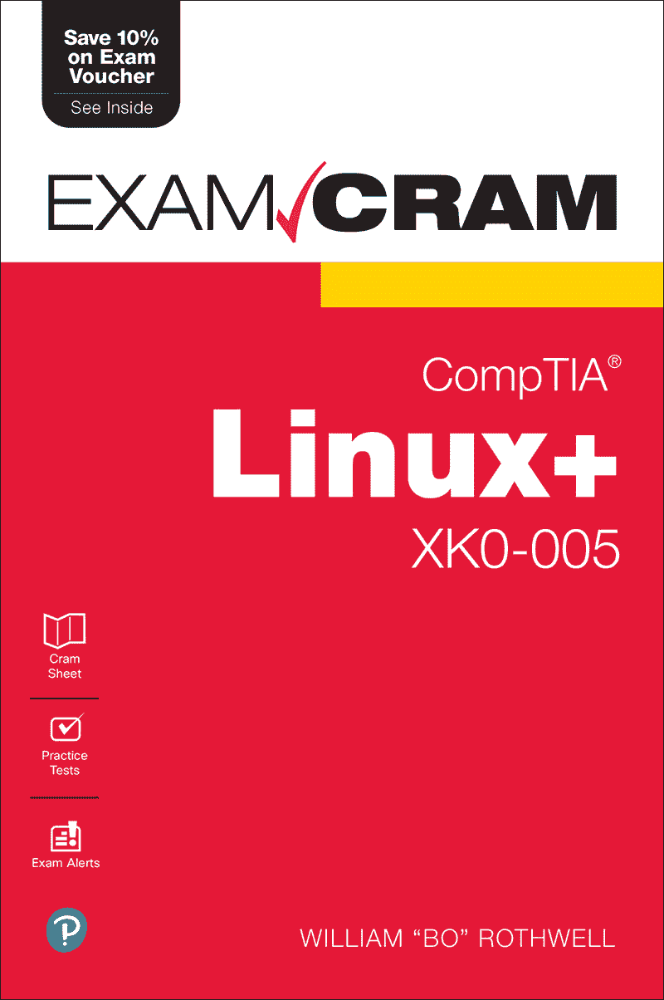


## 关于本电子书

ePUB 是一种开放的行业标准电子书格式。然而，不同阅读设备和应用程序对 ePUB 及其许多功能的支持程度不同。请使用您的设备或应用设置来根据您的喜好自定义显示。您可以自定义的设置通常包括字体、字号、单栏或双栏、横屏或竖屏模式，以及可以点击或触摸以放大的插图。有关您的阅读设备或应用上设置和功能的更多信息，请访问设备制造商的网站。

许多书籍包含编程代码或配置示例。为了优化这些元素的显示效果，请在单栏横屏模式下查看电子书，并将字体大小调整为最小设置。除了以重流文本格式呈现代码和配置外，我们还包含了代码图像，模拟印刷版书籍中的显示效果；因此，当重流格式可能会影响代码列表的显示时，您将看到一个“点击此处查看代码图像”链接。点击链接即可查看高保真代码图像。要返回之前查看的页面，请点击设备或应用上的“后退”按钮。


`ScoutAutomatedPrintCode`


## Pearson 对多样化、公平和包容性的承诺

Pearson 致力于创建无偏见、无偏见的内容，以反映所有学习者的多样性。我们拥抱多样性的多个维度，包括但不限于种族、民族、性别、社会经济地位、能力、年龄、性取以及宗教或政治信仰。

教育是我们世界实现公平和变革的力量。它具有提供改善生活和实现经济流动机会的潜力。当我们与作者合作为每种产品和服务创建内容时，我们承认我们的责任，即展示包容性并纳入多样化的学术成果，使每个人都能通过学习实现他们的潜力。作为全球领先的学习公司，我们有责任推动变革并履行使命，帮助更多人为自己创造更好的生活并创造一个更好的世界。

我们的目标是有目的地为以下世界做出贡献：
*  与我们联系。

## 目录摘要

### 第一部分：系统管理**
* 第 1 章：Linux 基础
* 第 2 章：管理文件和目录
* 第 3 章：使用适当工具配置和管理存储
* 第 4 章：配置和使用适当的进程和服务
* 第 5 章：使用适当的网络工具或配置文件
* 第 6 章：构建和安装软件

### 第二部分：安全**
* 第 7 章：管理软件配置
* 第 8 章：Linux 环境下的安全最佳实践
* 第 9 章：身份管理
* 第 10 章：实施和配置防火墙
* 第 11 章：配置系统管理的远程连接
* 第 12 章：应用适当的访问控制

### 第三部分：脚本、容器与自动化**
* 第 13 章：创建简单的 Shell 脚本自动化常用任务
* 第 14 章：执行基础容器操作
* 第 15 章：使用 Git 执行基础版本控制
* 第 16 章：常见的架构即代码技术
* 第 17 章：容器、云和编排概念

### 第四部分：故障排除**
* 第 18 章：分析并排除存储问题
* 第 19 章：分析并排除网络资源问题
* 第 20 章：分析并排除中央处理器 (CPU) 和内存问题
* 第 21 章：分析并排除用户访问和文件权限问题
* 第 22 章：使用 `systemd` 诊断和解决 Linux 系统常见问题


# Linux 基础

## 文件系统层次结构标准 (FHS)

## 基本启动过程
### 基础输入输出系统 (BIOS)/统一可扩展固件接口 (UEFI)

## 命令
### `initrd.img`
### `vmlinuz`
### 第二代通用引导加载程序 (GRUB2)
### 启动源
### 内核恐慌 (Kernel Panic)

## `/dev` 中的设备类型
### 块设备
### 字符设备
### 特殊字符设备

## 从源码基础编译包
### `./configure`
### `make`
### `make install`

## 存储概念
### 文件存储
### 块存储
### 对象存储
### 分区类型
### 用户空间文件系统 (FUSE)
### 独立（或廉价）磁盘阵列（RAID）级别

## 列出硬件信息
### `lspci`
### `lsusb`
### `dmidecode`

# 第 2 章：管理文件和目录

## 文件编辑
### `sed`
### `awk`
### `printf`
### `nano`
### `vi`

## 文件压缩、归档与备份
### `gzip`
### `bzip2`
### `zip`
### `tar`
### `xz`
### `cpio`
### `dd`

## 文件元数据
### `stat`
### `file`

## 软链接与硬链接
### 符号（软）链接
### 硬链接

## 系统间的文件拷贝
### `rsync`
### `scp`
### `nc`

## 文件和目录操作
### `mv`
### `cp`
### `mkdir`
### `rmdir`
### `ls`
### `pwd`
### `rm`
### `cd`
### `.` (当前目录)
### `..` (当前目录上一级)
### `~` (用户家目录)
### `tree`
### `cat`
### `touch`

# 第 3 章：使用适当工具配置和管理存储

## 磁盘分区
### `fdisk`
### `parted`
### `partprobe`

## 挂载本地和远程设备
### `systemd-mount`
### `/etc/fstab`
### `mount`

## Linux 密钥设置 (LUKS)
### 文件系统管理
### `XFS` 工具
### `ext4` 工具
### `Btrfs` 工具

## 监控空间和磁盘使用
### `df`
### `du`

## 使用逻辑卷管理器 (LVM) 创建和修改卷
### `pvs`
### `vgs`
### `lvs`
### `lvchange`
### `lvcreate`
### `vgcreate`
### `lvresize`
### `pvcreate`
### `vgextend`

## 检查 RAID 实现
### `mdadm`
### `/proc/mdstat`

## 存储区域网络 (SAN)/网络附属存储 (NAS)
### `multipathd`

## 网络文件系统
## 存储硬件
### `lsscs`
### `lsblk`
### `blkid`
### `fsck`

# 第 4 章：配置和使用适当进程和服务

## 系统服务
### `systemctl`
### `stop`
### `start`
### `restart`
### `status`
### `enable`
### `disable`
### `mask`

## 调度服务
### `cron`
### `crontab`
### `at`

## 进程管理
### 杀死信号
### 列出进程和打开的文件
### 设置优先级
### 进程状态
### 作业控制
### `pgrep`
### `pkill`
### `pidof`

# 第 5 章：使用适当的网络工具或配置文件

## 接口管理
### `iproute2` 工具
### `NetworkManager`
### `net-tools`
### `/etc/sysconfig/network-scripts/`

## 名称解析
### `nsswitch`
### `/etc/resolv.conf`
### `systemd-resolved`

## 网络监控
### `tcpdump`
### `wireshark/tshark`
### `netstat`
### `traceroute`
### `ping`
### `mtr`

## 远程网络
### 安全外壳 (SSH)
### `curl`
### `wget`
### `nc`
### `rsync`
### 安全拷贝 (SCP)
### 安全文件传输 (SFTP)

# 第 6 章：构建和安装软件

## 包管理
### `DNF`
### `YUM`
### `APT`
### `RPM`
### `dpkg`
### `ZYPP`

## 沙箱应用
### `snapd`
### `Flatpak`
### `AppImage`

## 系统更新
### 内核更新
### 包更新

# 第二部分：安全

# 第 7 章：管理软件

## 更新配置文件
### 流程
### `.rpmnew`
### `.rpmsave`

## 仓库配置文件

## 配置内核选项
### 参数
### 模块

## 配置常用系统服务
### SSH
### 网络时间协议 (NTP)
### 系统日志
### `chrony`

## 本地化
### `timedatectl`
### `localectl`

# 第 8 章：Linux 环境下的安全实践

## 管理公钥基础设施 (PKI) 证书
### 公钥
### 私钥
### 自签名证书


### 数字签名
### 通配符证书
### 哈希
## 证书授权
## 证书用场景
### 安全套接层 (SSL)/传输层安全 (TLS)
## 证书认证
## 加密
## 认证
### 令牌 (Tokens)
## 多因素身份认证 (MFA)
## 可插件认证模块 (PAM)
## 系统安全服务守护 (SSSD)
## 轻量级目录访问协议 (LDAP)
## 单点登录 (SSO)
## Linux 加固
## 安全扫描
## 安全启动 (UEFI)
## 系统日志配置
## 设置默认 umask
## 禁用/移除不服务
## 强制密码强度
## 移除未使用软件包
## 调整内核参数
## 服务账户安全
## 配置主机防火墙

# 第 9 章：实施身份管理

## 账户创建与删除
### `useradd`
### `groupadd`
### `userdel`
### `groupdel`
### `usermod`
### `groupmod`
### `id`
### `who`
### `w`
## 默认 Shell
### `/etc/passwd`
### `/etc/group`
### `/etc/shadow`
### `/etc/profile`
### `/etc/skel`
### `.bash_profile`
### `.bashrc`
## 账户管理
### `passwd`
### `chage`
### `pam_tally2`
### `faillock`
### `/etc/login.defs`

# 第 10 章：实施与配置防火墙

## 防火墙用场景
### 打开与关闭端口
### 检查当前配置
### 启用/禁用 IP 协议 (IP) 转发
## 常见防火墙技术
### `firewalld`
### `iptables`
### `nftables`
### 无防火墙 (UFW)
## 防火墙关键特性
### 区域 (Zones)
### 服务 (Services)
### 有状态/无状态 

# 第 11 章：配置并执行系统管理的远程连接

### SSH
### `~/.ssh/known_hosts`
### `~/.ssh/authorized_keys`
### `/etc/ssh/sshd_config`
### `/etc/ssh/ssh_config`
### `~/.ssh/config`
### `ssh-keygen`
### `ssh-copy-id`
### `ssh-add`
### 隧道技术
## 以其他用户身份执行命令
### `/etc/sudoers`
### 策略规则 (PolicyKit Rules)
### `sudo`
### `visudo`
### `su`
### `pkexec`

# 第 12 章：应用适当的访问控制

## 文件权限
### 访问控制列表 (ACL)
### 设置 ID (SUID)、设置组 ID (SGID) 和粘滞位 (Sticky Bit)
## 安全增强 Linux (SELinux)
### 上文权限
### 标签 (Labels)
### 自动标记 (Autlabel)
### 系统布尔值 (Booleans)
### 状态 (States)
### 策略类型 (Policy Types)
### AppArmor
## 命令行工具
### `chmod`
### `umask`
### `chown`
### `setfacl`/`getfacl`
### `ls`
### `setenforce`
### `getenforce`
### `chattr`/`lsattr`
### `chgrp`
### `setsebool`
### `getsebool`
### `chcon`
### `restorecon`
### `semanage`
### `audit2allow`

# 第三部分：脚本、容器与自动化

## 第 13 章：创建简单的 Shell 脚本以自动化常用任务

## Shell 脚本元素
### 循环
### `while`
### `for`
### `until`
## 条件语句
### `if`
### `switch/case`
## Shell 参数扩展
### 比较
### 变量
## 搜索与替换
### 正则表达式
## 标准流重定向
### `&&`
### Here 在此文档 (Here Documents)
### 退出状态码
## Shell 内置命令
## 常用脚本工具
### `awk`
### `sed`
### `find`
### `xargs`
### `grep`
### `egrep`
### `tee`
### `wc`
### `cut`
### `tr`
### `head`
### `tail`
## 环境变量
### `$PATH`
### `$SHELL`
### 相对路径与绝对路径

# 第 14 章：执行基础容器操作

## 容器管理
### 启动/停止
### 检查 (Inspect)
### 列表
### 部署现有容器
### 连接容器
### 日志
### 暴露端口
## 镜像操作
### `build`
### `push`
### `pull`
### `list`
### `rmi`

# 第 15 章：使用 Git 执行基础版本控制

## 版本控制与 Git 简介
### 第三代
### `clone`
### `push`
### `pull`
### `commit`
### `add`
### `branch/checkout`
### `tag`
### `.gitignore`

# 第 16 章：常见的基础即代码技术

## 文件格式
### JavaScript 对象表示法 (JSON)
### YAML 并不是标记语言 (YAML)
## 工具
### `Ansible`
### `Puppet`
### `Chef`
### `SaltStack`
### `Terraform`
## 持续集成/持续部署 (CI/CD)
## 高级 Git 主题
### `merge`
### `rebase`
### 拉取请求 (Pull Requests)


# 容器、云与编排概念

## Kubernetes 优势与应用场景

### Pod
### 边栏容器 (Sidecars)
### 大使器容器 (Ambassador Containers)
### 单节点多容器场景
## Compose
### 容器持久化存储
### 容器网络
### 覆盖网络 (Overlay Networks)
### 桥接 (Bridging)
### 网络地址翻译 (NAT)
### 主机 (Host)
### 服务网格 (Service Mesh)
### 引导 (Bootstrapping)
### Cloud-init
### 容器仓库

# 第四部分：故障排除

## 第 18 章：分析与排除存储问题

### 高延迟
### 输入/输出 (I/O) 等待
### 每秒输入输出操作次数 (IOPS) 场景
#### 低 IOPS
## 容量问题
### 磁盘空间不足
### Inode 耗尽
#### 文件系统问题
#### 损坏
#### 不匹配
#### 调度器
## 设备问题
#### 非易失性内存表达式 (NVMe)
### 固态硬盘 (SSD)
### SSD Trim
#### RAID
#### LVM
#### I/O 错误
#### 挂载选项问题

## 第 19 章：分析与排除网络资源问题

### 网络配置问题
### 子网
### 路由
### 防火墙问题
### 接口错误
### 丢包
### 冲突
### 链路状态
### 带宽限制
### 高延迟
### 解析问题
### 域名系统 (DNS)
### 测试远程系统
#### `nmap`
#### `openssl s_client`

# 第 20 章：分析与排除中央处理器 (CPU) 和内存问题

### 失控进程
### 僵尸进程
### 高 CPU 占用率
### 高平均负载
### 高运行队列
### CPU 时间
### CPU 进程优先级
#### `nice`
#### `renice`
### 内存耗尽
#### 空闲内存 vs. 文件缓存
### 内存溢出 (OOM)
#### 内存泄漏
#### 进程杀进程 (Process Killer)
#### 交换 (Swapping)
### 硬件
#### `lscpu`
#### `lsmem`
#### `/proc/cpuinfo`
#### `/proc/meminfo`

# 第 21 章：分析与排除用户访问与文件权限

### 用户登录问题
### 本地
#### 用户文件访问问题
### 组
#### 上下文 (Context)
### 权限
### ACL
### 属性
### 密码问题
#### 权限提升
#### 配额问题

# 第 22 章：使用 systemd 诊断并解决 Linux 系统的常见问题

### 单元文件 (Unit Files)
### 服务 (Service)
### 定时器 (Timer)
### 挂载 (Mount)
### 目标 (Target)
### 常见问题
#### 解析失败
#### 应用程序崩溃
#### 服务

## 索引

| 图表 | 致谢 |
| :--- | :--- |
| **图表** | **来源** |
| --- | --- |
| 5.1 | 1 |
| 11.1 | 1 |
| 2.3 | 3 |
| 4.2 | 2 |
| 5.2 | 2 |
| 6. | 2 |
| 14.8 | 8 |
| 19.1 | 1 |
| 19.2 | 2 |
| 20.1 | 1 |
| 20.2 | 2 |

## 关于作者

在 14 岁这个容易受影响的年纪，**William “Bo” Rothwell** 接触了 TRS80。从那时经历开始，Bo 对理解计算机以及与他人分享这些知识的热情使他获得了丰颇的培训职业。他是 IT 培训机构 One Course 的创始人兼首席讲师。他的经验涵盖 Linux、Unix、IT 安全、云技术以及 Perl、Python、Tcl 和 Bash 等编程语言。

## 献辞

当我完成这本成为我第 14 本印刷书籍（也是 Pearson 出版的第 10 本）的作品时，我发现自己正在写 YAD（又一个献辞）。诚实地说，直到昨天我还不知道要把这本书献给谁，那时我的家人做出了我生命中最艰难的决定之一。我们需要结束我们那极其优秀、忠诚且可爱的狗——Midnight（一只黑色拉布拉犬/金毛犬混血犬）的痛苦。Midnight 为家庭带来了无数欢乐和幸福，它要求的报仅仅是简单的：爱护、靠近族群成员的机会，当然，还有零食。它让我的世界变得明亮了一些，虽然今天世界变得暗淡了一些，但我我知道对它的记忆将永远丰富我的生活。我会想念你的，Midnight。

## 致谢

感谢 Pearson 的每一位帮助这本书诞生的同事。我知道这是一项团队合作的成果，我感谢每个人的辛勤工作。

特别感谢 Nancy、Chris 和 Casey，他们帮助我提前完成了这本书！

## 关于技术审稿人

**Casey Boyles** 在 30 多年前开始进入 IT 领域，并迅速转向了系统自动化、分布式应用程序和数据库开发。Casey 后来转入技术培训和课程开发，专长第 0–7 层软件开发、数据库架构、系统安全、电信和云计算。Casey 通常花时间在看东西和写东西时，一边抽着雪茄。

## 我们想听听你的声音！

作为本书的读者，*你*是我们最重要的评论家和意见提供者。我们重视你的意见，并想知道我们做得好的地方、哪些可以做得更好、你希望我们出版哪些领域，以及任何其他愿意分享给我们的智慧。

我们欢迎你的评论。你可以通过电子邮件或写信的方式告诉我们你对这本书喜欢或不喜欢的地方——以及我们可以做什么让我们的书籍更好。


*请注意，我们无法为您提供与本书主题相关的技术问题帮助。*

在来来时，请务必包含本书的书名、作者以及您的姓名和电子邮件地址。我们将仔细审查您的意见，并将其与参与本书编写的作者和编辑分享。

邮箱：community@informit.com

# 读者服务

请在 [www.pearsonitcertification.com](http://www.pearsonitcertification.com) 注册您的 `CompTIA Linux+ XK0-005 Exam Cram`，以便在发布时方便地下载、更新和修正。要开始注册流程，请访问 [www.pearsonitcertification.com/register](http://www.pearsonitcertification.com/register) 并登录或创建账户。输入产品 ISBN `9780137898558` 并点击 `Submit`。处理完成后，您将在“注册产品”（Registered Products）下找到任何可用的额外内容。

请务必勾选希望接收我们消息的框，以获取该产品未来版本的专属折扣。

# 引言

欢迎阅读 `CompTIA Linux+ XK0-005 Exam Cram`。本书旨在为您准备 CompTIA Linux+ XK0-005 认证考试。想象一下您正坐在考场，刚刚拿到了该考试的及格分数。本书的目标就是让这一场景成为现实。我叫 Bo Rothwell，很高兴有机会在这个过程中为您提供帮助。我们共同努力，就能实现获得 CompTIA Linux+ 认证的目标。

## 目标读者

CompTIA Linux+ 考试衡量的是初级 Linux 专业人员所需的任能力，这些人员应在实验室或领域具有至少 12 个月的同等实操经验。

本书适用于具有 Linux 操作系统工作经验并希望冲刺 CompTIA Linux+ 认证考试的人员——`cram`（冲刺）是关键词。

对于不习惯命令行环境的人来说，Linux 可能是一个具有挑战性的话题。如果您目前在 Linux 中运行命令方面没有丰富的经验，我强烈建议尝试书中介绍的命令。在虚拟机上安装 Linux 并开始练习吧！

本书非常专注于 CompTIA Linux+ 认证考试的目标。我指出这一点是因为，如果您想精通该领域，可能会考虑探索其他主题。我避开了任何非考试主题，因为我不想让您对于需要学习什么来通过考试产生困惑。您可能会发现，某些非考试主题（如安装 Linux 和使用 `man` 页面来查看文档）对您理解 Linux 操作系统会有帮助。

## 关于 CompTIA Linux+ 认证

本书涵盖了 CompTIA Linux+ XK0-005 考试，您需要通过此考试以获得 CompTIA Linux+ 认证。该考试由 Pearson Vue 管理，可以在当地测试中心或在线参加。

通过认证考试证明了您对 Linux 操作系统的核心知识以及相关的 Linux 主题有坚实的理解。

在进行其他操作之前，我建议您从 CompTIA 网站下载官方的 CompTIA Linux+ 目标。这些目标是您考试时需要掌握的概念的详细列表。本书直接对应这些目标，且每一章都说明了其所涵盖的目标。

欲了解更多关于 Linux+ 认证如何帮助您的职业生涯或下载最新目标的信息，请访问 CompTIA 的 Linux+ 网页 [`www.comptia.org/certifications/linux`](https://www.comptia.org/certifications/linux)。

# 关于本书

本书涵盖了您通过 CompTIA Linux+ 考试所需的知识。我们以简洁的方式呈现，让您能够快速高效地记忆事实。

我们将本书分为四个部分，共 22 章，每章都对应考试中涵盖的一个特定目标。书的每个部分与 Linux+ 考试的四个领域完全匹配。

关于备考的说明：书中的章节顺序与 Linux+ 考试中对应的目标完全一致。这让您非常清楚地知道在哪里可以找到特定考试目标的内容，但这并不意味着您应该从头到尾读完这本书。例如，`Chapter 1`“Linux 基础”（Linux Fundamentals）并没有涵盖“入门级”的 Linux 主题。章节标题与 Linux+ 目标匹配，但如果您回顾这些主题，会发现它们在本质上更具“基础性”（foundational），而不是初级人员应该学习的基础性主题。那么，这些基础性主题在书中呢？它们从 `Chapter 2`“管理文件和目录”（Manage Files and Directories）开始。

我提到这一点是因为，如果您是 Linux 初学者，并试图用这本书从零开始学习 Linux，您可能会在第一章内就感到无不从心。尽管如此，这真的不是一本“从零开始学习的书”，而是一本旨在填补 Linux 用户在准备 Linux+ 考试时经常发现的空白。

## 章节格式与规范

本书的每一章都遵循标准结构，并包含有关重要信息的图形提示。每章均包括：

*   **开启主题列表（Opening topics list）：** 此列表定义了该章涵盖的 CompTIA Linux+ 目标。
*   **主题覆盖（Topical coverage）：**章节的核心，这部分文字从实操和理论的角度解释了主题。深入描述、表格和图表旨在帮助您建立知识，以便您通过考试。
*   **冲刺测验题（Cram Quiz questions）：** 每章末尾都有简短的测验并附带答案。测验题及随后的解释旨在帮助您对所学知识的掌握情况。如果无法很快想起答案，请考虑回顾单个主题或整章。您还可以在书籍配套网页 [www.pearsonitcertification.com](http://www.pearsonitcertification.com) 上找到冲刺测验题。
*   **考试提醒（ExamAlerts）和笔记（Notes）：** 这些穿插在书中。请注意它们！

考试提醒（ExamAlert）

这就是考试提醒的形式。考试提醒强调了可能与考试中一个或多个问题的概念、术语、硬件、软件或活动。

## 其他元素

除了章节之外，我们还为您提供了一些额外的学习工具：

*   **冲刺表（CramSheet）：** 可抽出的冲刺表位于书的。它将每场考试需要的一些重要事实压缩在一张小纸上，便于记忆。配套网页上也提供 PDF 格式。如果您持有的是电子书版本，CramSheet 可能位于电子书的其他位置；搜索 `cramsheet` 词，您就能找到它。
*   **在线模拟考试（Online Practice Exams）：** 如果您想对考试目标进行更多练习，请记住您可以在 Pearson Test Prep 在线软件上访问所有的冲刺测验题。您还可以通过在线模拟测试创建自定义考试。记录下您感到困难的目标，然后进入相应的章节查看该目标的内容。在线下载 Pearson Test Prep 软件 [`www.pearsonitcertification.com/content/downloads/pcpt/engine.zip`](http://www.pearsonitcertification.com/content/downloads/pcpt/engine.zip)。


要访问本书的配套网站和软件，请按照以下步骤操作：

**步骤 1.** 访问 **[PearsonITCertification.com/register](http://PearsonITCertification.com/register)** 注册您的书籍并输入 ISBN `9780137898558`。

**步骤 2.** 回答挑战性问题。

**步骤 3.** 进入您的账户页面并点击 `Registered Products` 标签卡。

**步骤 4.** 点击产品列表下的 `Access Bonus Content` 链接。

**步骤 5.** 点击页面上 `Practice Exams` 部分下的 `Install Pearson Test Prep Desktop Version` 链接以下载软件。

**步骤 6.** 软件下载完成后，在电脑上解压所有文件。

**步骤 7.** 双击应用程序文件开始安装，并按照屏幕上的指示完成注册。

**步骤 8.** 安装完成后，启动应用程序并点击 `My Products` 标签卡上的 `Activate Exam` 按钮。

**步骤 9.** 在激活产品向导（Activate Product Wizard）中点击 `Activate a Product` 按钮。

**步骤 10.** 输入书后封封套内卡片上的唯一访问码，并点击 `Activate` 按钮。

**步骤 11.** 点击 `Next` 然后点击 `Finish` 将考试数据下载到您的应用程序中。

**步骤 12.** 选择产品并点击 `Open Exam` 按钮打开考试设置界面，开始使用练习考试。

您也可以在任何带有浏览器和联网设备上使用此软件的在线版本，包括台式电脑、平板电脑和智能手机。请遵循书籍配套网站上的说明。请注意，离线和在线版本将同步，因此在一个版本中保存的考试和成绩结果在另一个版本中可用。

### 动手操作的方法

如前所述，实操经验对于理解 Linux 至关重要。在参加考试之前，您应该练习使用书中列出的每个命令。探索书中提供的不同选项，以更好地理解每个主题。

使用虚拟机吧！当您执行某些管理任务（如分区、使用防火墙等）时，可能会导致操作系统无法使用。如果您使用虚拟机并弄乱了原始系统，只需重新安装一个即可（或者利用一个名为“快照”（snapshot）的酷功能，它可以允许您将操作系统恢复到之前的状态）。

### 本书的目标

显然，本书的主要目标是帮助您准备通过 Linux+ 认证考试。带着这一目标，我尽力将所有相关的考试主题、命令和信息包含在非常精简的格式中。

本书的次要目标是帮助您扩展对 Linux 的理解。开发 Linux+ 考试目标的人员在包含各种 Linux 相关主题方面做得非常出色。我已尽力确保您在考试可测试的范围内，对对这些主题中的每一个都有良好的理解。

Linux 是一个真正非凡的主题，包含了广泛的能力。在实现通过 Linux+ 考试的目标后，我强烈鼓励您进一步探索这一主题。

祝考试顺利，欢迎随时通过 LinkedIn 与我联系，网址：[`www.linkedin.com/in/bo-rothwell/`](https://www.linkedin.com/in/bo-rothwell/)。

我期待听到您通过 Linux+ 考试的经历！

—William “Bo” Rothwell


### 第一部分：系统管理

## 第 1 章：Linux 基础

**本章涵盖了以下 Linux+XK0-005 考试目标：**

*    **1.1:** 总结 Linux 基础。

欢迎来到本书的第一章，你将学习 Linux 的一些基本特性。在本章中，你将通过探索文件系统层次结构标准（FHS）学习 Linux 文件存储的常见位置。你还将探索启动过程，包括 BIOS、UEFI 和 GRUB2。

在本章的稍后部分，你将学习设备类型以及如何从源码进行基础软件包编译。本章结束于对存储概念和用于列出硬件信息的命令的介绍。

本章提供了以下主题的信息：文件系统层次结构标准（FHS）、基础启动过程、内核恐（kernel panic）、`/dev` 中的设备类型、从源码基础软件包编译、存储概念和硬件信息。

## 文件系统层次结构标准 (FHS)

文件系统层次结构标准（FHS）定义了在 Unix 和 Linux 操作系统中文件和目录应该的位置。表 1.1。

### 基础启动过程

*引导加载程序*（bootloader）是处理操作系统（OS）初始启动的软件。图 1.1

图 1.1 **启动过程概述**

UEFI/EFI/BIOS 执行检查并加载引导加载程序。更多详情请本章后面的“基本输入输出系统 (BIOS)/可扩展固件接口 (UEFI)”部分。

标准的 Linux 引导加载程序是统一引导程序（GRUB 或 GRUB2）。它负责加载内核以及存储在称为 `initramfs` 文件中的相关内核模块（或库）。

`initramfs` 文件包含一个微根文件系统，拥有系统启动所需的内核模块。它位于 `/boot` 文件系统中，每个内核都有唯一的 `initramfs` 文件。`initramfs` 文件通过使用 `mkinitrd` 命令创建（更多信息请参见本章后面的“`mkinitrd`”部分）。

内核从硬盘加载，执行一些关键启动任务，然后将启动过程的控制权交给系统初始化软件。


Linux 中三种不同的系统初始化系统分别是 `Vinit`（最老的）、`Upstart` 和 `Systemd`（目前使用最广泛的）。系统初始化负责启动系统服务。

### 基础输入输出系统 (BIOS)/统一可扩展固件接口 (UEFI)

基础输入输出系统（`BIOS`）、统一可扩展固件接口（`UEFI`）和可扩展固件接口（`EFI`）在以下方面是相似的：它们都用于在系统固件与操作系统之间提供连接。这些程序由系统制造商提供，能够启动引导过程。

`BIOS` 在此处仅略带提及。它是一种较旧的软件，自 2020 年以来已不再获得官方支持。然而，许多 `UEFI` 和 `EFI` 系统经常被称为“BIOS”，理解这一点是非常关重要的。

`UEFI` 是 `EFI` 的继任者，被认为是大多数现代系统的标准。

对于 Linux+ XK0-005 考试，你应该意识到 `UEFI/EFI` 是启动引导过程的软件。它是启动引导加载程序（bootloader）的组件。此外，它是可配置的；例如，你可以指定从哪些设备（硬盘、CD/DVD 等）启动，以及尝试在这些设备上寻找引导加载程序的顺序。

## 命令

接下来的章节将重点介绍与引导软件相关的命令。

### mkinitrd

`initrd` 文件由 `mkinitrd` 命令创建，而该命令反过来调用了 `dracut` 工具：

点击此处查看代码图像

```
[root@localhost ~]# mkinitrd /boot/initrd-5.17.4.x86_64.img 5.17.4
```

`mkinitrd` 命令的第一个参数是你想要创建的 `initrd` 文件名。第二个参数是内核版本。

注意，你很少直接使用 `dracut` 工具；然而，它被列为 Linux+ XK0-005 考试目标之一，因此请注意 `mkinitrd` 会在后台执行 `dracut` 命令。

请参阅本章后后的“initrd.img”章节获取有关该文件如何生成的信息。

### grub2-install

通常引导加载程序是在引导过程中安装的，但引导加载程序可能会损坏并需要重新安装。要安装引导加载程序，请执行 `grub-install` 命令并提供要安装 GRUB 的设备。例如，以下命令将 GRUB 安装在第一个 SATA 硬盘上：

点击此处查看代码图像

```
[root@localhost ~]# grub2-install /dev/sda
```

### grub2-mkconfig

`grub2-mkconfig` 仅用于 GRUB2，它根据位于 `/etc` 目录结构下的用户可编辑文件生成 GRUB2 配置文件。该命令将来自 `/etc/default/grub` 文件和 `/etc/grub.d` 目录下的文件的数据转换为 GRUB2 配置文件（`/boot/grub/grub.cfg` 或 `/boot/grub/menu.lst`）。

图 1.2 提供了一个视觉示例。

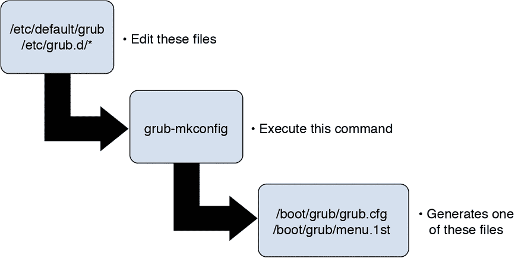

图 1.2 **grub2-mkconfig 命令**

注意

在某些系统上，命令是 `grub-mkconfig`。

### grub2-update

`grub2-update` 命令提供了运行 `grub2-mkconfig` 工具的另一种方式。它的存在主要是为了兼容某些使用该命令更新 GRUB2 配置文件的系统。默认情况下，它运行命令 `grub-mkconfig -o /boot/grub/grub.cfg`。请参阅本章前面的“grub2-mkconfig”章节了解该命令的详细信息。

### dracut

请参考本章前面的“mkinitrd”章节获取更多关于 `dracut` 的信息。

### initrd.img

通常，Linux 内核默认仅启用了少数内核模块。在引导过程中挂载文件系统之前，通常需要额外的模块。这些额外的模块存储在一个名为 `initrd.img` 的压缩文件中。请参阅本章前面的“mkinitrd”章节获取有关该文件如何生成的信息。

### vmlinuz

`vmlinuz` 文件存储在 `/boot` 目录中。每个版本的内核都有不同的 `vmlinuz` 文件，名称通常包含内核版本号。以下是一个示例：

点击此处查看代码图像

```
vmlinuz-4.17.8-200.fc32.x86_64
```

## 全局统一引导加载程序版本 2 (GRUB2)

全局统一引导加载程序 (GRUB)，也称为 Legacy GRUB，是一种较老的引导加载程序，在现代 Linux 系统上很少使用。Linux+ XK0-005 考试中的大多数配置文件和命令都集中于 GRUB2，它是 GRUB 的改进版本。

GRUB2 设计用于替代 Legacy GRUB。两者之间有几处差异，包括以下内容：

*    它们使用不同的配置文件。
*    它们支持不同的启动设备。
*    GRUB2 支持 LVM（逻辑卷管理）和软件 RAID 设备，以及 UEFI。参见“基础输入输出系统 (BIOS)/统一可扩展固件接口 (UEFI)”章节获取更多信息。

预计 Linux+ XK0-005 考试题将集中在 GRUB2，因为 Legacy GRUB 很少使用。

 引导源

GRUB2 允许从不同的介质启动。本节侧重于从哪些介质启动以及如何从这些介质启动。

在引导过程中，你可以与引导加载程序交互。这对于以下原因非常有用：

*    引导启动启动
*    修改引导参数

这种交互从引导菜单开始，如图 1.3 所示。

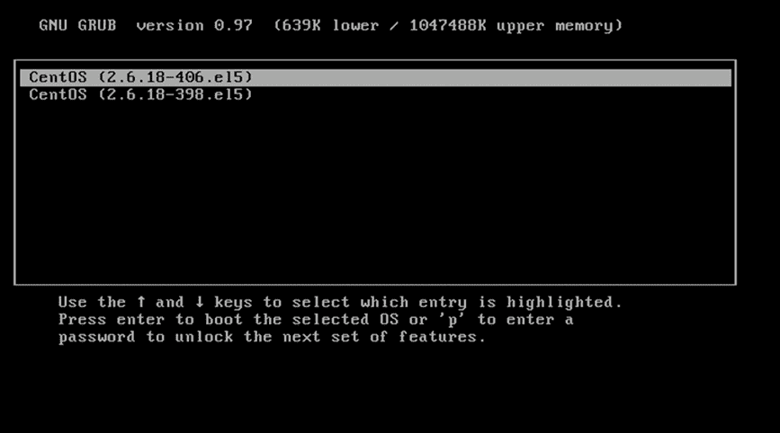

图 1.3 **引导菜单**

表 1.2 描述了引导菜单上的可用命令。

表 1.2 **引导菜单上的可用命令**

| 命令 | 描述 |
| --- | --- |
| 方向键 | 选择启动项 |
| **e** | 编辑选定的启动项 |
| **c** | 进入 GRUB 命令提示符 |
| **p** | 仅在需要密码才能编辑启动项时可见；使用 **p** 输入所需的密码。 |

如果你编辑启动项，将提供一个带有不同选项的界面（参见图 1.4）。

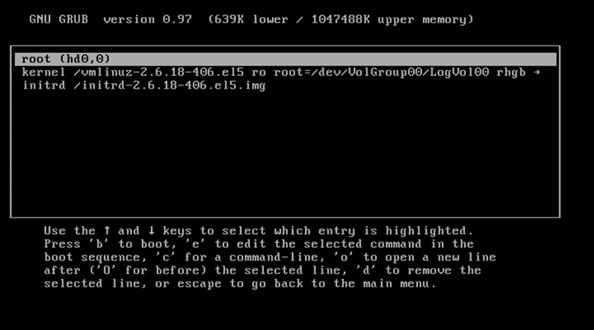

图 1.4 **启动项编辑界面**

表 1.3 描述了启动项编辑界面上的可用命令。

表 1.3 **启动项编辑界面上的可用命令**

| 命令 | 描述 |
| --- | --- |
| 方向键 | 选择行 |
| **e** | 编辑当前行 |
| **c** | 进入 GRUB 命令提示符 |
| **o** | 在当前行下方打开新行 |
| **O** | 在当前行上方打开新行 |
| **d** | 删除选定的行 |
| **b** | 启动当前启动项 |
| [ESC] | 返回主菜单 |

### 预启动执行环境 (PXE)

预启动执行环境 (PXE) 允许你通过网络启动系统，前提是网络上已创建一个引导服务器。PXE 使用动态主机配置协议 (DHCP) 服务器获取网络配置信息，例如 IP 地址和子网掩码。

引导服务器监听 PXE 引导请求，然后向客户端系统提供操作系统。通常该操作系统会调用客户端机器进行安装，因此不再需要额外的 PXE 引导。


注意 PXE 启动是从 BIOS/UEFI/EFI 软件启动的。

## 从 ISO/通用串行总（USB）启动

有多个 Live Linux 发行版允许你直接从 CD、DVD 或 USB 设备启动。这种技术被称为“从 ISO 启动”，因为用于在这些介质上存储操作系统的文件格式被称为 `ISO image`（ISO 镜像）。

从 ISO 启动有几个优点：

*  系统可能是一个没有硬盘的轻量级客户端。
*  从基于安全的 ISO 镜像启动有助于解决宿主机操作系统上的问题（病毒、蠕虫或其他安全性问题）。
*  某些 Live Linux 发行版可以修复宿主机操作系统启动时的问题。
*  ISO 镜像还可以用于在系统上安装新的发行版。

在大多数情况下，从 ISO 镜像启动需要指示 BIOS/UEFI/EFI 从包含 ISO 介质的驱动器启动。不过，也可以配置 `GRUB` 从 ISO 介质启动（尽管这种情况很少见）。

### 内核恐慌 (Kernel Panic)

当内核出现问题导致系统崩溃时，就会发生 `kernel panic`。通常当发生这种情况时，数据会使用名为 `kdump` 的功能进行存储。内核专家可以查看这些数据以确定崩溃的原因。

### ExamAlert
使用 `kdump` 文件是一项特殊技能，超出了 Linux+XK0-005 考试的范围。

## /dev 中的设备类型

`/dev` 文件系统包含设备文件，它们用于访问物理设备（如硬盘、键盘和 CPU）以及虚拟设备（如 LVM 设备、伪终端和软件 RAID 设备）。`/dev` 文件系统是基于内存的，不存储在硬盘上。

表 1.4 描述了 `/dev` 中的关键文件。

### 表格 1.4 /dev 中的关键文件

| 文件 | 描述 |
| --- | --- |
| `/dev/sd*` | `/dev` 目录中以 `sd` 开头的设备设备是 SATA、SCSI 或 USB 设备。设备名称 `/dev/sda` 指向第一个设备，`/dev/sdb` 指向第二个设备，以此类推。如果设备有分区，则从 1 开始编号。例如，`/dev/sda1` 是第一个 SATA、SCSI 或 USB 设备的第一个分区。 |
| `/dev/hd*` | `/dev` 目录中以 `hd` 开头的设备是基于 IDE 的设备。设备名称 `/dev/hda` 指向第一个设备，`/dev/hdb` 指向第二个设备，以此类推。如果设备有分区，则从 1 开始编号。例如，`/dev/hda1` 是第一个 IDE 设备的第一个分区。 |
| `/dev/cdrom` | 这是一个指向系统中第一个个 CD-ROM 的符号链接。 |
| `/dev/dm*` | `/dev` 目录中以 `dm` 开头的设备是软件 RAID 或 LVM 设备。设备名称 `/dev/dm-0` 指向第一个设备，`/dev/dm-1` 指向第二个设备，以此类推。 |
| `/dev/tty*` | `/dev` 目录中以 `tty` 开头的设备是终端设备。设备名称 `/dev/tty0` 指向第一个设备，`/dev/tty1` 指向第二个设备，以此类推。 |

### ExamAlert
准备好回答本节描述的特定设备文件相关的 Linux+ XK0-005 考试题。

### 块设备
`block device`（块设备）是任何设计为块（即块）读写数据的设备。块设备通常是存储设备，如 USB 驱动器、硬盘、CD-ROM 和 DVD。

### 字符设备
`character device`（字符设备）是设计为单位（即单个字符）读写数据的设备。字符设备的示例是键盘，它每次向系统发送一个字符。

### 特殊字符设备
特殊字符设备是不代表真实物理设备的设备文件。这包括后文章节描述的 `/dev/null`、`/dev/zero` 和 `/dev/urandom` 文件。

#### /dev/null

在某些情况下，你可能不想看到命令的标准输出 (stdout) 或标准错误 (stderr)。例如，考虑以下 `find` 命令：

点击此处查看代码图像

```bash
[root@OCS ~]$ find /etc -name "hosts"
find: '/etc/named': Permission denied
find: '/etc/polkit-1/localauthority': Permission denied
find: '/etc/polkit-1/rules.d': Permission denied
find: '/etc/pki/rsyslog': Permission denied
find: '/etc/pki/CA/private': Permission denied
find: '/etc/sudoers.d': Permission denied
find: '/etc/grub.d': Permission denied
find: '/etc/phpMyAdmin': Permission denied
/etc/hosts
find: '/etc/selinux/targeted/modules/active': Permission denied
find: '/etc/webmin/lpadmin': Permission denied
find: '/etc/webmin/iscsi-target': Permission denied
```

注意大量的“Permission denied”（权限拒绝）消息。这些消息是由于没有权限查看搜索路径中特定目录的内容导致的。你通常不在乎这些消息，并且不想看到它们。在这种情况下，你可以将这些消息重定向到 `/dev/null` 设备文件。这个文件被称为“位桶”（bit bucket），作为一个永远清倒的垃圾桶。发送到 `/dev/null` 设备的任何内容都会被立即丢弃。

由于之前的 `find` 命令中的错误消息是发送到 stderr 的，可以使用以下命令将其丢弃：

点击此处查看代码图像

```bash
[root@OCS ~]$ find /etc -name "hosts" 2> /dev/null
/etc/hosts
```

关于 `2>` 符号、stdout 和 stderr 的详情，请参阅 第 13 章 “创建简单的 Shell 脚本自动化常用任务”。

#### /dev/zero

`/dev/zero` 文件是 Linux 中一个返回空字符的特殊文件。它通常与 `dd` 命令等工具一起使用来创建大文件。请参见 第 2 章，“管理文件和目录](#ch02.xhtml)”关于 `dd` 命令及其如何使用 `/dev/zero` 文件的详情。

#### /dev/urandom

Linux 内核有一个生成随机数的功能。该功能可以通过读取 `/dev/urandom` 文件的内容来访问。该文件返回随机数，这在软件开发以及某些需要唯一值的工具（如加密工具）中非常有用。

### ExamAlert
使用 `/dev/urandom` 超出了 Linux+ XK0-005 考试的范围。

## 从源码编译基础包

构建工具用于创建他人使用的软件。本节将探索一些实用的构建工具。

#### ./configure

在下载软件包的源码后，你需要知道如何构建并安装它。在现实世界中，你可能会先修改源码，但这通常需要超出本书及 Linux+ XK0-005 范围的编程技能。

构建源码的第一步是执行 `configure` 脚本。它可能直接位于源码的顶层目录，但你可能需要查找，如下输出所示：

点击此处查看代码图像

```bash
[root@OCS unix]# pwd
/tmp/source/zip/unix
[root@OCS unix]# ls
configure  Makefile  osdep.h  Packaging  README.OS390  unix.c  zipup.h
```

你需要更改 configure 文件的权限以使其可执行，然后按照示例所示运行该脚本：

点击此处查看代码图像


```
[root@OCS unix]# su - bo
[bo@OCS unix]$ chmod u+x configure
[bo@OCS unix]$ ./configure
Check C compiler type (optimization options)
  GNU C (-O3)
Check bzip2 support
  Check for bzip2 in bzip2 directory
  Check if OS already has bzip2 library installed
-- Either bzlib.h or libbz2.a not found - no bzip2
Check for the C preprocessor
Check if we can use asm code
Check for ANSI options
Check for prototypes
Check the handling of const
Check for time_t
Check for size_t
Check for off_t
Check size of UIDs and GIDs
(Now zip stores variable size UIDs/GIDs using a new extra field. This
tests if this OS uses 16-bit UIDs/GIDs and so if the old 16-bit
storage should also be used for backward compatibility.)
  s.st_uid is 4 bytes
  s.st_gid is 4 bytes
-- UID not 2 bytes - disabling old 16-bit UID/GID support
Check for Large File Support
  off_t is 8 bytes
-- yes we have Large File Support!
Check for wide char support
-- have wchar_t - enabling Unicode support
Check for gcc no-builtin flag
Check for rmdir
Check for strchr
Check for strrchr
Check for rename
Check for mktemp
Check for mktime
Check for mkstemp
Check for memset
Check for memmove
Check for strerror
Check for errno declaration
Check for directory libraries
Check for readlink
Check for directory include file
Check for nonexistent include files
Check for term I/O include file
Check for valloc
Check for /usr/local/bin and /usr/local/man
Check for OS-specific flags
Check for symbolic links
```

`configure` 脚本的结果是生成 `Makefile` 文件。`Makefile` 提供了如何构建和安装软件的说明。随后的 `make` 部分提供了有关构建软件包后续步骤的详细信息。

### make

`make` 命令使用名为 `Makefile` 的文件来执行特定操作。`make` 命令是一个从源代码构建和维护程序和其他类型文件的工具。`make` 工具的一个主要功能是确定大型程序中的哪些部分需要重新编译，并发布重新编译它们所需的命令。每个 `Makefile` 都由软件开发者编写，用于执行与软件项目相关的操作。通常这包括以下类型的函数：

*  编译软件的操作
*  安装软件的操作
*  “清理”之前的版本的编译代码的操作

以下是一个仅包含 `install` 操作的简单 `Makefile` 示例：

点击此处查看代码

```
# more /usr/lib/firmware/Makefile
# This file implements the GNOME Build API:
# http://people.gnome.org/~walters/docs/build-api.txt

FIRMWAREDIR = /lib/firmware

all:

install:
        mkdir -p $(DESTDIR)$(FIRMWAREDIR)
        cp -r * $(DESTDIR)$(FIRMWAREDIR)
        rm -f $(DESTDIR)/usbdux/*dux $(DESTDIR)/*/*.asm
        rm $(DESTDIR)$(FIRMWAREDIR)/{WHENCE,LICENSE.*,LICENCE.*}
```

### make install

`make` 命令的 `install` 选项旨在从源码在系统中安装代码。取决于软件开发者如何创建 `Makefile`，它也包含编译过程。更多信息请参见前面的“make”部分。

## 存储概念

本节介绍了与存储设备的一些基本概念。

### 文件存储

文件存储本地系统使用远程存储设备。远程存储设备通过网络文件系统结构共享给本地系统，用户可以在远程系统上放置文件和目录。常见的网络文件系统包括：

*  `nfs:` 这种基于文件系统源于 Unix 系统。虽然它是一个旧的文件系统，但它为 Unix 和 Linux 系统之间的目录结构共享提供了标准方法。该文件系统的新版本包含了现代的安全功能和性能改进。
*  `smb:` 这种文件系统称为 Samba 文件系统，基于 `cifs`，旨在提供基于网络的共享。
*  `cifs:` 这种文件系统用于 Microsoft Windows 系统跨网络共享文件夹。Linux 上的 Samba 工具用于连接 `cifs` 共享。

### 块存储

块存储设备是物理存储设备，通常为 Linux 存储系统提供后端存储。块存储设备包括：

*  传统的 SATA 驱动
*  SSD
*  RAID 磁盘
*  存储区域网络 (SAN)，可以是光纤通道 (FCP)、互联网小型计算机接口 (iSCSI)、以太网传输 ATA (AoE) 和以太网传输光纤 (FCoE)
*  光盘 (CD-ROM)

块存储设备上的数据可以通过文件系统访问。Linux 有多种类型，包括：

*  `ext3:` 这种文件系统是 `ext2` 的扩展，设计用于分区分区。虽然 `ext2` 和 `ext3` 之间存在若干差异，但 `ext3` 的重大变化是引入了日志。日志通过创建对文件更改的日志（journal），有助于防止文件系统损坏。
*  `ext4:` `ext4` 文件系统是 `ext3` 的替代品。它支持更大的文件系统和单个文件大小。此版本也提高了性能。
*  `xfs:` 这是另一种以处理更大尺寸而闻名的文件系统。

### 对象存储

对象存储实际上并不是 Linux 的概念；它通常出现在云基础设施中。然而，云基础设施中的对象存储可以 Linux 使用，这种存储类型正成为一种非常流行的文件存储方式。

对象存储是一种特性，可以在云环境中存储对象（非结构化数据，如电子邮件、视频、图形、文本或任何类型的数据）。对象存储不使用传统的文件系统功能，而是将数据组织成“组”（类似于文件系统中的文件夹）。数据通常使用类似于访问网页的 URL 进行访问。对象存储具有持久性和高可用性，支持加密并可以灵活使用。示例包括 AWS S3 (Simple Storage Service)、Google Cloud Storage 和 IBM Cloud Object Storage。

### 分区类型

分区用于将硬盘分割为更小的组件。每个组件都可以被视为不同的存储设备，每个分区上都可以创建单独的文件系统（`btrfs`、`xfs`、`ext4` 等）。

传统的 PC 分区创建数量是有限制的。最初只允许四个分区，称为*主分区*。随着对更多分区的需求，人们创建了一项技术，使得可以将其中一个主分区转换为*扩展分区*。在扩展分区内，可以创建额外的分区*逻辑分区*。


在图 1.5 中，`/dev/sda1`、`/dev/sda2` 和 `/dev/sda3` 是主分区。`/dev/sda4` 分是一个扩展分区，作为 `/dev/sda5`、`/dev/sda6` 和 `/dev/sda7` 逻辑分区的容器。

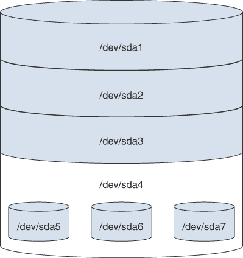

图 1.5 **传统分区结构**

在使用传统分区的 Linux 发行版中，你被限制总共有 15 个分区（尽管内核调整可以将此数字增加到 63）。

传统的分区表存储在主引导记录（MBR）中。一种较新的分区表称为 GUID 分区表（GPT），它没有面临相同的局限性，布局也与 MBR 分区表不同。

可以使用多种工具来创建或查看分区，包括 `fdisk`、`parted` 以及安装程序提供的 GUI 工具（该工具随发行版而异）。

`fdisk` 和 `parted` 都支持命令行选项，并且都可以作为交互式工具执行。这些工具在第 3 章 的“使用适当工具配置和管理存储”中会有更详细的介绍。

*原始设备*（raw device）是一个与块设备文件（分区、硬盘等）关联的设备文件。创建这种关联时，就可以对块设备进行直接访问。要创建原始设备，请使用 `raw` 命令：

点击此处查看代码图像

```
# raw /dev/raw/raw1 /dev/vda
/dev/raw/raw1: bound to major 252, minor 0
```

一旦创建了原始设备，你就可以使用 `dd` 命令等对相应的块文件执行操作。`dd` 命令通常用于创建整个硬盘的副本。

### 主引导记录 (MBR)

MBR 分区表通常被称为“传统”分区，相对于 GUID 分区表等较新的分区表。MBR 分区表的限制是默认只允许四个分区。对于 Linux 这样的操作系统来说，这是一个极其限制性的因素。

然而，MBR 分区表中的主分区之一可以转换为扩展分区。在这个扩展分区内可以添加名为*逻辑*分区的额外分区。请参见图 1.6 的视觉示例。

关于硬盘设备名称的说明：硬盘通过 `/dev` 目录下的设备名称引用。IDE 设备名称以 `/dev/hd` 开头，而 SATA、SCSI 和 USB 设备名称以 `/dev/sd` 开头。系统上的驱动器从 `a` 开始命名，因此第一个 SATA 设备为 `/dev/sda`，第二个 SATA 设备为 `/dev/sdb`，依此类推。分区从 `1` 开始顺序编号，例如 `/dev/sda1`、`/dev/sda2` 和 `/dev/sda3`。

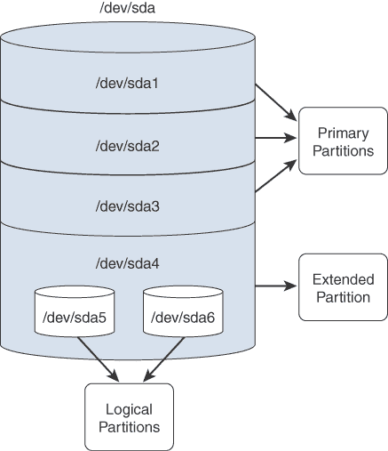

图 1.6 **分区**

### GUID（全局唯一标识符）分区表 (GPT)

GUID 分区表 (GTP) 是一种分区方案，旨在克服 MBR 的局限性（参见本章前面的“主引导记录 (MBR)” 节）。与 MBR 不同，GPT 没有只有四个个主分区的限制。也不需要扩展分区或逻辑分区。GPT 每个硬盘设备支持最多 128 个分区。

### 用户空间文件系统 (FUSE)

默认情况下，只有 root 用户可以创建文件系统。用户空间文件系统 (FUSE) 是 Linux 内核的一个功能，允许普通用户创建 Linux 文件系统。

**考试警示：**设置、配置和使用 FUSE 超出了 Linux+ XK0-005 考试的范围。

### 独立（或廉价）磁盘阵列（RAID）级别

RAID 设备用于提供冗余。两个或多个物理设备可以组合成单一设备，以某种方式存储数据，在某个物理存储设备故障时减轻数据丢失。

请注意 RAID 在第 3 章中有更详细的介绍。

##### 条列 (Striping)

条列或 RAID 0 是向多个驱动器写入数据的过程，就像它们是一个单一设备一样。写入操作使用条列执行，其中部分数据写入第一个驱动器，然后部分数据写入第二个驱动器，依此类推。更多细节请参见第 3 章。

##### 镜像 (Mirroring)

通过镜像或 RAID 1，两个或多个磁盘驱动器看起来像一个单一存储设备。写入一个磁盘驱动器的数据也会写入所有其他驱动器。如果一个驱动器故障，数据在其他驱动器上仍然可用。更多细节请参见第 3 章。

##### 奇偶 (Parity)

奇偶数据是根据 RAID 中其他设备存储的数据派出的值。假设 RAID 中有三个设备，其中两个（在本例中称为设备 A 和 B）存储常规文件系统数据，其中一个（称为设备 C）存储奇偶数据。如果设备 A 故障，则可以通过比较设备 B 中的数据和设备 C 中的奇偶数据来重建它存储的数据。更多细节请参见第 3 章。

#### 列硬件信息

本节重点介绍几种用于显示硬件设备信息或配置这些设备的不同实用。

#### lspci

`lspci` 命令显示连接到 PCI 总线的设备。

语法：

```
lspci [options]
```

这里是 `lspci` 命令的一些关键选项：

*    `-b` 是“以总线为中心”，意味着它显示 IRQ（中断请求行）数字。
*    `-n` 显示设备编号而非名称；名称通常存储在 `/usr/share/hwdata/pci.ids` 或 `/usr/share/hwdata/pci.ids.gz`。
*    `-nn` 同时显示设备编号和名称。
*    `-v` 显示详细消息。
*    `-vv` 显示更详尽的消息。
*    `-vvv` 显示最详尽的消息。

示例：

点击此处查看代码图像

```
[root@OCS ~]# lspci
00:00.0 Host bridge: Intel Corporation 440FX - 82441FX [Natoma] (rev 02)
00:01.0 ISA bridge: Intel Corporation 82371SB PII3 ISA [T Triton II]
00:01.1 IDE interface: Intel Corporation 82371AB/MB PII4 IDE (rev 01)
00:02.0 VGA compatible controller: InnoTek Systemberat GmbH VirtualBox Graphics Adapter
00:03.0 Ethernet controller: Intel Corporation 82540EM Gigabit Ethernet Controller (rev 02)
00:04.0 System peripheral: InnoTek Systemberat GmbH VirtualBox Guest Service
00:05.0 Multimedia audio controller: Intel Corporation 8281AA AC'97 Audio (rev 01)
00:06.0 USB controller: Apple Inc. KeyLargo/Intrepid USB
00:07.0 Bridge: Intel Corporation 82371AB/MB PII4 ACPI (rev 08)
00:0b.0 USB controller: Intel Corporation 82801FB/FBM/FRW (ICH6 Family) USB2 EHCI Controller
00:0d.0 SATA controller: Intel Corporation 82801HM/HEM (ICH8M/ICH8M-E) SATA Controller [AHCI mode] (rev 02)
```

**考试警示：** Linux+ XK0-005 考试不会针对 lspci 命令的输出提问，但请准备好回答有关该命令目的以及此处描述选项的问题。

#### lsusb

`lsusb` 命令显示连接到 PCI 总线的设备。（注：原文此处为 PCI）。用户空间文件系统 (FUSE) 是 Linux 内核的一个功能，允许普通用户创建 Linux 文件系统。

语法：

```
lsusb [options]
```

这里是 `lsusb` 命令的一些关键选项：

*    `-D` 显示特定的 USB 设备（作为参数），而不是扫描 `/dev/bus/usb` 目录并显示所有 USB 设备。
*    `-t` 以树状格式显示 USB 设备。
*    `-v` 显示详细消息。


```
[root@OCS Desktop]# lsusb
Bus 001 Device 002: ID 1221:3234 未知厂商 磁盘(U 盘器)
Bus 001 Device 001: ID 1d6b:0002 Linux Foundation 2.0 root hub
Bus 002 Device 001: ID 1d6b:0001 Linux Foundation 1.1 root hub
```

### dmidecode

`dmidecode` 命令用于显示硬件组件的描述。在以下示例中，使用了 `head` 命令来减少大量的输出内容：

点击此处查看代码图片

```
[root@OCS ~]# dmidecode | head
# dmidecode 3.1
Getting SMBIOS data from sysfs.
SMBIOS 2.5 present.
10 structures occupying 450 bytes.
Table at 0x000E1000.

Handle 0x0000, DMI type 0, 20 bytes
BIOS Information
        Vendor: innotek GmbH
        Version: VirtualBox
```

## 第 2 章

## 管理文件和目录

**本章涵盖以下 Linux+ XK0-005 考试目标：**

*    **1.2:** 给定场景，管理文件和目录。

本章的重点是与管理文件和目录相关的工具和概念。第一节探索了各种编辑器。Linux 中的许多配置文件都是纯文本格式，知道如何使用文本编辑器对于 Linux 系统管理员来说至关重要。

本章还涵盖了如何归档和压缩文件，以及如何在不同的计算机之间复制文件。本章探索了一系列文件和目录命令，允许你执行移动、复制、创建、删除以及显示文件和目录信息等任务。

本章提供了以下主题的信息：文件编辑；文件压缩、归档和备份；文件元数据；软链接和硬链接；系统间文件复制；文件和目录操作。

## 文件编辑

Linux 系统上的大多数配置文件都是纯文本格式。因此，如何编辑文本文件至关重要。本节重点关注常用的 Linux 编辑器：`sed`、`awk`、`printf`、`nano` 和 vi 编辑器。

#### sed

使用 `sed` 工具对文件进行自动化修改。`sed` 命令的基本格式为 `sed ‘s/RE/string/’ file`，其中 `RE` 指“正则表达式”（regular expression），这是一种使用特殊字符匹配模式的特性。

以下是 `sed` 命令的示例：

点击此处查看代码图片

```
[student@OCS ~]$ head -n 5 /etc/passwd
root:x:0:0:root:/root:/bin/bash
bin:x:1:1:bin:/bin:/sbin/nologin
daemon:x:2:2:daemon:/sbin:/sbin/nologin
adm:x:3:4:adm:/var/adm:/sbin/nologin
lp:x:4:7:lp:/var/spool/lpd:/sbin/nologin
[student@OCS ~]$ head -n 5 /etc/passwd | sed 's/bin/----/'
root:x:0:0:root:/root:/----/bash
----:x:1:1:bin:/bin:/sbin/nologin
daemon:x:2:2:daemon:/s----:/sbin/nologin
adm:x:3:4:adm:/var/adm:/s----/nologin
lp:x:4:7:lp:/var/spool/lpd:/s----/nologin
```

`sed` 是一个非常强大的工具，具有许多功能。表 2.1 描述了一些最有用的 `sed` 函数。

表 2.1 `sed` 函数

| 特性 | 描述 |

| --- | --- |
| `'/RE/d'` | 删除 `sed` 命令输出中匹配 `RE` 的行。 |
| `'/RE/c*string*'` | 将匹配 `RE` 的行更改为 `string` 值。 |
| `'/RE/a*string*'` | 在所有匹配 `RE` 的行之后添加 `string`。 |
| `'/RE/i*string*'` | 在所有匹配 `RE` 的行之前添加 `string`。 |

`sed` 命令有两个重要的修饰符（即添加到 `sed` 操作末尾的字符）：

*    `g:` 意味着“全局”。默认情况下，只替换第一个 RE 模式匹配项。当使用 `g` 修饰符时，将进行所有替换。图 2.1 显示了一个示例。
*    `i:` 意味着“不区分大小写”。该修饰符忽略字母的大小写进行匹配。因此，命令 `sed 's/a/-/i'` 会匹配 `a` 或 `A` 并将其替换为字符 `-`。

`sed` 命令还可以更改原始文件（而不是在屏幕上显示修改后的数据）。要更改原始文件，请使用 `-i` 选项。


图 2.1 **g 修饰符**

考试警报

sed 命令是一个极其强大的工具，具有许多功能。对于 Linux+XK0-005 考试，请关注本节描述的功能。

#### awk

`awk` 命令用于修改简单数据库格式的文本。考虑以下示例：

点击此处查看代码图片

```
[student@OCS ~]$ head /etc/passwd
root:x:0:0:root:/root:/bin/bash
bin:x:1:1:bin:/bin:/sbin/nologin
daemon:x:2:2:daemon:/sbin:/sbin/nologin
adm:x:3:4:adm:/var/adm:/sbin/nologin
lp:x:4:7:lp:/var/spool/lpd:/sbin/nologin
sync:x:5:0:sync:/sbin:/bin/sync
shutdown:x:6:0:shutdown:/sbin/sbin/shutdown
halt:x:7:0:halt:/sbin/sbin/halt
```


| `^K` | 剪切一行（即删除该行并将其放入内存中）。`^K` 可用于将多行剪切到内存中。 |
| `^U` | 取消剪切一行。注意，这不是撤销操作，而是粘贴操作。 |
| `^^` | 标记文本的开始和结束。被标记的文本可以使用 `Alt-^` 复制。使用一个 `^^` 开始标记，使用方向键选择要标记的文本，然后再次使用一个 `^^` 结束标记。注意在 `^^` 中，第二个 `^` 是一个实际的 `^` 字符，而第一个 `^` 代表控制字符。 |
| `^W` | 在当前文档中搜索文本。 |
| `^F` | 向前移动一屏幕。 |
| `^B` | 向后移动一屏幕。 |
| `^*n` | 移动到特定的行号。例如，`⁵` 移动到第 5 行。 |
| `^C` | 显示当前在文档中的位置。 |

### 表 2.4 常用 `nano` 命令

#### vi

vi 编辑器是 Linux 和 Unix 环境下的标准文本编辑器。尽管它可能不像其他编辑器那样友好，但它有几个重要的优势：

*  vi 编辑器（或 `vim`，它是 vi 编辑器的改进版本）存在于每个 Linux 发行版（以及所有 Unix 变）。这意味着如果你知道如何使用 vi 编辑器编辑文件，无论你在使用哪个发行版，你都可以编辑文件。
*  因为 vi 编辑器是一个仅限命令行的编辑器，它不需要图形用户界面（GUI）。这一点很重要，因为许多 Linux 服务器没有安装 GUI，这意味着你无法使用基于 GUI 的文本编辑器。
*  当你深入理解 vi 后，你会发现它是一个高效的编辑器，与大多数其他编辑器相比，使用它编辑文件可以非常快。所有的 vi 命令都是短命令且基于键盘的，你不需要花费时间离开键盘去鼠标。

要使用 vi 编辑器编辑新文件，你只需要输入不带参数的命令或输入 `vi` `filename`。

**注意**

vim 编辑器是一个改进后的文本编辑器，具有 vi 编辑器不具备的额外功能。许多 Linux 发行版默认使用 vim 编辑器。vim 编辑器的一个优势是它包含了 vi 编辑器的所有功能和命令。因此，如果你在 30 年前学会了使用 vi 编辑器，你的知识仍然适用于 vim 编辑器。本章中的所有命令在 vi 和 vim 编辑器中均有效。

vi 编辑器的设计仅使用键盘，这带来了一个挑战，因为有时按键应该执行命令，而有时按键应该代表插入到文档中的字符。为了让键执行不同的任务，vi 有三种操作模式：

*  **命令模式：** 这是默认模式，当你打开 vi 时，你处于命令模式。在此模式下，你可以执行移动屏幕、删除文本和粘贴文本的命令。
*  **插入模式：** 当你处于插入模式时，输入的任何键都会作为新文本出现在文档中。当你完成添加新文本后，可以按 Esc 键返回默认模式（即命令模式）。
*  **末行模式：** 这种模式也称为 *ex 模式*，允许你执行更复杂的操作，例如将文档保存为不同名称的文件。要从命令模式进入末行模式，请按 `:` 键。输入命令并按回车后，命令将执行，通常你会返回命令模式。在某些情况下，你可能需要按 Esc 键返回命令模式。

**注意**

你无法从插入模式直接移动到末行模式，反之亦然。要进入插入模式或末行模式，必须先处于命令模式。按 Esc 键可让你进入命令模式。

在 vi 编辑器中搜索文件时，你可以在命令模式下使用 `/` 或 `?` 字符。当你输入 `/` 或 `?` 字符时，屏幕左下角会出现提示符，如图图 2.3 所示。

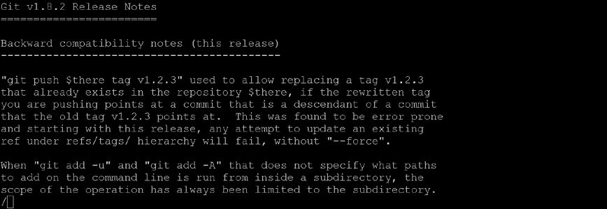

图 2.3 **在 vi 编辑器中搜索文件**

在 `/` 或 `?` 提示符处输入你想要搜索的值。你可以在该值中使用正则表达式。例如，如果你输入 `/^the`，vi 编辑器将搜索下一个出现在行首的字符串 `"the"`。

`/` 字符执行正向，而 `?` 在文档中反向搜索。如果你没有找到要搜索的内容，可以使用 `n` 字符找到下一个匹配项。当使用 `/` 字符开始搜索时，`n` 字符继续在文档中向前搜索。当使用 `?` 字符开始搜索时，`n` 字符继续在文档中向后搜索。

反转当前搜索，使用 `N` 字符。例如，假设你通过输入 `?^the` 开始搜索。使用 `N` 字符将会在文档中正向搜索。

在命令模式下，你可以使用表 2.5 中描述的键在屏幕上移动。

### 表 2.5 vi 命令模式导航键

| 键 | 描述 |
| --- | --- |
| `h` | 向左移动一个字符。 |
| `j` | 向下移动一行。 |
| `k` | 向上移动一行。 |
| `l` | 向右移动一个字符。 |

在命令模式下，你可以使用表 2.6 中描述的键之一进入插入模式。### 表 2.6 vi 插入模式导航键

| 键 | 描述 |
| --- | --- |
| `i` | 在光标所在字符前进入插入模式。 |
| `I` | 在当前行开头进入插入模式。 |
| `o` | 在当前行下方开启一行并进入插入模式。 |
| `O` | 在当前行上方开启一行。 |
| `a` | 在光标所在字符后进入插入模式。 |
| `A` | 在当前行末尾进入插入模式。 |

在命令模式下，你可以使用表 2.7 中描述的键修改文本。

### 表 2.7 vi 命令模式修改文本的键

| 键 | 描述 |
| --- | --- |
| `c` | `c` 键与其他键组合以更改数据。例如，`cw` 修改当前单词，`c$` 从光标位置更改到行尾。完成修改后，按 Esc 键。 |
| `d` | `d` 键与其他键组合以删除数据。例如，`dw` 删除当前单词，`d$` 从光标位置删除到行尾。所有删除的数据都存储在缓冲区中，可以使用 `p` 或 `P` 键粘贴回文档。 |
| `p` | 使用 `d` 键剪切文本或使用 `y` 键复制文本后，可以使用 `p` 或 `P` 键粘贴。小写 `p` 在当前光标后粘贴，大写 `P` 在光标前粘贴。 |
| `y` | `y` 键与其他键组合以复制数据。例如，`yw` 复制当前单词，`y$` 从光标位置复制到行尾。所有复制的数据都存储在缓冲区中，可以使用 `p` 或 `P` 键粘贴回文档。 |
| `dd` | `dd` 命令删除当前行。 |
| `yy` | `yy` 命令复制当前行。 |

在命令模式下，你可以使用表 2.8 中描述的键保存和或退出文档。

### 表 2.8 vi 命令模式保存/退出文档的键

| 键 | 描述 |
| --- | --- |
| `ZZ` | 保存并退出文档。这等同于 `:wq`。 |


| `:w!` | 强制 vi 编辑器将文档中的更改写入文件。 |
| `:q!` | 强制 vi 编辑器退出，即使文件中的更改尚未保存。 |
| `:e!` | 打开一个新文件进行编辑，并忽略自上次写入以来文档中的所有更改。这需要一个文件名作为参数（例如，`:e! myfile.txt`）。 |

## 考试提醒
预计 Linux+ XK0-005 考试中关于 vi 编辑器的题目将多于关于 nano 编辑器的。

## 文件压缩、归档与备份
当灾难发生时（例如硬盘故障或自然灾害），数据可能会发生损坏。使用归档和恢复工具有助于限制数据丢失的风险，并使更容易将信息从一个系统传输到另一个系统。本节重点关注这些工具。

### 考试提醒
许多压缩命令（`gzip`、`bzip2` 和 `zip`）的选项是相同的。这使得它们在 Linux+ XK0-005 考试中更容易记忆。

#### gzip
使用 `gzip` 命令压缩文件，如下所示：

点击此处查看代码图像

```
[student@OCS ~]$ ls -lh juju
-rwxr-xr-x 1 vagrant vagrant 109M Jan 10 09:20 juju
[student@OCS ~]$ gzip juju
[student@OCS ~]$ ls -lh juju.gz
-rwxr-xr-x 1 vagrant vagrant 17M Jan 10 09:20 juju.gz
```

注意，`gzip` 命令会将原始文件替换为压缩文件。

表 2.9 详细说明了一些重要的 `gzip` 选项。

表 2.9 `gzip` 命令选项

| 选项 | 描述 |
| --- | --- |
| `-c` | 将输出写入标准输出且不替换原始文件。你可以使用重定向将输出数据放入新文件中（例如，`gzip -c juju > juju.gz`）。 |
| `-d` | 解压缩文件。（也可以使用 `gunzip` 命令进行解压缩。） |
| `-r` | 递归压缩（即压缩目录及其子目录中的所有文件）。 |
| `-v` | 进入详细输出模式并显示压缩百分比。 |

### 考试提醒
`gzip`、`xz` 和 `bzip2` 命令彼此非常相似。最大的区别在于用于压缩文件的技术。`gzip` 命令使用 Lempel-Ziv 编码方法，而 `bzip2` 命令使用 Burrows-Wheeler 块排序文本压缩算法和 霍夫曼编码。`xz` 命令使用 LZMA 和 LZMA2 压缩方法。

使用 `gunzip` 命令解压 gzipped 格式的文件，如下所示：

点击此处查看代码图像

```
[student@OCS ~]$ ls -lh juju.gz
-rwxr-xr-x 1 vagrant vagrant 17M Jan 10 09:20 juju.gz
[student@OCS ~]$ gunzip juju
[student@OCS ~]$ ls -lh juju
-rwxr-xr-x 1 vagrant vagrant 109M Jan 10 09:20 juju
```

#### bzip2
使用 `bzip2` 命令压缩文件，如下所示：

点击此处查看代码图像

```
[student@OCS ~]$ ls -lh juju
-rwxr-xr-x 1 vagrant vagrant 109M Jan 10 09:20 juju
[student@OCS ~]$ bzip2 juju
[student@OCS ~]$ ls -lh juju.bz2
-rwxr-xr-x 1 vagrant vagrant 14M Jan 10 09:20 juju.bz2
```

注意，`bzip2` 命令会将原始文件替换为压缩文件。

表 2.10 详细说明了一些重要的 `bzip2` 选项。

表 2.10 `bzip2` 命令选项

| 选项 | 描述 |
| --- | --- |
| `-c` | 将输出写入标准输出且不替换原始文件。你可以使用重定向将输出数据放入新文件中（例如，`bzip2 -c juju > juju.bz`）。 |
| `-d` | 解压缩文件。（也可以使用 `bunzip2` 命令。） |
| `-v` | 进入详细输出模式并显示压缩百分比。 |

### 考试提醒
`gzip`、`xz` 和 `bzip2` 命令彼此非常相似。最大的区别在于用于压缩文件的技术。`gzip` 命令使用 Lempel-Ziv 编码方法，而 `bzip2` 命令使用 Burrows-Wheeler 块排序文本压缩算法和 霍夫曼编码。`xz` 命令使用 LZMA 和 LZMA2 压缩方法。

#### zip
`zip` 命令用于将多个文件合并为一个单一压缩文件。要创建一个名为 `mail.zip` 且包含 `/etc/mail` 目录下所有文件的压缩文件，使用如下格式：

点击此处查看代码图像

```
[student@OCS ~]$ zip /etc/mail
 adding: etc/ (stored)
 adding: mail/ (deflated 53%)
 adding: mail/passwd (deflated 49%)
 adding: mail/group (deflated 0%)
```

表 2.11 详细说明了一些重要的 `zip` 选项。

表 2.11 `zip` 命令选项

| 选项 | 描述 |
| --- | --- |
| `-d` | 解压缩文件。（也可以使用 `unzip` 命令。） |
| `-v` | 进入详细输出模式并显示压缩百分比。 |
| `-u` | 更新压缩文件。 |
| `-r` | 递归，可以指定目录。 |

### 考试提醒
`zip` 命令用于将多个文件合并为一个单一压缩文件。要创建一个名为 `mail.zip` 且包含 `/etc/mail` 目录下所有文件的压缩文件，使用如下格式：

点击此处查看代码图像

#### tar
`tar` 命令用于将多个文件归档为单一归档文件。创建一个名为 `archive.tar` 且包含 `/home/user` 目录下所有文件的归档文件，使用如下格式：

点击此处查看代码图像

```
[student@OCS ~]$ tar -cvf archive.tar /home/user
 adding: /home/user/
 adding: /home/user/file1.txt
 adding: /home/user/file2.txt
```

表 2.12 详细说明了一些重要的 `tar` 选项。

表 2.12 `tar` 命令选项

| 选项 | 描述 |
| --- | --- |
| `-c` | 创建新归档。 |
| `-v` | 详细模式显示正在处理的文件。 |
| `-x` | 从归档中提取文件。 |
| `-f` | 指定归档文件名。 |
| `-t` | 列出归档内容。 |
| `-u` | 将文件现有归档中。 |
| `-r` | 列出归档中的文件。 |
| `-z` | 通过 `gzip` 过滤。 |
| `-j` | 通过 `bzip2` 过滤。 |
| `-J` | 通过 `xz` 过滤。 |

#### xz
使用 `xz` 命令压缩文件，如下所示：

点击此处查看代码图像

```
[student@OCS ~]$ ls -lh juju
-rwxr-xr-x 1 vagrant vagrant 109M Jan 10 09:20 juju
[student@OCS ~]$ xz juju
[student@OCS ~]$ ls -lh juju.xz
-rwxr-xr-x 1 vagrant vagrant 11M Jan 10 09:20 juju.xz
```

表 2.13 详细说明了一些重要的 `xz` 选项。

表 2.13 `xz` 命令选项

| 选项 | 描述 |
| --- | --- |
| `-c` | 将输出写入标准输出且不替换原始文件。你可以使用重定向将输出数据放入新文件中（例如，`xz -c juju > juju.xz`）。 |
| `-d` | 解压缩文件。（也可以使用 `unxz` 命令。） |
| `-l` | 列出有关现有压缩文件的信息（例如，`xz -l juju.xz`）。 |
| `-v` | 进入详细输出模式并显示压缩百分比。 |

#### cpio


`cpio` 命令的目的是创建归档。你可以通过将文件名作为标准输入（stdin）发送到命令中创建文件归档，例如：

点击此处查看代码图像

```
[student@OCS ~]$ find /etc -name "*.conf" | cpio -ov > conf.cpio
```

表 2.14 详细说明了一些重要的 `cpio` 选项。

| 选项 | 描述 |
| --- | --- |
| `-d` | 与 `-i` 选项配合使用，提取 `cpio` 文件中的目录结构及文件。 |
| `-i` | 从 `cpio` 文件提取数据；该文件应通过 STDIN 提供（例如 `cpio -i < conf.cpio`）。 |
| `-o` | 创建归档（输出文件）。 |
| `-t` | 列出 `cpio` 文件的目录内容。 |
| `-v` | 进入详细模式。 |

表 2.14 `cpio` 命令选项

## dd

`dd` 命令可以执行多种与数据备份和创建文件相关的操作。一种常见的用法是为整个驱动器制作备份；例如，以下命令将整个 `/dev/sdb` 设备备份到 `/dev/sdc` 设备：

点击此处查看代码图像

```
[student@OCS ~]$ dd if=/dev/sdb of=/dev/sdc bs=4096
```

`dd` 命令的另一个用途是创建一个可以作为交换文件的大文件：

点击此处查看代码图像

```
[student@OCS ~]$ dd if=/dev/zero of=/var/swapfile bs=1M count=50
```

表 2.15 详细说明了一些重要的 `dd` 选项。

| 选项 | 描述 |
| --- | --- |
| `if=` | 指定输入文件。 |
| `of=` | 指定输出文件。 |
| `bs=` | 指定块大小。 |
| `count=` | 指明要创建/传输的块数。 |

表 2.15 `dd` 命令选项

## 文件元数据

*文件元数据*是关于文件内容以外的文件信息。本节涵盖了两个用于显示文件元数据的有用命令：`stat` 命令和 `file` 命令。

### stat

文件或目录由多个组件组成。这些组件中的许多（如所有者和权限）存储在一个称为 inode（索引节点）的文件系统元素中。

除了文件数据和文件名外，关于文件的所有信息都存储在 inode 中。每个文件都分配有一个 inode 号，该编号在文件所在的文件系统中是唯一的。

文件的 inode 包含以下信息：


*  唯一的 inode 号
*  用户所有者
*  组所有者
*  模式（权限和文件类型）
*  文件大小
*  时间戳：
    *  文件内容最后一次修改的时间
    *  inode 数据最后一次修改的时间
    *  文件最后一次访问的时间
*  指针（指向包含文件数据的块位置的引用）

你可以使用 `stat` 命令查看这些 inode 信息，如下：

点击此处查看代码图像

```
[root@OCS ~]$ stat /etc/passwd
 File: '/etc/passwd'
 Size: 2597 Blocks: 8 IO Block: 4096 regular file
Device: fc01h/64513d Inode: 33857 Links: 1
Access: (0644/-rw-r--r--) Uid: ( 0/ root) Gid:
 ( 0/ root)
Access: 2018-10-12 12:54:01.126401594 -0700
Modify: 2018-09-08 12:53:48.371710687 -0700
Change: 2018-09-08 12:53:48.371710687 -0700
 Birth: -
```

### file

`file` 命令报告文件内内容的类型。这里是一些示例：

点击此处查看代码图像

```
[student@localhost ~]$ file /etc/hosts
/etc/hosts: ASCII text
[student@localhost ~]$ file /usr/bin/ls
/usr/bin/ls: ELF 64--bit LSB executable, x86-64, version 1 (SYSV),
dynamically linked (uses shared libs), for GNU/Linux,
```

## 链接

文件有两种类型的链接：硬链接和软链接（也称为符号链接）。理解这些链接类型很重要。

### 软链接（符号链接）

当你创建一个软链接时，它指向目标文件。删除目标文件会导致链接失效。这在创建软链接时需要注意。

使用 `ln -s` 命令可以创建链接。软链接指向文件名，而不是 inode。

使用 `ls` 命令可以查看软链接和硬链接。软链接在执行 `ls -l` 命令时非常明显，如下：

点击此处查看代码图像

```
[root@OCS ~]$ ls -l /etc/passwd
``` 

### 硬链接

当你创建一个文件的硬链接时，无法区分“原始”文件和“链接”文件。它们只是指向相同 inode 的两个文件名，因此共享数据。如果你有 10 个硬链接文件并删除了其中 9 个，数据仍然保留在剩余的文件中。

使用 `ln` 命令可以创建链接。


硬链接文件共享相同的 inode。你只能对与原始文件位于同一文件系统中的文件（而非目录）创建硬链接。对另一个文件系统上的文件或目录创建硬链接会导致错误，如下处所示：

点击此处查看代码图像

```
[root@OCS ~]$ ln /boot/initrd.img-3.16.0-30-generic initrd
ln: failed to create hard link 'initrd' =>
 '/boot/initrd.img-3.16\. 0-30-generic': Invalid cross-device link
[root@OCS ~]$ ln /etc myetc
ln: '/etc': hard link not allowed for directory
```

`ls` 命令可以同时查看软链接和硬链接。硬链接更难识别，因为硬链接文件与另一个文件名共享一个 inode。例如，在下面的输出中权限后的数值 `2` 表示这是一个硬链接文件：

点击此处查看代码图像

```
[root@OCS ~]$ ls -l myhosts
-rw-r--r-- 2 root root 186 Jul 11 2015 myhosts
```

要查看文件的 inode 号，请使用 `ls` 命令的 `-i` 选项：

```
[root@OCS ~]$ ls -i myhosts
263402 myhosts
```

然后使用 `find` 命令搜索具有相同 inode 的文件：

点击此处查看代码图像

```
[root@OCS ~]$ find / -inum 263402 -ls 2>/dev/null
263402 4 -rw-r--r-- 2 root root 186 Jul 11 2015 /root/myhosts
263402 4 -rw-r--r-- 2 root root 186 Jul 11 2015 /etc/hosts
```

### 考试警示

了解硬链接和软链接的区别。在 Linux+ XK0-005 考试中，你可能会遇到测试对这些差异理解的题目。

### 在系统之间复制文件

任何文件系统都包含成千上万个需要管理的文件和目录。本节重点介绍用于管理这些文件系统对象的 Linux 命令。

#### rsync

`rsync` 命令在跨网络远程复制文件时非常有用。它通常用于需要复制之前文件的更改的情况，因为它比其他远程复制方法处理得更高。

语法：

点击此处查看代码图像

```
rsync [options] source destination
```

表 2.16 描述了一些重要的 `rsync` 选项。

表 2.16 **rsync** 命令选项

| 选项 | 说明 |
| --- | --- |
| `-t` | 保留原始修改时间。 |
| `-v` | 进入详细模式。 |
| `-r` | 递归复制（即传输整个目录）。 |
| `-l` | 保持符号链接。 |
| `-p` | 保留原始权限。 |

#### scp

`scp` 命令用于通过安全 Shell (SSH) 服务在远程系统之间复制文件。要从本地机器复制文件到远程机器，请使用以下语法：

点击此处查看代码图像

```
scp filename user@machine:/directory
```

在此语法中，`user` 是远程系统上的账户名，`machine` 是远程系统，而 `/directory` 代表你想存储文件的地方。

表 2.17 描述了 `scp` 命令的一些重要选项。

表 2.17 **scp** 命令选项

| 选项 | 说明 |
| --- | --- |
| `-P` *port* | 指定要连接的端口号。通常 SSH 服务器使用端口 22，这是 `scp` 命令的默认值。 |
| `-p` | 尝试保留原始文件的时间和权限。 |
| `-r` | 递归复制整个目录。 |
| `-v` | 进入详细模式。 |

#### nc

`nc` 命令的帮助页（man page）对 `nc` 命令提供了极佳的总结：

`nc`（或 netcat）工具用于几乎任何涉及 TCP 或 UDP 的操作。它可以打开 TCP 连接、发送 UDP 数据包、监听任意 TCP 和 UDP 端口、进行端口扫描，并处理 IPv4 和 IPv6。与 telnet(1) 不同，`nc` 脚本化支持良好，并将错误消息分离到标准错误输出，而不是发送到标准输出输出（如 telnet(1) 在某些情况下会这样做）。

`nc` 命令有很多用途。例如，假设在你上线使用该端口的服务之前，可能想知道公司防火墙是否阻止了某个特定端口。在内部服务器上，你可以让 `nc` 命令在该端口上监听连接：

```
[root@server ~]# nc -l 3333
```

结果在 `nc` 命令下方应该是一个空行。接下来，要在网络外的远程系统上连接，你可以运行以下 `nc` 命令（将 *server* 替换为本地系统可解析的主机或 IP 地址）：

点击此处查看代码图像

```
[root@client Desktop]# nc server 3333
```

如果建立了连接，你会在 `nc` 命令行下方看到一个空行。如果你在这个空行上输入内容并按回车键，那么你输入的内容就会出现在服务器上 `nc` 命令下方。实际上，通信是双向的：你在服务器上 `nc` 命令下方输入的内容也会显示在客户端上。

以下是 `nc` 命令的一些实用选项：

*    `-w:` 此选项用于客户端侧，在达到超时值后自动关闭连接。例如，`nc -w 30 server 333` 会在建立连接 30 秒后关闭连接。
*    `-6:` 使用此选项启用 IPv6 连接。
*    `-k:` 此选项在客户端断开连接后仍保持服务器进程活动状态。默认行为是在客户端断开时停止服务器进程。
*    `-u:` 使用 UDP 连接而非 TCP 连接（默认）。这对于正确测试防火墙配置至关重要，因为 UDP 端口可能未被阻止，而 TCP 端口可能被阻止。

你也可以使用 `nc` 命令显示打开的端口，就像使用 `netstat` 命令一样：

点击此处查看代码图像

```
[root@onecoursesource Desktop]# nc -z localhost 1000-4000
Connection to localhost 3260 port [tcp/iscsi-target] succeeded!
Connection to localhost 3333 port [tcp/dec-notes] succeeded!
```

`-z` 选项也可以用于扫描远程主机的端口。

使用 `nc` 命令传输各种数据有一种有用方法。假设传输是从客户端到服务器的，你使用的格式所示（其中将 *cmd* 替换为实际命令）：

服务器上：`nc -l 3333 |` *cmd*

客户端上：*cmd* `| nc server 333`

例如，你可以通过 `tar` 命令从客户端将整个 `/home` 目录结构传输到服务器，首先先在服务器上执行以下命令：

```
nc -l 3333 | tar xvf -
```

然后，在客户端命令行中执行以下命令：

点击此处查看代码图像

```
tar cvf - /home | nc server 333
```

客户端将 `/home` 目录的内容合并到一个 tar 包中。`-` 通知 `tar` 命令将此输出发送到标准输出。数据通过客户端的 `nc` 命令发送到服务器，然后服务器的 `nc` 命令将这些数据发送给 `tar` 命令。结果是客户端的 `/home` 目录被复制到了服务器的当前目录下。

## 文件和目录操作

#### mv

`mv` 命令移动或重命名文件。

示例：

```
mv /tmp/myfile ~
```

表 2.18 描述了 `mv` 命令的一些重要选项。

表 2.18 **mv** 命令选项

| 选项 | 说明 |
| --- | --- |
| `-i` | 如果移动过程会导致覆盖现有文件，则提供交互式提示。 |
| `-n` | 防止覆盖现有文件。 |


| `-v` | 进入详细模式，并描述移动文件和目录时所采取的操作。 |

#### cp

`cp` 命令用于复制文件或目录。该命令的语法如下：

点击此处查看代码图像

```
cp [options] file|directory destination
```

`file|directory` 是要复制的文件或目录。`destination` 是要复制文件或目录的目标位置。以下示例将 `/etc/hosts` 文件复制到当前目录：

点击此处查看代码图像

```
[student@OCS ~] cp /etc/hosts .
```

注意，*必须*指定目标位置（因此在示例中使用了 `.` 字符表示当前目录）。

表 2.19 描述了 `cp` 命令的一些重要选项。

| 选项 | 说明 |

| --- | --- |

| `-i` | 如果复制过程会导致覆盖现有文件，则提供交互式提示。 |

| `-n` | 防止覆盖现有文件。 |

| `-r` | 递归地复制整个目录结构。 |

| `-v` | 进入详细模式，并描述复制文件和目录时所采取的操作。 |

表 2.19 `cp` 命令选项

#### mkdir

`mkdir` 命令创建目录。

示例：

```
mkdir test
```

表 2.20 描述了 `mkdir` 的一些重要选项。

| 选项 | 说明 |

| --- | --- |

| `-m` *perm* | 为新目录设置权限，而不是使用 umask 值。 |

| `-p` | 在需要时创建父级目录；例如，`mkdir /home/bob/data/january` 如果指定的路径中的目录不存在，则会创建该路径上的所有目录。 |

| `-v` | 进入详细模式，并为创建的每个目录打印一条消息。 |

表 2.20 `mkdir` 命令选项

#### rmdir

`rmdir` 命令用于删除空目录。如果目录不为空，该命令将失败。（使用 `rm -r` 来删除目录及其目录内的所有文件。）

示例：

```
rmdir data
```

#### ls

`ls` 命令用于列出目录中的文件。表 2.21 描述了 `ls` 命令的一些重要选项。

表 2.21 `ls` 命令选项

| 选项 | 说明 |

| --- | --- |

| `-a` | 列出所有文件，包括隐藏文件。 |

| `-d` | 列出目录名，而不是目录的内容。 |

| `-F` | 在文件末尾添加字符以指示其类型；示例包括 `*` 表示可执行文件，`/` 表示目录，`@` 表示符号链接文件。 |

| `-h` | 与 `-l` 选项配合使用时，以人类可读格式提供文件大小。 |

| `-i` | 显示每个文件的 inode 值。 |

| `-l` | 显示详细列表（参见图表）。 |

| `-r` | 反转文件列表的输出顺序。 |

| `-S` | 按文件大小排序。 |

| `-t` | 按修改时间排序（先列出最新文件）。 |

`ls -l` 命令的输出每个文件包含一行，如图 2.6 所示。

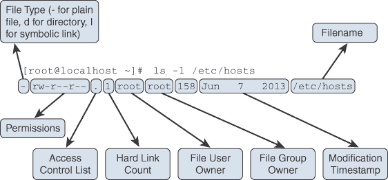

图 2.6 **ls -l 命令**

######## pwd

`pwd`（“打印工作目录”）命令显示 shell 的当前目录，如下例所示：

点击此处查看代码图像

```
[student@localhost rc0.d]$ pwd
/etc/rc0.d
```

#### rm

`rm` 命令用于删除文件和目录。

示例：

```
rm file.txt
```

表 2.22 描述了 `rm` 命令的一些重要选项。

| 选项 | 说明 |

| --- | --- |

| `-i` | 在删除文件之前提供交互式提示。 |

| `-r` | 递归地删除整个目录结构。 |

| `-v` | 进入详细模式，并描述删除文件和目录时所采取的操作。 |

表 2.22 `rm` 命令选项

#### cd

要将 shell 的当前目录移动到另一个目录，请使用 `cd`（更改目录）命令。`cd` 命令接受单个参数：目标目录的位置。例如，要移动到 `/etc` 目录，你可以执行以下命令：

```
[student@localhost ~]$ cd /etc
[student@localhost etc]$
```

`cd` 命令是一种类似于“没有消息就是好消息”的命令。如果命令成功，则不显示输出（尽管提示符发生了变化）。如果命令失败，则显示错误，如下所示：

点击此处查看代码图像

```
[student@localhost ~]$ cd /etc
[student@localhost etc]$
```

#### . (当前目录)

一个点 (`.`) 代表当前目录。

#### .. (当前目录上一级)

两个点 (`..`) 代表当前目录的上一层。

#### ~ (用户家目录)

波浪号 (`~`) 代表用户的家目录。

#### tree

`tree` 命令允许你查看目录层次结构，如下例所示：

点击此处查看代码图像

```
[student@localhost ~]$ tree /etc
/etc
├── bash.bashrc
├── hosts
...
```


在本章中，你将学习如何管理存储设备。第一节涵盖磁盘分区，你将学习使用 `fdisk`、`parted` 和 `partprobe` 等工具。一旦你学会了如何创建分区，你就能学习如何在分区上放置文件系统，并通过一个名为*挂载*（mounting）的过程让操作系统可以使用该文件系统。

本章探索了分区的两种替代方案：逻辑卷管理器（Logical Volume Manager）和 RAID。本章还涵盖了操作远程存储设备的基本知识，例如 NFS（网络文件系统）和 SMB/CIFS（服务器消息块/通用互联网文件系统）。

本章提供了以下主题的信息：磁盘分区、本地和远程设备的挂载、文件系统管理、存储空间和磁盘使用情况监控、使用逻辑卷管理器（LVM）创建和修改卷、RAID 实现的检查、存储区域网络（SAN）/网络附属存储（NAS）以及存储硬件。

## 磁盘分区

分区用于将硬盘分割成更小的组件。每个组件都可以被视为不同的存储设备，并且可以在每个分区上创建独立的文件系统（如 `btrfs`、`xfs`、`ext4` 等）。

传统的 PC 基础分区创建数量是有限制的。最初只允许四个分区，称为*主分区*（primary partitions）。随着对更多分区的需求，人们创建了一种技术，可以将其中一个主分区转换为扩展分区。在扩展分区内部，你可以创建额外的分区*逻辑分区*（logical partitions）。

在图 3.1 中，`/dev/sda1`、`/dev/sda2` 和 `/dev/sda3` 是主分区。`/dev/sda4` 分区是一个扩展分区，用作 `/dev/sda5`、`/dev/sda6` 和 `/dev/sda7`逻辑分区的容器。


图 3.1 **传统分区结构**

在大多数使用传统分区的 Linux 发行版中，你被限制在使用 15 个分区（尽管内核调整可以将此数字增加到 63）。

传统的分区表存储在主引导记录（MBR）中。一种新的分区表称为 GUID 分区表（GPT），它没有面临相同的局限性，布局也与 MBR 分区表不同。

可以使用几种不同的工具来创建或查看分区，包括 `fdisk`、`parted` 以及安装程序提供的 GUI 工具（具体随发行版而异）。

`fdisk` 和 `parted` 都支持命令行选项，并且它们都可以作为交互式工具执行。

#### fdisk

`fdisk` 实用是一个交互式工具，允许你显示和修改传统的（非 GUID）分区表。要显示分区表，请使用 `-l` 选项（作为 root 用户），如下：

点击此处查看代码图像

```
# fdisk -l /dev/sda

Disk /dev/sda: 42.9 GB, 42949672960 bytes
4 heads, 32 sectors/track, 655360 cylinders, total 83886080 sectors
Units = sectors of 1 * 512 = 512 bytes
Sudo
I/O size (minimum/optimal): 512 bytes / 512 bytes
Disk identifier: 0x000c566f

      Device Boot Start End      Blocks    Id System
     /dev/sda1   * 2048 83886079 41942016  83 Linux
```

要修改驱动器的分区表，请运行不带 `-l` 选项的 `fdisk` 命令，如下：

```
# fdisk /dev/sda
Command (m for help):
```

你可以在 `Command` 提示符下输入几个实用的命令，包括表 3.1 中列出的。

表 3.1 分区相关命令

| 命令 | 说明 |
| :--- | :--- |
| `d` | 删除分区。 |
| `l` | 列出分区类型。 |
| `m` | 打印可能的命令菜单。 |
| `n` | 创建新分区。 |
| `p` | 打印当前分区表。 |
| `q` | 退出不保存任何更改。 |
| `t` | 更改分区表类型。 |
| `w` | 将更改写入（保存）到硬盘上的分区表上。 |

#### parted

`parted` 实用是一个交互式工具，允许你显示和修改传统的和 GUID 分区表。它还可以在分区上创建文件系统。

要显示分区表，请使用 `-l` 选项并作为 root 用户运行 `parted` 命令，如示例所示：

点击此处查看代码图像

```
# parted -l /dev/sda
Model: ATA VBOX HARDDISK (scsi)
Disk /dev/sda: 42.9GB
Sector size (logical/physical): 512B/512B
Partition Table: msdos

Number Start   End    Size    Type File system Flags
 1      1049kB 42.9GB primary ext4     boot
Model: Linux device-mapper (thin) (dm)
Disk /dev/sda: 42.9GB
Sector size (logical/physical): 512B/512B
Partition Table: msdos

Number Start   End    Size    Type File system Flags
 1      1049kB 42.9GB primary ext4     boot
```

要修改驱动器的分区表，请运行不带 `-l` 选项的 `parted` 命令，如下：

```
# parted /dev/sda
GNU Parted 2.3
Using /dev/sda
Welcome to GNU Parted! Type 'help' to view a list of commands.
```

表 3.2 显示了你可以在提示符下输入的几个实用的命令。

记住 parted 可以管理 GUID，但 fdisk 不能。

#### partprobe

`partprobe` 命令通常只有在分区表发生变化且系统需要感知时才需要。最常见的例子是你使用 `fdisk` 命令更改已挂载文件系统的分区。为了解决这个问题，只需在退出 `fdisk` 工具后执行 `partprobe` 命令即可。

## 挂载本地和远程设备

*挂载*（mounting）是让存储设备对 Linux 文件系统可见的过程。本节重点关注用于管理挂载过程的文件和工具。

#### systemd.mount

`systemd.mount` 配置用于 systemd 在启动过程中挂载和卸载资源。它利用 `/etc/fstab` 文件（下文介绍）。要了解更多关于 systemd 的信息，请参见第 4 章“配置和使用适当的过程和服务”。

#### /etc/fstab

`/etc/fstab` 用于指定挂载哪些文件系统、挂载到哪里以及在挂载过程中使用哪些选项。该文件在启动期间用于配置挂载的文件系统。

`/etc/fstab` 的每一行描述一个挂载过程。以下是其中一行的示例：

```
/dev/sda1 / ext4 defaults 1 1
```

每行分为六个数据字段，由空白分隔：

*    要挂载的设备（在前面的示例中为 `/dev/sda1`）。


*    挂载点 (`/`)。
*    文件系统类型 (`ext4`)。
*    挂载选项 (`defaults`)。
*    备份级别 (`1`)。此字段与 `dump` 命令相关，且很少使用。
*    `fsck` 检查次数字段 (`1`)。值 `0` 意味着“在系统启动期间在此文件系统上运行 `fsck`”，而值 `1` 或更高值意味着“在系统启动期间在此文件系统上运行 `fsck`”。

请注意，完整的 `/etc/fstab` 文件包含多个条目以及提供基础文档的注释。以下是一个示例：

点击此处查看代码

```
# 
# /etc/fstab
# Created by anaconda on Tue Jun 22 03:22:27 2021
#
# Accessible filesystems, by reference, are maintained under '/dev/
disk/'.
# See man pages fstab(5), findfs(8), mount(8) and/or blkid(8) for more
info.
#
# After editing this file, run 'systemctl daemon-reload' to update
systemd
# units generated from this file.
#
/dev/mapper/cl-root     /               xfs     defaults        0 0
UUID=abc23ff6-7841-463b-bdac-45b3ae868cee /boot      xfs    
defaults        0 0
/dev/mapper/cl-home     /home           xfs     defaults        0 0
/dev/mapper/cl-swap     none            swap    defaults        0 0
```

### 考试提醒

记忆 `/etc/fstab` 文件的不同字段是一个好主意，因为 Linux+ XK0-005 考试通常包含关于该文件内容的题目。

### mount

`mount` 命令可以显示当前挂载的文件系统，如示例所示：

点击此处查看代码

```
# mount
/dev/sda1 on / type ext4 (rw)
proc on /proc type proc (rw,noexec,nosuid,nodev)
sysfs on /sys type sysfs (rw,noexec,nosuid,nodev)
none on /sys/fs/cgroup type tmpfs (rw)
none on /sys/fs/fuse/connections type fusectl (rw)
none on /sys/kernel/debug type debugfs (rw)
none on /sys/kernel/security type securityfs (rw)
udev on /dev type devtmpfs (rw,mode=0755)
devpts on /dev/pts type devpts (rw,noexec,nosuid,gid=5,mode=0620)
tmpfs on /run type tmpfs (rw,noexec,nosuid,size=10%,mode=0755)
none on /run/lock type tmpfs
 (rw,noexec,nosuid,nodev,size=5242880)
none on /run/shm type tmpfs (rw,nosuid,nodev)
none on /run/user type tmpfs
 (rw,noexec,nosuid,nodev,size=104857600, mode=0755)
none on /sys/fs/pstore type pstore (rw)
rpc_pipefs on /run/rpc_pipefs type rpc_pipefs (rw)
systemd on /sys/fs/cgroup/systemd type cgroup
 (rw,noexec,nosuid,nodev, none,name=systemd)
```

`mount` 命令也可以用于手动挂载文件系统。将要挂载的设备作为第一个参数，将挂载点（即挂载目录）作为第二个参数，并以 root 用户执行以下命令：

```
# mkdir /data
# mount /dev/sdb1 /data
```

表 3.3 详细列出了 `mount` 命令的重要选项。

表 3.3 `mount` 命令选项

| 选项 | 描述 |
| :--- | :--- |
| `-a` | 挂载 `/etc/fstab` 文件所有挂载选项为 `auto` 的文件系统。 |
| `-o` | 指定挂载选项（例如 `mount -o acl /dev/sdb1 /data`）。 |
| `-t` | 指定要挂载的文件系统类型。这通常不是必要的，因为 `mount` 命令可以通过探测分区来确定文件系统类型。 |

使用 `umount` 命令手动卸载文件系统：

点击此处查看代码

```
# mount | grep /data
/dev/sdb1 on /data type ext3 (rw)
# umount /data
```

表 3.4 详细列出了 `umount` 命令的重要选项。

表 3.4 `umount` 命令选项

| 选项 | 描述 |
| :--- | :--- |
| `-r` | 如果卸载操作失败，则尝试将文件系统以只读模式挂载。 |
| `-f` | 强制卸载。这通常用于 NFS 服务器无响应时的 NFS 挂载。 |

如果你刚刚创建了文件系统，可能很容易记住使用了哪个设备文件来访问该文件系统。但是，如果你忘记了可用哪些设备文件，可以执行 `lsblk` 命令，如下所示：

点击此处查看代码

```
# lsblk
NAME   MAJ:MIN RM SIZE RO TYPE MOUNTPOINT
vda    252:0    0 254G 0  disk
| vda1  252:1  0 250G 0 part /
vda2    252:2  0   4G 0 part [SWAP]
```

此命令是在原生虚拟机上执行的——因此设备名称为 `vda`、`vda1` 和 `vda2`。

你可以使用 `blkid` 命令查看你的标签和 UUID：

点击此处查看代码

```
# blkid
/dev/sda1: UUID="4d2b8b91-9666-49cc-a23a-1a183ccd2150" TYPE="ext4"
/dev/sda3: LABEL="mars" UUID="bab04315-389d-42bf-
  9efa-b25c2f39b7a0" TYPE="ext4"
/dev/sda4: UUID="18d6e8bc-14a0-44a0-b82b-e69b4469b0ad" TYPE="ext4"
```

### Linux 统一密钥设置 (LUKS)

与 Linux 文件系统加密相关的重要技术是一种规范 LUKS (Linux Unified Key Setup)。作为一种规范，LUKS 描述了在 Linux 上如何加密文件系统。它不提供任何软件，也不是官方标准（尽管规范通常被称为“非官方标准”）。

因为它是一个规范，LUKS 不会强制你使用任何特定的软件工具来加密文件系统。有不同的工具可用，但为了演示目的，本章展示了一种名为 DMCrypt 的内核实现。

DMCrypt 是一个内核模块，允许内核理解加密的文件系统。除了 DMCrypt 模块外，你应该了解两个可以使用创建和挂载加密文件系统的命令：`cryptsetup` 和 `cryptmount`。注意，你只会使用这两个命令中的一个（可能是 `cryptsetup`）来配置加密文件系统。

本节演示了如何使用 `cryptsetup` 命令创建一个新的加密文件系统。开始之前，你可能需要加载一些内核模块：

点击此处查看代码

```
[root@onecoursesource ~]# modprobe dm-crypt
[root@onecoursesource ~]# modprobe aes
[root@onecoursesource ~]# modprobe sha256
```

接下来，在新分区上创建 LUKS 格式的密码。注意如果你正在使用现有分区，首先需要备份所有数据并卸载该分区。以下命令将覆盖 `/dev/sda3` 分区的数据：

点击此处查看代码

```
[root@onecoursesource ~]# cryptsetup --verbose --verify-passphrase
luksFormat /dev/sda3
WARNING!
========
This will overwrite data on /dev/sda3 irrevocably.
Are you sure? (Type uppercase yes): YES
Enter passphrase:
Verify passphrase:
Command successful.
```

从 `cryptsetup` 命令的此输出可以看出，系统提示你提供密码（一个字符串，例如句子或简单的短语）。当你需要挂载文件系统时，需要使用此密码来解密它。

### 文件系统管理

许多工具用于管理文件系统和存储设备。本节涵盖了 XFS、EXT 和 Btrfs 工具。

#### XFS 工具

XFS 是一种为高性能和处理大文件设计的文件系统。

`xfs_metadump` 命令将未挂载的 XFS 文件系统的元数据转储（拷贝）到文件中用于调试。表 3.5 详细列出了 XFS 工具的重要选项。

表 3.5 XFS 工具选项

| 选项 | 描述 |
| :--- | :--- |
| `-e` | 如果发现文件系统错误，则停止转储。 |
| `-g` | 显示转储进度。 |
| `-w` | 如果发生文件系统错误，则显示错误信息。 |


`xfs_info` 命令用于显示 XFS 文件系统的几何结构，类似于用于 ext2/ext3/ext4 文件系统的 `dumpe2fs` 命令。`xfs_info` 命令没有特殊的选项。

## ext4 工具

ext4 文件系统是 ext3 文件系统的替代品。它支持更大的文件系统和单个文件大小。ext4 提供了比 ext3 更好的性能。

`mkfs` 命令在分区上创建文件系统。该命令的基本语法为 `mkfs -t fstype partition`，其中 `fstype` 可以是 表 3.6 中描述的类型之一。

TABLE 3.6 fstype 选项

| 类型 | 描述 |
| :--- | :--- |
| `ext2` | 创建 ext2 文件系统（大多数发行版的默认值）。 |
| `ext3` | 创建 ext3 文件系统。 |
| `ext4` | 创建 ext4 文件系统。 |
| `bfs` | 创建 btrfs 文件系统。 |
| `vfat` | 创建 VFAT (DOS) 文件系统。 |
| `ntfs` | 创建 NTFS (Windows) 文件系统。 |
| `xfs` | 创建 XFS 文件系统。 |

注意 `mkfs` 命令是其他命令的前端实用。例如，如果你运行命令 `mkfs -t ext4 /dev/sdb7`，实际上将执行 `mkfs.ext4 /dev/sdb7` 命令。

每个特定的文件系统创建工具都有几十种可能的选项，影响文件系统的创建方式。这些选项从 `mkfs` 命令传递给 `mkfs` 启动的特定文件系统创建命令。

`resize2fs` 命令通常与调整逻辑卷（LV）的大小配合使用。一旦调整了 LV 大，底层的 ext3 或 ext4 文件系统也必须调整大小。

如果计划增大 LV，应该先执行 `lvextend` 命令，然后执行 `resize2fs` 命令。`resize2fs` 命令不需要大小值，因为它会自动增加到与 LV 大小一致。以下是一个示例：

```
lvextend -L+1G /dev/vol0/lv0
resize2fs /dev/vol0/lv0
```

如果计划缩小 LV，你必须先调整文件系统大小，然后使用 `lvreduce` 命令减小 LV 的大小。如果你先缩小 LV，系统将无法访问新 LV 大小之外的文件系统：

```
resize2fs /dev/vol0/lv0 2G
lvreduce -L2G /dev/vol0/lv0
```

`fsck` 程序用于查找未挂载文件系统上的问题。例如，你可以以 root 用户身份运行此命令：

点击此处查看代码图像

```
# fsck /dev/sdb1
fsck from util-linux 2.20.1
e2fsck 1.42.9 (4-Feb-2014)
Pass 1: Checking inodes, blocks, and sizes
Pass 2: Checking directory structure
Pass 3: Checking directory connectivity
Pass 4: Checking reference counts
Pass 5: Checking group summary information
/dev/sdb1: 11/12544 files (0.0% non-contiguous), 6498/50176 blocks
```

该程序非常直接。它根据对文件系统的探测调用正确的文件系统检查工具，并在发现错误时提示用户。要修复错误，请对每个提示回答 `y` 或 `yes`。（由于 `yes` 几乎总是适当的答案，`fsck` 程序支持 `-y` 选项，它会自动对每个提示回答 `yes`。）

`fsck` 命令执行特定于文件系统的程序。对于 ext2/ext3/ext4 文件系统，`fsck` 命令执行 `e2fsck` 实用。有关 `fsck` 命令的详细信息，请参阅本章节前面的“fsck`”节。

`tune2fs` 命令用于显示或修改 ext2/ext3/ext4 文件系统的特定元数据。例如，默认情况下，5% 的 ext2/ext3/ext4 文件系统保留给系统管理员。你可以以 root 用户身份运行以下命令：

点击此处查看代码图像

```
# tune2fs -l /dev/sdb1 | grep block
Inode count:           12544
Block count:           50176
Reserved block count: 2508
Mount count:             0
Maximum mount count:  -1
```

注意，保留块计数 (2508) 是块计数 (50176) 的 5%。使用以下命令将其更改为不同的百分比：

点击此处查看代码图像

```
# tune2fs -m 20 /dev/sdb1
tune2fs 1.42.9 (4-Feb-2014)
Setting reserved blocks percentage to 20% (10035 blocks)
```

表 3.7 详细说明了 `tune2fs` 命令的重要选项。

TABLE 3.7 `tune2fs` 选项

| 选项 | 描述 |
| :--- | :--- |
| `-J` | 修改日志选项。 |
| `-o` | 修改挂载选项。 |
| `-L` | 修改文件系统标签。 |
| `-l` | 列出文件系统元数据。 |
| `-m` | 修改为 root 用户保留的文件系统百分比。 |

要更改文件系统的标签，请使用 `e2label` 命令：

点击此处查看代码图像

```
# e2label /dev/sda3 pluto
# blkid
/dev/sda1: UUID="4d2b8b91-9666-49cc-a23a-1a183ccd2150" TYPE="ext4"
/dev/sda3: LABEL="pluto" UUID="bab04315-389d-42bf-
 9efa-b25c2f39b7a0" TYPE="ext4"
/dev/sda4: UUID="18d6e8bc-14a0-44a0-b82b-e69b4469b0ad" TYPE="ext4"
```

## Btrfs 工具

Btrfs 又称为“butter FS”，是一种通用的 Linux 文件系统，它使用称为“B-trees”的方法来管理文件系统结构。要管理 Btrfs 文件系统，请使用 `btrfs` 工具。

`btrfs` 工具提供了许多子命令。表 3.8 详细说明了 `btrfs` 工具的一些重要子命令。

TABLE 3.8 `btrfs` 工具子命令

| 子命令 | 描述 |
| :--- | :--- |
| `filesystem` | 管理文件系统任务并显示文件系统信息。 |
| `subvolume` | 管理子卷并显示子卷信息。 |
| `rescue` | 执行文件系统救援（修复）操作。 |

你可以将子命令作为 `btrfs` 工具的参数。例如，以下命令将显示所有设备上的文件系统信息：

```
btrfs filesystem show
```

## 监控存储空间和磁盘使用

在确定是否有足够的空间安装软件包或数据库时，收集存储空间信息非常有用。这对于确定哪些目录包含占用大量空间的文件也很有帮助。本节描述的命令提供了监控存储空间所需的信息。

### df

`df` 命令显示分区和逻辑设备的使用情况：

点击此处查看代码图像

```
# df
Filesystem   1K-blocks   Used     Available Use% Mounted on
udev          2019204    12       2019192     1% /dev
tmpfs         404832     412      404420     1% /run
/dev/sda1    41251136    692272  32522952   18% /
none         4           0         4          0% /sys/fs/cgroup
none         5120        0         5120        0% /run/lock
none         2024144     0        2024144     0% /run/shm
none         102400      0         102400     0% /run/user
```

表 3.9 详细说明了 `df` 命令的重要选项。

TABLE 3.9 `df` 选项

| 选项 | 描述 |
| :--- | :--- |
| `-h` | 以人类可读的大小显示值。 |
| `-i` | 显示 inode 信息。 |

### du

`du` 命令提供目录结构的估计磁盘空间使用情况。例如，以下命令显示 `/usr/lib` 目录占用的空间：

```
# du -sh /usr/lib
791M /usr/lib
```

表 3.10 详细说明了 `du` 命令的重要选项。

TABLE 3.10 `du` 选项

| 选项 | 描述 |
| :--- | :--- |
| `-h` | 以人类可读的大小显示值。（它不是总是以字节显示，而是根据文件的总体大小显示更易理解的值，如兆字节或千字节。） |
| `-s` | 显示摘要而不是每个子目录的大小。 |


LVM 设计用于解决普通分区的某些问题，包括以下内容：

*    普通分区无法调整大小。LVM 提供了更改名为 `logical volumes`（逻辑卷）的类分区结构大小的方法。

*    普通分区的大小不能超过其所在硬盘的总容量。通过 LVM，可以将多个物理设备合并以创建一个大得多的逻辑卷。

*    在备份数据时，活动的文件系统会带来挑战，因为备份过程中对文件系统的更改可能会导致备份损坏。LVM 提供了一项名为“快照”（snapshot）的功能，可以轻松地正确备份运行中的文件系统。

LVM 由一个或多个物理设备合并成一个单一的空间容器，该容器可用于创建类分区的设备。物理设备可以是整个硬盘、硬盘上的分区、可移动介质设备（USB 驱动器）、软件 RAID 设备或任何其他存储设备。

### 考试提示

LVM 是一个具有挑战性的主题。对于 Linux+ XK0-005 考试，请确保你理解物理卷 (PVs)、卷组 (VGs) 和逻辑卷 (LVs) 之间的差异。

#### pvs

你可以使用 `pvs` 命令显示 PVs，如下例所示：

点击此处查看代码图片

```
# pvs
  PV         VG    Fmt  Attr PSize  PFree
  /dev/sdb1  my_vg lvm2 a-   19.24G 18.14G
  /dev/sdc1  my_vg lvm2 a-   19.24G 18.06G
  /dev/sdd1  my_vg lvm2 a-   19.24G 18.14G
```

请参本章节后面的 `pvcreate` 章节，获取关于 PV 的更多信息。

#### vgs

你可以使用 `vgs` 命令显示 VGs，如下例所示：

点击此处查看代码图片

```
# vgs
  VG            #PV #LV #SN Attr   VSize  VFree
  Vol00         3   2   0   wz--n- 33.22G 0
  Vol01         2   1   0   wz--nc 47.00G 8.00M
```

请查看本章节后面的 `vgcreate` 章节，学习更多关于 VG 的知识。

#### lvs

你可以使用 `lvs` 命令显示 LVs，如下例所示：

点击此处查看代码图片

```
# lvs
  LV      VG        Attr     LSize  Pool Origin Data%  Move Log Copy%
Convert
  lv_root Vol00    -wi-ao--  12.22g
  lv_swap Vol00    -wi-ao--  3.12g
```

请查看本章节后面的 `lvcreate` 章节，学习更多关于 LV 的知识。

#### lvchange

`lvchange` 命令允许你更改 LV 的属性。该命令的一个常见用途是将 LV 的状态更改为激活：

```
lvchange -ay /dev/vol0/lv0
```

可以使用相同的命令来停用 LV：

```
lvchange -an /dev/vol0/lv0
```

#### lvcreate

PV 内部的空间被划分为名为 `extents`（区）的小块。每个区默认大小为 4MB（但在创建 VG 时，可以使用 `vgcreate` 命令的 `-s` 选项进行修改）。要创建一个 LV，请执行 `lvcreate` 命令，并指定分配给 LV 的区数量，或提供一个大小（该大小将向上取整到区的大小），如下：

```
lvcreate -n lv0 -L 400MB vol0
```

该命令的结果将是一个命名为 `/dev/vol0/lv0` 的设备文件，它将拥有 400MB 的可用原始空间。请参见图 3.2 的视觉示例。

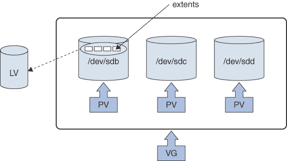

图 3.2 **逻辑卷**

#### vgcreate

使用 `pvcreate` 命令创建 PVs 后（参见本章节后面的“pvcreate”章节），执行以下命令将这些 PV 放入 VG 中：

点击此处查看代码图片

```
# vgcreate vol0 /dev/sdb /dev/sdc /dev/sdd
```

将 VG 视为存储设备的集合，你想使用这些设备来创建名为逻辑卷 (LVs) 的类分区结构。如果 `/dev/sdb` 是一个 60GB 的硬盘，`/dev/sdc` 是一个 30GB 的硬盘，`/dev/sdd` 是一个 20GB 的硬盘，那么通过上述命令创建的 VG 有 110GB 的可用空间来创建 LVs。你可以使用所有 110GB 创建单个 LV，也可以创建许多较小的 LV。请参见图 3.3 的卷组的视觉演示。

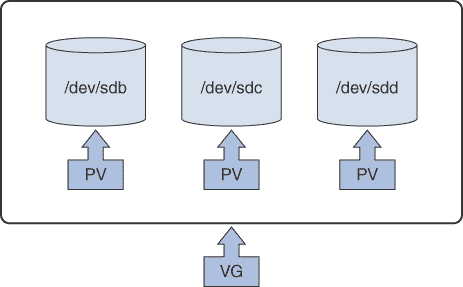

图 3.3 **卷组**

#### lvresize

`lvresize` 命令允许你更改 LV 的大小。例如，下面的命令在假设 VG 有足够的空闲空间的情况下，为 `/dev/vol0/lv0` LV 增加了 10GB：

```
lvresize -L +10G dev/vol0/lv0
```

#### pvcreate

创建 LVM 的第一步是将现有物理设备转换为 PV。这是通过执行 `pvcreate` 命令实现的。例如，如果你有三个硬盘，如图 3.4 所示，并且你想让它们都成为 PV，可以执行以下命令：

点击此处查看代码图片

```
pvcreate /dev/sdb /dev/sdc /dev/sdd
```

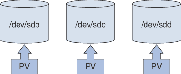

图 3.4 **物理卷**

#### vgextend

当你想要向 VG 添加新的 PV 时，可以使用 `vgextend` 命令。例如，下面的命令将 `/dev/sde` PV 添加到 `vol0`  VG 中：

```
vgextend vol0 /dev/sde
```

注意：`/dev/sde` 设备必须先使用 `pvcreate` 命令将其配置为 PV。请查看本章节后面的“pvcreate”章节以获取更多信息。

## 检查 RAID 实现

RAID 设备用于提供冗余。两个或多个物理设备可以组合成单一设备，以某种方式存储数据，从而在存储设备之一故障时减轻数据丢失的风险。

有几种不同类型的 RAID 设备，称为“RAID 级别”。虽然你可以创建许多不同软件 RAID 级别，但只有少数几个级别对于软件 RAID 设备来说真正有意义。当你配置软件 RAID 设备时，应该考虑表 3.11 中描述的 RAID 级别。

表 3.11 RAID 级别

| 级别 | 描述 |
| --- | --- |
| RAID 0 | RAID 0 将向多个驱动器写入，就像它们是单一设备一样。写入通过“条带”（striping）执行，其中某些数据写入第一个驱动器，然后某些数据写入第二个驱动器，依此类推。RAID 0 将多个较小的硬盘合并为一个存储空间。因此，如果你有三个 20GB 的硬盘，你可以将它们合并为一个 60GB 的单一存储设备。软件 RAID 0 极其罕见，原因有两个。一个原因是该 RAID 级别不提供冗余（这使得它被认为是 RAID 是很奇怪）。另一个原因是 LVM（逻辑卷管理器）也允许合并多个设备，而且 LVM 具有比软件 RAID 0 许多优势，使其成为更好的选择。（LVM 在在本章前面讨论过。） |
| RAID 1 | RAID 1 也称为“镜像”（mirroring），两个或多个磁盘驱动器显示为一个单一存储设备。写入一个磁盘驱动器的数据也会写入所有其他驱动器。如果其中一个驱动器故障，数据在其他驱动器上仍然可用。软件 RAID 1 非常流行，因为硬盘相当廉价，而且 RAID 1 提供的冗余限制了数据丢失。 |


| RAID 4 | 实现 RAID 4 至少需要三个驱动器。除一个驱动器外，所有驱动器都用于存储文件系统数据，最后一个驱动器用于存储校验数据——即根据 RAID 其他设备存储的数据派出的值。假设 RAID 中三个设备；其中两个（在本例中称为设备 A 和 B）存储普通文件系统数据，另一个（称为设备 C）存储校验数据。如果设备 A 故障，则可以通过比较设备 B 中的数据和设备 C 中的校验数据来重建它所存储的数据。这是如何运作的呢？考虑以下公式：`1 + 1 = 2`（或者，也许是 `A + B = C`）。如果有人删除了该公式中的一个值（例如，`___ + 1 = 2`），你可以通过比较其他两个值来恢复该信息。这就是校验数据的基本原理。 |
| RAID 5 | RAID 5 与 RAID 4 非常相似。区别在于 RAID 5 不使用单一校验盘，而是以“轮询”的方式将校验数据分布在多个磁盘上。 |
| RAID 10 | 称为称为 RAID 1+0，这种 RAID 级别结合了 RAID 1 和 RAID 0 的优点。首先，将两个或多个两个设备组成的组置于多个 RAID 1 设备中。这提供了冗余性。然后将它们合并成 RAID 0 设备，以创建一个大得多的存储容器。在软件 RAID 方面，这种 RAID 级别相当稀见，主要是因为 LVM 相比 RAID 0 具有优势。一种更常见的场景是 RAID 0 加 LVM 的组合。对于硬件 RAID，这种级别并不常见见。 |

### 考试要点
为了 Linux+ XK0-005 考试，请这些 RAID 级别！考试可能会要求你指定在给定场景下应该使用哪种 RAID 级别。

### mdadm
要创建一个软件 RAID 设备，请执行类似下面的命令：

点击此处查看代码图片

```
# mdadm -C /dev/md0 -l 1 -n 2 /dev/sdb /dev/sdc
mdadm: array /dev/md0 started.
```

此命令使用了以下选项：

* `-C:`: 指定 RAID 设备的名称。
* `-l:`: 指定 RAID 级别。
* `-n:`: 指定 RAID 阵中物理存储设备的数量。

### /proc/mdstat
在创建 RAID 设备后，你可以通过查看 `/proc/mdstat` 文件的内容查看有关设备的信息，例所示：

点击此处查看代码图片

```
# more /proc/mdstat
Personalities : [raid1]
md0 : active raid1 sdc[1] sdb[0]
      987840 blocks [2/2] [UU]
unused devices: <none>
```

`mdadm --detail` 命令也可以用于显示软件 RAID 设备的信息。

### 存储区域网络 (SAN)/网络存储 (NAS)
本节提供了有关 SAN 和 NAS 设备的信息。

#### multipathd
某些存储设备仅通过网络可用。这产生了一个故障：网络本身。如果你失去了对远程存储设备的网络访问（可能是因为路由器故障或实施了新的防火墙规则），系统上的应用程序可能无法正常运行。

多路径涉及为远程存储设备创建不同的网络路径。这需要额外的网络设置，包括配置到网络存储设备的不同路由。多路径守护进程 (`multipathd`) 是管理这些网络路径的进程。

### 考试要点
配置多路径的细节超出了 Linux+ XK0-005 考试的范围，书中未涵盖。然而，多路径被包含在考试目标中，请准备好回答有关多路径用途的问题。

## 网络文件系统
与其他大多数操作系统一样，Linux 允许你访问网络共享的文件系统。本节描述了 Linux 最常用的两种网络文件系统：NFS 和 SMB。

##### 网络文件系统 (NFS)
网络文件系统 (NFS) 是一种分布式文件系统 (DFS) 协议，已使用 40 多年。NFS 最初由 Sun Microsystems 于 1984 年创建，旨在为管理员提供一种简单的方法从一个 Unix 系统向另一个系统共享文件和目录。

自诞生以来，NFS 已移植到多个不同的操作系统，包括 Linux 和 Microsoft Windows。虽然它可能没有 SAMBA 流行，但许多机构仍在使用 NFS 共享文件。

NFS 服务器的主要配置是 `/etc/exports` 文件。这是你用于指定想要向 NFS 客户端共享哪些目录的文件。该文件的语法如下：

```
Directory    hostname(options)
```

* `Directory` 应该替换为你想要共享的目录名称（例如，`/usr/share/doc`），`hostname` 应该是可以解析为 IP 地址的客户端主机名。`options` 值用于指定如何共享资源。

例如，`/etc/exports` 文件中的以下条目将 `/usr/share/doc` 目录以读写权限共享给 NFS 客户端 `jupiter`，以只读权限共享给 `mars`：

点击此处查看代码图片

```
/usr/share/doc jupiter(rw) mars(ro)
```

注意 `jupiter` 和 `mars` 之间有一个空格，但每个主机名与其相应的选项之间没有空格。新手管理员的一个常见错误是提供如下条目：

```
/usr/share/doc jupiter(rw)
```

此行将以默认选项将 `/usr/share/doc` 目录共享给 `jupiter`，且所有其他主机都具有读写权限。

在 `/etc/exports` 文件中指定主机名时，允许以下方法：

* `hostname`: 可以解析为 IP 地址的主机名。
* `netgroup`: 使用 `@groupname` 的 NIS 网络组。
* `domain`: 使用通配符的域名。例如，`*.onesource.com` 将包含 `onesource.com` 域中的任何机器。
* `Network`: 使用 VLSM（可变长度子网掩码）或 CIDR（无类域间路由）通过 IP 地址定义的网络。包括 `192.168.1.0/255.255.255.0` 和 `192.168.1.0/24`。

许多不同的 NFS 共享选项，包括：

* `rw`: 以读写方式共享。注意普通的 Linux 权限仍然有效。重要：这是一个默认选项。
* `ro`: 以只读方式共享。
* `sync`: 将文件数据更改立即写入磁盘。这影响性能，但不太会导致数据丢失。在某些发行版中，这是默认值。
* `async`: `sync` 反反。初始将文件数据更改写入内存。这会提高性能，但更容易导致数据丢失。在某些发行版中，这是默认值。
* `root_squash`: 将 NFS 客户端的 root 用户和组账户映射到匿名帐户，通常是 `nobody` 帐户或 `nfsnobody` 帐户。重要：这是一个默认选项。
* `no_root_squash`: 将 NFS 客户端的 root 用户和组账户映射到本地 root 用户和组帐户。

##### Server Message Block(SMB)/Common Internet File System (CIFS)


在不同系统之间共享文件的方法之一是使用名为 `SMB`（服务器消息块）的协议。该协议由 IBM 在 20 世纪 80 年代中期发明，用于局域网（LAN）上的主机之间共享目录。分布式文件系统 (`DFS`）用于跨网络共享文件和目录。除了 `SMB` 之外，网络文件系统 (`NFS`）是 Linux 下一种流行的 `DFS`。（`NFS` 在本章前面已经介绍过。）

你经常听到 `CIFS`（通用互联网文件系统）这一缩写与 `SMB` 一起使用。`CIFS` 是一种基于 `SMB` 的协议，在 Microsoft Windows 系统上非常流行。通常，这两个缩写互换使用（或一起使用，如 `SMB/CIFS`），但这些协议之间存在细微差异。本书从现在起使用 `SMB` 术语。

你还可以使用 `SMB` 共享打印机，以及在不同操作系统类型之间共享文件。事实上，一个常见的 `SMB` 任务是在 Linux 和 Microsoft Windows 系统之间共享打印机。

允许 `SMB` 共享的 Linux 软件被称为 `SAMBA`。`SAMBA` 的配置文件是 `/etc/SAMBA/smb.conf` 文件。

为了让你了解典型的 `smb.conf` 文件的样子，请查看以下输出，它展示了一个去除了所有注释行和空行的典型默认 `smb.conf` 文件：

点击此处查看代码图像

```
[root@onecoursesource ~]# grep -v "#" /etc/SAMBA/smb.conf | grep -v ";" | grep -v "^$"
[global]
        workgroup = MYGROUP
        server string = SAMBA Server Version %v
        security = user
        passdb backend = tdbsam
        load printers = yes
        cups options = raw
[homes]
        comment = Home Directories
        browseable = no
        writable = yes
[printers]
        comment = All Printers
        path = /var/spool/SAMBA
        browseable = no
        guest ok = no
        writable = no
        printable = yes
```

表 3.12 描述了 SAMBA 配置文件的常用选项。

表 3.12 SAMBA 配置文件选项

| 选项 | 说明 |
| --- | --- |
| `workgroup` | 这是 NetBIOS（网络基本输入/输出系统）工作组或 NetBIOS 域名。它允许你将一组机器组合，如果你想通过 `SMB` 与 Microsoft Windows 系统通信，这可能很重要。 |
| `server string` | 这是服务器的描述，当远程系统尝试连接到服务器以确定服务器提供的服务时非常有用。值 `%v` 会替换为 SAMBA 的版本号。值 `%h` 可以表示服务器的主机名。 |
| `security` | 这决定了使用什么类型的用户验证方法。值 `user` 表示将使用 SAMBA 用户帐户。如果你在 Microsoft Windows 系统上有一个 DC（域控制器），你可以指定域。要通过 Active Directory 验证，请指定 `ads`。 |
| `passdb backend` | 指定指定 SAMBA 账户数据的存储方式。除非你是专家，否则通常不需要更改它。 |
| `load printers` | 此选项如果设置为 `yes`，则告诉 SAMBA 默认共享所有 CUPS（通用 UNIX 打印系统，Linux 和 Unix 中常用的打印协议）。虽然这很方便，但你并不总是要在 SAMBA 服务器上共享所有的 CUPS 打印机。单个打印机共享可以在单独的部分中处理。注意，为了让 SAMBA 能够自动加载所有 CUPS 打印机，需要正确配置 `[printers]` 部分。 |
| `cups options` | 关于 CUPS 的这些选项仅由专家修改。 |

## 存储硬件

Linux 提供了几个可以使用显示存储硬件信息的命令。本节涵盖了这些命令中最常用的。

#### lsscsi

小型计算机系统接口 (SCSI) 设备是一种存储设备（通常是硬盘，但也可以是磁带驱动器）。这些设备在基于 Intel 的 PC 上相当稀见，而大多数 Linux 系统都安装在这些 PC 上。如果你的系统是 SCSI 设备，可以使用 `lsscsi` 命令列出其相关信息。

#### lsblk

如果你刚刚创建了文件系统，可能很容易记住使用了哪个设备文件来访问文件系统。然而，如果你忘记了哪些设备文件可用，可以执行 `lsblk` 命令。以下在原生虚拟机上执行此命令的示例——因此设备名称为 `vda`、`vda1` 和 `vda2`：

点击此处查看代码图像

```
# lsblk
NAME   MAJ:MIN RM SIZE RO TYPE MOUNTPOINT
vda    252:0    0 254G 0  disk
| vda1  252:1  0 250G 0 part /
vda2    252:2  0   4G 0 part [SWAP]
```

#### blkid

你可以使用 `blkid` 命令查看你的标签和 UUIDs：

点击此处查看代码图像

```
# blkid
/dev/sda1: UUID="4d2b9a11-966c-42bf-8a18-1234567890ab" TYPE="ext4"
/dev/sda3: LABEL="home" UUID="bab04315-389d-44bf-9efa-251172345678" TYPE="ext4"
/dev/sda4: UUID="18d6bc04-14a0-4469-b235-1234567890ab" TYPE="ext4"
```

你可以使用 `fcstat` 命令显示连接到光纤通道的存储设备信息。常用选项见表 3.13。

表 3.13 `fcstat` 命令

| 选项 | 说明 |
| --- | --- |
| `link_stats` | 在错误时显示链接信息。 |
| `device_map` | 显示附加设备。 |

## 第 4 章：配置和使用适当的进程

**本章涵盖了：**

 **1.4:** 给场景配置并使用适当的服务。

在 Linux 系统上，服务是操作系统或软件的一个特性。管理员需要通过 `systemctl` 命令来管理这些服务，该命令在本章介绍。

管理员经常需要使用 `crontab` 和 `at` 工具，它们使得在未来调度进程（或程序）成为可能。关于进程，了解如何列出和控制进程也很重要。这些主题在本章中介绍。

本章提供了以下主题的信息：系统服务、服务的调度和进程管理。

## 系统服务

systemd 是 Linux 的一个特性，用于控制启动过程中启动哪些服务。systemd 使用“目标”（targets），每个目标都有特定的服务。图 4.1 显示了一个典型的 Systemd 启动序列示例。


图 4.1 Systemd 启动概述

目标定义在 `/usr/lib/systemd/system` 目录下。考虑以下目标文件的示例：

点击此处查看代码图像

```
# cat /usr/lib/systemd/system/graphical.target
# 此文件是 systemd 的一部分。
#
# systemd 是自由软件；你可以根据 GNU 通用许可证
# 的条款分发或修改它，该许可证由
# 软件基金会发布；许可证的 2.1 版本
# 或（根据你的选择）任何更高版本。

[Unit]
Description=图形界面
Documentation=man:systemd.special(7)
Requires=multi-user.target
Wants=display-manager.service
Conflicts=rescue.service rescue.target
After=multi-user.target rescue.service rescue.target
 display-manager.service
AllowIsolate=yes
```


点击此处查看代码图片

```
# ls -l /etc/systemd/system/default.target
lrwxrwxrwx. 1 root root 36 Jun 11 20:47
 /etc/systemd/system/default.target ->
 /lib/systemd/system/graphical.target
```

使用以下命令显示默认目标：

```
# systemctl get-default
multi-user.target
```

使用 `systemctl list-unit-files --type=target` 命令列出可可用目标。此命令会产生大量的输出，以下示例使用了 `head` 命令来限制输出：

点击此处查看代码图片

```
# systemctl list-unit-files --type=target | head
UNIT FILE STATE
basic.target              static
bluetooth.target          static
cryptsetup-pre.target     static
cryptsetup.target         static
ctrl-alt-del.target       disabled
cvs.target                static
default.target            enabled
emergency.target          static
final.target              static
```

使用以下命令设置默认目标：

点击此处查看代码图片

```
# systemctl set-default graphical-user.target
rm '/etc/systemd/system/default.target'
ln -s '/usr/lib/systemd/system/graphical-
 user.target' '/etc/systemd/system/default.target'
```

### systemctl

`systemctl` 命令用于管理基于 Systemd 的发行版。例如，要切换另一个目标，请执行以下命令：

```
systemctl isolate multi-user.target
```

### stop

`stop` 选项配合 `systemctl` 命令使用，用于停止当前运行的服务。

语法：

```
systemctl stop service
```

你可以使用以下命令来确定服务是否正在运行：

```
# systemctl active cups
enabled
```

### start

`start` 选项配合 `systemctl` 命令使用，用于启动当前未运行的服务。

语法：

```
systemctl start service
```

你可以使用以下命令来确定服务是否正在运行：

```
# systemctl active cups
enabled
```

### restart

`restart` 选项配合 `systemctl` 命令使用，用于重启当前正在运行的服务。

语法：

```
systemctl restart process_name
```

你可以使用以下命令来确定服务是否正在运行：

```
# systemctl active cups
enabled
```

### status

`status` 选项配合 `systemctl` 命令使用，用于显示服务的状态。

语法：

```
systemctl status process_name
```

这是一个显示 CUPS 服务状态的示例：

点击此处查看代码图片

```
# sysctl status cups
 cups.service - CUPS Scheduler
 Loaded: loaded (/lib/systemd/system/cups.service; enabled;
 vendor preset: enabled)
 Active: active (running) since Mon 2019-01-07 00:10:18 PST;20h ago
 Docs: man:cupsd(8)
 Main PID: 4195 (cupsd)
 Tasks: 1 (limit: 4780)
 CGroup: /system.slice/cups.service
          4195 /usr/sbin/cupsd -l
Jan 07 00:10:18 student-VirtualBox systemd[1]: Started CUPS Scheduler.
```

### enable

`enable` 选项配合 `systemctl` 命令使用，用于在启动时启动服务。

语法：

```
systemctl enable service
```

你可以使用以下命令来确定服务当前是否已启用或禁用：

```
# systemctl is-enabled cups
enabled
```

### disable

`disable` 选项配合 `systemctl` 命令使用，用于更改当前启动时启动的服务，使其不再自动启动。

语法：

```
systemctl disable service
```

你可以使用以下命令来确定服务当前是否已启用或禁用：

```
# systemctl is-enabled cups
enabled
```

### mask

掩蔽（mask）一个服务使其完全无法启动或启用。当系统中存在冲突的服务，且由于某种原因无法或不应从系统中删除时，通常会这样做。

掩蔽服务的语法：

```
systemctl mask service
```

**考试提示**：在参加 Linux+ XK0-005 考试之前，请理解掩蔽服务与禁用服务之间的区别。

### 服务调度

有时你需要在未来执行命令。本节描述的 `cron` 和 `at` 工具允许你调度在未来执行的任务（即命令）。

#### cron

`cron` 服务允许你调度在特定时间运行的进程。该服务利用 `crond` 守护进程，它每分钟检查一次应该执行哪些进程。该守护进程会同时检查 `crontab` 和 `at` 任务，以确定要执行哪些命令以及何时执行。

#### cron

`cron` 服务允许你调度在特定时间运行的进程。该服务利用 `crond` 守护进程，它每分钟检查一次应该执行哪些进程。该守护进程会同时检查 `crontab` 和 `at` 任务，以确定要执行哪些命令以及何时执行。

#### crontab

`cron 服务允许你调度在特定时间运行的进程。该服务利用 `crond` 守护进程，它每分钟检查一次应该执行哪些进程。该守护进程会同时检查 `crontab` 和 `at` 任务，以确定要执行哪些命令以及何时执行。

#### crontab

`cron 服务`允许你调度在特定时间运行的进程。该服务利用 `crond` 守护进程，它每分钟检查一次应该执行哪些进程。该守护进程会同时检查 `crontab` 和 `at` 任务，以确定要执行哪些命令以及何时执行。

#### crontab

`cron 服务`允许你调度在特定时间运行的进程。该服务利用 `crond` 守护进程，它每分钟检查一次应该执行哪些进程。该守护进程会同时检查 `crontab` 和 `at` 任务，以确定要执行哪些命令以及何时执行。

#### crontab

`cron 服务`允许你调度在特定时间运行的进程。该服务利用 `crond` 守护进程，它每分钟检查一次应该执行哪些进程。该守护进程会同时检查 `crontab` 和 `at` 任务，以确定要执行哪些命令以及何时执行。

#### crontab

`cron 服务`允许你调度在特定时间运行的进程。该服务利用 `crond` 守护进程，它每分钟检查一次应该执行哪些进程。该守护进程会同时检查 `crontab` 和 `at` 任务，以确定要执行哪些命令以及何时执行。

#### cron

`cron 服务`允许你调度在特定时间运行的进程。该服务利用 `crond` 守护进程，它每分钟检查一次应该执行哪些进程。该守护进程会同时检查 `crontab` 和 `at` 任务，以确定要执行哪些命令以及何时执行。

#### cron (等等)

`cron 服务`允许你调度在特定时间运行的进程。该服务利用 `crond` 守护进程，它每分钟检查一次应该执行哪些进程。该守护进程会同时检查 `crontab` 和 `at` 任务，以确定要执行哪些命令以及何时执行。

#### crontab

`cron 服务`允许你调度在特定时间运行的进程。该服务利用 `crond` 守护进程，它每分钟检查一次应该执行哪些进程。该守护进程会同时检查 `crontab` 和 `at` 任务，以确定要执行哪些命令以及何时执行。

#### crontab

`cron 服务`允许你调度在特定时间运行的进程。该服务利用 `crond` 守护进程，它每分钟检查一次应该执行哪些进程。该守护进程会同时检查 `crontab` 和 `at` 任务，以确定要执行哪些命令以及何时执行。

#### crontab

`cron 服务`允许你调度在特定时间运行的进程。该服务利用 `crond` 守护进程，它每分钟检查一次应该执行哪些进程。该守护进程会同时检查 `crontab` 和 `at` 任务，以确定要执行哪些命令以及何时执行。

#### crontab

`cron 服务`允许你调度在特定时间运行的进程。该服务利用 `crond` 守护进程，它每分钟检查一次应该执行哪些进程。该守护进程会同时检查 `crontab` 和 `at` 任务，以确定要执行哪些命令以及何时执行。

#### crontab

`cron 服务`允许你调度在特定时间运行的进程。该服务利用 `crond` 守护进程，它每分钟检查一次应该执行哪些进程。该守护进程会同时检查 `crontab` 和 `at` 任务，以确定要执行哪些命令以及何时执行。

#### crontab

`cron 服务`允许你调度在特定时间运行的进程。该服务利用 `crond` 守护进程，它每分钟检查一次应该执行哪些进程。该守护进程会同时检查 `crontab` 和 `at` 任务，以确定要执行哪些命令以及何时执行。

#### crontab

`cron 服务`允许你调度在特定时间运行的进程。该服务利用 `crond` 守护进程，它每分钟检查一次应该执行哪些进程。该守护进程会同时检查 `crontab` 和 `at` 任务，以确定要执行哪些命令以及何时执行。

#### crontab

`cron 服务`允许你调度在特定时间运行的进程。该服务利用 `crond` 守护进程，它每分钟检查一次应该执行哪些进程。该守护进程会同时检查 `crontab` 和 `at` 任务，以确定要执行哪些命令以及何时执行。

#### crontab

`cron 服务`允许你调度在特定时间运行的进程。该服务利用 `crond` 守护进程，它每分钟检查一次应该执行哪些进程。该守护进程会同时检查 `crontab` 和 `at` 任务，以确定要执行哪些命令以及何时执行。

#### crontab

`cron 服务`允许你调度在特定时间运行的进程。该服务利用 `crond` 守护进程，它每分钟检查一次应该执行哪些进程。该守护进程会同时检查 `crontab` 和 `at` 任务，以确定要执行哪些命令以及何时执行。

#### crontab

`cron 服务`允许你调度在特定时间运行的进程。该服务利用 `crond` 守护进程，它每分钟检查一次应该执行哪些进程。该守护进程会同时检查 `crontab` 和 `at` 任务，以确定要执行哪些命令以及何时执行。

#### crontab

`cron 服务`允许你调度在特定时间运行的进程。该服务利用 `crond` 守护进程，它每分钟检查一次应该执行哪些进程。该守护进程会同时检查 `crontab` 和 `at` 任务，以确定要执行哪些命令以及何时执行。

#### crontab

`cron 服务`允许你调度在特定时间运行的进程。该服务利用 `crond` 守护进程，它每分钟检查一次应该执行哪些进程。该守护进程会同时检查 `crontab` 和 `at` 任务，以确定要执行哪些命令以及何时执行。

#### crontab

`cron 服务`允许你调度在特定时间运行的进程。该服务利用 `crond` 守护进程，它每分钟检查一次应该执行哪些进程。该守护进程会同时检查 `crontab` 和 `at` 任务，以确定要执行哪些命令以及何时执行。

#### cront`

 服务 cron 服务`允许你调度调度时间特定的运行的。。该服务 cr `cr ` 守护进程，它每分钟检查一次哪些执行哪些进程。该守护进程检查 `cr `crontab` 和 ` ` 任务，以确定要执行哪些命令以及何时执行。

#### cron

`cron 服务`允许你调度在特定时间运行的进程。该服务利用 `crond` 守护进程，它每分钟检查一次应该执行哪些进程。该守护进程会同时检查 `crontab` 和 `at` 任务，以确定要执行哪些命令以及何时执行。

#### cron

`cron 服务`允许你调度在特定时间运行的进程。该服务利用 `crond` 守护进程，它每分钟检查一次应该执行哪些进程。该守护进程会同时检查 `crontab` 和 `at` 任务，以确定要执行哪些命令以及何时执行。

#### crontab

`cron 服务`允许你调度在特定时间运行的进程。该服务利用 `crond` 守护进程，它每分钟检查一次应该执行哪些进程。该守护进程会同时检查 `crontab` 和 `at` 任务，以确定要执行哪些命令以及何时执行。

#### crontab

`cron 服务`允许你调度在特定时间运行的进程。该服务利用 `crond` 守护进程，它每分钟检查一次应该执行哪些进程。该守护进程会同时检查 `crontab` 和 `at` 任务，以确定要执行哪些命令以及何时执行。

#### crontab

`cron 服务`允许你调度在特定时间运行的进程。该服务利用 `crond` 守护进程，它每分钟检查一次应该执行哪些进程。该守护进程会同时检查 `crontab` 和 `at` 任务，以确定要执行哪些命令以及何时执行。

#### crontab

`cron 服务`允许你调度在特定时间运行的进程。该服务利用 `crond` 守护进程，它每分钟检查一次应该执行哪些进程。该守护进程会同时检查 `crontab` 和 `at` 任务，以确定要执行哪些命令以及何时执行。

#### cron

`cron 服务`允许你调度在特定时间运行的进程。该服务利用 `crond` 守护进程，它每分钟检查一次应该执行哪些进程。该守护进程会同时检查 `crontab` 和 `at` 任务，以确定要执行哪些命令以及何时执行。

#### cron (and so on)

`cron 服务`允许你调度在特定时间运行的进程。该服务利用 `crond` 守护进程，它每分钟检查一次应该执行哪些进程。该守护进程会同时检查 `crontab` 和 `at` 任务，以确定要执行哪些命令以及何时执行。

#### crontab

`cron 服务`允许你调度在特定时间运行的进程。该服务利用 `crond` 守护进程，它每分钟检查一次应该执行哪些进程。该守护进程会同时检查 `crontab` 和 `at` 任务，以确定要执行哪些命令以及何时执行。

#### crontab

`cron 服务`允许你调度在特定时间运行的进程。该服务利用 `crond` 守护进程，它每分钟检查一次应该执行哪些进程。该守护进程会同时检查 `crontab` 和 `at` 任务，以确定要执行哪些命令以及何时执行。

#### crontab

`cron 服务`允许你调度在特定时间运行的进程。该服务利用 `crond` 守护进程，它每分钟检查一次应该执行哪些进程。该守护进程会同时检查 `crontab` 和 `at` 任务，以确定要执行哪些命令以及何时执行。

#### crontab

`cron 服务`允许你调度在特定时间运行的进程。该服务利用 `crond` 守护进程，它每分钟检查一次应该执行哪些进程。该守护进程会同时检查 `crontab` 和 `at` 任务，以确定要执行哪些命令以及何时执行。

#### crontab

`cron 服务`允许你调度在特定时间运行的进程。该服务利用 `crond` 守护进程，它每分钟检查一次应该执行哪些进程。该守护进程会同时检查 `crontab` 和 `at` 任务，以确定要执行哪些命令以及何时执行。

#### crontab

`cron 服务`允许你调度在特定时间运行的进程。该服务利用 `crond` 守护进程，它每分钟检查一次应该执行哪些进程。该守护进程会同时检查 `crontab` 和 `at` 任务，以确定要执行哪些命令以及何时执行。

#### crontab

`cron 服务`允许你调度在特定时间运行的进程。该服务利用 `crond` 守护进程，它每分钟检查一次应该执行哪些进程。该守护进程会同时检查 `crontab` 和 `at` 任务，以确定要执行哪些命令以及何时执行。

#### crontab

`cron 服务`允许你调度在特定时间运行的进程。该服务利用 `crond` 守护进程，它每分钟检查一次应该执行哪些进程。该守护进程会同时检查 `crontab` 和 `at` 任务，以确定要执行哪些命令以及何时执行。

#### crontab

`cron 服务`允许你调度在特定时间运行的进程。该服务利用 `crond` 守护进程，它每分钟检查一次应该执行哪些进程。该守护进程会同时检查 `crontab` 和 `at` 任务，以确定要执行哪些命令以及何时执行。

#### crontab

`cron 服务`允许你调度在特定时间运行的进程。该服务利用 `crond` 守护进程，它每分钟检查一次应该执行哪些进程。该守护进程会同时检查 `crontab` 和 `at` 任务，以确定要执行哪些命令以及何时执行。

#### crontab

`cron 服务`允许你调度在特定时间运行的进程。该服务利用 `crond` 守护进程，它每分钟检查一次应该执行哪些进程。该守护进程会同时检查 `crontab` 和 `at` 任务，以确定要执行哪些命令以及何时执行。

#### crontab

`cron 服务`允许你调度在特定时间运行的进程。该服务利用 `crond` 守护进程，它每分钟检查一次应该执行哪些进程。该守护进程会同时检查 `crontab` 和 `at` 任务，以确定要执行哪些命令以及何时执行。

#### crontab

`cron 服务`允许你调度在特定时间运行的进程。该服务利用 `crond` 守护进程，它每分钟检查一次应该执行哪些进程。该守护进程会同时检查 `crontab` 和 `at` 任务，以确定要执行哪些命令以及何时执行。

#### crontab

`cron 服务`允许你调度在特定时间运行的进程。该服务利用 `crond` 守护进程，它每分钟检查一次应该执行哪些进程。该守护进程会同时检查 `crontab` 和 `at` 任务，以确定要执行哪些命令以及何时执行。

#### crontab

`cron 服务`允许你调度在特定时间运行的进程。该服务利用 `crond` 守护进程，它每分钟检查一次应该执行哪些进程。该守护进程会同时检查 `crontab` 和 `at` 任务，以确定要执行哪些命令以及何时执行。

#### crontab

`cron 服务`允许你调度在特定时间运行的进程。该服务利用 `crond` 守护进程，它每分钟检查一次应该执行哪些进程。该守护进程会同时检查 `crontab` 和 `at` 任务，以确定要执行哪些命令以及何时执行。


# 任务调度工具说明

## crontab 详解

`crontab` 文件用于调度定期执行的命令。每个用户都有自己的 `crontab` 文件。

### crontab 格式

`crontab` 文件的每一行由以下字段组成：

```
* * * * * command
```

表 4.4 crontab 字段

| 字段 | 说明 |
| :--- | :--- |
| **分钟** | 0-59，表示执行命令的分钟。使用 `*` 表示每分钟执行。 |
| **小时** | 0-23，表示执行命令的小时。使用 `*` 表示每小时执行。 |
| **日期** | 1-31，表示执行命令的日期。使用 `*` 表示每天执行。 |
| **月份** | 1-12，表示执行命令的月份。使用 `*` 表示每月执行。 |
| **星期** | 0-7（0 或 7 代表周日），表示执行命令的星期几。使用 `*` 表示每天执行。 |
| **命令** | 要执行的实际命令。 |

## at 命令详解

`at` 命令用于调度在未来特定时间执行一次的命令。

### 语法

```
at time
```

其中 `time` 指定执行命令的时间。

### 使用示例

在明天下午 5 点执行任务：

```bash
at 5pm tomorrow
at> echo "hello world" > /tmp/hello.txt
```

查看任务列表：

```bash
at -q
```

删除指定任务：

```bash
atrm [job_id]
```


进程管理包括列出运行中的进程（即作业或命令），向进程发送信号以修改其行为（重启、停止等）。本节描述了进程管理功能。

## 信号（Kill Signals）

`kill` 命令可更改进程状态，包括停止（杀死）它。

语法：

```
kill PID|jobnumber
```

要停止一个进程，首先确定其进程 ID（PID）或作业号，然后将该数字作为参数提供给 `kill` 命令，例如所示：

点击此处查看代码图像

```
[student@OCS ~]$ jobs
 [1]- Running                    sleep 999 &
 [2]+ Running sleep 777 &
 [student@OCS ~]$ kill %2
 [student@OCS ~]$ jobs
 [1]- Running                    sleep 999 &
 [2]+ Terminated                 sleep 777
 [student@OCS ~]$ ps -fe | grep sleep
 student 17846 12540 0 14:30 pts/2 00:00:0 sleep 999
 student 17853 12540 0 14:31 pts/2 00:00:00
 grep --color=auto sleep
 [student@OCS ~]$ kill 17846
 [student@OCS ~]$ ps -fe | grep sleep
 student 17856 12540 0 14:31 pts/2 00:00:00
 grep --color=auto sleep
 [1]+ Terminated                  sleep 999
```

表 4.7 列了一些重要的 `kill` 选项。

表 4.7 `kill` 命令选项

| 选项 | 描述 |
| --- | --- |
| `-9` | 强制杀死。当执行常规 `kill` 命令时进程未退出在使用。 |
| `-l` | 提供其他数值列表，这些数值可向进程发送不同的 kill 信号。 |

考试提示 (ExamAlert)

对于 Linux+ XK0-005 考试，请记住，只有在所有其他停止进程的尝试均失败时，才应使用 `kill -9`。

### SIGTERM

`SIGTERM` 信号也称为信号 15，是你使用 `kill` 命令时发送给进程的默认信号。该信号是请求进程停止，但进程可以被程序设置为忽略 `SIGTERM` 信号。

### SIGKILL

`SIGKILL` 信号也称为信号 9，是你使用带有 `-9` 选项的 `kill` 命令发送给进程的信号，例如所示：

```
kill -9 17846
```

`SIGKILL` 信号强制进程停止，而不为其提供优雅关闭的机会。如果你对进程使用 `SIGKILL` 信号，可能会丢失进程存储在内存中的数据。

### SIGHUP

当父进程被停止时，所有子进程都会收到挂断信号（`SIGHUP`）。这种 HUP 信号旨在停止子进程。默认情况下，子进程收到 `SIGHUP` 信号会停止，但进程可以被程序设置为忽略 `SIGHUP` 信号。你也可以通过使用 `nohup` 命令执行子进程来让进程忽略 `SIGHUP` 信号：

点击此处查看代码图像

```
[student@OCS ~]$ nohup some_command
```

你通常在远程登录系统并希望在断开连接后让某些命令继续运行时使用这种技术。当你断开连接时，你正在运行的所有程序都会收到 HUP 信号。使用 `nohup` 命令允许此特定进程继续运行。

### 列出进程和打开的文件

可以使用若干 Linux 命令来列出进程以及进程打开的文件。本节涵盖了这些命令。

### top

`top` 命令显示定期更新的进程信息（默认每 2 秒一次）。`top` 命令输出的上半部分包含整体信息，后半部分显示选定的进程列表（默认使用 CPU 最高的进程）。

图 4.2 显示了 `top` 命令的一些典型输出。

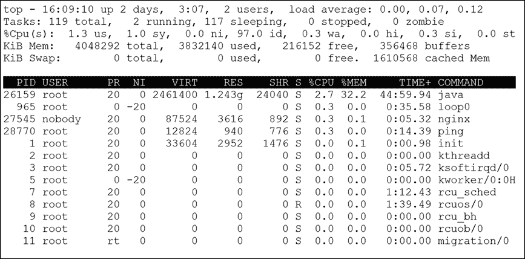

图 4.2 `top` 命令输出

表 4.8 描述了图 4.2 中显示的输出。

表 4.8 `top` 命令输出详解

| 输出 | 描述 |
| --- | --- |
| 第一行 | 源自 `uptime` 命令的输出。 |
| 第二行 | 系统上运行进程的摘要。 |
| 第三行 | 自上次 `top` 数据刷新以来的 CPU 统计。 |
| 第四行 | 物理内存统计。（注意：在 `top` 命令中按 `E` 将值从 KB 更改其他值。） |
| 第五行 | 虚拟内存统计。 |
| 剩余行 | 进程列表及相关信息。 |

在 `top` 命令运行时，你可以使用交互命令来执行操作，如更改显示值、重新排序进程列表和杀死进程。这些交互命令是单字符的。表 4.9 描述了最重要的交互命令。

表 4.9 配合 `top` 使用的交互命令

| 命令 | 描述 |
| --- | --- |
| `h` | 打开帮助。显示交互命令的摘要。 |
| `E` | 将默认值从 KB 更改为其他值；值循环回到 KB。 |
| `Z` | 切换颜色高亮开启；使用小写 `z` 在颜色和非颜色之间切换。 |
| `B` | 切换粗体开启和关闭。 |
| `< >` | 将排序列向左 (<) 或向右 (>) 移动。 |
| `s` | 将更新值设置为不同于默认 2 秒的值。 |
| `k` | 根据进程 ID (PID) 杀死进程。 |
| `q` | 退出 `top` 命令。 |

`top` 命令还支持若干命令行选项，包括表 4.10 中列出的选项。

表 4.10 `top` 命令行选项

| 选项 | 描述 |
| --- | --- |
| `-d` | 设置数据刷新之间的时间。 |
| `-n` *number* | 指定在 `top` 命令退出之前的最大数据刷新次数。 |
| `-u` *username* | 仅显示由 *username* 拥有的进程。 |

### ps

`ps` 命令用于列出系统中运行的进程。在不带参数的情况下，该命令列出当前 shell 的任何子进程以及 BASH shell，如下所示：

```
[student@OCS ~]$ ps
 PID TTY      TIME CMD
18360 pts/0   00:00:00 bash
18691 pts/0   00:00:00 ps
```

`ps` 命令的特殊之处在于它支持旧的 BSD 选项，这些选项通常前面不带连字符（`-`）。

表 4.11 详细说明了 `ps` 命令的一些重要选项。

表 4.11 `ps` 命令选项

| 选项 | 描述 |
| --- | --- |
| `-e` | 显示系统中运行的所有进程；也可以使用 BSD 方法 `ps ax`。 |
| `-f` | 显示完整信息（即关于每个进程的额外信息）。 |
| `-u` *username* | 显示由 *username* 拥有的所有进程。 |
| `-forest` | 提供进程层次树。 |

### lsof

`lsof` 命令用于列出打开的文件。当不带参数使用时，它列出操作系统所有打开的文件，如下所示：

```
[root@OCS ~]# lsof | wc -l
25466
```

更有实用的技术是列出与打开的网络连接相关的所有文件，如下所示：

点击此处查看代码图像


```
[root@OCS ~]# lsof -i
COMMAND PID USER FD TYPE DEVICE SIZE/OFF NODE NAME
avahi-dae 674 avahi 13u IPv4 15730 0t0
            UDP       *:mdns
avahi-dae 674 avahi 14u IPv4 15731 0t0
            UDP        *:49932
sshd 1411 root 3u IPv4 18771 0t0
            TCP       *:ssh (LISTEN)
sshd 1411 root 4u IPv6 18779 0t0
            TCP      *:ssh   (LISTEN)
master 2632 root 14u IPv4 20790 0t0
           TCP       localhost:smtp (LISTEN)
master 2632 root 15u IPv6 20791 0t0
            TCP      localhost:smtp (LISTEN)
dnsmasq 2739 nobody 3u IPv4 21518 0t0
            UDP      *:bootps
dnsmasq 2739 nobody 5u IPv4 21525 0t0
            UDP       192.168.122.1:domain
dnsmasq 2739 nobody 6u IPv4 21526 0t0
            TCP       192.168.122.1:domain (LISTEN)
cupsd 4099 root 12u IPv6 564510 0t0
            TCP       localhost:ipp (LISTEN)
cupsd 4099 root 13u IPv4 564551 0t0
            TCP        localhost:ipp (LISTEN)
dhclient 26133 root 6u IPv4 1151444 0t0
            UDP           *:bootpc
dhclient 26133 root 20u IPv4 1151433 0t0
               UDP       *:14638
dhclient 26133 root 21u IPv6 1151434 0t0
               UDP   *:47997
```

表 4.12 描述了 `lsof` 命令的常用选项。

### 表 4.12 `lsof` 命令选项

| 选项 | 说明 |
| --- | --- |
| `-i` | 匹配网络地址；也可用于显示 IP 版本（`-i4` 或 `-i6`）或端口（`-i TCP:80`）或显示所有打开的连接。 |
| `-u` *user* | 列出*用户*打开的文件。 |
| `-p` *pid* | 列出进程 ID 为 *pid* 的进程打开的文件。 |

### htop

`htop` 命令与 `top` 命令相似（参见本章前面的“top”部分），但它具有一些额外功能。例如，你可以水平和垂直滚动输出内容。`htop` 命令还显示更多信息，例如用户线程和内核线程（*线程*是进程执行的一部分），这使得它对于软件开发者来说是一条非常有用的命令。

### 设置优先级

`nice` 值用于指示 CPU 哪个进程具有最高的访问优先级。其值范围从 –20（最高优先级）到 19（最低优先级）。用户创建的任何作业的默认优先级均为 0。

**考试警示**

`nice` 值经常是 Linux+ XK0-005 考试题的主题。记住，数字越小，优先级越高。还要记住 0 是默认值，只有 root 用户可以运行带有负数的进程。最后，请记住 –20 是最低的，19 是最高的（注：此处原文可能有误）；你可能会在考试中看到误导性的问题，提供 –19 和 20 作为可能的答案。

下一节将提供在执行命令时设置不同优先级的细节。

### nice

要指定与默认不同的 `nice` 值，请通过 `nice` 命令执行作业：

点击此处查看代码图像

```
[student@OCS ~]$ nice -n 5 firefox
```

注意，普通用户不能分配负的 `nice` 值。这些值只能由 root 用户使用。除了 `-n` 选项外没有其他有用选项。

要查看进程的 `nice` 值，请使用 `ps` 命令的 `-o` 选项并包含 `nice` 值，所示：

点击此处查看代码图像

```
[student@OCS ~] ps -o nice,pid,cmd
 NI PID CMD
 0 23865 -bash
 0 27969 ps -o nice,pid,cmd
```

### renice

使用 `renice` 命令更改现有作业的 `nice` 值。以下是一个示例：

点击此处查看代码图像

```
[student@OCS ~] ps -o nice,pid,cmd
 NI PID CMD
 0 23865 -bash
 5 28235 sleep
```


`jobs` 命令显示当前正在运行的以及是从你输入 `jobs` 命令的 shell 中启动的进程：

```
[student@OCS ~]$ jobs
[1]+ Stopped sleep 999
```

如果你打开另一个终端窗口并输入 `jobs` 命令，你将无法看到在第一个终端中显示的进程。

### Ctrl+Z

当进程在前台运行时，你可以通过按住 Ctrl 键并按下 `z` 键向进程发送 `SIGTSTP` 信号。`SIGTSTP` 信号设计用于暂停程序。然后，你可以使用 `bg` 或 `fg` 命令重启该程序。

更多详情请参阅本章前面的 `bg` 和 `fg` 节。

### Ctrl+C

当进程在前台运行时，你可以通过按住 Ctrl 键并按下 `c` 键向进程发送 `SIGINT` 信号。`SIGINT` 信号设计用于提前停止程序。

### Ctrl+D

当你运行一个接受用户输入的进程（例如 `at` 命令）时，你可以通过按住 Ctrl 键并按下 `d` 键向该进程发送一个表示“我已完成输入”的信号（请参阅本章前面的 `at` 节）。

当你完成输入 `at` 命令后，按住 Ctrl 键并按下 `d` 键。这将产生一个 `<EOT>` 消息并创建 `at` 任务。这是一个示例：

点击此处查看代码图像

```
[root@OCS ~]$ at 5pm tomorrow
at> /home/bob/rpt.pl
at> echo "report complete" | mail bob
at> <EOT>
job 1 at Thu Feb 23 17:00:00 2017
```

### pgrep

通常你使用 `ps` 和 `grep` 命令组合来显示特定的进程，如下：

点击此处查看代码图像

```
[student@OCS ~]$ ps -e | grep sleep
25194 pts/0 00:00:00 sleep
```

然而，`pgrep` 命令可以提供类似的功能：

```
[student@OCS ~]$ pgrep sleep
25194
```

表 4.14 详细介绍了 `pgrep` 命令的一些重要选项。

#### 表 4.14 pgrep 命令选项

| 选项 | 描述 |
| --- | --- |
| -G *name* | 通过组名匹配进程。 |
| -l | 显示进程名称和 PID。 |
| -n | 优先显示最近启动的进程。 |
| -u *name* | 根据用户名匹配进程。 |

### pkill

使用 `kill` 命令向进程发送信号时，你通过提供进程 ID (PID) 来指定是哪个进程。使用 `pkill` 命令，你可以提供进程名称、用户名或其他方法来指定要向哪个进程或进程发送信号。例如，以下命令向用户 sarah 的所有进程发送 kill 信号：

点击此处查看代码图像

```
[student@OCS ~]$ pkill -u sarah
```

表 4.15 详细介绍了 `pkill` 命令的一些重要选项。

#### 表 4.15 pkill 命令选项

| 选项 | 描述 |
| --- | --- |
| -G *name* | 通过组名匹配进程。 |
| -u *name* | 通过用户名匹配进程。 |

### pidof

当你知道想要控制的命令名称但不知道该命令的 PID（进程 ID）时，`pidof` 命令非常有用。该命令通过名称查找进程并返回其 PID：

```
[student@OCS ~]$ pidof dovecot
688
```

# 第 5 章

使用适当的网络工具或配置文件

**本章涵盖以下 Linux+ XK0-005 考试目标：**

*  **1.5:** 在给定的场景下，使用适当的网络工具或配置文件。

本章的目标是让你理解不同的网络工具和配置文件。你将首先学习各种设计用于显示网络信息并允许你动态更改网络设置的工具。接下来，你将学习编辑哪些配置文件以使网络更改在重启后依然有效。

本章还探索了允许你监控网络流量并验证网络运行正常的工具。最后，你将学习一些允许你连接到远程系统的工具，用于登录这些系统或传输数据。

本章提供了以下主题的信息：接口管理、名称解析、网络监控和远程网络工具。

## 接口管理

Linux 中的 `interface`（或更具体地说，`network interface`）是提供网络访问的设备。本节介绍了允许你管理网络接口的工具。

#### iproute2 工具

`iproute2 tools` 指一组设计用于替代旧工具的工具集。（详情请参阅本章后面的 `net-tools` 节。）`iproute2` 工具包含了 `ip` 和 `ss` 命令。

`ip` 命令设计用于替代 `ipconfig`、`arp` 和 `route` 等实用程序。可能会出现在 Linux+ XK0-005 考试题目中。

### ip

`ip` 命令是一个较新的命令，旨在替代一组工具。语法：

```
ip [options]
```

在不带任何选项的情况下，该命令会显示接口。例如：

点击此处查看代码图像

```
[root@OCS ~]$ ip addr
1: lo <LOOPBACK,UP,LOWER> mtu 65536 qdisc no default len 60000
    inet 127.0.0.1/8 scope host lo
       inet6 ::1/128 scope host lo
2: eth0 <BROADCAST,UP,LOWER> mtu 1500 qdisc fq_cod default len 1000
    link/ether 00:15:5d:01:b2:11 brd ff:ff:ff:ff:ff
    inet 192.168.1.10/24 scope global eth0 192.168.1.255
       inet6 fe80::a015:5dff:fe1/64 scope link
```

表 5.1 描述了 `ip` 命令的一些重要选项。

### ss

`ss` 命令用于显示套接字（socket）信息。将套接字视为两个系统之间的现有连接。语法：

```
ss [options]
```

在不带任何选项的情况下，该命令列出打开的套接字。例如：

点击此处查看代码图像

```
[root@OCS ~]$ ss | wc -l
160
[root@OCS ~]$ ss | head
Netid State Recv-Q Send-Q Local Address:Port Peer Address:Port
u_str ESTAB 0 0 /var/run/dovecot/anvil 23454966 * 23454965
u_str ESTAB 0 0 /var/run/dovecot/anvil 23887673 * 23887672
u_str ESTAB 0 0 /run/systemd/journal/stdout 13569 * 13568
u_str ESTAB 0 0 * 13893 * 13894
u_str ESTAB 0 0 * 13854 * 13855
u_str ESTAB 0 0 * 13850 * 13849
u_str ESTAB 0 0 * 68924 * 68925
u_str ESTAB 0 0 /var/run/dovecot/config 9163531 * 9163871
```

表 5.3 描述了 `ss` 命令的一些实用的选项。


| -lt | 列出监听的 TCP 套接。 |
| -lu | 列出监听的 UDP 套接。 |
| -lp | 列出拥有每个套接的进程 ID (PID)。 |
| -n | 指定不将 IP 地址解析为主机名，也不将端口号解析为端口名称。 |
| -a | 显示所有信息。 |
| -s | 显示摘要。 |

表 5.3 `ss` 命令选项

### 考试考点提醒

TCP 和 UDP 等网络基础知识并非特定的考试主题，因此本书中未涵盖这些内容。CompTIA 认为 Linux+ XK0-005 考试的难度高于 A+ 考试。换句话之，假设你已经具备了网络基础知识。缺乏这些知识可能会影响你理解 Linux+ 考试题目的能力。如果你对网络基础不了解，请考虑在参加 Linux+ 考试之前研究该主题。

### NetworkManager

`NetworkManager` 软件用于管理 Linux 中的网络设备。`NetworkManager` 主要命令行配置工具是 `nmcli`，本节将对其进行介绍。

#### nmcli

`nmcli` 命令用于配置 `NetworkManager`，其设计用于检测和配置网络连接。

语法：

点击此处查看代码图片

```
nmcli [options] object [command]
```

示例：

点击此处查看代码图片

```
[root@OCS ~]# nmcli device status
DEVICE      TYPE       STATE      CONNECTION
virbr0      bridge     connected  virbr0
enp0s3      ethernet   connected   enp0s3
lo          loopback   unmanaged   --
virbr0-nic  tun        unmanaged   --
```

`object` 是表 5.4 中列出的关键字之一。

| 关键字 | 描述 |
| :--- | :--- |
| connection | 管理网络连接。 |
| device | 管理特定设备。 |
| general | 获取 NetworkManager 状态信息。 |
| networking | 启用或禁用网络或显示当前状态。 |
| radio | 查找无线电（无线）网络信息和配置。 |

表 5.4 `nmcli` 命令的对象

常用的 `nmcli` 命令在表 5.5 中进行了描述。

| 命令 | 描述 |
| :--- | :--- |
| status | 显示当前设置。 |
| on\|off | 开启（或关闭）某设置。 |
| up\|down | 启用（或禁用）接口。 |
| add\|delete | 添加新设备或删除现有设备。 |

表 5.5 可作为 `nmcli` 命令参数的命令

### net-tools

`net-tools` 语指的是一组显示或修改网络信息的 Linux 命令。例如，`ifconfig`、`route`、`arp` 和 `netstat`（本节均已涵盖）都是 `net-tools` 集合的一部分。

#### ifconfig

用于显示网络信息的常用命令之一是 `ifconfig` 命令。在不带参数执行时，它会列出活跃的网络设备，如下例所示。

点击此处查看代码图片

```
[root@onecoursesource ~]# ifconfig
eth0: flags=4163<UP,BROADCAST,RUNNING,MULTICAST>  mtu 1500
        inet 192.168.1.16  netmask 255.255.255.0  broadcast 192.168.1.255
        inet6 fe80::a00:27ff:fe52:2878  prefixlen 64  scopeid 0x20<link>
        ether 08:00:27:52:28:78  txqueuelen 1000  (Ethernet)
        RX packets 20141  bytes 19608517 (18.7 MiB)
        RX errors 0  dropped 0  overruns 0  frame 0
        TX packets 2973  bytes 222633 (217.4 KiB)
        TX errors 0  dropped 0 overruns 0  carrier 0  collisions 0
lo: flags=73<UP,LOOPBACK,RUNNING>  mtu 65536
        inet 127.0.0.1  netmask 255.0.0.0
        inet6 ::1  prefixlen 128  scopeid 0x10<host>
        loop  txqueuelen 0  (Local Loopback)
        RX packets 3320  bytes 288264 (281.5 KiB)
        RX errors 0  dropped 0  overruns 0  frame 0
        TX packets 3320  bytes 288264 (281.5 KiB)
        TX errors 0  dropped 0  overruns 0  frame 0
```

`ifconfig` 是一个用于配置网络接口控制器的命令行实用。它可以用于查看、配置和操作基础网络接口设置。它通常用于分配和配置 IP 地址、子网掩码以及启用或禁用网络接口。虽然 `ifconfig` 被认为已过时并被 `ip` 命令取代，但它在旧版 Linux 系统和许多教程中仍然被广泛使用。

`ifconfig` 的输出提供了每个网络接口的详细信息，包括其状态（UP/DOWN）、MAC 地址（硬件）、IPv4 和 IPv6 地址以及 MTU（最大传输单元）。这些信息对于故障排除和配置网络连接性至关重要。


```
[root@OCS ~]# ls /etc/sysconfig/network-scripts/
ifcfg-eth0      ifdown-Team        ifup-plusb
ifcfg-lo        ifdown-TeamPort    ifup-post
ifdown          ifdown-tunnel     ifup-ppp
ifdown-bnep     ifup              ifup-routes
ifdown-eth      ifup-aliases      ifup-sit
ifdown-ippp     ifup-bnep         ifup-Team
ifdown-ipv6     ifup-eth          ifup-TeamPort
ifdown-isdn     ifup-ippp         ifup-tunnel
ifdown-post      ifup-ipv6        ifup-wireless
ifdown-ppp       ifup-ipx         init.ipv6-global
ifdown-routes    ifup-isdn        network-functions
ifdown-sit       ifup-plip        network-functions-ipv6
```

在大多数情况下，你可能根据文件名推出配置文件的用途。例如，`ifup-wireless` 文件用于配置无线网络。这些许多文件还包含注释，用于描述文件的目的和用法。

最常编辑的文件是 `ifcfg-*interface*`，其中 `interface` 是网络接口的名称。例如，`ifcfg-eth0` 用于配置 `eth0` 设备，如下：

点击此处查看代码图片

```
[root@OCS ~]# more /etc/sysconfig/network-scripts/ifcfg-eth0
DEVICE=eth0
BOOTPROTO=static
ONBOOT=yes
IPADDR=192.168.0.100
NETMASK=255.255.255.0
GATEWAY=192.168.0.1
```

表 5.6 列出了一些常见的 `ifcfg-*interface*` 配置设置。

| 设置 | 说明 |
| :--- | :--- |
| `DEVICE` | 接口的名称。 |
| `BOOTPROTO` | 如果手动提供网络信息（如 IP 地址、子网掩码和网关），则设置为 `static`。设置为 `dhcp` 可让从 DHCP 服务器动态分配这些值。 |
| `ONBOOT` | 通常设置为 `yes`，以便在启动过程中激活此设备。 |
| `IPADDR` | 应分配给该设备的 IP 地址。 |
| `NETMASK` | 设备的子网掩码。 |
| `GATEWAY` | 该接口的默认路由器。 |

表 5.6 `ifcfg-*interface*` 配置设置

## 名称解析

`名称解析` 是确定与给定主机名对应的 IP 地址的过程。反向解析是确定与给定 IP 地址对应的主机名的过程。本节描述了与名称解析相关的命令和功能。

### nsswitch

`nsswitch` 指名称服务切换器（NSS），这是一个用于确定系统从何处查找名称解析的工具。

NSS 配置文件 `/etc/nsswitch.conf` 被应用程序用于确定获取网络服务信息的来源以及获取顺序。例如，对于网络，此文件包含了域名服务器解析器的位置，该实用程序提供主机名到 IP 地址的转换。

点击此处查看代码图片

```
[root@onesourcesource ~]#grep hosts /etc/nsswitch.conf
#hosts:     db files nisplus nis dns
hosts:      files dns
```

在此示例中，`files dns` 意味着“先查看本地的 `/etc/hosts` 文件，如果本地文件中没有所需的转换，则查看 DNS 服务器”。

表 5.7 描述了常用的主机名到 IP 地址的转换实用程序。

| 实用程序 |  |
| :--- | :--- |
| `files` | 本地 `/etc/hosts` 文件 |
| `dns` | DNS 服务器 |
| `NIS` | 网络信息服务服务器 |

|表 5.7 主机名到 IP 地址转换实用程序

### /etc/resolv.conf

`/etc/resolv.conf` 文件包含了系统的 DNS 服务器列表。一个典型文件如下：

点击此处查看代码图片

```
[root@OCS ~]# cat /etc/resolv.conf
search sample999.com
nameserver 192.168.1
```

如果你在使用如 `NetworkManager` 的实用程序配置网络设置，或者正在使用 DHCP 客户端，则该文件通常由这些实用程序填充。对于服务器，此文件通常是手动定义的。

表 5.8 描述了 `/etc/resolv.conf` 文件的常用设置。

| 设置 | 说明 |
| :--- | :--- |
| `nameserver` | DNS 服务器的 IP 地址。文件中可以有多三行 `nameserver`。 |
| `domain` | 用于指定本地域名，允许在 DNS 查询中使用短主机名。 |
| `search` | 用于执行 DNS 查询的可选域名列表。 |

表 5.8 `/etc/resolv.conf` 常用设置

## 名称解析

`名称解析` 是确定与给定主机名对应的 IP 地址的过程。反向解析是确定与给定 IP 地址对应的主机名的过程。本节描述了与名称解析相关的命令和功能。

### nsswitch

`nsswitch` 指名称服务切换器（NSS），这是一个用于确定系统从何处查找名称解析的工具。

NSS 配置文件 `/etc/nsswitch.conf` 被应用程序用于确定获取网络服务信息的来源以及获取顺序。例如，对于网络，此文件包含了域名服务器解析器的位置，该实用程序提供主机名到 IP 地址的转换。

点击此处查看代码图片

```
[root@onesourcesource ~]#grep hosts /etc/nsswitch.conf
#hosts:     db files nisplus nis dns
hosts:      files dns
```

在此示例中，`files dns` 意味着“先查看本地的 `/etc/hosts` 文件，如果本地文件中没有所需的转换，则查看 DNS 服务器”。

表 5.7 描述了常用的主机名到 IP 地址的转换实用程序。

| 实用程序 | 说明 |
| :--- | :--- |
| `files` | 本地 `/etc/hosts` 文件 |
| `dns` | DNS 服务器 |
| `NIS` | 网络信息服务服务器 |

表 5.7 主机名到 IP 地址转换实用程序

### /etc/resolv.conf

`/etc/resolv.conf` 文件包含了系统的 DNS 服务器列表。一个典型文件如下：

点击此处查看代码图片

```
[root@OCS ~]# cat /etc/resolv.conf
search sample999.com
nameserver 192.168.1
```

如果你在使用如 `NetworkManager` 的实用程序配置网络设置，或者正在使用 DHCP 客户端，则该文件通常由这些实用程序填充。对于服务器，此文件通常是手动定义的。

表 5.8 描述了 `/etc/resolv.conf` 文件的常用设置。

| 设置 | 说明 |
| :--- | :--- |
| `nameserver` | DNS 服务器的 IP 地址。文件中可以有多三行 `nameserver`。 |
| `domain` | 用于指定本地域名，允许在 DNS 查询中使用短主机名。 |
| `search` | 用于执行 DNS 查询的选域名列表。 |

表 5.8 `/etc/resolv.conf` 常用设置

## 名称解析

`名称解析` 是确定与给定主机名对应的 IP 地址的过程。反向解析是确定与给定 IP 地址对应的主机名的过程。本节描述了与名称解析相关的命令和功能。

### nsswitch

`nsswitch` 指名称服务切换器（NSS），这是一个用于确定系统从何处查找名称解析的工具。

NSS 配置文件 `/etc/nsswitch.conf` 被应用程序用于确定获取网络服务信息的来源以及获取顺序。例如，对于网络，此文件包含了域名服务器解析器的位置，该实用程序提供主机名到 IP 地址的转换。

点击此处查看代码图片

```
[root@onesourcesource ~]#grep hosts /etc/nsswitch.conf
#hosts:     db files nisplus nis dns
hosts:      files dns
```

在此示例中，`files dns` 意味着“先查看本地的 `/etc/hosts` 文件，如果本地文件中没有所需的转换，则查看 DNS 服务器”。

表 5.7 描述了常用的主机名到 IP 地址的转换实用程序。

| 实用程序 | 说明 |
| :--- | :--- |
| `files` | 本地 `/etc/hosts` 文件 |
| `dns` | DNS 服务器 |
| `NIS` | 网络信息服务服务器 |

表 5.7 主机名到 IP 地址转换实用程序

### /etc/resolv.conf

`/etc/resolv.conf` 文件包含了系统的 DNS 服务器列表。一个典型文件如下：

点击此处查看代码图片

```
[root@OCS ~]# cat /etc/resolv.conf
search sample999.com
nameserver 192.168.1
```

如果你在使用如 `NetworkManager` 的实用程序配置网络设置，或者正在使用 DHCP 客户端，则该文件通常由这些实用程序填充。对于服务器，此文件通常是手动定义的。

表 5.8 描述了 `/etc/resolv.conf` 文件的常用设置。

| 设置 | 说明 |
| :--- | :--- |
| `nameserver` | DNS 服务器的 IP 地址。文件中可以有多三行 `nameserver`。 |
| `domain` | 用于指定本地域名，允许在 DNS 查询中使用短主机名。 |
| `search` | 用于执行 DNS 查询的可选域名列表。 |

表 5.8 `/etc/resolv.conf` 常用设置

## 名称解析

`名称解析` 是确定与给定主机名对应的 IP 地址的过程。反向解析是确定与给定 IP 地址对应的主机名的过程。本节描述了与名称解析相关的命令和功能。

### nsswitch

`nsswitch` 指名称服务切换器（NSS），这是一个用于确定系统从何处查找名称解析的工具。

NSS 配置文件 `/etc/nsswitch.conf` 被应用程序用于确定获取网络服务信息的来源以及获取顺序。例如，对于网络，此文件包含了域名服务器解析器的位置，该实用程序提供主机名到 IP 地址的转换。

点击此处查看代码图片

```
[root@onesourcesource ~]#grep hosts /etc/nsswitch.conf
#hosts:     db files nisplus nis dns
hosts:      files dns
```

在此示例中，`files dns` 意味着“先查看本地的 `/etc/hosts` 文件，如果本地文件中没有所需的转换，则查看 DNS 服务器”。

表 5.7 描述了常用的主机名到 IP 地址的转换实用程序。

| 实用程序 | 说明 |
| :--- | :--- |
| `files` | 本地 `/etc/hosts` 文件 |
| `dns` | DNS 服务器 |
| `NIS` | 网络信息服务服务器 |

表 5.7 主机名到 IP 地址转换实用程序

### /etc/resolv.conf

`/etc/resolv.conf` 文件包含了系统的 DNS 服务器列表。一个典型文件如下：

点击此处查看代码图片

```
[root@OCS ~]# cat /etc/resolv.conf
search sample999.com
nameserver 192.168.1
```

如果你在使用如 `NetworkManager` 的实用程序配置网络设置，或者正在使用 DHCP 客户端，则该文件通常由这些实用程序填充。对于服务器，此文件通常是手动定义的。

表 5.8 描述了 `/etc/resolv.conf` 文件的常用设置。

| 设置 | 说明 |
| :--- | :--- |
| `nameserver` | DNS 服务器的 IP 地址。文件中可以有多三行 `nameserver`。 |
| `domain` | 用于指定本地域名，允许在 DNS 查询中使用短主机名。 |
| `search` | 用于执行 DNS 查询的可选域名列表。 |

表 5.8 `/etc/resolv.conf` 常用设置

## 名称解析

`名称解析` 是确定与给定主机名对应的 IP 地址的过程。反向解析是确定与给定 IP 地址对应的主机名的过程。本节描述了与名称解析相关的命令和功能。

### nsswitch

`nsswitch` 指名称服务切换器（NSS），这是一个用于确定系统从何处查找名称解析的工具。

NSS 配置文件 `/etc/nsswitch.conf` 被应用程序用于确定获取网络服务信息的来源以及获取顺序。例如，对于网络，此文件包含了域名服务器解析器的位置，该实用程序提供主机名到 IP 地址的转换。

点击此处查看代码图片

```
[root@onesourcesource ~]#grep hosts /etc/nsswitch.conf
#hosts:     db files nisplus nis dns
hosts:      files dns
```

在此示例中，`files dns` 意味着“先查看本地的 `/etc/hosts` 文件，如果本地文件中没有所需的转换，则查看 DNS 服务器”。

表 5.7 描述了常用的主机名到 IP 地址的转换实用程序。

| 实用程序 | 说明 |
| :--- | :--- |
| `files` | 本地 `/etc/hosts` 文件 |
| `dns` | DNS 服务器 |
| `NIS` | 网络信息服务服务器 |

表 5.7 主机名到 IP 地址转换实用程序

### /etc/resolv.conf

`/etc/resolv.conf` 文件包含了系统的 DNS 服务器列表。一个典型文件如下：

点击此处查看代码图片

```
[root@OCS ~]# cat /etc/resolv.conf
search sample999.com
nameserver 192.168.1
```

如果你在使用如 `NetworkManager` 的实用程序配置网络设置，或者正在使用 DHCP 客户端，则该文件通常由这些实用程序填充。对于服务器，此文件通常是手动定义的。

表 5.8 描述了 `/etc/resolv.conf` 文件的常用设置。

| 设置 | 说明 |
| :--- | :--- |
| `nameserver` | DNS 服务器的 IP 地址。文件中可以有多三行 `nameserver`。 |
| `domain` | 用于指定本地域名，允许在 DNS 查询中使用短主机名。 |
| `search` | 用于执行 DNS 查询的可选域名列表。 |

表 5.8 `/etc/resolv.conf` 常用设置


| `-x` *address* | 执行反向查找（当提供 IP 地址时，返回主机名）。 |

表 5.9 `dig` 命令选项

### nslookup

`nslookup` 命令设计用于对 DNS 服务器进行简单查询。

语法：

```
nslookup hostname
```

示例：

点击此处查看代码图像

```
[root@OCS ~]# nslookup google.com
Server:       8.8.8.8

Address:      8.8.8.8#53
Non-authoritative answer:
Name:     google.com
Address: 216.58.219.238
```

虽然该命令通常被认为是过时的，但在现代发行版中仍然经常被使用。`nslookup` 命令通常在不带选项的情况下运行。

### host

`host` 命令通常用于执行简单机名到 IP 地址的转换操作（也称为*DNS 查询*）。这里有一个示例：

点击此处查看代码图像

```
[root@OCS ~]# host google.com
google.com has address 172.217.4.142
google.com has IPv6 address 2607:f8b0:4007:800::200e
google.com mail is handled by 30 alt2.aspmx.l.google.com.
google.com mail is handled by 50 alt4.aspmx.l.google.com.
google.com mail is handled by 20 alt1.aspmx.l.google.com.
google.com mail is handled by 10 aspmx.l.google.com.
google.com mail is handled by 40 alt3.aspmx.l.google.com.
```

表 5.10 描述了 `host` 命令的常用选项。

| 选项 | 说明 |
| --- | --- |
| `-t` | 指定你想要显示的查询类型；例如，`host -t ns google.com` 显示 Google 的域名服务器。 |
| `-4` | 表示仅执行 IPv4 查询。 |
| `-6` | 表示仅执行 IPv6 查询。 |
| `-v` | 进入冗余模式，输出类似于 `dig` 命令的输出。 |

表 5.10 `host` 命令选项

### WHOIS

`whois` 命令用于确定哪个公司或个人拥有某个域名。输出通常还包含有关如何联系该组织的信息，尽管这些信息可能因为隐私原因而被掩蔽。这里有一个示例：

点击此处查看代码图像

```
# whois onecoursesource.com | head
   Domain Name: ONECOURSESOURCE.COM
   Registry Domain ID: 116444640_DOMAIN_COM-VRSN
   Registrar WHOIS Server: whois.tucows.com
   Registrar URL: http://www.tucows.com
   Updated Date: 2016-01-15T01:49:45Z
   Creation Date: 2004-04-07T19:45:31Z
   Registry Expiry Date: 2021-04-07T19:45:31Z
   Registrar: Tucows Domains Inc.
   Registrar IANA ID: 69
   Registrar Abuse Contact Email:
```

## 网络监控

网络监控是观察网络流量以确定是否存在网络流量问题的过程。本节描述了许多常用的网络监控工具。

#### tcpdump

在排排除网络问题或执行网络安全审计时，查看网络流量（包括与本地机器相关的流量）很有帮助。`tcpdump` 命令是一个数据包嗅探器，允许你查看本地网络流量。

默认情况下，`tcpdump` 命令会将所有网络流量显示到标准输出，直到你终止命令。这可能会导致屏幕上飞过大量令人眼晕的数据。你可以通过使用 `-c` 选项将输出限制为特定数量的网络包，例所示：

点击此处查看代码图像

```
# tcpdump -c 5
tcpdump: verbose output suppressed, use -v or -vv for full
 protocol decode
listening on eth0, link-type EN10MB (Ethernet), capture size 65535
bytes
11:32:59.630873 IP localhost.43066 > 192.168.1.1.domain:
 16227+ A? onecoursesource.com. (37)
11:32:59.631272 IP localhost.59247 > 192.168.1.1.domain:
 2117+ PTR? 1.1.168.192.in-addr.arpa. (42)
11:32:59.631387 IP localhost.43066 > 192.168.1.1.domain:
 19647+ AAAA? onecoursesource.com. (37)
11:32:59.647932 IP 192.168.1.1.domain > localhost.59247:
 2117 NXDomain*0/1/0 (97)
11:32:59.71749 IP 192.168.1.1.domain > localhost.43066:
 16227 1/0/0 A 38.89136.109 (53)
5 packets captured
5 packets received
0 dropped by kernel
```

#### Wireshark/tshark

Wireshark 是一个强大的网络嗅探器，提供了 GUI 和 TUI 工具。要启动 GUI 工具，请执行 `wireshark` 命令。输出应与图 5.1 所示。

![Images/05fig01.jpg]

图 5.1 `wireshark 命令`

要查看网络流量，你需要启动捕捉 (**Capture**）。你也可以通过设置过滤器和选项 (**Options**)来限制捕捉内容。要使用 TUI 版本的 Wireshark，请以 root 用户身份执行 `tshark` 命令。这里有一个示例：

点击此处查看代码图像

```
# tshark
Capturing on 'enp0s3'
1.00000000 10.0.2.15 → 68.105.28.11 DNS 81 Standard query 0xeec4 A google.com
 2.001031279 10.0.2.15 → 68.105.28.11 DNS 81 Standard query 0x3469 AAAAgoogle.com
 3.017196416 68.105.28.11 → 10.0.2.15 DNS 109 Standard query response 0x3469 AAAA google.com AAAA2607:f8b0:4007:800::20e
 4.017265061 68.105.28.11 → 10.0.2.15 DNS 97 Standard query response 0xeec4 A google.com A 172.217.14.110
 5.018482388 10.0.2.15 → 172.217.14.110 ICMP 98 Echo (ping) request id=0x122c, seq=1/256, ttl=64
 6.036907
```

#### netstat

`netstat` 命令用于显示各种网络信息。它是排除网络问题时的关键实用工具。表 5.11 描述了 `netstat` 命令的常用选项。

| 选项 | 说明 |
| --- | --- |
| `-t` 或 `--tcp` | 显示 TCP 信息。 |
| `-u` 或 `--udp` | 显示 UDP 信息。 |
| `-r` 或 `--route` | 显示路由表。 |
| `-v` 或 `--verbose` | 进入冗余模式并显示额外信息。 |
| `-i` 或 `--interfaces` | 根据特定接口显示信息。 |
| `-a` 或 `--all` | 于所有。 |
| `-s` 或 `--statistics` | 显示输出的统计信息。 |

表 5.11 `netstat` 命令选项

例如，以下命令显示所有活跃的 TCP 连接：

点击此处查看代码图像

```
[root@OCS ~]# netstat -ta
Active Internet connections (servers and established)
Proto  Recv-Q  Send-Q Local Address         Foreign Address State
tcp    0      0       192.168.122.1:domain  0.0.0.0:* LISTEN
tcp    0      0       0.0.0.0:ssh           0.0.0.0:* LISTEN
tcp    0      0       localhost:ipp         0.0.0.0:* LISTEN
tcp    0      0       localhost:smtp        0.0.0.0:* LISTEN
tcp6   0      0       [::]:ssh              [::]:* LISTEN
tcp6   0      0       localhost:ipp          [::]:* LISTEN
tcp6   0      0       localhost:smtp         [::]:* LISTEN
```

#### traceroute

当你向远程系统发送网络数据包时（特别是跨越互联网时），它在到达目的地之前通常经过几个网关。你可以通过执行 `traceroute` 命令查看数据包经过的网关，如下所示：

点击此处查看代码图像


```
# traceroute onecoursesource.com
traceroute to onecoursesource.com (38.89.136.109), 30 hops max, 60
byte packets
 1 10.0.2.2 (10.0.2.2) 0.606 ms 1.132 ms 1.087 ms
 2 b001649-3.jfk01.atlas.cogentco.com (38.104.71.201)
 0.738 ms 0.918 ms 0.838 ms
 3 154.24.42.205 (154.24.42.205) 0.952 ms 0.790 ms 0.906 ms
 4 be2629.ccr41.jfk02.atlas.cogentco.com (154.54.27.66)
 1.699 ms 1.643 ms 1.347 ms
 5 be2148.ccr41.dca01.atlas.cogentco.com (154.54.31.117)
 8.053 ms 7.719 ms 7.639 ms
 6 be2113.ccr42.atl01.atlas.cogentco.com (154.54.24.222)
 18.276 ms 18.418 ms 18.407 ms
 7 be2687.ccr21.iah01.atlas.cogentco.com (154.54.28.70)
 32.861 ms 32.917 ms 32.719 ms
 8 be2291.ccr21.sat01.atlas.cogentco.com (154.54.2.190)
 38.087 ms 38.025 ms 38.076 ms
  9 be2301.ccr21.elp01.atlas.cogentco.com (154.54.5.174)
 48.811 ms 48.952 ms 49.151 ms
10 be2254.ccr21.phx02.atlas.cogentco.com (154.54.7.33)
 57.332 ms 57.281 ms 56.896 ms
11 te2-1.mag02.phx02.atlas.cogentco.com (154.54.1.230)
 56.666 ms 65.279 ms 56.520 ms
12 154.24.18.26 (154.24.18.26) 57.924 ms 58.058 ms 58.032 ms
13 38.122.88.218 (38.122.88.218) 79.306 ms 57.740 ms 57.491 ms
14 onecoursesource.com (38.89.136.109) 58.112 57.884 ms 58.299 ms
```

#### ping

`ping` 命令用于验证远程主机是否能够响应网络连接：

点击此处查看代码图片

```
 [root@OCS ~]# ping -c 4 google.com
PING google.com (172.217.5.206) 56(84) bytes of data.
64 bytes from lax28s10-in-f14.1e100.net (172.217.5.206): icmp_seq=1
ttl=55 time=49.0 ms
64 bytes from lax28s10-in-f206.1e100.net (172.217.5.206): icmp_seq=2
ttl=55 time=30.2 ms
64 bytes from lax28s10-in-f14.1e100.net (172.217.5.206): icmp_seq=3
ttl=55 time=30.0 ms
64 bytes from lax28s10-in-f206.1e100.net (172.217.5.206): icmp_seq=4
ttl=55 time=29.5 ms

--- google.com ping statistics ---
4 packets transmitted, 4 received, 0% packet loss, time 3008ms
rtt min/avg/max/mdev = 29.595/34.726/49.027/8.261 ms
```

默认情况下，`ping` 命令会持续向远程系统发送 ping，直到用户取消命令（通过按下 Ctrl+C）。`-c` 选项指定了发送多少次 ping 请求。

#### mtr

如果你想尝试一个非常酷的 `traceroute` 命令变体（参见本章前面的“trace-route”部分），请安装 `mtr` 命令。该命令每秒执行一次类似于 `traceroute` 的操作，并更新统计信息，如图 5.2 所示。

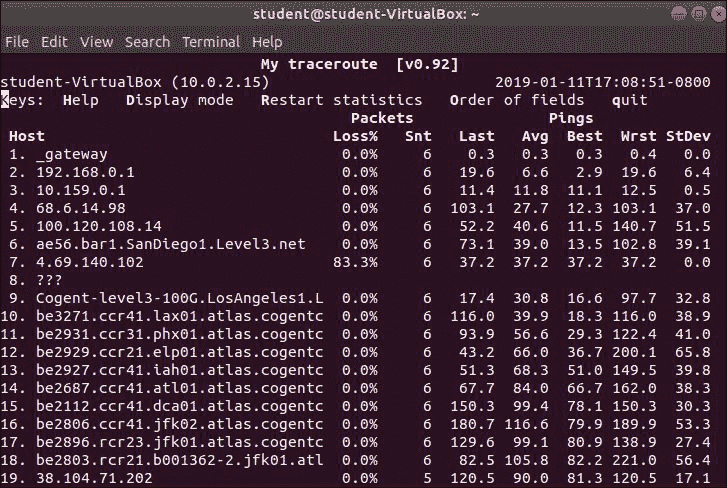

图 5.2 **mtr 命令**

### 远程网络工具

远程网络工具旨在允许为了以下目的连接到远程系统：

*    在远程系统上执行命令

*    从本地系统传输文件到远程系统

*    从远程系统传输文件到本地系统

### 安全外壳 (SSH)

`ssh` 命令是一个用于连接远程系统的实用程序。当你第一次使用 `ssh` 连接系统时，你会看到以下内容：

```
ssh user@hostname
```

其中 `user` 是你想要使用的用户名，`hostname` 是主机名或 IP 地址。

#### cURL

`curl` 命令允许通过大量协议进行非交互式数据传输，包括以下：

*   FTP
*   FTPS
*   HTTP
*   SCP
*   SFTP
*   SMB
*   SMBS
*   Telnet
*   TFTP

考试警报

你应该考虑记忆 curl 支持的协议列表。


```
# curl http://onecoursesource.com
<!DOCTYPE HTML PUBLIC "-//IETF//DTD HTML 2.0//EN">
<html><head>
<title>301 Moved Permanently</title>
</head><body>
<h1>Moved Permanently</h1>
<p>The document has moved
 <a href="http://www.onecoursesource.com/">here</a></a></a>.</p>
</body></body></html>
```

注意，数据是显示在屏幕上的，而不是像 `wget` 命令那样存储在文件中。你可以使用重定向将内容存到文件中。

## wget

`wget` 命令设计为一种非交互式工具，用于通过 HTTP、HTTPS 或 FTP 从远程系统下载文件。它通常在脚本中使用。

### 语法：

点击此处查看代码图像

```
wget location
```

### 示例：

```
# wget http://onecoursesource.com
--2019-01-09 15:18:26-- http://onecoursesource.com/
Resolving onecoursesource.com (onecoursesource.com)...38.89.136.109
Connecting to onecoursesource.com (onecoursesource.com)
 |38.89.136.109|:80... connected.
HTTP request sent, awaiting response... 301 Moved Permanently
Location: http://www.onecoursesource.com/ [following]
--2019-01-09 15:18:26-- http://www.onecoursesource.com/
Resolving www.onecoursesource.com
 (www.onecoursesource.com)... 38.89.136.109
Reusing existing connection to onecoursesource.com:80.
HTTP request sent, awaiting response... 200 OK
Length: unspecified [text/html]
Saving to: 'index.xhtml'

index.xhtml [ <=> ]
 12.25K --.-KB/s in 0s

2019-01-09 15:18:26 (259 MB/s) - 'index.xhtml' saved [12539]
```

表 5.13 列出了了一些与 `wget` 命令一起使用的有用选项。

| 选项 | 说明 |
| :--- | :--- |
| `-h` | 显示帮助。 |
| `-b` | 在后台执行下载。这对于大文件下载很有。 |
| `-q` | 静默下载。 |
| `-v` | 进入详细模式。 |
| `-nc` | 表示不覆盖现有文件。 |
| `-c` | 继续部分下载。如果下载因断开而失败，这很有用。 |
| `-r` | 进入递归模式。 |

表 5.13 `wget` 命令选项

## nc

查看 第 2 章 中的 `nc` 节，“管理文件和目录”。

## rsync

查看 第 2 章 中的 `rsync` 节。

## 安全复制协议 (SCP)

查看 第 2 章 中的 `scp` 节。

## SSH 文件传输协议 (SFTP)

`sftp` 命令使用 SSH（安全 Shell）协议在网络上安全地传输文件。要访问远程系统，请使用以下语法：

```
sftp user@machine
```

登录远程系统后，你将获得一个以以下提示符开头的界面：

```
sftp>
```

在此提示符下，可以使用多个命令来传输文件并执行其他操作。表 5.14 描述了这些命令中最重要的部分。

| 命令 | 说明 |
| :--- | :--- |
| `pwd` | 显示当前远程目录。 |
| `lpwd` | 显示当前本地目录。 |
| `cd` | 切换到远程系统的另一个目录。 |
| `lcd` | 切换到本地系统的另一个目录。 |
| `get` | 从远程系统的当前目录下载文件到本地系统的当前目录。使用 `-r` 获取整个目录结构。 |
| `put` | 从本地系统的当前目录上传文件到远程系统的当前目录。使用 `-r` 整个目录结构。 |
| `ls` | 显示远程系统当前目录下的文件。 |
| `lls` | 显示本地系统当前目录下的文件。 |
| `exit` | 退出 `sftp` |

表 5.14 在 `sftp` 提示符下可以使用命令

## 第 6 章：软件的构建与安装

**本章涵盖了以下 Linux+ XK0-005 考试目标：**

*    **1.6:** 给定一个场景，构建并安装软件。

本章探索了如何在不同的 Linux 发行版上管理软件。你将学习不同 Linux 沙箱应用程序的基础知识，以及内核更新与系统包更新之间的区别。

本章提供了关于以下主题的信息：软件包管理、沙箱应用和系统更新。

### 软件包管理

Linux 中的包（package）是一个包含软件的文件。本节回顾了在不同发行版上管理软件包的各种工具。

#### DNF

`dnf` 工具设计为 `yum` 的增强和替代品。（请注意 DNF 的配置文件为 `/etc/dnf/dnf.conf`。）

#### YUM

`yum` 命令用于从存储库安装软件。它也可以用于删除软件和显示信息。表 6.1 突出了主要的 `yum` 命令。

| 命令/选项 | 说明 |
| :--- | :--- |
| `install` | 从存储库安装软件包及其依赖包。示例：`yum install zip`。 |
| `groupinstall` | 从存储库安装整个软件组。示例：`yum groupinstall "Office Suite and Productivity"`。 |
| `update` | 更新指定的软件包。 |
| `remove` | 从系统删除指定的软件包及其依赖包。 |
| `groupremove` | 从系统删除指定的软件组。 |
| `list` | 列出软件包信息，包括哪些已可用。示例：`yum available`。 |
| `grouplist` | 列出软件组信息，包括哪些软件包属于某个组；不带参数使用 `yum grouplist` 可查看可用软件组列表。 |
| `info` | 提供特定软件包的信息。示例：`yum info zip`。 |
| `groupinfo` | 提供特定软件组的信息。 |
| `-y` | 自动对任何提示回答**是**。示例：`yum -y install zip`。 |

表 6.1 `yum` 命令与选项

表 6.2 描述了 `yum list` 命令的一些重要选项。

| 选项 | 说明 |
| :--- | :--- |
| `all` | 列出所有已安装或可选软件包。 |
| `installed` | 列出所有已安装的软件包。 |
| `available` | 列出所有未安装但可安装的软件包。 |
| `updates` | 列出系统中所有已安装且存储库中有更新版本的软件包。 |

表 6.2 `yum list` 命令选项

注意

通配符（或 *globs*）可以用于 yum 命令。这里有一个示例：

点击此处查看代码图像


```
# yum list installed "*zip*"
Loaded plugins: fastestmirror, langpacks
Repodata is over 2 weeks old. Install yum-cron?
 Or run: yum makecache fast
Loading mirror speeds from cached hostfile
 * base: mirror.supremebytes.com
 * epel: mirror.chpc.utah.edu
 * extras: mirrors.cat.pdx.edu
 * updates: centos.sonn.com
Installed Packages
bzip2.x86_64                  1.0.6-13.el7   @base
bzip2-libs.x86_64             1.0.6-13.el7   @base
gzip.x86_64                   1.5-8.el7      @base
perl-Compress-Raw-Bzip2.x86_64 2.061-3.el7   anaconda
unzip.x86_64                  6.0-15.el7     @base
zip.x86_64                    3.0-10.el7     @anaconda
```

`yumdownloader` 命令用于下载软件包包而不安装该软件。生成的 RPM 文件可以手动安装，也可以复制到其他系统。

表 6.3 描述了 `yumdownloader` 命令的一些重要选项。

### 表 6.3 yumdownloader 命令选项

| 选项 | 描述 |
| --- | --- |
| `--destdir` | 用于指定下载 RPM 文件的目录。（默认值为当前目录。） |
| `--resolve` | 用于下载指定软件包的依赖包。（默认仅下载指定的软件包。） |
| `--source` | 用于下载源 RPM，而不是二进制（可安装的）RPM。 |

`/etc/yum.conf` 文件是 `yum` 命令的主要配置文件。

#### 示例：

点击此处查看代码图片

```
[main]
cachedir=/var/cache/yum/$basearch/$releasever
keepcache=0
debuglevel=2
logfile=/var/log/yum.log
exactarch=1
obsoletes=1
gpgcheck=1
plugins=1
installonly_limit=5
bugtracker_url=http://bugs.centos.org/set_project.php
 ?project_id=23&ref=http://bugs.centos.org/
 bug_report_page.php?category=yum
distroverpkg=centos-release
```

表 6.4 描述了 `/etc/yum.conf` 文件的一些关键设置。

### 表 6.4 /etc/yum.conf 文件关键设置

| 设置 | 描述 |
| --- | --- |
| `cachedir` | 下载后存放 RPM 文件的目录。 |
| `logfile` | 包含 `yum` 操作的日志文件位置。 |
| `gpgcheck` | 值为 `1` 表示执行 GPG（GNU 隐私守护）检查以确保软件包有效；`0` 表示不执行 GPG 检查。（可以通过每个存储库配置文件的特定设置来覆盖。） |
| `assumeyes` | 值为 `1` 表示始终对 yes/no 提示假设为“yes”；`0` 表示不做任何假设（而是提供提示）。 |

**考试警示**

预计 Linux+ XK0-005 考试会出一个关于表 6.4 中描述的关键设置的题目。

`/etc/yum.repos.d` 目录包含以 `.repo` 结尾的文件，用于指定 `yum` 存储库的位置。每个文件定义一个或多个存储库，如图 6.1 所示。

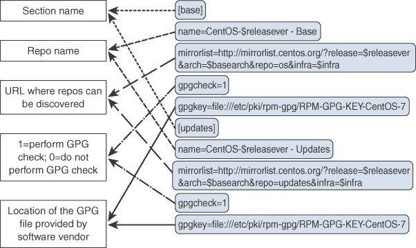

**图 6.1 /etc/yum.repos.d 目录下的文件格式**

#### APT

使用 `apt-get` 命令管理位于存储库中的 Debian 软件包。该命令利用 `/etc/apt/sources.list` 文件来确定使用哪个存储库。（有关此文件的更多信息，请参见本节末尾）。

以下是 `apt-get` 命令的一些语法示例：

点击此处查看代码图片

```
apt-get [options] command
apt-get [options] install|remove pkg1 [pkg2...]
apt-get [options] source pkg1 [pkg2...]
```

要指定要执行的操作，请向 `apt-get` 命令提供关键字（命令）。表 6.5 描述了 `apt-get` 的一些实用命令。

### 表 6.5 apt-get 命令

| 命令 | 描述 |
| --- | --- |
| `install` | 安装指定的软件包；如果软件包已安装，则使用 `--only-upgrade` 选项进行升级而非全新安装。 |
| `update` | 更新每个可用软件包的软件包缓存。 |
| `upgrade` | 更新所有软件包及其依赖项。 |
| `remove` | 移除软件包但在系统中保留其配置文件。 |
| `purge` | 移除软件包，包括其配置文件。 |

使用 `apt-cache` 命令显示软件包信息。

这里是 `apt-cache` 的一些示例：

点击此处查看代码图片

```
apt-get [options] command
apt-get [options] install|remove pkg1 [pkg2...]
```

要指定要执行的操作，请向 `apt-get` 命令提供关键字（命令）。表 6.5 描述了 `apt-get` 的一些实用命令。

*原文此处 apt-cache 示例部分存在重复逻辑。*

`aptitude` 是一个菜单驱动的工具，旨在方便地显示、添加和删除软件包。图 6.2 显示该工具。

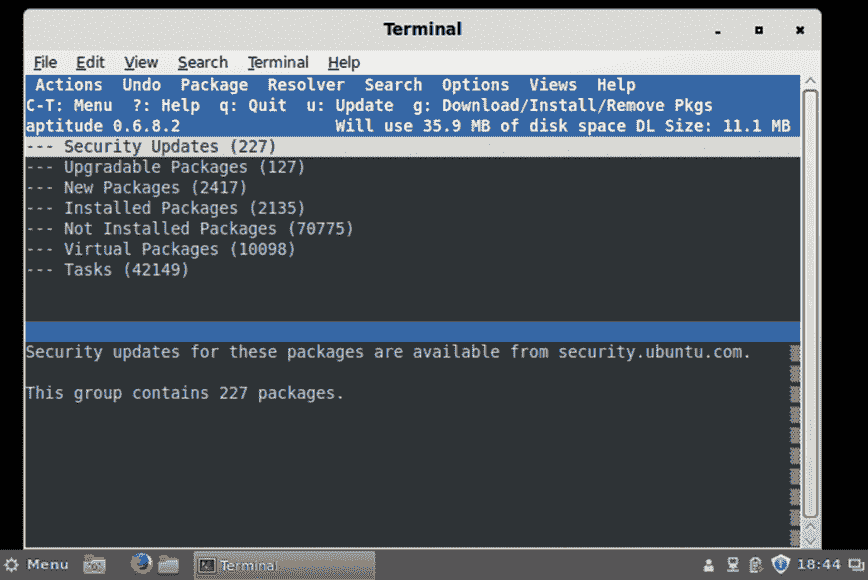

**图 6.2 aptitude 界面**

`/etc/apt/sources.list` 文件包含存储库的 URL 列表；`/etc/apt/sources.list.d` 目录也可以提供此类信息。图 6.3 描述了该文件。

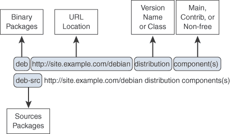

**图 6.3 /etc/apt/sources.list**

发行可以是以下之一：

*    名称（对于 wheezy, jessie, stretch, 或 sid）
*    类名（对于 oldstable, stable, testing, 或 unstable）

组件可以是以下之一：

*    **main**：软件包符合 DFSG（Debian 软件指南）。
*    **contrib**：软件包符合 DFSG，但依赖项不一定。
*    **non-free**：软件包不符合 DFSG。

**考试警示**

在参加 Linux+ XK0-005 考试之前，熟悉列表中不同的组件。

以下是 Jessie 版本的默认文件示例：

点击此处查看代码图片

```
deb http://httpredir.debian.org/debian jessie main
deb-src http://httpredir.debian.org/debian jessie main

deb http://httpredir.debian.org/debian jessie-updates main
deb-src http://httpredir.debian.org/debian jessie-updates main

deb http://security.debian.org/ jessie/updates main
deb-src http://security.debian.org/ jessie/updates main
```

APT 的主要配置文件是 `/etc/apt.conf` 文件。该文件用于设置调试选项、配置代理连接以及 APT 如何缓存软件包。

#### RPM

`rpm` 命令用于安装、升级和移除系统中已下载的软件包。表 6.7 描述了一些实用的选项。

### 表 6.7 rpm 命令选项

| 选项 | 描述 |
| --- | --- |
| `-i` | 安装软件包。 |
| `-U` | 如果存在旧版本的软件包，则进行升级；如果不存在旧版本，则从头安装。 |


# `rpm` 查询选项

| 选项 | 描述 |
| :--- | :--- |
| `-F` | 如果存在旧版本的软件包，则更新它；如果不存在旧版本，则无任何操作。 |
| `-e` | 移除软件包，包括配置文件。 |
| `-l` | 列出当前安装的软件包。 |
| `-q` | 执行软件包查询；可以使用额外的选项精调查询。 |
| `-f` | 确定特定文件属于哪个软件包。 |

使用 `rpm` 命令的 `-q` 选项执行查询。表 6.8 描述了一些用于精调查询的额外选项。

| 选项 | 描述 |
| :--- | :--- |
| `-a` | 返回所有安装软件包的列表。 |
| `-c` | 列出与指定软件包一起的的。 |
| `-d` | 列出与指定软件包一起的文档文件。 |
| `-i` | 显示指定软件包的信息。 |
| `-K` | 验证指定软件包的完整性。 |
| `-l` | 列出与指定软件包一起安装的所有文件。 |
| `-provides` | 列出指定软件包提供的哪些能力。 |
| `-R` | 列出指定软件包所需的哪些。 |
| `-s` | 显示由指定软件包安装的每个文件的状态（正常、未安装或已替换）。 |

表 6.8 `rpm` 查询选项

示例：

点击此处查看代码图像

```
$ rpm -qc cups
/etc/cups/classes.conf
/etc/cups/client.conf
/etc/cups/cups-files.conf
/etc/cups/cupsd.conf
/etc/cups/lpoptions
/etc/cups/printers.conf
/etc/cups/snmp.conf
/etc/cups/subscriptions.conf
/etc/dbus-1/system.d/cups.conf
/etc/logrotate.d/cups
/etc/pam.d/cups
```

### `dpkg`

使用 `dpkg` 命令管理本地 Debian 软件包。

语法：

```
dpkg [option] command
```

表 6.9 描述了一些实用的 `dpkg` 选项。

表 6.9 `dpkg` 命令选项

| 选项 | 描述 |
| :--- | :--- |
| `-i` | 安装软件包。 |
| `-r` | 移除软件包但保留配置文件。 |
| `-P` | 移除软件包，包括配置文件（清除）。 |
| `-l` | 列出当前安装的软件包。 |
| `-L` | 列出随软件包安装的文件（例如，`dpkg -L zip`）。 |
| `-V` | 验证指定软件包或软件包的完整性。 |
| `-s` | 显示软件包状态。 |
| `-C` | 检查损坏的软件包。 |
| `-S` | 列出负责在系统上安装特定文件的软件包名称（例如，`dpkg -S /usr/bin/zip`）。 |

当安装软件包时，它可能会作为安装过程的一部分运行配置脚本。为了在未来的某个时刻再次运行此配置脚本，请使用 `dpkg-reconfigure` 命令。虽然该命令有一些选项，但很少使用。

`dpkg-reconfigure` 命令的语法如下：

点击此处查看代码图像

```
dpkg-reconfigure [options] source packages
```

以下示例重新运行了 `tzdata` 配置脚本：

```
dpkg-reconfigure tzdata
```

## ZYpp

ZYpp 软件包包提供了 `zypper` 工具。在 SUSE Linux 上可以找到 `zypper` 工具。它衍生自 RPM 软件套件，工作方式与 `yum` 非常相似。它具有自动依赖检查并使用存储库。它的命令结构和选项与 `yum` 几乎相同。这里是一个示例：

```
zypper install pkg_name
```

如果你知道如何使用 `yum` 命令，那么在大多数情况下你可以将 `yum` 替换为 `zypper`，且命令将成功执行。

## 沙箱应用程序

在 Linux 上部署应用程序的挑战之一是存在许多不同的发行版。对于开发者来说，要正确测试应用程序在所有可能环境中的性能非常困难。

沙箱可以帮助解决这个问题。无论沙箱环境放置在哪种 Linux 发行版上，其行为都是相同的。沙箱应用程序是指任何安装在沙箱环境中的应用程序。

### ExamAlert

本主题涵盖了一些流行的 Linux 沙箱的基础知识。请记住，Linux+ XK0-005 考试不会问你关于这些环境的详细问题。

### `snapd`

`dpd` 守护进程管理名为 `snaps` 的软件包，这些软件包从 Canonical 维护的 Snap Store（Canonical 也维护 Ubuntu Linux）。事实上，Ubuntu Core 是一个仅使用 snap 应用程序的 Linux 发行版。

开发者可以使用 Snapcraft，这是一个允许开发者将程序封装为 snaps 的工具。

### Flatpak

要使用 Flatpak，首先需要安装 Flatpak 软件包。并非所有发行版都可用，但大多数发行版都提供。Flatpak 应用程序是从名为 `remotes` 的仓库安装的。

Flatpak 应用程序针对 Flatpak 环境编译的。这些编译后的应用程序通常包含库。

### AppImage

AppImage 使用了一种独特的方法，每个 AppImage 都是完全包含的。这意味着单个软件包文件包含所有软件。AppImage 软件包通常比 snapd 或 Flatpak 软件包小。

## 系统更新

软件包可以分为两大类：系统软件包或非系统软件包。将系统软件包 true 为任何影响操作系统的软件。系统软件包的示例包括：

*   `iptables`: 提供防火墙功能的软件
*   `libcrypt`: 提供加密库的软件
*   `kernel`: 提供内核代码的软件

非系统软件包是不影响操作系统功能的软件包。将其 true 为普通用户会使用但操作系统运行所必需的应用程序，包括：

*   Web 浏览器
*   电子邮件客户端程序
*   游戏

更新非系统软件包通常只需要用户重置应用程序以开始使用新版本。更新系统软件包可能需要系统管理员采取更多操作。这些系统软件包还可以分为两类：内核和其他所有。内核更新将在随后的“内核更新”部分进行描述。所有其他系统软件包将在本章结束的“软件包更新”部分进行描述。

### 内核更新

内核更新与其他系统更新有两点不同：

*   要使用新内核，你需要重启操作系统。
*   当安装内核时，它不会替换之前的内核。当安装非内核软件软件包以升级之前的某个版本时，它会替换原始版本。

### 软件包更新

系统更新的一个重要方面是，你可能需要重启服务以使更新生效。这可以通过系统重启来完成，但这种技术很少需要，因为只需重启服务就足够了。


软件包更新是一项重要任务，不应忽视，因为许多更新包含了安全修复。未能重启软件将使你的系统面临攻击和其他安全问题的隐风险。

# 第二部分：安全

## 第 7 章：管理软件配置

**本章涵盖了以下 Linux+ XK0-005 考试目标：**

*  **1.7:** 在给定场景下，管理软件配置。

在第 6 章“构建与安装软件”中，你已经学习了如何管理软件。在本章中，重点转向了软件配置。你将学习如何管理软件仓库配置以及如何配置内核。你还将学习如何配置常见的系统服务，例如 SSH、NTP 和 syslog。

本章提供了以下主题的信息：更新配置文件、配置内核选项、配置常见的系统服务以及本地化。

## 更新配置文件

本节探讨了你应该了解如何更新的包管理配置文件。

#### 操程序

如果你升级了软件包，可能需要重启或重新加载服务。通常，软件包随附的文档会标明是否需要重启或重新加载。如果你对软件的配置文件进行了更改，也可能需要重启或重新加载服务。本节将介绍这些程序。

##### 重启服务

`restart` 配合 `systemctl` 命令使用，用于重启正在运行的服务。重启会导致服务短时间内不可用。

语法：

```
systemctl restart process_name
```

你可以使用 `active` 命令来判断服务是否正在运行：

```
# systemctl active cups
enabled
```

##### 重新加载服务

`reload` 配合 `systemctl` 命令使用，用于重新加载正在运行的服务。此命令不会停止服务，而是让服务重新读取配置文件，并根据配置文件的更改改变其行为。

语法：

```
systemctl reload process_name
```

你可以使用 `active` 命令来判断服务是否正在运行：

```
# systemctl active cups
enabled
```

#### .rpmnew

当安装 RPM 包时，由于添加了新的配置设置或删除了旧的设置，它们可能会覆盖软件包的默认配置文件。

如果系统管理员花费了精力和精力创建了自定义配置文件，配置文件的覆盖可能会导致他们感到困扰。因此，软件开发者可能会选择将新的配置内容放在名为 `.rpmnew` 的文件中。然后，系统管理员可以检查 `.rpmnew` 文件，并决定哪些新设置应该合并到主配置文件中。另一种技术是软件开发者使用 `.rpmsave` 文件，如下一节所述。

**考试警示：** 准备好面对 `.rpmnew` 和 `.rpmsave` 文件区别的测试。

## 仓库配置文件

在第 6 章中讨论过的仓库配置文件是包管理的不可或缺的。Linux+ XK0-005 考试在不同的考试类别中列出了这些主题，因此保留了以下章节标题，以告知你去哪里查找这些主题的详细信息。

##### /etc/apt.conf

参见第 6 章中的“APT”部分。

##### /etc/yum.conf

参见第 6 章中的“YUM”部分。

##### /etc/dnf/dnf.conf

参见第 6 章中的“DNF”部分。

##### /etc/yum.repo.d

参见第 6 章中的“YUM”部分。

##### /etc/apt/sources.list.d

参见第 6 章中的“APT”部分。

#### 配置内核选项

Linux 内核是高度配置的。你可以通过参数和内核模块对内核进行更改。本节涵盖了这些配置特性。

#### 参数

内核参数是一个改变内核行为的值。

##### sysctl

你可以使用 `sysctl` 命令查看和更改参数。例如，要查看所有内核和内核模块参数，执行带有 `-a` 选项的 `sysctl` 命令

点击此处查看代码图像

```
[root@onecoursesource ~]# sysctl -a | head
kernel.sched_child_runs_first = 0
kernel.sched_min_granularity_ns = 1000000
kernel.sched_latency_ns = 5000000
kernel.sched_wakeup_granularity_ns = 1000000
kernel.sched_tunable_scaling = 1
kernel.sched_features = 3183
kernel.sched_migration_cost = 500000
kernel.sched_nr_migrate = 32
kernel.sched_time_avg = 1000
kernel.sched_shares_window = 100000000
```

**考试警示：** 对于 Linux+ XK0-005 考试，并不要求你了解任何特定特定配置的细节。

参数的名称（例如 `kernel.sched_child_runs_first`）是一个从 `/proc/sys` 开始的相对路径，并且在目录和文件名之间使用点（`.`）字符而不是斜杠（`/`）字符。例如，`/proc/sys/dev/cdrom/lock` 文件使用 `dev.cdrom.lock` 参数命名：

点击此处查看代码图像

```
[root@onecoursesource ~]# sysctl -a | grep dev.cdrom.lock
dev.cdrom.lock = 1
```

你可以使用 `sysctl` 命令更改此参数的值：

点击此处查看代码图像

```
[root@onecoursesource ~]# sysctl dev.cdrom.lock=0
dev.cdrom.lock = 0
[root@onecoursesource ~]# sysctl -a | grep dev.cdrom.lock
dev.cdrom.lock = 0
```

实际上，使用 `sysctl` 命令比直接修改文件更安全，因为 `sysctl` 命令知道哪些参数值是有效的，哪些是无效的：

点击此处查看代码图像

```
[root@onecoursesource ~]# sysctl dev.cdrom.lock="abc"
error: "Invalid argument" setting key "dev.cdrom.lock"
```

`sysctl` 命令知道哪些参数值有效是因为它可以查看 `modinfo` 的输出。例如，根据 `modinfo` 命令的输出，`lock`文件的值必须是布尔值（0 或 1）：

点击此处查看代码图像

```
[root@onecoursesource ~]# modinfo cdrom | grep lock
parm:           lockdoor:bool
```

如果你直接修改文件或使用 `sysctl` 命令，更改是临时的。当系统重启时，值将恢复默认值，除非你在 `/etc/sysctl.conf` 文件中进行了更改。下一节提供了关于 `/etc/sysctl.conf` 的更多细节。

##### /etc/sysctl.conf

`/etc/sysctl.conf` 文件用于指定启动时启用哪些内核参数。

示例：

点击此处查看代码图像


```
[root@OCS ~]# cat /etc/sysctl.conf
# 系统默认设置存位于 /usr/lib/sysctl.d/00-system.conf。
# 若要覆盖这些设置，在此处输入新设置，或
# 在 /etc/sysctl.d/<name>.conf 文件中输入。
#
# 更多信息请参见 sysctl.conf(5) 和 sysctl.d(5)。
net.ipv4.ip_forward=1
```

在此示例中，内核参数 `ip_forward` 被启用，这意味着该机器将作为两个网络之间的路由器。

有数千千种可能的内核设置，包括几十个影响网络的设置。`ip_forward` 设置是最常用的网络设置之一。

优化 IO（输入/输出）调度器的参数是内核参数的示例。可以通过设置几个参数来更改调度器的行为。本节涵盖了 Linux+ XK0-005 考试重要的参数。

要查看当前的调度器，请查看 `/sys/block/<device>/queue/scheduler` 文件的内容（其中 `<device>` 是实际设备名称）。这是一个示例：

点击此处查看代码图像

```
[root@OCS ~]# cat /sys/block/sda/queue/scheduler
[noop] deadline cfq
```

方括号内的值是默认值。要更改它，请使用 `echo` 命令，如下：

点击此处查看代码图像

```
[root@OCS ~]# echo "cfq" > /sys/block/sda/queue/scheduler
[root@OCS ~]# cat /sys/block/sda/queue/scheduler
noop deadline [cfq]
```

额外的调度器类型包括：

*    `cfq:` 完全公平队列调度为每个进程提供单独的队列，并以循环的方式处理这些队列。

*    `noop:` 该调度器遵循 FIFO（先进先出）原则。

*    `deadline:` 这是标准调度器。该调度器创建两个队列：读队列和写队列。它还为每个 I/O 请求打上时间戳，以确保请求得到及时处理。

### 模块 (Modules)

*模块*是一个小型软件程序，加载后可为内核提供更多功能和能力。本节描述了如何使用 `lsmod`、`imsmod`、`rmmod`、`insmod`、`modprobe` 和 `modinfo` 命令管理模块。

### lsmod

`lsmod` 命令显示加载到内存中的内核模块。该命令没有选项。

在 `lsmod` 命令的输出中，每行描述一个模块。每行有列信息：

*    模块名称。

*    模块大小，以字节为单位。

*    使用该模块的“实体”。“实体”可以是文件系统、进程或其他模块。如果另一个模块正在使用该模块，则列出依赖模块的名称。否则，提供一个指示有多少个“实体”使用该模块的数值。

示例：

点击此处查看代码图像

```
[root@OCS ~]# lsmod | head
Module                   Size       Used by
tcp_lp                   12663      0
bnep                     19704      2
bluetooth                372944     5   bnep
rfkill                   26536      3   bluetooth
fuse                     87741      3
xt_CHECKSUM              12549      1
ipt_MASQUERADE           12678      3
nf_nat_masquerade_ipv4   13412       1   ipt_MASQUERADE
tun                       27141 1
```

### imsmod

`imsmod` 命令用于向当前运行的内核中添加模块。

语法：

```
insmod [module_name]
```

需要指定模块的精确位置。例如：

点击此处查看代码图像

```
[root@OCS ~]# lsmod | grep fat
[root@OCS ~]# insmod /usr/lib/modules/3.19.8-100.fc20.x86_64/kernel/
fs/ fat.ko
[root@OCS ~]# lsmod | grep fat
fat                   65107 0
```

`insmod` 命令没有选项；但每个模块可能带有可以通过以下语法传递到模块的参数：

```
insmod module options
```

`insmod` 命令有两个缺点：

*    你必须知道模块的精确位置。

*    如果模块有任何依赖关系（即，如果模块需要另一个模块），它将无法加载。

### rmmod

`rmmod` 命令用于从当前运行的内核中移除模块。

语法：

```
rmmod [options] [module_name]
```

示例：

点击此处查看代码图像

```
[root@OCS ~]# lsmod | grep fat
fat                   65107 0
[root@OCS ~]# rmm fat
[root@OCS ~]# lsmod | grep fat
```

默认情况下，正在使用的模块不会被此命令移除。

`rm` 命令的关键选项包括：

*    `-f` 尝试强制移除正在使用的模块（这非常危险）。

*    `-w` 等待模块不再被使用后将其移除。

*    `-v` 显示详细信息。

### insmod

`insmod` 命令用于向当前运行的内核中添加模块。

语法：

```
insmod [module_name]
```

需要指定模块的精确位置。例如：

点击此处查看代码图像

```
[root@OCS ~]# lsmod | grep fat
[root@OCS ~]# insmod /usr/lib/modules/3.19.8-100.fc20.x86_64/kernel/
fs/ fat.ko
[root@OCS ~]# lsmod | grep fat
fat                   65107 0
```

`insmod` 命令没有选项；但每个模块可能带有可以通过以下语法传递到模块的参数：

```
insmod module options
```

`insmod` 命令有两个缺点：

*    你必须知道模块的精确位置。

*    如果模块有任何依赖关系（即，如果模块需要另一个模块），它将无法加载。

### modprobe

`modprobe` 命令用于从当前运行的内核中添加和移除模块。它还会尝试加载模块依赖。

语法：

点击此处查看代码图像

```
modprobe [options] [module_name]
```

当用于移除模块（使用 `-r` 选项）时，`modprobe` 命令还会移除依赖模块，除非它们正被子系统的其他部分（如内核或进程）使用。

`modprobe` 命令的关键选项包括：

*    `-c` 显示当前的 `modprobe` 配置。

*    `-q` 使 `modprobe` 以静默模式运行。

*    `-R` 显示所有与别名匹配的模块以协助调试问题。

*    `-r` 从内存中移除指定的模块。

*    `-v` 显示详细信息；这有助于确定 `modprobe` 如何执行任务。

### modinfo

`modinfo` 命令用于提供有关模块的详细信息。

语法：

```
modinfo [module_name]
```

示例：

点击此处查看代码图像


```
[root@OCS ~]# modinfo xen_wdt
filename: /lib/modules/3.19.8-100.fc20.x86_64/kernel/drivers/watchdog/
xen_wdt.ko
license: GPL
version: 0.01
description:   Xen WatchDog Timer Driver
author: Jan Beulich <jbeulich@novell.com>
srcversion:   D13298694740A00FF311BD0
depends:
intree:     Y
vermagic:    3.19.8-100.fc20.x86_64 SMP mod_unload
signer:       Fedora kernel signing key
sig_key:     06:AF:36:EB:7B:28:A5:AD:E9:0B:02:1E:17:E6:AA:B2:B6:52: 63:AA
sig_hashalgo:   sha256
parm:           timeout:Watchdog timeout in seconds (default=60)(uint)
parm:            nowayout:Watchdog cannot be stopped once started (default=0) (bool)
```

`modinfo` 命令输出中最重要的部分之一是 `parm` 值，它们描述了可以传递给模块以影响其行为的参数。

### 配置常用系统服务

本节专注于配置常用系统服务，包括 SSH、NTP、syslog、chrony 和本地化。

### SSH

安全外壳（SSH）协议旨在取代不安全的远程通信操作，例如 `telnet`、`ftp`、`rlogin`、`rsh`、`rcp` 和 `rexec` 命令/协议。早期通信方法的主要问题是这些方法以明文而非加密格式跨网络发送数据。在某些情况下（例如 `telnet` 和 `ftp`），这可能包括跨网络以明文发送用户账户数据（如用户名和密码）。

SSH 通过加密跨网络发送的数据提供了更高级的安全级别。SSH 已经成为 Linux 中的一项标准，几乎所有的发行版默认都包含了客户端和服务器软件。如果您的系统中没有安装这些软件，您应该安装 `openssh`、`openssh-server`、`openssh-clients` 和 `openssh-askpass` 软件包。

`/etc/ssh` 目录是存储 Secure Shell 配置文件的位置。SSH 服务器的配置文件是 `/etc/ssh/sshd_config`。不要将其与 `/etc/ssh/ssh_config` 文件混淆，后者用于配置客户端工具，如 `ssh`、`scp` 和 `sftp` 命令。

有两种不同的 SSH 协议，编号为 1 和 2。它们不是版本，而是为了提供安全数据连接而开发的两个独立协议。曾有一段时间两种协议都被广泛使用，但现在几乎所有的 SSH 客户端都只使用协议 2。要设置您的 SSH 服务器接受的协议，请使用 `Protocol` 关键字：

```
Protocol 2
```

如果您有一些需要协议 1 的旧版 SSH 客户端，您可以通过在 `/etc/ssh/sshd_config` 文件中使用以下关键字设置，配置您的 SSH 服务器接受两种协议连接：

```
Protocol 1,2
```

如果您有多个网卡（或虚拟接口），您可能希望限制 SSH 服务器仅监听某些网卡。要实现这一点，请使用 `ListenAddress` 关键字并指定分配给 SSH 应接受连接的网卡的 IP 地址：

点击此处查看代码图像

```
ListenAddress 192.168.1.100:192.168.1.101
```

SSH 服务器监听的标准端口号是 22 端口。您可以使用 `Port` 关键字修改 SSH 服务器监听另一个端口：

```
Port 2096
```

您可能需要更改 SSH 服务器想要记录的日志消息类型。这可以通过 `LogLevel` 关键字进行设置。可用级别如下：

*  QUIET
*  FATAL
*  ERROR
*  INFO
*  VERBOSE
*  DEBUG
*  DEBUG1（与 DEBUG 相同）
*  DEBUG2
*  DEBUG3

#### 网络时间协议 (NTP)

网络时间协议守护进程 `ntpd` 是一个确保系统时与远程 NTP 服务器提供的时间同步进程。该进程的大部分配置通过 `/etc/ntp.conf` 文件处理。表 7.1 显示了 `/etc/ntp.conf` 文件的重要设置。

表 7.1 `/etc/ntp.conf` 文件设置

| 选项 | 描述 |
| :--- | :--- |
| `driftfile` | 包含一个值，代表 NTP 报告的时间与系统时之间典型的典型差值（变化）。该值用于定期更新系统时，而无需访问 NTP 服务器。 |
| `restrict` | 用于指定对守护进程的限制，包括当此 NTP 服务器作为服务使用时，哪些机器可以访问它。 |
| `server` | 用于在当此机器作为 NTP 客户端使用时列出 NTP 服务器。 |

以下是一个典型的 `/etc/ntp.conf` 文件示例：

点击此处查看代码图像

```
# 有关此文件的更多信息，请参见 man 页
# ntp.conf(5), ntp_acc(5), ntp_auth(5), ntp_clock(5), ntp_misc(5),
ntp_mon(5).

driftfile /var/lib/ntp/drift

# 允许与我们的时间源同步时间，但不允许
# 源查询或修改此系统上的服务。
restrict default kod nomodify notrap nopeer noquery

# 允许对环回地址的所有访问。
restrict 127.0.0.1

# 本地接口上的主机。这可以
# 收紧以影响某些管理功能。
restrict 127.0.0.1 mask 255.255.255

# 允许与我们的时间源同步时间，但不允许
# 源查询或修改此系统上的服务。
restrict default kod nomodify notrap nopeer noquery

# 允许对环回地址的所有访问。
restrict 127.0.0.1

# 本地接口上的主机。这可以
# 收紧以影响某些管理功能。
restrict 127.0.0.1 mask 255.255.255

# 允许与我们的时间源同步时间，但不允许
# 源查询或修改此系统上的服务。
restrict default kod nomodify notrap nopeer noquery

# 允许对环回地址的所有访问。
restrict 127.0.0.1

# 本地接口上的主机。这可以
# 收紧以影响某些管理功能。
restrict 127.0.0.1 mask 255.255.255

# 允许与我们的时间源同步时间，但不允许
# 源查询或修改此系统上的服务。
restrict default kod nomodify notrap nopeer noquery

# 允许对环回地址的所有访问。
restrict 127.0.0.1

# 本地接口上的主机。这可以
# 收紧以影响某些管理功能。
restrict 127.0.0.1 mask 255.255.255

# 允许与我们的时间源同步时间，但不允许
# 源查询或修改此系统上的服务。
restrict default kod nomodify notrap nopeer noquery

# 允许对环回地址的所有访问。
restrict 127.0.0.1

# 本地接口上的主机。这可以
# 收紧以影响某些管理功能。
restrict 127.0.0.1 mask 255.255.255

# 允许与我们的时间源同步时间，但不允许
# 源查询或修改此系统上的服务。
restrict default kod nomodify notrap nopeer noquery

# 允许对环回地址的所有访问。
restrict 127.0.0.1

# 本地接口上的主机。这可以
# 收紧以影响某些管理功能。
restrict 127.0.0.1 mask 255.255.255

# 允许与我们的时间源同步时间，但不允许
# 源查询或修改此系统上的服务。
restrict default kod nomodify notrap nopeer noquery

# 允许对环回地址的所有访问。
restrict 127.0.0.1

# 本地接口上的主机。这可以
# 收紧以影响某些管理功能。
restrict 127.0.0.1 mask 255.255.255

# 允许与我们的时间源同步时间，但不允许
# 源查询或修改此系统上的服务。
restrict default kod nomodify notrap nopeer noquery

# 允许对环回地址的所有访问。
restrict 127.0.0.1

# 本地接口上的主机。这可以
# 收紧以影响某些管理功能。
restrict 127.0.0.1 mask 255.255.255

# 允许与我们的时间源同步时间，但不允许
# 源查询或修改此系统上的服务。
restrict default kod nomodify notrap nopeer noquery

# 允许对环回地址的所有访问。
restrict 127.0.0.1

# 本地接口上的主机。这可以
# 收紧以影响某些管理功能。
restrict 127.0.0.1 mask 255.255.255

# 允许与我们的时间源同步时间，但不允许
# 源查询或修改此系统上的服务。
restrict default kod nomodify notrap nopeer noquery

# 允许对环回地址的所有访问。
restrict 127.0.0.1
```

`pool.ntp.org` 地址是指向遍布全球的 NTP 服务器集群的链接。可以在 `/etc/ntp.conf` 文件中自由使用。例如，以下服务器由 Fedora 项目提供（请注意，一旦连接，这些主机名将不同）：

```
 0.pool.ntp.org
    1.pool.ntp.org
    2.pool.ntp.org
    3.pool.ntp.org
```

`ntpq` 命令允许您对 NTP 服务器进行查询。例如，示例中的 `ntpq` 命令显示了状态摘要：

点击此处查看代码图像

```
[root@oneources ~]# ntpq -p
     remote           refid      st t when poll reach   delay   offset
jitter
============================================
*propjet.latt.ne 68.110.9.223    2 u  120 1024  377   98.580    7.067
4.413
-services.quadra 208.75.88.4      3 u  272 1024  377   72.504   -10.689
1.612
+mirror          216.93.242.12    3 u  287 1024  377   20.406   -2.555
0.822
+108.61.194.85.v 200.23.51.102    2 u  741 1024  377   69.403   -3.670
1.610
```

[表 7.2] 列出了 `ntpq` 命令的一些重要选项。

| 选项 | 描述 |
| :--- | :--- |
| `-d` | 启用调试模式。 |
| `-n` | 列出主机 IP 地址而非名称。 |
| `-p` | 打印所有节点列表。 |

#### Syslog

syslog 服务自 1980 年以来一直存在。尽管在创建时它是先进的，但随着对复杂日志技术的需求，其局限性随着时间的推移而日益增加。


在 20 世纪 20 年代中期，rsyslog 服务作为传统 syslog 服务的扩展而被创建。rsyslog 通过引入模块扩展了 syslog 的功能。

syslog 和 rsyslog 服务的配置是一致的，区别在于命名约定略有不同（例如，`rsyslog.conf` 与 `syslog.conf`）以及日志文件中提供的额外功能。

`syslogd` 或 `rsyslogd` 守护进程负责应用程序和系统事件的记录。它根据 `/etc/syslog.conf` 文件中的配置设置决定记录哪些事件以及将日志记录放在何处。

表 7.3

```bash
[root@OCS ~]# grep -v "^$" /etc/rsyslog.conf | grep -v "^#"
*.info;mail.none;authpriv.none;cron.none /var/log/messages
authpriv.*                               /var/log/secure
mail.*                                   -/var/log/maillog
cron.*                                    /var/log/cron
*.emerg                                    *
uucp,news.crit                            /var/log/spooler
local7.*                                 /var/log/boot.log
```

#### 考试提示

在 Linux+ XK0-005 考试中，你可能会得到来自 `/etc/rsyslog.conf` 文件的一条目，并测试你对记录了什么以及记录在何处的理解。

每一行代表一条日志规则，分为两个主要部分：选择器（例如，`uucp,news.crit`）和动作（`/var/log/spooler`）。选择器也分为两个部分：设施（facility，`uucp,news`）和优先级（priority，`crit`）。请注意，当提供优先级时，意味着“此优先级以及所有更高级别的优先级”。

以下列表显示了从低级别到高级别排序的可用设施：

*  `auth`（或安全）
*  `authpriv`
*  `cron`
*  `daemon`
*  `kern`
*  `lpr`
*  `mail`
*  `mark`
*  `news`
*  `syslog`
*  `user`
*  `uucp`
*  `local0` 到 `local7`

以下列表显示了可用的优先级：

*  `debug`
*  `info`
*  `notice`
*  `warning`（或 `warn`）
*  `err`（或 `error`）
*  `crit`
*  `alert`
*  `emerg`（或 `panic`）

以下列表显示了可用的“动作”，它们实际上只是日志记录应该发送的地方：

*  普通文件（在文件名之前使用 `-` 可以防止与每条日志同步，从而减少硬盘写入次数）
*  命名管道
*  控制台或终端设备
*  远程主机
*  用户，写入到指定用户的终端窗口（其中 `*` 指定所有用户）

#### chrony

传统上，Linux 上的 NTP 服务器是 `ntpd` 服务器（在本章较早的“网络时间协议 [NTP]”部分中讨论过）。一个较新的替代方案 `chrony` 相比 `ntpd` 服务器提供了一些优势，包括：

*  更快的同步
*  通常更准确的时间
*  对时钟频率变化的改进改进
*  不需要定期轮询其他 NTP 服务器
*  更小的占用（内存和 CPU 占用较低）

## 本地化

可以使用几个命令来显示或修改系统的日期和时间，以及系统的区域设置（locale）。本节将探讨这些命令。

#### timedatectl

使用 `timedatectl` 命令显示系统时钟。

语法：

```
timedatectl [option] [value]
```

示例：

点击此处查看代码图像

```bash
[root@OCS ~]# timedatectl
       Local time   :       Wed 2018-10-10 14:41:41 PDT
       Universal time:      Wed 2018-10-10 21:41:41 UTC
       RTC time:            Wed 2018-10-10 09:51:09
      Timezone:             America/Los_Angeles (PDT, -0700)
      NTP enabled:          yes
       NTP synchronized:     yes
       RTC in local TZ:      no
       DST active:           yes
        Last DST change:    DST began at
                            Sun 2018-03-11 01:59:59 PST
                            Sun 2018-03-11 03:00:00 PDT
      Next DST change:  DST ends（时钟向后跳一小时）
at
                            Sun 2018-11-04 01:59:59 PDT
                             Sun 2018-11-04 01:00:00 PST
```

作为 root 用户，你可以使用此命令设置系统时钟。表 7.4

```bash
[root@OCS ~]# locale
LANG=en_US.UTF-8
LANGUAGE=en_US
LC_CTYPE="en_US.UTF-8"
LC_NUMERIC="en_US.UTF-8"
LC_TIME="en_US.UTF-8"
LC_COLLATE="en_US.UTF-8"
LC_MONETARY="en_US.UTF-8"
LC_MESSAGES="en_US.UTF-8"
LC_PAPER="en_US.UTF-8"
LC_NAME="en_US.UTF-8"
LC_ADDRESS="en_US.UTF-8"
LC_TELEPHONE="en_US.UTF-8"
LC_MEASUREMENT="en_US.UTF-8"
LC_IDENTIFICATION="en_US.UTF-8"
LC_ALL=
```

最重要的区域设置描述在 表 7.5 中。

### 表 7.5 区域设置

| 设置 | same |
| :--- | :--- |
| `LANG` | 语言 |
| `LC_CTYPE` | 大小写转换 |
| `LC_NUMERIC` | 数值格式 |
| `LC_TIME` | 时间和日期格式 |
| `LC_COLLATE` | 排序规则 |
| `LC_MONETARY` | 货币格式 |


| `LC_MESSAGES` | 消息格式 |
| :--- | :--- |
| `LC_PAPER` | 纸尺寸格式 |
| `LC_NAME` | 名称格式 |
| `LC_ADDRESS` | 地址格式 |
| `LC_TELEPHONE` | 电话格式 |
| `LC_ALL` | 设置后，`LC_ALL` 将覆盖所有其他区域设置。这提供了一种通过修改一个环境变量来更改所有区域设置的简单方法。 |

`localectl` 命令可以显示和更改区域值以及键盘布局。

语法：

```
localectl [options] command
```

要显示值，请使用 `status`：

点击此处查看代码图像

```
[root@OCS ~]# localectl status
 System Locale:  LANG=en_US.utf8
    VC Keymap:   us
    X11 Layout:   us
    X11 Model:    pc105+inet
     X11 Options: terminate:ctrl_alt_bksp
```

按照如下方式设置区域和键盘：

点击此处查看代码图像

```
[root@OCS ~]# localectl set-locale "LANG=de_DE.utf8"set-keymap "de"
```

`localectl` 命令有几个选项，但没有一个是常用的。

# 第 8 章

## Linux 环境下的安全最佳实践

**本章涵盖了以下 Linux+ XK0-005 考试目标：**

*  **2.1:** 总结 Linux 环境下安全最佳实践的原理和用途。

系统管理员通常负责其所管理系统的安全性。操作系统安全是一个巨大的课题，有整本书的书都专门讨论这个主题。你将在本书中学习不同的安全最佳实践，但本章的设计旨在专门涵盖 Linux+ XK0-005 考试中涉及的议题。

你将学习公钥密钥基础设施 (PKI) 以及如何使用证书来增强安全性。你还将学习与身份验证相关的不同因素，包括 MFS 和 PAM，以及轻量级目录访问协议 (LDAP) 和系统安全服务守护进程 (SSSD) 等身份验证系统。本章以涵盖与 Linux 加固相关的各种主题作为结束，Linux 加固是使 Linux 操作系统更安全的过程。

本章提供了以下主题的信息：管理 PKI 证书、证书用例、身份验证和 Linux 加固。

## 管理公钥密钥基础设施 (PKI) 证书

当用户尝试连接到服务器（例如 Web 服务器）时，使用公钥密钥基础设施 (PKI) 来确保服务器确实是用户想要去的地方，而不是恶意服务器。通常，这种结构还提供了在服务器和用户之间加密数据的方法。

TLS 使用的技术（参见本章稍后的“安全套接层 (SSL)/传输层安全 ( (TLS)”节）被称为`非对称加密*`（也称为公钥加密 [PKC]）。在非对称加密中，使用了两个密钥：`公钥`和`私钥`。这些密钥被用于加密和解密数据。

公钥用于加密发送到 Apache Web 服务器的数据。该密钥根据请求提供给所有系统。例如，当 Web 浏览器首次连接到使用 TLS 的 Apache Web 服务器时，Web 浏览器会请求服务器的公钥。该公钥会免费提供给 Web 浏览器。

从 Web 浏览器发送到服务器的任何额外数据（如用户名和密码）都使用此公钥进行加密。这些数据只能由服务器使用私钥进行解密，这个过程被称为`哈希*`，它涉及使用密钥将数据转换为不同的值。这是`非对称加密*`，因为加密和解密使用了不同的密钥。这意味着只有 Web 服务器可以解密由 Web 浏览器发送的数据。相比之下，`对称加密*`使用相同的密钥来加密和解密数据。

**考试警报**

在参加 Linux+ XK0-005 考试之前，请确保你理解公钥和私钥之间的区别。

你可能想知道 Web 浏览器是如何知道自己连接到了正确的 Web 服务器而不是某些“恶意”Web 服务器的。当服务器发送其公钥时，它包含一个`数字签名*`（也称为`消息摘要*`）。该数字签名可以发送到 CA（证书颁发机构）服务器，用于验证数字安全的信任第三方系统。在某些情况下，服务器本身提供签名；这被称为`自签名*`证书。

从用户的角度来看，这一切都在后台发生，并且完全透明——至少在出现问题并由 Web 浏览器显示警告消息为止。数字证书通常有过期日期。在某些情况下，CA 没有更新的数字证书，或者用户更改了计算机上的日期。此类问题可能会导致故障。

图 8.1 提供了 SSL 过程步骤的视觉示例。

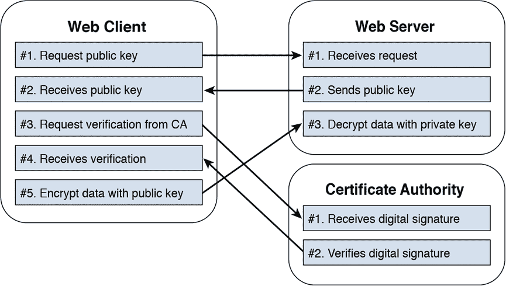

图 8.1 **SSL 过程**

### 公钥

查看本章前面的“管理公钥密钥基础设施 (PKI) 证书”节。

### 私钥

查看本章前面的“管理公钥密钥基础设施 (PKI) 证书”节。

### 自签名证书

查看本章前面的“管理公钥密钥基础设施 (PKI) 证书”节。

### 数字签名

查看本章前面的“管理公钥密钥基础设施 (PKI) 证书”节。

### 哈希

查看本章前面的“管理公钥密钥基础设施 (PKI) 证书”节。

### 证书颁发机构

IT 安全围绕着信任的概念。例如，假设你想在线连接到你的银行，并在浏览器中输入银行的 URL。你的浏览器从远程服务器获得响应，但你如何确保远程服务器实际上是你的银行，而不是劫持了你连接尝试的服务器呢？

解决方案是数字证书。当浏览器连接到服务器时，服务器颁发与数字证书相关的签名。Web 浏览器咨询名为证书颁发机构 (CA) 的第三方组织来验证签名。通过 CA 的验证，客户端系统和服务器之间建立了信任。

### 通配符证书

通常，一个证书与单个系统关联。在一个有许多需要证书系统的组织中，每个系统实施证书的成本很高。

通配符证书允许你拥有一个适用于整个域名（包括子域名）的证书。换句话，你可以有一个与以下所有系统关联的证书：

*  [onecoursesource.com]
*  [www.onecoursesource.com]
*  [test.onecoursesource.com]
*  [sales.onecoursesource.com]
*  [dev.onecoursesource.com]
*  [private.onecoursesource.com]

### 证书用例

对于 Linux+ 考试，你应该意识到证书被使用的情况。本节描述了一些常见的用例。

### 安全套接层 (SSL)/传输层安全 (TLS)


传输层安全协议（TLS）是一种加密协议，用于 VPN 提供数据的安全传输。安全套接层协议（SSL）是 TLS 的前身，目前被认为已废弃。

TLS 不仅用于 VPN；它还常用于 Web 服务器通信、电子邮件传输和 IP 语音（VoIP）。

## 证书身份验证

`Certificate authentication` 是使用公钥证书允许一个系统验证另一个系统的身份的过程。Web 客户端常用它来确保 Web 服务器不是流氓系统。

## 加密

有关加密作用的信息，请参阅本章前面的“管理公钥基础设施（PKI）证书”章节。

## 身份验证

标准的身份验证方法是使用本地用户账户和密码。这种方法缺乏更复杂方法提供的一些安全功能。本节探讨了在开发安全最佳实践策略时应当考虑的替代身份验证方法。

### 令牌 (Tokens)

令牌是由硬件设备或软件程序生成的唯一值（通常是数字或字母数字值）。令牌通常是持续自动生成的，且通常有效期很短，例如 30 秒。

硬件令牌是由硬件设备生成的令牌。它通常是一个非常小的设备，例如钥匙扣。硬件设备可能具有额外的身份验证方法，如指纹扫描器，但这并不常见见。

软件令牌是由程序生成的令牌。一个常见的例子是移动设备上的应用程序。

### 多因素身份验证 (MFA)

通过多因素身份验证（MFA），用户被要求提供多项证据来证明其用户身份。一种常见的多因素身份验证方法称为双重身份验证，或 2FA。对于这种方法，用户需要提供两种形式的标识，可能包括以下：

*  用户知道的
*  用户拥有的
*  用户“是”的特征
要利用 MFA，你可以实现许多不同的功能，包括令牌、一次性密码（OTP）和生物识别（指纹扫描器、虹膜扫描器等）。

### 可插件式身份验证模块 (PAM)

可插件式身份验证模块（PAM）已用于几乎尝试验证用户的 Linux 实用程序。这很重要，因为你不需要调整实用程序来更改用户身份验证的方式；你只需要更改 PAM 配置文件即可。

要理解 PAM 有多有益，你应该意识到你可以让 PAM 做的一些事情。以下是你可以使用 PAM 的许多示例之一：

*  你可以使用 PAM 强制执行更健壮的密码。
*  你可以使用 PAM 限制用户登录系统的日期和时间。
*  你可以使用 PAM 限制用户登录的位置。
*  你可以使用 PAM 设置或取消环境变量。因为你可以为不同的实用程序设置不同的 PAM 规则，这意味着你为本地登录有一套环境变量，SSH 登录有一套，FTP 登录有一套。
*  可以 PAM 为用户账户设置限制。例如，可以限制用户可以执行的进程数。
*  你可以限制 root 用户登录的位置。通过只允许 root 用户本地登录或使用 `su` 命令获取 root 账户的访问，可以使你的系统更安全。

请记住，这些只是你可以用 PAM 完成的几件事。几十种不同的 PAM 模块提供了许多不同的身份验证功能。

### 考试提示

PAM 可能是一个复杂的系统。请记住，本书的目标是为 Linux+ XK0-005 考试涵盖的每个主题提供摘要，而不是完整的描述。本节描述了考试所需的关于 PAM 的知识。

要理解 PAM 文件中内容的含义，你必须先理解第一列数据。第一列有四种类型：`auth`、`account`、`session` 和 `password`。图 8.2 直观地描述了它们如何使用。

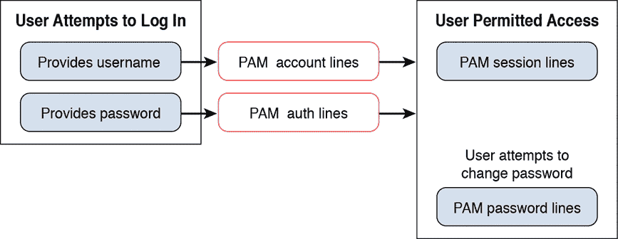

图 8.2 **PAM 类型**

PAM 配置文件每行的第一个值（类型）基本上指示了何时使用该模块。每行的最后一个值是要运行的 PAM 模块（或要咨询的另一个配置文件）。中间值称为控制值。当 PAM 模块返回成功或失败时，如何使用返回值取决于控制值。

表 8.1 描述了不同的传统控制值。当你阅读此表中的描述时，需要注意的是，当解析一组规则时，最终结果必须成功才能执行操作。例如，考虑以下规则：

[点击此处查看代码图像](#ch08_images.xhtml_f184pre01a

```
account required pam_nologin.so
account include system-auth
```

表 8.1 传统控制值

| 值 | 描述 |
| --- | --- |
| **required** | **返回成功：** 如果当前 PAM 返回成功，则检查列表中的下一条规则。如果这是最后规则，栈返回成功值（除非之前的 requisite 规则失败）。**返回失败：** 如果当前 PAM 返回失败，则不执行额外的模块。栈返回失败值。换句话说，运行具有 required 值的模块必须返回成功，栈才能返回成功。 |
| **requisite** | 在某些方面，**requisite** 值与 **required** 相似。区别在下文中用斜体标出。**返回成功：** 如果当前 PAM 返回成功，则检查列表中的下一条规则。如果这是最后规则，栈返回成功值。**返回失败：** *如果当前 PAM 返回失败，将执行额外的模块；但是，无论这些其他模块发生什么，栈都会返回失败值。* 这有时很有用，因为额外的模块可能会在日志文件中提供更多信息。 |
| **optional** | **返回成功：** 如果当前 PAM 返回成功，则检查列表中的下一条规则。如果这是最后规则，栈返回成功值（除非之前的 requisite 规则失败）。**返回失败：** 如果当前 PAM 返回失败，则检查列表中的下一条规则。如果这是最后规则，栈返回成功值（除非之前的 requisite 规则失败）。换句话说，模块的返回值对栈的成功或失败没有影响。例外：如果这是栈中的唯一规则，**optional** 的作用类似于 **required**。 |


| 字段 | 说明 |
| :--- | :--- |
| **sufficient** | **返回成功：** 如果当前的 `PAM` 返回成功，则不再检查额外的规则。栈将立即返回成功值（除非之前的强制性规则[requisite]执行失败）。**返回失败：** 如果当前的 `PAM` 返回失败，将检查列表中的下一条规则。如果这是最后一个规则，栈将返回成功值（除非之前的强制性规则[requisite]执行失败）。换句话说，如果模块的返回值成功，则不再检查其他模块，且栈自动变为成功。返回失败对栈的整体返回值没有影响。 |
| **include** | 此值告诉 `PAM` 使用指定文件中的所有规则。仅使用当前类型（**auth**、**account** 等）的规则。 |

若要对用户账户进行验证，规则链的最终结果必须是成功的。这链规则也被称为规则堆栈（rule stack）。

图 8.3 为喜欢视觉化示例的读者提供了一个流程图。请注意，此图利用了以下信息：

点击此处查看代码图像

```
[root@OCS ~]# grep ^account /etc/pam.d/sshd
account required pam_nologin.so
account include system-auth
[root@OCS ~]# grep ^account /etc/pam.d/system-auth
account required pam_unix.so
account sufficient pam_succeed_if.so uid < 500 quiet
account required pam_permit.so
```

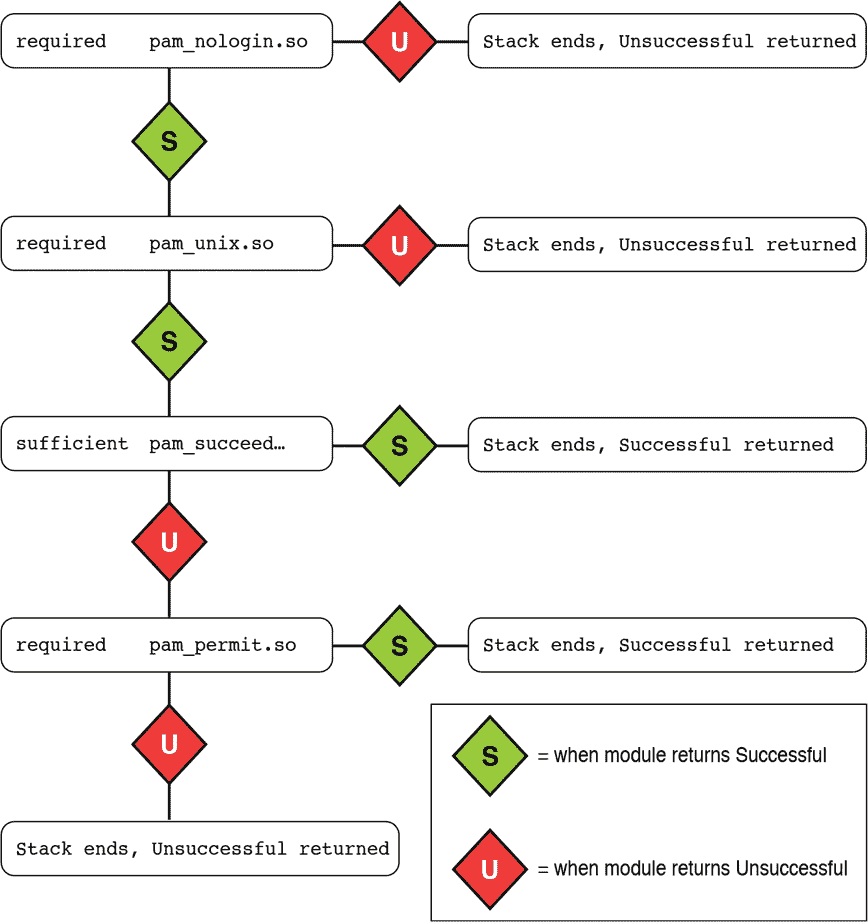

图 8.3 **PAM 控制值示例**

## 系统安全守护进程 (SSSD)

系统安全服务守护进程（SSSD）旨在提供一种访问远程目录的身份验证方法。它使用认证服务（如 `LDAP`）在客户端系统中创建用户账户的本地缓存。这些账户用于访问远程目录。

> 考试提示
> `SSSD` 的配置超出 Linux+ XK0-005 考试的范围。对于考试，你应该了解该守护进程的功能。

## 轻量级目录访问协议 (LDAP)

轻量级目录访问协议 (`LDAP`) 通常与 `RADIUS` 和 `TACACS+` 进行比较，因此了解这些技术是有益的。远程拨号认证服务 (`RADIUS`) 是一种允许客户端系统利用服务器对用户进行认证的协议。该服务在集中位置提供 AAA（认证、授权和计费）管理。

`RADIUS` 通常与 `TACACS+` 进行比较，但了解这些协议之间的差异超出 Linux+ 考试的范围。最重要的是，要意识到 `RADIUS` 可以在安全策略中提供非常强大的功能，因为它提供了集中的 AAA 管理。此外，你应该意识到 `RADIUS` 比 `TACACS+` 具有更好的厂商无关性（vendor agnostic）。

终端访问控制器访问控制系统加密 (`TACACS+`) 是一种允许客户端系统利用服务器对用户进行认证的协议。该服务在集中位置提供 AAA 管理。

`TACACS+` 通常与 `RADIUS` 进行比较，但了解这些协议之间的差异超出 Linux+ XK0-005 考试的范围。最重要的是，要意识到 `TACACS+` 可以在安全策略中提供非常强大的功能，因为它提供了集中的 AAA 管理。此外，你应该意识到 `TACACS+` 由思科开发的，不像 `RADIUS` 那样具有良好的厂商无关性。

轻量级目录访问协议 (`LDAP`) 是一种提供目录服务信息的协议。这意味着该协议可以提供用户账户信息，但它并不提供 `RADIUS` 和 `TACACS+` 提供的完整 AAA 功能。`LDAP` 也经常用于存储与其他用户账户直接相关的其他信息，例如主机名。

`LDAP` 可以用于验证用户，但在考虑安全策略时，你应该意识到 `RADIUS` 和 `TACACS+` 提供了更健壮的解决方案。例如，`LDAP` 不提供像 `RADIUS` 和 `TACACS+` 等 AAA 协议提供的计费（accounting）功能。

> 考试提示
> `LDAP` 的配置超出 Linux+ XK0-005 考试的范围。对于考试，你应该了解该服务的功能。

## 单点登录 (SSO)

单点登录 (`SSO`) 是一种修改 Linux 操作系统使其更安全的技术。本节重点关注可用于执行 Linux 加固操作的多种技术。

### 安全扫描

扫描是使用工具搜索安全弱点的过程。例如，`john` 实用是一个命令行密码破解工具。使用该工具时，你需要一个包含 `/etc/passwd` 和 `/etc/shadow` 条目的文件。你可以通过运行以下命令创建此文件：

点击此处查看代码图像

```
cat /etc/passwd /etc/shadow > file_to_store
```

然后对合并后的文件运行 `john` 实用程序，它将发现哪些用户账户具有弱密码。

各种扫描工具可以扫描 Linux 操作系统不同区域的如下类弱点：

*  软件配置错误
*  Rootkits（Rootkits）
*  文件和目录问题
*  内内核模块
*  病毒
*  恶意软件
*  网络端口问题
*  入侵

> 考试提示
> 鉴于扫描工具数量众多，你不应该期望 Linux+ XK-005 考试会问任何关于特定工具的问题。

### 安全启动 (UEFI)

当 Linux 系统首次启动时，会启动一个软件程序来引导系统。该软件程序不是 Linux 的一部分，而是随系统硬件自带的程序。有两种不同类型的程序：基本输入/输出系统 (BIOS) 和统一扩展性接口 (UEFI)。虽然 BIOS 和 UEFI 执行类似的任务（启动引导过程），但它们具有不同的特征并使用不同的接口进行配置。

UEFI 的优势之一是它提供了名为 `secure boot`（安全启动）的功能，解决了从未经授权或可能包含恶意软件的引导镜像启动的问题。数字签名用于确认引导镜像的有效性。

### 系统日志配置

有关系统日志配置的详细信息，请参见第 7 章中的“Syslog”，“管理软件配置](#ch07.xhtml)”。

### 设置默认 umask

`umask` 命令设置文件和目录的默认权限。这些默认权限仅在最初创建文件或目录时应用。

`umask` 命令接受一个参数：掩码值。该掩码值是一个应用于新文件或新目录最大权限，如表 8.2](#ch08.xhtml_ch8tab2) 所示。

表 8.2 **umask** 权限

| 类型 | 新项的最大可能权限 |
| :--- | :--- |
| 文件 | **rw-rw-rw-** |
| 目录 | **rwxrwxrwx** |

图 8.4 展示了 **umask** 值 **027** 应用于新文件的情况与应用于新目录的情况对比。

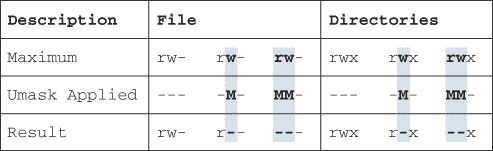

图 8.4 **umask 的应用**


每个 shell 都有其自身的 `umask` 值。如果你在一个 shell 中更改了 `umask`，它不会影响任何其他 shell 中的 `umask` 值。若要在跨登录时对 `umask` 进行持久更改，请将 `umask` 命令添加到 `~/.bash_profile` 文件中。

## 禁用/移除不安全的服务

某些服务应该永远不要使用或谨慎使用。表 8.3 重点关注不安全的服务以及应当使用它们的有限特殊情况。

### 表 8.3 不安全服务的忧虑

| 服务 | 描述 |
| --- | --- |
| FTP | 文件传输协议 (FTP) 是一种常用的用于在系统之间传输文件的协议。由于数据在 FTP 客户端和服务器之间是以明文传输的，因此该协议是不安全的。这些数据包括任何用户账户信息，这意味着任何能够“嗅探”网络的人都能看到用户名和密码。FTP 服务器提供了一个重要且实用的功能：匿名 FTP 服务。匿名 FTP 服务器不需要任何用户身份验证，并且只允许下载内容（不允许上传）。这允许某些创建一个仓库，存储供任何人下载的内容（如 Linux 发行版的 ISO 文件）。 |
| Telnet | Telnet 协议允许远程登录，但与 SSH 不同，它不提供加密。虽然可以使用 `telnet` 命令测试到远程端口的连接，但在安全格重要的现代系统上不应使用 Telnet 服务器。 |
| Finger | Name/Finger 协议旨在提供有关计算机和用户的信息。`finger` 命令长期以来被用作提供用户报告的方法。然而，由于这些信息是通过明文通过网络发送的，在安全格重要的现代系统中，绝不应使用此命令和协议。 |
| Sendmail/Postfix | sendmail 和 postfix 都是电子邮件服务器。通常，本地系统不需要电子邮件服务，或者至少不需要外部电子邮件。应该配置一个真实的电子邮件服务器来与远程电子邮件服务器之间发送和接收消息。桌面系统和大多数非邮件服务器不应配置为处理外部邮件。这可能需要对这些服务进行一些配置更改。 |

你应该考虑禁用或限制所有不需要远程访问的服务。例如，在大多数 Linux 发行版中，CUPS 打印服务器是默认安装并配置启动的。如果相关系统没有打印需求，请考虑禁用并移除 CUPS 软件。

## 强制执行密码强度

`pam_unix` 模块提供了许多修改密码设置方式的功能。例如，考虑以下命令：

点击此处查看代码图像

```
[root@OCS ~]# grep ^password /etc/pam.d/passwd
password include  system-auth
[root@OCS ~]# grep ^password /etc/pam.d/system-auth
password requisite pam_cracklib.so try_first_pass retry=3
password sufficient pam_unix.so md5 shadow nullok try_first_pass
use_authtok
password required pam_deny.so
```

`pam_unix` 模块的 `shadow` 选项导致密码使用 shadow 系统存储。密码存储在 `/etc/shadow` 文件中，而不是 `/etc/passwd` 文件中。

你可以对 `pam_unix` 模块进行一些更改来使系统更安全。例如，如果你修改 `/etc/pam.d/system-auth` 文件中的 `pam_unix` 行以匹配以下内容，则系统将不允许用户重复使用密码：

点击此处查看代码图像

```
password sufficient pam_unix.so md5 shadow nullok try_first_pass use_
authtok remember=5
```

通过这种方式修改行后，每个用户的最后五个密码会被记住，用户在更改新密码时将无法使用这五个密码之一。这防止了用户反复使用相同的密码。

表 8.4 描述了一些其他关键的 `pam_unix` 选项。

| 选项 | 描述 |
| --- | --- |
| `md5` | 使用 MD5 加密算法加密密码。 |
| `sha256` | 使用 SHA256 加密算法加密密码。 |
| `nullok` | 允许 root 用户为用户提供空（空白）密码。 |
| `remember=x` | 记住用户的旧密码，并在更改密码时不允许使用这些密码。 |

### 表 8.4 pam_unix 密码选项

## 移除未使用的包

移除未使用的包起可能是一个挑战，但确保系统中只安装了必要的软件是非常重要的。确定哪些包是必要的挑战在于，典型的默认 Linux 安装包含了成千上万个软件包。例如，Kali Linux 的默认安装程序几乎有 3,000 个包，如下所示：

```
root@kali:~# dpkg -l
2801
```

你真的需要通过逐一检查每个包来决定哪些包应该被安装吗？你应该探索哪些内容属于不同的系统。事实上，你应该创建三类：

*  默认应该安装的软件
*  被视为可选的软件（可以安装但默认不安装）
*  绝不应在任何系统上安装的潜在风险或有问题的软件

你可以通过探索包来确定是否应该安装该包。例如，你可能首先查看它的功能：

点击此处查看代码图像

```
[root@onecoursesource ~]#rpm -qi zsh | grep "Description"
Description :
The zsh shellsh 是一个命令解释器，可以作为交互式
shell 和 shell 命令处理器使用。Zsh 类似于 ksh
shell (Korn shell)，但包含了许多增强。Zsh 支持
命令行编辑、内置拼写纠错、可编程的
命令补全、shell 函数（带有自动加载）、历史机制
以及更多。
```

根据此命令提供的信息，你可能可以确定该包不应该安装在系统上。可能你不想支持另一个 shell，而只想在该系统上支持 BASH。或者你可能认为这个包是不必要的，因为已经存在了一个很好的 shell。如果你正在考虑安装一个需要额外 shell 的程序，请务必在安装之前调查运行第二个 shell 带来的影响和后果。

如果你决定某个包可能是有用的包，那么在批准它之前，你还应该查看它提供的文件——特别是可执行程序（通常位于 `/bin` 目录，例如 `/usr/bin` 或 `/bin`，但也可能位于 `/sbin` 或 `/usr/sbin`）：

点击此处查看代码图像

```
[root@onecoursesource ~]# rpm -ql zsh | grep /bin/
/usr/bin/zsh
[root@onecoursesource ~]#ls -l /usr/bin/zsh
-rwxr-xr-x 1 root root 726032 May 22  2015 /usr/bin/zsh
```

查看这些可执行程序的文档（man 手页），并仔细查看文件的权限和所有权。考虑每个程序是否因为 SUID 或 SGID 权限提供了特权访问。


最后，请注意，本节演示的命令在一个已经安装了软件的系统中执行的。你应该在测试系统上对软件包进行审查，这样你就可以安全地安装软件包，而不必担心影响关键系统。该系统甚至不应该连接网络。你希望能够在运行这些命令并测试每一个之前，决定该软件是否可以安全地安装到你组织的“真实”系统上。

## 调整内核参数

请注意，内核参数在第 7 章的“配置内核选项”部分有所介绍。本节侧重于可以增强内核安全性的内核参数。本节讨论了四种常用的内核参数：

*  忽略 ping 请求
*  忽略广播请求
*  启用 TCP SYN 保护
*  禁止 IP 源路由

`ping` 命令通常用于判断远程主机是否可以通过网络访问。它通过向远程主机发送 Internet 控制消息协议（ICMP）回显请求包来实现这一点，如果远程系统可达，它将收到一个响应包。这带来了两个安全挑战：

*  黑客可以使用 `ping` 命令来探测活动系统，试图寻找她可以入侵的系统。虽然这不是探测活动系统的唯一方法，但是一种非常常见的方法。因此，对于任务关键型系统，最好忽略 ping 请求。
*  响应 ping 请求可能会导致系统受到 DoS（拒绝服务）攻击。在 DoS 攻击中，大量的网络包被发送到一个系统，导致系统难以处理所有数据并使系统无响应。在一种类似的攻击中，即 DDoS（分布式拒绝服务）攻击，数据包从多个系统发送以淹没主机。为了防止 DoS 和 DDoS 攻击，对于任务关键型系统，最好忽略 ping 请求。

要忽略 ping 请求，请在 `/etc/sysctl.conf` 文件中使用以下设置：

点击此处查看代码图像

```
net.ipv4.icmp_echo_ignore_all = 1
```

要忽略在 DoS 或 DDoS 攻击中发生的广播请求，请在 `/etc/sysctl.conf` 文件中使用以下设置：

点击此处查看代码图像

```
net.ipv4.icmp_echo_ignore_broadcasts = 1
```

SYN 泛洪攻击是一种 DoS 攻击，其中使用 SYN 请求来使系统无响应。要忽略 SYN 请求，请在 `/etc/sysctl.conf` 文件中使用以下设置：

```
net.ipv4.tcp_syncookies = 1
```

IP 源路由是一种允许数据包发送者指定应该采取的网络路由的功能。此功能绕过了路由表并使系统变得脆弱，因为黑客可以利用路径路径攻击（也称为中间人攻击，即系统在客户端和服务器之间切入自身），或使用此功能来映射你的网络或绕过你的防火墙。

每个网络接口都有一个独立的 IP 源路由内核参数。要从特定的网络设备禁用此功能，请使用如下的设置：

点击此处查看代码图像

```
net.ipv4.conf.eth0.accept_source_route = 0
```

## 安全保护服务账户

典型的 Linux 系统有许多服务用户账户。这些服务用户账户的 UID 值通常小于 1000，使得管理员很容易识别出这些是特殊账户。其中一些服务账户通常被称为“守护进程账户”，因为它们被基于守护进程的软件使用。守护进程是在后台运行的程序，用于执行特定的系统任务。

其他服务账户可能存在，用于为操作系统提供功能。例如，“nobody”账户用于通过 NFS（网络文件系统）共享的文件应用权限。

此外，如果你向系统添加新软件，可能会添加更多用户，因为软件供应商会同时使用用户和组账户来对软件部分文件提供控制访问。

这些服务账户不应设置密码，因为它们不会被普通用户使用。换句话说，如果你查看 `/etc/shadow` 文件中的密码字段，所有系统账户都应该具有如下值：

```
nobody:*:15921:0:99999:7:::
dbus:!!:16056::::::
```

系统账户也不应该关联一个有效的 shell。因此，如果你查看 `/etc/password` 文件，系统账户的登录 shell 应该如下所示：

点击此处查看代码图像

```
nobody:x:99:99:Nobody:/:/sbin/nologin
dbus:x:81:81:System message bus:/:/sbin/nologin
```

你应该对系统账户进行常规审计，以确保它们没有密码或有效的登录 shell。

## 配置主机防火墙

防火墙（也称为访问控制列表）是一种网络设备（硬件或软件形式），旨在允许或阻止网络流量。防火墙可以实现在各种设备上，包括路由器、网络服务器和用户系统（在这种情况下被称为主机防火墙）。本节探讨了防火墙的基本概念。

表 8.5 | 该术语指网络包的来源。可以使用源的 IP 地址、端口或 MAC 地址创建防火墙规则，以过滤来自源的网络流量。 |
| 目的 (Destination) | 该术语指网络包被发送的地方。可以使用目的的 IP 地址、端口或 MAC 地址创建防火墙规则，以过滤用于目的的网络流量。 |
| 端口 (Port) | 端口有一个唯一的数字，用于标识系统上的服务。每个网络包都包含源端口和目的端口。可以使用源端口或目的端口创建防火墙规则来过滤网络流量。 |
| 协议 (Protocol) | 按协议过滤数据包是常见的——无论是像 ICMP、TCP 或 UDP 这样的协议，还是与特定端口相关的协议（例如使用端口 23 的 Telnet）。 |
| 日志 (Log) | 防火墙规则通常用于允许或阻止网络包；但也有一些规则旨在记录有关网络包的信息。当你想要查看将被稍后规则阻挡的数据包信息时，这非常有用。 |
| 有状态和无状态 (Stateful and stateless) | 有状态规则是适用于任何先建立建立连接的规则。考虑一个指定如下内容的防火墙：允许大多数出站连接，包括访问网站、SSH 访问、FTP 站点等。阻止大多数入站连接，以便外部用户无法连接你可能运行的服务。这种场景的问题是，当你连接到远程系统时，出站和入站规则都会生效。出站规则在你建立连接时生效，入站规则在远程服务器响应时生效。如果你有一条阻止大多数入站连接的规则，你可能永远无法来自尝试访问的网站的响应。你可以通过创建有状态规则来克服这个问题。无状态规则无论之前是否建立过任何连接都适用。 | |


| `iptables` 目标 (targets) | 一旦数据包匹配了防火墙规则的标准，就会使用“目标”来确定要执行的操作。`iptables`（一种常用的 Linux 防火墙工具）有四个标准目标：Accept 目标告诉 `iptables` 允许数据包移动到下一个过滤点。Reject 目标告诉 `iptables` 用错误消息将数据包返回给源地址。该消息不会传递到下一个过滤点。Drop 目标告诉 `iptables` 丢弃数据包。不会向源地址发送响应，且消息不会传递到下一个过滤点。Log 目标告诉 `iptables` 创建一个包含数据包详细信息的日志记录。使用此目标，数据包既不会被显式允许也不会阻塞，但规则集（链）中的后续规则可能会决定这一结果。 |

一种常用的防火墙工具称为 `iptables`。通过 `iptables`，规则集（称为 `chains`）被应用于不同的位置（称为 `filter points`），使得这种 ACL 软件更具灵活性。图 8.5 展示了这些过滤点。

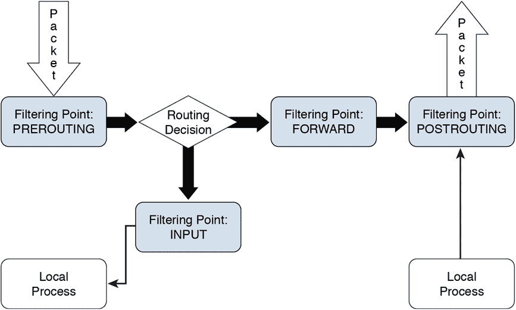

图 8.5 **数据包过滤：出站数据包**

规则表可以放置在过滤点上。过滤点可以拥有一组或多组规则，因为 `iptables` 执行多种功能：过滤（阻塞或允许）数据、对数据包执行 NAT 操作或对数据包进行修改（mangle）。过滤点加上表（`filter`、`nat` 或 `mangle`）形成了一个单一规则集，称为 `chain`（链）。

将链视为一组决定对特定数据包采取何种操作的规则。例如，“filter INPUT”链上的规则可以根据源 IP 地址阻塞入站数据包。另一个规则可以用于允许发往特定网络端口的数据包。

规则的顺序也非常重要。一旦找到匹配的规则，就会执行相应的操作（称为 `target` 目标），并忽略额外的规则（下文提到提到有一个例外）。如表 8.5 描述了若干常见的 `iptables` 规则。

表 8.6 **iptables** 规则

| 规则 | 描述 |
| --- | --- |
| `iptables -t filter -L INPUT` | 显示 INPUT-filter 链的所有规则。 |
| `iptables -D INPUT 1` | 从 INPUT-filter 链中删除规则为 1。 |
| `iptables -F INPUT` | 清空 INPUT-filter 链的所有规则。 |
| `iptables -A INPUT -s 192.168.10.100 -j DROP` | 在 INPUT-filter 链末尾添加规则，丢弃任何来自 192.168.10.100 系统的数据包。 |
| `iptables -A INPUT -s 192.168.20.0/24 -j DROP` | 在 INPUT-filter 链末尾添加规则，丢弃任何来自 192.168.10.0/24 网络的数据包。 |
| `iptables -I INPUT 2 -s 192.168.20.125 -j ACCEPT` | 将此规则插入作为规则 2，并将所有后续规则向下移动一位。 |
| `iptables -A INPUT -p icmp -j DROP` | 创建一条规则丢弃匹配 ICMP 协议的数据包。 |
| `iptables -A INPUT -m tcp -p tcp --dport 23 -j DROP` | 创建一条规则丢弃发往 23 端口的数据包。 |
| `iptables -A INPUT -p icmp -s 192.168.125.125 -j DROP` | 创建一条必须匹配所有条件的规则（ICMP 协议和源 IP 地址 192.168.125.125）。 |
| `iptables -A INPUT -i eth0 -s 192.168.100.0/24 -j DROP` | 创建一条基于网络接口过滤的规则。 |
| `iptables -L INPUT -v` | 显示有关规则的详细信息。 |
| `iptables -P INPUT DROP` | 设置默认链策略。如果没有匹配的规则，则使用此默认目标。 |

# 第 9 章：实现身份管理

**本章涵盖以下 Linux+ XK0-005 目标：**

*  **2.2:** 给定场景，实现身份管理。

身份管理是管理用户和组账户的过程。在 Linux 系统中，账户信息存储在明文文件 `/etc/passwd`、`/etc/shadow` 和 `/etc/group` 中，你将在本章学习这些内容。

在本章，你还将学习如何创建、修改和删除用户账户。此外，你将发现如何使用 `id`、`who` 和 `w` 命令查看账户信息。

本章提供了有关账户创建、删除以及账户管理的信息。

### 账户的创建与删除

Linux 系统管理员常用的操作之一是创建和删除用户组账户。本节描述了用于创建账户、显示账户信息以及删除用户账户的命令。

#### useradd

root 用户使用 `useradd` 命令创建用户账户。

示例：

```
[root@OCS ~]$ useradd julia
```

表 9.1 列出了 `useradd` 命令的一些重要选项。

| 选项 | 描述 |
| --- | --- |
| `-c` | 设置用户的注释或 GECOS 字段。 |
| `-d` | 指定用户的家目录。此选项通常与 `-m` 选项一起使用，用于创建家目录。 |
| `-e` | 设置账户的过期日期值。（更多信息请参见本章后部分的“`/etc/shadow`”章节。） |
| `-f` | 设置账户的非活动值。（更多信息请参见本章后部分的“`/etc/shadow`”章节。） |
| `-g` | 指定用户的主组。 |
| `-G` | 指定用户的辅助组。 |
| `-k` | 指定 `skel` 目录，即从从目录复制文件到用户家目录的目录。 |
| `-s` | 指定用户的登录 shell。 |
| `-u` | 指定用户的 UID。 |

表 9.1 **useradd** 命令选项

#### groupadd

root 用户使用 `groupadd` 命令创建组账户。

示例：

点击此处查看代码图像

```
[root@OCS ~]$ groupadd -g 2050 test
```

`-g` 选项用于指定新组的 GID。

#### userdel

root 用户使用 `userdel` 命令删除用户账户。

示例：

```
[root@OCS ~]$ userdel susan
```

`userdel` 命令的一个重要选项是 `-r`，它会删除用户账户以及该用户的家目录和邮件池。

#### groupdel

root 用户使用 `groupdel` 命令删除组账户。

示例：

```
[root@OCS ~]$ groupdel test
```

注意

在运行 `groupdel` 命令之前，请确保删除所有属于该组的文件（或将文件重新分配给另一个组）。

#### usermod

root 用户使用 `usermod` 命令修改用户账户。

示例：

点击此处查看代码图像

```
[root@OCS ~]$ usermod -s /bin/tcsh julia
```

`usermod` 命令使用了与 `useradd` 命令许多相同的选项。请参见本章前面的“`useradd`”部分获取这些选项列表。

#### groupmod

root 用户使用 `groupmod` 命令修改组账户。

示例：

点击此处查看代码图像

```
[root@OCS ~]$ groupmod -n proj test
```

表 9.2 描述了 `groupmod` 命令的一些重要选项。

| 选项 | 描述 |
| --- | --- |
| `-g` | 修改 GID。 |
| `-n` | 修改组名。 |

表 9.2 **groupmod** 命令选项

#### id

`id` 命令显示基本的账户信息。当不带任何参数运行时，它会显示当前用户的 UID、用户名、主 GID 和名称，以及所有辅助组成员，如下例所示：

点击此处查看代码图像

```
[root@OCS ~]$ id
uid=0(root) gid=0(root) groups=0(root)
```


当将用户名作为参数传递时，它提供有关指定用户的信息，例如所示：

点击此处查看代码图像

```
[root@OCS ~]$ id bo
uid=1001(bo) gid=1001(bo) 
groups=1001(bo),10(wheel),20001(temprandy)
```

虽然 `id` 命令有几个选项，但它们通常不被使用。

### who

`who` 命令显示当前登录的的用户。

示例：

点击此处查看代码图像

```
[root@OCS ~]# who
student     :0     2017-02-18 01:52 (:0)
student      pts/0 2017-02-18 01:52 (:0)
student      pts/1 2017-03-05 19:55 (:0)
student      pts/2 2017-03-06 18:24 (:0)
root         pts/3 2017-03-06 18:24 (localhost)
```

`who` 命令的输出包含用户名、用户使用的终端设备、登录日期和时间以及用户登录的位置（`:0` 表示本地登录）。表 9.3 描述了 `who` 命令的常用选项。

| 选项 | 描述 |
| --- | --- |
| `-b` 或 `--boot` | 指定系统上次启动的时间。 |
| `-H` 或 `--heading` | 在列显示表头。 |
| `-q` 或 `--count` | 显示当前登录的用户数。 |

表 9.3 `who` 命令选项

### w

`w` 命令显示登录的用户以及其他有用信息：

点击此处查看代码图像

```
[root@OCS ~]# w
 18:25:08 up 3 days, 1:24, 5 users, load average: 0.27, 0.08, 0.07
USER     TTY     FROM       LOGIN@ IDLE JCPU PCPU WHAT
student :0       :0         18Feb17   41:48 1.01s    gdm-session-wor
student pts/0    :0         18Feb17   4.00s 0.46s    20.33s /usr/libexec/gn
student pts/1    :0         Sun19 1:32 0.04s 0.00s less -s
student pts/2    :0         18:24 12.00s 0.05s    0.01s /usr/bin/sss_ss
root    pts/3     localhost  18:24 12.00s 0.03s     0.03s -bash
```

JCPU 列头代表“作业 CPU”，该列指示了从终端启动的所有进程所占用的 CPU 时间。PCPU 列头代表“进程 CPU”，该列指示了当前进程所占用的 CPU 时间（列为输出行中的最后一项）。

表 9.4 描述了 `w` 命令的常用选项。

| 选项 | 描述 |
| --- | --- |
| `-h` 或 `--no-header` | 指定不在列显示表头。 |
| `-s` 或 `--short` | 指定不显示 JCPU 和 PCPU 列。 |

表 9.4 `w` 命令选项

## 默认 Shell

在使用 `useradd` 命令创建新用户账户时，除非使用 `-s` 选项指定 shell，否则将使用默认 shell。可以通过向 `useradd` 命令传递 `-D` 选项来查看和修改默认 shell 值。例如，要查看默认 shell，使用以下命令并查找 `SHELL` 设置：

点击此处查看代码图像

```
[root@onecoursesource.com ~]# useradd -D
GROUP=100
HOME=/home
INACTIVE=-1
EXPIRE=
SHELL=/bin/bash
SKEL=/etc/skel
CREATE_MAIL_SPOOL=yes
```

要更改默认 shell，请结合 `-D` 选项使用 `-s` 选项，如下：

点击此处查看代码图像

```
[root@mail ~]# useradd -D -s /bin/csh
[root@mail ~]# useradd -D
GROUP=100
HOME=/home
INACTIVE=-1
EXPIRE=
SHELL=/bin/csh
SKEL=/etc/skel
CREATE_MAIL_SPOOL=yes
```

### /etc/passwd

`/etc/passwd` 文件用于存储用户账户信息。它包含了大部分用户账户数据，密码和密码老化策略除外。（详细设置请参见本章后文“`/etc/shadow`”部分）。

`/etc/passwd` 文件中的每行描述一个用户账户。

示例：

点击此处查看代码图像

```
root:x:0:0:root:/root:/bin/bash
```

每行被划分为数据字段。表 9.5 描述了这些字段。

表 9.5 `/etc/passwd` 文件数据字段

| 字段 | 描述 |
| --- | --- |
| **用户名** | `root:x:0:0:root:/root:/bin/bash` 这是用户登录系统时提供的名称。 |
| **密码占位符** | `root:x:0:0:root:/root:/bin/bash` 这是在旧版本 Unix 中曾经存储密码的地方。 |
| **UID** | `root:x:0:0:root:/root:/bin/bash` 这是用户 ID。 |
| **GID** | `root:x:0:0:root:/root:/bin/bash` 这是用户的主组 ID。 |
| **GECOS** | `root:x:0:0:root:/root:/bin/bash` GCOS，全称为 General Electric Comprehensive Operating System，通常是用户的真实姓名和其他标识数据。 |
| **家目录** | `root:x:0:0:root:/root:/bin/bash` 这是用户的家目录。 |
| **登录 shell** | `root:x:0:0:root:/root:/bin/bash` 这是用户的登录 shell。 |

**考试提示**

当你参加 Linux+ XK0-005 考试时，你可能会看到 `/etc/passwd` 文件的示例，并被问文件中文件中字段的用途。

### /etc/group

`/etc/group` 文件用于存储组账户信息。`/etc/group` 文件中的每行描述一个组账户。

示例：

```
admin:x:1:
```

每行被划分为数据字段。表 9.6 描述了这些字段。

表 9.6 `/etc/group`

| 字段 | 描述 |
| --- | --- |
| **组名** | `admin:x:1:` 这是组的名称。 |
| **密码占位符** | `admin:x:1:` 这是在旧版本 Unix 中曾经存储密码的地方。 |
| **GID** | `admin:x:1:` 这是组的 ID。 |
| **成员列表** | `admin:x:1:` 这是该组的成员列表。 |

### /etc/shadow

`/etc/shadow` 文件用于存储密码信息。（详细设置请参见本章后文“`/etc/passwd`”部分）。

`/etc/shadow` 文件中的每行描述一个用户账户。

示例：

点击此处查看代码图像

```
root:$6$xxxx:0:99999:7:7::
```

**注意**

在 `/etc/shadow` 文件中，账户信息显示在单行中。这里有一个具有锁定密码的账户示例：

点击此处查看代码图像

```
student:!:0:99999:7:7::
```


| **Inactive (未激活)** | bob:*LK*:17116:0:99999:7:**30**:17246:账户锁定后，用户还有多少个“宽限天”可以登录——但仅限于在登录时提供新密码。 |
| **Expiration date (过期日期)** | bob:*LK*:17116:0:99999:7:30:**17246**:从 1970 年 1 月 1 日到用户账户过期的天数。 |
| **Unused (未使用)** | bob:*LK*:17116:0:99999:7:30:17246:这是一个未使用字段，未来可能会使用。 |

## 考试提示

在参加 Linux+ XK0-005 考试时，你可能会看到 `/etc/shadow` 文件的示例，并被询问文件中不同字段的用途。

### /etc/profile

当用户登录系统时，会启动一个登录 shell。当用户在登录后启动一个新的 shell 时，它被称为*非登录 shell*（non-login shell）。在每情况下，初始化文件都用于设置 shell 环境。执行哪些初始化文件取决于该 shell 是登录 shell 还是非登录 shell。

图 9.1 显示了用户登录系统时执行哪些初始化文件。

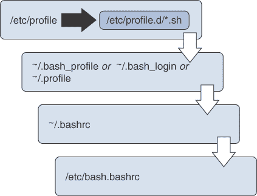

图 9.1 **用户登录时执行的初始化文件**

图 9.1 说明了以下过程：

1. 当用户登录时，Linux 执行 `/etc/profile` 初始化文件。在大多数 Linux 平台上，此脚本包含代码，会执行 `/etc/profile.d` 目录下所有以 `.sh` 结尾的初始化文件。`/etc/profile` 文件是管理员存放代码（通常是登录消息和环境变量定义）的地方，这些代码会在每个 BASH shell 用户登录时执行一次。
2. 登录 shell 在用户主目录中查找名为 `~/.bash_profile` 的文件。如果找到，登录 shell 执行该文件中的代码。如果没有，登录 shell 将查找名为 `~/.bash_login` 的文件。如果找到，则执行该文件中的代码。如果没有，登录 shell 将查找名为 `~/.profile` 的文件并执行其中的代码。这些文件为每个用户提供了一个存放代码的地方，该用户每次登录时都会执行（通常是环境变量定义）。
3. Linux 执行 `~/.bashrc` 初始化文件。该文件是每个用户存放代码（通常是别名和函数定义）的地方，用户每次打开新 shell 时都会执行。
4. Linux 执行 `/etc/bash.bashrc` 初始化文件。该文件是管理员存放代码（通常是别名和函数定义）的地方，用户每次打开新 shell 时都会执行这些代码。

图 9.2 显示了用户打开新 shell 时执行哪些初始化文件。

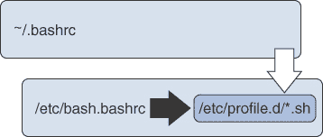

图 9.2 **用户启动非登录 shell 时执行的初始化文件**

图 9.2 说明了以下过程：

1. 当用户登录时，Linux 执行 `~/.bashrc` 脚本。该文件是每个用户存放代码的地方，用户每次打开新 shell 时都会执行（通常是别名和函数定义）。
2. Linux 执行 `/etc/bash.bashrc` 初始化文件。在大多数 Linux 平台上，此脚本包含代码，会执行 `/etc/profile.d` 目录下所有以 `.sh` 结尾的初始化文件。这些文件为管理员提供了存放代码的地方，用户每次打开新 shell 时都会执行（通常是别名和函数定义）。

## 考试提示

Linux+ XK0-005 考试中可能会测试你对登录过程的理解，包括在登录过程的哪个点执行哪个文件。

### /etc/skel

在创建新用户账户时，使用 `/etc/skel` 目录为新账户提供默认文件，例如 BASH 配置（`.bashrc`、`.profile` 等）。更多细节请参阅本章节前面的“useradd`”部分。

### .bash_profile

当用户登录系统且其登录 shell 为 BASH shell 时，如果 `~/.bash_profile` 文件存在，则执行该文件中的命令。这允许用户通过在该文件中放置命令来设置账户。

请参阅本章节前面的“/etc/profile`”部分以获取有关如何使用初始化文件的更多细节。

### .bashrc

当用户打开一个新的 BASH shell 时，会执行 `~/.bashrc` 文件中的命令。用户可以通过在该文件中放置命令来设置账户。

请参阅本章节前面的“/etc/profile`”部分以获取有关如何使用初始化文件的更多细节。

## 账户管理

账户管理涉及使用命令更改用户账户。本节重点介绍你管理用户账户所需的关键命令。

### passwd

`passwd` 命令允许用户更改自己的密码。root 用户也可以使用此命令更改任何用户的密码，或更改用户账户的其他基于密码的功能。表 9.8 描述了 `passwd` 命令的一些重要选项。

表 9.8 **passwd** 命令选项

| 选项 | 描述 |
| :--- | :--- |
| `-d` | 删除用户的密码。 |
| `-e` | 立即使账户过期。 |
| `-l` | 锁定账户。 |
| `-u` | 解锁账户。 |
| `-m` | 修改用户 `/etc/shadow` 文件中的 `Min` 字段。 |
| `-M` | 修改用户 `/etc/shadow` 文件中的 `Max` 字段。 |
| `-w` | 修改用户 `/etc/shadow` 文件中的 `Warn` 字段。 |

## 考试提示

准备好 Linux+ XK0-005 考试题，询问哪些 `passwd` 选项更改了哪些 `/etc/shadow` 字段。

### chage

root 用户通过执行 `chage` 命令来修改用户账户的密码有效期功能。表 9.9 描述了 `chage` 命令的一些重要选项。

表 9.9 **chage** 命令选项

| 选项 | 描述 |
| :--- | :--- |
| `-d` | 修改用户 `/etc/shadow` 文件中的 `Last Change` 字段。 |
| `-E` | 设置用户 `/etc/shadow` 文件中的 `Expiration Date` 字段（例如，`chage -E 2025-01-01 bob`）。 |
| `-m` | 修改用户 `/etc/shadow` 文件中的 `Min` 字段。 |
| `-M` | 修改用户 `/etc/shadow` 文件中的 `Max` 字段。 |
| `-W` | 修改用户 `/etc/shadow` 文件中的 `Warn` 字段。 |

请参阅本章节前面的“/etc/shadow`”部分以获取有关密码有效期设置的更多信息。

## 考试提示

准备好 Linux+ XK0-005 考试题，询问哪些 `chage` 选项更改了哪些 `/etc/shadow` 字段。

### pam_tally2

你可以使用 `/etc/pam.d/password-auth` 文件中的以下高亮设置，因登录失败而锁定用户：

点击查看代码图像

```
auth required     pam_env.so
auth required pam_tally2.so file=
   /var/log/tallylog deny=3 even_deny_root unlock_time=1200
auth    sufficient pam_unix.so try_first_pass nullok
auth    required  pam_deny.so
account required  pam_unix.so
account required  pam_tally2.so
```

以下是这些行中的关键值：

*  **file:** 指定存储失败登录尝试的文件名。
*  **deny:** 指定何时锁定用户（在指定次数的失败尝试后）。
*  **even_deny_root:** 同样适用于 root 账户和普通用户。
*  **unlock_time:** 指定锁定账户的时间（秒）。


有关使用 PAM 的更多信息，请参阅第 8 章中的“可插拔认证模块 (PAM)”以及 Linux 环境下的安全最佳实践](#ch08.xhtml)。

### faillock

你可以通过使用 `/etc/pam.d/system-auth` 文件中的以下高亮设置，因登录失败而锁定用户：

点击此处查看代码图像

```
auth   required   pam_env.so
auth required pam_faillock.so preauth
 silent audit deny=4 unlock_time=1200
auth   sufficient  pam_unix.so try_first_pass nullok
auth [default=die] pam_faillock.so authfail
 audit deny=4 unlock_time=1200
auth   required   pam_deny.so
```

以下是这些行中的关键值：

*    `deny:` 指定何时锁定用户（在达到指定次数的失败尝试后）。
*    `unlock_time:` 指定账户锁定的持续时间（秒）。

有关使用 PAM 的更多信息，请参阅第 8 章中的“可插拔认证模块 (PAM)”。

### /etc/login.defs

`/etc/login.defs` 文件为创建新账户或更改账户密码时提供了多个默认值。以下示例显示了该的值（不包括注释行）：

点击此处查看代码图像

```
[bo@onecoursesource.com ~]$ grep -v "^#" /etc/login.defs
MAIL_DIR        /var/spool/mail
PASS_MAX_DAYS   99999
PASS_MIN_DAYS   0
PASS_MIN_LEN    5
PASS_WARN_AGE   7
UID_MIN                  1000
UID_MAX                 60000
SYS_UID_MIN               201
SYS_UID_MAX               999
GID_MIN                  1000
GID_MAX                 60000
SYS_GID_MIN               201
SYS_GID_MAX               999
CREATE_HOME     yes
UMASK           077
USERGROUPS_ENAB yes
ENCRYPT_METHOD SHA512
```

表 9.10 描述了 `/etc/login.defs` 文件的一些重要设置。

表 9.10 /etc/login.defs 文件设置

| 设置 | 说明 |
| :--- | :--- |
| `PASS_MAX_DAYS` | 新账户 `Max` 值的默认值。（有关该值的详细信息，请参阅本章前面的“`/etc/shadow`”章节。） |
| `PASS_MIN_DAYS` | 新账户 `Min` 值的默认值。（有关该值的详细信息，请参阅本章前面的“`/etc/shadow`”章节。） |
| `PASS_MIN_LEN` | 普通用户更改自己的密码时，密码必须满足的最小字符数。 |
| `PASS_WARN_AGE` | 新账户 `Warn` 值的默认值。（有关该值的详细信息，请参阅本章前面的“`/etc/shadow`”章节。） |

考试提示

`/etc/login.defs` 文件中的其他设置不应在 Linux+ XK0-005 考试中测试。

## 第 10 章

实现和配置防火墙

**本章涵盖以下 Linux+ XK0-005 考试目标：**

*    **2.3:** 给定场景，实现并配置防火墙。

保护系统或网络安全的要组件之一是让“坏人”隔在外，同时让“好人”获得必要的访问。这意味着你需要确保对系统的网络访问安全且稳定。

防火墙允许你允许或阻止网络连接。防火墙会检查每个网络包并决定是否允许其进入。在本章中，你将学习创建防火墙的基础知识。

本章提供了以下主题的信息：防火墙用例、常见防火墙技术以及关键防火墙功能。

### 防火墙用例

`firewall`（称为访问控制列表）是一种用于允许或阻止网络流量的网络设备（硬件或软件）。防火墙可以实现在多种设备上，包括路由器、网络服务器用户系统。本节探讨了防火墙的基本概念。

以下是你应该了解的一些防火墙相关术语：

*    `Source:` 该术语指网络包的来源。可以使用源的 IP 地址、端口或 MAC 地址创建防火墙规则，以过滤来自源的网络流量。
*    `Destination:` 该术语指网络包的所在地。可以使用目的地的 IP 地址、端口或 MAC 地址创建防火墙规则，以过滤用于目的的网络流量。
*    `Port:` 端口有一个唯一的数字，用于标识系统上的服务。每个网络包包含源端口和目的端口。可以使用源或目的端口号创建防火墙规则来过滤网络流量。
*    `Protocol:` 按协议过滤数据是常见做法——如 ICMP、TCP 或 UDP 等协议，或者与特定端口相关的协议（如使用端口 23 的 Telnet）。
*    `Log:` 防火墙规则通常用于允许或阻止网络包；然而，也有设计用于记录网络包信息的规则。当你想要查看有关稍后规则将拦截的数据包信息时，这非常有用。

#### 开启和关闭端口

`open port`（开启端口）允许网络包通过防火墙。`close port`（关闭端口）阻止网络包（或将其返回给发送者）。防火墙根据创建的规则决定采取什么操作，包括匹配哪些标准（基于端口号、源、目的等）以及对数据包做什么，这被称为 `target`（目标）。

当网络包匹配防火墙规则的标准时，将使用目标来确定采取什么操作。`iptables`（Linux 核心防火墙）有四个标准目标：

*    `Accept:` `Accept` 目标告诉 `iptables` 允许包进入下一个过滤点。
*    `Reject:` `Reject` 目标告诉 `iptables` 带错误消息将包返回给源。该消息不会传递到下一个过滤点。
*    `Drop:` `Drop` 目标告诉 `iptables` 丢弃包。不会向源发送任何响应，消息也不会传递到下一个过滤点。
*    `Log:` `Log` 目标告诉 `iptables` 创建包含包详细信息的日志条目。使用此目标，包既不被显式允许也不阻止，但规则集（链）中的后续规则可能会决定结果。

#### 检查当前配置

`iptables` 命令的 `-L` 选项可检查防火墙的当前配置。详情请参见第 8 章中的“配置主机防火墙”。

#### 启用/禁用互联网协议 (IP) 转发

IP 转发是一种内核功能，允许网络包从一个网络传递到另一个网络。此功能通常用于在服务器上创建路由器。这很简单，你只需要将以下每个文件的值设置为 **1** 即可：

*    `/proc/sys/net/ipv4/ip_forward:` 启用 IPv4 网络包的 IP 转发。
*    `/proc/sys/net/ipv6/conf/all/forwarding:` 启用 IPv6 网络包的 IP 转发。

## 常见防火墙技术

Linux 系统可以实现许多防火墙技术。本节关注包含 Linux+ XK0-005 考试中的技术。

#### firewalld


在基于 Red Hat 的发行版中，通常使用一个名为 `firewalld` 的工具来配置 `iptables` 规则。规则被分为称为“区域”（zones）的类别，并使用 `firewall-cmd` 命令进行管理。例如，你可以执行命令 `firewall-cmd --get-zones` 来显示所有可用区域，如下例所示：

点击此处查看代码图像

```
root@OCS:~# firewall-cmd --get-zones
block dmz drop external home internal public trusted work
```

你可以在每个区域上设置不同的规则，并将区域规则集分配给不同的接口。例如，如果你的 `eth0` 接口连接到内部网络，你可以应用“trusted（信任）”或“internal（内部）”区域，这些区域具有限制较少的规则。相反，你的 `eth1` 接口可能连接到互联网，这意味着“dmz”或“external（外部）”区域可能是更好的解决方案。

使用 `firewall-cmd` 命令在命令行创建的规则会影响系统上激活的防火墙。这被称为*运行时防火墙*（runtime firewall）。如果系统重启或重启了防火墙服务，这些规则将会丢失。

为了让运行时规则在系统或防火墙重启后持续，请使用以下命令：

点击此处查看代码图像

```
root@OCS:~# firewall-cmd --runtime-to-permanent
```

### iptables

有关 `iptables` 的更多信息，请参阅第 8 章中的“配置主机防火墙”部分。

### nftables

Netfilter 项目（也称为 `nftables`）是一种新的防火墙技术，旨在解决 `iptables` 的某些缺点。`iptables` 背后的技术已经存在了几十年，虽然 `iptables` 仍然在使用中，但 `nftables` 开始变得越来越流行。

若要学习 `nftables` 如何不同于 `iptables`，请访问 [`wiki.nftables.org/wiki-nftables/index.php/What_is_nftables%3F#Main_differences_with_iptables`](https://wiki.nftables.org/wiki-nftables/index.php/What_is_nftables%3F#Main_differences_with_iptables)。

**考试警示**

由于 nftables 较新且尚未被广泛使用，本章关于它的提供信息较少。对于 Linux+ XK0-005 考试，你应该了解它是什么，但不应期望看到关于该技术的复杂问题。

### 简易防火墙 (UFW)

在基于 Debian 的发行版中，你可能会有使用 `ufw`（全称“uncomplicated firewall”）的能力。与 `firewalld` 类似，该工具作为创建 `iptables` 规则的前端接口。

例如，以下命令创建了一个允许入入站和出站 SSH 连接的规则：

```
root@OCS:~# ufw allow ssh
```

`ufw` 防火墙规则存储在以下文件中：

*  `/etc/default/ufw`
*  `/etc/ufw`

注意 `/etc/default/ufw` 规则不应手动修改。系统管理员可以使用 `/etc/ufw` 文件来修改和覆盖来自 `/etc/default/ufw` 的默认规则。

### 关键防火墙功能

本节描述了考试目标中提到的防火墙功能；本章的其他部分涵盖了额外的防火墙功能。

### 区域 (Zones)

有关区域的信息，请参阅本章前面的“firewalld”部分。

### 服务 (Services)

通过协议过滤数据包是常见的——无论是 ICMP、TCP 或 UDP 等协议，还是与特定端口相关的协议（例如使用端口 23 的 Telnet，或与端口 22 关联的 SSH）。

你可以使用 `/etc/services` 文件查找哪些端口通常与特定服务关联。例如，以下命令显示了通常分配给邮件服务的端口：

点击此处查看代码图像

```
[root@mail ~]# grep ^smtp /etc/services
smtp            25/tcp          mail
smtp            25/udp          mail
```

**考试警示**

虽然 Linux+ XK0-005 考试没有特别提到要了解特定的端口号，但请记住考试大纲中的“推荐经验”部分指出：“具有 12 个月操作 Linux 服务器的实践经验，以及 A+、Network+ 和 Server+ 或类似的认证和/或知识。”这些考试确实需要特定端口号及其关联服务名称知识。因此，你可能希望查看这些认证的考试大纲，并确保你熟悉这些考试目标中列出的端口。

#### 有状态/无状态 (Stateful/Stateless)

有状态规则是适用于任何先建立连接的规则。考虑一个指定以下规则的防火墙：

*  允许大多数出站连接，包括访问网站、SSH 访问、FTP 站点等。
*  阻止大多数入站连接，以便外部用户无法连接你可能运行的服务。

这种情况的问题数在于，当你连接到远程系统时，出站和入站规则都会生效。当你建立连接时应用出站规则，当远程服务器响应时应用入站规则。如果你有一个阻止大多数入站连接的规则，你可能永远无法收到尝试访问的网站的响应。

你可以通过创建有状态规则来克服。有状态规则本质上说：“如果网络数据包正在响应本地机器发起的请求，让它通过防火墙。”

无状态规则是不论之前是否建立了任何连接都适用的规则。

## 第 11 章

配置并执行用于系统管理的远程连接

**本章涵盖了以下 Linux+ XK0-005 考试目标：**

*  **2.4:** 给定场景，配置并执行用于系统管理的远程连接。

本章涵盖了 SSH 的配置——包括客户端和服务器实用——以及 SSH 隧道的建立。

本章还讨论了命令和系统服务的特权访问。它特别探讨了三种技术：`sudo`、PolicyKit 和 `su` 工具。

本章提供了有关 SSH 以及以另一个用户身份执行命令的信息。

### SSH

`ssh` 命令是一个允许你连接到安全 Shell (SSH) 服务器的工具。该命令的语法如下：

```
ssh user@hostname
```

其中 *user* 是你想用于登录的用户名，*hostname* 是系统主机名或 IP 地址。

第一次使用 `ssh` 命令连接系统时，你会收到以下提示：

点击此处查看代码图像

```
[root@OCS ~]# ssh bob@server1
The authenticity of host 'server1' can't be established.
ECDSA key fingerprint is
```

点击此处查看代码图像

```
 8a:d9:88:b0:e8:05:d6:2b:85:df:53:10:54:66:5f:0f.
Are you sure you want to continue connecting (yes/no)?
```

此提示确保你正在登录到正确的系统。通常用户会对此提示回答 **yes**，假设他们正在登录正确的机器，但此信息也可以通过联系远程系统的管理员进行独立验证。

在用户对此提示回答 **yes** 后，SSH 服务器指纹存储在 `~/.ssh` 目录下的 **known_hosts** 文件中。

表 11.1 描述了 `ssh` 命令的常用选项。

表 11.1 **ssh** 命令选项

| 选项 | 描述 |
| :--- | :--- |
| **-F** *configfile* | 指定用于 **ssh** 客户端工具的配置文件。默认配置文件为 `/etc/ssh/ssh_config`。请参阅本章稍后的“**/etc/ssh/ssh_config**”部分获取该文件的详细信息。 |


| -4 | 表示仅使用 IPv4 地址。 |
| -6 | 表示仅使用 IPv6 地址。 |
| -E `logfile` | 将错误写入指定的日志文件，而不是显示在标准输出中。 |

### `~/.ssh/known_hosts`

与 SSH 服务器建立连接后，SSH 客户端会将服务器的唯一指纹密钥存储在用户的 `~/.ssh/known_hosts` 文件，如下所示：

点击此处查看代码图片

```
[root@OCS ~]# cat !/.ssh/known_hosts
|1|trm4BuvRf0HzJ6wusHssj6HcJKg=|EruYJY709DXorogeN5Hdcf6jTCo=
 ecdsa-sha2-nistp256AAAAE2VjZHNhLXNoYTItbmlzdHAyNTYAAAAIbmlzd
 HAyNTYAAABBBG3/rARemyZrhIuirJtfpfPjUVnph9S1w2NPfEWec/f59V7nA
 ztn5rbcGynNYOdnozdGNNizYAiZ2VEhJ3Y3JcE=
```

通常情况下该文件的内容应该保持不变；然而，如果重新安装了 SSH 服务器，它将拥有新的指纹密钥，所有用户必须从 `.ssh/known_hosts` 文件中删除该 SSH 服务器的条目。

### `~/.ssh/authorized_keys`

要创建身份密钥，可以使用 `ssh-keygen` 命令。详细信息请参见本章节后面的“ssh-keygen”部分。

创建身份密钥文件后，需要将公钥（位于 `~/.ssh/id_dsa.pub` 文件或 `~/.ssh/id_rsa.pub` 文件）复制到用户尝试登录的系统。这需要将公钥放入 SSH 服务器上的 `~/.ssh/authorized_keys` 文件中。这可以通过从客户端系统手动复制公钥文件的内容并粘贴到 SSH 服务器的 `~/.ssh/authorized_keys` 文件中来实现。或者，你也可以使用 `ssh-copy-id` 命令，其语法如下：

```
ssh-copy-id user@server
```

### `/etc/ssh/sshd_config`

`sshd_conf` 文件用于配置 SSH 服务器。该文件中的重要设置包括以下内容：

*  **Protocol:** 定义 SSH 服务器的协议类型（设置为 `1`、`2` 或 `1,2`）。Protocol 1 不再受支持，因此此值通常应设置为 `2`。

*  **ListenAddress:** 指定分配给 SSH 接受连接的网络卡的 IP 地址。例如：`ListenAddress 192.168.1.100:192.168.1.101`。

*  **Port:** SSH 服务器监听入站连接的端口。例如：`Port 2096`。

*  **LogLevel:** 你希望 SSH 服务器记录的日志级别。允许以下值：

    *  **QUIET**
    *  **FATAL**
    *  **ERROR**
    *  **INFO**
    *  **VERBOSE**
    *  **DEBUG**
    *  **DEBUG1** (同于 **DEBUG**)
    *  **DEBUG2**
    *  **DEBUG3**

*  **PermitRootLogin:** 当设置为 `no` 时，防止 root 用户直接通过 SSH 登录。

*  **AllowUsers or DenyUsers:** 定义哪些用户可以通过 SSH 登录（AllowUsers）或哪些用户不能通过 SSH 登录（DenyUsers）。例如：`AllowUsers bob sue ted`。

*  **PasswordAuthentication:** 当设置为 `yes`（默认值）时，允许用户通过用户名和密码登录。当设置为 `no` 时，允许用户使用身份密钥登录。

*  **PubkeyAuthentication:** 当设置为 `yes` 时，允许用户在服务器上存储公钥。公钥是由用户客户端系统上的 `ssh-keygen` 命令生成的。详细信息请参见本章节后面的“ssh-keygen”部分。

*  **Banner:** 指定在用户身份验证过程之前显示的文件。

*  **PrintMotd:** 当设置为 `yes`（默认值）时，防止在用户通过 SSH 登录系统时显示 `/etc/motd`文件的内容。

### `/etc/ssh/ssh_config`

`/etc/ssh/ssh.conf` 文件用于修改 SSH 客户端工具（如 `ssh`、`scp` 和 `sftp`）的行为。此文件影响所有用户，但用户可以通过在家目录下创建自己的配置文件（`~/.ssh/config` 文件）来覆盖这些设置。

`ssh_config` 文件的某些组件与 `sshd_config` 文件的组件不同。（在继续之前，请考虑回顾前面的章节“`/etc/ssh/sshd_config`”）。首先，有一个系统级的 `/etc/ssh/ssh_config` 文件，适用于所有用户。此外，每个用户都可以在其家目录下创建一个文件（`~/.ssh/config`），用于覆盖 `/etc/ssh/ssh_config` 文件中的设置。

命令行选项可以覆盖配置文件中指定的值。以下是所有信息解析的顺序：

1. 命令行选项
2. 用户的 `~/.ssh/config` 文件
3. `/etc/ssh/ssh_config` 文件

找到的第一个参数即为使用的参数。例如，如果用户的 `~/.ssh/config` 文件中设置了 `ConnectTimeout`，而在 `/etc/ssh/ssh_config` 文件中设置了不同的值，则将使用用户的配置文件来设置此值。

`ssh_config` 文件与 `sshd_config` 文件之间的一个重要区别是，`ssh_config` 文件中的大多数设置都是 `Host` 设置的子设置。`Host` 设置允许你为连接到的不同的 SSH 服务器指定不同的规则。例如，以下配置在连接到 `server1.localhost.com` 时将应用 `ConnectTimeout` 值 `0`，在连接到 `test.example.com` 时将应用值 `600`：

```
Host server1.localhost.com
ConnectTimeout 0
Host test.example.com
ConnectTimeout 600
```

`ssh_config` 文件中的许多设置与 SSH 服务器配置文件中的设置相关，例如以下 `/etc/ssh/sshd_config` 文件设置：

```
X11Forwarding yes
```

在客户端，通常通过在执行基于 `ssh` 的命令时使用 `-X` 或 `-Y` 选项启用此功能。然而，如果你希望此功能成为默认设置，可以在 `/etc/ssh/ssd_config` 文件或 `~/.ssh/config` 文件中使用 `ForwardX11` 和 `ForwardX11Trusted` 设置。

### `~/.ssh/config`

用户可以通过创建 `~/.ssh/config` 文件来自定义 `ssh`、`scp` 和 `sftp` 等命令的工作。该文件的格式和设置与 `/etc/sshd/ssh.conf` 文件中的相同。详细信息请参见本章节前面的“`/etc/ssh/ssh_config`”部分。

### `ssh-keygen`

可以使用 `ssh-keygen` 命令生成身份密钥。该命令的一个常见用途是创建用于无密码认证的身份文件。这是一个示例：

点击此处查看代码图片

```
[julia@OCS ~]$ ssh-keygen
Generating public/private rsa key pair.
Enter file in which to save the key (/home/julia/.ssh/id_rsa):
Enter passphrase (empty for no passphrase):
Enter same passphrase again:
Your identification has been saved in /home/julia/.ssh/id_rsa.
Your public key has been saved in /home/julia/.ssh/id_rsa.pub.
The key fingerprint is:
6d:40:24:e2:3e:62:7f:a4:f0:5d:d5:05:1b:06:fd:d7 bo@ubuntu
The key’s randomart image is:
+--[ RSA 2048]---- +
|     . ..o .o+.. |
| . . o.+          |
| .    . . o . .|
| . +    . E|
| + o . S o     . |
| . = = . .     |
| + o   |
| .     |
|       |
+-----------------   +
```


此命令创建两个新文件：`~/.ssh/id_rsa` 和 `~/.ssh.id_rsa.pub`。这些文件的内容用于配合 `~/.ssh/authorized_keys` 文件进行密码身份验证。

RSA 是一种加密算法。另一种流行的加密算法是 DSA。要使用 DSA 代替 RSA，请对 `ssh-keygen` 命令使用 `-t DSA` 选项。该选项的结果是两个新文件：`~/.ssh/id_dsa` 和 `~/.ssh/id_dsa.pub`。

### 考试提示

在执行 `ssh-keygen` 命令期间如果请求密码短（passphrase），则每次建立 SSH 连接时都需要输入此密码短代替密码。通过使用 `ssh-agent` 和 `ssh-add` 工具，可以避免重复输入此密码短。有关这些工具的详情，请参见本章后面的“ssh-add”部分。

### ssh-copy-id

`ssh-copy-id` 命令用于将 `ssh-keygen` 创建的登录密钥拷贝到远程系统。（参见本章前面的“ssh-keygen”部分。）该命令的格式如下：

```
ssh-copy-id user@hostname
```

### ssh-add

`ssh-agent` 工具允许您在使用无密码 SSH 身份验证时避免输入密码短。有关设置设置无密码 SSH 身份验证的详情，请参见本章前面的“ssh-keygen”部分。使用此功能的方法之一是执行以下命令：

```
ssh-agent bash
```

启动一个其中，SSH agent 会缓存 RSA 和 DSA 加密密钥。在启动 `ssh-agent` 工具后，可以使用 `ssh-add` 命令将 RSA 和 DSA 加密密钥添加到 SSH agent 的缓存中。

要使用 `ssh-add` 工具，请不带参数执行命令，例如所示：

点击此处查看代码图像

```
[julia@OCS ~]$ ssh-add
Identity added: /home/julia/.ssh/id_rsa (/home/julia/.ssh/id_rsa)
```

密钥添加后，它们将在未来的 SSH 连接中自动使用。

### 隧道

*SSH 端口转发*通常被称为 *SSH 隧道*。该技术提供了使用 SSH 提供的软件在两个系统之间创建安全连接的手段。本节探讨了几种常用的 SSH 端口转发技术。

#### X11 转发

当通过 SSH 连接到远程服务器时，你可以执行命令并在本地终端中查看命令的输出。然而，如果你尝试执行任何产生 GUI 输出的程序，你本地系统上的 X 服务器将拒绝显示输出。

X11 转发隧道让所有 SSH 客户端程序都能够接收来自 GUI 程序的数据，并在本地 X 服务器上显示。这只需要在通过 `ssh` 命令进行连接时包含 `-X` 选项即可。

#### 端口转发

当 SSH 转发过程源自客户端机器时，被称为*本地端口转发*。在这种情况下，本地系统上的出站端口被配置为通过 SSH 连接到远程系统的特定端口。这通常在本地系统上通过类似下面的命令配置：

点击此处查看代码图像

```
ssh -L 9000:onecoursesource.com:80 localhost
```

现在，来自 SSH 客户端的任何连接将*通过 SSH 服务器*转发到目标服务器。

虽然创建远程 SSH 隧道的命令看起来与建立本地 SSH 隧道的命令非常相似，但结果略有不同：

点击此处查看代码图像

```
sh -R 9001:localhost:9001 name@remote
```

现在，来自 SSH 客户端的任何连接将*通过 SSH 客户端*转发到目标服务器。

### 考试提示

端口转发通常需要修改 `/etc/ssh/sshd_config` 文件，因为 `GatewayPorts` 的值必须设置为 `yes`。

#### 动态转发

动态转发使用 SOCKS 协议（SOCKS 是 *sockets* 词的缩写）在浏览器和服务器之间建立隧道。在服务器上，执行类似下面的命令来建立动态隧道：

```
ssh -D <port_number> <domain>
```

你可以通过网络浏览器中的设置来配置连接，如图 11.1 中的 Firefox 所示。

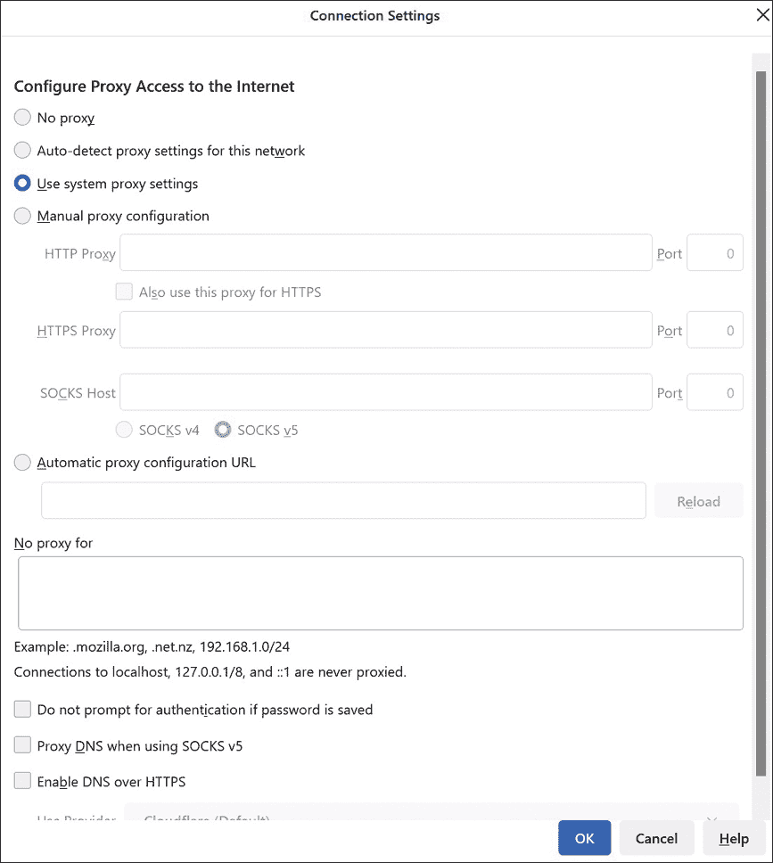

图 11.1 Firefox 浏览器中的客户端侧动态端口配置

### 以另一个用户身份执行命令

*权限提升*是一种以具有高权限的用户身份执行命令的方法。它被用于，例如，当用户需要使用比其用户账户通常更多权限的账户执行命令时。例如，普通用户可能需要执行一个需要 root 用户访问的命令。多种技术可以提供权限访问；本节涵盖了 Linux+ XK0-005 考试中可能包含的技术。

#### /etc/sudoers

有关 `/etc/sudoers` 的信息，请参见本章后面的“sudo”和“visudo”部分。

#### PolicyKit 规则

PolicyKit 是一个授权框架，允许未特权程序执行被认为是特权的操作。PolicyKit 的规则存储在以下目录的文件：

*  `/etc/polkit-1/rules.d`（基于 Red Hat 的系统）

*  `/etc/polkit-1/localauthority`（基于 Debian 的系统）

*  `/usr/share/polkit-1/rules.d`（第三方软件规则）

规则的编写可能很复杂。例如，以下规则允许如果用户是文件系统组的成员，则该用户可以通过 GUI 接口挂载文件系统：

点击此处查看代码图像

```
polkit.addRule(function(action, subject) {
    if (action.id == "org.freedesktop.udisks2.filesystem-mount-system" &&
        subject.isInGroup("filesystem")) {
        return polkit.Result.YES;
    }
});
```

注意

在此示例中，`org.freedesktop.udisks2.filesystem-mount-system` 是应用程序接口 (API) 调用，此文件是用 JavaScript 编写的。

### 考试提示

虽然 Linux+ XK0-005 考试可能会给出 PolicyKit 规则并对此提问，但不太可能，因为规则被认为是复杂的并且需要一些 JavaScript 知识。更有可能你问到一个关于如何使用规则通过 API 提供访问的通用问题。

#### sudo

当管理员正确配置 `sudo` 命令时，用户可以使用 `sudo` 命令以其他用户身份（通常是 root 用户身份）运行命令。要以 root 身份执行命令，请输入：

```
sudo command
```

然后你会被提示输入自己的密码，如果 `/etc/sudoers` 文件中的设置正确，命令将正确执行。如果设置不正确，会出现错误消息。

表 11.2 描述了 `sudo` 命令的常用选项。

表 11.2 **sudo** 命令选项

| 选项 | 描述 |
| :--- | :--- |
| `-b` | 在后台运行命令。 |
| `-e` | 允许你编辑 `/etc/sudoers` 文件。这是 visudo 工具的替代方案。 |
| `-l` | 列出允许用户使用的命令。 |
| `-u user` | 以*user* 身份而非 root 用户身份运行命令。 |

有关 `/etc/sudoers` 文件的详情，请参见后续章节“visudo”。

#### visudo

`/etc/sudoers` 文件用于确定哪些用户可以使用 `sudo` 命令以其他用户身份执行命令（通常是 root 用户身份）。要编辑此文件，你必须以 root 用户身份登录，并且应该使用 `visudo` 命令而不是直接编辑文件。

表 11.3 描述了 `/etc/sudoers` 文件的重要选项。


表 11.3 `/etc/sudoers` 文件定义

|  | 描述 |
| :--- | :--- |
| `User_Alias` | 代表一组用户（例如，`User_Alias ADMINS = julia, sarah`）。 |
| `Cmnd_Alias` | 代表一组命令（例如，`Cmnd_Alias SOFTWARE = /bin/rpm, /usr/bin/yum`）。 |

`/etc/sudoers` 文件中的条目使用以下语法：

```
user machine=commands
```

允许学生用户以 root 用户身份执行 `/usr/bin/yum` 命令，请在 `/etc/sudoers` 文件中添加如下条目：

```
student ALL=/usr/bin/yum
```

允许 `ADMINS` 组的所有成员以 root 用户身份执行所有 `SOFTWARE` 命令，请在 `/etc/sudoers` 文件中添加如下条目：

```
ADMINS ALL=SOFTWARE
```

### `su -`

`su` 命令允许用户切换用户账户。这是一个示例：

点击此处查看代码图像

```
[student@OCS ~]# id
uid=1000(student) gid=1000(student) groups=1000(student)
context=unconfined_u:unconfined_r:unconfined_t:s0-s0:c0.c1023
[student@localhost ~]# su root
Password:
[root@OCS ~]# id
uid=0(root) gid=0(root) groups=0(root)
context=unconfined_u:unconfined_r:unconfined_t:s0-s0:c0.c1023
```

执行 `su` 命令时有一个选项：`-` 选项。当你使用 `-` 选项执行 `su` 命令时，将提供一个新的登录 shell。当你不使用 `-` 字符时，提供的将是一个非登录 shell。

#### 考试告警

清楚在使用 `su` 命令时使用和不使用 `-` 的区别。Linux+ XK0-005 考试目标明确指出，你应该了解 `su -`，这意味着你可能会遇到需要你了解两者差异的题目。

### `pkexec`

使用 `pkexec` 命令执行通过 PolicyKit 配置的特权命令。该命令使用以下语法执行：

```
pkexec command
```

与 `sudo` 命令一样，使用 `pkexec` 命令时，系统会要求你提供账户密码以确认身份。

## 第 12 章：应用适当的访问控制

**本章涵盖了以下 Linux+ XK0-005 考试目标：**

*  **2.5:** 给给定的场景，应用适当的访问控制。

安全是今天 IT 领域的重点，了解如何保护文件系统对于稳健的 IT 安全计划至关重要。在本章中，你将学习如何使用权限保护文件和目录，包括访问控制列表、`suid`、`sgid` 和粘位（sticky bit）。你还将学习如何实现基于上下文的安全，并接触 SELinux 和 AppArmor。

本章提供了有关以下主题的信息：文件权限、增强型 Linux (SELinux)、AppArmor 和命令行工具。

### 文件权限

拥有文件或目录的用户有权通过权限允许或拒绝对该文件或目录的访问。此外，root 用户有权更改系统上任何文件或目录的权限。

每个文件和目录都有标准权限（也称为“读、写、执行”权限），这些权限允许或禁止用户访问。使用这些标准权限是每个 Linux 用户应该学会的，因为这是用户保护文件免受其他用户影响的主要方法。

查看文件或目录的权限，请使用 `ls -l` 命令：

点击此处查看代码图像

```
[student@OCS ~]$ ls -l /etc/chrony.keys
-rw-r-----. 1 root chrony 62 May 9 2018 /etc/chrony.keys
```

输出的前 10 个字符表示文件类型和文件的权限。（记住，第一个位置的字符 `-` [连字符] 表示普通文件，而 `d` 表示目录。）权限被分为三组：文件的所有者用户（在上例中为 `root`）、组所有者（`chrony`）以及所有其他用户（称为“others”）。

每组有三种可能的权限：读 (`r`)、写 (`w`) 和执行 (`x`)。

如果权限已设置，则显示表示该权限的字符。否则，显示一个连字符 (`-`) 表示未设置该权限。因此，`r-x` 意味着“已设置读和执行，但未设置写权限”。

读、写、执行权限的实际含义取决于对象是文件还是目录。对于文件，这些权限意味着：

*  **读：** 可以查看或复制文件内容。
*  **写：** 可以修改文件内容。
*  **执行：** 可以像程序一样运行该文件。在你创建一个程序后，必须赋予其可执行权限才能运行它。

对于目录，这些权限意味着：

*  **读：** 可以列出目录中的文件。
*  **写：** 可以在目录中添加和删除文件（需要执行权限）。
*  **执行：** 可以进入目录（使用 `cd` 命令）或在路径中使用它。

### 访问控制列表 (ACL)

请参阅本章后后的 `setfacl/getfacl` 章节。

### 设置用户 ID (SUID)、设置组 ID (SGID) 和粘位

表 12.1 描述了特殊权限集 `suid`、`sgid` 和粘位。

表 12.1 `suid/sgid/sticky bit` 特殊权限集

| 权限 | 描述 | 设置 | 移除 |
| :--- | :--- | :--- | :--- |
| `suid` | 在可执行文件上设置时，`suid` 允许程序使用执行文件所有者的权限访问文件。 | `chmod u+s file` 或 `chmod 4xxx file`（其中 `xxx` 指普通的读、写、执行权限） | `chmod u-s file` 或 `chmod 0xxx file` |
| `sgid` | 在可执行文件上设置时，`sgid` 允许程序使用执行文件组所有者的权限访问文件。当设置在目录上时，目录中的所有新文件都将继承目录的组所有权。 | `chmod g+s file` 或 `chmod 2xxx file` | `chmod g-s file` 或 `chmod 0xxx file` |
| **Sticky bit** | 在目录上设置粘位时，目录中的文件只能由文件所有者用户、目录所有者或 root 用户删除。 | `chmod o+t file` 或 `chmod 1xxx file` 注意：粘位权限几乎总是被设置为八进制值 1777。 | `chmod o-t file` 或 `chmod 0xxx file` |

### 增强型 Linux (SELinux)

文件和目录可能会被不了解权限或无意中提供了超出访问权限的用户所破坏。系统管理员以前常说：“如果没有用户，什么东西都不会坏，系统也会更安全。”当然，对这个说法的回答是：“如果没有用户，我们就没有工作做了！”

注意，传统的 Linux 权限使用自主访问控制 (DAC)，而基于上下文的权限使用强制性访问控制 (MAC)。然而，当启用基于上下文的解决方案时，DAC 仍然有效（即 MAC 和 DAC 都被强制执行）。

可以配置基于上下文的权限，在使用进程（程序）访问文件时提供额外的安全层级来弥补这一缺陷。本节和下一节涵盖了两种常用的基于上下文的方法：SELinux 和 AppArmor。


通过 SELinux，你可以应用一种安全策略，要求进程必须属于 SELinux 安全上下文（本质上是一个安全组）才能允许访问文件和目录。普通权限仍用于进一步定义访问权限，但在访问文件/目录时，会先应用 SELinux 策略。

一个更严重的问题——也是大多数 SELinux 策略旨在解决的问题——是守护进程（或系统进程）是如何呈现安全风险的。考虑一种情况：你有许多提供各种服务的活动进程。例如，其中一个进程可能是 Web 服务器，如下例所示：

点击此处查看代码图像

```
root@OCS:~# ps -fe | grep httpd
root   1109  1    0 2018 ?  00:51:56 /usr/sbin/httpd
apache 1412  1109 0 Dec24 ? 00:00:09 /usr/sbin/httpd
apache 4085  1109 0 05:40 ? 00:00:12 /usr/sbin/httpd
apache 8868  1109 0 08:41 ? 00:00:06 /usr/sbin/httpd
apache 9263  1109 0 08:57 ? 00:00:04 /usr/sbin/httpd
apache 12388 1109 0 Dec26 ? 00:00:47 /usr/sbin/httpd
apache 18707 1109 0 14:41 ? 00:00:00 /usr/sbin/httpd
apache 18708 1109 0 14:41 ? 00:00:00 /usr/sbin/httpd
apache 19769 1109 0 Dec27 ? 00:00:15 /usr/sbin/httpd
apache 29802 1109 0 01:43 ? 00:00:17 /usr/sbin/httpd
apache 29811 1109 0 01:43 ? 00:00:11 /usr/sbin/httpd
apache 29898 1109 0 01:44 ? 00:00:10 /usr/sbin/httpd
```

在此输出中，请注意每一行都描述了系统上运行的一个 Apache Web 服务器进程（`/usr/sbin/httpd`）。行的第一部分是启动该进程的用户。以 root 身份运行的进程仅用于产生额外的 `/usr/sbin/httpd` 进程。然而，其他进程响应来自客户端工具（Web 浏览器）的入站网页请求。

想象一下，如果 Apache Web 服务器软件发现了一个安全漏洞，允许客户端工具控制其中一个 `/usr/sbin/httpd` 进程，并向该进程发布自定义命令或操作。其中一个操作操作可能是查看 `/etc/passwd` 文件的内容，由于该文件设置了权限，该操作将成功执行：

点击此处查看代码图像

```
root@OCS:~# ls -l /etc/passwd
-rw-r--r-- 1 root root 2690 Dec 11 2018 /etc/passwd
```

从此命令的输出中可以看出，所有用户都有查看 `/etc/passwd` 文件内容的权限。但你真的希望某些随机人员（可能是黑客）拥有查看存储用户账户数据文件内容的能力吗？

通过 SELinux 策略，可以对 `/usr/sbin/httpd` 进程进行锁定，使得每个进程只能访问一组特定的文件。这就是大多数管理员使用 SELinux 的原因：通过保护进程来防止它们被黑客利用已知的（或可能是未知的）漏洞进行攻破。

### 标签 (Labels)

在 SELinux 中对文件标记标签涉及对文件应用安全上下文。有关安全上下文的信息，请参阅本章后后的 `chcon` 部分。

### 自动重新标记 (Autorelabel)

如果你想更改系统中所有文件的 SELinux 上下文，可以告诉系统在下次启动过程中对文件系统中的每个文件执行自动重新标记过程。要执行此操作，请像这里所示在根目录下创建一个空文件：

点击此处查看代码图像

```
root@OCS:~# touch /.autorelabel
```

### 系统布尔值 (System Booleans)

有关 SELinux 布尔值的详细信息，请参阅本章后后的 `getsebool` 部分。

### 状态 (States)

SELinux 可以处于三种状态（或模式）之一：

*   **强制模式 (Enforcing):** 在强制模式下，SELinux 会执行检查并在必要时阻止对文件或目录的访问。
*   **许可模式 (Permissive):** 在许可模式下，SELinux 会执行检查，但绝不会阻止对文件或目录的访问。此模式专为排排除故障而设计，因为在此模式下会创建日志消息。
*   **禁用 (Disabled):** 在禁用模式下，SELinux 完全不运行。当用户尝试访问文件或目录时，不会执行任何检查。

注意

请参阅本章后后的 `setenforce` 和 `getenforce` 部分，以获取更多关于查看和更改 SELinux 模式的细节。

### 策略类型 (Policy Types)

SELinux 策略是规则的集合，决定了策略施加的限制。策略本身通常非常复杂，SELinux 策略的细节超出了 Linux+ XK0-005 考试的范围。然而，知道策略根据规则设置限制是非常重要的。

你还应该知道，最常用的策略之一是目标策略 (targeted policy)。该策略通常存在于安装了 SELinux 的系统上，并且它通常是 SELinux 首次启动时启用的默认策略。

#### 目标 (Targeted)

目标策略包含旨在保护系统免受服务攻击而非普通用户攻击的规则。每个服务都被分配一个或多个安全上下文、布尔值以及额外的规则，这些规则限制了服务访问文件和目录的能力。

#### 最小 (Minimum)

SELinux 包含一个仅包含最少安全设置的目标。这被称为最小目标 (minimum target)。

### AppArmor

AppArmor 是一种强制性访问控制（MAC）系统，其作用与 SELinux 类似，因为它提供了一种基于上下文的权限模型。本节描述了 Linux+ XK0-005 考试涵盖的 AppArmor 关键组件。

AppArmor 配置文件（profile）是一组规则，描述了 AppArmor 如何限制进程。可以使用 `aa-disable` 命令禁用特定服务的配置。这里是一个示例：

点击此处查看代码图像

```
root@OCS:~# aa-disable /usr/sbin/mysqld
```

要查看配置的状态，使用 `aa-status` 命令。

点击此处查看代码图像

```
root@OCS:~# aa-status
apparmor module is loaded.
19 profiles are loaded.
17 profiles are in enforce mode.
   /usr/lib/NetworkManager/nm-dhcp-client
   /usr/lib/NetworkManager/nm-dhcp-helper
   /usr/lib/connman/scripts/dhclient-script
   /usr/lib/cups/backend/cups-pdf
   /usr/lib/lightdm/lightdm-guest-session
   /usr/lib/lightdm/lightdm-guest-session//chromium
   /usr/sbin/cups-browsed
   /usr/sbin/cupsd
   /usr/sbin/cupsd//third_party
   /usr/sbin/tcpdump
   /{,usr/}sbin/dhclient
   libreoffice-senddoc
   libreoffice-soffice//gpg
   libreoffice-xpdfimport
   lsb_release
   nvidia_modprobe
   nvidia_modprobe//kmod
2 profiles are in complain mode.
   libreoffice-oop
   libreoffice-soffice
5 processes have profiles defined.
5 processes are in enforce mode.
   /usr/sbin/cups-browsed (591)
   /usr/sbin/cupsd (495)
   /usr/lib/cups/notifier/dbus (592) /usr/sbin/cupsd
   /usr/lib/cups/notifier/dbus (593) /usr/sbin/cupsd
   /usr/lib/cups/notifier/dbus (594) /usr/sbin/cupsd
0 processes are in complain mode.
0 processes are unconfined but have a profile defined.
```

如果你需要排排除 AppArmor 配置文件，最好的方法将其放入投诉模式（complain mode）。在此模式下，不执行任何限制，但会报告任何问题。

使用 `aa-complain` 命令将配置放入投诉模式：

点击此处查看代码图像

```
root@OCS:~# aa-complain /usr/sbin/mysqld
Setting /usr/sbin/mysqld to complain mode.
```

要将配置恢复回强制模式，可以使用以下命令：

点击此处查看代码图像


```
chief@chief-VirtualBox:~$ sudo aa-enforce /usr/bin/man
Setting /usr/bin/man to enforce mode.
chief@chief-VirtualBox:~$ sudo aa-disable /usr/bin/man
Disabling /usr/bin/man.
chief@chief-VirtualBox:~$ sudo aa-status
apparmor module is loaded.
19 profiles are loaded.
17 profiles are in enforce mode.
   /usr/lib/NetworkManager/nm-dhcp-client.action
   /usr/lib/NetworkManager/nm-dhcp-helper
   /usr/lib/connman/scripts/dhclient-script
   /usr/lib/cups/backend/cups-pdf
   /usr/lib/lightdm/lightdm-guest-session
   /usr/lib/lightdm/lightdm-guest-session//chromium
   /usr/sbin/cups-browsed
   /usr/sbin/cupsd
   /usr/sbin/cupsd//third_party
   /usr/sbin/tcpdump
   /{,usr/}sbin/dhclient
   libreoffice-senddoc
   libreoffice-soffice//gpg
   libreoffice-xpdfimport
   lsb_release
   nvidia_modprobe
   nvidia_modprobe//kmod
2 profiles are in complain mode.
   libreoffice-oopslash
   libreoffice-soffice
5 processes have profiles defined.
5 processes are in enforce mode.
   /usr/sbin/cups-browsed (591)
   /usr/sbin/cupsd (495)
   /usr/lib/cups/notifier/dbus (592) /usr/sbin/cupsd
   /usr/lib/cups/notifier/dbus (593) /usr/sbin/cupsd
   /usr/lib/cups/notifier/dbus (594) /usr/sbin/cupsd
0 processes are in complain mode.
0 processes are unconfined but have a profile defined.
chief@chief-VirtualBox:~$ sudo aa-complain /usr/bin/man
Setting /usr/bin/man to complain mode.
chief@chief-VirtualBox:~$ sudo aa-enforce /usr/bin/man
Setting /usr/bin/man to enforce mode.
```

你可以使用 `aa-unconfined` 命令来列出不受 AppArmor 配置文件限制的进程。

`/etc/apparmor.d` 目录是 AppArmor 配置文件定义的位置。了解如何创建或读取这些文件超 Linux+ XK0-005 考试的范围，但了解这些配置的位置是重要的，以便确定哪些配置是可用的，并使用 AppArmor 命令（例如 `aa-disable` 命令）。

`/etc/apparmor.d/tunables` 目录是用于精调 AppArmor 行为的文件位置。了解如何创建或读取这些文件超 Linux+ XK0-005 考试的范围。

### 命令行工具

本节涵盖了几个与权限、SELinux 和 AppArmor 相关的实用程序。

#### chmod

`chmod` 命令用于更改文件的权限。它可以通过两种方式使用：使用符号法和使用八进制法。在八进制法中，权限被分配为数值值：

*    读取 = 4
*    写入 = 2
*    执行 = 1

使用这些数值值，一个数字就可以描述整组权限：

*    7 = `rwx`
*    6 = `rw-`
*    5 = `r-x`
*    4 = `r--`
*    3 = `-wx`
*    2 = `-w-`
*    1 = `--x`
*    0 = `---`

因此，要将文件的权限更改为 `rwxr-xr--`，你需要执行以下命令：

```
chmod 754 filename
```

表 12.2 提供了使用八进制法的示例。

表格 12.2 **使用八进制模式的示例**

| **示例** | **描述** |
| --- | --- |
| `chmod 755 file` | 设置权限 `rwxr-xr-x`。 |
| `chmod 511 file` | 设置权限 `r-x--x--x`。 |
| `chmod 600 file` | 设置权限 `rw-------`。 |

使用八进制权限时，你应该始终提供三个数字，这将更改所有权限。但如果你只想更改集合中的单个权限怎么办？对于这种情况，你应当通过向 `chmod` 命令传递三个值来使用符号法，如表 12.3 所示。

表格 12.3 **符号模式选项**

| 角色 (Who) | 操作 (What) | 权限 (Permission) |
| --- | --- | --- |
| `u` = 用户所有者 | `+` | `r` |
| `g` = 组所有 | `-` | `w` |
| `o` = 其他 | `=` | `x` |
| `a` = 所有集合 | | |

以下示例演示了如何使用符号法向所有三个集合（用户所有者、组所有者和其他）添加执行权限：

点击此处查看代码图片

```bash
[student@OCS ~]$ ls -l display.sh
-rw-rw-r--. 1 student student 291 Apr 30 20:09 display.sh
[student@OCS ~]$ chmod a+x display.sh
[student@OCS ~]$ ls -l display.sh
-rwxrwxr-x. 1 student student 291 Apr 30 20:09 display.sh
```

表 12.4 描述了 `chmod` 命令的一些重要选项。

表格 12.4 **chmod 命令**

| 选项 | 描述 |
| --- | --- |
| `-R` | 递归应用更改。 |
| `v` | 详细模式。 |

#### umask

`umask` 命令为文件设置默认权限。掩码是一个八进制值，应用于新文件的最大权限上。

 12.5 **新文件的最大权限**

| 类型 | 最大权限 |
| --- | --- |
| 文件 | `rw-rw-` |
| 目录 | `rwxrwxrwx` |

图 12.1 说明了 `umask` 如何应用。

**考试**

每个 shell 都有自己的 `umask` 值。如果你在一个 shell 中更改了 `umask`，它不会影响任何其他 shell 的 `umask`。要实现跨登录的持久更改，请将 `umask` 命令添加到 `.bash_profile`。

#### chown

`chown` 命令用于更改文件或目录的用户所有者或组所有者。表 12.6 演示了使用此命令的不同方法。

表格 12.6 **chown 用法**

| 示例 | 描述 |
| --- | --- |
| `chown tim file.txt` | 将 `file.txt` 的所有者更改为 `tim`。 |
| `chown tim:staff file.txt` | 将 `file.txt` 的所有者更改为 `tim`，组所有者更改为 `staff`。 |
| `chown :staff file.txt` | 将 `file.txt` 的组所有者更改为 `staff`。 |

**注意**

只有 root 用户可以更改文件的所有者。要更改文件的组所有者，执行 `chown` 命令的用户必须拥有该文件，并且是目标所有权组的成员。

表 12.7 描述了 `chown` 命令的一些重要选项。

表格 12.7 **chown 选项**

| 选项 | 描述 |
| --- | --- |
| `-R` | 递归应用更改。 |
| `--reference=file` | 将用户和组所有者更改为 *file*。 |
| `-v` | 进入详细模式。 |

#### setfacl/getfacl

ACL（访问控制列表）允许文件所有者为特定的用户和组提供权限。`setfacl` 命令用于文件或目录上创建 ACL：

```bash
sarah@OCS:~$ setfacl -m user:dane:r-- sales_report
```

`-m` 选项用于为文件创建新的 ACL。`-m` 选项的参数格式为 *what*:*who*:*permission*。*what* 的值可以是以下之一：

*    **user** 或 `u`，当为特定用户应用 ACL 时 |
*    **group** 或 `g`，当为特定组应用 ACL 时 |


*  为其他人（others）应用 ACL 时使用 `others` 或 `o`
*  为 ACL 设置掩码（mask）时使用 `mask` 或 `m`（掩码将在本节稍后部分解释。）

`*who*`（**谁**）的值表示权限将应用于的用户或用户组。权限可以用符号值（`r--`）或八进制值（`4`）的形式提供。

一旦对文件或目录应用了 ACL，执行 `ls -l` 命令时，权限后面会出现加号（`+`），如下所示：

点击此处查看代码图像

```
sarah@OCS:~$ ls -l sales_report
-rw-rw-r--+ 1 sarah sales 98970 Dec 27 16:45 sales_report
```

要查看 ACL，请使用 `getfacl` 命令：

点击此处查看代码图像

```
sarah@OCS:~$ getfacl sales_report
# file: sales_report
# owner: sarah
# group: sarah
user::rw-
user:william:r--
group::rw-
mask::rw-
other::r--
```

下面的示例演示了为组设置 ACL 的过程：

点击此处查看代码图像

```
sarah@OCS:~$ setfacl -m g:games:6 sales_report
sarah@OCS:~$ getfacl sales_report
# file: sales_report
# owner: sarah
# group: sarah
user::rw-
user:william:r--
group::rw-
group:games:rw-
mask::rw-
other::r--
```

对于普通权限，使用 `umask` 值来确定应用于新文件和目录的默认权限。对于 ACL，你可以使用 `setfacl` 命令的 `-m` 选项为在 shell 中创建的所有新文件和目录定义默认 ACL 集。在这种情况下，参数使用以下语法：`default:*what*:`who*:`*permission*`。

下面的示例为 `reports` 目录创建了一个默认 ACL：

点击此处查看代码图像

```
sarah@OCS:~$ mkdir reports
sarah@OCS:~$ setfacl -m default:g:games:r-x reports
sarah@OCS:~$ setfacl -m default:u:bin:rwx reports
sarah@OCS:~$ getfacl reports
# file: reports
# owner: sarah
# group: sarah
user::rwx
group::rwx
other::r-x
default:user::rwx
default:user:bin:rwx
default:group::rwx
default:group:games:r-x
default:mask::rwx
default:other::r-x
```

下面的示例演示了新文件和目录如何继承上一个示例执行命令时创建的 ACL：

点击此处查看代码图像

```
sarah@OCS:~$ mkdir reports/test
sarah@OCS:~$ getfacl reports/test
# file: reports/test
# owner: sarah
# group: sarah
user::rwx
user:bin:rwx
group::rwx
group:games:r-x
mask::rwx
other::r-x
default:user::rwx
default:user:bin:rwx
default:group::rwx
default:group:games:r-x
default:mask::rwx
default:other::r-x
sarah@OCS:~$ touch reports/sample1
sarah@OCS:~$ getfacl reports/sample1
# file: reports/sample1
# owner: sarah
# group: sarah
user::rw-
user:bin:rwx #effective:rw-
group::rwx #effective:rw-
group:games:r-x #effective:r--
mask::rw-
other::r--
```

表 12.8 描述了 `setfacl` 命令的一些重要选项。

表 12.8 `setfacl` 命令选项

| 选项 | 说明 |
| --- | --- |
| `-b` | 移除所有 ACL。 |
| `-d` | 在目录上设置默认 ACL，该目录内创建的任何新文件或目录将继承它。 |
| `-R` | 递归应用。 |

#### ls

详见本章前面的“文件权限”部分，了解 `ls` 命令的 `-l` 选项如何显示文件和目录权限。

#### setenforce

你可以使用 `setenforce` 命令禁用安全策略（这在测试新策略或排查 SELinux 问题时很有用）：

```
root@OCS:~# setenforce 0
root@OCS:~# getenforce
Permissive
```

在许可模式（permissive mode）下，SELinux 不阻塞对文件的任何访问。

#### permissive mode

你可以使用 `setenforce` 命令禁用安全策略（这在测试新策略或排查 SELinux 问题时很有用）：

```
root@OCS:~# setenforce 0
root@OCS:~# getenforce
Permissive
```

在许可模式（permissive mode）下，SELinux 不阻塞对文件的任何访问。

#### getenforce

使用 `getenforce` 命令确定当前模式：

```
root@OCS:~# getenforce
Permissive
```

在许可模式（permissive mode）下，SELinux 不阻塞对文件的任何访问。

#### Enforcing

在许可模式（permissive mode）下，SELinux 不阻塞对文件的任何访问。

#### chattr

下面的示例演示了以下过程：

```
sarah@OCS:~$ ls -l 0
```

#### immutable

`i` 属性使文件变为不可变，使其无法被删除或修改。

要移除不可变属性，请使用命令：

```
root@OCS:~# chattr -i /etc/passwd
```

在许可模式（permissive mode）下，SELinux 不阻塞对文件的任何访问。

#### chattr

`chattr` 命令用于更改文件属性。

#### syntax

该命令的语法如下：

```
chattr [options] attribute file
```

在下面的示例中，将 `abc.txt` 文件的组所有权更改为 `staff` 组：

```
[student@OCS ~]$ chgrp staff abc.txt
```


| `-R` | 递归地对整个目录结构应用更改。 |
| `--reference=file` | 将用户和组所有者更改为 `file` 的所有权。 |
| `-v` | 进入详细模式并产生输出以显示所做的更改。 |

### setsebool

SELinux 安全策略包含布尔值（Booleans）。布尔值是一个可以分配真（true）或假（false）值的设置。该值会影响 SELinux 策略的行为。要设置 SELinux 布尔值，请使用 `setsebool` 命令：

点击此处查看代码图像

```
root@OCS:~# getsebool -a | grep abrt_anon_write
abrt_anon_write --> off
root@OCS:~# setsebool abrt_anon_write 1
root@OCS:~# getsebool -a | grep abrt_anon_write
abrt_anon_write --> on
```

有关布尔值的信息，请参见下一一节。

### getsebool

要查看所有布尔值，请使用 `getsebool` 命令：

点击此处查看代码图像

```
root@OCS:~# getsebool -a | head
abrt_anon_write --> off
abrt_handle_event --> off
abrt_upload_watch_anon_write --> on
antivirus_can_scan_system --> off
antivirus_use_jit --> off
auditadm_exec_content --> on
authlogin_nsswitch_use_ldap --> off
authlogin_radius --> off
authlogin_yubikey --> off
awstats_purge_apache_log_files --> off
```

要确定某个布尔值的用途，请使用 `semanage` 命令：

点击此处查看代码图像

```
root@OCS:~# semanage boolean -l | head
SELinux boolean State Default Description

privoxy_connect_any (on , on)
 Allow privoxy to connect any
smartmon_3ware       (off , off) Allow smartmon
to 3ware
mpd_enable_homedirs  (off , off) Allow mpd to
 enable homedirs
xdm_sysadm_login      (off , off) Allow xdm to
 sysadm login
xen_use_nfs            (off , off) Allow xen to use nfs
mozilla_read_content   (off , off) Allow mozilla
to read content
ssh_chroot_rw_homedirs (off , off) Allow ssh to
 chroot rw homedirs
mount_anyfile          (on , on) Allow mount to anyfile
```

有关如何设置布尔值的信息，请参见上一一节，“setsebool”。

### chcon

每个进程都在安全上下文中运行。要查看此内容，请使用 `ps` 命令的 `-Z` 选项：

点击此处查看代码图像

```
root@OCS:~# ps -fe | grep httpd | head -2
system_u:system_r:httpd_t:s0 root 1109 1 0 2018 ?
  00:51:56 /usr/sbin/httpd
system_u:system_r:httpd_t:s0 apache 1412 1109 0 Dec24 ?
  00:00:09 /usr/sbin/httpd
```

注意

在此示例中使用 `head` 命令仅用于限制命令的输出。

该安全上下文 (`system_u:system_r:httpd_t:s0`) 是复杂的，但对于理解 SELinux 的基础，重要的部分是 `httpd_t`，它类似于安全组或域。作为该安全域的一部分，`/usr/sbin/httpd` 进程只能访问安全策略允许 `httpd_t` 访问的文件。此策略通常由 SELinux 专家编写，该专家需要具有关于哪些进程能够访问系统上特定文件和目录的证明过的经验。

文件和目录也具有由策略定义的 SELinux 安全上下文。要查看特定文件的安全上下文，请使用 `ls` 命令的 `-Z` 选项（注意 SELinux 上下文包含大量数据，导致文件名无法在单行内显示）：

点击此处查看代码图像

```
root@OCS:~# ls -Z /var/www/html/index.xhtml
unconfined_u:object_r:httpd_sys_content_t:s0/var/www/html/index.xhtml
```

使用 `chcon` 命令更改文件或目录的上下文：

点击此处查看代码图像

```
root@OCS:~# chcon -t user_home_t /var/www/html/index.xhtml
```

### restorecon

SELinux 规则定义了大多数系统文件的默认安全上下文。`restorecon` 命令用于重置文件或目录的默认安全上下文。

示例：

点击此处查看代码图像

```
root@OCS:~# restorecon /var/www/html/index.xhtml
```

`restorecon` 命令的一个常用选项是 `-R` 选项，它递归地对目录结构上执行更改。

### semanage

`semanage` 命令的工作原理与 `chcon` 命令相同，唯一的例外是更改是持久的。换句话说，如果你使用 `chcon` 命令设置了上下文，`restorecon` 命令会将上下文恢复到之前的值。然而，如果你使用 `semanage` 命令，那么使用 `restorecon`（或使用 `/.autorelabel` 方法）不会导致 SELinux 上下文恢复到之前的值。

### audit2allow

当进程被 SELinux 拒绝访问时，var/log/audit/audit.log` 文件中会类似下面的条目：

点击此处查看代码图像

```
type=AVC msg=audit(1435467578.546:231): avc:  denied  { write } for
pid=12345 comm="test" name="cache" dev=dm-0 ino=12345
```

如果你发现此访问本应被允许，可以使用 `audit2allow` 命令生成一条允许访问的规则：

点击此处查看代码图像

```
$ grep test /var/log/audit/audit.log | audit2allow -R -M test
```

# 第三部分：脚本、容器与自动化

## 第 13 章

## 创建简单的 Shell 脚本自动化常用任务

**本章涵盖了以下 Linux+ XK0-005 考试目标：**

*  **3.1:** 给定一个场景，创建简单的 shell 脚本来自动化常用任务。

准备好面对比平均水平更大的考试主题：脚本编写。*脚本编写*（Scripting）是从 BASH 命令创建程序的过程。虽然 BASH 中的功能与其他语言相比非常原始，但可用命令的海量巨大使得 BASH 成为了一门非常强大的语言。

在阅读本章时，请记住你在这里学到的大部分内容不仅仅是为了脚本。例如，你将学习重定向，这包括将命令输出发送到文件而不是屏幕的过程。这不仅对于脚本非常有用，对于日常情况也很有用。

除了学习脚本功能（如循环和条件语句）外，你还将学习一些在脚本中常用的工具。你还将学习如何利用变量来存储信息，以及显示有用的 shell 信息。

本章提供了以下主题的信息：shell 脚本元素、命令脚本工具、环境变量以及相对路径和绝对路径。

## Shell 脚本元素

脚本的第一行应该包含解释器的路径。对于 BASH shell 脚本，这应该是可执行的 `bash` 命令的路径。可以通过执行以下命令来发现此路径：

```
[root@OCS ~]$ which bash
/bin/bash
```

你可以按照如下所示将此路径添加到脚本的第一行：

```#!/bin/bash
```

`#`（哈希字符）和 `!`（感叹号字符）的组合形成了 *shebang*（解释器）序列。（快速读出“hash bang”即可发现 *shebang* 一词的来源；它通常读音时不发音 *e*。）

脚本应该由普通用户所有，而不是 root 用户。运行 root 拥有的脚本会导致安全问题。如果脚本由 root 所有，则不应对其设置 `suid` 权限，因为这将导致严重的安全风险。（大多数现代 Linux 发行版不允许 root 拥有的 **suid** 脚本。）

在创建脚本后，你需要添加执行权限以便像程序一样运行。这是执行此操作的语法：

```
chmod a+x script_name
```


BASH shell 脚本应以 `.sh` 扩展名结尾，表示文件内容包含 BASH shell 脚本。（也使用 `.bash` 扩展名，但并不十分常用。）

其他脚本语言应该有扩展名来指示语言类型：

*  `.pl:` Perl 脚本
*  `.py:` Python 脚本
*  `.tcsh:` TC shell 脚本
*  `.csh:` C shell 脚本

注释以哈号（`#`）开始并延伸到行尾，例如所示：

```
#Set the count variable:
count = 100
```

以下是在包含代码的行中注释的示例：

点击此处查看代码图像

```
count = 100 #Set the count variable
```

本节的其余部分描述了额外的 shell 脚本元素。

### 循环

循环结构是 BASH 脚本中执行一组操作（可能多次执行）的代码。本节检查了三种常用的循环结构：`while`、`until` 和 `for` 循环。

### while

`while` 循环设计用于只要条件语句返回 `true` 值，就执行一组任务（命令）。例如，以下代码可以检查用户输入，以验证是否提供了正确的值：

点击此处查看代码图像

```
read -p "Enter a zip code: "
while echo $zip | egrep -v "^[0-9]{5}$"
do
   echo "$zip is not a valid ZIP code, try again"
   read -p "Enter a zip code" zip
done
```

这里是该代码运行的示例：

点击此处查看代码图像

```
Enter a zip code: 8888
8888 is not a valid ZIP code, try again
Enter a zip code: huh?
huh? is not a valid ZIP code, try again
Enter a zip code: 92020
```

注意：`read` 命令从标准输入读取输入，通常是用户的键盘输入。详细信息请参阅本章稍后的“read”部分。

### for

`for` 循环用于迭代值列表。例如，以下代码对文件列表执行 `wc -l` 命令：

```
for file in "/etc/r*.conf"
do
    wc -l $file
done
```

示例输出：

```
 43 /etc/request-key.conf
 3 /etc/resolv.conf
 61 /etc/rsyslog.conf
```

考试要点：注意何时应该使用 `for` 循环而不是 `while` 循环，这可能会出现在 Linux+ XK0-005 考试中。

### until

`until` 语句的工作方式与 `while` 语句类似，但它在条件语句为假时执行其代码集。将以下 `while` 语句的伪代码与 `until` 语句的伪代码进行比较：

点击此处查看代码图像

```
while conditional_check
do
    #executes if conditional_check returns true
done

until conditional_check
do
    #executes if conditional_check returns false
done
```

考试要点：务必确切 `while` 循环和 `until` 循环之间的区别。

## 条件

`test` 语句用于执行条件测试，用于比较值和执行文件测试操作。

运行 `test` 语句的常用方法是将操作放在方括号内。例如，这两个语句执行相同的操作：

```
test $name1 = $name2
[ $name1 = $name2 ]
```

表 13.1 描述了常见的 `test` 操作。

### 表 13.1 常见的 test 操作

| 操作 | 描述 |
| --- | --- |
| `str1 = str2` | 如果两个字符串相等，则返回 `true`。 |
| `str1 != str2` | 如果两个字符串不等，则返回 `true`。 |
| `-z str` | 如果 `str` 的长度为零，则返回 `true`；例如 `[ -z $name ]`。 |
| `-n str` | 如果 `str` 的长度不零，则返回 `true`；例如 `[ -n $name ]`。 |
| `int1 -eq int2` | 如果两个整数相等，则返回 `true`。 |
| `int1 -ne int2` | 如果两个整数不等，则返回 `true`。 |
| `int1 -gt int2` | 如果第一个整数大于第二个整数，则返回 `true`。 |
| `int1 -ge int2` | 如果第一个整数大于或等于第二个整数，则返回 `true`。 |
| `int1 -lt int2` | 如果第一个整数小于第二个整数，则返回 `true`。 |
| `int1 -le int2` | 如果第一个整数小于或等于第二个整数，则返回 `true`。 |
| `-d file` | 如果文件是目录，则返回 `true`。 |
| `-f file` | 如果文件是普通文件，则返回 `true`。 |
| `-e file` | 如果文件存在（无论它是什么类型的文件或目录），则返回 `true`。 |
| `-r file` | 如果文件可读，则返回 `true`。 |
| `-w file` | 如果文件可写，则返回 `true`。 |
| `-x file` | 如果文件可执行，则返回 `true`。 |

### if

`if` 语句用于根据条件语句的结果执行一个或多个命令。例如，以下脚本如果 `$name` 变量设置为“Bob”，则显示“hi”：

```bash
if [ $name = "Bob" ]
then
    echo "hi"
fi
```

注意，要结束 `if` 语句内执行的命令，需要使用 `fi` 语句（即 `if` 的倒序写法）。

`else` 语句与 `if` 语句配合使用，在条件返回 `false` 时提供替代方案。这是一个示例：

```bash
if [ $name = "Bob" ]
then
    echo "hi"
else
    echo "I don't know you"
fi
```

可以执行多个条件检查，如下所示：

```bash
if [ $name = "Bob" ]
then
    echo "hi, Bob"
elif [ $name = "Sue" ]
then
    echo "hi, Sue"
else
    echo "I don't know you"
fi
```

考试要点：你应该知道不同的语句如何结束。`fi` 结束 `if` 语句，`done` 结束 `for`、`while` 和 `until` 语句。

### switch/case

`case` 语句（有时称为“switch”语句）将变量的值与通配模式进行比较。

语法：

```bash
case $var in
glob 1)
   #statements
   ;;
glob 2)
   #statements
   ;;
esac
```

使用两个分号（`;`）结束一组语句，并且必须在下一个通配符之前出现。要结束 `case` 语句，使用 `esac`。

示例：

点击此处查看代码图像

```bash
case $1 in
 start)
 echo "Starting the process"
 ;;
 stop)
 echo "Stopping the process"
 ;;
 *)
 echo "I need to start or stop"
esac
```

## Shell 参数扩展

脚本可以带参数运行，如下：

```
./example.sh arg1 arg2 arg3
```

每个参数都存储在 `$1`、`$2`、`$3` 等。`$0` 是脚本本身的名字。

特殊 BASH 变量 `$#` 包含传递给脚本的参数数量。

 通配符

文件通配符（也称为通配符 `*`）是命令行提供的代表文件名部分的任何字符。表 13.2 描述了支持的通配符。

### 表 13.2 支持的通配符

| 通配符 | 描述 |
| --- | --- |
| `*` | 匹配文件名中的零或多个字符。 |
| `?` | 匹配文件名中的单个字符。 |
| `[ ]` | 匹配文件名中的单个字符，只要该字符在 `[ ]` 内。 |

此示例复制所有 `.txt` 文件：

```bash
[student@OCS ~]$ cp *.txt ~
```

此示例删除所有长度为四个字符的文件：

```bash
[student@OCS ~]$ rm ????
```

要查看当前目录下所有以 **a**、**b** 或 **c** 开头的文件类型，执行以下命令：

```bash
[student@OCS ~]$ file [abc]*
```

该命令也可以这样执行：

```bash
[student@OCS ~]$ file [a-c]*
```


其中 `a-c` 表示字符范围。这必须是 ASCII 文本表内的有效范围。要查看此表，请执行以下命令：

```
[student@OCS ~]$ man ascii
```

允许使用多个范围或值列表，例如所示：

点击此处查看代码图像

```
[student@OCS ~]$ file [a-cg-jz]*
```

通过在范围开头放置一个 `!` 字符，你可以指定哪些字符不能匹配。例如，以下命令会复制当前目录下所有不以 `a`、`b` 或 `c` 开头的文件：

```
[student@OCS ~]$ cp [!abc]* ~
```

此示例还演示了如何使用多个 glob 通配符创建复杂的模式。

### 大括号扩展

使用 `BASH` 变量扩展功能，你可以返回不同的值。例如，当 `$name` 变量未设置时，以下命令将返回“Bob”：

```
$ echo "Hello, ${name:-Bob}"
Hello, Bob
$ echo "Hello, $name"
Hello,
```

注意，当你像这样使用命令时，你并没有设置变量，而是针对这种特定情况使用了提供的值。若要返回一个值并设置变量，请使用以下命令：

```
$ echo "Hello, ${name:=Bob}"
Hello, Bob
$ echo "Hello, $name"
Hello, Bob
```

还有其他变量扩展功能。例如，以下命令将只返回变量的前 24 个字符，从而得到一个更“完整”的语句：

点击此处查看代码图像

```
$ times="It was the best of times, it was the worst of times."
$ echo ${times: 0:24}
It was the best of times
```

注意，在此示例中，`0` 表示要返回的第一个字符，`24` 表示要的字符总数（从字符 `0` 开始）。

命令替换是在较大的命令中执行子命令的过程。它通常用于收集数据并存储在变量中。例如，以下命令将 `date` 命令的输出存储在 `$today` 变量中：

```
today=$(date)
```

命令替换可以通过以下两种方式之一执行：

*  `$(cmd)`
*  `'cmd'`

注意，第二种方法使用的是反引号字符（也称为 backtick），而不是单引号。

### 比较

`BASH` shell 提供了几种条件语句，包括 `if` 语句、`while` 循环和 `until` 循环。这些条件语句使用了 `BASH` shell 中的比较功能，如下例所示：

```
if [ $name = "Bob" ]
then
    echo "hi"
fi
```

此示例对 `BASH` 命令 `test` 进行了隐式调用，该命令可执行多种比较测试，包括整数（算术）比较、字符串比较和文件测试操作。例如，以下示例测试存储在 `$name1` 变量中的字符串是否等于存储在 `$name2` 变量中的字符串：

```
[ "$name1" != "$name2" ]
```

注意

括号周围的空格非常重要。每个左方括号之后和每个右方括号之前都应该有一个空格。如果没有这些空格，将会出现错误信息。

接下来的几节将介绍不同比较操作。

#### 算术

如果你想执行整数（算术）比较操作，请使用以下符号：

*  `-eq:` 如果值相等，则结果为真。
*  `-ne:` 如果值不等，则结果为真。
*  `-gt:` 如果第一个值大于第二个值，则结果为真。
*  `-lt:` 如果第一个值小于第二个值，则结果为真。
*  `-ge:` 如果第一个值大于等于第二个值，则结果为真。
*  `-le:` 如果第一个值小于等于第二个值，则结果为真。

示例：

点击此处查看代码图像

```
if [ $age -lt 25 ]
then
    echo "the person is less than 25 years old"
fi
```

#### 字符串

两种最常见的字符串比较是等于和不等于。以下是等等的示例：

```
if [ $name = "Bob" ]
then
    echo "hi"
fi
```

以下是不等于的示例：

```
if [ $name != "Bob" ]
then
    echo "goodbye"
fi
```

除了判断两个字符串是否相等或不相等外，你可能发现 `-n` 选项很有用。该选项确定字符串是否为空，这在测试用户输入时非常有用。例如，之前的代码将从用户输入（键盘）读取数据，将输入赋值给变量 `$name`，并测试确保用户确实输入了名称。

考试提醒

请准备应对 Linux+ XK0-005 考试题，这些题目将测试你使用正确类型比较（算术或字符串）的能力。

#### 布尔值

比较返回布尔真或假值。你可以反转这些值。例如，如果比较返回 `false`，你可以将其反转为 `true`。这种反转功能实用的常用比较集是文件测试运算符。这些操作包括：

*  `-d:` 如果文件是目录，则结果为真。
*  `-f:` 如果文件是普通文件，则结果为真。
*  `-r:` 如果文件存在且运行脚本的用户可见，则结果为真。
*  `-w:` 如果文件存在且运行脚本的用户可写，则结果为真。
*  `-x:` 如果文件存在且运行脚本的用户可执行，则结果为真。
*  `-L:` 如果第一个值小于或等于第二个值，则结果为真。

例如，你可以使用以下方法检查文件是否实际上可读：

点击此处查看代码图像

```
if [ -r /etc/shadow ]
then
    echo "You can read the shadow file"
fi
```

如果你不想检查文件是否可读，而是想检查它是否不可读呢？你可以通过在值之前放置一个 `!` 字符来反转条件值：

点击此处查看代码图像

```
 if [ ! -r /etc/shadow ]
then
    echo "You can't read the shadow file"
fi
```

### 变量

参见本章后面的“环境变量”部分。

## 搜索与替换

参见本章后面的“`grep` 和 `sed’””部分。

### 正则表达式

术语 *regex* 代表 *正则表达式* (RE)，它是一种旨在匹配其他字符的字符或字符集。例如，在支持 RE 的工具中，`.`（点）字符将匹配任何类型的单个字符，而 `[a-z]` 将匹配任何单个小写字母。

RE 有两种类型：基础和扩展。基础 RE 是原始的，扩展 RE 是较新的新增。使用 RE 的工具通常默认支持基础 RE，并有一些开关或功能来启用扩展 RE。尽管文档可能认为基础 RE 过时，但大多数现代工具仍在使用它们。

表 13.3 描述了常用的基础 RE。

表 13.3 **常用的正则表达式**

| RE | 描述 |
| --- | --- |
| `^` | 匹配行开头。 |
| `$` | 匹配行尾。 |
| `*` | 匹配前面的字符零次或多次。 |
| `.` | 匹配恰好一个字符。 |


| `[ ]` | 匹配恰好一个 `[ ]` 字符内的字符；允许使用字符列表（例如 `[abc]`）或字符范围（例如 `[a-c]`）。 |
| `[^]` | 匹配恰好一个不在 `[ ]` 字符内的字符；允许使用字符列表（例如 `[^abc]`）或字符范围（例如 `[^a-c]`）。 |
| `\` | 转义正则表达式的特殊含义；例如，模式 `\.\*` 会匹配值 `“.*”`。 |

表 13.4 描述了常用的扩展正则表达式（REs）。

表 13.4 常用的扩展正则表达式

| RE | 描述 |
| --- | --- |
| `( )` | 将一组字符组合在一起形成一个表达式——例如，`(abc)`。 |
| `X|Y` | 匹配 `X` 或 `Y`。 |
| `+` | 匹配前面的字符或表达式一次或多次。 |
| `{X}` | 匹配前面的字符或表达式 `X` 次。 |
| `{X,}` | 匹配前面的字符或表达式 `X` 次或多次。 |
| `{X,Y}` | 匹配前面的字符或表达式 `X` 到 `Y` 次。 |
| `?` | 表示前面的字符或表达式是可选的。 |

### 考试重点
正则表达式是一个大主题。请关注本章针对 Linux+ XK0-005 考试的信息。

## 标准流重定向

每个命令都能发送两个输出流（标准输出和标准错误），并接受一个数据流（标准输入）。在文档中，这些术语也可以描述如下：

*  标准输出 = `stdout` 或 `STDOUT`
*  标准错误 = `stderr` 或 `STDERR`
*  标准输入 = `stdin` 或 `STDIN`

默认情况下，`stdout` 和 `stderr` 被发送到终端窗口，而 `stdin` 来自键盘输入。在某些情况下，你想要更改这些位置，这可以通过被称为*重定向*的过程来实现。

表 13.5 描述了执行重定向的方法。

表 13.5 用于重定向的方法

| 方法 | 描述 |
| --- | --- |
| `cmd < file` | 覆盖 `STDIN`，使输入来自指定的文件。 |
| `cmd > file` | 覆盖 `STDOUT`，使输出进入指定的文件，覆盖文件的现有内容。 |
| `cmd >> file` | 覆盖 `STDOUT`，使输出进入指定的文件，追加到文件现有内容的末尾。 |
| `cmd 2> file` | 覆盖 `stderr`，使输出进入指定的文件。 |
| `cmd &> file` | 同时覆盖 `STDOUT` 和 `stderr`，使输出进入指定的文件。 |
| `cmd1 |cmd2` | 覆盖 `cmd1` 的 `STDOUT`，使其作为 `STDIN` 进入 `cmd2`。 |

在接下来的示例中，`cal` 程序的 `STDOUT` 被发送到一个名为 `month` 的文件中：

点击此处查看代码图片

```
[student@OCS ~]$ cal > month
```

将 `STDOUT` 和 `stderr` 重定向到单独的文件是常见的，如此示例所示：

点击此处查看代码图片

```
[student@OCS ~]$ find /etc -name "*.cfg" -exec file {} \;
> output 2> error
```

重定向 `STDIN` 相当罕见，因为大多数命令都可以接受文件名作为普通参数；然而，执行字符翻译的 `tr` 命令需要对 `STDIN` 进行重定向：

点击此处查看代码图片

```
[student@OCS ~]$ cat /etc/hostname
localhost
[student@OCS ~]$ tr 'a-z' 'A-Z' < /etc/hostname
LOCALHOST
```

### 考试重点
准备好应对 Linux+ XK0-005 题目，这些题目将重点关注向文件追加（`>>`）和覆盖（`>`）文件内容之间的区别。

#### | | |

将一个命令的输出管道到另一个命令的过程（称为管道，是因为 `|` 字符被称为“管道”）会产生一个更强大的命令行。例如，以下示例获取了 `ls` 命令的标准输出并将其发送到 `grep` 命令，以过滤在 4 月 16 日更改的文件：

点击此处查看代码图片

```
[student@OCS ~]$ ls -l /etc | grep "Apr 16"
-rw-r--r-- 1 root root 321 Apr 16 2014 blkid.conf
drwxr-xr-x 2 root root 4096 Apr 16 2014 fstab.d
```

在此示例中，显示了版权文件的第 41–50 行（但请注意某些行被截断以适应本书的页边距）：

点击此处查看代码图片

```
[student@OCS ~]$ head -50 copyright | tail
 b) 如果你收到了一个修改过的 Vim，并且...
    在 a) 下提到，你被允许进一步...
    未修改的，如在 I) 中提到的。如果你将...
    a) 下的文本适用于这些更改。
 c) 提供所有的更改，包括源代码，并随你分发的
    每一份修改过的 Vim 附带。这...
    上下文 diff 的形式。你可以选择什么...
    对于你添加的新代码。这些更改及其许可不能
    限制他人进行他们自己的更改...
    Vim 版本。
 d) 当你有一个修改过的 Vim 时，其中包含了如
    提到的更改时
```

你可以如此处所示添加额外的命令：

点击此处查看代码图片

```
[student@OCS ~]$ head -50 copyright | tail | nl
 1 b) 如果你收到了一个修改过的 Vim，并且...
 2     在 a) 下提到，你被允许进一步...
 3    未修改的，如在 I) 中提到的。如果你将...
 4    a) 下的文本适用于这些更改。
 5 c) 提供所有的更改，包括源代码...
 6    每一份修改过的 Vim 附带。这...
 7    上下文 diff 的形式。你可以选择...
 8    对于你添加的新代码。这些更改及其...
 9    限制他人进行他们自己的更改...
 10    Vim 版本。
 11 d) 当你有一个修改过的 Vim 时，其中包含了如
 12    提到的
```

注意执行顺序是有区别的。在上一个示例中，版权文件的前 40 行被发送到 `tail` 命令。然后，这前 40 行中的最后 10 行被发送到 `nl` 命令进行编号。注意当先执行 `nl` 命令时输出的差异：

点击此处查看代码图片

```
[student@OCS ~]$ nl copyright | head -50 | tail
 36 b) 如果你收到了了一个修改过的 Vim，并且...
 37    在 a) 下提到，你被允许进一步...
 38    未修改的，如在 I) 中提到的。如果你将...
 39    a) 下的文本适用于这些更改。
 40 c) 提供所有的更改，包括源代码...
 41    每一份修改过的 Vim 附带。这...
 42    上下文 diff 的形式。你可以选择...
 43    对于你添加的新代码。这些更改及其...
 44    限制他人进行他们自己的更改...
 45    Vim 版本。
 45 d) 当你有一个修改过的 Vim 时，其中包含了如
 47    提到的
```

##### | | ||

`||` 字符可以用于创建一个类似于 `if` 的语句，检查命令是否返回 `false` 退出状态。例如，如果 `bob` 账户不在 `/etc/passwd` 文件中，以下命令将显示 `bob is not there`：

点击此处查看代码图片

```
grep "^bob:" /etc/passwd || echo "bob is not there"
```

在此示例中，如果 `grep` 在 `/etc/passwd` 文件的任何行开头找到 `bob:`，则它会产生 `true` 返回状态。如果 `grep` 返回 `true`，则 `||` 字符之后的语句不会执行。如果 `grep` 未在 `/etc/passwd` 文件的任何行开头找到 `bob:`，它会返回 `false`，然后 shell 执行 `||` 字符之后的 `echo` 命令。


尽管此主题并不是重定向功能，但 CompTIA 将其列在 Linux+ XK0-005 考试大纲的“标准输出流重定向”类别下。不要让它在大纲中的位置让你对该主题的目的产生误解。

### >
参见本章前面的“标准输出流重定向”章节。

### >>
参见本章前面的“标准输出流重定向”章节。

### <
参见本章前面的“标准输出流重定向”章节。

### <<
参见本章后续的“在此文档（Here Documents）”章节。

### &
当你通过命令行执行程序或命令时，shell 被称为*父进程*，而执行的命令被称为*子进程*。通常情况下，当 shell 中执行子进程时，它在前台运行，这意味着只要子进程正在运行，你就无法使用父进程。你可以通过将命令放在后台来改变这种行为。要这样做，请在命令末尾带有 `&` 字符运行命令：

点击此处查看代码图片

```
$ find /etc -name sample.cfg &
```

这通常是运行时间较长的命令的良好解决方案。你可能不想在输入其他命令之前等待命令完成；然而，如果子进程产生了输出，这可能会令人困惑，因为这些输出会在由子进程生成时直接显示在屏幕上。因此，请考虑将所有输出重定向到文件中（如示例所示），以避免这种困惑：

点击此处查看代码图片

```
$ find /etc -name sample.cfg >/tmp/output 2>/tmp/error &
```

**考试提示**
CompTIA 将此主题列在 Linux+ XK0-005 考试大纲的“标准输出流重定向”类别下，尽管此主题并不是重定向功能。不要让它在大纲中的位置让你对该主题的目的产生误解。

### 重定向：stderr/stdout
参见本章前面的“标准输出流重定向”章节。

### 在此文档 (Here Documents)
*在此文档（here document）*提供了一种重定向技术，允许你向命令发送大块数据。例如，假设你想向 stdout 发送以下文本：

我们选择去月球。我们选择在这一十年内去月球并做其他事情，不是因为它们容易，而是因为它们很困难，因为那个目标将有助于组织和衡量我们最好的能量和技能，因为那个挑战是我们愿意接受的，是我们不愿推迟的，也是我们打算赢得，而且其他的也是如此。

你可以如下所示使用 `<<` 配合这段文本来创建一个在此文档：

点击此处查看代码图片

```
cat <<EOF
We choose to go to the moon. We choose to go to the moon in this
decade and do the other things, not because they are easy, but because
they are hard, because that goal will serve to organize and measure
the best of our energies and skills, because that challenge is one
that we are willing to accept, one we are unwilling to postpone, and
one which we intend to win, and the others, too.
EOF
```

两个 `EOF` 标签之间的所有内容都会像来自 stdin 一样发送给 `cat` 命令。这提供了一种使用所见所得（WYSIWYG）显示文本的方法。通常在此文档用于 shell 脚本，但它们也可以在命令行中使用。

### 退出状态码
参见本章后续的“$??”章节。

## Shell 内置命令
你在 BASH 中执行的大多数命令实际上是外部命令。这意味着它们不是 BASH 本身的一部分，而是另一个程序的一部分。你可以通过 `type` 命令判断一个命令是否为 shell 内置命令。例如，`date` 命令不是内置命令，而 `read` 命令是：

```
[bo@mail ~]$ type date
date is /usr/bin/date
[bo@mail ~]$ type read
read is a shell builtin
```

本节探索了一些最实用的 shell 内置命令。

#### read
`read` 语句从 STDIN 提取信息并将提取出的数据放入一个或多个变量中。例如，以下命令从 STDIN 读取数据并将其放入 `$name` 变量中：

```
read name
```

要给不同的变量赋值，请使用以下语法：

```
read var1 var2 var3
```

使用 `-p` 选项向用户发出提示：

点击此处查看代码图片

```
$ read -p "Enter your name" name
```

#### echo
`echo` 命令用于显示信息。通常，用于显示变量的值。

示例：

点击此处查看代码图片

```
[student@OCS ~]$ echo $HISTSIZE
1000
```

`echo` 命令只有几个选项。最有用的是 `-n` 选项，它防止在输出末尾打印换行符。

某些特殊字符序列可以包含在 `echo` 命令的参数中。例如，命令 `echo “hello\nthere”` 将发送输出：

```
hello
there
```

表 13.6 描述了 echo 命令 s 的一些有用字符序列。

表 13.6 echo 命令的有用字符序列

| 序列 | 描述 |
| --- | --- |
| `\a` | 终端响铃声 |
| `\n` | 换行符 |
| `\t` | 制表符 |
| `\\` | 单个反斜杠字符 |

#### source
大多数命令作为独立的进程进程执行，它们有自己的环境。`source` 命令允许你执行 BASH 脚本，就像脚本中的命令直接在命令行上执行一样。

示例：

点击此处查看代码图片

```
[root@OCS ~]$ source ./functions.sh
```

使用 `.` 命令执行与 `source` 命令相同的功能，如下所示：

点击此处查看代码图片

```
[root@OCS ~]$ . ./functions.sh
```

这种技术通常用于 shell 脚本内部，以从其他 shell 脚本加载代码。从另一个脚本“加载”代码的思想是将另一个脚本中的代码包含在你正在编写的脚本中。例如，一个脚本可能需要另一个脚本中声明的一些变量。

## 常用脚本工具
由于脚本本质上是 BASH 命令的集合，因此任何 BASH 命令都可以在脚本中使用。然而，有一些命令对于编写脚本特别有用（它们在日常使用中也很流行）。

本节涵盖了一些最流行的脚本工具（在日常中使用也很流行）。

#### awk


`awk` 命令用于修改简单数据库格式的文本。例如，考虑以下数据：

点击此处查看代码图像

```
[student@OCS ~]$ head /etc/passwd
root:x:0:0:root:/root:/bin/bash
bin:x:1:1:bin:/bin:/sbin/nologin
daemon:x:2:2:daemon:/sbin:/sbin/nologin
adm:x:3:4:adm:/var/adm:/sbin/nologin
lp:x:4:7:lp:/var/spool/lpd:/sbin/nologin
sync:x:5:0:sync:/sbin:/bin/sync
shutdown:x:6:0:shutdown:/sbin:/sbin/shutdown
halt:x:7:0:halt:/sbin:/sbin/halt
mail:x:8:12:mail:/var/spool/mail:/sbin/nologin
operator:x:11:0:operator:/root:/sbin/nologin
```

通过 `awk` 命令，你可以将上一个示例显示的数据分为不同的字段，并对这些数据执行操作：

点击此处查看代码图像

```
[student@OCS ~]$ head /etc/passwd | awk -F: '{print $1,$7}'
root /bin/bash
bin /sbin/nologin
daemon /sbin/nologin
adm /sbin/nologin
lp /sbin/nologin
sync /bin/sync
shutdown /sbin/shutdown
halt /sbin/halt
mail /sbin/nologin
operator /sbin/nologin
```

在此示例中，`-F` 选项用于指定字段分隔符。每个字段被分配给一个变量。表 13.7 描述了这些变量。

表 13.7 **awk 命令生成的字段的赋值变量**

| 变量 | 描述 |
| --- | --- |
| `$1`, `$2` 等 | 字段变量。 |
| `$0` | 整行。 |
| `NF` | 行的字段数。（不要为此变量使用 `$` 符号。） |
| `NR` | 当前行号。 |

表 13.8 描述了 `awk` 命令的一些重要选项。

表 13.8 **awk 命令选项**

| 选项 | 描述 |
| --- | --- |
| `-F` | 用于指定字段分隔符。 |
| `-f` | 用于指定包含要执行的 `awk` 命令的文件。 |

**考试要点**

`awk` 是一个非常大的主题。对于 Linux+ XK0-005 考试，请关注本章涵盖的 `awk` 组件。

### Sed

使用 `sed` 实用对文件进行自动化修改。`sed` 命令的基本格式为 `sed 's/RE/string/' file`，其中 `RE` 指的是*正则表达式*（regular expression），这是一种使用特殊字符匹配模式的特性。请参阅本章早前的“正则表达式”部分以获取有关正则表达式的详情。

以下是 `sed` 命令的示例：

点击此处查看代码图像

```
[student@OCS ~]$ head -n 5 /etc/passwd
root:x:0:0:root:/root:/bin/bash
bin:x:1:1:bin:/bin:/sbin/nologin
daemon:x:2:2:daemon:/sbin:/sbin/nologin
adm:x:3:4:adm:/var/adm:/sbin/nologin
lp:x:4:7:lp:/var/spool/lpd:/sbin/nologin
[student@OCS ~]$ head -n 5 /etc/passwd | sed 's/bin/----/'
root:x:0:0:root:/root:/----/bash
----:x:1:1:bin:/bin:/sbin/nologin
daemon:x:2:2:daemon:/s----:/sbin/nologin
adm:x:3:4:adm:/var/adm:/s----/nologin
lp:x:4:7:lp:/var/spool/lpd:/s----/nologin
```

`sed` 是一个功能强大的实用程序，具有许多特性。表 13.9 描述了一些最有用的 `sed` 操作。

表 13.9 **sed 操作**

| 特性 | 描述 |
| --- | --- |
| `‘/***RE*/d’` | 从 `sed` 命令的输出中删除匹配 RE 的行。 |
| `‘/***RE*/cstring’` | 将匹配 RE 的行更改为*string*的值。 |
| `‘/RE/astring’` | 在所有匹配 RE 的行之后添加*string*。 |
| `‘/RE/istring’` | 在所有匹配 RE 的行之前添加*string*。 |

`sed` 命令有两个重要的修饰符（即在 `sed` 操作末尾添加的字符）：

*  `g:` 意味着“全局”（global）。默认情况下，只替换第一个 RE 模式匹配。当使用 `g` 修饰符时，将进行所有的替换。图 13.1 显示了一个示例。

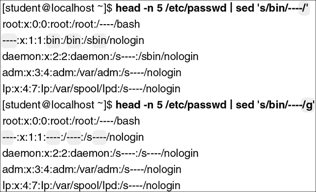

图 13.1 g 修饰符

*  `i:` 意味着“不区分大小写”（case-insensitive）。此修饰符匹配字母忽略大小写。因此，命令 `sed ‘s/a/-/i’` 会匹配 `a` 或 `A` 并将其替换为字符 `-`。

`sed` 命令还可以更改原始文件（而不是在屏幕上显示修改后的数据）。要更改原始文件，使用 `-i` 选项。

**考试要点**

`sed` 是一个非常大的主题。对于 Linux+ XK0-005 考试，请关注本章涵盖的 `sed` 组件。

### find

`find` 命令使用不同的标准在活动系统中搜索文件和目录。命令的语法如下：

点击此处查看代码图像

```
find [options] starting_point criteria action
```

其中 *starting_point* 是开始搜索的目录，*criteria* 是要搜索的内容，*action* 是对结果执行的操作。

表 13.10 描述了旨在修改 `find` 命令行为的选项。

表 13.10 **find 命令选项**

| 选项 | 描述 |
| --- | --- |
| `-maxdepth n` | 限制进入子目录的深度；例如，`find-maxdepth 3` 将搜索限制在三个子目录下。 |
| `-mount` | 防止搜索作为挂载点的目录。这在你从 `/` 目录搜索时非常有用。 |
| `-regype type` | 当使用 RE 时，此选项指定使用的类型；*type* 可以是 `emacs`（默认）、`posix-awk`、`posix-basic`。 |

大多数基于标准的选项允许你指定一个数值作为参数。其可以加上 `-` 或 `+` 以表示“小于”或“大于”。例如，`+5` 意味着“大于”。表 13.11 列出了一些基于标准的选项。

表 13.11 **通用搜索标准**

| 选项 | 描述 |
| --- | --- |
| `-amin n` | 根据访问时间匹配；例如，`-amin -3` 匹配过去三分钟内访问的文件。 |
| `-group name` | 匹配属于*name* 组的文件。 |
| `-name pattern` | 根据提供的*pattern* 文件或目录；*pattern* 可以是正则表达式。 |
| `-mmin n` | 根据修改时间匹配；例如，`-mmin -3` 匹配过去三分钟内修改的文件。 |
| `-nogroup` | 匹配不属于任何组的文件。 |
| `-nouser` | 匹配不属于任何用户的文件。 |
| `-perm mode` | 匹配模式指定的权限（八进制或符号）；参见表 13.12 中的示例。 |
| `-size n` | 根据文件大小匹配；值 *n* 可以加上 `+`（大于）或 `-`（小于），并加上单位修饰符：`c` 字节、`k` 千字节、`M` 兆字节或 `G` 吉字节。 |
| `-type ftype` | 根据类型搜索文件，其中 `d` 是目录、`f` 是普通文件、`l` 是符号链接等。 |
| `-user username` | 匹配所有由*username* 用户拥的文件（例如 `find /home -user bob`）。 |

表 13.12 提供了使用 `-perm` 选项的一些示例。

表 13.12 **权限搜索标准**

| 选项 | 描述 |
| --- | --- |
| `-perm 775` | 精确匹配八进制权限 775 的文件（rwxrwxr-x.**） |
| `-perm u=rw` | 精确匹配所有者读写符号权限的文件（rw-------.**） |
| `-perm -444` | 匹配具有八进制权限 444 但忽略任何其他权限值的文件。（可能的匹配项包括 **rwxrwxr-x**、**r--r--r--** 和 **rwxr--r--**。） |


| `-perm ugo=r` | 匹配所有三个权限组都具有读权限的文件，但忽略任何其他权限值。（可能的匹配包括 `rwxrwxr-x`、`r--r--r--` 和 `rwxr--r--`。） |

| `-perm /444` | 匹配具有八进制权限 444 的文件，并忽略任何其他权限值。（可能的匹配包括 `r--------`、`rw-rw-r--` 和 `rwxr--r--`。） | |

一旦找到文件，就可以对该文件执行操作。表 13.13 描述了一些重要的操作选项。

### 表 13.13 结果选项

| 选项 | 描述 |
| --- | --- |
| `-delete` | 删除所有匹配的文件（例如，`find /tmp -name “*.tmp” -delete`）。 |
| `-exec command` | 在每个匹配的文件上执行命令。 |
| `-ls` | 列出每个匹配文件的详细信息。 |
| `-ok` | 在每个匹配的文件上执行命令，但在每次匹配前都会提示用户；提示是一个是/否问题，用于确定用户是否想要执行该命令。 |
| `-print` | 打印每个匹配的文件的文件；这是默认的操作选项。 |

这里是 `-exec` 选项的一个示例：

点击此处查看代码图片

```
[root@OCS ~]# find /etc -name "*.cfg" -exec file {} \;
/etc/grub2.cfg: symbolic link to '../boot/grub2/grub.cfg'
/etc/enscript.cfg: ASCII text
/etc/python/cert-verification.cfg: ASCII text
```

`\;` 用于构建命令行。例如，在上一个 `find` 示例中执行的命令是：

[点击此处查看代码图片

```
file /etc/grub2.cfg; file /etc/enscript.cfg; file /etc/python/cert-verification.cfg
```

在 `;` 之前的 `\` 是为了转义 BASH shell 中 `;` 字符的含义，以便 `;` 字符作为普通参数传递给 `find` 命令。

`{}` 字符代表命令中放置匹配的文件名的位置。这可以使用多次，正如下一个示例所示，该示例为每个匹配的文件创建一个副本：

点击此处查看代码图片

```
find /etc -name "*.cfg" -exec cp {} /tmp/{}.bak \;
```

### xargs

`xargs` 命令从标准输入（STDIN）读取数据以构建并执行命令。以下是该命令的语法：

点击此处查看代码图片

```
input_command | xargs execute_command
```

其中 `input_command` 设计用于为 `xargs` 提供信息作为参数传递给 `execute_command`。

例如，假设你想对 `/etc` 目录下每个以字母 `e` 开头的文件运行 `wc -l` 命令。你可以使用此命令：

点击此处查看代码图片

```
[student@OCS ~]$ ls -d /etc/e* | xargs wc -l
 1 /etc/ec2_version
 1 /etc/environment
 2 total
```

表 13.14 描述了 `xargs` 命令的一些重要选项。

### 表 13.14 xargs 选项

| 选项 | 描述 |
| --- | --- |
| `-0` | 处理空格字符问题。通常用于处理包含空格字符的文件名；每个字符都被视为字面字符。 |
| `-d` | 用于更改参数之间的分隔符（默认是空格字符）。 |
| `-n max-args` | 指明每个 `execute_command` 的最大参数数量。 |
| `-p` | 在执行 `execute_command` 之前提示用户。 |
| `-t` | 在执行命令之前显示 `execute_command` 命令。 |

### grep

使用 `grep` 命令在文件中搜索包含特定模式的行。默认情况下，`grep` 命令在找到匹配模式时会显示整行。

示例：

点击此处查看代码图片

```
[student@OCS ~]$ grep "the" /etc/rsyslog.conf
# 要启用高精度时间戳，请注释掉下行。
# 为所有日志文件设置默认权限。
```

表 13.15 描述了 `grep` 命令的一些重要选项。

### 表 13.15 grep 命令选项

| 选项 | 描述 |
| --- | --- |
| `-c` | 显示匹配行的计数，而不是显示每一行匹配的行。 |
| `-color` | 以与其余文本不同的颜色显示匹配的文本。 |
| `-E` | 允许你在使用基本正则表达式的基础上额外使用扩展正则表达式。有关扩展正则表达式的更多细节，请参阅本章的表 13.4。 |
| `-f` | 允许使用固定字符串，使得模式中的所有字符都被视为普通字符，而不是正则表达式字符。 |
| `-e` | 用于在一次 `grep` 命令中指定多个模式（例如，`grep -e pattern1 -e pattern2 file`）。 |
| `-f file` | 使用指定 `file` 中找到模式。 |
| `-i` | 忽略大小写。 |
| `-l` | 显示匹配模式的文件名，而不是显示文件中匹配的每一行。这在搜索多个文件时有用（例如，`grep “the” /etc/*`）。 |
| `-n` | 在显示行之前显示行号。 |
| `-r` | 递归搜索目录结构中的所有文件。 |
| `-v` | 查找反向匹配（即，返回所有不包含指定模式的行）。 |
| `-w` | 仅匹配整个单词；例如，命令 `grep “the”`。 |


| `-f` | 用于指定要显示的字段。 |

以下是一个使用字段的示例：

点击此处查看代码图像

```
[student@OCS ~]$ head -2 /etc/passwd
root:x:0:0:root:/root:/bin/bash
bin:x:1:1:bin:/bin:/sbin/nologin
[student@OCS ~]$ head -2 /etc/passwd | cut -d: -f1,7
root:/bin/bash
bin:/sbin/nologin
```

以下是一个使用字符的示例：

点击此处查看代码图像

```
[student@OCS ~]$ ls -l /etc/passwd
-rw-r--r--. 1 root root 2607 Nov 3 10:15 /etc/passwd
[student@OCS ~]$ ls -l /etc/passwd | cut -c1-10,42-
-rw-r--r-- /etc/passwd
```

### tr

`tr` 命令用于将字符从一组翻译到另一组。该命令的语法为 `tr SET1 [SET2]`。

此示例展示了如何将 `date` 命令的输出转换为大写：

点击此处查看代码图像

```
[student@OCS ~]$ date
Sat Dec 3 20:15:05 PST 2016
[student@OCS ~]$ date | tr 'a-z' 'A-Z'
SAT DEC 3 20:15:18 PST 2016
```

注意，若要在文件上使用 `tr` 命令，必须将文件重定向到 `tr` 命令，如下所示，因为 `tr` 命令不接受文件作为参数：

```
tr 'a-z' 'A-Z' < file
```

表 13.18](#ch13.xhtml_ch13tab18) 描述了 `tr` 命令的一些重要选项。

表 13.18 **tr 命令选项**

| 选项 | 描述 |
| --- | --- |
| `-d` | 当省略第二个集合时使用；它删除匹配的字符。例如，以下命令会删除 `date` 命令输出中的所有数字：`date | tr -d ‘0-9’。 |
| `-s` | 在翻译之前将重复的匹配字符转换为单个字符。因此，命令 `tr -s ‘a' 'A'` 将 `aaabc` 转换为 `abc`，然后将其翻译为 `Abc`。 |

### head

`head` 命令显示文本数据的顶部部分，如示例所示：

点击此处查看代码图像

```
[student@OCS ~]$ ls -l | head -3
total 12
drwxrwxr-x. 2 student student 6 Aug 22 16:51 book
drwxrwxr-x. 2 student student 6 Aug 22 16:51 class
```

默认情况下，显示前 10 行。使用 `-n` 选项可以显示不同行数。

### tail

`tail` 命令显示文本数据的底部部分，如示例所示：

```
[student@OCS ~]$ cal 12 1999
 December 1999
Su Mo Tu We Th Fr Sa
         1   2  3 4
 5  6  7  8  9 10 11
12 13 14 15 16 17 18
19 20 21 22 23 24 25
26 27 28 29 30 31
```

默认情况下，显示前 10 行（注：此处应为最后 10 行）。使用 `-n` 选项可以显示不同行数。

点击此处查看代码图像

```
[student@OCS ~]$ cal 12 1999 | tail -n 2
26 27 28 29 30 31
```

表 13.19](#ch13.xhtml_ch13tab19) 描述了一些重要选项。

表 13.19 **tail 命令选项**

| 选项 | 描述 |
| --- | --- |
| `-f` | 显示文件的底部部分并跟踪变化，这意味着当数据写入文件时，继续显示对文件的任何更改。 |
| `-n +x` | 从第 x 行显示到文件末尾。 |

## 环境变量

Shell 变量用于存储信息。这些信息用于修改 Shell 本身或外部命令的行为。表 13.20](#ch13.xhtml_ch13tab20 详细说明了一些常用的 Shell 变量。

表 13.20 **实用的 Shell 变量**

| 变量 | 描述 |
| --- | --- |
| `HOME` | 当前用户的家目录。 |
| `ID` | 当前用户的 ID。 |
| `LOGNAME` | 登录当前会话的用户。 |
| `OLDPWD` | 上一个目录位置（在上一次 `cd` 命令之前）。 |
| `PATH` | 查找命令的位置；更多信息请参见本章稍后的“`PATH`”章节。 |
| `PS1` | 主提示符。 |
| `PWD` | 当前目录。 |

例如，`PS1` 变量定义了主提示符，通常使用特殊字符序列（例如，`\u` = 当前用户名，`\h` = 主机名，`\W` = 当前目录）：

```
[student@OCS ~]$ echo $PS1
[\u@\h \W]\$
```

注意，定义变量时时不带美元符号字符，但在引用时使用美元符号，如示例所示：

点击此处查看代码图像

```
[student@OCS ~]$ PS1="[\u@\h \W \!]\$ "
[student@OCS ~ 93]$ echo $PS1
[\u@\h \W \!]$
```


点击此处查看代码图像

```
[root@OCS ~]$ ls /etc/skel
[root@OCS ~]$ echo $?
0
[root@OCS ~]$ ls /junk
ls: cannot access /junk: No such file or directory
[root@OCS ~]$ echo $?
2
```

此返回值可以在条件语句中使用，以判断命令是否成功退出：

点击此处查看代码图像

```
some_command
if [ $? -eq 0 ]
then
 echo "command executed successfully"
else
 echo "command failed"
fi
```

### 相对路径与绝对路径

你使用路径来引用文件或目录。如果你使用的路径相对于当前目录，则称其为 `相对路径`。以下是一些示例：

*  `cd test:`: 移动到当前目录下的下的 `test` 目录。
*  `ls abc/xyz:`: 列出 `xyz` 目录下的文件，该目录位于 `abc` 目录之下，而 `abc` 又位于当前目录下。
*  `cd ..`: 从当前目录向上移动一级（因为 `..` 字符代表当前目录的级目录）。
*  `cp data/abc.txt .`: 将当前目录下 `data` 目录下的 `abc.txt` 文件复制到当前目录（因为单个 `.` 代表当前目录）。

如果你使用的路径相对于根目录（`/`），则称其为 `绝对路径`。以下是一些示例：*

*  `cd /etc/skel`
*  `ls /usr/bin`
*  `cp /etc/hosts /tmp`

注意，绝对路径始终以 `/`字符开头，而相对路径永远不会以 `/`字符开头。

# 第 14 章：执行基础容器操作

**本章涵盖了以下 Linux+ XK0-005 考试目标：**

*  **3.2:** 给定一个场景，执行基础容器操作。

随着开发者和系统管理员寻找最大化系统利用率并提供更健壮的安全应用程序的方法，容器在 Linux 中变得越来越普遍。在本章中，你将学习如何构建容器镜像、部署容器以及管理容器。

本章提供了容器管理和容器镜像操作的信息。

## 容器管理

容器通常被与虚拟机（VM）相比。虚拟机是一个与一个或多个操作系统共享物理系统的操作系统。对系统硬件的访问通过名为 `hypervisor` 的特殊软件进行管理。

虚拟机的一个优势是能够将虚拟机从一个物理系统移动到另一个系统。另一个优势是可以克隆或复制虚拟机。为了执行这些任务中的任何一个，都会使用虚拟机模板。模板是虚拟机的定义，包含了关于虚拟机的信息。

容器与虚拟机的相似之处在于，它们看起来都像是一个独立的操作系统（OS）。然而，虚拟机通常需要更多的硬件资源，而容器更为轻量，并作为应用程序运行在主机操作系统上。因此，系统支持的容器数量远于虚拟机。

容器与虚拟机相似，它们都使用镜像来创建运行实例。该镜像和运行中的容器由一个软件程序管理，类似于用于管理虚拟机的 hypervisor 软件。

有很多流行的容器软件解决方案，但 CompTIA 在 Linux+ XK0-005 考试目标的“Linux+ 建议硬件和软件列表”中特别提到了两种：

*  Docker
*  Podman

在许多方面，Docker 和 Podman 非常相似。以下是它们之间的一些主要区别：

*  Docker 容器以 root 用户身份运行，而 Podman 可以“无根”（rootless）运行。
*  Docker 可以构建容器镜像。这一功能在 Podman 中可用（需要一个名为 `Buildah` 的独立工具）。
*  Docker 的架构是单式的，而 Podman 是模块化的。

**考试警报**
本章重点关注 Docker，因为它在本书时使用得要广泛得多，且更有可能出现在 Linux+ XK0-005 考试中。

**考试警报**
你现在可能已经意识到，书中每章的章节直接对应 CompTIA Linux+ XK0-005 考试目标中的主题。有时这会让学习这些主题变得困难，因为它们的逻辑顺序并不总是符合学习习惯。如果你是第一次学习容器，请考虑跳到本章后半部分的“容器镜像操作”章节，并先阅读该部分。

### 启动/停止

**注意**
在启动镜像之前，你必须先部署它（参见本章后半部分的“部署现有镜像”章节）。

容器一旦被部署，就可以使用 `docker start` 和 `docker stop` 命令来启动和停止，如图 14.1](#ch14.xhtml_ch14fig1）所示。

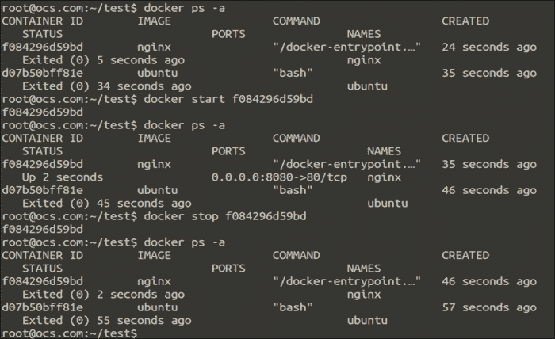
图 14.1 启动与停止

### 检查 (Inspect)

检查容器的过程涉及收集容器的详细信息。这通过使用 `docker inspect` 命令来实现：

点击此处查看代码图像

```
[root@OCS ~]$ docker inspect 7e18ce9f22 | wc -l
22
```

此命令产生一个包含数百行信息的 JSON 对象。虽然你可以阅读所有输出以找到你需要的内容，但使用 `grep` 命令搜索信息会更好。例如，图 14.2](#ch14.xhtml_ch14fig2）中的输出显示了容器启动时运行的命令。

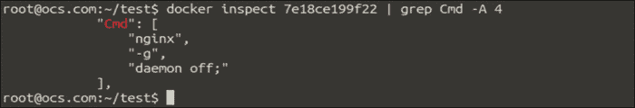
图 14.2 检查容器详情

关于 JSON 格式的更多信息，请参见第 16 章。

**考试警报**
鉴于 `docker inspect` 命令提供了大量细节，在 Linux+ XK0-005 考试中，你不应该关于该命令输出的特定问题。

#### 列出

要列出所有当前运行的容器，运行 `docker ps` 命令，如图 14.3](#ch14.xhtml_ch14fig3）所示。

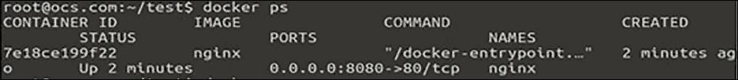
图 14.3 仅显示当前运行的容器

此命令的输出以列显示（由于信息量大，通常跨多行显示）。列如下：

*  `CONTAINER ID`: 分配此容器的唯一 ID。此 ID 可用于控制容器，包括启动、停止和删除。在图 14.3](#ch14.xhtml_ch14fig3）中，此值为 `7e18ce9f22`。
*  `IMAGE`: 用于创建此容器的镜像名称。在图 14.3](#ch14.xhtml_ch14fig3）中，此值为 `nginx`。
*  `COMMAND`: 容器启动时执行的命令。这通常会被截断，如图 14.3](#ch14.xhtml_ch14fig3）所示（`/docker-entrypoint. . . .`）。
*  `CREATED`: 首次部署的时间。
*  `STATUS`: 容器是否正在运行以及处于该状态多久。
*  `PORTS`: 为此容器暴露的端口。
*  `NAMES`: 除了 CONTAINER ID 之外引用容器的其他方式。

要显示所有 Docker 容器（包括运行和停止的），运行 `docker ps -a` 命令，如图 14.4](#ch14.xhtml_ch14fig4）所示。

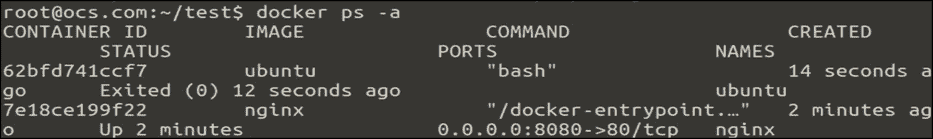


# 图 14.4 显示所有容器

**考试提醒**

在参加 Linux+ XK0-005 考试之前，务必清楚 `docker ps` 和 `docker ps -a` 之间的区别。

## 部署现有镜像

要从镜像部署容器，请使用以下命令：

点击此处代码图像

```
docker run –name NAME -p PORTS IMAGE
```

该命令的参数为：

*  `--name NAME:` 这是你为容器指定的名称。它可以与镜像的名称相同。
*  `-p PORTS:` 你想要暴露的端口。例如，如果 `PORTS` 值为 `8080:80`，这意味着本地主机上的 8080 端口将连接到容器的 80 端口。
*  `IMAGE:` 这是镜像的名称，如运行 `docker images` 命令时提供的。请参阅本章节后面的“列表”部分获取有关列出镜像的更多详细信息。

图 14.5 显示了 `docker run` 命令的运行示例。

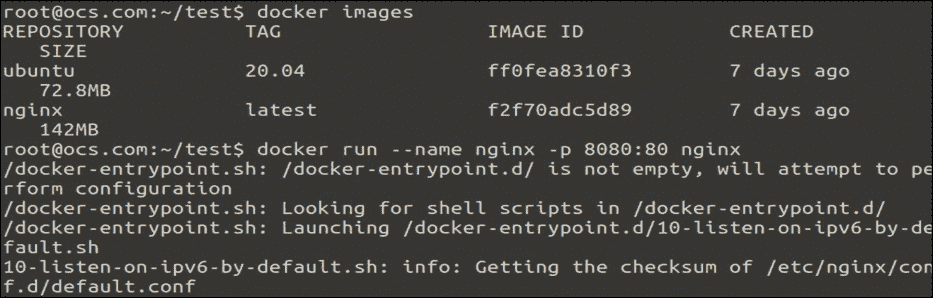

图 14.5 `docker run` 示例

注意，当如图 14.5 所示执行此命令时，容器以附加模式部署。这意味着它作为前台进程运行。它的优点处是按住键盘上的 Ctrl 键并按下 c 键即可停止容器。

如果你想以分离模式部署容器，请使用 `-d` 选项。如果你已经部署了容器并想以分离模式运行它，你有两个选择：

*  使用 Ctrl+c 停止容器，列出可用容器（使用 `docker ps -a`），然后使用 `docker start` 命令启动容器。请参阅本章节前面的“列表”和“启动/停止”部分了解这些命令的详情。
*  使用 Ctrl+c 停止容器，删除容器，然后使用带有 `-d` 选项的 `docker run` 命令重新部署容器。图 14.6 展示了这种技术。

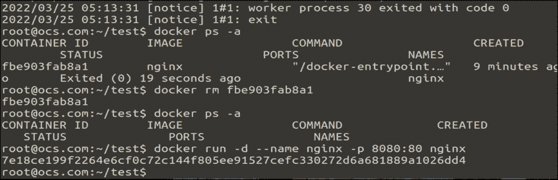

图 14.6 在分离模式下停止、删除并重新部署容器

## 连接到容器

你可以通过在 容器中使用 `docker exec` 命令与运行中的容器建立连接。该命令可用于在容器中打开 BASH shell，如图 14.7 所示。

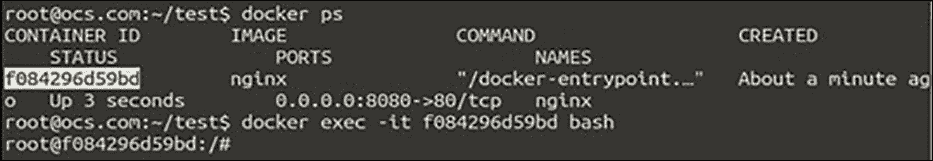

图 14.7 连接到容器

要断开连接，只需输入 `exit` 命令退出 BASH shell 即可。

##日志

你可以使用 `docker logs` 命令显示容器的日志，如图 14.8 所示。

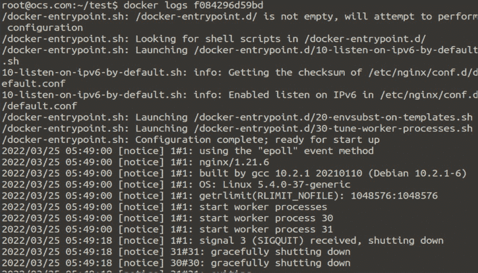

图 14.8 显示容器的日志

### 暴露端口

请查看本章节前面的“部署现有镜像”部分。

## 容器镜像操作

容器镜像用于构建容器。虽然你可以创建自己的镜像，但也可以从名为*仓库*（repositories）的地方获取许多镜像。在本节中，你将学习如何构建和管理自己的镜像。

### build

要构建自己的 Docker 镜像，首先创建一个如下的 `Dockerfile`：

点击此处代码图像

```
# 使用官方的 Ubuntu 20.04 作为基础镜像
FROM ubuntu:20.04
# 安装 nginx 和 curl
RUN apt-get update
RUN apt-get upgrade -y
RUN apt-get install -y nginx curl
```

在此示例中，Ubuntu 20.04 基础镜像将作为新镜像的基础（因为有 `FROM` 语句）。然后在更新和升级所有包后添加 `nginx` 和 `curl`（因为有 `RUN` 语句）。

**考试提醒**

对于 Linux+ XK0-005 考试，你不需要成为 Dockerfile 专家，但你应该知道本节末尾表 14.1 中提供的语句。

一旦创建了 Dockerfile，请使用以下命令创建镜像：

点击此处代码图像

```
docker build -t my-image:1.0 .
```

`-t` 命令的选项应包含两部分信息：镜像名称（在此示例中为 `my-container`）和镜像版本（在此情况下为 `1.0`）。用冒号分隔这两部分信息。

`.`（点或句号）字符表示镜像应该包含当前目录中出现的所有文件和目录。你也可以创建一个 `.dockerignore` 文件并列出不应放入镜像的文件和目录。

当过程完成后，你可以使用 `docker images` 命令验证容器是否已构建：

点击此处代码图像

```
[root@OCS ~]$ docker images
REPOSITORY            TAG     IMAGE ID       CREATED         SIZE
my-image              1.0     d2c9860a64ae   20 minutes ago  177MB
```

你可以在 Dockerfile 中放置几种不同的语句。表 14.1 突出了其中最重要的一些。

表 14.1 你可以放置在 Dockerfile 中的语句

| 语句 | 说明 |
| :--- | :--- |
| `FROM` | 指定基础镜像。 |
| `RUN` | 执行命令，例如安装包。 |
| `COPY` | 将文件或目录复制到特定位置。 |
| `ENTRYPOINT` | 当镜像容器启动时使用。 |
| `CMD` | 指定传递给 `ENTRYPOINT` 命令的参数。 |
| `EXPOSE` | 打开一个端口以访问容器。 |

### push

回 Docker 镜像可以存储在*仓库*（repository）中，也称为*注册表*（registry）。推送镜像的过程是将镜像（或镜像的新版本）存放在注册表中。要实现这一点，首先按所示所示对镜像进行标记，将 `registry_name` 替换为托管仓库的系统主机名，并将 `path_to_registry` 替换为镜像应存储的目录：

点击此处代码图像

```
docker image tag my-container:1.0 
registry_name:5000/path_to_registry/my-image:1.0
```

然后使用类似下面的命令推送镜像：

点击此处代码图像

```
docker image push registry_name:5000/ path_to_registry/my-image:1.0
```

在之前的命令中，`5000` 代表注册表服务器监听的端口，`my-image:1.0` 是镜像名称和标签。

**注意**

通常标签 `latest` 来表示镜像的最新版本。

### pull

你可以使用 `docker pull` 命令从仓库拉取镜像，如下所示：

```
$ docker pull ubuntu
```

### list

你可以使用 `docker images` 命令列出当前系统中提供的 Docker 镜像：

点击此处代码图像

```
[root@OCS ~]$ docker images
REPOSITORY            TAG     IMAGE ID       CREATED         SIZE
my-image              1.0     d2c9860a64ae   20 minutes ago  177MB
```

**注意**

另一种与 `docker images` 输出相同的常用方法是使用命令 `docker image ls`。

### rmi

要删除 docker 镜像，请使用 `docker rmi` 命令，如下所示：

点击此处代码图像


```
[root@OCS ~]$ docker images
REPOSITORY           TAG     IMAGE ID       CREATED         SIZE
my-image             1.0     d2c9860a64ae    20 minutes ago  177MB
ubuntu               latest  ff0fea831of3    6 days ago      72.8MB
[root@OCS ~]$ docker rmi ubuntu:latest
Untagged: ubuntu:latest
[root@OCS ~]$ docker images
REPOSITORY           TAG     IMAGE ID       CREATED         SIZE
my-image             1.0     d2c9860a64ae   20 minutes ago  177MB
```

# 第 15 章：使用 Git 执行基础版本控制

**本章涵盖以下 Linux+ XK0-005 考试目标：**

*  **3.3:** 在给定场景下，使用 Git 执行基础版本控制。

开发者必须面对的最大头疼之一是源代码的不同版本。有时你只需要回到代码的某个一个版本。手动维护版本可能既繁琐又耗时。

更糟糕的是，多个程序员经常共同处理同一段源代码。一个大型程序可能包含数万行代码，不同的程序员可能负责代码的不同部分。

像 Git 这样的版本控制软件可以处理维护源代码不同版本的复杂任务。本章将向你介绍 Git 和常见的 Git 操作。

本章提供了以下主题的信息：版本控制基础、`clone`、`push`、`pull`、`commit`、`add`、`checkout`、`branch`、`tag` 和 `gitignore`。

## 版本控制与 Git 简介

本节没有专门涵盖任何考试目标。然而，为了理解本章的其余内容，具备版本控制的基础知识非常有帮助。如果你已经牢牢掌握了这个主题，可以考虑直接跳到 `clone` 部分。

为了理解 Git 和版本控制的概念，从历史角度来看版本控制会有所帮助。版本控制软件（VCS）已经经历了三代迭代。

第一代 VCS 非常简单。开发者在同一个物理系统上工作，并且一次只“检出”（check out）一个文件。这一代版本控制软件使用了一种名为 `file locking`（文件锁定）的技术。当一个开发者检出一个文件时，该文件会被锁定，其他开发者无法编辑该文件。第一代 VCS 的示例包括修订控制系统 (RCS) 和源代码控制系统 (SCCS)。图 15.1 展示了这种类型版本控制的概念。

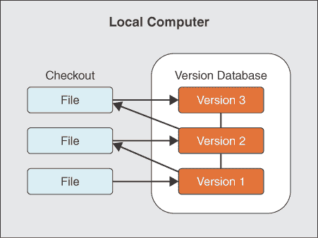

图 15.1 第一代 VCS

第一代 VCS 有几个问题，包括：

*  一时间只能有一个开发者处理一个文件。这在开发开发过程中造成了瓶颈。
*  开发者必须直接登录到包含版本控制软件的系统。

这些问题在第二代版本控制软件得到了解决。在第二代 VCS 中，文件存储在中央服务器的仓库中。开发者可以检出文件的副本。当开发者完成对某个文件的工作后，将文件提交（check in）到仓库。第二代版本控制软件的示例包括并发版本系统 (CVS) 和 Subversion。图 15.2 展示了这种类型版本控制的概念。

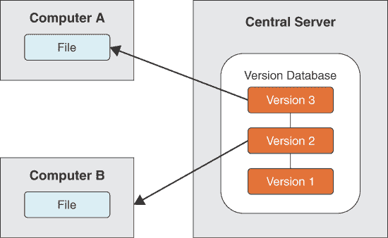

图 15.2 第二代 VCS

如果两个开发者检出了同一个文件的同一个版本，可能会出现问题。这通过一个名为 `merge`（合并）的过程来处理。

### 第三代

第三代 VCS 被分布式版本控制系统 (DVCS)。与第二代一样，有一个中央仓库服务器，包含项目的所有文件；然而，开发者并不从仓库中检出单个文件。相反，是检出整个项目，允许开发者对整组文件进行工作，而不仅仅是单个文件。图 15.3 展示了这种类型版本控制的概念。

Git 是第三代 VCS 的示例。使用 Git 的挑战之一是理解其背后的概念。如果你不理解这些概念，所有的命令看起来就像某种黑魔法。本节重点介绍关键的 Git 概念，并向你介绍一些基础命令。

要从 Git 仓库获取项目的副本，你需要使用名为 `cloning`（克隆）的过程。理解克隆意味着检出整个项目，并且你进行的大部分工作都在你工作的系统本地完成，是非常重要的。检出的文件被放置在你主目录下的一个目录中。

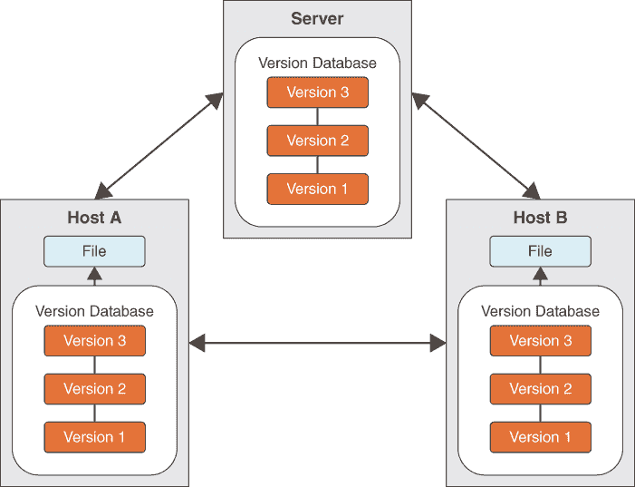

图 15.3 第三代 VCS

克隆不仅仅是创建仓库所有文件的副本。它实际上执行了三个主要功能：

*  克隆会在你主目录下的 `project_name/.git` 目录下创建一个项目的本地仓库。此位置的项目文件被认为是从中央仓库“检出的”。
*  克隆会创建一个你可以直接查看文件的目录。这被称为“工作区域”（working area）。在工作区域中进行的更改不会立即被版本控制。
*  克隆会创建一个暂存区（staging area）。暂存区的设计用于在提交到本地仓库之前存储文件的更改。

如果你克隆了一个名为 `Jacumba` 的项目，整个项目将存储在你主目录下的 `Jacumba/.git` 目录中。你不应该尝试直接从项目中修改这些文件。相反，直接查看 `~/Jacumba` 目录，你将看到项目的文件。这些是你应该修改的文件。假设你对一个文件进行了更改，但在将更改提交到本地仓库之前，你必须处理其他一些文件。在这种情况下，你会 `stage`（暂存）已完成工作的文件；也就是说，你为将其提交到本地仓库做好了准备。

在你完成所有更改并暂存了所有文件后，就可以将它们提交到本地仓库。图 15.4 展示了这一过程。

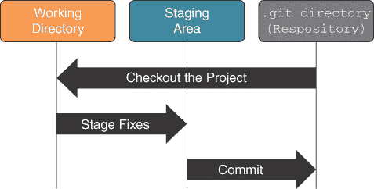

图 15.4 Git 阶段

必须意识到，提交（commit）暂存的文件只会将它们发送到本地仓库。这意味着只有你本人可以访问所做的更改。将新版本“提交”（check in）到中央仓库的过程被称为 `push`。

**注意**

本节描述的步骤在本文稍后部分将会有更详细的解释。可以将本节视为对概念的介绍，这些概念将帮助你在介绍 Git 命令时 地理解该流程。

### clone

在处理任何项目之前，你可能需要对 Git 进行基础配置。`git config` 命令用于配置 `git` 实用。以下是显示一些常用选项的两个示例：

点击此处查看代码图像

```
$ git config --global user.name "Bo Rothwell"
$ git config --global user.email bo@onecoursesource.com
```

`--global` 选项会导致配置选项存储在用户主目录下的配置文件中，所示：

点击此处查看代码图像

```
$ more ~/.gitconfig
[user]
        name = Bo Rothwell
        email = bo@onecoursesource.com
```


`git` 命令默认使用此文件中的设置。你也可以通过 `--local` 选项将这些设置存储在当前仓库目录中（当前目录下的 `.git` 目录）。本地设置会覆盖全局设置。

这里有几十个额外的设置，但大多数 `git` 命令的用户只设置 `user.name` 和 `user.email`。

## git clone

`git clone` 命令从远程仓库的内容创建一个本地仓库。所提供的参数是远程仓库的地址，如下例所示：

点击此处查看代码图片

```
$ git clone https://gitlab.com/borothwell/ocs.git
Cloning into 'ocs'...
Username for 'https://gitlab.com': borothwell
Password for 'https://borothwell@gitlab.com':
remote: Counting objects: 3, done.
remote: Total 3 (delta 0), reused 0 (delta 0)
Unpacking objects: 100% (3/3), done.
Checking connectivity... done.
```

表 15.1 概述了 `git clone` 命令的一些重要选项。

表 15.1 重要 `git clone` 命令选项

| 选项 | 说明 |
| :--- | :--- |
| `-v` | 进入详细输出模式。 |
| `--single-branch` | 指定仅克隆单个分支，而不是整个仓库。 |

克隆并不是创建 Git 项目的唯一方法。要在当前本地目录中创建新仓库，请使用 `git init` 命令：

点击此处查看代码图片

```
$ git init test
Initialized empty Git repository in /tmp/test/.git/
```

### 考试提示
`git init` 命令在 Linux+ XK0-005 考试目标中没有特别提到。然而，它被频繁使用，CompTIA 在考试目标的“请注意”部分包含了以下内容：“以项目符号列表形式提供的示例列表并非详尽列表。与每个目标相关的技术、过程或任务的其他示例也可能包含在考试中，尽管它们在该目标文档中未列出或涵盖。”

## push

`git commit` 命令仅更新本地仓库。要将本地仓库的更改发送到远程仓库，请使用 `git push` 命令，如下例：

点击此处查看代码图片

```
$ git push -u origin main
Username for 'https://gitlab.com': borothwell
Password for 'https://borothwell@gitlab.com':
Counting objects: 4, done.
Compressing objects: 100% (3/3), done.
Writing objects: 100% (3/3), 370 bytes | 0 bytes/s, done.
Total 3 (delta 0), reused 0 (delta 0)
To https://gitlab.com/borothwell/ocs.git
 12424f5..3b36054 main -> main
Branch main set up to track remote branch main from origin.
```

### 注意
在输出输出的最后一行中，`origin` 指远程仓库，`main` 指应该更新的分支。

### 考试提示
`git push` 命令尝试将更改合并到现有文件中。如果无法自动处理，你可能需要执行手动合并操作。请参见本章节后部分的“branch/**/checkout”部分以获取更多详情。

## pull

如果远程仓库已发生更改，并且你想将这些更改下载到本地仓库，请使用 `git pull` 命令：

```
$ git pull origin main
```

### 注意
`origin` 指远程仓库，`main` 指应该更新的分支。

### 考试提示
`git pull` 命令尝试将更改合并到现有文件中。如果无法自动处理，你可能需要执行手动合并操作。请参见本章节后部分的“branch/**/checkout”部分以获取更多详情。

## commit

要将工作目录中的更改存入本地仓库，你必须先将更改添加到暂存区，然后将其提交到仓库，如下：

点击此处查看代码图片

```
$ git add first.sh
$ git commit -m "added first.sh"
[main 3b36054] added first.sh
 1 file changed, 5 insertions(+)
 create mode 100644 first.sh
```

`git add` 命令将文件放入暂存区。`git commit` 命令获取暂存区中的所有新文件并提交到本地仓库。`-m` 选项用于添加消息（在本例中为提交的原因）。

## add

请参见上一节“commit”获取关于 `git add` 的信息。

## branch/checkout

首次创建项目时，代码与名为 `main` 的分支关联。如果你想创建一个新分支，请执行 `git branch` 命令：

```
$ git branch test
```

这并不意味着你突然在新分支上工作。正如 `git status` 命令的输出所示，`git branch` 命令并没有改变你当前的分：

点击此处查看代码图片

```
$ git status
On branch main
Your branch is ahead of 'origin/main' by 2 commits.
  (use "git push" to publish your local commits)

nothing to commit, working directory clean
```

此输出的第一行 `On branch main` 表明你仍在主分支上工作。要切换到新分支，请执行 `git checkout` 命令：

```
$ git checkout test
Switched to branch 'test'
```

### 考试提示
你可以通过 `git checkout` 命令的 `-b` 选项创建一个分支并切换到它：`git checkout -b test`。

切换实际上做了两件事：

*  导致任何未来的提交在 test 分支上发生
*  让工作目录反映 test 分支

第二项通过演示会更有意义。首先，观察以下命令，它们会导致 `hidden.sh` 文件的新版本被放入 test 分支仓库中：

点击此处查看代码图片

```
$ git add hidden.sh
$ git commit -m "changed hidden.sh"
[test ef2d7d5] changed hidden.sh
 1 file changed, 1 insertion(+)
```

注意文件在当前工作目录中的样子：

点击此处查看代码图片

```
$ more hidden.sh
#!/bin/bash
#hidden.sh

echo "Listing only hidden files:"
ls -ld .* $1
```

如果现在项目切换回主分支，你可以看到工作目录中的 `hidden.sh` 文件有什么不同（注意缺少了 `echo` 行，该行仅为 test 分支添加）：

点击此处查看代码图片

```
$ git checkout main
Switched to branch 'main'
Your branch is ahead of 'origin/main' by 2 commits.
 (use "git push" to publish your local commits)
$ more hidden.sh
#!/bin/bash
#hidden.sh

ls -ld .* $1
```

假设你创建了一个新分支为文件添加一个新功能。在测试此新功能后，你准备好在主分支中实现它。要做到，你需要将新分支（后续示例中的 `feature127` 分支）的内容合并到主分支。首先提交 `feature127` 分支中的所有更改，然后切换回主分支：

点击此处查看代码图片

```
$ git commit -a -m "feature added to showmine.sh"
[feature127 2e5defa] feature added to showmine.sh
 1 file changed,    5 insertions(+), 2 deletions(-)
$ git checkout main
Switched to branch 'main'
Your branch is ahead of 'origin/main' by 3 commits.
   (use "git push" to publish your local commits)
```

你必须位于要合并入的分支才能正确运行下一个命令。下面的 `git merge` 命令将 `feature127` 分支的更改合并到主分支：

点击此处查看代码图片

```
$ git merge feature127
Updating 4810ca8..2e5defa
Fast-forward
 showmine.sh | 7 +++++--
 1 file changed, 5 insertions(+), 2 deletions(-)
```


此合并过程可能会相当复杂。例如，考虑以下命令的输出：

点击此处查看代码图片

```
$ git merge main
Auto-merging showmine.sh
CONFLICT (content): Merge conflict in showmine.sh
Auto-merging hidden.sh
CONFLICT (content): Merge conflict in hidden.sh
Automatic merge failed; fix conflicts and then commit the result.
```

你可以看到合并并没有完成，因为自动化合并过程遇到了一些冲突。你也可以通过执行 `git status` 命令来查看这些冲突：

点击此处查看代码图片

```
$ git status
On branch test
Your branch is ahead of 'origin/test' by 1 commit.
 (use "git push" to publish your local commits)

You have unmerged paths.
 (fix conflicts and run "git commit")

Unmerged paths:
 (use "git add <file>..." to mark resolution)

       both modified: hidden.sh
       both modified: showmine.sh

no changes added to commit (use "git add" and/or "git commit -a")
```

处理这些冲突的一种方法是使用 `git mergetool` 命令（但注意，如果你想使用 `git` `mergetool` 命令，你需要安装 `git-all` 软件包）：

点击此处查看代码图片

```
 $ git mergetool showmine.sh
This message is displayed because 'merge.tool' is not configured.
See 'git mergetool --tool-help' or 'git help config' for more details.
'git mergetool' will now attempt to use one of the following tools:
opendiff kdiff3 tkdiff xxdiff meld tortoisemerge gvimdiff diffuse dif-
fmerge ecmerge p4merge araxis bc3 codecompare emerge vimdiff
Merging:
showmine.sh

Normal merge conflict for 'showmine.sh':
     {local}: modified file
     {remote}: modified file
Hit return to start merge resolution tool (vimdiff):
```

该工具打开 `vimdiff` 工具，允许你对文件进行必要的更改以解决冲突。

**考试警示**

`git mergetool` 命令在官方的 005 考试指南中并没有特别提到。然而，它在合并操作中非常常用，CompTIA 在考试目标的“请注意”部分中包含了以下内容：“以项目符号格式提供的示例列表并非详尽列表。与每个目标相关的其他技术、过程或任务的示例也可能包含在考试中，尽管它们未在此目标文档中列出或涵盖。”

### tag（标签）

在大型项目中，你可能会发现将特定的开发点与标签（tag）关联起来是非常有用的。例如，如果你发布了软件的 4.1 版本，可以使用下面的命令为项目的当前状态标记：

点击此处查看代码图片

```
$ git tag -a v4.1 -m "Release 4.1"
```

`-a` 选项将标签添加到 Git 仓库的当前状态。`-m` 选项允许你提供更详细的信息。

使用不带参数的 `git tag` 命令可以列出所有可用标签：

```
$ git tag
v1.0
v2.0
v3.0
v4.0
v4.1
```

要查看特定标签的详情，使用 `git show` 命令：

点击此处查看代码图片

```
$ git show v4.1
tag v4.1
Tagger: Bo Rothwell <bo@onecoursesource.com>
Date:   Fri Mar 25 14:27:55 2022 -0600

Release 4.1

commit ca82a6dff817ec66f44342007202690a93763949
Author: Bo Rothwell <bo@onecoursesource.com>
Date:   Mon Mar 21 10:14:13 2022 -0600
```

你也可以将项目的当前视图恢复到特定标签：

```
$ git checkout v2.0
```

要返回项目的最新版本（称为 `HEAD`），请使用以下命令：

```
$ git checkout -
```

### gitignore（忽略文件）

要让 `git` 命令忽略某个文件，请在工作目录下创建一个名为 `.gitignore` 的文件，并将要忽略的文件名放在该文件中。以下是一个示例：

点击此处查看代码图片

```
$ touch notes
~/ocs$ git status -s
?? notes
$ vi .gitignore #added notes as shown below:
$ cat .gitignore
notes
$ git status -s
?? .gitignore
```

注意，`.gitignore` 文件本身也必须放在 `.gitignore` 文件中，如下所示：

点击此处查看代码图片

```
$ git status -s
?? .gitignore
$ vi .gitignore #added .gitignore as shown below:
$ cat .gitignore
notes
.gitignore
$ git status -s
```

**考试警示**

你还可以在 `.gitignore` 文件中使用通配符（`*`、`?` 和 `[range]`）来匹配一组文件。

## 第 16 章

### 常见的基础即代码（IaC）技术

**本章涵盖以下 Linux+ XK0-005 考试目标：**

*    **3.4:** 总结常见的基础即代码技术。

想象这样一个场景：经理告诉你需要在组织的架构中部署一些虚拟机，以便为组织的开发人员提供他们编写代码的测试平台。起初，开发者需要 100 台虚拟机，所有虚拟机都有相似的组件，但每台虚拟机中的某些组件是不同的（用户账户、密码、软件安装、存储空间大小等）。

你还被告知随着项目的进行，开发者还需要额外的虚拟机——这些虚拟机彼此仍然相似的，但会有一些自定义。你开始怀疑创建这些虚拟机可能会变成一项全职任务。除了手动配置每台虚拟机所需的时间外，你还担心可能会在此过程中出错，导致系统配置错误，从而给开发者带来困扰。幸运的是，你有一个更好的解决方案。

基础即代码（IaC）是一个过程，你可以使用配置文件或脚本来部署和管理系统，包括虚拟机和容器。被称为*编排*（orchestration）或*配置管理*（configuration management）工具的程序不仅用于部署新系统，还用于维护系统（安装新软件、补补操作系统等）。本章重点介绍 IaC 的功能以及用于实现 IaC 解决方案的工具。

**考试警示**

对于 Linux+ XK0-005 考试来说，重要的是意识到与本章匹配的目标要求你“总结常见的基础即代码技术”。在考试中，你不应该被问及关于这些技术的配置或管理的问题。IaC 和管理系统的工具是非常大的话题，有几项认证考试专门针对这些技术。获得 Linux+ 认证的人员应该理解这些技术背后的概念，但不必非是专家。因此，本章对该主题的涵盖旨在符合通过 Linux+ 考试所需的认知水平。

本章提供了关于以下主题的信息：文件格式、工具、持续集成/持续部署（CI/CD）以及高级 Git 题题。

## 文件格式

IaC 技术通常使用文本文件来存储数据和配置。最常用的文件格式是 JavaScript 对象表示（JSON）和 YAML 并不是标记语言（YAML），本节将简要介绍这些格式。

### JavaScript 对象表示 (JSON)

一些基础即代码技术使用 JavaScript 对象表示（JSON）文件格式来存储或传输数据。JSON 是一种简单的结构，利用以下主要数据格式：对象（键/值对）、数组（也称为列表）、字符串和数字。三个三个值：`true`、`false` 和 `null`。

这是一个 JSON 示例文件：

点击此处查看代码图片


```json
{
     "name": "Sue Smith",
     "phone": ["555-555-5555", "555-555-5556"],
     "address": {
             "street": "123 Main St.",
              "city": "Anytown",
              "state": "CA"
      }
}
```

## YAML 不是标记语言 (YAML)

YAML 与 JSON 相似，某些基础设施即代码（IaC）技术利用 YAML 文件格式存储数据。它的数据结构与 JSON 相似，但存在一些明显的区别。JSON 使用 `{}` 和 `[ ]` 等字符来定义对象和数组等数据结构，而 YAML 使用缩进来创建这些结构。

这是一个 YAML 示例文件：

```yaml
---
name: Sue Smith
phone:
- 555-555-5555
- 555-555-5556
address:
 street: 123 Main St.
 city: Anytown
 state: CA
```

你可以将此示例与本章“JavaScript 对象表示法 (JSON)”部分中的示例进行对比，以查看两种文件格式的差异。

### 注意

YAML 原本是“Yet Another Markup Language”（另一种标记语言）的缩写。XML 和 HTML 是其他标记语言的示例。随着时间的推移，YAML 的目标变为一种“易于人类的数据序列化标准”，因此 YAML 被转换为一个回缩写，意为“YAML Ain’t Markup Language”（YAML 不是标记语言）。

## 工具程序

配置管理长期以来一直是管理员手动处理的标准流程。因为没有实现自动化，这一过程通常非常耗时，并导致系统配置错误。

自动化配置管理的目的是确保软件、服务和系统处于一致且可预测的状态。通过使用自动化配置管理工具，大量工作将由自动化过程处理。与使用手动配置管理操作相比，这减少了错误。

在使用配置管理工具时，你经常会看到`orchestration`（编排）和`automation`（自动化）这两个术。基础设施自动化是编排的一部分。虽然很多人混用`orchestration`和`automation`这两个词，但它们之间存在区别。你完全可以没有自动化的编排，但编排的首要目标通常是自动化某个过程。

考虑以下编排场景：用户在 Web 端表单中填写数据字段。这些数据用于填充属性。`attribute`（属性）被用于定义自定义自动化过程的参数。这些属性包含在每个编排过程中可能（且很可能会）不同的数据。例如，假设该程序设计用于设置一个需要访问网络的系统。则需要为系统的 IP 地址、子网掩码、网关和路由器等项目定义属性。

用户随后点击 OK 按钮，执行一个程序来编排服务。这是没有自动化的编排。

现在考虑这种场景：代理程序监控系统，当达到阈值时（例如，一小时内的最大 CPU 使用率）。这会触发一个程序，该程序自动从数据库填充属性，以生成服务的第二个实例。整个过程中没有人工参与；编排过程自动处理了一切。这是带有自动化的编排。

本节介绍了常用配置管理工具的基础知识。

### Ansible

Ansible 是一个非常流行的工具，可用于编排新系统。Ansible 的某些功能如下：

* ! **无代理 (Agentless):** Ansible 是一个无代理解决方案，意味着系统上不需要安装任何软件。无代理系统可以从系统接收数据，也可以进行远程查询以确定是否发生了更改。
* ! **剧本 (Playbook):** Ansible Playbook 是一组存储在文件中的指令。Playbook 文件采用 YAML 格式。
* ! **即时命令 (Ad hoc commands):** Ansible 允许你执行单个命令，而无需创建剧本。这些被称为即时命令。
* ! **角色 (Roles):** 可以建立角色来限制 Ansible 操作的功能。
* ! **变量 (Variables):** 变量用于提高剧本内部的灵活性。

### Puppet

你可以使用 Puppet 来管理服务器并自动化配置服务器的过程。通过 Puppet，你可以定义系统的期望状态，然后让 Puppet 执行必要的操作使系统达到该状态。Puppet 的一些核心概念和功能包括：

* ! **基于代理 (Agent-based):** 为了使用 Puppet，需要在客户端系统中安装客户端应用程序（代理）。
* ! **Puppet 主节点 (Puppet master):** 这是安装在主 Puppet 服务器上的软件。
* ! **IaC:** Puppet 是一种 IaC 技术，这是一种 DevOps 实践，即像对待代码一样对待组织的基础。
* ! **幂等性 (Idempotency):** 这一概念意味着你应该能够应用操作并确保最终结果的。Puppet 使用这一概念来确保如果系统被手动修改，Puppet 可以自动将系统恢复到“正常”状态。
* ! **Puppet 清单 (Puppet manifests):** Puppet 有其自己的语言来描述在系统上要采取的操作。这些代码写在名为 manifests 的文件中。

### Chef

与本节讨论的许多工具一样，Chef 用于系统的配置管理，并提供了自动化这一管理过程的方法。它使用 IaC 设计来实现这些目标。Chef 的一些核心概念和功能包括：

* ! **食谱 (Cookbooks):** 食谱是一个文件，你在其中描述配方，配方反过来描述资源（节点）的状态。食谱还可以包含其他功能，如 Chef 库、元数据和属性。
* ! **节点 (Node):** 节点是 Chef 维护配置的设备。Chef 支持许多不同的节点类型，包括网络设备、本地和云设备，以及虚拟或物理设备。
* ! **Chef 客户端 (Chef client):** 这是一个必须运行在每个节点上的应用程序，以便 Chef 维护节点的配置。
* ! **Chef 服务器 (Chef server):** Chef 服务器是存储食谱的系统。Chef 服务器与 Chef 客户端协作维护节点的配置。
* ! **Chef 工作站 (Chef workstation):** 如果你不想为节点配置 Chef 服务器，可以安装 Chef 工作站，它在单个系统上提供 Chef 的功能。
* ! **Chef 超 (Chef supermarket):** 这是由 Chef 社区创建并免费使用的食谱仓库。

### SaltStack

SaltStack 是另一种配置管理系统，根据定义的状态维护远程节点。它包含以下组件和功能：

* ! **Salt 主节点 (Salt master):** 这是运行在主 Salt 服务器上的服务。
* ! **Salt 客户端 (Salt minion):** 这是执行 Salt 主节点定义的操作的服务器。
* ! **目标 (Target):** 一个或多个 min 的列表。Salt 主节点使用目标向 min 发出命令。
* ! **Salt 状态 (Salt state):** 一种通过指定 min 应该的状态来配置 min 的。Salt 状态定义在 YAML 文件中

### Terraform


与本节中的其他配置管理工具一样，Terraform 是一个用于维护系统状态的工具。Terraform 基于一个包含以下内容的生命周期：

*  `Init:`：初始化过程使用一个包含配置文件的工作目录。
*  `Plan:`：创建一个行动计划，以确保配置可以执行。
*  `Apply:`：执行该计划。
*  `Destroy:`：生命周期中的这一步是删除旧资源的地方。

## 持续集成/持续部署 (CI/CD)

许多软件供应商使用传统的软件发布方法，即按特定间隔发布软件。例如，一个机构可能有一个年度发布周期，因此每年都会发布一次新的主版本软件。在一年中，根据软件中发现的潜在缺陷或安全漏洞，还可能进行小版本发布或错误修复发布。这种软件发布方法的优点是，机构通常可以在发布前有时间对软件进行测试，从而产生更稳定的程序/产品。然而，这种发布方法的缺点是，新功能可能需要一年的时间才能发布，如果竞争对手的软件发布更频繁，他们可能会获得更多的市场份额。

持续集成 (CI) 和持续部署 (CD) 是两个共同实现软件快速且持续发布的过程。这两个术语经常被混淆，可能是因为“持续”一词出现在了两者中。它们在以下重要方面有所不同：

*  持续集成是开发者（通常是软件开发者）遵循的过程。使用版本控制工具（参见第 15 章，“使用 Git 进行基本版本控制””）的软件程序采用一个开发主分支，并在向客户发布软件时使用。开发者不直接在主分支上工作，而是都在自己的分支上工作。通过持续集成，开发者尽可能频繁地将其分支中的更改合并回主分支（并非完全持续，尽管目标是如此），并通过某些自动化测试过程对更改进行验证。这导致主发布分支得到持续的验证和更新。
*  虽然持续集成意味着主分支经常更新，但并不意味着客户可以访问这些更改。持续部署是一个将持续集成扩展到在当新版本在主分支上可用（测试完成后）时即将其部署的过程。一个类似的过程称为持续交付，它用于快速发布新版本，但该过程需要人类来批准发布。

## 高级 Git 话题

由于 Git（在第 15 章中讨论）是一个如此强大的工具，完全涵盖 Git 需要一整本书。第 15 章提供了一些 Git 的基础知识，而本节深入了 Linux+ XK0-005 考试中涵盖的一些更高级的 Git 特性。

### merge

参见第 15 章中的“**branch/checkout**”部分。

### rebase

`git rebase` 命令将分支上的所有更改应用到当前分支，这个过程被称为*补丁 (patching)*。

补丁的想法是，你将发现在某些情况下，在两个不同的分支之间执行简单的合并是不容易的。这可能出于几个原因，包括：

*  你可能想要实现来自一个尚未在中央仓库提供的分支的更改。
*  你可能想要实现来自文件特定版本的更改。

实际上有几种不同的技术可以用于执行补丁。最基础（最常用）的方法是使用 `git diff` 命令并将输出重定向到文件，如下例所示：

```
git diff A B > file.patch
```

此补丁文件将用于修改已检出的文件以包含差异。这种修改是通过使用 `git apply` 命令完成的，如下例所示：

```
$ git apply file.patch
```

通常，补丁文件在一个系统上生成，然后在应用之前复制到另一个系统。在实际应用补丁之前，使用 `--check` 选项测试补丁通常也是好主意，如下例所示：

```
git apply --check file.patch
git apply file.patch
```

### Pull Requests

`git pull` 命令从远程仓库将文件的最新版本历史下载到本地仓库，该命令还会执行合并操作并更新你的工作目录内容。参见第 15 章中的“**pull**”部分。

## 第 17 章：容器、云与编排概念

**本章涵盖了以下 Linux+ XK0-005 考试目标：**

*  `3.5:` 总结容器、云和编排概念。

回想一下你已经在第 14 章“执行基本容器操作”中接触了容器的概念。你学习了什么是容器，以及如何执行基本的容器操作，包括启动、停止和列出容器。虽然在管理位于单个主机上的容器时了解这些操作非常重要，但如果你决定将容器提升到下一个水平，你很快就会发现下一个水平涉及跨多个主机管理容器。

你还在第 16 章“常用基础即代码技术”中接触了允许系统编排的工具。在该章中，你学习了 Ansible、Puppet、Chef、SaltStack 和 Terraform 等工具可以编排容器。在本章中，你将学习一种名为 Kubernetes 的专用容器编排工具。你将学习 Kubernetes 的一些关键特性以及一些高级的容器组件，例如容器持久存储、容器网络和容器注册表。

### ExamAlert

对于 Linux+ XK0-005 考试，重要的是意识到与本章匹配的目标是要求你“总结容器、云和编排概念”。对于考试，你不应该被问及关于这些技术的配置或管理的任何问题。Kubernetes 和编排容器的工具是非常大的话题，有几个认证考试专门针对这些技术。通过 Linux+ 认证的人员应该理解这些技术背后的概念，但不必成为专家。因此，本章对该话题的涵盖旨在符合通过 Linux+ 考试所需的课题意识。

本章提供了有关以下主题的信息：Kubernetes 优势和应用场景；单节点、多容器应用场景；容器持久存储；容器网络；服务网格；引导；以及容器注册表。

## Kubernetes 优势和应用场景

假设你创建了一个在你的组织中执行关键任务的容器。假设它提供了一个与你的网站相关的功能（例如提供访问关键数据库或存储客户信息）。核心思想是，这个容器对于你网站的正常运行至关重要。


现在想象一下，某个容器出现了故障，停止了响应来自你 Web 服务器的请求。在这种情况下你会怎么办？你是否应该处于一种需要手动操作的境地？

Kubernetes 的优势之一是它可以通过识别容器失败并自动启动新容器来提供容错能力。它还可以用于在需求增加时启动额外的容器，并在容器之间分担负载。

Kubernetes 的优势包括：

*    它可以监控容器的健康状况，并在容器运行异常或无响应时采取行动。
*    它可以配置为并发运行多个容器。
*    可以在本地环境也可以在云环境中工作。
*    它可以用于容器之间的负载均衡。
*    Kubernetes 可以提供水平扩展（根据需要添加更多容器以处理更大的系统负载）。
*    它可以通过滚动发布过程更新容器，并在需要时甚至执行回滚操作。

### Pods

让我们回到之前的场景：你有一个容器为你的 Web 服务器提供某些关键功能。你决定使用 Kubernetes 以最程度地确保你的 Web 服务器能够访问一组提供必要功能的容器中的至少一个。然而，你意识到容器所提供（或存储）的数据不能简单地在不同容器之间复制，因为保持这些数据完全同步将是一场噩梦。

解决方案：使用 Kubernetes pods。一个 `pod` 是一个或多个通过共享资源（如共享存储或网络资源）连接的容器。描述这些容器的术语是“紧耦合的”。

### Note
Kubernetes 中的 `pod` 术语与“鲸群”的术语有关。此外，Docker 的标志是一只看起来像顶部载着集装箱的船只的鲸鱼。

Kubernetes pod 的优势在于，当共享资源（例如存储）时，pod 中的每个容器都能够访问完全相同的资源。随着更多的容器上线以处理额外的系统负载，它们也可以访问此共享资源。

请注意，一个 `pod` 并不一定需要包含多个容器。在简单的 Kubernetes 解决方案中，拥有一个只有一个容器的 pod 是常见的。如果你决定在 pod 中运行多个容器，那么你就需要使用下文描述的 sidecar（侧车模式）。

### Sidecars

`sidecar` 是 Kubernetes 中的一种容器，用于更改 pod 的共享存储并为 pod 执行其他功能。例如，sidecar 可以处理对 pod 容器的身份验证，还可以处理 pod 内活动的日志。

请注意，sidecars 的主要用途之一是创建服务网格。更多信息请参阅本章节稍后的“服务网格”部分。

### Ambassador Containers

一种名为 Ambassador container（大使容器）的 sidecar 容器被设计用于作为 pod 中容器的客户端代理。假设你 pod 中的容器需要访问另一个资源，例如远程数据库。虽然你可以配置容器执行此连接，但 Ambassador 容器可以作为 pod 中容器的代理，以访问远程数据库。

使用 Ambassador 容器的优势在于，容器旨在设计为单一用途的软件组件。记住，容器不是完整的虚拟机；理想情况下，容器应该设计为很好地执行单项任务。因此，让容器在执行主要任务的同时还执行客户端连接违背了单任务容器的原则。

### Single-Node, Multicontainer Use Cases

参见本章节早前的“Pods”部分。

## Compose

Docker Compose 是一个与 Kubernetes 非常相似的工具，因为 Docker Compose 和 Kubernetes 都设计用于运行一组容器。两者之间的主要区别在于，Docker Compose 设计为仅在单个主机系统上运行容器，而 Kubernetes 可以在单个主机上或跨越多个主机运行运行容器。

## Container Persistent Storage

持久化卷（PV）是可供操作系统使用的存储空间。此 `PV` “指向”一个物理存储设备（称为“块”设备），它可以是传统的 SATA 硬盘、固态硬盘（SSD）或其他存储介质。

该系统被认为是“持久的”的原因是底层的物理存储设备可能会发生，但操作系统不会感知或受到此更改的影响。操作系统将始终使用 `PV`，但它可以仅被映射到与原始不同的块设备。

该系统的优势是旧的块设备可以无缝升级，而不会对系统的操作产生任何影响。块存储设备是物理存储设备，通常是云存储系统的后端存储。示例包括：

*    传统的 SATA 驱动器
*    SSD
*    RAID 驱动器
*    存储区域网络 (SANs)，可以包括光纤通道协议 (FCP)、互联网小型计算机接口 (iSCSI)、以太网传输 ATA (AoE) 以及以太网传输光纤 (FCoE)

其他块存储设备如光光，但它们大多数不再虚拟机或云解决方案。

## Container Networks

本节重点关注在处理云技术时应考虑实现的网络组件。

### Overlay Networks

叠加网络（Overlay network）是构建在另一个网络之上的网络。在两种不同网络协议的情况下，这可能是必要的。例如，在光光纤协议的光网络中，可能需要基于 IP（互联网协议）的通信。因为光纤协议不支持 IP，因此使用了叠加网络。

通过叠加网络，网络数据包被封装在其他网络数据包内部。因此，在光网络上传输的数据可能包含封装的 IP 数据包。

许多叠加网络技术常用于互联网，包括点对点协议、Tor、VPN 和 VoIP。

### Bridging

在云计算中，通常会出现多个网络网段。在这些不同网段之间建立连接的方法之一是使用路由器，该路由器在不同网络网段之间转发网络流量。

桥接（Bridging）是一种提供与路由不同解决方案的替代方案。桥接设备将不同的网络网段合并为一个单一网段。桥接有不同类型：

*    **简单：**这种类型的桥接连接两个网络网段。
*    **多端口：**这种类型的桥接连接多个网络。
*    **透明：**也称为学习桥接，这种类型的桥接动态构建路由表。
*    **源路由：**由流量源构建路由。

网络桥接具有若干优势。它们可以用于合并不同的网络传输（想象将物理网络与无线网络合并形成单一网络）。它们还可以用于最大化带宽。

### Network Address Translation (NAT)

网络地址转换 (NAT) 是一种技术，它将来自私有 IP 网络数据包进行转换，以便将其路由到公共网络。NAT 有几种不同的形式：


*    **DNAT (目标 NAT):** 当你想要将服务器放在防火墙后面并仍然允许从外部网络访问时，就会 DNAT。DNAT 规则放置在 `PREROUTING` 过滤点。对此主题的进一步讨论超出了本书的范围。

*    **SNAT (源 NAT):** 当你有一个具有静态分配私 IP 地址的内部网络时，就会 SNAT。通过 SNAT，你可以通过一个具有活动 IP 地址（即在互联网上可路由的地址）的机器引导访问到互联网。该系统配置 SNAT，用于将内部地址映射到外部通信。SNAT 规则放置在 `POSTROUTING` 过滤点。对此主题的进一步讨论超出了本书的范围。

*    **MASQUERADE (伪装):** 这种类型的 NAT 用于具有动态分配私 IP 地址的内部网络（例如使用 DHCP）。使用 `MASQUERADE`，你可以通过一个具有活动 IP 地址（在互联网上可路由的地址）的机器引导访问到互联网。该系统配置 `MASQUERADE`，用于将内部地址映射到外部通信。`MASQUERADE` 规则放置在 `POSTROUTING` 过滤点。

### ExamAlert
在 Linux+ XK0-005 考试中，关于 NAT 最可能的问题涉及不同的 NAT 类型。确保你在参加考试之前熟悉这里描述的三种 NAT 类型。

### 主机 (Host)
在某些情况下，你可能只想允许容器与本地主机之间的网络连接。这可能是因为入站网络请求被发送到主机操作系统，然后转发到容器。

这种解决方案被称为主机网络解决方案。使用此类解决方案时，管理容器的软件会在本地主机和容器上创建一个虚拟网络接口。网络配置设置被应用于这些虚拟网络接口。

### 服务网格 (Service Mesh)
如前所述，容器的定义特征之一是它被设计用于非常出色地执行单一任务。这一概念允许容器开发者关注单个功能，但通常这个单个功能本身并不能发挥作用。因此，你经常会看到一组容器或 pod，每个 pod 执行一个特定的任务，并作为一个解决方案被部署。。在这种情况下，这些容器或 pod 通常被称为微服务。

微服务通常需要相互通信。这可能带来挑战，因为每个微服务容器或 pod 都不会对整个解决方案有完全理解。服务网格可以用于管理微服务之间的通信。

服务网格提供了微服务之间通信的方法，还可以用于处理通信中的错误。服务网格还为微服务之间的通信提供了单一管理和可视化。

注意，服务网格是通过侧容器（sidecars）建立的。有关侧容器的更多信息，请参阅本章前面的“Sidecars”节。

### 引导程序 (Bootstrapping)
通常情况下，自引导指的是任何不需要外部协助即可自启动的过程。例如，所有操作系统都使用自引导来启动系统。当你开启系统电源时，它开始执行来自 BIOS 或 UEFI 的代码。该代码找到并启动引导加载程序软件（Linux 系统上的 `GRUB` 或 `GRUB2`），引导加载程序随后启动内核。内核负责启动操作系统的其余部分。

然而，自引导不仅仅是一个启动操作系统的术语。该术语也适用于自动化安装系统的过程。这是云和虚拟化技术的关键组成部分，本节重点介绍用于这些技术的自引导工具。

### Cloud-init
顾其实名，cloud-init 是一个可以配置为提供云实例初始化的工具。该工具利用预配置的镜像，并且足够灵活适用于不同的解决方案。你使用 `cloud-init` 可能进行的典型操作包括添加 SSH 密钥、执行网络配置、执行安装后运行的脚本以及执行其他类似任务。

### 容器仓库 (Container Registries)
容器仓库（container repository）是存储容器镜像的中心位置。流行的容器仓库包括 Docker Hub、GitHub Package Registry、Google Artifact Registry (GAR) 和 Amazon Elastic Container Registry。

# 第四部分：故障排除

## 第 18 章：分析并排除存储问题

**本章涵盖了以下 Linux+ XK0-005 考试目标：**

*    **4.1:** 给定场景，分析并排除存储问题。

在本章中，你将学习如何处理存储相关的问题。你将学习典型的存储问题，例如延迟和吞吐量问题，以及每秒输入输出次数 (IOPS) 和容量问题。在本章中还将还将一些文件系统问题以及特定存储类型固有的问题。最后，你将学习挂载选项问题。

本章提供了以下主题的信息：高延迟、IOPS 场景、容量问题、文件系统问题、I/O 调度器、设备问题和挂载选项问题。

## 高延迟 (High Latency)
存储延迟是数据从存储设备传输到操作系统所需的时间。较大的延迟值对服务的性能和用户体验有重大影响。在本节中，你将学习如何监控和管理高延迟问题。

### 输入/输出 (I/O) 等待
`ioping` 命令可用于磁盘进行简单的延迟测试。延迟是数据传输延迟的度量。通常你想对设备进行多次测试，如下例所示，它对当前目录的文件系统执行了 100 次测试（尽管在这里使用 `tail` 命令来限制输出）：

点击此处查看代码图像

```
[root@OCS ~]# ioping -c 100 . | tail
4 KiB <<< . (ext4 /dev/sda1): request=96 time=210.6 us
4 KiB <<< . (ext4 /dev/sda1): request=97 time=280.7 us
4 KiB <<< . (ext4 /dev/sda1): request=98 time=249.2 us
4 KiB <<< . (ext4 /dev/sda1): request=99 time=230.1 us
4 KiB <<< . (ext4 /dev/sda1): request=100 time=210.9 us

--- . (ext4 /dev/sda1) ioping statistics ---
99 requests completed in 22.6 ms, 396 KiB read, 4.38 k iops,
 17.1 MiB/s
generated 100 requests in 1.65 min, 400 KiB, 1 iops, 4.04 KiB/s
min/avg/max/mdev = 143.1 us / 228.1 us / 369.1 us / 40.4 us
```

### 每秒输入输出次数 (IOPS) 场景
存储设备的主要速度计算是 IOPS，代表每秒输入输出次数。当你选择为存储资源使用什么底层存储类型时，需要考虑这个值。正如你预期的那样，HDD 设备的 IOPS 低于 SDD 设备。

本节描述了你如何查看存储设备的 IOPS，以确定是否需要采取行动解决低 IOPS 问题。

#### 低 IOPS
`iostat` 命令提供设备的输入输出统计信息，包括存储 IOPS。当使用 `-d` 选项执行时，它会提供各种信息，如例所示：

点击此处查看代码图像


```
#iostat -d egrep "Device|sd"
Device tps   kB_read/s  kB_wrtn/s kB_read kB_wrtn
sda    1.62   17.05     12.08     969749  686696
sdb    0.02   3.76       0.00     213643  88
sdc    0.01   0.11       3.59     6239    203860
```

此输出中的值如下：

*    **设备:** 存储设备的文件名
*    **tps:** 每秒事务数
*    **kB_read/s:** 每秒从设备读取的字节数
*    **kB_wrtn/s:** 每秒写入设备的字节数
*    **kB_read:** 从设备读取的总字节数
*    **kB_wrtn:** 写入设备的总字节数

在尝试确定设备上的读/写操作是否导致过大负载时，这些数据非常有用。你需要随时间监控这些信息，因为仅通过读取此输出很难判断是否存在问题。必须将输出与其它时间点的数据进行比较，以确定是否存在问题。

## 容量问题

存储设备的容量问题可能会产生若干负面影响。如果存储设备缺少足够的可用空间，软件安装可能会失败。如果存储设备上的空间不足或剩余的 inode 不足，用户可能无法保存文件。本节演示了如何判断你是否遇到了存储容量问题。

### 磁盘空间不足

`df` 命令显示分区和逻辑设备的使用情况：

点击此处查看代码图像

```
# df
Filesystem   1K-blocks   Used     Available Use% Mounted on
udev          2019204    12       2019192     1% /dev
tmpfs         404832     412      404420      1% /run
/dev/sda1    41251136    6992272  32522952   18% /
none         4           0         4          0% /sys/fs/cgroup
none         5120        0        5120        0% /run/lock
none         2024144     0        2024144     0% /run/shm
none         102400      0         102400     0% /run/user
```

表 18.1 详细列出了 `df` 命令的重要选项。

表 18.1 **df 命令选项**

| 选项 | 说明 |
| --- | --- |
| `-h` | 以人类可读的大小显示值。 |
| `-i` | 显示 inode 信息。 |

`du` 命令显示目录结构中估计的磁盘空间使用量。例如，以下命令显示 `/usr/lib` 目录占用的空间：

```
# du -sh /usr/lib
791M /usr/lib
```

表 18.2 详细列出了 `du` 命令的重要选项。

表 18.2 **du 命令选项**

| 选项 | 说明 |
| --- | --- |
| `-h` | 以人类可读的大小显示值。（不是总是以字节显示，而是根据文件的总大小显示更易理解的值，如兆字节或千字节。） |
| `-s` | 显示摘要而不是每个子目录的大小。 |

考试考点提醒 (ExamAlert)

对于 Linux+ XK0-005 考试，请记住何时使用 `df`（针对分区问题）以及何时使用 `du`（针对目录问题）。

### Inode 耗尽

一个文件或目录由多个组件组成。其中许多组件（如所有者和权限）存储在名为 `inode` 的文件系统元素中。

除了文件中的数据和文件名外，关于文件的所有信息都存储在 inode 中。每个文件都会被分配一个 inode 号，该编号在文件所在的文件系统中是唯一的。

文件的 inode 包含以下信息：

*    唯一的 inode 号
*    用户所有者
*    组所有者
*    模式（权限和文件类型）
*    文件大小
*    时间戳：
    *    最后一次修改内容的时间
    *    最后一次修改 inode 数据的时间
    *    最后一次访问文件的时间
*    指针（指向包含文件数据的块位置的引用）

你可以通过 `stat` 命令查看 inode 信息：

点击此处查看代码图像

```
[root@OCS ~]$ stat /etc/passwd
 File: '/etc/passwd'
 Size: 2597 Blocks: 8 IO Block: 4096 regular file
Device: fc01h/64513d Inode: 33857 Links: 1
Access: (0644/-rw-r--r--) Uid: ( 0/ root) Gid:
 ( 0/ root)
Access: 2022-10-12 12:54:01.126401594 -0700
Modify: 2022-09-08 12:53:48.371710687 -0700
Change: 2022-09-08 12:53:48.371710687 -0700
 Birth: -
```


在第 3 章“使用适当工具配置和管理存储”中，你学习了 `/etc/fstab` 文件，它用于在启动时自动挂载文件系统。回想该文件的每一行都描述一个挂载过程。以下是其中一行的示例：

```
/dev/sda1 / ext4 defaults 1 1
```

手动创建或修改 `/etc/fstab` 文件条目时，可能会出现的一个常见问题是提供了错误的文件系统类型。在上例中，`ext4` 代表文件系统类型。如果提供了错误的文件系统，就会发生“文件系统匹配”错误，并且需要修改 `/etc/fstab` 文件。

### I/O 调度器

内核参数可以优化 I/O（输入/输出）调度器。可以设置几个参数来更改调度器的行为。本节涵盖了 Linux+ XK0-005 中重要的参数。

要查看当前调度器，请查看 `/sys/block/<device>/queue/scheduler` 文件的内容（其中 `<device>` 是设备名称）。这是一个示例：

点击此处查看代码图像

```
[root@OCS ~]# cat /sys/block/sda/queue/scheduler
[noop] deadline cfq
```

方括号内的值是默认值。要更改此值，请使用 `echo` 命令，如下：

点击此处查看代码图像

```
[root@OCS ~]# echo "cfq" > /sys/block/sda/queue/scheduler
[root@OCS ~]# cat /sys/block/sda/queue/scheduler
noop deadline [cfq]
```

调度有几种类型，包括以下几种：

*  `cfq:` 完全公平队列（Completely Fair Queuing）为每个进程提供单独的队列，每个队列在连续循环中被服务。
*  `noop:` 该调度遵循先入先出（FIFO）原则。

*  `deadline:` 这是标准调度器。该调度器创建两个队列——读队列和写队列。它还在每个 I/O 请求上加上时间戳，以确保请求被及时处理。

#### 考试提示

了解这三种不同类型的调度，并准备好 Linux+ XK0-005 考试中的问题，这些问题将测试你为什么要使用其中一种而不是其他的理解。

## 设备问题

存储设备可能会出现需要诊断的问题。本节重点关注一些常见的设备问题。

### 非易失性内存映像 (NVMe)

当 SSD 设备首次出现在市场上时，它们比旋转磁盘快，但它们连接到主板并使用较旧的协议（SAS 和 SATA）传输数据。最初这并不是问题，但随着 SSD 设备变得越来越快，旧协议产生瓶颈的情况越来越频繁。需要一种更快的传输协议，解决方案就是 NVMe。

为什么 NVMe 比旧协议快？简单而言之，它提供了更多的 I/O “通道”，从而允许更高的整体吞吐量。

要排查 SSD 驱动器上的 NVMe，请使用 `nvme` 命令。例如，要列出启用 NVMe 的设备，请使用 `nvme list` 命令。表 18.3 列出了额外的 `nvme` 命令选项。

表 18.3 `nvme` 命令选项

| 选项 | 描述 |
| --- | --- |
| `error-log <device_name>` | 为指定的启用 NVMe 的 SSD 设备提供问题信息。 |
| `smart-log <device_name*>` | 显示指定的启用 NVMe 的 SSD 设备的 SMART 日。（SMART 是一种健康评估工具，可以确定存储设备的问题。） |

### 固态硬盘 (SSD)

随着时间的推移，存储设备会老化并故障（有时是突然故障）。为了在驱动器故障之前确定是否存在问题，请考虑采取以下主动措施：

*  **查找坏块：** 设备上坏块数量的增加可能表明存储老化。要测试坏块，请使用 `badblocks` 命令：

点击此处查看代码图像

```
root@OCS:~# badblocks -v /dev/sdb1
Checking blocks 0 to 1047551
Checking for bad blocks (read-only test): done

Pass completed, 0 bad blocks found. (0/0/0 errors)
```

*  **使用 SMART 工具：** 自监控、分析和报告技术（SMART）是硬盘和 SSD 上可用的一种工具，用于监控驱动器的健康状况。并非所有磁盘都支持此实用程序，但大多数现代磁盘都支持。使用 `smartctl` 命令显示有关硬盘的信息。例如，要执行健康检查，请使用 `smartctl -HH <device_name>` 命令。

*  **磁盘配额：** 如果文件系统启用了配额，用户创建新文件的可能会受到限制。要确定配额是否是问题的原因，请考虑使用以下命令：

    *  系统管理员应使用 `repquota` 命令显示文件系统中所有用户的配额。
    *  普通用户应使用 `quota` 命令显示其账户的配额限制。

访问第 21 章 获取更多关于配额的信息。

### SSD Trim

在 SSD 设备上，只有完全空的数据单元才能用于存储新数据。大多数文件系统在删除文件时实际上并没有删除数据；它们只是删除了文件的 inode 指针。这种行为会对 SSD 存储设备产生负面性能影响，因为在保存文件数据之前可能需要删除数据。

SSD trim 是一种可以清理包含数据但文件系统不再使用的数据单元的工具。使用此工具的方法有两种：

*  通过执行 `fstrim` 命令
*  在 `/etc/stab` 命令中添加 `discard` 载选项

#### RAID

Linux 中创建的软件 RAID 设备通常非常健壮。然而，在某些情况下，RAID 设备可能会受到损害：

**Images](graphics/arrow.jpg) RAID 设备基础的物理驱动被移除。
*  分区表发生损坏。
*  RAID 设备基于的分区被删除。

访问第 3 章 查看关于 RAID 的完整讨论。在排故障时，你主要使用 `mdadm` 命令和 `/proc/mdstat` 命令。

#### LVM

访问第 3 章 查看关于逻辑卷管理器 (LVM) 的完整讨论。

#### I/O 错误

坏块可能导致 I/O 错误。要测试坏块，请使用 `badblocks` 命令：

点击此处查看代码图像

```
root@OCS:~# badblocks -v /dev/sdb1
Checking blocks 0 to 1047551
Checking for bad blocks (read-only test): done

Pass completed, 0 bad blocks found. (0/0/0 errors)
```

### 挂载选项问题

当你挂载分区或卷时，*挂载点*（或*挂载目录*）必须存在。如果不存在，将出现以下错误（将 `/data` 替换为你的挂载点）：

点击此处查看代码图像

```
mount: mount point /data does not exist
```

要解决此错误，请创建挂载点：

```
root@OCS:~# mkdir /data
```

回想 `/etc/fstab` 文件的格式：

```
/dev/sda1 / ext4 defaults 1 1
```

可能的挂载选项问题还包括：

*  错误的设备名称（上例中的 `/etc/sda1`）。使用 `df` 命令（在本章较之前的“磁盘空间不足”部分介绍）来双检设备名称。

*  文件系统类型不匹配（参见本章较之前的“不匹配”部分）。


*    错误的挂载选项，这通常是拼写错误（例如，将 `defaults` 写成 `default`）或在多个挂载选项之间存在额外空格（例如使用 `rw, sync, nouser` 而不是 `rw,sync,nouser`）。

# 第 19 章：分析和排除网络资源问题

**本章涵盖以下 Linux+ XK0-005 考试目标：**

*    **4.2:** 给定一个场景，分析并排除网络资源问题。

无论你使用过哪些操作系统，网络相关问题都是你可能已经经历过的。本章重点关注在处理网络资源问题时你应该注意的工具和配置。

你将首先探索可能会遇到的网络配置问题。你还将学习帮助你处理接口错误和带宽问题的工具。本章通过讨论名称解析问题和远程系统的测试作为结束。

本章提供了以下主题的信息：网络配置问题、防火墙问题、接口错误、带宽限制、名称解析问题以及远程系统的测试。

## 网络配置问题

正如你所怀疑的那样，配置不当的网络会导致连接网络的问题。本节重点介绍了最常见的配置错误的网络设置。

### 子网

无效的子网设置会导致系统无法与本地网络中的其他设备通信。它会导致路由失败，因为路由依赖于与本地子网上的路由器通信。

回顾第 5 章“使用适当的网络工具或配置文件”，用于显示和配置子网的工具之一是 `ip` 命令。例如，以下输出显示了 CIDR 格式的子网，并用灰色突出：

点击此处查看代码图像

```
[root@OCS ~]# ip addr show
1: lo: <LOOPBACK,UP,LOWER_UP> mtu 65536 qdisc noqueue state UNKNOWN
     link/loopback 00:00:00:00:00:00 brd 00:00:00:00:00:00
     inet 127.0.0.1/8 scope host lo
     valid_lft forever preferred_lft forever
     inet6 ::1/128 scope host
      valid_lft forever preferred_lft forever
2: enp0s3: <BROADCAST,MULTICAST,UP,LOWER_UP> mtu 1500 qdisc pfifo_fast
state UP qlen 1000
     link/ether 08:00:27:b0:dd:dc brd ff:ff:ff:ff:ff:ff
     inet 192.168.1.26/24 brd 192.168.1.255 scope global dynamic
enp0s3
     valid_lft 2384sec preferred_lft 2384sec
     inet 192.168.1.24/16 brd 192.168.255.255 scope global enp0s3
     valid_lft forever preferred_lft forever
     inet6 fe80::a00:27ff:feb0:dddc/64 scope link
     valid_lft forever preferred_lft forever
```

### 路由

*路由*是通过网关将网络数据从一个 Internet 协议 (IP) 网络发送到另一个网络的过程。*网关*是一个具有多个网络接口并在网络之间传输数据的系统。

使用 `route`、`ip` 或 `netstat` 命令来确定主机上的路由。例如，`route` 命令显示路由表：

点击此处查看代码图像

```
[root@OCS ~]# route
Destination Gateway     Genmask      Flags Metric Ref Use Iface
default     192.168.1.1  0.0.0.0     UG    100     0   0  enp0s3
192.168.0.0 0.0.0.0      255.255.0.0  U    100     0   0  enp0s3
192.168.1.0 0.0.0.0      255.255.0.0  U    100     0   0  enp0s3
```

你想要使用 `route` 命令的最常见故障排除场景是你可以连接到本地网络内的系统，但无法访问本地网络之外的系统。这通常是路由器配置不当的结果，可以通过 `route` 命令来确定。

这些命令在第 5 章中也有介绍。

### 防火墙问题

在使用防火墙时，有很多影响网络访问的可能问题。例如，可能向接口应用错误的规则，或者规则在防火墙列表中的顺序错误。

防火墙问题通常分为两类：

*    在不应允许访问时授予了访问权限。
*    在应该允许访问时拒绝了访问。

例如，想象这样一个场景：你有一个不应从本地网络外部访问的私有网站。你设计了防火墙规则来阻止从本地网络外部访问，但发现仍然从远程系统访问该网站。

**考试提示**

为了准备这个 Linux+ XK0-005 考试主题，请确保你理解防火墙规则以及防火墙如何工作。请参第 10 章“实施和配置防火墙”，了解考试应掌握的防火墙基础知识。

## 接口错误

网络接口本身可能是网络问题的原因。网络设备可能存在问题、物理网络连接可能有问题、网络布线有问题，或者网络存在流量问题（例如，流量超过了网络带宽）。本节涵盖了接口错误的一些要点。

### 丢包

当远程系统不对入站网络包做出响应时，就会发生丢包。可能是防火墙规则、饱和或网络配置不当的结果。

要查看丢包信息，可以考虑使用 `netstat` 命令。例如，图 19.1 了每个网络接口的信息，并突出显示了接收丢包 (RX-DRP) 和发送丢包 (TX-DRP)。

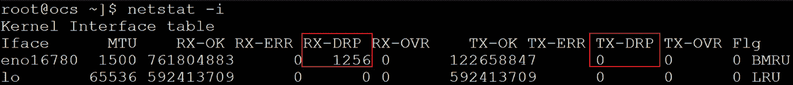

图 19.1 `netstat` 命令显示丢包

`netstat` 命令在第 5 章中也有介绍。

### 冲突

在繁忙的网络中，两个或多个网络设备有时会尝试同时发送网络包。这会导致冲突，通常不是大问题。冲突会让数据包“回弹”原始网络设备，然后该设备在等待短暂的随机时间后再次尝试发送包。

显示冲突的有用命令是 `netstat` 命令。例如，图 19.2 演示了使用 `netstat -ie` 命令显示网络信息，包括显示冲突的突出区域。

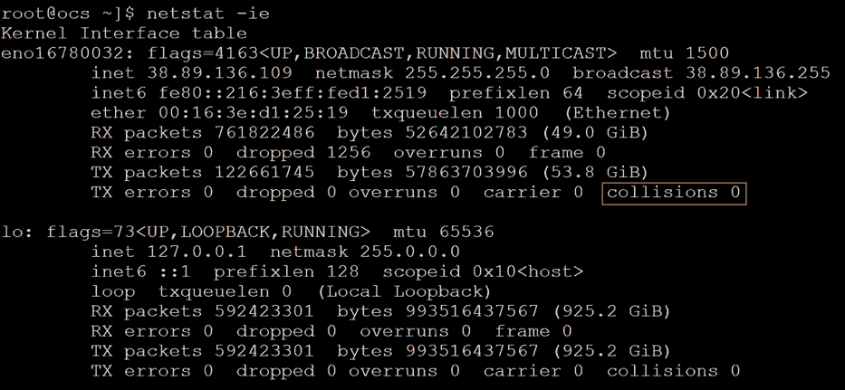

图 19.2 `netstat` 命令显示冲突

注意此图中的冲突值为 0。这通常是一个很低的数字。如果你的系统上数字很高，请考虑增加带宽或进一步分段你的网络。

**考试提示**

冲突是带宽不足的严重信号。

### 链路状态

链路状态实际上是关于系统是否连接到网络的问题。一个并非 Linux 特有的考虑因素就是简单检查与网络是否有物理连接。大多数网络接口在建立物理连接时指示灯会亮起。

你还应该验证接口是否已启用（up），你可以通过 `ip` 命令来实现。以下示例演示了主网络接口处于启用状态（注意灰色突出显示的 `UP`）：

点击此处查看代码图像


```
[root@OCS ~]# ip addr show
1: lo: <LOOPBACK,UP,LOWER_UP> mtu 65536 qdisc noqueue state UNKNOWN
     link/loopback 00:00:00:00:00:00 brd 00:00:00:00:00:00
     inet 127.0.0.1/8 scope host lo
     valid_lft forever preferred_lft forever
     inet6 ::1/128 scope host
      valid_lft forever preferred_lft forever
2: enp0s3: <BROADCAST,MULTICAST,UP,LOWER_UP> mtu 1500 qdisc pfifo_fast
state UP qlen 1000
     link/ether 08:00:27:b0:dd:dc brd ff:ff:ff:ff:ff:ff
     inet 192.168.1.26/24 brd 192.168.1.255 scope global dynamic
enp0s3
     valid_lft 2384sec preferred_lft 2384sec
     inet 192.168.1.24/16 brd 192.168.255.255 scope global enp0s3
     valid_lft forever preferred_lft forever
     inet6 fe80::a00:27ff:feb0:dddc/64 scope link
     valid_lft forever preferred_lft forever
```

另一个确定网络设备状态的有用工具是 `ethtool`。`ethtool` 命令用于显示和配置网络设备设置，例如传输速率和双工模式。通常，这些设置是通过一个名为 `auto-negotiation`（自动协商）的过程自动配置的。通过自动协商，两个网络设备会确定最佳速率和双工模式并自动使用该值；然而，这些设置也可以手动设置。`ethtool` 命令还可以显示或修改其他有用的网络设备设置。

### 语法：

```
ethtool [option] device
```

以下示例展示了如何使用此命令获取信息的摘要：

点击此处查看代码图片

```
[root@OCS ~]# ethtool eth0
Settings for eth0:
         Supported ports: [ TP ]
         Supported link modes:     10baseT/Half 10baseT/Full
                                   100baseT/Half 100baseT/Full
                                   1000baseT/Full
         Supported pause frame use: No
         Supports auto-negotiation: Yes
         Advertised link modes: 10baseT/Half 10baseT/Full
                                  100baseT/Half 100baseT/Full
                                  1000baseT/Full
         Advertised pause frame use: No
         Advertised auto-negotiation: Yes
         Speed: 1000Mb/s
         Duplex: Full
         Port: Twisted Pair
         PHYAD: 0
         Transceiver: internal
         Auto-negotiation: on
         MDI-X: off (auto)
         Supports Wake-on: umbg
         Wake-on: d
         Current message level: 0x00000007 (7)
                                   drv probe link
         Link detected: yes
```

`ethtool` 命令提供了大量的输出。表 19.1 描述了该命令中一些最有用的输出。

表 19.1 `ethtool` 命令输出的有用信息

| 输出 | 描述 |
| --- | --- |
| Supported link modes | 此输出显示了设备可以使用的速率和双工值。 |
| Supports auto-negotiation | 如果此设备和连接设备都支持自动协商，则不需要手动设置速率和双工设置。 |
| Advertised link modes | 此输出显示了设备告知其他设备它可以使用的速率和双工值。 |
| Speed | 此输出显示了设备当前使用的速率设置。 |
| Duplex | 此输出显示了设备当前使用的双工模式值。 |
| Link detected | 如果此项设置为“yes”，则设备当前正通过网络连接到另一个设备。 |

表 19.2 描述了 `ethtool` 命令的一些有用选项。

表 19.2 `ethtool` 命令选项

| 选项 | 描述 |
| --- | --- |
| `-i` | 提供此设备的驱动程序信息。 |
| `-S` | 显示此设备的统计信息。 |
| `-p` | 通过使链路指示灯闪烁来识别此设备。当系统有多个网络适配卡时这非常有用。 |
| `speed` `value` | 允许你手动设置设备的速率值，其中 `value` 是要设置的速率值。 |
| `duplex` `value` | 允许你手动设置设备的双工值；`value` 应为 `full` 或 `half`。 |
| `autoneg` `value` | 启用自动协商；`value` 应为 `yes` 或 `no`。 |

对于无线设备，考虑使用 `iwconfig` 命令来显示或设置有关无线网络接口的信息。

### 语法：

点击此处查看代码图片

```
iwconfig [interface] [parameters]
```

如果没有提供任何参数，此命令将显示所有网络接口：

点击此处查看代码图片

```
[root@OCS ~]# iwconfig
lo no wireless extensions.
eth0 no wireless extensions.
wlan0 IEEE 802.11bgn ESSID:"test1"
       Mode:Managed Frequency:2.412 GHz Access Point:
         Not-Associated
       Tx-Power=20 dBm
       Retry min limit:7 RTS thr:off Fragment thr=2352 B
       Power Management:off
       Link Quality:0 Signal level:0 Noise level:0
       Rx invalid nwid:0 Rx invalid crypt:0 Rx invalid frag:0
       Tx excessive retries:0 Invalid misc:0 Missed beacon:0
```

可以使用参数来配置无线接口。例如，要将设备模式更改为 ad hoc，请执行以下命令：

点击此处查看代码图片

```
[root@OCS ~]# iwconfig wlan0 mode Ad-Hoc
```

表 19.3 列出了 `iwconfig` 命令的一些有用参数。

表 19.3 `iwconfig` 命令参数

| 参数 | 描述 |
| --- | --- |
| `essid` `value` | 设置 ESSID 标识（即网络名称）。 |
| `nwid` `value` | 设置网络 ID。 |
| `mode` `value` | 设置模式（`value` 可以是 `Ad-Hoc`、`Managed`、`Master` 等）。 |
| `ap` `value` | 强制网卡使用指定的访问点。 |

### 带宽限制

带宽（Bandwidth）是通过介质传输的最大数据量。介质可以是网线、无线网络甚至是网络接口本身。

吞吐量（Throughput）是通过介质的实际数据量。此值受许多因素限制，包括带宽、延迟和干扰。

`iperf` 命令提供了创建系统间吞吐量测试的方法。它需要在两个系统（客户端和服务器）上安装并配置该工具。

#### 考试警示

`iperf` 命令的完整范围超出 Linux+ XK0-005 考试的范围。你应该了解该命令的用途以及需要同时设置客户端和服务器的事实。

吞吐量经常（或持续）达到带宽值时就会发生饱和。饱和在几乎每个网络中都会发生，但当它变成经常发生时，网络看起来缓慢或滞后。这会增加延迟问题并让用户感到沮丧。使用 Wireshark（在第五章介绍）等网络监控工具来确定是否频繁饱和。

#### 高延迟

将延迟（latency）视为通信中的任何延迟（例如，数据包从一个主机传输到另一个主机所需的时间）。有时通过通信往返时间测量延迟（即发送网络数据包并接收响应所需）。使用 **ping** 和 **traceroute** 命令（在第五章介绍）等工具来确定是否存在延迟问题。

### 名称解析问题

如果你可以使用 IP 地址连接到系统，但无法通过主机名连接，那么你可能存在名称解析问题。本节讨论了解决 DNS 问题的一些步骤。

### 域名系统 (DNS)


DNS 和名称解析在第 5 章中有所介绍。本节不再涵盖所有这些工具和配置，而是重点关注处理 DNS 和名称解析错误。如果你忘了这些工具的工作原理，请在继续阅读本章之前，考虑回顾第 5 章中的“名称解析”部分。

在排查名称解析问题时，请记住这些命令之间的区别：

*    `dig`: 此命令用于在特定的 DNS 服务器上执行 DNS 查询。
*    `nslookup`: 此命令旨在在 DNS 服务器上执行简单查询；然而，它的选项通常比 `dig` 命令少。
*    `host`: 此命令通常用于执行简单的主机名到 IP 地址转换操作。默认情况下，它使用本地系统的配置信息，而不是查询你通过命令指定的 DNS 服务器（尽管你可以指定服务器作为参数）。
*    `resolvectl`: 此命令也可以执行 DNS 查询。它与 `host` 命令略有不同，因为它只进行 DNS 查询，但它仍然使用本地系统配置来确定由哪些 DNS 服务器执行查询。

根据经验法则，你应该使用 `dig` 或 `nslookup` 命令来测试特定的 DNS 服务器。使用 `host` 或 `resolvectl` 命令测试 DNS 客户端配置。如果你可以使用 `dig` 或 `nslookup` 命令成功执行查询，但使用 `host` 或 `resolvectl` 命令对同一远程主机进行查询失败，那么问题可能是客户端系统上的配置信息。

此外，请记住去哪里查看配置信息：

*    `/etc/nsswitch.conf` 文件包含了本地客户端应该去哪里查找执行名称解析的信息（本地 `/etc/hosts` 文件、DNS 服务器文件等）。
*    本地主机文件（`/etc/hosts`）应该仅用于本地网络设备的名称解析（即与客户端系统处于同一本地局域网的系统）。
*    `/etc/resolv.conf` 文件包含 DNS 服务器信息。记住此文件可能由 DHCP 服务器填充。

### ExamAlert

理解不同的名称解析文件对于理解名称解析过程至关重要。预计会看到 Linux+ XK0-005 考试题，测试你理解这些文件如何影响名称解析的能力。

### 测试远程系统

本节演示了一些用于对远程系统进行测试的命令。

#### nmap

`nmap` 命令用于探测远程系统，以确定系统上哪些网络端口是可用的。要使用 `nmap` 命令，请提供要扫描的系统的 IP 地址或主机名。这是一个示例：

点击此处查看代码图像

```
# nmap 192.168.1.1
Starting Nmap 5.51 ( http://nmap.org ) at 2015-10-31 23:22 PDT
Nmap scan report for 192.168.1.1
Host is up (2.9s latency).
Not shown: 987 closed ports
PORT STATE SERVICE
23/tcp open telnet
25/tcp open smtp
53/tcp open domain
80/tcp open http
110/tcp open pop3
119/tcp open nntp
143/tcp open imap
465/tcp open smtps
563/tcp open snews
587/tcp open submission
993/tcp open imaps
995/tcp open pop3s
5000/tcp open upnp
Nmap done: 1 IP address (1 host up) scanned in 1
```

（注：由于原文中 nmap 的描述部分存在大量重复，译文已根据要求去重并保留核心内容。）


当你使用 `-c` 执行 `iostat` 命令时，它会为你提供自系统上次启动以来的 CPU 利用率统计信息，例所示：

点击此处查看代码图像

```
[root@OCS ~]# iostat -c
Linux 3.10.0-229.el7.x86_64 (localhost.localdomain)     09/05/2015      
_x86_64_(1 CPU)
avg-cpu:  %user   %nice %system %iowait  %steal   %idle
           1.84    0.00    1.18    0.33    0.00   96.65
```

输出的开头提供了系统摘要，包括内核版本、主机名、报告日期、内核类型以及系统拥有的 CPU 数量。输出的第二部分包含 CPU 统计数据；如果你有多个 CPU，这将会是所有 CPU 的平均值。提供的数值包括：

*  **%user:** 该值代表应用程序在用户级别运行时的 CPU 利用率百分比（即以普通用户账户运行**user** 的进程）。
*  **%nice:** 普通用户可以使用 `nice` 命令执行命令来更改进程 CPU 优先级。此值代表这些进程的 CPU 利用率。
*  **%system:** 该值代表基于内核的进程的 CPU 利用率百分比。
*  **%system%iowait:** 该值代表 CPU 在执行操作之前等待磁盘 I/O 操作完成时的 CPU 利用率百分比。
*  **%system%steal:** 该值仅适用于虚拟 CPU。在某些情况下，虚拟 CPU 必须等待虚拟机程序处理来自其他虚拟 CPU 的请求。此值表示等待虚拟机程序处理虚拟 CPU 请求的时间百分比。
*  **%system%idle:** 该值代表 CPU 未处理任何请求的时间百分比。

在 Linux+ XK0-005 考试中，不太可能被问及特定的 `iostat` 选项；然而，该命令有两个有用的参数，如此语法所示：

```
iostat interval count
```

`interval` 总是第一个参数，表示运行运行 `iostat` 报告之间等待的秒数。`count` 是要运行的报告数量。

例如，查看以下示例中的输出，它显示了在一个进程系统使用达到峰值的期间，`iostat` 命令每秒显示一次统计信息，共显示三次：

点击此处查看代码图像

```
[root@OCS ~]# iostat -c 1 3
Linux 3.10.0-229.el7.x86_64 (localhost.localdomain)     09/05/2015      
_x86_64_(1 CPU)

avg-cpu:  %user   %nice %system %iowait  %steal   %idle
           6.30    0.40    0.98    0.42    0.00   91.89

avg-cpu:  %user   %nice %system %iowait  %steal   %idle
           5.05    0.00   94.95    0.00    0.00    0.00

avg-cpu:  %user   %nice %system %iowait  %steal   %idle
           5.05    0.00   94.95    0.00    0.00    0.00
```

另一个提供与 `iostat` 命令相同统计数据的命令是 `sar` 命令。然而，`sar` 命令随时间推移的方式显示这些信息（通常每 10 分钟一个间隔）。例如，查看以下示例中的输出：

点击此处查看代码图像

```
[root@OCS ~]# sar | head
Linux 3.10.0-229.el7.x86_64 (localhost.localdomain)     09/06/2015
_x86_64_(1 CPU)

12:00:01 AM     CPU     %user     %nice   %system   %iowait    %steal    
%idle
12:10:01 AM     all      0.11      0.00      0.10      0.01      0.00    
99.78
12:20:01 AM     all      0.08      0.00      0.07      0.02      0.00    
99.84
12:30:01 AM     all      0.10      0.00      0.11      0.01      0.00    
99.79
12:40:01 AM     all      0.06      0.00      0.04      0.00      0.00    
99.89
12:50:01 AM     all      0.08      0.00      0.04      0.00      0.00    
99.88
01:00:02 AM     all      0.10      0.00      0.11      0.01      0.00    
99.79
01:10:01 AM     all      0.10      0.00      0.05      0.00      0.00    
99.85
```

`iostat` 和 `sar` 命令通常用于通过随观察这些数值来排查 CPU 利用率高的问题。通常在安装操作系统后，这些值较低，但随着更多软件和用户加入系统，这些值会随着时间推移变得越来越。通常使用以下数值来确定问题可能出现的地方：

*  **%user:** 可以表示用户过多或用户使用了过多资源。考虑将用户迁移到其他系统。
*  **%system:** 表示系统软件使用过多 CPU 资源的问题。考虑将某些软件迁移到其他系统。
*  **%iowait:** 表示存储存在问题。考虑升级系统的存储设备。

### 高负载平均值

`uptime` 命令显示系统运行了多久。对于系统监控来说，更重要的是它提供了系统上用户数量以及过去 1、5 和 15 分钟系统负载平均值的快速快照：

点击此处查看代码图像

```
[root@OCS ~]# uptime
16:16:00 up 1 day,  1:05,  6 users,  load average: 0.60, 0.51, 0.25
```

负载平均值经常让管理员感到困惑。该值旨在描述 CPU 负载。对于具有单个 CPU 的系统，0.50 的负载平均值意味着 CPU 在该时间段内被使用了 50%。如果你有两个 CPU，你必须以不同的方式查看此数据。0.50 的负载平均值意味着 CPU 使用了该时间段内 25%。1.50 的负载平均值意味着 CPU 使用了该时间段内 75%。换句话说，百分比形式的负载平均值计算方法是取负载值除以 CPU 数量，然后乘以 100。持续的高 uptime 值（CPU 使用率超过 75%）可能表示系统上的用户过多或软件过多。考虑将用户或软件迁移到其他系统。

### 高运行队列

当进程等待 CPU 以执行某些操作时，进程请求被放入队列中。你可以通过运行 `vmstat` 命令查看当前队列，如图 20.1 所示。

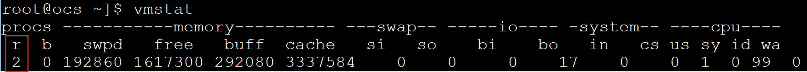

图 20.1 使用 `vmstat` 命令查看进程队列

`r` 下方的值（在图 20.1 的示例中为 `2`）表示 CPU 队列中有多少进程请求。如果系统性能缓慢，可以使用此命令确定队列中是否有大量请求。如果是的话，可能是时候升级系统硬件或考虑将某些进程卸载到另一个系统了。

### CPU 时间

有关 CPU 时间以及相关问题 **steal**、**user**、**system**、**idle** 和 **iowait**，请参见本章前面的“高 CPU 利用率”部分。

### CPU 进程优先级

进程优先级在第 4 章的“设置优先级”部分中有详细介绍。请参考该章节以获取更多信息。

#### nice

`nice` 命令在第 4 章的“设置优先级”部分中有详细介绍。请参考该章节以获取更多信息。

#### renice

`renice` 命令在第 4 章的“设置优先级”部分中有详细介绍。请参考该章节以获取更多信息。


# 内存耗尽

当操作系统没有可用（或空闲）内存（即 RAM）时，就会发生`内存 exhaustion`。本节将探索内存耗尽的一些关键方面。

## 空闲内存与文件缓存

请参见本章后面“`/proc/meminfo`”部分中关于 `free` 和 `vmstat` 命令的讨论。

### 内存溢出 (OOM)

在处理内存溢出（OOM）问题时，你应该考虑内存泄漏和进程杀手（process killer）。这些主题将在本节中介绍。

请参见本章后面“进程杀手”部分。

### 内存泄漏

当进程被分配了内存，但在使用完毕后没有释放这部分内存时，就会发生`内存泄漏`。Linux 提供了一些第三方工具可用于搜索内存泄漏；然而，对于 Linux+ XK0-005 考试，你只需要了解什么是内存泄漏；不需要知道如何查找和排错内存泄漏。要实际排错内存泄漏，你必须检查程序的代码，这超出了 Linux+ 考试的范围。

### 进程杀手

当系统使用过多内存时会发生什么？Linux 内核有一个名为 `OOM Killer`（内存溢出杀手）的功能，也称为 `Process Killer`，它通过杀死某些进程来释放内存。如果没有这个功能，系统可能会停滞，且新进程将无法执行。

OOM Killer 通过为每个进程分配一个分数（称为“坏度评分”，badness score）并杀死最糟糕的一个来决定杀死哪个进程。通常，这个进程是占用内存最多的进程，而且很可能是服务器上的一个关键进程，例如邮件服务或 Web 服务器。

你可以搜索日志文件（通常为 `/var/log/messages` 或 `/var/log/kern.log`）来找到 OOM Killer 已触发的证据。错误信息如下：

点击此处查看代码图像

```
host kernel: Out of Memory: Killed process 1466 (httpd).
```

**考试要点**

有配置 OOM Killer 的方法（使用内核参数），但它们超出了 Linux+ XK0-005 考试的范围。对于考试，你应该了解 OOM Killer 的功能以及你如何判断 OOM Killer 是否已采取行动。

# 交换 (Swapping)

`Swapping`（交换）是操作系统在 RAM 被占用过多时释放 RAM 的一种过程。`swap space`（交换空间）是存储设备上的一个区域，系统可以将其通常位于 RAM 中的数据放在那里。被交换的数据通常是操作系统最近未使用、但尚未从 RAM 中释放的数据。

要查看你当前激活的交换设备，请带有 `-s` 参数执行 `swapon` 命令：

点击此处查看代码图像

```
[root@OCS ~]# swapon -s
Filename  Type      Size    Used Priority
/dev/dm-1 partition 1048568 27100 -1
```

从 `swapon -s` 命令的输出中，你可以看到交换文件系统的设备名称（`/dev/dm-1`）、交换文件系统的大小（字节）以及该空间已使用多少。优先级指示表示应该先使用哪个交换文件系统。

如果你有一个现有的交换设备（例如交换文件），可以使用 `swapon` 命令将其添加到当前使用的交换设备中。例如，以下命令添加了 `/var/swap` 文件：

点击此处查看代码图像

```
[root@OCS ~]# swapon /var/swap
[root@OCS ~]# swapon -s
Filename  Type      Size    Used  Priority
/dev/dm-1 partition 1048568 27484 -1
/var/swap file      51192    0    -2
```

为了在每次启动系统时都启用此交换设备，请在 `/etc/fstab` 文件中添加如下行的行：

点击此处查看代码图像

```
/var/swap swap     swap     defaults    0     0
```

如果你决定手动从当前交换空间中移除一个设备，请使用 `swapoff` 命令：

点击此处查看代码图像

```
[root@OCS ~]# swapon -s
Filename   Type      Size    Used  Priority
/dev/dm-1  partition 1048568 27640 -1
/var/swap  file 51192 0 -2
[root@OCS ~]# swapoff /var/swap
[root@OCS ~]# swapon -s
Filename   Type      Size     Used   Priority
/dev/dm-1 partition 048568    27640   -1
```

如果你已经创建了一个标记类型为 `82` 的新分区（在本例中为 `/dev/sdb1`），可以通过执行以下命令将其格式化为交换设备：

点击此处查看代码图像

```
[root@OCS ~]# mkswap /dev/sdb1
Setting up swapspace version 1, size = 203772 KiB
no label, UUID=039c21dc-c223-43c8-8176-da2f4d508402
```

要创建一个交换文件，首先需要创建一个大文件。使用 `dd` 命令最容易实现这一点。下面的示例演示了如何创建一个名为 `/var/extra_swap` 的 200MB 文件，然后将其启用为交换空间：

点击此处查看代码图像

```
[root@OCS ~]# dd if=/dev/zero of=/var/extra_swap bs=1M count=200
200+0 records in
200+0 records out
209715200 bytes (210 MB) copied, 4.04572 s, 51.8 MB/s
[root@OCS ~]# mkswap /var/extra_swap
mkswap: /var/extra_swap: warning: don't erase bootbits sectors
        on whole disk. Use -f to force.
Setting up swapspace version 1, size = 204796 KiB
no label, UUID=44469984-0a99-45af-94b7-f7e97218d67a
[root@OCS ~]# swapon /var/extra_swap
[root@OCS ~]# swapon -s
Filename  Type      Size    Used  Priority
/dev/dm-1 partition 1048568 37664 -1
/dev/sdb1 partition  203768  0    -2
/var/extra_swap file 204792  0    -3
```

# 硬件

本节演示了你可以用于显示 CPU 和 RAM 信息的一些文件和命令。

### lscpu

`lscpu` 命令可以显示有关 CPU 的有用信息，如下例所示：

点击此处查看代码图像

```
[root@ocs ~]$ lscpu
Architecture:          x86_64
CPU op-mode(s):        32-bit, 64-bit
Byte Order:            Little Endian
CPU(s):                4
On-line CPU(s):   0-3
Thread(s) per core:    1
Core(s) per socket:    1
Socket(s):             4
NUMA node(s):          1
Vendor ID:             GenuineIntel
CPU family:            62
Model:                 Intel(R) Xeon(R) E5-2697 v2 @ 2.70GHz
Stepping:              4
CPU MHz:               2700.00
BogoMIPS:              5400.00
Hypervisor vendor:     VMware
Virtualization type:   full
L1d cache:             32K
L1i cache:             32K
L2 cache:              256K
L3 cache:              30720K
NUMA node0 CPU(s):     0-3
```

**注意**：CPU 信息来自 `/proc/cpuinfo` 文件。更多信息请参见本章的 `/proc/cpuinfo”部分。

**考试要点**：不要记忆 `lscpu` 的输出。Linux+ 考试不会询问具体的 CPU 属性。你需要知道如何查看这些信息。

### lsmem

`lsmem` 命令可以显示内存（RAM）信息，如下例所示：

点击此处查看代码图像

```
[root@ocs ~]$ lsmem
Address range                          Size (MB)  State    Removable
Device
=====================================
==========
0x0000000000000000-0x000000000fffffff        256  online   no        
0
0x0000000010000000-0x000000002fffffff        512  online   yes        
1-2
0x0000000030000000-0x000000003fffffff        256  online   no        
3
0x0000000040000000-0x000000006fffffff        768  online   yes        
4-6
0x0000000070000000-0x00000000ffffffff       2304  offline  -
7-15

Memory device size  : 256 MB
Memory block size   : 256 MB
Total online memory : 1792 MB
Total offline memory: 2304 MB
```


不要记忆 `lsmem` 命令的输出。在 Linux+ XK0-005 考试中，你不会被问及关于 CPU 特性的具体问题。相反，你需要知道如何查看这些信息。

### /proc/cpuinfo

发现 CPU 信息的一种方法是查看 `/proc/cpuinfo` 文件的内容。该文件包含关于每个 CPU 的详细信息，例所示：

点击此处查看代码图像

```
[root@OCS ~]# cat /proc/cpuinfo
processor     : 0
vendor_id     : GenuineIntel
cpu family    : 6
model         : 13
model name    : QEMU Virtual CPU version (cpu64-rhel6)
stepping      : 3
microcode     : 0x1
cpu MHz       : 2666.760
cache size    : 4096 KB
physical id   : 0
siblings      : 1
core id       : 0
cpu cores     : 1
apicid         : 0
initial apicid : 0
fpu            : yes
fpu_exception  : yes
cpuid level    : 4
wp             : yes
flags : fpu de pse tsc msr pae mce cx8 apic
sep mtrr pge mca cmov pse36 clflush mmx fxsr sse sse2
 syscall nx lm nopl pni cx16 hypervisor lahf_lm
bugs :
bogomips        : 5333.52
clflush size    : 64
cache_alignment : 64
address sizes   : 40 bits physical, 48 bits virtual
power management:

processor       : 1
vendor_id       : GenuineIntel
cpu family      : 6
model           : 13
model name      : QEMU Virtual CPU version (cpu64-rhel6)
stepping        : 3
microcode       : 0x1
cpu MHz         : 2666.760
cache size      : 4096 KB
physical id     : 1
siblings        : 1
core id       : 0
cpu cores       : 1
apicid          : 1
initial apicid  : 1
fpu             : yes
fpu_exception   : yes
cpuid level     : 4
wp               : yes
flags : fpu de pse tsc msr pae mce cx8 apic sep
 mtrr pge mca cmov pse36 clflush mmx fxsr sse sse2 syscall nx
 lm nopl pni cx16 hypervisor lahf_lm
bugs :
bogomips         : 5333.52
clflush size     : 64
cache_alignment  : 64
address sizes    : 40 bits physical, 48 bits virtual
power management :
```

**考试警报**

不要记忆 `cat` 命令的输出。在 Linux+ XK0-005 考试中，你不会被问及关于 CPU 特性的具体问题。相反，你需要知道如何查看这些信息。

### /proc/meminfo

`free` 命令提供了虚拟内存（RAM 和交换空间使用率）的摘要：

点击此处查看代码图像

```
[root@OCS ~]# free
     total   used   free   shared buff/cache available
Mem: 3883128 774752 777300 18200 2331076 2784820
Swap: 839676    0   839676
```

`Mem:` 行描述 RAM，`Swap:` 行描述虚拟内存。输出列的描述如下：

*    **total:** 操作系统上的内存总量
*    **used:** 当前正在使用的内存量
*    **free:** 可用的内存量
*    **shared:** `tmpfs` 使用的内存量，`tmpfs` 是一种看起来像普通硬盘空间但实际上存储在内存中的文件系统
*    **buff/cache:** 临时存储位置
*    **available:** 新进程可用的内存量

表 20.1 描述了 `free` 命令的有用选项。

表 20.1 **free** 命令选项

| 选项 | 描述 |
| --- | --- |
| `-b` 或 `--bytes` | 以字节显示信息。 |
| `-m` 或 `--mega` | 以兆字节显示信息。 |
| `-g` 或 `--giga` | 以吉字节显示信息。 |
| `-h` 或 `--human` | 显示“人类可读的大小”。 |

如果你需要比 `free` 命令提供的更详细的信息，可以执行 `vmstat` 命令。请参考图 20.2 所示的输出。

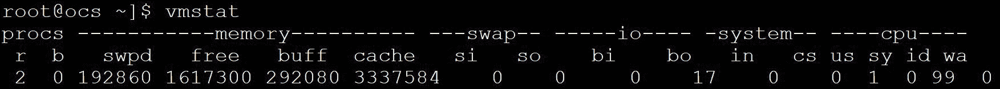

图 20.2 `vmstat` 命令

不需要记忆图 20.2 所示输出的每一行，但你应该熟悉 `vmstat` 命令可以提供的输出。例如，前面的示例中的输出包含一个标记为 `-----io----` 的列。该列下有两个子列：

*    **bi:** 也称为“块入”，此值代表从块设备（如硬盘）接收的块数。
*    **bo:** 也称为“块出”，此值代表发送到块设备（如硬盘）的块数。

这些值可以用于判断性能问题是基于内存还是基于磁盘。如果 `bi` 和 `bo` 值较高，可能意味着进程正阻塞在 I/O。

`free` 和 `vmstat` 命令显示的大部分数据实际上来自 `/proc/meminfo` 文件，可以直接查看它（但其格式可能难以理解）。

**考试警报**

不要记忆 `/proc/meminfo` 文件的内容。在 Linux+ XK0-005 考试中，你不会被问及关于内存特性的具体问题。相反，你需要知道如何查看这些信息。

## 第 21 章：分析和排除用户访问与文件权限故障

本章涵盖了以下 Linux+ XK0-005 目标：

*    **4.4:** 给定场景，分析并排除用户访问和文件权限故障。

用户在 Linux 系统上工作时经常面临挑战。一个挑战与登录系统有关。使用多个组件来判断用户是否可以登录，其中许多已经在之前的章节中介绍过。本章介绍了一些额外的用户访问功能，并提供了如何排除用户访问故障的有用建议。

用户面临另一个常见问题是访问文件和目录。与用户访问类似，许多与文件访问相关的主题（如权限、ACL（文件访问列表）和基于上下文的系统（如 SELinux 和 AppArmor））在之前的章节中已经涵盖。本章还介绍了文件属性以及如何排除文件访问故障。

本章提供了以下信息：用户登录问题、用户文件访问问题、密码问题、权限提升和配额问题。

### 用户登录问题

当用户尝试访问系统时（例如他们尝试登录时），必须考虑两个组件：访问本身和身份验证。本节关注用户尝试访问系统时可能出现的问题，本章稍后的“用户文件访问问题”部分则关注用户账户通过验证后出现的问题。

### 本地

本地访问系统意味着物理坐在系统面前并尝试直接登录。本地访问产生的问题比远程访问少。以下是本地访问可能出现的一些问题：

*    硬件故障。
*    输入错误的用户账户信息。查阅日志文件以发现此类错误。
*    可插拔认证模块 (PAM)限制。（有关 PAM 的更多信息请参见第 8 章 Linux 环境的安全最佳实践”。）

对于远程访问，用户尝试通过网络连接到系统。除了列出的本地访问问题外，远程访问还可能涉及以下问题：

*    **服务配置错误：** 例如，如果用户通过 SSH 连接，则 SSH 服务器可能配置错误或根本未运行。


*    **基于服务的安全限制：** 每个服务通常都有自己的安全特性。例如，可以配置 SSH 服务器不允许允许 root 用户直接登录。（有关 SSH 服务器的详细信息，请参阅第 11 章“配置和执行系统管理的远程连接””。）

*    **基于网络的问题：** 如果无法通过网络访问远程系统，用户将因为此网络问题而无法访问。

*    **防火墙限制：** 防火墙可以阻止对远程系统的访问，使用户无法通过网络访问系统。（有关防火墙的更多信息，请参阅第 10 章“实施和配置防火墙””。）

*    **TCP Wrapper 规则：** 过滤主机服务访问的技术之一是使用名为 TCP Wrappers 的库。该库使用简单的配置文件（`/etc/hosts.allow` 和 `/etc/hosts.deny` 文件）来允许或拒绝来自特定主机或网络的访问。此主题将在下文详细介绍。

只有使用 TCP Wrappers 库的服务受 `/etc/hosts.allow` 和 `/etc/hosts.deny` 文件的影响。你可以使用 `ldd` 命令判断一个程序是否使用了此库：

点击此处查看代码图像

```
[root@OCS ~]# which sshd
/usr/sbin/sshd
[root@OCS ~]# ldd /usr/sbin/sshd | grep libwrap
 libwrap.so.0 => /lib64/libwrap.so.0 (0x00002b003df03000)
```

TCP Wrappers 使用以下步骤确定是否允许或拒绝访问：

1. 如果在 `/etc/hosts.allow` 文件中找到匹配项，则允许访问。如果没有，则查看下一步。

2. 如果在 `/etc/hosts.deny` 文件中找到匹配项，则拒绝访问。如果没有，则查看下一步。

3. 如果在两个文件中都没有匹配项，则允许访问。

`/etc/hosts.allow` 和 `/etc/hosts.deny` 文件的格式如下：

```
service: hosts|network
```

以下命令显式允许 192.168.1.1 主机和 192.168.99.0/24 网络访问 SSHD 服务器：

点击此处查看代码图像

```
[root@OCS ~]# cat /etc/hosts.allow
sshd: 192.168.1.1
sshd: 192.168.99.0/24cat
```

表 21.1 描述了如何指定 `service` 参数。

表 21.1 **指定 service 参数**

| 参数值 | 说明 |
| --- | --- |
| `service` | 匹配单个服务。 |
| `service`,`service` | 匹配列出的任何一个服务。（注意服务之间之间没有空格。） |
| `ALL` | 匹配所有服务。 |

表 21.2 描述了如何指定 `hosts` 或 `network` 参数。

表 21.2 **指定 hosts 或 network 参数**

| 参数值 | 说明 |
| --- | --- |
| `IP` | 一个 IP 地址 |
| `Hostname` | 可以解析的主机名 |
| `@group` | 一个 NIS 组 |
| `Network` | 网络，采用以下格式之一：192.168.1,192.168.99.0/24,192.168.99.0/255.255.255.0,或 .example.com |

Linux+ XK0-005 考试目标中没有特别提到 TCP Wrappers。然而，它有时是远程访问失败的原因，并且在之前的 Linux+ 考试中出现过。

### 用户文件访问问题

用户在 Linux 中工作时最常见的操作之一是访问文件和目录。这些资源可以通过多种方式保护安全，这使得很难确定为什么用户无法访问资源。本节描述了在排故障时需要理解的各种文件访问问题。

### 组

回想每个用户账户至少属于一个组。在访问文件或目录时，用户账户或用户所属的组都可以提供对文件或目录的访问权限。更多细节请参阅本章后后的“权限”部分。

#### 上下文

在用户文件访问方面，`context` 指 SELinux 或 AppArmor 安全上下文。这些主题在第 12 章“应用适当的访问控制”中有详细介绍。

### 权限

有时确定为什么无法访问某个文件或目录可能会非常沮丧。例如，考虑以下示例：

点击此处查看代码图像

```
bob@OCS:~# cp sample /etc/skel
cp: cannot create regular file '/etc/skel/sample:
 Permission denied
```

这里的问题是什么？请记住，会检查多项权限，例如 `sample` 文件的读取权限；`/`、`etc` 和 `skel` 目录的执行权限；以及 `skel` 目录的写权限。

要发现错误，首先仔细查看错误消息的输出。在这种情况下，问题似乎是在 `/etc/skel` 目录中创建文件，而不是 `sample` 文件本身（那会导致类似“无法打开‘sample1’进行读取”的错误）。

接下来，通过查看每个目录的权限或使用 `cd` 命令进入每个目录，确定你是否可以进入所有目录。最后，检查目标目录的写权限。

目录权限可能很复杂，使得难以排查目录访问。例如，考虑以下情况：

点击此处查看代码图像

```
[julia@OCS mydata]$ ls -l info
-rwxrwxrwx 1 julia julia 240 Feb 4 22:16 info
[julia@OCS mydata]$ rm info
rm: cannot remove 'info': Permission denied
```

`julia` 用户无法删除 `info`，这似乎不合逻辑。该文件属于 `julia` 账户，且 `julia` 账户对文件拥有所有权限。这里的问题在于，删除文件所需的权限是文件所在目录的写权限，如下：

点击此处查看代码图像

```
[julia@OCS mydata]$ ls -ld .
dr-xrwxr-x 2 julia julia 4096 Feb 4 22:16 .
[julia@OCS mydata]$ chmod u+w .
[julia@OCS mydata]$ ls -ld .
drwxrwxr-x 2 julia julia 4096 Feb 4 22:16 .
[julia@OCS mydata]$ rm info
```

当你处理权限时，请考虑完成当前任务需要哪些权限。考虑使用完整路径编写命令。例如，在这种情况下，与其考虑 `rm info` 命令，不如考虑 `rm /home/julia/data/info` 命令。检查每个目录的权限，以确定问题可能出在哪里。

### ACL

回想文件 ACL 可以为文件和目录提供额外的访问权限。在检查为什么用户或组可能无法访问文件或目录时，不要忘记在资源上运行 `getfacl` 命令，查看是否有阻止访问的特定规则。

### 属性

虽然在技术上不属于权限，但文件属性会影响用户访问文件和目录的方式，因此它们在逻辑上属于任何关于权限的讨论。通过文件属性，系统管理员可以修改文件访问的关键特性。

例如，一种非常有用的文件属性是使文件不可变。不可变文件是完全更改的；任何人（包括 root 用户）都无法删除或修改它。要使文件不可变，使用 `chattr` 命令：

点击此处查看代码图像

```
[root@OCS ~]$ chattr +i /etc/passwd
```


注意，现在没有用户可以更改 `/etc/passwd` 文件，这意味着无法向系统添加新用户（也无法删除现有用户）。这听起来可能像是一件奇怪的事，但请想象一种系统是公开使用的这种情况（例如商场里的自助终端）。你不需要新用户，也不希望任何人删除用户。

要查看文件的属性，请使用 `lsattr` 命令：

点击此处查看代码图像

```
[root@OCS ~]$ lsattr /etc/passwd
----i--------e-- /etc/passwd
```

`-` 字符表示未设置的文件属性。你可以在 `chattr` 命令的帮助页（man page）中找到完整的属性列表。表 21.3 描述了对系统安全重要的文件属性。

表 21.3 对系统安全重要的文件属性

| 属性 | 描述 |
| --- | --- |
| `a` | 指定只追加模式，使得新数据只能被写入文件。 |
| `A` | 防止修改访问时间戳。出于安全考虑，该时间戳对于确定关键系统文件何时被访问非常重要。然而，对于非关键文件，禁用访问时间可以减少硬盘写入，从而提高系统速度。 |
| `e` | 指定范围区格式（extent format），这允许支持 SELinux（本章稍后讨论）等关键特性。 |
| `i` | 使文件不可变，这意味着文件不能被删除或修改。 |
| `u` | 使文件不可删除，这意味着文件不能被删除，但其内容可以修改。 |

要移除不可变文件属性，请使用以下命令：

点击此处查看代码图像

```
[root@OCS ~]$ chattr -i /etc/passwd
[root@OCS ~]$ lsattr /etc/passwd
-------------e-- /etc/passwd
```

表 21.4 描述了 `chattr` 命令的重要选项。

表 21.4 `chattr` 命令选项

| 选项 | 描述 |
| --- | --- |
| `-R` | 递归地更改应用于整个目录结构。 |
| `-V` | 在产生输出时显示详细信息，以演示所做的更改。 |

**考试警报**

在 Linux+ XK0-005 考试中请记住，只有 root 用户可以更改文件属性。普通用户可以看到属性但无法更改它们，即使该用户拥有该文件。

### 密码问题

密码是认证过程的核心。认证过程涉及确定用户是否允许访问系统。例如，用户是否提供了正确的凭据（如正确的密码）？或者用户是否在正确的日期和时间登录？本节侧重于如何判断认证过程中是否出现了问题。

本地用户认证通常依赖于存储在 `/etc/shadow` 文件中的密码信息。用户可能出于以下原因出现本地认证问题：

*  用户忘记了账户密码。
*  账户已过期。
*  账户有密码年龄限制，且用户违反了这些限制。例如，可以配置账户每 60 天要求更改新密码。如果用户在此期间内未更改账户密码，账户可能会被锁定。
*  管理员可能手动锁定了用户账户。
*  PAM 限制可能会限制用户认证。

以下是一些与排除本地认证问题相关的有用提示：

*  检查安全日志文件中的错误信息。
*  检查 `/etc/shadow` 文件中的用户账户设置。有关该文件的详情，请参阅第 9 章](#ch09.xhtml)，“实施身份管理](#ch09.xhtml)”
*  检查 PAM 限制。有关 PAM 的更多信息，请参阅第 8 章](#ch08.xhtml)，“Linux 环境下的安全最佳实践](#ch08.xhtml)”

**考试警报**

对于 Linux+ XK0-005 考试，务必熟悉 `/etc/shadow` 文件的字段。你可能会遇到询问关于该文件内容的具体问题。

### 权限提升

回想，权限提升是在登录非特权账户（即普通用户账户）时，使用 PolicyKit 规则、`sudo`、`su` 或 `pkexec` 来获取权限（通常是 root 账户访问）。第 11 章](#ch11.xhtml)，“配置和执行系统管理的远程连接](#ch11.xhtml)”提供了这些主题的完整覆盖。

排除权限提升问题的一些建议包括：

*  查看日志文件以收集额外信息。`/var/log/secure` 等文件通常包含描述尝试失败原因的条目。
*  让尝试提升权限提供失败命令的输出。
*  检查所用工具的配置文件，确定其配置是否正确。
*  检查 PAM 配置，确保没有 PAM 规则阻止用户的权限提升尝试。有关 PAM 的更多信息，请参阅第 8 章](#ch08.xhtml)。

### 配额问题

配额允许管理员限制个人或组使用的磁盘空间。配额是基于文件系统的。本节侧重于如何启用和查看配额。

要启用用户配额，必须使用 `usrquota` 挂载选项挂载文件系统。这可以通过向 `/etc/fstab` 文件的挂载选项字段添加 `usrquota` 来完成如下：

```
/dev/sdb1 / ext4 usrquota 1 1
```

**注意**

要启用组配额，请使用 `grpquota` 启动选项。可以将 `usrquota` 和 `grpquota` 结合使用（`usrquota,grpquota`），在文件系统中同时启用用户和组配额。

然后可以使用以下命令重新挂载文件系统（由 root 用户执行）：

点击此处查看代码图像

```
[root@OCS ~]$ mount -o remount /
```

有关这些任务的详情，请参见第 3 章](#ch03.xhtml)，“使用适当工具配置和管理存储](#ch03.xhtml)”中的“/etc/fstab”和“mount”部分。

在启用 `usrquota` 选项挂载文件系统后，你需要执行 `quotacheck` 命令创建初始配额数据库：

点击此处查看代码图像

```
[root@OCS ~]$ quotacheck -cugm /dev/sdb1
```

这会在文件系统的挂载点目录下生成新文件：

```
[root@OCS ~]$ ls /aquota*
/aquota.group /aquota.user
```

表 21.5 描述了 `quotacheck` 命令的一些重要选项。

表 21.5 `quotacheck` 命令选项

| 选项 | 描述 |
| --- | --- |
| `-c` | 创建数据库文件。 |
| `-g` | 创建 `aquota.group` 文件，除非也使用 `-u` 选项，否则仅启用组配额。 |
| `-m` | 在创建配额文件时防止卸载文件系统。 |
| `-u` | 创建 `aquota.user` 文件，除非也使用 `-g` 选项，否则仅启用用户配额。 |

要创建或编辑用户的配额，请以 root 用户身份执行 `edquota` 命令并接用户名：

```
[root@OCS ~]$ edquota sarah
```

**注意**

在 `edquota` 命令中使用 `-g` 选项来编辑组配额。


`edquota` 命令会进入编辑器（通常默认认为 vi）并显示用户所有的配额。输出内容类似于下所示：

点击此处查看代码图片

```
Disk quotas for user sarah (uid 507):
 Filesystem blocks soft hard inodes soft hard
 /dev/sdb1  550060 0    0     29905  0   0
```

表 21.6 描述了配额的字段。

表 21.6 **配额字段**

| 键 | 描述 |
| --- | --- |
| **Filesystem** | 启用了配额的文件系统的分区。 |
| **blocks** | 用户当前在文件系统中使用的块数。 |
| **soft** | 代表块软配额的值；如果用户创建的文件导致超过此块限制，系统将发出警告。 |
| **hard** | 代表块硬配额的值；如果用户创建的文件导致超过此块限制，系统将发出错误，且无法在文件系统中创建更多文件。 |
| **inodes** | 用户当前在文件中的文件数量。 |
| **soft** | 代表文件软配额的值；如果用户创建的文件导致超过此文件限制，系统将发出警告。 |
| **hard** | 代表文件硬配额的值；如果用户创建的文件导致超过此文件限制，系统将发出错误，且无法在文件系统中创建更多文件。 |

### 考试警报

可以通过执行 `edquota -t` 命令设置宽限期。

用户可以执行 `quota` 命令来显示账户的配额：

点击此处查看代码图片

```
[sarah@OCS ~]$ quota
Disk quotas for user sarah (uid 507):
    Filesystem blocks quota   limit grace files quota limit grace
      /dev/sda1   20480    30000     60000    1     0     0
```

注意用户超过软配额时的输出。在接下来的示例中，用户 sarah 的块大小超过了软限制：

点击此处查看代码图片

```
[sarah@OCS ~]$ quota
Disk quotas for user sarah (uid 507):
    Filesystem blocks quota limit grace files quota limit grace
 /dev/sda1   40960*  30000 60000 7days    2     0    0
```

一旦用户超过软配额，就会提供一个宽限期。用户必须在宽限期内文件系统使用的空间减少到软配额以下，否则当前使用量将转换为硬配额限制。

表 21.7 描述了 `quota` 命令的一些重要选项。

表 21.7 **quota 选项**

| 选项 | 描述 |
| --- | --- |
| **-g** | 显示组配额而不是特定用户配额。 |
| **-s** | 以人类可读的大小而非块大小显示信息。 |
| **-l** | 仅显示本地文件系统的配额信息（而不是基于网络的文件系统配额）。 |

root 用户可以使用 `repquota` 命令来显示整个文件系统的配额：

点击此处查看代码图片

```
[root@localhost ~]$ repquota /
*** Report for user quotas on device /dev/sda1
Block grace time: 7days; Inode grace time: 7days
 Block limits File limits
User used  soft hard grace used soft hard grace
------------------------------------------------------------------------
root       -- 4559956  0   0    207396  0  0
daemon     -- 64       0   0    4       0  0
man        -- 1832     0   0    145     0  0
www-data    -- 4       0   0    1       0  0
libuuid    -- 40       0   0    6       0  0
syslog     -- 3848     0   0    23      0   0
messagebus -- 8        0   0    2       0  0
landscape  -- 8        0   0    2       0  0
pollinate  -- 4        0   0    1       0  0
vagrant    -- 550060   0   0    29906   0  0
colord     -- 8        0   0    2       0  0
statd      -- 12       0   0    3       0  0
puppet     -- 44       0   0    11      0  0
ubuntu     -- 36       0   0    8       0  0
sarah     +- 40960  30000  60000  6days   2  0  0
```

表 21.8 描述了 `repquota` 命令的一些重要选项。

表 21.8 **repquota 命令选项**

| 选项 | 描述 |
| --- | --- |
| **-a** | 显示 `/etc/fstab` 文件中指定了配额挂载选项的所有文件系统的配额。 |
| **-g** | 显示组配额而不是特定用户配额。 |
| **-s** | 以人类可读的大小而非块大小显示信息。 |

`quotaon` 命令用于开启文件系统的配额。通常在系统启动时，它会自动开启配额。然而，你可以通过执行 `quotaoff` 命令后跟文件系统的名称（作为 root 用户）来关闭配额：

点击此处查看代码图片

```
[root@OCS ~]$ quotaoff /dev/sdb1
[root@OCS ~]$ quotaon /dev/sdb1
```

## 第 22 章

使用 systemd 诊断并解决 Linux 系统的常见问题

**本章涵盖以下 Linux+ XK0-005 考试目标：**

*  **4.5:** 在给定场景下，使用 `systemd` 诊断并解决 Linux 系统的常见问题。

本书的最后一章由于在 Linux+ 目标中的处理方式而有点特殊。`systemd` 服务在其他几个章节中简要讨论过，但本章中的许多主题之前尚未涵盖。考虑到本章的目标是“在给定场景下，使用 `systemd` 诊断并解决 Linux 系统的常见问题”，为了通过 Linux+ XK0-005 考试，你需要对 `systemd` 有深入的理解。

本章的目标介绍 `systemd` 如何影响操作系统的多个组件。`systemd` 引导系统、控制系统进程、挂载存储设备、调度进程以及本章涵盖的其他功能。在学习这些 `systemd` 特性的同时，你还将学习解决 `systemd` 相关问题的技术。

本章提供了关于单元文件（unit files）和常见问题的信息。

### 单元文件

单元文件用于定义服务（服务将在本节后面讨论）。要显示系统中定义了哪些单元文件，请使用 `systemctl` 命令的 `list-units` 选项：

点击此处查看代码图片

```
# systemctl list-units | head
UNIT FILE STATE
proc-sys-fs-binfmt_misc.automount  static
-.mount generated
dev-hugepages.mount                        static
dev-mqueue.mount                           static
proc-sys-fs-binfmt_misc.mount              static
snap-core-5662.mount                       enabled
snap-core-5742.mount                       enabled
snap-core-6130.mount                       enabled
snap-gnome\x2d3\x2d6\x2d1604-64.mount     enabled
snap-gnome\x2d3\x2d6\x2d1604-70.mount     enabled
```

要查看单元文件的内容，请使用 `systemctl` 命令的 `cat` 选项：

点击此处查看代码图片

```
# systemctl cat cups
# /lib/systemd/system/cups.service
[Unit]
Description=CUPS Scheduler
Documentation=man:cupsd(8)

[Service]
ExecStart=/usr/sbin/cupsd -l
Type=simple
Restart=always

[Install]
Also=cups.socket cups.path
WantedBy=printer.target
```

输出的第一行提供了单元文件的位置。`[Unit]` 部分描述了该服务。`[Service]` 部分指定了应该启动的进程以及配置该进程的一些选项。

`[Install]` 部分包含了 `WantedBy` 设置，它指示了哪个目标“想要”启动此服务。它还可能包含一个 `Also` 设置，用于指示应该一起启动的其他服务。


此处使用了 `service` 术语，但单元文件（unit files）可以定义许多不同的 `systemd` 组件，包括挂载点、设备、套字等。

你不必担心如何创建自己的单元文件，但你应该熟悉此类文件的功能以及本章后续章节中描述的设置。

额外的单元文件命令包括：

*    `systemctl list-dependencies unit`: 列出此功能或此服务所需的其他功能或服务。
*    `systemctl show unit`: 列出单元的属性。
*    `systemctl edit unit`: 用于编辑单元文件。

## Service

`service` 是一种 `systemd` 配置，用于描述由 `systemd` 控制的进程或操作系统功能。你可以通过查看 `/lib/systemd/system` 目录下以 `.service` 结尾的文件来查看系统管理的服务列表。以下是典型 CentOS 系统上的部分列表：

点击此处查看代码图片

```
[root@ocs ~]$ ls /lib/systemd/system/*.service | head
/lib/systemd/system/abrt-ccpp.service
/lib/systemd/system/abrtd.service
/lib/systemd/system/abrt-oops.service
/lib/systemd/system/abrt-pstoreoops.service
/lib/systemd/system/abrt-vmcore.service
/lib/systemd/system/abrt-xorg.service
/lib/systemd/system/acpid.service
/lib/systemd/system/arp-ethers.service
/lib/systemd/system/atd.service
/lib/systemd/system/auditd.service
```

### Networking Services

网络服务由以下服务文件控制：

*    `/lib/systemd/system/NetworkManager.service`
*    `/lib/systemd/system/NetworkManager-wait-online.service`
*    `/lib/systemd/system//lib/systemd/system/NetworkManager.service`

这些服务单元文件管理不同的 `NetworkManager` 进程，正如第 5 章 中“使用适当的网络工具或配置文件”中所讨论的那样。

### ExecStart/ExecStop

`systemd` 服务单元文件中的 `ExecStart` 和 `ExecStop` 设置描述了如何启动或停止服务。例如，考虑以下文件，它描述了 `NetworkManager` 服务：

点击此处查看代码图片

```
[root@ocs ~]$ cat /lib/systemd/system/NetworkManager.service
[Unit]
Description=Network Manager
Wants=network.target
Before=network.target network.service

[Service]
Type=dbus
BusName=org.freedesktop.NetworkManager
ExecStart=/usr/sbin/NetworkManager --no-daemon
# NM doesn't want systemd to kill its children for it
KillMode=process

[Install]
WantedBy=multi-user.target
Alias=dbus-org.freedesktop.NetworkManager.service
Also=NetworkManager-dispatcher.service
```

如果 `systemd` 尝试启动此服务，将执行 `/usr/sbin/NetworkManager --no-daemon` 命令，因为这是由 `ExecStart` 定义的。如果需要 `systemd` 停止一个进程，则使用 `ExecStop` 设置。

### Before/After

`systemd` 服务单元文件中的 `Before` 和 `After` 设置用于控制服务启动的顺序。例如，考虑以下用于管理防火墙守护进程单元文件中的高亮行：

点击此处查看代码图片

```
[root@ocs ~]$ cat /lib/systemd/system/firewalld.service
[Unit]
Description=firewalld - dynamic firewall daemon
Before=network.target
Before=libvirtd.service
Before=NetworkManager.service
Conflicts=iptables.service ip6tables.service ebtables.service

[Service]
EnvironmentFile=-/etc/sysconfig/firewalld
ExecStart=/usr/sbin/firewalld --nofork --nopid $FIREWALLD_ARGS
ExecReload=/bin/kill -HUP $MAINPID
# supress to log debug and error output also to /var/log/messages
StandardOutput=null
StandardError=null
Type=dbus
BusName=org.fedoraproject.FirewallD1

[Install]
WantedBy=basic.target
Alias=dbus-org.fedoraproject.FirewallD1.service
```

这表明防火墙必须在 `NetworkManager.service` 和 `libvirtd.service` 服务之前启动。对于 Linux+ XK0-005 考试，你不需要担心为什么特定的服务应该在另一个服务之前启动；你只需要理解这种关系。在这种情况下，很明显，防火墙应该在 NetworkManager 激活网络之前启动。这是因为如果网络先激活，某些本应被防火墙拦截的网络通信可能会访问系统。

请注意，在上例中，有第三个 `Before` 值 `network.target`。目标（Targets）将在本章稍后部分进行介绍，但目前可以将目标视为一种在 `systemd` 中定义功能状态的方式。例如，`network.target` 文件用于定义网络服务启用功能状态。有关目标的更多信息，请参见本章稍后的“Target”部分。

### Type

相对于 `systemd` 的 `type` 术语可能有点困惑，因为它可能指的是两种情况之一：

*    **单元类型 (Type of unit):** 这是 `systemd` 配置的类型。例如，以 `.service` 结尾的 `systemd` 配置是服务类型，而以 `.target` 结尾的文件是目标类型。其他常见类型包括 mount、device 和 timer。
*    **服务配置中的类型设置:** 它定义了如何在 systemd 服务单元配置文件启动进程。这可以是 `simple`、`exec`、`forking`、`oneshot`、`dbus`、`notify` 或 `idle` 等值。这些类型的相似之处在于它们都定义了如何启动服务，但存在细微差异。例如，使用 `simple` 时，`systemd` 在进程 *forks*（即启动新进程并开始执行）时认为进程已启动；而使用 `notify` 时，`systemd` 期望进程在启动后发送消息。

**考试提示 (ExamAlert)**

Linux+ XK0-005 考试不太可能会就 `systemd` 启动进程的具体差异问你问题。这些差异非常细微，通常只有创建服务单元文件的人才需要担心这些差异。

### User

`User` 设置指示使用哪个用户账户来启动服务。例如，由以下 `postgresql.service` 文件启动的进程应该使用 `postgres` 用户启动：

点击此处查看代码图片

```
[root@ocs ~]$ grep -A2 -B3 "User" /lib/systemd/system/
postgresql.service
[Service]
Type=forking

User=postgres
Group=postgres
```

### Requires/Wants

服务单元文件中的 `Requires` 值表示启动服务所需的资源。这与 `After` 值相似，但 `After` 用于定义服务需要启动的顺序，而 `Requires` 用于表示服务在启动之前需要特定的资源。

`Requires` 值可以是不同的类型，例如另一个服务、一个目标或其他资源类型，例如 socket（用于网络通信的资源）。例如，下示例中的高亮文本表明 `nfslock.service` 依赖于 `rpcbind.service` 和 `network.target` 资源的启用：

点击此处查看代码图片


```
[root@ocs ~]$ cat /lib/systemd/system/nfslock.service
[Unit]
Description=NFS file locking service.
Requires=rpcbind.service network.target
After=network.target named.service rpcbind.service
Before=remote-fs-pre.target

[Service]
Type=forking
StandardError=syslog+console
EnvironmentFile=-/etc/sysconfig/nfs
ExecStartPre=/usr/libexec/nfs-utils/scripts/nfs-lock.preconfig
ExecStart=/sbin/rpc.statd $STATDARG
# Make sure lockd's ports are reset
ExecStopPost=-/sbin/sysctl -w fs.nfs.nlm_tcpport=0 fs.nfs.
nlm_udpport=0

[Install]
WantedBy=nfs.target
```

注意，此示例还包含 `WantedBy` 设置。它用于指示另一个“想要”该资源的资源。换句话说，`nfs.target` “想要”启用 `nfslock.service` 以达到 `nfs.target` 系统状态。你可以通过运行以下命令来确定哪些服务是 `nfs.target` 需要：

点击此处查看代码图片

```
[root@ocs ~]$ grep "WantedBy=nfs.target"
/lib/systemd/system/*.service
/lib/systemd/system/nfs-blkmap.service:WantedBy=nfs.target
/lib/systemd/system/nfs-idmap.service:WantedBy=nfs.target
/lib/systemd/system/nfs-lock.service:WantedBy=nfs.target
/lib/systemd/system/nfslock.service:WantedBy=nfs.target
/lib/systemd/system/nfs-mountd.service:WantedBy=nfs.target
/lib/systemd/system/nfs-rquotad.service:WantedBy=nfs.target
/lib/systemd/system/nfs-secure-server.service:WantedBy=nfs.target
/lib/systemd/system/nfs-secure.service:WantedBy=nfs.target
/lib/systemd/system/nfs-server.service:WantedBy=nfs.target
/lib/systemd/system/nfs.service:WantedBy=nfs.target
/lib/systemd/system/rpcgssd.service:WantedBy=nfs.target
/lib/systemd/system/rpcidmapd.service:WantedBy=nfs.target
/lib/systemd/system/rpcsvcgssd.service:WantedBy=nfs.target
```

### 定时器 (Timer)

在第 4 章“配置和使用适当的进程和服务”中，你学习了如何使用 `crontab` 和 `at` 服务调度执行。`systemd` 服务也允许你调度进程按特定间隔运行。本节将探索如何使用 `systemd` 定时器来调度进程执行。

定时器单元文件用于根据时间调度进程执行。根据你安装的软件，系统中可能已经存在一些定时器单元文件。以下是定时器的使用方法：

点击此处查看代码图片

```
root@ocs ~]$ ls /lib/systemd/system/*.timer
/lib/systemd/system/systemd-readahead-done.timer
/lib/systemd/system/systemd-tmpfiles-clean.timer
/lib/systemd/system/unbound-anchor.timer
/lib/systemd/system/yum-makecache.timer
```

以下是一个定时器单元文件的示例：

点击此处查看代码图片

```
[root@ocs ~]$ cat /lib/systemd/system/yum-makecache.timer
[Unit]
Description=yum makecache timer
ConditionKernelCommandLine=!rd.live.image

[Timer]
OnBootSec=10min
OnUnitInactiveSec=1h
Unit=yum-makecache.service

[Install]
WantedBy=basic.target
```

该文件中的一些关键设置包括：

*  `OnBootSec:` 定义运行进程的时间，基于系统启动后的时间。在本示例中，进程将在系统启动 10 分钟后执行。
*  `OnUnitInactiveSec:` 定义自上次进程执行以来执行的时间。在本示例中，进程被定义在上次执行 1 小时后执行。换句话说，它将每小时运行一次。
*  `Unit:` 这是定义要执行进程的服务单元文件。为了确定将执行的实际进程，你需要查看服务单元文件中的 `ExecStart` 值。例如，此示例指示了 `Unit=yum-makecache.service`，通过查看 `yum-makecache.service` 文件的 `ExecStart` 值，可以知道定时器单元文件将执行什么进程：

点击此处查看代码图片

```
root@ocs ~]$ cat /lib/systemd/system/yum-makecache.service
[Unit]
Description=yum makecache

[Service]
Type=oneshot
Nice=19
IOSchedulingClass=2
IOSchedulingPriority=7
ExecStart=/usr/bin/yum makecache fast
```

另一种定义服务应何时执行的常用方法是使用 `OnCalendar` 设置，如下例所示：

点击此处查看代码图片

```
[root@ocs ~]$ cat /lib/systemd/system/unbound-anchor.timer
[Unit]
Description=daily update of the root trust anchor for DNSSEC
Documentation=man:unbound-anchor(8)

[Timer]
# 根区域当前的 DNSKEY TTL 为 172800 秒，即 172800/60/60/24 = 2 天。
# 这意味着 unbound-anchor 至少每天运行一次。
OnCalendar=daily
Persistent=true
AccuracySec=24h

[Install]
WantedBy=timers.target
```

设置 `OnCalendar=daily` 表明该进程将每天执行一次。请参阅后续章节“时间表达式”，获取更多关于 `OnCalendar` 设置可可用值的示例。

#### 时间表达式

与 `OnCalendar` 设置配合使用的表达式非常多样化。例如，你可以使用以下值在 2022 年 5 月 1 日星期日 13:30:00 执行进程（24 小时格式的*小时*:*分钟*:*秒*，即下午 1:30）：

点击此处查看代码图片

```
OnCalendar=Sun 2022-05-01 13:30:00
```

星号字符 `*` 表示“所有有效值”，因此为了在 2022 年 5 月 1 日星期日每小时的半点运行进程，请使用以下设置：

点击此处查看代码图片

```
OnCalendar=Sun 2022-05-01 *:30:00
```

已经定义了一些关键词，包括以下：

*  `minutely:` 等同于 `*-*-* *:*:00`
*  `hourly:` 等同于 `*-*-* *:00:00`
*  `daily:` 等同于 `*-*-* 00:00:00`
*  `monthly:` 等同于 `*-*-01 00:00:00`
*  `weekly:` 等同于 `Mon *-*-* 00:00:00`
*  `yearly:` 等同于 `*-01-01 00:00:00`
*  `quarterly:` 等同于 `*-01,04,07,10-01 00:00:00`
*  `semiannually:` 等同于 `*-01,07-01 00:00:00`

可以使用 `..` 来表示范围。例如，以下设置表示在每个工作日（周一至周五）凌晨 2 点运行进程：

点击此处查看代码图片

```
OnCalendar=Mon..Fri *-*-* 02:00:00
```

可以使用 `,` 表示多个时间。例如，以下设置表示在每个工作日（周一至周五）的早上 8 点、下午 2 点和下午 6 点运行进程：

点击此处查看代码图片

```
OnCalendar=Mon..Fri *-*-* 08,14,18:00
```

### 挂载 (Mount)

*自动挂载*是在访问挂载点时挂载资源的过程。当进程停止使用挂载点时，资源会被卸载。自动挂载通常用于挂载远程网络共享或挂载移动介质（如 CD-ROM 和 USB 磁盘）。

通过创建单元文件来创建自动挂载，如下：

点击此处查看代码图片

```
$ cat /etc/systemd/system/mnt-test.automount
[Unit]
Description=Automount Test

[Automount]
Where=/mnt/test

[Install]
WantedBy=multi-user.target

$ cat /etc/systemd/system/mnt-test.mount
[Unit]
Description=Test

[Mount]
What=nfs.example.com:/export/test
Where=/mnt/test
Type=nfs

[Install]
WantedBy=multi-user.target
```


automount 单元文件名必须与挂载点名称匹配（`/mnt/test` = `mnt-test.automount`）。

当你创建新的单元文件后，需要执行 `systemctl daemon-reload` 命令。

以下是禁用挂载单元并启用 automount 单元的方法：

点击此处查看代码图片

```
$ systemctl is-enabled mnt-test.mount
disabled
$ systemctl is-enabled mnt-test.automount
enabled
```

要切换到 automount 挂载点，请使用 `cd` 命令。

除了启用自动挂载外，`systemd` 还可以执行传统的 Linux 挂载。这可以在 `/etc/fstab` 文件中定义（详见第 3 章）“使用适当工具配置和管理存储]”），或者通过后续章节描述的 mount 单元来实现。

## 命名规范

以下单元文件演示了在创建挂载单元文件时看到的命名规范：

点击此处查看代码图片

```
[Unit]
Description=Storage drive

[Mount]
What=/dev/disk/by-uuid/72b3acbf-eb3f-457b-8442-55c17044d88b
Where=/data
Type=ext4
Options=defaults

[Install]
WantedBy=multi-user.target
```

`What`、`Where`、`Type` 和 `Options` 组件将在随后的章节中描述。

### What

`What` 组件定义了要挂载的设备。注意，这应该使用设备的 UUID（通用唯一标识符）来提供。如果你不知道设备的 UUID，可以使用 `lsblk -f` 命令显示所有设备的 UUID：

点击此处查看代码图片

```
[root@ocs ~]$ lsblk -f
NAME  FSTYPE LABEL UUID                                 MOUNTPOINT
sda
⊢sda1 ext4         72b3acbf-eb3f-457b-8442-55c17044d88b /
∟sda2 swap         e02f16c6-fceb-44c0-919f-c520045a0a60 [SWAP]
```

### Where

`Where` 组件定义了挂载设备的位置，也称为挂载点。这应该是一个空目录。

### Type

`Type` 组件定义了正在挂载的文件系统类型。通常值如 `ext4` 或 `xfs`。如果你不确定设备的文件系统类型，可以使用 `lsblk -f` 命令显示此信息：

点击此处查看代码图片

```
[root@ocs ~]$ lsblk -f
NAME  FSTYPE LABEL UUID                                 MOUNTPOINT
sda
⊢sda1 ext4         72b3acbf-eb3f-457b-8442-55c17044d88b /
∟sda2 swap         e02f16c6-fceb-44c0-919f-c520045a0a60 [SWAP]
```

### Options

`Options` 组件用于定义挂载文件系统时使用的选项。有很多可以使用的挂载选项，具体可用选项取决于正在挂载的文件系统类型。表 22.1 描述了大多数文件系统支持的挂载选项。

表 22.1 挂载选项

| Option | Description |
| --- | --- |
| `rw` | 以读/写模式挂载文件系统。要以只读模式挂载文件系统，请使用选项 `ro`。 |
| `suid` | 在文件系统的文件中启用 SUID 权限。有关 SUID 权限的详情，请参见第 12 章“应用适当的访问控制]”。使用 `nosuid` 选项禁用 SUID 权限设置。在文件系统上禁用 SUID 权限通常是为了防止用户创建 SUID 程序，这可能导致安全风险。注意，`/` 和 `/usr` 文件系统绝不应使用 `nosuid` 选项挂载。 |
| `dev` | 允许在文件系统使用设备文件。通常设备文件只存放在 `/dev` 目录下，因此出于安全考虑，在所有文件系统（`/` 文件系统外）使用 `nodev` 选项将使系统更安全。 |
| `exec` | 文件系统中可执行文件。使用 `noexec` 选项禁用可执行文件。在服务器上禁止可执行可能是防止用户向服务器引入新程序的好主。 |
| `auto` | 与 `mount` 命令的 `-a` 选项一起使用。`-a` 选项意味着“挂载 `/etc/fstab` 中具有 `auto` 选项的文件系统”。请记住，系统启动时会使用 `mount -a` 命令挂载文件系统，因此使用 `noauto` 选项也意味着文件系统在启动过程中不会自动挂载。 |
| `nouser` | 防止普通用户挂载文件系统。出于安全考虑这通常是最佳选项，但在某些情况下你可能希望用户挂载可移动设备。在这种情况下，使用 `user` 选项。如果你使用了 `user` 选项，那么一旦文件系统挂载，只有该用户可以卸载该文件系统。`user` 选项允许任何用户挂载文件系统，同时也允许任何用户卸载文件系统。 |
| `async` | 导致元数据临时存储在内存中。执行同步（sync）的过程是为了确保所有数据已写入硬盘。通常当创建或修改文件时，文件内容直接写入硬盘，但元数据（关于文件的信息）临时存储在内存中。这减少了过度的硬盘写入并防止了硬盘过载时发生的抖动。每隔一段时间，这些元数据就会写入硬盘，此过程称为同步。在某些情况下，在内存中临时存储元数据可能会导致问题，因为如果系统异常断电，这些元数据可能会丢失。如果这些元数据非常关键，请考虑使用 `sync` 选项，但要意识到可能会显著降低系统速度。注意，如果你在使用 `async` 选项，可以通过执行 `sync` 命令将元数据写入硬盘。 |
| `relatime` | 更新访问时间戳。每个文件三个时间戳：文件内容最后修改的时间、元数据最后更改的时间以及文件最后访问的时间。文件访问时间通常不是关键的，但它会导致大量的系统写入，特别是当你对目录结构执行递归命令时（例如 `grep -r`）。如果更新访问时间戳导致性能问题，请考虑将选项改为 `norelatime`。 |

注意，当 `mount` 命令提供 `defaults` 时，意味着使用了以下选项：`rw`、`suid`、`dev`、`exec`、`auto`、`nouser` 和 `async`。如前，这些并不是唯一的选项；实际上还有很多。要发现这些额外选项，请浏览 `mount` 命令的帮助页。首先查看标题为“文件系统无关挂载选项”的部分，涵盖了适用于大多数文件系统的选项。然后搜索你正在使用的文件系统。以下输出显示了 `mount` 手页中与 ext4 文件系统相关的部分：

点击此处查看代码图片


`target` 是系统的某种功能状态。每个 target 都有启动的特定服务。图 22.1 显示了一个典型的 `systemd` 启动序列示例。


图 22.1 systemd 启动过程概述

Targets 定义在 `/usr/lib/systemd/system` 目录中。考虑以下 target 文件示例，它描述了图形化用户界面运行的功能状态：

点击此处查看代码图像

```
# cat /usr/lib/systemd/system/graphical.target
# This file is part of systemd.
#
# systemd is free software; you can redistribute it and/or modify it
# under the terms of the GNU Lesser General Public License
  as published by
# The Free Software Foundation; either version 2.1 of the License, or
# (at your option) any later version.

[Unit]
Description=Graphical Interface
Documentation=man:systemd.special(7)
Requires=multi-user.target
Wants=display-manager.service
Conflicts=rescue.service rescue.target
After=multi-user.target rescue.service rescue.target
 display-manager.service
AllowIsolate=yes
```

该文件的几个关键元素如下：

*  **Requires:** 为了启动该 target 必须启用的 target 或服务。在此例中，系统必须先将状态切换到 `multi-user.target`，然后切换到启动图形化用户界面的 target。

*  **Wants:** 为了达到该 target 功能状态，该 target 希望启动的服务。在这种情况下，`display-manager.service` 是启动图形化用户界面的服务。

默认 target 通过从 `/etc/systemd/system/default.target` 到 `/usr/lib/systemd/system` 目录中 target 的符号链接来定义，如下：

点击此处查看代码图像

```
# ls -l /etc/systemd/system/default.target
lrwxrwxrwx. 1 root root 36 Jun 11 20:47
 /etc/systemd/system/default.target ->
 /lib/systemd/system/graphical.target
```

使用以下命令显示默认 target：

```
# systemctl get-default
multi-user.target
```

使用 `systemctl list-unit-files --type=target` 命令列出可用的 targets。此命令产生大量输出，以下示例使用 `head` 命令限制限制输出：

点击此处查看代码图像

```
# systemctl list-unit-files --type=target | head
UNIT FILE STATE
basic.target              static
bluetooth.target          static
cryptsetup-pre.target     static
cryptsetup.target         static
ctrl-alt-del.target       disabled
cvs.target                static
default.target            enabled
emergency.target          static
final.target              static
```

使用以下命令设置默认 target：

点击此处查看代码图像

```
# systemctl set-default graphical-user.target
rm '/etc/systemd/system/default.target'
ln -s '/usr/lib/systemd/system/graphical-
 user.target' '/etc/systemd/system/default.target'
```

### Multiuser

`multiuser` target 定义了一个多个用户可以登录系统的系统状态。在此 target 下，应该启用网络功能，且未启用图形化用户界面。

### Network-online

`network-online` target 用于定义网络已启系统状态。

### Graphical

`graphical` target 用于定义图形化用户界面已启系统状态。

## 常见问题

本节描述了在使用 `systemd` 时可能会遇到的常见问题。

### 名称解析失败

在启用了它的系统上，`systemd-resolved.service` 处理名称解析。该服务通过修改 `/etc/systemd/resolved.conf` 文件进行配置，内容可能如下：

```
[Resolve]
DNS=10.0.0.1 10.0.0.2
Domains=~example.com
```

如果你遇到域名解析问题，请检查 `/etc/systemd/resolved.conf` 文件并确保文件中的以下设置是正确的：

*  **DNS:** 提供名称解析的 DNS 服务器列表。

*  **Domains:** 可用于非完全限定主机名的域名列表。（例如，`ping test` 将转换为 `ping test.example.com`。）

**考试警示**

`/etc/systemd/resolved.conf` 文件中还有其他设置，但这里描述的是回答 Linux+ XK0-005 考试中故障排除问题的关键设置。

另见 第 5 章 中的“systemd”部分。

### 应用崩溃

如果由 `systemd` 管理的应用容易崩溃，你可以使用以下设置重启它：

点击此处查看代码图像

```
[Service]
Type=simple
ExecStart=/path/to/executable
RemainAfterExit=no
Restart=on-failure
RestartSec=5s
```

这将在应用程序崩溃五秒后重启它。

### 时区配置

使用 `timedatectl` 命令显示系统时钟，包括时区。

语法：

```
timedatectl [option] [value]
```

示例：

点击此处查看代码图像

```
[root@OCS ~]# timedatectl
       Local time:       Wed 2018-10-10 14:41:41 PDT
       Universal time:      Wed 2018-10-10 21:41:41 UTC
       RTC time:            Wed 2018-10-10 09:51:09
      Timezone:             America/Los_Angeles (PDT, -0700)
      NTP enabled:          yes
       NTP synchronized:     yes
       RTC in local TZ:      no
      DST active:           yes
        Last DST change:    DST began at
                            Sun 2018-03-11 01:59:59 PST
                            Sun 2018-03-11 03:00:00 PDT
      Next DST change:  DST ends (the clock jumps one hour backwards) at
                            Sun 2018-11-04 01:59:59 PDT
                             Sun 2018-11-04 01:00:00 PST
```

作为 root 用户，你可以使用此命令设置系统时钟。表 22.2 展示了更改系统时钟最常用的方法。

表 22.2 更改系统时钟的方法

| 方法 | 说明 |
| --- | --- |
| **set-time** [*time*] | 将系统时钟设置为指定的 *time*。 |
| **set-timezone** [*zone*] | 将系统时区设置为指定的 *zone*。 |
| **set-ntp [0&#124;1]** | 启用 (**1**)或禁用 (**0**)网络时间协议。 |

### 启动问题

要确定启动过程中遇到了哪些 `systemd` 问题，使用 `journalctl -b` 命令，它将提供以下输出：


点击此处查看代码图像

```
-- Logs begin at Sat 2018-02-24 16:42:01 PST, end at Sun 2022-05-01
14:28:53 PDT
Nov 14 10:30:16  example.com postfix/smtpd[2863]: warning: hostname
Nov 14 10:30:16  example.com postfix/smtpd[2863]: connect from unkno
Nov 14 10:30:16  example.com sshd[2873]: Invalid user localadmin fro
Nov 14 10:30:16  example.com sshd[2873]: input_userauth_request: inv
Nov 14 10:30:16  example.com sshd[2873]: pam_unix(sshd:auth): check
Nov 14 10:30:16  example.com sshd[2873]: pam_unix(sshd:auth): authen
Nov 14 10:30:17  example.com saslauthd[501]: pam_unix(smtp:auth): ch
Nov 14 10:30:17  example.com saslauthd[501]: pam_unix(smtp:auth): au
Nov 14 10:30:18  example.com sshd[2873]: Failed password for invalid
Nov 14 10:30:18  example.com saslauthd[501]: DEBUG: auth_pam: pam_au
Nov 14 10:30:18  example.com saslauthd[501]: do_auth         : auth
Nov 14 10:30:18  example.com postfix/smtpd[2863]: warning: unknown[8
Nov 14 10:30:18  example.com sshd[2873]: Received disconnect from 19
Nov 14 10:30:44  example.com sshd[2883]: pam_unix(sshd:auth): authen
Nov 14 10:30:47  example.com sshd[2883]: Failed password for root fr
Nov 14 10:30:47  example.com sshd[2883]: Received disconnect from 13
Nov 14 10:30:50  example.com postfix/smtpd[2885]: connect from mail-
Nov 14 10:30:50  example.com postfix/smtpd[2885]: Anonymous TLS conn
Nov 14 10:30:50  example.com postfix/trivial-rewrite[2887]: warning:
Nov 14 10:30:50  example.com postfix/smtpd[2885]: 84BFFEE03FF: clien
Nov 14 10:30:50  example.com postfix/cleanup[2888]: 84BFFEE03FF: mes
```

每一行都提供了时间戳、主机名、启动的进程（例如 `postfix/cleanup`）以及进程 ID（例如 `2888`），以及一个用于帮助识别问题可能存在位置描述。

默认情况下，只显示最近一次启动的日记消息。你可以通过执行以下命令查看存在哪些之前的启动日志：

点击此处查看代码图像

```
root@ocs ~]$ journalctl --list-boots
-3 9cd60f76c27044ff951c5a28a1e4056d Sat 2018-02-24 16:42:01 PST—Sat
2018-02-24 1
-2 1430ae61899447c2925c084019a49eca Fri 2018-06-22 03:46:28 PDT—Fri
2018-06-22 0
-1 3276e666c8d647da8a2befe13c31dfa6 Thu 2020-05-21 19:20:05 PDT—Thu
2020-05-21 1
 0 77abb0fc787343c4bc85099d3e15048e Sun 2021-11-14 10:30:16 PST—Sun
2022-05-01 1
```

然后你可以使用唯一标识符查看之前启动尝试的启动消息：

点击此处查看代码图像

```
root@ocs ~]$ journalctl -b 3276e666c8d647da8a2befe13c31dfa6{output omitted}
```

### 日记问题 (Journal Issues)

在现代 Linux 系统上，日志记录过程由 `systemd-journald` 服务处理。要查询 `systemd` 日记条目，请使用 `journalctl` 命令：

点击此处查看代码图像

```
[root@OCS ~]# journalctl | head
-- Logs begin at 2017-01-24 13:43:18 PST, end at Sat 2017-03-04 16:00:32 PST.
Jan 24 13:43:18 localhost.localdomain systemd-journal[88]: Runtime journal is using 8.0M (max allowed 194.4M, trying to leave 291.7M free of 1.8G available → current limit 194.4M).
Jan 24 13:43:18 localhost.localdomain systemd-journal[88]: Runtime journal is using 8.0M (max allowed 194.4M, trying to leave 291.7M free of 1.8G available → current limit 194.4M).
Jan 24 13:43:18 localhost.localdomain kernel: Initializing cgroup subsys cpuset
Jan 24 13:43:18 localhost.localdomain kernel: Initializing cgroup subsys cpu
Jan 24 13:43:18 localhost.localdomain kernel: Initializing cgroup subsys acct
Jan 24 13:43:18 localhost.localdomain kernel: Linux version 3.10.0-327.18.2.el7.x86_64 (builder@builder.dev.org) (gcc version 4.8.3 20140911 (Red Hat 4.8.3-9) (GCC)) #1 SMP Thu May 12 11:03:55 UTC 2016
Jan 24 13:43:18 localhost.localdomain kernel: line: BOOT_IMAGE=/vmlinuz-3.10.0-327.18.2.el7.x86_64 root=/dev/mapper/centos-root rd.lvm.lv=centos/root rd.lvm.lv=centos/swap crashkernel=auto rhgb quiet LANG=en_US.UTF-8
Jan 24 13:43:18 localhost.localdomain kernel: e820: BIOS-provided physical RAM map:
Jan 24 13:43:18 localhost.localdomain kernel: BIOS-e820: [mem 0x0000000000000000-0x000000000009fbff] usable
```

表 22.3 描述了 `journalctl` 命令的一些重要选项。

#### 表 22.3 journalctl 命令选项

| 选项 | 描述 |
| --- | --- |
| `--all` 或 `-a` | 显示所有字段。 |
| `-r` | 反转显示顺序。 |
| `-k` | 仅显示内核消息。 |
| `--priority=value` | 仅显示匹配 `value` 的消息（`emerg`、`alert`、`err`、`warning`、`info`、`debug`）。 |

`/etc/journal.conf` 文件用于配置 `systemd-journal` 服务。该文件通常包含一些注释掉的值。表 22.4 描述了一些重要设置。

#### 表 22.4 /etc/journal.conf 设置

| 设置 | 描述 |
| --- | --- |
| `Storage=value` | 日志存储的位置，`value` 可以是 `volatile`、`persistent` 或 `none`。 |
| `Compress=[1]` | 设置为 1 (true) 表示对日志进行压缩。 |

`/var/log/journal` 是 `Storage=persistent` 时 `systemd-journal` 存储日志的地方。

#### 服务未及时启动

这可能会影响启动。例如，网络服务在防火墙服务启动之前无法启动。

以下是服务未及时启动时的一些建议：

- 检查服务的配置。每个服务在 `/etc` 目录下都有一个文件。最近的更改可能是原因。
- 如果应用了更新，考虑回到旧版本查看问题是否仍然存在。
- 查看 `journalctl -b` 的输出，可能指示问题所在。
- 检查服务的单元配置以确定其启动方式。对这些文件的修改可能是原因。
- 查看相关的服务的服务。
- 查看与服务冲突的服务。

## 索引

`&`, 282–283
`*`, 272–273, 277
`\` 
`{ }`, 273–274, 292, 335
`[ ]`, 272–273, 277, 335
`^`, 277
`$`, 272, 277, 298, 301
`&&`
`;;`
`!`


# `#` (哈希字符), 266

`<` (小于号符号), 283

`( )` (圆括号), 278

`.` (句点点), 53

`||` (管道符字符), 279–281

`|+` (加号), 254, 278

`|?` (问号), 61, 272–273, 278

`|` (分号), 271

`|#!` (shebang), 266

`|$?` 变量, 301

`|$#` 变量, 272

## A
- `aa-complain` 命令, 248–249
- `aa-disable` 命令, 247
- `aa-status` 命令, 247–248
- `aa-unconfined` 命令, 249
- 绝对路径, 302

## access control
- `ACLs` (访问控制列表), 402
- 创建, 253–256
- 默认, 255
- 继承与, 255–256
- 概述, 241–242
- 查看, 254

## AppArmor
- 相关命令行工具, 250–262
- 配置文件, 247–249
- 文件属性, 257–258
- 文件权限, 241–242
- 修改, 250–251
- 相关命令行工具, 250–262
- 默认, 252
- 文件所有权, 更改, 252–253, 258–259
- `SGID` (设置组 ID), 242–243
- 粘位 (sticky bit), 242–243
- `SUID` (设置用户 ID), 242–243
- SELinux, 243–246
- `autorelabel`, 245
- 布尔值 (Booleans), 245, 259–260
- 相关命令行工具, 250–262
- 上下文权限, 244–245
- 标签, 245
- 概述, 243–244
- 策略, 246, 257
- 安全上下文, 260–262
- 状态, 245–246, 257
- `/var/log/audit/audit.log` 文件, 262

## accounts
### group
- 创建, 202
- 删除, 203
- 修改, 203
- 存储信息, 207
- 服务, 195–196
### user
- `~/.bashrc` 文件, 212
- 修改密码, 212
- 创建, 201–202
- 默认文件, 211
- 默认 shell, 205–206
- 默认值, 214–215
- 删除, 202
- 显示信息, 204
- 初始化文件, 209–211
- 锁定用户, 213–214
- 修改, 203
- 密码过期特性, 213
- 存储信息, 206–207
- 存储用户信息, 208–209
- `ACLs` (访问控制列表), 402
- 创建, 253–256
- 默认, 255
- 继承与, 255–256
- 概述, 241–242
- 查看, 254
- `active` 命令, 156
- `add` 命令, 114, 325
- `addr` 对象, 114
- `addresses` (Internet 协议)
- `hostname-to-IP-address` 转换, 122, 126
- `ifcfg` 脚本, 118
- 设置 `systemd`, 415–416
- Amazon Elastic Registry, 350
- Ambassador container, 345–346
- `amp` (&), 282–283
- 分析容量问题, 355–357
- `inode` 耗尽, 356–357
- 磁盘空间, 355–356
- CPU 和内存问题, 384
- CPU 优先级, 384
- CPU 时间, 384
- 空闲内存缓存, 385
- 硬件, 386–388
- 高 CPU 利用率, 380–383
- 高负载平均值, 383
- 高队列, 384
- 内存耗尽, 385
- `OOM` (溢溢) 问题, 385–386
- 逃逸进程, 379–380
- 交换, 386–388
- 僵尸进程, 380
- 设备问题, 360–362
- `I/O` (输入/输出) 错误, 362
- `LVM` (逻辑卷管理器), 362
- `NVMe` (非易失性内存), 360–361
- `RAID` (廉磁盘冗余阵列), 362
- `SSD` (固态硬盘), 361
- 文件系统问题, 358–359
- 损坏, 358–359
- 不匹配, 359
- `I/O` (输入/输出) 调度器, 359–360
- `IOPS` (每秒输入/输出次数) 场景, 354–355
- 挂载选项问题, 363
- 网络资源问题, 365
- 带宽限制, 373
- 高延迟, 373
- 接口错误, 367–373
- 名称解析问题, 374–375
- 网络配置, 365–367
- 远程系统测试, 375–376
- 存储问题, 355–356


# 与 250–262 相关的命令行工具

* `audit2allow`, 262
* `chattr`, 257–258
* `chcon`, 260–261
* `chgrp`, 258–259
* `chmod`, 250–251
* `chown`, 252–253
* `getenforce`, 257
* `getsebool`, 259–260
* `lsattr`, 257–258
* `restorecon`, 261
* `semanage`, 262
* `setenforce`, 257
* `setfacl`, 253–256
* `setsebool`, 259
* `umask`, 252
* `profiles`, 247–249

# 应用

* `AppImage`, 150
* 应用程序崩溃, 430
* 应用用例, 344
* `apply` 命令 (Git), 340
* `APT`, 143–147
* `apt-cache` 命令, 144–145
* `apt-get` 命令, 143–144
* `aptitude` 工具, 145
* `aquota.group` 文件, 406
* `aquota.user` 文件, 406
* 归档文件, 36. *另请* 文件压缩
* `cpio` 命令, 40–41
* `dd` 命令, 41, 387
* 算术比较, 274–275
* `arp` 命令, 119
* ARP 表，显示, 119
* 星号 (`*`), 272–273, 277
* 非对称加密, 177–178
* 异步挂载选项, 425
* 异步共享选项, DFS (分布式文件系统), 80
* `at` 命令, 94–97
* at 任务，列出, 95
* at 任务，删除, 95
* 命令选项, 94–95
* `/etc/at.allow` 文件, 96–97
* `/etc/at.deny` 文件, 96–97
* at 服务，与 systemd 对, 418
* 以太网传输 ATA (AoE), 347
* `atq` 命令, 95
* `atrm` 命令, 95

### 属性

* 定义, 336
* 文件, 257–258, 402–403
* LVs (逻辑卷), 73
* `audit2allow` 命令, 262

## 身份验证

* 验证密钥，使用 Secure Shell 创建, 229
* 定义, 181
* LDAP (轻量级目录协议), 187
* MFA (多因素认证), 182
* PAM (可插拔认证模块), 182–185
* RADIUS (远程认证服务), 187
* SSO (单点登录), 188
* SSSD (系统安全服务), 186
* TACACS+ (终端访问控制加强), 187
* 令牌, 181–182
* 自动挂载选项, 425
* 自动化，脚本. *参见* 脚本编写
* 自动挂载, 421–423
* SELinux 标签, 245
* `awk` 命令, 29–30, 286–287
* 反斜杠 (`\`), 277
* 备份, 36
* `cpio` 命令, 40–41
* `dd` 命令, 41, 387
* 块，测试, 361,362
* `badblocks` 命令, 361,362
* 带宽, 373
* 吞吐量, 373
* `.bash` 扩展, 266
* `.bashrc` 文件, 212
* 基础输入输出系统 (BIOS), 4
* systemd 设置, 415
* `bg` 命令, 106–107
* `/bin` 文件系统, 2
* APT 软件包, 143–147
* `dig` 命令, 124–125
* `host` 命令, 125–126
* `nslookup` 命令, 125–126
* 基础输入输出系统 (BIOS), 4
* `blkid` 命令, 65, 83
* 块存储, 11,17, 346
* 块配额, 407

# 布尔值

* 布尔值比较, 276

# SELinux

* 概述, 245
* 查看和管理, 259–260
* `/boot` 文件系统, 2
* 启动过程. *另请* 引导软件
* 基础输入输出系统 (BIOS), 4
* 命令, 4–6
* UEFI (统一扩展固件接口), 4
* GRUB2 (通用引导加载程序版本 [2]), 6–9
* `initrd.img` 文件, 6
* 日志问题, 432–434
* 概述, 3
* 安全启动 (UEFI), 189
* 系统初始化, 3
* 系统服务, 85–107
* 故障排除, 431–432
* UEFI (统一扩展固件接口), 4, 189
* vmlinuz 文件, 6

### 启动源

* ISO/USB (通用串行总), 9
* PXE (预启动执行环境) 启动, 9
* 引导加载软件, 3, 350


# `BOOTPROTO` 设置（`ifcfg-***interface***` 配置），121

## 大括号扩展，273–274

大括号 ({ }), 273–274, 292, 335

中括号 ([ ]), 272–273, 277, 335

## branch 命令 (Git),325

桥接，347–348

## B-树，69–70

btrfs 命令，69–70

Btrfs 工具，69–70

## build 命令 (Docker),312

构建操作，容器，312–313

构建工具，13–16

`./configure` 文件，13–15

`make` 命令，15

`make install` 命令，16

## 内置 shell 命令，284–286

定义，284

`echo`，285

`read`，284–285

`source`，285–286

`bzip2` 命令，37–38

# C

缓存，文件，385

容量问题，排错，355–357

inode 耗尽，356–357

磁盘空间不足，355–356

脱字符符号 (`^`),277

CAs (证书颁发机构），180

case 语句，271

`cat` 命令，54

`cd` 命令，52–53, 137, 401, 423

中央处理器。*参见* CPUs (central processing units)

证书。*另见* 身份验证

CAs (证书颁发机构)，180

CAs（证书颁发机构）的管理，177–181

PKI (公钥基础设施)，177–180

通通配符，180

`cfq (Completely Fair Queuing) schedule`，161, 360

`chage` 命令，213

### 字符设备

定义，11

特殊，11–12

## 字符

显示数量，295

从一种字符集转换为另一种字符集，296

`chattr` 命令，257–258, 402–403

`chcon` 命令，260–261

`checkout` 命令 (Git)，325

Chef，337–338

`chgrp` 命令，258–259

子进程，282

`chmod` 命令，250–251

`chown` 命令，252–253

chrony，171–172

CI/CD (持续集成/持续部署)，338–339

CIFS (通用互联网文件系统)，80–82

cifs 文件系统，16

系统时钟，431

`clone` 命令 (Git)，321–323

关闭的端口，防火墙，220

## 云

cloud-init，350

容器网络，347–349

桥接，347–348

主机网络，349

NAT (地址转换)，348

overlay 网络，347

持久化存储，346–347

容器仓库，350

Docker，346

Kubernetes，343–344

sidecar 容器，345–346

服务网，349

cloud-init，350

代码，350

命令，273

执行用户，235–236

权限提升，236–237

sudo 命令，237–238

空闲内存，385

GRUB (引导程序)，37

commit (Git)，325

通用互联网文件系统 (CIFS)，80–82

比较，274–276

字符串，274–275

编译包，13–16

`./configure` 文件，13–15

`make` 命令，15

`make install` 命令，16

AppArmor，248

`cfq (Completely Fair Queuing) schedule`，161, 360

Compose (Docker)，346

归档备份，40–41

`cpio` 命令，40–41

`dd` 命令，41

`bzip2` 命令，37–38

`gzip` 命令，36–37

`tar` 命令，39

`xz` 命令，40

`zip` 命令，38

并发版本系统 (CVS)，318

条件，269–271

`if` 语句，270

`switch/case` 语句，271

`test` 语句，269

Ansible，336

Chef，337–338

chrony，171–172

通用系统服务，161–165

配置文件，更新，155–158

重加载服务，156

仓库配置文件，157–158

重启服务，156


- `.rpmnew` 文件, 156–157
- `.rpmsave` 文件, 157
- 配置管理工具, 335–338
- 防火墙, 219
- 当前配置检查, 221
- 目的地, 219
- `firewalld` 工具, 221–222
- 主机防火墙, 196–199
- IP（网协议）转发, 221
- `iptables` 命令, 222
- 日志, 220
- `nftables` 命令, 222
- 开放与关闭端口, 220
- 端口, 220
- 协议, 220
- 运行时, 222
- 服务, 223
- 源, 219
- 有状态/无状态, 224
- UFW (uncomplicated firewalls), C10.0465-C10.475
- 用例, 219–220
- 区域, 223

## 内内核选项
- 模块, 161–165
- 参数, 158–161, 194–195
- 本地化, 172–175
- `localectl` 命令, 173–175
- `timedatectl` 命令, 172–173
- 网络, 365–367
- 路由, 366–367
- 子网网, 366
- `NetworkManager`, 116–117
- NTP (网络时间协议), 166–169
- 概述, 335–336
- 优先级, 103–105
- `nice` 命令, 104
- nice 值, 103
- `renice` 命令, 104–105
- Puppet, 337

## 远程连接
- 以另一个用户执行命令, 235–236
- SSH (Secure Shell), 227–233
- 隧道技术, 233–235
- SaltStack, 338
- SAMBA, 80-C03.0984
- SSH (Secure Shell), 165–166
- `syslog`, 169–171
- 系统日志, 189
- `systemd.mount`, 61
- Terraform, 338
- 时区, 430–431
- 更新配置文件, 155–158
- 重载服务, 156
- 软件库配置文件, 157–158
- 重启服务, 156
- `.rpmnew` 文件, 156–157
- `.rpmsave` 文件, 157
- 配置管理工具, 335–338
- Ansible, 336
- Chef, 337–338
- 概述, 335–336
- Puppet, 337
- SaltStack, 338
- Terraform, 338
- `./configure` 文件, 13–15
- 容器网络, 347–349
- 桥接, 347–348
- 主机网络解决方案, 349
- NAT (网络地址转换), 348
- overlay 网络, 347
- 容器存储, 346–347
- 容器镜像仓库, 350
- cloud-init, 350
- 连接到, 311
- 容器网络, 347–349
- 桥接, 347–348
- 主机网络解决方案, 349
- NAT (网络地址转换), 348
- overlay 网络, 347
- 容器存储, 346–347
- 容器镜像仓库, 350
- 从镜像部署, 309–310
- 操作, 312–316
- 构建, 312–313
- 列表, 313–314
- 推送, 313–314
- 检查, 307–308
- Kubernetes, 344
- 大使, 345–346
- 应用, 344
- pods, 344–345
- sidecars, 345
- 单节点, 346
- 列出, 308–309
- 日志, 311
- 概述, 305–306
- 服务网格, 349
- 启动, 306–307
- 停止, 306–307
- CI/CD 持续集成/部署
- 上下文文件, 400
- 菜谱, 337
- 复制, 49–50
- 之间, 46–49
- nc, 47–49
- rsync, 46–47
- scp, 47
- 损坏, 358–359
- cp, 49
- io, 40
- 显示信息, 386–388
- free, 392–393
- lscpu, 388–389
- lmem, 389–390
- /proc/cpuinfo, 390–391
- /proc/meminfo, 392–393
- vmstat, 393

## 故障排除
- CPU 进程优先级, 384
- CPU 时间, 384
- 空闲内存与文件缓存, 385
- 硬件, 386–388
- 高 CPU 使用率, 380–383
- 高负载平均值, 380–383
- 高运行队列, 384
- 内存耗尽, 385
- OOM（内存溢出）问题, 385–386
- 进程逸进程, 379–380
- 交换分区, 386–388


- 僵尸进程, 380
- 崩溃, , 430
- `crontab` 命令, 91–94
- 命令选项, 91
- `crontab` 文件, 91–92
- `/etc/cron.allow` 文件, 92–94
- `/etc/cron.deny` 文件, 92–94
- `crontab` 服务, 418
- `cryptmount` 命令, 65–66
- 加密学
    - 非对称, 177–178
    - 对称, 178
- `cryptsetup` 命令, 65–66
- `Ctrl+C` 组合组合, 108
- `Ctrl+D` 组合组合, 108
- `Ctrl+Z` 组合组合, 107, 108
- `curl` 命令, 134–135
- 当前目录, 显示, 52
- `cut` 命令, 295–296
- CVS (并发版本系统), 318

## D

### 守护进程
- `multipathd`, 78
- `ntpd` (网络时间协议守护进程), 166–167
- `rsyslogd`, 169–170
- `snapd`, 150
- SSSD (系统安全服务守护进程), 186
- `syslogd`, 169–170
- daily 关键字, 421
- 日/时间命令, 172–175
- `localectl`, 173–175
- `timedatectl`, 172–173
- `dd` 命令, 19, 41, 387
- DDoS (分布式拒绝服务)攻击, 194
- deadline 调度, 161, 360
- **默认 ACL (访问控制列表)**, 255
- 默认文件权限, 252
- 默认路由器, 修改, 120
- 默认安全上下文, SELinux, 261
- 默认 shell, 205–206
- 默认目标, 87
- 默认 umask, 189–190
- `delete` 命令, 114

### 删除
#### 目录
- `rm` 命令, 52
- `rmdir` 命令, 51–52
- 文件, 52
- 组账户, 203
- 用户账户, 202
- 拒绝服务 (DoS) 攻击, 194
- 部署. *另另* 配置
- CI/CD (持续集成/持续部署), 338–339
- 从镜像创建容器, 309–310
- 目的地, 196
- 防火墙, 219
- 目标 NAT (DNAT), 348
- `/dev` 文件系统, 2
- `/dev/cdrom` 文件, 10
- `/dev/dm` 文件, 10
- `/dev/hd` 文件, 10
- `/dev` 中的设备类型
    - 块设备, 11
    - 字符设备, 11
    - 关键文件, 10–12
    - 特殊字符设备, 11–12
- `/dev/null` 文件, 11–12
- `/dev/sd` 文件, 10
- `/dev/tty` 文件, 10
- `/dev/urandom` 文件, 12
- `/dev/zero` 文件, 12
- `dev` 挂载选项, 424
- 设备问题, 故障排除, 360–362
- I/O (输入/输出) 错误, 362
- LVM (逻辑卷管理), 362
- NVMe (非易失性内存), 360–361
- RAID (磁盘阵列), 362
- SSD (固态硬盘), 361
- DEVICE 设备设置, 121
- `/dev` 中的设备类型
    - 块设备, 11
    - 字符设备, 11
    - 关键文件, 10–12
    - 特殊字符设备, 11–12
    - `df` 命令, 70–71, 355–356, 357
- DFS (分布式文件系统), 78
- DHCP (动态主机配置协议), 9
- Git, 340
- `dig` 命令, 124–125
- 数字签名, 178
- 目录, 143, 165
- 创建目录, 50
- 删除目录, `rm` 命令, 52
- 删除目录, `rmdir` 命令, 51–52
- 显示目录, 52
- 查看层级, 52–53
- 禁用 SELinux, 246
- 服务, 190
- 磁盘, 361
- 磁盘用法, 70–71
- `du` 命令, 70
- 分布式拒绝服务 (DoS) 攻击, 194
- DFS (分布式文件系统), 78
- DVCS (分布式版本控制), 319–321
- DNS (域名系统), 124
- 解析, `dig` 命令, 124–125
- 主机命令, 126
- nslookup, 125–126
- 服务器列表, 122
- Docker, 305, 306. *另另* 容器
- Docker 命令
    - `docker build`, 312
    - `docker exec`, 311
    - `docker push push`, 313
    - `docker images`, 314
    - `docker inspect`, 307
    - `docker logs`, 311
    - `docker ps`, 308–309
    - `docker pull`, 314
    - `docker rmi`, 314
    - `docker run`, 309
    - `docker start`, 306
    - `docker stop`, 306
    - 连接到, 311
    - 从镜像部署, 309–310
- Docker Compose, 346
- 僵尸进程, 380


# Docker Hub
- Docker Hub, 350

## 镜像操作
- 镜像操作，312–316
- `build`, 312–313
- `list`, 314
- `push`, 313–314
- `rmi`, 314–315
- 检查，307–308
- 列出，308–309
- `logs`, 311
- 概览，305–306
- 软件解决方案，306。*另见* [Docker]
- `启动`, 306–307
- `停止`, 306–307

## Docker 命令
- `docker build` 命令，312
- `docker exec` 命令，311
- `docker image push` 命令，313
- `docker images` 命令，314
- `docker inspect` 命令，307
- `docker logs` 命令，311
- `docker ps` 命令，308–309
- `docker pull` 命令，314
- `docker rmi` 命令，314
- `docker run` 命令，309
- `docker start` 命令，306
- `docker stop` 命令，306

# Docker Compose
- Docker Compose，346

# 文件与文档
- `Dockerfile`, 312
- 文档，此处，283–284
- 美元符号 (`$`),272, 277, 298, 301
- 域名，确定所有者，126–127
- DoS（拒绝服务）攻击，194

# 系统命令
- `dpkg` 命令，148–149
- `dracut` 命令，4, 6
- 丢弃包，故障排除，368
- `du` 命令，71, 356
- `dumpe2fs` 命令，67
- DVCS（分布式版本控制系统），319–321。*另见* [Git]
- 动态转发，234–235
- 动态主机配置协议 (DHCP)，9

# 脚本与编辑
- `e2fsck` 命令，68, 359
- `e2label` 命令，68–69
- `echo` 命令，160, 285, 360
- 编辑文件，27–36
- `awk` 命令，29–30, 286–287
- `nano` 编辑器，31–32
- `printf` 命令，30–31
- `sed` 命令，27–28, 288–289
- `vi` 编辑器，32–36
- `vim` 编辑器，33
- `edquota` 命令，406–407
- EFI（扩展固件接口），4

# Shell 编程
- `egrep` 命令，294
- 元素，脚本，265–271
- `&` 字符，282
- `&&` 字符，283
- 比较，274–276
- 算术，274–275
- 布尔，276
- 字符串，275
- 条件判断，269–271
- `if` 语句，270
- `switch/case` 语句，271
- `test` 语句，269
- 退出码，284
- Here 在此文档 (here documents)，283–284
- `if` 语句，270
- 循环，267–268
- `for`,267–268
- `until`,268
- `while`,267
- 概览，265–266
- REs（正则表达式），277–278
- 搜索与替换，277
- `egrep` 命令，294
- `find` 命令，289–292
- `grep` 命令，293–294
- `sed` 命令，288–289
- shell 内置命令，284–286
- 定义，284
- `echo`,285
- `read`,284–285
- `source`,285–286
- shell 变量扩展，271–274
- 花括号扩展，273–274
- 通配符 (globbing)，272–273
- 概览，271–272
- 标准流重定向，278–281
- `switch/case` 语句，271
- 变量，277, 298–301

## 环境变量
- 提升，权限，405
- `else` 语句，270
- AppArmor 强制模式，248–249
- SELinux 强制状态，245
- `env` 命令，300
- 环境变量，298–301
- `?`,301
- `$`,272
- 转换为局部变量，299
- 显示
- `env` 命令，300
- `set` 命令，298
- `$HOME`,298
- `$ID`,298
- `$LOGNAME`,298
- `$OLDPWD`,298
- `$PATH`,298, 300–301
- `$PS1`,298
- `$PWD`,298
- 引用，298
- `$SHELL`,301
- 取消，300
- 错误。*另见* [故障排除]

# 网络与文件
- 接口，367–373
- 丢弃包，368
- 链接状态，369–373
- I/O（输入/输出），362
- 提升，权限，235–236
- `/etc` 文件系统，2
- `/etc/apparmor.d/tunables`,249
- `/etc/apt.conf`,147
- `/etc/apt/sources.list`,145
- `/etc/apt/sources.list.d`,145
- `/etc/at.allow`,96–97
- `/etc/at.deny`,96–97
- `/etc/cron.allow`,92–94
- `/etc/cron.deny`,92–94
- `/etc/default/grub`,5
- `/etc/default/ufw`,223
- `/etc/dnf/dnf.conf`,140
- `/etc/exports`,79


- `/etc/fstab`, 62–63, 359, 387, 405–406, 409, 423
- `/etc/ftab`, 362
- `/etc/group`, 207
- `/etc/grub.d`, 5
- `/etc/hostname`, 123
- `/etc/hosts.allow`, 398–399
- `/etc/hosts.deny`, 398–399
- `/etc/login.defs`, 214–215
- `/etc/machine-info`, 123
- `/etc/nsswitch.conf`, 122, 375
- `/etc/ntp.conf`, 166–168
- `/etc/pam.d/password-auth`, 213–214
- `/etc/pam.d/system-auth`, 214
- `/etc/passwd`, 206–207, 244–245, 257, 402
- `/etc/polkit-1/localauthority`, 236
- `/etc/polkit-1/rules.d`, 236
- `/etc/profile`, 209–211
- `/etc/resolv.conf`, 122–123, 375
- `/etc/rsyslog.conf`, 170
- `/etc/SAMBA/smb.conf`, 80–82
- `/etc/services`, 223
- `/etc/shadow`, 195, 404
- `/etc/shadow file`, 208–209
- `/etc/skel`, 211, 401
- `/etc/ssh`, 165
- `/etc/sshd/ssh.conf`, 134
- `/etc/ssh/ssh_config`, 133
- `/etc/ssh/ssh.conf`, 230–231
- `/etc/ssh/sshd_config`, 165, 229–230, 234
- `/etc/sudoers`, 237–238
- `/etc/sysconfig/network-scripts/120–121`
- `/etc/sysctl.conf`, 160–161, 194
- `/etc/systemd/journald.conf`, 433–434
- `/etc/systemd/resolved.conf`, 29–430
- `/etc/systemd/system/default.target`, 427
- `/etc/yum.conf`, 142–143
- `/etc/yum.repos.d`, 143
- `ethtool` command, 370–372
- `exclamation point (!)` , 266
- `exec` mount option, 425
- `ExecStart` setting, systemd, 414–415
- `ExecStop` setting, systemd, 414–415
- `execute permissions`, 242
- `exhaustion, memory`, 385
- `exit codes`, 284
- `exit` command, 137
- `expansion, shell parameter`, 271–274
- `brace expansions`, 273–274
- `globbing`, 272–273
- `overview of`, 271–272
- `export` command, 299
- `expressions, time`, 421
- `ext3 filesystem`, 17
- `Ext4 tools`, 67–69
- `ext34 filesystem`, 17
- `extended partitions`, 18
- `Extensible Firmware Interface (EFI)`, 4
- `faillock`, 214
- `FCP (Fibre Channel)`, 347
- `fcstat` command, 83
- `fdisk` command, 19, 58–59
- `fg` command, 107
- `FHS (Filesystem Hierarchy Standard)`, 1–2
- `Fibre Channel over Ethernet (FCoE)`, 347
- `Fibre Channel Protocol (FCP)`, 347
- `Fibre Channel storage devices, displaying about`, 83
- `file access, troubleshooting`, 400–403
- `ACLs (access control lists)`, 402
- `attributes`, 402–403
- `context`, 400
- `group`, 400
- `permissions`, 401–402
- `file` command, 43
- `file formats`, 334–335
- `JSON (JavaScript Object Notation)`, 334
- `YAML (YAML Markup Language)`, 335
- `file locking`, 318
- `file permissions`. 参见 [permissions#index.xhtml65]
- `File Transfer Protocol (FTP)`, 190
- `files`, 80-03.984, 386. 参见 individual files
- `access, troubleshooting`, 400–403
- `ACLs (access control lists)`, 402
- `attributes`, 402–403
- `context`, 400
- `group`, 400
- `permissions`, 401–402
- `archiving and backup`, 36
- `cp` command, 40–41
- `dd` command, 41
- `attributes`, 257–258, 402–403
- `automated modifications to`, 288–289
- `automount unit`, 422–423
- `compression`, 36–41
- `bzip2` command, 37–38
- `gzip` command, 36–37
- `tar` command, 39
- `xz` command, 40
- `zip` command, 38
- `configuration, updating`, 155–158
- `reload service`, 156
- `repository configuration files`, 157–158
- `restart service`, 156
- `.rpmnew` file, 156–157
- `.rpmsave` file, 157
- `copying`, 49–50
- `copying between systems`, 46–49
- `nc` command, 47–49
- `rsync` command, 46–47
- `scp` command, 47
- `creating`, 55
- `deleting`, 52
- `displaying of`, 54
- `Dockerfile`, 312
- `editing`, 27–36
- `awk` command, 29–30, 286–287
- `nano` editor, 31–32
- `printf` command, 30–31
- `sed` command, 27–28, 288–289
- `vi` editor, 32–36
- `vim` editor, 33
- file storage, 16

### filename extensions
- `.bash`, 266


- `.sh`, 266
- 格式, 334–335
- JSON (JavaScript 对象表示), 334
- YAML (YAML 不是标记语言), 335
- 硬链接, 44–46
- 不可变的, 257
- kdump, 10
- Makefile, 15
- 元数据, 41–43
- file 命令, 43
- stat 命令, 42, 357
- 移动, 49
- 权限。请阅 权限,文件
- 存储库配置, 157–158
- `/etc/apt.conf`, 147
- `/etc/apt/sources.list.d`, 145
- `/etc/dnf/dnf.conf`, 140
- `/etc/yum.conf`, 142–143
- 符号（软）链接, 43–44
- 定计时器单元, 418–420
- 单元, 412–413
- 用户文件访问问题，故障排除, 400–403
- 文件系统字段（配额), 407
- 文件系统层级标准 (FHS), 1–2
- 用户空间文件系统 (FUSE), 20
- 文件系统, 16–17
- CIFS (通用互联网文件系统), 80–82
- FUSE (用户空间文件系统), 20
- 管理工具, 66–70
- Btrfs 工具, 69–70
- Ext4 工具, 67–69
- XFS 工具, 66–67
- NFS (网络文件系统), 78–80
- SMB (服务器消息块), 80–82
- 总结, 2
- 故障排除, 358–359
- 损坏, 358–359
- 不匹配, 359
- find 命令, 46, 289–292
- Finger, 191
- firewalld 工具, 221–222
- 防火墙
  - 功能, 219
  - 当前配置，检查, 221
  - 目的地, 196, 219, 220
  - firewalld 工具, 221–222
  - 主机防火墙配置, 196–199
  - IP (网协议) 转发, 221
  - iptables 命令, 222
  - 日志, 196, 220
  - nftables 命令, 222
  - 开放与关闭的端口, 220
  - 协议, 196, 220
  - 运行时, 222
  - 服务, 223
  - 源, 196, 219
  - 有状态/无状态, 197, 224
  - 术语, 196–197
  - 故障排除, 398
- UFW (简单防火墙), C10.0465–223
  - 用场景, 219–220
  - 区域, 223
- Flatpak, 150
- for 循环, 267–268
- 转发
  - 动态, 234–235
  - IP (网协议), 221
  - 端口。请阅 端口转发 (SSH)
- free 命令, 234
- 空闲内存, 385292–393
- fsck 命令, 68, 358–359
- FTP (文件传输协议), 191
- FUSE (用户空间文件系统), 20
- G (Google 对象), 350
- G (全局唯一标识符), 20
- 通配符, 272–273
- G (Google 对象), 350
- GRUB (主引导加载器), 6
- GRUB2 (引导加载器版本 2), 6–9
- GTP (GUID 分区表), 20
- ISO/USB (通用总线) 启动, 9
- PXE (预启动执行环境) 启动, 9


# 密码强度强制，191–192
# 安全启动 (UEFI), 189
# 安全扫描，188
# 服务账户，195–196
# 系统日志配置，189
# 未使用的软件包，移除，192–194

# 硬件

## CPU 和 RAM 信息，显示，386–388

`free` 命令，392–393

`lscpu` 命令，388–389

`lsmem` 命令，389–390

`/proc/cpuinfo` 文件，390–391

`/proc/meminfo` 文件，392–393

`vmstat` 命令，393

## 硬件信息，列出，22–24

`dmidecode` 命令，24

`lspci` 命令，22–23

`lsusb` 命令，23

## 存储硬件，显示信息，82–83

`blkid` 命令，83

`fcstat` 命令，83

`lsblk` 命令，82

`lsscsi` 命令，82

# 哈希字符 (`#`), 266
# 哈希处理，178
# `head` 命令，297, 428
# `help` 命令，61
# Here 文档 (here documents)，283–284
# `hidden.sh` 文件，326
# 目录层次结构，查看，53–54
# 高 CPU 利用率，故障排查，380–383
# 高延迟，353–354, 373
# 高负载平均，故障排查，383
# 高运行队列，故障排查，384
# `/home` 文件系统，2
# `$HOME` 变量，298
# `host` 命令，126, 374
# 主机防火墙配置，196–199
# 主机信息，显示，123–124
# 主机网络解决方案，349
# 主机名，更改，119
# `hostname` 命令，119
# `hostnamectl` 命令，123–124
# 主机名到 IP 地址转换，122, 126
# `hosts` 参数，400
# 小时关键字，421
# `htop` 命令，103
# 虚拟机监控程序 (hypervisors)，305

# I

## IaC (基础设施即代码)。*另见* Git

## CI/CD (持续集成/持续部署)，338–339

## 配置管理工具，335–338

- `Ansible`,336
- `Chef`,337–338
- 概述，335–336
- `Puppet`,337
- `SaltStack`,338
- `Terraform` 的定义，333–334
- 文件格式，334–335

## ICMP (互联网控制消息协议)，194

## `id` 命令，204
## `$ID` 变量，298
## 幂等性，337

# 身份管理

### 组账户
- 创建，202
- 删除，203
- 修改，203
- 存储信息，207
- 已登录用户，`w` 命令，205
- `who` 命令，204
### 用户账户
- `~/.bashrc` 文件，212
- 修改密码，212
- 创建，202–203
- 默认文件，211–212
- 默认 shell，205–206
- 删除，203
- 显示信息，214
- 初始化，211–212
- 锁定，203–204
- 修改，203
- 密码特征，212
- 存储信息，207
- 存储信息，208
- `if` 语句，270
- `ifcfg` 脚本，118–119
- `ifconfig` 命令，118–119
- 接口，113–121
- 操作，309–310
- `image`,312–313
- 继承，255–256
- `init` 命令，323
- `initramfs` 文件，6–7
- Inode 耗尽，356–357
- 输入/输出调度器，359–360
- `ioping` 命令，353–354
- 不安全服务，190–191
- `insmod` 命令，162–163
- 集成，338–339
- 接口，113–121
- `arp` 命令，119
- `/etc/sysconfig/network-scripts/`,119
- `hostname`,119)
- `ip` 命令，114–115
- `nmcli` 命令，116–117
- `route` 命令，119–120
- `ss` 命令，115–116
- 故障排查，367–373
- 丢包，368
- 链路状态，369–373


# IOPS（每秒输入输出操作数）场景、故障排排除，354–355

`iostat` 命令, 354–355

`%iowait` 值, 383

# IP（互联网协议）
地址
- 主机到 IP 地址的解析, 126
- 主机到 IP 地址的解析工具, 122
- `ifcfg` 脚本, 118
- 转发, 221
- `ip addr show` 命令, 365–367
- `ip` 命令, 114–115, 120, 365–367, 369–370
- `IPADDR` 设置 (`ifcfg-***interface*** 配置), 121
- `iperf` 命令, 373

# iproute2 工具
- `ip` 命令, 114–115
- `ss` 命令, 115–116
- `iptables`, 150, 197–199, 220–221, 222
- `iptables` 命令, 197–199, 222

# iSCSI（互联网小型计算机接口）, 347

# ISO 镜像, 9
# ISO/USB（通用串总）启动, 9

`iwconfig` 命令, 372–373

# J
# JavaScript 对象表示（JSON）, 334
# 作业控制, 106–109
- `bg` 命令, 106–107
- `Ctrl+C`, 108
- `Ctrl+D`, 108
- `Ctrl+Z`, 107, 108
- `fg` 命令, 107
- `jobs` 命令, 107
- `pgrep` 命令, 108–109
- `pidof` 命令, 109
- `pkill` 命令, 109
- `jobs` 命令, 107
# journal, 故障排除, 432–434
- `journalctl` 命令, 431, 432–433
# JSON（JavaScript 对象表示）, 334

# K
# kdump 文件, 10
# 内核选项, 配置
# 模块, 161–165
- `insmod` 命令, 162, 163
- `lsmod` 命令, 161–162
- `modinfo` 命令, 164–165
- `modprobe` 命令, 164
- `rmmod` 命令, 162–163
- 参数, 194–195
- `/etc/sysctl.conf` 文件, 160–161
- `sysctl` 命令, 158–159
# 内核崩溃 (kernel panic), 10
# 内核更新, 150, 151
# 密钥
- 私钥, 177–178
- 公钥, 177–178
# 关键字.*另参见* 语句
- 每日, 421
- 每小时, 421
- 每分钟, 421
- 每月, 421
- 每季度, 421
- 每半年, 421
- 每周, 421
- 每年, 421
# `kill` 命令, 97–98, 109
# `kill` 信号, 97–98
# `kill` 命令, 97–98
# `SIGHUP`, 99
# `SIGTERM`, 98
# `SIGKILL`, 98–99
# `kill` 进程, 109
# `pkill` 命令, 109
# Kubernetes, 343–344
- 旁路, 344–346
- 应用, 344
-  Pod, 344–345
- 边边容器, 345
- 单节点, 345–346
# L
- 标签, 245
- 延迟, 353–354
- 高延迟, 353–354
- `ld` 命令, 173–174
- LDAP, 187
- 泄漏, 385
- Legacy GRUB, 6
- 少于, 283
- `/lib`, 6
- 加密, 150
- 库, 398–400
- `/lib/systemd` 目录, 413
- LDAP (轻量级目录访问), 187
- 线路, 195
- `list` 命令, 114
- `status`, 369–373
- `htool` 命令, 370–372
- `ip` 命令, 369–370
- `iwconfig` 命令, 372–373
- 链接, 44–46
- Linux 加固, 43–44
- 默认 umask, 89–90
- 定义, 88
- 防火墙, 96–99
- 不安全服务, 90–91
- 内核参数, 194–195
- 密码强度, 91–92
- 安全启动 (UEFI), 89
- 安全扫描, 88
- 服务账户, 95–96
- 系统日志配置, 89
- 移除未用用包, 92–94
- Linux 统一密钥设置 (LUKS), 65–66
- `list` 命令, 114
- 列表操作，容器, 314
- ListenAddress 关键字 (SSH), 166
- 列出容器, 308–309
- 打开文件, 102–103
- 进程, 99–102
- `htop` 命令, 103
- `ps` 命令, 101–102
- `top` 命令, 99–101
- AppArmor 中无限制的进程, 248–249


## 索引

- `lists`, `ACLs` (访问控制列表), 402
- `lls` 命令, 137
- `ln` 命令, 44, 45
- `load`, 高负载平均, 383
- 本地设备, 挂载, 61–65
- `blkid` 命令, 65
- `cryptmount` 命令, 65–66
- `cryptsetup` 命令, 65–66
- 定义, 61
- `/etc/fstab` 文件, 62–63
- `lsblk` 命令, 64
- `LUKS` (Linux 统一密钥设置), 65–66
- `mount` 命令, 63–64
- `systemd.mount` 配置, 61
- `umount` 命令, 64
- 本地网络流量, 查看, 127–128
- 本地端口转发, 234
- 本地用户访问, 故障排除, 397–400
- 本地变量, 转换为环境变量, 299
- `locale` 命令, 173–174
- `localectl` 命令, 173–175
- 本地化, 172–175
- `timedatectl` 命令, 172–173
- 锁定用户
- 默认值, 214–215
- `faillock`, 214
- `pam_tally2`, 213–214
- 已登录用户, 显示
- `w` 命令, 205
- `who` 命令, 204
- 日志配置, 189
- 逻辑分区, 18, 57–58
- 逻辑卷管理器. *参见* LVM (逻辑卷管理器)
- 逻辑卷 (LVs)
    - 更改属性, 73
    - 创建, 73
    - 显示, 73
    - 调整大小, 75
- 登录问题, 故障排除, 397–400
- `LogLevel` 关键字 (SSH), 166
- `$LOGNAME` 变量, 298
- 日志
    - 容器, 311
    - 防火墙, 196, 220
    - 查找, DNS, 124
    - 循环, 267–268
    - for, 267–268
    - 直到, 268
    - while, 267
- `lpwd` 命令, 137
- `ls` 命令, 44, 45, 137, 241
- `lsattr` 命令, 257–258, 402
- `lsblk` 命令, 64, 82, 423
- `lscpu` 命令, 388–389
- `lsmem` 命令, 389–390
- `lsmod` 命令, 161–162
- `lsof` 命令, 102–103
- `lspci` 命令, 22–23
- `lsscs` 命令, 82
- `lsusb` 命令, 23
- `LUKS` (Linux 统一密钥设置), 65–66
- `lvchange` 命令, 73
- `lvcreate` 命令, 73
- `lvextend` 命令, 67
- `LVM` (逻辑卷管理器), 71–75, 362
- `lvchange` 命令, 73
- `lvcreate` 命令, 73
- `lvresize` 命令, 75
- `lvs` 命令, 73
- `pvs` 命令, 72
- `vgcreate` 命令, 74
- `vgextend` 命令, 75
- `vgs` 命令, 72
- `lvreduce` 命令, 68
- `lvresize` 命令, 75
- `LVs` (逻辑卷)
    - 更改属性, 73
    - 创建, 73
    - 显示, 73
    - 调整大小, 75
    - `lvs` 命令, 73
- `make` 命令, 15
- `make install` 命令, 16
- `Makefile` 文件, 15
- `manifests`, Puppet, 337
- `ADE NAT`, 348
- `MBR` (主引导记录), 19
- `md5` 选项, 192
- `mdadm` 命令, 77, 362
- `/media` 文件系统, 2
- `%MEM` 列, 379–380
- 内存相关, 386–388
- `free` 命令, 392
- `lscpu` 命令, 388–389
- `lsmem` 命令, 389–390
- `/proc/cpuinfo` 文件, 390–391
- `/proc/meminfo` 文件, 392–393
- `vmstat` 命令, 393
- `leaks`, 385
- 内存耗尽
- 空闲内存与文件缓存, 385
- 故障排除, 385
- CPU 进程优先级, 384
- CPU 时间, 384
- 空闲内存与文件缓存, 385
- 硬件, 386–388
- 高 CPU 使用率, 380–383
- 高负载平均, 380–383
- 高队列, 384
- 内存耗尽, 385
- `OOM` (内存溢出)问题, 385–386
- 逃逸进程, 379–380
- 交换, 386–388
- 僵尸进程, 380
- `merge` 命令 (Git), 327, 340
- `mergetool` 命令 (Git), 328
- 元数据文件, 41–43
- `file` 命令, 43
- `stat` 命令, 42, 357
- `MFA` (多因子认证), 182
- 最小目标, 246
- 分钟关键字, 421
- 镜像, 21, 76
- 不匹配, 故障排除, 359


# 索引参考

`rmmod` 命令，162–163

网络监控，127–132

`mtr` 命令，132

`netstat` 命令，129–130

`ping` 命令，131, 194, 373

存储空间和磁盘用用，70–71

`df` 命令，70–71

`du` 命令，71

`tcpdump` 命令，127–128

`traceroute` 命令，130–131

`tstark` 命令，128–129

`wireshark` 命令，128–129

每月关键词，421

`mount` 命令，63–64

挂载过程，61–65, 421–426

自动挂载，421–423

`blkid` 命令，65

`cryptmount` 命令，65–66

`cryptsetup` 命令，65–66

定义的，61

`/etc/fstab` 文件，62–63

`lsblk` 命令，64

LUKS (Linux 统一密钥设置)，65–66

`mount` 命令，63–64

挂载选项问题，故障排除，363

命名规范，423

选项组件，424–426

`systemd.mount` 配置，61

`umount` 命令，64

什么组件，423

位置组件，424

## 移动

目录，52–53

文件，49

`mtr` 命令，132

多容器用用例，Kubernetes，346

多因素身份认证 (MFA)，182

`multipathd` (多路径守护进程)，78

多路径支持，78

多端口桥接，347

多用户目标，428

`mv` 命令，49

## N

域名解析，122–127

应用崩溃，430

Bind-utils 软件包，124–126

`dig` 命令，124–125

`host` 命令，126

`nslookup` 命令，125–126

`dig` 命令，124–125

`/etc/resolv.conf` 文件，122–123

`host` 命令，126

`hostnamectl` 命令，123–124

`nslookup` 命令，125–126

`nsswitch`,122

`resolvectl` 命令，124

`systemd` 工具，123

故障排除，374–375, 429–430

`whois` 命令，126–127

名称服务切换 (NSS)，122

命名规范，挂载，423

`nano` 编辑器，31–32

NAS (网络附属存储)，78–82

CIFS (通用互联网文件系统)，80–82

多路径支持，78

NFS (网络文件系统)，78–82

SMB (服务器消息块)，80–82

NAT (网络地址转换)，348

DNAT，348

SNAT，348

`nc` 命令，49

网络接口，137

网络设置，121

`netstat` 命令，129–130

网络工具，368

`/etc/network/`,120

`ifcfg-` 脚本，119

`ifconfig` 命令，119

`route` 命令，120

网络配置，365–367

路由，366–367

子网，36

网络文件，127–132

网络监控，127–132

`mtr` 命令，132

`netstat` 命令，129–130

`ping` 命令，131, 194, 373

`tcpdump` 命令，127–128

`traceroute` 命令，130–131

`tstark` 命令，128–129

`wireshark` 命令，128–129

基于网络的登录问题，398

网络服务，414

网络工具，347

容器网络，347

桥接，347

主机网络解决方案，349

叠加网络，347

接口管理，113–121

arp 命令，119


- `route command`, 119–120
- `ss command`, 115–116
- `name resolution`, 122–127
- `Bind-utils package`, 124–126
- `dig command`, 124–125
- `/etc/resolv.conf` file, 122–123
- `host command`, 126
- `hostnamectl command`, 123–124
- `nslookup command`, 125–126
- `nsswitch`, 122
- `resolvectl command`, 124
- `systemd utility`, 123
- `whois command`, 126–127
- `network monitoring`, 127–132
- `mtr command`, 132
- `netstat command`, 129–130
- `ping command`, 131, 194, 373
- `tcpdump command`, 127–128
- `traceroute command`, 130–131
- `tstark command`, 128–129
- `wireshark command`, 128–129
- `remote networking`, 132–137
- `curl command`, 134–135
- `nc command`, 137
- purpose of, 132
- `rsync command`, 137
- `SCP` (Secure Copy Protocol), 137
- `SSH` (Secure Shell). *See* SSH (Secure Shell)
- `wget command`, 135–136
- `NetworkManager`, 116–117
- `network-online target`, 429
- `NFS` (Network File System), 78–80
- `nfs filesystem`, 16
- `nftables command`, 222
- `nice command`, 104, 381, 384
- `nice values`, 103, 381
- `nmap command`, 375–376
- `nmcli command`, 116–117
- `no_root_squash` sharing option, `DFS` (Distributed File System), 80
- `nohup command`, 99
- Non-volatile Memory Express. *See* NVMe (Non-Volatile Memory Express)
- `noop schedule`, 161, 360
- `nouser mount option`, 425
- `nslookup command`, 125–126, 374
- `NSS` (Name Service Switch), 122
- `nsswitch`, 122
- `NTP` (Network Time Protocol), 166–169
- `ntpd` (Network Time Protocol daemon), 166–167
- `ntpq command`, 168–169
- `null password option`, 192
- `NVMe` (Non-volatile Memory Express), 360–361
- `nvme command`, 360–361
- `object storage`, 17
- `chmod` command, 250–251
- `$LDWD` variable, 298
- `ONBOOT` setting (`ifcfg-interface`), 121
- `OnBootSec` setting, timer file, 419
- `OnCalendar` setting, 420–421
- `OnUnitInactiveSec` setting, timer file, 419
- `OOM` (Out of Memory) issues, 385–386
- `memory leaks`, 385
- `Process Killer`, 385–386
- `OOM Killer`. *See* Process Killer
- `open files`, listing, 102–103
- `open ports`, firewall, 220
- `openssl` command, 376
- `/opt` filesystem, 2
- `optional` value, `PAM` (pluggable authentication), 185
- `Options` component, 424–426
- `orchestration automation`, 336
- `cloud-init`, 350
- `container networks`, 347–349
- `bridging`, 347–348
- `host networking`, 349
- `NAT` (network address), 348
- `overlay networks`, 347
- `container persistent storage`, 346–347
- `container registries`, 350
- `Docker Compose`, 346
- `Kubernetes`, 343–344
- `Ambassador container`, 345–346
- `application use cases`, 344
- `benefits of`, 344
- `pods`, 344–345
- `sidecars`, 345
- `single-node, multicontainer use cases`, 346
- `overview of`, 343–344
- `service mesh`, 349
- `Out of Memory`. *See* OOM (Out of Memory) issues
- `overlay networks`, 347
- `ownership of domains`, 126–127
- `ownership of files`, changing
- `chgrp` command, 258–259
- `chown` command, 252–253
- `package management`, 139–149
- `APT`, 143–147
- `Bind-utils`, 124
- `compilation from source`, 13–16
- `./configure` file, 13–15
- `make` command, 15
- `make install` command, 16
- `dpkg` command, 148–149
- `package updates`, 151
- `RPM`, 147–148
- `unused, removing`, 192–194
- `YUM`, 140–143
- `ZYpp`, 149
- `packets, dropped`, 368
- `PAM` (Pluggable Authentication Modules), 182–185, 398
- `pam_tally2`, 213–214
- `pam_unix` module, 191–192
- `parameter expansion, shell`, 271
- `brace expansions`, 273–274
- `globbing`, 272–273
- `overview of`, 271–272
- `parameters`, kernel
- `/etc/sysctl.conf` file, 160–161
- `sysctl` command, 158–159
- `parent processes`, 282
- `parentheses`, 278
- `parity`, 21, 76
- `parted` command, 19, 59–61


# 分区
- 分区，18–20
- 创建与查看, 57–61
- `fdisk` 命令, 19, 58–59
- `parted` 命令, 19, 59–61
- `partprobe` 命令, 61
- 扩展分区，18
- GTP (GUID 分区表), 20
- 逻辑分区，18, 19, 57–58
- MBR (主引导记录),19
- 主分区，18, 57–58
- 原始设备，19
- 传统结构，58
- `partprobe` 命令, 61

# 密码
- `passwd` 命令, 212
- 修改，212
- 强制执行强度，191–192
- 修改密码过期特征，213
- 存储在 `/etc/shadow`，208–209
- 故障排除，404

# 路径
- `$PATH` 变量, 298, 300–301
- 绝对路径，302
- 多路径，78
- `$PATH` 变量, 298, 300–301
- 相对路径，302

# 暂停的进程
- 暂停的进程，重启
- `bg` 命令, 106–107
- `fg` 命令, 107
- 周期 (.), 53

### 权限
- 权限，文件，241–242
- ACLs (访问控制列表),241–242
- 修改，250–251
- 相关的命令行工具，250–262
- `audit2allow`, 262
- `chattr`, 257–258
- `chcon`, 260–261
- `chgrp`, 258–259
- `chmod`, 250–251
- `chown`, 252–253
- `getenforce`, 257
- `getsebool`, 259–260
- `lsattr`, 257–258
- `restorecon`, 261
- `semanage`, 262
- `setenforce`, 257
- `setfacl`, 253–256
- `setsebool`, 259
- `umask`, 252
- 环境，244–245
- 默认，252
- 文件所有权，修改，`chgrp` 命令，258–259
- `chown` 命令, 252–253
- SGID (设置组 ID),242–243
- 粘位 (sticky bit),242–243
- SUID (设置用户 ID),242–243
- 故障排除，397, 401–402
- 密码问题，404
- 权限提升，405
- 配额问题，405–409
- 用户文件访问，400–403
- 用户登录问题，397–400
- SELinux 允许状态，246, 257
- `pgrep` 命令, 108–109
- 物理卷 (PVs),346–347
- 添加到卷组，75
- 显示，72
- PID (进程 ID)，返回，109
- `pidof` 命令, 109
- `ping` 命令, 131, 194, 373
- 管道 (|),279–281
- `piping`,279–281
- `pkexec` 命令, 238–239, 405
- PKI (公密钥基础设施) 证书，177–181
- 用用案例，181
- `pkill` 命令, 109
- Ansible Playbooks，336
- 可插认证模块 (PAM),182–185, 398
- 加号 (+),254, 278
- Podman, 306
- Kubernetes Pods，344–345
- SELinux 策略，257
- 禁用，246
- 类型，246
- PolicyKit,236, 405
- 端口转发
- 端口 (SSH)，166

# 端口
-  own，196
- 防火墙，220
- 开放与关闭，220
- 端口转发，234
- 端口号，224
- Postfix，191
- POSTRO 过滤点，348
- PXE 启动环境，9
- PREROUT 过滤点，348
- 主分区，18, 57–58
- `print` 命令, 61
- `print` 目录 (pwd),52
- `printf` 命令, 30–31
- 优先级，103–105
- `nice` 命令, 104
- `nice` 值，103
- `renice` 命令, 104–105
- 私钥，177–181
- 权限提升，235–236
- `/proc`,9
- `/proc/cpuinfo`,390–391
- 进程 ID (PID)，返回，109
- 进程杀进程 (Process Killer),385–386
- 进程管理，97–109
- 逸逸进程，379–380
- 故障排除，384
- 僵尸进程，380

### 作业控制
- 作业控制，106–109
- `bg` 命令, 106–107
- `Ctrl+C`, 108
- `Ctrl+D`, 108
- `Ctrl+Z`, 107, 108
- `fg` 命令, 107
- `jobs` 命令, 107
- `pgrep` 命令, 108–109
- `pidof` 命令, 109
- `pkill` 命令, 109
- `kill` 信号，97–99
- `kill` 命令, 97–98
- `SIGHUP`, 99
- `SIGTERM`, 98
- `SIGTKILL`, 98–99


# Processes
- 打开文件，列出，102–103
- 优先级，设置，103–105
- `nice` 命令，104
- nice 值，103
- `renice` 命令，104–105
- 进程状态，105–106
- 更改，106–109
- 运行进程，106
- 睡眠进程，106
- 停止进程，106
- 僵尸进程，105
- 进程，列出，99–102
- `htop` 命令，103
- `ps` 命令，101–102
- `top` 命令，99–101

# Filesystem and Storage
- `/proc/mdstat` 文件，77, 362
- `/proc/meminfo` 文件，392–393
- `/proc/sys/net/ipv4/ip_forward` 文件，221
- `/proc/sys/net/ipv6/conf/all/forwarding` 文件，221
- 配置文件，AppArmor，247–249
- 协议关键字 (SSH)，165–166
- 协议，防火墙，196, 220
- `ps` 命令，101–102, 379–380
- `$PS1` 变量，298
- 公钥基础结构。*参见* PKI (public key infrastructure) certificates
- 公钥，177–178
- `pull` 命令 (Git)，324, 340
- pull requests (Git)，340
- Puppet，337
- `push` 命令 (Git)，323
- 推送操作，容器，313–314
- `put` 命令，137
- PVs (物理卷)，346–347
- 添加到卷组，75
- 显示，72
- `pvs` 命令，72
- `pwd` 命令，52, 137
- `$PWD` 变量，298
- PXE (预启动执行环境)启动，9

# Q
- 季度关键字，421
- 问号 (?)，61, 272–273, 278
- 队列，高运行，384
- `quit` 命令，61
- `quota` 命令，361, 407–408
- 配额问题，排错，405–409
- `edquota` 命令，406–407
- `quota` 命令，407–408
- 配额字段，407
- `quotacheck` 命令，406
- `quotaoff` 命令，409
- `quotaon` 命令，409
- `repquota` 命令，408–409
- usrquota 挂载选项，405–406
- `quotacheck` 命令，406
- `quotaoff` 命令，409
- `quotaon` 命令，409
- 磁盘配额，361

# R
- **RADIUS (远程拨号服务)**，187
- RAID (廉价阵列)，21, 75–78, 362
- 容器持久化存储，346–347
- RAID 层级，21, 76–77
- RAID 设备，创建，77
- RAM (随机存内存)
- 显示信息，386–388
- RAID 设备，查看，77
- /ch03.xhtml_page_77
- `free` 命令，392–393
- `em` 命令，388–389
- 泄漏，385
- free 内存文件，385–386
- 排错，385
- CPU 优先级，384
- CPU 时间，384
- free 内存与缓存，385
- 硬件，386–388
- 耗尽
- 高 CPU 利用率，380–381
- 高平均负载，380–383
- 高运行队列，384
- OOM (内存溢出) 问题，405–409
- 失控，379–380
- 交换，386–388
- 僵尸进程，380
- R (版本控制)，318
- `read` 命令，284–285
- Red Hat 系发行版，20
- 重定向，278–281
- 正则表达式，275
- 注册表，350
- relatime 挂载选项，425
- 路径，302
- 重载服务，156
- 重加载服务，156
- 记住密码，192
- 远程拨号服务，187
- 远程连接，235
- `pkexec` 命令，238–239
- PolicyKit 规则，236
- 权限提升，235–236
- `su` 命令，238
- `sudo` 命令，237
- `visudo` 命令，237–238
- PolicyKit 规则，236
- 端口转发，234–235
- SFTP (SSH 文件传输协议)，137
- SSH (安全 Shell)，227–233
- 配置，165–166
- `/etc/ssh/ssh.conf` 文件，230–231
- `/etc/ssh/sshd_config` 文件，229–230, 234
- `/etc/sudoers` 文件，237–238
- `ssh` 命令，227–228
- `ssh-add` 命令，233
- `ssh-agent` 命令，233


# SSH 配置与密钥
- `~/.ssh/authorized_keys` 文件, 229, 232
- `~/.ssh/config` 文件, 231
- `ssh-copy-id` 命令, 233
- `~/.ssh/id_dsa` 文件, 232
- `~/.ssh/id_dsa.pub` 文件, 232
- `~/.ssh/id_rsa` 文件, 232
- `~/.ssh/id_rsa.pub` 文件, 232
- `ssh-keygen` 命令, 231–232
- `~/.ssh/known_hosts` 文件, 228

## 隧道传输与 X11
- `tunneling`, 233–235
- `X11 forwarding`, 233–234

# 存储管理与挂载
- `remote devices, mounting`, 61–65
- `blkid` 命令, 65
- `cryptmount` 命令, 65–66
- `cryptsetup` 命令, 65–66
- `definition of`, 61
- `/etc/fstab` 文件, 62–63
- `lsblk` 命令, 64
- `LUKS (Linux Unified Key Setup)`, 65–66
- `mount` 命令, 63–64
- `systemd.mount` 配置, 61
- `umount` 命令, 64

## 远程网络
- `remote networking tools`, 132–137
- `curl` 命令, 134–135
- `nc` 命令, 137
- `purpose of`, 132
- `rsync` 命令, 137
- `SCP (Secure Copy Protocol)`, 137
- `wget` 命令, 135–136

# 远程故障排除
- `remote systems, troubleshooting`, 375–376
- `nmap` 命令, 375–376
- `openssl` 命令, 376
- `remote user access, troubleshooting`, 397–400

# 移除元素
- `Docker images`, 314–315
- `insecure services`, 190–191
- `unused packages`, 192–194
- `renice` 命令, 104, 384
- `replace`. *查看* search and replace

# 仓库
- `container`, 350
- `definition of`, 312
- `repository configuration files`, 157–158. *另参见* **individual files**
- `/etc/apt.conf` 文件, 147
- `/etc/apt/sources.list.d` 文件, 145
- `/etc/dnf/dnf.conf` 文件, 140
- `/etc/yum.conf` 文件, 142–143
- `repquota` 命令, 361, 408–409

# 安全与认证
- `requests, ICMP (Internet Control Message Protocol)`, 194
- `required value, PAM (pluggable authentication modules)`, 184
- `Requires setting, systemd`, 417–418
- `requisite value, PAM (pluggable authentication modules)`, 184

# 系统管理与进程
- `REs (regular expressions)`, 27, 277–278
- `resize2fs` 命令, 67
- `resizing LVs (logical volumes)`, 75
- `resolution, name`. *查看* name
- `resolvectl` 命令, 124, 374
- `restart service`, 156
## 管理
- `paused processes`, 106–107
- `fg` 命令, 107
- `services`, 88, 156
- `restore` 命令, 261
- `Revision Control (RCS)`, 318
- `rm` 命令, 52, 61, 402
- `rmdir` 命令, 51
- `rmmod` 命令, 162–163

# 文件系统与选项
- `ro` 选项, 79
- `/root` 文件系统, 2
- `root_squash` 选项, DFS (System), 80
- `route` 命令, 114–120
- `adding`, 120
- `default`, 120
- `routing troubleshooting`, 366
- `routing tables`, 119–120
- `RPM`, 147–148
- `rpm` 命令, 147–148
- `.rpmnew`, 156–157
- `.rpmsave`, 157
- `rsync` 命令, 46, 137
- `rsysd` 守护进程, 169–170
- `rules, PAM (pluggable authentication modules)`, 182–185
- `running processes`, 106
- `runtime firewalls`, 222
- `rw` 选项, 424
- `rw 选项, DFS (System)`, 79
- `338](#ch14.xhtml_page_338)
- `sandboxed applications`, 149

# 网络文件系统与协议
- `SAN (area networks)`, 78–80
- `CIFS (Common File System)`, 78–80
- `NFS (Network File System)`, 78–80
- `SMB (Server Message Block)`, 80–82
- `sar` 命令, 382
- `SCCS (Source Code Control)`, 318

# 脚本
- `absolute paths`, 302


# 常用脚本工具，286–297

* `awk`, 286–287
* `cut`, 295–296
* `egrep`, 294
* `find`, 289–292
* `grep`, 293–294
* `head`, 297
* `sed`, 288–289
* `tail`, 297
* `tee`, 294–295
* `tr`, 296
* `wc`, 295
* `xargs`, 292–293

# 定义，265

* 元素，265–286
* `&` 字符，282
* `&&` 字符，283
* 比较，274–276
* 条件判断，269–271
* 退出码，284
* Here documents (在此在此文档)，283–284
* 循环，267–268
* 概述，265–266
* REs (正则表达式)，277–278
* 搜索与替换，277, 288–292, 293–294
* shell 内置命令，284–286
* shell 参数扩展，271–274
* 标准流重定向，278–281
* switch/case 语句，271
* 变量，277, 298–301
    * 环境变量，298–301
    * `$?`, 301
    * `$#`, 272
    * 将本地变量转换为，299
    * 显示，298, 300
    * `$HOME`, 298
    * `$ID`, 298
    * `$LOGNAME`, 298
    * `$OLDPWD`, 298
    * `$PATH`, 298, 300–301
    * `$PS1`, 298
    * `$PWD`, 298
    * 引用，298
    * `$SHELL`, 301
    * 取消，300
    * 相对路径，302

# SCSI (小型计算机系统接口) 设备，82

* 搜索与替换，277
* `egrep` 命令，294
* `find` 命令，289–292
* `grep` 命令，293–294
* `sed` 命令，288–289

# 安全启动 (UEFI)，189

# 安全拷贝协议 (SCP)，137

# Secure Shell。*参阅* SSH (Secure Shell)

# 安全套接层 (SSL)，181

# 安全。***另见*** 访问控制；防火墙；身份管理；权限，文件；远程连接

# AppArmor

* 相关的命令行工具，250–262
* 配置文件，247–249
* 定义，181
* `LDAP` (轻量级目录协议)，187
* `MFA` (多因素认证)，182
* `PAM` (可插身份验证模块)，182–185
* `RADIUS` (远程拨号服务)，187
* `SSO` (单点登录)，188
* `SSSD` (系统安全服务)，186
* 令牌，181–182
* `CAs` (证书权威)，`DoS` (拒绝服务攻击)，194
* `DoS` (拒绝服务攻击)，194

# Linux 加固

* 默认 `umask`，189–190
* 定义，188
* 防火墙配置，196–199
* 不安全的服务，190–191
* 内核参数，194–195
* 密码强度，191–192
* 安全启动 (UEFI)，189
* 安全扫描，188
* 服务账户，195–196
* 系统配置，189
* 未使用的软件包，192–194
* `LUKS` (Linux 密钥设置)，65–66
* `PKI` (公钥基础设施)，177–180
* 管理，177–181
* 使用，181

# SELinux，243–246, [400]

* 布尔值，245, 259
* 概述，243–244
* 策略，246, 257
* 安全上下文，260–262
* 状态，245–246, 257
* 相关的命令行工具，250–260
    * `audit2allow`252
    * `chmod`258
    * `chown`251
    * `chcon`260
    * `getenforce`257
    * `getsebool`259
    * `restorecon`261
    * `semanage`262
    * `setenforce`257
    * `setfacl`253
    * `setsebool`259
* 上下文，244–245
* 标签，245


# 上文权限
上下文权限， 244–245
标签， 245
概述， 243–244

# 策略
禁用， 257
类型， 246
安全上下文， 260–262
状态， 245–246, 257
`/var/log/audit/audit.log` 文件， 262
`semanage` 命令， 262

# General
semiannually 关键字， 421
分号（`;`）， 271

# 网络
Sendmail， 191
服务器消息块 (SMB), 80–82
服务器, DNS， 122
服务账户安全， 195–196
服务网格， 349
服务参数， 399
基于服务的安全限制， 405–409
服务， 413–418。*另请参* systemd 服务

# 服务配置
前/后设置， 415
配置， 161–165
chrony， 171–172
NTP (网络时间协议)， 166–169
SSH (安全 Shell), 165–166
syslog， 169–171
定义， 413–414
ExecStart 设置， 414–415
ExecStop 设置， 414–415
防火墙。*见* 防火墙
网络， 414
加载， 156
Requires/Wants 设置， 417–418
重启， 156

# Systemd 与调度
调度， 90–97
`at` 命令， 94–97
`crontab` 命令， 91–94
系统， 85–90
启动过程， 85–87
禁用， 89–90
显示状态， 88–89
启用， 89
锁定， 90
重启， 88
启动， 88
停止， 87
Systemd， 87
目标， 86–87
故障排除， 434
Type 设置， 416
用户设置， 417

# 命令与权限
`set` 命令， 298
设置组 ID (SGID)， 242–243
设置用户 ID (SUID), 242–243
`setforce` 命令， 257
`setfacl` 命令， 253–256
`set-ntp` 命令， 431
`setsebool` 命令， 259
`set-time` 命令， 431
`set-timezone` 命令， 431
`SFTP` (SSH 文件传输)， 137
`sftp` 命令， 137
SGID (设置组 ID)， 242–243
`.sh` 扩展， 266
sha256 密码选项， 192
共享选项，NFS (网络文件系统)， 79–80
shebang (`#!`), 266
shell 内置命令， 284–286
shell 定义， 284–286
`echo`， 285
`read`， 284–285
`source`， 285–286
shell 变量扩展， 271–274
大括号扩展， 273–274
通配符， 272–273
shell 脚本， 271–272
`show`， 114, 329
SIGHUP 信号， 99
签名， 178
SIGTERM 信号， 98
SIGKILL 信号， 98
简单， 147
单节点 (Kubernetes 用例)， 188
睡眠进程， 106
SCSI 接口， 82
SMART (监控，分析和技术)， 361
`smartctl` 命令， 361
SMB (消息块)， 80–82
`snapd` 进程， 150
SNAT (源 NAT)， 348
socket 信息， 115, 116
SOCKS 协议， 234
soft 字段， 407
soft 链接， 43–44

# 软件管理
软件配置， 165–172
chrony， 171–172
NTP (网络时间协议)， 166–169
SSH (安全 Shell)， 165–166
syslog， 169–171
配置更新， 155–158
加载， 156
仓库， 157–158
重启， 156
`.rpm` 文件， 156–157
`.rpmsave` 文件， 157
内核模块， 161–165
参数， 158–161
本地化， 172–175
`localectl` 命令， 172–175
`timedatectl` 命令， 172–175
沙箱应用， 149–150
系统更新， 150–151
内核更新， 151
软件包更新， 151
**源控制系统 (SCCS)**， 318
`source` 命令， 285–286
源防火墙， 196, 219
源 NAT (SNAT), 348
源路由， 348
特殊字符设备， 11–12
`ss` 命令， 115–116
SSD (固态硬盘)
容器持久化存储， 346–347
故障排除， 361


# SSH 与配置

SSH (Secure Shell), 133–134, 227–233

配置, 165–166

`/etc/sshd/ssh.conf` 文件, 134

`/etc/ssh/ssh.conf` 文件, 230–231

`/etc/ssh/sshd_config` 文件, 229–230, 234

`/etc/sudoers` 文件, 237–238

`ssh` 命令, 133–134, 227–228

`ssh-add` 命令, 233

`ssh-agent` 命令, 233

`~/.ssh/authorized_keys` 文件, 134, 229, 232

`~/.ssh/config` 文件, 231

`ssh-copy-id` 命令, 134, 233

`~/.ssh/id_dsa` 文件, 232

`~/.ssh/id_dsa.pub` 文件, 134, 232

`~/.ssh/id_rsa` 文件, 232

`~/.ssh/id_rsa.pub` 文件, 134

`~/.ssh.id_rsa.pub` 文件, 232

`ssh-keygen` 命令, 134, 231–232

`~/.ssh/known_hosts` 文件, 134, 228

SSH 文件传输协议 (SFTP), 137

SSL (安全套接层), 181

SSO (单点登录), 188

SSSD (系统安全服务守护进程), 186

标准流重定向, 278–281

# 开始

容器, 306–307

系统服务, 88

`stat` 命令, 42, 357

有状态防火墙, 197, 224

无状态防火墙, 224

# 语句

*另另*命令；关键字

`else`, 270

`for`, 267–268

`if`, 270

`switch/case`, 271

`test`, 269

`until`, 268

`while`, 267

# 状态

进程, 105–106

变化中, 106–109

运行中的进程, 106

睡眠中的进程, 106

停止的进程, 106

僵尸进程, 105

SELinux, 245–246, 257

# 状态

AppArmor 配置文件, 247

系统服务, 88

`status` 命令, 327

`STDERR` (标准错误), 278–282

`STDIN` (标准输入), 292–293

构建信息, 284–285

`STDOUT` (标准输出), 278–282

发送到终端, 294

粘滞位, 242–243

停止的进程, 106

停止容器, 306–307

系统服务, 88

# 存储

块, 17, 346

磁盘用量, 70–71

`df` 命令, 70–71

`du` 命令, 70–71

文件系统管理, 66–70

`Btrfs` 工具, 69–70

`Ext4` 工具, 67–70

`XFS` 工具, 66–70

FUSE (用户态文件系统), 20

挂载, 61–65

自动挂载, 221–226

`blkid` 命令, 65

`cryptsetup` 命令, 65–66

定义, 61, 227

`/etc/fstab` 文件, 62–63

`mount` 命令, 63–65

`LUKS` (Linux 密钥设置), 65–66

`systemd.mount` 配置, 61

排错, 363

`umount` 命令, 64

组件, 224

NAS (网络附属存储), 78–82

CIFS (通用文件系统), 80–82

多路径, 78

NFS (网络文件系统), 78–80

SMB (服务器消息块), 80–82

对象, 17

分区, 18–20

创建和查看, 19, 57–61

扩展, 18

GTP (GUID 分区表), 20

逻辑, 18, 57–58

MBR (主引导记录), 19

主分区, 18, 57–58

原始设备, 19

传统结构, 58


# 存储与网络

- SAN（存储区域网络），78–82
- CIFS（通用互联网文件系统），80–82
- 容器持久化存储，346–347
- 多路路径，78
- NFS（网络文件系统），78–80
- SMB（服务器消息块），80–82
- 存储硬件，显示相关信息，82–83

# 命令与监控

- `blkid` 命令，83
- `fcstat` 命令，83
- `lsblk` 命令，82
- `lsscsi` 命令，82
- 存储空间，监控，70–71
- `df` 命令，70–71
- `du` 命令，71
- 故障排除，353–354

# LVM 与卷管理

- 卷，使用 LVM 创建和修改，71–75
- `lvchange` 命令，73
- `lvcreate` 命令，73
- `lvresize` 命令，75
- `lvs` 命令，73
- `pvs` 命令，72
- `vgcreate` 命令，74
- `vgextend` 命令，75
- `vgs` 命令，72
- 存储区域网络。*参见* SAN（存储区域网络）

# Shell 与逻辑

- 流重定向，278–281
- 字符串比较，275
- 条带化，21, 76
- `su` 命令，238, 405
- 子网，366
- 命令替换，273
- Subversion，318
- `sudo` 命令，237, 405
- 足够值，PAM（可插拔认证模块），185
- SUID（设置用户 ID），242–243
- suid 挂载选项，424

# 交换与内存

- 交换空间，386
- `swapoff` 命令，387
- `swapon` 命令，386–387
- 交换内存，386–388
- switch 语句，271
- 符号（软）链接，43–44
- 符号权限，250–251
- 对称加密，178
- 同步共享选项，DFS（分布式文件系统），80

# 文件系统与日志

- `/sys` 文件系统，2
- `/sys/block/***<device>***/queue/scheduler` 文件，359
- `sysctl` 命令，158–159
- syslog，169–171
- syslogd 进程，169–170
- 系统时钟
- 更改，172–173, 431
- 显示，172
- 系统主机名，更改，119
- 系统信息，显示，123–124
- 系统日志配置，189
- 系统管理。*另参见*目录；文件；进程管理；远程连接；服务；存储

# 启动过程

- BIOS（基本输入输出系统），4
- 引导加载程序软件，3
- 命令，4–6
- EFI（扩展固件接口），4
- GRUB2（大统一引导加载程序版本 2），6–9
- initrd.img 文件，6
- 概述，3
- 安全启动 (UEFI)，189
- 系统初始化，3
- UEFI（统一扩展固件接口），4, 189
- vmlinuz 文件，6
- 主机名，更改，119
- 日志配置，189
- 软件包管理，139–149
- APT，143–147
- Bind-utils，124
- 源码编译，13–16
- `dpkg` 命令，148–149
- 软件包更新，151
- RPM，147–148
- 移除，192–194
- YUM，140–143
- ZYMM，149
- 沙箱应用，149–150
- 系统信息，显示，123–124
- 系统安全守护 (SSSD)，186
- 系统服务，85–90
- 启动过程，85–87
- 配置，61–65
- 序，71–72
- 网络时间协议 (NTP)，66–71
- SSH（安全外），65–66
- syslog，69–71
- 禁用，89–90
- 显示状态，88
- 启用，89
- 屏蔽，90
- 重启，88
- 启动，87
- 停止，87
- systemd，3, [87], [123] 
- systemd 目标，86–87
- 系统更新，150–151
- 内核更新，151
- 软件包更新，151
- 交换内存，381–383
- 空闲状态，381–382
- 等待状态，381–381
- `systemctl` 命令，87–90, 412
- `daemon-reload`，422
- 禁用，89–90
- 启用，89
- `list-unit-files --type=target`，87, 428
- 屏蔽，90
- 重启，88
- 启动，87
- 状态，88
- 停止，87
- systemd 服务，3, [87], [123]
- 启动过程，85–87
- 问题，426–429
- 应用崩溃，430
- 启动问题，431–432
- 日志问题，432–434
- 名称解析失败，429–430
- 服务未按时启动，434


## 索引

## Systemd & Units
- 定义, 413–414
- `ExecStart` 设置, 414–415
- `ExecStop` 设置, 414–415
- 网络, 414
- `Requires/Wants` 设置, 417–418
- `Type` 设置, 416
- `User` 设置, 417
- `unit files` 单元文件, 412–413
- `targets` 目标, 86–87, 426–429

## systemctl 命令
- `systemctl` 命令, 87–90, 412–413
- `daemon-reload` , 422
- `disable` , 89–90
- `enable` , 89
- `list-unit-files --type=target` , 87, 428
- `mask` , 90
- `restart` , 88
- `start` , 87
- `status` , 88–89
- `stop` , 87

## 定时与 时间
- `timer` 定器, 418–421
- `OnCalendar` 设置, 420
- `time expressions` 时间表达式, 421
- `timer unit files` 定时器单元文件, 418–420
- `timer, systemd`, 418–421
- `OnCalendar` 设置, 420
- `time expressions` 时间表达式, 421
- `timer unit files` 定时器单元文件, 418–420
- `time-zone configuration, troubleshooting` 时区配置、排障, 430–431
- `time/date commands` 时间/日期命令, 172–175
- `localectl` 命令, 173–175
- `timedatectl` 命令, 172–173, 430

## 文件操作与存储
- `systems, copying files between` 系统间文件拷贝, 46–49
- `nc` 命令, 47–49
- `rsync` 命令, 46–47
- `scp` 命令, 47
- `tar` 命令, 39
- `tail` 命令, 297, 353–354
- `tee` 命令, 294–295
- `touch` 命令, 55
- `tree` 命令, 53–54
- `GTP (GUID partition table)` GPT 分区表, 20
- `LVM (Logical Volume Manager)` 逻辑卷管理器, 362
- `NVMe (Non-volatile Memory Express)` 非易失性内存映像, 360–361

## 网络与安全
- `ARP`, 119
- `routing` 路由, 119–120
- `iptables`, 150, 197–199, 220–221, 222
- `TCP connections, displaying` 显示 TCP 连接, 130
- `TCP Wrappers` TCP 封装器, 398–400
- `tcpdump` 命令, 127–128
- `Telnet`, 190
- `TACACS+ (Terminal Access Controller Access-Control System Plus)`, 187
- `Terminal Access Controller Access-Control System Plus (TACACS+)`, 187
- `TLS (Transport Layer Security)` 传输层安全, 181
- `transparent bridges` 透明网桥, 348

## 工具与杂项
- `tag` 命令 (Git), 329
- `Terraform`, 338
- `targeted` 目标, 246
- `test statement` 测试语句, 269
- `testing for bad` 坏块测试, 361362

## 文本处理与排障
- `displaying bottom` 显示底部, 297
- `displaying contents` 显示内容, 353
- `displaying text` 显示文本, 54
- `modifying` 修改, 286
- `throughput` 吞吐量, 373
- `hostname` 主机, 126
- `hostname-to-IP` 主机到 IP, 122
- `tr` 命令, 296
- `traceroute` 命令, 130131

## 系统性能与资源
- `CPU and memory` CPU 与内存, 384
- `CPU priorities` CPU 优先级, 384
- `CPU times` CPU 时间, 384
- `free memory versus file cache` 空闲内存与文件缓存, 385
- `hardware` 硬件, 386–388
- `high CPU utilization` 高 CPU 使用率, 380–383
- `high load average` 高负载负载, 383
- `high run queues` 高运行队列, 384
- `memory exhaustion` 内存耗尽, 385
- `OOM (Out of Memory) issues` 内存溢出问题, 385–386
- `runaway processes` 逸散进程, 379–380
- `swapping` 交换, 386–388
- `zombie processes` 僵尸进程, 380
- `device issues` 设备问题, 360–361
- `I/O (input/output) errors` I/O 错误, 362
- `inode exhaustion` Inode 耗尽, 356–357
- `low disk space` 低磁盘空间, 355–356
- `capacity issues` 容量问题, 355–357


# 存储问题，353–354

## 使用 systemd
常见问题，429–434

- 挂载，421–426
- 服务, 413–418
- `systemctl` 命令, 412–413
- 目标 (targets), 426–429
- 定时器 (timer), 418–421
- 文件 (unit files), 412–413

## 用户访问与文件权限，397, 400–403
- ACL（访问控制列表），402
- 属性，402–403
- 上下文 (context), 400
- 组，400
- 登录问题，397–400
- 密码问题，404
- 权限，401–402
- 权限提升，405
- 配额问题，C210259–210471, 405–409
- 用户文件访问问题，400–403
- 用户登录问题，397–400

- `tstark` 命令，128–129
- `tune2fs` 命令，68–69
- 隧道技术（SSH 端口转发），233–235
    - 动态转发，234–235
    - 本地转发，234
    - X11 转发，233–234
- 类型设置，systemd，416

## U
- UEFI（统一可扩展固件接口），4, 189
- UFW（简单防火墙），C10.0465–223
- `umask` 命令，189–190, 252
- `umount` 命令，64
- 简单防火墙 (UFW)，C10.0465–223
- 统一可扩展固件接口 (UEFI),4, 189
- 文件 (unit files),412–413
- 单元设置，定时器单元文件，419–420
- until 循环，268
- 未使用的包，删除，192–194

## updates
- 配置文件，155–158
- 重载服务，156
- 软件库配置文件，157–158。*另参见***单个文件**
- 重启服务，156
- `.rpmnew` 文件，156–157
- `.rpmsave` 文件，157
- 系统，150–151
- 内核更新，151
- 包更新，151

## Upstart, 3
- `uptime` 命令，100, 383
- USB（通用串行总）启动，9

## use cases
- 证书，181
- 防火墙，219–220
- 用户访问，排障，397, 400–403
- ACL（访问控制列表），402
- 属性，402–403
- 上下文，400
- 组，400
- 登录问题，397–400
- 密码问题，404
- 权限，401–402
- 权限提升，405
- 配额问题，405–409
- 用户文件访问问题，400–403
- 用户登录问题，397–400
- 用户账户 `~/.bashrc` 文件，212
- 修改密码，212
- 创建，201–202
- 默认文件，211
- 默认 shell，205–206
- 删除，202
- 显示账户信息，204
- 组账户：创建，202, 删除，203, 修改，203
- 存储信息，207
- 初始化文件，209–211
- 锁定默认值，214–215
- `faillock`，214
- `pam_tally`，213–214
- 已登录用户：显示 `w` 命令，205, `who` 命令，204, 修改，203
- 密码过期，213
- 存储信息，206–207
- 存储密码信息，208–209
- 用户设置，systemd，417
- `%user` 值，381, 383
- `useradd` 命令，201–202
- `userdel` 命令，202
- `usermod` 命令，203
- `/usr` 文件系统，2
- `/usr/bin` 文件系统，2
- `/usr/lib` 文件系统，2
- `/usr/lib/systemd/system，86, 427
- `usrquota` 挂载选项，405–406
- `/usr/sbin` 文件系统，2
- `/usr/sbin/httpd` 进程，244–245
- `/usr/share` 文件系统，2
- `/usr/share/polkit-1/rules.d，236

## V
- `/var` 文件系统，2
- `/var/extra_swap` 文件，387
- 环境变量，298–301
- `$?`，301
- 将本地变量转换为，299
- 显示：`env` 命令，300, `set` 命令，298
- `$HOME`,298
- `$ID`,298
- `$LOGNAME`,298
- `$OLDPWD`,298
- `$PATH`,298, 300–301
- `$PS1`,298
- `$PWD`,298
- 引用，298
- `$SHELL`,301
- 取消，300
- `/var/log` 文件系统，2
- `/var/log/audit/audit.log` 文件，262
- `/var/log/journal` 目录，434
- `/var/log/kern.log` 文件，386
- `/var/log/messages` 文件，386
- `/var/mail` 文件系统，2
- `/var/swap` 文件，386

## **VCS（版本控制软件）。** ***另参见***Git

## DVCS（分布式版本控制系统），319–321
- 历史视角，317–319
- `vgcreate` 命令，74
- `vgextend` 命令，75

## VGs（卷组）
- 向物理卷添加，75
- 创建，74
- 显示，72
- `vgs` 命令，72


vi 编辑器, 32–36

vim 编辑器, 33

vimdiff 实用, 328

虚拟机 (VMs), 305

visudo 命令, 237–238

vmlinuz 文件, 6

VMs (虚拟机), 305

vmstat 命令, 384, 385, 393

卷组。*参见* VGs (卷组)

卷，使用 LVM 创建和修改, 71–75

lvchange 命令, 73

lvcreate 命令, 73

lvresize 命令, 75

lvs 命令, 73

pvs 命令, 72

vgcreate 命令, 74

vgextend 命令, 75

vgs 命令, 72

W

w 命令, 205

WantedBy 设置, systemd, 418

Wants 设置, systemd, 417–418

wc 命令, 295

weekly 关键字, 421

wget 命令, 135–136

What 组件, 423

Where 组件, 424

while 循环, 267

who 命令, 204

whois 命令, 126–127

通配符证书, 180

通配符。*参见* globbing

Wireshark, 128–129

wireshark 命令, 128–129

单词，显示数量, 295

写入权限, 242

X

X11 转发, 233–234

xargs 命令, 292–293

xfs 文件系统, 17

XFS 工具, 66–67

xfs_info 命令, 67

xfs_metadump 命令, 66

xz 命令, 40

Y

**YAML (YAML 并不是标记语言)**, 335

yearly 关键字, 421

YUM, 140–143

yum 命令, 140–141

yumdownloader, 142

W

zip 命令, 205

z 进程, 105

z 进程, 380

区域, 223

卷组, 149

zypper, 149

---

##  和. 工具

### 1.1 编辑器
vi 编辑器, 32–36

vim 编辑器, 33

vim ,,2228ch11..page_page22)
虚拟机 (VMs), 305

visudo 命令, 237–238

vmlinuz 文件, 6

VMs (虚拟机), 305

vmstat 命令, 384, 385, 393

卷组。*参见* VGs (卷组)

卷，使用 LVM 创建和修改, 71–75

lvchange 命令, 73

lvcreate 命令, 73

lvresize 命令, 75

lvs 命令, 73

pvs 命令, 72

vgcreate 命令, 74

vgextend 命令, 75

vgs 命令, 72

W

w 命令, 205

WantedBy 设置, systemd, 418

Wants 设置, systemd, 417–418

wc 命令, 295

weekly 关键字, 421

wget 命令, 135–136

What 组件, 423

Where 组件, 424

while 循环, 267

who 命令, 204

whois 命令, 126–127

通配符证书, 180

通配符。*参见* globbing

Wireshark, 128–129

wireshark 命令, 128–129

单词，显示数量, 295

写入权限, 242

X

X11 转发, 233–234

xargs 命令, 292–293

xfs 文件系统, 17

XFS 工具, 66–67

xfs_info 命令, 67

xfs_metadump 命令, 66

xz 命令, 40

Y

**YAML (YAML 并不是标记语言)**, 335

yearly 关键字, 421

YUM, 140–143

yum 命令, 140–141

yumdownloader, 142

W

zip 命令, 205

z 进程, 105

z 进程, 380

区域, 223

卷组, 149

zypper, 149

---

## 1. 编辑器和工具

### 1.1 编辑器
vi 编辑器, 32–36

vim 编辑器, 33

vim ,,2228ch11..page_page22)
虚拟机 (VMs), 305

visudo 命令, 237–238

vmlinuz 文件, 6

VMs (虚拟机), 305

vmstat 命令, 384, 385, 393

卷组。*参见* VGs (卷组)

卷，使用 LVM 创建和修改, 71–75

lvchange 命令, 73

lvcreate 命令, 73

lvresize 命令, 75

lvs 命令, 73

pvs 命令, 72

vgcreate 命令, 74

vgextend 命令, 75

vgs 命令, 72

W

w 命令, 205

WantedBy 设置, systemd, 418

Wants 设置, systemd, 417–418

wc 命令, 295

weekly 关键字, 421

wget 命令, 135–136

What 组件, 423

Where 组件, 424

while 循环, 267

who 命令, 204

whois 命令, 126–127

通配符证书, 180

通配符。*参见* globbing

Wireshark, 128–129

wireshark 命令, 128–129

单词，显示数量, 295

写入权限, 242

X

X11 转发, 233–234

xargs 命令, 292–293

xfs 文件系统, 17

XFS 工具, 66–67

xfs_info 命令, 67

xfs_metadump 命令, 66

xz 命令, 40

Y

**YAML (YAML 并不是标记语言)**, 335

yearly 关键字, 421

YUM, 140–143

yum 命令, 140–141

yumdownloader, 142

---## 1. 编辑器和工具

### 1.1 编辑器
vi 编辑器, 32–36

vim 编辑器, 33

vimdiff 实用, 328

虚拟机 (VMs), 305

visudo 命令, 237–238

vmlinuz 文件, 6

VMs (虚拟机), 305

vmstat 命令, 384, 385, 393

卷组。*参见* VGs (卷组)

卷，使用 LVM 创建和修改, 71–75

lvchange 命令, 73

lvcreate 命令, 73

lvresize 命令, 75

lvs 命令, 73

pvs 命令, 72

vgcreate 命令, 74

vgextend 命令, 75

vgs 命令, 72

W

w 命令, 205

WantedBy 设置, systemd, 418

Wants 设置, systemd, 417–418

wc 命令, 295

weekly 关键字, 421

wget 命令, 135–136

What 组件, 423

Where 组件, 424

while 循环, 267

who 命令, 204

whois 命令, 126–127

通配符证书, 180

通配符。*参见* globbing

Wireshark, 128–129

wireshark 命令, 128–129

单词，显示数量, 295

写入权限, 242

X

X11 转发, 233–234

xargs 命令, 292–293

xfs 文件系统, 17

XFS 工具, 66–67

xfs_info 命令, 67

xfs_metadump 命令, 66

xz 命令, 40

Y

**YAML (YAML 并不是标记语言)**, 335

yearly 关键字, 421

YUM, 140–143

yum 命令, 140–141

yumdownloader, 142

---## 2. 系统管理与工具

### 2.1 虚拟机与内核
- `虚拟机 (VMs)`, 305
- `VMs (虚拟机)`, 305
- `vmlinuz` 文件, 6
- `vmstat` 命令, 384, 385, 393
- `visudo` 命令, 237–238

### 2.2 存储管理 (LVM)
- 卷组。*参见* VGs (卷组)
- 卷，使用 LVM 创建和修改, 71–75
- lvchange 命令, 73
- lvcreate 命令, 73
- lvresize 命令, 75
- lvs 命令, 73
- pvs 命令, 72
- vgcreate 命令, 74
- vgextend 命令, 75
- vgs 命令, 72

### 2.3 服务与工具
- w 命令, 205
- WantedBy 设置, systemd, 418
- Wants 设置, systemd, 417–418
- wc 命令, 295
- weekly 关键字, 421
- wget 命令, 135–136
- What 组件, 423
- Where 组件, 424
- while 循环, 267
- who 命令, 204
- whois 命令, 126–127
- 通配符证书, 180
- 通配符。*参见* globbing
- Wireshark, 128–129
- wireshark 命令, 128–129
- 单词，显示数量, 295
- 写入权限, 242

### 2.4 文件系统与转发
- X11 转发, 233–234
- xargs 命令, 292–293
- xfs 文件系统, 17
- XFS 工具, 66–67
- xfs_info 命令, 67
- xfs_metadump 命令, 66
- xz 命令, 40

### 2.5 包管理与配置
- **YAML (YAML 并不是标记语言)**, 335
- yearly 关键字, 421
- YUM, 140–143
- yum 命令, 140–141
- yumdownloader, 142

### 2.6 高级操作
- zip 命令, 205
- z 进程, 105
- z 进程, 380
- 区域, 223
- 卷组, 149
- zypper, 149


*  用户拥有的东西
*  用户“是”的东西

25. 安全启动（Secure boot）解决了从未经授权或可能包含恶意软件的启动镜像启动的问题。使用数字签名来确认启动镜像的有效性。

26. 应该禁用或移除不安全的服务，如 FTP、Telnet、Finger、Sendmail 和 Postfix，以防止安全问题。

27. PAM 模块 `pam_unix` 可以强制执行密码强度。关键模块参数有：

*  `md5:` 使用 MD5 加密算法加密密码。
*  `sha256:` 使用 SHA256 加密算法加密密码。
*  `nullok:` 允许 root 为用户提供空（空白）密码。
*  `remember=x:` 记住旧的用户密码，防止用户在更改密码时使用这些密码。

28. `/etc/password` 文件中每一行的字段具有以下格式：

```
username: password_placeholder: uid: gid: GECOS: home_directory: login_shell
```

29. `/etc/shadow` 文件中每一行的字段具有以下格式：

```
username:password:last_change:min:max:warn:inactive:expire:unused
```

30. `iptables` 的关键目标包括：

*  `Accept:` 该目标告诉 `iptables` 允许数据包进入下一个过滤点。
*  `Reject:` 该目标告诉 `iptables` 向源返回带有错误消息的数据包。该消息不会传递到下一个过滤点。
*  `Drop:` 该目标告诉 `iptables` 丢弃数据包。不向源发送响应，且消息不会传递到下一个过滤点。
*  `Log:` 该目标告诉 `iptables` 创建一个包含数据包详细信息的日志条目。通过该目标，数据包既不被显式允许也不阻塞，但规则集（链）中的后续规则可能会决定此结果。

31. 状态防火墙规则是一种适用于任何之前建立的连接的规则。

32. 与 SSH 服务器建立连接后，SSH 客户端会将服务器唯一的“指纹”密钥存储在用户的 `.ssh/known_hosts` 文件中。

33. `sshd_conf` 文件用于配置 SSH 服务器。该文件中的重要设置包括：

*  `Protocol:` 该设置可以是 `1`、`2` 或 `1,2`，定义 SSH 服务器的协议类型。Protocol 1 不再受支持，因此此值通常应设置为 `2`。
*  `ListenAddress:` 该设置用于指定 SSH 应该接受连接的网卡 IP 地址（例如 `ListenAddress 192.168.1.100:192.168.1.101`）。
*  `Port:` 该设置指定 SSH 服务器监听入站连接的端口（例如 `Port 2096`）。
*  `LogLevel:` 该设置指定你希望 SSH 服务器记录的日志。
*  `PermitRootLogin:` 当设置为 `no` 时，root 用户无法直接通过 SSH 登录。
*  `AllowUsers or DenyUsers:` 这些设置定义了哪些用户可以通过 SSH 登录 (`AllowUsers`) 或哪些用户无法通过 SSH 登录 (`DenyUsers`)——例如 `AllowUsers bob sue ted`。
*  `PasswordAuthentication:` 当设置为 `yes`（默认）时，此设置允许用户通过提供用户名和密码登录。如果设置为 `no`，用户仅可以使用认证密钥登录。
*  `PubkeyAuthentication:` 当设置为 `yes` 时，用户可以在服务器上存储公钥。
*  `Banner:` 该设置指定一个在用户身份验证过程之前显示内容的文件。

34. `ssh-keygen` 命令可用于身份密钥。

35. `/etc/sudoers` 文件用于确定哪些用户可以使用 `sudo` 命令以其他用户的身份执行命令。

36. 当设置在可执行文件上，`suid` 允许程序使用可执行文件所有者的权限访问文件。

37. 当设置在可执行文件上，`sgid` 允许程序使用可执行文件所属组权限访问文件。当它设置在目录上时，目录中的所有新文件将继承目录的组所有权。

38. 当目录设置粘位（sticky bit）时，目录中的文件只能由文件所有者、目录所有者或 root 用户删除。

39. 如果你想更改所有文件的 SELinux 上文，可以告诉系统在下次启动过程中对文件系统中的每个文件执行“重新标记”（autorelabel）过程。要此操作，使用 `touch /.autorelabel` 命令在根目录下创建一个空文件。

40. 在强制模式（enforcing mode）下，SELinux 会执行检查并在必要时阻止对文件或目录的访问。

41. 在许可模式（permissive mode）下，SELinux 会执行检查但永远不会阻止对文件或目录的访问。

42. 使用八进制权限方法，权限被分配为数值：

*  读取 = `4`
*  写入 = `2`
*  执行 = `1`

43. `umask` 命令为文件和目录设置默认权限。这些默认权限仅在初始创建文件或目录时生效。

44. 重要文件属性包括：

*  `a:` 使用只追加模式。
*  `A:` 防止修改访问时间戳。
*  `i:` 表示不可变，因此文件无法删除或修改。
*  `u:` 表示不可删除，因此文件无法删除，但可以修改其内容。

45. `while`、`until` 和 `for` 循环以 `do` 语句开始，以 `done` 语句结束。

46. 放置在方括号中的条件语句在左括号后和右括号前必须有一个空格，如此示例所示：`[ $name1 = $name2 ]`。

47. 在 BASH 测试语句中，`=` 和 `!=` 运算符用于字符串比较，而不是数值比较。

48. `if` 语句以 `then` 语句开始，以 `fi` 语句结束。

49. `case` 语句以 `esac` 语句结束。

50. 重要文件通配符（globs）如下：

*  `*:` 匹配文件名中的零或多个字符。
*  `?:` 匹配文件名中的任意单个字符。
*  `[ ]:` 只要该字符在 `[ ]` 中表示，就匹配文件名中的单个字符。

51. 命令替换可以通过 `$(cmd)` 或 ``cmd``` 来执行。

52. 重要的布尔测试操作包括：

*  `-d:` 如果文件是目录，则为真。
*  `-f:` 如果文件是普通文件，则为真。
*  `-r:` 如果文件存在且运行脚本的用户可读，则为真。


-  `-w:` 如果文件存在且运行脚本的用户具有写权限，则为真。
-  `-x:` 如果文件存在且运行脚本的用户具有执行权限，则为真。
-  `-L:` 如果第一个值小于等于第二个值，则为真。

### 53. 重定向操作

-  `cmd <` file: 重定向 STDIN（标准输入），使输入来自指定的文件。
-  `cmd >` file: 重定向 STDOUT（标准输出），使输出进入指定的文件。
-  `cmd 2>` file: 重定向 STDERR（标准错误），使输出进入指定的文件。
-  `cmd &>` file: 同时重 STDOUT 和 stderr，使输出进入指定的文件。
- `cmd1 | cmd2`: 重定向 `cmd1` 的 STDOUT，使其作为 STDIN 进入 `cmd2`。

### 54. 检查容器
检查容器涉及收集有关容器的详细信息；这是通过使用 `docker inspect` 命令实现的。

### 55. Docker ps
`docker ps` 命令仅显示运行中的容器。添加 `-a` 选项可以查看所有运行和停止的容器。

### 56. Docker exec
你可以使用 `docker exec` 命令与运行中的容器建立连接。

### 57. Git clone
`git clone` 命令从远程仓库的内容创建本地仓库。

### 58. Git commit
`git commit` 命令仅更新本地仓库。若要将本地仓库的更改发送到远程仓库，请使用 `git push` 命令。

### 59. Git branch
`git branch` 命令创建一个新分支；`git checkout` 命令用于切换到另一个分支。

### 60. Gitignore
要让 git 命令忽略某个文件，请在工作目录下创建一个名为 `.gitignore` 的文件，并将要忽略的文件名放入该文件中。

### 61. CI/CD
对于*持续集成/持续部署 (CI/CD)* 术语，当使用持续集成过程时，开发者尽可能频繁将其分支中的更改合并回主分支（尽管并非完全连续，但这是目标），并通过某些自动化测试过程对更改进行验证。持续部署是将持续集成扩展的过程，当新版本在主分支上可用（经过测试后）时将其部署。

### 62. Kubernetes pod
Kubernetes pod 是通过共享资源（如共享存储或网络资源）连接的一个或多个容器。

### 63. Sidecar（边边容器）
Sidecar 是 Kubernetes 中的一种容器，用于修改 pod 的共享存储并为 pod 执行其他功能。

### 64. Ambassador 容器（大使器容器）
Ambassador 容器是 sidecar 容器的一种，设计用于作为 pod 中容器的客户端代理。

### 65. 覆盖网络 (Overlay network)
覆盖网络构建在另一个网络之上。在使用了两种不同网络协议的情况下，这可能是必要的。

### 66. 桥接设备
桥接设备将不同的网段合并成单个网段。

### 67. NAT（网络地址翻译）
NAT（网络地址翻译）的类型包括：
-  `DNAT:` 目标 NAT；当你想要将服务器放在防火墙后且仍提供从外部网络的访问时使用。
-  `SNAT:` 源 NAT；当你拥有具有静态分配私 IP 地址的内部网络时使用。
-  `MASQUERADE:` 当你拥有动态分配私 IP 地址的内部网络（例如使用 DHCP）时使用。

### 68. 引导 (Bootstrapping)
Bootstrapping 指任何不需要任何外部协助即可自启动的过程。

### 69. 存储延迟
存储延迟是数据从存储设备传输到操作系统所需的时间。使用 `ioping` 和 `iostat` 等命令来排查与存储延迟相关的问题。

### 70. 磁盘空间排查
使用 `df` 和 `du` 命令来排查磁盘空间不足的问题。

### 71. 丢包
当远程系统不对入站网络包做出响应时，就会发生丢包。这可能是防火墙规则、饱和或网络配置不当的结果。

### 72. Iperf
`iperf` 命令提供了一种测试两个系统之间吞吐量的方法。

### 73. 名称解析
在排查名称解析问题时，请记住这些命令之间的区别：
-  `dig` 命令用于在特定的 DNS 服务器上执行 DNS 查询。
-  `nslookup` 命令用于在 DNS 服务器上执行简单查询；然而，它的选项通常比 `dig` 命令少。
-  `host` 命令通常用于执行简单的主机到 IP 地址的转换操作。默认情况下，它使用本地系统的配置信息，而不是查询通过命令指定的 DNS 服务器（尽管你可以指定服务器作为参数）。
-  `resolvectl` 命令可以执行 DNS 查询。它与 `host` 命令略有不同，因为它只执行 DNS 查询，但它仍然使用本地系统配置来决定哪些 DNS 服务器应该执行查询。

### 74. Nmap
`nmap` 命令用于探测远程系统，以确定哪些网络端口可以从本地系统可达。

### 75. 失控进程 (Runaway process)
失控进程是指占用大量 CPU 或 RAM 资源而“失控”的进程。

### 76. CPU 统计
当你带有 `-c` 选项执行 `iostat` 命令时，它会提供自系统上次启动以来的 CPU 利用率统计信息。

### 77. 运行时间 (Uptime)
`uptime` 命令显示系统运行的时间、系统上用户的快速快照，以及过去 1、5 和 15 分钟的系统平均负载。

### 78. 进程队列
当进程等待 CPU 执行某操作时，进程请求会被放入队列中。你可以通过运行 `vmstat` 命令查看当前队列。

### 79. 内存耗尽
当操作系统没有可用（或空闲）内存（即 RAM）时就会发生内存耗尽。

### 80. 内存泄漏
当进程分配了内存但在使用后没有释放内存时，就会发生内存泄漏。

### 81. OOM Killer
当系统使用过多内存时，内存溢出杀死（也称为 OOM Killer 或 Process Killer）会杀死进程以释放内存。

### 82. 交换 (Swapping)
交换是操作系统在 RAM 使用过多时用于释放 RAM 的过程。

### 83. 交换信息
使用 `swapon -s` 命令显示交换信息。

### 84. 创建交换空间
创建交换空间是一个两步过程。首先，使用 `mkswap` 命令准备存储设备作为交换空间（例如 `mkswap /dev/sdb1`），然后使用 `swapon` 命令将该存储设备添加到活动交换空间（例如 `swapon /dev/sdb1`）。

### 85. CPU 和内存信息
使用 `lscpu` 命令显示 CPU 信息，使用 `lsmem` 显示内存（RAM）信息。这些命令显示的数据来源于 `/proc/cpinfo` 和 `/proc/meminfo` 文件。

### 86. 本地用户访问排查
排查本地用户访问问题时，考虑以下因素：
-  硬件故障
-  输入错误的用户账户信息
-  PAM 限制

### 87. 远程用户访问排查
排查远程用户访问问题时，考虑以下因素：
-  服务配置错误
-  服务安全限制
-  网络问题
-  防火墙限制
-  TCP Wrappers 规则

### 88. TCP Wrappers 逻辑
TCP Wrappers 使用以下步骤决定允许或拒绝访问：


-  如果在 `/etc/hosts.allow` 文件中有匹配项，则允许访问。如果没有匹配，则查看下一步。
-  如果在 `/etc/hosts.deny` 文件中有匹配项，则拒绝访问。如果没有匹配，则查看下一步。
-  如果在两个文件中都没有找到匹配项，则允许访问。

### 89. 用户可能因为以下原因出现本地认证问题：

-  用户忘记了账户密码。
-  账户已过期。
-  账户有密码年龄限制，且用户违反了这些限制。例如，可以配置账户每 60 天要求更改新密码。如果用户在此范围内未更改账户密码，账户可能会被锁定。
-  管理员可能手动锁定了用户账户。
-  PAM 限制可能会限制用户认证。

### 90. 排查权限提升问题时的一些建议：

-  查看日志文件以获取额外信息。如 `/var/log/secure` 等日志文件通常包含描述尝试失败原因的条目。
-  让尝试获取权限的用户提供失败命令的输出。
-  检查所用工具的配置文件，确定其配置是否正确。
-  检查 PAM 配置，确保没有 PAM 规则阻止用户的权限提升尝试。

### 91. 用户可以执行 `quota` 命令来显示账户的配额。root 用户使用 `repquota` 命令来显示整个文件系统的配额。

### 92. 网络服务由如下服务文件控制：

-  `/lib/systemd/system/NetworkManager.service`
-  `/lib/systemd/system/NetworkManager-wait-online.service`
-  `/lib/systemd/system//lib/systemd/system/NetworkManager.service`

### 93. `systemd` 单元文件用于定义服务。

### 94. `systemd` 服务单元文件中的 `Before` 和 `After` 设置用于控制服务启动的顺序。

### 95. `systemd` 服务单元文件中的 `Requires` 值表示启动该服务所需的资源。

### 96. `systemd` 服务单元文件中的 `WantedBy` 值表示另一个资源“想要”服务单元文件定义的资源。

### 97. `systemd` 定时器单元文件用于根据时间调度进程的执行。

### 98. `systemd` 目标是操作系统的功能状态。常见的目标包括 `default`、`multiuser`、`network-online` 和 `graphical`。

### 99. 如果你遇到域名解析问题，请检查 `/etc/systemd/resolved.conf` 文件，并确保文件中的以下设置正确：

-  `DNS:` 提供名称解析的 DNS 服务器列表。
-  `Domains:` 可用于非完全限定主机名的域名列表（例如，ping test 将被转换为 `ping test.example.com`）。

### 100. 使用 `timedatectl` 命令显示系统时钟，包括时区。

### 101. 要确定启动过程中遇到了哪些 `systemd` 问题，请使用 `journalctl -b` 命令。

**祝你好运！** 保持**自信！**

**你可以的！**

CompTIA^®

**Linux+^®**

XK0-005 **Exam Cram**

ISBN: 978-0-13-789855-8

**查看详情 ▸▸▸**

**获取您的 Pearson Test Prep 激活码和特别优惠**

**完整视频课程**

为了增强您的准备工作，Pearson IT Certification 还销售可用于流媒体和下载的完整视频课程。完整视频课程为您提供数小时直接对应考试目标的专家级指导。

**特别优惠–立省 70%**

此单次使用优惠码将允许您以 **7 折** 的价格购买自选择的完整视频课程。只需访问下方 URL，将完整视频课程添加到购物车，并在结账时应用优惠码即可。

**[www.pearsonITcertification.com/videostore](http://www.pearsonITcertification.com/videostore)**

优惠码：

CompTIA^®

**Linux+**^®

XK0-005 **Exam Cram**

**高级版 eBook 和模拟测试**

为了增强您的准备工作，Pearson IT Certification 还销售此书的数字高级版。高级版为您提供三个 eBook 文件（PDF、EPUB 和 MOBI/Kindle）以及增强版的 Pearson Test Prep 模拟测试软件。

**特别优惠–立省 80%**

此单次使用优惠码将允许您以 **2 折**（80% off）购买高级版。只需访问下方 URL，将高级版添加到购物车，并在结账时应用优惠码即可。

**[www.pearsonITcertification.com/title/9780137898428](http://www.pearsonITcertification.com/title/9780137898428)**

优惠码：

**请勿丢弃此号码**

您需要此激活码来激活 Pearson Test Prep 模拟测试软件中的模拟测试。

要访问在线版本，请访问 **[www.PearsonTestPrep.com](http://www.PearsonTestPrep.com)**。选择 **Pearson IT Certification** 作为您的产品组。输入您的账户电子邮件/密码。如果您在 PearsonITCertification.com 或 CiscoPress.com 上没有账户，需要通过 PearsonITCertification.com/join 建立一个。在 My Products（我的产品）选项卡中，点击 **Activate New Product（激活新产品）**按钮。输入插卡上的访问码以激活您的产品。该产品现在将出现在 My Products 页面。

如果您希望使用应用程序的 Windows 桌面离线版本，只需在 **[www.pearsonITcertification.com/register](http://www.pearsonITcertification.com/register)** 注册您的书籍，在账户页面选择 **Registered Products（已注册产品）**选项卡，点击 **Access Bonus Content（访问奖励内容）**链接，并从伙伴网站下载并安装软件。

此激活码可用于在线和离线版本的考试注册。


## 附件文件在哪里？

注册此 CompTIA^® Linux+ XK0-005 Exam Cram 数字版本以访问重要的下载内容。

注册此 eBook 以解锁附件文件。按照以下步骤操作：

1. 访问 **[pearsonITcertification.com/account](http://pearsonITcertification.com/account)** 并登录或创建新账户。
2. 输入 ISBN：**9780137898558**（注意：请输入提供的纸质书 ISBN 以注册您购买的 eBook。）
3. 回答挑战问题作为购买证明。
4. 点击账户页面 Registered Products（已注册产品）部分中的“Access Bonus Content（访问奖励内容）”链接，即可转到提供下载内容的页面。

此纸质版标题的 eBook 版本不包含随纸质书的模拟测试软件。

您可能也喜欢——高级版 eBook 和模拟测试（Premium Edition eBook and Practice Test）。要了解更多关于高级版 eBook 和模拟测试系列的信息，请访问 **[pearsonITcertification.com/practicetest](http://pearsonITcertification.com/practicetest)**

Pearson 的专业与个人技术品牌


为了增强您的准备工作，Pearson IT Certification 还提供适用于流媒体和下载的完整视频课程。完整视频课程为您提供数小时的直接对应考试目标的专家级教学。

### 购买高级版电子书和练习测试可享 8 折优惠

`**CompTIA Linux+ XK0-005 Exam Cram Premium Edition eBook and Practice Test` 提供了三个电子书文件（`PDF`、`EPUB` 和 `MOBI/Kindle`），供您在偏好的设备上阅读，并附带一个增强版的 Pearson Test Prep 练习测试软件。

#### Pearson Test Prep 在线系统要求

**浏览器：** `Chrome` 版本 73 及以上；`Safari` 版本 12 及以上；`Microsoft Edge` 44 及以上。

**设备：** 桌面式电脑和笔记本电脑；运行 `Android v8.0` 及以上或 `iPadOS v13` 及以上的平板电脑；运行 `Android v8.0` 及以上或 `iOS v13` 及以上的智能手机（且屏幕尺寸至少为 4.7 英寸）。需要访问网络。

#### Pearson Test Prep 离线系统要求

`Windows 10`、`Windows 8.1`；`Microsoft .NET Framework 4.5 Client`；`Pentium-class 1 GHz processor`（或等效处理器）；`512 MB RAM`；`650 MB 磁盘空间`，每下载一次练习考试需额外占用 `50 MB`；需要访问网络以注册和下载考试数据库。

*请参阅书后的插卡卡* >>

获取您的 Pearson Test Prep 激活码和特别优惠。

CompTIA^®

**Linux+**

XK0-005

**伴随网站**

在该本书的伴随网站上访问交互式学习工具，包括练习测试软件和 `CramSheet`。

访问伴随网站，请遵循以下步骤：

1. 访问 `[www.pearsonitcertification.com/register](http://www.pearsonitcertification.com/register)`。
2. 输入打印版书籍 ISBN 号：`9780137898558`。
3. 回答安全问题以验证您的购买情况。
4. 进入您的账户页面。
5. 点击 `Registered Products` 标签。
6. 在书籍列表下，点击 `Access Bonus Content` 链接。

如果您在访问伴随网站时遇到任何问题，可以通过 `[`pearsonitp.echelp.org`](http://pearsonitp.echelp.org)` 联系我们的支持团队。

### 代码片段

许多书目包含编程代码或配置示例。为了优化这些元素的呈现效果，请在单栏横屏模式下查看电子书，并将字体大小调整为最小设置。除了以可重流文本格式展示代码和配置，我们还包含了代码的图像，以模仿印刷书籍中的呈现效果；因此，当可重流格式可能会损害代码列表的呈现效果时，您将看到一个“Click here to view code image”链接。点击该链接可查看高真代码图像。要返回之前查看的页面，请点击设备或应用程序上的 `Back` 按钮。


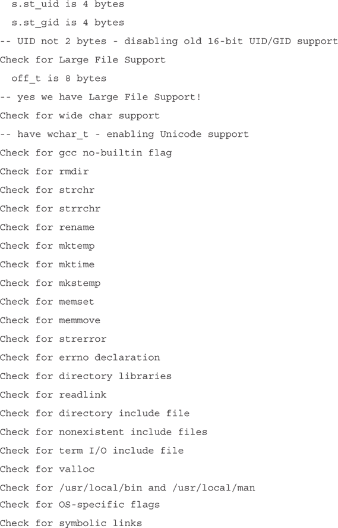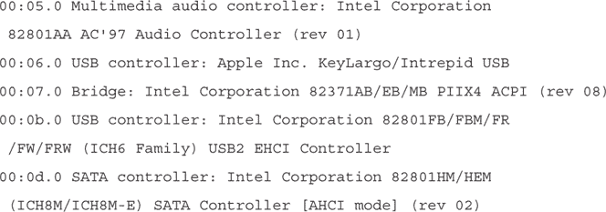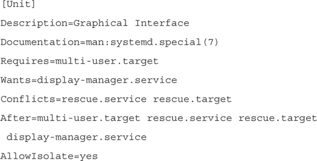
