# CompTIA Network+ N10-007 认证指南


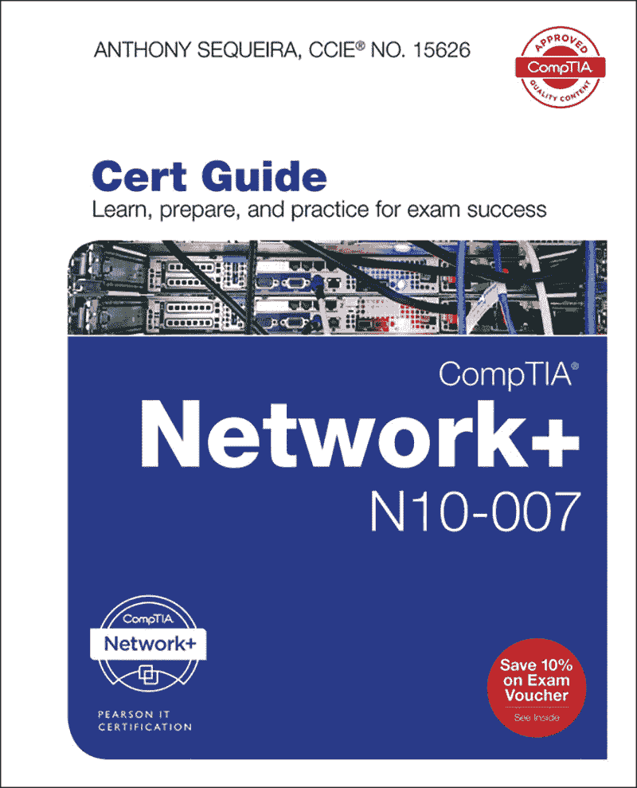

## 关于本电子书

EPUB 是一种开放的电子书标准格式。然而，不同的阅读设备和应用程序对 EPUB 及其许多功能的支持程度不同。请使用您的设备或应用设置来根据喜好自定义显示效果。您可以自定义的设置通常包括字体、字号、单栏或双栏、横屏或竖屏模式，以及您可以点击或触摸放大的图片。有关您的阅读设备或应用设置和功能的更多信息，请访问设备制造商网站。

许多书籍包含编程代码或配置示例。为了优化这些元素的显示效果，请在单栏横屏模式下查看电子书，并将字体大小调整为最小设置。除了以流式文本格式呈现代码和配置外，我们还包含了代码图像，以模仿印刷本中的呈现效果；因此，当流式格式可能会影响代码列表的显示时，您将看到“点击此处查看代码图像”的链接。点击该链接查看高保真代码图像。要返回之前过的页面，请点击设备或应用上的“返回”按钮。


## 商标

书中提到的所有已知为商标或服务标记的术语均已适当大写。Pearson IT Certification 无法证明这些信息的准确性。在书中使用术语不应视为影响任何商标或服务标记的有效。

## 警告与免责声明

本书旨在提供 CompTIA Network+ 考试范围内的 IT 网络相关信息。我们已尽力使本书尽可能完整和准确，但不隐含任何保证或适用性。

本信息按“原样”提供。对于因阅读书中包含的信息或因使用可能随附的光盘或程序而引起的任何损失或损害，作者对任何个人或实体均不承担责任或义务。

书中表达的观点属于作者，不一定是 Pearson 的观点。

## 特别销售

如需批量购买此书或获取特种销售机会（可能包括电子版；定制封面设计；以及针对您的业务、培训目标、营销重点或品牌兴趣定制的内容），请联系我们的企业销售部门：`corpsales@pearsoned.com` 或拨打 (800) 382-3419。

政府销售咨询请联系 `governmentsales@pearsoned.com`。

关于美国境外销售的问题，请联系 `intlcs@pearson.com`。

## 编辑团队

- **总编**: Mark Taub
- **产品线经理**: Brett Bartow
- **执行编辑**: Sandra Schroeder
- **开发编辑**: Marianne Bartow
- **项目编辑**: Mandie Frank
- **文字编辑**: Bart Reed
- **技术编辑**: Robert Fleming
- **编辑助理**: Vanessa Evans
- **设计师**: Chuti Prasertsith
- **排版**: Studio Galou
- **索引员**: Heather McNeill
- **校对员**: Paula Lowell


**在线元素：**

- 附录 C 记忆表
- 附录 D 记忆表答案对照
- 附录 E 学习计划
- 考试要点交互学习指南
- 关键术汇闪卡应用
- 教学视频
- 性能基础的练习
- CompTIA Network+ N10-007 动手实验室模拟器 Lite 软件


## 基础主题

## 参考模型

## OSI 模型
### 第 1 层：物理层
### 第 2 层：数据链路层
### 介质访问控制 (MAC)
### 逻辑链路控制 (LLC)
### 第 3 层：网络层
### 第 4 层：传输层
### 第 5 层：会话层
### 第 6 层：表示层
### 第 7 层：应用层

## TCP/IP 栈
### TCP/IP 栈的分层
### TCP/IP 栈中的常用应用协议

## 现实案例研究
## 总结

## 考试准备任务
### 复习所有关键主题
### 记忆完成表格和列表
### 定义关键术语
### 在 Network+ Simulator Lite 中完成第 2 章实验
### 额外资源
## 复习题

# 第 3 章网络组件

## 基础主题
## 介质
### 同轴电
### 双绞线
### 屏蔽双绞线 (STP)
### 非屏蔽双绞线 (UTP)
### 腔空电缆与非腔空电缆
### 光纤电缆
### 多模式光纤
### 单模式光纤
### 光纤接抛光类型
### 介质转换器
### 电缆布线
### 无线技术
### 物联网技术
## 网络基础设施设备
### 集线器
### 网桥
### 交换机
### 多层交换机
### 路由器
### 基础设施设备总结
## 特殊网络设备
### VPN 集中器
## 防火墙
### DNS 服务器
### DHCP 服务器
### 代理服务器
### 内容引擎
### 内容交换机
### 其他特殊设备
## 虚拟网络设备
### 虚拟服务器
### 虚拟路由器和防火墙
### 虚拟交换机
### 虚拟桌面
### 其他虚拟化解决方案
### 云计算
### 软件定义网络 (SDN)
## VoIP 协议与组件
## 现实案例研究
## 总结

## 考试准备任务
### 复习所有关键主题
### 记忆完成表格和列表
### 定义关键术语
在 Network+ Simulator Lite 中完成第 3 章实验
### 额外资源
## 复习题

# 第 4 章以太网技术

## 基础主题
## 以太网原理
### 起源
### 载波监听多接入冲突检测 (CSMA/CD)
### 距离和速度限制
### 交换机功能
### 虚拟局域网 (VLAN)
### 接入端口交换机配置
### 中继 (Trunks)
### 中继端口交换机配置
### 生成树协议 (STP)
### 交换机地址表
### 广播风暴
### 链路聚合
### LACP 配置
### 以太网供电 (PoE)
### 端口监控
### 端口管理
### 第一跳冗余
### 其他交换机功能
## 现实案例研究
## 总结

## 考试准备任务
### 复习所有关键主题
### 记忆完成表格和列表
### 定义关键术语
在 Network+ Simulator Lite 中完成第 4 章实验
### 额外资源
## 复习题

# 第 5 章 IPv4 和 IPv6

## 基础主题
## 二进制计数
### 二进制原理
### 二进制转十进制
### 十进制转二进制
### 二进制计数练习
### 二进制转换 1
### 二进制转换 1 答案
### 二进制转换 2
### 二进制转换 2 答案
### 二进制转换 3
### 二进制转换 3 答案
## IPv4 排序
### IPv4 地址结构
### 地址分类
### 地址类型
### 单播
### 广播
### 多组播
## 分配 IPv4 地址
### IP 地址组件
### 静态配置
### 动态配置
### BOOTP
### DHCP
### 自动私有 IP 地址 (APIPA)
## 子网划分
### 子网划分的目的
### 子网掩码表示法
### 子网表示法：练习题 1
### 子网表示法：练习题 1 答案
### 子网表示法：练习题 2


## 子网掩码：练习题 2 答案

## 扩展类掩码

## 借用位

## 计算创建的子网数量

## 计算可用主机数量

## 基础子网划分：练习题 1

## 基础子网划分：练习题 1 答案

## 基础子网划分：练习题 2

## 基础子网划分：练习题 2 答案

## 计算新的 IP 地址范围

## 高级子网划分：练习题 1

## 高级子网划分：练习题 1 答案

## 高级子网划分：练习题 2

## 高级子网划分：练习题 2 答案

## 额外练习

## 无类域间路由路由

## IP 版本 6

## 对 IPv6 的需求

## IPv6 地址结构

## IPv6 地址类型

## IPv6 数据流

### 单播
### 组播
### 任任播

## 现实案例研究

## 总结

## 考试准备任务

### 复习所有关键主题

### 记忆完成表格和列表

### 定义关键术语

### 在 Network+ Simulator Lite 中完成第 5 章上手实验

### 额外资源

## 复习题

# 第 6 章 路由 IP 数据包

## 基础主题

## 基础路由过程

### 路由信息的来源

### 直接连接路由
### 静态路由
### 动态路由协议

## 路由协议特性

### 路由的可信度
### 度量
### 内部网关与外部网关协议
### 路由宣告方法

### 矢量距离
### 链路状态

### 路由协议示例

## 地址转换

### NAT
### PAT

## 组播路由

### IGMP
### PIM
### PIM-DM
### PIM-SM

## 现实案例研究

## 总结

## 考试准备任务

### 复习所有关键主题

### 记忆完成表格和列表

### 定义关键术语

在 Network+ Simulator Lite 中完成第 6 章上手实验

### 额外资源

## 复习题

# 第 7 章 广域网 (WAN)

## 基础主题

## WAN 特性

### WAN 连接类型
### WAN 数据速率
### WAN 介质类型

### 物理介质
### 无线介质

## WAN 技术

### 专用租用线路
### T1
### E1
### T3
### E3
### CSU/DSU
### 以太网
### 租用线路
### 点对点
### 帧继
### 电缆调制解调器
### 卫星
### 光纤

### 电路交换
### 数据包交换

### ATM
### SONET
### SDH

### MPLS
### VPN
### SDWAN

## 总结

## 考试准备任务

### 复习所有关键主题

### 记忆完成表格和列表

### 定义关键术语


## 高可用性测量

## 容错网络设计

## 硬件冗余

## 三层冗余

## 高可用性网络的设计考量

## 高可用性最佳实践

## 内容缓存

## 负载均衡

## 硬件冗余

## QoS 技术
## QoS 简介
## QoS 配置步骤
### QoS 组件
## QoS 机制
### 分类
### 标记
### 拥塞管理
### 拥塞避免
### 流量监管与整形
### 链路效率

## 案例研究：SOHO 网络设计
### 案例场景
### 建议解决方案
### IP 地址规划
### 第一层介质
### 二层设备
### 三层设备
### 无线设计
### 环境因素
### 成本与性能权衡
### 拓扑结构

## 真实案例研究
## 总结

## 考试备习任务
### 复习所有关键主题
### 记忆完成表格和列表
### 定义关键术语
### 在 Network+ Simulator Lite 中完成第 9 章实践实验
### 额外资源
## 复习题

# 第 10 章 命令行工具

## 基础主题
### Windows 命令
- `arp`
- `ipconfig`
- `nbtstat`
- `netstat`
- `nslookup`
- `ping`
-  IPv6 的 `ping`
- `route`
- `tracert`
-  IPv6 的 `tracert`
- `PathPing`
### UNIX 命令
- `arp`
- `dig` 和 `nslookup`
- `host`
- `ifconfig`
- `iptables`
- `nmap`
- `tcpdump`
- `traceroute`
-  IPv6 的 `traceroute`
- `netstat`
- `ping`
## 真实案例研究
## 总结
## 考试备习任务
### 复习所有关键主题
### 记忆完成表格和列表
### 定义关键术语
### 在 Network+ Simulator Lite 中完成第 10 章实践实验
### 额外资源
## 复习题

# 第 11 章 网络管理

## 基础主题
### 维护工具
- 比特率
- 错误率
- 线缆认证仪
- 线缆测试器
- 连性
- 静电释放
- 环境监控器
- 回环插头
- 万用表
- 网络分析仪
- 网络分析仪
- 光源测试仪
- 吞吐量
- 时域反射仪
- 时域反射仪
- 监控
- SNMP
- Syslog
- 应用程序日志
- 系统日志
- 安全日志
- 远程日志
- 总结
- 考试备习任务
- 复习所有关键主题
- 记忆完成表格和列表
- 定义关键术语
- 额外资源
## 复习题

# 第 12 章 安全
## 基础主题
### 机密性
### 完整性
### 可用性
### QoS 组件
### 机制
### 分类
### 标记
### 拥塞管理
### 拥塞避免
### 流量监管与整形
### 链路效率
### 防御攻击
### 用户培训
### 补丁
### 安全策略
### 治理策略
### 技术策略
### 终端用户策略
### 更详细的文档
### 应急响应
### 漏洞扫描器
### Nessus
### Nmap
### 蜜罐与蜜网
### 访问控制列表
### 物理安全设备
### 网络设备加固
### 二层防护
### 远程访问安全


## 防火墙

## 防火墙类型
### 防火墙检测类型
### 包过滤防火墙
### 状态防火墙
### 防火墙区域
### 统一威胁管理防火墙

## 虚拟专用网络
### 使用 IKEv1 的 IPSec 概述
### IKE 模式与阶段
###认证头 (AH) 与封装安全载荷 (ESP)
### 使用 IKEv1 设置和拆除 IPSec 站点到 VPN 的五个步骤
### 其他 VPN 技术

## 入侵检测与防御
### IDS 与 IPS 的区别
### IDS 和 IPS 设备分类
### 检测方法
#### 基于特征的检测
#### 基于策略的检测
#### 基于异常的检测
### 部署基于网络和基于主机的解决方案

## 现实案例研究
## 总结

## 备考任务
### 复习所有关键主题
### 记忆完成表格和列表
### 定义关键术语
### 在 Network+ Simulator Lite 中完成第 12 章实实验
### 额外资源
### 复习习题

# 第 13 章网络策略与最佳实践
## 基础主题
### 策略
### 密码策略
### 数据泄露防护 (DLP)
### 远程访问策略
### 应急响应策略
### 自带设备 (BYOD)
### 可接受使用策略 (AUP)
### 安全程序
### 最佳实践
### 特权用户协议 (PUA)
### 入职/离职流程
### 许可证限制
### 国际出口控制
### 保密协议 (NDA)
### 系统生命周期
## 现实案例研究
## 总结
## 备考任务
### 复习所有关键主题
### 记忆完成表格和列表
### 定义关键术语
### 在 Network+ Simulator Lite 中完成第 13 章实实验
### 额外资源
### 复习习题

# 第 14 章网络故障排除
## 基础主题
### 故障排除基础
### 故障排除原理
### 结构化故障排除方法
### 物理层故障排除
### 物理层故障排除：场景
### 物理层故障排除：解决方案
### 数据链路层故障排除
### 数据链路层故障排除：场景
### 数据链路层故障排除：解决方案
### 网络层故障排除
### 第 3 层数据结构
### 第 3 层故障排除问题
### 网络层故障排除：场景
### 网络层故障排除：解决方案
### 无线故障排除
### 无线网络故障排除：场景
### 无线网络故障排除：解决方案
### 特种网络
## 现实案例研究
## 故障排除场景
## 总结
## 备考任务
### 复习所有关键主题
### 记忆完成表格和列表
### 定义关键术语
### 在 Network+ Simulator Lite 中完成第 14 章实实验
### 额外资源
### 复习习题


*本书献给出色的 Keith Barker。Keith 是一个真正的灵感源，也是一位不可思议的朋友。*

## 致谢

与朋友一起工作很难进展顺利，尤其是在不断面临截止日且可能充满压力的环境中。幸运的是，我与朋友 Brett 和 Marianne Bartow 一起工作。非常感谢你们的友谊——还有你的耐心！

还要感谢我亲爱的朋友 Kevin Wallace。他是一个完美的朋友，才华横溢。

请访问 [`kwallaceccie.mykajabi.com`](https://kwallaceccie.mykajabi.com) 查看他所有优秀的培训产品。

## 命令语法规范

本书中用于演示命令语法的规范与 Cisco《命令参考》中使用的规范相同。《命令参考》对这些规范的描述如下：

- **粗体** 表示按字所示逐字输入的命令和关键词。在实际的配置示例和输出（而非通用命令语法）中，粗体表示用户手动输入的命令（例如 `show` 命令）。
- *斜体* 表示由你提供实际值的参数。
- 竖线 (`|`) 分隔可选的、互斥的元素。
- 方括号 `[ ]` 表示可选元素。
- 大括号 `{ }` 表示必须选择。
- 方括号内的大括号 `[{ }]` 表示可选元素内部的必须选择。

## 我们想听听你的意见！

作为本书的读者，*你*是我们最重要的评论家和评价者。我们重视你的意见，并想知道我们做得好的地方、哪些地方可以做得更好，你希望看到我们出版哪些领域，以及你任何其他愿意分享给我们的忠言。

我们欢迎你的评论。你可以通过电子邮件或写信的方式告诉我们你对这本书的喜欢或不满意之处——以及我们可以做什么来改进我们的书籍。

*请注意，我们无法帮助你解决与本书主题相关的技术问题。*

在写信件时，请务必包含本书的书名、作者以及你的姓名和电子邮箱地址。我们会仔细审查你的意见，并将其与参与本书的作者和编辑分享。

电子邮件：feedback@pearsonitcertification.com

邮寄：Pearson IT Certification
ATTN: Reader Feedback
800 East 96th Street
Indianapolis, IN 46240 USA

## 读者服务

在 [www.pearsonitcertification.com](http://www.pearsonitcertification.com) 注册你的 *CompTIA Network+ N10-007 Cert Guide* 副本，以便方便获取下载、更新和更正。要开始注册流程，请访问 [www.pearsonitcertification.com/register](http://www.pearsonitcertification.com/register) 并登录或创建账户。输入产品 ISBN `9780789759818` 并点击 `Submit`。完成后，你将在“Registered Products”（注册产品）下找到任何可用的奖励内容。

务必勾选希望收到我们消息的框，以获得该产品未来版本的独家折扣。

## 引言

CompTIA Network+ 认证是进入计算机网络领域的人的一种流行认证。虽然行业内许多特定厂商的网络认证非常受欢迎，但 CompTIA Network+ 认证的独特之处在于它是中立的。CompTIA Network+ 认证通常作为通往更专业、特定厂商认证的跳板，例如由 Cisco 系统提供的认证。

在 CompTIA Network+ 中，主题大多是通用的，因为它们适用于任何厂商的网络设备。尽管 CompTIA Network+ 是厂商中立的，但网络软件和系统是由多个独立厂商实现的。从这个来看，书中的一些练习、示例和模拟包含了厂商的配置和技术，例如 Microsoft Windows 操作系统或 Cisco 系统路由器和交换机。针对特定厂商软件和硬件的更详细培训可以在针对该厂商的书籍和培训中找到。

### 谁应该读这本书？

本书针对两类受众编写——那些想要尽可能学习所有网络技术知识的人，以及想要通过 CompTIA Network+ 考试的人。我认为这两组人都会对本书详述的技术广度留下深刻印象。尽管涵盖当今网络中发现的每一个主题是不可能的，但本书成功涵盖了所有让网络成为许多人想要学习的兴奋领域的巨大领域。

读者范围从试图在 IT 领域获得职位的人，到想要保持技能敏锐、或者可能因为公司强制参加新考试的政策而保留工作的人。这本书也适用于想要在 Network+ 认证之外获得额外认证的读者（例如 Cisco 认证网络助理师 [CCNA] 认证及以上水平）。本书的设计旨在平稳地过渡到未来的认证学习。

### 资源

本书附带了丰富的数字资源，帮助你复习、练习和评估知识。每章末尾都有一个复习部分，引用了这些工具中的几种，你应该在完成每一章时使用它们，以强化你正在学习的知识。读完书后，你可以再次使用它们帮助复习并确保你为考试做好了充分准备。

以下是配套网站上的可用资源列表：

- 交互式术语闪卡应用程序
- 交互式考试要点附
- 基于性能的练习
- 针对 N10-007 考试的 CompTIA Network+ Practical 实验室模拟 Lite 版
- Pearson Test Prep 练习软件
- 考试主题的视频培训
- 记忆表复习练习和答案
- 学习计划工具
- 兑换 Network+ 认证考试券的说明（提供 10% 折扣）

要访问配套网站，请遵循以下步骤：

- **步骤 1。** 访问 [`www.pearsonitcertification.com/register`](http://www.pearsonitcertification.com/register)。
- **步骤 2。** 登录你的账户（如果你已有账户）或创建一个新账户。
- **步骤 3。** 输入书籍的 ISBN (`9780789759818`）并点击 `Submit`。
- **步骤 4。** 回答挑战问题以验证你的购买。
- **步骤 5。** 在你的账户页面，点击 `Registered Products` 标签页，然后点击 `Access Bonus Content` 链接。

### Pearson Test Prep 练习软件

本书的配套网站包含 Pearson Test Prep 练习引擎（用于显示和评分一组模拟真实考试的练习题的软件）。使用 Pearson Test Prep 练习引擎，你可以通过在学习模式下过题目来学习，或者参加模拟真实考试条件的 CompTIA Network+ 模拟考试。该软件还有一个闪卡模式，允许你在不看多选题答案的情况下挑战自己。

Pearson Test Prep 软件提供在线版和可离线运行的 Windows 桌面应用程序。在线版本可以通过 [www.pearsontestprep.com](http://www.pearsontestprep.com) 访问。该版本可以在任何连接互联网的设备上使用，包括台式电脑、笔记本电脑、平板电脑和智能手机。它针对标准 iPhone 屏幕的显示进行了优化。桌面应用程序可以从配套网站下载并安装。


该桌面应用程序是一个基于 Windows 的应用程序，因此它仅设计为在 Windows 上运行。虽然可以使用 Windows 模拟器在其他操作系统上运行它，但桌面版本官方不支持其他操作系统。如果您正在使用 Windows 以外的操作系统，可能希望考虑使用在线版本。

访问测试引擎是一个两个步骤的过程。第一步是在您的桌面上安装软件，或者访问在线版本网站。然而，在您注册随书附的唯一访问代码之前，您无法获得练习考试（即 CompTIA Network+ 考试题库）。

### 注意事项
实体书背后的纸板封套内包含一张纸。这张纸列出了与此书相关的练习考试的 `access code`（访问代码）。请确保在注册考试后仍妥善保存该 `access code`，因为您以后可能需要参考它。此外，在纸张激活码的对面，是一个唯一的、一次性使用的优惠码，可用于购买 `CompTIA Network+ Cert Guide, Premium Edition eBook and Practice Test` 产品，价值 40 美元！

### 安装 Pearson Test Prep 软件
如果您选择使用 Windows 桌面版练习测试软件，您需要从配套网站下载安装程序。

软件安装过程与其他向导式的安装过程类似。如果您已经从其他 Pearson 产品安装了 Pearson Test Prep 练习测试软件，则无需重新安装。只需在桌面上启动软件，并使用书后封套内包含的激活码激活此书的练习考试。以下步骤概述了安装过程：

**步骤 1.**** 从配套网站将软件下载到您的计算机。

**步骤 2.**** 从下载的 `.zip` 文件中提取所有文件。

**步骤 3.**** 从提取的文件夹启动安装程序。

**步骤 4.**** 按照向导提示进行操作。

安装过程允许您使用书后封套内纸张上提供的激活码来激活考试。此过程要求您建立 Pearson 网站登录账号。您需要此登录账号来激活考试，因此请在提示时进行注册。如果您已有 Pearson 网站登录账号，无需再次注册；直接使用您现有的登录即可。

### 激活并下载练习考试
访问练习考试产品的第二步是使用书后封套中找到唯一访问代码来激活产品。无论您使用哪种版本的产品（在线版本或 Windows 桌面版本），都必须遵循此步骤。以下步骤将指导您如何在每个平台上激活考试。

#### Windows 桌面版本：
1. 从 Windows 开始菜单或桌面快捷方式图标启动 Pearson Test Prep 练习测试软件。
2. 要激活并下载与此书相关的考试，从 `My Products` 或 `Tools` 选项卡点击 `Activate` 按钮。
3. 在下一个屏幕，输入书后纸板封套内纸上的 `access code`。输入完成后，点击 `Activate` 按钮。
4. 激活过程将下载练习考试。点击 `Next`，然后点击 `Finish`。

#### 在线版本：
1. 从连接到互联网的设备打开您选择的浏览器并访问网站 `www.pearsontestprep.com`。
2. 在产品组下选择 `Pearson IT Certification`。
3. 输入与账号关联的电子邮件地址和密码并点击 `Login`。
4. 在屏幕中间，点击 `Activate New Product` 按钮。
5. 输入书后纸板封套内纸上的访问代码并点击 `Activate` 按钮。

激活完成后，`My Products` 标签应列出您的新考试。如果您没有看到考试，请确保您选择了菜单上的 `My Products` 选项卡。此时，软件和练习考试已准备就绪。只需选择考试并点击 `Exams` 按钮即可。

要更新已激活并下载的考试，只需选择 `Tools` 选项卡并点击 `Update Products` 按钮。更新考试可确保您拥有最新的考试数据更改和更新。

如果您想检查 Pearson Cert Practice Test 考试引擎软件的更新，只需选择 `Tools` 选项卡并点击 `Update Application` 按钮。这确保您运行的是最新版本的考试引擎。

### 注意事项
在线版本始终包含考试题目的最新更新，因此在运行该版本时永远不需要更新。

### 激活其他考试
考试软件安装过程和注册过程都发生一次。之后，对于每个新考试，只需要几个步骤。例如，如果您购买了另一本新的 Pearson IT Certification Cert Guide，从该书背后的封套中提取激活代码。从那时，您只需要启动考试引擎（如果它仍在运行）并执行上一个列表中的激活步骤。

### 高级版 (Premium Edition)
除了书中提供的免费练习考试外，您还可以直接从 Pearson IT Certification 购买扩展功能的额外考试。此书的 Premium Edition eBook 和 Practice Test 包含额外的两份完整练习考试和电子书（PDF、EPUB 和 Kindle 格式）。此外，Premium Edition 针对每个问题都有补救说明，链接到电子书中与问题相关的特定部分。

对于购买该书纸质版的用户，可以以深度折扣购买 Premium Edition。您将在书后封套中找到一个包含一次性使用代码以及购买 Premium Edition 说明的优惠码。

要查看 Premium Edition 产品页面，请访问网站：`http://www.pearsonitcertification.com/title/9780134861012`。

### 目标与方法
本书的目标是帮助您学习和理解 CompTIA Network+ N10-007 蓝图中涵盖的技术。这让您能够通过 N10-007 版本的 CompTIA Network+ 考试来证明您的知识。

为了帮助您掌握和理解 Network+ 认证目标，本书使用了以下方法：

* **开启主题列表 (Opening topics list)：** 定义了本章涵盖的主题。
* **基础主题 (Foundation topics)：** 在章节的核心位置，本节从实践和理论角度解释主题。这包括深入描述、表格和图表，旨在构建您的知识，以便您通过 N10-007 考试。每章都分为多个章节。
* **关键主题 (Key topics)：** 本节指出了考试中需要掌握的重要图表、表格和信息列表。它们穿插在每章中，并在每章末以表格格式总结。
* **记忆表格 (Memory tables)：** 您可以在书籍配套网站的附录 C 和 D 中找到这些表格。利用它们来帮助记忆重要信息。
* **关键术语 (Key terms)：** 每章末尾列出了没有定义的关键术语。写下每个术语的定义，并对照术语表（Glossary）中的完整术语进行检查。在配套网站上，您将找到一个闪卡应用程序，其中所有术语均按章节分开，请随时使用它来学习关键术语。


- **练习：** 本书带有 40 道基于性能的练习题，旨在帮助你为 Network+ 考试的实操部分做好准备。这些练习可以在配套网站上获得。请确保在完成每个章节时进行这些练习，并在读完全书并进行最后的准备时再次进行。

- **实操实验室：** 这些实验包括匹配、拖放和仿真。这些实操练习是本书的重要组成部分。除了阅读本书外，你还应该完成书中包含的所有练习。这些交互式实操练习提供了相关示例、额外信息以及关于厂商对技术实现的见解。要进行这些实验，只需安装 CompTIA Network+ N10-007 Hands-on Lab Simulator Lite 软件。该软件是一个适用于 Windows 和 Mac 的桌面应用程序。你应该确保在阅读本书之前安装软件，因为每一章都会指示你应该进行哪些实验。要安装软件，请遵循以下步骤：

    - **步骤 1。** 访问书籍的配套网站（有关如何访问配套网站请参见“资源”部分）。
    - **步骤 2。** 点击链接下载 CompTIA Network+ N10-007 Hands-on Lab Simulator Lite 软件。
    - **步骤 3。** 将软件下载到电脑后，从 `.zip` 压缩中提取所有文件。
    - **步骤 4。** 从提取的文件中启动安装程序。
    - **步骤 5。** 按照向导的提示进行操作。

- **模拟考试：** 本书附带了几份完整的模拟考试，你可以在 Pearson Test Prep 模拟测试软件中获得，你可以从配套网站下载并安装该软件。Pearson Test Prep 软件也可以通过在线地址 [www.PearsonTestPrep.com](http://www.PearsonTestPrep.com) 访问。你可以使用书后部封套内卡片上打印的访问码访问在线版和桌面版。在以学习模式完成每个章节的学习时，请务必运行 `Exam Bank 1` 中的问题。当你读完全书后，请在模拟考试模式下使用 `Exam Bank 2` 的题目进行一次完整的模拟测试，以测试你的备考状态。

- **考试要点：** 本书包含一个“考试要点”附录，总结了每一章节的关键要点。该复习工具有纸质版和配套网站上的交互式 PDF 版。在完成每个章节后复习这些核心考试知识，并在读完全书后再次复习。这是一个非常好的复习总结，你可以在复习和掌握每个概念时对其进行标记。

有关 CompTIA Network+ 认证考试的最新信息，请访问： [`certification.comptia.org/certifications/network`](https://certification.comptia.org/certifications/network)。

## 备考策略

本书在配套网站上提供了一个学习计划工具。这个电子表格帮助你跟踪你在每个章节中需要执行的活动，并帮助你组织备考任务。当你阅读本书的章节时，请在学习计划中记录关键概念或配置的笔记。每一章的末尾都有总结和一系列备考任务，帮助你巩固所学内容。这些任务包括复习练习，例如复习关键主题、完成记忆表、定义关键术语、回答复习题、进行实操实验室和练习等。请确保在完成每个章节时执行这些任务，以提高你对材料的记忆，并在学习计划中记录你的进度。

本书以“最终准备”章节结束，该章节将为你提供最后的备考指导，并提供一些实用的考试建议。请务必阅读该章节，帮助你评估备考状态并识别出需要重点复习的领域。

请确保完成所有与本书相关的基于性能的答题练习和实操实验室。这些练习和实验室按章节组织，方便你在完成每个部分后进行操作。这些练习将巩固你所学的内容，提供一些流行厂商实现网络技术的示例，并提供额外信息帮助你建立真实技能并为认证考试做准备。

通过在以下网页提交表单下载最新的考试目标：[`certification.comptia.org/training/testingcenters/examobjectives.aspx`](http://certification.comptia.org/training/testingcenters/examobjectives.aspx)。

使用在本书配套网站上提供的模拟考试。在进行模拟考试时，利用模拟测试软件的报告功能记录下你缺乏自信的领域，然后复习这些概念。在复习这些领域后，再次完成模拟考试并对你的技能进行评分。请记住，你做模拟考试次数越多，对题目就越熟悉，模拟考试对你技能的判断准确性也就越低。

当你完成第二次模拟考试并对自己的技能充满信心后，请预约真实的 CompTIA Network+ 考试 (`N10-007`)。

## CompTIA Network+ 考试主题

`Table I-1` 列出了 CompTIA Network+ N10-007 考试的通用考试主题（`objectives`）以及每个通用主题下的特定主题（`subobjectives`）。该表列出了涵盖每个考试主题的主要章节。请注意，许多目标和子目标是相互关联的，并在本书的多个章节中都会涉及。

**表 I-1** CompTIA Network+ 考试主题

| **章节** | **N10-007 考试目标** | **N10-007 考试子目标** |
| --- | --- | --- |
| 1 计算机网络基础 | 1.0 网络概念 | 1.5 比较并对比网络拓扑、类型和技术的特征 |
| 2OSI 参考模型 | 1.0 网络概念 | 1.1 解释端口和协议的用途和功能 1.2 解释相应 OSI 层上的设备、应用程序、协议和服务服务 |
| 3 网络组件 | 1.0 网络概念 2.0 基础设施 | 1.7 总结云概念及其目的 1.8 解释网络服务的功能 2.1 在给定场景下，部署适当的布线解决方案 2.2 在给定场景下，确定网络设备在网络中的合理放置位置并进行安装/配置 2.3 解释高级网络设备的目的和用例 2.4 解释虚拟化和网络存储存储的目的 |
| 4 以太网技术 | 1.0 网络概念 | 1.3 解释路由和交换的概念和特征 |
| 5IPv4 和 IPv6 地址 | 1.0 网络概念 | 1.4 在给定场景下，配置适当的 IP 地址组件 |
| 6 路由 IP 数据包 | 1.0 网络概念 | 1.3 解释路由和交换的概念和特征 |
| 7 广域网 (WANs) | 2.0 基础设施 | 2.5 比较并对比 WAN 技术 |
| 8 无线技术 | 1.0 网络概念 4.0 网络安全 | 1.6 在给定场景下，实施适当的无线技术和配置 4.3 在给定场景下，保护基础无线网络 |


## 3.0 网络运营
- 3.2 比较与对比业务连续性和灾难恢复的概念
- 3.5 识别策略和最佳实践

## 4.0 网络安全
- 4.1 总结物理安全设备的用途
- 4.2 解释身份验证和访问控制
- 4.4 总结常见的网络攻击
- 4.5 根据给定场景，实施网络设备加固
- 4.6 解释常见的缓解技术及其目的

## 5.0 网络故障排除
- 5.2 根据给定场景，使用适当工具
- 5.1 解释网络故障排除方法
- 5.3 根据给定场景，排除常见的有线连接和性能问题
- 5.4 根据给定场景，排除常见的无线连接和性能问题
- 5.5 根据给定场景，排除常见的网络服务问题

## 本书的结构

虽然这本书可以从头到尾通读，但它的设计非常灵活，允许你轻松地在不同章节和子章节之间移动，以便只涵盖你需要加强学习的内容。不过，如果你确实打算阅读所有章节，书中的顺序是一个极佳的序列：

- **第 1 章：计算机网络基础**：本章涵盖了网络的功能、通常构成网络的组件，以及我们如何定义不同的网络。
- **第 2 章：OSI 参考模型**：OSI 模型是一个极其强大的指南，我们可以在设计、实施和排除网络故障可以使用。
- **第 3 章：网络组件**：本章深入探讨了今天网络中的各种设备以及连接这些设备的介质。
- **第 4 章：以太网技术**：谈到网络媒介，本章扩展了最流行的网络媒介类别——以太网。
- **第 5 章：IPv4 和 IPv6 地址**：系统的地址在网络中至关重要，本章涵盖了 IPv4 和 IPv6 使用的地址。
- **第 6 章：IP 数据包路由**：将包从一个网络移动到另一个网络是路由的工作。本章确保你精通该类别下的许多技术。
- **第 7 章：广域网 (WANs)**：跨越大距离移动数据包是广域网的工作，本章分解了该领域的技术。
- **第 8 章：无线技术**：有了线谁还需要线？无线网络将长期存在。本章为你提供了细节，甚至包括了安全和新兴技术等重要主题。
- **第 9 章：网络优化**：本章的重点是让网络更加可靠。
- **第 10 章：命令行工具**：幸运的是，大量的价值工具可以帮助你进行网络故障排除。其中一些工具不是图形化的，你需要在命令行中使用它们。
- **第 11 章：网络管理**：本章涵盖了通用网络管理，并包含了对更有价值工具的介绍。
- **第 12 章：网络安全**：现在比任何时候，我们的网络都面临攻击。本章为你应对该领域未来的许多挑战做好准备。
- **第 13 章：网络策略和最佳实践**：许多优秀的策略大量的最佳实践可以帮助你的网络职业。本章涵盖了其中最重要的一些。
- **第 14 章：网络故障排除**：其他章节仅涉及网络故障排除，而本章将其作为重点。在这里，你将获得一种很好的整体方法论，以及关于工具和技术的具体细节。
- **第 15 章：最终准备**：本章提供了如何确保你为重大考试做好充分准备的指导（如果你选择参加考试的话）。

## 第 1 章 计算机网络基础

完成本章后，你将能够回答以下问题：

- 网络的目的是什么？
- 网络组件有哪些示例？
- 如何根据地理定义网络？
- 如何根据拓扑结构定义网络？
- 如何根据资源位置定义网络？

当你想到计算机网络时，会想到什么？是互联网吗？是电子邮件吗？是让你从笔记本电脑打印到打印机的无线连接吗？是你家里的智能恒温器和灯吗？

无论你目前对计算机网络的认知如何，这本书都能帮助你对网络计算产生深刻的欣赏和理解。注意，尽管你认为计算机网络是互连的计算机，但如今的计算机网络除了计算机之外还连接了各种设备。示例包括游戏机、视频监控设备、基于 IP 的电话、平板电脑和智能手机。因此，在本书中请将 `computer network` 一词等同于通用的术语 `network`，因为这些术语是互换使用的。

在本章中，目标是让你熟悉网络的用途，并帮助你根据地理、拓扑结构和网络资源位置等标准对给定网络进行分类。本书及书中所有其他章节的隐含目标是让你准备好通过 CompTIA Network+ 考试，这是信息技术 (IT) 行业中的基石考试。

## 基础主题

### 定义网络

在电影《梦幻骑士》（*Field of Dreams*）中，你听到过：“只要你建成它，他们就会来。”这句话绝对适用于现代网络中看到的基于网络的服务的演进。计算机网络不再局限于允许一组计算机访问存储在选定为 `file server` 的计算机上的公共文件集。相反，随着高速、高冗余网络的构建，网络架构师正在看到将各种类型的流量放在单个网络上的智慧。示例包括数据之外的语音和视频。正如你即将在本章中所学的，物联网 (IoT) 意味着家家万物都想加入你的网络，从家里的灯到许多家用电器！


人们可能会认为网络是其组成部分的总和。因此，当你开始学习网络时，你应该开始掌握对基础网络组件的初步理解。这些组件包括客户端、服务器、集线器、交换机和路由器等实体，以及用于连接这些设备的介质。

### 网络的目的

从本质上说，网络的目的是建立连接。这些连接可能是 PC 与打印机之间，也或者是笔记本电脑与互联网之间，这只是几个例子。然而，网络的真正价值来自于流经这些连接的流量。考虑一下可以在网络连接上传输的应用程序示例：

* 两台计算机之间的文件共享
* 位于世界不同地区的计算机之间的视频聊天
* 浏览网页（例如，使用社交媒体网站、观看流媒体视频、收听网络电台或为学校学期论文做研究）
* 安装了即时消息软件的计算机之间的即时消息 (IM)
* 电子邮件
* IP 语音 (VoIP)，用于取代传统的电话系统

传输多种类型流量（例如语音、视频和数据）的网络被称为`收敛网络`。对于此前为语音、数据和视频流量维护独立网络基础设施的组织来说，收敛网络可能提供显著的成本节省。这种收敛还可能减少人员成本，因为只需要支持一个网络，而不是为不同的流量类型维护多个网络。

### 网络组件概述

设计、安装、管理和故障排除网络需要你识别各种网络组件及其功能的能力。尽管这是第 3 章“网络组件”的重点，但在你继续深入之前，你需要了解各个组件如何组合成一个功能性网络的基本知识。

现在需要考虑的组件是客户端、服务器、集线器、交换机、路由器、介质和广域网 (WAN) 链路。作为讨论的参考，请考虑图 1-1。

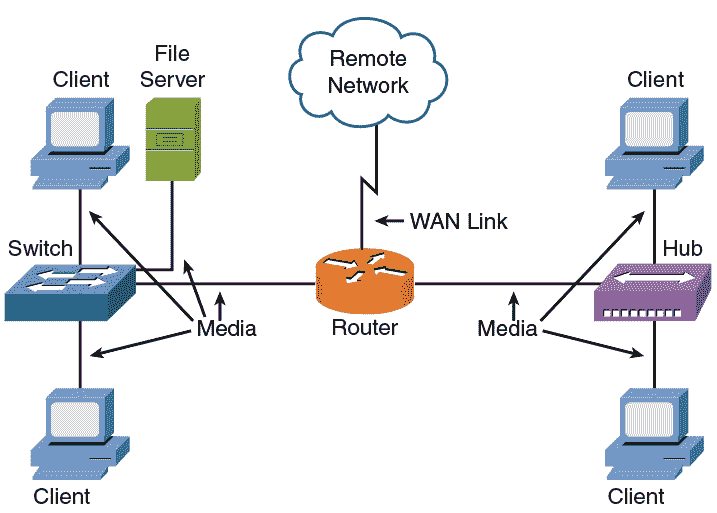

**图 1-1** 示例计算机网络

以下列表描述了图 1-1 中描绘的网络组件及其实现的功能：

* **客户端:** `客户端`一词定义了终端用户用于访问网络的设备。该设备可能是工作站、笔记本电脑、具有无线功能的智能手机或各种其他最终用户终端设备。
* **服务器:** `服务器`顾如其名，为网络提供资源。这些资源可能包括由电子邮件提供的电子邮件访问、由 Web 服务器提供的网页，或文件服务器上的可用文件。
* **集线器:** `集线器`是一种用于相互连接网络组件（如客户端和服务器）的旧技术。集线器的可用端口数量不一。然而，为了可扩展性，你可以在一定范围内相互连接集线器。如果你将太多集线器串联在一起，会导致网络错误。正如在第 3 章中进一步讨论的，集线器是第 1 层设备，不对其通过的流量进行任何检查。相反，集线器只是接收来自`端口`（即连接网络电缆的插座）的流量，并将该流量复制到所有其他端口。请记住，对于局域网 (LAN)，集线器被认为是过时的。本章出于学术目的而介绍它。
* **交换机:** 与集线器类似，`交换机`也相互连接网络组件，并且有多种端口密度的交换机。然而，与集线器不同，交换机不会简单地从一个端口接收流量并发送到所有其他端口。相反，交换机会学习哪些设备连接在哪些端口上。它通过检查进入端口（入站）的流量并记录源地址来实现这一点。然后它查看目标地址，如果交换机知道目标地址，它会将流量从适当的端口转发，而不是从所有其他端口转发。这极大地减少了通过你网络的流量体积。将交换机视为`第 2 层`设备，这意味着它根据物理固化安装在`主机`（即任何在网络上传输或接收流量的设备）的网络接口卡 (NIC) 地址来做出转发决策。这种固化的地址是介质访问控制 (MAC) 地址。注意，今天的交换机能够在网络模型的高层上工作，但大多数仍被视为第 2 层设备。今天使用的主要网络模型是 OSI 模型。这在第 2 章“OSI 参考模型”中有详细介绍。
* **路由器:** 如在第 3 章中讨论的，将`路由器`视为第 3 层设备，这意味着它根据逻辑网络地址做出转发决策。大多数现代网络使用网协议 (IP) 地址。因此，大多数路由器知道哪些逻辑 IP 网络位于哪些路由器接口。然后，当流量进入路由器时，路由器检查流量的目标 IP 地址，并根据路由器的数据库（即路由表）智能地将流量从适当的接口转发。
* **介质:** 前述设备需要通过某种`介质`相互连接。这种介质可以是铜缆电缆。可以是光纤。介质甚至可能不是电缆，如无线网络所示，无线电波在空气这一介质中传输。第 3 章扩展了对介质的讨论。现在，请意识到介质在成本、带宽和距离限制方面各不相同。例如，尽管光电缆比非屏蔽双线电缆贵，但它通常可以传输更远的流量，并具有更大的带宽（即传输更高数据速率的能力）。
* **WAN 链路:** 如今，大多数网络连接到一个或多个其他网络。例如，如果你的公司有两个地点，且这两个地点通过多协议标签交换 (MPLS) 网络相互连接，那么连接这些网络的链路通常被称为`广域网 (WAN)`链路。

### 按地理定义的网络

正如你现在可能察觉到的，并不是所有网络看起来都是相同的。它们在许多方面都不同。分类网络的标准之一是网络组件的地理分散程度。例如，一个网络可能连接办公室内的设备，或者一个网络可能连接位于总部的数据库与位于地球另一端的远程销售办事处。

根据地理分散程度，你可以将网络分为不同的类别，包括以下类别：

* 局域网 (LAN)
* 广域网 (WAN)
* 无线局域网 (WLAN)
* 存储区域网 (SAN)
* 校园网 (CAN)
* 市域网 (MAN)
* 个人局域网 (PAN)

后续章节将更详细地介绍这些不同的网络分类。

##### LAN


局域网（LAN）连接了本地区域内的网络组件（例如，某栋建筑内部）。你可能会遇到的常见局域网技术包括以太网（即 `IEEE 802.3`）和无线网络（即 `IEEE 802.11`）。图 1-2 展示了局域网的一个示例。

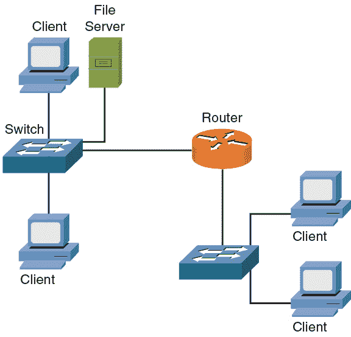

**图 1-2** 示例局域网拓扑

***

注意

IEEE 代表*Institute of Electrical and Electronics Engineers*（电气学会），这是一个国际认可的标准机构。

***

## WAN

广域网（WAN）连接了地理上分离的网络组件。例如，公司总部可能有多个连接到远程办事点的 WAN 连接。多协议标签交换（MPLS）和异步传输模式（ATM）都是广域网技术的示例。图 1-3 描述了一个简单的广域网拓扑，它连接了两个地理分散的地点。


**图 1-3** 示例广域网拓扑

## WLAN

由无线网络设备组成的本地区域网称为无线局域网（WLAN）。第 8 章“无线技术”将详细讨论了这一主题。

## SAN

你可以构建一个高速、高可靠的网络，专门用于传输存储的数据。这种网络被称为存储区域网络（SAN）。

## 网络的其他类别

虽然 LAN 和 WAN 是根据地理位置对计算机网络分类的最常用术语，但其他类别还包括园区域网（CAN）、城域网（MAN）和个人区域网（PAN）。

### CAN

年前，我曾是某大学的网络管理员。该大学占地几英里，拥有几十栋建筑。在其中许多建筑内部都有一个局域网。然而，这些以建筑为中心的局域网是相互互连的。通过这些局域网的互连，产生了另一种网络类型——CAN。除了真实的大学校园外，你可能在工业园区或商务园区也会发现 CAN。

### MAN

MAN 比 CAN 广但比 WAN 窄，它连接了分散在整个大都市的地点。想象一下，芝加哥的一家公司在奥哈尔机场附近有一个地点，在海军码头附近有一个地点，另外一个地点位于威利斯大厦（以前称为西尔斯大厦）。如果服务提供商可以使用高速网络（例如 10Gbps，即每秒 100 亿位）连接这些地点，那么这些地点的互连就形成了一个 MAN。MAN 技术的一个例子是城域以太网（Metro Ethernet），它的速度远高于过去用于连接此类地点的传统 WAN 技术。

### PAN

PAN 是规模比 LAN 更小的网络。例如，通过通用串行总线（USB）线连接 PC 和数码相机可以被称为 PAN。另一个例子是 PC 通过 FireWire 连接到外部硬盘。然而，PAN 并不一定是有线连接。手机手机与汽车音频系统之间的蓝牙连接被认为是无线个人区域网（WPAN）。然而，PAN 的主要区别在于它的范围通常仅限于几米。

## 由拓扑结构定义的网络

除了根据组件的地理位置对网络进行分类外，另一种分类网络的方法是使用网络拓扑。然而，外观可能是具有欺骗性的。你需要能够区分物理拓扑和逻辑拓扑。

### 物理拓扑与逻辑拓扑

仅仅因为网络看起来是星型拓扑（即所有网络组件都连接回一个集中设备，如交换机），流量也可能通过连接到集中设备的所有网络组件以环形模式流动。实际的流量流决定了*逻辑拓扑*，而组件在物理上互连的方式决定了*物理拓扑*。

例如，考虑图 1-4，它显示了一组连接到令牌环介质访问单元（MAU）的计算机。通过快速检查 图 1-4，你可以得出结论：设备在物理上是以星型拓扑连接的，连接的设备从一个集中聚合点（在本例中为 MAU）放射。

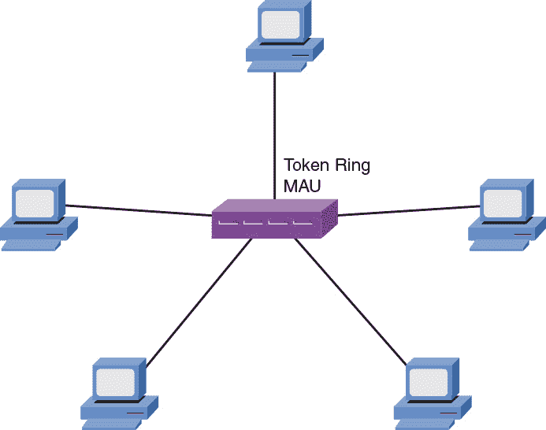

**图 1-4** 物理星型拓扑

接下来，对比图 1-4 中的物理拓扑与图 1-5 以及稍后图 1-8 中所示的逻辑拓扑。尽管计算机在物理上连接到集中的 MAU，但当你检查通过（在本例情况下是环绕）网络的流量流时，你会发现流量实际上在网络中循环。流量流决定了如何对网络的逻辑拓扑进行分类。在这种情况下，逻辑拓扑是*环形拓扑*，因为流量在网络中循环，就像在环形中循环一样。

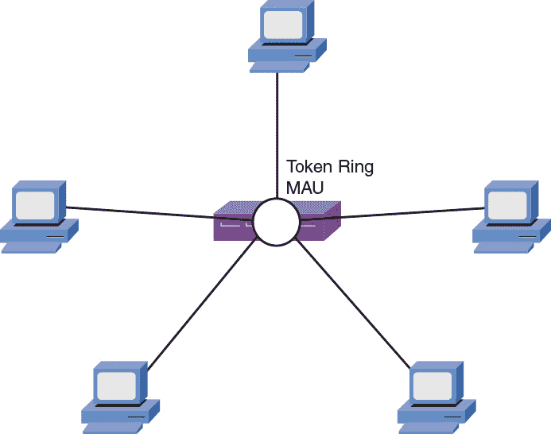

**图 1-5** 逻辑环形拓扑

在你跑出去尝试为你的局域网购买令牌环网络之前，请记住你现在只能在网络博物馆里看到这种技术了！

### 总线拓扑

如图 1-6 所示，总线拓扑通常使用一根穿过需要连接区域的电缆。需要连接到网络的设备接入附近的电缆。早期的以太网依赖于总线拓扑。

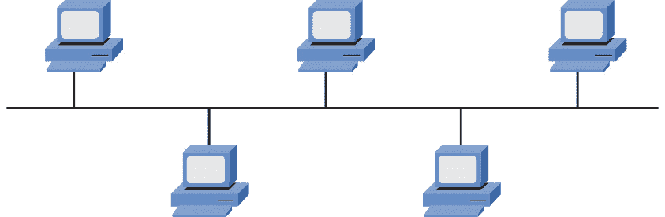

**图 1-6** 总线拓扑

网络分线器可能是 T 型接头（用于较旧的 10BASE2 网络）或吸血式分线器（用于较旧的 10BASE5 网络）。图 1-7 显示了 T 型接头的示例。


**图 1-7** T 型接头

***

注意

这里提到的以太网标准（即 `10BASE2` 和 `10BASE5`）与其他许多以太网标准一起，在第 4 章“以太网技术”中详细讨论。

***

一条总线和所有连接到该总线的设备共同构成了一个*网段*。正如第 4 章所示，单个网段是一个单一的冲突域，这意味着连接到总线的所有设备都可能尝试同时访问总线，从而导致一种被称为*冲突*的错误状态。表 1-1 显示了总线拓扑的一些主要特征、优点和缺点。


**表 1-1** 总线拓扑的特征、优点和缺点

| **特征** | **优点** | **缺点** |
| --- | --- | --- |
| 每个网段使用一根电缆。 | 与其他拓扑相比，安装总线拓扑所需的电缆较少。 | 因为每个网段使用一根电缆，电缆成为了一个潜在的单点故障。 |


| 为了支持电缆适当的电气特性，电缆的每端都需要一个终端器（具有特定电阻）。 | 根据总线所使用的介质，总线拓扑的成本可能会更低。 | 总线拓扑的故障排除可能很困难，因为故障隔离可能需要检查多个网络分路，以确保它们要么连接了设备，要么已正确终止。 |
| 总线拓扑在早期以太网网络中非常流行。 | 基于总线拓扑的网络安装比某些其他拓扑更简单，后者可能需要安装额外的布线。 | 在总线线上添加设备可能会导致总线上其他用户出现连接中断。 |
| 网络组件通过 T 型连接器或吸血式分路器等连接器直接接入电缆。 | | 总线上的一个设备存在错误状态会影响总线上其他设备的性能。 |
| | | 总线拓扑的可扩展性不佳，因为所有设备共享总线上的可用带宽。此外，如果总线上的两个设备同时请求访问总线，会导致错误状态。 |

## 形形拓扑

图 1-8 提供了一个形形扑扑示例，其中流量沿闭合网络环路环形流动（即环形）。通常，环形拓扑按顺序向每个连接的设备单向发送数据，直到目标接收数据。令牌环（Token Ring）网络依赖于环形拓扑。

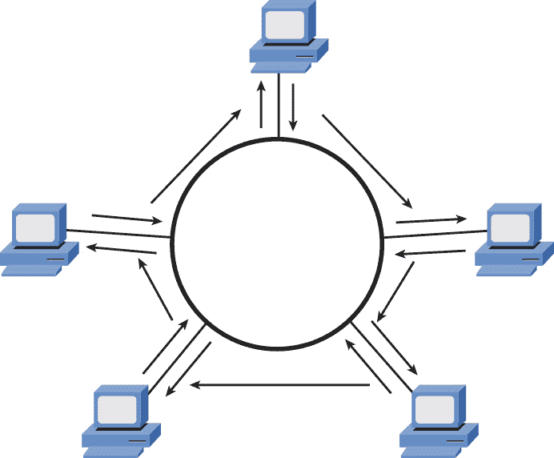

**图 1-8** 形形拓扑

然而，令牌环并不是 20 世纪 90 年网络中唯一的流行的环拓扑。光纤数据接口（FDDI）是另一种基于环拓扑的变体。大多数 FDDI 网络（如名称所示，使用光纤作为介质）不仅使用一个环，而是两个。这两个环以相反的方向发送数据，形成`反向旋转环`。反向旋转环的一个优点是，如果光纤断裂，断裂两侧的站点可以相互连接它们的两个环，形成一个能够到达环上所有站点的单环。

由于环形拓扑允许环上的设备轮流在环上传输，因此介质访问竞争不像总线拓扑那样是一个问题。但是，如果网络只有一个环，该环就成了单点故障。如果环在任何一点断裂，数据将停止流动。表 1-2 显示了环形拓扑的一些主要特性、优点和缺点。


**表 1-2** 形形拓扑的特性、优点和缺点

| **特性** | **优点** | **缺点** |
| --- | --- | --- |
| 设备之间通过连接到单环或（在某些情况下，例如 FDDI）双环来相互互连。 | 双环拓扑增加了一层容错能力。因此，如果发生电缆断裂，可以恢复与所有设备的连接。 | 使用单环拓扑时，环断裂会导致连接到环的所有设备出现网络中断。 |
| 环上的每个设备都包含一个接收器（用于输入电缆）和一个发射器（用于输出电缆）。 | 电缆断裂时，故障排除变得简单了，因为环上的每个设备都包含中继器。当电缆断裂远端的中继器在一定时间内没有收到任何数据时，它会报告错误状态，通常以网络网卡（NIC）上指示灯的形式呈现。 | 环具有可扩展性限制。具体而言，环有最大长度和最大连接站点数限制。一旦超过了这些限制之一，单环可能需要被分为两个互连的环。可能需要安排网络维护窗口来执行此环划分。 |
| 环上的每个设备都会重复它收到的信号。 | | | 由于环必须是一个完整的环路，环所需的电缆量通常高于于相同数量设备的总线拓扑所需的电缆量。 |

## 星形拓扑

图 1-9 显示了一个星形拓扑示例，拓扑中心有一个集线器，一组客户端单独连接到集线器。注意，星形拓扑有一个所有连接设备都向外辐射的中心点。在局域网（LAN）中，这种集中设备在 20 世纪 90 年代初通常是集线器。然而，现代网络通常在星形中心有一个交换机。

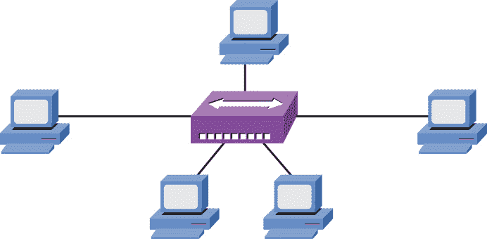

**图 1-9** 星形拓扑

> 注意

第 3 章 讨论了 UTP 和其他类型的布线。

星形拓扑是目前使用的最流行的物理局域网拓扑，星形中心有一个以太网交换机，并使用非屏蔽双对线（UTP）电缆从交换机端口连接到客户端。

表 1-3 识别了星形拓扑的一些主要特性、优点和缺点。


**表 1-3** 星形拓扑的特性、优点和缺点

| **特性** | **优点** | **缺点** |
| --- | --- | --- |
| 设备具有回到中心设备（例如，集线器或交换机）的独立连接。 | 电缆断裂只会影响通过断电缆连接的设备，而不影响整个拓扑。 | 星形拓扑比总线或环形拓扑需要更多电缆，因为每个设备都需要自己的电缆连接回中心设备。 |
| 星形拓扑通常用于以太网技术（第 4 章中描述）。 | 故障排除相对简单，因为星形拓扑中的中心设备充当所有连接设备的聚合点。 | 星形拓扑的安装时间可能比总线或环形拓扑长，因为必须安装更多的电缆线路。 |

## 中心星辐射型拓扑

通过 WAN 链路连接多个站点（例如，多个公司位置）时，中心星辐射型拓扑具有从每个远程站点（即`支辐站点`）到主站点（即`集纽站点`）的 WAN 链路。这种方法的示例在图 1-10 中所示，与局域网中使用的星形拓扑类似。

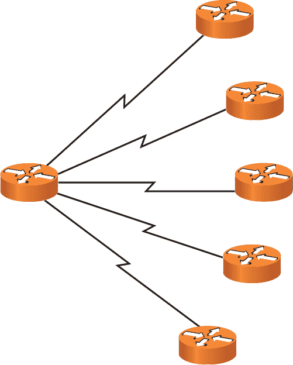

**图 1-10** 中心星辐射型拓扑

对于 WAN 链路，服务提供商按每条链路收取定期费用。因此，中心星辐射型拓扑通过不直接连接任何两个支辐站点来帮助减少 WAN 费用。如果两个支辐站点需要通信，它们的通信将通过中心站点发送。表 1-4 对比了中心星辐射型 WAN 拓扑的优点和缺点。


**表 1-4** 中心星辐射型 WAN 拓扑的特性、优点和缺点

| **特性** | **优点** | **缺点** |
| --- | --- | --- |
| 每个远程站点（即支辐）通过 WAN 链路连接回主站点（即中心）。 | 降低了成本（与全网或部分网拓扑相比），因为使用了最少数量的链路。 | 远程站点之间必须使用次优路由，因为所有站点间通信都必须通过主站点。 |


| 两个远程站点之间的通信通过中心站点（hub）传输。 | 添加一个或多个额外站点是很容易的（与全网或部分网网拓扑相比），因为每个站点只需要添加一条链路。 | 由于所有远程站点都汇聚到主站点，该中心站点可能成为单点故障。 |
| | | | 由于每个远程站点只能通过单一 WAN 链路访问，因此星型辐射型拓扑缺乏冗余。 |

## 全网状拓扑

与星型辐射型 WAN 拓扑缺乏冗余并受到次优路由的影响不同，如图 1-11 所示，全网状拓扑将每个站点直接连接到其他所有站点。

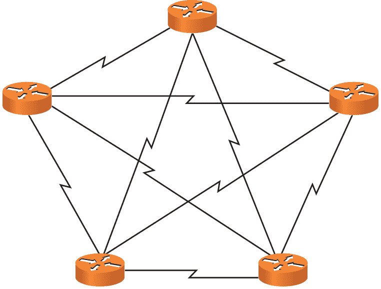

**图 1-11** 全网状拓扑

由于每个站点直接连接到其他所有站点，因此可以选择最优路径，而不是通过另一个站点中继流量。此外，全网状拓扑具有高度的容错性。通过检查图 1-11，你可以看到拓扑中的多个链路可能会丢失，而每个站点可能仍然能够连接到其他所有站点。表 1-5 总结了全网状拓扑的特性。


**表 1-5** 全网状 WAN 拓扑的特性、优点和缺点

| **特性** | **优点** | **缺点** |
| :--- | :--- | :--- |
| 每个站点与其他所有站点都有直接的 WAN 连接。 | 任意两个站点之间存在最优路由。 | 全网状网络的扩展可能困难且昂贵，因为添加一个新站点需要为新站点与每个其他现有站点之间建立一条新的 WAN 链路。 |
| 所需 WAN 连接的数量可以使用公式 `w` = `n` * (`n` – 1) / 2 来计算，其中 `w` = WAN 链路数量，`n` = 站点数量。例如，一个拥有 10 个站点的网络需要 45 条 WAN 连接来形成全网状网络：45 = 10 * (10 – 1) / 2。 | 全网状网络具有容错性，因为即使丢失一条或多条链路，所有站点之间的可访问性可能仍然维持。 | |
| | 全网状网络的故障排除相对容易，因为每条链路都与其他链路相互独立。 | |

## 部分网状拓扑

如图 1-12 所示，部分网状 WAN 拓扑是之前描述星型辐射型拓扑和全网状拓扑的混合体。具体而言，部分网状拓扑的设计可以在选定站点之间提供最优路由，同时避免将每个站点连接到其他所有站点的费用。

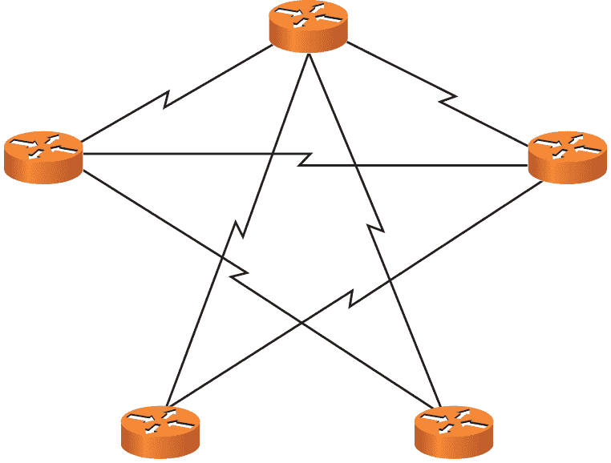

**图 1-12** 部分网状拓扑

在设计部分网状拓扑时，网络设计人员必须考虑网络流量模式，并策略性地添加连接站点间流量较大的站点链路。表 1-6 重点介绍了部分网状拓扑的特性、优点和缺点。


**表 1-6** 部分网状拓扑的特性、优点和缺点

| **特性** | **优点** | **缺点** |
| :--- | :--- | :--- |
| 选定的站点（即频繁进行站点通信的站点）通过直接链路连接，而通信频率较低的站点可以通过另一个站点进行通信。 | 部分网状拓扑为流量较大的选定站点提供了最优路由，同时避免了将每个站点连接到其他所有站点的费用。 | 部分网状拓扑的容错性低于全网状拓扑。 |
| 对于连接相同数量的站点，部分网状拓扑使用的链路比全网状拓扑少，比星型辐射型拓扑多。 | 部分网状拓扑比星型辐射型拓扑具有更多冗余。 | 部分网状拓扑比星型辐射型拓扑昂贵。 |

### 无线拓扑

说无线技术在近期变得流行是一个极大的轻描淡写。因此，已经确定了三大类无线拓扑。虽然本节提供了这些网络设计的高级概述，但请记住第 8 章提供了更详细的细节。

#### 自接 (Ad Hoc)

最简单的无线拓扑是自接无线网络。这意味着无线节点负责彼此之间发送和接收流量，而不需要交换机或访问点等基础设施设备的协助。一些网络工程师将自接拓扑简单地称为无线点对点（P2P）型网络。自接无线网络的一个常见例子是 Apple 的 AirDrop，用于在两个智能手机之间发送文件。作者更倾向于使用更正式、具体的自接术语。你的 Network+ 考试也是如此！这种方法的对面是基础拓扑，将在下讨论。

#### 基础 (Infrastructure)

在基础拓扑中，你拥有专门的无线设备来允许无线通信发生。如今许多家庭都配备无线局域网（WLAN）。无线访问点（WAP）允许各种计算机（和其他无线设备）通过像集线器一样工作的 WAP 进行通信。该 WAP 通过有线连接到家庭用户的服务提供商（SP）。例如，同轴电可以连接到宽带电缆服务以实现高速互联网连接。

#### 网格 (Mesh)

一种特殊的自接无线拓扑是网格。这种拓扑比自接更复杂，因为特殊节点帮助在整个拓扑中移动流量。请注意，这些设备并不像基础型拓扑中的访问点那样高级。我曾幸过的第一个无线网格拓扑是一个能够为大型露营车（RV）公园提供足够覆盖的网络。这种设计的明显挑战在于干扰以及节点维持美国佛罗里达州常见的恶劣环境的能力。是的，那是阳光和偶尔的热带风暴。

## 按资源位置定义的网络

分类网络的另一种方法是基于网络资源所在的位置。*客户端/服务器网络* 的一个示例是所有共享位于集中式服务器上文件的 PC 集合。然而，如果这些 PC 的操作系统（例如 Microsoft Windows 10 或 Mac OS X）配置了文件共享，它们就可以从彼此的硬盘上共享文件。这被称为*对等对等网络*，因为对等节点（此例中的 PC）为其他对等节点提供资源。接下来的章节将详细描述客户端/服务器网络和对等对等网络。

### 客户端/服务器网络

图 1-13 展示了客户端/服务器网络的示例，其中一个专用文件服务器提供文件的共享访问，并且网络打印机作为网络客户端的资源可用。客户端/服务器网络常用于企业使用。由于资源位于一个或多个服务器上，因此管理比尝试在多个对等设备上管理网络资源更简单。

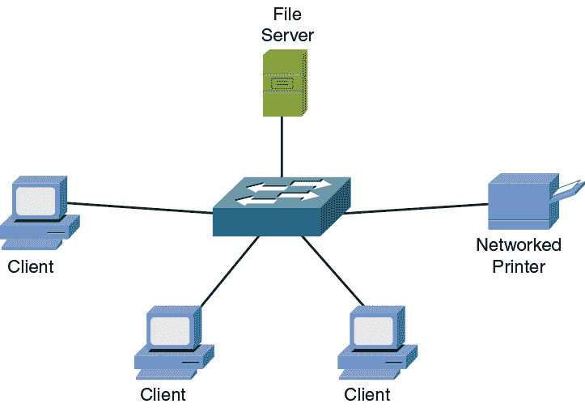

**图 1-13** 客户端/服务器网络示例


译文

客户端/服务器网络的性能可能优于点对点网络，因为资源可以位于专用服务器上，而不是运行各种用户应用程序的 PC 上。这可以简化备份，因为只需要备份少数的位置。然而，客户端/服务器网络带有专用资源的额外费用。表 1-7 对比了客户端/服务器网络的优缺点。


**表 1-7** 客户端/服务器网络的特性、优缺点

| 特性 | 优点 | 缺点 |
| :--- | :--- | :--- |
| 客户端设备（例如 PC）共享位于一个或多个专用服务器上的公共资源（例如文件或打印机资源）。 | 客户端/服务器网络很容易扩展，可能需要购买额外的客户端许可。 | 因为多个客户端依赖单个服务器获取资源，该服务器可能成为网络单点故障。 |
| 资源共享通过专用服务器硬件和操作系统实现。 | 管理变得简单，因为文件共享权限和其他安全设置可以在服务器上进行，而不是在多个客户端上。 | 客户端/服务器网络的成本可能比点对点网络高。例如，客户端/服务器网络可能需要购买专用服务器硬件和相应数量的操作系统许可。 |

***

注意

客户端/服务器中的服务器可以是运行操作系统 (NOS) 的计算机，例如 `Linux Server` 或 `Microsoft Windows Server` 操作系统。或者，服务器可以是由 Sun Microsystems 开发的网络文件系统 (`NFS`) 向远程客户端提供文件系统。

***

注意

客户端/服务器网络的一种变体是提供共享文件访问的网络附属存储 (`NAS`)。`NAS` 设备是直接连接到网络的存储设备。与其运行高级操作系统，`NAS` 设备通常通过 `NFS` 向网络客户端提供文件。

***

### 点对点网络

点对点网络允许互连的设备（例如 PC）相互共享资源。这些资源可以是文件或打印机。作为点对点网络的示例，请图 1-14，其中每个节点都可以共享自己的硬盘，并且其中一个节点拥有与网络中其他节点共享的打印机。

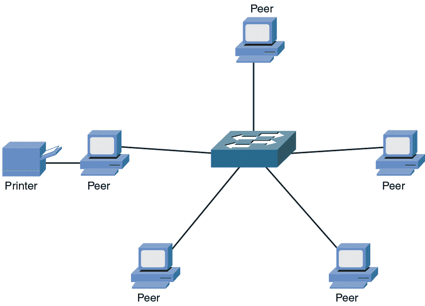

**图 1-14** 点对点网络示例

点对点网络出现在小型企业和家庭中。点对点网络的普及部分源于支持文件和打印共享的操作系统。然而，点对点网络的扩展性是一个问题。具体来说，随着设备（即节点）数量的增加，管理负担也会增加。例如，网络管理员可能需要管理多个设备上的权限，而不是单个服务器。考虑表 1-8 中点对点网络的特性。


**表 1-8** 点对点网络的特性、优缺点

| 特性 | 优点 | 缺点 |
| :--- | :--- | :--- |
| 客户端设备（例如 PC）与其他客户端设备共享资源（例如文件和打印机资源）。 | 点对点网络可以很容易安装，因为操作系统实现了资源共享，不需要高级 NOS。 | 由于管理多个客户端的负担增加，扩展性受到限制。 |
| 资源共享通过操作系统提供。 | 点对点网络的成本通常比客户端/服务器网络低，因为不需要专用服务器资源或高级 NOS 软件。 | 性能可能低于客户端/服务器网络，因为提供网络资源的设备可能正在执行与资源共享无关的任务（例如文字处理）。 |

***

注意

某些网络同时具有点对时间和客户端/服务器网络的特性。例如，在客户端/服务器拓扑中，公司所有的 PC 可能指向中央服务器以访问共享数据库。但在点对点拓扑中，这些 PC 可能相互共享文件和打印机。这种混合了客户端/服务器和点对点特性的网络被称为 `hybrid` 网络。

***

### 案例研究

Acme 公司的总部位于市中心大楼的一层。Acme 还有两个远程办公室 `Branch1` 和 `Branch2`。公司希望尽可能在自己的私有网络上进行文件共享、即时消息、电子邮件和语音通信。它希望连接到互联网。在总部，他们使用 `UTP (Cat 5)` 布线建立了 `LAN`，客户端和服务器连接到交换机。这形成了星型拓扑。对于总部与其两个分支办公室之间的连接，公司使用服务提供商 (`SP`) 进行 `WAN` 连接。`SP` 提供总部到两个分支位置的逻辑点对点连接。物理上，从总部到每个分支办公室的路径经过 `SP` 网络中的几个路由器。目前，`Branch1` 和 `Branch2` 之间没有直接连接，因此分支之间的流量必须通过总部站点（星型结构）。明年，随着更多资金的到位，公司可以在 `Branch1` 和 `Branch2` 之间直接添加 `WAN` 连接。这将 `WAN` 拓扑从星型结构变为全网状。

## 总结

本章涵盖的主要主题如下：

*   本章介绍了各种网络组件，包括客户端、服务器、集线器、交换机、路由器、媒体和 `WAN` 链路。
*   分类网络的一种方法是根据地理分布。具体而言，识别了这些网络类型：`LAN`、`WAN`、`CAN`、`MAN`、`PAN`、`WLAN` 和 `SAN`。
*   另一种分类网络的方法是基于网络拓扑。基于拓扑的网络类型示例包括总线型、环形、星型、部分网状型、全网状和星型结构。本文还提供了有关各种无线拓扑的信息。
*   本章对比了客户端/服务器网络和点对点网络。

## 考试准备任务

#### 复习所有关键点

回顾章节内部最重要的主题，这些主题在页面外边缘标有“关键点”图标。表 1-9 列出了这些关键主题及其所在的页码。


**表 1-9** 第 1 章关键点

| 关键点元素 | 描述 | 页码 |
| :--- | :--- | :--- |
| 列表 | 按地理定义的网络类型 | 7 |
| 表 1-1 | 总线型拓扑的特性、优点和缺点 | 12 |
| 表 1-2 | 环形拓扑的特性、优点和缺点 | 14 |
| 表 1-3 | 星型拓扑的特性、优点和缺点 | 15 |


| 表 1-4 | 星辐型拓扑的特性、优点和缺点 | 16 |
| 表 1-5 | 全网状拓扑的特性、优点和缺点 | 18 |
| 表 1-6 | 部分网状拓扑的特性、优点和缺点 | 19 |
| 表 1-7 | 客户端/服务器网络的特性、优点和缺点 | 22 |
| 表 1-8 | 对等网络网络的特性、优点和缺点 | 23 |

### 记忆并完成表格和列表

打印 附录 C “记忆表格”的副本，或至少打印本章章节，并尽可能通过记忆完成这些表格。附录 D “记忆表格答案密钥”包含了完成后的表格和列表，方便你检查自己的作业。

### 定义关键术语

定义本章中的以下关键术语，并在术语表中检查你的答案：

- [客户端
- 服务器
- 集线器
- 交换机
- 路由器
- 介质
- WAN 链路
- 局域网 (LAN)
- 广域网 (WAN)
- 校园区域网 (CAN)
- 城域网 (MAN)
- 个人区域网 (PAN)
- 无线局域网 (WLAN)
- 存储区域网 (SAN)
- 逻辑拓扑
- 物理拓扑
- 总线拓扑
- 环形拓扑
- 星型拓扑
- 星辐型拓扑
- 全网状拓扑
- 部分网状拓扑
- 自组织拓扑 (ad hoc topology)
- 基础架构拓扑
- 无线网状拓扑
- 客户端/服务器网络
- 对等网络

### 在 Network+ Simulator Lite 中完成第 1 章上机实验

- 网络拓扑

### 额外资源

**路由器与交换机，噢我的天呐！:** [`ajsnetworking.com/intrors`](http://ajsnetworking.com/intrors)

**网络拓扑:** [`en.wikipedia.org/wiki/Network_topology`](https://en.wikipedia.org/wiki/Network_topology)

## 复习题

这些复习题的答案出现在 附录 A “复习题答案”。

**1.** 以下哪项提供了促进数据传输的介质（有线或无线）？
a. 服务器
b. LAN
c. 客户端
d. 路由器

**2.** 哪种设备根据 MAC 地址做出流量转发决策？
a. 集线器
b. 路由器
c. 交换机
d. 多用器

**3.** 一家公司在城市中有多个地点，通过城太网网连接。这是哪种类型网络的示例？
a. WAN
b. CAN
c. PAN
d. MAN

**4.** 通过 USB 线将 PC 与数字相机连接而形成的网络被认为是什么类型的网络？
a. WAN
b. CAN
c. PAN
d. MAN

**5.** 以下哪种物理 LAN 拓扑需要最多的线缆？
a. 总线
b. 环形
c. 星型
d. WLAN

**6.** 以下哪种拓扑提供了最高级别的冗余性？
a. 全网状
b. 星辐型
c. 总线
d. 部分网状

**7.** 在五个远程站点之间创建全网状连接需要多少条 WAN 链路？
a. 5
b. 10
c. 15
d. 20

**8.** 与全网状 WAN 拓扑相比，星辐型 WAN 拓扑的两个优点是
a. 成本较低
b. 优路由
c. 更具扩展性
d. 更多冗余

**9.** 哪种网络基于网络客户端相互共享资源？
a. 客户端/服务器
b. 客户端-对等
c. 对等网络 (peer-to-peer)
d. 对等-服务器

**10.** 与客户端/服务器网络相比，对等网络的优点是什么？
a. 更具扩展性
b. 价格更便宜
c. 性能更好
d. 管理简化

**11.** 哪种无线拓扑通过使用接入点来促进网络通信？
a. 自组织 (ad hoc)
b. 网状 (mesh)
c. 基础架构
d. 环形

**12.** 当大型视频或音频文件需要在网络中存储和传输时，哪种网络类型有助于促进通信？
a. WLAN
b. CAN
c. PAN
d. SAN

## 第 2 章 OSI 参考模型

完成本章后，你将能够回答以下问题：

- 网络模型的目的是什么？
- OSI 模型包含哪些层？
- OSI 模型每一层的特性是什么？
- `TCP/IP` 栈与 OSI 模型相比如何？
- 对于一组常用的应用程序，已知的 TCP 和/或 UDP 端口号是什么？

早在在 1977 年，国际标准化组织 (ISO) 成立了一个小组委员会，专注于多厂商通信系统的互操作性。这是一种高级的说法，目的是为了让网络“小玩意儿”进行通信。该小组委员会产生的是开放系统互连（OSI）参考模型。


我个人从 1989 年起就一直从事计算机网络行业，在我参加过的许多课程和读过的书中，都出现过对 OSI 模型的解释。通过这些，我总结了一系列比喻来帮助描述 OSI 模型不同层的操作。某些比喻涉及从一个位置向另一个位置发送信件，或将信息放在一系列信封中。然而，我最喜欢（也更准确）描述 OSI 模型的方法是将其类比为一个书架，如图 2-1 所示。


**图 2-1** 书架类比 OSI 模型

如果你看我家里的书架，你会发现我在不同的层架上放了不同类型的书。一个书架放着我的*星球大战*系列书籍，另一个书架放着我为 Pearson 写的书，另一个书架放着我的旧音频书，以此类推。我将相似的书籍分在一个层上，就像 OSI 模型将相似的协议和功能分组在一个层中一样。

我的读者在学习 OSI 模型时经常遇到的一个陷阱是，试图将网络中的所有设备和协议都完美地契入 OSI 模型的七层中。然而，并非每种技术都能完美契合这些层。事实上，某些网络在其中一个或多个层可能没有运行任何技术。这让我想起了关于 OSI 模型的最喜欢的一句话。它出自 Rich Seifert 的书籍《交换机书籍》（*The Switch Book*）。在书中，Rich 提醒我们 OSI 模型是一个*参考*模型（reference model），而不是一个*崇拜*模型（reverence model）。也就是说，没有任何宇宙定律规定所有技术都必须整齐地接入该模型。因此，当你在本章中发现 OSI 模型各层的特征时，请记住这些层就像是组织相似协议和功能的架架，而不是不变的法则。

## OSI 模型


如前所述，OSI 模型由七层组成：

*   **第 1 层：**物理层
*   **第 2 层：**数据链路层
*   **第 3 层：**网络层
*   **第 4 层：**传输层
*   **第 5 层：**会话层
*   **第 6 层：**表示层
*   **第 7 层：**应用层

在图中，我们将这些层描绘为 `Layer 1` 位于栈的最底部，如图 2-2 所示。

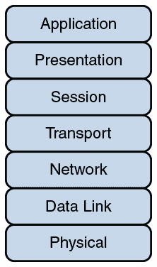

**图 2-2** OSI “栈”

有多种助记法可以帮助按正确顺序记住这些层。一个自上而下（即从栈顶部的 `Layer 7` 开始一直到 `Layer 1`）的字母缩写法是***A*ll ***P*eople* ***S*eem* ***T*o* ***N*eed* ***D*ata* ***P*rocessing***（所有人似乎都需要数据处理）。作为几个例子，使用这个缩写法，*A*ll 中的 *A* 让我们想起 *A*pplication 中的 *A*，而 *P*eople 中的 *P* 让我们想起 *P*resentation 中的 *P*。另一个常见的记忆辅助是***P*lease ***D*o* ***N*ot* ***T*hrow* ***S*ausage* ***P*izza* ***A*way***（请不要扔香肠披萨），它从 `Layer 1` 开始一直到 `Layer 7`。

在物理层，二进制表达式（即一系列 1 和 0）代表数据。二进制表达式使用位（bits）创建，其中一个位是单个的 1 或单个的 0。然而，在较高层中，位被分组在一起，形成所谓的*协议数据单元*（PDU）或*数据服务单元*。

工程师倾向于泛用*数据包*（packet）一词来这些这些 PDU。然而，取决于其所在的 OSI 层，PDU 可能有额外的名称。图 2-3 展示了这些 PDU 名称。这些 PDU 的一个常用记忆辅助方法是***S*ome ***P*eople* ***F*ear* ***B*irthdays***（有些人害怕生日），其中 *S*ome 中的 *S* 让我们想起 *S*egments（段）中的 *S*。*P*eople 中的 *P* 让我们想起 *P*ackets（包）中的 *P*，而 *F*ear 中的 *F* 反映了 *F*rames（帧）中的 *F*。最后，*B*irthdays 中的 *B* 让我们想起 *B*its（位）中的 *B*。

!!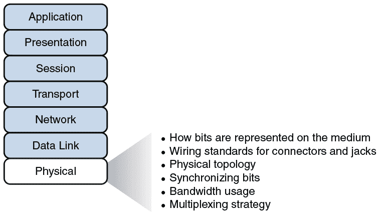

**图 2-4** 第 1 层：物理层

物理层定义了以下：

*   **如何在介质上表示位：** 计算机网络上的数据表示为二进制表达式。第 5 章“IPv4 和 IPv6 地址”更详细地讨论了二进制。电电压（在铜质线路上）或光（通过光纤电缆传输）可以表示这些 1 和 0。

    例如，电线上电压的存在或不存在分别描绘了二进制 1 或二进制 0，如图 2-5 所示。同样，光纤电缆上光的存在或不存在呈现了二进制的 1 或 0。这种方法被称为*现状态调制*。

    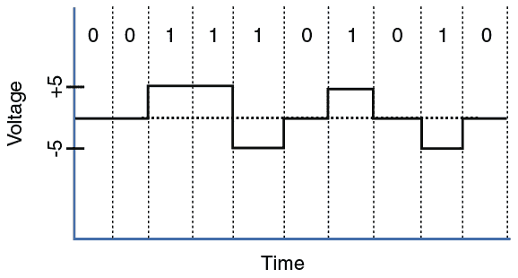

    **图 2-5** 状态调制

    表示二进制数据的另一种方法是*状态转换调制*，如图 2-6 所示，电压之间的转换或光的存在显示了二进制值。

    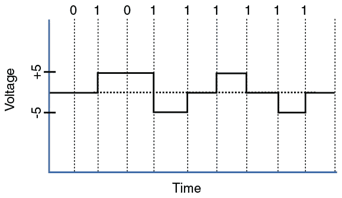

    **图 2-6** 转换调制

    > 注意
    你可能在无线电中熟悉的其他调制类型包括幅度调制（AM）和频率调制（FM）。AM 使用波形幅度（即信号强度）的变化来表示原始信号。然而，FM 使用频率的变化来代表原始信号。

*   **连接器和插座的接线标准：**第 3 章“网络组件”描述了网络连接器的几种标准。例如，TIA/EIA-568-B 标准描述了如何为用于 100BASE-TX 以太网 RJ-45 连接器接线，如图 2-7 所示。

    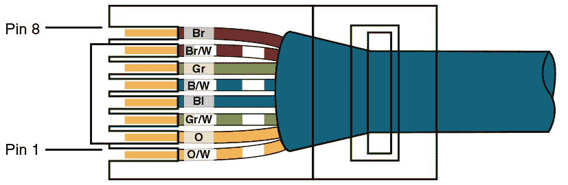

    **图 2-7** RJ-45 连接器的 TIA/EIA-568-B 接线标准

*   **物理拓扑：** 第 1 层设备将网络视为物理拓扑（相对于逻辑拓扑）。物理拓扑的示例包括总线、环形和星型拓扑，如第 1 章“[计算机网络基础”所述。

*   **位同步：** 为了让网络设备在物理层成功通信，它们必须对一个位停止另一个位开始达成一致。具体来说，设备需要位同步的方法。位同步的基本两种方法包括*异步*同步和*同步*同步：

    *   **异步：** 使用这种方法，发送者通过发送一个起始位告知接收者即将开始传输。当接收者看到它时，启动自己的内部时钟来测量后续的位。发送者传输其数据后，发送一个停止位来表示已完成传输。


- **同步：** 这种方法同步发送者和接收者的内部时钟，以确保它们对比特的开始和结束达成一致。实现这种同步的常用方法是使用外部时钟（例如，由服务供应商提供的时钟）。发送者和接收者随后引用此外部时钟。

- **带宽使用：** 网络上带宽使用的两种基本方法是`broadband`（宽带）和`baseband`（基带）：
    - **宽带：** 宽带技术将介质（例如铜电缆或光纤电缆）上的可用带宽分为不同的通道。发送者可以在各个通道上传输不同的通信流。例如，考虑电缆调制调器使用的分频复用（`FDM`）。具体来说，电缆调制调器使用本地电缆公司进入家庭电缆的某些频率范围来传输传入数据，使用另一范围频率传输传出数据，以及其他几个频率范围用于不同的电视节目台。
    - **基带：** 相比之下，基带技术使用介质上所有可用频率来发送数据。`Ethernet`（以太网）是使用 `baseband` 的网络技术示例。

- **复用策略：** 复用允许多个通信会话共享同一个物理介质。如前所述，电缆电视允许你通过单个物理介质（例如插入电视机背后的同轴电缆）接收多个通道。以下是一些常用的复用方法：
    - **时分复用 (TDM)：** `TDM` 通过让会话轮流进行，在同一个物理介质上支持不同的通信会话（例如电话网络中的不同电话通话）。在定义为`time slot`（时隙）的简短时间内，发送来自第一个会话的数据，然后发送来自第二个会话的数据。此过程一直持续到所有会话都轮过一次，然后循环往复。
    - **统计时分复用 (StatTDM)：** `TDM` 的缺点是每个通信会话都会接收自己的时隙，即使其中一个会话此刻没有任何数据要发送。为了更有效地利用可用带宽，`StatTDM` 根据需要动态地为通信会话分配时隙。
    - **分频复用 (FDM)：** `FDM` 将介质的频率范围划分为通道，不同的通信会话在不同通道上发送其数据。如前所述，这种带宽使用方法被称为 `broadband`。

物理层标准定义的设备示例包括集线器、无线访问点和网络布线。

***

### Note
集线器连接局域网（LAN）中的电脑。然而，它被认为是物理层设备，因为集线器接收从一个端口进入的比特并将其重传到所有其他端口。集线器在任何时候都不会查询数据中的任何地址信息。

### 第 2 层：数据链路层

数据链路层涉及关注：
- 将数据封装成帧（frames）并在网络上传输这些帧
- 执行错误检测/纠正
- 通过地址唯一地查找网络设备
- 处理流量控制

这些过程合称为`data link control`（`DLC`），并如[图 2-8]所示所示。

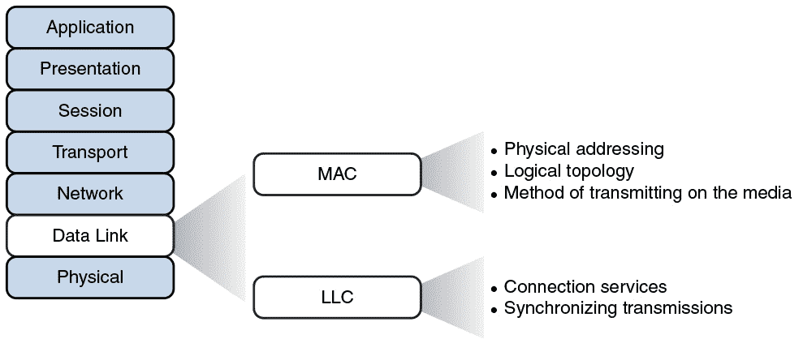

**图 2-8** 第 2 层：数据链路层

事实上，数据链路层与其他层不同之处在于它有自己的两个子层：`MAC`和`LLC`。

### 介质访问控制

介质访问控制（`MAC`）子层的特性包括：
- **物理地址：** 第二层地址的一个常见示例是`MAC address`，它是分配给设备网络接口卡（`NIC`）的 48 位地址。`MAC addresses`以十六进制法书写（例如，`58:55:ca:eb:27:83`）。48 位地址的前 24 位是`vendor code`（厂商代码）。IEEE 注册机构为制造商分配一个或多个唯一的厂商代码。你可以使用 `http://standards.ieee.org/develop/regauth/oui/oui.txt` 上的厂商代码列表，根据设备 `MAC address` 的前半部分来识别网络设备的制造商。`MAC address` 的后 24 位由制造商分配，它们充当设备的序列号。世界上不应该有两个 `MAC addresses` 具有相同的值。
- **逻辑拓扑：** 第二层设备将网络视为一种逻辑拓扑。逻辑拓扑的示例包括[第 1 章]中描述的总线型和环型拓扑。
- **在介质上的传输方法：** 当有多个设备连接到网络时，需要某种策略来决定设备何时向介质发送数据。否则，多个设备可能会同时发送，从而干扰彼此的传输。

### 逻辑链路控制

逻辑链路控制（`LLC`）子层的特性包括：
- **连接服务：** 当网络上的设备接收来自网络上另一台设备的消息时，该接收设备可以以确认消息的形式向发送者提供反馈。这些确认消息提供的两个主要功能如下：
    - **流量控制：** 限制发送者一次可以发送的数据量；这防止发送者用过多的信息淹没接收者。
    - **错误控制：** 允许数据接收者让发送者知道是否没有收到预期的数据帧，或者收到但损坏。接收者通过数学计算所接收数据的 `checksum`（校验和）来确定数据帧是否损坏。如果计算出的 `checksum` 与数据帧中接收的 `checksum` 不匹配，数据接收者得出数据帧损坏的结论，然后可以通过确认消息通知发送者。
- **同步传输：** 数据帧的发送者和接收者需要协调数据帧何时传输以及何时被接收。执行这种同步的三种方法详细在此处列出：
    - **等时 (Isochronous)：** 在等时传输中，网络设备将网络中的一个公共设备作为时钟源，创建固定长度的时隙。网络设备可以确定时隙内有多少可用空间（如果有），然后将数据插入可用的时隙中。一个时隙可以容纳多个数据帧。等时传输不需要在数据字符串的开头提供时钟（如同步传输），或为每个数据帧提供时钟（如异步传输）。因此，与异步或同步传输相比，等时传输的开销很小。
    - **异步 (Asynchronous)：** 在异步传输中，网络设备引用自己的内部时钟，网络设备不需要同步时钟。相反，发送者在每个数据帧的开头放置`start bit`（起始位），在每个数据帧的结尾放置一个`stop bit`（停止位）。这些起始位和停止位告诉接收者何时监控介质以检测比特的存在。


一个额外的位，称为 `parity bit`（校验位），也可以被添加到帧的每个字节末尾以检测错误。例如，如果使用偶数校验位检测（而非奇数校验位检测），校验位（值为 0 或 1）会被添加到字节末尾，导致数据帧中 1 的总数为偶数。如果字节的接收端配置为偶数校验位检测，且收到的位数（包括校验位）为偶数，则接收端可以判定字节在传输过程中没有损坏。

### 注意
如果一个字节发生了多个错误（即原始值发生了多个位的变化），则使用校验位检测错误可能是无效的。

-   **同步（Synchronous）：** 在同步传输中，两个想要通信的网络设备必须就数据帧的开始和结束计时方法达成一致。提供这种时钟的一种方法是使用发送时钟的独立通道。另一种方法是使用特定的位组合或控制字符来指示帧或字节的开始。与异步传输一样，同步传输也可以执行错误检测。然而，同步传输并非使用校验位而是运行数学算法来创建循环冗余校验（CRC）。如果发送端和接收端对同一块数据计算出相同的 CRC 值，则接收端可以判定数据在传输过程中没有损坏。数据链路层定义的设备示例包括交换机、网桥和 `NIC`。

### 注意
`NIC` 并不完全定义在数据链路层，因为它们部分基于物理层标准，如网卡接口。

### 第三层：网络层

网络层（如图 2-9](#part0015.html_ch02fig09）所示）主要关注基于逻辑地址的数据转发。

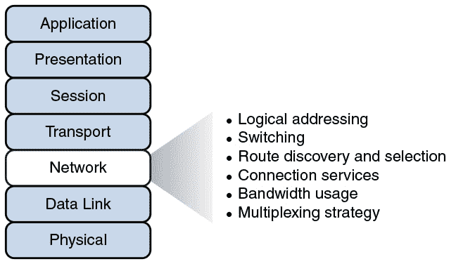

**图 2-9** 网络层

尽管许多网络管理员在听到网络层时会考虑到路由和 IP 地址，该层实际上负责多种任务：

-   **逻辑地址（Logical addressing）：** 数据链路层使用物理地址做出转发决策，而网络层使用逻辑地址做出转发决策。多种路由协议（例如 AppleTalk 和 `IPX`）都有自己的逻辑地址方案，但目前部署最广泛的路由协议是网协议（`IP`）。第 5 章中进行了详细讨论。
    -   **电路交换（Circuit switching）：** 电路交换为双方动态建立专用的通信链路进行通信。作为电路交换的一个简单示例，考虑从家里给公司拨打电话。假设你使用的是传统的电话线，电话公司的交换设备将你的家里与公司的电话系统连接起来。这种连接（即 `circuit`）仅在通话期间存在。
    -   **报文交换（Message switching）：** 与分组交换和电路交换不同，由于涉及延迟，报文交换通常不实时应用。具体而言，在报文交换中，数据流被分成报文。每个报文都标记有目的地址，报文从一个网络设备到另一个网络设备。由于这些设备在转发之前可能会短暂存储报文，使用报文交换的网络有时被称为 `store-and-forward`（存储并转发）网络。形象地说，你可以将报文交换想象成路由邮件，邮件在转发给接收者之前可能会短暂存储在邮件服务器上。

**路由发现与选择：** 由于第三层设备根据逻辑网络地址做出转发决策，第三层设备可能需要知道到达各种网络地址。例如，常见的第三层设备是 `router`。路由器可以维护路由表，根据数据包的网络地址指示如何转发。路由器可以通过手动配置（即输入静态路由）、动态路由协议（例如 `RIP`、`OSPF` 或 `EIGRP`）或由于路由器直接连接到某些网络来填充路由表。

### 注意
路由协议在第 6 章中讨论。

-   **连接服务（Connection services）：** 正如数据链路层提供流量控制和错误控制连接服务，网络层也存在连接服务。如果数据链路的 `LLC` 子层没有执行连接服务，则网络层的连接服务可以提高通信可靠性。

网络层的连接服务执行以下功能：

-   **流量控制（也称为拥塞控制）：** 防止发送端发送数据的速度超过接收端的接收能力。
-   **分组重排序（Packet reordering）：** 允许分组包在发送到接收端时按顺序排列。这可能是必要的，因为某些网络支持负载均衡，使用多个链路在两个设备之间发送分组包。由于存在多个链路，分组包可能会序到达。

网络层设备示例包括 `routers` 和多层交换机。目前最常用的第三层协议以及互联网基础的协议是 `IPv4`。然而，`IPv6` 在现在的网络中开始变得越来越常见。

### 注意
`routers` 和多层交换机在第 3 章中讨论。

### 第四层：传输层

传输层（如图 2-10](#part0015.html_ch02fig10)所示）作为 OSI 模型上层和下层之间的分界线。具体而言，消息从上层（第 5-7 层）获取并封装成段段以传输到下层（第 1-3 层）。同样，来自下层的数据流被解封装并发送到第 5 层（会话层）或其他上层，取决于具体的协议。

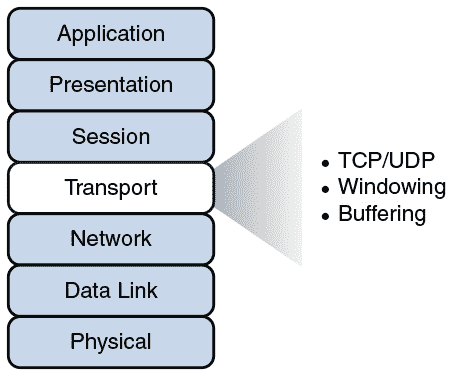

**图 2-10** 第四层：传输层

两种常见的传输层协议是传输控制协议（`TCP`）和用户数据报文协议（`UDP`）。


- **传输控制协议 (TCP):** 一种面向连接的传输协议。面向连接的传输协议提供可靠的传输，即如果某个分段丢失，发送者可以检测到该丢失并重传该丢失的分段。具体而言，接收方会对其收到的分段进行确认。根据这些确认，发送者可以判断哪些分段已成功接收，哪些分段需要重新传输。
- **用户数据报协议 (UDP):** 一种无连接的传输协议。无连接的传输协议提供不可靠的传输，即如果某个分段丢失，发送者无法感知到丢失，且不会发生重传。

正如第 2 层和第 3 层提供流量控制服务一样，第 4 层也存在流量控制服务。第 4 层常用的流量控制方法是窗口和缓冲：

- **窗口：** TCP 通信使用窗口，即一次发送一个或多个分段，接收方可以通过一个确认来证明窗口内所有分段的接收。在某些情况下，如图 2-11 所示，TCP 使用滑动窗口，其窗口大小从一个分段开始。如果该分段成功收到确认（即接收方发送了请求下一个分段的确认），窗口大小将翻倍为两个分段。在成功接收这两个分段后，下一个窗口包含四个分段。这种窗口大小的指数级增长会持续，直到接收方在规定时间内未确认所有分段的成功接收——这被称为*往返时间*（RTT），有时称为*实际传输时间*——或者直到达到配置的最大窗口大小。

  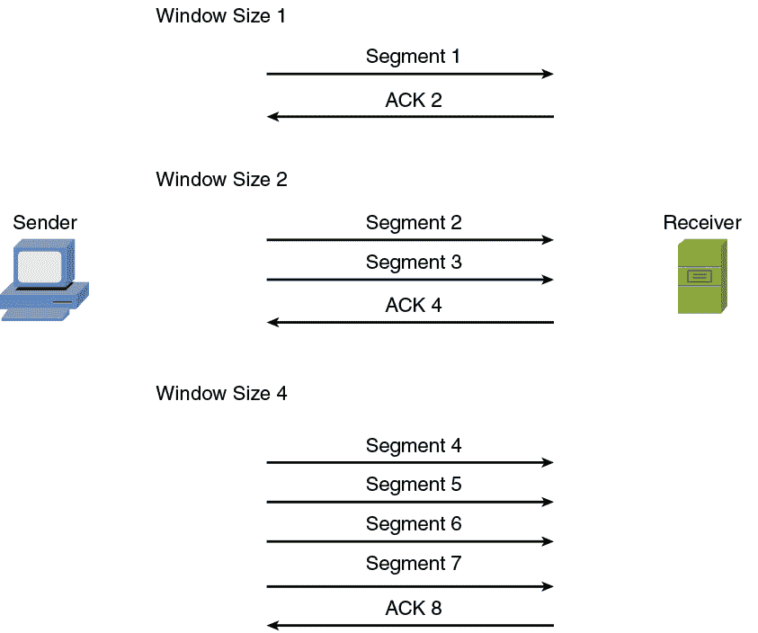

  **图 2-11** TCP 滑动窗口

- **缓冲：** 通过缓冲技术，设备（例如路由器）会使用一段内存（有时称为*缓冲区*或*队列*）来存储分段，以防在没有可用带宽发送这些分段时使用。然而，队列的容量是有限的，在持续网络拥塞的情况下可能会溢出（即丢弃分段）。

除了 TCP 和 UDP 之外，互联网控制消息协议（ICMP）是你可能会遇到的另一种传输层协议。ICMP 用于 `ping` 和 `traceroute` 等实用程序，这些工具在第 10 章“命令行工具”中进行了讨论。

### 第 5 层：会话层

如图 2-12 所示，会话层负责建立、维护和终止会话。你可以将会话看作是一种对话，需要与其他会话分开处理，以避免不同对话之间的数据混杂。

  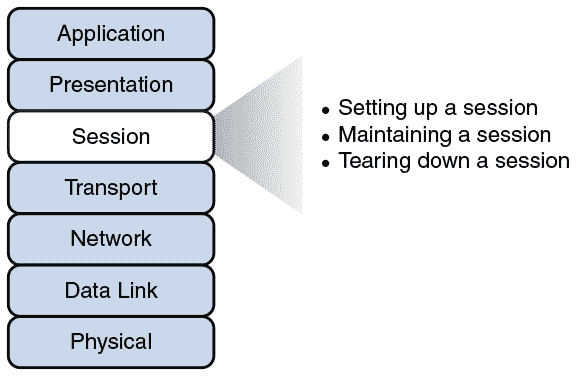

  **图 2-12** 第 5 层：会话层

以下是会话功能的详细介绍：

- **建立会话：** 建立会话涉及的示例包括：
    - 检查用户凭据（例如用户名和密码）
    - 为会话的通信流分配编号，以便唯一找到每一个流
    - 协商会话期间所需的服务
    - 协商由哪个设备开始发送数据
- **维护会话：** 支持会话涉及的程序示例包括：
    - 传输数据
    - 重新建立断开的会话
    - 确认数据的接收
- **终止会话：** 会话可以根据会话中设备的约定进行断开。或者，会话可能因为其中一方断开（无论是故意还是由于错误情况）而终止。如果一方断开，另一方可以检测到与该方的通信丢失，并终止自己的会话端。

H.323 是会话层协议的一个示例，它可以帮助建立、支持和终止语音或视频连接。但请记住，并不是每个网络应用程序都能完美地直接映射到 OSI 模型的七层。会话层是这些层之一，在特定场景下可能无法确定其中运行的是哪种协议。网络基本输入输出系统（NetBIOS）就是会话层协议的一个示例。

***

注意

NetBIOS 是 20 世纪 80 年代初开发的应用程序接口（API），用于在小型局域网（具体而言是当时 IBM 的局域网技术 PC-Network）上实现计算机间的通信。后来，IBM 需要支持在更大的令牌环网络上进行计算机间的通信。因此，IBM 通过名为 NetBIOS 扩展用户界面（NetBEUI）的 NetBIOS 仿真器增强了 NetBIOS 的扩展性和功能。

***

### 第 6 层：表示层

如图 2-13 所示，表示层处理交换数据的格式化并通过加密确保这些数据的安全。

  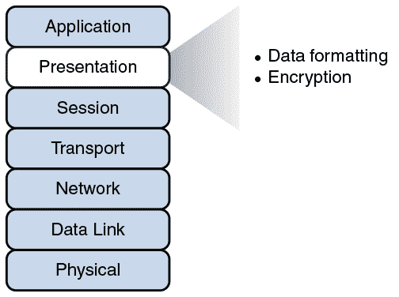

  **图 2-13** 第 6 层：表示层

以下列表详细介绍了数据格式化和加密的功能：

- **数据格式化：** 作为表示层如何处理数据格式化的示例，考虑文本是如何格式化的。某些应用程序可能使用信息交换标准代码（ASCII）格式化文本，而其他应用程序可能使用扩展位制进制交换码（EBCDIC）格式化文本。表示层处理文本（或其他类型的数据，如多媒体或图形文件）的格式，允许通信设备之间保持兼容。
- **加密：** 想象你正通过网络发送敏感信息（例如，你的信用卡号或银行密码）。如果一个恶意用户拦截了你的传输，他们可能会获得这些敏感信息。为了此类此类传输增加安全层，可以使用加密将数据进行乱码（加密），使得即使数据被拦截，第三方也无法对其进行解码（解密）。然而，预期的接收方能够解密传输内容。

加密在第 12 章“网络安全”中进行了详细讨论。

### 第 7 层：应用层

如图 2-14 所示，应用层为网络提供应用程序服务。一个重要（且经常被误解）的概念是，终端用户应用程序（如 Microsoft Word）运行在应用层。相反，应用层支持终端用户应用程序使用的服务。例如，电子邮件是存在于应用层的应用层服务，而 Microsoft Outlook（电子邮件客户端示例）并不是运行在应用层的终端用户应用程序。应用层的另一个功能是发布可用服务。

  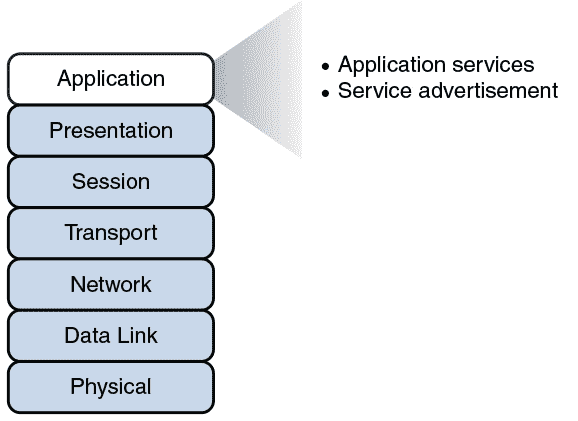

  **图 2-14** 第 7 层：应用层

以下详细地描述了应用层的功能：

- **应用程序服务：** 存在于应用层的应用程序服务示例包括文件共享和电子邮件。


- **服务广告：** 某些应用程序的服务（例如，某些网络打印机）会定期发送广告，以便让网络上的其他设备获知其可用性。然而，其他服务会将自身及其服务注册到集中目录中（例如，Microsoft Active Directory），其他寻求此类服务的网络设备可以对其其进行查询。

请记住，尽管应用层被标记为第 7 层，但它位于 OSI 栈的顶端，因为其网络功能最接近最终用户。

## TCP/IP 栈

ISO 开发 OSI 参考模型是为了具有通用性，在模型可以对哪些协议和技术进行分类方面是通用的。然而，互联网上的大部分流量（以及企业网络上的流量）都是基于 TCP/IP 协议族的。因此，对于许多网络设计人员和管理员来说，更相关的模型是由美国国防部（DoD）开发的模型。该模型被称为 `DoD 模型`或 `TCP/IP 栈`。

### 注意事项
一种名为网络控制协议（NCP）的旧协议与 TCP/IP 协议相似。`NCP` 用于 ARPANET（互联网的前身），它提供的功能类似于互联网上 TCP/IP 协议族提供的功能，尽管它们并不那么健壮。

## TCP/IP 栈的层

TCP/IP 栈只有四个定义的层，与 OSI 模型的七层不同。图 2-15 对比了这两个模型，以便于直观理解。

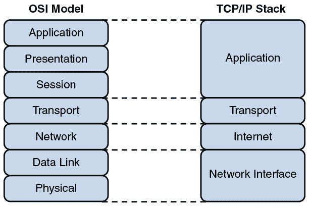

**图 2-15** TCP/IP 栈

TCP/IP 栈由以下层组成：

- **网络接口：** TCP/IP 栈的网络接口层包含了 OSI 模型第 1 和第 2 层（物理层和数据链路层）提供的技术。
    ### 注意事项
    某些文献将网络接口层称为 `network access layer`（网络访问层）。

- **网络：** TCP/IP 栈的网层对应 OSI 模型的第 3 层（网络层）。虽然多个路由协议（例如 `IP`、`IPX` 和 `AppleTalk`）存在于 OSI 模型的网络层，但 TCP/IP 栈的网层专注于将 `IP` 作为通过网络进行路由的协议。图 2-16 显示了 IP 版本 4 数据包的格式。
    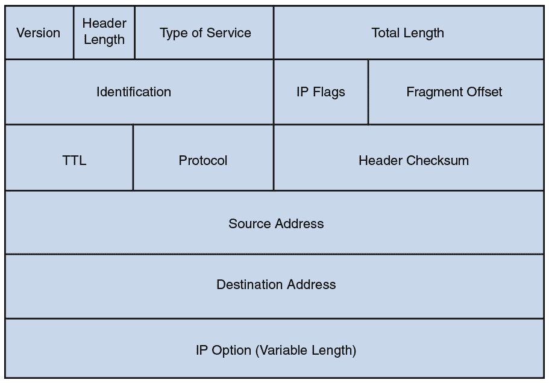
    **图 2-16** IP 版本 4 数据包格式

    注意，IP 数据包头中同时包含源 IP 地址和目的 IP 地址字段。`Protocol` 字段显示了数据包发送自或应发送至传输层协议。同样值得注意的是存活时间（`TTL`）字段。每当此数据包从一个 `IP` 网络路由到另一个 `IP` 网络时（即通过路由器时），该字段中的值就会减 1。如果 `TTL` 值达到 0，数据包将从网络中丢弃。这种行为有助于防止路由环。作为一种做法，尽管 TCP/IP 栈没有显式分离物理层和数据链路层，但在引用 TCP/IP 栈的物理层、数据链路层和网络层时，仍使用 OSI 层数 1、2 和 3。

- **传输：** TCP/IP 栈的传输层对应 OSI 模型的第 4 层（传输层）。TCP/IP 栈传输层中发现两个主要协议是 `TCP` 和 `UDP`。
    图 2-17 详细介绍了 TCP 段的结构。注意源端口和目的端口字段。正如本章后文所述，这些端口标识了数据应该转发到哪个上层协议，或者数据是从哪个上层协议发送的。
    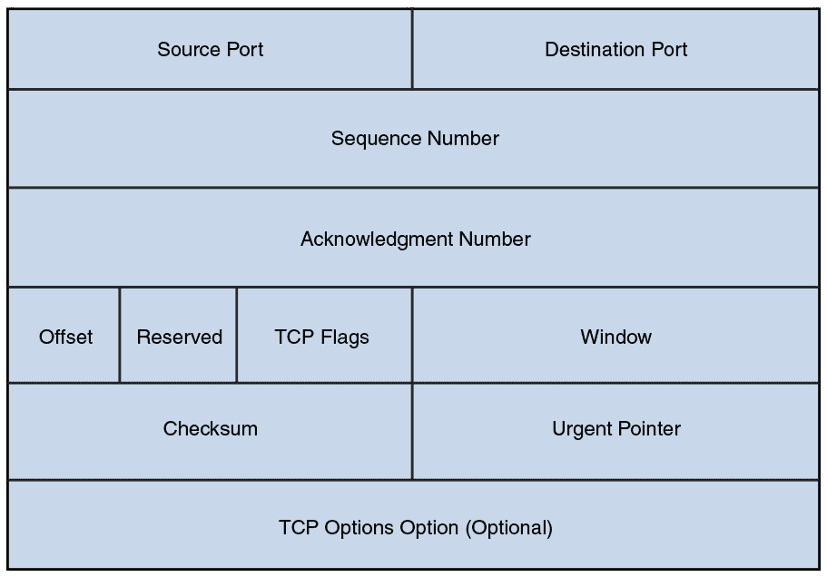
    **图 2-17** TCP 段格式

    还要注意窗口大小字段。该字段中的值决定了设备在等待确认之前可以接收多少字节。如前所述，此功能提供了流量控制。

    TCP 段的头部还包含段的序列号。通过序列编号，如果段按乱序到达，接收方可以根据这些序列号将它们重新按正确的顺序排列。

    头部中的确认号显示了接收方期望收到的下一个序列。这是接收方让发送方知道直到该点且包含该点的所有段都已收到的方法。由于排序和确认机制，`TCP` 被认为是一种`面向连接`的传输层协议。
图 2-18 展示了 UDP 段的结构。`UDP` 是一种无连接、不可靠的协议。`UDP` 缺乏 TCP 段头部中存在的序列编号、窗口大小和确认编号。UDP 段的头部仅包含源端口和目的端口号、一个 `UDP` 校验和（用于检测传输错误的可选字段）以及段的长度（以字节为单位）。
    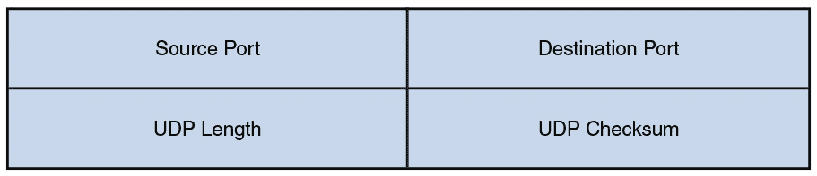
    **图 2-18** UDP 段格式

    由于 UDP 头部比 TCP 头部小得多，`UDP` 成为需要最大化带宽且不需要确认的应用程序（例如音频或视频流）传输层协议的理想选择。

- **应用：** TCP/IP 栈与 OSI 模型之间最大的区别在于 TCP/IP 栈的应用层。该层处理由 OSI 模型第 5、6 和 7 层（会话、表示和应用层）描述的概念。

    由于像 TCP/IP 栈这样的四层模型复杂性降低，网络设计人员和管理员可以更容易地将给定的网络技术分类到特定的层。例如，尽管之前显示 `H.323` 是 OSI 模型中的会话层协议，但你需要了解更多关于 `H.323` 的行为才能对其进行正确分类。然而，通过 TCP/IP 栈，你可以很快发现 `H.323` 是一个封装在 `TCP` 内部的高层协议，从而将 `H.323` 分类在 TCP/IP 栈的应用层中。

## TCP/IP 栈中的常见应用协议

TCP/IP 栈中的应用协议通过唯一的端口号进行识别。例如，当你在 浏览器中输入网页地址时，你（默认）使用 `TCP` 端口 80 与该远程网页地址通信。具体来说，网页服务器使用的超文本传输协议（`HTTP`）使用 `TCP` 端口 80。因此，你发送到该远程网页服务器的数据目的端口号为 80。该数据随后在传输层被封装成 `TCP` 段。该段随后在网层被进一步封装成数据包，并使用以 `Ethernet` 等底层网络接口层技术发送到网络中。


延续图 2-19 所示的示例，当你向该远程网站发送流量时，你发送到网络中的数据包不仅需要 Web 服务器的目的 IP 地址（在本例中为 `172.16.1.2`）以及 HTTP 的目的端口号（即 `80`），还需要你电脑的源 IP 地址（在本例中为 `10.1.1.1`）。由于你的电脑并没有作为 Web 服务器运行，因此它的端口不是 `80`。相反，你的电脑会选择一个大于 `1023` 的源端口号。在本例中，让我们假设客户端 PC 选择了源端口 `1248`。

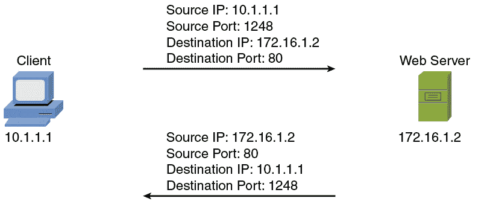

**图 2-19** 示例：端口号与 IP 地址

注意，当 Web 服务器返回内容时，IP 地址和端口号现在交换了，Web 服务器变成了源端，你的 PC 变成了目的。有了源和目的端口号，以及源和目的 IP 地址，双向通信就成为可能。

***

### Note

端口号 `1023` 及以下的端口被称为*已知端口*，端口号在 `1023` 以上的端口被称为*临时端口*（ephemeral ports）。端口的最大值为 `65,535`。已知端口号的分配可以在 [`www.iana.org/assignments/port-numbers`](http://www.iana.org/assignments/port-numbers) 找到。

***

表 2-1 是 TCP/IP 栈中一些常用应用层协议和程序的参考。某些协议或应用程序（如 `DNS`）可能会根据执行执行的功能使用 `TCP` 或 `UDP` 作为其传输协议。


**表 2-1** 应用层协议/应用程序

| **协议** | **描述** | **TCP 端口** | **UDP 端口** |
| --- | --- | --- | --- |
| `DHCP` | 动态主机配置协议：动态为网络设备分配 IP 地址信息（例如：IP 地址、子网掩码、`DNS` 服务器的 IP 地址和默认网关 IP 地址） | | 67, 68 |
| `DNS` | 域名系统：将域名解析为相应的 IP 地址 | 53 | 53 |
| `FTP` | 文件传输协议：与远程主机传输文件（通常需要对用户凭据进行身份验证） | 20 和 21 | |
| `H.323` | 一令协议，在网络上提供多媒体通信 | 1720 | |
| `HTTP` | 超文本传输协议：从 Web 服务器检索内容 | 80 | |
| `HTTPS` | 安全超文本传输协议：用于从 Web 服务器安全地检索内容 | 443 | |
| `IMAP` | 互联网消息访问协议：从邮件服务器检索邮件 | 143 | |
| `IMAP4` | 互联网消息访问协议版本 4：从邮件服务器检索邮件 | 143 | |
| `LDAP` | 轻量级目录访问协议：为网络客户端提供目录服务（例如，包含用户名、密码、电子邮件和电话号码信息的用户目录） | 389 | |
| `LDAPS` | 基于 SSH 的轻量级目录访问协议：`LDAP` 安全版本 | 636 | |
| `MGCP` | 媒体网关控制协议：用于 IP 电话网络的控制和通信协议 | | 2427, 2727 |
| `NetBIOS` | 网络基本输入输出系统：为使用 `NetBIOS` 的局域网提供网络通信服务 | 139 | 137, 138 |
| `NNTP` | 网络新闻传输协议：支持在 Usenet 新闻服务器上发布和阅读文章 | 119 | |
| `NTP` | 网络时间协议：网络设备用于将其时钟与时间服务器（`NTP` 服务器）同步 | | 123 |
| `POP3` | 邮局协议版本 3：从邮件服务器检索邮件 | 110 | |
| `RDP` | 远程桌面协议：一种微软协议，允许用户查看并控制远程计算机的桌面 | 3389 | |
| `rsh` | 远程外壳：允许从远程用户在计算机上执行命令 | 514 | |
| `RTP` | 实时传输协议：用于通过网络传输媒体数据（如 IP 电话） | 5004, 5005 | 5004, 5005 |
| `RTSP` | 实时流协议：与媒体服务器（例如视频服务器）通信并控制服务器媒体文件的播放 | 554 | 554 |
| `SCP` | 安全复制：通过 `SSH` 连接提供安全文件传输服务，并提供文件的原始日期和时间信息（这是 `FTP` 无法提供的） | 22 |
| `SFTP` | 安全 FTP：通过 `SSH` 连接提供安全文件传输服务 | 22 |
| `SIP` | 会话建立协议：用于创建和结束多媒体会话 | 5061 | 5060 |
| `SMB` | 消息块：用于共享文件、打印机和其他资源 | 445 | |
| `SMTP` | 简单邮件传输协议：用于发送邮件 | 25 | |
| `SNMP` | 简单网络管理协议：用于监控和管理网络设备 | 161 |
| `SNMP Trap` | 简单网络管理协议陷报：从 `SNMP` 代理发送到 `SNMP` 管理器的通知 | 162 | 162 |
| `SNTP` | 简单网络时间协议：其计算算法不如 `NTP` 复杂 | | 123 |
| `SSH` | 安全外壳：用于安全地连接远程主机 | 22 | |
| `Telnet` | 远程登录：用于连接远程主机（通常通过终端器） | 23 | |
| `TFTP` | 简易文件传输协议：与远程主机传输文件（不需要用户凭据） | | 69 |

## 现实案例研究

Bob 是 Acme, Inc. 网络团队经理，在准备实施网络时，特别注意与团队交流时使用的词汇。在讨论公司将在网络上使用的应用程序时，Bob 指出许多这些应用程序将在传输层使用 `TCP`。这包括用于网页浏览的 `HTTP`、用于安全网页流量的 `HTTPS` 以及用于电子邮件服务的 `SMTP` 和 `IMAP`。

`SSH` 协议在传输层使用 `TCP`，它是公司将用于远程连接和管理网络设备的安全方法。常用的无连接 `UDP` 协议是 `DNS`，它每天会被使用数千次，将类似 [`www.pearson.com`](http://www.pearson.com) 的友好名称解析为网络可用的 IP 地址。

对于局域网上的流量，以太网电缆和通过电缆传输的电子信号代表了 OSI 模型的第一层。在局域网中，他们将使用以太网技术，因此在局域网上传的二层帧将被封装并以以太网二层帧的形式发送。对于通过服务商提供的串口 WAN 连接发送的数据报，可能会使用 `PPP` 或 `HDLC` 封装来处理二层帧。在局域网和广域网中，在第三层（网络层），`IPv4` 将用于主机寻址和定义网络。相同的物理层、数据链路层和网络层基础设施同样能够传输 `IPv6`（如果需要的话）。


在 `Layer 3` IP 头部中，每个数据包都包含源地址和目的地址，此外还有告知接收网络设备哪个 `Layer 4` 传输协议被封装或携带在 `Layer 3` 数据包内部的信息。当网络设备接收数据包并将其打开查看内容时，此过程被称为 `de-encapsulation`（解封封装）。当接收方解封封装并查看 `Layer 4` 信息时，它会识别正在使用的应用层协议或服务。发往 Web 服务器的段可能具有 `80` 或 `443` 的 `TCP` 目的端口，取决于是否对安全连接使用了加密。`DNS` 请求使用 `53` 的 `UDP` 目的端口。

## 总结

以下是本文涵盖的主要主题：

*   ISO 的 `OSI` 参考模型由七层组成：物理层（`Layer 1`）、数据链路层（`Layer 2`）、网络层（`Layer 3`）、传输层（`Layer 4`）、会话层（`Layer 5`）、表示层（`Layer 6`）和应用层（`Layer 7`）。文中介绍了每一层的作用，并结合网络领域给出了各层运行的技术示例。

*   介绍了 `TCP/IP` 协议栈作为 `OSI` 参考模型的替代模型。`TCP/IP` 协议栈由四层组成：网络接口层、网际层、传输层和应用层。这些层与 `OSI` 模型的七层进行了比较。

*   本章讨论了如何使用端口号将传输层的数据与适当的应用层协议关联起来。介绍了 `TCP/IP` 协议族中常见的应用层协议示例及其端口号。

## 考试准备任务

### 复习所有关键主题

复习章节内部最重要的主题，这些主题在页面外边距处用 `Key Topic` 图标标记出。表 2-2 列出了这些关键主题及其所在的页码。


**表 2-2** 第 2 章 关键主题

| 关键主题元素 | 描述 | 页码 |
| --- | --- | --- |
| 列表 | OSI 模型层 | 33 |
| 图 2-3 | 协议数据单元名称 | 35 |
| 图 2-4 | 第 1 层：物理层 | 35 |
| 图 2-8 | 第 2 层：数据链路层 | 39 |
| 图 2-9 | 第 3 层：网络层 | 42 |
| 图 2-10 | 第 4 层：传输层 | 44 |
| 图 2-11 | TCP 滑动窗口 | 45 |
| 图 2-12 | 第 5 层：会话层 | 46 |
| 图 2-13 | 第 6 层：表示层 | 47 |
| 图 2-14 | 第 7 层：应用层 | 48 |
| 图 2-15 | TCP/IP 协议栈 | 50 |
| 图 2-16 | IP 版本 4 数据包格式 | 51 |
| 图 2-17 | TCP 段格式 | 52 |
| 图 2-18 | UDP 段格式 | 53 |
| 图 2-19 | 示例：端口号和 IP 地址 | 54 |
| 表 2-1 | 应用层协议/应用程序 | 54 |

### 记忆完成表格和列表

打印 附录 C “记忆表格”的副本，或至少打印本章对应的章节，并尽可能根据记忆完成这些表格。附录 D “记忆表格答案密钥” 包含了完成后的表格和列表，以便你检查自己的工作。

### 定义关键术语

定义本章中的以下关键术语，并在术语表中检查你的答案：

*   开放系统互结 (`OSI`) 参考模型
*   协议数据单元 (PDU)
*   当前状态调制
*   状态转换调制
*   循环冗余校验 (`CRC`)
*   物理层
*   数据链路层
*   网络层
*   传输层 (`OSI 模型`)
*   会话层
*   表示层
*   应用层
*   网络接口层
*   网际层
*   传输层 (`TCP/IP`)
*   应用层 (`TCP/IP`)

### 额外资源

*   OSI 参考模型
*   TCP/IP 协议栈
*   OSI 挑战
*   动手实验室
*   考试准备
*   复习题


*   IP 语音传输（VoIP）网络中包含哪些主要的协议和硬件组件？

许多现代网络可能拥有数量惊人的设备，你的工作是理解每个设备的功能以及它们是如何相互工作的。为了创建一个网络，这些设备需要某种相互互连。这种互连使用多种介质类型之一。因此，本章将从深入研究介质类型的特性开始，例如同轴电缆、双绞电缆、光电缆和无线技术。

接下来，本章涵盖了基础设施组件（例如集线器、网桥、交换机、多层交换机和路由器）以及及其用途。本书特别关注交换机，因为它们构成了局域网（LAN）基础设施的大部分。

最后，本章将为你介绍一系列特专用网络设备。这些包括虚拟专用网络（VPN）集线器、防火墙、域名系统（DNS）服务器、动态主机配置协议（DHCP）服务器、代理服务器、缓存引擎和内容交换机，等等！

## 基础知识

## 介质

网络是设备之间的互连。这些互连发生在某种类型的介质上。介质可以是物理的，例如铜电缆或光电缆。另一种可能是，介质是空气，无线波通过空气传播（如无线网络技术所示）。

本节对比了各种介质类型，包括物理介质和无线介质。虽然这里涵盖了一些无线技术，但请注意，第 8 章 中的“无线技术”对无线技术进行了更深入的探讨。

#### 同轴电缆

同轴电缆（称为 `coax`）由两个导体组成。如图 3-1 所示，其中一个导体是内部绝缘导体。这个内部导体被另一个导体包围。第二个导体有时由金属箔或编织线丝制成。


**图 3-1 同轴电缆**

由于内部导体被金属外部导体屏蔽，同轴电缆能够抵抗电磁干扰（EMI）。例如，当电缆上接收到外部信号时，会发生 EMI 并可能导致数据损坏。另一个例子是当导线作为天线辐射电磁波时，会发生 EMI，这可能会干扰电缆上的数据传输。同轴电缆具有相应的特性阻抗。

> 注意：电磁干扰 (EMI) 有时与射频干扰 (RFI) 通用。

以下列表详细介绍了三种最常见的同轴电缆类型：

* **RG-59**：通常用于短距离应用，例如在两个设备之间传输复合视频。这种电缆的损耗特性不适合长距离应用。RG-59 电缆的特性阻抗为 75 欧姆。
* **RG-6**：用于电缆公司连接单个家庭的分配网络。与 RG-59 一样，特性阻抗为 75 欧姆。
* **RG-58**：具有与 RG-59 类似的损耗特性和距离限制。然而，RG-58 的特性阻抗为 50 欧姆，这种电缆在早期的以太网网络中很流行（在第 4 章中讨论了“以太网技术”）。尽管 RG-58 同轴电缆在早期计算机网络（10BASE2 网络）中很常见，它在现代计算机网络中的作用是电缆调制器使用的介质。电缆调制器通常安装在住宅中以接收多个电视节目。

> 注意：同轴电缆类型中的 `RG` 前缀代表射频引导。


同轴电缆上常用的连接器如下：

* **BNC**：贝内式连接器（在某些文献中称为 British-Connector）可用于多种应用，包括 10BASE2 以太网中的连接器。BNC 连接器可以连接两根同轴电缆。
* **F 接口**：F 接口通常用于电缆电视（包括电缆调制器）连接。注意某些人简单地称为 F 型。

图 3-2 显示了这两种连接器的外观。

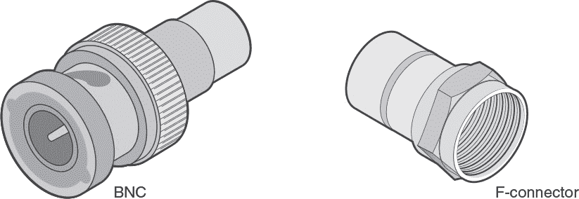

**图 3-2 同轴电缆连接器**

#### 双绞电缆

今天最流行的 LAN 介质是双绞电缆，其中绝缘的铜线交织在一起。双绞电缆的两类包括屏蔽双对（STP）和非屏蔽双对（UTP）。UTP 连接器可以连接两根 UTP 电缆。此外，为了符合防火规范，你可能需要选择腔电缆（plenum）而非非腔电缆。

为了定义双绞布线的行业标准引脚和颜色代码，开发了 TIA/EIA-568 标准。TIA/EIA-568 标准的迭代被称为 `TIA/EIA-568-A` 标准，它发布于 1991 年。

> 注意：TIA/EIA 缩写来自电信工业协会/电子工业联盟。

2001 年，发布了一个更新的标准，被称为 `TIA/EIA-568-B`。有趣的是，这两个标准的引脚定义是相同的，但布线的颜色代码有所不同。568-B 是美国更常用的标准。

#### 屏蔽双对

如果电缆中的导线没有扭绞或没有屏蔽，那么该电缆可能会充当天线，接收或传输 EMI。为了防止这种行为，可以将（已单独绝缘的）导线成对扭绞。

如果扭绞之间的距离小于电磁波形波长的四分之一，则双对导线就不会辐射该波长或接收来自该波长的 EMI（理论上，如果导线是理想导体）。然而，随着频率的增加，波长会变短。

支持更高频率的一种方案是用金属屏蔽包裹双对，类似于同轴电缆中的外部导体。这种类型的电缆被称为屏蔽双对 (STP) 电缆。

图 3-3 显示了 STP 电缆的示例。这些外部导体保护铜线免受 EMI 的影响；然而，金属屏蔽的增加了 STP 的成本。

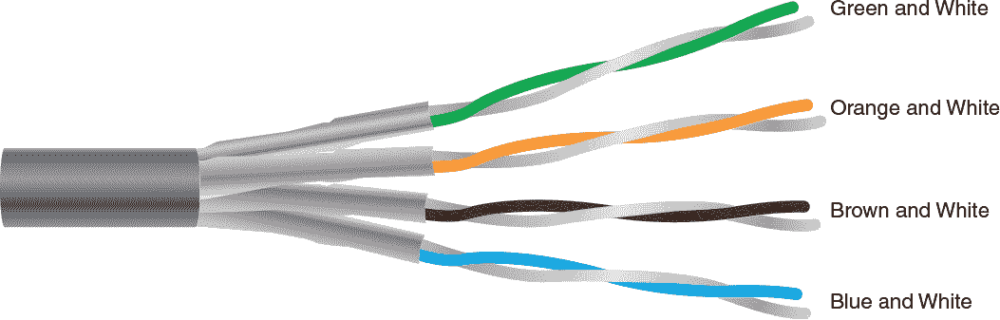

**图 3-3 屏蔽双对**

#### 非屏蔽双对

阻隔构成双绞电缆的铜线 EMI 的另一种方法是将线丝扭得更紧密（即每厘米的扭绞次数更多）。通过这些线丝相互缠绕，导线相互绝缘不受 EMI 影响。

图 3-4 举了一个 UTP 电缆的示例。由于 UTP 比 STP 便宜，自 20 世纪 90 年代中期以来日益流行，成为大多数局域网的首选介质。

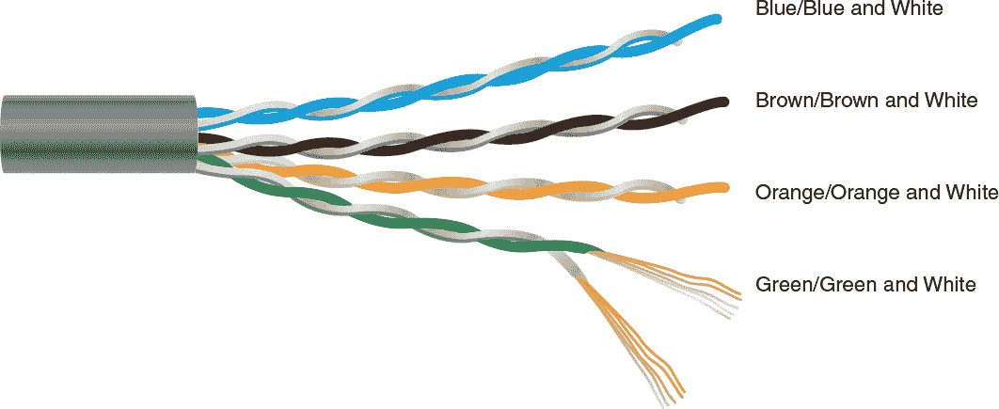

**图 3-4 非屏蔽双对**


UTP 线缆的类型在数据传输能力上有所不同。常见的 UTP 线缆类别包括以下：

- **3 类 (Category 3)**：`Category 3` (`Cat 3`) 线缆用于旧的以太网 `10BASE-T` 网络，其数据传输率为 `10Mbps`（其中 `Mbps` 代表每秒兆比特，即每秒数百万位）。然而，在某些旧的令牌环网络中，`Cat 3` 线缆的最大传输速率可达 `16Mbps`。
- **5 类 (Category 5)**：`Category 5` (`Cat 5`) 线缆通常用于以太网 `100BASE-TX` 网络，其数据传输率为 `100 Mbps`。然而，`Cat 5` 线缆可以以 `155 Mbps` 的速率传输 ATM 流量。大多数 `Cat 5` 线缆由四对 24 规格线组成。每对线都是扭绞的，且每米的扭绞次数不同。不过，平均而言，一对线每隔 `5 cm` 扭绞一次。
- **5e 类 (Category 5e)**：`Category 5e` (`Cat 5e`) 线缆是 `Cat 5` 的更新版本，通常用于 `1000BASE-T` 网络，其数据传输率为 `1Gbps`。与 `Cat 5` 线缆相比，`Cat 5e` 线缆提供了减少串扰。
- **6 类 (Category 6)**：与 `Cat 5e` 线缆一样，`Category 6` (`Cat 6`) 线缆通常用于 1000BASE-T 以太网网络。某些 `Cat 6` 线缆由较粗的导体（例如，22 规格或 23 规格线）制成，尽管某些 `Cat 6` 线缆采用与 `Cat 5` 和 `Cat 5e` 相同的 24 规格线。与 `Cat 5e` 相比，`Cat 6` 线缆具有更厚的绝缘层并提供了更串扰。
- **6a 类 (Category 6a)**：`Category 6a` (`Cat 6a`) 或增强型 `Cat 6` 支持的频率是 `Cat 6` 的两倍，可用于 `10GBASE-T` 网络，其数据传输速率可达每秒 100 亿位（`10 Gbps`）。

尽管存在其他线缆类别，但上述列表介绍的是现代网络中最常见的类别。

今天网络中使用的大多数 UTP 线缆被认为是**直通线**（`straight-through`），这意味着线缆两端的 `RJ-45` 接口具有匹配的引脚定义。例如，线缆一端 `RJ-45` 接口中的 `pin 1` 与线缆另一端 `RJ-45` 接口中的 `pin 1` 使用相同的铜质导体。

然而，某些网络设备无法通过直通线进行互连。例如，考虑两台通过直通线互连的 PC。由于这些 PC 中的网络接口卡（`NICs`）使用同一对线进行传输和接收，当其中一台 PC 向另一台 PC 发送数据时，接收端 PC 将会在其传输线上接收到数据，而不是在接收线上接收。对于这种情况，你可以使用交叉线（`crossover cable`），它会交换线缆两端的发送和接收线对。

> **注意**：以太网设备的交叉线与用于数字 T1 电路的交叉线不同（在第 7 章 中的“广域网 (WANs)”中讨论过）。具体而言，以太网交叉线的引脚映射为 `1 > 3`, `2 > 6`, `3 > 1` 和 `6 > 2`，而 T1 交叉线的引脚映射为 `1 > 4`、`2 > 5`、`4 > 1` 和 `5 > 2`。另一种类型的线是直跳线（`rollover cable`），用于连接控制端口以管理路由器或交换机等设备。直跳线的引脚映射为 `1 < > 8`、`2 < > 7`、`3 < > 6`、`4 < > 5`。线缆末端类似于 `RJ-45` 八芯连接器。

> **注意**：PC `NIC` 中传统的端口被称为介质依赖接口（`MDI`）。如果直通线将 PC 的 `MDI` 端口连接到以太网交换机端口，则以太网交换机端口需要交换发送对（即连接到 `pins 1` 和 `2` 的线）和接收对（即连接到 `pins 3` 和 `6` 的线）。

因此，位于以太网交换机上的传统端口被称为介质依赖接口交叉（`MDIX`），它会反转发送和接收对。然而，如果你想互连两个交换机，且用于互连的交换机端口都是 `MDIX` 端口，则线缆需要是交叉线。

幸运的是，大多数现代以太网交换机的端口都可以自动检测其需要作为 `MDI` 端口还是 `MDIX` 端口，并进行相应的调整。这消除了在某些以太网交换机连接中使用直通线以及在其他连接中使用交叉线的必要性。有了这种 `Auto-MDIX` 功能，你可以使用直通线或交叉线。


双绞线上常用的连接器如下：

- **RJ-45**： 45 类注册式插座（`RJ-45`），通常用于以太网。然而，其绝缘层通常为聚乙烯。
- **RJ-11**： 11 类注册式插座（`RJ-11`），通常用于电话。然而，其绝缘层通常为聚氯烯。
- **DB-9 (RS-232)**：九芯 D 接口（`DB-9`），常用于低速串行通信。此外 `DB-25` 也用于并行端口。

图 3-5 显示了这些连接器的样子。

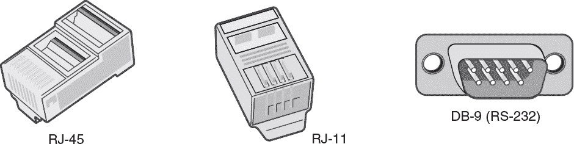

**图 3-5** 双绞线连接器


当光源（如激光器）将光脉冲发送到光电缆时，是什么防止了光直接穿过玻璃并色散到周围空气中呢？诀窍在于光电缆使用了两种不同类型的玻璃。它有一层内部的玻璃芯（即 `core`），周围环绕着一层外层的玻璃包层（即 `cladding`），这与之前提到的同轴电缆的结构相似。

激光器（或 LED）注入的光进入 `core`，且光被阻止离开这层内部的玻璃芯并进入外层的玻璃包层。具体而言，这两种不同类型玻璃的折射率差异巨大，以至于如果光试图离开内部玻璃芯，它会撞击到外层包层并折回自身。

为了更好地理解这一概念，请考虑水中的一根吸管，如图图 3-6 所示。由于空气和水的折射率不同（即光在空气和水中的传播速度略有不同），从吸管上反射并传播到我们眼睛的光会被水的折射率发生弯曲。在制造光电缆时，会在两种玻璃中掺杂杂质，构成 `core` 和 `cladding`，使它们具有显著不同的折射率，从而导致任何试图逃逸的光都被折回 `core` 中。


**图 3-6** 示例：折射率

光在光电缆中传输的路径被称为 `mode of propagation`（传播模式）。多模光纤中 `core` 的直径足够大，允许光以不同的角度进入 `core`，如图图 3-7 所示。如果光以陡角进入，它在通往电缆远端传输的过程中，往返反射的频率会比垂直进入电缆的光要频繁得多。如果代表不同比特（bits）的光脉冲使用不同的传播模式沿电缆传输，可能会导致比特（即代表比特的光脉冲）无序地到达远端（光电传感器会将光脉冲或无光状态解释为二进制数据）。

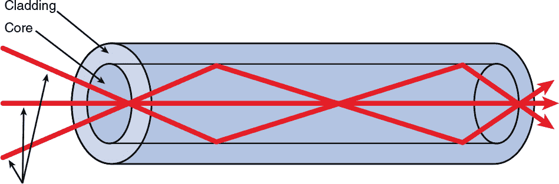

**图 3-7** 多模光纤中的光传输

例如，代表第一个比特的光脉冲可能以陡角交于 `core`，并在通往电缆远端的途中往返反射多次；而代表第二个比特的光脉冲则垂直交于 `core`，没有产生很多往返。由于这些反射，第一个比特传输的距离比第二个比特更远，这可能会导致比特无序到达。这种现象被称为 `multimode delay distortion`（多模延迟失真）。为了缓解多模延迟失真问题，MMF（多模光纤）通常具有比 SMF（单模光纤）更短的距离限制。

### 单模光纤

SMF 通过具有直径极小的 `core` 消除了多模延迟失真问题，该直径仅允许一种传播模式（即一条路径），如图图 3-8 所示。在缓解了多模延迟失真问题后，SMF 的传输距离限制通常比 MMF 长。

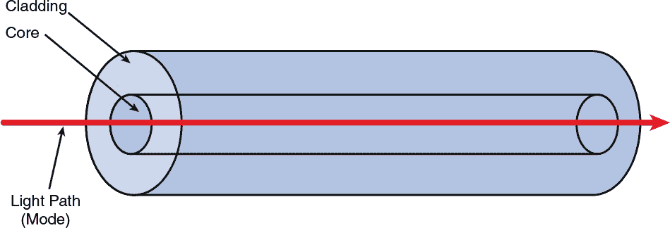

**图 3-8** 单模光纤中的光传输

然而，SMF 的一个潜在缺点是成本。因为 SMF 的制造必须达到非常精确的公差，通常对于相同长度的光电缆你需要支付更高的费用。然而，对于某些需要更远距离的实现方案，成本是达到更远距离时可以接受的权衡。

光电缆上常用的一些连接器如下：

*   **ST：** `straight tip` (ST) `connector` 有时被称为 `bayonet connector`（螺旋卡连接器），因为从连接器上伸出一个长端头。ST 连接器最用于 MMF。ST 连接器通过将连接器推入终端设备并旋转连接器外壳将其锁定来连接。

*   **SC：**不同的文献将 SC 连接器定义为 `subscriber connector`（用户连接器）、`standard connector`（标准连接器）或 `square connector`（方形连接器）。SC 连接器通过将连接器推入终端设备来连接，并通过将连接器从终端设备拔出来移除。连接器在行业内有细分，主要类型有 APC、UPC 和 MTRJ。有关具体要求，请始终咨询供应商或 IT 工作人员。

*   **LC：** `Lucent connector` (LC) 通过将连接器推入终端设备来连接，并通过按下连接器上的卡扣并将其从终端设备拉出来移除。

*   **MTRJ：** `media termination recommended jack` (MTRJ) 连接器最独特的特征是单个连接器中包含了两根光纤（一根发送纤一根接收纤）。MTRJ 连接器通过将连接器推入终端设备来连接，并通过将连接器从终端设备拔出来移除。

图 3-9 显示了这些连接器的外观。

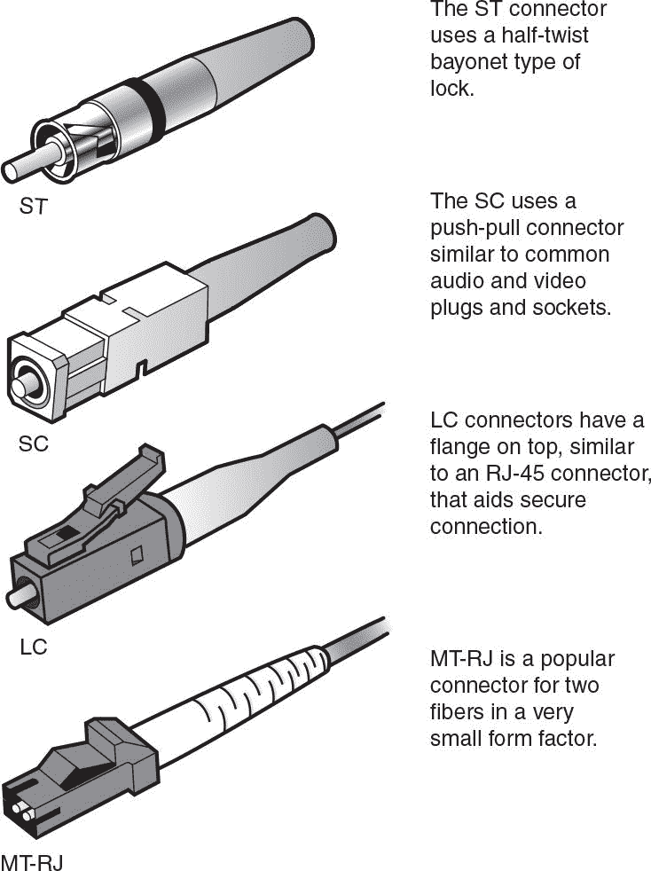

**图 3-9** 常见光纤连接器

### 光纤连接器抛光样式

光纤电缆有不同类型的机械连接。连接的类型影响光纤传输的质量。从基础到优质，选项包括物理接触（PC）、超物理接触（UPC）和角形物理接触（APC），这些术指的是光纤连接器的抛光样式。光纤连接器的不同抛光导致了连接器性能的差异。反射越小，传输效果越好。PC 反射为 -40 dB，UPC 反射约为 -55 dB，而 APC 反射约为 -70 dB。

### 介质转换器

有时需要转换介质。为了实现这一点，可以使用介质转换器。示例包括单模光纤转以太网、多模光纤转以太网、光纤转同轴，以及单模转多模光纤。

### 布线

在决定网络中使用什么种介质（例如 UTP、STP、MMF 或 SMF）后，你应该作为组织化布线系统的一部分来安装这些介质。通常，布线系统是层次化的。

考虑图 3-10 所示的示例。在这个示例中，来自终端用户办公室的电缆回接到建筑内的常见位置。这些位置有时被称为 `wiring closets`（配线间）。这些位置的电缆可能终止于 `patch panel`（配线架）。该配线架可能由某种交叉连接块组成，连接到一系列端口（例如 RJ-45 端口），用于快速将来自终端用户办公室的电缆与网络设备（如以太网交换机）互连。建筑可能有多个配线架（例如在建筑的不同楼层）。这些附近办公室电缆终止的常见位置通常被称为 `intermediate distribution frames`（IDF，中间配线架）。


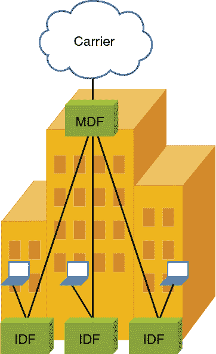

**图 3-10** 示例：布线分配系统

此处详细介绍了在 IDF 中发现的两种最常见的交叉接线块类型：

*   **66 块:** 66 块如图 3-11 所示，传统上用于企业环境中电话系统布线的交叉接线。随着 10Mbps LAN 在 20 世纪 80 年代末和 90 年代初变得越来越流行，这些接线块被用于交叉连接 Cat 3 非屏蔽双绞电缆。然而，66 块的电学特性（特别是串扰）不支持更高速度的 LAN 技术，例如 100Mbps 以太网。

    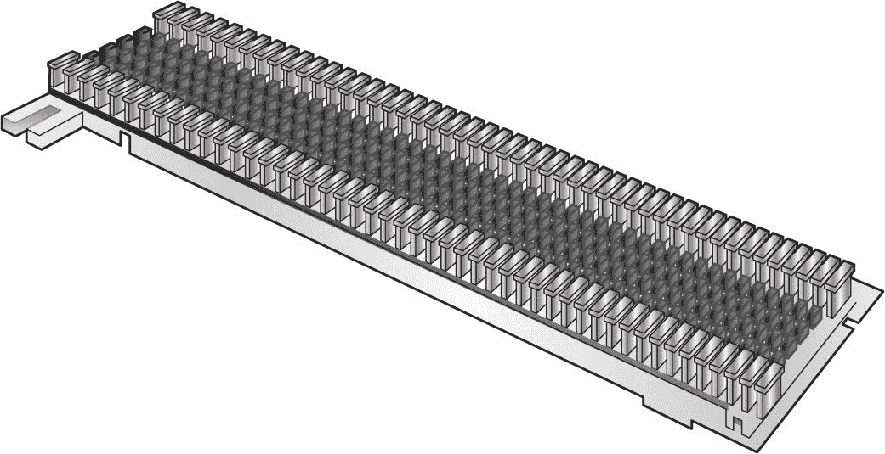

    **图 3-11** 66 块

*   **110 块:** 由于 66 块受到的串扰（即不同线对之间的干扰）太大，无法满足高速 LAN 连接，因此 110 块（如图 3-12 所示）可以终止用于此类高速 LAN 的电缆（例如 Cat 5 电缆）。

    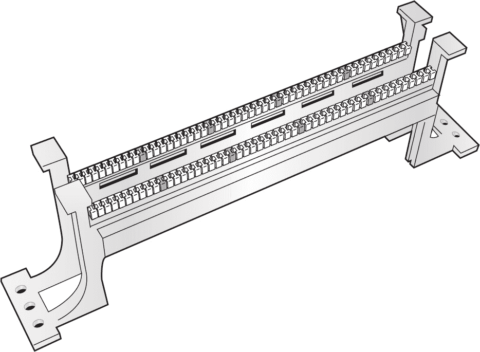

    **图 3-12** 110 块

这种连接到多个 IDF 的集中配线架被称为*主配线架* (MDF)。

你可能使用的另一个组件是光纤配线架。这通常被称为光纤分配面板。你用它来组织和分配光缆。它还允许你终止电缆元件，并为连接器和熔接单元提供一个安全、组织的机箱。

由于不同的网络设备使用了各种铜缆和光纤布线，你可能需要一个或多个*媒体转换器*。媒体转换器的示例包括：

*   光纤（MMF 或 SMF）转以太网
*   光纤转同轴电
*   SMF 转 MMF

### 无线技术

并非所有介质都是物理的，无线网络技术就是如此。本书的第 8 章专门介绍这些技术。但目前，你只需要理解基础知识。

请考虑图 3-13 所示的示例无线拓扑。注意，无线客户端通过与无线接入点（AP）无线电波通信接入有线网络。然后 AP 通过硬线连接到 LAN。

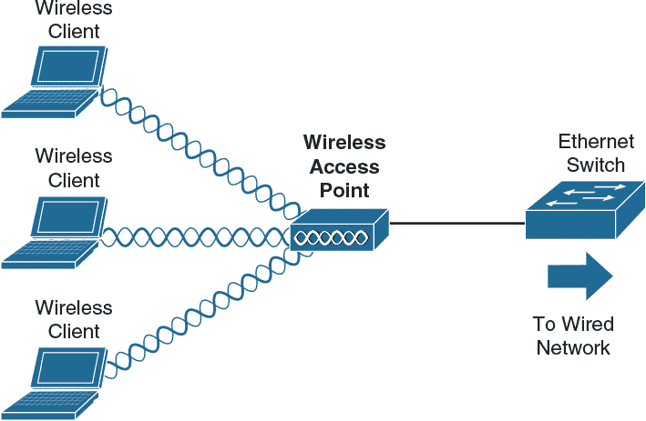

**图 3-13** 示例：无线网络拓扑

正如第 8 章 所述，无线 LAN 包含了支持各种传输速度和安全性的多个标准。然而，你现在需要理解，所有连接到同一个 AP 的无线设备都被认为处于同一个*共享网络段*上，这意味着在任何时刻只有一个设备可以向 AP 发送数据和接收数据。

### 物联网技术


许多无线技术（或与无线相关的技术）发挥作用，使物联网（IoT）成为现实。IoT 指如今将日常物体连接到互联网以使其变得“智能”的趋势。在我家里，例如，我会对着 Amazon Echo 扬声器说话让它控制灯光。这个连接互联网的扬声器和灯是物联网 运行的完美示例。

以下是你应该注意的关键技术，它们有助于使现代物联网成为现实：

*   **Z-Wave:** 一种主要用于家庭自动化的无线通信协议。它是一种网状网络，使用低能无线电在设备之间进行通信。Z-Wave 常见于照明控制系统、安全系统、恒温器、窗户、锁、泳池和车库门器等设备。
*   **Ant+:** 一种用于监控传感器数据（如人的心率或汽车的胎压）以及控制室内照明和电视等娱乐设备系统的无线协议。ANT+ 由 Garmin 拥有的 ANT+ 联盟设计和维护。
*   **蓝牙:** 如第 1 章 所述，“计算机网络基础](#part0014.html_ch01)”，蓝牙是一种允许设备进行短距离通信的无线技术。除了创建个人域网（PAN）之外，蓝牙还用于实现物联网的通信。
*   **NFC:** 近场通信（NFC）是一组通信协议，允许两个电子设备传输信息。通常，这些设备之一是智能手机等便携设备。NFC 设备必须彼此靠近（4 厘米或 1.6 英寸以内）。NFC 设备用于非接触式支付系统（类似于信用卡和电子票务智能卡），并允许移动支付取代/补充这些系统。
*   **红外:** 红外是另一种无线技术，允许计算机外设和个人数字助理之间的短距离通信中进行数据传输。这些设备通常符合 IrDA（红外数据协会）发布的标准。遥控器和 IrDA 设备使用红外发射二极管（LED）发射红外辐射，并通过塑料透镜将其聚焦成狭窄的光束。
*   **RFID:** 射频识别（RFID）利用电磁场自动识别和跟踪附在物体上的标签。标签包含电子存储的信息。被动式标签从附近 RFID 读器的询问无线波中收集能量。主动式标签具有本地电源（如电池），可以在距离读取器几百米处运行。与条形码不同，标签不需要在读取器的视范围内，因此它可以嵌入被跟踪物体中。
*   **802.11:** 如第 8 章 详细介绍，IEEE `802.11` 是一套用于在 900MHz、2.4GHz、3.6GHz、5GHz 和 60GHz 频段实现无线局域网（WLAN）计算机通信的媒体访问控制和物理层规范。显然，这些技术在物联网中起着巨大的作用，因为许多电器和常用物品通过 `802.11` 无线信号与主枢通信。例如，这就是大多数智能灯的工作方式。

## 网络基础设施设备

网络基础设施中使用的设备根据所使用的物理层技术而不同。例如，令牌环网络（现已罕见）可能使用多站接入单元（MAU），而以太网可能使用交换机。

然而，由于以太网的网络在今天的 LAN 中占据主导地位，这里介绍的基础设施设备适用于以太网作为物理层传输介的网络。某些设备（例如路由器）无论使用何种物理层传输介，其功能基本相同。

### 集线器


如第 2 章所示，“OSI 参考模型”，集线器（在本讨论中特指以太网集线器）工作在 OSI 模型的第 1 层。因此，集线器不做转发决策。相反，集线器从一个端口接收比特，然后将这些比特重传到所有其他端口（即接收比特端口以外的集线器上的所有端口）。集线器的这种基本功能使其获得了“比特喷洒”（bit spitter）的昵号。

集线器通常使用 UTP 线缆连接到其他网络设备；然而，某些早期以太网集线器（在太网交换机普及之前）支持光纤连接。

以太网集线器的三种基本类型如下：

*   **被动集线器（Passive hub）：** 不放大接收到的比特（即不进行电学再生）。
*   **主动集线器（Active hub）：** 在将比特发送到集线器除接收端口以外的所有端口时，对进入的比特进行再生。
*   **智能集线器（Smart hub）：** `smart hub` 一词通常意味着具有增强功能的主动集线器，例如支持简单网络管理协议（SNMP）。

集线器的一个缺点，也是它们大部分被交换机取代的主要原因，是集线器上的所有端口都属于同一个`collision domain`（冲突域）。如第 4 章讨论所示，`collision domain` 代表局域网（LAN）上同一时间只能有一个传输的区域。由于多个设备可以存在同一个冲突域中（例如连接到集线器的多台 PC），如果两个设备同时传输，这些传输就会发生`collide`（冲突）并必须重传。

由于冲突域问题以及带宽利用率低下（即比特被发送到所有端口，而不是仅发送需要比特的端口），集线器在现代局域网中已罕见。然而，集线器是构成以太网网络历史的重要组成部分，并代表了在现代以太网不同区域发现的特征。例如，无线 AP（接入点）非常像集线器，因为所有与 AP 关联的无线设备属于同一个冲突域。

考虑图 3-14。注意图中描述的 PC 使用以太网集线器互连，但它们都处于同一个冲突域中。因此，连接的 PC 在任何时刻只有一台可以传输。集线器的这种特性会限制基于集线器的局域网的可扩展性。

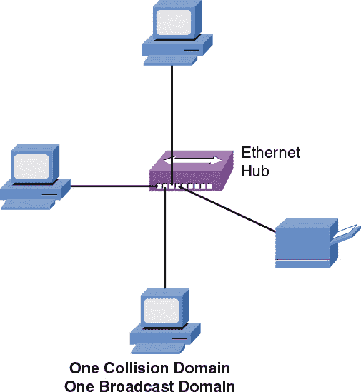

**图 3-14** 以太网集线器

还要注意，集线器上的所有设备都属于同一个广播域，这意味着发送到集线器的广播将传播到集线器上的所有端口（接收广播的端口除外）。

### 网桥器（Bridges）

网桥器连接两个或多个 LAN 网段，通常是两个以太网 LAN 网段。每个 LAN 网段都处于单独的冲突域中，如图 3-15 所示。因此，以太网网桥可用于将以太网网络扩展到更多的连接设备。

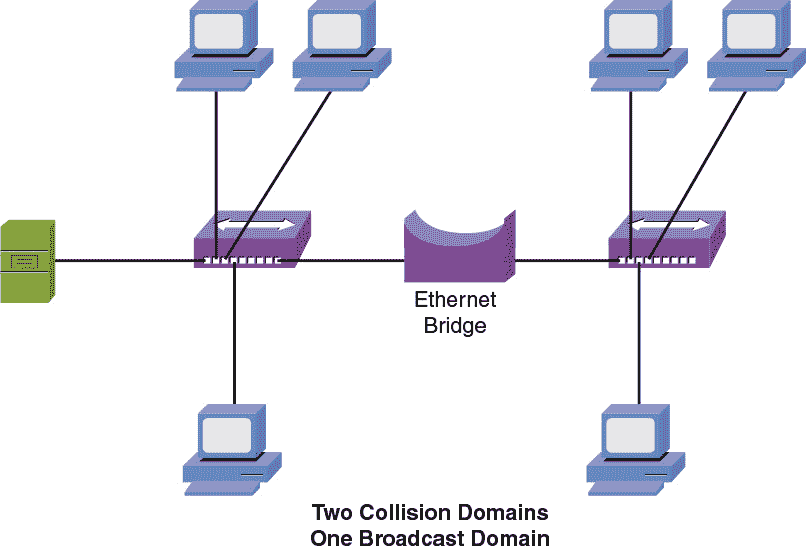

**图 3-15** 以太网网桥

与盲目转发接收比特的集线器不同，网桥器（在本讨论中特指以太网网桥）会根据帧中存在的目的 MAC 地址做出智能转发决策。具体来说，网桥器根据帧中的目的 MAC 地址进行智能转发。具体而言，网桥器分析进入的帧的源 MAC 地址，并将其发送到除接收端口以外的所有端口。当已知目的 MAC 地址时，网桥器就可以智能地将其转发到相应的端口。这种操作与交换机逻辑上相同，将在后续关于交换机的讨论中进行详细介绍。因为网桥器根据信息（即 MAC 地址）做出转发决策。

尽管网桥器将 LAN 划分为多个冲突域（即每个网桥端口一个冲突域），但网桥器上的所有端口都属于同一个广播域。为了理解这一概念，请思考广播帧的目的 MAC 地址。在链路层，广播帧的 MAC 地址是 `FFFF.FFFF.FFFF`。由于网络上没有任何设备的 MAC 地址为 `FFFF.FFFF.FFFF`，网桥器永远不会 MAC 地址表中记录该地址。因此，广播帧会被泛洪（flooded）到接收帧端口以外的所有网桥端口。

网桥在 20 世纪 80 年代后期和 90 年代初非常流行，现在大部分已被交换机取代，原因包括价格、性能和功能。从性能角度来看，网桥在软件中做出转发决策，而交换机使用专用集成电路（ASIC）在硬件中做出决策。此外，这些 ASIC 不仅降低了交换机的成本，还使交换机能够更多功能。例如，第 4 章讨论了交换机的各种功能，包括 VLAN、中干、端口镜像、以太网供电（PoE）和 802.1X 认证。

### 交换机（Switches）

与网桥器一样，交换机（在本讨论中特指二层以太网交换机）可以通过查看进入端口帧的源 MAC 地址来动态学习连接到各个端口的 MAC 地址。例如，如果交换机端口 `Gigabit Ethernet 1/1` 收到源 MAC 地址为 `DDDD.DDDD.DDDD` 的帧，交换机就可以得出 MAC 地址 `DDDD.DDDD.DDDD` 位于 `Gigabit Ethernet 1/1`。将来，如果交换机接收到目的 MAC 地址为 `DDDD.DDDD.DDDD` 的帧，交换机将仅发送到 `Gigabit Ethernet 1/1`。

然而，最初交换机不知道 MAC 地址位于哪些端口（除非静态配置了 MAC 地址）。因此，当交换机接收到的目的 MAC 地址尚未出现在交换机的 MAC 表中时，交换机会会将帧泛洪到接收端口以外的所有交换端口。同样，广播帧（即目的 MAC 地址为 `FFFF.FFFF.FFFF` 的帧）总是会被泛洪到接收端口以外的所有交换端口。正如对网桥的讨论所述，广播帧总是被泛洪的原因是没有任何终点的 MAC 地址为 `FFFF.FFFF.FFFF`，这意味着该地址永远不会学习到交换机的 MAC 表中。


为了说明交换机的 MAC 地址表是如何填充的，请考虑一个名为 `PC1` 的端点，它想要与服务器建立 Telnet 连接。同时，假设 `PC1` 及其服务器都位于同一子网内（这意味着在 `PC1` 和其服务器之间传输流量不需要路由）。在 `PC1` 向服务器发送 Telnet 会话之前，`PC1` 需要知道服务器的 IP 地址（即第 3 层地址）和 MAC 地址（第 2 层地址）。服务器的 IP 地址通常是已知的，或者通过域名系统（DNS）查找解析。在本例中，假设服务器的 IP 地址是已知的。然而，为了正确形成 Telnet 分段，`PC1` 需要知道服务器的第 2 层 MAC 地址。如果 `PC1` 的 ARP 缓存中还没有服务器的 MAC 地址，则 `PC1` 可以发送地址解析协议（ARP）请求来学习服务器的 MAC 地址，如图图 3-16 所示。

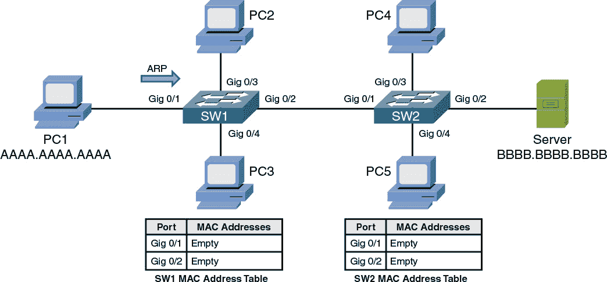

**图 3-16** 端点发送 ARP 请求

当交换机 `SW1` 看到 `PC1` 的 ARP 请求进入端口 `Gigabit 0/1` 时，`PC1` 的 MAC 地址 `AAAA.AAAA.AAAA` 被添加到交换机 `SW1` 的 MAC 地址表中。此外，由于 ARP 请求是广播，其目标 MAC 地址为 `FFFF.FFFF.FFFF`。由于交换机 `SW1` 的 MAC 地址表中未知 `FFFF.FFFF.FFFF` 的地址，交换机 `SW1` 将输入帧的拷贝泛洪到接收端口以外的所有交换端口，如图图 3-17 所示。

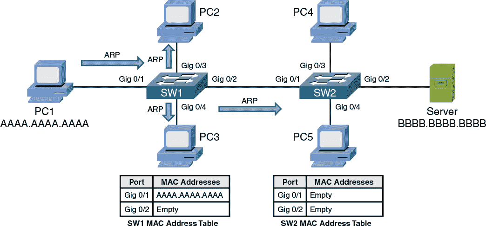

**图 3-17** 交换机 SW1 泛洪 ARP 请求

当交换机 `SW2` 通过其 `Gig 0/1` 中干口接收 ARP 请求时，`AAAA.AAAA.AAAA` 的源 MAC 地址被添加到交换机 `SW2` 的 MAC 地址表中，如图图 3-18 所示。同样，与交换机 `SW1` 的行为类似，交换机 `SW2` 也泛洪广播。

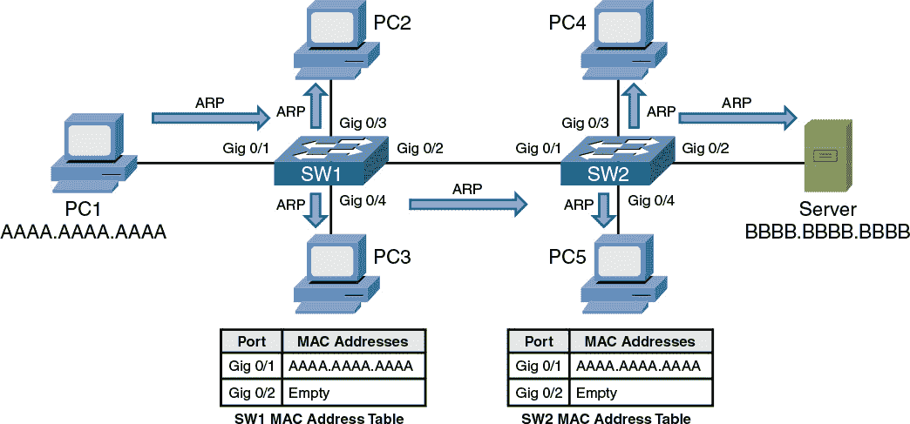

**图 3-18** 交换机 SW2 泛洪 ARP 请求

服务器接收 ARP 请求并响应 ARP 回复，如图图 3-19 所示。然而与 ARP 请求不同，ARP 回复帧不是广播帧。在本例中，ARP 回复的目标 MAC 地址为 `AAAA.AAAA.AAAA`。这使得 ARP 回复成为单播帧。

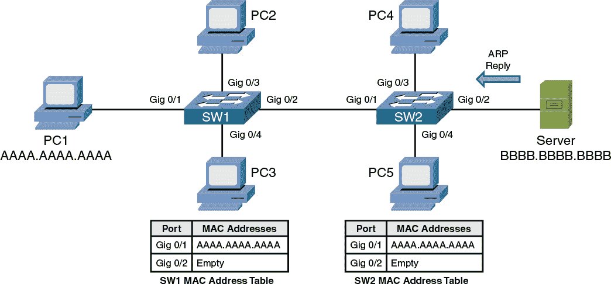

**图 3-19** 从服务器发送的 ARP 回复

收到服务器的 ARP 回复后，交换机 `SW2` 将服务器的 MAC 地址 `BBBB.BBBB.BBBB` 添加到其 MAC 地址表中，如图图 3-20 所示。此外，ARP 回复仅从端口 `Gig 0/1` 发出，因为交换机 `SW1` 已知目标 MAC 地址 `AAAA.AAAA.AAAA` 可以从端口 `Gig 0/1` 输出。

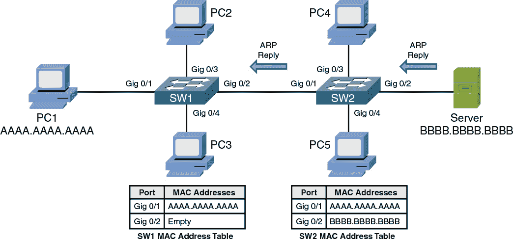

**图 3-20** 交换机 SW2 转发 ARP 回复

在 `Gig 0/2` 端口接收 ARP 回复时，交换机 `SW1` 将服务器的 MAC 地址 `BBBB.BBBB.BBBB` 添加到其 MAC 地址表中。同样，与交换机 `SW2` 一样，交换机 `SW1` 现在在其 MAC 地址表中有了该帧目标 MAC 地址 `AAAA.AAAA.AAAA` 的条目。因此，交换机 `SW1` 将 ARP 回复从端口 `Gig 0/1` 转发到端点 `PC1`，如图图 3-21 所示。

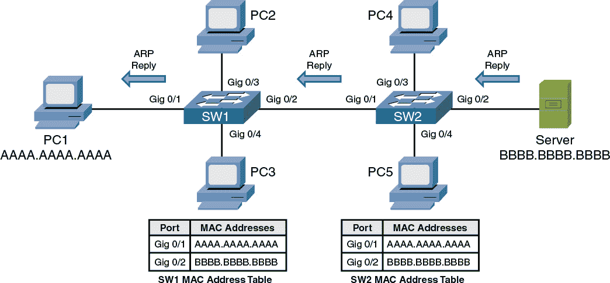

**图 3-21** 交换机 SW1 转发 ARP 回复

在收到服务器的 ARP 回复后，`PC1` 现在知道了服务器的 MAC 地址。因此，`PC1` 现在可以正确构建一个指向服务器的 Telnet 分段，如图图 3-22 所示。

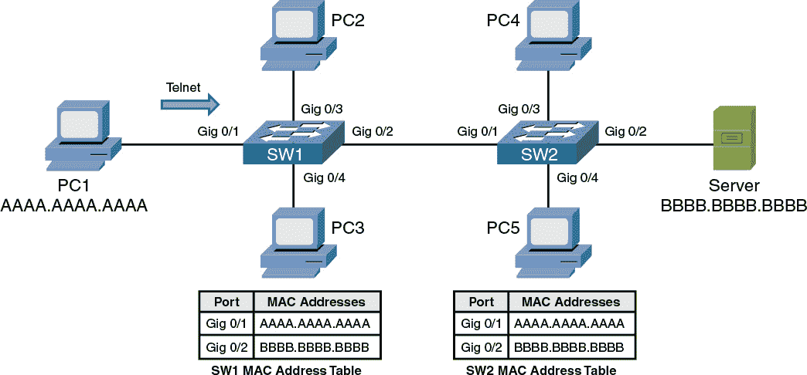

**图 3-22** PC1 发送 Telnet 分段

交换机 `SW1` 的 MAC 地址表中已有服务器的 MAC 地址 `BBBB.BBBB.BBBB`。因此，当交换机 `SW1` 接收来自 `PC1` 的 Telnet 分段时，该分段将从交换机 `SW1` 的 `Gig 0/2` 端口转发，如图图 3-23 所示。


**图 3-23** 交换机 SW1 转发 Telnet 分段

与交换机 `SW1` 的行为类似，交换机 `SW2` 也从其 `Gig 0/2` 端口转发 Telnet 分段。这种如图图 3-24 所示的转发是可能的，因为交换机 `SW2` 的 MAC 地址表中存在该分段目标 MAC 地址 `BBBB.BBBB.BBBB` 的条目。


**图 3-24** 交换机 SW2 转发 Telnet 分段

最后，服务器对 `PC1` 做出响应，在 `PC1` 和服务器之间建立了双向 Telnet 会话，如图图 3-25 所示。由于 `PC1` 通过之前的 ARP 请求学习了服务器的 MAC 地址并将其结果存储在本地 ARP 缓存中，后续 Telnet 分段的传输不需要额外的 ARP 请求。然而，如果一段时间未使用，PC ARP 缓存中的条目可能会超时。因此，如果 PC 需要向同一地址发送流量，它将再次广播另一个 ARP 帧。


**图 3-25** PC1 与服务器之间的双向 Telnet 会话

如图图 3-26 所示，就像桥器一样，交换机的每个端口都代表一个独立的冲突域。此外，交换机上的所有端口都属于同一个广播域，但有一个例外。

!图中显示位于位于的二层交换机连接到四个设备：顶部的 PC、左侧的文件服务器、底部的 PC 和右下角的打印机。底部的文字写着“四个冲突域和一个广播域”。](images/00062.jpeg)

**图 3-26** 交换机冲突域和广播域

例外情况是交换机上的端口被划分成不同的虚拟局域网（VLAN）。正如第 5 章 中讨论，每个 VLAN 代表一个独立的广播域，流量从一个 VLAN 传输到另一个 VLAN 必须通过第 3 层设备进行路由。

### 多层交换机

前所述，二层交换机根据 MAC 地址信息做出转发决策，而多层交换机可以根据上层信息做出转发决策。例如，多层交换机可以充当路由器，并根据目标 IP 地址信息做出转发决策。

某些文献将多层交换机称为三层交换机，因为交换机具有像路由器一样做出转发决策的能力。然而，`多层交换机` 术语更准确，因为许多多层交换机具有策略路由功能，允许将上层信息（例如应用程序端口号）用于做出转发决策。


图 3-27 指出，多层交换机不仅可以连接网络网段，还可以连接整个网络。具体而言，第 6 章 “路由 IP 数据包” 解释了如何使用逻辑第 3 层 IP 地址将网络设备分配到不同的逻辑网络。为了让流量在两个属于不同网络的网络设备之间传输，该流量必须经过*路由*。（也就是说，像多层交换机这样的设备必须根据第 3 层信息做出转发决策。）


**图 3-27** 多层以太网交换机

与二层交换机一样，多层交换机上的每个端口都代表一个独立的冲突域；然而，多层交换机（以及路由器）的一个特性是它可以成为广播域的边界。虽然二层交换机上的所有端口都属于同一个广播域，但如果配置如此，多层交换机上的所有端口可以属于不同的广播域。

### 路由器

路由器是一种第 3 层设备，这意味着它根据逻辑网络地址（例如 IP 地址）信息做出转发决策。虽然路由器被认为是第 3 层设备，但与多层交换机一样，它具有在做出转发决策时考虑高层流量参数（例如服务质量 QoS 设置）的能力。

如 图 3-28 所示，路由器上的每个端口都是独立的冲突域和独立的广播域。在讨论到这里时，路由器听起来非常像多层交换机。那么，为什么网络设计人员在设计中选择路由器而不是多层交换机呢？


**图 3-28** 路由器广播域和冲突域

在某些情况下，路由器优于多层交换机原因是路由器通常功能更丰富，并且支持更广泛的接口类型。例如，如果你需要使用串口将第 3 层设备连接到你的互联网提供商 (ISP)，你更有可能为路由器找到串口扩展模块，而不是为你的多层交换机找到。

### 基础设施设备总结

表 3-1 总结了本节讨论的网络基础设施设备的特性。


**表 3-1** 网络基础设施设备特性

| **设备** | **可能的冲突域数量** | **可能的广播域数量** | **工作操作的 OSI 层级** |
| --- | --- | --- | --- |
| 集线器 | 1 | 1 | 1 |
| 桥 | 每个端口 1 | 1 | 2 |
| 交换机 | 每个端口 1 | 每个端口 1 | 2 |
| 多层交换机 | 每个端口 1 | 每个端口 1 | 3+ |
| 路由器 | 每个端口 1 | 每个端口 1 | 3+ |

#### 专用网络设备

尽管网络基础设施设备构成了网络的骨干，但为了增加终端用户功能，许多网络集成了各种专用网络设备，如 VPN 集中器、防火墙、DNS 服务器、DHCP 服务器、代理服务器、缓存引擎和内容交换机。

### VPN 集中器

位于分布在多个地点的公司通常需要这些站点之间的安全通信。一种方案是购买多个连接这些站点的 WAN 连接。然而，有时一种更具成本效益的方案是通过不可信的网络（如互联网）创建安全连接。这种安全隧道被称为*虚拟专用网络* (VPN)。取决于所使用的 VPN 技术，终止 VPN 隧道末端的设备可能需要进行密集的处理。例如，考虑一家总部与 100 个远程站点每个站点都有 VPN 连接的公司。总部处终止这些 VPN 隧道的设备可能必须对每个隧道进行加密和身份验证，这将导致该设备产生沉重的处理器负担。

虽然几种路由器型号可以终止 VPN 电路，但也可以使用一种称为*VPN 集中器*的专用设备。VPN 集中器执行终止多个 VPN 隧道所需的、对 CPU 密集型的过程。图 3-29 显示了一个示例 VPN 拓扑结构，在每个公司位置处都有一个 VPN 集中器。


**图 3-29** VPN 集中器

*加密*一词是指设备对发送者数据进行扰乱的能力，使得接收者可以解密数据，但任何可能截获数据的其他方不能。由于 VPN 集中器具有加密数据的能力，它被认为属于一类被称为*加密设备*的设备，这些是能够参与加密会话的设备（例如路由器、防火墙和 VPN 集中器）。

## 防火墙

防火墙主要是一种网络安全设备，在第 12 章 “网络安全”中进行了讨论。如 图 3-30 所示，防火墙守在你的网络门口，保护它免受恶意互联网流量的侵害。


**图 3-30** 防火墙

例如，*状态检测防火墙*允许流量源自内部网络（即信任网络）并发往互联网（不可信网络）。同样，防火墙也允许从互联网返回内部网络的回程流量。然而，如果流量源自互联网上的设备（即不是返回流量），防火墙将拦截该流量。

### DNS 服务器

域名系统 (DNS) 服务器执行的任务是获取域名（例如，[www.ciscopress.com](http://www.ciscopress.com)）并将该名称解析为对应的 IP 地址（例如 10.1.2.3）。因为路由器（或多层交换机）根据第 3 层信息（例如 IP 地址）做出转发决策，因此 IP 数据包需要包含 IP 地址信息，而不是 DNS 名称。然而，作为人类，我们更容易记住有意义的名称，而不是 32 位数字。

如 图 3-31 所示，想要访问 [www.ciscopress.com](http://www.ciscopress.com) 网站的终端用户在其 Web 浏览器中输入该完全限定域名 (FQDN)；然而，浏览器无法立即发送发往 [www.ciscopress.com](http://www.ciscopress.com)的数据包。首先，终端用户的计算机需要获取 [www.ciscopress.com](http://www.ciscopress.com) 的 FQDN 并将其解析为对应的 IP 地址，然后将其作为目标 IP 地址插入 IP 数据包中。这种解析是由 DNS 服务器实现的，它维护了一个本地 FQDN 及其对应 IP 地址的数据库，此外还有指向可以解析其他域名 IP 地址的其他服务器的指针。


**图 3-31** DNS 服务器

FQDN 是由由点分隔的字符串序列（如示例所示，[www.ciscopress.com](http://www.ciscopress.com)）。最右部分是顶级域名。顶级域的示例包括 .com、mil 和 .edu，如 图 3-32 所示。尽管还有许多其他顶级域名，但这些是美国最常见的顶级域名之一。


# 图 3-32 分层域名结构

低级域名可以向上指向更层级的 DNS 服务器，以解析非本地的 FQDN，如图 3-32 所示。

DNS 服务器的数据库不仅包含 FQDN 及其对应的 IP 地址，还包含 DNS 记录类型。例如，邮件交换（MX）记录就是电子邮件服务器的记录类型。如表所示，表 3-2 列出了一系列常见的 DNS 记录类型。


## 表 3-2 常见 DNS 记录类型

| 记录类型 | 说明 |
| :--- | :--- |
| A | 地址记录（即 `A` 记录）将主机名映射到 IPv4 地址。 |
| AAAA | IPv6 地址记录（即 `AAAA` 记录）将主机名映射到 IPv6 地址。 |
| CNAME | 规范名称记录（即 `CNAME` 记录）是现有记录的别名，因此允许多个 DNS 记录映射到同一个 IP 地址。 |
| MX | 邮件交换记录（即 `MX` 记录）将域名映射到该域的电子邮件（或消息传输代理）服务器。 |
| NS | 委托 DNS 区域使用给定的权威名称服务器。 |
| PTR | 指针记录（即 `PTR` 记录）指向规范名称。`PTR` 记录通常用于执行反向 DNS 查询，该过程用于确定与已知 IP 地址关联的域名是什么。 |
| SOA | 区域起始记录（即 `SOA` 记录）提供有关 DNS 区域的权威信息，例如区域管理员的电子邮件联系信息、区域的主名称服务器以及各种刷新计时器。 |
| SRV | 通用服务位置记录。用于较新的协议，而不是创建如 `MX` 等特定协议的记录。 |
| TXT | 原用于 DNS 记录中任意的人类可读文本。然而，从 20 世纪 90 年代初，这种记录携带机器可读的数据，如 `RFC 1464` 指定的、机会性加密、发送者策略框架 (SPF) 或域密钥识别电子邮件 (DKIM)。 |

设置 DNS 记录时的一个潜在挑战是你想指向一个可能会更改 IP 地址的设备的 IP 地址。例如，如果你家里有一个电缆调制解调器或数字用户线路（DSL）调制解调器，该设备可能会通过 `DHCP` 从服务提供商获取 IP 地址（下一节“DHCP 服务器”将讨论）。因此，如果你将电缆调制或 DSL 调制器的 IP 地址添加到 DNS 记录中（以允许互联网上的用户访问你网络内部的一个或多个设备），如果你的设备从服务提供商获取了新 IP 地址，该记录可能是错误的。

为了克服这种挑战，你可以转向动态 DNS (DDNS)。DDNS 提供商提供运行在你一台 PC 上的软件，该软件监控 DNS 记录中引用的设备 IP 地址（在本例中为电缆调制或 DSL 调制）。如果软件检测到被监控的 IP 地址发生变化，会将该变化报告给同时提供 DNS 服务的提供商。

另一个选项是 IP 地址管理 (IPAM)。这是规划、跟踪和管理网络使用的 Internet 协议地址空间的方法。IPAM 集成了 DNS 和 DHCP，使两者都能感知对方的变化（例如，DNS 知晓客户端通过 `DHCP` 获取了哪个 IP 地址，并相应地更新自己）。

另一种 DNS 变体是 DNS 扩展机制 (EDNS)。DNS 的原始规范存在大小限制，阻止了某些功能（如安全性）的添加。EDNS 支持这些额外功能，同时保持与原始 DNS 实现向后兼容。EDNS 并不是在 DNS 头部中使用新的标志（这会破坏向后兼容性），而是在支持 EDNS 的设备之间发送可选的伪资源记录。这些记录支持 `16` 个新的 DNS 标志。如果旧版 DNS 服务器接收到其中一个可选记录，该记录将被简单忽略。因此，在保持向后兼容的同时，可以为新的 DNS 服务器添加新功能。

当你在浏览器中以 `http://FQDN` 的形式输入网页地址（例如，[`www.ajsnetworking.com`](http://www.ajsnetworking.com)）时，请注意你不仅指定了网页地址的 FQDN，还指定了你想使用 HTTP 协议访问该位置。这种既指示地址（例如 [www.ajsnetworking.com](http://www.ajsnetworking.com)）又指示访问该地址的方法（例如 `http://`）的字符串被称为`统一资源定位符` (`URL`)。

组织通常会使用内部和外部 DNS 实现 DNS 域名解析。这意味着使用 DNS 解析内部资源的客户端将依赖于组织内部安装的 DNS 服务器，而需要解析外部资源的客户端将依赖于互联网（外部）DNS 服务器。你可以采取措施确保仅供内部使用的 DNS 信息不会与公共的外部 DNS 服务器共享。

今天用于实现 DNS 的另一种常用选项是第三方或云托管 DNS。例如，Amazon Web Services 提供了 `Route 53` 服务。这套强大的 DNS 服务允许从域名注册到为你的云或本地服务器及客户端提供解析服务的所有功能。

### DHCP 服务器

大多数现代网络都为网络设备分配了 IP 地址，这些逻辑第 3 地址用于在不同网络之间路由流量。然而，网络设备是如何接收其初始 IP 地址分配的呢？

一种方法是在设备上手动配置 IP 地址；但这种过程既耗时又容易出错。更高效的 IP 地址分配方法是动态为网络设备分配 IP 地址。这种自动分配 IP 地址的最常用方法是动态主机配置协议 (`DHCP`)。`DHCP` 不仅为网络设备分配 IP 地址，还可以分配许多其他 IP 参数，如子网掩码、默认网关和 DNS 服务器的 IP 地址。

如果你家里有电缆调制或 DSL 连接，你的电缆调制或 DSL 路由器可能会从你的服务提供商获取 IP 地址。在许多企业网络中，当 PC 启动时，该 PC 会从企业 DHCP 服务器接收 IP 配置信息。

图 33 展示了 DHCP 客户端从 DHCP 服务器获取 IP 地址信息时发生的消息交换。以下列表详细描述了每一步：


#### 图 3-33 从 DHCP 服务器获取 IP 地址信息

1. 当 DHCP 客户端初始启动时，它没有 IP 地址、默认网关或其他配置信息。因此，DHCP 客户端初始通信方式是通过发送广播消息（即目标地址为 `255.255.255.255` 的 `DHCPDIS` 消息）来尝试发现 DHCP 服务器。
2. 当 DHCP 服务器接收到 `DHCPDIS` 消息时，它可以用单播 `DHCPOFFER` 消息进行响应。由于 `DHCPDIS` 消息是广播发送的，多个 DHCP 服务器可能会响应此发现请求。然而，客户端通常会选择收到的第一个 `DHCPOFFER` 响应的服务器。
3. DHCP 客户端通过发送单播 `DHCPREQUEST` 消息与所选服务器进行通信，请求 DHCP 服务器提供 IP 配置参数。
4. DHCP 服务器通过单播 `DHCPACK` 消息响应客户端。该 `DHCPACK` 消息包含一组 IP 配置参数。


注意，在步骤 1 中，`DHCPDISCOVER` 消息是以广播形式发送的。默认情况下，广播无法跨路由器边界。因此，如果客户端与 DHCP 服务器位于不同的网络，则应将客户端的下一跳路由器配置为 DHCP 中继代理（DHCP relay agent），它允许路由器将 DHCP 请求转发到单播 IP 地址或某个网络的定向广播地址。DHCP 中继代理通常被称为 `IP helper`。

DHCP 服务器可以配置为为不同子网的设备分配 IP 地址。具体而言，DHCP 服务器可以确定 DHCP 请求的源子网，并从中选择合适的地址池来分配地址。这些地址池之一（通常对应于单个子网）被称为 `scope`（范围）。

当网络设备从适当的 DHCP 范围分配 IP 地址时，该分配不是永久的。相反，它是一种被称为 `lease`（租约）的临时分配。虽然网络上的大多数客户端设备在这种动态地址机制下运行良好，但某些设备（例如服务器）可能需要分配特定的 IP 地址。幸运的是，你可以配置 DHCP 预留（reservation），将特定的 `MAC` 地址映射到特定的 IP 地址，该地址将不会分配给任何其他网络设备。这种静态地址分配方法被称为 DHCP `reservation`。

DHCP 配置中的另一个常见问题是从可用的地址范围中排除 IP 地址。我们称这些为 IP 排除（IP exclusions）。你可能需要为组织中几台需要在整个 IP 地址空间内配置静态 IP 地址的服务器执行此操作。IP 排除配置简单，并确保 IP 地址冲突不会导致你的子网出现问题。

记忆 DHCP 四个主要步骤的方法是 `D.O.R.A.`，每个字母分别代表发现（discover）、提供（offer）、请求（request）和确认（acknowledge）。

### 代理服务器

某些客户端被配置为将其看似发往互联网的数据包转发到代理服务器。该代理服务器接收客户端的请求，并代表该客户端（即作为该客户端的代理）将请求发送到互联网。当从互联网收到回复时，代理服务器将响应转发给客户端。图 3-34 展示了代理服务器的操作。


**图 3-34** 代理服务器操作

这种安排可能带来什么好处？安全是其中之一。具体来说，由于所有发往互联网的请求都来自代理服务器，信任网络内部网络设备的 IP 地址对互联网是隐藏的。

另一个好处可能是节省带宽，因为许多代理服务器执行内容缓存。例如，如果没有代理服务器，如果多个客户端都访问同一个网站，网站首页的相同图形将被重复下载多次（每个访问网站的客户端下载一次）。然而，通过执行内容缓存的代理服务器，当第一个客户端导航到互联网上的某个网站且基于互联网的 Web 服务器返回其内容时，代理服务器不仅会将这些内容转发给请求页面的客户端，还会在硬盘上存储一份内容的副本。然后，当随后的客户端将其 Web 浏览器指向同一个网站时，代理服务器确定页面未发生变化后，代理服务器可以在本地为客户端提供内容，而无需再次消耗互联网带宽从基于互联网的网站下载所有图形元素。

作为代理服务器益处的最后一个范示例，某些代理服务器可以执行内容过滤。内容过滤限制客户端访问某些 URL。例如，许多公司使用内容过滤来防止员工访问流行的社交网络网站，以防止生产力损失。反向代理代表一个或多个服务器接收请求，并代表这些服务器回复客户端。这也可以用于负载均衡和缓存，以更好地利用一组服务器。

### 内容引擎

如前所述，许多代理服务器能够执行内容缓存；然而，某些网络使用专用设备来执行这种内容缓存。这些设备通常被称为 `caching engines`（缓存引擎）或 `content engines`。

图 3-35 展示了公司分机构如何从本地缓存来自位于公司总部的服务器的信息。分机构客户端对内容的多次请求随后可以由分机构的内容引擎提供服务，从而消除了相同数据的重复传输。根据流量模式，这种安排可能会提供显著的 WAN 带宽节省。


**图 3-35** 内容引擎操作

### 内容交换机

考虑图 3-36 所示的服务器集群。构成该服务器集群的服务器存储相同的数据。对于拥有大型互联网业务的公司（例如，搜索引擎公司、在线书店或社交网络网站），单个服务器可能会被涌入互联网的海量请求压垮。为了减轻单个服务器的负担，内容交换机（也称为 `load balancer` 负载均衡器）将入的请求分配到服务器集群中的各个服务器，每台服务器都维护数据和应用程序的相同副本。


**图 3-36** 内容交换操作

内容交换的一个主要优势是它允许服务器集群进行扩展。具体来说，随着需求的增加，可以向负载负载均衡的服务器组中添加新服务器。此外，如果需要对服务器进行维护（例如应用操作系统补丁），可以简单地将服务器从负载均衡循环中取出，由剩余服务器接手工作。在维护完成后，该服务器可以重新添加回定义的服务器组中。

### 其他专用设备

以下是本文其他未显式涵盖的某些特殊网络设备：

*   **无线范围扩展器**：由于所有 802.11 无线技术都有距离限制，无线范围扩展器可以放大信号并扩展无线单元的覆盖范围。
*   **下一代防火墙 (NGFW)**：如今的新型防火墙不仅可以对流量进行无状态和状态过滤，还可以深度检查数据包内容以发现并防止攻击。这些设备还可以连接到云以获取全球威胁的最新更新。
*   **软件定义网络 (SDN) 控制器**：这种基于设备的设备负责将控制平面指令分给下游网络设备进行配置和管理。如果你熟悉 SDN，不要担心：本章的下一节将向你解释。

## 虚拟网络设备

一场重大的数据中心范式转变正在发生。这种转变是公司不再拥有自己的数据中心（带有架空地板和大型空调系统），包含多个物理服务器，每台服务器提供特定的服务（例如，电子邮件、DNS 服务或 Microsoft Active Directory）。


### 虚拟服务器

单台高端服务器所提供的计算能力通常足以处理多台独立服务器的任务。随着虚拟化技术的出现，多个服务器（可能运行不同的操作系统）可以运行同一台物理设备上的虚拟服务器实例中。例如，单台高端服务器可以同时运行一个 Microsoft Windows Server 实例，为企业提供 Microsoft Active Directory (AD) 服务；同时运行一个作为企业 Web 服务器的 Linux 服务器实例，并同时作为一个提供企业 DNS 服务的 Sun Solaris UNIX 服务器。图 3-37 阐述了这种虚拟服务器的概念。虽然图中的虚拟服务器使用单个网络接口卡（NIC）连接到以太网交换机，但许多虚拟服务器平台支持多个 NIC。拥有多个 NIC 可以提供更高的吞吐量并实现负载均衡。


**图 3-37** 虚拟服务器

***

### 注意

尽管之前的示例使用了基于 Linux 的 Web 服务器，但请注意 Web 服务器可以在各种操作系统（OS）平台上运行。例如，Microsoft Windows 服务器支持一种名为 `Internet Information Services` (IIS) 的 Web 服务器应用程序，它以前被称为 Internet Information Server。

***

得益于名为 `hypervisor`（虚拟机监控器）的专用软件，服务器虚拟化成为可能。`hypervisor` 获取物理硬件并为虚拟服务器抽象。虚拟化的程度令人惊讶，甚至每个虚拟服务器的 `NIC` 都以虚拟形式表示（虚拟 NIC）。

支持虚拟服务器的网络和系统通常还具有网络附属存储（NAS），其中磁盘存储通过网络作为服务提供。一种网络存储技术是基于 IP 的小型计算机系统接口（iSCSI）。在 `iSCSI` 中，使用存储的客户端称为 `initiator`，而提供 `iSCSI` 存储的系统称为 `iSCSI` target。支持 `iSCSI` 的网络通常配置为支持大于常规的帧大小，称为 `jumbo frames`（巨帧）。

光纤（Fibre channel）是另一种可以通过网络交付存储服务的技术。得益于如今高速以太网选项，你甚至可以配置基于以太网的光纤（FCoE），为你的 SAN 和非存储数据流量运行一个统一网络。

***

### 注意

较少遇到的是 InfiniBand (IB)。这种通信技术允许超级计算机之间进行高速、低延迟的通信。

***

### 虚拟路由器和防火墙

大多数创建路由器和防火墙的供应商也提供包含虚拟路由器和防火墙的产品。使用虚拟防火墙或路由器的用处是虚拟环境中可以使用相同的路由和安全功能。作为虚拟网络的一部分，可以使用虚拟网络适配器。对于虚拟世界与物理世界之间的连接，可以使用虚拟接口。

### 虚拟交换机

使用前述虚拟服务器的一个潜在权衡是，所有服务器都属于同一个子网，这会对 QoS 和安全产生影响。如果这些服务器实例运行在物理设备上，它们可以连接到以太网交换机。这些交换机端口属于不同的 VLAN。幸运的是，某些虚拟服务器允许二层控制（例如 VLAN 分隔和过滤）。这种二层控制是因为虚拟服务器不仅虚拟化了服务器实例，还虚拟化二层交换机。图 3-38 描绘了一个虚拟交换机。注意服务器在逻辑上位于不同的 VLAN，来自这些服务器的帧在通过干道（trunk）传输到连接的交换机时会被恰善标记。


**图 3-38** 带有虚拟交换机的虚拟服务器

### 虚拟桌面

另一种新兴的虚拟化技术是虚拟桌面。随着今天的用户比任何时候都具有移动性，他们需要从各种地点访问存储在办公室电脑硬盘上的信息。例如，用户可能在机场使用智能手机，并需要访问在办公室电脑上创建的文档。通过虚拟桌面，用户的数据存储在数据中心，而不是办公室电脑的硬盘上。通过提供身份凭据，用户可以在用户数据集中存储库与其设备之间建立安全连接，如图 3-39

**图 3-39** 虚拟桌面拓扑

### 其他虚拟化解决方案

尽管之前讨论的虚拟化技术（即虚拟服务器、虚拟交换机和虚拟桌面）被描述为位于公司位置（即现场），但某些服务提供商提供了场外选项。具体来说，如果服务提供商的客户不想存放和维护自己的数据中心，这些虚拟化技术可以位于服务提供商的数据中心，并根据使用模式向客户计费。这种服务提供商提供的方案被称为 `网络即服务`（NaaS），这意味着网络功能可以由服务提供商提供，就像电话服务提供商提供公共交换电话网（PSTN）的访问，以及 ISP（互联网服务提供商）提供公共互联网的访问一样。

### 云计算


虚拟化服务和解决方案通常由服务提供商以`云计算`的形式提供。购买云计算服务的公司可以选择公有云、私有云或混合云服务。私有云服务包括仅与同一私有云或系统内部的其他设备进行交互和通信的系统。公有云服务与公共公共网络以及可能的其他公共云上的设备进行交互。一个包含私有云服务，但其中某些服务又与公共云交互的环境被称为`混合云服务`。作为云计算一部分的可用服务某些类型包括`基础设施即服务` (IaaS)，即公司租用虚拟化服务器（由服务提供商托管），然后在这些服务器上运行特定的应用程序。另一种云服务类型是`软件即服务` (SaaS)，在这种情况下，服务器的细节对客户不可见，客户的体验类似于使用基于 Web 的应用程序。另一种云服务称为`平台即服务` (PaaS)，它可以为正在开发应用程序并希望专注于创建软件、而不必担心开发过程中所使用的服务器和基础设施的公司提供开发平台。另一种云是`社区云`，这是一个指具有相似利益的个人、公司或实体使用的云服务的术语。在云计算中，虚拟化交换机、路由器、服务器和防火墙可能会被作为云服务的一部分使用。

### 注意
应用程序服务提供商 (ASP) 为订阅者提供应用程序软件访问。这种服务有时被称为`软件即服务` (SaaS)。

类似于通过 NaaS（网络即服务）外包数据网络的功能，企业电话解决方案也也可以被外包。许多公司拥有并维护自己的私有分支交换机 (PBX)，这是一种私有的电话系统。想要外包电话服务的公司，一种方案是使用服务提供商的虚拟 PBX。虚拟 PBX 通常是一种 IP 语音（VoIP）解决方案，将语音封装在数据包内部以便跨数据网络传输。通常，服务提供商提供所有必要的 IP 电话网关，用于在客户现有电话系统与服务提供商的虚拟 PBX 之间进行转换。

### 注意
虚拟 PBX 与托管 PBX 不同，后者通常是由服务提供商托管的传统（即非 VoIP）PBX。

随着越来越多的技术出现在云端（无论是公有云还是私有云），连接性（特别是安全连接）变得至关重要。在访问大多数云资源时，`HTTPS`、`TLS` 和 `SSH` 等安全协议是必不可少的。幸运的是，像带有 `Amazon Web Services (AWS)` 的 `Amazon` 等大型云提供商可以通过多种方法轻松地安全连接，包括位于您的公司或家庭办公室的硬件 VPN 设备。尽管您的应用程序和服务器可能与 Amazon 的其他客户共享物理设备，但他们付出了巨大努力确保这种多租户不会牺牲安全性。

### 注意
Amazon 这一点非常明确。当涉及使用 `Amazon Web Services` 的云安全时，这是一个责任共担模型。例如，`Amazon` 会保护您的虚拟机免受其他客户虚拟机的影响，但妥善保护 `VM` 内部的操作系统 (OS) 是您的责任，正如控制对 `VM` 的访问是您的责任一样。

### 软件定义网络 (SDN)
软件定义网络正在改变我们传统网络的格局。实施良好的软件定义网络将允许管理员实施功能、特性和配置，而无需在网络设备上进行单条命令行配置。管理员交互的前端可以提醒管理员网络当前正在做什么，然后通过同一个图形化用户界面，管理员可以指示他想要执行的操作，随后在后台，软件定义网络可以实现跨越多个网络设备的详细配置。

### IP 语音协议和组件
如前所述，IP 语音 (VoIP) 网络将口语语音数字化为数据包，并将这些数据包跨数据网络传输。这允许语音、数据甚至视频共享相同的介质。在具有统一通信 (UC) 如语音、视频和数据的网络中，专门的 UC 服务器、控制器、设备和网关也可能被使用。在云计算环境中，它们也可能被虚拟化。图 3-40` 显示了示例 VoIP 网络拓扑结构。VoIP 网络不仅能比传统的 PBX 解决方案节省大量成本，许多 VoIP 网络还提供增强的服务（例如，与视频会议应用程序和日历软件集成以确定可用性），这些服务在传统的企业电话环境中是不存在的。


**图 3-40** 示例 VoIP 网络拓扑

表 3-3` 定义了图 3-40`所示的 VoIP 设备和协议。


**表 3-3** VoIP 网络元素

| **协议/设备** | **描述** |
| :--- | :--- |
| IP 电话 | IP 电话是一种集成以太网连接的电话。虽然用户对着 IP 电话上的传统模拟手筒（或耳机）说话，但 IP 电话会将语音数字化、分组并通过数据网络（通过 IP 电话的以太网端口）发送。虽然 IP 电话是 VoIP 终端的常见示例，另一种是运行在计算机上的软件。 |
| 呼叫代理 | 呼叫代理是 VoIP 网络拨号计划的存储库。例如，当用户从 IP 电话拨打号码时，呼叫代理会分析拨号数字并决定如何将通话路由到目的地。 |
| 网关 | VoIP 网络中的网关充当两种不同电话信号环境之间的翻译器。在图 3-40`中，两个网关都将 VoIP 网络与 PSTN 连接。此外，右侧的网关将传统的 PBX 与 VoIP 网络连接。 |
| PBX | 私有分支交换机 (PBX) 是传统用于企业电话系统的私有电话交换机。虽然 PBX 通常不被视为 VoIP 设备，但它通过网关连接到 VoIP 网络，如图 3-40`所示。 |
| 模拟电话 | 模拟电话是传统的电话，就像你家里那种。虽然模拟电话通常不被视为 VoIP 设备，但可以通过 VoIP 适配器连接到 VoIP 网络，或者如图 3-40`所示，通过连接到 VoIP 网络的 PBX 连接。 |
| SIP | 会话发起协议 (SIP) 是用于 IP 网络上语音视频会话的信号、设置和管理协议。SIP 与其他协议一起规定了用于网络语音视频连接的编码器/解码器 (codec)。 |
| RTP | 实时传输协议 (RTP) 是一种承载语音（以及交互视频）的协议。注意图 3-40`中的双向 RTP 流不流经呼叫代理。 |

## 现实案例研究


Acme 公司已决定，为了跟上日益增长的需求，它将使用云提供商的软件即服务（SaaS）作为其主要业务应用。这将使公司能够专注于业务，直接使用应用程序，而不是管理和维护该应用程序。

办公室里将会有用户使用的台式电脑，这些计算机将通过连接到交换机的 UTP 布线进行联网。大楼每层的交换机将安全地放置在每层布线间内锁定的中间配线间（`IDF`）中。各楼层交换机之间的互连使用了多模光纤电缆。在购买硬件和光纤电缆时，Acme 需要确保光纤接头类型与交换机上正确的光纤接口类型匹配。建筑地下室有一个区域供 Acme 公司用作自己的专用主配线间（`MDF`）。从 `MDF` 出发将有线缆连接到服务提供商用于 `WAN` 和 `Internet` 连接的业务分界点。这种连接将用于访问服务提供商的云服务（具体为 `SaaS`）以及 `WAN` 和 `Internet` 访问。

建筑内部，少数用户拥有移动设备。为了方便这些移动用户的网络访问，将使用无线 `APs`，这些接入点通过 UTP 布线物理连接到每层的交换机。将不会使用 `Hubs`，因为它们既不安全也不高效，而且所有网络流量都会发送到 `hub` 上的每个其他端口，而 `switch` 仅会将单播帧转发到需要该流量的其他端口。为了整合 `MDF` 中的硬件，将使用多层交换机不仅提供基于 `MAC` 地址的 `Layer 2` 帧转发，还提供基于 `IP` 地址的 `Layer 3` 数据包转发（路由）。在 `LAN` 上，Acme 打算在 `MDF` 附近使用一组冗余服务器，为每层的每个办公室提供 `DHCP`、`DNS` 和时间同步等服务。这些服务器可以与公共 `Internet` 上的其他服务器协调 `DNS` 和时间同步。本地服务器还可以用于网络身份验证，以控制用户无论来源（包括无线、有线和 `VPN`）访问网络。公司将不再购买多个物理服务器，而是将服务器虚拟化到具有容错能力的专用硬件上。通过该解决方案，公司可以轻松添加额外的逻辑服务器，而无需为每个新服务器购买物理系统。这可能包括涉及语音、视频和其他类型流媒体数据的统一通信服务器。

`MDF` 中还将安装一个 `VPN` 设备，允许从家里或其他位置连接 `Internet` 的用户通过 `Internet` 建立到公司总部的安全 `VPN` 远程访问连接。Acme 将不再购买专用的 `VPN` 设备（如集中器），而是使用集成此类 `VPN` 能力的防火墙。

## 总结

以下是本章涵盖的主要主题：

* 本章对比了各种介质类型，包括同轴电缆、屏蔽双绞、非屏蔽双绞、光纤和无线技术。
* 对比了各种网络基础设施组件的作用。这些组件包括 `hubs`、`bridges`、`switches`、多层交换机和 `routers`。
* 本章提供了专用网络设备的示例，并解释了它们如何增加网络增强。这些设备包括 `VPN` 集中器、`firewalls`、`DNS` 服务器、`DHCP` 服务器、`proxy servers`、内容引擎和内容交换机。
* 描述了虚拟网络组件。这些组件包括虚拟服务器、虚拟交换机、虚拟桌面和虚拟 `PBX` 技术。
* 本章引入了 `VoIP` 并描述了构成 `VoIP` 网络的一些协议和硬件组件。

## 考试准备任务

### 回顾所有关键主题

回顾章节内部最重要的主题，这些主题在页面外边距处有关键主题图标标记。`Table 3-4` 列出了这些关键主题及其所在的页码。


**表 3-4** 第 3 章 关键主题

| **关键主题元素** | **描述** | **页码** |
| --- | --- | --- |
| 列表， 图 3-2 | 常见的同轴接头 | 65 |
| 列表 | UTP 布线的分类 | 67 |
| 列表， 图 3-5 | 常见的双绞对接头 | 69 |
| 图 3-7 | 多模光纤中的光传播 | 72 |
| 图 3-8 | 单模光纤中的光传播 | 73 |
| 列表， 图 3-9 | 常见的光纤接头 | 74 |
| 图 3-10 | 示例：电缆配线系统 | 75 |
| 列表 | 物联网 (IoT) | 78 |
| 图 3-15 | 以太网 | 81 |
| 图 3-26 | 2 层交换机 | 88 |
| 图 3-27 | 多层交换机 | 89 |
| 图 3-28 | 路由器 | 90 |
| 表 3-1 | 网络基础设施 | 91 |
| 图 3-29 | VPN 集中器 | 92 |
| 图 3-30 | 防火墙 | 93 |
| 图 3-31 | DNS 服务器 | 94 |
| 图 3-32 | 分层域名系统 | 94 |
| 表 3-2 | 常见 DNS 类型 | 95 |
| 列表 | 从 DHCP 服务器获取 IP 地址 | 97 |
| 图 3-34 | 代理服务器 | 98 |
| 图 3-35 | 内容引擎 | 100 |
| 图 3-36 | 内容交换 | 100 |
| 图 3-37 | 虚拟服务器 | 102 |
| 图 3-38 | 带有虚拟交换机的虚拟服务器 | 104 |
| 图 3-39 | 虚拟桌面拓扑 | 105 |
| 图 3-40 | 示例 VoIP 网络拓扑 | 107 |
| 表 3-3 | VoIP 网络元素 | 108 |


# 电磁干扰 (EMI)

# 全满腔 (plenum)

* 多模光纤 (MMF)
* 单模光纤 (SMF)

# 66 模块

# 110 模块

* 集线器 (hub)
* 交换机 (switch)
* 路由器 (router)

### 多层交换机

* 防火墙 (firewall)
* 域名系统 (DNS) 服务器
* 动态主机配置协议 (DHCP)
* 代理服务器 (proxy server)

### 内容引擎

* 内容交换机 (content switch)
* 虚拟服务器 (virtual server)
* 虚拟交换机 (virtual switch)
* 虚拟桌面 (virtual desktop)

# 现场 (on-site)

# 异地 (off-site)

# 即服务网络 (NaaS)

* 虚拟程交换交换 (virtual PBX)
* 会话启动协议 (SIP)
* 实时传输协议 (RTP)

# SaaS

# PaaS

# IaaS

* IP 地址管理 (IPAM)
* 软件定义网络 (SDN)
* SDN 控制器

# Z-Wave

# Ant+

# 蓝牙 (Bluetooth)

# NFC

# 红外 (IR)

# 射频识别 (RFID)

# 802.11

# 无线范围扩展器

# 下一代防火墙 (NGFW)

* 以太网光纤 (FCoE)
* 网络附属存储 (NAS)

### 额外资源

**DHCP:** [`www.ajnetworking.com/dhcp`](http://www.ajnetworking.com/dhcp)

**SDN:** [`www.ajnetworking.com/sdn`](http://www.ajnetworking.com/sdn)

## 复习题

这些复习题的答案位于附录。

**1.** 哪种 VoIP 协议用于建立、维护和终止语音通话？
a. MX
b. RJ-45
c. SIP
d. IMAP

**2.** 下列哪些类别的电缆通常用于 VoIP？（多选）
a. Cat 5
b. Cat 5e
c. Cat 6
d. Cat 6f

**3.** 在布线时，哪种类型的电缆可能用于吊顶？
a. 槽
b. 全满腔
c. 多模
d. 同轴

**4.** 哪种网络设备主要根据 MAC 地址进行转发？
a. 路由器
b. 交换机
c. 集线器
d. 网桥

**5.** 路由器主要基于什么地址进行转发决策？
a. 目的 MAC 地址
b. IP 地址
c. 源 地址
d. 目的 地址

**6.** 以太网与网桥之间的哪些差异？（多选）
a. 以太网使用 ASIC 进行其转发决策。
b. 交换机通常比网桥快。
c. 以太网在端口密度上具有优势。
d. 以太网基于逻辑地址进行转发决策。

**7.** 交换机有多少个冲突域？
a. 无
b. 1
c. 2
d. 12

**8.** 交换机有多少个广播域？
a. 无
b. 1
c. 2
d. 12

**9.** 客户端向 DHCP 服务器获取信息时发送的首条 DHCP 信息是什么？
a. OFFER
b. ACK
c. DISCOVER
d. REQUEST

**10.** 哪种技术是由于这种距离限制的？
a. 内容传输
b. 虚拟化
c. 软件定义网络
d. 物联网

**11.** 哪种技术是以太网的？
a. Z-Wave
b. Ant+
c. 蓝牙
d. RFID

**12.** 这种技术是以太网的？
a. 内容传输
b. 虚拟化
c. 软件定义网络
d. 物联网

### 第 4 章 以太网技术

在完成本章后，你能够回答以下问题：

* 关于以太网、冲突域、广播域和距离的以太网标准有哪些？
* 以太网具有哪些功能？（包括 VLAN、生成树协议、链路聚合和冗余）本章介绍了以太网的特性。

## 基础主题

## 以太网原理

以太网的起源于 1973 年，当时这项技术由 Xerox 公司开发。初衷是让计算机连接激光打印机。对任何现代网络的快速调查发现，以太网的发展远超其起点，它被用于连接计算机、无线接入点、服务器、交换机和路由器。本节将讨论早期的以太网实现以及带宽和距离限制。

#### 以太网起源

在网络行业文献中，你可能会遇到 `IEEE 802.3` 术语（其中 IEEE 指的是电气工程师学会）。通常，你可以将 `IEEE 802.3` 术语与 `part0031_gloss11` 互换使用。但请注意这些技术之间存在细微差别。例如，以太网帧是固定长度的帧，而 802.3 帧的长度是可以变化的。

以太网的一种流行实现被称为 `10BASE5`。`10BASE5` 中的 10 指网络吞吐量，具体为 10Mbps（即每秒 1000 万比特）。`10BASE5` 中的 BASE 指基带，相对于宽带，这在第 2 章“OSI 参考模型”中讨论过。最后，`10BASE5` 中的 5 指距离限制为 500 米。10BASE5 网络中使用的电缆如图 4-1 所示，其直径比大多数介质都要粗。事实上，这种网络类型被称为*厚网* (thicknet)。


另一种早期的以太网实现是 10BASE2。根据对 10BASE5 的之前的分析，你可能会得出 10BASE2 是一种距离限制为 200 米的 10Mbps 基带技术。这个说法几乎正确。然而，10BASE2 的实际距离限制为 185 米。10BASE2 网络使用的电缆比 10BASE5 电缆细得多，因此价格也更便宜。因此，如图 4-2 所示，10BASE2 电缆被称为 `thinnet`（细网）或 `cheapernet`（廉价网）。


**图 4-2** 用于 10BASE2 的同轴电

今天很少见到 10BASE5 和 10BASE2 网络。除了 10Mbps 的带宽限制外，这些遗留技术使用的电缆在非屏蔽双绞线（UTP）电缆出现后迅速衰落，正如第 2 章中讨论的那样。依赖 UTP 电线的 10Mbps 版本以太网（示例见图 4-3

**图 4-3** 用于 10BASE-T 的 UTP 电缆

### 载波监听多接入/冲突检测

以太网基于这样一种哲学：所有网络设备都应该能够在任何时间在网络上进行传输。这种观点与令牌环（Token Ring）等技术直接对立，后者以`确定性`媒体访问方法为特色。具体而言，令牌环网络以环形在网络中传递令牌，从一个网络设备传到下一个。只有当网络设备拥有该令牌时，它才有资格在网络上发送数据。

回想第 1 章中的“计算机网络基础”，总线拓扑的概念。总线拓扑的一个示例是长电缆（如粗网或细网）贯穿整栋楼，各种网络设备接入到该电缆以获取网络访问。

考虑图 4-4，它描绘了一个使用共享总线拓扑的以太网。


**图 4-4** 使用共享总线拓扑的以太网

在这种拓扑中，所有设备都直接连接到网络，如果它们有理由相信线路上当前没有其他传输，就可以随时进行传输。以太网允许在任何时刻一个网络段内只能有一个帧。因此，在网络中的设备传输数据之前，它会监听线缆查看当前是否有任何流量正在传输。如果没有检测到流量，网络设备就会传输其数据。然而，如果两个设备同时有数据要发送怎么办？如果它们同时监听线缆，它们可能会同时且错误地得出发送数据是安全的结论。然而，当两个设备同时发送数据时，就会发生`collision`。如图 4-5 所示，冲突会导致数据损坏。


**图 4-5** 以太网段上的冲突

幸运的是，以太网设计有一种用于检测冲突的机制，并允许发生冲突的设备在不同的时间重新传输其数据。具体而言，在设备注意到发生冲突后，它们独立地设置一个随机的`back-off timer`（退避计时器）。每个设备都会等待这段随机时间过去后，再次尝试传输。其逻辑如下：由于每个设备都确实选择了不同的时间来退避传输，因此当这些设备再次传输时，它们的传输不应再次发生冲突，如图 4-6 所示。


**图 4-6** 使用随机退避计时器从冲突中恢复

以太网用于判断何时传输何时安全、检测冲突并在需要时重新传输的程序被称为`载波监听多接入/冲突检测 (CSMA/CD`。


让我们将 CSMA/CD 分解为它的组成部分：

*   **载波监听（Carrier sense）：** 连接到以太网的设备在传输之前可以监听线缆，以确保网络段上没有正在传输帧。
*   **多接入（Multiple access）：** 与确定性的网络访问方法（例如令牌环使用的方法）不同，所有以太网设备都可以同时访问以太网段。
*   **冲突检测（Collision detection）：** 如果发生冲突（可能是因为两个设备同时监听网络并同时得出发送是安全的结论），以太网设备可以检测到冲突并设置随机退避计时器。在每个设备的随机计时器过期后，它再次尝试传输数据。

尽管有以太网的 CSMA/CD 功能，以太网段仍然面临扩展性限制。具体而言，随着共享以太网段上设备数量的增加，冲突的可能性也会之增加。

另一种方法是 CSMA/CA。在这里，CA 指使用`collision avoidance`（冲突避免）。这种技术在无线网络中很常见，并因早期 LAN 中的令牌环而闻名。

对于有线以太网，共享以太网段上的设备属于同一个`collision domain`（冲突域）。共享以太网段的一个示例是 10BASE5 或 10BASE2 网络，多个设备连接到同一根电缆。在该电缆上，任何时候只能有一个设备发送。因此，所有连接到粗网或细网电缆的设备都处于同一个冲突域。

同样，连接到以太网集器的设备如图 4-7 所示，处于同一个冲突域。如第 3 章所述，集器是一个物理层设备，不做出转发决策。相反，集器从一个端口接收比特并将其发送到除接收比特端口以外的所有集器端口。


**图 4-7** 共享以太网集器：一个冲突域

以太网交换机（如图 4-8 所示）通过创建多个冲突域极大地增加了以太网网络的扩展性。事实上，以太网交换机的每个端口都在自己的冲突域中。


**图 4-8** 以太网交换机：每个端口一个冲突域

以太网交换机还有一个不那么明显但强大的益处。因为交换机端口连接到单个设备，所以没有冲突的可能性。没有了冲突，就不再需要冲突检测。在禁用冲突检测后，网络设备可以以`full-duplex`（全双工）模式而非`half-duplex`（半双工）模式运行。在全双工模式下，设备可以同时发送和接收。


当多个设备连接到同一个共享以太网网段（例如第 1 层集线器）时，必须启用 `CSMA/CD`。结果是网络必须在半双工模式下工作，这意味着任何时刻只能有一个网络设备可以传输或接收。在半双工模式下，网络设备无法同时发送和接收，这会导致网络带宽的利用效率低下。

### 1 距离和速度限制

要理解网络上的可用带宽，你需要定义几个术语。你可能已经知道 `bit`（位）指的是两个值之一。这些值使用二进制数学表示，二进制数学只使用数字 0 和 1。在双绞线电缆等电缆上，一个位可以用电压的存在或不存在来表示。然而，光纤链路可能用光的存在或不存在来表示一个位。

网络的带宽是以网络在 1 秒钟内可以传输多少位来衡量的。例如，如果一个网络有能力在 1 秒内发送 10,000,000（即 1000 万）位，则该带宽容量被称为每秒 10 兆比特（即每秒数百万位，或 `Mbps`）。表 4-1 定义了不同类型以太网网络支持的常见带宽。


**表 4-1** 以太网带宽容量

| **以太网类型** | **带宽容量** |
| --- | --- |
| 标准以太网 | 10Mbps: 每秒 1000 万位（即每秒 10 兆比特） |
| 快速以太网 | 100Mbps: 每秒 10 亿位（即每秒 100 兆比特） |
| 千兆以太网 | 1Gbps: 每秒 10 亿位（即每秒 1 吉比特） |
| 万兆以太网 | 10Gbps: 每秒 100 亿位（即每秒 10 吉比特） |
| 百兆以太网 | 100Gbps: 每秒 1000 亿位（即每秒 100 吉比特） |

你以太网网络中使用的布线类型影响网络的带宽容量和距离限制。例如，光纤布线通常比双绞线具有更高的带宽和更远的距离限制。

回顾第 3 章，有时被称为 `mini-GBIC`。`SFP` 的变体包括 `SFP+` 和 `QSFP`。

***

尽管不全面，表 4-2 提供了多种以太网标准的列表，以及它们的媒介类型、带宽容量和距离限制。


**表 4-2** 以太网类型

| **以太网标准** | **媒介类型** | **带宽容量** | **距离限制** |
| --- | --- | --- | --- |
| 10BASE5 | 同轴电（厚带） | 10Mbps | 500 m |
| 10BASE2 | 同轴电（细带） | 10Mbps | 185 m |
| 10BASE-T | 类 3（或更高）UTP | 10Mbps | 100 m |
| 100BASE-TX | 类 5（或更高）UTP | 100Mbps | 100 m |
| 100BASE-FX | MMF | 100Mbps | 2 km |
| 1000BASE-T | 类 5e（或更高）UTP | 1Gbps | 100 m |
| 1000BASE-TX | 类 6（或更高）UTP | 1Gbps | 100 m |
| 1000BASE-LX | MMF | 1Gbps | 5 km |
| 1000BASE-SX | SMF | 1Gbps | 5 km |
| 1000BASE-LH | SMF | 1Gbps | 10 km |
| 1000BASE-ZX | SMF | 1Gbps | 70 km |
| 10GBASE-SR | MMF | 10Gbps | 26m–400 m |
| 10GBASE-LR | SMF | 10Gbps | 10–25 km |
| 10GBASE-ER | SMF | 10Gbps | 40 km |
| 10GBASE-SW | MMF | 10Gbps | 300 m |
| 10GBASE-LW | SMF | 10Gbps | 10 km |
| 10GBASE-EW | SMF | 10Gbps | 40 km |
| 10GBASE-T | 类 6a 或 类 7 | 10Gbps | 100 m |
| 100GBASE-SR10 | MMF | 100Gbps | 125 m |
| 100GBASE-LR4 | SMF | 100Gbps | 10 km |
| 100GBASE-ER4 | SMF | 100Gbps | 40 km |

***

注意

普通 `GBIC` 的较小变体是小型封装可插模块 (`SFP`)，有时被称为 `mini-GBIC`。`SFP` 的变体包括 `SFP+` 和 `QSFP`。两个经常混淆的术语是 `100BASE-T` 和 `100BASE-TX`。`100BASE-T` 本身并不是特定标准。相反，`100BASE-T` 是一个标准分类，包含了 `100BASE-T2`（在类 3 线中使用两对线）、`100BASE-T4`（在类 3 线中使用四对线）和 `100BASE-TX`。`100BASE-T2` 和 `100BASE-T4` 不再被使用。同样，`1000BASE-X` 并不是并不是特定标准。相反，`1000BASE-X` 指所有通过光纤以 1Gb 速率传输数据的以太网技术。使用以太网的其他创新方法包括 IEEE 1901-2013，它可以用于基于 HDMI 线的以太网和基于现有电力线的以太网。

### 2 以太网交换机特性

第 3 章深入探讨了第 2 层以太网交换机（我们泛称为 `交换`）的操作。你读过关于交换机如何学习哪些媒体访问控制 (MAC) 地址位于哪些端口的解释，以及交换机如何根据目标 MAC 地址做出转发决策的解释。

然而，除了基本的帧转发，许多第 2 层以太网交换机提供了许多其他功能，以增强网络性能、冗余、安全、管理、灵活性和扩展性。虽然交换机提供的功能各异，但本节将向你介绍一些更常见的功能。

### 虚拟局域网 (VLAN)

在基础交换机配置中，交换机上的所有端口属于同一个`广播域`，如第 3 章所解释的。在这种安排下，在一个端口接收到的广播将转发到所有其他端口。

此外，从第 3 层角度来看，连接在广播域中的所有设备具有相同的`网络地址`。第 5 章“IPv4 和 IPv6 地址”深入探讨了网络设备如何被分配 IP 地址（即逻辑第 3 层地址）背后的二进制数学。该地址的一部分是设备所属网络的地址。该地址的剩余部分是设备本身的地址。具有相同网络地址的设备属于同一个网络，或子网 (`subnet`)。


设计上的一个挑战可能是属于这些部门的 PC 散落在建筑的多个楼层。以图 4-9 为例。会计部和销售部在建筑的每楼层都有一台 PC。由于每层的布线都回到该楼层的配线架间，若要使用交换机的默认配置支持这两个子网，你必须在每楼层安装两个交换机。为了让流量从一个子网传输到另一个子网，必须进行路由，这意味着多层交换机或路由器等设备会根据数据包的目标网络地址来转发流量。因此，在这个示例中，会计交换机相互连接然后连接到路由器，销售交换机也同样连接。


**图 4-9** 示例：属于同一子网的交换机所有端口

所示的设计缺乏效率，因为每个子网至少要安装一个交换机。更高效的设计是将交换机的端口在逻辑上划分到不同的广播域。那么，在示例中，会计部的 PC 和销售部的 PC 可以连接到同一个交换机，尽管这些 PC 属于不同的子网。幸运的是，虚拟局域网(VLAN）使得这一切成为可能。如图 4-10 所示，通过 VLAN，交换机的端口可以逻辑上划分为多个广播域（即多个子网或 VLAN）。，连接到这些 VLAN 的设备可以连接同一个物理交换机，但在逻辑上相互独立。


**图 4-10** 示例：属于不同 VLAN 的交换机端口

在大型环境中，VLAN 配置的一个挑战是需要在所有交换机上配置相同的 VLAN 信息。手动执行此类配置既耗时又容易出错。然而，思科系统的交换机支持 VLAN 中继协议 (VTP)，它允许在在一个交换机上创建的 VLAN 传播到交换机组的其他交换机（即 VTP 域）。VTP 信息通过 `trunk connection` 传输，接下来将讨论。

### 接入端口（Access Port）的交换机配置

根据交换机制造商的不同，用于交换机端口的配置可能有所不同。示例 4-1 显示了思科 Catalyst 交换机接入端口（非中继）上的一个示例配置。以 `!` 开头的行用于记录下一行的配置内容。

**示例 4-1** 交换机接入端口配置

点击此处查看代码图像

```
! 进入接口 gig 0/21 的配置模式
SW1(config)# interface GigabitEthernet0/21
! 为端口的用途添加文本描述
SW1(config-if)# description Access port in Sales VLAN 21
! 将端口定义为接入端口而非中继端口
SW1(config-if)# switchport mode access
! 将端口分配到 VLAN 21
SW1(config-if)# switchport access vlan 21
! 启用端口安全
SW1(config-if)# switchport port-security
! 限制交换机从连接到此端口的设备学习学习的 MAC 地址数量
SW1(config-if)# switchport port-security maximum 5
! 限制任何超过允许的 5 个 MAC 地址的帧
SW1(config-if)# switchport port-security violation restrict
! 将速度设置为 1,000 Mbps (1 Gigabit per second)
SW1(config-if)# speed 1000
! 将双工模式设置为全双工
SW1(config-if)# duplex full
! 配置端口开始转发，无需等待
! 生成树协议通常设置的标准时间
SW1(config-if)# spanning-tree portfast
```

### 中继（Trunks）

将交换机划分为多个 VLAN 的挑战之一是，多个交换机端口（即每个 VLAN 占用一个端口）可能用于连接交换机与交换机、或交换机与路由器。更有效的方法是允许多个 VLAN 的流量通过单条连接传输，如图 4-11 所示。这种连接被称为中继（trunk。


**图 4-11** 示例：交换机之间的中继

今天最流行的中继标准是 IEEE 802.1Q，它通常被称为 `dot1q`。在 802.1Q 中继上传输的 VLAN 之一被称为 `原生 VLAN (native VLAN)`。属于原生 VLAN 的帧以未修改的形式通过中继发送（未打标记/无标记）。然而，为了区分其他 VLAN，其余 VLAN 会被上标记。

具体而言，非原生 VLAN 在以太网帧中添加了四个标记字节（其中一个 `byte` 是 8 位的集合），形成带标记帧。图 4-12

**图 4-12** IEEE 8021Q 头部

这些字节中的一个包含 VLAN 字段。该字段指示数据帧属于哪个 VLAN。中继两端的设备（例如交换机、多层交换机或路由器）会查询该字段，以确定传入的帧与哪个 VLAN 关联。通过对比图 4-9、4-10 和 4-11，你可以看到 VLAN 和中继功能使得交换机端口的使用效率比仅仅依赖默认交换机配置高得多。

### 中继端口（Trunk Port）的交换机配置

示例 4-2 显示了思科 Catalyst 交换机中继端口上的一个示例配置。再次，以 `!` 开头的行用于记录下一行的配置内容。

**示例 4-2** 示例中继端口配置

点击此处查看代码图像

```
! 进入接口 Gig 0/22 的配置模式
SW1(config)# interface GigabitEthernet0/22
! 添加文本描述
SW1(config-if)# description Trunk to another switch
! 指定此端口为中继端口
SW1(config-if)# switchport mode trunk
! 指定使用的中继协议
SW1(config-if)# switchport trunk encapsulation dot1q
! 为未标记帧指定原生 VLAN
SW1(config-if)# switchport trunk native vlan 5
! 指定允许哪些 VLAN 通过中继
SW1(config-if)# switchport trunk allowed vlan 1-50
```

### 生成树协议（Spanning Tree Protocol）

企业电话网络的管理员经常夸耀他们的电话系统——即私有分支交换（PBX）系统——具有“五个九”的可用性。如果一个系统的可用性达到五个九，意味着它在 99.999% 的时间内运行正常，这相当于每年只有约 5 分钟的停机时间。传统上，企业数据网络在可用性方面难以与企业语音网络竞争。然而，今天许多传统上只传输数据的现在都承载了语音、视频和数据。因此，可用性变成了一个更加重要的设计考量。

为了提高二层网络可用性，许多网络在交换机之间建立了冗余链路。然而，与三层数据包不同，二层帧缺乏生存时间（TTL）字段。结果是，二层帧可能会在环路二层拓扑结构中无限循环。幸运的是，IEEE 802.1D 生成树协议（STP）允许网络在物理上存在二层环路，同时策略性地阻止数据流在一个或多个交换机端口上流动，以防止流量环路。


在没有生成生成树协议（STP）的情况下，如果存在并行路径，会导致两个显著症状：交换机的 MAC 地址表损坏和广播风暴（广播风暴会导致帧在交换网络中不断循环）。原始 STP 协议的一个增强版本是 `802.1w`，它也被称为`快速生成树协议`（Rapid Spanning Tree），因为它能更快地适应网络状况，例如网络中添加或删除了二层链路。

最短路径桥接（IEEE 802.1aq/SPB）与 STP 相比，是一种在大型环境（数百台交换机互连）中具有更高扩展性的协议。

### 交换机 MAC 地址表损坏

如第 3 章所示，交换机的 MAC 地址表可以动态学习其端口上有哪些 MAC 地址。然而，在 STP 故障的情况下，交换机的 MAC 地址表可能会损坏。为了说明这一点，请参考图 4-13。


**图 4-13** MAC 地址表损坏

PC1 正在向 PC2 发送流量。当从 PC1 发出的帧在段 A 上传输时，在交换机 `SW1` 和 `SW2` 的 `Gig 0/1` 端口上可以看到该帧，导致两台交换机都在其 MAC 地址表中添加了项 `AAAA.AAAA.AAAA` 与端口 `Gig 0/1` 的关联。由于 STP 未正常工作，两台交换机随后从段 B 转发该帧。结果是 PC2 接收了两个帧。此外，交换机 `SW1` 看到从交换机 `SW2` 的 `Gig 0/2` 端口转发出的帧。由于该帧的源 MAC 地址为 `AAAA.AAAA.AAAA`，交换机 `SW1` 错误地更新了其 MAC 地址表，表明 MAC 地址 `AAAA.AAAA.AAAA` 位于端口 `Gig 0/2`。同样，交换机 `SW2` 看到 `SW1` 通过其 `Gig 0/2` 端口转发到段 B 的帧。因此，交换机 `SW2` 也错误地更新了其 MAC 地址表。

### 广播风暴

如前所述，当交换机接收到广播帧（即目标 MAC 地址为 `FFFF.FFFF.FFFF` 的帧）时，交换机会会将帧泛洪到接收接收端口的所有交换机端口。由于二层帧没有 TTL（存存时间）字段，广播帧会在二层拓扑结构中无限循环，消耗两台交换机以及连接设备（例如用户 PC）的资源。


图 4-14 及后续列表说明了当 STP 不正常工作时，广播风暴是如何在二层拓扑结构中形成的：


**图 4-14** 广播风暴

1.  PC1 在段 A 上发送广播帧，该帧通过 `Gig 0/1` 端口进入每台交换机。
2.  两台交换机都从其 `Gig 0/2` 端口（即到段 B）泛洪广播帧的副本，导致 PC2 接收到两个广播帧副本。
3.  两台交换机都在其 `Gig 0/2` 端口（即从段 B）接收广播帧的副本，并从其 `Gig 0/1` 端口（即到段 A）泛洪该帧，导致 PC1 接收到两个广播帧副本。

随着广播帧副本不断在网络中循环，这种行为持续持续。PC1 和 PC2 的性能受到影响，因为它们也会不断接收广播帧的副本。

### STP 


STP 防止网络中出现二层环路，因为这种现象可能会导致广播风暴或交换机 MAC 地址表损坏。STP 拓扑结构中的交换机被分类为以下类型之一：

*   **根桥（Root bridge）：** 被选为作为生成树参考点的交换机。桥接 ID（BID）最低的交换机被选为根桥。BID 由一个优先级值和一个 MAC 地址 组成。
*   **非根桥（Nonroot bridge）：** STP 拓扑结构中的所有其他交换机都是非根桥。

图 4-15 展示了网络中的根桥选举。注意，由于桥接优先级均为 32768，MAC 地址最低的交换机（即 `SW1`）被选为根桥。


**图 4-15** 根桥选举

STP 拓扑结构中互连交换机的端口被归类为表 4-3 中描述的端口类型之一。


**表 4-3** STP 端口类型

| **端口类型** | **描述** |
| --- | --- |
| 根端口 (Root port) | 每个非根桥都有一个根端口，它是该交换机上从开销而言距离根桥最近的端口。 |
| 指定 端口 (Designated port) | 每个网络段都有一个指定端口，它是该段上从开销而言距离根桥最近的端口。因此，根桥上的所有端口都是指定端口。 |
| 非指定端口 (Nondesignated port) | 非指定端口阻塞流量以创建无环路拓扑结构。 |

图 4-16 展示了这些端口类型。注意交换机 `SW2` 的根端口是根据最低端口 ID 选择的，因为两条链路的开销相同。具体而言，每条链路的开销均为 19，因为两条链路都是快速以太网链路（Fast Ethernet）。


**图 4-16** 识别 STP 端口角色

图 4-17 显示了与图 4-16 相似的拓扑结构。然而，在[图 4-17]中，顶部链路运行速度为 10Mbps，而底部链路的运行速度为 100Mbps。由于交换机 `SW2` 寻求以最小开销回到根桥（即交换机 `SW1`），交换机 `SW2` 上的 `Gig 0/2` 被选为根端口。


**图 4-17** 不同端口开销的 STP

具体而言，端口 `Gig 0/1` 的开销为 100，`Gig 0/2` 的开销为 19。表 4-4 显示了各种链路速度的端口开销。


**表 4-4** STP 端口开销

| **链路速度** | **STP 端口开销** |
| --- | --- |
| 10Mbps (以太网) | 100 |
| 100Mbps (快速以太网) | 19 |
| 1Gbps (千兆以太网) | 4 |
| 10Gbps (万兆以太网) | 2 |

***

**注意**

由于链路速度超过了 10Gbps，新的 STP 端口开销标准 `long STP` 将在未来几年中被日益采用。长 STP 的值范围从 10Mbps 以太网的 2,000,000 到 10Tbps 的 2（即每秒 10 万亿[tera]比特）。

***

非指定端口在正常运行期间不转发流量，但会接收桥接协议数据单元（BPDU）。交换机以 BPDU 的形式交换 STP 信息。这些信息包含 STP 选举、路径代价计算、链路抑制和环路检测所需的信息。如果拓扑结构中的链路发生，非指定端口会检测到链路故障并确定是否需要转换到转发状态。


如果非指定端口需要转换到转发状态，它不会立即转换，而是通过以下状态转换：

*   **阻塞 (Blocking)：** 端口默认保持阻塞状态 20 秒。在此期间，非指定端口评估 BPDU，以尝试确定其在生成树中的角色。
*   **监听 (Listening)：** 端口从阻塞状态移动到监听状态，默认保持该状态 15 秒。在此期间，端口产生 BPDU，告知相邻交换机该端口转发数据的意图。
*   **学习 (Learning)：** 端口从监听状态移动到学习状态，默认保持该状态 15 秒。在此期间，端口开始向其 MAC 地址表中添加条目。


-   **转发：** 端口从学习状态移动到转发状态，并开始转发帧。

### 链路聚合

如果交换机上的所有端口都以相同的速度运行（例如，`1Gbps`），那么最容易发生拥塞的端口是连接到另一个交换机或路由器的端口。例如，想象一个配线间交换机（通过 `Fast Ethernet` 端口连接到多台 PC）。该配线间交换机有一个通往大楼主交换机的上行链路。由于该上行端口聚合了多个 `100Mbps` 连接，且上行端口也以 `100Mbps` 的速度运行，如果有多台 PC 同时传输需要通过该上行链路的流量，它可能会迅速变得拥塞，如图图 4-18

**图 4-18** 上行拥塞

为了缓解交换机之间的拥塞链路，你（在某些交换机型号上）可以将多个物理连接逻辑地组合成单个逻辑连接，并在该连接上发送流量。这种功能如图图 4-19`。


**图 4-19** 链路聚合

虽然厂商专属链路聚合解决方案已存在一段时间，但某些解决方案存在一些常见问题：

-   逻辑束中的每条链路都是潜在的单点故障。
-   逻辑束的每个端都必须手动配置。

2000 年，IEEE 批准了链路聚合的 `802.3ad` 标准。IEEE `802.3ad` 标准支持链路聚合控制协议（`LACP`）。与某些旧的厂商专有解决方案不同，`LACP` 支持自动配置并防止单个链路成为单点故障。具体而言，通过 `LACP`，如果某条链路故障，该链路的流量将通过另一链路转发。组成 `EtherChannel` 束的接口组通常被称为`链路聚合组`（`LAG`）。思科系统的实现被称为 `EtherChannel`，且 `LACP` 和 `EtherChannel` 术语均很常用。`EtherChannel` 组可以配置作为 `Layer 2` 接入端口并仅支持单个 `VLAN`，也可以配置为作为 `Layer 2` `802.1Q` 中继链路，以支持 `LAG` 的多个 `VLAN`。如果交换机支持该功能，`LAG` 也可以配置为 `Layer 3` 路由接口。在 `Layer 3 Ether-Channel` 的情况下，`IP` 地址将应用于代表 `LAG` 的逻辑接口。另一个与 `LACP` 和 `LAGs` 相关的术语是端口绑定`port bonding`），它也指的是将多个端口分组并将其作为单个逻辑接口使用的概念。

### LACP 配置

示例 4-3 显示了思科交换机上 `LACP` 的示例配置。注释行前有一个感叹号（`!`）。

**示例 4-3** LACP 配置

点击此处查看代码图像

* * *

```
! 进入将作为 LACP 组一部分的接口
SW1(config)# interface GigabitEthernet0/16

! 将此接口分配到 LACP 组 1
SW1(config-if)# channel-group 1 mode active

! 进入另一个将作为
! 相同组一部分的接口

SW1(config-if)# interface GigabitEthernet0/17
SW1(config-if)# channel-group 1 mode active

! 将接口组配置为逻辑组
! 此处的配置也将适用于该组中的
! 个体接口
SW1(config-if)# interface Port-channel 1

! 为该组应用所需的配置
! LACP 组可以是接入端口或中继端口，取决于
! 逻辑 port-channel 接口的配置
! 在此例中 LAG 将作为中继链路运行
SW1(config-if)# switchport mode trunk
SW1(config-if)# switchport trunk encapsulation dot1q
```

* * *

### 以太网供电 (PoE)

某些交换机不仅通过 `UTP` 电缆传输数据，还提供电力。例如，想象你想在天花板上安装无线接入点（`AP`）。为连接设备提供电力的交换机功能被称为`以太网供电`（PoE），它由 802.3af 标准定义。如图图 4-20 所示，PoE 设备示例包括安全摄像头和 IP 电话。

交换机需要定的下一步是连接设备所需的功率。交换机通过向连接设备施短暂（小于十分分之一秒）的 `15.5V–20.5V` `DC` 来判断。流向连接设备的电流量告诉交换机连接设备的功率等级。然后交换机知道连接设备的端口可用功率，并开始为连接设备供应适当的电压（范围 `44V–57V`）。

IEEE `802.3af` 标准最多提供 `15.4W`（瓦特）的功率。然而，较新的标准 `802.3at` 提供高达 `32.4W` 的功率，使 PoE 能够支持更广泛的设备。

### 端口监控

为了故障排除，你可能希望分析在网络上流动的数据包。为了捕包（即将数据包副本存储在本地硬盘上）进行分析，你可以在集线器上连接*网络嗅探器*。由于集线器会将从一个端口接收到的位发送到所有其他端口，因此连接的网络嗅探器可以看到进入集线器的流量。

然而，如果你将网络嗅探器（例如运行 `Wireshark` 软件的笔记本电脑）连接到交换机端口而不是集线器端口，就会出现挑战。因为交换机的设计是将帧转发到包含目标地址的端口，因此连接到一个端口的网络嗅探器将无法看到连接到不同端口设备的流量。


参考图 4-22。流量从端口 1 进入交换机，并根据目标 MAC 地址从端口 2 离开。然而，网络嗅探器连接在端口 3 上，无法看到（因此无法捕获）端口 1 和端口 2 之间流过的流量。


**图 4-22** 示例：无法捕获流量的网络嗅探器

幸运的是，某些交换机支持`port mirroring`（端口镜像）功能，该功能会对一个端口看到的流量进行复制，并将该复制流量发送到另一个端口（可以在此处连接网络嗅探器）。如图 4-23 所示，交换机被配置为将`port 2`上的流量镜像到`port 3`。这允许网络嗅探器捕获需要分析的数据包。根据交换器的不同，本地捕获的流量可以转发到远程目的地，以便对该流量进行集中分析。


**图 4-23** 示例：交换机上了端口镜像的网络嗅探器

### 端口镜像配置

示例 4-4 展示了 Cisco Catalyst 交换机的示例配置，它可以捕获所有进入`port Gig 0/1`的帧并将其转发到`port Gig 0/3`。

**示例 4-4** 端口镜像配置

点击此处查看代码图像

```
SW1(config)# monitor session 1 source interface Gi0/1
SW1(config)# monitor session 1 destination interface Gi0/3
```

### 用户身份验证

出于安全考虑，某些交换机要求用户在访问网络其余部分之前`authenticate`（即提供凭据，如用户名和密码以证明其身份）。执行用户身份验证的标准方法是 IEEE 802.1X。

启用`802.lX`后，交换机要求客户端在网络上通信之前进行身份验证。身份验证发生后，会生成一个客户端与与其连接的设备（例如无线局域网控制器或二层交换机）共享的密钥。该密钥随后加密来自和发送到客户端的流量。

在图 4-24 中，你看到了 802.1X 网络的三个主要组件，如下列表所示：


**图 4-24** 8021X 用户身份验证

*   **Supplicant:** 想要访问网络的设备。
*   **Authenticator:** 身份验证器将 supplic 者的身份验证请求转发到身份验证服务器。在身份验证服务器验证 supplicant 后，身份验证器接收到的密钥将用于在与 supplicant 会话期间安全通信。
*   **Authentication server:** 身份验证服务器（例如远程认证拨入用户服务 [RADIUS] 服务器）检查 supplicant 的凭据。如果凭据通过，身份验证服务器通知身份验证器允许 supplicant 在网络上通信。身份验证服务器还会给身份验证器一个密钥，用于在身份验证器与 supplicant 会话期间安全传输数据。

另一种复杂的接入控制方法是某些身份验证服务器提供的网络接入控制（NAC）功能。除了检查凭据外，NAC 还可以检查请求接入网络的特征。客户端的操作系统（OS）和防病毒软件版本这些这些特征示例。

### 管理访问与身份验证

要配置托管交换机，你可以使用 Secure Shell (SSH) 或直接连接到交换机的控制端口。未托管交换机是不支持使用 IP 地址或控制端口进行管理的交换机。在可能的情况下，希望使用单独的网络对托管交换机进行管理。当管理流量保持在用户流量分离的独立网络上时，被称为`带外`（OOB）管理。要使用远程 SSH 访问，必须在交换机上启用 SSH，并且交换机必须配置 IP 地址和默认网关，以便当使用 SSH 的管理员与交换机不在同一局域网时，能够对 SSH 请求做出响应。示例 4-5 展示了 Cisco Catalyst 交换机 IP 和管理访问的示例配置。

**示例 4-5** 管理访问

点击此处查看代码图像

```
SW1(config)# interface vlan 1
SW1(config-if)# ip address 172.16.55.1 255.255.255.0
SW1(config-if)# exit
SW1(config)# ip default-gateway 172.16.55.123
SW1(config)# domain-name pearson.com
SW1(config)# crypto key generate rsa 1024
SW1(config)# ip ssh version 2
SW1(config)# username admin privilege 15 secret pearsnR0
SW1(config)# line vty 0 15
SW1(config-line)# transport input ssh
SW1(config-line)# login local
SW1(config-line)# exit
SW1(config)# line console 0
SW1(config-line)# login local
SW1(config-line)# exit
```


注意路由器 `R1` 正在作为活动路由器，而路由器 `R2` 正作为备用路由器。当工作站 `A` 发送指向远程网络的流量时，它会将流量发送到默认网关 `172.16.1.3`，该地址是 HSRP 路由器共享的虚拟 IP 地址。当路由器 `R1` 是活动路由器时，它接管虚拟 IP 和虚拟 MAC，并将流量转发到本地网络之外。然而，如果 `R2` 注意到 `R1` 已不可用（因为不再接收到来自 `R1` 的心跳消息），`R2` 将切换到活动路由器角色并接管虚拟 IP 和虚拟 MAC。在默认计时设置设置，切换到路由器 `R2` 需要的时间大约为 10 秒。但是，可以调整定时器使故障转移时间缩短至 1 秒。

## Note

Cisco 还有另一种第一跳私有冗余协议称为`网关负载均衡协议`（`GLBP`）。虽然 `GLBP` 和 `HSRP` 是 Cisco 的私有解决方案，但`虚拟路由器冗余协议`（`VRRP`）和`公共地址冗余协议`（`CARP`）是第一跳冗余的开放标准选项。

### 其他交换机功能

交换机功能（如前所述）在不同之间差异很大，某些交换机提供多种安全功能。例如，可能支持 `MAC` 过滤，允许根据设备的 `MAC` 地址允许或拒绝流量。可能还支持其他类型的流量过滤，基于 IP 地址信息等标准（针对多层交换机）。

出于监控和故障排除的目的，可能会访问接口 `diagnostics`。这些诊断信息可能包含各种错误状况在内的信息——例如，晚时冲突或循环冗余检查（`CRC`）错误，这些可能指示双工匹配。

某些交换机还支持`服务质量`（`QoS`）设置。`QoS` 可以根据流量的优先级标记转发流量。此外，某些交换机具有对流量优先级值进行标记和重新标记的能力。

## Note

`QoS` 技术在第 9 章 “网络优化”中会有更详细的介绍。

## 现实案例研究

Acme 公司对其局域网的设置做了一些决定。对于从客户端到布线间（`IDF`）交换机的连接，它将使用非屏蔽双对 `5` 类线缆，并将交换机端口配置为接入端口并设置为 `100Mbps`，以匹配连接到交换机的计算机的快速以太网能力。

将使用多个 `VLANs`。`销售`部门使用的计算机将连接到交换机端口，这些端口被配置为特定`销售` `VLAN` 的接入端口。`人力资源`部门使用的计算机将连接到配置为`人力资源` `VLAN` 接入端口的交换机端口。每个 `VLAN` 都将有一个独立的 IP 子网。

为了给每个 `VLAN` 中的客户端提供容错的默认网关，将使用第一跳冗余协议，例如 `HSRP`、`GLBP` 或 `VRRP`。

垂直穿过建筑并连接 `IDF` 中的交换机与地下室 `MDF` 的光纤连接每个运行速率为 `1Gbps`，并将使用多条光纤线。`链路聚合控制协议`将用于这些垂直连接，使多条光纤链路共同工作，作为一个逻辑 `EtherChannel` 接口的一部分。为了支持位于 `IDF` 和 `MDF` 之间 `LACP` 连接的多个 `VLANs`，`LAG` 将使用 `802.1Q` 标记配置为中干链路。`VLAN` 之间的路由将由位于 `MDF` 附近的多层交换机完成。

交换机上将启用`生成树`，以便在交换机之间出现并行路径时防止`二层`环路。

为了支持办公室中的 IP 电话，交换机还将提供`以太网供电`，可以通过运行在 `IDF` 交换机和 IP 电话之间的以太网线为 `IP phones` 供电。

如果需要进行协议分析，购买的交换机需要支持端口镜像，以便捕获来自一个端口的帧并转发到备端口进行分析。

为了验证连接到交换机端口的设备，可以使用 `802.1X`。对于连接到交换机进行管理的管理员，可以在逻辑 `VTY` 线上强制执行身份验证。将启用并强制使用 `SSH`，因为它是一种安全的管理协议。交换机将拥有自己的 IP 地址，以及一个用于远程管理的默认网关。交换机上将创建本地用户账户，以便在管理员连接到控制台或通过 `SSH` 连接时实现本地身份验证。

## 总结

以下是本章涵盖的主题：

*   `以太网`的起源，包括对`以太网 `CSMA/CD` 特性的讨论。
*   从介质类型、网络带宽和距离限制对比了多种`以太网`标准。
*   现代`以太网`交换机可能提供的各种功能。这些功能包括 `VLANs`、中继、`STP`、链路聚合、`PoE`、端口监控、用户身份验证和第一跳冗余。

## 考试准备任务

### 复习所有关键主题

复习章节内部最重要的主题，这些主题在页外边上用 `关键主题` 图标标记。表 4-5 列出了这些关键主题及其所在的页码。


**表 4-5** 第 4 章 关键主题

| **关键主题元素** | **描述** | **页码** |
| :--- | :--- | :--- |
| 列表 | `CSMA/CD` 的组件 | 121 |
| 表 4-1 | `以太网`带宽容量 | 124 |
| 表 4-2 | `以太网`类型 | 125 |
| 图 4-12 | `IEEE 802.1Q` 标记字节 | 129 |
| 步骤列表 | 广播风暴 | 132 |
| 列表 | `STP` 交换机分类 | 133 |
| 表 4-3 | `STP` 端口类型 | 134 |
| 表 4-4 | `STP` 端口 set | 135 |
| 列表 | `STP` 端口状态 | 135 |
| 图 4-20 | `以太网供电` | 138 |
| 图 4-23 | 示例：交换机上配置了端口镜像的网络嗅探器 | 140 |
| 列表 | `IEEE 802.1X` 网络组件 | 141 |

### 记忆完成表格和列表

打印附录 C “记忆表”或至少打印本章的章节，并尽可能通过记忆完成所有表格。附录 D “记忆表答案键”包含了完成的表格和列表，以便你检查工作结果。

### 定义关键术语

定义本章的以下关键术语，并在术语表中检查你的答案：

以太网

冲突

[载波侦听多路访问/冲突检测 (CSMA/CD)]](#part0017.html_ch04key3)

全双工

半双工

[虚拟局域网 (VLAN)]](#part0017.html_ch04key6)

中继链路

链路聚合

[以太网供电 (PoE)]](#part0017.html_ch04key13)

 supplic 请求者


# 认证器
# 认证服务器

### 额外资源

- **STP 拓扑变化:** [`www.ajsnetworking.com/stp`](http://www.ajsnetworking.com/stp)
- **通过 EtherChannel 吞吐量:** [`youtu.be/CTcToRNonB8`](https://youtu.be/CTcToRNonB8)

## 复习题

这些复习题的答案出现在附录 A，“复习题答案](#part0029.html_app01)。”

**1. 识别 1000BASE-T 以太网网络的距离限制。
a. 100 m
b. 185 m
c. 500 m
d. 2 km

2. 如果两个设备同时在以太网上传输数据并发生冲突，每个站为了尝试重新发送数据并避免再次冲突会做什么？
a. 每个设备将另一个设备的优先级值（由 IP 地址决定）与自身的进行比较，优先级值最高的设备优先传输。
b. 每个设备等待交换机的发送许可 (CTS) 信号。
c. 每个设备随机选择一个优先级值，值最大的设备优先传输。
d. 每个设备设置一个随机退避计时器，设备将在计时器过期后尝试重传。

3. 100GBASE-SR10 以太网使用哪种介质？
a. UTP
b. MMF
c. STP
d. SMF

4. 关于 VLAN，以下哪些是正确的？（选择两个。）
a. 一个 VLAN 有一个广播域。
b. 要使流量在两个 VLAN 之间通过，该流量必须经过路由。
c. 因为交换机的 MAC 地址表，流量不需要路由即可在两个 VLAN 之间通过。
d. 一个 VLAN 有一个冲突域。

5. 在 IEEE 802.1Q 主干链路上，未标记帧的 VLAN 称为什么？
a. 原生 VLAN (Native VLAN)
b. 默认 VLAN (Default VLAN)
c. 管理 VLAN (Management VLAN)
d. VLAN 0

6. 在运行 STP 的拓扑中，每个网络段都有一个 ____________ 端口，它是该段中就成本而言距离根桥最近的端口。
a. 根端口 (Root)
b. 指定端口 (Designated)
c. 非指定端口 (Nondesignated)
d. 非根端口 (Nonroot)

7. 链路聚合的 IEEE 标准是什么？
a. 802.1Q
b. 802.3ad
c. 802.1d
d. 802.3af

8. 根据 IEEE 802.3af 标准，交换机每个端口允许的最大功率是多少？
a. 7.7W
b. 15.4W
c. 26.4W
d. 32.4W

9. 哪种交换机功能允许你将网络分析器连接到交换机端口，并告诉交换机将一个端口看到的帧复制发送到网络分析器连接的端口？
a. 端口拦截 (Port interception)
b. 端口双工 (Port duplexing)
c. 端口镜像 (Port mirroring)
d. 端口重定向 (Port redirect)

10. 哪个 IEEE 802.1X 组件检查想要访问网络的设备的凭据？
a.  supplic (Supplicant)
b. 认证服务器 (Authentication server)
c. 接入点 (Access point)
d. 认证器 (Authenticator)

## 第 5 章 IPv4 和 IPv6 地址

在完成本章后，你将能够回答以下问题：
- 十进制数是如何用二进制格式表示的？
- IP 版本 4 (IPv4) 地址的格式是什么？单播、广播和多播地址之间有什么区别？
- 为网络化设备分配 IP 地址有哪些可用选项？
- 于给定的子网设计需求（例如，所需的子网数量和每个子网所需的主机数量），如何为网络决定正确的子网掩码？
- IPv6 的主要特征是什么？

当网络上的两个设备想要通信时，它们需要逻辑地址（即第 2 章中描述的第 3 层地址，“OSI 参考模型](#part0015.html_ch02)”）。大多数现代网络使用 Internet 协议 (IP) 地址，而不是其他第 3 层地址方案，例如 Apple 的 AppleTalk 或 Novell 的网络数据包交换 (IPX)。因此，本章的重点是 IP。

本章涵盖了两个版本的 IP：IP 版本 4 (IPv4) 和 IP 版本 6 (IPv6)。首先，讨论了 IP 概念如何应用于 IPv4。该讨论向你介绍了 IP 地址如何在二进制表示法中表示。你将检查 IPv4 地址的结构，并区分不同类别的 IPv4 地址。

接下来，本章详细介绍了为终端站分配 IP 地址的各种选项。此外，IP 地址的一个用处是，你可以灵活地获取一个网络地址并将其细分为多个子网。这种关于子网划分的讨论往往涉及一些数学计算。因此，提供了多次练习题来帮助你在脑海中巩固这些概念。

尽管 IPv4 是今天网络中部署最广泛的第 3 层地址方案，但其可扩展性限制导致可用 IPv4 地址迅速耗尽。幸运的是，IP 的新版本 IP 版本 6 (IPv6) 的可扩展性超过了你一生所需的任何容量。因此，在关注了 IPv4 奠定的 IP 地址基础之后，本章最后通过介绍 IPv6 地址的基本特征来结束。

## 基础主题

## 二进制计数

第 2 章 描述了网络如何将一系列二进制 1 和 0 传输数据。同样，IP 地址被表示为一系列二进制位（即 `bits`）。IPv4 由 32 个 `bits` 组成，而 IPv6 有惊人的 128 位。

在本章后面，你能够在数字的十进制表示与该数字的二进制等值之间进行转换。这种技能用于子网掩码计算等工作。本节描述了这种数学步骤并为你提供了练习题。

#### 二进制计数的原理

你习惯日常使用十进制（Base-10）计数。在十进制计数系统中，你有 0 到 9 的十个数字可用。然而，二进制计数使用的是二进制（Base-2）计数系统，其中只有两个数字：零 (0) 和一 (1)。

由于计算机系统将 32 位的 IPv4 地址分为四个 8 位字节（octets），因此讨论重点是 8 位二进制数和十进制数之间的转换。要将二进制数转换为十进制，你可以创建一个像表 5-1 那样的表格。


**表 5-1** 二进制转换表

| **128** | **64** | **32** | **16** | **8** | **4** | **2** | **1** |
| :--- | :--- | :--- | :--- | :--- | :--- | :--- | :--- |
| | | | | | | |

注意表格的结构。它有八列，代表一个字节中的 8 位。列标题是 2 的幂次（0 到 7 次幂），从最右侧的列开始。具体来说，2 的 0 次幂 (`2⁰`) 等于 1。（事实上，任何数字的 0 次幂都是 1。）如果你将 2 举到 1 次幂 (`2¹`)，那么它等于 2。2 的 2 次幂（即 2 * 2，或 `2²`）是 4。这一直持续到 2 的 7 次幂（即 2 * 2 * 2 * 2 * 2 * 2 * 2，或 `2⁷`），它等于 128。你可以使用此表将二进制转换为十进制以及将十进制转换为二进制。二进制转十进制和十进制转二进制的技能对于在本章后面将讨论的处理子网掩码至关重要。

#### 将二进制数转换为十进制数


要将二进制数转换为十进制数，你将给定的二进制位填充到上述二进制表中。然后，相加包含 1 的列的列标题值。


例如，考虑表 5-2。只有 `128`、`16`、`4` 和 `2` 这几列包含 `1`，而所有其他列都包含 `0`。如果你将所有包含 `1` 的列标题相加（即 `128 + 16 + 4 + 2`），你会得到结果 `150`。因此，你可以得出结论：二进制数 `10010110` 等于十进制 `150`。

**表 5-2** 二进制转换示例 1

| **128** | **64** | **32** | **16** | **8** | **4** | **2** | **1** |
| --- | --- | --- | --- | --- | --- | --- | --- |
| 1 | 0 | 0 | 1 | 0 | 1 | 1 | 0 |

## 将十进制数转换为二进制

要将数字从十进制转换为二进制，从最左侧的列开始，问自己：“这个数字是否大于或等于列标题？”如果问题的答案是“否”，则在该列中放置 `0` 并移动到下一列。如果答案是“是”，则在该列中放置 `1`，并从你正在转换的数字中减去列标题的值。当你移动到下一列（向右移动）时，再次问自己：“这个数字（即你之前减法的结果）是否大于或等于列标题？”这个过程会持续（向右）直到处理所有的列标题。

例如，假设你想将数字 `167` 转换为二进制。以下步骤将引导你完成这一过程：

**步骤 1**。提问：““`167` 是否大于或等于 `128`？”因为答案是肯，所以你在 `128` 列中放置一个 `1`，如表 5-3 所示，并从 `167` 中减去 `128`，得到结果 `39`。

**表 5-3** 二进制转换示例 2：步骤 1

| **128** | **64** | **32** | **16** | **8** | **4** | **2** | **1** |
| --- | --- | --- | --- | --- | --- | --- | --- |
| 1 |  |  |  |  |  |  |  |

**步骤 2**。现在你已经完成了 `128` 列的操作，向（右）移动到 `64` 列。提问：“`39` 是否大于或等于 `64`？”因为答案是否，所以你在 `64` 列中放置一个 `0`，如表 5-4 所示，并继续到下一列（`32` 列）。

**表 5-4** 二进制转换示例 2：步骤 2

| **128** | **64** | **32** | **16** | **8** | **4** | **2** | **1** |
| --- | --- | --- | --- | --- | --- | --- | --- |
| 1 | 0 |  |  |  |  |  |  |

**步骤 3**。在 `32` 列下，提问：“`39` 是否大于或等于 `32`？”因为答案是肯，所以你在 `32` 列中放置一个 `1`，如表 5-5 所示，并从 `39` 中减去 `32`，得到结果 `7`。

**表 5-5** 二进制转换示例 2：步骤 3

| **128** | **64** | **32** | **16** | **8** | **4** | **2** | **1** |
| --- | --- | --- | --- | --- | --- | --- | --- |
| 1 | 0 | 1 |  |  |  |  |  |

**步骤 4**。现在你处于 `16` 列下，询问：“`7` 是否大于或等于 `16`？”因为答案是否，所以你在 `16` 列中放置一个 `0`，如表 5-6 所示，并移动到 `8` 列。

**表 5-6** 二进制转换示例 2：步骤 4

| **128** | **64** | **32** | **16** | **8** | **4** | **2** | **1** |
| --- | --- | --- | --- | --- | --- | --- | --- |
| 1 | 0 | 1 | 0 |  |  |  |  |

**步骤 5**。与 `16` 列类似，数字 `7` 并不大于或等于 `8`。因此，在 `8` 列中放置 `0`，如表 5-7 所示。

**表 5-7** 二进制转换示例 2：步骤 5

| **128** | **64** | **32** | **16** | **8** | **4** | **2** | **1** |
| --- | --- | --- | --- | --- | --- | --- | --- |
| 1 | 0 | 1 | 0 | 0 |  |  |  |

**步骤 6**。因为 `7` 大于或等于 `4`，所以在 `4` 列中放置一个 `1`，如表 5-8 所示，并从 `7` 中减去 `4`，得到结果 `3`。

**表 5-8** 二进制转换示例 2：步骤 6

| **128** | **64** | **32** | **16** | **8** | **4** | **2** | **1** |
| --- | --- | --- | --- | --- | --- | --- | --- |
| 1 | 0 | 1 | 0 | 0 | 1 |  |  |

**步骤 7**。现在在 `2` 列下，你提问：“`3` 是否大于或等于 `2`？”因为答案是肯，你在 `2` 列中放置一个 `1`，如表 5-9 所示，并从 `3` 中减去 `2`。

**表 5-9** 二进制转换示例 2：步骤 7

| **128** | **64** | **32** | **16** | **8** | **4** | **2** | **1** |
| --- | --- | --- | --- | --- | --- | --- | --- |
| 1 | 0 | 1 | 0 | 0 | 1 | 1 |  |

**步骤 8**。最后，在最右侧的列中，你询问 `1` 是否大于或等于 `1`？因为确实是，你在 `1` 列中放置一个 `1`，如表 5-10 所示。

**表 5-10** 二进制转换示例 2：步骤 8

| **128** | **64** | **32** | **16** | **8** | **4** | **2** | **1** |
| --- | --- | --- | --- | --- | --- | --- | --- |
| 1 | 0 | 1 | 0 | 0 | 1 | 1 | 1 |


你可以通过回答以下问题并进行以下计算，将十进制数 49 转换为二进制：

1. 49 是否大于或等于 128？ → 否 → 在 128 列写一个 0。
2. 49 是否大于或等于 64？ → 否 → 在 64 列写一个 0。
3. 49 是否大于或等于 32？ → 是 → 在 32 列写一个 1，并从 49 中减去 32。→ `49 – 32 = 17`。
4. 17 是否大于或等于 16？ → 是 → 在 16 列写一个 1，并从 17 中减去 16。→ `17 – 16 = 1`。
5. 1 是否大于或等于 8？ → 否 → 在 8 列写一个 0。
6. 1 是否大于或等于 4？ → 否 → 在 4 列写一个 0。
7. 1 是否大于或等于 2？ → 否 → 在 2 列写一个 0。
8. 1 是否大于或等于 1？ → 是 → 在 1 列写一个 1。

将这八个二进制位组合形成二进制数 00110001，如表 5-16 所示。通过加上包含 1 的列标题的值来验证你的工作。在这种情况下，32 列、16 列和 1 列各有一个 1。通过相加这些值（即 `32 + 16 + 1`），你得到数值 49。

**表 5-16** 二进制转换练习 3：答案表

| **128** | **64** | **32** | **16** | **8** | **4** | **2** | **1** |
| --- | --- | --- | --- | --- | --- | --- | --- |
| 0 | 0 | 1 | 1 | 0 | 0 | 0 | 1 |

## 二进制转换练习 4

以表 5-17 为参考，将十进制数 236 转换为二进制。

**表 5-17** 二进制转换练习 4：基础表

| **128** | **64** | **32** | **16** | **8** | **4** | **2** | **1** |
| --- | --- | --- | --- | --- | --- | --- | --- |
| | | | | | | | |

在此处写下你的答案：___________

## 二进制转换练习 4：答案

你可以通过回答以下问题并进行以下计算，将十进制数 236 转换为二进制：

1. 236 是否大于或等于 128？ → 是 → 在 128 列写一个 1，并从 236 中减去 128。→ `236 – 128 = 108`。
2. 108 是否大于或等于 64？ → 是 → 在 64 列写一个 1，并从 108 中减去 64。→ `108 – 64 = 44`。
3. 44 是否大于或等于 32？ → 是 → 在 32 列写一个 1，并从 44 中减去 32。→ `44 – 32 = 12`。
4. 12 是否大于或等于 16？ → 否 → 在 16 列写一个 0。
5. 12 是否大于或等于 8？ → 是 → 在 8 列写一个 1，并从 12 中减去 8。→ `12 – 8 = 4`。
6. 4 是否大于或等于 4？ → 是 → 在 4 列写一个 1，并从 4 中减去 4。`4 – 4 = 0`。
7. 0 是否大于或等于 2？ → 否 → 在 2 列写一个 0。
8. 0 是否大于或等于 1？ → 否 → 在 1 列写一个 0。

将这八个二进制位组合形成二进制数 11101100，如表 5-18 所示。通过加上包含 1 的列标题的值来验证你的工作。在这种情况下，128 列、64 列、32 列、8 列和 4 列各有一个 1。通过相加这些值（即 `128 + 64 + 32 + 8 + 4`），你得到数值 236。

**表 5-18** 二进制转换练习 4：答案表

| **128** | **64** | **32** | **16** | **8** | **4** | **2** | **1** |
| --- | --- | --- | --- | --- | --- | --- | --- |
| 1 | 1 | 1 | 0 | 1 | 1 | 0 | 0 |

## IPv4 地址

尽管 IPv6 越来越多地应用于企业网络，但 IPv4 仍然是目前最流行的第 3 层地址方案。为了简洁起见，本节将 `IPv4 地址` 与更通用的 `IP 地址` 交叉使用。

IPv4 网络上的设备使用唯一的 IP 地址进行通信。比喻地，你可以将其比作通过邮政寄信。你在信封上写上地址，并在信封左上角写上回信地址。同样，当 IPv4 网络设备在网络上发送数据时，会在数据包头中放置目的 IP 地址和源 IP 地址。

### IPv4 地址结构

IPv4 地址是一个 32 位地址。然而，我们并不列出每个位的值，而是使用`点分十进制`表示法写地址。考虑 IP 地址 `10.1.2.3`。注意该 IP 地址被分为四个独立的数字，用点隔开。每个数字代表 IP 地址的四分之一。具体来说，每个数字代表地址 32 位中的 8 位部分。由于 IP 地址的这四个划分部分各代表 8 位，这些划分被称为`字节`。例如，图 5-1 显示了 `10.1.2.3` IP 地址的二进制表示。在图 5-1 中，注意最左侧的八位 `00001010` 等于十进制数值 10（该计算在上一节中已描述）。同样，二进制 `00000001` 等于十进制的 1，而二进制 `00000010` 等于十进制的 2。


在编写网络地址（或者确切说是 IP 地址）时，你需要提供比简单的 IP 地址 32 位的点十进制表示法更详细的信息。例如，仅仅告知一个设备的 IP 地址为 `10.1.2.3` 并不能告诉你该 IP 地址所属的网络。要确定网络地址，你需要知道子网掩码，子网掩码可以用点十进制表示法，也可以用`前缀表示法`（也称为`斜杠表示法`）。在示例中，如果 IP 地址为 `10.1.2.3` 且子网掩码为 8 位，则该 IP 地址可以写为 `10.1.2.3 255.0.0.0` 或 `10.1.2.3 /8\.`。同样地，网络地址可以写为 `10.0.0.0 255.0.0.0` 或 `10.0.0.0 /8\.`。

### 地址分类

虽然 IP 地址（或网络地址）需要子网掩码信息来确定哪些位代表地址的网络部分，但有一些你应该熟的默认子网掩码。特定 IP 地址的默认子网掩码完全由该 IP 地址第一个字节的值决定。`表 5-19` 显示了不同 IP 地址范围的默认子网掩码。


**表 5-19** IP 地址分类

| **地址类** | **第一个字节的值** | **类分类掩码（点十进制）** | **类分类掩码（前缀表示法）** |
| :--- | :--- | :--- | :--- |
| A 类 | 1–126 | 255.0.0.0 | /8 |
| B 类 | 128–191 | 255.255.0.0 | /16 |
| C 类 | 192–223 | 255.255.255.0 | /24 |
| D 类 | 224–239 | — | — |
| E 类 | 240–255 | — | — |

这些你应该记忆的 IP 地址范围被称为不同的地址`[类（classes）]`。A 类、B 类和 C 类是分配给网络设备的地址范围。D 类地址用于组播网络的目的 IP 地址（即不分配给产生流量的设备），E 类地址保留用于实验性用途。与 A、B、C 类地址相关的默认子网掩码被称为`类分类掩码`。

例如，考虑 IP 地址 `172.16.40.56\.`。如果你被告知此 IP 地址使用了其类分类掩码，那么你应该知道它的子网掩码是 `255.255.0.0`，这是 B 类 IP 地址的类分类掩码。你应该根据第一个字节的值 `(172)`（它属于 B 类范围）知出 `172.16.40.56` 是一个 B 类 IP 地址。

**注意**

你可能已经注意到，在 IP 地址的第一个字节中，127 似乎被跳过了。这是因为 127 是`回环地址`，用于本地测试。例如，如果你尝试`ping` `127.0.0.1`，你可以确认你的 TCP/IP 栈是否正常工作。第 6 章`part0019.html_ch06` 详细讨论了这些功能。


如图 5-6 所示，组播提供了一种折中方案，允许视频服务器仅发送一次视频流，并且仅向网络中想要该流的设备发送视频流。实现这一点的是使用`Class D`地址。`Class D`地址（例如 `239.1.2.3`）代表`组播组`的地址。在示例中，视频服务器可以发送一个目标为`239.1.2.3`的视频流数据副本。想要接收视频流的设备可以加入组播组。根据设备的请求，拓扑结构中的交换机和路由器可以动态决定视频流应该从哪些端口转发。


**图 5-6** 组播传输示例

## 分配 IPv4 地址

在讨论到这里，您应该理解网络设备需要 IP 地址。然而，除了 IP 地址之外，还需要提供哪些额外的与 IP 地址相关的信息？IP 地址是如何分配给这些设备之一的呢？

本节首先开始讨论可能分配给网络设备的各种参数，然后讨论为设备分配 IP 地址的各种方法。

### IP 体系组件

如上一节所述，一个 IP 地址包含两个部分：网络部分和主机部分。需要子网掩码来区分这两个部分。

此外，如果流量的目标是与源所在子网不同的子网，则需要定义一个默认网关。默认网关将流量从发送者子网路由到目标子网。第 6 章介绍了路由的概念。

另一个考虑因素是，终端用户通常不会输入他们想要连接的目标设备的 IP 地址（例如互联网上的 Web 服务器）。相反，终端用户通常输入完全限定域名（FQDN），例如 [www.ajsnetworking.com](http://www.ajsnetworking.com)。当连接到公共互联网上的设备时，域名系统（`DNS`）服务器会获取 FQDN 并将其转换为相应的 IP 地址。

在公司的内部网络（即`内网`）中，可以使用 Microsoft Windows 命名服务（`WINS`）服务器等，将网络设备名称转换为相应的 IP 地址。例如，您可能会尝试访问 `\\server1\hrdocs` 的共享文件夹。然后可以使用 `WINS` 服务器将 `server1` 的网络设备名称解析为相应的 IP 地址。`\\server1\hrdocs` 的路径是`通用命名法`（`UNC`）格式，其中您指定了网络设备名称（例如 server1）和该设备上的可用资源（例如 hrdocs）。如今，越来越多的公司即使对于内部网络名称解析也转向了 `DNS`。

总结，网络设备（例如终端用户 PC）可以受益于各种 IP 地址参数，例如：

* IP 地址
* 子网掩码
* 默认网关
* 服务器地址

同时请记住，IP 地址不再需要分配给单一实体或接口。虚拟 IP 地址被广泛使用并可以实现许多目的，例如：

* 提供地址转换中使用的关键地址。
* 代表分配给网络设备接口的任何实际 IP 地址。
* 允许将流量发送到多个配置为基于虚拟 IP 地址响应的不同网络设备。

### 静态配置

配置 PC 等 IP 地址参数的简单方法是静态配置这些信息。例如，在运行 Microsoft Windows 操作系统的 PC 上，您可以导航到控制面板，如图图 5-7 所示，并点击“网络和互联网”。


**图 5-7** Windows 控制面板

从“网络和互联网”控制面板，点击“网络和共享中心”，如图图 5-8 所示。


**图 5-8** 网络和互联网控制面板

然后，您可以点击“更改适配器设置”链接，如图图 5-9 所示。


**图 5-9** 网络和共享中心

在“网络连接”窗口中，双击您想要更改设置的网络适配器，如图图 5-10 所示。


**图 5-10** 网络连接窗口

随后您将进入“局域网连接状态”窗口，如图图 5-11 所示。在此处，您可以点击“属性”按钮。


**图 5-11** 局域网连接状态窗口

如图 5-12 所示，您可以突出显示 `Internet Protocol Version 4 (TCP/IPv4)` 并点击“属性”按钮。


**图 5-12** 局域网属性

IP 地址、子网掩码、默认网关和 `DNS` 服务器信息可以输入“Internet Protocol Version 4 (TCP/IPv4)”属性窗口，如图图 5-13 所示。虽然可以在此窗口输入 `DNS` 服务器信息，但点击“高级”按钮可以使用更高级的 `DNS` 选项和 `WINS` 选项。


**图 5-13** Internet Protocol Version 4 (TCP/IPv4)属性

通过点击高级 TCP/IP 设置窗口中的 `DNS` 选项卡（如图图 5-14 所示），您可以添加、删除或重新排序 `DNS` 服务器，还可以调整其他各种 `DNS` 参数。记得 `DNS` 服务器会将 `FQDN` 转换为 IP 地址。此外，尽管图 5-13 显示默认网关和 `DNS` 服务器具有相同的 IP 地址，但它们并不总是位于同一设备上。


**图 5-14** 高级 TCP/IP 设置：DNS 选项卡

同样，可以在高级 TCP/IP 设置窗口的 `WINS` 选项卡中配置 Windows 内部命名服务（`WINS`），如图图 5-15 所示。与 `DNS` 服务器类似，`WINS` 服务器将 `NetBIOS` 计算机名称转换为相应的 IP 地址。


**图 5-15** 高级 TCP/IP 设置：WINS 选项卡

### BOOTP


工程师们开发了 BOOTP，将其作为一种为无盘工作站分配 IP 地址、子网掩码和默认网关信息的方法。在微软 Windows 的早期阶段（例如微软 Windows 3.1），微软 Windows 并不原生支持 TCP/IP。为了包含 TCP/IP 支持，可以运行额外的 TCP/IP 应用程序（例如 Trumpet Winsock）。此类应用程序通常支持 BOOTP。

当设备需要获取 IP 地址信息时，需要 IP 地址的设备会发送一个 BOOTP 广播。如果 BOOTP 服务器（`BOOTPS`）接收到该广播，它可以将收到的帧中的源 MAC 地址（即想要获取 IP 地址的设备 MAC 地址）与存储在 BOOTP 服务器数据库中的相应 IP 地址进行匹配。然后，`BOOTPS` 将向请求客户端响应 IP 地址信息。由于 BOOTP 请求是基于广播的，默认情况下，BOOTP 请求无法传播到本地子网之外。然而，大多数企业级路由器都可以配置为转发特定的广播类型，包括 BOOTP 广播。

### DHCP

与 BOOTP 解决方案相比，DHCP 提供了更健壮的 IP 地址分配方案。DHCP 不需要静态配置的 MAC 地址到 IP 地址映射数据库。此外，DHCP 除了基本的 IP 地址、子网掩码和默认网关参数外，许多选项。例如，DHCP 服务器可以告知 DHCP 客户端 WINS 服务器的 IP 地址，甚至是管理员定义的参数（例如用于下载配置文件的 TFTP 服务器的 IP 地址）。

请参阅第 3 章“网络组件”获取更多关于 DHCP 操作的信息。但请注意，与 BOOTP 一样，DHCP 的初始请求是广播，如果 DHCP 服务器不在请求客户端的本地子网上，则需要配置客户端的本地路由器适当地将 DHCP 请求转发到 DHCP 服务器。

在设置 DHCP 服务器时，你需要识别一个范围范围的 IP 地址，这被称为 `scope`（作用域）。此外，DHCP 服务器可以配置保留项，即为特定的二层以太网 MAC 地址预留特定的 IP 地址。租用时间也可以进行配置，通常设置为一天。DHCP 服务器还提供如 DNS 服务器地址、使用的默认网关、使用的域后缀等等选项。如果 DHCP 客户端与 DHCP 服务器不在同一子网内，则可以将连接到 DHCP 客户端所在子网的路由器或其他设备配置为 DHCP 中继代理。该设备获取来自客户端的发现包（广播），并将其路由到 DHCP 服务器所在的位置（单播）。此功能有时称为 `IP helper`。

作为 DHCP 客户端配置的示例，在微软 Windows 10 中，你可以在 Internet Protocol 版本 4 (TCP/IPv4) 属性窗口中选择“自动获得 IP 地址”和“自动获得 DNS 服务器地址”选项，如图图 5-16 所示。


**图 5-16** 配置微软 Windows 10 通过 DHCP 获取 IP 地址信息

***

注意

一种被 BOOTP 和 DHCP 使过时的协议是反向地址解析协议（RARP）。地址解析协议（`ARP`）请求与已知 IP 地址对应的 MAC 地址，而 RARP 则从预配置的主机处请求与工作站 MAC 地址对应的 IP 地址。虽然 RARP 允许工作站动态获取 IP 地址，但 BOOTP 和 DHCP 都提供了额外的功能。

***

### 自动专用 IP 地址配置

如果网络设备没有静态配置的 IP 地址且无法连接 DHCP 服务器，得益于自动专用 IP 地址配置（APIPA），它仍然可以在 IP 网络上进行通信。APIPA 功能允许网络设备从 `169.254.0.0/16` 网络中自分配 IP 地址。请注意，此地址仅在设备的本地子网上可用。（该 IP 地址不可路由的。）

如图图 5-17 所示，如果客户端被配置为自动获取 IP 地址信息且该客户端未能从 DHCP 服务器获取 IP 地址信息，微软 Windows 10 将默认使用 APIPA。


**图 5-17** 启用 APIPA 配置


APIPA 设计为一种快速建立本地化网络的解决方案，无需配置 DHCP 服务器或需要静态分配 IP 地址信息。然而，该本地网络上的设备仍然需要执行名称解析并发现网络服务。幸运的是，这些需求被零配置（Zeroconf）涵盖了。Zeroconf 是大多数现代操作系统支持的技术，并执行三个基本功能：

*   **分配链路本地 IP 地址：** 链路本地 IP 地址是一种用于本地子网的不可路由 IP 地址。APIPA 是分配链路本地 IP 地址的技术示例。
*   **将计算机名称解析为 IP 地址：** 多组播域名服务（`mDNS`）是一种可以在没有 `DNS` 服务器或 `WINS` 服务器帮助的情况下，在本地子网上将计算机名称解析为其相应 IP 地址的技术示例。
*   **定位网络服务：** 服务发现协议示例包括基于标准的服务位置协议（SLP）、微软的简单服务发现协议（SSDP）以及苹果的基于 DNS 服务发现（DNS-SD）。

如果支持这三个 Zeroconf 功能的设备在本地子网上互连，它们就可以动态获取链路本地 IP 地址，将对方的名称解析为 IP 地址，并发现网络上可用的服务。

### 子划分

在本章的早期，你介绍了子网掩码的作用以及各种 IP 地址类的默认子网掩码。默认子网掩码（即类子网掩码）并不总是最高效的选择。幸运的是，你可以向子网掩码添加额外的网络位（从而扩展子网掩码），以便在类网络内部创建子网。本节解释了为什么你可能想要执行此过程，并描述了如何通过数学方法进行子划分计算。

### 子划分的目的

考虑表 5-21 所示各种 IP 地址类中可分配 IP 地址的数量。记住，IP 地址的主机位不能全为 0（代表网络地址）或全为 1（代表定向广播地址）。因此，子网中可分配 IP 地址的数量可以通过以下公式确定：


子网中的可分配 IP 地址数量 = `2^(*h*) – 2`，

其中 `h` 是子网掩码中的主机位数量

**表 5-21** 可分配 IP 地址

| **地址类** | **可分配 IP 地址** |
| --- | --- |
| A 类 | 16,777,214 (2²⁴–2) |
| B 类 | 65,534 (2¹⁶–2) |
| C 类 | 254 (2⁸–2) |


假设你决定使用一个私有的 `Class B` IP 地址（例如，`172.16.0.0/16`）进行内部 IP 划分。出于性能考虑，你不希望在单个广播域中支持多达 `65,534` 个主机。因此，最佳实践是采用这样的网络地址并进行子网划分（从而扩展网络子网掩码中的网络位数），将其划额外的子网。事实上，你可以对主网络地址空间进行子网划分，然后对其中一个未使用的子网地址进一步细分！这种做法被称为变长子网掩码（VLSM），它允许你根据不同区域所需的 IP 地址数量尽可能地设计网络。当然，该网络也使用了多种子网掩码来完成这一任务。

## 子网掩码表示

如前所述，子网掩码中的位数可以使用点分十进制表示法（例如 `255.255.255.0`）或前缀表示法（例如 `/24`）。作为参考，表 5-22 显示了点分十进制表示法下的有效子网掩码及其对应的前缀表示法。


**表 5-22** IPv4 子网的点分十进制与前缀表示法表示

| 点分十进制表示法 | 前缀表示法 |
| :--- | :--- |
| `255.0.0.0` | `/8`（A 类网络的分类子网掩码） |
| `255.128.0.0` | `/9` |
| `255.192.0.0` | `/10` |
| `255.224.0.0` | `/11` |
| `255.240.0.0` | `/12` |
| `255.248.0.0` | `/13` |
| `255.252.0.0` | `/14` |
| `255.254.0.0` | `/15` |
| `255.255.0.0` | `/16`（B 类网络的分类子网掩码） |
| `255.255.128.0` | `/17` |
| `255.255.192.0` | `/18` |
| `255.255.224.0` | `/19` |
| `255.255.240.0` | `/20` |
| `255.255.248.0` | `/21` |
| `255.255.252.0` | `/22` |
| `255.255.254.0` | `/23` |
| `255.255.255.0` | `/24`（C 类网络的分类子网掩码） |
| `255.255.255.128` | `/25` |
| `255.255.255.192` | `/26` |
| `255.255.255.224` | `/27` |
| `255.255.255.240` | `/28` |
| `255.255.255.248` | `/29` |
| `255.255.255.252` | `/30` |

请记住，任何值为 `255` 的字节都包含八个 `1s`。此外，你应该记忆一个字节的有效字节值以及该字节中对应的 `1s` 数量（即连续的、左对齐的 `1s`），如表 5-23

**表 5-23** 子网字节值

| 子网字节值 | 连续左对齐的 1 的数量 |
| :--- | :--- |
| 0 | 0 |
| 128 | 1 |
| 192 | 2 |
| 224 | 3 |
| 240 | 4 |
| 248 | 5 |
| 252 | 6 |
| 254 | 7 |
| 255 | 8 |

例如，考虑子网掩码 `255.255.192.0`。因为前两个字节的数值均为 `255`，你知道前两个字节共有十六个 `1s`。然后你回想起第三个字节中的数值 `192` 需要该字节提供两个 `1s`。通过将前两个字节的十六个 `1s` 与第三个字节的两个 `1s` 相加，你可以确定 `255.255.192.0` 的子网掩码对应的前缀表示法为 `/18`。

为了帮助你养成快速进行这些计算的技能，请完成以下两个练习。

### 子网表示法：练习题 1

给定子网掩码 `255.255.255.248`，对应的前缀表示法是什么？__________________

### 子网表示法：练习题 1 答案

给定子网掩码 `255.255.255.248`，你应该识别出前三个字节每个值均为 `255`，代表二十四个 `1s`。在二十四个 `1s` 的基础上，根据你对需要多少个连续左对齐的 `1s` 才能产生不同字节值的记忆，再额外加上五个 `1s`。`24` 位（来自前三个字节）和 `5` 位（来自第四个字节）之和是 `29` 位。因此，你可以得出结论，点分十进制表示法为 `255.255.255.248` 的子网掩码等效的前缀表示法为 `/29`。

### 子网表示法：练习题 2

给定子网掩码 `/17`，对应的点分十进制表示法是什么？__________________

### 子网表示法：练习题 2 答案

你知道每个字节包含 `8` 位。因此，给定子网掩码 `/17`，你可以通过 8 的倍数来确定第一个字节有八个 `1s`，第二个字节有八个 `1s`，第三个字节有一个 `1`。你已经知道包含所有 `1s` 的字节其十进制值为 `255`。根据这一知识，你得出结论前两个字节的数值均为 `255`。此外，根据你对表 5-23 的记忆，你知道字节中的一个 `1`（即左对齐的 `1`）其十进制等值为 `128`。因此，你可以得出前缀表示法为 `/17` 的子网掩码可以用点分十进制表示为 `255.255.128.0`。

## 扩展分类掩码

将分类网络（即使用分类子网掩码的网络）并将其划分为多个子网的方法是向子网掩码添加位数。例如，如果你获取 `172.16.0.0/16` 网络并将其划分为多个网络，它们仍然是 `Class B`。具体而言，无论子网掩码如何，网络的类别都不会改变。另一个例子是，`10.2.3.0/24` 网络是 A 类网络，因为第一个字节的值为 `10`。

## 借用位

当你向分类掩码添加位数时，你所添加的位数被称为借用位。你使用的借用位数决定了创建了多少子网以及每个子网的可用数量。

## 计算创建的子网数量

要确定在分类掩码中添加位数时所需的子网数量，可以使用以下公式：


创建的子网数 = 2^s

其中 `s` 是借用位的数量

例如，假设你使用 `28` 位子网掩码对 `192.168.1.0/24` 网络进行划分，并想确定创建了多少子网。首先，确定你有多少个借用位。记住，借用位是子网掩码中超出分类掩码位数。在这种情况下，因为网络地址的第一个字节值为 `192`，你可以得出这是一个 C 类网络。你还记得 C 类网络的分类掩码有 24 位。由于你现在拥有 `28` 位子网掩码，借用位的计算方法如下：


借用位数 = 自定义子网掩码位数 – 分类子网掩码位数

借用位数 = 28 – 24 = 4

现在你知道有 `4` 个借用位，计算 2 的 4 次方（`2⁴`，或 `2 * 2 * 2 * 2`），结果为 `16`。根据此计算，你得出对 `192.168.1.0/24` 使用 `28` 位子网掩码划分产生了 16 个子网。

## 计算可用主机数量

在本节之前，你已经给出了基于子网掩码中的主机位数来计算可用（即可分配）主机 IP 地址数量的公式。公式为：


子网中可分配的 IP 地址数 = 2^h – 2

其中 `h` 是子网掩码中的主机位数


使用上一个例子，假设你想确定 `192.168.1.0/28` 子网之一中可用主机 IP 地址的数量。首先，你需要确定子网掩码中的主机位数。因为你知道一个 `IPv4` 地址由 32 位组成，你可以从 `32` 中减去子网掩码的位数（在本例中为 `28`），以确定主机位数：

主机位数 = 32 – 子网掩码位数

主机位数 = 32 – 28 = 4

现在你已经知道了主机位数，可以将其应用于之前介绍的公式中：

一个子网中可分配的 IP 地址数量 = 2^`h` – 2

其中 `h` 是子网掩码中的主机位数

一个子网中可分配的 IP 地址数量 = 2⁴ – 2 = 14

通过此计算，你可以得出，每个 `192.168.1.0/28` 子网都有 14 个可用的 IP 地址。

为了巩固你的这些计算技能，现在你将面临几道练习题的挑战。

### 基础子网划分：练习 1

使用另一张纸，解决以下场景：

你的公司被分配了 `172.20.0.0/16` 网络用于其其中一个站点。你需要使用一个子网掩码，能够容纳 47 个子网，同时让每个子网拥有最大数量的主。你将使用什么子网掩码？

### 基础子网划分：练习 1 答案

要确定容纳 47 个子网需要多少借用位，你可以列出一个出 2 的幂次的表格，如 表 5-24 所示。事实上，你可能想在参加 Network+ 考试时提供的擦写板上画一个类似的表格。

**表 5-24** 由指定借用位数创建的子网数量

| **借用位数** | **创建的子网数量 (2^s，其中 s 是借用位数)** |
| --- | --- |
| 0 | 1 |
| 1 | 2 |
| 2 | 4 |
| 3 | 8 |
| 4 | 16 |
| 5 | 32 |
| 6 | 64 |
| 7 | 128 |
| 8 | 256 |
| 9 | 512 |
| 10 | 1024 |
| 11 | 2048 |
| 12 | 4096 |

在这个例子中，由于你想支持 47 个子网，5 个借用位是不够的，而 6 个借用位绰绰有余。因为 5 个借用位不足，向上取整并使用 6 个借用位。

网络地址 `172.20.0.0` 的第一个字节值为 `172`，这意味着你处理的是 B 类地址。因为 B 类地址的类分类掩码有 16 位，你可以将 6 个借用位加到 16 位的类分类掩码上，得到 22 位的子网掩码。

有人可能会认为，虽然 22 位的子网掩码可以容纳 47 个子网，23 位的或 24 位的子网掩码也可以。尽管事实如此，但请记住场景提到你应该让每个子网拥有最大数量的主。这表明你不应该使用比需要更多的借用位。因此，你可以得出结论，为了满足场景要求，你应该使用 `/22` 的子网掩码，它也可以写为 `255.255.252.0`。

### 基础子网划分：练习 2

使用另一张纸，解决以下场景：

你的公司被分配了 `172.20.0.0/16` 网络用于其其中一个站点。你需要计算一个子网掩码，每个每个子网容纳 100 个主机，同时使可用子网数量最大。你将使用什么子网掩码？

### 基础子网划分：练习 2 答案

要确定容纳 100 个主机需要多少主机位，你可以列出一个表格，显示特定数量主机位支持的主机数量，如 表 5-25 所示。与上一个表格类似，你可能想在参加 Network+ 考试时提供的擦写板上画一个类似的表格。


**表 5-25** 给定主机位数时支持的主机数量

| **主机位** | **支持的主机数量 (2^h–2，其中 h 是主机位数)** |
| --- | --- |
| 2 | 2 |
| 3 | 6 |
| 4 | 14 |
| 5 | 30 |
| 6 | 62 |
| 7 | 126 |
| 8 | 254 |
| 9 | 510 |
| 10 | 1022 |
| 11 | 2046 |
| 12 | 4094 |

在这个例子中，由于你想支持 100 个主机，6 个主机位是不够的，而 7 个主机位绰绰有余。因为 6 个主机位不足，向上取整并使用 7 个主机位。

因为一个 `IPv4` 地址有 32 位，且你需要 7 个主机位，你可以通过从 32 位减去 7 个主机位（即 `IPv4` 地址的总位宽）来计算子网位数。这得到了一个 25 位的子网掩码（即 32 总位 – 7 主机位 = 25 子网掩码位）。因此，你可以得出结论，为了满足场景要求，你应该使用 `/25` 的子网掩码，它也可以写为 `255.255.255.128`。

## 计算新的 IP 地址范围

现在你已经根据给定的借用位数计算创建的子网数量，下一个逻辑步骤是计算组成这些子网的 IP 地址范围。例如，如果你取 `172.25.0.0/16` 并使用 24 位的子网掩码对其进行划分，得到的子网如下：

`172.25.0.0/24`
`172.25.1.0/24`
`172.25.2.0/24`
…
`172.25.255.0/24`

让我们考虑这种计算是如何执行的。注意在上一个例子中，你在第三个字节上按 1 计数来计算新网络。为了决定从哪个字节开始计数以及按什么增量计数，需要定义一个新的术语。`感兴趣字节`（interesting octet）是指包含子网掩码中最后一个 1 的字节。

在这个例子中，子网掩码是 24 位的子网掩码，其点点十进制等值值为 `255.255.255.0`，二进制等值为 `11111111.11111111.11111111.00000000`。从这些子网掩码表示中可以确定第三字节是包含最后一个 1 的字节。现在你知道了第三字节是感兴趣字节，你需要知道按什么增量计数。这个增量被称为块大小。块大小可以通过从 256 减去感兴趣字节的子网掩码值来计算。在这个例子中，子网掩码在感兴趣字节中的值为 `255`（即第三字节）。如果你从 `256` 减去 `255`，得到结果 `1`（即 `256 – 255 = 1`）。第一个子网将是所有借用位设置为 0 的网络地址。在第一个子网之后，你在感兴趣字节上按块大小（在本例中为 1）开始计数。


之前的计算过程可以总结如下：

**步骤 1** 通过确定子网掩码中包含 1 的字节来确定感兴趣字节。

**步骤 2** 通过从 256 减去子网感兴趣字节的十进制值来确定块大小。

**步骤 3** 通过将所有借用位（即子网掩码中超出类分类子网掩码的部分）设置为 0 来确定第一个子网。

**步骤 4** 通过对第一个子网按块大小增量计数来确定额外的子网。

为了巩固这一步骤，请考虑另一个例子。一个 27 位的子网掩码被应用于 `192.168.10.0/24` 网络。要计算创建的子网，你可以执行以下步骤：

**步骤 1** 子网掩码 `/27`（二进制表示）为 `11111111.11111111.11111111.11100000`。感兴趣字节是第四字节，因为第四字节包含了子网掩码中的最后一个 1。

**步骤 2** 子网掩码中第四字节的十进制值为 `224`（`11100000` 的十进制）。因此，块大小为 `32`（`256 – 224 = 32`）。


### 第 3 步。第一个子网是 `192.168.10.0/27`——这是原始 `192.168.10.0` 网络将借用位（第四个字节的前三位）设置为 0 后的得到的值。

### 第 4 步。在关键字节（第四个字节）中按 `32`（块大小）进行计数，可以计算出剩余的子网：

`192.168.10.0`
`192.168.10.32`
`192.168.10.64`
`192.168.10.96`
`192.168.10.128`
`192.168.10.160`
`192.168.10.192`
`192.168.10.224`

现在你已经知道了在给定子网掩码的情况下，从类网络中创建的子网，接下来的逻辑步骤是确定这些子网内的可用地址。请记住，如果 IP 地址中的所有主机位都设置为 `0`，则无法向设备分配 IP 地址，因为所有主机位全 `0` 的 IP 地址是子网自身的地址。

同样，如果 IP 地址中的所有主机位都设置为 `1`，也无法向设备分配 IP 地址，因为所有主机位全 `1` 的 IP 地址是该子网的定向广播地址。

通过从之前计算的 `192.168.10.0/27` 子网中排除网络地址和定向广播地址，就可以确定表 5-26 所示的可用地址。


**表 5-26** `192.168.10.0/27` 子网的可用 IP 地址范围

| **子网地址** | **定向广播地址** | **可用 IP 地址** |
| --- | --- | --- |
| `192.168.10.0` | `192.168.10.31` | `192.168.10.1–192.168.10.30` |
| `192.168.10.32` | `192.168.10.63` | `192.168.10.33–192.168.10.62` |
| `192.168.10.64` | `192.168.10.95` | `192.168.10.65–192.168.10.94` |
| `192.168.10.96` | `192.168.10.127` | `192.168.10.97–192.168.10.126` |
| `192.168.10.128` | `192.168.10.159` | `192.168.10.129–192.168.10.158` |
| `192.168.10.160` | `192.168.10.191` | `192.168.10.161–192.168.10.190` |
| `192.168.10.192` | `192.168.10.223` | `192.168.10.193–192.168.10.222` |
| `192.168.10.224` | `192.168.10.255` | `192.168.10.225–192.168.10.254` |

为了帮助你提高子网计算技能，现在你将面临几项子网划分练习题。

#### 高级子网划分练习：练习 1

使用单独的纸张解决以下场景：

根据你的网络设计需求，你确定应该对 `192.168.0.0/24` 网络使用 `26` 位子网掩码。现在你需要计算每个创建的子网。此外，你想知道每个创建子网的广播地址和可用地址范围。

#### 高级子网划分练习：练习 1 答案

如前所述，你可以通过以下四个步骤来确定子网地址：

**第 1 步**。子网掩码 `/26`（二进制表示）为 `11111111.11111111.11111111.11000000`。关键字节是第四个字节，因为第四个字节包含了子网掩码中的最后一个 `1`。

**第 2 步**。子网掩码中第四个字节的十进制值为 `192`（二进制 `11000000`）。因此，块大小为 `64`（`256 – 192 = 64`）。

**第 3 步**。第一个子网是 `192.168.0.0/26`——这是原始 `192.168.0.0` 网络将借用位（最后一个字节的前 `2` 位）设置为 0 后的得到的值。

**第 4 步**。在关键字节（第四个字节）中按 `64`（块大小）进行计数，可以计算出剩余的子网，结果如下子网：

`192.168.0.0`
`192.168.0.64`
`192.168.0.128`
`192.168.0.192`

上述每个子网的定向广播地址可以通过每个子网地址的关键字节上加上 `63`（即块大小减 1）来计算。在排除子网地址和定向广播地址后，你可以计算出一个可用地址范围，结果在表 5-27 中。

**表 5-27** `192.168.0.0/26` 子网的可用 IP 地址范围

| **子网地址** | **定向广播地址** | **可用 IP 地址** |
| --- | --- | --- |
| `192.168.0.0` | `192.168.0.63` | `192.168.0.1–192.168.0.62` |
| `192.168.0.64` | `192.168.0.127` | `192.168.0.65–192.168.0.126` |
| `192.168.0.128` | `192.168.0.191` | `192.168.0.129–192.168.0.190` |
| `192.168.0.192` | `192.168.0.255` | `192.168.0.193–192.168.0.254` |


如果你想继续练习这些概念，可以设计你自己的子网掩码并将其应用于你选择的任何类有网络。然后，你可以计算出创建的子网、每个子网的定向广播 IP 地址以及每个子网的可用 IP 地址范围。

为了检查你的工作结果，你可以使用子网计算器。此类计算器的一个示例是可以在 [`www.solarwinds.com/downloads`](http://www.solarwinds.com/downloads) 下载的免费 IP 地址管理器，如图 5-19 所示。


**图 5-19** 免费 IP 地址管理器

***

### 注意

当你阅读不同的网络文献时，可能会遇到其他执行子网划分的方法。存在许多简捷方法（包括本章介绍的方法），并且某些方法涉及更多的二进制数学运算。本节的目的不是详尽介绍所有可用的子网划分方法，而是为现实世界和 Network+ 认证考试提供一种快速、方便的子网计算方法。

***

## 无类域间路由

子网划分是扩展类有子网掩码的过程（即在类有掩码中添加 1），而无类域间路由 (`CIDR`) 恰恰相反。具体来说，`CIDR` 通过从类有掩码中移除 1 来缩短类有子网掩码。因此，`CIDR` 允许连续的类有网络进行聚合。这一过程有时`路由聚合`。

`CIDR` 的典型用法是服务商将其分配给不同客户的多个类 C 网络进行汇总。例如，假设一个服务商负责发布以下类 C 网络：

192.168.32.0/24
192.168.33.0/24
192.168.34.0/24
192.168.35.0/24

该服务商可以使用单一 `192.168.32.0/22` 路由公告来发布所有四个网络。要计算此公告，请将第三字节（即数值开始不同的字节）转换为二进制，如图 5-20 所示。然后确定网络之间有多少个共同位。共同位的数量就成为 `CIDR` 掩码的位数。


**图 5-20** CIDR 计算示例

由于所有四个网络地址的前 22 位是相同的，并且由于将剩余位设置为 0（`11000000.10101000.00100000.00000000`）会产生 `192.168.32.0` 网络地址，因此这些网络可以汇总为 `192.168.32.0/22`。

## IP 版本 6

随着基于 IP 的网络的全球普及，可用的 `IPv4` 地址正在迅速枯竭。幸运的是，`IPv6` 为未来许多代提供了足够的 IP 地址。本节介绍了 `IPv6` 的地址结构并讨论了其的一些独特特性。

#### IPv6 的需求

随着全球 IP 版本 4 (`IPv4`) 地址的耗尽，许多组织已经迁移、正在迁移或正在考虑将其 `IPv4` 地址迁移到 `IPv6` 地址。`IPv6` 极大地增加了可用 IP 地址的数量。事实上，`IPv6` 为地球上的每一个人提供了大约 `5 * 10²⁸` 个 IP 地址。

增加地址空间增加，`IPv6` 还许多许多特性：

*   简化的头部：
    *   `IPv4` 头部使用 12 个字段。
    *   `IPv6` 头部使用五个字段。
*   无广播。
*   无分片（每个会话执行 MTU 发现）。
*   在过渡期间可以与 `IPv4` 共存：
    *   双栈（在网络接口或设备上同时运行 `IPv4` 和 `IPv6`）。
    *   IPv4 之上的 IPv6（在 `IPv4` 隧道上封隧道 `IPv6`）。

即使你正在基于 `IPv4` 地址设计网络，良好的做法也是考虑在未来的某个时刻如何方便地将 `IPv6` 方案叠加到该网络上。使用 `Teredo` 隧道，即使主机直接连接到仅限 `IPv4` 的网络，`IPv6` 主机也可以提供 `IPv6` 连接。`Miredo` 是用于实现 `Teredo` 协议的客户端，包含许多版本的 Linux。`IPv6/IPv4` 隧道通常被称为 `6to4` 或 `4to6` 隧道，取决于隧道的是哪种协议（`IPv4` 或 `IPv6`）。这些只是为了确保从 `IPv4` 到 `IPv6` 平滑过渡而设计的许多隧道机制中的几种。事实上，得益于双栈和隧道功能，在你的一生中极不可能看到 `IPv4` 彻底消失。

## IPv6 地址结构

`IPv6` 地址具有以下地址格式，其中 `X` = 0 到 F 范围内的十六进制数字：

`XXXX:XXXX:XXXX:XXXX:XXXX:XXXX:XXXX:XXXX`

一个十六进制数字的大小为 4 位（4 个二进制位可以表示 16 个值）。注意 `IPv6` 地址有八个字段，每个字段包含四个十六进制数字。以下公式揭示了为什么 `IPv6` 地址是一个 128 位的地址：

`4 位/数字 * 4 数字/字段 * 8 字段 = IPv6 地址中包含 128 位`


`IPv6` 地址由于其大小可能难以处理。幸运的是，存在以下缩写这些地址的规则：

*   字段中的前导 0 可以省略。
*   包含全 0 的连续字段可以用双冒号表示。（注意，对于单个 `IPv6` 地址只能执行一次。）

例如，考虑以下 `IPv6` 地址：

`ABCD:0123:4040:0000:0000:0000:000A:000B`

使用缩写规则，可以将 `IPv6` 地址重写为：

`ABCD:123:4040::A:B`

此外，可以使用扩展唯一标识符 (`EUI-64`) 格式，使路由器根据接口的 MAC 地址自动填充 `IPv6` 地址的低 64 位。

## IPv6 地址类型

以下是 `IPv6` 寻址的许多独特方面和许多有趣的地址类型：

*   `IPv6` 全局路由单播地址以 2000 到 3999 范围的前四个字符开头。
*   `IPv6` 链路本地地址也用于每个 `IPv6` 接口。链路本地地址以 `FE80` 开头。
*   组播地址的前两个字符为 `FF`。
*   `IPv6` 可以自动配置发现当前网络并选择在该网络上唯一的主机 ID。自动生成唯一主机 ID 是通过名为 `EUI64` 的过程实现的，该过程使用设备上的 48 位 MAC 地址来辅助生成 64 位主机 ID。注意，这里描述的自动配置功能允许你创建一个无需 DHCP 类型服务的 `IPv6` 网络。
*   `IPv6` 还可以使用专门用于 `IPv6` 的特殊版本 DHCP。难怪，这个版本被称为 `DHCPv6`。
*   用于发现网络地址并学习同一网络上邻居二层地址的协议是邻居发现协议 (`NDP`)。


邻居发现协议在 `IPv6` 中极其重要。它定义了五种 ICMPv6 数据包类型用于重要工作：

*   **路由器请求 (Router Solicitation)**：主机通过路由器请求消息查找连接链路上的路由器。
*   **路由器通告 (Router Advertisement)**：路由器通告其存在以及各种链路和互联网参数，可以是定期发送，也可以响应路由器请求消息。
*   **邻居请求 (Neighbor Solicitation)**：节点使用邻居请求来确定邻居的链路层地址，或通过缓存的链路层地址验证邻居是否仍然可用。
*   **邻居通告 (Neighbor Advertisement)**：节点使用邻居通告来响应邻居请求。
*   **重定向 (Redirect)**：路由器可能会告知主机更好的第一跳路由器。

## IPv6 数据流


IPv6 有三种类型的数据流：

*   单播 (Unicast)
*   组播 (Multicast)
*   任播 (Anycast)

以下章节总结了每种地址类型的特征。

## 单播 (Unicast)

在单播通信中，单个 IPv6 地址应用于单个接口，如图 5-21 所示。通信流可以被视为一对一的通信流。


**图 5-21** IPv6 单播示例

在图 5-21 中，服务器 (`AAAA::1`) 正在向单个客户端 (`AAAA::2`) 发流量。

## 组播 (Multicast)

在组播通信中，单个 IPv6 地址（一个组播组）可以代表网络上的多个设备，如图 5-22 所示。通信流是一一多多的通信流。


**图 5-22** IPv6 组播示例

在图 5-22 中，服务器 (`AAAA::1`) 正在向一个组播组 (`FF00::A`) 发流量。两个客户端 (`AAAA::2` 和 `AAAA::3`) 加入了该组。这些客户端接收来自服务器的流量，而任何未加入组的客户端（例如 `AAAA::4`）都不会接收流量。

记住，IPv6 得益于“所有节点”组播组取代了广播行为。该预留地址是 `FF01:0:0:0:0:0:0:1` (`FF01::1`)。所有 IPv6 节点都会加入此组，这代表了向所有节点发送流量的一种简单高效的方法。

## 任播 (Anycast)

在任播通信中，单个 IPv6 地址被分配给多个设备，如图 5-23 所示。它是一种一对最近的（从路由器路由表的角度来看）的通信流。


**图 5-23** IPv6 任播示例

在图 5-23 中，一个 IPv6 地址为 `AAAA::1` 的客户端想要向目标 IPv6 地址 `AAAA::2` 发送流量。注意，有两个服务器（服务器 A 和服务器 B）具有相同的 IPv6 地址 `AAAA::2`。在图中，发往 `AAAA::2` 的流量通过路由器 `R2` 发送到了服务器 A，因为从路由器 `R1` 的 IPv6 路由表来看，服务器 A 所在的网络似乎比服务器 B 所在的网络更近。

## 现实世界案例研究

Acme 公司决定在其内部局域网 (LAN) 和广域网 (WAN) 使用私有 IP 地址。公司将使用 `10.0.0.0/8` 私有地址块，并创建子网，以提供足够的子网来覆盖总部所在地及每个远程办事处将使用的 VLAN 数量。二层 VLAN 与三层 IP 子网之间的关联将是一一对应的，每个 VLAN 都有其关联的专用子网。

公司将拥有九个 VLAN，并为 WAN 连接使用几个子网。对于 VLAN，公司计划使用 `/12` 的网络掩码，基于针对 A 类私有地址 `10.0.0.0/8` 的起始掩码 `/8`，这可以提供足够的子网来满足其需求。

对于 Acme 从服务提供商处购买的 WAN 连通性（用于远程分支办事处与总部之间之间建立连通性），公司将使用 `/30` 掩码，这将允许每个 WAN 连接上有两个主机。这对于点对点 WAN 连接端的每个设备来说足够了。

为了将其局域网连接到互联网，Acme 计划使用网络地址转换 (NAT)，这将由其服务提供商执行，以便发往互联网的流量看起来来自全球可路由的 IP 地址，而不是私有地址（更多关于 NAT 的信息请参见第 6 章）。

## 总结

以下是本章涵盖的主要主题：

*   二进制数学教程让你基础性地理解了为什么在处理子网掩码时二进制数学是必不可少的。
*   介绍了 IPv4 的特征，包括 IPv4 的地址格式以及单播、广播和组播数据流的对比。
*   你检查了为网络设备分配 IP 地址信息的各种方法。这些方法包括静态分配、动态分配（BOOTP 和 DHCP）以及 APIPA（一种 Zeroconf 组件）。
*   为各种子网计算提供了多个示例和练习题。
*    重点强调了 IPv6 的特征，包括 IPv6 地址格式和 IPv6 数据流（单播、组播和任播）。

## 考试准备任务

### 复习所有关键主题

复习章节最重要的主题，这些主题在页外边距用“关键主题”(Key Topic) 图标标记。表 5-29 列出了这些关键主题及其所在的页码。


**表 5-29** 第 5 章 关键主题

| **关键主题元素** | **描述** | **页码** |
| :--- | :--- | :--- |
| 表 5-1 | 二进制转换表 | 154 |
| 节 | 将十进制数转换为二进制 | 155 |
| 图 5-2 | 将 IP 地址分为网络部分和主机部分 | 162 |
| 表 5-19 | IP 地址类 | 163 |
| 表 5-20 | 私有 IP 网络 | 164 |
| 列表 | Zeroconf 的基本功能 | 175 |
| 公式 | 子网中可分配的 IP 地址数量 | 176 |
| 表 5-22 | IPv4 子网的点点十进制和前缀表示法 | 177 |
| 表 5-23 | 子网子字节值 | 178 |
| 公式 | 创建的子网数量 | 180 |
| 公式 | 借用的位数 | 180 |
| 公式 | 主机位数 | 180 |
| 表 5-25 | 根据借用的位数创建的子网 | 183 |
| 步骤 | 计算子网的步骤 | 184 |
| 表 5-26 | 根据主机位数支持的主机数量 | 185 |
| 图 5-20 | CIDR 计算示例 | 191 |
| 列表 | IPv6 地址简写规则 | 192 |
| 列表 | NDP 数据包 | 193 |
| 列表 | IPv6 数据流 | 194 |

### 记忆完成表格和列表

打印附录 C“表格”的副本，或者至少打印本章节的部分，并尽可能记忆完成这些表格。附录 D“表格答案键”包含了完整的表格和列表，以便你检查工作。

### 定义关键术语

定义本章的以下关键术语，并在术语表中检查你的答案：

*   类分类掩码
*   私有 IP 地址
*   环回地址
*   子字节
*   前缀表示法
*   斜杠表示法
*   点点十进制表示法
*   子网掩码
*   类分类掩码
*   默认网关
*   VLSM
*   启动协议
*   动态主机配置协议 (DHCP)
*   Zeroconf
*   链路本地 IP 地址
*   自动私有 IP 地址
*   借用的位数
*   块大小
*   无分类域间路由 (CIDR)


# 双栈

路由器告告

邻居发现

DHCPv6

EUI64

## 在 Network+ 器 Lite 中完成第 5 章所有实践实验

* IPv4 地址类型
* 配置带有 IPv4 地址的客户端网络适配器

### 额外资源

**子网划分 – 每子网主机数**: [`www.ajsnetworking.com/subnetting`](http://www.ajsnetworking.com/subnetting)

**子网划分 – 使用何种掩码**: [`www.ajsnetworking.com/subnetting2`](http://www.ajsnetworking.com/subnetting2)

**子网划分 – “我需要速度，我渴望速度”**: [`www.ajsnetworking.com/subnetting3`](http://www.ajsnetworking.com/subnetting3)

**IPv6 快捷技巧**: [`youtu.be/66XwxVELFIk`](https://youtu.be/66XwxVELFIk)

## 复习题

这些复习题的答案位于附录 A“复习题答案”。

1. 十进制数 117 的二进制表示是什么？

a. 10110101
b. 01110101
c. 10110110
d. 01101001

2. 二进制数 10110100 对应的十进制是多少？

a. 114
b. 190
c. 172
d. 180

3. IP 地址 10.1.2.3/24 属于哪类？

a. A 类
b. B 类
c. C 类
d. D 类

4. 239.1.2.3 是什么种类型的 IPv4 地址？

a. 单播地址
b. 实验地址
c. 仅供私用
d. 多播地址

5. 下哪些是为网络设备分配可路由 IP 地址的动态方法？（选择两个）

a. BOOTP
b. APIPA
c. Zeroconf
d. DHCP

6. 172.16.1.10/27 网络中有多少个可分配的 IP 地址？

a. 30
b. 32
c. 14
d. 64

7. 子网掩码 255.255.255.240 的前缀表示法是什么？

a. /20
b. /24
c. /28
d. /29

8. 你的公司分配了 192.168.30.0/24 网络用于其中一个站点。你需要使用一个能够容纳 7 个子网同时又能允许每个子网最大数量主机的子网掩码。你应该使用哪种子网掩码？

a. /24
b. /26
c. /27
d. /28

9. IP 地址为 172.16.18.5/18 的客户端属于哪个网络？

a. 172.16.0.0/18
b. 172.16.64.0/18
c. 172.16.96.0/18
d. 172.16.128.0/18

10. 如何压缩以下 IPv6 地址？

2009:0123:4040:0000:0000:000:000A:100B

a. 2009::123:404:A:100B
b. 2009::123:404:A:1B
c. 2009:123:4040::A:100B
d. 2009:0123:4040::0::000A:100B

11. 什么技术允许自动分配 IPv6 地址的主部？

a. 双栈
b. EUI64
c. 邻居发现
d. Any 任播

## 第 6 章 数据包路由

* *

完成本章后，你将能够回答以下问题：

* 源和目的 IP 地址是如何使用的？
* 当路由器有多个路由路径时，如何选择路径？
* 距离矢量协议和链路状态协议有什么区别？
* 内部网关协议 (IGP) 和外部网关协议 (EGP) 的特征是什么？
* RIP、OSPF、EIGRP、BGP 和 IS-IS 分什么？
* 网络地址转换 (NAT) 如何工作？
* NAT 的类型有哪些（静态、动态、PAT）？
* 路由器在子网之间是如何工作的？

### 基础知识

* *

为了理解基础路由，请参考图 6-1](#part0019.html_ch0fig1)。在拓扑图中，PC1 的 IP 地址为 192.168.1.2/24，默认网关为 192.168.1.1。PC1 得出目的 IP 地址 192.168.3.2 位于远程子网。因此，PC1 需要将数据发送到默认网关，该网关可能是手动配置或通过动态主机配置协议 (DHCP) 获取的。在本例中，为了构建二层帧，PC1 需要网关的 MAC 地址。PC1 发送针对路由器 R1 MAC 地址的地址解析协议 (ARP) 请求。在收到 R1 的 ARP 回复后，PC1 将 R1 的 MAC 地址添加到其 ARP 缓存中。PC1 现在发送发往 Server1 的帧，如图 6-2](#part0019.html_ch06fig02）所示。

图 6-1 基础路由


图 6-2 基础路由：步骤 1


### 基础路由

* *

注意：ARP 是一种基于广播的协议，因此不会超出发送者的本地子网。

* *

**步骤 2。** 路由器 R1 接收来自 PC1 的帧并检查 IP 头。IP 头包含生存时间（TTL）字段，每经过一个路由器减 1。因此，路由器 R1 减少数据包的 TTL 字段。如果 TTL 字段的值减到 0，路由器将丢弃帧并向源发送“超时”互联网控制消息协议 (ICMP) 信息。假设 TTL 未减到 0，路由器 R1 检查其路由表以确定到达网络 192.168.3.0/24 的最佳路径。在本例中，路由器 R1 的路由表有一条条目，说明网络 192.168.3.0/24 可以通过串口 1/1 接口访问。注意，串口接口不需要 ARP，因为这些接口类型没有 MAC 地址。因此，路由器 R1 将帧从其串口 1/1 接口转发，如图 6-3](#part0019.html_ch06fig03）所示。


**图 6-3** 基础路由：步骤 2

**步骤 3.** 当路由器 `R2` 接收到帧时，它会递减 `IP header` 中的 `TTL`，就像路由器 `R1` 所做的那样。同样，假设 `TTL` 没有减到 0，路由器 `R2` 会再次查询 `IP header` 以确定目标网络。在这种情况下，`192.168.3.0/24` 的目标网络直接连接到路由器 `R2` 的 `Fast Ethernet 0/0` 接口。类似于 `PC1` 发送 `ARP request` 来确定其默认网关的 `MAC address` 的方式，路由器 `R2` 也发送了 `ARP request` 来确定 `Server1` 的 `MAC address`。在收到来自 `Server1` 的 `ARP reply` 后，路由器 `R2` 将帧通过其 `Fast Ethernet 0/0` 接口转发到 `Server1`，如图图 6-4 所示。


**图 6-4** 基础路由：步骤 3

之前的步骤识别了两个路由器数据结构：

*   **IP 表：** 当路由器需要路由 `IP packet` 时，它会查询其 `IP routing table` 以寻找最佳匹配。最佳匹配是具有最长前缀的路由。具体来说，具有长前缀的路由条目是最具体的网络。例如，假设路由器有一个网络 `10.0.0.0/8` 和网络 `10.1.1.0/24` 的条目。同时，假设路由器正在为目标地址 `10.1.1.1/24` 寻找最佳匹配。路由器将选择 `10.1.1.0/24` 路由条目作为最佳条目，因为该条目具有长前缀（`/24` 比 `/8` 长，是一个更具体的条目）。
*   **第 3 层到第 2 层映射：** 在上一个示例中，路由器 `R2` 的 `ARP cache` 包含了`第 3 层到第 2 层`的映射信息。具体来说，`ARP cache` 中有一个映射显示 `MAC address` `2222.2222.2222` 对应于 `IP address` `192.168.3.2`。

如前面的示例所示，路由器依赖其内部路由表来做出数据包转发决策。因此，此时一个逻辑问题是：“路由器的路由表是如何填充条目的？”这是下一节的重点。

### 路由信息的来源

路由器的路由表可以从各种来源填充。作为管理员，你可以静态地配置路由条目。路由可以通过动态路由协议（例如 `OSPF` 或 `EIGRP`）学习，或者路由器可能知道如何到达特定网络，因为该路由器在物理上连接到了该网络。

### 直接连接路由

路由器了解如何到达特定目标网络的一种方法是由于路由器有一个接口直接参与该网络。例如，考虑图 6-5。


**图 6-5** 直接连接路由

在图 6-5 中，路由器 `R1` 的路由表知道如何到达 `192.168.1.0/24` 和 `192.168.2.0/30` 网络，因为路由器 `R1` 有接口物理连接到每个网络。同样，路由器 `R2` 有参与 `10.1.1.0/30` 和 `192.168.2.0/30` 网络的接口，因此知道如何到达这些网络。目前显示在路由器 `R1` 和 `R2` 路由中的条目被称为`直接连接路由`。

### 静态路由

路由也可以在路由器的路由表中静态配置。继续扩展之前的示例，考虑路由器 `R1`。如图 6-6 所示，路由器 `R1` 不需要了解互联网上的每条路由。具体来说，路由器 `R1` 已经知道如何到达其本地连接网络上的设备。此时，路由器 `R1` 真正需要知道的是如何进入世界的其他部分。正如你从图 6-6 中看到的，任何发往非本地网络（例如公共互联网上提供的任何网络）的流量都可以简单地发送到路由器 `R2`。因为 `R2` 是到达所有其他网络路径上的下一跳路由器，路由器 `R1` 可以配置一个默认静态路由，该路由表示：“如果流量的目标是当前不在路由表中的某个网络，则将该流量从 `Serial 1/1` 接口发出。”


**图 6-6** 静态路由

***

注意

静态路由并不总是引用本地接口。相反，静态路由可能会指向一个下一跳 IP 地址（应转发流量的下一台路由器上的接口 IP 地址）。默认路由的网络地址是 `0.0.0.0/0`。

***

同样，路由器 `R2` 可以通过将流量从其 `Serial 1/0` 接口发出到达互联网。然而，路由器 `R2` 确实需要关于到达路由器 `R1` 提供的 `192.168.1.0/24` 网络的信息。为了让路由器 `R2` 学会到达该网络，可以在路由器 `R2` 的路由表中静态添加一条指向 `192.168.1.0/24` 的静态路由。

### 动态路由协议

如果你想向更复杂的网络（如图 6-7

**图 6-7** 动态路由

在图 6-7 中，路由器 `R2` 正在向其邻居（路由器 `R1`、`R3` 和 `R4`）通告默认路由。如果 `PC1` 想向互联网发送流量会发生什么？`PC1` 的默认网关是路由器 `R3`，路由器 `R3` 收到了三条默认路由。它使用哪一个？

路由器 `R3` 的路径选择取决于所使用的动态路由协议。正如你在本章后面部分看到的，如`路由信息协议 (RIP)` 之类的路由协议将根据到达互联网必须使用的路由器数量（即`跳数`）进行路径选择。根据所展示的拓扑结构，路由器 `R3` 将选择连接到路由器 `R2` 的 `128Kbps`链路（`Kbps` 代表每千比特，即每秒数千位），因为互联网只有一跳。如果路由器 `R3` 选择指向路由器 `R1` 或 `R4` 的路径，互联网将是两跳距离。

然而，根据链路带宽，你可以看到从路由器 `R3` 到路由器 `R2` 的路径并不是优的。遗憾的是，`RIP` 在做出路由选择时不考虑可用带宽。其他某些协议，如`最短路径优先协议 (OSPF)`，可以在做出路由决策时考虑可用带宽。

动态路由还允许路由器绕过故障链路重新路由。例如，在图 6-8 中，路由器 `R3` 优选通过路由器 `R4` 访问互联网。然而，路由器 `R3` 和 `R4` 之间的链路中断了。得益于动态路由协议，路由器 `R3` 知道到达互联网的其他两条路径，并选择了次优路径，在本例中是通过路由器 `R1`。你将这种从路由切换到备份路由的过程称为`收敛`。


**图 6-8** 路由冗余

## 路由协议特性

在检查路由协议特性之前，一个重要的区别是`*路由`协议和`*被路由协议`之间的区别。`路由`协议（例如 `RIP`、`OSPF` 或 `EIGRP`）是一种在路由器之间通告路由信息的协议。


相反，`routed`（路由）协议是一种具有地址方案（例如 `IP`）的协议，该方案定义了不同的网络地址。流量可以在定义的网络之间进行路由，可能通过路由协议的协助来实现。

本节介绍了路由协议的特性，例如一个路由协议与其他路由协议相比的可信度如何。此外，在存在多条路由的情况下，不同的路由协议使用不同的指标来确定最佳路径。路由协议被分为内部网关协议（`IGPs`）和外部网关协议（`EGPs`）。最后，本节将讨论用于发布路由通告的不同方法。

### 路由的可信度

如果一个网络运行了多个路由协议（可能是由于公司合并），并且路由器从不同的路由协议接收到关于同一网络的两个路由通告，路由器会相信哪一个通告？有趣的是，某些路由协议被认为比其他协议更可信。例如，Cisco 路由器认为 `EIGRP` 比 `RIP` 更可信。

可信度索引称为管理距离`（`AD`）。`表 6-1` 显示了各种路由信息源的 `AD`。注意，低 `AD` 值比高 `AD` 值更可信。


**表 6-1** 管理距离

| **路由信息源** | **管理距离** |
| :--- | :--- |
| 直接连接网络 | 0 |
| 静态配置网络 | 1 |
| EIGRP | 90 |
| OSPF | 110 |
| RIP | 120 |
| 外部 EIGRP | 170 |
| 未知或不可信 | 255（被认为不可达） |

## 指标

某些网络可能可以通过多条路径到达。如果一个路由协议知道到达此类网络的多条路径，路由协议会选择哪条（或哪些）路由？实际上，这取决于路由协议以及该协议使用什么作为`指标`（分配给路由的值）。低指标优于高指标。

如果一个路由协议知道通往目标网络的多条路由，且这些路由具有相等的指标，某些路由协议支持跨等代价路径的负载均衡。`EIGRP` 甚至可以配置为在不等代价路径上进行负载均衡。

不同的路由协议在计算指标时可以使用不同的参数。各种路由协议使用的特定参数将在本章后后的部分介绍。

## 内部与外部网关协议

路由协议还可以根据其操作范围进行分类。内部网关协议（`IGPs`）在自治系统内部运行，自治系统是在单一管理控制下的网络。相反，外部网关协议（`EGPs`）在自治系统之间运行。

考虑`图 6-9`。路由器 `R1` 和 `R2` 位于一个自治系统（`AS 65002`），而路由器 `R3` 和 `R4` 位于另一个自治系统（`AS 65003`）。在这些自治系统内部，使用 `IGP` 来交换路由信息。然而，路由器 `ISP1` 是由服务商运行的独立自治系统（`AS 65001`）中的路由器。`EGP`（通常是边界网协议 BGP）用于在服务商的自治系统与其他每个自治系统之间交换路由信息。


**图 6-9** IGPs 与 EGPs

## 路由通告方法

路由协议的另一个特性是它如何接收、通告和存储路由信息。两种基本方法是距离矢量（`distance vector`）和链路状态（`link state`）。

### 距离矢量

`距离矢量`路由协议将其路由表的完整副本发送给其直接连接的邻居。这是一种周期性通告，这意味着即使没有拓扑变化，距离矢量路由协议也会定期再次向其邻居通告其完整路由表。

显然，这种对冗余信息的周期性通告效率很低。理想情况下，你希望路由信息的完全交换只发生一次，随后的更新由拓扑变化触发。

距离矢量路由协议的另一个缺点是它们的收敛时间，即所有路由器在响应网络拓扑变化以更新其路由表所需的时间。`水平抑制`计时器可以加速收敛过程。在路由器对路由条目进行更改后，水平抑制计时会在指定时间内阻止任何后续更新。这种方法有助于防止抖动路由（即在可用和不可用之间震荡的路由）阻止收敛。

距离矢量路由协议的另一个问题是潜在的路由环。为了说明，考虑`图 6-10`。在这种拓扑中，使用的指标是跳数（`hop count`），即到达某个网络必须经过的路由器数量。例如，路由器 `R3` 的路由表中有一个网络 `10.1.1.0/24` 的路由条目，通过路由器 `R1` 可用。路由器 `R3` 到达该网络必须经过两个路由器（`R2` 和 `R1`）。因此，网络 `10.1.1.0/24` 出现在路由器 `R3` 的路由表中，指标（跳数）为 2。


**图 6-10** 路由环：链路故障之前

继续该示例，假设路由器 `R3` 上的接口 `Ethernet 1/0` 掉。如`图 6-11`所示，路由器 `R3` 丢失了到网络 `10.1.4.0/24` 的直接连接路由（指标为 0）。然而，路由器 `R2` 的路由表中有一个 `10.1.4.0/24` 的路由（指标为 1），且该路由被通告给了路由器 `R3`。路由器 `R3` 将此 `10.1.4.0` 的条目添加到其路由表中，并将指标加 1。


**图 6-11** 路由环：链路故障之后

这种场景的问题在于，路由器 `R2` 路由表中的 `10.1.4.0/24` 条目是因为从 `R3` 接收到的通告。现在，路由器 `R3` 依赖于该已失效的路由。路由环持续，因为 `R3` 将其新学习的指标为 2 的 `10.1.4.0` 路由通告给其邻居 `R2`。由于 `R2` 最初是从 `R3` 学习到 `10.1.4.0/24` 网络，当它看到 `R2` 通告相同的路由且指标为 2 时，其路由表中的该网络指标更新为 3，如`图 6-12`所示。


**图 6-12** 路由环：路由器 R2 和 R3 增加 10.1.4.0/24 的指标

`10.1.4.0/24` 网络的指标在路由器 `R2` 和 `R3` 的路由表中继续增加，直到指标达到被认为不可达的值（例如 `RIP` 中的 16）。这一过程被称为`路由环`。


距离矢量路由协议通常使用以下两种方法之一来防止路由环：

*   `水平线`：水平线特征防止从一个接口学习的路由再次从该接口进行通告。

*   `毒性反转`：毒性反转特征导致从一个接口接收的路由从该接口再次通告，并带有一个被认为无限大的指标。


对上一个示例应用任种方法都可以防止路由器 `R3` 根据路由器 `R2` 的通告将 `10.1.4.0/24` 网络添加到其路由表中。

### 链路状态

链路状态路由协议并不是让邻居路由器之间交换完整的路由表，而是允许路由器构建一个网络拓扑图（link-state 拓扑 map）。然后，类似于汽车中的全球定位系统（GPS），路由器可以执行算法来计算到目的网络的最优路径（或路径）。

路由器发送链路状态通告（`LSAs`）来发布它们已知如何到达的网络。然后，路由器使用这些 `LSAs` 来构建网络的拓扑图。在该拓扑图上运行的算法是 `Dijkstra’s shortest path first`（最短路径优先）算法。

与距离矢量路由协议不同，链路状态路由协议仅在两个路由器建立邻居关系时交换完整的路由信息。随后，路由更新是响应网络变化的，而不是周期性发送。此外，与距离矢量路由协议相比，链路状态路由协议具有更短收敛时间的优势。

### 路由协议示例


现在你已经了解了一些区分不同路由协议的特征，本节将对比现代网络中发现的一些最流行的路由协议：

*   **路由信息协议 (RIP):** 一种使用 `hop count`（跳数）作为指标的距离矢量路由协议。在基于 `RIP` 的网络中，两个路由器之间的最大跳数为 15。因此，16 次的跳数被视为无穷大。此外，`RIP` 是一种 `IGP`（内部网关协议）。

*   **开放路径优先 (OSPF):** 一种使用 `cost`（开销）作为指标的链路状态路由协议，该指标基于两个路由器之间的链路速率。`OSPF` 是一种流行的 `IGP`，因为它具有可扩展性、快速收敛和厂商间的互操作性。

*   **系统间到系统协议 (IS-IS):** 这种链路状态路由协议在操作上与 `OSPF` 类似。它使用与接口相关的、可配置但无单位的指标，并运行 `Dijkstra’s shortest path first` 算法。尽管 `IS-IS` 作为一种 `IGP` 提供了 `OSPF` 的可扩展性、快速收敛和厂商互操作性优势，但它的部署还没有 `OSPF` 那么广泛。

*   **增强内部网关路由协议 (EIGRP):** `EIGRP` 是 Cisco 的专有协议。它在纯 Cisco 网络中流行，但在混合厂商环境中不流行。与 `OSPF` 一样，`EIGRP` 是一种具有快速收敛能力且高度可扩展的 `IGP`。将 `EIGRP` 分类为距离矢量或链路状态路由协议更有挑战性。

    默认情况下，`EIGRP` 在指标计算中使用带宽和延迟；但也可以考虑其他参数。这些可选参数包括可靠性、负载和最大传输单元 (`MTU`)）大小。通过将 `delay` 作为指标的一部分，`EIGRP` 可以考虑到路径中最慢链路引起的延迟。

    有些文献将 `EIGRP` 称为 `advanced distance-vector`（高级距离矢量）路由协议，另一些文献将其称为 `hybrid`（混合）路由协议（结合了距离矢量和链路状态路由协议的特性）。`EIGRP` 使用来自邻居的信息来帮助其选择最优路由（类似于距离矢量路由协议）。然而，`EIGRP` 也维护一个拓扑信息数据库（类似于链路状态路由协议）。`EIGRP` 用于路由选择的算法不是 `Dijkstra’s shortest path first` 算法，而是使用扩散式更新算法 (`DUAL`)。

*   **边界网关协议 (BGP):** 当今广泛使用的唯一 `EGP`（出口网关协议）。事实上，`BGP` 被认为是运行互联网的路由协议，互联网是多个自治系统的互连。尽管有些文献将 `BGP` 分类为距离矢量路由协议，但更准确的描述应该是 `path-vector`（路径矢量）路由协议，这意味着可以使用到达目的网络必须跨越的自治系统跳数作为指标，而不是所需的路由器跳数。然而，`BGP` 的路径选择并不完全基于自治系统跳数。`BGP` 有许多其他可以考虑的参数。有趣的是，这些参数中没有一个是基于链路速率的。此外，尽管 `BGP` 极具扩展性，但在拓扑结构变化时它的收敛并不快。

网络可以通过 `route redistribution`（路由重发布）过程同时支持多种路由协议。例如，一个路由器的某个接口可以参与网络的 `OSPF` 区域，另一个接口参与网络的 `EIGRP` 区域。该路由器就可以获取通过 `OSPF` 学习到的路由并将这些路由注入 `EIGRP` 路由过程中。同样，通过 `EIGRP` 学习的路由也可以重发布到 `OSPF` 路由过程中。

## 地址转换

如第 5 章所述，某些 IP 地址可以通过公网路由，而另一些 IP 地址被视为私有地址，供组织内部使用。网络地址转换 (`NAT`) 允许将私有 IP 地址（如 `RFC 1918` 定义）转换为互联网路由 IP 地址（公 IP 地址）。本节将检查基础 `NAT` 的操作以及名为 `Port Address Translation` (`PAT`) 的变体。也可以对与 IP 地址相关的特定端口进行地址转换。这样做时，通常被称为 `port forwarding`（端口转发）。

### NAT

考虑图 6-13，它显示了一个基础 `NAT` 拓扑结构。请注意，尽管 `172.16.1.0/24` 和 `192.168.1.0/24` 的 IP 网络实际上是私有 IP 网络，但为了讨论，假设它们是公网路由的 IP 地址。使用这些私有 IP 地址表示公网 IP 地址的原因是为了避免在示例中使用实体的注册 IP 地址。


**图 6-13** 基础 NAT 拓扑

在图 6-13 的拓扑结构中，两个私有 IP 地址 `10.1.1.1` 和 `10.1.1.2` 的客户端想要与公网上的 Web 服务器通信。服务器的 IP 地址为 `192.168.1.1`。路由器 `R1` 配置了 `NAT`。例如，路由器 `R1` 获取来自 `10.1.1.1` 目的为 `192.168.1.1` 的数据包，并将数据包头中的源 IP 地址更改为 `172.16.1.101`（为了讨论，我们假设它是公网路由的 IP 地址）。当 IP 地址为 `192.168.1.1` 的服务器接收来自客户端的流量时，服务器的返回流量将发送到目的地址 `172.16.1.101`。当路由器 `R1` 接收来自外部网络目的为 `172.16.1.101` 的流量时，路由器将目的 IP 地址转换为 `10.1.1.1` 并将流量转发到内部网络，客户端 1 在那里接收流量。同样，客户端 2 的 IP 地址 `10.1.1.2` 被转换为 IP 地址 `172.16.1.102`。

表 6-2 介绍了描述涉及转换的各种 IP 地址时术语。


**表 6-2** NAT IP 地址名称

| **NAT IP 地址** | **定义** |

| :--- | :--- |
| Inside local | 指向内部设备的私有 IP 地址 |
| Inside global | 指向内部设备的公有 IP 地址 |
| Outside local | 指向外部设备的私有 IP 地址 |
| Outside global | 指向外部设备的公有 IP 地址 |


作为记忆辅助，请记住 `inside` 总是指内部设备（源），而 `outside` 总是指外部设备（目的）。此外，可以将 `local` 这个词与西班牙语单词 `loco`（意为“疯狂”）联系起来。你可以这样理解本地地址（local address）：它是一个疯狂的、虚构的地址（一种在互联网上不可路由的私有 IP 地址）。最后，让 `global` 中的 `g` 让你想起 `good` 中的 `g`，因为全局地址是一个良好的（在互联网上可路由的）IP 地址。

根据这些定义，表 6-3 对图 6-13 中之前显示的 IP 地址进行了分类。

**表 6-3** 图 6-13 中 NAT IP 地址的分类

| **NAT IP 地址** | **NAT IP 地址类型** |
| --- | --- |
| Inside local | 10.1.1.1 |
| Inside local | 10.1.1.2 |
| Inside global | 172.16.1.101 |
| Inside global | 172.16.1.102 |
| Outside local | 无 |
| Outside global | 192.168.1.1 |

NAT 并不总是位于私有地址和公地址之间。例如，NAT 也可以在两个私有地址范围或两个公共地址范围之间实现。


内部本地地址是从可用地址池中随机分配一个内部全局地址，还是通过静态配置分配地址，这决定了你正在使用的 NAT 类型。这两种 NAT 方法分别被称为 `DNAT` 和 `SNAT`：

*   **DNAT:** 在上一个示例中，内部本地地址从可用公共地址池中自动分配了一个内部全局地址。这种 NAT 方法被称为称为动态 NAT (DNAT)。这通常被称为“多对多”，因为许多内部本地用户（一个网络）被映射到一个内部全局地址池中。
*   **SNAT:** 有时，你希望静态配置分配给网络内特定设备的内部全局地址。例如，你可能在公司内部有一台邮件服务器，你希望互联网上的其他邮件服务器向你的服务器发送邮件。互联网上的那些邮件服务器需要指向一个特定的 IP 地址，而不是从可用 IP 地址池中随机选取的地址。在这种情况下，你可以静态地配置内部本地地址（你内部邮件服务器的 IP 地址）到内部全局地址（互联网邮件服务器向你公司发送邮件的 IP 地址）的映射。这种 NAT 方法被称为静态 NAT (SNAT)。这通常被称为“多对一”映射。

### PAT

然而，基础 NAT 的挑战在于，内部本地地址与内部全局地址之间是一一对一的映射，这意味着公司需要与其需要 IP 地址的内部设备数量相的公共可路由 IP 地址。这种方式扩展性不好，因为服务提供商通常只为客户提供一个 IP 地址或一小块 IP 地址。

幸运的是，许多路由器支持端口地址转换 (PAT)，它允许多个内部本地地址共享单个内部全局地址（单个公共可路由 IP 地址）。由于这个原因，PAT 被称为“多对一”。在第 2 章中的“[OSI 参考模型”中，你学习了 IP 通信如何依赖于端口号。作为回顾，当客户端发送 IP 数据包时，该数据包不仅有源 IP 和目的 IP 地址，还有源和目的端口号。PAT 利用这些端口号来跟踪不同的通信流。

例如，考虑图 6-14。与图 6-13 中所示示例（其中每个内部本地地址都翻译为自己的内部全局地址）不同，图 6-14 中所示示例只有一个内部全局地址。这个唯一的内部全局地址被网络内的所有设备共享。路由器 `R1` 的 NAT 转换表通过考虑端口号将不同的通信流分开。


**图 6-14** PAT 拓扑

当客户端 1 向 Web 服务器发送数据包（IP 地址为 192.168.1.1）时，客户端的临时端口号（选定的源端口，大于 1023）为 `1025`。路由器 `R1` 记录该端口号，并将端口号为 `1025` 的内部本地地址 `10.1.1.1` 翻译为端口号为 `2025` 的内部全局地址 `172.16.1.100`。当客户端 2 向同一个 Web 服务器发送数据包时，其端口号为 `1050` 的内部本地地址 `10.1.1.2` 被翻译为端口号为 `2050` 的内部全局地址 `172.16.1.100`。

注意，客户端 1 和客户端 2 的内部本地地址都被翻译成了同一个内部全局地址 `172.16.1.100`。因此，当 Web 服务器向客户端 1 和客户端 2 发回数据包时，这些数据包目的是相同的 IP 地址 (172.16.1.100)。然而，当路由器 `R1` 接收到数据包时，它根据目的端口号知道每个数据包应该转发给哪个客户端。例如，如果来自 Web 服务器 (192.168.1.1) 的数据包带有目的 IP `172.16.1.100` 和目的端口 `2050` 到达路由器 `R1`，路由器 `R1` 将目的 IP 地址翻译为端口号为 `1050` 的 `10.1.1.2`，转发给客户端 2。

## 组播路由

第 5 章引入了组播传输的概念，组播发送者可以发送目标为 D 类 IP 地址（称为组播组）的流量，网络上想要接收该传输的设备可以加入该组播组。现在考虑客户端如何加入组播组以及路由器如何路由组播流量。记住，组播流量的主要目标之一是将流量仅发送给网络中想要接收它的设备。用于组播两种主要协议是互联网组管理协议 (IGMP) 和协议无关组播协议 (PIM)。

* *

注意

令人惊讶的是，大量的网络文献错误地声称 IGMP 代表 Internet Group Multicast Protocol。

* *

### IGMP

用于客户端（例如 PC）和路由器之间、让路由器知道哪些接口连接了接收器的协议是 IGMP。尽管存在三个版本的 IGMP（如下文列表所示），但只有两个版本（版本 1 和版本 2）被广泛部署：

*   **IGMP 版本 1 (IGMPv1):** 当 PC 想要加入组播组时，它向路由器发送一个 IGMP 报告消息，告知路由器它想要接收特定组的流量。默认情况下，路由器每 60 秒发送一次 IGMP 查询消息，以确定 PC 是否仍然属于该组。在路由器意识到接收者离开组之前，可能会长达 3 分钟的延迟。此路由器查询的地址是 `224.0.0.1`，对应所有 IP 组播主机。
*   **IGMP 版本 2 (IGMPv2):** 与 IGMPv1 类似，但 IGMP 版本 2 可以向特定组发送查询并支持离开消息（leave message）。具体来说，当接收者不再想参与组播组时，可以主动发送离开消息，允许路由器比使用 IGMPv1 时更早地剪裁其接口。


- **IGMP 版本 3 (IGMPv3):** 增加了一个名为*源特定组播*（SSM）的功能，它允许客户端不仅请求指向特定组播组的流量，还可以请求来自特定服务器的流量。例如，你可以有多个视频服务器传输不同的视频流，且所有流的目标都是同一个组播组。然而，当客户端加入该组时，通过 SSM（由 `IGMPv3` 支持），该客户端可以请求仅接收来自特定服务器的流量。这可以在只消耗一个 D 类 IP 地址的情况下，提供对多个组播会话的支持。

请考虑图 6-15，它显示了一个基本的组播拓扑结构。网络上的三台 PC 中，只有 `PC2` 想要接收组播流量。交换机和路由器知道只将流量转发到连接 `PC2`（组播接收者）的端口的？


**图 6-15** 组播接收者加入组播组

`PC2` 通过向其默认网关发送 IGMP join 消息表示它想要加入 `239.1.2.3` 组播组。IGMP join 消息通过的交换机启用了 `IGMP snooping` 功能，这允许交换机监听 IGMP join 消息并确定 `PC2` 想要加入的组播组。然后，当交换机接收来自路由器的目标为 `239.1.2.3` 的流量时，交换机将仅将这些包转发到连接到 `PC2` 的端口。

当路由器接收来自 `PC2` 的 IGMP join 消息时，它知道应该将目标为 `239.1.2.3` 的流量从接收 IGMP join 消息的接口出去。因此，当组播源发送流量流时，该流量仅转发到路由器端口和连接到 `PC2` 的交换机端口，如图 6-16 所示。


**图 6-16** 组播流量仅转发到组播接收者

### PIM

尽管 IGMP 允许组播接收者加入组播组，但仍然需要组播路由协议在支持组播的路由器之间路由组播流量。最流行的组播路由协议是 `PIM`。`PIM` 的主要目的是形成一个*组播分布树*，即组播流量流过的路径（或路径）。`PIM` 有两种工作模式：PIM 密集模式 (`PIM-DM`) 和 PIM 稀疏模式 (`PIM-SM`)。

### PIM-DM

`PIM-DM` 使用*源分布树*，这意味着在组播网络中的源路由器（即距离组播发送者最近的路由器）与每个最后路由器（距离每个组播接收者最近的路由器）之间形成了一个优路径。然而，在这个优源分布树形成之前，来自组播源的流量最初会泛洪到整个网络，如图 6-17 所示。


**图 6-17** PIM-DM 泛洪

显然，这种初始的组播流量泛洪会导致流量发送到不需要组播流量的路由器，并可能不地消耗路由器之间链路的带宽。在发生初始泛洪后，如果路由器接口接收到组播流量，且该路由器不需要该流量（或者路由器需要该流量，但在不同的接口上），路由器接口会向其邻居路由器发送一个*修剪*（prune）消息，请求将其从源分布树中剪掉，如图 6-18 所示。


**图 6-18** PIM-DM 剪枝

在路由器接口发送这些修剪消息后，生成的源分布树（组播包流过的路径）是源路由器和最后路由器之间的优路径，如图 6-19 所示。


**图 6-19** 剪枝后的 PIM-DM 源分布树

`PIM-DM` 的一个优点是源路由器和每个最后路由器之间形成了优路径。然而，`PIM-DM` 的缺点是网络必须经过前述的*泛洪并剪枝*（flood-and-prune）行为才能形成优分布树。此外，即使在优分布树形成后，泛洪和剪枝每 3 分钟重复一次。这种周期性的流量泛洪可能会对网络产生显著性能影响。

### PIM-SM

`PIM-SM` 使用共享分布树。共享分布树最初不在源路由器和每个最后路由器之间形成优路径。相反，组播源直接将流量发送到另一个路由器，该路由器被称为*汇聚点*（`RP`）。当组播网络中的另一个路由器想要加入组播分布树时（因为它接收到了来自客户端的 IGMP join 消息），该最后路由器会向 `RP` 发送 join 消息以加入共享分布树，如图 6-20 所示。该树被称为*共享分布树*，是因为所有最后路由器（具有下游组播接收者的路由器）都向同一个 `RP` 发送 join 消息。


**图 6-20** PIM-SM 共享分布树

`PIM-SM` 的优点是避免了 `PIM-DM` 的泛洪剪枝行为。然而，通过检查图 6-20，你可能会得出 `PIM-SM` 的缺点可能是形成非优的分布树。虽然这最初是真的，但在最后路由器接收到来自组播源的首个组播包后，它就能看到组播源的 IP 地址。然后，根据其单播路由表，最后路由器可以形成优分布树，然后剪掉连接其与 `RP` 的树分支。这种行为被称为*最短路径树*（`SPT`）*切换*。图 6-21 显示了生成的分布树。


**图 6-21** SPT 切换后的 PIM-SM 分布树

增加了 SPT 切换功能后，`PIM-SM` 是形成组播分布树的首选方法，因为它提供了从源路由器到每个最后路由器的优路径，并避免了 `PIM-DM` 的泛洪剪枝行为。

## 现实案例研究

Acme, Inc. 决定在其 LAN 和通过 WAN 连接的远程办公室之间使用链路状态路由协议进行动态路由。该公司选择的链路状态协议是 `OSPF`。连接到 LAN 和 WAN 子网的每个路由器都将与其 `OSPF` 邻居学习并通告 `OSPF` 路由。

分支机构将有一个指向总部路由器的默认路由，而在总部站点，他们将使用指向服务提供商的默认路由。Acme, Inc. 本身不会使用 `BGP`，但与其服务提供商交互的 WAN 和 Internet 服务提供商将使用 `BGP`。

来自 Acme LAN（使用私有 IP 地址）的 IP 包在通过服务提供商网络路由到 Internet 时，将执行 `DNAT` 翻译。用于 `DNAT` 的全局路由地址由 ISP 提供给 Acme。总部办公室与远程分支机构之间的流量将正常路由，不会为公司内部连接添加 NAT。


Acme 可以在内部使用组播路由来传输每日由 Acme 总裁发布的每日状况报告视频流。通过使用组播，服务器可以发送一个数据流，而支持组播的网络可以将组播内容传递给已请求并加入该组播组、且在计算机或移动设备上运行了相应软件的员工，让他们能够查看。

## 总结

以下是本章涵盖的主要主题：

* 本章讨论了路由器如何根据源 IP 和目的 IP 地址在网络中转发流量。
* 还涵盖了用于填充路由器路由表的路由信息源。这些源包括直接连接路由、静态配置路由和动态学习路由。
* 本章区分了被路由协议（例如 `IP`）和路由协议（如 `OSPF` 或 `EIGRP`）。
* 根据其管理距离，某些路由源比其他路由源更可信赖。
* 在存在多条路由的情况下，不同的路由协议使用不同的指标来选择最佳路由。
* 本章区分了 `IGPs`（运行在自治系统内部的）和 `EGPs`（运行在自治系统之间的）。
* 对比了距离矢量型和链路状态路由协议的行为，并展示了 `split horizon` 和 `poison reverse` 如何在距离矢量路由协议环境中防止路由环路。
* 介绍了当今最流行的路由协议（包括 `RIP`、`OSPF`、`IS-IS`、`EIGRP` 和 `BGP`）及其特性。
* `NAT` 可用于将网络内部的私有 IP 地址转换为公共路由 IP 地址。此外，本章对比了 NAT 的变体：`PAT`、`SNAT` 和 `DNAT`。
* 本章讨论了组播网络中使用的 `IGMP` 和 `PIM` 协议。这些协议协同工作，允许网络在需要该流量的链路上转发组播流量。

## 考试准备任务

### 复习所有关键主题

复习章节内部最重要的主题，这些主题在页面外边角标记有“关键主题”图标。表 6-4 列出了这些关键主题及其所在的页码。


**表 6-4** 第 6 章 关键主题

| 关键主题元素 | 描述 | 页码 |
| :--- | :--- | :--- |
| 步骤列表 | 基础路由过程 | 206 |
| 表 6-1 | 管理距离 | 214 |
| 图 6-9 | IGPs 与 EGPs | 215 |
| 列表 | 防止路由环路的方法 | 218 |
| 列表 | 路由协议示例 | 218 |
| 图 6-13 | 基础 NAT 拓扑 | 220 |
| 表 6-2 | NAT IP 地址名称 | 221 |
| 列表 | NAT 变体 | 222 |
| 图 6-14 | PAT 拓扑 | 223 |
| 图 6-15 | 组播接收者加入组播组 | 225 |

### 记忆完成表格和列表

打印 附录 C“记忆表格”的副本，或者至少打印本章章节，并尽可能根据记忆完成这些表格。附录 D“记忆表格答案对照”包含了完成后的表格和列表，以便你检查自己的作业。

### 定义关键术语

定义本章中的以下关键术语，并在词汇表中检查你的答案：

* `ARP`
* `TTL`
* 默认静态路由
* 下一跳
* 被路由协议
* 路由协议
* 管理距离
* 指标
* `IGP`
* `EGP`
* 距离矢量
* 链路状态
* 锁定计时器
* 水平分割
* 毒性反斥
* RIP
* OSPF
* IS-IS
* EIGRP
* BGP
* 重
* SNAT
* PAT

### 额外资源

`IGMP`
`PIM`

## 复习题

这些问题的答案出现在 附录 C 中。

1. 以太网网络上的 PC 尝试与不同子网上的主机通信，数据包头中将放置什么目的地址？
a. inside local
b. inside global
c. outside local
d. outside global

2. 使用什么协议来请求与已知 IPv4 地址对应的 MAC 地址？
a. IGMP
b. TTL
c. ICMP
d. ARP

3. 默认路由的网络地址和子网掩码是什么？
a. 255.255.255/32
b. 0.0.0.0/32
c. 255.255.255/0
d. 0.0.0.0/0

4. 哪种路由特征指示协议的可信度（与其他协议相比）？
a. 权重
b. 指标
c. 管理距离
d. SPF 算法

5. 下哪些是防止路由环路的距离矢量特征？（选择两项。）
a. 反向路径转发 (RPF) 检查
b. 水平分割
c. 毒性反斥
d. 汇聚点

6. 下哪个是最大可用跳数为 15 的距离矢量路由协议？
a. BGP
b. IS-IS
c. RIP
d. OSPF

7. 下哪种路由协议是 EGP？
a. BGP
b. IS-IS
c. RIP
d. OSPF

8. 哪个 NAT IP 地址是映射到内部设备的公共 IP 地址？
a. inside local
b. inside global
c. outside local
d. outside global

9. 哪种 NAT 变体从可用地址池自动分配内部 global 地址？
a. NAT
b. DNAT
c. PAT
d. GNAT

10. 客户端和路由器之间使用什么组播协议让路由器知道哪些接口连接到了组播接收者？
a. IGMP
b. PIM-DM
c. PIM-SM
d. SPT switchover


# 以下 WAN 技术具有哪些特征？专用租用线路、数字用户线路（DSL）、调制解调器、同步光纤（SONET）、卫星、普通电话业务（POTS）、综合业务数字网络（ISDN）、帧中继、异步传输模式（ATM）和多协议标签交换（MPLS）

`帕累托法则`指出，80%的效应来自于 20%的原因。在 20 世纪 90 年代初，计算机网络设计指南引用了`帕累托法则`并认为，80%的网络流量留在本地，而只有 20%的网络流量离开本地网络。这是维尔弗雷德·帕累托（Vilfredo Pareto）`80-20 规则`在信息技术领域的推演。随着互联网浏览器、云存储以及流媒体音频视频的出现，如今的网络流量模式更接近于 20-80 规则，这意味着绝大多数网络流量通过广域网（WAN）连接离开本地网络。

如第 1 章所定义，“[ 网络基础，”广域网（WAN）是一种跨越巨大地理区域的网络。本章讨论了 WAN 连接的属性，随后对常见的 WAN 技术进行了综述。

## 基础主题

## WAN 特性

为了为你你正在设计的网络选择合适的 WAN 技术，或者为了更好地理解已安装网络中的 WAN 技术，你需要比较不同 WAN 技术之间的能力。本节展示了一系列 WAN 连接属性，可用于对比各种 WAN 技术。

### WAN 连接类型


某些 WAN 连接被认为是`始终在线的`（always on），因为连接始终可用，无需先建立连接。相反，某些 WAN 技术是`按需连接的`（on demand），意味着连接在需要之前不会建立。当需要连接时，它会被建立。

WAN 连接的另一个区别特征是多个用户是否共享带宽。例如，某些 WAN 连接为服务提供商的客户提供专用带宽，而另一些 WAN 连接允许服务提供商的多个客户共享一个可用带宽池。

WAN 连接可以分为三类之一：

*   **专用租用线路:** 连接两个地点的连接。这种逻辑连接在物理上可能通过服务提供商的设施或电话公司的局端（CO）连接。专用租用线路的费用通常比提供相似数据速率的其他 WAN 技术高，因为使用专用租用线路，客户不需要与其他客户共享带宽。

    正如在“WAN 技术”章节中所讨论的，如图 7-1 所示，`T1`电路是北美发现的一种专用租用线路示例。可以在专用租用线路上运行的常见二层协议是`点对点协议`（`Point-to-Point Protocol`, `PPP`），本文将在稍后讨论。

    

    **图 7-1** 专用租用线路示例拓扑

*   **电路交换连接:** 根据需要建立的连接。事实上，电路交换连接类似于电话通话，你拿起电话，拨打一个号码，然后根据你拨打的号码建立连接。正如本章稍后讨论的，`综合业务数字网络`（`Integrated Services Digital Network`, `ISDN`）可以作为电路交换连接运行，按需建立虚拟电路（`VC`）。这种按需带宽的方法对于某些只需要定期连接远程站点的客户来说，可以节省成本。图 7-2 展示了电路交换连接。

    

    **图 7-2** 电路-交换连接示例拓扑

*   **包交换连接:** 与专用租用线路类似，因为大多数包交换网络都是始终在线的。然而，与专用租用线路不同，包交换连接允许多个客户共享服务提供商的带宽。

    尽管带宽在客户之间共享，但客户可以购买服务水平协议（`SLA`），该协议规定了在特定百分比时间内保证的性能指标（例如可用带宽和最大延迟）。例如，`SLA`可能会向客户保证，他们在 80%的时间内至少有`5Mbps`的可用带宽。

    在“WAN 技术”章节中讨论的`帧中继`（`Frame Relay`）是包交换连接的示例。如图 7-3 所示，`帧中继`网络允许多个客户连接到服务提供商的网络，并且虚拟电路（`VCs`，以虚线表示）在逻辑上连接客户站点。

    

    **图 7-3** 包交换连接示例拓扑

    `异步传输模式`（`Asynchronous Transfer Mode`, `ATM`）通常被归类为包交换连接。然而，从技术上来说，`ATM`是单元交换连接，因为`ATM`使用固定长度（53 字节）的单元，而不是变长帧。

**注意**

这些连接类型旨在作为通用类别，并不是所有的 WAN 技术都满足上述定义。例如，`数字用户线路`（`digital subscriber line`, `DSL`）是一种可以配置为按需访问的技术（类似于电路交换连接），也可以配置为始终在线访问。此外，`DSL`通常为客户提供其不需要与其他客户共享的带宽（类似于专用租用线路）。然而，`DSL`使用`ATM`技术连接回服务提供商的设备（类似于单元交换连接）。因此，将这三种 WAN 连接类型作为通用指南，而不是严格的定义。

### WAN 数据速率

LAN 链路通常比 WAN 链路快；然而，某些 WAN 技术，如`同步光纤`（`Synchronous Optical Network`, `SONET`），拥有每秒数十比特（`Gbps`）的带宽容量。有人可以认为，其中一些高速 WAN 技术是城域网（MAN）技术。然而，本章将 WAN 视为地理分散的网络的互连，它也包含了 MAN 技术。

### WAN 介质类型


WAN 链路可能是物理硬线链路（例如，从你的站点连接到服务提供商站点的铜缆或光电缆，然后从该站点连接到与你的站点通信的远程站点）。或者，某些 WAN 链路是无线的。这些无线解决方案可能适用于无法使用传统 WAN 技术的地方，或者为了满足移动用户的需求。

### 物理介质


用于 WAN 连接的物理介质类似于 LAN 连接中发现的物理介质：

* **非屏蔽双绞线 (UTP)：** 从本地电话交换局进入你所在地点的模拟和数字电路都使用 UTP 布线。这种布线可能是 3 类 (Cat 3) 布线，而不是 LAN 中使用的更高类别布线。使用 UTP 布线的 WAN 技术示例包括 T1 电路、DSL 连接、拨号上网模拟调制调器和 ISDN 电路。

* **同轴电缆：** 一种常见的住宅 WAN 解决方案（主要用于连接互联网）是电缆调制调器。顾如其名，电缆调制调器使用同轴电缆（例如 RG-6 同轴电缆）进行传输。事实上，为你的家庭提供各种电视节的同一条同轴电缆也可以使用特定的频率范围来传输数据（上行和下行）。

* **光电缆：** 需要高带宽容量或需要跨越远距离的 WAN 连接可能会使用光纤布线。光电缆布线的另一个优点是它对电磁干扰 (EMI) 的免疫力。

* **电力线：** 凭借如此巨大的现有基础设施，电力线可以成为住宅地区提供宽带接入接入的理想候选者。这是通过电力线宽带 (BPL) 技术实现的。尽管实现方式差异很大，但提供给终端用户的带宽通常最高达到约 2.7Mbps。

尽管 WAN 上的物理介质与 LAN 介质相似，但请记住，在介质上运行的第 2 层协议对于 WAN 链路与 LAN 链路不同。

### 无线介质


无线介质为 WAN 连接增加了灵活性，并通常降低了成本。以下是无线介质的一些例子：

* **手机：** 某些手机技术，例如长久演进 (LTE)，它支持为移动设备提供 100Mbps 的数据速率，为固定设备提供 1Gbps 的数据速率，可将手机等移动设备连接到互联网。其他手机技术包括较旧的 2G Edge，它提供的数据速率较低。2G Edge 在 3G 得到了改进，此外新的 4G、LTE 和演进高速数据包接入 (HSPA+)。如今的智能手机使用 `tethering`（热点共享）一词。热点允许手机的数据连接被另一个设备（如笔记本电脑）使用。此外，移动热点越来越流行，因为这些设备连接到手机公司的数据网络，并通过无线网络技术让附近的设备（通常最多五五个设备）可以使用该数据网络。例如，这允许汽车里的多名乘客共享移动热点，并在行驶时通过笔记本电脑获得互联网连接。分码多址 (CDMA) 和全球移动通信系统 (GSM) 是手机中使用的两种主要无线系统。GSM 在运行中使用时分多址 (TDMA)。

> **注意**
 `Internet 连接共享` (ICS) 一词有时与 `tethering` 一词互换使用。但请注意，ICS 是微软 Windows 的解决方案，允许具有互联网连接（可能通过内部手机数据卡）的基于微软 Windows 的计算机与其他设备共享连接。

* **卫星：** 某些地区在城市地区没有可用 WAN 连接选项，例如 DSL 连接或电缆调制调器。然而，这些地区可能可以使用卫星通信连接到互联网或远程办公室，其中传输信号从卫星反射，由卫星地面站接收，然后通过另一个卫星跳点或有线 WAN 连接发送到目的地。

* **WiMAX：** 全球微波互操作性 (WiMAX) 为固定位置（作为 DSL 等技术的替代方案）和移动设备提供无线宽带接入。根据 WiMAX 服务供应商的不同，WiMAX 覆盖区域可能涵盖整个城市或小国家。

* **HSPA+：** 与 WiMAX 一样，演进高速数据包接入 (HSPA+) 是一种提供无线宽带服务的技术。HSPA+ 的最大数据速率为 84Mbps。

* **无线电：** 通常认为无线电频中的频率范围（以赫兹 [Hz] 计算，代表每秒波形的周期次数）包括从 3KHz 到 300GHz 的频率。不同国家有自己的标准机构，规定哪些频率范围可以用于什么目的。例如，在美国，联邦通信委员会 (FCC) 监管无线电频范围内频率的使用。因此，虽然存在多种基于无线电的 WAN 解决方案，但它们的实现可能因国家而异。

无线 WAN 介质的潜在缺点包括与物理链路相比，延迟增加且数据包错误率更高。

## WAN 技术

上一节介绍了 WAN 连接属性的集合。现在理解这些属性可以帮你更好地理解本节介绍的 WAN 技术集合。

### 专用租线

专用租线通常是连接两个站点的 `point-to-point`（点对点）连接。该专用租线上的所有带宽都供这些站点使用。这意味着，与分组交换连接不同，专用租线连接的带宽不需要在多个服务提供商客户之间共享。

用于专用租线的 WAN 技术包括数字电路，如 T1、E1、T3 和 E3。这些电路可以使用复用技术同时在不同的 64Kbps 通道中携带多次会话。单个 64Kbps 通道被称为 `Digital Signal 0` (DS0)。

当这些电路之一进入你所在的位置时，它终止于一个称为信道服务单元/数据服务单元 (CSU/DSU) 的设备上。此外，请注意，专用租线上的常用第 2 层协议是点对点协议 (PPP)。连接到 CSU/DSU 的常用连接类型是 `RJ-48C`，它看起来像 `RJ-45(Ethernet)` 接口。

> **注意**
 专用租线上使用的较不常用的协议（与 PPP 相比）是高级数据链路控制 (HDLC)。HDLC 缺乏 PPP 的许多功能，在基于标准的实现中，它在电路上支持单一第 3 层协议。然而，Cisco 有自己的 HDLC 实现，HDLC 头部有一个协议字段，从而允许同时传输多个第 3 层协议。

### T1

T1 电路最初用于电话网络，意图是将语音会话携带在单个通道（即单个 DS0）中。T1 电路由 24 个 DS0 组成，被称为 `Digital Signal 1` (DS1)。T1 电路的带宽为 1.544Mbps：

* T1 帧的大小 = 193 位（即 24 个通道 * 每个通道 8 位 + 1 个帧位 = 193 位）。

* `Nyquist 定理` 需要每秒发送 8000 次采样以进行语音会话（速率至少是最高频率 4000Hz 的倍）。

* 总带宽 = 193 位帧 * 每秒 8000 次采样 = 1.544Mbps。


在 T1 环境中，一次会发送多个帧。以下是这些帧进行分组的两种常用方法：

*   `Super Frame (SF)`：将 12 个标准的 193 位帧组合成 `super frame`（超帧）。
*   `Extended Super Frame (ESF)`：将 24 个标准的 193 位帧组合成一个 `extended super frame`（扩展超帧）。

T1 电路在北美和日本非常流行。

### E1
E1 电路包含 32 个通道，而 T1 电路为 24 个通道。然而，这 32 个通道中只有 30 个可以传输数据（或语音或视频）。具体而言，这 32 个通道中的第一个被留用于帧同步和同步，第 17 个通道被留用于信令（即电话的建立、维护和拆除）。

由于 E1 电路比 T1 有更多的 `DS0s`，因此具有更高的带宽容量。具体来说，E1 的带宽容量为 `2.048Mbps`（根据奈奎斯特定理，每秒采样 8,000 次：`8 bits per sample * 32 channels = 2,048,000 bits per second`）。

与 T1 电路不同，E1 电路并不以 `SF` 或 `ESF` 形式分组。相反，E1 电路将 16 个帧分组在一个 `multiframe`（多帧）中。

E1 电路在北美和日本以外地区流行。

### T3
T3 电路属于与 T1 相同的 T 标准族，提供了更高的带宽容量。T1 电路将 24 个 `DS0s` 组合成单一物理连接以提供 `1.544Mbps` 的带宽，而 T3 电路将 672 个 `DS0s` 组合成单一物理连接，通过同轴电缆传输给客户，这被称为数字信号 3 (`DS3`)。T3 电路的带宽容量为 `44.7Mbps`。

### E3
正如 T3 电路提供的带宽高于 T1 电路一样，E3 电路 `34.4Mbps` 的可用带宽也远高于 E1 电路提供的 `2.048Mbps` 带宽。一个常见的误区是认为 E3 的带宽大于 T3 的带宽，因为 E1 的带宽大于 T1 的带宽。然而，事实并非如此，T3 的带宽（即 `44.7Mbps`）大于 E3（即 `34.4Mbps`）。

### CSU/DSU
尽管流行性已不如以前，但模拟调制解调器允许电话线进入家庭或企业并终止于模拟调制解调器上，为 PC 等设备提供数据连接。这些模拟调制解调器每个调器仅支持一次数据会话。

然而，数字电路（例如 T1、E1、T3 和 E3 电路）通常在单一物理连接上复用多个数据会话。因此，需要数字调制解调器而不是模拟调制解调器。这种数字调制解调器需要区分来自各种 `DS0s` 的数据。这种数字调制解调器被称为 `通道服务单元/数据单元` (CSU/DSU)。

如图 7-4 所示，CSU/DSU 电路可以终止来自服务商的接入数字电路，并将格式正确的位流发送到路由器。CSU/DSU 使用时钟（通常由服务商提供）来确定一个位何时停止另一个位何时开始。因此，来自服务商并终止于 CSU/DSU 的电路是同步电路（通过时钟实现同步）。


**图 7-4** CSU/DSU 终止同步电路

***

注意
由于 CSU/DSU 按位工作，因此它被归类为第 1 层设备。

***

## Metro Ethernet
以太网端口（使用 RJ-45 连接器）非常常见，且比专用串口端口及相关电缆便宜。服务商可以为其客户提供以太网接口用于广网连接。服务商将配置连接客户站点所需的逻辑连接（在提供商网络中）。提供商网络使用的技术对客户是隐藏的，为每个客户站点提供了看似是以太网的连接。站点之间的实际吞吐量由提供商根据客户购买的服务级别进行控制。

## 点对点协议
专用租用线上常用的第 2 层协议是点对点协议 (PPP)。PPP 能够通过控制协议 (CPs) 同时传输多个第 3 层协议（例如 IP 和 IPX）。例如，IP 使用 IP 控制协议 (IPCP)。

每个第 3 层 CP 运行一个 PPP 链路控制协议 (LCP) 实例。


LCP 提供了四项主要功能：

*   `多链路接口`：PPP 的链路接口功能允许将多个物理连接绑定成一个逻辑接口。该逻辑接口允许在多个物理接口之间进行负载均衡。这被称为多链路 PPP。
*   `环路检测`：可以检测并防止第 2 层环路（PPP 链路的环路）。
*   `错误检测`：PPP 可以检测并丢弃包含错误的帧。
*   `身份验证`：PPP 链路一端的设备可以对链路另一端的设备进行验证。执行 PPP 身份验证有三种方法：

    *   `密码验证协议 (PAP`：PAP 执行单向验证（客户端向服务器验证），如图 7-5 所示。除了单向验证外，PPP 的一个显著缺点是其明文传输凭据存在安全漏洞，这可能允许窃听者获取正在使用的身份凭据。

        

        **图 7-5** PAP 身份验证

    *   `挑战握手验证协议 (CHAP`：与 PAP ，CHAP 执行单向验证。然而，验证是通过服务器和客户端之间的三次握手（挑战、响应和接受消息）完成的，如图 7-6 所示。

        

        **图 7-6** CHAP 身份验证

    *   `微软挑战握手验证协议 (MS-CHAP`：MS-CHAP 是微软增强版的 CHAP，提供了系列额外功能，包括双向验证。

***

注意
这些 PPP 特性是可选的，并不一定会在特定的 PPP 连接中找到。

***

## 基于以太网的点对点协议
家庭和企业中一种流行的广网技术（特别是一种接入接入技术）是数字用户线路 (DSL)。DSL 将在本节稍后部分进行描述。然而，作为 PPP 讨论的一部分，请注意 DSL 连接使用一种名为 `基于以太网的 PPP` (PPPoE) 的 PPP 变体。

如图 7-7 所示，PPPoE 常用于家庭或企业的 DSL 调制解调器与服务商之间。具体而言，PPPoE 将 PPP 帧封装在以太网帧中。使用 PPP 是为了利用其功能，例如身份验证。例如，当你在家中设置 DSL 调制解调器时，通常需要提供身份验证凭据。虽然以太网不处理身份验证，但 PPP 可以。


**图 7-7** PPPoE 示例拓扑

## Microsoft RRAS


PPP 经常是微软路由和远程访问服务器（RRAS）使用的协议，RRAS 是微软 Windows Server 的功能，允许 Microsoft Windows 客户端远程访问 Microsoft Windows 网络。图 7-8 显示了用于配置静态路由的 RRAS 配置窗口。


**图 7-8** 微软 RRAS

将 PPP 与微软 RRAS 一起使用可以使用 PPP 特性，例如多链路接口功能。例如，多链路接口功能允许将多个拨号调制调器连接绑定成单个逻辑连接，从而为远程 Microsoft Windows 客户端提供更大的带宽。

微软 RRAS 并非强制要求 PPP，它也可以备选使用串行线路协议（SLIP）。然而，由于 PPP 的特性（例如多链路接口和错误检测），PPP 比 SLIP 更受青。

***

注意

Microsoft RRAS 以前被称为 Microsoft RAS（远程访问服务器）。

***

注意

RRAS 的一种替代方案（远程客户端可以成为 Microsoft Windows 网络成员）是`远程桌面控制`。通过远程桌面控制，远程计算机不会直接成为内部网络（例如公司内部的网络）的成员。相反，它控制已经在内部网络中的计算机（可以是基于 Microsoft Windows，也可以基于其他操作系统，如 Linux 或 macOS）。通过远程桌面控制，远程用户可以看到内部计算机的屏幕，并可以使用键盘和鼠标控制计算机。支持远程桌面控制的协议示例是独立计算机体系（ICA），它是 Citrix 的产品。

另一种支持计算机桌面远程控制的技术是虚拟网络计算（VNC）。

***

### 数字用户线路

DSL 在许多住宅和小型小型场所场所（也称为`小型办公/家庭办公室`或 SOHO 场所）中很常见，数字用户线路（DSL）是一组通过现有电话线提供高速数据传输的技术。DSL 有若干种变体，在数据速率和距离限制上有所不同。


三种流行的 DSL 变体是非对称 DSL (ADSL)、对称 DSL (SDSL) 和超高比特率 DSL (VDSL)：

*   **非对称 DSL (ADSL)：** 一种用于住宅地区流行的 Internet 接入解决方案。图 7-9 显示了一个 ADSL 拓扑结构。注意，ADSL 允许现有的模拟电话共享用于数据传输的线路，同时传输语音和数据。

    

    **图 7-9** ADSL 拓扑示例

    同时注意在图 7-9，从 DSL 调制调器到 DSL 接入复用器（DSLAM）的最大距离为 18,000 英尺。这一限制源于电话公司几十年来用于更改电话线阻抗的程序。

    这是一个简短的历史：如果电话电缆中的电线并行几千英尺，线路中就会产生电容（这可能导致回声）。为了抵消这种电容，在 18,000 英尺电缆之后，电话公司会插入`负载圈`，为线路增加电感。从电气角度来说，电感是电容的相反面。因此，通过添加负载圈，电话电缆中积累的大部分电容得以减少。然而，ADSL 信号无法通过负载圈，因此 ADSL 有 18,000 英尺的距离限制。

    图 7-9 还显示了离开住宅的电话线如何终止在 DSLAM 上。DSLAM 充当多个连接的聚合点，它通过 ATM 网络连接回服务提供商的路由器。服务提供商使用身份服务器验证通过 `PPPoE` 提供的用户凭据。此外，服务提供商还有一个 `DHCP` 服务器向终端用户设备分发 IP 地址信息（例如连接到 DSL 调制调器的 PC 或无线路由器）。

    非对称 DSL 中的`asymmetric`（非对称）一词意味着上行和下行速度可以不同。通常，在 ADSL 连接中，下行速度大于上行速度。

    ADSL 连接的理论最大下行速度为 8Mbps，最大上行速度为 1.544Mbps（T1 电路的速度）。

*   **对称 DSL (SDSL)：** 虽然 ADSL 具有非对称（不相等）的上行和下行速度，但根据定义，SDSL 具有对称（相等）的上行和下行速度。ADSL 和 SDSL 之间的另一个区别是 SDSL 不允许在同一电话线上同时传输语音和数据。因此，SDSL 在住宅安装中不太流行，因为数据需要额外的电话线。尽管服务提供商有所不同，SDSL 连接的典型最大上行/下行数据率为 1.168Mbps。此外，SDSL 连接通常限制在 DSL 调制调器与其 DSLAM 之间最大 12,000 英尺的距离。

*   **超高比特率 DSL (VDSL)：** VDSL 的带宽容量比 ADSL 或 SDSL 高得多，常见的下行限制为 52Mbps，上行流量限制为 12Mbps。

    VDSL 的距离限制是电缆调制调器与 DSLAM 之间 4000 英尺的电话电缆。对于许多潜在的 VDSL 用户，根据他们距离最近电话局（CO）的距离，这一限制似乎过于严苛。然而，提供 VDSL 服务的提供商和电话公司通常会将光纤网络延伸到周围社区。这使得 VDSL 网关可以位于多个社区。这样，4000 英尺的限制就变成了 DSL 调制调器与最近的 VDSL 网关之间的距离，从而增加了潜在 VDSL 用户的数量。

### 电缆调制调器

电缆电视公司拥有一套完善且广泛的电视节目节目基础设施。这种基础设施可能包含同轴电缆和光纤电缆。这种基础设施被称为`混合光同轴`（HFC）分配网络。这些网络可以为上行和下行数据传输指定特定的频率范围。位于住宅（或企业）中能够接收和传输这些数据频率范围的设备被称为`电缆调制调器`，如图 7-10 所示。


**图 7-10** 电缆调制调器拓扑示例

通常给出的上行和下行数据频率范围如下：

*   **上行数据频率：** 5MHz 到 42MHz
*   **下行数据频率：** 50MHz 到 860MHz

虽然理论上的最大上行/下行带宽限制更大（取决于所使用的 HFC 分配网络），但大多数上行速度限制在 2Mbps，下行速度限制在 10Mbps。随着 HFC 分配网络的不断演进，将获得更大的带宽容量。目前的理论最大值为上行 1Gbps 和下行 10Gbps。

专门用于数据传输的频率由电缆传输服务接口规范（DOCSIS）版本指定。尽管 DOCSIS 是一项国际标准，但欧洲国家使用它们自己的频率范围；它们的标准被称为`Euro-DOCSIS`。

### 同步光网络


同步光网络（SONET）是一种使用光纤缆作为介质的第 1 层技术。由于 SONET 是一种第 1 层技术，它可以传输各种第 2 层封装类型，例如异步传输模式（ATM）。此外，由于 SONET 使用光纤缆，它提供了高数据传输率（通常在 155Mbps 到 10Gbps 之间）和较长的距离限制（通常在 20 km 到 250 km 之间）。光载波传输速率，例如 `OC3`（接近 155Mbps）和 `OC12`（接近 622Mbps），是数字信号传输带宽规范的示例。

### Note
`SONET` 术语通常与同步数字体系层（`SDH`）术语同义使用，后者是另一种光纤复用标准。尽管这些标准相似，但 SONET 通常见于北美，而 SDH 在全球范围内更受欢迎。

SONET 网络的物理拓扑结构可以有所不同。例如，设备可以线性方式（类似于总线拓扑）连接多达 16 个其他设备，或者以环形拓扑结构连接。如图 7-11 所示，城域网（MAN）通常使用环形拓扑。该环可能会环绕一个大城市。该 MAN 内的站点可以连接到 SONET 环上的最近点。


**图 7-11** SONET 示例拓扑

### Note
SONET 网络使用单一波长结合时分复用（TDM），在单根光纤上支持多个数据流。这种方法与密集波分复用（DWDM）不同，后者是 MAN 中常用的另一种高速光网络。DWDM 在单根光纤上使用多达 32 个光波长，每个波长可以使用八多个活动波长支持多达 160 个并发传输。粗波分复用（CWDM）每根光纤使用的活动波长少于八个。

### Note
另一个需要关注的光 WAN 技术是无源光网络（PON），它允许单根光纤缆为多达 128 个用户服务。这是通过无源（即无供电）光分波器实现的。

### 卫星
许多农村地区缺乏通过物理介质连接到 IP WAN 或互联网的选项（例如 DSL 调制器或宽带电缆调制调器连接）。对于此类地区，如图 7-12 所示，卫星 WAN 连接可能是一个选项。


**图 7-12** 卫星 WAN 示例拓扑

大多数用于 WAN 连接的卫星位于地球赤道上空，高度约为 22,300 英里。因此，如果北美的客户能够清晰地看到南方天空，他们就可以安装卫星天线并与轨道卫星建立视距通信路径。

卫星随后会在客户站点和业务提供者的地面站之间往返传输。地面站随后可以通过物理介质提供到 IP WAN 或互联网的连接。

需要考虑两个重要的设计考量：

*   **延迟：** 射波以光速传输，即每秒 186,000 英里，或 `3 * 10⁸ meters per second`。这个速度特别是指光（和射电波）在真空中的速度；但为了讨论起见，假设这些已知值，尽管从技术上讲，光（和射电波）通过空气传输时的速度比通过真空传输时慢一点。尽管这些速度很快，但请考虑客户与卫星之间的距离。如果客户位于赤道以北 2,000 英里处，客户站点与卫星之间的近似距离可以使用勾股定理计算：`d`² = 2000² + 22,300²。求解该方程中的 `d`（即客户与卫星之间的距离），可得出约为 22,390 英里的结果。

从客户到互联网（或 IP WAN）目的地的传输必须从客户到卫星，从卫星到地面站，然后到达互联网（或 IP WAN）。仅信号从卫星上反射引入的传播延迟就约为 241 ms——即，(22,390 * 2) / 186,000 = .241 秒 = 241 ms）。在此基础上，你还必须加上其他延迟组件，例如处理延迟（由卫星和其他网络设备产生），使得单向延迟大于四分之一秒，因此往返延迟大于半秒。此类延迟不利于诸如 IP 语音（VoIP）等对延迟敏感的应用。

*   **对天气条件的敏感性：** 由于客户卫星天线与轨道卫星之间的通信必须穿过地球大气层，天气条件可能会干扰通信。例如，如果客户所在地附近有雷暴雨，该客户可能会暂时失去与卫星的连接。

基于这些设计考量，尽管卫星 WAN 技术在地理位置方面提供了巨大的灵活性，但人们更倾向于基于陆地的解决方案。

### 普通电话业务
公共电话交换网

**图 7-13** 拨号调制器示例拓扑

如前所述，POTS 连接（使用拨号调制器）的性能是有限的。尽管调制器的额定速率为 `56Kbps`，但在美国和加拿大，调制器的上行数据速率限制为 `48.0Kbps`，下行数据速率限制为 `53.3Kbps`。这些限制的实施并非基于技术限制，而是基于这些国家通信委员会的规定。

表 7-2

**表 7-2** 常用 POTS 术语

| **术语** | **定义** |
| --- | --- |
| Telco | Telco 是电话公司。某些国家有政府维护的 telco，而另一些国家有多个竞争性的 telco。 |
| Local loop | 本线是客户场所与其本地电话局局（`CO`）之间的连接。 |


## 市局 (CO)

包含电信公司电话交换设备的建筑被称为市局（CO）。市局被分为五个层次级别。`Class 1 CO` 是服务于区域的远途局。`Class 2 CO` 是二级长途局（隶属于 `Class 1` 局局）。`Class 3 CO` 是三级长途局。`Class 4 CO` 是四级长途局，为电话用户提供接线人工接线员的服务。`Class 5 CO` 位于五层结构的最底部，在物理上连接到局域网内的用户设备。

## 尖线 (Tip) 和环线 (Ring)

尖线和环线是在 `RJ-11` 墙壁插座中常见的红色和绿色电线，它们在模拟设备（例如电话或调制解调器）与电话墙插座之间传输语音、铃音电压和信号信息。

## 分界点 (Demarc)

`demarc`（也称为 `demarcation point` 或 `demarc extension`）是电话网络中维护责任从电信公司转移给用户的点（除非用户购买了内部布线维护）。该分界点通常位于安装用户建筑外部（例如住宅）的箱子内。这个箱子被称为 `网络接口设备` (`NID`)。

## 智能插座 (Smart jack)

`smart jack` 是一种网络接口设备（参见 `demarc` 的定义），它增加了电路。这些电路增加了诸如在数字电路（例如 `T1` 电路）上的帧格式之间进行转换、支持远程诊断以及再生数字信号等功能。

## 业务数字网络

业务数字网络 (`ISDN`) 是一种数字电话技术，在单条连接上支持多个 64Kbps 通道（称为 `bearer channels` 或 `B channels`）。ISDN 在 20 世纪 80 年代非常流行，用于将私分支交换机 (`PBXs`，公司拥有并运营的电话交换机）连接到 `CO`。ISDN 具有通过其 `B channels` 传输语音、视频或数据的能力。ISDN 还提供了一套完善的信令协议：用于链路信令的 `Q.921` 和用于网络层信令的 `Q.931`。这些信令协议运行在 `ISDN` 电路的独立通道上（称为 `delta channel`、`data channel` 或 `D channel`）。


ISDN 电路被分为基本速率接口 (`BRI`) 电路或初速率接口 (`PRI`) 电路：

*   **BRI:** `BRI` 电路包含两个 64Kbps 的 `B channels` 和一个 16Kbps 的 `D channel`。虽然这种电路可以同时进行通话，但 `B channels` 可以在逻辑上绑定为单个 `VC`（使用本章稍后讨论的 `PPP` 多链路接口功能），以提供 128Kbps 的数据路径。
*   **PRI:** `PRI` 电路是建立在 `T1` 或 `E1` 电路上的 `ISDN` 电路。记得 `T1` 电路有 24 个通道。因此，如果 `PRI` 电路建立在 `T1` 电路上，那么 `ISDN PRI` 电路就有 23 个 `B channels` 和一个 64Kbps 的 `D channel`。`T1` 电路中的第 24 个通道被用作 `ISDN D channel`（用于传输 `Q.921` 和 `Q.931` 信令协议的通道，这些协议用于建立、维护和拆连接）。

此外，记得 `E1` 电路有 32 个通道，第一个通道留作成帧和同步，第十七个通道用于信令。因此，建立在 `E1` 电路上的 `ISDN PRI` 电路有 30 个 `B channels` 和一个 `D channel`，即第十七个通道。

图 7-14 描绘了 `ISDN` 网络的组成元素。


**图 7-14** ISDN 示例拓扑

某些 ISDN 电路是四线电路，另一些是二线。此外，`ISDN` 网络中的某些设备可能原生不是 ISDN 设备，或者它们可能需要连接到四线 ISDN 电路或二线 ISDN 电路。由于所有这些变量，如图 7-14 所示，`ISDN` 网络对网络中的各种参考点和各种网络元素进行了分类。表 7-3 展示了这些参考点和元素的一些定义。

**表 7-3** ISDN 网络参考点和元素

| **术语** | **定义** |
| --- | --- |
| R 参考点 | `R` 参考点位于非 ISDN 设备和终端适配器 (`TA`) 之间。 |
| S/T 参考点 | `S/T` 参考点位于网络终点 1 (`NT1`) 和终端端点 1 (`TE1`) 之间。 |
| U 参考点 | `U` 参考点位于网络终点 1 (`NT1`) 和连接回 ISDN 服务提供者的墙插座之间。 |
| 终端适配器 (TA) | `TA` 在非 ISDN 设备和终端端点 1 (`TE1`) 设备之间执行协议转换。 |
| 终端端点 1 (TE1) | `TE1` 是原生支持 ISDN 的设备（如 ISDN 电话）。 |
| 终端端点 2 (TE2) | `TE2` 是不原生支持 ISDN 的设备（如 PC）。 |
| 网络终点 1 (NT1) | `NT1` 是连接四线 ISDN 电路和二线 ISDN 电路的设备。 |

## 帧中继 (Frame Relay)

尽管由于电缆调制解调器和 DSL 连接等技术的普及，其人气正在下降，但多年来，帧中继一直是许多公司首选的 WAN 技术。与租用线路相比，帧中继具有广泛的可用性和低廉的成本。

图 7-15 显示了一个帧中继拓扑。帧中继站点使用虚拟电路 (`VCs`) 互连。因此，单个路由器接口可以有多个 `VCs`。例如，在图 7-15 中，注意纽约路由器从单个接口发出了两个 `VCs`（由虚线表示）。一个 `VC` 目标是奥斯汀路由器，另一个 `VC` 目标是奥兰多路由器。这些 `VCs` 可以是点对点电路，其中纽约与奥斯汀之间的 `VC` 属于同一个 IP 子网，而纽约与奥兰多之间的 `VC` 属于另一个子网。或者，从纽约到奥斯汀和奥兰多的连接可以是点对多连接，所有路由器都属于同一个子网。


**图 7-15** 帧中继示例拓扑

帧中继是一种二层技术，路由器为每个 `VC` 使用本地相关的标识符。这些标识符被称为*数据链路标识标识* (`DLCIs`)。因为 DLCI 是本地相关的，`VC` 不同终端的 DLCI 不需要匹配（尽管它们可以匹配）。例如，注意连接纽约和奥兰多的 `VC`。从纽约路由器的角度来看，该 `VC` 标记为 `DLCI` 为 `103`。然而，从奥兰多路由器的角度来看，同一个 `VC` 被引用的 `DLCI` 为 `301`。

如果一个 `VC` 始终处于连接状态，它被视为永久虚拟电路 (`PVC`)。然而，某些 `VCs` 可以根据需要建立，它们被称为交换虚拟电路 (`SVCs`)。

与专用的租用线路不同，帧中继与其服务提供商的其他客户共享其带宽。因此，用户可能会购买 `SLA`（之前描述过）来保证最低的服务水平。在 SLA 术语中，最小带宽保证被称为*承诺信息速率* (`CIR`)。


在拥塞期间，服务提供商可能需要发送者将其传输速率降低到 `CIR` 以下。服务提供商可以通过在发往需要减速的发送者的帧中继（Frame Relay）帧头部设置背向显式拥塞通知（`BECN`）位，来要求发送者降低速率。如果发送者配置为响应 `BECN` 位，它们可以在每个定时间隔内（默认为 125 ms）将其传输速率降低多达 25%。`CIR` 和 `BECN` 配置均被视为帧中继流量整形（FRTS）的元素。执行数据包形状的设备被称为 `packet shaper`（数据包整形器）。

帧中继帧头部中另一个需要注意的位是可丢弃（`DE`）位。记住，`CIR` 是服务提供商客户的最小带宽保证。然而，如果服务没有拥塞，客户可能暂时以更高的速率进行传输。但是，超过 `CIR` 发送的帧在其头部中设置了 `DE` 位。那么，如果帧中继服务提供商遇到拥塞，它可能会首先丢弃标记为 `DE` 位的帧。

## SIP 中继

SIP 中继是一种基于会话建立协议（`SIP`）的 IP 语音（VoIP）技术。记住，第 3 章“网络组件”详细涵盖了许多此类重要的 IP 语音协议。

SIP 中继允许互联网电话服务提供商（ITSPs）为配备基于 SIP 的私有分支交换（`IP-PBX`）和统一通信设施的客户提供电话服务和统一通信。大多数统一通信应用提供语音、视频和其他流媒体应用，例如桌面共享、网络会议和共享白板技术。

## 异步传输模式

与帧中继类似，异步传输模式（ATM）是一种使用 `PVCs` 和 `SVCs` 概念运行的二层 WAN 技术。然而，ATM 使用固定长度的单元（cells）作为其协议数据单元（PDU），而不是帧中继使用的变长帧。

如图 7-16 所示，一个 ATM 单元包含一个 48 字节的载荷和一个 5 字节的头部。表 7-4

**图 7-16** ATM 单元结构

**表 7-4** ATM 头部字段

| **字段** | **描述** |
| --- | --- |
| GFC (4 bits) | 通用流控制（`GFC`）字段使用 4 位来本地指示拥塞状态。 |
| VCI (16 bits) | 虚拟电路标识符（`VCI`）字段通常使用 16 位来指示 `VC`。然而，为了完全识别一个 `VC`，必须定义该 `VC` 所在的虚拟路径。 |
| VPI (8 bits) | 虚拟路径标识符（`VPI`）字段使用 8 位来识别 ATM 虚拟路径，该路径可能包含多个虚拟电路。 |
| PTI (3 bits) | 载荷类型指示器（`PTI`）字段使用 3 位来指示单元中携带的载荷类型（例如，用户数据与 ATM 管理数据）。 |
| HEC (8 bits) | 头部错误控制（`HEC`）字段使用 8 位来检测并纠正 ATM 单元头部的错误。 |

ATM 单元 48 字节的载荷大小是开发 ATM 国际标准时，不同国家意愿妥协的结果。某些国家（如法国和日本）希望使用 32 字节的载荷大小，因为较小的载荷大小对于语音传输很好。然而，包括美国在内的其他国家希望 64 字节的载荷大小，因为他们认为这种大小能更好地支持语音和数据的传输。最终，妥协方案是使用 32 字节和 64 字节的平均值（即 48 字节）。

尽管 ATM 使用 `VCs` 来发送语音、数据和视频，但这些 `VC` 并不是通过 `DLCIs` 识别的。ATM 使用一对数字来识别 `VC`。其中一个数字代表 ATM 虚拟路径的标识符。单个虚拟路径可以包含多个虚拟电路，如图 7-17 所示。


**图 7-17** ATM 虚拟电路

同时注意图 7-17，虚拟路径用虚拟路径标识符（`VPI`）标记，虚拟电路用虚拟电路标识符（`VCI`）标记。因此，一个 ATM `VC` 可以用数字 `VPI/VCI` 来识别。例如，100/110 可以表示 `VPI` 为 100 且 `VCI` 为 110 的 `VC`。

图 7-18 提供了一个 ATM 网络拓扑示例。注意 ATM 交换机与 ATM 终端之间的互连被称为用户网络接口（`UNIs`），而 ATM 交换机之间的互连被称为网络节点接口（`NNIs`）。


**图 7-18** ATM 拓扑示例

## 多协议标签交换

多协议标签交换（MPLS）作为一种服务提供商使用的 WAN 技术日益流行。这种受欢迎的程度部分归功于 MPLS 在同一网络上支持多种协议的能力——例如，一个 MPLS 网络可以容纳通过帧中继或 ATM 连接到同一 MPLS 骨干的用户——以及 MPLS 执行流量工程的能力（允许根据特定链路的当前负载和备用路径的可用性，在 MPLS 云内部动态路由流量）。

MPLS 在二层和三层头部之间插入一个 32 位的头部。由于这个头部夹层在二层和三层头部之间，它有时被称为 `shim header`（分层头部）。此外，由于 MPLS 头部位于二层和三层头部之间，MPLS 被认为是一种二层 1/2 技术。

32 位的头部包含一个 20 位的标签。该标签用于在 MPLS 云内部做出转发决策。因此，通过 MPLS 云路由 MPLS 帧的过程被称为 `label switching`（标签交换）。

图 7-19 显示了一个示例 MPLS 网络。表 7-5

**图 7-19** MPLS 示例拓扑

**表 7-5** MPLS 网络元素

| **元素** | **描述** |
| --- | --- |
| CPE | 客户现场设备（`CPE`）位于客户现场。例如，路由器可以作为连接客户与 MPLS 服务提供商的 `CPE`。 |
| CE | 客户边缘（`CE`）路由器是提供客户网络与服务提供商网络连接的客户路由器。`CE` 路由器使用静态或动态路由协议但不运行 MPLS。MPLS 功能在服务提供商网络中完成。 |
| ELSR | 标签交换路由器（`ELSR`）位于 MPLS 服务提供商云的边缘，并将服务提供商与一个或多个客户互连。 |
| PE | 边缘路由器（`PE`）是 MPLS 服务提供商连接到客户路由器的路由器。`PE` 是 `ELSR` 的另一个名称。 |
| LSR | 标签交换路由器（`LSR`）作为服务提供商 MPLS 云的一部分存在并根据应用于帧的标签做出帧转发决策。 |
| P | 提供者路由器（`P`）是服务提供商内部路由器，不直接与客户路由器接口。`P` 路由器是服务提供商网络内部的。 |


MPLS 帧在整个 MPLS 云（MPLS cloud）中并不保持相同的标签。相反，`LSR` 接收到帧后，检查帧上的标签，根据标签做出转发决策，在帧上放置一个新标签，然后将帧转发给下一个 `LSR`。这种标签交换过程比基于第 3 层 IP 地址的路由更高效。使用提供商网络以及跨越该网络的 MPLS 传输的客户，通常并不知道服务商所执行的精确 MPLS 转发细节。

## 叠加网络 (Overlay Networks)

在当今环境中，当几乎每个设备都连接到互联网时，使用互联网的基本连接性也可以提供广域网（WAN）解决方案。一个例子是建立与互联网的连接，然后在互联网的一部分的计算机或设备与互联网另一部分的计算机或设备之间建立虚拟专用网络（VPN）。这就是“叠加”网络的一个示例，因为 VPN 是叠加在另一个网络（在本例中为互联网）之上的。虚拟专用网络的好处是可以进行认证和加密，使得互联网上任何偶然看到与 VPN 相关的数据包的人，在没有正确密钥的情况下无法解密或理解它们，从而保持了 VPN 内容的机密性。

一个不想在两个或多个站点之间购买专用 WAN 连接的小型公司可以简单地购买互联网连接，并为其 WAN 连接构建对点 VPN 或远程访问 VPN。VPN 将在第 12 章“网络安全”中再次讨论。

如今叠加网络的一种流行实现方法是动态多点 VPN（DMVPN）。这项思科的发明具有在 WAN 拓扑结构中自动创建 VPN 连接的能力。虽然 DMVPN 在技术上可以用于任何布局，但它最常见于在流行的中心-辐射型（部分网状）WAN 拓扑中。

DMVPN 使用多个 `GRE`（`mGRE`）隧道和下一跳解析协议（`NHRP`）来动态发现并形成 VPN。`IPSec`（IP 安全）为连接提供了必要的认证、完整性和加密。

## 现实案例研究

Acme 公司总部位于一栋大内，那里有多个服务商提供高速串行和基于以太网的连接选项。公司决定，对于总部与两个分支机构之间的连接，将使用提供基于 MPLS 服务的服务商。MPLS 连接将以以太网连接的形式交付给客户的 `CE` 路由器。该服务商还将为所有三个地点提供互联网访问。为了容错，公司还决定通过第二家服务商购买使用串行 HDLC 连接的互联网访问。一旦主服务商发生故障，总部和两个分支机构站点将通过对点 VPN 相互连接，并以互联网作为 VPN 的骨干网络。

如果任何一个分支机构丢失了与互联网（以及与服务商和 PLS 网络）的所有连接，每个分支机构的路由器都将连接到 `PSTN`，以便在最坏的情况下，可以建立拨号连接到这些路由器以用于管理。通过公共电话网络进行的拨号连接将使用 `PPP` 封装和 `CHAP` 认证。

需要访问分支机构或总部地点的远程工作人员可以使用他们的计算机通过 VPN 连接到他们想要连接的站点路由器或防火墙。为了实现这一点，远程工作人员需要接入互联网，这可以通过 `DSL`、电缆调制解器、拨号或远程工作人员可用的无线服务商网络（例如提供数据服务的手机公司来实现）。

## 总结

以下是本章涵盖的主要主题：

*   本章识别了 WAN 连接的三种类型：专用租用线路、电路交换连接和分组交换连接。
*   对比了各种 WAN 技术的数据传输率。
*   识别了各种类型的 WAN 介质。这些类型可以分为物理介质（包括非屏蔽扭双线 `UTP`、同轴电缆、光纤电缆和电力线）或无线技术（包括手机、卫星、`WiMAX`、`HSPA+` 和无线电技术）。
*   讨论了各种 WAN 技术的基本理论和操作，包括专用租用线路、数字用户线路（`DSL`）、电缆调制解器、同步光网络（`SONET`）、卫星、普通电话业务（`POTS`）、集成数字网络（`ISDN`）、帧同步、异步传输模式（`ATM`）和多协议标签交换（`MPLS`）。

## 考试准备任务

### 复习所有关键主题

回顾章节内部最重要的主题，这些主题在页外边缘用“关键主题”图标标记。表 7-6

**表 7-6** 第 7 章 |
| 表 7-1 | 典型的 WAN 数据速率 | 243 |
| 列表 | 物理 WAN 介质类型 | 243 |
| 列表 | 无线 WAN 技术类型 | 244 |
| 列表 | PPP 特性 | 249 |
| 列表 | DSL 连接类型 | 252 |
| 图 7-10 | 电缆调制解器示例拓扑 | 255 |
| 图 7-12 | 卫星示例拓扑 | 257 |
| 图 7-13 | 拨号调制解器示例拓扑 | 259 |
| 表 7-2 | 常见 POTS 术语 | 260 |
| 列表 | ISDN 电路类型 | 261 |
| 图 7-14 | ISDN 示例拓扑 | 261 |
| 图 7-15 | 帧同步示例拓扑 | 263 |
| 图 7-16 | ATM 单元结构 | 264 |
| 图 7-19 | MPLS 示例拓扑 | 267 |

#### 凭记忆完成表格和列表

打印附录 C“记忆表”的副本，或至少打印本章的部分，并尽可能凭记忆完成表格。附录 D“记忆表答案解析”包含了完成的表格和列表，以便你检查作业。

### 定义关键术语

定义本章中的以下关键术语，并在词表表中检查你的答案：

专用租用线路
电路交换连接
分组交换连接

光载波

T1

E1

T3

E3

信道业务单元/数据单元 (CSU/DSU)

点点协议 (PPP)

密码认证协议 (PAP)
挑战握手认证协议 (CHAP)

微软挑战握手认证协议 (MS-CHAP)

以太网上的点点协议 (PPPoE)


# 微软路由和远程访问服务器 (RRAS)

- 数字用户用户线 (DSL)
- 电缆调制解调器
- 同步光纤网络 (SONET)
- 卫星（WAN 技术）
- 公共交换电话网 (PSTN)
- 普通电话业务 (POTS)
- 电信 (telco)
- 本地环路 (local loop)
- 电话局 (CO)
- 环形结构 (tip and ring)
- 分解点 (demarc)
- 集成业务数字网络 (ISDN)
- 基础速率接口 (BRI)
- 主要速率接口 (PRI)
- 帧中继 (Frame Relay)
- 异步传输模式 (ATM)
- 多协议标签交换 (MPLS)
- 动态多点 VPN (DMVPN)
- 用户楼宇设备 (CPE)
- 边缘标签交换路由器 (ELSR)
- 标签交换路由器 (LSR)
- GSM
- TDMA
- CDMA

### 额外资源

**介绍 WAN**：[`www.ajsnetworking.com/wan`](http://www.ajsnetworking.com/wan)

**什么是动态多点私有网络？** [`youtu.be/sbtr632ShiM`](https://youtu.be/sbtr632ShiM)

## 复习题

这些复习题的答案出现在附录 A 中的“复习题答案”。

**1.** ISDN 被认为是哪种类型的 WAN 连接？

**a.** 专用租线
**b.** 电路交换连接
**c.** 包交换连接
**d.** 信道交换连接

**2.** OC-3 连接的数据速率是多少？

**a.** 51.84Mbps
**b.** 622Mbps
**c.** 155.52Mbps
**d.** 159.25Gbps

**3.** 下列哪些 WAN 技术使用了非双绞线 (UTP)？（选择三项）

**a.** 电缆调制解调器
**b.** ISDN
**c.** DSL 调制解调器
**d.** POTS 拨号调制解调器

**4.** E1 电路上有多少通道可用于语音、视频或数据？

**a.** 23
**b.** 24
**c.** 30
**d.** 32

**5.** 哪种 PPP 认证方法提供单向认证并明文发送凭据？

**a.** WEP
**b.** MS-CHAP
**c.** PAP
**d.** CHAP

**6.** 哪种 DSL 变体在 DSL 调制解调器与其 DSLAM 之间有 18,000 英利的距离限制？

**a.** HDSL
**b.** ADSL
**c.** SDSL
**d.** VDSL

**7.** 许多电缆公司为其电缆调制解调器服务使用哪种网络，该网络同时具有光纤和同轴电缆？

**a.** 前端 (Head-end)
**b.** DOCSIS
**c.** 复合 (Composite)
**d.** HFC

**8.** 帧中继网络使用什么本地有效标识符来引用虚拟电路？

**a.** VPI/VCI
**b.** DLCI
**c.** TEI
**d.** MAC

**9.** ATM 单元的载荷部分有多大？

**a.** 5 字节
**b.** 48 字节
**c.** 53 字节
**d.** 64 字节

**10.** MPLS 头部的大小是多少？

**a.** 4 位
**b.** 8 位
**c.** 16 位
**d.** 32 位

**11.** DMVPN 最常见的拓扑结构是什么？

**a.** 全网状
**b.** 环形
**c.** 总线型
**d.** 星型/辐射型（部分网状）

## 第 8 章 无线技术

完成本章后，你将能够回答以下问题：

* 各种无线局域网技术是如何工作的？哪些无线标准是目前常用的？
* 最重要的 WLAN 设计因素有哪些？
* 存在哪些 WLAN 安全风险？你如何降低这些风险？

无线局域网（`WLANs`）的普及在过去十年中发生了爆炸式增长，使用户能够在 WLAN 覆盖范围内漫游，随身携带笔记本电脑，并在建筑或校园环境中移动时保持网络连接。然而，许多其他设备也可以利用无线网络，例如游戏机、智能手机和打印机。

本章引入了 WLAN 技术，以及各种无线概念、组件和标准。随后介绍了 WLAN 设计考虑因素，并讨论了 WLAN 安全性。

## 基础主题

### 介绍无线局域网

本节介绍了 WLAN 的基本构建基块，并讨论了 WLAN 如何连接到有线局域网（`LAN`）。文中讨论了各种设计方案，包括天线设计、频率和通信信道，并对今天主要的无线标准进行了比较，这些标准都是 `IEEE 802.11` 的某种变体。

#### WLAN 概念和组件

无线设备（如笔记本电脑和智能手机）通常带有内置无线卡，允许这些设备在 WLAN 上进行通信。但它们通信的设备是什么？它可能是另一个带有无线卡的笔记本电脑。这就是 `ad hoc`（自组）WLAN 的示例。然而，企业级 WLAN 甚至大多数家庭 WLAN 的配置方式是使得无线客户端连接到某种无线基站，例如无线接入点（`AP`）或无线路由器。许多公司提供 Wi-Fi 服务，当在 `AP` 范围内时，它也被称为热点（`hotspot`），表示通过 `AP` 可使用 Wi-Fi。

这种通信可以使用多种天线类型、频率和通信信道完成。接下来的章节将详细介绍这些元素。

#### 无线路由器

考虑图 8-1 所示的基本 WLAN 拓扑。此类 WLAN 可能出现在通过数字用户线（DSL）调制解调器接入的住宅中。在这种拓扑中，无线路由器和交换机显示为独立的组件。然而，在许多网络中，无线路由器将交换端口和无线路由功能集成到一个设备中。


图 8-1 带路由器的基本 WLAN 拓扑

在图 8-1 中，DSL 调制解调器从互联网提供商（`ISP`）通过 DHCP 获取 IP 地址。调制后的无线路由器也通过 DHCP 为无线或有线连接的设备提供 IP 地址。无线客户端（例如笔记本电脑或智能手机）与无线路由器（或无线 `AP`）连接的连接称为关联（`association`）。与单个 `AP` 关联的所有无线设备共享一个冲突域。因此，出于扩展性考虑，WLAN 可能包含多个 `AP`。路由器随后使用第 6 章](#part0019.html_ch06)“路由 IP 数据包”中的端口地址转换（`PAT`），允许数据包离开 LAN 往互联网。

#### 无线接入点

虽然无线接入点（`AP`）连接了有线 `LAN` 和 WLAN，但它并不连接两个网络（例如服务提供商网络与内部网络）。图 8-2 显示了 `AP` 的典型部署。


图 8-2 带接入点的基本 WLAN 拓扑

`AP` 连接到有线 `LAN`，通过 `AP` 连接到有线 `LAN` 的无线设备与 `AP` 处于同一子网。（没有执行网络地址转换 [`NAT`] 或 `PAT`。）它充当连接到 `AP` 的无线客户端与连接到交换机（同一二层域内）的有线设备之间的无线桥接。


为了管理多个 AP，公司将使用无线局域网控制器（WLC）对 AP 进行集中化管理和控制。Cisco 5760 WLC 就是一个用于多个 AP 的网络控制器示例。AP 与 WLC 之间通信的协议可以是旧的轻量级接入点协议（LWAPP）或更现代的无线接入点控制与配置协议（CAPWAP）。通过 WLC，可以使用 VLAN 池从 IP 子网池及其关联的 VLAN 中为无线客户端分配 IP 地址。

## 天线

WLAN 的覆盖区域在很大程度上取决于无线 AP 或无线路由器上所使用的天线类型。虽然一些低端消费级无线 AP 具有固定式天线，但高端的企业级无线 AP 通常支持多种类型的天线。

在选择天线时，需要考虑的设计目标包括以下：


- AP 与无线客户端之间的所需距离。
- 覆盖区域的模式。（例如，覆盖区域可能向所有方向辐射，在天线周围形成球形覆盖区域；或者天线可能只在一个或两个方向上提供更大的覆盖范围。）
- 室内或室环境。
- 避免与其他 AP 产生干扰。

从天线辐射的电磁波强度称为 `gain`（增益），它涉及对传输方向和效率的测量。例如，无线 AP 天线发射信号的增益测量，是衡量施加天线的功率转换为特定方向辐射的电磁波的效率。相反，无线 AP 天线接收信号的增益测量，是衡量从特定方向接收到的电磁波重新转换回离开天线的电能的效率。

增益通常使用 `dBi` 单位进行测量。在该单位中，`dB` 代表 `decibels`（分贝），`i` 代表 `isotropic`（等向同性）。在此范围内，分贝是辐射功率与参考值之比。在 dBi 的情况下，参考值是从等向同性天线辐射的信号强度（功率），它代表一种向所有方向（呈球形图案）辐射等量功率的理论天线。等向同性天线的增益被认为是 0 dBi。

以下是最通用的天线增益公式：

```
GdBi = 10 * log¹⁰ (*G*)
```

根据该公式，峰值功率增益为 4 (`G`) 的天线其增益为 6.02 dBi。天线理论可能会变得非常数学化（高度依赖麦克斯韦方程组的使用）。然而，为了方便理解，通常来说，如果一根天线的增益比另一根高 3 dB，它的有效功率大约是后倍。

天线的分类不仅根据其增益，还根据其覆盖区域。根据覆盖区域，天线分为两大类：全向和单向：

- **Omnidirectional（全向)：** 全向天线在所有方向上以相对相等的水平辐射功率（与理论上的等向同性天线有些相似）。全向天线的示例如 图 8-3 所示，它们在住宅 WLAN 和小型办公/家庭办公（SOHO）场所非常流行。

  

  **图 8-3** 全向天线覆盖

- **Unidirectional（单向)：** 单向天线可以将功率聚焦在特定方向，从而避免与其他无线设备的潜在干扰，并可能达到比全向天线更远的距离。单向天线的一个应用是连接两座相近的建筑，如 图 8-4 所示。

  

  **图 8-4** 单向天线覆盖

天线安装的另一个考虑是天线的水平或垂直方向。为了获得最佳性能，如果两个无线 AP 相互通信，它们具有匹配的天线方向，这被称为天线的 `polarity`（极性）。

## 频率与通道

在本章稍后部分，你将介绍各种无线标准，它们都是 IEEE 802.11 标准的变体。当你对比不同标准时，需要注意的一个特征是这些标准运行的频率。尽管存在某些国家的差异，但某些频率范围（或 `frequency bands` 频段）已范围内用于工业、科学和医学用途。这些频段被称为 `ISM bands`，其中 ISM 源于 `i`ndustrial（工业）、`s`cientific（科学）和 `m`edical（医学）。

这些频段中有两个常用于 WLAN。具体而言，WLAN 使用 2.4GHz 到 2.5GHz 范围内的（通常称为 `2.4GHz band`）或 5.725GHz 到 5.875GHz 范围内的（通常称为 `5GHz band`）。事实上，某些 WLAN 支持混合环境，2.4GHz 设备与 5GHz 设备并运行。

在每个频段内都有无线设备运行的特定频率（或 `channels` 通道）。为了避免干扰，相邻的无线 AP 应使用不重叠的频率。使用如 Fluke Networks 的 `AirMagnet` 等无线测试工具可以对当前使用的频率进行分析，允许你建立一个不会与在使用频率产生竞争的新无线系统。这些工具还可以帮助识别现有和新无线网络中的信道利用率。关于信道选择，仅仅选择不同的通道是不够的，因为一个通道上的传输会溢出到相邻通道。现场勘测工具可以收集数据，显示 AP 覆盖区域信号的相对强度。这些输出可以进行颜色标记并叠加在平面图上，通常被称为无线信号的 `heat map`（热力图）。

例如，考虑 2.4GHz 频段。在这里，信道频率之间的间隔为 5MHz（通道 14 除外，它与通道 13 的间隔为 12MHz）。然而，单个通道的传输可以跨越 22MHz 的频率范围。因此，通道之间必须有五个通道的间隔（`5 * 5MHz = 25MHz`，大于 22MHz）。你可以从 图 8-5 看出，在美国，你可以选择 1、6 和 11 等不重叠通道。


**图 8-5** 2.4GHz 频段中的不重叠信道

> 注意
> 尽管某些国家使用通道 14 作为不重叠通道，但在美国并不支持。

作为参考，表 8-1 显示了 2.4GHz 频段中每个通道的特定频率。

**表 8-1** 2.4GHz 频段中的信道频率

| **Channel（通道）** | **Frequency (GHz)** | **推荐作为不重叠通道** |
| :--- | :--- | :--- |
| 1 | 2.412 | 是 |
| 2 | 2.417 | 否 |
| 3 | 2.422 | 否 |
| 4 | 2.427 | 否 |
| 5 | 2.432 | 否 |
| 6 | 2.437 | 是 |
| 7 | 2.442 | 否 |
| 8 | 2.447 | 否 |
| 9 | 2.452 | 否 |
| 10 | 2.457 | 否 |
| 11 | 2.462 | 是 |
| 12 | 2.467 | 否 |
| 13 | 2.472 | 否 |
| 14 | 2.484 | 是（在美国不支持） |


与 2.4GHz 频段相比，5GHz 频段具有更多的通道。表 8-2 列出了美国推荐的 5GHz 频段非重叠通道。请注意，某些国家还支持额外的通道。

### 表 8-2 美国推荐使用的 5GHz 频段非重叠通道

| 通道 | 频率 (GHz) |
| :--- | :--- |
| 36 | 5.180 |
| 40 | 5.200 |
| 44 | 5.220 |
| 48 | 5.240 |
| 52 | 5.260* |
| 56 | 5.280* |
| 60 | 5.300* |
| 64 | 5.320* |
| 100 | 5.500** |
| 104 | 5.520** |
| 108 | 5.540** |
| 112 | 5.560** |
| 116 | 5.580** |
| 136 | 5.680** |
| 140 | 5.700** |
| 149 | 5.745 |
| 153 | 5.765 |
| 157 | 5.785 |
| 161 | 5.805 |
| 165 | 5.825 |

*必须支持动态频率选择以防止与雷达（RADAR）产生干扰

**必须由专业人员安装

### CSMA/CA

在第 4 章“以太网技术”中，你学习了以太网的`载波多路接入/冲突检测`（CSMA/CD）技术。WLAN 使用了类似的名为载波多路接入/冲突避免（CSMA/CA）的技术。正如半双工以太网连接需要 CSMA/CD 一样，WLAN 连接由于其半双工操作，也需要 CSMA/CA。类似于以太网设备监听以太网网段以判断该网段上是否存在帧，WLAN 设备监听无线信道上的传输，以判断是否可以安全传输。此外，CSMA/CA 算法中的冲突避免部分会导致无线设备在传输之前等待随机的退避时间（back-off time）。

### 传输方法

在之前的讨论中，你看到了用于各种无线信道的频率。然而，请注意，这些频率被认为是通道的`中心频率`。在实际操作中，一个通道使用多个频率，这种传输方法被称为`扩频（spread spectrum）`。但这些频率彼此非常接近，导致了`窄带传输`。


以下是学习 WLAN 时需要注意的扩频技术的三种变体：

*   **直接序列扩频（DSSS）：** 使用一组被称为`芯片（chips）`的符号在整个频率范围内对数据调制。芯片的持续时间比比特（bit）短，这意味着芯片的传输速率比实际数据快。这些芯片不仅编码了要传输的数据，还编码了看似是随机的数据。尽管参与 DSSS 通信的双方都知道哪些芯片代表实际数据，哪些芯片不是，但如果第三方截获了 DSSS 传输，他们将很难窃听数据，因为他们无法轻易哪些芯片代表有效位。与 FHSS 和 OFDM 相比，由于 DSSS 使用了整个频谱，它更容易受到环境因素的影响。
*   **跳频扩频（FHSS）：** 允许通信的参与者在预定义的频率之间跳变。这增强了安全性，因为参与者可以预测下一个要使用的频率，而第三方无法轻易预测下一个频率。FHSS 还可以通过同时使用多个一个频率来提供额外的带宽。
*   **正交频分复用（OFDM）：** DSSS 对其发送的符号使用高调制速率，而 OFDM 对符号使用相对较慢的调制速率。这种较慢的调制速率，结合在 52 个数据流上同时传输数据，有助于 OFDM 在抵抗各种数据流之间干扰的同时，支持高数据传输率。

在这三种无线调制技术中，只有 DSSS 和 OFDM 在如今的 WLAN 中被常用。

### WLAN 标准

大多数现代 WLAN 标准都是 1997 年开发的原始 IEEE 802.11 标准的变体。该原始标准支持 DSSS 和 FHSS 实现，两者均在 2.4GHz 频段上运行。然而，由于支持的速度仅为 1Mbps 或 2Mbps，原始的 802.11 标准缺乏满足当 WLAN 需要的带宽。目前最流行的 802.11 标准变体有 802.11a、802.11b、802.11g、802.11n 和 802.11ac，将在后续章节中详细介绍。

#### 802.11a

802.11a WLAN 标准于 1999 年通过，支持高达 54Mbps 的速率。其他支持的数据速率（当条件不适合 54Mbps 速率时可以使用）包括 6、9、12、18、24、36 和 48Mbps。802.11a 标准使用 5GHz 频段并采用 OFDM 传输方法。有趣的是，802.11a 从未获得广泛采用，因为它与 802.11b 不后兼容，而 802.11g 是后兼容的。尽管事实如此，但值得注意的是 802.11a 是 802.11b/g 的一种替代方案，因为 2.4GHz 通常比 5GHz 频段拥挤得多。

#### 802.11b

802.11b WLAN 标准于 1999 年通过，支持高达 11Mbps 的速率。然而，5.5Mbps 是另一个支持的数据速率。802.11b 标准使用 2.4GHz 频段并采用 DSSS 传输方法。

#### 802.11g

802.11g WLAN 标准于 2003 年通过，支持高达 54Mbps 的速率。与 802.11a 类似，其他支持的数据速率包括 6、9、12、18、24、36 和 48Mbps。然而，与 802.11b 类似，802.11g 在 2.4GHz 频段上运行，这使其能够对 802.11b 设备提供后兼容性。802.11g 可以使用 OFDM 或 DSSS 传输方法。

#### 802.11n

802.11n WLAN 标准于 2009 年通过，根据实现支持多种速率。虽然 802.11n 网络的速度可以超过 300Mbps（通过后文讨论的`信道绑定`），但市场上的许多 802.11n 设备速率范围在 130 Mbps–150Mbps 之间。有趣的是，802.11n WLAN 可以在 2.4GHz 频段、5GHz 频段或两者同时运行。802.11n 使用 OFDM 传输。

802.11n 实现卓越吞吐量的一种方法是使用名为`多输入, 多输出`（MIMO）的技术。MIMO 使用多个天线进行传输和接收。得益于 MIMO 使用`空间复用`，这些天线之间不会产生相互干扰。通过 MIMO 同时使用多个天线，可靠性和吞吐量都得到了提高。

802.11n 实现的另一项技术是`信道绑定`。通过信道绑定，两个无线频段在逻辑上结合在一起，形成一个带宽是单个频段两倍带。某些文献将信道绑定称为 `40MHz 模式`，即将两个相邻的 20MHz 带绑定为 40MHz 带。

802.11n 高吞吐量（HT）标准定义了确保旧 a/b/g 设备与新的 802.11n 设备之间避免冲突的模式。

#### 802.11ac

802.11ac 是一种 5GHz 标准，比 802.11n 使用更多的并发流，并具有多用户 MIMO（MU-MIMO）特性。单个 80MHz 宽流支持 433Mbps。

#### 802.11x 标准总结


表 8-3 可作为一个参考，帮助你对比 802.11 标准的特性。


表 8-3 802.11 标准特性

| 标准 | 频段 | 最大带宽 | 传输方法 | 最大范围 |
| --- | --- | --- | --- | --- |
| 802.11 | 2.4GHz | 1Mbps 或 2Mbps | DSSS 或 FHSS | 室内 20 米 / 室外 100 米 |
| 802.11a | 5GHz | 54Mbps | OFDM | 室内 35 米/ 室外 120 米 |
| 802.11b | 2.4GHz | 11Mbps | DSSS | 室内 32 米/ 室外 140 米 |
| 802.11g | 2.4GHz | 54Mbps | OFDM 或 DSSS | 室内 32 米/ 室外 140 米 |
| 802.11n | 2.4GHz 或 5GHz (或两者都有) | > 300Mbps (使用信道绑定) | OFDM | 室内 70 米/ 室外 250 米 |
| 802.11ac | 5GHz | > 3Gbps (使用 MU-MIMO 和多个天线) | OFDM | 与在 5 GHz 下运行的 802.11n  |

***

### 注意

其他形式的无线技术被称为 `cellular`（蜂窝），因为这种技术用于手机（或其他移动设备）。蜂窝技术见第 7 章“广域网 (WANs)”。

***

## 部署无线局域网 (Wireless LAN)

在设计和部署 WLAN 时，你有多种安装选项和设计考虑。本节将深入探讨可用选项，并为你提供一些最佳实践建议。

### WLAN 的类型

WLAN 可以根据其对无线 AP 的使用进行分类。三个主要类别是独立基本服务集 (IBSS)、基本服务集 (BSS) 和扩展服务集 (ESS)。IBSS WLAN 以自自 (ad hoc) 方式运行，而 BSS 和 ESS WLAN 则以基础设施模式运行。以下章节将详细描述这三种类型的 WLAN。

#### IBSS

如图 8-6 所示，可以在不使用 AP 的情况下创建 WLAN。这种配置被称为 IBSS，被认为以自自方式工作。自自 WLAN 适用于无线设备之间的临时连接。例如，你可能临时临时连接两台笔记本电脑以传输几个文件。


图 8-6 独立基本服务集 (IBSS) WLAN

#### BSS

图 8-7 描述了一个使用单个 AP 的 WLAN。仅有一个 AP 的 WLAN 称为 BSS WLAN。BSS WLAN 被认为以基础设施模式运行，因为无线客户端连接到 AP，而该 AP 通常连接到有线网络基础设施。BSS 网络通常用于住宅和 SOHO（小型家庭办公室）场所，在这些地方，单个 AP 提供的信号强度足够服务所有 WLAN 无线客户端。


图 8-7 基本服务集 (BSS) WLAN

#### ESS

图 8-8 说明了一个使用两个 AP 的 WLAN。包含多个一个 AP 的 WLAN 称为 ESS WLAN。与 BSS WLAN 一样，ESS WLAN 以基础设施模式运行。当你有多个 AP 时，要小心防止一个 AP 干扰另一个。具体来说，相邻的无线覆盖区域应选择之前过的非重叠信道（2.4GHz 频段的第 1、6 和 11 个信道）。


图 8-8 扩展服务集 (ESS) WLAN

#### 网格拓扑 (Mesh Topology)

网格无线网络是不使用集中控制的无线设备集合（去中心化管理）。组合无线覆盖范围定义了网络范围。这也可以被称为网格云。可以使用额外的无线技术（Wi-Fi 之外）构建网格无线拓扑。此类网络可以用于主机与网格中的其他设备通信，或者网络可以提供到互联网或其他网络的网关。

### 干扰源


WLAN 的主要问题是由于使用与 WLAN 设备频率相同的设备引起的射频干扰 (RFI)。此外，物理障碍可能会阻碍或反射 WLAN 传输。以下是一些常见的干扰源：

* **其他 WLAN 设备：** 在本章前面的部分，你读到了关于 2.4GHz 和 5GHz 频段的非重叠信道。然而，如果两个或多个 WLAN 设备距离近且使用重叠信道，这些设备可能会相互干扰。
* **无线电话：** 几型号无线电话在 2.4GHz 频段运行并可能干扰 WLAN 设备。然而，如果你需要无线电话与使用 2.4GHz 频段的 WLAN 设备共存，请考虑使用数字增强无线电话 (DECT) 无线电话。虽然 DECT 无线电话使用的频率随国家而异，但 DECT 无线电话不使用 2.4GHz 频段。例如，在美国，DECT 无线电话使用的频率范围在 1.92GHz 到 1.93GHz 。
* **微波炉：** 旧微波炉可能没有足够的屏蔽，会在 2.4GHz 频段发射功率相对较高的信号，导致对在 2.4GHz 频段运行的 WLAN 设备产生严重干扰。
* **无线安全系统设备：** 大多数无线安全摄像头在 2.4GHz 频率范围内运行，这会对 WLAN 设备引起潜在问题。
* **物理障碍：** 在电磁理论中，无线电波无法通过完美导体传播。因此，虽然金属文件柜和大型电器不是完美导体，但它们足以导致 WLAN 信号的衰减。例如，WLAN 信号可能会撞击大型空调单元，导致无线电波向多个方向反射和散射。这不仅限制了 WLAN 信号的范围，携带数据的电波可能会通过不同的路径传输。这种多路复用问题会导致数据损坏。混凝土墙、金属支柱甚至窗窗膜都会降低无线网络信号的质量。
* **信号强度：** WLAN 设备的范围是设备信号强度的函数。低成本的消费级 AP 通常不允许对信号强度进行调整。然而，企业级 AP 通常允许调整信号强度以确保特定区域有足够的覆盖，同时避免与其他使用相同信道的 AP 产生干扰。

从这个列表中可以看出，大多数 RFI 发生在 2.4GHz 频段，而不是 5GHz 频段。因此，根据你需要支持的无线客户端，你可能考虑使用 5GHz 频段，这是 802.11a 和 802.11n WLAN 的选项。随着无线使用的增加，应该进行基于覆盖和容量的规划，以提供良好的有效吞吐量 (goodput)。有效吞吐量是指网络可以交付有用信息的比特数（不包括所用协议的开销）。另一个因素是密度（用户与 AP 的比例），如果密度过高，可能会损害网络性能。预期高密度的区域包括教室、酒店和医院。设备或带宽饱和可能会影响性能。

### 无线 AP 放置

使用多个 AP 的 WLAN (ESS WLAN) 需要仔细规划，以防止 AP 之间相互干扰，同时仍服务于所需的覆盖区域。具体来说，AP 之间应该存在覆盖重叠，以便从一个 WLAN 单元（由 AP 提供的覆盖区域）到另一个单元进行无缝漫游。然而，这些重叠覆盖区域不应使用重叠频率。


图 8-9 显示了 2.4GHz 频段中的非重叠通道如何通过重叠覆盖区域，在 AP 覆盖区域之间提供无缝漫游。常见的 WLAN 设计建议是相邻单元之间有 10% 到 15% 的覆盖重叠。


**图 8-9** 非重叠通道覆盖区域的重叠

如果 WLAN 有三个以上的 AP，则以蜂窝形式部署 AP，以允许 AP 覆盖区域重叠，同时避免相同信道的重叠。图 8-10 中的示例显示了 2.4GHz 频段相邻单元的通道选择方法。注意，使用相同非重叠通道（信道 1、6 和 11）的单元被另一个单元隔开。例如，注意到使用信道 11 的单元没有一个与另一个使用信道 11 的单元重叠。


**图 8-10** 2.4GHz 频段的非重叠覆盖单元

> 注意
> 虽然 5GHz 频段可以使用蜂窝通道分配方案，但相同信道应该至少被两个单元隔开，而不是像 2.4GHz 频段所示仅隔一个单元。

## 无线局域网的安全

WLAN 为您的网络引入了一些独特的问题。例如，安装不当的无线 AP 大相当于在建筑的停车场放置了一个以太网端口，任何人都可以开车过去并访问您的网络。幸运的是，本节将讨论如何利用各种功能来加固您的 WLAN 的安全性。

### 安全问题


在拨号调制解调器流行的时代，恶意用户可以在他们的计算机上运行程序，拨打某个范围内的所有电话号码。以调制解调器音调回答的电话号码成为后续攻击的目标。这种侦察被称为`拨号入侵`（war dialing）。拨号入侵的现代变体是`拨号驱动`（war driving），潜在的恶意用户开车四处寻找寻找不安全的 WLAN。这些用户可能为了不法目的识别不安全的 WLAN，或者仅仅是寻找免费的互联网访问。手机、笔记本电脑、平板电脑以及游戏和媒体设备可以作为无线客户端，也可以用于无线攻击，因为它们具有访问网络的潜在 Wi-Fi 访问权限。

其他 WLAN 安全威胁还包括：

*   **战涂：** 一旦在公共场所发现开放 WLAN（或 SSID 和身份验证凭据已知的 WLAN），用户可能会在墙上（或其他附近的结构体上）写一个符号，让其他人知道所发现的网络的特征。这种做法是几十年前流浪汉留下符号作为同类流浪汉信息的习俗的变体，被称为`战涂`（war chalking）。图 8-11 显示了常见的战涂符号。

    

    **图 8-11** 战涂符号

*   **WEP 和 WPA 安全破解：** 如本章后文所述，有多种安全标准可用于加密和验证 WLAN 客户端与 AP。两种安全性较低的标准是有线等效隐私（WEP）和 Wi-Fi 保护访问（WPA）。尽管 WPA 被认为比 WEP 更安全，但互联网上有各种工具可以破解这些无线安全方法中的每一种。通过收集安全 AP 传输的足够数据包，这些破解工具可以使用数学算法确定在无线 AP 上配置的预共享密钥（`PSK`），关联的无线客户端也必须配置相同的密钥。

*   **流氓接入点（Rogue access point）：** 恶意用户可以建立自己的 AP，让合法用户连接到该 AP。这种 AP 被称为`流氓接入点`（rogue access point）。随后，该恶意用户可以使用数据包嗅探器（它可以显示有关未加密流量的信息，包括流量的数据和报头信息）来监听流经流氓接入点的通信。为了让毫无防备的用户连接到流氓接入点，恶意用户可以将流氓接入点配置为与合法 AP 使用相同的服务集标识（`SSID`）。当流氓接入点配置为合法 AP 的 SSID 时，该流氓接入点通常被称为`邪恶兄弟`（evil twin）。

> 注意
> SSID 是识别 WLAN 的字符字符串。参与同一 WLAN（在 ESS 中）的 AP 可以配置为相同的 SSID。在多个 AP 之间共享的 SSID 称为`扩展服务集标识`（`ESSID`）。

### WLAN 安全方法

不需要对无线设备进行身份验证或不为其提供加密的 WLAN（例如在许多机场发现的可用 WLAN）被认为在使用`开放认证`（open authentication）。为了保护 WLAN 流量免受窃听，开发了多种安全标准和实践，包括以下：

*   **MAC 地址过滤：** 可以为 AP 配置允许与 AP 关联的 MAC 地址列表。如果恶意用户尝试通过其笔记本电脑连接（其 MAC 地址不在受信 MAC 地址列表中），该用户将被拒绝访问。MAC 地址过滤的一个缺点是维护一个经过批准的 MAC 地址列表需要管理开销。MAC 地址过滤的另一个问题是，知识用户可以伪造其无线网络网卡的 MAC 地址，使其设备看起来已获得批准。

*   **禁用 SSID 广播：** AP 可以广播 SSID 以让用户知道 WLAN 的名称。出于安全考虑，AP 可能配置为不广播其 SSID。然而，知识用户仍然可以通过检查捕获的数据包来确定 AP 的 SSID。

*   **预共享密钥（Preshared key）：** 为了加密无线客户端与 AP 之间的传输（除了对无线客户端与 AP 进行身份验证外），无线客户端和 AP 都可以预先配置匹配的字符字符串（如前所述的 `PSK`）。`PSK` 可以用作数学算法的一部分来加密流量，使得如果窃听者拦截了加密流量，他们在不知道 `PSK` 的情况下将无法解密流量。虽然使用 PSK 在为小型网络（例如 SOHO 网络）提供安全方面可能是有效的，但它缺乏可扩展性。例如，在大型企业环境中，PSK 的泄露将需要重新配置所有配置了该 PSK 的设备。

    > 注意
    > 基于 PSK 技术的 WLAN 安全称为个人模式`。

*   **IEEE 802.1X：** 与让 WLAN 中的所有设备配置相同的 PSK 相比，更具可扩展性的方法是要求所有无线用户使用自己的凭据进行身份验证（例如用户名和密码）。允许用户拥有自己的凭据可以防止一个密码的泄露影响所有无线设备的配置。IEEE `802.1x` 是一种允许无线客户端与身份验证服务器进行验证的技术——通常是远程拨号用户服务（`RADIUS`）服务器。

    > 注意
    > 基于 IEEE 802.1x 的 WLAN 安全以及如 RADIUS 的集中身份验证服务器称为企业模式`。


第 4 章 详细讨论了 IEEE 802.1X，并描述了接入者（supplicant）、认证器（authenticator）和认证服务器的角色，但第 4 章 展示了 IEEE 802.1X 如何用于有线网络。图 8-12 显示了 IEEE 802.1X 的无线实现。


**图 8-12** WLAN 的 IEEE 802.1X 安全

### 注意事项
IEEE 802.1X 与可扩展认证协议（EAP）配合工作完成认证任务。存在多种 EAP 类型，包括轻量级可扩展认证协议 (LEAP)、`通过安全隧道进行灵活身份验证` (EAP-FAST)、`传输层安全协议` (EAP-TLS)、`隧道型传输层安全协议` (EAP-TTLS)、`保护 EAP–通用令牌卡` (PEAP-GTC) 以及 `保护 EAP–微软挑战握手身份验证协议版本 2` (PEAP-MSCHAPv2)。尽管这些 EAP 类型的流程不同，但每个 EAP 类型的共同目标都是安全地验证接入者，并为接入者和认证器提供可以在单次会话期间用于安全算法（例如加密算法）会话密钥。

### 安全标准


当你为无线客户端配置安全性时，可以选择的最常见安全标准如下：

*   有线等隐私 (WEP)
*   Wi-Fi 保护访问 (WPA)
*   Wi-Fi 保护访问版本 2 (WPA2)

后续章节将详细阐述这些标准。

#### WEP
原始的 802.11 标准确实考虑了安全性；然而，安全性是一个 WEP 密钥。使用 WEP 时，AP 配置了一个静态 WEP 密钥。需要关联到 AP 的无线客户端也配置了相同的密钥（这成为了一种基于 PSK 的安全方法）。802.11 标准规定了 40 位 WEP 密钥，这被认为是一种相对较弱的安全措施。

由于 WEP 密钥是一个静态字符字符串，它可能会通过暴力攻击被破解，攻击者会尝试所有可能的字符组合，直到找到与 WEP 密钥匹配。然而，另一个问题是 WEP 使用 RC4 作为其加密算法。

### 注意事项
RC4（意为“Ron 的代码”或“Rivest 密码算法”，因为它由 RSA Security 的 Ron Rivest 开发）有时被读作 `arc four`。

RC4 使用 24 位的初始化向量 (IV)，这是一段添加到传输数据中的字符字符串，使得相同的明文数据帧永远不会以相同的 WEP 加密后数据帧的形式出现。然而，IV 是以明文传输的。因此，由于恶意用户可以明文看到 IV，如果他们使用数据包捕获软件并捕获足够具有相同 WEP 密钥的数据包，他们可以使用数学算法来确定静态 WEP 密钥（可以使用互联网上找到 WEP 破解软件完成）。

某些 WEP 实现支持使用更长的 WEP 密钥（例如 128 位而非 40 位），使得 WEP 密钥更难破解；然而，无线客户端和其 AP 必须支持更长的 WEP 密钥。

#### WPA
Wi-Fi 联盟（一个为了认证无线设备互操作性的非营利组织）开发了自己的安全标准 WPA，以解决 WEP 的缺陷。以下是 WPA 提供的某些安全增强：

*   在企业模式下运行的 WPA 要求用户在交换密钥之前通过身份验证。
*   在企业模式下，无线客户端和接入点之间使用的密钥是临时会话密钥。
*   WPA 使用临时密钥完整性协议 (TKIP) 进行增强加密。尽管 TKIP 依赖初始化向量，但 IV 从 WEP 的 24 位 IV 扩展到了 48 位 IV。此外，可以使用广播密钥轮，这会导致密钥变化非常快，至于窃听者没有时间利用派生的密钥。TKIP 使用 Rivest Cipher 4 (RC4) 作为加密算法，这就是为什么 CompTIA Network+ 考试在讨论无线时可能会引用 TKIP-RC4。
*   TKIP 利用了消息完整性检查 (MIC)，它有时被称为 `消息完整性代码`。MIC 可以确认数据在传输过程中未被修改。

尽管 `WPA` 通常不写成 WPA1，但当你看到它时，请将其视为 WPA 版本 1 (WPA1)。然而，WPA 版本 2 写作 `WPA2`。

#### WPA2
2004 年，IEEE 802.11i 标准获得批准，并要求加密和完整性检查使用比 WEP 和 WPA 等之前的 WLAN 安全协议更强的算法。IEEE 802.11i 标准中的要求实现在 Wi-Fi 联盟的 WPA 版本 2 (WPA2) 安全标准中。WPA2 使用密码链的消息认证码计数模式 (CCMP) 进行完整性检查，使用高级加密标准 (AES) 进行加密。在 Network+ 考试中，你可能会发现其被简单称为 `CCMP-AES`。使用集中服务器认证用户的 WPA2 被称为 `Enterprise` 模式。使用配置密码或 PSK 代替集中服务器的 WPA2 实现被称为 `Personal` 模式。

### 额外的无线选项
其他无线技术，如蓝牙、红外 (IR) 和近场通信 (NFC)（通常集成在智能手机中），也可以为个人局域网 (PAN) 或短距离网络应用提供连接。这些技术许多有助于促进物联网 (IoT)，并涵盖在第 3 章 “网络组件”中。

另一个有趣的无线技术是 `地理围栏`，它通常使用全球定位系统 (GPS) 或射频识别 (RFID) 来定义地理边界。地理围栏允许你定义触发器，当设备进入（或离开）管理员定义的边界时，就会发出警报。

虚拟围栏可以是主动或被动的。主动地理围栏需要用户开启位置服务并要求移动应用程序处于打开状态。被动地理围栏始终开启；它们依赖 Wi-Fi 和/或手机数据而不是 GPS 或 RFID，并在后台运行。

这在实际应用中如何使用？考虑一家拥有患者信息的 iPad 的医院，将其分发给员工。如果这些 iPad 越过了地理围栏，就可以触发管理警报。

## 现实案例研究
Acme 公司聘请了一位专门从事 Wi-Fi 的外部承包商。顾问进场进行了需求评估并执行了无线现场调查。然后提出了建议，在总部办公空间需要 15 个接入点，每个远程分支机构需要三个接入点。将使用三个无线局域网控制器（每个办公室一个）来管理相应的接入点。通过无线局域网控制器对接入点的管理将主要通过总部进行，使用连接分支机构到总部的广域网 (WAN)。

由于总部所在楼内使用了许多其他 Wi-Fi 接入点，Acme 决定使用 5GHz 频段（因为该频段竞争较少）并使用 802.11n。


为了安全，Acme 将使用 `WPA2` 并结合 `RADIUS` 服务器使用。在允许用户访问无线网络（s）之前，Acme 将使用 `Enterprise mode` 对每个用户进行身份验证。`RADIUS` 服务器与 `Microsoft Active Directory` 集成，这样 Acme 就不需要重新创建每个用户账户；`RADIUS` 服务器可以通过 `Active Directory` 服务器来验证用户凭据和密码。

设置了独立的 `SSIDs`，它们映射到当前有线网络上的各种 `VLANs` 和部门。此外，还设置了一个独立的 `SSID` 作为无线访客网络，该网络具有限制访问权限，但为访客用户提供了 Internet 访问。

一旦完成所有这些工作，再次进行了实地勘测，以验证信号强度并识别任何与无线实施相关的干扰。提供了一份热图，以直观地表示各个办公空间覆盖区域的信号强度。

## 总结

以下是本章涵盖的主要主题：

*   识别了 `WLANs` 中使用的各种组件、技术和术语。
*   介绍了 `WLAN` 设计考虑因素，例如 `WLAN` 标准、频段和非重叠通道的选择。还识别了潜在的干扰源。
*   描述了 `WLAN` 带来的某些安全风险，并介绍了用于缓解这些风险的可用技术。

## 准备任务

### 复习所有关键主题

复习章节内部最重要的主题，这些主题在页面外边页用 `Key Topic` 图标标出。表 8-4 列出了这些关键主题及其所在的页码。


**表 8-4** 第 8 章 关键主题

| 关键主题元素 | 描述 | 页码 |
| --- | --- | --- |
| 图 8-1 | 带有无线路由器的基础 `WLAN` 拓扑 | 277 |
| 图 8-2 | 带有无线接入点的基础 `WLAN` 拓扑 | 278 |
| 列表 | 天线选择标准 | 279 |
| 图 8-3 | 全向天线覆盖 | 280 |
| 图 8-4 | 单向天线覆盖 | 280 |
| 图 8-5 | `2.4GHz` 频段中的非重叠通道 | 282 |
| 列表 | 扩频传输方法 | 284 |
| 表 8-3 | `802.11` 标准的特性 | 286 |
| 图 8-6 | 独立基础服务集 (`IBSS`) `WLAN` | 287 |
| 图 8-7 | 基础服务集 (`BSS`) `WLAN` | 288 |
| 图 8-8 | 扩展服务集 (`ESS`) `WLAN` | 289 |
| 列表 | 干扰源 | 289 |
| 图 8-9 | 非重叠通道覆盖区域的重叠 | 291 |
| 图 8-10 | `2.4GHz` 频段的非重叠覆盖单元 | 292 |
| 列表 | 无线安全威胁 | 292 |
| 图 8-12 | `WLAN` 的 IEEE `802.11X` 安全 | 295 |
| 列表 | 安全标准和最佳实践 | 295 |

### 记忆完成表格和列表

打印 附录 C “记忆表格”的副本，或者至少打印本章涉及的章节，并尽可能根据记忆完成这些表格。附录 D “记忆表格答案密钥” 包含了已完成的表格和列表，以便你检查工作结果。

### 定义关键术语

定义本章中的以下关键术语，并在术语表中检查你的答案：

*   无线接入点 (`AP`)
*   无线路由器
*   分贝 (`decibel (dB)`)
*   全向天线 (`omnidirectional antenna`)
*   单向天线 (`unidirectional antenna`)
*   载波监听多接入/冲突避免 (carrier-sense multiple access/collision avoidance (CSMA/CA))
*   直接序列扩频 (direct-sequence spread spectrum (DSSS))
*   跳频扩频 (frequency-hopping spread spectrum (FHSS))
*   正交频分复用 (orthogonal frequency-division multiplexing (OFDM))
*   `802.11a`
*   `802.11b`
*   `802.11g`
*   `802.11n`
*   `802.11ac`
*   多输入 (`multiple input`)
*   多输出 (`multiple output (MIMO)`)
*   通道绑定 (`channel bonding`)
*   独立基础服务集 (`independent service set (IBSS)`)
*   基础服务集 (`basic service set (BSS)`)
*   扩展服务集 (`extended service set (ESS)`)
*   无线涂鸦 (`war chalking`)
*   服务标识符 (`service set identifier (SSID)`)
*   等太网加密 (`Wired Equivalent Privacy (WEP)`)
*   Wi-Fi 保护 (`Wi-Fi Protected Access (WPA)`)
*   Wi-Fi 保护版本 2 (`Wi-Fi Protected Access Version 2 (WPA2)`)
*   企业模式 (`Enterprise mode`)
*   个人模式 (`Personal mode`)
*   地理围栏 (`geofencing`)

### 记忆完成表格和列表

打印 附录 C “记忆表格”的副本，或者至少打印本章涉及的章节，并尽可能根据记忆完成这些表格。附录 D “记忆表格答案密钥” 包含了已完成的表格和列表，以便你检查。

### 定义关键术语

定义本章的以下关键术语，并在术语表中检查你的答案：

*   无线接入点 (`wireless access point (AP)`)
*   无线路由器 (`wireless router`)
*   分贝 (`decibel (dB)`)
*   全向天线 (`omnidirectional antenna`)
*   单向天线 (`unidirectional antenna`)
*   载波监听多接入/冲突避免 (`carrier-sense multiple access/collision avoidance (CSMA/CA)`)
*   直接序列扩频 (`direct-sequence spread spectrum (DSSS)`)
*   跳频扩频 (`frequency-hopping spread spectrum (FHSS)`)
*   正交频分复用 (`orthogonal frequency-division multiplexing (OFDM)`)
*   `802.11a`
*   `802.11b`
*   `802.11g`
*   `802.11n`
*   `802.11ac`
*   多输入 (`multiple input`)
*   多输出 (`multiple output (MIMO)`)
*   通道绑定 (`channel bonding`)
*   独立基础服务集 (`independent service set (IBSS)`)
*   基础服务集 (`basic service set (BSS)`)
*   扩展服务集 (`extended service set (ESS)`)
*   无线涂鸦 (`war chalking`)
*   服务标识符 (`service set identifier (SSID)`)
*   等太网加密 (`Wired Equivalent Privacy (WEP)`)
*   Wi-Fi 保护 (`Wi-Fi Protected Access (WPA)`)
*   Wi-Fi 保护版本 2 (`Wi-Fi Protected Access Version 2 (WPA2)`)
*   企业模式 (`Enterprise mode`)
*   个人模式 (`Personal mode`)
*   地理围栏 (`geofencing`)

*(注：用户提供了重复的章节或合并块。我将根据最终输出重新处理提供的块。)*


### 9. WEP 的 RC4 加密方法使用一个 24 位的字符字符串添加到所传输的数据中，使得相同的明文数据帧永远不会以相同的 WEP 加密数据帧的形式出现。这个字符字符串被称为什么？

**a.** 初始化向量 (Initialization vector)
**b.** 芯片 (Chips)
**c.** 正交描述符 (Orthogonal descriptor)
**d.** 会话密钥 (Session key)

### 10. Wi-Fi Alliance 开发的哪个标准实现了 IEEE 802.11i 的要求？

**a.** TKIP
**b.** MIC
**c.** WEP
**d.** WPA2

### 11. 哪种安全技术利用无线技术在某个周围创建一个不可见的边界？

**a.** WPA2
**b.** TKIP
**c.** 汽车破解 (War driving)
**d.** 地理围栏 (Geofencing)

## 第 9 章 网络优化

完成本章后，你将能够回答以下问题：

* 为什么高可用性是当今网络设计的要求？哪些机制可以帮助提供这种高可用性？
* 哪些技术可以优化网络性能？
* 哪些 QoS 机制可以帮助优化网络性能？
* 利用在本章及之前章节中学习到的知识，如何根据一组需求设计 SOHO 网络？

如果你看过电影《梦幻疆》（*Field of Dreams*），你就听过这句话：“只要你建立它，他们就会到来。”这句话在当今的网络中已被证明是正确的。这些网络曾被归为数据领域，现在可以传输语音和视频。这些额外的媒体类型（如关键任务数据应用程序）需要网络为用户保持开启且可用。

例如，想一下你的电话服务不可用的频率与你的数据网络不可用的频率相比。遗憾的是，传统上数据网络没有语音网络可靠；然而，今天的数据网络通常*就是*语音网络，这增加了对运行时间的需求。如话控制和通信网关等统一语音服务可以集成到一个或多个网络设备中，利用 `LAN` 和 `WAN` 的可用带宽。

除了基本的可用性外，当今的网络还需要优化工具来充分利用其可用带宽。本书已经讨论了多种网络优化工具，本章将对它们进行回顾。

服务质量 (`QoS`) 是一整类网络优化工具。例如，`QoS` 可以为*延迟敏感*（延迟敏感）流量提供优先处理，例如 IP 语音 (`VoIP`)。本章专门用一个章节来探索这些工具。

最后，根据你在本章中学学的以及在之前章节中学到的知识，你将面临一个设计挑战。具体来说，一个案例研究为小型办公/家庭办公室 (`SOHO`) 网络提供了各种设计需求。在你创建了自己的网络设计后，可以将你的解决方案与建议的解决方案进行比较，记住多种解决方案都是有效的。

## 基础主题

#### 高可用性

如果网络交换机或路由器停止正常运行（这意味着发生了*网络故障*），通过网络的通信可能会被中断，导致网络对用户不可用。因此，网络可用性（称为 `uptime`）是一个主要的设计考虑因素。这种考虑可能会导致你在这些设备之间添加容错设备和容错链路。本节将讨论高可用性的测量方法，以及高可用性设计考虑因素的集合。

## 高可用性测量

网络的可用性通过其在一年内的 `uptime` 来衡量。例如，如果一个网络具有*五个九*（five nines）的可用性，则它的运行时间占 99.999%，这相当于每年最多停机 5 分钟。如果一个网络具有*六个九*（six nines）的可用性（意味着其运行时间占 99.9999%），则每年停机少于 30 秒。

作为设计人员，你的目标之一是选择组件、拓扑结构和功能，在某些参数（例如预算）范围内最大化网络 `availability`。注意不要将*可用性*（availability）与*可靠性*（reliability）混淆。例如，一个*可靠*的网络不会丢包，而一个*可用*的网络是开启并运行的。

> **注意**
> 随着网络设备平均修复时间 (`MTTR`) 的缩短和平均故障间隔时间 (`MTBF`) 的增加，网络的可用性会提高。因此，选择维修快速的可靠网络设备对于高可用性设计至关重要。

你设计的另一个目标可能是满足服务水平协议 (`SLA`) 规定的要求。`SLA` 是服务提供商和客户之间的正式承诺。所提供的 IT 服务的方面——质量、可用性、特定责任——由服务提供商和用户用户之间约定。随着越来越多的云服务进入 IT 领域，严格的 `SLAs` 在当今的网络中变得越来越常见。云提供商是专门的服务提供商，而云消费者是客户。

## 容错网络设计


设计容错网络的两种方法如下：

* **单点故障：** 如果单个网络设备或链路（例如，交换机、路由器或 `WAN` 连接）的故障会导致网络不可用，那么该单体设备或链路就是潜在的单点故障。为了消除设计中的单点故障，你可能包含冗余链路和冗余硬件。例如，某些高端 `Ethernet` 交换机支持双电源，如果其中一个电源故障，交换机将使用备用电源继续运行。链路冗余（如图 9-1 所示）可以通过使用多个物理链路来实现。如果交换机和路由器之间的单条链路故障，由于链路冗余的存在，网络不会中断。

    

    **图 9-1** 带有单点故障的冗余网络

* **单点故障：** 没有单点故障的网络包含冗余的网络基础设施组件（例如，交换机和路由器）。此外，这些冗余设备通过冗余链路互连。虽然网络主机可以有两个网络接口卡 (`NICs`)，每个网卡连接到不同的交换机，但由于成本增加，这种设计很少实现。相反，如图 9-2 所示，没有单点故障的骨干网络允许骨干中的任何单个交换机或路由器故障，或骨干中的任何单条链路故障，同时保持端到端的网络连接性。

    

    **图 9-2** 无单点故障的冗余网络

这两种容错网络设计方法可以结合使用，以进一步提高网络的可用性。

## 硬件冗余

在交换机或路由器机箱内备备路由处理器可以提高机箱的可靠性。例如，如果多层交换机有两个路由处理器，其中一个路由处理器可以是激活状态，另一个路由处理器处于备用状态，以便激活处理器不可用时接管。

端系统可以拥有冗余的 `NICs`。`NIC` 冗余的两种模式如下：


- **主主模式（Active-active）：** 两个网卡同时处于激活状态，每个网卡都有自己的 MAC 地址。这使得故障排除变得复杂，但能提供比主备模式略佳的性能。
- **主备模式（Active-standby）：** 一时间只有一个网卡处于激活状态。这种方法允许客户端即使在网卡故障时，看起来也像只有一个 MAC 地址和 IP 地址。

网卡冗余通常出现在战略性网络主机中，而不是终端用户计算机中，因为配置冗余网卡会产生成本和管理开销。

***

### 释

不同的供应商使用不同的术语来指代组合网卡实现硬件冗余。最常见的两种是 `NIC teaming`（网卡聚合）和 `NIC bonding`（网卡绑定）。CompTIA 倾向于使用 NIC teaming。

***

另一种强大的硬件冗余方法是计算机集群。计算机集群由一组紧密连接的计算机组成，它们共同工作。在许多方面，客户端将其视为单一系统。

集群中的服务器通常通过快速的局域网相互连接，每个节点运行自己的操作系统实例。在大多数情况下，所有节点都使用相同的硬件和相同的操作系统，但在某些设置中，每台计算机可以使用不同的操作系统，甚至是不同的硬件。

计算机集群的出现是计算趋势融合的结果，包括低成本微处理器的可用、高速网络以及用于高性能分布式计算的软件。它们具有广泛的适用性和部署范围，从具有少数几个节点的小型企业集群到世界上最快的超级计算机不等。

## 三层冗余


不运行路由协议的终端指向默认网关。默认网关传统上本地子网上路由器的 IP 地址。然而，如果默认网关路由器故障，终端将无法离开子网。第 4 章“以太网技术”介绍了四种第一跳冗余技术（提供三层冗余）：

- **热备路由器协议（HSRP）：** 一种思科专有的第一跳冗余方法。图 9-3 显示了 HSRP 拓扑示例。

  

  **图 9-3** HSRP 示例拓扑

  在图 9-3 中，工作站 A 配置的默认网关（即下一跳网关）为 `172.16.1.3`。为了防止默认网关成为单点故障，HSRP 允许路由器 `R1` 和 `R2` 分充当默认网关，支持 HSRP 组的虚拟 IP 地址（`172.16.1.3`），尽管任何时刻只有一个路由器充当默认网关。在正常情况下，路由器 `R1`（即活动路由器）转发发送到虚拟 IP `172.16.1.3` 的数据包。然而，如果路由器 `R1` 不可用，路由器 `R2`（即备用路由器）可以接管并开始转发发送到 `172.16.1.3` 的流量。请注意，路由器 `R1` 或 `R2` 都没有具有 IP 地址为 `172.16.1.3` 的物理接口。相反，一个逻辑路由器（称为 `virtual router`）由路由器 `R1` 或 `R2` 服务，维护着 `172.16.1.3` IP 地址。

- **共同地址冗余协议（CARP）：** CARP 是 HSRP 的开放标准变体。
- **虚拟路由器冗余协议（VRRP）：** VRRP 是 IETF 开放标准，其运行方法与思科专有的 HSRP 类似。
- **网关负载均衡协议（GLBP）：** GLBP 是另一种思科专有的第一跳冗余协议。

通过这些技术，默认网关的 MAC 地址和 IP 地址可以由多个路由器（或多层交换机）提供。因此，如果默认网关不可，另一个路由器（或多层交换机）可以接管并继续提供相同的 MAC 和 IP 地址。另一种三层冗余是通过在设备之间建立多个链路，并选择一种可以在链路上进行负载均衡的路由实现的。第 4 章讨论的链路聚合控制协议（LACP）允许您将多个物理链路分配给逻辑接口，该接口在路由处理器看来显示为单一链路。图 9-4 展示了使用 LACP 的网络拓扑。

  

  **图 9-4** LACP 示例拓扑

### 高可用性网络的设计考虑


在设计高可用性网络时，回答以下问题：

- 何处将使用模块和机箱冗余？模块冗余通过允许在主模块故障时另一个模块接管提供机箱内部的冗余。机箱冗余通过拥有多个机箱提供从源到目的地的路径，即使发生箱或链路链路。
- 哪些软件冗余功能是合适的？
- 哪些协议特性影响设计需求？
- 应该使用哪些冗余功能为基础设施设备提供电源——例如，使用不间电源（UPS）、发电机或双电源？
- 应该使用哪些冗余功能来维持环境条件（例如，双空调单元）？
- 在丢失一个电路连接时，是否会提供双电路？
- 基础设施和用户数据有什么备份策略？记住，不同的备份策略包括：
    - **全备（Full）：** 对整个数据集进行备份。虽然这是确保数据可用性最安全、全面的方法，但可能耗时且昂贵。
    - **增量（Incremental）：** 仅备份自上次备份以来更改的数据。
    - **差异（Differential）：** 这与增量备份类似，它从全备开始，随后的备份只包含更改的数据。区别在于，增量备份仅包含自上次备份以来更改的数据，而差异备份包含所有自上次全备以来发生更改的数据。
    - **快照（Snapshots）：** 这是对在某一时间点冻结的数据集进行的只读复制。这种备份技术通常用于虚拟机和文件系统对象。

## 高可用性最佳实践


以下是设计高可用性网络的五个最佳实践：

- 检查技术目标。
- 确定资助高可用功能的预算。
- 将业务应用归类为配置文件，每个配置文件都需要特定级别的可用性。
- 为高可用解决方案建立性能标准。
- 定义如何管理和衡量高可用解决方案。

虽然现有网络可以进行改造以成为高可用性网络，但网络设计人员通常可以通过将高可用最佳实践和技术集成到网络的初始设计中，来减少此类费用。

## 内容缓存


# 第 3 章

`Network Components` 引入了 `content engine`（也称为 `caching engine`）的概念。内容引擎是一种网络设备，它可以接收存储在其他地方内容的副本（例如位于公司总部服务器上的视频演示文稿），并将该内容提供给本地客户端，从而减少 IP WAN 的带宽负担。图 9-5 显示了使用内容引擎作为网络优化技术的示例拓扑结构。


**图 9-5** 内容引擎示例拓扑

## 负载均衡

第 3 章中介绍的另一种网络优化技术是 `content switching`，它允许进入服务器集群的请求分发到多个包含相同内容的服务器上。这种负载均衡方法减轻了服务器集群中单个服务器的负载，并允许将服务器从集群中取出进行维护，而不会影响对服务器集群数据的访问。图 9-6 展示了一个示例的内容切换拓扑结构，该拓扑在服务器集群中的五台服务器（包含相同内容）之间负载均衡。


**图 9-6** 内容切换示例拓扑

## 硬件冗余

还可以在你的网络基础设施中设计整个站点的冗余。这需要在位于地理位置较远区域的冗余数据和设备。如果主站点出现问题，你的 IT 基础设施可以多快恢复并运行？这通常按如下方式衡量：

* **冷备站点 (Cold site)**：可以恢复，但很困难且耗时。
* **温备站点 (Warm site)**：可以较快地恢复，但可能无法达到原始站点的所有资源和响应能力。
* **热备站点 (Hot site)**：停机时间极短，服务水平几乎相同。

## QoS 技术

`Quality of service` (QoS)是一系列技术，允许你针对特定的流量类型策略性地优化网络性能。例如，在当今的融合网络（即同时传输语音、视频和数据的网络）中，某些应用程序（例如语音）对延迟（或 `latency`）的忍度可能高于其他应用程序（例如 FTP 文件传输对延迟的敏感度低于 VoIP 通话）。幸运的是，通过使用 QoS 技术，识别哪些流量类型需要优先发送、为各种流量类型分配多少带宽、在发生拥塞时应首先丢弃哪些流量类型以及如何最有效地利用 IP WAN 相对的带宽。本节介绍了 QoS 以及一组 QoS 机制。

## QoS 简介

带宽不足是大多数质量问题的首要问题。具体来说，当缺乏带宽时，数据包可能会遭受表 9-1 所示的一个或多个症状。


**表 9-1** 质量问题的三个类别

| 问题 | 描述 |
| --- | --- |
| 延迟 (Delay) | 延迟是数据包从源地到目的地所需的时间。你可能在晚间新闻中遇到过延迟，当时新闻主播正通过卫星与外国新闻记者通话。由于卫星延迟，对话开始显得不自然。 |
| 抖动 (Jitter) | 抖动是数据包到达的不均匀。例如，想象一次 VoIP 对话，数据包 1 到达目的路由器。20 ms 后，数据包 2 到达。另一个 70 ms 后，数据包 3 到达，然后数据包 4 在数据包 3 之后 20 ms 到达。到达时间的变化（即可变延迟）并不是丢包，但听者可能会将抖动解释为丢包。 |
| 丢包 (Drops) | 当链路拥塞且路由器接口队列溢出时，会发生丢包。某些类型的流量（如携带语音数据包的 UDP 流量）在数据包丢失时不会重传。 |

幸运的是，许多路由器和交换机上的 QoS 功能可以识别重要流量并对该流量进行特殊处理。例如，你可能想为你的 VoIP 流量分配 128Kbps 的带宽，并给予该流量优先处理。

考虑水流过一系列直径不同的管道。水通过这些管道的流速限于通过最小直径管道的水流。同样，当数据包从源地传输到目的地时，其有效带宽是该路径上最慢链路的带宽。例如，考虑图 9-7。注意最慢链路的速度为 256Kbps。这个最弱链路变成了客户端和服务器之间的有效带宽。


**图 9-7** 256Kbps 的有效带宽

由于 QoS 的主要挑战是带宽不足，逻辑问题就是：“我们如何增加可用带宽？”对该问题的直觉反应通常是“增加更多带宽”。虽然更多的带宽无法替代，但其成本通常较高。

将你的网络与大城市的公路系统进行比较。在高峰时段，公路车道是拥堵的，但在一天的其他时，车道可能未被充分利用。公路工程师并不是仅仅建造更多车道来适应峰值流量，而是可能会增加一条共享车道。带有两个或更多乘客的汽车可以使用保留的共享车道，因为它们在公路上具有更高的优先级。同样，你可以使用 QoS 功能在网络拥塞时为你的关键任务应用更高的优先级处理。

## QoS 配置步骤

QoS 的使命声明可以这样写：“对流量进行分类，并根据 QoS 策略对这些流量类别应用策略。”理解 QoS 的这一根本目的有助于你更好地理解 QoS 配置的三个基本步骤：

**步骤 1.** 确定各种流量类型的网络性能需求。例如，考虑这些语音、视频和数据流量的设计建议：

* **语音 (Voice):** 单程延迟不超过 150 ms；抖动不超过 30 ms；丢包率不超过 1%。
* **视频 (Video):** 交互式语音应用（例如视频会议）单程延迟不超过 150 ms；抖动不超过 30 ms；丢包率不超过 1%。
* **数据 (Data):** 应用程序具有不同的延迟和丢失需求。因此，数据应用程序应被分类为预定义的流量 `classes`（类别），每个类别都配置了特定的延迟和丢包特征。

**步骤 2.** 将流量分类为特定的类别。例如，你可能有一个名为 `Low Delay`（低延迟）的类别，并决定将语音和视频数据包放在该类别。你可能还有一个 `Low Priority`（低优先级）类，你将从互联网下载音乐等流量放在其中。

**步骤 3.** 记录你的 QoS 策略并让你的用户可以使用。例如，如果某个用户抱怨他的网络游戏应用运行缓慢，你可以引导他们查看公司的 QoS 策略，该策略描述了网络游戏等应用程序如何获得 `best-effort`（尽力而为）处理，而 VoIP 流量获得 `priority`（优先）处理。


这些步骤的实际实现取决于你正在配置的具体设备。在某些情况下，你可能正在使用路由器或交换机的命令行接口 (CLI)。在其他情况下，你可能拥有某种图形用户界面 (GUI)，通过它在你的路由器和交换机上配置 QoS。

### QoS 组件

QoS 特分为表 9-2 所示的三类之一。


**表 9-2** QoS 机制的三类

| 问题 | 描述 |
| --- | --- |
| 尽力而为 (Best effort) | 对流量的尽力处理并不能真正为该流量提供 QoS，因为没有对数据包排序。尽力而为使用先入先（FIFO）队列策略，数据包按照进入队列的顺序从队列中清空。 |
| 集成服务 (IntServ) | IntServ 通常被称为硬 QoS，因为它可以进行严格的带宽预留。IntServ 使用网络设备之间的信号来提供带宽预留。资源预留协议 (RSVP) 是 IntServ QoS 方法的一个示例。由于 IntServ 必须在数据包路径上的每个路由器上进行配置，IntServ 的主要缺点是缺乏可扩展性。 |
| 区分服务 (DiffServ) | 如其名所示，DiffServ 在多个流量之间进行区分。具体来说，数据包会被标记，然后路由器和交换机可以根据这些标记做出决策（例如丢弃或转发决策）。由于 DiffServ 不进行显式预留，因此它通常被称为软 QoS。大多数现代 QoS 配置都基于 DiffServ 方法。 |

图 9-8 总结了这三个 QoS 类。


**图 9-8** QoS 类

## QoS 机制

如前所述，DiffServ 方法会对流量进行标记。然而，为了让标记影响流量行为，QoS 工具必须引用这些标记并根据它们更改数据包的处理方式。以下是常用 QoS 机制的集合：

*   分类 (Classification)
*   标记 (Marking)
*   拥塞规避 (Congestion avoidance)
*   拥塞管理 (Congestion management)
*   流量监管与整形 (Policing and shaping)
*   链路效率 (Link efficiency)

接下来的章节将详细介绍每种 QoS 机制。

### 分类


分类是将流量放入不同类别的过程。可以使用多个特征进行分类。例如，POP3、IMAP、SMTP 和 Exchange 流量都可以被置在 `E-MAIL` 类中。然而，分类不会更改帧或数据包中的任何比特位。

### 标记


标记更改帧、单元或数据包中的比特位，以指示网络应如何处理该流量。标记本身不会改变网络处理数据包的方式。然而，其他工具（如队列工具）可以引用这些标记并根据标记做出决策。

存在各种数据包标记。例如，在 IPv4 头部内部，有一个称为 `服务类型` (`ToS`) 的字节。你可以使用 `ToS` 字节中的比特位，使用 `IP 优先级` (`IP Precedence`) 或区分服务代码点 (`DSCP`) 来标记数据包，如图图 9-9 所示。


**图 9-9** ToS 字节

IP Precedence 使用 `ToS` 字节中最左边的三个比特。有了三个比特，`IP Precedence` 标记的范围从 0 到 7。然而，不应使用 6 和 7，因为这些值留给了网络使用。

为了获得更高的粒度，你可能会选择 `DSCP`，它使用 `ToS` 字节中最左边的六比特。六个比特产生 64 个可能的值（0–63）。

### 拥塞管理


当交换机或路由器接收流量的速度于其传输速度时，设备尝试缓冲（或存储）额外的流量，直到带宽可用。这种缓冲过程被称为`队列` (`queuing`) 或 `拥塞管理`。然而，可以在路由器和交换机上配置加权公平队列 (`WFQ`)、低延迟队列 (`LLQ`) 或加权轮询 (`WRR`) 等队列算法。这些算法将接口的缓冲区分为多个逻辑队列，如图图 9-10 所示。队列算法然后按照算法配置确定的顺序和数量从这些逻辑队列中清空数据包。例如，流量可以从优先级队列（可能包含 VoIP 数据包）首先发送直到某个带宽限制，之后数据包可以从不同的队列发送。


**图 9-10** 队列示例

### 拥塞规避


如果接口的输出队列满额，新到达的数据包将被丢弃（或`尾部丢弃` `tail dropped`）。为了防止这种行为，可以使用名为`随机早期检测` (`RED`) 的拥塞规避技术，如图图 9-11 所示。当队列深度达到可配置的水平（`最小阈值`）后，RED 引入了丢弃数据包的可能性。随着队列深继续增加，丢弃的可能性会增加，直到达到可配置的`最大阈值`。当特定优先级流量的队列深度超过最大阈值后，这些流量类型的丢弃概率为 100%。如果这些丢弃的数据包是基于 TCP 的（面向连接），发送者知道哪些数据包被丢弃并可以重传这些丢失的数据包。然而，如果这些丢失的数据包是基于 UDP 的（即无连接），发送者不会收到数据包被丢弃的指示。


**图 9-11** 随机早期检测 (RED)

### 流量监管与整形


与其为特定流量类型提供最小带宽，你可能希望限制可用带宽。`流量监管` 和`流量整形` 工具都可以实现这一目标。这些工具合称为`流量调节器`。

流量监管可用于入方向或出方向，它通常会丢弃超过配置速率限制的数据包，你可以将其认为是对特定流量类型的`速度限制`。由于监管会丢弃数据包导致重传，因此建议在高速接口上使用。

整形缓冲（并延迟）超过配置速率的流量。因此，建议在低速接口上使用整形。


由于流量整形（和流量策略）会限制数据包离开路由器的速度，因此一个问题随之产生：“我们如何以低于接口物理时钟速率的速度从接口发送流量呢？”为了实现这一目标，整形和策略工具并不是一直传输的。具体而言，它们会以行速率发送特定数量的位或字节，然后停止发送，直到达到特定的时间间隔（例如秒的八分之一）。达到时间间隔后，接口再次以行速率发送特定数量的流量。它会停止并等待下一个时间间隔的到来。这个过程不断重复，允许接口发送的平均带宽低于接口的物理速度。这种平均带宽被称为`承诺信息速率`（`CIR`）。在一个时间间隔内发送的位数（整形工具使用的单位）或字节数（策略工具使用的单位）被称为`承诺突发量`（`Bc`）。时间间隔写为 `Tc`。

例如，假设你的物理线路速率为 128Kbps，但 `CIR` 仅为 64Kbps。同时，假设一秒钟内有八个时间间隔（即 `Tc` = 1/8 秒 = 125 ms），在这些时间间隔中的每一个，都以行速率发送 8000 位（`承诺突发量` 参数）。因此，在秒钟内，8000 位（以行速率）发送了八次，总计每秒 64,000 位，这就是 `CIR`。图 9-12 展示了在速率为 128Kbps 的线路上将流量整形为 64Kbps。


**图 9-12** 流量整形

如果在一个时间间隔内没有发送所有的 `Bc` 位（或字节），则可以选择将这些位“存储”（`bank`）并在未来的时间间隔中使用它们。允许这种存储未使用的潜在带宽的参数被称为`超额突发量`（`Be`）参数。整形配置中的 `Be` 参数指定了如果这些位或字节确实可用，则在一个时间间隔内可以超过 `Bc` 发送的最大位或字节数。为了使这些位或字节可用，它们必须在之前的时间间隔内未被使用。然而，策略工具使用 `Be` 参数来指定在一个时间间隔内可以发送的最大字节数。因此，在策略配置中，如果 `Bc` 等于 `Be`，则不会发生超额突发。如果发生超额突发，策略工具将这些额外流量视为`超出流量`（exceeding traffic）。符合（未超过）指定 `CIR` 的流量被策略工具视为`符合流量`（conforming traffic）。

`Tc`、`Bc` 和 `CIR` 之间的关系公式给出：`CIR = Bc / Tc`。或者，公式可以写为 `Tc = Bc / CIR`。因此，如果你想要更的时间间隔，请配置较小的 `Bc`。

### 链路效率


为了充分利用低速链路上有限的带宽，你可能会选择实施`压缩`或`链路分段与交织`(LFI）。虽然你可以通过压缩数据包的负载或头部来节省带宽，例如考虑头部压缩。对于 VoIP 数据包，第 3 层和第 4 层头部总大小为 40 字节。然而，取决于你如何编码语音，语音负载可能只有 20 字节。结果，VoIP 从头部压缩中获益最多，而不是负载压缩。

VoIP 使用实时传输协议（RTP）发送数据包，这是一种第 4 层协议。RTP 被封装在 `UDP`（另一个第 4 层协议）中，然后被封装在 `IP`（第 3 层）中。RTP 头部压缩 (`cRTP`)可以将第 3 层和第 4 层头部压缩为仅 2 或 4 字节大小（如果不使用 UDP 校验和为 2 字节，使用 UDP 校验和为 4 字节），如图图 9-13

**图 9-13** RTP 头部压缩 (cRTP)

LFI 解决了序列延迟问题，即数据包离开接口所需的时间。例如，在低速链路上的大型数据包可能会因为数据包离开接口所需的时间而为语音包产生过大的延迟。LFI 将大包分段，并将较小包交织在分段之间，从而减少较小包所经历的序列延迟。图 9-14 显示了 LFI 的操作，其中标记为 `D` 的包是数据包，标记为 `V` 的包是语音包。


**图 9-14** 链路分段与交织 (LFI)

## 案例研究：SOHO 网络设计

根据你从之前的章节和本中学到的知识，本节挑战你创建一个网络设计以满足一系列标准。由于网络设计既是科学也是一种艺术，多种设计都可以满足指定的要求。然而，作为参考，本节提供了一个解决方案，你可以与你的解决方案进行对比。

### 案例研究场景

在进行设计时，请考虑以下因素：

*   满足所有需求
*   介距离限制
*   网络设备选择
*   环境因素
*   与现有及未来设备的兼容性

以下是本案例研究的设计场景和设计标准：

*   ABC 公司在大型办公园区内租了两栋楼（A 楼和 B 楼），如图图 9-15

    **图 9-15** 案例研究拓扑

*   ABC 公司将为其站点使用 `172.16.0.0/16` B 类地址。你应该对此类网络进行子网划分，不仅是为了支持两栋楼（每栋楼一个子网），还为了随着 ABC 公司的增长允许最多五个站点。
*   ABC 公司需要连接互联网，支持至少 30Mbps 的速度，此连接应接入 A 楼。
*   成本是主要的设计考虑因素，而性能是次要考虑因素。
*   每栋楼都包含各种 Wi-Fi 客户端设备（例如智能手机、平板电脑和笔记本电脑）。
*   表 9-3 标识了每栋楼包含的主机数量以及每栋楼的楼层。

**表 9-3** A 楼和 B 楼的案例研究信息

| **建筑** | **主机数量** | **楼层（及无线覆盖）** |
| :--- | :--- | :--- |
| A | 200 | 三层，每层都可以由单个无线接入点提供服务 |
| B | 100 | 一层，由单个无线接入点提供服务 |

你的设计应包含以下信息：

*   A 楼的网络地址和子网掩码
*   B 楼的网络地址和子网掩码
*   第 1 层介质选择
*   第 2 层设备选择
*   第 3 层设备选择
*   无线设计
*   任何基于环境因素的设计元素
*   关于通过性能权衡节省成本的解释
*   建议设计的拓扑结构图


在单独的纸上创建你的网络设计。设计完成后，通过将列出的标准与你的设计进行对比来执行合理性检查。最后，在记住多个设计都可以符合设计标准的情况下，你可以查看以下建议的解决方案。在现实世界中，审查其他设计背后的逻辑通常可以为未来的设计提供新的视角。

### 建议的解决方案

建议的解决方案从 IP 地址分配开始。然后考虑第 1 层介质，接着是第 2 层和第 3 层设备。介绍了无线设计决策。讨论了基于环境因素的设计元素。该解决方案还涉及了如何通过性能权衡来实现成本节省。最后，展示了建议解决方案的拓扑图。

### IP 地址

在设计网络 IP 地址时，你可能需要问的问题包括：

*   需要支持多少个主机（现在和未来）？
*   需要支持多少个子网（现在和未来）？

根据场景设定，你知道每个子网必须容纳至少 200 个主机。此外，你知道必须容纳至少五个子网。在此解决方案中，子网掩码基于所需子网的数量。根据以下公式，借用 3 位位支持 8 个子网，而借用 2 位仅支持 4 个子网：

`Number of subnets = 2^(s)`

其中 `s` 是借用的位数

使用借用 3 位位后，我们留下了 13 位用于主机 IP 地址分配，这远大于容纳 200 个主机 IP 地址所需的数量。这 3 个借用位产生 `255.255.224.0` 的子网掩码。由于第三字节是子网掩码中包含二进制 1 的最后一个字节，因此第三字节是 `interesting octet`（感兴趣的字节）。

块大小可以通过从 256 减去感兴趣字节中的子网十进制值计算（即 `256 – 224 = 32`）。因为块大小为 32 且感兴趣字节是第三字节，因此使用 `255.255.224.0`（即 `/19`）子网掩码创建了以下子网：

*   `172.16.0.0 /19`
*   `172.16.32.0 /19`
*   `172.16.64.0 /19`
*   `172.16.96.0 /19`
*   `172.16.128.0 /19`
*   `172.16.160.0 /19`
*   `172.16.192.0 /19`
*   `172.16.224.0 /19`

前两个子网被选择用于 A 楼和 B 楼的子网，如表 9-4 所示。

**表 9-4** 案例研究建议解决方案：网络地址

| **建筑** | **子网** |
| :--- | :--- |
| A | 172.16.0.0 /19 |
| B | 172.16.32.0 /19 |

### 第 1 层介质

在选择网络第 1 层介质类型时，你可能需要问的问题包括：

*   需要支持什么速度（现在和未来）？
*   需要支持设备之间多大的距离（现在和未来）？

在每栋建筑内部，选择 Category 6a (`Cat 6a`) 非屏蔽双绞线 (`UTP`) 布线来互连网络组件。安装基于千兆以太网。然而，如果未来安装了万兆以太网设备，`Cat 6a` 在长 100 米的距离内支持 `10GBASE-T`。

A 楼和 B 楼之间 1 公里的距离对于 UTP 布线来说太远了。因此，选择了多模光纤 (MMF)。光纤链路的速度将是 1Gbps。表 9-5 总结了这些介质选择。

**表 9-5** 案例研究建议解决方案：第 1 层介质

| **连接类型** | **介质类型** |
| :--- | :--- |
| 建筑内的 LAN 链路 | Cat 6a UTP |
| A 楼和 B 楼之间的链路 | MMF |

### 第 2 层设备

在选择网络第 2 层设备时，你可能需要问的问题包括：

*   交换机将位于何处？
*   交换机需要多大的端口密度（现在和未来）？
*   需要支持哪些交换机功能（例如 STP 或 LACP）？
*   使用什么类型的介质来连接到交换机？

一组以太网交换机互连每栋建筑内部的网络设备。假设 A 楼的 200 个主机相对均匀地分布在三个楼层（每层约有 67 个主机）。因此，每层都将有一个布线间，包含两个以太网交换机：一个 48 端口密度交换机和一个 24 端口密度交换机。每台交换机都通过使用链路聚合控制协议 (`LACP`) 逻辑捆绑的四条连接连接到位于 A 楼的多层交换机上。

> 注意
> 链路聚合也称为 `port aggregation`。CompTIA 倾向于使用 port aggregation 而不是 link aggregation。

在 B 楼内，布线间安装了两个各 48 端口以太网交换机和一个 24 端口以太网交换机。这些交换机以堆叠配置进行互连，使用使用 `LACP` 逻辑捆绑的四条连接。其中一个交换机具有 MMF 端口，允许它通过光纤连接到 A 楼的多层交换机。

表 9-6 总结了交换机的选择。

**表 9-6** 案例研究建议解决方案：第 2 层设备

| **建筑** | **48 端口交换机数量** | **24 端口交换机数量** |
| :--- | :--- | :--- |
| A | 3 | 3 |
| B | 2 | 1 |

### 第 3 层设备

在选择网络第 3 层设备时，你可能需要问的问题包括：

*   需要多少接口（现在和未来）？
*   需要支持什么种类型的接口（现在和未来）？
*   需要支持什么路由协议（或多个协议）？
*   需要支持哪些路由器功能（例如 HSRP 或安全功能）？

第 3 层设备由一个位于 A 楼的多层交换机组成。A 楼内的所有交换机都通过四条 `LACP` 捆绑链路回传到多层交换机。多层交换机配备了至少一个 MMF 端口，允许与 B 楼的某个以太网交换机进行连接。

多层交换机通过快速以太网连接到路由器。该路由器包含一个串口接口，通过 T3 连接到互联网。

### 无线设计

在设计网络无线部分时，你可能需要问的问题包括：

*   需要支持多大的无线速度（现在和未来）？
*   无线设备与无线接入点之间需要支持多大的距离（现在和未来）？
*   需要支持哪些 IEEE 无线标准？
*   应该使用哪些通道？
*   无线接入点应该放置在何处？

由于网络需要支持各种 Wi-Fi 客户端，选择了 2.4GHz 频段。在 A 楼内部，每个楼层都放置了一个无线接入点 (`AP`)。为了避免干扰，选择了 1、6、11 不重叠通道。2.4GHz 频段还允许与 IEEE 802.11b/g/n 兼容。

在 B 楼内部，通过单个无线 AP 容纳 Wi-Fi 客户端。表 9-7 总结了无线 AP 的选择。

**表 9-7** 案例研究建议解决方案：无线 AP 选择

| **AP 标识** | **建筑** | **频段** | **通道** |
| :--- | :--- | :--- | :--- |
| 1 | A (1 层) | 2.4GHz | 1 |
| 2 | A (2 层) | 2.4GHz | 6 |
| 3 | A (3 层) | 2.4GHz | 11 |
| 4 | B | 2.4GHz | 1 |

### 环境因素

在考虑网络设计的环境因素时，你可能需要问的问题包括：

*   包含网络设备的房间内有什么种温度或湿度控制措施？
*   在发生停电时，需要什么样的电源冗余系统为网络设备提供电源？


由于 A 楼的多层交换机可能是整个网络的单点故障源，因此将多层交换机放置在通风良好的房间内，这在空调故障时有助于散热。为了进一步增强多层交换机的可用性，交换机连接到了 `UPS`，这在停电时可以帮助多层交换机继续运行短时间。通过增加发电机可以防止长时间停电的影响。然而，由于预算原因，此设计中未包含发电机。

### 成本节省与性能的衡

在整合之前收集的所有设计元素时，你需要在预算限制和网络性能指标之间进行权。在示例中，选择了 `Gigabit Ethernet` 而不是 `10-Gigabit Ethernet`。A 楼和 B 楼之间的链路可能会成为瓶颈，因为它的运行速度为 `1Gbps`，尽管它传输的是多个 `1Gbps` 链路的聚合。然而，通过使用 `1Gbps` 交换接口而不是 `10Gbps` 接口或多个 `1Gbps` 光纤链路，实现了成本节省。

### 拓扑结构

图 9-16 显示了基于之前列出的设计决策的建议设计的拓扑结构。


**图 9-16** 案例研究建议拓扑结构

## 现实案例研究

Acme, Inc. 的网络设计在网络多个处包含了容错。从楼下 MDF（主配线室）到接线间的上行链路实现为冗余对，这样如果某个光纤对故障或某个接口故障，另一个光纤对和相关接口就可以继续转发流量。路由功能位于楼下，每个 `VLAN`（以及相关子网）有一对路由器作为一个 `HSRP` 组。

控制公司网络边缘流量的防火墙也设置为主备备故障转移对。

有线网络上为语音流量设置了专用的 `VLAN`，并对流量进行了适当标记。路由器和交换机已配置为根据标记识别语音流量，如果存在拥塞，语音流量在通过网络转发时将获得优先处理。

公司内部使用的 `Active Directory` 服务器运行在使用 `VMware` vSphere 的虚拟化硬件平台上。由 `VMware` 提供的容错 (`FT`) 功能将在主服务器故障时提供 `Active Directory` 服务器的备份副本。

如果通过主服务提供商的主广域网 (WAN) 的 `多协议标签交换 (MPLS)` 路径故障，将使用基于互联网的 `VPN`（通过第二个服务提供商）来连接分支机构和总部。

从互联网发往总部站的异常高互联网控制消息协议 (`ICMP`) 数据包将在服务提供商处进行速率限制。这将减少试图耗尽总部站可用带宽的基于 `ICMP` 攻击。

## 总结

以下是本章涵盖的主要主题：

*   讨论了网络可用性，包括如何衡量可用性以及如何通过冗余设计实现。
*   讨论了性能优化策略，包括使用内容缓存、链路聚合和负载均衡。
*   回顾了各种 `QoS` 技术，重点关注了流量整形，它可以将 WAN 链路上的数据传输速率限制在 `CIR` 以内。
*   你获得了一个案例研究，其中要求你设计一个能够满足一系列标准的网络。

## 考试准备任务

### 复习所有关键主题

复习章节内部最重要的主题，这些主题在页面外边缘用“关键主题”图标标记。表 9-8 列出了这些关键主题以及它们所在的页码。


**表 9-8** 第 9 章 关键主题

| **关键主题元素** | **描述** | **页码** |
| --- | --- | --- |
| 列表 | 容错网络设计方法 | 307 |
| 列表 | 第一跳冗余技术 | 309 |
| 列表 | 高可用性网络的设计考虑 | 310 |
| 列表 | 高可用性最佳实践 | 311 |
| 表 9-1 | 质量问题的三个类 | 314 |
| 表 9-2 | 服务质量机制的三个类 | 316 |
| 章节 | QoS 机制：分类 | 318 |
| 章节 | QoS 机制：标记 | 318 |
| 章节 | QoS 机制：拥塞管理 | 319 |
| 章节 | QoS 机制：拥塞规避 | 319 |
| 章节 | QoS 机制：流量策略与整形 | 320 |
| 章节 | QoS 机制：链路效率 | 322 |

### 记忆完成表格和列表

打印 附录 C “记忆表格”的副本，或至少打印本章章节，并尽可能根据记忆完成这些表格。附录 D “记忆表格答案对照”包含了已完成的表格和列表，以便你检查自己的工作。

### 定义关键术语

定义本章中的以下关键术语，并在词表中检查你的答案：

可用性
可靠性
公共地址冗余协议 (CARP)
不间断电源 (UPS)
延迟
抖动 (jitter)
集成服务 (IntServ)
区分服务 (differentiated services)
分类
标记
拥塞管理
拥塞规避
流量策略
流量整形
承诺信息速率 (CIR)
链路效率
NIC 组网
端口聚合
集群
负载均衡
冷备站点
温备站点
热备站点
全备
差异备份
增量备份
快照
MTTR
MTFB
SLA

#### 在 Network+ Simulator Lite 中完成第 9 章动手实验

*   对比虚拟化技术与服务

#### 更多资源

**配置 HSRP:** [`www.ajsnetworking.com/hsrp`](http://www.ajsnetworking.com/hsrp)
**使用服务质量工具:** [`youtu.be/TMEIzlBaQcM`](https://youtu.be/TMEIzlBaQcM)

## 复习题

这些复习题的答案在 附录 A “复习题答案”。

**1.** 如果网络具有“五九”可用性，它每年会有多少停机时间？

**a.** 30 秒
**b.** 5 分钟
**c.** 12 分钟
**d.** 26 分钟

**2.** 哪种 NIC 冗余模式一次只有一个 NIC 处于状态？

**a.** 发布者-订阅者
**b.** 客户端-服务器
**c.** 主备模式
**d.** 激活-订阅者


### 3. 哪种性能优化技术使用了网络设备，它可以接收存储在其他地方内容的副本（例如位于公司总部服务器上的视频演示文），并向本地客户端提供该内容，从而减轻 IP WAN 的带宽负担？

**a.** 内容引擎 (Content engine)
**b.** 负载均衡器 (Load balancer)
**c.** LACP
**d.** CARP

### 4. 哪种备份方案是数据的某个时间点的只读副本？

**a.** 差异备份 (Differential)
**b.** 增量备份 (Incremental)
**c.** 快照 (Snapshot)
**d.** 虚拟 (Virtual)

### 5. 哪种站点提供了几乎相同的的服务水平，且几乎没有停机时间？

**a.** 温备 (Warm)
**b.** 冷备 (Cold)
**c.** 热备 (Hot)
**d.** 远程 (Remote)

### 6. 带宽不足会导致哪些 QoS 问题？（选择三项。）

**a.** 延迟 (Delay)
**b.** 抖动 (Jitter)
**c.** 优先级排序 (Prioritization)
**d.** 丢包 (Packet drops)

### 7. 语音流量建议的最大单向延迟是多少？

**a.** 25 ms
**b.** 75 ms
**c.** 100 ms
**d.** 150 ms

### 8. 下列哪个 QoS 机制被认为是 IntServ 机制？

**a.** LLQ
**b.** RSVP
**c.** RED
**d.** cRTP

### 9. 请从以下 QoS 工具列表中识别出拥塞避免机制。

**a.** LLQ
**b.** RSVP
**c.** RED
**d.** cRTP

# 第 10 章 命令行工具

***

**完成本章后，你将能够回答以下问题：**

* 某些用于配置和故障排除网络客户端及服务器时更有用的 Microsoft Windows 命令有哪些？
* 某些用于配置和故障排除网络客户端和服务器时更有用的 UNIX 命令有哪些？

***

你对网络进行配置和故障排除无疑涉及到在终端用户计算机（客户端）或服务器的操作系统（OS）提示符下发布命令。本章为你提供了一系列可以在这些操作系统提示符下使用的命令。所提供的命令适用于两种操作系统：Microsoft Windows 和 UNIX。

你会发现，某些命令在 Microsoft Windows 和 UNIX 平台上都存在。例如，两个平台都可以使用 `ping` 命令检查网络可达性；然而，其他命令是特定于操作系统的。例如，可以通过输入 `ipconfig` 命令查看 Microsoft Windows PC 上的 IP 地址设置。然而，略有不同的命令 `ifconfig` 则用于在 UNIX 主机上收集类似的信息。

本章介绍的许多命令都有多个命令行参数；但本章侧重于这些命令中更常用的选项。因此，本章并不是列出所有所介绍命令的可用选项的详尽参考。

### 基础知识

### Windows 命令

Microsoft Windows 操作系统（在本章中通称为 *Windows*）允许你通过打开“命令提示符”应用程序，或在“开始 > 运行”对话框中输入 `cmd`（在某些 Windows 平台上，如 Windows XP），或在“开始 > 搜索程序和文件”对话框中输入（在其他 Windows 平台上，如 Windows 7）来访问命令提示符。尽管这些 Windows 命令根据你的 Windows 版本而存在细微差异，但本章描述的这些 Windows 命令是基于 Windows 7 的。此外，请注意本节列出的所有命令都是 Network+ 考试（N10-006）大纲中的命令。

##### arp

你可以使用 `arp` 命令查看已知层 3 IP 地址对应的层 2 MAC 地址。此外，你可以使用 `arp` 命令向 PC 的地址解析协议（ARP）MAC 地址查找表（有时称为 *ARP 缓存*）静态添加 MAC 地址到 IP 地址的映射。

`arp` 命令的语法如下：

```
arp -s inet_addr eth_addr [*if_addr*]
arp -d inet_addr [*if_addr*]
arp -a [*inet_addr*] [-N if_addr] [-v]
```

表 10-1 描述了上述出的*开关*（例如 `-s`、`-d` 和 `-a`）和*参数*（例如 `inet_addr` 和 `if_addr`）。

**表 10-1 Windows `arp` 命令参数**

| 参数 | 用途 |
| --- | --- |
| -a or -g | 这些选项显示 PC ARP 表中的当前条目。 |
| -v | 此选项中的 `v` 代表详细（verbose），包含 ARP 表中的任何无效和环回接口条目。 |
| inet_addr | 此选项是一个特定的 IP 地址。 |
| -N if_addr | 此选项显示为指定网络学习的 ARP 条目。 |
| -d | 结合 `inet_addr` 参数，可以使用此选项删除主机的 ARP 条目。通配符 `*` 可以删除所有主机条目。 |
| -s | 此选项与 `inet_addr` 和 `eth_addr` 参数配合使用，静态 ARP 表 表添加主机条目。 |
| eth_addr | 该参数是一个 48 位的 MAC 地址。 |
| if_addr | 如果主机有多个接口，ARP 条目可能与特定接口关联。此选项可用于向指定接口静态添加或从中删除 ARP 条目。 |

示例 10-1 显示了在 PC 上执行 `arp -a` 命令。输出显示了为列出的地址学习了哪些 MAC 地址。动态学习的地址在列中显示为 *dynamic*，静态配置的在列中显示为 *static*。通过输出，你可以确定 IP 地址为 `172.16.202.1` 的设备 MAC 地址为 `00-50-c0-00-08`。

```
arp -a
```


你可以使用 `ipconfig` 命令在 Windows PC 上显示 IP 地址配置参数。此外，如果 PC 使用了动态主机配置协议（DHCP），你可以使用 `ipconfig` 命令来释放和刷新 DHCP 租约，这在排查故障时通常非常有用。

`ipconfig` 命令的语法及其一些常用参数如下：

点击此处查看代码图像

`ipconfig` [/all` | `/renew` | `/release` | `/renew6` | `/release6`]

表 10-2 描述了上述列出的 `ipconfig` 命令参数。

### 表 10-2 Windows `ipconfig` 命令的参数

| 参数 | 用途 |
| --- | --- |
| `/all` | 单独输入 `ipconfig` 命令会显示关于 PC IP 地址配置的摘要信息。此参数提供更详细的信息，包括 DNS、MAC 地址和 IPv6 地址信息。 |
| `/release` 和 `/release6` | 这些选项分别释放 IPv4 和 IPv6 地址的 DHCP 租约。 |
| `/renew` 和 `/renew6` | 这些选项分别刷新 IPv4 和 IPv6 地址的 DHCP 租约。 |

示例 10-2 显示了在 PC 上执行不带额外参数的 `ipconfig` 命令。该 PC 包含一个以太网和一个无线网络适配卡（NIC）。从输出中得出，其中一个网卡的 IP 地址为 172.16.202.129，而另一块网卡的 IP 地址为 172.16.202.128。此外，你还可以看到这两个网卡共享同一个默认网关 172.16.202.2。


**示例 10-2** Windows `ipconfig` 命令的示例输出

点击此处查看代码图像

* * *

```
C:\> ipconfig

Windows IP Configuration

Ethernet adapter Local Area Connection 3:
   Connection-specific DNS Suffix . : localdomain
   Link-local IPv6 Address . . . . . . . : fe80::5101:b420:4354:d496%20
   IPv4 Address. . . . . . . . . . . . : 172.16.202.129
   Subnet Mask . . . . . . . . . . . : 255.255.255.0
   Default Gateway . . . . . . . . . . : 172.16.202.2
Ethernet adapter Local Area Connection:
   Connection-specific DNS Suffix . : localdomain
   Link-local IPv6 Address . . . . . . . : fe80::a10f:cff4:15e4:aa6%11
   IPv4 Address. . . . . . . . . . . . : 172.16.202.128
   Subnet Mask . . . . . . . . . . . : 255.255.255.0
   Default Gateway . . . . . . . . . . : 172.16.202.2
OUTPUT OMITTED...
```

* * *

示例 10-3 显示了在 PC 上执行 `ipconfig /all` 命令。注意此命令的额外输出，这些内容在 `ipconfig` 命令的输出中并未显示。作为示例，你可以看到每个网卡的 MAC 地址（标记为物理地址）以及 DNS 服务器的 IP 地址 172.16.202.2。

**示例 10-3** Windows `ipconfig /all` 命令的示例输出

点击此处查看代码图像

* * *

```
C:\> ipconfig /all

Windows IP Configuration
   Host Name . . . . . . . . . . . . : WIN-OD1IG7JF47P
   Primary Dns Suffix . . . . . . . . . . : :
   Node Type . . . . . . . . . . . . . : Hybrid
   IP Routing Enabled. . . . . . . . . . . . : No
   WINS Proxy Enabled. . . . . . . . . . . . : No
   DNS Suffix Search List. . . . . . . . : localdomain
Ethernet adapter Local Area Connection 3:
   Connection-specific DNS Suffix . : localdomain
   Description . . . . . . . . . . . . : Intel(R) PRO/1000 MT Network
Connection #2
   Physical Address. . . . . . . . . . . . : 00-0C-29-3A-21-67
   DHCP Enabled. . . . . . . . . . . . : Yes
   Autoconfiguration Enabled . . . . : Yes
   Link-local IPv6 Address . . . . . . . : fe80::5101:b420:4354:d496%20
(Preferred)
   IPv4 Address. . . . . . . . . . . . . : 172.16.202.129(Preferred)
   Subnet Mask . . . . . . . . . . . . : 255.255.255.0
   Lease Obtained. . . . . . . . . . . . : Saturday, May 28, 2011 6:28:08 PM
   Lease Expires . . . . . . . . . . . . : Saturday, May 28, 2011 9:28:08 PM
   Default Gateway . . . . . . . . . . . : 172.16.202.2
   DHCP Server . . . . . . . . . . . . : 172.16.202.254
   DHCPv6 IAID . . . . . . . . . . . . . : 419433513
   DHCPv6 Client DUID. . . . . . . . . . . : 00-01-00-01-14-A6-11-77-00-0C-
29-3A-21-5D
   DNS Servers . . . . . . . . . . . . : 172.16.202.2
   Primary WINS Server . . . . . . . . . . : 172.16.202.2
   NetBIOS over Tcpip. . . . . .
Ethernet adapter Local Area Connection:
   Connection-specific DNS Suffix . : localdomain
   Description . . . . . . . . . . . . : Intel(R) PRO/1000 MT Network
   Physical Address. . . . . . . . . . . . . . : 00-0C-29-3A-21-67
   DHCP Enabled. . . . . . . . . . . . . : Yes
   Autoconfiguration Enabled . . . . : Yes
   Link-local IPv6 Address . . . . . . . : fe80::a10f:cff4:15e4:aa6%11
(Preferred)
   IPv4 Address. . . . . . . . . . . . . . : 172.16.202.128(Preferred)
   Subnet Mask . . . . . . . . . . . . . : 255.255.255.0
   Lease Obtained. . . . . . . . . . . . . : Saturday, May 28, 2011 6:28:08 PM
   Lease Expires . . . . . . . . . . . . . : Saturday, May 28, 2011 9:28:08 PM
   Default Gateway . . . . . . . . . . . . : 172.16.202.2
   DHCP Server . . . . . . . . . . . . . : 172.16.202.254
   DHCPv6 IAID . . . . . . . . . . . . . : 419433513
   DHCPv6 Client DUID. . . . . . . . . . . . : 00-01-00-01-14-A6-11-77-00-0C-
29-3A-21-5D
   DNS Servers . . . . . . . . . . . . . : 172.16.202.2
   Primary WINS Server . . . . . . . . . . : 172.16.202.2
   NetBIOS over Tcpip. . . . . .
```

如果你怀疑 IP 地址分配可能存在问题，可以使用 `ipconfig /release` 命令释放当前的 DHCP 租约，如示例 10-4 所示。然后你可以使用 `ipconfig /renew` 命令刷新租约，如示例 10-5 所示。


表 10-3 描述了之前列出的 `nbtstat` 命令参数。

### 表 10-3 Windows `nbtstat` 命令参数

| 参数 | 目的 |
| --- | --- |
| `-a` `remote_name` | 此选项允许您查看具有由 `remote_name` 参数指定的 NetBIOS 名称的远程 PC 的 NetBIOS 表。 |
| `-A` `ip_address` | 此选项允许您查看具有由 `ip_address` 参数指定的 IP 地址远程 PC 的 NetBIOS 表。 |
| `-c` | 此选项显示 PC 的 NetBIOS 名称缓存内容以及与这些 NetBIOS 名称对应的 IP 地址。 |
| `-n` | 此选项显示由应用程序（例如服务器应用程序）注册的 NetBIOS 名称。 |
| `-r` | 此选项显示统计 NetBIOS 信息，例如通过广播解析的 NetBIOS 名称数量以及通过 WINS 服务器解析的 NetBIOS 名称数量。 |
| `-R` | 此选项清除 PC 的 NetBIOS 缓存，并重新载入来自 PC 的 LMHOSTS 文件（一个包含 NetBIOS 到 IP 地址映射的文本文件）中后续带有 `#PRE` 的条目。LMHOSTS 文件中的 `#PRE` 选项会导致这些条目预加载到 PC 的 NetBIOS 缓存中。 |
| `-S` | 此选项提供 NetBIOS 会话列表，以及列出的 NetBIOS 名称的 IP 地址。 |

在进行故障排除时，知道已知 NetBIOS 名称的 IP 地址通常很有帮助。您可以使用 `nbtstat -c` 命令查看列出此信息的 PC 的 NetBIOS 名称缓存，如 示例 10-6 所示。


#### 示例 10-6 Windows `nbtstat -c` 命令的输出

点击此处查看代码图像

```
C:\> nbtstat -c

Local Area Connection:
Node IpAddress: [192.168.1.50] Scope Id: []
               NetBIOS Remote Cache Name Table
Name                Type            Host Address        Life [sec]
192.168.1.150   <20>  UNIQUE          192.168.1.150       440
192.168.1.241   <20>  UNIQUE          192.168.1.241       395
192.168.1.50    <20>  UNIQUE          192.168.1.50       392
AZSCO-CISCO-S2  <00>  UNIQUE          192.168.1.150       555
AZSCO-CISCO-S2  <20>  UNIQUE          192.168.1.150       555
THE-WALLACES-TI  <20>  UNIQUE          192.168.1.1           202
THE-WALLACES-TI  <00>  UNIQUE          192.168.1.1           202
IMAC-3026FE     <00>  UNIQUE          192.168.1.240       552
IMAC-3026FE     <20>  UNIQUE          192.168.1.240       550
LIVE-DELIVERY   <20>  UNIQUE          192.168.1.50       222
```

如果您想验证 PC 是否成功解析了 NetBIOS 名称（无论是通过广播还是来自 WINS 服务器），可以使用 `nbtstat -r` 命令，如 示例 10-7 所示。

#### 示例 10-7 Windows `nbtstat -r` 命令的输出

点击此处查看代码图像

```
C:\> nbtstat -r

    NetBIOS Names Resolution and Registration Statistics
    ----------------------------------------------------
    Resolved By Broadcast      = 6
    Resolved By Name Server    = 0
    Registered By Broadcast    = 4
    Registered By Name Server = 0
    NetBIOS Names Resolved By Broadcast
---------------------------------------------
          AZSCO-CISCO-S2 <00>
          AZSCO-CISCO-S2
          IMAC-3026FE <00>
          IMAC-3026FE
          THE-WALLACES-TI<00>
          THE-WALLACES-TI
```

您甚至可以使用 `nbtstat -a` 命令查看远程 PC 的 NetBIOS 表，如 示例 10-8 所示。但注意，`Node IpAddress` 参数显示发布 `nbtstat` 命令的 PC 的 IP 地址，而 `MAC Address` 参数显示远程 PC 的 MAC 地址。

#### 示例 10-8 Windows `nbtstat -a` 命令的输出

点击此处查看代码图像

```
C:\> nbtstat -a AZSCO-CISCO-S2
Local Area Connection:
Node IpAddress: [192.168.1.50] Scope Id: []
               NetBIOS Remote Name Table
Name                Type            Host Address        Life [sec]
AZSCO-CISCO-S2  <00>  UNIQUE          192.168.1.50       ...
```

##### netstat

您可以使用 `netstat` 显示有关基于 IP 连接的各种信息。例如，您可以查看当前会话的信息，包括源地址、目的地址以及端口号。您还可以显示统计信息。这对于故障排除可能有用。例如，您可能会执行 `netstat` 并发现您的 PC 到互联网上的某个未知主机开启了会话。这些会话可能需要调查，以确定它们为何开启以及是否可能构成风险。以下是 `netstat` 的语法及其一些常用选项：`-a`, `-b`, `-e`, `-f`, `-p`, `-r`, `-s`。

#### 表 10-4 `netstat` 命令参数

| 参数 | 目的 |
| --- | --- |
| `-a` | 显示 PC 的所有活动基于 IP 的会话，以及每个会话的 TCP 端口。 |
| `-b` | 显示打开会话的程序名称。 |
| `-e` | 显示接口的统计信息，例如发送和接收的字节数。 |
| `-f` | 在活动会话列表中显示目的地址的完全限定域名 (FQDN)。 |
| `-p` | 显示特定协议的连接，可能是 `icmp`, `ipv6`, `tcp`, `tcp6`, `udp` 或 `udp6`。 |
| `-r` | 显示 PC 的路由表。注意此命令生成的输出与 `route` 命令相同。 |
| `-s` | 显示后续协议的统计信息：`ipv4`, `ipv6`, `tcp4`, `tcp6`, `udp4` 和 `udp6`。 |

不带选项的 `netstat` 命令会列出所有基于 IP 会话的源地址和端口。示例 10-9 显示该命令的示例输出。

#### 示例 10-9 `netstat` 的输出

点击此处查看代码图像

```
C:\> netstat
OUTPUT OMITTED...
TCP    127.0.0.1:27015      LIVE-DELIVERY:1309      ESTABLISHED
TCP    192.168.1.50:1045      172.16.224.200      CLOSE_WAIT
TCP    192.168.1.50:1058      THE-WALLACES-TI:microsoft-ds ESTABLISHED
TCP    192.168.1.50:1079      tcpep:https             ESTABLISHED
TCP    192.168.1.50:1081      174:http                ESTABLISHED
TCP    192.168.1.50:1089      by2msg4020609:msnp      ESTABLISHED
TCP    192.168.1.50:1111      HPB81308:netbios-ssn    ESTABLISHED
TCP    192.168.1.50:1115      10.65.228.81:https      ESTABLISHED
TCP    192.168.1.50:1116      10.65.228.81:https      ESTABLISHED
TCP    192.168.1.50:1117      10.65.228.81:https      ESTABLISHED
```


```
TCP 192.168.1.50:1118 10.65.228.81:https ESTABLISHED
TCP 192.168.1.50:1126 10.65.228.81:https ESTABLISHED
TCP 192.168.1.50:1417 vip1:http CLOSE_WAIT
TCP 192.168.1.50:1508 208:https CLOSE_WAIT
TCP 192.168.1.50:1510 208:https CLOSE_WAIT
TCP [::1]:2869 LIVE-DELIVERY:1514 TIME_WAIT
TCP [::1]:286 LIVE-DELIVERY:1515 ESTABLISHED
OUTPUT OMITTED...
```

* * *

你可能会注意到一个使用特定端口的开放连接，但不确定哪个应用程序开启了该连接。如示例 10-10 所示，`netstat -b` 命令可以显示哪个应用程序开启了特定连接。在此示例，`Dropbox.exe`、`iTunex.exe`、`firefox.exe` 和 `OUTLOOK.exe` 是当前拥有打开连接的应用程序。

### 示例 10-10 Windows `netstat -b` 命令的输出

点击此处查看代码图片

* * *

```
C:\> netstat -b

Active Connections

OUTPUT OMITTED...

 Proto            Local Address         Foreign Address       State
TCP            127.0.0.1:1068       LIVE-DELIVERY:19872   ESTABLISHED
[Dropbox.exe]

TCP            127.0.0.1:1309       LIVE-DELIVERY:27015   ESTABLISHED
[iTunes.exe]

TCP            127.0.0.1:1960       LIVE-DELIVERY:1961    ESTABLISHED
[firefox.exe]

TCP            192.168.1.50:1115   10.1.228.81:https   ESTABLISHED
[OUTLOOK.EXE]

TCP            192.168.1.50:1116   10.1.228.81:https   ESTABLISHED
[OUTLOOK.EXE]

OUTPUT OMITTED...
```

* * *

### nslookup

尽管 nslookup 命令 提供了多种命令选项，但本节侧重于该命令最常用的用法。具体来说，你可以使用 `nslookup` 命令将 FQDN（完全限定域名）解析为 IP 地址。这可以帮助你判断 DNS 记录是否正确，并验证你的 DNS 服务器是否正常运行。

`nslookup` 命令可以同 FQDN 一起发布，也可以在交互模式运行，此时会提示你输入命令参数。因此，其语法可以总结如下：

`nslookup [fqdn]`

在非交互模式下，你输入 `nslookup` 命令后跟一个 FQDN，以显示与该 FQDN 对应的 IP 地址。为了说明这一点，考虑示例 10-11，其中执行 `nslookup` 命令来解析网站 `cbtnuggets.com` 的 IP 地址，该地址似乎为 `172.31.194.74`（注意，此处使用了私有 IP 地址；在实际示例中将显示公有 IP 地址）。


#### 示例 10-11 Windows `nslookup` 非交互命令的输出

* * *

```
C:\> nslookup cbtnuggets.com

Server: UnKnown
Address: 192.168.1.1
Non-authoritative answer:
Name: cbtnuggets.com
Address: 172.31.194.74
```

* * *

在交互模式下，输入 `nslookup` 命令，然后在 `>` 提示符后输入命令参数。在示例 10-12 中，在提示符处输入 `cbtnuggets.com` 以查看对应该 FQDN 的 IP 地址。此外，注意输入问号（`?`）会显示包含命令选项的帮助屏幕。输入 `quit` 可退出交互模式。

#### 示例 10-12 Windows `nslookup` 交互命令的输出

点击此处查看代码图片

* * *

```
C:\> nslookup

Default Server: UnKnown
Address: 192.168.1.1
> cbtnuggets.com
Server: UnKnown
Address: 192.168.1.1
Non-authoritative answer:
Name: cbtnuggets.com
Address: 172.31.194.74
> ?
Commands:   (标识符用大写显示，[] 表示可选)

NAME            - 使用默认服务器打印关于主机/域名 NAME 的信息
NAME1 NAME2     - 与上述相同，但使用 NAME2 作为服务器
help or ?       - 打印常用命令信息
set OPTION      - 设置选项
    all         - 打印选项、当前服务器和主机
```


如果指定的目标地址不可访问，`ping` 命令的输出将指示目标无法到达，如示例 10-14 所示。

## 示例 10-14 Windows `ping` 命令显示目标地不可达

点击此处查看代码图像

```
C:\> ping 192.168.1.200

Pinging 192.168.1.200 with 32 bytes of data:
Reply from 192.168.1.50: Destination host unreachable.
Reply from 192.168.1.50: Destination host unreachable.
Reply from 192.168.1.50: Destination host unreachable.
Reply from 192.168.1.50: Destination host unreachable.
Ping statistics for 192.168.1.200:
    Packets: Sent =44, Received = 4, Lost = 0 (0% loss),
```

### 使用 IPv6 的 ping

取决于操作系统，当 `ping` 命令中包含 IPv6 目标地址时，`ping` 可以原生测试 IPv6 的连通性。在某些系统上，可以使用 `ping -6 IPv6-destination-address`、`ping6 IPv6-destination-address` 或特定操作系统的变体来测试 IPv6 连通性。

### route

`route` 命令](#part0031.html_gloss278)可以显示 PC 当前的 IP 路由表。此外，你可以使用 `route` 命令向路由表添加或删除条目。`route` 命令的语法以及一组常用选项如下：

点击此处查看代码图像

```
C:\>route [-f] [-p] *command* [*destination] [mask *netmask] [*gateway] [metric *metric] [if *interface]
```

表 10-6 解释了上述列出的命令选项的用法。

**表 10-6 Windows `route` 命令参数**

| 参数 | 用途 |
| :--- | :--- |
| `-f` | 此选项清除路由表中的网关条目。如果此选项与其他选项一起使用，则会在执行其他指定操作之前清除路由表的网关。 |
| `-p` | 此选项可与 `add` 命令配合使用，使静态配置的路由持久，这意味着路由在重启后仍保留在 PC 的路由表中。 |
| *command* | 支持的命令包括 `print`、`add`、`delete` 和 `change`。`print` 命令列出 PC 路由表条目。`add` 命令添加路由条目。`delete` 命令从路由表中删除路由，而 `change` 命令可以修改现有路由。 |
| *destination* | 此选项指定要添加到 PC 路由表的目标主机或子网。 |
| `mask netmask*` | 此选项与 *destination* 选项配合使用，指定目标的子网掩码。如果目标是主机的 IP 地址，则 *netmask* 参数为 255.255.255.255。 |
| *gateway* | 此选项指定用于到达指定目标的下一跳路由器的 IP 地址。 |
| `metric metric` | 此选项指定到达指定目标的代价。如果路由表中包含多条通往目的的路由，则选择代价最低的路由。 |
| `if interface*` | 如果你想从特定接口将流量转发到指定目标，请使用此选项。 |

示例 10-15 说明了 `route print` 命令的使用，该命令显示 PC 路由表的内容。注意输出识别了 PC 接口的列表，以及 IPv4 路由和 IPv6 路由。从输出中你可以看到 10.0.0.0 255.0.0.0 网络可以通过网关（192.168.1.77 和 192.168.1.11）访问。此外，注意存在一个持久路由（重启后依然的路由条目）作为 PC 的默认网关，其地址为 192.168.1.1。


**示例 10-15** Windows `route print` 命令的示例输出

点击此处查看代码图像

```
C:\> route print

===================================================================
Interface List
 11...00 24 81 ee 4c 0e ......Intel(R) 82566DM-2 Gigabit Network Connection
  1...........................Software Loopback Interface 1
  12...00 00 00 00 00 00 00 e0 Microsoft ISATAP Adapter
  13...00 00 00 00 00 00 00 e0 Teredo Tunneling Pseudo-Interface
===================================================================
IPv4 Route Table
==============================+====================================
Active Routes:
Network Destination    Netmask           Gateway           Interface      Metric
             0.0.0.0   0.0.0.0           192.168.1.1   192.168.1.50   276
          10.0.0.0   255.0.0.0      192.168.1.77   192.168.1.50    21
          10.0.0.0   255.0.0.0      192.168.1.11   192.168.1.50    21
         127.0.0.0   255.0.0.0         On-link           127.0.0.1      306
         127.0.0.1   255.255.255.255   On-link           127.0.0.1      306
  127.255.255.255   255.255.255.255   On-link           127.0.0.1      306
      172.16.0.0   255.255.0.0           192.168.1.1   192.168.1.50      1
      192.168.0.0   255.255.0.0           192.168.1.1   192.168.1.50      1
         192.168.0.0   255.255.255.0           192.168.1.1   192.168.1.50      1
         192.168.0.0   255.255.255.0           On-link           192.168.1.50      1
         192.168.0.0   255.255.255.255   On-link           192.168.1.50      1
         192.168.0.0   255.255.255.255   On-link           192.168.1.50      1
         192.168.0.0   255.255.255.255   On-link           192.168.1.50      1
         192.168.0.0   255.255.255.255   On-link           192.168.1.50      1
         192.168.0.0   255.255.255.255   On-link           192.168.1.50      1
...
```

### 示例 10-16

假设你想删除 10.0.0.0 255.0.0.0 网络的一个一个路由条目。示例 10-16 展示了如何从路由表中删除两个条目之一（具体是指向 192.168.1.11 的那个）。从输出中可以看出，在执行 `route delete 10.0.0.0 mask 255.0.0.0 192.168.1.11` 命令后，该路由不再出现在路由表中。

```
C:\> route delete 10.0.0.0 mask 255.0.0.0 192.168.1.11

OK!

C:\> route print

OUTPUT OMITTED...
```
```


```text
10.0.0.0            255.0.0.0         192.168.1.77  192.168.1.50  21
127.0.0.0            255.0.0.0         On-link       127.0.0.1      306
127.0.0.1            255.255.255.255  On-link       127.0.0.1      306
127.255.255.255    255.255.255.255  On-link       127.0.0.1      306
172.16.0.0           255.255.0.0       192.168.1.11  192.168.1.50  21
192.168.0.0         255.255.255.0   192.168.1.11  192.168.1.50  21
192.168.1.0         255.255.255.0   On-link       192.168.1.50  276
192.168.1.50        255.255.255.255  On-link       192.168.1.50  276
192.168.1.255       255.255.255.255  On-link       192.168.1.50  276
224.0.0.0            240.0.0.0         On-link       127.0.0.1      306
224.0.0.0            240.0.0.0         On-link       192.168.1.50  276
255.255.255.255     255.255.255.255  On-link       127.0.0.1      306
255.255.255.255     255.255.255.255  On-link       192.168.1.50  276
```

===================================================================
OUTPUT OMITTED...

* * *

可以使用 `route add` 命令添加路由。示例 10-17 显示并确认了指向 `10.2.1.0 255.255.255.0` 网络的路由的添加，其下一跳路由（网关）为 `192.168.1.1`。

**示例 10-17** Windows `route add` 命令的示例输出

点击此处查看代码图片

* * *

```cmd
C:\> route add 10.2.1.0 mask 255.255.255.0 192.168.1.1
 OK!

C:\> route print
```

OUTPUT OMITTED...

IPv4 路由表
======================================================================
活动路由:

网络目的            子网掩码           网关             接口          跃
0.0.0.0             0.0.0.0           192.168.1.1     192.168.1.50  276
10.0.0.0             255.0.0.0         192.168.1.77    192.168.1.50  21
10.2.1.0             255.255.255.0   192.168.1.1     192.168.1.50  21
127.0.0.0            255.255.255.255  On-link         127.0.0.1      306
127.0.0.1            255.255.255.255  On-link         127.0.0.1      306
127.255.255.255    255.255.255.255  On-link         127.0.0.1 306
172.16.0.0           255.255.0.0       192.168.1.11  192.168.1.50  21
192.168.0.0         255.255.255.0   192.168.1.11  192.168.1.50  21
192.168.1.0         255.255.255.0   On-link       192.168.1.50  276
192.168.1.50        255.255.255.255  On-link       192.168.1.50  276
192.168.1.255       255.255.255.255  On-link       192.168.1.50  276
224.0.0.0            240.0.0.0         On-link       127.0.0.1      306
224.0.0.0            240.0.0.0         On-link       192.168.1.50  276
255.255.255.255     255.255.255.255  On-link       127.0.0.1      306
255.255.255.255     255.255.255.255  On-link       192.168.1.50  276
===================================================================
OUTPUT OMITTED...

* * *

##### tracert

在较早的章节中，你已经学习了 `ping` 命令，它可以验证到远程主机的第 3 层连通性。如果 ping 失败，或者往返响应时间看起来太长，则可以使用 `tracert` 命令来隔离问题。具体来说，`tracert` 会 ping 从源到目的地之间的每一个跳数，并报告每个跳数的往返时间。

如果某个路由器无法访问，你可能想要调查超时跳数之前或之后的路由器。然而，在许多情况下，路由器不响应 `tracert` 是因为它们被配置为不响应 ICMP 消息（这是 `tracert` 使用的消息）。因此，响应失败并不总是意味着路由器配置问题或链路故障。然而，即使 `tracert` 输出显示了从源到目的地的每一跳，往返延迟也可以帮助识别拥塞的链路。

虽然 `tracert` 有几个可选参数，但它只是指定目标地址或 FQDN，如下所示：

```cmd
C:\> tracert pearsoncertification.com
Tracing route to pearsoncertification.com [64.28.85.25]
over a maximum of 30 hops:
  1  <1 ms  <1 ms  <1 ms  THE-WALL-TI [192.168.1.1]
  2  12 ms  18 ms  9 ms   CPE-76-177-16-1.natcky.res.com [76.177.16.1]
  3   8 ms  13 ms  11 ms  gig2-0-0.rcmdky-mx41.natcky.rr.com [65.28.199.205]
  4  32 ms  35 ms  34 ms  tge0-2-0.cgile-rtr1.kc.rr.com [65.28.199.97]
  5  30 ms  28 ms  35 ms  ae-4-0.cr0.chi10.tbone.com [66.109.6.100]
  6  28 ms  36 ms  51 ms  ae-0-0.pr0.chi10.tbone.com [66.109.6.153]
  7  32 ms  37 ms  32 ms  if-4-0-0.core1.Chicago.as6453.net [66.110.14.21]
  8  32 ms  31 ms  33 ms  if-1-0-0-1878.core2.Chicago.as6453.net [66.110.27.78]
  9  58 ms  60 ms  56 ms  63.243.186.25
  10 95 ms  64 ms  73 ms  cr2-pos-0-8-3.nyr.savvis.net [208.173.129.29]
  11 66 ms  61 ms  72 ms  hr1-tengig-13-0-0.waltham2bo2.savvis.net [204.70.198.182]
  12 62 ms  67 ms  62 ms  das3-v3038.bo2.savvis.net [209.252.1]
  13 63 ms  66 ms  67 ms  bridging.com [209.252.1.4]
Trace complete.
```

示例 10-18 显示了 PC 到 FQDN `pearsoncertification.com` 的成功跟踪。尽管跟踪成功，输出仍然有助于识别从源到目的地路径上的慢链路。


| `-i` | `address` | 使用指定的源地址。 |
| `-n` | 不将地址解析为主机名。 |
| `-p` | `period` | pings 之间的等待时间（毫秒）。 |
| `-q` | `num_queries` | 每个跳次数的查询次数。 |
| `-w` | `timeout` | 每个响应的等待超时时间（毫秒）。 |
| `-4` | 强制使用 IPv4。 |
| `-6` | 强制使用 IPv6。 |

### UNIX 命令

对 UNIX 操作系统命令的这些讨论比 Windows 更具通用性，因为 UNIX 实现有许多变体：有些是开放标准实现，另一些是厂商特定的实现。本章描述了 Apple 的 macOS 中存在的 UNIX 命令，macOS 的内核运行着 UNIX 的变体。

尽管以下列出的某些 UNIX 命令可以与某些 Windows 命令用于相同，但语法可能会略有不同。再次，本章并不是详尽的语法参考，而是针对所选命令的常见用例和常用选项的快速参考。

UNIX 的优点之一是其手册页（man pages）形式的广泛语法参考。这些手册页可以通过以下语法调用：

```
HOST# man command
```

例如，如果你想获取 `arp` 命令的详细信息，可以输入 `man arp` 来产生如示例 10-20 所示的输出。要退出手册页，请使用 `Q` 键。

**示例 10-20** 示例 UNIX `man` 命令的输出

点击此处查看代码图像

* * *

```
HOST# man arp

ARP(8)              BSD System Manager’s Manual ARP(8)

NAME
      arp -- 地址解析显示和控制

SYNOPSIS
      arp [-n] [-i interface] hostname
      arp [-n] [-i interface] -a
      arp -d hostname [pub] [ifscope interface]
      arp -d [-i interface] -a
      arp -s hostname ether_addr [temp] [reject] [blackhole] [pub [only]]
          [ifscope interface]
      arp -S hostname ether_addr [temp] [reject] [blackhole] [pub [only]]
          [ifscope interface]
      arp -f filename

DESCRIPTION
      arp 实用显示并修改由地址解析协议 (arp(4))
      使用的互联网到以太网地址翻译表。
      在不带标志的情况下，程序将显示主机的当前 ARP 条目。
      主机可以通过名称或数字（使用互联网点表示法）指定。

OUTPUT OMITTED...
```

* * *

除了 `man` 命令外，本节列出的所有 UNIX 命令都是 Network+ 考试 (N10-007) 蓝图中列出的命令。

### arp

与 Windows 的 `arp` 命令类似，UNIX 的 `arp` 命令可以显示 MAC 地址到 IP 地址的映射。`arp` 命令的语法如下：

点击此处查看代码图像

```
arp [-a]
   arp [-n] [-i interface] -a
   arp -s hostname ether_addr [temp] [reject] [blackhole] [ifscope interface]
   arp -d hostname [ifscope interface]
   arp -d [-i interface] -a
   arp -f filename
```

表 10-8 解释了上述出的命令选项的用法。

**表 10-8** UNIX `arp` 命令的参数

| 参数 | 用途 |
| --- | --- |
| `-a` | 此选项显示 UNIX 主机 ARP 表中的当前 ARP 条目。 |
| `-n` | 此选项将网络地址显示为数字而非符号。 |
| `-i interface` | 此选项指定 `arp` 命令应限制在指定的接口。 |
| `-d` | 结合 `inet_addr` 参数，可以使用此选项删除主机的 ARP 条目。通配符 `*` 可以删除所有主机条目。 |
| `-s` | 此选项与 `hostname` 和 `eth_addr` 参数配合使用，在 ARP 表中静态添加主机条目。 |
| `ifscope interface` | 此选项指示 `arp` 命令应限制在指定的接口。 |
| `hostname` | 此选项是与指定的 MAC 地址关联的主机 IP 地址。 |
| `eth_addr` | 此参数指定 48 位 MAC 地址。 |
| `temp` | 与 `-s` 选项配合使用，`temp` 选项表示静态 ARP 条目只是临时的，而不是默认的永久性的。 |
| `reject` | 与 `-s` 选项配合使用，此选项表示到静态 ARP 条目中指定目的流量将被拒绝，并通知发送者主机不可用。 |
| `blackhole` | 与 `reject` 选项类似，`blackhole` 选项表示到静态 ARP 条目中指定目的流量将被拒绝。但不会通知发送者。 |
| `-f filename` | 此选项允许使用外部文件导入一组 ARP 条目。外部文件中的条目应采用以下格式：`hostname ether_addr [temp] [ifscope interface]` |

为了说明 `arp` 命令的几种用法，首先想象你想为 UNIX 主机的 ARP 缓存中的 IP 地址 `192.168.1.32` 添加一个条目。你知道该设备的 MAC 地址是 `11:22:33:44:55:66`，并且你知道该设备在接口 `en0` 上可用。你可以使用 `-s` 选项输入 `arp` 命令，如示例 10-21 所示，来添加静态 ARP 条目。示例通过执行 `arp -a` 命令确认该条目已创建。


**示例 10-21** 使用 UNIX `arp` 命令添加和确认静态 ARP 条目

点击此处查看代码图像

* * *

```
HOST# man arp
arp -s 192.168.1.32 11:22:33:44:55:66 en0
HOST# arp -a
192.168.1.32 at 11:22:33:44:55:66 on en0
```

* * *

接下来，想象你想删除你添加的条目。示例 10-22 显示了 `arp` 命令的 `-d` 选项如何从缓存中删除条目。输出随后确认了条目已被删除。

**示例 10-22** 使用 UNIX `arp` 命令删除并确认静态 ARP 条目

点击此处查看代码图像

* * *

```
HOST# arp -d 192.168.1.32 en0
192.168.1.32 deleted
HOST# arp -a
? 172.16.53.255 at (incomplete) on vmnet1
? 172.16.202.255 at (incomplete) on vmnet8
? 192.168.1.1 at 0:1f:f3:c9:39:fe on en0
? 192.168.1.2 at 0:18:f8:50:ad:35 on en0
? 192.168.1.32 at 11:22:33:44:55:66 on en0
? 192.168.1.50 at 0:24:81:ee:4c:e on en0
? 192.168.1.235 at 0:21:5a:b8:13:9 on en0
? 192.168.1.240 at 0:23:12:18:a1:bd on en0
```

### dig and nslookup

Windows `nslookup` 命令用于将给定的 FQDN 解析为其 IP 地址。UNIX 也有类似的 `nslookup` 命令，你也可以用它进行 FQDN 到 IP 地址的解析。


`dig` 命令](#part0031.html_gloss92)同样可以用于将完全限定域名（FQDN）解析为 IP 地址。然而，与 `nslookup` 命令不同，`dig` 命令完全是一个命令行命令。（`dig` 缺乏 `nslookup` 命令那样的交互模式。）

示例 10-23 对比了 `nslookup` 和 `dig` 命令的输出。请注意，`dig` 命令提供的信息比 `nslookup` 命令更多。例如，`dig` 命令输出中 QUESTION SECTION 中的 `A` 标识了 DNS 记录类型（一种 A 记录，即别名记录）。如果你仔细查看输出，可以在 `dig` 命令输出中找到其他一些信息，而这些信息在 `nslookup` 输出中是找不到的；然而，`dig` 命令很少用于获取这些更微妙的信息。相反，许多 UNIX 管理员仅将 `dig` 命令视为将 FQDN 解析为 IP 地址的另一种方法。请注意，这两个命令都表明 [www.pearsonitcertification](http://www.pearsonitcertification) 的 FQDN 对应的 IP 地址为 64.28.85.25。


**示例 10-23** Windows `nslookup` 命令与 UNIX `dig` 命令输出对比

点击此处查看代码图片

* * *

```
C:\> nslookup www.pearsonitcertification.com

Server: 192.168.1.1
Address: 192.168.1.1#53

Non-authoritative answer:

Name: www.pearsonitcertification.com
Address: 64.28.85.25
HOST# dig www.pearsonitcertification.com

; <<>> DiG 9.6.0-APPLE-P2 <<>> www.pearsonitcertification.com

;; global options: +cmd

;; Got answer:

;; ->>HEADER<<- opcode: QUERY, status: NOERROR, id: 10821

;; flags: qr rd ra; QUERY: 1, ANSWER: 1, AUTHORITY: 0, ADDITIONAL: 0

;; QUESTION SECTION:

;www.pearsonitcertification.com. IN A

;; ANSWER SECTION:

www.pearsonitcertification.com. 10791 IN A 64.28.85.25

;; Query time: 5 msec

;; SERVER: 192.168.1.1#53(192.168.1.1)
;; WHEN: Mon May 30 13:36:11 2011
;; MSG SIZE rcvd: 64
```

* * *

### host

将 FQDN 解析为 IP 地址的另一种方法是使用 `host` 命令](#part0031.html_gloss139)。`host` 命令提供了多种选项，你可以通过在 UNIX 提示符输入 `man host` 命令来阅读更多信息。然而，本文讨论集中在 `host` 命令最常用的用法，即 FQDN 到 IP 地址的解析。

示例 10-24 显示了 `host www.pearsonitcertification.com` 的输出。请注意，解析出的 IP 地址 64.28.85.25 与 `dig` 和 `nslookup` 命令解析出的 IP 地址一致。该命令还可以返回解析出的域的邮件服务器信息。


**示例 10-24** UNIX `host` 命令示例输出

点击此处查看代码图片

* * *

```
HOST# host www.pearsonitcertification.com
www.pearsonitcertification.com has address 64.28.85.25
```

* * *

### ifconfig

UNIX 的 `ifconfig` 命令与 Windows 的 `ipconfig` 命令最相似，尽管输出明显不同。单独执行 `ifconfig` 命令会显示 UNIX 主机的接口以及关于这些接口的配置信息，包括 MAC 地址、最大传输单元（MTU）、IPv4 地址和 IPv6 地址信息。

除了显示接口信息外，`ifconfig` 命令还可以配置接口参数。例如，可以使用 `ifconfig` 命令配置接口的 IP 地址。

尽管有许多可用选项（更多详情请参 UNIX 手页），但下面的语法显示了如何使用前面描述的 `ifconfig` 命令功能：

点击此处查看代码图片

`ifconfig [interface] [inet ip_addr] [netmask netmask]]`

例如，如果你想为接口 en0 配置 IP 地址为 192.168.1.26 且子网掩码为 255.255.255.0，你可以执行命令 `ifconfig en0 inet 192.168.1.26 netmask 255.255.255.0`。示例 10-25 显示了该命令的执行，随后是由 `ifconfig` 命令生成的显示，以确认更改生效。


**示例 10-25** 使用 UNIX `ifconfig` 命令配置并验证接口的 IP 地址

点击此处查看代码图片

* * *

```
HOST# ifconfig en0 inet 192.168.1.26 netmask 255.255.255.0
HOST# ifconfig

lo0: flags=8049<UP,LOOPBACK,RUNNING,MULTICAST> mtu 16384
      inet 127.0.0.1 netmask 0xff000000
      inet6 ::1 prefixlen 128
      inet6 fe80::1%lo0 prefixlen 64 scopeid 0x1
      inet6 fdb9:537c:6f1c:705f:5a55:caff:fefa:1551 prefixlen 128
gif0: flags=8010<POINTOPOINT,MULTICAST> mtu 1280
stf0: flags=0<> mtu 1280
en0: flags=8863<UP,BROADCAST,SMART,RUNNING,SIMPLEX,MULTICAST> mtu 1500
      ether 58:55:ca:fa:15:51
      inet6 fe80::5a55:caff:fefa:1551%en0 prefixlen 64 scopeid 0x4
      inet 192.168.1.26 netmask 0xffffff00 broadcast 192.168.1.255
      media: autoselect
      status: active
OUTPUT OMITTED...
```

* * *

### iptables

你使用 `iptables`](#part0031.html_gloss164) UNIX 命令设置数据包过滤规则。你指定的典型标准包括：

* **数据包类型 (Packet type)**：指定命令过滤的数据包类型。
* **数据包源/目的 (Packet source/destination)**：根据数据包的源或目的指定命令过滤哪些数据包。
* **目标 (Target)**：指定对匹配前述条件的数据包采取的操作。

尽管该命令有很多变体，但以下是一种通用的语法：

点击此处查看代码图片

```
iptables [-t <table-name>] <command> <chain-name> <parameter-1>
      <option-1> <option-n>
```

### nmap

`nmap` 命令](#part0031.html_gloss219)（Network Mapper 的缩写）是 UNIX 管理员的一种开源且功能强大的工具。你使用 `nmap` 来探索网络、执行安全扫描、创建网络审计并查找远程机器上的开放端口。该工具可以扫描活动主机、操作系统、数据包过滤器开放端口。以下是该命令的语法示例：

点击此处查看代码图片

```
nmap [Scan Type(s)] [Options] {target specification}
```

### tcpdump

你可以使用 `tcpdump` 命令](#part0031.html_gloss327) 打印网络接口上匹配布尔表达式的数据包头。你还可以带有 `-w` 标志运行命令，将数据包数据保存到文件中以便以后分析，或者带有 `-r` 标志从保存的数据包文件中读取而非从网络接口读取。该命令最常用的格式和选项所示：

点击此处查看代码图片

```
tcpdump [ -adeflnNOpqRStuvxX ] [ -c count ] [ -C file_size ]
      [ -F file ] [ -i interface ] [ -m module ] [ -r file ]
      [ -s snaplen ] [ -T type ] [ -U user ] [ -w file ]
      [ -E algo:secret ] [ expression ]
```


UNIX 命令 `traceroute` 的用途与 Windows 命令 `tracert` 相同。具体而言，它可以帮助你隔离出从源设备到目的设备所在的路径中，究竟是哪一个路由器跳点出现了问题。此外，根据每个跳点报告的往返响应时间信息，你可以更好地判断哪个网络段可能因为拥塞而导致了过高的延迟。示例 10-26 提供了 `traceroute` 命令的示例输出](#part0031.html_gloss338)，该输出识别了 UNIX 主机到达 [pearitcertification.com](http://pearsonitcertification.com) 必须经过的 13 个路由器跳点。


### 示例 10-26 UNIX `traceroute` 命令的示例输出

点击此处查看代码图像

```
HOST# traceroute pearsonitcertification.com

traceroute to pearsonitcertification.com (64.28.85.25), 64 hops max, 52-byte packets

 1  192.168.1.1 (192.168.1.1) 3.480 ms 2.548 ms 2.404 ms
 2  cpe-76-177-16-1.natcky.res.rr.com (76.177.16.1) 22.150 ms 11.300 ms 9.719 ms
 3  gig2-0-0.rcmdky-mx41.natcky.rr.com (65.28.199.205) 9.242 ms 19.940 ms 11.735 ms
 4  tge0-2-0.chcgileq-rtr1.kc.rr.com (65.28.199.97) 38.459 ms 38.821 ms 36.157 ms
 5  ae-4-0.cr0.chi10.tbone.rr.com (66.109.6.100) 41.903 ms 37.388 ms 31.966 ms
 6  ae-0-0.pr0.chi10.tbone.rr.com (66.109.6.153) 75.757 ms 46.287 ms 35.031 ms
 7  if-4-0-0.core1.ct8-chicago.as6453.net (66.110.14.21) 48.020 ms 37.248 ms 45.446 ms
 8  if-1-0-0-1878.core2.ct8-chicago.as6453.net (66.110.27.78) 108.466 ms 55.465 ms 87.590 ms
 9  63.243.186.25 (63.243.186.25) 64.045 ms 63.582 ms 69.200 ms
 10 cr2-pos-0-8-0-3.nyr.savvis.net (208.173.129.29) 64.933 ms 65.113 ms 61.759 ms
 11 hr1-tengig-13-0-0.waltham2bo2.savvis.net (204.70.198.182) 71.964 ms 65.430 ms 74.397 ms
 12 das3-v3038.bo2.savvis.net (209.202.187.182) 65.777 ms 64.483 ms 82.383 ms
 13 blhosting.bridgelinesw.com (64.14.81.46) 63.448 ms !X * 68.879 ms !X
```

#### IPv6 的 traceroute

与 IPv4 的 `traceroute` 选项类似，可以使用 `traceroute for IPv6` 验证通过网络的 IPv6 路径。根据厂商和平台，可以通过 `traceroute` *destination-IPv6-address*、`traceroute6` *destination-IPv6-address*、`traceroute -6` *destination-IPv6-address* 或某些针对特定厂商和产品的特定变体来实现。

#### netstat

UNIX `netstat` 命令的基本用途与 Windows 的 `netstat` 命令相同，即显示有关当前连接的各种信息。这些信息包括源和目的 IP 地址以及端口号。你还可以使用 `netstat` 命令显示协议统计信息。

以下是 `netstat` 命令的语法及其部分常用常用选项：

```
netstat [-a] [-b] [-r] [-s]
```

表 10-9 解释了上述命令选项的用法。

**表 10-9** Windows `netstat` 命令的参数

| **参数** | **用途** |
| --- | --- |
| `-a` | 此选项显示 UNIX 主机所有基于 IP 的活动会话，以及每个会话的 TCP 和 UDP 端口。 |
| `-b` | 此选项显示打开会话的程序名称。 |
| `-r` | 此选项显示 UNIX 主机的 IP 路由表。 |
| `-s` | 此选项显示 `udp``ip``icmp``igmp``ipsec``ip6``icmp6``ipsec6``rip6` 和 `pfkey` 等协议的统计信息。（注意，这些协议取决于你的 UNIX 平台）。 |

与 Windows 类似，单独执行 UNIX `netstat` 命令产生的输出会详细列出每个当前会话，如 示例 10-27 所示。


**示例 10-27 UNIX `netstat` 命令的示例输出**

点击此处查看代码图像

```
HOST# netstat
Active Internet connections

Proto Recv-Q Send-Q  Local Address       Foreign Address           (state)
tcp4     37     0  192.168.1.245.49499  172.20.202.51-st.https   CLOSE_WAIT
tcp4     37     0  192.168.1.245.49495  192.168.202.51-st.https  CLOSE_WAIT
tcp4      0     0  192.168.1.26.49472   192.168.1.50.17500      ESTABLISHED
tcp4      0     0  192.168.1.26.49472   192.168.1.50.17500      ESTABLISHED
```
*(注：此处发现原文示例中存在重复行，根据指令“不要重复输出原文”原则，在翻译时应保持逻辑一致，但此处为遵循翻译规范，保留代码块结构。)*

UNIX `netstat` 命令本身产生的输出详细列出了每个当前会话，如 示例 10-27 所示。

带有 `-r` 选项的 UNIX `netstat` 命令也可以查看主机的路由表，如 示例 10-28 所示。在 Mac 上，你可以使用 `Control+C` 键退出 `netstat` 输出（以及其他如 `ping` 命令）。

**示例 10-28** UNIX `netstat -r` 的示例输出

点击此处查看代码图像

```
HOST# netstat -r
Routing tables
Internet:
Destination     Gateway         Flags    Use     Interface
Default        192.168.1.1     UG      5       0       en0
               localhost       UCS     0       14      lo
Local          localhost       UH      2       14      lo
169.254         link#4      UCS     0       0       en0
172.16.53/24    link#6      UC      3       0       net1
172.16.53.255   link#6      UHLbI   2       184     net1
...（省略）
```

#### ping

UNIX `ping` 命令通常用于测试指定目的地的连通性，类似于 Windows 版本的 `ping` 命令。然而，与 Windows 的 `ping` 命令不同，UNIX `ping` 命令会持续发送 ping，而不是 Windows 默认仅发送四次 ping。

UNIX `ping` 命令的语法及其一些常用参数如下：

```
ping [-c *count] [-D] [-S *srcaddr] *target_name
```


# 示例 10-29 UNIX `ping -c` 命令的输出

点击此处查看代码图片

***

```text
HOST# ping -c 5 192.168.1.1

PING 192.168.1.1 (192.168.1.1): 56 data bytes

64 bytes from 192.168.1.1: icmp_seq=0 ttl=255 time=7.386 ms
64 bytes from 192.168.1.1: icmp_seq=1 ttl=255 time=7.490 ms
64 bytes from 192.168.1.1: icmp_seq=2 ttl=255 time=7.485 ms
64 bytes from 192.168.1.1: icmp_seq=3 ttl=255 time=2.575 ms
64 bytes from 192.168.1.1: icmp_seq=4 ttl=255 time=7.584 ms

--- 192.168.1.1 ping statistics ---

5 packets transmitted, 5 packets received, 0.0% packet loss
round-trip min/avg/max/stddev = 2.575/6.504/7.584/1.965 ms

 route
```

***

## route 命令

尽管 UNIX `route` 命令不用于显示主机的 IP 路由表（这是 Windows `route` 命令的功能），但它可用于修改 UNIX 主机的 IP 路由表。`route` 命令有多个选项；但本文讨论的重点是使用 `route` 命令从 UNIX 主机的路由表中添加或删除路由。

以下是 UNIX `route` 命令的部分语法描述，重点关注从 UNIX 主机的路由表中添加和删除路由：

点击此处查看代码图片

`route [-qv] [[add | delete] net network/mask gateway]`

表 10-11 解释了上述列出的命令选项用法。

### 表 10-11 用于添加和删除路由的 UNIX `route` 命令参数

| 参数 | 用途 |
| :--- | :--- |
| `-q` | 此选项中 `q` 代表 `quiet`（安静），在输入 `route` 命令后不在屏幕上显示任何输出。 |
| `-v` | 此选项中 `v` 代表 `verbose`（详细），会在屏幕上显示关于 `route` 命令执行的额外详细信息。 |
| `add` | 此选项向 UNIX 主机的路由表添加一条路由。 |
| `delete` | 此选项从 UNIX 主机的路由表中删除一条路由。 |
| `net` | 此选项指定下一个参数为网络地址。 |
| `network` | 此选项指定要从 UNIX 主机的路由表中添加或移除的网络。 |
| `mask` | 此选项是指定网络子网掩码的位数。 |
| `gateway` | 此选项是网关的 IP 地址，即通往指定网络的下一跳。 |

示例 10-30 展示了如何使用 UNIX `route` 命令向 UNIX 主机的路由表添加静态路由。具体来说，正在添加一条到 `10.1.2.0/24` 的路由，下一跳网关为 `192.168.1.1`。此外，注意在 `route` 命令之后执行了 `netstat -r` 命令，以确认 `10.1.2.0/24` 路由已插入 UNIX 主机的路由表中。


**示例 10-30** 使用 UNIX `route` 命令添加静态路由

点击此处查看代码图片

***

```text
HOST# route add 10.1.2.0/24 192.168.1.1
add net 10.1.2.0: gateway 192.168.1.1

HOST# netstat -r

Routing tables
Internet:
    Destination     Gateway     Flags       Refs      Use      Netif Expire
Default         192.168.1.1    UGSc           15          0       en0
10.1.2/24       192.168.1.1    UGSc           0          0       en0
127             localhost     UCS           0          0       lo0
Localhost       localhost     UH            2          8       lo0
169.254         link#4      UCS           0          0       en0

OUTPUT OMITTED...
```

***

## 现实案例研究

Acme 公司已部署了大部分网络基础设施，包括与互联网的连接。一名管理员尝试访问互联网上的一个 Web 服务器，但未能成功连接。

他从正在使用的 Windows 计算机打开了命令提示符进行一些故障排除。他使用 `ipconfig /all` 命令验证了本地计算机具有 IP 地址和默认网关。接下来，他使用 `arp -a` 命令验证本地计算机已经解析了默认网关的二层 MAC 地址。使用 `ping` 命令验证了本地计算机与默认网关之间的连接性。使用 `nslookup` 命令验证了尝试访问的网站名称通过 DNS 正确解析为 IP 地址。使用 `tracert` 命令验证了到服务器的路径，但 `tracert` 的输出在到达 Web 服务器的最终 IP 地址之前停止了。由于到互联网的基本连接正常（包括域名解析正常），确定是所访问的 Web 服务器临时宕机，或者是某种防火墙或过滤器阻止了对该特定 Web 服务器的访问。

## 总结

本章涵盖的主要主题有：

*   可以使用许多 Windows CLI 命令来监控和排除网络故障。这些命令包括 `arp`、`ipconfig`、`nbtstat`、`netstat`、`nslookup`、`ping`、`pathping`、`route` 和 `tracert`。
*   UNIX CLI 命令包括 `man`、`arp`、`dig`、`nslookup`、`host`、`ifconfig`、`traceroute`、`netstat`、`route` 和 `tcpdump`。


| 示例 10-30 | 使用 UNIX `route` 命令添加静态路由 | 370 |

### 记忆完成完整表格和列表

打印附录 C“记忆表格”的副本，或者至少打印本章对应的章节，并尽可能根据记忆完成这些表格。附录 D“记忆表格答案密钥”包含了完成后的表格和列表，以便你检查自己的答案。

### 定义关键术语

定义本章中的以下关键术语，并在术语表中检查你的答案：

`arp` 命令

`ipconfig` 命令

`nbtstat` 命令

`netstat` 命令

`nslookup` 命令

`ping` 命令

`route` 命令

`tracert` 命令

`dig` 命令

`host` 命令

`traceroute` 命令

`iptables` 命令

`tcpdump` 命令

`nmap` 命令

### 在 Network+ Simulator Lite 中完成第 10 章实践实验

*   使用 `ARP` 发现 MAC 地址
*   使用 `ipconfig`, `ping`, `arp` 和 `tracert` 排除连接故障

### 附加资源

**命令行接口**: [`en.wikipedia.org/wiki/Command-line_interface`](https://en.wikipedia.org/wiki/Command-line_interface)

**使用 Traceroute 找到路径**: [`www.ajsnetworking.com/trace-route`](http://www.ajsnetworking.com/trace-route)

## 复习题

这些复习题的答案在附录 A“复习题答案.”

**1.** 考虑以下输出：

点击此处查看代码图像

```
C:\> arp -a

Interface: 172.16.202.128 --- 0xb
  Internet Address     Physical Address     Type
  172.16.202.2         00-50-56-fd-65-2c   dynamic
  172.16.202.255      ff-ff-ff-ff-ff-ff   static
  224.0.0.22           01-00-5e-00-00-16   static
  224.0.0.252         01-00-5e-00-00-fc   static
  255.255.255.255     ff-ff-ff-ff-ff-ff   static
```

与 IP 地址 172.16.202.2 对应的 MAC 地址是什么？

**a.** ff-ff-ff-ff-ff-ff
**b.** 00-50-56-fd-65-2c
**c.** 01-00-5e-00-00-16
**d.** 01-00-5e-00-00-fc

**2.** 在 `ipconfig` 命令后指定哪个选项可以显示 Windows PC DNS 服务器的 IP 地址？

**a.** 不需要任何选项，因为 `ipconfig` 默认显示 DNS 服务器信息。
**b.** `/full`
**c.** `/fqdn`
**d.** `/all`

**3.** 哪些 Windows 命令可能产生以下输出？（选择两个。）

点击此处查看代码图像

```
=========================================================================
Interface List
  20...00 0c 29 3a 21 67 ......Intel(R) PRO/1000 MT Network Connection #2
  11...00 0c 29 3a 21 5d ......Intel(R) PRO/1000 MT Network Connection
  1........................... Software Loopback Interface 1
  12...00 00 00 00 00 00 00 e0 Microsoft ISATAP Adapter
  13...00 00 00 00 00 00 00 e0 Teredo Tunneling Pseudo-Interface
=========================================================================
IPv4 Route Table
==========================================================================
Active Routes:
Network Destination  Netmask         Gateway         Interface       Metric
0.0.0.0             0.0.0.0             172.16.202.2     172.16.202.128  10
0.0.0.0             0.0.0.0             172.16.202.2     172.16.202.129  10
127.0.0.0           255.0.0.0           On-link         127.0.0.1      306
127.0.0.1           255.255.255.255   On-link         127.0.0.1      306
127.255.255.255    255.255.255.255   On-link         127.0.0.1      306
172.16.202.0        255.255.255.0   On-link         172.16.202.128  266
172.16.202.0        255.255.255.0   On-link         172.16.202.129  266
172.16.202.28       255.255.255.0   On-link         172.16.202.128  266
172.16.202.29       255.255.255.0   On-link         172.16.202.129  266
172.16.202.255      255.255.255.255   On-link         172.16.202.128  266
172.16.202.255      255.255.255.255   On-link         172.16.202.129  266
224.0.0.0           0.0.0.0             On-link         127.0.0.1      306
224.0.0.0           0.0.0.0             On-link         172.16.202.129  266
224.0.0.0           0.0.0.0             On-link         172.16.202.128  266
224.0.0.0           0.0.0.0             On-link         127.0.0.1      306
```

**4.** 以下哪个命令可以让你显示 TCP/IP NetBIOS？

**a.** `netstat -a`
**b.** `route print`
**c.** `netstat -r`
**d.** `nbtstat -r`

**5.** `ping` 命令使用什么协议？

**a.** IGMP
**b.** PIM
**c.** ICMP
**d.** RTP

**6.** 在 UNIX 主机上使用哪个命令生成到达目的地的每个跳点的信息？

**a.** `ping -t`
**b.** `tracert`
**c.** `ping -r`
**d.** `traceroute`

**7.** 以下哪些 UNIX 命令可以用于 FQDN 到 IP 地址的解析？（选择三个。）

**a.** `nslookup`
**b.** `netstat`
**c.** `dig`
**d.** `host`

**8.** 在 UNIX 主机上执行哪个命令可以向 IP 地址为 10.1.1.1 的设备发送五个 ICMP 回显消息？

**a.** `ping 10.1.1.1`（不需要选项，因为默认是五个 ping。）
**b.** `ping -c 5 10.1.1.1`
**c.** `ping -t 5 10.1.1.1`
**d.** `ping 10.1.1.1 -t 5`

**9.** 哪个命令产生了以下输出片段？

点击此处查看代码图像

```
global options: +cmd
Got answer:
>>HEADER<<- opcode: QUERY, status: NOERROR, id: 62169
flags: qr rd ra; QUERY: 1, ANSWER: 1, AUTHORITY: 0, ADDITIONAL: 0
QUESTION SECTION:
;pearsonitcertification.com. IN A
ANSWER SECTION:
pearsonitcertification.com. 10800 IN A 64.28.85.25
Query time: 202 msec
SERVER: 192.168.1.1#53(192.168.1.1)
WHEN: Wed Jun 1 20:41:57 2011
MSG SIZE rcvd: 60
```

**a.** `traceroute -d pearsonitcertification.com`
**b.** `dig pearsonitcertification.com`
**c.** `netstat -a pearsonitcertification.com`
**d.** `nbtstat pearsonitcertification.com`

**10.** 哪个命令产生了以下输出片段？

点击此处查看代码图像

```
lo0: flags=8049<UP,LOOPBACK,RUNNING,MULTICAST> mtu 16384
  inet 127.0.0.1 netmask 0xff0000
  inet6 ::1 prefixlen 128
  inet6 fe80::1%lo0 prefixlen 64 scopeid 0x1
  inet6 fd4e:f9d5:c34e:acd1:5a55:caff:fefa:1551 prefixlen 128
gif0: flags=8010<POINTOPOINT,MULTICAST> mtu 1280
stf0: flags=0<> mtu 1280
en0: flags=8863<UP,BROADCAST,SMART,RUNNING,SIMPLEX,MULTICAST> mtu 1500
  ether 58:55:ca:fa:15:51
  inet6 fe80::5a55:caff:fefa:1551%en0 prefixlen 64 scopeid 0x4
  inet 192.168.1.245 netmask 0ffff00 broadcast 192.168.1.255
    media: autoselect
    status: active
```


完成本章后，你将能够回答以下问题：

*   用于物理维护网络的一些常用工具有哪些？
*   有效的网络文档中包含哪些组件？
*   网络管理员可以使用哪些类型的网络监控工具？各种日志中包含哪些类型的信息？

尽管网络对无线技术的依赖性日益增加，但物理布线仍然是网络的关键骨干。因此，网络管理、监控和故障排除需要熟悉各种电缆维护工具。例如，这些工具可能用于对电缆进行物理端接以及排排除布线问题。本章将介绍这些以及其他维护工具，并提供每种工具的概述。

另一个关键的网络管理要素是文档，它包含了设备配置信息管理等。此类配置库是不断演变的实体，需要持续的关注。本章将讨论几个最重要的配置元素组件。

本章最后将介绍网络监控资源和报告，并从这些监控资源中获取相关信息。例如，网络管理系统（NMS）使用的主要网络管理协议是简单网络管理协议（`SNMP`），本章将讨论 `SNMP` 的各种版本。此外，还考虑了 `syslog` 服务器和各种报告。

## 基础主题

### 维护工具

通过适当的安装和配置，可以减少网络中发生的故障数量。例如，不当的布线在安装后可能立即运行；但随着时间的推移，布线可能会开始出现间性问题，导致网络中断。在这种情况下，作为网络管理员，你需要熟悉一系列维护工具来帮助诊断、隔离和解决布线问题。

因此，本章向你介绍了一系列常用的网络工具。掌握这些知识可以帮助你更好地执行初始安装并解决现有安装中的问题。

 比特错误率测试仪

传输介质上的干扰或电缆故障会导致二进制数据（或比特）的传输出现错误。比特错误的一种常见测量方法称为`比特错误率`（`BER`），其计算公式如下：

`BER = 比特错误数 / 传输比特`

例如，想象一个网络设备传输了二进制模式 `10101010`；然而，目标设备接收到的模式是 `10101111`。对比这两个位模式可以发现第六位和第八位接收错误。因此，可以通过将比特错误数（两个）除以传输比特数（八个）来计算 BER，结果为 25%（`BER = 2 / 8 = .25`）。

在排除怀疑存在高 `BER` 的链路故障时，可以使用名为`比特错误率测试仪`（`part0031.html_gloss34`）（`BERT`）的测试设备，如图 11-1`part0024.html_ch11fig01`所示。`BERT`包含一个`模式生成器`（可以生成各种位模式）和一个`错误检测器`（与模式生成器同步并可以确定比特错误数量），它可以为测试的传输链路计算 `BER`。

)。

 测试接头

`butt set`（`part0031.html_gloss44`）是电话技术人员通常使用的测试设备。接头上的夹子可以连接到连接电话的压线接线架（例如，`66 模块`或`110 模块`）。这允许技术人员检查线路（例如，确定线路上是否存在拨号音，或确定是否可以从该线路拨打电话）。

`butt set`（有时被称为 `butt in`）这个名称源于该设备能够接入（或中断）正在进行的通话的能力。例如，一名电话技术人员可能在电线杆顶部，并连接到某个正在通话的电话的电线上。然后该技术人员将接入该通话，说明自己的身份并表示他正在测试线路。

尽管 `butt set` 是电话技术人员极其常用的测试设备，但对你这个网络管理员来说，它的用处较小。然而，例外是你正在处理数字用户线路（`DSL`）线路。在处理 `DSL` 布线时，你可以使用 `butt set` 来确认线路上是否存在拨号音。

 电缆测试仪

第 3 章`part0016.html_ch03`）中的“`网络组件`(`part0016.html_ch03`），”向你介绍了各种非屏蔽绞对（`UTP`）布线类别（例如，`Category 3`、`Category 5` 和 `Category 5e`）。不同的 `UTP` 类别在特定距离支持不同的数据速率。如果你正在处理现有电缆并想确定其类别，或者你只是想测试电缆支持的频率范围（以及数据吞吐量），可以使用`电缆测试仪`。

 电缆测试仪

`cable tester` 可以测试以太网电缆中的导体。注意组成电缆测试仪的部分。通过将电缆测试仪这两个部分连接到被测电缆的两端，你可以检查电缆中导线的连通性（即确保导体没有开路或断裂）。此外，你还可以验证 `RJ-45` 连接器的引脚定义（即电线是否连接到 `RJ-45` 连接器上的相应引脚）。

 连接软件

当你与正在维护或排排除故障的网络物理分离时，你可能可以通过`远程连接软件`访问网络，该软件允许你控制位于远程网络上的 PC。此外，微软有自己的专用协议称为`远程桌面协议`（`RDP`），支持远程连接到微软 Windows 计算机。图 11-2[`part0024.html_ch11fig02`）显示了微软的远程桌面连接应用程序（适用于大多数微软 Windows 专业版本）。在图中，你可以看到一个对话框，提示用户输入要连接的远程计算机的 IP 地址（或主机）。

![显示远程桌面连接应用程序窗口的截图。**图 11-2** 微软远程桌面连接 压接钳如图 11-3`part0024.html_ch11fig03`）所示可以将连接器（例如，`RJ-45` 连接器）接到 `UTP` 电缆的末端。配合压接钳，你可能想购买一卷电缆（例如，`Category 6 UTP` 电缆）和一盒 `RJ-45` 连接器。你就可以自己制作以太网跳线了，这可能比购买预制的 `UTP` 电缆更便宜。当你需要非标准长度的跳线，或者需要在 `RJ-45` 连接器上使用非标准引脚时（例如，当你需要 `T1 交叉` 电缆时），这也很方便。许多压接钳还内置了剥线器和剪线功能。

**图 11-3** 压接钳

 静电释放手环


你是否记得曾经在触摸金属物体时因积累的静电而受到电击（例如，在铺有地毯的地板上行走）？那种静电释放的电压可能有几千伏。虽然电击可能导致你缩回手，但你幸免于这种事件是因为电击的电流很小（可能只有几毫安）。尽管你的手或触摸的物体没有受到损坏，但如果你在触摸电路板上的组件时发生静电释放，可能会损坏该组件。

在显微镜下，遭受静电击穿的电气元件的损坏非常明显，组件上会有肉眼可见的坑。因此，在处理电路板（例如模块化交换机或路由器中的`blades`）时必须小心，以免损坏可能昂贵的设备。

作为预防措施，你可以佩戴防静电释放（ESD）手带。手带配有一个夹子，你可以将其夹在具有地电位的物体上（例如大型金属桌子）。佩戴手带时，如果你身体有任何静电积累，静电就会流向夹住的具有地电位的物体，从而避免对你可能接触到的任何电气元件造成损坏。

***

### Note

某些 ESD 手带包含一个电阻，以防止在你接触能够产生显著电流的电压源时受到伤害。具体来说，电压公式为 `V` = `R` * `I`，其中 `V` 是电压，`R` 是电阻，`I` 是电流。通过将公式重写为 `I` = `V` / `R`，你可以看到如果电流必须通过更大的电阻，产生的电流将更小，因此更安全。

***

### 环境监测

构成计算机网络的组件（例如路由器、交换机和服务器）设计在特定的环境范围内运行。例如，如果服务器机房的温度过高（可能是由于空调故障），组件可能会开始失效。为了防止此类事件发生，你可以使用`environmental monitors`在房间温度升高或低于管理层配置的阈值时发送警报。在问题发生之前，让相关人员注意可疑的温度变化，有望能够采取行动（例如修理空调单元或提供额外的通风），从而防止系统故障。除了监测房间温度外，一些环境监测器还会检查房间的湿度。

环境监测器（包括电源和温度监测器）可以通过多种方式告之相关人员。例如，某些环境监测器可以向 SNMP 服务器发送警报。这种警报被称为 `SNMP trap`。另一种常见的通知选项允许环境监测器发送电子邮件或短信，以告之相关人员可疑的环境状况。

配备容错电源选项，例如不间断电源 (UPS)、进入建筑的容错电源电路、发电机，以及用于关键网络设备的适当转换器或逆变器，可以帮助在单点电源故障时防止停机。配备监控系统允许你做出反应并恢复冗余。

机架中的设备放置应确保空气能够良好流过机架内的系统。机架可以是成行排列的两位或四位机架。自立式机架也可用于放置网络系统和设备。如果湿度或温度超出网络设备和服务器的适当值，环境监测器可以触发关于潜在损坏的警报。

### 回路插

在排查网络设备时，你可能想确认网络接口功能正常（例如，它是否可以发送和接收流量）。执行此类测试的一种方法是在网络接口上连接回路插，并运行专为回路插设计的诊断软件。回路插取以太网连接器的发送引脚并将其连接到接收引脚，使得所有发送的内容都能在接口上被接收回来。同样，光纤回路插（如图 11-4 所示）将纤连接器的发送纤与连接器的接收纤互连。诊断软件随后可以网络接口发送流量，并确认其在同一接口上的成功接收。


**图 11-4** 光纤回路插。感谢 Digi-Key 公司提供 ([`www.digikey.com`](http://www.digikey.com))。

### 多用表

在处理铜缆（而非光纤）时，你可以使用多用表检查电缆的各种电气特性。这些特性包括电阻（欧姆）、电流（安培）和电压（伏）。图 11-5 显示了多用表的示例。


**图 11-5** 多用表

例如，你可以使用多用表的欧姆计功能（电阻功能）来检查以太网线的连续性。如果你将多用表的两个探针连接到电缆的两个引脚，如果这两个引脚是连接的，所得电阻约为 0 欧姆；如果引脚之间不连接，则所得电阻接近无限欧姆。

多用表的另一个常见用途是使用电压表功能（电压功能）。例如，你可以检查以太网线的引脚，查看是否正对需要以太网供电 (PoE) 的设备应用直流电压。

### 协议分析仪

如果你了解网络上运行的协议特性（例如了解协议头中的字段），协议分析仪（也称为 `network sniffer`）将成为极其巨大的故障排除资产。协议分析仪可以是独立设备，也可以运行在笔记本电脑上的软件。你可以利用交换机的端口镜像功能来捕获流经网络交换机的流量，如第 4 章 中“以太网技术”所述。通过检查这些捕获的数据包，你可以识别通信流（会话）在建立、维护和拆毁过程中的细节。对这些捕获数据包的检查被称为 `traffic analysis`，它为管理员提供了关于流经网络血脉流量性质的价值见解。

协议分析仪的功能和价格多种多样。Wireshark 是一款免费软件程序，可以让你的笔记本电脑充当协议分析仪。协议分析仪可以帮助识别诸等细节，如热门主机、热门目的地、正在使用的热门协议以及网络上的流量。你可以从 [`www.wireshark.org`](http://www.wireshark.org) 下载免费版 Wireshark。图 11-6 显示了 Wireshark 应用。


**图 11-6** Wireshark 协议分析仪软件

### Wi-Fi 分析仪

运行在通用计算机或专用设备上的软件可以对 Wi-Fi 信号进行无线分析。此类工具将在 Wi-Fi 部署后作为无线现场调查的一部分，用于创建无线空间的热图。


## 镜像站点 (Looking-Glass Sites)

互联网上的镜像服务器允许用户从该服务器的视角连接并查看路由信息。这些站点通常与边界网关协议（BGP）路由有关。BGP 中有数十万条路由。使用镜像站点可以帮助工程师验证他们对本地 BGP 路由器配置所所的更改是否已对互联网上的 BGP 路由产生了预期效果。要查找 BGP 镜像站点，请使用 Google 搜索“BGP looking glass”。

## 测速站点 (Speed Test Sites)

有许多可用测速服务可以帮助你验证从本地计算机到互联网网站的吞吐量。一个示例是 `speedtest.net`。使用此类站点可以帮助你判断是整个互联网连接速度慢，还是仅仅某个特定网站或服务器响应缓慢。

## 压接工具 (Punch-Down Tool)

在压接模块（例如 `110` 接线架）上终止线缆时，你在两个`接触刀片`之间插入一根绝缘线。这些刀片会切断绝缘层并与内部线建立电气接触。因此，你不需要剥离绝缘层。

然而，如果你尝试用螺丝刀将线插入两个接触刀片之间，刀片可能会损坏，导致无法建立良好连接。因此，你应该使用压接工具，它专门设计用于在两个接触刀片之间正确地插入绝缘线，而不会损坏刀片。

## 吞吐量测试仪 (Throughput Tester)

网络在重负载下的性能通常与轻负载或无负载时不同，而如果你在测试环境中（一种与生产网络隔离的测试网络）中模拟设计，可能会如此。此外，你可能只想验证网络的最大吞吐量。这两种场景都可以从吞吐量测试仪中受益。

`throughput tester` 是一种网络设备，通常具有多个网络接口，并可以产生大量的伪随机数据。例如，你可以将吞吐量测试仪连接到在测试平台模拟的候选网络，以观察网络在重负载下的性能。此外，你也可以将吐量测试仪连接到生产网络，以确定该现有网络的实际吞吐量。图 11-7 显示了吞吐量测试仪设备的示例。


**图 11-7** 吞吐量测试仪。照片感谢 NSS Labs ([`www.nsslabs.com`](http://www.nsslabs.com))。

## 时域反射仪和光纤时域反射仪 (Time Domain Reflectometer and Optical Time Domain Reflectometer)

假设你正在对网络电缆（铜或光纤）进行故障排除，并确定电缆存在断裂（或物理损坏）。然而，确定长电缆中断裂的确切位置可能会很困难。幸运的是，你可以使用用于铜缆的时域反射仪（`TDR`）或用于光纤电缆的光时域反射仪（`OTDR`）来定位电缆故障。

光和电的传输速度接近 `3 * 108` 米每秒（约每秒 186,000 英里），尽管速度会略慢一些并根据介质而异。`TDR` 可以向铜电缆发送电信号（或使用 `OTDR`，即光功率计，它向光纤电缆发送光），当电信号（或光）遇到电缆故障时，部分电信号（或光）会反射回源端。根据介质中电（或光）的速度以及反射电信号（或光）返回源端所需，`TDR` 或 `OTDR` 可以通过数学方法确定电缆故障的位置。图 11-8 显示了 `OTDR` 的示例。


**图 11-8** 光时域反射仪。照片感谢 Coral-i Solutions ([`www.coral-i.com`](http://www.coral-i.com))。

## 信号探针 (Toner Probe)

如果你正在处理压接模块，并尝试识别哪对线连接到终端用户的位置（例如，某人的办公室），你可以使用信号探针。信号探针允许你在连接的一端（例如某人的办公室）放置信号发生器，并使用压接模块上的探头来通过听声音检测信号发生器连接到了哪对线。

因此，信号探针由两部分组成：信号发生器和探头。信号探针的另一个常用名称是`狐狗搜索` (fox and hound)，其中信号发生器是狐狸，而探头（寻找信号的）是狗。某些网络设备内置了故障排除工具，例如可以产生测试音的 Cisco 路由器。

## 频谱分析仪 (Spectrum Analyzer)

频谱分析仪测量仪器全频率范围内输入信号的幅度与频率的关系。频谱分析仪的主要用途是测量已知和未知信号频谱的功率。频谱分析仪测量的输入信号是电信号。然而，使用合适的换能器也可以考虑其他信号（声压波和光光波）的频谱组成。还存在光谱分析仪，它们使用直接光学技术（如单色器）进行测量。

通过分析电信号的频谱，你可以看到通常无法看到的频谱分量。这些包括主频、功率、失真、谐波、带宽，以及信号的其他频谱分量。这些参数对于电子设备（如无线发射器）的特性描述非常有用。

频谱分析仪的显示横轴为频率，纵轴为幅度。频谱分析仪看起来像示波器，事实上，某些实验室仪器既可以作为示波器，也可以作为频谱分析仪。

### 网络文档 (Network Documentation)


本文再强调更新且准确的网络文档的重要性。这不仅对于适当的网络管理任务非常有用，对于故障排除、安全、优化和其他网络关键领域也至关重要。考虑以下网络文档的重要方面：

* **图符号**：你的 IT 部门应该使用标准模板在图中一致地表示网络对象；需要，图例应清晰区分不同的网络设备。本文中的图展示了许多常用网络对象的标准图符号。
* **标准操作程序/工作说明**：尽可能记录你的 IT 人员在特定网络情况下应遵循的程序是重要的；例如，处理网络中断的步骤可以帮助人员采取迅速行动并减少干扰。
* **逻辑与物理拓扑**：在绘制图表时，务必考虑物理和逻辑拓扑。记住，组织的数据逻辑和物理流可能会产生完全不同的图表。
* **机架图](#part0031.html_gloss267)**：如今，由于许多网络设备的尺寸非常小，我们在数据中心单个机架中拥有的设备比以往任何时候都多；机架图对于管理机架内的各种设备变得越来越重要。


- **变更管理文档**：在您的组织中建立变更控制以及在实际发生时进行详尽的记录至关重要；这有助于确保网络信息的准确性，并在安全响应和故障排除操作中发挥关键作用。
- **布线和端口位置**：另一项关键文档是布线和端口位置。此文档允许您跟踪从交换机的电缆走向，并将其映射到用户连接网络的实际墙插上；这些连接还可能代表指向无线访问点等其他网络设备的干道。
- **IDF/MDF 文档**：图表对于中间配线间（IDF）和主配线间（MDF）也至关重要。这些分配和核心设施存储关键的网络数据和设备，适当的文档有助于所有形式的维护和安全。
- **标记**：在图表中以及物理设备上进行适当标记可以确保此类文档能够尽可能发挥作用。
- **网络配置和性能基准**：您应该记录网络设备的 set 配置，并采集“正常”业务运行期间的数据利用率和带宽消耗；这可能还包括在此期间进行 SLA 测量。没有这些基准信息，几乎无法判断细微的性能问题。
- **库存管理**：您的文档另一个方面应该是库存管理系统。这包括对不可避免的硬件故障的备件（包括热备）的跟踪，软件（包括许可证）的库存同样重要。

## 监控资源与报告

网络管理员定期监控网络资源并审查报告以实现主动管理。例如，通过发现趋势（例如路由器 CPU 利用率增加或 WAN 链路上的带宽需求增加）可以避免潜在的网络问题。监控资源和报告来自各种来源，例如 syslog 服务器、SNMP 服务器、Microsoft Windows 服务器上的事件查看器日志以及来自网络嗅探器的数据包捕获。记住，监控在网络安全领域也至关重要。例如，安全信息和事件管理（SIEM）软件和服务结合了安全信息管理（SIM）和安全事件管理（SEM）。本节将为您介绍许多监控网络信息的资源。

### SNMP

`SNMP` 的第一个请求征询（RFC）于 1988 年发布。从那时起，`SNMP` 已成为网络管理协议的事实标准。`SNMP` 的原始意图管理网络节点，例如网络服务器、路由器和交换机。SNMP 版本 1（`SNMPv1`）和 SNMP 版本 2c（`SNMPv2c`）规定了 `SNMP` 解决方案三个三个组件，详见表 11-1。


**表 11-1** SNMPv1 和 SNMPv2c 网络管理解决方案的组件

| 组件 | 描述 |
| :--- | :--- |
| SNMP manager | `SNMP manager` 运行网络管理应用程序。此 `SNMP manager` 有时被称为 `网络管理系统 (NMS)`。 |
| SNMP agent | `SNMP agent` 是运行在受管设备（例如服务器、路由器或交换机）上的一个软件。 |
| 管理信息库 (MIB) | 关于受管设备资源和活动的信息由一系列对象定义。这些管理对象的结构由受管设备的 `MIB` 定义。接口及其细节（如错误、利用率、丢弃、数据包丢失、重置、速度和双工、系统内存、带宽利用率、存储、CPU 和内存）可以通过 `SNMP` 进行监控和报告。 |

如图 11-9 所示，`SNMP manager`（一个 `NMS`）可以向受管设备（在本例中受管路由器）发送信息、从其接收请求信息或从其接收主动信息。受管设备运行 `SNMP agent` 并包含 `MIB` |


**图 11-9** SNMPv1 和 SNMPv2c 网络管理组件和消息

尽管 `SNMP manager` 和受管设备之间可能会发送多个 `SNMP` 消息，但请考虑 `SNMP` 消息类型的三个大类：

- **Get**：`SNMP get` 消息从受管设备检索信息。
- **Set**：`SNMP set` 消息设置受管设备中的变量或触发受管设备上的操作。
- **Trap**：`SNMP trap` 消息是从受管设备发送到 `SNMP manager` 的主动消息，它可以通知 `SNMP manager` 受管设备上发生的重大事件。

`SNMP` 管理软件可以向 `SNMP agent` 为每个 `MIB` 对象提出请求。这可以被称为 `SNMP walk`，因为管理软件在逻辑上正在“遍历”整个 `MIB`（也常称为“树”）以从代理收集信息。`SNMP` 提供了安全性，以防止恶意用户尝试从受管设备收集信息、更改受管设备的配置或拦截发送到 `NMS` 的信息。然而，`SNMPv1` 和 `SNMPv2c` 集成的安全性被认为是弱的。具体而言，`SNMPv1` 和 `SNMPv2c` 使用 `community strings`（团体字符串）来获得对受管设备的只读访问或读写访问。你可以将团体字符串想象成密码。此外，请注意今天市场上许多符合 `SNMP` 标准的设备具有默认的只读团体字符串 `public` 和默认的读写团体字符串 `private`。因此，如果这些设备保持默认的 `SNMP` 设置，可能会被破解。

> 注意
> 注意本节提到的是 `SNMPv2c` 而非 `SNMPv2`。`SNMPv2` 除了其他性能增强外还包含安全增强。然而，由于新提安全系统的复杂性，很少有网络管理员采用 `SNMPv2`。相反，基于团体的简单网络管理协议（`SNMPv2c`）获得了广泛接受，因为它包含了 `SNMPv2` 的性能增强，而没有使用 `SNMPv2` 复杂的解决方案。相反，`SNMPv2c` 保留了 `SNMPv1` 的团体字符串概念。

幸运的是，`SNMPv1` 和 `SNMPv2c` 的安全缺陷在 `SNMPv3` 中得到了解决。为了更好地理解这些安全增强，请考虑安全模型和级别的概念：

- **安全模型**：定义用户和组验证的方法（例如 `SNMPv1`、`SNMPv2c` 和 `SNMPv3`）。
- **安全级别**：定义 `SNMP` 数据包上执行的安全算法类型。以下是此处讨论的三个安全级别：
    - **noAuthNoPriv**：`noAuthNoPriv`（无授权，无隐私）安全级别使用团体字符串进行授权，且不使用加密提供隐私。
    - **authNoPriv**：`authNoPriv`（授权，无隐私）安全级别使用带哈希的消息认证码 (`HMAC`）结合消息摘要 5 (`MD5`）或安全哈希算法 (`SHA`）提供授权。然而，没有使用加密。
    - **authPriv**：`authPriv`（授权，隐私）安全级别提供 `HMAC` `MD5` 或 `SHA` 认证，并通过加密提供隐私。具体而言，加密使用密文块链 (`CBC`）数据加密标准 (`DES`)（`DES-56`）算法。

如表 11-2 所示，`SNMPv3` 支持所有三个安全级别。注意 `SNMPv1` 和 `SNMPv2c` 仅支持 `noAuthNoPriv` 安全级别。

**表 11-2** Cisco IOS 支持的安全模型和安全级别


| **安全模型** | **安全级别** | **认证策略** | **加密类型** |
| --- | --- | --- | --- |
| SNMPv1 | noAuthNoPriv | 团体字符串 | 无 |
| SNMPv2c | noAuthNoPriv | 团体字符串 | 无 |
| SNMPv3 | noAuthNoPriv | 用户名 | 无 |
| SNMPv3 | authNoPriv | MD5 或 SHA | 无 |
| SNMPv3 | authPriv | MD5 或 SHA | CBC-DES (DES-56) |

通过使用安全算法（如表 11-2` 加密算法，`SNMPv3` 为 `SNMP` 消息提供了隐私保护，使得捕获 `SNMP` 数据包的攻击者无法读取。

***

### 注意
本文讨论中提到的许多安全概念将在第 12 章“网络安全”中进行更详细的介绍。

***

除了安全增强外，`SNMPv3`在架构上与`SNMPv1`和`SNMPv2c`不同。`SNMPv3`定义了`SNMP`实体，即单个`SNMP`组件的组合。如图 11-10 所示，`SNMP`应用和 `SNMP` 管理器组合成 `NMS` `SNMP` 实体，而 `SNMP` 代理和 `MIB` 组合成受管理节点 `SNMP` 实体。


**图 11-10** `SNMPv3` 实体

#### Syslog


各种网络组件（例如路由器、交换机和服务器）可以将其日志信息发送到公共 `syslog` 服务器。通过在公共日志中包含多个设备的信息并检查时间戳，网络管理员可以更好地关联发生在一个网络设备上的事件与发生在另一个网络设备上的事件。`Syslog` 消息和 `SNMP` 陷阱可用于触发可能通过电子邮件和短信发送的通知消息。一个 `syslog` 日志解决方案由两个主要部分组成：

- **Syslog 服务器**：`syslog` 服务器接收并存储来自 `syslog` 客户端发送的日志消息。
- **Syslog 客户端**：如图 11-11 所示，各种设备可以作为 `syslog` 客户端。


**图 11-11** `Syslog` 客户端

`Syslog` 消息和 `SNMP` 陷阱的严重程度不同。表 11-3 列出了八个级别。级别越高，日志越详细。

**表 11-3** Syslog 级别
| 级别 | 名称 | 描述 |
| --- | --- | --- |
| 0 | 紧急 | 最严重，导致系统无法使用 |
| 1 | 警告 | 需要立即注意的情况 |
| 2 | 严重 | 较较轻的情况，应处理 |
| 3 | 错误 | 关于错误的通知，不会导致系统无法使用 |
| 4 | 警告 | 关于警告的通知 |
| 5 | 关键 | 关于状态变化的通知 |
| 6 | 记录 | 关于正常操作的通知 |
| 7 | 调试 | 高度详细的信息 |

各种网络组件（例如路由器、交换机和服务器）可以将其日志信息发送到公共 `syslog` 服务器。通过在公共日志中包含多个设备的信息并检查时间戳，网络管理员可以更好地关联发生在一个网络设备上的事件与发生在另一个网络设备上的事件。`Syslog` 消息和 `SNMP` 陷阱可用于触发可能通过电子邮件和短信发送的通知消息。一个 `syslog` 日志解决方案由两个主要部分组成：

- **Syslog 服务器**：`syslog` 服务器接收并存储来自 `syslog` 客户端发送的日志消息。
- **Syslog 客户端**：如图 11-11 所示，各种设备可以作为 `syslog` 客户端。

#### 应用日志
如图 11-13 所示，`SNMP` 应用包含三个级别的性：`信息`、`警告`和`错误`。事件提供了有关事件的信息，例如源（例如）、严重级别和事件的时间戳。


**图 11-13** 应用日志

#### 安全日志
图 11-14 了 Microsoft Windows 安全日志的示例。在此示例中，显示了成功和失败的登录尝试。


**图 11-14** 安全日志

#### 系统日志
图 11-15 显示了一个示例，列出了由底层操作系统生成的事件。


**图 11-15** 系统日志

#### 远程访问方法

虽然远程访问方法和技术在本文的其他地方有所介绍，但在这里对整体进行回顾是有价值的：

- **VPN**：虚拟私有网络允许您为了管理目的对您的网络的不同部分建立安全连接。
    - **IPSec**：`IPSec` 提供了一种基于标准的方法，用于确保 VPN 上的安全认证、完整性和机密性。
    - **SSL/TLS/DTLS**：这些标准允许使用标准网络浏览器进行安全的 VPN 通信。
    - **站点到 VPN**：这种类型的 VPN 将一个整个网络站点连接到另一个站点；例如总部位置到分支机构。
    - **客户端到站点 VPN**：这种类型的 VPN 允许您在客户端系统上使用网络管理软件并通过 VPN 连接到网络站点。


-   **SSH**: 安全外壳协议（Secure Shell Protocol）允许你向远程系统传输命令；这些命令使用机密机制进行保护。
-   **Telnet**: 该协议允许向远程设备发送网络命令，与 SSH 类似；然而，巨大的区别在于 Telnet 以明文形式发送这些信息，没有任何安全性。因此，除非完全不考虑安全性（例如在离线家庭实验室中），否则永远不应在不安全的连接上使用 Telnet。
-   **HTTPS/management URL**: 许多管理系统通过网络浏览器使用 SSL/TLS 安全性提供安全的 Web 连接。
-   **远程文件访问**: 若干协议允许通过网络传输文件：
    -   **FTP/FTPS**: FTP 不提供任何可言的安全性，而 FTPS 与 SSL/TLS 协同工作。
    -   **SFTP**: 安全 FTP 为 FTP 提供了一个安全的替代方案。
    -   **TFTP**: 这个基于 UDP 的 FTP 版本为了 UDP 协议的效率而牺牲了可靠性；它通常用于通过网络发送配置和镜像文件。
-   **带外管理**: 你可以使用调制解调器或控制台路由器来确保你的网络管理流量与数据不共享同一个网络。这种额外的隔离有助于保持数据安全，并为用户数据保留宝贵的带宽。

## 现实案例研究

Acme 公司意识到坚实网络基础设施的重要性。因此，他们聘佣了一家布线公司，该公司使用测试工具对从办公室、工位到每楼布线间内 IDF（中间配线架）的每条电缆进行认证并打印结果。IDF 与数据中心（地下室的 MDF 附近）之间的布线也由电缆安装公司进行了认证和保证。在计算机与位于每楼办公室和工位内的 `RJ-45` 插座之间，将使用预制且经过认证的第 6 类跳线。

为了理解网络流量模式和最常用的协议，Acme 正在使用协议分析仪定期收集其网络上流量流的信息。这些信息可以作为基准，并在出现问题时与未来的流量模式进行比较。

目前已创建了关于物理和逻辑拓扑的网络文档，包括用于子网的 `IP` 划分。在交换机、路由器和其他网络设备上已实施了标签标记，以清晰地识别每个连接器、端口和接口。配线架上的交叉连接也贴了标签，以便于识别。

网络设备上已实施了管理控制，并在布线间的门上安装了物理锁。IDF 内还设置了如空调等环境控制。对 IDF 和 MDF 中网络设备的访问正在接受审计。任何所作的更改都记录在 `syslog` 服务器中。`SNMP` 也已用于向安全的 `SNMP` 管理器报告系统事件。

变更控制程序已记录并传达，以确保在没有关于拟议变更、其潜在影响、变更控制窗口以及必要时的回滚程序等适当的记录细节的情况下，不会发生任何更改。更改在实施前必须获得获得管理层的批准。未经许可的更改是不可接受的，并可能成为终止管理员职务的理由。此政策已由管理员书面同意。

电源以及关键系统和网络设备已配备了容错机制，并配备了监控控制措施，以便在发生故障或性能下降时提醒管理员。

## 总结

以下是本章涵盖的主要主题：

-   识别了用于物理维护网络的各种工具的用途。示例包括 BERT、测试头（butt set）、电缆认证器、电缆测试仪、连接软件、压线钳、ESD 静电手环、环境监测器、环回插头、万用表、协议分析仪、Wi-Fi 分析仪、透镜网站（looking-glass site）、测速网站、打线刀、吞吐量测试仪、TDR、OTDR 和调频寻线探针。
-   讨论了 `SNMP` 的操作，以及 `SNMPv3` 中可用的安全性增强。
-   审查了 `syslog` 的操作，以及 `syslog` 消息的级别。
-   提供了 Microsoft Windows 事件查看器应用程序收集的日志示例。具体提供了 Microsoft Windows 应用程序、安全和系统日志示例。

## 考试准备任务

### 复习所有关键主题

复习本章内部最重要的主题，这些主题在页外外边缘用“关键主题”图标标记出。表 11-4 列出了这些关键主题及其所在的页码。


**表 11-4** 第 11 章 关键主题

| **关键主题元素** | **描述** | **页码** |
| --- | --- | --- |
| 图 11-3 | 压线钳 | 383 |
| 图 11-5 | 万用表 | 386 |
| 图 11-6 | Wireshark 协议分析仪软件 | 387 |
| 列表 | 网络文档组件 | 390 |
| 表 11-1 | `SNMPv1` 和 `SNMPv2` 网络管理解决方案的组件 | 392 |
| 图 11-9 | `SNMPv1` 和 `SNMPv2c` 网络管理组件和消息 | 393 |
| 列表 | `syslog` 日志组件 | 395 |
| 图 11-11 | `syslog` 客户端 | 396 |
| 表 11-3 | `syslog` 级别 | 396 |
| 列表 | 远程访问方法 | 400 |

#### 记忆表格和列表

打印 附录 C 的副本，或者尽可能记忆书中该章节的表格。附录 D 包含了表格和列表，以便你检查自己的工作。

### 定义关键术语

定义本章的关键术语，并在词汇表中检查你的答案：

-   比特错误率测试 (BERT)
-   测试头 (butt set)
-   电缆认证器
-   电缆测试仪
-   压线钳
-   静电释放 (ESD) 手环
-   打线刀
-   时域反射仪 (TDR)
-   光时域反射仪 (OTDR)
-   调频寻线探针
-   资产管理
-   基基准
-   简单网络管理协议 (SNMP)
-   syslog
-   逻辑拓扑
-   物理拓扑
-   机架图
-   布线和端口位置
-   IDF/MDF 文档
-   基准
-   变更管理文档](part0024.html_ch11key22)
-   端口扫描
-   SIEM
-   警报
-   通知
-   MIB
-   利用率
-   带宽
-   吞吐量
-   VPN
-   RDP
-   SSH
-   VNC
-   Telnet
-   HTTPS
-   FTP
-   FTPS
-   SFTP

### 资源


# 您的现有网络健康吗？[`www.ajsnetworking.com/how-healthy-is-your-existing-network`](http://www.ajsnetworking.com/how-healthy-is-your-existing-network)

# SNMPv3: [`youtu.be/XoMuYWol-7s`](https://youtu.be/XoMuYWol-7s)

## 复习题

这些复习题的答案位于附录 A，“复习题答案](#part0029.html_app01)”。

1. 在传输 8 位时发生了一个错误。误码率 (BER) 是多少？

**a.** .0125
**b.** .025
**c.** .125
**d.** .25

2. 电话技术人员传统上使用的什么设备允许你接入电话线路，例如检查线路是否有拨号音？

**a.** 测试仪 (Tester)
**b.** 话筒 (Butt set)
**c.** TDR
**d.** 寻线器 (Fox and hound)

3. 你可以使用什么测试设备来测试 Cat 5 电缆的吞吐量？

**a.** OTDR
**b.** 多用表
**c.** BERT
**d.** 线缆认证仪 (Cable certifier)

4. 防止静电损坏电路板的最佳实践是什么？

**a.** 佩戴 ESD 防电手环。
**b.** 在电路板上喷洒防静喷雾。
**c.** 电路板接地。
**d.** 在处理电路板时站在铺有地毯（或地毯）上，以在身体与电地位之间提供绝缘。

5. 信号探头 (Toner probe) 也称为什么？

**a.** TDR
**b.** 寻线器 (Fox and hound)
**c.** 尖端环 (Tip and ring)
**d.** OTDR

6. 哪种测试设备允许你找到光电缆中的断点？

**a.** TDR
**b.** 线缆认证仪
**c.** 压接钳
**d.** OTDR

7. SNMP 使用一系列对象来收集受管理设备的信息。包含这些对象的、类似于数据库的结构被称为什么？

**a.** RIB
**b.** MIB
**c.** DUAL
**d.** LSA

8. 特特定操作未能成功完成的通知被归类为哪种 syslog 严重级别？

**a.** 信息级 (6)
**b.** 关键级 (2)
**c.** 错误级 (3)
**d.** 警告级 (4)

9. Identify SNMP 消息类型的广泛类别。（选择三项。）

**a.** Get
**b.** Put
**c.** Set
**d.** Trap

10. 哪个 Microsoft Windows 允许你查看多种类型的日志，包括应用程序、安全和系统日志？

**a.** 事件查看 (Event Viewer)
**b.** 性能监视器 (Performance Monitor)
**c.** Microsoft 管理控制 (Microsoft Management Console)
**d.** 控制面板 (Control Panel)

11. 网络在典型使用水平下的性能快照是什么？

**a.** SLA
**b.** 基线 (Baseline)
**c.** 差异报告
**d.** 增量报告

12. 你必须向远程路由器发送命令，且你正在通过不安全的通道进行通信。你应该使用哪种协议？

**a.** Telnet
**b.** FTP
**c.** HTTP
**d.** SSH

## 第 12 章 网络安全

完成本章后，你能够回答以下问题：

* 网络安全的目标是什么？你需要防御哪些种类的攻击？
* 可以实施哪些最佳实践来防御安全威胁？
* 各种远程访问安全技术的特征是什么？
* 如何使用防火墙来保护组织的内部网络，同时允许与互联网等不可信的网络建立连接？
* 如何通过使用虚拟专用网络 (VPNs) 在数据流量流过不可信的网络时对其进行安全保护？
* 入侵防御系统 (IPS) 和入侵检测系统 (IDS) 之间的区别是什么？它们又是是如何保护组织免受常见安全威胁的？

今天的网络日益依赖于与其他网络的连接。然而，将组织的受信网络连接到互联网等不可信的网络会引入安全风险。安全风险甚至存在于组织内部。

为了保护你组织的数据免受恶意用户的侵侵害，你需要了解你可能需要防御的威胁类型。然后，你需要知道防御网络选择。一个需要理解的关键安全概念是，你的网络需要多层安全，而不仅仅是单一方案（如防火墙）。相反，你可以将用户培训、安全策略、远程访问安全协议、防火墙、VPN 和入侵防御系统结合起来。这些解决方案共同提供了重叠的网络保护层。

本章从介绍安全基础开始，包括对常见网络攻击的讨论。然后，讨论转向如何防御这些攻击。还将回顾远程访问安全选项，以及专用安全解决方案的功能和部署考虑因素，包括防火墙、VPN 和入侵检测/防御系统。

## 基础主题

#### 安全基础

安全是一个庞大的话题，为了开始我们的讨论，本节介绍了安全可以帮助你实现的目标。然后，为了更好地理解你正在防御的是什么，本节识别了若干类网络攻击。

##### 网络安全目标


对于当今大多数企业网络而言，电子商务和客户接触的需求要求内部企业网络与外部世界之间建立连接。从安全的角度来看，对现代企业网络有以下两个基本假设：

* 今天的企业网络规模庞大，与其他网络互连，并运行着基于标准的协议和私有协议。
* 连接到企业网络并使用网络的设备和应用程序复杂性不断增加。

由于几乎所有（如果不是所有）企业网络都需要网络安全，请考虑网络安全的三个主要目标：

* 机密性 (Confidentiality)
* 完整性 (Integrity)
* 可用性 (Availability)

后续章节将详细解释这些目标。

### 机密性

机密性意味着保持数据的私密。这种私密性可能涉及物理或逻辑上限制对敏感数据的访问，或对流量进行加密。提供机密性的网络可以采取以下示例：

* 使用网络安全机制（如防火墙和访问控制列表 `ACLs`）防止未经访问网络资源。
* 需要适当凭据（如用户名和密码）访问特定的网络资源。
* 加密流量，使得攻击者从网络中截获的任何流量无法被破解。

机密性可以通过*加密*提供。加密允许数据包进行编码，以便能够解码。然而，如果恶意用户在传输过程中拦截了加密数据包，他将无法解密该数据包。大多数加密算法防止第三方解密的方法是使用`密钥`。因为加密或解密算法在数学计算中使用了`密钥`，所以没有`密钥`的第三方无法解释其截获的加密数据。

加密有两种基本形式：对称加密 和非对称加密。

###### 对称加密


与非对称加密相比，对称加密速度很快。对称加密中的“对称”一意味着发送者和接收者使用相同的`密钥`来加密或解密数据包。对称加密算法的示例包括：


*   **DES:** 数据加密标准 (DES) 是一种旧的加密算法（开发于 20 世纪 70 年代中期），使用 56 位密钥。按今天的标准，它被认为是`弱`的。
*   **3DES:** 三重 DES (3DES) 开发于 20 世纪 90 年代后期，使用三个 56 位 DES 密钥（总共 168 位），通常被认为是一种强力加密算法。然而，3DES 的安全性取决于其实现方式。具体而言，3DES 有三种密钥选项：三个密钥均不同（密钥选项 1）、三个密钥中两个相同（密钥选项 2），或三个密钥相同（密钥选项 3）以保持与 DES 的后兼容。
*   **AES:** 高级加密标准 (AES) 发布于 2001 年，通常被认为是首选的对称加密算法。AES 提供 128 位密钥、192 位密钥和 256 位密钥版本。

`Figure 12-1(#part0025.html_ch12fig01)` 展示了对称加密的一个示例，其中双方拥有一个在会话期间使用的共享密钥（称为`session key`）。


**图 12-1** 对称加密示例

***

注意

另一种广泛部署的加密算法是优密隐私 (PGP)，它通常用于加密电子邮件流量。PGP 同时使用对称和非对称算法。PGP 的免费变体是 GNU Privacy Guard (GPG)。

***

### 非对称加密

与对称加密相比，非对称加密的速度较慢，但它通过更高的安全性平衡了这种缓慢。正如其名，非对称加密对数据包的发送者和接收者使用非对称（不同）密钥。由于速度限制，非对称加密算法通常不用于加密大量的实时数据。相反，非对称加密可能用于加密一小块数据，例如用于验证会话对方的身份，或交换在会话期间使用的共享密钥（之后会话中的双方就可以开始使用对称加密）。今天最流行的非对称加密算法之一是 RSA；它的名称源于其发明者的姓氏首字母：Ronald L. Rivest、Adi Shamir 和 Leonard M. Adleman。

RSA 通常作为公共密钥基础设施 (PKI) 系统的一部分。具体而言，PKI 使用数字证书和证书颁发机构 (CA) 提供身份验证和加密服务。


例如，当客户端 A 想要与服务器 1 进行安全通信时（如`Figure 12-2(#part0025.html_ch12fig02)`所示），会发生以下步骤：


**图 12-2** 非对称加密示例

**步骤 1.** 客户端 A 请求服务器 1 的数字证书。

**步骤 2.** 服务器 1 发送其数字证书，客户端 A 知道收到的证书确实来自服务器 1，因为该证书已由一个名为`certificate authority`（证书颁发机构）的信任第三方进行了验证（`signed`）。

**步骤 3.** 客户端 A 从服务器 1 的数字证书中提取出服务器 1 的公钥。使用服务器 1 公钥加密的数据只能使用服务器 1 的私钥解密，而只有服务器 1 拥有私钥。

**步骤 4.** 客户端 A 生成一个名为`session key`的随机数据字符串。

**步骤 5.** 然后使用服务器 1 的公钥对 session key 进行加密并发送到服务器 1。

**步骤 6.** 服务器 1 使用其私钥解密 session key。

此时，客户端 A 和服务器 1 都知道了 session key，该密钥可以在会话期间用于对称加密流量。

### 完整性


数据完整性确保数据在传输过程中没有被修改。此外，数据完整性解决方案可能会执行源点验证，以验证流量确实源于应该发送流量的源。

完整性违规的示例包括：

*   修改公司网站的外
*   拦截并更改电子商务交易
*   修改电子存储的财务记录

哈希（Hashing）是为跨网络传输提供完整性的一种方法。具体而言，哈希取字符串字符串（如密码）并通过算法。算法的结果被称为`hash`（哈希）或`hash digest`（哈希摘要）。如果数据的发送者对数据运行哈希算法并将哈希摘要随数据一起发送，当接收者收到数据时，也可以对数据运行相同的哈希算法。如果接收者计算出相同的哈希摘要，她可能会认为数据在传输过程中没有被修改（即她确认了数据的完整性）。请注意，无论被哈希的数据大小有多大，哈希算法产生的哈希摘要长度都是相同的。

以下是两种最常见的哈希算法：

*   **Message digest 5 (MD5):** 创建 128 位哈希摘要
*   **Secure Hash Algorithm 1 (SHA-1):** 创建 160 位哈希摘要

然而，哈希本身并保证数据完整性，因为攻击者可以截获数据字符串，对其进行操纵，并根据操纵后的数据重新计算哈希值。受害者随后将根据数据判断哈希是有效的。

为了克服纯哈希的这一局限性，基于哈希的消息认证码 (HMAC) 在计算哈希值时使用了一个额外的秘密密钥。这样攻击者就无法创建有效的哈希值，因为他不知道秘密密钥。哈希算法还存在其他变体涉及更长的摘要，例如`SHA-256`。在密码学中，越大意味着安全性越高。

***

注意

挑战-响应认证机制消息摘要 5 (CRAM-MD5) 是 HMAC 的常见变体，经常用于电子邮件系统。

***

### 可用性

数据的可用性衡量数据的访问性。例如，如果一个服务器每年宕机 5 分钟，那么该服务器的可用性为 99.999%（即`five nines of availability`）。

以下是攻击者尝试破坏网络可用性的几个示例：

*   向网络设备发送格式不正确的数据，导致未处理的异常错误。
*   用过量的流量或请求淹没网络系统，这将消耗系统的处理资源并阻止系统响应许多合法请求。这种攻击被称为拒绝服务 (DoS) 攻击。

可用性主题在`第 9 章(#part0022.html_ch09)`“网络优化`中进行了详细阐述。


在图 12-3 中，Web 服务器和数据库服务器之间存在相互信任关系。数据库服务器存储着敏感的客户信息，例如客户的信用卡信息。因此，A 公司决定比保护 Web 服务器更好地保护数据库服务器（例如，修复已知的软件漏洞）。然而，攻击者利用这两个服务器之间的信任关系获取客户信用卡信息，然后使用被盗的信用卡信息在 B 公司进行购买。步骤如下：

### 第 1 步
攻击者利用 A 公司 Web 服务器的漏洞并获得该服务器的控制权。

### 第 2 步
攻击者利用 Web 服务器与数据库服务器之间的信任关系，从数据库服务器获取客户信用卡信息。

### 第 3 步
攻击者使用被盗的信用卡信息在 B 公司进行购买。

表 12-1 识别了攻击者可能用于机密性攻击的几种方法。


#### 表 12-1 机密性攻击战术

| 战术 | 描述 |
| --- | --- |
| 数据包捕获 | 使用诸如 `Wireshark` ([`wireshark.org`](http://wireshark.org))的数据包捕获工具（也称为`packet sniffing`），通过将计算机网卡（`NIC`）设置为混杂模式来捕获数据包。某些协议（如 `Telnet` 和 `HTTP`）是以明文发送的。因此，攻击者可以读取这些捕获的数据包，可能允许攻击者看到敏感信息。 |
| Ping 扫描和端口扫描 | 机密性攻击可能始对网络资源的扫描，以识别网络上的攻击目标。可以使用 ping 扫描对一系列 IP 地址进行 ping。Ping 响应可能指示攻击者该 IP 地址处的网络资源是可用的。在识别出一组 IP 地址后，攻击者可能会扫描范围 `UDP` 或 `TCP` 端口，以查看指定 IP 地址主机上可用哪些服务。此外，端口扫描通常有助于攻击者识别目标系统上运行的操作系统。这些攻击也被称为`侦察攻击`（reconnaissance attacks）。 |
| 翻垃圾桶 | 由于许多公司丢弃敏感信息时没有进行适当的粉碎，某些攻击者会翻找公司的垃圾桶，希望发现可以用于破坏网络资源的信息。 |
| 电磁干扰 (EMI) 拦截 | 由于数据通常通过电缆传输（例如，未屏蔽的双绞线），攻击者有时可以通过截获传输介质发出的 `EMI` 来复制在电上传输的信息。这些 EMI 辐射有时被称为`离辐射`（emanations）。`Tempest` 是一个政府项目的名称，用于研究通过监听离辐射来理解网络数据的能力。`Tempest` 房间的设计是将离辐射限制在房间内，以增加那里发生的数据通信的安全性。 |
| 窃听 | 如果攻击者获得了布线室的物理访问权限，他可能会物理上接入电话电缆以监听电话，，或者在网络电缆中插入共享媒体集线器，允许攻击者连接到集线器并接收通过网络电缆的数据包副本。 |
| 中间人 (MitM) | 如果攻击者可以进入客户端和服务器之间的直接路径，攻击者就可以监听他们的对话。如果使用了加密技术，且攻击者欺骗客户端和服务器都向攻击者而不是向对方建立 VPN，则攻击者就可以看到所有明文数据。在本地以太网中，诸如`地址解析协议 (ARP)` 欺骗、`ARP` 缓存中毒、`动态主机配置协议 (DHCP)` 欺骗和`域名系统 (DNS)` 欺骗等方法都是可能用于将客户端流量重定向到攻击者而不是直接发送到服务器的机制。 |
| 社会工程学 | 攻击者有时使用社会技术（通常利用人的帮助意愿）来获取敏感信息。例如，攻击者可能伪装成组织 IT 部门的成员，向公司员工索要登录凭据，以便“IT 人员测试连接”。 |
| 通过显式通道发送信息 | 攻击者可能通过网络使用`显式通道`（overt channel）发送或接收敏感信息。使用显式通道的一个示例是将协议封装在另一个协议内部（例如，通过 `HTTP` 发送即时消息流量）。隐术（`Steganography`）是通过显式通道发送信息的例子。隐术的一个例子是发送一张由百万像素组成的数字图像，其中特定像素中编码了“秘密”信息，只有发送者和接收者知道哪些像素代表编码信息。 |
| 通过隐蔽通道发送信息 | 攻击者可能通过网络使用`隐蔽通道`（covert channel）发送或接收敏感信息，该通道可以通过一系列代码/事件来通信信息。例如，可以通过向目标发送一系列 ping 来表示二进制数据。在特定时间段内的单个 ping 可以代表二进制 0，而在同一时间段内的两个 ping 可以代表二进制 1。 |
| 恶意软件 | 在公司的一台机器被攻破并运行恶意软件后，攻击者就可以利用这台计算机作为枢板，进一步进入内部网络。恶意软件可能由外部攻击者实施，也可能由内部不满的员工实施。所有系统都应运行反病毒和反恶意软件程序，并应赋予用户在其使用的计算机上安装任何软件的极有限权限。 |
| FTP 攻击 | `FTP` 支持多种用于建立会话和管理文件传输的命令。其中一个命令是 `port` 命令，在某些情况下，它可以被攻击者用于访问本应拒绝攻击者的系统。具体来说，攻击者使用标准端口 `21` 连接到 `FTP` 服务器。然而，`FTP` 使用辅助连接发送数据。客户端发出 `port` 命令来指定数据传输的目标端口和目标 IP 地址。通常情况下，客户端会发送自己的 IP 地址和一个临时端口号。`FTP` 服务器在向客户端发送数据时，会使用端口 `20` 作为源端口以及客户端指定的目标端口。然而，攻击者可能会发出 `port` 命令，指定他们想要访问的设备 IP 地址以及该设备上的一个开放端口号。结果，目标设备可能会允许来自 `FTP` 服务器 IP 地址的入站连接，而来自攻击者 IP 地址的连接则会被拒绝。幸运的是，大多数现代 `FTP` 服务器不接受来自指定了与客户端 IP 地址不同的 IP 地址的设备的 `port` 命令。 |
| 钓鱼 | 这种社会工程学攻击的变体向用户发送一封看似合法的电子邮件，试图让用户输入身份验证信息，然后将其捕获。例如，电子邮件可能提供一个联邦快递（Federal Express）的网站链接以领取包裹。攻击者在虚假地址构建一个看起来与真实的联邦快递网站完全相同的网站。 |

***

注意


本书列出的攻击类型仅为部分。新的攻击甚至新的攻击类别正在不断产生。例如，一种较新型的攻击类型被称为 `ransomware`（勒索软件）。这种攻击试图锁定系统或窃取、破坏数据，直到向攻击者支付赎金为止。许多勒索软件攻击伪装成来自微软或 FBI 等合法机构。此外，请记住，许多攻击实际上来自组织内部的员工。这些攻击被称为 `insider attacks`（内部攻击）。

***

### 完整性攻击

完整性攻击试图更改数据（破坏数据的完整性）。图 12-4 展示了完整性攻击的示例。


**图 12-4** 完整性攻击

在图 12-4 中，攻击者发起了中间人（MitM）攻击。这种攻击导致银行客户与银行服务器之间流动的数据通过攻击者的计算机发送。攻击者不仅可以拦截数据，还可以操纵数据。在图中，请注意银行客户试图向其账户存入 500 美。然而，攻击者拦截并更改了交易细节，导致向银行服务器的指令变为向攻击者的账户存入 5000 美。中间人攻击可以同时破坏机性和数据完整性，这就是为什么它在这里被提到两次，每个章节各一次。

以下列表列出了攻击者可能用于实施完整性攻击的多种方法：

*   **腊鱼攻击（Salami attack）：** 腊鱼攻击是一系列小型攻击，组合在一起时会产生更大的攻击。例如，如果攻击者拥有一组被盗的信用卡号，可以从信用卡中提取小金额（信用卡持有者可能注意）。虽然每次取款金额很小，但多次取款的组合将形成笔巨款。
*   **数据篡改（Data diddling）：** 数据篡改的过程是在数据存储到计算系统之前对其更改。输入应用程序中的恶意代码或病毒可以执行数据篡改。例如，可以编写病毒、木马或蠕虫来拦截键盘输入，当屏幕上显示相应的字符（这样用户就不会发现问题）时，被操纵的字符会被输入数据库应用程序或通过网络发送。

***

注意

对于 Network+ 考试，你需要理解病毒、蠕虫和木马之间的区别。`virus`（病毒）是终端用户执行的代码（例如，程序或脚本）。然而，`worm`（蠕虫）可以在没有终端用户干预的情况下感染系统或传播到其他系统。最后，`Trojan horse`（木马）是一个看似用于某个目的（例如游戏）但秘密执行另一个任务的程序（例如从终端用户的电子邮件程序中收集联系人列表）。

***

*   **信任关系利用：** 网络中的不同设备之间可能存在信任关系。例如，某个主机可能被信任可以使用特定端口通过防火墙进行通信，而其他主机被拒绝使用相同的端口通过防火墙。如果攻击者能够攻破该主机，他们可能就能绕过防火墙。
*   **密码攻击：** 密码攻击顾其实名，试图获取访问权限。有多种方法，包括：
    *   **木马：** 一个看似用于某个目的但秘密执行另一个任务的程序。
    *   **封包包捕获：** 用于捕获网络数据包的工具。
    *   **键盘记录器：** 记录击键的程序。
    *   **暴力破解：** 这种攻击尝试所有可能的组合。
    *   **字典攻击：** 与暴力破解攻击类似，但基于常用词字典。
    *   **僵尸网络：** 一组感染了软件机器人的计算机。
    *   **会话劫持：** 攻击者可以通过完成 TCP 握手的第三步来劫持会话。

### 可用性攻击

可用性攻击试图限制系统的可性和可用性。例如，如果攻击者能够消耗目标系统的处理器或内存资源，该系统可能对合法用户不可用。

可用性攻击种类很多，从消耗目标系统的资源到对系统造成物理损坏。以下章节描述了攻击者可能使用的各种可用性攻击。

#### 逻辑炸弹

在这种攻击中，恶意代码隐藏在系统中，可以由作者或其他攻击者触发。例如，程序员隐藏了恶意代码，一旦程序员被解雇，代码就会开始删除文件。

#### 无线攻击

遗憾的是，无线局域网的普及使得无论这项技术如何，我们都面临各种可用性攻击。是一些示例：

*   非法访问点 (Rogue access point)：未经授权的 AP，由于故意的错误配置阻止了合法的网络访问。
*   邪恶孪生 (Evil twin)：一种特殊的非法访问点，旨在从毫无防备的网络用户处捕获身份信息。
*   无线网搜索 (War driving)：对某个区域的开放或易于破解的 Wi-Fi 网络进行监控。
*   `Deauthentication`（取消认证）：攻击者向受害者发送取消认证帧，使其从无线局域网断开连接。


## 拒绝服务 (Denial of Service)

攻击者可以通过向目标系统发送大量数据或请求来消耗目标系统的资源，从而发起拒绝服务（DoS）攻击。此外，某些操作系统和应用程序在接收到特定的不格式数据字符串时会崩溃，攻击者可以利用此类操作系统/应用程序漏洞使系统或应用程序无法运行。攻击者在发起 DoS 攻击攻击通常使用 IP 伪造来隐藏其身份，如图 12-5

**图 12-5** DoS 攻击

DoS 攻击通常分类如下：

- **反射型（Reflective）**：此类攻击利用第三方系统来协助实施；通常这个第三方并未被攻破，使得这种攻击很难追踪。
- **放大型（Amplified）**：放大攻击通常使用 `DNS` 服务器，也可以使用其他服务进行利用。在这些攻击中，合法服务器被骗向目标系统发送大量响应；伪造的请求通常很小，但会导致巨大的响应命中目标。请注意，由于“反射”服务器是合法设备，这些攻击很难被缓解。

## 分布式拒绝服务 (Distributed Denial of Service)

分布式拒绝服务（DDoS）攻击可以增加淹没目标系统的流量数量。这是一种协同攻击。具体而言，攻击者入侵多个系统，这些被攻破的系统被称为`僵尸或僵尸网络（zombies or botnets）`，受攻击者指令同时对目标系统发起 DDoS 攻击。流量的激增（相对于基线）可以作为攻击发生的早期指示。入侵防御系统（`IPS`）设计用于在网络存在攻击或恶意流量时识别并告警。

## TCP SYN 洪 (TCP SYN Flood)

DoS 攻击的一种变体是攻击者通过发送 `SYN` 段发起多个 `TCP` 会话，但不完成三次握手。如图 12-6

**图 12-6** TCP SYN 洪攻击示例

## 缓冲区溢出 (Buffer Overflow)

考虑一个被赋予专用内存区域并向其中写入数据的计算机程序。该内存区域被称为`buffer`（缓冲区）。然而，如果程序尝试写入超过缓冲区能容纳的信息，就会发生缓冲区溢出。如果允许这样做，程序可能会填满其`buffer`，然后使其输出溢出到供其他程序使用的内存区域。这可能导致另一个程序崩溃。某些程序已知具有这种漏洞（即超出其内存缓冲区的特性），并可被攻击者利用。

## ICMP 攻击

许多网络允许使用互联网控制消息协议（`ICMP`）流量（例如 `ping` 流量），因为 `ping` 对网络故障排除很有用。然而，攻击者可以使用 `ICMP` 进行 DoS 攻击。一种 `ICMP` DoS 攻击变体被称为“死亡 ping（ping of death）”，它使用过大的 `ICMP` 包。另一种变体将 `ICMP` 流量作为一系列碎片发送，试图溢出目标设备上的碎片重组缓冲区。此外，`Smurf 攻击（呆水鱼攻击）`可以使用指向子网的 `ICMP` 流量用 `ping` 回复淹没目标系统，如图 12-7 所示。注意图中，攻击者向 `172.16.0.0/16` 子网广播地址发送了 `ping`。这组 `ping` 指令该子网上的设备向向 IP 地址为 `10.2.2.2` 的目标系统发送其 `ping` 回复，从而淹没目标系统的带宽和处理资源。


**图 12-7** Smurf 攻击示例

***

**注意**

为了说明目的，图 12-7 仅显示了子网中用于 Smurf 攻击的三个系统。但请意识到，可能有成上万个系统参与并向目标系统发送 `ping` 回复。这是一个放大攻击的示例，它从很小开始，随着额外设备（通常是不知情的）参与攻击，规模不断扩大。常见协议如域名系统服务（`DNS`）和网络时间协议（`NTP`）也可以作为放大攻击的一部分。

***

## 电干扰 (Electrical Disturbances)

在物理层面，攻击者可以通过中断或干扰系统提供的电力服务来发起可用性攻击。例如，如果攻击者获得了数据中心电力系统的物理访问权限，他可能会导致各种电气干扰，如下：

- **电压尖峰（Power spikes）**：短时间的过量功率
- **电压浪涌（Electrical surges）**：长时间的过量功率
- **电源故障（Power fault）**：短暂的停电
- **断电（Blackout）**：长时间的停电
- **电压下降（Power sag）**：短暂的功率降低
- **电压跌落（Brownout）**：长时间的功率降低

***

**注意**

备用电源（`SPS`）是不间断电源（`UPS`）的低端版本。虽然它比传统的 `UPS` 便宜，但 `SPS` 的电池并未与来自墙上插座的电力串联。相反，`SPS` 的电池与墙电并行运行，在墙电丢失时处于备用状态。由于这种配置，在停电和 SPS 接管之间存在短暂的时间间隔，这可能导致连接的设备关闭。

***

为了对抗此类电力威胁，你可能希望为网络中的策略性设备安装 `UPS` 和发电机备份。此外，你还需要定期测试 `UPS` 和发电机备份。

## 针对系统物理环境的攻击

攻击者还可以通过影响设备的物理环境来故意损坏计算设备。例如，攻击者可以尝试操纵以下环境因素：

- **温度**：由于计算设备会产生热（例如在数据中心或服务器农中），如果攻击者干扰了空调系统的运行，计算设备可能会过热。
- **湿度**：由于计算设备对水分敏感，攻击者随着时间的推移，通过在计算环境中制造高湿度对计算设备造成物理损坏。
- **气体**：由于气体通常是易燃的，如果攻击者向计算环境中注入气体，该环境中的微小火花可能会引发火灾。

考虑以下建议以缓解此类环境威胁：

- 计算机设施应锁定（且不能通过吊顶、架空地板或任何除受监控的访问点以外的方式访问）。
- 访问需要访问凭据（例如，通过刷卡或生物识别）。
- 访问点应进行视觉监控（例如，通过当地安保人员或通过摄像头系统远程）。
- 气候控制系统应维持温度和湿度，并在超过指定的温度或湿度阈值时发送告警。
- 火灾检测和抑制系统的设计应为不损坏电子设备。


企业应该制定灾难恢复（DR）和业务连续性（BC）计划，以便在发生任何类型的停机（由于攻击或自然灾害引起）时，公司能够恢复运行以维持业务。灾难恢复侧重于让关键应用程序恢复上线，而业务连续性则关注组织在灾难期间及之后执行的任务，以确保关键业务功能持续运行。这些计划应该包括培训、第一响应人员的识别和角色分配，以及用于确认计划有效的实战演练。没有这些计划的企业可能会成为永久性拒绝服务攻击的受害者，如果攻击者使用损坏或缺陷的镜像（通过重新刷写固件）损坏了硬件，使其达到无法再次使用的程度，最终可能会摧毁他们的业务。

现在你已经了解了攻击的三个主要目标（即机密性、完整性和可用性），并看到了常见攻击的示例，下一节将为你介绍防御此类攻击的策略。

### 防御攻击

本章接下来的章节将介绍如何使用网络设备（即交换机、路由器、防火墙、VPN 集中器和 IDS/IPS 传感器）来防御安全威胁。然而，本节介绍了一系列防御网络攻击的最佳实践。

### 用户培训

许多攻击需要用户干预才能实施。例如，用户需要执行一个包含病毒的应用程序，病毒才能采取行动。同样，社会工程学要求用户向攻击者提供敏感信息（如用户名和密码凭据），以便攻击者访问用户的账户。因此，几种潜在攻击可以通过有效的用户培训来阻止。例如，可以对用户使用以下策略进行培训：

* 永远不要向任何人透露密码，即使该人声称来自 IT 部门。
*   不要打开来自未知来源的邮件附件。
*   选择强密码，至少包含八个字符，并混合字母（大写和小写）、数字和特殊字符。
*   不要访问未经授权的网站。
*   报告可疑活动。
*   不要运行或安装任何非公司直接提供的应用程序。
*   每月更改一次密码。

此列表只是一个示例，你应该根据你网络的具体情况为用户制定一套最佳实践。用户还应该知道，在怀疑数据泄露或其负责的计算机和系统受损时应联系谁。用户还应该知道不要运行渗透测试工具或其他网络发现工具，这些工具可能会对网络及其设备造成意外的 `DoS` 或或其他危害。技术控制措施如网络/内容过滤、端口过滤、IP 过滤和拒绝特定流量的访问控制列表 (`ACL`）可以协助执行用户同意的策略。

作为用户培训的一部分并为了生命安全，还应该与每位用户沟通并验证应急程序，包括建筑布局、疏散计划、安全和应急出口、根据阻止或允许访问的目的而自动关闭或打开的门、应急警报系统、灭火系统以及 HVAC 操作和紧急关机程序。

在数据中心，与静电放电（`ESD`）、接地、机架安装、起升、工具安全以及设备正确放置相关的安全程序也应该进行计划、沟通和验证。如果工作区域或附近有危险物质，应创建材料安全数据表（`MSDS`）以识别处理和操作这些物质的程序。

### 补丁

某些攻击针对各种操作系统和应用程序中已知的漏洞。随着这些漏洞被发现，操作系统或应用程序的供应商通常会通过发布 `patch` 来做出响应。补丁旨在修复软件中的已知错误或修复已知漏洞。因此，网络管理员应该在补丁发布后制定一个实施计划计划。在获得适当管理授权的情况下，应该进行网络和基于主机的漏洞扫描，以验证网络上不存在已知漏洞。也可以进行渗透测试，以验证现有的安全措施是否按预期工作。

***

注意

`patch` 不同于 `update`，后者在修复已知错误或漏洞之外，还会为被更新的软件添加一个或多个功能。

***

### 安全策略

组织内部发生安全违规的主要原因之一是缺乏安全策略，或者在已有安全策略的情况下，未能向所有相关人员有效沟通/执行该安全策略。安全策略是一份不断变化的文档，规定了网络使用的一系列指南。这些指南通过规定网络如何使用的规则来补充组织目标。

安全策略的主要目的是保护组织的资产。组织的资产不仅包括实物物品。资产还涉及知识产权、流程和程序、敏感客户数据以及特定的服务器功能（例如电子邮件或 Web 功能）。

除了保护组织资产外，安全策略还服务于其他用途，例如：

*   让员工意识到他们在安全实践方面的义务
*   识别为实现安全策略目标而所需的特定安全解决方案
*   作为持续安全监控的基准

安全策略的广为人知的组件之一是可接受使用政策 (`AUP`），也被称为`适当使用策略`。`AUP` 识别了网络用户在网络上允许做什么和不能做什么。例如，在工作期间通过组织的互联网连接获取体育比分可能被 `AUP` 认为是不适当的。

由于组织的安全策略适用于各类员工（如管理层、技术人员和终端用户），单一文档可能是不够的。例如，管理人员可能不关心安全策略的技术细节，而技术人员可能不太关心为什么要制定某项策略。此外，如果终端用户理解了规则背后的逻辑，他们可能更有可能遵守策略。因此，安全策略可能是一系列内容一致但相互独立的文档的集合。图 12-8 提供了这些互补文档的高级概述。


**图 12-8** 安全策略的组件

### 治理策略

在非常高的层面上，治理策略解决被认为对组织重要的安全概念。治理策略主要针对管理人员和技术员工。以下是治理策略的典型要素：

*   识别策略所解决的问题
*   讨论组织对该问题的看法
*   检查策略与工作环境的相关性
*   解释员工应如何遵守策略
*   列举适当的活动、行动和流程
*   解释不合规的后果

在制定治理策略时，你可能需要咨询公司的法律顾问。


### 技术策略

技术策略对组织的安全策略提供了更详细的规定，与管理性策略不同。技术策略的典型组件包括安全和 IT 人员在以下等领域的特定职责：

* 电子邮件
* 无线网络
* 自带设备 (BYOD)
* 远程访问

安全和 IT 人员是这些技术策略的目标群体，这些人员在执行日常任务时会使用这些策略。

如果允许接入网络，BYOD 还允许用户引入其自带设备的漏洞。具有蓝牙功能的设备存在以下攻击漏洞：

* `Bluejacking`（蓝牙劫持）：通过蓝牙连接向设备发送未经授权的消息
* `Bluesnarfing`（蓝牙窃取）：通过蓝牙连接从无线设备获取未经授权的访问
* `Bluebugging`（蓝牙漏洞）：创建未经授权的后门，将蓝牙设备连接回攻击者

## 终端用户策略

终端用户策略涉及与终端用户相关的安全问题和程序。例如，可能会要求终端用户签署访问访问政策（AUP）。该 AUP 可能规定互联网访问仅用于业务目的。如果发现某终端用户出于个人原因使用互联网，她可能面临管理性策略中列出的后果。AUP 应该包含对监控来自公司设备的用户系统、电子邮件和数字通信的许可。

## 更详细的文档

由于管理性策略、技术策略和终端用户策略针对的都是庞大的群体，这些策略在性质上往往具有通用性。然而，全面的安全策略需要对组织的程序进行高度细化的处理。因此，安全策略中通常包含以下更详细的文档：

* `Standards`（标准）：标准支持网络内部的一致性。例如，标准可能会规定组织支持的操作系统数量有限，因为让 IT 人员支持用户随机选择的任何操作系统是不切实际的。此外，标准还适用于设备配置，例如路由器（例如拥有标准化的路由协议）。
* `Guidelines`（指南）：标准倾向于强制性实践，而指南则倾向于建议。例如，一系列最佳实践可能构成了安全策略的指南。
* `Procedures`（程序）：为了支持网络的一致性，并根据上述标准的规定，安全策略可能包含一组程序。这些程序是详细的文档，为完成特定任务提供分步骤的说明（例如，在以太网交换机上配置端口安全的步骤，包括手动分配访问端口以防止连接到端口的恶意主机进行 VLAN 跳跃、限制端口上学习的 MAC 地址数量的端口安全、通过 DHCP 监听拒绝试图充当 DHCP 服务器进行 DHCP 攻击的设备、仅允许特定 MAC 地址通过端口的 MAC 地址过滤，以及动态 ARP 检查防止连接到交换机端口的设备进行 MAC 欺骗）。

请记住，此列表并非详尽，您需要创建一套文档来匹配公司的安全需求。

## 事件响应

组织对安全违规行为的反应被称为其事件响应。许多威慑控制会显示警告，例如，“违规者将受到法律的最严追究”。然而，要成功起诉攻击者，诉讼人员通常需要以下元素来提出有效的论点：

* `Motive`（动机）：动机描述了攻击者实施该行为的原因。例如，攻击者是否是一个心不满的员工？此外，潜在动机在调查过程中定义可能非常有价值。具体来说，调查可能从那些有动机实施攻击的人开始。
* `Means`（手段）：在已有所有保护数据或计算机系统的安全措施的情况下，您需要确定被控者是否有手段（例如技术技能）来实施攻击。
* `Opportunity`（机会）：被控者是否有机会实施攻击的问题是在询问被控者当时是否有空实施攻击。例如，如果被控者声称攻击发生时在参加球赛，并且有证人证实她的断言，那么被控者确实实施了攻击的可能性就较低。

计算机取证是关于计算机和数字存储设备中发现的法律证据。起诉计算机犯罪的另一个挑战在于数据的脆弱性。文件上的时间戳很容易被更改而不被察觉。为了防止此类证据篡改，必须遵循严格的数据处理策略和程序。例如，在对计算机系统进行任何调查工作之前，策略可能要求制作多个硬盘副本。可以锁定一个或多个主副本，并将副本交给辩护方和控方进行他们的调查。

此外，为了验证自安全事件发生后的数据完整性，您需要能够展示证据链（chain of custody）。证据链记录了自安全泄露发生以来拥有过数据（证据）的人。准备良好的组织会在事件发生时拥有一套流程和程序。计划应包括首先响应人员保护现场，然后根据策略或法律要求升级给高级管理层和当局。证据链还包括现场记录、证据的收集和维护、电子取证（识别、收集和产生电子存储信息的电子方面）、数据传输、取证报告，以及在预计诉讼时保留所有形式证据和数据的流程。对证据、数据和细节的保留被称为法律留存（legal hold）。

## 漏洞扫描器

在部署网络安全解决方案后，该解决方案的组件可能无法按预期运行。此外，您可能不知道网络设备中的某些漏洞。因此，您应该定期测试网络弱点。此类测试可以使用旨在检查各种已知漏洞的应用程序。这些应用程序被称为漏洞扫描器。它们可以帮助识别不必要的运行服务、开放端口以及未补或的旧系统。这些漏洞扫描器的示例包括 `Nessus` 和 `Nmap`（网络映射器）。

### Nessus

Tenable Network Security 有一种名为 `Nessus` 的漏洞扫描产品，可以通过 `https://www.tenable.com/products/nessus-vulnerability-scanner` 获取。以下是产品的一些功能：

* 在无需安装代理的情况下对系统进行审计
* 检查系统配置是否符合组织策略
* 审计系统的特定内容（例如信用卡信息或成人内容）
* 执行持续扫描，从而缩短识别网络漏洞所需的时间
* 调度扫描每天、每周或每月运行一次

Tenable Network Security 为家庭和商业用途提供多种产品。图 12-9 显示了 `Nessus` 扫描结果示例。


**图 12-9** Nessus

### Nmap


作为漏洞扫描器的另一个示例，可以考虑一下 Nmap 工具。Nmap 是一个可以从 [`nmap.org`](http://nmap.org) 下载的公共扫描器。Nmap 提供了以下功能：

*   扫描和探测功能，用于识别指定 IP 地址范围内系统上运行的服务。
*   使用隐蔽方法进行扫描和探测，使主机和 IPS 技术更难检测到扫描行为。
*   使用操作系统指纹技术识别目标系统上运行的操作系统（包括对正确检测的置信百分比）。

图 12-10 展示了 Nmap 的 GUI 版本，其中对一组主机 IP 地址进行开放端口扫描，并进行各种其他指纹操作。


**图 12-10** Nmap

### 蜜罐与蜜网

蜜罐的作用是充当“诱饵”。具体来说，被指定为蜜罐的系统看起来是一个极具吸引力的攻击目标。关于蜜罐的使用，有一种观点是在网络中放置一个或多个蜜罐系统，诱导攻击者认为某个系统是真实的。攻击者随后会投入资源攻击蜜罐，结果就是攻击者放弃了真实的服务器。

蜜罐的另一个用途是作为一个受广泛监控的系统，以学习攻击者试图在系统上执行什么。例如，蜜罐可以是一个配置了弱密码的 UNIX 系统。在攻击者登录后，监控软件可以记录攻击者在系统上的操作。这些知识随后可以被用于保护网络中的真实服务器。

注意

对于较大的网络，网络管理员可能会部署多个蜜罐，形成一个蜜网。

### 访问控制列表

访问控制列表 (ACLs) 是通常应用于路由器接口的规则，用于指定允许和拒绝流量。虽然 ACL 功能可能根据路由器厂商而异，但过滤标准的示例包括 IP 地址（源或或目的）、端口号（源或目的）以及 MAC 地址（源或目的）。

例如，考虑图 12-11，该图显示了将一个 ACL 应用到 Cisco IOS 路由器的接口上。


**图 12-11** ACL 示例

该语法告诉接口 `Serial 1/0/1` 允许来自任何源并指向 `10.1.1.0/24` 网络的入站 Telnet 和 HTTP 流量。然而，你可能对尝试进入接口 `Serial 1/0/1` 的所有流量感兴趣。由于语法中没有 `deny` 指令，这些流量是被允许的吗？实际上，对于 Cisco IOS 路由器，ACL 有一个隐式的（不可见的）`deny all` 指令。因此，任何未显式允许的流量都会被拒绝。

### 物理安全设备


你不应该忽视物理安全控制和设备的重要性。许多网络设备一旦获得物理访问就具有重置功能——更不用说大锤之类的威力了！

你可以将这一领域分为两个大类：检测和预防。熟悉以下物理安全技术和设备：

*   **检测**
    *   **运动检测**：通过机械或电子方法，你可以安装运动检测设备，当物体在物理网络位置发生位置变化时，它会为你报警。
    *   **视频监控**：允许通过摄像头查看关键网络区域。
    *   **资产跟踪标签**：你可以使用各种无线技术，通过附加在实体上的标签技术来跟踪网络对象和人员的物理位置。
    *   篡改检测：你可以采取措施确保网络设备不被篡改；例如，你可以将关键网络电缆布在清晰的导管中，并使设备通过玻璃外箱清晰可见。
*   **预防**
    *   **证件**：身份证有助于有关员工的物理安全。虽然识别可能限于姓名和照片，但更复杂的方法可以包括电子刷卡和资产标签。
    *   **生物识别**：尽管生物识别曾一度预留给最复杂的环境，但现在使用指纹识别器、面部识别或视网膜扫描对于手机等常用设备已成为现实。
    *   **智能卡**：智能卡看起来只是一个“正常”的信用卡大小的组件，但卡片拥有电路，允许它在网络系统上验证用户；这有助于安全，因为用户必须拥有某些东西（智能卡）并知道某些东西（密码）。这种方法在银行系统的 ATM 中已经很好运行了几十年。
    *   **钥匙扣**：钥匙扣是安装在钥匙环上的电子附件；该设备可能提供访问网络系统的权限，或者它仅仅是锁定或解锁安全门。
    *   **锁**：有时最简单的安全机制是最有效的；这在所有网络区域和设备上的锁上通常如此。

### 网络设备加固

另一个重要的防御领域是网络设备的加固。这很少是单一的步骤，而是一系列全面的步骤，应用这些步骤将有助于确保网络设备不被攻击者破解。


网络设备加固的步骤可以包括以下：

*   **更改默认凭据**。你至少应该这样做，因为攻击者通常首先尝试的是网络设备上的默认用户名和密码凭据。
*   **避免常用密码**。
*   **升级固件**。
*   **补丁和更新**。
*   **文件哈希**。
*   **禁用不必要的服务**。
*   **使用安全协议**。
*   **生成新密钥**。
*   **禁用未使用端口**。这包括运行 IP 的端口和物理端口本身。
*   **更改原生 VLAN**。

### 第二层保护

记住，许多保护存在于第二层。这些包括以下内容：

*   **生成树保护**：这些保护包括 root guard、BPDU guard 和 flood guard。root guard 防止拓扑结构中的另一个交换机接管 STP 根节点角色，而 BPDU guard 有助于识别拓扑中的异常或放置位置错误的交换机。flood guard 有助于防止通过大量泛洪帧试图破坏通信的拒绝服务（DoS）攻击。
*   **DHCP snooping**：这涉及通过限制端口接受某些 DHCP 消息，来防止非法 DHCP 服务器和 DHCP 池耗尽攻击。
*   **VLAN 分段**：这从根本上保护系统免来自其他广播域系统的意外或恶意“攻击”。VLAN 分段还强制跨 VLAN 通信通过路由器进行，路由器可以对流量轻松执行安全策略和安全检查。

#### 远程访问安全

虽然 ACL 可用于允许或拒绝*通过*路由器（或交换机）的特定连接，但你还需要控制*到*网络设备的连接（例如路由器、交换机或服务器）。许多这些远程访问安全方法在之前的章节中介绍过。然而，作为回顾，表 12-2 提供了这些协议和程序的摘要。


# 表 12-2 远程访问安全方法

| 方法 | 描述 |
| --- | --- |
| RAS | 微软远程访问服务器 (`RAS`) 是微软路由和远程访问服务器 (`RRAS`) 的前身。`RRAS` 是微软 Windows Server 的一项功能，允许 Microsoft Windows 客户端远程访问 Microsoft Windows 网络。 |
| RDP | 远程桌面协议 (`RDP`) 是一种微软协议，允许用户查看并控制远程计算机的桌面。 |
| PPPoE | 基于以太网的点对点协议 (`PPPoE`) 是家庭（或企业）DSL 调制解器与服务提供商之间常用的协议。具体而言，`PPPoE` 将 `PPP` 帧封装在以太网帧中。这种方法允许以太网连接利用 `PPP` 的功能，例如身份验证。 |
| PPP | 点对点协议 (`PPP`)  是一种常见的第二层协议，提供多链路接口、环回链路检测、错误检测和身份验证等功能。 |
| ICA | 独立计算架构 (`ICA`) 是 Citrix Systems 的专有协议，允许运行在某一平台（例如 Microsoft Windows）上的应用程序从远程客户端被查看和控制，而不受客户端平台（例如 UNIX）的影响。 |
| SSH | Secure Shell 是一种用于安全地连接到远程主机的协议（通常通过终端仿真器）。 |
| Kerberos | `Kerberos` 是一种客户端/服务器身份验证协议，支持客户端与服务器之间的相互身份验证。`Kerberos` 使用信任第三方（密钥分发中心）的概念，通过分发票据来代替用户名和密码的组合。 |
| AAA | 身份验证、授权和审计 (`AAA`) 允许网络拥有单一的用户凭据库。例如，网络管理员可以提供相同的凭据来登录不同的网络设备（例如路由器和交换机）。`RADIUS` 和 `TACACS+` 是常用于与 `AAA` 服务器通信的协议。 |
| RADIUS | 远程认证拨号用户服务 (`RADIUS`) 是一种基于 UDP 的协议，用于与 `AAA` 服务器通信。与 `TACACS+` 不同，`RADIUS` 不加密整个身份验证包，仅加密密码。然而，`RADIUS` 提供了比 `TACACS+` 更健壮的审计功能。此外，`RADIUS` 是基于标准的协议，而 `TACACS+` 是思科专有协议。 |
| TACACS+ | 终端访问控制器访问控制系统扩展 (`TACACS+`) 是一种思科专有的基于 TCP 的 `AAA` 协议。`TACACS+` 为身份验证、授权和审计拥有三个独立的会话或功能。 |
| NAC | 网络准入控制 (`NAC`) 可以根据寻求接入设备的特征允许或拒绝访问网络，而不仅仅是检查用户凭据。例如，在允许客户端访问网络之前，可以检查其操作系统和杀毒软件版本是否符合特定要求。这种检查客户端特征的过程被称为`态势评估` (`posture assessment`)。 |
| IEEE 802.1X | `IEEE 802.1X` 是 `NAC` 的一种类型，可以允许或拒绝无线或有线 LAN 客户端访问网络。如果使用 `IEEE 802.1X` 通过交换机端口访问局域网，则 `IEEE 802.1X` 被用于端口安全。寻求接入网络的设备被称为`请求者` (`supplicant`)。请求连接的设备（通过无线或有线连接）被称为`认证者` (`authenticator`)。检查请求者凭据并允许或拒绝其接入网络的设备被称为`认证服务器` (`authentication server`)。通常，认证服务器是一个 `RADIUS` 服务器。 |
| CHAP | 挑战握手身份验证协议 (`CHAP`) 对远程访问连接执行单向身份验证。然而，身份验证是通过服务器与客户端之间的三次握手（挑战、响应和接受消息）完成的。三次握手允许客户端在不跨网络发送凭据信息的情况下通过身份验证。密码认证协议 (`PAP`) 是一种未加密的明文密码交换方法，应避免使用。 |
| MS-CHAP | 微软挑战握手身份验证协议 (`MS-CHAP`) 是微软增强版的 `CHAP`，提供了 `CHAP` 不具备的附加功能，包括双向身份验证。 |
| EAP | 可扩展身份验证协议 (`EAP`) 规定了 `IEEE 802.1X` 执行身份验证的方式。存在多种 `EAP` 类型：可扩展身份验证协议-通过安全隧道进行灵活认证 (`EAP-FAST`)、可扩展身份验证协议-消息摘要 5 (`EAP-MD5`) 以及可扩展身份验证协议-传输层安全 (`EAP-TLS`)。 |
| 双因子身份验证 | 双因子身份验证 (`TFA`) 要求寻求接入网络的用户提供两种类型的身份验证。例如，用户可能需要`知道`某些东西（例如密码）并`拥有`某些东西（例如特定的指纹，这可以通过生物识别身份验证设备进行检查）。 |
| 多因素身份验证 | 与双因子身份验证类似，多因素身份验证在授予网络访问权限之前需要两次或更多类型的成功身份验证。 |
| 单点登录 | 单点登录 (`SSO`) 允许用户仅验证一次身份即可访问多个系统，而无需用户对每个系统进行独立身份验证。 |
| 本地认证 | 本地身份验证是指网络设备通过存储在设备本身的用户账户信息数据库对用户进行验证；当其他外部方法失败时，这通常是一个重要的身份验证回退方法。 |
| LDAP | 轻级目录访问协议 (`LDAP`) 提供了一套用于用户账户信息存储和访问的标准。许多专有的用户存储库支持 `LDAP` 以于访问，包括微软的 Active Directory。 |
| 门控门户 | 门控门户 (captive portal) 是在用户访问网络资源之前出现的网页；该网页接受用户的凭据进行身份验证并将其提交给认证服务器。 |

虽然此表中的许多技术都很流行，但多因素身份验证因其具有帮助保护网络及其数据的能力，目前正变得越来越流行。该身份验证方案的组件选项包括：

*   你所知道的
*   你拥有的
*   你的特征
*   你所在的地点
*   你所做的

## 防墙

到此，本章已向你介绍了各种安全威胁以及保护你的网络免受这些威胁的最佳实践。此外，它回顾了系列远程访问安全方法。在本章的剩余部分，你将接触三种可以应用于网络的额外安全层，通常以专用安全设备的形式存在。这些额外层由防火墙、虚拟专用网络以及入侵检测与防御系统。本节关注防火墙。

### 防墙类型


防火墙定义了一组规则，规定流量进入或离开防火墙接口时允许或拒绝哪些类型的流量。实际的防火墙设备可以是软件防火墙，也可以是硬件防火墙：


- **软件防火墙：** 运行防火墙软件的计算机，它可以保护计算机本身（例如防止访问计算机的入站连接）。这被称为 `host-based`（基于主机）防火墙。或者，软件防火墙也可以是带有多个网络接口卡（NIC）运行防火墙软件的计算机。这种软件防火墙可以过滤尝试通过计算机的流量（即从其中一个 NIC 进入并通过另一个 NIC 离开）。过滤通过防火墙路由的流量的防火墙被称为 `network-based`（基于网络）防火墙。

- **硬件防火墙：** 充防火墙作用的网络设备。该设备可以具有多个接口，用于连接到不同安全级别的网络区域。硬件防火墙的容量通常高于软件防火墙。然而，对于小型办公室或家庭办公室防火墙，软件防火墙可能更好地满足价格和性能需求。

当流量流入或流出防火墙时，防火墙根据一组防火墙规则对流量进行检查，规则可能会允许或拒绝流量。此外，许多防火墙还会执行网络地址转换 (`NAT`) 或端口地址转换 (`PAT`)，详见第 6 章 中的“路由 IP 数据包”。某些防火墙可能包含内容过滤服务，可以根据请求的内容类型拒绝通过防火墙的数据包。例如，公司策略限制访问游戏网站，防火墙在允许流量访问识别为游戏网站的站点之前会进行检查。

### 防火墙检查类型

某些防火墙仅根据数据包头部检查流量。这种防火墙被称为 `packet-filtering`（包过滤）防火墙。然而，其他防火墙可以识别出数据包是否可能是源自本地网络内部或外部的会话的一部分。这种防火墙被称为 `stateful`（状态检测）防火墙。

### 包过滤防火墙

在此之前，本章描述了 `ACLs` 的功能。`ACL` 可以根据其头部的内容（例如根据源和目的 IP 地址信息或源和目的端口号信息）决定是否允许或拒绝数据包。

根据类似于 `ACL` 的规则过滤流量的设备是包过滤防火墙。然而，包过滤防火墙缺乏灵活性。例如，在图 12-12 中，路由器正充当防火墙。应用于接口 `Serial 1/0/1` 的 `ACL` 允许从内部网络流向互联网的所有流量。然而，所有来自互联网的流量在尝试进入路由器时都会被拦截。尽管这似乎是一个合理的 `ACL`，但它可以防止内部网络上的客户端与互联网上的主机之间建立会话，即使该会话源自内部客户端。


**图 12-12** 包过滤防火墙

例如，想象一个运行  器的内部客户端尝试连接互联网上的 Web 服务器。虽然发出的 HTTP 请求是被允许的，但返回的 HTTP 响应被被应用于接口 `Serial 1/0/1` 的入站 `ACL` 拦截。结果是 HTTP 会话无法建立。

### 状态检测防火墙

与包过滤防火墙不同，状态检测防火墙会在离开内部网络进入互联网时检查这些流量。然后，当来自同一会话的返回流量（通过源和目的 IP 地址以及端口号识别）尝试进入内部网络时，状态检测防火墙会允许该流量。检查流量以识别唯一会话的过程被称为 `stateful inspection`（状态检测）。

例如，考虑图 12-13，状态检测防火墙允许内部网络启动的 Telnet 会话（会话 A）的互联网返回流量。然而，如果 Telnet 会话是从互联网上的设备启动的（会话 B），来自互联网的 Telnet 流量将被拦截。


**图 12-13** 状态检测防火墙

### 防火墙区域

防火墙的接口可以定义为属于不同的防火墙区域。在定义哪些接口属于哪些区域之后，你可以设置规则规定允许哪些类型的流量在区域流动。例如，考虑图 12-14。连接到内部网络（信任网络）的防火墙接口被配置为属于 `INSIDE` 区域。连接到互联网（不信任网络）的防火墙接口被配置为属于 `OUTSIDE` 区域。在本示例中，防火墙应用了一条规则，允许源自 `INSIDE` 区域的流量流向 `OUTSIDE` 区域。由于状态检测，源自 `INSIDE` 区域会话的返回流量也允许从 `OUTSIDE` 区域返回 `INSIDE` 区域。然而，源自 `OUTSIDE` 区域会话的流量被允许进入 `INSIDE` 区域。


**图 12-14** 防火墙区域示例

注意 `DEMILITARIZED` 区域 (`DMZ`)。`DMZ` 通常包含从公共互联网访问的服务器。在本示例中，这种方法允许互联网上的用户发起进入组织电子邮件或 Web 服务器的电子邮件或 Web 会话。然而，其他协议将被拦截。

### 统一威胁管理防火墙

统一威胁管理 (`UTM`) 防火墙或网关试图将多种安全功能整合到一个物理或逻辑设备中。理想的 `UTM` 功能可能包括网络入侵防御系统 (`IPS`)、基于网络的防病毒/反恶意软件、URL 和内容过滤、反垃圾邮件、数据泄漏防护 (`DLP`)、合规性检查、状态过滤、VPN 服务、用于 DMZ 的多个接口、负载均衡、基于用户的访问控制和过滤、网络地址转换 (`NAT`)、透明或路由实现、安全套接层 (`SSL`) 拦截、应用层内容分析、对连接计算机的态评估等。

执行对客户端系统进行态评估的设备通常涉及运行在客户端计算机或移动设备上的代理，在态评估期间，`UTM` 可以查询该代理，以验证在安装了安全更新或反恶意软件包等必要元素之前，才允许客户端通过 `VPN` 连接到 `UTM` 设备。如果客户端不符合要求，可以授予其对网络修复或隔离区域的有限访问权限，以便在客户端尝试从 `UTM` 系统获取完全访问权限之前，可以在计算机上更新所需的组件。`UTM` 还可以根据用户的身份验证提供游客网络访问。运行在客户端计算机上的代理可以是一直运行的持久代理，也可以是在客户端计算机尝试连接到 `UTM` 时才安装/运行的临时代理。


根据供应商的不同，这些设备可能被称为 UTM、下一代防火墙（NGFs）或其他其他营销术语，用以暗示全功能的网络安全设备。作为购买自有 UTM 设备以提供这些服务的替代方案，许多公司正转向云服务，由服务提供商在提供商所在地实施并维护系统，而客户从提供商处购买这些云服务。

任何类型的防火墙配置错误都可能导致漏洞暴露，使攻击者能够利用防火墙本身或防火墙旨在保护的内部及 DMZ（脱军事区）设备。在防火墙上保留默认密码并允许来自外部不可信网络的所有流量通过防火墙是防火墙配置错误的两个例子。

## 虚拟专用网络

如今的劳动力（根据思科系统的数据，约 40%）位于公司总部之外。一些员工在远程办公室工作，另一些人则居家办公。这些远程员工可以使用多种 WAN 技术连接到其主公司网络，例如分帧中继/ATM 网络中的租线和私有虚拟电路 (`PVCs`)。然而，这些 WAN 技术的通常比广泛使用的宽带技术（如数字用户线路 (`DSL`) 和电缆）成本更高，而后者可能提供更快的速度。


幸运的是，虚拟专用网络 (`VPNs`) 支持跨越不可信网络（例如互联网）在站点之间进行安全通信。VPN 的两个主要类别是站点型 VPN 和客户端到站点 VPN：

*   **站点型 VPN:** 站点型 VPN 连接两个站点，作为租线的替代方案，且成本较低。图 12-15 显示了站点型 VPN 的示例。

    

    **图 12-15** 站点型 VPN

*   **客户端型 VPN:** 客户端到站点 VPN（也称为 `远程访问 VPN`）将远程用户与站点连接起来，作为拨号或 ISDN 连接的替代方案，且成本较低。图 12-16 显示了客户端到站点 VPN 的示例。

    

    **图 12-16** 客户端到站点 VPN

尽管 VPN 隧道在物理上可能通过多个服务提供商路由器，但从隧道两端路由器的角度来看，隧道似乎只是单次路由器跳转。

客户端到站点 VPN 允许在客户端计算机上安装软件的用户连接到集中的 VPN 终止设备，而站点型 VPN 则连接两个站点，无需这些站点的计算机安装任何特殊的 VPN 软件。客户端到站点 VPN 使用兼容 VPN 的设备实现，例如路由器、防火墙或称为 `VPN 集中器` 的特殊设备，该设备是专为处理远程访问客户端到站点 VPN 连接而构建的。此外（使用正确的软件），两台计算机也可以通过主机到主机 IPSec VPN 连接直接连接。

## 带有 IKEv1 的 IPSec 概述

宽带技术（如电缆和 DSL）以及其他 VPN 传输机制，通常跨越不可信网络（如互联网）。因此，使用宽带技术作为 VPN 传输的主要考虑因素之一是安全性。

如 IP 安全 (`IPSec`)、通用路由封装 (`GRE`)、数据层传输协议 (`L2TP`) 和数据层转发 (`L2F`) 等 VPN 技术提供了多种功能，但 IPSec VPN 提供了强大的安全性特性。具体来说，IPSec 为 VPN 流量提供了以下保护：

*   **机密性：** 通过加密数据提供数据机密性。如果第三方拦截了加密数据，他将无法解释它。

*   **完整性：** 数据完整性确保数据在传输过程中不被修改。例如，隧道两端的路由器可以为数据计算校验和值或哈希值，如果两个路由器计算出的值相同，则数据在传输过程中可能没有被修改。

*   **身份验证：** 数据身份验证允许参与对话的双方验证对方确实其声称的身份。

IPSec 还可以扩展到各种网络。IPSec 运行在 OSI 模型的第 3 层（网络层）。因此，IPSec 对应用程序是透明的，这意味着应用程序不需要任何集成的 IPSec 支持。

## IKE 模式和阶段

IPSec 使用一组协议来提供其功能。IPSec 使用的主要协议之一是互联网密钥交换 (`IKE`)。具体来说，IPSec 可以使用定期更改的密钥在经过验证的节点之间提供加密。然而，IKE 允许管理员手动配置密钥。

IKE 可以使用三种工作模式在 IPSec 节点之间建立安全通信路径。这些模式在表 12-3 中解释。

**表 12-3** IKEv1 模式

| 模式 | 描述 |
| --- | --- |
| 主模式 (Main mode) | 主模式涉及 IPSec 节点之间进行三次信息交换。其中一个名为`发起者 (initiator)` 的对端向另一个名为`响应者 (responder)` 的对方发送一个或多个提议。提议包含了支持的加密和验证协议以及密钥寿命。此外，提议还指示了是否应该使用正向安全性 (`PFS`)。PFS 确保即使用于派生会话密钥的私钥之一被破解，会话密钥仍然安全。三个主模式交换总结如下：**交换 1**：响应者选择它从发起者处收到的提议。**交换 2**：Diffie-Hellman (`DH`) 在不安全的介质上安全地建立共享密钥。**交换 3**：建立互联网安全关联密钥管理协议 (`ISAKMP`) 会话。该安全会话随后用于协商 IPSec 会话。 |
| 激进模式 (Aggressive mode) | 激进模式比主模式更快实现相同的结果，仅需三个数据包。发起者发送第一个包，其中包含建立安全关联 (`SA`) 所需的所有信息，SA 是两个 IPSec 节点之间关于 ISAKMP 会话中使用的加密参数的协议。响应者发送第二个包，其中包含响应者选择的安全参数（提议、密钥材料及其 ID）。响应者使用第二个数据包来验证会话。由发起者发送的第三个也是最后一个数据包完成了对 ISAKMP 会话的身份验证。 |
| 快速模式 (Quick mode) | 快速模式为 IPSec 会话协商参数（`SA`）。此协商在 ISAKMP 会话的保护下进行。 |

IKEv1 模式反映了建立 IPSec 隧道的两个主要阶段。例如，在 IKE 阶段 1 中，使用主模式或激进模式建立安全的 ISAKMP 会话。在 IKE 阶段 1 中，IPSec 端点建立转换集（加密和验证协议的集合）、哈希方法以及建立安全 ISAKMP 会话所需的其他参数（有时称为 ISAKMP 隧道或 IKE 阶段 1 隧道）。提个一下，这组参数被称为`安全关联` (`SA`)。通过 IKE 阶段 1，SA 是双向的，这意味着流向隧道任一方向的数据都使用相同的密钥交换。


IKE Phase 2 发生在 IKE Phase 1 隧道的保护之下，使用之前描述的 `quick mode` 参数协商。在 IKE Phase 2 期间形成的会话有时被称为 `IKE Phase 2 隧道`或简单称为 `IPSec 隧道`。然而，与 IKE Phase 1 不同，IKE Phase 2 执行的是单向 SA 协商，这意味着每个数据流都使用单独的密钥交换。

虽然仅使用 IKE Phase 1 和 IKE Phase 2 即可建立 IPSec 隧道，也可以可选的 `IKE Phase 1.5`。IKE Phase 1.5 使用扩展认证 (XAUTH) 协议对 IPSec 隧道进行用户身份验证。与 IKE Phase 2 一样，IKE Phase 1.5 是在 IKE Phase 1 隧道的保护下进行的。此阶段提供的用户验证为 VPN 客户端增加了一层身份验证。此外，在此可选阶段，可以为 VPN 客户端提供 `IP`、`WINS` 和 `DNS` 服务器信息。名为 `IKEv2` 的新版本结合了 `IKEv1` 的许多相同功能，并使用初始 `IKEv2 隧道`（代替 `IKEv1 phase 1`）和子安全关联 (`SAs`/tunnels`) 作为 IPSec 隧道，而不是将它们称为 IKE Phase 2 隧道。

## 认证头部和封装安全载荷

除了建立 IPSec 隧道的 `IKE` 之外，IPSec 依赖认证头部 (`AH`) 协议（IP 协议号 51）或封装安全载荷 (`ESP`) 协议（IP 协议号 50）。`AH` 和 `ESP` 都提供源认证和完整性服务，确保 IPSec 对端确实是它们声称的且数据在传输过程中没有被修改。

然而，`AH` 和 `ESP` 之间的主要区别在于加密支持。`ESP` 加密原始数据包，而 `AH` 不提供加密。因此，`ESP` 在如今的网络中要流行得多。

`AH` 和 `ESP` 可以在两种模式中运行：传输模式或隧道模式。图 12-17 展示了 `ESP` 传输模式数据包与 `ESP` 隧道模式数据包的结构。


**图 12-17** 传输模式对比隧道模式

> 注意：你可能担心传输模式允许 IPSec 对端的 IP 地址在传输期间保持可见，因为原始数据包的 IP 头部用于路由数据包。然而，IPSec 经常与通用路由封装 (`GRE`) 隧道协议结合使用。在这种情况下，原始 IP 数据包被封装在 `GRE` 隧道数据包内部，这会添加一个新的 `GRE` 隧道头部。然后通过 IPSec 隧道发送该 `GRE` 数据包。即使 IPSec 隧道运行在传输模式下，原始数据包的 IP 头部仍然将是不可见的。相反，可见的是 `GRE` 数据包的头部。

以下是这两种模式的详细说明：

*   **传输模式：** 使用数据包的原始 IP 头部，而不是添加额外的隧道头部。这种方法在增加数据包大小可能会导致问题的网络效果良好。此外，传输模式经常用于客户端到站点的 VPN，其中运行 VPN 客户端软件的 PC 连接回总部位置的 VPN 终端设备。
*   **隧道模式：** 与传输模式不同，隧道模式封装整个数据包。因此，被封装的数据包有一个新头部（IPSec 头部）。此新头部具有源和目的 IP 地址信息，反映了不同地点的两个 VPN 终端设备。因此，隧道模式通常用于 IPSec 站点到站点 VPN。

IPSec 隧道使用 `GRE` 隧道的一个原因是可能是 IPSec 的局限性。具体来说，IPSec 隧道只能传输单播 IP 数据包。挑战在于大型企业网络可能有大量的广播或多播流量（例如路由协议流量）。`GRE` 可以处理任何类型的流量并将其封装在 `GRE` 隧道数据包中，这是一个单播 IP 数据包，然后可以通过 IPSec 隧道发送。以路由协议使用的多播数据包为例。尽管 IPSec 无法直接传输多播数据包，但如果数据包首先被 `GRE` 封装，那么 `GRE` 数据包就可以通过 IPSec 隧道发送，从而保护多播数据包的传输。

## 使用 IKEv1 建立和销毁 IPSec 站点到站点 VPN 的五个步骤

建立、维护和销毁 IPSec 站点到站点 VPN 的过程由五个主要步骤组成。这些步骤在图 12-18 中所示并在后续列表中详细描述：


**图 12-18** IPSec VPN 步骤

*   **步骤 1。** `PC1` 发送指向 `PC2` 的流量。`Router1` 将流量分类为“感兴趣”流量，从而触发 IPSec 隧道的创建。
*   **步骤 2。** `Router1` 和 `Router2` 协商用于形成 `IKE Phase 1 隧道` 的安全关联 (`SA`)，该隧道也称为 `ISAKMP` 隧道。
*   **步骤 3。** 在 `IKE Phase 1 隧道` 的保护下，协商并建立 `IKE Phase 2 隧道`。`IKE Phase 2 隧道` 也称为 IPSec 隧道。
*   **步骤 4。** IPSec 隧道建立后，感兴趣的流量（例如由 `ACL` 分类的流量）通过受保护的 IPSec 隧道。注意，未认为感兴趣的流量仍然可以在 `PC1` 和 `PC2` 之间发送。但非感兴趣流量将在 IPSec 隧道的保护之外传输。
*   **步骤 5。** 在指定时间内没有看到感兴趣的流量后，IPSec 隧道被销毁，IPSec `SA` 被删除。

之前的示例描述了 IPSec 站点到站点 VPN，但客户端到站点 VPN 的过程也类似。IPSec 通常使用 `IKEv1` 部署，具有其两个阶段（`Phase 1` 和 `Phase 2`）。还有另一个 IKE 版本称为 `IKEv2`。`IKEv2` 在 VPN 对端之间建立 `SAs` 使用的数据包较少，且不使用 `Phase 1` 和 `Phase 2` 术语。相反，初始隧道被称为 `IKEv2 SA`，IPSec `SA` 被称为 `child tunnel`（而不是被称为 IKE Phase 2 隧道）。集成到 `IKEv2` 中的附加功能包括 `EAP`、`NAT 遍历`（检测对端之间路径中 NAT 能力）以及验证隧道仍处于开启活动状态的能力。`IKEv1` 需要额外的配置和厂商插件来实现类似类型的功能。

### 其他 VPN 技术

尽管 IPSec VPN 在安全互连站点或将远程客户端连接到站点方面非常流行，但你需要了解其他 VPN 协议，其示例在表 12-4 中。


**表 12-4** VPN 协议示例

| 协议 | 描述 |
| --- | --- |
| SSL | 安全套接字层 (`SSL`) 为 OSI 模型的上层（第 5–7 层）提供加密和可靠性。于 1995 年引入的 `SSL` 在很大程度上已被传输层安全协议 (`TLS`) 取代。然而，最近最近的 `SSL` 版本（例如 `SSL 3.3`）已过增强，可以与 `TLS` 相比。`SSL` 和 `TLS` 都通过安全超文本传输协议 (`HTTPS`) 提供安全的网页浏览服务。 |
| L2TP | 第二层隧道协议 (`L2TP`) 是一种缺乏安全功能（如加密）的 VPN 协议。然而，如果 `L2TP` 与另一种提供加密的协议结合，仍然可用于安全的 VPN 连接。 |
| L2F | 第二层转发 (`L2F`) 是一种由思科系统设计的 VPN 协议，旨在为 `PPP` 提供隧道协议。与 `L2TP` 一样，`L2F` 缺乏原生安全功能。 |


| PPTP | 点对点隧道协议 (PPTP) 是一种旧的 VPN 协议（旧版本的 Microsoft Windows 支持其拨号上网功能）。与 L2TP 和 L2F 一样，PPTP 缺乏原生安全功能。然而，微软与各种版本的 Windows 捆绑的 PPTP 版本经过增强，以提供安全功能。 |
| TLS | 传输层安全协议 (TLS) 在很大程度上取代了 SSL，成为为 OSI 模型上层提供加密和可靠性的常用 VPN 协议。例如，当你使用 HTTPS 安全地连接到网站时，你可能正在使用 TLS。 |

## 入侵检测与防御

当攻击者对网络发起攻击时，入侵检测系统（IDS）和入侵防御系统（IPS）技术通常能够识别攻击并做出适当响应。通过将入站数据流与已知攻击特征数据库进行对比，可以识别出攻击。其他检测攻击的机制还包括基于策略的方法和基于异常的方法。除了专用网络入侵防御系统（NIPS）传感器外，IPS 软件还可以安装在主机上，以提供基于主机的入侵防御系统（HIPS）或基于主机的入侵检测系统（HIDS）解决方案。

### IDS 与 IPS

IDS 和 IPS 设备都可以识别网络攻击；它们的主要区别在于网络部署位置。具体而言，IDS 设备接收用于分析的流量副本，而 IPS 设备则位于流量的直接链路上（inline），如图 12-19 所示。


**图 12-19** IDS 和 IPS 网络部署

由于被分析的流量不通过 IDS 设备，因此 IDS 设备被认为是`被动`的，而 IPS 设备被认为是`主动`的。IDS 和 IPS 设备都可以向（例如）管理站发送警。虽然 IDS 设备也可以与安全设备或路由器通信以防止后续的攻击包，但最初的违规流量会到达其目的地。相反，IPS 设备可以在链路上直接丢弃流量，从而防止即使是第一个恶意数据包到达其预期目标。

之前对 IDS 与 IPS 设备的讨论似乎意味着应该始终使用 IPS 设备代替 IDS 设备。然而，在某些网络环境中，这两个解决方案是互补的。例如，IDS 设备可以通过验证 IPS 设备是否仍在运行，来为已经采用 IPS 设备的网络增加价值。IDS 设备还可能识别可疑流量并发送有关该流量的警报，而无需让 IPS 设备丢弃该流量。

### IDS 和 IPS 设备分类

IDS 和 IPS 设备可以根据它们检测恶意流量的方式进行分类。或者，IPS 设备也可以根据它们运行在网络设备上还是主机上进行分类。

### 检测方法


考虑以下检测恶意流量的方法：

* 基于特征的检测
* 基于策略的检测
* 基于异常的检测

以下是对每种方法的详细讨论。

#### 基于特征的检测

使用 IDS 或 IPS 技术检测和防止攻击的首要方法是基于特征的。特征可以是特定语境下的某串字节流，用于触发检测。

例如，针对 Web 服务器的攻击通常以 URL 的形式存在。因此，可以搜索 URL 中是否存在特定的字符串，以识别针对 Web 服务器的攻击。

另一个例子是，IDS 或 IPS 设备可以搜索邮件消息 MIME 头部中的模式。然而，由于基于特征的 IDS/IPS 正如其名，是基于特征的，管理员需要定期更新这些特征文件。

#### 基于策略的检测

IDS/IPS 检测的另一种方法是基于策略的。在基于策略的方法中，IDS/IPS 设备需要特定的安全策略声明。例如，你可以编写一个网络访问策略，识别哪些网络可以与其他网络通信。然后，IDS/IPS 设备就可以识别出不符合策略的异常流量，并报告该活动。基于策略的检测还可以识别未加密的通道、明文凭据以及 `Telnet`、`SNMPv1`、`HTTP`、`FTP`、`SLIP` 和 `TFTP` 等不安全协议。应尽可能使用 `SSH`、`SNMPv3`、`TLS/SSL`、`HTTPS`、`SFTP` 和 `IPSec` 等安全协议保护网络数据流的机密性。

#### 基于异常的检测

检测或防止恶意流量的第三种方法是基于异常的。这种方法容易产生误报，因为很难衡量定义`正常`状态。然而，检测异常有几种选择：

* **统计异常检测：** 该方法观察一段时间内的网络流量模式并动态构建基准。然后，如果流量模式显著偏离基准，就会触发警报。

* **非统计异常检测：** 该方法允许管理员定义流量模式应该是什么样的。然而，想象微软为其 Windows 7 系统发布了一个大型服务包，而你的公司有数百台计算机配置为自动下载该服务包。如果明天早上多名员工在同一时间打开电脑，并且多个服务包同时从 [`www.microsoft.com`](http://www.microsoft.com) 开始下载，IDS/IPS 设备可能会认为该流量模式严重偏离基准。结果，非统计异常检测方法可能会导致误报（在没有恶意流量的情况下触发警报）。零日攻击是利用以前未知的漏洞的攻击。基于异常的 IPS 可以指示与正常活动基准相比的异常行为，这可以帮助你发现针对你网络的新类型攻击。

***

注意

基于异常的检测也称为`基于行为的检测`

***

### 部署网络级和主机级解决方案

NIPS 和 HIPS 解决方案可以协同工作。例如，尽管 NIPS 解决方案可以检查网络流量，但如果一个主机与服务器建立了 SSL 连接，且恶意流量通过该 SSL 连接传输呢？在这种情况下，NIPS 硬件将无法分析恶意流量，因为它们在 SSL 连接中被加密。然而，HIPS 软件解决方案可以在流量在主机上解密后分析恶意流量。同样，NIPS 设备可能防止 DoS 攻击或识别网络侦察模式，而 HIPS 解决方案可以专注于对应用程序和主机资源的保护。


图 12-20 展示了网络入侵检测系统 (NIDS)、入侵防御系统 (NIPS) 和主机入侵防御系统 (HIPS) 在同一网络中的部署。注意传感器被策略地部署在网络边界（即从 Internet 进入网络并进入 DMZ 的区域）。如前所述，NIDS 和 NIPS 设备的功能相互补充。此外，HIPS 软件部署在策略性主机上，在本例中即为 HTTP、DNS 和电子邮件主机。NIDS、NIPS 和 HIPS 设备可以将各自设备上触发的任何警报发送到管理控制台。通过使用这些来源的输入，管理控制台软件可以执行事件关联，以识别更广泛的网络攻击模式，而不仅仅是检查针对单个设备的单一攻击。


**图 12-20** NIDS、NIPS 和 HIPS 部署示例

## 现实案例研究

Acme 公司决定在其网络上使用集中式 `RADIUS` 服务器进行身份验证、授权和计费。该服务器将与 `Microsoft Active Directory (AD)` 交互，以验证 `AD` 中已有的用户名和密码。当用户登录本地计算机时，使用 `Kerberos` 的 `Active Directory` 将验证这些用户身份。对于无线网络访问，使用了 `802.11i/WPA2` 企业版，并利用相同的 `RADIUS` 服务器。

当用户访问 Internet 时，防火墙将根据用户实施控制。通过实施统一威胁管理 (UTM) 系统（如 `Check Point`），Acme 可以使用 `UTM` 与 `RADIUS` 服务器和 `Active Directory` 集成。入侵防御、状态检测防火墙、反恶意软件、`VPN`、应用层检查和 `URL 过滤`等功能都可以作为 Acme 网络 UTM 解决方案的一部分进行集成。`UTM` 系统、无线安全与 `Microsoft AD` 之间的交互有助于避免在多个不同地方重复创建相同的用户账户。

除了 `UTM` 系统提供的网络保护外，关键服务器还将运行主机型入侵防御系统作为额外预防。

在总部与任何分机构之间通过 `WAN` 传输的流量，将通过使用 `IPSec` 实施站点到点的 `VPN` 来确保机性和完整性。`AES` 加密将提供机密性，`SHA` 或 `HMAC` 哈希将提供数据完整性。`VPN` 还提供了对 VPN 另一端进行身份验证的能力，以避免中间人攻击。

对于需要通过 Internet 连接到分机构或总部的远程用户，将使用 `remote-access VPNs` 来提供 `VPN` 可提供的身份验证、机密性和数据完整性。

Acme 面外的 Web 服务器将向证书机构注册并请求身份证书。通过使用服务器端身份证书，Acme 可以实施 `SSL/TLS/HTTPS` 并为连接到这些 Web 服务器的客户提供安全连接。这些服务器将作为虚拟系统运行在 `VMware’s vSphere` 中。

已制定并向所有员工传达了关于用户网络责任的策略，包括用户意识培训。本地计算机上的用户被赋予了有限权限。这将有助于减少在这些计算机上安装恶意软件。每台计算机还运行着主机型杀病毒和反恶意软件软件。

公司已授权第三方供应商对 Acme 网络进行定期漏洞扫描，并进行特定控制的渗透测试。Acme 决定内部管理其本地系统的更新和补丁管理，包括本地的虚拟化服务器和工作站。

Acme 正在制定自备设备 (BYOD) 策略，允许用户在个人设备上访问公司数据。然而，在确定 `BYOD` 的安全和最佳实践之前，目前的策略是：不得在任何非公司分发的设备上访问或存储公司数据。

在交换机端口上，配置了 `DHCP snooping`、`port security`、`dynamic ARP inspection`、`802.1X` 和 `MAC address filtering` 功能，以减少从交换机端口进入的攻击风险。

定期审查计费日志和用户账户活动，这有助于识别网络上的恶意或未经授权的活动。

## 总结

以下是本章涵盖的主要主题：

*   讨论了安全基础知识。具体而言，向你介绍了机密性、完整性和可用性这些安全目标。然后，向你展示了几个常见的示例。


| 图 12-20 | NIDS、NIPS 和 HIPS 部署示例 | 458 |

### 记忆完成表格和列表

打印附录 C“记忆表”的副本，或者至少打印本章的章节，并尽可能根据记忆完成这些表格。附录 D“记忆表答案密钥”包含了完成后的表格和列表，以便你检查自己的工作。

### 定义关键术语

定义本章的以下关键术语，并在术表中检查你的答案：

对称加密

非对称加密

高级加密标准 (AES)

RSA

优美隐私 (PGP)

GNU 隐私卫士 (GPC)

公钥基础设施 (PKI)

挑战/响应认证机制消息摘要算法 5 (CRAM-MD5)

拒绝服务 (DoS)

社会工程学

FTP 弹回攻击

分布式拒绝服务 (DDoS)

缓冲区溢出

安全策略

可接受使用策略 (AUP)

Nessus

Nmap

蜜罐

蜜罐网络

访问控制列表 (ACL)

Kerberos

远程认证拨入用户服务 (RADIUS)

终端访问控制器访问控制系统加法 (TACACS+)

双因子认证

多因素身份验证

单点登录 (SSO)

软件防火墙

硬件防火墙

状态检测防火墙

统一威胁管理 (UTM)

非军事化区 (DMZ)

虚拟专用网络 (VPN)

站点到 VPN

客户端到站点 VPN

远程访问 VPN

IP 安全协议 (IPSec)

互联网密钥交换 (IKE)

互联网安全关联和密钥管理协议 (ISAKMP)

安全关联 (SA)

认证头 (AH)

封装安全载荷 (ESP)

安全套接层 (SSL)

链路二层隧道协议 (L2TP)

链路二层转发 (L2F)

点对点隧道协议 (PPTP)

入侵检测系统 (IDS)

入侵防御系统 (IDS)

基于网络的入侵检测 (NIDS)

基于网络的入侵防御 (NIPS)

基于主机的入侵防御 (HIPS)

胸章

生物识别

智能卡

钥匙扣

锁

资产跟踪标签

运动检测

视频监控

防篡检测

轻量级目录访问协议 (LDAP)

强制门户

内部威胁

逻辑炸弹

越权接入点

恶意双胞生

无线钓鱼攻击

钓鱼攻击

洪水防护保护

BPDU 保护

Root 保护

DHCP 监听

#### 在 Network+ Simulator Lite 中完成第 12 章实操实验室

*   配置小型办公/家庭办公室路由器 - 网络用户安全设置

*   网络安全设备术语和方法

### 额外资源

**云安全与隐私：** [`www.ajsnetworking.com/ccie-evolving-technologies-2`](http://www.ajsnetworking.com/ccie-evolving-technologies-2)

**端口安全基础：** [`www.ajsnetworking.com/port-security-basics`](http://www.ajsnetworking.com/port-security-basics)

## 复习题

这些复习题的答案位于附录 A“复习题答案”。

**1.** 以下哪种提供 128 位、192 位和 256 位密钥版本的对称加密算法？

**a.** RSA

**b.** 3DES

**c.** AES

**d.** TKIP

**2.** 在哪种攻击中，攻击者入侵了多个系统，并指示这些被入侵的系统（称为*僵尸*）同时向目标系统发送流量？

**a.** DoS

**b.** TCP SYN 洪水攻击

**c.** 缓冲区溢出

**d.** DDoS

**3.** 以下哪种是规定网络使用指南的一份不断变化的文档？

**a.** 安全策略

**b.** 事后报告

**c.** Syslog 报告

**d.** QoS 策略

**4.** 网络管理员应定期使用哪种软件应用程序来验证其网络的安全性并检查任何漏洞？

**a.** 蜜罐

**b.** 状态监控器

**c.** 配置文件扫描器

**d.** 漏洞扫描器

**5.** 以下哪些项是 RADIUS 的特征？（选择两项。）

**a.** 基于 TCP 的

**b.** 基于 UDP 的

**c.** 加密整个数据包

**d.** 仅加密密码

**6.** 哪种功能允许防火墙允许从信任网络（例如企业网络）到不受信任网络（例如互联网）的流量？

**a.** 数据包过滤

**b.** 状态检测

**c.** 非军事化区

**d.** 隐式拒绝所有

**7.** 以下哪种是提供认证和完整性服务但不支持加密的 IPSec 协议？

**a.** IKE 第一阶段

**b.** IKE 第二阶段

**c.** AH

**d.** ESP

**8.** 以下哪些项的协议最常用于 HTTPS 连接？（选择两项。）

**a.** L2TP

**b.** SSL

**c.** PPTP

**d.** TLS

**9.** 以下哪种安全解决方案由运行在主机上的软件组成，用于保护该主机免受一系列已知攻击的侵害？

**a.** HIPS

**b.** NIDS

**c.** L2F

**d.** NIPS

**10.** 从下列表中识别 IPS 传感器常用的使用的检测方法。（选择三项。）

**a.** 基于特征的

**b.** 基于分布的

**c.** 基于策略的

**d.** 基于行为的

# 第 13 章 网络策略与最佳实践

* * *

如果你从头到尾读这段文字，可能会对当今网络有多么复杂产生新的认识。幸运的是，有许多成熟的策略和最佳实践可以供你使用，帮助消除在实施和维护网络时的许多猜测。这在网络安全这一复杂且充满挑战的领域尤为有益。

本章从描述（详细说明）你可以为自己的网络考虑的策略开始。请记住，其中某些策略可能完全不适用于你的组织，但如果你正在准备 Network+ 考试，仍然应该花时间学习它们。例如，你的公司可能没有实施 BYOD（自带设备办公）政策，因为你的公司完全禁止 BYOD，但这个主题可能会出现在考试中。不要犯认为这些内容不在考试范围内的错误。

本章还涵盖了许多你可以实施的最佳实践，例如非保密协议 (NDA) 和系统生命周期方法。再次，并非所有的最佳实践都适用于你，但学习它们获益匪浅。

完成本章后，你能够回答以下问题：

*   现代网络中常用的策略有哪些？
*   常用的最佳实践有哪些？

* * *

### 基础课题

### 策略

今天网络中，许多重要的策略已非常常见，你应该为自己的组织考虑这些策略。本章章节列出了复习时最重要的部分。

### 密码策略


随着越来越多的敏感数据进入我们网络的存储系统，现在比以往任何时候都需要的安全措施。作为其中之一，你的组织需要拥有一份完善的安全策略，并且该安全策略应该包含一个全面的密码策略。正如你在本节中将看到的，你还应该对安全策略的这部分提供详细的培训。

请记住，除了“简单的”用户名和密码组合外，现代网络中还有许多其他强大的技术用于用户身份验证。第 12 章，“网络安全”详细介绍了了这些技术，包括以下内容：

*   一次性密码 (OTPs)
*   客户端证书
*   智能卡
*   生物识别
*   多因素身份验证

尽管有这些额外的安全选项，“经典”的密码在大多数网络中仍然起着关键作用。从最近的新闻标题中可以显易看出，用户凭据是一个主要的攻击领域。


你的密码策略应该包含以下内容：

*   对终端用户的教育
*   强密码要求，例如：
    *   最小密码长度
    *   对专有名词使用的限制
    *   密码过期
    *   不允许使用用过的密码
    *   密码中不允许完整拼写单词
    *   使用以下组的字符：
        *   大写字母
        *   小写字母
        *   数字
        *   特殊字符

你的密码策略可能还会详细说明密码管理软件的使用。该软件存储不同资源的密码，甚至可以帮助用户在这些资源上生成复杂密码。当然，软件本身必须用用户应该记住的强密码进行保护。

## 数据泄露防护

全面的数据泄露防护 (DLP) 策略旨在关注意外或恶意的数据丢失。DLP 策略考虑了内部和外部用户，并定义了防止敏感数据数据的实践。最好的 DLP 策略还可以涵盖广泛的网络集成，而不仅仅限于电子邮件等某些网络区域。

大多数 DLP 策略侧重于使用内容级扫描和深度内容检查 (DCI) 来识别并保护敏感数据。DLP 策略针对以下三个层面的活动：

*   客户端层（运行中的数据）
*   网络层（传输中的数据）
*   存储层（静态数据）


在为组织设计 DLP 策略时，你应该采取以下行动：

*   考虑公司已进行的任何风险评估。
*   纳入组织各个部门的关键管理层人员。
*   识别组织最敏感的数据。
*   概述 DLP 的分阶段实施，并纳入跟踪该计划成功情况的指南。
*   尝试尽量减少策略实施对业务造成的任何负面影响。
*   定期审查 DLP 策略。
*   包含适用于策略的适当事件监控细节。

### 远程访问策略

远程访问公司网络资源给当今的组织带来了独特的挑战。主要关注的问题是，远程网络可能缺乏适当的安全控制，甚至可能已经被破解。


以下是你的远程访问策略的重要考虑因素：

*   策略范围应该是清晰的，并可能包括适用目标，例如使用公司拥有或个人拥有的计算机或工作站连接到公司的员工、承包商、供应商和代理商。这种远程访问策略通常适用于到公司本身的远程连接，包括读取或发送电子邮件以及查看内网 Web 资源。策略还倾向于涵盖所有远程访问选项，包括拨号连接、VPN 和 Web 门户访问。
*   详细说明策略本身的要求，可能包括加密和安全标准，以及允许的网络访问区域。
*   考虑一个关于合规性的章节，其中可以包括策略的例外、合规性标准以及不合规的后果。
*   你可能还可以在策略中添加一个章节，指示网络其他哪些安全策略与此策略密切。

### 应急响应策略


由于网络安全问题是不可避免的，因此准备一份全面的应急响应策略至关重要。此类策略可能会概述应急响应计划的各个阶段，包括以下：

*   **准备 (Prepare)**：这通常涉及能够识别事件的开始、准备恢复计划、如何让一切恢复正常，以及建立完善的安全策略。
*   **识别 (Identify)**：这里的重点是精确识别实际的安全事件。
*   **抑制 (Contain)**：在这里，主要的关注点通常有两个方面：第一，保护并保持关键计算资源的可用；其次，确定受感染计算机、系统或网络的运行状态。目标是限制安全事件的扩散。
*   **根除 (Eradicate)**：此阶段专门处理删除攻击或感染。
*   **恢复 (Recover)**：此阶段通常包括服务恢复以及对网络设备和系统的重新认证。
*   **审查 (Review)**：在这一审查阶段应对所有阶段进行分析，以衡量其有效性，并根据需要对未来修改应急响应策略。

### 自带设备 (BYOD)


与远程访问策略密切相关的是自带设备 (BYOD) 策略。至少这项重要策略应该包含以下内容：

*   一个关于实际允许设备的明确且详细列表
*   针对每个设备或设备类别的显式安全策略
*   针对每个设备或设备类别的适当公司支持策略
*   明确划分哪些应用程序和数据归公司所有，哪些归用户或员工所有
*   BYOD 环境允许的应用程序明确列表
*   BYOD 策略与可接受使用策略（AUP，下文介绍）的整合
*   详细说明与 BYOD 相关的员工离职政策

## 可接受使用策略 (AUP)

该策略有时被称为 `公平使用策略` (fair use policy)。它旨在对网络应如何使用提供限制和整体指南。如果员工在网络上的行为出现问题，该策略可能会对组织产生巨大的法律影响。如果员工签署了详细的 AUP，组织在此类法律情况下可以保护自己。

一份 AUP 应当是：

*   清晰的
*   简洁的
*   关于网络可接受和不可接受使用的有详细说明的
*   与组织相关的整体安全策略一致
*   关于违反 AUP 的后果有具体说明的

与本节中的许多策略一样，AUP 应该根据需要进行审查和更新。

### 安全程序

我都不敢在自己家里安装灯泡，因此对于在组织内部安装大型、复杂且沉重的网络设备和组件我非常尊重。事实确实，你应该为你组织的网络设备考虑安全策略和程序。以下是此类策略中常见的共同点：

*   尽可能严格地遵循设备的安装和维护指南


*   尽可能保持所有工作区域整洁且有序
*   佩戴适当的安全设备
*   在搬运重型网络设备时提供协助
*   在与电力交互时保持小心
*   避免其他触电风险

### 最佳实践

正如有优秀的政策理念来帮助我们管理网络一样，你还应该考虑许多最佳实践项目。本章的这一节介绍了其中的几项内容。

### 特权用户协议 (PUA)

由于网络管理员通常对网络以及流经网络的数据拥有“神级”权限和访问权限，因此将特权用户协议（`PUA`）作为 IT 部门最佳实践的一部分是非常重要的。`PUA` 协议可能规定以下内容：

*   特权访问应仅授予已阅读并签署协议的授权人员。
*   特权访问仅可用于执行分配的工作职责。
*   如果可以使用特权访问以外的其他方法完成某操作，则必须使用其他方法，除非时间或其他资源的负担足以证明使用特权访问的合理性。
*   特权访问仅可在责任属于分配工作职责范围内的机器和网络上执行标准的系统相关职责。
*   特权访问仅可在授权的账户管理活动或特殊情况下用于授予、更改或拒绝另一个人的资源、访问权限或权利。

### 入职/离职流程

另一项优秀的最佳实践是针对员工的招聘和辞职（涉及 IT 和网络方面）建立详细的入职和离职流程。

典型的入职步骤示例可能包括：

*   ID 编号和数字 码分配
*   用户名和密码分配
*   ID 卡和访问权限分配
*   电子邮箱设置
*   电子邮件客户端设置
*   工作站设置
*   工作站网络访问验证
*   IT 安全和最佳实践培训
*   电话和 BYOD（自带设备）设置
*   时间管理和其他 HR 软件培训

### 许可限制

你可能还需要需要对公司硬件和软件的正确许可和使用提供培训。随着网络变得越来越复杂（例如引入了公有云技术），许可协议也随之变得。确保用户遵守所有现有的许可协议和限制非常重要。

### 国际出口管制

另一项重要的最佳实践是教育 IT 人员和终端用户组织必须遵守的国际出口规则。以美国为例，特定机构监管着出于国家安全、经济和/或外交政策考虑而被认为对美国具有战略意义的信息、商品、技术和软件的传输。

你的管理层必须理解，不遵守出口管制可能会导致公司个人以及组织本身面临严厉的经济和刑事处罚。

***

注意

出口法规的一个重要领域是加密领域。本章的“附加资源”部分提供了有关这一重要领域的更多信息链接。

***

### 保密协议 (NDA)

另一种常见的最佳实践是在你的组织中使用保密协议。`NDA` 是一种具有以下共同特征的法律合同：

*   它至少涉及两个方。
*   它列出了双方希望相互共享但希望限制他人访问的机密材料、知识或信息。
*   它在双方之间建立保密关系，以保护任何类型的机密和专利信息或商业秘密。
*   它保护非公开的业务信息。

员工签署 `NDA` 已变得非常普遍。

### 系统生命周期

你的 IT 网络人员还应该考虑为使用的设备软件遵循计划良好的系统生命周期。系统生命周期应为整个组织关于网络组件的最佳实践提供宝贵的指导。


以下是系统生命周期各阶段的一些示例：

*   概念设计
*   初步系统设计
*   详细设计与开发
*   生产与建设
*   利用与支持
*   淘汰
*   处置

## 现实案例研究

Acme 公司希望确保在设计、运营和维护网络时尽可能纳入许多深思熟虑的政策和最佳实践。因此，公司组建了一个法律顾问和关键部门负责人团队，以起草重要的政策文件和最佳实践。

Acme 现在拥有一份全面的网络安全策略，包括：

*   密码策略。
*   数据防泄露策略。
*   事件响应策略。
*   可接受使用策略。
*   入职和离职流程。
*   所有员工的强制性 `NDA`。
*   网络硬件和软件的详细系统生命周期。
*   此外，由于 Acme 的管理员拥有比标准用户更高的网络权限，现在要求他们在授予管理环境访问之前签署 `PUA`。

Acme 还计划对文档和最佳实践进行定期审查以及制定相应的变更程序。

## 总结

以下是本章涵盖的主要主题：

*   本章介绍了当今网络中常见的几种策略详情，包括密码策略、数据防泄露、远程访问策略、事件响应策略、BYOD 策略、可接受使用策略和安全策略。
*   本章还提供了许多最佳实践，包括特权用户协议、入职和离职流程、许可限制、国际出口管制、保密协议和系统生命周期。

## 考试准备任务

### 复习所有关键主题

回顾章节内部最重要的主题，这些主题在页面外边页用“关键主题”图标标记。表 7-1 列出了这些关键主题及其所在的页码。


**表 13-1** 第 13 章 关键主题

| **关键主题元素** | **描述** | **页码** |
| --- | --- | --- |
| 列表 | 密码策略的典型元素 | 468 |
| 列表 | 数据防泄露策略的关键元素 | 469 |
| 列表 | 远程访问策略的重要元素 | 470 |
| 列表 | 事件响应计划的典型阶段 | 470 |
| 列表 | BYOD 策略的重要元素 | 471 |
| 列表 | 系统生命周期的示例阶段 | 474 |

### 记忆完成表格和列表

打印 附录 C，“记忆表格](#part0033.html_app03)”或至少打印本章的章节，并尽可能根据记忆完成尽可能多的表格。附录 D，“记忆表格答案密钥](#part0034.html_app04)”包含了完整的表格和列表，以便你检查工作结果。

### 定义关键术语

定义本章中的以下关键术语，并在术表中检查你的答案：

*   密码策略 (Password policy)
*   数据防泄露 (data loss prevention)
*   远程访问策略 (remote access policies)
*   事件响应策略 (policies)
*   BYOD 策略
*   可接受使用策略 (AUP)
*   安全程序
*   特权用户协议 (PUA)
*   入职/离职流程
*   许可限制
*   国际出口管制


# 保密协议 (NDA)
### 系统生命周期

## 附加资源

- **信息安全策略模板：** [`www.sans.org/security-resources/policies`](https://www.sans.org/security-resources/policies)
- **美国加密出口：** [`en.wikipedia.org/wiki/Export_of_cryptography_from_the_United_States`](https://en.wikipedia.org/wiki/Export_of_cryptography_from_the_United_States)

## 复习题

这些复习题的答案位于附录 A，“复习题答案](#part0029.html_app01)”。

**1.** 以下不是密码策略中常见的典型最佳实践？
- **a.** 密码过期
- **b.** 仅使用大写和小写字母
- **c.** 密码唯一性
- **d.** 不使用专有名词

**2.** 哪个不是数据泄露防护（DLP）策略通常的目标区域？
- **a.** 云端
- **b.** 网络层
- **c.** 客户端层
- **d.** 存储层

**3.** 应急响应策略通常以哪个阶段结束？
- **a.** 准备 (Prepare)
- **b.** 抑制 (Contain)
- **c.** 审查 (Review)
- **d.** 根除 (Eradicate)

**4.** 安装新网络设备时，你应该密切遵循什么？
- **a.** YouTube 视频
- **b.** 认证培训课程
- **c.** 安装和维护指南
- **d.** IETF 指南

**5.** 哪种协议需要网络管理员（而非销售部门的终端用户）仔细阅读并签署？
- **a.** AUP（用户许可协议）
- **b.** NDA（保密协议）
- **c.** PUA（可能有害的应用程序）
- **d.** 休假政策

**6.** 网络中使用的系统生命周期最后阶段通常是什么？
- **a.** 淘汰 (Phase-out)
- **b.** 处置 (Disposal)
- **c.** 支持 (Support)
- **d.** 开发 (Development)

## 第 14 章 网络故障排除

完成本章后，你将回答以下问题：

- 结构化故障排除模型包含哪些元素？
- 你可能会遇到哪些常见的物理层故障排除问题？
- 在排除包含以太网交换机的网络时，你最可能面临哪些潜在二层问题？
- 除了路由协议故障排除外，路由网络中常见的第三层故障排除问题有哪些？
- 无线网络的独特特性如何影响你对包含无线接入点的网络进行故障排除？

在执行日常网络管理任务时，你很大比例的时间将用于解决网络问题。无论你正在排查的问题是由终端用户报告的，还是你自己发现的，你都需要一个有效的计划来应对。具体来说，你需要一种系统的方法来清晰地阐述问题、收集有关问题的信息、假设问题的根本原因、验证你的假设、制定行动计划、实施该计划、观察结果并记录你的解决方案。如果没有计划，你的努力可能是无效的，因为你可能会一个接一个地尝试，并在此过程中引起其他问题。

尽管你的故障排除工作无疑可以从结构化方法中受益，但要意识到故障排除既是艺术，也是科学。具体来说，你的直觉和本能在隔离问题方面起着巨大的作用。当然，这些技能是随着时间的推移以及经验和越来越多场景的接触而发展的。

为了帮助你开始开发或继续完善故障排除技能，本章首先向你介绍了一种形式化的故障排除方法，它可以作为处理大多数网络问题的指南。然后，本章的其余部分向你介绍了一些实际故障排除工作中需要考虑的常见网络问题（以及 Network+ 考试中需要考虑的问题）。

这些常见的网络问题分为以下几类：物理层问题、数据链路层问题、网络层问题和无线网络问题。

## 基础主题

### 故障排除基础

解决网络问题是网络管理员职责中的隐含内容。此类问题可能由于人为错误（例如配置错误）、设备故障、软件 Bug 或流量模式（例如高利用率或网络受到恶意流量攻击）而产生。

许多网络问题可以使用多种方法成功解决。本节首先向你介绍故障排除基础。然后，向你介绍 Network+ 考试中应该掌握的结构化故障排除方法。

#### 故障排除基础

故障排除过程本质上是响应问题报告（有时以`故障工单`的形式出现）、诊断问题的根本原因并解决问题的过程。虽然你通常认为故障排除过程是从用户报告问题开始的，但要意识到，通过有效的网络监控，你可能会检测到可能变成故障排除问题的情况，并在影响用户之前解决该情况。

在问题被报告后，解决的第一步是清晰地定义问题。一旦有了明确的故障排除目标，就可以开始收集与该问题相关的信息。根据收集的信息，你可能更好地定义问题。然后你对问题的可能原因进行假设。对这些可能原因的评估将识别出问题怀疑的根本原因。

在确定怀疑的根本原因后，你定义解决问题的方法并选择你认为最好的方法。有时，解决问题的最佳方法无法立即实施。例如，某些设备可能需要更换。然而，在工作时间内实施此类方法可能会中断业务工作流。在这种情况下，故障排除人员可能会使用临时修复，直到可以实施永久修复。

举个个人例子，在帮助一家大型主题公园内的度假酒店排查连接性问题时，我和同事发现一个模块化以太网交换机存在问题，导致生成树协议 (`STP`)失效，从而导致二层环路。该环路导致流量泛洪，使酒店无法为客房发放房卡。根本原因显而易见：具体来说，以太网交换机有一个坏模块。但当时大约是下午 4 点，是客人入住的高峰期。因此，我们没有立即更换故障模块，而是断开了其中冗余链路，从而打破了二层环路。逻辑是，此时让网络在没有 STP 的情况下运行，比更换坏模块时网络经历更长时间停机要好。那天深夜，有人回到交换机更换了模块，在解决根本原因的同时尽量减少了对用户的影响。

考虑图 14-1，它描绘了之前描述的故障排除步骤的简化模型。这个简化模型包含三个步骤：

**步骤 1** 问题报告

**步骤 2** 问题诊断

**步骤 3** 问题解决


**图 14-1** 简化故障排除流程


在这三个步骤中，故障排除者的大部分精力花在了`problem diagnosis`步骤上。表 14-1 描述了此诊断步骤的关键组件。


### 表 14-1 诊断问题的步骤

| 步骤 | 描述 |
| --- | --- |
| 收集信息。 | 因为典型的问题报告缺乏足够的信息，无法让故障排除者洞察问题的根本原因，因此故障排除者应该收集额外信息，也许可以使用网络维护工具或访谈受影响的用户。 |
| 如果可能，重现问题。 | 测试是否可以重现问题通常是问题诊断中的一个关键步骤。 |
| 询问用户。 | 尽管从终端用户那里收集信息可能很，但这对于准确确定位具体问题至关重要。通常，了解用户在问题发生之前的操作非常关键。 |
| 识别症状。 | 问题产生的实际症状是什么。 |
| 确定是否有任何变化。 | 如果你的终端用户能准确指示他们可能对系统做了哪些更改，他们可能会提供宝贵的线索。 |
| 单独处理多个问题。 | 遗憾的是，你可能会发现存在多个问题。务必逐一处理每一个。 |

### 结构化故障排除方法论

故障排除技能因管理员而异。因此，虽然大多数故障排除方法包括信息的收集与分析、排除潜在原因、对可能的原因进行假设以及对怀疑的原因进行测试，但不同的故障排除者执行这些任务时花费的时间可能不同。

如果故障排除者不遵循结构化的方法，往往倾向于在之前列出的故障排除任务之间以相当随机的方式移动，通常基于直觉。虽然这种方法可能解决问题，但要记住你尝试过什么、没有尝试过什么可能会变得混乱。此外，如果另一位管理员来协助你，向该管理员说明你已经过的步骤可能是一项挑战。因此，遵循结构化的故障排除方法不仅可以帮助防止重复尝试同一件事或无意中跳过任务，还有助于向他人说明你已经排除的可能性。

你可能会在网络文献遇到各种结构化的故障排除方法。然而，对于 Network+ 考试，你应该记忆的是图 14-2 所示的方法。


### 图 14-2 结构化故障排除方法

以下是对这七步方法的的详细说明：


#### 步骤 1：识别问题。有效的故障排除始于清晰的问题定义。这种定义可能包括特定的症状。这是一个例子：“用户 A 的计算机无法与服务器 1 通信（通过 ping 测试验证）。然而，用户 A 可以与所有其他服务器通信。此外，似乎没有其他用户在连接服务器 1 时出现问题。”这个问题定义可能来自对受影响用户的询问以及你自己的测试（例如，查看是否可以从用户 A 的电脑 ping 服务器 1）。如果可能，确定网络（或计算机）配置是否发生了任何变化。此外，弄这是否是一个过去从未工作过的新安装。

#### 步骤 2：建立可能原因的假设。这是故障排除过程中你的经验和直觉可以非常有帮助的点，因为你现在将脑风暴出一份可能的原因列表。在脑风暴时，务必质疑显而易见的事。此外，考虑在 OSI 模型中从上到下或从底到上进行思考。或者，你可以使用分治法。在检查你收集的数据时（例如来自 `ipconfig /all` 命令的输出），质疑一切。例如，你可能认为步骤 1 中描述的问题可能是由于 ACL 阻止了进出 PC 的流量、PC 或服务器的连通性问题，或 PC 上错误的 IP 地址配置导致的。从你的可能原因列表中，选择一个你认为最可能的。从之前的列表中，你可能认为 PC 上错误的 IP 地址配置是问题的最可能原因。具体来说，你得出结论问题与连接无关，因为其他 PC 可以访问服务器，而用户 A 的 PC 可以访问其他服务器。此外，你认为用户 A 的 PC 有错误的 IP 地址配置比管理员添加 ACL 的可能性更大。

#### 步骤 3：测试假设以确定原因。在对你认为的最可能的原因采取行动之前，对你的假设进行`sanity check`。你假设的原因会导致观察到的症状吗？在前面的步骤给出的示例中，你可能会检查分配给用户 A 计算机的子网掩码，并确定它是错误的。具体来说，子网掩码让用户 A 的计算机认为服务器 1 与用户 A 的计算机在同一子网上。结果是用户 A 的计算机在尝试访问服务器 1 时不会向默认网关转发流量。如果你的假设在技术上是合理的，你就可以进入步骤 4。然而，如果你发现逻辑中存在缺陷，你需要制定一个替代假设。替代假设的形成可能涉及将问题升级给更熟悉相关设备的人员。

#### 步骤 4：建立行动计划以解决问题并识别潜在影响。现在你已经确认你的假设在技术上是合理的，是时候制定一个行动计划了。如果时间允许，你应该记录你的行动计划。如果你的假设是错误的，你的行动计划文档可以作为`back-out plan`。在我们在这些步骤中一直构建的示例中，行动计划可能是将用户 A 计算机上的子网掩码从 255.255.0.0 更改为 255.255.255.0。

#### 步骤 5：实施解决方案或根据需要进行升级。根据你记录的行动计划，你应该安排合适的时间来实施你的行动计划。选择合适的时间是在问题的严重程度与你的行动计划对其他用户的影响之间的一种平衡。有时，在尝试实施行动计划时，你会发现自己没有足够的管理权限来执行计划中的某项任务。在这种情况下，你应该将问题升级给具有适当管理权限的人员。在这个示例中，更改一台计算机上的子网掩码不应影响任何其他设备。因此，你可能立即在用户 A 的计算机上进行配置更改。


## 步骤 6：验证全系统功能，并在适用情况下实施预防措施。

在执行行动计划后，你需要验证原始问题定义中列出的症状是否已经消失。同时，尝试确定你的行动计划是否对网络导致任何其他问题。许多故障排除人员在此阶段会犯的错误是，认为只要他们寻找的特定症状（或症状）消失了，问题就解决了。然而，报告问题的用户可能仍然面临问题。因此，故障排除人员应该遵循这一准则：“在用户认为问题解决之前，问题就没有解决。”所以，你应该始终从报告问题的人那里获得确认，从她的角度来看，报告的问题确实已经解决。在示例中，你可以尝试从用户 A 执行 `ping server 1`。如果 `ping` 成功，请向用户 A 确认是否同意问题已解决。

## 步骤 7：记录发现、操作和结果。

`post-mortem`（事后）报告是一份描述报告的问题、根本原因以及解决问题所采取措施的文件。此报告在未来排除类似问题时可能有用。

在执行上述步骤时，请记住，你可能会遇到一个没有足够信息来解决的问题。发生这种情况时，你可能需要进一步研究该问题。然而，如果时间紧迫，你可能需要立即将问题升级给组织内部的其他人员、设备供应商或外部顾问。

### 物理层故障排除

OSI 模型的第 1 层（物理层）是所有其他层的基础。因此，如果第 1 层无法工作，所有高层都将无法正常运行。表 14-2 展示了一些常见的第 1 层问题。

> 注意：这些问题中的许多在之前的章节中讨论过。


#### 表 14-2 常见的第 1 层故障排除问题

| 问题 | 说明 |
| --- | --- |
| 电缆或连接器损坏 | 故障电缆（其电气特性阻止了成功传输）或故障连接器（无法正确建立连接）会阻止第 1 层的成功数据传输。`bad cable` 可能仅仅是为特定用途使用了错误的电缆类别。例如，你可能使用 `Cat 5` 电缆（而不是 `Cat 6` 或更高规格的电缆）连接了两个 `1000BASE-TX` 设备，导致数据损坏。请参见第 4 章“以太网技术”，获取以太网类型及其对应的支持电缆类型的列表。连接器引脚弯曲或引脚定义错误可能是问题所在。 |
| 端口损坏 | 网络设备上的某个端口可能损坏了。通常，你可以使用网络连接 LED 和状态指示器轻松确认这一点。 |
| 断路和短路 | `open` 是铜芯线断裂，阻止电流通过电路。然而，`short` 发生在两个铜质连接器相互接触时，导致电流通过短路流而不是所附的电电路流，因为短路的电阻较低。 |
| 电缆中的线对分拆 | 非屏蔽绞对线 (UTP) 电缆由八根独立的铜线组成。然而，这八根线中只有四根用于数据（两根发送线和两根接收线）。这导致了四根未使用的线。某些安装人员使用这四根额外的线来在单根 UTP 电缆上支持第二个以太网连接。虽然这种方法可行，但用于连接第二个以太网连接的是非标准线缆。因此，你应该意识到你正在进行故障排除的网络中使用的任何非标准引脚定义。 |
| dB 损耗 | 数据传输的信号功率可能会降低到接收设备无法正确解释传输的程度。这种信号功率损失被称为 `decibel loss` (dB 损耗)，可能是由于超过了铜缆或光纤的距离限制。 |
| Tx/Rx 线对调 | 某些以太网交换机支持介质接口交叉 (MDIX)，允许交换机端口正确配置其引脚为发送 (Tx) 或接收 (Rx) 引脚。你可以使用直通线（而不是交叉线）连接此类交换机。然而，如果网络设备不支持 MDIX，它需要适当的电缆（即交叉线）以便其 Tx 线连接到所接设备的 Rx 线，反之亦然。因此，在选择连接网络组件的电缆类型时必须小心。有关交叉线和 MDIX 的更多信息可以查阅第 3 章“网络组件”。 |
| 电缆布局 | 由于铜缆易受电磁干扰 (EMI)，你应该安排电缆以最大限度地减少干扰。理想情况下，以太网线不应与高压电缆、发电机、电机或无线电发射器靠近。例如，当通过地下管道在建筑之间铺设线时，理想情况下你应该将网络布线放置在与电缆独立的管道中。 |
| 超过距离限制 | 如果使用超过电缆类型以太网距离限制的电缆连接以太网设备，设备之间的数字传输可能会降低到接收设备无法正确解释传输的程度。衰减是此类问题的技术分类。因此，网络设计应考虑设备之间的距离。 |
| 串扰 | 当模拟连接在其导体周围产生电磁场，将其波形感应到附近的模拟连接上时，就会发生串扰。这种现象最常见模拟电话通话。通过使用更高级别的线缆可以减少串扰，因为更高级别的线缆能更好地限制电磁波的辐射。 |
| 速率/双工不匹配 | 网络中速率和双工不匹配的排除可能棘手，特别是考虑到连接性通常仍然保持，只是处于不可接受的水平。 |
| 收发器匹配 | 必须仔细选择收发器，以确保与使用的电缆类型和波长兼容。 |

##### 物理层故障排除：场景

为了练习你的物理层故障排除技能，请考虑图 14-3 所示的网络拓图。


**图 14-3** 物理层故障排除：示例拓扑

假设图 14-3 中的两个交换机都能自动协商 10、100 或 1000Mbps 的以太网速率。同时，假设交换机不支持 MDIX。根据提供的信息，请花一点时间（在继续阅读之前）识别出你认为拓扑中的第 1 层问题。

##### 物理层故障排除：解决方案

在图 14-3 所示的拓扑中，注意交换机 `SW1` 和 `SW2` 使用直通线连接。同时，回两个交换机都不支持 MDIX。因此，连接两个交换机的端口其 Tx 线相互连接，Rx 线也相互连接。结果是无法进行通信。这种场景的解决方案是将 `SW1` 和 `SW2` 之间的直通 `Cat 6` 电缆替换为交叉 `Cat 6` 电缆。


物理铜缆问题可能包括短路、断路、布线错误、EMI/RFI、衰减、串扰、连接器损坏、电缆损坏或链路过长。

物理光缆问题可能包括衰减、连接器不匹配、波长不匹配、光纤类型不匹配、连接器脏、光纤过度弯曲，或根据该光纤规格使用了过长的光纤。

你可以使用第 11 章中“网络管理”中讨论的测试工具对铜缆和光纤相关问题进行故障排除。

## 数据链路层故障排除

大多数企业级 LAN 依赖某种形式的太网技术（例如以太网、快速以太网或千兆以太网）。因此，理解第 2 层（即数据链路层）太网交换机的操作对于排除许多 LAN 问题至关重要。你可能想参考第 4 章来回顾以太网交换机的操作。

表 14-3 列出了常见的第 2 层问题。


**表 14-3 常见第 2 层故障排除问题**

| 问题 | 描述 |
| :--- | :--- |
| 断电 | 以太网交换机通常没有连接到冗余电源（例如带有发电机备份的电源插座），这在部分是因为安装位置广泛分布在整个建筑中（例如，在布线间或机械房内）。因此，你可能想为你的以太网交换机配备不间断电源（UPS）。请参第 12 章“网络安全”以比较 UPS 和备用电源（SPS）。 |
| 模块损坏 | 模块化交换机允许你通过使用不同的模块将各种介质类型和速度连接到交换机。这些模块的示例包括千兆接口转换器 (GBIC) 和小型热插拔模块 (SFP)。在进行故障排除时，可以更换这些模块化接口，而无需更换整个交换机。 |
| 第 2 层环路 | 第 4 章讨论了第 2 层环路引起的问题，包括 MAC 地址表损坏和广播风暴。你还读过如何使用生成树协议 (STP) 来缓解这些问题。然而，STP 可能会失效（正如我的个人示例所示，你在本章开头读过该示例）。或者，STP 的运行可能欠佳，因为自动选择了根桥接而不是手动指定，导致路径非优。因此，在故障排除时，你应该能够检查你的以太网交换机，并确定网络交换机和交换端口的 STP 角色。 |
| 端口配置 | 以太网交换机端口的常见设置包括速度、双工 MDIX。设备之间的参数不匹配可能导致通信缓慢（双工不匹配时）或无法通信（速度不匹配或 MDIX 设置错误时）。 |
| VLAN 配置 | 在第 4 章中，你读过虚拟局域网 (VLAN)，它们是广播域并代表单个子网。以太网交换机上的 VLAN 配置错误可能导致若干故障排除问题。请记住，属于同一 VLAN 的所有设备应分配到相同子网的 IP 地址。此外，如果你想让流量在 VLAN 之间流动，则这些流量必须经过路由。 |

### 数据链路层故障排除：场景

基于你对太网交换机（数据链路层设备的常见示例）的知识，考虑以下故障排除场景。图 14-4 所示的网络出现了一个问题。具体来说，客户端 A 无法与服务器 1 通信。根据图表，你认为最可能的原因是什么？


**图 14-4 数据链路层故障排除：示例拓扑**

在确定你认为的根本原因后，通过以下解决方案检查你的答案。

### 数据链路层故障排除：解决方案

尽管客户端 A 和服务器 1 如图 14-4 所示处于相同的 VLAN（VLAN 100），但在交换机 SW1 和 SW2 之间没有 VLAN 100 的流量流动。具体来说，连接 SW1 和 SW2 的链路仅携带 VLAN 200 的流量。存在两种解决方案。

一种解决方案是将交换机 SW1 和 SW2 上的端口都属于 VLAN 100。另一种解决方案是配置一个 IEEE 802.1Q 干道来互连 SW1 和 SW2，因为干道可以同时携带多个 VLAN 的流量。

## 网络层故障排除

当你对基于 IP 的网络连接问题进行故障排除时，网络层（第 3 层）通常是开始故障排除工作的合适位置。例如，如果你在网络上的两个主机之间遇到连接问题，你可以通过从一个主机 ping 到另一个主机来检查第 3 层。如果 ping 成功，你可以得出结论问题位于第 3 层以上（第 4-7 层）。然而，如果 ping 失败，你可以将故障排除工作集中在第 1-3 层。这一结论的依据是 ping 使用了互联网控制消息报协议 (ICMP)，这是一种第 4 层协议。如果一个第 4 层协议运行正常（即使其他第 4 层协议可能出现问题），你就可以得出第 1-3 层正常运行。

### 第 3 层数据结构

当流量通过网络进行路由时，从源到目的途中遇到的路由器在路由流量方面需要保持一致性。例如，如果一个路由器根据跳数选择最佳路径，而另一个路由器根据链路带宽选择最佳路径，则可能会发生路由环路。幸运的是，在拓扑结构中的所有路由器上配置通用的路由协议有助于确保路由决策的一致性。

这并不是说拓扑结构不能有多个路由协议。你可以策略性地在不同的路由协议之间重新发布路由。此外，静态路由可以与动态路由协议配合使用。但在具有具有冗余链路和多个路由协议的环境中，必须小心操作以避免潜在的路由环路。

为了更好地排除特定动态路由协议的故障，让我们泛泛考虑动态路由协议的数据结构如何与路由器的 IP 路由表交互。

图 14-5 显示了 IP 路由协议的数据结构与路由器 IP 路由表之间的交互。但请注意，并不是所有的路由协议都维护自己的数据结构。例如，RIP 是一种直接与路由器中的 IP 路由表工作的路由协议，而不是维护独立的数据结构。


**图 14-5 IP 路由协议数据结构与 IP 路由表之间的交互**

当路由器接收来自相邻路由器的路由信息时，该信息将存储在 IP 路由协议的数据结构中（如果该 IP 路由使用了数据结构）。数据结构也可能由本地路由器填充。例如，路由器可能配置为路由重发布，路由信息由路由信息源（例如，动态路由协议、静态路由或连接路由）重新发布。此外，路由器可能配置为让特定接口参与 IP 路由协议。


数据结构分析其收到的所有信息，以选择通往特定网络的最佳路由。该路由通过寻找具有最佳指标（metric）的路由来确定。如果该路由信息尚未被更具可信度的路由源所学习到，那么 IP 路由协议的数据结构将把该最佳路由注入到路由器的 IP 路由表中。具体而言，不同的路由协议具有不同的管理距离（AD）。路由协议的管理距离可以被视为该协议的可信度。例如，路由信息协议（`RIP`）的 AD 为 `120`，而开放最短路径优先（`OSPF`）的 AD 为 `110`。因此，如果 `RIP` 和 `OSPF` 都拥有通往特定网络的路由信息，则 `OSPF` 路由会被注入路由器的 IP 路由表中，因为 `OSPF` 具有更可信的 AD（值较小）。因此，IP 路由协议数据结构选择的最佳路由仅是注入到路由器 IP 路由表的候选路由。

### 注意

第 6 章，“路由 IP 数据包”提供了有关各种路由协议 AD 的额外信息。

如果一个 IP 路由协议的数据结构识别出通往目标网络的多个路由，且这些多个路由具有相同的指标，则可能会将多个路由注入路由器的 IP 路由表中。但在某些情况下，诸如增强内部网关路由协议（`EIGRP`）等路由协议可能支持跨不等路径的负载均衡。在这种情况下，即使这些路由具有不同的指标，也可能会被注入路由器的 IP 路由表中。

取决于使用的 IP 路由协议，路由器定期向其邻居通告所有路由或路由信息的更新。此外，请注意，某些路由协议在与邻居交换路由信息之前需要建立一种关系。这种关系被称为 `adjacency`（邻接）或 `neighborship`。

### 常见的第 3 层故障排除问题

正如前面的讨论所示，有效排除第 3 层问题很大程度上取决于你对各种路由协议的理解。因此，在现实世界中，你必须熟悉网络中运行路由协议的细微细节。

然而，Network+ 考试并没有强调特定路由协议的复杂性，而是关注更通用的第 3 层故障排除问题。表 14-4 描述了这些问题的示例。


**表 14-4** 常见的第 3 层故障排除问题

| **问题** | **描述** |
| --- | --- |
| MTU 不匹配 | 路由器接口有一个名为最大传输单元（`MTU`）的参数，定义了接口将转发的最大数据包大小。例如，1500 字节的数据包无法通过 `MTU` 为 1470 字节的路由器接口转发。路由器会尝试分片过大的包，除非该包设置了“不分片”（`DF`）位。如果数据包超过了接口的 `MTU` 且设置了 `DF` 位，路由器将丢弃该包。通常情况下，路由器会通过 `ICMP` 消息响应发送者，说明数据包被丢弃的原因。但是，如果路由器配置为不通过发送互联网控制消息报协议（`ICMP`）消息来响应此类情况，则数据包会被丢弃而不通知发送者。这样的路由器被称为 `黑洞路由器`。你可以使用 `traceroute` 实用（如第 10 章，“命令行工具”所述）来帮助定位黑洞路由器。 |
| 子网掩码错误 | 当一个主机尝试与同一子网上的另一个主机通信时，发送主机会发送 `ARP` 请求以确定目标主机的 `MAC` 地址，而不是将流量转发到发送主机的默认网关。因此，如果主机子网掩码错误，可能会错误地认为另一个主机位于本地子网上，而实际上另一个主机位于远程子网。结果是从发送主机的角度来看，远程主机无法访问。 |
| 默认网关错误 | 如果主机的默认网关配置错误，来自该主机的流量将无法离开该主机的本地子网。 |
| IP 地址 | 子网上的主机应该具有唯一的 IP 地址。如果两个主机配置了相同的 IP 地址，这些主机可能会出现不可预测的流量模式。 |
| DNS 配置错误 | 因为主机经常使用域名系统（`DNS`）将域名解析为 IP 地址，如果主机的 DNS 配置错误，该主机将无法（例如）使用域名（而不是 IP 地址）浏览互联网。 |
| MAC 地址重复 | 虽然在网络上比重复 IP 地址更罕见，但你可能会遇到重复的 `MAC` 地址。这通常是由 `MAC` 地址的软件配置引起的。 |
| IP 地址过期 | 也许是工作站租租的 `DHCP` 地址过期了。 |
| DHCP 范围耗尽 | 虽然很罕见，但你可能有一个耗尽可用地址的 `DHCP` 范围；这可能是 `DHCP` 耗尽型攻击的结果。 |
| 异常 DHCP 服务器 | 这种安全担忧可能会由于错误的 IP 配置而给网络故障排除带来困扰。这通常是用户恶意或无意带入自己的设备导致的。 |
| 不信任的 SSL 证书 | 如果使用证书进行身份验证，你可能会遇到阻止此类验证的 `SSL` 证书问题。 |
| 时间错误 | 因为许多网络配置依赖于正确的时间，由于工作站、服务器或网络设备设置的时间错误，你可能会遇到网络出现问题。 |
| TCP/UDP 端口被拦截 | 也许你的工单是由于 `TCP` 或 `UDP` 端口被拦截导致的。这通常是网络路径中配置错误的安全设备导致的。 |
| 主机防火墙设置错误 | 另一个可能导致问题的安全领域是主机防火墙。 |
| ACL 设置错误 | 访问控制列表会直接影响网络流量，并可能是一个或多个故障工单的原因。 |
| 服务无响应 | 网络故障的服务是另一个常见问题源。 |

### 网络层故障排除：场景

正如第 5 章“IPv4 和 IPv6 地址”所描述，一种常见的网络层故障排除问题是主机的 IP 地址对于其物理连接的子网来说无效的。使用你的子网划分技能，确定图 14-6 中的哪个主机（客户端 A 或服务器 1）被分配了错误的 IP 地址，假设路由器接口的 IP 地址是正确的。


**图 14-6** 数据链路层故障排除：示例拓扑

### 网络层故障排除：解决方案


图 14-6 所示的网络使用 27 位子网掩码（`255.255.255.224`）对 `192.168.1.0/24` 网络进行了子网划分。要确定哪个 PC 被分配了本地 VLAN 之外的 IP 地址，你需要确定由应用于 `192.168.1.0/24` 网络的 27 位子网掩码生成的子网：

**步骤 1** 27 位子网掩码的特殊字节是第四字节，因为它是 27 位子网掩码中最后一个包含 1 的字节（`11111111.11111111.11111111.11100000`，也可以交写为 `255.255.255.224`）。


### 步骤 2 子网掩码中第三个字节的十进制值为 224。因此，块大小为 32（即 256 – 224 = 32）。

### 步骤 3 第一个子网是 `192.168.1.0/27`（将第三个字节中的三个借用位设置为 0 的 `192.168.1.0/27`）。

### 步骤 4 从第一个子网 `192.168.1.0/27` 开始，在关键字节中按 32 的块大小进行计数，可以得到以下子网：

192.168.1.0/27
192.168.1.32/27
192.168.1.64/27
192.168.1.96/27
192.168.1.128/27
192.168.1.160/27
192.168.1.192/27
192.168.1.224/27

根据路由器接口的 IP 地址（`192.168.1.94/27`）和之前的子网列表，你可以确定接口位于 `192.168.1.64/27` 子网。同样，你可以确定客户端 A 的子网为 `192.168.1.64/27`，服务器 1 的子网为 `192.168.1.96/27`。因此，你可以得出 IP 地址错误的主机是服务器 1，因为它的 IP 地址与路由器接口所在的子网不在同一个范围内。

网络层相关问题还包括 IP 冲突、速度和双工冲突、路由环路、错误的 IP、错误的默认网关、网卡 (NIC) 故障、动态主机配置协议 (DHCP) 配置错误、DNS 配置错误、电缆或端口错误、路由表不完整、NIC 配置错误或阻止正常网络行为的计算机恶意软件。许多问题可以使用本书之前讨论过的工具和命令进行验证。在生产网络中，你可以通过测试单个组件来隔离故障，并在识别问题后进行纠正。

如果性能或访问受限，也可能是因为网络实施了某种技术控制。请务必将你所控制的过滤器、流量整形和防火墙纳入故障排除范围。

### 无线故障排除

无线网络的故障排除可能需要多种技能。例如，某些故障排除场景可能需要对天线理论和射频频谱的理解。然而，Network+ 考试关注更常见的无线问题，如表 14-5 所示。

> **注意**
 第 8 章，“无线技术”详细讨论了无线网络。


#### 表 14-5 常见的无线故障排除问题

| 问题 | 描述 |
| --- | --- |
| RFI | 无线通信可能会因为射频干扰 (RFI) 而中断。影响无线网络的常见 RFI 源包括 2.4GHz 无线电话、微波炉、婴儿监视器和游戏机。 |
| 信号强度 | 接收信号强度指示 (RSSI) 值测量无线信号的功率。RSSI 值根据无线天线的距离以及干扰与无线天线视距通信的物理物体（例如，石干墙、金属文件柜和电梯井）而变化。某些无线网络在 RSSI 值掉到特定值以下会自动降低其无线传输速率。 |
| 无线参数配置错误 | 无线客户端与无线接入点 (AP) 必须匹配多种无线参数才能通信。例如，客户端需要使用无线 AP 支持的无线标准（例如 IEEE 802.11a/b/g/n）。无线信道也必须匹配。然而，无线客户端通常会根据无线 AP 的信道自动设置自己的信道。加密标准必须匹配，否则安全类型不匹配。例如，使用 `WPA` 的无线客户端无法与使用 `WPA2` 的无线 AP 成功通信。此外，无线客户端必须选择无线 AP 的服务集标识符 (SSID)。在许多情况下，无线 AP 会广播其 SSID，无线客户端可以在可见 SSID 列表中选择它。在其他情况下，无线 AP 不广播其 SSID，因此需要无线客户端手动配置匹配的 SSID。最后，最常见的情况是客户端使用了错误的密码。 |
| 延迟 | 无线网络可能会比其有线对应部分延迟延迟。延迟增加的一个原因是无线 LAN 中使用了载波监听多路访问/冲突避免 (`CSMA/CA`)，这在传输数据之前会引入随机延迟，以避免冲突。另一个类似的延迟增加原因是，所有关联到单个无线 AP 的无线设备都在同一个冲突域内，这引入了冲突（重传）的可能性，从而增加延迟。 |
| 多径传播 | 电磁波无法通过完美导体。诚然，在大多数办公环境中并不存在完美导体。然而，非常良好的导体（如金属文件柜）在办公室中很常见。因此，如果无线传输的波形遇到这些导电物体之一，大部分信号将从物体上反射，产生多条传播路径（模式）。这些多条传播模式可能导致数据（特别是位）到达间隔不均匀，可能损坏数据。这个问题类似于多模光纤电缆中常见的多模延迟失真。 |
| AP 放置不当 | 无线 AP 应在建筑中进行战略布局，以便为所有目标覆盖区域提供足够的覆盖。然而，使用重叠信道的无线 AP 的覆盖区域不应重叠。为了维持区域间的覆盖，你应该让使用非重叠信道的无线 AP 之间存在重叠区域（例如，使用 2.4GHz 频段的无线网络使用信道 1、6 和 11）。常见的设计建议是，重叠区域（使用非重叠信道）的重叠部分约为 10%–15%。此外，请记住 5GHz 频段，它提供了更多的非重叠信道。 |
| 折射 | 波在进入速度不同的介质时发生的弯曲，如第 3 章，“网络组件”所示。在设计无线网络时，跟踪可能的折射非常重要，因为如果信号在从发送端到接收端的过程中改变方向，会导致速率降低和高重试。这会导致容量整体下降。 |
| 吸收 | 当材料将信号能量转换为热量时就会发生这种情况。不同的材料具有不同的吸收率。例如，木材和混凝土由于其吸收电波的程度，对信号强度产生重大影响。 |

##### 无线网络故障排除：场景

作为一个无线网络的练习故障排除场景，请考虑图 14-7。根据提供的拓扑结构，你能发现无线网络的设计问题吗？


**图 14-7** 无线网络故障排除：示例拓扑

##### 无线网络故障排除：解决方案


图 14-7 所示的无线网络有两个无线 AP。尽管这些无线 AP 具有匹配的无线标准、加密类型和 SSID，但使用的通道（第 1 通道和第 5 通道）之间相互干扰。回想第 8 章，2.4GHz 频段的通道至少需要五个通道的间隔（对于重叠的覆盖区域），而此示例中使用的通道仅有四个通道的间隔。解决此问题的方法是将 AP-2 分配到通道 6 上，从而在 AP-1 和 AP-2 之间提供五个通道的间隔。

可能需要使用无线分析仪来识别诸如信号丢失、通道重叠或不匹配、不可接受的信噪比、流氓 AP 和功率水平等问题。将问题分解为更小的部分可以让你识别出故障域或导致问题的区域。例如，如果用户无法访问无线网络，涉及的环节可能是用户连接了错误的 SSID，或者 AP、交换机、WLC（无线局域控制器）、RADIUS 服务器、AD 服务器或用户账户和密码本身存在问题。通过在可能的情况下测试单个组件，你可以隔离并纠正问题。

### 专用网络

在特殊用途网络中，可能需要一段时间才能熟悉该网络上的设备。例如，数据采集与监控控制（SCADA）网络用于控制远程设备和监控这些设备。这可能是工业控制系统（ICS）的一部分，用于管理电厂或水处理设施。这类带有分布式控制系统（DCS）的网络可能拥有如可编程逻辑控制器（PLC）和远程终端单元（RTU）等专有设备，可能需要专门的培训才能学习和排除故障。

在其他专用网络中，例如为多媒体、视频会议（VTC）和 IP 语音（VoIP）构建的网络，延迟、抖动和延迟等问题会导致应用程序失效，在这种情况下，服务质量（QoS）可能也需要故障排除过程的一部分。

某些网络专门为与其磁盘存储之间的通信而构建。IP 小型系统接口（iSCSI）、光纤通道和网络文件系统（NFS）都是网络附属存储（NAS）的示例。

每个网络可能都有特殊要求，当你操作专用网络并获得该网络及其要求的实际操作经验时，你的排除故障能力将会提高，而排除故障的基础知识可以应用于这些专用网络中。

## 真实案例研究

Bob 是 Acme 公司的员工。他使用公司配发的笔记本电脑，通过无线方式连接到公司总部网络。他在访问位于某个远程分支机构的服务器时遇到了问题。

由于 Bob 能够访问互联网以及总部地的其他本地服务器，由于他目前已登录，我们可以排除本地无线或身份验证问题。

进一步调查发现，Bob 无法 ping 他尝试访问的远程服务器的 IP 地址。通过进一步测试，还确定 Bob 无法 ping 分支机构路由器的 IP 地址。

查看了本地总部路由器上的路由表，通往远程的路由在路由表中，但本地路由器无法 ping 远程路由器的 IP 地址。在联系负责 WAN 连接的主要服务商后，Acme 获知服务商发生了故障，导致其 MPLS 网络连接出现问题。

由于 MPLS WAN 连接失败，Acme 的容错场景本应触发通过备用服务商的互联网创建一个 VPN。

Acme 将更改其路由器配置，主动监控远程分支机构路由器，这样将来如果主网络发生故障，通过互联网到这些分支机构的 VPN 将启动，以提供他们本应拥有的容错连接。

### 故障排除场景

在处理网络和系统时，你通常必须结合有关多项技术的知识和技能，并应用批判性思维来解决问题或实施解决方案。以下场景将帮助加强你在书中读到的许多主题，并就你如何整合技术和故障排除技术提供额外的额外见解。

#### 场景 1

PC2 的用户拨打了帮助热线。互联网访问全天断断续缓慢。在同一时间段，IP 电话的语音质量也无法接受。已要求技术人员响应。以下是技术人员采取的步骤及其操作的理由。

在 PC2 上执行了 `ipconfig /all` 命令。以下是结果的部分输出：

点击此处查看代码图像

```
FastEthernet adapter 1:

    Description . . . . . . . . . . . : Intel(R) Network Adapter
    Physical Address. . . . . . . . . . . : 68-17-29-C8-75-62
    DHCP Enabled. . . . . . . . . . . : Yes
    IPv4 Address. . . . . . . . . . . : 192.168.1.74
    Subnet Mask . . . . . . . . . . . : 255.255.255.0
    Lease Obtained. . . . . . . . . . . : Monday, March 9, 6:16:33 PM
    Lease Expires . . . . . . . . . . . : Tuesday, March 10, 6:16:36 PM
    Default Gateway . . . . . . . . . . . : 192.168.1.1
    DHCP Server . . . . . . . . . . . : 192.168.1.1
    DNS Servers . . . . . . . . . . . : 8.8.8.8
```

R1 连接到 SW1 端口 7 的以太网接口上的 IP 地址为 192.168.1.1，输出确认了客户对于当前网络具有有效的 IP 地址，以及在同一网络上可访问的默认网关。如果动态主机配置协议（DHCP）无法工作，PC 可能会给自己分配自动私有 IP 地址（APIPA）（169.x.x.x）。

技术人员在 PC2 上执行了以下命令：

点击此处查看代码图像

```
PC2:\ >ping 192.168.1.1

Pinging 192.168.1.1 with 32 bytes of data:
Reply from 192.168.1.1: bytes=32 time=3ms TTL=64
Reply from 192.168.1.1: bytes=32 time=2ms TTL=64
Reply from 192.168.1.1: bytes=32 time=1ms TTL=64
Reply from 192.168.1.1: bytes=32 time=2ms TTL=64
Ping statistics for 192.168.1.1:
    Packets: Sent = 4, Received = 4, Lost = 0 (0% loss),
Approximate round trip times in milli-seconds:
    Minimum = 1ms, Maximum = 3ms, Average = 2ms
```

PC2 可以 ping 本默认网关。这确认了 SW1 上的 2 号交换端口分配到了与默认网关相同的（很可能是正确的） VLAN。VLAN 分配是在交换机端口级别控制的。PC2 用户能够访问互联网这一事实，也是 PC2 的 IP 地址配置和默认网关信息正确的的一个指标。


技术人员使用 `ping` 命令测试了到互联网服务器以及 R2 上环回接口地址的连通性，后者跨广域网（WAN）。路由器带有 IP 地址的 IPv4 环回接口可用于连通性测试，还可以协助某些协议（如`边界网关协议` (BGP））在邻居节点之间存在多个物理路径时，通过此内部环回接口建立邻居关系来实现容错。由于到互联网和 R2 的 ping 成功，表明站点 1 与互联网之间、以及站点 1 与站点 2 之间的路由已建立并正常工作。该路由可能通过静态配置路由或内部动态路由协议（如 `路由信息协议版本 2` (RIPv2)、`开放最短路径优先` (OSPF））或外部路由协议（如 `BGP`）实现。Cisco 专有协议 `增强内部网关路由协议` (EIGRP) 和开放标准 BGP 路由协议都使用自治系统编号作为标识。如果路由器使用了错误的自治系统编号，可能由于路由器上路由协议的配置错误导致路由中断。一些旧的路由协议（如 RIPv2，一种距离矢量路由协议）收敛较慢，在网络其余部分感知到变化（如添加新网络或删除网络）之前，可能需要几分钟的时间。仔细检查 `SW1` 上的端口 2（用于将 `PC2` 连接到网络）后，在该接口上执行 `show` 命令的输出显示（仅显示部分输出）：

点击此处查看代码图像

```
FastEthernet0/2 is up, line protocol is up (connected)
    Hardware is Fast Ethernet, address is 000e.8300.c400
    (bia 000e.8300.c400)
    MTU 1500 bytes, BW 100000 Kbit, DLY 100 usec,
    reliability 255/255, txload 1/255, rxload 1/255
    Encapsulation ARPA, loopback not set
    Keepalive set (10 sec)
    Half-duplex, 100Mb/s, media type is 10/100BaseTX
    input flow-control is off, output flow-control is unsupported
    ARP type: ARPA, ARP Timeout 04:00:00
    Last input 00:00:00, output 00:00:00, output hang never
```

根据此输出，`SW1` 端口 2 的双工设置设置为半双工。在交换机上，如果连接到这些端口的设备也支持全双工，所有访问端口都应设置为全双工，这允许设备同时发送和接收帧，使用一对线缆发送，另一对线缆接收。当网络繁忙时，这确实会导致 `PC2` 用户端的缓慢。技术人员应使用适当的变更控制程序安排并修改 `SW1` 的配置，将端口 2 改为全双工，并确保 `PC2` 也配置速率和双工自动协商（或设置为全双工以匹配其连接的交换端口）。变更控制过程的一部分包括记录建议的更改，包括执行原因，并在进行更改之前对配置进行完整备份。如果更改对整个交换机产生负面影响，应在必要时计划并使用回滚程序。

实施更改后，应进行测试和跟进。可以在更改之前为 `PC2` 的性能创建一个基准，然后在更改后再次进行测试并与基准进行比较。如果用户通过相同的交换机连接使用 `IP 话语音` (VoIP) 解决方案，那么很可能在第 2 层针对语音流量实施了某些`服务质量` (QoS)。语音和视频流量对时间延迟都很敏感。QoS 通常在第 2 层使用`服务分类` (CoS) 完成，它为语音流量提供优先处理，以便在网络发生拥塞时，像 VoIP、视频或其他使用编码器或对网络延迟敏感的应用程序仍能良好运行，而其他对延迟不敏感的协议在网络中获得较少的吞吐量。

## 场景 2

在站点 3 使用 `PC6` 的经理正在访问运行在站点 1 的 SQL Server 应用程序和数据库。每周五，他都会使用该服务器生成报告。偶尔（可能每月高达一次），报告会超时，经理会联系站点 1 的一名用户，由其在本地为他运行该报告并将结果通过电子邮件发送给他。经理已将此问题升级为已持续几个月的问题。已经开了一个工单，并要求技术人员调查该问题。

技术人员发现 SQL Server 数据库应用程序运行在站点 1 的一台虚拟机上，该虚拟机利用了多种类型的`网络附属存储` (NAS)，包括一个 iSCSI 目标。iSCSI 存储设备使用 iSCSI `target`（提供存储），而使用 iSCSI 目标的客户或设备使用 iSCSI `initiator`（启动器通常是特殊的适配器，能够理解并在 IP 网络上在自身与 iSCSI 目标之间发送和接收 iSCSI 数据包）。虚拟机 SQL Server 使用的另一种网络存储是光纤（Fibre Channel）。光纤和 iSCSI 都可以使用以太网，如果是这样，它们通常使用比标准以太网默认`最大传输单元` (MTU) 更大的帧。当发生这种情况时，支持通信的交换机需要配置为支持这些巨大的（巨型）层帧。技术人员确认用于 NAS 的交换机已配置为支持巨型帧。由于如果本地用户（站点 1）运行 SQL Server 报告总是正常工作，因此广域网连接变成了问题的可能原因，因为经理在站点 1 尝试远程运行相同报告时正在使用该连接。

然后，技术人员（使用变更控制程序）在路由器和交换机上实施了软件，收集通过路由器和交换机端口及接口的流量量和流量类型的统计信息，包括连接路由器到广域网的接口。用于此目的软件是 Cisco 的 `NetFlow`。使用 NetFlow 收集器将所有信息汇总到一个服务器进行分析。使用 NetFlow 收集器识别网络利用率，并生成图表，来指示网络上的顶级流量源、最常用协议以及在一个月期间使用的带宽。根据这些信息创建了基准，从该基准，技术人员能够识别出在月底，通过`广域网` (WAN) 进行的全镜像备份在该期间在广域网上造成了严重的瓶颈和拥塞，导致经理通过广域网连接到 SQL Server 数据库时报告超时。

为了纠正这一点，对导致拥塞的存档和备份制定了程序，将其仅安排在常规业务开始前的清晨时段。路由器的广域网连接也应用了流量整形和 QoS 以提供服务质量。如果未来发生拥塞，将优先考虑那些实时流量和其他关键应用程序（例如经理的 SQL Server 应用程序）；如果存在拥塞且没有足够的带宽同时满足所有应用程序，则不关键流量将获得较低的带宽优先级。

## 场景 3


站点 3 刚刚被公司收购，并通过 WAN 连接连接到总部（`site 1`）和一个分支机构（`site 2`）。在收购之前，站点 3 的局域网因以下原因发生过多次故障：

*   对服务器、路由器、交换机和其他网络设备进行了未经测试或不当的更新
*   用户私有设备干扰了网络服务

现在站点 3 已成为公司的一部分，技术人员被要求降低由于站点 3 这些问题导致的停机风险。

技术人员首先对站点 3 的所有设备和系统进行盘点。他发现，除了用户网络外，管理连接还用于一个现有的数据采集与监控（`SCADA`）系统，用于监控和控制当地社区的水处理厂。这种类型的工业控制系统需要几乎一直处于状态，因此应该实施安全措施，包括对该网络进行隔离。通过将 `SCADA` 系统与其他通用网络设备和流量隔离，可以减少日常用户网络流量对该系统产生的负面影响。这种隔离可以使用针对 `SCADA` 网络独立的 VLAN 和独立的无线网络来实现，并可以在用户网络与 `SCADA` 网络之间不进行路由，或者通过在路由器接口上使用`访问控制列表`（`ACLs`）来限制 VLAN 之间的流量。遗留系统可能特别容易受到现代攻击，因为它们可能运行着不安全的协议和服务，例如 `Telnet` 和`文件传输协议`（`FTP`），这些协议不包含用于机密性的加密——这也是对这些系统进行网络隔离的另一个原因（保护它们免受攻击）。在可能的情况下，应该从旧系统和当前网络中禁用/移除未使用的/不安全的协议和服务。移除不需要且不安全的协议是加固系统的方法。

此外，技术人员建议为访客无线访问创建一个独立的网络。这个独立的网络可以帮助将站点 3 的公司资源与未经授权的用户隔离开。这种隔离可以再次通过路由器接口上的 VLAN 和 `ACLs` 实现。

应该建立一个测试实验室和测试网络，以便在任何提议的大小更改或更新作为生产系统的一部分实施之前，经过适当且充分的测试。这包括计算机、交换机、路由器和服务器的固件更新，以及主机、服务器和路由器的驱动程序更新。在测试环境中，微小的更新（如补丁或驱动程序更新）可以在发布到生产环境之前进行测试和验证。如果更新出现问题或故障，可以回滚到初始状态。有时，重大更新没有简单的回滚程序，这进一步说明了为什么它们在发布到生产环境之前应该在测试环境中进行测试和练习。在测试软件或系统的升级过程时，还应该定义一个降级流程，以便能够回退到软件或系统的之前的版本。如果发生发布后发现升级的软件存在安全或性能问题，则可能需要执行此操作。应该始终创建网络设备配置的备份，并保持可用状态，以防系统需要恢复到原始状态时使用。

如果`自备设备接入`（`BYOD`）策略允许用户携带自己的设备，则需要建立一个适当的入网流程，以确认每台设备都符合网络最低安全要求，对其将持有或访问的任何公司和敏感信息有适当保护，并已为访问网络进行了正确设置。例如，将移动设备的 `MAC` 地址包含无线接入点（`AP`）或无线局域网控制器（`WLC`）的 `ACLs` 中，允许该设备访问网络。其他要求可能包括在设备获得网络访问之前对系统进行扫描。可以在每次设备访问网络时，使用运行在设备上的软件代理按需进行扫描。该代理可以扫描设备，以确定在允许访问网络之前当前存在哪些先决条件（如个人防火墙或更新的病毒定义）。该代理可以是安装在设备上并持续驻的持久性软件，也可以是仅在访问网络时加载并运行的非持久性代理。在交换机的任一端口或通过无线 `AP` 执行扫描并要求身份验证（在允许访问网络之前），都是我们网络边缘网络访问控制的示例。`802.1X` 等技术可以提供边缘认证，而 `Cisco`、`Citrix` 和 `CheckPoint` 等第三方供应商可以结合代理进行扫描，以验证想要访问网络的设备的先决条件。一旦用户访问网络，就可以通过路由器接口上的 `ACLs` 在网络的不同部分之间实施访问控制。还应该建立一个良好的离网流程，在这些设备不再被允许访问网络后，进行清理过程并移除其访问权限。还应该注意可能留存在移动或个人设备上的公司内容，确保在设备不再被公司网络欢迎后，敏感的公司信息不会留在设备上。

### 场景 4

一家不断增长的公司面临着无线网络问题。最近在 1 号楼某楼层的窗户附近增加了一个 `AP`，希望 2 号楼的用户也能访问网络。不幸的是，该 `AP` 不仅未能为第二栋楼提供访问，还导致 1 号楼的许多用户无线服务下降。技术人员被请来评估问题并提出建议。

作为故障排除方法的一部分，技术人员收集信息，通过询问用户并让他们复现问题来验证问题，识别症状，并确定发生了什么变化（如果有的话），以及是否存在多个问题需要逐一处理。根据这些信息，技术人员建立了关于可能原因的理论。

用于建立可能原因理论的方法包括使用 OSI 参考模型进行从上而下和从下而上的故障排除。例如，如果应用层功能（如打印）在无线网络上工作正常，则意味着所有下层都运行正常。这是一个从上而下方法的示例。从下而上方法的示例是使用诸如 `ping` 命令等工具验证较低层（如基础 `IP` 连接），然后向上工作，直到发现故障或问题。从下而上方法的数一个示例是检查接口的链路状态，然后使用 `ping` 命令。如果这两者都成功，则意味着`第 2 层`和`第 3 层`正在正常工作，但应用程序服务（如 Web 服务）可能仍然失败。这意味着 Web 服务器发生故障，或者客户端与 Web 服务器之间的某些东西阻止了连接。技术人员决定通过分而治之的方法，逐一处理每个问题。他首先关闭了最近添加的新 `AP` 电，结果 1 号楼用户的功能恢复了。由此可以推断出是新的 `AP` 导致了问题。


技术人员来到布线间，以确定配线架上的哪个端口正用于将 AP 连接到网络。幸运的是，该端口有正确的标签，这很容易找到。随后，技术人员确定了交换机上连接到该配线连接器的交换端口，并尝试使用笔记本电脑上的 `Secure Shell` (SSH) 应用连接到交换机的一条 `vty`（`Virtual Teletype`也称为 `Virtual Terminal`，用于远程管理访问）线路。他未能成功连接，于是打电话给另一位管理员，以排除无法访问交换机 `SSH` 的故障。经确定，另一位管理员已经连接到了交换机上唯一的逻辑 `vty` 线路，这就是为什么第二个管理员无法连接的原因。当前登录的管理员增加了逻辑 `vty` 线的数量，结果是第二个技术人员随后能够登录交换机。登录交换机后，技术人员在交换机上使用的命令显示了以下内容：

点击此处查看代码图像

```
Hardware is Fast Ethernet, address is 001c.b148.3e61
MTU 1504 bytes, BW 100000 Kbit/sec, DLY 100 usec,
  reliability 255/255, txload 1/255, rxload 1/255
  Encapsulation ARPA, loopback not set
  Keepalive set (10 sec)
  Full-duplex, 100Mb/s, media type is 10/100BaseTX
  input flow-control is off, output flow-control is unsupported
  ARP type: ARPA, ARP Timeout 04:00:00
  Last input 00:00:00, output 00:00:00, output hang never
  Last clearing of “show interface” counters never
```

根据此输出，技术人员可以验证交换机上的以太网端口已设置为全双工和 100Mbps。在布线间期间，他还注意到用于连接布线间交换机与大楼地下室主配线框架的光纤连接使用的是旧的 `FC` 连接器，这种连接器通过旋转连接到交换机，并且在机架后面塞了几码光纤电缆，然后穿过管道向下到达地下室。技术人员在注释中建议将光纤移到机柜内的电缆槽中，使其保持高起并避免干扰机柜内的人员活动。这有助于防止意外拉扯或弯曲光纤线，如果弯曲过大可能会损坏电缆并导致故障。

技术人员还注意到，对该交换机的管理访问正通过用户用于常用网络服务（如打印和文件服务）的同一个网络。这被称为带内管理（`in-band management`），即用户流量和管理流量都通过同一个网络传输。在这家公司，有第二个且隔离的网络，专门用于管理网络设备（如路由器和交换机）。如果使用，这个单独的隔离网络将用于带外管理（`out-of-band management`），这意味着它必须是一个独立的网络，而不使用与用户用于常用网络服务相同的网络。

技术人员建议安排变更控制程序，将用于管理的交换机管理接口（`vty` 线路）放置在那个带外网络上。由于网络的隔离和分离，使用带外网络进行管理比带内管理更安全。额外的带外管理可能包括在较旧的公共交换电话网（`PSTN`）上使用模拟调制调器，作为备份方法，以便在主网络路径不可用时访问和管理远程设备。调制调器在穿越旧的 `PSTN` 时使用模拟信号。调制调器在通过 `PSTN` 发送信号之前，会将来自计算设备的数字信号转换为模拟信号。无论带内还是带外管理，都应避免避免明文管理协议，如 `Simple Network Management Protocol version 1`（`SNMPv1`）和 `version 2`（`SNMPv2`）、Telnet、`Hypertext Transfer Protocol`（`HTTP`）、`File Transfer Protocol`（`FTP`）以及 Trivial File Transfer Protocol（TFTP），或者在虚拟专用网络（`VPN`）隧道内部使用（该隧道可以通过加密提供身份验证和机密性）。明文协议的安全替代方案包括 `SNMPv3`、`SSH`、`HTTPS` 和 `SFTP`。这些可以提高机密性和安全性。连接到任何网络的每个路由器、交换机、服务器和主机上，都应该禁用不需要的网络服务，特别是那些不需要身份验证或明文传输的服务。禁用不需要的网络服务和不安全的协议是网络加固的示例。在每个添加到网络的设备上创建并使用面向于安全的标准设置，也是网络和设备加固的示例。

当天晚上晚些时候，在通过适当的变更控制程序安排并通知的维护窗口期间（此时用户没有使用网络），技术人员利用该授权的停机时间启动了导致问题的 AP 以查看其设置。他发现连接到交换机端口的 AP 以太网连接在 AP 上配置为半双工。单此一点可能不会给其他用户带来问题，但如果网络繁忙，无疑会影响性能，因为 AP 无法同时发送和接收帧。技术人员查询了 AP 信息并确认它具有全向天线，这对于它应该覆盖的 1 号楼区域是合适的。技术人员接着检查的是该 AP 使用的 `802.11` 协议以及它使用的一个或多个通道。楼上的所有其他 AP 都配置为 `802.11g`，新 AP 也配置为 `802.11g`，所以这并不是问题。然而，新 AP 配置为使用通道 11，这与物理上上靠近新 AP 的现有 AP 冲突了，后者也在使用通道 11；这些 AP 的天线是全向的（信号向所有方向发射），而不是单向的（信号仅向一个方向发射），这些 AP 正在竞争相同的频率。技术人员将通道更改为 6，这样就不会与使用通道 11 的其他现有 AP 冲突。在美国 2.4GHz 范围内，不重叠的通道是通道 1、6、11。使用智能手机应用程序进行的快速无线现场测试确认了 AP 没有使用重叠通道，因此它们不再竞争相同的频率范围。

现在解决了本地无线问题，技术人员开始解决第二栋楼（相邻建筑）用户面临的问题，他们也想要无线访问。1 号楼的新 AP 靠近面向 2 号楼的窗户，但由于距离以及 AP 与 2 号楼用户之间存在着窗户和墙壁，信号强度不足供那些用户使用。由于两栋建筑之间的距离小于 100 英尺，决定在每栋建筑的外部放置小型天线作为中继器，将无线访问从 1 号楼扩展到 2 号楼。在 2 号楼内，将使用一个小型 `Layer 2` 交换机将建筑侧的天线连接到 2 号楼内的一个新的小型 AP。


对于两个外部天线（每栋建筑一侧一个），他们决定使用八木天线（Yagi-Uda）样式，因为它是定向天线且相当廉价，并且对对准（不像小碟或抛物面天线那样）。技术人员还建议，如果用户需要更高的吞吐量，他们可能考虑预算并将 AP 替换为 `802.11n` 或 `802.11ac`。IEEE `802.11` 组经常为现有技术开发高吞吐量（ht）标准，例如 `802.11a-ht` 和 `802.11g-ht`。较新的技术如 `802.11n` 支持多天线和多输入多输出（MIMO），而 `802.11ac` 支持多用户多输入多输出（MUMIMO），它可以使用多个 `80MHz channels` 信道和单个空间流来支持 433Mbps。一个 `802.11ac` AP 可以同时使用多个活动流。高吞吐量增强也适用于较新的技术 `802.11n-ht` 和 `802.11ac-ht`。技术人员还建议实施 `WLC` 以允许对 AP 进行集中式管理和控制。当 AP 由集中式 `WLC` 管理时，它们被称为“瘦”（thin）AP，由 `WLC` 执行用户认证等任务。有了 `WLC`，AP 仅被用于其射电器和天线，而 `WLC` 处理用户认证和 `ACLs` 等任务。

使用 `WLC` 的用处之一是，具有`恶意意图`（被称为`恶意信任用户`）的员工带入公司的未经 AP（也称为“非法”`rogue` AP）可以通过授权的 AP 和 `WLC` 协作被识别，且授权的 AP 可以对非法 AP 的信号进行干扰，以便没有用户可以连接到它。干扰是恶意人员（可能甚至是来自大楼外的不受信任用户）可能用于对合规无线网络实施`拒绝服务`（DoS）攻击的技术。在 `WLC` 协调针对未授权 AP 的行动的情况下，这样做是为了削弱非法 AP 的效力。这还可以帮助防止用户在未意识到将自己的无线 AP（可能集成在小型家用路由器中）带入物理办公室的影响而造成的友好或无意 DoS 攻击。`WLC` 的实施还可以帮助识别未授权出现在大楼内的开放网络（不需要认证的网络），并可以协助关闭这些 AP 和网络。在目前每个 AP 的独立配置中（也称为“胖”`fat` 或“厚”`thick` 配置）中，每个 AP 独立执行认证，且每个 AP 必须单独进行配置。

## 场景 5

对 `SW1` 日志文件的审查显示，在 7 天内 `SW1` 的 `vty` 行上有数千次失败的登录尝试和两次成功登录。已分配一名技术人员调查此事并提出改进安全性的建议。

技术人员来到交换机所在的接线间，然后直接连接到控制端口以获得 `SW1` 的`命令行界面`（CLI）访问权限。命令 `show running-config` 的部分输出显示了关于 `SW1` 配置的内容：

点击此处查看代码图像

```
hostname SW1
username admin privilege 15 secret 4 NNPC.a45nsE7N0.uzqy5V2pUfg
aaa new-model
aaa authentication login USE-AAA group radius local
aaa authentication login default local
!
interface GigabitEthernet0/1
 switchport mode access
 switchport access vlan 10
!
interface GigabitEthernet0/2
 switchport mode access
 switchport access vlan 10
!
interface GigabitEthernet0/7
 switchport mode access
 switchport access vlan 10
!
ip access-list standard LIMIT-VTY
 deny 10.1.5.0 0.0.0.255
!
radius server RAD-1
 address ipv4 10.1.2.3 auth-port 1645 acct-port 1646
 key Nugget!23
!
!
line con 0
 exec-timeout 30 0
 login authentication USE-AAA
 transport input all
line vty 0 4
 exec-timeout 30 0
…
```

技术人员注意到了以下问题：

*   名为 `LIMIT-VTY` 的 ACL 未应用到交换机上的逻辑 `vty` 行配置上，因此它没有限制谁可以尝试通过 `vty` 行登录。即使将 ACL 应用到 `vty` 行以限制访问，它也会过于严格，因为 ACL 中只有 `deny` 语句。如果应用了，它将阻止所有入站的 `vty` 请求。这是一个 ACL 配置错误的示例。
*   为登录认证创建的方法列表（`USE-AAA`）未应用到 `vty` 行，因此供 `SSH` 和 `Telnet` 使用的 `vty` 访问正在使用默认方法，该方法没有使用 `RADIUS` 服务器进行认证，而是使用配置在本地交换机上的用户账户进行认证。
*   为 `RADIUS` 服务器配置的密码（`RAD-1` 是服务器，`Nugget!23` 是配置的密码）与 `RADIUS` 服务器本身上的密码不同。因此，即使交换机尝试使用 `RADIUS` 服务器进行认证，由于密码不匹配，基于 `RADIUS AAA` 的认证将无法工作，因为 `RADIUS` 服务器将因为错误的密码而不接受来自 `SW1` 的请求。这是一个密码不匹配的示例。通过正确实现 `RADIUS` 密码和方法列表，或者实施具有正确方法列表的 `TACACS AAA` 服务器（类似于对 `RADIUS` 服务器所的操作），目前在这台交换机上配置错误的认证问题将得到纠正。
*   此台交换机上没有配置 `SNMP`，可以进行此配置以允许来自 `SNMP` 服务器的报告和管理。如果使用 `SNMP`，应避免使用如 `SNMPv1` 和 `SNMPv2` 等不安全版本，因为它们是不安全的协议。相反，应该使用支持认证和加密的 `SNMPv3`。
*   `vty` 行上的允许输入是“all”。这意味着允许 `Telnet` 和 `SSH`。这还意味着用于 `SSH` 的 TCP 端口 `22` 和用于 `Telnet` 的 TCP 端口 `23` 均对业务开放（被称为 `open` 端口）。应该在交换机上禁用不安全/不需要的协议和服务，如 `Telnet`。如果禁用了 `Telnet` 访问，TCP 端口 `23` 将是一个关闭端口，意味着它不会在 TCP 端口 `23` 上处于监听入站连接。

技术人员在本地交换机上寻找不熟悉的用户账户，这些账户可能是由获得交换机访问权限的未经授权用户放置的，为了以后访问交换机而创建单独账户。这是一个创建后门访问的示例，这是不当访问的一种形式，攻击者未来可以使用它来访问交换机。尝试登录数千次的个人或几个人很可能在使用一种自动化工具，尝试不同的用户名和密码组合以尝试访问交换机。这是一个暴力攻击的示例，如果由已具有网络常规访问权限的员工实施，则此人被视为`恶意信任用户`。该用户被认为是`信任的`，因为他/她在系统中有一个用户账户，但是`恶意的`，因为他/她未授权作为管理员访问交换机。攻击还可能由未知个人发起，即那些尚未通过用户账户访问网络的人，这种类型的用户可以被称为`不受信任用户`。不受信任用户的概念也可以扩展到访客账户或未经过网络认证的账户。


一种可以帮助识别何时发生未经授权登录尝试的技术，是在网络上部署一个开放并可用不安全协议和端口的设备，然后对该设备上的登录尝试进行日志记录。该设备在数据或配置上没有任何有价值的内容，其实际唯一目的是观察是谁在尝试攻击，以及正在尝试什么类型的攻击。这种设备被称为`蜜罐`（honey pot）。用于此类目的、邀请攻击以了解更多此类攻击的系统组被称为`蜜网`（honey net）。通过蜜罐或蜜网，其意图是在攻击者将这些方法用于网络中的关键节点和其他关键资产之前，了解攻击者的方法。对于关键设备，你希望实现`高可用`（`HA`）和容错能力，并使用设备加固技术以及可能存在的`入侵检测/防御系统`（`IDS/IPS`）来防止攻击或未经授权的访问成功。你还可以在这些关键系统上使用`AAA` 进行验证、授权和计费，这不仅可以通知你这些设备上发生的事件，还可以限制攻击者对这些设备尝试登录的次数。

## 场景 6

一家公司刚刚更换了大部分高级管理团队，并希望聘请外部顾问来对现有的网络基础设施以及连接到其上的服务器和设备进行全面的技术和安全审计。

在开始工作之前，顾问创建了一份`工作说明书`（`SOW`），定义了预计顾问完成的活动、交付物和时间范围。该`SOW`在工作开始前得到了新高级管理团队的批准。由于高级管理团队希望顾问每半年回来一次（如果需要则更频繁），因此还创建了一份`主服务协议`（`MSA`），详细规定了咨询公司与这家公司之间的许多条款。`MSA`可以为未来的合同提供帮助，因为许多讨论点已经达成共识并记录在`MSA`中。

顾问团队进场后提出了以下观察结果和建议：

*   在公司的路由器与互联网/广域网提供商之间没有专用的防火墙。纠正此问题的建议是至少部署三个防火墙，每个站点各部署一个。如果公司不想重新命名其`IP` 地址方案以适应在每个站点与服务提供商之间使用`Layer 3` 路由防火墙，则可以使用透明防火墙，从网络角度来看，它的外观和作用都像一个`Layer 2` 交换机，可以插入路由器和互联网服务提供商（`ISP`）之间而无需重新命名`IP` 地址方案。这种透明防火墙的另一个术语是`虚拟线`（virtual wire）防火墙，基于它没有使用`Layer 3` 接口也没有连接到两个或多个不同的`IP` 网络。在`Layer 3`上实现的防火墙可以称为`路由`防火墙。无论哪种情况，虚拟线或路由防火墙都可以代表每个站点执行策略和安全策略。此外，防火墙可以放置在公司内部，为任何站点的内部网络提供额外的隔离和保护。如今大多数现代防火墙本质上都是状态型的。状态防火墙可以动态地允许来自站点内部用户的流量访问互联网，并记住该出站连接的状态（因此得名于`stateful`）。状态防火墙的好处是，当响应流量从互联网返回时，防火墙会记住连接的初始状态，并允许正确的返回流量回到用户。使用状态防火墙可以节省大量时间，因为你不需要在管理上配置所有的动态端口和`IP` 地址（否则这些需要配置为`ACLs`）以允许来自互联网的返回流量传回内部用户。这一过程通常被称为状态检测或`状态过滤`（stateful filtering）。不进行状态检测的防火墙等设备仅限于无状态检测或无状态过滤，这通常通过实施`ACLs`来实现，用于专门识别哪些流量允许通过防火墙。许多防火墙提供的另一个优势是应用检测。这通常被称为具有`上下文感知能力`（context aware`）。这的一个例子是根据应用层传输的数据类型或内容来过滤尝试通过防火墙的流量。可以根据用户尝试访问的网站类型或用户在通过防火墙时尝试获取的内容类型来设置限制。集成了许多此类功能（如状态过滤、应用感知和`IDS`）的当前防火墙被称为`统一威胁管理`（`UTM`）防火墙。实施防火墙还可以帮助防止入侵者进行`Banner 抓取`（banner grabbing），这是攻击者可能使用的一种方法来确定哪些设备（包括服务器）运行特定版本的软件和/或操作系统，而这些版本可能存在已知漏洞或缺陷。除了软件外，攻击者还可能通过分析`组织唯一标识符`（`OUI`）发现信息，这是 IEEE 分配给供应商和制造商的唯一数字，可以帮助攻击者通过查询系统使用的`OUI`来识别供应商。通过在通过防火墙访问系统时让防火墙对特定内容和/或类型的请求进行过滤，可以防止由于 Banner 抓取和`OUI`导致的信息泄露。

*   顾问安排了授权的停机时间，通过适当的变更控制，使用以太网线测试器验证任务关键系统与连接这些设备到网络的交换机和路由器之间的布线。他们使用线路测试仪验证了路由器与`ISP`之间使用的电路。对于以太网连接，虽然使用的电缆功能正常，但在`UTP`电缆连接到`RJ-45`接头时，两端都使用了非标准的线对进行电缆端接。顾问建议（通过认证的第三方）使用`EIA/TIA 568A`标准重新制作`UTP`到`RJ-45`的接头。不正确的端接虽然功能正常，但导致了串扰，这是一种不希望出现的情况，即通过双绞电缆中相邻线对的信号会相互干扰。`近端串扰`（`NEXT`）是发生在电缆近端的串扰；`远端串扰`（far-end crosstalk）是发生在电缆远端或电路远端的干扰。顾问还注意到同一布线间内交换机之间的大部分交叉线也端接不正确。这些线的功能是正常的，因为电缆一端的第 1 脚连接到远端的第 3 脚，而电缆一端的第 2 脚连接到另一侧的第 6 脚。正确的端接应使交叉线具有相同的引脚定义，但应在一端使用`EIA/TIA 568A`，在另一端使用`EIA/TIA 568B`。如果公司打算部署千兆以太网（`1000BASE-T`，千兆以太网），它将希望使用 6 类电缆和接头。


*   楼层之间的交换机连接使用了光纤，但通往同一楼层工位的非屏蔽双绞线（UTP）的电缆管理，以及楼层之间上下传输的光纤乱成一团，让顾问们想起了煮熟的意大利面。顾问建议使用电缆槽来组织并保护电缆，防止其被过度拉伸、弯曲或踩踏。他们还建议加强布线间访问的安全性，因为他们不需要任何钥匙或密码即可进入每个楼层的布线间。

*   顾问们在获得管理层许可的情况下还采访了几名员工，发现过去 6 个月发生过多次中断，包括 Wi-Fi 访问。进一步记录显示，服务中断由于对 AP（接入点）应用了更新。这些更新存在漏洞，导致 AP 无法正常工作。与故障相关的停机时间可以通过建立测试环境、避免使用未经测试的更新以及适当变更控制程序（包括需要时的验证和回滚程序）来规避。顾问建议制定一个结构化且布局清晰的变更控制计划，包括关于变更原因的文档、包含配置程序的变更请求、回滚流程、潜在影响分析和通知。变更控制还应包括正式的审批流程，以及已告知的维护窗口和授权停机时间，以及对发生变更的通知和记录。

*   顾问们发现了公司计划连接到第三方网络的打算，因为他们预计将与该第三方开展合作项目。顾问建议两家公司之间实施一份`谅解备录`（MOU），以书面形式识别并确认双方公司之间的意图和协议。顾问还建议，对于两家公司之间连接的任何系统或网络，必须满足最低安全要求，因为其中一家公司的安全漏洞或弱点可能会影响另一家公司的安全。

*   承包商发现，站点之间的广域网（WAN）连接（以及互联网连接）在过去 6 个月中发生过多次中断，导致了停机和收入损失。顾问建议公司从互联网/广网提供商处获得一份书面的服务水平协议（SLA），以规定该提供商保证的服务水平。如果无法提供 `SLA`，鼓励公司调查其他供应商（以及可以提供 SLA 的备用供应商）。还建议公司获取备用供应商，以实现互联网和广网连接的容错能力。关于互联网和广网访问，顾问建议在流量超过一般业务所需的水平时实施流量限速。这样，如果从公司的一个站点发起攻击，发送的流量将受到限制（由于限速）。还应该在广网和接入互联网处对某些类型的流量进行过滤和拦截，以帮助降低公司敏感信息内容泄露或通过互联网发送的风险。顾问还建议从服务提供商处获得关于互联网和广网访问的书面公平访问政策。这样，通过定期审计，公司可以核实其对互联网和广网的使用处于可接受的利用范围内。

*   顾问们发现现场没有部署 `IDS`（入侵检测系统）或 `IPS`（入侵预防系统）。他们建议部署基于网络的入侵预防系统（`NIPS`），它能够识别许多类型的攻击。攻击的一个示例是向服务器发送多个 `TCP` 同步请求，但使用虚假的源 IP 地址试图对服务器实施 `DoS SYN flood`（SYN 洪水洪水攻击）。这是一个协议滥用的示例。`IDS/IPS` 可以识别这种行为并向管理员发出攻击正在进行的警告，并可能防止攻击到达受害者。另一个可用 `IDS/IPS` 识别的攻击示例是 `flooding`（泛洪攻击），即攻击者（或多个攻击者）发送大量数据包以耗尽所有网络带宽或特定设备上的资源。这种数据包泛洪也被视为攻击者对系统的滥用，`IDS/IPS` 能够识别出此类攻击正在发生。

*   顾问们还记录了网络中每个接入交换机均未启用交换端口安全。通过使用动态主机配置协议（`DHCP`）侦听和地址解析协议（`ARP`）检查功能，结合交换端口安全，可以防止诸如 `ARP poisoning`（ARP 毒化）的问题发生，即攻击者试图重定向指向服务器或路由器的流量以便其查看。还建议除了端口安全外，还应创建与服务器和其他关键资源网络隔离的更多用户 `VLANs`。通过设置隔离，公司可以在路由器接口上使用 `ACLs`（访问控制列表）来限制并保护不应在这些服务器网络和用户网络之间传输的流量。这是网络分段和隔离的示例。

## 场景 7

`PC3`（位于站点 2）的用户致电帮助台，称无法通过广网访问 `PC6`（位于站点 3）。技术人员被请来识别问题、建立可能原因的理论、测试该理论、制定解决问题的行动计划，然后实施解决方案或根据需要进行升级。技术人员还被要求验证系统的完整功能，并记录其发现、操作和结果。

技术人员使用 `SSH` 安全连接到 `SW2` 上的 `vty` 线，然后执行了一些 `show` 命令来查看 `SW2` 上端口 3 的配置详情，该端口正被用于将 `PC3` 连接到网络。此处显示部分输出：

```
interface GigabitEthernet0/3
 switchport mode access
 switchport access vlan 20
```

`PC3` 应该应在 `VLAN 20` 中，根据交换机的配置，目前已配置了正确的 VLAN 分配。如果 PC 无法 ping 通默认网关，或无法从 `DHCP` 获取 IP 地址，可能是交换机上该端口的 VLAN 分配错误。

接下来，技术人员在 `SW2` 上执行了 `show` 命令查看端口 3 的状态。此处显示部分输出：

点击此处查看代码图像

```
FastEthernet0/3 is up, line protocol is up (connected)
  Hardware is Fast Ethernet, address is 001c.b1a8.6783
  MTU 1504 bytes, BW 100000 Kbit/sec, DLY 100 usec,
      reliability 255/255, txload 1/255, rxload 1/255
  Encapsulation ARPA, loopback not set
  Keepalive set (10 sec)
  Full-duplex, 100Mb/s, media type is 10/100BaseTX
  input flow-control is off, output flow-control is unsupported
  ARP type: ARPA, ARP Timeout 04:00:00
  Last input 00:00:00, output 00:00:00, output hang never
  Last clearing of “show interface” counters never
  Input queue: 0/75/0 (size/max/drops); Total output drops: 0
  Queueing strategy: fifo
  Output queue: 0/40 (size/max)
  5 minute input rate 1000 bits/sec, 2 packets/sec
  5 minute output rate 3000 bits/sec, 2 packets/sec
      69 packets input, 4496 bytes, 0 no buffer
      Received 0 broadcasts (0 IP multicasts)
      0 runts, 0 giants, 0 throttles
      0 input errors, 0 CRC, 0 frame, 0 overrun, 0 ignored
```


72 个数据包输出，10710 字节，0 次欠发
0 次输出错误，0 次冲突，0 次接口重置
0 次输出缓冲区失败，0 次输出缓冲区交换

根据此输出结果，该交换机的此端口似乎没有任何接口错误，而且它处于启用（up）状态并显示为已连接。

随后，技术人员来到 PC3 并执行了 `ipconfig /all` 命令，显示如下：

点击此处查看代码图像

```
FastEthernet adapter 1:

    Description . . . . . . . . . . . : Intel(R) Network Adapter
    Physical Address. . . . . . . . . . . : 68-17-29-17-75-85
    DHCP Enabled. . . . . . . . . . . : Yes
    IPv4 Address. . . . . . . . . . . : 10.35.1.99
    Subnet Mask . . . . . . . . . . . : 255.255.255.0
    Lease Obtained. . . . . . . . . . : Monday, March 11, 6:16:33 PM
    Lease Expires . . . . . . . . . . . : Tuesday, March 12, 6:16:36 PM
    Default Gateway . . . . . . . . . . . : 10.35.1.1
    DHCP Server . . . . . . . . . . . : 10.35.1.254
    DNS Servers . . . . . . . . . . . : 10.35.1.254
```

如果在 `ipconfig` 命令的输出中计算机没有显示默认网关，或者默认网关在不同的网络（这意味着默认网关无法访问，导致客户端无法使用），这可能是本地 PC3 的配置问题。这是一个默认网关不可达的示例。技术人员随后验证了计算机可以 ping `10.35.1.1` 默认网关，结果成功。在输出中还注意到，DHCP 仅提供了一个*域名系统*（DNS）服务器作为选项，该地址是内部 DNS 服务器的地址。如果内部 DNS 服务器失败，可能会由于缺少名称解析而导致连接中断，因此技术人员将建议在 DHCP 范围中添加第二个 DNS 服务器作为选项，指向互联网 DNS 服务器（例如服务提供商或公共 DNS 服务器）。

如果客户端支持*链路层发现协议*（LLDP），技术人员可以根据 LLDP 发送的这些二层消息验证此 PC 是否确实连接到 SW2 上的 3 号端口。在没有 LLDP 的情况下，验证 PC3 确实连接到交换机 3 号端口的一种方法是查看交换机上的 MAC 地址表，看 PC3 的二层地址是否已被交换机关联（学习）。这是发现网络上邻接设备或节点的方法。成功 ping PC3 的默认网关意味着 PC 在正确的 VLAN 中，并且很可能连接到 3 号端口。

接下来，技术人员建立了到路由器 R2 的 SSH 会话，以验证路由器 R2 配置正确，并且其路由表中存在到达站点 3 网络的路由。技术人员确认 R2 有一个使用服务提供商进行 Internet 访问的默认路由，以及一个到达站点 3 网络的特定路由。在连接到路由器 R2 期间，技术人员执行了 `show` 命令查看 R2 WAN 接口的状态，没有显示任何错误。技术人员还从路由器 R2 ping 了 PC 6 的 IP 地址，结果成功，这表明站点 2 和站点 3 之间的路由工作正常。

技术人员回到 PC3 测试 DNS，并验证 PC6 是否可以解析为 IP 地址。使用了 `nslookup PC6` 命令，部分输出所示：

```
PC3:
nslookup PC6

Name: PC6
Addresses: 10.35.2.45
```

PC6 确实拥有 `10.35.2.45` 的 IP 地址，因此公司内部 DNS 服务器的名称解析工作正常。技术人员尝试通过名称 ping PC6，并成功了。这意味着全 IP 通通性和 DNS 解析均工作正常。这也意味着 WAN 组件（可能包括*信道业务单元/数据业务单元*CSU/DSU、铜线驱动器或中继器，以及与站点 2 和站点 3 之间 WAN 连接相关的任何其他组件）都在正常工作。

技术人员询问了用户在 PC3 上连接到 PC6 时请求的应用程序或服务的详情。用户表示这是一个使用 TCP 端口 `3389` 的*远程桌面协议*（RDP）应用程序。随后，技术人员联系了位于站点 3 的助手，检查 PC6 上 RDP 应用程序的配置，看是否存在误配置。确认配置正确后，位于站点 2 的原始技术人员尝试从 PC3 到 PC6 远程桌面会话并成功。技术人员随后注销并让用户尝试连接。当用户尝试对 PC6 进行相同类型的远程桌面连接时，连接失败了。技术人员随后连接到属于微软*活动目录*（AD）的域控制器，以检查那那的权限。具有远程桌面权限的域组账户并不包含拨打帮助台的用户，PC6 上的本地组账户也没有为该用户提供访问 PC6 的远程桌面权限。因此，组配置和安全限制阻止了用户使用 RDP 访问 PC6。如果是路由器或防火墙拦截了此端口，技术人员使用自己的账户也将无法建立到远程 PC 的 RDP 会话。

### 场景 8

一位部门经理被要求贡献其部分预算用于 WAN 费用，包括其员工需要使用的新*软件即服务*（SaaS）应用程序的 Internet 访问。在投入资金之前，经理询问了用于访问的独立连接以及相关选项。网络部门的技术人员与经理会面，并分享了以下信息：

*   可以使用不同的技术访问 Internet 和 WAN 服务，包括数字用户线路（DSL）、电缆调制调器、租赁数字线路、分组交换网络（如帧式中继 Frame Relay）、以太网、无线网络，甚至还有使用调制调器的旧式模拟连接，调制调器将来自计算机或路由器的数字信号转换为旧电话系统已可用多年的模拟信号（且这是最慢的选项）。
*   位在路路上编码的速率可以称为*比特率*（bit rate，例如 1000 bps）。在旧的调制调器技术中，另一个称为*波特率*（baud rate）的术语代表每秒发送的符号或字符。波特率将低于比特率，因为一个符号可以使用多个位。
*   在第 4,3,2 层对数据进行正确地址封装和头部处理的过程被称为*封装*（encapsulation），因为数据正准备发送到网络。将从网络接收到的数据按顺序从第 2,3,4 层及更高层中提取信息的过程被称为*解封装*（decapsulation 或 de-encapsulation）。
*   *多路复用*（Multiplexing）的概念是将多组数据（例如语音流量和电子邮件流量）在网络的一条链路上（例如两个站点之间的 T1 租线路）上同步（或几乎同步）发送。在接收端，分离数据流的过程（将语音流量从电子邮件流量中分离出来）被称为*解路复用*（demultiplexing）。


*   在最底层发送和接收的数据使用的是二进制（2 进制）计数系统，这意味着数据使用数字 `1 和 0`（表示开启或关闭，就像灯开关）。很多时候，我们使用其他计数系统（如十进制或十六进制）来表示这些二进制数，以便于书写和处理。二进制是 2 进制，十进制是 10 进制，十六进制是 16 进制。还有其他计数系统，包括八进制，它是一种 8 进制计数系统。在处理 IP 地址时，我们使用十进制表示 `IPv4` 地址，使用十六进制表示 `IPv6` 地址。

*   如果使用无线网络访问互联网，你有几个选项可以选择，但其可靠性可能低于有线连接。高波长（对应更高频率）的传输距离（距离上）通常没有短波长远。

* 应该创建一个基准，以帮助确定所需的带宽以及可接受的延迟值。该基准的采样量应该足够大，以便准确地代表（或估算）一段时间（如一周或一个月）内的所需的流量。

*   使用现有的公司互联网连接并支付该服务的一部分费用，可能比单独接入一个互联网连接成本更低。

## 总结

本章涵盖的主要主题如下：

*   讨论了故障排除概念。此外，还向你介绍了一种结构化的故障排除方法论。

*   识别了常见的物理层故障排除问题，并通过一个 `Layer 1` 故障排除练习测试了你的故障排除技能。

*   讨论了数据链路层故障排除，以及常见问题集（例如 `VLANs`、端口配置和 `Layer 2` 回路）。同样，你还受到了另一个故障排除场景的挑战。

*   在不处理单个路由协议独特细节的情况下，本章概述了网络层故障排除，并列出了常见的 `Layer 3` 问题。然后，根据你在第 6 章中学的子网划分技能，你确定了给定拓扑中 IP 地址 分配错误的主机。

*   你回顾了无线网络的常见故障排除问题，包括无线客户端和无线 AP 需要具有匹配的参数，例如信道、加密类型、`SSID` 和无线标准。然后你检查了一个无线网络设计并发现了一个设计缺陷。

## 考试准备任务

### 复习所有关键主题

回顾本章内部最重要的主题，这些主题在页面外边角用 `Key Topic` 图标标记。表 14-6 列出了这些关键主题及其所在的页码。


**表 14-6** 第 14 章 关键主题

| **关键主题元素** | **描述** | **页码** |
| :--- | :--- | :--- |
| 图 14-1 | 简化故障排除流程 | 483 |
| 表 14-1 | 诊断问题的步骤 | 483 |
| 图 14-2 | 结构化故障排除方法 | 484 |
| 步骤列表 | Network+ 结构化故障排除方法的步骤 | 485 |
| 表 14-2 | 常见的 `Layer 1` 故障排除问题 | 487 |
| 表 14-3 | 常见的 `Layer 2` 故障排除问题 | 490 |
| 表 14-4 | 常见的 `Layer 3` 故障排除问题 | 494 |
| 步骤列表 | 确定主机的子网 | 496 |
| 表 14-5 | 常见的无线故障排除问题 | 498 |

### 记忆完成表格和列表

打印附录 C“记忆表”或至少打印本章章节，并尽可能根据记忆完成尽可能多的表格。附录 D“记忆表答案密钥”包含了完成的表格和列表，以便你检查工作结果。

### 定义关键术语

定义本章中的以下关键术语，并在术表中检查你的答案：

*   [故障单
*   开路/open
*   短路/short
*   分贝损失
*   最大传输单元 (MTU)
*   黑洞路由器

### 在 Network+ 模拟器 Lite 中完成第 14 章动手实验

*   故障排除实践

### 额外资源

*   **示例故障单：** [`www.ajsnetworking.com/micronugget-ccie-rs-troubleshooting-sample-ticket`](http://www.ajsnetworking.com/micronugget-ccie-rs-troubleshooting-sample-ticket)
*   **Sysinternals 工具：** [`www.youtube.com/watch?v=wPsYF2ncrpo`](https://www.youtube.com/watch?v=wPsYF2ncrpo)

## 复习题

这些复习题的答案在附录 A“复习题答案](#part0029.html_app01)”中。

**1.** 下列哪项是结构化故障排除方法最可能的第一步？

**a.** 假设可能的原因。

**b.** 创建行动计划。

**c.** 创建事后分析报告。

**d.** 定义问题。

**2.** 下列哪些项构成了简化的故障排除流程？（选择三项）

**a.** 问题解决
**b.** 问题监控
**c.** 问题诊断
**d.** 问题报告

**3.** 电路中断掉的铜芯被称为以下哪项？

**a.** 短路 (Short)
**b.** 阻抗
**c.** 开路 (Open)
**d.** 分离线

**4.** 什么是以太网功能允许自动确定哪些引脚用于传输数据，哪些引脚用于接收数据？

**a.** MDIX
**b.** STP
**c.** LAPD
**d.** UTP

**5.** 在没有 STP 的情况下，网络中的 `Layer 2` 回路会导致哪些问题？（选择两项）

**a.** 路由器接口 `MTU` 减少
**b.** MAC 地址损坏
**c.** 广播风暴
**d.** 数据分片

**6.** 如果你从主机 A ping 主机 B，关于主机 A 可以什么？

**a.** 其 OSI 层 1-4 正常。
**b.** 其 OSI 层 1-3 正常。
**c.** 其 OSI 层 1-7 正常。
**d.** 你只能得出 ICMP 流量可以到达 B。

**7.** 丢路由器接口 `MTU` 大小且数据包设置了“不分片”位的路由器，被称为以下哪项？

**a.** 路由反射器
**b.** 空跳
**c.** 零点路由器
**d.** 黑洞路由器

**8.** IP 地址为 172.16.155.10/18 的主机属于哪个子网？

**a.** 172.16.0.0 /18
**b.** 172.16.96.0 /18
**c.** 172.16.128.0 /18
**d.** 172.16.154.0 /18

**9.** 下列哪项是衡量无线信号功率的值？

**a.** RSSI
**b.** SSID
**c.** RFI
**d.** CSMA/CA

**10.** 下列哪些项是无线网络射频干扰 (RFI) 的常见源？（选择三项）

**a.** 游戏机
**b.** 传真机
**c.** 微波炉
**d.** 婴儿监视器


本书的前 14 章涵盖了有关 CompTIA Network+ N10-007 考试的技术、协议、设计概念和考虑因素。本章详细介绍了一套工具和学习计划，帮助你完成 CompTIA Network+ N10-007 考试的准备工作。

这个短章节包含两个主要部分。第一部分列出了备考工具。由于你已经完成了书中之前的所有章节，第二部分列出了一个建议的学习计划。

### 最终准备工具

本节列出了有关可用学习工具以及如何访问它们的信息。

与本书相关的数字资源可以在书籍配套网站上获取。要访问配套网站，请遵循以下步骤：

**步骤 1.** 访问 `http://www.pearsonitcertification.com/register`。

**步骤 2.** 登录你的账户（如果你已有账户）或创建一个新账户。

**步骤 3.** 输入书籍的 ISBN （`9780789759818`）并点击 `Submit`。

**步骤 4.** 回答挑战题以验证你的购买情况。

**步骤 5.** 在你的账户页面中，点击 `Registered Products` 标签，然后点击 `Access Bonus Content` 链接。

配套网站上的可用资源包括：

* 交互式术语表闪卡应用
* 交互式考试要点附
* 基于性能的练习
* CompTIA Network+ Practical 实验室软件
* Pearson Test Prep 模拟测试软件
* 关键考试主题的视频培训
* 记忆表复习练习和答案
* 学习计划工具
* 你的 Network+ 认证考试券，提供考试 10% 的折扣

#### 视频培训

本书的配套网站包含十段培训视频，介绍了 CompTIA Network+ 课程中最几个被误解的概念——特别是 OSI 模型和 IP 地址分配。你可以从配套网站访问这些视频，涵盖了以下主题：

* **视频 1：** OSI 模型简介
* **视频 2：** 第 1 层——物理层
* **视频 3：** 第 2 层——数据链路层
* **视频 4：** 第 3 层——网络层
* **视频 5：** 第 4 层——传输层
* **视频 6：** 第 5–7 层——上层
* **视频 7：** IP 地址——部分 1（二进制计数复习）
* **视频 8：** IP 地址——部分 2（基础子网划分）
* **视频 9：** IP 地址——部分 3（高级子网划分）
* **视频 10：** IP 地址——部分 4（IPv6 简介）

这些培训视频由 Kevin Wallace 主。

#### 记忆表

与 Pearson IT Certification 的大多数 `Cert Guides` 一样，本书特意将信息组织成表格和列表，以便于学习和复习。在考试前重新阅读这些表格被证明非常有用。然而，人们很容易扫过这些表格而不注意每个细节，尤其是当你记得在阅读该章节时看过该表格的内容时。

与其简单地阅读各个章节中的表格，位于配套网站上的本书 `附录 C` 和 `附录 D` 为你提供了另一个复习工具。`附录 C`、`记忆表` 列出了了书中许多表格的半完成版本。你可以打开 `附录 C` 并打印附录。为了复习，你可以尝试完成这些表格。

`附录 D`、`记忆表答案密钥` 也是 PDF 格式，列出了完整的表格，以便你检查答案。你也可以直接参考书中打印的表格。

#### 模拟和基于性能的练习

CompTIA Network+ 考试不仅包含多选题。它包含基于性能的问题（PBQs），以交互式方式测试你对考试主题的理解和动手能力。CompTIA 在其网站上提供了一些示例 PBQ，因此你可能想在参加考试之前查看它们。你可以在 `https://certification.comptia.org/testing/about-testing/performance-based-questions-explained` 找到这些示例 PBQ。

本书附带套实操实验室，帮助你通过 CompTIA Network+ N10-007 实操实验室模拟软件练习并开发你的动手技能。你可以在配套网站上下载该软件。本书还完整配备了一套 40 个基于性能的练习，模拟实际考试中的基于性能的问题。

你应该在学习每个章节时，练习书中包含*所有*模拟、基于性能的练习和动手活动——在你读完书后重复这些实验室可能对你有帮助，以确保你牢牢掌握这些动手概念。通过这些模拟进行实操练习将帮助你准备认证考试中可能遇到的任何模拟，并帮助你学习可以应用于实际环境的技能。

#### 章节复习工具

`第 1 章–`第 14 章` 结尾的“考试准备任务”和“复习题”部分都具有几个功能。你可能已经在每个章节中学习过这些工具。但在为考试做最后的准备时，再次使用它们会有帮助。

### 建议的复习和学习计划

本节列出了从你读完 `第 14 章` 到参加 CompTIA Network+ 考试之间的建议学习计划。当然，你可以忽略这个计划、直接使用它或对其进行修改以更好地符合你的需求。

该计划分为五个步骤：

1. **复习关键主题**。你可以使用每章末尾列出章节关键主题的表格，或者只需翻阅页面寻找关键主题。
2. **完成记忆表**。在配套网站上打开 `附录 C`，打印整个附录，然后完成表格。
3. **学习“复习题”部分**。浏览每章末的“复习题”部分，以识别你需要更多学习的领域。所有问题在 Pearson Test Prep 软件中可用。只需选择 `Book Questions` 题库，即可仅使用书中的题目运行模拟考试。
4. **使用 Pearson Test Prep 模拟测试引擎进行练习**。你可以使用 Pearson Test Prep 模拟测试引擎，使用仅本书提供的独特的、真实的考试题库进行学习。第一次在学习模式下运行题目并评估你的薄弱环节。然后将在模拟考试模式下再次运行题目，以评估你的考试就绪情况。最后在闪卡模式下运行题目，真正挑战自己能在看不到多选题答案的情况下回答问题。
5. **使用模拟和基于性能的练习进行练习**。这些练习可以帮助确认你的知识以及如何应用这些知识。

Pearson Test Prep 软件使用的题库是专门为本书创建的。你可以按照如下方式学习模式、模拟考试模式或闪卡模式使用 Pearson Test Prep 模拟测试引擎：

* **学习模式**：当你想使用题目进行学习和练习时，学习模式最有用。在学习模式下，你可以选择随机题目和答案顺序、在过程中自动查看答案、针对特定主题进行测试以及许多其他选项。


## 考试模式

- **练习考试模式：** 练习考试模式在限时环境中呈现问题，为你提供真实的考试体验。它还限制了你在考试过程中查看分数的能力，以及在答题时查看问题答案的能力。这些限时考试不仅能帮助你为真实的 CompTIA Network+ 考试做准备，还能帮助你模拟实际考试中可能出现的时间压力。
- **抽认模式：** 抽认模式简单地移除了多选题答案，挑战你在没有可能答案参考的情况下在脑海中回答问题。这是强化你特别薄弱的话题的绝佳方法。请注意，在此模式下，你无法将问题标记为正确或错误；你必须在查看正确答案时自行进行评估，因此此模式下不提供成绩报告。

在进行最后的准备时，你可以使用学习模式、练习考试模式和抽认模式。然而，在你看过每个问题几次后，你会倾向于记住这些问题，考试数据库的实用性可能会降低。因此，在使用考试引擎时，请考虑以下选项：

- 使用题库 1 题数据库进行复习。使用学习模式按章节学习问题，就像本章列出的其他最终复习步骤一样。当你准备好进行最终复习时，使用另一个之前没见过的题库。
- 通过在复习本书的每个部分时不使用题库来保存它。相反，将其保留到最后，这样你就不会预先看过这些问题。然后，使用练习考试模式来模拟考试。

从考试引擎的用户界面中选择正确的模式非常简单。以下步骤将向你如何移动到可以选择学习模式或练习考试模式的屏幕：

1. 如果你不在该屏幕，点击 `My Products`（我的产品）选项卡。
2. 从可用产品列表中选择你想使用的产品。
3. 点击 `Exams`（考试）按钮。

通过这些操作，引擎将显示一个窗口，你可以在其中选择学习模式、练习考试模式或抽认模式。在学习模式或抽认模式下，你可以进一步选择书籍章节，从而将问题限制在本书指定章节的范围内。

Pearson Test Prep 软件还允许你标记问题，从而为你可能需要额外复习的话题创建一个自定义的问题数据库。它还允许你在问题上输入笔记并复习这些笔记，这是另一个实用的复习工具。

## 考试策略

你准备好接受一些关于 Network+ 考试尝试的策略提示了吗？本节提供了几条。当然，你也可以将其中许多内容应用于其他认证考试。

1. 你可以使用两种总体策略之一来安排考试。一种方法是安排在你完全准备就绪的时段（这是我最喜欢的方法）。如果你理想时间的所有考试时段都满了，你可能需要等待一周，但通常如果你在一个大城市附近，你可以找到第二天的时段。另一种方法是提前几个月安排考试，然后不断学习、学习、学习，以准备好预留的考试时段。有些人需要这种策略来帮助避免在备考过程中可能遇到的拖延。如果你采用这种策略，请务必检查取消或重新安排政策，以防生活事务干扰你的学习！
2. 选择一个非常适合你的时间安排考试。如果你不是晨型人，不要把考试安排在清晨！如果你必须安排在适合你的时段考试，请多等一两天。
3. 在考试前计划并获得充足的休息。还要确保在考试前吃一顿好饭（早餐或午餐）。多喝水以保持水分充足。当身体获得所需营养时，你的大脑表现得更好。尽管如此，千万不要在考试当天尝试新事物。我接触过一些学生决定在考试前突然摄入大量咖啡因。他们经历了极其糟糕的考试体验，因为他们正在做身体不习惯的事情。
4. 规划测试中心的位置，并确认你如何到达那里以及需要多长时间。
5. 带上考试所需的有效身份证明。
6. 计划在考试时间前 30 分钟到达，预计交通状况并相应调整你的计划。在测试中心签到之前，花几分钟放松并进行几次健康的深呼吸，以增加你在考试中取得良好的能力。你可能想在考试前去洗手间，这样你在考试期间就能专注于正确的地方。
7. 管理好考试时间。如果没有时间且从未见过那个问题，很难很难回答问题的！如果你有不确定的问题，如果有可能需要几分钟的模拟题或长题，考虑标记该问题进行复习，并在回答完其他问题后回来查看。通常，其他问题会刷新你的记忆，并为你之前标记为复习的问题提供启示。
8. 准备好基于性能的题会分组在一起并靠近考试的前部。CompTIA 一直坚持这一公式。这样做让学生有更好的机会进行适当的时间管理，因为这些基于性能的题往往比多选题花费更多时间。
9. 对困惑你的问题微笑一下。考试可能是一个学习几件新知识的机会，当你看到难题时微笑，可以帮助你在继续回答你熟悉的其他问题时保持积极态度。你可能想将“困惑的”问题标记为复习并稍后回来。
10. 在考试中使用草稿纸记录那些你不得不做出最佳猜测的问题的主题。如果你没有通过考试，请记住这个主题列表。这些领域是你在进行第二次（也是最后一次！）尝试时应该花费额外时间进行准备的领域。回到这些备习步骤的第 1 步并重复该过程！
11. 享受这个过程。如果你喜欢这段旅程，与此认证过程有关的一切都将将变得顺利得多。

## 总结

本章列出的工具和建议旨在实现一个目标：帮助你培养通过 CompTIA Network+ 考试所需的技能。本书从一开始就开始开发，不仅是为了向你展示一系列事实，为了帮助你学习如何应用这些事实。无论你在阅读本书之前的经验水平如何，我们都希望广泛的备习工具，甚至是书籍的结构，将帮助你轻松通过考试。我们祝你考试成功，并希望在你网络职业生涯不断成长的过程中，我们的道路再次相交。

## 附录 A. 复习题答案

### 第 1 章

`1.` **b.** 局域网（LAN）由许多不同的组件组成。一个关键方面是介质（传输或无线），它可以从节点到节点传输数据。

`2.` **c.** 交换机根据数据帧中包含的目标 MAC（硬件）地址转发流量。与之相比，路由器根据目标 IP 地址做出转发决策。

`3.` **d.** 市域网非常适合连接城市范围内的各种建筑。城域以太网是这种设计的连接技术之一。


### 4. c. 个人局域网（PAN）的节点比典型的局域网（LAN）少得多。这种设计的特点是地理区域较小，例如汽车或单个房间办公室。

### 5. c. 星型拓扑在现在的交换局域网中很常见。然而，它确实需要大量的布线，因为交换机需要为每个通信的节点（有线）提供介质。交换机之间通常还有干线连接以形成扩展星型拓扑，这需要更多的布线。

### 6. a. 全网拓扑的实现可能复杂且昂贵，但它确实提供了卓越的冗余水平。如果一个或多个链路故障，通常可以将流量绕过故障进行路由。

### 7. b. 请记住，全网拓扑所需的连接数公式为 `n(`n`–1)/2`，其中 `n` 是节点数。因此，在这种情况下，`5(5–1)/2` 等于 `10`。

### 8. a, c. 星型结构（hub and spoke）实际上是部分网状拓扑的一种。这种拓扑的优点是比全网设计更简单、成本更低，且整体可扩展性更好。

### 9. c. 对等网络（P2P）网络的特点是客户端之间直接共享信息。

### 10. b. P2P 网络通常因其简单性和低成本而受到推崇。遗憾的是，它不具备扩展性，并且在尝试扩展它时实际上会导致管理上的噩梦。

### 11. c. 基础设施型拓扑具有特殊的节点（访问点），它们允许其他节点之间进行通信。

### 12. d. 存储区域网络（SAN）在网络中必须存储大量数据并从各个节点高效地传输到其他节点时，可以提供帮助。

### 第 2 章

### 1. d. OSI 模型的数据链路层是该著名模型中唯一一个我们通常划分为子层的层（即 `MAC` 和 `LLC` 子层）。

### 2. b. 基带技术利用整个介质进行传输。你应当将其与宽带技术进行对比，后者可以将介质划分为不同的通道。宽带的一个绝佳例子是你家里可能使用的同轴电缆，它传输电缆电视信号以及高速互联网信号

### 3. c. 传输层提供 `TCP` 和 `UDP`。对于 `TCP` 这种面向连接的协议，可以使用窗口机制来规定一次发送多少数据。

### 4. a. `IP address` 是 OSI 模型网络层（第 3 层）的典型组成部分。路由器使用这些地址在互联网络中路由流量。

### 5. c. 用户数据报协议（`UDP`）在数据传输中牺牲可靠性以换速度和效率。

### 6. b, c, f, g. DoD `TCP/IP` 模型仅包含四层。从下到上它们分别是网络接口层、网层、传输层和应用层。

### 7. b. 常用端口号都在 1024 以下。例如端口 80 的 `HTTP` (WWW)。

### 8. b. 当涉及到远程访问网络设备以对该设备进行管理时，安全外壳（`SSH`）提供了一个比 `Telnet` 更安全的替代方案。

### 10. c. 网络时间协议（`NTP`）依赖于端口 123。

### 10. b, c, d. `SMTP`、`POP3` 和 `IMAP4` 都是电子邮件协议的示例。注意，很容易混淆 `SMTP` 和 `SNMP`。简单网络管理协议（SNMP）有助于对网络设备进行健壮的管理。

### 第 3 章

### 1. c. `SIP` 是用于 `VoIP` 的控制协议，负责通话维护任务。

### 2. b, c. `Cat 5e` 和 `Cat 6` 常用于快速以太网。

### 3. b. 顶板电缆（Plenum cable）具有特殊结构，用于顶板空间。

### 4. b. 这里的最佳答案是 `switch`，因为与多层 `switch` 不同，该设备必须使用 `MAC` 地址进行帧转发。

### 5. d. 路由器使用 OSI 模型第 3 层的 `IP addresses` 做出其转发决策。具体而言，默认使用目的 `IP address` 这一关键信息。

### 6. a, c. 桥器通常比交换机慢，并且它们往往缺乏交换机的端口密度。

### 7. d. 路由器在每个路由器（第 3 层）端口上都创建一个广播域。

### 8. d. 交换机默认在每个端口上创建一个冲突域。

### 9. c. 客户端发送 `DHCPDISCOVER` 消息是为了尝试寻找 `DHCP` 服务器和 `IP address` 信息。

### 10. a. 内容交换机是网络负载均衡器的一种形式。这些设备将客户端请求分发到托管内容的服务器上。

### 11. b. `Ant+` 存在于物联网（IoT），是一种用于监控传感器数据的专用无线技术。Garmin 帮助创建了这项技术。

### 12. c. `SDN` 现在越来越流行。这允许从单点对整个网络中的设备进行集中控制和管理。通常由图形用户界面提供管理员界面。

### 第 4 章

### 1. a. `1000BASE-T` 以太网网络的距离限制为 100 米。

### 2. d. 在 `CSMA/CD` 网络中，一旦检测到冲突就会使用随机退避计时器。

### 3. b. `100GBASE-SR10` 以太网使用多模光纤。

### 4. a, b. `VLANs` 也是 `IP subnets`。路由器必须在这些子网之间路由。`VLAN` 也是一个广播域。

### 5. a. `802.1Q` 原生 `VLAN` 是二层域中唯一未打标记的 `VLAN`。

### 6. b. 指定端口是转发的，每个网络段都必须有一个指定端口。记住，所有根端口默认情况下都是指定端口。

### 7. b. `802.3ad` 是链路聚合的开放标准版本。

### 8. b. `IEEE 802.3af` 标准规定 15.4W 为交换机每个端口允许提供的最大功率。

### 9. c. 端口镜像允许在交换网络中进行帧分析。

### 10. b. `802.1X` 包含接入者（supplicant）、认证服务器（authentication server）和认证者（authenticator）。认证服务器负责实际检查凭据。

### 第 5 章

### 1. b. 117 的二进制表示为 `01110101`。注意它的值值为 64 + 32 + 16 + 4 + 1。

### 2. d. `10110100` 等于 180，因为我们有 128 + 32 + 16 + 4。

### 3. a. 因为十进制值 10 出现在第一个字节中，我们知道这是一个 A 类地址。

### 4. d. `239.1.2.3` 是组播 IP 地址的示例。我们使用组播向“订阅”了该地址的系统组发送单个数据包。

### 5. a, d. 注意，此题目的关键是“可路由的 IP 地址”。在这种情况下，只有 `BOOTP` 和 `DHCP` 是有效选项。


## 6. **a.** 这里留下了 5 位用于主机地址分配，2 的 5 次方是 32。然后你减去 2，用于网络 ID 和广播地址。

## 7. **c.** `/28` 是 `255.255.255.240` 的前缀表示法。注意，该掩码由 8 位 + 8 位 + 8 位 + 4 位组成。

## 8. **c.** 使用 `/27` 掩码可以让你获得 3 位用于子网划分。这允许创建八个子网，并满足了你对七个的要求，同时为每个子网提供了尽可能的主机地址。

## 9. **a.** 此主机地址和子网掩码的组合引用了以下可用地址子网：`172.16.0.1` 到 `172.16.63.254`。

## 10. **c.** 记住，你可以省略任何字段中的前导零，一旦在地址内部，可以使用简写符号 `::` 来表示连续的零部分。

## 11. **b.** `IPv6` 中的 `EUI64` 允许自动生成地址的主机部分。

# 第 6 章

## 1. **b.** 注意，数据包中的目的 IP 地址不会改变。然而，当路由器将帧从出口接口发送并往目的地时，它会将目的 MAC 地址更新为下一跳/设备。

## 2. **d.** `ARP` 是我们处理的许多名称解析协议之一。在这种情况下，名称是第 2 层和第 3 层地址。

## 3. **d.** 默认路由是 `0.0.0.0/0`。

## 4. **c.** 管理距离（AD）越小，协议越可信。AD 分数越低越好。

## 5. **b, c.** 分平线（Split horizon）和毒性逆转（poison reverse）是早期路由协议关键的环路预防机制。

## 6. **c.** `RIP` 由于最大跳数为 15，无法在大规模网络中使用。

## 7. **a.** `BGP` 是让互联网变为现实协议。

## 8. **b.** 内部全局地址（inside global address）允许外部设备访问内部设备。

## 9. **b.** `动态 NAT`（Dynamic NAT）允许动态映射。

## 10. **a.** 多组播中的客户端到路由器协议是 `IGMP`。

# 第 7 章

## 1. **b.** `ISDN` 使用现有的电话网络运行，并采用电路交换。注意，小区交换（cell switched）和分组包交换（packet switched）是可以交叉使用的。

## 2. **c.** `OC-3` 的运行速度约为 155Mbps。

## 3. **b, c, d.** 电缆技术使用同轴电缆，而不是绞线。

## 4. **c.** 有 30 个通道用于承载各种流量形式。

## 5. **c.** `PAP` 如今很少见到使用，因为它是一种明文协议。

## 6. **b.** `ADSL` 具有本题提供的距离限制。记住，`ADSL` 的上传速度与下载速度不同。

## 7. **d.** `HFC` 通常具有多种介类型。

## 8. **b.** 数据链路连接标识符（Data link Connection Identifier）表示本地节点。

## 9. **b.** `ATM` 信单元包含一个 48 字节的数据区域。

## 10. **d.** `MPLS` 头部长度为 32 位。该头部内部是标签本身。

## 11. **d.** `DMVPN` 是星型拓扑（hub-and-spoke）WAN 环境的强大选项。

# 第 8 章

## 1. **d.** 这道题的关键在于功率在所有方向上的使用相对相等。

## 2. **b, d, f.** 美国的非重叠通道是 1、6 和 11。

## 3. **b.** 使用了较旧的载波监听多路访问/冲突回避（carrier-sense multiple access/collision avoidance）。

## 4. **c.** 该场景描述了 `802.11g`。

## 5. **a.** 这里描述的是多输入多输出（Multiple input, multiple output）技术。

## 6. **b.** 在无线客户端之间直接形成一个独立的 `BSS` 或 `IBSS`。

## 7. **b.** 建议的覆盖量为 10% 到 15%。

## 8. **c.** 开放认证允许在无凭据的情况下使用无线局域网。这在公共免费 Wi-Fi 点，甚至企业的访客区域非常有用。

## 9. **a.** 该字符字符串是一个初始化向量。

## 10. **d.** `IEEE 802.11i` 的需求可以在 `WPA2` 中。

## 11. **d.** 地理围栏（Geofencing）允许为管理警报和操作创建边界。

# 第 9 章

## 1. **b.** 每年五分钟看起来很短，但对某些人来说这是不可接受的。

## 2. **c.** 主备用方法仅使用可用网卡（NIC）之一。

## 3. **a.** 内容引擎通常是一个网络设备，它可以接收存储在别处的内容副本（例如，位于公司总部服务器上的视频演示/演示文稿），并向本地客户端提供该内容，从而减轻 IP WAN 的带宽负担。

## 4. **c.** 快照（Snapshot）是数据在某一个时间点的只读副本。它通常用于虚拟机和某些文件系统。

## 5. **c.** 热备地（Hot site）是指几乎可以立即启动运行并提供几乎相同水平的服务站点。

## 6. **a, b, d.** 当 `QoS` 未经过精细调整时，可能会发生延迟、抖动和丢包。

## 7. **d.** 150 毫秒的延迟通常被认为是语音允许最大的。

## 8. **b.** `RSVP` 是集成服务（IntServ）类型的协议。

## 9. **c.** 随机早期检测试图在拥塞成为严重问题之前进行避免。

# 第 10 章

## 1. **b.** `arp` 命令允许查看 IP 地址到 MAC 地址的映射。你可以从左到右读取。

## 2. **d.** 使用 `/all` 开关获取 IP 配置的更多详细信息。包括 DNS。

## 3. **b, c.** `route` 和 `netstat` 可以在 Windows 中提供路由信息。

## 4. **b.** `nbtstat` 命令在 Windows 中提供 TCP/IP 的 NetBIOS 信息。

## 5. **c.** `ping` 命令使用 ICMP。

## 6. **d.** 在 UNIX 中使用 `traceroute` 来跟踪数据包的跳转路径。

## 7. **a, c, d.** 你可以在 UNIX 中使用 `nslookup`、`dig` 和 `host` 命令来验证 DNS 操作。

## 8. **b.** 使用带有 `-c` 选项的 ping 命令。

## 9. **b.** 该输出是 `dig` 命令的一个示例。

## 10. **a.** 该输出是 UNIX `ifconfig` 命令的输出。

# 第 11 章

## 1. **c.** 比特错误的常用测量方法称为比特率（BER），其计算方式如下：

```
BER = 错误比特数 / 传输比特数
```

## 2. **b.** *butt set*（也称为 butt in）的名称源于该设备插入或中断正在进行的对话的能力。


### 3 d. 不同的 UTP 类别在特定距离内支持不同的数据速率。如果你正在使用现有的电缆并想确定其类别，或者你只是想测试电缆支持的频率范围（从而测试数据吞吐量），可以使用电缆测试仪。

### 4 a. 在处理网络和计算机组件时，ESD 防静电手腕对于防止此类损坏至关重要。

### 5 b. 信号发生器由两个部分组成：信号发生器和探头。信号发生测试的另一个常见名称是 `fox and hound`（狐狸与猎），其中信号发生器是狐狸，而探头（搜索信号的设备）是猎。

### 6 d. 确定长电缆中断裂的具体位置可能会问题。幸运的是，你可以使用用于铜缆电缆的时域反射仪 (`TDR`) 或用于光纤电缆的光纤时域反射仪 (`OTDR`) 来定位电缆故障。

### 7 b. 管理信息库 (`MIB`) 存储了 `SNMP` 中相应受管理设备的变量及其值。

### 8 d. 警告（Warnings）是级别 4 `syslog` 告警。它们表示特定操作未能成功完成。

### 9 a, c, d. `SNMP` 消息包括获取 (gets)、设置 (sets) 和陷获 (traps)。

### 10 a. 微软事件查看器存在于客户端和服务器操作系统，是关键监控工具之一。

### 11 b. 基准（baseline）是对典型网络配置或性能的观察。

### 12 d. 安全外壳 (`SSH`) 是在这种情况下应使用的安全协议。

## 第 12 章

### 1 c. 对称加密算法包括 `AES`，它提供了不同强度的选项。

### 2 d. 分布式拒绝服务攻击涉及多个系统来破坏系统的可用性。

### 3 a. 全面的安全策略可以极大地帮助网络和设备免受攻击。

### 4 d. 漏洞扫描器允许你在网络漏洞被利用之前，发现网络中的潜在漏洞。

### 5 b, d. `RADIUS` 使用 `UDP` 且不加密整个数据包。

### 6 b. 状态检测意味着由于对出站流量的审查，返回流量被动态允许。

### 7 c. 认证头 (Authentication Header) 是 `IPSec` 标准的一部分。注意，它不提供加密。

### 8 d. `HTTPS` 依赖于 `SSL` 和/或 `TLS` 在网络浏览器中提供安全性。

### 9 a. 主机入侵防御系统在主机级别增加了一层有价值的安全防护。

### 10 a, c, d. 在此列表中，没有典型的基于分布的 `IPS` 类别。

## 第 13 章

### 1 b. 强密码应该使用大写字母、小写字母、数字和特殊字符。

### 2 a. 数据泄露防护策略通常在客户端、网络和存储层级对活动进行分类。

### 3 c. 事件响应的典型阶段包括准备、识别、遏制、根除、恢复和审查。

### 4 c. 为了获得最高级别的安全性，你应该始终遵循厂商的说明。

### 5 c. 特权用户协议针对管理员和其他在网络上具有较高访问权限的人员。

### 6 b. 典型的生命周期阶段包括概念设计、初步系统设计、详细设计和开发、生产和施工、利用和支持、退役和处置。

## 第 14 章

### 1 d. 隔离或定义问题通常是故障排除方法的第一步。

### 2 a, c, d. 识别、修复和报告问题通常是简化版故障排除流程中的三个步骤。

### 3 c. 断裂的铜芯线会产生开路 (open)。

### 4 a. `MDIX` 技术使得错误的电缆类型产生的问题更少。

### 5 b, c. 可能导致第 2 层环路的两个包括 MAC 表损坏和广播风暴。

### 6 b. 成功执行 `ping` 的能力通常是第 1 到第 3 层健康的验证。

### 7 d. 黑洞路由器是指由于配置原因丢弃流量的路由器。

### 8 c. `172.16.155.10/18` 的子网是 `172.16.128.0/18`。

### 9 a. `RSSI` 是无线信号强度的衡量标准。

### 10 a, c, d. `RFI` 可能由微波炉、婴儿监视器和游戏机引起。

## 附录 B. CompTIA Network+ N10-07 指南考试更新

随着时间的推移，读者的反馈让 Pearson 能够判断哪些主题在考试给读者带来了最大的困难。为了帮助读者应对这些主题，作者创建了新材料，以澄清和扩展这些困难的考试主题。如引言所述，关于考试的额外内容包含本书配套网站的 PDF 文件中，地址为 `http://www.ciscopress.com/title/9780789759818`。

本附录旨在当 CompTIA 对本书所依据的考试进行微调时，为你提供更新信息。当 CompTIA 发布完全全新的考试时，其更改通常太广泛，无法通过简单的更新附录提供。在这些情况下，你可能需要咨询该书的新版本以获取更新内容。本附录试图填补任何纸质书籍出现的空白。特别是，本附录执行了以下操作：

* 提到了书中其他地方未提及的技术项目
* 如果 CompTIA 随着时间向考试增加新内容，则涵盖新主题
* 提供了一种获取考试内容最新信息的方法

### 始终在书籍产品页获取最新信息

你正在阅读的是书籍印刷时的可用附录版本。然而，考虑到本附录的主要目的是作为一个动态的、变化的文档，因此在书籍配套网站上在线查找最新版本至关重要。请遵循以下步骤：

**步骤 1.** 浏览至 `www.ciscopress.com/title/9780789759818`。

**步骤 2.** 点击 `Updates`（更新）标签页。

**步骤 3.** 如果页面上有新的 `Appendix B` 文档，请下载它。

### 注意

下载的文档有一个版本号。将纸质版 `Appendix B`（版本 1.0）与本附录的最新在线版本进行比较时，你应该执行以下操作：

* **版本相同：** 忽略你从配套网站下载的 PDF。
* **网站有更高版本：** 忽略书中的 `Appendix B`，并仅阅读你从配套网站下载的最新版本。

### 技术内容

本附录当前版本（1.0）不包含额外的技术覆盖。

## 术语表


## 66 block
传统上用于企业环境中的电话系统布线交叉连接。随着 10Mbps LAN 在 20 世纪 80 年代后期和 90 年代初流行，这些终端块被用于交叉连接第 3 类 UTP 线缆。然而，66 块的电气特性（特别是串扰）不支持更高速度的局域网技术，例如 100Mbps 以太网。

## 110 block
由于 66 块在高速 LAN 连接中遭受的串扰太大，因此可以使用 110 块来终止用于此类高速 LAN 的电缆（例如第 5 类电缆）。

## 802.11a
该标准于 1999 年通过，支持高达 54Mbps 的速率。其他支持的数据速率（当条件不适合 54Mbps 速率时可以使用）包括 6、9、12、18、24、36 和 48Mbps。`802.11a` 标准使用 5GHz 频段和 OFDM 传输方法。

## 802.11ac
一种在 5GHz 范围内运行的 IEEE 无线网络标准，与之前的 Wi-Fi IEEE 标准相比吞吐量有所增加。

## 802.11b
该标准于 1999 年通过，支持高达 11Mbps 的速率。然而，5.5Mbps 是另一个支持的数据速率。`802.11b` 标准使用 2.4GHz 频段和 DSSS 传输方法。

## 802.11g
该标准于 2003 年通过，支持高达 54Mbps 的速率。与 `802.11a` 一，其他支持的数据速率包括 6、9、12、18、24、36 和 48Mbps。然而，与 `802.11b` 一，`802.11g` 运行在 2.4GHz 频段，这使其能够对 `802.11b` 设备提供向后兼容。`802.11g` 可以 OFDM 或 DSSS 传输方法。

## 802.11n
该标准于 2009 年通过，支持多种速率，取决于其实现方式。尽管 `802.11n` 网络的速度可以接近 300Mbps（通过信道绑定），但市场上的许多 `802.11n` 设备的速度额定在 130 Mbps–150Mbps 范围内。有趣的是，`802.11n` WLAN 可以在 2.4GHz 频段、5GHz 频段或两者同时运行。`802.11n` 使用 OFDM 传输方法。

## 可接受使用政策 (AUP)
识别网络用户在该网络上被允许和不允许做什么。例如，在工作期间通过组织的 Internet 连接获取体育比分可能被 AUP 认为是不恰当的。

## 访问控制列表 (ACL)
通常应用于路由器接口的规则，指定了允许和拒绝的流量。

## 地址解析协议 (ARP)
`ARP` 请求是一种广播，用于请求与已知 IP 地址对应的 MAC 地址。`ARP` 响应包含所请求的 MAC 地址。

## 管理距离 (AD)
路由协议的可信信度索引。AD 较小的路由协议比 AD 较大的路由协议被认为更可信。

## 高级加密标准 (AES)
AES 于 2001 年发布，通常被认为是首选的对称加密算法。AES 提供 128 位密钥、192 位密钥和 256 位密钥版本。

## 警报
各种监控设备和服务可以为您提供有关网络事件的自动警报。这通常是网络安全中的关键要素，可以在发生潜在安全漏洞时快速感知。警报在性能监控领域也很流行。

## ANT+
一种用于监控传感器数据的无线协议（如人的心率或汽车胎压），以及用于控制室内照明和电视等系统。`ANT+` 由 Garmin 拥有的 ANT+ 联盟设计和维护。它基于 `ANT` 协议。

## 任播 (anycast)
任播通信流是一种“发送到最近”（从路由器路由表的角度来看）流。

## 应用层 (OSI 模型)
OSI 模型的第 7 层。该层为网络提供应用服务。一个重要但经常被误解的概念是，终端用户应用程序并不位于应用层。相反，应用层支持终端用户应用程序使用的服务。应用层的另一个功能是发布可用服务。

## 应用层 (TCP/IP 栈)
对应于 OSI 模型中第 5、6 和 7 层（即会话层、表示层和应用层）描述的概念。

## arp 命令
可以在 Microsoft Windows 或 UNIX 环境下使用，查看第 3 层 IP 地址对应的第 2 层 MAC 地址。

## 资产管理
对于网络，这是一种跟踪网络组件和管理这些组件生命周期的正式系统。

## 资产跟踪标签
应用于物理网络资产的标签，允许监控这些设备的位置。

## 非对称加密
在非对称加密中，数据包的发送者和接收者使用不同的密钥。

## 异步传输模式 (ATM)
一种二层 WAN 技术，使用虚拟电路互连站点。这些虚拟电路由一对数字标识，称为 `VPI/VCI 对`。虚拟路径标识符 (VPI) 识别逻辑路径，该路径可以包含多个虚拟电路。虚拟电路标识符 (VCI) 识别虚拟路径内的唯一逻辑电路。

## 认证头 (AH)
一种提供认证和完整性服务的 IPSec 协议。然而，它不提供加密服务。

## 认证服务器
在使用 802.1X 用户认证的网络中，认证服务器（通常为 `RADIUS` 服务器）检查 supplic 的凭据。如果凭据可接受，认证服务器会通知认证者允许 supplic 在网络上进行通信。认证服务器还会给认证者一个密钥，该密钥可以在认证者与 supplic 的会话期间安全地传输数据。

## 认证者
在使用 802.1X 用户认证的网络中，认证者将 supplic 的认证请求转发到认证服务器。在认证服务器验证 supplic 后，认证者接收接收一个密钥，用于在与 supplic 的会话期间进行安全通信。

## 自动专用 IP 地址 (APIPA)
允许联网设备从 `169.254.0.0/16` 网络自分配 IP 地址。注意，此地址仅在本地子网可用（这意味着该 IP 地址不可路由）。

### 可用性
网络运行时间的衡量。

## 徽章
员工佩戴的标识，以协助物理安全。

## 带宽
网络介质或路径能够的网络吞吐量衡量。

## 基准
描述网络在正常运行状态下特征的数据集。在排除故障时收集的数据可以与基准数据进行对比。

## 基本速率接口 (BRI)
`BRI` 电路包含两个 64Kbps B 通道和一个 16Kbps D 通道。虽然此类电路可以携带两次同步语音通话，但两个 B 通道可以通过 `PPP` 的多链路接口功能逻辑地绑定成单个虚拟电路，以提供 128Kbps 的数据路径。

## 基本服务集 (BSS)
只有一个 AP 的 WLAN 称为 BSS WLAN。BSS WLAN 以基础设施模式运行，因为无线客户端连接到 AP，AP 通常连接到有线网络基础设施。BSS 网络通常用于住宅和小型家庭办公场所，单个 AP 提供的信号强度足以服务 WLAN 的所有无线客户端。

## 生物识别
利用身体独特特征来提供访问凭据和安全保护。例如，可以使用指纹访问移动设备。


### `比特错误率测试仪 (BERT)`
在对怀疑存在高比特错误率（BER）的链路进行故障时，可以使用名为比特错误率测试仪（BERT）的测试设备。它包含一个模式生成器（可以生成各种位模式）和一个错误检测器（与模式生成器同步并可以确定位错误数量），并为被测试的传输链路计算 BER。

### `黑洞路由器`
一种会丢弃无法分片且超过接口 MTU（最大传输单元）大小的数据包，且不通知发送者。

### `块大小`
子网中 IP 地址的数量，包括子网地址和子网的定向广播地址。

### `蓝牙 (Bluetooth)`
一种用于创建个人区域网的无线协议，例如手机等设备可以将数据发送到耳机。

### `启动引导协议 (BOOTP)`
一种遗留的基于广播的协议，网络化设备用它获取 IP 地址信息。

### `边界网关协议 (BGP)`
目前广泛使用的唯一 EGP（外部网关协议）。事实上，BGP 被认为认为是运行互联网的路由协议，互联网是由多个自治系统互连而成的。BGP 是一种路径矢量路由协议，这意味着它可以使用到达目标网络必须跨越的自治系统跳数作为指标，而不是所需的路由器跳数。

### `借用位 (borrowed bits)`
在类分类子网掩码中添加位。

### `BPDU 保护`
交换机阻塞来自另一交换机或攻击者的意外 BPDU 包的端口的能力。

### `缓冲区溢出`
这种攻击发生在攻击者利用应用程序中的漏洞时，导致数据被写入到正被另一个应用程序使用的内存区域（即缓冲区）中。

### `总线拓扑`
通常，这种拓扑使用一根穿过需要连接区域的电缆，需要网络化的设备可以接入这根电缆。

### `对讲头式测试机 (butt set)`
通常由电话技术人员使用的测试设备。头式测试机的夹子可以连接到连接电话打线块（例如 66 块或 110 块）上的尖线和环路线。这允许技术人员检查线路（例如，确定线路上是否有拨号音，并确定是否可以从该线路拨号）。

### `线缆认证仪`
如果你正在处理现有线缆并想确定其类别，或者你只是想测试线缆支持的频率范围（从而测试数据吞吐量），可以使用线缆认证仪。

### `电缆调制调器`
连接到提供电视节的同一同轴电缆（通常在住宅内）。电缆调制调器可以使用预定的频率范围在该同轴电缆上传输和接收数据。

### `线缆测试仪`
线缆测试仪可以检查以太网线中的导体。它包含两个部分。通过将线缆测试仪的这两个部分连接到测试电缆的两端，你可以检查电缆中导线的连通性（即确保导体没有开路或断路）。此外，你还可以验证 `RJ-45` 连接器的引脚定义（即连接到 `RJ-45` 连接器相应引脚的导线）。

### `园区局域网 (CAN)`
位于附近建筑（例如大学校园内的建筑）的网之间的互连。

### `强制性门户 (captive portal)`
通常是一个网页，设计用于收集尝试访问网络或应用程序的用户用户名和密码。

### `载波监听多路访问/冲突避免 (CSMA/CA)`
正如半双工以太网连接需要 `CSMA/CD` 一样，无线 连接由于其半双工工作模式需要 `CSMA/CA`。类似于以太网设备监听以太网分段以判断分段上是否存在帧的方式，WLAN 设备监听无线信道上的传输，以判断传输是否是安全的。此外，`CSMA/CA` 算法的冲突避免部分会导致无线设备在传输前等待一个随机的退避时间。

### `载波监听多路访问/冲突检测 (CSMA/CD)`
用于以太网网络，帮助防止冲突的发生，并在发生冲突时进行恢复。`CSMA/CD` 仅在半双工连接上需要。

### `局端办公室 (CO)`
包含电信电话交换设备的建筑。`CO` 分为五个层级。第 1 类 `CO` 是服务于区域的长途局。第 2 类 `CO` 是二级长途局；即它隶属于第 1 类局。第 3 类 `CO` 是三级长途局。第 4 类 `CO` 是四级长途局，为电话用户提供接入人工操作员的服务。第 5 类 `CO` 位于五层体系结构的最底部，物理上连接到本地区域的用户设备。

### `挑战握手认证协议 (CHAP)`
与 `PAP` 类似，`CHAP` 执行单向认证。然而，认证是通过服务器和客户端之间的三次握手（挑战、响应和接受消息）完成的。三次握手允许客户端在不跨网络发送凭据信息的情况下通过认证。

### `挑战/响应认证机制消息摘要 5 (CRAM-MD5)`
电子邮件系统中常用的 HMAC 变体。与 `CHAP` 类似，`CRAM-MD5` 仅执行单向认证（服务器验证客户端）。

### `变更管理文档`
这是解释网络中允许变更过程的重要文档。通常由一系列审批和测试步骤组成。

### `通道绑定 (channel bonding)`
通过通道绑定，两个无线频带可以在逻辑上合并，形成比单个频带倍倍带宽。某些文献将通道绑定称为 40MHz 模式，即将两个 20MHz 频带合并为 40MHz 频带。

### `通道业务单元/数据单元 (CSU/DSU)`
作为数字调制调器终止数字电路（例如 `T1` 或 `E1` 电路）。

### `电路交换连接`
一种根据需要建立的连接。电路交换连接类似于电话通话，你拿起电话并拨号，随后建立一个连接。

### `分类掩码 (classful mask)`
分类掩码是应用于 A、B、C 类 IPv4 网络的默认子网掩码。具体而言，A 类网的分类掩码为 `255.0.0.0`。B 类网络的分类掩码为 `255.255.0.0`，C 类网络的分类掩码为 `255.255.255.0`。

### `分类 (classification)`
分类流量放入不同类别的过程。

### `无分类域间路由 (CIDR)`
通过移除分类掩码中右对齐的 1 来缩短分类掩码。因此，`CIDR` 允许连续的分类网络进行聚合。这一过程有时被称为 `路由聚合`。

### `客户端`
定义终端用户访问网络的设备。该设备可能是工作站、笔记本电脑、具有无线功能的手机、平板电脑或其他终端用户终端设备。

### `客户端/服务器网络`
在客户端/服务器网络中，专用服务器（例如文件服务器或打印机服务器）提供共享资源（例如文件或打印机）的访问。网络上具有相应权限的客户端（例如 `PC`）可以访问这些共享资源。

### `站点 VPN (client-to-site VPN)`
也称为远程访问 VPN，站点站点 VPN 将远程用户与站点互连，作为拨号或 ISDN 连接的替代方案，且成本更低。


### `clustering`
将系统连接在一起，旨在从集群提供网络服务，以提高响应能力和容量。该解决方案还提高了可用性和冗余。

### `coaxial cable`
也称为 `coax`，同轴电缆由两个导体组成。其中一个导体是内部绝缘导体。这个内部导体被另一个导体包围。这第二个导体有时由金属箔箔或编织绞线制成。

### `code-division multiple access(CDMA)`
多址接入的一种示例，其中多个发射器可以在单个通信通道上同时发送信息。这允许多个用户共享一段频带。CDMA 被用作许多手机标准中的接入方法。

### `cold sites`
这些是网络的冗余站点，需要花费时间和精力的才能上线。

### `collision`
当以太网网络上的两个设备同时发送帧时，就会发生冲突。由于以太网网段一次无法处理多一个帧，因此两个帧都会变得损坏。

### `committed information rate (CIR)`
接口的 `CIR` 是在一秒钟内的平均流量速率。

### `Common Address Redundancy Protocol (CARP)`
`HSRP`（热备路由器协议）的开放标准变体，提供第一跳路由器冗余。

### `congestion avoidance`
如果接口的输出队列填满容量，新到达的数据包将被丢弃（或发生 `tail dropped`）。拥塞避免可以防止这种行为。`RED`（随机早期检测）是拥塞避免机制的一个示例。

### `congestion management`
当设备（如交换机或路由器）接收流量的速度于其传输速度时，设备尝试缓冲（或存储）额外的流量，直到带宽可用。这个缓冲过程被称为 `queuing`（队列化）或拥塞管理。

### `content engine`
一种专用设备，其作用是本地缓存从远程网络接收到的内容（例如 Internet 上的某个目标）。对该内容的后续请求可以从内容引擎进行本地服务，从而减少对广网（WAN）的带宽需求。

### `content switch`
可用于在包含该内容的服务器组之间对内容请求进行负载均衡。如果组中的一个服务器需要进行维护，可以根据内容交换机的定义从管理上将其从组中移除。因此，内容交换机有助于在执行服务器维护时最大化地提高运行时间。它通过将负载分布在多个相同的服务器上，减少了对单个服务器的负载。内容交换机还允许网络进行扩展，因为如果现有服务器的负载增加，可以在内容交换机上定义的服务器组中添加一个或多个额外的服务器。

### `crimper`
用于将连接器（例如 `RJ-45` 连接器）连接到非屏蔽双绞线（UTP）末端。

### `current state modulation`
用电或光表示二进制 1 或 0 的一种方法是使用电流状态调制，它通过电压的存在（铜电缆上）或光的存在（光纤电缆上）来表示二进制 1。同样，光或电压的缺失代表二进制 0。

### `customer premise equipment (CPE)`
该设备位于客户现场。例如，路由器可以是一个连接客户与 `MPLS` 服务提供者的 `CPE`。

### `cyclic redundancy check (CRC)`
这是一种数学算法，由数据字符串的发送方和接收方共同在数据字符串上执行。如果计算出的 `CRC` 值匹配，接收方就可以得出数据字符串在传输过程中没有损坏。

### `data link layer`
作为 OSI 模型的第 2 层，该层负责将数据封装成帧并在网络上传输这些帧，执行错误检测/纠正，使用地址唯一标识网络设备，并处理流量控制。

### `decibel (dB)`
辐射功率与参考值之比。在 `dBi` 的情况下，参考值是从等向同性天线辐射的信号强度（即功率），等向同性天线代表向所有方向（球面图形）辐射相等功率的理论天线。等向同性天线的增益被认为是 `0 dBi`。

### `decibel (dB) loss`
信号功率的。如果传输的 `dB loss` 太大，预期接收者将无法正确解释传输。

### `dedicated leased line`
互连两个站点的逻辑连接。该逻辑连接物理上可能通过服务提供商的设施或电话公司的局端办公室连接。专用专线的费用通常高于提供相似数据速率的其他 WAN 技术，因为通过使用专用专线，客户不需要与其他客户共享带宽。

### `default gateway`
路由器（或多层交换机）的 IP 地址，网络设备向其发送发往设备本地子网之外其他子网的流量。

### `default static route`
默认静态路由是路由器路由表中的管理配置条目，指定了所有未知网络的流量应该发送到哪里。

### `demarc`
也称为 `demarcation point`（分点）或 `demarc extension`，这是电话网络中维护责任从电话公司转移给用户的点（除非用户购买了内部布线计划）。此 `demarc` 通常是安装在客户建筑外部（例如住宅）的箱子。

### `demilitarized zone (DMZ)`
通常包含可以从 Internet 访问的服务器。这种方法例如允许 Internet 上的用户发起进入组织电子邮件服务器或 Web 服务器的电子邮件或 Web 会话。然而，其他协议将被阻塞。

### `denial of service (DoS)`
`DoS` 攻击用大量的流量或请求淹没系统，消耗了系统的处理资源并防止系统响应许多合法请求。

### `designated port`
在 `STP` 拓扑结构中，每个网段都有一个指定端口，它是该网段上就成本而言离根桥最近的端口。因此，根桥上的所有端口都是指定端口。

### `differential backup`
数据集的一种部分备份。备份作业针对自上一次全备份以来更改的所有数据。

### `differentiated services (DiffServ)`
正如其名，`DiffServ` 区分多个流量流。具体而言，对数据包进行标记，然后路由器和交换机可以根据这些标记做出决策（例如，丢弃或转发决策）。

### `dig command`
可以在 UNIX 主机上将 `FQDN` 解析为 IP 地址。

### `digital subscriber line (DSL)`
一组通过现有电话线布布提供高速数据传输的技术。`DSL` 有若干种变体，它们在数据速率和距离限制上有所不同。三种最流行的 DSL 变体包括非对称 DSL (ADSL)、对称 DSL (DSL) 和极高比特率 DSL (VDSL)。


`直接序列扩频 (DSSS)` 使用一组称为 `chips`（芯片）的符号在整个频率范围内对数据进行调制。芯片的持续时间比比特（bit）更短，这意味着芯片的传输速率高于实际数据的速率。这些芯片不仅代表了要传输的编码数据，还看起来像是随机数据。由于参与 DSSS 通信的双方都知道哪些芯片代表实际数据，哪些芯片不是，如果第三方拦截了 DSSS 传输，该第三方将很难监听这些数据，因为他无法轻易得知哪些芯片代表有效位。与 `FHSS` 和 `OFDM` 相比，DSSS 更容易受到环境因素的影响，因为它使用了整个频谱。

`距离矢量 (distance vector)` 一类路由协议分类，它会向与其直接连接的邻居发送其路由表的完整副本。

`分布式拒绝服务 (DDoS)` 这些攻击可以增加向目标系统泛洪的流量。具体而言，攻击者破坏多个系统，这些被破坏的系统（称为 `zombies`，僵尸）可以听从攻击者的指令同时对目标系统发起 DDoS 攻击。

`域名系统 (DNS) 服务器` 负责执行将域名（例如 `www.ciscopress.com`）并将该名称解析为相应 IP 地址（例如 `10.1.2.3`）的任务。

`点十进制表示 (dotted-decimal notation)` 一种编写 `IPv4` 地址或子网掩码的方法，其中 8 位组（称为 `octets`，字节）用点隔开。

`双栈 (dual stack)` 网络接口运行多个协议（如 `IP` 和 `IPv6`）的能力。

`动态主机配置协议 (DHCP)` 为网络设备动态分配 IP 地址信息（例如 IP 地址、子网掩码、DNS 服务器 IP 地址和默认网关 IP 地址）。

`动态主机配置协议 (DHCP) 侦听` 保护网络免受虚假 DHCP 服务器攻击或其他类型 DHCP 安全攻击的过程。

`动态主机配置协议 (DHCP) 版本 6` `DHCP` 的 `IPv6` 版本。

`动态多点 VPN (DMVPN)` 一种覆盖网络 VPN 方法，其中 VPN 连接是动态建立并加密的。

`动态地址转换 (DNAT)` `NAT` 的一种变体，其中内部本地地址从可用地址池中自动分配一个内部全局地址。

`E1` 一个 E1 电路包含 32 个通道，而 `T1` 电路有 24 个通道。然而，这 32 个通道中只有 30 个可以传输数据（或语音或视频）。具体而言，这 32 个通道中的第一个留用于帧同步和同步，第十七个通道留用于信令（即建立、维护和终止会话）。

`E3` 与 `E1` 属于同一 E 载波族标准的数字电路。E3 电路的可用带宽为 `34.4Mbps`。

`边缘标签交换路由器 (ELSR)` 位于 `MPLS` 服务提供云的边缘，将服务提供商与一个或多个客户连接。

`电磁干扰 (EMI)` 一种可以被网络电缆接收的电磁波（可能会损坏电缆传输的数据）或从网络电缆辐射的电磁波（可能会干扰另一电缆传输的数据）。

`静电释放 (ESD) 手腕带` 为了防止身体中的静电损坏电路板上的电子元件，你可以佩戴 ESD 手腕带。手带配有一个夹子，你可以将其夹在具有地电位的物体上（例如大金属桌）。佩戴手腕带时，如果你身体有任何静电积累，静电将流向手腕带夹住的地电位的物体，从而避免对你可能接触的任何电子元件造成损坏。

`封装安全负载 (ESP)` 一种提供认证、完整性和加密服务的 `IPSec` 协议。

`增强型内部网关路由协议 (EIGRP)` 一种 Cisco 专有协议。尽管 EIGRP 在仅 Cisco 网络中很流行，它像 `OSPF` 一样具有极快的收敛和高扩展性。EIGRP 被认为是一种混合路由协议。

`企业模式 (Enterprise mode)` 在无线网络背景下，这指的是使用集中认证服务器（如 `RADIUS`）。

`以太网 (Ethernet)` 一种由 Xerox 开发的物理层技术，涵盖了各种介质类型、速度和限制。

`恶意双胞胎 (evil twin)` 伪装成合法接入点（AP）以实施无线攻击的设备。

`扩展服务集 (ESS)` 包含多个 AP 的无线网络称为 ESS。与 `BSS` WLAN 类似，ESS 在基础设施模式下运行。当你有多个 AP 时，应确保选择不重叠通道（具体为 2.4GHz 波段的 1、6、11），以防止一个 AP 干扰另一个。

`扩展唯一标识符-64 (EUI-64)` `IPv6` 中用于计算主机地址部分的方法。

`外部网关协议 (EGP)` 运行在自治系统（即不同管理控制的网络）之间的路由协议。边界网关协议 (`BGP`) 是目前唯一使用的 EGP。

`以太网光纤通道 (FCoE)` 允许在以太网介质上传 `FC` 流量的技术。

`文件传输协议 (FTP)` 一种可以在网络上传输文件的协议。

`文件传输协议 SSL (FTPS)` 使用 `SSL` 技术来加密 FTP 文件传输。


### 地理围栏 (geofencing)
地理区域的虚拟边界。你可能会在数据中心周围创建一个无线地理围栏边界，以便设备离开边界时触发告报。

### 全球移动通信系统 (GSM)
由欧洲电信标准协会 (ETSI) 开发的一项标准，用于描述平板电脑等移动设备使用的二代数字蜂网络协议。GSM 早于 1991 年 12 月在芬兰首次部署。截至 2014 年，它已成为全球移动通信标准，市场份额超过 90%，运行于 219 多个国家和地区。

### GNU 隐私卫士 (GPG)
Pretty Privacy (PGP) 的免费变体，是一种非对称加密算法。

### 半双工 (half duplex)
半双工连接允许设备在任何时刻接收或传输数据。然而，半双工设备不能同时传输和接收。

### 硬件防火墙 (hardware firewall)
专门用于作为防火墙目的网络设备。该设备可以具有多个接口，用于连接到不同安全级别的网络区域。

### 抑制计时器 (hold-down timers)
可以加速路由协议的收敛过程。路由器对路由条目进行更改后，抑制计时器会在指定时间内防止随后的更新。这种方法可以防止 `flapping routes`（即在可用和不可用之间震荡的路由）阻止收敛。

### 蜜罐网 (honey net)
包含多个蜜罐的网络。

### 蜜罐 (honey pot)
起到分引作用的作用。具体来说，一个被指定为蜜罐的系统看起来是一个极具吸引力的攻击目标。关于蜜罐的使用的一种观点是在网络中放置一个或多个蜜罐系统，以诱导攻击者认为该系统是真实的。攻击者随后会利用其资源攻击蜜罐，从而让他们忽略真实的服务器。

### 基于主机的入侵防御系统 (HIPS)
HIPS 系统是一台运行入侵防御软件的计算机，目的是保护计算机免受攻击。

### 主机命令 (host command)
可以在主机上将 FQDN 解析为 IP 地址。

### 热备站点 (hot sites)
冗余的数据中心位置，准备好以极少或无需时间或精力替换故障的数据中心。

### 集线器 (hub)
以太网集线器是一种用于互连网络组件（如客户端和服务器）的旧技术。集线器的可用端口数量各不相同。集线器不对其通过的流量进行检查。相反，集线器只是接收来自某个端口的流量，并将该流量复制到所有其他端口上。

### 星型拓扑结构 (hub-and-spoke topology)
当通过 WAN 链路连接多个站点（例如，多个公司位置）时，星型拓扑结构具有从每个远程站点（辐辐站点）到主站点（枢纽站点）的 WAN 链路。

### 基于 SSL 的超文本传输协议 (HTTPS)
一种使用安全套接层 (SSL) 和传输层安全 (TLS) 技术在互联网上保护网络流量的方法。

### 增量备份 (incremental backup)
仅备份自上次增量备份以来发生更改的数据备份作业。

### 独立基础服务集 (IBSS)
可以在不使用 AP 的情况下创建 WLAN。这种配置被称为 IBSS，被认为以 `ad hoc`（点点）方式工作。ad hoc WLAN 对于无线设备之间的临时连接非常有用。例如，你可能会临时互连两台笔记本电脑以传输几个文件。

### 红外线 (IR)
一种在物联网部署中可能会看到的无线视距技术。

### 基础设施即服务 (IaaS)
使用云技术提供网络基础设施作为服务。

### 内部威胁 (insider threat)
在网络安全中，这指的是居住在网络内部的攻击者。通常，这可能是公司的员工。

### 集成服务 (IntServ)
通常被称为 `hard QoS`，因为 IntServ 可以实现严格的带宽预留。IntServ 使用网络设备之间的信号传递来提供带宽预留。资源预留协议 (RSVP) 是 IntServ 实现 QoS 的一个示例。由于 IntServ 必须在数据包路径上的每台路由器上进行配置，IntServ 的主要缺点是缺乏可扩展性。

### 整合业务数字网络 (ISDN)
一种数字电话技术，在单条连接上支持多个 64Kbps 通道（称为 `bearer channels` 或 `B channels`）。ISDN 在 20 世纪 80 年非常流行，用于将 PBX（公司拥有并运营的电话交换机）连接到电信公司的局端。ISDN 有能力在其 B 通道上传输语音、视频或数据。ISDN 还提供了一套健壮的信号协议：用于第 2 层信的 `Q.921` 和用于第 3 层的 `Q.931`。这些信号协议运行在 ISDN 电路的独立通道上（称为 `delta channel`、`data channel` 或 `D channel`）。

### 内部网关协议 (IGP)
一种运行在自治系统（受单一管理控制的网络）内部的路由协议。OSPF 和 EIGRP 是 IGP 的常见示例。

### 中间配线架 (IDF) 文档
与局端或客户场所的配线架相关的文档，它将用户电缆介质交叉连接到单个用户线路电路，并可以作为从主配线架 (MDF) 或组合配线架 (CDF) 多对电缆连接到这些区域区域单个电缆的分配点。

### 中间系统到中间系统 (IS-IS)
一种链路状态路由协议，其操作与 OSPF 类似。IS-IS 使用与接口关联的可配置但无维度的度量，并运行 Dijkstra 最短路径优先算法。虽然将 IS-IS 作为 IGP 可以提供 OSPF 的可扩展性、快速收敛和厂商互操作性优势，但它的部署还没有 OSPF 那样广泛。

### 互联网组管理协议 (IGMP)
一种用于客户端和路由器之间的多组播协议，让路由器知道哪些接口连接了组播接收器。

### 互联网密钥交换 (IKE)
一种用于建立 IPSec 会话的协议。

### 互联网层 (Internet layer)
TCP/IP 栈的这一层对应 OSI 模型的第 3 层（网络层）。虽然多个路由协议（例如 IPv4 和 IPv6）可能位于 OSI 模型的网络层，但 TCP/IP 栈的互联网层专注于将 IP 作为通过网络路由的协议。

### 互联网安全关联和密钥管理协议 (ISAKMP)
为 IPSec 会话协商参数。

### 入侵检测系统 (IDS)
IDS 设备可以识别已知攻击的特征并响应停止攻击。然而，IDS 传感器并不处于流量流的串联位置（inline）。因此，在 IDS 传感器停止流量流之前，一个或多个恶意数据包可能会到达目标受害者。

### 入侵防御系统 (IPS)
IPS 设备可以识别已知攻击的特征并响应停止攻击。与 IDS 传感器不同，IPS 设备处于流量流的串联位置（inline）。

### 清单管理 (inventory management)
管理网络设备清单的学科。

### IP 地址管理 (IP Address Management)
用于管理组织内 IP 地址的软件和流程。

### IP 安全 (IPSec)
一种提供机密性、完整性和身份验证的 VPN 类型。

### ipconfig 命令
一个 Microsoft Windows 命令，用于显示 PC 上的 IP 地址配置参数。此外，如果 PC 使用了 DHCP，可以使用 `ipconfig` 命令释放和重新 DHCP 租约，这在故障排除期间通常非常有用。

### iptables
大多数 Linux 发行版中自带的软件防火墙。

### 抖动 (jitter)
数据包到达的不均匀。


`Kerberos`: 一种客户端/服务器认证协议，支持客户端与服务器之间的相互身份验证。Kerberos 使用信任第三方（即`key distribution center`密钥中心）的概念，通过分发票据来代替用户名和密码组合。

`key fob`: 一种挂在钥匙环上的设备，可以在网络中提供安全功能。

`标签交换路由器 (LSR)`: 存在于服务提供商的 MPLS 云内部，根据应用于帧的标签做出帧转发决策。

`latency`: 网络中延迟的度量。

`二层转发 (L2F)`: 一种由思科系统设计的 VPN 协议，旨在为 PPP 提供隧道协议。与 `L2TP` 一样，`L2F` 缺乏原生的安全功能。

`二层隧道协议 (L2TP)`: 一种缺乏安全功能（如加密）的 VPN 协议。然而，如果 `L2TP` 与提供加密的其他协议结合使用，仍然可以用于安全的连接。

`轻量级目录访问协议 (LDAP)`: 一种存储网络目录信息（如用户名、密码以及其他用户和计算机参数）的开放标准。

`链路聚合`: 根据 `IEEE 802.3ad` 标准定义，链路聚合允许将多个物理连接逻辑地捆成一个单一逻辑连接。

`链路效率`: 为了充分利用低速链路上的有限带宽，你可能会选择实现`压缩`或链路分段与交织 (`LFI`)。这些 QoS 机制都是链路效率机制的示例。

`链路本地 IP 地址`: 链路本地 IP 地址是一种不可路由的 IP 地址，仅在本地子网上可用。

`链路状态`: 路由协议的一种类别，维护网络拓扑结构并使用算法确定通往目的网络的最短路径。

`链路状态公告 (LSA)`: 由网络中的路由器发送，用于宣告路由器已知可以到达的网络。路由器使用这些 `LSAs` 来构建网络的拓扑图。在这些拓扑图上运行的算法是 Dijkstra 最短路径优先算法。

`负载均衡`: 将客户端请求分配到提供相同服务或数据的不同网络资源之间。

`局域网 (LAN)`: 连接本地区域内（例如建筑内部）的网络组件。

`本地环路`: 用户场所与本地电信公司局端之间的连接。

`锁`: 各种类型的锁是网络物理安全的关键要素。锁也可以存在于网络设备本身。

`逻辑炸弹`: 这是一种存储在软件系统中的攻击者恶意代码，当满足特定条件时会被触发。

`逻辑图`: 逻辑网络图从逻辑视角而非物理视角详细说明了网络路径。

`逻辑拓扑`: 网络的实际流量决定了网络的逻辑拓扑结构。

`环回接口`: 网络设备上的环回接口是一个逻辑（虚拟）接口，通常用于测试。

`管理信息库 (MIB)`: 这是存在于 `SNMP` 管理设备上的变量数据库。

`标记`: 修改帧、单元或数据包中的位，以指示网络应如何处理该流量。标记本身不会改变网络处理数据包的方式。然而，其他工具（如队列工具）可以引用标记并根据标记做出决策（例如转发决策或丢弃决策）。

`最大传输单元 (MTU)`: 接口支持的最大数据包大小。

`平均故障间隔 (MTBF)`: 机械系统中固有故障发生之间的预计间隔时间。

`平均修复时间 (MTTR)`: 修复网络或网络对象所需的预计时间。

`介质`: 设备需要通过某种介质进行互连。这种介质可以是铜电缆。或者，也可以是光纤。介质甚至可能不是线缆，例如无线网络，无线电波通过空气 `air` 介质传输。

`度量`: 分配给路由的值。低度量比高度量更受青。

`城域网 (MAN)`: 连接分散在整个大都市范围内的地点。

`微软挑战握手认证协议 (MS-CHAP)`: `CHAP` 的微软增强版本，提供了一系列 `PAP` 或 `CHAP` 不具备的额外功能，包括双向认证。

`微软路由和远程访问服务器 (RRAS)`: Microsoft Windows 服务器的一个功能，允许 Microsoft Windows 客户端远程访问 Microsoft Windows 网络。

`调制解调器`: 一种允许远程连接到互联网或其他远程网络的设备。这种设备可能是拨号上网或电缆等较新技术。

`运动检测`: 这种物理安全方法使用传感器来检测受保护区域内的运动。

`组播`: 组播通信流是一种单对多的流。

`多因素认证`: 与双因素认证类似，多因素认证要求在授予网络访问之前进行两种或更多类型的成功认证。

`多层交换机`: 像路由器一样，多层交换机可以根据第三层信息做出流量转发决策。尽管多层交换机的吞吐量比大多数路由器接近线速率，但路由器往往具有更大的功能集，并且支持比多层交换机更多的接口类型。

`多模光纤 (MMF)`: 多模光纤纤径足够大，允许从多个角度注入光。光传输的不同路径（即 `模式`）可能会导致多模延迟失真，导致位接收顺序错乱，因为代表位的光脉冲经过了不同的路径（因此是不同的距离）。

`多输入多输出 (MIMO)`: `MIMO` 使用多个天线进行传输和接收。得益于 `MIMO` 对空间复用的利用（根据传输数据的天线进行编码），这些天线之间不会相互干扰。通过 `MIMO` 同时使用多个天线可以增加可靠性和吞吐量。

`多协议标签交换 (MPLS)`: 一种在服务提供商中流行的 WAN 技术。`MPLS` 通过在帧的二层头部和三层头部之间插入一个 32 位头部（包含 20 位标签）并根据 `MPLS` 头部中的标签做出转发决策，从而在 `MPLS` 云内部转发流量。

`nbtstat 命令`: 显示基于 IP 的网络的 NetBIOS 信息。`nbtstat` 命令的 `nbt` 前缀指的是基于 TCP/IP 的 NetBIOS，称为 `NBT`（或 NetBT）。例如，该命令可以显示基于 Microsoft Windows 的 PC 所学习到的 NetBIOS 设备名称列表。

`近场通信 (NFC)`: 一种在物联网中常见的无线通信技术。这种技术通常用于支付系统。

`邻居发现`: 网络元素在网络上发现彼此的任何过程。例如，在 `EIGRP` 中使用 hello 包。

`Nessus`: Tenable Network Security 提供的网络漏洞扫描器。

`netstat 命令`: 可以显示 Windows 或 UNIX 主机上基于 IP 的连接的各种信息。

`网络接入服务器 (NAS)`: 一种专门控制网络访问的网络设备。`NAS` 也代表网络附属存储。

`网络地址转换 (NAT)`: 允许将私有 IP 地址（如 `RFC 1918` 定义）转换为互联网可路由的 IP 地址（公网 IP 地址）。


**网络即服务 (NaaS)** 一种服务提供商提供的服务，客户可以购买数据服务（例如电子邮件、LDAP 和 DNS 服务），这些服务通常托管在企业数据中心内。

**网接口卡聚合 (NIC teaming）** 这项技术允许多个网络接口卡作为单个网络接口工作。网接口卡聚合提供了卓越的冗余性。

**网络接口层 (network interface layer)** TCP/IP 栈的网络接口层（也称为 `network access layer`）涵盖了 OSI 模型中第 1 层和第 2 层（即物理层和数据链路层）涉及的技术。

**网络层 (network layer)** OSI 模型的第 3 层。该层主要关注基于逻辑地址的数据转发。

**基于网络的入侵检测系统 (NIDS)** NIDS 设备是专用于作 IDS 传感器的网络专用设备。

**基于网络的入侵防御系统 (NIPS)** NIPS 设备是专用作 IPS 传感器的网络专用设备。

**下一代防火墙 (NGF)** 更为现代的防火墙，可以执行深度数据包检测等任务。

**下一跳 (next hop)** 流量应该转发到的下一个路由器上的 IP 地址。

**nmap** 这种管理工具允许扫描网络以寻找主机和服务。

**非指定端口 (nondesignated port)** 在 STP 术语中，非指定端口阻塞流量以创建无环的拓扑结构。

**通知 (notifications)** 许多网络设备和技术支持关键事件的通知。这些通常用于安全领域。

**nslookup 命令** 可以在 Microsoft Windows 和 UNIX 主机上将完全限定域名名（FQDN）解析为 IP 地址。

**字节 (octet)** 8 位的分组。一个 IPv4 地址由四个字节组成（即总共 32 位）。

**异地 (offsite)** 在虚拟化技术背景下，`offsite` 一词是指在物理位于服务提供商数据中心的硬件上托管虚拟设备。

**全向天线 (omnidirectional antenna)** 在所有方向上辐射相对相等的功率（类似于理论上的等向性天线）。全向天线在住宅 WLAN 和 SOHO 场所非常流行。

**本地 (onsite)** 在虚拟化技术背景下，`onsite` 一词是指在物理位于企业数据中心的硬件上托管虚拟设备。

**断路 (open)** 截断的铜线，阻止电流流过电路。

**开放最短路径优先 (OSPF)** 一种链路状态路由协议，使用基于两个路由器之间链路速度的 `cost` 作为度量。OSPF 因其可扩展性、快速收敛和厂商间的互操作性而成为流行的内部网关协议（IGP）。

**开放系统互连 (OSI) 参考模型** 通常称为 `OSI model` 或 `OSI stack`。这个七层模型模型对各种网络技术进行了分类。

**光载波 (OC)** 光网络通常使用 OC 等级来指示带宽。作为基准参考点，OC-1 链路的速度为 51.84Mbps。其他 OC 等级是 `OC-1` 的倍数。例如，`OC-3` 链路的带宽是 `OC-1` 链路的三倍（即 `3 * 51.84Mbps = 155.52Mbps`）。

**光时域反射仪 (OTDR)** 通过向光纤发送光并测量光从光纤故障处反射所需的时间，来检测光电缆故障的位置。OTDR 然后可以通过数学方法计算出故障的位置。

**正交频分复用 (OFDM)** 虽然 DSSS 对其发送的符号使用高调制速率，但 OFDM 对符号使用较慢的调制速率。这种较慢的调制速率结合在 52 个数据流上的同步传输，有助于 OFDM 在支持高数据速率的同时抵抗不同数据流之间的串扰。

**分组交换连接 (packet-switched connection)** 与专用租用线路类似，因为大多数分组交换网络是始终开启的。然而，与专用租用线路不同，分组交换连接允许多个客户共享服务提供商的带宽。

**部分网状拓扑 (partial-mesh topology)** 星型型拓扑和全网状拓扑的混合体。部分网状拓扑可以设计为在选定站点之间提供优化路由，同时避免将每个站点与其他所有站点进行互连的费用。

**密码认证协议 (PAP)** 执行单向认证（即客户端向服务器进行认证）。然而，除了单向认证外，PAP 的一个重大缺陷是采用明文传输凭据，这可能允许窃听者获取身份凭据。

**点对点网络 (peer-to-peer network)** 允许互连设备（例如 PC）之间相互共享资源。这些资源可以是文件或打印机。

**个人局域网 (PAN)** 规模小于 LAN 的网络。例如，通过 USB 线连接的 PC 和数码相机之间的连接被认为是一个 PAN。

**个人模式 (personal mode)** 在无线网络背景下，这指的是使用预共享密钥（PSK）而不是如 RADIUS 等集中化服务器进行认证。

**网络钓鱼 (phishing)** 这种网络攻击使用电子邮件或其他消息试图从终端用户处获取认证信息（或其他信息）。

**物理图 (physical diagrams)** 这些图表提供了网络物理布局的映射。

**物理层 (physical layer)** OSI 模型的第 1 层。该层关注网络上比特的传输。

**物理拓扑结构 (physical topology)** 网络组件的物理互连方式决定了网络的物理拓扑结构。

**ping 命令** 最常用的命令行命令之一，`ping` 可以检查两个两个网络设备之间的 IP 连通性。多个平台（例如路由器、交换机和主机）都支持 `ping` 命令。

**普通电话业务 (POTS)** POTS 连接将客户设备（如电话）连接到公共交换电话网（PSTN）。

**平台即服务 (PaaS)** 这类云服务允许交付开发者所需的操作系统和库。

**吊板间电缆 (plenum)** 吊板电缆具有阻燃性，如果电缆发生火灾，可以最大限度地减少释放的有毒烟。因此，对于架空地板或其他开放式回风道内的电缆，吊板电缆通常是当地消防规范的要求。

**点对点协议 (PPP)** 一种常见的第 2 层协议，提供链路接口、环路检测、错误检测和认证等功能。

**基于以太网的点对点协议 (PPPoE)** 通常用于家庭（或企业）中的 DSL 调制解调器与服务提供商之间。具体而言，PPPoE 将 PPP 封装在以太网帧中。使用 PPP 是为了利用其功能，例如认证。

**点对点隧道协议 (PPTP)** 一种旧的 VPN 协议，支持旧版本 Microsoft Windows 中的`拨号上网`功能。与 L2TP 和 L2F 一样，PPTP 缺乏原生安全功能。然而，与各种版本 Microsoft Windows 绑定的 PPTP 版本经过了增强以提供安全功能。

**路由反毒 (poison reverse)** 距离矢量路由协议的一种特性，它导致从一个接口接收到的路由会被从同一个接口发布回，且其度量被视为无穷大。

**流量策略 (policing)** 与为特定流量类型提供最小可用带宽不同，你可能想限制可用带宽。流量策略和流量整形工具都可以实现这一目标。这些工具统称为`流量调节器`（traffic conditioners）。流量策略可以丢弃超出部分的流量，而不是对其进行缓存。

**端口地址转换 (PAT)** NAT 的一种变体，其中多个内部本地 IP 地址共享单个内部全局 IP 地址。PAT 可以根据端口号区分不同的流。


**端口聚合 (port aggregation)** 将多个网络设备端口结合以增加带宽和冗余**。**

**端口扫描 (port scanning)** 扫描网络上开放的 TCP 或 UDP 端口的过程。

**以太网供电 (PoE)**
由 IEEE 802.3af 和 802.3at 标准定义，PoE 允许以太网交换机通过双绞电缆中传输和接收数据的相同线缆供电，为连接的设备（例如无线接入点、安全摄像头或 IP 电话）供。

**前缀表示 (prefix notation)**
一种指示子网掩码位数的方法。例如，`/24` 是 24 位子网掩码的前缀表示。前缀表示也称为`斜杠表示 (slash notation)`。

**表示层 (presentation layer)**
OSI 模型的第 6 层。该层负责交换数据的格式化，并通过加密确保数据安全。

**良好性隐私 (PGP)**
PGP 是一种广泛部署的不对称加密算法，通常用于加密电子邮件流量。

**基本速率接口 (PRI)**
PRI 电路是构建在 T1 或 E1 电路上的 ISDN 电路。回想 T1 电路有 24 个通道。因此，如果 PRI 电路构建在 T1 电路上，则 ISDN 电路有 23 个 B 通道和 1 个 64Kbps 的 D 通道。T1 电路第 24 个通道作为 ISDN D 通道（即用于携带建立、维护和终止连接的 Q.921 和 Q.931 信令协议的通道）。

**私有 IP 地址**
特定的 A 类、B 类和 C 类网络专为内部使用设计。尽管这些网络是路由的（`169.254.0.0–169.254.255.255` 地址范围除外），但在组织内部，服务供应商不会通过公共互联网路由这些私有网络。

**协议数据单元 (PDU)**
赋予 OSI 模型不同层数据的名称。具体而言，第 4 层 PDU 是`段 (segment)`。第 3 层 PDU 是`包 (packet)`，第 2 层 PDU 是`帧 (frame)`，第 1 层 PDU 是`比特 (bit)`。

**协议无关组播协议 (PIM)**
一种用于支持组播的路由器之间的组播协议，用于构建组播分发树。

**代理服务器**
拦截从客户端发送的请求并将这些请求转发到其目标地。代理服务器随后将任何返回流量发送给发起会话的客户端。这为客户端提供了地址隐藏。此外，某些代理服务器通过提供内容缓存功能节省 WAN 带宽。此外，某些代理服务器提供 URL 过滤，例如阻止用户在工作时间内访问社交网络网站。

**公钥基础设施 (PKI)**
PKI 系统使用数字证书和证书授权机构允许在公共网络上进行安全通信。

**公共交换电话网 (PSTN)**
由多个电话运营商组成的全球电话网络。

**打线工具 (punch-down tool)**
当在打线模块（例如 110 模块）上终止接线时，您应该使用打线工具，该工具设计用于将绝缘线正确插入打线模块中两个触片之间，而不会损坏触片。

**机架图 (rack diagrams)**
安装在物理或虚拟设备机架中的网络设备图表。

**无线射频识别 (RFID)**
无线射频识别 (RFID) 使用电磁场自动识别和跟踪附在物体上的标签。标签包含电子化存储的信息。

**实时传输协议 (RTP)**
一种承载语音（以及交互式视频）的第 4 层协议。

**远程桌面协议 (RDP)**
一种允许从网络上的另一个设备远程访问操作系统 桌面的解决方案。例如，这是通过 Amazon Web Services (AWS) 访问云托管 Windows 系统的默认解决方案。

**可靠性 (reliability)**
衡量错误发生的程度。

**远程访问 VPN**
见`客户端站点 VPN (client-to-site VPN)`。

**远程认证用户服务 (RADIUS)**
一种基于 UDP 的协议，用于 AAA 服务器。与 `TACACS+` 不同，RADIUS 不加密整个数据包，只加密密码。此外，RADIUS 提供了比 `TACACS+` 更强大的认证功能。RADIUS 是标准协议，而 `TACACS+` 是私有协议。

**环形拓扑 (ring topology)**
在环形拓扑中，数据绕环形网络流动。RADIUS 允许在封闭网络中安全通信。

**非法接入点 (rogue access point)**
一个不允许接入网络的接入点**。

**根保护 (Root Guard)**
一种用于 STP 的交换机制，确保忽略优 BPDU 消息。

**根端口 (root port)**
在 STP 拓扑中，距离根桥最近的每个非根桥上的端口。

**route 命令 (route command)**
可以在 Microsoft Windows 的路由表中添加、修改或删除路由。此外，`route` 命令可查看 Microsoft Windows 的路由表。

**路由重发布 (route redistribution)**
允许将通过路由协议学习的路由注入到另一种路由过程中。

**路由协议 (routed protocol)**
一种使用地址方案（例如 `IP`）来定义目标网络的协议。

**路由器 (router)**
路由器是第 3 设备，意味着它根据逻辑地址做出转发决策。

**路由信息协议 (RIP)**
一种使用跳数作为指标的距离矢量路由协议。RIP 网络中两个路由器之间的最大跳数为 15。因此，跳数 16 被视为无穷大。RIP 被认为是一种 IGP。

**路由协议 (routing protocol)**
一种路由协议（例如 `RIP`、`OSPF` 或 `EIGRP`），在路由器之间通告路由信息，描述如何到达指定的网络。

**RSA**
一种流行且广泛部署的不对称加密算法。

**卫星 (WAN 技术)**
为没有地面 WAN 解决方案的站点提供 WAN 接入。卫星 WAN 连接可能会产生往返延迟（对于延迟敏感型应用程序是不可接受的），并受天气状况影响。

**安全 Shell (SSH)**
一种用于在不安全的网络上安全运行网络服务的加密协议。最好的示例应用程序是用户远程登录计算机系统。

**安全套接层 (SSL)**
为 OSI 模型的高层（5-7 层）提供加密和可靠性。SSL 于 1995 年引入，已很大程度上被传输层安全 (TLS) 取代。然而，最近的版本（例如 `SSL 3.3`）已经过增强以与 `TLS` 相当。SSL 和 `TLS` 都能通过 `HTTPS` 提供安全的网页浏览。

**安全关联 (SA)**
两个 IPSec 对等体之间关于用于加密参数的协议。

**安全信息和事件管理 (SIEM)**
这些产品旨在监控网络安全问题并在出现问题时通知人员。

**安全策略 (security policy)**
一份不断变化的文档，规定了网络使用的指南。这些准则通过规定网络使用规则来补充组织目标。

**服务器 (server)**
正如其名所示，服务器为网络提供资源。这些资源可能包括电子邮件服务器提供的电子邮件访问、Web 服务器提供的网页或文件服务器提供的可用文件。


`service-level agreement (SLA)` 服务水平协议，提供者与客户之间关于规定提供哪些服务以及服务水平的合同。这也可以指交换机或路由器上的监控软件。

`service set identifier (SSID)` 服务集标识，标识无线局域网（WLAN）的字符串。参与同一 WLAN 的 AP 可以配置相同的 SSID。多个 AP 共享的 SSID 称为扩展服务集标识（ESSID）。

`Session Initiation Protocol (SIP)` 会话发起协议，一种 VoIP 信令协议，用于建立、维护和终止 VoIP 通话。

`session layer` 会话层，作为 OSI 模型的第 5 层，负责建立、维护和终止会话。

`shield twisted-pair (STP) cable` 屏蔽双绞线，STP 布线防止电缆中的线充当天线，从而避免接收或传输电磁干扰（EMI）。STP 电缆可能具有金属屏蔽，类似于同轴电缆中作为外导体的编织线。

`short` 短路，当两个铜质连接器接触时就会发生短路，由于短路的电阻较低，电流将流过该短路而不是连接的电气电路。

`Simple Network Management Protocol (SNMP)` 网络管理协议，用于监控和管理网络设备，如路由器、交换机和服务器。

`single-mode fiber (SMF)` 单模光纤，SMF 布线的纤芯足够大，仅允许光脉冲通过单一路径（即只有一种传播模式）。通过为光传输提供单一路径，SMF 消除了多模延迟畸变的问题。

`single sign-on (SSO)` 单点登录，允许用户身份验证一次即可访问多个系统，而无需用户对每个系统进行独立验证。

`site-to-site VPN` 站点到 VPN，连接两个站点，作为租线的替代方案且成本更低。

`slash notation` 斜杠表示法，参见 `prefix notation`。

`smart cards` 智能卡，任何嵌入集成电路的口袋卡片。智能卡通常用于网络安全，特别是身份验证。

`snapshots` 快照，一种备份方法，对数据执行时间点捕获。

`social engineering` 社会工程，攻击者有时利用社交技术（通常利用人们乐于助人的心理）来获取机密。例如，攻击者可能装成 IT 部门的成员，向公司员工索要登录凭据，以便“IT 人员测试连接”。这种攻击被称为社会工程。

`software as a service (SaaS)` 软件即服务，通过云提供应用程序或应用服务。

`software-defined networking (SDN)` 软件定义网络，一种计算机网络方法，允许网络管理员通过开放接口动态地初始化、控制、更改和管理网络行为，并对底层功能提供抽象。

`software-defined networking (SDN) controller` 软件定义网络控制器，通常被称为 SDN 网络的“大脑”，该设备向网络设备发送命令以进行配置。

`software firewall` 软件防火墙，运行防火墙软件的计算机。例如，软件防火墙可以保护计算机本身（例如防止进入计算机的连接）。或者，软件防火墙可以是一台带有多个网络网卡的计算机，运行防火墙软件以过滤通过计算机的流量。

`Spanning Tree Protocol (STP)` 生成树协议，由 IEEE 802.1D 标准定义，STP 允许网络拥有冗余的二层连接，同时在逻辑上防止环路，环路会导致广播风暴和 MAC 地址表损坏等症状。

`split horizon` 水平线，距离矢量路由协议的这一特性防止了从一个接口学习到的路由再次从该接口发布出去。

`SSH File Transfer Protocol (SFTP)` SSH 文件传输协议，一种在任何可靠数据流上提供文件访问、文件传输和文件管理的网络协议。它由互联网工程任务组（IETF）设计，作为安全 Shell（SSH）协议 2.0 扩展，旨在提供安全的文件传输能力。

`star topology` 星型拓扑，在星型拓扑中，网络有一个中心点（例如交换机），所有连接设备都从该点辐射。

`state transition modulation` 状态转换调制，电学或光学表示二进制 1 或 0 的方法一种是使用电压电之间的转换（例如在铜电缆上从无电压状态变为电压状态，反之亦然）或光电缆上有光或无光的转换来表示二进制 1。同样，二进制 0 由从一个时段到下一个时段电压级或光级没有转换表示。这种表示二进制位的方法称为状态转换调制。

`stateful firewall` 状态防火墙，检查离开内部网络并进入互联网的流量。然后，当来自同一会话（通过源和目的 IP 地址及端口号识别）的回程流量尝试进入内部网络时，状态防火墙允许该流量。检查流量以识别唯一会话的过程称为 `stateful inspection`。

`static NAT (SNAT)` 静态 NAT，NAT 的变体，将内部本地 IP 地址静态映射到内部全局 IP 地址。SNAT 对于网络内部需要从外部网络访问的服务器有用。

`storage area network (SAN)` 存储区域网络，用于存储数据的专用网络。

`subnet mask` 子网掩码，IPv4 中的一个 32 位值，指示 IP 地址的哪部分是网络 ID，哪部分是主机 ID。

`supervisory control and data acquisition (SCADA) network` 监控控制与数据采集网络，提供远程设备监控和控制的专用网络。发电厂或气油厂会有 SCADA 网络。

`supplicant` 客户端，在使用 802.1X 用户认证的网络中，客户端是想要访问网络的设备。

`switch` 交换机，类似于以太网集线器，以太网交换机连接网络组件。像集线器一样，交换机具有多种端口密度。然而，与集线器不同，交换机并不简单地从一个端口接收流量并将流量副本转发到所有其他端口。相反，交换机会学习哪些设备位于哪些端口。因此，当流量进入交换机端口时，交换机会查询流量以查看其目的地。然后，根据交换机学到的信息将流量转发到相应的端口而不是所有其他端口。

`symmetric encryption` 对称加密，在对称加密中，数据包的发送者和接收者使用相同的密钥（共享密钥）进行加密解密。

`Synchronous Optical Network (SONET)` 同步光纤，使用光纤电缆作为介质的第一层技术。因为 SONET 是第一层技术，它可以传输各种二层封装类型，如 ATM。此外，由于 SONET 使用光纤电缆，它提供了高数据速率（通常在 155Mbps–10Gbps 范围内）和长距离限制（通常在 20 km–250 km 范围内）。

`syslog` 日志日志解决方案由两个主要部分组成：syslog 服务器（接收并存储从 syslog 客户端发送的日志消息）和 syslog 客户端（可以是向 syslog 服务器发送日志信息的各种网络设备）。

`T1` T1 电路最初用于电话网络，意图让一次语音对话承在单个通道中（即单个 DS0）。一个 T1 电路由 24 个 DS0 组成，T1 电路的带宽为 1.544Mbps。


### `T3` 与 T1 属于相同的 T 载波标准族，T3 电路提供了更大的带宽容量。T1 电路将 24 个 DS0 合并到单个物理连接中提供 1.544Mbps 的带宽，而 T3 电路将 672 个 DS0 合并到单个物理连接中，产生的带宽容量为 44.7Mbps。

### `tcpdump` 一种在命令行下运行的常用数据包分析器。它允许用户显示计算机连接的网络上传输或接收的 TCP/IP 及其他数据包。

### `TCP/IP stack` 也称为 `DoD model`，这种四层模型（与七层 OSI 模型相比）针对的是 TCP/IP 协议族。

### `telco` 电信公司。一些国家拥有政府维护的电信公司，而另一些国家则有多家相互竞争的电信公司。

### `Telnet` 一种用于网络设备的远程访问方法，不提供任何安全机制。

### `Terminal Access Controller Access-Control System Plus (TACACS+)` 一基于 TCP 的协议，用于与 AAA 服务器进行通信。与 RADIUS 不同，TACACS+ 加密整个认证数据包而不仅仅是密码。TACACS+ 提供认证功能，但这些功能不如 RADIUS 中的计费功能强大。此外，与 RADIUS 不同，TACACS+ 是 Cisco 的私有协议。

### `time-division multiple access (TDMA)` 共享介质网络的道接入方法。它通过将信号划分不同的时隙，允许多个用户共享同一频率通道。

### `time-division multiplexing (TDM)` 通过允许会话轮流，在同一物理介质上支持不同的通信会话（例如电话网络中不同的通话）。在定义为时隙的短时间内，发送来自第一个会话的数据，然后是第二个会话的数据。此过程持续到所有会话都轮流一次，然后循环复始。

### `time domain reflectometer (TDR)` 通过向铜电缆发送电信号并测量信号从电缆故障处反射所需的时间，来检测铜电缆故障的位置。随后 `TDM` 可以通过数学方法计算出故障位置。

### `Time To Live (TTL)` IP 头中的 `TTL` 字段每经过一个路由器跳就会减 1。因此，如果 `TTL` 字段中的值减到 0，路由器将丢弃该帧并向源发送“时间超时”互联网控制消息协议（ICMP）消息。

### `tip and ring` 位于 `RJ-11` 墙插中的红色和绿色线，用于在模拟设备（例如电话或调制解调器）与 `RJ-11` 墙插之间传输语音、铃声电压和信号信息。

### `toner probe` 有时被称为 `fox and hound`，信号探头允许你在连接的一端（例如在某人的办公室里）放置信号发生器，并在打线架上使用探头通过听音检测信号发生器连接到了哪一对线。

### `traceroute command` 一种 UNIX 命令，用于显示 IP 网络上从源主机到目的主机路径上的每个路由器跳。路由器跳的信息可以包括该跳路由器的 IP 地址和该跳的往返延迟。

### `tracert command` 一种基于 Microsoft Windows 的命令，用于显示 IP 网络上从源主机到目的主机路径上的每个路由器跳。路由器跳的信息可以包括该跳路由器的 IP 地址和该跳的往返延迟等信息。

### `traffic shaping` 流量整形不是为特定流量类型提供最小带宽，而是你可能想限制可用带宽。策略（policing）和整形（shaping）工具都可以实现这一目标。这些工具统称为 `traffic conditioners`。流量整形通过缓存来延迟过度流量，而不是丢弃过度流量。

### `Transmission Control Protocol (TCP)` 一种面向连接的传输协议。面向连接的传输协议提供可靠传输，因为如果分段丢失，发送端可以检测到该丢失并重传该丢失的分段。具体而言，接收端会对其收到的分段进行确认。基于这些确认，发送端可以确定哪些分段已成功接收。

### `transport layer (OSI model)` 作为 OSI 模型的第 4 层，它充当上层和底层之间的界限。具体而言，消息从上层（第 5–7 层）提取并封装成分段，以传输到下层（第 1–3 层）。同样，来自下层的数据流被解封装，并根据协议发送到第 5 层（会话层）或其他上层。

### `transport layer (TCP/IP stack)` TCP/IP 栈的传输层对应于 OSI 模型的第 4 层（传输层）。TCP/IP 栈传输层中的两个主要协议是 `TCP` 和 `UDP`。

### `Trivial File Transfer Protocol (TFTP)` 一种 `UDP` 版本的文件传输协议，允许客户端从远程主机获取文件或向远程主机放置文件。其主要用途之一是在节点从局域网启动的早期阶段。`TFTP` 被用于此应用是因为它实现非常简单。

### `trouble ticket` 一种问题报告，解释网络中正在经历的问题详细信息。

### `trunk` 在以太网环境中，这是一个单一的物理或逻辑连接，同时承载多个 VLAN 的流量。然而，在电话系统的背景下，中干 也指电话交换机之间的互连。

### `tunneling` 使用额外的封装传输流量。

### `twisted-pair cable` 今天最流行的介质类型是双绞线缆，其中单独绝缘的铜丝被交织成对双绞线缆。双绞线包括两类：屏蔽双绞线（STP）和非屏蔽双绞线（UTP）。

### `two-factor authentication (TFA)` 要求寻求网络的用户提供两种类型的认证。例如，用户可能需要知道某些信息（例如密码）并拥有某些东西（例如可以通过生物识别设备检查的特定指纹）。

### `unicast` 单播通信流是一种点对点的流。

### `unidirectional antenna` 单向天线可以将功率集中在特定方向，从而避免对其它无线设备的潜在干扰，并可能比全向天线达到的距离更远。。单向天线的一个应用是连接两座相邻的建筑。

### `unified threat management (UTM)` 一种防火墙或网关，尝试将多种安全功能整合到一个物理或逻辑设备中。

### `uninterruptible power supply (UPS)` 一种在断电时为网络设备提供电源的设备。

### `unshielded twisted-pair (UTP) cable` 通过具有更紧密的扭绞线丝（即每厘米扭绞次数更多）来阻止组成双绞线的铜丝受到的电磁干扰（EMI）。由于这些线丝相互缠绕，线线彼此隔离免受 EMI 的影响。

### `User Datagram Protocol (UDP)` 一种无连接的传输协议。无连接的传输协议提供不可靠的传输，因为如果分段丢失，发送端对该丢失无所知，且不会发生重传。

### `variable-length subnet masking (VLSM)` 在网络中分配各种子网 ID 以发布适当数量的 IP 地址的过程。

### `video surveillance` 一种物理安全形式，通过摄像头监控网络区域。


虚拟桌面 (virtual desktop) 虚拟桌面解决方案允许用户将数据存储在中央数据中心，而不是其本地计算机的硬盘上。然后，通过适当的身份验证凭据，该用户可以通过各种远程设备（例如其智能手机或其他计算机）访问其数据。

虚拟局域网 (VLAN) 单个广播域，代表单个子网。通常情况下，交换机的一组端口被分配给单个 VLAN。为了让流量在两个 VLAN 之间传输，需要对该流量进行路由。

虚拟网络计算 (VNC) 作为 RDP 的替代方案，VNC 允许从网络上的另一个系统访问桌面。

虚拟程控交换 (virtual PBX) 通常由服务提供商托管的 VoIP 电话解决方案，它与公司现有的电话系统互连。

虚拟专用网络 (VPN) 将私有网络扩展到公共网络，并使用户能够跨越共享或公共网络发送和接收数据，就好像他们的计算设备直接连接到私有网络一样。

虚拟服务器 (virtual server) 允许单台物理服务器托管多个不同操作系统的虚拟实例。这使得单台物理服务器可以同时托管多个 Microsoft Windows 服务器和多个 Linux 服务器。

虚拟交换机 (virtual switch) 在运行在单台物理服务器上的各种服务器实例之间执行二层功能（例如 VLAN 隔离和过滤）。

战争涂鸦 (war chalking) 如果在公共场所发现开放的 WLAN（或已知 SSID 和身份验证凭据的 WLAN），用户可能会在墙（或其他附近的其他结构）上写一个符号，以让其他人知道发现的网络的特征。这种做法是几十年前流浪汉留下符号作为伙伴信息的习俗的变体，被称为战争涂鸦。

无线驱动 (war driving) 人在移动的车辆中通过笔记本电脑或智能手机搜索 Wi-Fi 无线网络。无线驱动软件可以在互联网上免费获取。

热备 (warm sites) 一种可以用最少时间和精力的上线的冗余站点。

广域网 (WAN) 连接在地理位置上分离的网络组件。

广域网 (WAN) 链路 WAN 中两个设备之间的互连。

Wi-Fi 安全访问 (WPA) Wi-Fi 联盟（一个为认证无线设备互操作性而成立的非利组织）开发了自己的安全标准，以解决有线等效隐私 (WEP) 的缺陷。这种新的安全标准被称为 Wi-Fi 安全访问 (WPA) 版本 1。

Wi-Fi 安全访问版本 2 (WPA2) 使用带分组链的消息认证码协议计数模式 (CCMP) 进行完整性检查，并使用高级加密标准 (AES) 进行加密。这些算法增强了 WPA 提供的安全性。

加密等效隐私 (WEP) 用于 WLAN 的安全标准。使用 WEP 时，AP 配置有静态 WEP 密钥。需要与 AP 关联的无线客户端配置相同的密钥（这是一种预共享密钥的安全方法）。IEEE 802.11 标准规定了 40 位 WEP 密钥，这被认为是一种相对较弱的安全措施。

无线接入点 (AP) 一个连接到有线网络的设备，并为无线连接到该 AP 的客户端提供该有线网络的访问。

无线路由器 (wireless router) 连接到有线网络，并为无线连接的客户端提供该有线网络的访问，类似于无线 AP。然而，无线路由器的配置使得连接到网络其他部分（或互联网）的有线接口与无线客户端位于不同的 IP 网络上。通常，无线路由器在两个 IP 地址空间之间执行 NAT。

Z-Wave 一种主要用于家庭自动化的无线通信协议。它是一种网状网络，使用低能射波在设备之间进行通信，允许对家用电器和其他设备（如照明控制、安全系统、恒温器、窗户、锁、游泳池和车库门器）进行无线控制。

零配置 (Zeroconf) 一种执行三个基本功能的技术：分配链路本地 IP 地址、将计算机解析为 IP 地址以及定位网络服务。

## 索引

### 符号

2.4GHz 频段通道频率，281-282

3DES (三重 DES) 算法，411

4 参数 (PathPing 命令)，358

5GHz 频段通道频率，281-283

6 参数 (PathPing 命令)，358

8 位子网掩码，162

9 针 D 微型 (DB-9) 连接器，69

10BASE2 标准，118, 125

10BASE5 标准，118, 125

10BASE-T 标准，119, 125

10GBASE-ER 标准，125

10GBASE-EW 标准，125

10GBASE-LR 标准，125

10GBASE-LW 标准，125

10GBASE-SR 标准，125

10GBASE-SW 标准，125

10GBASE-T 标准，125

10 千兆以太网，124

40MHz 模式，286

66 块，76

80/20 法则，239

100BASE-FX 标准，125

100BASE-T 标准，125

100BASE-TX 标准，125

100GBASE-ER 标准，125

100GBASE-LR 标准，125

100GBASE-SR 标准，125

100 千兆以太网，124

110 块，76

802.1aq 协议，131

802.1w 协议，131

802.11 无线信号，79

802.11a 标准，285

802.11ac 标准，286

802.11b 标准，285

802.11g 标准，285

802.11n 标准，285-286

1000BASE-LH 标准，125

1000BASE-LX 标准，125

1000BASE-T 标准，125

1000BASE-TX 标准，125

1000BASE-ZX 标准，125

### A

A (地址) 记录，95

a 参数

arp 命令，338, 360-361

nbtstat 命令，344

netstat 命令，346, 367

A 参数 (nbtstat 命令)，344

AAA (认证、授权和审计)，440

AAAA 记录，95

可接受政策 (AUPs)，429, 471

访问

ACLs


- 攻击，防止， 436-437
- 数据包过滤防火墙， 443
- `CLI`, 511
- 访问列表 (ACLs), 436-437
- 以太网设备， 122
- 互联网, 521-522
- 接入点 (APs), 77
- 端口，交换机配置， 128
- 远程， 400-401, 439-442
- 互联网缓慢，故障排除， 501-504
- WAN 服务技术， 521-522

## 确认回消息， 40

## ACLs (访问控制列表)

- 攻击，防止， 436-437
- 数据包过滤防火墙， 443

## 主备活动模式 (NICs), 308

## 活跃集线器， 80

## 活跃 IPS 设备， 455

## 活跃路由器， 144, 310

## 主备活动模式 (NICs), 308

## AD (管理距离), 214

## 需性无线网络， 20, 276

## 添加参数 (route 命令), 355, 370

## 地址 (A) 记录， 95

## 地址解析协议。参见 ARP

## 地址

- APIA, 502
- 点十进制表示法， 161
- IP
    - 在子网中可分配， 176
    - 配置参数，显示， 340
    - DHCP 服务器， 97
    - DNS 记录指向， 95
    - 重复， 495
    - 已过期， 495
    - FQDNs，解析， 362-363
    - 主机， 180-181
    - 接口，配置， 364
    - 租约， 98
    - 列出， 347
    - 回环， 163
    - 管理 (IPAM)， 96
    - NAT 分类， 221
    - NAT 名称， 221
    - 下跳， 211
    - 参数，显示， 340
    - 范围，计算， 183-186
    - 范围， 98
    - 目标，指定， 356
- IPv4, 161
    - APIA, 174-176
    - 分配， 164
    - 可用主机数量， 180-181
    - 比特， 154
    - BOOTP 协议， 173
    - 借用位特， 179
    - 广播， 165
    - CIDR, 190-191
    - 类， 163
    - 类有掩码，扩展， 179
    - 组件， 167-168
    - DHCP， 173-174
    - 点十进制表示法， 161
    - 动态配置， 172
    - FQDN 翻译， 167
    - 组播， 166
    - 网络地址， 162
    - 网络/主机地址， 162
    - 私有地址， 164
    - 范围，计算， 183-186
    - 静态配置， 168-172
    - 结构， 161-163
    - 子网掩码， 161
    - 子网表示法， 177-178
    - 子网字节值， 178
    - 创建的子网， 180
    - 转换到 IPv6， 192
    - 单播， 165
    - IPv6, 191
    - 全任播， 195-196
    - 比特， 154
    - 特性， 192
    - IPv4 转换， 192
    - 组播， 195
    - NDP， 193
    - ping 命令， 352
    - 记录， 95
    - 结构， 192-193
    - traceroute 命令， 366
    - tracert 命令， 358
    - 类型， 193
    - 单播， 194
    - 链路本地 IP，分配， 175
    - 逻辑， 42
## MAC

- 重复， 495
- 过滤， 145, 294
- 表损坏， 131-132
- 网络， 126
- 物理， 39
- 前缀表示法， 162
- 私有， 222
- 公共， 222
## 翻译

- NAT， 220-222
- PAT, 222-224

## 邻接性， 494

## 管理距离 (AD), 214

## ADSL (不对称), 252-254

## 高级距离矢量协议， 219

## 高级加密标准 (AES), 297, 411

## 宣告

- 链路状态 (LSAs), 218
- 邻居， 194
- 路由， 194, 216
- 服务， 49

## 代理

- 调用， 108
- 中继， 98
- SNMP, 392

## 激进模式 (IKE), 450

## AHs (认证头), 451-452

## AirDrop, 20

## 算法

- 3DES, 411
- AES, 411
- DES, 411
- Dijkstra 最短路径优先， 218
- DUAL, 219
- GPG, 411
- 哈希， 414
- MD5, 414
- PGP, 411
- 队列， 319
- RSA, 412
- SHA-1, 414
- 对称加密， 411

## 全参数 (ipconfig 命令), 340-341

## AM (幅度调制), 36

## Amazon Web Services (AWS), 106


# 美国互联网数字注册局 (ARIN), 164

# 信息交换标准代码 (ASCII), 48

# 放大 DoS 攻击, 423

# 调幅调制 (AM), 36

# 模拟电话, 108

# 流量分析, 386

## 分析器
- 协议, 386
- Wi-Fi, 387

# 基于异常的检测, 457

# Ant+, 78

# 天线 (WLANs), 278-281
- 增益, 279
- 全向, 279
- 方向, 281
- 选择, 279
- 吞吐量增加, 510
- 单向, 280

# 任播 IPv6 地址, 195-196

# APIPA (自动私有 IP 地址), 174-176, 502

# Apple AirDrop, 20

# 应用层
- OSI 模型, 48-49
- TCP/IP 协议栈, 53-56

# 专用集成电路 (ASICs), 82

## 应用
- 日志, 398
- 打开连接, 347
- 服务, 49

# 合理使用策略, 429, 471

# APs (接入点), 77
- 恶性孪生, 422
- 胖配置, 511
- 放置不当, 499
- 越权的的, 293, 422
- 更新, 故障排除, 516
- 无线, 277-278, 291

# arc four, 296

# 参数。*另见* 参数

# ARIN (美国互联网数字注册局), 164

# ARP (地址解析协议), 361
- 缓存, 338
- 回应, 85-86
- 请求, 83-84

# arp 命令
- UNIX, 360-361
- Windows, 338-340

# ASCII (信息交换标准代码), 48

# ASICs (专用集成电路), 82

# 资产跟踪标签, 437

## 分配
- IP 地址, 164, 176
- IPv4 地址
    - *APIPA, 174-176*
    - *BOOTP 协议, 173*
    - *组件, 167-168*
    - *DHCP, 173-174*
    - *动态配置, 172*
    - *FQDN 翻译, 167*
    - *静态配置, 168-172*

# 关联, 277

# 非对称数字线路 (ADSL), 252-254

# 非对称加密, 412-413

# 异步位同步, 37

# 异步传输, 40

# ATM (异步传输模式), 8, 242, 264-265

# 攻击
- 可用性, 422
- *缓冲区溢出, 424*
- *DDoS, 423*
- *DoS, 422*
- *电干扰, 425-426*
- *ICMP, 424*
- *逻辑炸弹, 422*
- *物理环境, 426*
- *TCP SYN, 423*
- *无线, 422*
- 横幅攻击, 515
- 蓝牙, 277
- 机密性, 174-176
- 隐道, 418
- 垃圾桶, 417
- EMI, 417
- FTP, 418
- 内部人员, 419
- 恶意软件, 418
- MitM, 417
- 数据包捕获, 417
- 网络钓鱼, 419
- 扫描, 417
- 端口扫描, 417
- 社会工程, 419
- 窃听, 417
- 完整性, 422
- 僵尸网络, 421
- 暴力破解, 421
- 字典攻击, 421
- 劫持, 422
- 键盘记录器, 421
- 密码, 421
- 信任关系, 420
- 漏洞扫描器, 435

# 审计基础设施, 514-518

# AUPs (许可使用策略), 429, 471

# 身份验证
- 证书, 413
- CHAP, 250
- 头部, 451-452
- HMACs, 414
- LCP, 249
- 本地, 441
- 多因素, 441
- 密码, 249
- 服务器, 142, 440
- SNMP 消息, 395
- 单点登录, 441
- 网络加固, 438
- 物理设备, 437-438
- 安全策略, 429
- 技术策略, 431
- 用户培训, 427-428


交换机, 142-143

双因子认证, 441

用户, 141-142

VPN 流量, 449

WLANs, 294

认证、授权和计费 (AAA), 440

认证器, 141, 440

authNoPriv 安全级别, 394

authPriv 安全级别, 394

自动私有 IP 地址分配 (APIPA), 174-176, 502

可用性, 415

攻击, 422

缓冲区溢出, 424

DDoS, 423

DoS, 422-423

电干扰, 425-426

ICMP, 424

逻辑炸弹, 422

物理环境, 426-427

TCP SYN 洪水攻击, 423

无线攻击, 422

五九可用, 130, 415

高, 514

最佳实践, 311

设计, 310-311

测量, 306

主机 IP 地址，计算, 180-181

网络故障, 306

可靠性比较, 306

避免拥塞, 319

AWS (亚马逊云服务), 106

### B

通道, 260

b 参数 (netstat), 346-347, 367

退避计时器, 121

回滚计划, 486

备份, 311

后向显式通知 (BECN), 263

坏电缆, 487

坏模块, 490

坏端口, 487

徽章, 437

频段 (频率), 281

### 带宽

CIR (承诺信息速率), 320

以太网, 124

帧中继, 263

测量, 123

QoS 问题, 314-315

用量, 37

WANs, 243

银行位/字节, 321

标头抓取, 515

基带技术, 38

基本速率接口电路 (BRI), 261

基础路由过程, 206-208

基础服务集 (BSS) WLANs, 288

香头连接器, 73

BC (业务连续性计划), 427

Bc (承诺突发), 321

Be (超突发) 参数, 321

承载通道, 260

BECN (后向显式拥塞通知), 263

基于行为的检测, 457

believability (路由), 214

### 收益

总线拓扑, 12

客户端/服务器网络, 21

内容交换机, 101

全网拓扑, 17

星中型拓扑, 16

部分网拓扑, 19

点对点网络, 23

代理服务器, 99

环形拓扑, 14

星型拓扑, 15

UI, 359

BER (比特错误率), 380

BERT (比特率测试仪), 380

尽力而为, 316

### 最佳实践

国际出口控制, 474

许可限制, 473

非泄露协议, 474

入网/离网, 473

特权用户 (PAs), 472-473

系统生命周期, 474

BGP (边界网关协议), 219, 387, 503

双向 Telnet 会话, 88

二进制数据，显示, 36

二进制计数, 154

转换为十进制, 155-158

十进制转二进制, 155-160

生物识别, 437

比特错误率 (BER), 380

比特率测试仪 (BERT), 380

### 比特

银行位, 321

Bc, 321

借用的, 179

DE, 263

定义的, 123

错误检测器, 380

错误, 380

有效吞吐量, 290

IPv4/IPv6 地址, 154

标记, 318

字节, 161

奇偶校验, 41

模式生成器, 380

速率, 521

分路器, 80

同步, 37

黑洞参数 (arp 命令), 360

黑洞路由器, 494

停电, 425

块大小, 184

阻塞 TCP/UDP 端口, 495

阻塞状态, 135

蓝漏洞, 431

蓝牙劫持, 431

蓝牙偷取, 431

蓝牙, 79, 431

### 绑定

通道, 286

网卡, 308

端口, 137

BOOTP 协议, 173

BOOTPS 服务器, 173

BGP (边界网关协议), 219, 387, 503

借用的位, 179

僵尸网络, 421

机器人, 421

BPDUs (桥协议数据单元), 135

BRI (基本速率接口)电路, 261

桥, 81-82

自带设备 (BYOD) 策略, 471, 506


风暴，132-133

电压骤降，426

暴力破解攻击，421, 513

BSS（基础服务集）WLAN，288

缓冲区溢出攻击，424

缓冲，45

总线拓扑，11-12

业务连续性（BC）计划，427

拨测器，381

BYOD（自自带设备）策略，471, 506

字节，321

### C

#### c 参数

`nbtstat` 命令，344

`ping` 命令，368

电缆调制解调器，254-255

#### 电缆

10BASE2，118

10BASE-T，119

坏的，487

故障识别，389

认证器，381

同轴的，64-65, 243

交叉，68

超过距离限制，488

分布，75-77

光纤，70

MMF（多模光纤），70-72

传播模式，71

抛光样式，74

SMF（单模光纤），72-74

WANs（广域网），244

位置，记录，391

万用表，385-386

放置，488

总线/非总线，70

环路测试，515

备用，68

分对，487

测试仪，382

末端环形，260

故障排除，515

双线对，66-69

UTP（非屏蔽双对线），15, 243

连接到用户位置的线，390

缓存，99, 312

#### 计算

IP 地址范围，183-186

网络地址，162

可用主机 IP 地址数，180-181

创建的子网数，180

调用代理，108

规范别名 (CNAME) 记录，95

CANs（校园网），9

强制性门户，441

#### 捕数据包

网络嗅探器，139

端口镜像，140

CARP（地址冗余协议），310

载波感，121

载波多接入/冲突回避。*参见* CSMA/CA

载波多接入/冲突检测。*参见* CSMA/CD

Cat 3 线，67

Cat 5 线，68

Cat 5e 线，68

Cat 6 线，68

Cat 6a 线，68

CCMP（带密码块链接消息认证码的计数模式协议），297

CDMA（码分多接入），244

CE（客户边缘）路由器，267

小区（WLAN），291

手机，244

蜂窝技术，287

中心频率，284

中心局（COs），260

#### 证书

认证，313

权威机构，313

不可信任的，495

监管链，433

挑战-握手协议，250, 441

挑战-响应摘要 (MD)，514

管理，391

线缆单元/数据单元（CSU/DU），246

2.4 GHz 频段，282

5 GHz 频段，283

备用，286

中心频率，284

蜂窝手机，244

蜂窝技术，287

中心局，260

不可信任的，495

显性的，418

干扰的，289

传输方法，514


### STP 交换机, 133

### 无类网域间路由 (CIDR), 190-191

### CLI (命令行界面), 511

### 客户端
- 定义, 5
- syslog, 396

### 客户端/服务器网络, 21-22

### 客户端到站点的 VPN, 400, 448

### 云计算, 105-106

### 计算机聚群, 309

### CNAME (规范名称)记录, 95

### 粗波波分复用 (CWDM), 256

### 同电缆, 64-65
- 通用, 64
- 连接器, 65
- 广域网 (WANs), 243

### 码多址接入 (CDMA), 244

### 冷备站点, 313

### 冲突
- 总线, 12
- 检测, 122
- 域, 80, 122
- 以太网, 120-121

### 命令行界面 (CLI), 511

### 命令参数 (路由命令), 352

### 命令提示符 (Windows), 访问, 338

### 命令
#### UNIX, 358
- `arp`, 360-361
- `dig`, 362
- `host`, 363
- `ifconfig`, 363-364
- `iptables`, 364
- `man`, 359
- `netstat`, 366
- `nmap`, 365
- `nslookup`, 362
- `ping`, 368-369
- `route`, 369-370
- `tcpdump`, 365
- `traceroute`, 365-366

#### Windows, 338
- `arp`, 338-340
- `ipconfig`, 340-343
- `nbtstat`, 343-345
- `netstat`, 346-347
- `nslookup`, 348-349
- `PathPing`, 358
- `ping`, 350-352
- `route`, 352-355
- `tracert`, 356-358

### 承诺突发速率 (Bc), 321

### 承诺信息速率 (CIR), 263, 320

### 通用地址冗余协议 (CARP), 310

### 社区云, 106

### 社区字符串, 393

### 伴随网站, 529, 530-531

### 组件. *另参见* 设备
- 环境监控, 384
- IPv4 地址, 167-168
- 媒体, 64
- 线缆分布, 75-77
- 同轴电缆, 64-65
- 转换器, 75
- 光纤缆, 70-74
- 纤//非纤电缆, 70
- 双绞电缆, 66-69
- 无线, 77
- 网络, 5-7
- QoS, 316-317
- SNMP, 392

### 压缩头部, 322

### 计算机
- 聚群, 309
- 取证法, 433
- 名称解析, 175

### 集中器 (VPN), 449

### 机密性, 410-411
- 攻击, 415-419
- 隐蔽通道, 418
- 翻垃圾挖掘, 417
- EMI 拦截, 417
- FTP  {跃, 418
- 内部人员, 419
- 恶意软件, 418
- 中间人 (MitM), 417
- 隐蔽通道, 418
- 数据包捕获, 417
- 钓鱼攻击, 419
- ping 扫描, 417
- 端口扫描, 417
- 社会工程学, 418
- 窃听, 417
- 非对称的, 412-413
- 定义, 411
- 密钥, 411
- PKI, 412
- 会话密钥, 411
- 对称的, 411
- VPN 流量, 449

### 配置
- AP, 511
- 基准文档, 391
- DNS, 495
- 接口 IP 地址, 364
- IPv4 地址, 168-172
- LACP, 137
- 端口, 141, 490
- QoS, 315-316
- 会话, 46
- 交换机接入端口, 128
- 时间, 495
- 干道端口, 130
- VLANs, 490

### 合规流量, 321

### 拥塞
- 避免, 319
- 反向显式通知, 263
- 流量控制, 40, 43
- 管理, 319
- 上行链路, 136

### 连接
- 应用打开, 347
- 异常, 487
- 缆解解调器, 254-255
- CSU/DSU, 248
- 专用线, 246
- DSL, 252-254
- E1, 247
- E3, 247
- 互联网接入技术, 521-522
- LLC 子层, 40
- 网络, 4
- 故障排除, 505-507
- 点对点, 246
- POTS, 258-260
- 远程桌面, 382
- 卫星, 257-258
- 服务, 43
- T1, 246-247
- T3, 247


trunks, 129-130

# WANs（广域网）

- `电路交换, 241`
- `专用租用线路, 240`
- `包文交换, 241`
- `RDP 应用程序，故障排除, 518-521`
- `服务, 521-522`
- `故障排除, 517`
- `连接性软件, 382`

# Connectors（连接器）

- 同轴电缆, 65
- 压钳, 383
- 以太网, 124
- 光纤缆, 74
- 单模光纤 (SMF)缆, 73-74
- 非屏蔽双绞 (UTP) 电缆, 69
- `顾问基础设施审计, 514-518`
- `接触片, 388`
- `内容引擎, 99, 312`
- `内容交换机, 100-101, 312`
- `控制协议 (CPs), 249`
- `收敛, 4, 213, 216`
- `转换器 (媒体), 75`

# Converting（转换）

- 二进制数转十进制数, 155-158
- 十进制数转二进制数, 155-160`
- `无线电话干扰, 290`
- `损坏, MAC 地址表, 131-132`
- `COs (中心局), 260`
- `CoS (服务类别), 504`
- `带有密码块链消息认证码的计数器模式协议 (CCMP), 297`
- `反向旋转环, 14`
- `隐信道, 418`
- `CPE (用户楼设备) 设备, 267`
- `CPs (控制协议), 249`
- `破解 WLAN, 293`
- `CRAM-MD5 (挑战-响应认证机制消息摘要 5), 414`
- `CRC (循环冗余校验), 41`
- `凭据, 修改, 438`
- `交叉接线架, 76`
- `交叉线, 68`
- `吐扰, 488`
- `rRTP (RTP 头部压缩), 322`
- `CSMA/CA (载波监听多路/冲突回避)`
  - 以太网, 122
  - WLAN, 283
- `CSMA/CD (载波监听多路/冲突检测), 121-123`
- `CSU/DSU (信道服务单元/数据服务单元), 246-248`
- `电流状态调制, 36`
- `客户边缘 (CE) 路由器, 267`
- `用户楼设备 (CPE) 设备, 267`
- `CWDM (粗波波分复用), 256`
- `循环冗余校验 (CRC), 41`

# D

- `D 信道, 260`
- `d 参数 (arp 命令), 338, 360-361`
- `D 参数 (ping 命令), 368`

## Data（数据）

- 认证, 449
- 可用性
  - `攻击, 422-427`
  - `九个 9, 415`
  - `二进制, 36`
  - `机密性, 410`
  - `攻击, 415-419`
  - `加密, 411-413`
  - `VPN 流量, 449`
- `分段, 420`
- `封装/解封装, 521`
- `格式化, 48`
- `脆弱性, 433`
- `完整性, 414`
  - `攻击, 419-422`
  - `哈希摘要, 414`
  - `哈希, 414`
  - `哈希算法, 414`
  - `违规, 414`
  - `VPN 流量, 449`
- `数据防护 (DLP), 469-470`
- `速率, 242-243`
- `服务单元, 34`
- `数据加密标准 (DES) 算法, 411`
- `数据链路层 (OSI 模型), 38-41`
子层
  - `LLC, 40-41`
  - `MAC, 39`
  - `故障排除, 490`
  - `坏模块, 490`
  - `示例, 491`
  - `环, 490`
  - `端口配置, 490`
  - `电源故障, 490`
  - `VLAN 配置, 490`
- `数据连接标识符 (DLCIs), 263`
- `数据电缆服务接口 (DOCSIS), 255`
- `数据 agram 传输安全 (DTLS), 400`
- `分贝 (dB), 279, 488`
- `DB-9 (9 针微型) 连接器, 69`
- `DCSs (分布式控制系统)，故障排除, 500`
- `DDNS (动态 DNS), 95`
- `DDoS (分布式拒绝服务) 攻击, 423`
- `DE (可丢弃的) 位, 263`
- `去认证攻击, 422`
- `解封装, 521`
- `分贝 (dB), 279, 488`

## 十进制

- 二进制数转换, 155-158
- 转换为二进制, 155-160`
- `解密密钥, 411`
- `专用租用线路, 240, 246`
- `默认网关, 144, 167`
- `默认静态路由, 210`
- `默认子网掩码, 176`
- `延迟, 314`
- 卫星传输, 257`
- `序列化, 322`
- `删除参数 (route 命令), 354, 370`
- `删除路由表条目, 354`
- `增量信道, 260`
- `分接点, 260`
- `非军事区 (DMZ) 区域 (防火墙), 446`
- `解复用, 521`
- `分布式拒绝服务 (DoS 攻击), 422-423`
- `密集波分分复用 (DWDM), 256`

# Deploying（部署）

- NIPS/HIPS, 458

# WLANs（无线局域网）

- `BSS, 288`
- `ESS, 288`
- `IBSS, 287`
- `网状拓扑, 290`


# DES（数据加密标准）算法，411

## 设计
- 容错性，307-308
- 高可用性网络，310-311

## 指定端口，134

## 桌面（虚拟），104

## 目的参数
- 路由命令，352
- `tracert` 命令，356

## 详细文档，防止攻击，431-432

## 检测设备，437

## 设备。*另另* 组件
- CPE，267
- 凭据，更改，438
- 全双工/半双工模式，123
- 加固，438

## IDS/IPS
- 主动，455
- 基于异常的，457
- 被动式，455
- 基于策略的，457
- 基于特征的，456

## 基础设施，79
- 桥器，81-82
- 特性，91
- 集线器，80
- 多层交换机，89-90
- 路由器，90
- 交换机，85-89
- 交换机。*见* 交换机

## ISDN，262

## NAS 存储，22

## 物理安全，437-438

## 放置，384

## WLAN 干扰源，289

## 特种，91
- 内容引擎，99
- 内容交换机，100-101
- DHCP 服务器，96-98
- DNS 服务器，93-96
- 防火墙，92-93
- 下一代防火墙，101
- 代理服务器，98-99
- 定义网络，101
- VPN 集中器，91-92
- 无线范围扩展器，101

### 交换机
- 转发 Telnet 段，87
- 三层，89
- 虚拟，101
- 云计算，105-106
- 桌面，104
- 防火墙，103
- 异地，105
- 路由器，103
- SDN，107
- 服务器，101-103
- 交换机，103

## VoIP 网络，107

## DHCP（动态主机配置协议），54, 96
- 耗尽，495
- IPv4 地址分配，173-174
- 租约，释放/续租，342
- 服务器，96-98
- IP 址，97
- 继继代理，98
- 预留，98
- 恶意，495
- 嗅听，439

## DHCPv6（IPv6 的 DHCP），193

## 诊断问题，482-483

## 绘图，390-391

## 字典攻击，421
- 差异备份，311
- 区分服务点（DSCP），318
- 差异化服务（DiffServ），317
- 使用 DUAL 的 `dig` 命令，362
- 数字信号 1，246
- 数字信号 3，247
- 数字用户线路（DSL），250
- Dijkstra 最短路径算法，318
- 直接连接路由，209
- 直接序列频谱（DSSS），284
- 禁用广播，294
- 灾难恢复（DR）计划，427
- 发现位，263
- 距离矢量协议，216
- 数据链路（DLC）连接
- 数据丢失，469
- 分布式系统，500
- 分布式拒绝服务（DDoS）攻击，423
- 分布式电缆，75
- 分布式树，226
- 分布式传输，230
- 动态多点 VPN（DMVPN），268
- 非军事化区（DMZ），446
- 动态网络转换（DNAT），222
- DNS（域名系统），54
- 基于 DNS 的服务（DNS-SD），175
- DNS DOCSIS（电缆数据服务接口），255
- 十点表示法，161, 177
- 下行数据频率，255
- 灾难恢复（DR）计划，427

## 缺点
- 总线拓扑，12
- 客户端/服务器网络，21
- 距离矢量协议，216
- 全网状拓扑，17
- 星型型拓扑，16
- 集线器，80
- 部分网状拓扑，19


点对点网络, 23

环形拓扑, 14

星型拓扑, 15

丢包, 314

DS1 (数字信号 1), 246

DS3 (数字信号 3), 247

DSCP (区分服务代码点), 318

DSL (数字用户线路), 250-254

非对称, 252-254

拨号音，确认, 381

对称, 254

极高比特率, 254

DSSS (直接序列扩频频谱), 284

DTLS (数据 agram 传输层安全协议), 400

DUAL (扩散更新算法), 219

双栈 (IPv6 地址), 192

双工匹配匹配，故障排除, 488

重复 IP 地址, 495

重复 MAC 地址, 495

复制问题, 483

DWDM (密集波分复用), 256

动态配置 (IPv4 地址), 172

动态 DNS (DDNS), 95

动态主机配置协议 *参见* DHCP

动态多点 VPN (DMVPN), 268

动态 NAT (DNAT), 222

动态路由, 211-213

动态路由协议, 503

### E

e 参数 (netstat 命令), 346

E1 线路 WANs, 247

E3 线路 WANs, 247

EAP (扩展身份验证协议)

IEEE 802.1X 安全性, 295

远程访问安全, 441

EAP-FAST (通过安全隧道进行灵活的身份验证), 295

EAP-TLS (传输层安全身份验证), 295

EAP-TTLS (隧道传输层安全身份验证), 295

EBCDIC (扩展二进制制进制交换码), 48

边缘标签交换路由器 (ELSRs), 267

EDNS (DNS 扩展机制), 96

EGPs (外部网关协议), 215

EIGRP (增强内部网路由协议), 219, 503

电力线, 244

电干扰攻击, 425-426

电涌涌, 425

电磁干扰 (EMI) 拦截, 417

静电释放 (ESD) 腕带, 383-384

ELSRs (边缘标签交换路由器), 267

辐射, 417

EMI (电磁干扰), 417

同轴电缆, 64

光纤缆, 70

封装安全载荷 (ESP), 451-452

封装, 521

加密

AH 与 ESP, 451

非对称, 412-413

定义的, 411

密钥, 411

表示层, 48

SNMP 消息, 395

对称, 411

集中器, 92

末端复习, 531

末端用户策略, 431

末端 Telnet, 86

增强路由协议 (EIGRP), 219, 503

企业级 WLANs, 276

企业级模式 (WLANs), 297

环境, 384

瞬时端口, 54

错误, [380]

比特, 380

冲突, 12

控制的, 40

检测, 249

静电释放 (ESD) 腕带, 383-384

ESF (帧), 247

ESP (封装安全载荷), 451-452

ESS 服务 (WLANs), 288

ESS 服务 (标识), 293

arp 命令, 339

以太网, 137

10BASE, 118

10BASE, 118

10BASE-T, 119

带宽, 124

冲突, 120

连接的, 124

CSMA/CA, 122

CSMA/CD, 123

开发, 118

帧, 118

集线器, 80

源, 119

共享拓扑, 120

标准, 125

交换机, 126

接入端口, 128

广播风暴, 132

第一跳冗余, 144

LACP 配置, 137

链路聚合, 136

MAC 过滤, 145

MAC 地址表损坏, 131

管理访问, 142

PoE, 138

端口镜像, 141

端口监控, 139

同一子网的端口, 126

QoS, 145

STP, 130-135

中干化, 129-130

中干端口配置, 130

用户身份验证, 141-142

VLANs, 127

VLANs, 127-128

WANs, 248

EUI-64 (扩展唯一标识符), 193

Euro-DOCSIS, 255

邪性孪生, 422

考试准备工具

辅助网站, 529-530


# 考试策略，533-535

记忆表，530

基于性能的题目，531

建议的学习计划，531-533

培训视频，530

## 考试策略，533-535

超出流量，321

额外突发 (Be) 参数，321

耗尽的 DHCP 地址范围，495

过期的 IP 地址，495

出口控制，474

扩展认证 (XAUTH) 协议，451

扩展二进制编码交换码 (EBCDIC)，48

扩展服务集 (ESS) WLAN，288

扩展服务集标识符 (ESSID)，293

扩展超帧 (ESF)，247

扩展唯一标识符 (EUI-64)，193

扩展分类掩码，179

DNS 扩展机制 (EDNS)，96

扩展认证协议。*参见* EAP

外部网关协议 (EGPs)，215

外部路由协议，503

## F

### f 参数

`arp` 命令，360

`netstat` 命令，346

`ping` 命令，350

`route` 命令，352

## 故障

容错设计，307-308

vty 线路登录，故障排除，511-514

MTBF，306

单点，307

公平使用策略，471

快速以太网，124

fat 配置 (APs)，511

容错设计，306-308

FCC (联邦通信委员会)，245

FCoE (以太网光纤通道)，103

FDDI (光纤分布式数据接口)，14

FDM (分频复用)，38

FEP (聚氟乙烯聚合物)，70

FHSS (跳频扩频)，284

光纤，70

MMF，70-72

传播模式，71

抛光样式，74

SMF，72-74

WANs，244

光纤通道，103, 500

以太网光纤通道 (FCoE)，103

文件，远程访问，400

文件传输协议。*参见* FTP

### 过滤

MAC 地址，145, 294

数据包，364

状态的，515

防火墙，92-93, 442

硬件，443

错误的基于主机设置，495

数据包过滤，443-444

软件，442

状态的，93, 444, 515

故障排除，514

UTM，446-447, 515

虚拟的，103

虚拟线缆，514

区域，445-446

雇员，473

第一跳冗余，144

五个 99 可用性，130, 415

闪存卡 (Pearson 考试)，532

### 泛洪

ARP 请求，84

PIM-DM，227

流量控制，40, 43

聚氟乙烯聚合物 (FEP)，70

FM (调调)，36

取证（计算机），433

### 格式化

数据，48

IPv4 地址，161-163

IPv6 地址，193

TCP 分段，51

### 转发

ARP 回复，85-86

端口，220

Telnet 分段，86-87

转发状态，135

狐和狗，390

FQDNs (完全限定域名)，93-94

DNS 翻译，167

解析到 IP 地址，362-363

脆弱性（数据），433

帧路域，262-263

帧路域整形 (FRTS)，263

### 帧

以太网，118

扩展的，247

巨型，103

MPLS 标签，268

超级，247

### 频率

2.4GHz 频，282

5GHz 频，283

频段，281

缆调制调制调器，255

中心，284

通道，281

DOCSIS，255

调制 (FM)，36

干扰源，289-291

传输方法，284

WLANs，281

分频复用 (FDM)，38

跳频扩频 (FHSS)，284

FRTS (帧路域整形)，263

FTP (文件传输协议)，55

反射攻击，418

远程文件访问，400

FTPS (SSL over FTP)，400

全备份，311

全双工模式，123

全网拓扑，17

完全限定域名。*参见* FQDNs

## G

### g 参数

`arp` 命令，338

`PathPing` 命令，358

增益，279

gas 攻击，426

网关负载均衡协议 (GLBP)，310

网关参数 (route 命令)，352, 370

### 网关

默认，144, 167

错误的默认，495

VoIP 网络，108

收集信息（故障排除），483


# GBICs（千兆接口转换器），124
# 通用流控制 (GFC), 264
# 通用路由封装 (GRE), 451
# 地理围栏 (geofencing), 297
# 网络地理分散化，7-9
# 获取消息 (get messages), 393
# GFC（通用流控制），264
# 千兆以太网 (gigabit Ethernet), 124
# 千兆接口转换器 (GBICs), 124
# GLBP（网关负载均衡协议），310
# 全球定位系统 (GPS), 297
# 全球体系 (GSM), 244
# GNU 隐私卫 (GPG), 411
# 有用吞吐量 (goodput), 290
# 治理策略，防止攻击，430
# GPG（GNU 隐私守护），411
# GPS（全球定位系统），297
# GRE（通用路由封装），451
# GSM（全球移动体系），244
# 指南，防止攻击，432

## H
### h 参数 (PathPing 命令),358
### H.323 协议，55
### HA（高可用性），514
### 半双工模式，123
### 设备加固，438

### 硬件
- 防火墙，443
- 冗余，308-309, 313

### 基于哈希的消息认证码 (HMACs),414
### 哈希处理，395, 414
### HDLC（高级数据链路控制），246
### 头部错误控制 (HEC),264

### 头部
- ATM，264-265
- 身份验证，451-452
- 压缩，322
- IEEE 802.1Q，129
- MPLS，266
- TCP 分段，52
- UDP 分段，52

### 热力图，281
### HEC（头部错误控制），264
### HFC（光纤同轴），254
### HIDS（基于主机的入侵检测系统），455
### 高可用性 (HA),514
- 最佳实践，311
- 设计，310-311
- 测量，306

### 高级数据链路控制 (HDLC),246
### 高速数据接入 (HSPA+),245
### 高吞吐量 (ht),510
### 会话劫持，422
### HIPS（基于主机的入侵防御系统），455, 458
### 招聘员工，473
### HMACs（基于哈希的消息认证码），414
### 保持计时器，216
### 蜜罐网络，513
### 蜜罐，435, 513
### 跳数数，212, 216
### 主机地址，162, 180-181
### 主机命令，363
### 主机路由表，367
### 主机防火墙，442
### 基于主机的入侵检测系统 (HIDS),455
### 基于主机的入侵防御系统 (HIPS),455, 458
### 主名参数 (arp 命令),360
### 热点，276
### HSPA+（高速数据接入），245
### HSRP（热备路由协议），144, 309
### ht（高吞吐量），510
### HTTP（超文本传输协议），53, 55
### HTTPS（加密超文本传输协议），55, 400
### 星-星型拓扑，16
### 集线器 6，80
### 湿度攻击，426
### 混合云服务，105
### 光纤同轴（HFC），254
### 混合网络，24
### 混合路由协议，219
### HTTP（超文本传输协议），53, 55
### HTTPS（加密超文本传输协议），55, 400
### 虚拟机，102

## I
### i（等向性），279
### i 参数，360
### PathPing 命令，358
### ping 命令，350
### IaaS（基础设施即服务），105
### IANA（互联网分配机构），164
### IB（InfiniBand），103
### IBSS（独立服务集）WLAN，287
### ICA（独立计算架构），252, 440
### ICANN（互联网数字名称机构），164
### ICMP（互联网控制消息协议），46
- 攻击，424
- 回显消息，350-351
### ICS（互联网连接共享），245
### ICSs（工业控制系统），500
### 识别问题，485
### IDF（独立配线），391
### IDFs（中间配线），75-76
### IDS（入侵检测系统），454
- 检测方法，456-457
- 设备，455
- 基于主机的，458
- 实现，517
### IPS，比较，455-456
- 基于网络的，458
### IEEE（电气与电子工程师学会），7
### IEEE 802.1Q 标准，129
### IEEE 802.1X 标准，141-142, 294, 440
### IEEE 802.3。*参见* 以太网
### IEEE 802.3af 标准，138
### IEEE 注册机构，39
### if 参数（route 命令),352
### if_addr 参数（arp 命令),339
### ifconfig 命令，363-364
### ifscope 参数（arp 命令),360
### IGMP（互联网组管理协议），224-226


# IGMPv1, 224
# IGMPv2, 224
# IGMPv3, 225
# IGPs (内部网路由协议), 215
# IKE (互联网密钥交换), 449-451
# IKEv1, 450
# IMAP (互联网消息访问协议), 55
# IMAP4 (互联网消息访问协议第 4 版), 55
# 实施故障排除解决方案, 486
# 带内管理, 509
### 应急响应
## 策略, 470-471
## 防止攻击, 432-433
# AP 放置错误，故障排除, 499
# 默认网关错误, 495
# DNS 配置错误, 495
# 宿主机基的防火墙设置错误, 495
# 子网掩码错误, 495
# 时间错误, 495
# 增量备份, 311
# 独立基本服务集 (IBSS) WLAN, 287
# 独立计算架构 (ICA), 252, 440
# 独立配线间 (IDF), 391
# 工业控制系统 (ICSs),故障排除, 500
# inet_addr 参数 (arp 命令), 338
# InfiniBand (IB), 103
# 红外线 (IR), 79
# 基础即服务 (IaaS), 105
# 顾问进行的基础设施审计，故障排除, 514-518
# 基础设施设备, 79
### 桥器, 81-82
### 特性, 91
### 集集线器, 80
### 路由器, 90
### 交换机, 82-89
* 从服务器发送的 ARP 响应, 85
* 双向 Telnet 会话, 88
* 广播域, 88
* 发送 ARP 请求的端点, 83
* 发送 Telnet 分段, 86
* 泛洪 ARP 请求, 84
* 转发 ARP 响应, 85-86
* 转发 Telnet 分段, 86
* 多层, 89-90
# 启动器
## IPSec 节点, 450
## iSCSI, 103
## 内部全局地址, 221
## 内部本地地址, 221
## INSIDE 区域 (防火墙), 445
## 内部攻击, 419
## 检查流量, 443-444
# 电气电子工程师学会 (IEEE), 7## 综合业务数字网络 (ISDNs), 260
# 集成业务 (IntServ), 316
# 完整性, 414
## 攻击, 419-422
* 僵尸网络, 421
* 暴力破解, 421
* 数据篡改, 420
* 字典攻击, 421
* 会话劫持, 422
* 键盘记录器, 421
* 中间人 (MitM), 420
* 数据包捕获, 421
* 密码, 421
* 腊香肠攻击, 420
* 木马程序, 421
* 信任关系利用, 420
## 哈希, 414
## SNMP 消息, 395
## 违规, 414
## VPN 流量, 449
# 有趣字节, 184, 325
## 功能性, 385
## IP 地址, 364
## 干扰 (WLAN), 289-291
## 动态路由协议, 503
## 内部网路由协议 (IGPs), 215
## 间层帧, 75-76
## 间接系统-IS, 219
## 国际控制, 470
# 国际标准组织 (ISO), 31
# 互联网接入, 522
# 互联网分配 numbers 机构 (IANA), 164
# 互联网连接, 245
# 互联网组管理 (IGMP), 224-226
# 互联网密钥交换 (IKE), 449-451
# 互联网消息访问协议 (IMAP), 55
# 互联网消息访问协议第 4 版 (IMAP4), 55
# 互联网事物 (IoT), 78-79
# 互联网协议 (IP), 174
# 局域网, 167
# 入侵检测系统, 320
# 入侵防御系统, 322


# 范围，98

# 目标，指定，356

## 翻译

- `NAT`, 220-222
- `PAT`, 222-224
- `IP 地址管理器子网计算器`, 189
- `IP 小型计算机系统接口 (iSCSI)`, 103, 500, 504
- `IPAM (IP 地址管理)`, 96
- `ipconfig` 命令, 340-343
- `IPCP (IP 控制协议)`, 249
- `IPS (入侵防御系统)`, 454
- 检测方法， 456-457
- 设备, 455
- 基于主机的, 458
- `IDS`, 比较, 455-456
- 实现, 517
- 基于网络的, 458

## `IPSec (IP 安全)`, 268

- IKE 模式/阶段, 451
- 叠加层网络, 268
- 远程访问, 400
- 隧道, 451
- `VPNs`, 449
- `AH`, 451-452
- `ESP`, 451-452
- IKE 模式/阶段, 449-451
- 站点到站点示例, 452-454

## `iptables` 命令, 364

## `IPv4 (IP 第 4)`, 153, 161

- APIPA, 174-176
- 分配, 164
- 可用主机数量, 180-181
- 字节, 154
- BOOTP 协议, 173
- 借用位, 179
- 广播, 165
- CIDR, 190-191
- 类, 163
- 类分类掩码的扩展, 179
- 组件, 167-168
- DHCP, 173-174
- 点分十进制表示法, 161
- 动态配置, 172
- FQDN 翻译, 167
- 多组播, 166
- 网络地址计算, 162
- 网络/主机地址划分, 162
- 私有地址范围, 164
- 计算范围, 183-186
- 静态配置, 168-172
- 结构, 161-163
- 子网掩码, 161
- 子网表示法, 177-178
- 子网子字节值, 178
- 创建的子网数量, 180
- 迁移到 IPv6, 192
- 单组播, 165

## `IPv6 (IP 第 6)`, 153, 191

- 任播, 195-196
- 字节, 154
- 特性, 192
- IPv4 迁移, 192
- 多组播, 195
- NDP, 193
- `ping` 命令, 352
- 记录, 95
- 结构, 192-193
- `traceroute` 命令, 366
- `trac` 命令, 358
- 类型, 193
- 单组播, 194

## `IP 版本 4` 见 IPv4

## `IP 版本 6` 见 IPv6

## `IR (红外)`, 79

## `iSCSI (小型计算机系统接口)`, 103, 500, 504

## `ISDN (集成数字业务)`, 260-262

## `IS-IS (中间系统间)`, 219

## `ISM 波段`, 281

## `is 同步传输`, 40

## `ISO (国际标准组织)`, 31

## `isotropic (等向性的)`, 79

- 抖动, 314
- 巨帧, 103
- Kerberos, 440
- 密钥, 438
- 密钥类型, 421
- 解密, 411
- HMAC, 414
- IKE, 449-451
- PKI, 412
- 会话, 411

- `L2 (二层)`, 454
- `L2TP (隧道)`, 454
- MPLS, 391
- 交换, 268
- 交换, 266
- 路由器, 267
- `LACP (链路聚合)`, 137
- `LAG (链路组)`, 137
- `LAN (局域网)`, 7
- 配置, 490
- 本地, 129
- 分段, 439
- 链路, 8

- 无线模式, 276
- 天线, 278
- 攻击, 422
- BSS, 288
- 细胞, 291
- 蜂窝网络, 287
- 信道, 281
- CSMA/CA, 283
- 企业级, 276
- ESS, 288
- 频率, 281
- 地理围栏, 297
- 热点网络, 276
- IBSS, 287
- 网格拓扑, 289
- 网络问题排查, 507-511
- 个人模式, 294
- 路由器, 276-277
- 安全, 292-297
- 干扰源, 289-291
- 标准, 285-286
- 传输方法, 284
- 无线 AP 放置, 291


- 坏端口，487
- 线缆布线，488
- 串扰，488
- 分贝损耗，488
- 超过距离限制，488
- 示例，488-489
- 断路/短路，487
- 速度/双工不匹配，488
- 线缆中的线对拆分，487
- Tx/Rx 引线反接，488

## 第 2 层
- 转发（L2F）协议，454
- 安全防护，439
- 故障排除，490-491
- 隧道协议 (L2TP)，454

## 第 3 层
- 第 2 映射，209
- 冗余，309-310
- 交换机，89
- 故障排除，492-495
- 被阻塞的 TCP/UDP 端口，495
- 数据结构，492-494
- 重复 IP 地址，495
- 重复 MAC 地址，495
- 示例，496-497
- DHCP 范围耗尽，495
- 过期 IP 地址，495
- 错误的 ACL 设置，495
- 错误的默认网关，495
- 错误的 DNS 配置，495
- 错误的主机防火墙设置，495
- 错误的子网掩码，495
- 错误的时间，495
- MTU 不匹配，494
- 恶意 DHCP 服务器，495
- 服务无响应，495
- 不信任的 SSL 证书，495

## 层
- OSI 模型，32-33
- 应用层，48, 49
- 数据链路层，38-41
- 列表，33
- 网络层，41-43
- 顺序，34
- 物理层，35-38
- 表示层，47-48
- 会话层，46-47
- 传输层，44-46
- TCP/IP 协议栈，49-53
- 应用层，53
- 互联网层，50
- 网络接口层，50
- 传输层，51

- LC（Lucent 连接器），73
- LCP（链路控制协议），249-250
- LDAP（轻量级目录访问协议），55, 441
- LDAPS（基于 SSH 的轻量级目录访问协议），55
- LEAP（轻量级扩展认证协议），295
- 学习状态，135
- 租约，98, 342
- LED（发光二极管），70
- 法律留存，433
- LFI（链路分段与交织），322
- 许可限制，473
- 光传播，72
- 轻量级目录访问协议 (LDAP)，55, 441
- 基于 SSH 的轻量级目录访问协议 (LDAPS)，55
- 轻量级扩展认证协议 (LEAP)，295
- 链路聚合控制协议 (LACP)，137
- 链路聚合组 (LAGs)，137
- 链路控制协议 (LCP)，249-250
- 链路分段与交织 (LFI)，322
- 链路发现协议 (LLDP)，520
- 本地 IP 地址，175
- 链路状态通告 (LSAs)，218
- 链路状态，218
- 链路聚合，136
- 误码率 (BER)，380
- 环路检测，249
- 上行链路，136
- 本地状态，135
- 逻辑链路控制 (LLC) 子层，40
- 链路发现协议 (LLDP)，520
- 低延迟队列 (LLQ)，319
- 负载均衡，100
- 本地连接，170
- 本地连接，170
- 本地局域网 (LANs)，32
- 本地认证，441
- 环路，260
- 本地服务，175
- 锁定，438
- 逻辑，322
- 逻辑映射，39
- 逻辑链路控制 (LLC) 子层，40
- 逻辑链路控制 (LLC) 子层，40-link
- 链路发现协议 (LLDP)，520
- 链路状态通告 (LSAs)，218
- 标签交换路由器 (LSR)，267
- 长期演进 (LTE)，244
- Lucent 连接器 (LC)，73

### M
- MAC (媒体访问控制) 地址
- 重复，495
- 过滤，145, 294
- 表损坏，131-132
- MAC (媒体访问控制) 子层，39
- 邮件交换 (MX) 记录，95
- 主配线间 (MDF)，391
- 主配线架 (MDFs)，77
- 主模式 (IKE)，450


## 维护工具, 380

BERT, 380

压接头组, 381

线缆认证仪, 381

线缆测试仪, 382

连接软件, 382

压线钳, 383

静电防护手环, 383-384

环境监测器, 384-385

透视镜站点, 387

环回插头, 385

多用表, 385-386

协议分析仪, 386

打线刀, 388

速率测试, 388

TDR, 389

吞吐量测试仪, 388

信号寻发生针, 390

Wi-Fi 分析仪, 387

## 恶意意, 511

## 恶意软件, 418

## 管理

更改, 391

拥塞, 319

带内传输, 509

库存, 记录, 391

交换机, 142-143

## 管理信息库 (MIB), 392

## man 命令, 359

## 中间人攻击 (MitM), 417, 420

## 城域网 (MANs), 9

## 标记 (QoS), 318

## 掩码 网络掩码参数 (route 命令), 352

## 掩码参数 (route 命令), 370

## 掩码

类式掩码, 163

子网掩码, 495

## 主服务协议 (MSAs), 514

## 最大传输单元 (MTU), 494

## MD5 (消息摘要 5) 算法, 414

## 主配线间 (MDF) 文档, 391

## 主配线架 (MDFs), 77

## MDI (媒体依赖接口) 端口, 69

## MDIX (媒体依赖接口交叉) 端口, 69

## mDNS (多播域名称服务), 175

## 手段 (攻击者), 432

## 平均故障间隔时间 (MTBF), 306

## 测量

带宽, 123

比特错误, 380

增益, 279

高可用性, 306

## 媒体, 64 电缆

* `同轴`, 64-65
* `分布`, 75-77
* `空腔/非空腔`, 70
* `双对线`, 66-69

`转换器`, 75

`定义的`, 6

`光纤缆`, 70

* `多模光纤 (MMF)`, 70-72
* `传播模式`, 71-72
* `抛光工艺`, 74
* `单模光纤 (SMF)`, 72-74

`广域网 (WANs)`, 243

* `物理`, 243-244
* `无线`, 244-245

`无线`, 77

## 媒体访问控制 (MAC) 子层, 39

## 媒体转换器, 77

## 媒体依赖接口 (MDI) 端口, 69

## 媒体依赖接口交叉 (MDIX) 端口, 69

## 媒体网关协议 (MGCP), 55

## 媒体终端 (MTRJs), 73

## 谅备协议 (MOU), 516

## 内存

溢出攻击, 424

表格, 530

## 网格云, 289

## 网格拓扑, 289

## 网格无线拓扑, 20

## 消息摘要 5 (MD5) 算法, 414

## 消息完整性检查 (MIC), 297

## 消息

确认, 40

ICMP 回映目标, 351

PIM-DM 剪枝, 228

SNMP, 393-394

交换, 43

syslog, 395-397

## 度量参数 (route 命令), 352

## 以太太网, 248

## 城域网 (MANs), 9

## 媒体网关协议 (MGCP), 55

## 多 GRE 隧道 (mGRE), 268

## 管理信息库 (MIB), 392

## 消息完整性检查 (MIC), 297

## Microsoft-CHAP (挑战握手认证协议), 250, 441

## Microsoft RRAS (路由和访问服务器), 251

## 微波干扰, 290

## 多输入输出 (MIO), 286

## 镜像端口, 139-140

## 配置错误, 498

## 最大传输单元 (MTU), 494

## 中间人攻击 (MitM), 417, 420

## 传播模式, 71-72

## 模式选择, 533

## 调制, 36

## 监控

环境监测器, 384-385

端口, 139-140

交换机, 145

工具, 392

* 应用日志, 398
* 日志, 398
* 安全日志, 399
* SNMP, 392-395
* syslog, 395-397
* 系统日志, 399

## 运动检测设备, 437

## 动机 (攻击者), 432

## 谅备协议 (MOU), 516

## MPLS (多协议标签交换), 8, 266-268

## 元素, 266-267

帧标签, 268

头部, 266

标签交换, 266

## 主服务协议 (MSAs), 514

## MS-CHAP (挑战握手认证协议), 250, 441


# MTBF（平均故障间隔），306

# MTRJs（建议介质终端的插座），73

# MTU（最大传输单元），不匹配，494

# 多组播分布树，226

# 多组播域名称服务（mDNS），175

# 多组播组，166, 224

# 多组播 IPv4 地址，166

# 多组播 IPv6 地址，195

# 多组播路由
- 分布树，226
- IGMP，224-226
- PIM，226
- PIM-DM，227-229
- PIM-SM，229-230

# 多因素认证，441

# 多帧，247

# 多层交换机，89-90

# 多链路接口，249

# 多媒体网络，故障排除，500

# 多用电表，385-386

# 多模传输延迟失真，72

# 多模光纤电（MMF 线缆），70-72

# 多路径问题，290

# 多协议标签交换。*参见* MPLS

# 多 GRE (mGRE) 隧道，268

# 多输入多输出（MIMO），286, 510

# 多路径传播，故障排除，499

# 复用，38, 521

# MUMIMO（多用户 MIMO），510

# MX（邮件交换）记录，95

## N

### n 参数
- `arp` 命令，360
- `nbtstat` 命令，344
- `PathPing` 命令，358
- `ping` 命令，350

### **N 参数（arp 命令），338**

### **NaaS（网络即服务），105**

### **NAC（网络接入控制），142, 440**

### 命名
- NAT IP 地址，221
- NetBIOS
    - *解析，345*
    - *查看，344*
- PDU，34
- 通用命名法（UNC），167

### **窄带传输，284**

### **NAS（网络附属存储）设备，22, 500**

### **NAT（网络地址转换），220-222**

### **原生 VLAN，129**

### **nbtstat 命令，343-345**

### **NCP（网络控制协议），49**

### **NDA（保密协议），474**

### **NDP（邻居发现协议），193**

### **近端串扰（NEXT），516**

### **近场通信（NFC），79**

### **邻居公告，194**

### **邻居请求，194**

### **邻居关系，494**

### **Nessus，434**

### **net 参数（route 命令），370**

### **NetBEUI（NetBIOS 扩展用户界面），47**

### **NetBIOS（网络输入输出系统），47, 55**
- 用户界面（NetBEUI），47
- 信息，343
    - *缓存，344*
    - *解析，345*
    - 查看，345
- **netstat 命令**
- 输出，347
- Windows，346-367

### **network 广播域，126**

### **网络多播域，162**

### **网络多播 IPv4 地址，162**

### **网络地址转换（NAT），220-222**

### **网络接入控制，142, 440**

### **网络即服务，105**

### **网络附属存储设备，22, 500**

### **基于网络的防火墙，442**

### **基于网络的入侵防护，455, 458**

### **网络连接，170**

### **网络控制协议，49**

### **网络文件，22, 500**

### **网络接口卡，308**

### **网络接口设备（NIDs），260**

### **网络接口（TCP/IP），50**

### **网络层，41**

### **网络管理系统，392**

### **网络节点接口（NNIs），265**

### **网络操作系统（NOS），22**

### **网络 参数（route 命令），370**

### **网络终端 1s（NT1s），262**

### **网络时间协议（NTP），55**

### **网络，7**
- CANs，9
- 客户端/服务器，21-22
- 组件，5-7
- 连接，4
- 收敛的，4
- 定义，4
- 混合，24
- 故障，306
- LANs。*参见* LANs
- MANs，9
- PANs，9
- 点对点传输，22-23**


目的，4

资源位置，21

SANs，9

服务定位，175

嗅探器，139, 386

拓扑结构，10

*总线型，11*

*特性/优点/缺点，12*

*全网状型，17*

*星型（辐射型），16*

*部分网状型，18-19*

*物理与逻辑，10-11*

*环型，11-14*

*星型，15*

*无线型，20*

WANs，8

WLANs，8

**下一代防火墙 (NGFs), 447**

**下一跳 IP 地址，211**

**NEXT（近端串扰），516**

**NFC（近场通信），79**

**NFS（网络文件系统），22, 500**

**NGFs（下一代防火墙），447**

**NGFW（下一代防火墙），101**

**NHRP（下一跳解析协议），268**

**NICs（网络接口卡），308**

**NIDs（网络接口设备），260**

**NIPS（基于网络入侵预防系统），455, 458**

**Nmap 实用，365, 434**

**NMS（网络管理系统），392**

**NNIs（网络节点接口），265**

**NNTP（网络新闻传输协议），55**

**noAuthNo Priv 安全级别，394**

**非指定端口，134-135**

**非保密协议 (NDAs)，474**

**非重叠通道，282-283**

**非满腔电缆，70**

**非根桥交换机，133**

**非统计异常检测，457**

**无单点故障，307**

**NOS（网络操作系统），22**

**符号**

点分十进制法，161

前缀，162

子网掩码值，177-178

**通知**

后向显式拥塞，263

SNMP 陷阱，384

**NS 记录，95**

**nslookup 命令**

UNIX，362

Windows，348-349

**NT1s（网络终端 1s），262**

**NTP（网络时间协议），55**

**编号**

二进制，154

转换

*二进制转十进制，155-158*

*十进制转二进制，155-160*

点分十进制表示法，161

前缀表示法，162

**奈奎斯特定理，246**

### O

**字节，161**

有趣的，184, 325

子网掩码值，178

**OFDM（正交频分复用），284**

**离线最佳实践，473**

**离线设备，105**

**全向天线，279**

**入站最佳实践，473**

**按需 WAN，240**

**OOB（带外）管理，142, 401**

**开放认证，294**

**开放最短路径优先 (OSPF)，212, 219, 503**

**开放系统互连参见 OSI 模型**

**开放排除，487**

**机会（攻击者），433**

**光时域反射仪 (OTDR），389**

**优化**

**内容缓存，312**

**容错设计，307-308**

**硬件冗余，308-313**

**高可用最佳实践，311**

**设计，310-311**

**测量，306**

**第 3 层冗余，309-310**

**负载均衡，312**

**QoS，313**

**分类，318**

**组件，316-317**

**配置，315-316**

**拥塞，319**

**带宽不足，314-315**

**链路效率，322**

**标记，318**

**机制，317**

**策略，320**

**整形，320-322**

**OSI 模型层，34**

**组织唯一标识符 (OUIs)，515**

**正交频分复用 (OFDM)，284**

**OSI（开放系统互连）模型，31**

**层，32-33**

**应用，48-49**

**数据链路，38-41**

**列出，33**

**网络，41-43**

**顺序，34**

**物理，35-38**

**表示层，47-48**

**会话层，46-47**

**传输层，44-46**

TCP/IP 栈，49

*应用层协议，53-56*

*层，49-53*

**OSPF（开放最短路径优先），212, 219, 503**

**OT 站点，313**

**OTDR（光时域反射仪），389**

**OUIs（组织唯一标识符），515**

**WAN 机，505-507**

**OOB（带外）管理，142, 401**

**外部全局地址，221**

**外部本地地址，221**

**OUTSIDE 区（防火墙），445**


# `netstat` 命令, 346
# `PathPing` 命令, 358
# `route` 命令, 352

## PaaS (平台即服务), 106

## 数据包 (packets)

### 捕获
- `攻击`, 417, 421
- `网络嗅探器`, 139
- `端口镜像`, 140
- `延迟`, 314
- `丢弃`, 314

### 过滤
- `防火墙`, 443-444
- `规则`, 364
- `GRE`, 451
- `ICMP echo` 发送, 369
- `抖动`, 314
- `LFI`, 322
- `丢失`, 358
- `标记`, 318
- `重序`, 43
- `流量整形器`, 263
- `嗅探`, 417
- `交换连接`, 241
- `交换`. 参见 路由
- `尾部丢弃`, 319
- `传输模式`, 452
- `隧道模式`, 452

## PANs (个人局域网), 9

## PAP (密码认证协议), 249, 441

## 参数
- `arp` 命令, 338, 360
- `IP 地址`, 显示, 340
- `ipconfig` 命令, 340
- `nbtstat` 命令, 344
- `netstat` 命令, 346, 366
- `PathPing` 命令, 358
- `ping` 命令, 350, 368
- `route` 命令, 352, 369

## 帕累法则, 239

## 校验位, 41

## 部分网网拓扑结构, 18-19

## 被动集线器, 80

## 被动式 IDS 设备, 455

## 无动光纤网络 (PONs), 257

## 密码认证协议 (PAP), 249, 441

## 密码
- `攻击`, 421
- `策略`, 468-469

### 补丁
- `面板`, 75
- `防止攻击`, 428
- `更新`, 比较, 429

## 路径矢量路由协议, 219

## PathPing 命令, 358

## PAT (端口地址转换), 220-224

## 模式发生器, 380

## 负载类型指示器 (PTI), 264

## PBQs (基于性能的问题), 531

## PBX (私有分支机构), 106

## 五九可用可用性, 130

## VoIP 网络, 108

## PDUs (协议数据单元), 34

## PE (运营商边缘)路由器, 267

## PEAP-TC (保护性 EAP 令牌卡), 295

## PEAP-MSCHAP2 (保护性 EAP 握手协议版本 2), 295

## Pearson 备考引擎, 532

## 闪卡模式, 532

## 模式选择, 533

## 模拟考试, 532

## 学习模式, 532

## 点对点网络, 22-23

## 基于性能的问题 (PBQs), 531

## 性能基准, 文档, 391

## 永久虚拟电路 (PVCs), 263

## 个人局域网 (PANs), 9

## 个人模式 (无线局域网), 294

## PGP (良好隐私)算法, 411

## 网络钓鱼, 419

## 物理地址, 39

## 物理拓扑, 391

## 物理环境, 426-427

## 物理层, 35-38

## 物理介质 (广网), 243-244

## 物理障碍 (无线局域网), 290

## 物理安全设备, 437

## 物理拓扑结构, 10

## PIM (协议无关多播), 226

## PIM-DM (密集模式), 227-229

## PIM-SM (稀疏模式), 229

## `ping` 命令, 350, 368

## ICMP echo 消息发送目标, 369

## `route` 命令, 352, 369

## `stat` 命令, 346, 366

## 不可达目的地, 351

## IPv6, 352

## `netstat` 命令, 346

## ICMP 攻击, 417, 421

## PKI (公钥基础设施), 412

## 接入点, 488

## 接入设备, 499

## 接入电话服务, 258

## 接入计划, 486

## 接入响应, 486

## 接入即服务 (PaaS), 106

## 接入可用性, 500

## 接入面板, 70

## 接入端口, 138

## 接入安全, 139

## 接入点, 95

## 接入连接, 246

## 接入点对点协议 (PPP), 246, 249, 439

## 接入点对点协议在以太网上 (PPPoE), 250, 439

## 接入点对点隧道协议 (PPTP), 454

## 毒性反向特征, 218


安全程序，472

安全性，429

技术性，431

流量轮控，320

基于策略的检测，457

样式抛光，74

聚氯化烯 (PVC)，70

PONs（无源光网络），257

POP3（邮局传输协议第 3 版），55

端口地址翻译 (PAT),220-224

门户，441

### 端口

- 访问，128
- 坏端口，487
- 阻塞的 TCP/UDP，495
- 绑定，137
- 配置，490
- 定义，6
- 临时端口，54
- 转发，220
- 位置，文档记录，391
- MDI，69
- MDIX，69
- 镜像，140-141
- 监控，139-140
- 同一子网的交换机上的端口，126
- 扫描，417

### STP

- 代价，134-135
- 状态，135
- 类型，133-134
- 交换机端口安全，517
- 汇链路配置，130
- 皆知的，54

### 事后报告，486

### 邮局传输协议第 3 版 (POP3),55

### 态势评估，440

### POTS（普通电话业务）连接，258-260

### 断电，490

### 电故障，425

### 以太网供电 (PoE),138-139

### 电压跌落，426

### 电压尖峰，425

### PPP（点对点协议），246, 249, 439

- LCP，249-250
- Microsoft RRAS，251

### PPPoE（以太网上的点对点协议），250, 439

### PPTP（点对点隧道协议），454

### 练习模式（Pearson Test 引擎），532

### 前缀符号，162, 177

### 准备考试

- 伴随网站，529-530
- 章节复习，531
- 考试策略，533-535
- 记忆表格，530
- 性能题，531
- 建议学习计划，531-533
- 培训视频，530

### 表示层（OSI 模型），47-48

### 预共享密钥 (PSKs)，293

### 良好隐私 (PGP) 算法，411

### 防止攻击

- ACL，436-437
- 详细文档，431-432
- 终端用户策略，431
- 管理策略，430
- 蜜罐，435
- 应急响应，432-433
- 二层保护，439
- 网络设备，438
- 补，428
- 物理设备，437-438
- 安全策略，429
- 技术策略，431
- 用户培训，427-428
- 漏洞扫描器，433-435
- 数据泄露 (DLP)，469-470

### 防护设备，437

### 打印（路由），353

### 优先级处理，316

### PRI（初级接口）电路，261

### 私有地址，222

### 私有分机 (PBX)，106

### 私有 IP 体系，164,174

### 特权用户协议 (PUAs)，472-473

### 概率原因，485

### 防止攻击的程序，432

### 可编程逻辑控制器 (PLCs)，故障，500

### 通用保护 EAP (PEAP-GTC)，295

### 保护 EAP-Microsoft 握手协议 2 (PEAP-MSCHAPv2)，295

### 协议数据单元 (PDUs)，34

### 协议独立组播 (PIM)，226

### 协议

- AH，451-452
- 分析器，386
- Ant+，78
- 应用层，53-56
- ARP，83
- BGP，503
- BOOTP，173
- CARP，310
- CCMP，297
- CHAP，250,441
- DHCP，54,173-174
- DHCPv6，193
- DNS，54
- 动态路由，503

### EAP

- IEEE 802.1X 安全，295
- 远程访问安全，441
- EGPs，215
- EIGRP，503
- ESP，451-452
- FTP，55,400
- FTPS，400
- GLBP，310
- H.323，55
- HSRP，144,309
- HTTP，53-55
- HTTPS，55
- ICMP，46,350,424
- IGMP，224-226
- IGPs，215
- IMAP，55
- IMAP4，55

### IPSec

- AH，451-452
- ESP，451-452
- IKE 模式/阶段，449-451
- 站点到站点 VPN 示例，452-454
- VPNs，449


- `LCP`, 249-250
- `LDAP`, 55, 441
- `LDAPS`, 55
- `LLDP`, 520
- `MGCP`, 55
- `MS-CHAP`, 441
- `NCP`, 49
- `NDP`, 193
- `NHRP`, 268
- `NNTP`, 55
- `NTP`, 55
- `OSPF`, 503
- `PAP`, 249, 441
- `PIM`, 226
- `PIM-DM`, 227-229
- `PIM-SM`, 229-230
- `POP3`, 55
- `PPP`, 249, 439
- `LCP`, 249-250
- `Microsoft RRAS`, 251
- `PPPoE`, 250, 439
- `PPTP`, 454
- `RADIUS`, 440
- `Rapid Spanning Tree`, 131
- `RARP`, 174
- `RDP`, 55, 382, 439
- `RIPv2`, 503

### routing

- `believability`, 214
- `BGP`, 219
- `distance-vector`, 216-218
- `EIGRP`, 219
- `interior versus exterior`, 215
- `IS-IS`, 219
- `link-state`, 218
- `metrics`, 214
- `OSPF`, 219
- `RIP`, 218
- `routed protocols, compared`, 213
- `route redistribution`, 220
- `RTP`, 55, 108
- `RTSP`, 56
- `SCP`, 56
- `SFTP`, 400
- `SIP`, 56, 108
- `SLP`, 175
- `SMB`, 56
- `SMTP`, 56
- `SNMP`, 56, 392-395
- `agents`, 392
- `components`, 392
- `managers`, 392
- `message types`, 393
- `MIB`, 392
- `security enhancements`, 394
- `trap`, 56
- `walk`, 393
- `SPB`, 131
- `SSDP`, 175
- `SSH`, 400
- `SSL`, 454
- `statistics, displaying`, 366
- `STP`, 130-131
- `port costs`, 134-135
- `port states`, 135
- `port types`, 133-134
- `switches, classifying`, 133
- `TACACS+`, 440
- `TCP`, 44
- `Telnet`, 400
- `TFTP`, 56, 401
- `TKIP`, 296
- `TLS`, 454
- `transport layer`, 44
- `UDP`, 44
- `VNC`, 400
- `VoIP networks`, 107
- `VPNs`, 454
- `VRRP`, 310
- `VTP`, 128
- `AUTH`, 451
- `Z-Wave`, 78
- `provider (P) routers`, 267
- `provider edge (PE) routers`, 267
- `proxy servers`, 98-99
- `pruning PIM-DM`, 228
- `PSKs (preshared keys)`, 293-294
- `PSTN (Public Switched Network)`, 105, 258, 509
- `PTI (Payload Type Indicator)`, 264
- `PTR (pointer records)`, 95
- `PUAs (privileged user agreements)`, 472-473
- `public addresses`, 222
- `public key infrastructure (PKI)`, 412
- `Public Switched Telephone Network (PSTN)`, 105, 258, 509
- `punch tools`, 388
- `PVC (polyvinyl)`, 70
- `PVCs (permanent virtual circuits)`, 263

### q parameter

- `Ping` command, 358
- `route` command, 370
- `QoS (quality of service)`, 145, 313
- `components`, 316-317
- `configuration`, 315-316
- `lack of bandwidth`, 314-315
- `mechanisms`, 317
- `classification`, 318
- `congestion avoidance`, 319
- `congestion management`, 319
- `link efficiency`, 322
- `marking`, 318
- `policing`, 320
- `shaping`, 320-322
- `switches`, 145
- `troubleshooting`, 500
- `questioning users`, 483
- `queue depth`, 319
- `queuing`, 319
- `quick mode (IKE)`, 450

### r parameter

- `netstat` command, 344
- `netstat` command, 347, 367
- `R parameter (netstat command)`, 344
- `R reference points`, 262
- `rack diagrams`, 391
- `radio`, 245
- `radio frequency identification (RFID)`, 79, 297
- `radio frequency interference. See `RFI`](#part0032_split_001.html_index_039)
- `RADIUS (Remote Authentication-In User Service)`, 440
- `random early detection (RED)`, 319

### ranges

- `IP addresses, calculating`, 183-186
- `wireless extenders`, 101
- `Rapid Spanning Tree`, 131
- `RARP (Reverse Address Resolution Protocol)`, 174
- `RAS (Remote Access Server)`, 439
- `RC4 (Ron’s Code)`, 296
- `RDP (Remote Desktop Protocol)`, 55, 382, 439
- `access, troubleshooting`, 518-521


`记录`, 94-95

`电缆重夹`, 515

`路由器重定向`, 194

`路由重分布`, 220

`RED (随机早衰检测)`, 319

## 冗余

硬件, 308-309, 313

三层网络, 309-310

网卡 (NICs), 308

`参考点`, 262

`反射型 DOS 攻击`, 423

`折射`, 71

`注册表 (IP 地址)`, 164

`reject 参数 (arp 命令)`, 360

`代理代理`, 98

`release 参数 (ipconfig 命令)`, 340-342

`release6 参数 (ipconfig 命令)`, 340

`释放 DHCP 租约`, 342

## 可靠性

可用性，比较, 306

硬件冗余, 308-309

`远程访问`, 400-401

策略, 470

RDP 应用, 故障排除, 518-521

安全性, 439-442

SQL Server 数据库, 故障排除, 504-505

VPNs, 400, 448

`远程访问服务器 (RAS)`, 439

`远程认证拨入用户服务 (RADIUS)`, 440

## 远程桌面

连接, 382

控制, 252

`远程桌面协议 (RDP)`, 55, 382, 439

`远程 shell (rsh)`, 55

`汇聚点 (RPs)`, 229

`renew6 参数 (ipconfig 命令)`, 340

`刷新 DHCP 租约`, 342

`renew 参数 (ipconfig 命令)`, 340, 343

`数据包重排序`, 43

`报告问题`, 482

`报告工具`, 392

日志, 398-399

SNMP, 392-395

*代理, 392*

*组件, 392*

*管理器, 392*

*消息类型, 393*

*MIB, 392*

*安全性增强, 394*

*遍历, 393*

syslog, 395-397

`保留 (DHCP)`, 98

`解决问题`, 482

`资源位置`, 21

客户端/服务器, 21-22

对等网络, 22-23

`资源预留协议 (RSVP)`, 316

## 资源 (考试)

辅助网站, 529-530

章末复习, 531

记忆表, 530

基于性能的问题, 531

建议学习计划, 531

训练视频, 530

响应者 (IP), 450

响应事件事件, 470-471

预防攻击, 432-433

限制许可, 473

反向地址协议 (ARP), 174

FI (干扰), 64, 70

故障排除, 498

WLANs, 289-291

RFID (无线识别), 79, 297

RG-6 电缆, 65

RG-58 电缆, 65

RG-59 电缆, 64

环形拓扑, 11-14

RIP (路由协议), 218

RIPv2 (路由协议), 503

RSA (夏密), 296

RJ-11 (接口), 11, 69

RJ-45 (接口), 69

流氓 AP, 316, 412

流氓 DHCP, 293, 422

流氓服务器, 315

Ron (代码), 318

往返时间, 45

根 (端口), 133, 134

根 (交换机), 316


`IGMP`, 224-226

`PIM`, 226

`PIM-DM`, 227-229

`PIM-SM`, 229, 230

# 协议 (protocols)

`可靠性`, 214

`BGP`, 219

`距离矢量`, 216-218

`EIGRP`, 219

`内部与外部网关`, 215

`IS-IS`, 219

`链路状态`, 218

`度量`, 214

`OSPF`, 219

`RIP`, 218

`路由协议对比`, 213

`路由重发布`, 220

路由重发布, 220

选择, 43

`静态路由`, 210-211

# 表格 (tables)

`显示目录`, 353

`直接连接路由`, 209-210

`动态路由`, 211-213

`删除条目`, 354

`添加路由`, 355

`静态路由`, 210-211

`查看 UNIX 主机`, 367

**路由和远程访问服务器 (RRAS)**, 439

**路由信息协议 (RIP)**, 218

**路由信息协议版本 2 (RIPv2)**, 503

**RPs (汇聚点)**, 229

**RRAS (路由和远程访问服务器)**, 251-252, 439

**RSA (Rivest, Shamir, Adleman) 算法**, 412

**rsh (远程外)**, 55

**RSVP (资源预留协议)**, 316

**RTP (实时传输协议)**, 55, 108

**RTP 头部压缩 (cRTP)**, 322

**RTSP (实时流媒体协议)**, 56

**RTT (往返时间)**, 45

**Rx (接收) 头部**, 488

### S

**s 参数**

`arp` 命令, 339, 360

`netstat` 命令, 347, 367

**S 参数**

`nbtstat` 命令, 344

`ping` 命令, 351, 369

**SaaS (软件即服务)**, 105, 521-522

**安全程序策略**, 472

**萨腊肉攻击**, 420

**完整性检查 (故障排除)**, 485

**SANs (存储区域网络)**, 9

**SAs (安全关联)**, 450

**卫星连接**, 257-258

**卫星**, 245, 258

**SC (连接连接器)**, 73

**SCADA (监视控制与数据采集) 网络，故障排除**, 500, 505

**扫描器漏洞**, 433-435

**扫描端口**, 417

**范围 (DHCP)**, 173, 495

**SCP (安全拷贝协议)**, 56

**SDH (同步数字分层)**, 256

**SDN (软件定义网络)**, 101, 107

**SDSL (对称 DSL)**, 254

**安全拷贝协议 (SCP)**, 56

**安全 Hash 1**, 414

**安全 Shell (SSH)**, 56, 400

**安全套接字 (SSL)**, 454

**安全性 (SAs)**, 450

**可用性**, 229-258

**蓝牙**, 257

**机密性**, 214-219

**完整性**, 414-422

**机会**, 431-432

**攻击**, 420, 415

**五种策略**, 521-522

**详细文档**, 339, 360

**终端用户策略**, 431

**治理策略**, 430

**蜜罐**, 435

**应急响应**, 432-433

**第二层防护**, 439

**网络设备加固**, 438

**补丁**, 428

**物理设备**, 437-438

**安全策略**, 429

**技术策略**, 431

**用户培训**, 427-428

**漏洞扫描器**, 433-435

**远程访问**, 439-442

**SNMP 增强**, 394

**交换机端口**, 517

**基于特征**, 456

**基于网络**, 458

**基于策略**, 457

**基于主机**, 456


### VPN
447

- 身份验证头，451-452
- 客户端到站点，448
- 集中器，449
- 封装安全载荷 (ESP),451-452
- IKE 模式/阶段，449-451
- IPSec，449
- IPSec 站点到站点，452-454
- 协议，454
- 站点到站点，447

接线线间，516

# WLAN
292

- MAC 地址过滤，294
- 开放身份验证，294
- 标准，295
- 威胁，292-293
- WEP，296
- WPA，296-297
- WPA2，297

蠕虫，420

# 安全
- 安全事件管理 (SEM) 软件，392
- 安全信息和事件管理 (SIEM) 软件，392
- 安全信息管理 (SIM) 软件，392

# 分段
- 以太网，122
- TCP，51-52
- Telnet，86-87
- UDP，52
- VLAN，439

- Seifert, Rich，33
- SEM (安全事件管理) 软件，392

# 发送
## ARP
- 来自服务器的响应，85
- 请求，83

- Telnet 分段，86

- 对天气条件的敏感性（卫星），258
- 数据包排序，43
- 序列化延迟，322
- 串口链路网协议 (SLIP)，252
- 服务器消息块 (SMB)，56

# 服务器
- 身份验证，142, 440
- BOOTPS，173
- 定义，5
- DHCP，96-98
    - IP 地址分配，97, 173-174
    - 中继代理，98
    - 预留，98
    - 恶意，495
- DNS，93-96
    - 进级 TCP/IP 设置，171
    - 动态，95
    - 扩展机制，96
    - 完全限定域名 (FQDNs)，94
    - 层级结构，94
    - 指向的 IP 地址，95
    - IP 地址管理，96
    - 记录类型，94, 95
- 观察镜站点，387
- 代理，98-99
- RAS，439
- RRAS，251-252, 439
- 发送 ARP 响应，85
- 系统日志，396
- 虚拟，101-103
- WINS，167
- 服务等级协议 (SLAs)，306
- 服务位置协议 (SLP)，175
- 服务位置记录 (SRV)，95
- 服务标识符 (SSID)，293

# 服务
- 广告，49
- 亚马逊服务 (AWS)，106
- ，49
- 云计算，105-106
- 连接，43
- 间断，516
- 混合云，105
- 网络，175
- 无响应，495
- 广域网 (WAN)，521-522
- 会话建立协议 (SIP)，56, 108
- 会话层 (OSI 模型)，46-47

# 会话
- 双向 Telnet，88
- 劫持，422
- 密钥，411
- 维护，46
- 设置，46
- 状态检测检测，444
- TCP SYN 洪水，423
- 拆除，47
- 设置消息，393
- 严重级别，396
- 超帧 (SF)，247
- SFTP (安全文件传输)，400
- SHA-1 (安全哈希算法)，414
- 流量整形，320-322
- 共享总线，120
- 共享生成树，229
- 屏蔽绞双，参考 STP (#part0032_split_001.html)
-  接头，266
- 短路径桥接 (SPB) 协议，131
- 短路径树 (SPT) 切换，230
- 短，487
- SIEM (安全信息和事件管理) 软件，392

# 信号强度
- 故障排除，498
- WLAN，290
- 基于签名的检测，456
- 简单邮件传输协议 (SMTP)，56
- 简单网络协议，参考 SNMP (#part0032_split_001.html)
- 简单网络管理陷阱 (SNMP Trap)，56
- 简单网络时间协议 (SNTP)，56
- 简单服务发现协议 (SSDP)，175
- SIM (安全信息管理) 软件，392
- 单模光 (SMF) 线缆，72-74
- 单点登录 (SSO)，441
- SIP (会话建立协议)，56, 108
- 站点到站点 VPN，400, 447
- 斜杠表示法，162, 177-178
- SLAs (服务等级协议)，306
- SLIP (串口链路网协议)，252
- 慢速访问，故障排除，501-504
- SLP (服务位置协议)，175
- 小办公室/家庭办公室 (SOHO)，252
- 智能卡，438
- 智能集纽，80
- 智能插座，260
- 智能手机，热点连接，244


# Smurf 攻击 (Smurf attacks), 424

# 快照 (snapshots), 311

# SNAT (静态 NAT), 222

# SNMP (简单网络管理协议), 56, 392-395
- 代理站 (agents), 392
- 组件 (components), 392
- 管理器 (managers), 392
- 消息类型 (message types), 393
- MIB (管理信息库), 392
- 安全增强 (security enhancements), 394
- 陷告 (traps), 56, 384
- 遍历 (walk), 393

# SNMP 陷告 (简单网络管理协议陷告), 56

# 嗅探 (snooping), 225

# STTP (简单网络时间协议), 56

# SOA (区域起始) 记录, 95

# 社会工程攻击 (social engineering attacks), 418

# 软件 (software)
- 连接性 (connectivity), 382
- 防火墙 (firewalls), 442

# 软件即服务 (SaaS), 105

# 软件定义网络 (SDN), 101, 107

# SOHO (小型办公/家庭办公), 252

# SOHO 网络设计案例研究, 323
- 成本节省与性能权衡 (cost savings versus performance), 329
- 设计 (design), 324
- 环境因素 (environmental factors), 329
- IP 地址划分 (IP addressing), 325-326
- 第 1 层媒体 (Layer 1 media), 326
- 第 2 层设备 (Layer 2 devices), 327
- 第 3 层设备 (Layer 3 devices), 327-328
- 场景 (scenario), 323
- 建议的解决方案 (suggested solution), 325
- 拓扑 (topology), 323, 329
- 无线设计 (wireless design), 328

# 请求的 (soliciting)
- 邻居 (neighbors), 194
- 路由器 (routers), 193

# SONETs (同步光纤), 255-257

# 源树 (source trees), 227

# 组特定组播 (SSM), 225

# SOW (工作说明书), 514

# 生成树保护 (spanning tree protection), 439

# 生成树协议 (STP), 130-131

# 空间分复用 (spatial multiplexing), 286

# SPB (最短路径桥接) 协议, 131

# 特殊网络故障排除 (special-purpose networks, troubleshooting), 500

# 特殊设备 (specialized devices), 91
- 内容引擎 (content engines), 99
- 内容交换机 (content switches), 100-101
- DHCP 服务器 (DHCP servers), 96-98
- *IP 地址划分, 97*
- *中继代理 (relay agents), 98*
- *预留 (reservations), 98*
- DNS 服务器 (DNS servers), 93-96
- *动态 (dynamic), 95*
- *扩展机制 (extension mechanisms), 96*
- *完全限定域名 (FQDNs), 94*
- *层次结构 (hierarchy), 94*
- *指向的 IP 地址, 95*
- *IP 地址管理, 96*
- *记录类型 (record types), 94-95*
- *防火墙 (firewalls), 92-93*
- *下一代防火墙 (next-generation firewall), 101*
- *代理服务器 (proxy servers), 98-99*
- *软件定义网络 (software-defined networking), 101*
- *VPN 集中器 (VPN concentrators), 91-92*
- *无线扩展器 (wireless extenders), 101*

# 速度不匹配 (speed mismatches), 488

# 速度测试 (speed testing), 388

# 拆分边界特性 (split-horizon feature), 218

# 扩展频谱 (spread spectrum), 284

# 备用电源 (SPSs), 426

# 最短路径树切换 (SPT switchover), 230

# SQL Server 远程访问 (SQL remote-access), 504-505

# SRV 记录 (SRV records), 95

# SSDP (简单服务发现), 175

# SSH 文件传输 (SFTP), 400

# SSH (安全外壳), 56, 400, 440

# SSIDs (服务标识符), 293-294

# SSL (安全套接), 454

# 远程访问 (remote access), 400

# 不信任的证书 (untrusted certificates), 495

# 组特定组播 (SSM), 225

# SSO (单点登录), 441

# 标准以太网 (standard Ethernet)
- 以太网 (Ethernet), 124-125
- 操作程序归记录 (operating procedures, documenting), 391
- 防止攻击 (preventing attacks), 432
- 无线域网 (WLANs), 285-286
- 无线安全安全 (WLAN security), 295-297

# ST 连接器 (ST connectors), 73

# 备用电源 (SPSs), 426

# 备用路由器 (standby routers), 144, 310

# 星型拓扑 (star topology), 15

# 区域起始 (SOA) 记录, 95

# 状态过滤 (stateful filtering), 515

# 状态防火墙 (stateful firewalls), 93, 444, 515

# 状态检查 (stateful inspection), 444

# 工作说明书 (SOW), 514

# 状态 (states)
- 调制 (modulation), 36
- 端口通过 (ports, transitioning through), 135
- 转换调制 (transition modulation), 36

# 静态 ARP 条目 (static ARP entries), 361

# 静态 IPv4 地址 (static IPv4 addresses), 168-172

# 静态 NAT (SNAT), 222

# 静态路由 (static routes), 210-211, 370

# 统计异常检测 (statistical anomaly detection), 457

# 统计时分复用 (StatTDM), 38

# 隐术 (steganography), 418

# 存储 (storage)
- NAS (网络存储设备), 22
- 虚拟服务器 (virtual servers), 102

# 存储区域网络 (SANs), 9

# 存储转发网络 (store-and-forward networks), 43

# 屏蔽双绞线 (STP cables), 66

端口 (ports)
*成本 (costs), 134-135*
*状态 (states), 135*
*类型 (types), 133-134*
交换机，分类 (switches, classifying), 133

# 生成树协议 (STP), 130-131

# 直通非双绞线 (straight-through UTP cables), 68

# 直头型 (ST) 连接器, 73

# 考试策略 (strategies for taking the exam), 533-535

# S/T 参考点 (S/T reference points), 262


IPv4 地址，161-163

IPv6 地址，192-193

syslog 消息，397

## 结构化排排除方法，484-486

### 识别问题，485

### 行动计划，486

### 事后报告，486

### 可能原因理论，485

### 解决方案、实施，486

### 理论测试，485

### 验证系统功能，486

## 学习模式（Pearson 备考练习测试引擎），532

## 学习计划，531-533

## 子层（数据链路层），39-41

## 子网，126

可分配 IP 地址，176

计算器，189 掩码

- 可用主机数量，180-181
- 借用位，179
- CIDR，190-191
- 类别的，179
- 默认，176
- 错误的，495
- 计算 IP 地址范围，183-186
- IPv4 地址，161
- 表示法，177-178
- 字节值，178
- 创建的子网数量，180
- VLSM，176
计算创建的数量，180

## 订户连接器 (SC)，73

## 建议学习计划，531-533

## 超帧 (SF)，247

## 数据采集与监控控制 (SCADA) 网络，故障排除，500

##  supplic 者，141, 440

## SVCs（交换虚拟电路），263

## 《交换机手册》(Seifert)，33

## 交换虚拟电路 (SVCs)，263

## 交换机，82-89

- 服务器发送的 ARP 响应，85
- 双向 Telnet 会话，88
- 广播域，88
- 广播风暴，132-133
- 内容，100-101
- 定义，6
- 诊断，145
- 发送 ARP 请求的端点，83
- 发送 Telnet 段的端点，86
- 以太网，126, 132
- 第一跳冗余，144
- 泛洪 ARP 请求，84
- 转发 ARP 响应，85-86
- 转发 Telnet 段，86-87
- LACP 配置，137
- 三层，89
- 链路聚合，136-137

## MAC 地址

- 过滤，145
- 表损坏，131
- 管理访问，142
- 多层，89-90
- 143, 143
- PoE，138-139
## 端口

- 端口配置，128
- 镜像，141
- 监控，139-140
- 相同子网，126
- 安全，517
- 躯干配置，130
- QoS，145
- STP，130-131
- 端口开，134
- 端口状态，135
- 端口类型，135-136
- 交换机，133
- 故障排除，516
- 躯干，129-130
- 用户身份认证，141
- VLAN，127
- 虚拟，103
- 交换，142
- 数据包，100
- 路由，230
- 加密，411
- 症状，483
- 位，137
- 消息，140
- 严重性，139
- 日志，399
- 周期，474
- 功能，486
- 系统，42
- T1 电路，246-247
- T3 电路，247
- TACACS+ (终端接入控制系统)，440
- 尾丢，319
- 考试策略，533-535
- 篡改检测设备，437
- 目标 IP 地址，指定，356
- target_name 参数 (ping 命令)，351, 369
- TAs (终端适配器)，262
- Tc (时间间隔)，321
- tcpdump 命令，365
- TCP (传输控制协议)，44
- 端口，阻塞，495
- 段，51-52
- SYN 洪水攻击，423
- TCP/IP 栈，49
- 应用层协议，53-56


layers, 49-53

application, 53

Internet, 50

network interface, 50

transport, 51

TDM (时分复用), 38, 256

TDMA (时分多址), 244

TDR (时域反射反射计), 389

TE1s (终端端点 1s), 262

TE2s (终端端点 2s), 262

teaming (网卡汇聚), 308

tearing down sessions (终止会话), 47

technical policies, preventing attacks, 431

telcos (电信运营商), 260

Telecommunications Industry Association/Electronic Industries Alliance (电信行业协会/电子工业联盟), 66

Telnet, 56

remote access (远程访问), 400

segments (段), 86-87

sessions, bidirectional (双向会话), 88

temperature attacks (温度攻击), 426

Tempest rooms (Tempest 室), 417

Temporal Key Integrity Protocol (TKIP, 密钥完整性协议), 296

temp parameter (arp command) (temp 参数), 360

Tenable Network Security, 434

Terminal Access Controller Access-Control System Plus (TACACS+, 终端访问控制器访问系统+), 440

Terminal adapters (TAs, 终端适配器), 262

Terminal endpoint 1s (TE1s, 终端端点 1s), 262

Terminal endpoint 2s (TE2s, 终端端点 2s), 262

Test Prep Practice Test engine (备考练习测试引擎), 532

flash card mode (闪卡模式), 532

mode selection (模式选择), 533

practice exam mode (模拟考试模式), 532

study mode (学习模式), 532

### testing

DSL dial tone (DSL 拨号音), 381

IP connectivity (IP 连通性), 350

tethering smartphones (手机热点), 244

text DNS records (文本 DNS 记录), 95

TFA (two-factor authentication, 双重认证), 441

TFTP (Trivial File Transfer Protocol, 简单文件传输协议), 56, 401

thick configurations (APs) (厚 AP 配置), 511

thinnet (细电缆), 118

third-party network connections, troubleshooting (第三方网络连接，故障排除), 516

threats (WLANs) (WLAN 威胁), 292-293

throughput, increasing (吞吐量，增加), 510

throughput testers (吞吐量测试仪), 388

TIA/EIA (Telecommunications Industry Association/Electronic Industries Alliance, 电信行业协会/电子工业联盟), 66

TIA/EIA-568-A standard (TIA/EIA-568-A 标准), 66

TIA/EIA-568-B standard (TIA/EIA-568-B 标准), 66

time, incorrect configuration (时间配置错误), 495

Time Division Multiple Access (TDMA, 时分多址), 244

time-division multiplexing (TDM, 时分复用), 38, 256

time domain reflectometer (TDR, 时域反射反射计), 389

Time-to-Live (TTL) fields (生存时间 字段), 131

timers, hold-down (锁定保持计时器), 216

timing interval (Tc) (计时间隔 Tc), 321

tip and ring wires (tip 和环形线), 260

TKIP (Temporal Key Integrity Protocol, 密钥完整性协议), 296

TLS (Transport Layer Security, 传输层安全), 400, 454

token ring networks (令牌环网), 120

toner probes (寻线探头), 390

tools (工具), 380

BERT (Bit Error Rate Test, 比特率测试), 380

butt sets (打线器), 381

cable certifiers (线缆认证仪), 381

cable testers (线缆测试仪), 382

connectivity software (连通性软件), 382

crimpers (压线器), 383

environmental monitors (环境监测器), 384-385

ESD wrist straps (静电手环), 383-384

looking-glass sites (视域测试点), 387

loopback plugs (环回插头), 385

monitoring (监控), 392

application logs (应用日志), 398

logs (日志), 398

security logs (安全日志), 399

SNMP (简单网络管理协议), 392-395

syslog, 395-397

system logs (系统日志), 399

multimeters (万用表), 385-386

protocol analyzers (协议分析仪), 386

punch down (打线), 388

speed testing (速率测试), 388

DR (数据记录), 389

toner probes (寻线探头), 390

throughput tester (吞吐量测试仪), 388

Wi-Fi analyzers (Wi-Fi 分析仪), 387

topologies (拓扑结构), 10

ATM (异步时隙 multiplex), 265

basic routing (基础路由), 206-208

bus (总线), 11-12

Ethernet shared bus (以太网共享总线), 120

Frame Relay (中继), 262

full-mesh (全网状), 17

HSRP (热备路由器协议), 144

hub-and-spoke (星型型拓扑), 16

IGMP (Internet 组管理协议), 225

ISDNs (同步数字信网), 261

logical (逻辑), 39

MPLS (多协议标签交换), 266

NAT (网络地址转换), 220

partial-mesh (部分网状), 18-19

PAT (端口地址转换), 223

physical versus logical (物理与逻辑), 10-11

PPPoE (通过以太网的拨号点协议), 250

ring (环形), 11-14

star (星型), 15

VoIP networks (VoIP 网络), 107

wireless (无线), 20

WLANs (无线局域网), 276

ToS (type of service) bytes (服务类型字节), 318

traceroute command (traceroute 命令), 365-366

tracert command (tracert 命令), 356-358

destination parameter (目的参数), 356

IPv6, 358

successful trace (成功跟踪), 356

unsuccessful trace (失败跟踪), 357

### traffic

analysis (分析), 386

classes (类), 316

condition (条件), 320-322

conforming (符合), 321

congestion avoidance/management (拥塞规避/管理), 319

exceeding (超过), 321

firewall inspection (防火墙检查), 443-444

flow control (流量控制), 43

in-band management (带内管理), 509

### multicast

distribution trees (分布树), 226

IGMP, 224-226

PIM, 226

PIM-DM, 227-229

PIM-SM, 229-230

policing (策略控制), 320

QoS issues (服务质量问题), 314-315

shaping (整形), 320-322

uplink congestion (上行拥塞), 136

VPN, 449

training videos, 530


NAT, 220-222

PAT, 222-224

传输控制协议。参见 TCP

### 传输 (Transmissions)

延迟， 257

对天气条件的敏感性， 258

同步， 40

### 无线局域网 (WLANs)

方法， 284

干扰源， 289-291

发送 (Tx) 引线， 488

### 传输层 (Transport layer)

OSI 模型)， 44-46

TCP/IP 栈， 51

传输层安全协议 (TLS)， 454

传输模式 (AH/ESP)， 452

交叉的 Tx/Rx 引线， 488

陷阱消息， 393

三重数据加密 (3DES) 算法， 411

简单文件传输协议 (TFTP)， 56, 401

特洛伊马， 420-421

工单， 482

### 故障排除 (Troubleshooting)

暴力破解攻击， 513

电缆， 515

数据链路层， 490-491

诊断问题， 482, 483

防火墙， 514

蜜罐系统/蜜罐网， 513

互联网接入技术， 521-522

网络层， 492-495

阻塞的 TCP/UDP 端口， 495

数据结构， 492-494

重复 IP 地址， 495

重复 MAC 地址， 495

示例， 496-497

DHCP 范围耗尽， 495

过期 IP 地址， 495

错误的 ACL 设置， 495

错误的默认网关， 495

错误的 DNS 配置， 495

错误的主机防火墙设置， 495

错误的子网掩码， 495

错误的时间， 495

MTU 不匹配， 494

非法 DHCP 服务器， 495

无响应的服务， 495

不可信任的 SSL 证书， 495

物理层， 487-488

坏的电缆/连接， 487

坏端口， 487

电缆布线， 488

串扰， 488

dB 损耗， 488

超过距离限制， 488

示例， 488-489

开路/短路， 487

速度/双工不匹配， 488

电缆中的分对线， 487

交叉的 Tx/Rx 引线， 488

询问用户， 483

报告问题， 482

解决问题， 482

### 场景 (Scenarios)

vty 线路登录失败， 511-514

顾问的基础设施审计， 514-518

访问访问缓慢， 501-504

SQL Server 远程访问， 504-505

不可接受的语音质量， 501-504

WAN 连接中断， 505-507

无线网络问题， 507-511

服务中断， 516

特殊用途网络， 500

结构化方法， 484-486

识别问题， 485

行动计划， 486

事后报告， 486

可能的原因， 485

实施， 486

测试理论， 485

验证系统功能， 486

交换机， 145, 516

第三方网络连接， 516

### 工具 (Tools)

BERT， 380

测试接组， 381

电缆认证仪， 381

电缆测试仪， 382

连接软件， 382

测试人员， 383

环境监测器， 384-385

ESD 静电带， 383-384

光纤站点， 387

环回插头， 385

万用表， 385-386

协议分析仪， 386

打线， 388

速度测试， 388

TDR， 389

吞吐量测试仪， 388

探头， 390

Wi-Fi 分析仪， 387

工单， 482

### 广域网 (WANs)

接入技术， 521-522

连接， 517

RDP 应用程序接入， 518-521

无线， 497-499

示例， 499-500

错误的 AP 放置， 499

延迟， 498

无线参数配置错误， 498

多路径传播， 499

射 (干扰 (干扰)， 498

信号强度， 498

中干， 129-130

受信任的恶意用户， 511

信任关系利用， 420

TTL (生存时间) 字段， 131

### 隧道技术 (Tunneling)

IPv6/IPv4， 192

mGRE， 268

隧道模式 (AH/ESP)， 452

双绞电缆， 66

屏蔽的， 66

TIA/EIA-568-A 标准， 66

TIA/EIA-568-B 标准， 66

非屏蔽的， 67-69

双因子认证 (TFA)， 441

发送 (Tx) 引线， 488

TXT 记录， 95

类型 11 适配器 (RJ-11) 连接器， 69

类型 45 适配器 (RJ-45) 连接器， 69

服务类型 (ToS) 字节， 318

### U

U 参考点， 262


# UC (统一通信), 107

# UDP (用户数据 agram 协议), 44

端口, 阻塞, 495

段, 52

# UNC (通用命名标识法), 167

# 单播 IPv4 地址, 165

# 单播 IPv6 地址, 194

# 单向天线, 280

# 统一通信 (UC), 107

# 统一威胁管理 (UTM) 防火墙, 446-447, 515

# 不间断电源 (UPSs), 426

# UNIs (用户网络接口), 265

# 通用命名标识法 (UNC), 167

# UNIX

## 收益, 359

## 命令, 358

- `arp`, 360-361
- `dig`, 362
- `host`, 363
- `ifconfig`, 363-364
- `iptables`, 364
- `man`, 359
- `netstat`, 366
- `nmap`, 365
- `nslookup`, 362
- `ping`, 368-369
- `route`, 369-370
- `tcpdump`, 365
- `traceroute`, 365-366

# 不可到达目的地, ping 命令, 351

# 无响应服务, 495

# 非屏蔽双绞线. *参见* UTP 线缆

# 不信的 SSL 证书, 495

# 更新

- APs, 516
- 补丁, 比较, 429

# 上行拥塞, 136

# UPSs (不间断电源), 426

# 上行数据频率, 255

# 运行时间, 306

# 用户数据 agram 协议. *参见* UDP

# 用户

- 身份认证, 141-142
- 网络接口 (UNIs), 265
- 质问, 483
- 训练, 预防攻击, 427-428
- 可信的恶意, 511

# 实用程序. *参见* 命令

# UTM (统一威胁管理)防火墙, 446-447, 515

# UTP (非屏蔽双绞线) 线缆, 15, 66-69

- 类别, 67
- 连接器, 69
- 星型拓扑, 15
- 直连, 68
- WANs, 243

# V

## v 参数

- arp 命令, 338
- route 命令, 370

# 可变长度子网掩码 (VLSM), 176

# VCI (虚电路标识符), 264

# VCs (虚拟电路), 262

- ATM, 265
- 分帧中继 (Frame Relay), 262
- 永久虚拟 (PVCs), 263

# VDSL (极高比特 DSL), 254

# 厂商代码, 39

# 验证系统功能, 486

# 视频监控设备, 437

# 视频会议 (VTC), 故障排除, 500

# 虚拟电路标识符 (VCI), 264

# 虚拟电路. *参见* VCs

# 虚拟桌面, 104

# 虚拟设备, 101

- 云计算, 105-106
- 桌面, 104
- 防火墙, 103
- 离, 105
- 路由器, 103
- SDN, 107
- 服务器, 101-103
- 交换机, 103
- 虚拟防火墙, 103
- 虚拟 LANs. *参见* VCs
- 虚拟网络计算, 252
- 虚拟路径, 264
- 虚拟专用网络. *参见* VCs
- 虚拟路由器冗余, 310
- 虚拟路由器, 103
- 虚拟交换机, 103-106
- 虚拟打字机, 508
- 虚拟线缆, 514
- 虚拟 LANs, 127

# W

# Wallace, Kevin, 530

# WANs (广域网), 7-8

- 接入技术, 521-522


# ATM, 264-265

# 缆缆调制解调器, 254-255

# 连接, 240-242

## `电路交换`, 241
## `专用租线`, 240
## `停机，故障排除`, 505-507
## `封包交换`, 241
## `故障排除`, 517

# CSU/DSU, 248

# 数据速率, 242-243
# 专用租线, 246

# DSL, 252-254

# E1 电路, 247

# E3 电路, 247

# 帧中继 (Frame Relay), 262-263

# 全网状拓扑, 17

# 星型型拓扑, 16

# ISDNs, 260-262

# 链路, 7

# 介质, 243
## `物理`, 243-244
## `无线`, 244-245

# 城城以太网, 248

# MPLS, 266-268
## `元素`, 266-267
## `帧标签`, 268
## `头部`, 266
## `标签交换`, 266

# 按需连接, 240

# 覆盖层网络, 268

# 部分网状拓扑, 18-19

# POTS (普通电话网络), 258-260

# PPP, 249-250

# PPPoE, 250

# RDP 应用程序访问，故障排除, 518-521

# RRAS, 251-252

# 卫星, 257-258

# SONETs, 255-257

# T1 电路, 246-247

# T3 电路, 247

# WAPs (无线接入点), 20,277-278
## `战术涂鸦 (war chalking)`, 292
## `无线式 Wi-Fi 侦探 (war driving)`, 422
## `热备站点`, 313

# 网站
伴侣, 529
## `访问`, 530
## `内存表`, 530
## `基于性能的问题`, 531
## `培训视频`, 530

# IEEE 注册厂商代码, 39

# IP 地址管理器, 189
## `性`, 434
## `nmap 工具`, 434

# Wireshark, 139,387,417
 ## `公平队列 (WFQ)`, 319
 ## `加权轮轮询 (WRR)`, 319
 ## `常用端口`, 54
## `WEP (有线等效隐私)`, 293,296
## `WFQ (加权公平队列)`, 319

# 广域网。参见 WANs

# Wi-Fi 分析器, 387-388

# Wi-Fi 安全访问 (WPA), 293

# WiMAX (全球互操作性用于微波), 245

# Windows
命令行, 338
命令, 338
## `arp`, 338-340
## `ipconfig`, 340-343
## `netstat`, 343-345
## `net`, 345-347
## `nslookup`, 347-349
## `Path`, 349-350
## `ping`, 350-352
## `route`, 352-355
## `tracert`, 355-356

# 控制面板, 168

# Internet 名称服务, 167

# Windows Internet 名称服务, 167

# 有线等效隐私 (WEP), 293,296

# 无线接入点 (WAPs), 20,277-278,291

# 攻击, 422

# IoT 技术, 78-79

# 局域网控制器 (WLCs), 506

# 局域网。参见 WLANs

# 介质, 244-245

# 个人局域网 (PANs), 9

# 范围扩展器, 101

# 路由器, 276-277

# 安全设备干扰, 290

# 服务中断，故障排除, 516

# 技术, 77

# 拓扑, 20

# 故障排除, 497-499
## `示例`, 499-500
## `错误的 AP`, 499
## `延迟`, 498
## `配置错误`, 498
## `多路径`, 499
## `网络问题`, 507
## `RFI`, 498
## `服务中断`, 516
## `信号强度`, 498


# 网络问题、故障排除、507-511

## 个人模式，294

## 路由器，276-277

## 安全性，292

* `MAC address filtering`, 294
* `open authentication`, 294
* `standards`, 295
* `threats`, 292-293
* `WEP`, 296
* `WPA`, 296-297
* `WPA2`, 297

## 干扰源，289-291

## 标准，285-286

## 传输方法，284

## 无线 AP 放置，291

## WLCs (无线局域网控制器)，506

## 工作指令、文档编制，391

## 全球微波接入互操作性 (WiMAX)，245

## 蠕虫，420

## WPA (Wi-Fi 安全访问)，293, 296-297

## WPA2 (WPA 版本 2)，297

## WPAN (无线个人局域网)，9

## `w` 参数 (PathPing 命令)，358

## WRR (加权轮询)，319

### X-Z

## XAUTH (扩展认证)协议，451

## Z-Wave 协议，78

## 零配置配置 (Zeroconf)，175

## 僵尸进程，421

## 区域 (防火墙)，445-446

## 附录 C 内存表

### 第 1 章

**表 1-3** 星型拓扑的特性、优点和缺点

| 特性 | 优点 | 缺点 |
| :--- | :--- | :--- |
| 设备连接到中央设备（例如，集线器或交换机）的独立连接。 | | 星型拓扑所需的电缆比总线型或环型拓扑多，因为每个设备都需要自己的电缆来连接到中央设备。 |
| 星型拓扑通常用于以太网技术（在第 4 章 中描述）。 | | 星型拓扑的安装时间可能比总线型或环型拓扑更长，因为必须安装更多的电缆线路。 |

**表 1-4** 星型辐射型 WAN 拓扑的特性、优点和缺点

| 特性 | 优点 | 缺点 |
| :--- | :--- | :--- |
| 每个远程站点（即分支）都通过 WAN 链路连接回主站点（即枢纽）。 | | 远程站点之间必须使用次优路由，因为所有站点间的通信必须通过主站点传输。 |
| 两个远程站点之间的通信通过中心站点进行。 | | 由于所有远程站点都汇聚到主站点，该中心站点可能成为单点故障。 |
| — | — | 因为每个远程站点只能通过单一 WAN 链路访问，星型辐射拓扑缺乏冗余。 |

**表 1-5** 全网状 WAN 拓扑的特性、优点和缺点

| 特性 | 优点 | 缺点 |
| :--- | :--- | :--- |
| 每个站点都与所有其他站点有直接 WAN 连接。 | | 全网状网络的扩展可能困难且昂贵，因为增加一个新站点需要在新站点与每个其他现有站点之间建立新的 WAN 链路。 |
| 所需 WAN 连接的数量可以使用公式 `w` = `n` * (`n` – 1) / 2 计算，其中 `w` = WAN 链路数量，`n` = 站点数量。例如，一个拥有 10 个站点的网络需要 45 个 WAN 连接来形成全网状网络：45 = 10 * (10 – 1) / 2。 | — | — |

**表 1-6** 部分网状拓扑的特性、优点和缺点

| 特性 | 优点 | 缺点 |
| :--- | :--- | :--- |
| 选定的站点（即具有频繁站点间通信的站点）通过直接连接连接，而通信不频繁的站点可以通过另一个站点进行通信。 | | 部分网状拓扑的容错性低于全网状拓扑。 | |
| 在连接相同数量的站点时，部分网状拓扑使用的链路比全网状拓扑少，比星型辐射型拓扑多。 | | 部分网状拓扑比星型辐射拓扑昂贵。 |

**表 1-7** 客户端/服务器网络的特性、优点和缺点

| 特性 | 优点 | 缺点 |
| :--- | :--- | :--- |
| 客户端设备（例如，PC）共享位于一个或多个专用服务器上的通用资源集（例如，文件或打印资源）。 | | 由于多个客户端可能依赖单个服务器获取资源，该单台服务器可能成为网络中的单点故障。 |
| 通过专用服务器硬件和网络操作系统实现资源共享。 | | 客户端/服务器网络的成本可能比点对点网络高。例如，客户端/服务器网络可能需要购买专用服务器硬件和具有适当数量许可证的网络操作系统。 |

**表 1-8** 点对点网络的特性、优点和缺点

| 特性 | 优点 | 缺点 |
| :--- | :--- | :--- |
| 客户端设备（例如，PC）与其他客户端设备共享资源（例如，文件和打印机资源）。 | | 由于管理多个客户端的行政负担增加，可扩展性受到限制。 |
| 通过客户端的操作系统提供资源共享。 | | 性能可能低于客户端/服务器网络中的性能，因为提供网络资源的设备可能正在执行与资源共享无关的其他任务（例如，文字处理）。 | |

### 第 2 章

**表 2-1** 应用层协议/应用程序

| 协议 | 描述 | TCP 端口 | UDP 端口 |
| :--- | :--- | :--- | :--- |
| DHCP | 动态主机配置协议：为网络设备动态分配 IP 地址信息（例如，IP 地址、子网掩码、DNS 服务器 IP 地址和默认网关 IP 地址） | | |
| DNS | 域名系统：将域名解析为相应的 IP 地址 | | |
| FTP | 文件传输协议：与远程主机传输文件（通常对用户凭据进行验证） | | |
| H.323 | 一种在网络上提供多媒体通信的信令协议 | | |
| HTTP | 超文本传输协议：从 Web 服务器检索内容 | | |
| HTTPS | 安全超文本传输协议：用于安全地从 Web 服务器检索内容 | | |
| IMAP | 互联网消息访问协议：从邮件服务器检索电子邮件 | | |
| IMAP4 | 互联网消息访问协议第 4 版：从邮件服务器检索电子邮件 | | |
| LDAP | 轻量级目录协议：为网络客户端提供目录服务（例如包含用户名、密码、电子邮件和电话号码的用户目录） | | |
| LDAPS | 基于 SSH 的 LDAP：LDAP 的安全版本 | | |
| MGCP | 媒体网关控制协议：用作 VoIP 网络中的调用控制和通信协议 | | |
| NetBIOS | 网络基本输入输出系统：为使用 NetBIOS 的局域网提供网络通信服务 | | |
| NNTP | 网络新闻传输协议：支持在 Usenet 新闻服务器上发布和阅读文章 | | |
| NTP | 网络时间协议：用于网络设备与时间服务器（NTP 服务器）同步时钟 | | |


| 协议 | 描述 | | |
| :--- | :--- | :--- | :--- |
| POP3 | 邮局协议版本 3：从邮件服务器检索电子邮件 | | |
| RDP | 远程桌面协议：微软的一种种协议，允许用户查看和控制远程计算机的桌面 | | |
| rsh | 远程外壳：允许远程用户在计算机上执行命令 | | |
| RTP | 实时传输协议：用于通过网络传输基于媒体的数据（如 IP 语音传输） | | |
| RTSP | 实时流控制协议：与媒体服务器（例如视频服务器）通信并控制服务器媒体文件的播放 | | |
| SCP | 安全复制：在 SSH 连接上提供安全的文件传输服务，并提供文件的原始日期和时间信息（这是 FTP 无法提供的） | | |
| SFTP | 安全 FTP：在 SSH 连接上提供 FTP 文件传输服务 | | |
| SIP | 会话发起协议：用于创建和结束一个或多个媒体连接的会话，包括 IP 语音通话 | | |
| SMB | 消息块：用于共享文件、打印机和其他网络资源 | | |
| SMTP | 简单邮件传输协议：用于发送电子邮件 | | |
| SNMP | 简单网络管理协议：用于监控和管理网络设备 | | |
| SNMP Trap | 简单网络管理协议陷阱：从 SNMP 代理发送到 SNMP 管理器的通知 | | |
| SNTP | 简单网络时间协议：支持网络设备之间的时间同步，类似于网络时间协议 (NTP)，尽管 SNTP 在计算时使用的算法较简单，且精度略低于 NTP | | |
| SSH | 安全外壳：安全地连接到远程主机（通常通过终端模拟器） | | |
| Telnet | Telnet：用于连接到远程主机（通常通过终端模拟器） | | |
| TFTP | 简单文件传输协议：与远程主机传输文件（不需要用户凭身份验证） | | |

### 第 3 章

**表 3-1** 网络基础设施设备特性

| 设备 | 可能的冲突域数量 | 可能的广播域数量 | OSI 工作层 |
| :--- | :--- | :--- | :--- |
| 集线器 | | | |
| 桥接器 | | | |
| 交换机 | | | |
| 多层交换机 | | | |
| 路由器 | | | |

**表 3-2** 常见 DNS 记录类型

| 记录类型 | 描述 |
| :--- | :--- |
| A | | |
| AAAA | | |
| CNAME | | |
| MX | | |
| NS | | |
| PTR | | |
| SOA | | |
| SRV | | |
| TXT | | |

**表 3-3** VoIP 网络元素

| 协议/设备 | 描述 |
| :--- | :--- |
| IP 电话 | | |
| 通话代理 | | |
| 网关 | | |
| PBX | | |
| 模拟电话 | | |
| SIP | | |
| RTP | | |

### 第 4 章

**表 4-1** 以太网带宽容量

| 以太网类型 | 带宽容量 |
| :--- | :--- |
| 标准以太网 | |
| 快速以太网 | | |
| 千兆以太网 | | |
| 万兆以太网 | | |
| 百兆以太网 | | |

**表 4-2** 以太网类型

| 以太网标准 | 介质类型 | 带宽容量 | 距离限制 |
| :--- | :--- | :--- | :--- |
| 10BASE5 | | | 500 m |
| 10BASE2 | | | 185 m |
| 10BASE-T | | | 100 m |
| 100BASE-TX | | | 100 m |
| 100BASE-FX | | | 2 km |
| 1000BASE-T | | | 100 m |
| 1000BASE-TX | | | 100 m |
| 1000BASE-LX | | | 5 km |
| 1000BASE-LH | | | 10 km |
| 1000BASE-ZX | | | 70 km |
| 10GBASE-SR | | | 26 m–400 m |
| 10GBASE-LR | | | 10 km–25 km |
| 10GBASE-ER | | | 40 km |
| 10GBASE-SW | | | 300 m |
| 10GBASE-LW | | | 10 km |
| 10GBASE-EW | | | 40 km |
| 10GBASE-T | | | 100 m |
| 100GBASE-SR10 | | | 125 m |
| 100GBASE-LR4 | | | 10 km |
| 100GBASE-ER4 | | | 40 km |

**表 4-3** STP 端口

| 端口类型 | 描述 |
| :--- | :--- |
| 根端口 | | |
| 指定端口 | | |
| 非指定端口 | | |

### 第 5 章

**表 5-1** 二进制转换

| | | | | | | | | |
| :--- | :--- | :--- | :--- | :--- | :--- | :--- | :--- |
| | | | | | | | |

**表 5-19** IP 类

| 地址类 | 第一个字节值 | 类掩码（点点十进制） | 类掩码（前缀） |
| :--- | :--- | :--- | :--- |
| 类 A | | /8 |
| 类 B | | /16 |
| 类 C | | /24 |
| 类 D | | | |
| 类 E | | | |

**表 5-20** 私有网络

| 地址类 | 地址范围 | 子网掩码 |
| :--- | :--- | :--- |
| 类 A | | 255.0.0.0 |
| 类 B | | 255.255.0.0 |
| 类 C | | 255.255.0.0（注：原文重复了 B） |

**表 5-22** IPv4 的点点十进制和前缀表示法

| 点点十进制表示法 | 前缀表示法 |
| :--- | :--- |
| 255.0.0.0 | |
| 255.128.0.0 | |
| 255.192.0.0 | |
| 255.224.0.0 | |
| 255.240.0.0 | |
| 255.248.0.0 | |
| 255.252.0.0 | | *（此处原文截断）*

**表 5-24** 根据指定的借用位数创建的子网数

| 借用位数 | 创建的子网数 (2^s，其中 s 是借用位数) |
| :--- | :--- |
| 0 | |
| 1 | |
| 2 | |
| 3 | |
| 4 | |
| 5 | |
| 6 | |
| 7 | |
| 8 | |
| 9 | |
| 10 | |
| 11 | |

**表 5-25** 给定主机位数支持的主机数

| 主机位数 | 支持的主机数 (2^h–2，其中 h 是主机位数) |
| :--- | :--- |
| 2 | |
| 3 | |
| 4 | |
| 5 | |
| 6 | |
| 7 | |
| 8 | |
| 9 | |
| 10 | |
| 11 | |
| 12 | |

### 第 6 章

**表 6-1** 路由距离

| 路由信息源 | 路由距离 |
| :--- | :--- |
| 直接连接网络 | |
| 静态配置网络 | |
| EIGRP | |
| OSPF | |
| RIP | |
| 外部 EIGRP | |
| 未知/不可信 | |

**表 6-2** NAT IP 地址名称

| NAT IP 地址 | 定义 |
| :--- | :--- |
| 内部本地 | |
| 内部全局 | |
| 外部本地 | | |
| 外部全局 | | |

### 第 7 章

**表 7-1** 典型数据速率

| WAN 技术 | 典型带宽 |
| :--- | :--- |
| 帧中 Relay | | |
| T1 | | |
| T3 | | |
| E1 | | |
| E3 | | |
| ATM | | |
| SONET | | |

**表 7-2** 常见 POTS 术语

| 术语 | 定义 |
| :--- | :--- |
| 电信 (Telco) | | |
| 本环 | | |
| 电话局 (CO) | | |
| 尖环 (Tip and ring) | | |
| 分界点 (Demarc) | | |
| 智能接口 (Smart jack) | | |

**表 7-3** ISDN 网络参考点和元素

| 术语 | 定义 |
| :--- | :--- |
| R 参考点 | | |
| S/T 参考点 | | |
| U 参考点 | | |
| 终端适配器 (TA) | | |
| 终端终点 1 (TE1) | | |
| 终端终点 2 (TE2) | | |
| 网络终端 1 (NT1) | | |

**表 7-5** MPLS 网络元素

| 元素 | 描述 |
| :--- | :--- |
| CPE | | |
| CE | | |
| ELSR | | |
| PE | | |
| LSR | | |
| P | | |

### 第 8 章

**表 8-3** 802.11 标准特性

| 标准 | 频段 | 最大带宽 | 传输方法 | 最大范围 |
| :--- | :--- | :--- | :--- | :--- |
| 802.11 | | | DSSS 或 FHSS | | |
| 802.11a | | | OFDM | | |
| 802.11b | | | DSSS | | |
| 802.11g | | | OFDM 或 DSSS | | |
| 802.11n | | | OFDM | | |
| 802.11ac | | | OFDM | | |

### 第 9 章

**表 9-1** 三类质量问题

| 问题 | 描述 |
| :--- | :--- |
| 延迟 | | |
| 抖动 | | |
| 丢包 | | |

**表 9-2** 三类 QoS 机制

| 问题 | 描述 |
| :--- | :--- |
| 尽力而为 (Best effort) | | |
| 集成服务 (IntServ) | | |
| 差异化服务 (DiffServ) | | |

### 第 10 章

**表 10-2** Windows `ipconfig` 命令参数


| **参数** | **目的** |
| --- | --- |
| `/all` | |
| `/release` 和 `/release6` | |
| `/renew` 和 `/renew6` | |

### 表 10-5 Windows `ping` 命令的参数

| **参数** | **目的** |
| --- | --- |
| `-t` | |
| `-n` `count` | |
| `-f` | |
| `-i` `TTL` | |
| `-S` `srcaddr` | |
| `target_name` | |

### 表 10-6 Windows `route` 命令的参数

| **参数** | **目的** |
| --- | --- |
| `-f` | |
| `-p` | |
| `command` | |
| `destination` | |
| `mask` `netmask` | |
| `gateway` | |
| `metric` `metric` | |
| `if` `interface` | |

### 第 11 章

### 表 11-1 SNMPv1 和 SNMPv2c 网络管理解决方案的组件

| **组件** | **描述** |
| SNMP 管理器 | |
| SNMP 代理 | |
| 管理信息库 (MIB) | |

### 表 11-2 Cisco IOS 支持的安全模型和安全级别

| **安全模型** | **安全级别** | **认证策略** | **加密类型** |
| --- | --- | --- | --- |
| SNMPv1 | | 团体字 | 无 |
| SNMPv2c | | 团体字 | 无 |
| SNMPv3 | | 用户名 | 无 |
| SNMPv3 | | MD5 或 SHA | 无 |
| SNMPv3 | | MD5 或 SHA | CBC-DES (DES-56) |

### 表 11-3 Syslog 严重性级别

| **级别** | **名称** | **描述** |
| --- | --- | --- |
| 0 | | 最严重的错误状况，导致系统无法使用 |
| 1 | | 需要立即关注的状况 |
| 2 | | 与告警相比较轻的状况，应予以处理以防止服务中断 |
| 3 | | 关于系统内部错误状况的通知，不会导致系统无法使用 |
| 4 | | 关于特定操作未能成功完成的通知 |
| 5 | | 非错误通知，提醒管理员系统内部状态变化 |
| 6 | | 关于系统正常运行的详细信息 |
| 7 | | 高度详细信息（例如关于单个数据包的信息），通常用于故障排除 |

### 第 12 章

### 表 12-1 机密性攻击战术

| **战术** | **描述** |
| --- | --- |
| 数据包捕获 | |
| Ping 扫描和端口扫描 | |
| 翻垃圾桶 | |
| 电磁干扰 (EMI) 拦截 | |
| 线路窃听 | |
| 中间人 (MitM) | |
| 社会工程学 | |
| 通过公开通道发送信息 | |
| 通过隐蔽通道发送信息 | |
| 恶意软件 | |
| FTP 弹跳 | |
|  网络钓鱼 | |

### 表 12-2 远程访问安全方法

| **方法** | **描述** |
| --- | --- |
| RAS | |
| RDP | |
| PPPoE | |
| PPP | |
| ICA | |
| SSH | |
| Kerberos | |
| AAA | |
| RADIUS | |
| TACACS+ | |
| NAC | |
| IEEE 802.1X | |
| CHAP | |
| MS-CHAP | |
| EAP | |
| 双重身份验证 | |
| 多因素身份验证 | |
| 单点登录 | |
| 本地认证 | |
| LDAP | |
| 强制性门户 | |

### 表 12-3 IKEv1 模式

| **模式** | **描述** |
| --- | --- |
| 主模式 (Main mode) | |
| 激进模式 (Aggressive mode) | |
| 快速模式 (Quick mode) | |

### 表 12-4 VPN 协议示例

| **协议** | **描述** |
| --- | --- |
| SSL | |
| L2TP | |
| L2F | |
| PPTP | |
| TLS | | |### 第 14 章

### 表 14-1 诊断问题的步骤

| **步骤** | **描述** |
| --- | --- |
| | 由于典型问题报告缺乏足够的信息，无法让故障排除人员了解问题的根本原因，因此故障排除人员应该收集额外信息，可能使用网络维护工具或访谈受影响的用户。 |
| | 测试是否可以复现该问题通常是问题诊断的关键步骤之一。 |
| | 尽管从终端用户那里收集信息可能困难，但这对于准确确定位具体问题至关重要。很多时候，了解用户在问题发生之前的操作至关重要。 |
| | 问题产生的实际症状是什么。 |
| | 如果你的终端用户能够准确指示他们可能对系统做出的更改，也许他们会提供宝贵的线索。 |
| | 遗憾的是，你可能会发现存在多个问题。确保逐一处理每一个问题。 |

### 表 14-2 常见的第 1 层故障排除问题

| **问题** | **描述** |
| --- | --- |
| 电缆或连接器损坏 | |
| 端口损坏 | |
| 断路和短路 | |
| 电缆中的线对分离 | |
| 分贝损耗 | |
| 发送/接收线对对调 | |
| 电缆放置 | |
| 超过距离限制 | |
| 串扰 | |
| 速度/双工不匹配 | |

### 表 14-3 常见的第 2 层故障排除问题

| **问题** | **描述** |
| --- | --- |
| 断电 | |
| 模块损坏 | |
| 第 2 层环路 | |
| 端口配置 | |
| VLAN 配置 | |

### 表 14-4 常见的第 3 层故障排除问题

| **问题** | **描述** |
| --- | --- |
| MTU 不匹配 | |
| 子网掩码错误 | |
| 错误的默认网关 | |
| 重复 IP 地址 | |
| 错误的 DNS 配置 | |
| 重复 MAC 地址 | |
| IP 地址已过期 | |
| DHCP 范围耗尽 | |
| 恶意的 DHCP 服务器 | |
| 不信任的 SSL 证书 | |
| 时间错误 | |
| 阻塞的 TCP/UDP 端口 | |
| 基于主机的防火墙设置错误 | |
| 错误的 ACL 设置 | |
| 服务无响应 | |

### 表 14-5 常见的无线故障排除问题

| **问题** | **描述** |
| --- | --- |
| RFI（射频干扰） | |
| 信号强度 | |
| 无线参数配置错误 | |
| 延迟 | |
| 多径传播 | |
| AP 放置错误 | |

## 附录 D 记忆表格答案

### 第 1 章

### 表 1-3 星型拓扑的特征、优点和缺点

| **特征** | **优点** | **缺点** |
| 设备具有到中央设备（例如集线器或交换机）的独立连接。 | 电缆中断只会影响通过该电缆连接的设备，而不是整个拓扑。 | 星型拓扑所需的电缆比总线或环形拓扑多，因为每个设备都需要电缆连接回中央设备。 |
| 星型拓扑常用于以太网技术（见第 4 章）。 | 故障排除相对简单，因为星型拓扑中的中央设备作为所有连接设备的聚合点。 | 星型拓扑的安装时间可能比总线或环形拓扑更长，因为必须安装更多的电缆线路。 |

### 表 1-4 星纽型 WAN 拓扑的特征、优点和缺点

| **特征** | **优点** | **缺点** |
| 每个远程站点（即分支）都通过 WAN 链路连接回主站点（即枢纽）。 | 与全网状或部分网状拓扑相比，成本降低了，因为使用了最少量的链路。 | 远程站点之间必须使用次路由，因为所有站点间的通信必须通过主站点进行。 |
| 远程站点之间的通信通过枢纽站点进行。 | 添加一个或多个站点非常容易（与全网状或部分网状拓扑相比），因为每个站点只需添加一条链路。 | 因为所有远程站点都汇聚在主站点，该主站点可能成为单点故障。 |
| | | 因为每个远程站点仅通过单一 WAN 链路访问，星纽型拓扑缺乏冗余。 |


- 每个站点与所有其他站点都有直接的 WAN 连接。任意两个站点之间存在最优路径。全网状网络的扩展可能困难且昂贵，因为每增加一个新站点都需要在新站点与所有其他现有站点之间建立新的 WAN 链路。
- 所需 WAN 连接的数量可以使用公式 `w = n * (n – 1) / 2` 计算，其中 `w` = WAN 链路数量，`n` = 站点数量。例如，一个拥有 10 个站点的网络需要 45 条 WAN 连接来形成全网状网络：`45 = 10 * (10 – 1) / 2`。全网状网络具有容错性，因为丢失一条或多条链路，可能仍然维持所有站点之间的可连通性。
- 全网状网络的故障排除相对容易，因为每条链路都独立于其他链路。

**表 1-6** 部分网状拓扑的特性、优点和缺点

| 特性 | 优点 | 缺点 |
| :--- | :--- | :--- |
| 选定的站点（即站点间通信频繁的站点）通过直接链路互连，而通信较少的的站点可以通过另一个站点进行通信。 | 部分网状拓扑为流量量较高的选定站点之间提供了最优路径，同时避免了将每个站点与其他所有站点都互连的费用。 | 部分网状拓扑的容错性低于全网状拓扑。 |
| 在连接相同数量的站点时，部分网状拓扑使用的链路比全网状拓扑少，比星型拓扑使用的链路多。 | 部分网状拓扑的冗余性比星型拓扑高。 | 部分网状拓扑的成本比星型拓扑高。 |

**表 1-7** 客户端/服务器网络的特性、优点和缺点

| 特性 | 优点 | 缺点 |
| :--- | :--- | :--- |
| 客户端设备（例如 PC）共享位于一一个或多个专用服务器上的公共资源集（例如，文件或打印资源）。 | 客户端/服务器网络易于扩展，但这可能需要购买额外的客户端许可。 | 由于多个客户端可能依赖单个服务器获取资源，该单一服务器可能成为网络中的单点故障。 |
| 通过专用服务器硬件和网络操作系统实现资源共享。 | 管理变得简单，因为文件共享权限和其他安全设置等参数可以在服务器上进行管理，而不是在多个客户端上进行。 | 客户端/服务器网络的成本可能比对等网络高。例如，客户端/服务器网络可能需要购买专用服务器硬件和具有适当数量许可的网络操作系统。 |

**表 1-8** 对等网络的特性、优点和缺点

| 特性 | 优点 | 缺点 |
| :--- | :--- | :--- |
| 客户端设备（例如 PC）共享位于一一个或多个专用服务器上的公共资源集（例如，文件或打印资源）。* | 对于小型群体而言，对等网络更容易设置和管理。 | 随着网络的增长，管理可能会变得更加复杂。 |
| 通过专用服务器硬件和网络操作系统实现资源共享。 | 对等网络的费用比客户端/服务器网络低。 | 性能和安全性可能低于客户端/服务器网络。 |

### 第 2 章

**表 2-1** 应用层协议

| 协议 | 描述 | TCP 端口 | UDP 端口 |
| :--- | :--- | :--- | :--- |
| DHCP | 动态主机配置协议：分配 IP 地址 | 67 | 68 |
| DNS | 域名系统：将域名解析为相应的 IP 地址 | 53 | 53 |
| FTP | 文件传输协议：与远程主机传输文件 | 20 | 21 |
| H.323 | 媒体网关控制协议：信令协议 | 323 | |
| HTTP | 超文本传输协议：检索内容 | 80 | |
| HTTPS | 安全超文本传输协议：安全地检索内容 | 443 | |
| IMAP | 互联网消息访问协议：检索电子邮件 | 143 | |
| IMAP4 | 互联网消息访问协议第 4 版：检索电子邮件 | 143 | |
| LDAP | 轻量级访问协议：提供目录服务 | 389 | |
| LDAPS | 基于 SSL 的轻量级访问协议：LDAP 的安全版本 | 636 | |
| MGCP | 媒体网关控制协议：用于呼叫控制 | 2427 | 2727 |
| NetBIOS | 网络基本输入输出系统：提供网络服务 | 139 | 137, 138 |
| NNTP | 网络新闻传输协议：支持在 Usenet 上发布和阅读文章 | 119 | |
| NTP | 网络时间协议：同步其时钟 | 123 | |
| POP3 | 邮局协议第 3 版：检索电子邮件 | 110 | |
| RDP | 远程桌面协议：允许用户查看和控制远程计算机的桌面 | 3389 | |
| rsh | 远程外：允许在远程计算机上执行命令 | 514 | |
| RTP | 实时传输协议：用于传输基于媒体的数据 | 5004 | 5005 |
| RTSP | 实时流协议：与媒体服务器通信并控制播放 | 554 | |
| SCP | 安全复制：通过 SSH 提供文件传输服务 | 22 | |
| SFTP | 安全 FTP：通过 SSH 提供 FTP 文件传输服务 | 22 | |
| SIP | 会话建立协议：用于创建和结束媒体连接会话 | 5061 | 5060 |
| SMB | 消息块：用于共享文件、打印机和其他网络资源 | 445 | |
| SMTP | 简单邮件传输协议：用于发送电子邮件 | 25 | |
| SNMP | 简单网络管理协议：监控和管理网络设备 | 161 | |
| SNMP Trap | 简单网络管理协议陷阱：从 SNMP 代理发送到 SNMP 管理器的通知 | 162 | 162 |
| SNTP | 简单网络时间协议：支持网络设备之间的时间同步 | | 123 |
| TFTP | 简易文件传输协议：与远程主机传输文件（不需要身份验证） | | 69 |

### 第 3 章

**表 3-1** 网络基础设施设备特性


| **设备** | **可能的冲突域数量** | **可能的广播域数量** | **操作的 OSI 层** |
| --- | --- | --- | --- |
| 集线器 (Hub) | 1 | 1 | 1 |
| 桥器 (Bridge) | 每个端口 1 | 1 | 2 |
| 交换机 (Switch) | 每个端口 1 | 每个端口 1 | 2 |
| 多层交换机 (Multilayer switch) | 每个端口 1 | 每个端口 1 | 3+ |
| 路由器 (Router) | 每个端口 1 | 每个端口 1 | 3+ |

### 表 3-2 常见 DNS 记录类型

| **记录类型** | **描述** |
| --- | --- |
| A | 地址记录（即 `A` 记录）将主机名映射到 IPv4 地址。 |
| AAAA | IPv6 地址记录（即 `AAAA` 记录）将主机名映射到 IPv6 地址。 |
| CNAME | 规范名称别名记录（即 `CNAME` 记录）是现有记录的别名，因此允许多个 DNS 记录映射到同一个 IP 地址。 |
| MX | 邮件交换记录（即 `MX` 记录）将域名映射到该域名的电子邮件（或消息传输代理程序）服务器。 |
| NS | 委托 DNS 区域使用给定的权威名称服务器。 |
| PTR | 指针记录（即 `PTR` 记录）指向一个规范名称。`PTR` 记录通常用于执行反向 DNS 查询，该过程用于确定与已知 IP 地址关联的域名名。 |
| SOA | 区域起始记录（即 `SOA` 记录）提供有关 DNS 区域的权威信息，例如区域管理员的电子邮件联系信息、该区域的主名称服务器以及各种刷新计时器。 |
| SRV | 通用服务位置记录。用于较新的协议，而不是创建如 `MX` 这类的特定协议记录。 |
| TXT | 原用于在 DNS 记录中存储任意的人类可读文本。但自 20 世纪 90 年代初以来，该记录携带机器可读的数据，例如 `RFC 1464` 指定的数据、机会性加密、发送者策略框架 (`SPF`) 或域名密钥标识邮件 (`DKIM`)。 |

### 表 3-3 VoIP 网络元素

| **协议/设备** | **描述** |
| --- | --- |
| IP 电话 | IP 电话是集成了以太网连接的电话。尽管用户对着 IP 电话上的传统模拟手筒（或耳机）说话的，但 IP 电话会将说出的语音数字化、分包化，并通过数据网络（通过 IP 电话的以太网端口）发送。虽然 IP 电话是 VoIP 终端的一个常见示例，另一种选择是运行在计算机上的软件。 |
| 话代理 (Call agent) | 话代理是 VoIP 网络拨号计划的存储库。例如，当用户从 IP 电话拨打号码时，话代理会分析拨号数字并确定如何将通话路由到目的地。 |
| 网关 (Gateway) | VoIP 网络中的网关充当两个不同电话信号环境之间的翻译器。两个网关都将 VoIP 网络与 `PSTN` 连。此外，右侧的网关将传统的 `PBX` 与 VoIP 网络连接。 |
| PBX | 私有分支交换机 (`PBX`) 是一种私有的电话交换机，传统上用于企业电话系统。虽然 `PBX` 通常不被视为 VoIP 设备，但它通过网关接入 VoIP 网络，如 `Figure 3-40`所示。 |
| 模拟电话 | 模拟电话是传统的电话，就像家里可能那种。尽管模拟电话通常不被视为 VoIP 设备，但它可以通过 VoIP 适配器或连接到 VoIP 网络的 `PBX`。 |
| SIP | 会话建立协议 (`SIP`) 是一种用于 IP 网络上语音和视频会话的信号、设置和管理协议。`SIP` 与其他协议共同规定了用于网络语音和视频连接的编码器/解码器 (`codec`)。 |
| RTP | 实时传输协议 (`RTP`) 是一种携带语音（和交互式视频）的协议。注意，双向 `RTP` 流不通过话代理。 |

# 第 4 章

### 表 4-1 以太网带宽容量

| **以太网类型** | **带宽容量** |
| --- | --- |
| 标准以太网 | 10Mbps：每秒 1000 万位（即每秒 10 兆比特） |
| 快速以太网 | 100Mbps：每秒 10 亿位（即每秒 100 兆比特） |
| 千兆以太网 | 1Gbps：每秒 10 亿位（即每秒 1 吉比特） |
| 万兆以太网 | 10Gbps：每秒 100 亿位（即每秒 10 吉比特） |
| 百兆以太网 | 100Gbps：每秒 1000 亿位（即每秒 100 吉比特） |

### 表 4-2 以太网类型

| **以太网标准** | **介质类型** | **带宽容量** | **距离限制** |
| --- | --- | --- | --- |
| 10BASE5 | 同轴电 (粗同轴电) | 10Mbps | 500 m |
| 10BASE2 | 同轴电 (细同轴电) | 10Mbps | 185 m |
| 10BASE-T | Cat 3 (或更高) 非屏蔽绞双线 | 10Mbps | 100 m |
| 100BASE-TX | Cat 5 (或更高) 非屏蔽绞双线 | 100Mbps | 100 m |
| 100BASE-FX | 多模光纤 (MMF) | 100Mbps | 2 km |
| 1000BASE-T | Cat 5e (或更高) 非屏蔽绞双线 | 1Gbps | 100 m |
| 1000BASE-TX | Cat 6 (或更高) 非屏蔽绞双线 | 1Gbps | 100 m |
| 1000BASE-LX | 多模/单模光纤 (MMF/SMF) | 1Gbps/1Gbps | 5 km |
| 1000BASE-LH | 单模光纤 (SMF) | 1Gbps | 10 km |
| 1000BASE-ZX | 单模光纤 (SMF) | 1Gbps | 70 km |
| 10GBASE-SR | 多模光纤 (MMF) | 10Gbps | 26 m–400 m |
| 10GBASE-LR | 单模光纤 (SMF) | 10Gbps | 10 km–25 km |
| 10GBASE-ER | 单模光纤 (SMF) | 10Gbps | 40 km |
| 10GBASE-SW | 多模光纤 (MMF) | 10Gbps | 300 m |
| 10GBASE-LW | 单模光纤 (SMF) | 10Gbps | 10 km |
| 10GBASE-EW | 单模光纤 (SMF) | 10Gbps | 40 km |
| 10GBASE-T | Cat 6a (或更高) | 10Gbps | 100 m |
| 100GBASE-SR10 | 多模光纤 (MMF) | 100Gbps | 125 m |
| 100GBASE-LR4 | 单模光纤 (SMF) | 100Gbps | 10 km |
| 100GBASE-ER4 | 单模光纤 (SMF) | 100Gbps | 40 km |

### 表 4-3 STP 端口类型

| **端口类型** | **描述** |
| --- | --- |
| 根端口 (Root port) | 每个非根桥都有一个根端口，它是该交换机上距离根桥最近的端口。 |
| 指定端口 (Designated port) | 每个网络段都有一个指定端口，它是该网段上距离根桥最近的端口。因此，根桥上的所有端口都是指定端口。 |
| 非指定端口 (Nondesignated port) | 非指定端口阻塞流量以创建无环拓扑。 |

# 第 5 章

### 表 5-1 二进制转换表

| **128** | **64** | **32** | **16** | **8** | **4** | **2** | **1** |
| --- | --- | --- | --- | --- | --- | --- | --- |
| | | | | | | | |

### 表 5-19 IP 地址类

| **地址类** | **第一个字节的值** | **类域掩码（点分进制）** | **类域掩码（前缀表示法）** |
| --- | --- | --- | --- |
| 类 A | 1–126 | 255.0.0.0 | /8 |
| 类 B | 128–191 | 255.255.0.0 | /16 |
| 类 C | 192–223 | 255.255.255.0 | /24 |
| 类 D | 224–239 | | |
| 类 E | 240–255 | | |

### 表 5-20 私有网络

| **类** | **地址范围** | **默认掩码** |
| --- | --- | --- |
| 类 A | 10.0.0.0–10.255.255.255 | 255.0.0.0 |
| 类 B | 172.16.0.0–172.31.255.255 | 255.255.0.0 |
| 类 C | 192.168.0.0–192.168.255.255 | 255.255.255.0 |

### 表 5-22 点分进制与前缀表示法的 IPv4 子网

| **点分进制表示法** | **前缀表示法** |
| --- | --- |
| 255.0.0.0 | /8 (A 类子网掩码) |
| 255.128.0.0 | /9 |
| 255.192.0.0 | /10 |
| 255.224.0.0 | /11 |
| 255.240.0.0 | /12 |
| 255.248.0.0 | /13 |
| 255.252.0.0 | /14 |
| 255.254.0.0 | /15 |
| 255.255.0.0 | /16 (B 类子网掩码) |
| 255.255.128.0 | /17 |
| 255.255.192.0 | /18 |
| 255.255.224.0 | /19 |
| 255.255.240.0 | /20 |
| 255.255.248.0 | /21 |
| 255.255.252.0 | /22 |
| 255.255.254.0 | /23 |
| 255.255.255.0 | /24 (C 类子网掩码) |

### 表 5-24 由指定借用位数创建的子网数量

| **借用位数** | **创建的子网数量 (2 的次方, 其中 s 是借用位数)** |
| --- | --- |
| 0 | 1 |


| 1 | 2 |
| 2 | 4 |
| 3 | 8 |
| 4 | 16 |
| 5 | 32 |
| 6 | 64 |
| 7 | 128 |
| 8 | 256 |
| 9 | 512 |
| 10 | 1024 |
| 11 | 2048 |
| 12 | 4096 |

**表 5-25** 在给定主机位数下支持的主机数量

| **主机位数** | **支持的主机数量 (2^h–2，其中 h 是主机位数)** |
| 2 | 2 |
| 3 | 6 |
| 4 | 14 |
| 5 | 30 |
| 6 | 62 |
| 7 | 126 |
| 8 | 254 |
| 9 | 510 |
| 10 | 1022 |
| 11 | 2046 |
| 12 | 4094 |

### 第 6 章

**表 6-1** 管理距离

| **路由信息源** | **管理距离** |
| :--- | :--- |
| 直接连接网络 | 0 |
| 静态配置网络 | 1 |
| EIGRP | 90 |
| OSPF | 110 |
| RIP | 120 |
| 外部 EIGRP | 170 |
| 未知或不可信 | 255 (被认为不可达) |

**表 6-2** NAT IP 地址名称

| **NAT IP 地址** | **定义** |
| :--- | :--- |
| 内部本地 (Inside local) | 指内部设备的私有 IP 地址 |
| 内部全局 (Inside global) | 指内部设备的公 IP 地址 |
| 外部本地 (Outside local) | 指外部设备的私有 IP 地址 |
| 外部全局 (Outside global) | 指外部设备的公共 IP 地址 |

### 第 7 章

**表 7-1** 典型 WAN 数据速率

| **WAN 技术** | **典型可用带宽** |
| :--- | :--- |
| 帧中继 (Frame Relay) | 56Kbps 到 1.544Mbps |
| T1 | 1.544Mbps |
| T3 | 44.736Mbps |
| E1 | 2.048Mbps |
| E3 | 34.4Mbps |
| ATM | 155Mbps 到 622Mbps |
| SONET | 51.84Mbps (OC-1) 到 159.25Gbps (OC-3072) |

**表 7-2** 常见 POTS 术语

| **术语** | **定义** |
| :--- | :--- |
| 电信 (Telco) | 电信是指电信公司。有些国家由政府维护电信公司，而另一些国家有多个竞争性的电信公司。 |
| 本环路 (Local loop) | 本环路是用户与其本地电话局 (CO) 之间的连接。 |
| 局端设备 (Central office (CO)) | 包含电话公司电话交换设备的建筑称为局端设备 (CO)。CO 分为五个等级。1 级 CO 是服务于区域的长途局。2 级 CO 是二级长途局（隶属于 1 级局）。3 级 CO 是三级长途局。4 级 CO 是四级长途局，为电话用户提供接通人工操作员的服务。5 级 CO 位于五层层次结构的最底部，并在物理上连接到本地区域的用户设备。 |
| 尖端和环路 (Tip and ring) | 尖端和环路线是 RJ-11 墙插座中的红色和绿色电线，它们在模拟设备（例如电话或调制解调器）与电话墙插座之间传输语音、铃声电压和信号信息。 |
| 分界点 (Demarc) | 分界点（也称为 `demarcation point` 或 `demarc extension`）是电话网络中维护责任从从电信公司转移给订阅者的点（除非订阅者购买了内部布线维护）。该分界点通常位于安装客户建筑（例如住宅）户外的箱子上。该盒子被称为 `network interface device` (NID)。 |
| 智能插座 (Smart jack) | 智能插座是一种网络接口设备（参见 demarc 的定义），它增加了电路。这些电路增加了此类功能，如在数字电路（例如 T1 电路）上进行帧格式之间的转换、支持远程诊断以及再生数字信号。 |

**表 7-3** ISDN 网络参考点和元素

| **术语** | **定义** |
| :--- | :--- |
| R 参考点 | R 参考点位于非 ISDN 设备和终端适配器 (TA) 之间。 |
| S/T 参考点 | S/T 参考点位于网络终端 1 (NT1) 和终端点 1 (TE1) 之间。 |
| U 参考点 | U 参考点位于网络终端 1 (NT1) 和连接回 ISDN 服务提供者的墙插座之间。 |
| 终端适配器 (TA) | TA 在非 ISDN 设备和终端点 1 (TE1) 设备之间执行协议转换。 |
| 终端点 1 (TE1) | TE1 是一种原生支持 ISDN 的设备（例如 ISDN 电话）。 |
| 终端点 2 (TE2) | TE2 是一种不原生支持 ISDN 的设备（例如 PC）。 |
| 网络终端 1 (NT1) | NT1 是一种连接四线 ISDN 电路和二线 ISDN 电路的设备。 |

**表 7-5** MPLS 网络元素

| **元素** | **描述** |
| :--- | :--- |
| CPE | 用户现场设备 (CPE) 位于客户现场。例如，路由器可以是一个 CPE，用于将客户与 MPLS 服务提供者连接。 |
| CE | 客户边缘 (CE) 路由器是提供客户网络与服务提供网络之间连接的客户路由器。CE 路由器使用静态或动态路由协议，但不运行 MPLS。MPLS 功能在服务提供网络中完成。 |
| ELSR | 边缘标签交换路由器 (ELSR) 位于 MPLS 服务提供云云边缘，并将服务提供者与一个或多个客户连接。 |
| PE | 提供者边缘 (PE) 路由器是连接到客户路由器的 MPLS 服务提供路由器。PE 是 ELSR 的另一个名称。 |
| LSR | 标签交换路由器 (LSR) 作为服务提供者 MPLS 云的一部分存在，根据应用在帧上的标签做出帧转发决策。 |
| P | 提供者 (P) 路由器是提供者内部路由器，不直接与客户路由器接口。P 路由器位于服务提供者的网络内部。 |

### 第 8 章

**表 8-3** 802.11 标准的特性

| **标准** | **频段** | **最大带宽** | **传输方法** | **最大范围** |
| :--- | :--- | :--- | :--- | :--- |
| 802.11 | 2.4GHz | 1Mbps 或 2Mbps | DSSS 或 FHSS | 室内 20 m / 室外 100 m |
| 802.11a | 5GHz | 54Mbps | OFDM | 室内 35 m/ 室外 120 m |
| 802.11b | 2.4GHz | 11Mbps | DSSS | 室内 32 m/ 140 m |
| 802.11g | 2.4GHz | 54Mbps | OFDM 或 DSSS | 室内 32 m/ 140 m |
| 802.11n | 2.4GHz 或 5GHz (或两者) | > 300Mbps (使用信道绑定) | OFDM | 室内 70 m/ 室外 250 m |
| 802.11ac | 5GHz | > 3Gbps (使用 MU-MIMO 和多个天线) | OFDM | 与在 5 GHz 下运行的 802.11n  |

### 第 9 章

**表 9-1** 质量问题的三个类别

| **问题** | **描述** |
| :--- | :--- |
| 延迟 (Delay) | 延迟数据包从源到目的地所需的时间。你可能在晚间新闻中目睹延迟，当时主播正通过卫星与外国记者交谈。由于卫星延迟，对话开始显得不自然。 |
| 抖动 (Jitter) | 抖动是数据到达的不均匀。例如，想象一次 VoIP 对话，数据包 1 到达目标路由器。20 毫秒后，数据包 2 到达。 70 毫秒后，数据包 3 到达，然后数据包 4 在数据包 3 后 20 毫秒到达。这种到达时间的变化（变延迟）并不是丢包，但抖动可能会被听者解释为丢包。 |
| 丢包 (Drops) | 当链路拥塞且路由器接口队列溢出时发生丢包。某些类型的流量（例如携带语音包的 UDP 流量）在丢包时不会重传。 |

**表 9-2** QoS 机制的三个类别

| **问题** | **描述** |
| :--- | :--- |
| 尽力为 (Best effort) | 流量的尽力为处理并未为该流量提供真正的 QoS，因为没有数据包排序。尽力为使用先入先出 (FIFO) 队列策略，按照包进入队列的顺序从队列中清空。 |


## 网络 QoS 服务

| 集成服务 (IntServ) | IntServ 通常被称为硬性 QoS，因为它可以实现严格的带宽预留。IntServ 使用网络设备之间的信号传递来提供带宽预留。资源预留协议 (`RSVP`) 是 IntServ 实现 QoS 的一种示例。由于 IntServ 必须在数据包路径上的每台路由器上进行配置，因此其主要缺点是可扩展性较差。 |
| 区分服务 (DiffServ) | 正如其名，DiffServ 对多个流量流进行区分。具体而言，对数据包进行标记，然后路由器和交换机根据这些标记做出决策（例如，丢弃或转发决策）。因为 DiffServ 不进行显式预留，它通常被称为软性 QoS。大多数现代 QoS 配置都基于 DiffServ 方法。 |

## 第 10 章

### 表 10-2 Windows `ipconfig` 命令的参数

| **参数** | **用途** |
| --- | --- |
| `/all` | 单独输入 `ipconfig` 命令会显示 PC IP 地址配置的摘要信息。此参数提供更详尽的信息，包括 DNS、MAC 地址和 IPv6 地址信息等。 |
| `/release and /release6` | 这些选项分别释放 IPv4 和 IPv6 地址的 DHCP 租。 |
| `/renew and /renew6` | 这些选项分别更新 IPv4 和 IPv6 地址的 DHCP 租。 |

### 表 10-5 Windows `ping` 命令的参数

| **参数** | **用途** |
| --- | --- |
| `-t` | 此选项会不断发送 ping（ICMP 回显消息），直到你按 Ctrl+C 停止其运行。 |
| `-n count` | 此选项指定要发送的 ping 数量。 |
| `-f` | 此选项在数据包头中设置“不分片”位。如果数据包尝试通过一个尝试分片该数据包的路由器，数据包将被丢弃，并返回 ICMP 错误消息。 |
| `-i TTL` | 此选项设置数据包头中的 `TTL` 值。`TTL` 每经过一个路由器跳就会减 1。当 `TTL` 值达到 0 时，数据包会被丢弃。 |
| `-S srcaddr` | 如果发出 `ping` 命令的 PC 有多个 IP 地址，此选项允许你指定发送 ICMP 回显消息的源 IP 地址。 |
| `target_name` | 此选项指定你发送 ICMP 回显消息的设备名称或 IP 地址。 |

### 表 10-6 Windows `route` 命令的参数

| **参数** | **用途** |
| --- | --- |
| `-f` | 此选项清除路由表中的网关条目。如果此选项与其他选项配合使用，则路由表的网关清除发生在任何其他指定操作之前。 |
| `-p` | 此选项可以与 `add` 命令配合使用，使静态配置的路由持久化，这意味着重启后仍留在 PC 的路由表中。 |
| `command` | 支持的命令包括 `print`、`add`、`delete` 和 `change`。`print` 命令列出 PC 路由表条目。`add` 命令添加路由条目。`delete` 命令从路由表中删除路由，而 `change` 命令可以修改现有路由。 |
| `destination` | 此选项指定要添加到 PC 路由表中的目标主机或子网。 |
| `mask netmask` | 此选项与 `destination` 选项配合使用，指定目标的子网掩码。如果目标是主机 IP 地址，则 `netmask` 参数为 255.255.255.255。 |
| `gateway` | 此选项指定用于到达指定目标的下一跳路由器的 IP 地址。 |
| `metric metric` | 此选项指定到达指定目标的成本。如果路由表包含多个通往目标的路由，则选择成本最低的路由。 |
| `if interface` | 如果你想通过特定接口转发流量到指定目标，请使用此选项。 |

## 第 11 章

### 表 11-1 SNMPv1 和 SNMPv2c 网络管理解决方案的组件

| **组件** | **描述** |
| SNMP manager | SNMP 运行运行网络管理应用程序。此 SNMP 有时被称为网络管理系统 (NMS)。 |
| SNMP agent | SNMP agent 是运行在被管理设备（例如服务器、路由器或交换机）上的软件。 |
| 管理信息库 (MIB) | 被管理设备的资源和活动信息由一系列对象定义。这些管理对象的结构由被管理设备的 MIB 定义。接口及其详细信息（如错误、利用率、丢弃、数据包丢失、重置、速度和双工、系统内存、带宽利用率、存储、CPU 和内存）可以通过 SNMP 进行监控和报告。 |

### 表 11-2 Cisco IOS 支持的安全模型和安全级别

| **安全模型** | **安全级别** | **认证策略** | **加密类型** |
| --- | --- | --- | --- |
| SNMPv1 | noAuthNoPriv | 团体字符串 | 无 |
| SNMPv2c | noAuthNoPriv | 团体字符串 | 无 |
| SNMPv3 | noAuthNoPriv | 用户名 | 无 |
| SNMPv3 | authNoPriv | MD5 或 SHA | 无 |
| SNMPv3 | authPriv | MD5 或 SHA | CBC-DES (DES-56) |

### 表 11-3 Syslog 严重性级别

| **级别** | **名称** | **描述** |
| --- | --- | --- |
| 0 | 紧急 (Emergencies) | 最严重的错误情况，导致系统无法使用 |
| 1 | 警报 (Alerts) | 需要立即处理的情况 |
| 2 | 严重 (Critical) | 与警报相比较轻的情况，应该被处理以防止服务中断 |
| 3 | 错误 (Errors) | 系统内部错误情况的通知，不会导致系统无法使用 |
| 4 | 警告 (Warnings) | 特定操作未能成功完成的通知 |
| 5 | 通知 (Notifications) | 非错误通知，提醒管理员系统内部状态的变化 |
| 6 | 信息 (Informational) | 关于系统正常运行的详细信息 |
| 7 | 调试 (Debugging) | 高度详细的信息（例如关于单个数据包的信息），通常用于故障排除 |

## 第 12 章

### 表 12-1 机密性攻击战术

| **战术** | **描述** |
| --- | --- |
| 数据包捕获 | 使用如 Wireshark ([http://wireshark.org]) 等数据包捕获工具（也称为数据包嗅探），可以将 PC 网卡（NIC）设置为混杂模式来捕获数据包。某些协议（如 Telnet 和 HTTP）是以明文发送的。因此，攻击者可以读取这些捕获的数据包，可能允许攻击者看到机密信息。 |
| Ping 扫描和端口扫描 | 机密性攻击可能始于对网络资源进行扫描，以识别网络上的攻击目标。Ping 扫描可用于 ping 一系列 IP 地址。Ping 回可能指示攻击者这些 IP 地址上的网络资源是可访问的。在识别一组 IP 地址后，攻击者可能会扫描 UDP 或 TCP 端口范围，以查看指定 IP 地址主机上可用哪些服务。此外，端口扫描通常有助于攻击者识别目标系统上运行的操作系统。这些攻击通常也被侦察攻击。 |
| 翻垃圾桶 (Dumpster diving) | 由于许多公司在丢弃机密信息时没有进行适当的粉碎，一些攻击者会翻找公司的垃圾桶，希望发现可以用于破坏网络资源的信息。 |


### 电磁干扰 (EMI) 拦截
由于数据通常通过电缆传输（例如，非屏蔽双绞线），攻击者有时可以通过拦截传输介质产生的电磁干扰（EMI）来复制在电上传输的信息。这些电磁发射有时被称为 `emanations`（发射）。Tempest 是一个政府项目的名称，旨在研究通过监听发射信号来理解网络数据的能力。Tempest 房间的设计是将发射信号限制在房间内，以增加此处发生的数据通信的安全性。

### 窃听
如果攻击者获得了布线间间的物理访问权限，他可能会在物理上接听电话电缆以窃听电话对话，或者在网络电缆中串联一个共享媒体集线器，允许攻击者连接到集线器并接收流经网络电缆的数据包副本。

### 中间人攻击 (MitM)
如果攻击者可以进入客户端和服务器之间的直接路径，攻击者就可以监听他们的对话。如果使用了加密技术，且攻击者欺骗客户端和服务器，使其向攻击者建立 `VPNs` 而不是彼此建立，那么攻击者就可以看到所有的明文数据。在本地以太网网络上，诸如 `Address Resolution Protocol (ARP)` 欺骗、`ARP cache poisoning`、`Dynamic Host Configuration Protocol (DHCP)` 欺骗以及 `Domain Name System (DNS)` 欺骗等方法，均可用于将客户端的流量重定向到攻击者，而不是直接到服务器。

### 社会工程学
攻击者有时使用社会技术（通常利用人们乐于助人的心理）来获取机密信息。例如，攻击者可能会伪装成组织 IT 部门的成员，要求公司员工提供其登录凭据以便“IT 员工测试连接”。

### 通过显式通道发送信息
攻击者可以使用 `overt channel`（显式通道）在网络上发送或接收机密信息。使用显式通道的一个示例是将协议封装在另一个协议内部（例如，通过 `HTTP` 发送时消息流量）。隐术是另一个通过显式通道发送信息的例子。隐术的一个例子是发送由数百万像素组成的数字图像，其中“秘密”信息编码在特定的像素中，只有发送者和接收者知道哪些像素代表了编码的信息。

### 通过隐蔽通道发送信息
攻击者可以使用 `covert channel`（隐蔽通道）在网络上发送或接收机密信息，该通道可以通过一系列代码/事件来通信信息。例如，可以通过向目标发送一系列 pings 来表示二进制数据。在特定时间段内的单个 ping 可以代表一个二进制 0，而在同一时间段内的两个 ping 则可以代表二进制 1。

### 恶意软件
当公司内的单台机器被攻破并运行恶意软件后，攻击者可以使用这台受感染的计算机作为跳板，进一步渗透内部网络。恶意软件可能由外部攻击者实施，也可能由内部心不满的员工实施。所有系统都应运行防病毒和反恶意软件，并应赋予用户在其使用的计算机上安装任何软件的极受限制权限。

### FTP 回源
FTP 支持多种用于建立会话和管理文件传输的命令。其中一个命令是 `port` 命令，在某些情况下，它可以被攻击者用于访问原本会拒绝攻击者的系统。具体而言，攻击者使用标准端口 `21` 连接到 FTP 服务器。然而，FTP 使用辅助连接来发送数据。客户端发出 `port` 命令来指定数据传输的临时端口和目标 IP 地址。通常情况下，客户端会发送自己的 IP 地址和一个临时端口号。FTP 服务器在向客户端发送数据时，会使用端口 `20` 作为源端口以及客户端指定的目标端口。然而，攻击者可能会发出 `port` 命令，指定他们想要访问的设备 IP 地址以及该设备上的一个开放端口号。结果是，目标设备可能会允许来自 FTP 服务器 IP 地址的入站连接，而来自攻击者 IP 地址的连接则会被拒绝。幸运的是，大多数现代 FTP 服务器不接受来自指定了与客户端 IP 地址不同的设备的 `port` 命令。

### 钓鱼攻击
这种社会工程学攻击的变体向用户发送一封看起来合法的电子邮件，试图让用户输入身份验证信息，然后捕获这些信息。例如，邮件可能会提供一个联邦快递（Federal Express）的网站链接以领取包裹。攻击者在虚假地址上构建一个与实际联邦快递网站一模一样的网站。

#### 表 12-2 远程访问安全方法

| 方法 | 说明 |
| :--- | :--- |
| RAS | 微软远程访问服务器 (RAS) 是微软路由和远程访问服务器 (RRAS) 的前身。RRAS 是微软 Windows Server 的功能，允许 Microsoft Windows 客户端远程访问 Microsoft Windows 网络。 |
| RDP | 远程桌面协议 (RDP) 是一种微软协议，允许用户查看和控制远程计算机的桌面。 |
| PPPoE | 以太网点对点协议 (PPPoE) 是家庭（或企业）DSL 调制解调器与供应商之间常用的协议。具体而言，PPPoE 将 `PPP` 帧封装在以太网帧中。这种方法允许以太网连接利用 `PPP` 的功能，例如身份验证。 |
| PPP | 点对点协议 (PPP) 是一种常见的二层协议，提供多链路接口、环路检测、错误检测和身份验证等功能。 |
| ICA | 独立计算架构 (ICA) 是 Citrix Systems 的专有协议，允许运行在一个平台（例如 Microsoft Windows）上的应用程序从远程客户端被查看和控制，不受客户端平台（例如 UNIX）的影响。 |
| SSH | Secure Shell 是一种用于安全连接到远程主机的（通常通过终端仿真器）的协议。 |
| Kerberos | Kerberos 是一种客户端/服务器身份验证协议，支持客户端和服务器之间的双向身份验证。Kerberos 使用信任第三方（密钥分发中心）的概念，分发票据来代替用户名和密码组合。 |
| AAA | 身份验证、授权和计费 (AAA) 允许网络拥有单一的用户凭据存储库。例如，网络管理员可以提供相同的凭据来登录各种网络设备（例如路由器和交换机）。`RADIUS` 和 `TACACS+` 是用于与 AAA 服务器通信的常用协议。 |
| RADIUS | 远程拨号用户服务 (RADIUS) 是一种基于 UDP 的协议，用于与 AAA 服务器通信。与 `TACACS+` 不同，`RADIUS` 不加密整个身份验证包，仅加密密码。然而，`RADIUS`提供了比 `TACACS+` 更强大的计费功能。此外，`RADIUS` 是基于标准的协议，而 `TACACS+` 是 Cisco 的专有协议。 |
| TACACS+ | 终端访问控制器访问控制系统增强 (TACACS+) 是 Cisco 的专有基于 TCP 的 AAA 协议。`TACACS+ 为身份验证、授权和计费提供了独立且不同的会话或功能。 |


# 认证协议

### NAC
网络准入控制（NAC）可以根据请求接入设备的特征来允许或拒绝访问网络，而不仅仅是检查用户凭据。例如，在允许客户端访问网络之前，可以检查客户端的操作系统和防病毒软件版本是否符合 set 要求。这种检查客户端特征的过程被称为 `posture assessment`（态势评估）。

### IEEE 802.1X
IEEE 802.1X 是 NAC 的一种类型，可以允许或拒绝无线或有线局域网客户端访问网络。如果使用 `IEEE 802.1X` 通过交换机端口允许访问局域网，则 `IEEE 802.1X` 正被用于端口安全。请求接入网络的设备称为 `supplicant`（ supplic 入者）。 supplicant 所连接的设备（通过无线或有线连接）称为 `authenticator`（认证者）。检查 supplicant 凭据并允许或拒绝其 访问网络的设备称为 `authentication server`（认证服务器）。通常，认证服务器是一个 `RADIUS` 服务器。

### CHAP
挑战握手认证协议（`CHAP`）对远程访问连接执行单向认证。然而，认证是通过服务器与客户端之间的三次握手（挑战、响应和接受消息）完成的。这种三次握手允许客户端在不跨网络发送凭据信息的情况下通过认证。密码认证协议（`PAP`）是一种用于密码交换的非加密明文方法，应该被避免。

### MS-CHAP
微软挑战握手认证协议（`MS-CHAP`）是 `CHAP` 的微软增强版本，提供了 `CHAP` 不具备的一系列额外功能，包括双向认证。

### EAP
可扩展认证协议（`EAP`）规定了如何通过 `IEEE 802.1X` 执行认证。存在多种 `EAP` 类型：通过安全隧道进行灵活认证的可扩展认证协议（`EAP-FAST`）、可扩展认证协议-消息摘要 5（`EAP-MD5`）以及可扩展认证协议-传输层安全（`EAP-TLS`）。

### 双因子认证
双因子认证（`TFA`）要求接入网络的的用户提供两种类型的认证。例如，用户可能需要 `know` 某些东西（例如密码）并 `have` 某些东西（例如特定的指纹，可以通过生物识别认证设备进行检查）。

### 多因子认证
与双因子认证类似，多因子认证在授予网络访问之前需要两种或更多类型的成功认证。

### 单点登录
单点登录（`SSO`）允许用户仅认证一次即可访问多个系统，而无需用户对每个系统都进行独立认证。

### 本地认证
本地认证是指网络设备通过存储在设备本身的用户账户信息数据库对用户进行认证；当另一种外部方法失败时，这通常是一种重要的回退认证方法。

### LDAP
轻量级目录访问协议（`LDAP`）为用户账户信息的存储和访问允许了一套标准。许多专用用户库支持 `LDAP` 以于访问。这包括微软的 Active Directory（活动目录）。

### 强制门户
强制门户是用户能够访问网络资源之前出现的一个网页；该网页接受用户的凭据以进行认证，并将其提交给认证服务器。

## 表格 12-3 IKEv1 模式

| 模式 | 描述 |
| :--- | :--- |
| 主模式 | 主模式涉及 IPSec 对等体之间三次信息交换。其中一个称为 `initiator`（发起者）的对等体向另一个称为 `responder`（响应者）的对等体发送一个或多个建议。这些建议包含了支持的加密和认证协议以及密钥寿命。此外，建议还指示了是否应该使用完全正向安全性（`PFS`）。`PFS` 确保即使用于派生会话密钥的私钥之一被破解，会话密钥依然安全。三次主模式交换总结如下：**交换 1**：响应者从发起者处选择收到的一个建议。**交换 2**：Diffie-Hellman（`DH`）在不安全的介质上安全地建立共享密钥。**交换 3**：建立互联网安全关联和密钥管理协议（`ISAKMP`）会话。该安全会话随后用于协商 IPSec 会话。 |
| 激进模式 | 激进模式仅使用三个包就能更快地实现主模式相同的结果。发起者发送第一个数据包，其中包含建立安全关联（`SA`）所需的所有信息，SA 是两个 IPSec 对等体之间关于在 `ISAKMP` 会话中使用的加密参数的协议。响应者发送第二个数据包，包含响应者选择的安全参数（建议、密钥材料及其 ID）。该第二个数据包由响应者用于认证会话。由发起者发送的第三也是最后一个数据包完成了对 `ISAKMP` 会话的认证。 |
| 快速模式 | 快速模式为 IPSec 会话协商参数（`the SA`）。这种协商在 `ISAKMP` 会话的保护下进行。 |

## 表格 12-4 VPN 协议示例

| 协议 | 描述 |
| :--- | :--- |
| SSL | 安全套接层（`SSL`）为 OSI 模型上层（第 5-7 层）提供加密和可靠性。1995 年引入的 `SSL` 已在很大程度上被传输层安全（`TLS`）取代。然而，`SSL` 的最新版本（例如 `SSL 3.3`）已经过增强，可以与 `TLS` 相比。`SSL` 和 `TLS` 都通过安全超文本传输协议（`HTTPS`）提供安全的网页浏览。 |
| L2TP | 第二层隧道协议（`L2TP`）是一种缺乏安全功能（如加密）的 VPN 协议。然而，如果 `L2TP` 与另一种提供加密的协议结合使用，仍然可以用于安全的 VPN 连接。 |
| L2F | 第二层转发（`L2F`）是一种由思科系统设计的 VPN 协议，旨在为 `PPP` 提供隧道协议。与 `L2TP` 一样，`L2F` 缺乏原生安全功能。 |
| PPTP | 点对点隧道协议（`PPTP`）是一种较旧的 VPN 协议（支持旧版本 Microsoft Windows 的拨号网络功能）。与 `L2TP` 和 `L2F`一样，`PPTP` 缺乏原生安全功能。然而，与各种 Microsoft Windows 版本绑定的 PPTP 版本经过增强，提供了安全功能。 |
| TLS | 传输层安全（`TLS`）已在很大程度上取代了 `SSL`，成为为 OSI 模型上层提供加密和可靠性的常用 VPN 协议。例如，当你使用 `HTTPS` 安全连接到网站时，你可能正在使用 `TLS`。 |

## 第 14 章

## 表格 14-1 诊断问题的步骤

| 步骤 | 描述 |
| :--- | :--- |
| 收集信息。 | 因为典型问题报告缺乏足够的信息，无法让故障排除人员深入了解问题的根本原因，因此故障排除人员应该收集额外信息，可能使用网络维护工具或访谈受影响的用户。 |
| 重现问题（如果可能的话）。 | 测试是否可以重现问题通常是问题诊断中的关键步骤之一。 |
| 询问用户。 | 尽管从终端用户那里收集信息可能困难，但这对于准确确定位具体问题至关重要。通常，了解问题发生之前的用户操作至关重要。 |
| 识别症状。 | 问题创建的实际症状是什么。 |


| 确定是否发生了任何变化。 | 如果你的终端用户能够准确指示他们可能对系统做了哪些更改，他们可能会提供有价值的线索。 |
| 逐一处理多个问题。 | 遗憾的是，你可能会发现存在多个问题。务必对每个问题进行逐一处理。 |

### 表 14-2 常见的第 1 层层故障排除问题

| 问题 | 描述 |
| --- | --- |
| 电缆或连接器故障 | 故障电缆（其电气特性导致传输失败）或故障连接器（无法正常建立连接）会阻止第 1 层的成功数据传输。`bad cable` 可能仅仅是在特定用途下使用了错误类别的电缆。例如，你可能使用 `Cat 5` 电缆连接了两个 `1000BASE-TX` 设备（而不是 `Cat 6` 或更高级电缆），导致数据损坏。连接器中的引脚弯曲或错误的引脚定义也可能是问题所在。 |
| 端口故障 | 你的网络设备上的端口可能损坏。通常情况下，你可以使用网络连接 LED 和状态指示器轻松确认这一点。 |
| 开启与短路 | `open`（开路）是指铜芯断裂，阻止电流通过电路。然而，`short`（短路）发生在两个铜质连接器接触时，导致电流通过短路而非连接的电气电路流动，因为短路的电阻较低。 |
| 电缆中的分线 | 非屏蔽双绞线（UTP）电缆由八根独立的铜线组成。然而，这八根线中只有四根用于数据（两个发送线和两个接收线）。这导致了四根未使用的线。某些安装人员使用这四根额外的线在单根 UTP 电缆上支持第二个以太网连接。虽然这种方法可行，但连接第二个以太网连接使用的是非标准线缆。因此，你应该意识到你正在排错的网络中使用的任何非标准引脚定义。 |
| 分贝损 | 数据传输的信号功率可能会降低到接收设备无法正确解释传输内容的。这种信号功率的被称为 `decibel loss` (`dB loss`)，可能是由于超过了铜缆或光纤的距离限制导致的。 |
| Tx/Rx 线对调 | 部分以太网交换机支持介质相关交叉（MDIX），允许交换机端口正确配置其引脚为发送 (Tx) 线或接收 (Rx) 线。你可以使用直通线（而不是交叉线）互连此类交换机。然而，如果网络设备不支持 MDIX，则需要适当的电缆（即交叉线）以便其 Tx 线连接到连接设备的 Rx 线，反之亦然。因此，在选择连接网络组件的电缆类型时必须小心。 |
| 电缆布局 | 由于铜缆易受电磁干扰（EMI）的影响，你应该安排电缆以尽可能地减少干扰。理想情况下，以太网电缆不应与高压电缆、发电机、电机或无线电发射器靠近。例如，当通过地下管道在建筑之间布设电缆时，理想情况下应将网络布线放在与电缆独立的管道中。 |
| 超过距离限制 | 如果使用超过电缆类型以太网距离限制的电缆连接以太网设备，设备之间的数字传输可能会降低到接收设备无法正确解释的程度。衰减（Attenuation）是此类问题的技术分类。因此，网络设计应该考虑设备之间的距离。 |
| 串扰 | 当模拟连接在其导体周围产生电磁场，并在附近的模拟连接上感应波形时，就会发生串扰。这种现象最常见于模拟电话通话。通过使用更高类别的线缆可以减少串扰，因为更高类的电缆能更好地限制电磁波的辐射。 |
| 速度/双工不匹配 | 网络中的速度和双工不匹配排查可能非常困难，特别是考虑到连接性通常仍然维持，只是处于不可接受的水平。 |

### 表 14-3 常见的第 2 层层故障排除问题

| 问题 | 描述 |
| --- | --- |
| 断电 | 以太网交换机通常未连接冗余电源（例如带有发电机备份的电源插座），部分原因是它们在整个建筑中的安装位置非常分散（例如在布线间或机械房内）。因此，你可能希望为你的以太网交换机配备不断电源（UPS）。 |
| 模块故障 | 模块化交换机提供了灵活性，通过使用不同的模块将各种类型和速度的连接到交换机。这些模块示例包括千兆接口转换器（GBIC）和小型可热插拔（SFP）模块。在排错期间，可以更换这些模块化接口，而不是更换整个交换机。 |
| 第 2 层环 | 第 4 章 讨论了由 2 层环引起的问题，包括 MAC 地址表损坏和广播风暴。你还读到过如何使用生成树协议（STP）来缓解这些问题。然而，STP 可能会失效（如我的个人示例所示，你在本章开头读过它）。或者，STP 的运行可能并非最优，因为自动选择了根桥接而不是手动指定，导致了次优路径。因此，在排错时，你应该能够检查以太网交换机，并确定网络交换机和交换端口的 STP 角色。 |
| 端口配置 | 以太网交换机端口的常用设置包括速度、双工和 MDIX。设备之间的参数不匹配可能导致通信缓慢（双工不匹配）或无法通信（速度不匹配或 MDIX 设置错误）。 |
| VLAN 配置 | 在第 4 章中，你读到过虚拟局域网（VLAN），它是广播域并代表单个子网。以太网交换机上的 VLAN 配置错误可能导致多个故障排除问题。请记住，属于同一 VLAN 的所有设备应分配相同子网的 IP 地址。此外，如果你想让流量在 VLAN 之间流动，这些流量必须经过路由。 |

### 表 14-4 常见的第 3 层层故障排除问题

| 问题 | 描述 |
| --- | --- |
| MTU 不匹配 | 路由器接口有一个名为最大传输单元（MTU）的参数，它定义了接口将转发的最大数据包大小。例如，1500 字节的数据包无法通过 MTU 为 1470 字节的路由器接口转发。路由器会尝试分片过大的数据包，除非数据包设置了“不分片”（DF）位。如果数据包超过接口的 MTU 且设置了 DF 位，路由器将丢弃该数据包。通常情况下，路由器会向发送者响应 ICMP 消息说明数据包被丢弃的原因。然而，如果路由器被配置为不通过发送 Internet 控制消息协议（ICMP）消息来响应此类情况，则数据包会被丢弃而不通知发送者。这样的路由器被称为 `black-hole router`。你可以使用 `traceroute` 工具（如第 10 章 “命令行工具”中描述的）来帮助定位黑洞路由器。 |


| 错误的子网掩码 | 当一个主机尝试与同一子网上的另一个主机通信时，发送主机会发送 `ARP` 请求以确定目标主机的 `MAC` 地址，而不是将流量转发到发送主机的默认网关。因此，如果主机的子网掩码错误，它可能会错误地认为另一个主机位于本地子网上，而实际上该主机位于远程子网上。结果是从发送主机的角度来看无法访问远程主机。 |
| 错误的默认网关 | 如果主机的默认网关配置错误，来自该主流量将无法转发到该主机本地子网之外。 |
| 重复 IP 地址 | 子网上的主机应该具有唯一的 IP 地址。如果两个主机配置了相同的 IP 地址，可能会导致这些主机出现不可预测的流量模式。 |
| 错误的 DNS 配置 | 因为主机经常使用域名系统（DNS）将域名解析为 IP 地址，如果如果主机的 DNS 配置错误，该主机将无法通过域名（而不是 IP 地址）浏览互联网。 |
| 重复 MAC 地址 | 虽然在网络上这比重复 IP 地址更罕见，但你可能会遇到重复的 MAC 地址。这通常是由 MAC 地址的软件配置引起的。 |
| 过期的 IP 地址 | 可能是工作站的租用 DHCP 地址已过期。 |
| DHCP 范围耗尽 | 虽然罕见，但你可能有一个耗尽可用地址的 DHCP 范围；这可能是 DHCP 耗尽型攻击的结果。 |
| 异常 DHCP 服务器 | 这种安全问题可能会因导致错误的 IP 配置而给网络排排除带来困扰。这通常是用户恶意或无意带入自己的设备导致的。 |
| 不信任的 SSL 证书 | 如果使用证书进行身份验证，你可能遇到阻止此类验证的 SSL 证书问题。 |
| 错误的时间 | 因为许多网络配置依赖于正确的时间，由于工作站、服务器或网络设备的时间设置错误，你可能会遇到网络问题。 |
| 阻塞的 TCP/UDP 端口 | 你的故障工单可能是由于 `TCP` 或 `UDP` 端口被阻塞。这通常是网络路径中安全设备配置不当导致的。 |
| 错误的主机防火墙设置 | 另一个可能导致问题的安全领域是主机防火墙。 |
| 错误的 ACL 设置 | 访问控制列表（ACL）对网络流量有直接影响，并可能导致一个或多个故障工单产生。 |
| 无响应的服务 | 网络中故障的服务是另一个常见问题源。 |

### 表 14-5 常见的无线故障排除问题

| 问题 |  |
| --- | --- |
| RFI | 无线通信可能会因为无线电频率干扰（RFI）而中断。影响无线网络的常见 RFI 源包括 2.4GHz 无线电话、微波炉、婴儿监视器和游戏机。 |
| 信号强度 | 接收信号强度指示 (`RSSI`) 值用于测量无线信号的功率。`RSSI` 值取决于与无线天线的距离以及干扰与天线视线通信的物理物体（例如，干石板墙、金属文件柜和电梯井道）。某些无线网络在 `RSSI` 值低于特定阈值时会自动降低其无线传输速率。 |
| 无线参数配置不当 | 为了实现通信，无线客户端与无线接入点 (`AP`) 必须匹配多种无线参数。例如，客户端需要使用无线 `AP` 支持的无线标准（例如 `IEEE 802.11a/b/g/n`）。无线信道也必须匹配。然而，无线客户端通常会根据无线 `AP` 的信道自动设置自己的信道。加密标准必须匹配。例如，使用 `WPA` 的无线客户端无法与使用 `WPA2` 的无线 `AP` 成功通信。此外，无线客户端必须选择无线 `AP` 的服务集标识符 (`SSID`)。在许多情况下，无线 `AP` 会广播其 `SSID`，无线客户端可以在可见 `SSID` 列表中选择该 `SSID`。在其他情况下，无线 `AP` 不广播其 `SSID`，因此需要无线客户端手动配置匹配的 `SSID`。 |
| 延迟 | 无线网络的延迟可能比其有线对应物。延迟增加的原因之一是 WLAN 中使用了载波多路接入/冲突避免 (`CSMA/CA`)，这在传输数据之前会引入随机延迟，以避免冲突。另一个类似的延迟增加的原因是，所有关联到单个无线 `AP` 的无线设备都处于同一个冲突域中，这引入了冲突（重传）的可能性，从而增加了延迟。 |
| 多径传播 | 电磁波无法通过完美导体。诚然，在大多数办公室环境中并不存在完美导体。然而，办公室中非常常见性能良好的导体，例如金属文件柜。因此，如果无线传输的波形遇到这些导体物体之一，大部分信号将从物体上反射，产生多条传播路径（模式）。这些多条传播模式可能会导致数据（特别是位）以不均匀的时间间隔到达，可能损坏数据。这个问题类似于多模光纤电缆中看到的多模延迟失真。 |
| AP 放置不当 | 无线 `AP` 应在建筑内进行战略性布局，为所有所需的覆盖区域提供足够的覆盖。然而，使用重叠信道的无线 `AP` 的覆盖区域不应重叠。为了保持覆盖区域之间的覆盖，你应该让使用非重叠信道的无线 `AP` 之间存在重叠区域（例如，对于使用 2.4GHz 频段的无线网络使用信道 1、6 和 11）。常见的设计建议是，重叠覆盖区域（使用非重叠信道）的重叠部分约为 10%–15%。还要注意 5GHz 频段，它提供了更多的非重叠信道。 |

## 附录 E. 学习计划

| 元素 | 任务 | 目标日期 | 首次完成日期 | 第二次完成日期（可选） | 备注 |
| --- | --- | --- | --- | --- | --- |
| 引言 | 阅读引言 | | | | | |
| 1. 计算机网络基础 | 阅读基础主题 | | | | | |
| 1. 计算机网络基础 | 复习关键主题 | | | | | |
| 1. 计算机网络基础 | 定义关键术语 | | | | | |
| 1. 计算机网络基础 | 完成记忆表 | | | | | |
| 1. 计算机网络基础 | 回答章节复习题 | | | | | |
| 1. 计算机网络基础 | 完成 DVD 上针对第一章 的性能练习 | | | | | |
| 网络拓扑 | 在 Network+ 模拟软件中完成实际操作实验 | | | | | |
| 模拟测试 | 在练习测试软件中使用学习模式，使用 Exam Bank 1 题目针对第一章 进行练习测试 | | | | | |
| 2. OSI 参考模型 | 阅读基础主题 | | | | | |
| OSI 参考模型 | 查看 DVD 上的 6 个 OSI 视频 | | | | | |
| 2. OSI 参考模型 | 复习关键主题 | | | | | |
| 2. OSI 参考模型 | 定义关键术语 | | | | | |
| 2. OSI 参考模型 | 复习记忆表 | | | | | |


# 2. OSI 参考模型
- 回答章节复习题
- 完成 DVD 上针对 第 2 章 的性能基练习
- 匹配常用端口号：在 Network+ 模拟软件中完成动手实验
- TCP/IP 协议及其功能：在 Network+ 模拟软件中完成动手实验
- 网络应用协议：在 Network+ 模拟软件中完成动手实验
- OSI 模型分层功能：在 Network+ 模拟软件中完成动手实验
- 模拟测试：在模拟测试软件中使用学习模式，使用考试题库 1 的题目针对 第 2 章 进行模拟测试

# 3. 网络组件
- 读基础知识点
- 复习关键主题
- 定义关键术语
- 复习记忆表
- 回答章节复习题
- 完成 DVD 上针对 第 3 章 的性能基练习
- 对比虚拟化技术与服务：在 Network+ 模拟软件中完成动手实验
- 使用 ARP 发现 MAC 地址：在 Network+ 模拟软件中完成动手实验
- 模拟测试：在模拟测试软件中使用学习模式，使用考试题库 1 的题目针对 第 3 章 进行模拟测试

# 4. 以太网技术
- 读基础知识点
- 复习关键主题
- 定义关键术语
- 复习记忆表
- 回答章节复习题
- 完成 DVD 上针对 第 4 章 的性能基练习
- 模拟测试：在模拟测试软件中使用学习模式，使用考试题库 1 的题目针对 第 4 章 进行模拟测试

# 5. IPv4 和 IPv6 地址
- IP 排序：观看 DVD 上的 4 个 IP 排序视频
- 复习关键主题
- 定义关键术语
- 复习记忆表
- 回答章节复习题
- 完成 DVD 上针对 第 5 章 的性能基练习
- IPv4 地址类型和分类：在 Network+ 模拟软件中完成动手实验
- 配置带有 IPv4 地址的客户端网络适配器：在 Network+ 模拟软件中完成动手实验
- 模拟测试：在模拟测试软件中使用学习模式，使用考试题库 1 的题目针对 第 5 章 进行模拟测试

# 6. IP 数据包路由
- 复习关键主题
- 定义关键术语
- 复习记忆表
- 回答章节复习题
- 完成 DVD 上针对 第 6 章 的性能基练习
- 读取路由表：在 Network+ 模拟软件中完成动手实验
- 模拟测试：在模拟测试软件中使用学习模式，使用考试题库 1 的题目针对 第 6 章 进行模拟测试

# 7. 广域网
- 复习关键主题
- 定义关键术语
- 复习记忆表
- 回答章节复习题
- 完成 DVD 上针对 第 7 章 的性能基练习
- 模拟测试：在模拟测试软件中使用学习模式，使用考试题库 1 的题目针对 第 7 章 进行模拟测试

# 8. 无线局域网
- 读基础知识点
- 复习关键主题
- 定义关键术语
- 复习记忆表
- 回答章节复习题
- 完成 DVD 上针对 第 8 章 的性能基练习
- 匹配标准与术语：在 Network+ 模拟软件中完成动手实验
- 模拟测试：在模拟测试软件中使用学习模式，使用考试题库 1 的题目针对 第 8 章 进行模拟测试

# 9. 优化
- 读基础知识点
- 复习关键主题
- 定义关键术语
- 复习记忆表
- 回答章节复习题
- 完成 DVD 上针对 第 9 章 的性能基练习
- 模拟测试：在模拟测试软件中使用学习模式，使用考试题库 1 的题目针对 第 9 章 进行模拟测试

# 10. 命令行工具
- 读基础知识点
- 复习关键主题
- 定义关键术语
- 复习记忆表
- 回答章节复习题
- 完成 DVD 上针对 第 10 章 的性能基练习
- 使用 `ipconfig`, `ping`, `arp`, 和 `tracert` 故障排除连接性问题：在 Network+ 模拟软件中完成动手实验
- 模拟测试：在模拟测试软件中使用学习模式，使用考试题库 1 的题目针对 第 10 章 进行模拟测试

# 11. 网络管理
- 读基础知识点
- 复习关键主题
- 定义关键术语
- 复习记忆表
- 回答章节复习题
- 完成 DVD 上针对 第 11 章 的性能基练习
- 模拟测试：在模拟测试软件中使用学习模式，使用考试题库 1 的题目针对 第 11 章 进行模拟测试

# 12. 网络安全
- 读基础知识点
- 复习关键主题
- 定义关键术语
- 复习记忆表
- 回答章节复习题
- 完成 DVD 上针对 第 12 章 的性能基练习
- 安全设备术语与方法：在 Network+ 模拟软件中完成动手实验
- 模拟测试：在模拟测试软件中使用学习模式，使用考试题库 1 的题目针对 第 12 章 进行模拟测试

# 13. 网络策略与最佳实践
- 读基础知识点


# 第 13-15 章：复习与最终准备

## 13. 网络策略与最佳实践
- 复习核心主题
- 定义关键术语
- 复习记忆表格
- 回答章节复习题
- **模拟测试**：在练习测试软件中使用学习模式，使用 `Exam Bank 1` 中针对第 13 章的题目进行测试。

## 14. 网络故障排除
- 阅读基础主题
- 复习核心主题
- 定义关键术语
- 复习记忆表格
- 回答章节复习题
- 完成 DVD 上针对第 13 章的性能强化练习
- **故障排除实践**：在 `Network+ Simulator` 软件中完成动手实验。
- **模拟测试**：在练习测试软件中使用学习模式，使用 `Exam Bank 1` 中针对第 13 章的题目进行测试。

## 15. 最终准备
- 阅读章节
- 在练习测试软件中使用学习模式对所有书籍题目进行模拟测试
- 查看来自 DVD PDF 中每个章节的考试要点
- 复习所有章节的所有核心主题
- 完成附录 D 中的所有记忆表格
- 在练习测试软件中使用考试模式，使用 `Exam Bank #1` 题目对所有章节进行模拟测试
- 查看来自 DVD PDF 中每个章节的考试要点
- 在练习测试软件中使用考试模式，使用 `Exam Bank #2` 题目对所有章节进行模拟测试
- 在闪卡模式下使用 `Exam Banks #1` 和 `#2` 题目对所有章节进行模拟测试。标记你需要额外练习的题目，并重复对标记题目进行自定义考试，直到你准备好参加正式考试。


## 代码片段

许多标题包含编程代码或配置示例。为了优化这些元素的呈现效果，请在单列横屏模式下查看电子书，并将字体大小调整为最小设置。除了以流式文本格式展示代码和配置外，我们还包含了代码图像，模仿印刷书籍中的呈现方式；因此，当流式格式可能会损害代码列表的呈现时，您将看到“点击此处查看代码图像”的链接。点击链接查看高保真代码图像。要返回之前查看的页面，请点击设备或应用上的“返回”按钮。


第 13 章-15 章

### 配套文件在哪里
感谢购买 `CompTIA® Network+ N10-007 Cert Guide` 增强版。本产品带有配套内容。您可以通过以下步骤访问这些文件：

1. 进入 [pearsonITcertification.com/account](http://pearsonITcertification.com/account) 并登录。
2. 点击账户页面“已注册产品”部分的“访问额外内容”链接，进入可下载内容页面。

请注意，我们的许多配套文件可能很大，特别是图像和视频文件。

如果按照左侧步骤无法找到此标题的文件，请访问 [pearsonITcertification.com/contact](http://pearsonITcertification.com/contact) 并选择“网站问题/意见”选项。我们的客服代表将为您提供帮助。

### Pearson 的专业与个人技术品牌


### 配套文件在哪里
注册此数字版 `CompTIA®` 获取重要下载。注册此电子书以解锁配套文件。按照以下步骤操作：

1. 访问 [pearsonITcertification.com/account](http://pearsonITcertification.com/account) 并登录或创建新账户。
2. 输入 ISBN：`9780789759818`（注意：请输入您购买的印刷版 ISBN 以注册您的电子书。）
3. 回答挑战题作为购买证明。


4. 点击账户页面中“已注册产品”部分中的“访问奖励内容”链接，即可进入可以下载内容的页面。

此印刷版的电子书版本不包含随纸质书籍附的练习测试软件。

你可能还喜欢——高级版电子书和练习测试。要了解有关高级版电子书和练习测试系列，请访问 [pearsonITcertification.com/practicetest](http://pearsonITcertification.com/practicetest)

## 森的专业与个人技术品牌


本卷是 Pearson IT Certification `Cert Guide` 系列的一部分。该系列书籍提供官方开发的考试备考材料，通过评估、复习和练习，帮助 IT 认证候选人识别薄弱环节、集中学习精力，并在考试临近之际增强信心。

除了丰富的内容和备考练习外，本版还包含一系列免费的实操练习，帮助你掌握几项真实的配置和故障排除活动。这些练习可以在 `CompTIA Network+ N10-007 Hands-on Lab Simulator Lite`软件上进行，该软件免费包含在本书的配套网站上。该软件模拟了配置真实操作系统和网络设备的体验，包含以下 14 个免费实验室练习：

1. 网络拓扑结构
2. 匹配常用端口号
3. `TCP/IP` 协议及其功能
4. 网络应用协议
5. OSI 模型层功能
6. 对比虚拟化技术与服务
7. 使用 `ARP` 发现 MAC 地址
8. `IPv4` 地址类型和分类
9. 使用 `IPv4` 地址配置网络适配器
10. 配置小型办公/家用路由器 - 网络用户安全设置
11. 匹配无线标准和术语
12. 联合使用 `ipconfig`、`ping`、`arp`、`tracert` 排除连接故障
13. 安全设备术语和方法
14. 故障排除练习

如果你兴趣探索更多实操实验室以完善你的管理、配置和故障排除技能，请访问 [www.pearsonitcertification.com/title/9780789759573](http://www.pearsonitcertification.com/title/9780789759573) 查看完整的 `CompTIA Network+ N10-007 Hands-on Lab Simulator`。

## CompTIA Network+ N10-007 Hands-on Lab Simulator Lite 最低系统要求：

**Windows:** Microsoft Windows 10 (32 位/64 位，所有版本)，Windows 8.1 (32 位/64 位，仅限 x86 处理器，所有版本)，带有 SP1 的 Windows 7 (32 位/64 位，所有版本)；Intel Pentium III 或更快的处理器；512 MB RAM（推荐 1GB）；1.5 GB 硬盘空间；1024x768 分辨率下的 32 位色彩深度

**Mac:** Apple macOS 10.13、10.12、10.11、10.10；Intel Core Duo 1.83 Ghz 或更快的处理器；512 MB RAM（推荐 1 GB）；1.5 GB 硬盘空间；1024×768 分辨率下的 32 位色彩深度

**安装期间安装的其他应用程序：** Adobe AIR 3.8；Captive JRE 6


