# CompTIA Network+ N10-007 考试冲刺指南

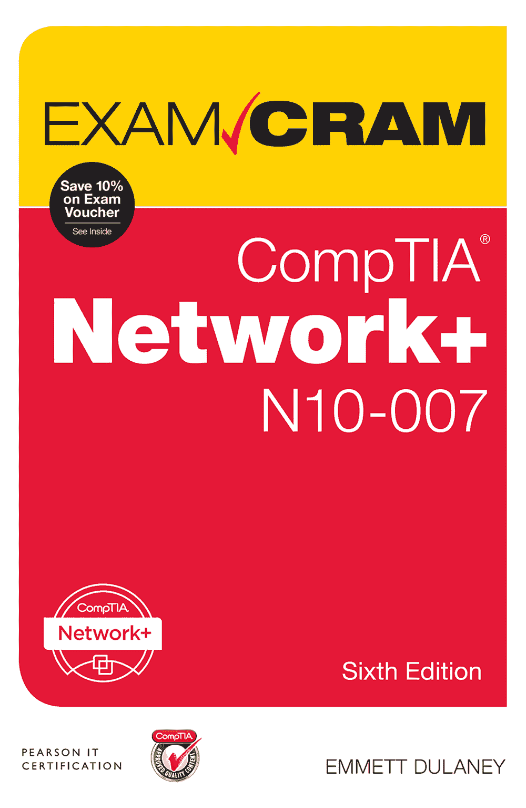

## 关于本电子书

EPUB 是一种开放的行业标准书籍格式。然而，不同阅读设备和应用程序对 EPUB 及其许多功能的支持程度不同。可以使用您的设备或应用设置来根据喜好自定义显示效果。您可以自定义的设置通常包括字体、字体大小、单栏或双栏、横屏或竖屏模式，以及可以点击或触摸放大的图片。有关您的阅读设备或应用中设置和功能的更多信息，请访问设备制造商的网站。

许多书籍包含编程代码或配置示例。为了优化这些元素的显示效果，请在单栏横屏模式下查看电子书，并将字体大小调整为最小设置。除了以重流文本格式显示代码和配置外，我们还包含了模仿打印书籍显示效果的代码图像；因此，当重流格式可能会影响代码列表的显示效果时，您将看到一个“点击此处查看代码图像”链接。点击链接可查看高保真代码图像。要返回之前的页面，请点击设备或应用上的“返回”按钮。


### 局域网 (LANs)

*局域网 (LAN)* 是一种限制在单一地理位置的数据网络，通常涵盖较小的区域，例如办公大楼或学校。局域网的功能是互连工作站以便共享文件和资源。由于其局部性，局域网通常比广域网速度更快且设置成本更低。图 1.9 显示了局域网的一个示例。

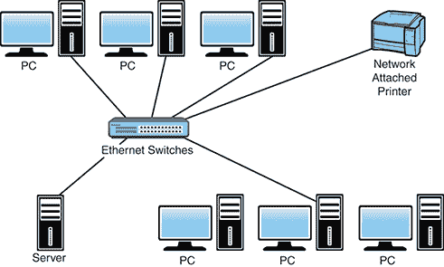

图 1.9 局域网

### 无线局域网 (WLANs)

本地网络不再完全依赖于布线，`wireless LAN (WLAN)` 提供了一个灵活且安全的数据通信系统，它可以增强以太网局域网（LAN），在某些情况下也可以完全取代。无线传输使用 `radio frequency (RF)` 信号发送和接收数据，让你摆脱了有线解决方案，并依赖于热点。该热点可以位于咖啡馆、火车站、餐厅或几乎任何公共场所。安全应该是公共热点用户的首要考虑，并且应尽可能地使用加密。

在常见的无线实现中，无线收发器（发射器/接收器）被称为接入点，使用标准电缆从固定位置连接到有线网络。无线接入点在无线局域网和有线网络基础设施之间接收并传输数据。

客户端系统使用无线局域网适配器与无线接入点通信。此类适配器内置在笔记本电脑和其他移动设备或台式计算机中。无线局域网适配器通过天线提供客户端系统与电波之间的通信点。

## WAN

`wide-area network (WAN)` 是跨越一个以上地理位置的网络，通常连接分离的 LAN。WAN 的速度比 LAN 慢，并且通常需要额外的昂贵硬件，例如路由器、专用租用线路和复杂的实施程序。图 1.10 显示了 WAN 的示例。

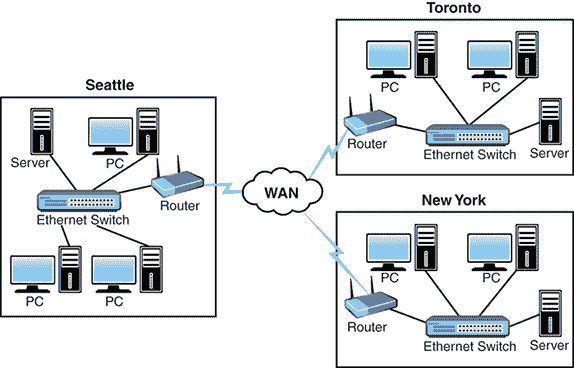

图 1.10 广域网

## MAN

偶尔，当 WAN 被限制在特定的地理区域（如大学校园或城市）时，它被称为 `metropolitan-area network (MAN)`。没有正式指南规定 MAN 和 WAN 之间的区别；从技术上讲，MAN 就是 WAN。可能因为这个原因，`MAN` 一词的使用频率低于 `WAN`。如果存在任何区别，那就是 MAN 比 WAN 小。MAN 几乎比 LAN 大，通常小于或等于 WAN。MAN 利用互联网服务提供商（ISP）或电信（telco）提供商。

## CAN

涉及术语和定义，定义区域内连接建筑并由该有限地理区域内的多个 LAN 组成的计算机网络通常被称为 `Campus-Area Network (CAN)`。CAN 可能涵盖整个大学校园或其部分。它也可能与大学无关，而是由企业“园区”中的办公楼、工业园区、军事基地或任何地方的建筑组成。实际上，CAN 是一种 WAN，但使其与众不同的是它包含的有限地理区域。

## SAN

`storage-area network (SAN)` 顾名思义：网络化/共享存储设备。通过簇式存储，你可以使用多个设备来提高性能。SAN 是 LAN 的子集，提供块级数据存储，在连接的设备操作系统中显示为本地附加设备。

构建在 SAN 之上的文件系统可以提供文件级访问，但 SAN 本身不提供文件抽象，只提供块级操作。

## PAN

`personal-area network (PAN)` 本质上是为了在与你相关的设备之间共享数据而创建的 LAN。无线技术进一步发展 PAN 并引入了一个新术语——`wireless personal-area network (WPAN)`。WPAN 指涉及连接极近距离设备以交换数据或资源的技术，通常通过使用 `Bluetooth`、红外或近场通信 (`NFC`)。例如是连接笔记本电脑和智能手机以同步地址录。由于其尺寸小且数据交换的性质，WPAN 设备非常适合自组无线网络。自组无线网络是指设备之间直接相互连接，而不是通过无线接入点连接的网络。

## 强化测验

**1.** 当 WAN 被限制在特定的地理区域（如城市）时，它被称为：

 **A.** LAN

 **B.** MAN

 **C.** VAN

 **D.** VPN

**2.** 下列哪项是位于定义区域内连接建筑并由该有限地理区域内的多个 LAN 组成的计算机网络？

 **A.** SAN

 **B.** PAN

 **C.** DAN

 **D.** CAN

**3.** 下列哪项提供了一个灵活且安全的数据通信系统，可以增强以太网 LAN，在某些情况下也可以完全取代它？

 **A.** PHLAN

 **B.** MAN

 **C.** WLAN

 **D.** CRAN

# 强化测验答案

**1. B.** 当 WAN 被限制在特定的地理区域（如城市）时，可以称为城域网（MAN）。

**2. D.** 校园局域网（CAN）是定义区域内连接建筑并由该有限地理区域内的多个 LAN 组成的计算机网络。

**3. C.** 无线局域网（WLAN）增强以太局域网（Ethernet LAN），在某些情况下也可以完全取代它。

### IoT 技术

 **比较并对比网络拓扑结构、类型和技术的特征。**

## 强化救星

如果你在阅读本节之前能正确回答这些问题，可以通过快速浏览本节中的“考试提醒（Exam Alerts）”，然后完成节末的强化测验，从而节省时间。

**1.** `802.11` 无线标准采用的接入方法是什么？

**2.** 哪些技术被认为是 `802.11n/802.11ac` 最大的进展，以及实现更高速度的关键？

### 答案

**1.** 所有 `802.11` 无线标准都采用 `CSMA/CA` 接入方法。

**2.** 多输入多输出（MIMO）和多用户 MIMO（MU-MIMO）天线技术是 `802.11n/802.11ac` 最大的进展，也是实现新速度的关键。

在当今 IT 世界中，增长快的领域之一是嵌入式设备，如恒温器、软水器和其他电器。这种通过物联网嵌入在日常物品中的计算设备进行的互连被称为 `物联网（IoT）`。其目标是使它们能够发送和接收数据。为了实现这一点，需要促进这种交互的技术。将在后续章节中进行讨论。

### 考试提醒

这里列出的七项构成了 Network+ 目标 1.5 下的相关内容。在复习考试时，你应该确保自己了解它们。

### Z-Wave

在涉及暖空调（HVAC）、自动窗帘、家庭影院以及某些安全系统/家庭访问控制时，`Z-Wave` 是一种流行的通信协议。它专注于办公/住宅/自动化市场，需要一个 `Z-Wave` 网关（中央控制设备），该网关既是集纽控制器又是门户（通常连接到互联网）。一个 `Z-Wave` 网络最多可以有 232 个设备，每个新设备都必须配对（或“包含”）才能被控制器识别。

自从丹麦 Zen-Sys 公司开发该标准以来，估计已出货 5000 万台符合 `Z-Wave` 标准的设备。该标准现在由 `Z-Wave Alliance` 的成员管理。它使用的频率随国家而异，但在美国，两个频率为 908.4 和 916。

每个 `Z-Wave` 网络都由一个 32 位网络 ID（称为 Home ID）识别，每个设备都由一个 8 位节点 ID（Node ID）识别，该 ID 在网络中必须是唯一的。

### Ant+

尽管 Z-Wave 协议本身并不完全开放，但它与许多公司相关。相反，`ANT+` 由 Garmin 通过其 `ANT+` 联盟管理。与 Z-Wave 类似，它是一种无线协议，但通常用于控制照明系统、电视机和其他室内实体，例如由 Garmin 授权的一系列健身监测设备。

`ANT+` 工作在 `2.4 GHz` 范围内，一个典型的支持 ANT 的设备包括一个与 ANT 模块、芯片组或芯片接口的应用程序主 MCU。通信利用跨越通道的双向串行消息进行。每个通道都包含一个主设备（master）和至少一个从设备（slave）。

### 蓝牙

在短距离无线标准方面，蓝牙是行业领导。该技术使用 `2.4` 到 `2.485 GHz` 频段，在局域网（PAN）中非常流行，并基于 `IEEE 802.15.1` 标准。IEEE 不再维护该标准，现在由蓝牙特别兴趣小组（SIG）管理。

蓝牙共有 79 个可用信道，每个通道的带宽为 `1 MHz`。蓝牙是一种基于数据包的协议，采用主从结构；一个主设备可以与最多七个从设备通信。自 1.0 版本首次出现以来，已经发布了多个蓝牙“版本”或标准。蓝牙演进的主要版本包括 `v1.2`、`v2.0`、`v2.1`、`v3.0`、`v4.0` 和 `v4.1`。截至本文，最近发布的是 `5`，它专注于物联网（IoT）。与蓝牙 `4.x` 相比，它提供的速度是两倍（`2 Mbps`），范围是四倍，数据广播能力是八倍。

### ExamAlert

在最新版本之前，数字始终包含一个点和小数：`1.0`、`1.2` 等。在最新版本中，没有点或小数。经过大量讨论，决定使用整数更不容易混淆：`Bluetooth 5`。

### NFC

近场通信（NFC）是一项技术，它要求用户将客户端靠近无线接入点（AP），以便验证（通常通过射频识别 (RFID) 或 Wi-Fi）设备是否存在。随着手机被用作支付系统的一部分，这项技术的普及日益增加，它也可以用于两部手机之间的“碰碰”并将数据从一台发送到另一台。虽然没有硬编码的标准来定义“近”，但行业倾向于使用 `4cm`（`1.6 英寸`）作为距离。

### IR

红外（IR）已经存在很长时间了；也许你第一次接触它是通过电视遥控器。输入到遥控器中的命令通过红外光波传输到电视上的接收器。红外技术已经取得了进展，如今网络中的红外开发由红外数据协会（IrDA）管理。然而，它在移动设备和外设中的应用已被更现代的 Wi-Fi 和蓝牙无线技术取代，这些技术不需要视距，且距离限制较少。

红外无线网络使用红外光束在设备之间发送数据传输。红外无线网络提供更高的传输率，达到 `10 Mbps` 到 `16 Mbps`。

正如预期的那样，红外光束无法穿透物体；因此，当物体挡住光时，信号会被中断。红外可以是定向（视距）技术，可以是漫反射技术。定向红外系统提供约 `3 英尺`的有限范围，通常用于个人局域网。漫反射红外可以传输得更远，且难以被物体阻挡。漫反射红外无线局域网系统不需要视距，但可用距离局限于房间距离。

红外提供了一种安全、低成本、方便的电缆替代技术。它非常适用于许多特定的应用和环境。以下是红外的一些点：

 它提供了足够的速度——高达 `16 Mbps`。

 红外设备功耗较低，因此不会消耗过多的电池。

 红外是一种安全的介质。红外信号通常是短距离内的直接对线实现，因此不会传输到直接连接范围之外。这消除了窃听或信号篡改的问题。

 红外是一项经过验证的技术。红外设备已经可用了一段时间，因此是一项成熟的、非专利的技术，拥有稳定的用户和支持基础。

 它没有 RFI（射频干扰）问题或信号冲突。

 它取代许多设备的电缆，例如键盘、鼠标和其他外设。

 它使用离散模式或视距传输。

 传输距离很短。

### RFID

尽管 NFC 是一个较新的标准，但它是建立在为 RFID 创建的旧标准之上的，允许兼容的硬件通过无线电为无电的无源电子标签供电并与之通信。RFID 广泛用于识别、身份验证和跟踪应用。

“近距离读写器”是任何能够读取近距离卡的 ID 或卡读写器的统称。近距离卡有多个名称，但它们只是在靠近读写器时可以读取的 RFID 卡，而且真正不需要接触任何东西。读写器配合 `13.56 MHz` 智能卡和 `125 kHz` 近距离卡工作，读取信号后可以打开闸机、门和其他任何其他物理安全防护措施。

### 802.11

`802.11` 是 IEEE 对无线网络的代号。在 `802.11` 标志下存在多种无线网络规范。Network+ 的目标专注于 `802.11a`、`802.11b`、`802.11g`、`802.11n` 和 `802.11ac`。所有这些标准使用以太网协议和载波监听多路接入冲突检测（CSMA/CA）接入方法。

### ExamAlert

考试包含关于无线标准特性的问题。记住，`802.11` 无线标准使用 `CSMA/CA` 接入方法。

`802.11` 无线标准在速度、传输范围和使用的频率方面可能不同，但在实际实现方面它们是相似的。所有标准都可以使用基础或自组织（ad hoc）网络设计，并且每个可以使用相同的安全协议：

 **IEEE 802.11:** 初始的 `802.11` 无线标准有两个变体。两者都提供 `1` 或 `2 Mbps` 的传输速度和相同的 `2.4 GHz` 射频频率。两者之间的区别在于数据如何通过 RF 介质传输。一种使用跳频扩频（FHSS），另一种使用直接序列扩频（DSSS）。原始的 `802.11` 标准对于现代网络需求来说太慢了，现在已不再部署。

### ExamAlert

在这一版本的考试中，CompTIA 希望你了解 `FHSS` 和 `DSSS` 这两个缩写，但不再测试这两种技术的复杂细节。为了完整性，这些技术将在本章末尾进行更详细的讨论，以完善你的知识。

 **IEEE 802.11a:** 在速度方面，`802.11a` 标准远优于原始的 `802.11` 标准。`802.11a` 在 `5 GHz` 频段规定了高达 `54 Mbps` 的速度，但大多数通信在 `6 Mbps`、`12 Mbps` 或 `24 Mbps` 处进行。`802.11a` 与 `802.11b` 和 `802.11g` 无线标准不兼容。

 **IEEE 802.11b:** `802.11b` 标准提供的最高传输速度为 `11 Mbps`。然而，这些设备的设计旨在与之前的 `802.11` 标准向下兼容，之前的标准提供了 `1`、`2` 和 `5.5 Mbps` 的速度。`802.11b` 使用 `2.4 GHz` 射频范围，并与 `802.11g` 兼容。

 **IEEE 802.11g:** `802.11g` 提供距离 `150` 英尺范围内的无线传输，与 `802.11b` 标准的 `11 Mbps` 相比，速度高达 `54 Mbps`。与 `802.11b` 一样，`802.11g` 在 `2.4 GHz` 范围内工作，因此与其兼容。

 **IEEE 802.11n:** 目前最常见的无线标准之一是 `802.11n`。`802.11n` 标准的目标是显著提高 `2.4 GHz` 和 `5 GHz` 频率范围内的吞吐量。标准的基准目标是达到 `100 Mbps` 的速度，但在适当条件下，据称 `802.11n` 的速度可以达到 `600 Mbps`。在实际操作中，`802.11n` 的速度要慢得多。`802.11n` 引入了多输入输出（MIMO）。

 **IEEE 802.11ac:** Network+ 目标中列出的最新无线标准是 `802.11ac`，它于 2014 年 1 月成为批准标准，可以被认为是 `802.11n` 的扩展。任何使用此标准的设备必须支持 `802.11n` 和 `802.11a` 的所有强制模式。该标准的目标是单链路 `500 Mbps`，多链路 `1.3 Gbps`。它支持多达八个 MIMO 流并增加了信道绑定，还支持多达四个 `multiuser MIMO (MU-MIMO)` 客户端。`802.11ac` 是一种仅限 `5 GHz` 的技术，目前市面上销售的大多数无线路由器均已提供。

### 考试提示

准备好回答关于无线标准特定特征的问题。基于性能的问题可能会要求针对特定场景选择或放置适当的标准或无线配置设置。

### 802.11n 和 802.11ac 背后的奥秘

`802.11n` 吸收了 `802.11` 标准的优点，并结合了一些新功能，将无线技术推向新的高度。这些新技术中首先是 `multiple input, multiple output (MIMO)` 天线技术。

MIMO 无疑是 `802.11n` 最大的进展，也是新速度的关键。本质上，MIMO 使用复用来增加无线网络的范围和速度。复用是一种将多个信号组合以通过单条线路或介质进行传输的技术。MIMO 允许在同一通道内通过不同的天线同时传输多个数据流。接收端会重建这些流，接收端也有多个天线。通过使用多路径，MIMO 比传统的单天线系统提供了显著的容量增益以及更可靠的通信。

虽然 `802.11n` 可以同时传输多个空间流，但这些流被导向单一地址（MIMO）。`802.11ac` 允许 MU-MIMO，让接入点（AP）可以在同一时间向多个客户端发送多个帧（从而允许 AP 像交换机而不仅仅是集线器）。


除了 MIMO 之外，802.11n 还实现了 `channel bonding`，这基本上使数据速率翻倍。

什么是信道绑定？802.11b 和 802.11g 无线标准使用单信道发送和接收信息。通过绑定，你可以同时使用两个信道。正如你猜的，同时使用两个信道的能力可以提高性能。绑定可以帮助无线传输率从 802.11g 标准提供的 54 Mbps 提高到 802.11n 的理论最大 600 Mbps。

802.11n 使用正交频复用（OFDM）传输策略——一种作为数字多载波调制方法的方案，其中大量密集的正交子载波信号在几个并行数据流或信道上携带数据。稍后将详细讨论。

802.11ac 通过将最大值从 40 MHz 增加到 80 MHz（假设为 160 MHz）扩展了这一点。通过将信道带宽翻倍，相同时间内可以携带倍的数据。

### 注意

在无线网络中，单个信道的宽度为 20 MHz。当两个信道绑定时，它们总共为 40 MHz。802.11n 系统可以使用 20 MHz 信道或 40 MHz 信道。802.11ac 支持 20 MHz、40 MHz、80 MHz 和 160 MHz 信道。

聚合（Aggregation）是另一个大区别，允许将数据打包在一起以提高速度。802.11n 将这项技术推向主流，而 802.11ac 仅仅在其基础上构建。

## 802.11 无线标准总结

表 1.5 突出了各种 802.11 无线标准的特性。

表 1.5 802.11 无线标准

| IEEE 标准 | 频率/介质 | 速度 | 拓扑结构 | 传输范围 | 接入方法 |
| :--- | :--- | :--- | :--- | :--- | :--- |
| 802.11 | 2.4 GHz | 1 到 2 Mbps | ad hoc/基础设施 | 室内 20 英尺 | CSMA/CA |
| 802.11a | 5 GHz | 高达 54 Mbps | ad hoc/基础设施 | 室内 25 到 75 英尺；范围受建筑材料影响 | CSMA/CA |
| 802.11b | 2.4 GHz | 高达 11 Mbps | ad hoc/基础设施 | 室内高达 150 英尺；范围受建筑材料影响 | CSMA/CA |
| 802.11g | 2.4 GHz | 高达 54 Mbps | ad hoc/基础设施 | 室内高达 150 英尺；范围受建筑材料影响 | CSMA/CA |
| 802.11n | 2.4 GHz/ 5 GHz | 高达 600 Mbps | ad hoc/基础设施 | 室内 175+ 英尺；范围受建筑材料影响 | CSMA/CA |
| 802.11ac | 5 GHz | 高达 1.3 Gbps | ad hoc/基础设施 | 室内 115+ 英尺；范围受建筑材料影响 | CSMA/CA |

### 考试提示

对于考试，你应该知道表 1.5 中的值。

`Spread spectrum`（扩频）指的是数据信号通过射频频率的方式。在扩频中，数据不会直接通过单个 RF 频段；这种传输被称为 `narrowband transmission`（窄带传输）。然而，扩频要求数据信号在载波频率之间切换或不断改变其数据模式。

尽管两点之间的最短距离是直线（窄带），但扩频的设计是为了用带宽效率换取可靠性、完整性和安全性。扩频信号比窄带传输使用更多带宽。两种类型的扩频无线电是 `frequency hopping`（跳频）和 `direct sequence`（直接序列）。

表 1.6 比较了无线标准和所使用的扩频。

表 1.6 IEEE 802.11 标准比较

| IEEE 标准 | 使用的 RF | 扩频方式 | 数据速率 (Mbps) |
| :--- | :--- | :--- | :--- |
| 802.11 | 2.4 GHz | DSSS | 1 或 2 |
| 802.11 | 2.4 GHz | FHSS | 1 或 2 |
| 802.11a | 5 GHz | OFDM | 54 |
| 802.11b | 2.4 GHz | DSSS | 11 |
| 802.11g | 2.4 GHz | DSSS | 54 |
| 802.11n | 2.4/5 GHz | OFDM | 600 (理论) |
| 802.11ac | 5 GHz | OFDM | 1300 (理论) |

## 跳频扩频技术

`Frequency-hopping spread-spectrum (FHSS)` 要求使用按预测模式改变频率的窄带信号。`frequency hopping` 一词指的是数据信号在窄信道之间跳变。

例如，考虑 802.11b/g 使用的 2.4 GHz 频。该范围被分为 70 个每个 1 MHz 的窄信道。在 20 到几百毫秒之间，信号会按照预定的循环模式跳到新的信道。

由于使用 `FHSS` 的数据信号会在射频频段之间切换，它们对干扰和环境因素具有很强的抵抗能力。`FHSS` 信号策略使其非常适用于覆盖大地理区域的安装，并且适用于那些无法通过使用定向天线来最小化环境因素影响的场景。

`FHSS` 并不是今天无线标准首选的扩频技术。然而，`FHSS` 用于一些较少使用的标准以及固定宽带无线接入（`BWA`）的蜂窝部署，在这些场景中，由于其局限性，使用 `DSSS`（下文将讨论）几乎是不可能的。

## 直接序列扩频（DSSS）技术

通过 `DSSS` 传输，信号被扩展在整个传输频率范围内。对于发送的每一个比特位，还会发送一个冗余位位模式。这个 32 位的模式被称为 `chip`（芯片）。这些冗余数据位提供了安全性和交付保障。

传输之所以如此安全可靠，是因为系统发送了大量的数据冗余副本，而只需要一份副本即可完成数据或信息的完整传输。`DSSS` 可以最大限地减少干扰和背景噪声的影响。

对于两者之间的比较，`DSSS` 具有提供比 `FHSS` 更安全、信号交付的优势，但它是一项敏感技术，受到许多环境因素的影响。

## 正交频分复用

正交频分复用（`OFDM`）是一种通过 52 个相互独立的、等间距的频率传输大量数据的传输技术。`OFDM` 将无线信号分成这些独立的频率并同时将其传输到接收器。分割信号并在不同频率上传输减少了串扰干扰。

`OFDM` 与 `IEEE 802.11a`、`802.11g`、`802.11n` 和 `802.11ac` 无线标准以及 `4G` 手机标准相关。

`OFDM` 多用户版本是正交频分多址（`OFDMA`）。它将子载波子集分配给单个用户，允许多个用户同时传输数据，并且被认为具有可扩展性。

### 强化自测验

**1。** 你正在安装一个无线网络解决方案，你需要一个可以使用 2.4 GHz 或 5 GHz 频率运行的标准。你会选择以下标准中的哪一个？

 **A.** `802.11a`

 **B.** `802.11b`

 **C.** `802.11g`

 **D.** `802.11n`

 **E.** `802.11ac`

**2。** 你正在安装一个使用名为 `MU-MIMO` 特性的无线网络解决方案。你正在使用哪种无线网络标准？

 **A.** `802.11a`

 **B.** `802.11b`

 **C.** `802.11n`

 **D.** `802.11ac`

### 强化自测验答案

**1。** 你正在安装一个无线网络解决方案，你需要一个可以使用 2.4 GHz 或 5 GHz 频率运行的标准。你会选择以下标准中的哪一个？

**2。** 你正在安装一个使用名为 `MU-MIMO` 特性的无线网络解决方案。你正在使用哪种无线网络标准？

OSI 模型的每一层都有特定的功能。接下来的章节将描述每一层的功能，从物理层开始向上构建模型。

### 物理层（第 1 层）

OSI 模型的物理层识别网络的物理特性，包括以下规范：

 **硬件：** 网络使用的媒介类型，例如电缆类型、连接器类型以及电缆的引脚格式。

 **拓扑结构：** 物理层识别网络使用的拓扑结构。常见的拓扑包括环形、网状、星型、总线型和混合型。

`USB`、`Ethernet`、`DSL`、`ISDN`、`T1` 和 `T3` 链路、`GSM` 和 `SONET` 等协议和技术运行在物理层。

除了这些特性外，物理层还定义了给定介质使用的电压以及携带数据的信号运行频率。这些特性决定了给定介质的速度和带宽，以及某种介质类型可以使用的最大距离。

### 数据链路层（第 2 层）

数据链路层负责将数据交给物理层，以便其在网络上传输。数据链路层还负责错误检测、错误纠正和硬件寻址。“帧”（frame）术语描述数据链路层数据的逻辑分组。

数据链路层有两个不同的子层：

 **介质访问控制（MAC）层：** `MAC` 地址在此层定义。`MAC` 地址是固在每个网络接口卡（`NIC`）中的物理或硬件地址。`MAC` 子层还控制对网络介质的访问。`MAC` 层规范包含在 `IEEE 802.1` 标准中。

 **逻辑链路控制（LLC）层：** `LLC` 层负责数据链路层的错误和流量机制。`LLC` 层在 `IEEE 802.2` 标准中规定。

`高级数据链路控制 (HDLC)`、二层隧道协议 (`L2TP`)、点对点协议 (`PPP`)、点对点隧道协议 (`PPTP`)、生成树协议 (`STP`) 以及虚拟局域网 (`VLANs`) 等协议和技术运行在数据链路层。

### 网络层（第 3 层）

网络层的主要职责是 `routing`（路由）——提供数据从一个网络系统传递到另一个网络系统的机制。网络层并不规定数据如何传递，而是提供执行该操作的机制。网络层的功能通过路由协议（即软件组件）提供。

网络层协议还负责 `route selection`（路径选择），即确定数据在整个网络中遵循的最佳路径。与使用 `MAC` 地址在 `LAN` 上进行通信的数据链路层不同，网络层协议使用软件配置的地址和特殊的路由协议在网络上进行通信。“包”（packet）术语描述网络层数据的逻辑分组。

在处理网络工作时，路由可以通过两种方式配置：`statically`（静态）或 `dynamically`（动态）。在静态路由环境中，路由被手动添加到路由表中。在动态路由环境中，使用诸如路由信息协议 (`RIP`) 和开放最短路径优先 (`OSPF`) 等路由协议。这些协议在网络上的联网设备之间通信路由信息。

其他重要的网络层协议包括网协议 (`IP`)、地址解析协议 (`ARP`)、反地址解析协议 (`RARP`)、异步传输模式 (`ATM`)、系统间系统协议 (`IS-IS`)、IP 安全 (`IPsec`)、互联网控制消息协议 (`ICMP`) 和多协议标签交换 (`MPLS`)。

### 传输层（第 4 层）

传输层的基本功能是提供在网络设备之间传输数据的机制。它主要通过以下三种方式实现：

 **错误检查：** 传输层的协议确保数据被正确发送或接收。

 **服务寻址：** 许多协议支持许多网络服务。传输层确保数据传递到 OSI 模型上层中的正确服务。

 **分段：** 为了遍历网络，数据块需要被拆分为适于管理大小的数据包，以便下层处理。这一过程称为 `segmentation`（分段），是传输层的职责。

运行在传输层的协议可以是无连接的，例如用户数据报协议 (`UDP`)，也可以是面向连接的，例如传输控制协议 (`TCP`)。

传输层还负责 `data flow control`（流量控制），即接收设备如何接受数据传输。通常使用两种流量控制方法：

 **缓冲：** 当使用缓冲流量控制时，数据会被临时存储并等待目标设备就绪。如果发送设备传输数据的速度远于接收设备管理的速度，缓冲可能会导致问题。

 **窗口：** 在窗口环境中，数据以数据段组的形式发送，每组只需要一个确认。窗口的大小（即一个确认可以容纳多少个数据段）在两个设备之间的会话建立时定义。你可以想象的，例如每五个数据段只需要一个确认，可以大大减少开销。

### 会话层（第 5 层）

会话层负责管理和控制两个设备上的应用程序之间的数据同步。它通过建立、维护和中断会话来实现这一点。虽然传输层负责建立和维护两个节点之间的连接，但会话层代表应用程序执行相同的功能。运行在会话层的协议包括 `NetBIOS`、网络文件系统 (`NFS`) 和服务器消息块 (`SMB`)。

### 表示层（第 6 层）

表示层的基本功能是将用于应用程序层或接收自应用程序层的数据转换为另一种格式。这种转换是必要的，因为数据格式化的方式是为了跨网络传输。应用程序并不一定能读取这种转换。表示层处理的一些常见数据格式包括：

 **图形文件：** `JPEG`、`TIFF`、`GIF` 等是图形文件格式，要求数据以特定方式格式化。

 **文本和数据：** 表示层可以将数据翻译为不同的格式，例如美国信息交换代码 (`ASCII`) 和扩展位制进制交换码 (`EBCDIC`)。

 **音频/视频：** `MPEG`、`MP3` 和 `MIDI` 文件都有自己的数据格式，数据必须在这些格式之间转换。

表示层的另一个重要功能是 `encryption`（加密），即对数据进行乱码，使预期接收者以外的任何人无法读取。鉴于表示层的基本角色——数据格式转换器——它是加密和解密发生的理想场所。例如，加密协议传输层安全性 (`TLS`) 运行在表示层。

### 应用层（第 7 层）

简单来说，应用层的功能是接收用户的请求和数据，并将其传递给 OSI 模型的较低层。输入的信息会被传递到应用层，然后由应用层向用户显示。一些最基础的应用层服务包括文件和打印功能。

关于应用层最常见的误解是认为它代表系统上使用的应用程序，例如网络浏览器、文字处理器或电子表格。相反，应用层定义了允许应用程序使用网络服务的进程。例如，如果一个应用程序需要从网络驱动器打开一个文件，该功能是由驻留在应用层的组件提供的。

应用层定义的协议包括安全 Shell (`SSH`)、边界网关协议 (`BGP`)、动态主机配置协议 (`DHCP`)、域名系统 (`DNS`)、网络时间协议 (`NTP`)、实时传输协议 (`RTP`)、会话发起协议 (`SIP`)、简单邮件传输协议 (`SMTP`)、服务器消息块 (`SMB`)、文件传输协议 (`FTP`)、超文本传输协议 (`HTTP`)、超文本传输协议安全版 (`HTTPS`)、互联网消息访问协议 (`IMAP`) 和邮局协议第 3 版 (`POP3`)。

### 考试提示（ExamAlert）

请确保你理解 OSI 模型及其目的。考试期间你几乎肯定会被问到相关问题。

## OSI 模型总结

表 2.1 总结了 OSI 模型的七层，并描述了每层的一些重要要点。

表 2.1 OSI 模型总结

| OSI 层 | 主要功能 |
| :--- | :--- |
| 物理层（第 1 层） | 定义网络的物理结构和拓扑。 |
| 数据链路（第 2 层） | 提供错误检测和纠。使用两个不同的子层：介质访问控制 (`MAC`) 和逻辑链路控制 (`LLC`)。识别访问介质的方法。通过 MAC 子层定义硬件地址。 |
| 网络层（第 3 层） | 处理目标系统的发现和寻址。提供数据从一个网络系统到另一个网络系统的传输和路由机制。 |
| 传输层（第 4 层） | 在发送和接收设备之间提供连接服务，并确保数据的可靠传输。通过缓冲或窗口管理流量控制。提供分段、错误检查和服务识别。 |
| 会话层（第 5 层） | 同步不同设备上应用程序之间的数据交换。 |
| 表示层（第 6 层） | 将应用程序使用的格式的数据转换为可在网络上传输的格式。处理数据的加密和解密。提供压缩和解压缩功能。将应用层的数据格式化为可通过网络发送的格式。 |
| 应用层（第 7 层） | 为应用程序提供网络访问。 |

## 比较 OSI 与四层 TCP/IP 模型

OSI 模型非常出色地概述了网络连接应该如何发生以及每一层的职责。然而，TCP/IP 也有一个参考模型，并且仅通过四层就能执行相同的功能。图 2.2 显示了这四层是如何与 OSI 模型的七层对齐的。

```markdown
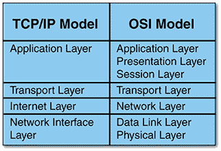
```

图 2.2 TCP/IP 模型与 OSI 模型对比

TCP/IP 模型中的网络接口层有时被称为网络访问层或链路层，以太网、FDDI 或任何其他物理技术在此运行。网络层是 IP 运行的地方（以及 ICMP 等）。传输层是 TCP 及其对应的 UDP 运行的地方。应用层允许接入许多协议，例如 HTTP、`SMTP`、简单网络管理协议 (`SNMP`)、`DNS` 等等。

## 识别各种网络组件运行的 OSI 层

当你理解了 OSI 模型时，可以将网络连接设备关联到 OSI 模型的相应层。知道设备运行在哪个 OSI 层可以让你更好地理解它在网络上如何工作。表 2.2 识别了各种网络设备并将其映射到 OSI 模型。

### 考试提示（ExamAlert）

对于 Network+ 考试，你需要识别某些网络设备运行在 OSI 模型的哪一层。

表 2.2 网络设备映射到 OSI 模型

| 设备 | OSI 层 |


| 设备 | OSI 层 |
| :--- | :--- |
| 集线器 | 物理层（第 1 层） |
| 无线桥接器 | 数据链路（第 2 层） |
| 交换机 | 数据链路层（第 2 层）或网络层（第 3 层） |
| 路由器 | 网络层（第 3 层） |
| 网卡（NIC） | 数据链路（第 2 层） |
| 接入点（AP） | 数据链路（第 2 层） |

### 强化练习测验（Cram Quiz）

**1.** AP 运行在哪个 OSI 层？

```text
 A. 网络层
 B. 物理层
 C. 数据链路层
 D. 会话层
```

**2.** 以下哪些是数据链路层的子层？（选择两个）

```text
 A. MAC
 B. LCL
 C. 会话层
 D. LLC
```

**3.** 交换机可以在哪两个 OSI 层上运行？（选择两个）

```text
 A. 第 1 层
 B. 第 2 层
 C. 第 3 层
 D. 第 4 层
```

**4.** 以下哪一个 OSI 层负责在两个设备之间建立连接？

```text
 A. 网络层
 B. 传输层
 C. 会话层
 D. 数据链路层
```

### 强化练习测验答案（Cram Quiz Answers）

**1. C.** 无线接入点（AP）运行在 OSI 模型的数据链路层。网络层设备示例是路由器。物理层设备示例是集线器。会话层组件通常是软件，而不是硬件。

**2. A、D.** 数据链路层分为两个不同的子层：介质访问控制（MAC）和逻辑链路控制（LLC）。LCL 不是一个有效术语。会话层是 OSI 模型的另一层。

**3. B、C.** 交换机使用连接设备的 MAC 地址来做出转发决策。因此，它被称为数据链路或第 2 层网络设备。它也可以运行在第 3 层或作为多层交换机。运行在第 1 层的设备或组件通常是基于介质的，例如电缆或连接器。第 4 层组件通常是基于软件的，而不是硬件。

**4. B.** 传输层负责在网络设备之间建立连接。网络层通常与路由发现和数据报交付相关。会话层协议同步不同设备上应用程序之间的数据交换。数据链路层协议对传输信号进行错误检测和处理，并定义访问介质的方法。

### 端口与协议（Ports and Protocols）

```text
 解释端口和协议的作用和用途。
```

### 快速复习指南（CramSaver）

如果你在阅读本节之前就能正确回答这些问题，可以通过快速浏览本节中的“考试提示”，然后完成节末的“强化练习测验”来节省时间。

**1.** 使用 TCP 时，数据会话通过三步过程建立。这被称为三次握手 _____。

**2.** 哪个 FTP 命令将多个文件上传到远程主机？

**3.** SSH 协议是哪种协议更安全的替代方案？

**4.** HTTPS、RDP 和 DHCP 协议使用哪些端口？

### 答案

1. 这被称为三次次握手。

2. `mput` 命令在 FTP 中将多个文件上传到远程主机。

3. SSH 是比 Telnet 更安全的替代方案。

4. HTTPS 使用 443 端口，RDP 使用 3389 端口，而 DHCP 使用 67 和 68 端口。

当计算机还被限制为单机系统时，几乎不需要它们之间存在通信机制。然而，不久之后，为了共享文件和打印机而连接计算机的需求变成了一种必然性。在网络设备之间建立通信不仅需要电缆的长度，还需要一种方法或一套规则来确定系统将如何通信。协议提供了这种方法。

如果能有一种单一协议来促进所有设备之间的通信那就太好了，但事实并非如此。你在网络上可以使用多种协议，每种协议都有自己的特性、优点和缺点。你选择哪种协议会对网络的运行和性能产生重大影响。本节将探讨你作为网络管理员可能会接触到的一些常见协议。

## 面向连接的协议与无连接协议

在进入各种网络协议和协议族的特征之前，你必须首先识别面向连接的协议与无连接协议之间的区别。

在面向连接的通信中，数据交付是有保证的。发送设备会重新发送目标系统未收到的任何数据包。发送和接收设备之间的通信将持续到传输通过验证为止。由于面向连接的协议开销更高，且对带宽的要求更高。

> **考试警示**
>
> 如 `TCP` 等面向连接的协议可以通过要求发送设备重传来适应丢失或丢弃的数据包。它们之所以这样做，是因为它们在认为传输完成之前，会等待消息中的所有数据包被接收。在发送端，面向连接的协议还假设缺乏确认是重传的充分理由。

与面向连接的通信不同，如 `User Datagram Protocol (UDP)` 等无连接协议仅提供尽力而为的交付机制。基本上，信息只是被发送出去；没有确认数据已收到。如果传输过程中发生错误，则没有重新发送数据的机制，因此使用无连接协议进行的传输是无法保证的。无连接通信所需的开销远小于面向连接通信，因此它在音频和视频流等应用中非常受欢迎，在这些应用中，少量数据包丢失可能并不构成严重问题。

> **考试警示**
>
> 在处理各种协议时，请留意哪些是无连接的，哪些是面向连接的。此外，寻找如 `TCP` 这样保证数据交付的协议，以及如 `UDP` 这样属于“发出后不管”或最佳交付方法的协议。

## 互联网协议

互联网协议（IP）定义在 `RFC 791` 中，它是将数据从网络上的一个节点传输到另一个节点的协议。`IP` 是无连接的，这意味着它不保证数据的交付；它只是尽力而为。为了确保通过 `IP` 发送的传输能够完成，需要如 `TCP` 等更高层次的协议。

> **注意**
>
> 在本章及整书中，使用了 `Request For Comments (RFC)` 术语。`RFCs` 是 `Internet Engineering Task Force (IETF)` 发布的标准，描述了适用于互联网和互联网连接系统运行的方法、行为、研究或创新。每个新的 `RFC` 都有一个关联的引用编号。查询此编号可以获得有关特定技术的信息。有关 `RFCs` 的更多信息，请在网上搜索 `Internet Engineering Task Force`。

> **考试警示**
>
> `IP` 运行在 OSI 网络层。

除了提供尽力而为的交付外，`IP` 还为网络传输执行分片和重组任务。分片是必要的，因为 `IP` 中的 `maximum transmission unit (MTU)` 大小有限制。换句话说，无法通过单个数据包穿越网络的传输必须分解成较小的块并在另一端重组。`IP` 的另一个功能是路由。`IP` 地址是一个复杂的课题。关于 `IP` 地址的完整讨论，请参考第 3 章“地址、路由与交换”。

## 传输控制协议

传输控制协议（TCP）定义在 `RFC 793` 中，是一种面向连接的传输层协议。面向连接意味着 `TCP` 在通信发生之前会在两个主机之间建立相互确认的会话。`TCP` 为 `IP` 通信提供了可靠性。具体来说，`TCP` 添加了流量控制、排序以及错误检测和纠正等功能。由于需要保证交付的高层应用使用 `TCP` 而不是其轻量且无连接的兄弟 `UDP`。

### TCP 如何工作

当 `TCP` 想要与另一个主机建立连接时，它遵循以下步骤：

1. 它向目标主机发送一个名为 `SYN` 的消息。
2. 目标主机为请求打开连接并回传一个名为 `ACK`（或 `SYN ACK`）的确认消息。
3. 发起请求的主机回传另一个确认，表示它已收到 `ACK` 消息，且会话已准备好传输数据。

当数据会话完成后，将使用类似的过程来关闭会话。这种三步会话建立和确认过程被称为 `TCP 三次握手`。

> **考试警示**
>
> `TCP` 运行在 OSI 传输层。

`TCP` 是一个可靠的协议，因为它拥有可以适应和处理错误的机制。这些机制包括超时，如果发送主机在规定时间内没有收到确认，它将导致发送主机自动重传数据。

## 用户数据报协议

用户数据报协议（UDP）定义在 `RFC 768` 中，是 `TCP` 的兄弟。像 `TCP` 一样，`UDP` 是一种传输协议，但区别在于 `UDP` 不像 `TCP` 那样保证交付。在某种意义上，`UDP` 是一种“发出后不管”的协议；它假设发送的数据将完整地到达目的地。数据是否交付的留给上层协议处理。`UDP` 运行在 OSI 传输层。

与 `TCP` 不同，使用 `UDP` 时发送和接收主机之间不建立会话，这就是为什么 `UDP` 被称为无连接协议。结果是 `UDP` 的开销远低于 `TCP`。`TCP` 数据包头有 14 个字段，而 `UDP` 数据包头只有四个字段。因此，`UDP` 比 `TCP` 高效得多。在不需要 `TCP` 额外功能的应用中，`UDP` 在带宽和处理精力方面要经济得多。

> **考试警示**
>
> 记住 `TCP` 是面向连接的协议，而 `UDP` 是无连接协议。

## 文件传输协议

顾如其名，`File Transfer Protocol (FTP)` 提供了从运行 FTP 服务器软件的远程主机上传和下载文件的功能。除了上传和下载文件，FTP 还允许你查看 FTP 服务器上的文件夹内容，并在拥有相应权限的情况下重命名和删除文件及目录。FTP 定义在 `RFC 959` 中，它使用 `TCP` 作为传输协议，以保证数据包的交付。

FTP 具有用于验证用户身份的安全机制。然而，你不需要为每个用户创建一个用户账户，而是可以配置 FTP 服务器软件接受匿名登录。当你这样做时，用户名为 `anonymous`，密码通常是用户的电子邮件地址。大多数向公众提供文件的 FTP 服务器都是以这种方式运行的。

除了作为通过 Internet 等网络向公众分发文件的流行机制外，FTP 也深受那些需要与其他个人或组织交换大文件的组织的欢迎。例如，本书中的章节就是作者与 Pearson 之间通过 FTP 发送的。这种系统是必要的，因为所交换的文件有时超过了电子邮件无法轻松容纳的大小。许多应用程序/程序可以简化这一过程。例如，`FileZilla` 是一款适用于 Windows、Linux、Mac OS X 等系统的跨平台图形化 FTP、SFTP 和 FTPS 文件管理工具（有关 `FileZilla` 的更多信息可以在 [`sourceforge.net/projects/filezilla/`](https://sourceforge.net/projects/filezilla/) 找到）。

### ExamAlert

记住 FTP 是一种应用层协议。FTP 使用端口 `20` 和 `21`，并且发送未加密的信息，因此它是不安全的。

所有常见的网络操作系统都提供 FTP 服务器功能；然而，是否使用它们取决于你是否需要 FTP 服务。所有流行的工作站操作系统都提供 FTP 客户端功能，尽管通常会使用第三方工具如 `FileZilla`（前文提到）、`CuteFTP` 或 `SmartFTP`。默认情况下，FTP 运行在端口 `20` 和 `21` 上。

FTP 假设上传或下载的文件是纯文本（即 `ASCII`）文件。如果文件不是文本（这很有可能），则必须将传输模式更改为 `binary`（二进制）。对于诸如 `CuteFTP` 这样复杂的 FTP 客户端，传输模式之间的切换是自动的。而对于更基础的工具，你必须手动执行模式切换。

与本章讨论的某些对用户透明执行任务的协议不同，FTP 是经常被调用的应用层服务。因此，了解 FTP 支持的一些命令可能会很有用。如果你使用像 `CuteFTP` 这样的客户端，你可能永远不需要使用这些命令，但以防你使用命令行 FTP 客户端，了解它们是有用的。表 2.3 列出了一些最常用的 FTP 命令。

### ExamAlert

你可能会被要求识别给定情况下应使用的适当 FTP 命令。

### 表 2.3 常用 FTP 命令

| 命令 | 描述 |
| :--- | :--- |
| `ls` | 列出远程系统当前目录下的文件 |
| `cd` | 更改远程主机上的工作目录 |
| `lcd` | 更改本地主机上的工作目录 |
| `put` | 将单个文件上传到远程主机 |
| `get` | 从远程主机下载单个文件 |
| `mput` | 向远程主机上传多个文件 |
| `mget` | 从远程主机下载多个文件 |
| `binary` | 将传输切换到二进制模式 |
| `ascii` | 将传输切换到 ASCII 模式（默认模式） |

## 安全文件传输协议

FTP 关联的大问题之一是它被认为是不安全的。尽管 FTP 有简单的身份验证方法，但它仍然容易受到相对简单的黑客攻击。此外，FTP 以未加密格式在发送者和接收者之间传输数据。通过使用数据嗅探器，黑客可以轻松地从网络复制数据包并读取内容。在如今的高安全计算环境中，你需要一个更健壮的解决方案。

该解决方案是 `Secure File Transfer Protocol (SFTP)`，它基于 `Secure Shell (SSH)` 技术，在发送者和接收者之间提供了健全的验证。它还提供了加密能力，这意味着即使数据包从网络中复制，其内容对窥探者来说也是隐藏的。

SFTP 通过适用于所有常用计算平台的客户端和服务器软件实现。SFTP 使用端口 `22`（与 `SSH` 使用相同的端口）进行安全文件传输。

## 简易文件传输协议

FTP 的变体是 `Trivial File Transfer Protocol (TFTP)`，它也是一种文件传输机制。然而，TFTP 不具备 FTP 所拥有的安全能力或功能水平。TFTP 定义在 `RFC 1350` 中，通常与简单的下载相关，例如将固件传输到路由器等设备以及启动无盘工作站。

TFTP 不提供的另一个特性是目录导航。在 FTP 中，可以执行命令来导航和管理文件系统，而 TFTP 不提供这种能力。TFTP 要求你不仅要精确请求你想要的内容，还要请求特定的位置。与 FTP 使用 `TCP` 作为传输协议以保证交付不同，TFTP 使用 `UDP`。默认情况下，TFTP 运行在端口 `69` 上。

### ExamAlert

TFTP 是一种使用 `UDP` 的应用层协议，`UDP` 是一种无连接的传输层协议。由于这个原因，TFTP 被称为无连接文件传输方法。

## 邮件协议

`Simple Mail Transfer Protocol (SMTP)` 定义在 `RFC 821` 中，是一种定义主机之间如何发送邮件的协议。SMTP 使用 `TCP` 连接来保证消息无错交付。SMTP 并不复杂，且要求目标主机始终可用。由于这个原因，邮件系统会对入站邮件进行缓存，以便用户稍后阅读。用户随后如何读取邮件取决于客户端如何访问 SMTP 服务器。SMTP 使用的默认端口是 `25`。

### Note

SMTP 可用于发送和接收邮件。邮局协议版本 3（`POP3`）和互联网消息访问协议版本 4（`IMAP4`）仅可接收邮件。

## 超文本传输协议

`Hypertext Transfer Protocol (HTTP)` 定义在 `RFC 2068` 中，是一种允许从 HTTP 服务器下载文本、图形、多媒体和其他材料的协议。HTTP 定义了客户端可以请求的动作以及服务器应如何回答这些请求。

在实际实现中，HTTP 客户端（即网络浏览器）在端口 `80` 上以 HTTP 格式向运行 HTTP 服务器程序的服务器（即 Web 服务器）发送请求。使用 `Hypertext Markup Language (HTML)` 等特殊语言创建的文件会被返回给客户端，并关闭连接。

### ExamAlert

确保你理解 HTTP 是一个使用 `TCP` 作为传输协议的面向连接的协议。默认情况下，它运行在端口 `80` 上。

HTTP 使用 `uniform resource locator (URL)` 来确定应该从远程服务器下载哪个页面。URL 包含了请求类型（例如，`http://`）、所连接的服务器名称（例如，[www.microsoft.com](http://www.microsoft.com)）以及可选的请求页面（例如，`/support`）。结果就是精通互联网的人所熟悉的语法：[`www.microsoft.com/support`](http://www.microsoft.com/support)。

## 安全超文本传输协议

使用 HTTP 的缺点之一是 HTTP 请求是以明文发送的。对于某些应用程序（例如电子商务），这种信息交换方法并不合适——需要一种更安全的方法。解决方案是安全超文本传输协议（`HTTPS`），它使用一种名为安全套接层（`SSL`）的系统，该系统会加密客户端和主机之间传输的信息。端口从 80（HTTP 的默认端口）更改为 443。

为了使用 `HTTPS`，客户端和服务器都必须支持它。现在所有流行的浏览器都支持 `HTTPS`，Web 服务器产品也是如此，例如微软的 `Internet Information Services (IIS)`、Apache 以及几乎所有提供敏感应用程序的 Web 服务器程序。当你访问使用 `HTTPS` 的应用程序时，URL 以 `https` 而不是 `http` 开头——例如，[`www.mybankonline.com`](https://www.mybankonline.com)。

## 邮局协议版本 3/互联网消息访问协议版本 4

在 `RFC 1939` 中定义的邮局协议版本 3（`POP3`）和在 `RFC 1731` 中定义的最新版本互联网消息访问协议版本 4（`IMAP4`）都是从服务器下载（或拉取）电子邮件的机制。它们是必要的，因为尽管邮件通过 `SMTP` 在网络中传输，但用户并不能总是立即阅读它，因此它必须存储在中心位置。从该位置，需要被下载或检索，这正是 `POP3` 和 `IMAP4` 允许你做的。


`POP3` 和 `IMAP4` 非常流行，许多人通过 `POP3` 和 `IMAP4` 客户端应用程序访问电子邮件。`POP3` 的默认端口是 110，`IMAP4` 的默认端口是 143。

`POP3` 的问题之一是用于访问邮箱的密码以明文形式在网络中传输。这意味着如果人们想做，可以相对容易地确定你的 `POP3` 密码。在这一方面，`IMAP4` 相比 `POP3` 具有优势。它使用了更复杂的身份验证系统，这使得人们更难推出密码。

### 考试要点提醒（ExamAlert）

`POP3` 和 `IMAP4` 可用于从服务器下载或拉取电子邮件，但它们不能用于发送邮件。该功能留给了 `SMTP`，它可以既发送也可以接收。此外请记住，`POP3` 使用端口 110，而 `IMAP4` 使用端口 143。

### 备注（Note）

尽管使用 `POP3` 和 `IMAP4` 访问电子邮件有许多优势，但此类系统依赖服务器保存邮件，直到其下载到客户端系统为止。在当今世界中，需要一种更复杂的解决方案来实现“随时/随地”访问电子邮件。对于许多人来说，该解决方案是基于 Web 的邮件。

拥有基于互联网的电子邮件账户可以让你从任何地方、通过任何支持 Web 浏览器的设备访问邮件。由于这种系统具有显而易见的优势，所有主要的邮件系统一段时间以来都包含了 Web 访问网关产品。

## Telnet

`Telnet` 定义在 RFC 854 中，是一种虚拟终端协议。它允许在远程主机上建立会话，然后在该远程主机上执行命令。多年来，`Telnet` 是客户端访问大型机和微型计算机等多用户系统的方法。它也是 UNIX 系统的首选连接方式。

今天，`Telnet` 仍用于访问路由器和其他托管网络设备。默认情况下，`Telnet` 运行在端口 23。

`Telnet` 的问题之一是不安全。因此，远程会话功能现在几乎总是通过使用 `SSH` 等替代方案来实现。

### 考试要点提醒（ExamAlert）

`Telnet` 用于访问 UNIX 和 Linux 系统。`Telnet` 使用端口 23 且是不安全的。`SSH` 被认为是 `Telnet` 的安全替代方案。

## 安全外壳（Secure Shell）

`安全外壳（SSH）`由赫尔辛基理工大学的学生创建，是 `Telnet` 的安全替代方案。`SSH` 通过在数据在系统间传输时对其加密来提供安全性。这使得使用数据包嗅探器和其他流量检测系统的黑客难以实施。它还提供了比 `Telnet` 更健壮的身份验证系统。

目前有两个版本的 `SSH`：`SSH1` 和 `SSH2`。在两者中，`SSH2` 被认为更安全。这两个版本不兼容。如果你使用 `SSH` 客户端程序，你连接的 `SSH` 服务器实现必须是相同的版本。默认情况下，`SSH` 运行在端口 22。

尽管 `SSH` 像 `Telnet` 一样主要关联 UNIX 和 Linux 系统，但 `SSH` 的实现适用于所有常用的计算平台，包括 Windows 和 Mac OS。正如之前讨论的那样，`SSH` 是`安全文件传输协议（SFTP）`的基础技术。

### 考试要点提醒（ExamAlert）

记住 `SSH` 使用端口 22，并且是比 `Telnet` 更安全的替代方案。

## 互联网控制消息协议

`互联网控制消息协议（ICMP）`定义在 RFC 792 中，是一种与 IP 层协同工作以提供错误检查和报告功能的协议。事实上，`ICMP` 是 `IP` 在追求提供“尽力而为（best-effort）”交付时使用的一种工具。

`ICMP` 可用于许多功能。它最常见的功能可能是广泛使用且极其实用的 `ping` 实用程序，它可以向远程主机发送一系列 `ICMP` 回显请求。如果主机可以响应，它就会做出响应。

## 网络时间协议

`网络时间协议（NTP）`定义在 RFC 958 中，是 TCP/IP 协议族中促进系统间时间通信的部分。`NTP` 运行在 UDP 端口 123。其理念是配置为时间提供者的系统将时间信息传输给既可以是时间接收者也可以作为时间提供者的系统。

时间同步在当今的 IT 环境中非常重要，因为应用程序具有分布式特性。时间同步重要的两个良好例子是电子邮件和目录服务系统。在这些情况下，设备之间的时间同步至关重要，因为如果没有它，就没有办法跟踪数据和应用程序的变化。

在许多环境中，外部时间源（如无线电钟、`全球定位系统（GPS）`设备和基于互联网的时间服务器）被用作 `NTP` 时间源。在其他情况下，使用系统的 BIOS 时钟。无论使用什么源，时间信息都通过使用 `NTP` 在设备间通信。

### 备注（Note）

特定的指南指导了如何使用 `NTP`。你可以在此处找到这些“参与规则”：[`support.ntp.org/bin/view/Servers/RulesOfEngagement`](http://support.ntp.org/bin/view/Servers/RulesOfEngagement)。

### 考试要点提醒（ExamAlert）

记住 `NTP` 用于时间同步，并实现在 UDP 端口 123 上。

`NTP` 服务器和客户端软件适用于多种平台和设备。如果你想一种确保设备之间时间同步的方法，可以考虑 `NTP` 作为解决方案。

## 轻量级目录访问协议（LDAP）

`Lightweight Directory Access Protocol（LDAP）`是一种提供访问和查询目录服务系统机制的协议。`LDAP` 使用端口 `389`。在 Network+ 考试的背景下，这些目录服务系统最可能是基于 UNIX/Linux 或 Microsoft Active Directory 的。

虽然 `LDAP` 支持直接针对目录数据库执行命令行查询，但大多数 `LDAP` 交互是通过此类实用程序实现的，例如通过身份验证程序（网络登录）或通过搜索工具在目录中查找资源。

`基于 SSL 的轻量级目录访问协议（Lightweight Directory Access Protocol over SSL（LDAPS））`，也称为安全 `LDAP`，增加了额外的安全层。它运行在端口 `636`，与 `LDAP` 有两个不同之处：

1. 在传输任何 `LDAP` 消息之前，客户端和服务器会建立 TLS 会话（不使用 start 操作）。
2. 如果 TLS 关闭，则 `LDAPS` 连接必须关闭。

### 考试要点

记住 `LDAP` 使用端口 `389`，而 `LDAPS`（安全 `LDAP`）使用端口 `636`。

## H.323

H.323 是一种广泛接受的 ITU-T 标准，解决了语音和视频会议的通话、多媒体和带宽控制。它运行在端口 `1720`，该标准解决了通话信号与控制、多媒体传输与控制，以及点对点和多点会议的带宽控制。

## 简单网络管理协议

`Simple Network Management Protocol（SNMP）`使用端口 `161`。它允许网络设备向中央系统通信其状态的各种信息。它还允许中央系统向设备传递配置参数。

### 考试要点

`SNMP` 使用端口 `161`。它是一种促进网络管理功能的协议。它本身并不是 `network management system（NMS）`，只是让 `NMS` 成为可能的协议。

### SNMP 组件

在 `SNMP` 配置中，被称为 `manager`（管理器）的中心系统作为网络上所有启用 `SNMP` 设备的中央通信点。在每个通过 `SNMP` 进行管理和监控的设备上，都会安装名为 `SNMP agent`（SNMP 代理）的软件并配置管理器的 IP 地址。

根据配置，`SNMP` 管理器随后会与运行 `SNMP agent` 软件的设备通信并从其获取信息。此外，代理可以在特定事件发生时向 `SNMP` 管理器通信。这些消息被称为 `traps`（陷阱）。图 2.3 显示了 `SNMP` 系统的工作原理。

```markdown
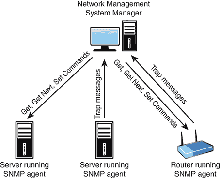
```

图 2.3 `SNMP` 如何工作

如图 2.3 所示，`SNMP` 有许多组件。接下来的讨论将涉及管理系统、代理、管理信息库和团体。

### SNMP 管理系统

`SNMP` 管理系统是一台运行名为 `network management system（NMS）`（网络管理系统）的特殊软件的计算机。这些软件应用程序可能是免费的，也可能花费数千美元。免费应用程序与昂贵应用程序之间的区别通常在于功能和支持。

所有 `NMS` 应用程序无论成本如何，都提供相同的基本功能。如今，大多数 `NMS` 使用网络图形地图来定位设备并对其进行查询。查询构建在应用程序中，并通过指向和点击触发。你可以从命令行实用程序发出 `SNMP` 请求，但由于可用工具非常多，这并没有必要。

> **注意**
>
> 有些人将 `SNMP` 管理器或 `NMS` 称为 `trap managers`。然而，这种说法具有误导性，因为 `NMS` 的功能不仅仅是接受代理的陷阱消息。

通过使用 `SNMP` 和 `NMS`，你可以从单一位置监控网络上的所有设备，包括交换机、集线器、路由器、服务器和打印机，以及任何支持 `SNMP` 的设备。

使用 `SNMP`，你可以坐在圣何塞的办公桌前查看雅加达服务器的可用磁盘空间，或重置赫尔辛基路由器的接口——然而，这种力量也带来了一些考虑因素。例如，由于 `NMS` 允许你重新配置网络设备，或至少从其获取信息，通常的做法是在 Linux 或 Windows 服务器等安全工作站平台上实施 `NMS`，并将 `NMS` PC 放置在安全位置。

### SNMP 代理

尽管 `SNMP` 管理器位于 PC 或服务器上，但作为 `SNMP` 结构部分的每个设备都需要启用 `SNMP` 功能。这是通过一个名为 `agent`（代理）的软件组件实现的。

`SNMP` 代理可以是任何可以运行小型软件组件以与 `SNMP` 管理器通信的设备。几乎任何设计用于连接网络的设备都支持 `SNMP` 代理功能。

除了为管理器与它们通信提供机制外，代理还可以在超过阈值时通知 `SNMP` 管理器。当这种情况发生时，运行 `SNMP` 代理的设备会向 `NMS` 发送陷阱（`trap`），然后 `NMS` 根据配置执行操作。基础的 `NMS` 系统可能会发出警报或在屏幕上闪烁消息。其他先进的产品可能会拨打手机或发送电子邮件。

### 管理信息库

尽管 `SNMP` 陷阱系统可能是 `SNMP` 最常用的方面，但管理器到代理的通信并不是单行道。除了使用 `SNMP` 查询命令 `Get` 和 `Get Next` 从设备中读取信息外，`SNMP` 管理器还可以发出 `Set` 命令。

如果你有一长串 `Get Next` 命令需要执行，可以使用 `Walk` 命令自动遍历这些命令。该命令的目的是节省管理器的时间：你在子树的根节点发出一个命令，该命令就会“遍历”通过，获取子树中每个节点的值。

为了演示 `SNMP` 命令如何工作，想象你和朋友各有一个列表，上面写着以下四个单词：four（四）、book（书）、sky（天空）和 table（桌）。

如果你作为管理器向你的朋友询问第一个值，她作为代理可以回答“four”。这类似于 `SNMP Get` 命令。现在，如果你询问下一个值，她会回答“book”。这类似于 `SNMP Get Next` 命令。

如果你接着说“set green”，你的朋友将单词 `book` 改为 `green`，你就执行了等同于 `SNMP Set` 命令的操作。听起来很简单？如果你能想象将列表扩展到包含 100 个值，你就能看到仅使用这些命令导航并设置列表中的任何参数。

然而，关键是要确保你和朋友拥有完全相同的列表——这就是 `Management Information Bases（MIBs）`（管理信息库）的作用所在。

`SNMP` 使用名为 `MIBs` 的信息数据库来定义哪些参数是可写的，哪些是只读的，哪些可以设置。`MIB` 适用于数千设备和服务，涵盖了各种想象到的需求。

为了确保 `SNMP` 系统提供跨平台兼容性，`MIB` 的创建由 `International Organization for Standardization（ISO）`（国际标准化组织）控制。想要创建 `MIB` 的组织可以向 `ISO` 申请。`ISO` 然后会分配该组织一个 ID，其可以根据意愿创建 `MIB`。数字的分配在一个名为 `hierarchical name tree`（分级名称树）的概念模型内进行结构化。

### SNMP 团体（SNMP Communities）

`SNMP communities` 是系统的逻辑分组。当一个系统被配置为某个团体的一部分时，它只与其他具有相同团体名称的设备通信。此外，它只接受来自具有其识别的团体名称的 `SNMP` 管理器的 `Get`、`Get Next` 或 `Set` 命令。

通常，默认定义两个团体：一个用于只读的公共团体（public），以及一个用于读写操作的私有团体（private）。

### 考试提醒

对于考试，你应该理解 `SNMP` 的概念：`Get`、`Trap`、`Walk` 和 `MIBs`。

是否使用 `SNMP` 取决于你拥有多少设备以及你的网络基础设施的分布式程度。即使在只有少数设备的环境中，`SNMP` 也可以很有用，因为它可以充当你的眼睛和耳朵，在网络发生问题时通知你。

### SNMPv3

`SNMP` 默认运行在端口 `161` 上，现在已是第三版本，这个版本有一些显著的差异。最明显的变化之一是，与 `SNMPv1` 和 `SNMPv2` 不同，`SNMPv3` 支持身份验证和加密：

- **身份验证：** 身份验证协议确保消息来自有效源。
- **加密：** 加密协议确保数据不会被非预期源读取。

### 考试提醒

你可能会被要求了解 `SNMPv2` 和 `SNMPv3` 之间的区别。记住，`SNMPv3` 支持身份验证和加密。

## 会话建立协议

长途电话费用昂贵，部分原因是维护电话线路和雇用技术人员保持电话响铃的成本很高。`IP 语音（VoIP）`为电话服务提供了一种更廉价的替代方案。`VoIP` 技术允许通过 IP 数据包传输并在互联网来实现常规语音对话。`VoIP` 通过现有的互联网基础设施避免了普通电话的高昂成本。不需要每月账单或昂贵的长途费用。但它是如何工作的呢？

与所有其他类型的网络通信一样，`VoIP` 需要协议来让“魔法发生”。对于 `VoIP` 来说，其中一种协议是 `会话建立协议（SIP）`，它是一种用于建立和维护多媒体会话（如网络电话）的应用层协议。

这意味着 `SIP` 可以为音频/视频会议、在线游戏和互联网上的点对点对话等功能创建通信会话。`SIP` 并非独立运行；它使用 `TCP` 或 `UDP` 作为传输协议。记住，`TCP` 能够保证数据包的交付，而 `UDP` 是一种“发后不管”的传输协议。`SIP` 的默认端口为 `5060` 和 `5061`。

### 考试提醒

`SIP` 运行在 OSI 模型的应用层，用于维护多媒体会话。`SIP` 使用端口 `5060` 和 `5061`。

### 提示

`SIP` 还包含一套安全服务，包括拒绝服务防护、身份验证（用户到用户和代理到用户）、完整性保护以及加密和隐私服务。

## 远程桌面协议


远程桌面协议 (`RDP`) 用于 Windows 环境中的远程连接。它默认运行在端口 `3389` 上。远程桌面服务 (`RDS`，正式称为终端服务) 提供了一种客户端系统连接到服务器（如 `Windows Server`）的方法，并通过使用 `RDP` 像操作本地客户端应用程序一样在服务器上进行操作。这种配置被称为瘦客户端计算，其中客户端系统使用服务器的资源而不是本地处理能力。

`Windows Server` 产品和最近的 Windows 客户端系统内置了使用 Windows 程序远程桌面连接进行远程的支持。用于管理连接的底层协议是 `RDP`。`RDP` 是一种低带宽协议，用于将服务器上的鼠标移动、击键和屏幕位图图像发送到客户端计算机。`RDP` 实际上并不通过连接发送数据——只发送屏幕截图和客户端按键。

## 服务器消息块

服务器消息块 (`SMB`) 用于网络上提供对运行在 Windows 上的文件、打印机、端口等资源的访问。例如，如果你想将基于 Linux 的主机连接到 Windows 共享打印机，你需要实现对 `SMB` 的支持；它默认运行在端口 `445` 上。

实现 `SMB` 支持的最常见方法之一是运行 `Samba`。

## 理解端口功能

在本章中提到协议的同时，也给出了默认端口。每个 `TCP/IP` 或应用程序至少关联一个默认端口。当接收到通信时，会检查目标端口号以确定其目标是哪个协议或服务。然后将请求转发到该协议或服务。例如，考虑 `HTTP`，其分配的端口号为 `80`。当网络浏览器为网页创建请求时，该请求被发送到目标系统的端口 `80`。当目标系统接收到请求时，它会检查端口号。当它看到端口是 `80` 时，它会将请求转发给 Web 服务器应用程序。

`TCP/IP` 有 `65,535` 个可用端口，其中 `0` 到 `1023` 被标记为已知端口。虽然对于 Network+ 考试不需要详细理解这 `65,535` 个端口，但你需要了解一些已知端口的数字。在与应用程序一起工作和配置服务时，网络管理通常要求你指定端口分配。表 2.4 显示了一些最常见的端口分配。

### 注意事项

`DNS` 和 `DHCP` 都出现在表格中，但本节未进行讨论。为了避免与目标的讨论重叠，它们将在本章稍后的部分进行详细讨论。

### 考试提醒

你应该关注表 2.4 中提供的信息，并将其应用于考试中可能收到的任何端口相关问题。例如，考试可能会向你展示一种无法访问特定服务的情况；你可能需要判断防火墙上的端口是开启还是关闭的。

**表 2.4 常用协议的 TCP/UDP 端口分配**

| 协议 | 端口分配 |
| :--- | :--- |
| **TCP 端口** | |
| FTP | 20 |
| FTP | 21 |
| SSH/SFTP | 22 |
| Telnet | 23 |
| SMTP | 25 |
| DNS | 53 |
| HTTP | 80 |
| POP3 | 110 |
| NTP | 123 |
| IMAP4 | 143 |
| LDAP | 389 |
| HTTPS | 443 |
| SMB | 445 |
| LDAPS | 636 |
| H.323 | 1720 |
| RDP | 3389 |
| SIP | 5060 |
| SIP | 5061 |
| **UDP 端口** | |
| DNS | 53 |
| DHCP (和 BOOTP server) | 67 |
| DHCP (和 BOOTP client) | 68 |
| TFTP | 69 |
| SNMP | 161 |
| RDP | 3389 |
| SIP | 5060 |

### 考试提醒

术语已知端口指范围从 `0` 到 `1023` 的端口。当 CompTIA 说“识别已知端口”时，它指的就是这个。

### 注意事项

你可能已经从表 2.4 中注意到有两个端口关联到 `FTP`（以及一些其他协议）。对于 `FTP` 来说，端口 `20` 被认为是数据端口，端口 `21` 被认为是控制端口。在实际使用中，`FTP` 连接使用端口 `21`。端口 `20` 在现代实现中很少使用。

## ARP 和 RARP

### ARP

`Address Resolution Protocol (ARP)`（在 `RFC 826` 中被定义）负责将 IP 地址解析为介质访问控制 (`MAC`) 地址。当一个系统尝试联系另一个主机时，IP 会通过查看 IP 地址来确定另一个主机是否位于同一个网络中。如果 IP 确定目标位于本地网络上，它将查询 `ARP` 缓存查看是否有相应的条目。`ARP` 缓存是本地系统上的一个表，存储了数据链路层地址（`MAC` 地址或物理地址）与网络层地址（IP 地址）之间的映射。以下是 `ARP` 缓存的示例：

```
Interface: 192.168.1.66 --- 0x8
Internet Address    Physical Address    Type
192.168.1.65        00-1c-c0-17-41-c8   dynamic
192.168.1.67        00-22-68-cb-e2-f9   dynamic
192.168.1.254       00-18-d1-95-f6-02   dynamic
224.0.0.2           01-00-5e-00-00-02   static
239.255.255.250     01-00-5e-7f-ff-fa   static
```

如果 `ARP` 缓存中没有该主机的条目，会在本地网络上发送广播，请求目标 IP 地址的主机发送其 `MAC` 地址。通信以广播形式发送是因为在没有目标系统的 `MAC` 地址，源系统无法与目标系统直接通信。

由于通信是广播，网络上的每个系统都会接收到。然而，只有目标系统会回复，因为只有它的 IP 地址与请求匹配。目标系统识别出 `ARP` 请求是针对自己的，会直接回复源系统。它之所以这样做是因为 `ARP` 请求中包含了发送请求的系统的 `MAC` 地址。如果确定目标主机与发送主机不在同一个子网，则 `ARP` 过程将针对默认网关执行，然后在发送主机与接收主机之间的旅程每一步中重复执行。表 2.5 列出了配合 `arp` 命令常用的开关。

#### 考试重点

`ARP` 将 IP 地址与以太网地址（`MAC` 地址）连接起来。

#### 表 2.5 常用的 arp 命令开关

| 开关 | 说明 |
| :--- | :--- |
| `-a` | 显示 `ARP` 缓存中的条目 |
| `-s` | 手动向 `ARP` 缓存添加永久条目 |
| `-d` | 从 `ARP` 缓存中删除条目 |

当你操作 `ARP` 缓存时，可以动态或静态地创建条目。对于动态条目，`ARP` 缓存会自动更新。`ARP` 缓存的维护不需要用户干预。动态条目是最常用的。静态条目是使用 `arp -s` 命令手动配置的。静态条目成为 `ARP` 缓存的永久添加项，直到使用 `arp -d` 命令将其删除。

### RARP

反向地址解析协议 (`RARP`) 功能与 `ARP` 相同，但方向相反。换句话说，它将 `MAC` 地址解析为 IP 地址。`RARP` 使应用程序或系统能够从路由器或域名系统 (`DNS`) 服务器学习它们自己的 IP 地址。这种解析对于在 `DNS` 中执行反向查找等任务很有用。`RARP` 定义在 `RFC 903` 中。

#### 提示

`ARP` 的功能是将系统的 IP 地址解析为该系统接口的 `MAC` 地址。不要将 `ARP` 与 `DNS` 或 `WINS` 混淆，它们也执行解析功能，但针对不同的内容。

## 强化自测验

**1.** TCP 是哪种传输协议的示例？

**A.** 连接建立

**B.** 依赖连接

**C.** 连接相关

**D.** 无连接

**2.** 下列哪些被认为是传输协议？（选择两个最佳答案。）

**A.** TCP

**B.** IP

**C.** UDP

**D.** THC

**3.** `ARP` 的功能是什么？

**A.** 它将 `MAC` 地址解析为 IP 地址。

**B.** 它将 NetBIOS 名称解析为 IP 地址。

**C.** 它将 IP 地址解析为 `MAC` 地址。

**D.** 它将主机名解析为 IP 地址。

**4.** `NTP` 的功能是什么？

**A.** 它提供了一种共享身份信息的机制。

**B.** 它用于访问 Linux 系统上的共享文件夹。

**C.** 它用于向中央管理器通信利用信息。

**D.** 它用于在系统之间通信时间同步信息。

**5.** 下列哪个协议提供保证送达？

**A.** FTP

**B.** POP

**C.** IP

**D.** TCP

**6.** 下列哪些端口与 H.323 相关？

**A.** 443

**B.** 1720

**C.** 636

**D.** 3389

**7.** 默认情况下，哪个协议使用端口 68？

**A.** DHCP

**B.** DNS

**C.** SMB

**D.** SMTP

**8.** SNMP 数据库称为什么？

**A.** HOSTS

**B.** MIBs

**C.** WINS

**D.** Agents

**9.** SNMP 系统的逻辑分组称为什么？

**A.** Communities

**B.** Pairs

**C.** Mirrors

**D.** Nodes

**10.** SNMPv3 支持而以前版本不具备的两个功能是什么？

**A.** 身份验证

**B.** 动态映射

**C.** 平台独立性

**D.** 加密

## 强化自测验答案

**1. A.** TCP 是面向连接的传输协议的示例。UDP 是无连接协议的示例。*依赖连接*和*连接相关*不是与协议相关的常用术语。

**2. A, C.** TCP 和 UDP 都是传输协议。IP 是网络协议，而 THC 不是有效的协议。

**3. C.** `ARP` 将 IP 地址解析为 `MAC` 地址。答案 A 描述的是 `RARP` 的功能，答案 B 描述的是一个无关的过程，答案 D 描述的是 `DNS` 解析过程。

**4. D.** `NTP` 用于在系统之间通信时间同步信息。网络文件系统 (NFS) 是通常用于访问 Linux 系统上共享文件夹的协议。利用信息通常通过使用 `SNMP` 向中央系统通信。

**5. D.** TCP 是一种保证数据送达的面向连接协议。FTP 是用于传输大块数据的协议。POP 代表邮局协议，不是正确答案。

**6. B.** H.323 的默认端口是 1720。HTTPS 默认使用端口 443，而 LDAPS 使用 636，RDP 使用端口 3389。

**7. A.** DHCP 默认使用端口 68（同时还有 67）。DNS 使用端口 53，SMB 使用 445，SMTP 使用端口 25。

**8. B.** SNMP 使用称为 MIB 的信息数据库来定义哪些参数是可以访问的，哪些参数是只读的，以及哪些是可以设置的。

**9. A.** SNMP 团体是系统的逻辑分组。当一个系统被配置为团体的一部分时，它仅与其他具有相同团体名称的设备进行通信。

**10. A, D.** SNMPv3 支持身份验证和加密。

## 网络服务

解释网络服务的功能。

### CramSaver（快速复习指南）

如果你在阅读本节之前能够正确回答这些问题，可以通过跳过本节中的考试提醒（Exam Alerts）并完成节末的突击测验（Cram Quiz）来节省时间。

1. DHCP 中可用 IP 地址范围的名称是什么？

2. 配置为使用 DHCP 的系统在接入网络时，其用于 DHCP 广播的包名称是什么？

3. 什么是动态 DNS？

4. 在 DNS 内部，域名以及任何子域名称为什么？

### 答案

1. 在 DHCP 中，IP 地址范围被称为 `scopes`（范围）。

2. 当配置为使用 DHCP 的系统接入网络时，它会广播一个特殊的包来寻找 DHCP 服务器。这个包被称为 `DHCPDISCOVER` 包。

3. 动态 DNS 是一种较新的系统，允许主机动态地注册到 DNS 服务器上。

4. 域名以及任何子域名称为 `fully qualified domain name (FQDN)`（完全限定域名），因为它包含了从 DNS 命名空间顶部到主机的所有组件。

网络服务提供了使网络运行的功能。虽然有很多可用服务，但考试中需要掌握的四种是 DNS、DHCP、NTP 和 IPAM。

### 域名系统 (DNS)

DNS 在基于 TCP/IP 的网络中发挥着重要作用。它将主机名（例如 `www.quepublishing.com`）解析为 IP 地址（例如 `209.202.161.67`）。这种解析系统使人们能够使用易记的主机名来记忆和引用频繁使用的主机，而不是难以记忆的 IP 地址。默认情况下，DNS 运行在端口 `53`。

**注意**

与其它基于 TCP/IP 的服务一样，DNS 是一个与平台无关协议。因此，它可以用于 Linux、UNIX、Windows 以及几乎所有其他平台。

在互联网出现之前，后来成为互联网的网络使用一个名为 `HOSTS` 的文本文件执行名称解析。`HOSTS` 文件会定期更新更改并分发到其他服务器。以下是 `HOSTS` 文件中一些条目的示例：

```
192.168.3.45     server1   s1            #主文件和打印服务器
192.168.3.223    Mail      mailserver    # 电子邮件服务器
127.0.0.1        localhost
```

**注意**

`HOSTS` 文件中的注释以哈希号（`#`）开头。

如你所见，列出了主机的 IP 地址以及对应的主机名。你可以为 `HOSTS` 文件添加服务器名称的别名，在本例中为 `s1` 和 `mailserver`。所有条目必须手动添加，并且每个执行解析的系统都必须拥有该文件的副本。

即使在互联网增长速度较慢时期，这种机制既繁琐又容易出错。很明显，随着网络增长，需要一种更自动化、动态的名称解析方法。DNS 就成了这种方法。

**提示**

大多数平台仍然支持 `HOSTS` 文件解析。如果你只需要解析几个不经常更改或不更改的主机，你仍然可以使用 `HOSTS` 文件来实现。

DNS 通过配置为作为名称服务器的服务器提供解析，从而解决了名称解析问题。名称服务器运行 DNS 服务器软件，使其能够接收、处理并回复来自想要将主机名转换为 IP 地址的系统的请求。向 DNS 服务器请求主机名到 IP 地址映射的系统被称为 `resolvers`（解析器）或 `DNS clients`。图 2.4 显示了 DNS 解析过程。在本例中，客户端请求访问 `mycoltd.com` 的第一台服务器；路由器转向 DNS 服务器获取该服务器关联的 IP 地址；地址返回后，客户端即可建立连接。

*图 2.4 DNS 解析过程*

由于 DNS 命名空间（将在下一节中讨论）很大，单个服务器无法持有整个命名空间的所有记录。因此，特定的 DNS 服务器很有可能无法解析某个条目的请求。在这种情况下，DNS 服务器会询问另一个 DNS 服务器是否有该主机的条目。

**注意**

DNS 的问题之一是，尽管具有所有的自动解析能力，但条目及其对这些条目的更改仍必须手动执行。解决此问题的策略是使用 `Dynamic DNS (DDNS)`，这是一种较新的系统，允许主机动态地注册到 DNS 服务器上。通过对主机名、地址和相关信息进行实时更改，减少了找不到最近添加或更改的服务器或站点的概率。

**考试提醒**

你可能会被要求识别 DNS 和 DDNS 之间的区别。

### DNS 命名空间


DNS 在`DNS 命名空间`中运行。该空间按`hierarchically`（层级）组织进行逻辑划分。顶级是如`.com`（商业）和`.edu`（教育）等域名，以及国家域名如`.uk`（英国）和`.de`（德国）。顶级之下是与组织或商业公司相关的子域名或二级域名，例如 Red Hat 和 Microsoft。在这些域名内，可以分配主机或其他子域名。例如，服务器`ftp.redhat.com`将位于`redhat.com`域名下。图 2.5 显示了 DNS 层级命名空间。

```
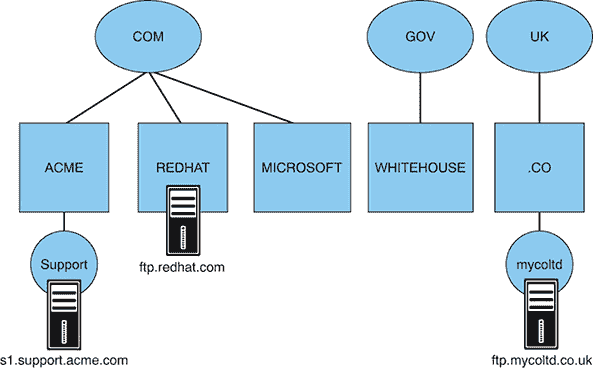
```

图 2.5 DNS 层级命名空间

**考试提醒**

域名以及任何子域名称为`fully qualified domain name (FQDN)`（完全限定域名），因为它包含了从 DNS 命名空间顶部到主机的所有组件。

**注意**

许多人将 DNS 称为`将 FQDN 解析为 IP 地址`。FQDN 的示例是`www.comptia.org`，其中`www`是主机，`comptia`是二级域名，`.org`是顶级域名。

低级域名在很大程度上允许域名持有者以认为合适的任何方式使用。然而，顶级域名受到相对严格的控制。表 2.6 列出了一些最广泛使用的顶级 DNS 域名。最近添加了一些顶级域名，主要是为了满足对主机名日益增长的需求。

表 2.6 DNS 命名空间中选定的顶级域名

| 顶级域名 | 预期用途 |
| :--- | :--- |
| `com` | 商业组织 |
| `edu` | 教育机构/机构 |
| `gov` | 美国政府组织/机构 |
| `net` | 网络提供商/中心 |
| `org` | 非营利和其他组织 |
| `mil` | 军事 |
| `arpa` | 反向 DNS 查询 |
| `de` | 特定国家域名——在本例中，是德国* |

*除了国家特定域名外，许多国家还创建了遵循原始顶级域名大致原则的子域名（如`co.uk`和`gov.nz`）。

尽管域名的分配应该符合表 2.6 所示的结构，但名称的分配并没有你想象的那么受严格控制。某些域名被用于其他用途并不罕见，例如将`.org`或`.net`用于业务经营。

## 注意事项

尽管 DNS 的主要功能是将主机名解析为 IP 地址，但你也可以让 DNS 执行 IP 地址到主机名的解析。这一过程被称为`reverse lookup`（反向查询），通过使用`pointer (PTR)`记录来实现。

## 考试提示

考试中，请记住`PTR`记录用于反向查询功能。

## DNS 条目类型

虽然 DNS 数据库中最常见的条目是`A`（地址）记录，它将主机名映射到 IP 地址，但 DNS 还可以包含许多其他类型的条目。例如`MX`记录，它可以映射到对应邮件交换系统的条目；以及`CNAME`（规范名称记录），它可以为一个系统创建别名记录。一个系统可以有一个`A`记录，然后为其别名拥有多个`CNAME`条目。包含所有这些类型条目的 DNS 表可能如下：

```
fileserve.mycoltd.com IN   A   192.168.33.2
email.mycoltd.com     IN   A   192.168.33.7
fileprint.mycoltd.com IN CNAME fileserver.mycoltd.com
mailer.mycoltd.com    IN  MX  10   email.mycoltd.com
```

如你所示，`CNAME`和`MX`记录条目并不是映射到实际 IP 地址，而是映射到另一个主机，DNS 随后可以将将其解析为 IP 地址。

## DNS 记录

每个 DNS 名称服务器都通过一系列记录维护其区域（或域）的信息，这些记录被称为 DNS 资源记录。有多种类型的 DNS 资源记录；每条记录都包含有关 DNS 域及其内部系统的信息。这些记录是存储在 DNS 服务器上的文本条目。某些 DNS 资源记录包括以下内容：

- **起始权威 (SOA):** 一种包含 DNS 域和其他 DNS 记录数据的信息记录。DNS 区域是域中由单个 DNS 服务器负责的部分。每个区域包含包含一个`SOA`记录。

- **名称服务器 (NS):** 存储标识域内存储该域信息的名称服务器的信息。

- **服务定位器 (SRV):** 这是一种通用的服务位置记录，用于较新的协议，而不是创建如`MX`等特定协议的记录。

- **规范名称 (CNAME):** 存储域内主机的额外主机名或别名。`CNAME`指定了`域名系统服务 (DNS)`数据库中规范主机名记录的别名或昵号。`CNAME`记录允许单台计算机拥有多个名称（别名）。

- **指针 (PTR):** 指向规范名的指针，用于执行反向 DNS 查询；在这种情况下，当查询源自 IP 地址时将返回名称。

## 考试提示

最常见的 DNS 区域类型是正向查询区域，它允许 DNS 客户端获取与 DNS 域对应的 IP 地址等信息。请记住，反向查询区域是从 IP 地址映射回 DNS 域名的。

- **IPv6 地址 (AAAA):** 存储`IPv6`（128 位）地址的信息。它最常用于将主机名映射到主机 IP 地址。

- **IPv4 地址 (A):** 存储`IPv4`（32 位）地址的信息。它最常用于将主机名映射到主机 IP 地址。

- **文本 (TXT):** 该字段最初是为了在 DNS 记录中携带人类可读的文本，但该用途早已过去。今天，它更常见地持有机器可读的数据，例如`SPF`（发送者策略框架）和`DKIM`（域密钥识别邮件）。

- **邮件交换 (MX):** 存储该域邮件应该投递的位置信息。

## 考试提示

考试目标专门列出了 DNS 记录。你应该会遇到关于记录`A`、`MX`、`AAAA`、`CNAME`、`NS`、`SRV`、`TXT`或`PTR`的问题。

## 实际实现中的 DNS

在现实场景中，是否使用 DNS 几乎不是问题。如果你有互联网访问，你肯定会使用 DNS，但你很可能会使用你的`互联网服务提供商 (ISP)`的 DNS 功能，而不是拥有自己的内部 DNS 服务器——这被称为`外部 DNS`。然而，如果你运营一个大型、复杂的多平台网络，你可能会发现内部 DNS 服务器是必要的。主要的网络操作系统供应商知道你可能在组织中需要 DNS 功能，因此它们在产品中包含了 DNS 服务器应用程序，使得第三方/云托管的 DNS 成为可能。例如，Google 提供`Cloud DNS`，它是一种“低延迟、高可用性且让你的应用程序和服务面向用户的高成本效益的方法”（更多信息请参阅[`cloud.google.com/dns/`](https://cloud.google.com/dns/)））。

工作站配置两个 DNS 服务器的 IP 地址是常见做法（例如通过 Windows 中的备用配置选项卡）。DNS 的重要性在频繁使用互联网的环境中不言喻。如果缺少 DNS，互联网实际上将无法使用，除非你能记住所有网站的 IP 地址。

## Windows 网上名称服务 (WINS)

在 Windows 网络上，你可以使用名为`WINS`的系统来启用网络基本输入输出系统 (NetBIOS) 名称解析为 IP 地址。NetBIOS 名称解析在 Windows 网络中是必要的，以便系统可以使用 NetBIOS 计算机而不是 IP 地址进行相互查找和访问。对于人类来说，记住名为`secretary`的计算机比记住其 IP 地址`192.168.2.34`要容易得多。NetBIOS 名称需要解析为 IP 地址，随后通过`ARP`解析为 MAC 地址。

可以通过三种方法进行解析。最简单的方法是在网络上使用`WINS`服务器自动执行 NetBIOS 名称解析。如果没有`WINS`服务器，则可以使用`LMHOSTS`文件静态执行 NetBIOS 名称解析。使用`LMHOSTS`文件需要你手动配置至少一个包含条目的文本文件。正如你想象的，这是一个耗时的过程，特别是当网络系统频繁变化时。第三种方法也是默认方法，即系统使用广播解析 NetBIOS 名称。这种方法有两个问题：首先，广播会产生额外的网络流量；其次，除非路由器配置了转发，否则广播无法跨越路由器。这意味着网段之间的解析是不可能的。

DHCP 在`RFC 2131`中定义，它允许在运行 DHCP 服务器应用程序的系统上定义 IP 地址范围，这些范围被称为`scopes`（范围）或`address pools`（地址池）中的预定义地址组。当另一个被配置为 DHCP 客户端的系统进行初始化时，它会向服务器请求地址。如果一切正常，服务器将从范围中分配一个地址给客户端，持续预定的时间，这被称为`lease`（租约）或`lease time`（租约时间）。

在租约 TTL 期间的多个时间点（通常是 50% 和 85% 处），客户端会尝试向服务器续约租约。如果服务器无法执行续约，租约将在 100% 时过期，客户端将停止使用该地址。

除了 IP 地址和子网掩码外，DHCP 服务器还可以提供许多其他信息；然而，具体可以提供哪些内容取决于 DHCP 服务器的实现。除了地址信息外，通常还会提供默认网关和 DNS 信息。

除了让 DHCP 从范围中提供随机地址外，你还可以配置`scope options`（范围选项），例如让它为客户端提供特定地址。这种安排被称为`reservation`（预留）（参见图 2.6）。预留让你仍然对某个系统使用 DHCP，但同时保证其始终具有相同的 IP 地址。当基于 MAC 地址时，这被称为`MAC reservations`（MAC 预留）。DHCP 还可以配置排除，也称为`IP exclusions`（IP 排除）。在这种情况下，某些 IP 地址不会分配给客户端系统。

```
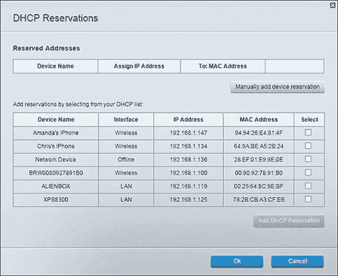
```

图 2.6 DHCP 预留

使用 DHCP 的优点非常多。首先，管理员不需要手动配置每个系统。其次，它消除了人为错误（例如分配重复的 IP 地址）。第三，如果系统从一个子网移动到另一个子网，或者你决定彻底更改 IP 地址结构，DHCP 无需重新配置系统。缺点是 DHCP 流量是基于广播的，因此会产生网络流量——尽管量很。最后，必须在服务器上安装并配置 DHCP 服务器软件，这可能会给该系统带来额外的处理器负载（再次，是微不足道的）。从管理的角度来看，在初始配置之后，DHCP 几乎是免维护的服务，通常只需要偶尔进行监控。

**考试要点**

DHCP 是一个取决于协议的服务，而不依赖于平台。这意味着例如，你可以使用 Linux DHCP 服务器用于拥有 Windows 客户端或 Linux 客户端的网络。虽然各种网络操作系统提供的 DHCP 服务器产品可能略有不同，但基本功能在范围内是一致的。同样，运行在不同操作系统平台上的 DHCP 服务器的客户端配置，与运行在相同基础操作系统平台上的 DHCP 服务器的配置是相同的。

## DHCP 流程

为了更好地理解 DHCP 如何工作，请花几分钟查看启用 DHCP 的客户端连接到网络时发生的过程。当配置为使用 DHCP 的系统进入网络时，它会广播一个特殊的数据包来寻找 DHCP 服务器。该数据包被称为`DHCPDISCOVER`数据包。DHCP 服务器一直在寻找`DHCPDISCOVER`广播，它会获取该数据包并将其与其定义的范围进行比较。如果它发现自己有一个对应数据包源网络的范围，它就会从该范围中选择一个地址并将其预留，并将地址以及任何其他信息（如租约时长）发送给客户端。这被称为`DHCPOFFER`数据包。由于客户端还没有 IP 地址，这种通信也是通过广播实现的。默认情况下，DHCP 运行在端口`67`和`68`上。

**考试要点**

记住 DHCP 运行在端口`67`和`68`上。

当客户端收到报价时，它查看报价以判断是否合适。如果收到了多个报价（这在配置了多个 DHCP 服务器时可能会发生），则对报价进行比较以查看哪个是最好的。在此背景下，“最佳”可能涉及多种标准，但通常是租约的长度。当选择过程完成后，客户端通过名为`DHCPREQUEST`的数据包通知服务器报价已被接受。此时，服务器完成报价并向客户端发送确认。最后这条消息以广播形式发送，被称为`DHCPACK`数据包。在客户端系统收到`DHCPACK`后，它会初始化 TCP/IP 协议并在网络上进行通信。

## DHCP 和 DNS 后缀

在 DNS 中，`suffixes`（后缀）定义了要使用的 DNS 服务器及其使用的顺序。DHCP 设置可以将域域名后缀搜索列表推送到 DNS 客户端。当此类列表被特定地提供给客户端时，客户端将仅使用该列表进行名称解析。对于 Linux 客户端，可以通过在`resolve.conf`文件中指定条目来实现。

**考试要点**

知道 DHCP 可以为客户端提供 DNS 后缀。

## DHCP 中继和 IP 助手

在大型网络中，DHCP 服务器可能会因尝试响应所有请求而变得缓慢。为了让工作更容易，`DHCP relays`（DHCP 中继）可以提供帮助。DHCP 中继只是路由器上的一个代理，充当客户端和服务器之间的中间人。这在处理位于不同子网的客户端时非常有用，因为客户端在分配到 IP 配置信息之前无法直接与服务器通信。

在 DHCP 中继之上是`IP helper`。这两个术语通常用作同义词，但并不是；更好的理解方式是`IP helper`是`DHCP relay`的超集。默认情况下，`IP helper`会转发`DHCP/BOOTP`、`TFTP`、`DNS`、`TACACS`、时间服务以及 NetBIOS 名称/数据报服务（`137–139`）的广播。你可以禁用额外的流量（或添加更多），但默认情况下`IP helper`的功能更多。

**考试要点**

知道`IP helper`的功能比`DHCP relay`多。

## IP 地址管理

与 DHCP 和 DNS 都紧密相关的`IP Address Management (IPAM)`（IP 地址管理）是规划、跟踪和管理网络中使用的 IP 地址的手段。IPAM 集成了 DNS 和 DHCP，使两者都能感知对方的变化。它还可以控制 DHCP 中的预留并跟踪数据，例如正在使用的 IP 地址、IP 在什么时间分配给哪个设备以及 IP 分配给了哪个用户。这些信息在故障排除和调查怀疑的滥用时可能是无的。Windows Server 提供了一套 IPAM 工具。要了解更多关于 Windows Server 中的 IPAM，请访问`https://technet.microsoft.com/en-us/library/hh83153(v=ws.11).aspx`。

## 网络时间协议

在本章的端口和协议部分讨论过，`NTP`用于在包交换、变延迟数据网络上同步所有参与的计算机系统，它是目前使用的最老的 Internet 协议之一。

## 测验

**1.** 一位程序员要求 DHCP 始终为其工作站分配相同的 IP 地址。DHCP 的哪个功能可以让你实现这一点？

A. Stipulation（规定）

B. Rider（附加）

C. Reservation（预留）

D. Provision（提供）

**2.** 以下哪项*不是*正常 DHCP 过程中发送的常见数据包？

A. DHCPACK

B. DHCPPROVE

C. DHCPDISCOVER

D. DHCPOFFER

**3.** 在与你的 ISP 技术支持代表讨论时，他提到你可能一直在使用错误的`FQDN`。他指的是哪种基于 TCP/IP 的网络服务？

A. DHCP

B. WINS

C. SNMP

D. DNS

**4.** 哪种`DNS`记录存储域内主机的额外主机名或别名？

A. ALSO

B. ALIAS

C. CNAME

D. PTR

**5.** 哪种`DNS`记录最用于将具有`IPv6`地址的主机名映射到其 IP 地址？

A. A

B. AAAA

C. MX

D. PTR

## 习验测试答案

**1. C.** 预留（Reservations）是为客户端保留的特定地址。

**2. B.** `DHCPPROVE`不是一种常见的数据包。提供的其他选项（`DHCPACK`、`DHCPDISCOVER`和`DHCPOFFER`）都是正常过程的一部分。

**3. D.** `DNS`是将主机名解析为 IP 地址的系统。`FQDN`一术用于描述整个主机名。其他服务均不使用`FQDN`。

**4. C.** `CNAME`记录存储域内主机的额外主机名或别名。没有`ALSO`记录或`ALIAS`，而`PTR`用于反向查找。

**5. B.** `AAAA`记录最常用于将具有`IPv6`地址的主机名映射到其 IP 地址。`A`记录不用于此目的。`MX`识别邮件交换器，而`PTR`用于反向查找。

## 接下来做什么

`TCP/IP`协议族是当今网络上应用最广泛的协议。因此，它是 Network+ 考试中的一个重要课题。第 3 章“地址、路由与交换”从讨论`TCP/IP`较为复杂的方面之一开始：地址。

# 第 3 章：地址、路由与交换


本章涵盖了以下官方 Network+ 目标：

-  解释路由和交换的概念和特征。
-  给定场景配置适当的 `IP` 地址组件。

本章涵盖了 CompTIA Network+ 目标 1.3 和 1.4。有关官方 Network+ 考试主题的更多信息，请参见引言中的“关于 Network+ 考试”部分。

毫无疑问，`TCP/IP` 协议族是当今网络上应用最广泛的协议。因此，它是 Network+ 考试中的一个重要课题。为了通过考试，你绝对需要理解本章介绍的内容。

本章涉及管理路由和交换的概念。然而，它从讨论 `TCP/IP` 较为复杂的方面之一开始：地址。

## IP 地址

 **给定场景，配置适当的 IP 地址组件。**

### CramSaver

如果你在阅读本节内容之前能正确回答这些问题，可以通过略读本节中的考试提示（Exam Alerts），然后完成节末尾的习验测试来节省时间。

1. A 类地址使用多少个字节（octets）来表示网络部分？
2. C 类地址在第一个字节中的范围是多少？
3. 私有网络预留的 `IPv4` 范围是什么？

### 答案

1. A 类地址仅使用第一个字节来表示网络部分，B 类地址使用两个字节，C 类地址使用三个字节。
2. C 类地址的范围从 `192` 到 `223`，默认子网掩码为 `255.255.255.0`。
3. 私有网络是任何限制访问的网络。预留的 `IP` 地址有 `10.0.0.0`、`172.16.0.0` 到 `172.31.0.0` 以及 `192.168.0.0`。

IP 地址是 `TCP/IP` 最具挑战性的方面之一。它甚至能让最丰富的网络管理员也头疼。幸运的是，Network+ 考试只需要 `IP` 地址的基础知识。接下来的章节将查看 `IPv4` 和最新版本的 IP（`IPv6`）的 IP 地址是如何工作的。

要使用 `TCP/IP` 在网络上进行通信，每个系统必须分配一个唯一的地址。该地址定义了设备所属的网络编号以及该网络上的节点编号。换句话说，`IP` 地址提供了两个信息。这有点就像家庭地址中的街道名和门牌号。

### ExamAlert

`node`（节点）或 `host`（主机）是连接到网络的任何设备。节点可能是客户端、服务器、打印机、路由器或网关。

逻辑网络段上的每个设备必须与该段上的所有其他设备具有相同的网络地址。然后该网络段上的所有设备必须具有不同的节点地址。

在 `IP` 地址中，另一组数字称为子网掩码，定义了 `IP` 地址的哪部分是指网络地址，哪部分是指节点（主机）地址。

IP 地址在 `IPv4` 和 `IPv6` 中是不同的。

## IPv4

`IPv4` 地址由四组 8 位组成，称为字节（octets）。最左侧位的值为 `128`，随后是 `64`、`32`、`16`、`8`、`4`、`2` 和 `1`。字节中的每个位可以是 `1` 或 `0`。

表 3.1 显示了一些十进制转二进制的示例。

### 表 3.1 十进制转二进制的转换

| 十进制值 | 二进制值 | 十进制计算 |
| :--- | :--- | :--- |
| 10 | `00001010` | 8 + 2 = 10 |
| 192 | `11000000` | 128 + 64 = 192 |
| 205 | `11001101` | 128 + 64 + 8 + 4 + 1 = 205 |
| 223 | `11011111` | 128 + 64 + 16 + 8 + 4 + 2 + 1 = 223 |

## IP 地址分类

IP 地址被分为逻辑划分，称为类（classes）。`IPv4` 地址空间有五个地址类（A 到 E）；但只有三类（A、B 和 C）分配给客户端。D 类预留用于组播地址，E 类预留用于未来开发。

在分配地址的三个类中，每类都使用固定长度的子网掩码来定义网络与节点（主机）地址之间的划分。A 类地址仅使用第一个字节表示网络部分；B 类地址使用两个字节；C 类地址使用三个字节。这种系统的结果是 A 类的网络地址少，但每个 A 类地址都有大量的可能的主机地址。B 类的网络更多，但每个 B 类地址的主机数较少。C 类的网络更多，但每个 C 类地址的主机数更少。具体数字请见表 3.2。

准备好回答要求你识别 IP 类范围的题目，例如 A 类网络的 IP 范围。

### 表 3.2 IPv4 地址类及可用网络/主机地址数量

| 地址类 | 范围 | 网络数量 | 每个网络的主机数量 | 第一字节的二进制值 |
| :--- | :--- | :--- | :--- | :--- |
| A | 1 to 126 | 126 | 16,777,214 | `09780789758750xxx` |
| B | 128 to 191 | 16,384 | 65,534 | `109780789758750xx` |
| C | 192 to 223 | 2,097,152 | 254 | `1109780789758750x` |
| D | 224 to 239 | N/A | N/A | `11109780789758750` |
| E | 240 to 255 | N/A | N/A | `11119780789758750` |

### 注意事项

注意表 3.2 中的网络编号 `127` 未包含在任何范围内。`127.0.0.1` 网络 ID 留给 `IPv4` 本地回环。本地回环是故障排除过程中所用协议族的功能。

### 考试提示

对于 Network+ 考试，请准备好识别给定地址属于哪一类。还要准备好识别 `IPv4` 回环地址。回环地址是 `127.0.0.1`。

## 子网掩码分配

与 IP 地址一样，`subnet mask` 最常用的表示形式是 32 位点十进制格式。不过，与 IP 地址不同，子网掩码只执行一个功能——它定义 IP 地址的哪些部分指向网络地址，哪些部分指向节点（主机）地址。用于地址分配的每类 IP 地址都有与其关联的默认子网掩码。表 3.3 列出了这些默认子网掩码。

### 表 3.3 与 IP 地址类关联的默认子网掩码

| 地址类 | 默认子网掩码 |
| :--- | :--- |
| A | `255.0.0.0` |
| B | `255.255.0.0` |
| C | `255.255.255.0` |

### 考试提示

你可能会遇到关于地址类和相应默认子网掩码的问题。在考试前复习表 3.3。

## 子网划分

现在你已经了解了 `IPv4` 地址的用法，你就可以学习子网划分的过程了。`Subnetting` 是一个通过 IP 地址的节点（主机）部分来创建比使用默认子网掩码时更多的网络的过程。

为了说明子网划分，例如，假设你被分配了 B 类地址 `150.150.0.0`。使用该地址和默认子网掩码，你可以拥有单一网络（`150.150`），并将地址的其余部分节点地址。这将为你提供大量的可能的节点地址，但在现实中可能并不可用。通过子网划分，你使用地址中节点部分的位来创建更多的网络地址。这减少了每个网络中的节点数量，但你可能仍然拥有足够的数量。

以下是子网划分的两个主要原因：

-  它能让你更有效地使用 IP 地址范围。
-  它通过提供创建多个网络而非仅一个网络的机制，使 IP 网络更安全、更易管理。使用多个网络可以将流量限制在它所在的网络中，从而降低整体网络流量水平。多个子网还创建了更多的广播域，从而减少了全网广播流量。广播域和 `collision domains`（冲突域）之间存在区别：后者是所有连接的节点，而前者是可以相互到达的所有逻辑节点。因此，冲突域通常是广播域的子集。

### 考试提示

子网划分不会增加可用 IP 地址的数量。它增加了网络 ID 的数量，结果减少了每个网络中的节点 ID。它还创建了更多广播域。路由器不转发广播，因此它们被限制在源网络中。

通过 `可变子网掩码 (VLSM)`，可以在不同的子网上为同一个网络编号使用不同的子网掩码。这样，网络管理员可以在主机较少的网络上使用长掩码，在主机多的子网上使用短掩码，从而允许路由系统中的每个子网都根据所需尺寸正确调整。所使用的路由协议（`EIGRP`、`OSPF`、`RIPv2`、`IS-IS` 或 `BGP`）必须能够在路由更新中发布每个子网的掩码，这意味着它必须是无类的。稍后讨论无类域间路由。

## 识别 IPv4 公有网络和私有网络的区别

IP 划分涉及许多考虑，其中包括：

-  公有网络是任何人都可以连接的网络。此类网络的最佳（可能也是唯一纯粹的）例子是互联网。
-  私有网络是任何限制访问的网络。企业网络和学校网络都是示例。

### 注意事项

互联网地址分配机构 (IANA) 负责为公有网络分配 IP 地址。然而，由于维护执行这些任务所需的系统和过程的工作量巨大，IANA 将分配过程委托给了若干区域机构。欲更多信息请访问 [`www.iana.org/numbers`](http://www.iana.org/numbers)。

公有网络和私有网络的主要区别（除了访问——私有网络受到严格控制，而公有网络的访问不受限之外）在于，公有网络上设备的划分必须经过仔细考虑。私有网络上的划分灵活性更大。

如所述，为了让网络上的主机通过 `TCP/IP` 通信，它们必须具有唯一的地址。此数字定义了每个主机所属的逻辑网络以及该主机在该网络上的地址。例如，在一个具有三个逻辑网络且每个网络有 100 个节点的私有网络上，划分并不是一项困难的任务。然而，在互联网规模的网络上，划分是复杂的。

如果你将系统连接到互联网，你需要获取一个有效的注册 IP 地址。最常见的方法是从你的 `互联网服务提供商 (ISP)` 获得该地址。或者，如果你需要大量地址，例如，你可以联系负责你所在地址分配的机构。你可以通过访问 IANA 网站确定你所在区域的区域机构是谁。

由于业务性质，ISP 拥有可以分配给客户的大型 IP 地址块。如果你需要注册的 IP 地址，从 ISP 获取几乎比通过区域机构要简单得多。但是，如果你停止了与 ISP 的服务，你就不能再使用提供的 IP 地址了。

## 私有地址范围

为了提供划分的灵活性，并防止配置错误的网络污染互联网，某些地址范围被留作私有使用。这些地址范围被称为 `private ranges`（私有范围），因为它们被指定用于私有网络。这些地址是特殊的，因为互联网路由器被配置为忽略它们看到的任何使用这些地址的数据包。这意味着如果私有网络“泄漏”到互联网，它不会超过它遇到的第一个路由器。因此，私有地址不能在互联网上，因为无法路由到公有网络。

`RFC 1918` 定义了三个范围：分别来自 A、B 和 C 类。你可以使用任何你需要的范围；然而，A 类和 B 类地址范围提供的划分选项比 C 类更多。表 3.4 定义了 A、B、C 类地址的私有地址范围。

### 表 3.4 私有地址范围

| 类 | 地址范围 | 默认子网掩码 |
| :--- | :--- | :--- |
| A | `10.0.0.0` to `10.255.255.255` | `255.0.0.0` |
| B | `172.16.0.0` to `172.31.255.255` | `255.255.0.0` |
| C | `192.168.0.0` to `192.168.255.255` | `255.255.255.0` |

### 考试提示

你可以预计会有关于私有 IP 地址范围及其相应默认子网掩码的问题。

## 无类域间路由 (CIDR)

`CIDR` 是一种 IPv4 地址分配方法，用于划分标准 A、B、C 类之外的地址。通过指定子网掩码的位数，比三个标准类定义提供了更高的灵活性。

使用 `CIDR`，地址通过一个被称为 `slash` 的值进行分配。斜杠的实际值取决于子网掩码中有多少位用于表示地址的网络部分。例如，一个使用第一个字节中全部 8 位和第二个字节中 4 位的子网掩码被描述为 `/12`，或“斜杠 12”。使用前三个字节中所有位数的子网掩码被称为 `/24`。为什么要用斜杠？在地址术语中，CIDR 值表示在地址后面，使用斜杠连接。因此，地址 `192.168.2.1/24` 意味着节点的 IP 地址为 `192.168.2.1`，子网掩码为 `255.255.255.0`。

### 注意

你可以在 [`www.subnetcalculator.com`](http://www.subnetcalculator.com) 找到一个很好的 CIDR 计算器，它可以计算范围内的值。

### 考试提示

你可能会在考试中看到 CIDR 格式的 IP 地址。请确保你理解 CIDR 寻址以及 IPv4/IPv6 表示法。

## 默认网关

默认网关是设备访问没有特定配置路由的其他网络主机的手段。大多数工作站配置默认使用默认网关，而不是配置任何静态路由。这使得工作站能够与其他网段或其他网络（如互联网）通信。

### 考试提示

你将被要求识别默认网关的作用和功能。在性能类题目中，你可能被要求将默认网关（或其他指定系统）的 IP 地址放置在正确的位置。

当系统想要与另一个设备通信时，它首先确定主机是在本地网络还是远程网络。如果主机在远程网络上，系统将查找路由表，确定是否存在远程主机所在网络的条目。如果有，则使用该路由；如果没有，数据将发送到默认网关。

### 注意

尽管这看起来显而易见，但值得提到，默认网关必须与使用它的节点处于同一个网络中。

本质上，默认网关只是给定设备离开网络的路径。图 3.1 显示了默认网关如何融入网络基础设施中。

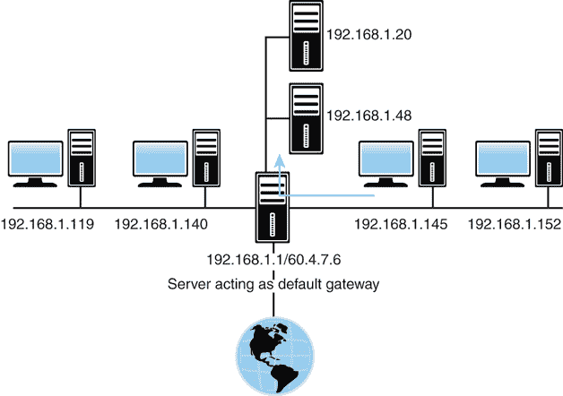

图 3.1 默认网关的角色

在网络中，默认网关可以是路由器，也可以是与其连接的所有网段具有网络接口（多宿主）的计算机。这些接口具有相应网段的本地 IP 地址。如果系统没有配置任何静态路由或默认网关，它将局限于在自己的网段内运行。

### 考试提示

如果系统没有配置任何静态路由或默认网关，它将局限于在自己的网段内运行。

## 虚拟 IP

`虚拟 IP 地址 (VIP)` 是分配给多个应用程序的 IP 地址，通常用于高可用性实现。传入的数据包被发送到该地址，由该地址将其路由到正确的网络接口。这允许在仅有一个（逻辑）IP 地址的服务器上托管不同的应用程序和虚拟设备。

## IPv4 地址类型

IPv4 有三种主要的地址类型：单播、广播和组播。你需要区分这三种 IPv4 地址。

### 单播地址

使用 `unicast address` 时，指定单一地址。使用单播寻址发送的数据传递到由地址识别的特定节点。这是一个点对点的地址链路。

### 广播地址

广播地址位于光谱上单播地址的对端。`broadcast address` 是一种你可以用于指向整个子网或网络上的所有系统而不是单个主机的 IP 地址。换句话说，广播消息会发送给网络上的每一个人。

### 组播

组播是一种机制，网络设备组可以同时在组员之间发送和接收数据，而不是分别向组中的每个设备发送消息。组播组通过为每个设备配置相同的组播 IP 地址来建立。

## IPv6 寻址

网际协议版本 4 (`IPv4`) 已经作为互联网协议使用了 30 多年。当 `IPv4` 在 30 多年前进行开发时，其创建者可能无法想象或预测未来对 IP 设备以及对 IP 地址的需求。

### 注意

在 `IPv4` 之后、`IPv6` 之前曾有一个 `IPv5`，但它是一个从未投入使用的实验性协议。

### IPv4 地址都去哪儿了？

`IPv4` 使用 32 位寻址方案。这为 `IPv4` 提供了总共 4,294,967,296 个可能的唯一地址，可以分配给 IP 设备。40 亿多个地址听起来很多，事实也如此。然而，支持 IP 的设备数量每天以惊人的速度增长。并非所有地址都能供公共网络使用。其中许多地址被保留了，不可供公用。由于这减少了可以分配为公共互联网地址的地址数量。

`IPv6` 项目于 20 世纪 90 年代中期启动，早在 `IPv4` 局限性威胁出现。现在网络硬件和软件已准备就绪并部署 `IPv6` 寻址。`IPv6` 提供了许多改进。最显著的是它处理公共网络增长的能力。`IPv6` 使用 128 位寻址方案，能够产生海量的可能地址：

`340,282,366,920,938,463,463,374,607,431,768,211,456`

## 识别 IPv6 地址

如前所述，`IPv4` 使用点分十进制格式：8 位转换为其十进制等并用点分隔。`IPv4` 地址的示例是 `192.168.2.1`。

由于 `IPv6` 寻址方案的 128 位结构，它看起来非常不同。`IPv6` 地址按 16 位边界划分，每个 16 位块被转换为四位十六进制数并用冒号分隔。所得的表示法称为冒号十六进制。现在看看它是如何工作的。图 3.2 显示了来自 Windows 系统的 `IPv6` 地址 `2001:0:4137:9e50:2811:34ff:3f57:febc`。

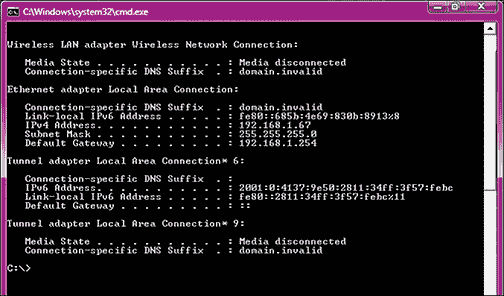

图 3.2 Windows 屏幕上的 IPv6 地址

`IPv6` 地址可以通过删除每个 16 位块内的前导 0 来简化。然而，并不是所有的 0 都可以删除，因为每个地址块必须保留一个数字。取消 0 抑制后，地址变为：

`2001:0000:4137:9e50:2811:34ff:3f57:febc`

你将处理的一些 `IPv6` 地址包含连续的 0 序列。当这种情况发生时，数字通常会被缩写以便于阅读。在前面的示例中，你看到单个 0 代表一个十六进制形式设置的数字。为了进一步简化 `IPv6` 地址的表示，冒号十六进制格式中连续的设置为 0 的 16 位块序列可以压缩为 `::`，这被称为“双冒号”。

例如，`IPv6` 地址：

`2001:0000:0000:0000:3cde:37d1:3f57:fe93`

可以被压缩为：

`2001::3cde:37d1:3f57:fe93`

然而，`IPv6` 地址中 0 的缩减是有限制的。当 `IPv6` 地址中的 0 不在数字序列的开头时，则无法消除。例如，`2001:4000:0000:0000:0000:0000:0000:0003` 不能被压缩为 `2001:4::3`。它实际上会显示为 `2001:4000::3`。


当你看到使用双冒号的 `IPv6` 地址时，如何确切知道代表的是哪些数字呢？公式是从 8 中减去块的数量，然后将该数字乘以 16。例如，地址`2001:4000::3`使用三个块：`2001`、`4000`和`3`。因此公式如下：

`(8 – 3) × 16 = 80`

因此，在此示例中，双冒号代表的总比特数为 80。

### 注意事项

在 `IPv6` 地址中，你只能删除一次 0。多次使用双冒号将导致无法确定每个`::`实例所代表的 0 位数。

## IPv6 地址类型

`IPv4`和`IPv6`的另一个区别在于地址类型。之前详细讨论了`IPv4`路由。`IPv6`路由提供了几种类型的地址，在本节中详细介绍。

### 单播 IPv6 地址

正如你从名称中推断的那样，单播地址指定单个接口。发送到单播目的地的数据包从发送主机传输到目的主机。这是一条直接的通信链路。接下来将讨论几类属于单播范的地址。

### 全局单播地址

全局单播地址等同于`IPv4`公网地址。这些地址是可路由的，可以在整个网络中传输。

### 链路本地地址

链路本地地址用于单个本地网络。链路本地地址在所有接口上都会自动配置。这种自动配置类似于`169.254.0.0/16` `APIPA`自动分配的`IPv4`路由方案（稍后将讨论）。用于链路本地地址的前缀是`fe80::/64`。在没有路由器的单链路`IPv6`网络中，链路本地地址用于链上设备之间的通信。

### 站点本地地址

站点本地地址等同于`IPv4`私有地址空间（`10.0.0.0/8`、`172.16.0.0/12`和`192.168.0.0/16`）。与`IPv4`一样（私有地址范围用于私有网络），`IPv6`使用站点本地地址且不会干扰全局单播地址。此外，路由器不会将站点本地流量转发到站点外。与链路本地地址不同，站点本地地址不是自动配置的，必须通过无状态或有状态配置过程进行分配。用于站点本地地址的前缀是`FEC0::/10`。

### 组播地址

与`IPv4`地址一样，组播在节点组之间发送和接收数据。它将 `IP`消息发送给组，而不是 `LAN`上的每个节点（广播）或仅发送另一个节点（单播）。

### 任播地址

任播地址代表了单播地址和组播地址之间的中间地带。任播将消息传递给组播组中的任何一个节点。

### 注意事项

你可能会遇到`stateful`（有状态）和`stateless`（无状态）配置术语。`stateless`指 `IP`自动配置，管理员不需要手动输入配置信息。在`stateful`配置网络中，设备从服务器获取地址信息。

### 考试提示

与有状态/无状态类似，`classful`（分类）和`classless`（无分类）是经常使用的地址形容词。分类意味着地址属于五类`IPv4`分类之一（`A`、`B`、`C`、`D`或`E`），而无分类则使用之前讨论过的 `CIDR`表示法。

### 考试提示

之前你读到`IPv4`保留了`127.0.0.1`作为回环地址。`IPv6`也有相同的保留。`IPv6`地址`0:0:0:0:0:0:0:0`和`0:0:0:0:0:0:0:1`被保留为回环地址。

记住`fe80::`是私有的链路本地地址。

### 邻居发现

`IPv6`支持邻居发现协议 (`NDP`)。它运行在网络层，负责节点的地址自动配置、发现链上的其他节点、确定其他节点的地址、重复地址检测、寻找可用路由器和 `DNS`服务器、地址前缀发现以及维护其他活动邻居节点的可达性信息。

### 比较 IPv4 和 IPv6 路由

表 3.5 比较了`IPv4`和`IPv6`路由。

### 注意事项

自动私有 `IP`地址 (`APIPA`) 出现在并在本章节后面的“自动私有 `IP`地址”部分进行详细讨论。

表 3.5 比较 IPv4 和 IPv6 路由

| 地址特性 | IPv4 地址 | IPv6 地址 |

| :--- | :--- | :--- |

| 回环地址 | `127.0.0.1` | `0:0:0:0:0:0:0:1 (::1)` |

| 全网范围地址 | IPv4 公网地址范围 | 全局单播 IPv6 地址 |

| 私有网络地址 | `10.0.0.0/172.16.0.0/192.168.0.0` | 站点本地地址范围 (`FEC0::`) |

| 自动配置地址 | IPv4 自动私有 IP 地址 (`169.254.0.0`) | `FE80::` 前缀的链路本地地址 |

### 考试提示

确保你已经了解了表 3.5 中提供的信息。

### 注意事项

`IPv6`支持`dual stack`（双栈）：这意味着`IPv4`和`IPv6`均可以在同一个网络上运行。这在采用和部署阶段从一个过渡到另一个时非常有用。它还允许网络继续支持可能无法过渡的旧设备。

### 分配 IP 地址

现在你已经理解了基于 `TCP/IP`的网络每个系统都需要唯一地址的原因，以下章节将研究这些系统是如何获取地址的。

### 静态路由

`static addressing`（静态路由）是指手动为系统分配 `IP`地址。这种方法有两个主要问题：

静态配置一个系统的正确地址是简单的，但在配置过程中（例如配置数百个系统），很容易出错。如果输入的 `IP`地址错误，系统可能无法连接到网络上的其他系统。

如果组织的 `IP`方案发生变化，每个系统必须再次手动重新配置。在一个拥有数百或数千个系统的大型组织中，这种重新配置可能需要大量时间。静态路由的缺点如此显著，几乎所有网络都使用动态 `IP`。

## 动态路由

`dynamic addressing`（动态路由）是指自动分配 `IP`地址。在现代网络中，实现此点的机制是`Dynamic Host Configuration Protocol (DHCP)`。`DHCP`是 `TCP/IP`族的一部分，允许中央系统为客户端系统提供 `IP`地址。使用`DHCP`自动分配地址减轻了静态 `IP`带来的地址配置和重新配置的负担。

`DHCP`服务的基本功能是自动为客户端系统分配 `IP`地址。为了实现这一点，在运行`DHCP`服务器应用程序的系统上定义了称为`scopes`（范围）的 `IP`地址范围。当另一个配置为`DHCP`客户端的系统初始化时，它向服务器请求地址。如果一切正常，服务器将在范围内为客户端分配一个预定时间的地址，这被称为`lease`（租期）。

### 考试提示

在为考试学习`DHCP`时，确保你了解保留（`reservations`）、范围（`scopes`）、租期（`leases`）、选项（`options`）以及 `IP helper/DHCP relay`。这些主题在第 2 章中讨论过。

`DHCP`服务器通常可以配置为分配不仅仅 `IP`地址。它经常被用于分配子网掩码、默认网关和`Domain Name Service (DNS)`信息。

使用`DHCP`意味着管理员不再需要为每个客户端系统手动配置 `TCP/IP`地址。这消除了与静态分配地址相关的常见问题，例如人为错误。同时也消除了分配重复 `IP`地址的潜在问题。当系统从一个子网移动到另一个子网，或者你决定对 `IP`地址结构进行全面更改时，`DHCP`也不需要重新配置系统。

### 考试重点

即使网络配置为使用`DHCP`，若干关键任务网络系统仍然继续使用静态地址：`DHCP`服务器、`DNS`服务器、`Web`服务器等。它们不使用动态 `IP`映射，因为它们的 `IP`地址永远不会改变。如果发生变化，客户端系统可能无法访问来自该服务器的资源。

为客户端配置 `TCP/IP`可能比较复杂，也可能非常简单。涉及的任何复杂性与可能需要手动配置 `TCP/IP`有关。简单是因为 `TCP/IP`配置可以通过`DHCP`或`APIPA`自动完成。至少，系统需要一个 `IP`地址和子网掩码才能登录网络。默认网关和 `DNS`服务器的 `IP`信息是可选的，但如果没有它们，网络功能将受到限制。列表简要解释了连接到 `TCP/IP`网络时使用的 `IP`相关设置：

 **IP 地址：** 每个系统必须分配一个唯一的 `IP`地址，以便其在网络上通信。

 **子网掩码：** 允许系统确定 `IP`地址的部分代表网络地址，部分代表节点地址。

 **默认网关：** 允许系统在远程网络上通信，而无需定义显式路由。

 **DNS 服务器地址：** 允许执行动态主机名解析。通常会定义两个 `DNS`服务器地址，以便如果其中一个服务器不可用，可以使用另一个。

### 考试重点

连接到 `TCP/IP`网络至少需要 `IP`地址和子网掩码。在这种最小配置下，连接性局限于本地网段，且无法进行 `DNS`解析。

`DHCP6`（或更准确地说`DHCPv6`）是`DHCP`在`IPv6`中的对应物。它为基于`IPv6`的网络上的客户端发布必要的配置信息。

### BOOT 协议 (BOOTP)

`BOOTP`最初创建是为了让无磁盘工作站能够获取连接网络所需的信息，例如 `TCP/IP`地址、子网掩码和默认网关。这种系统是必要的，因为无磁盘工作站没有存储这些信息的方法。

当配置为使用`BOOTP`的系统启动时，它会在网络上广播寻找`BOOTP`服务器。如果存在此类服务器，它会将发送`BOOTP`请求的系统 `MAC`地址与数据库条目进行比较。从该数据库中，它为系统提供适当的信息。它还可以通知工作站一个必须在`BOOTP`上运行的文件。

在极少数使用`BOOTP`的情况下，你应该意识到，它像`DHCP`一样，是一个基于广播的系统。因此，必须配置路由器来转发`BOOTP`广播。

### 自动私有 IP 地址

自动私有 `IP`地址 (`APIPA`) 随 `Windows 98`引入，并包含在后续所有的 `Windows`版本中。`APIPA`的功能是：如果系统无法从`DHCP`服务器动态接收地址，它就可以给自己分配一个 `IP`地址。然后`APIPA`会从`169.254.0.0`地址范围为系统分配一个地址并配置相应的子网掩码（`255.255.0.0`）。然而，它不会为系统配置默认网关地址。因此，通信局限于本地网络。所以，如果你可以连接到局域网上的其他设备，但无法访问互联网（例如），可能是你的`DHCP`服务器宕机了，你目前正在使用`APIPA`地址。

### 考试重点

如果不支持`APIPA`的系统无法从`DHCP`服务器获取地址，它通常会给自己分配`0.0.0.0`的 `IP`地址。在非`APIPA`平台上排查 `IP`地址问题时，请记住这一点。

`APIPA`的理念是，当发生`DHCP`服务器故障时，网段上的系统可以相互通信。实际上，`APIPA`有限的可用性使其大体上仅仅是最后手段。例如，想象一个系统在`DHCP`服务器运行期间启动并接收到`192.168.100.2`的 `IP`地址。然后`DHCP`服务器发生故障了。现在，如果网段上的其他系统启动并因为`DHCP`服务器宕机而无法从中获取地址，它们将通过`APIPA`在`169.254.0.0`地址范围内自分配地址。拥有`APIPA`地址的系统可以相互通信，但它们无法与从`DHCP`服务器获取地址的系统通信。同样，任何通过`DHCP`获取 `IP`地址的系统都无法与分配了`APIPA`地址的系统通信。这一点以及默认网关的缺失，就是为什么`APIPA`在现实环境中用途有限的原因。

### 考试重点

准备好回答关于`APIPA`的问题。了解它是什么、如何判断你是否被分配了`APIPA`地址以及为什么。

#### 识别 MAC 地址

书中多次提到了 `MAC`地址以及某些设备如何使用它们。然而，还没有讨论过 `MAC`地址为什么存在、如何分配以及由什么组成。

**注意**

`MAC`地址有时被称为物理地址，因为它是物理上嵌入在接口（网卡）中的。

`MAC`地址是一个 6 字节（48 位）的十六进制地址，它允许`NIC`在网络上被唯一标识。无论使用何种协议来实现网络连接，`MAC`地址都构成了网络通信的基础。由于`MAC`地址对网络通信至关重要，因此有相应的机制确保不会使用重复的地址。

为了应对分配重复 `MAC`地址的可能性，`电气电子工程师学会 (IEEE)`接管了`MAC`地址的分配。但`IEEE`并没有承担分配单个地址的任务，而是决定为每个制造商分配一个 `ID`，然后让制造商进一步分配 `ID`。结果是，在`MAC`地址中，前 3 个字节定义制造商，后 3 个字节由制造商分配。

例如，考虑编写这本书的电脑的 `MAC`地址：`00:D0:59:09:07:51`。前 3 个字节（`00:D0:59`）标识网卡的制造商。因为只有该制造商可以使用此地址，因此被称为`组织唯一标识符 (OUI)`。后 3 个字节（`09:07:51`）被称为`通用 LAN MAC 地址`：它们使此接口具有唯一性。你可以在`http://standards.ieee.org/regauth/oui/oui.txt`找到 `MAC`地址分配的完整列表。

由于`MAC`地址是用十六进制表示的，因此只能使用数字 0 到 9 和字母`A`到`F`。如果你遇到了一道关于识别`MAC`地址的考试题，且某些答案包含 0 到 9 以及`A`到`F`以外的字母和数字，你可以立即排除那些答案。

取决于你所使用的系统或平台，可以通过多种方式发现`NIC`的 `MAC`地址。表 3.6 定义了你可以查看接口 `MAC`地址的各种平台和方法。

表 3.6 查看网卡 MAC 地址的方法

| 平台 | 方法 |

| :--- | :--- |

| Windows | 在命令提示符输入`ipconfig /all`。 |

| Linux/某些 UNIX | 输入`ifconfig -a`命令。 |

| Cisco 路由器 | 输入`sh int interface name`命令。 |

考试重点

请确保你了解用于在各种操作系统格式下识别 `MAC`地址的命令。

正如人们担心如果继续使用`IPv4`，那么访问互联网所需的所有设备将没有足够的 `IP`地址一样，人们也相当担心没有足够的 `MAC`地址供分配。为了解决这个问题，现在可以使用 64 位地址。`IEEE`将 48 位地址称为`EUI48`（代表`extended unique identifier`，即扩展唯一标识符），将更长的地址称为`EUI64`。预计 48 位地址足够使用相当一段时间，但`IEEE`正在鼓励尽快采用 64 位寻址。这些寻址方案之间最显著的区别是`EUI64`在数字组之间使用连字符而不是冒号。

### 考试提示

请确保你在考试时知道`EUI64`的用途。

## NAT, PAT, SNAT, 和 DNAT

本章定义了许多缩写，并继续介绍了另外四个缩写：`NAT`；`PAT`；`SNAT`以及`DNAT`（或端口转发）。

### NAT

`网络地址转换 (NAT)`的基本原理是许多计算机可以“隐藏”在一个 `IP`地址之后。你之所以需要这样做（主要原因如前文“IP 划分”部分中所述），是因为没有足够的`IPv4`地址供使用。使用`NAT`意味着系统的外部接口上只需要一个已注册的 `IP`地址，作为内部网络和外部网络之间的网关。

注意

不要将`NAT`与代理服务器混淆。代理服务与`NAT`不同，但许多代理服务器应用程序确实包含了`NAT`功能。

`NAT`允许你在内部网络中使用任何你喜欢的寻址方案；然而，通常的做法是使用之前讨论过的私有地址范围。

当系统执行`NAT`时，它会将收到的请求引导到互联网。对于远程主机来说，该请求看起来像是源自单一地址。执行`NAT`功能的系统会跟踪谁请求了什么，并确保在数据返回时将其指向正确的系统。提供`NAT`功能的服务器以不同的方式实现这一点。例如，你可以静态地将一个特定的内部 `IP`地址映射到特定的外部地址（称为`一比一 NAT 方法`），以便发出的请求始终标记有相同的 `IP`地址。或者，如果你有一组公共 `IP`地址，可以由`NAT`系统按照先来后得原则为设备分配地址。无论何种方式，`NAT`的基本功能都是相同的。

隧道技术可用于将一种类型的包（如`IPv6`）传输到另一种网络（如`IPv4`）上。`6to4`就是这种隧道技术之一，允许`IPv6`数据包在`IPv4`网络上传输而无需创建复杂的隧道。它通常用于网络更新的过渡期，并非作为永久解决方案。它的对应技术是`4to6`。

对于更长期的解决方案，有一种名为`Teredo`的过渡技术，它为具有`IPv6`能力的主机提供完整的`IPv6`连接，这些主机位于`IPv4`互联网但缺乏直接到`IPv6`网络的原生连接。`Teredo`的特征是它可以在`NAT`设备（如家用路由器）之后实现这一点。最流行的`Teredo`实现方式之一是`EUI64`。

### PAT

`NAT`允许你在内部网络中使用任何你喜欢的寻址方案；然而，通常的做法是使用之前讨论过的私有地址范围。

当系统执行`NAT`时，它会将收到的请求引导到互联网。对于远程主机来说，该请求看起来像是源自单一地址。执行`NAT`功能的系统会跟踪谁请求了什么，并确保在数据返回时将其指向正确的系统。提供`NAT`功能的服务器以不同的方式实现这一点。例如，你可以静态地将一个特定的内部 `IP`地址映射到特定的外部地址（称为`一比一 NAT 方法`），以便发出的请求始终标记有相同的 `IP`地址。或者，如果你有一组公共 `IP`地址，可以由`NAT`系统按照先来后得原则为设备分配地址。无论何种方式，`NAT`的基本功能都是相同的。

隧道技术可用于将一种类型的包（如`IPv6`）传输到另一种网络（如`IPv4`）上。`6to4`就是这种隧道技术之一，允许`IPv6`数据包在`IPv4`网络上传输而无需创建复杂的隧道。它通常用于网络更新的过渡期，并非作为永久解决方案。它的对应技术是`4to6`。

对于更长期的解决方案，有一种名为`Teredo`的过渡技术，它为具有`IPv6`能力的主机提供完整的`IPv6`连接，这些主机位于`IPv4`互联网但缺乏直接到`IPv6`网络的原生连接。`Teredo`的特征是它可以在`NAT`设备（如家用路由器）之后实现这一点。最流行的`Teredo`实现方式之一是`EUI64`。

### SNAT

`静态网络转换 (SNAT)`是`NAT`的一种形式。`SNAT`将私有 `IP`映射到公共 `IP`。


### DNAT

`目的地址转换 (DNAT)` 可以用来更改目的地址。它通常被称为`端口转发`。

### 考试提示

`PAT` 允许节点与互联网通信。

## 测验

1. `127.0.0.1` 的 `IPv6` 等效地址是什么？（选择两个）

2. 下列哪是 B 类地址？

3. 你是一个拥有两个 Windows Server 系统和 65 台 Windows 桌面系统的网络的管理员。上午 10 点，三位用户来电报告他们遇到了网络连接问题。经过调查，你确定是 DHCP 服务器故障了。你如何判断 DHCP 服务器故障是导致这三位用户遇到连接问题的原因？

4. 下列哪些地址类型与 `IPv6` 相关？（选择三个）

## 5. 以下哪个 IP 地址不属于私有地址范围？

 **A.** 192.168.200.117

 **B.** 172.16.3.204

 **C.** 127.45.112.16

 **D.** 10.27.100.143

## 6. 你被分配建立一个使用 TCP/IP 的新网络。对于外部接口，你决定从 ISP（服务提供商）获取注册的 IP 地址，但对于内部网络，你选择使用私有地址范围之一配置系统。在以下地址范围中，你不会考虑哪一个？

 **A.** 192.168.0.0 到 192.168.255.255

 **B.** 131.16.0.0 到 131.16.255.255

 **C.** 10.0.0.0 到 10.255.255.255

 **D.** 172.16.0.0 到 172.31.255.255

## 7. 你要求 ISP 为你运行代理服务器应用程序的 Windows 服务器的外部接口分配一个公网 IP 地址。在包含该信息的邮件中，ISP 告诉你你被分配了 IP 地址 `203.15.226.12/24`。当你在系统的 IP 配置对话框中填写子网掩码字段时，你应该使用什么子网掩码？

 **A.** 255.255.255.255

 **B.** 255.255.255.0

 **C.** 255.255.240.0

 **D.** 255.255.255.240

## 8. 检查此处所示。用户 Spencer 无法与用户 Evan 通信的最可能的原因是什么？

 **A.** 默认网关应该有不同的值。

 **B.** Spencer 的 IP 地址不是环回地址。

 **C.** 子网值应该是相同的。

 **D.** 给出的值没有可以识别的问题。

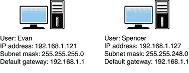

# 强化测验答案

### 1. A, C.** IPv4 地址 `127.0.0.1` 被留作环回地址，IPv6 也有相同的预留。IPv6 地址 `0:0:0:0:0:0:0:0` 和 `0:0:0:0:0:0:0:1` 被留作环回地址。地址 `0:0:0:0:0:0:0:1` 可以使用省略 `0` 的 `::` 写法表示，结果为 `::1`。

### 2. A.** B 类地址属于 `128` 到 `191` 范围。答案 A 是列出的唯一落入该范围内的地址。答案 B 是 A 类地址，答案 C 和 D 是 C 类 IP 地址。

### 3. D.** 当配置为通过 DHCP 获取 IP 地址的 Windows 桌面系统未能获取到地址时，它会使用 `APIPA` 从 `169.254.x.x` 地址范围给自己分配一个地址。`0.0.0.0` 地址通常来自不支持 `APIPA` 的系统。`APIPA` 不使用 `192.168.x.x` 地址范围。IP 地址 `255.255.255.255` 是广播地址。DHCP 失败不会导致系统给自己分配此地址。

### 4. B, C, 和 D.** IPv4 和 IPv6 之间的一个区别在于地址类型。IPv6 地址有三种主要类型：单播、组播和任播。IPv4 使用广播地址，但 IPv6 不使用。

### 5. C.** `127.x.x.x` 网络范围被留作环回功能使用。它不是识别的私有地址范围之一。`RFC 1918` 定义的私有地址范围是 `10.x.x.x`、`172.16.x.x` 到 `172.31.x.x`。

### 6. C.** `127.x.x.x` 网络范围被留作环回功能使用。它不是识别的私有地址范围之一。`RFC 1918` 定义的私有地址范围是 `10.x.x.x`、`172.16.x.x` 到 `172.31.x.x`。

### 7. B.** 在 `CIDR` 术语中，子网中的位数用斜杠值表示。

### 8. C.** 用户 Spencer 无法与用户 Evan 通信的最可能原因是子网值应该是相同的。

## 管理 TCP/IP

由于今天的网络扩展到世界各地互相关连的办公室，网络可能有许多通过路由器连接的独立分段。路由器是在不同网络之间引导数据的设备。本质上，当路由器接收到数据时，它必须确定数据的目的地并将其发送到那里。

### 默认网关

默认网关是路由器的 IP 地址，通往任何所有远程网络的路径。要从一个网络向另一个网络发送数据包，数据包会被发送到默认网关，由它帮助将数据包转发到目的地。位于路由器另一侧的计算机被称为远程网络上的计算机。没有默认网关，互联网通信是不可能的，因为你的电脑没有方法发送指向任何其他网络的数据包。在工作站上，默认网关选项通常通过 DHCP 自动配置。

### 路由表

在转发数据包之前，会检查一张图表，以确定数据到达目的地的最佳可能路径。这张图表就是计算机的路由表。维护准确的路由表对于有效的数据传输至关重要。TCP/IP 网络上的每台计算机在本地都存储有一个路由表。图 3.3 显示了 Windows 系统上的路由表。

注意

你可以使用 `route print` 命令查看客户端系统上的路由表。

```bash
route print
```

 **接口：** 用于将数据包发送到目的地的接口地址。

 **度量：** 路由直接程度的测量。度量越低，路由越快。如果数据传输存在多条路由，则选择度量最低的那条。

路由表在网络路由过程中起着至关重要的作用。它们是引导数据通过网络的手段。因此，路由表需要具备两个要素：它必须保持更新且完整。路由器可以通过两种方式获取路由表信息：通过静态路由或动态路由。

### 静态路由

在使用 `static routing` 的环境中，路由和路由信息是手动输入路由表中的。这不仅是一项耗时的任务，而且更容易出现错误。此外，当网络布局或拓扑结构发生变化时，静态配置的路由器必须手动更新这些更改。同样，这仍然是一项耗时且容易出错的任务。由于这些原因，静态路由仅适用于最小的环境（可能只有一台或两台路由器）。一种更实用的解决方案（特别是在较大的环境中）是使用动态路由。

你可以使用 `route add` 命令向路由表添加静态路由。要执行此操作，请指定路由、网络掩码以及路由器将用于将数据包发送到其目的网络的网卡 IP 地址。

`route add` 命令的语法如下：

点击此处查看代码图像

```
route add 192.168.2.1 mask (255.255.255.0) 192.168.2.4
```

添加静态地址不是永久的；换句话说，系统重启后，它很可能会消失。为了使其持久化（即在启动时路由仍留在路由表中），你可以在命令中使用 `-p` 交换开关。

**考试警示**

`route add` 命令向路由表添加静态路由。带有 `-p` 开关的 `route add` 命令使静态路由持久化。在参加 Network+ 考试之前，你可能想自己尝试一下。

`Distributed switching` 通常与电话网络相关，它仅仅是多个由处理器控制的交换单元分布式的架构。在这种环境中，通常存在分级交换机，其中一个中央主机交换机与位于用户密集处的远程交换机协同工作。

### 交换方法

为了让系统在网络上通信，数据需要一条或多条传输路径。为了允许实体通信，这些路径将信息从一个位置移动到另一个位置并返回。这就是 `switching`的功能，它提供了两个端点之间的通信通路，并管理数据在它们之间的流动。以下是今天使用的两种常用的交换方法：

 分组交换

 电路交换

**考试警示**

你需要识别分组交换和电路交换方法之间的差异。

### 分组交换

在分组交换中，消息被分成称为 `packets` 的较小部分。每个数据包都分配了源地址、目的地址和中间节点地址。数据包需要这些信息，因为它们并不总是通过相同的路径或路由到达预定目的地。这被称为 `independent routing`，是分组交换的优势之一。独立路由通过让数据包通过不同的路由来避开高流量区域，能够更好地利用可用带宽。独立路由还允许在特定路由因某些原因不可用时数据包采取备用路由。

**注意**

分组交换是网络中最流行的交换方法，用于大多数广域网（WAN）。

在分组交换系统中，当数据包被发送到网络时，发送设备负责为数据包选择最佳路径。这条路径在传输过程中可能会变化，接收设备可能会以随机或非顺序接收数据包。当这种情况发生时，接收设备会等待所有数据包接收完毕，然后根据内置的序列号对其进行重组。

网络上使用了两种分组交换方法：

 **虚电路分组交换：** 在源设备和目的设备之间建立逻辑连接。当发送设备与接收设备发起会话时，该逻辑连接便被建立。两个设备之间的逻辑通信通路只要两个设备可用就可以一直保持激活，或者可以用于发送一次数据包。发送过程完成后，可以关闭线路。

 **数据报分组交换：** 与虚电路分组交换不同，数据报分组交换不在发送和传输设备之间建立逻辑连接。数据报分组交换中的数据包是独立发送的，这意味着它们可以通过网络中的不同路径到达预定目的地。为了实现这一点，每个数据包必须单独进行地址处理以确定其源和目的。这种方法确保数据包通过最可能的简单路由到达目的地并避开高流量区域。数据报分组交换主要用于互联网。

### 电路交换

与分组交换方法相反，电路交换要求发送和接收设备之间建立专用的物理连接。表示电路交换最常用的类比是电话通话，通话双方在整个通话期间之间有一条专用的链路。当任何一方断开连接时，电路就会中断，数据路径也会丢失。这准确地描述了电路交换在网络和数据传输中的工作原理。发送系统建立物理连接，数据在两者之间传输。传输完成后，通道被关闭。

电路交换技术的一些明显优势使其非常适合某些应用，例如`public switched telephone network` (`PSTN`) 和`Integrated Services Digital Network` (`ISDN`)。主要优势是，建立连接后，发送和接收设备之间存在稳定且可靠的连接。这允许以保证的速率进行传输。

与所有技术一样，电路交换也有其缺点。正如你想象的，专用的通信线路可能是无效的。物理连接建立后，在传输完成之前，其他会话无法使用。再次使用电话通话类比，这就像拨号者尝试联系另一个拨号者但得到占用信号。因此，电路交换可能会面临长时间的延迟。

#### 比较交换方法

表 3.7 提供了各种交换技术的概述。

表 3.7 交换方法比较

| 交换方法 | 优点 | 缺点 | 关键特征 |

| :--- | :--- | :--- | :--- |

| 分组交换 | 数据包可以绕过网络拥塞进行路由。分组交换有效利用了网络带宽。 | 数据包在前往目的地的备用路由时可能会丢失。消息被分成包含源和目的信息的数据包。 | 分组交换的两种类型是数据报和虚电路。数据报独立发送，可以在整个网络中采取不同的路径。 | 虚电路在源和目的设备之间使用逻辑连接。 |

| 电路交换 | 提供专用的传输通道，该通道将保留直到断开。 | 专用信道会导致延迟，因为在某端断开之前，该信道是不可用的。在发送和接收设备之间使用专用物理链路。 | 提供临时存储消息的能力以减少网络拥塞。 |

## 软件定义网络

`Software-defined networking (SDN)` 是一种动态计算机网络方法，旨在允许管理员绕过传统网络物理架构相关的静态限制。这是通过实施思科开放网络环境（Open Network Environment）等技术实现的。

SDN 的目标不仅是为网络添加动态能力，还通过实施云架构降低 IT 成本。SDN 将网络和应用服务整合到集中平台中，可以实现整个基础设施的自动化配置和配置。

## 动态路由

在 `dynamic routing` 环境，路由器使用特殊的路由协议进行通信。这些协议的目的非常简单：它们允许路由器将自身的信息传递给其他路由器，以便其他路由器能够构建路由表。通常使用两种类型的路由协议：旧的距离向量协议和较新的链路状态协议。第三类型是混合协议，它结合了后两者的特征。

### 注意

使用任何路由协议来发布已学习的路由（通过另一种协议、静态配置等获取）被称为 `route redistribution`（路由重发布）。

### 距离向量路由

在距离向量路由器通信中，网络上的每个路由器都会将其已知的所有路由发送给与其直接连接的路由器。通过这种方式，路由器仅与其邻居路由器通信，并且感知网络上可能存在的其他路由器。

距离向量路由器之间的通信被称为 `hops`（跳数）。在网络中，每个路由器代表一个跳，因此使用六个路由器的网络在第一个和最后一个路由器之间有五个跳数。

在 Windows 环境中使用 `tracert` 命令来查看数据包到达目的地需要经过多少个跳数（Mac OS 和 Linux 通过 `traceroute` 命令具有相同的功能）。若要在命令提示符中尝试此操作，请输入 `tracert [comptia.org]`。[图 3.4 显示了 Windows 工作站上的输出示例。

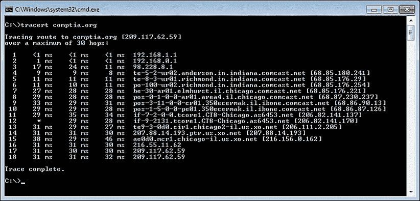

图 3.4 在 Windows 系统上运行 `tracert` 的结果

除了 IPv4 中的 `tracert` 命令外，你还可以通过 `tracert -6`、`traceroute6` 和 `traceroute -6` 在 IPv6 中获得类似的功能。

目前有几种距离向量协议在使用，包括路由信息协议（RIP 和 RIPv2）以及 `增强内部网关路由协议 (EIGRP)`：

 **RIP:** 如前所述，RIP 是一种距离向量路由协议。RIP 限制最大为 15 跳。该协议的缺点之一是原始规范要求每 30 秒传输一次路由器更新。在较小的网络中这是可以的；但在较大的网络中，这可能会导致巨大的流量负载。原始 RIP 规范不支持路由器身份验证，使其容易受到攻击。

 **RIPv2:** RIP 的第二个版本解决了原始设计的缺陷。包含了身份验证以实现安全传输；同时，它从全网广播发现方法改为多组播发现方法，以减少整体网络流量。然而，为了保持与 RIP 兼容，RIPv2 仍然支持 15 跳的限制。

 **EIGRP:** 该协议允许路由器比早期的网络协议更高效地交换信息。EIGRP 利用其邻居来帮助确定路由信息。配置使用 EIGRP 的路由器保留其邻居路由信息的副本，并查询这些表以帮助为传输找到可能的最佳路径。EIGRP 使用 `扩散更新算法 (DUAL)` 来确定通往目的地的最佳路径。

### 考试提醒

确保你能够识别此处讨论的距离向量协议之间的差异。

距离向量路由协议的原理是让每个路由器将其已知的所有其他路由器的更新发送给与其直接连接的路由器。路由器使用这些更新来编译路由表。更新每 30 或 60 秒自动发送一次。间隔取决于所使用的路由协议。除了定期更新外，如果检测到网络拓扑发生变化，还可以配置路由器发送 `triggered update`（触发式更新）。路由器获知网络拓扑变化的过程被称为 `convergence`（收敛）。

收敛缓慢的网络可能会出现路由环路。当路由器的路由表更新缓慢且在路由器之间创建了冗余通信周期时，就会发生路由环。有两种策略可以对抗潜在的路由环：

 **水平分割 (Split horizon):** 工作原理是防止路由器向学习该路由的另一个路由器发布该路由。这防止了两个节点之间来回发送数据包，形成环路。

 **毒性反转 (Poison reverse，也称为带毒性反转的水平分割):** 规定在学习的接口上发布路由，但跳数为无限，这告诉节点该路由不可达。

### 考试提醒

如果路由发生变化，路由器需要一些时间来检测并适应这种变化。这被称为 `convergence`（收敛）。

尽管距离向量协议可以维护路由表，但它们存在三个问题：

 定期更新系统会导致更新过程变慢。

 定期更新可能会产生大量的网络流量——在很多时候这是不必要的，因为网络拓扑很少发生变化。

 可能最严重的问题是，由于路由器只知道旅程中的“下一跳”，错误信息可以在路由器之间传播，产生路由环。

### 考试提醒

要清楚路由中的“下一跳（next hop）”是指数据包可以通过的下一个最近的路由器。

### 链路状态路由

使用链路状态协议的路由器与使用距离向量协议的路由器不同，因为它构建了整个网络的地图并将其保存在内存中。在运行链路状态协议的网络中，路由器发送 `link-state advertisements (LSAs)`，其中包含其连接的网络信息。LSAs 被发送到网络上的每个路由器，从而使路由器能够构建自己的网络地图。


当每个路由器上的网络地图完成后，路由器会在给定时间相互更新，就像在距离向量协议中一样；然而，链路状态协议的更新频率远低于距离向量协议。发送更新的另一种情况是检测到拓扑发生变化，此时路由器使用 `LSAs` 来检测变化并更新其路由表。这种机制，结合路由器持有整个网络地图的特性，使得基于链路状态的网络能够迅速收敛。

尽管链路状态协议看起来是比距离矢量协议显而易见的选择，但基于链路状态的网络的路由器比基于距离矢量的网络路由器需要更强大的硬件和更大的内存。路由表不仅需要计算，还必须进行存储。使用距离矢量协议的路由器只需要维护一个与其直接连接的路由器可访问路由的小型数据库，而使用链路状态协议的路由器必须维护一个整个网络中所有路由器的数据库。

链路状态协议包括以下几种：

-  `开放最短路径优先 (OSPF)`：一种基于 `最短路径优先 (SPF)` 算法的链路状态路由协议，用于找到网络中任何目的地的最小成本路径。在运行过程中，每个使用 `OSPF` 的路由器都会向网络上的其他路由器发送其邻居列表。通过这些信息，路由器可以确定网络设计和数据传输的最短路径。

-  `中继系统到中继系统 (IS-IS)`：一种使用 `SPF` 算法发现数据传输最短路径的链路状态协议。`IS-IS` 路由器将拓扑信息分给其他路由器，使它们能够做出最佳路径决策。

那么，两者之间有什么区别呢？`OSPF`（一种网络层协议）由于其特殊的隧道功能，更常用于中大型企业网络。`IS-IS` 由于其稳定性特性以及能够支持更多路由器，更常用于大型 `ISP` 网络。

## IGP 对比 EGP

现在已经讨论了路由协议，你需要理解 `内部网关协议 (IGPs)` 和 `外部网关协议 (EGPs)` 之间的区别。`IGP` 指用于在局域网（`LAN`）或互连局域网内部路由器交换路由信息的协议。`IGP` 本身并不是一种协议，而是描述了一类支持单一限制地理区域（如局域网）的链路状态路由协议。`IGPs` 分两类：包括 `RIPv2` 的距离矢量协议，以及包括 `OSPF` 和 `IS-IS` 的链路状态协议。

`IGPs` 受到地理限制，而 `EGPs` 用于在网络外部（如互联网）上路由信息。在互联网上，需要 `EGP`。`EGP` 是一种通常用于互联网上主机之间交换路由表信息的距离矢量协议。`边界网关协议 (BGP)` 就是 `EGP` 的示例。

### 混合路由协议

当你想要兼顾距离矢量和链路状态两者的优点时，可以转向混合协议。本次考试需要掌握的某一种混合协议是 `边界网关协议 (BGP)`。`BGP` 可用于互联网上的网关主机之间。`BGP` 检查路由表，该表包含一个已知路由器列表、它们可以到达的地址以及与到每个路由器路径相关的成本度量，以便选择最佳可用路由。`BGP` 使用 `TCP` 在路由器之间进行通信。`BGP` 支持使用 `自治系统编号 (ASNs)`：这是由共享相同路由策略的连接 IP 网络组所使用的全球唯一数字。

### 考试要点

准备好识别 `TCP/IP` 网络上使用的链路状态和距离矢量路由协议，以及 `BGP` 混合协议。

## 网络流量

网络接入方法决定了系统如何访问网络介质并发送数据。接入方法对于确保网络上的系统能够相互通信是必不可少的。如果没有接入方法，两个系统可能会在排除其他所有系统的情况下进行通信。接入方法确保了每个人都有机会使用网络。

网络中使用几种接入方法；其中最流行的是 `CSMA/CD` 和 `CSMA/CA`。先看 `CSMA/CD`，然后看 `CSMA/CA`。

载波监听多接入/冲突检测（`CSMA/CD`）定义在 `IEEE 802.3` 标准中，是最常见的媒体接入方法，因为它与 `802.3 以太网` 网络相关，而这是迄今为止最流行的网络标准。

在运行 `CSMA/CD` 的网络上，当系统想要向另一个系统发送数据时，它首先检查网络介质是否空闲。它必须这样做，因为局域网中使用的每个网络介质只能携带一个信号。如果发送节点检测到介质空闲，它就会进行传输，数据被发送到目的地。这看起来很简单。

现在，如果它一直这样工作，你就不需要 `CSMA/CD` 中的 `CD` 部分了。遗憾的是，在网络中正如生活中，事情并不总是如计划进行。当两个系统尝试同时传输时，问题就出现了。两个系统可能会在同一时刻发送数据似乎并不可能，但你处理的是在每秒内发生多次的通信——大多数网络都有超过两台机器。

想象房间里有 200 个人。房间是安静的，但随后有两个人决定同时说话。在他们开始说话之前，他们检查（倾听）是否其他人在说话；因为没有其他人正在说话，他们开始说话了。结果是两个人同时说话，这类似于网络冲突。

冲突检测通过检测网络介质上由于两个系统尝试同时说话而产生的传输碎片来工作。两个系统在再次尝试传输之前会等待一段随机计算的时间。这段时间（以毫秒为单位）被称为 `退避 (backoff)` 周期或干扰信号（jam signal）。

### 考试要点

知道数据冲突会发生在 `CSMA` 中。你可以检测它们（`CD`），也可以尝试避免它们（`CA`）。

当退避期结束后，系统会再次尝试传输。如果系统在第二次尝试时仍成功，它将不断重试直到放弃并报告错误。

### 考试要点

`CSMA/CD` 是竞争型媒体接入方法，因为系统对介质的访问存在竞争。

`CSMA/CD` 的优点是它的开销较小，这意味着系统运作涉及的内容不多。缺点是，随着网络中系统的增加，冲突会越来越多，网络也会变慢。使用 `CSMA/CD` 的网络性能随着系统的增加而呈指数级下降。它的低开销意味着理论上 `CSMA/CD` 系统可以比高开销系统获得更高的速度。然而，由于冲突的发生，这些速度转化为可用带宽的概率相对较低。

### 考试要点

在运行 `CSMA/CD` 的网络上，每个节点都有同等访问网络介质。

尽管存在这些问题，`CSMA/CD` 仍然是一个高效的系统。因此，与其用其他技术取代它，不如创建减少冲突概率的规避方法。其中一种策略是使用网络交换机来创建多个冲突域，从而减少冲突对性能的影响。

与 `CSMA/CD` 的冲突检测不同，载波监听多接入/冲突回避（`CSMA/CA`）接入方法使用的是信号避免而非检测。在网络环境中，`CSMA/CA` 是 `802.11` 无线标准所使用的接入机制。

在 `CSMA/CA` 网络中，每台计算机在实际发送数据信号之前都会先发出其传输数据的意图信号。当网络系统检测到潜在的冲突时，它会在传输前等待，从而允许系统避免传输冲突。`CSMA/CA` 接入方法使用随机退避时间来决定在尝试在网络上发送数据之前需要等待多久。

当退避时间到期，系统会再次“监听”以验证是否存在可以传输的空闲通道。如果介质仍然忙，则会启动另一个比第一次短的退避间隔。该过程将持续直到等待时间变为零且介质空闲。

`CSMA/CA` 使用广播方法来通告其传输数据的意图。网络广播会产生大量的网络流量并可能导致网络拥塞，从而减慢整个网络。由于 `CSMA/CD` 和 `CSMA/CA` 仅在检测和避免方面有所不同，它们具有类似的优缺点。

### 考试提示 (ExamAlert)

`CSMA/CA` 是 `802.11` 无线标准使用的接入机制。请记住 `CSMA/CA` 使用广播。

### 注意事项 (Note)

`CSMA/CA` 接入方法使用了“先听后说”的策略。任何想要传输数据的系统在传输前必须首先验证通道是否空闲，从而避免潜在的冲突。

### 路由指标 (Routing Metrics)

以下是考试中你应该掌握的几个与路由相关的指标：

-  `跳数 (Hop counts)` 是到达某个节点所需的跳数。跳数为无穷大意味着该路由不可达。

-  `最大传输单元 (MTU)` 定义了在不分片的情况下可以通过的最大数据单元。

-  `带宽 (Bandwidth)` 指定了互联网传输允许的最大数据包大小。

-  `代价 (Costs)` 是与从 A 点到 B 点相关的数字（通常是跳数）。总代价越低（路由中的链路越少），该路由越受青睐。

-  `管理距离 (Administrative distance)` 是根据感知质量分配给路由的数值。该数字可以手动分配，也可以根据路由协议采用算法分配。数字越小，认为路由越优：0 是最好的，255 是最差的。

-  `延迟 (Latency)` 是数据包从一个位置传输到另一个位置所需的时间。

在接下来的章节中，我们将查看生成树协议，但在此之前，重要的是指出它们正在被基于 `IEEE 802.1aq` 的 `最短路径桥接 (SPB)` 所取代。`SPB` 的巨大优势是它允许多条等代价路径，从而缩短收敛时间并提高网状拓扑的使用以增加带宽。

### 虚拟局域网 (Virtual Local-Area Networks)

“virtual”一词在计算机世界中非常常用——可能过于频繁。对于虚拟局域网（`VLAN`），“virtual”一词对解释这项技术帮助不大。对于 `VLAN` 概念，更有描述性的名称可能是“分割”（segmented）。至少目前，请使用“virtual”。

### 提示 (Tip)

`802.1Q` 是电气电子工程师学会（`IEEE`）开发的规范，旨在确保不同厂商 `VLAN` 技术的可操作性。

`VLAN` 用于网络分段，这种策略可以显著提高网络性能，消除潜在的性能瓶颈，甚至可以提高网络安全性。`VLAN` 是一组连接的计算机，它们的行为就像在自己的网络分段上一样，尽管它们可能并非如此。

例如，假设你在一栋三层楼内工作，广告员工分布在所有三层。`VLAN` 可以让所有广告人员合并，并访问网络资源，就像他们连接在同一个物理分段上一样。这个虚拟分段可以与其他网络分段隔离开。实际上，对广告小组来说，他们似乎处在一个独立的网络中。

### 考试提示 (ExamAlert)

`VLAN` 用于网络分段，这种策略可以显著提高网络的性能能力，消除潜在的性能瓶颈，甚至可以增加网络安全性。`VLAN` 是一组连接的计算机，它们的行为就像在自己的网络分段上一样，尽管它们可能并非如此。

例如，假设你在一栋三层楼内工作，广告员工分布在所有三层。`VLAN` 可以让所有广告人员合并，并访问网络资源，就像他们连接在同一个物理分段上一样。这个虚拟分段可以与其他网络分段隔离开。实际上，对广告小组来说，他们似乎处在一个独立的网络中。


VLAN 用于网络分段，这种策略可以显著提高网络的性能能力，消除潜在的性能瓶颈，甚至可以增加网络安全性。VLAN 是一组连接的计算机，它们的行为就像在自己的网络分段上一样，尽管它们可能并非如此。

例如，假设你在一栋三层楼内工作，广告员工分布在所有三层。VLAN 可以让所有广告人员合并，并访问网络资源，就像他们连接在同一个物理分段上一样。这个虚拟分段可以与其他网络分段隔离开。实际上，对广告小组来说，他们似乎处在一个独立的网络中。

### 考试提示（ExamAlert）

VLAN 用于网络分段，这种策略可以显著提高网络的性能能力，消除潜在的性能瓶颈，甚至可以增加网络安全性。VLAN 是一组连接的计算机，它们的行为就像在自己的网络分段上一样，尽管它们可能并非如此。

在三层楼的办公环境中，VLAN 可以将分布在不同楼层的广告员工合并到同一个虚拟网络分段中，使他们能够访问网络资源，就像连接在同一个物理分段上一样。这个虚拟分段还可以与其他网络分段隔离。

### CSMA/CA

在 CSMA/CA 网络中，每台计算机在实际发送数据信号之前都会先发出其传输数据的意图信号。当网络系统检测到潜在的冲突时，它会在传输前等待，从而允许系统避免传输冲突。

CSMA/CA 接入方法使用随机退避时间来决定在尝试在网络上发送数据之前需要等待多久。当退避时间到期，系统会再次“监听”以验证是否存在一个可以传输的空闲通道。如果介质仍然忙，则会启动另一个比第一次短的退避间隔。该过程将持续直到等待时间变为零且介质空闲。

CSMA/CA 使用广播方法来通告其传输数据的意图。网络广播会产生大量的网络流量并可能导致网络拥塞，从而减慢整个网络。由于 CSMA/CD 和 CSMA/CA 仅在检测和避免方面有所不同，它们具有类似的优缺点。

### 考试提示（ExamAlert）

CSMA/CA 是 802.11 无线标准使用的接入机制。请记住 CSMA/CA 使用广播。

### 注意事项（Note）

CSMA/CA 接入方法使用了“先听后说”的策略。任何想要传输数据的系统在传输前必须首先验证通道是否空闲，从而避免潜在的冲突。

## 路由指标（Routing Metrics）

以下是考试中你应该掌握的几个与路由相关的指标：

-  `跳数（Hop counts）`是到达某个节点所需的跳数。跳数为无穷大意味着该路由不可达。
-  `最大传输单元（MTU）`定义了在不分片的情况下可以通过的最大数据单元。
-  `带宽（Bandwidth）`指定了互联网传输允许的最大数据包大小。
-  `代价（Costs）`是与从 A 点到 B 点相关的数字，通常是跳数。总代价越低（路由中的链路越少），该路由越受青睐。
-  `管理距离（Administrative distance）`是根据感知质量分配给路由的数值。该数字可以手动分配，也可以根据路由协议采用算法分配。数字越小，认为路由越优：0 是最好的，255 是最差的。
-  `延迟（Latency）`是数据包从一个位置传输到另一个位置所需的时间。

在接下来的章节中，我们将查看生成树协议，但在之前，重要的是指出它们正在被基于 `IEEE 802.1aq` 的最短路径桥接（`SPB`）所取代。SPB 的巨大优势是它允许多条等代价路径，从而缩短收敛时间并提高网状拓扑的使用，以增加带宽。

## 虚拟局域网（Virtual Local-Area Networks）

“virtual”一词在计算机世界中非常常用——可能过于频繁。对于虚拟局域网（VLANs），“virtual”一词对解释这项技术帮助不大。对于 VLAN 概念，更有描述性的名称可能是“分割”（segmented）。至少目前，请使用“virtual”。

### 提示（Tip）

`802.1Q` 是电气电子工程师学会（IEEE）开发的规范，旨在确保不同厂商 VLAN 技术的可操作性。

### VLAN 成员关系

`Layer 3 address` 术语指的是最重要的网络概念之一：开放系统互连（OSI）参考模型。这一概念性模型由国际标准化组织（`ISO`）于 1978 年创建，并在 1984 年进行了修订，描述了一种允许数据在计算机系统之间传输的网络架构。

它总共七层，将在第 2 章“模型、端口、协议和网络服务”中进行详细讨论。简而言之，第 3 层称为网络层，识别了数据在两个网络或系统之间移动的机制，例如传输协议，在 TCP/IP 的情况下为 `IP`。

尽管 VLAN 成员关系可能基于 `Layer 3` 信息，但这与路由或路由功能无关。`IP` 数字仅用于确定特定 VLAN 的成员身份，而不用于确定路由。

-  **基于端口的 VLAN：** 基于端口的 VLAN 要求网络交换机上的特定端口分配给 VLAN。例如，端口 1 到 4 可能被分配给市场部，端口 5 到 7 可能被分配给销售部，以此类推。使用这种方法，交换机通过记录特定数据包使用的端口来确定 VLAN 成员身份。图 3.5 显示了服务器上的端口如何用于基于端口的 VLAN 成员身份。

  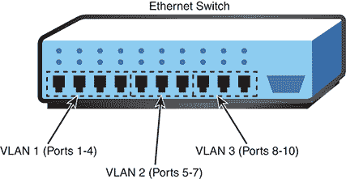

  图 3.5 基于端口的 VLAN 成员身份

-  **基于 MAC 地址的 VLAN：** `媒体访问控制（MAC）`地址是一个唯一的 12 位十六进制数，刻在每个网卡中。网络上使用的每个设备都内置了这个唯一地址。它无法以任何方式修改。

  正如你可能猜到的，MAC 地址类型的 VLAN 根据工作站的 MAC 地址分配成员身份。为了做到这一点，交换机必须跟踪每个 VLAN 的 MAC 地址。这种方法的优点是，工作站计算机移动到办公室的任何地方而无需重新配置。因为 MAC 地址不变，工作站仍然是特定 VLAN 的成员。表 3.9 提供了基于 MAC 地址的 VLAN 成员身份示例。

  表 3.9 基于 MAC 地址的 VLAN

  | MAC 地址 | VLAN | 说明 |
  | --- | --- | --- |
  | 44-45-53-54-00-00 | 1 | 销售部 |
  | 44-45-53-54-13-12 | 2 | 市场部 |
  | 44-45-53-54-D3-01 | 3 | 行政部 |
  | 44-45-53-54-F5-17 | 1 | 销售部 |

## VLAN 分段

逻辑上划分局域网（LAN）的能力提供了管理上的灵活性、组织性和安全性。无论使用协议、MAC 地址还是端口对 LAN 进行划分，结果都是相同的：网络被分段了。

分段有几个原因，包括安全、组织和性能。为了让你更好地了解其工作原理，图 3.6 显示了一个没有使用 VLAN 的网络。

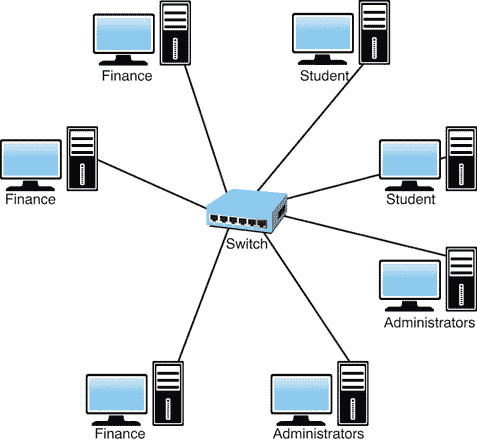

图 3.6 未使用 VLAN 的网络配置

在图 3.6 中，网络上的所有系统都可以互相看到。也就是说，学生可以看到财务和管理员的计算机。图 3.7 显示了使用 VLAN 时该网络可能的样子。

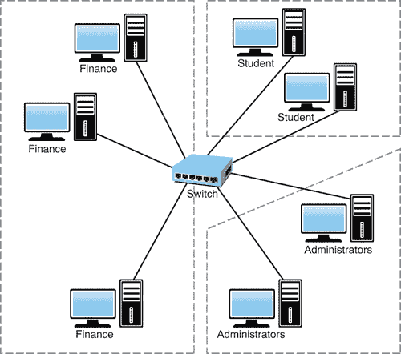

图 3.7 使用 VLAN 的网络配置

## 生成树协议

以太网网络在网络设备之间只能有一条活动路径。当存在多个可用活动路径时，可能会发生交换环路。交换环路是由于网络中两个交换机之间存在多路径导致的。`生成树协议（STP）`设计用于防止这些环路的发生。

STP 用于网络桥接器和交换机。在`生成树算法（STA）`的帮助下，STP 避免或消除了 `Layer 2` 桥接器上的环路。

### 注意

请注意，讨论 STP 指的是 OSI 模型的第 2 层。桥接器和大多数交换机都工作在 `Layer 2`；路由器工作在 `Layer 3`，`Layer 3` 交换机也是如此。


STA 使桥接器或交换机能够动态绕过网络拓扑中的环路。STA 和 STP 的开发都是为了防止网络环路，并提供绕过任何故障网络桥接器或端口的方法。如果网络拓扑发生变化，或者交换机端口或桥接器故障，STA 会创建一个新的生成树，通知其他桥接器该问题并绕过它。STP 是协议，而 STA 是 STP 用于修正环路的算法。

如果特定端口出现问题，STP 可以执行若干操作，包括阻塞端口、禁用端口或将发往该端口的数据转发到另一个端口。这样做是为了确保生成树中没有发现冗余链路或路径，并确保任何两个网络节点之间仅存在单一活动路径。

STP 使用`桥接协议数据单元 (BPDUs)`来识别跨网络端口和桥接器的状态。BPDU 是交换机之间交换的简单数据消息。BPDU 包含端口信息并向其他交换机提供这些端口的状态。如果 BPDU 消息在网络中发现环路，将通过关闭特定的端口或桥接器接口来管理。

可以通过以下几种方式避免端口内的冗余路径和潜在环路：

 **阻塞 (Blocking)：** 阻塞的端口接受 BPDU 消息但不转发它们。

 **禁用 (Disabled)：** 端口离线状态且不接受 BPDU 消息。

 **转发 (Forwarding)：** 端口是活动生成树拓扑的一部分，并向其他交换机转发 BPDU 消息。

 **学习 (Learning)：** 在学习状态下，端口不是活动生成树拓扑的一部分，但在另一个端口故障时可以接管。学习端口接收 BPDU 并在拓扑发生变化时识别这些变化。

 **监听 (Listening)：** 监听端口接收 BPDU 消息并监控网络拓扑的变化。

大多数时候，端口处于转发或阻塞状态。当拓扑发生中断或桥接器/交换机由于某种原因故障时，会使用监听和学习状态。

**考试警报**

STP 积极监控网络，寻找冗余链路。当它发现某些链路时，会关闭它们以防止交换环路。STP 使用 STA 创建拓扑数据库以找到并移除冗余链路。随着 STP 在交换机上运行，数据在批准的路径上转发，这限制了环路的产生。

## 接口配置和交换机管理

除了本章之前讨论过的 VLAN 中继（802.1Q）、绑定以及许多许多其他可能性外，在配置交换机接口时，通常还有其他可以选择或调整的选项。这些包括：

 **带标签 VLAN 与未带标签 VLAN：** 如果你正在进行中继，则应该使用标签标记。因为中继结合了多个 VLAN，你需要一种方法来识别哪个数据包属于哪个 VLAN；这通过在数据包中放置 VLAN 头部（`tag`）可以轻松实现。中继中唯一未标记的 VLAN 是`native VLAN`，帧将以原样传输到它。

 **默认 VLAN：** `默认 VLAN`是强制性的（无法删除），并用于交换机之间的通信（例如配置 STP）。在 Cisco 世界中，默认 VLAN 是 VLAN 1。

 **端口镜像：** 端口镜像有许多使用原因（将一个端口的数据复制并发送到另一个端口）。最常见的之一是监控流量。这可以在本地或远程进行——后者使用远程协议如`远程交换机端口分析 (RSPAN)`代替`交换机端口分析 (SPAN)`。

 **认证、计费和授权 (AAA)：** 根据需要也可以为网络安全参数配置 AAA 覆盖。AAA 是访问控制的主要方法，通常使用`RADIUS`、`TACACS+`或`Kerberos`来实现集成安全。

 **用户名/密码：** 在不使用 AAA 的情况下，可以使用配置的用户名和密码来配置本地用户名认证。这不能提供像 AAA 那样级别的访问控制，因此不建议这么做。

 **虚拟控制台和终端：** 控制台端口（通常称为`virtual console`或`VC`）通常是串口或并行端口，虚拟端口可以连接到物理端口。`virtual terminal`（`vt`或`vty`）是通过`Telnet`或类似工具连接的远程端口，作为管理员，你可能需要配置访问列表来限制谁可以使用它。

### ExamAlert

请记住，保护虚拟终端接口最简单的方法是为它配置用户名和密码，防止未经授权的登录。

 **其他：** 其他常见的配置参数包括速度、是否使用双工模式、IP 地址和默认网关。

## 中干 (Tring)

在计算机网络中，`trunking`一术是指并行使用多个网络电缆或端口使链路速度超过任何单个电缆或端口的限制。听起来很矛盾？如果你有网络经验，可能听过`link aggregation`（链路聚合）这个词，它们本质上是一样的。它是使用多根电缆来增加吞吐量。高容量干链路用于连接交换机以形成更大的网络。

### Note

聚合是多个对象组合时的常用术语。`route aggregation`（路由聚合）适用于特定路由合并为一条路由的情况，这在`BGP`中通过`aggregate-address`命令实现。

`VLAN trunking`是中干技术应用于虚拟局域网——现在路由器、防火墙、VMware 主机和无线访问点中常见。VLAN 中链路提供了一种简单且便宜的方法来提供几乎无限的虚拟网络连接。唯一的要求是交换机、网络适配器和操作系统驱动程序都支持 VLAN。`VLAN Trunking Protocol (VTP)`是思科的一种为此目的设计的专有协议。

## 端口镜像 (Port Mirroring)

你需要某种方法来监控网络流量并监控交换机的工作状况。这就是`port mirroring`的功能。使用端口镜像，管理员配置所有入站和出站流量的副本发送到特定端口。协议分析仪检查发送到端口的数据，因此不会中断正常流量的流。

### ExamAlert

端口镜像允许管理员监控进交换机的出站和入站流量。

## 端口认证 (Port Authentication)

端口认证顾名思义——逐端口地对用户进行认证。指定端口认证的标准之一是`802.1X`标准，通常与无线安全相关。尝试连接到局域网端口的系统必须经过认证。通过的用户可以访问局域网；未通过的用户则无法继续。

## 以太网供电 (Power over Ethernet)

以太网供电 (PoE) 的目的已经在其名称中描述。本质上，`PoE`是由`802.3af`定义的技术，允许电力通过双绞以太网电缆传输。该技术在 2009 年通过`802.3at`（也称为`PoE+`）得到了增强/扩展，能够提供更多功率（从 12.95W 增加到 25.5W）并提高最大电流（从 350mA 增加到 600mA）。

电力随数据传输，为远程设备提供电源。这些设备可能包括远程交换机、无线访问点、`Voice over IP (VoIP)`设备等。

`PoE`的主要优势之一是集中电源管理。例如，如果没有`PoE`，所有远程设备都需要独立供电。在停电的情况下，这些设备都需要`不间断电源 (UPS)`才能继续运行。`UPS`是允许设备运行一段时间的电池组。有了`PoE`供电，只需在主设施需要`UPS`。此外，集中电源管理允许管理员开启或关闭远程设备的电源。

## DMZ

一个重要的与防火墙相关的概念是`demilitarized zone (DMZ)`，它有时也称为`perimeter network`。`DMZ`是网络的一部分，你可以在其中放置必须能够被网络外部和内部源所访问的服务器。然而，`DMZ`不直接连接到任何一个网络，而且几乎没有强制执行策略。使用`DMZs`可以为你的防火墙配置提供额外的灵活性、保护和复杂性。通过使用`DMZ`，使入侵者难以获得访问。

### ExamAlert

准备好识别`DMZ`的用途。

## MAC 地址表 (MAC Address Table)

之前提到过`MAC`（介质访问控制）地址是一个唯一的 12 位十六进制数字，刻在网络接口卡中。此值可以被交换机用于高效地在局域网端口之间“交换”帧。当交换机接收到一个帧时，它会将发送设备的`MAC`地址与接收到该帧的局域网端口关联，并动态构建地址表。然后，当交换机接收到一个表中未列出的`MAC`目的地址的帧时，它会将该帧泛洪到相同 VLAN 的所有局域网端口（接收帧的端口除外）。

当目标站回复时，交换机会将源地址和端口 ID 添加到此地址表中。现在交换机知道了该值，它就可以将所有后续帧转发到单个局域网端口，而无需泛洪所有局域网端口。

### ExamAlert

对于考试，请记住所有以太网交换端口都维护着地址表。

## 交换机管理 (Switch Management)

设备可以通过多种方式进行管理：使用`简单网络管理协议 (SNMP)`、`Windows 管理规范 (WMI)`或`智能平台管理接口 (IPMI)`。如果对设备的监控是远程进行的，这被称为`带外管理 (out-of-band management)`；否则被称为`带内管理 (in-band management)`。

### ExamAlert

对于考试，将带内管理与本地管理（最常用的方法）、带外管理与远程关联起来。

## 托管与非托管 (Managed and Unmanaged)

如果交换机具有任何配置接口或选项，则被称为`托管的`。如果它没有任何配置接口或选项，则被称为“非托管的`。虽然并非总是如此，但通常非托管设备是用于家庭或小型办公室的廉插插即用设备。

## 服务质量 (Quality of Service)

`服务质量 (QoS)`描述了用于管理和增加网络流量的策略。`QoS`功能允许管理员预测带宽使用情况、监控使用情况并对其进行控制，以确保带宽提供给需要的应用程序。这些应用程序通常可以分为两类：

 **延迟敏感：** 这些应用程序需要带宽来快速交付，网络延迟时间会影响其有效性。这包括语音和视频传输。例如，如果对话中存在明显的延迟，`Voice over IP (VoIP)`将很难使用。

 **延迟不敏感：** 控制带宽也涉及管理对延迟不敏感的应用。这包括批量数据传输，例如巨大的备份程序和`File Transfer Protocol (FTP)`传输。

在带宽限制且网络变得日益拥堵的情况下，交付延迟敏感的流量变得更加困难。如果网络流量持续增加，而你无法一直增加带宽，选择就是对流量进行优先级排序以确保及时交付。这就是 QoS 发挥作用场的地方。QoS 确保应用程序（如视频会议及相关视频应用）、VoIP 电话和统一通信的交付，且不会对网络吞吐量产生不利影响。QoS 通过区分延迟不敏感流量（如传真数据）和延迟敏感流量（如流媒体），实现了网络资源更高效的利用。

QoS 的两个重要组件是`DSCP`和`CoS``Differentiated services code point (also known as Diffserv)`是 一种架构，它规定了一种简单且粗粒度的机制来分类和管理网络流量，并在现代网络上提供 QoS。`Class of service (CoS)`是一个用于数据和语音的参数，用来区分正在传输的负载类型。

QoS 的一个重要策略是优先级队列。本质上，流量根据其对交付时间的重要性进行排序。所有数据都获得访问权限，但更重要且延迟敏感的数据会被赋予更高的优先级。

### ExamAlert

务必确保你理解 QoS 以及用于确保网络 QoS 的方法。要记住它被用于 VoIP、视频应用和统一通信等高带宽应用。

## 流量整形 (Traffic Shaping)

网络对带宽的需求从未如此高昂。互联网和内网应用需要大量的带宽。管理员必须确保在尽管有所有这些需求的情况下，为关键任务应用提供足够的带宽，同时为垃圾邮件或点对点下载分配少量资源。为了做到，你需要监控网络流量，以确保数据流按照你的需求进行。

`traffic shaping`一术语描述了用于控制网络带宽使用的机制。通过这种方式，管理员可以控制谁在什么目的下使用带宽，以及在一天中何时可以使用带宽。流量整形为出入互联网以及在网络内部传输的数据建立了优先级。

数据整形器本质上执行两个关键功能：监控和整形。监控包括识别高使用的地方和时间。在获取这些信息后，管理员可以根据网络的最佳需求定制或塑造带宽使用情况。

## 访问控制列表 (Access Control Lists)

在涉及计算时，许多事物具有相似的功能，并被称为`access control list (ACL)`。在涉及网站时，确定用户可以或不能访问哪些网站通常通过一个允许或不允许的网站列表来实现。在涉及路由和交换时，`ACL`提供了规则，这些规则应用于主机或其他三层设备可用的端口号或 IP 地址，每个规则都带有一个允许使用该服务的主机和/或网络列表。

尽管 ACL 的这两种用途似乎截然不同，但在两种情况下，`ACL`都是尝试访问的实体所被允许的列表。另一种可以实现相同目的的方法是将情况反过来，拒绝除出现在“允许”列表中的实体之外的所有实体（取决于情况，可能是页面或端口）的访问。这种方法具有很高的管理开销，并可能极大限制可获得的生产效益。

### ExamAlert

记住`ACL`是允许或不允许的服务、端口、网站等内容的列表。

## 冲击式测验 (Cram Quiz)

**1.** 下列哪项最能描述默认网关的功能？

 **A.** 它为本地网络之外的站点提供路由。

 **B.** 它允许多个用户使用单个网连接。

 **C.** 它识别本地子网并制定路由表。

 **D.** 它用于在多平台环境中进行通信。

**2.** 用于描述到达节点所需的跳数的术语是什么？

 **A.** 跃点列表 (Jump list)

 **B.** 链路停止 (Link stops)

 **C.** 连接 (Connections)

 **D.** 跳数计数 (Hop count)

**3.** 下列哪项允许管理员监控进出交换机的入站和流量？

 **A.** 生成树算法 (Spanning Tree Algorithm)

 **B.** 中继链路 (Trunking)

 **C.** HSRP

 **D.** 端口镜像 (Port mirroring)

**4.** 下列哪项是为确保不同厂商的 VLAN 技术互操作性而开发的 IEEE 规范？

 **A.** 802.1z

 **B.** 802.1s

 **C.** 802.1Q

 **D.** 802.1X

**5.** 下列哪项是 Cisco 的一种私有协议，用于减少交换网络中的管理工作？

 **A.** `VTP`

 **B.** `VNMP`

 **C.** `VCPN`

 **D.** `VNMC`

**6.** 下列哪项也被称为 PoE+？

 **A.** 802.3aa

 **B.** 802.3ac

 **C.** 802.3af

 **D.** 802.3at

## 冲击式测验答案

**1. A.** 默认网关允许一个本地子网上的系统访问另一个子网上的系统。答案 B 没有准确描述默认网关的作用。答案 C 和 D 没有描述默认网关的主要功能，即为本地网络之外的站点提供路由。

**2. D.** 跳数计数是到达节点所需的跳数。

**3. D.** 端口镜像允许管理员监控进出交换机的入站和流量。

**4. C.** 802.1Q 是为确保不同厂商的 VLAN 技术互操作性而开发的 IEEE 规范。

**5. A.** `VLAN Trunking Protocol (VTP)`用于减少交换网络中的管理工作。

**6. D.** IEEE 802.3at 更常见的名称是 PoE+。

## 接下来？

第 4 章，“网络组件与设备”将向你介绍常用的网络设备。除了最基础的网络外，所有网络都需要设备来提供连接性和功能。理解这些网络设备如何运行并识别它们执行的功能，是任何网络管理员的必备技能，也是 Network+ 候选人的要求。

# 第 4 章 网络组件与设备

本章涵盖了以下官方 Network+ 目标：

 给定场景，确定网络设备在网络中的适当位置并进行安装/配置。

 解释高级网络设备的用途和用例。

本章涵盖了 CompTIA Network+ 目标 2.2 和 2.3。有关官方 Network+ 考试主题的更多信息，请参见引言中的“关于 Network+ 考试”章节。

除了最基础的网络外，所有的网络都需要设备来提供连接性和功能。理解这些网络设备如何工作以及识别它们执行的功能，是任何网络管理员的必备技能，也是 Network+ 候选人的要求。

本章介绍了常用的网络设备。你可能不会在考试中遇到本章中提到的所有设备，但你可以预计至少会接触其中一些。

## 常见网络设备

 **给定一个场景，确定网络设备在网络中的适当位置，并对其进行安装/配置。**

### CramSaver（考前冲刺）

如果你在阅读本节内容之前就能正确回答这些问题，可以通过快速浏览本节中的“考试提醒（Exam Alerts）”，然后完成节末的“强化强化测验（Cram Quiz）”来节省时间。

**1。** 主动集线器和被动集线器有什么区别？


## 集线器和交换机

**2。** 集线器和交换机之间的主要区别是什么？

**3。** 集线器和交换机上存在哪些类型的端口？

### 答案

**1。** 集线器可以是主动的或被动的。当集线器在将信号转发到设备上的所有端口之前对其进行再生时，它被认为是主动集线器。

**2。** 交换机不是将数据转发到所有连接的端口，而是只转发到目标系统所在连接的端口。

**3。** 集线器和交换机有两种端口：`介质依赖接口 (MDI)` 和 `交叉介质依赖接口 (MDI-X)`。

理解本章最好的方法是将其视为一份网络设备目录。前半部分介绍了在任何相当规模的网络中常见的设备。这些设备按字母顺序进行讨论，以简化学习，涵盖了从访问点到 VPN 集中器的所有内容。

### ExamAlert（考试提醒）

记住，此目标是从“给定一个场景”开始的。这意味着你可能会收到拖放题、匹配题或“现场操作系统”场景，在这些场景中，你需要点击以完成特定的基于目标的任务。

## 防火墙

`firewall` 是一种网络设备（基于硬件或软件），用于控制对你组织网络的访问。这种控制访问旨在保护数据和资源免受外部威胁。为了实现这一点，防火墙通常放置在网络的入口/出口点——例如，在内部网络和 Internet 之间。部署后，防火墙可以控制进出该点。

尽管防火墙通常保护内部网络免受公共网络的攻击，但它们也被用于控制网络内部特定分段之间的访问。例如，在财务部门和销售部门之间放置防火墙。

如前所述，防火墙可以通过软件或专用硬件设备实现。组织通过`网络操作系统 (NOSs)`（如 `Linux/UNIX`、`Windows Servers` 和 `Mac OS` 服务器来实现软件防火墙。防火墙在服务器上进行配置，以允许或阻止某些类型的网络流量。在小型办公室和普通家庭使用中，通常会在本地系统中安装防火墙并进行配置以控制流量。有很多第三方防火墙可供选择。

硬件防火墙目前用于所有规模的网络。硬件防火墙通常是专用网络设备，只需少量配置即可实现。它们保护防火墙后的所有系统免受外部源的影响。硬件防火墙随处可见，并且通常与其他设备结合。例如，许多宽带路由器和无线访问点内置了防火墙功能。在这种情况下，路由器或 AP 可能有多个端口供系统接入。

### ExamAlert（考试提醒）

记住，防火墙可以保护内部网络免受公共网络，并控制特定网络分段之间的访问。

## 路由器

在常用配置中，路由器通过连接两个网络段创建更大的网络。`小型办公室/家庭办公室 (SOHO)` 路由器连接用户到 Internet。SOHO 路由器通常为系统服务 1 到 10 个用户。路由器可以是专用硬件设备，也可以是具有多个网络接口和适当路由软件的计算机系统。所有现代网络操作系统都包含作为路由的功能。

### Note

路由器通常在 OSI 参考模型的网络层创建、添加或划分网络或网络段，因为它们通常是基于 `IP` 的设备。第 2 章“模型、端口、协议和网络服务”更详细地涵盖了 OSI 参考模型。

路由器的名称源于它可以将从一个网络接收到的数据路由到另一个网络。当路由器接收到数据包时，它读取数据包头以确定目标地址。路由器确定地址后，它会查找路由表以确定是否知道如何到达目标；如果知道，它就会将数据包转发到路径上的下一跳。下一跳可能是最终目的地，也可能是另一个路由器。图 4.1 用基本术语展示了路由器的工作原理。

### Note

你可以在第 3 章中找到更多关于网络路由的信息。

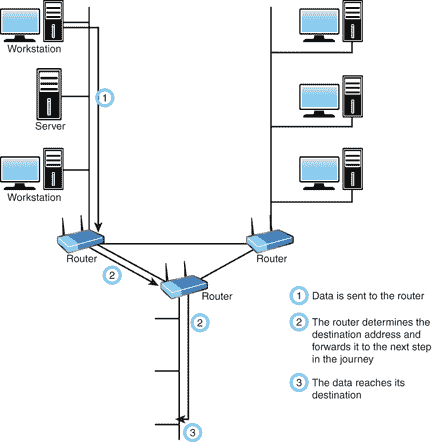

图 4.1 路由器的工作原理

路由器在 OSI 模型的第 3 层（网络层）工作。

## 交换机

与集线器一样，`switches` 是以太网网络的连接点。设备通过双对电缆连接到交换机，每个设备一根电缆。集线器和交换机的区别在于设备处理接收数据的方式。集线器将接收到的数据转发到设备上的所有端口，而交换机仅将其转发到连接目标设备的端口。它是通过连接到它的设备 `MAC` 地址，然后通过匹配接收到的数据中的目标 `MAC` 地址来实现的。图 4.2 显示了交换机的工作原理。在这种情况下，它已经学习了连接到它的设备的 `MAC` 地址；当工作站发送发给另一个工作站的消息时，它转发该消息并忽略所有其他工作站。

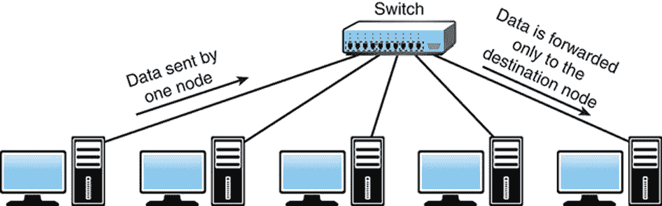

图 4.2 交换机的工作原理

通过仅将数据转发到应该接收它的连接，交换机可以极大提高网络性能。通过在两个设备之间创建直接路径并控制它们的通信，交换机可以大幅减少网络流量，从而减少冲突次数。正如你可能记得的，当两个设备尝试同时传输时，以太网上就会发生冲突。此外，无冲突允许交换机全双工模式与设备通信。在全双工配置中，设备可以同时向交换机发送数据并从交换机接收数据。这与半双工通信形成对比，后者的通信一次只能在一个方向发生。全双工传输速度是标准半双工连接的两倍。因此，`100 Mbps` 连接变为 `200 Mbps`，`1000 Mbps` 连接变为 `2000 Mbps`，以此类推。

采取这些措施的最终结果是，交换机与基于集线器的网络相比提供了显著的性能提升，特别是网络使用率较高时。

无论连接是全双工还是半双工，交换方法决定了交换机如何处理接收到的数据。以下是对种方法的简要说明：

 **直通交换 (Cut-through)：** 在直通交换环境中，数据包一旦接收就会开始转发。这种方法速度快，但由于不进行错误检查，可能会导致错误在网络中传播。

 **存储并转发 (Store-and-forward)：** 与直通交换不同，在存储转发交换环境中，整个数据包在转发之前会被接收并进行错误检查。这种方法的优点是错误不会在网络中传播。缺点是错误检查过程消耗的时间较长，导致存储转发交换的速度要慢得多。

 **分片交换 (Fragment-free)：** 为了利用存储转发交换的错误检查优势，同时提供接近直通交换的性能水平，可以使用分片交换。在分片交换环境中，会读取足够的数据包以便交换机判断数据包是否发生了冲突。一旦确定了冲突状态，数据包就会转发。

## 集线器与交换机的布线

除了作为网络设备的连接点外，集线器和交换机还可以连接以创建更大的网络。这种连接可以通过带有特殊线缆的标准端口，或者使用标准线缆连接特殊端口来实现。

连接计算机系统的集线器端口被称为 `介质相关接口交叉 (MDI-X)`。“交叉”这一称呼源于连接中的两根线是交叉的，使得其中一台设备的发送信号线变为另一台设备的接收信号线。由于端口在内部是交叉的，因此可以使用标准线（直通线）来连接设备。

另一种类型的端口被称为 `介质相关接口 (MDI)` 端口，通常包含在集线器或交换机上，以便于连接两个交换机或集线器。因为集线器或交换机设计为彼此视为网络的扩展，因此不需要对信号交叉。如果集线器或交换机没有 `MDI` 端口，可以使用两个 `MDI-X` 端口之间的线缆来连接集线器或交换机。交叉线会消除内部的交叉。更现代的网络设备接口上的 `Auto MDI-X` 端口可以检测连接是否需要交叉线，并自动选择 `MDI` 或 `MDI-X` 配置以正确匹配链路的另一端。

### 考试提示

在交叉线中，第 1 和第 3 号线以及第 2 和第 6 号线是交叉的。

交换机可以在 OSI 模型的第 2 层（数据链路层）或第 3 层（网络层）工作。

### 集线器 (Hub)

可以说，集线器处于网络食物链的底层。集线器用于使用双绞线缆连接设备的网络。集线器还可以连接以创建更大的网络。`集线器` 是简单的设备，它们将数据包定向到连接到集线器的所有设备，无论数据包的目标是否是该设备。这使得它们成为低效设备，并在繁忙的网络中产生性能瓶颈。

在最基本的形式中，集线器除了为电信号提供传输路径外什么都不做。这种设备被称为 `被动` 集线器。现在更常见的是 `主动` 集线器，它在为数据信号提供路径的同时，在转发到所有连接的设备之前再生信号。此外，主动集线器可以在转发之前缓存数据。然而，集线器不对其转发的数据进行任何处理，也不进行任何错误检查。

集线器有各种形状和大小。具有五个或八个端口的小集线器通常被称为 `工作组集线器`。其他集线器可以容纳更多设备（通常多达 32 个）。这些被称为 `高密度设备`。

### 考试提示

因为集线器不执行任何处理，它们除了允许连接设备之间的通信外几乎没什么作用。对于今天的高需求网络应用程序，需要具有更高智能的设备。这就是交换机的用用场。

基础集线器工作在 OSI 模型的第 1 层（物理层）。

### 桥接器 (Bridge)

`桥接器`顾顾名连接两个网络。桥接发生在 OSI 模型的前两层，与路由的区别在于其简单性。在路由中，数据包被发送到它要去的地方，而在桥接中，它被离开此网络。换句话说，如果数据包不属于这个网络，它就会通过桥接发送，假设它属于那里而不是这里。

如果桥接网络的一个或多个段是无线区域，则该设备被称为 `无线桥接器`。

### 调制解调器 (Modems)

调制解调器（调制/解调器的缩写）是一种将计算机生成的数字信号转换为可以在电话线上传输的模拟信号的设备。接收端的调制解调器将信号转换回计算机可以理解的格式。调制解调器可用作连接 ISP 的手段或作为拨号局域网（LAN）的机制。

调制解调器可以是内部扩展卡或与主板集成、连接到系统串口或 USB 端口的外部设备，或者是用于其他设备（如便携设备和手持设备）的专用设备。

### 无线接入点 (Wireless Access Point)

技术上 `接入点` 可以用于有线或无线连接，但实际上它几乎只与启用无线功能的设备相关。无线 `接入点 (APs)` 是用于创建 `无线局域网 (WLAN)` 的收发器。AP 通常是带有内置天线、发射器适配器的独立网络设备。AP 使用无线基础设施网络模式在 WLAN 和有线以太网 LAN 提供连接点。AP 通常还有几个端口，提供了扩展网络以支持额外客户端的方法。

根据网络的大小，可能需要一个或多个 AP。额外的 AP 用于允许更多无线客户端访问并扩展无线网络的范围。每个 AP 都受到传输范围的限制——即客户端距离 AP 多远仍能获得可用信号。实际距离取决于所使用的无线标准以及客户端与 AP 之间的障碍物和环境条件。

### 考试提示

AP 可以作为桥接器工作，将标准有线网络连接到无线设备，也可以作为路由器将数据传输从一个接入点传递另一个接入点。

说 AP 用于将有线 LAN 扩展到无线客户端并并没有给你完整的全貌。今天的无线 AP 除了作为接入点外，还可以提供不同的服务。今天，这些设备可能提供许多端口，可以轻松增加网络规模。系统可以添加到或从网络中移除，而不会对网络上的其他系统产生影响。此外，许多 AP 还提供了防火墙功能和 `动态主机配置协议 (DHCP)` 服务。当它们连接时，它们为客户端系统提供私有 IP 地址，然后防止 Internet 流量访问这些系统。因此，实际上 AP 是一个交换机、DHCP 服务器、路由器和防火墙。

AP 有各种形状和大小。许多比较便宜，且专为家庭或小型办公室设计。此类 AP 具有低功率天线和有限的扩展端口。用于商业目的的高端 AP 具有高功率天线，能够延伸无线信号的距离。

### 注意

AP 用于创建无线局域网并扩展有线网络。AP 用于基础设施无线拓扑结构。

AP 工作在 OSI 模型的第 2 层（数据链路层）。

#### 介质转换器 (Media Converter)

当你有两种不同类型的网络介质时，可以使用媒体转换器（media-converter）来允许它们连接。它们有时被称为耦合器（couplers）。根据所转换的内容，转换器可以是一个仅比连接器本身大大的设备，也可以是位于大型机箱内的设备。

在整个网络中不使用相同介质的原因（以及需要转换器的原因）范围包括成本（逐渐从同轴电迁移到光纤）、不同的分段（连接办公室和工厂），或在特定环境中需要特定的介质（例如在建筑的一小部分需要光纤来减少电磁干扰 EMI 问题）。

图 4.3 显示了媒体转换器的示例。图中所示转换器在 10/100/1000TX 和 1000LX（带有 SC 类型连接器）之间进行转换。

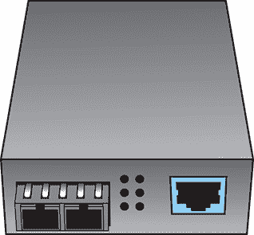

图 4.3 常见的媒体转换器

以下是常见的转换器，也是 CompTIA 之前包含在 Network+ 考试中的设备。

### 考试警报

确保你了解此处列出的可能性：

 单模光到以太网

 单模光到多模光

 多模光到以太网

 光纤到同轴电

### 无线范围扩展器

无线范围扩展器（也称为中继器或放大）可以放大无线信号使其更强。这增加了客户端系统可以距离接入点（AP）的距离仍保持在网上。扩展器需要设置为与 AP 相同的信道，以便中继器接收并重复传输。这是增加无线传输距离的有效策略。

### 考试警报

仔细阅读故障排除问题的场景，确保来自 AP 的传输首先到达中继器，然后由中继器复制信号并传递。

### VoIP 终端

在 IP 语音（VoIP）的世界中，终端（endpoint）是语音通话的任何最终终点。该最终终点可以是物理设备（如物理电话手筒）、软件应用程序或服务器。终端用于会话建立协议（`SIP`）。为了说明其中一些可能性，思科发布了一份 18 页的终端产品矩阵（可在 [`www.cisco.com/c/dam/en/us/products/collateral/collaboration-endpoints/sales-tool-c96-7394244.pdf`](https://www.cisco.com/c/dam/en/us/products/collateral/collaboration-endpoints/sales-tool-c96-7394244.pdf) 获取）。

### 网络设备总结

本章的信息对于 Network+ 考试非常重要。为了总结目前为止网络设备的覆盖范围，表 4.1 列出了关于每个设备的一些关键点。你应该很好学习这些信息。

#### 表 4.1 网络设备总结

| 设备 | 描述 | 关键点 |
| :--- | :--- | :--- |
| 集线器 (Hub) | 连接以太网双绞网络上的设备 | 集线器除了信号再生外不执行任何任务。 |
| 交换机 (Switch) | 连接双绞网络上的设备 | 交换机通过嵌入每个数据包中的 `MAC` 地址将数据转发到目的地。 |
| 路由器 (Router) | 连接网络 | 路由器使用软件配置的网络地址来做出转发决策。 |
| 调制解调器 (Modem) | 提供跨电话线的串口能力 | 调制解调器在发送端将数字信号调制为模拟，并在接收端执行相反功能。 |
| 防火墙 (Firewall) | 提供网络之间的控制数据访问 | 防火墙可以是硬件或软件。它们是网络安全策略的重要组成部分。 |
| 桥 (Bridge) | 连接两个网络的最简单方法 | 在 OSI 模型的第 1 层和第 2 层运行，在大多数网络中已被交换机取代。 |
| 媒体转换器 (Media Converter) | 用于从一种介质转换为另一种 | 通常与光纤配合使用。 |
| 无线接入点 (AP) | 用于创建无线 LAN 并扩展有线网络 | 使用无线基础设施网络模式在 WLAN 和有线以太网 LAN 之间提供连接点。 |
| 无线扩展器 (Wireless Extender) | 用于扩展无线网络的距离 | 扩展器也被称为中继器，因为它放大接收的内容并重新传输。 |
| VoIP 终端 (VoIP Endpoint) | VoIP 网络的接收项 | 这可以是手筒、应用程序或服务器。 |

### 考试警报

你将被要求了解本章中提到的设备的功能。复习表 4.1。确保你理解每个设备以及它们在网络上如何以及为何被使用。

### 强化习测验

**1.** 用户抱怨网络性能不令人满意。从服务器拉取文件需要长时间，而且在重负载下，工作站可能会与服务器断开连接。网络被大量使用，即将安装一个新的视频会议应用程序。该网络是使用以太网集线器创建的 1000BASE-T 系统。你最可能安装哪种设备来缓解性能问题？

 **A.** 交换机

 **B.** 路由器

 **C.** 媒体转换器

 **D.** 防火墙

**2.** 下列哪个设备将数据包转发到所有连接端口？

 **A.** 路由器

 **B.** 交换机

 **C.** 内容过滤器

 **D.** 集线器

**3.** 下列哪个设备根据 `MAC` 地址传递数据？

 **A.** 集线器

 **B.** 交换机

 **C.** MSAU

 **D.** 路由器

### 强化习测验答案

**1. A.** 用交换机替换以太网集线器可以产生显著的性能提升。在列出的设备中，交换机也是唯一可以替代集线器的设备。路由器用于隔离开网络，而不是作为工作站的连接点。媒体转换器用于连接两种不同类型的网络介质。防火墙不是所提问题的解决方案。

**2. D.** 集线器是低效设备，会将数据包发送到所有连接的设备。交换机将数据包传递给特定的目标设备。这种方法显著提高了网络性能。

**3. B.** 在确定数据包的终地时，交换机学习连接到它的所有设备的 `MAC` 地址，然后匹配其收到的数据中的目标 `MAC` 地址。列出的其他设备都没有仅根据 `MAC` 地址传递数据。

## 高级网络设备

 **解释高级网络设备的用途和用例。**

### 强化节省

如果你在学习本节之前能够正确回答这些问题，可以通过快速浏览本节的考试警报来节省时间，然后完成节末的强化习验。

**1.** 什么可以将输入数据分发到特定的应用程序服务器并帮助分担？

**2.** 真或假：多层交换机同时作为路由器和交换机运行。

**3.** 你的公司正在考虑向网络添加一种硬件设备，该设备可以通过分发工作负载来提高性能，同时增加冗余和数据可用性。这种示例技术可能适用于什么用例？

### 答案

**1.** 内容交换机可以将输入数据分发到特定的应用程序服务器并帮助分担负载。


### 2. 正确

多层交换机可以作为路由器和交换机同时工作。

### 3. 正确

负载均衡器可以是软件组件，也可以是硬件组件，它通过分配负载来提高性能，从而增加冗性和数据可用性。

除了之前讨论的网络设备外，CompTIA 还要求你熟悉 Network+ 考试的另外 12 种设备。考试要求你能够解释本节涵盖的高级网络设备的用途，并识别其实际用例。

### 考试警报

注意此项目标包含了“用例”（use cases）一词：这在 Network+ 考试目标中是新的，意味着你应该预期会有诸如“该技术/设备的常见用例是……”这类描述的问题。

## 多层交换机

过去，网络设备及其执行的功能是分开的。网桥、路由器、集线器等设备存在，但它们是独立的设备。随着时间的推移，某些单个网络设备的功能集成到了单一设备中。`multilayer switches`（多层交换机）就是如此。

多层交换机可以在 OSI 模型的第 2 层和第 3 层运行，这意味着多层设备既可以作为交换机，也可以作为路由器工作。它也被称为第 3 层交换机，是一种支持与路由器相同路由协议的高性能设备。它是在局域网（LAN）内部引导流量的普通交换机；此外，它可以在子网之间转发数据包。

### 考试警报

多层交换机作为路由器和交换机同时工作。

内容交换机是另一种专用设备。由于成本原因，内容交换机在今天的网络中并不常见。内容交换机检查接收到的网络数据，决定内容的去向并进行转发。内容交换机可以通过将数据与端口关联来识别数据目标应用程序。例如，如果数据使用简单邮件传输协议（SMTP）端口，则它可以被转发到 SMTP 服务器。

内容服务器可以帮助负载均衡，因为它们可以在服务器之间分配请求，并将数据仅指向需要它的服务器，或者在应用程序服务器之间分配数据。例如，如果使用多个邮件服务器，内容交换机可以在服务器之间分配请求，从而分分负载。这就是为什么内容交换机有时被称为负载均衡交换机。

### 考试警报

内容交换机可以将输入数据分到特定的应用程序服务器并帮助分负载。

## 无线控制器

`Wireless controllers`（无线控制器）通常用于分支/远程办公室部署的无线认证。当 AP 启动时，它在开始作为 AP 工作之前会与控制器认证。这通常与 `VLAN pooling`（VLAN 池化）配合使用，其中多个接口被视为单个实体（通常用于负载均衡）。

## 负载均衡器

网络服务器是网络的骨干。它们负责存储和分发数据、维护备份、保护网络通信等。服务器的负载对于单个服务器来说往往太大。这就是负载均衡发挥作用的地方。`Load balancing`（负载均衡）是将负载分配到多个服务器之间的技术。这项功能可以将网络提升到更高；它提高了网络性能、可靠性和可用性。

### 考试警报

记住负载均衡增加了冗余，因此增加了数据可用性。此外，负载均衡通过分配负载提高了性能。

负载均衡器可以是硬件设备，也可以是专门配置用于平衡负载的软件。

### 注意

多层交换机和 DNS 服务器可以作为负载均衡器。

## IDS/IPS

`intrusion detection system (IDS)`（入侵检测系统）是一种被动检测系统。`IDS` 可以检测攻击的存在并记录该信息。它还可以提醒管理员潜在威胁。管理员随后分析情况并在必要时采取纠正措施。

`IDS` 的变体是 `Intrusion Prevention System (IPS)`（入侵预防系统），是一种主动检测系统。通过 `IPS`，设备持续扫描网络寻找不当活动。它可以关闭任何潜在威胁。`IPS` 寻找任何已知攻击的签名并自动尝试防止这些攻击。`IPS` 被视为主动/响应性安全措施，因为它积极监控并可以采取措施纠正潜在的安全威胁。

以下是 IDS/IPS 的几种变体：

- **基于行为：** `behavior-based system` 寻找行为的变化，例如异常高流量、违反策略等。通过寻找行为偏差，它可以识别潜在威胁并快速响应。
- **基于签名：** 基于签名的系统（也称为 `misuse-detection system (MD-IDS/MD-IPS)`）主要关注基于攻击签名和审计跟踪来评估攻击。攻击签名描述了攻击系统的通用建立方法。例如，`TCP flood attack`（TCP 洪水攻击）始于大量不完整的 TCP 会话。如果 `MD-IDS` 知道 `TCP flood attack` 的样子，它就可以做出适当报告或响应以阻止攻击。该 `IDS` 使用扩展数据库来确定流量的签名。
- **网络入侵检测/预防系统（NIDS 或 NIPS）：** 该系统检查所有进出网络系统的网络流量。如果是软件，它安装在服务器或其他可以监控入站流量的系统上。如果是硬件，它可能连接到集线器或交换机以监控流量。
- **基于主机的入侵检测/预防系统（HIDS 或 HIPS）：** 指安装在单个网络系统上的应用程序，如间谍软件或病毒程序。系统在本地系统上监控并创建日志。

### 考试警报

考试测试的四种 IDS/IPS 类型是基于行为、基于签名、基于网络和基于主机的。

## 代理服务器

`Proxy servers`（代理服务器）通常是防火墙系统的一部分。它们与防火墙集成得如此，以至于两者之间的区别有时会消失。

然而，代理服务器在网络环境中扮演着独特的角色——这个角色独立于防火墙。对于本书而言，代理服务器定义为位于客户端和互联网之间的服务器，并查看客户端发送的网页请求。例如，如果客户端想要访问网页，请求将发送到代理服务器而不是直接发送到互联网。代理服务器首先确定请求是面向互联网还是本地 Web 服务器。如果请求面向互联网，代理服务器将`仿佛请求源自自己`一样发送请求。当互联网 Web 服务器返回信息时，代理服务器将信息返回给客户端。尽管通过代理服务器的额外步骤可能会导致延迟，但该过程对于发起请求的客户端来说很大程度上是透明的。因为客户端发送到互联网的每个请求都通过代理服务器通道，代理服务器可以提供超出转发请求的某些功能。

最显著的额外功能之一是代理服务器可以通过称为 `caching`（缓存）的过程极大提高网络性能。当缓存代理服务器响应网页请求时，该服务器会在其缓存中创建该页面全部或部分的副本。然后，当该页面再次被请求时，代理服务器将从缓存中响应请求，而不是返回互联网。例如，如果网络上的客户端请求网页 [www.comptia.org](http://www.comptia.org)，代理服务器可以缓存该网页的内容。当网络上的第二个客户端计算机尝试访问同一网站时，该客户端可以从代理服务器的缓存中获取内容，而无需访问互联网。这极地缩短了到客户端的响应时间，并可以显著减少满足客户端请求所需的带宽。

如今，速度就是一切，快速从互联网访问信息的能力对于某些组织来说是一个关键的问题。代理服务器及其缓存网页内容的能力满足了这种对速度的需求。

这种速度的例子可以在教室中找到。如果老师要求 30 名学生访问特定的 `uniform resource locator (URL)` 且没有代理服务器，那么所有 30 个请求都将发送到网络空间，并面临延迟或其他可能出现的问题。有了代理服务器的教室场景则完全不同。30 个请求中只有一个会通往互联网；另外 29 个请求由代理服务器的缓存填充。网页的检索几乎是瞬间完成的。

然而，这种缓存有一个潜在的缺点。当你登录互联网时，你获得的是最新信息，但从缓存中检索信息时，并不总是如此。对于某些网页，有必要直接访问互联网以确保信息是最新的。某些代理服务器可以更新和刷新网页，但它们总是落后一步。

代理服务器的第二个关键特性是允许网络管理员过滤客户端请求。如果服务器管理员想要阻止访问某些网站，代理服务器可以实现这种控制，从而轻松地完全禁止对某些网站的访问。这没问题，但如果需要阻止大量网站呢？这时维护代理服务器就会变得有些复杂。

确定用户可以或不可以访问哪些网站通常是通过一种称为 `access control list (ACL)`（访问控制列表）的东西完成的。第 3 章讨论了如何使用 ACL 为哪些端口号或 IP 地址允许访问提供规则。ACL 也可以是允许或不允许访问的网站列表；正如你所想象的，编制这样一个列表可能是一项艰巨的任务。鉴于存在数百万个网站且每天都有新网站创建，你如何针对并阻止对“可疑”网站的访问？一种方法是反转局面，拒绝访问除出现在“允许”列表中的页面以外的所有。这种方法具有很高的管理开销，并可能极大限制互联网访问带来的生产效益。

可以理解，维护一个包含所有可疑内容网站位置的列表是不可能的。公平地说，这并不是代理服务器的设计初衷。然而，通过维护列表，代理服务器可以比开放系统提供更高级别的控制。在此过程中，代理服务器可以使网页检索变得高效得多。

`reverse proxy server`（反向代理服务器）位于 Web 服务器附近并响应请求。这些服务器通常用于负载均衡，因为每个代理都可以缓存来自多个服务器的信息。

## VPN 集中器

`VPN concentrator`（VPN 集中器）可用于增加远程访问的安全性。该设备可以在发送和接收的网络设备之间建立安全连接（隧道）。VPN 集中器为 VPN 安全性增加了一个层。它们不仅可以创建隧道，还可以验证用户、加密数据、调节数据传输并控制流量。

集中器位于 VPN 客户端和 VPN 服务器之间，创建隧道，使用隧道验证用户身份，并加密通过隧道传输的数据。当 VPN 集中器到位时，它可以在发送和接收的网络设备之间建立安全连接（隧道）。

VPN 集中器为 VPN 安全性增加了一个层。根据具体的集中器，它们可以执行以下操作：

- 创建隧道。
- 验证想要使用隧道的用户。
- 加密和解密数据。
- 调节和监控跨隧道的数据传输。
- 作为隧道端点或路由器控制入站和出站流量。

VPN 集中器调用各种标准协议来实现这些功能。

## AAA/RADIUS 服务器

网络管理员在实施远程访问时面临的潜在问题之一是远程访问服务器的利用率和负载。随着网络远程访问实现的增长，依赖单个远程访问服务器是不可能的，可能需要额外的服务器。`RADIUS` 在这种情况下可以帮助。

### 考试警报

RADIUS 是一种协议，允许单个服务器负责所有的远程访问认证、授权和审计（或计费）服务；这被称为 `AAA`。

RADIUS 作为客户端/服务器系统工作。远程用户拨入远程访问服务器，该服务器作为 RADIUS 客户端或 `network access server (NAS)`（网络接入服务器），并连接到 RADIUS 服务器。RADIUS 服务器执行认证、授权和审计（或计费）功能并将信息返回给 RADIUS 客户端（运行 RADIUS 客户端软件的远程访问服务器）；根据收到的信息建立或拒绝连接。

### 注意

要了解更多关于 AAA/RADIUS 的信息，请访问 [www.cisco.com/c/en/us/td/docs/ios/12_2/security/configuration/guide/fsecur_c/scfrad.html](http://www.cisco.com/c/en/us/td/docs/ios/12_2/security/configuration/guide/fsecur_c/scfrad.html)。

## UTM 设备和下一代防火墙

防火墙可以使用多种方法确保安全。除了上述描述的作用外，现代防火墙应用程序还可以执行一系列其他功能，通常通过添加指向 OSI 模型应用层（第 7 层）的附加模块来实现；它们随后通常被称为 `Unified Threat Management (UTM)`（统一威胁管理）设备或 `Next Generation Firewalls (NGFW)`（下一代防火墙）。UTM 可以包含以下功能：

- **内容过滤：** 大多数防火墙都可以配置提供某种程度的内容过滤。这可以针对入站和出站内容进行。例如，可以配置防火墙监控入站内容，限制某些位置或特定网站。防火墙还可以通过维护 URL 和 IP 地址列表禁止访问某些网站来限制出站流量。这在组织想要控制员工访问互联网站点时通常会这样做。
- **特征识别：** 特征是特定应用程序的唯一标识符。在防病毒世界中，特征是一种唯一识别特定病毒的算法。防火墙可以配置为检测与恶意软件或其他不良应用程序相关的某些特征，并在它们进入网络之前将其拦截。
- **病毒扫描服务：** 在下载网页时，可以检查页面内的内容是否有病毒。这一功能对于担心来自互联网源潜在威胁的公司非常有吸引力。
- **网络地址转换（NAT）：** 为了保护内部网络上机器的身份，并允许内部 TCP/IP 寻址结构具有更具灵活性，许多防火墙会将数据的源地址转换为不同的地址。该地址随后将在互联网上使用。最常见的 NAT 类型是`Port Address Translation (PAT)`，它允许网络上的多个设备共享一个（或少数几个）公共地址。NAT 是一项很流行的功能，因为它解决了 IPv4 中 TCP/IP 地址资源有限的问题。当向 `IPv6` 的迁移完成后，对 NAT 的需求将会减少。
- **URL 过滤：** 通过使用多种方法，防火墙可以选择阻止组织内的客户端访问某些网站。这种阻止允许公司控制哪些页面可以被查看以及由谁查看。
- **带宽管理：** 虽然仅在某些情况下才需要，但带宽管理可以防止特定用户或系统占用网络连接。带宽管理最常用的方法是将可用带宽划分为区域，然后为用户或系统提供特定的区域。
- **其他：** 尽管上述功能是最常见的，但 UTM 还可以用于网络入侵 IDS/IPS、VPN、数据泄露防护（DLP）以及负载均衡，启用日志和监控功能。

这些功能并非严格的防火墙活动。然而，防火墙提供的灵活性加上其在网络边缘的部署，使得防火墙成为控制外部资源的理想基础。

### 考试提示（ExamAlert）

你可以预期关于防火墙类型及其特征的考试题。例如，你应该了解软件防火墙和硬件防火墙之间的区别，并理解状态检测与无状态包过滤防火墙。

### VoIP PBX 和网关

当电话技术与信息技术相结合时，其结果被称为电信。为了节省费用，公司已经从陆地大规模转向了 `Voice over IP (VoIP)`。这种管理中最大的问题之一就是安全问题。由于数据和 VoIP 位于同一条线路上，一旦发生攻击，两者都将受到威胁。标准的电话系统应该替换为安全的 `PBX`。

`VoIP 网关`（有时也称为 `PBX 网关`）可以使用 `SIP (Session Initiation Protocol)` 在旧式电话连接和 VoIP 连接之间进行转换。这被称为“数字网关”，因为语音媒体在过程中被转换。

### 考试提示（ExamAlert）

务必记住，由于数据和 VoIP 位于同一条线路上，一旦发生攻击，两者都将受到威胁。

### 内容过滤器（Content Filter）

`内容过滤器` 是任何控制用户允许浏览内容的软件，它通常与网站相关。通过使用内容过滤器，雇主可以阻止所有用户、某些用户甚至仅限单个用户访问色情网站。过滤器可以作为软件的形式应用于客户端机器上（称为客户端侧过滤器）、网络上的代理服务器上（服务器端过滤器）、互联网服务提供商（ISP）处，甚至在搜索引擎内部。后者最常用于家用电脑上。

## 强化复习测验（Cram Quiz）

**1.** 下列哪项可以作为负载均衡器？

- **A.** IDS 和 DNS 服务器
- **B.** 多层交换机和 IPS
- **C.** 多层交换机和 DNS 服务器
- **D.** VoIP PBX 和 UTM 设备

**2.** 下列哪项是对持续扫描网络并寻找不当活动的设备描述的最优答案？

- **A.** `IPS`
- **B.** `NGFW`
- **C.** `VCPN`
- **D.** `AAA`

**3.** 下列哪项是对任何控制用户允许浏览内容且通常与网站相关的软件描述的最优答案？

- **A.** `IDS`
- **B.** 代理服务器
- **C.** RADIUS 服务器
- **D.** 内容过滤器

**4.** 你想向网络中添加一种协议，使单个服务器负责所有远程访问的身份验证、授权和审计（或计数）服务。哪种用例是此的最佳示例？

- **A.** VPN
- **B.** `RADIUS`
- **C.** UTM
- **D.** VoIP

## 强化复习测验答案（Cram Quiz Answers）

**1. C.** 多层交换机和 DNS 服务器可以作为负载均衡器。

**2. A.** 入侵防御系统（`IPS`）是一种持续扫描网络并寻找不当活动的设备。

**3. D.** 内容过滤器是任何控制用户允许浏览内容的软件，且通常与网站相关。

**4. B.** `RADIUS` 是一种使单个服务器负责所有远程访问身份验证、授权和审计（或计数）服务的协议。

### 接下来做什么？

第 5 章，“WAN 技术”将查看广域网（WAN）并回顾各种 WAN 技术的特征。今天许多网络环境并不局限于单一位置或局域网。相反，许多网络跨度很大，使得 WAN 知识对于网络管理员至关重要。

## 第 5 章

### WAN 技术

本章涵盖了以下官方 Network+ 目标：

比较和对比 WAN 技术。

本章涵盖了 CompTIA Network+ 目标 2.5。有关官方 Network+ 考试主题的更多信息，请参见引言中的“关于 Network+ 考试”部分。


如果你将网络看作是可以在平面上表示的东西，那么光谱上会有两个端。在光谱的一端是只有少数节点和设备连接在一起的小型网络。在光谱的另一端是`广域网 (WAN)`：多个`局域网 (LANs)` 的混合体，其强度取决于其最薄弱的环节。

本章主要关注光谱中的 WAN 端，但也涵盖了如拨号连接等小型网络实践。它还查看了与网络相关的最佳实践和安全实践。

## WAN 技术

 **比较和对比 WAN 技术。**

## 快速备考指南 (CramSaver)

如果你在阅读本节之前能正确回答这些问题，可以通过快速浏览本节中的考试提示，然后完成本节末的强化复习测验来节省时间。

**1.** T-线是用于什么的？T1 和 T3 的最大速度是多少？

**2.** X.25 的传输速度限制是什么？

**3.** 电路交换和分组交换技术之间有什么区别？

## 答案

**1.** T 载波为私有网络创建点对点的网络连接。T1 线的传输速度为 1.544 Mbps，而 T3 线的传输速度为 44.736 Mbps。

**2.** X.25 在数字实现时被限制在 56 Kbps 或 64 Kbps 的传输速率。

**3.** 电路交换网络提供专用的传输通道，该通道在断开之前一直被保留。分组交换则允许数据包绕过网络拥塞进行路由。

如今许多网络环境不再局限于单一位置或局域网（LAN）。相反，许多网络跨越长距离，成为广域网（*WANs*）。在这些情况下，需要硬件和软件来连接这些网络。本节将回顾各种广域网技术的特性。

## 集成业务数字网络 (ISDN)

ISDN 长期一直是较慢调制调器 WAN 连接的替代方案，但成本更高。ISDN 允许在同一条物理连接上传输语音和数据。

ISDN 连接比普通的调制调器连接快得多。访问 ISDN，需要一条特殊的电话线。该线路通常通过每月订阅费用付费。你可以预计这些月费用远高于传统的拨号调制调器连接。

要建立 ISDN 连接，你只需拨打接收计算机的号码，就像拨打电话或调制调器拨号连接一样。随后，发送和接收设备之间会建立对话。当一端断开或挂断时，连接就会中断。ISDN 的线路接入速度非常快，能够比传统电话线更快建立或启动连接。

ISDN 有两种定义的接口标准：基本速率接口（*BRI*）和初级速率接口（*PRI*）。

### BRI

BRI ISDN 使用三个独立的通道——两个每个为 64 Kbps 的承载（B）通道和一个 16 Kbps 的差分（delta）通道。B 通道可以分为四个 D 通道，使企业能够同时拥有八个互联网连接。B 通道携带语音或数据，D 通道用于信令。

**注意** BRI ISDN 通道可以单独使用 64 Kbps 传输，也可以合并提供 128 Kbps 的传输速率。

### PRI

PRI 是 ISDN 的一种形式，通常通过 T1 线路传输，可以提供高达 1.544 Mbps 的传输速率。PRI 由 23 个 B 通道组成（每个通道提供 64 Kbps 的数据/语音容量）以及一个用于信令的 64 Kbps D 通道。

### 比较 BRI 和 PRI ISDN

[表 5.1] 将 BRI 与 PRI ISDN 进行了比较。

**考试警示** ISDN 被认为是租用线路，因为访问 ISDN 是从服务提供商租用的。

#### 表 5.1 BRI 与 PRI ISDN 比较

| 特性 | BRI | PRI |
| :--- | :--- | :--- |
| 速度 | 128 Kbps | 1.544 Mbps |
| 通道 | 2B+D | 23B+D |
| 传输介质 | ISDN | T1 |

**注意** 建议你了解 PRI 与 BRI 的对比以及[表 5.1]所示的基本特性。

## 租用线路

*T 载波线路*（T-carrier lines）是可以从电话公司租赁的高速专用数字线路。这在你建立服务时，在你与选择连接的任何对象之间创建一条始终开启、始终可用的线路。

T 载波线路可以支持语音和数据传输，通常用于创建点对点私有网络。由于是专用链路，它们可能是一种昂贵的广域网选择。共有四种 T 载波线路：

 **T1：** 提供 1.544 Mbps 的传输速率，并可以点对点的专用数字通信路径。T1 线路常用于连接局域网。在北美，T 线路使用 DS（数字信号）表示法来描述电路。对于所有实际用途来说，`DS1` 与 `T1` 是同义词。

 **T2：** 提供 6.312 Mbps 的传输速率。它通过使用 96 个 64 Kbps 的 B 通道来实现。

 **T3：** 提供高达 44.736 Mbps 的传输速率，使用 672 个 64 Kbps 的 B 通道。数字信号 3（`DS3`）是北美更准确的名称，但大多数人将该链路称为 T3。

**考试警示** 参加考试时，将 `DS3` 和 `T3` 视为同义词。

 **T4：** 通过使用 4,032 个 64 Kbps 的 B 通道提供高达 274.176 Mbps 的惊人传输速率。

**考试警示** 在这些 T 载波线路中，通常与网络相关且最可能出现在考试中是 T1 和 T3 线路。

**注意** 由于 T 载波方案的成本较高，你可以租用 T 载波服务的部分。这被称为*部分 T 载波*（*fractional T*）。你可以根据 64 Kbps 通道订阅并支付服务费。

T 载波在美国和加拿大使用的技术名称。在欧洲，它们被称为 E 载波，在日本被称为 J 载波。[表 5.2] 描述了 T/E/J 载波。

#### 表 5.2 T/E/J 载波比较

| 名称 | 传输速率 |
| :--- | :--- |
| T1 | 1.544 Mbps |
| T1C | 3.152 Mbps |
| T2 | 6.312 Mbps |
| T3 | 44.736 Mbps |
| T4 | 274.176 Mbps |
| J0 | 64 Kbps |
| J1 | 1.544 Mbps |
| J1C | 3.152 Mbps |
| J2 | 6.312 Mbps |
| J3 | 32.064 Mbps |
| J3C | 97.728 Mbps |
| J4 | 397.200 Mbps |
| E0 | 64 Kbps |
| E1 | 2.048 Mbps |
| E2 | 8.448 Mbps |
| E3 | 34.368 Mbps |
| E4 | 139.264 Mbps |
| E5 | 565.148 Mbps |

**考试警示** 确保你复习了 T1、T3、E1 和 E3 载波的速率。

### T3 线路

一段时间内，T1 线路提供的速度对于绝大多数组织来说都是足够的。随着网络及其支持的数据不断扩大，T1 线路无法为许多组织提供足够的速度。T3 服务通过提供 44.736 Mbps 的传输速率解决了这一问题。

T3 线路是提供高容量的专用电路；通常由大公司、ISP（互联网服务提供商）和长途公司使用。T3 服务提供了 T1 服务的所有优势（只是多得多），但与 T3 相关的成本将其使用限制在少数有资金支付的组织中。

## 光纤、SONET 和 OCx 级

1984 年，美国司法部和 AT&T 达成协议，规定 AT&T 是一个垄断企业，需要拆分为更小的、具有直接竞争关系的公司。这为当地电话公司带来了挑战，它们面临着连接到不断增加的独立长途运营商的任务，而每种运营商都有不同的接口机制。贝尔通信研究中心（Bell Communications Research）通过开发*同步光纤网络*（*SONET*）回答了这一挑战，这是一种光纤广域网技术，以 51.84 Mbps 起的速度传输语音、数据和视频。贝尔创建 SONET 的主要目标是为新竞争竞争的美国市场内的所有运营商创建一个标准化的接入方法，并统一全球不同的标准。SONET 的传输速率可以从 51.84 Mbps 到 2.488 Gbps 更高。

贝尔在 SONET 方面最大的成就之一是创建了一个新系统，以*光载波*（*OCx*）级来定义数据速率。[表 5.3] 列出了你应该熟悉的 OCx 级。

**考试警示** 在参加考试之前，复习[表 5.3]中提供的信息。确保你熟悉 OC-3 和 OC-192 的特定传输速率。

#### 表 5.3 OCx 级和传输速率

| OCx 级 | 传输速率 |
| :--- | :--- |
| OC-1 | 51.84 Mbps |
| OC-3 | 155.52 Mbps |
| OC-12 | 622.08 Mbps |
| OC-24 | 1.244 Gbps |
| OC-48 | 2.488 Gbps |
| OC-96 | 4.976 Gbps |
| OC-192 | 9.953 Gbps |
| OC-768 | 39.813 Gbps |

**注意** *光载波*（*OCx*）级代表了 SONET 光纤网络上传输的数字信号范围。每个 OCx 级定义了其工作速度。

*同步数字分层*（*SDH*）是 SONET 的欧洲对应物。

**考试警示** 参加考试时，将 SDH 等同于 SONET。

`无源光网络` (`PON`) 是一种使用无源光分路器来分光纤以服务于多个位置的网络，它将光纤引入到路边、建筑物或家庭。它被称为无源系统，因为这些组件不需要电源，并由位于分路处的`光线路终端` (`OLT`) 和每条线路末端（通常靠近最终用户）的多个`光网络单元` (`ONUs`) 组成。它可以与波分复用技术结合，被称为 `WDM-PON`。

一种光信号复用形式是`密集波分复用` (`DWDM`)。这种方法用`掺铒光纤放大器` (`EDFAs`) 替换了 `SONET`/`SDH` 继器，并且还可以放大信号使其传输更更远的距离。`DWDM` 系统的主要组件包括以下：

 终端复用器

 线路继器

 终端解复用器

### 注意

第 6 章“布线解决方案”讨论了其他几种复用方法。

### 考试警示

请确保你理解 `DWDM` 可以与 `SONET`/`SDH` 配合。

`DWDM` 的替代方案是`稀疏波分复用` (`CWDM`)。这种方法通常用于电视电缆网络。关于它需要了解的主要点是它对稳定性的要求较低；因此，下载和上传的速度可以完全不同。

### 考试警示

请确保你将 `CWDM` 与电视布线相关联。

### 帧中继 (Frame Relay)

要理解`帧中继`，了解一些古老的历史和 `X.25.` 是重要的。`X.25` 是原始的数据包交换技术之一，但今天它在大多数应用中已被`帧中继` 取代。各电信公司以及网络提供商在 20 世纪 70 年代中期开发了 `X.25`，通过铜线上的模拟信号传输数字数据。由于许多实体参与了 `X.25` 的开发和实现，它在许多具有不同类型流量的网络上运行良好。`X.25` 是最老的标准之一，这既是它最大的优势，也是它最大的缺点。从好的方面来说，`X.25` 是一个全球通用的标准。从坏的方面来说，它的最大传输速度为 56 Kbps——与 20 世纪 70 年代的其他技术相比这是合理的，但在今天看来既慢又笨。然而，20 世纪 80 年代发布的 `X.25` 的数字版本，将吞吐量增加到最高 64 Kbps。这按今天的标准来说也很慢。

由于 `X.25` 是一种分组交换技术，它使用不同的路由在特定时刻为发送和接收设备之间建立最佳连接。随着网络条件的变化（例如网络流量增加），数据包所走的路由也会发生变化。因此，在单个通信会期间，每个数据包可能通过不同的路由到达目的地。可以使用 `X.25` 服务的设备被称为`数据包组装/解封装器` (`PAD`)，在 `X.25` 连接的每一端都需要它。

从本质上说`帧中继`是一种运行在 OSI 模型物理层和数据链路层的 WAN 协议。`帧中继`实现了局域网 (LAN) 之间以及广域网 (WAN) 终端点之间间隙流量的数据传输。

`帧中继`的设计是为了提供通过公共数据网络服务在数字网络上以高速突发传输数据包的标准。`帧中继`是一种使用变长数据包的分组交换技术。本质上`帧中继`是 `X.25.` 的精简版本。它比 `X.25` 使用更小的包和更少的错误检查机制；因此，它的开销比 `X.25` 小。

`帧中继`连接通过使用建立端到端通信的`永久虚拟电路` (`PVCs`) 构建的。这意味着`帧中继`不依赖于 `X.25` 的优路径路由法。`帧中继` 可以在多种 WAN 技术上实现，包括 56 Kbps、`T1`、`T3` 和 `ISDN` 线路。

为了更好地理解它的工作原理，请看`帧中继`技术的一些组件。`帧中继` WAN 中的所有设备分为两大类：

 `数据终端设备` (`DTE`)：在`帧中继`世界中，`DTE` 一术是指位于公司网络内部的终端设备。终端设备包括如最终用户系统、服务器、路由器、网桥和交换机等硬件。

 `数据电路终端设备` (`DCE`)：`DCE` 指运营商拥有的设备。这些设备为网络提供交换服务，因此负责实际通过 WAN 传输数据。

如前文所述，`帧中继`使用虚拟电路来创建通信通道。这些虚拟电路在 `DTE` 设备之间建立了双向通信链路。`帧中继` 使用两种类型的虚拟电路：

 `永久虚拟电路` (`PVC`)：在`帧中继`网络中共享的永久专用虚拟链路，取代了硬连的专用端到端线路。

 `交换虚拟电路` (`SVC`)：代表仅在数据传输会话期间建立和维护的临时虚拟电路。

图 5.1 显示了`帧中继`网络的组件。

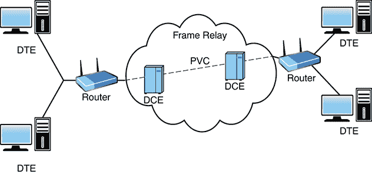

图 5.1   帧中继网络

### 异步传输模式

`异步传输模式` (`ATM`) 出于 20 世纪 90 年代初，被认为是网络领域的突破性技术，因为它是一种端到端的解决方案，使用范围从桌面扩展到远程系统。尽管它被推崇为 LAN 和 WAN 解决方案，但由于相关的实施成本和缺乏标准，`ATM` 并没有达到预期。`千兆以太网`的引入提供了极快的传输速度和与现有网络基础设施的兼容性，进一步削弱了 `ATM` 热潮的势头。然而，`ATM` 在某些互联网服务提供商 (ISP) 中找到了自己的市场，并被经常用作网络骨干。它提供了结合了分组交换和电路交换优势的功能。

`ATM` 是一种分组交换技术，传输速度从 1.544 Mbps 到 622 Mbps 不等。它非常适合各种数据类型，如语音、数据和视频。使用长度为 53 字节的固定长度包（或称为“单元”），`ATM` 的运行比 `帧中继` 等变长包分组交换技术更高效。固定长度的数据包允许 `ATM` 只关注每个数据包的头部信息。它不需要读取数据包的每一个位来确定其开始和结束。`ATM` 的固定单元长度也使其在其他技术发展时易于适应。每个单元有 48 字节可用数据，预留 5 字节用于 `ATM` 头部。

`ATM` 是一种基于电路的网络技术，因为它使用虚拟电路连接两个网络设备。像`帧中继`一样，`ATM` 也是一种基于电路的网络技术，同样使用 `PVCs` 和 `SVCs`。`PVCs` 和 `SVCs` 在上一节中讨论过。

`ATM` 兼容今天最广泛使用和实现的介质类型，包括单模和多模光纤、同轴电缆、非屏蔽双绞和屏蔽双绞线。虽然 `ATM` 可以在各种介质上使用，但某些介质类型的局限性使得它们成为 `ATM` 网络部署中不实际的选择。`ATM` 还可以在其他介质上运行，包括 `FDDI`、`T1`、`T3`、`SONET`、`OC-3` 和光纤。

### 铜线对比光纤

所使用的 WAN 技术通常取决于其构建的基础设施，而基础设施反过来又取决于你想要部署的 WAN 技术。技术与介质之间的共生关系具有极大的相互依赖性。

WAN 中最常用的两种介质是铜线和光纤。接下来的章节“布线解决方案”将对这两者进行更详细的介绍，但表 5.4 提供了目前讨论的技术以及支持它们的介质的概述。

### 表 5.4 比较 WAN 技术

| WAN 技术 | 速度 | 支持的介质 | 使用的交换方法 | 关键特性 |
| :--- | :--- | :--- | :--- | :--- |
| ISDN | BRI: 64 Kbps 到 128 Kbps, PRI: 64 Kbps 到 1.5 Mbps | 铜线/光纤 | 可用于电路交换或分组交换连接 | ISDN 可传输所有类型的流量，包括语音、视频和数据。BRI 使用 2B+D 通道；PRI 使用 23B+D 通道。B 通道为 64 Kbps。ISDN 使用公共网络并需要拨号接入。 |
| T-carrier (T1, T3) | T1: 1.544 Mbps, T3: 44.736 Mbps | 铜线/光纤 | 电路交换 | T-carrier 用于为私有网络创建点点网络连接。 |
| ATM | 1.544 Mbps 到 622 Mbps | 铜线/光纤 | 单元交换 | ATM 使用长度为 53 字节的固定单元。 |
| X.25 | 56 Kbps/ 64 Kbps | 铜线/光纤 | 分组交换 | X.25 限制为 56 Kbps。X.25 在标准电话线上提供分组交换网络。 |
| Frame Relay | 56 Kbps 到 1.544 Mbps | 铜线/光纤 | PVCs 和 SVC | Frame Relay 是一种面向分组的协议，使用变长数据包。 |
| SONET/OCx | 51.8 Mbps 到 2.4 Gbps | 光纤 | 不适用 | SONET 定义了光纤上的同步数据传输。 |

**考试警示**

对于 Network+ 考试，请确保你能够根据表 5.4 识别各种 WAN 技术的特性。

#### 其他 WAN 技术

表 5.4 列出了目前使用的最流行的 WAN 技术，但你也应该注意其他几种技术：


 **PPP**：点点协议（Point-to-Point Protocol）是一种用于在两个节点之间建立连接的数据链路协议。`PPP` 可用于普通电话业务（`POTS`）、`ISDN`、如 `SONET` 等光纤链路以及更快的连接（如 `T1`）。`PPP` 不提供数据安全，但它提供使用挑战握手认证协议（`CHAP`）进行身份验证。`PPP` 连接允许远程用户登录网络，并像网络上的本地用户一样获得访问权限。`PPP` 本身不为通道提供任何加密服务。正如你可能猜到的样，`PPP` 的不安全性在很大程度上不适用于 WAN 连接。为了解决这个问题，人们创建了其他协议，利用 `PPP` 的灵活性并在其基础上构建。例如，`PPP` 可以与加密控制协议（`ECP`）一起使用。你应该确保所有的 `PPP` 连接都使用安全通道、专用连接或高速连接。

 **PPPoE**：基于以太网的点点协议（Point-to-Point Protocol over Ethernet）提供了将 `PPP` 帧封装在以太网帧内部的能力。它最初用于通过 `DSL` 连接将包隧道到 `ISP` 的 `IP` 网络。尽管它已经存在多年，但仍被 `DSL` 提供商广泛使用。

### 注意

`PPPoE` 不用于电缆（或光纤）互联网提供商。

### 考试警示

请确保你理解 `MPLS`、`PPPoE`、`PPP`、`DMVPN` 和 `SIP trunk` 的 WAN 技术特性。

 **Multilink PPP**：基于 `PPP`，`Multilink PPP` 允许配置多个链路作为一个工作，从而提高连接速度。这项技术随着云技术变得流行，但仍然面临 `PPP` 固有的问题。

 **MPLS（多协议标签交换）**：用于基于高性能的电信网络，`MPLS` 是一种使用短路径标签而非长网络地址来引导数据从一个节点到另一个节点的技术。这些“标签”用于识别节点之间较短的虚拟链路，而不是终端。`MPLS` 支持 `ATM`、`Frame Relay`、`DSL`、`T1` 和 `E1` 等技术。

 **GSM/CDMA**：全球移动通信系统（`GSM`）可以与分分多址（`CDMA`）配合，提供各种手机覆盖手段。可以使用的方法包括 `LTE/4G`、`HSPA+`、`3G` 或 `Edge`。

 **DMVPN**：动态多点虚拟网络（Dynamic Multipoint Virtual Private Network）提供了创建动态网状 VPN 网络的能力，而无需预配置所有可能的隧道端点。中心是静态配置的，然后通过发现和接受新的分支来动态构建星型型网络，因此在中心或分支上不需要任何额外配置。

 **Metro-Ethernet（城域以太网）**：这仅仅是基于以太网的城（城域网网）。可以实现不同层次的部署，但所有部署都有基于底层技术的局限性。

 **SIP Trunk**：通过 `SIP trunk`，会话建立协议（Session Initiation Protocol）作为带有 IP 语音（`VoIP`）的流媒体服务，提供电话业务和统一通信。它需要使用基于 `SIP` 的私有分支交换（`IP-PBX`）和统一通信软件应用程序，例如语音、视频和其他流媒体应用程序（桌面共享、共享白板、网络会议等）。

## 强化练习测验

### 1

贵公司目前使用标准通信链路在局域网之间传输文件。到目前为止，传输速度对于需要传输的数据量是够的。最近购买了一个新应用程序，要求最小传输速度为 1.5 Mbps。你被赋予的任务是寻找最具成本效益的解决方案以适应新应用程序。你会使用以下哪种技术？

-  **A.** `T3`
-  **B.** `X.25`
-  **C.** `T1`
-  **D.** `BRI ISDN`

### 2

下列哪项最好描述了在两个通信端之间创建专用电路并在两点之间引导流量的过程？

-  **A.** 多路用
-  **B.** 定向路由
-  **C.** 路由
-  **D.** 电路交换

### 3

关于 `ISDN` 的哪些陈述是正确的？（选择两个最佳答案。）

-  **A.** `BRI ISDN` 使用 2 B+1 D 通道。
-  **B.** `BRI ISDN` 使用 23 B+1 D 通道。
-  **C.** `PRI ISDN` 使用 2 B+1 D 通道。
-  **D.** `PRI ISDN` 使用 23 B+1 D 通道。

### 4

你被聘请在两个办公室之间建立 WAN 连接：一个在温哥华，一个在西雅图。传输速度不能低于 2 Mbps。你可以选择以下哪种技术？

-  **A.** `T1`
-  **B.** `PPPoE`
-  **C.** `T3`
-  **D.** `ISDN`

### 5

在 `ISDN` 连接上，D 通道的目的是什么？

-  **A.** 它承载数据信号。
-  **B.** 它承载信号信息。
-  **C.** 它允许多个通道组合以提供更大的带宽。
-  **D.** 它为其他通道提供临时溢出容量。

### 6

`ATM` 使用的是哪种电路交换策略？（选择两个最佳答案。）

-  **A.** `SVC`
-  **B.** `VCD`
-  **C.** `PVC`
-  **D.** `PCV`

### 7

由于最近的裁员，你的老板找到你，并要求为公司昂贵的专用 `T1` 线路寻找替代方案。只有少少量数据需要在该线路上传输。你最可能会推荐哪一项？

-  **A.** `ISDN`
-  **B.** `FDDI`
-  **C.** 公用交换电话网络
-  **D.** `X.25`

### 8

下列哪种技术需要在发送设备和接收设备之间建立逻辑连接？

-  **A.** 电路交换
-  **B.** 虚拟电路分组交换
-  **C.** 报文交换
-  **D.** 高密度电路交换

### 9

哪种技术使用短路径标签而不是较长的网络地址将数据从一个节点导向另一个节点？

-  **A.** `MPLS`
-  **B.** 市太太网
-  **C.** `DMVPN`
-  **D.** `PPP`

## 测验答案

### 1. C

`T1` 线路的传输能力为 1.544 Mbps，比 `T3` 线路便宜得多。`X.25` 和 `BRI ISDN` 无法提供所需的传输速度。

### 2. D

电路交换是在两个通信端点之间创建专用电路并在两点之间引导流量的过程。其他所有答案都不是有效的交换类型。

### 3. A、D

`BRI ISDN` 使用 2 个 B+1 D 通道（即两个 64 Kbps 数据通道），`PRI ISDN` 使用 23 B+1 D 通道。`BRI` 的 D 通道为 16 Kbps，`PRI` 为 64 Kbps。

### 4. C

能够提供 2 Mbps 以上传输速度的唯一可能是 `T3` 线路。列出的其他技术均无法提供所需的传输速度。

### 5. B

`ISDN` 链路上的 D 通道携带信令信息，而 B 通道（承载通道）携带数据。

### 6. A、C

`ATM` 使用两种类型的电路交换：`PVC` 和 `SVC`。`VCD` 和 `PCV` 不是交换方法的名称。

### 7. C

当线路发送的流量很少时，公用交换电话网络（`PSTN`）是最具效益的解决方案，尽管它被限于 56 Kbps。所有其他 WAN 连接方法都能适应大量数据，且与 `PSTN` 相比非常昂贵。

### 8. B

使用虚拟电路交换时，在源设备和目的设备之间建立逻辑连接。

### 9. A

`MPLS` 用于基于高性能的电信网络，它是一种使用短路径标签而不是较长的网络地址将数据从一个节点导向另一个节点的技术。市太网只是基于以太网的 MAN（城域网）。`DMVPN` 提供了创建动态网状 VPN 网络的能力，无需预配置所有可能的隧道端点。`PPP` 是一种用于在两个节点之间建立连接的数据链路协议。`PPP` 支持普通电话业务（`POTS`）、`ISDN`、`SONET` 等光纤链路以及 `T1` 等更快的连接。

## 接入接入技术

 **对比分析 WAN 技术。**

### 快速救星

如果你在阅读本节之前正确回答了问题，可以跳过本节中的“考试提醒”，然后完成本节末的测验来节省时间。

1. `VHDSL` 通常用于什么？
2. 判断对错：使用普通电话线的 `DSL` 在同一根铜质线上传输数据。
3. 单向卫星系统和双向卫星系统有什么区别？
4. 分界点（demarcation point）位于什么硬件？

### 答案

1. `VHDSL` 支持 `VoIP` 和 `HDTV` 等高带宽应用。
2. 正确。使用普通电话线的 `DSL` 在同一根铜质线上传输数据。
3. `one-way satellite system` 需要用户端安装卫星卡和卫星天线。该系统通过电话线在一条链上传输发送请求，入站流量通过卫星链路返回。相比之下，`two-way satellite system` 为上行和下行数据提供数据路径。
4. 分界点的硬件是智能插座（smart jack），也称为网络接口设备（`NID`）。

接入接入已成为现代业务不可缺的一部分。你可以通过多种方式获取接入接入。选择哪种通常取决于成本以及你所在地区可用的技术。本节探索了获取接入接入的一些常用方法。

### 注意

`broadband` 通常指高速接入接入。`DSL` 和电缆调制调器都是常见的宽带接入技术。宽带路由器和宽带调制调器是支持 `DSL` 和电缆的网络设备。

## DSL 接入接入

*数字用户线路*（`DSL`）是一种使用标准电话线提供高速接入接入的接入方法。`DSL` 最常与高速接入接入相关联。因为它是一种廉价的接入接入，所以通常出现在家庭和小企业中。通过 `DSL`，可以使用不同的频率用于数字信号和模拟信号，这意味着你可以在上传数据时打电话。

对于 `DSL` 服务，存在两种系统：不对称数字用户线路（`ADSL`）和高速率数字用户线路（`HDSL`）。`ADSL` 仅在一个方向提供高数据传输率。它实现了快速的下载速度，但上传速度明显慢。`ADSL` 设计用于与现有的模拟电话服务（`POTS`）配合。凭借快速的下载速度，`ADSL` 非常适合家庭使用的接入接入，因为上传大量数据并不是频繁的任务。

与 `ADSL` 不同，`HDSL` 提供双向高数据速率服务，可以适应视频会议等双向都需要高数据速率的服务。`HDSL` 的变体是极高速率数字用户线路（`VHDSL`），它以极高的数据传输速率提供 `HDSL` 服务。

`DSL` 出现在 20 世纪 90 年代，带来了令人震惊的种类。所有这些变体统称为 `xDSL`：

 **非对称 DSL（ADSL）**：可能是 `DSL` 种类中最常见的是 `ADSL`，它使用线路上的不同通道。一个通道用于 `POTS` 并负责模拟流量。第二个通道提供上传接入，第三个通道用于下载。在 `ADSL` 中，下载比上传快，这就是为什么它被称为不对称 `DSL`。

### 注意

`ADSL2` 在数据传输率上做了一些改进，并增加了线路可以从电话交换局延伸的距离。`ADSL2+` 将下行带宽增加了一倍，并保留了 `ADSL2` 的所有功能。`ADSL2` 和 `ADSL2+` 都与旧的 `ADSL` 设备兼容。

 **对称 DSL（SDSL）**：提供相同的上传和下载速度，最适用于 Web 托管、内域网和电子商务等业务应用。它在家庭/小型企业环境中未被广泛应用，且无法共享电话线。

 **ISDN DSL（IDSL）**：一种对称型 `DSL`，通常用于无法使用 `SDSL` 和 `ADSL` 的环境。`IDSL` 不支持模拟电话。

 **速率自适应 DSL（RADSL）**：`ADSL` 的变体，可以根据信号质量修改其传输速度。`RADSL` 支持线路共享。

 **极高比特率 DSL（VHDSL 或 VDSL）**：`DSL` 的一种非对称版本，因此可以共享电话线。`VHDSL` 支持 `VoIP` 和 `HDTV` 等高带宽应用。`VHDSL` 可以达到约 10 Mbps 的数据速率，是目前可用最快的 `DSL` 形式。为了实现高速度，`VHDSL` 使用光纤电缆。

 **高比特率 DSL（HDSL）**：一种对称技术，在两个方向上提供相同的传输速率。`HDSL` 不允许与模拟电话共享线路。

为什么会有这么多 `DSL` 变体？答案非常简单，每种类型的 `DSL` 都是针对不同的用户、业务或应用程序的。高带宽需求的企业更有可能选择对称型 `DSL`，而对预算敏感的环境（如家庭办公室）则可能选择一种以牺牲带宽为代价来实现电话线共享的选项。此外，某些 `DSL` 变体是较旧的技术。尽管这些名称仍然存在，但它们已被更新的 `DSL` 实现所取代。当你在家庭/小型办公环境中工作时，你应该预期会使用一个 `ADSL` 系统。

表 5.5 总结了各种 `DSL` 选项的最大速度。通常无法获得最大速度。

### 表 5.5 DSL 速度

| DSL 变体 | 上传速度* | 下载速度* |
| :--- | :--- | :--- |
| `ADSL` | 1 Mbps | 3 Mbps |
| `ADSL2` | 1.3 Mbps | 12 Mbps |
| `ADSL2+` | 1.4 Mbps | 24 Mbps |
| `SDSL` | 1.5 Mbps | 1.5 Mbps |
| `IDSL` | 144 Kbps | 144 Kbps |
| `RADSL` | 1 Mbps | 7 Mbps |
| `VHDSL` | 1.6 Mbps | 13 Mbps |
| `HDSL` | 768 Kbps | 768 Kbps |

\*速度可能会根据所使用的技术和连接质量而产生巨大差异。

### 考试要点

在学习时，请重点关注 `ADSL`，但要能够将其与其他变体进行对比分析。

### 注意事项

使用普通电话线的 `DSL` 在同一根铜质线上传输数据。数据信号和语音信号通过不同的频率发送，但有时信号会相互干扰。这就是你使用 `DSL` 过滤器的原因。`DSL` 过滤器的工作原理是尽地减少这种干扰，从而提供更快、更清洁的 `DSL` 连接。

## DSL 故障排除步骤

排除 `DSL` 故障与其他排除任何互联网连接类似。当用户遇到 `DSL` 连接问题时，以下是需要检查的几点：

 **物理连接**：排除 `DSL` 故障时要要的地方是网络电缆连接。有时，这些电缆可能会松动或无意中脱落，经常被忽视作为问题的原因。`DSL` 调制器通常至少三个连接：一个用于 `DSL` 线路，一个用于局域网，一个用于电源。确保它们都插得恰当。

 **网络接口卡（NIC）**：在检查系统背后的电缆时，快速查看网卡 LED 指示灯是否亮起。如果没有亮，可能是网卡可能出了问题。可能需要更换网卡并替换为已知良好的网卡。

 **驱动程序**：确保网卡已安装并具有正确的驱动程序。很多时候，只需使用最新的驱动程序即可解决连接问题。

 **协议配置**：你正在排除故障的设备可能没有有效的 `IP` 地址。使用适用于操作系统（以及 `IP` 版本，无论是 `IPv4` 还是 `IPv6`）的相应工具确认 `IP` 地址——例如 `ipconfig` 或 `ifconfig`。如果系统需要自动分配 `IP` 地址，请确认系统已设置为自动获取 `IP` 地址。可能需要使用 `ipconfig /release` 和 `ipconfig /renew` 命令来获取新的 `IP` 地址。

 **DSL LED**：每个 `DSL` 盒子上都有 LED。光序列通常用于识别连接问题或盒子本身的问题。请参考制造商网站获取错误代码和 LED 的特定信息，但要记住基础知识。链路灯亮起表示物理连接已完成，闪烁的 LED 表示连接已激活。

### 考试要点

在排除电缆或 `DSL` 调制器的远程连接故障时，利用这些设备上始终存在的 LED 来辅助你的故障排除过程。

最终，如果这些步骤都不能治愈或指示问题的原因，你可能需要联系 `DSL` 服务商寻求帮助。

## 电缆宽带

*电缆宽带*接入接入是一种在提供数字电缆电视地区提供的在线接入方法。电缆接入接入对许多小型企业和家庭办公室用户很有吸引力，因为既便宜又可靠。大多数电缆提供商不限制访问的使用量，但他们控制速度。连接通过使用称为*电缆调制器*的设备实现。它有一个用于连接提供商插座的同轴连接，以及一个直接连接到系统或集线器、交换机或路由器的非屏蔽绞对（`UTP`）连接。

电缆提供商通常提供电缆调制器，并带有月租协议。许多电缆提供商提供免费或廉的电缆接入服务安装，包括在 PC 中安装网卡。某些提供商还不收取网卡费用。电缆接入费用与 `DSL` 订阅费用相当。


大多数电缆调制器都具有支持比家庭局域网更高速度以太网连接的能力。连接的实际速度可能会有所不同，取决于你所在区域共享电缆线的利用情况。

## 考试要点

电缆调制器通常配备有`介质依赖交叉`（`MDI-X`）端口，因此你可以使用直通型 UTP 电缆将调制器连接到系统。

电缆接入（至少对于 DSL 服务商而言）最大的缺点之一是，你与电缆区域内的其他人共享可用带宽。因此，在高峰时段，电缆链路的性能可能低于低使用时段。在居住区，繁忙时段是晚上和周末，特别是放学后。尽管如此，电缆系统的性能通常良好，在低使用时段，它可以很快。

## 注意事项

电缆和 DSL 之间的争论已经持续多年。虽然电缆调制器技术在局部社区内提供`共享带宽`，但其速度在理论上更高，但受这种共享带宽的影响。DSL 提供`专用本地带宽`，但对距离敏感，这会影响整体性能。由于月费用相近，决定使用哪种通常取决于当地提供商提供的套餐和捆绑优惠。

## 电缆故障排除步骤

通常情况下，电缆接入是一个低维护系统，问题很少。当发生问题时，你可以尝试各种故障排除措施：

- **检查用户端：** 在查看电缆调制解调器之前，请确保系统配置正确且所有电缆已插好。如果使用集线器、交换机或路由器让一组计算机共享电缆网络接入，请确保该设备已开启且运行正常。

- **检查物理连接：** 与 DSL 调制解调器一样，电缆调制解调器有三个连接：一个用于电缆信号，一个用于局域网，一个用于电源。确保它们都已正确插好。

- **确保系统上的协议配置有效：** 如果通过`Dynamic Host Configuration Protocol (DHCP)`分配 IP 地址，那么未获取地址是连接出现故障的明确指示。尝试使用你所用操作平台的相应命令获取新的 IP 地址。如果 IP 地址是静态配置的，请确保它们设置正确。尝试使用 ISP 指定之外的地址都可能导致用户无法连接网络。

- **检查调制解调器上的指示灯：** 大多数电缆调制解调器都有用于显示调制解调器状态的指示灯。在正常情况下，标记为`Ready`或`Online`的单个指示灯应该亮起。大多数电缆提供商会给用户提供调制解调器手册，详细说明指示灯的功能及其在某些状态下的含义。通常，任何红灯都是不妙的。闪烁的 LED 通常表示连接上有流量。

- **对调制解调器断电重启：** 对调制解调器断电重启是重置它的可靠方法。

- **拨打技术支持热线：** 如果你确定连接器全部就位且系统配置正确，下一步是拨打电缆提供商的技术支持热线。如果提供商遇到了影响许多用户的问题，你在等候时可能会收到告知此的消息。如果没有，你最终将联系到可以帮助你排除故障的人员。电缆接入的优点之一是，电缆公司可以远程监控并重置调制解调器。电缆公司应该告诉你调制解调器运行是否正常。

除非调制解调器出现故障（这并不常见），到此时用户应该已经重新连接上互联网，或者至少你应该完全理解用户无法连接的原因。如果问题出在电缆提供商的网络设备上，你和用户只需等待系统恢复即可。

# 宽带安全注意事项

无论你使用 DSL 还是电缆接入，请记住以下几点。这些技术都提供了始终在线的服务。这意味着即使你离开电脑，它仍然连接到互联网。正如你可以想象的，这产生了安全风险。你在线的时间越长，别人远程访问你系统的机会就越大。

目前使用的操作系统都存在攻击者等待利用的安全漏洞。这些攻击通常针对电子邮件或开放的 TCP/UDP 端口等技术。将操作系统安全漏洞与始终在线的互联网技术相结合无疑是一个危险的组合。

如今，DSL 和电缆接入连接必须通过防火墙等机制进行保护。防火墙提供了数据包过滤和`Network Address Translation (NAT)`等功能。防火墙可以是安装在系统上的第三方软件应用程序，也可以是硬件设备。

除了防火墙之外，确保你使用的操作系统在更新和安全补丁方面完全处于最新状态也同样重要。今天的客户端系统通常提供自动更新功能，当有新的安全更新或补丁可用时会提醒你。

如果你勤于遵循几项安全措施，DSL 和电缆接入都可以提供安全的接入。

# 拨号上网

尽管速度较慢，但在没有宽带接入的远程位置连接互联网或远程网络，一种方法仍然是老式的电话线和调制解调器：内部的`PCIe`类型或外部的`USB`类型。因为用于家庭电话的同一线路也用于拨号接入，因此它被称为`plain old telephone system (POTS)`接入方法。虽然世界上许多地区由宽带提供商提供服务（如本章目前为止讨论的此类），但仍有一些人必须（或选择）使用拨号调制解调器连接。

通过电话系统接入互联网需要两点：一个调制解调器和一个通过 ISP 获取的拨号接入账户。拨号调制解调器是将计算机系统生成的数字信号转换成可以在电话线上传输的模拟信号的设备。计算机可以拥有内部或外部调制解调器。外部`USB`调制解调器在安装和排除故障方面往往不易出错，因为不需要重新配置主机系统。内部调制解调器使用串口分配之一（即`COM`端口），因此必须配置为不与其他设备发生冲突。

拼图的第二个碎片块——拨号 ISP 账户，可以通过联系许多本地、区域或国家 ISP 轻松获得。大多数 ISP 提供一系列计划，价格通常基于用户允许在线的时间。几乎没有例外，ISP 提供 56 Kbps 的接入，这是当前标准下的最高速度。大多数 ISP 还提供电子邮件账户、新闻组服务器访问权限，并且通常提供少量的网页空间。

仔细研究 ISP 的选择是一个好主意。存在免费服务，但它们通常限制用户每月的在线时长，或使用大量的横幅广告来支付服务费用。

拨号接入的另一个大因素是 ISP 拥有多少线路。ISP 的线路数量与订阅数量并不相同；相反，它们对拨号客户采用先来付费制。这意味着用户在尝试连接时有时会遇到忙信号。在注册拨号接入账户之前，询问公司其线路与用户的比例是多少，并将该数字作为比较标准之一。

有了调制解调器和 ISP 账户，你就可以准备好连接了。但如果情况不符合计划该怎么办？欢迎来到拨号连接故障有趣且有时充满挑战的世界。

## 拨号故障排除步骤

排除拨号连接问题可能非常复杂且耗时，因为你必须考虑许多变量。在这一章讨论的远程连接机制中，你遇到`POTS`连接问题的概率比其他任何连接都要高得多。以下是在各种条件下开始排除故障的某些切入点。

## 注意

在某些情况下，用户可能甚至不用 ISP；而是直接拨打公司网络上的另一个系统。在这种情况下，本节中的所有故障排除步骤都适用。例外是，如果你遇到问题，必须依靠负责远程系统的人的技术支持能力，而不是 ISP。

如果用户无法拨出，请尝试以下：

- **检查物理连接：** 调制解调器连接最常见的问题是某些东西掉掉了；调制解调器在初始工作后很少出现故障。对于外部调制解调器，你还需要验证调制解调器已通电并且它已连接到正确的`COM`端口。

- **检查线路是否有拨号音：** 你可以通过将一个普通电话插入插座来检查是否可以拨出电话。此外，调制解调器通常有一个扬声器，你可以设置调制解调器使用扬声器，以便听到发生的情况。

如果用户可以拨出但无法连接到网络，请尝试以下操作：

- **确保用户拨打了正确的号码：** 这个建议听起来很显而，但有时号码会变化或输入错误。

- **致电 ISP：** 你可以联系 ISP 来确定其是否存在问题。

- **检查调制解调器扬声器：** 打开调制解调器扬声器，确认是否来自 ISP 的占用信号。

如果用户可以拨出并建立连接但随后被断开，请尝试以下操作：

- **确保调制解调器配置正确：** 最常见的调制解调器配置是 8 位数据位、1 位停止位和无校验（通常称为`eight-one-none`）。

- **检查用户名和密码：** 确保拨号连接配置了正确的用户名和密码组合。

- **验证连接设置是否正确：** 特别注意 IP 地址等内容。几乎所有的 ISP 都通过`DHCP`分配 IP 地址，不允许使用静态配置的 IP 地址进行连接。

- **确保用户没有超过预设的连接时间限制：** 某些 ISP 限制每月访问的小时。如果用户有此类计划，请检查是否还有剩余的时间额度。

- **尝试为连接指定较低的速度：** 调制解调器的设计旨在协商一个双方设备都能接受的连接速度。有时在协商过程中，线路可能会掉线。初始设置较低的速度可能会让你获得连接。然后你可以增加调制解调器的速度以适应更好的连接。

# 公共交换电话网络

公共交换电话网络（PSTN），通常被视为`POTS`，是遍布范围内互连电话线的总和。对 PSTN 的讨论包括了连接两点所需的所有设备，如电缆、网络设备和电话交换机。

## 考试提醒

尽管 PSTN 没有被明确列为考试目标，但你需要了解它如何与其他技术进行比较。要清楚如果资金是主要考虑因素，PSTN 是创建`WAN`的首选方法。

现代 PSTN 在很大程度上是数字化的，模拟连接主要存在于家庭和本地电话交换机之间。调制解调器用于将计算机系统的数字信号转换为模拟信号，以便通过模拟连接发送。

使用 PSTN 建立 WAN 连接是一种流行的选择，尽管其显著缺点是传输速度有限。PSTN 上的传输在使用调制解调器时限制为 56 Kbps，使用`ISDN`连接时限制为 128 Kbps，在这样的速度下很难共享大文件或进行视频会议。然而，只需要远程发送少量数据的公司可以使用 PSTN 作为远程访问的廉价替代方案，特别是当互联网等其他资源不可用时。

# 卫星接入

许多人将 DSL 和电缆接入视为理所当然，但这些技术并非随处可用。许多农村地区没有电缆接入。对于无法获得廉价宽带选项的地区，可用的互联网选项有限。主要选项之一是通过卫星的互联网。

`Satellite`接入为那些无法获得其他宽带方法的人提供了一个可行的互联网接入解决方案。卫星互联网提供了一种始终在线的连接，下载速度远快于旧拨号连接。尽管如此，卫星接入确实有一些缺点，例如成本和高延迟。`Latency`是信号在卫星之间往返所需的时间。

尽管卫星互联网比 DSL 或电缆慢且昂贵，但它提供了一些吸引人的特征，其中第一点是它的便携性。从字面上说，无论你去哪里，无需电话线或其他线缆即可接入。对于拥有远程用户和客户的企业来说，这种好处是显而易见的。但这项技术具有深远的影响；看到屋顶装有卫星天线的`房车`（`RVs`）并不罕见。它们在旅行时可以 24/7 无限访问互联网。

许多公司提供卫星互联网服务；快速搜索互联网就能发现不少。这些互联网供应商提供不同的互联网套餐，在价格、接入速度和服务方面差异巨大。有些针对企业，而另一些则目标是私人市场。

目前部署了两种类型的宽带互联网卫星服务：单向系统和双向系统。`one-way satellite system`需要在用户端安装卫星卡和卫星天线。该系统的工作原理是通过电话线在其中一条链路上发送出站请求，而入站流量通过卫星链路返回。相比之下，`two-way satellite system`为上行和下行数据提供数据路径。与单向系统一样，双向系统在用户端安装卫星卡和卫星天线；双向通信直接发生在用户端节点和卫星之间。

家庭卫星系统是非对称的；也就是说下载速度快于上传速度。家庭卫星系统可能会使用调制解调器处理上行流量，而下载通过卫星链路进行。你可以期待的卫星互联网确切速度取决于许多因素。与其他无线技术一样，大气条件会显著影响卫星接入的性能。卫星互联网的另一个额外考虑因素是增加的`propagation time`——信号在卫星之间往返所需的时间。在网络术语中，这段时间很长，因此是业务应用中一个重要的考虑因素。

## 家庭卫星故障排除步骤

你排查卫星连接故障的能力可能有限。家庭卫星互联网是一种视距无线技术，安装配置必须非常精确。由于这一要求，许多卫星公司坚持要求由经过培训的人员设置和配置卫星。如果你以不符合制造商建议的方式安装卫星系统，可能会使任何保修失效。

鉴于这种局限性，排查卫星连接故障通常要求你少关注连接问题，更多地关注物理故障排除技术。也许比任何其他互联网技术，技术支持电话都会发生在故障排除过程的早期阶段。卫星互联网有几个你需要注意的方面：

- **雨衰：** 指由于水分干扰导致的信号丢失。通常规则是天线越小，越容易受到雨衰的影响。家庭和小企业使用小天线。

- **延迟：** 指发送或请求信息的时间与返回时间之间的时间差。正如你预期的，卫星通信由于需要传输的距离而经历高延迟。

- **视距：** 尽管距离遥远，卫星本质上是一种视距技术。这意味着卫星天线和卫星之间的路径应该尽可能无遮挡。

# 无线网络访问

不久以前，腋着笔记本电脑走进当地咖啡馆，边喝拿铁咖啡边冲浪网页是不可想象的。暂且不说饮料和电脑不兼容，无线网络访问已变得非常普遍。

无线网络接入由互联网服务提供商（ISP）提供，被称为`hotspots`的公共无线网络接入。热点为机场、咖啡馆、会议室等笔记本、手持电脑和手机等移动网络设备提供互联网访问。热点是通过热点位置附近的一个或多个无线接入点创建的。

客户端系统可能需要安装特殊的应用程序以用于计费和安全目的；而其他系统除了获取网络名称`service set identifier`（`SSID`）外，不需要任何配置。热点并不总是需要收取服务费，因为公司将其作为营销工具，吸引互联网用户进入其场所。

热点并非无处不在，但寻找它们并不困难。通常，机场、酒店和咖啡馆都会宣传他们为客户提供互联网访问服务。此外，ISP 会在线上列出他们的热点站点，以便于查找。

建立与无线热点的连接是一个简单的过程。如果笔记本电脑没有内置无线功能，则需要外接无线适配器卡。在处理好网卡的物理要求后，按照以下步骤连接：

1. 当你到达热点站点时，开启笔记本电脑或其他移动设备。某些情况下，如果设备处于待机状态，你可能需要重启系统以清除旧的配置设置。

2. 网卡可能会自动检测网络。如果是如此，配置设置（如`SSID`）会被自动检测，无线网络即可用。如果互联网访问是免费的，几乎不需要做其他操作；如果是付费服务，你需要输入支付方式。需要记住的一点是，验证你是否使用了加密进行安全数据传输。

3. 如果由于某些原因无线设置没有被自动检测，你需要打开无线网卡的配置工具并手动设置配置。这些可以包括将模式设置为基础设施模式（infrastructure）、输入正确的`SSID`以及设置使用的加密级别。

除了使用 ISP 之外，某些公司（如酒店和咖啡馆）通过将无线连接到 DSL 或电缆互联网连接来提供无线网络访问。路由器成为用户连接的无线接入点，允许客户端通过宽带连接到互联网。该技术基于`802.11`标准，目前通常为`802.11n/ac`，客户端系统仅需要内部或外部无线适配器。

## 注意

想了解更多关于无线的信息？第 7 章“无线解决方案”详细介绍了无线技术。

# 终止点

为了正常工作，网络必须拥有终止点。这些端点停止信号并防止其在需要之外继续存在。对于考试，CompTIA 要求你熟悉许多与终止相关的主题，这些主题将在接后的章节中进行讨论。

## 接线点（Demarc）、接线点扩展和智能插座（Smart Jacks）

网络的`demarcation point`（接线点）是运营商网络部分与客户网络部分之间的连接点。该点对于网络管理员非常重要，因为它区分了客户负责的网络部分和所有者负责的部分。例如，对于那些使用高速互联网的用户来说，客户场所与 ISP 之间的边界通常安装在房屋一侧的墙上。然而，高速服务提供商提供从电缆调制解调器到其主分发中心的所有支持。这就是为什么如果调制解调器故障，由 ISP 而不是客户来更换。通往该点的布线也是如此。

了解接线点的位置至关重要，因为标记了客户（或管理员）负责区域与所有者负责区域之间的界限。它还确定了发生问题时客户负责的这一点，以及谁应该为该问题付费。ISP 负责确保网络在接线点处是功能正常的。客户/管理员负责确保从该点开始的一切都运行正常。

接线点是 ISP 将服务放置于你网络中的点。接线点放置的位置并不总是可选的。这意味着一家公司可能有六楼办公室，而接线点在地下室——这对于网络来说是不切实际的。这时你需要接线点扩展，它将接线点延伸到更具功能的位置。这听起来可能简单，但它涉及布线距离和其他基础设施需求的知识。接线点扩展可能是管理员的责任，或者所有者可能会提供扩展服务。

正如你所想象的，你在接线点需要某种形式的硬件。这就是`smart jack`（智能插座），也称为`network interface device (NID)`。智能插座执行几个主要功能：

- **环回功能：** 智能插座内置了环回功能。类似于以太网环回线，它用于测试目的。在这种情况下，环回功能允许远程测试，这样技术人员就不总是需要被访问本地网络来隔离问题。

- **信号放大：** 智能插座可以放大信号。这一功能类似于以太网网络中继器的功能。

- **浪涌保护：** 闪电和其他环境状况可能会导致电涌，从而迅速损坏设备。许多智能插座包含对环境状况的保护。

- **远程警报：** 智能插座通常包含报警器，允许所有者识别智能插座以及接线点连接是否出现故障。

## 考试提醒

`Demarcation point`（接线点）是电信公司或 ISP 的术语，指他们的设施或线路结束以及你开始的地方。

## CSU/DSU

`channel service unit/data service unit (CSU/DSU)`充当 LAN 数据格式和 WAN 数据格式之间的翻译器。这种转换是必要的，因为 WAN 链路上使用的技术与 LAN 上使用的不同。有些人将 CSU/DSU 视为一种数字调制解调器。但与将信号从数字转换为模拟的普通调制解调器不同，CSU/DSU 将信号从一种数字格式转换为另一种数字格式。

CSU/DSU 具有 LAN 设备的物理连接（通常通过串口接口），以及另一个用于 WAN 的连接。

## 考试提醒


传统上，`CSU/DSU` 是一个与其他网络设备独立的箱子里。然而，随着 `WAN` 链路使用的日益增加，一些路由器制造商现在在路由器中包含了 `CSU/DSU` 功能，或者提供了实现此功能的扩展能力。

## 验证布线安装和终止

当一段网络电缆放置在所需位置后，无论是穿过吊顶空间（plenum）还是连接跳线，最后的任务就是布线端接。端接是将网络电缆连接到墙座、插头或配线面板的过程。端接通常是一个简单的过程。如果连接的网络卡上的 LED 灯亮起，你可以快速判断布线和端接是否成功。此外，如果你连接了客户端系统，且一切正常，你可以 `ping` 网络上的其他设备。

### 注意

布线相关主题（如跳线和吊顶电缆）将在第 6 章“布线解决方案”中讨论。

如果你完成了布线和端接，但系统无法访问网络且链路指示灯不亮，在排查布线安装和端接时，你应该检查以下几点。

验证设备（交换机/网卡）上的端接和布线安装链路灯未亮：

 如果你将跳线连接到 PC 或交换机但链路灯不亮，请通过更换确认跳线来验证跳线是否正常。

 如果是自制的跳线，请确保 `RJ-45` 连接器已正确连接。

 确保 `RJ-45` 连接器已妥固插入墙座以及网卡或交换机端口。

 如果连接到交换机时链路灯不亮，请换到交换机的另一个端口。有时单个端口可能是故障的。

 验证是否使用了正确的跳线。可能误用了回线（rollover cable）或交叉线。

 验证所用电缆符合正确的标准。例如，跳线应符合 `568A` 或 `568B` 标准。

如果设备上的链路灯亮但出现间歇性问题，请检查以下项：

 尝试更换为确认良好的电缆。

 验证网络电缆的布线路径。如果穿过天花板或管道，请确保使用了吊顶级（plenum-rated）电缆。

 检查网络电缆是否存在严重弯折或部分断裂。

 验证在潜在高干扰区域是否使用了屏蔽电缆。

 检查电缆布线长度。记住，电缆总长度应约为 100 米。如果跳线或墙座与配线间之间的电缆过长，可能会出现间歇性信号。

## 强化测验

**1.** 下列哪些技术需要拨号接入？（选择最佳答案。）

 **A.** 光纤

 **B.** `ISDN`

 **C.** 包交换

 **D.** `DMVPN`

**2.** 下列哪项是 `ISDN` 相对于公共交换电话网络（`PSTN`）的优势？

 **A.** `ISDN` 更可靠。

 **B.** `ISDN` 更更便宜。

 **C.** `ISDN` 速度更快。

 **D.** `ISDN` 使用 53 Kbps 的固定长度包。

**3.** 下列哪项是发送或请求信息与返回所需时间的时间差？

 **A.** 回声

 **B.** 衰减

 **C.** 带宽

 **D.** 延迟（Latency）

**4.** 拨号服务通常提供的速度是多少？

 **A.** 1 Gbps

 **B.** 256 Kbps

 **C.** 144 Kbps

 **D.** 56 Kbps

**5.** 哪种设备在 `LAN` 数据格式和 `WAN` 数据格式之间充当翻译器？

 **A.** `SIP Trunk`

 **B.** `PRI`

 **C.** `MPLS`

 **D.** `CSU/DSU`

## 强化测验答案

**1. B.** `ISDN` 需要拨号连接来建立通信会话。

**2. C.** `ISDN` 相对于 `PSTN` 的一个明显优势是速度。`ISDN` 可以组合 6 个 64 Kbps 通道，以提供比 `PSTN` 更快的传输速度。`ISDN` 的可靠性并不比 `PSTN` 高或更低。`ISDN` 比 `PSTN` 贵。

**3. D.** 延迟是指发送或请求信息与返回所需时间的时间差。

**4. D.** 几乎没有例外，ISP 提供的 56 Kbps 接入，这是当前拨号标准下的最大可能速度。

**5. D.** 信道服务单元/数据服务单元（`CSU/DSU`）在 `LAN` 数据格式和 `WAN` 数据格式之间充当翻译器。这种转换是必要的，因为 `WAN` 链路使用的技术与 `LAN` 不同。

### 接下来？

对于 Network+ 考试，以及对于日常维护现有网络或实施新网络，你需要识别网络介质的特性及其相关的布线。[第 6 章“布线解决方案”侧重于今天网络使用的介质和连接器，以及你可能在配线间发现的内容。

# 第 6 章：布线解决方案

本章涵盖了以下官方 Network+ 目标：

 给定场景，部署合适的布线解决方案。

 给定场景，排查常见的有线连接和性能问题。

本章涵盖了 CompTIA Network+ 目标 2.1 和 5.3。有关官方 Network+ 考试主题的更多信息，请参阅引言中的“关于 Network+ 考试”部分。

在维护现有网络或实施新网络时，你需要识别网络介质的特性及其相关的布线。本章侧重于今天网络使用的介质和连接器，以及它们如何适配配线间。

#### 普通介质考量

 **给定场景，部署合适的布线解决方案。**

### 快速掌握指南

如果你在阅读本节之前就能正确回答这些问题，可以通过跳过本节中的考试警报（Exam Alerts），然后完成本节末的强化测验来节省时间。

**1.** 今天使用的两种主要双绞对布线类型是什么？

**2.** 提供至少 500 MHz 带宽并在 10 Gbps 速度下指定传输距离达 100 米的布线标准名称是什么？

**3.** `RJ-11` 和 `RJ-45` 连接器之间的区别是什么？

**4.** 用于光纤布线的两种最常见的连接器是什么？

**5.** F 型连接器是用来做什么的？

### 答案

**1.** 今天正在使用的两种主要类型的双绞对布线是非屏蔽双绞对（`UTP`）和屏蔽双绞对（`STP`）。

**2.** 6a 类电缆（`Cat 6a`）通过提供至少 500 MHz 的带宽对 6 类电缆（`Cat 6`）进行了改进。它规定了在 10 Gbps 网络速度下传输距离达 100 米。

**3.** `RJ-11` 连接器用于标准电话线，外观与网络中使用的 `RJ-45` 连接器相似。然而，`RJ-11` 连接器较小。`RJ-45` 连接器用于 `UTP` 布线。

### [4]. 光纤布线使用多种连接器，但 `SC` 和 `ST` 比其他类型常用。`ST` 连接器采用旋转式连接，而 `SC` 采用推入式连接器。`LC` 和 `MTRJ` 是其他类型的光纤连接器。在可能会产生问题的环境中，可以使用 `FC` 连接器，它具有螺纹体。

### [5]. F 型连接器用于将同轴电连接到互联网调制解码器等设备。

识别网络介质的特征及其相关布线外，Network+ 考试还需要掌握与网络介质相关的通用术语和概念。在查看具体的介质类型之前，首先了解一些通介质考虑因素是一个好主意。

### ExamAlert

请记住，此目标从“给定一个场景”开始。这意味着你可能会收到拖放、匹配或“实时操作系统”场景，在这些场景中你必须点击以完成特定的基于目标的任务。

#### 宽带与基带传输

网络采用两种信号传输方法/调制技术：

 **基带传输：** 基带传输在单根线线上使用数字信号。基带传输上的通信是双向的，允许发送和接收信号，但不能同时进行。要在单个电缆上发送多个信号，基带使用了被称为 `时分复用 (TDM)` 的技术。`TDM` 将单个通道划分为时间隙。`TDM` 的关键在于它并没有改变基带传输的工作方式——只是改变了数据在电缆上的放置方式。

### ExamAlert

大多数网络使用基带传输。（注意 *base* 这个词。）示例有 `1000BASE-T` 和 `10GBASE-T`。

 **宽带传输：** 在局域网标准方面，宽带传输使用模拟传输。为了发送和接收宽带传输，介质必须被分成两个通道。（或者，可以使用两根电缆：一根发送，一根接收。）使用 `频分复用 (FDM)` 创建多个通道。`FDM` 允许宽带介质在单个介质上同时容纳不同方向的流量。

### ExamAlert

准备好识别基带和宽带的特征。

#### 单工、半双工和全双工模式

单工、半双工和全双工模式被称为*对话模式*，它们决定了数据通过网络介质流向的方向：

 单工模式允许数据通过网络进行单向通信，电缆的全带宽都用于传输信号。单向通信在局域网上的用处不大，使其在网络实现中充其量说是不寻常的。

 常见的是半双工模式，它允许在网络上进行发送和接收，但不能同时进行。许多网络配置为半双工通信。

 网络通信的首选对话模式是全双工模式。要使用全双工，网卡和集线器或交换机必须支持全双工。配置为全双工的设备可以同时发送和接收。这意味着 `100 Mbps` 网卡理论上可以使用全模式以 `200 Mbps` 的速度传输。

#### 数据传输率

重要的介质考虑因素之一是支持的数据传输率或速度。不同类型的介质都有特定的最大速率额定，但是否达到此最大速率取决于所使用的网络标准以及连接到网络的网络设备。

### Note

介质的传输率有时被错误地称为*带宽*。但*带宽*一词是指介质支持的电频范围宽度或介质支持的通道数量。

传输率通常通过每秒通过介质的数据位数来衡量。在数据通信早期，这种测量以每秒比特数（`bps`）表示，但现今的网络以每秒兆比特（`Mbps`）和每秒吉比特（`Gbps`）衡量。

不同网络介质在其支持的传输速度上差异巨大。今天许多应用密集型网络需要比旧网络标准提供的 `10 Mbps` 或 `100 Mbps` 更多的。在某些情况下，即使是许多现代局域网中常见的 `1 Gbps` 也不足以满足当前网络的需求。由于由于原因，许多组织现在部署了 `10 Gbps` 实现。

#### 网络介质类型

无论使用什么种类型的网络，都需要某种类型的网络介质在计算机之间传输信号。网络中使用两种类型的介质：基于电缆的介质（如双绞线）以及与无线网络相关的介质类型（如无线电波）。

在基于电缆介质的网络中，有两种基本选择：

 铜

 光纤

铜线用于双绞线和同轴电缆以电子方式传输信号；光纤使用玻璃或塑料导体并以光的形式传输信号。

多年来，同轴电缆一直是大多数局域网的首选电缆。今天，双绞线已被证明是首选电缆介质，因此使同轴电缆局限于存储机房。光纤的普及程度日益提高，但成本减缓了其在家庭中的采用（尽管现在很常见）。它被广泛用于网络骨干，在需要分段长度和更高速度的地方，并在服务器房环境中作为服务器到交换机的连接方法，以及在*城域网 (MANs)* 中的建筑间连接中很常见。

后续章节总结了这些电缆类型的每种特征。

##### 双绞线布线

双绞线布线已经很长时间了。它最初是为了语音传输创建的，广泛应用于电话通信。今天，除了电话通信，双绞线是网络中最广泛使用的介质。

双绞线的普及归功于它比同轴电缆或光纤更轻、更灵活且更容易安装。它也比其他介质替代方案便宜，并可以实现比同轴竞争更高的速度。这些因素使得双绞线成为大多数网络环境的理想解决方案。

今天在使用两种主要的双绞线布线类型：`非屏蔽双绞线 (UTP)` 和 `屏蔽双绞线 (STP)`。`UTP` 比 `STP` 常见得多，用于大多数网络。屏蔽双绞线用于对电磁干扰（`EMI`）和衰减有更高要求的环境。然而，更大的抵抗力是需要代价的。额外的屏蔽加上对该屏蔽进行接地的需求（需要特殊连接器），会显著增加 `STP` 电缆安装的成本。

`STP` 通过使用包裹在电缆内部线路周围的绝缘材料提供额外的屏蔽。这种额外的保护增加了数据信号在 `STP` 上传输的距离，但也增加了布线的成本。图 6.1 显示了 `UTP` 和 `STP` 布线。

```
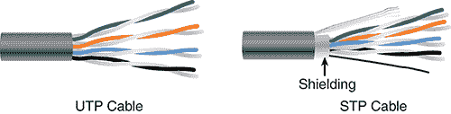
```

图 6.1 `UTP` 和 `STP` 布线

双绞电缆有多个类别。早期的类别通常与语音传输相关联。这些类别由`电子工业协会/电信行业协会 (EIA/TIA)` 规定。`EIA/TIA` 是一个专注于为电子元件、电子信息、电信和互联网安全制定标准的组织。这些标准对于确保组件和设备的统一性至关重要。

### 注意事项

在学习布线时，你需要理解在带宽方面，赫兹（hertz）与每秒比特（bits per second）之间的区别。当你谈论带宽和每秒比特速率时，你指的是数据传输速率。

`EIA/TIA` 规定了若干类双绞电缆，其中一些已经过时。目前仍在使用的包括以下：

 **第 3 类 (Category 3)：** 数据级电缆，可以传输高达 `10 Mbps` 的数据，带宽可能达到 `16 MHz`。多年来，`Category 3` 一直是双绞网络的首选。随着网络速度推向 `100 Mbps` 的速度限制，`Category 3` 变得不再有效。

 **第 5 类 (Category 5)：** 数据级电缆，通常用于运行速率为 `100 Mbps` 的`快速以太网`，传输范围为 `100 meters`。虽然 `Category 5` 是一种媒介类型，但这种电缆是一个过时的标准。较新的实现使用 `5e` 或更高的标准。`Category 5` 提供至少 `100 MHz` 的带宽。尽管 `Category 5` 主要用于 `10/100 以太网` 网络，但它的速度可以更快。`IEEE 802.11ae` 标准规定在 `Category 5` 电缆上的传输速度为 `1000 Mbps`。

 **第 5e 类 (Category 5e)：** 用于运行在 `10/100 Mbps` 甚至高达 `1000 Mbps` 网络的数据级电缆。`Category 5e` 布线的使用长度可达 `100 meters`，取决于实现方式和使用的标准。`Category 5e` 电缆提供至少 `100 MHz` 的带宽。

 **第 6 类 (Category 6)：** 高性能 UTP 电缆，可以传输高达 `10 Gbps` 的数据。`Category 6` 具有至少 `250 MHz` 的带宽，并规定在 `10/100/1000 Mbps` 传输下电缆长度允许 `100 meters`，在短距离内支持 `10 Gbps`。`Category 6` 电缆通常由四对绞铜线组成，但其性能远超其他电缆类型。`Category 6` 双绞线使用纵向分隔器，将四对线相互分离。这种额外的结构显著减少了电缆中的串扰，使更快的传输速率成为可能。

 **第 6a 类 (Category 6a)：** 也称为`增强型 类 (augmented 6)`。通过提供至少 `500 MHz` 的带宽对 `Category 6` 进行了改进。它规定了在 `10 Gbps` 网络速度下传输距离高达 `100 meters`。

 **第 7 类 (Category 7)：** 这种电缆的巨大优势是对单对和整个电缆都增加了屏蔽层，以极大减少串扰。它的传输额定为 `600 MHz`，并与 `Category 5` 和 `Category 6` 向后兼容。`Category 7` 与组中其他电缆的不同之处在于，它不被 `EIA/TIA` 认可，而且它是屏蔽双绞线，而考试目标列出的其他都是非屏蔽的。

### 考试提醒

在考试中，你可能会看到 `Cat 3`、`Cat 5`、`Cat 5e`、`Cat 6`、`Cat 6a` 和 `Cat 7`。记住它们的特征，例如电缆长度、速度和带宽。

### 提示

如果你在一个几年前的网络上工作，可能需要确定它使用的是哪一类电缆。最简单的方法是读取电缆。类别数字应该清晰地打印在上面。

表 6.1 总结了常见网络实现中的类别及其支持的速度。

#### 表 6.1 双绞电缆类别

| 类别 | 常见应用 |
| :--- | :--- |
| 3 | 16 Mbps |
| 5 | 100 Mbps |
| 5e | 1000 Mbps |
| 6 | 10/100/1000 Mbps 加 10 Gbps |
| 6a | 10 Gbps 及以上网络 |
| 7 | 10 Gbps 及以上网络 |

### 注意事项

表 6.1 中显示的数字指的是这些电缆通常用于支持的速度。对于这些布线类别的批准标准实际规定的速度可能比列出的要低，但电缆和网络组件制造商在追求更快的速度时，总是在推性能极限。批准标准定义了最低规格。有关布线标准的更多信息，请访问 TIA 网站：[`www.tiaonline.org/`](http://www.tiaonline.org/)。

### 同轴电缆

`同轴电缆`（Coaxial cable），或者常说的 `coax`，已经存在很长时间了。`coax` 在电视信号传输和网络实现中都取得了成功。如图 6.2 所示，`coax` 的结构中心是一个传输信号的铜芯（主线）、绝缘层（塑料制）、地（编织金属屏蔽）以及外层的绝缘层（外塑料覆盖）。

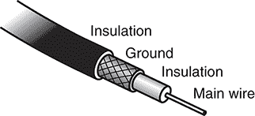

图 6.2 同轴布线


同轴电缆这样构造是为了增加对`衰减`（信号随距离传输时信号强度的损失）、`串扰`（由邻近其他电缆信号引起的信号退化）和`EMI`的抗性。

网络中使用两种同轴电缆：

- `细同轴`（thin coax），也称为`thinnet`或`10BASE2`
- `厚同轴`（thick coax），也称为`thicknet`

两者都不再特别流行，但你最可能会遇到`thin coax`。`thick coax`主要用于骨干电缆。它可以穿过吊顶空间，因为其对`EMI`和串扰有显著的抗性，且长度可达`500 meters`。`thick coax`提供高达`10 Mbps`的速度，对于今天的网络环境来说太慢了。

`thin coax`在当今的网络中比`thick coax`更常见，但并不普遍。`thin coax`的直径仅为`.25 inches`，因此安装非常容易。不幸的是，所有`thin coax`类型的缺点之一是它们容易电缆断裂，这增加了安装和排故障基于同轴电缆网络的难度。

存在多种类型的`thin coax`电缆，每种都有特定的用途。表 6.2 总结了这些类别。

### 考试提醒

对于考试，你应该关注`RG-59`和`RG-6`。

#### 表 6.2 细同轴类别

| 电缆类型 | 描述 |
| :--- | :--- |
| `RG-59` | 用于生成低功率视频连接。`RG-59`电缆由于高频功率损，无法在远距离使用。在这种情况下，使用`RG-6`电缆。 |
| `RG-6` | 常用于电缆电视和电缆调制解调器。 |

## 光纤

在许多方面，光纤介质解决了铜介质的缺点。由于光介质使用光传输而不是电子脉冲，`EMI`、串扰和衰减等威胁不再是问题。光纤非常适合数据、视频和语音传输。此外，光纤是所有电缆媒介中最安全的。任何试图访问光纤电缆数据信号的人必须物理接触介质。考虑到电缆的组成，这是一项特别困难的任务。

光纤虽然仍然比其他类型的电缆昂贵，但非常适用于高速数据通信。它消除了与铜基介质相关的问题，例如近端串扰、`EMI`和信号篡改。

如图 6.3 所示，光纤由纤芯（玻璃纤维）组成，周围环绕着`cladding`（二氧化硅包层）。接着是硅胶涂层，然后是缓冲护套。接下来是加强筋，最后由保护护套（聚氨酯外壳）包裹所有部分。

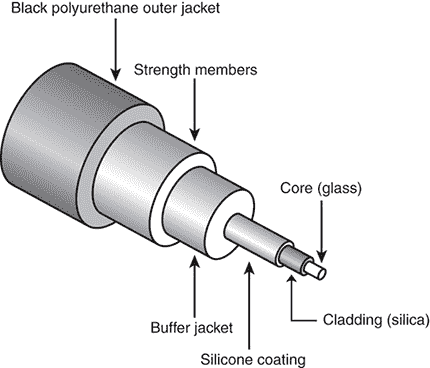

图 6.3 光纤布线

有两种光纤可用：

- **多模光纤：**许多光束通过电缆传输，并在电缆壁上反射。这种策略实际上会削弱信号，缩短数据信号传输的距离并降低速度。
- **单模光纤：**使用单束直光，因此允许更远的传输距离和更高的传输速度。

一些常见的光纤类型包括以下：

- 62.5 微米纤芯/125 微米包层多模
- 50 微米纤芯/125 微米包层多模
- 8.3 微米纤芯/125 微米包层单模

在对能够跟上现代应用需求的带宽不断增长的需求中，光纤将继续发挥关键作用。

### 考试重点

了解可用的光纤类型及其优 own 局限性，对于实际应用以及 Network+ 考试都非常重要。

### 顶层空间与 PVC 电缆

顶层（Plenum）是位于吊顶板与实际天花板之间的神秘空间。这个空间通常用于空调和暖风管道。它可能包含大量的电缆，包括电话、电气和网络。

占据这个空间的电缆必须是顶层级的，而不是标准的 PVC 电缆。顶层电缆涂有不燃材料（通常是特氟龙或 Kynar），在起火时不会产生有毒烟。正如你想象的，顶层级电缆比普通（PVC 基）电缆贵，但当电缆不通过导管运行时，它们是强制性的。作为额外，顶层级电缆的衰减比非顶层电缆小。

### 考试重点

穿过顶层区域的电缆必须具有两个重要特性：它们必须耐火，并且在暴露于剧热时不会产生有毒烟。

### 介质连接器类型

各种连接器与相关的网络介质配合使用。介质连接器连接到传输介质上，允许接入计算设备。对于 Network+ 考试，你需要识别与特定介质相关的连接器。以下章节描述了这些连接器和相关的介质。

#### BNC 连接器

BNC 连接器与同轴介质和`10BASE2`网络相关。BNC 连接器不像以前那么常见，但它们仍在使用某些网络、旧版网卡和旧集线器上。

常见的 BNC 连接器包括桶形接头、T 型接头和终端器。图 6.4 显示了两个终端器（上方和下方）和两个 T 型接头（左侧和右侧）。

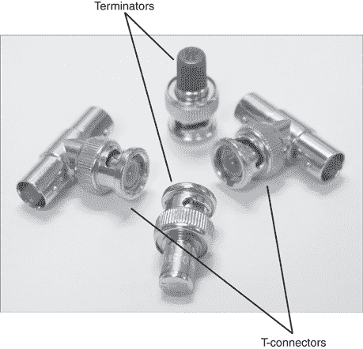

图 6.4 BNC 连接器

### 考试重点

连接器有时被称为耦合器（couplers）。为了考试目的，可以将这两个词视为同义词。

#### RJ-11 连接器

`RJ-11`（注册式）连接器是用于电话电缆的小型塑料连接器。它们具有六个小引脚。然而，在许多情况下，并不是所有的引脚都被使用。

例如，标准的电话连接仅使用两个引脚，而用于`数字用户线路 (DSL)`调制解调器连接的电缆使用四个。

RJ-11 连接器与接下来 de RJ-45 连接器相似，尽管它们小一些。RJ-11 和 RJ-45 连接器在连接器顶部都有一个小塑料法兰，以确保连接稳固。图 6.5 显示了 RJ-11 连接器的两个视图。

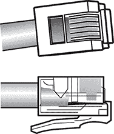

图 6.5 RJ-11 连接器

#### RJ-45 连接器

RJ-45 连接器如图 6.6 所示，是你网络之旅中最可能遇到的。RJ-45 连接器用于双绞线布线，这是目前最常用的网络电缆。

RJ-45 连接器类似于上述 RJ-11 电话插座，但它们支持最多八根线，而不是 RJ-11 支持的六根。RJ-45 连接器也 RJ-11 连接器大。

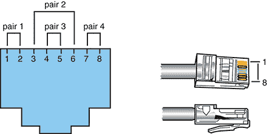

图 6.6 RJ-45 连接器

#### F 型连接器以及 RG-59 和 RG-6 线

F 型连接器如图 6.7 所示，是用于将同轴电缆连接到设备的螺纹连接。这包括 RG-59 和 RG-6 线。

在现代网络世界中，F 型连接器最常用于将互联网调制解调器连接到缆或卫星`互联网服务供应商 (ISP)`设备。然而，F 型连接器也用于连接某些专有设备。


图 6.7 F 型连接器

F 型连接器在连接处有一个“螺母”，在手动拧紧时提供抓持点。如果必要，也可以用钳子轻夹夹这个螺母以助于断开。

### 考试重点

对于 Network+ 考试，你将被要求根据外观识别本章讨论的连接器。

#### 光纤连接器

各种连接器与光纤布线相关，有几种连接方式。这些包括卡口式、快锁式和插拔式连接器。图 6.8 显示了 Network+ 目标中的光纤连接器。

### 考试重点

与本节讨论的其他连接器一样，请准备好根据外观和物理连接方式识别光纤连接器。

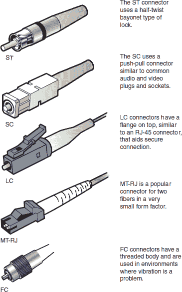

图 6.8 光纤连接器

在各种连接器（`ST`、`SC`、`LC`、`MT-RJ`等）中，你可以选择购买角抛光连接器（`APC`）或超抛光连接器（`UPC`）。这两者之间最大的区别是`APC`中存在的“角度”。

`UPC`连接器的端面抛光角度为零度（平直），而`APC`是八度。作为一个一般规则，抛光越好（`UPC`），插入损耗就越小。

`MT-RJ`（代表 Mechanical Transfer Registered Jack 或 Media Termination Recommended Jack）在双工多模连接中很流行。它通常在字母之间带有连字符，但 CompTIA 偏于在他们的目标和考试中使用`MTRJ`。

#### RS-232 标准连接器（DB-9 和 DB-25）

`Recommended Standard (RS-232)`是 TIA/EIA 用于计算机和外围设备（如调制解调器、鼠标和键盘）之间串行传输的标准。

RS-232 标准早在 20 世纪 60 年代引入，至今仍在使用。然而，外围设备更常见使用 USB 或无线连接。

RS-232 常使用 25 针`DB-25`连接器或九针`DB-9`连接器。图 6.9 显示 RS-232 标准连接器的示例，数字标识了所有设备使用的引脚序列。

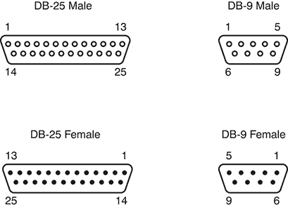

图 6.9 RS-232 DB 连接器

串行连接器需要连接到串行线。串行线通常使用四到六根电线连接到连接器。与其他电缆类型一样，它们分为非屏蔽和屏蔽两种类型。屏蔽可以减少电缆的干扰和电磁干扰（`EMI`）。

串行线的最大传输距离有所不同，这取决于串口端口的特性和串行线的质量。`RS-232`标准规定的串行线距离可达 50 英尺，传输速度最高 20 Kbps。其他串行标准则增加了这一范围和速度。

## 通用总线（USB）连接器

USB 端口现在是桌面和移动计算机系统中极其常见的景象。`USB`更多与连接智能手机、MP3 播放器和数字相机等消费外设备相关，而不是网络。

然而，许多制造商现在制造了直接插入`USB`端口的无线网卡。大多数桌面和移动电脑拥有二到四个`USB`端口，但如果需要，可以使用提供额外端口的`USB`集线器。

有很多连接器与`USB`端口相关，但受欢迎的三种是`Type A`、`Type B`和`Type C`。`Type A`连接器传统上更为常见并用于 PC，而许多外围设备使用`Type B`连接器。

近年来，`Type C`（通常称为`USB-C`）日益流行。`Type C`是一种 24 针`USB`连接器，具有水平对称的“可反转”连接器。图 6.10 显示了三种类型的`USB`连接器。

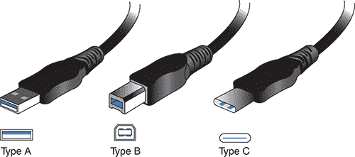

图 6.10 Type A、B 和 C 连接器

## 收发器

在路由器上，通常使用`小型封装可插 (SFP)`模块和`千兆接口转换器 (GBIC)`模块将千兆以太网端口与光网络（通常为`1000BASE-X`）连接。

除了光纤技术外，`SFPs`和`GBICs`也用于以太网和`SONET/SDH`，但连接光纤已成为最常见的用途。

### 注意

`SFP+`是一种增强型小型封装可插模块，是`SFP`的较新版本，支持高达 16 Gbps 的数据速率。四路小型封装可插（`QSFP`）是一种不同的收发器，既紧凑又支持热插拔，由许多网络厂商共同开发。

光纤收发器是`双向`的并能够在`双工`模式下工作。无论是使用`SFP`还是`GBIC`，都有`接收端口 (RX)`和`发射端口 (TX)`。

这些设备对静电敏感也对灰尘敏感，脏的连接器会导致间歇性问题。应注意不要在绝对必要的情况下移除它们，以免缩短其寿命。模块损坏后，可以更换为新模块来解决问题。

### 注意

思科关于`SFPs`护理和维护有一篇非常好的文章，位于[www.cisco.com/en/US/products/hw/modules/ps4999/products_tech_note09186a00807a30d6.shtml](http://www.cisco.com/en/US/products/hw/modules/ps4999/products_tech_note09186a00807a30d6.shtml)。

信号丢失不仅可能由于连接器不清洁引起，还可能由于`连接器不匹配`。对齐不当和纤芯直径差异会导致信号丢失。

在排除`SFP`或`GBIC`故障时，你想要确保没有`电缆不匹配`或`坏电缆/收发器`。

尽管听起来很简单，但验证你是否对单模接口使用单模光纤，以及对多模接口使用多模光纤是非常重要的。这种`光纤类型不匹配`可能会导致链路完全中断，但并不总是如此，因此使得故障排除变得困难。

### 介质耦合器/转换器

当你有两种不同类型的网络介质时，使用`介质转换器`允许它们连接。它们有时被称为耦合器。

根据所执行的转换，转换器可以是仅比连接器本身大一点的小设备，也可以是大型机箱内的大型设备。

在整个网络中不使用相同介质的原因（以及需要转换器的原因）范围涵盖成本（逐渐从同轴电转向光纤）、不同的分段（将办公室连接到工厂），或需要在特定环境中运行特定的介质（需要光纤来减少建筑某部分的`EMI`问题）。

图 6.11 显示了介质转换器的示例。所示型号在`10/100/1000TX`和`SFP`之间进行转换。

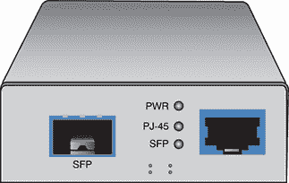

图 6.11 常见的介质转换器

以下是常见的转换器，也是 CompTIA 包含在 Network+ 考试中的类型。

**考试警示**

确保你了解这里列出的可能性存在。

- 单模光纤转以太网
- 单模转多模光纤
- 多模光纤转以太网
- 光纤转同轴电缆

## 568A 和 568B 接线标准

`568A`和`568B`是来自`TIA`和`EIA`的电信标准。这些`568`标准规定了`UTP`或`STP`电缆上`RJ-45`连接器的引脚排列。数字`568`指电缆内部电线端接并连接到连接器的顺序。

`TIA/EIA 568A`和`568B`标准（端接标准通常称为`T568A`和`T568B`）是相似的；区别在于引脚端接的顺序。两者的信号是相同的。两者都用于以太网中的跳线线。

**考试警示**

`T568A`和`T568B`之间唯一显著的区别是第 2 对和第 3 对（橙色和绿色）交换了位置。

网络介质并不总是带有连接器，或者你可能需要制作定制长度的电缆。这时你就需要了解这些标准实际上是如何运作的。在压接连接器之前，你需要知道单根电线按什么顺序连接到连接器。图 6.12 显示了`T568A`和`568B`标准的引脚分配。

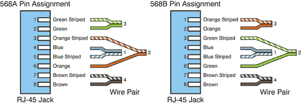

图 6.12 T568A 和 T568B 标准的引脚分配

## 直通线与交叉线

有两种类型的电缆用于连接设备到集线器和交换机：交叉线和直通线。这两种类型的区别在于，在交叉线中有两根电线是交叉的；而在直通线中，所有电线都是直通的。

具体而言，在交叉线中，第 1、3 号电线和第 2、6 号电线是交叉的。一端的第 1 号线变成另一端的第 3 号线，一端的第 2 号线变成另一端的第 6 号线，反之亦然。

你可以在图 6.13 和 6.14 中看到这两种电缆之间的差异。图 6.13 显示了直通绞线的引脚图，图 6.14 显示了交叉线的引脚图。

**考试警示**

交叉线可用于在不使用集线器或交换机的情况下直接连接两台 PC。这是因为电缆发挥了交换机的功能。

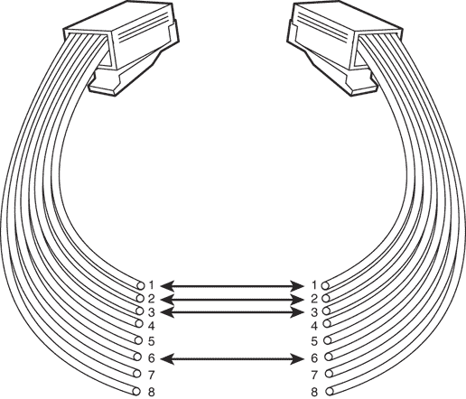

图 6.13 直通绞线的引脚图

### 注意

较新接口上的`Auto MDI-X`端口可以检测连接是否需要交叉，并自动选择`MDI`或`MDI-X`配置以匹配链路的另一端。

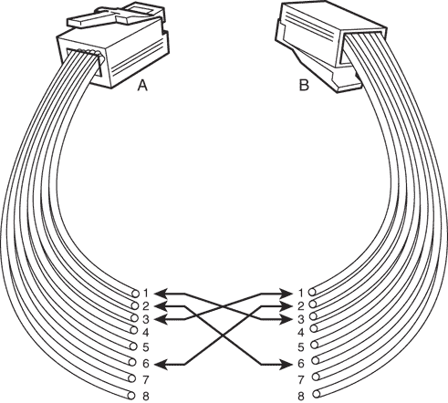

图 6.14 交叉绞线的引脚图

要制作一根交叉以太网线，你需要同时使用`568A`和`568B`标准。电缆的一端可以按照`568A`标准接线，另一端按照`568B`标准接线。

`T1`交叉线的引脚图如图 6.15 所示，用于背背连接两个`T1 CSU/DSU`设备。两端均使用`RJ-45`连接器。

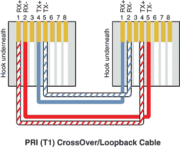

图 6.15 T1 交叉线的引脚图

### 回路线和环回线

回环线（Rollover cable）是一种 Cisco 专用电缆，用于将计算机系统连接到路由器或交换机的控制端口。

回环线类似于以太网 UTP 线；然而它无法用于 Cisco 设备以外的任何设备。与 UTP 线一样，回环线内部有八根导线，每端各有一个`RJ-45`接头，分别连接到路由器和计算机端口。

在引脚定义方面，回环线一端的 1 号脚连接到电缆另一端的 8 号脚。同样，2 号脚连接到 7 号脚，依此类推。两端简单地相反。

只要将回环线的一端连接到 PC，另一端连接到 Cisco 终端，就可以使用`PuTTY`等程序从计算机系统访问 Cisco 设备。

**考试提示**

> 记住，回环线是用于连接 PC 到 Cisco 路由器的专用电缆。

回环线（Loopback cable），也称为“Plug”，用于测试和隔离网络问题。如果制作正确，回环插头会使`网络接口卡 (NIC)`等设备上的链路灯亮起。这是测试简单网络布线问题的快速且廉价的方法。

回环插头将输出的数据信号重定向到系统。系统随后会认为它既在发送也在接收数据。

回环线基本上是一种故障排除工具，用于测试设备是否正常发送和接收数据。它使用 UTP 线和`RJ-45`接头。

**考试提示**

> 了解回环线是一种基础故障排除工具。

## 布线分布组件

到为止，本章已经检查了各种介质和相关的连接器。本节介绍了机间内的布线，即网络中连接电缆和网络设备的地方。

这些房间有很多名称，包括布线机间、电信室和`网络运营中心 (NOC)`。这些电信室包含关键网络设备，如集线器、路由器、交换机和服务器。这些房间还包含网络介质，例如将网络设备连接到水平电缆及网络其他部分的跳线。

### 网络交叉连接

贯穿于整个网络的电缆可以分为两个不同的部分：

- **水平布线：**将客户端系统连接到网络。
- **垂直（骨干）布线：**于楼层之间运行，连接网络上的不同位置。

这两种电缆类型必须从一个位置——布线机间进行整合和分配。

以下是三种类型的电缆分布：

- **垂直或主交叉连接：**外部电缆进入建筑进行分配的地方。这可以包括互联网和电话布线。
- **水平交叉连接：**垂直连接和水平连接汇合的地方。
- **中间交叉连接：**通常用于较大的网络。在主交叉连接和水平交叉连接之间提供中间交叉连接。

交叉连接（cross-connect）一词是指贯穿整个网络的电缆汇合并连接的点。

### 水平布线

在电信室内，水平布线将电信室连接到终端用户，如图图 6.16。

图 6.16 水平布线

### 垂直电缆

`垂直电缆`（Vertical cable）或骨干电缆，是指用于连接电信室、服务器房以及远程位置和办公室的介质。

垂直电缆可用于连接局域网之外需要高速连接的位置。因此，垂直电缆通常是光电缆或高速 UTP 线。图 6.17 显示了水平电缆和垂直电缆之间的关系。

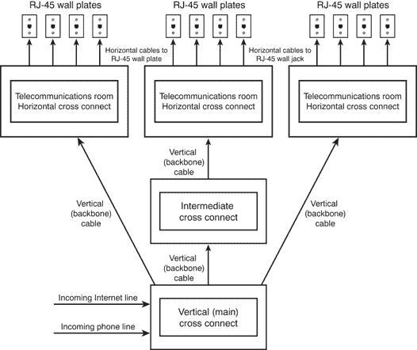

图 6.17 垂直和水平布线

### 配线架


如果你看过电信室，你可能见过一个分配块，更常见的名称是配线架（`patch panel`）。`配线架`是一个独立或壁挂的单元，正面有许多 `RJ-45` 端口连接。在某种意义上，它像一个没有`发光二极管 (LEDs)`的壁挂式集线器。配线架提供了网络设备（如集线器和交换机）与 PC 连接端口之间的连接点，这些端口通常分布在整个建筑中。

**注意**

并非所有环境都使用配线架。在某些环境中，电缆直接运行在系统和集线器或交换机之间。这是可以接受的连接方法，但不如使用配线架系统以及墙或地板插座的结构化布线系统那样容易整洁。

布线机间还有打线块（`punchdown block`）。电话线或 `UTP` 线的线芯使用`打线工具`（`punchdown tool`）连接到打线块上。使用打线工具时，将线芯放在工具尖端并推入连接在打线块上的连接器中。绝缘层被剥离，线固固嵌入金属连接器中。因为连接器剥离了线上的绝缘层，它被霸气地称为`位移缘接连接器 (IDC)`。图 6.18 显示了打线工具将线芯插入配线架的 `IDC` 中。

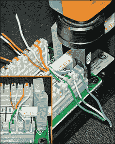

图 6.18 打线工具将线芯插入 IDC

使用打线工具比使用剥线器准备每根单独的线，然后将线缠绕在连接柱上或拧紧螺丝以固定线缆要快得多。在许多环境中，电缆任务留给专业的电缆承包商。在其他环境中，管理员必须将线缆连接到配线架。

**考试提示**

打线工具用于将双绞网络电缆连接到配线架内部的连接器上。具体而言，它们将双绞线连接到 `IDC`。

### 光纤配线架

正如配线架用于提供网络设备之间的连接点一样，`光纤配线架 (FDP)` 也是如此。者的区别在于 `FDP` 是一个为光纤连接提供终止、存储和熔接空间的机柜。

**考试提示**

在准备考试时，确保你能够识别此处及后续讨论的以下考试目标：终端点、66 块、110 块、配线架和光纤配线架。

### 66 和 110 块 (T568A, T568B)

使用了两种主要的打线架模块（`punchdown blocks`）：`type 66` 和 `type 110`。`type 66` 是一种较旧的设计，用于连接电话系统和其他低速网络系统的布线，不像 `type 110` 那样广泛。`66` 模块具有 50 行 `IDC` 接点，可容纳 25 对双绞线。`Block 66` 主要用于语音通信。尽管它被批准用于 `Category 5` 及更高级别，但由于串扰问题，它并不适用于任何高于 `10BASE-T` 的速率。不过，现在有经过 `CAT5e` 认证的专用 `66` 模块可以满足 `CAT5e` 终端标准。

在网络布线间内，`110` 模块用于将网络线连接到配线架上。`110` 连接也可用于网络线另一端的 `RJ-45` 墙插座。与旧的 `66` 模块相比，`110` 模块更受欢迎，因为它通过支持更高的频率和更少的串扰对 `66` 模块进行了改进。因此，它支持更高速度的网络和更高等级的双绞线。终端将采用 `T568A` 或 `T568B`，取决于使用哪种布线标准。

## MDF 和 IDF 布线间

上一节介绍了布线间。布线间分为两种类型：主配线架 (`MDF`) 和中间配线架 (`IDF`)。网络主布线间通常包含大部分网络设备，包括路由器、交换机、布线、服务器等。这通常也是外线线路接入网络的布线间。这个主布线间被称为 `MDF`。`MDF` 中的关键组件之一是主配线架。连接在此配线架上的网络连接器座引向建筑内部进行网络连接。

在某些网络中，会使用多个布线间。在这种情况下，`MDF` 使用骨干电缆连接这些二级布线间（即 `IDFs`）。这种骨干电缆可以是 `UTP`、光纤甚至是同轴电。在当今的高速网络中，`UTP Gigabit Ethernet` 或高速光纤是首选介质。图 6.19 显示了 `MDF` 和 `IDF` 之间的关系。

### 考试提示

准备好识别 `IDF` 和 `MDF` 之间的区别。

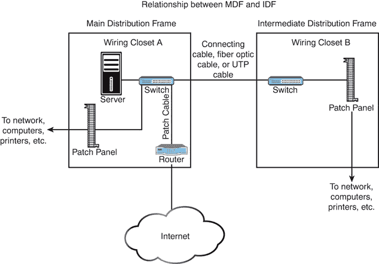

图 6.19 MDF 与 IDF 之间的关系

## 以太网部署标准

许多 `IEEE` 标准与网络有关，涵盖了从实现到安全的所有内容。`802.3` 标准与以太网部署有关，其中许多早期标准已经过时。在参加 `Network+` 考试之前，请确保你已经熟悉以下目前最流行的标准信息。

### 100BaseT

曾几何时，`10 Mbps` 网络被认为是足够快了，但那些时代一去不复了。今天，公司和家庭用户要求比这更高的带宽，`IEEE 802.3u` 标准中规定了三种快速以太网 (`100BaseT`) 标准：`100BASE-T4`、`100BASE-TX` 和 `100BASE-FX`——你并不需要为了 `Network+` 考试目标了解所有这些标准。

顾如其名，`100BASE-TX` 以高达 `100 Mbps` 的速度传输网络数据。`100BASE-TX` 通常使用 `UTP` 电缆，但也可以使用 `STP`；因此，它受到与其它基于 `UTP` 的网络相同的 100 米距离限制。`100BASE-TX` 使用 `Category 5` 或更高的 `UTP` 电缆，并使用独立的发送和接收路径，因此可以支持全工模式。`100BASE-TX` 是快速以太网最常见的实现方式。

### 考试提示

在涉及布线标准时，连字符没有意义；`100Base-T` 与 `100BaseT` 相同。虽然最新版本的考试目标去掉了连字符，但请记住这两种表示法的意思相同。

### 小贴士

当连接使用 `100BASE-TX` 或 `100BASE-FX` 的段时，有时需要中继器。

`100BASE-FX` 是在光纤电上运行快速以太网的 `IEEE` 标准。由于光纤实现的成本较高，`100BASE-FX` 主要局限于作为网络骨干使用。`100BASE-FX` 可以使用双芯多模光纤或单模纤介质。半工模式多模光纤的最大段长度为 412 米，但全工模式单模光纤的这一最大达到了惊人的 10,000 米。`100BASE-FX` 经常使用 `SC` 或 `ST` 光纤连接。表 6.3 总结了 `802.3u` 快速以太网规范的特性。

表 6.3 802.3u 快速以太网特性总结

| 特性 | 100BASE-TX | 100BASE-FX |

| :--- | :--- | :--- |

| 传输方法 | 基带 | 基带 |

| 速度 | 100 Mbps | 100 Mbps |

| 距离 | 100 米 | 412 米（多模半工）；10,000 米（单模全工） |

| 电缆类型 | Category UTP, STP | 光纤 |

| 连接器类型 | RJ-45 | SC, ST |

### 1000BaseT

`1000BaseT` 有时被称为 `1000BASE-T` 或 `1000BASE-TX`，是一种千兆以太网标准，标记为 `IEEE 802.3ab`。`802.3ab` 标准规定了在 `Category 5` 或更好的 `UTP` 电缆上实现千兆以太网。该标准允许使用四双绞线进行全工传输。为了在铜缆上达到 `1000 Mbps` 的速度，每对双绞线实现了 `250 Mbps` 的传输速率。表 6.4 总结了 `1000BaseT` 的特性。

表 6.4 1000BaseT 特性总结

| 特性 | 描述 |

| :--- | :--- |

| 传输方法 | 基带 |

| 速度 | 1000 Mbps |

| 总距离/线段 | 75 米 |

| 电缆类型 | Category 5 或更高 |

| 连接器类型 | RJ-45 |

### 10GBaseT

`802.3an` 标准为普通铜质布线带来了 10 千兆速度。虽然传输距离可能不如光纤，但它允许使用现有的布线基础设施从 1000 Mbps 网络升级到 10 Gbps 网络。

`10GBaseT` 标准规定了在 `UTP` 或 `STP` 双绞电缆上进行 10 Gbps 传输。该标准要求电缆规格为 `Category 6` 或 `Category 6a`。使用 `Category 6` 时最大传输范围为 55 米；使用增强型 `Category 6a` 电缆，传输范围增加到 100 米。`Category 6` 和 `6a` 电缆专为为减少衰减和串扰而设计，使得 10 Gbps 速度成为可能。`802.3an` 规定了标准的 `RJ-45` 网络连接器。表 6.5 概述了 `802.3an` 标准的特性。

表 6.5 802.3an 特性总结

| 特性 | 描述 |

| :--- | :--- |

| 传输方法 | 基带 |

| 速度 | 10 Gbps |

| 总距离/线段 | 100 米 Category 6a 电缆；55 米 Category 6 电缆 |

| 电缆类型 | Category 6, 6a UTP 或 STP |

| 连接器 | RJ-45 |

### 1000BaseLX 和 1000BaseSX

`1000BaseLX` 和 `1000BaseSX` 都是光纤千兆以太网标准。

`1000BaseLX` 是一种利用单模纤的千兆以太网光纤标准。它也可以在多模纤上运行，最大段长度为 550 米。

`1000BaseSX` 用于多模光纤，最大长度为 220 米（使用合适的光模块和终端设备可以达到 550 米）。该标准在办公楼内部链路中流行。

### 强化习题

**1.** 下列哪个连接器通常用于光纤布线？

A. `RJ-45`

B. `BNC`

C. `SC`

D. `RJ-11`

**2.** 你会将哪种电缆与 `F` 型连接器相关？

A. 光纤

B. `UTP`

C. 同轴

D. `STP`

**3.** 下列哪个不是网络实现中使用的光纤连接器类型？

A. `MTRJ`

B. `SC`

C. `BNC`

 **D.** `LC`

### 4. 下哪种光纤器使用的是旋转式连接方法？

 **A.** `ST`

 **B.** `SC`

 **C.** `BNC`

 **D.** `SA`

### 5. 下哪项是利用单模光纤的千兆以太网标准？

 **A.** `1000BaseSX`

 **B.** `TIA/EIA 568a`

 **C.** `RG-6`

 **D.** `1000BaseLX`

### 6. 在交叉线中，1 号线与几几号线交叉？

 **A.** 2

 **B.** 3

 **C.** 4

 **D.** 5

### 7. 打线架的两种主要类型是什么？（选择两个。）

 **A.** 110

 **B.** 220

 **C.** 66

 **D.** 12

### 8. 下哪种电缆是专门涂有不燃材料、且在起火时不会产生毒气体的电缆？

 **A.** `SFP` 和 `GBIC`

 **B.** `Cat 5e`, `Cat 6`, `Cat 6a`

 **C.** `FDP`

 **D.** `Plenum` 级（抗燃板级）

## 习题测验答案

**1. C.** `SC` 连接器用于光纤缆。`RJ-45` 连接器用于 `UTP` 电缆，`BNC` 用于细同轴电缆，`RJ-11` 用于普通电话接头。

**2. C.** `F-type` 连接器用于同轴电缆。它们不用于光纤、非屏蔽绞对（`UTP`）或屏蔽绞对（`STP`）布线。

**3. C.** `BNC` 是用于同轴布线的连接器类型。它不作为光纤布线的连接器。`MTRJ`、`SC` 和 `LC` 都是认可的光纤连接器类型。

**4. A.** `ST` 光纤连接器使用旋转连接方法。`SC` 连接器使用推入连接方法。其他选项不是有效的光纤连接器。

**5. D.** `1000BaseLX` 是利用单模光纤的千兆以太网标准。`1000BaseSX` 用于多模光纤，默认安装的最长长度为 220 米。`TIA/EIA 568A`（以及 `568B`）是电信标准，规定了 `UTP` 或 `STP` 电缆上 `RJ-45` 连接器的引脚排列。`RG-6` 是一种常见的同轴电缆，常用于电缆电视和电缆调制解调器。

**6. B.** 在交叉线中，`1` 号线和 `3` 号线以及 `2` 号线和 `6` 号线交叉。

**7. A, C.** 打线架的两种主要类型是 66 型和 110 型。66 型是一种是一种较旧的设计，用于连接电话系统和其他低速网络系统的布线，不像 110 型那样广泛广泛。

**8. D.** `Plenum` 级电缆涂有不燃材料（通常是 `Teflon` 或 `Kynar`），它们在起火时不会产生毒气。在路由器上，通常使用 `SFP` 模块和 `GBIC` 模块将千兆以太网端口连接到光纤网络。`Cat 5`、`Cat 5e`、`Cat 6`、`Cat 6a` 是绞对布线的通用类别。`FDP` 是光纤配架的缩写：为光纤终端、存储和熔接提供空间的柜。

## 排除常见的有线连接问题

 **给定场景，排除常见的有线连接和性能问题。**

### CramSaver

如果你在阅读本节之前能够正确回答这些问题，可以通过浏览本节中的考试提示（Exam Alerts）并完成本节末的习题测验来节省时间。

**1.** 卫星网络中延迟时间的正确术语是什么？

**2.** 两种类型的串扰是什么？

### 答案

**1.** `Latency`（延迟）是延迟的时间。

**2.** 两种类型的串扰是近端串扰（`NEXT`）和远端串扰（`FEXT`）。

在管理有线网络时，你应该注意许多性能和常见的连接问题。本目标包含的一些主题更多是知识/定义而非可操作的项目，但请确保你熟悉以下内容。

### ExamAlert

记住，该目标从“给定场景”开始。这意味着你可能会接收到一个拖放、匹配或“实时操作系统”场景，你必须点击以完成特定的基于目标的任务。

#### Attenuation（衰减）

`Attenuation` 指数据信号在通过介质传输时的减弱。网络介质对衰减的抵抗力各异。同轴电缆通常比 `unshielded twisted-pair (UTP)` 更抗；`shielded twisted-pair (STP)` 比 `UTP` 稍微更抗；而光纤电缆不受衰减影响。这并不是说信号在光纤上传输时不会减弱，但这种减弱的正确术语是 `chromatic dispersion`（色散）而非衰减。

你必须理解衰减或色散以及网络介质指定的最大距离。在不使用中继器的情况下超过介质的距离可能会导致难以排除的网络问题。`repeater`（中继器）是一种网络设备，它在数据信号通过时对其放大，使其能够传输得更远。网络上大多数与衰减或色散相关的困难都需要使用 `network analyzer`（网络分析仪）来检测。

所有介质都有电缆可以铺设的建议长度。这是因为数据信号随着传输得离源点越远而变得减弱。如果信号传输得足够远，它可能会减弱到无法使用的程度。数据信号在穿越介质时的减弱被称为衰减。其测量单位是分贝；因此，衰减也被称为 `dB loss`（分贝损耗）。

所有铜基布线都特别容易衰减。当电缆长度必须铺得超过建议长度时，可以使用信号中继器在信号传输过程中增强信号。如果你在一个有间歇问题的网络上工作，并注意到电缆长度铺得太远，那么衰减可能是问题所在。

### ExamAlert

对于引用距离相关的电缆问题的 `Network+` 目标，考虑衰减。

#### Latency（延迟）

卫星访问最大的之一之一 `latency`（发送或请求信息的时间与返回时间之间的时间差）。卫星通信由于其必须旅行的距离以及天气状况，会经历高延迟。

目前卫星的平均延迟为 `638ms`。人们曾尝试通过使用低轨道卫星（从而缩短了旅行距离）来减少延迟，但它们通常提供的服务速率较低，因此并不是一个理想的解决方案。

虽然延迟不仅限于卫星，但它是最容易与卫星相关的传输形式之一。事实上，延迟可能发生在几乎任何形式的传输中。

#### Jitter（抖动）

与之前讨论的延迟密切相关，`jitter` 的区别在于接收数据包之间的延迟长度不同。虽然发送者继续以流发送包并保持均匀间距，但接收到的包之间的延迟是变化的，而不是恒定的。这可能是网络拥塞、队列不当或配置错误引起的。

#### Crosstalk（串扰）

无论是同轴电缆还是非屏蔽双绞线（`UTP`），基于铜的布线都容易受到干扰。`干扰`发生在一根电缆中的信号与另一根电缆中的信号混合时。当电缆布线得过近时就会发生这种情况。电缆使用屏蔽层来帮助减少干扰的影响。如果没有屏蔽电缆，则应使电缆相互分离。当双绞电缆内的一个线对干扰其他线缆上的信号时，也会发生干扰。干扰可能是由于电缆屏蔽不足、相邻电路之间的信号电平差异以及连接点的线缆扭结引起的。干扰有两种类型：`近端串扰 (NEXT)` 和 `远端串扰 (FEXT)`。

### 考试提示

记住，光纤使用的是光信号而非电信号，因此它对电磁干扰（`EMI`）和干扰具有更强的抵抗力。

### 近端干扰 (NEXT)

`NEXT` 指的是链路近端（距离数据信号源最近的一端）双绞线内相邻线对之间的干扰。当发出的数据传输泄漏到接入的传输中时，就会发生 `NEXT`。实际上，接入的传输“听到”了由链路近端传输站发送的信号。结果是发送信号的一部分被耦合回接收到的信号中。

### 远端干扰 (FEXT)

当接收站“听到”由传输线另一端传输站发送的数据信号时，就会发生 `FEXT`。`FEXT` 指的是信号通过一个线对对干扰源最远端（接收信号的一端）相邻线对的干扰。

### 注意

如前所述，当通过介质发送的信号干扰相邻线缆上的数据信号时，就会产生干扰。在双绞电缆中，每个线对都扭绞以帮助减少干扰；扭绞得越密，电缆管理干扰的能力就越有效。这是购买高质量电缆的原因之一。

### EMI


取决于网络布线（通常称为`media`）的安装位置，`干扰`可能是一个主要的考虑因素。两种类型的介质干扰会对网络介质上的数据传输产生不利影响：`电磁干扰 (EMI)`和干扰（之前讨论过）。

当电缆安装在电气设备（如空调或荧光灯）附近时，EMI 就是一个问题。如果网络介质距离此类设备足够近，电缆内的信号可能会损坏。各种网络介质对 EMI 影响的抵抗能力各不相同。标准的`非屏蔽双绞线 (UTP)`容易受到 EMI 影响，而具有光传输的光纤则抗 EMI 能力。在决定特定介质时，请考虑它的布线位置以及 EMI 对安装产生的影响。

EMI 可能会减弱或损坏信号强度。当电缆运行靠近日常办公设备（如电脑显示器、荧光灯、电梯、微波炉以及任何产生电磁场的设备）时，就会发生这种情况。再次，解决方案是仔细将电缆远离此类设备。如果必须通过 EMI 区域，则需要屏蔽电缆或光纤电缆。

### 开路/短路

除了常见的接线错误外，电缆可能出现的其他问题（可以使用多功能电缆测试仪检查）包括`开路/短路`故障。开路故障意味着电缆没有形成完整的电路；这可能是由于电缆断裂（跨越所有或部分线）。短路故障意味着数据尝试在非目标线缆上传输；这可能是由接线错误或电缆在断裂处扭结导致裸线接触引起的。

### 考试提示

你应该预料会有题目问你，可以使用什么工具来识别开路/短路故障。

### 引脚错误

电缆中的大多数分叉是有故意的——这允许你使用分线器在多个方向上布线。取决于所涉及的布线类型，每个分叉降低信号强度的情况并不常见。分线器损坏也是常有的。你希望尽可能减少分叉电缆的次数，如果正常工作的线路突然出现问题，请检查分线器。

如果分叉是无意的，你通常遇到的是之前讨论过的开路/短路问题。

### 电缆类型错误

电缆类型错误——例如，使用交叉线线代替标准电缆——将导致主机无法在网络上通信。可以使用电缆测试仪诊断单独的布线问题，解决方案是将错误的电缆更换为适用于你预期用途的电缆。

### 端口故障

在路由器上，端口配置决定了允许哪些流量通过。路由器可以配置为启用单个端口的入站、出站或流量流量，被称为`端口转发`。如果端口被阻塞（例如 HTTP 的 80 端口或 FTP 的 21 端口），数据将无法通过，用户将受到影响。

### 考试提示

在路由器方面，可以将端口配置和端口转发视为同一种事物。

当路由器不返回预期的“已接收确认”的消息时，可能会发生被称为`黑洞`的情况。从发送数据的角度来看，它被称为黑洞，但数据实际上已经丢失了。

这种情况发生在路由器收到的数据包大于配置的`最大传输单元 (MTU)`大小，且该数据包设置了不可分片（Don’t Fragment）标志。当发生这种情况时，路由器本应向主机返回“目标不可达”的消息。如果未收到数据包，主机就不知道包没有通过。

虽然这个问题有几种解决方法，最好的方法是验证客户端可以发送的最大包大小与路由器能够处理的大小之间是否发生了匹配。你可以使用`ping`命令通过使用`−l`参数设置包大小并使用`−f`参数设置不可分片位，检查特定大小的数据包是否可以通过路由器。

### 收发器不匹配

在排查 SFP 或 GBIC 问题时，你想要确保没有使用损坏或不匹配的收发器。这听起来可能很简单，但验证你正在使用单模光纤配合单模接口，以及使用多模光纤配合多模接口是非常重要的。这种光纤类型的不匹配可能会导致物理链路完全中断，但并不总是如此，从而增加了故障排除的复杂性。

### TX/RX 反转

以太网网络可以使用两种主要类型的电缆：直通线（顾名思义，所有线都直连通过且两端相同）和交叉线。在交叉线中，两对线是反转的；这些是 TX 和 RX 线对（发送和接收）。

交叉线仅适用于特定应用程序（例如，在不使用集线器或交换机的情况下直接连接两台 PC），在需要直通线的地方（作为一般规则，所有的固定布线）使用它会引起问题。

### 双工/速度不匹配

为网络配置客户端时，必须注意两个设置：端口速度和双工设置。这些在 Windows 的“网络属性”区域进行调整。速度和双工不匹配会导致数据速率降低到极慢，并防止高带宽应用（如语音或流媒体视频）实现。

对于端口速度和双工模式设置，你有多种选择。你可以选择“自动协商”（Auto Negotiation）来检测网络正在使用的设置。你也可以选择其他设置之一来匹配网络配置，例如“100 Mbps 半双工”（Half Duplex）。如果你正在处理一个无法登录网络的客户端系统，你可能需要确保网络的双工模式设置和端口速度已正确设置。

### 损坏的电缆

损坏或不良的布线可能是跳线（易于更换），也可能是墙内布线（更换较困难）。如果你怀疑布线是故障组件，可以通过将连接出现问题的设备移动到另一个地方和/或将一台运行良好的机器带到此环境来快速进行诊断。

### 注意

在测试并确认良好之前，永远不要假设你使用的电缆是好的。电缆有时会损坏，劣质介质会导致网络问题。

你可以使用多功能电缆测试仪来排除大多数布线问题。你必须检查电缆的连续性以及短路情况。

### 针脚弯

网络电缆或插座上的针脚弯会导致连接接触极少或没有接触。如果问题出在电缆上，你可以更换电缆。如果问题出在客户端机器上，可能很难修复，因为大多数以太网端口直接焊接在主板上。通常，解决方案是放弃该端口并使用 USB/以太网适配器允许客户端继续连接到网络。

### 瓶颈

网络瓶颈经常会导致网络崩溃。因此，你希望始终扫描瓶颈，并在它们有机会导致你的系统崩溃之前识别它们。许多工具对于检查连接性非常有用。其中最简单的工具之一可能是`traceroute`，它提供了许多有用信息，包括它通过的每个路由器连接的 IP 地址，在许多情况下还有路由器的名称。（这取决于路由器的配置）。`traceroute`还报告数据包从源位置到路由器并返回的往返时间长度（以毫秒为单位）。

### 注意

`traceroute`实用/命令通常与 Linux 和 Mac OS 相关，而`tracert`在 Microsoft Windows 中执行相同的功能。

识别出瓶颈后，必须对其进行监控并计划尽快消除它。

### VLAN 不匹配

VLAN 提供了一种分段和组织网络的方法。计算机系统可以位于网络的任何位置，但通信方式就像在同一个段内一样。例如，带有 VLAN 的网络可以根据组织的部门（如销售、财务和秘书）进行分段，也可以根据用量、安全权限等进行分段。

分段网络提供了一些明显的优势。它增加了安全性，因为设备只能与 VLAN 中的其他系统通信。用户只能看到其所在 VLAN 段的系统。这有助于控制广播流量，并使在网络中移动终端系统变得更容易。

当用户被移动或其他方式连接到错误的 VLAN 时，可能会出现问题。管理员必须确保用户系统插在正确的 VLAN 端口。例如，假设一个网络使用基于端口的 VLAN 将端口 1 到 8 分配给营销部，将端口 9 到 18 分配给销售部，依此类推。将销售客户端插入端口 6 将使该销售客户端成为营销部网络的一部分。这听起来很简单，但如果文档不是最新的，且你正在处理一个新网络，要识别这些问题可能会很困难。

防止 VLAN 分配错误的关键之一是清晰地记录 VLAN 安排。如果移动了系统，你需要知道如何重新连接它们并将它们转发到正确的 VLAN 端口。

#### 考试警示

VLAN 分配是你应该预期在考试中遇到相关问题的主题之一。

另一个需要考虑的点是，VLAN 的成员身份可以以静态和动态的方式分配。在静态 VLAN 分配中，交换机端口被分配给特定的 VLAN。新添加的系统将被分配到与该端口相关的 VLAN。例如，如果你将新系统插入端口 8，用户将成为管理员网络的一部分。因此，你必须确保为用户分配了正确的端口。

动态 VLAN 分配需要特定的软件来控制 VLAN 分发。使用 VLAN 服务器，管理员可以根据 MAC 地址或用户名/密码组合等标准动态分配 VLAN 身份。当系统尝试访问网络时，它查询 VLAN 服务器数据库以请求 VLAN 身份信息。服务器响应并将系统登录到相应的 VLAN 网络。配置配置的动态分配可以减少与静态 VLAN 分配相关的人为错误。

### 网络连接 LED 状态指示灯

集线器和交换机提供端口状态信息的发光二极管（LED）。例如，通过 LED，你可以判断是否存在狂风的网卡、是否与网络设备建立了正确的连接，以及网络上是否存在过多的冲突。

#### 强化习测

**1.** 下列哪项描述了信号通过特定介质传输时信号强度损失？

 **A.** 衰减 (Attenuation)

 **B.** 串扰 (Crosstalk)

 **C.** 电磁干扰 (EMI)

 **D.** 杂乱 (Chatter)

**2.** 用户来电报告连接网络时遇到周期性问题。经过调查，你发现连接用户 PC 到交换机的电缆靠近荧光灯具。什么情况最可能导致这个问题？

 **A.** 串扰 (Crosstalk)

 **B.** 电磁干扰 (EMI)

 **C.** 衰减 (Attenuation)

 **D.** 故障电缆 (Faulty cable)

**3.** 下列哪项与延迟（latency）相似，但在于接收数据包之间的延迟长度不同？

 **A.** 松弛 (Slack)

 **B.** 抖动 (Jitter)

 **C.** 延伸 (Stretch)

 **D.** 宽松散 (Lax)

**4.** 使用交叉线时，哪两对线是反转的？

 **A.** RX 和 SX

 **B.** TX 和 RX

 **C.** SX 和 TX

 **D.** SX 和 CX

#### 强化习测答案

**[1]. A.** 用于描述介质信号强度损失的术语是`attenuation`（衰减）。串扰是指两根电缆之间的干扰，EMI 是电磁干扰，而 chatter 不是一个有效的介质干扰考虑因素。

**[2]. B.** EMI 是当电缆离电气设备太近时经常看到的一种干扰。串扰是两根电缆之间的相互干扰。衰减是信号强度的损失。答案 D 也是错误的。可能是故障电缆导致了问题，但题目问的是最可能的原因。由于电缆运行在荧光灯附近，问题可能与 EMI 有关。

**[3]. B.** 抖动（Jitter）是指接收数据包之间的延迟长度不同。

**[4]. B.** 在交叉线中，两对线是反转的；这些是`TX`和`RX`对（发送和接收）。

### 接下来做什么？

本章重点关注布线解决方案。第 7 章“无线解决方案”探讨了无线解决方案。客户端系统使用无线局域网适配器与无线接入点通信。此类适配器内置于笔记本电脑、手持设备或台式计算机中，也可以额外添加。无线局域网适配器通过天线提供客户端系统与空气波之间的通信点。

## 第七章：无线解决方案

本章涵盖了以下官方 Network+ 目标：

-  给定场景，实施适当无线技术和配置。

-  给定场景，排排除常见的无线连接和性能问题。

本章涵盖了 CompTIA Network+ 目标 1.6 和 5.4。有关有关官方 Network+ 考试主题的更多信息，请参阅引言中的“关于 Network+ 考试”部分。

自 Network+ 考试诞生以来，网络领域发生的重大变化之一是无线网络技术。各种形状和大小的网络都将无线段整合到其网络中。家庭无线网络在过去几年中也显著增长。

无线网络允许用户使用无线电波而非电线连接网络。无线接入点（AP）范围内的网络用户可以在办公室或热点范围内的任何其他位置自由移动，而无需插入有线基础设施。无线网络的优势显而易见地导致了它的持续增长。

本章探索无线网络的多个方面，从使无线网络成为可能的某些概念和技术开始。

## 理解无线基础

 **给定场景，实施适当无线技术和配置。**

### 考前复习器 (CramSaver)

如果你在阅读本节之前能正确回答这些问题，可以通过快速略读本节中的考试警报（Exam Alerts），然后完成本节末尾的冲刺测验（Cram Quiz）来节省时间。

- **1。** 802.11a 支持多少个不重叠信道？

- **2。** 802.11b 和 802.11g 标准的工作范围是多少？

- **3。** 正或否：Linux 用户可以使用`iwconfig`命令查看其无线网络状态。

### 答案

- **1。** 802.11a 支持多达 8 个不重叠信道。

- **2。** 802.11b 和 802.11g 标准在 2.4 到 2.497 GHz 范围内工作。

- **3。** 正确。Linux 用户可以使用`iwconfig`命令查看其无线网络状态。

### 注意

目标 1.6 包含的主题之一是 802.11 无线标准，但本章未进行它们，因为它们已包含在第一章中。如果你需要复习这些拓扑结构，请复习第 1 章“网络技术简介”。

### 考试警报 (ExamAlert)

记住，该目标以“给定场景”开头。这意味着你可能会接收到一个拖放、匹配或“实时操作系统”场景，在这些场景中你必须点击以完成特定的基于目标的任务。

## 无线信道与频率

射频（RF）信道是无线通信的重要部分。`channel`（信道）用于无线通信的 RF 频段。每个 IEEE 无线标准规定了可以使用的信道。802.11a 标准规定了 5.15 到 5.875 GHz 之间的频率范围。相比之下，802.11b 和 802.11g 标准在 2.4 到 2.497 GHz 范围内工作。802.11n 可以在 2.4 GHz/5 GHz 范围内工作，而 802.11ac 在 5 GHz 范围内工作。IEEE 无线标准将在本章后面详细讨论。

### 注意

赫兹（Hz）是射频的标准测量单位。赫兹用于测量振动和波的频率，例如声波和电磁波。一个赫兹等于每秒一次周期。RF 以千赫兹（KHz，每秒 1000 次周期）、兆赫兹（MHz，每秒百万周期）或吉赫兹（GHz，每秒十亿周期）测量。

至于信道，802.11a 具有更宽的频带，允许更多信道，从而提供更多的数据吞吐量。由于频带更宽，802.11a 支持多达八个不重叠信道。802.11b/g 标准使用较小的频带，仅支持最多三个不重叠信道。

建议使用不重叠信道进行通信。在美国，如所述，802.11b/g 使用 11 个信道进行数据通信；其中三个——信道 1、6 和 11——是不重叠的。大多数制造商将默认信道设置为不重叠信道之一，以避免传输冲突。使用无线设备时，你可以选择你的 WLAN 运行的信道，以避免来自在 2.4 GHz 频率范围内运行的其他无线设备的干扰。

在排除无线网络故障时，请注意重叠信道可能会干扰无线通信。例如，在许多环境中，AP 被无意地放置得很近——也许是位于相邻办公室的两个 AP，或者位于楼层之间的 AP。如果 AP 之间存在信道重叠，会导致信号中断。解决方案是尝试移动 AP 以避免重叠问题，或将信道更改到其他不重叠信道之一。例如，你可以从信道 6 切换到信道 11。

通常情况下，只有当信道与其他设备重叠时，你才会更改无线设备的信道。如果必须更改信道，必须更改到另一个不重叠的信道。表 7.1 显示了 802.11b/g 无线标准的信道范围。表 7.2 显示了 802.11a 的信道范围。802.11n 增加了同时使用 802.11a 和 b/g 使用的信道并在 2.4 GHz/5 GHz 下运行的选项。因此，你可以将 802.11n 视为对 802.11 标准的改进，它通过增加多输入输出（MIMO）天线和大幅提高数据速率进行了改进。802.11n 设备仍然可用，但它们现在很大程度上已被 2014 年 1 月通过的标准 802.11ac 取代，后者可以被认为是 802.11n 的扩展。

### 考试警报 (ExamAlert)

当在 Windows 中排除无线故障时，你可以使用`ipconfig`命令查看 IP 配置状态。同样，Linux 中可以使用`ifconfig`命令。此外，Linux 用户可以使用`iwconfig`命令查看其无线网络状态。使用`iwconfig`，你可以查看如链路质量、AP MAC 地址、速率和加密密钥等重要信息，这对于确保网络参数一致非常有帮助。

### 注意

IEEE 802.11b/g 无线系统使用 2.4 GHz 到 2.5 GHz 频段之间的射频信号相互通信。相邻信道间隔为 5 MHz。应用最大信道间隔的信道可以减少信道串扰，并比信道间隔最小的网络提供显著的性能提升。

表 7.1 和 7.2 列出了可用的无线信道。在部署无线网络时，建议你使用信道 1，在需要时扩展到信道 6，并在时添加信道 11，因为这三个信道是不重叠的。

#### 考试警报

802.11n 和 802.11ac 是目前最常见的标准，你很难购买（甚至找不到）旧技术。然而，建议你为了考试了解这些旧技术。

表 7.1 802.11b/g 射频信道

| 信道 | 频段 |
| :--- | :--- |
| 1 | 2412 MHz |
| 2 | 2417 MHz |
| 3 | 2422 MHz |
| 4 | 2427 MHz |
| 5 | 2432 MHz |
| 6 | 2437 MHz |
| 7 | 2442 MHz |
| 8 | 2447 MHz |
| 9 | 2452 MHz |
| 10 | 2457 MHz |
| 11 | 2462 MHz |

### 注意

在查看表 7.1 时需要记住的一点是，列出的 RF 通道（通道 1 为 2412，通道 2 为 2417，以此此类推）实际上是无线电台和 AP 内部收发器使用的中心频率。中心频率之间的间隔只有 5 MHz，而一个 802.11b 信号占用了频谱中约 30 MHz。因此，数据信号落在中心频率两侧各约 15 MHz 的范围内，并与几个相邻通道频率重叠。这导致你只有三个通道（在美国地区为 1、6 和 11 通道）可以使用，而不会引起 AP 之间的干扰。

### 表 7.2 802.11a RF 通道


| 通道 | 频率 |
| --- | --- |
| 36 | 5180 MHz |
| 40 | 5200 MHz |
| 44 | 5220 MHz |
| 48 | 5240 MHz |
| 52 | 5260 MHz |
| 56 | 5280 MHz |
| 60 | 5300 MHz |
| 64 | 5320 MHz |

如所述，通道 1、6 和 11 并不重叠。在非 MIMO 设置下（如使用 802.11a、b 或 g 时），请始终尝试使用这三个通道之一。同样，如果你使用带有 20 MHz 通道的 802.11n，请保持使用通道 1、6 和 11。

### 考试重点

在准备考试时，请理解通道 1、6 和 11 的重要性。

### 考试重点

对于考试，你应该知道表 7.2 中的数值。

### 蜂窝接入

全球移动通信（GSM）可以与码分多址（CDMA）协同工作，提供各种手机覆盖手段。GSM 还使用时分多址（TDMA），通过将通道分割成顺序的时间片来提供多用户访问。通道的每个用户轮流传输和接收信号。使用的单独方法包括 LTE/4G、HSPA+、3G 或 Edge。

### 速度、距离和带宽

在论论无线传输时，你需要区分吞吐量（throughput）和数据速率（data rate）。这两个术语有时互换，但从技术上讲，它们是不同的。正如本章后面所示，每个无线标准都有相应的速率。例如，802.11n 列出的理论速度最高为 600 Mbps，而 802.11ac 列出的速度高达惊人的 1300 Mbps。这代表了使用该标准的设备发送和接收数据的速度。然而，在网络数据传输中，许多因素阻止了实际速度达到这个端端的理论最大值。例如，数据包包含了路由信息、校验和和错误恢复数据等开销。虽然这些可能都是必要的，但它们会影响整体速度。

网络上的客户端数量也会影响数据速率；客户端越多，冲突就越多。取决于网络布局，冲突会对端端传输速度产生重大影响。无线网络信号在通过墙或门等障碍物时会衰减；信号速度随着每个障碍物的恶化。

所有这些因素导致了无线数据传输的实际吞吐量。有效负载（Goodput）代表预期的无线传输速度（通常被认为是吞吐量）。在实际应用中，无线传输约为数据速率的一半或更少。取决于无线设置，传输速率可能远低于其理论最大值。

### 考试重点

数据速率是指无线标准的理论最大值，例如 600 Mbps 或 1300 Mbps。吞吐量是指在所有实现和干扰因素之后实现的实际速度。

### 注意

速度始终是任何网络设计中的重要因素，高吞吐量（ht）是一个存在已久的目标。许多 802.11 标准提供了高吞吐量连接类型，例如 802.11a-ht 和 802.11g-ht。虽然这些实现带有 ht 比不带更好，但事实是今天你使用 802.11ac 会获得更好的结果。

### 通道绑定

通过通道绑定，你可以同时使用两个通道。正如你可能猜的那样，同时使用两个通道可以提高性能。绑定有助于将无线传输速率从 802.11g 标准提供的 54 Mbps 增加到 802.11n 的 600 Mbps 理论值。802.11n 使用 OFDM 传输策略。

### MIMO/MU-MIMO/单向/全向

无线天线是整个无线通信不可或缺的一部分。天线有许多形状和大小，每个都为特定目的设计。为特定的网络实现选择正确的天线是一个关键的考虑因素，它最终可能决定无线网络的成功与。此外，使用正确的天线可以节省网络成本，因为你需要的天线和 AP 更少。

### 考试重点

多输入多输出（MIMO）和多用户多输入多输出（MU-MIMO）是先进的天线技术，是 802.11n、802.11ac、HSPA+、WiMAX 和 LTE 等无线标准的关键。

许多小型家庭网络适配器和 AP 带有不可升级的天线，但高级无线设备需要你选择天线。确定选择哪种天线需要仔细的规划，并需要理解网络所需的范围和速度。天线的设计有助于无线网络实现以下功能：

 绕过障碍

 减少干扰影响

 增强信号强度

 聚焦传输，从而提高信号速度

以下章节将探讨无线天线的某些特性。

#### 天线额

当无线信号较低并受到严重干扰时，可能升级天线以创建更稳固的无线连接。要确定天线的强度，请参考其增益值（gain）。但如何确定增益值呢？

### 考试重点

对于考试，记住天线的强度就是它的增益值。

假设有一个巨大的无线电塔向各个方向发射圆形波。如果你能看到这些波，你会看到它们在电塔周围形成一个球体。天线周围的信号在所有方向流动相等，包括向上和向下。这样的天线具有 0dBi 增益值，被称为等同性天线（isotropic antenna）。等同性天线额定为测量实际天线强度提供了基点。

### 注意

dBi 中的 dB 代表分贝，i 代表假设的等同性天线。

天线的增益值代表 0dBi 等同性天线与天线功率之间的差异。例如，广告为 15dBi 的无线天线比假设的等同性天线强 15 倍。分贝数值越高，增益越高。

在查看无线天线时，记住较高的增益值意味着更强的发送和接收信号。在性能方面，规律是每增加 3dB 的增益，天线的有效功率输出就会翻倍。

#### 天线覆盖

为特定的无线实现选择天线时，你需要确定天线使用的覆盖类型。在典型配置中，无线天线可以是全向的也可以是单向的。你选择哪种取决于无线环境。

全向天线旨在提供 360 度的发散波形。当需要天线各个方向的覆盖时，就会使用这种天线。在需要宽基信号时，全向天线具有优势。例如，如果您在所有方向上提供均匀的信号，客户端就可以从各个位置访问天线及其关联 AP。由于全向天线的发散特性，其整体信号较弱，因此适用于较短的信号传输距离。在发送端和接收端之间具有良好视野的环境，全向天线表现出色。功率均匀分布到所有点，全向天线非常适合家庭和小型办公室应用。

### ExamAlert

全向天线提供了宽覆盖，但在任何单一方向上的信号强度不如方向天线。

单向天线的设计是将信号聚焦在特定方向。这种聚焦信号能够在两点之间实现更远的强信号。单向天线实现的更远距离为连接位置（例如两个办公室）提供了点对点配置的可行替代方案。

当您需要穿过一系列障碍物隧道或引导信号时，也会使用单向天线。这会将信号功率集中在特定方向，使您能够比全向天线使用更低的功率达到更远的距离。表 7.3 比较了全向和单向无线天线。

### 表 7.3 全向与单向天线的比较

| 特性 | 全向 | 单向 | 优势/缺点 |
| :--- | :--- | :--- | :--- |
| 无线区域覆盖 | 通用覆盖区域 | 聚焦覆盖区域 | 全向允许 360 度覆盖，因此具有宽泛的覆盖区域。单向为信号的传输提供了定向的路径。 |
| 无线传输范围 | 有限 | 较远的点对点范围 | 全向天线提供 360 度覆盖模式，因此范围远短得多。单向天线聚焦无线传输；这种聚焦实现了更大的范围。 |
| 无线覆盖形状塑造 | 受限 | 单向无线范围可以增大或缩小。 | 全向天线受限于其圆形模式范围。单向天线可以调整以定义特定的模式，更宽或更聚焦。 |

### 备注

在无线世界中，`polarization`（极化）是指天线辐射波长的方向。该方向可以是垂直的、水平的或圆形的。今天，垂直天线可能是最常见的。在配置方面，发送和接收天线应设置为相同的极化。

### 现场勘测

随着越来越多的网络转向无线化，您需要特别关注与它们相关的问题。可以使用无线勘测工具创建热力图，显示区域内无线网络覆盖的数量和质量。它们还可以让您看到接入点（包括非法接入点）和安全设置。这些工具可以帮助您设计和部署高效网络，也可以供（您或他人）用于发现现有网络中的薄弱环节（通常市场营销为无线分析仪）。

### 建立无线设备之间的通信

当您处理无线网络工作时，必须对无线设备之间发生的通信有基本的了解。如果您使用基础设施无线网络设计，网络包含两个关键部分：无线客户端（也称为 `station (STA)`）和 AP。AP 充当 `STA` 和有线网络之间的 `bridge`（桥接或无线桥接）。

### ExamAlert

当单个 AP 连接到有线网络和一组无线站站，，它被称为 `basic service set (BSS)`（基本服务集）。`extended service set (ESS)`（扩展服务集）描述了形成单个子网络的多个 BSS 的使用。Ad hoc 模式有时被称为 `independent basic service set (IBSS)`（独立基本服务集）。

与其他形式的网络通信一样，在设备之间进行传输之前，无线 AP 和客户端必须开始对话。在无线世界中，这是一个涉及 `association`（关联）和 `authentication`（认证）的两步过程。

当无线适配器开启时，就会关联过程。客户端适配器立即开始扫描无线频率寻找无线 AP，或者如果使用 ad hoc 模式寻找其他无线设备。当无线客户端配置为以基础设施模式运行时，用户可以选择要连接的无线 AP。此过程也可以是自动的，根据 `SSID`、信号强度和帧错误率选择 AP。最后，无线适配器切换到所选无线 AP 分配的通道并协商端口的使用。

如果在任何一点设备之间的信号下降到可接受水平以下，或者信号由于任何原因不可用，无线适配器将启动再次扫描，寻找信号更强的 AP。当找到新 AP 时，无线适配器会选择它并与之关联。这被称为 `re-association`（重关联）。

### ExamAlert

`802.11` 标准允许无线客户端在多个 AP 之间漫游。AP 每隔几毫秒发送一次 beacon 信号。它包含了客户端同步的时间戳和支持数据速率的指示。客户端系统使用 beacon 信息来识别与 AP 的现有连接强度。如果连接太弱，漫游客户端将尝试与新 AP 关联。这使得客户端系统能够在距离和 AP 之间漫游。

`association` 过程完成后，开始 `authentication` 过程。在设备关联后，在通信发生之前会应用密钥安全措施。在许多 AP 上，认证可以设置为 `shared key authentication`（共享密钥认证）或 `open authentication`（开放认证）。旧版 AP 的默认设置通常是开放认证。`open authentication` 允许仅通过 `SSID` 和/或 AP 的正确 `WEP key` 进行访问。`open authentication` 的问题在于，如果没有其他保护措施或认证机制，您的无线网络将对入侵者完全开放。当设置为 `shared key mode`（共享密钥模式）时，客户端在与 AP 通信之前必须满足安全要求。

满足安全要求后，您建立了 IP 层通信。这意味着已满足无线标准要求，并由以太网网络接管。这基本上是从 `802.11` 标准切换到 `802.3` 标准。无线标准创建了到网络的物理链路，允许常规网络标准和协议使用该链路。这就是物理电缆取代的方式，但对于网络技术而言，普通电缆介质和无线介质没有区别。

多个组件组合实现了设备之间的无线通信。这些组件都必须在客户端和 AP 上进行配置：

 **服务集标识符 (SSID):** 无论您的无线网络使用基础设施模式还是 ad hoc 模式，都需要一个 `SSID`。`SSID` 是一个可配置的客户端标识，允许客户端与特定的基站通信。只有配置有与 AP 相同 `SSID` 的客户端系统才能与其通信。`SSIDs` 在 `BSS` 网络中为基站和客户端之间提供了简单的密码安排。`ESSIDs` 用于 `ESS` 无线网络。

 **无线通道：** 如本章早期所述，射频（RF）通道是无线通信的重要部分。通道是用于无线通信的频段。每个标准都规定了可以使用的通道。802.11a 标准规定了 5.15 GHz 到 5.875 GHz 之间的射频范围。相比之下，802.11b 和 802.11g 标准在 2.4 GHz 到 2.497 GHz 范围内工作。802.11n 可以在 2.4 GHz 或 5 GHz 范围内工作，而 802.11ac 使用 5 GHz。IEEE 802.11 通道集中定义了 14 个通道，其中 11 个在北美可用。

 **安全特性：** IEEE 802.11 通过两种方法提供安全性：认证和加密。认证用于验证客户端系统。在基础设施模式下，认证是在 AP（访问点）和每个站点之间建立的。为了进行通信，客户端和 AP 上的无线加密服务必须相同。

### ExamAlert

无线设备出厂时带有默认的 SSID、安全设置、通道、密码和用户名。为了您的安全，强烈建议更改这些默认设置。今天，许多互联网网站都列出了制造商在其无线设备使用的默认设置。这些信息会被那些想要未经授权访问您的无线设备的人利用。

### 配置无线连接

无线连接的配置相当简单。图 7.1 显示了一个简单无线路由器的示例。除了提供无线访问外，它还包含一个四端口有线交换机。


图 7.1 用于小型网络的无线宽带路由器

与图 7.1 所示的大多数宽带路由区别在于以下特征：

 **无线频段：** 路由器可以仅提供 2.4 GHz、仅提供 5 GHz，或者可选（在两者中选择其一）或同时使用（使用两者）。

 **交换机速度：** 交换机上的端口通常支持快速以太网（10/100 Mbps）或千兆以太网（10/100/1000 Mbps）。

 **支持的安全特性：** SSID、安全模式和通行密码可以针对每个频段进行配置，某些路由器包含用于访问设置的推按钮功能。某些路由器允许您配置 MAC 地址过滤和访客访问。MAC 地址过滤允许您限制仅访问指定的主机。访客访问使用不同的密码和网络名称，并允许访问者使用互联网而无需访问网络的其他部分（从而保护了您的数据和计算机）。

### ExamAlert

确保您理解 MAC 地址过滤的用途。

 **天线：** 天线可以是单个外部立柱、两根或更多立柱，也可以完全内置的。图 7.1 所示的型号使用内置天线，如图 7.2 所示。

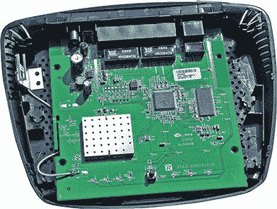

图 7.2 天线是左侧的导线和金属组件

### Note

笔记本电脑、一体机式桌面系统或移动设备的无线天线通常内置在屏幕周围区域。

无线路由器的设置通常布局非常清晰。您可以出于故障排除或安全原因调整许多设置。例如，大多数较新的小型办公/家庭办公（SOHO）无线路由器提供了实用的配置设置界面，用于管理防火墙、非军事区（DMZ）、应用程序和游戏、家长控制、访客访问和诊断设置（如图 7.3 **SSID：** 此名称用于任何通过此无线 AP 访问互联网的人。SSID 是可配置的客户端标识，允许客户端与特定的基站通信。在应用程序中，只有配置了相同 SSID 的客户端才能与具有相同 SSID 的基站通信。SSID 在基站和客户端之间提供了一种简单的密码安排。

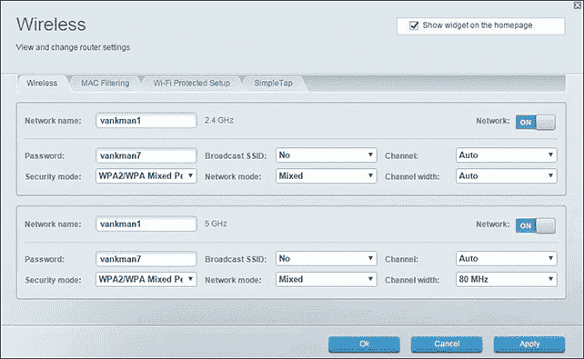

图 7.3 无线路由器的常用配置参数

在故障排除方面，如果客户端无法访问基站，请确保两者使用相同的 SSID。当客户端在不同的无线网络之间移动电脑（如笔记本电脑或其他移动设备）时，有时会发现不兼容的 SSID。它们从一个网络获取 SSID。如果系统未重启，旧的 SSID 将无法与不同的基站通信。

 **通道：** 要访问此网络，所有系统必须使用此通道。如果需要，您可以使用下拉菜单更改通道。菜单列出了从 1 到 11 的通道。

 **SSID 广播：** 在默认配置下，无线 AP 通常会定期向空气中广播 SSID 名称。此功能旨在允许客户端轻松发现网络并在不同的 WLAN 之间漫游。SSID 广播的问题是它让绕过安全性变得更容易。SSID 不经过任何形式的加密或保护。任何人都可以窥探并查看 SSID，并在如果没有安全保护的情况下尝试加入网络。

### Note

对于 SOHO 使用，不需要漫游。家庭使用时可以禁用此功能以提高您的 WLAN 的安全性。一旦您的无线客户端手动配置了正确的 SSID，它们就不再需要这些广播消息。

 **认证：** 在为 AP 配置认证安全时，根据 AP 的新旧，您有几种选择。在低端（旧款）端，选择通常包括 WEP-Open、WEP-Shared 和 WPA-PSK。WEP-Open 是最简单的认证方法，因为它不执行任何类型的客户端验证。它是一种弱的认证形式，因为不需要身份证明。WEP-Shared 要求在客户端系统和 AP 上都配置 WEP 密钥。这使得 WEP-Shared 认证成为强制性，因此对于无线传输更安全。带有预共享密钥的 Wi-Fi 保护访问（WPA-PSK）是一种更强的加密形式，密钥在指定时间后或传输指定数量的数据包后会在设备之间自动更改并认证。

在较新的 AP 上，选择通常包括 WPA Personal、WPA Enterprise、WPA2 Personal 和 WPA2 Enterprise，其中两个 WPA2 选择之一作为默认。其他选择可以包括 WPA2/WPA 混合模式和 RADIUS。

 **无线模式：** 要访问网络，客户端必须使用与 AP 相同的无线模式。今天，大多数用户将网络配置为 802.11n 或 802.11ac 以获得更快的速度。

 **DTIM 周期（秒）：** 无线传输可以广播到所有系统——也就是说，它可以向无线网络上的所有客户端发送消息。多个广播消息被称为组播或广播流量。数据传输指示消息（DTIM）是一种用于确保在发送组播或广播流量时，所有系统都处于激活状态以接收消息的功能。DTIM 指定了 DTIM 在信标帧内发送的频率。例如，如果默认 DTIM 设置为 1，这意味着 DTIM 随每个信标帧发送。如果 DTIM 设置为 3，则每隔三个信标帧发送一次 DTIM，作为 DTIM 唤醒调用。

 **最大连接速率：** 传输速率通常默认设置为`Auto`。这可以使用最大的连接速度。但是，可以通过降低速度来增加信号传输距离，并增强因环境恶劣导致的信号强度。

 **网络类型：** 在此处可以将网络设置为使用自形网络（ad hoc）或基础设施网络设计。


人们很容易掉入认为无线设备仅仅是连接到`AP`的笔记本的陷阱。然而，多年来需要连接到网络的移动设备数量和类型急剧增加。除了笔记本电脑和平板电脑，游戏设备、多媒体设备和手机现在都连接到无线网络。尽管它们看起来可能完全不同，但连接所需的信息是相同的。

不幸的是，它们也带来了安全隐患。强烈建议每个组织都采用`自带设备 (BYOD)`策略。管理员可以实施`移动设备管理 (MDM)`和`移动应用管理 (MAM)`产品，帮助解决这些设备的管理和管理问题。

### 考试提示

请注意，如今网络上的设备包括 PC、手机、笔记本电脑、平板电脑、游戏设备和多媒体设备。

### 强化练习测验

**1.** 下列哪些无线协议工作在 2.4 GHz 频率？（选择三项。）

 **A.** 802.11a

 **B.** 802.11b

 **C.** 802.11g

 **D.** 802.11n

 **E.** 802.11ac

**2.** 在什么情况下更改接入点的默认通道？

 **A.** 当`APs`之间发生通道重叠时

 **B.** 为了释放和刷新`SSID`

 **C.** 为了增加`WPA2`安全设置

 **D.** 为了减少`WPA2`安全设置

**3.** 你网络上的一个客户端过去访问无线网络没有问题，但最近她搬到了新办公室。自从搬家后，她无法访问网络。下列哪项最可能是问题的原因？

 **A.** 客户端和`AP`上的`SSIDs`不同。

 **B.** `SSID`已删除。

 **C.** 客户端的广播设置错误。

 **D.** 客户端系统离`AP`太远。

**4.** 你正在安装一个无线网络解决方案，并且需要一个可以使用 2.4 GHz 或 5 GHz 频率运行标准。你会选择哪种标准？

 **A.** 802.11a

 **B.** 802.11b

 **C.** 802.11g

 **D.** 802.11n

 **E.** 802.11ac

**5.** 你正在安装一个使用名为`MU-MIMO`功能的无线网络解决方案。你使用的是哪种无线网络标准？

 **A.** 802.11a

 **B.** 802.11b

 **C.** 802.11n

 **D.** 802.11ac

### 强化练习测验答案

**1. B, C, D.** 无线标准规定了发送通信的`RF`范围。802.11b 和 802.11g 标准使用 2.4 GHz 范围。802.11a 和 802.11ac 使用 5 GHz 范围。802.11n 可以在 2.4 GHz 和 5 GHz 上运行。

**2. A.** 通常情况下，无线设备使用的默认通道是足够的；但是，如果与附近的另一个`AP`发生重叠，你可能需要更改通道。应该更改到另一个不重叠的通道。更改通道不会影响`WPA2`安全设置。

**3. D.** `AP`发送数据传输的距离有限。当客户端系统移动范围之外时，它无法访问`AP`。存在许多策略可以增加传输距离，包括`RF`继器、放大器以及购买更强大的天线或无线`APs`。问题不太可能与`SSID`或广播设置有关，因为客户端以前可以访问网络，而且没有更改任何设置。

**4. D.** IEEE 标准 802.11n 可以使用 2.4 GHz 或 5 GHz 射频。802.11a 使用 5 GHz，802.11b 和 802.11g 使用 2.4 GHz。802.11ac 工作在 5 GHz 上。

**5. D.** `MU-MIMO`被 802.11ac 标准使用，并使多用户`MIMO`可能（增加了无线网络的范围和速度）。`MIMO`本身允许在同一通道的不同天线上同时传输多个数据流。

### 排除无线故障

 **给定一个场景，排除常见的无线连接和性能问题。**

### 快速通过

如果你在阅读本节之前能正确回答这些问题，可以通过快速浏览本节中的`Exam Alerts`然后完成本节末的`Cram Quiz`来节省时间。

**1.** 你注意到一个网络上的节点之间的连接不稳定，怀疑可能另一个网络正在使用相同的通道。你应该首先尝试什么？

**2.** 真或假：天气条件不应对无线信号完整性产生明显影响。

### 答案

**1.** 如果连接不稳定，尝试将通道更改到另一个不重叠的通道。

**2.** 假。天气条件会对无线信号完整性产生巨大影响。

### 考试提示

记住，此目标是以“给定一个场景”开始的。这意味着你可能会收到拖放、匹配或“实时操作系统”场景，在这些场景中你必须点击完成特定的基于目标的任务。

无线设备之间的通信不畅有很多不同的潜在原因。其中一些问题（如`latency`和`jitter`）与有线连接存在的问题相似，并在上一章中已讨论过。其他问题是无线连接特有的，将在后续章节中讨论。

为了将大量信息整理成连贯的格式，讨论从回顾无线故障排除检查清单开始，然后进入一些个人主题：

 **信号丢失：** 信号丢失的原因（称为`attenuation`）可能是从距离、障碍物到干扰的任何因素。应该检查`signal-to-noise ratio`，以测量所需信号与干扰它的背景噪声之间的对比。寻找设备或带宽饱和的迹象。

### 考试提示

`signal-to-noise ratio`可以用来衡量其名称所暗示的内容。

 **无线启用：** 一些笔记本电脑使得开启和关闭无线极其容易。用户可能会无意中按下一个没有注意到的按钮，然后突然无法访问网络。虽然这是一个很容易修复的问题，但它是你需要尽快识别的问题。图 7.4 显示了 HP 笔记本电脑上的无线灯。这个灯也是切换无线开启关闭的按钮。当灯为蓝色时，无线启用；当它不是蓝色（橙色）时，则禁用。

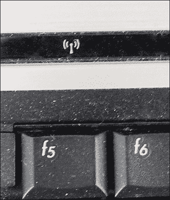

图 7.4 该灯也作为按钮，允许快速开启和关闭无线

 **未经测试的更新：** 永远不要对网络应用未经测试的更新。对于`AP`更新尤其如此，在应用到设备之前，应在非生产环境中进行测试。

 **错误的无线标准：** 确保你使用的标准支持你追求的速率和属性。这在吞吐量、频率、距离和通道方面特别重要。

 **自动传输速率：** 默认情况下，无线设备配置为使用最强最快的信号。如果你在无线设备之间遇到连接问题，尝试在固定模式下使用较低的传输速率以获得更稳定的连接。例如，你可以手动选择无线传输速率。此外，尝试使用低于最高可用的速率。速率越高，连接距离越短。

 **AP 放置与配置：** 如果信号强度低，请尝试将`AP`移动到新位置。只需移动几英尺就能产生影响。你还可以根据需要让信号从反射表面（`bounce`）。`AP`的配置应考虑`轻量级接入点协议 (LWAPP)`的使用，它可以允许你监控网络并减少配置和故障排除所需的时间——以及认证/配置是在`AP`上完成（称为“厚”，thick`）还是向上传递（称为“瘦”，thin`）。

### 注意

当`AP`执行关键功能（认证、过滤、QoS 强制等）时，被称为“厚”（thick`）。如果它没有执行这些关键功能——即使可能在执行其他功能——通常被称为“瘦”（thin`）。虽然没有 100% 准确的方法来区分厂商将其标记为厚或瘦，但一个好的规则是询问`AP`是否依赖于另一个设备（`thin`）或否（`thick`）。

 **天线：** 无线设备附带的默认天线可能无法满足特定的客户端系统。某些`APs`可以购买质量更好的天线来增加信号覆盖距离。确保你没有使用错误的天线类型或存在其他不兼容。

 **环境障碍：** 如果无线 RF 通信必须穿过金属框架、窗膜和混凝土墙等障碍物，信号会被削弱。可以进行无线现场调查来排查 RF 信号丢失问题，并帮助规划新无线网络的最佳位置。

 **冲突设备：** 任何使用无线设备相同频率范围的设备都会导致干扰。例如，2.4 GHz 手机、家电器或蓝牙设备可能会对使用`802.11g`或单频`802.11n`无线标准的设备产生。

 **无线通道：** 如果连接不稳定，尝试将通道更改为另一个不重叠的通道。确保设备之间没有通道冲突。

 **协议问题：** 如果无线客户端未分配 IP 地址，错误的`SSID`或不正确的`WEP/WPA/WPA2`设置可能会阻止系统获取 IP 信息。

 **SSID：** 客户端系统使用的`SSID`必须与`AP`上使用的匹配。如果你在不同的`WLANs`之间切换笔记本电脑或其他无线设备，可能需要更改它。

 **加密类型：** 如果连接系统启用了加密，则加密类型必须与`AP`中设置的匹配。例如，如果`AP`使用`WPA2-AES`，则连接系统也必须使用`WPA2-AES`。

大多数路由器配置界面允许你通过它们运行基础诊断，如图 7.5 所示。你通常还可以更改安全设置并配置防火墙，如图 7.6 所示。

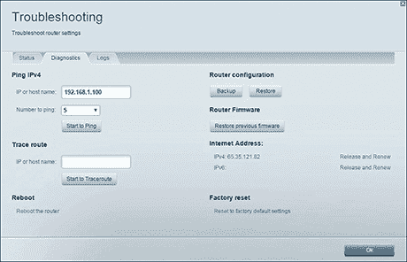

图 7.5 无线路由器诊断选项

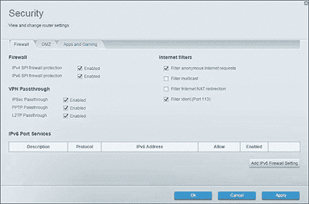

图 7.6 配置安全设置

#### 影响无线信号的因素

由于无线信号通过大气传输，因此它们受到的干扰类型不同标准有线网络。干扰会削弱无线信号，因此在处理无线网络时这是一个重要的考虑因素。

##### 干扰

规划无线网络时，无线干扰是一个重要的考虑因素。遗憾的是，干扰不可避免，但技巧在于减少干扰水平。无线局域网通信通常基于射频信号，这些信号需要一个清晰且无障碍的传输路径。

以下是导致干扰的一些因素：

 **物理物体：** 树木、砖石、建筑和其他物理结构是最常见的干扰源。建筑结构中所用材料的`密度`决定了 RF 信号可以穿过多少堵墙而仍保持足够的覆盖。混凝土和钢墙对信号来说特别难以穿透。这些结构会削弱或有时完全阻止无线信号。

##### 考试警示

务必确保理解物理物体是常见的干扰源。可以使用无线现场调查来测试干扰。

 **射频干扰：** 像`802.11n`这样的无线技术可以使用 2.4 GHz 的 RF 范围，许多其他设备（如无绳电话、微波炉、蓝牙设备等）也是如此。共享通道的设备会导致噪声并削弱信号。

 **电磁干扰：** 电磁干扰来自计算机、冰箱、风扇、灯具或其他任何电机驱动设备。电磁干扰对信号的影响取决于电气设备与无线`AP`的距离。无线技术和电气设备的进步减少了此类设备对无线传输产生的影响。

 **环境因素：** 天气状况对无线信号的完整性有巨大影响。例如，闪电会引起电磁干扰，而雾会在信号穿过时削弱信号。

##### 反射、折射和吸收

在无线网络中，干扰和反射之间的界限可能很模糊。它们之间的关键区别在于干扰是与某些东西（通常是另一个信号）的冲突，而反射是由于信号从物体上反射引起的问题。这的一个子集是折射，它涉及波在不同点以不同速度传输而导致方向改变。简单来说，当信号撞击金属无法穿透时发生反射，而当信号通过水体时发生折射。

如果波完全被其击中的物体吞噬（未被反射或折射），则被称为吸收。在涉及安全时，可以使用已知吸收无线信号的物品来防止信号传输到既定边界之外。屏蔽涂料（有时称为`RF 涂料`）可用于此目的，铜板和铝箔也是如此的。

许多无线应用出现在办公室或家中。即使天气等外部干扰不是问题，每个办公室都有许多无线障碍。表 7.4 突出了在室内实施无线网络时需要注意的几个示例。

# 表 7.4 室内常见的无线障碍物

| 障碍物 | 障碍严重程度 | 示例 |

| :--- | :--- | :--- |

| 木材/木质护板 | 低 | 墙内或空心门内部 |

| 石膏板 | 低 | 墙体内部 |

| 家具 | 低 | 沙发或办公隔断 |

| 透明玻璃 | 低 | 窗户 |

| 有色玻璃 | 中 | 窗户 |

| 人 | 中 | 人流量较大的行人流密集区域 |

| 陶瓷砖 | 中 | 墙体 |

| 混凝土块 | 中/高 | 外墙结构 |

| 镜子 | 高 | 镜子或反光玻璃 |

| 金属 | 高 | 金属办公隔断、金属门、金属办公家具 |

| 水 | 高 | 鱼缸、雨水、喷泉 |

**考试要点**

请确保你已理解表 7.4 中给出的障碍严重程度。

## 排除 AP 覆盖范围

与任何其他网络介质一样，`APs`的传输距离是有限。当你决定在网络的何处放置`AP`时，这种限制性是一个重要的考虑因素。在排查无线网络故障时，请密切关注客户端距离`AP`多远。

**考试要点**

在排除 AP 覆盖故障时，`AP`的`距离限制`是首要检查的内容之一。

当遇到客户端系统无法稳定访问`AP`的时，你可以尝试移动`AP`以更好地覆盖该区域，但这样做可能会干扰其他区域用户的访问。那么，可以做什么来排除 AP 覆盖的故障呢？

根据网络环境的不同，快速解决方案可能是投入金钱解决问题，购买另一个接入点、布线和其他硬件来扩大传输区域。然而，在安装另一个无线`AP`之前，你可以先尝试以下几种方法。以下列表按成本从低到高的顺序排列：

 **增加传输功率：** 某些`APs`具有调整传输功率输出（功率电平）的设置。默认情况下，大多数此类设置都设置为最大输出；然而，以防万一，这值得验证一下。如果你试图减少无线电波在即时网络之外的扩散，可以降低传输功率。增加功率可以为客户端提供更强的数据信号和更远的传输距离。

 **重新定位 AP：** 当无线客户端遇到连接问题时，解决方案可能简单地重新定位`AP`。你可以将其移动到房间的另一侧、几英尺外或对面走廊。找到合适的位置可能需要一些尝试。

 **调整或更换天线：** 如果`AP`距离对某些网络客户端来说不足，则可能需要将`AP`和客户端使用的默认天线更换为更高端的天线。升级天线可以传输范围产生巨大影响。遗憾的是，并非所有的`APs`都具有可更换的天线。

 **信号放大：** `射频 (RF)`放大器可以显著增加无线信号的距离。`RF`放大器增加了数据传输的强度和可读性。放大器改善了接收和发送信号，从而提高无线网络的性能。

 **使用中继器：** 在安装新`AP`之前，你可能想考虑无线中继器。当设置为与`AP`相同的信道时，中继器会接收并重复传输。因此，`AP`传输到达中继器，然后中继器复制信号并将其转发。这是增加无线传输距离的有效策略。

**考试要点**

准备好回答关于 AP 覆盖以及重新定位或更换 AP 的可能原因的问题。

## 突击测验

**1.** 你购买了一个默认不开启安全设置的新型无线`AP`。你将安全设置更改为使用 128 位加密。客户端系统必须如何配置？

 **A.** 所有客户端系统必须设置为 128 位加密。

 **B.** 客户端系统继承来自`AP`的安全设置。

 **C.** 无线安全不支持 128 位加密。

 **D.** 客户端无线安全设置必须设置为自动检测。

**2.** 你的 SOHO 网络遇到了连接问题。你可以更改什么来尝试解决这个问题？

 **A.** 缩短 SSID。

 **B.** 移除加密。

 **C.** 降低传输速率。

 **D.** 提高传输速率。

### 突击测验答案

**1. A.** 在`AP`和客户端之间的无线连接中，每个系统必须配置为使用相同的无线安全设置。在这种情况下，它们都必须配置为使用 128 位加密。

**2. C.** 如果你在无线设备之间遇到连接问题，请尝试在固定模式下使用较低的传输速率以获得更稳定的连接。例如，你可以手动选择无线传输速率。速率越高，连接距离就越短。

## 接下来

第 8 章，“云计算与虚拟化”侧重于云计算和虚拟化的定义，达到了参加 Network+ 考试所需的水平。

# 第 8 章：云计算与虚拟化

本章涵盖以下官方 Network+ 目标：

 总结云计算概念及其目的。

 解释虚拟化和网络技术的目的。

本章涵盖 CompTIA Network+ 目标 1.7 和 2.4。有关 Network+ 考试的更多信息，请参见引言中的“关于 Network+ 考试”部分。

如今`云计算`无处可见，甚至对于那些不知道它含义的人也是如此。作为 Network+ 候选人，熟悉云计算和虚拟化的定义并能够用术语与他人讨论是非常重要的。

本章关注云计算和虚拟化的定义。如果你想深入研究这项技术，可以考虑 CompTIA 新设立的 Cloud+ 认证。

### 云计算概念


**总结云计算概念及其目的。**

**快速技巧**

如果你在学习本节之前正确回答了这些问题，可以通过跳过本节的考试要点并完成节末的突击测验来节省时间。

**1.** 在哪种云交付模型中，资源由组织拥有，该组织既是提供者又是消费者？

**2.** 在哪种云服务模型中，消费者可以部署但无法管理或控制任何底层云基础设施（但他们可以控制已部署的应用）？

**3.** 云计算的某些特性有哪些？

### 答案

**1.** 在私有云模型中，云由组织拥有，该组织既是提供者又是消费者。

**2.** 在平台即服务 (`PaaS`) 云服务模型中，消费者可以部署但无法管理或控制任何底层云基础设施（但他们可以控制已部署的应用）。

# 8. 无论使用何种服务模型，其特征都包括按需自服务、广泛网络访问、资源池、快速伸缩性和可量化服务。理解这一章的最佳方法是将其视为云计算的介绍，并对相关术语的真实含义达成共识。`美国国立标准与技术研究院 (NIST)` 在特殊出版物 800-145 中定义了三种服务模型：`软件即服务 (SaaS)`、`平台即服务 (PaaS)` 以及`基础设施即服务 (IaaS)`。它还定义了四种可能的交付模型：`私有`、`公有`、`社区`和`混合`。

本章探讨了这七个术语中的每一个以及它们根据 `NIST` 定义并受计算社区认可的含义。请注意，服务模型可以与平台模型进行混合组合，你可以拥有公有`IaaS`或私有`PaaS`等，并且你可以利用`云访问安全代理 (CASB)`——一种软件程序——置于云服务用户和云应用程序之间，以监控活动并执行既定的安全策略。

### 注意

`CASB` 可以提供超出监控用户操作之外的服务，但必须始终能够强制执行安全策略合规性。

### 软件即服务

根据 `NIST` 的定义，`软件即服务 (SaaS)` 定义如下：“提供消费者的能力是使用运行在云基础设施上的提供者应用程序。可以通过各种客户端设备通过轻量客户端界面（例如网页浏览器，用于网页版电子邮件）或程序接口访问这些应用程序。消费者不管理或控制底层云基础设施，包括网络、服务器、操作系统、存储，甚至是单个应用程序功能，但特定的用户特定应用程序配置设置除外。”

所使用的词汇具有重要意义，在该定义中需要关注的重点是：消费者可以*使用*提供者的应用程序，并且他们不*管理或控制*任何底层云基础设施。图 8.1 描绘了 `SaaS` 模型中各方的责任。

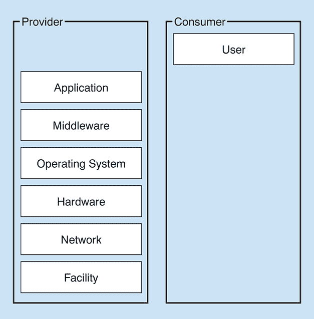

图 8.1 `SaaS` 服务模型

### 平台即服务

根据 `NIST` 的定义，`平台即服务 (PaaS)` 定义如下：“提供消费者的能力是在云基础设施上部署消费者创建或获取的应用程序，这些应用程序是使用提供者支持的编程语言、库、服务和工具创建的。消费者不管理或控制底层云基础设施，包括网络、服务器、操作系统或存储，但对已部署的应用程序以及应用程序托管环境的可能配置设置具有控制权。”

该定义中需要关注的重要词是：消费者可以*部署*，他们不*管理或控制*任何底层云基础设施，但他们对*已部署的应用程序拥有控制权*。图 8.2 描绘了 `PaaS` 模型中各方的责任。

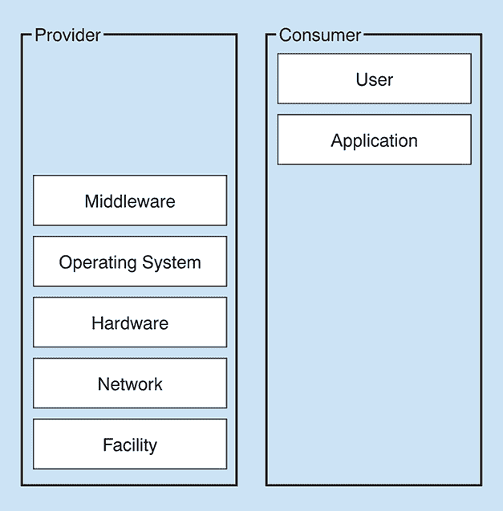

图 8.2 `PaaS` 服务模型

### 基础设施即服务

根据 `NIST` 的定义，`基础设施即服务 (IaaS)` 定义如下：“提供消费者的能力是配置处理、存储、网络和其他基础计算资源，消费者可以在其中部署和运行任意软件，这些包括操作系统和应用程序。消费者不管理或控制底层云基础设施，但对操作系统、存储和已部署的应用程序具有控制权；并对某些网络组件（例如主机防火墙）具有可能的有限控制。”

需要关注的词汇是：消费者可以*配置*，能够*部署和运行*，但仍然不*管理或控制*底层云基础设施，只是现在可以负责某些方面。图 8.3 描绘了 `IaaS` 模型中各方的责任。

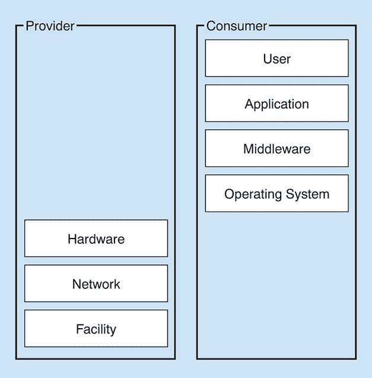

图 8.3 `IaaS` 服务模型

### 注意

无论使用何种服务模型，每种模型的特征都包括按需自服务、广泛网络访问、资源池、快速伸缩性和可量化服务。

在选择了服务模型后，`CompTIA` 和 `NIST` 都认可不同的交付模型，接下来将进行讨论。

### 考试警示

对于考试，请记住三种可能的云服务模型：`IaaS`、`PaaS` 和 `SaaS`。

### 其他类型的服务

`CompTIA` 目标专门列出了 `IaaS`、`PaaS` 和 `SaaS` 为其测试的三个模型。这些是目前最流行的模型，但几乎任何事物都可以在结尾加上“`aaS`”并将其订阅称为“作为一项服务”。这很重要，因为官方缩写列表中出现了三个未在目标中出现的模型。因此，请务必了解这些缩写所代表的含义以及简短的定义。这三个模型如下：

- **`CaaS`:** 通信即服务是向供应商租赁的外包通信，如`基于 IP 的语音传输 (VoIP)`、视频会议应用等。

- **`DaaS`:** 桌面即服务是桌面虚拟化的实现，它不需要你构建和管理自己的基础设施。

- **`MaaS`:** 移动即服务与其他服务模型大不同，也被称为`交通即服务 (TaaS)`。它是根据需要使用其他形式的交通工具，而不是公司的车辆。

### 私有云

`私有云`的定义如下：“云基础设施是为单一组织（包含多个消费者，例如业务部门）的专享使用而配置的。它可能由该组织、第三方或两者的结合拥有、管理和运营，并可能存在于现场内或场外。”

在大多数情况下，私有云由该机构组织拥有，它既充当提供者又是消费者。它在安全方面具有优势，因为不需要将数据置于互联网上。

### 公有云

`公有云`的定义如下：“云基础设施是由云服务提供者拥有并面向公众开放，采用按需付费模式。它可能由该组织、第三方或两者的结合拥有、管理和运营，并可能存在于现场内或场外。” 注：此处原文重复了私有云定义，已根据上下文修正为公有云标准定义。

在大多数情况下，公有云由云提供者拥有，并采用按需付费模式。公有云的一个良好示例是网页邮箱或在线文档共享/协作。

### 混合云

`混合云`的定义如下：“云基础设施是由两个或多个不同的云基础设施（私有、社区或公有）组成的，这些基础设施保持为独立的实体，但通过标准化或专有技术结合在一起，实现数据和应用程序的可移植性（例如云间负载均衡的云爆发）。”

混合云可以是其他交付模型的任何组合。定义中不仅列出了公有和私有，还有社区。`CompTIA` 不再在 `Network+` 考试中包含社区云交付模型（但确实要求你在其专注于云的认证中了解它）。对于实际用途，你应该知道，区分社区云与其他类型云交付的关键在于它为一个*相似*的群体提供服务。必须有共同利益且人数有限。

使用云计算的一个常见原因是，当自己的服务器过于繁忙时，能够将流量卸载到云提供者的资源上。这被称为 `cloud bursting`（云端突发），它需要负载均衡/优先级排序技术（如 `quality of service (QoS)` 协议）来实现。

### 考试提示

对于考试，你应该知道最常见的云交付模型是私有云、公有云和混合云。

## 连接方法

大多数云提供者提供了多种客户可以用来与其连接的办法。在投资基础设施之前，咨询您的提供商并查看他们推荐和支持的方法非常重要。最常见之一是在您的网络与云提供商之间使用 `IPsec` 硬件 VPN 连接。这种方法提供了受托管 VPN 端点的能力，包括自动的多数据中心冗余和故障转移。

专用直连连接是另一种更简单的方法。您可以将专用网络连接与硬件 VPN 结合，创建一种既提供 `IPsec` 加密私有连接又能降低网络成本的组合方案。

亚马逊云服务 (`AWS`) 是市场上最流行的云提供商之一。他们允许上述讨论的两种连接方法（将专用连接称为“`AWS Direct Connect`”）以及许多其他这两种方法的变体或组合。

## 安全影响与考量

安全是与云提供者讨论时最重要的问题之一。云计算在扩展性、成本节约、快速部署和赋能方面具有巨大的前景。然而，与任何有许多内容脱离您的控制的技术一样，它存在风险。每个风险都应该经过仔细考虑，以确定帮助缓解的方法。自然地，组织和云提供者的责任取决于所选择的服务模型，但最终，组织要对外包服务的安全和隐私负责。

实施过程中不需要的软件和服务应该被移除或至少被禁用。补丁和固件更新应保持最新状态，并应仔细监控日志文件。你应该在其他人之前发现实现中的漏洞，并与您的服务提供商合作关闭任何漏洞。

在云端数据存储方面，加密是保护数据的最佳方式之一（防止被未经授权的方利用），而 VPN 路由和转发可以提供帮助。应定期进行备份（并加密且存储在安全位置），并将访问控制作为首要任务。

### 备注

有关关于云计算和数据保护的良好讨论，请访问 [`whoswholegal.com/news/features/article/18246/cloud-computing-data-protection`](http://whoswholegal.com/news/features/article/18246/cloud-computing-data-protection)。

## 资源的关系

正如云在运行应用程序、平衡负载以及许多其他选项方面具有巨大前景一样，它还提供了在上面存储更多数据的能力，并让提供者而不是本地管理员来担心扩展性问题。从经济角度来看，这可能是一种幸运。但从管理角度来看，它可能会带来一些问题。由于数据位于多个位置（本地和远程）而产生的冗余在需要恢复数据时是极好的，但当你想要确保始终在使用最新版本工作时，就会出现问题。为了尽量减少问题，请确保文件保持最新，并且本地与远程文件之间的同步始终运行。

## 强化测验

**1.** 消费者可以使用哪种云服务模型使用提供者的应用程序，但不管理或控制任何底层的云基础设施？

- **A.** `SaaS`
- **B.** `PaaS`
- **C.** `IaaS`
- **D.** `GaaS`

**2.** 以下哪项涉及在您自己的服务器过于繁忙时，将流量卸载到云提供者的资源上？

- **A.** `Ballooning`
- **B.** `Cloud bursting`
- **C.** `Bridging`
- **D.** `Harvesting`

**3.** NIST 定义的以下哪项是两个或多个不同的云基础设施的组合？

- **A.** `Private cloud`
- **B.** `Public cloud`
- **C.** `Community cloud`
- **D.** `Hybrid cloud`

# 强化测验答案

**1. A.** 在 `SaaS` 云服务模型下，消费者能够使用提供者的应用程序，但他们不管理或控制任何底层的云基础设施。

**2. B.** 使用云计算的一个常见原因是当您自己的服务器过于繁忙时，能够将流量卸载到云提供者的资源上。这被称为 `cloud bursting`。

**3. D.** `Hybrid cloud` 交付模型是两个或多个不同的云基础设施（公有的、私有的等）的组合。

## 虚拟化与存储区域网络

**解释虚拟化和网络存储技术的目的。**

## 强化救星

如果你在阅读本节之前能正确回答这些问题，可以通过快速浏览本节中的考试提示，然后完成本节末的强化测验来节省时间。

**1.** 哪种技术发送非常大且处理器密集度低的以太网帧？

**2.** 对或错：`Virtual NICs` 被分配了 MAC 地址。

### 答案

**1.** `jumbo frames` 的目标是发送非常大且处理器密集度低的以太网帧。

**2.** 正确。`Virtual NICs` (`VNICs`) 被分配了 MAC 地址。

云计算和虚拟化就像热狗上的番茄酱和芥末酱的关系；你可以使用其中一个而不使用另一个，但它们通常一起使用。在本章的前半部分，你学习了云计算的定义；现在你学习虚拟化和存储区域网络的原理。

### 虚拟化

云计算构建于虚拟化；它是云计算的基础。虚拟化的核心是`hypervisor`（使其可能的软件/硬件结合）。有两种实现方法：Type I（称为`bare metal`）和 Type II（称为`hosted`）。Type I 独立于操作系统并在操作系统启动之前启动，而 Type II 依赖于操作系统，并且在操作系统启动之前无法启动；它需要操作系统保持运行以便其操作。图 8.4 描绘了 Type I 模型，而图 8.5 描绘了 Type II 模型。从性能和扩展性的角度来看，Type I 被认为优于 Type II。

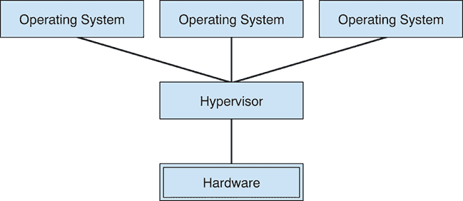

图 8.4   Type I hypervisor 模型

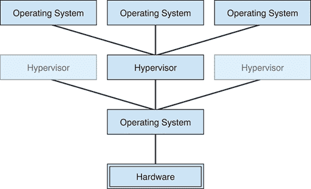

图 8.5   Type II hypervisor 模型

### 提示

运行虚拟化软件的机器被称为`host`，虚拟机被称为`guests`。

曾经虚拟机监控程序（hypervisors）是实现虚拟化的唯一方法，而大多数人认为容器是其继任者。在本版本的 `Network+` 中不会测试这些内容，但在现实世界中，你应该了解容器（一种封装了运行所需所有内容——代码、运行时、系统工具、系统库等的软件包）的使用正变得越来越普遍。

云计算在扩展性、成本节约、快速部署和赋能方面具有巨大的潜力。然而，与任何许多功能脱离你控制的技术一样，它存在风险。应该考虑并深思每种风险，以识别帮助缓解风险的方法。例如，数据隔离可以帮助减少与多租户相关的风险。常见的虚拟网络组件包括`虚拟网络接口卡 (VNICs)`、虚拟路由器和交换机、共享内存、`virtual CPUs` 以及存储（共享或集群式）。

在接下来的章节中，我们将介绍用于创建虚拟环境的一些组件。

### 虚拟路由器和交换机

正如物理路由器通过维护目的和本地连接表来建立通信一样，`virtual router`的工作原理类似，但它仅是软件。请记住，路由器包含连接到它的系统信息，以及在目的地未知时将请求发送到何处的信息。随着通过路由器建立连接，这些路由表会不断增长。路由可以在网络内部（内部）或外部（exterior）发生。路由本身可以配置为静态或动态。

同样，`virtual switch` 是一个允许一个虚拟机 (VM) 与另一个通信的软件程序。虚拟交换机允许虚拟机使用宿主操作系统的硬件（`NIC`）连接到互联网。

交换机是提高网络效率的多端口设备。交换机通常包含有关网络中系统的少量信息——一张 MAC 地址表而不是 IP 地址表。由于具有虚拟电路的能力，交换机在网络效率上优于路由器。交换机还提高了网络安全，因为虚拟电路更难被网络监视器检查。交换机维护着关于内部网络中节点的有限路由信息，并允许连接到集线器（hub）或路由器等系统。

### 虚拟防火墙

`virtual firewall (VF)` 既可以是网络防火墙服务，也可以完全运行在虚拟化环境中的设备。无论采用哪种实现方式，`VF` 的作用与物理防火墙相同：数据包过滤和监控。防火墙也可以运行在客户 OS 虚拟机中。

`VF` 的一个关键在于不要忽视`网络地址转换 (NAT)`的贡献。这允许组织为所有计算机连接向互联网呈现单个地址（或一组地址）——它在局域网（可能使用私有 IP 地址）和互联网之间充当代理。`NAT` 有效地向整个世界隐藏了你的网络，使得确定路由器另一侧存在哪些系统变得困难得多。

`NAT` 不仅可以节省 IP 地址，还可以作为防火墙。

**提示**

`NAT` 不仅可以节省 IP 地址，还可以作为防火墙。

### 虚拟与物理 NIC

机器内的 `NIC` 卡可以是虚拟的，也可以是物理的，且配置方式相同。它存在于虚拟网络中，必须具有 IP 地址、MAC 地址、默认网关、子网掩码值，并可以具有桥接或非桥接连接。`VNIC` 仅是软件，但允许与网络上的其他设备交互。（`VLAN` 使 `VNICs` 与其他网络设备通信成为可能。）

**考试提醒**

对于考试，你应该能够区分各种虚拟化组件：交换机、路由器、防火墙和 `NIC`。

在讨论虚拟网络时，重要的是注意到讨论的大部分都是基于软件的。永远不要忘记，虚拟化的目标是在不实际拥有那些物理元素的情况下仿真物理环境和设备。

### 存储区域网络

在云数据存储方面，加密是保护数据的最佳方式之一（使其对未经授权的方没有价值），VPN 路由和转发可以提供帮助。应该定期执行备份（加密并存储在安全位置），并将访问控制作为首要任务。

消费者保留对合规性的最终责任。根据 `NIST SP 800-144`，“主要问题在于将重要应用程序或数据从组织计算中心内部移动到另一个组织（即公共云，其可供公众随时使用）的相关的风险。组织和云提供商双方的责任取决于服务模型。降低成本和提高效率是向公共云迁移的主要动力，但放弃对安全的责任不应是初衷。最终，组织对公共云的选择以及外包服务的安全和隐私负责。”如需了解更多信息，请参阅 `http://nvlpubs.nist.gov/nistpubs/Legacy/SP/nistspecialpublication800-144.pdf`。

共享存储可以在`存储区域网络 (SANs)`、`网络附属存储 (NAS)` 等上进行；虚拟机只看到一个“物理磁盘”。通过集群存储，你可以使用多个设备来提高性能。该领域存在许多技术，以下是你参加 `Network+` 考试需要了解的。

**提示**

请参考 `CompTIA` 的 `Cloud+` 认证以在云和虚拟化技术方面获得更专业的专业知识。

### iSCSI

`小型计算机系统接口 (SCSI)` 标准长期以来一直是存储的语言。`互联网小型计算机系统接口 (iSCSI)` 通过以太网扩展了这一点，允许使用 `IP` 来发送 `SCSI` 命令。

`逻辑单元号 (LUNs)` 衍生于 `SCSI` 世界并延续至今，作为设备的唯一标识符。`NAS` 和 `SAN` 都使用可以容纳八个设备的“目标 (targets)”。


在虚拟环境中使用`iSCSI`可以让用户获得文件系统的优点，而无需设置光纤通道（Fibre Channel）的困难。因为`iSCSI`同时工作在虚拟机监控程序层和客户操作系统中，因此使用的是规定`OS`中分区大小的规则，而不是虚拟`OS`的规则（后者通常更严格）。

`iSCSI`的缺点是，如果配置不经过仔细监控，用户可能会遇到与`IP`相关的问题。

## 大帧

网络中最大的问题之一是各种大小的数据被挤入数据包中并跨介质发送。每当执行此操作时，都会创建头部（更多需要处理的数据）以及任何所需的填充，从而产生额外的开销。为了解决这个问题，使用了`jumbo frames`的概念，允许非常大的以太网帧；通过一次发送大量数据，减少了数据包的数量，发送的数据对处理器的负担更小。

## Fibre Channel 和 FCoE

与其使用旧技术并尝试遵循旧标准，`光纤通道 (FC)`是一个比其他任何技术都更高性能的选项。它利用`FCP`（`光纤通道协议`）来完成任务，而`以太网光纤通道 (FCoE)`可用于高速（10 GB 及以上）实现。

光纤通道（Fibre Channel）的主要优势在于其可扩展性。`FCoE`通过以太网连接部分封装`FC`，使其易于添加到现有网络中。因此，`FCoE`是`FC`的扩展，旨在扩展光纤通道相关的扩展性和效率。

## 网络附属存储 (NAS)

存储始终是一个大问题，而最佳答案总是`SAN`。遗憾的是，`SAN`的成本可能很高，且实施和维护困难。这就是`network-attached storage (NAS)`的用用场。`NAS`比`SAN`更简单且使用`TCP/IP`。它提供文件级访问，客户端将共享存储视为一个文件服务器。

### 注意

在`VLAN`上，多路径创建了通往存储资源的多个路径，并用于增加可用性`and`添加容错能力。

### 考试提示

对于考试，你应该了解`NAS`和`SAN`技术之间的区别以及如何应用它们。

## InfiniBand

市场上的一种高速技术，并受 InfiniBand 贸易协会的支持是`InfiniBand (IB)`。该标准承诺高吞吐量和低延迟，使其成为高性能计算连接的理想选择（包括计算机内部和计算机之间的连接）。Mellanox 和 Intel 都制造 InfiniBand 主机适配器和网络交换机，Oracle 公司也推出了一系列产品。

### 注意

InfiniBand 设计为可扩展，并使用交换矩阵结构网络拓扑。

### 考试提示

对于考试，你应该知道 InfiniBand 与光纤通道以及许多专用技术竞争。

### 强化习测验

**1.** 逻辑单元号（`LUNs`）源自 SCSI 世界，使用的“目标”最多持有多少设备？

 **A.** 4

 **B.** 6

 **C.** 8

 **D.** 128

**2.** 下面哪技术创建了通往存储资源的多个路径？

 **A.** 多列表化 (Multilisting)

 **B.** 多宿主化 (Multihoming)

 **C.** 多租户化 (Multitenancy)

 **D.** 多路径化 (Multipathing)

**3.** 以下哪种类型的虚拟化被称为裸金属（bare metal）？

 **A.** Type 0

 **B.** Type I

 **C.** Type II

 **D.** Type III

### 强化习测测验答案

**1. C.** `LUN`源自 SCSI 世界并延续而来，作为设备的唯一标识符。`NAS`和`SAN`使用的“目标”最多持有八个设备。

**2. D.** 在`VLAN`上，多路径创建了通往存储资源的多个路径，并可用于增加可用性`and`添加容错能力。

**3. B.** 有两种实现方法：`Type I`（称为裸金属）和`Type II`（称为托管式）。`Type I`独立于操作系统并在`OS`启动之前引导，而`Type II`依赖于操作系统，在`OS`启动之前无法启动，并且需要`OS`保持运行。

## 接下来做什么

第 9 章，“网络操作”关注两个重要主题：网络管理和网络优化技术与方法。

## 第 9 章：网络操作

本章涵盖了以下官方 Network+ 目标：

 给定场景，使用适当的文档和图表管理网络。

 比较并对比业务连续性和灾难恢复的概念。

 解释常见的扫描、监控和补丁过程，并总结它们的预期输出。

 给定场景，使用远程访问方法。

 识别策略和最佳实践。

本章涵盖了 CompTIA Network+ 目标 3.1、3.2、3.3、3.4 和 3.5。有关官方 Network+ 考试主题的更多信息，请参阅引言中的“关于 Network+ 考试”部分。

本章关注网络管理员角色的两个重要部分：文档以及用于监控或优化连接的工具。文档虽然不华丽，但是工作不可或缺的一部分。本章将了网络文档的几个方面。

### 文档管理

 **给定场景，使用适当的文档和图表管理网络。**

 **识别策略和最佳实践。**

### 快速学习工具

如果你在阅读本节之前能正确回答这些问题，可以通过快速浏览本节中的考试提示，然后完成本节末尾的强化习测验来节省时间。

**1.** 哪种网络拓扑关注数据在物理环境中流向的方向？

**2.** 在计算中，作为未来计算衡量标准的历史读数称为什么？

**3.** 真或否：逻辑网络和物理网络图都提供了网络布局和功能的概述。

### 答案

**1.** 逻辑网络指的是数据在物理拓扑内网络上流向的方向。逻辑图的目的不是关注网络硬件，而是关注数据数据如何流过这些硬件。

**2.** 维护和审查基线（baselines）是管理员角色中不可或缺的一部分。

**3.** 真。逻辑网络和物理网络图都提供了网络布局和功能的概述。

### 考试提示

记住该目标是以“给定场景”开始的。这意味着你可能会收到拖放、匹配或“实时操作系统”场景，在场景中你必须点击完成特定的基于目标的任务。

管理员有几项日常任务，新任务经常层出不穷。在这种环境中，文档等任务有时会被边缘化。理解管理员为什么需要花费宝贵的时间编写和审查文档至关重要。一个文档完备的网络提供了许多优势：

 **故障排除：** 当网络出现问题（包括布线）时，最新的文档是指导故障排除工作的宝贵参考。文档可以在隔离潜在问题时节省金钱和时间。

 **培训新管理员：** 在许多网络环境中，会招聘新管理员，旧管理员会离开。在这种情况下，文档至关重要。新管理员没有时间去尝试弄布线在哪里、使用了什么布线、潜在的问题点等。最新的信息有助于新管理员快速查看网络布局。

 **与承包商和顾问合作：** 顾问和承包商偶尔需要访问网络对网络提出建议或添加布线或其他组件。在这种情况下，需要最新的文档。如果缺少文档，这些人工作将变得困难得多，并且可能需要更多的时间和资金。

 **库存管理：** 了解你拥有什么、在哪里以及在紧急情况下可以求助于什么，既具有建设性又有帮助。

高质量的网络文档并非偶然形成；相反，它需要周全的规划。在创建网络文档时，你必须记住你是为谁创建文档，并意识到它是一种通信工具。文档的作用是获取技术信息，并以初次接触网络的人能够理解的方式呈现出来。在规划网络文档时，你必须决定需要记录哪些内容。

### 注意

想象一下你刚刚作为管理员接手了一个网络。你希望看到哪些信息？这通常是判断网络文档中应该包含哪些内容的清晰衡量标准。

所有网络各不相同，每个网络所需的文档也各不相同。然而，高质量的文档始终包含某些元素：

 **网络拓扑：** 网络可能非常复杂。如果让新来查看网络，记录整个拓扑结构至关重要。这包括网络上使用的有线和无线拓扑结构。网络拓扑文档通常由一张或一系列图表组成，标记了用于创建网络的所有关键组件。这些图表使用了防火墙、集线器、路由器和交换机等组件的通用符号。例如，图 9.1 显示了从左到右的防火墙、集线器、路由器和交换机的标准图形。


图 9.1 防火墙、集线器、路由器和交换机的图符号

 **布线布局和机架图：** 网络布线可能非常混乱。大部分线路隐藏在墙壁和天花板内，很难知道线路在哪里以及网络使用了什么类型的线路。这使得保持网络布线文档更新至关重要。画每个机架上的内容以及可能采用任何异常配置。

 **IDF/MDF 文档：** 仅显示建筑中有中间配线架 (IDF) 和/或主配线架 (MDF) 是不够的。你需要彻底记录每一个独立或挂墙机架，以及运行在它们与终端用户设备之间的电缆。

 **服务器配置：** 单网络通常使用分布在大地理区域内的多个服务器。文档必须包含服务器在网络所在位置的示意图以及每个服务器提供的服务。这包括服务器功能、服务器 IP 地址、操作系统 (OS)、软件信息等。本质上，你需要记录管理或维护服务器所需的所有信息。

 **网络设备：** 网络上使用的硬件以特定方式配置——带有协议、安全设置、权限等。尝试记住这些内容将是一项艰巨的任务。拥有更新的文档将更容易从故障中恢复。

 **网络配置、性能基准和关键应用程序：** 文档还包括有关所有当前网络配置、已获取的性能基准以及网络上关键应用程序的信息，例如关于它们更新的最新信息、供应商、安装日期等。

 **网络服务的详细说明：** 网络服务是所有网络中的关键要素。如域名系统服务 (DNS)、动态主机配置协议 (DHCP)、远程访问服务 (RAS) 等服务是文档的重要部分。你应该详细描述由哪个服务器维护这些服务、这些服务的备份服务器、维护计划、它们是如何构建的等。

 **标准操作程序/工作说明书：** 最后，文档应包含有关网络策略和程序的信息。这包括许多元素，从谁可以和不能访问服务器房，到网络防火墙、协议、密码、物理安全、云计算使用、移动设备使用等。

### 考试提醒

确保你了解网络文档中应该包含的信息类型。

### 布线和端口位置

网络布线示意图是网络文档的重要组成部分，特别是对于中大型网络，这些网络的布线无疑非常复杂。对于此类网络，视觉化网络布线变得日益困难，向他人解释更是更加困难。目前有许多软件工具可以帮助管理员详细地清晰记录网络布线。

存在多种类型的布线示意图。它们可以是通用的，如图 9.2 所示，也可以是非常具体的，指明实际使用的布线类型、每台机器上的操作系统等。它们越通用，需要更新的就越少，而非常具体的示意图通常需要经常更改。表 9.1 代表了记录记录的另一种方式。

### 考试提醒

对于考试，请熟悉通用布线示意图的外观，如图 9.2 所示的那样。

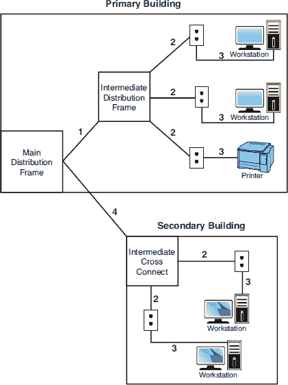

图 9.2 通用布线示意图

表 9.1 布线细节

| 线缆 | 描述 | 安装备注 |
| :--- | :--- | :--- |
| 1 | 六类吊花板额级电缆 | 电缆从 MDF 到 IDF 运行 50 英尺。电缆穿过天花板和机械房。电缆于 2017/02/26 安装，升级了非吊花板五类 e 电缆。 |
| 2 | 六类 A 吊花板电缆 | 水平线从 IDF 到墙上插座运行 45 至 55 英尺。 2017 年 2 月更换了五类电缆。部分电缆穿过天花板并在荧光灯上方。 |
| 3 | 五类 e UTP 电缆 | 所有跳线连接器都是在公司内部连接的。连接打印机的跳线线由于打印机的位置运行了 45 英尺。 |
| 4 | 8.3 微米芯/ 125 微米包层单模式 | 连接光纤在主建筑和副建筑之间运行 2 公里。 |

图 9.2 提供了网络布线示意图的简化视图。想象一下，在一个拥有 1000、2000 甚至 6000 台计算机的网络上，这些图表看起来有多复杂。高质量的网络文档软件会让这变得更容易；然而，对于管理员来说，网络布线工作可能是一个巨大的任务。管理员需要确保有人可以拿起布线文档图并对网络布线有一个良好的了解。

### 注意

阅读示意图并确定线路运行位置是管理员职责的重要部分。预计会在考试中看到示意图。

`SNMP`可以直接映射交换机和其他设备上的端口；然而，使用集成`SNMP`的软件应用程序并用其创建创建随用的文档要容易得多。大量的此类程序；有些是免费的，许多是商业产品。

#### 使用布线示意图进行故障

一些网络管理员不花时间维护高质量的文档。当需要排除某些随机网络问题时，这会困扰他们。在没有任何网络布线示意图的情况下，这项任务将是令人沮丧且耗时的。图 9.2 显示的信息可能是简化的，但你可以使用该文档来评估网络并提出建议。

### 注意

在查看布线示意图时，密切注意电缆的运行位置以及如果示意图指示了，所使用的电缆类型。如果没有使用正确的电缆，可能会出现问题。

### 注意

网络布线图是一个不断更新的过程。虽然布线变化并非每天发生，但在网络扩展或更换旧电缆时，变化确实会发生。必须记住，当网络发生更改时，必须更新图表及其相应的引用以反映这些变化。过时的图表会工作工作变得非常沮丧。

## 物理和逻辑网络图

除了布线图外，文档还应包含物理和逻辑网络设计的图表。回想第 1 章“网络技术简介”，网络拓扑可以在物理或逻辑层面进行定义。`物理拓扑`指的是网络在物理上是如何构建的——即它的外观。`逻辑拓扑`指的是网络在使用设备看来是如何的——即它是如何运行的。

网络基础设施文档并不是每天审核的；然而，对于不熟悉网络的人来说，这些文档对于管理或故障排除网络至关重要。在记录网络时，你需要记录基础设施的所有方面。这包括所使用的物理硬件、协议和软件。

### 警报

你应该能够识别物理图和逻辑图。你需要知道每张图图中应该包含哪些类型的信息。网络的物理文档应包含以下内容：

- `布线信息`：所有物理通信链路的视觉化描述，包括所有布线、电缆长度等。
- `服务器`：服务器名称和 IP 地址、服务器类型以及域成员身份。
- `网络设备`：设备在网络中的位置。这包括打印机、集线器、交换机、网关等。
- `广域网`：组件的位置和设备。
- `用户信息`：某些用户信息，包括本地用户和远程用户。

如你所见，物理网络图中可以包含许多元素。图 9.3 显示了一个物理分段。

```
graphics/arrow.jpg
FIGURE 9.3 物理网络图
```

### 注意

你应当意识到维护文档的重要性，这些文档应包括网络图、资产管理、IP 地址利用情况、供应商文档、内部操作程序和标准。

网络是动态的，变化可能会经常发生，这就是为什么物理网络图也必须进行更新。不同的网络对更新频率有不同的策略和程序。最佳实践是，每当网络发生重大变化时（例如添加交换机或路由器、更改协议或添加新服务器），都应该更新图表。这些变化会影响网络运行方式，文档应当反映这些变化。

### 注意

关于何时更新网络文档没有快速的规则。然而，大多数管理员都希望在网络发生功能性变化时进行更新。

逻辑网络指的是数据在物理拓扑内网络上流动的方向。逻辑图的设计重点不是于网络硬件，而是侧重于数据如何通过这些硬件流动。在实践中，物理和逻辑拓扑可以是相同的。在总线拓扑的情况下，数据沿着电缆长度从一台计算机传输到另一台计算机。因此，物理图和逻辑图将是相同的。

情况并非总是如此。例如，一个拓扑在物理形状上可能是星形的，但在逻辑上是环形传递数据的。数据传输的功能在交换机内部以环形结构执行。因此，物理图看起来是星形的，但逻辑图显示数据以环形结构从一台计算机流到另一台。简单来说，从物理图中很难判断数据在网络上是如何流动的。

在如今的网络环境中，星形拓扑是一种常见的实现。以太网使用物理星形拓扑但逻辑总线拓扑。物理以太网星形拓扑的中心是一个交换机。交换机内部发生的情况定义了逻辑总线拓扑。交换机在端口之间传递数据，就像它们位于以太网总线线段上一样。

除了数据流，逻辑图还可能包含额外元素，例如网络域架构、服务器角色、使用的协议等。图 9.4 显示了逻辑拓扑在网络文档中的可能样式。

```
graphics/09fig04.jpg
FIGURE 9.4 逻辑拓扑图
```

### 注意

网络的逻辑拓扑识别了数据信号在网络上传输的逻辑路径。

## 基准

基准在网络文档中起着不可缺的作用，因为它们让你监控网络的整体性能。简单来说，`基准`（baseline）是一种性能衡量标准，指示网络的工作强度以及网络资源消耗在哪里。基准的目的是提供比较的基础。例如，你可以比较 3 月份的网络性能结果与 6 月的结果，或从一年到明年进行比较。更常见的是，会将网络出现问题时的基准信息与网络运行效率更高时记录的信息进行比较。这种比较有助于你判断网络是否出现了问题、问题有多严重，甚至问题出在哪里。

为了发挥作用，基准测试不是一项一次性任务；相反，应该定期获取基准以提供准确的比较。你应该在网络建立并运行后获取一个初始基准，然后在网络发生重大变化时再次获取。即使网络没有发生任何变化，定期的基准测试也可以作为判断网络是否仍在正常运行的有效手段。

所有`网络操作系统 (NOSs)`（包括 Windows、Mac OS、UNIX 和 Linux）都内置了对网络监控的支持。此外，许多第三方软件软件包可用于详细的网络监控。`NOS`提供的这些系统监控工具为你提供了获取性能基准的方法，无论是针对整个网络还是针对网络中的单个分段。由于这两个基准的功能不同，它们分别被称为`系统基准`（system baseline）和`组件基准`（component baseline）。


为了创建网络基准，网络监控程序提供了网络统计的图形显示。网络管理员可以选择多种网络测量指标进行跟踪。他们可以使用这些统计数据执行例行的故障排除任务，例如定位故障的网卡、宕机服务器或`拒绝服务 (DoS)` 攻击。

### Note

`绘图`（Graphing）以及视觉化数据的过程，在识别趋势方面比查看原始数据和日志文件要有用得多。

收集网络统计数据的过程被称为`捕获`（capturing）。管理员可以捕获网络所有元素的统计数据。对于基准而言，最常见的监控统计之一是带宽使用情况。通过审查带宽统计数据，管理员可以看到网络带宽的大部分用在哪里。然后他们可以根据带宽使用情况调整网络。如果某个应用程序消耗了过多带宽，管理员可以主动控制其带宽使用情况。然而，如果不对比基准，很难判断什么是正常的网络带宽使用，哪些是不寻的。

请记住，基准需要定期在相同条件下获取以确保有效。它们被用于比较当前性能与过去的性能，以帮助判断网络运行是否正常或是否需要进行故障排除。

## 策略、程序、配置和法规

运行良好的网络具有具有记录在案的策略、程序、配置和法规。由于这些内容对每个网络都是唯一的，因此应对策略、程序、配置和法规进行清晰的记录。

### 策略

根据定义，策略是指组织关于应该做什么、不该做什么以及为什么这么做的记录在案规则。策略规定了谁可以和不可以访问特定的网络资源、机房、备份媒体等。

尽管网络可能根据其需求有不同的策略，但一些常见的策略包括以下内容：

 **网络使用策略：** 定义了谁可以使用电脑、打印机、扫描仪和远程连接等网络资源。此外，使用策略还规定了访问这些资源后可以对它们进行的操作。没有网络管理员的许可，任何外部系统都将接入网络。

 **互联网使用策略：** 该策略规定了工作期间使用互联网的规则。通常，使用应侧重于与业务相关的任务。在指定时间内允许偶然的个人使用。

 **自备设备 (BYOD) 策略：** 该策略规定了员工带入工作场所并使用的个人所有移动设备（智能手机、笔记本电脑、平板电脑等）与特权公司信息及应用程序交互的规则。策略需要解决的两个问题是入职（onboarding）和离职（offboarding）。移动设备的`入职`是指为准备其接入网络而经过的程序（扫描病毒、添加某些应用程序等）。`离职`是指在不再需要时移除公司拥有的资源的处理过程（通常通过擦除或出厂重置完成）。`移动设备管理 (MDM)` 和`移动应用程序管理 (MAM)` 工具（通常是第三方）用于管理和利用员工拥有及公司拥有的移动设备及应用程序。

#### 考试警示

对于考试，请熟悉入职和离职流程。

 **电子邮件使用策略：** 电子邮件必须遵循任何其他形式的书面或面对面通信中要求的行为准则。所有邮件都是公司财产，公司可以进行访问。个人邮件应立即删除。

 **个人软件策略：** 网络计算机系统上不应安装任何外部软件。所有软件安装必须经过网络管理员的批准。不得从站点复制或移除任何软件。必须遵守许可限制。

 **密码策略：** 详细说明必须更改密码的频率以及每个密码的最低安全级别（字符数量、字母数字组合的使用等）。

 **用户账户策略：** 所有用户都有责任保持其密码和账户信息的机密。所有员工被要求在使用系统后注销，有时还需要锁定系统。尝试使用另一个用户账户登录网络被视为严重违规。

 **国际出口管制：** 许多法律法规规定了在涉及软件和硬件出口到不同国家时哪些可以和不能出口的内容。员工应采取一切预防措施，确保他们遵守法律的条文（letter of the law）。

 **数据泄露防护：** 员工造成的损失可能会迅速让公司陷入亏损。应该理解，防止所有可以避免的损失是每位员工的责任。

 **事件响应策略：** 当发生事件时，所有员工都应该理解他们有责任警惕事件并立即向相关方报告。

 **非泄露协议 (NDAs)：** NDA 是许多公司繁荣所需的氧气。员工应该理解这些协议对业务持续运营的重要性，并同意完全遵守法律的条文和精神。

 **安全程序和策略：** 安全是每个人的事务，所有员工都应该知道如何以安全的方式工作，同时照顾其他员工和客户。

 **所有权策略：** 公司拥有所有数据，包括用户的电子邮件、语音邮件和互联网使用日志，公司保留随时检查这些内容的权利。某些公司甚至远到控制在工作站上可以存储多少个人数据。

此列表只是指导管理员和网络用户行为的策略快照。网络策略应该清晰地记录并供网络用户使用。通常，这些策略会与新员工或新管理员一起进行审查。随着策略的更新，它们会重新发布给网络用户。策略会定期进行审查和更新。

#### 备注

你可能会被问到关于网络策略。网络策略规定了网络规则并为网络行为提供指南。策略经常会更新和审查，并发生更改以反映网络的变化以及可能的业务需求变化。

### 密码相关策略

尽管生物识别和智能卡变得越来越常见，但它们要达到用户名和密码组合所享有的普及程度还有很长一段路要走。用户名和密码不需要任何额外设备（而几乎每种认证方法都需要）；用户名和密码的过程对用户来说是熟悉的、易于实现的且相对安全的。正因如此，它们值得比之前讨论的其它认证系统有更详细的介绍。

#### 备注

生物识别不如用户名/密码组合那样普及，但它们正在迅速发展。例如，某些智能手机提供了使用指纹扫描仪和/或手势访问系统的功能，而不是用户名和密码。此类功能预计在未来的发布中变得更加常见。

密码是一种相对简单的认证形式，因为只需要使用字符字符串来验证用户身份。然而，字符字符串的使用方式以及你可以建立哪些策略来管理它们，使得用户名和密码成为卓越的认证形式。

#### 密码策略

所有流行的网络操作系统都包含了密码策略系统，允许网络管理员控制密码在系统上的使用方式。网络操作系统之间的具体能力有所不同。然而，通常它们实现了以下功能：

 **密码最小长度：** 较的密码比长的密码更容易被猜。设置最小密码长度并阻止用户创建比最小值更长的密码；但每个网络操作系统对密码长度都有限制。

 **密码过期：** 也称为密码最大有效期，密码过期定义了用户在必须更改密码之前可以使用相同密码的时间。通常的做法是每每 30 天更改一次密码。在高度安全的环境中，你可能希望将此值设得更短，但通常你不应该将其延长。定期让密码过期是一项关重要的功能，这意味着如果密码泄露，未经授权的用户不会拥有无限的访问权限。

 **防止密码重复使用：** 虽然系统可能会导致密码过期并提示用户更改，但许多用户会受到再次使用相同密码的诱惑。例如，系统记住最后 10 个密码的过程是最安全的，因为它强迫用户创建全新的密码。此功能有时被称为强制执行密码历史。

 **防止易猜密码：** 某些系统可以评估用户提供的密码，以确定其是否符合要求的复杂度水平。这可以防止用户使用如 `password`、`12345678`、姓名或昵称作为密码。

### 考试提示

你必须确定一种有效的密码策略。例如，一个健壮的密码策略应该包括强制用户定期更改密码。

## 密码强度

无论公司的密码策略有多好，它的有效性完全取决于其中创建的密码。一个难以猜的（或强）密码比一个易猜的（或弱的）密码更有可能保护系统中的数据。

如果你只使用数字和字母——且操作系统不区分大小写——每个条目有 36 种可能的组合，总可能性数量为 `36⁶`。这看起来可能很多，但对于密码破解程序来说，这并不安全。一个使用八个区分大小写的字符（包含字母、数字和特殊字符）的密码，其可能的组合多到标准计算器都无法显示实际数字。

关于密码应该有多长，一直存在争议。它应该足够长以至于难以破解，又要足够短以至于用户可以轻松记住（并输入）。在正常的工作环境中，八个字符的密码就足够了。当然，它们不应少于六个字符。在关注安全的环境中，密码应该是 10 个字符或更多。

应该鼓励用户使用被认为是强力的密码。一个强密码至少包含八个字符；包含字母、数字和特殊字符；使用混合大小写；并且不构成一个正式单词。例如 `3Ecc5T0h` 和 `e1oXPn3r`。这样的密码可能是安全的，但用户可能会遇到记忆困难。出于这个原因，一种流行的策略是使用字母和数字的组合形成短语或长单词。例如 `d1eTc0La` 和 `tAb1eT0p`。这些密码可能不如前面的示例那么安全，但它们仍然很强，比宠物的名字好得多。

## 流程

网络程序与策略的区别在于，程序描述了如何执行任务。例如，每个网络管理员都有备份程序，规定了备份的时间、频率以及存储在何处。出于实际考虑，或许可能更重要的是安全考虑，网络中充满了许多程序。

管理员在工作时必须意识到几项程序。程序的数量和具体类型取决于网络。网络的整体目标是确保一致性，并确保网络任务遵循一个框架。如果没有这个程序框架，不同的管理员可能会以不同的方式处理任务，这可能导致网络混乱。

网络程序可能包括以下内容：

 **备份程序：** 备份程序规定了执行时间、备份频率、由谁执行备份、备份哪些数据以及存储在何处和如何存储。网络管理员应该严格遵守备份程序。

 **添加新用户的程序：** 当新用户加入网络时，管理员通常必须遵循某些指南，以确保用户拥有他们所需的内容，且不多。这被称为 `最小权限原则`。

 **特权用户协议：** 有能力修改安全配置并执行账户设置、账户终止、账户重置、审计等任务的管理员和授权用户需要遵循高标准。

 **安全程序：** 一些更关键的程序涉及安全。安全程序很多，但可能包括规定在发生安全漏洞时管理员必须做什么、安全监控、安全报告以及更新操作系统和应用程序以修复潜在的安全漏洞。

 **网络监控程序：** 网络需要不断监控。这包括跟踪带宽使用情况、远程访问、用户登录等。

 **软件程序/系统生命周期：** 所有软件必须定期进行监控和更新。记录在案的程序规定了何时、频率、为什么以及为了谁执行这些更新。当处置资产时，应遵循资产处置程序，以正确记录并记录它们的移除情况。

 **违规报告程序：** 用户并不总是遵循列出的网络策略。这就是为什么应该存在记录程序来妥善处理违规行为。这可能包括第一次违时的口头警告，随后是书面报告和账户锁定。

 **远程访问和网络准入程序：** 许多员工远程访问网络。这种远程访问通过一系列定义的程序进行授予和维护。这些程序可能规定远程用户何时可以访问网络、访问多久以及他们可以访问什么。`网络准入控制 (NAC)`——也称为 `网络访问控制`——决定谁可以进入网络，通常基于 `802.1X` 指南。

## 变更管理文档

变更管理程序可能包括以下内容：

 **记录原因：** 在进行任何更改之前，要问的第一问题是“为什么”。一个用户请求的更改可能基于对技术能力的误解，可能成本过高，也可能带来的收益不值得付诸行动。

 **请求：** 应该记录并跟踪官方请求，以验证要完成什么以及完成了什么。变更请求的范围内应包括要使用的配置程序、现有的回滚流程、识别出的潜在影响以及需要通知的人员。

 **审批流程：** 更改不应基于谁声音大而获得批准，而应基于谁的理由最充分。在采取行动之前，应该有一个正式流程来评估和批准变更。审批可以根据组织规模和所批准变更的范围，由单个管理员或正式委员会完成。

 **维护窗口：** 更改获得批准后，下一个解决的问题是何时发生。应该使用授权的停机时间对生产环境进行更改。

 **变更通知：** 变更发生后，应通知受影响的人员。通知不应仅关于变更本身，还应包含对他们产生的任何影响，并指明他们在遇到问题时可以向谁咨询。

 **文档记录：** 最后步骤之一始终是记录已完成的工作。这应该包括关于网络配置、网络新增以及物理位置变更的文档记录。

这些仅代表了管理员在工作中必须遵循的少数程序。为了确保这些程序有效，对所有程序进行良好的记录、易于访问、经过审查并根据需要进行更新，是至关重要的。

## 配置文档

另一种关键的文档形式是配置文档。许多管理员认为自己永远不会忘记路由器、服务器或交换机的配置，但这种情况经常发生。尽管这通常是一项不讨人好、耗费时间的任务，但记录网络硬件和软件配置对于维持网络持续运行至关重要。

### 注意

组织并完成第一套网络文档是一项艰巨的任务，但这仅仅是一个开始。管理员必须不断更新所有文档，以防止其过时。文档可能是管理员角色中不那么光鲜的方面，但它是最重要的方面之一。

## 法规

`regulation`（法规）和`policy`（策略）这两个词经常通用；然而，它们之间存在区别。如所述，策略是组织为其员工编写的。法规是具有法律后果的实际限制。这些法规不是由组织规定的，而是由当地适用法律规定的。不当使用网络和互联网无疑会导致法律违规和后果。以下是某在线公司的网络法规示例：

“禁止传输、分发、上传、发布或存储违反任何适用法律或法规的任何材料。这包括但不限于：未经授权使用的受版权、商标、贸易秘密或其他知识产权保护的材料；违反法律或行业规定的（如社会安全号或信用卡号）；以及淫秽、诽谤、中伤、非法、骚扰、虐待、威胁、有害、低俗、构成非法威胁、违反出口控制法、仇恨宣传、欺诈性材料或欺诈活动、侵犯隐私权或公开权、亵俗、不雅或其他可能引起反感的任何类型或性质的材料。您不得传输、分发或存储包含病毒、‘木马’、广告软件或间谍软件、损坏数据，或任何用于推广或利用软件或任何 Network Solutions 服务来发送未经请求邮件的软件或信息。您进一步同意不传输任何鼓励可能构成犯罪、引起民事责任或其他违反任何适用当地、州、国家或国际法律或法规的行为材料。”

### 考试提示 (ExamAlert)

对于考试和现实网络应用，请记住法规通常具有法律强制力。

## 标记

文档最大的问题之一是执行所需的时间。为了缩短这段时间，在对设备、地图、报告等进行标记时，采取捷径并使用代码或缩写是人性的。虽然这最初可以节省时间，但如果由创建标签以外的人查看这些标签，或者在创建后已经过了很长时间导致作者不记得标签的含义，那么这些标签就会变得毫无用。

为了防止这种困境，强烈建议每个组织创建标准的标记规则并在所有级别执行。

## 突击测验 (Cram Quiz)

你收到了一物理接线原理图，显示内容如下：

| 描述 | 安装备注 |
| :--- | :--- |
| Category5E 350 MHz 腔板级电缆 | 电缆从 MDF 到 IDF 布了 50 英尺。电缆穿过天花板和机械房。电缆安装于 2018/01/15，升级了非腔板电缆。 |
| Category5E 350 MHz 非腔板电缆 | 水平电缆从 IDF 到墙上插座布了 45 到 55 英尺。6 号电缆于 2018 年 2 月替换了 Category 5e 电缆。部分电缆穿过天花板并经过荧光灯。 |
| Category 6a UTP 电缆 | 连接打印机的跳线，由于打印机放置原因布了 15 英尺。 |
| 8.3 微米芯/125 微米 | 连接的光纤线在主楼和副楼之间布了 2 公里的单模护层。 |

**1.** 根据这些信息，你会提出任何电缆建议吗（如果有）？

 **A.** IDF 和 MDF 之间应该使用非腔板电缆。

 **B.** 水平电缆布线应该使用腔板电缆。

 **C.** 连接打印机的跳线应该更短。

 **D.** 保持网络布线不变。

**2.** 你被请来检查网络配置。你只收到一张网络图，如图所示。根据图，你会提出什么建议？

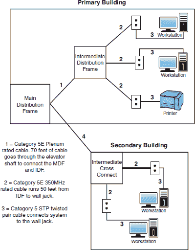

 **A.** 1 号线不需要腔板级。

 **B.** 2 号线应该是 STP 电缆。

 **C.** 3 号线应该是 STP 电缆。

 **D.** 无需。网络看起来良好。

**3.** Hollis 抱怨她办公室的网络布线已经过时，应该更换。她应该做什么来评估并可能更换布线？

 **A.** 告诉她的主管 IT 部门需要跟上进度。

 **B.** 告诉你的主管 IT 部门需要跟上进度。

 **C.** 在当地电子产品商店购买新布线。

 **D.** 完成一份变更请求。

### 突击测验答案

**1. B.** 在这种情况下，一段水平电缆穿过天花板并经过荧光灯。这段电缆布线可能会产生问题，因为此类设备会导致电磁干扰（EMI）。或者，在这种情况下使用腔板电缆。使用 STP 电缆可能同样奏效。

**2. B.** 在此图中，1 号线是腔板级的，没问题。3 号线是跳线，不需要 STP 级。然而，2 号线穿过墙壁和天花板。因此，建议使用比普通 UTP 等更好的电缆。STP 提供了更强的抗 EMI 能力。

**3. D.** 应该记录并跟踪正式的变更请求，以验证要做什么以及已经做了什么。变更请求的范围内应包含使用的配置程序、回滚流程、识别出的潜在影响以及需要通知的名单。

## 业务连续性与灾难恢复

 **对比业务连续性与灾难恢复的概念。**

 **识别策略和最佳实践。**

### 突击节省 (CramSaver)

如果你在阅读本节之前能够正确回答这些问题，可以通过快速浏览本节中的“考试提示”，然后完成本节末的突击测验来节省时间。

**1.** 增量备份和差异备份有什么区别？


## 2. 热备、温备和冷备站的用途是什么？

### 3. 选择对或错

可接受使用策略定义了实施和维护系统、用户和网络安全所需的控制措施。

### 答案

#### 1. 增量备份与差异备份

在增量备份中，自上次全备或增量备份以来更改的所有数据都会被备份。恢复过程需要多次备份迭代：最近的全备所使用的介质，以及自上次全备以来用于所有增量备份的介质。增量备份使用归档位（`archive bit`），并在文件保存到磁盘后将其清除。

在差异备份中，自上次全备以来更改的所有数据都会被备份。恢复过程需要最近的全备介质和最近的差异备份介质。差异备份使用归档位来确定哪些文件必须被备份，但不会将其清除。

#### 2. 热备、温备和冷备站的用途

热备地、温温备地和冷备地的设计目的是在发生灾难时为网络操作提供备用位置。

#### 3. 可接受使用策略

错误。安全策略定义了实施和维护系统、用户和网络安全所需的控制措施。`可接受使用策略 (AUPs)` 描述了组织内的员工如何使用公司的系统和资源，包括软件和硬件。

即使是具有最强容错能力的网络也可能故障，这是一个不幸的事实。当这些昂贵且精心实施的容错策略失效时，你只能依靠灾难恢复了。

灾难恢复有许多形式。除了火灾、洪水和盗窃等灾难外，许多其他潜在的业务中断也属于灾难恢复的范畴。例如，你所在街区的供电故障可能会中断业务功能。此类事件本身并非灾难，但可能会触发灾难恢复方法。

每个灾难恢复策略的核心是数据的保护和可恢复性。在谈到保护和可恢复性时，必须提到备份。实施定期的备份计划可以在容错失效或当你需要恢复被意外删除的文件时，为你避免很多麻烦。在设计备份计划时，可以使用三种关键类型的备份：全备、差异备份和增量备份。

## 备份

### 全备

首选的备份方法是`full backup`方法，它将所有文件和目录从硬盘复制到备份介质上。执行全备并不总是可能的，有几个原因。其中首要原因可能是执行全备所需的时间。

> **考试警示**
>
> 在恢复操作期间，在本文讨论的所有方法中，全备是恢复数据最快的方法，因为完全恢复只需要一组介质。

然而，取决于要备份的数据量，全备在备份时可能花费极长的时间，并消耗大量的系统资源。根据备份硬件的配置，这可能会显著减慢网络速度。此外，某些环境的数据量超过了单个介质的容纳能力。这使得执行全备变得很麻烦，因为可能需要有人在现场更换介质。

全备的主要优势是单组介质包含了你恢复所需的所有数据。如果发生故障，这组单一介质就是找回所有数据和系统信息所需的全部内容。这一切的结果是，网络中断的风险被大大降低。

遗憾的是，它的优势也可能是它的弱点。存储组织数据的单一介质可能存在安全风险。如果介质落入别有用之手，所有数据都可以在另一台计算机上恢复。对备份使用密码并使用安全的离线和现场位置可以最大限度地降低安全风险。

### 差异备份

没有足够时间每天完成全备的公司可以使用`differential backup`。差异备份比全备快，因为它们只备份自上次全备以来更改的数据。这意味着如果你在周六进行全备，在下周三进行差异备份，那么只会备份自周六以来更改的数据。恢复差异备份需要最近的全备和最近的差异备份。

差异备份知道哪些文件自上次全备以来发生了更改，因为它们使用了一种名为`archive bit`（归档位）的设置。`archive bit`标记已更改或已创建的文件，并将它们识别为需要备份的文件。全备不关心`archive bit`，因为无论日期如何，所有文件都会被备份。然而，全备在数据备份后会清除`archive bit`以避免以后混淆。差异备份留意`archive bit`并利用它来确定哪些文件发生了更改。差异备份不会重置归档位信息。

### 增量备份

某些公司分配给备份程序的时间是的。此类组织可能在备份策略中使用`incremental backups`。增量备份只保存自上次全备或增量备份以来更改的文件。与差异备份类似，增量备份使用`archive bit`来确定自上次全备或增量备份以来哪些文件发生了更改。但不同的是，增量备份会清除`archive bit`，因此未更改的文件不会被备份。

> **考试警示**
>
> 全备和增量备份在文件备份后都会清除`archive bit`。

增量备份更快的备份速度是有代价的——恢复所需的时间。使用增量备份从故障需要大量的介质——所有的增量备份介质组和一组最近的全备介质。例如，如果你有周日的全备以及周一、周二和周三的增量备份，你需要四组介质来恢复数据。循环中的每一组都是恢复过程中的额外步骤，也是一个额外的故障点。一组损坏的增量备份介质意味着你无法恢复数据。`Table 9.2`总结了各种备份策略。

#### 表 9.2 备份策略

| 备份类型 | 优势 | 缺点 | 备份的数据 | 归档位 |
| :--- | :--- | :--- | :--- | :--- |
| 全备 | 在单组介质上备份所有数据。恢复数据所需的介质最少。 | 取决于数据量，全备可能花费很长时间。 | 备份所有文件和目录。 | 不使用归档位，但在数据备份后重置它。 |
| 差异备份 | 备份比全备快。 | 恢复过程比仅全备耗长。使用的介质组比全备多。 | 备份自上次全备以来更改的所有文件和目录。 | 使用归档位来确定更改的文件，但不重置归档位。 |
| 增量备份 | 备份时间更短。 | 需要多个磁盘；恢复数据比其他备份方法花费更多时间。 | 备份自上次全备或增量备份以来更改的文件和目录。 | 使用归档位来确定更改的文件，并重置归档位。 |

> **考试警示**
>
> 在参加 Network+ 考试之前复习`Table 9.2`。

### 快照

除了之前讨论的三种备份类型外，还有`snapshots`（快照）。备份可能需要很长时间才能完成，而快照——系统在特定时间点的状态镜像——的优势在于它是系统的即时副本。这通常通过拆分镜像磁盘组或在写入磁盘块时创建其副本来实现，以保留原始数据并保持其可用。

快照在虚拟机实现中非常流行。你可以根据需要创建任意数量快照（只要你有足够的存储空间），以便将机器恢复到“已保存”的状态。快照包含了虚拟机设置（硬件配置）、所有连接的虚拟磁盘信息以及快照时机器的内存状态。这使得快照对于虚拟机克隆变得额外有用，允许机器进行一次或多次复制以供测试。

> **考试警示**
>
> 将快照想象成一张照片（这也是该名称的由来），它是任何系统在某一时刻的影像。

## 备份最佳实践

一个备份策略的成功涉及许多细节。以下是作为备份计划的一部分需要考虑的问题：

- **异地存储：** 考虑将备份介质存储在异地，这样如果建筑发生灾难，异地会有一份最新的介质可用。异地介质应该与现场介质一样新，并且必须是安全的。
- **标记介质：** 目标是尽可能地恢复数据。如果介质没有标记，尝试寻找所需的介质可能会变得非常困难。此外，这可以防止你覆盖掉需要保留的内容。
- **验证备份：** 永远不要假设备份已经成功。经验丰富的管理员知道，检查备份日志和定期执行测试恢复是备份过程的一部分。
- **清理：** 你需要定期清理备份驱动器。如果内部变脏了，备份可能会失败。

> **考试警示**
>
> 备份策略必须包含异地存储，以防范盗窃、火灾、洪水或其他灾难。

## 使用不间断电源

如果不对电源相关问题以及用于应对这些问题的机制进行探讨，那么任何关于容错的讨论都是不完整的。当你设计一个容错系统时，你的计划绝对应该包括`uninterruptible power supplies (UPSs)`。UPS 具有多种功能，是服务器考虑和实施的重要组成部分。

从基础层面来说，UPS 也称为`battery backup`（电池备电源），是一个装有电池和内置充电电路的盒子。在电源正常时，电池会充电；当需要 UPS 时，它已准备好为服务器提供电源。通常情况下，需要 UPS 提供足够的电力，让管理员有时间按顺序关闭服务器，以防止因异常关机导致任何潜在的数据丢失。

### 为什么要使用 UPS？

各种规模和种类的组织都需要 UPS 作为其容错策略的一部分。UPS 与任何其他容错措施一样重要。三个关键原因使得 UPS 有必要性：

- **数据可用性：** 任何容错措施的目标都是数据可用性。UPS 确保在发生停电时可以访问服务器——至少在保存文件所需的时间内可以保持访问。
- **防止数据丢失：** 电源波动或突然断电可能会损坏服务器系统上的数据。此外，许多服务器充分利用缓存，突然断电会导致缓存中持有的所有信息丢失。
- **防止硬件损坏：** 持续的电源波动或突然断电可能会损坏计算机内部的硬件组件。硬件受损会导致在维修期间数据可用性降低。

### 电源威胁

除了让服务器运行足够长的时间以安全关机外，UPS 还能保护服务器免受不稳定电源的影响。这种不稳定的电源可以有多种形式。UPS 保护系统免受以下电源相关威胁：

- **停电 (Blackout)：** 给服务器的电源完全故障。
- **尖峰 (Spike)：** 短时间（通常小于 1 秒）但剧烈的电压增加。尖峰会对任何设备（尤其是计算机）造成不可修复的损坏。
- **浪涌 (Surge)：** 与尖峰相比，浪涌是持续较长（有时达几秒）但通常强度较小的功率增加。浪涌也会损坏你的计算机设备。
- **跌落 (Sag)：** 短期电压下降（尖峰的相反）。这种类型的电压下降会导致服务器重启。
- **断压 (Brownout)：** 通常持续几分钟的电压下降。

许多此类电源相关威胁可以在你不知情的情况下发生；如果你没有 UPS，你就无法为它们做好准备。考虑到成本，购买 UPS 是值得的，即使其他理由仅仅是为了晚上能睡得更踏实。

## UPS 的替代方案

电源管理不仅限于使用 UPS。除了这些设备，你还应该使用`power generators`（发电机），以便在电力供应商长时间停电时能够保持你的系统运行。关键设备还应使用`Redundant circuits`（冗余电路）和`dual power supplies`（双电源）。

## 热备、温备和冷备

灾难恢复计划可能包括一个可以快速投入使用的恢复站点。这些站点分为三类：热备、温备和冷备。每种类型站点的需求很大程度上取决于你所处的业务以及可用资金。灾难恢复站点代表了此类组织的终极预防措施。因此，它们并不便宜。

灾难恢复站点的基本概念是它可以提供一个基础，使公司在灾难期间运行。灾难恢复站点通常不是为每位员工提供办公桌。它的更多目的是让关键人员继续执行核心业务功能。

通常，冷备站点是一个可以在短时间内（如一天或两天）内启动并运行的站点。电话线和电力等服务已妥当，基本的办公家具可能已经到位。但不太可能有任何计算机设备，尽管该建筑可能拥有网络基础设施并有一个准备好作为服务器房的房间。在大多数情况下，冷备提供物理位置和基本服务。

如果你对潜在问题有一些预警，冷备就是很有用的。通常，冷备供那些在恢复之前可以支撑一两天风的组织使用。如果你是某家大公司的分公司，可能由其他部门在你准备好之前处理业务。但如果你是公司中唯一的办公室，你可能需要稍微“热”一点的东西。

对于有资金也有意向组织，热备站点（`hot recovery sites`）代表了容错策略的终极。与冷备站点一样，热备站点旨在仅提供足够继续核心业务功能的设施，但热备站点的设置是为了随时待命。

### 热备地 (Hot Recovery Site)

热备地包含连接电话线的电话系统。数据网络也已就绪，所有必要的路由器和交换机已插入并开启。办公桌上安装了待命的台式电脑，服务器区域配备了支持业务关键功能所需的各种硬件。换句话之，在几小时内，热备地就可以成为组织中完全运作的要素。

潜在热备地用户面临的问题是成本。即使在最好的情况下，办公室空间也是昂贵的，但在 99.9% 的时间里让空间闲置，似乎是极大的金钱浪费。解决这一问题的一种流行策略是使用灾难恢复中心提供的空间，该中心基本上是由第三方公司维护的建筑，各种企业在此租赁空间。空间通常根据每家公司的付费金额进行分配。

### 温备地 (Warm Site)

温备地位于热备地和冷备地之间。温备地通常拥有计算机，但尚未配置好就绪状态。这意味着在网络再次运行之前，可能需要升级数据，或者可能需要进行其他手动干预。启动温备地所需的时间恰处于另外两种选择的中间，成本也是如此。

#### 考试技巧 (ExamAlert)

热备地镜像了组织的生产网络，可以随时接管网络运行。温备地拥有将网络带入运行所需的设备，但需要配置和潜在的数据库更新。冷备地提供可用空间和基础服务，但通常需要交付设备。

## 高可用性与恢复概念

当事件发生时，再去考虑策略和程序就太晚了；这些必须在很久做好。`业务连续性（Business continuity）`始终应该是首要关注的问题。业务连续性主要关注组织遵循的流程、策略和方法，以最小化减少系统故障、网络故障或运行所需的任何关键组件故障的影响。

`业务连续性计划（BCP）`是实施策略、控制和程序以应对关键业务流程损失、中断或故障影响的过程。BCP 认为是一种管理工具，用于确保在正常业务运行受到中断时，`关键业务功能（CBFs）`能够执行。

关键业务功能是指发生故障时必须立即恢复运行的流程或系统。没有它们，业务将无法运行，而且许多功能是信息密集型的，需要同时访问技术和数据。

在评估业务的可持续性时，要意识到灾难确实会发生。如果可能，请构建不具有`单点故障（SPOF）`或连接的基础。如果你是小型公司的管理员，SPOF 是路由器/网关的情况并不常见，但你必须识别所有`关键节点`和`关键资产`。从环境中消除单点故障的最好方法是添加冗余。

请记住，每台设备都可以根据平均故障间隔时间（MTBF）和平均恢复时间（MTTR）进行评估。MTBF 是系统或组件在固有故障之间预期或预测的故障发生频率衡量，而 MTTR 是衡量故障发生后修复系统或组件所需的时间。

以下是可以帮助提高可用性的技术：

 `容错（Fault tolerance）`是在不丢失数据的情况下故障（故障）的能力。这可以通过使用`RAID`、备份和类似技术来实现。流行的容错`RAID`实现包括`RAID 1`、`RAID 5`和`RAID 10`。

 `负载均衡（Load balancing）`是一种将工作负载分布在多个服务器之间的技术。这一功能可以将网络提升到新的水平；它提高了网络性能、可靠性和可用性。负载均衡器可以是硬件设备，也可以是专门用于平衡负载的软件。

#### 考试技巧 (ExamAlert)

记住，负载均衡增加了冗余，从而提高了数据可用性。此外，负载均衡通过分配工作负载提高了性能。

 `网卡聚合（NIC teaming）`是出于性能和冗余（容错）原因组合多个网卡的过程。这也可以称为绑定（bonding）、平衡（balancing）或聚合（aggregation）。

 `端口聚合（Port aggregation）`是交换机上多个端口的组合；可以通过三种方式之一：自动（auto）、期望（desirable）或开启（on）。

 `聚类（Clustering）`是一种平衡负载和提供容错的方法。

使用`漏洞扫描`和`渗透测试`在他人之前发现系统中的弱点。确保在识别问题时，`终端用户意识和培训`是优先事项，并强调`对标准和策略的遵守`。这些策略应包括以下内容：

 `标准业务文档`：其中许多内容在之前的章节中讨论过，但它们包括`服务级别协议（SLAs）`、`谅解备录（MOUs）`、`主许可协议（MLAs）`和`工作说明书（SOWs）`。`SLA`特是你或你的公司与服务供应商（通常是技术支持）之间的协议。`SLAs`通常也是网络可用性和其他协议的一部分。它们通过概述供应商同意满足的预期，规定了你可以预期或要求的性能。它们定义了什么是可以交付的并提供合同以确保承诺的内容得以实现。

等等，原文有一个跳转，重新阅读：……策略（也称为`使用策略`）应该解决在公司电脑上安装个人软件以及使用个人硬件（如 USB 设备）。

 `网络策略`：与 AUPs 类似，这些策略描述了网络资源的可用用途。

 `安全策略`：`安全策略`定义了实施和维护系统、用户和网络安全所需的控制措施。该策略应作为系统实施和评估的指南。特别值得注意的是`监控同意策略`，员工和其他网络用户在其中承认他们知道正在被监控并表示同意。

 `BYOD 策略`：`自带设备（BYOD）`策略定义了员工允许带到工作场所并使用的个人移动设备（笔记本电脑、平板电脑和智能手机）。`移动设备管理（MDM）`和`移动应用程序管理（MAM）`系统可以帮助企业管理和保护在工作场所使用这些移动设备。

#### 考试技巧 (ExamAlert)

在准备考试时，需要关注的三个主题是对标准和策略的遵守、漏洞扫描和渗透测试。

所有这些策略都很重要，但与应急响应人员有关且处理数据泄露的策略具有优先级。

## 强化测验 (Cram Quiz)

### 1. 归档位

哪两种备份方法在备份完成后会清除归档位？（选择两个。）

 **A.** 全量

 **B.** 差异

 **C.** 增量

 **D.** GFS

### 2. 恢复备份所需的介质

你在周四早上来上班时发现服务器故障了，你需要从备份中恢复数据。你在周日完成了全量备份，并在周一、周二和周三完成了增量备份。恢复备份需要多少个介质 set？

 **A.** 四个

 **B.** 两个

 **C.** 三个

 **D.** 五

### 3. 恢复站点

下哪种恢复站点可能需要交付计算机设备并更新所有网络数据？

 **A.** 冷备地 (Cold site)

 **B.** 温备地 (Warm site)

 **C.** 热备地 (Hot site)

 **D.** 以上都不是

### 4. 备份介质的存储位置

作为网络管理职责的一部分，你已经完成了月度备份。根据备份的最佳实践，介质应该存储在何处？

 **A.** 服务器机房内的安全位置

 **B.** 建筑内某处的安全位置


 **C.** 离外场地  
 **D.** 安全的离外地点

### 5. 作为网络管理员，你被赋予了为网络设计灾难恢复计划的任务。以下哪些可能包含在灾难恢复计划中？

 **A.** RAID 5  
 **B.** 离外介质存储  
 **C.** 镜像磁盘  
 **D.** UPS（不间断电源）

### 6. 哪种类型的恢复站点镜像组织的生产网络，并能够随时承担网络运营？

 **A.** 温备地 (Warm site)  
 **B.** 热备地 (Hot site)  
 **C.** 冷备地 (Cold site)  
 **D.** 镜像站点 (Mirrored site)

### 7. 下列哪些用于在他人发现之前寻找系统弱点？（选择两项）

 **A.** 数据泄露者 (Data breachers)  
 **B.** 漏洞扫描器 (Vulnerability scanners)  
 **C.** 渗透测试员 (Penetration testers)  
 **D.** 第一响应人员 (First responders)

### 8. 下列哪项属于员工和其他网络用户同意被监控的策略？

 **A.** 同意监控 (Consent to monitoring)  
 **B.** 可接受使用 (Acceptable use)  
 **C.** 备忘录 (Memorandum of Understanding)  
 **D.** 服务水平协议 (Service-Level Agreement)

## 强化测验答案

**1. A, C.** 归档位在全量备份和增量备份后会被重置。答案 B 错误，因为差异备份不会重置归档位。答案 D 错误，因为 GFS 是一种轮策略，而不是备份方法。

**2. A.** 增量备份保存自上次全量或增量备份以来更改的所有文件和目录。要恢复，你需要最新的全量备份和所有的增量介质 set。在这种情况下，你需要四个介质来完成恢复过程。

**3. A.** 冷备地提供了一个替代位置，但通常没有更多。冷备地通常需要交付计算机设备和其他服务。热备地在发生大规模故障时所有网络设备都已就绪。温备地准备了大部分设备，但仍需要几天或几周才能让网络运行。

**4. D.** 虽然不总是这样做，但将备份存储在安全的离外地点是最佳实践，以防火灾或盗窃。答案 A 错误，如果服务器机房受火灾或洪水损坏，备份和服务器上的数据可能会受到同一灾害的影响。同样，答案 B 错误，因为将备份存储在现场不能消除单一灾害摧毁服务器和备份数据的威胁。答案 C 错误，出于安全原因。离外介质 set 必须是安全的。

**5. B.** 离外存储是灾难恢复计划的一部分。其他答案被认为是容错措施，因为它们是为了确保数据可用性而实施的。

**6. B.** 热备地镜像组织的生产网络，并可以随时承担网络运营。答案 A 错误，因为温备地具有使网络处于运行所需的设备，但需要配置和潜在的数据库更新。答案 C 错误，因为冷备地提供可用空间和服务基础，但通常需要交付设备。答案 D 错误，因为镜像站点不是一个有效选项。

**7. B, C.** 使用漏洞扫描和渗透测试在他人发现之前寻找系统弱点。答案 A 错误，因为数据泄露是无效的。答案 D 错误，因为第一响应人员通常是事故发生后第一个到达现场的人。

**8. A.** 同意监控策略是指员工和其他网络用户承认他们知道正在被监控并同意的策略。答案 B 错误，因为可接受使用策略描述了组织中的员工如何使用公司系统和资源。答案 C 和 D 错误，因为备忘录和服务水平协议是标准的业务文档。

### 监控网络性能

 **解释常见的扫描、监控和补丁过程，并总结它们的预期输出。**

#### 快速救星

如果你在阅读本节之前正确回答了这些问题，可以通过快速浏览本节中的考试提醒（Exam Alerts），然后完成本节末的强化测验来节省时间。

**1.** 用什么可以捕获网络数据？

**2.** 正或错：端口扫描器可以检测开放且通常不安全的端口。

**3.** 正或错：接口监控工具可用于创建“热力图”，显示区域内无线网络覆盖的数量和质量。

**4.** 正或错：在向生产机器部署更新之前，务必在实验室机器上测试更新。

**5.** 当你将系统回滚到驱动程序或固件的之前的版本时，这被称为什么？

#### 答案

**1.** 封包嗅探器可以被管理员和黑客用于捕获网络数据。

**2.** 对。端口扫描器可以检测开放且通常不安全的端口。

**3.** 错。无线调查工具可用于创建热力图，显示区域内无线网络覆盖的数量和质量。

**4.** 对。在向生产机器部署更新之前，务必在实验室机器上测试更新。

**5.** 这被称为 `downgrading`（降级），在处理旧留系统和实现时通常是必要的。

当网络规模较小，且极少跨越单个地点的限制范围时，网络管理是一项简单的任务。然而，在当今复杂的多站点、混合网络中，维护和监控网络设备及服务器已成为网络管理员角色中复杂但不可或缺的一部分。如今，网络管理员的角色往往超出了服务器房的物理边界，延伸到网络上的每个节点和组件。无论一个组织在单段内有 10 台电脑，还是一个连接了数千台设备的多站点网络，网络管理员都必须监控所有网络设备、协议和使用情况——最好是从中心位置进行。

鉴于任何网络上可能的设备、软件和系统的数量之多且种类之杂，不难为什么网络管理是一个如此重要的考虑因素。尽管健壮的网络管理策略可以提高管理员的效率并减少停机时间，但许多公司因为设置系统所需的时间或相关成本而选择忽视网络管理。如果这些公司理解潜在的节约，它们就会意识到忽视网络管理提供的是虚假的经济。

网络管理和网络监控本质上是控制、配置和监控网络上设备的方法。想象这样一个场景：你是一个在位于华盛顿州斯波卡（Spokane）主办公室工作的网络管理员，并且你在纽约、达拉斯、温哥华和伦敦有卫星办公室。网络管理允许你访问远程地点的系统，或者在系统出现问题时让系统通知你。本质上，网络管理关乎超越你当前的边界并根据你看到的内容采取行动。

网络管理并不是某项事物。相反，它是工具、系统和协议的集合，当这些工具一起使用时，能够让你执行诸如重新配置隔壁房间的网卡或在另一个州安装应用程序等任务。

## 监控网络的常见原因

不同组织对网络管理能力的要求有所不同，但本质上，需要几种关键类型的信息和功能，例如故障检测和性能监控。网络管理工具可以提供的信息和功能类型包括：

 **利用率：** 曾几何时，网络因资源匮乏而勉强维持并不稀奇。管理员必须不断修剪日志并归档文件，以留出足够的存储空间处理打印作业。那些日子已经过去了，在今天，任何此类状况的迹象都是不可接受的。为了防止这种情况发生，关键之一是管理利用率，并在问题升级之前掌握先机。需要监控的五个利用率领域如下：

 **带宽/吞吐量：** 必须有足够的带宽来为所有用户服务，你需要对带宽占用者保持警惕。你需要寻找“大流量用户”（传输数据最多的）和“大接收者”（接收数据最多的），并找出它们为什么如此受欢迎。

 **存储空间：** 需要为所有用户留出可用空间，并可能需要实施配额。

 **网络设备 CPU：** 就像本地机器在处理器达到极限时会变慢一样，网络也是如此。

 **网络设备内存：** 内存并不是越多越好。平衡负载以优化你拥有的资源。

 **无线信道利用率：** 无线领域的信道利用率类似于带宽利用率。根据规律，当信道利用率达到信道容量的 50% 时，无线网络开始出现性能问题。

 **故障检测：** 网络管理最重要的方面之一是知道是否有任何东西未正常工作或运行异常。网络管理工具可以检测并报告网络上的各种故障。鉴于构成典型网络的可能设备数量之多，如果没有这些工具，确定故障可能是一个无法完成的任务。此外，网络管理工具不仅可以检测到故障设备，还可以将其关闭。这意味着如果网卡发生故障，你可以远程禁用它。当网络跨越很大区域时，故障检测变得更加价值连城，因为它能让你收到网络故障警报并对其进行管理，从而减少停机时间。

### ExamAlert

大部分讨论都涉及你收到某些状况的警报。这些警报通常可以通过电子邮件或短信发送到任何移动设备。

 **性能监控：** 网络管理的另一个功能是监控网络性能的能力。性能监控是一个重要的考虑因素，能为你提供一些关键信息。具体来说，性能监控可以提供网络使用统计和用户使用趋势。当你规划网络容量和增长时，这类信息至关重要。监控性能还有帮助你判断是否存在与性能相关的问题，例如网络是否能够充分支持当前的用户群。

 **安全监控：** 优秀的服务器管理员性格中往往生带有一点偏执症。网络管理系统允许你监控谁在网络上、他们在做什么以及他们持续了多久。更重要的是，在公司网络日益暴露在外部源的环境中，识别并响应潜在安全威胁的能力是优先事项。通过读取日志文件来了解攻击是非常次要的，不如知道攻击正在进行并能够做出相应反应。`安全信息和事件管理 (SIEM)` 产品提供对安全警报的通知和实时分析，可以帮助你快速解决问题。

 **链路状态：** 你应该定期监控链路状态，以确保连接已开启并正常运行。应该尽快发现并识别中断，以便进行修复或寻找通变方案。许多链路状态监控器用于监控连通性，许多监控器在发生故障状态时可以（根据配置的脚本文件）重新路由。

 **接口监控：** 就像你想监控链路断开一样，你也需要知道接口何时出现问题。需要关注的具体问题包括错误、利用率问题（例如异常高）、丢弃、数据包丢失、重置以及速度/双工问题。`interface monitoring tool` 在此处排排除故障时价值连城。

 **维护与配置：** 想要重新配置或关闭位于澳大利亚的服务器吗？重新配置本地路由器？更改客户端系统的设置？远程管理和配置是网络管理策略的关键部分，允许你中心化管理巨大的多站点。

 **环境监控：** 监控服务器房和其他关键设备的温度和湿度状况是非常重要的。湿度控制可以防止静电积聚，当湿度远低于 50% 时，电子元件极易受到静电击穿损坏。`Environmental monitoring tools` 可以对此处发生的任何危险发出警报。

 **电源监控：** 网络的持续运行需要可靠的能量流。市上有许多 `power monitoring tools` 可以帮助识别并记录问题，然后你就可以开始解决这些问题。

 **无线监控：** 随着越来越多的网络转向无线化，你需要特别关注与它们相关的问题。`Wireless survey tools` 可用于创建热图，显示区域内无线网络覆盖的数量和质量。它们还允许你查看访问点（包括非规访问点）和安全设置。这些工具可以帮助你设计和部署高效网络，也可以供（你或他人）使用以发现现有网络中的漏洞（这类工具通常被营销为 `wireless analyzers`）。

有很多工具可以帮助监控网络并确保其正常运行。某些工具（如数据包嗅探器）可以被管理员或想要获取不属于他们数据的人士用于监控流量。接下来的几节将介绍几种监控工具。

### SNMP 监控器

SNMP 管理系统是一台运行名为 `network management system (NMS)` 特殊软件的计算机。这些软件应用程序可能是免费的，也可能花费数千美元。免费应用程序与昂贵软件之间的区别通常在于功能和支持。所有 NMS 应用程序无论价格如何，都提供相同的基础功能。今天，大多数 NMS 应用程序使用网络图形地图来定位设备并对其进行查询。查询内置在应用程序中，通过指向和点击来触发。你实际上可以从命令行工具发出 SNMP 请求，但由于有这么多可用工具，这是没有必要的。

### 注意

一些人将 SNMP 管理器或 NMS 称为 `trap managers`。然而，这种表法具有误导性，因为 NMS 的功能不仅仅是接受代理发送的 trap 消息。

使用 SNMP 和 NMS，你可以从单一位置监控网络上的所有设备，包括交换机、集线器、路由器、服务器和打印机，以及任何支持 SNMP 的设备。通过 SNMP，你可以坐在圣何塞的办公桌前查看雅加达服务器的空磁盘空间大小，或重置赫尔辛基路由器的接口。然而，这种力量也带来了一些考虑因素。例如，由于 NMS 允许你重新配置网络设备，或至少从那里获取信息，因此通常做法是在安全的工作站平台（如 Linux 或 Windows 服务器）上实施 NMS，并将 NMS 电脑放置在安全位置。

#### 管理信息库 (MIB)

虽然 SNMP trap 系统可能是 SNMP 最常用的方面，但从管理器到代理的通信并不是单行道。除了使用 SNMP 命令 `Get` 和 `Get Next` 从设备中读取信息外，SNMP 管理器还可以颁发 `Set` 命令。如果你有一长串需要执行的 `Get Next` 命令，可以使用 `Walk` 命令自动遍历这些命令。该命令的目的是节省管理器的时间：你可以在子树的根节点上发出一个命令，该命令就会“行走”整个过程，获取子树中每个节点的值。

为了演示 SNMP 命令如何工作，想象你和你的朋友各有一份列表，上面写着以下四个单词：four（四）、book（书）、sky（天）和 table（桌）。如果你作为管理员向你的朋友索要第一个值，她作为代理可以回答“four”。这等比于一个 SNMP `Get` 命令。现在，如果你索要下一个值，她会回答“book”。这等比于一个 SNMP `Get Next` 命令。如果你接着说“set green”，你的朋友将单词 `book` 改为 `green`，你就执行了等同于 SNMP `Set` 命令的操作。听起来很简单？嗯，如果你能想象列表扩展到 100 个值，你就能看到如何仅使用这些命令就可以导航并设置列表中的任何参数。然而，关键是要确保你和朋友拥有相同的列表——这就是 `Management Information Bases (MIBs)` 的用处。

SNMP 使用称为 MIB 的信息数据库来定义哪些参数是可以访问的，哪些是只读的，哪些是可以设置。MIB 适用于数千种设备和服务，涵盖了各种可以想象到的需求。

为了确保 SNMP 系统提供跨平台兼容性，MIB 的创建由`国际标准化组织 (ISO)`控制。想要创建 MIB 的组织可以向 ISO 申请。ISO 然后为该组织分配一个 ID，其可以根据意愿创建 MIB。数字的分配在一个名为 `hierarchical name tree`（分层名称树）的概念模型中。

### 数据包嗅探器

数据包嗅探器通常用于网络，也被称为 `packet/network analyzers`。它们既是硬件设备也是软件，基本上是监听在整个网络中传输的传输，对于执行 `packet flow monitoring` 有帮助。数据包嗅探器静静地捕获数据并将其保存以备日后审查。数据包嗅探器也可用于互联网以捕获计算机之间传输的数据。互联网数据包通常有很长的传输路程，经过各种服务器、路由器和网关。沿路径的任何地方，数据包嗅探器都可以静静地停留并收集数据。鉴于数据包嗅探器停留并静默收集数据包的能力，很容易看出它们是如何被利用的。

你应该使用两种关键防御措施来防止数据包嗅探以保护你的网络：

 使用交换网络，现在的大多数网络都是如此。在交换网络中，数据从一个计算机系统发送，并仅由交换机定向到预定的目标位置。在使用传统集线器的旧式网络中，集线器不会将流量切换到隔离的用户，而是切换到所有连接到集线器端口的用户。这种散弹式的网络传输方法使得在网络上放置数据包嗅探器获取数据变得更容易。

 确保所有敏感数据在传输过程中经过加密。通常，当数据通过互联网等公共网络发送时使用加密，但对局域网上的敏感数据进行加密可能是必要的。加密可以通过多种方式实现。例如，到 Web 服务器的连接可以使用 `Secure Sockets Layer (SSL)` 协议和 HTTPS 进行。到邮件服务器的通信也可以使用 SSL 加密。对于公共网络，`IPsec` 协议可以提供端到端加密服务。

### 注意

第 10 章，“网络安全”提供了关于加密协议更多的信息。

### 吞吐量测试

在网络世界中，`throughput`（吞吐量）是指通过通道传输数据的速率。在这种情况下，吞吐量测试器测试网络传输数据的速率。吞吐量以 `bits per second (bps)` 计算。测试吞吐量对于管理员来说很重要，可以让他们确切知道网络状况。通过吞吐量测试，你可以判断高速网络运行是否接近其预期吞吐量。

吞吐量测试器设计用于快速收集有关网络功能的信息——特别是网络平均吞吐量。网上有很多基于软件的吞吐量测试器——有些免费，有些需要付费。图 9.5 显示了一个基于软件的吞吐量测试器。

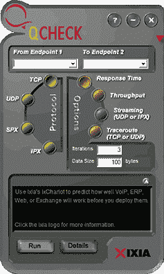

图 9.5 软件吞吐量测试器

如你所见，吞吐量测试器不需要复杂也能发挥作用。吞吐量测试器可以告诉你将数据发送到目的地并接收数据已收确认需要多长时间。要使用测试器，请输入起点，然后输入终点。测试器会向目的地发送预定数量的数据包，然后报告吞吐量水平。结果通常以`每秒千比特 (Kbps)`、`每秒兆比特 (Mbps)`或`每秒吉比特 (Gbps)`的形式显示。表 9.3 显示了各种数据速率单位。

### 表 9.3 数据速率单位

| 数据传输 | 缩写 | 速率 |
| :--- | :--- | :--- |


| 每秒千比特 | Kbps 或 Kbit/s | 每秒 1,000 比特 |

| 每秒兆比特 | Mbps 或 Mbit/s | 每秒 1,000,000 比特 |

| 每秒吉比特 | Gbps 或 Gbit/s | 每秒 1,000,000,000 比特 |

| 每秒千字节 | KBps | 每秒 1,000 字节，或每秒 8 千比特 |

| 每秒兆字节 | MBps | 每秒 1,000,000 字节，或每秒 8 兆比特 |

| 每秒吉字节 | GBps | 每秒 1,000,000,000 字节，或每秒 8 吉比特 |

管理员可以定期进行吞吐量测试并存档，以创建网络性能画像。如果你怀疑网络功能出现问题，可以运行测试并与过去的性能进行比较，以确定到底发生了什么。

一个值得提到的是吞吐量（throughput）和带宽（bandwidth）之间的区别。这两个术语经常交叉使用，但它们的含义不同。在谈论测量吞吐量时，你测量的是真实条件下的数据流量——测量时考虑了可能的电磁干扰（EMI）影响、高流量负载、不当的布线甚至网络冲突。考虑到所有这些因素并进行测量，你就得到了网络吞吐量。相比之下，带宽指的是理想条件下通过特定介质发送的最大信息量。

> **注意**：务必确保你了解吞吐量和带宽之间的区别。

## 端口扫描器

`port scanner`（端口扫描器）是一种用于探测主机（通常是服务器）开放端口的应用程序。管理员可以出于合法目的执行此操作——验证网络上的安全策略——或者攻击者借此寻找可利用的漏洞。第 11 章“网络故障排除”中详细讨论了端口扫描器。

## 漏洞扫描器

在漏洞测试中，你运行一个包含已知漏洞数据库的软件程序对系统进行扫描以识别缺陷。强烈建议你获取此类漏洞扫描器并在网络上运行，以检查任何已知的漏洞。在组织外部人员运行此类工具对你进行攻击之前，最好由你自己在自己的网络上先发现它们。

漏洞扫描器可能是端口扫描器（例如`Nmap`：[`nmap.org/`](https://nmap.org/)）、网络枚举器、Web 应用程序甚至是蠕虫，但在所有情况下，它都会针对目标一系列已知漏洞进行测试。

尽管`Nessus`和`Retina`是两个广知的漏洞扫描器，但`SAINT`和`OpenVAS`（最初基于`Nessus`）也被广泛使用。

**考试警报**：对于考试，CompTIA 要求你知道`Nessus`和`Nmap`是两种流行的漏洞扫描器。

## 网络性能、负载和压力测试

为了测试网络，管理员通常会执行三种不同的测试：

- 性能测试

- 负载测试

- 压力测试

这些测试名称有时互换使用。尽管存在交叉，但它们是不同类型的网络测试，每种测试都有不同的目标。

### 性能测试

`performance test`（性能测试）顾其名，是为了衡量网络当前的性能水平。目标是进行持续性能测试并对其进行评估和比较，寻找潜在的瓶颈。为了使性能测试有效，每次都需要在相同类型的网络负载下进行，否则比较是无效的。例如，凌晨 3 点进行的性能测试将与下午 3 点进行的测试不同。

> **注意**：性能测试的目标是为网络功能的比较建立基准。除非将性能测试结果与之前记录的性能水平进行比较，否则测试结果将毫无意义。

### 负载测试

负载测试与性能测试有一定的重叠。有时称为`volume`（容量测试）或`endurance testing`（耐久性测试），负载测试涉及人为让网络处于更大的工作负载下。例如，可能会增加整个网络的流量。完成后，可以在负载增加的网络上进行性能测试。进行负载测试有时是为了查看网络中是否存在目前不可见但可能随着网络增长而变成问题的错误。例如，邮件服务器在当前需求下可能运行良好。然而，如果网络中的用户数增加 10%，你想要确定增加的负载是否会导致邮件服务器出现问题。负载测试的核心是在问题发生前发现潜在问题。

性能测试和负载测试实际上非常相似；但信息输出的结果不同。性能测试是为了测量和基准测试之目的识别当前的网络功能水平。负载测试旨在让管理员预判未来的负载，并查看当前基础设施是否能够应对。

> **注意**：性能测试关于现在。负载测试关注未来，性能是否会受到增长或其他变化的阻碍。

### 压力测试

负载测试并不试图在极端压力下破坏系统，而压力测试有时会这样做。它们将资源推向极限。虽然这些测试并不经常进行，但它们是必要的，而且至少对管理员来说是有趣的。压力测试有两个明确的目标：

- 它准确显示了网络可以承受的内容。在考虑网络扩展时，了解网络的节点是非常有用的信息。

- 它允许管理员测试备份和恢复程序。如果测试导致网络资源崩溃，管理员可以验证他们的恢复程序是否有效。压力测试假设有一天会出问题，管理员在问题发生时确切知道做什么。

### 性能指标

无论进行的测试是性能、负载还是压力，你必须选择想要监控和关注的指标。虽然有很多可用选项，但最常用的四个如下：

- `错误率`：识别错误的频率。

- `利用率`：显示资源的利用百分比。

- `丢包`：网络中未能到达目的地的数据包。

- `带宽/吞吐量`：通过通道传输数据的相对于系统识别瓶颈、拥塞和其他问题的能力。

## 跟踪事件日志

在网络环境中，所有的操作系统以及大多数防火墙、代理服务器和其他网络组件都有日志记录功能。这些日志功能对于网络管理员审查和监控至关重要。可以使用许多类型的日志。以下章节回顾了最常见的日志文件类型。

在 Windows Server 系统上，与其他操作系统一样，事件和发生的情况会被记录在文件中以便日后审查。Windows Server 和桌面系统使用`Event Viewer`（事件查看器）来查看许多关键日志文件。`Event Viewer`中的日志可用于查找信息，例如系统错误或安全事件。信息被记录在关键日志文件中；但在某些情况下，你也会看到额外的日志文件，例如当系统是域控制器或正在运行 DHCP 服务器应用程序时。

事件日志（Event logs）泛指所有用于跟踪系统事件的日志文件。事件日志对于发现入侵和诊断当前系统问题至关重要。例如，在 Windows 环境中，主要使用了三类事件日志：安全（Security）、应用程序（Application）和系统（System）。

> **注意**：请确保你了解各种类型日志文件中所包含的信息类型。

### 安全日志

系统的`Security`（安全）日志包含与安全事件相关的事件，例如成功和失败的登录尝试以及失败的资源访问。安全日志可以自定义，这意味着管理员可以精确地微调他们想要监控的内容。某些管理员选择跟踪系统上的几乎每一个安全事件。虽然这可能是审慎的，但它往往会创建占用过多空间的巨大日志文件。图 9.6 显示了 Windows 系统的安全日志。

```
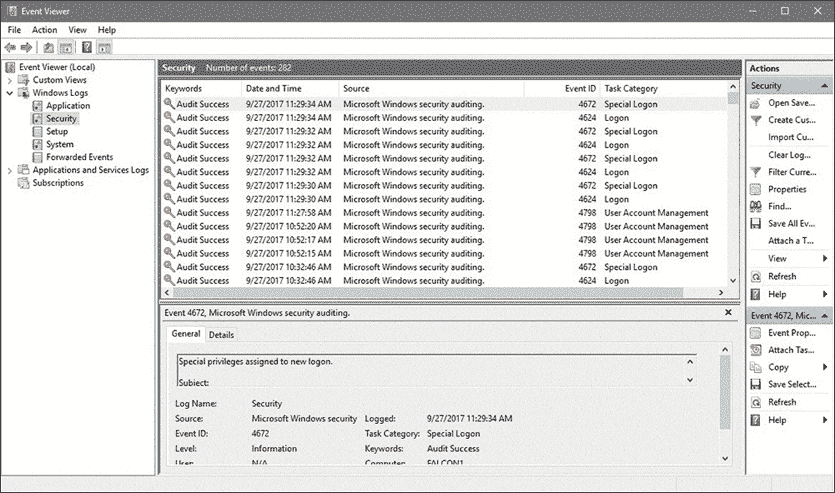
```

图 9.6 Windows 10 的 Windows 安全日志

图 9.6 显示已发生了一些成功登录和账户更改。潜在的安全漏洞将显示某些登录或注销尝试的审核失败。为了节省空间并防止日志文件过大，管理员可能会选择只审核失败的登录尝试而不审核成功的尝试。

安全日志中的每个事件都包含额外信息，以便获取事件的详细信息：

**日期：** 安全事件发生的确切日期。

**时间：** 事件发生的时间。

**用户：** 事件期间跟踪的用户帐户名称。

**计算机：** 事件发生时使用的计算机名称。

**事件 ID：** 事件 ID 告诉你发生了什么事件。你可以使用此 ID 获取有关该特定事件的额外信息。例如，你可以获取 ID 号，在微软支持网站上输入，并收集有关该事件的信息。如果没有 ID，将很难找到这些信息。

为了确保有效性，应定期审查安全日志。

### 应用程序日志

此日志包含运行在特定系统上的应用程序所记录的信息，而不是操作系统本身记录的信息。第三方应用程序的供应商可以使用应用程序日志作为其应用程序生成的错误消息的终点。

应用程序日志的工作方式与安全日志类似。它跟踪应用程序内部的成功事件和失败事件。图 9.7 显示了应用程序日志中提供的详细信息。

```
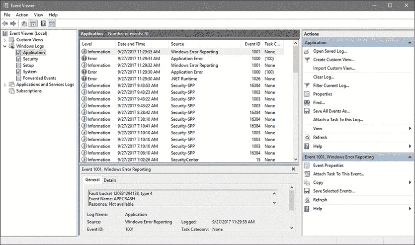
```

图 9.7 Windows 10 中的应用程序日志

图 9.7 显示发生了三类型的事件：常规应用程序信息事件、警告事件和错误事件。警觉的管理员可能想要检查事件失败和警告失败的事件 ID，以隔离原因。

### 系统日志

系统日志记录有关系统中的组件或驱动程序的信息，如图 9.8 所示。当你排除系统上硬件设备的问题或网络连接问题时，应该查看此处。例如，与`动态主机配置协议 (DHCP)`客户端元素相关的消息出现在此日志中。系统日志也是查看设备错误、时间同步问题或服务启动问题的地方。

```

```

图 9.8 Windows 10 中的系统日志

### Syslog

除了之前提到的特定日志外，大多数 UNIX/Linux 系统都包含通过`syslog`将消息（直接写入或通过应用程序）写入日志文件的功能。这可能是出于安全或管理考虑，并提供了一种中央手段，使得其他无法写入中央存储的设备可以轻松地这样做（通常通过使用`logger`工具）。

### 历史日志

历史日志通常与跟踪网络浏览习惯有关。它们维护了用户访问的所有网站的记录。网络管理员可能会查看这些日志以发现潜在的安全或策略违规，但通常这些日志并不经常查看。

历史日志的另一种形式是其他日志文件的事件编译。例如，一个历史日志可能包含服务器安全日志中过去一年发生的所有重大事件。历史日志至关重要，因为它们提供了警报事件的详细说明，用于跟踪趋势和定位网络中的问题区域。这些信息可以帮助你修订维护计划、确定设备更换计划，并预测预防未来的问题。

> **注意**：应用程序日志和系统日志通常可以由任何用户查看。安全日志只能由具有管理员权限帐户的用户查看。

### 日志管理

在讨论这些日志时，很明显，监控它们可能是一个巨大的问题。这就是`日志管理 (LM)`发挥用场。LM 描述了管理大量系统生成的计算机日志文件的过程。LM 包括所有系统日志的收集、保留和处置。尽管 LM 可能是一项巨大的任务，但对于确保网络及其应用程序的正常运行至关重要。它还帮助你关注网络和系统安全。

配置系统记录各种类型的事件是容易的部分。要尝试找时间审查日志完全是另一回事。为了协助这一过程，可以使用第三方软件包来帮助日志文件的组织和审查。要找到此类软件，请在网络浏览器中输入 log management，你将有许多可供选择。有些软件提供试用版，这可能让你更更好地了解 LM 是如何工作的。

### 补丁管理

所有应用程序（包括生产力软件、病毒扫描器，尤其是操作系统）都会经常发布补丁和更新，这些更新旨在解决潜在的安全漏洞。管理员必须密切关注这些补丁并在它们发布时安装它们。

> **注意**：在本节中讨论的各种类型更新适用于所有系统和设备，包括移动设备和笔记本电脑，以及服务器和路由器。特殊的服务器系统（和服务）通常用于向大型企业网络中的客户端部署批量更新。

与此主题相关的讨论项目包括以下：

**OS 更新：** 大多数操作系统更新都与功能或安全问题有关。由于由于原因，保持系统更新至关重要。大多数当前的操作系统都包含自动查找并安装更新的功能。默认情况下，自动更新功能通常开启的；如果你不想启用此功能，可以更改设置。

> **注意**：在部署到生产机器之前，始终在实验室机器上测试更新。

**固件更新：** 固件更新保持硬件接口正常工作。例如，路由器制造商在发现问题时经常发布补丁。这些补丁需要应用于路由器，以消除可能存在的安全漏洞。

**考试警报**：就像操作系统和应用程序可能存在安全漏洞（并通过补丁进行修复）一样，固件中也可能存在漏洞，并通过更新来修复。

**驱动程序更新：** 更新驱动程序的主要原因是你的某个硬件运行不正常。运行失败可能是由于硬件与其出厂前未预期的软件进行交互（例如操作系统更新）导致的。由于问题可能来自供应商或操作系统提供商，更新可以自动包含（例如通过`Windows Update`），也可以在供应商的网站上找到。

**功能更改/更新：** 功能更新和更改不被认为像安全或功能更新那样关键，但它们可以扩展你之前可以执行的操作，并延长你使用现有硬件/软件组合的时间。

**大更新与小更新：** 大多数更新被分类为大更新（必须执行）或小更新（可以执行）。根据供应商的不同，两者的差异可能体现在编号中：`4.0.0`更新属于大更新，而`4.10.357`则被视为小更新。

**考试要点**：通常情况下，更新的数字越小，其重要性越低。

**漏洞补丁：** 漏洞是弱点，相关的补丁应尽快正确安装。在发现操作系统、驱动程序或硬件的漏洞后，其可被利用的事实往往迅速传播：`零日漏洞`（zero-day exploit）是指任何在漏洞发现当天就开始开始的攻击。

> **注意**：如果攻击者在开发者同一天发现该弱点，他们就有能力在补丁发布之前对其进行利用。通常，作为安全管理员，在漏洞利用和补丁发布之间，你唯一能做的就是关闭系统。虽然在生产力方面这可能是一项代价巨大的工作，但它是保持网络唯一的途径。

**升级与降级：** 并不是所有的更改需求都需要升级。例如，如果应用了一个新补丁，更改了硬件组件的功能，使其不再按照你需要的方式运行，你可以考虑恢复到之前的状态。这被称为`downgrading`（降级），在处理遗留系统和实现时这通常是必要的。

**考试要点**：对于考试，要知道移除补丁和更新被视为降级。

在安装或删除补丁之前，进行`configuration backup`（配置备份）是非常重要的。许多供应商提供定期跨网络执行配置备份的产品，并允许在需要时回滚更改。免费工具在支持的设备数量上通常受到限制，而一些昂贵的工具包含了自动分析和识别可能导致任何问题的更改的能力。

## 习测验

**1.** 下列哪项涉及将网络推向极限，通常会使网络崩溃以测试其极限和恢复程序？

**A.** 崩溃测试 (Crash and burn)

**B.** 压力测试 (Stress test)

**C.** 恢复测试 (Recovery test)

**D.** 负载测试 (Load test)

**2.** 你怀疑入侵者已经进入了你的网络。你想查看一天内有多少失败的登录尝试，以帮助确定此是如何进入的。你可能会采取以下哪些操作？

**A.** 检查历史日志 (History logs)。

**B.** 查看安全日志 (Security logs)。

**C.** 查看登录日志 (Logon logs)。

**D.** 查看性能日志 (Performance logs)。

**3.** 在基于 Linux 的操作系统上可以使用哪种工具来写入 syslog 日目？

**A.** memo

**B.** record

**C.** logger

**D.** trace

**4.** 下列哪项不是 Windows 安全日志条目的的标准组成部分？

**A.** 事件 ID (Event ID)

**B.** 日期 (Date)

**C.** 计算机 (Computer)

**D.** 域 (Domain)

**E.** 用户 (User)

**5.** 你刚刚第一次使用端口扫描器。其中一个端口报告显示没有进程在监听，且访问该端口可能会被拒绝。该端口最可能处于什么状态？

**A.** 监听 (Listening)

**B.** 关闭 (Closed)

**C.** 过滤 (Filtered)

**D.** 阻塞 (Blocked)

**6.** 你被要求监控丢弃、数据包丢失、重置以及速度/双工问题。以下哪些监控工具会对你有所帮助？

**A.** 接口 (Interface)

**B.** 电源 (Power)

**C.** 环境 (Environmental)

**D.** 应用 (Application)

**7.** 默认情况下，大多数现代操作系统的自动更新功能是

**A.** 禁用 (Disabled)

**B.** 开启 (Turned on)

**C.** 设置为手动 (Set to manual)

**D.** 无效 (Ineffective)


**8.** 如果发现了一个影响网络安全的弱点，且尚未发布补丁，你应该怎么办？

 **A.** 在供应商网站上发布关于该弱点的信息。

 **B.** 找媒体向供应商施压。

 **C.** 忽略问题并等待补丁。

 **D.** 将存在风险系统离线。

### 习测验答案

**1. B.** 负载测试不会尝试在巨大压力下破坏系统，但压力测试有时会。压力测试有两个目标：第一个是确切看到网络能处理多少。了解网络的崩溃点对于万一需要扩展网络很有用；第二个，压力测试允许管理员测试他们的备份和恢复程序。

**2. B.** 安全日志可以配置为显示失败或成功的登录尝试以及对象访问尝试。在这种情况下，管理员可以查看安全日志和失败登录尝试以获取所需信息。失败日志将显示失败尝试发生的日期和。

**3. C.** 大多数 UNIX/Linux 发行版都存在 syslog 功能，可以使用 `logger` 写入条目。其他选项不是写入 syslog 条目的可能。

**4. D.** Windows 安全日志条目的标准组成部分包括日期、时间、用户、计算机和事件 ID。域不是日志条目的标准组成部分。

**5. B.** 当端口关闭时，没有进程在端口上监听，且访问该端口可能会被拒绝。当端口开启/监听时，主机会发送回复，指示有服务在端口上监听。当端口被过滤或阻塞时，主机没有回复，意味着端口未在监听或端口已安全并经过过滤。

**6. A.** 接口监控工具对于排除包括利用率问题、丢弃、数据包丢失、重置以及速度/双工问题在内的故障和错误至关重要。

**7. B.** 默认情况下，自动更新功能通常是开启的。

# D. 

通常情况下，作为安全管理员，在发现漏洞和发布补丁之间，你所做的只能关闭该服务。尽管在生产力方面这可能是代价巨大的行为，但它是保持网络安全的唯一方法。

## 远程访问

 给定一个场景，使用远程访问方法。

### CramSaver

如果你在阅读本节之前能够正确回答这些问题，可以通过快速浏览本节的考试提醒（Exam Alerts），然后完成节末的突击测验（Cram Quiz）来节省时间。

[1] 正确或错误：`VPNs` 需要安全协议来在互联网上安全地传输数据。

[2] `SSH` 连接使用哪个端口？

[3] `Telnet` 使用哪个端口进行连接？

### 答案

[1] 正确。`VPNs` 需要安全协议（如 `IPsec` 或 `SSL`）在互联网上安全地传输数据。

[2] `SSH` 使用端口 `22` 和 `TCP` 进行连接。

[3] `Telnet` 使用端口 `23` 进行连接。

### ExamAlert

记住这个目标是以“给定一个场景”开始的。这意味着你可能会收到拖放题、匹配题或“实时操作系统”场景，在场景中你必须点击完成特定的基于目标的任务。

与远程控制访问相关的协议有几个，你应该了解它们：远程桌面协议 (`RDP`)、安全外壳 (`SSH`)、虚拟网络计算 (`VNC`) 和 `Telnet`。`RDP` 用于 Windows 环境，现在被称为远程桌面服务 (`RDS`)。它提供了一种让客户端系统连接到服务器（例如 `Windows Server`）的方法，并通过使用 `RDP`，可以像操作本地客户端应用程序一样对服务器进行操作。这种配置被称为瘦客户端计算（thin client computing），即客户端系统使用服务器的资源而不是本地处理能力。

Windows 产品（包括服务器和客户端）内置对远程桌面连接的支持。用于管理连接的底层协议是 `RDP`。`RDP` 是一种低带宽协议，用于将服务器上的鼠标移动、按键和屏幕位图图像发送到客户端计算机。`RDP` 实际上并不会通过连接发送数据——只发送截图和客户端按键。`RDP` 使用 `TCP` 和 `UDP` 端口 `3389`。

`SSH` 是一种最初为 `UNIX/Linux` 系统创建的隧道协议。它使用加密在两个系统之间建立安全连接，并为此类 `Telnet`、文件传输协议 (`FTP`)、简单文件传输协议 (`TFTP`) 以及其他面向通信的应用程序提供安全等效的替代应用。尽管它在 Windows 等操作系统可用，但在 `UNIX/Linux` 环境中，它是 `Telnet` 和其他明文定向程序的首选安全方法。`SSH` 使用端口 `22` 和 `TCP` 进行连接。

虚拟网络计算 (`VNC`) 允许远程登录，客户端可以在物理上离开电脑的情况下访问自己的桌面。在默认情况下，它使用端口 `5900`，且不被认为足够安全。

`Telnet` 允许在远程主机上开启会话，是目前仍在使用的最古老的 `TCP/IP` 协议之一。在大多数系统中，`Telnet` 因为安全问题被禁用（实际上它没有任何安全防护），而 `SSH` 被认为是 `Telnet` 的安全替代方案，允许在远程主机上开启安全会话。

### ExamAlert

确保你了解与 `RDP` (`3389`)、`Telnet` (`23`)、`FTP` (`20`, `21`)、`VNC` (`5900`) 和 `SSH` (`22`) 相关的端口。

### ExamAlert

本章描述的协议允许访问远程系统，并允许用户使用该系统的资源运行应用程序。只有用户界面、按键输入和鼠标移动会在客户端系统和远程计算机之间传输。

## 远程文件访问

文件传输协议 (`FTP`) 是一种允许连接到 `FTP` 服务器进行文件上传和下载的应用程序。`FTP` 是默认使用端口 `20` 和 `21` 的常用应用程序。它用于在互联网主机之间传输文件，但本质上是不安全的。目前发布了一些选项来尝试创建更安全的协议，包括基于 SSL 的 FTP (`FTPS`)，它增加了对 `SSL` 加密的支持，以及 SSH 文件传输协议 (`SFTP`)，它也被称为安全 FTP。

另一种用于复制文件的替代工具是安全拷贝 (`SCP`)，它默认使用端口 `22`，并将 `TCP/IP` 早期的远程复制程序 (`RCP`) 与 `SSH` 结合。

从安全角度来看，光谱的另一端是简单文件传输协议 (`TFTP`)，它可以配置为在没有任何用户交互的情况下在主机之间传输文件（无人模式）。在任何有更安全替代方案的地方都应该避免使用。

## VPNs

虚拟专用网络 (`VPN`) 将加密数据封装在包含路由信息的另一个数据报文中。两台计算机之间的连接建立了一个专门用于这两台计算机的交换连接。加密数据被封装在点对点协议 (`PPP`) 中，该连接被用于交付数据。

`VPN` 允许具有互联网连接的用户使用公共网络的基础连接到主网络并访问资源，就像他们本地登录网络上一样。它还允许两个网络之间安全地连接。

简单来说，`VPN` 通过使用互联网等公共网络建立远程连接来扩展局域网 (`LAN`)。`VPN` 在公共 `IP` 网络上在两点之间提供点对点的专用链路。对于许多公司来说，`VPN` 链路是扩展其网络能力和降低成本的完美方法。通过使用公共网络（互联网），公司不需要依赖昂贵的私用租线为远程用户提供公司网络访问。通过互联网促进远程连接，`VPN` 实现了可能长物理距离上的网络连接。在这方面，`VPN` 是一种广域网 (`WAN`) 形式。

### Note

许多公司使用 `VPN` 提供一种高效益的方法，来建立远程客户端与私有网络之间的连接。`VPN` 链路在其他情况下也很方便。你还可以使用 `VPN` 将一个私有 `LAN` 连接到另一个，这被称为局域网间的互联。出于安全考虑，你可以使用 `VPN` 在内网提供受控制的访问，作为练习，尝试画出在这两种场景下 `VPN` 看起来是什么样的。

### VPN 连接的组件

`VPN` 允许任何具有互联网连接的用户使用公共网络的基础设施拨入主网络并访问资源，就像用户本地登录网络一样。它还允许两个网络之间安全地连接。

建立 `VPN` 连接涉及许多元素，包括以下：

- **VPN 客户端：** 发起到 `VPN` 服务器连接的计算机。
- **VPN 服务器：** 验证来自 `VPN` 客户端的连接。
- **访问方法：** 如所述，`VPN` 通常通过互联网等公共网络建立；然而，某些 `VPN` 实现使用私有内网。使用的网络必须基于 `IP`。
- **VPN 协议：** 用于建立、管理和保护通过 `VPN` 连接传输的数据。点对点隧道协议 (`PPTP`) 和数据链路层隧道协议 (`L2TP`) 通常与 `VPN` 连接关联。这些协议实现了 `VPN` 中的身份验证和加密。身份验证使 `VPN` 客户端和服务器能够正确确立网络上人员的身份。加密则能保护潜在的敏感数据免受公众监控。

`VPN` 变得流行是因为它们能够将公共互联网安全地作为广域网（`WAN`）连接解决方案。

### 考试提示

`VPN` 支持模拟调制解调器、集成服务数字网络 (`ISDN`) 无线连接以及专用宽带连接（如电缆和数字用户线路 (`DSL`)）。请在考试中记住此点。

### VPN 的优缺点

与任何技术一样，VPN 也有其优缺点。幸运的是，VPN 技术的优缺点非常一目了然，即使是缺点通常也不会阻止组织在其网络中使用 VPN。使用 VPN 有两个主要优势：

 **成本：** 如果你使用互联网基础设施，就不需要花费资金购买专用私有连接将远程客户端连接到私有网络。此外，当你使用公共网络时，就不需要雇佣支持人员来维护这些私有链路。

 **易扩展性：** VPN 使网络扩展变得简单。具有无线功能的笔记本电脑员工只需登录互联网，即可建立到私有网络的连接。

表 9.4 概述了使用 VPN 的一些优势和潜在缺点。

### 表 9.4 使用 VPN 的优缺点

| 优势 | 描述 |
| :--- | :--- |
| 降低成本 | 当你使用互联网时，不需要在远程客户端和私有网络之间租用专用线路。此外，VPN 可以替代远程访问服务器和长途拨号网络连接，这些在过去通常被需要访问公司内部网的出差人员所使用。这消除了长途电话费用。 |
| 网络扩展性 | 组织构建专用私有网络的成本最初可能是合理的，但随着组织的增长，成本会呈指数级增长。互联网使组织能够扩大其远程客户端基数，而无需增加或修改内部网络基础设施。 |
| 减少支持 | 使用互联网，组织无需雇佣支持人员来管理 VPN 基础设施。 |
| 简化 | 通过 VPN，网络管理员可以轻松添加远程客户端。所有的身份验证工作都由 VPN 身份验证服务器管理，客户端系统可以轻松配置为自动访问 VPN。 |
| **缺点** | |
| 安全性 | 使用 VPN 时，数据通过公共网络传输，因此数据安全是一个问题。VPN 使用安全协议来解决这一缺陷，但 VPN 管理员必须了解公共网络上的数据安全，以确保数据不被篡改或窃取。 |
| 可靠性 | VPN 通信的可靠性取决于公共网络，且不受组织的直接控制。相反，解决方案依赖于互联网服务提供商 (`ISP`) 及其服务质量 (`QoS`)。 |

## IPsec

`IP Security (IPsec)` 协议旨在提供系统之间的安全通信。这包括同一网络内的系统间通信，以及与外部网络系统的通信。`IPsec` 是一种 IP 层安全协议，可以对网络传输进行加密和身份验证。简而言之，`IPsec` 由两个独立的协议组成：认证头 (`AH`) 和封装安全载荷 (`ESP`)。`AH` 为数据包提供认证和完整性检查，而 `ESP` 提供加密服务。

### 考试提示

`IPsec` 依赖于两个底层协议：`AH` 和 `ESP`。`AH` 提供认证服务，`ESP` 提供加密服务。

通过同时使用 `AH` 和 `ESP`，系统之间传输的数据可以得到保护，确保传输内容不会被那些没有访问权限的人查看、访问或修改。内部网络的保护似乎比外部网络不那么必要；然而，你跨网络发送的大部分数据几乎或完全没有保护，导致不怀好意的目光能够看到它们。

### 注意事项

互联网工程任务组 (`IETF`) 创建了 `IPsec`，你可以将其用在 `IPv4` 和 `IPv6` 网络上。

`IPsec` 提供三种关键安全服务：

 **数据验证：** 验证接收到的数据来自预期源。

 **防止数据篡改：** 确保数据在发送和接收设备之间没有被篡改或更改。

 **隐私交易：** 确保发送和接收设备之间传输的数据无法被任何其他设备读取。

`IPsec` 运行在开放系统互连 (`OSI`) 参考模型的网络层，并为运行在高层的协议提供安全。因此，通过使用 `IPsec`，你可以保护几乎所有与 `TCP/IP` 相关的通信。

### SSL/TLS/DTLS

安全性通常通过使用安全套接层 (`SSL`) 协议和传输层安全 (`TLS`) 协议提供。`SSL VPN` 也称为 `WebVPN` 和 `OpenVPN`，可连接那些在使用 `IPsec` 时会遇到防火墙和 `NAT` 问题的地方。无论加密是使用 `SSL` 还是 `TLS` 完成的，被称为 `SSL VPN`。

### 注意事项

`SSL` 最初为 Netscape 浏览器创建，用于有限的 `TCP/IP` 协议（如 `HTTP` 和 `FTP`）。`TLS` 不仅是 `SSL` 的增强，还是它的替代品，适用于几乎所有的 `TCP/IP` 协议。由于如此，`TLS` 在 VPN 和 `VoIP` 应用中非常流行。就像术语“Kleenex”通常代表任何纸巾，无论其是否由金伯利克拉克制造一样，`SSL` 通常被用来指代机密功能，无论实际使用的是 `SSL` 还是 `TLS`（最新版本为 `1.2`）。

数据报传输层安全 (`DTLS`) 协议是 `OpenSSL` 项目对 `SSL/TLS` 的衍生，提供相同的安全服务，但努力提高可靠性。

美国国家标准与技术研究院 (`NIST`) 发布了《SSL VPN 指南》，你可以在此处访问：[`nvlpubs.nist.gov/nistpubs/Legacy/SP/nistspecialpublication800-113.pdf`](http://nvlpubs.nist.gov/nistpubs/Legacy/SP/nistspecialpublication800-113.pdf)。

### 站点到站点和客户端到站点

VPN 隧道的范围可能有所不同，最常见的两种变体是站点到站点 (`site-to-site`) 和客户端到站点 (`client-to-site`，也称为主机到站点 (`host-to-site`)。第三种变体是主机到主机 (`host-to-host`)，但它实际上是站点到站点的一种特殊实现。在 `site-to-site` 实现中，如名称所示，整个网络被连接在一起。一个例子是大型公司的不同部门。由于支持 VPN 的网络，每个网关都完成工作，单个客户端不需要安装任何 VPN。

在 `client-to-site` 场景中，单个客户端（如远程办公人员或旅行者）远程连接到网络。由于单个客户端与网络直接连接，因此每个这样连接的客户端必须安装 VPN 客户端软件。

### 考试提示

确保你理解 `site-to-site` 和 `client-to-site` 是两种最常见的 VPN 类型。

### HTTPS/管理 URL

HTTP Secure (HTTPS) 是用于“安全”网页的协议，当用户必须输入信用卡号、密码和其他标识符时，他们应该看到这种页面。它将 HTTP 与 `SSL/TLS` 结合以提供加密通信。默认端口为 `443`，URL 以 `https://` 而不是 `http://` 开头。

这是用于管理 URL 的常用协议，用于执行检查服务器状态、更改路由器设置等任务。

### 带外管理

当为管理网络设备建立专用通道时，被称为带外管理（out-of-band management）。可以通过控制台路由器或调制解调器建立连接，这可以确保管理连接独立于带内网络连接的状态（带内连接包括串口端口连接、VNC 和 SSH）。带外管理允许管理员远程且安全地监控、访问和管理网络基础设施设备，即使在其他所有设备都故障的情况下也是如此。

### 强化自测验

**1.** 下列哪种协议被用于瘦客户端计算？

 **A.** RDP

 **B.** PPP

 **C.** PPTP

 **D.** RAS

**2.** 你的公司想在互联网上为两个网络之间创建一个安全隧道。你会使用下述哪种协议来实现此目标？

 **A.** PAP

 **B.** CHAP

 **C.** PPTP

 **D.** SLAP

**3.** 由于最近发生了安全泄露，你被要求设计一种安全策略，允许数据在互联网和内部网中加密传输。你会使用下述哪种协议？

 **A.** IPsec

 **B.** SST

 **C.** CHAP

 **D.** FTP

### 强化自测验答案

**1. A.** RDP 用于瘦客户端网络，其中仅跨线路发送屏幕、键盘和鼠标输入。`PPP` 是一种用于在串口链路上的拨号协议。`PPTP` 是用于 VPN 的技术。`RAS` 是远程访问服务。

**2. C.** 为了在两个网络之间建立 VPN 连接，你可以使用 `PPTP`。`PAP` 和 `CHAP` 不用于创建点对隧道；它们是验证协议。`SLAP` 不是一个有效的安全协议。

**3. A.** `IPsec` 是一种非专有的安全标准，用于保护内部网络上的传输以及数据发送到本地 LAN 之外的情况。`IPsec` 为数据通信提供加密和验证服务。答案 B 不是有效协议。答案 C，挑战握手身份验证协议（`CHAP`）是一种远程访问验证协议。答案 D 是错误的，因为 `FTP` 是一种用于大数据传输的协议，通常来自互联网。

## 接下来做什么


今天网络管理员的首要目标是设计、实施和维护安全网络。这并不总是容易的，它是第 10 章“网络安全”的主题。没有任何网络可以被标记为“安全的”。安全是一个涉及无数协议、程序和实践的持续过程。

## 第十章：网络安全

本章涵盖了以下官方 Network+ 目标：

- 总结物理安全设备的用途。
- 解释验证和访问控制。
- 给定场景，确保基础无线网络的安全。
- 总结常见的网络攻击。
- 给定场景，实施网络设备加固。
- 解释常见的缓解技术及其目的。

本章涵盖了 CompTIA Network+ 目标 4.1、4.2、4.3、4.4、4.5 和 4.6。有关官方 Network+ 考试主题的更多信息，请参阅引言中的“关于 Network+ 考试”部分。

网络安全是 IT 领域中最难负责的领域之一。似乎新威胁定期出现，你不断需要学习新知识，以便比潜在问题领先半步。本章重点介绍管理员用于保持网络尽可能安全的某些元素。

### 物理安全与设备加固

- **总结物理安全设备的用途。**
- **给定场景，实施网络设备加固。**

#### 强化存档 (CramSaver)

如果你在阅读本节之前就能正确回答这些问题，可以通过快速浏览本节中的考试警报来节省时间，然后完成本节末的强化自测验。

1. 正确或错误：服务器上所有不必要的服务都应该被禁用。
2. 使用任何两项项目（如智能卡和密码）进行身份验证的系统被称为 _______ 系统。
3. 正确或错误：在同一地理范围内的相似系统设备上应使用常用密码。

#### 答案

1. **正确。** 不必要的服务没有用且会占用开销。它们还为攻击者利用并获取你系统的访问权限提供了额外可能。
2. **双因子验证系统。**
3. **错误。** 应该不惜一切地避免常用密码，因为它们会削弱系统的安全性。

#### 考试警报 (ExamAlert)

记住，该目标是以“给定场景”开始的。这意味着你可能会收到拖放、配对或“实时操作系统”场景，在这些场景中你必须点击完成特定的基于目标的任务。

如果一切都能被别人走进你的办公室、拿起你的服务器并从正门带出去而破坏，那么拥有极好的网络安全也无济于事。场所的物理安全对于整体安全实施方案同样重要。

理想情况下，你的系统应该至少有三个物理屏障：

- 建筑的外部入口，称为 `perimeter`（边界），由运动检测、防盗报警、外墙、围栏、监控等保护。这应该结合访问列表使用，该列表应专门识别谁可以进入设施，并由安保人员或授权人员进行验证。门道（`mantrap`）可以限制每次只有一或两人进入设施。一个经过良好的门道包括防弹玻璃、高强度门和锁。在高安全和军事环境中，门道处应使用武装守卫以及视频监控（`IP cameras` 和 `CCTVs`）。人员进入设施后，进一步进入可能需要额外的安全和验证。
- 带有门访问控制的锁门，保护计算机中心和网络机间；你还应该依赖 ID 卡、感应读器/钥匙扣或钥匙来获取访问。生物识别（如指纹或视网膜扫描）可用于验证。
- 机房本身的入口。这应该是另一扇上锁的门，经过仔细监控，并由键盘输入锁和密码锁进行保护。尽管你试图通过另外两道屏障阻挡尽可能多的入侵者，但许多进入建筑的人可能会伪装成他们不是的人——暖空调技术人员、房东代表等。尽管这些伪装可以让他们越过前两道屏障，但他们仍然应该被锁住的机房门挡在外。
- 资产应该贴上资产追踪标签，这些标签对于你环境中的每个客户端设备具有唯一标识符（通常是与数据库中的值对应的递增数字），以帮助你识别和管理 IT 资产。此外，应该安装防篡检测设备，以防止未经授权打开机箱盖和移除组件。

任何物理屏障的目标都是防止访问计算机和网络系统。最有效的物理屏障实施方案要求跨越多个物理屏障才能获得访问。这种方法被称为多重屏障系统。

#### 考试警示

物理安全是 Network+ 考试最近新增的内容。请确保你熟悉这里讨论的话题。

#### 将物理安全引入考虑

物理安全是常识和程序的结合。物理安全的目的是限制只有需要它的人才能访问网络设备。

为了保护网络设备和数据，可以实施何种程度的物理安全措施很大程度上取决于它们的位置。例如，如果服务器安装在普通办公区域的机柜内，唯一实际的物理保护是确保机柜门锁好，并控制对机柜钥匙的访问。使用其他防盗设备可能是切合实际的，但这取决于机柜的位置。

然而，如果你的服务器设备位于橱柜或专用房间内，那么对房间的访问限制将更容易实施，且可能更有效。同样，访问应该仅限于那些需要它的人。根据房间的大小，这一因素可能会引入许多其他因素。

服务器和其他关键网络组件是你需要应用最高水平物理安全措施的设备。如今，大多数组织选择将服务器放置在橱柜或特定房间内。

对机房的访问应该被严格控制，所有出入门必须通过某种方法确保安全，无论是使用锁和钥匙，还是视网膜扫描系统。每种机房访问控制方法都有其特定的特征。无论采用何种机房访问控制方法，都应遵循一个共同原则：控制。某些访问控制方法提供的控制力比其他方法更多。

#### 锁和钥匙

如果通过锁和钥匙控制访问，拥有钥匙的人数应限制在需要访问的人员。备用钥匙应存储在安全位置，并对这些钥匙的访问进行控制。

以下是钥匙安全的一些特征：

- **廉价：** 即使是良好的锁系统也只需要几百美元。
- **易于维护：** 无需后端系统和配置，使用锁和钥匙是最简单的访问控制方法。
- **控制力低于其他方法：** 钥匙可能会丢失、被复制或借给他人。没有进入机房的访问记录，也没有办法证明钥匙持有者有权进入。

**贴士：** 如果你使用锁和钥匙进行安全防护，请确保原始钥匙的所有副本都加盖了“勿复印”（DO NOT COPY）印章。这样别人想要复制就会变得困难，因为信誉良好的钥匙切割员不会制作此类钥匙的副本。

#### 刷卡和 PIN 码访问

如果预算和政策允许，刷卡和 PIN 码输入系统是管理机房物理访问的好选择。刷卡系统使用信用卡大小的塑料卡，由门外的读取器读取。要进入机房，你必须刷卡（让卡片通过读取器），此时读取器会读取并验证它。通常，使用刷卡进入房间的情况会被卡片系统记录，使得检查日志成为可能。在较高安全性的安装中，通常会在房间内部也设置一个刷卡阅读器，这样就可以记录人员的离开。

虽然刷卡系统的缺点相对较少，但它们确实需要专用设备以便编码用户信息。它们也具有钥匙相同的缺点，即可能会丢失或借给他人。然而，刷卡优于钥匙系统的优势是刷卡很难复制。

PIN 码可以单独使用，也可以与刷卡系统配合使用。PIN 码的优势不需要任何可能丢失的卡或钥匙。对于预算敏感型用户，可以购买没有任何日志或监控功能的 PIN 码系统，且价格非常合理。以下是刷卡系统和 PIN 码系统的一些特征：

- **中等价格：** 某些系统（特别是带有管理功能的系统）非常贵。
- **增强的控制和日志：** 人员每次进入机房时，都必须输入数字或刷卡。这一过程使系统能够记录谁在何时进入了。
- **需要一些额外知识：** 刷卡系统需要可以配置卡片的特殊软件和硬件。有人必须学习如何操作。

#### 生物识别

尽管它们看起来可能像詹姆斯·邦德的世界，但生物识别系统正变得越来越常见：生物识别系统通过使用个人身份的某些独特特征——如指纹、掌纹或视网膜扫描——来验证该人的身份。

尽管生物识别系统的价格在近年来有所下降，但它们尚未在中小型网络中广泛部署。不仅系统本身昂贵，而且必须考虑其安装、配置和维护。以下是生物识别访问控制系统的特征：

- **非常有效：** 因为每个进入房间的人都必须提供身份证明，因此对进入服务器区域的人的验证可以接近 100% 可靠。
- **无损失：** 因为没有卡片或钥匙，所以没有什么会丢失。
- **昂贵：** 生物识别安全系统及其配套的扫描仪和软件仍然相对昂贵，只有预算较大的组织才能负担得起；然而，随着更多人转向这种访问控制方法，价格无疑会下降。

#### 双因素和多因素认证

当将两个或多个访问方法作为认证过程的一部分时，你正在实施`multifactor system`（多因素系统）。使用任何两个项目（如智能卡和密码）的系统被称为`two-factor authentication`（双因素认证）系统。多因素系统由双因素系统、三因素系统等等，只要认证过程中涉及多个因素，就被认为是多因素系统。

出于显而易见的原因，采用的两个或多个因素不应来自同一类别。虽然要求用户输入两组用户名/密码组合确实增加了获取系统的难度，但更优的做法是将单个用户名/密码组合与生物识别标识符或其他检查配对。

确保你理解双重身份验证是多因素认证的子集。

#### 安全协议与不安全协议

如你所知，任何网络都需要若干协议才能运行。这包括局域网（LAN）和广域网（WAN）协议。并不是所有协议都是相同的。有些设计用于安全传输，而另一些不是。表 10.1 列出了几种协议并描述了它们的用途。

表格 10.1 协议摘要

| 协议 | 名称 | 描述 |
| :--- | :--- | :--- |
| `FTP` | 文件传输协议 | 用于向远程主机上传和下载文件的协议。同时也支持基本的文件管理任务。`FTP` 使用端口 20 和 21。 |
| `SFTP` | 安全文件传输协议 | 用于安全地向远程主机上传和下载文件的协议。基于 `SSH` 安全。`SFTP` 使用端口 22。 |
| `HTTP` | 超文本传输协议 | 从 Web 服务器检索文件的协议。数据以明文发送。`HTTP` 使用端口 80。 |
| `HTTPS` | 安全超文本传输协议 | 从 Web 服务器检索文件的安全协议。`HTTPS` 使用 `SSL` 加密客户端与主机之间的数据。`HTTPS` 使用端口 443。 |
| `Telnet` | `Telnet` | 允许在远程主机上开启会话。`Telnet` 不认为是安全的。`Telnet` 使用端口 23。 |
| `SSH` | 安全壳 | `Telnet` 的安全替代方案，允许在远程主机上开启安全会话。`SSH` 使用端口 22。 |
| `TLS` | 传输层安全 | 一种加密协议，其目的是验证服务器与客户端之间的安全通信保持安全。`TLS` 是 `SSL` 的增强/替代品。 |
| `ISAKMP` | 互联网安全关联和密钥管理协议 | 为身份验证和密钥交换提供独立框架。实际实现通常由 `IPsec` 完成，但由任何能够协商、修改和删除安全关联的实现处理。 |
| `RSH` | 用于在远程机器上运行命令的 UNIX 实用 | 被 `SSH` 替换，因为 `RSH` 以明文发送所有数据。 |
| `SCP` | 安全复制协议 | 允许在两个系统之间安全地复制文件。使用 `SSH` 技术提供加密服务。 |
| `RCP` | 远程复制协议 | 在系统之间复制文件，但传输是不安全的。 |
| `SNMPv1/2` | 简单网络管理协议版本 1 和 2 | 用于监控网络状况的网络监控系统。`SNMPv1` 和 `v2` 都不安全。 |
| `SNMPv3` | 简单网络管理协议版本 3 | 一种增强的 `SNMP` 服务，提供加密和身份验证服务。 |
| `IPsec` | IP 安全 | 在两台计算机通信期间加密数据。 |
| `SLIP` | 串行接口协议 | 提供串行和调制解调器连接上 `IP` 协议的基本封装。 |

**考试提示：** 你肯定会被问到关于安全协议以及何时使用它们的问题。在参加 Network+ 考试之前，请复习表 10.1。

#### 额外的设备加固

除了物理加固网络设备以及选择运行安全协议而非不安全协议之外，管理员还应该采取以下步骤来进一步加固：

- **更改默认凭据：** 任何未经授权个人访问设备的最简单方法就是使用默认凭据。例如，许多路由器出厂配置了 `admin` 账户和简单的密码值（`admin`、`password` 等）。任何拥有这些路由器之一的人都知道这些值，如果未进行更改，他们就可以使用它们访问任何其他相同型号的设备。为了增加未经授权用户访问你设备的难度，请在开始使用它们时立即更改这些默认用户名和密码。
- **避免常用密码：** 向用户宣扬密码安全性是件好事，但管理员往往在路由器、交换机等网络设备上过于使用过于简单的密码。考虑到涉及的设备数量巨大，有时多个设备上也会使用相同的密码。常识告诉每位管理员这是错误的，但通常仍会这样做，寄希望于没有坏人会尝试获得未经授权的访问。不要做那样的管理员：使用复杂的密码，并为每个设备使用不同的密码，以提高网络的整体安全性。
- **升级固件：** 每一个固件更新的编写都有其原因。有时，是为了优化设备或使其与其他设备具有更好的兼容性。其他时候，是为了修复安全问题和/或解决已识别的问题。在对实验室机器进行升级测试并验证安装不会引入任何意外问题后，保持生产机器上的固件为最新版本。
- **应用补丁和更新：** 正如固件升级旨在加强或解决问题，补丁和更新对软件（包括操作系统）也具有同样的作用。在实验室机器上测试每个发行版本，以确保你没有增加网络困扰，然后保持软件更新以对其进行加固。
- **验证文件哈希值：** 文件哈希用于验证文件内容未被更改。文件通常在下载前会创建一个哈希值，然后在下载后再次进行哈希处理，这样可以比较这两个值以确保内容相同。在下载文件（特别是升级、补丁和更新）时，检查哈希值并使用这项测试来防止安装植有木马的实体。
- **禁用不必要的服务：** 服务器上运行的每一个不必要的服务都类似于仓库的另一扇门，未经授权的人可能会选择溜进去。正如保护仓库的有效方法是将门数量减少到仅必要的数量一样，建议通过移除（禁用）未使用的服务来保护服务器。
- **生成新密钥：** 密钥作为加密过程的一部分（特别是在公钥加密 (PKI) 中），用于加密和解密消息。使用同一个密钥的时间越长，破解该密钥的机会就越大。为了增加安全性，请定期生成新密钥：执行此操作的命令取决于你为哪个工具创建密钥。
- **禁用未使用端口：** 禁用不必要的服务（前所述）通过移除人们可能用来进入服务器的门来增加安全性。同样，设备不需要的 `IP` 端口代表了可能被溜进去的门。强烈建议禁用未使用端口，与设备端口（包括物理端口和虚拟端口）一起增加安全性。

**考试提示：** 项目符号列表中出现项目是目标 4.5 下的主题；确保你在考试中掌握它们。

#### 考击式测验题

1. 下列哪项用于验证文件内容未被更改？
   - **A.** 密钥生成
   - **B.** 文件哈希
   - **C.** 生物识别
   - **D.** 资产跟踪
2. 下列哪项是 `Telnet` 的安全替代方案，允许在远程主机上开启安全会话？
   - **A.** `SSH`
   - **B.** `RSH`
   - **C.** `IPsec`
   - **D.** `RDP`
3. 下列哪项可用于限制一次进入设施的人只有一或两人？
   - **A.** 间人锁 (`Mantrap`)
   - **B.** 最小笼 (`Min cage`)
   - **C.** 托利亚网 (`Tholian web`)
   - **D.** 云端管理器 (`Cloud minder`)
4. 下列哪种系统使用信用卡大小的塑料卡，并由门外的读取器读取？
   - **A.** 连续性读取器 (`Contiguity reader`)
   - **B.** 钥匙扣 (`Key fob`)
   - **C.** 刷卡 (`Swipe card`)
   - **D.** 密码锁 (`Cipher lock`)

#### 强化习测题答案

1. **B.** 文件哈希用于验证文件内容未被篡改。
2. **A.** `SSH` 是 `Telnet` 的安全替代方案，允许在远程主机上建立安全会话。
3. **A.** 步入室（`Mantrap`）可用于限制一次进入设施的人数只有一或两个。
4. **C.** 刷卡系统使用信用卡大小的塑料卡，由门外的读取器读取。进入服务器房时，必须刷卡（将卡通过读取器），此时读取器会读取并验证。

### 身份验证与访问控制

- **解释身份验证和访问控制。**

#### 快速通过 (CramSaver)

如果你在阅读本节之前能正确回答这些问题，可以通过浏览本节中的“考试提醒”（Exam Alerts）并完成章节末的强化习测题来节省时间。

1. 正确或错误：使用系统的 `MAC` 地址过滤网络流量通常是使用 `ACL` 完成。
2. 正确或错误：`LDAP` 是一种提供访问和查询目录服务系统机制的协议。
3. 哪种访问控制模型使用访问控制列表 (`ACL`) 来决定访问？

#### 答案

1. **正确。** 使用系统的 `MAC` 地址过滤网络流量通常是使用 `ACL` 完成。
2. **正确。** `LDAP`（轻级目录访问协议）是一种提供访问和查询目录服务系统机制的协议。
3. `DAC`（自主访问控制）模型，其使用`ACL`来决定访问。


### 访问控制

**自主访问控制（`DAC`）**使用访问控制列表（`ACL`）来决定访问。`ACL`是一个表，告知操作系统每个用户对特定系统对象（如文件、文件夹或打印机）拥有的权利。

**访问控制**描述了用于过滤网络流量的机制，以确定谁允许和谁不允许访问网络及网络资源。防火墙、代理服务器、路由器和单台计算机都可以通过保护网络的*边缘*来在某种程度上维护访问控制。通过限制谁可以和不能访问网络及其资源，很容易理解为什么访问控制在安全策略中起着至关重要的作用。存在多种类型的访问控制策略，将在后续章节中讨论。

请确保你能够识别访问控制的目的和类型。

### 强制访问控制

强制访问控制（`MAC`）是最安全的访问控制形式。在配置为使用强制访问控制的系统中，管理员规定谁可以访问和修改数据、系统和资源。`MAC`系统通常用于军事设施、金融机构，以及由于新的隐私法而产生的医疗机构。

`MAC`通过向对象和用户分配敏感性标签或属性来保护信息和资源。当用户请求访问对象时，他们的敏感性级别将与对象的级别进行比较。标签是应用于系统中文件、目录和其他资源的特性。它类似于机密印章。当标签放置在文件上时，它描述了该特定文件的安全级别。它允许具有相似或更高安全设置的文件、用户、程序等进行访问。

### 自主访问控制

与强制访问控制不同，自主访问控制（`DAC`）不由管理员或操作系统强制执行。相反，访问是由对象的所有者控制的。例如，如果秘书创建一个文件夹，由他决定谁可以访问该文件夹。这种访问是通过权限和访问控制列表（`ACL`）配置的。

`DAC`使用`ACL`来决定访问。`ACL`是一个表，告知操作系统每个用户对特定系统对象（如文件、文件夹或打印机）拥有的权利。每个对象都有一个标识其`ACL`的安全属性。该列表为每个具有访问权限的系统用户都有一个条目。最常见的权限包括读取文件（或文件夹中的所有文件）、写入文件或文件，以及执行文件（如果它是可执行文件或程序）。

Microsoft Windows 服务器/客户端、Linux、`UNIX`和`Mac OS`是使用`ACLs`的操作系统。每个操作系统对列表的实现方式不相同。

在 Windows Server 产品中，每个系统对象都与一个`ACL`关联。每个`ACL`有一个或多个*访问控制条目（ACEs）*，由用户或用户组名称组成。用户也可以是角色名称，例如“秘书”或“研究员”。对于这些用户、组或角色中的每一个，访问权限都在称为访问掩码的位字符串中说明。通常，由系统管理员或对象所有者创建该对象的`ACL`。

**注意**

网络上负责作为账户（用户/计算机）存储库的服务器通常被称为*网络控制器*。这的一个很好的例子是基于 Microsoft Active Directory 的网络上的域控制器。

### 基于规则的访问控制

基于规则的访问控制（`RBAC`）根据既定规则控制对对象的访问。在路由器或防火墙上建立的配置和安全设置就是一个很好的例子。

当配置防火墙时，会设置控制网络访问的规则。会对请求进行审查，查看请求者是否符合允许通过防火墙访问的标准。例如，如果防火墙配置为拒绝`192.166.x.x` IP 地址范围的所有地址，且请求者的 IP 在该范围内，则请求将被拒绝。

在实际应用中，`RBAC`是`MAC`的一种变体。管理员通常配置防火墙或其他设备以允许或拒绝访问。所有者或其他用户不指定接受条件，安全措施确保普通用户无法更改设备上的设置。

### 基于角色的访问控制

**注意**

请注意，*基于规则*和*基于角色*的访问控制都使用缩写`RBAC`。

在基于角色的访问控制（`RBAC`）中，访问决策由个人用户在组织内拥有的角色决定。基于角色的访问要求管理员对特定组织的运行方式、用户数量以及每个用户在组织中的准确功能有深入的了解。

由于访问权限按角色名称分组，因此资源的使用被限制在授权承担相关角色的个人。例如，在学校系统中，教师的角色可以包括对某些数据的访问，包括题库、研究材料和备忘录。学校管理员可能可以访问员工记录、财务数据、规划项目等。

使用角色来控制访问可以是开发和执行企业特定安全策略以及简化安全管理过程的有效手段。

角色应仅获得执行与其角色相关工作所需的权限级别。这一通用安全原则被称为*最小特权原则*（least privilege concept）。当人员被雇入组织机构时，他们的角色会被明确定义。网络管理员为新员工创建一个用户账户，并将该账户置放在与组织中具有相同角色的人所在的组中。

最小特权在业务实践中往往由于过于严格而难以实施。例如，以教师为例，某些经验更丰富的教师可能比其他人承担更多责任，并可能需要增加对特定网络对象的访问权限。为每个个人定制访问权限是一个非常耗时的过程。

### 考试要点

虽然最小特权是 Security+ 的目标和概念，但你可能会被问及最小特权概念。这指的是为网络用户分配执行其角色相关工作所需的权限级别——不多不少，也不多。

### RADIUS 和 TACACS+

网络管理员在实施远程访问时面临的潜在问题包括远程访问服务器的利用率和负载。随着网络远程访问实施规模的扩大，依赖单一远程访问服务器是不可能的，可能需要额外的服务器。`RADIUS`在这种情况下可以提供帮助。

### 考试要点

`RADIUS`是一种协议，它允许单个服务器负责所有的远程访问认证、授权和审计（或计）服务。

`RADIUS`以客户端/服务器系统的模式运行。远程用户拨号接入远程访问服务器，该服务器作为`RADIUS`客户端或*网络访问服务器（NAS）*，并连接到`RADIUS`服务器。`RADIUS`服务器执行认证、授权和审计（或计）功能，并将信息返回给`RADIUS`客户端（运行`RADIUS`客户端软件的远程访问服务器）；根据收到的信息建立或拒绝连接。

*终端访问控制控制系统（TACACS）*是一种安全协议，旨在为尝试访问路由器或`NAS`的用户提供集中化验证。与`RADIUS`类似，`TACACS`是一套旨在为远程用户提供 AAA 的安全协议。`TACACS+`是思科`TACACS`的专有版本，是目前网络中常用的实现方式。`TACACS+`默认使用`TCP`端口 49。

尽管`RADIUS`和`TACACS+`都为远程用户提供 AAA 服务，但它们存在明显的差异：

-  `TACACS+`依赖`TCP`进行面向连接的交付。`RADIUS`使用无连接的`UDP`进行数据交付。

-  `RADIUS`将认证和授权结合，而`TACACS+`可以分离它们的功能。

### 考试要点

`RADIUS`和`TACACS+`都提供认证、授权和会计服务。`TACACS+`与`RADIUS`的一个显著区别是`TACACS+`依赖于面向连接的`TCP`，而`RADIUS`使用无连接的`UDP`。

### Kerberos 认证

`Kerberos`是一种由互联网工程任务组（IETF）提供的认证标准。它是网络安全不可缺的一部分。包括互联网在内的网络连接世界各地的人。当数据跨网络从一点传输到另一点时，可能会丢失、被盗、损坏或被误用。网络传输的大部分数据都是敏感的，无论是医疗、财务还是其他。对于负责网络的人来说，关键考虑因素是维护数据的机密性。在网络世界中，`Kerberos`在数据机密性起着重要作用。

在传统的认证策略中，使用用户名和密码访问网络资源。在安全环境中，可能需要提供用户名和密码组合来访问每个网络服务或资源。例如，用户在访问数据库时可能被提示输入用户名和密码，访问打印机时也是如此，访问互联网时同样如此。这是一个非常耗时的过程，而且可能带来安全风险。每次输入密码时，都有可能被人看到输入过程。如果密码在未加密的情况下通过网络发送，可能会被恶意的窃听者看到。

`Kerberos`的设计旨在通过一种只需要*单点登录*（single sign-on）的方法来解决此类问题。这种单点登录使用户登录系统并访问多个系统或资源，而无需重复输入用户名和密码。此外，`Kerberos`的设计使实体能够通过证明拥有秘密信息来对自己进行认证。

`Kerberos`是战略性安全解决方案的一部分，通过消除在网络上存储或传输密码而引起的不安全性，为用户、应用程序和网络设备提供安全的认证服务。`Kerberos`主要用于消除网络“窃听者”截获网络数据（特别是用户名和密码）的可能性。`Kerberos`确保了数据的完整性并阻止了网络上的篡改。它采用消息隐私（加密）来确保消息对网络上的窃听者不可见。

对于网络用户来说，`Kerberos`消除了重复证明拥有私有或秘密信息的需要。

### 考试要点

`Kerberos`是一种非专有协议，用于跨平台认证。它是 Windows 服务器使用的主要的认证协议。

`Kerberos`设计用于通过密钥密码学为客户端/服务器应用程序提供强认证。密码学用于确保客户端可以在不安全的网络连接上向服务器证明其身份（反之亦然）。在客户端和服务器使用`Kerberos`证明了身份后，它们还可以加密所有的通信内容以确保隐私和数据完整性。

### 考试要点

`Kerberos`允许在互联网等不安全的网络上进行安全认证。

理解`Kerberos`的关键在于理解它的密钥密码学。`Kerberos`使用*对称密钥密码学*，客户端和服务器使用相同的加密密钥对数据进行加密和解密。

在密钥密码学中，明文可以使用密钥转换为密文（加密数据），然后使用同一个密钥转换回明文。因此，两个设备共享一个密钥来加密和解密它们的通信。图 10.1 显示了对称密钥过程。


图 10.1 对称密钥过程

### 考试要点

另一种使用的密码学方法是非对称密钥密码学，或称公钥密码学。在这种方法中，设备同时拥有公钥和私钥。私钥从不共享。公钥用于加密通信，而私钥用于解密。

`Kerberos`认证的工作原理是为每个成功通过服务器认证的客户端分配一个名为*ticket*（票）的唯一密钥。`ticket`是加密的并包含了用户的密码，在请求特定网络服务时用于验证用户身份。每个票据都有时间戳。它们在一段时间后过期，并发放新的票据。`Kerberos`的工作就像去看电影一样：首先，你去售票处告诉他们你想看哪部电影，并拿到票。之后，你通过闸机并将票交给别人，然后你就“进去”了。简单来说，这就是`Kerberos`。

### 考试要点

你应该知道，`Kerberos`中使用的安全令牌被称为*tickets*（票）。

### 本地认证

大多数情况下，目标是使用某种类型的集中认证服务器或服务对用户进行身份验证。当无法这样做时——例如在没有互联网连接时——则由操作系统使用其内部存储的值进行本地身份验证。例如，在 Windows 中，本地身份验证子系统（`LASS`）负责执行此功能，并在用户存储的用户名和密码变量匹配后允许其访问系统。

### 轻量级目录访问协议

*Lightweight Directory Access Protocol（LDAP）*是一种提供访问和查询目录服务系统机制的协议。在 Network+ 考试背景下，这些目录服务系统最可能是基于 UNIX 或 Microsoft Active Directory 的。虽然`LDAP`支持直接在目录数据库上执行命令行查询，但大多数`LDAP`交互都是通过工具实现的，例如通过身份验证程序（网络登录）或通过搜索工具在目录中查找资源。

### 使用证书

*public key infrastructure（PKI）*是软件、标准和策略的集合，结合在一起使来自互联网或其他不安全公共网络的用户能够安全地交换数据。PKI 使用通过受信任机构获取并共享的公钥和私钥密钥对。服务和组件共同工作构建 PKI。PKI 的一些关键组件包括以下内容：

-  **证书：**一种电子凭据的形式，用于验证网络上的用户、计算机或设备。证书是一个数字签名声明，将公钥的凭据与持有相应私钥的人、设备或服务的身份相关联。

-  **证书颁发机构（CAs）：** CA 颁发并管理证书。它们验证请求数据的网络设备或用户的身份。CA 可以是独立的第三方（称为公有 CA），也可以是运行自己的证书颁发服务器软件的组织（称为私有 CA）。

-  **证书模板：**用于自定义证书服务器颁发的证书的模板。这种自定义包括在 CA 上创建的一系列规则和设置，并用于传入的证书请求。

-  **证书吊销列表（CRL）：**一个在证书到期日期之前被吊销的证书列表。证书被吊销通常是因为安全考虑，例如证书被破解。

### 审计与日志

审计是监控系统发生的情况并对已发生事件记录日志的过程。系统管理员确定哪些事件应该被审计。跟踪事件和访问系统的尝试有助于防止未经授权的访问，并为管理员提供记录，以便他们根据需要分析并做出安全更改。如果需要调查不当的用户行为，它也为管理员提供了确实的证据。

**注意**

请确保你能够识别身份验证、授权和计目的目的。

审计的第一步是确定要监控哪些系统事件。在确定系统事件后，在 Windows 环境中，管理员可以选择监控系统事件的成功或失败。例如，如果“登录”是正在审计的事件，管理员可能会记录所有失败的登录尝试，这可能表明有人正尝试获取未经授权的访问。相反，管理员可以选择审计所有成功的尝试，以监控特定用户或用户组在何时登录。某些管理员倾向于记录这两种事件。然而，过于激进的审计策略可能会降低系统的整体性能。

### 多因素身份认证因素

在本章之前的部分，多因素身份认证被定义为身份验证过程的一部分包含两种或更多访问方法；给出的示例是使用智能卡和密码。身份验证系统或方法使用的因素基于以下五个因素中的一个或多个：

-  **你知晓的**，如密码或 PIN 码

-  **你拥有的**，如智能卡、令牌或识别设备

-  **你的特征**，如指纹或视网膜模式（通常称为生物识别）

-  **你所在的位置**（基于地理位置）

-  **你执行的操作**，如为了完成身份验证必须采取的操作

**考试警示**

确保能够识别多因素身份认证中使用的五类因素。

### 访问控制

今天，有许多建立网络访问的方法。你可以写一整本书来讨论这些可能性。CompTIA 已将与此主题相关的课题减少为六项：`802.1X`、NAC、端口安全、MAC 过滤、强制性门户和访问控制列表。最后一项已在本节开始时与自主访问控制一起进行了讨论；下文将按顺序讨论其余五个主题。

### 802.1X

IEEE 标准`802.1X`定义了用于无线网络访问控制的基于端口的安全机制。因此，它提供了一种身份验证方法，并定义了 IEEE`802`之上的扩展认证协议（EAP），通常被称为基于局域网的 EAP（EAPOL）。使用`802.1X`最大的好处是接入点和交换机不需要进行身份验证，而是依靠认证服务器来完成工作。

### 网络访问控制（NAC）

*Network access control（NAC）*是一种基于身份或态势（在本章后部分讨论）限制网络访问的方法。它由 Cisco 创建，用于根据从客户端设备中收集的信息（如运行的杀毒软件的供应商和版本）来强制执行权限并做出决策。如果未找到所需信息（例如杀毒软件定义是一年前的），客户端可以被放入*quarantine network*区域以防止其感染网络的其他部分。它也可以被置于*guest network*中，或允许运行*nonpersistent*（非持久性）*agents*。

*posture assessment*是根据系统发现的设置和应用程序对系统安全进行的任何评估。除了查看注册表设置或文件日期等值外，NAC 还可以检查`802.1X`值——与尝试连接网络的设备身份认证相关的网络协议组。`802.1X`与 EAP（在本章后部分讨论）配合工作。

**考试警示**

在准备考试时，确保能够识别态势评估是基于发现的设置和应用程序对系统安全进行的任何评估。

### 端口安全

端口安全工作在 OSI 模型的第二层，允许管理员配置交换机端口，使得某些 MAC 地址可以使用该端口。这是 Cisco Catalyst 和 Juniper EX 系列交换机上的共同功能，本质上区分了所谓的“傻瓜交换机”和托管（或智能）交换机。同样，动态 ARP 检测（DAI）与这些和其他智能交换机配合工作，保护端口免受 ARP 欺骗。

### MAC 过滤

网络卡或网络适配器的另一种名称是*network controller*。每个控制器都有一个关联的唯一 MAC 地址。使用系统的 MAC 地址过滤网络流量通常通过`ACL`实现。此列表跟踪所有 MAC 地址，并根据列表配置允许或拒绝对某些系统的访问。例如，查看路由器的 MAC ACL。图 10.2 显示了 MAC ACL 屏幕。根据配置，特定的 MAC 地址可以被拒绝或接受。例如，可以配置为仅允许 MAC 地址为`02-00-54-55-4E-01`的系统通过路由器进行身份验证。


图 10.2 一个 MAC ACL

### 注意事项

在为无线网络配置安全性时，通过 MAC 地址进行过滤是一种常见做法。通常，在 MAC 过滤安全中，可以将 MAC 地址添加到“允许”`ACL`或“拒绝”`ACL`中。

### 强制性门户（Captive Portal）

大多数公共网络（包括 Wi-Fi 热点）都使用*captive portal*，这要求用户在使用网络或互联网之前必须同意某些条件。这些条件可以是同意可接受使用政策、支付网络使用费用等。

强制性门户最流行的实现之一是 Cisco 在其身份服务引擎（Identity Services Engine）中的一个应用程序。然而，该程序已发现一些漏洞，允许攻击者截获明文值。

### 强化习题

**1.** `TACACS+`默认使用下列列哪一个端口？

 **A.** 49

 **B.** 51

 **C.** 53

 **D.** 59


**2.** 下面哪项是用于 Windows 服务器的主要身份验证协议？

 **A.** `LDAP`

 **B.** `Kerberos`

 **C.** `L2TP`

 **D.** `TFTP`

**3.** `Kerberos` 中使用的安全令牌被称为什么？

 **A.** `Coins`

 **B.** `Vouchers`

 **C.** `Tickets`

 **D.** `Gestures`

**4.** 下面哪项**不是**与多因素身份验证相关的因素之一？

 **A.** 你喜欢的

 **B.** 你特征的

 **C.** 你做的

 **D.** 你拥有的

### 强化习题答案

**1. A.** `TACACS+` 默认使用 `TCP` 端口 `49`。

**2. B.** `Kerberos` 是用于 Windows 服务器的主要身份验证协议。

**3. C.** 用于 `Kerberos` 安全的令牌被称为 `tickets`（票）。

**4. A.** “你喜欢的”不是多因素身份验证中使用的五个因素之一。五个合法的可能性是：你知道的、你拥有的、你特征的、你所在的位置以及你做的。

### 加固无线网络

 **给定一个场景，保护一个基础无线网络。**

#### 习题节省器

如果你在阅读本节之前能够正确回答这些问题，可以通过快速浏览本节中的“考试警报”，然后完成节末的强化习题来节省时间。

**1.** 如何在服务器端使用证书来保护 `EAP` 隧道？

**2.** `WPA` 强制要求什么？

**3.** `WPA2 Personal` 利用什么类型的密钥？

### 答案

**1.** 可以使用 `PEAP` 通过服务器端的证书来保护 `EAP` 隧道。

**2.** `WPA` 强制使用 `TKIP`。

**3.** `WPA2 Personal` 使用 `preshared key`（预共享密钥）。

#### 考试警报

记住，该目标是以“给定一个场景”开始的。这意味着你可能会收到拖放、匹配或“实时操作系统”场景，你必须通过点击以完成特定的基于目标的任务。

无线系统通过空气传输数据，比那些可以物理保护的布线系统要难加固得多。每个工作场所和家庭无线系统的增长为寻找易于截获信号的攻击者提供了许多机会。本节讨论了你可能会遇到的各种类型的无线系统以及与该技术相关的一些安全问题。

#### WPA, WPA2, TKIP-RC4 和 CCMP-AES

Wi-Fi 安全访问 (`WPA`) 和 Wi-Fi 安全访问 2 (`WPA2`) 技术旨在解决早期技术的核心且易破解的问题，例如等效加密 (`WEP`)。这些技术的创建是为了实现 `802.11i` 标准。`WPA` 和 `WPA2` 的区别在于前者实现了大部分但不是全部的 `802.11i`，以便与可能仍需要通过固件更新才能符合标准的旧无线设备通信。`WPA` 使用带有 `TKIP` 的 `RC4` 加密算法，而 `WPA2` 实现了完整标准且与旧设备兼容。

尽管 `WPA` 强制使用 `TKIP`，但 `WPA2` 要求使用密码块链消息认证码计数模式协议 (`CCMP`)。`CCMP` 使用带有 `48-bit` 初始向量的 `128-bit AES` 加密。由于使用了更大的初始向量，它增加了破解难度并最大限度地减少了重放攻击的风险。`WPA`（带有 `TKIP`）作为中间解决方案，实现了 `802.11i` 标准的一部分。最终解决方案——`802.11i` 标准的完整实现是 `WPA2`（带有 `CCMP`）。

#### 无线身份验证与授权

为远程客户端选择正确的身份验证协议是设计安全远程访问策略的重要部分。在通过身份验证后，用户可以访问网络和服务器。扩展身份验证协议 (`EAP`) 提供了一个身份验证框架，通常用于无线网络。`WPA/WPA2` 标准采用的 `EAP` 类型中包括 `PEAP`、`EAP-FAST` 和 `EAP-TLS`。`EAP` 的开发是为了应对对其他类型安全设备（如令牌卡、智能卡和数字证书）的身份验证方法日益增长的需求。

为了简化网络设置，许多小型办公室和家庭办公室 (`SOHO`) 路由器使用一系列 `EAP` 消息允许新主机加入网络并使用 `WPA/WPA2`。这被称为 Wi-Fi 安全设置 (`WPS`)，它通常要求用户执行某些操作以完成注册过程：在短时间内按下路由器上的按钮、输入 PIN 码或将新设备靠近（以便进行近场通信）。

Cisco、RSA 和 Microsoft 合作创建了保护扩展身份验证协议 (`PEAP`)。现在 Windows 已经对其提供原生支持（Windows 以前倾向于 `EAP-TLS`）。尽管许多人认为 `PEAP` 和 `EAP-TLS` 相似，但 `PEAP` 更安全，因为它在服务器和客户端之间建立了一个加密通道。

`EAP-FAST` (`通过安全隧道进行灵活身份验证`) 由 Cisco 设计，用于允许使用证书建立 `TLS` 隧道，并在隧道中对客户端凭据进行验证。

要将 `EAP` 实现按时间顺序排列，请记住 `EAP-TLS`、`EAP-FAST`，然后是 `PEAP`。之间出现了 `EAP-TTLS`，它是 `EAP-TLS` 的一种形式，增加了隧道技术（扩展身份验证协议——隧道化传输层安全协议）。在所有选项中，`PEAP` 是除了 Cisco 之外更多供应商支持的，因此是目前受青睐的选择。

## 共享密钥、预共享密钥和开放密钥

在认证过程中，在通信之前会应用密钥安全措施。在许多接入点（AP）上，认证可以设置为`shared`（共享）密钥认证或`open`（开放）认证。旧 AP 的默认设置通常是开放认证。开放认证允许仅通过 `SSID` 和/或 AP 的正确 `WEP` 密钥进行访问。开放认证的问题在于，如果你没有设置其他保护或认证机制，你的无线网络将对入侵者完全开放。当设置为共享密钥模式时，客户端在与 AP 通信之前必须满足安全要求。

共享密钥模式要求在客户端系统和 AP 上配置 `WEP` 密钥。这使得 `WEP-Shared` 认证成为强制性，因此对于无线传输更加安全。`WPA-PSK`（带有 `Preshared` 密钥的 Wi-Fi 保护）是一种更强的加密形式，在指定时间后或传输了指定数量的数据包后，设备之间的密钥会自动更改并进行认证。

### 注意

`WPA` 的一种实现被称为 `WPA2 Personal`。该实现使用预共享密钥，而 `WPA2 Enterprise` 则需要认证服务器。

### MAC 过滤

为了增加无线安全，某些 AP 允许你配置 `MAC` 地址过滤和访客访问。`MAC` 地址过滤允许你仅限制访问指定的主机。访客访问使用不同的密码和网络名称，允许访问者使用互联网而不访问网络的其余部分（从而避免访问你的数据和计算机）。

### 考试提示

确保你理解 `MAC` 地址过滤的作用，并知道无论网络是有线还是无线，其工作原理都是相同的。

### 地理围栏

任何无线技术（但通常是 `GPS`，有时是 `RFID`）都可以用于创建虚拟地理边界。该边界被称为 `geofence`（地理围栏）。定义边界后，可以使用软件在设备进入或离开区域时触发响应。例如，可以配置超市的一个区域，向进入乳制品区 10 英尺内的任何 `iPhone` 发送短信优惠码，购买牛奶可折扣。

类似的技术也可用于教室、会议地点等场所进行点名。由于事件不仅可以在进入区域时触发，也可以在离开区域时触发，因此可以在孩子离开虚拟定义的社区时向父母发送消息等。地理围栏技术仍处于婴儿阶段，预计在未来几年内其接受度和应用范围将会增长。

### 考试提示

记住，地理围栏的目标是定义一个边界，然后能够对进入或离开该区域的情况做出响应。

## 强化测验

**1.** 创建 `WPA` 和 `WPA2` 是为了实现哪种 `802.11` 标准？

 **A.** x

 **B.** d

 **C.** i

 **D.** g

**2.** `WPA` 使用哪种加密算法？

 **A.** `MD5`

 **B.** `RC4`

 **C.** `CCMP`

 **D.** `AES`

**3.** 下列技术可以用于为移动设备创建虚拟边界吗？

 **A.** `Polygon` 站点

 **B.** `RADIUS` 区域

 **C.** `Geofencing`

 **D.** `DMZ`

# 强化测验答案

**1. C.** `WPA` 和 `WPA2` 技术的创建是为了实现 `802.11i` 标准。

**2. B.** `WPA` 使用带有 `TKIP` 的 `RC4` 加密算法。

**3. C.** `Geofencing` 可以用于为移动设备创建虚拟边界。

## 常见网络攻击

 **总结常见的网络攻击。**

#### 强化学习救星

**1.** 当某个预定义的事件发生时执行的软件程序或代码段称为什么？

**2.** 哪种恶意软件控制系统并在控制权归还给所有者之前要求向第三方付费？

### 答案

**1.** 逻辑炸弹（Logic bombs）是在某个预定义事件发生时执行的软件程序或代码段。

**2.** `Ransomware`（勒索软件）控制系统并在恢复控制权给合法所有方之前要求向第三方付费。

恶意软件，或 `malware` 是当今计算环境中的严重问题。人们通常认为恶意软件是由病毒组成的。尽管这通常如此，但许多其他形式的恶意软件根据定义并不是病毒，但同样有害。虽然我们通常将它们与外部联系在一起，但不要忽视它们也可能来自 `inside threats`（内部威胁）的可能性（特别是那些认为没有得到应得的加薪或认可而感到受挫的恶意员工，他们现在已变成内部威胁）。

恶意软件涵盖许多类型的恶意软件，开发者意图都是让它们对网络产生不利影响。以下章节将介绍一些更具破坏性的类型。

### 拒绝服务和分布式拒绝服务攻击

`Denial-of-service (DoS)`（拒绝服务）攻击旨在占用网络带宽和资源，最终导致整个网络停止运行。这种攻击通过向网络发送超过其处理能力的流量来实现的。当攻击中使用一台及以上的计算机时，在技术上被称为 `distributed DoS (DDoS)`（分布式拒绝服务）。这些攻击通常使用 `botnet`（僵尸网络）通过 `traffic spike`（流量高峰）发起 `coordinated attack`（协同攻击）。今天几乎每种攻击都是 `DDoS`，我们将用 `DoS` 指代两者。

`DoS` 攻击并不是为了窃取数据，而是为了瘫痪网络，从而导致公司蒙受巨大损失。事实上，攻击可能是来自内部的 `unintentional`（无意）或 `friendly`（友方）`DoS attack`。就像战斗中的误火一样，无论是否无意，造成的都是相同的。

`DoS` 攻击的影响包括：

 饱和网络资源，导致这些服务不可用

 泛洪网络媒介，防止计算机之间的通信

 由于无法访问所需服务导致用户停机

 由于网络和服务停机导致组织可能遭受巨大的财务损失

#### DoS 攻击类型

存在多种类型的 `DoS` 攻击，每种似乎都针对不同的领域。例如，它们可能针对带宽、网络服务、内存、CPU 或硬盘空间。当服务器或其他系统被恶意请求淹没时，一个或多个核心资源就会崩溃，导致系统崩溃或停止响应。`permanent DoS attack` 持续时间较长，并且需要你更改路由、IP 地址或其他配置来绕过它。

###### Fraggle

在 `Fraggle attack` 中，伪造的 UDP 数据包被发送到网络广播地址。这些包指向特定端口（如端口 7 或端口 19），并在连接后可以泛洪系统。

##### Smurfing

`Smurf attack` 与 `Fraggle attack` 类似。然而，它将一个 ping 请求发送到广播网络地址，并伪造发送地址，使许多 ping 回复使受害者过载并使其无法处理回复。

## 死亡之钉

在`ping of death attack` 中，使用一个超大的`Internet Control Message Protocol (ICMP)` 数据包来导致 1996 年之前制造的 IP 设备崩溃。

### SYN Flood

在典型的 TCP 会话中，两台计算机之间的通信最初通过三次握手建立，称为 `SYN`、`SYN/ACK`, `ACK`。在会话开始时，客户端向服务器发送 `SYN` 消息。服务器通过向客户端发送 `SYN/ACK` 消息来确认请求。当客户端响应 `ACK` 消息时，连接建立。

在`SYN attack` 中，受害者会被大量的 `SYN` 数据包淹没。每个 `SYN` 数据包都会迫使目标服务器产生 `SYN/ACK` 响应，然后等待 `ACK` 确认。然而，攻击者并不响应 `ACK`，或者使用一个不存在的地址伪造目标 IP 地址，导致不会产生 `ACK` 响应。结果是服务器开始填充大量的半打开连接。当服务器的所有可用资源都被半打开连接占用时，它将停止响应新的传入 `SYN` 请求，包括合法的请求。

### 缓冲区溢出

`buffer overflow` 是一种 DoS 攻击，当放入缓冲区（通常是内存缓冲区）的数据多于其能容纳时，导致溢出（正如其名）。

## 分布式反射 DoS

这种攻击也被称为`amplification` `attack`，它针对的是公共 UDP 服务器。`distributed reflective DoS (DRDoS) attack` 通常针对的两种最常用协议/服务器是域名系统服务 (DNS) 和网络时间协议 (NTP) 服务器，但简单网络管理协议 (SNMP)、`NetBIOS` 以及其他用户数据报协议 (UDP) 协议也容易受到。

### 考试提示

在学习考试时，请务必记住反射（reflective）、放大（amplified）和分布式（distributed）是拒绝服务（DoS）攻击的不同种类/特征。

### ICMP Flood

`ICMP flood` 也称为 ping 洪水，是一种 DoS 攻击，通过向计算机系统发送大量 ICMP 消息来使其过载。结果是 TCP/IP 协议栈发生故障，因为它无法处理其他的 TCP/IP 请求。

## 其他常见攻击

本节详细介绍了目前使用的一些更常见的攻击。

### 社会工程

社会工程是破解的一种常见形式。它可以被外部人员和组织内部人员使用。`Social engineering` 是黑客术语，指欺骗人们透露密码或某种形式的安全信息。它可能包括尝试让用户通过电子邮件发送密码或其他信息、窥视屏幕（shoulder surfing）或任何欺骗用户泄露信息的方法。社会工程是一种试图利用人类行为的攻击。

### 逻辑炸弹

在某个特定预定义事件发生时执行的软件程序或代码段被称为`logic bombs`。例如，当用户登录互联网并访问特定应用程序时，此类炸弹可能会向攻击者发送一条消息。此消息可以通知攻击者用户已准备好接受攻击并打开了后门。同样，程序员可以创建一个程序，该程序始终确保他/她的名字出现在工资单上；如果没有，关键文件就会开始被删除。任何隐藏在应用程序内部并导致意外情况发生的代码都构成了逻辑炸弹。

### 伪造接入点和恶意孪生

`rogue access point` 描述了一种在管理员不知情的情况下在网络上放置了无线接入点的情况。结果是可能会远程访问该伪造接入点，因为它可能不符合公司的安全策略。因此，放置在公司网络上的廉价无线路由器可能会破坏所有的安全。`evil twin attack` 是一种伪造无线接入点伪装成合法的无线服务提供商以拦截用户传输信息的攻击。

### 宣传无线漏洞

这些攻击始于`war driving`——开着移动设备四处行驶寻找可以通信的开放无线接入点，并寻找可以破解的弱点实现方案（称为 `WEP cracking` 或 `WPA cracking`）。随后它们会导致`war chalking`——发现进入网络方法的人会在场地的内部或外部留下标记（通常用粉笔笔书写），以通知其他人那里存在漏洞。这些标记可能在人行道上、建筑侧面、附近的路牌等地方。

### 网络钓鱼 (Phishing)

用户经常收到各种提供产品、服务、信息或机会的电子邮件。这种不受请求的电子邮件被称为`phishing`（发音为“fishing”）。这种技术涉及向成千上万甚至数百万电子邮件地址发送虚假报价。这种策略利用了概率。每发送 1,000 封邮件，可能只有一个人回复。网络钓鱼攻击可能是危险的，因为用户可能被骗泄露个人信息，如信用卡号或银行账户信息。今天，网络钓鱼通过多种方式进行。钓鱼网站和电话也被设计用于窃取资金或个人信息。

### 勒索软件

通过`ransomware`，软件（通常通过特洛伊木马交付）接管系统并要求第三方支付费用。“控制”可以通过加密硬盘、更改用户密码信息或通过许多其他创新的方式来实现。用户通常会得到保证，通过支付勒索金额（赎金），他们将获得将系统恢复到正常运行的代码。

### DNS 投毒


在`DNS poisoning`中，`DNS`服务器被告知了一个名称服务器的信息，它认为它是合法的但实际上并非如此。这可以将用户引导到他们想要去的其他网站、重定向邮件，或进行任何其他使用`DNS`服务器数据确定目的地的重定向。这种现象的另一个名称是`DNS spoofing`，而`fast flux`是最流行的技术之一。它被僵尸网络用于通过不断变化的、作为代理的受感染主机网络来隐藏交付站点。

## ARP 缓存投毒

`Address Resolution Protocol (ARP) poisoning`试图说服网络认为攻击者的`MAC`地址与某个`IP`地址关联，以便发送到该`IP`地址的流量被错误地发送到攻击者的机器上。

## 欺骗 (Spoofing)

`Spoofing`是一种隐藏传输、文件或电子邮件真实源或将其替换为虚假源的技术。这种技术允许攻击者（例如）误导可下载文件的原始来源。然后他就可以欺骗用户接受来自不可信源的文件，而他们认为它是来自可信源的。

## 取消认证

`Deauthentication`也称为解离攻击。在此类攻击中，入侵者向`AP`发送带有伪造地址的帧，使其看起来来自受害者，从而断开用户与网络的连接。由于受害者无法与`AP`保持连接，这增加了他们选择其他`AP`的概率——可能是伪造的`AP`，或者是酒店或其他场馆必须额外付费才能使用的`AP`。许多酒店已被联邦贸易委员会起诉，起因是它们发起了此类攻击，并通过要求客为“高级”服务付费而不是让他们使用免费`Wi-Fi`来获利。

## 暴力破解 (Brute Force)

有很多方法可以确定密码，但最常见的方法之一是`brute force attack`（暴力破解），即一个接一个地猜测值，直到找到正确的值。虽然手动操作可能需要花费长时间，但软件程序可以在极短的时间内尝试大量数值。例如，由于`Wi-Fi Protected Setup`（Wi-Fi 保护设置）技术容易受到用于猜测用户`PIN`的暴力攻击，`WPS`攻击已变得更加常见。一旦攻击者获得访问权限，攻击者就进入了`Wi-Fi`网络。

## VLAN 跳跃攻击

`VLAN hopping`（VLAN 跳跃）顾其实名，是对虚拟局域网资源的利用，这种利用之所以可能是因为资源存在于该虚拟局域网。发生这种情况的方法有多种，但所有方法的结果都是相同的：`VLAN`上的攻击主机获得了本不应其访问的其他`VLANs`上的资源（变成一个受破坏的系统）。再次，无论采用何种方法，解决方案都是正确配置交换机以防止这种情况发生。

### ExamAlert

受破坏的系统是指任何受到不受信源（故意或无意）产生负面影响的系统。破坏可能涉及机密性、完整性或可用性。

## 中人攻击

在`man-in-the-middle attack`（中间人攻击）中，入侵者将自己置于发送和接收设备之间并在通信经过时进行捕获。数据拦截对于发送和接收数据的人是见的。入侵者可以捕获网络数据并进行操纵、更改、检查，然后发送出去。无线通信特别容易受到此类攻击。非法接入点（未经许可安装的无线`AP`）是中间攻击的一个示例。如果使用`FTP`（使用`port`命令）进行攻击，则被称为`FTP bounce attack`（FTP 弹攻击）。

## 漏洞利用与零日攻击

当浏览器或其他软件中发现漏洞，且坏分子在开发者发现漏洞的当天就开始利用它（绕过了许多软件供应商在发现漏洞后发布补丁所需的 1 到 2 天响应时间），这被称为`exploit attack`（利用攻击）或`zero-day attack`（零日攻击）。零日攻击极难应对。如果攻击者在开发者同一天获知漏洞，他们就能一直利用它直到发布补丁。通常，作为安全管理员，在漏洞发现和补丁发布之间，你所能唯一做的就是关闭该服务。虽然在生产力方面这可能是代价巨大的，但它是保持网络安全的唯一方法。

### ExamAlert

准备好识别上述攻击类型。你可以预计考试中会遇到关于这些攻击类型的问题。

## 漏洞与预防

恶意代码的威胁是一个现实问题。你需要采取措施来保护你的系统。虽然你可能无法消除威胁，但可以显著减少它。

对抗恶意软件的主要工具之一是防病毒/反恶意软件。反恶意软件（包括防病毒软件等更多）由许多公司提供，每家公司都提供类似的功能和能力。你可以找到基于主机、基于云/服务器或基于网络的解决方案。以下是杀毒软件常见功能和特征列表：

 **实时保护：** 安装的杀毒程序应持续监控系统以寻找病毒。如果下载了程序、打开了应用程序或收到可疑邮件，实时病毒监控器会检测并移除威胁。病毒程序运行在后台，用户通常不会察觉。

 **病毒扫描：** 杀毒程序必须本地或远程扫描选定的驱动器和磁盘。你可以手动运行扫描，或调度其在特定时间运行。

 **调度：** 将病毒扫描调度为在预定时间自动发生是最佳实践。在网络环境中，这通常是非工作时间，此时扫描过程的开销不会影响用户。

 **实时更新：** 新的病毒和恶意软件以惊人的频率发布。建议将杀毒软件配置为定期接收病毒特征更新。

 **邮件审查：** 电子邮件是病毒传播的主要来源之一。使用能够对入站和出站邮件进行扫描的杀毒软件至关重要。

 **集中化管理：** 如果在网络环境中使用，从服务器管理病毒程序的软件是一个好主意。病毒更新和配置只需要在服务器上进行，而不需要在每个客户端站上进行。

管理病毒威胁被视为一种主动措施，而杀毒软件只是解决方案的一部分。完整的安全防护策略需要许多方面来帮助限制恶意软件、病毒和其他威胁的风险：

 **制定内部策略和规则：** 在企业环境甚至是小型办公室中，你需要确定哪些信息可以放在系统上。例如，用户应该从互联网下载程序吗？用户可以携带自己的存储介质（如`USB`闪存）吗？是否有限制使用个人手机和其他移动设备的公司`BYOD`政策？

 **监控病毒威胁：** 随着新病毒不断出现，你需要检查是否发布了新病毒以及它们的设计目的是什么。

 **教育用户：** 完整的防病毒解决方案的关键之一是培训用户病毒预防和识别技术。如果用户知道要寻找什么，他们就可以防止病毒进入系统或网络。备份重要文档副本。应该提到，没有任何解决方案是绝对的，因此应小心确保数据已备份。在发生恶意攻击时，安全位置会有冗余信息。

 **自动化病毒扫描和更新：** 你可以配置今天的杀毒软件自动扫描并更新自身。由于此类任务可能会被忘记和忽略，建议将这些过程调度在预定时间运行。

 **不要运行不必要的服务：** 了解网络上运行的每项服务及其原因。如果你可以避免运行该服务，等同于在门上加另一把锁，请这样做。

 **跟踪开放端口：** 就像你不希望不必要的服务运行一样，你也不希望留下不必要的端口。每一个端口都是一个没有守卫的门，坏分子可以由此进入。

 **避免未加密通道和明文凭据：** 这些内容被视为接受的日子已经过去了。继续使用它们等同于邀请攻击。

 **避免不安全的协议：** 曾几何时，明文密码是可以使用的，因为不该进入你网络的人风险微乎其微。在那些日子，使用不安全的协议也是可以的，因为当时的优先事项是易用性而不是数据保护。这一切在几十年前就不再被接受了，出于安全考虑，你必须小心以下不安全的协议：`Telnet`、`HTTP`、`SLIP`、`FTP`、`TFTP`和`SNMP`（v1 和 v2）。每个协议都有安全的替代方案——提供相同的功能，但增加了可接受的安全水平。尽可能选择`SSH`、`SNMPv3`、`TLS/SSL`、`SFTP`、`HTTPS`和`IPsec`。

 **补丁和更新：** 所有应用程序（包括生产力软件、病毒扫描程序，操作系统）经常发布补丁和更新，旨在解决潜在的安全漏洞。管理员必须密切关注补丁并在发布时进行安装。特别注意未打补丁的旧系统，并尽可能保持其安全。

处理问题时，最好的工具之一就是知识。在多个地方，`CompTIA`强调用户教育是重要的，但更重要的是管理员要知道发生了什么，并从现在发生和过去发生的事情中不断学习。例如，`TEMPEST`是美国于 20 世纪 50 年代后期启动的一个项目，所有管理员都应该熟悉。`TEMPEST`减少设备产生的电子噪声会泄露有关系统和信息的情报。该计划已成为计算机系统认证的标准。`TEMPEST`屏蔽保护意味着计算机系统不会产生任何大量的电磁干扰（EMI）或射频干扰（RFI）（`RF`辐射）。设备若要被批准为`TEMPEST`，必须通过按照美国政府规定的严格标准进行的广泛测试。今天，使用控制区域和白噪声来实现屏蔽。`TEMPEST`认证设备的成本通常是非`TEMPEST`设备的两倍。

# 考试警示

了解防止网络攻击和缓解漏洞的一些方法。

# 考习测验

**1.** 下列哪种攻击是指伪造无线接入点冒充合法的无线服务提供商以拦截用户传输的信息？

 **A.** 零日攻击

 **B.** 钓鱼攻击

 **C.** 恶性孪生

 **D.** 社会工程学

**2.** 下列哪种是指放入缓冲区的数据超过其承载能力时发生的`DoS`攻击类型？

 **A.** 字典攻击

 **B.** 缓冲区溢出

 **C.** 蠕虫

 **D.** 特洛马

**3.** 下列哪种攻击是指一个看似有帮助或无害的程序携带并输送了恶意载荷？

 **A.** 蠕虫

 **B.** 钓鱼

 **C.** 恶性孪生

 **D.** 特洛马

**4.** 下列哪种攻击是指欺骗用户泄露密码或某种形式的安全信息？

 **A.** 蓝牙盗窃

 **B.** 钓鱼攻击

 **C.** 恶性孪生

 **D.** 社会工程学

# 考习测验答案

**1. C.** 恶性孪生攻击是指伪造无线接入点冒充合法的无线服务提供商以拦截用户传输信息的攻击。

**2. B.** 缓冲区溢出是指放入缓冲区的数据超过其承载能力时发生的`DoS`攻击类型。

**3. D.** 特洛马表面看似是有帮助或无害的程序，但安装后会携带并输送恶意载荷。

**4. D.** 社会工程学是指欺骗人们（用户）泄露密码或某种形式安全信息的术语。

## 缓解技术

 **解释常见的缓解技术及其目的。**

# 复习助手

如果你在阅读本节之前能正确回答这些问题，可以通过快速浏览本节中的考试警示，然后完成节末的考习测验来节省时间。

**1.** 正或错：蜜罐是一个允许入侵者进入但不允许访问敏感数据的陷阱。

**2.** 正或错：根保护（root guard）用于防止交换机上`BPDU`数据包的误用。

### 答案

**1.** 正。蜜罐是一个允许入侵者进入但不允许访问敏感数据的陷阱。

**2.** 正。根保护用于防止交换机上`BPDU`数据包的误用。

上一节查看了一些较常见的网络攻击类型，并以对漏洞预防的讨论结束。本节将继续这一讨论，重点关注缓解技术。缓解被定义为减轻某事严重性、程度或痛苦程度的行动。涉及网络安全时，缓解是指减少攻击可能性以及可能发生的攻击严重性的行动、技术和方法。本节的重点是与主题相关的问题。

### 签名管理

数字签名是密封信封的电子等物，旨在确保文件在传输过程中没有被更改。任何带有数字签名的文件不仅用于验证内容或文件的发布者，还验证下载时的内容完整性。在网络上，`PKI`允许你向内部开发者/承包商颁发证书，并允许任何员工验证下载应用程序的来源和完整性。

### 设备加固

本章的第一节查看了网络设备加固。记住，更改默认密码、保持固件更新以及禁用未使用的元素（端口、服务等）是非常重要的。

### 修改原生 VLAN

在交换机上，原生`VLAN`是唯一不在干道中未打标记的`VLAN`。这意味着`native VLAN`帧按原样传输。默认情况下，`native VLAN`是`port 1`，该默认值代表了一个弱点，因为它是攻击者可以利用的网络已知信息。为了加强安全（尽管很小），你可以将`native VLAN`更改另一个端口。使用的命令取决于端口的厂商和型号，可以在网上轻松找到。

### 交换机和端口保护

已经提到了交换机和端口，但值得再次提到它们，因为它们可能代表相当大的弱点。确保交换机安全，禁用未使用的端口，并关注或意识到后续节中讨论的问题

# 考试警示

在准备考试时，记住保护交换机、禁用未使用的端口和使用常识解决方案可以极大提高网络安全性。

### 生成树

`生成树协议 (STP)`被定义为`IEEE 802.1d`以及较近的快速生成树协议`802.1w`。在解决交换机的某些问题时，该协议可能是天降之福。例如，当网络中实现多个桥接器或交换机时，可能会出现环路。在这种情况下，设备可能会相互误导，让它们认为某个主机位于特定的段，而实际上并非如此。为了对抗环路问题，`STP`允许为桥接器/交换机接口分配值，并用该值控制学习过程。

### 洪泛保护、BPDU 保护和根节点保护

由于交换机可能会受到`DoS`攻击，`洪泛保护 (flood guards)`被用于检测并防止恶意流量导致交换机停止工作。无论是`DoS`还是`DDoS`，洪泛保护都可以作为交换机的防护，并且可以独立设备或与其他设备一起购买。

同样，`桥接协议数据单元 (BPDU) 保护`可以防止交换机产生环路。它通过在端口接收到`BPDU`时将非中继端口移至错误状态，从而保护生成树域不受外部影响。`BPDUs`是通过生成树协议拓扑在交换机之间交换的数据消息。这些数据包包含有关端口、地址、优先级和成本的信息，并确保数据到达预定位置；保护机制会关闭接收`BPDUs`的接口，而不是将它们放入生成树的阻塞状态（后者可能会导致环路）。

`根节点保护 (Root guards)`与`BPDU 保护`类似，它们都用于防止对`BPDU`包的恶意利用。区别在于，根节点保护用于防止另一个交换机成为`BPDU 优胜者 (BPDU superior)`。当你将你管理的网络连接到一个你不管理的网络时，就需要根节点保护。

### DHCP 嗅探

尽管听起来像件坏事，但`DHCP 嗅探 (DHCP snooping)`恰恰相反。它是交换机查看数据并根据定义的规则丢弃判定不可接受的`DHCP`流量的能力。此目的是防止流氓`DHCP`服务器向`DHCP`客户端提供`IP`地址。

### 去军事化区（边界网络）

一个与防火墙相关的概念是`去军事化区 (DMZ)`，有时也称为`边界网络`。`DMZ`是网络的一部分，你可以在其中放置必须能够被网络外部和内部源访问的服务器。然而，`DMZ`不直接连接到任何一个网络，必须始终通过防火墙访问。使用军事术语`DMZ`是因为它描述了一个几乎或完全没有执行或执法的的区域。

使用`DMZs`可以为你的防火墙配置提供额外的层次灵活性、保护性和复杂性。图 10.3 (#ch10.xhtml_ch10fig3) 显示了一个`DMZ`配置。


图 10.3 一个`DMZ`配置

通过使用`DMZ`，你可以创建一个额外的步骤，使入侵者更难访问内部网络。例如，在图 10.3 (#ch10.xhtml_ch10fig3) 中，试图通过接口 1 进入的入侵者必须在被转发到内部网络之前，先伪造一个来自 Web 服务器或代理服务器的请求发送到接口 2。虽然入侵者通过`DMZ`访问内部网络并非不可能，但这是困难的。

**考试警示**

准备好识别`DMZ`的用途。

### VLAN 网络分区

通过将一个网络划分为更小的子网络，可以从多个方面对其优化。分区通过交换机和`VLANs`完成，并且可以通过这种分离来隔离诸如高负载系统或某些协议。通过将这些系统移动到它们自己的子网络中，结果应该是网络其他部分的性能得到了提升。

**注意**

现在流行的是使用`虚拟机 (VMs)`通过虚拟交换机将系统（软件）从主操作系统（主机与客机）以及其余网络进行分区或分离。

### 特权用户账户

强制用户权限可能相当费力。如果用户没有最小权限（本章稍早之前讨论过），用户提升后的权限可能允许他们访问原本无法访问的数据，并对其造成损害——无论是故意的还是无意的。请意识到，你在云端对用户账户的控制力不像在本地那样具有同样的控制力，而且当某人因连续多次输入错误密码导致账户被锁定时，你或他们都可能受限于提供商技术人员可用的时间段。

你需要仔细监控所有特权用户账户（`admin`、`root`等），并由于它们拥有的权力，对它们应用比任何其他账户更多的保护。仅在需要时给用户赋予权限，并尝试限制提升权限仅在需要时使用（然后在再次需要提升权限之前返回普通用户权限）。

### 文件完整性监控

在早些部分中讨论了文件哈希，是为了验证下载的文件是否是你预期的那样。对于你可能下载的文件，相同的概念也适用于存储在你系统上的文件。使用校验和和文件完整性系统来监控你的文件，并确保你备份的文件未被更改且完整。

### 职责分离

职责分离策略旨在减少欺诈风险并防止其他损失。良好的策略将要求多个人共同完成关键流程。这可能意味着处理客户订单的人与生成发票或处理账单的人不是同一个人。

职责分离有助于防止各种问题，例如个人从公司挪用资金。要成功挪用资金，个人将需要招募其他人实施共谋行为——即在两个或多个双方之间为了欺骗或欺诈目的而建立的协议。共谋在作为犯罪的一部分时，本身也是一种犯罪行为。


此外，职责分离策略可以帮助防止组织内部发生事故。假设你正在管理一个软件开发项目。你希望某人在新代码进入生产环境之前对其进行质量保证测试。建立清晰的职责分离可以防止开发代码在完成质量测试之前进入生产状态。

许多银行和金融机构要求转账时经过多个步骤和批准。这有助于减少错误并最大限度地减少欺诈。

## 使用 ACL 限制访问

在本章的早些部分，“身份验证与访问控制”章节讨论了访问控制列表。要掌握的核心点是，`ACL` 定义了谁可以访问资源，并且系统必须内在地理解：除非显式授予权限，否则将被拒绝。

## 蜜罐和蜜罐网

在谈论网络安全时，经常提到蜜罐 (honeypots) 和蜜罐网 (honeynets)。蜜罐是网络安全的一种相当聪明的方法，但可能有点贵。`蜜罐` 是一个设置成诱饵的系统，用于吸引和偏转黑客的攻击。虚拟服务器看起来具有普通服务器的所有功能——操作系统、应用程序和网络服务。攻击者认为他正在访问一个真实的网络服务器，但实际上他处于网络陷阱中。

蜜罐有两个用途。它可以为管理员提供有关正在进行的攻击类型的宝贵信息。反过来，蜜罐根据其学到的知识保护真实的生产服务器。此外，蜜罐将注意力从工作服务器上转移开，允许它们在不受攻击的情况下运行。

蜜罐可以执行以下操作：

 将攻击者的注意力从生产服务器上转移

 如果攻击者怀疑其行为可能被监控，则通过蜜罐威慑他们

 允许管理员从攻击中学习以保护真实服务器

 识别攻击源，无论来自网络内部还是外部

## 考试警示

将蜜罐看作一个陷阱，它允许入侵者进入，但不允许访问敏感数据。

比`honeypot`高一个台级的是蜜罐网（honeynet）。`honeynet` 是一个整个网络，用于监控来自外部的攻击。进入和离开网络的所有流量都经过仔细的跟踪和记录。这些信息与网络专业人员共享，以帮助隔离针对网络的各种攻击类型，并主动管理这些安全风险。蜜罐网像生产网络一样运行，使用网络服务、应用程序等。攻击者并不知道他们实际上访问的是受监控的网络。

## 渗透测试

公司聘请渗透测试人员来测试其系统的防御已变得越来越普遍。基本上，渗透测试人员将使用与黑客相同的技术来发现系统安全中的任何漏洞。这些漏洞可能通过直接访问系统以外的方法发现，例如从公共数据库中收集信息、与员工/伙伴交谈、翻垃圾和社交工程。这被称为`passive reconnaissance`（被动扫描）。相比之下，`active reconnaissance`（主动扫描）直接针对系统（端口扫描、跟踪路由信息、网络映射等），以识别可能用于攻击的弱点。

在进行渗透测试时，拥有一概述要执行测试范围的范围文档是非常重要的。同样重要的是，获得管理员的许可，该管理员能够以书面形式授权此类测试的进行。

良好的渗透测试寻找的一个漏洞是权限提升（escalation of privilege）；即当代码以比运行它的用户更高的权限执行时就会产生一个漏洞。通过跳出执行中的代码，用户将获得比他们应该拥有的更高的权限。

三种类型的渗透测试是：黑盒测试（测试人员对系统一无知，运作方式与外部攻击者相同）、白盒测试（测试人员对系统有深入了解，模拟来自内部——如违职员工的攻击）以及灰盒测试（前两种测试之间的折中方案。在灰盒测试中，测试人员对目标系统有一定的有限的了解）。

## 注意事项

现在 Network+ 考试中出现了这么多与安全相关的话，在你成功完成此考试后，你的 Security+ 认证学习将有一个良好的开端。

### 冲刺小测验

**1.** 以下不是渗透测试的类型之一？

 **A.** 黑盒测试

 **B.** 白盒测试

 **C.** 红盒测试

 **D.** 灰盒测试

**2.** 下列哪项允许桥/交换机接口分配一个值，该值随后用于控制学习过程？

 **A.** `LGH`

 **B.** `STP`

 **C.** `eDiscovery`

 **D.** `DTP`

**3.** 下列哪项比蜜罐高一个台级？

 **A.** 地围栏

 **B.** `VLAN`

 **C.** `DMZ`

 **D.** 蜜罐网

### 冲刺小测验答案

**1. C.** 三种类型的渗透测试是黑盒、白盒和灰盒。它们之间的区别在于提供给测试人员的关于目标系统的知识多少。

**2. B.** `STP` 允许桥/交换机接口分配一个值，该值随后用于控制学习过程。

**3. D.** 比蜜罐高一个台级的是蜜罐网。

## 接下来做什么？

本书的最后一章关注网络故障排除的所有领域，包括故障排除的最佳实践以及你用于协助故障排除过程的一些工具和实用程序。

无论网络设计得有多好，或者建立了多少预防性维护计划，故障排除始终是必要的。因为如此，网络管理员必须开发那些故障排除技能。

# 第 11 章

# 网络故障排除

本章涵盖以下官方 Network+ 目标：

 解释网络故障排除方法。

 给场景，使用适当的工具。

 给场景，排除常见的网络服务问题。

本章涵盖了 CompTIA Network+ 目标 5.1、5.2 和 5.5。有关官方 Network+ 考试主题的更多信息，请参见引言中的“关于 Network+ 考试”部分。

许多职责和责任属于网络管理的范围。在这些工作中，练习最多的是故障排除。无论网络设计得有多好，或者建立了多少预防性维护计划，故障排除始终是必要的。因为如此，网络管理员必须开发那些故障排除技能。

本章关注故障排除的所有领域，包括故障排除的最佳实践以及你可以协助故障排除过程的一些工具和实用程序。

## 故障排除步骤和程序

 **解释网络故障排除方法。**

### 快速救星卡

如果你在阅读本节之前能正确回答这些问题，就可以通过略读本节中的考试警示，然后完成节末的冲刺小测验来节省时间。

**1.** 你可以从哪些关键来源获取有关计算机问题的信息？

**2.** CompTIA 期望受试者遵循的网络故障排除方法的最后一步是什么？

### 答案

**1.** 尽可能获取有关问题的信息是非常重要的。你可以从三个关键来源获取信息：计算机（日志和错误消息的形式）、遇到问题的计算机用户，以及你自己的观察。

**2.** 记录发现、采取的行动和结果。

无论问题是什么，有效的网络故障排除都遵循某些特定步骤。这些步骤为执行故障排除过程提供了一个框架。当你遵循这些步骤时，可以缩短隔离和修复问题所需的时间。接下来的章节将讨论 CompTIA Network+ 目标确定的常见故障排除步骤和程序：

**1. 识别问题。**

 收集信息。

 如果可能，复现问题。

 询问用户。

 识别症状。

 判断是否有任何变化。

 逐一处理多个问题。

**2. 建立可能的原因理论。**

 询问显而易见的问题。

 考虑多种方法：

 从上到下/从下而上的 `OSI` 模型。

 分而治之。

**3. 测试该理论以确定原因：**

 在确认理论后，确定解决问题的后续步骤。

 如果理论未被确认，请建立新理论或上报问题。

**4. 制定行动计划以解决问题并识别潜在影响。**

**5. 实施解决方案或根据需要上报。**

**6. 验证整个系统功能，并在适用情况下实施预防措施。**

**7. 记录发现、行动和结果。**

## 考试警示

你应该预计会有题目要求你按确切顺序识别故障排除步骤。

## 识别问题

故障排除过程的第一步是确定问题具体是什么。故障排除过程这一阶段的核心是收集信息、识别症状、询问用户并确定是否发生了任何变化。为了获取这些信息，你需要了解所使用的操作系统，具备良好的沟通能力以及一些耐心。你需要尽可能多地获取有关问题的信息。你可以从三个关键来源获取信息：计算机（以日志和错误消息的形式存在）、遇到问题的计算机用户，以及你自己的观察。

在列出症状后，你就可以开始识别这些症状的一些潜在原因。

## 考试警示

你不需要知道错误消息存储在操作系统的什么位置。你只需要知道故障排除过程需要你读取系统生成的日志错误。

### 识别症状

某些计算机问题仅限于单个位置的单个用户；而其他问题则影响跨多个位置的数千用户。确定受影响范围是故障排除过程的重要部分，它通常决定了你解决问题时使用的策略。

## 考试警示

你提供的可能是场景描述，或者是带有网络图的描述。无论哪种情况，你都应该逐步仔细阅读问题描述。在大多数情况下，正确答案是非常合逻辑的，错误答案很容易识别。

影响许多用户的问题通常是导致许多用户无法访问的连接问题。此类问题通常可以定位到布线间、网络设备和服务器机房。针对单个用户的故障排除过程通常始于并结束于用户的工作站。线索确实可能引导你找到布线间或服务器，但那里可能不是故障排除过程开始的地方。了解谁受到问题的影响可以为你提供关于问题所在的首要线索。例如，新管理员更改了`动态主机配置协议 (DHCP)`范围可能会影响多个用户，而用户调整单台计算机的`TCP/IP`设置则只会影响其个人。

### 确定是否发生了任何变化

无论是工作站访问数据库还是整个网络出现问题，它们在某个时间点都是正常工作的。尽管许多人声称他们的计算机“只是停止了工作”，但这种情况不太可能。更有可能的情况是系统或网络的变化导致了问题。寻找新安装的应用程序、应用的补丁或更新、新硬件、计算机的物理移动，或者新的用户名和密码。确定系统发生的任何近期变化通常可以引导你朝着正确的方向去隔离和故障排除问题。

## 建立可能的原因理论

## 考试警示

在处理问题时，从质疑显而易见的问题开始。如果失败，考虑从多个角度处理该问题。考虑使用从上到下或从底到上的模型方法（例如通过`OSI 模型`栈），并分配你拥有的同事分而治之来解决问题。

网络上的单个问题可能有许多原因，但通过适当的信息收集，你可以消除其中的许多因素。当你寻找可能的原因时，最好的方法通常是寻找最简单的解决方案，然后从那里开始。即使在最复杂的网络设计中，最简单的解决方案往往也是正确的。例如，如果单个用户无法登录网络，最好在更换网络接口卡 (`NIC`) 之前确认网络设置。但请记住，此时你只需要确定最可能的原因，你的第一个猜测可能是错误的。确定问题的正确原因可能需要尝试几次。

## 考试警示

不要因为某个可能的答案看起来太简单就排除它。许多故障排除题基于可能的现实场景，其中某些确实有简单或显而易见的解决方案。

## 测试理论以确定原因

在质疑了显而易见的问题后，你需要建立一个理论。在制定理论后，你应该尝试确认它。一个示例可能是：用户无法打印是因为他们下载了更改打印驱动程序的新软件，或者是因为在安装了最新的服务包后，他们无法运行以前使用的遗留应用程序。

如果理论可以被确认，你必须制定行动方案——即解决问题的后续步骤列表。如果理论无法被确认（在给示例中，没有下载新软件，也没有应用服务包），你必须建立新理论或考虑上报问题。

## 建立行动计划

在识别原因之后、实施解决方案之前，你应该为解决方案建立计划。这对于服务器系统特别需要关注，因为将服务器离线是一个困难且不受欢迎的愿景。在确定服务器问题的原因后，为解决方案制定计划是绝对必要的。计划必须包括何时以及多长时间将服务器或网络离线、有哪些支持服务，以及谁将参与修复问题。

计划是整个故障排除过程的重要部分，可能涉及正式或非正式的书面程序。没有服务器故障排除经验的人可能会对这些形式上的要求感到疑惑，但对细节的关注确保了最少的网络或服务器停机时间以及最大的数据可用性。

### 提示

如果行动计划的一部分包括关闭服务器或其它可能影响许多用户的类似事件，最佳实践是让用户知道他们何时会被断网。这允许他们妥善关闭任何受影响的应用程序，而不会因无法访问网络或其他服务而感到沮丧。

计划制定后，你应该准备好实施解决方案——即应用补丁、更换硬件、插上电缆或实施其他解决方案。在理想的世界中，你的第一个解决方案就会解决问题；但遗憾的是，情况并非如此。如果你的第一个解决方案没有解决问题，你需要回溯步骤并重新开始。

你一次只能尝试一种解决方案。同时尝试多个解决方案可能会导致不清楚是哪一个解决了问题。

## 实施解决方案或上报

对服务器、网络或工作站进行纠正更改后，你必须测试结果——永远不要假设。这是你发现自己是否正确以及所应用的治疗措施是否有效的时候。不要忘记第一印象可能会误导人，一个初看起来有效的修复可能并没有修复问题。

测试过程并不总是像听起来那么简单。如果你正在测试连接性问题，要确定你的解决方案是否成功并不困难。然而，对你不熟悉的应用程序或数据库所做的更改，测试起来要困难得多。你可能需要熟悉该数据库或应用程序的人员在你不在场的情况下与你一起运行测试。

## 确定是否需要升级

有时，你遇到的问题超出了你的知识范围。很少有组织期望其管理员了解一切，但组织确实期望管理员能解决任何问题。为了做到这一点，你通常需要额外的帮助。

**注意**

系统管理在很大程度上取决于你知道向谁或咨询什么来获取有关问题的信息，这与实际修复问题本身同样重要。

技术升级程序并不遵循一套特定的规则集；相反，需要遵循的程序会随组织和情况而异。你的组织可能有一种非正式的安排，也有一种需要执行记录的步骤和程序的正式安排。无论采取何种方法，都应该遵循通用做法以进行适当的升级。

除非组织另有规定，否则通常做法是从最近的帮助开始并逐步向外推。如果你在一个拥有 IT 团队的组织中工作，请与团队中的其他人交流；每位 IT 专业人士都有不同的经验，其他人可能了解你手头的问题。如果你仍在与问题斗争，通常的做法是通知主管或首席管理员，特别是当该问题对服务器数据构成威胁或会导致服务器宕机时。

假设作为服务器管理员，你注意到 Linux 服务器上`RAID 1`阵列中的一个硬盘出现问题。你清楚如何在故障的`RAID 1`配置中更换驱动，但你没有在 Linux 服务器上使用软件 `RAID` 的经验。这种情况下肯定需要升级问题。在这种情况下，服务器管理员的工作是注意到故障的`RAID 1`驱动器，并招募合适的帮助在 Linux 内部修复 `RAID` 故障。

**注意**

当你面临一个问题时，在它被解决或移交给其他人之前，它就归你负责。当然，问题的移交需要双方都知晓问题已移交。

## 验证全系统功能

有时，你可能会应用一个修复了一个问题但创建了另一个问题的解决方案。许多此类情况很难预测——但并非总是如此。例如，你可能会添加一个新的网络应用程序，但该应用程序所需的带宽超过了你当前网络基础设施的支持范围。结果将是网络性能受到损害。

对网络进行的任何操作都可能产生连锁反应并对网络的其他区域产生不利影响。添加客户端、更换集线器或交换机以及添加应用程序等操作可能会产生意想不到的结果。很难总是知道你对网络所做的更改如何影响网络的功能。最安全的做法是假设你所做的更改将以某种方式影响网络，并意识到你必须找出如何影响。这时你可能需要跳出框架，并尝试预测可能的结果。

在对解决方案满意之前，验证全系统功能是至关重要的。在你获得该种满意程度后，你应该检查问题，并确定是否应该实施任何预防措施以防止问题再次发生。

## 记录发现、行动和结果

尽管在故障排除过程中这经常被忽视，但文档记录与任何其他故障排除程序一样重要。记录解决方案涉及记录修复期间所采取的所有步骤——而不仅仅是解决方案本身。

为了使文档对未来的其他网络管理员有用，它必须包含几项关键信息。在记录程序时，你应该包含以下信息：

 **时间：** 解决方案是什么时候实施的？你必须知道日期，因为如果在你更改之后发生了问题，知道修复的日期将更容易判断你的更改是否引起了问题。

 **原因：** 虽然在修复问题时为什么要这么做是显而易见的，但几周后，可能就不那么清楚为什么需要该解决方案。记录修复的原因很重要，因为如果相同的问题在另一个系统上出现，你可以利用这些信息来缩短寻找解决方案的时间。

 **内容：** 成功的修复应该是详细的，并附为了实现修复而对系统或网络配置所做的任何更改信息。额外信息应根据情况包括软件补丁或固件的版本号。

 **结果：** 许多管理员选择包含有关成功和失败的信息。对失败的记录可以防止你再次走同样的老路，而对成功解决方案的记录可以缩短系统或网络运行的时间。

 **人员：** 文档中可能会遗漏某些信息，或者有人只是想对解决方案问几个问题。在这两种情况下，如果执行修复的人员姓名在文档中，他或她可以被轻松找到。当然，这在 IT 员工人数大量的环境中或如果系统修复由承包商而非公司员工执行的情况下更是一个关注点。

### 强化自测验

**1.** 一位用户报告她无法访问一个旧数据库。你应该问的首要问题之一是什么？

 **A.** 自你上次访问该数据库以来发生了什么变化？

 **B.** 在过去的几个月里，你打了多少个帮助电话？

 **C.** 最初是谁安装或创建了该数据库的？

 **D.** 你在这里工作多久了？

**2.** 你花费了 2 小时尝试修复一个问题，然后发现它超出了你的专业领域和修复能力。在大多数组织中，你应该怎么办？

 **A.** 立即让用户知道她需要找别人；然后离开现场让其他人提供帮助。

 **B.** 制定一个通通方案；然后记录问题并在下一次会议上提出。


 **C.** 向主管或经理升级此问题。

 **D.** 继续处理该问题，尝试你尽可能能找到的解决方案，直到你解决问题为止。

**3.** 你收到许多无法访问应用程序的用户的电话。经过调查，你发现应用程序崩溃了。你重启了应用程序，它看起来运行正常。故障排除过程的下一步是什么？

 **A.** 发送电子邮件给用户，告诉他们可以再次使用该应用程序了。

 **B.** 测试应用程序以确保其运行正常。

 **C.** 记录问题和解决方案。

 **D.** 从 CD 重新加载应用程序执行文件，并重启它。

**4.** 一位用户告诉她访问电子邮件时遇到了问题。故障排除过程的第一步是什么？

 **A.** 记录问题。

 **B.** 确保用户的电子邮件地址是有效的。

 **C.** 与用户讨论该问题。

 **D.** 访问用户的桌面重新加载邮件客户端软件。

**5.** 你已经成功修复了一个服务器问题，并测试了应用程序，让用户重新登录系统。故障排除过程的下一步是什么？

 **A.** 记录该问题。

 **B.** 重启服务器。

 **C.** 记录问题和解决方案。

 **D.** 清除错误日志中任何引用该问题的记录。

# 测验答案

**1. A.** 确定系统最近的任何更改通常可以引导你向正确的方向发展，以隔离和排查问题。

**2. C.** 当问题超出了你的修复能力时，你必须升级问题。除非组织另有规定，通常做法是从就近的帮助开始并从那里向外解决。其他选项都不是可接受的选择。

**3. B.** 在修复问题后，你应该进行全面测试，以确保网络运行正常，然后再允许用户重新登录。答案 A 和 C 中描述的步骤是有效的，但仅在应用程序经过测试后才有效。答案 D 是错误的，因为你只会在系统化的故障排除过程的一部分中重新加载可执行文件。由于应用程序可以加载，可执行文件不太可能已经损坏。

**4. C.** 提供的信息不足以让你得出解决方案。在这种情况下，下一步故障排除步骤将与用户交谈并收集更多关于具体问题的信息。所有其他答案都是有效的故障排除步骤，但仅在完成信息收集后才有效。

**5. C.** 在修复问题、测试了修复结果并让用户重新登录系统后，你应该创建一个详细的文档来描述问题和解决方案。答案 A 是错误的，因为你必须记录问题和解决方案。你不需要重启服务器，所以答案 B 是错误的。答案 D 只应在创建系统文档后才执行。

# 硬件和软件故障排除工具

 **给定一个场景，使用适当的工具。**

### CramSaver

如果你在阅读本节内容之前能正确回答这些问题，可以通过快速浏览本节中的“考试提醒（Exam Alerts）”，然后完成节末的强化测验来节省时间。

**1.** 使用什么工具将双绞网络网线连接到配线架内的连接器上？

**2.** 信号发生器（toner probe）的两个部分是什么？

### 答案

**1.** 打线工具（Punchdown tools）用于将双绞网络网线连接到配线架内的连接器上。

**2.** `信号发生器（toner probe）`有两个部分：`信号发生器（tone generator，或 toner）`，和`信号定位器（tone locator，或 probe）`。

### 考试提醒

**考试提醒**

记住，这个目标是从“给定一个场景”开始的。这意味着你可能会遇到拖放、匹配或“实时操作系统”场景，在这些场景中，你必须点击以完成特定的基于目标的任务。

网络管理的很大一部分涉及为工作准备正确的工具，并知道何时以及如何使用它们。为网络工作选择正确的工具听起来是一项简单任务，但网络管理员可以从数量惊人的工具和实用程序中选择。

鉴于可用工具和实用程序的种类多样，你不太可能遇到所有可用工具——即使是本章中讨论的所有工具。对于 Network+ 考试，你只需要对可用工具及其设计用途具有通用知识。

在网络变得完全无线化之前，网络管理员可以预计花费一些时间使用各种与介质相关的故障排除和安装工具。其中一些工具（如`信号发生器`和`定位器`）可能用于排除介质连接故障，而其他工具（如`压线钳`和`打线工具`）用于制作网络电缆和连接。

### 基础工具

尽管网络管理员可以使用许多昂贵的专用网络工具和设备，但最广泛使用的工具仅需几美元：我们几乎每天使用的标准螺丝刀。作为网络管理员，你可以预计会以惊人的规律拆下系统外壳更换网络接口卡（`NIC`），或者拆下集线器或交换机的盖更换风扇。当需要螺丝刀时，高级电缆测试仪和其他专用工具帮不上你。

### 压线钳、剥线钳和剪钳

`压线钳（wire crimpers）`是你可能经常使用的工具。和很多事情一样，起初自制电缆可能很有趣，但新鲜感很快就会消失。基本上，`压线钳`是你用来将介质连接器连接到电缆末端的工具。例如，你使用一种类型的`压线钳`在非屏蔽双绞线（`UTP`）电缆上连接 `RJ45` 连接器。你使用另一种`压线钳`在同轴电缆上连接 `BNC` 接口。

**提示**

制作电缆时，始终预购比你需要的更多的连接器；过程中会发生一些小意外。

在某种意义上，你可以将`压线钳`想象成一把特殊的钳。你将电缆和连接器分别插入压线钳中，确保电缆中的导线与连接器对齐。然后，通过挤压压线钳的手柄，你强制金属连接器穿过电缆，实现导线与连接器之间的连接。

当你自制电缆时，在将其接入网络之前需要进行测试。制作电缆时出错只需要一瞬间的分神，稍后你可能会浪费时间来尝试隔离故障电缆中的问题。

另外两种常用的布线工具是剥线钳（strippers）和剪钳（snips）。`剥线钳（wire strippers）`有各种形状和大小。有些专门设计用于剥同轴电缆的外护，另一些则设计为最适用于 `UTP` 电缆。所有`剥线钳`的设计都是为了整洁地去除导线外皮，以确保形成良好的接触。

除非进行大量的铜基布线工作，否则许多管理员并没有专用的`剥线钳`。然而，手头有标准的`剥线钳`是好事。

`剪钳（wire snips）`是设计用于整洁切割电缆的工具。有时网络管理员批量购买电缆并使用`剪钳`将电缆切割成所需的长度。然后使用`剥线钳`为连接连接器做好电缆准备。

**注意**

`打线工具（punchdown tools）`用于将双绞网络网线连接到配线架内的连接器上。具体而言，它们将双绞线连接到绝缘层位移连接器（`IDC`）。

### 信号发生器和探测器

`信号发生器（toner probe）`是一种可以为网络安装人员节省许多小时沮丧时间的设备。该设备有两个部分：`信号发生器（tone generator，或 toner）`和`信号定位器（tone locator，或 probe）`。`toner`发送信号，而在电缆的另一端，`probe`接收`toner`的信号。这个工具更容易找到电缆的起点和终点。你可能会听到将`信号发生器`和`信号定位器`称为“狐狸和猎（fox and hound）”。

正如你所预期的，信号探针的目的是生成一个传输到你尝试定位的电缆上的信号。在另一端，你将探针压在根电缆上。当它接触到带有信号的电缆时，定位器会发出可听的信号或音调。

信号定位探针是一个很有用的设备，但它确实有一些缺点。首先，它通常需要两个人操作，分别位于电缆的两端。当然，一个人也可以来回奔跑，但如果电缆布线距离很远，这可能会成为问题。其次，使用信号探针非常耗时，因为它必须独立地连接到每根电缆上。

### 注意

许多可以使用信号发生器发现的问题，可以通过花时间正确标记电缆来轻松避免。如果电缆两端都标记了标签，你就不需要使用此类工具来定位它们了。

### 注意

信号寻探器专门用于定位隐藏在地板、天花板或墙内的电缆，并跟踪从配线架到目的地的电缆。

### 回环适配器

许多项目都属于回环范畴，它们的作用都相同——允许你使用虚拟设备（dummy）来测试设备/配置/连接组件。最流行的回环是与 `ping` 使用的地址（在本章稍后的部分讨论），但 Windows 还包含一个 `loopback adapter`，这是一种用于测试虚拟网络环境的虚拟网卡（无硬件）。

可以购买并使用各种回环适配器（实际的硬件）来测试以太网插座、光纤插座等。

### 协议分析仪

`protocol analyzers` 被用于执行此类工作——分析 `TCP`、`UDP`、`HTTP` 和 `FTP` 等网络协议。协议分析仪可以是基于硬件或软件的。在使用过程中，协议分析仪有助于诊断计算机网络问题、提醒你未使用的协议、识别不需要或异常的网络流量，并帮助隔离与网络流量的问题。

像数据包嗅探器一样，协议分析仪捕捉系统之间的通信流。但与嗅探器不同，协议分析仪捕获的不是网络流量；它会读取并解码流量。解码允许管理员以英文查看网络通信。通过这一点，管理员可以更好地了解流在网络上的流量。一旦发现不需要或损坏的流量，分析仪可以很轻松地进行隔离和修复。例如，如果特定的 `TCP/IP` 通信出现问题（如广播风暴），分析仪可以找到 `TCP/IP` 问题的源并隔离导致风暴的系统。协议分析仪还提供许多实时趋势统计，帮助你向管理层证明购买新硬件的合理性。

你可以出于两个关键原因使用协议分析仪：

 **识别协议模式：** 通过创建分析的历史基准，管理员可以发现协议错误中的趋势。这样一来，当发生协议错误时，可以在文档中查阅该错误之前是否出现过，以及是如何修复的。

 **解码信息：** 捕获和解码网络流量允许管理员看到网络在协议层上到底发生了什么。这有助于发现协议错误以及潜在的入侵者。

### 警告

协议分析仪允许管理员检查特定协议正在使用的带宽。

### 介质/电缆测试仪

介质测试仪（media tester）也称为 `cable tester`，定义了一类用于测试电缆是否正常工作的工具。任何有助于电缆测试的工具都可以被视为电缆测试仪。然而，一种名为 `media tester` 的特定工具允许管理员测试一段电缆，寻找短路、连接不当的接口或其他电缆故障。所有介质测试仪都能告诉你电缆是否正常工作，以及电缆问题可能所在的位置。

泛而言，`line tester` 一词可以用于任何测试介质线的设备。虽然市上有以太网线路测试仪、光纤线路测试仪等产品，但“线路测试仪”通常用于检查电话布线，并且通常包含 `RJ-11` 插头以及鳄鱼夹。

`cable certifier`（电缆认证仪）是一种测试仪，它通过对电缆进行速度和性能测试来对其认证，以确保实施结果符合额定标准。大多数基于噪声和错误测试测试系统。你需要知道你认为布设的千兆电缆是否确实为网络提供了该速度。

### TDR 和 OTDR

`time domain reflectometer (TDR)` 是一种用于通过特定介质发送信号以检查电缆连通性的设备。高质量的 `TDRs` 可以定位许多类型的电缆故障，例如护层断裂、导体损坏、故障的压接接头、短路、松动的接口等。虽然网络管理员不需要每天都使用此类工具，但它在故障排除过程中会有很大帮助。`TDRs` 有助于确保跨网络传输的数据不会因可能导致数据传输故障的劣质线路而被中断。

### 注意

`TDRs` 工作在 `OSI` 模型的物理层，通过向一段电缆中发送信号来寻找电缆故障。

由于大多数网络布线是基于铜的，大多数设计用于测试布线的工具都是为铜基布线设计的。然而，当你测试光电缆时，你需要光测试仪。

光电缆测试仪的功能与线缆介质测试仪相同，但在光介质上进行。光电缆最常见的问题是电缆断裂导致信号无法到达另一端。由于光电缆可以覆盖较距离，在光纤局域环境中衰减很少是一个问题。

确定信号是否到达光电缆另一端相对容易，但当你确定存在断裂时，问题就变成了定位断裂。这时你需要一种名为 `optical time domain reflectometer (OTDR)` 的工具。通过使用 `OTDR`，你可以定位断裂发生在电缆中多远的位置。电缆另一端的连接可能是问题所在，或者可能在电缆中间有断裂。无论何种，`OTDR` 都能精确定位所在问题。

除非你大量处理光电缆，否则你的工具箱里不太会有 `OTDR` 甚至一个光电缆测试仪。不过，专业的布线承包商会有这些设备，因此知道它们的存在是重要的。

你可以使用 `light meter` 对光纤进行认证和故障排除。将光源放置在一端，并在另一端使用光用表测量损耗。

### 多用表

最简单的电缆测试设备之一是 `multimeter`。通过使用连续性档位，你可以测试一段同轴电缆是否存在短路。或者如果你知道正确的电缆引脚定义并有针式探头，你可以测试双绞电缆。

基础多用表将多种电表组合在一个单元中，可以测量电压、电流和电阻。高级型号还可以测量温度。

多用表具有显示器、端子、探头和一个用于选择各种测量范围的旋钮。数字多用表具有数字显示，而模拟表具有旋盘显示。在多用表内部，根据所选范围，端子连接到不同的电阻。

网络多用表的功能远比测试电流丰富：

 **Ping 特定网络设备：** 多用表可以 ping 并测试关键网络设备的响应时间，例如路由器、DNS 服务器、DHCP 服务器等。

 **验证网络布线：** 你可以使用网络多用表来隔离电缆短路、线对分离或其他故障。

 **定位和识别电缆：** 高质量的网络测试表允许管理员使用数字调号定位配线架和墙壁插座处的电缆。

 **文档记录能力：** 测试表的结果可以下载到 PC 上进行检查。大多数网络测试表提供如 USB 端口等方式连接到 PC。

## 频谱分析仪

`spectrum analyzer` 测量输入信号在仪器整个频率范围内幅度值随频率的变化，可用于各种信号。今天，它们通常与 Wi-Fi 一起使用，显示 Wi-Fi 热点并通过 LED 视觉反馈检测无线网络接入。此类设备可以配置为扫描特定频率。在处理 802.11b/g/n/ac 网络时，你肯定需要扫描 2.4 GHz 或 5 GHz 的 RF 信号。

此类设备可用于故障排除过程，以查看 RF 信号在哪里以及强度有多大。随着无线技术的增长，RF 探测器的普及程度无疑会继续增加。

## 包嗅探器

`packet sniffers`，也称为 `packet/network analyzers`，通常用于网络。它们既是硬件设备也是软件，基本上是监听在整个网络中传输的，对于执行 `packet flow monitoring` 有帮助。包嗅探器静静地捕获数据并将其保存以便以后审查。包嗅探器也可用于互联网，捕获计算机之间传输的数据。互联网数据包通常传输距离远，经过各种服务器、路由器和网关。在这条路径上的任何地方，包嗅探器都可以静静地坐在收集数据。鉴于包嗅探器能够静默收集数据包的能力，很容易看出它们是如何被利用的。

### 注意

顾其名，包嗅探器是一种针对互联网上传输的数据包的程序，并寻找其中的数据。不满员工带来的危险之一是他们已经被允许进入你的网络，因此有能力在网络上使用包嗅探器。通过包嗅探，他们可以拦截远超他们权限或应该访问范围的数据。

你应该使用两种关键防御措施针对包嗅探器来保护你的网络：

 使用交换机网络，现在的网络大多数都是这种。在交换机网络中，数据从一个计算机系统发送，并仅由交换机定向到目标位置。在使用传统集线器的旧网络中，集线器不会将流量切换到隔离的用户，而是到所有连接到集线器端口的用户。这种“散弹式”的网络传输方法使得在网络上放置包嗅探器获取数据变得更容易。

 确保所有敏感数据在传输过程中被加密。通常，当数据通过互联网等公共网络发送时使用加密，但在局域网（LAN）上加密敏感数据可能也是必要的。加密可以通过多种方式实现。例如， Web 服务器的连接可以使用安全套接层（SSL）协议和 HTTPS 进行保护。到邮件服务器的通信也可以使用 SSL 加密。对于公共网络，`IPsec` 协议可以提供端端加密服务。

## 端口扫描器

`port scanners` 是基于软件的安全工具，用于在基于 TCP/IP 的网络中搜索主机的开放端口。复习一下，在基于 TCP/IP 的网络中，可以通过 65,535 个可用端口号之一访问系统。每个网络服务都与特定的端口关联。

### 注意

第 3 章，“地址、路由和交换”包含了一些常见的 TCP/IP 协议族及其端口分配的列表。

数千个端口中的许多默认关闭的；然而，取决于操作系统，许多其他端口默认开放的。这些是可能引起问题的端口。像包嗅探器一样，管理员和黑客都可以使用端口扫描器。黑客使用端口扫描器尝试寻找他们可以用来访问系统的开放端口。在互联网上可以免费或低廉价格获取端口扫描器。安装后，扫描器会探测运行 TCP/IP 的计算机系统，寻找开放并处于监听状态的 UDP 或 TCP 端口。

使用端口扫描器时，可能会报告几种端口状态：

 **开放/监听：** 主机发送了回复，表示该端口上有服务在监听。端口有响应。

 **关闭或拒绝或未监听：** 该端口上没有进程在监听。访问此端口可能会被拒绝。

 **已过滤或阻塞：** 主机没有回复，意味着该端口未监听，或者该端口已受保护并经过过滤。

### 注意

有时，互联网服务提供商（ISP）会主动在流量到达其客户之前，或在流量离开客户之后、退出网络之前，拦截进入其网络的特定流量。这样做是为了保护客户免受已知攻击。

由于其他人可能查看我们端口的状态，因此管理员知道哪些端口是开放且可能存在漏洞的至关重要。正如提到的，有很多工具和实用程序可以实现这一点。获取系统所用端口及其状态概述的最快方法是从命令行执行 `netstat -a` 命令。以下是一个计算机系统 `netstat -a` 命令的输出示例和活动连接：

点击此处查看代码图像


正如你从输出所示，系统有许多监听端口。并不是所有这些端口都意味着存在风险，但输出确实让你知道有许多监听端口，而且它们可能存在漏洞。要测试实际的漏洞，你需要使用端口扫描器。例如，你可以使用免费的在线扫描器来探测系统。目前有许多免费的在线扫描服务可用。虽然网络管理员可能会出于好奇使用这些免费的在线工具，但为了更好的安全测试，你应该使用高质量的扫描器。

```
Proto   Local Address          Foreign Address     State
 TCP    0.0.0.0:135            mike-PC:0           LISTENING
 TCP    0.0.0.0:10114          mike-PC:0           LISTENING
 TCP    0.0.0.0:10115          mike-PC:0           LISTENING
 TCP    0.0.0.0:20523          mike-PC:0           LISTENING
 TCP    0.0.0.0:20943          mike-PC:0           LISTENING
 TCP    0.0.0.0:49152          mike-PC:0           LISTENING
 TCP    0.0.0.0:49153          mike-PC:0           LISTENING
 TCP    0.0.0.0:49154          mike-PC:0           LISTENING
 TCP    0.0.0.0:49155          mike-PC:0           LISTENING
 TCP    0.0.0.0:49156          mike-PC:0           LISTENING
 TCP    0.0.0.0:49157          mike-PC:0           LISTENING
 TCP    127.0.0.1:5354         mike-PC:0           LISTENING
 TCP    127.0.0.1:27015         mike-PC:0           LISTENING
 TCP    127.0.0.1:49187         mike-PC:0       ESTABLISHED
 TCP    127.0.0.1:49187        mike-PC:27015       ESTABLISHED
 TCP    192.168.0.100:49190    206.18.166.15:http  CLOSED
 TCP    192.168.1.66:139       mike-PC:0           LISTENING
 TCP    [::]:135               mike-PC:0           LISTENING
 TCP    [::]:445               mike-PC:0           LISTENING
 TCP    [::]:2869              mike-PC:0           LISTENING
 TCP    [::]:5357              mike-PC:0           LISTENING
 TCP    [::]:10115             mike-PC:0           LISTENING
 TCP    [::]:20523             mike-PC:0           LISTENING
 TCP    [::]:49152             mike-PC:0           LISTENING
 TCP    [::]:49153             mike-PC:0           LISTENING
 TCP    [::]:49154             mike-PC:0           LISTENING
 TCP    [::]:49155             mike-PC:0           LISTENING
 TCP    [::]:49156             mike-PC:0           LISTENING
 TCP    [::]:49157             mike-PC:0           LISTENING
 UDP    0.0.0.0:123            *:*
 UDP    0.0.0.0:500            *:*
 UDP    0.0.0.0:3702           *:*
 UDP    0.0.0.0:3702           *:*
```

### 注意事项

管理员利用端口扫描揭示的详细信息来确保网络安全。端口扫描可以识别关闭的、开放的和监听端口。然而，端口扫描器也可以被那些想要通过寻找开放且未受保护的端口来破坏安全的人员所使用。

### Wi-Fi 分析器

随着越来越多的网络转向无线化，你需要特别关注与它们相关的问题。`Wireless survey tools`（无线调查工具）可以创建热图，显示区域内无线网络覆盖的数量和质量。它们还可以让你看到访问点（包括非法接入点）和安全设置。这些工具可以帮助你设计和部署高效的网络，也可以被（你或他人）发现现有网络中的弱点（这些工具通常以 `Wi-Fi analyzers` 为名进行营销）。

### 带宽速度测试与观察镜站

在网络方面，有两种网站可能是无价之宝：`speed test sites`（速度测试站点）和 `looking-glass sites`（观察镜站）。顾其名，速度测试站是 `bandwidth speed testers`，它们报告你到它们那里的连接速度，对于判断你是否获得了 ISP 承诺的速率非常有帮助。

观察镜站是运行 `looking-glass (LG)` 软件的服务器，允许你查看路由信息。这些服务器充当只读门户，提供有关骨干连接的信息。大多数此类服务器将显示 `ping` 信息、跟踪 (`tracert`/`traceroute`) 信息以及边界网关协议 (BGP) 信息。

**考试提示**

将观察镜站想象为路由相关信息的图形界面即可。

### 环境监测器

在讨论环境监测时，通常指的是服务器和网络设备房的温度。通常情况下，计算机设备的耐热范围宽得令人惊讶。例如，考虑一个典型的服务器系统，它可以在 50°F 到 93°F（10°C 到 33.8°C）之间的范围内愉快地运行。这意味着 43°F (23.8°C) 的跨度，在正常的加热环境中有充足的空间。但问题是，如果你将机房维持在这些水平的上限或下限，设备将会运行，但能运行多久无人知。

虽然没有具体的数字与服务器房的推荐温度相关，但公认的理想值是在 70°F 到 72°F（21°C 到 22°C）之间。在这个温度下，房间内的设备应该能够运行，房间里工作的人也不应该感到太冷。人类对温度的需求通常比计算机设备高，这就是为什么将服务器放置在有员工的办公空间内并不理想。

许多人假设服务器和网络设备最大的问题是过热。在某种程度上，这是正确的；特别是服务器会产生大量的热量，并可能过热到组件失效的程度。但这只是一个与热相关的问题。一个更显著且更渐进的问题是温度的一致性。

热量会导致组件膨胀，冷却会导致它们收缩。即使是极微的温度变化也会导致电路板和芯片发生位移，如果它们移动得太多或太频繁，它们与连接处分离的概率就会大大增加。这被称为 `chip creep`（芯片漂移）。保持适中且恒定的热量可以减少板的膨胀和收缩，并增加组件的可靠性。

**考试提示**

无论你多冷，永远不要打开环境控制房间的门。开门不仅违背了受控环境的目的，还会损坏空调单元。

环境监测器是管理员保持设备房适宜温度的一部分。环境监测器位于设备房内，不断记录房间温度和湿度的变化。如果检测到温度剧烈变化，会向管理员发送警报。这在有人离开服务器房开门、空调故障或某些网络硬件产生大量热量时有时发生。虽然网络环境监测器并不经常需要，但只要安装了它们就能让管理员放心。

### 保持凉

幸运的是，热问题的解决方案相对简单。你使用空调单元。唯一的问题是，你不能使用任何旧空调。拥有一台 20 世纪 60 年代末的窗机可能比没有要好，但你需要高质量的防护。

高质量的空调系统属于工业 `采暖、通风和空调 (HVAC)` 设备的领域。针对服务器环境设计的空调单元旨在维持恒定的温度。高质量的单元保证正负 1°F 的精度。大多数单元带有听声报警器，但某些还可以与管理系统通信，以便远程监控服务器房温度。虽然服务器房空调系统的冰冷冲击可能不受那些必须在那里长时间工作的人欢迎，但对服务器设备的益处远大于这种不适。

计算空调单元的正确尺寸和类型是一个棘手的问题。空调系统根据它可以冷却的立方英尺进行额定。使用这一数字，并估计房间内硬件引起的温度升高，你就有了选择空调单元所需的基本信息。然而，计算应该考虑未来的潜在增长。在某些情况下，还会安装一个备用空调单元。是否需要此类系统取决于你需要以及愿意支付多大的容错能力。

**强化习测题**

**1.** 当你不在时，服务器房的一台空调单元发生故障，某些设备过热。以下哪项会提醒你发现该问题？

 **A.** 多用表

 **B.** 环境监测器

 **C.** TDR

 **D.** OTDR

**2.** 在处理 IDC 时你会使用什么种工具？

 **A.** 剥压接器

 **B.** 媒体测试仪

 **C.** OTDR

 **D.** 打线刀

**3.** 作为网络管理员，你在一个布线间工作，那里所有的电缆都没有标记。你最可能使用以下工具用来定位电缆的物理端点？

 **A.** 测线仪

 **B.** 剥压接器

 **C.** 打线刀

 **D.** `ping`

**4.** 你正在现有的星型网络中安装一个新系统，你需要一根 45 英尺长的电缆。你的当地供应商没有这种长度的电缆，因此你被迫自己制作。你完成任务需要以下哪些工具？

 **A.** 光测试仪

 **B.** 打线刀

 **C.** 压接器

 **D.** UTP 熔接器

强化习测题答案

## 问题

**[1]. B.** 环境监测器用于服务器和网络设备房，以确保温度不会波动过大。在空调故障的情况下，管理员会收到温度剧烈变化的警告。万用表、TDR 和 OTDR 用于处理铜基介质。

**[2]. D.** 在处理 IDC（绝缘位移接线器）时，你使用打线工具。所有其他工具都与电缆的制作和故障排除有关；与 IDC 无关。

**[3]. A.** 线路发生探针工具配合信号寻踪器可以用于追踪电缆。压线钳和打线工具不用于定位电缆。`ping` 工具在这种情况下将没有任何帮助。

**[4]. C.** 在向 UTP（非屏蔽双绞线）电缆上连接 RJ-45 接头时，使用的工具是压线钳。列出的其他工具均未用于 UTP 电缆的制作。

## 命令行故障排除工具

**给定一个场景，使用适当的工具。**

### CramSaver（快速复习）

如果你在阅读本节之前能够正确回答这些问题，可以通过快速跳过本节中的“考试警示（Exam Alerts）”并完成节末的“快速测验”来节省时间。

**[1].** 什么 TCP/IP 命令可以用于排除 DNS 问题？

**[2].** Linux、Mac OS 和 UNIX 中对应于 `ipconfig` 的命令是什么？

**[3].** 哪个工具是 TCP/IP 件的一部分，具有将 IP 地址解析为 MAC 地址的功能？

### 答案

**[1].** `nslookup` 命令是一个 TCP/IP 诊断工具，用于排除 DNS 问题。在 Linux、UNIX 和 Mac OS 系统上，你也可以使用 `dig` 命令实现相同目的。

**[2].** `ifconfig` 命令是 Linux、Mac OS 和 UNIX 中 `ipconfig` 的命令。

**[3].** `arp` 的功能是将 IP 地址解析为 MAC 地址。

## ExamAlert（考试警示）

请记住，该目标从“给定一个场景”开始。这意味着你可能会收到拖放、匹配或“实时操作系统”场景，在这些场景中你必须点击以完成特定的基于目标的任务。

对于任何从事 TCP/IP 网络的人来说，排除连接问题是必须完成的工作。本节描述了故障排除过程中使用的工具，并识别了可以使用这些工具的场景。

在排除 TCP/IP 时，你可以使用许多工具。尽管可用工具随平台而异，但不同平台之间的功能非常相似。[表 11.1] 列出了 Network+ 考试中涵盖的 TCP/IP 故障排除工具及其目的。

### 表 11.1 常用 TCP/IP 故障排除工具及其目的

| 工具 |  |

| :--- | :--- |

| `tracert`/`traceroute` | 用于跟踪数据包在跨网络时经过的路径。`tracert` 用于 Windows 系统；`traceroute` 用于 UNIX、Linux 和 Mac OS 系统。 |

| `tracert -6`/`traceroute6`/`traceroute -6` | 执行与 `tracert`/`traceroute` 相同的功能，但使用 IPv6 协议代替 IPv4。 |

| `ping` | 用于测试带有 IPv4 的网络上两个设备之间的连通性。 |

| `ping6`/`ping -6` | 用于测试使用 IPv6 协议代替 IPv4 的网络上两个设备之间的连通性。 |

| `pathping` | 一种 Windows 工具，结合了 `ping` 和 `tracert` 的功能，测试网络上两个设备之间的连通性。 |

| `arp` | 用于查看和处理 IP 地址到 MAC 地址解析缓存。 |

| `arp ping` | 使用 ARP 测试系统之间的连通性，而不是像普通 `ping` 那样使用互联网控制消息协议 (ICMP)。 |

| `netstat` | 用于查看系统上当前的 TCP/IP 连接。 |

| `iptables` | 用于配置 Linux 内核防火墙。 |

| `ipconfig` | 用于在 Windows 系统上查看和刷新 TCP/IP 配置。 |

| `ifconfig` | 用于查看 UNIX、Linux 或 Mac OS 系统上的 TCP/IP 配置。 |

| `nslookup`/`dig` | 用于执行手动 DNS 查询。`nslookup` 可用于 Windows、UNIX、Mac OS 和 Linux 系统。`dig` 可用于 UNIX、Linux 和 Mac OS 系统。 |

| `tcpdump` | 一种基于 Linux 的数据包分析器。 |

| `route` | 用于查看和配置路由表中的路由。 |

| `nmap` | 一种流行的漏洞扫描器。 |

接下来的章节将详细介绍这些工具及其产生的输出。

### Note（注意）

本章讨论的许多工具都具有帮助功能，你可以通过输入命令后跟 `/?` 或 `-?` 来访问它。例如，在 Windows 系统上，你可以通过输入 `netstat/?` 获取 `netstat` 工具的帮助。有时，使用带有无效开关的工具也会弹出帮助屏幕。

### ExamAlert（考试警示）

准备好在给定场景中识别应该使用哪种工具。请记住，可能有多个工具可以使用。你被要求为描述的情况选择最合适的一个。

你会被要求识别命令的输出，并且应该能够解释命令提供的信息。在基于性能的答题中，你可能被要求为给定场景输入适当的命令。

### 路由追踪工具 (`tracert`/`traceroute`)

路由追踪工具的作用恰如其名称所暗示——追踪两个主机之间的路由。它通过使用 ICMP 回显数据包来报告旅程中每一步的信息。每个常见的网络操作系统都提供了一个路由追踪工具，但命令名称和输出在每种系统上略有不同。然而，对于 Network+ 考试而言，你不必担心格式上的细微差异。[表 11.2] 显示了 `traceroute` 命令。

### Note（注意）

在本节中，*trace route utility* 一词泛指各种路由追踪应用程序。在实时环境中，你应该熟悉你正在使用的工具版本。

### 表 11.2 路由追踪命令

| 操作系统 | 路由追踪命令 |

| :--- | :--- |

| Windows 系统 | `tracert`, `tracert -6` |

| Linux/UNIX/Mac OS | `traceroute`, `traceroute6`, `traceroute -6` |

### ExamAlert（考试警示）

准备好识别用于各种操作系统的追踪命令。请查看表 11.2 获取信息。

`traceroute` 提供大量有用信息，包括经过的每个路由器的 IP 地址，在许多情况下还有路由器的名称（尽管取决于路由器的配置）。`traceroute` 还报告了从源到路由器的往返时间（毫秒）。这些信息有助于识别网络瓶颈或故障可能的位置。以下是 Windows 系统上成功的 `tracert` 命令示例：


```
C:\> tracert 24.7.70.37

Tracing route to c1-p4.sttlwa1.home.net [24.7.70.37]
over a maximum of 30 hops:
 1 30 ms 20 ms 20 ms 24.67.184.1
 2 20 ms 20 ms 30 ms rd1ht-ge3-0.ok.shawcable.net [24.67.224.7]
 3 50 ms 30 ms 30 ms rc1wh-atm0-2-1.vc.shawcable.net [204.209.214.193]
 4 50 ms 30 ms 30 ms rc2wh-pos15-0.vc.shawcable.net [204.209.214.90]
 5 30 ms 40 ms 30 ms rc2wt-pos2-0.wa.shawcable.net [66.163.76.37]
 6 30 ms 40 ms 30 ms c1-pos6-3.sttlwa1.home.net [24.7.70.37]
Trace complete.
```

与 Network+ 考试中涵盖的其他常见操作系统类似，基于 Windows 系统的 `tracert` 显示包含几列信息。第一列代表跳数（`hop number`）。你可能还记得 `hop` 是用于描述数据包在跨越网络时所经路径中的某个步骤的术语。接下来的三列表示数据包在尝试到达目标时花费的往返时间（单位为毫秒）。最后一列是响应设备的主机名和 IP 地址。

然而，并不是所有的路由追踪（`trace route`）尝试都是成功的。以下是 Windows 系统上执行 `tracert` 命令的输出，该命令未能到达远程主机：

```
C:\> tracert comptia.org

Tracing route to comptia.org [216.119.103.72]
over a maximum of 30 hops:
 1 27 ms 28 ms 14 ms 24.67.179.1
 2 55 ms 13 ms 14 ms rd1ht-ge3-0.ok.shawcable.net [24.67.224.7]
 3 27 ms 27 ms 28 ms rc1wh-atm0-2-1.shawcable.net [204.209.214.19]
 4 28 ms 41 ms 27 ms rc1wt-pos2-0.wa.shawcable.net [66.163.76.65]
 5 28 ms 41 ms 27 ms rc2wt-pos1-0.wa.shawcable.net [66.163.68.2]
 6 41 ms 55 ms 41 ms c1-pos6-3.sttlwa1.home.net [24.7.70.37]
 7 54 ms 42 ms 27 ms home-gw.st6wa.ip.att.net [192.205.32.249]
 8 * * * Request timed out.
 9 * * * Request timed out.
 10 * * * Request timed out.
 11 * * * Request timed out.
 12 * * * Request timed out.
 13 * * * Request timed out.
 14 * * * Request timed out.
 15 * * * Request timed out.
```

在这个示例中，路由追踪请求只到达了第七跳就失败了。这种失败表明问题位于第 7 步设备的远端，或者第 8 步设备的近端。换句话说，第 7 步的设备运行正常，但可能无法进行下一跳。问题的原因可能是多种因素，例如路由表中的错误或连接故障。或者，第七个设备可能运行负荷为 100%，但第 8 个设备可能完全没有运行。在任何情况下，你都可以将问题隔离在一个或两个设备上。

### 注意

在某些情况下，路由器所有者可能会将其配置为返回 `ping` 或 `traceroute` 生成的 ICMP 流量。如果是此类所示，`ping` 或 `traceroute` 将失败，就像路由器不存在或未运行一样。

### 考试警示

尽管我们在这些章节使用了 Windows `tracert` 命令来提供示例输出，但在 UNIX、Linux 或 Mac OS 系统上运行 `traceroute` 的输出极其相似。

路由追踪工具还可以帮助你隔离一个严重拥塞的网络。在下面的示例中，路由追踪数据包在 Windows 系统的 `tracert` 间失败了，但随后又继续了。这种行为可以作为网络拥塞的指标：

```
C:\> tracert comptia.org

Tracing route to comptia.org [216.119.103.72]over a maximum of 30 hops:
 1 96 ms 96 ms 55 ms 24.67.179.1
 2 14 ms 13 ms 28 ms rd1ht-ge3-0.ok.shawcable.net [24.67.224.7]
 3 28 ms 27 ms 41 ms rc1wh-atm0-2-1.shawcable.net [204.209.214.19]
 4 28 ms 41 ms 27 ms rc1wt-pos2-0.wa.shawcable.net [66.163.76.65]
 5 41 ms 27 ms 27 ms rc2wt-pos1-0.wa.shawcable.net [66.163.68.2]
 6 55 ms 41 ms 27 ms c1-pos6-3.sttlwa1.home.net [24.7.70.37]
 7 54 ms 42 ms 27 ms home-gw.st6wa.ip.att.net [192.205.32.249]
 8 55 ms 41 ms 28 ms gbr3-p40.st6wa.ip.att.net [12.123.44.130]
 9 * * * Request timed out.
 10 * * * Request timed out.
 11 * * * Request timed out.
 12 * * * Request timed out.
 13 69 ms 68 ms 69 ms gbr2-p20.sd2ca.ip.att.net [12.122.11.254]
 14 55 ms 68 ms 69 ms gbr1-p60.sd2ca.ip.att.net [12.122.1.109]
 15 82 ms 69 ms 82 ms gbr1-p30.phmaz.ip.att.net [12.122.2.142]
 16 68 ms 69 ms 82 ms gar2-p360.phmaz.ip.att.net [12.123.142.45]
 17 110 ms 96 ms 96 ms 12.125.99.70
 18 124 ms 96 ms 96 ms light.crystaltech.com [216.119.107.1]
 19 82 ms 96 ms 96 ms 216.119.103.72
Trace complete.
```

总而言之，路由追踪工具允许你识别两个设备之间连接性问题所在的位置。在确定此位置后，你可能需要使用如 `ping` 等工具继续进行故障排除。在许多情况下，如本章提供的示例所示，路由器可能位于互联网等网络上，因此不在你的控制范围内。在这种情况下，除了通知你的互联网服务提供商（ISP）问题外别无他为。

处理 IPv6 时，存在相同的工具，但后面带有 `-6`；因此，`tracert` 变为 `tracert -6`，`traceroute` 变为 `traceroute -6`。

## `ping`

网络管理员对 `ping` 工具非常熟悉，并可能每天使用它。`ping` 的基本功能是测试两个设备之间的连通性。`ping` 设计的设计目的是确定两个计算机是否可以相互通信以及往返需要多长时间。

`ping` 可能是所有网络工具中最常用的；它主要用于验证设备之间的连通性。在正常情况下，`ping` 命令的结果是成功的，发送设备收到了远程设备的响应。并不是所有的 `ping` 结果都是成功的。要有效使用 `ping`，你必须解释失败的 `ping` 命令的结果。

### 目标主机不可达消息

`Destination host unreachable` 错误消息意味着找不到目标计算机系统的路由。要解决此问题，你可能需要检查本地主机的路由信息，以确认本地主机配置正确，或者你可能需要确保默认网关信息正确。以下是一个给出“目标主机不可达”消息的 `ping` 失败示例：

```
Pinging 24.67.54.233 with 32 bytes of data:
Destination host unreachable.
Destination host unreachable.
Destination host unreachable.
Destination host unreachable.
Ping statistics for 24.67.54.233:
 Packets: Sent = 4, Received = 0, Lost = 4 (100% loss),
Approximate round trip times in milli-seconds:
 Minimum = 0ms, Maximum = 0ms, Average = 0ms
```

### 请求超时消息

当你使用 `ping` 命令时，经常遇到 `Request Timed Out`（请求超时）错误消息。本质上，此错误消息表示你的主机在指定时间内没有收到来自目标设备回传的 `ping` 消息。假设你系统的网络连接是正常的，这通常表明目标设备未连接到网络、已关机或配置不正确。也可能意味着某些中间设备运行异常。在某些少数情况下，它也表明网络拥堵过于严重，导致 `ping` 消息无法及时送达。它可能意味着 `ping` 被发送到了无效的 IP 地址，或者系统与远程主机不在同一个网络上，且中间设备配置不正确。在任何一种情况下，失败的 `ping` 都应该启动故障排除过程，该过程可能涉及其他工具、手动检查以及可能的重新配置。以下示例显示了对无效 IP 地址进行 `ping` 的输出：

```
C:\> ping 169.76.54.3

Pinging 169.76.54.3 with 32 bytes of data:

Request timed out.
Request timed out.
Request timed out.
Request timed out.

Ping statistics for 169.76.54.3:
 Packets: Sent = 4, Received = 0, Lost = 4 (100% loss),
Approximate round trip times in milli-seconds:
 Minimum = 0ms, Maximum = 0ms, Average = 0ms
```

在 `ping` 请求期间，你可能会收到来自远程主机的某些回复，这些回复与 `Request Timed Out` 错误交替出现。这通常是网络拥堵的结果。示例如下；注意此示例在 Windows 系统上运行，使用了 `-t` 开关来生成连续 `ping`：

```
C:\> ping -t 24.67.184.65

Pinging 24.67.184.65 with 32 bytes of data:

Reply from 24.67.184.65: bytes=32 time=55ms TTL=127
Reply from 24.67.184.65: bytes=32 time=54ms TTL=127
Reply from 24.67.184.65: bytes=32 time=27ms TTL=127
Request timed out.
Request timed out.
Request timed out.
Reply from 24.67.184.65: bytes=32 time=69ms TTL=127
Reply from 24.67.184.65: bytes=32 time=28ms TTL=127
Reply from 24.67.184.65: bytes=32 time=28ms TTL=127
Reply from 24.67.184.65: bytes=32 time=68ms TTL=127
Reply from 24.67.184.65: bytes=32 time=41ms TTL=127

Ping statistics for 24.67.184.65:
 Packets: Sent = 11, Received = 8, Lost = 3 (27% loss),
Approximate round trip times in milli-seconds:
 Minimum = 27ms, Maximum = 69ms, Average = 33ms
```

在此示例中，丢失了三个数据包。如果这种情况在你的网络上持续发生，你需要进行故障排除以找出数据包被丢弃的原因。

### Unknown Host（未知主机）消息

当目标计算机的主机名无法解析时，会生成 `Unknown Host` 错误消息。这种错误通常发生在你 `ping` 错误的主机名时（如下例所示），或者在没有配置主机名解析（通过 DNS 或 HOSTS 文本文件）的情况下尝试使用 `ping` 主机名时：

```
C:\> ping www.comptia.ca

Unknown host www.comptia.ca
```

如果 `ping` 失败，你需要验证 `ping` 是否发送到了正确的远程主机。如果是的话，并且已经配置了名称解析，那么你必须更深入地查找以找到问题。此错误可能表明名称解析过程存在问题，你可能需要验证 DNS 或 WINS 服务器是否可用。其他命令（如 `nslookup` 或 `dig`）可以帮助这一过程。

### Expired TTL（TTL 过期）消息

生存时间（TTL）是理解 `ping` 命令的关键考虑因素。TTL 的功能是防止循环路由，循环路由发生在 `ping` 请求在系列主机之间不断循环时。TTL 会计算通往目标设备路径上的每个跳数（`hop`）。每计算一次跳数，TTL 就会减 1。如果 TTL 达到 0，则说明它已过期，你会收到如下所示的消息：

```
Reply from 24.67.180.1: TTL expired in transit
```

如果使用 `ping` 时超过了 TTL，可能是网络上存在路由问题。你可以在 Windows 系统上通过使用 `ping -i` 命令修改 `ping` 的 TTL。

### 使用 `ping` 进行故障排除

尽管 `ping` 并不能完全隔离问题，但你可以用它帮助识别问题所在。在使用 `ping` 进行故障排除时，请遵循以下步骤：

**1.** 使用命令 `ping 127.0.0.1` ping 本地回环 IP 地址。如果此命令成功，说明你系统上的 TCP/IP 协议栈已正确安装并运行正常。如果你无法 ping 本地回环适配器，可能需要在你正在使用的机器上重新加载或配置 TCP/IP。

**考试提示 (ExamAlert)**

回环是 TCP/IP 协议栈中的一个特殊功能，专门用于故障排除。A 类 IP 地址 `127.x.x.x` 预留给 IPv4 回环。尽管按照规定你应该使用 `127.0.0.1`，但你可以使用 `127.x.x.x` 范围内的任何地址，但网络号本身（`127.0.0.0`）和广播地址（`127.255.255.255`）除外。你也可以通过本地系统的默认主机名 `localhost` 进行 ping（例如，`ping localhost`）。在 IPv6 中，可以通过使用地址 `::1` 执行相同的功能。

**2.** ping 你的本地网卡（NIC）被分配的 IP 地址。如果 ping 成功，说明你的网卡在网络上运行正常且已正确安装 TCP/IP。如果你无法 ping 本地网卡，可能是 TCP/IP 未正确绑定到网卡，或者网卡驱动程序安装不当。

**3.** ping 本地网络上另一个已知系统的 IP 地址。通过这种方式，你可以判断正在使用的计算机是否可以看到网络上的其他计算机。如果你可以 ping 本地网络上的其他设备，说明你拥有网络连接。

如果你无法 ping 本地网络上的其他设备，但可以 ping 你的系统 IP 地址，你可能没有正确连接到网络。

**4.** 在确认本地网络具有网络连接后，可以通过向默认网关的 IP 地址发送 ping 来验证到远程网络的连接性。

**5.** 如果你可以 ping 默认网关，可以通过向远程网络系统的 IP 地址发送 ping 来验证远程连接性。

**考试提示 (ExamAlert)**

你可能会被要求描述针对连接性问题使用 `ping` 的正确步骤。基于性能的题目可能会要求你实现 `ping` 命令来测试连接性。

在这些步骤中仅使用 `ping` 命令，你不仅可以确认本地网络，还可以确认远程网络的连接性。整个过程所需的时间等于输入命令的时间，且你可以从单一位置完成所有操作。

如果你是一个乐观的人，可以先执行第 5 步。如果有效，所有其他步骤也将有效，从而无需测试它们。如果第 5 步尝试失败，你可以回到第 1 步从头开始故障排除过程。

**注意**

本节使用的所有 `ping` 示例除一个外，都是使用远程主机的 IP 地址进行 ping。你也可以 ping 远程主机的域名服务（DNS）名称（例如，`ping www.comptia.org`、`ping server1`）。但是，只有在你的网络使用 DNS 服务器时才能这样做。在基于 Windows 的网络上，你也可以使用网络基础输入输出系统（NetBIOS）计算机名进行 ping。

在处理 IPv6 时，存在相同的工具，但在后面加上 `6` 或 `-6`；因此，`ping` 变为 `ping6` 或 `ping -6`。

## `pathping`


尽管`ping`非常好用，但有时你可能希望获得`tracert`提供的额外信息和功能。为了在 Windows 系统上满足这一需求，你可以使用`pathping`。它将另外两个工具的功能合为一体。

## ARP

`地址解析协议 (ARP)`用于将 IP 地址解析为 MAC 地址。这非常重要，因为在网络上，设备使用 IP 地址来寻找彼此，但设备之间的通信需要 MAC 地址。

### 考试点

请记住，`ARP`的功能是将 IP 地址解析为第 2 层或 MAC 地址。

当计算机想要向网络上的另一台计算机发送数据时，它必须知道目标系统的 MAC 地址（物理地址）。为了发现此信息，`ARP`会发送一个发现包来获取 MAC 地址。当找到目标计算机后，它会将其 MAC 地址发送给发送计算机。通过`ARP`解析出的 MAC 地址临时存储在计算机系统的`ARP 缓存`中。此`ARP 缓存`内部包含一个匹配的 MAC 地址和 IP 地址列表。在向网络发送发现包之前，会检查此`ARP 缓存`以确定是否存在现有条目。

`ARP 缓存`中的条目会定期刷新，以免缓存被未使用的条目填满。以下代码显示了`arp`命令的一个示例以及 Windows 系统的输出：

点击此处查看代码图像

```
C:\> arp -a

Interface: 24.67.179.22 on Interface 0x3
 Internet Address Physical Address Type
 24.67.179.1 00-00-77-93-d8-3d dynamic
```

正如你可能注意到的，类型被列为动态（dynamic）。`ARP 缓存`中的条目可以静态或动态添加。静态条目是手动添加的且不会过期。动态条目是在系统访问网络上的其他设备时自动添加的。

与其他命令行实用一样，`arp`命令提供了多个开关（switches）。表 11.4 显示了 Windows 系统的可用开关。

表 11.4 `arp`开关

| 开关 | 说明 |
| :--- | :--- |
| `-a` 或 `-g` | 显示 IP 和 MAC 地址，以及它们是动态还是静态条目 |
| `inet_addr` | 指定特定的 Internet 地址 |
| `-N if_addr` | 显示指定网络接口的 ARP 条目 |
| `eth_addr` | 指定一个 MAC 地址 |
| `if_addr` | 指定一个 Internet 地址 |
| `-d` | 从 ARP 缓存中删除一个条目 |
| `-s` | 向 ARP 缓存中添加一个静态永久地址 |

### `arp ping`

在本章前面的部分，我们讨论了`ping`命令以及如何用它测试网络上设备之间的连通性。使用`ping`命令通常是管理员测试网络设备间连通性的第一步。如果`ping`失败，则假设你 ping 的设备处于离线状态。但情况并不总是如此。

大多数公司现在使用防火墙或其他安全措施，这些措施可能会阻止互联网控制消息协议 (ICMP) 请求。这意味着`ping`请求将无法工作。阻止`ICMP`是一种安全措施；如果潜在的黑客无法命中目标，他可能就不会攻击该主机。

### 考试点

一种攻击被称为`ICMP 泛洪攻击`（也称为`ping 攻击`）。攻击者向服务器或网络系统发送连续的 ping 包，最终耗尽该系统的资源，使其无法响应其他系统的请求。

如果`ICMP`被阻止，你还有另一种测试与网络上设备连通性的方法：`arp ping`。正如前面提到的，`ARP`工具用于将 IP 地址解析为 MAC 地址。`arp ping`工具不像`ping`那样使用`ICMP`协议来测试连通性；而是使用`ARP`协议。然而，`ARP`是不可路由的，因此`arp ping`无法路由到跨网络工作。`arp ping`仅在本地子网上有效。

就像普通的`ping`一样，`arp ping`指定一个 IP 地址；但是，它返回的不是普通的 ping 结果，而是以计算机系统的 MAC 地址和名称作为响应。因此，当使用`ICMP`的普通`ping`无法定位系统时，`arp ping`使用不同的方法寻找该系统。通过`arp ping`，你可以直接 ping MAC 地址。通过此，你可以判断是否使用了重复的 IP 地址，并且如前提到的，判断系统是否正在响应。

`arp ping`不是 Windows 内置的，但你可以下载许多允许你使用`ARP`进行 ping 的程序。然而，Linux 有一个现现用的`arp ping`工具。

### 考试点

`arp ping`不可路由，只能在本地网络上使用。

## `netstat`命令

`netstat`命令显示本地系统的协议统计和当前的 TCP/IP 连接。在不带任何开关使用时，`netstat`命令显示所有传出 TCP/IP 连接的活动连接。此外，还有几个开关可以更改`netstat`显示的信息类型。表 11.5 显示了`netstat`工具可用的各种开关。

表 11.5 `netstat`开关

| 开关 | 说明 |
| :--- | :--- |
| `-a` | 显示当前的连接和监听端口 |
| `-e` | 显示以太网统计信息 |
| `-n` | 以数字形式列出地址和端口号 |
| `-p` | 显示指定协议的连接 |
| `-r` | 显示路由表 |
| `-s` | 列出每个协议的统计信息 |
| `interval` | 指定重新显示统计信息之前等待多久 |

### 考试点

你可以使用`netstat`和`route print`命令显示本地或远程系统的路由表。

`netstat`工具用于显示 TCP 和 UDP 连接的端口活动，显示入站和出站连接。在不带开关使用时，`netstat`工具具有四个信息标题。

 **Proto:** 列出正在使用的协议，即 UDP 或 TCP

 **Local address:** 指定正在使用的本地地址和端口

 **Foreign address:** 识别正在使用的目标地址和端口

 **State:** 指定连接是否已建立

在默认用法下，`netstat`命令显示由 TCP 建立的传出连接。以下显示了不使用任何开关的`netstat`命令的示例输出：

点击此处查看代码图像

```
C:\> netstat

Active Connections
 Proto Local Address Foreign Address State
 TCP laptop:2848 MEDIASERVICES1:1755 ESTABLISHED
 TCP laptop:1833 www.dollarhost.com:80 ESTABLISHED
 TCP laptop:2858 194.70.58.241:80 ESTABLISHED
 TCP laptop:2860 194.70.58.241:80 ESTABLISHED
 TCP laptop:2354 www.dollarhost.com:80 ESTABLISHED
 TCP laptop:2361 www.dollarhost.com:80 ESTABLISHED
 TCP laptop:1114 www.dollarhost.com:80 ESTABLISHED
 TCP laptop:1959 www.dollarhost.com:80 ESTABLISHED
 TCP laptop:1960 www.dollarhost.com:80 ESTABLISHED
 TCP laptop:1963 www.dollarhost.com:80 ESTABLISHED
 TCP laptop:2870 localhost:8431 TIME_WAIT
 TCP laptop:8431 localhost:2862 TIME_WAIT
 TCP laptop:8431 localhost:2863 TIME_WAIT
 TCP laptop:8431 localhost:2867 TIME_WAIT
 TCP laptop:8431 localhost:2872 TIME_WAIT
```

与其他任何命令行实用一样，`netstat`工具具有许多开关。接下来的章节简要解释了这些开关并提供了每个开关的示例输出。

### `netstat -e`

`netstat -e`命令显示网卡（NIC）的活动，并显示发送和接收的数据包数量。这是一个示例：

点击此处查看代码图像

```
C:\WINDOWS\Desktop> netstat -e

Interface Statistics

 Received Sent
Bytes 17412385 40237510
Unicast packets 79129 85055
Non-unicast packets 693 254
Discards 0 0
Errors 0 0
Unknown protocols 306
```

如你所示，`netstat -e`命令显示的不仅仅是发送和接收的数据包：

 **字节 (Bytes):** 自计算机启动以来网卡（NIC）发送或接收的字节数。

 **单播包 (Unicast packets):** 直接由此接口发送和接收的数据。

 **非单播包 (Nonunicast packets):** 网卡接收到的广播包或组播包。

 **丢弃 (Discards):** 网卡拒绝的数据包数量，可能是因为这些包已损坏。

 **错误 (Errors):** 在发送或接收过程中发生的错误。如你预期的，这一列的数字应该很小。如果不是，可能表明网卡存在问题。

 **未知协议 (Unknown protocols):** 系统无法识别的数据包数量。

### `netstat -a`

`netstat -a`命令显示传输控制协议（TCP）和用户数据报协议（UDP）的统计信息。以下是`netstat -a`命令的一个示例：

点击此处查看代码图片

```
C:\WINDOWS\Desktop> netstat -a

Active Connections

 Proto Local Address Foreign Address State
 TCP laptop:1027 LAPTOP:0 LISTENING
 TCP laptop:1030 LAPTOP:0 LISTENING
 TCP laptop:1035 LAPTOP:0 LISTENING
 TCP laptop:50000 LAPTOP:0 LISTENING
 TCP laptop:50000 LAPTOP:0 LISTENING
 TCP laptop:1035 msgr-ns41.msgr.hotmail.com:1863 ESTABLISHED
 TCP laptop:nbsession LAPTOP:0 LISTENING
 TCP laptop:1027 localhost:50000 ESTABLISHED
 TCP laptop:50000 localhost:1027 ESTABLISHED
 UDP laptop:1900 *:*
 UDP laptop:nbname *:*
 UDP laptop:nbdatagram *:*
 UDP laptop:1547 *:*
 UDP laptop:1038 *:*
 UDP laptop:1828 *:*
 UDP laptop:3366 *:*
```

如你所示，输出包含四列，分别显示协议、本地地址、远程地址和端口状态。TCP 连接显示了本地和远程目的地址以及连接当前状态。然而，UDP 有所不同。它没有列出状态字段，因为正如本书书中多次提到的，UDP 是一种无连接协议，并且不建立连接。以下列表进一步解释了`netstat -a`命令提供的信息：

 **协议 (Proto):** 连接使用的协议。

 **本地地址 (Local address):** 本地计算机系统的 IP 地址及其正在使用的端口号。如果本地地址字段中的条目是星号（`*`），则端口尚未建立。

 **远程地址 (Foreign address):** 远程计算机系统的 IP 地址和相关端口。当端口未建立时（如 UDP 连接），该列将显示`*:`。

 **状态 (State):** TCP 连接当前的状态。可能的状态包括已建立 (established)、监听 (listening)、关闭 (closed) 和等待 (waiting)。

### `netstat -r`

`netstat -r`命令通常用于查看系统的路由表。系统使用路由表来确定 TCP/IP 流量的路由信息。以下是 Windows 系统上`netstat -r`命令的示例：

点击此处查看代码图片

```
C:\WINDOWS\Desktop> netstat -r

Route table

=====================================================================
=====================================================================
Active Routes:
Network Destination Netmask Gateway Interface Metric
 0.0.0.0 0.0.0.0 24.67.179.1 24.67.179.22 1
  24.67.179.0 255.255.255.0 24.67.179.22 24.67.179.22 1
  24.67.179.22 255.255.255.255 127.0.0.1 127.0.0.1 1
  24.255.255.255 255.255.255.255 24.67.179.22 24.67.179.22 1
  127.0.0.0 255.0.0.0 127.0.0.1 127.0.0.1 1
  224.0.0.0 224.0.0.0 24.67.179.22 24.67.179.22 1
 255.255.255.255 255.255.255.255 24.67.179.22 2 1
Default Gateway: 24.67.179.1
=====================================================================
Persistent Routes:
 None
```

注意

`netstat -r`命令的输出显示与`route print`命令的输出相同的信息。

### `netstat -s`

`netstat -s`命令显示与 TCP/IP 协议族相关的若干统计数据。理解输出中每个字段的用途出了 Network+ 考试的范围，但为了供你参考，这里显示`netstat -s`命令的示例输出：

点击此处查看代码图片

```
C:\> netstat -s

IP Statistics

 Packets Received = 389938
 Received Header Errors = 0
 Received Address Errors = 1876
 Datagrams Forwarded = 498
 Unknown Protocols Received = 0
 Received Packets Discarded = 0
 Received Packets Delivered = 387566
 Output Requests = 397334
 Routing Discards = 0
 Discarded Output Packets = 0
 Output Packet No Route = 916
 Reassembly Required = 0
 Reassembly Successful = 0
 Reassembly Failures = 0
 Datagrams Successfully Fragmented = 0
 Datagrams Failing Fragmentation = 0
 Fragments Created = 0

ICMP Statistics

 Received Sent
 Messages 40641 41111
 Errors 0 0
 Destination Unreachable 223 680
 Time Exceeded 24 0
 Parameter Problems 0 0
 Source Quenches 0 0
 Redirects 0 38
 Echos 20245 20148
 Echo Replies 20149 20245
 Timestamps 0 0
 Timestamp Replies 0 0
 Address Masks 0 0
 Address Mask Replies 0 0

TCP Statistics

 Active Opens = 13538
 Passive Opens = 23132
 Failed Connection Attempts = 9259
 Reset Connections = 254
 Current Connections = 15
 Segments Received = 330242
 Segments Sent = 3265
 Segments Retransmitted = 18851

UDP Statistics

 Datagrams Received = 20402
 Ports = 20594
 Datagrams Sent = 1021
```

## `iptables`

`iptables`工具用于配置 Linux 防火墙。运行它需要特权/root 权限。

### `ipconfig`


在查看系统的 TCP/IP 配置时，`ipconfig` 命令是技术人员的好朋友。结合 `/all` 参数，它可以显示详细信息，例如本地接口名称、IP 地址、子网掩码和默认网关，如下例所示：

点击此处查看代码图片

```
C:\> ipconfig /all

Windows IP Configuration
 Host Name . . . . . . . . . . : server
 Primary Dns Suffix . . . . . . . . . .
 Node Type . . . . . . . . . . : Hybrid
IP Routing Enabled. . . . . . . . . . . : No
WINS Proxy Enabled. . . . . . . . . . . : No
DNS Suffix Search List :
 tampabay.com
Ethernet adapter Local Area Connection:
Connection-specific DNS Suffix : tampabay.com
Description . . . . . . . . . . : Broadcom NetLink (TM) Gigabit
Ethernet
Physical Address . . . . . . . . . . : 00-25-64-8C-9E-BF
DHCP Enabled. . . . . . . . . . . : Yes
Autoconfiguration Enabled . . . : Yes
Link-local IPv6 Address . . . . . . . : fe80::51b9:9fac:7715%10
(Preferred)
IPv4 Address. . . . . . . . . . . : 192.168.1.119(Preferred)
Subnet Mask . . . . . . . . . . . : 255.255.255.0
Lease Obtained. . . . . . . . . . . : Wednesday, January 28, 2018
6:00:54
Lease Expires. . . . . . . . . . . : Thursday, January 29, 2018
6:00:54
Default Gateway . . . . . . . . . . : 192.168.1.1
DHCP Server . . . . . . . . . . . : 192.168.1.1
DHCP6 IAID . . . . . . . . . . . : 234890596
DHCP6 Client DUID. . . . . . . . . . . :
00-01-00-01-13-2A-5B-37-00-25-64-8C-9E-BF
DNS Servers . . . . . . . . . . . : 192.168.1.1
NetBIOS over Tcpip. . . . . . . . . . . : Enabled
```

可以想象，你可以将 `ipconfig /all` 命令的输出用于极其广泛的故障排除场景。表 11.6 列出了一些最常见的故障排除症状，以及在 `ipconfig /all` 输出中寻找解决这些问题线索的地方。

在查看 `ipconfig` 信息时，你应该确保所有信息都存在且正确。例如，默认网关参数缺失或错误会将通信限制在本地网段。

### 表 11.6 `ipconfig` 可以帮助解决的常见故障排除症状

| 症状 | 输出中检查的字段 |

| :--- | :--- |

| 用户无法连接到任何其他系统。 | 确保 TCP/IP 地址和子网掩码正确。如果网络使用 DHCP，确保已启用 DHCP。 |

| 用户可以连接到同一子网内的其他系统，但无法连接到远程系统。 | 确保默认网关配置正确。 |

| 用户无法浏览互联网。 | 确保 DNS 服务器参数配置正确。 |

| 用户无法跨远程子网进行浏览。 | 如果适用，确保 WINS 或 DNS 服务器参数配置正确。 |

### 考试要点

你应该准备好根据故障排除场景识别 `ipconfig` 命令的输出内容。

使用 `/all` 开关可能是最常用的，但还有其他几个开关。这些开关包括表 11.7 中列出的开关。

### 考试要点

`ipconfig` 及其相关开关被网络管理员广泛使用，因此预计它们会在考试中出现。

### 表 11.7 `ipconfig` 开关

| 开关 | 说明 |

| :--- | :--- |

| `?` | 显示 `ipconfig` 帮助屏幕 |

| `/all` | 显示额外的 IP 配置信息 |

| `/release` | 释放指定适配器的 IPv4 地址 |

| `/release6` | 释放指定适配器的 IPv6 地址 |

| `/renew` | 刷新指定适配器的 IPv4 地址 |

| `/renew6` | 刷新指定适配器的 IPv6 地址 |

| `/flushdns` | 清除 DNS 缓存 |

| `/registerdns` | 刷新 DHCP 租并重新注册 DNS 名称 |

| `/displaydns` | 用于显示 DNS 缓存中的信息 |

### 提示

`ipconfig /release` 和 `ipconfig /renew` 命令仅在系统使用 DHCP 时有效。

### 考试要点

Windows 客户端和 Windows Server 操作系统上的 `ipconfig` 命令提供了针对活动目录（Active Directory）和动态 DNS（Dynamic DNS）的额外开关和功能。考试时你不需要担心这些开关，但你可以通过 `ipconfig /?` 命令查看它们的信息。

### `ifconfig`

`ifconfig` 功能与 `ipconfig` 相同，但在 Linux、UNIX 或 Mac OS 系统上运行。由于 Linux 对命令行工具的依赖高于 Windows，Linux 和 UNIX 版本的 `ifconfig` 提供了比 `ipconfig` 多得的功能。在 Linux 或 UNIX 系统上，你可以使用 `ifconfig -help` 获取有关 `ifconfig` 命令的使用信息。以下输出提供了在 Linux 系统上运行基础 `ifconfig` 命令的示例：

```
eth0 Link encap:Ethernet HWaddr 00:60:08:17:63:A0
 inet addr:192.168.1.101 Bcast:192.168.1.255 Mask:255.255.255.0
 UP BROADCAST RUNNING MTU:1500 Metric:1
 RX packets:911 errors:0 dropped:0 overruns:0 frame:0
 TX packets:804 errors:0 dropped:0 overruns:0 carrier:0
 collisions:0 txqueuelen:100
 Interrupt:5 Base address:0xe400

lo Link encap:Local Loopback
 inet addr:127.0.0.1 Mask:255.0.0.0
 UP LOOPBACK RUNNING MTU:3924 Metric:1
 RX packets:18 errors:0 dropped:0 overruns:0 frame:0
 TX packets:18 errors:0 dropped:0 overruns:0 carrier:0
 collisions:0 txqueuelen:0
```

尽管 `ifconfig` 命令显示了安装的网络适配器和本地环回适配器的 IP 地址、子网掩码和默认网关信息，但它不报告 DHCP 租信息。相反，你可以使用 `pump -s` 命令查看 DHCP 租的详细信息，包括分配的 IP 地址、DHCP 服务器地址以及剩余剩余时间。你还可以使用 `pump` 命令释放和刷新通过 DHCP 分配的 IP 地址，并查看 DNS 服务器信息。

### `nslookup`

`nslookup` 是一种用于排排除 DNS 相关问题的实用程序。使用 `nslookup`，例如你可以对 DNS 服务器运行手动名称解析查询，获取有关系统 DNS 配置的信息，或指定应解析什么种的 DNS 记录。

当启动 `nslookup` 时，它会显示当前的主机和本地配置的 DNS 服务器的 IP 地址。然后你会看到一个允许你指定进一步查询的命令提示符。这被称为交互模式。表 11.8 列出了你可以在交互模式下输入的命令。

### 表 11.8 `nslookup` 开关

| 开关 | 说明 |

| :--- | :--- |

| `All` | 打印选项以及当前服务器和主机信息 |

| `[no]debug` | 打印调试信息 |

| `[no]debug2` | 打印调试信息 |

| `[no]defname` | 为每次查询附加域名 |

| `[no]recurse` | 请求递归答复 |

| `[no]search` | 总是使用搜索列表 |

| `[no]vc` | 使用虚拟电路 |

| `domain=NAME` | 设置默认域名 |

| `srchlist=NAME` | 设置搜索列表 |

| `root=NAME` | 设置根服务器 |

| `Retry=X` | 设置重试次数 |

| `timeout=X` | 设置初始超时时间 |

| `Type=X` | 设置查询类型 |

| `querytype=X` | 设置查询类型 |

| `Class=X` | 设置查询类 |

| `ixfrver=X` | 使用当前版本 |

| `server NAME` | 设置默认服务器 |

| `Exit` | 退出程序 |

与其使用交互模式，你可以直接在命令提示符执行 `nslookup` 请求。以下列表显示了当指定域名时 `nslookup` 的输出：

点击此处查看代码图像

```
C:\> nslookup comptia.org

Server: nsc1.ht.cable.net
Address: 64.59.168

Non-authoritative answer:
Name: comptia.org
Address: 208.252.144
```

从输出可以看出，`nslookup` 显示了执行解析的 DNS 服务器的主机和 IP 地址，以及解析的主机和 IP 地址。

### `dig`

`dig` 在 Linux 或 Mac OS 系统上执行手动 DNS 查询。`dig` 执行与 `nslookup` 相同的相同任务，但有一个主要区别：`dig` 命令没有交互模式，而是使用命令行开关来自定义结果。

`dig` 通常被认为比 `nslookup` 更强大的工具，但在网络管理员的日常工作中，`nslookup` 的小局限性可能并不。相反，`dig` 是 UNIX、Linux 或 Mac OS 系统上进行 DNS 信息和故障排除的首选工具。与 `nslookup` 一样，`dig` 可用于执行简单的名称解析请求。此过程的输出所示：

点击此处查看代码图像

```
; <<>> DiG 8.2 <<>> examram.com
;; res options: init recurs defnam dns
;; got answer:
;; ->>HEADER<<- opcode: QUERY, status: NOERROR, id: 4
;; flags: qr rd ra; QUERY: 1, ANSWER: 1, AUTHORITY: 2, ADDITIONAL: 0
;; QUERY SECTION:
;; examcram.com, type = A, class = IN

;; ANSWER SECTION:
examcram.com. 7h33m IN A 63.240.93.157

;; AUTHORITY SECTION:
examcram.com. 7h33m IN NS usrxdns1.pearsontc.com.
examcram.com. 7h33m IN NS oldtxdns2.pearsontc.com.

;; Total query time: 78 msec
;; FROM: localhost.localdomain to SERVER: default - 209.53.4.130
;; WHEN: Sat Oct 16 20:21:24 2018
;; MSG SIZE sent: 30 rcvd: 103
```

如你所见，`dig` 在基础输出中提供了许多信息——比 `nslookup` 更多。网络管理员可以从输出的三个关键区域获取信息：`ANSWER SECTION`、`AUTHORITY SECTION` 以及输出的最后四行。

输出的 `ANSWER SECTION` 提供了正在解析的域名或主机的名称及其 IP 地址。结果行中的 `A` 表示正在解析的记录类型。

`AUTHORITY SECTION` 提供了执行解析请求的域的权威 DNS 服务器相关信息。这些信息对于判断正确的 DNS 服务器是否被认为是该域的权威服务器很有用。

输出的最后四行显示了名称解析请求处理所需的时间以及执行解析的 DNS 服务器的 IP 地址。它还显示了请求的日期和时间，以及发送和接收的数据包大小。

### `tcpdump` 命令

`tcpdump` 命令用于 Linux/UNIX 系统，打印网络数据包的内容。它可以从网络网卡或之前创建的保存数据包文件中读取数据包，并将数据包写入标准输出或文件。

### `route` 实用程序

`route` 实用程序是一个经常使用且非常有用的工具。通过 `route` 命令，你可以显示并修改 Windows 和 Linux 系统上的路由表。图 11.1 显示了 Windows 系统上执行 `route print` 命令的输出。


图 11.1 Windows 系统上执行 `route print` 命令的输出

注意

这里的讨论集中于 Windows `route` 命令，但其他操作系统也有等效命令。例如，在 Linux 系统上，命令也是 `route`，但用法和开关有所不同。

除了显示路由表外，Windows 版本的 `route` 命令还有许多其他开关，详见表 11.9。要获取有关 Windows 系统上 `route` 命令可用开关的完整信息，请在命令行中输入 `route`。要查看 Linux 系统上的 `route` 命令开关列表，请使用命令 `route -help`。

表 11.9 Windows 中 `route` 命令的开关

| 开关 | 描述 |

| :--- | :--- |

| `add` | 允许你向路由表中添加静态路由。 |

| `delete` | 允许你从路由表中删除路由。 |

| `change` | 允许你修改现有路由。 |

| `-p` | 与 `add` 命令配合使用时，使路由永久。如果在添加路由时未使用 `-p` 开关，路由将在重启后丢失。 |

| `print` | 允许你查看系统的路由表。 |

| `-f` | 移除路由表中的所有网关项。 |

### `nmap`

`nmap` 是一个适用于 Windows 或 Linux 的免费软件，用于扫描机器上的端口。这些扫描可以显示正在运行的服务以及关于目标机器操作系统的信息。该实用程序可以用于扫描范围 IP 地址，也可以扫描单个 IP 地址。

### 强化习测验

**1.** 你可以从命令行发布哪个命令来查看系统端口的状态？

 **A.** `netstat -p`

 **B.** `netstat -o`

 **C.** `netstat -a`

 **D.** `netstat –y`

**2.** 你可以使用以下哪些工具在 Linux 系统上执行手动 DNS 查询？（选择两个）

 **A.** `dig`

 **B.** `nslookup`

 **C.** `tracert`

 **D.** `dnslookup`

**3.** 下列哪个命令会生成“请求超时”（Request Timed Out）错误消息？

 **A.** `ping`

 **B.** `netstat`

 **C.** `ipconfig`

 **D.** `nbtstat`

**4.** 你会使用以下哪个命令为 Windows 系统的 ARP 表添加静态条目？

 **A.** `arp -a IP Address MAC Address`

 **B.** `arp -s MAC Address IP Address`

 **C.** `arp -s IP Address MAC Address`

 **D.** `arp -i IP Address MAC Address`

**5.** 哪个命令创建了以下输出？

点击此处查看代码图像

```
  Server: nen.bx.ttfc.net
Address: 209.55.4.155

Name: examcram.com
Address: 63.240.93.157
```

 **A.** `nbtstat`

 **B.** `ipconfig`

 **C.** `tracert`

 **D.** `nslookup`

### 强化习测验答案


**1. C.** 管理员可以通过从命令行发布`netstat -a`命令来快速确定常用端口的状态。该命令的输出列出了系统使用的端口以及它们是否处于开放和监听状态。

**2. A, B.** `dig`和`nslookup`命令都可以在 Linux 系统上执行手动 DNS 查询。你无法使用`tracert`命令执行手动查询。不存在名为`dnslookup`的这种命令。

**3. A.** 当`ping`命令无法从目标系统收到回复时，它会生成“请求超时”错误。列出的其他命令均不会产生此输出。

**4. C.** 命令`arp -s` IP Address MAC Address 能够正确地向 ARP 表添加静态条目。其他答案都不是有效的 ARP 开关。

**5. D.** 输出是由`nslookup`命令产生的。列出的其他命令产生不同的输出。

### 排除常见网络服务问题的故障

 **给定一个场景，排除常见的网络服务问题。**

#### 强化保存

如果你在阅读本节之前就能正确回答这些问题，可以通过快速略读本节中的考试提示（Exam Alerts），然后完成节末的强化习测验来节省时间。

**1.** 为了让网络正常工作，网络上哪一个硬编码的地址必须是唯一的？

**2.** 如果无法增加作用范围（scope），你可以尝试做什么来处理 DHCP 耗尽问题？

**3.** 客户端配置了错误的网关。此错误最可能的表现是什么？

### 答案

**1.** 每个网络网卡的 MAC 地址必须是唯一的，且不能有重复。

**2.** 你可以缩短每个客户端的租用期，并希望更早地回收地址供其他客户端使用。

**3.** 如果网关错误，客户端将无法访问本地网络之外的网络服务。

### 考试提示

记住，该目标以“给定一个场景”开始。这意味着你可能会收到一个拖放、匹配或“实时操作系统”场景，你必须通过点击来完成一个特定的基于目标的任务。

布线问题与网络使用的电缆有关。在考试中，基础设施问题被归类为与网络设备（如集线器、交换机和路由器）相关的问题。

#### 需要注意的常见问题

在 CompTIA 和 Network+ 考试中，你应该比其他问题更关注某些问题。虽然后续章节将介绍特定领域的问题，但在备考期间，请特别注意属于本节范围的问题。

### 名称无法解析

当在路由器配置期间输入了错误的域名服务（DNS）值（通常为主、备用 DNS）时，用户将无法利用 DNS 服务。根据错误值所在的位置，名称解析可能不会发生（如果所有值都错误），或者解析可能需要很长时间（如果仅主服务器值错误），从而产生网页加载缓慢的假象。

请确保路由器配置中的 DNS 条目显示的是正确的值，以避免名称解析问题。

### 错误的网关

路由器上配置的默认网关是数据离开本地网络后的去向。虽然可以动态构建许多路由，但在安装/更换路由器时，通常需要添加初始路由。你可以在大多数 Cisco 路由器上使用`ip route`命令从命令行执行此操作，或者大多数路由器包含一个图形界面来简化这一过程。

配置好网关后，使用`ping`和`tracert`/`traceroute`工具来验证连接性和配置的正确性。

**考试警报**

要熟悉用于测试连接的工具。

### 错误的子网掩码

当子网掩码错误时，路由器会认为网络被分为与实际配置不同的分段。因为路由器的目的是路由流量，这里的错误值可能会导致它尝试将流量路由到不存在的子网。路由器上的子网掩码值必须与网络的真实配置匹配。

### 重复 IP 地址

网络上的每个 IP 地址都必须是唯一的。这不仅适用于每个主机，也适用于路由器以及所有的网卡。网络的范围取决于网卡所连接的网络大小；如果它连接到局域网（LAN），则该 IP 地址在局域网内必须是唯一的；如果它连接到互联网，则必须在互联网上是唯一的。

如果存在重复地址，在理想情况下你会收到指示重复 IP 地址的消息；而在最坏的情况下，网络流量将变得不可靠。在任何情况下，你必须纠正此问题，并确保网络中（包括路由器）不存在重复地址。

### 重复 MAC 地址

MAC 地址硬编码在网卡（NIC）中，无法更改。它由两个部分组成——一个识别厂商，另一个是序列号，以确保唯一性。在网络上的所有值中，为了让 ARP、RARP 等协议能够将 IP 地址翻译为机器并实现跨网络通信，这个值必须保持不变。

鉴于此，MAC 地址唯一的唯一的方法是有人尝试添加冒充另一个设备（通常是服务器）的流氓设备。如果是这种情况，网络将出现严重问题，你必须立即找到并禁用该未经授权的设备。

### 过期 IP 地址

DHCP 向客户端租用 IP 地址，并在运行正常时，只要客户端需要，它就会持续续租这些租约。地址过期意味着 DHCP 服务器宕机或不可用，客户端通常会丢失其地址，导致无法继续在网络上通信。

每个系统必须分配一个唯一的 IP 地址以便在网络上通信。局域网上的客户端具有私有 IP 地址和匹配的子网掩码。表 11.10 显示了私有 IP 范围。如果系统 IP 或子网掩码错误，将无法在网络上通信。如果客户端系统存在`错误的 DHCP 设置`（例如 169.254.0.0 APIPA 范围内的 IP 地址），系统未连接到 DHCP 服务器，且无法进行网络外的通信。

#### 表 11.10 私有地址范围

| 类 | 地址范围 | 默认子网掩码 |

| :--- | :--- | :--- |

| A | 10.0.0.0 to 10.255.255.255 | 255.0.0.0 |

| B | 172.16.0.0 to 172.31.255.255 | 255.255.0.0 |

| C | 192.168.0.0 to 192.168.255.255 | 255.255.255.0 |

**考试警报**

你需要掌握表 11.10 中的私有地址范围。

### 流氓 DHCP 服务器

`流氓 DHCP 服务器`是指网络上由未经授权的方添加且不受网络管理员控制的任何 DHCP 服务器。它可以被用于提供错误值，或为网络攻击设置客户端环境（例如中间人攻击）。

### 不信任的 SSL 证书

`不受信任的 SSL 证书`通常是指未签名或已过期的证书。有时，此问题可能是由于客户端使用旧浏览器或不受广泛支持的浏览器引起的。但作为一条一般规则，如果用户看到此错误，应指示他们停止尝试访问网站。

### 错误的时间

网络上的`错误时间`不仅仅是一个困扰，因为在尝试记录攻击时，时间戳至关重要。大多数网络设备使用网络时间协议（NTP）来保持与指定服务器定义的系统时间。确保该服务器时间正确，并像对待其他网络关键服务器一样对其更新、补丁和安全保护。

### DHCP 范围耗尽

DHCP 范围是 DHCP 服务器可以发放的 IP 地址池。如果该池耗尽，且没有足够的地址供连接设备使用，设备将无法获得所需的值（许多设备将退而求其次使用前文过的 169.254 范围内的 APIPA 地址）。

唯一的解决方案是增加范围和/或减少租约时间。如果你将租约时间从几天减少到几小时，当主机在下班离开网络时，会有更多地址变得可用，这些值可以供他人使用。

### 被阻塞的 TCP/UDP 端口

作为安全规则，网络上应仅启用并允许所需的端口。遗憾的是，你并不总是清楚自己需要哪些端口，并且可能无意中阻塞了一些你需要使用的 TCP/UDP 端口。

如果你发现防火墙阻塞了某个需要的端口，请打开该端口（设置例外）并允许其使用。

### 错误的防火墙设置

`错误的防火墙设置`通常分为两类：阻塞了你需要开启的端口（之前讨论过）或允许了你不需要端口。从安全角度来看，后一种更糟糕，因为每个开放的端口都代表着入侵者可以访问系统的门，或至少是一个漏洞。务必清楚哪些端口是开启的，并关闭任何不需要端口。

### 错误的 ACL 设置

访问控制列表（ACL）的目的是定义谁/什么可以访问你的系统。错误的 ACL 设置可能会导致过多的访问拦截，但通常错误是允许了太多的访问。使用得当，ACL 可以让网络中的设备忽略来自指定用户或系统的请求，或授予它们某些网络权限。你可能会发现某个 IP 地址在不断扫描你的网络，你可以拦截该 IP 地址。如果你在路由器上拦截了它，该 IP 地址在尝试使用你的网络时将被自动拒绝。

### 无响应的服务

当服务没有响应时，可能是因为过载、宕机或配置不当。首要任务是确定这种情况属于这三种情况中的哪一种，然后决定你需要采取什么来修复它。如果服务器/服务过载，请寻找增加容量或负载均衡的方法。如果服务器/服务宕机，请调查原因以及需要哪些操作才能使其恢复运行。如果服务器/服务配置错误，请进行必要的更改以正确配置。

## 硬件故障

如果你正在寻找挑战，那么排排除硬件基础设施问题非常适合你。这通常不是一项轻松的任务，而且往往涉及许多过程，包括基准测试和性能监控。识别硬件故障的关键之一是了解特定网络使用了哪些设备，以及每个设备的设计用途是什么。表 11.11 列出了网络基础设施中用到常用硬件组件，以及一些常见的问题症状和故障排除方法。

### 表 11.11 常见网络硬件组件、功能及故障排除策略

| 网络设备 | 功能 | 故障排除与故障症状 |

| :--- | :--- | :--- |

| 集线器 (Hub) | 集线器与星型拓扑和 UTP 线配合使用，连接多个节点。 | 由于集线器连接了多个网络设备，如果许多设备无法访问网络，集线器可能故障。当集线器故障时，所有连接到它的设备都无法访问网络。此外，集线器使用广播并将数据转发到所有连接端口，增加了网络流量。当网络流量很高且网络运行缓慢时，可能需要用交换机替换慢速集线器。 |

| 交换机 (Switch) | 与集线器，交换机用于星型拓扑创建一个中央连接设备。 | 若干网络设备无法访问网络可能表明交换机故障。如果交换机故障，所有连接到交换机的设备都无法访问网络。交换机仅将数据转发到目标接收者，能够比集线器更好地管理数据。 |

| 路由器 (Router) | 路由器用于隔离广播域并连接不同的网络。 | 如果路由器故障，网络客户端将无法通过路由器连接到远程网络。例如，如果客户端通过网络路由器访问远程办公室，而路由器故障，则远程办公室将无法访问。你可以使用`ping`和`tracert`等工具测试路由器连接性。 |

| 无线访问点 (AP) | 无线访问点提供有线和无线网络之间的桥梁。 | 如果无线客户端无法访问有线网络，AP 可能已故障。然而，你应该先检查许多配置设置。 |

### 考试提醒

熟悉表 11.11 中列出的设备及其故障症状。

有关网络硬件设备及其功能的更多信息，请参阅第 4 章“网络组件与设备”。

## 考前强化测验

**1.** 尽管许多路由可以动态构建，但在安装/更换路由器时，通常需要添加第一条路由。在大多数思科路由器上，你可以使用哪个命令从命令行为此操作？

 **A.** `ip route`

 **B.** `add route`

 **C.** `first route`

 **D.** `route change`

**2.** 下列哪项最准确描述默认网关的功能？

 **A.** 它将主机名转换为 IP 地址。

 **B.** 它将 IP 地址转换为主机名。

 **C.** 它允许系统与远程网络上的系统通信。

 **D.** 它允许系统与路由器通信。

**3.** 考虑下面的图。以下哪种陈述是正确的？


 **A.** 系统无法访问本地网络。

 **B.** 系统无法访问远程网络。

 **C.** 系统无法进行主机名解析。

 **D.** 系统的子网掩码错误。

**4.** 加入网络必须具备以下哪些 IP 信息？（选择两个）

 **A.** 子网掩码

 **B.** IP 地址

 **C.** DNS 地址

 **D.** 默认网关

## 考前强化测验答案

**1. A.** 尽管许多路由可以动态构建，但在安装/更换路由器时，通常需要添加第一条路由。你可以在大多数思科路由器上使用`ip route`命令从命令行完成此操作。

**2. C.** 默认网关允许系统与远程网络上的系统通信，而无需定义显式路由。可以使用 DHCP 服务器分配默认网关，也可以手动输入。

**3. B.** 客户端系统和默认网关的 IP 地址相同。此错误可能发生在输入 IP 地址信息时。在此配置下，客户端系统可能可能会访问本地网络和资源，但无法访问远程网络，因为通往远程网络的网关地址错误。DNS、IP 和子网掩码设置是正确的。

**4. A, B.** 配置客户端至少需要 IP 地址和子网掩码。默认网关、DNS 服务器和 WINS 服务器都是可选的，但如果没有它们，网络功能将受到限制。

## 下一步

恭喜！你已经完成了阅读，现在熟悉了 Network+ 考试中的所有目标。你现在准备好参加模拟考试了。有两个各 100 道单选题，可以帮助你判断对实际考试的准备程度，以及你需要进一步复习哪些主题。

## 词汇表

字体 数字与符号

**10GBaseT** 一项 2006 年的标准，通过非屏蔽或屏蔽双对线电缆在长达 100 米距离内提供 10 Gbps 连接（使用 6 类电缆可达 55 米）。

**100BaseT** IEEE 802.3 规范，用于在双对线电缆上以 100 Mbps 的速度运行以太网。100BASET 网段的最大长度为 100 米（328 英尺）。

**1000BaseLX** 一种千兆以太网标准，旨在用于长光纤电缆上的长波（LX）传输。

**1000BaseSX** 一种用于多模光纤的光纤千兆以太网标准。

**1000BaseT** IEEE 802.3ab 标准，规定了在 5 类或更好的 UTP 电缆上实现千兆以太网。该标准允许使用四对绞绞线进行长达 100 米的全双工传输。

**568A/568B 标准**  la 电信行业协会 (TIA) 和电子工业协会 (EIA) 的电信标准。这些 568 标准规定了 UTP 或 STP 电缆上 RJ-45 接器的引脚排列。数字 568 指的是 UTP 电缆内部导线终止并连接到接器的顺序。

### A

**A** 地址记录。这通常指的是三台机器之一：发送数据的宿主机、接收数据的宿主机或两者之间的中间设备（下一跳）。

### AAA

认证（Authentication）、授权（Authorization）和计数（Accounting）。认证是确定某人是否有权使用网络的过程——即该人员是否可以登录网络。授权是指在用户通过认证后识别其可以访问的资源。计数是指用于识别谁在使用网络以及他们在网络上执行了什么跟踪方法。

### AAAA

认证、授权、计数和审计（Auditing）。认证是确定某人是否有权使用网络的过程——即该人员是否可以登录网络。授权是指在用户通过认证后识别其可以访问的资源。计数是指用于识别谁在使用网络以及他们在网络上执行了什么跟踪方法。审计是指将特定操作与相关的机器/用户关联起来的能力。

### AAAA 记录

将主机名映射到 128 位 IPv6 地址的 DNS 记录。这也被称为 IPv6 地址记录。

### 接入点 (AP)

一种通常用于促进无线客户端与有线网络之间通信的收发器（transceiver）设备。无线 AP 用于无线基础设施网络拓扑，以提供无线局域网（WLAN）与以太网局域网（LAN）之间的连接点。

### ACK

在 TCP 会话期间在两个主机之间发送的确认消息。

### ACL (访问控制列表)

分配给文件或目录的受托者（trustees）列表。受托者可以是安全系统提供的任何对象。ACL 术语也用于路由器和防火墙系统，指允许的计算机或用户列表。

### 活动目录 (Active Directory)

用于 Windows 网络环境，是一种目录服务系统，允许网络对象存储在数据库中。该数据库可以被划分并分配到网络上不同的服务器上。

### 激活集线器

一种带有电源，用于再生通过其信号的集线器。

### 自适应拓扑 (ad hoc topology)

定义了一种无线网络布局，其中设备之间直接通信，而不使用接入点。有时被称为无管理拓扑或点对点无线拓扑。

### 地址

一组用于识别和定位网络上资源或设备的数字。例如 IP 地址，如`192.168.2.1`。

### 管理员

负责网络上用户账户、资源和数据控制与安全的人员。

### 管理员账户

在 Windows 系统上，拥有访问所有内容并为网络上其他用户分配权限的默认帐户。与其他用户账户不同，管理员帐户无法被删除。

### ADSL (非对称数字用户用户线)

一种通过现有的（模拟）电话线传输数字语音和数据的服务。

### AES (高级加密标准)

一种用于保护美国政府机构所用敏感网络的加密算法。它已成为企业网络的加密标准。

### AH (认证报头)

IPsec 包含的两个独立协议之一（另一个是 ESP）。AH 为数据包提供认证和完整性检查。

### 杀病毒软件

一种用于检测和删除病毒的软件应用程序。

### AP (无线接入点)

一种提供无线客户端与（通常是）网络有线部分之间连接的网络设备。

### APC (角抛光连接器)

一种通常用于光纤（通常是单模）的连接器，用以防止信号回传到线路。

### APIPA (自动私有 IP 地址分配)

在某些 Windows 平台上实现的一种技术，系统在没有 DHCP 服务器的情况下为自己分配 IP 地址。地址从`169.254.*x.x`地址范围内分配。

### 应用层

OSI 模型的第 7 层，为终端用户和使用网络资源的应用程序提供支持。

### 应用层防火墙

应用层防火墙运行在 OSI 模型的应用层。应用层防火墙可以检查传输或或应用程序的数据包。

### 应用日志

Windows 系统上的日志文件，提供有关应用程序内发生事件的信息。

### APT (高级持续性工具)


尽管 CompTIA 使用 `Tool`（工具），但大多数人使用 `Threat`（威胁）作为该缩写的最后一个词。无论何种情况，它指的是网络中一个未被发现的、持续长时间的未经授权的人。

## 归档位

在文件创建或更改后在文件中设置的标记。某些备份方法会重置该标记，表示该文件已备份。

## ARIN（美国互联网数字号机构）

负责管理 IPv4 和 IPv6 IP 数字分配的区域互联网注册机构。

## ARP（地址解析协议）

TCP/IP 套件中的一种将 IP 地址解析为 MAC 地址的协议。具体来说，`ARP` 命令为三层地址返回一个二层地址。

## ARP ping

将 IP 地址解析为 MAC 地址的 ARP 实用程序。ARP ping 通过直接 ping MAC 地址来测试连通性。

## ARP 表

ARP 用于存储已解析 ARP 请求的条目表。条目也可以手动存储。

## 数组

一组以容错配置编排的设备。*另见* RAID。

## AS（自治系统）

在网络管理员或实体控制下的一组连接 IP 路由前缀，为互联网提供通用且定义的路由策略。

## ASIC（专用集成电路）

一种为特定用途而非通用用途设计的集成电路。

## ASP（应用服务提供商）

通过网络提供基于计算机的服务的供应商。

## 衰减

数据在距离传输和跨网络介质时经历的信号损失。

## ATM（异步传输模式）

一种提供 1.544 Mbps 到 622 Mbps 传输速度的包交换技术。

## AUP（可接受策略）

由组织创建的策略，定义了在其资源（网络、计算机等）上什么是允许的。

## 认证

在网络上验证用户身份的过程。最常见的认证方法是用户名和密码组合。

## B

### B（信道）通

在 ISDN 中，一个携带数据的 64 Kbps 信道。*另见* D（delta）信道。

## 骨干

在其他网络段之间充当干线的网络段。骨干网通常是高带宽实现，例如光电缆。

## 备份计划

一份定义了进行什么类型的备份、何时进行备份以及备份哪些数据的文档或计划。

## 带宽

电频范围的宽度，或者介质可以支持的通道数。带宽与一次可以穿越介质的数据量有关，但其他因素决定了电缆支持的最大速度。

## 基带

应用于任何一次只能携带单个数据信号的介质的术语。对比宽带。

## 基准

为了未来的比较而对设备或系统进行的性能测量。建立基准是常见的服务器管理任务。

## 波特率

信号传输的速度或速率。波特率带宽以每秒循环（赫兹 Hz）源。法语电报专家 J. M. Baudot 的名字。

## BCP（业务连续性计划）

用于应对公司潜在威胁的策略，以及创建辅助预防威胁和从问题中恢复的系统。

## 信标

在无线网络中，信标是指连续发送小数据包（信标），以发布基站（接入点）的存在。

## B

`BERT (位错误率测试)`：一种用于检测数据流中由于噪声、干扰或其他失真导致改变的接收位数的测试。

`BGP (边界网关协议)`：用于互联网上的网关主机之间。BGP 检查路由表，该表包含一个已知路由器列表、它们可以访问的地址以及与到每个路由器路径相关的成本指标，以便选择最佳可用路由。BGP 使用 `TCP` 在路由器之间进行通信。

- `binary`（二进制）：数字信号中使用的 2 进制计数系统。它只使用数字 1 和 0。
- `binding`（绑定）：将协议与网卡（NIC）关联的过程。
- `biometrics`（生物识别）：测量和分析生物数据的科学技术。生物识别用于安全目的，通过分析和比较声纹模式、视网膜模式和手部测量等特征。
- `BIOS (基本输入输出系统)`：设备运行所需的一组基本指令。
- `bit`（位）：二进制计数系统中使用的电子数字。Bit 是 `binary`（二进制）和 `digit`（数字）术语的缩写。
- `blackout`（停电）：电力完全丢失。
- `BLE (低功耗蓝牙)`：一种能量极低的蓝牙网络技术。
- `Bluetooth`（蓝牙）：一种低成本、短距离射频技术，旨在取代许多连接设备的线缆。蓝牙使用 2.4 GHz 射频并提供高达 24 Mbps 的传输速度。
- `BNC (英国海军连接器/插拔式 Neill-Concelman) 连接器`：通常与细同轴电缆和 10BASE2 网络相关的连接器族。BNC 连接器使用旋转锁定机制将设备连接到网络。
- `BOOTP (启动器协议)`：网络设备用于从配置服务器获取 IP 地址和其他网络信息（如服务器地址和默认网关）的 `TCP/IP` 协议。
- `bound medium`（有界介质）：描述任何具有物理限制的介质，如同轴、光纤和双绞线。与 `unbound medium`（无界介质）相比。
- `boundless medium`（无界介质）：*参见* `unbound medium`。
- `BPDU (桥接协议数据单元)`：识别跨整个网络的端口和桥接器的状态。BPDU 是交换机之间交换的简单数据消息。它们包含端口信息并向其他交换机提供这些端口的状态。
- `BRI (基本速率接口)`：一种 ISDN 数字通信线路，由三个独立信道组成：两个速率为 64 Kbps 的 B 通道和一个速率为 16 Kbps 的 D 通道。ISDN BRI 通常称为 2B+D。*另* ISDN 和 `PRI`。
- `bridge`（桥接器）：在两个使用相同通信协议的网段之间连接并传递数据包的设备。桥接器工作在 OSI 模型的数据链路层。桥接器根据包的 MAC 地址对入站帧进行过滤、转发或泛洪。
- `bridging address table`（桥接地址表）：桥接器接收数据包时保留并使用的 MAC 地址列表。桥接器使用桥接地址表在将包发送到下一个接口或丢弃包之前确定目标地址所在的网段（如果它与发送节点位于同一网段）。
- `broadband`（宽带）：一种在多个通信信道上使用模拟或数字信号的通信策略。
- `broadcast`（广播）：一种数据包交付系统，将包的副本传输到连接到网络的所有主机。
- `broadcast storm`（广播风暴）：一种不利状态，其中广播包过多，以至于阻塞了跨网络的数据流。
- `brownout`（低电压）：电压水平短时间内下降，通常由其他电气设备的启动需求引起。
- `BSSID (基本服务集标识符)`：BSSID 是无线接入点（AP）的 MAC 地址。
- `buffer`（缓冲区）：设备中的内存区域，用于在数据转发到另一个设备或位置之前临时存储。
- `bus topology`（总线拓扑）：一种线型 LAN 架构，所有设备都连接到称为总线或骨干的公共电缆。
- `butt set`（头挂电话）：通常与电话系统相关。它使用夹接在电话线上的夹扣线来测试和访问电话线。
- `BYOD (自带设备)`：一种规定员工将个人拥有的设备（笔记本电脑、智能手机等）带到工作场所使用这些设备访问公司数据的政策。
- `byte`（字节）：一组作为一个单元运行以表示字符的位（通常为 8 位）。

## C

`CaaS (通信即服务)`：一种用于提供共享配置资源池 set 访问的云计算模型。

- `cable modem`（电缆调制解调器）：通过电缆电视线路提供互联网访问的设备。
- `cable stripper`（剥线器）：用于剥除铜电缆外护的工具。
- `cable tester`（电缆测试仪）：用于检查电缆长度电气连续性的设备。`Cable tester` 是通用术语，适用于电压/欧表和 TDR 等设备。
- `caching-only server`（仅缓存服务器）：一种 DNS 服务器，其工作方式与辅助服务器相同，但仅缓存服务器启动时不会进行区域传输。
- `CAM (内容寻址存储)`：一种用于高速搜索应用的计算机内存。
- `CAN (校园局域网)`：为校园区域服务而创建的广域网（WAN）。
- `CARP (共同地址冗余协议)`：一种允许同一网络上的多个主机共享一组 IP 地址并提供故障转移冗余的协议。通常与路由器和防火墙配合使用，并提供负载均衡。
- `carrier`（载波）：携带数据的信号。载波信号通过调制产生波峰和波谷，代表二进制位。
- `CASB (云访问安全代理)`：位于云服务用户和云应用程序之间的软件，用于监控所有活动并强制执行安全策略。
- `CAT (计算机和电话)`：资源标识，通常指布线，用于为计算机或电话提供服务。
- `CAT3`：数据级电缆，可以传输高达 10 Mbps 的数据，带宽可能为 16 MHz。
- `CAT5`：数据级电缆，通常用于运行在 100 Mbps 的快速以太网，传输范围为 100 米。
- `CAT5e`：用于运行在 10/100 Mbps 甚至 1000 Mbps 网络上的数据级电缆。取决于实现和使用的标准，Category 5e 布线最可用 100 米。Category 5e 电缆提供至少 100 MHz 的带宽。
- `CAT6`：高性能 UTP 电缆，可以传输高达 10 Gbps 的数据。
- `CAT6a`：也称为增强 6 类。通过提供至少 500 MHz 的带宽，相比 Category 6 提供了改进。它规定了 100 米以内的 10 Gbps 网络传输距离。
- `CAT7`：由于通过提供 600 MHz 的带宽和改进的串扰抑制，相比 Category 6a 提供了改进。它规定了 100 米以内的 10 Gbps 网络传输距离。
- `CCTV (闭路电视)`：用于监控特定地点并发送（传输）到特定位置的摄像头的缩写。
- `CDMA (码分多址)`：一种用于提供带宽共享的多接入信道方法。
- `change control`（变更控制）：一种对网络进行的每项更改都进行详细记录的过程。
- `channel`（信道）：用于数据传输的通信路径。
- `CHAP (挑战握手认证协议)`：一种挑战系统以验证身份的协议。CHAP 是密码验证协议（PAP）的改进，在三次握手中结合了单向哈希。`RFC 1334` 适用于 `PAP` 和 `CHAP`。
- `checksum`：一种基本的错误检查方法，通过计算数据段中字节的和，然后将结果嵌入数据包中。当数据包到达目的地时，会再次进行计算以确保值保持不变。
- `CIDR (classless interdomain routing)`：一种无分类域间路由地址方案，允许单个 IP 地址指定多个唯一的 IP 地址。CIDR 路由使用 IP 地址后跟一个 `/` 和 IP 网络前缀。CIDR 地址的一个示例是 `192.168.100.0/16`。CIDR 有时被称为超网寻址。
- `circuit-level firewall`：一种网络安全系统，根据指定的会话规则对网络流量进行过滤，并可能仅限制受识别的计算机。
- `circuit switching`：电路交换是一种在双方之间发送数据的方法，在对话开始时建立专用电路并在结束时断开。会话期间传输的所有数据都通过相同的路径（电路）传输。
- `Class A network`：A 类 TCP/IP 网络，使用 1 到 126 之间的地址，并支持最多 126 个子网，每个子网有 16,777,214 个唯一主机。
- `Class B network`：B 类 TCP/IP 网络，使用 128 到 191 之间的地址，并支持最多 16,384 个子网，每个子网有 65,534 个唯一主机。
- `Class C network`：C 类 TCP/IP 网络，使用 192 到 223 之间的地址，并支持最多 2,097,152 个子网，每个子网有 254 个唯一主机。
- `Class D network`：位于 `224.0.0.0` 到 `239.255.255.255` 范围内的 D 类网络地址用于向网络上支持多播的主机发送多播数据。
- `client`：使用网络上另一个节点服务的节点。
- `client/server networking`：客户端/服务器网络是一种网络架构，其中前端（或客户端）节点请求并处理存储在后端（或服务器）节点的数据。
- `cloud computing`：将计算作为服务而非产品进行托管、存储和交付。终端用户通过互联网访问远程存储的程序和其他资源，无需昂贵的本地网络设备、服务和支持。各种行业云计算概念包括公共云、私有云、混合云和社区云。
- `clustering`：一种允许两个或多个计算机作为一个系统运行的技术，以提供更好的容错性、负载均衡和故障转移能力。
- `CNAME (canonical name)`：在域名系统（DNS）数据库中指定规范主机名记录别别或昵号。CNAME 记录用于为一台计算机提供多个名称（别名）。
- `coaxial cable`：同轴电缆，通常称为 coax，它由实心铜芯组成，外层有编织金属绝缘层并覆盖有厚的塑料或橡胶层。同轴电缆是有线电视和旧总线拓扑网络中使用的标准电缆。
- `cold site`：灾难恢复站点，提供办公室空间，但由客户提供并安装继续运营所需的所有设备。
- `cold spare`：存储的用于备组件故障的冗余硬件。通常用于服务器系统。
- `collision`：两个帧在以太网网络上同时传输并冲突的结果，从而破坏两个帧。
- `collision domain`：以太网网络中管理节点之间的段，一次只能传输一个数据包。交换机、桥器和路由器可将网络划分为单独的冲突域。
- `communication`：网络节点之间的信息传输。
- `concentrator`：一种将多个通信通道合并为一个的设备。通常用于将多个终端合并到一条线路上。
- `connectionless communication`：不保证交付的封包传输。
- `connection-oriented communication`：保证交付的封包传输。
- `connectivity`：网络上节点之间的连接，以便进行通信。
- `convergence`：当网络路由发生变化时，路由器需要一些时间来检测并适应这种变化；这被称为收敛。
- `copy backup`：通常是整个硬盘的备份。副本备份与全备相似，不同之处在于副本备份不会更改文件归档位的状态。
- `CoS (class of service)`：用于在数据和语音中区分正在传输的负载类型的参数。
- `cost`：一种用于鼓励或抑制使用网络中某些路由的值。要抑制的路由被分配较高的成本，要鼓励的路由被分配较低的成本。*另* `metric`（指标）。
- `CPU (central processing unit)`：计算设备中的主处理器。
- `cracker`：试图破解软件代码或获取未经授权访问系统的人。*另* `hacker`（黑客）。
- `cracking`：试图破解软件代码的过程，通常是为了破解版权保护或更改软件功能。也是试图未经授权访问计算机系统的过程。*另* `hacker`（黑客）。
- `CRAM-MD5`：一种挑战/响应认证机制。
- `CRC (cyclical redundancy check)`：一种检查跨网络传输封包错误的方法。在封包中添加一个计算位，并在目的地重新计算，以确定封包的所有内容已正确传输。
- `crimper`：用于将连接器连接到网络电缆末端的工具。
- `crossover cable`：可用于直接连接两个设备（如两台计算机系统）或作为扩展使用集线器或交换机等设备的网络电缆。传统的交叉线是 UTP 线缆，其线经过交叉，以便将一个设备的发送线放置在另一台设备的接收线上。T1 交叉线用于背对背连接两个 T1 CSU/DSU 设备。
- `crosstalk`：当两根电线太近时产生的电子干扰，相邻电缆会产生干扰。
- `CSMA/CA (carrier sense multiple access with collision avoidance)`：一种使用冲突避免技术的竞争性介质访问方法。
- `CSMA/CD (carrier sense multiple access with collision detection)`：一种使用冲突检测和重传技术的竞争性介质访问方法。
- `CSU/DSU (channel service unit/data service unit)`：充 LAN 数据格式和 WAN 数据格式之间的翻译器。这种转换是必要的，因为 WAN 链路上使用的技术与 LAN 不同。
- `cut-through packet switching`：一种不将整个封包复制到交换机缓冲区中的交换方法。相反，交换机获取目的地址，确定到目的节点的路由，并快速从相应的端口发出。裁剪交换保持低延迟。
- `CVW (collaborative virtual workspace)`：一种环境，通常称为 CVE，用于距离较大的参与者之间进行协作和交互。
- `CWDM (course wave-division multiplexing)`：与 CompTIA 的缩写不同，行业内大多数使用 *coarse*（粗）作为 C* 部分，这是一种不同信号以不同速度运行的复用方法。最好的例子是电缆调制解调器，允许不同的上传下载速度。

## D

`DaaS (Desktop as a Service)`：将桌面环境和相关应用程序与用于访问它的物理客户端分离的软件。

- `data field`（数据字段）：帧中包含数据的字段或区域。

## 数据链路层

OSI 模型的第 2 层位于物理层之上。数据从电缆流出，经过物理层，进入数据链路层。数据链路层有两个不同的子层：MAC 和 LLC。

## 数据报

在网络层作为单元传输的信息分组。参见数据包（packet）。

## dB

分贝。一种测量单位。

## DB-25

一种 25 针连接器，用于 PC 与外围设备之间的串口或并行端口连接。

## DB-9

一种 9 针连接器，用于 PC 与外围设备之间的串口或并行端口连接。

## D（信令）通道

在 ISDN 上用于通信信令和其他相关信息的通道。使用 D 通道可以让 B 通道空闲用于数据通信。参见 B（承载）通道。

## DCS（分布式计算机系统）

一种将整体划分为许多部分的系统。最好的例子是使用多台计算机协同工作，在用户看来像是一个单一实体。

## DDNS（动态域名服务）

DNS 的一种形式，允许系统动态地在 DNS 中注册和注销。DDNS 由 DHCP 提供支持，DHCP 将 IP 地址分配传递给 DNS 服务器以录入 DNS 服务器记录。这与传统的 DNS 系统相反，后者必须手动创建条目。

## DDoS（分布式拒绝服务）攻击

一种在攻击中使用多台计算机的 DoS 攻击。参见 DoS（拒绝服务）攻击。

## 专线


广域网（WAN）中使用的专用电路，用于提供两点之间的恒定连接。

## 默认网关

通常是数据包目标为不同网络上的主机时，所发送的路由器或多网卡计算机。

## 分界点

通信线路进入客户场所的节点。有时简单简称为`demarc`。

## 目的地址

数据发送到的网络地址。

## DHCP（动态主机配置协议）

一种为网络上支持 DHCP 的工作站提供动态 IP 地址分配的协议。

## 拨号上网

指使用 POTS（公共电话业务）将远程节点连接到网络。

## 增量备份

仅备份自上次全备以来创建或更改的数据。在增量备份中，归档位位的状态不会被改变。

## `dig`

在 Linux、UNIX 或 Mac OS 系统上，你可以使用`dig`命令执行手动 DNS 查询。

## 目录服务

一种允许将网络资源视为存储在数据库中的对象的系统。该数据库可以划分并分布在网络中不同的服务器上。目录服务的示例包括 LDAP 或 Microsoft Active Directory。

## 灾难恢复计划

一种在发生自然灾害、人为灾难或其他灾难性事件时实施备份计算机服务的计划。灾难恢复计划包括异地备份以及在备位置激活信息系统的程序。

## 距离矢量路由

一种路由类型，路由器通过广播通知网络上的相邻路由器其所知的路由。与链路状态路由相比。

## DLC（数据链路控制）

OSI 模型数据链路层提供的服务。

## DLP（数据泄露防护）

也常表示为数据丢失防护，是一种旨在检测和响应潜在破坏的系统。

## DLR（设备级环网）

一种提供用于环形拓扑网络故障检测、管理和恢复手段的协议。

## DMZ（非军事化区）

一个用于放置防火墙外面向公众服务的 Web 及其他服务器区域区域，将它们与内部网络访问隔离。

## DNAT（目的网络地址转换）

一种透明更改端点路由地并对任何响应执行反向函数的技术。

## DNS（域名服务）

一种用于将域名（如`www.quepublishing.com`）转换为 IP 地址（如`165.193.123.44`）的服务/系统/服务器。DNS 使用分层命名空间，使得主机名到 IP 地址的映射数据库能够分布在多个服务器上。

## DOCSIS（电缆传输数据服务接口规范）

一种用于在现有电缆电视系统上传输高速数据的电信标准。

## 域

Windows 服务器上 Active Directory 结构的逻辑边界。也是 DNS 命名空间的一个部分。

## 域名服务器

运行应用程序软件的服务器，使该服务器能够执行与 DNS 服务相关的角色。

## DoS（拒绝服务）攻击

一种黑客攻击，目标系统被大量的服务请求淹没，使其无法处理任何请求（无论合法与否）。

## 停机时间

计算机系统或网络不可用的时间。这可能是由于计划维护或硬件或软件故障导致的。

## DR（指定路由器）

一种 OSPF 路由器，通过维护完整的路由数据库并向共享网络网段上的其他路由器发送更新，旨在减少网络流量。

## DSCP（区分服务代码点）

一种架构，规定了一种简单且粗粒度的机制，用于分类和管理网络流量，并在现代网络上提供 QoS。

## DSL（数字用户线路）

一种在有限距离内通过传统铜线提供高带宽传输的公共网络技术。

## DSSS（直接序列扩频）

一种调制技术，其中传输信号占用的调制载波或广播频率的信息信号更多。

## DSU（数据业务单元）

一种网络通信设备，用于格式化和控制在数字线路上传输的数据。DSU 与 CSU 配合使用。

## DTE（数据终端设备）

用于用户网络接口终端的设备，作为数据源、目的地或两者都是。DTE 设备包括计算机、协议转换器和多路复用器。

## DWDM（密集波分复用）

一种光信号复用形式，用掺铒光纤放大器（EDFA）取代 SONET/SDH 继器，并能放大信号允许其传输更远距离。DWDM 系统的主要组件包括终端复用器、线路中继器和终端解复用器。

## 动态路由

一种允许设备之间自动通信路由信息的路由系统，能够识别网络拓扑的变化并相应更新路由表。与静态路由相比。

## 动态窗口

一种防止数据发送方淹没接收方的流量控制机制。动态窗口中可以缓存的数据量大小异，因此得此名。

# E

## E1（E 级载波）

E1 链路在两组独立的线缆（通常是双绞线缆）上运行，以每秒 204.8 万比特的速率传输数据。E1 是美国 T1 的欧洲对应物。

## E3（E 级载波）

E3 链路携带 16 路 E1 信号，数据速率为每秒 343.8 万比特。E3 是美国 T3 的欧洲对应物。

## EAP（可扩展身份验证协议）

PPP 的扩展，支持比标准用户名密码组合更安全的认证方法。EAP 常作为令牌卡、智能卡和数字证书的认证协议。

## EDNS（DNS 扩展机制）

由互联网工程任务组规定为 RFC 2671，EDNS 增大了基础 DNS 中可用标志字段、返回码和标签类型的大小。

## EGP（外部网关协议）

外部网关协议定义了通常用于互联网主机之间交换路由表信息的距离矢量协议。`BGP` 是`EGP`的一个示例。请参阅`BGP`。

## EIA/TIA

电子工业联盟/电信行业协会是一个负责制定许多通信标准的贸易组织。

## EIGRP（增强型内部网关路由协议）

一种允许路由器比早期的网络协议更高效地交换信息的协议。配置使用`EIGRP`的路由器会保留其邻居路由信息的副本，并查询这些表以帮助为传输找到最佳可能的路径。

## EMI（电磁干扰）

外部对电磁信号的干扰，会导致传输介质中的数据完整性降低且错误率增加。

## `encapsulation`（封装）

协议使用的一种技术，在协议数据单元通过发送系统的协议栈向下传递时，在其添加头部和尾部信息。相反的过程——解封装（`decapsulation`），在数据包通过协议栈向上传输时在接收系统上执行。

## `encryption`（加密）

在传输前为了安全目的对数据进行修改，使得没有解密方法就无法读取数据。

## ESD（静电释放）

当两个具有不同电荷的物体接触时产生的现象。结果是电荷较高的物体中的电荷向电荷较低的物体放电。这种放电会对计算机组件和电路板造成危害。

## ESP（封装安全包）

`IPsec` 包含的两个独立协议之一（另一个是`AH`）。`ESP`提供加密服务。

## ESS（扩展服务集）

`ESS`指两个或多个基本服务集（`BSS`）连接，因此使用多个`APs`。`ESS`用于创建 WLAN（无线局域网）或更大的无线网络，是`APs`和客户端的集合。

## ESSID（扩展服务集标识符）

`ESSID`和`SSID`术语可以通用，但它们是不同的。`SSID`用于基本服务集（`BSS`）网络的名称，而`ESSID`是用于`ESS`无线网络设计中的网络名称。在`ESS`中，并非所有的`APs`都使用相同的名称。

## Ethernet（以太网）

最常见的局域网技术。`Ethernet`可以使用同轴电缆、双绞线或光电缆实现。`Ethernet`通常使用`CSMA/CD`介质访问方法并有各种实现标准。

## EUI（扩展唯一标识符）

`MAC`地址的命名约定。

## Event Viewer（事件查看器）

Windows 服务器系统和客户端系统上的可用工具。它通常用于收集系统信息，也用于故障排除过程。

# F

## `failover`（故障转移）

从一个设备或系统自动切换到另一个系统的过程。服务器可以配置为故障转移配置，这样如果主服务器故障，备用服务器会自动接管。

## Fast Ethernet（快速以太网）

`IEEE 802.3u`规范，用于在双绞线上进行高达 100 Mbps 的数据传输。另另参见`100BASE-FX`、`100BASE-T`和`100BASE-TX`。

## `fault tolerance`（容错能力）

组件、系统或网络承受故障的能力。

## FC（纤通道）

参阅`Fibre Channel`。

## FCoE（基于以太网的纤通道）

一种在`Ethernet`网络上封装`Fibre Channel`帧的技术，允许`FC`使用 10G 以太网网络（或更高速度），同时保留`Fibre Channel`协议。

## FCS（帧校验序列）

添加到通信协议帧中的错误检测方法。

## FDDI（光纤分光数据接口）

一种高速数据传输技术，通过使用双环拓扑和令牌传递访问方法来扩展现有局域网（LAN）的能力。

## FDM（频分复用）

一种将输出通道划分为多个更窄带宽通道的技术，每个通道都使用不同的频率范围。

## FHSS（频跳扩频）

在频跳扩码分路访问（`FH-CDMA`）方案中传输无线信号的一种多路访问方法。

## `fiber-optic cable`（光电缆）

也称为光纤或光纤缆，是一种可以传导调制光传输的物理介质。与其他传输介质相比，光电缆更贵，但它不受`EMI`或串扰的影响，并且能够高数据速率和增加距离。

## Fibre Channel（纤通道）

一种定义在光电缆上进行全千比特每秒（通常运行速率为 2、4、8 和 16 兆比特每秒）数据传输的技术。通常用于存储区域网络（`SAN`）实现。

## `firewall`（防火墙）

一种在一个网络和一个网络之间充屏障的程序、系统、设备或设备组。防火墙被配置为允许某些类型的流量通过，同时阻塞其他流量。

## `flow control`（流量控制）

一种在给定时间内控制传输数据量的方法。存在不同类型的流量控制。参见动态窗口和静态窗口。

## FM（频率调制）

一种无线调制的形式，这种通信技术通过无线电波传输信息。

## FQDN（完全限定域名）

整个域名。它指定计算机的名称、其所属的域名以及顶级`DNS`域名（例如，`www.marketing.quepublishing.com`）。

## `fragment-free switching`（无碎片交换）

一种交换方法，它使用帧的前 64 字节来确定帧是否损坏。如果这部分是完整的，则转发该帧。

## `frame`（帧）

在`OSI`模型数据链路层中作为单元跨网络传输的信息组。

## Frame Length field（帧长度字段）

数据帧中指定帧长度的字段。

## Frame Type field（帧类型字段）

数据帧中命名帧内协议的字段。

## `frequency`（频率）

交流电信号在单位时间内循环次数。频率以赫兹（`Hz`）表示。

## FTP（文件传输协议）

一种提供两个系统之间文件传输的协议。`FTP`使用明文身份验证，使得`FTP`是一个不安全的协议。`FTP`是`TCP/IP`协议族的一部分，运行在`OSI`模型的第 7 层。

## FTPS（安全文件传输协议）

一种使用`SSL/TLS`添加安全性的文件传输协议。

## F-type connector（F 型连接器）

用于同轴电线的螺纹连接器。在计算环境中，它最常用于连接缆调制解调器到 ISP 设备。

## `full backup`（全备份）

将无论是否更改的文件复制到备份介质。在全备份中，文件的存档位会被重置。

## `full duplex`（全双工）

数据向两个方向传输的传输系统。与半双工比较。

# G

## `gateway`（网关）

一种允许不同网络系统或协议之间通信的硬件或软件解决方案。网关可以在`OSI`模型的任何层运行，但通常与应用层相关。

## Gb（千比特）

10 亿位，或 1000 兆。

## GBIC（千兆接口转换器）

一种千兆以太网和`Fibre Channel`收发器标准。

## Gbps（每秒十亿比特）

给定网络介质每秒十亿位的吞吐量。

## Gigabit Ethernet（千兆以太网）

`IEEE 802.3`规范，定义了 1 Gbps 数据传输的标准。另参见`1000BASE-T`。

## GLBP（网关负载均衡协议）

一种思科专有协议，通过增加基本的负载均衡功能，试图克服现有冗余路由器协议的局限性。

## GPG（GNU Privacy Guard）

一套符合`RFC 4880`标准的加密软件套。

## GRE（generic routing encapsulation）

一种封装方法，封装在明文数据包中。

## GSM（Global System for Mobile Communications）

一种由欧洲电信标准协会（ETSI）创建的用于第二代（2G）移动网络的协议。它现在已成为全球许多国家和地区的移动通信标准。

## `guaranteed flow control`

一种流量控制方法，发送端和接收端就数据传输的速率达成一致。确定速率后，传输在接收端完成。

# H

## HA（high availability）

旨在确保运行时间高于正常标准的系统属性。

## `hacker`

一个对计算机进行攻击的人。另称为黑客。

## `half duplex`

数据在两个方向传输但不同时进行的连接。与全双工（`full duplex`）对比。

## `handshake`

两个数据设备之间的初始通信，期间它们就会话和传输规则达成一致。

## `hardware address`

烧录到每个网卡（NIC）中的 MAC 地址。

## `hardware loopback`

一个用于模拟网络连接的设备，当接口处于连接状态时进行测试。

## HDLC（High-Level Data Link Control）

一种用于点对点或多点连接的位同步数据链路层协议。

## HDMI（High-Definition Multimedia Interface）

一种传输压缩或未压缩数据到显示器、投影仪或数字电视的音频视频接口。

## HIDS（intrusion detection system）

一种基于主机（而非网络）的入侵检测系统。它监控并分析进入数据的恶意或违反策略活动。

## HIPS（intrusion prevention system）

一种基于主机（而非网络）的入侵防御系统。它响应并来自主机的威胁。

## `hop`

路由协议确定到达目标的最短路径的方法。每个路由器构成一个跳。如果路由器距离目标有四跳（例如，三跳存在于第一个路由器和目标之间，最后一步也被计为跳）。

## `horizontal cross-connect`

特指从电信配线室到用户的布线，包括所有`RJ-45`连接。它是水平布线的分布点。

## `host`

通常指网络上被分配了 IP 地址的任何设备。

## `host firewall`

安装在主机上的防火墙系统，为所有网络节点提供防火墙服务。

## `host ID`

用于唯一标识网络上的客户端或资源的标识符。

## `hostname`

以比网络地址更易于用户的方式标识系统的名称。

## `HOSTS file`

一个包含主机到 IP 地址映射的文本文件。所有常用平台都支持静态名称解析。

## `hot site`

灾难恢复术语，用于描述在主站点发生灾难时可以立即工作的备用站点。

## `hot spare`

在 RAID 配置中，一个闲置的驱动器，直到 RAID 数组另一个驱动器故障，接管故障驱动器的角色。

## `hotspot`

接入点通过 WLAN 为移动游客提供无线宽带服务的区域。热点通常位于机场、酒店和咖啡馆等人口密集的地方。

## `hot swap`

在系统通电且运行的情况下移除并更换组件。

## HSPA（High-Speed Packet Access）

一种通过结合其他协议特性来提高速度的电话协议。

## HSRP（Hot Standby Router Protocol）

一种思科私有协议，用于建立冗余网关。

## HT（High Throughput）

`802.11n`的一项功能，用于增加网络吞吐量。更新的极高吞吐量（VHT）`802.11ac`标准进一步增加了网络吞吐量。

## HTTP（Hypertext Transfer Protocol）

网页浏览器用于将页面、链接和图形从远程节点传输到用户计算机的协议。

## HTTPS（Hypertext Transfer Protocol Secure）

一种与`HTTP`功能相同的协议，但在加密链接上执行，确保任何上传或下载数据的机密性。也称为 S-HTTP。

## `hub`

一种大部分过时的硬件设备，作为使用双对电缆的网络上的连接点。它工作在 OSI 模型的物理层，并将信号转发到所有端口。也称为集线器（concentrator）或多端口中继器（multiport repeater）。

## HVAC（heating, ventilation, and air conditioning）

供暖、通风和空调。一个自定义的缩写。

## Hz（hertz）

等于每秒循环次数，赫兹是频率的单位，定义为周期性现象每秒的循环次数。

# I

## IaaS（Infrastructure as a Service）

云服务计算最基础的方法；用户从操作系统开始安装一切内容。

## IANA（Internet Assigned Numbers Authority）

负责 IP 地址、域名和协议参数的机构。IANA 的某些功能（如域名分配）已下放到其他组织。

## ICA（Independent Computer Architecture）

与 CompTIA 的缩写相反，C 更准确地代表 Computing（计算），这是一种用于应用程序服务器的思科私有协议。

## ICANN（Internet Corporation for Assigned Names and Numbers）

负责协调域名和地址的非营利组织。

## ICMP（Internet Control Message Protocol）

一种在`RFC 792`中记录的网络层 Internet 协议，用于报告错误并提供与 IP 数据包处理相关的信息。`ping`和`tracert`等工具使用了 ICMP 提供的功能。

## ICS（Internet connection sharing）

使用一个接入互联网的设备作为其他设备连接的接入点。

## ICS（industrial control system）

用于描述工业控制系统的通用术语，例如监控控制数据采集（SCADA）系统。

## IDF

有些网络使用多个配线室。在这种情况下，配线室（主配线架，MDF）连接到次要配线室，即中间配线架（IDF）。参见 MDF。

## IEEE 1394


一种定义在外部总线上连接最多 63 个设备的标准。`IEEE 1394` 用于摄像机和 MP3 播放器等消费电子设备。`IEEE 1394` 基于 Apple 开发的一种名为 `FireWire` 的技术。`FireWire` 随后被 `Thunderbolt` 取代。

## IEEE 802.1

定义 OSI 模型物理层和数据链路层的标准。该标准允许两个 IEEE LAN 站通过局域网或广域网进行通信，通常被称为互联标准。

## IEEE 802.1X

一种设计用于验证无线设备的 IEEE 安全标准。该标准使用扩展认证协议（`EAP`）提供中央认证服务器来对网络上的每个用户进行认证。

## IEEE 802.3

规定物理层属性（如信号类型、数据速率和拓扑结构）以及所使用的介质访问方法的标准。它还定义了物理层和数据链路 MAC 子层的实现规范，使用了 `CSMA/CD`。该标准还包含了快速以太网（Fast Ethernet）的原始规范。

## IEEE 802.11

原始的 IEEE 无线标准，定义了无线局域网通信的标准。

## IEEE 802.11a

一种在 5 GHz 段运行的无线网络标准。`802.11a` 支持 54 Mbps 的最大理论速率。根据干扰情况，`802.11a` 在最低速率设置下的范围可达 150 英。高速传输范围会更短。`802.11a` 使用 `CSMA/CA` 介质访问方法，且与 `802.11b` 和 `802.11g` 不兼容。

## IEEE 802.11ac

`802.11ac` 无线标准为 5 GHz 频范围内 WLAN 提供更高的吞吐量。目标是多站 WLAN 的吞吐量至少达到每秒 1 Gb 比特，单站链路吞吐量至少达到 500 Mbps。它支持 MIMO 空间流以及新的 MU-MIMO 技术。`802.11ac` 向后兼容 `802.11b`、`g` 和 `n`。

## IEEE 802.11b

一种常用的 IEEE 无线标准，使用 2.4 GHz RF 频段并提供高达 11 Mbps 的速度。在理想条件下，传输范围可达 75 米。

## IEEE 802.11g

一种与 `802.11b` 向后兼容的 IEEE 无线标准。`802.11g` 提供 54 Mbps 的速率。与 `802.11b` 一，`802.11g` 使用 2.4 GHz RF 频段。

## IEEE 802.11n

`802.11n` 无线标准显著提高了 2.4 GHz 和 5 GHz 频范围内吞吐量。该标准的基目标速度达到 100 Mbps，但在适当条件下，`802.11n` 的速度可以达到 600 Mbps。`802.11n` 向后兼容 `802.11b` 和 `g`。

## IETF（互联网工程任务组）

一个负责制定互联网上使用的协议和互联网架构的志愿者研究小组。

### `ifconfig`

在 Linux 和 UNIX 系统上使用的命令，用于获取和配置网络接口的配置。

## IGMP（网组管理协议）

一种用于同一多播组内设备之间通信的协议。`IGMP` 提供了一种机制，让系统检测并感知同一组内的其他系统。

## IGP

内部网关协议（`IGP`）识别用于在 LAN 或互连 LAN 内部路由器之间交换路由信息的协议。参见 `EGP`。

## IGRP（内部网关路由协议）

由 Cisco 开发的距离向量内部网关协议（`IGP`）。

## IKE（互联网密钥交换）

一种使用 X.509 进行认证的 IPsec 协议。

## IMAP4（互联网消息访问协议 4）

一种允许从远程服务器检索电子邮件的协议。它是 TCP/IP 件的一部分，操作类似于 `POP3` 但提供了更多功能。

## 增量备份

仅备份上次备份以来创建或更改的文件。在增量备份中，归档位会被清除，以指示该文件已备份。

## 红外

一种使用红外范围内的光脉冲作为载波信号的无线数据通信方法。

## 基础设施拓扑

一种无线拓扑，定义了由连接到有线 LAN 的接入点组成的无线网络。无线设备通过接入点（`AP`）与有线 LAN 通信。

## 继承权限

由于权限在目录结构的较高级别分配而在特定点有效的文件系统或目录访问权限。

## 智能集器器/交换机

具有某些管理或监控能力的集器器或交换机。

## 智能 UPS

具有关联软件用于监控和管理提供给系统的电源。为了在 UPS 和系统之间传递信息，UPS 和系统必须连接，通常通过串口或 USB 连接实现。

## 接口

一种连接硬件部件与计算机的设备（如卡或插头），以便信息移动（例如在计算机与打印机、硬盘和其他设备之间，或在网络上的两个或多个节点之间）。也是应用程序或操作系统用户可见的部分。

## 干扰

任何可以损害信号质量的因素。在边界介质上，串扰和 `EMI` 是干扰的示例。在无线环境中，降低信号质量的气候条件被视为干扰。

## 内部回环地址

内置在 TCP/IP 栈中的功能，允许你验证栈的正确运行。你可以 ping `127.*x.x.x` 范围内的任何 IPv4 地址，但网络地址（`127.0.0.0`）或广播地址（`127.255.255.255`）。最常用的地址是 `127.0.0.1`。在 IPv6 中，本地（回环）地址是 `0:0:0:0:0:0:0:1`，也可以表示为 `::1`。

## 域名

DNS 命名空间区域名称。互联网域名通常与其所属的顶级域名一起表示（例如 `comptia.org`）。

## 网络层

在 TCP/IP 体系模型中，负责地址、封装和路由功能的层。运行在此层上的协议负责将数据包封装成互联网数据报。所有必要的路由算法都在此处运行。

## 互连

一组通过路由器或其他连接设备连接的网络，使得这些网络像一个网络一样运行。

## InterNIC（互联网网络信息中心）

现在仅称为 `NIC`（网络信息中心），这是主要负责域名分配的组织。

## 入侵检测

警告你系统发生未经授权访问成功或失败的过程或程序。

## IoT（物联网）

一个嵌入软件、传感器、执行器和网络连接的物理设备网络，使这些对象能够收集和交换数据。

## IP（互联网协议）

一种记录在 `RFC 791` 中的网络层协议，提供无连接互连服务。`IP` 提供地址、数据分分和重组、服务类型规范和安全功能。

### IP 地址

用于标识连接到 TCP/IP 网络的设备网络号和节点地址的唯一地址。IPv4 地址通常以点十进制格式表示，如 `192.168.1.1`。典型的 IPv6 地址看起来像 `2001:0:4137:9e76:18d1:2094:b980:a30`。

## IPS（入侵防御系统）

一种持续扫描网络寻找不当活动的网络设备。

### `ipconfig`

Windows 命令，提供有关 TCP/IP 参数配置的信息，包括 IP 地址。

# 网络术语与协议词表

- `IPsec (IP Security)`：一种为虚拟私有网络提供强加密和身份验证标准的协议。
- `IPv4 (Internet Protocol version 4)`：一组用于局域网通信以及访问 `Internet` 的协议套。
- `IPv6 (Internet Protocol version 6)`：`IP` 的较新版本，比 `IPv4` 更大的可用地址范围，并增强了安全性。
- `IrDA`：一种无线网络技术，使用红外光束在设备之间进行数据传输。
- `ISAKMP (Internet Security Association and Key Management Protocol)`：由 `RFC 2408` 定义，`ISAKMP` 通常由 `IKE` 用于密钥交换的协议。
- `iSCSI (Internet Small Computer System Interface)`：一种基于 IP 的网络存储标准，用于连接和管理数据存储设施。`iSCSI` 允许通过 `IP` 网络（包括 `LANs`、`WANs` 和 `Internet`）发送 `SCSI` 命令。
- `ISDN (Integrated Services Digital Network)`：一种国际采用的标准，用于在点之间提供端到端的数字通信。`ISDN` 是一种拨号技术，允许数据、语音和其他源流量通过专用链路进行传输。
- `ISDN terminal adapter`：一种允许通过 `ISDN` 链路进行通信的设备。
- `IS-IS (Intermediate System-to-Intermediate System)`：一种链路状态协议，使用最短路径优先（`SPF`）算法发现数据传输的最短路径。`IS-IS` 路由器将拓扑信息分发给其他路由器，允许它们做出最佳路径决策。
- `ISO (International Organization for Standardization)`：一个成立于 1946 年的自愿组织，负责创建许多领域（包括通信和计算机）的国际标准。这也包括 `OSI` 模型的开发。
- `ISP (Internet service provider)`：提供客户访问 `Internet` 设施的公司或组织。
- `IT (information technology)`：一个迷人的研究领域和职业选择。
- `ITS (intelligent transportation system)`：一种用于创建智能交通网络的交通管理系统。
- `IV (initialization vector)`：一种在加密中使用的固定大小输入。初始化向量越大，破解难度越高，并越度地减少重放攻击的风险。

## K

- `Kb (kilobit)`：1000 位。
- `Kbps (Kilobits per second)`：每秒传输（或能够传输）的千比特测量单位。
- `KB (kilobyte)`：1000 字节。
- `Kerberos`：一种网络身份验证协议，旨在确保跨网络传输的数据经过加密且免受攻击。其首要目的是为客户端/服务器应用程序提供身份验证。
- `KVM (keyboard video mouse)`：一种允许多个设备共享一个键盘、一个鼠标和一个显示器的设备。

## L

- `L2TP (Layer 2 Tunneling Protocol)`：一种 VPN 协议，它定义了自己的隧道协议并与 `IPsec` 的高级安全方法配合。`L2TP` 允许 `PPP` 会话跨越任意介质隧道到 `ISP` 或公司的家庭网关。
- `LACP (Link Aggregation Control Protocol)`：一种 `IEEE` 规范，提供将多个物理端口捆成单个通道的控制方法。
- `LAN (local-area network)`：一组位于单一地理区域（通常是建筑或办公室）并连接的计算机，它们共享数据和服务。
- `latency`：由用于传输数据的设备或装置引起的延迟。
- `LC (local connector)`：一种用于光纤电缆的媒体连接器。
- `LDAP (Lightweight Directory Access Protocol)`：一种用于访问和查询合规目录服务系统的协议，例如 `Microsoft Active Directory`。
- `learning bridge`：一种构建自己的桥接地址表而非需要手动输入信息的桥接器。大多数现代桥接器都是学习桥。也称为智能桥。
- `LEC (local exchange carrier)`：电话中的一个监管术语，代表本地电话运营商。
- `LED (light-emitting diode)`：一种发光半导体，通常用于显示器。
- `legacy`：旧的计算机系统或技术。
- `line conditioner`：一种用于稳定流向连接组件的功率的设备。也称为电源调节器或电压调节器。
- `link light`：网络设备（如集线器、交换机或 `NIC`）上的 LED。链路灯的亮起表明在硬件层面，连接已完成并正常工作。
- `link-state routing`：一种动态路由方法，路由器通过称为链路状态公告（`LSAs`）的数据包告知邻居路由器它们的存在。通过解释这些数据包中的信息，路由器可以创建整个网络的地图。与距离矢量路由相比。
- `Linux`：一种由 `Linus Torvalds` 创建的类 `UNIX` 操作系统内核。`Linux` 根据开源许可协议分发，运行在其上的许多应用程序和服务也是如此。
- `LLC (logical link control) layer`：`OSI` 模型数据链路层的子层。`LLC` 层为网络层协议和 `MAC` 子层提供接口。
- `LLDP (Link Layer Discovery Protocol)`：一种网络设备用于在 `IEEE 802` 局域网上进行广告的协议。
- `logical addressing scheme`：用于提供手动分配节点地址的地址方法。
- `logical topology`：网络对使用它的设备的呈现方式，即使在物理上网络布局是不同的。另参见物理拓扑。
- `loop`：数据包通过网络中一系列节点经过的连续圈，直到最终超时。
- `loopback plug`：一种用于环回测试的设备。
- `loopback testing`：一种故障排除方法，通过交叉或短路输出线和输入线，使所有传出的数据都能路由回卡中。
- `LSA (link state advertisements)`：一种 `OSPF` 通信方法，路由器将本地路由拓扑发送给同一 `OSPF` 区域的所有其他本地路由器。
- `LTE (Long-Term Evolution)`：一种无线通信标准，通常被称为 4G LTE。
- `LWAPP (Lightweight Access Point Protocol)`：更通被称为 Lightweight，这是一种简化同时与多个访问点通信的协议。

## M

- `MaaS (Mobility as a Service)`：也称为服务即交通，这是一种向作为服务消费的移动解决方案的转变，而不是个人车辆。
- `MAC (Media Access Control) address`：一个用十六进制描述的六字节数字，用于唯一标识网络上的主机。它是烧录在网络接口上的唯一数字。
- `MAC layer`：在 `OSI` 模型中，数据链路层的两个子层中的底层。由 `IEEE` 定义为负责与物理层交互。
- `MAN (metropolitan-area network)`：跨越地理区域（如城市或郊区）的网络。
- `master name server`：在 `DNS` 区域具有权限的供应名称服务器。
- `Mb (megabit)`：100 万位。用于衡量传输速率。
- `Mbps (megabits per second)`：每秒发送（或能够发送）的兆比特测量单位。
- `MB (megabyte)`：100 万字节。通常指文件大小。
- `MBps (megabytes per second)`：每秒发送的兆字节测量单位。

# MDF

主配线架（Main Distribution Frame）是一种配线机间。网络主配线机间通常包含大部分网络设备，包括路由器、交换机、布线、服务器等。这通常也是外部线路接入网络的配线机间。这个主配线机间被称为 MDF。MDF 的关键组件之一是主配线架。连接在此配线架上的网络连接器插座引向建筑内部进行网络连接。另见 IDF。

# MDI（介质依赖接口）

以太网网络设备（如集线器和交换机）上常见的一种端口，其布线方式是直通的。MDI 端口有时被称为上行端口。它们旨在作为与其他集线器和交换机连接的节点。

# MDIX（介质依赖交叉接口）

以太网网络设备上常见的一种端口，其中布线是交叉的，使得一个设备的传输线变为另一个设备的接收线。MDI-X 用于将集线器和交换机连接到客户端。

# `media converter`（媒体转换器）

网络媒体转换器用于连接现有网络中不同类型的电缆。例如，媒体转换器可用于将新的千兆以太网技术与旧的 100BASE-T 网络连接。

# `media tester`（媒体测试仪）

定义了用于测试特定介质类型的软件或硬件工具。

# `mesh`（网状）

一种网络拓扑结构，每个节点都连接到所有其他节点。网状网络提供了高水平的冗余，因为当单路由不可用时，它可以为数据传输提供替代路径。

# `metric`（属性）

可以分配给路由的数值，用于鼓励或抑制对该路由的使用。另见 cost（开）。

# MGCP（媒体网关控制协议）

一种通过公共交换电话网（PSTN）控制基于 IP 的媒体网关的协议。

# MIB（管理信息基础）

一组定义了可以使用 SNMP 在设备上检索和设置的标准的数据集。

# `microsegmentation`（微隔离）

使用交换机将网络划分为较小分段的过程。

# `microwaves`（微波）

一种有时用于在建筑之间和远距离传输数据的无线技术。

# MIMO（多输入多输出）

使用多个天线（通常在发射端和接收端都有）来提高 IEEE 802.11n 和 802.11ac Wi-Fi 网络的通信性能。

# MLA（主许可协议）

定义提供者提供服务的服务的合同。

# MMF（多模光纤）

一种光纤，许多光束通过电缆传输并在电缆壁上反射。这种策略实际上会削弱信号，缩短数据信号可以传输的长度和速度。另见 SMF（单模光纤）。

# `modem`（调制解调器）

用于对通过它的信号进行调制和解调的设备。它将控制器产生的串口数字代码直流脉冲转换为与电话网络兼容的模拟信号。

# MOA（协议备忘录）

一种表示双方意愿一致的协议，并指示了预期的共同行动方案。

# MOU（谅解备忘录）

双方之间（双边或多边）的定义协议条款和条件的协议。

# MPLS（多协议标签交换）

一种通过弃用传统路由表来加速网络流量的技术。MPLS 不使用路由表，而是使用短标签引导数据包并在网络中转发它们。

# MS-CHAP（微软挑战握手认证协议）

一种针对微软操作系统的 CHAP 实现，通常在服务器和桌面操作系统中提供。

# MSA（主服务协议）

双方之间的一份合同，双方同意规范未来交易或未来协议的大多数条款。

# MSDS（材料安全数据表）

一份定义了处理化学品或化合物的危害、安全措施以及处理溢出或事故指南的文档。

# MT-RJ 连接器

一种用于光纤布布的媒体连接器。

# MTBF（平均故障间隔时间）


系统固有的故障之间的预测时间。

# MTTR（平均修复时间）

设备从故障中恢复所需的平均时间。

# MTU（最大传输单元）

一个协议/层可以传输的最大数据大小。

# multicast（组播）

从一个发送者到特定目标节点组的单包传输。

# multihomed（多主机的）

指具有多个网络接口的设备。

# multimeter（万用表）

用于测量电压、电流和电阻的工具。

# multiplatform（跨平台）

指运行在不同类型 CPU 或操作系统上的编程语言、技术或协议。

# multiplexing（复用）

一种在传输路径上组合多个通道，然后在接收端恢复或解用独立通道的技术。示例包括 `FDM`、`TDM`、`CDM` 和 `WDM`。

# MU-MIMO（多用户多输入多输出）

包含在 `IEEE 802.11ac` 中的一组先进 `MIMO` 技术，极大地提高了无线吞吐量。

# MX（邮件交换记录）

用于识别邮件服务器的 `DNS` 记录条目。

# N

# NAC（网络访问控制）

一种计算机网络安全解决方案，使用一组网络协议，旨在统一终端安全解决方案，如防病毒软件、漏洞评估和认证。

# name server（域名服务器）

包含名称解析信息数据库的服务器，用于将网络名称解析为网络地址。

# NAS（网络附属存储）

一种磁盘阵列，为网络用户提供网络存储容量。它是一种连接到网络的专用文件级计算机存储设备。

# NAT（网络地址转换）

一种允许将一个网络上使用的 IP 地址转换为另一个网络上可用的不同 IP 地址的标准。这种转换允许多个系统通过单个 IP 地址访问外部网络（如互联网）。

# NCP（网络控制协议）

用于定义网络协议或层之间控制的协议。

# NDR（未递送收执）

一种告知发送者之前的消息由于发生传输问题未递送的消息。

# NetBEUI（NetBIOS 扩展用户界面）

一种为小型网络设计的不可路由的微软私有网络协议。

# NetBIOS（网络基本输入输出系统）

一种允许 `LAN` 上不同应用程序之间通信的应用程序。

## netstat

`Windows` 操作系统命令行工具，用于显示协议统计和当前的 `TCP/IP` 网络连接。

# network card（网卡）

见 `NIC`。

# network ID（网络 ID）

IP 地址中指定网络部分。网络 ID 由地址类别决定，而类别又由子网掩码决定。

# network interface layer（网络接口层）

`TCP/IP` 体系模型的底层，负责发送和接收帧。

# network layer（网络层）

`OSI` 模型的第 3 层，基于节点地址（IP 地址）进行路由。

# network operating system（网络操作系统）

运行在网络服务器上的操作系统。网络操作系统包括 `Windows Server`、`UNIX` 和 `Linux`。

# NFC（近场通信）

任何允许两个电子设备在彼此距离 1.6 英内建立通信的协议。这种技术在智能手机和电子支付系统中正变得流行。

`NFS (Network File System)`：一种最常与 `UNIX` 和 `Linux` 系统相关的文件共享和访问协议。

`NGFW (Next Generation Firewall)`：将传统防火墙与任何其他网络设备（如入侵预防系统）相结合，以获得额外的功能。

`NIC (network interface card)`：一种作为网络与节点之间接口或连接组件的硬件组件。它具有一个收发器、一个 `MAC` 地址以及一个用于网络电缆的物理连接器。也称为网络适配器或网卡。

`NIDS (network intrusion detection system)`：一种在网络层而非主机层进行分析和监控的侵入检测系统。

`NIPS (network intrusion prevention system)`：一种能够监控、阻止和报告恶意网络网络安全系统。

`NIU (network interface unit)`：网络接口设备（`NID`）或分界点的通用术语。

`nm (nanometer)`：一种等于米十亿分之一的测量单位。

`NMS (network management system)`：一种作为网络管理中心管理点的应用程序。大多数 `NMS` 系统使用 `SNMP` 与网络设备通信。另见 `SNMP`。

`NNTP (Network News Transfer Protocol)`：一种控制新闻文章如何查询、分发和发布的 `Internet` 协议。`NNTP` 使用端口 119。

`noise`：`EMI` 的另一种名称。另见 `EMI`。

`nslookup`：`Windows` 和 `Linux/UNIX` 命令行实用程序，用于查询域名系统（`DNS`）服务器和客户端以获取 `DNS` 信息。

`NTP (Network Time Protocol)`：用于在网络设备之间通信时间同步信息的协议。`NTP` 是 `TCP/IP` 协议族的一部分。`NTP` 使用端口 123。

# O

`OCSP (online certificate status protocol)`：一种用于获取 `X.509` 数字证书的撤销状态的协议。

`OCx (Optical Carrier)`：一组用于 `SONET` 纤纤网络数字信号的标准。

`OS (operating system)`：用于管理和集成计算机上运行的所有应用程序的主计算机程序。`OS` 处理所有与处理器的交互。

`OSI (Open Systems Interconnect) reference model`：由 `ISO` 创建的七层模型，用于标准化和解释网络协议的交互。

`OSPF (Open Shortest Path First)`：一种用于 `TCP/IP` 网络的链路状态路由协议。与距离矢量路由进行比较。

`OTDR (optical time-domain reflectometer)`：一种用于定位光介质问题（如电缆断裂）的工具。

`OUI (Organizationally Unique Identifier)`：一个 24 位数字，用于在全球范围内唯一地标识供应商、制造商或其他组织。

# P

`PaaS (Platform as a Service)`：一种云计算服务模型，其中提供者提供操作系统，而用户负责其上方的堆栈。

`packet`：数据包是指在通信网络中传输的数据单元。

`packet filtering`：一种防火墙方法，对每个尝试通过防火墙的数据包进行检查，以确定其内容。然后根据情况允许数据包通过或将其拦截。

`packet sniffer`：一种允许从网络复制并分析数据的设备或应用程序。在合法应用中，它是一种非常有用的网络故障工具。

`PAN (personal-area network)`：一种网络布局，设备在近距离内工作以共享信息和服务，通常使用蓝牙或红外线等技术。

`PAP (Password Authentication Protocol)`：一种简单的认证协议，用户名和密码以明文形式发送到远程访问服务器，使得任何监听网络流量的人都可以窃取两者。`PAP` 通常仅用于连接不支持任何额外认证协议的旧版 `UNIX` 远程访问服务器。

`passive hub`：一种没有电源的集线器，因此不会再生接收到的信号。与活动集线器比较。

`password`：一组与用户名配合字符，用于验证网络上的用户身份并提供用户访问文件和资源的权限。

`PAT (Port Address Translation)`：`NAT`（网络地址转换）的一种变体。通过 `PAT`，局域网上的所有系统都被转换为同一个 IP 地址，但分配不同的端口号。另见 `NAT`。

`patch`：软件应用程序中 `Bug` 的修复程序。可以从互联网下载补丁以修正软件应用程序中的错误或安全问题。

`patch cable`：一种用于连接两个设备的电缆（通常是双绞线）。严格来说，跳线是连接集线器或交换机端口到配线架的线，但今天人们通常使用该术语指任何电缆连接。

`patch panel`：一种同轴或双绞线网络中使用的电缆汇聚并连接的设备。配线架通常位于中心位置。

`PC (personal computer)`：一种供个人用户使用的通用计算机。

`PCM (phase change memory)`：一种非易失性随机存储器（`RAM`）。

`PDoS (permanent denial of service)`：一种拒绝服务攻击类型，对系统造成的损坏严重以至于需要更换或重新安装硬件。

`PDU (protocol data unit)`：包含控制信息（如地址信息和用户信息）的数据。

`peer-to-peer networking`：一种没有专用服务器的网络环境，通信发生在具有相似能力并同时任客户端和服务器的角色的网络节点之间。

`permissions`：提供给用户的授权，允许其访问网络上的对象。网络管理员通常分配权限。权限与权利（rights）略有不同但通常配合使用。

`PGP (Pretty Good Privacy)`：一种用于密码学的流行加密/解密程序。

`physical address`：每个 `NIC` 上的 `MAC` 地址。物理地址由制造商应用于 `NIC`。除极少数情况外，它永远不会改变。

`physical layer`：`OSI` 模型的第 1 层，定义了所有的物理连接。

`physical network diagram`：显示网络物理布局的图表，包括系统的放置和所有网络布线。

`physical topology`：网络的实际物理布局。常见的物理拓扑包括星型、总线型、网型和环型。与逻辑拓扑比较。

`ping`：一种配合 `ICMP` 工作的 `TCP/IP` 栈实用程序，使用回请求和响应测试与其他系统的连接性。

`PKI (public key infrastructure)`：一组软件、标准和策略的集合，允许来自互联网或其他不安全的公共网络的用户安全地交换数据。`PKI` 使用通过可信机构获取并共享的公私密钥对。

`plenum`：结构性天花板和吊顶之间的空间。通常用于供暖、通风和空调系统以及布线线。

`plug and play`：一种架构，旨在允许操作系统检测硬件设备并让驱动程序自动加载和配置。

`PoE (Power over Ethernet)`：一种允许通过双绞以太网电缆传输电力的技术。电力随数据一起传输，为远程设备提供电源。

`policies and procedures`：策略指的是组织关于应该做什么、不做什么以及为什么这么做的记录规则。网络程序与策略的区别在于，它们识别了执行任务的方法。

`polling`：一种传输数据的介质访问方法，使用一个控制设备联系每个节点，以确定其是否有要发送的数据。

`POP3 (Post Office Protocol version 3)` 一种属于 `TCP/IP` 协议族的的协议，用于从远程服务器检索邮件。最常用的 `POP` 版本是 `POP3`。`POP3` 是一种应用层协议。

`port`（端口）在物理网络术语中是指网络设备上允许其他设备连接的路径。在软件术语中，`port` 是进入应用程序、系统或协议栈的入口点。

`port mirroring`（端口镜像）通过该过程，将设备（如交换机）上的两个端口配置为接收相同的信息。端口镜像在故障排除场景中非常有用。

`POTS (plain old telephone system)` 当前的模拟公共电话系统。另见 `PSTN`。

`PPP (Point-to-Point Protocol)` 一种常见的拨号网络协议，包含安全和协议协商条款。为一个或多个用户会话提供主机到网络以及交换机到交换机的连接。

`PPPoE (Point-to-Point Protocol over Ethernet)` 一种 `Internet` 连接认证协议，它使用两种独立技术——以太网和 `PPP`，为多个用户共享通用的数字用户线路 (DSL)、电缆调制解调器或无线 `Internet` 连接的方法。

`PPTP (Point-to-Point Tunneling Protocol)` 一种将私有网络数据封装在 IP 包中的协议。这些数据包通过同步和异步电路传输，以向发送者和接收者隐藏 `Internet` 底层的路由和交换基础设施。

`presentation layer`（表示层）`OSI` 第 6 层，用于为应用层准备所需的信息。

`PRI (Primary Rate Interface)` 一种用于 `ISDN` 的高级网络接口标准。`PRI` 定义为速率为 1.544 Mbps，由一个 64 Kbps 的 D 通道加上 23 个用于语音或数据的 T1 B 通道组成。另见 `BRI` 和 `ISDN`。

`primary name server`（主域名服务器）从从本地存储文件中提供区数据的 `DNS` 服务器。

`private network`（私有网络）访问受限、限制或控制的网络。大多数企业网络都是私有网络。与公共网络对比。

`proprietary`（专有的）由单一制造商、供应商或其他私营企业创建的标准或规范。

`protocol`（协议）一组控制网络、计算机、外围设备和操作系统之间数据传输和其他交互的规则或标准。

`protocol analyzer`（协议分析仪）协议分析仪可以是硬件或软件，其主要功能是分析如 `TCP`、`UDP`、`HTTP`、`FTP` 等网络协议。

`proxy`（代理）作为网络上两个主机之间的中间设备、应用程序或服务，消除了直接通信的能力。

`proxy server`（代理服务器）作为工作站和 `Internet` 之间的中间服务器。代理服务器通常提供更级别的安全、缓存、`NAT` 和管理控制。

`PSK (pre-shared key)`（预共享密钥）与另一方共享的值（密钥），以便他们对消息进行加密并安全地发送。

`PSTN (public switched telephone network)`（公共交换电话网）指世界上所有电话网络和服务的术语。与 `POTS` 相同，`PSTN` 指全球由商业和政府所有的互联公共电话网络集合。所有的 `PSTN` 都是数字的，但本地交换机与客户之间的连接（称为本地环路或最后一公里）仍保持模拟信号。

`PTP (Point-to-Point)`（点对点）更常被称为 `PPP`，该协议用于在两个节点之间建立直接连接。

`PTR (pointer)`（指针）一种用于将 `IP address` 映射到主机名的 `DNS` 记录。

`PUA (privileged user agreement)`（特权用户协议）已建立并同意的行为规则，定义了特权用户在使用其提升权限时可以和不能做什么。

`public network`（公共网络）一种网络，如 `Internet`，任何人都可以以最少的限制与之连接。与私有网络对比。

`punchdown block`（打线架）一种用于将来自设备间或房间的网络电缆连接到建筑其他部分的设备。集线器或交换机等网络设备的连接从打线架建立。也用于电信布线，将电话线分配到整个建筑内的各个位置。

`punchdown tool`（打线刀）一种能够将双对线连接到配线架等布线设备的手持工具。

`PVC (permanent virtual circuit)`（永久虚拟电路）在 `Frame Relay`（帧中继）网络中共享的永久专用链路，取代了硬线专用的端到端线路。

# Q–R

`QoS (quality of service)`（服务质量）描述用于管理和增加网络流量流的策略。`QoS` 功能允许管理员预测带宽使用情况、监控这些情况并进行控制，以确保带宽供需要的应用程序使用。

`QSFP (quad small factor pluggable)`（四路小型封装可插收发器）一种用于数据通信的紧凑型热插拔收发器。

`RADIUS (Remote Authentication Dial-In User Service)`（远程拨号用户服务）一种采用客户端/服务器模型认证远程网络用户的安全标准。远程用户通过远程访问服务器与 `RADIUS` 服务器之间的挑战响应机制进行认证。

`RARP (Reverse Address Resolution Protocol)`（反解析协议）`TCP/IP` 协议族的一部分，将 `MAC addresses` 解析为 `IP addresses`。其相关的 `ARP` 将 `IP addresses` 解析为 `MAC addresses`。`RARP` 位于 `OSI` 模型的网络层。

`RAS (Remote Access Service)`（远程访问服务）一种通过远程连接访问网络的 `Windows` 服务。

`RDP (Remote Desktop Protocol)`（远程桌面协议）一种表示层协议，支持 `RDP` 客户端（以前称为“Windows 终端客户端”）与服务器之间的远程桌面连接。

`regulations`（法规）法规是具有法律后果的实际法律限制。

`remote control`（远程控制）在网络中，通过软件对远程计算机进行物理控制。

`remote node`（远程节点）通过远程连接连接到网络的节点或计算机。从家里拨号上网是远程节点概念的一个示例。

`repeater`（中继器）一种在网络上再生并传输信号的设备。中继器通常用于加强远距离信号。

`resolver`（解析器）请求将名称解析为 `IP address` 的系统。该术语适用于 `DNS` 和 `WINS` 客户端。

`restore`（恢复）将数据从备份介质传输到服务器。备份的反。

`RF (radio frequency)`（无线频率）无线波和信号使用的振荡速率。

`RFC (Request For Comments)`（征求意见）创建、评论和批准有关 `Internet`、`TCP/IP` 协议及相关技术标准的过程。

`RFI (radio frequency interference)`（无线电干扰）影响无线频率通信的干扰。

`RFP (request for proposal)`（建议征书）一种征集建议的文档，通常通过招标过程进行。

`RG (Radio Guide)`（无线指南）更常作为 *Radio Grade*（无线等级）使用，这是常用的一种连接类型的规范。

`RG-6/59` 用于运行 `Ethernet` 标准的细型同轴电缆的代号。


`rights`（权利）提供给用户的授权，允许其执行某些任务。网络管理员通常分配权利。与`permissions`（权限）术语略有不同但经常配合使用。

`RIP (Routing Information Protocol)`（路由信息协议）一种使用跳数作为路由指标来控制互联网间路由器之间数据包方向和流量的协议。

`RJ (Registered Jack)`（注册座）一组电连接器的规范。

`RJ-11 connector`（RJ-11 连接器）用于电话系统的连接器。可以有多六个导体。

`RJ-45 connector`（RJ-45 连接器）用于双对电线的连接器。可以支持四对导线的八个导体。

`route` 网络上两个节点之间的整个路径。

`router` 一种在 OSI 模型网络层工作的设备，用于控制两个或多个网络段之间的数据流。

`RPO (recovery point objective)`（恢复点目标）在发生重大事故时，数据可能丢失的最大接受时间。

`RSA` 一种公钥加密算法。可用于加密目的。`RSA` 用作电子商务的安全解决方案。

`RSH (Remote Shell)`（远程外壳）一种协议及相应的应用程序，用于在基于 IP 的网络上远程运行 shell。

`RSTP (Rapid Spanning Tree Protocol)`（快速生成树协议）用于防止以太网网络出现环环的默认协议。

`RTO (recovery time objective)`（恢复时间目标）业务流程在灾难后必须恢复的接受时长，以避免与业务连续性中断相关的不可接受的后果。

`RTP (Real-Time Transport Protocol)`（实时传输协议）用于传输实时数据（包括音频和视频）的 Internet 标准协议。

`RTSP (Real-Time Streaming Protocol)`（实时流媒体协议）一种用于与媒体服务器建立并维护通信的协议。

`RTT (Round Trip Time or Real Transfer Time)`（往返时间或实际传输时间）测量发送并返回数据所需的时间。

### S

`SA (security association)`（安全关联）网络上两个实体之间建立共享的安全属性，以支持它们之间的安全通信。

`SaaS (Software as a Service)`（软件即服务）一种云计算服务模型，用户运行由供应商提供的所有内容。

`sag` 电源提供的电压瞬时下降。

`SC (Standard Connector)`（标准连接器）一种用于光纤布布的连接器。

`SCADA (supervisory control and data acquisition)`（数据采集与监控系统）一种通过编码信号运行的远程控制设备或设备的系统。

`SCP (Secure Copy Protocol)`（安全拷贝协议）一种基础文件拷贝协议，使用 Secure Shell (`SSH`) 技术为传输提供安全性。

`SDLC (software development life cycle)`（软件开发生命周期）软件开发的生命周期。

`SDN (software defined network)`（软件定义网络）一种网络方法，允许网络管理员通过开放接口动态地管理网络行为，并提供低级功能的抽象。

`SDP (Session Description Protocol)`（会话描述协议）一种流媒体初始化参数的格式。

`SDSL (symmetrical digital subscriber line)`（对称数字用户线路）一种为上传和下载提供相同速度的 DSL 实现。它在家庭/小型企业环境中未广泛实施，且不能共享电话线。

`secondary name server`（辅助域名服务器）一种 DNS 服务器，从在该区域内具有权限的另一个 DNS 名称服务器获取区域数据。

`Security log`（安全日志）位于 Windows 事件查看器中的日志，提供管理员认为与安全相关的审核事件的信息。这些事件包括登录、尝试登录、尝试访问被拒绝的区域以及在正常时间之外尝试登录。

`segment`（分段）网络的物理部分。

`server`（服务器）满足客户端服务请求的网络节点。通常根据其执行的服务类型命名，例如文件服务器、通信服务器或打印服务器。

`server-based application`（基于服务器的应用程序）从网络共享运行而非从安装在本地计算机上的副本运行的应用程序。

`server-based networking`（基于服务器的网络）一种专门为工作站或客户端提供服务的网络操作系统。另见客户端/服务器网络。

`service pack`（补丁包）一种修复多个已知问题的软件更新，在某些情况下为应用程序或操作系统提供额外功能。

`session`（会话）两个节点之间对话保持开启的时间。

`session layer`（会话层）OSI 第 5 层，负责建立、管理和终止不同节点应用程序之间的会话。

`SFP (small form-factor pluggable)`（小型可插拔模块）最近可用的小型光收发器。

`SFTP (Secure File Transfer Protocol)`（安全文件传输协议）文件传输协议 (`FTP`) 的实现，使用 Secure Shell (`SSH`) 技术为文件传输提供额外的认证和加密服务。

`SGCP (Simple Gateway Control Protocol)`（简单网关控制协议）一种用于 VoIP 的通信协议。

`SHA (Secure Hash Algorithm)`（安全哈希算法）一种用于加密哈希算法，由美国安全局定义。

`shared system`（共享系统）直接路由到互联网网络骨干的基础组件，以实现最佳系统访问。它提供到服务器和其他共享系统的连接。

`SIEM (Security Information and Event Management)`（安全信息和事件管理）结合安全信息管理和事件管理以实现更全面安全方法的产品家族。

`SIP (Session Initiation Protocol)`（会话发起协议）一种旨在建立和维护多媒体会话（如 Internet 电话通话）的应用层协议。

`SLA (service level agreement)`（服务等级协议）客户与供应商之间的协议，详细说明定期提供以及在发生问题时提供的服务水平。

`SLIP (Serial Line Internet Protocol)`（链路接口协议）一种用于调制解调器连接和串口的过时的基于 IP 的协议。

`SMB (server message block)`（服务器消息块）一种应用层网络协议，主要用于提供文件、打印机和端口的共享访问以及节点之间的各种通信。

`SMF (single-mode fiber)`（单模光纤）一种使用单束光束的光纤，因此允许更远的距离和更高的传输速度。另见 MMF。

`SMS (Short Message Service)`（短信服务）用于手机、网页和其他设备的基于文本的通信服务。

`SMTP (Simple Mail Transfer Protocol)`（简单邮件传输协议）用于传输电子邮件和附件的 Internet 协议。

`SNAT (Static NAT)`（静态网络地址转换）一种简单的 NAT 形式。`SNAT` 将私有 IP 地址映射到静态的公有 IP 地址。另见`NAT`。

`SNMP (Simple Network Management Protocol)`（简单网络管理协议）为网络设备提供监控和控制的方法；管理配置、统计收集、性能和安全；并向控制台报告管理信息。`SNMP` 是 TCP/IP 协议族的一部分。

`SNMP agent`允许设备与 SNMP 管理系统通信并被其联系的软件组件。

`SNMP trap`一种 SNMP 工具，发送警报通知管理员网络活动偏离管理员定义的阈值。

`SNTP (Simple Network Time Protocol)`（简单网络时间协议）一种用于协调网络设备时间的基于 IP 的协议。

`SOA (start of authority)`（起始）包含 DNS 区域数据和其他 DNS 记录信息的记录。DNS 区域是单个 DNS 服务器负责的域名部分。每个区域包含一个`SOA`记录。

`SOHO (small office/home office)`（小型办公/家庭办公室）通常服务 1 到 10 个用户的小网络。

`SONET (Synchronous Optical Network)`（同步光纤）一种光网络数据传输美国标准，速度高达 2.4 Gbps，称为`OC-x`，其中 x 是级别。`SONET` 的国际对应物是同步数字分层 (`SDH`)。

`SOP (standard operating procedure)`（标准操作程序）业务进行的正常、接受的方式。

`source address`（源地址）发送帧的主机地址。源地址包含在帧中以便目标节点知道是谁发送的数据。

`source-route bridge`（源路由桥）一种用于源路由桥的桥，通过发送节点指定的路由将数据包发送到目标节点。

`SOW (statement of work)`（工作说明书）一种定义为客户执行的工作任务的正式文档。

`SPB` (最短路径桥接) 定义在 IEEE 802.1aq 中，这是一种定义路由（二层）协议的标准。

`SPI` (有状态数据包检测) 一种工作在网络层并跟踪活动连接状态的防火墙类型。

`spike` (尖峰) 设备输入电压的瞬时剧烈增加。网络硬件组件的大部分损坏都是由尖峰引起的。

`SPS` (备用电源) 一种电源供电器类型，其中`SPS`监控电源线并在检测到问题时立即切换到电池电源。在切换到电池电源期间，计算机不会接收到任何电源并可能关机。这与持续提供电池电源的在线 UPS 不同。

`SSH` (安全外壳) 一种应用程序（类似于 Telnet，但功能更强），它允许在远程主机上建立会话。`SSH`与 Telnet 的不同之处在于，它为在网络中传输的数据提供了额外的身份验证方法和加密。`SSH`使用`TCP/IP`端口 22。

`SSID` (服务集标识符) 一种在 WLAN 上发送的唯一客户端标识符，作为无线客户端与接入点之间身份验证的简单密码。`SSID`用于区分网络。因此，客户端系统和 AP 必须使用相同的`SSID`。

`SSL` (安全套接层) 一种向远程网站安全传输信息和接收信息的方法。`SSL`通过`HTTPS`实现。`SSL`运行在 OSI 模型的表示层，并使用`TCP/IP`端口 443。

`ST` (直头或卡扣) 一种用于布缆的连接器类型。

`STA` (生成树算法) 由 IEEE 802.1 定义的标准，作为`STP`的一部分，用于消除多路径互连中的环路。

`star` (星型) 一种物理网络设计类型，其中所有节点都连接到一个集中设备（大多数情况下是网络交换机）。

`static IP address` (静态 IP 地址) 手动分配给网络设备的 IP 地址，而不是通过`DHCP`动态分配。

`static routing` (静态路由) 一种路由方法，所有路由必须手动输入设备，且网络上的路由设备之间不交换路由信息。与动态路由相比。

`static window` (静态窗口) 用于流量控制的机制，防止数据发送方淹没接收方。静态窗口中缓存的数据量由协议动态配置。

`ST connector` (ST 连接器) `ST`指一种光纤连接器。

`storage-area network` (SAN，存储区域网络) 存储设备的子网络，通常位于高速网络上并由网络上的所有服务器共享。

`store-and-forward` (存储并转发) 一种快速分组交换方法，比其他交换方法产生更高的延迟，因为整个数据包的内容都被复制到交换机的板缓冲区。在数据包传递到目标地址之前进行 CRC 计算。

`STP` (屏蔽双绞线) 具有屏蔽层以绝电缆受电磁干扰 (EMI) 的双绞网络电缆。

`STP` (生成树协议) 一种用于消除互连中多路径引起环路的协议。`STP`定义在 IEEE 802.1 中。

`subdomain` (子域名) DNS 命名空间中私有控制的段，作为主域的划分存在于命名空间的其他段之下。有时称为子域。

`subnet` (子网) 网络的逻辑划分，基于分配给网络上所有设备的地址。

`subnet mask` (子网掩码) 一种 32 位地址，用于掩码或筛选 IP 地址的一部分，以区分指定网络的部分和指定主机的部分。

`subnetting` (子网划分) 使用已分配 IP 地址中的节点部分部分来创建更多网络 ID 的过程。虽然子网划分增加了网络 ID 的数量，但减少了每个网络 ID 可用的主机地址数量。

`supernetting` (超子网划分) 聚合 IP 网络地址并将其作为单个网络地址范围使用的过程。

`surge` (浪涌) 电压增加，剧烈程度低于尖峰，但持续时间长得多。有时称为 swell。电压跌落的对面。

`surge protector` (浪涌保护器) 一种放置在电源插座和网络组件之间的廉价简单设备，用于保护组件免受尖峰和浪涌的影响。也称为浪涌抑制器。

`SVC` (交换虚拟电路) 一种根据需要动态建立以形成专用链路的虚拟电路。在传输完成后断开。

`switch` (交换机) 一种根据目的地址转发帧的二层网络设备。

`SYN` (同步) 一种用于启动两个设备之间 TCP 会话的消息。全称为同步分组。

`synchronous transmission` (同步传输) 一种使用精确时钟方法并以恒定速率发送定义位的数字信号传输方法。

`syslog` (系统日志) 一种在 Windows Server 平台上通过事件查看器访问的日志，提供操作系统组件和硬件设备记录的事件信息和警告。这些事件包括驱动程序故障、设备冲突、读/写错误、超时和坏块错误。

### T

`T1/E1` `T1`线路是 T 载波线路的形式，提供 1.544 Mbps 的传输速度。`E1`指`T1`的欧洲等物。另见 T-carrier。

`T1 crossover` (T1 交叉) 参见交叉电缆。

`T3/E3` `T3`载波线路提供高达 44.736 Mbps 的传输速度，使用 672 个 64 Kbps B 信道。`E3`指`T3`的欧洲等物。另见 T-carrier。

`TA` (终端适配器) 也称为 adapter，这是一种将节点连接到 ISDN 网络的设备。

`TACACS` (终端访问控制器访问控制系统) 一组相关协议，通过集中式服务器处理网络访问控制的远程身份验证及相关服务。

`TACACS+` (终端访问控制器访问控制系统+) 一种安全协议，旨在为尝试访问路由器或网络接入服务器 (NAS) 的用户提供集中验证。`TACACS+`是一套旨在为远程用户提供认证、授权和计费 (AAA) 的安全协议。`TACACS+`默认使用`TCP`端口 49。

`T-carrier` (陆载波) T 载波线路是从电信公司租赁的高速专用数字线路。T 载波线路可以支持语音和数据传输，通常用于创建对点私有网络。

`TCP` (传输控制协议) 一种运行在 OSI 模型传输层的面向连接的可靠数据传输通信服务。`TCP`是`TCP/IP` set 的一部分。

`TCP/IP` (传输控制协议/网协议) 包含`TCP`和`IP`的协议族。`TCP/IP`最初设计用于大型互连，现在已成为各种规模网络的标准协议。

`TCP/IP socket` (TCP/IP 套接字) 在`TCP/IP`通信传输中使用的套接字或终端连接。

`TDM` (时分复用) 将单个通信信道划分为多个通道，允许数据信号作为单个通信信道中的子通道同时传输。尽管只有一个通道，但数据信号轮流发送数据。

`TDR` (时域反射仪) 一种用于测试铜缆以确定电缆是否存在故障以及断裂位置的设备。对于光纤，使用光 TDR。

`Telco` (电信公司) 对相关电信运营商的俗称。

`Telnet` TCP/IP 栈中的一种标准终端仿真协议。Telnet 通过远程终端连接在 TCP/IP 上执行终端仿真，使用户可以登录远程系统并使用资源，就像连接到本地系统一样。在大多数情况下，Telnet 已被更安全的 SSH 所取代。

`temperature monitor` 温度监控器 一种用于监控服务器机房或布线间温度的设备。

`Terminal Services` 终端服务 Windows Server 平台上的的一项服务，允许客户端连接到服务器，就像使用多用户操作系统一样。客户端会话的所有处理都在服务器上完成。只有屏幕更新和用户输入通过网络连接进行传输。Windows Server 2008 R2 及更高版本已用远程桌面服务 (RDS) 替换了终端服务。

`TFTP`（简单文件传输协议） FTP 的简化版本，允许文件传输，但不提供任何安全防护或文件管理功能。TFTP 使用 TCP/IP 端口 69。

`throughput tester` 吞吐量测试仪 用于测试网络电缆实际数据吞吐量的设备。

`TIA`（电信行业协会） 一个与电子工业协会 (EIA) 一起开发电信技术标准的组织。

`TKIP`（临时密钥完整性协议） 设计用于解决 WEP 安全协议的缺陷。TKIP 是在 IEEE 802.11i 中定义的加密协议。

`T-line` T 线 用于广域网 (WAN) 的数字通信线路。常用的 T 命名有 T1（1 级链路）和 T3（3 级链路）。也可以仅使用 T1 线的部分，这被称为部分 T1。T1 线支持高达 1.544 Mbps 的数据传输速率。

`TLS`（传输层安全） 一种旨在确保通信客户端/服务器应用程序之间隐私性的安全协议。当服务器和客户端通信时，TLS 确保无人能够窃听、拦截或或其他方式篡改数据消息。TLS 是 SSL 的继任者。

`TMS`（运输管理系统） 位于仓库管理和 ERP 系统之间的软件模块。

`token` 令牌 一种提供控制信息的帧。在令牌环形网络中，拥有令牌的节点被允许下一个发送数据。

`tone generator` 信号发生器 与信号寻踪仪配合，用于定位和诊断双绞线布线的问题。通常被称为“狐狗”（fox and hound）。


# 术语表

**toner probe 测线仪**：一种用于寻找网络电缆末端的网络工具。

**topology 拓扑**：物理网络的形状或布局以及数据通过网络流向。另参见逻辑拓扑和物理拓扑。

**ToS（服务类型）**：`IPv4 Header` 中的一个字段，用于定义数据包优先级等。

**TPM（可信平台模块）**：一种安全密码处理器标准，采用专用微控制器通过将加密密钥集成到设备中来保护硬件。

**trace route 路由追踪**：`TCP/IP` 协议族的一个功能，实现在`traceroute`和`tracert`等工具中，能够跟踪数据包在源主机和目的主机之间的整个路径。用作故障排除工具。

**`tracert`**：一种 Windows 命令行实用程序，用于跟踪数据包到达目的地所经过的路由。

**transmit 传输**：使用光、电子或电信号发送数据。在网络中，这通常以位组成的数字信号形式完成。

**transparent bridging 透明桥接**：一种情况，即网络上的桥接器相互告知桥接器的哪些端口应该打开或关闭，哪些端口应该转发数据包，哪些端口应该阻塞数据包——而无需任何其他设备的协助。

**transport layer 传输层**：`OSI` 第 4 层。该层的协议执行诸如数据分段以便其通过网络发送，并在接收端重新组装分段数据的功能。传输层还处理数据流中可能发生的某些错误，例如丢包和重复数据包。

**transport protocol 传输协议**：一种负责建立连接并确保所有数据安全到达的通信协议。它定义在 `OSI` 模型的第 4 层。

**Trojan 木马**：一种看似合法，但在运行时会执行某些非法活动的程序。

**TTL（存活时间）**：分配给数据包的值，以防止其在网络中无限移动。每当数据包通过一个路由器时，`TTL`值就会减 1，直到达到 0，此时数据包将从网络中移除。

**TTLS（隧道传输层安全）**：`TLS`的扩展，增加了隧道功能，并通常与`EAP`结合。

**twisted pair 双绞线**：一种使用多对扭绞铜芯线的电缆。

## U

**UC（unified communications 统一通信）**：在同一平台上将实时通信（即时消息、`VoIP`等）与非实时通信（电子邮件、短信等）相结合。

**UDP（用户数据报协议）**：一种提供无连接、不可靠通信服务的通信协议，运行在 `OSI` 模型的传输层。它需要诸如`IP`等网络层协议来引导其到达目的主机。

**unbound medium（无边界介质）**：任何没有物理限制的介质。无边界介质的示例包括红外、无线和微波。与边界介质（bound medium）对比。

**UNC（Universal Naming Convention 通用命名规范）**：一种计算机和资源的行业命名标准，提供了一种适用于大多数系统（包括 Windows 和 UNIX）的通用语法。`UNC`名称的示例是`\\servername\sharename`。

**unicast 单播**：发生在网络中单个发送者和单个接收者之间的通信。

**UPC（Ultra Polished Connector 超抛光连接器）**：一种用于光纤网络的连接器。

**UPS（uninterruptible power supply 不间断电源）**：一种提供电压浪涌和停电保护的系统。在停电期间，`UPS`为你在临时电源中断变成永久性中断之前，提供了关闭网络上系统或设备的时间。`UPS`也称为电池备援。

**uptime 运行时间**：设备开启并运行的时间。

**URL（uniform resource locator 统一资源定位符）**：用于识别网站以及随后互联网网页的名称。`URL`的示例是`www.quepublishing.com/products`。

**USB（universal serial bus 通用串行总线）**：计算机与周围设备之间的一种接口。`USB`接口允许你在不关闭计算机的情况下添加或删除设备。`USB`支持多达 127 个设备。`USB`还支持自动检测和即插即用。

**UTM（unified threat management 统一威胁管理）**：一种威胁管理方法是将多种安全产品（防病毒软件、`IPS`等）整合到单一控制台中。

**UTP（unshielded twisted-pair 非屏蔽双绞线）**：一种使用多对扭绞铜芯线的电缆，其外壳对电磁干扰（`EMI`）的保护较小。以太网网络中最常见的网络电缆，`UTP`的分类包括 `Category 1`到`Category 7`，以及`Category 5e`和`Category 6a`。

## V

**VDSL（variable digital subscriber line 可变数字用户线路）**：`DSL`的一种非对称版本，支持`VoIP`和`HDTV`等高带宽应用。它是目前最快的`DSL`形式，使用光纤布线。

**vertical cross-connect 垂直交叉接线**：主交叉或垂直交叉接线是外部电缆进入建筑进行分发的位置。这可能包括互联网和电话布线。

**virus 病毒**：一种专门设计对系统或网络产生不利影响的软件程序。病毒通常设计为传播到与其接触的其他系统。

**`VLAN`（虚拟局域网）**：位于一个或多个 `LAN` 分段的设备组，其配置基于逻辑而非物理连接。这使得设备即使没有连接到同一个物理交换机，也可以像连接到同一个物理交换机上一样工作。

**`VNC`（虚拟网络连接）**：启用远程登录，客户端可以在物理上离开电脑的同时访问自己的桌面。

**`VoIP`（IP 语音）**：任何允许通过`IP`协议进行语音通信的多种技术。

**volume set（卷集）**：配置为作为单个驱动器读取的多个磁盘或磁盘分区。

**`VPN`（虚拟专用网络）**：一种使用互联网等公共网络作为骨干连接两个或多个私有网络的网络。`VPN`在安全性方面为用户提供了等同私有网络的体验。`VPN`也可以作为建立远程系统与其他网络之间安全远程连接的手段。

**`VRF`（虚拟路由和转发）**：一种允许多个路由表实例在同一台路由器内同时共存的技术。

**`VRRP`（虚拟路由器冗余协议）**：一种基于`IP`的路由协议，自动将可用路由器分配给参与的主机。

**`VTC`（视频电话会议）**：任何音频和视频实时技术的组合。

**`VTP`（VLAN 中继协议）**：一种 Cisco 私有协议，用于管理整个网络`VLAN`的添加、删除和重命名。有关`VLAN`或向网络添加新`VLAN`的信息会同步到网络上的所有交换机，而无需逐个完成。

## W

**`WAF`（Web 应用防火墙）**：一种过滤、监控和阻塞访问`Web`的`HTTP`流量的防火墙；与普通防火墙的区别在于`WAF`能够过滤特定`Web`应用的内容。

**`WAN`（广域网）**：为跨越广泛区域的用户提供数据通信网络。`WAN`通常使用调制器或`CSU/DSU`等传输设备通过租赁线路或公共运营商线路传输信号。

**`WAP`（无线应用协议 / 无线接入点）**：一种用于无线移动访问的协议（已过时）以及主机连接所需的设备（广泛使用）。

**warm site (温备站点)**：提供大多数设备和应用程序的灾难恢复站点。冷备站点（cold site）是指硬件有限且通常只预留位置的灾难恢复站点。热备站点（hot site）具有重复的硬件和软件，可以在灾难发生后几分钟内投入运行。

**web server (Web 服务器)**：运行应用程序并通过`HTTP`等协议将该服务器或其他服务器上某些目录的内容提供给客户端下载的服务器。

**`WEP`（有线等效加密）**：一种用于保护 802.11 无线客户端与接入点之间传输的数据加密方法。`WEP`安全性受到审查，因为它使用的密钥长度不足，且没有提供自动分配密钥的方法。

**`Wi-Fi`**：制造商可以遵循的自愿标准，旨在创建无线设备之间的兼容性。`Wi-Fi`是无线 fidelity 的缩写。

**`WINS`（Windows 网上命名服务）**：一种运行在 Windows Server 上的 `NetBIOS` 名称到`IP`地址解析服务。

**`WINS` database（WINS 数据库）**：`WINS`使用的动态构建的 `NetBIOS` 名称和`IP`地址数据库。

**wire crimper（压线钳）**：用于制作网络电缆的工具。使用的压线钳类型取决于所制作的电缆。

**wireless channel（无线通道）**：用于无线通信的频段。每个`IEEE`无线标准都规定了可以使用的通道。

**wireless networking（无线网络）**：使用任何无边界介质（如红外线、微波或无线电波）的网络。

**wiring schematics（布线图）**：设计用于显示网络物理布线的网络文档。布线图通常用于故障排除过程。

**`WLAN`（无线局域网）**：使用无线传输方法（如无线或红外）而非传统有线解决方案创建局域网。

**`WMS`（仓库管理系统）**：用于提供仓库操作管理工具的软件模块。

**workstation（工作站）**：网络上的客户端计算机，本身不提供任何服务，但使用网络上服务器的服务。

**worm（蠕虫）**：一种自我复制的程序，可以对单台计算机或有线/无线网络执行破坏性行为。

**`WPA`（Wi-Fi 保护访问）**：用于 802.11 无线局域网的数据加密方法。`WPA`是一种行业支持的标准，旨在解决`WEP`的安全性缺陷。

**`WPA2`（Wi-Fi 保护访问 v2）**：一种基于 802.11i 的安全无线数据加密方法，取代`WPA`。

**`WPS`（Wi-Fi 保护设置）**：由`Wi-Fi`联盟创建的安全标准，用于增加网络的安全功能。最直观的表现是某些家用路由器上的按钮，必须按下才能允许新设备在短时间内连接到网络。目前，由于`WPS PIN`功能中存在缺陷，`WPS`不被认为是安全的。

**`WWN`（全球名称）**：由电气电子工程师学会 (`IEEE`) 分配给制造商的唯一标识符。它硬编码在光纤通道 (`FC`) 设备中。

**`WWW`（万维网）**：运行在互联网上的服务，由于其非常成功，经常被误认为是互联网本身。

## X–Z

**`XDSL`（扩展数字用户线路）**：所有可用的`DSL`变体都被归类为`XDSL`。

**`XML`（可扩展标记语言）**：一组用于机器可读格式编码文件的规则。

**Zeroconf（零配置）**：存在于`TCP/IP`中的一组工具和技巧/技术，目标是允许设备连接和配置，而无需管理员手动配置任何内容。

**zone transfer（区域传输）**：`DNS`信息从一个主服务器传递到辅助服务器的过程。

## Index

### Symbols

- # (哈希符号), 66
- 4to6, 99–100
- 6to4, 99–100
- 10BASE2, 200–201
- 10GBaseT, 223
- 66 blocks, 220
- 100Base-T, 221–222
- 110 blocks, 220
- 568A/568B 布线标准, 211–212
- 802.1Q 标准, 119–120
- 802.1x 标准, 369
- 802.11 标准, 23–29
- 802.11a, 24, 27
- 802.11ac, 25–26, 27
- 802.11b, 24, 27
- 802.11g, 25, 27
- 802.11n, 25–26, 27
- 比较, 28
- DSSS (直接序列扩频), 28–29
- FHSS (频率跳频扩频), 28
- OFDM (正交频分复用), 29
- 总结, 26–27
- 1000BaseLX, 224
- 1000BaseSX, 224
- 1000BaseT, 223
- 1000BASE-TX, 223

### A

- A (IPv4 地址) 字段, 71
- AAA（认证、计费和授权），126
- AAAA（IPv6 地址）字段，71
- AAA/RADIUS 服务器，154
- 吸收，260–261
- 可接受使用策略 (AUPs), 306, 315

## 访问控制

- 802.1x, 369
- ACEs（访问控制项), 361
- ACLs（访问控制列表), 131, 153, 361, 394, 456
- 强制性门户，371
- DAC（自主访问控制），361
- 定义，360
- MAC（介质访问控制），360–361, 370–371
- NAC（网络访问控制），369–370
- 端口安全，370
- RADIUS，363–364
- 基于角色的，362–363
- 基于规则的，362
- TACACS+,363–364
- 访问点。*参见* APs (访问点)
- ACEs（访问控制项），361
- ACLs（访问控制列表），131, 153, 361, 394, 456
- 端口集线器，136, 141
- 自形成无线拓扑，8–9
- 地址 (A) 记录，70
- 地址池，72–73
- A（地址）记录，70
- 域名地址解析 (DNS)，65–67
- 地址解析协议 (ARP)，35, 60–62, 382
- 寻址。*另参见* IP（网协议）寻址
- ARP（地址解析协议），35, 60–62
- DNAT（目标网络地址转换），101
- MAC（介质访问控制），60–61
- 识别，97–99
- MAC 地址表，128–129
- 基于 MAC 地址的 VLAN（虚拟局域网），122
- MAC 预留，73
- 故障排除，454
- NAT（网络地址转换），99–100, 155, 181
- PAT（端口地址转换），100–101, 155
- SNAT（静态网络地址转换），101
- set 置距离，118
- ADSL（非对称数字用户线路），176

## 高级网络设备

- AAA/RADIUS 服务器，154
- 内容过滤器，156
- IDS（入侵检测系统），150–151
- IPS（入侵防御系统），150–151
- 负载均衡器，150
- 多层交换机，149
- NGFW（下一代防火墙），154–156
- 代理服务器，151–153
- UTM（统一威胁管理）设备，154–156
- VoIP 网关，156
- VoIP PBX，156
- VPN 集中器，153–154
- 无线控制器，149–150
- SNMP 代理，55

## 聚合

- 链路，121, 126
- 端口，120
- 勒索软件，382
- 恶意接入点，381
- 社会工程学，381
- 欺骗，383
- VLAN 跳跃，383–384
- 街面涂鸦，381–382
- 无线汽车破解，381–382
- 零日漏洞，384
- 衰减，200–201, 227–228, 256
- 审计，368
- AUPs（可接受使用策略），306, 315

## 认证

- 审计，368
- 证书，367
- Kerberos，364–366
- 本地，366–368
- 多因素认证，354, 368
- 端口，127
- SNMPv3，57
- 双因子认证，354
- 无线，247–248, 252, 374–375
- 认证、计费与授权 (AAA)，126
- 授权，无线，374–375
- 自动私有 IP 分配 (APIPA)，96–97
- 自治系统编号 (ASNs)，115
- AWS (亚马逊云服务)，272

## B

- B (信道) 信道，161
- 退避期，116
- 备份，307–310, 337
- 故障电缆，210
- 故障端口，231–232
- 带宽，155
- 带宽速度测试仪，420
- 专用本地带宽，180
- 定义，118, 196
- 共享带宽，180
- 裸金属虚拟化程序，274
- 基带传输，195
- 基线，293–294
- 基本速率接口 (BRI) ISDN，161–162
- 基础服务集 (BSS)，247
- BCP (业务连续性计划)，306–307
- 备份，307–310
- 冷备恢复站点，312–313
- HA (高可用性)，313–315
- 热备恢复站点，312–313
- UPS (不间断电源)，307–312
- 温备恢复站点，312–313
- 传输 (B) 信道，161
- 基于行为的系统，151
- 针针，233
- BGP (边界网关协议)，36–37, 115
- 双向收发器，210
- 二进制数字，转换为十进制，81
- 端口绑定，120
- 生物识别，353–354
- 每秒比特 (bps)，326
- 黑洞，231
- 阻塞端口，124
- 蓝牙，21–22
- 蓝牙特别兴趣小组 (SIG)，21
- BNC 连接器，204
- BOOTP，96
- 边界网关协议 (BGP)，36–37, 115
- 僵尸网络，378
- 瓶颈，233–234
- 信号反射，257
- BPDUs (比特单元)，124, 391
- 每秒比特，326
- BRI (基本速率接口) ISDN，161–162
- 网桥，142, 246–247
- 你的设备策略，253, 295, 315
- 带宽传输，195
- 无线接入，28
- 广播地址，88
- 广播域，83
- 广播流量，252
- 暴力破解，383
- 基础服务集，247
- 缓冲区，380
- 总线拓扑，38
- 业务连续性计划，306–307
- 你的设备策略，253, 295, 315

## C

- 云服务 (CaaS)，272
- 专用本地带宽，180
- 授权，374–375
- 认证，368
- 证书，367
- Kerberos，364–366
- 本地，366–368
- 多因素认证，354, 368
- 端口，127
- SNMPv3，57
- 双因子认证，354
- 无线，247–248, 252, 374–375
- 认证、计费与授权 (AAA)，126
- 授权，无线，374–375
- 自动私有 IP 分配 (APIPA)，96–97
- 自治系统编号 (ASNs)，115
- AWS (亚马逊云服务)，272

## B

- B (信道) 信道，161
- 退避期，116
- 备份，307–310, 337
- 故障电缆，210
- 故障端口，231–232
- 带宽，155
- 带宽速度测试仪，420


- 专用本地带宽，180
- 定义，118, 196
- 共享带宽，180
- 裸金属虚拟化程序，274
- 基带传输，195
- 基线，293–294
- 基本速率接口 (BRI) ISDN，161–162
- 基础服务集 (BSS)，247
- BCP (业务连续性计划)，306–307
- 备份，307–310
- 冷备恢复站点，312–313
- HA (高可用性)，313–315
- 热备恢复站点，312–313
- UPS (不间断电源)，307–312
- 温备恢复站点，312–313
- 传输 (B) 信道，161
- 基于行为的系统，151
- 针针，233
- BGP (边界网关协议)，36–37, 115
- 双向收发器，210
- 二进制数字，转换为十进制，81
- 端口绑定，120
- 生物识别，353–354
- 每秒比特 (bps)，326
- 黑洞，231
- 阻塞端口，124
- 蓝牙，21–22
- 蓝牙特别兴趣小组 (SIG)，21
- BNC 连接器，204
- BOOTP，96
- 边界网关协议 (BGP)，36–37, 115
- 僵尸网络，378
- 瓶颈，233–234
- 信号反射，257
- BPDUs (比特单元)，124, 391
- 每秒比特，326
- BRI (基本速率接口) ISDN，161–162
- 网桥，142, 246–247
- 你的设备策略，253, 295, 315
- 带宽传输，195
- 无线接入，28
- 广播地址，88
- 广播域，83
- 广播流量，252
- 暴力破解，383
- 基础服务集，247
- 缓冲区，380
- 总线拓扑，38
- 业务连续性计划，306–307
- 你的设备策略，253, 295, 315

## C

- 云服务 (CaaS)，272
- 专用本地带宽，180
- 授权，374–375
- 审计，368
- 证书，367
- `Kerberos`，364–366
- 本地，366–368
- 多因素认证，354, 368
- 端口，127
- `SNMPv3`，57
- 双因子认证，354
- 无线，247–248, 252, 374–375
- 认证、计费与授权 (AAA)，126
- 授权，无线，374–375
- 自动私有 IP 分配 (APIPA)，96–97
- 自治系统编号 (ASNs)，115
- AWS (亚马逊云服务)，272

### Cabling

- 568A/568B，211–212
- 故障电缆，210
- 基带传输，195
- 带宽传输，195
- 专用本地带宽，180
- 授权，374–375
- 审计，368
- 证书，367
- `Kerberos`，364–366
- 本地，366–368
- 多因素认证，354, 368
- 端口，127
- `SNMPv3`，57
- 双因子认证，354
- 无线，247–248, 252, 374–375
- 认证、计费与授权 (AAA)，126
- 授权，无线，374–375
- 自动私有 IP 分配 (APIPA)，96–97
- 自治系统编号 (ASNs)，115
- AWS (亚马逊云服务)，272

### Ethernet standards

- 10GBaseT，223
- 100Base-T，221–222
- 1000BaseLX，224
- 1000BaseSX，224
- 1000BaseT，223
- 光纤，169–170
- 光纤技术，201–203
- 集集线器和交换机布线，140–141
- 回环电缆，214–215
- 不匹配，210
- 阻燃，203
- PVC 电缆，203
- 交叉电缆，214–215
- 直通电缆，212–214

### Troubleshooting

- 衰减，227–228
- 故障端口，231–232
- 针脚弯曲，233
- 瓶颈，233–234
- 串扰，229
- 损坏的电缆，233
- 双工/速度不匹配，232
- EMI（电磁干扰），230
- 错误的电缆类型，231
- 错误的引脚定义，231
- 抖动，229
- 延迟，228
- LED 状态灯，235
- 开路/短路故障，230
- 收发器不匹配，232
- TX/RX 反接，232
- VLAN 不匹配，234–235
- 双绞对，197–200
- UTP（非屏蔽双绞线），230
- 布线分配组件，215
- FDP（光纤配线架），220
- 水平布线，216
- IDF（中间配线架）间间，220–221
- MDF（主配线架）间间，220–221
- 网络交叉连接，215–216
- 配线架，218–219
- 66 号块/110 号块，220
- 垂直布线，217–218
- 缓存，152
- 规范别名 (CNAME) 记录，70
- CANs（校园网），17–18
- 强制性门户，371
- 捕取，294
- 载波感多接入/冲突避免 (CSMA/CA），23–24, 117–118
- 载波感多接入/冲突检测 (CSMA/CD)，116–118
- CAs（证书颁发机构），367
- CASB（云访问安全代理），266
- 3 类双绞线，198
- 5 类双绞线，198–199
- 5e 类双绞线，199
- 6 类双绞线，199
- 6a 类双绞线，199
- 7 类双绞线，199
- CBFs（关键业务函数），313
- CCMP（密码块链接链消息认证码协议），374
- CDMA（码分多接入），171, 242
- 单元（ATM），168
- 蜂窝接入，242
- 证书颁发机构 (CAs)，367
- 证书撤销列表 (CRL)，367
- 证书，367, 455
- 挑战握手认证协议 (CHAP)，170–171
- 变更管理文档，300–301
- 信道服务单元/数据服务单元 (CSU/DSU)，189
- 信道
- 传输 (B) 信道，161
- 信道绑定，26
- 增量信道，161
- 无线，238–241, 248
- CHAP (挑战握手认证协议)，170–171
- 色色散，227–228
- CIDR（无分类域路由），86
- 密码块链接链消息认证协议 (CCMP)，374
- DCE（数据终端设备），167
- PVCs（永久虚拟电路），167
- 服务质量 (CoS)，130
- 类
- IP 地址分类，81–82
- 子网掩码分配，82–83
- 子网划分，83–84
- 有类地址，92
- 无类地址，92
- 无分类域路由 (CISR)，86
- 客户端 (DNS)，66–67
- 客户端到 VPN，346
- 间间，布线，220–221
- 云访问安全，266
- 云计算，265–266
- CaaS（通信即服务），270
- 云突发，271
- 云 DNS，71
- 连接方法，271–272
- DaaS（桌面即服务），270
- 混合云，271
- IaaS（基础设施即服务），268–269
- MaaS（移动即服务），270
- PaaS（平台即服务），268
- 私有云，270
- 公有云，270
- 资源关系，272–273
- SaaS（软件即服务），267
- SANs（存储区域网络），277–278
- FC（光通道），279
- FCo（以太网光通道），279
- InfiniBand，279–280
- iSCSI（互联网小型接口），278
- 巨型，278–279
- NAS（网络附属存储），279
- 安全，272
- 云 DNS，71
- 集群，314
- CNAME（规范别名）记录，70
- 粗波分复用 (CWDM)，166
- 同轴电缆，200–201
- 码分多接入 (CDMA)，171, 242
- 冷备地，312–313
- 冲突检测，116–118
- 冲突域，83
- .com 域，69
- 命令，424–426
- `arp`，61–62, 435–437
- `dig`，447–448
- `Get`，55
- `Get Next`，55
- `ifconfig`，98, 178, 445–446
- `ipconfig`，98, 178, 240, 443–445
- `iptables`，443
- `iwconfig`，240
- `netstat`，437–442
- `nmap`，450
- `nslookup`，446–447
- `pathping`，435

# 网络命令与协议

- `ping`, 430–435
- `route`, 449–450
- `route add`, 107–108
- `route print`, 106
- `Set`, 55
- `sh int interface name`, 98
- `tcpdump`, 449
- `traceroute`, 231, 426–430
- `tracert`, 111, 231, 426–430
- `Trap`, 56
- `Walk`, 56
- `通信即服务 (CaaS)`, 270
- `团体 (SNMP)`, 56

## 配置

- `配置备份`, 337
- `文档化`, 301
- `接口`, 125–126
- `有状态`, 92
- `无状态`, 92
- `无线连接`, 249–253
- `连接依赖性`, 64
- `连接依赖`, 64
- `无连接协议`, 42
- `面向连接的协议`, 42
- `连接方法`, 271–272

## 连接器

- `BNC`, 204
- `光纤`, 206–208
- `F 型接口`, 206
- `不匹配`, 210
- `RJ-11`, 204–205
- `RJ-45`, 205
- `RS-232`, 208
- `收发器`, 209–210
- `USB`, 209
- `同意监控策略`, 315
- `内容过滤器`, 131, 155, 156
- `连续性`。参见`BCP (业务连续性计划)`
- `收敛`, 113
- `冷却设备`, 421
- `协同攻击`, 378
- `铜缆技术`, 169–170
- `CoS (服务等级)`, 130
- `关键资产`, 314
- `关键业务功能 (CBFs)`, 313
- `关键节点`, 314
- `CRL (证书撤销列表)`, 367
- `交叉连接`, 215–216
- `交叉线`, 212–214
- `串扰`, 229
- `密码学`, 365
- `CSMA/CA (载波侦道多路接入/冲突回避)`, 23–24, 117–118
- `CSMA/CD (载波侦道多路接入/冲突检测)`, 116–118
- `CSU/DSU (信道服务单元/数据服务单元)`, 189
- `直通交换环境`, 140
- `CWDM (粗波波分复用)`, 166
- `网络攻击`。参见`攻击`

## D

- `DaaS (桌面即服务)`, 270
- `DAC (自主性访问控制)`, 361
- `DAI (动态 ARP 检验)`, 370
- `损坏的电缆`, 233
- `数据链路终端设备 (DCE)`, 167
- `数据流控制`, 35
- `数据链路层 (OSI 模型)`, 34
- `数据速率`, 242–243
- `数据终端设备 (DTE)`, 167
- `数据传输速率`, 196–197
- `数据报分组交换`, 109
- `数据报传输安全层 (DT)`, 346
- `分贝损失`, 228
- `DCE (数据链路终端设备)`, 167
- `DDNS (动态 DNS)`, 67
- `DDoS (分布式拒绝服务攻击)`, 378
- `域`, 69
- `去身份验证`, 383
- `十进制到二进制转换`, 81
- `专用带宽`, 180
- `默认网关`, 86
- `默认端口`, 58
- `默认 VLAN`, 125
- `交付指示 (TIM)`, 252
- `信道`, 161
- `分界点`, 188
- `非军事化区 (DMZ)`, 128, 250
- `拒绝服务攻击 (DoS)`, 293
- `密集波分复用 (DWDM)`, 165
- `密度`, 259
- `桌面即服务 (DaaS)`, 270
- `目标主机不可达`, 431
- `目标地址转换 (DNAT)`, 101
- `设备`, 135
- `AAA (认证、授权和计费)`, 154
- `桥器`, 136
- `内容过滤器`, 131, 155, 156
- `设备加固`, 152
- `双因子认证`, 354
- `防火墙`, 136
- `集线器`, 136
- `入侵检测 (IDS)`, 150
- `入侵防御系统 (IPS)`, 150
- `负载均衡器`, 150
- `映射到 OSI 模型`, 38
- `媒体转换器`, 143
- `调制解调器`, 142
- `多层交换机`, 149
- `下一代防火墙 (NGFW)`, 154
- `代理服务器`, 151
- `路由器`, 137
- `交换机`, 139
- `统一威胁管理 (UTM) 设备`, 154
- `IP 终端`, 145
- `IP 网关`, 156
- `IP PBX`, 156
- `VPN 接入器`, 153
- `无线接入点 (WAPs)`, 142
- `无线控制器`, 149
- `无线范围扩展器`, 144

### D

- `DHCPREQUEST` 数据包, 74–75
- `DHCPv6`, 96
- `动态地址`, 94–96
- `解释`, 72–74
- `租约`, 72–73
- `OSI 模型与`, 36–37
- `端口分配`, 60
- `过程`, 74–75
- `中继`, 75
- `预留`, 73
- `越用 DHCP 服务器`, 455
- `范围`, 456
- `范围`, 72–73
- `后缀`, 75
- `在系统日志中`, 333
- `DHCPDISCOVER` 数据包, 74
- `DHCPREQUEST` 数据包, 74–75
- `网络拓图`, 290–293
- `对话模式`, 196
- `拨号上网 接入`, 182–184
- `差分备份`, 308
- `Diffserv (区分性服务代码点)`, 130
- `扩散更新算法 (DUAL)`, 112
- `dig` 命令, 447–448
- `数字用户线路`。*参见* DSL (数字用户线路)
- `直接序列扩频 (DSSS)`, 28–29
- `禁用端口`, 124
- `灾难恢复`, 306–307
- `备份`, 307–310
- `冷备恢复站点`, 312–313
- `HA (高可用性)`, 313–315
- `热备恢复站点`, 312–313
- `UPSs (不间断电源)`, 307–312
- `温备恢复站点`, 312–313
- `发现`, 93
- `自主性访问控制 (DAC)`, 361
- `距离，行政`, 118
- `距离限制`, 261
- `距离矢量路由`, 111–114
- `分布式反射型 DDoS 攻击 (DRDoS 攻击)`, 380
- `分布式交换`, 108
- `DKIM (域密钥标识邮件)`, 71
- `DMVPN (动态多点私有网络)`, 171
- `DMZ (非军事化区)`, 128, 250, 391–392
- `DNAT (目标网络转换)`, 101
- `DNS (域名系统)`, 62, 95
- `客户端`, 66–67
- `Cloud DNS`, 71
- `DDNS (动态 DNS)`, 67
- `DNS 毒化`, 382
- `外部 DNS`, 71
- `命名空间`, 68–69
- `OSI 模型与`, 36–37
- `端口分配`, 59
- `实际实现`, 71–72
- `记录`, 70–71
- `解析过程`, 65–67
- `反向查找`, 69
- `后缀`, 75
- `故障排除`, 453
- `条目类型`, 70
- `UDP 端口分配`, 60
- `文档`, 284–287
- `基准`, 293–294
- `变更管理`, 300
- `配置`, 301
- `灾难恢复`, 306–307
- `标签`, 312–313
- `网络拓图`, 290–293
- `策略`, 294–298
- `程序`, 299–300
- `规章`, 301–302
- `过程`, 306–307
- `在系统日志中`, 333
- `驱动`, 336–337
- `布线`, 287–290
- `域密钥标识邮件`, 71
- `域名`。*参见* DNS (域名系统)

### domains

- `广播域`, 83
- `广播域`, 83
- `广播域`, 83
- `拒绝服务攻击`, 293
- `拒绝服务攻击`, 378
- `拒绝服务攻击`, 380
- `分布式反射型 DDoS 攻击 (DRDoS 攻击)`, 380
- `分布式反射型 DRS 攻击`, 380
- `驱动`, 336
- `驱动`, 337
- `布线`, 287
- `布线`, 290
- `域密钥标识邮件`, 71
- `域名`。*参见* DNS (域名系统)

### DSL (digital subscriber line)

- `ADSL`, 176
- `ADSL`, 176
- `ADSL`, 176
- `ADSL`, 176
- `ADSL`, 176
- `ADSL`, 176
- `ADSL`, 176
- `ADSL`, 176
- `ADSL`, 176
- `ADSL`, 176
- `ADSL`, 176
- `ADSL`, 176


- `ADSL`, 176
- `ADSL`, 176
- `ADSL`, 176
- `ADSL`, 176
- `ADSL`, 176
- `ADSL`, 176
- `ADSL`, 176
- `ADSL`, 176
- `ADSL`, 176
- `ADSL`, 176
- `ADSL`, 176
- `ADSL`, 176
- `ADSL`, 176
- `ADSL`, 176
- `ADSL`, 176
- `ADSL`, 176
- `ADSL`, 176
- `ADSL`, 176
- `ADSL`, 176
- `ADSL`, 176
- `ADSL`, 176
- `ADSL`, 176
- `ADSL`, 176
- `ADSL`, 176
- `ADSL`, 176
- `ADSL`, 176
- `ADSL`, 176
- `ADSL`, 176
- `ADSL`, 176
- `ADSL`, 176
- `ADSL`, 176
- `ADSL`, 176
- `ADSL`, 176
- `ADSL`, 176
- `ADSL`, 176
- `ADSL`, 176
- `ADSL`, 176
- `ADSL`, 176
- `ADSL`, 176
- `ADSL`, 176
- `ADSL`, 176
- `ADSL`, 176
- `ADSL`, 176
- `ADSL`, 176
- `ADSL`, 176
- `ADSL`, 176
- `ADSL`, 176
- `ADSL`, 176
- `ADSL`, 176
- `ADSL`, 176
- `ADSL`, 176
- `ADSL`, 176
- `ADSL`, 176
- `ADSL`, 176
- `ADSL`, 176
- `ADSL`, 176
- `ADSL`, 176
- `ADSL`, 176
- `ADSL`, 176
- `ADSL`, 176
- `ADSL`, 176
- `ADSL`, 176
- `ADSL`, 176
- `ADSL`, 176
- `ADSL`, 176
- `ADSL`, 176
- `ADSL`, 176
- `ADSL`, 176
- `ADSL`, 176
- `ADSL`, 176
- `ADSL`, 176
- `ADSL`, 176
- `ADSL`, 176
- `ADSL`, 176
- `ADSL`, 176
- `ADSL`, 176
- `ADSL`, 176
- `ADSL`, 176
- `ADSL`, 176
- `ADSL`, 176
- `ADSL`, 176
- `ADSL`, 176
- `ADSL`, 176
- `ADSL`, 176
- `ADSL`, 176
- `ADSL`, 176
- `ADSL`, 176
- `ADSL`, 176
- `ADSL`, 176
- `ADSL`, 176
- `ADSL`, 176
- `ADSL`, 176
- `ADSL`, 176
- `ADSL`, 176
- `ADSL`, 176
- `ADSL`, 176
- `ADSL`, 176
- `ADSL`, 176
- `ADSL`, 176
- `ADSL`, 176
- `ADSL`, 176
- `ADSL`, 176
- `ADSL`, 176
- `ADSL`, 176
- `ADSL`, 176
- `ADSL`, 176
- `ADSL`, 176
- `ADSL`, 176
- `ADSL`, 176
- `ADSL`, 176
- `ADSL`, 176
- `ADSL`, 176
- `ADSL`, 176
- `ADSL`, 176
- `ADSL`, 176
- `ADSL`, 176
- `ADSL`, 176
- `ADSL`, 176
- `ADSL`, 176
- `ADSL`, 176
- `ADSL`, 176
- `ADSL`, 176
- `ADSL`, 176
- `ADSL`, 176
- `ADSL`, 176
- `ADSL`, 176
- `ADSL`, 176
- `ADSL`, 176
- `ADSL`, 176
- `ADSL`, 176
- `ADSL`, 176
- `ADSL`, 176
- `ADSL`, 176
- `ADSL`, 176
- `ADSL`, 176
- `ADSL`, 176
- `ADSL`, 176
- `ADSL`, 176
- `ADSL`, 176
- `ADSL`, 176
- `ADSL`, 176
- `ADSL`, 176
- `ADSL`, 176
- `ADSL`, 176
- `ADSL`, 176
- `ADSL`, 176
- `ADSL`, 176
- `ADSL`, 176
- `ADSL`, 176
- `ADSL`, 176
- `ADSL`, 176
- `ADSL`, 176
- `ADSL`, 176
- `ADSL`, 176
- `ADSL`, 176
- `ADSL`, 176
- `ADSL`, 176
- `ADSL`, 176
- `ADSL`, 176
- `ADSL`, 176
- `ADSL`, 176
- `ADSL`, 176
- `ADSL`, 176
- `ADSL`, 176
- `ADSL`, 176
- `ADSL`, 176
- `ADSL`, 176
- `ADSL`, 176
- `ADSL`, 176
- `ADSL`, 176
- `ADSL`, 176
- `ADSL`, 176
- `ADSL`, 176
- `ADSL`, 176
- `ADSL`, 176
- `ADSL`, 176
- `ADSL`, 176
- `ADSL`, 176
- `ADSL`, 176
- `ADSL`, 176
- `ADSL`, 176
- `ADSL`, 176
- `ADSL`, 176
- `ADSL`, 176
- `ADSL`, 176
- `ADSL`, 176
- `ADSL`, 176
- `ADSL`, 176
- `ADSL`, 176
- `ADSL`, 176
- `ADSL`, 176
- `ADSL`, 176
- `ADSL`, 176
- `ADSL`, 176
- `ADSL`, 176
- `ADSL`, 176
- `ADSL`, 176
- `ADSL`, 176
- `ADSL`, 176
- `ADSL`, 176
- `ADSL`, 176
- `ADSL`, 176
- `ADSL`, 176
- `ADSL`, 176
- `ADSL`, 176
- `ADSL`, 176
- `ADSL`, 176
- `ADSL`, 176
- `ADSL`, 176
- `ADSL`, 176
- `ADSL`, 176
- `ADSL`, 176
- `ADSL`, 176
- `ADSL`, 176
- `ADSL`, 176
- `ADSL`, 176
- `ADSL`, 176
- `ADSL`, 176
- `ADSL`, 176
- `ADSL`, 176
- `ADSL`, 176
- `ADSL`, 176
- `ADSL`, 176
- `ADSL`, 176
- `ADSL`, 176
- `ADSL`, 176
- `ADSL`, 176
- `ADSL`, 176
- `ADSL`, 176
- `ADSL`, 176
- `ADSL`, 176
- `ADSL`, 176
- `ADSL`, 176
- `ADSL`, 176
- `ADSL`, 176
- `ADSL`, 176
- `ADSL`, 176
- `ADSL`, 176
- `ADSL`, 176
- `ADSL`, 176
- `ADSL`, 176
- `ADSL`, 176
- `ADSL`, 176
- `ADSL`, 176
- `ADSL`, 176
- `ADSL`, 176
- `ADSL`, 176
- `ADSL`, 176
- `ADSL`, 176
- `ADSL`, 176
- `ADSL`, 176
- `ADSL`, 176
- `ADSL`, 176
- `ADSL`, 176
- `ADSL`, 176
- `ADSL`, 176
- `ADSL`, 176
- `ADSL`, 176
- `ADSL`, 176
- `ADSL`, 176
- `ADSL`, 176
- `ADSL`, 176
- `ADSL`, 176
- `ADSL`, 176
- `ADSL`, 176
- `ADSL`, 176
- `ADSL`, 176
- `ADSL`, 176
- `ADSL`, 176
- `ADSL`, 176
- `ADSL`, 176
- `ADSL`, 176
- `ADSL`, 176
- `ADSL`, 176
- `ADSL`, 176
- `ADSL`, 176
- `ADSL`, 176

`EIA/TIA` (电子工业协会/电信行业协会), 198

EMI (电磁干扰), 230, 260

加密, 57, 170–171

端点 (VoIP), 145

耐用性测试, 329

`EIGRP` (增强内部网关路由协议), 112

环境监测器, 322, 420–421

`EDFAs` (掺铒光纤放大器), 165

错误消息

- “目标主机不可达”, 431
- TTL 过期, 433
- “请求超时”, 431–432
- “未知主机”, 433

升级程序, 404–405

ESS (扩展服务集), 247

## 以太网标准

- 10GBaseT, 223
- 100Base-T, 221–222
- 1000BaseLX, 224
- 1000BaseT, 223

EUI48, 99

EUI64, 99

事件日志, 330–337, 368

- 应用日志, 332–333
- 历史日志, 334
- 日志管理, 334
- 安全日志, 331–332
- syslogs, 333
- 系统日志, 333–334

恶性孪生, 381

排除 (IP), 73

过期的 IP 地址, 454–455

过期的 TTL (生存时间), 433

漏洞, 384

`EBCDIC` (扩展二进制十制编码交换码), 36

扩展服务集 (ESS), 247

扩展唯一标识符, 99

外部网关协议 (EGPs), 115

外部 DNS, 71

## F

`FEXT` (远端串扰), 229

容错性, 314

FC (光通道), 279

- CoE (基于以太网的光纤通道), 279

FDM (分频复用), 195

FDP (光纤配线架), 220

FEXT (远端串扰), 229

FHSS (跳频扩频), 28

光纤技术, 164–166, 169, 201–203

光纤连接器, 206–208

光纤不匹配, 210

文件完整性监控, 393

文件传输协议。参见 `FTP` (文件传输协议)(index.xhtml_idx357)

- HOSTS, 66
- LMHOSTS, 72

过滤器, 155, 156

- URL 过滤, 155

防火墙, 136–137

- NGFW (下一代防火墙), 154–156

故障排除, 456

固件更新, 335

泛洪防护, 391

流量监控, 416–417

狐与犬, 412–413

FQDNs (完全限定域名名), 68。另见 `DNS (域名系统)](index.xhtml_idx270)

分数 T, 163

Fraggle 攻击, 379

无分片交换, 140

帧中继, 166–168

巨型帧, 278–279

分频复用 (FDM), 195

跳频扩频 (FHSS), 28

友好的 DoS 攻击, 379

FTP (文件传输协议), 341–342

解释, 45–46

FTP 攻击, 384

FTPS (SSL 下的文件传输协议), 341–342

OSI 模型和, 36–37

端口分配, 59

FTPS (SSL 下的文件传输协议), 341–342

F-型连接器, 206

全备份, 307

全网网, 6

全功能, 406

全双工模式, 196

完全限定域名名 (FQDNs), 68。另见 `DNS (域名系统)](index.xhtml_idx270)

G 增益, 244–245

网关, 86–88

故障排除, 105

VoIP (IP 语音), 155

GBIC (千兆接口), 209

Gbps (每秒比特), 196

GHz (赫兹), 239

GPS (全球定位系统), 52

GSM (全球移动体系), 171, 242

全局单播地址, 91

gov (政府级顶级域名), 71

绘图, 293

## H

H.32, 53

解释, 60

HA (高可用性), 313–315

半双工模式, 196

硬件故障, 457–458


硬件防火墙, 137
硬件/软件工具, 410–411
带宽测试仪, 420
环境监测器, 420–421
HVAC 设备, 421
LG (观察镜) 软件, 420
环回适配器, 413
介/电缆测试仪, 414
万用表, 415–416
OTDR (光时域反射仪), 414–415
数据包嗅探器, 416–417
端口扫描器, 417–419
协议分析仪, 413–414
频谱分析仪, 416
TDR（时域反射计仪），414–415
测线探头，412–413
电线压钳、剥线器和剪刀，411–412
无线勘测工具，419

## H

哈希符号 (`#`)，66
HDLC（高级数据链路控制），34
HDSL（高比特率数字用户线），176, 177
暖通、通风与空调 (HVAC) 设备，421
辅助程序 (IP)，75
赫兹 (Hz)，239
HIDS（基于主机入侵检测系统），151
分级名称树，56, 324–325
高可用性 (HA)，313–315
高比特率 DSL (HDSL)，177
高吞吐量 (ht)，243
高密度设备，141
高级数据链路控制 (HDLC)，34
高比特率数字用户线 (HDSL)，176
HIPS（基于主机入侵防御系统），151
历史日志，334
Home ID，21
蜜罐网，394–395
蜜罐主机，394–395
跳数计数，118
跳数，111
水平布线，216
水平交叉连接，216
基于主机入侵检测系统 (HIDS)，151
基于主机入侵防御系统 (HIPS)，151
托管型虚拟机，274
主机，80, 275
`HOSTS` 文件，66
热备恢复站点，312–313
热点，187
HTML（超文本标记语言），48
HTTP（超文本传输协议）
- 解释，48
- OSI 模型和，36–37
- 端口分配，59
HTTPS（超文本传输协议），48–49, 347
- OSI 模型和，36–37
- 端口分配，60
ubs，4–5, 140–141, 457
HVAC（暖通、通风与空调）设备，421
混合云，271
混合协议，115
混合拓扑，1
超文本标记语言 (HTML)，48
超文本传输协议。参见 HTTP (Hypertext Transfer Protocol)
安全超文本传输协议。参见 HTTPS (Hypertext Transfer Protocol)
虚拟机，274
Hz（赫兹），239

## I

IaaS（基础设施即服务），268–269
IB（InfiniBand），279–280
IBSS（独立服务集），247
ICMP（互联网控制消息协议），35, 51, 379
IDC（绝缘位移），219
IDF（中间配线架）机间，220–221
IDS（入侵检测系统），150–151
IDSL（ISDN DSL），176
IEEE（电气电子工程师协会），1
- 802.1Q，119–120
- 802.1x 标准，369
- 802.11 标准，23–29
- MAC 地址分配，98
IETF（互联网任务组），43, 364
`ifconfig` 命令，98, 178, 445–446
IGPs（内部网关协议），15
IIS（互联网信息服务），48–49
IMAP（互联网消息访问协议），36–37, 49, 60
带内管理，129
增量备份，308–309
独立服务集 (IBSS)，247
独立路由，108
InfiniBand，279–280
红外 (IR)，22–23
红外数据协会 (IrDA)，22
基础设施即服务 (IaaS)，268–269
基础设施无线拓扑，7–8
内部威胁，378
电气电子工程师协会。参见 IEEE (Institute of Electrical and Engineers)
绝缘位移连接器，219
集成服务网络。参见 IDSL (ISDN DSL)
智能平台接口，129
接口，25–26
干扰，259–260
内部网关协议，115
中间交叉连接，216
中间配线架机间，220–221
系统间系统 (IS-IS)，35, 114
标准化组织，31, 56, 121, 324–325
互联网接入，185–186
互联网技术，175
互联网消息访问协议，36–37, 49, 60
互联网任务组，43, 364
互联网信息服务，48–49
智能平台接口，129
接口，25–26
干扰，259–260
内部网关协议，115
中间交叉连接，216
中间配线架机间，220–221
系统间系统 (IS-IS)，35, 114
标准化组织，31, 56, 121, 324–325
UTP（非屏蔽对），179
拨号接入，182–184
DSL（数字用户线）
- ADSL（不对称数字用户线），176
- 定义，176
- HDSL（高比特率 DSL），177
- HDSL（高比特率数字用户线），176
- IDSL（ISDN DSL），176
- RADSL（速率自适应 DSL），177
- SDSL（对称 DSL），176
- 速度，177–178
- 故障排除，178–179
- VHDSL（极高比特率 DSL），177
- VHDSL（极高比特率数字用户线），176
PSTN（公共用电话网），184–185
卫星互联网接入，185–186
无线 Internet 接入，186–187
Internet 控制消息协议 (ICMP)， 35, 51, 379
互联网工程任务组 (IETF), 43, 364
Internet 信息服务 (IIS), 48–49
Internet 消息访问协议。*参见* IMAP (Internet Message Access Protocol)
物联网。*参见* IoT (Internet of Things)
Internet 协议。*参见* IP (Internet Protocol) 寻址
互联网服务提供商 (ISPs), 71, 85
Internet 小型计算机系统接口 (iSCSI), 278
入侵检测系统 (IDS), 150–151
入侵防御系统 (IPS), 150–151
IoT (Internet of Things), 20

### 802.11 标准，23–29

802.11a, 24, 27
802.11ac, 25–26, 27
802.11b, 24, 27
802.11g, 25, 27
802.11n, 25–26, 27
- 对比，28
- DSSS (直接序列扩频), 28–29
- FHSS (跳频扩频), 28
- OFDM (正交频分复用), 29
- 总结，26–27
Ant+, 21
蓝牙, 21–22
IR (红外), 22–23
NFC (近场通信), 22
RFID, 23
Z-Wave, 20–21
IOUs (组织唯一标识符), 98

### IP (Internet Protocol) 寻址，35, 42–43, 80–81

地址分配，94
- APIPA (自动私有 IP 地址分配), 96–97
- BOOTP, 96
- 动态寻址，94–96
- 静态寻址，94
IP 排除，73
IP 辅助，75
IPAM (IP 地址管理), 76

#### IPv4

广播地址，88
CIDR (无类域间路由), 86
与 IPv6 比较，93–94
十进制到二进制转换，81
默认网关，86–88
IP 地址分类，81–82
组播地址，88–89
私有网络，84–86
公共网络，84–85
子网掩码分配，82–83
子网划分，83–84
单播地址，88
VIP (虚拟 IP 地址), 88

#### IPv6, 89

地址结构，89–91
优势，89
任播地址，92–93
与 IPv4 比较，93–94
组播地址，92
邻居发现，93
单播地址，91–92
将 FDNs 解析为 IP 地址。*参见* DNS (域名系统)
故障排除，454–455
IPAM (IP 地址管理), 76
`ipconfig`, 98, 178, 240, 443–445
IPMI (智能平台管理), 129
IPS (入侵防御系统), 150–151
IPsec (IP 安全), 35, 344–345
`iptables`, 443
IPv4 地址 (A), 71
IPv6 地址 (AAAA), 71
IR (红外), 22–23
DA (红外数据), 22
iSCSI (小型计算机系统接口), 278
ISDN (集成数字网络), 10, 160–162
ISDN (DSL), 76
ISO (国际标准组织), 31, 56, 121, 324–325
ISPs (互联网服务提供商), 71, 85
`iwconfig`, 240

## J-L

jitter (抖动), 163
jumbo frames，278–279

Kbps (每秒千比特), 326
Kerberos, 364–366
keys，375
- shared，375
KHz (赫兹), 239

Kbps (每秒千比特), 326
KHz (赫兹), 239

labeling rules，302
LACP (链路聚合协议), 121
LANs (局域网)。*参见* WLANs (无线局域网)
LASS (本地认证系统), 366–367
latency (延迟)，118, 129, 185, 186, 228
L2TP (二层隧道协议), 34
Layer 3 地址，121
layers (OSI 模型)
- 应用层，36–37
- 与 TCP/IP 模型比较，38
- 数据链路层，38–39
- 网络层，34–35
- 物理层，34
- 表示层，36
- 会话层，36
- 总结，37
- 传输层，35
LDAP (轻量级目录访问协议), 52–53, 60, 366–368
LDAPS (基于 SSL 的轻量级目录访问协议), 52–53, 60
学习状态 (端口),125
租用时间, 72–73
租线, 162–164
租约, 72–73
最小特权概念, 362–363
LED 状态指示灯, 235
LED（发光二极管), 218
LG（窥视镜）软件, 420
光度计, 415
轻量级接入点协议 (LWAPP), 257
线路测试仪, 414
视距, 186
链路聚合, 121, 126
链路聚合控制协议 (LACP), 121
链路本地地址, 92
链路状态公告 (LSAs), 114
链路状态路由, 114–115
监听状态（端口）, 125
LLC（逻辑链路控制）层, 34
LMHOSTS 文件, 72
负载均衡, 150, 314
负载测试, 329
本地认证, 366–368
本地认证子系统 (LASS), 366–367
局域网。*参见* 网络; VLANs（虚拟局域网）; WLANs（无线局域网）
锁钥安全, 352
逻辑炸弹, 381
逻辑链路控制 (LLC) 层, 34
逻辑网络图, 290–293
逻辑拓扑, 2
逻辑单元号 (LUNs), 278
日志。*参见* 事件日志
窥视镜 (LG)软件, 420
窥视镜站点, 420
环回适配器, 413
环回线, 214–215
LSAs (链路状态公告), 114
LUNs (逻辑单元号), 278
LWAPP (轻量级接入点协议), 257

## M

MaaS (移动即服务), 270
MAC (介访问控制), 60–61, 360–361, 375
- 标识, 97–99
- 层 (OSI 模型), 34
- MAC 地址, 128–129
- 基于 MAC 的 VLAN (虚拟局域网), 122
- MAC 预留, 73
- 故障排除, 454
邮件交换 (MX), 70, 71
MAM (移动应用), 253, 295, 315
托管交换机, 129
管理信息库 (MIBs), 55–56
管理器 (SNMP), 53–55
中间人攻击, 384
MANs (城域网), 17, 197
将设备映射到 OSI 模型, 38–39
主许可协议 (MLAs), 315
最大传输单元 (MTU), 43, 118, 231
Mbps (兆比特每秒), 196, 326
MDF (主配线架) 室, 220–221
MDI (介质依赖)端口, 136, 140–141
MDI-X (交叉 MDI), 136, 140–141, 179
MDM (移动设备管理), 253, 295, 315
平均故障间隔 (MTBF), 314
平均恢复时间 (MTTR), 314
介质。*参见* 网络介质
介质访问控制。*参见* MAC (质访问控制)
介质转换器, 143–144, 210–211
介质测试仪, 414
兆比特每秒 (Mbps), 196, 326
兆赫 (MHz), 239
谅解备录 (MOUs), 315
指标，性能, 118–119, 330
城太以太网, 172
城域网 (MANs), 17, 197
MHz (兆赫), 239
MIBs (管理信息库), 55–56, 324–325
域, 69
IMO (多输入、输出), 25, 26, 39
镜像, 100
镜像端口, 125, 127
不匹配, 210
- 双工速率, 232
- 收发器, 232
- VLANs (虚拟局域网)
- VLAN (虚拟局域网), 234–235
缓解, 384
- ACLs (访问控制列表), 391
- DMZ (非军事化区), 392
- 文件完整性, 393
- 原生 VLAN, 394–395
- 渗透测试, 395
- 特权账户, 393
- 交换机端口, 390–391
- VLAN 网络分段, 392–393
多链路 PPP（点对点协议），171
万用表，415–416
多模光纤，202
多输入多输出（MIMO），25–26, 239, 243

## 复用

- CWDM（粗波波分复用），166
- DWDM（密集波分复用），165
- FDM（频分复用），195
- TDM（时分复用），195
多协议标签交换（MPLS），35, 171
多站接入单元（MSAUs），4
MU-MIMO（多用户 MIMO），25–26, 243
MX（邮件交换记录），70, 71

## N

NAC（网络访问控制），369–370
名称服务器（NS）记录，70
命名空间，68–69
窄带传输，27
NAS（网络附属存储），279
NASs（网络接入服务器），154, 363
NAT（网络地址转换），99–100, 155, 181, 276–277
美国国家标准与技术研究院（NIST），266, 346
原生 VLAN，125, 390
NDAs（保密协议），296
NDP（邻居发现协议），93
近端串扰（NEXT），229
近场通信（NFC），22
邻居发现，93
Nessus，328
.net 域，69
NetBIOS（网络基本输入/输出系统），72
子网掩码，454
`netstat` 命令，437–442
网络访问控制（NAC），369–370
网络接入服务器（NASs），154, 363
网络地址转换（NAT），99–100, 155, 181, 276–277
网络分析仪，416–417
网络基本输入/输出系统（NetBIOS），72
网络控制器，361
网络交叉连接，215–216
网络设备。*参见* 设备（网络）
网络拓图，290–293
网络文档。*参见* 文档
网络文件系统（NFS），36
网络接口卡（NICs），178
网络接口设备（NIDs），189
网络层（OSI 模型），34–35
网络管理系统（NMS），53
网络管理系统（NMSs），54, 323
网络介。*另见* 线缆

### 连接器

- BNC，204
- 光纤，206–208
- F 型，206
- RJ-11，204–205
- RJ-45，205
- RS-232，208
- 收发器，209–210
- USB，209
- 媒体转换器，210–211

网络操作系统（NOSs），137, 293
网络服务。*参见* 服务（网络）
网络时间协议。*参见* NTP（网络时间协议）
网络流量，115–118
网络附着存储（NAS），279
网络基于入侵检测（IDS），151
网络基于入侵系统（IPS），151
网络，15–16 *参见* 网络, 安全, 故障排除
- 局域网（CAN），17–18
- 设备，35–36
- RADIUS，154
- 桥接器，142–143
- 过滤器，156–157
- 防火墙，136–137
- 集线器，141–142
- 负载均衡器，150
- 媒体转换器，143–144
- 调制解调器，142–143
- 多层交换机，149
- 下一代防火墙（NGFW），154–156
- 代理服务器，153–154
- 路由器，137–138
- 总结的，145–146
- 交换机，139–140
- 故障排除，457–458
- 统一威胁管理（UTM），154–156
- VoIP 终端，145–146
- VoIP 网关，156–157
- VoIP PBX，156
- VPN 集中器，153–154
- 无线接入点（WAPs），142–143
- 无线控制器，149–150
- 无线范围扩展器，144–145

# 布线和端口位置，287–290
# 主机，80
# 接入接入技术，175
# 电缆宽带，179–182
# 拨号接入，182–184
# DSL（数字用户线路），176–179
# PSTN（公共交换电话网），184–185
# 卫星网络接入，185–186
# 无线网络接入，186–187

# IoT（物联网），20
- 802.11 标准，23–29
- Ant+，21
- 蓝牙，21–22
- IR（红外线），22–23


# NFC（近场通信），22

# RFID，23

# Z-Wave，20–21

# MANs（城域网），17, 197

# 节点，80

# OSI（开放系统互连）网络模型，32–33

## 应用层，36–37

### 与 TCP/IP 模型相比，38

## 数据链路层，34

### 将网络设备映射到，38–39

## 网络层，34–35

## 物理层，33–34

## 表示层，36

## 会话层，36

## 总结，37

## 传输层，35

# PANs（个人域网），18

# 性能监控，319–320

## 事件日志，330–337

## 负载测试，329

## 数据包嗅探器，325

## 性能指标，330

## 性能测试，328–329

## 端口扫描器，327

## 原因，320–323

## SNMP 监控器，323–325

## 压力测试，329–330

## 吐量测试，326–327

## 漏洞扫描器，328

# 私网，84–86

# 公网，84–85

# 远程访问，340–342

## HTTPS（安全超文本传输协议），347

## 带外管理，347

## VPN（虚拟专用网络），342–346

# 路由与交换，105

## ACLs（访问控制列表），131

## 电路交换，109–110

## 默认网关，105–106

## 分布式交换，108

## DMZ（非军事化区），128

## 动态路由，111–115

## 接口配置，125–126

## MAC 地址表，128–129

## 网络流量，15–18

## 数据包交换，108–110

## PoE（以太网供电），127–128

## 端口认证，127

## 端口镜像，127

## QoS（服务质量），129–130

## 路由指标，118–119

## 路由表，106–107

## SDN（软件定义网络），111

## 静态路由，107–108

## STP（生成树协议），124–125

## 交换管理，125–126

## 流量整形，130–131

## 端口继链路，126–127

## VLANs（虚拟局域网），119–123

# SANs（存储区域网），18, 277–278

# TCP/IP 模型，38

# 拓扑

## ad hoc 接入，8–9

## 总线拓扑，2–3

## 定义，2

## 混合拓扑，7–8

## 逻辑拓扑，2–3

## 星形拓扑，4–5

## 有线拓扑，6–7

## 无线拓扑，9–11

# 流量整形，130–131

# VLANs（虚拟局域网），34–35

## 聚合，120–121

## LACP（链路聚合协议），120

## MAC 地址，121–122

## VLANs（虚拟局域网），125

# WANs（广域网），1, 159. 参见接入技术

## ATM（异步传输模式），168–169

## CDMA（码分多址），171

## 铜技术，169–170

## CWDM（粗波分复用），165

## 定义，17

## DMVPN（动态多点虚拟专用网络），171

## DWDM（密集波分复用），165

## EDFAs（掺铒光纤放大器），165

## 光纤技术，169–170

## 光纤技术，164–166

## Frame Relay（帧中继），166–168

## GSM（全球移动通信系统），171

## ISDN（综合业务数字网络），160–162

## 租用线路，162–164

## Metro-Ethernet，172

## MPLS (多协议标签交换), 171

## Multilink PPP (多链路点对点协议), 171

## OCx (光载) 级别, 164–166

## OLT (光线路终端设备), 165

## ONUs (光网络单元), 165

## PPP (点对点协议), 170–171

## PPPoE (以太网的点对点协议), 171

## SDH (同步数字分层), 165

## SIP 中继, 172

## SONET (同步光网络), 164–166

## 终止点, 188–191

# WLANs (无线局域网), 16, 142

## 桥接, 246–247

## 蜂窝接入, 242

## 信道绑定, 243

## 设备间的通信, 246–249

## 漫游客户端, 247

## 安全性, 248

## 现场勘测, 246

## 吞吐量和数据速率, 242–243

## 故障排除, 255–262

## WAPs (无线接入点), 7, 142–143, 257, 261–262

## 无线天线, 243–246

## 无线信道, 238–241, 248

## 无线连接, 配置, 249–253

# NEXT (近端串扰), 229

# 下一代防火墙 (NGFW), 154–156

# “下一跳”, 114

# NFC (近场通信), 22

# NFS (网络文件系统), 36

# NGFW (下一代防火墙), 154–156

# NICs (网络接口卡), 178, 215

## NIC 组队, 314

## 虚拟 NIC, 277

# NIDs (网络接口设备), 189

# NIDS (基于网络的入侵检测系统), 151

# NIPS (基于网络的入侵预防系统), 151

# NIST (美国国立标准与技术研究院), 266, 346

# nmap 命令, 450

# NMSs (网络管理系统), 53, 54, 323

# 节点, 80

# 保密协议 (NDAs), 296

# 非持久性代理, 369

# NOSs (网络操作系统), 137, 293

# NS (域名服务器) 记录, 70

# nslookup 命令, 446–447

# NTP (网络时间协议), 36–37, 51–52, 59, 76

# O

## 字节, 81

## OCx (光载) 级别, 164–166

## OFDM (正交频分复用), 26, 29

## OFDMA (正交频分多址), 29

## 离职/下线, 295

## OLT (光线路终端设备), 165

## 全向天线, 245–246

## 入职/上线, 295

## 一对一 NAT 方法, 99–100

## 单向卫星系统, 170, 185

## ONUs (光网络单元), 165

## 开放认证, 247–248

## 开放密钥, 375

## OSPF (最短路径优先), 35, 114

# P

## PaaS (平台即服务), 268

## PAD (数据包拆装器), 166

## packet flow (数据包流), 325

## packet monitoring (数据包监控), 325

## packet sniffers (数据包嗅探器), 416

## packet switching (数据包交换), 108–110

## password policies (密码策略), 296–298

## PAT (端口地址转换), 100–101, 155

## patch management (配线管理), 334–337

## patch panels (配线架), 218–219

## pathping 命令, 435

## PBX (程用交换), 156

## PEAP (受的扩展认证协议), 374

## penetration testing (渗透测试), 314–315, 395

## performance metrics (性能指标), 330

## performance monitoring (性能监控), 319–320

### event logs (事件日志), 330–337

### application logs (应用日志), 332–333

### history logs (历史日志), 334

### log management (日志管理), 334

### 安全日志，331–332

### syslogs，333

### 系统日志，333–334

### 负载测试，329

### 数据包嗅探器，325

### 补丁管理，334–337

### 性能指标，330

### 性能测试，328–329

### 端口扫描器，327

### 原因，320–323

### SNMP 监控器，323–325

### 压力测试，329–330

### 吞吐量测试，326–327

### 漏洞扫描器，328

## 性能测试，328–329

## 边界网络，128, 350–351, 391–392

## 永久电缆，216

## 永久虚拟电路 (PVCs)，167

## 个人区域网 (PANs)，18

## 钓鱼攻击，382

## 物理地址。*查看* MAC（媒体访问控制）

## 物理层（OSI 模型），33–34

## 物理网络拓图，290–293

## 物理安全，350–352

### 生物识别，353–354

### 指南，356–358

### 锁钥安全，352

### 多因素认证，354

### PIN 访问，353

### 安全与与协议，354–356

### 刷卡器，353

### 双因子认证，354

## 物理拓扑，2

## PIN 访问，352

## ping 命令，430–435

## 死亡之 ping 攻击，379

## 引脚定义，故障排除，231

## PKI（公共密钥基础设施），367

## 普通电话服务 (POTS)，170–171, 174, 182–184

## 行动计划，制定，404

## 平台即服务 (PaaS)，268

## 天空槽，203

## 插头，215

## PoE（以太网供电），127–128

## 指针 (PTR) 记录，69, 70

## 基于过以太网的点对点协议 (PPPoE)，171

## 点对点协议 (PPP)，34, 170–171, 342

## 点对点隧道协议 (PPTP)，34

## 投毒

### ARP 缓存投毒，382

### DNS 投毒，382

### 反反毒，113

## 极化，246

## 策略，294–298

## PON（无无式光纤网络），165

## 池化 (VLAN)，149–150

## POP3（邮局协议版本 3）

### 解释，49

### OSI 模型和，36–37

### 端口分配，59

## 端口地址转换 (PAT)，100–101, 155

## 端口扫描器，327, 417–419

## 基于端口的 VLAN（虚拟局域网），121 端口

## 端口聚合，120

## 认证，127

## 坏端口，231–232

## 绑定，120

## 阻塞，124

## 默认端口，58–60

## 禁用，124

## 文档，287–290

## 转发，101, 124, 231

## 学习状态，125

## 监听状态，125

## MDI（媒体依赖接口）端口，136, 140–141

## MDI-X（交叉媒体依赖接口），136, 140–141, 179

## 镜像，125, 127

## PAT（端口地址转换），100–101

## 端口聚合，314

## 端口转发，101, 124

## 端口扫描器，327, 417–419

## RI（环入）端口，4

## RO（环出）端口，4

## RX（接收）端口，210

## 安全，370

## 交换机端口保护，390–391

## 故障排除，456

## 已知端口，60

## 邮局协议版本 3。*查看* POP3（邮局协议版本 3）

## 态势评估，369

## POTS（电话服务），170–171, 174, 182–184

## 电源发生器，312

## 电源监控工具，323

## 以太网供电 (PoE)，127–128

## 电源威胁，311–312。*另* UPS（不间断电源）

## PPP（点对点协议），34, 170–171, 342

## PPPoE（基于过以太网的点对点协议），171

## PPTP（点对点隧道协议），34

## 表示层（OSI 模型），36

## 预共享密钥，375

## 防止攻击，384–387

## PRI（初速率接口）ISDN，161–162

## 私有云，270

## 私有网络，84–86

## 私有范围，85

## 特权用户帐户，393

## 可能原因，403

## 问题识别，401–402

## 程序，299–300

## 传播延，186

## 受保护扩展身份验证协议 (PEAP)，374

## 协议分析仪，413–414

## 基于协议的 VLAN（虚拟局域网），121

## 协议。*查看* *各个协议名称*

## 感应读器，23

## 代理服务器，151–153

## PSTN（公共交换电话网），110, 184–185

## PTR（指针）记录，69, 70

## 公有云，270

## 公钥加密，366

## 公钥基础体系 (PKI)，367

## 公网，84–85

## 打线工具，219

## PVC 电缆，203

## PVCs（永久虚拟电路），167

# Q

## QoS（服务质量），129–130, 271

## QSFP（四路小型封装可插拔的光模块），210

## 隔离网络，369

# R


无线射频识别。参见 `RFID`（无线射频识别）

射频（`RF`），16, 238–241, 260

`RADIUS`，154, 363–364

`RADSL`（速率自适应 `DSL`），177

雨衰，186

勒索软件，382

`RARP`（反地址解析协议），35, 62

速率自适应 `DSL`（`RADSL`），177

`RDP`（远程桌面协议），58, 60, 340

`RDS`（远程桌面服务），58, 340

实时传输协议（`RTP`），36–37

重关联，247

接收器端口（`RX`），210

记录（`DNS`），70–71

冗余，6, 312

反射，260–261

折射，260–261

规章，301–302

中继（`DHCP`），75

无线网状拓扑的可靠性，10

远程访问，340–342

`HTTPS`（安全超文本传输协议），347

带外管理，347

`VPNs`（虚拟专用网络），342–346

远程桌面协议。参见 `RDP`（远程桌面协议）

远程桌面服务（`RDS`），58, 340

远程交换端口分析（`RSPAN`），125

请求注释（`RFCs`），43

“请求超时”错误消息，431–432

预留（`DHCP`），73

### `resolution` 解析过程

`DNS`（域名系统），65–67

`NetBIOS`（网络基本输入/输出系统），72

解析器，66–67

将 `FQDN` 解析为 `IP` 地址。参见 `DNS`（域名系统）

`Retina`，328

反地址解析协议（`RARP`），35, 62

反向查找，69

反向代理服务器，153

`RF`（射频），16, 238–241, 260

`RFCs`（请求注释），43

`RFID`（无线射频识别），22, 23

`RG-6` 电缆，201

`RG-59` 电缆，201

`RI`（入环）端口，4

环形拓扑，3–4

`ring-in`（入环）端口，4

`ring-out`（出环）端口，4

`RIP`（路由信息协议），35, 112

`RJ-11` 接头，204–205

`RJ-45` 接头，205

`RO`（出环）端口，4

漫游，247

非法接入点，381

`rogue DHCP` 服务器，455

角色分离，393–394

基于角色的控制，362–363

`rollover` 电缆，214–215

`root`，391

`route` 命令，449–450

`route add`，107–108

`route print`，106

`route redistribution`，111

`route selection`，34

`routing and switching`，5–34

`routing`，34, 105, 137–138, 139–141, 458

`CIDR`（无类路由），86

`circuit switching`，109–110

默认网关，105

分式交换，108

`DMZ`（非军事区），127

`definition of`，111

`distance-vector routing`，111

`dynamic routing`，111

`hybrid routing`，115

`link-state routing`，114–115

`hub and switch`，140

`interface configuration`，125–126

`MAC` 地址，128–129

`multilayer` 交换机，149

`network traffic`，15–18

`PoE`（以太网供电），127–128

`port authentication`，127

`port mirroring`，127

`QoS`（服务质量），129–130

`routing metrics`，118–119

`routing tables`，106–107

`SDN`（软件定义网络），111

`SOHO`（小型办公室/家庭办公室）路由器，250

`static routing`，107–108

`STP`（生成树协议），124–125

`switch management`，125–126, 129

`switch port protection`，390–391

`traffic shaping`，130–131

`troubleshooting`，457

`trunking`，126–127

`virtual routers and switches`，276

`virtual` 交换机，276

`VLANs`（虚拟局域网），118–120

`Routing Information Protocol`（`RIP`），35, 112

`routing tables`，106–107

`RS-232` 接头，208

`RSPAN`（远程交换端口分析），125

`RTP`（实时传输协议），36–37

基于规则的访问控制，362

`RX`（接收端口），210

# S

`SaaS`（软件即服务），267

`SAINT`，328

`SANs`（存储区域网络），18, 277–278

`FC`（光纤通道），279

`FCoE`（以太网光纤通道），279

`InfiniBand`，279–280

`iSCSI`（互联网小型计算机系统接口），278

巨型帧，278–279

`NAS`（网络附属存储），279

卫星接入接入，185–186

无线网格拓扑的可扩展性，10

扫描器

- 端口扫描器，327
- 病毒扫描，155
- 漏洞扫描器，328

原理图，287–290

范围，72–73, 456

`SCP`（安全拷贝），342

`SCSI`（小型计算机系统接口），278

`SDH`（同步数字分层），165

`SDN`（软件定义网络），111

`SDSL`（对称 `DSL`），176

安全拷贝（`SCP`），342

安全文件传输协议。见 `SFTP`（安全文件传输协议）

安全外壳。见 `SSH`（安全外壳）

安全套接层（`SSL`），325

# 安全

## 访问控制

`802.1x`，369

强制性门户，371

`DAC`（自主访问控制），361

定义，360

`MAC`（媒体访问控制），360–361, 370–371

`NAC`（网络访问控制），369–370

端口安全，370

`RADIUS`，363–364

基于角色的，362–363

基于规则的，362

`TACACS+`，363–364

攻击，378

`ARP` 缓存投毒，382

暴力破解，383

`DDoS`（分布式拒绝服务）攻击，378

取消身份认证，383

`DNS` 投毒，382

`DoS`（拒绝服务）攻击，378–380

邪恶孪生，381

逻辑炸弹，381

中间人攻击，384

缓解技术，389–395

钓鱼攻击，382

预防，384–387

勒索软件，382

流氓访问点，381

社会工程学，381

欺骗，383

`VLAN` 跳跃，383–384

粉笔涂鸦，381–382

无线钓车，381–382

零日漏洞，384

## 身份验证

审计，368

证书，367

`Kerberos`，364–366

本地，366–368

多因素，368

电缆宽带，181–182

云计算，272

密码策略，296–298

物理安全，350–352

生物识别，353–354

指南，356–358

锁钥安全，352

多因素身份验证，354

`PIN` 访问，353

安全与不安全，354–356

刷卡，353

双因子身份验证，354

安全协议，354–356

安全日志，331–332

安全策略，315

无线网络，373–376

无线局（`WLANs`），248

安全信息事件管理（`SIEM`）产品，322

安全日志，331–332

分段，122–123, 392–393

`AAA`，368

`AAA`，374

服务框架，71

`DHCP`（动态主机配置协议），370

解释，372–373

租约，372–373

过程，374–375

剩余，373

范围，72–73

后缀，75

`IPAM`（`IP` 地址管理），76

`NTP`（网络时间协议），76

`WINS`（Windows Internet 名称），72

会话建立协议。见 `SIP`

会话层（`OSI` 模型），36

设置命令，55

`SFP`（小型可插拔）模块，209–210

`SFTP`（安全文件传输协议），46–47, 50, 59, 341–342

`sh int` 命令，98

流量整形，130–131

共享带宽，180

共享密钥，247–248, 375

屏蔽双绞线（`STP`）布线，197–198

最短路径桥接（`SPB`），119

最短路径优先（`SPF`）算法，114

`SIEM`（安全信息事件管理），322

信号损耗，256

信噪比，256

签名，151, 155, 389

简单邮件传输协议。见 `SMTP`

# S 索引

简单网络管理协议。参见 `SNMP`（简单网络管理协议）

单工模式，196

单点故障（`SPOF`），313

单点登录，364–365

单模光纤，202

## `SIP`（会话发起协议）

解释，57–58

`OSI` 模型与，36–37

端口分配，60

`SIP` 中继，172

`UDP` 端口分配，60

站点勘测，246

站点本地地址，92

站点间 `VPN`，346

`SLAs`（服务水平协议），315

斜杠，86

小型计算机系统接口（`SCSI`），278

小型可封装可插拔模块（`SFP`）模块，209–210

小型办公/家庭办公室（`SOHO`）路由器，137, 250

智能插座，189

`SMB`（服务器消息块），36–37, 58, 60

`SMTP`（简单邮件传输协议），36–37, 47, 59, 149

`Smurf` 攻击，379

快照，309

`SNAT`（静态网络地址转换），101

嗅探器，数据包，325

## `SNMP`（简单网络管理协议）

代理，55

团体，56

其组件，53–54

管理系统，54–55

`MIBs`（管理信息库），55–56

`OSI` 模型与，38

端口分配，60

`SNMP` 监控器，323–325

`SNMPv3`，57

交换机管理，129

`SOA`（起始区域）记录，70

社会工程攻击，381

软件即服务（`SaaS`），267

软件工具。参见命令；硬件/软件工具

软件定义网络（`SDN`），111

`SOHO`（小型办公/家庭办公室）路由器，137, 250

方案实施，404–405

`SONET`（同步光网络），164–166

`SOWs`（工作说明），315

`SPAN`（交换端口分析器），125

生成树算法，124

生成树协议（`STP`），34, 124–125, 390

`SPB`（最短路径桥接），119

频谱分析仪，416

测试站点，420

`SPF`（发送者框架），71

`SPF`（最短路径）算法，114

拆分岭，113

`SPOF`（单点故障），314

欺骗，383

扩展定义，27

`DSSS`（直接序列频谱），28–29

`FHSS`（跳频频谱），28

`OFDM`（正交频分复用），29

`SRV`（服务定位器）记录，70

`SSH`（安全外壳），36–37, 50, 59, 340, 345–346

`SSH` 文件传输协议（`SFTP`），341–342

`SSIDs`（服务标识符），187, 248, 251

`SSL`（安全套接层），325, 455

`STA`（生成树算法），124

星型拓扑，4–5

起始区域（`SOA`）记录，70

有状态配置，92

无状态配置，92

工作说明（`SOWs`），315

静态地址分配，94

静态网络地址转换（`SNAT`），101

静态路由，35, 107–108

站（`STA`），246–247

存储网络。参见 `SANs`（存储网络）

存储转发交换环境，140

`STP`（屏蔽双对）布线，197–198

`STP`（生成树协议），34, 124–125, 390

直通线，212–214

压力测试，329

结构，216

子网掩码，82–83

子网，86

子网划分，82–84

后缀（`DHCP`），75

`SPAN`（交换端口分析器），125

交换虚拟电路，167

交换。参见路由

对称 `DSL`（`DSSL`），176

对称密钥，363

`SYN` 洪水，380

同步数字分层（`SDH`），165

`syslogs`，333

系统日志，333

### T

`T` 接头，2

`T1` 线，162

`T2` 线，162

`T3` 线，162

`T4` 线，162

`T568A/T56B` 布线标准，211–212

表格

- `MAC` 地址表，128–129
- 路由表，106–107

`TACACS+`，363–364

标记标记，120

分接器，2

`T` 载波线，162–164

`TCP`（传输控制协议），35, 43–44, 59–60

`tcpdump` 命令，449

`TCP/IP` 模型，38

`TCP/IP` 路由。参见路由与交换

`Telnet`，50, 59

`TEMPEST` 屏蔽保护，387

模板，证书，367

`Teredo`，100

终端访问控制器访问控制系统（`TACACS`），363–364

终止点，188–191

- `CSU/DSU`（信业务单元/数据服务单元），189
- 分界点，188–189
- `NIDs`（网络接口设备），189
- 智能插座，189
- 验证，190–191

测试，403

负载测试，329

渗透测试，314–315, 395

性能测试，328–329

压力测试，329–330

吞吐量，326–327

文本（`TXT`）字段，71

`TFTP`（简单文件传输协议），47, 60, 342

可能原因理论，403

厚体接入点，257

厚体网（`thicknet`），200–201

薄体接入点，257

瘦客户端计算，58, 340

事物，物联网。参见 `IoT`（Internet of Things）

薄体网（`thinnet`），200–201

吞吐量，242–243, 326–327

`TIA` 网站，200

工单，366

时域反射仪（`TDR`），414–415

存活时间（`TTL`），51, 433

时分多路接入（`TDMA`），242

时分复用（`TDM`），195

时间戳，排排除，455

`TKIP-RC4`，374

`TLS`（传输层安全），36, 345–346

信号调发生器，412–413

寻线定位器，412–413

拨号探针，412–413

工具。参见命令

顶级域名，69

## 拓扑结构

### 自接无线

8–9

### 总线型

2–3

### 定义

2

### 混合型

11

### 基础设施无线

7–8

### 逻辑型

2

### 物理型

2

### 环形型

3–4

### 星形型

4–5

### 有线网格

6–7

### 无线网格

9–11

`traceroute` 命令，231, 426–430

`tracert` 命令，111, 231, 426–430

跟踪事件日志。参见事件日志

流量（网络），115–118。参见路由与交换

流量整形，130–131

流量突峰，378

收发器匹配，232

收发器，209–210

传输控制协议。参见 `TCP`（Transmission Control Protocol）

传输端口（`TX`），210

传输层（`OSI` 模型），35

传输层。参见 `TLS`

`Trap`，56

`trap`，53–54

触发，113

简单文件传输协议。参见 `TFTP`

排故障。参见文档；性能

### 电缆

180–181

- 衰减，227–228
- 坏端口，231–232
- 弯曲针脚，233–234
- 瓶颈，233–234
- 跨扰，229–230
- 损坏的电缆，233–234
- 双工/速度，232
- `EMI`（电磁干扰），230–231
- 错误类型，231–232
- 错误的引脚输出，231–232
- 抖动，229–230
- 延迟，228–229
- `LED` 状态，235–236
- 开启/短路，230–231
- 收发器匹配，232–233
- `TX/RX`，232–233
- `VLAN` 匹配，234–235

### 命令

424–425

- `arp`，435–436
- `dig`，437–438
- `ifconfig`，445–446
- `ipconfig`，443–444
- `iptables`，444–445
- `nslookup`，446–447
- 路径，435–436
- `ping`，430–431
- `route`，449–450
- `tcpdump`，449–450
- `traceroute`，426–427
- `tracert`，426–427

### 拨号

183–184

### `DSL`（数字用户）

178–179

### 全系统

406–407

### 硬件故障

457–458

### 硬件/软件工具

410–411

- 带宽速度测试仪，420–421
- 环境监控，420–421
- `HVAC` 设备，421
- `LG`（looking 镜）软件，420
- 环回适配器，413
- 媒体/电缆测试仪，414
- 万用表，415–416
- `OTDR`（光时域反射仪），414–415
- 数据包嗅探器，416–417
- 端口扫描器，417–419
- 协议分析仪，413–414
- 频谱分析仪，416
- `TDR`（时域反射仪），414–415
- 拨号探针，412–413
- 电线压钳、剥皮器和剪刀，411–412

# 无线调查工具

419

## 方法论

400–401

- 文档，406–407
- 升级，404–405
- 行动计划，404
- 问题识别，401–402
- 解决方案实施，404–405
- 测试，403
- 概率原因理论，403
- 全系统功能验证，406

## 网络服务

452–457

- 网络，452–457
- 卫星互联网访问，186

## `WLAN`（无线局域网）

- 吸收，260–261
- `AP` 覆盖，261–262
- 干扰，259–260
- 反射，260–261
- 折射，260–261
- 审查检查列表，255–259

## 中继化（`Trunking`）

- `SIP` 中继，172


- `VLAN` 中继，120, 126–127
- `TTL`（生存时间），51, 433

## 隧道技术（Tunneling）

- `4to6`，99–100
- `6to4`，99–100
- 双线电缆，197–200
- 双重身份认证，354
- 双向卫星系统，170, 185
- `TX`（发射端口），210
- `TX/RX` 反接，232
- `TXT`（文本）字段，71
- `Type I` 型虚拟机管理器，274
- `Type II` 型虚拟机管理器，274

### U

- `UDP`（用户数据报协议），35, 44–45, 60
- 超抛光连接器（`UPC`），207
- 单播地址
  - `IPv4`，88
  - `IPv6`，91–92
- 单向天线，245–246
- 统一威胁管理（`UTM`）设备，154–156
- 统一资源定位符（`URL`），48, 152
- 无意 `DoS` 攻击，379
- 不间断电源（`UPS`），127–128, 307–312
- 通用局域网 `MAC` 地址，98
- 通用串行接口（`USB`）连接器，209
- “`Unknown Host`”错误，433
- 非托管交换机，129
- 无响应服务，457
- 不安全协议，354–356
- 非屏蔽双线电（`UTP`），179, 197–198, 230
- 未标记 `VLAN`，120
- 未受信任证书，455
- 超抛光连接器（`UPC`），207
- 更新，334–337
- 不间断电源（`UPS`），127–128, 307–312
- 统一资源定位符（`URL`），48, 152, 155
- 通用串行接口（`USB`），209
- 用例，148
- 用户数据报协议，参见 `UDP`
- 统一威胁管理（`UTM`）设备，154–156
- 非屏蔽双线电（`UTP`），179, 197–198, 230

### V

- 抽吸器，26
- 变长子网掩码（`VLSM`），84
- 虚拟控制台，126
- 布线，217–218
- 虚拟交叉连接，216
- 虚拟防火墙，276–277
- 极高比特，176, 177
- 虚拟 `IP`（`VIP`），88
- 虚拟计算（`VNC`），340
- 虚拟化，274，参见 `VLANs`
- 访客，275
- 主机，275
- 虚拟机管理器，274
- 网卡（`NICs`），277
- 虚拟控制台，126
- 虚拟网络，88
- 虚拟路由器，276
- 虚拟交换机，276
- 虚拟终端，126
- 虚拟电路，109
- 虚拟机（`VMs`），393
- 病毒扫描，155
- `VPN` 接入器，153–154
- 虚拟私有网络（`VPNs`），342–346
- `vt`（虚拟终端），126
- `VLAN` 中继协议（`VTP`），120, 126–127
- 漏洞补丁，336
- 漏洞扫描器，314–315, 328

### W

- `Walk` 命令，56
- `WANs`（广域网），1, 159–160
- `ATM`（异步传输模式），168–169
- `CDMA`（码分多址），171
- 铜线技术，169–170
- `CWDM`（粗波分复用），165
- 定义，17
- `DMVPN`（动态多点虚拟私有网络），171
- `DWDM`（密密波分复用），165
- `EDFAs`（掺铒光纤放大器），165
- 用于光纤技术，164–166, 169–170
- 帧中继，166–168
- `GSM`（全球移动通信系统），171
- 接入接入技术，175
- 电缆宽带，179–182
- 拨号，182–184
- `DSL`（数字用户线路），176–179
- `PSTN`（公共用式电话网），184–185
- 卫星接入接入，185–186
- 无线接入接入，186–187
- `ISDN`（集成数字业务网络），160–162
- 租用线路，162–164
- 城太以网，172
- `MPLS`（多协议标签交换），171
- `Multilink PPP`（多链路点点协议），171
- `OCx`（光载波）级，164–166
- `OLT`（光线路终端），165
- `ONUs`（光网络单元），165
- `PPP`（点对点协议），170–171
- `PPPoE`（以太网承的点对点协议），171
- `SDH`（同步数字分层），165
- `SIP` 中继，172
- `SONET`（同步光网络），164–166
- 终止点，188–191
- `CSU/DSU`（信道业务单元/数据业务单元），189
- 分界点，188–189
- `NIDs`（网络接口设备），189
- 智能插座，189
- 验证，190–191
- `WAPs`（无线接入点），7, 142–143, 257, 261–262, 458
- 战地涂鸦，381–382
- 战地驾驶，381–382
- 热备恢复站点，312–313
- 已知端口，60
- `WEP`（有线等效隐私），373–374
- 广域网。参见 `WANs`（广域网）
- `Wi-Fi` 分析仪，419
- `Wi-Fi` 保护访问 2（`WPA2`），419
- `Wi-Fi` 保护访问 2（`WPA2`），373–374
- `Wi-Fi` 保护访问共享密钥（`WPA-PSK`），252
- `Wi-Fi` 保护访问（`WPA`），373–374
- `Wi-Fi` 保护设置（`WPS`），374
- `Windows`，35
- `Windows` 命名服务，72
- `Windows` 窗口，411–412
- `Windows` 扫描，411–412
- `Windows` 扫描，411–412
- 有线等效隐私（`WEP`），373–374
- 有线拓扑总，6
- 有线拓扑逻辑，2
- 有线拓扑物理，2
- 有线拓扑定义，4
- 有线拓扑环形，4–5
- 有线拓扑星形，4
- 有线拓扑网状，9–11
- 无线接入，7, 142–143, 257, 261–262, 458
- 无线天线，243
- 无线区域，无
- 无线接入点（`WAPs`），7, 142–143, 257, 261–262, 458
- 无线通道，238–241
- 无线设备间通信，246–249
- 无线接入接入，186–187
- 无线网状，9–11
- 无线个人区域网（`WPANs`），16
- 无线范围，144–145
- 无线调查，323
- 无线工具，419
- 无线拓扑，8–9
- 无线天线，243–246
- 无线通道，238–241, 248
- 无线连接，配置，249–253
- `WLANs`（无线局域网），16, 142
- `WMI`（`Windows` 管理体系程序），129
- 工作组集线器，141
- `WPA`（`Wi-Fi` 保护访问），373–374
- `WPA2`（`Wi-Fi` 保护访问 2），373–374
- `WPANs`（无线个人区域网），18
- `WPA-PSK`（带有预共享密钥的 `Wi-Fi` 保护访问），252
- `WPS`（`Wi-Fi` 保护设置），374

### X-Y-Z

- `X.25`，166–168
- `xDSL`，176–177
- 零日漏洞，336, 384
- `Z-Wave`，20–21


### 在 [PearsonITcertification.com/register](http://PearsonITcertification.com/register) 注册您的产品

### 获取额外福利并在下次购买时立省 35%

- 下载可用的产品更新。
- 在适用时访问赠送材料。
- 获取新版本及相关产品的独家优惠。（只需在设置账户时勾选复选框即可接收我们的消息。）
- 获取下次购买的 65 折优惠券，有效期为 30 天。您的代码将显示在 `PITC` 购物车中。（您也可以在账户页面的“管理代码”部分找到它。）

注册福利视产品而异。具体福利将列在您个人账户页面的“已注册产品”下。

***

[PearsonITcertification.com](http://PearsonITcertification.com)——面向自学、企业和课堂的型解决方案

Pearson 是 Cisco Press、IBM Press、VMware Press 和 Microsoft Press 的官方出版商，也是 CompTIA 的铂金出版合作伙伴——这是 CompTIA 最高级别的合作伙伴认证。在 [PearsonITcertification.com](http://PearsonITcertification.com) 您可以：

- 购买我们的书籍、电子书、软件和视频教程。
- 利用我们的特别优惠和促销活动（[pearsonitcertifcation.com/promotions](http://pearsonitcertifcation.com/promotions)）。
- 订阅特别优惠和内容通讯（[pearsonitcertifcation.com/newsletters](http://pearsonitcertifcation.com/newsletters)）。
- 阅读信息技术专家的免费文章、考试介绍和博客。
- 访问数个免费章节和视频课程。

与 `PITC` 连接——访问 [pearsonITcertifcation.com/community](http://pearsonITcertifcation.com/community)

了解 `PITC` 社区活动和计划。


要获得您的 9 折优惠考试代金，请在此处注册您的产品：[www.pearsonitcertification.com/register](http://www.pearsonitcertification.com/register) 并按照说明操作。

## 代码段


