# CompTIA Project+ 实践测试：考试 PK0-004

## 书内含优惠券，立省 10%！

提供了超过 1,000 道练习题，包括 2 份涵盖所有 CompTIA Project+ 目标领域的模拟考试。

是对《CompTIA Project+ 学习指南（第二版，考试 PK0-004）的补充。

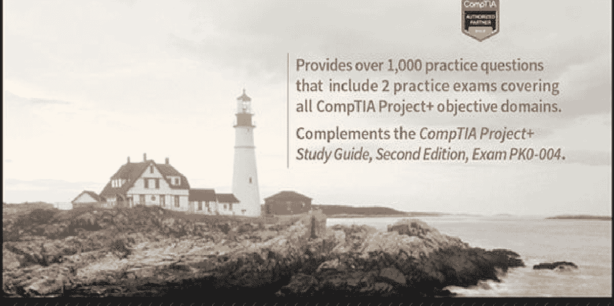

> 我将这本书献给父母，他们带给我欢笑、智慧、经验、洞察和爱……

# 致谢

天哪！你知道写一本书涉及什么吗？为了帮助你提升项目管理职业生涯，这个为你创建这一资源的专业人士团队一定是行业内最顶尖的。

这项努力的火花源于高级收购编辑 Kenyon Brown，他组成了这支伟大的团队。Gary Schwartz 是开发编辑，在整个过程中担任导师，有时奇怪地很像我的大学写作教授。他协助你付出的努力 Vanina Mangano 确保了本书的技术可行性。

我想感谢 Gary Schwartz，他在整个过程中担任我的导师，有时奇怪地很像我的大学写作教授。他为了协助你通过 CompTIA Project+ 考试的努力 Dassi Zeidel 确保了本书的易读性。

我想感谢制作团队，由 Dassi Zeidel 领导，他们确保了本书的易读性。

我想感谢 Kim Heldman，在过去的十年里一直是我的导师。她是我过的最勇敢的领导者之一，引导我进入了项目管理的领域。

最重要的是，我要感谢我的妻子 April 和我的孩子们 Kayla、Marcus 和 Adric。没有他们的笑容、爱和支持，我无法完成。

# 关于作者

Brett 拥有项目管理专业人士 `PMP` 认证，并拥有丹佛大学领导力与组织专业服务硕士学位。他是一名职业公职人员，曾于美国海军陆队服役，并曾工作于科罗拉多州、波尔德市以及大丹佛地区交通局 `RTD`。

Brett 为本书带来了丰富的经验，包括多个企业资源计划项目的管理工作、网页和电子商务应用实施以及计算机/网络基础设施管理。Brett 拥有以下证书：：Lean IT Foundation。他在科罗拉梅萨大学获得工商管理学士学位，并拥有科罗拉多州立大学的项目管理证书。

在 IT 领域，外向者并不常见，但并非没有。Brett 乐意与你联系，你可以通过 LinkedIn 联系他：`https://www.linkedin.com/in/brettfeddersen`。

## 广告

### 用户许可协议

## 让您的 IT 职业迈出新一步

## 考试券享 9 折*（最高可省 35 美元）

访问 `sybex.com/go/comptiavoucher` 获取详情

*适用某些限制。详情请参见网页。

## CompTIA

## 成为 CompTIA 认证 IT 专业人士非常简单

这这也是获得更广阔职业机会和回报的最佳途径。

## 为什么要获得 CompTIA 认证？

**需求增长**

项目管理是全球范围内最紧缺的技能之一。许多员工都理解项目管理技能。虽然并非每个人都是项目负责人，但大多数人都能理解项目管理的基本概念。

**薪资更高**

在简历上拥有认证的专业人士可以获得更好的工作，为新的行业机会开启大门。

**经过验证的实力**

91% 的招聘经理表示，CompTIA 认证在验证专业知识方面非常有价值，是向雇<|start|>主展示您能力和知识的最佳方式。

**通用技能**

希望投身项目管理事业的专业人士所拥有的技能可以应用于任何领域——从信息技术到消费品再到商业服务。这确保了项目经理可以随时胜任任何行业。

通过查看以下内容了解更多关于考试包的信息：

- * 关键学习点的考试目标
- 样本题，用于对考试预期内容进行概览，并提供题型示例
- 访问 LinkedIn 等在线论坛，查看其他专业人士对 CompTIA 考试的看法。

在 Pearson VUE 考试中心或 Compstore.com 购买考试券。

- 在 Pearson VUE 中心注册您的考试。
- 访问 Compstore/CompTIA 查找离您最近的测试中心。
- 在线安排考试。您在注册时需要输入您的考试券序列号和支付信息。
- 参加您的认证考试。

恭贺您获得 CompTIA 认证！

- 确保将其添加到您的简历中
- 查看 CompTIA 准备绪状态以开启您的下一次职业规划。

## 了解更多：CompTIA.org/projectplus

> * 来源：CompTIA 年度安全趋势调查：500 名负责安全的美国及企业企业高管
> * 来源：CompTIA 雇主对培训和认证的认知
> * 2017 CompTIA Properties, LLC. 版权所有。所有注册计划及与此类计划相关的教育均由 CompTIA Certifications, LLC 独家运营。TIA 是 CompTIA Properties, LLC 在美国及国际的注册商标。其他品牌和公司名称为 CompTIA Properties, LLC 或其所有者的商标。未经 CompTIA Properties, LLC 书面许可禁止复制或发行。美国印刷 03086-Jan17

# 引言

欢迎学习 CompTIA Project+。这是一个快速发展的领域，似乎一直需要可靠且经过认证的人才。几乎每个领域都需要项目经理，包括限于建筑、工程、政府和民事计划、非营利组织、信息技术、物流和运输。此外，它对于生活中的某些项目也大有用，例如搬家、安装新厨房，或帮助当地的家长教师协会组织活动。老实说，它在撰写一本关于 CompTIA Project+ 考试练习题的书时也出意想不到地有帮助。

计算技术行业协会（CompTIA）为对项目管理感兴趣的人推广 Project+ 考试，以获得认证。该考试有助于验证个人为了自信地领导项目按时、预算内完成所需的各种技能，包括业务和沟通技能。

本书的目的是帮助您通过 CompTIA Project+ 考试 `PK0-004`。在您参加考试前对项目管理知识进行最终验证之际，本书将帮助您准备在考试本身可能遇到的问题类型和内容。请记住，由于使用项目管理的知识和领域广泛，这不应是您准备考试的唯一资源。在学习过程中，使用学习指南和其他考试资源将非常重要。您接触的资源越丰富，考试取得成功的概率就越大。

您应该考虑的一项资源是 Kim Heldman 编写的《CompTIA Project+ Study Guide: Exam PK0-004》（Sybex, 2017）。在您在项目管理职业中获得认证时，它提供了一个极好的概述、参考和额外的复习题。

## 本书的结构

本书由四个章节组成，每个章节都基于 CompTIA Project+ PK0-004 考试目标中的四个领域之一。书中还有两个章节，旨在根据来自四个领域的各种问题模拟考试。书的结构如下：

- 第一章“项目基础 `1.0`”涵盖了项目管理的基本概念，如属性、角色和阶段。
- 第二章“约束 `2.0`”侧重于项目的约束和影响，例如组织结构。
- 第三章“变更管理 `3.0`”深入探讨沟通方法、影响和变更。
- 第四章“工具与文档 `4.0`”涵盖了项目管理工具、文档和采购。
- 第五章和第六章由模拟题组成，大致代表您在实际考试中看到的问题。每个章节开头都会列出该章节涵盖的目标。但请记住，每个章节并不是按顺序涵盖目标的。

> 警告 本书包含的问题*并非*源自实际的 Project+ 考试。它们的作用是让您接触底层内容，并为您提供一个类似的测试工具以供您准备考试。基础科目是您学习的重点，以便您能够通过考试。

恭贺您为自己的职业和项目经理的未来进行投资。

# Project+ 考试映射

以下目标映射将允许您找到书中涵盖考试每个目标的章节。

## 1.0 项目基础

| 考试目标 | 章节 |
|---|---|
| 1.1 总结项目的属性 | 1, 5, 6 |
| 临时性 | 1, 5, 6 |
| 开始和结束 | 1, 5, 6 |
| 唯一性 | 1 |
| 理由/目的 | 1, 5 |
| 作为计划的一部分 | 1 |
| 作为投资组合的一部分 | 1, 6 |
| 1.2 分类项目角色和职责 | 2, 5, 6 |
| 赞助者/负责人 | 2, 5, 6 |
| 项目经理 | 2, 5, 6 |
| 项目协调员 | 2 |
| 利益者 | 2, 5 |
| 计划员 | 2 |
| 项目团队 | 2 |
| 项目管理办公室 `PMO` | 2, 6 |
| 1.3 比较和对比标准项目阶段 | 1, 2, 5, 6 |
| 启动 | 1, 5, 6 |
| 计划 | 1, 5, 6 |
| 执行 | 1, 5, 6 |
| 监控与控制 | 1, 2, 5, 6 |
| 收尾 | 1, 5, 6 |
| 1.4 识别项目成本控制的基础 | 1, 5, 6 |
| 项目总成本 | 1, 5, 6 |
| 支出跟踪 | 1, 5, 6 |
| 支出报告 | 1 |
| 消耗率 | 1, 5, 6 |
| 考试目标 | 章节 |
| :--- | :--- |
| 成本基线/预算 | 1, 5, 6 |
| **1.5 识别常见的项目团队组织结构。** | 1, 2, 5, 6 |
| 职能矩阵 | 1, 2, 5, 6 |
| 项目型 | 1, 2, 5, 6 |
| **1.6 在给定场景下，执行并制定项目进度。** | 1, 2, 5, 6 |
| 工作分解结构 | 1, 2, 5, 6 |
| 进度安排 | 1, 2, 5, 6 |
| **1.7 识别敏捷开发方法的基本方面。** | 1, 2, 5, 6 |
| 快速适应新需求/变更的需求 | 1, 6 |
| 迭代方法 | 1, 5 |
| 持续需求收集 | 1, 6 |
| 建立待办列表 `Backlog` | 1, 2, 6 |
| 燃尽图 | 1 |
| 持续反馈 | 1, 2 |
| 迭代计划 | 1, 5, 6 |
| 每日站会/SCRUM会议 | 1, 5 |
| SCRUM 回顾会议 | 1, 2, 5, 6 |
| 自组织和自主导的团队 | 1 |
| **1.8 解释人力资源、物理资源和人员管理的重要性。** | 1, 5, 6 |
| 资源管理概念 | 1, 5, 6 |
| 人员管理 | 1, 5, 6 |

## 2.0 项目约束

| 考试目标 | 章节 |
| :--- | :--- |
| **2.1 在给定场景下，预测各种约束变量和影响因素对整个项目的影响。** | **2, 5, 6** |
| 常见约束 | 2, 5, 6 |
| 影响因素 | 2, 5, 6 |
| **2.2 解释风险策略和活动的重要性。** | 2, 5, 6 |
| 策略 | 2, 5, 6 |
| 风险活动 | 2, 5, 6 |

## 3.0 沟通与变更管理

| 考试目标 | 章节 |
| :--- | :--- |
| **3.1 在给定场景下，使用适当的沟通方法。** | **3, 5, 6** |
| 会议 | 3, 5, 6 |
| 电子邮件 | 3, 6 |
| 传真 | 3 |
| 即时消息 | 3 |
| 视频会议 | 3, 5 |
| 语音会议 | 3, 5 |
| 面面 | 3, 5 |
| 短信 | 3, 6 |
| 打印媒体的分发 | 3, 6 |
| 社交媒体 | 3, 5, 6 |
| **3.2 比较和对比影响沟通方法的因素。** | **3, 5, 6** |
| 语言障碍 | 3, 5 |
| 时区/地理因素 | 3, 5, 6 |
| 技术因素 | 3 |
| 文化差异 | 3, 5 |
| 组织间差异 | 3 |
| 组织内差异 | 3 |
| 个人偏好 | 3, 6 |
| 建立关系/关系维护 | 3 |
| 根据信息内容定制方法 | 3 |
| 关键性因素 | 3, 5 |
| 特定的利益相关者沟通需求 | 3 |
| **3.3 解释常见的沟通触发因素并确定目标受众和理由。** | **3, 5, 6** |
| 审计 | 3, 5 |
| 项目计划 | 3 |
| 项目变更 | 3 |
| 风险注册更新 | 3, 6 |
| 里程碑 | 3 |
| 进度变更 | 3 |
| 任务启动/完成 | 3, 5, 6 |
| 利益相关者变更 | 3 |
| 关关审查 `Gate reviews` | 3, 5, 6 |
| 业务连续性响应 | 3, 6 |
| 事故响应 | 3, 5 |
| 资源变更 | 3 |
| **3.4 在给定场景下，在项目背景未使用以下变更控制流程。** | **3, 5, 6** |
| 变更控制流程 | 3, 5, 6 |
| 常见的项目变更类型 | 3, 5, 6 |
| **3.5 识别组织变更的类型。** | **3, 5, 6** |
| 业务合并/收购 | 3, 5, 6 |
| 业务拆分 | 3, 5, 6 |
| 业务流程变更 | 3, 6 |
| 内部重组 | 3, 5, 6 |
| 搬迁 | 3, 5 |
| 外包 | 3, 5, 6 |

## 4.0 项目工具与文档

| 考试目标 | 章节 |
| :--- | :--- |
| 4.1 比较和对比各种项目管理工具。 | 2, 4, 5, 6 |
| 项目进度软件 | 4, 6 |
| 图表 | 4, 5, 6 |
| 仪表板/状态报告 | 4 |
| 知识管理工具 | 4, 5 |
| 性能测量工具 | 4, 6 |
| SWOT 分析 | 2, 4, 5, 6 |
| 责任、执行、咨询、知情 `RACI` 矩阵 | 2, 4, 6 |
| 4.2 在给定场景下，分析以项目为中心的文档。 | 4, 5, 6 |
| 项目章程 | 4, 5 |
| 项目管理计划 | 4, 6 |
| 问题日志 | 4 |
| 组织结构图 | 4, 5, 6 |
| 范围说明 | 4, 5 |
| 沟通计划 | 4, 5 |
| 项目进度 | 4, 6 |
| 状态报告 | 4, 5 |
| 仪表板信息 | 4, 6 |
| 行动事项 | 4 |
| 会议议程/会议纪要 | 4, 5, 6 |
| 4.3 识别常见的合作伙伴或供应商中心文档及其目的。 | 2, 4, 5, 6 |
| 信息征询 `RFI` | 2, 4, 5, 6 |
| 方案请求 `RFP` | 2, 4 |
| 报价请求 `RFQ` | 2, 4, 6 |

- 燃尽图
- 持续反馈
- 冲刺计划
- 每日站会/SCRUM会议
- SCRUM回顾会议
- 自组织和自我导向团队

### 1.8 解释人力、物力和和人员管理的重要性。

- 资源管理概念
  - 共享资源
  - 专用资源
  - 资源分配
  - 资源短缺
  - 资源过度分配
  - 低质量资源
  - 待岗资源 `Benched resources`
  - 项目间的依赖关系
  - 项目间的资源竞争
- 人员管理
  - 团队建设
  - 信任建立
  - 团队选择
  - 技能组合
  - 远程 vs. 内部内部
  - 人员撤换/更换
  - 沟通问题
  - 冲突解决
- 平滑处理 `Smoothing`
- 强制 `Forcing`
- 妥协 `Compromising`
- 面对 `Confronting`
- 回避 `Avoiding`
- 谈判 `Negotiating`

1. 项目的定义特征是什么？（选择两个。）

A. 一组相关的任务

B. 具有临时性

C. 运营活动

D. 对现有项目的重新工作

E. 创建独特的产品或服务

2. 项目团队负责以下所有内容，但不包括：

A. 为项目提供治理

B. 按照进度贡献交付物

C. 为项目贡献专业知识

D. 估算成本和依赖关系

3. 什么是工作分解结构 `WBS`？

A. 以任务为导向的项目分解

B. 以交付物为导向的项目分解

C. 任务及其顺序的图形表示

D. 项目里程碑的高级大纲

4. 业务情况书 `Business case` 中解释了哪些元素？

A. 通过识别组织利益来证明合理性

B. 替代方案

C. 与战略计划一致

D. 以上所有

E. A 和 C

5. 在下列选项中，哪些被认为是监控和控制阶段的关键活动？

A. 绩效衡量与报告

B. 制定质量计划

C. 执行质量保证

D. 监控预算

E. 制定变更控制计划

F. 制定项目章程

6. 什么决定了利益相关者的信息需求、信息传递格式、频率以及准备者？

A. 利益相关者分析计划

B. 项目章程

C. 人力计划

D. 沟通计划

7. 哪种成本估算使用数学模型来计算成本？

A. 自上而估算

B. 自下而上估算

C. 参数估算

D. 三点估算

8. 一个项目的挣值为 $2,500，实际成本为 $2,275。该项目的成本偏差将是以下哪一个？

A. $2,275

B. $225

C. $2,500

D. –225

9. 在敏捷每日站会期间，哪三个问题会被提回答？

A. 我昨天完成了什么？我今天将做什么？必要的后续步骤是什么？

B. 我今天完成了什么？我今天将和谁一起工作？哪些障碍阻碍了进度？

C. 我昨天完成了什么？我今天将和谁一起工作？哪些障碍阻碍了进度？

D. 我昨天完成了什么？我今天将做什么？哪些障碍阻碍了进度？

10. Marcus 在 Wigitom 工作，他被分配负责一个项目。Marcus 的直属老板将他拉回去处理任务并对他进行绩效评估。Wigitom 使用的是哪种组织结构？

A. 敏捷

B. 功能型

C. 矩阵型

D. 项目型

11. 项目有一个关键贡献者缺席会议、未按截止日期完成任务并影响了团队其他人的士气。公司内部没有其他具备执行该团队成员分配任务所需知识的人。对于项目经理来说，以下哪个行动是合适的？

A. 让团队成员参加咨询谈话。

B. 将其留在团队中让其他成员离开。

C. 替换该成员。

D. 让该团队成员参加咨询谈话并让他离开。

12. 项目章程 `Project Charter` 解释了哪些内容？

A. 成功的标准和关键因素

B. 交付物

C. 风险

D. 资源计划（注：此处原文为沟通计划，通常应为沟通计划）

13. 变更控制计划（Change Control Plan）在哪个阶段进行开发？

A. 项目章程

B. 项目计划

C. 监控和控制

D. 启动

14. 沟通计划（Communications Plan）描述了项目的哪些？

A. 风险计划

B. 资源计划

C. 进度计划

D. 质量计划

15. 三点估算（Three-point estimating）使用哪三个值？

A. 最可能

B. 最乐观

C. 最悲观

D. 平均

16. 在哪种组织结构中，项目经理拥有最大的权力？

A. 弱矩阵型

B. 项目型

C. 强矩阵型

D. 功能型

17. 当项目依赖于外部实体时，这被称为？

A. 软性依赖

B. 强制依赖

C. 外部依赖

D. 技术依赖

18. 以下哪项通常显示项目进度？

A. PERT

B. 日历

C. 甘特图

D. 帕托图

19. 在哪个阶段利益相关者的影响最有效？

A. 启动

B. 计划

C. 执行

D. 监控和控制

20. 当项目依赖于逻辑关系时，这被称为？

A. 强制性

B. 外部性

C. 离量性

D. 技术性

21. 哪种冲突解决技术会产生双赢的结果？

A. 强制

B. 面对

C. 回避

D. 妥协

22. 项目有任务 A（2天）、B（3天）、C（2天）、D（2天）和 E（3天）。任务 A 是 B 和 C 的前置，B 和 D 是 E 的前置。关键路径的任务顺序是？

A. A => B => E

B. A => B => C => D => E

C. A => D => E

D. A => C => E

23. 以下都是敏捷方面的方面方面：

A. 受限于两周的时间。

B. 召开会议以确定可以完成的内容。

C. 完成一个小功能集。

D. 团队在整个过程中保持惊人的速度。

24. April 在 Wigitom 工作，她最近被分配到一个项目。她收到了来自职能经理和项目经理的分配，但被要求执行项目工作。当 April 请假时，她的请求得到了职能经理的批准，但被项目经理拒绝了。Wigitom 使用的是哪种组织结构？

A. 项目型

B. 强矩阵型

C. 平衡矩阵型

D. 弱矩阵型

25. 在项目结束阶段，进行哪些活动？

A. 接受交付物并执行质量保证。

B. 完成项目工作并关闭所有合同。

C. 管理利益相关者预期并关闭所有合同。

D. 完成项目工作并执行质量保证。

26. 项目启动会议通常在哪个阶段举行？

A. 启动

B. 计划

C. 执行

D. 监控和控制

27. Chase 是一个项目经理，他已经释放了所有团队成员，关闭了合同并归档了项目文档。项目处于哪个阶段？

A. 启动

B. 计划

C. 执行

D. 监控和控制

E. 结束

28. 治理门径（Governance gates）是什么？

A. 项目阶段之间的检查点，通过获得批准以继续进行。

B. 根据预先建立的标准进行质量检查的检查点。

C. 仅在项目开始和结束时的检查点。

D. 在任命项目治理员后，来自此项目赞助人的无计划干扰。

29. 项目的定义特征是什么？（选择两项）。

A. 有明确的开始和结束日期。

B. 被分配给投资组合（Portfolio）。

C. 创建独特的产品或服务。

D. 是持续运营活动的一部分。

E. 是组织战略计划的一部分。

30. 下列哪项描述了投资组合（Portfolio）？

A. 项目经理做过的样本工作集，应带在面试面试中。

B. 计划、子投资组合和项目的集合，支持战略性业务目标或任务。

C. 一组使用共享资源和类似技术共同管理的相关的项目组。

D. 一组为了维护以帮助资助项目而建立的投资投资组。

31. 项目章程（Project charter）在哪个项目阶段准备并达成一致？

A. 计划阶段

B. 收尾阶段

D. 启动阶段

32. 项目章程签署后，举行什么会议来介绍项目团队和利益相关者，并概述项目目标？

A. 经验教训会议

B. 项目介绍会议

C. 启动会议（Kickoff meeting）

D. 团队建设午餐

33. 哪些软技能对项目经理很重要？

A. 时间管理、挣值计算、倾听、关键路径图。

B. 领导力、时间管理、团队建设、倾听。

C. 时间管理、挣值计算、领导力、关键路径图。

D. 领导力、服从性、独立性、倾听。

34. 高级风险评估中产生的工作应该记录在以下哪项中？

A. 工作分解结构（WBS）

B. 项目章程

C. 风险登记册

D. 质量控制计划

35. 项目进度表（Project schedule）起什么作用？

A. 确定项目的成本会计代码。

B. 创建基于交付物的项目分解。

C. 列出完成交付物需要解决的行动。

D. 确定项目活动的开始和结束日期。

36. 类比估算（Analogous estimating）是通过以下哪种方法开发成本估算的？

A. 使用数学模型计算项目的成本。

B. 计算工作分解结构中每个活动的成本。

C. 使用类似的过去项目来开发高层估算。

D. 对项目成本的三种不同估算取平均值。

37. 下列所有都是判断项目是否完成的方法，除了：

A. 当项目经理宣布项目完成时。

B. 当项目被取消时。

C. 当确定项目的目标无法实现时。

D. 当目标达成且利益相关者满意时。

38. 在特定范围内为完成工作实际花费的资金被称为以下哪项？

A. 成本偏差（Cost variance）

B. 计划价值（Planned value）

C. 实际成本（Actual cost）

D. 挣值（Earned value）

39. 制作花生酱果酱三明治有以下步骤：

呈上

收集面包、花生酱和果酱

将面包放在盘子上

拿一把刀

在一片面包上涂抹花生酱

将两片面包放在一起

在另一片面包上涂抹果酱

这个项目的正确顺序是？

A. 呈上；将两片面包放在一起；收集面包、花生酱和果酱；拿一把刀；在一片面包上涂抹花生酱；将面包放在盘子上；在另一片面包上涂抹果酱。

B. 收集面包、花生酱和果酱；拿一把刀；在一片面包上涂抹花生酱；将面包放在盘子上；在另一片面包上涂抹果酱；呈上；将两片面包放在一起。

C. 收集面包、花生酱和果酱；拿一把刀；将面包放在盘子上；在一片面包上涂抹花生酱；在另一片面包上涂抹果酱；呈上；将两片面包放在一起。

D. 收集面包、花生酱和果酱；拿一把刀；将面包放在盘子上；在一片面包上涂抹花生酱；在另一片面包上涂抹果酱；呈上。

40. 下列哪些对于开发项目计划至关重要？

A. 任务确定

B. 质量计划

C. 沟通计划

D. 任务排序

E. 帕累托图

F. 关键路径

41. 以下哪项是项目进度的形式？

A. 类比估算

B. SWAG

C. 工作量估算

D. SPI

42. 资源分配发生在哪个阶段？

A. 启动阶段

B. 计划阶段

C. 执行阶段

D. 监控与控制

E. 收尾阶段

33. 项目经理面临一个不服从团队成员的问题。这属于以下哪种情况？

A. 强迫

B. 回避

C. 对抗

D. 协作

44. 哪些是开发团队工具和技巧？（选择三项。）

A. 团队建设活动

B. 项目需求

C. 认可与奖励

D. 经验教训会议

E. 制定规则

F. 项目启动会议

45. 团队在哪个发展阶段效率最高且信任最高？

A. 形成期（Forming）

B. 震荡期（Storming）

C. 规范期（Norming）

D. 表现期（Performing）

E. 离散期（Adjourning）

46. Wigcom 有一个质量是主要考虑因素的项目。哪种人员模式最合适？

A. 外包

B. 现场协作

C. 虚拟团队

D. 视频会议

47. 一家初创公司试图在新兴市场竞争。技术不断变化，市场口味也在发生变化。这种情况最适合哪种方法？

A. 敏捷方法

B. 项目制环境

C. 部门制环境

D. 传统瀑布式

48. Kayla 在 Wigcom 工作，她被分配了一个项目。项目经理给她指示，并一直阻止她的常规主管给她分配任何任务。项目结束后，项目经理将对 Kayla 进行绩效评估。Wigcom 使用的是哪种组织结构？

A. 敏捷

B. 部门制

C. 矩阵制

D. 项目制

总结

C. 启动、计划、执行、监控与控制、结束

D. 发现、准备、执行、质量检查、总结

54. 什么是里程碑？

A. 衡量项目已运行距离的指标

B. 交付物必须满足的特征

C. 项目中用于确定“执行/不执行”（Go/No-Go）决策的检查点

D. 项目中用于衡量进度的重大事件

55. 通过为项目中的每个工作包分配成本估算来完成哪种类型的成本估算？

A. 自顶向下估算

B. 自底而上估算

C. 参数估算

D. 三点估算

56. 开发项目团队涉及以下所有内容，除外

A. 开发一个持续比项目更长的团队

B. 为团队成员创造积极的环境

C. 创建一个有效、运行良好且协调的小

D. 提高团队的技能水平

57. 以下都是依赖关系的类型，除外：

A. 强制性（Mandatory）

B. 酌量的（Discretionary）

C. 外部（External）

D. 待办（Backlog）

58. 利益相关者请求向项目添加一项变更，但项目经理拒绝了该请求。范围被拒绝可能可能是：

A. 约束条件之间存在相互作用。

B. 项目发生了范围蔓延（Scope creep）。

C. 该请求可以在没有正式的情况下处理。

D. 赞助人正在度假。

59. 低级WBS（工作分解结构）的特征包括以下所有，除外

A. WBS 组件是项目交付物的进一步分解。

B. WBS 组件应始终与确定主要交付物同时进行。

C. WBS 组件应该是具体的且可验证的。

D. WBS 组件应该根据项目组织结构进行组织。

60. A. 强制（Forcing）

B. 妥协（Compromising）

C. 对抗（Confronting）

D. 平滑（Smoothing）

61. 一家公司正在扩大，有几个项目正在进行。其中一个项目是在总部大楼新建一个侧翼，另一个项目是安装新的高速光纤网络。新大楼的框架必须在安装新网络之前开始。这是哪种类型逻辑关系的示例？

A. 完成到完成（Finish-to-finish）

B. 开始到开始（Start-to-start）

C. 完成到开始（Finish-to-start）

D. 开始到完成（Start-to-finish）

62. 项目有一个任务 A，需要2天；任务 B 需要3天；任务 C 需要2天；任务 D 需要2天；任务 E 需要3天。任务 A 是任务 B 和任务 C 前置。任务 C 是任务 D 前置。任务 B 和任务 D 都是任务 E 前置。

63. 关键路径的持续时间是多少？

A. 7 天

B. 9 天

C. 10 天

D. 11 天

64. 在哪个项目产文件中可以找到与资源质量和可用性相关的信息？

A. 项目进度表

B. 组织架构图

C. 资源日历

D. 风险注册表

65. 在以下哪情况下，团队建设工作对项目产生的影响最大？（选择三项。）

A. 团队不和

B. 进度变更

C. 交付物缺失

D. 项目阶段完成

E. 经验总结会议

F. 项目经理变更

66. 一个组织需要向项目添加供应商资源，但他们没有物理空间来安置团队。该组织在人员管理上应该使用哪种方法？

A. 部署预测团队

B. 部署职能团队

C. 使用内部团队

D. 使用远程团队

67. Nyssa 在 Wigitcom 工作并被分配到了一个项目。她想请一周假参加家庭聚会，但这与项目截止日期冲突。项目经理拒绝了她的请假，但她的职能经理让她去参加家庭聚会。Wigitcom 使用的是哪种组织结构？

A. 预测型（Projected）

B. 强矩阵（Strong-matrix）

C. 平衡矩阵（Balanced-matrix）

D. 弱矩阵（Weak-matrix）

68. 项目何时被认为是成功的？

A. 利益相关者的预期已满足。

B. 阶段完成已获得批准。

C. 所有项目阶段都已完成。

D. 供应商已从项目中释放。

69. 以下哪项是交付物的示例？

A. 项目工作开始的日期

B. 新产品的设计

C. 应用于项目的时间和材料

D. PMO（项目管理办公室）

70. 项目赞助人负责以下所有内容，除外

A. 开发项目的高层级需求

B. 担任审批权威并消除障碍

C. 在整个组织范围内推广项目

D. 估算项目活动的成本和依赖关系

E. 帮助控制项目的方向

71. 业务情况书（Business case）中解释了哪些元素？

A. 通过识别组织效益来证明合理性

B. 替代方案

C. 与战略计划对齐

D. 以上所有

72. 项目受哪些因素制约？

A. 时间、预算

B. 时间、范围

C. 成本、范围

D. 风险

73. 项目章程签署时触发了什么里程碑？

A. 项目开始

B. 利益相关者签署

C. 项目授权

D. 资源释放

74. 结束过程包括以下所有内容，除外

A. 归档文档

B. 释放人员

C. 总结经验

D. 管理风险

75. 以下都是资源的类型，除外

A. 团队成员

B. 设备

C. WBS

D. 材料

76. 类比估算也被称为什么？

A. 自顶向下估算

B. 自底而上估算

C. 参数估算

D. 三点估算

77. 挣值（Earned value）是哪方面的指示？

A. 完成的实际成本

B. 预算金额

C. 完成工作的价值

D. 总和

78. 快速跟踪（Fast-tracking）项目涉及哪种技术？

A. 并行执行任务

B. 平衡成本与进度

C. 增加资源

D. 移动关键路径活动

79. 交付物是哪个阶段的输出？

A. 启动

B. 计划

C. 执行

D. 监控与控制

80. 资源短缺意味着：

A. 有可供团队工作的事。

B. 资源不足导致过度分配。

C. 资源过多导致分配不足。

D. 有大量供团队工作的事。

81. 团队在哪个发展阶段停止合作并返回自己的职能部门？

A. 形成（Forming）

B. 震风（Storming）

C. 规范（Norming）

D. 表现（Performing）

E. 结束（Adjourning）

82. Wigcom 有一个项目对赞助人来说成本最重要的。哪种人员模式最合适？

A. 溢价团队分配

B. 地协作

C. 虚拟团队

D. 视频会议

83. 在哪里可以找到以下信息：项目使用的合同类型、项目团队的权限以及如何管理多个供应商？

A. 预算

B. 采购计划

C. WBS

D. 详细风险

84. 固定预算且提供稳定环境组织最适合哪种项目管理方法？

A. 传统型或瀑布式

B. 预测环境

C. 敏捷方法

D. 职能环境

85. 以下都是项目的阶段，除外

A. 计划

B. 结束

C. 开发

D. 执行

86. 哪个项目角色负责协调项目之间的资源？

A. 项目管理办公室 (PMO)

B. 项目协调员

C. 项目经理

D. 项目进度计划员

88. 事项何时从风险登记册转移到问题日志？

A. 一旦识别出风险

B. 当风险被触发时

C. 永远不

D. 在创建项目计划时

89. 一位团队成员因为必须加班而会错过和儿子参加童子军活动而感到非常不悦。他去找项目经理，经理告诉他这是一次性事件，如果他们当晚工作完工，周末就不用上班了。尽管该团队成员感到不悦，但他留下来并完成了工作。这是哪种类型冲突解决方式的例子？

A. 平滑（Smoothing）

B. 对抗（Confronting）

C. 折中（Compromising）

D. 回避（Avoiding）

E. 强制（Forcing）

90. 在项目中何时应该设定员工绩效预期？

A. 经验总结会议

B. 员工绩效评估

C. 利益者识别会议

D. 与新团队成员的第一次会议

91. 在敏捷项目管理方法中，以下所有项都被使用，除了

A. 燃尽图（Burndown charts）

B. 工作分解结构（WBS）

C. 持续需求收集

D. 冲刺计划（Sprint planning）

92. 一公司决定从项目外部引入一个团队，而不是使用公司员工。这是哪项的例子？

A. 内部采购（Insourcing）

B. 外包（Outsourcing）

C. 裁员（Layoffs）

D. 同现场（Collocation）

93. 团队通常经历相似的发展周期。这些阶段的正确顺序是？

A. 规范、组建、冲突、结束、执行

B. 组建、冲突、规范、执行、结束

C. 组建、规范、执行、冲突、结束

D. 规范、冲突、组建、结束、执行

94. 在制定项目进度，设置治理关口（Governance gates）是非常重要的。以下都是治理关口的例子，除了

A. 每日站立会议

B. 客户签字

C. 管理层批准

D. 立法批准

## 95. 哪个项目角色概述了不履行职责的后果？
- A. 项目经理
- B. 项目协调员
- C. 项目进度计划员
- D. 项目管理办公室（PMO）

## 96. 一项建筑项目需要以下步骤：施工、购买场地、绘制蓝图和检查。施工与蓝图之间是什么关系？
- A. 它是后续任务。
- B. 它是强制性任务。
- C. 它是前置任务。
- D. 它是裁量性任务。

## 97. 哪个项目角色概述了不履行职责的后果？
- A. 项目经理
- B. 项目协调员
- C. 项目进度计划员
- D. 项目管理办公室

## 98. 团队通常经历相似的发展周期。这些阶段的正确顺序是？
- A. 规范、组建、冲突、结束、执行
- B. 组建、冲突、规范、执行、结束（此处注：Adjourning）
- C. 组建、规范、执行、冲突、结束
- D. 规范、冲突、组建、结束、执行

## 99. 在制定项目进度，设置治理关口是非常重要的。以下都是治理关口的例子，除了
- A. 每日站立会议
- B. 客户签字
- C. 管理层批准
- D. 立法批准

## 100. 哪个项目角色概述了不履行职责的后果？
- A. 项目经理
- B. 项目协调员
- C. 项目进度计划员
- D. 项目管理办公室

## 101. 一项建筑项目需要以下步骤：施工、购买场地、绘制蓝图和检查。施工与蓝图之间是什么关系？
- A. 它是后续任务。
- B. 它是强制性任务。
- C. 它是前置任务。
- D. 它是裁量性任务。

## 97. 组织类型包括哪些？（三选）
- A. 敏捷
- B. 职能
- C. 矩阵

## 98. 一家公司正在进行，其中一个项目是建设新翼，另一个是安装高速光纤。项目的计划成本为 7000，实际成本为 9000。这属于哪种情况？
- A. 预算超支
- B. 预算内
- C. 预算超支
- D. 预算超支

## 99. 项目结束阶段的目的是什么？
- A. 持续维护的交付
- B. 持续维护的交付
- C. 交付物的交付
- D. 项目执行

## 100. 项目管理办公室（PMO）负责哪些职责？（三选）
- A. 市场项目
- B. 提供项目支持
- C. 维护项目
- D. 预算
- E. 维护项目模板
- F. 制定项目进度

## 101. 在项目中，哪个角色有助于识别识别关口？
- A. 项目赞助者
- B. 项目经理
- C. 项目协调员
- D. 项目进度计划员

## 102. 在项目中，什么是项目计划？
- A. 利益者列表
- B. 待办事项
- C. 延迟工作
- D. 项目进度

## 103. 哪个角色负责收集项目的进度估算？
- A. 项目赞助者
- B. 项目经理
- C. 项目协调员
- D. 项目进度计划员

## 104. 哪个指标衡量成本效率？
- A. `AC`（实际成本）
- B. `EV`（挣值）
- C. `CPI`（成本绩效指数）
- D. `SPI`（进度绩效指数）

## 105. 员工同时向项目经理汇报。这是哪种组织结构？
- A. 项目型
- B. 强矩阵
- C. 平衡矩阵
- D. 弱矩阵

## 106. 在 `WBS` 中，最低级别是什么？
- A. 项目进度
- B. 需求
- C. 工作包
- D. 里碑

## 107. 以下哪些是冲突解决技术？（二选）
- A. 对抗
- B. 平滑
- C. 冲突
- D. 规范
- E. 谈判

## 108. 在团队发展的哪个阶段，团队成员开始相互竞争？
- A. 组建
- B. 冲突
- C. 规范
- D. 执行
- E. 结束

## 109. 属于哪种关系？
- A. 资源冲突
- B. 开始-结束
- C. 资源依赖
- D. 专用资源

## 110. 负责收集项目进度的角色可能是？
- A. 项目经理
- B. 团队成员
- C. 项目进度计划员
- D. 项目协调员

## 111. 在敏捷项目管理方法中，什么是待办列表（backlog）？
- A. 因瓶颈导致的延迟工作
- B. 产品待添加的功能列表
- C. 因物流延迟的工作
- D. 每日三个问题

## 112. 安排视频或电话会议应考虑哪些因素？
- A. 确保会议室有座位。
- B. 检查团队成员是内向还是外向。
- C. 识别不同的时区。
- D. 提供写作材料。

## 113. Nestor 被任命为银行建设一个新分行。该分行的规模和设计与另一个分行相似。他被要求创建成本和进度估算，并遵循银行的最佳实践。谁负责帮助他？
- A. 项目赞助者
- B. 项目管理办公室
- C. 项目团队
- D. 项目进度计划员

## 114. 在启动阶段，应该执行哪些活动？
- A. 开发项目章程和项目启动会议
- B. 项目启动会议和识别利益者
- C. 开发项目章程和利益识别
- D. 创建项目计划和开发项目章程

## 115. 组织在哪里记录买与建分析的结果？
- A. `WBS`
- B. 预算
- C. 变更管理计划
- D. 采购计划

## 116. 以下技术均用于估计活动持续，除了
- A. 专家判断
- B. 三点估算
- C. 类比估算
- D. 帕累图

## 117. 项目哪个角色负责根据项目进度创建交付物？
- A. 项目利益者
- B. 项目团队成员
- C. 项目进度计划员
- D. 项目协调员

## 118. 哪种成本估算使用数学模型计算成本？
- A. 自上而下估算
- B. 自下向上估算
- C. 参数估算
- D. 三点估算

## 119. 以下哪些项目文档是在执行阶段创建？（二选）
- A. 项目章程
- B. 沟通计划
- C. 问题日志
- D. 经验教训
- E. 行动项

## 120. 项目经理应该花费多少比例的时间进行沟通？
- A. 高达 40%
- B. 高达 50%
- C. 高达 75%
- D. 高达 90%

## 121. 项目利益相关者具有以下职责？
- A. 文档和行政支持、任务时长估算、向资源索取任务状态、专业知识
- B. 利益相关、提供输入和需求、项目指导委员会、专业知识
- C. 文档和行政支持、提供输入和需求、项目指导委员会、专业知识
- D. 利益相关、提供输入和需求、跨部门协调、专业知识

## 122. Jenny 在一家负责某项目的公司工作。她将最终从创建的服务中受益，并希望分享她对如何创建该服务的想法和建议。她还是该产品领域的领域专家。Jenny 最可能是以下哪者？
- A. 项目利益相关者
- B. 项目拥护者
- C. 项目发起者
- D. PMO 成员

## 123. 下列交付物/活动均发生在启动阶段（Initiation phase），除外：
- A. 项目验收
- B. 项目章程
- C. 业务计划书
- D. 高级风险

## 124. 高级风险识别是哪者的职责？
- A. 项目发起者
- B. 项目经理
- C. 项目协调员
- D. 项目团队

## 125. 哪些项目文档是在项目的计划阶段（Planning phase）创建的？（选择三个）。
- A. 状态报告
- B. 沟通计划
- C. 组织架构图
- D. 经验教训
- E. 项目进度
- F. 行动项

## 126. 哪个项目角色负责项目计划、会议纪要和项目交付等所有项目产物？
- A. 项目协调员
- B. 进度员
- C. 项目团队
- D. 项目经理

## 127. 什么是项目需求？
- A. 项目运行距离的衡量标准
- B. 必须满足的交付物特征
- C. 项目中用于决定通过/否（Go/No-Go）的检查点
- D. 用于衡量进度的项目重大事件

## 128. 项目进度需要包含的关键要素有哪些？
- A. 定义活动、安排活动顺序、估算资源、估算时长
- B. 定义活动、活动预算、估算资源、估算完成
- C. 活动预算、估算资源、确定里程碑、估算完成
- D. 开发进度、确定完成日期、检查利益相关者假设、进行可行性评估

## 129. 项目启动会议（kickoff meeting）在哪个阶段举行？
- A. 启动
- B. 计划
- C. 执行
- D. 监控与控制
- E. 结束

## 130. 确定消耗率（burn rate）和衡量相对于基线的成本是什么活动的元素？
- A. 支出跟踪
- B. 支出计划
- C. 参数估算
- D. 成本会计

## 131. 下列什么是冲刺计划会议（sprint planning meeting）的用途？
- A. 为项目所需工作提前启动
- B. 准备项目章程和启动会议
- C. 为本次迭代期间完成的项设置一个真实的待办列表
- D. 为项目制定沟通和质量计划

## 132. 项目消耗预算快慢的指标是什么？
- A. 并行工程
- B. 支出跟踪
- C. 赶工法
- D. 消耗率（Burn rate）

## 133. 项目经理具有以下职责（选择两个）：
- A. 质量质量保证
- B. 设置关键性能指标和参数
- C. 估算任务时长
- D. 管理团队、沟通、范围、风险、预算和时间

## 134. 高级范围定义应该包含在哪个项目文件中？
- A. 沟通计划
- B. 项目进度
- C. 项目章程
- D. 经验教训

## 135. 下列哪个是执行阶段（Execution phase）的主要活动？
- A. 性能测量和报告
- B. 创建和验证交付物
- C. 关键利益相关者识别
- D. 确定所需的项目资源

## 136. 你预计 WBS 字典包含以下所有信息，除外：
- A. 团队成员角色和职责的解释
- B. 组件的工作描述
- C. 质量要求
- D. 所需资源

## 137. 自制购买决策（make-or-buy decision）发生在哪一步？
- A. 在产品或服务的设计期间
- B. 在创建采购计划期间
- C. 在执行项目计划期间
- D. 在启动会议期间

## 138. 以下都是估算技术，除外：
- A. 向上估算
- B. 程序评估评审技术 (`PERT`)
- C. 参数估算
- D. 类比估算

## 139. 项目的挣值（EV）为 900，实际成本（AC）为 1100。项目的成本绩效指数（CPI）应该是以下哪一个？
- A. .82
- B. 82
- C. -200
- D. 200

## 140. 在哪种组织结构中，资源向项目经理汇报？
- A. 弱矩阵
- B. 项目制
- C. 强矩阵
- D.

## 141. 前置任务和后继任务可以具有逻辑关系。下列不是之一：
- A. 结束-结束（Finish-to-finish）
- B. 开始-结束（Start-to-finish）
- C. 结束-开始（Finish-to-start）

## 142. 敏捷开发中共享的是哪个方面？
- A. 冲刺计划
- B. 自组织团队
- C. 迭代方法
- D. 适应性需求

## 143. 范围管理计划包含以下哪些？（选择三个）。
- A. 创建进度的流程
- B. 范围说明
- C. 如何验证交付物
- D. 创建 `WBS` 的流程
- E. 创建预算的流程

## 144. 一个项目团队成员没有按时完成并开始延误。项目经理与其会面并询问。成员回答说她想做好，但缺乏某些技能。他们同意为该成员安排一名导师。这是哪种冲突解决方式的示例？
- A. 缓解（Smoothing）
- B. 强迫（Forcing）
- C. 妥协（Compromising）
- D. 处理（Confronting）
- E. 避免

## 145. 在哪种情况下描述了资源的分配情况？
- A. 临时分配。
- B. 从部门分配到项目。
- C. 必须外包。
- D. 必须现场办公。

## 146. 一家软件公司有一个团队正在建立一个新平台。该公司将使用什么机制来保护知识产权？
- A. 组织分解结构 (`OBS`)
- B. 保密协议 (`NDA`)
- C. 综合进度 (`IMS`)
- D. 质量成本 (`COQ`)

## 147. 在什么情况下，适应性方法比僵化的项目管理更优？
- A. 在成熟组织中，范围可以被容易且彻底地定义
- B. 当小型改进没有价值时
- C. 快速变化的环境

## 148. 评估项目阶段时，哪个阶段的成本最高？
- A. 启动
- B. 计划
- C. 执行
- D. 监控与控制
- E. 结束

## 149. 当项目接近关键截止日期时，Ed 联系项目经理请假几天。项目经理需要 Ed 的技能来完成任务，但看到 Ed 精疲力竭。他们同意 Ed 在截止日期前工作，然后休息几天。Ed 接受了这个计划并回到工作。这是哪种冲突解决方式的示例？
- A. 缓解（Smoothing）
- B. 处理（Confronting）
- C. 避免（Avoiding）
- D. 强迫（Forcing）

## 150. Adric 最近被分配到一个项目中。他从项目经理和他的部门主管那里都收到了任务分配。他被通知项目经理和主管都会参与他的绩效评估。Wigit 使用的是哪种组织结构？
- A. 项目制
- B. 强矩阵
- C. 平衡矩阵
- D. 弱矩阵

## 151. Wigitcom 有一个去年发布的移动地理定位应用程序。他们现在正在开发应用程序的最新季度版本，包含细微更新和错误修复。关于地理定位应用的努力，以下陈述哪个是正确的？（选择所有正确答案。）
- A. 这是一个项目，因为对应用程序进行了微调。
- B. 这不是一个项目，因为定期发布是持续性的努力。
- C. 这是一个项目，因为这种努力在性质上是暂时的。
- D. 这不是一个项目，因为生产的产品不是唯一的。

## 151. 以高度灵活的方式管理项目活动的迭代的、增量的方法被称为：
- A. 瀑布方法论
- B. 矩阵式管理
- C. 项目化
- D. 敏捷方法论

## 152. 项目中有一位团队成员缺席会议、未按时完成任务，并影响了团队其他成员的士气。项目经理采取适当行动应该是以下哪项？
- A. 让该团队成员进行咨询谈话。
- B. 放不管该员工，并将工作分配给其他团队成员。
- C. 将该团队成员从项目中移除并寻找替代者。
- D. 将该团队成员调到不同的设施。

## 153. Widget 公司有一个项目团队位于同一大大陆的不同城市。有一份紧急更新需要发送给整个项目团队。发送该通信最有效的方法是什么？
- A. 电话
- B. 备忘录
- C. 电子邮件
- D. 视频会议

## 154. 在团队发展的哪个阶段，团队成员聚集在一起并互相介绍？
- A. 组建 (Forming)
- B. 震荡 (Storming)
- C. 规范 (Norming)
- D. 执行 (Performing)
- E. 结束 (Adjourning)

## 155. 项目经理听取了两个互相不满的成员的顾虑。在提问、倾听并让他们相互交流后，项目经理对双方的共同利益达成了一致，工作恢复。团队成员同意开始相应的行为。这是以下哪种的例子？
- A. 谈判
- B. 妥协
- C. 对抗
- D. 回避

## 156. 闲置资源（Benched resources）是指项目出现以下哪些问题时？
- A. 完成了项目但尚未开始新任务的人员
- B. 工作量过大无法完成项目的人员
- C. 行业缺乏人才，导致项目缺乏合格人员
- D. 因表现不佳而被下放到边缘的人员

## 157. Tiffany 是分配到该项目的唯一数字营销人员，但她只有 60% 的时间可以投入该项目。工作量足够让分配了 100% 时间的人员完成，因此 Tiffany 正在努力满足截止日期。这是以下哪种的例子？
- A. 低质量资源
- B. 相互依赖关系
- C. 专用资源
- D. 资源过度分配

## 158. Amy 被分配到一个项目中并向项目经理 Kim 汇报。Amy 的职能经理 John 也要求 Amy 向他汇报。Amy 是什么类型的资源？
- A. 专用
- B. 物理
- C. 数字
- D. 共享

## 159. 获取产品设计的签字确认是哪种类型依赖的例子？
- A. 自由裁量 (Discretionary)
- B. 强制 (Mandatory)
- C. 外部 (External)
- D. 财务 (Financial)

## 160. 项目请求的哪部分定义了项目的原因、高层交付物和项目目标？
- A. 工作分解结构
- B. 高层风险
- C. 业务情况书 (Business case)
- D. 高层范围定义

## 161. 高层风险评估包括以下所有内容，但不包括
- A. 风险识别和汇总（或分类）的工作任务组
- B. 权衡相对风险与潜在收益的成本效益分析
- C. 减轻影响的高层应对措施
- D. 对所有潜在项目替代方案的风险识别

## 162. 项目协调员具有以下哪些职责？（选择两项。）
- A. 资金批准权
- B. 为项目经理提供支持
- C. 时间和资源调度
- D. 为项目贡献专业知识
- E. 项目之间的资源协调

## 163. 在项目冲刺（sprint）完成后，项目团队开会检查哪些地方做得好，哪些做得不好，以及可以进行哪些改进。这是以下哪种的例子？

+   A. 治理关卡 (Governance gates)
+   B. 产品待办列表 (Product backlog)
+   C. 每日 SCRUM (Daily SCRUM)
+   D. SCRUM 回顾 (SCRUM retrospective)

164. 项目团队已完成项目的所有交付物。他们已安排好会议，开始从项目团队向持续运营团队进行交接。目前项目处于哪个阶段？
+   A. 启动 (Initiation)
+   B. 计划 (Planning)
+   C. 执行 (Execution)
+   D. 监控与控制 (Monitor and Control)
+   E. 结束 (Closing)

165. 在敏捷方法论中，关于自适应生命周期的所有描述都是正确的，但不包括
+   A. 需要利益相关者的高度参与
+   B. 所有需求必须在前期收集
+   C. 快速迭代
+   D. 固定的时间和资源

166. Jessie 不喜欢分配方式，并向项目经理提出投诉。项目经理强调这就是做法，并ie Jessie 最好开始接受这种方法，因为方法不会改变。Jessie 接受了现状，回到工作中去。这是哪种冲突解决类型？
+   A. 谈判
+   B. 对抗
+   C. 妥协
+   D. 回避
+   E. 强制

167. 关于这种努力，以下哪项是正确的？（选择三项。）
+   A. 因为这种努力已经做过了。
+   B. 因为产品是唯一的。
+.C. 因为这种努力是项目的一部分。
+   D. 因为不需要进行这种努力。
+   E. 因为这种努力是暂时的。

168. 表示完成速度的可视化图表是什么？
+   A. 鱼图 (Fishbone diagram)
+   B. 燃烧图 (Burndown chart)
+   C. 甘特图 (Gantt chart)
+   D. 帕托图 (Pareto diagram)

169. 一家公司位于大大陆的不同城市，项目由来自各地的成员组成。决定让团队成员留在所在地并使用技术辅助通信。这是以下哪种的例子？
+   A. 内部包
+   B. 外包
+   C. 虚拟团队
+   D. 同地办公

170. 你项目的设计师也被分配到了其他几个项目。其他项目也有类似的里程碑目标。这描述的是哪种情况？
+   A. 项目间资源竞争
+   B. 强制
+   C. 任务排序
+   D. 资源短缺

171. 在团队发展的哪个阶段，由于团队成员变得互相熟悉，情况开始平稳？
+   A. 组建 (Forming)
+   B. 震荡 (Storming)
+   C. 规范 (Norming)
+   D. 执行 (Performing)
+   E. 结束 (Adjourning)

172. 项目经理与一个不听从的团队成员有矛盾。项目经理没有找该团队成员，只是试图维持现状。这是……的例子。
+   A. 强制
+   B. 回避
+   C. 对抗
+   D. 平滑

173. 闲置资源是指：
+   A. 对组织有利，因为总有人员处理项目
+   B. 对组织不利，因为总有人员处理项目
+   C. 昂贵的，因为人员在坐着时也有工资
+   D. 廉的，因为人员在坐着时没有工资

174. 作为项目经理，专用资源是理想的情况，因为：
+   A. 团队成员将继续与其职能工作共享时间。
+   B. 项目经理拥有完全权限并控制时间和任务。
+   C. 专用资源将不需要支付加班费。
+   D. 低质量资源不会分配到项目中。

175. 当一种依赖关系与与其执行的工作类型直接相关时，它是哪种类型的依赖？
+   A. 自由裁量 (Discretionary)
+   B. 强制 (Mandatory)
C. 外部
D. 财务

176. 工作分解结构（WBS）是在项目的哪个阶段创建的？
- A. 启动
- B. 计划
-- C. 执行
- D. 监控与控制
- E. 收尾

177. 贯穿整个项目的验收标准评审属于以下哪项？
- A. 质量关键点
- B. 质量门禁（Quality gates）
- C. 看板板（Kanban boards）
- D. 交付物

178. 以下哪些项是组织 WBS 的方法？（选择三项。）
- A. 关键路径
- B. 子项目
- C. 按风险划分项目
- D. 按风险优先级排序
- E. 主要交付物

179. Duane 是分配到该项目的资深人员，但他开始在会议中变得脾气暴躁、立场固执且好于争辩。项目经理找了 Duane，但随后发生了争执，Duane 离开了现场。第二天，项目经理决定给 Duane 留出空间，不再讨论他的行为或表现。这是以下哪项的示例？
- A. 谈判
- B. 对峙
- C. 妥协
- D. 回避
- E. 强制

180. Wigitcom 面临项目范围和人员的变动。与利益相关者分享这些信息的恰当方法是什么？
- A. 通过社交媒体和短信
- B. 使用备忘录和电子邮件
- C. 与项目团队召开会议
- D. 遵循沟通计划

181. Marion 是一位项目经理，负责为某机构实施一套新的资产管理系统。她在试图争取其他部门参与时遇到了困难，这导致了问题。帮助消除障碍是谁的责任？
- A. 项目协调员
- B. PMO（项目管理办公室）
- C. 利益相关者
- D. 项目赞助人

182. 项目经理试图通过一个兼具社交和业务属性的会议来提高团队士气。项目经理正在从事哪种活动？
- A. 建立信任
- B. 形成阶段（Forming）
- C. 团队建设
- D. 管理技能

183. 一家公司位于跨大陆的多个城市，项目将配备来自不同城市的团队成员。决定是将项目团队带到单一地点。这是以下的示例：
- A. 内部采购（Insourcing）
- B. 外包（Outsourcing）
- C. 裁员
- D. 同地办公（Collocation）

184. Amber 是加入项目的新团队成员。已经举行了一次预期设定会议，Amber 提交的首批交付物晚交了几天。应该何时通知 Amber 存在绩效差异？
- A. 在项目或阶段结束时的经验教训会议上
- B. 尽快通知，以便进行纠正或提供帮助
- C. 在第一次绩效评审会议上，即使会议要在几个月后
- D. 项目经理应该等待别人来纠正 Amber 的行为

185. Ashley 是多个交通项目建设的项目经理。她要求大桥项目经理提供大桥建设的最新估算。谁负责任务持续时间和成本的估算工作？
- A. 项目经理
- B. PMO
- C. 利益相关者
- D. 项目团队

186. 什么是滚动波计划（Rolling wave planning）？
- A. 对活动密集的区域进行计划，根据资源计划分配团队成员
- B. 将交付物或项目产出细化到 WBS 不同层级的过程
- C. 一种用于确保抗震建筑结构完整性的设计技术
- D. 一种快速启动技术，在计划很少或没有批准的情况下开始项目以产生动能

187. WBS 的第 1 级始终代表以下哪项？
- A. 关键路径
- B. 优先级排序的任务
- C. 项目
- D. 赞助人

188. 使用什么机制来沟通项目预算状态？
- A. 支出跟踪
- B. 支出报告
- C. 预算基线
- D. 工作分解结构

189. 在建立产品待办列表（Product backlog）后，使用什么工具来确定项目的速率速率？
- A. 帕累图
- B. 鱼骨图
- C. 看板板
- D. 燃尽图（Burndown chart）

190. 以下哪些项出现在 WBS 字典中？（选择三项。）
- A. 计划的里程碑列表
- B. 项目中使用的常用缩写
- C. 验收标准
- D. 工作组件说明
- E. 沟通频率
- F. 人员计划

191. 范围基线允许项目经理执行所有以下活动，**除了**
- A. 设定冲突解决方法
- B. 记录进度
- C. 分配资源
- D. 监控和控制项目工作

192. 在最终产品不确定和/或开发产品或服务的条件处于变动的情况下，最好的项目管理方法是什么？
- A. 传统方法，或瀑布模型
- B. 项目化环境
- C. 敏捷方法
- D. 功能型环境

193. 以下所有项都是敏捷项目管理方法的特征，**除了**是
- A. 严格遵守变更控制流程
- B. 对需求采用灵活的方法
- C. 团队成员以短时间冲刺（sprints）的形式进行工作
- D. 每次发布都根据客户需求进行测试

194. 项目假设最好被描述为以下哪项？
- A. 影响项目团队的内部或外部因素
- B. 限制项目的因素
- C. 被认为是真实的因素
- D. 被视为考虑的因素

195. 冲刺计划会议（Sprint planning）用于以下哪？
- A. 获取项目所需工作
- B. 准备项目启动会议
- C. 迭代期间完成的各项
- D. 为项目设定目标

196. 以下哪些项是敏捷项目方法的特征？（选择三项。）
- A. 自组织团队
- B. 冲刺计划
- C. 前期全面的需求收集
- D. 正式组织的团队
- E. 持续需求收集
- F. 经验教训

197. 高级范围定义对项目有什么帮助？
- A. 创建对包含和排除内容的理解
- B. 确定产品或服务
- C. 确保项目可以接受变动
- D. 在项目失败时推卸责任

198. 项目赞助人的职责包括哪些？
- A. 制定业务计划和合理性分析
- B. 拥有资金审批权限
- C. 设定标准和做法
- D. 提供需求
- E. 帮助项目方向
- F. 管理项目风险

199. 项目经理与情绪不佳的团队成员见面。他们达成共识后工作继续。这是以下哪项的示例？
- A. 强制
- B. 回避
- C. 对峙
- D. 平滑

200. 赶进度（Crashing）是一种涉及以下哪项的项目管理技术？
- A. 并行执行原本计划的任务
- B. 通过增加资源等考虑成本和进度的权衡
- C. 为了安抚利益相关者而提前交付交付
- D. 移除不需要的关键路径活动

201. 以下所有都在计划阶段创建，除了
- A. 项目进度
- B. 沟通计划
- C. 经验教训
- D. 变更管理计划

202. 一家建筑公司正在建造新建筑。该项目的成本绩效指数（CPI）为1.25，这意味着：
A. 项目超支。
B. 项目进度落后。
C. 项目预算充足。
D. 项目进度提前。

203. Judy 是一位项目经理，正在监控多个项目。在电信项目中，她需要更多关于某些活动和里程碑何时发生的信息。Judy 应该联系电信项目的谁获取这些信息？
- A. 项目计划员
- B. 项目协调员
- C. PMO
- D. 项目经理

204. 项目团队被分配了两个刚校毕业、没有电子领域工作经验的人。如果没有资深团队成员共同工作，这两个团队成员无法被分配。这是以下哪的示例？
- A. 共享资源
- B. 资源短缺
- C. 低质量资源
- D. 闲置资源

205. Mitch 是一位处于计划阶段的项目经理。在完成技能矩阵以了解项目需要什么样的人才后，他正在筛选公司已有人员的简历。Mitch 在项目的此阶段正在执行什么活动？
- A. 团队建设
- B. 团队选择
- C. 冲突解决

## D. 信任建立

## 第二2章

## 项目约束（领域 2.0）

本章涵盖了以下 CompTIA Project+ 考试目标：

2.1 在给定场景下，预测各种约束变量和影响对整个项目的影响。
- 常见约束
    - 预算
    - 范围
    - 交付物
    - 质量
    - 环境
    - 资源
    - 需求
    - 进度安排
- 影响因素
    - 变更请求
    - 范围蔓延 (Scope creep)
    - 约束的重新排序
    - 约束之间的相互作用
    - 利益者/赞助者/管理层
    - 其他项目

2.2 解释风险策略和活动的重要性。
- 策略
    - 接受 (Accept)
    - 缓解 (Mitigate)
    - 转移 (Transfer)
    - 应对 (Exploit)
- 风险活动
    - 识别 (Identification)
    - 量化 (Quantification)
    - 计划 (Planning)
    - 评审 (Review)
    - 响应 (Response)
    - 登记 (Register)
    - 优先级排序 (Prioritization)
    - 沟通 (Communication)

1. “可能影响现有约束变化或可能带来新约束的因素”是以下哪项的定义？
+ A. 依赖关系
+ B. 前置任务
+ C. 影响因素
+ D. 约束

2. 指导委员会最初规定成本是项目最重要的因素，以保持项目团队规模的精简。随着项目的推移，指导委员会发生了转变，并告诉项目经理进度是项目最重要的因素。这是对项目产生哪种类型影响的示例？
+ A. 变更请求
+ B. 约束的重新排序
+ C. 范围蔓延
+ D. 约束之间的相互作用

3. SWOT 缩写词代表什么？
+ A. 态势、弱点、开源、威胁
+ B. 优势、工作、机会、可追溯性
+ C. 优势、劣势、机会、威胁
+ D. 态势、工作、开源、可追溯性

4. 对项目产生负面或正面影响的潜在未来事件被称为以下哪项？
+ A. 问题
+ B. 风险
+ C. 愿望
+ D. 需求

5. 当你识别所有可能影响项目的潜在风险时，你应该将它们记录在以下哪一项？
+ A. RACI 矩阵
+ B. 风险登记表
+ C. 风险概率矩阵
+ D. 问题日志

6. 选择发生概率最大且一旦发生对项目影响最大的风险的活动被称为以下哪项？
+ A. 三点估算法
+ B. 帕累托图分析
+ C. 监控与控制
+ D. 风险分析

7. 风险给项目带来的后果或机会被称为以下哪项？
+ A. 风险响应计划
+ B. 风险影响
+ C. 风险登记表
+ D. 风险概率

8. 项目中常见的三个约束是什么？（选择三项。）
+ A. 时间
+ B. 人员
+ C. 工作空间
+ D. 预算
+ E. 库存
+ F. 范围

9. 一项道路建设工程将在未来两周内需要公司的道路铺路机（一种在道路上铺设沥青的设备）。该铺路机在本周五之前在另一个城市使用，并且需要五天时间迁移。这是哪种类型约束的示例？
+ A. 环境
+ B. 进度安排
+ C. 范围
+ D. 质量

10. 在确定项目范围时，以下哪些约束需要纳入讨论范围？（选择两项。）
+ A. 项目经理
+ B. 预定义预算
+ C. 强制完工日期
+ D. 竞争优势

11. 项目需要特定学科的六名大师级，但组织员工中只有四名。人力资源部已尝试招聘更多，但寻找工作的技师数量有限。这代表了哪种约束？
+ A. 资源
+ B. 进度安排
+ C. 需求
+ D. 质量

12. Lisa 是一个项目的项目经理，收到一份变更请求，要求在不改变进度或预算的情况下增加项目范围。关于该变更请求，以下哪些选项是正确的？
+ A. 它代表对项目的影响。
+ B. 它代表对项目的约束。
+ C. 它代表一种回避策略。
+ D. 它代表一种环境约束。

13. 在项目风险识别中，应该包含以下哪些角色？
+ A. 领域专家 (SME)
+ B. 核心团队成员
+ C. 利益者
+ D. 以上所有
+ E. 选 B 和 C

14. Wigit Construction 的指导委员会监控现有项目并批准新项目。公司刚刚赢得了一个新项目的投标，该项目必须在四月完成，而一个正在进行中的项目也必须在同一个月完成。利益者正在进行以下哪些操作？
+ A. 通过移动项目内部此前不可移动的约束来重新对约束进行排序
+ B. 提交变更请求
+ C. 导致范围蔓延的范围
+ D. 随着项目开始产生影响

15. 至少，以下哪些类型的信息会记录在风险登记表中？（选择三项。）
+ A. 风险分
+ B. 风险概率
+ C. 发生时的影响
+ D. 风险所有
+ E. 风险描述
+ F. 缓解策略

16. 一公司正在开发一款与竞争对手产品相似的手机。在市场演示后，公司收到了要求停止销售该手机的回复。这是以下哪项的示例？
+ A. 协议备
+ B. 终止信
+ C. 意向书
+ D. 建议书

17. 如果项目团队想要增强正面风险，他们试图实现什么？
+ A. 将风险转移给最好的第三方
+ B. 增加风险发生的概率或影响以确保利益
+ C. 接受风险的后果
+ D. 寻找机会

18. 直接让负面风险后果发生是哪种风险响应策略？
+ A. 回避
+ B. 转移
+ C. 缓解
+ D. 接受

19. 分析风险并在发生时建立适当行动的过程被称为什么？
+ A. 风险分析
+ B. 风险概率
+ C. 风险响应计划
+ D. 风险触发

20. 以下哪项定义为风险发生的可能性？
+ A. 风险响应计划
+ B. 概率影响矩阵
+ C. 风险登记表
+ D. 风险概率

21. 在 SWOT 分析中，机会通常是指以下哪项？
+ A. 影响公司的内部消息
+ B. 对正面风险产生贡献的外部条件
+ C. 项目中的招聘职位
+ D. 项目期间恶劣天气的长期预测

22. 关于 SWOT 分析，以下哪个说法是正确的？
+ A. 优势/劣势是外部的；机会/威胁是内部的。
+ B. 优势/劣势/机会/威胁都是外部的。
+ C. 优势/劣势是内部的；机会/威胁是外部的。
+ D. 优势/劣势/机会/威胁都是内部的。

23. 以下哪些技术可以用于创建项目的风险列表？（选择三项。）
+ A. 参数估算法
+ B. 头脑风暴
+ C. 三点估算法
+ D. 访谈
+ E. 鱼骨图
+ F. 工作坊

24. 在项目管理中，IMS 代表什么？
+ A. 冲动管理系统
+ B. 创新使命宣言
+ C. 迭代映射系统
+ D. 集成主进度

25. 关于影响因素，以下所有选项都是正确的，例外
+ A. 变更请求是一个影响因素。

+ B. 范围蔓延会影响进度和预算。
+ C. 环境因素可以决定项目何时发生。
D. 影响会影响现有约束或产生新的约束。

26. 客户提交申请为项目添加一个不同的需求，并且该需求通过了正式批准流程被纳入范围。这是对项目的哪种类型的影响？
+ A. 变更请求
+ B. 范围蔓延
+ C. 约束之间的迭代
+ D. 资源稀缺

27. 一个项目团队已经在某个项目上工作了几个月，正处于执行阶段。客户发现竞争对手在他们的产品中添加了新功能，他们希望在该项目中也添加该功能。为了保持项目按时且按预算进行，由于哪种类型的约束，无法接受这一变更？
+ A. 环境
+ B. 预算
+ C. 范围
+ D. 进度

28. 一项道路建设工程将穿过山建造一条道路，由于恶劣天气的风险，需要在六月到九月的窗口内完成工作。这是哪种类型约束的示例？
+ A. 环境
+ B. 预算
+ C. 范围
+ D. 进度

29. 每个项目都会面临以下所有潜在约束，但除外：
+ A. 质量
+ B. 预算
+ C. 范围
+ D. 人员配备
+ E. 时间

30. Cherie 正在参与一个建筑项目，天气可能会干扰运营。她确定比常年更湿润季节的概率为0.25%，这将对项目产生巨大影响。Cherie 正在执行哪项活动？
+ A. 风险识别
+ B. 风险分析
+ C. 风险应对
+ D. 约束识别

31. 关于项目约束，以下哪项是正确的？
+ A. 项目约束在项目期间永远不会改变。
+ B. 项目约束限制了项目团队的选项。
+ C. 项目约束是被假设为真实的元素。
+ D. 项目约束对项目结果没有影响。

32. Walt 在 Wigit Construction 工作，他被任命为项目经理建造一座新桥。团队有六个月的时间完成项目，且有固定预算，大桥必须能够承受四车道的交通。这是以下哪项的示例？
+ A. 三点估算
+ B. 质量成本
+ C. 三重约束
+ D. 逐步详细化

33. 以下哪项是用于识别项目项目风险的工具或技术？
+ A. RASI
+ B. SWOT
+ C. RACI
+ D. COQ

34. Wigitcom 的总法务顾问告知你公司收到了一封停止函（C&D），将需要就项目的未来召开会议。在这种背景下，C&D 是什么意思？
+ A. 后果和要求
+ B. 约束和交付物
+ C. 停止和要求
+ D. 停止并终止

35. 分享积极风险意味着什么？
+ A. 将风险分配给最能带来机会的第三方。
+ B. 监控风险事件的概率或影响，以确保实现利益。
+ C. 选择接受风险的后果。
+ D. 寻找机会利用积极的影响。

36. 专注于将负面风险的责任转移给第三方的风险应对策略被称为以下哪项？
+ A. 规避
+ B. 转移
+ C. 缓解
+ D. 接受

37. 在确定风险概率和影响时，哪种工具通常提供最好的结果？
+ A. 专家判断
+ B. 参数估算
+ C. 环境因素
+ D. 项目文档

38. 使用哪种工具可以对风险进行优先级排序和量化，以便进行管理？
+ A. 概率影响矩阵
+ B. 鱼骨图
+ C. 直方图
+ D. 责任矩阵

39. SWOT 分析中的什么部分？
+ A. 市场份额
+ B. 项目的劣势
+ C. 项目的弱点
+ D. 外部因素

40. 以下是常见的潜在风险，除外：
+ A. 参加会议
+ B. 预算不足
+ C. 项目启动后的变更
+ D. 项目风险

41. 风险计划包括以下哪些活动，除外：
+ A. 衡量 SPI
+ B. 项目的风险
+ C. 项目启动后的风险
+ D. 项目风险

42. MOU 是什么？
+ A. 目标备忘录
+ B. 可性备忘录
+ C. 谅解备忘录
+ D. 使用备忘录

43. RACI 代表什么？
+ A. 负责、授权、咨询、知会
+ B. 负责、执行、咨询、知会
+ C. 负责、认可、咨询、知会
+ D. 负责、授权、协作、知会

44. 利益相关者、赞助者如何影响项目？（所有适用项）
+ A. 项目的进展
+ B. 项目启动后的影响
+ C. 参加会议
+ D. 项目交付物

45. 项目范围说明书要求开发三种语言。这代表了哪种约束？
+ A. 质量
+ B. 交付物
+ C. 时间
+ D. 预算

46. 在酒店开业前，以下哪项影响是正确的？
+ A. 项目范围改变了，因此成本会增加。
+ B. 项目进度改变了，因此范围会改变。
+ C. 项目成本改变了，因此进度会改变。
+ D. 此变更对项目产生影响。

47. 航空工程公司由于上季度财务不佳被迫削减项目预算。这将如何影响项目？
+ A. 项目由于资金不足推迟。
+ B. 项目范围削减以符合新预算。
+ C. 项目将需要更长时间。
+ D. 项目团队向指导委员会申请更多资金。

48. 项目正在进行中，团队错过了交付日期。指导委员会希望项目回到轨道，项目经理表示团队需要加班以赶进度。增加的成本受哪种约束的限制？
+ A. 环境
+ B. 预算
+ C. 范围
+ D. 进度

49. 包含识别码、风险名称、风险描述、风险所有者和其他元素的简单表格被称为哪项？
+ A. 风险应对计划
+ B. 概率影响矩阵
+ C. RACI 图
+ D. 风险登记表

50. George 正在处理可能影响项目的积极和消极元素。对于每个元素，他都在试图找出该元素发生的概率以及该元素如何干扰或增强项目。George 正在使用哪项？
+ A. 概率影响矩阵
+ B. 风险管理计划
+ C. 风险登记表
+ D. 风险应对计划

51. 计算风险评分时，需要以下哪些项？（选择两个）
+ A. SPI
+ B. 风险影响
+ C. CPI
+ D. 风险概率
+ E. 风险触发分值
+ F. EAC

52. 项目经理正在寻找一种确定项目最短完成时长。项目经理告诉调度员使用 CPM。CPM 是什么？
+ A. 成本生产管理
+ B. 关键项目管理
+ C. 关键路径法
## D. 成本项目方法

53. 哪种事件检测到已知风险的变量已发生，并且是将该项目从风险注册表转移到问题日志了？
- A. 风险应对计划
- B. 风险识别
- C. 风险触发因素
- D. 概率和影响矩阵

54. 利用（exploit）正向风险意味着什么？
- A. 将风险分配给最能带来机会的第三方
- B. 监控风险事件的概率或影响，以确保实现收益
- C. 选择接受风险的后果
- D. 寻找利用积极影响的机会，从而确保其发生

55. 试图确保风险完全不发生，或者消除负面风险的原因，属于哪种风险应对策略？
- A. 转移
- B. 缓解
- C. 接受
- D. 规避

56. 在 SWOT 分析中，威胁是指以下哪一项？
- A. 需要物理安全的情况
- B. 会导致负面影响的内部条件
- C. 失控并导致音量升高的争论
- D. 会导致负面影响的外部条件

57. 运输交易所举行了启动会议，在会上解释了项目目标和高层时间表，并进行了项目介绍。他们处于项目的哪个阶段？
- A. 启动
- B. 计划
- C. 执行
- D. 监控和控制
- E. 收尾

58. 确定并记录项目上可能发生的任何潜在风险的活动是什么？
- A. 风险计划
- B. 风险缓解
- C. 风险规避
- D. 风险识别

59. 在项目管理的意义上，ISO 代表什么？
- A. 国际标准组织 (International Standards Organization)
- B. 同构操作标准 (Isomorphic Standards of Operations)
- C. 国际运营结构 (International Structure of Operations)
- D. 意向操作标准 (Intentional Standards of Operations)

60. 缩写 RASI 代表什么？
- A. 负责、授权、上级和通知
- B. 负责地、会计、支持和通知
- C. 负责、会计、上级和通知
- D. 责任、授权和通知

61. 项目范围通过正式的变更控制过程扩大，导致进度延长到原始截止日期之后。这是哪种类型影响的示例？
- A. 利益者、赞助人和管理层
- B. 约束之间的相互作用
- C. 约束重新排序
- D. 环境因素

62. 尽管项目范围说明已获得批准，但客户经常要求为产品添加更多功能，导致截止日期和资源不断调整。这是哪种类型影响的示例？
- A. 变更请求
- B. 约束重新排序
- C. 进度约束
- D. 范围蔓延 (Scope creep)

63. 以下哪些是影响的示例？（选择三个。）
- A. 变更请求
- B. 范围说明
- C. 范围蔓延
- D. 约束重新排序
- E. 交付物
- F. 需求

64. 以下哪项定义为任何限制或强制项目团队行动的因素？
- A. 需求
- B. 假设
- C. 约束
- D. 影响

65. 婚礼策划师收到通知，由于伴娘团成员即将参加军事部署，重大活动需要提前两周举行。这将如何影响项目？
- A. 婚礼因进度更改而取消。
- B. 婚礼移至室内设施。
- C. 婚礼改到未来的另一个日期。
- D. 由于为了赶上截止日期增加了人员，婚礼成本将增加。

66. 一个项目想在一个冬季频繁发生雪暴的地区建造一条混凝土公路。该市使用的除雪计划要求铺设氯化镁以防止道路结冰。氯化镁的问题是它会腐蚀混凝土下方的钢筋，缩短公路的总寿命。这给项目带来了什么种类型的约束？
- A. 范围
- B. 预算
- C. 环境
- D. 进度

67. Walter 是一位才华横溢的程序员，拥有项目所需的独特技能。他的时间非常紧缺，正在同时参与几个项目。为了让你的项目按计划进行，Walter 需要在下个月底之前完成工作，但他还有其他项目承诺。这是什么类型约束的示例？
- A. 环境
- B. 预算
- C. 范围
- D. 进度

68. MOA 是什么？
- A. 津贴备忘录 (Memorandum of allowance)
- B. 协议备忘录 (Memorandum of agreement)
- C. 效忠备忘录 (Memorandum of allegiance)
- D. 活动备忘录 (Memorandum of activity)

69. 提出诸如“任务是否有多个依赖项？”或“任务是否使用了新的或不熟悉的技术等问题是哪个过程中的步骤？
- A. 质量保证
- B. 风险识别
- C. 构建项目章
- D. 项目进度

70. 项目计划中有一部分包含风险要素，包括项目方法、职责、利益者容忍度和类别。这被称为什么？
- A. 风险注册表
- B. 风险矩阵
- C. 风险应对计划
- D. 风险管理计划

71. 在项目管理背景下，COQ 代表什么？
- A. 质量成本 (Cost of quality)
- B. 关键质量 (Critical to quality)
- C. 数量成本 (Cost of quantities)
- D. 数量关键性 (Critical of quantities)

72. 在项目的哪个阶段，你会关注风险以确定是否需要采取行动？
- A. 启动
- B. 计划
- C. 执行
- D. 监控和控制
- E. 收尾

73. 以下所有都是应对正向风险的策略，排除：
- A. 缓解
- B. 利用
- C. 分享
- D. 增强

74. 一个表格列出了所有识别出的风险，以及它们发生的概率和影响评分。这在创建什么？
- A. 风险应对计划
- B. 风险注册表
- C. 概率和影响矩阵
- D. RACI 表

75. 以下所有都是应对负面风险的策略，排除：
- A. 注册
- B. 规避
- C. 缓解
- D. 接受

76. 什么是资源平滑（resource smoothing）？
- A. 在活动浮时间内调整资源
- B. 一种进度压缩技术
- C. 防止过载的分配方法
- D. 设备加载的方法

77. Wigitcom 的项目以预算为最重要的约束。刚得知竞争对手将推出比其设计快 25% 的产品，治理委员会要求其比原计划快 33%。这是以下哪一项的示例？
- A. 预算约束
- B. 进度约束
- C. 范围约束
- D. 约束重新排序

78. 按类别和类型分解资源的项目成果是什么？
- A. 资源分解结构 (RBS)
- B. 组织分解结构 (OBS)
- C. 设备分解结构 (E)
- D. 工作分解结构 (WBS)

79. 在创建工作分解结构时，项目经理要求查看 OBS 作为创建该文档的输入。这被称为什么类型的依赖？
- A. 内部
- B. 自由裁量
- C. 外部
- D. 强制

80. 项目的重大成就或关键事件被称为？
- A. 里程碑
- B. 交付物
- C. 需求
- D. 风险

81. 一家道路建设公司被要求改进和拓宽沿海道路。在接手项目之前，他们评估了海岸的稳定性和结构是否支持该工作。这种过程被称为什么？
- A. 使用专家判断
- B. 进行可行性研究
- C. 进行成本效益分析
- D. 使用加权评分模型

82. 由于预测飓风季节将比平均水平糟糕，一家建筑公司意识到如果飓登陆，某些材料成本可能会。他们开始监控国家气象局的信息，并开始积极追踪任何热带风，以便在飓成为实际威胁时能够迅速购买材料。这是哪种类型的风险应对？
- A. 缓解
- B. 转移
- C. 分享
- D. 增强

83. 在创建工作分解结构时，项目经理要求查看 OBS 作为创建该文档的输入。OBS 是什么？
- A. 办公室业务结构
- B. 运营业务支持
- C. 组织分解结构
- D. 办公室分解结构

84. 项目经理将进行头头脑风暴
一项获取项目潜在风险列表的练习。她邀请了赞助人、核心团队成员、利益相关者和领域专家（SME）。什么是 SME？
- A. 服务材料提取物
- B. 服务事宜专家
- C. 服务材料专家
- D. 领域专家

**85.** 负责制定项目、计划和投资组合管理最佳实践的组织是？
- A. CompTIA
- B. PMI®
- C. RACI
- D. DoD

**86.** Katie 是一位项目经理，她最近的绩效评估勉强达到组织的核心标准。以下哪个选项能最准确地表达 Katie 的风险承受能力？
- A. 风险规避者
- B. 风险决策者
- C. 风险承担者
- D. 风险观察者

**87.** 个人或组织对于接受或规避风险的可能性的舒适程度是指？
- A. 风险登记
- B. 风险规避者
- C. 风险承担者
- D. 风险承受能力

**88.** 在一个新计算机处理器芯片的项目进行期间，一位关键利益相关者接近项目团队，要求处理速度增加到最初要求的两倍。这是以下哪种情况？
- A. 进度约束
- B. 约束重新排序
- C. 范围蔓延
- D. 项目需求

**89.** 一种在保持项目范围不变的同时缩短项目进度持续时间的数学分析方法是？
- A. PERT 分析
- B. 进度压缩
- C. 资源平滑
- D. 资源均衡

**90.** 什么是关键链法？
- A. 进度网络分析技术
- B. 依赖模型
- C. 项目章程批准签名路径
- D. 挣值法

**91.** 在估计活动资源时，项目经理寻找完成工作的变化和其他方案。这种工具或技术称为什么？
- A. 参数估算
- B. 自下而上估算
- C. 替代方案分析
- D. 鱼骨图

**92.** 流程或程序驱动或最佳实践技术被称为什么类型的依赖？
- A. 内部
- B. 任意性
- C. 外部
- D. 强制性

**93.** 在准备启动项目时，项目经理列了一份清单：(1) 客户将在 48 小时内审核交付提交，(2) 客户将为项目提供所需人员，(3) 项目将获得高层支持。这些都是以下哪项的例子？
A. 约束
B. 目标
C. 需求
D. 假设

**94.** 项目进度落后，项目经理决定并行运行接下来的几个活动而不是顺序执行，以追赶时间。这是以下哪种情况的例子？
A. 赶工法
B. 风险规避
C. 快速跟踪法
D. 关键路径法

**95.** 一家软件公司正在开发一款革命性的移动应用，此时一种利用地理定位服务的新潮流席卷市场。该公司在该领域没有内部专业知识，它同意与另一家地理定位功能是核心优势的公司合作。使用的是哪种风险应对策略？
A. 接受
B. 利用
C. 分享
D. 增强

**96.** 采购部的 Ron 需要你在发布 RFP 之前创建一份 SOW。SOW 代表什么什么？
- A. 劳动力服务
- B. 工作说明书
- C. 劳动力声明
- D. 工作支持

**97.** Beth 被要求从供应商处收集信息，让他们对特定产品或服务进行竞标。此活动的适当采购工具是？
- A. RFI（信息请求）
- B. 唯一来源
- C. RFP（征求书）
- D. RFQ（报价请求）

**98.** 为了使系统或项目达到运营目标，必须满足的关键系统能力是？
- A. KPIs（关键绩效指标）
- B. RFPs
- C. MOUs（合作备忘录）
- D. KPPs（关键性能参数）

**99.** Karen 是公司的明星，连续获得了多次卓越的绩效评估。哪个选项能最准确地表达 Karen 的风险承受能力？
- A. 风险规避者
- B. 风险观察者
- C. 风险决策者
- D. 风险承担者

**100.** 项目可能被授予的两种任意资金分配类型是？
- A. 自上而下和自下而上
- B. 备用和裁量金
- C. 参数化和类比
- D. 备用和管理金

**101.** 什么是资源均衡？

# 风险管理与项目管理题目

## 概念选择题

A. 一种物理资源的存储技术

B. 进度压缩技术

C. 平衡分配以防止过载的尝试

D. 加载重型设备的方法

步骤、范围、风险登记册和预算已经进行了第四次修改。这是以下哪种情况的示例？

+   A. 敏捷管理
+   B. 可行性研究
+   C. 渐进细化
+   D. 项目冲刺

117. Wigit Construction 公司赢得了一项拓宽该国最繁忙道路路段的招标。该建议要求 Wigit Construction 在四个月内昼夜不停地工作，以尽量减少对公众的不便。未来四个月的天气预报预测会有季节性季风，但 Wigit Construction 决定按计划进行。他们正在使用哪种风险应对策略？

+   A. 接受
+   B. 利用
+   C. 分享
+   D. 增强

118. Mark 向他公司的采购部门提交了采购申请单。他必须等待开具 PO 后，供应商才能开始工作。PO 是什么？

+   A. 计划目标
+   B. 采购办公室
+   C. 采购订单
+   D. 计划订单

119. 在工作包中增加百分比的时间，或在项目中增加百分比的资金以应对紧急情况的做法被称为以下哪种？

+   A. 风险应对计划
+   B. 德尔菲技术
+   C. 允许风险策略
+   D. 应急备备金

120. 以下哪些是风险应对策略？（选择两项。）

+   A. 规避
+   B. 假设
+   C. 接受
+   D. 分析
+   E. 实际成本

121. 一家建筑公司一直在监测热带风暴，因为飓风可能对项目登陆产生影响。一个热带风暴刚刚形成，预报员预测它将在该国的人口密集地区登陆。该公司开始购买额外的木材和其他材料的库存。这是以下哪种情况的示例？

+   A. 风险登记册
+   B. 风险触发因素
+   C. 风险承担者
+   D. 风险容度

122. 在进行一个大型软件项目时，一家公司的竞争对手可以出售。该竞争对手在正在添加的功能方面具有核心竞争力，母公司迅速尝试将这两家公司合并。他们正在使用哪种风险应对策略？

+   A. 接受
+   B. 利用
+   C. 分享
+   D. 增强

123. 当一家公司对采购某种商品或服务感兴趣时，他们会进行招标过程，供应商提交业务建议。这个过程被称为？

+   A. RFI（信息征询）
+   B. 单一来源
+   C. RFP（征求书）
+   D. RFQ（报价邀请书）

124. Donna 正在为一个项目采购服务，但她不确定哪些可用，以及各种供应商满足这种需求的能力。她应该使用哪种采购工具？

+   A. RFI（信息征询）
+   B. 单一来源
+   C. RFP（征求书）
+   D. RFQ（报价邀请书）

125. Alex 是一家初创公司的项目发助人。公司依赖巨大的增长来在市场上保持竞争力。哪种选择最准确地表达了 Alex 的风险容度？

+   A. 风险观察者
+   B. 风险规避
+   C. 风险承担者
+   D. 风险决策

126. 项目团队正在考虑在项目中使用一种新开发的材料，但该材料的质量未知。为了防止未来可能重工，项目团队选择不使用这种材料。正在使用哪种风险应对策略？

+   A. 规避
+   B. 转移
+   C. 缓解
+   D. 接受

127. 开发应急备备金以应对可能发生的风险的方法是？

+   A. 转移
+   B. 被动接受
+   C. 主动接受
+   D. 利用

128. 项目团队对某些风险为何会发生以及这些风险如何导致积极结果进行了深入的根源分析。该项目正在采用哪种策略？

+   A. 接受，负风险策略
+   B. 利用，正风险策略
+   C. 增强，正风险策略
+   D. 转移，负风险策略

129. 项目团队从第三方供应商购买了材料。为了防止材料缺陷，他们签署了一份确保货物保修的合同。这代表了哪种风险策略？

+   A. 规避
+   B. 转移
+   C. 缓解
+   D. 接受

130. 确定风险对项目目标的影响以及其发生概率的过程被称为？

+   A. 定性风险分析
+   B. 识别风险
+   C. 定量风险分析
+   D. 风险分类

131. 以下所有都是项目管理中使用的信息收集技术，除外的是：

+   A. 头脑风暴
+   B. 德尔菲技术
+   C. 甘特图
+   D. 根源分析

132. 一家公路建设公司负责建造一座每年处理三百万辆汽车的桥。该项目的风险容度是多少？

+   A. 赌博
+   B. 风险承担者
+   C. 中等容度
+   D. 风险规避

133. 哪种是唯一可用于正风险也可用于负风险的风险应对策略？

+   A. 规避
+   B. 转移
+   C. 缓解
+   D. 接受

134. 在考虑风险应对策略时，接受的两种形式是什么？

+   A. 被动的
+   B. 刻意的
+   C.无意的
+   D. 主动的

135. Wigit Construction 有一个提前完工的机会。他们决定派遣经验丰富的工人和工程师进入项目以增加这种可能性。这是哪种风险策略？

+   A. 接受，负风险策略
+   B. 利用，正风险策略
+   C. 分享，正风险策略
+   D. 转移，负风险策略

136. 确定风险对项目目标影响的过程被称为？

+   A. 定性风险分析
+   B. 识别风险
+   C. 定量风险分析
+   D. 风险分类

137. 谁负责风险风险识别？

+   A. 项目经理
+   B. 利益相关者
+   C. 项目团队
+   D. 项目发起人

138. 在哪个项目阶段会对风险进行头脑评估？

+   A. 启动
+   B. 计划
+   C. 执行
+   D. 监控与控制
+   E. 收尾

139. 一家政府机构面临公众对新道路的反弹。他们通过公众意见和外展活动更好地教育社区。他们正在采用哪种风险策略？

+   A. 转移
+   B. 缓解
+   C. 接受
+   D. 规避

140. 一家建筑公司的资源分散在多个项目中。一个项目面临延时完成的合同罚款，但这种负担不足以雇用更多员工。这是哪种风险策略？

+   A. 接受，负风险策略
+   B. 利用，正风险策略
+   C. 分享，正风险策略
+   D. 转移，负风险策略

141. Wigitom 发布了一个收集个人身份信息的新网站。为了应对数据泄露导致的责任，他们购买了保险。这是哪种风险策略？

+   A. 规避
+   B. 转移
+   C. 缓解
+   D. 接受

142. 确定潜在风险何时发生并确定应对措施的活动是？

+   A. 风险紧急性评估
+   B. 风险分类
+   C. 风险数据质量评估
+   D. 影响概率矩阵

143. 以下都是可能包含在资源分解结构中的类别示例，除外的是：

+   A. 外部
+   B. 项目管理
+   C. 组织
+   D. 概率和影响

144. 风险应对计划在哪个项目阶段会被激活？

+   A. 启动
+   B. 计划
+   C. 执行
+   D. 监控与控制
+   E. 收尾

145. 项目面临一个无法消除的风险。该风险发生的概率较低且不会影响项目，因此没有采取额外行动。这被称为以下哪种？

+   A. 转移
+   B. 被动接受
+   C. 主动接受
+   D. 利用

146. 一家政府机构聘请了一家公司对其下水道系统进行工作。作为 RFP 的一部分，机构要求中标供应商购买专业遗漏险。这是哪种风险策略？

+   A. 接受，负风险策略
+   B. 利用，正风险策略
+   C. 分享，正风险策略
+   D. 转移，负风险策略

147. 在定性风险分析后，以下各项均属于对风险登记表的更新，除了：

- A. 风险原因
- B. 低优先级风险的观察列表
- C. 需要近期响应的风险
- D. 各风险的数值化评估

148. 涉及确定收集的数据以评估风险的有用性的活动是？

- A. 风险紧急性评估
- B. 风险分类
- C. 风险数据质量评估
- D. 影响和概率矩阵

149. 科技行业的初创公司最可能具有哪种风险承受度？

- A. 赌徒型
- B. 风险承担型
- C. 中等风险承受度
- D. 风险回避型

150. 将交付物逐步完善工作分解结构（WBS）的不同级别被称为以下哪项？

- A. 生成待办列表
- B. 渐进迭代
- C. 滚波规划
- D. 任务优先级

151. Patrick 在一家公司工作并被分配到一个项目中。显然，Patrick 的直属上将对他进行绩效评估，而且她经常把他拉回公司处理日常任务。该项目运行在什么样的结构下？

- A. 弱矩阵型
- B. 项目型
- C. 矩阵型
- D. 职能型

152. Wigitcom 刚刚完成了新应用的原型，并获得了用户对设计的认可。这是以下哪项示例？

- A. 闸门检查
- B. 里程碑
- C. 交付物
- D. 经验总结

153. Trevor 是一个土木工程项目的经理，该项目的风险之一是在计划建设道路的区域可能出现地陷。项目团队报告说该区域确实形成了一个地陷。关于这一事件，哪两项是正确的？（选择两项。）

- A. 风险现在已变成了一个问题。
- B. 项目团队接受了这一风险。
- C. 风险触发因素已发生，需要做出响应。
- D. 这需要通过变更控制流程。

154. 问题日志通常在哪个项目阶段制定？

- A. 启动
- B. 计划
- C. 执行
- D. 监控和控制
- E. 收尾

155. Gerry 是公司的新任项目经理，他被告知该项目在项目阶段之间必须通过指导委员会的检查点。这些检查点的称呼是什么？

- A. 经验总结
- B. SCRUM 回顾
- C. 治理闸门
- D. 启动会议

156. 以下所有都是组织结构类型，除了：

- A. 敏捷型
- B. 职能型
- C. 矩阵型
- D. 项目型

157. 在一个定义的工作周期结束后，Yolanda召集项目团队，讨论哪些工作做得好，哪些做得不好，以及可以进行哪些改进。这是什么类型的会议？

- A. SCRUM 回顾
- B. 产品待办列表
- C. 每日 SCRUM
- D. 启动会议

158. Transportation Exchange 项目团队已经组建，正在进行自我介绍。这是团队开发的哪个阶段？

- A. 震动阶段
- B. 规范阶段
- C. 执行阶段
- D. 形成阶段

159. 项目刚刚举行了一场会议，会议上解释了项目的预期、目标和目的，包括项目的里程碑和时间表。项目签署也可能在此次会议期间发生。这是什么类型的会议？

- A. 经验总结
- B. 闸门检查
- C. 状态会议
- D. 启动会议

160. 项目发起人 Gayle 表示，当项目完成后，该交通项目需要有四条每天运行 18 小时的公交线路。Gayle 提供了以下哪项？

- A. 验收准则
- B. 闸门检查
- C. 交付物
- D. 经验总结

161. Wigit Construction 被要求建造建筑，其中有两个卫生间、一间会议室和一个办公位的开放空间。以下各项中卫生间、会议室和开放空间代表什么？

- A. 交付物
- B. 约束
- C. 假设
- D. 要求

162. Lisa 是一名合同项目经理，协助一家实施公司级软件的政府机构。Lisa 的运营理念是高层赞助将有力，且所有项目团队成员都将没有其他职责。这是以下哪项的示例？

- A. 交付物
- B. 约束
- C. 假设
- D. 要求

163. 一家政府机构邀请对项目进行招标，该项目必须在年底完成，拥有移动应用程序来对接信息，并符合信用卡合规性。这些都是以下哪内容的示例？

A. 交付物
B. 约束
C. 假设
D. 要求

164. 行动事项清单通常在哪个项目阶段制定？

A. 启动
B. 计划
C. 执行
D. 监控和控制
E. 收尾

165. Sarah 在一家机构工作，最近被分配到一个项目中。她收到了来自职能经理和项目经理的任务，但被指示去执行项目工作。这是哪种类型的组织结构？

A. 平衡矩阵型
B. 弱矩阵型
C. 项目型
D. 强矩阵型

166. 评估预算状态，其目标是 99% 的无缺陷。这是以下哪项的示例？

A. 交付物
B. 约束
C. 假设
D. 要求

167. 评估预算状态、审查风险和衡量绩效发生在哪个阶段？

A. 启动
B. 计划
C. 执行
D. 监控与控制
E. 收尾

168. Kim 是一家公司的项目经理。哪种项目管理方法最合适？

A. 敏捷型
B. 瀑布型
C. 非正式
D. 自适应

169. Stephanie 是一名项目经理，并与关键利益相关者就项目达成共识。在启动会议上，她确保所有人都签署。这是以下哪内容的示例？

- A. 正式批准
B. CYA
C. 闸门检查
D. 经验总结

170. Wigit Construction 未通过验收，项目团队需要拆墙并重建。这是以下哪内容的示例？

- A. 风险响应计划
- B. 质量成本
- C. 备忘录
- D. 范围渗透

171. Joey 被分配了一个项目，期限必须在赛季开始前，且项目预算有限。这是什么样的示例？

A. 范围渗透
B. 约束相互作用
C. 约束重新排序
D. 利益相关者的意见

172. 在风险经过识别、分析和优先级排序，并制定了响应计划后，风险管理的最后活动是？

- A. 量化
- B. 审查
- C. 响应
- D. 通信

173. 试图减少负面风险的影响或概率的风险响应策略是？

A. Avoid
B. 转移
C. 减轻
D. 接受

174. SWOT 分析哪些部分关注组织内部的问题？

A. 优势和威胁
B. 机会和劣势
C. 机会和威胁
D. 优势和劣势

175. 在项目工作期间，Valdenes 被分配识别潜在风险、评估这些风险的影响，并在风险发生时制定响应。Valdenes 正在从事哪项活动？

A. 风险规划
B. 风险登记表
C. 风险识别
D. SWOT 分析

176. 衡量已支出、确定消耗率并核算采购被称为？

A. 支出报告
B. 支出跟踪
C. 成本核算
D. ETC

177. 一家政府机构在向某支付付款之前必须满足某些官僚步骤
供应商。这代表了什么样的依赖关系？

+   A. 自由支配
+   B. 外部
+   C. 内部
+   D. 可选

179. Jenny 正在工作的项目组有一系列项目必须满足的详细需求，但公司用于该项目的资源有限。这两个约束条件可能导致的结果是什么？

+   A. 必须缩小范围。
+   B. 公司必须找到更多资源。
+   C. 必须调整范围和资源。
+   D. 时间将扩大以应对范围和成本。

180. Wigicom 项目团队试图确定如何对他们在项目中识别出的某些负面风险进行处理。以下所有都是处理负面风险的策略，**除外**

+   A. 利用 (Exploit)
+   B. 规避 (Avoid)
+   C. 转移 (Transfer)
+   D. 缓解 (Mitigate)

181. Fred 在一家银行工作，该行业通常保护客户的投资和生活储蓄。该银行可能的风险承受能力是以下哪一个？

+   A. 非常高
+   B. 高
+   C. 低
+   D. 非常低

182. 包含识别号、名称、描述、所有者和响应计划的风险列表是什么？

+   A. 风险响应计划
+   B. 问题列表
+   C. 风险登记
+   D. 活动日志

183. Wig Construction 已经完成了风险评估和成本估算活动。对于某些风险，他们预留了一笔资金以涵盖因项目可能产生不利影响而导致的成本。这些资金被称为？

+   A. 应急备金 (Contingency reserve)
+   B. 准备备金 (Ready reserve)
+   C. 资源备金 (Resource reserve)
+   D. 管理备金 (Management reserve)

184. 双方希望签订一项不具法律约束力的协议，概述双方将采取的诚信行动。这是哪种类型的工具？

+   A. 备忘录协议 (MOA)
+   B. 律师函 (C&D)
+   C. 合作备忘录 (MOU)
+   D. 征求书 (RFP)

185. Scott 和他的网络工程师团队一直在梳理风险列表，并为这些风险在项目过程中可能出现制定应对措施。他们正在进行以下哪一项？

+   A. 风险登记
+   B. 风险响应计划
+   C. 概率和影响矩阵
+   D. RACI 矩阵

186. 以下哪项最能描述“渐进式详化”（progressive elaboration）？

+   A. 一使用工作冲刺的敏捷技术
+   B. 对项目计划进行持续修改和详细说明
+   C. 为高层管理人员提供更好、更详细的解释
+   D. 一个指代项目过度复杂的短语

187. Wigitcom 的管理团队授权并资助了一个项目。除了成本估算后请求的资金外，他们还预留了资金以处理可能出现的任何不可见情况。这些资金被称为？

+   A. 应急备金 (Contingency reserve)
+   B. 准备备金 (Ready reserve)
+   C. 资源备金 (Resource reserve)
+   D. 管理备金 (Management reserve)

188. 建筑公司开始在山口上修筑道路之前，必须等待春雪融化，以便将重型机械进入工作地点。这被称为什么类型的依赖关系？

+   A. 内部
+   B. 自由支配
+   C. 外部
+   D. 强制

189. 在向 CEO 简报时，项目团队解释说存在公司两个最大的竞争对手可能会合并的风险。CEO 询问这种情况发生的可能性。她到底在索要什么？

+   A. 概率和影响矩阵
+   B. 风险影响
+   C. 风险概率
+   D. 风险登记

190. Harry 在一家研发公司工作，试图创造一种具有革命性的新产品。该公司可能的风险承受能力是以下哪一个？

+   A. 非常高
+   B. 高
+   C. 低

+   D. 非常低

191. 一个项目团队未能识别项目所有的利益相关者，一个新的利益相关者指出了几项项目发挥效用所需要的需求。这是以下哪项的例子？

+   A. 影响者
+   B. 约束条件
+   C. SCRUM 回顾
+   D. 风险触发因素

192. SWOT 分析的哪些部分关注于组织外部的问题？

+   A. 优势和威胁
+   B. 机会和劣势
+   C. 机会和威胁
+   D. 优势和劣势

193. Wigit Construction 管理层关注的是负面或正面的潜在未来事件对项目可能产生什么影响。管理团队在询问什么？

+   A. 应急计划
+   B. 合作备忘录 (MOU)
+   C. 风险
+   D. 问题

194. 创建详细说明项目资金如何支出、支出率的图形表示以及剩余资金的文档是什么什么？

+   A. 支出报告
+   B. 支出跟踪
+   C. 成本会计
+   D. 完工预测 (ETC)

195. SWOT 分析中的“优势”部分分析的是什么？

+   A. 你的客户/利益相关者视为你的积极属性
+   B. 你视为竞争对手的积极属性
+   C. 项目团队的组合技能
+   D. 组织在产品上的市场份额

196. 当项目团队被分配专门负责某一个项目时，它是哪种资源的例子？

+   A. 专用的 (Dedicated)
+   B. 物理
+   C. 共享
+   D. 同地的

197. Tony 是一个项目经理，他召集团队进行头脑风暴活动。会议结束时，他们列出了下一个工作期间需要完成的所有事项列表。刚刚发生了什么类型的会议？

+   A. SCRUM 回顾
+   B. 每日 SCRUM
+   C. 产品待办列表 (Product backlog)

198. Transportation Exchange 是一个尝试进入市场的新共享出行服务。以下哪些益处使他们使用自适应项目管理方法是合理的？

+   A. 小的增量改进没有价值。
+   B. 流程经过充分定义。
+   C. 环境正在快速变化。
+   D. 范围容易识别和设计。

199. Fernando 是一个项目员工，其雇将在软件开发项目结束结束。公司将使用哪种工具来保护其知识产权？

+   A. 律师函 (C&D)
+   B. 征求书 (RFP)
+   C. 关键绩效指标 (KPI)
+   D. 保密协议 (NDA)

200. 在项目构思开发过程中，一名利益相关者写下了项目的目的、可能成本以及将实现的业务价值或收益。正在创建的文件是？

+   A. 项目描述
+   B. 业务计划书
+   C. 交付物
+   D. 项目章程

201. 一个项目经理被要求报告项目目前为止的所有支出。该项目经理被要求提供什么？

+   A. 实际成本
+   B. 计划价值
+   C. 挣值
+   D. 成本差异

202. 以下所有都是交付物的例子，**除外**

+   A. 蓝图
+   B. 项目章程的签字
+   C. 用户文档
+   D. 完成的产品

203. 一家软件开发公司考虑在一个新项目中使用敏捷方法。他们将使用以下所有项，**除外**

+   A. 关口检查 (Gate checks)
+   B. 燃尽图
+   C. 冲刺计划
+   D. 持续需求收集

204. 为了获得项目的成功结果，Wigit Construction 与另一公司合作以增加项目人员。这是以下哪项的例子？

+   A. 同地 (Collocation)
+   B. 外包 (Outsourcing)
+   C. 裁员
+   D. 内部包 (Insourcing)

205. 一个项目经理与一个不服从的团队成员发生冲突。项目经理接触该团队成员并说明这种行为是不适当的以及该成员从现在起应该如何表现。这是以下哪项的例子？

+   A. 强制 (Forcing)
+   B. 规避 (Avoiding)
+   C. 对抗 (Confronting)

## D. 平滑 (Smoothing)

# 第3章

## 沟通与变更管理（领域 3.0）

本章涵盖以下 CompTIA Project+ 考试目标：

+   √3.1 给定场景，使用适当沟通方法。
* 会议
    * 启动会议
    * 虚拟与面对面会议
    * 计划内与临时会议
    * 结束会议
* 电子邮件
* 传真
* 即时消息
* 视频会议
* 语音会议
* 面对面
* 短信
* 印刷媒体的分发
* 社交媒体
+   √3.2 比较并对比影响沟通方法的因素。
* 语言障碍
* 时区/地理因素
* 技术因素
- 文化差异
- 组织间差异
- 组织内差异
- 个人偏好
- 建立关系/关系维护
- 根据信息内容定制方法
- 关键性因素
- 特定利益相关者的沟通需求
  - 频率
  - 报告详细程度
  - 沟通类型
  - 机密性限制
  - 调整沟通风格

### 3-3 解释常见的沟通触发因素并确定目标受众和理由。

- 审计
- 项目计划
- 项目变更
- 风险注册表更新
- 里程碑
- 进度变更
- 任务启动/完成
- 利益相关者变更
- 阶段性评审
- 业务连续性响应
- 事件响应
- 资源变更

### 3.4 给定一个场景，在项目背景下使用以下变更控制流程。

- 变更控制流程
  - 识别并记录
  - 评估影响和正当性
    - 回归计划（逆向变更）
  - 识别批准权限
  - 获取批准
  - 实施变更
  - 验证变更/质量检查
  - 更新文档/审计文档/版本控制
  - 根据需要全程沟通
- 常见的项目变更类型
  - 时间线变更
  - 资金变更
  - 风险事件
  - 需求变更
  - 质量变更
  - 资源变更
  - 范围变更

### 3.5 识别组织变更类型。

- 业务合并/收购
- 业务拆分/分裂
- 业务流程变更
- 内部重组
- 搬迁
- 外包

1. 为了帮助节省成本并吸引留住员工，一家科技公司决定个人每周在家工作三天。这是哪种类型组织变化的示例？（选择两个。）

A. 外包
B. 内部重组
C. 搬迁
D. 业务流程变更

2. 以下所有都是批准变更后更新项目计划的理由，**外**：

A. 确保项目人员有事可做
B. 在变更发生时进行记录，以防遗忘
C. 创建项目的准确记录
D. 创建在教训总结会议期间使用的产物

3. 领域专家 (SME) 评估变更影响后，他们应该分析变更的以下特定元素，**外**：

A. 额外的设备需求
B. 成本
C. 批准或拒绝变更
D. 所需资源小时

4. 一旦提交变更请求，应该记录在何处并分配一个识别数字以便跟踪？

A. 风险注册表
B. 问题日志
C. 业务流程库
D. 变更请求日志

5. 在项目变更被识别、评估并批准后，变更控制流程的下一步是什么？

A. 更新文档
B. 验证变更并进行质量检查
C. 获取批准
D. 实施变更

6. Wig Construction 一直在使用压路机重新铺设道路。另一个项目提早结束，将其铺路设备发送到第一个项目以更快地完成工作。

这代表了什么类型的项目变更？

A. 资源变更
B. 时间线变更
C. 需求变更
D. 质量变更

7. 当项目进度因为工作时间比计划长而延迟，这代表了哪种常见的项目变更？

A. 风险事件
B. 需求变更
C. 资金变更
D. 时间线变更

8. 由于选举，政府机构的领导层发生了变更，项目赞助人角色转向新个人。这是哪种类型沟通触发的示例？

A. 利益相关者变更
B. 资源变更
C. 项目变更
D. 业务连续性响应

9. 以下所有都是常见的沟通触发因素，**外**：

A. 项目计划
B. 进度变更
C. 里程碑
D. 打印团队媒体

10. 网络安全团队发现黑客入侵了新启动的 Web 应用程序，并将服务器变成了赌博网站。团队建议关闭服务器并进行根本原因分析。这是哪种沟通触发因素？

A. 审计
B. 事件响应
C. 进度变更
D. 项目变更

11. 沟通计划要求每周状态邮件更新、每月状态会议和每半年一次纸质简报。该计划列出的是以下哪一项？

A. 关键性因素
B. 沟通类型
C. 报告详细程度
D. 调整沟通风格

12. Pete 是一个人力资源（HR）经理，需要向 Ashley 传达针对她的投诉。此信息的内容如何决定与 Ashley 使用何种类型的沟通？

A. 它具有机密性，因此 Pete 应该和她面对面。
B. 个人偏好建议使用社交媒体。
C. Pete 应该使用语音会议以避免个人威胁。
D. Pete 应该使用即时消息，让 Ashley 有时间慢慢消化信息。

13. 两公司正在考虑合并，他们希望在两家公司的关键利益相关者之间举行会议。其中一家公司对员工所做的一切都是透明的，而另一家公司在高级执行层保留关键信息。哪些因素会影响这次会议的沟通？

A. 根据信息内容定制方法
B. 组织间差异
C. 文化差异
D. 语言障碍

14. Nancy 经过 Michael 的办公室，询问他作为童子军领袖即将旅行。Michael 告诉她他们去哪里、什么时候回来以及周末的计划。这是以下哪项之一的示例？

A. 组织内差异
B. 语言障碍
C. 关键性因素
D. 建立关系

15. 一个项目团队位于一个大城市的四个不同地点。哪些因素会影响即兴会议的安排？

A. 组织内差异
B. 组织间差异
C. 个人偏好
D. 地理因素

16. 公司需要就他们正在进行的项目与公众沟通。以下哪些方法是合适的？（选择两个。）

A. 传真
B. 即时消息
C. 社交媒体
D. 短信
E. 发布媒体

17. 项目团队位于大陆的多个城市。客户要求每个团队成员签署保密协议，并在下一个工作日提交。收集这些文档的最佳方法是什么？

A. 视频会议
B. 即兴会议
C. 即时消息
D. 传真

18. Wig 刚刚遭到入侵，数百万客户个人信息的记录被盗。CEO 全天都在开会。向老板汇报情况的最佳沟通方法是什么？

A. 社交媒体
B. 即兴会议
C. 短信
D. 发布媒体

19. Mickey 在项目会议中确定了一个需要解决的风险。Mickey 的老板全天都在另一个会议中，但 Mickey 想尽快地给老板提供一个简要更新。Mickey 与老板沟通的最佳方法是什么？

A. 社交媒体
B. 视频会议
C. 短信
D. 发布媒体

20. Amber 在一家猎头公司工作，被聘为项目经理帮助公司应对激增的项目。当项目完成后，Amber 不再为该公司工作。这是以下哪一项的示例？

A. 搬迁
B. 风险响应
C. 外包
D. 业务流程变更

21. 一组织决定停止使用纸质申请进行招聘，转而通过公司网站实施电子申请。这代表了什么类型的变更？

A. 业务拆分
B. 业务收购
C. 业务流程变更
D. 业务合并

22. 以下哪些是组织变更的类型？（选择三个。）

A. 有机转变
B. 业务流程变更
C. 技术转变
D. 外包
E. 内部重组
F. 人员流动

23. 当定期项目状态会议开始时，应该定期审查变更流程中的哪个元素？

- A. 变更请求日志
B. 风险登记册
C. 问题日志
D. 社交媒体

24. Wigitcom 正在为一家具有安全组件的机构开发一个新电话系统的切换。在计划的停机期间，发现了一个无法立即解决的问题。项目团队应该做什么？

- A. 继续实施变更。
- B. 实施回滚计划并撤销更改。
- C. 评估延长停机的影响和合理性。
- D. 识别并记录变更。

25. 在变更请求日志中记录变更请求后，应该执行的下一步是什么？

- A. 提交给变更控制委员会（CCB）进行接受或拒绝。
- B. 推迟到项目进度出现空隙。
- C. 实施变更。
- D. 分析变更的影响。

26. Madeline 是一位项目经理，她的团队刚刚对项目实施了变更，并完成了更新项目文档的步骤。Madeline 应该确保完成的下一步是什么？

- A. 将变更的优先级降至工作列表的底部
- B. 根据沟通计划传播变更
- C. 验证变更
- D. 向 CCB 寻求批准

27. 谁可以提交变更请求？

A. 项目经理
B. 大多数参与或与项目相关的人员
C. 项目赞助人
D. 变更控制委员会

28. 项目管理计划最初要求项目工作的缺陷率低于 5%。在指导委员会会议后，为了维持公司的质量品牌，该数字减少到 2%。这是哪种类型的常见项目变更？

- A. 资金变更
- B. 风险事件
- C. 质量变更
- D. 范围变更

29. 在合并期间，新公司决定扩大其总部大楼，这是一个目前正在施工的项目。他们为该项目分配了额外的 300,000 美元来实现目标。这代表了哪些常见的项目变更？（选择两个。）

- A. 需求变更
- B. 范围变更
- C. 时间线变更
- D. 资金变更

30. 以下所有都是常见的项目变更类型，除了

- A. 组织变更
- B. 时间线变更
- C. 范围变更
- D. 需求变更

31. Wigcom 有一位关键程序员由于家庭紧急情况必须离开项目。项目经理已经找到了另一位具有经验和技能接手的人员，该人员已加入项目。这种类型的沟通触发被称为以下哪一个？

- A. 项目规划
- B. 资源变更
- C. 事件响应
- D. 利益相关者变更

32. 在以下人员中，谁应该是应该通知里程碑已完成的目标受众？（选择三个。）

- A. 项目赞助人
- B. 审计师
- C. 项目团队
- D. 产品最终用户
- E. 指导委员会
- F. 股东

33. 网络安全团队一直在审核日志，并在项目团队正在开发的软件中发现了一个潜在漏洞。团队建议修复。这是哪种类型的沟通触发？

- A. 审计
- B. 闸门审查
- C. 日期变更
- D. 业务连续性响应

34. MaryAnn 是一位副执行主任，她要求在中午之前不要打扰，因为她正在处理一项对时间敏感的任务。外勤团队报告说他们已经完成了现场一项新演习的设置。团队没有打扰 MaryAnn 告诉她这个消息。这是以下哪一个的例子？

- A. 个人偏好
- B. 关键性因素
- C. 报告详细程度
- D. 组织间差异

35. Wig Construction 有一个运营部门和一个行政部门。行政部门遵守周一至周五 8-5 点的标准时间，而运营部门通常必须全天轮候工作。这是以下哪一个的例子？

- A. 组织内差异
- B. 组织间差异
- C. 技术因素
- D. 个人偏好

36. 一个离岸团队向项目经理发布了假期安排，这与公司既定的假期安排不同。这是以下哪一个的例子？

- A. 语言障碍
- B. 时差
- C. 文化差异
- D. 关键性因素

37. 一大型组织有一个人力资源项目，将影响公司每个人的薪和福利。它建立了一个列表，通过电子邮件发送项目更新，并允许接收者将设置为每天、每周或每月。这是以下哪一个的例子？

- A. 文化差异
- B. 个人偏好
- C. 关键性因素
- D. 建立关系

38. Murthy 是一个从事国际软件项目的项目经理。以下哪项是影响项目上沟通方法的因素？

- A. 语言障碍
- B. 传真
- C. 风险识别
- D. 范围蔓延

39. 一位独立审计师刚刚完成了一个评估某组织实践的项目。披露这些结果的最佳沟通方法是什么？

- A. 虚拟会议
- B. 面面会议
- C. 启动会议
- D. 结束会议

40. Sasha 参加一个项目会议，期间一个重大风险被揭露正在影响项目。Sasha 的老板在另一个会议中，但她需要尽快提供更新。什么是最好的沟通方法？

- A. 电子邮件
- B. 分发之
- C. 即时消息
- D. 短信

41. Wig Construction 准备开始一个跨越主要公路的大桥项目。这项工作需要公路关闭几周。向公众发布这些信息的适当方法是什么？

- A. 社交媒体
- B. 临时会议
- C. 即时消息
- D. 电子邮件

42. Phil 和 Fernando 是在现场工作的技术人员。电力本应在下午 5 点关闭以便开始工作，但将会延迟。传达此信息的最佳方式是什么？

- A. 电子邮件
- B. 电话
- C. 短信
- D. 计划会议

43. 一个项目跨越一个大城市，项目出现了一个技术问题。团队成员在现场，有些在总部，供应商在另一个城市。沟通方法是什么？

- A. 启动会议
- B. 面面会议
- C. 即时消息
- D. 虚拟会议

44. 一家政府机构确定他们最擅长提供其职能，而他们并非从事信息技术。他们请了一公司来承担所有的 IT 需要。这是以下哪一个的例子？

- A. 迁移
- B. 内部重组
- C. 业务拆分
- D. 外包

45. Wigcom 决定将其游戏业务部门拆分为完全独立的业务部门。这被称为以下哪一个？

- A. 业务拆分
- B. 业务收购
- C. 业务流程变更
- D. 业务合并

46. 以下所有都是组织变更的形式，除了

- A. 业务合并
- B. 有机转变
- C. 业务拆分
- D. 迁移

47. 一位关键利益相关者以记录级别提交变更请求，项目经理需要向该利益相关者说明这对项目的影响。变更请求对项目团队产生什么类型的影响？

- A. 实施项目存在机会成本，需要分析变更请求。
- B. 干扰影响了士气，因为该利益相关者很烦人。
- C. 因为组织内的排名，不应与其冲突。
- D. 变更请求对项目团队没有影响。

48. 项目团队完成了批准变更的实施。项目团队下一步应该做什么？

- A. 验证变更。
- B. 更新项目计划。
- C. 传播变更。
- D. 寻求 CCB 批准。

49. 哪种文档将确保所有的需要的

哪些信息被记录在变更请求中以便进行适当考量？

- A. 电子邮件
- B. 模板
- C. 项目章程
- D. 会议纪要

50. 一个项目的一位团队成员经常不参加会议或完成任务。记录这一情况的合适地点是？

- A. 变更请求日志
- B. 问题日志（Issue log）
- C. 风险登记表
- D. 工作分解结构（WBS）

51. 下列哪些是通信触发因素？（选择三项）

- A. 里程碑
- B. 任务的启动或完成

### - C. 资源变更

### - D. 技术因素

### - E. 时区

### - F. 组织间差异

### 52. 变更控制模板应包含以下所有内容，但不包括：

- A. 请求的变更
- B. 变更的原因
- C. 变更的执行发起人
- D. 如果不实施变更将发生什么

### 53. Wigitcom 和 Wigit Construction 同意合作为客户建造一座先进的设施。Wigit Construction 有一项严格规定，所有项目会议必须准时开始，且每个人都要做好准备。Wigitcom 的方法较为随性，团队成员通常会迟五分钟参加会议。这是以下哪种情况的示例：

- A. 文化建设
- B. 关系建立
- C. 组织间差异
- D. 语言障碍

### 54. 执行团队决定，他们希望通过会议更新项目进展，频率每每月不超过一次。从通信方法的角度来看，这属于哪种因素？

- A. 关键性因素
- B. 根据信息内容调整方法
- C. 个人偏好
- D. 组织间差异

### 55. Nora 是一个正在实施企业软件包的项目经理，她被分配了一个离岸和一个在岸团队。哪些因素将影响项目中的通信方法？（选择三项）

- A. 时区
- B. 文化差异
- C. 报告的详细程度
- D. 关键性因素
- E. 语言障碍
- F. 技术因素

### 56. 一政府机构正在就一个备有争议的新项目举行公开听证会，事实正变得扭曲。在会议期间，哪种通信方法是向公众获取事实并回答常见问题的最佳方式？

- A. 短信
- B. 分发纸质媒体
- C. 即时消息
- D. 电子邮件

### 57. Brad 是一个初级软件开发人员，他正苦于忘记某个例程序的源代码在哪里。他需要联系项目中的高级开发人员 Bridget。联系她的理想方式是什么？

- A. 电子邮件
- B. 临时会议
- C. 即时消息
- D. 传真

### 58. 一位项目经理正在管理一个位于同一大陆多个城市的团队。客户与另一个城市的项目团队成员之间正在产生人际问题。请选择合适的通信方法来解决该问题。

- A. 虚拟会议
- B. 面对会议
- C. 结束会议
- D. 启动会议

### 59. 当两家企业合并运营时，这个单一实体被称为以下哪项？

- A. 业务拆分
- B. 业务收购
- C. 业务流程变更
- D. 业务合并

### 60. 一个团队无法在指定的日期前完成项目，他们请求增加三个成员参与工作，以便实现该日期。这是以下哪项的示例？

- A. 问题
- B. 风险
- C. 变更
- D. 里程碑

### 61. 在考虑变更时，变更控制委员会想知道如果需要如何撤销这些变更。这称为什么？

- A. 需求变更
- B. 验证
- C. 版本控制
- D. 回归计划

### 62. Avinash 是被分配到项目的高级数据库管理员。两个月后，他将工作交给了 Allyson，后者是一个初中级数据库管理员。这代表了哪种常见的项目变更？

- A. 时间线变更
- B. 需求变更
- C. 质量变更
- D. 资源变更

### 63. 下列哪些用于进行虚拟会议？（选择两项）

- A. 面对面访问
- B. 临时访问
- C. 视频会议
- D. 语音会议

### 64. 以下所有内容都将会在风险登记表的更新中，但不包括

- A. 项目经理
- B. 项目管理办公室（PMO）
- C. 项目发起人
- D. 项目团队

### 65. Mo 是一个处理某项任务的项目经理，她要求在中午之前不要被打扰。项目团队报告说直升机在对项目场地进行常规侦察时撞到了电线并坠毁。项目团队应该打断 Mo 并向她更新情况吗？

- A. 不，应该尊重利益者的个人偏好。
- B. 不，关键性因素尚不需要中断。
- C. 是的，为了那个大加薪，这是一个建立关系的机会。
- D. 是的，关键性因素要求必须中断。

### 66. Wigit 是一家国际软件公司，在爱尔兰、印度和美国设有办事。每个办公室的实践都基于相同的模型，但执行方式各不相同。

- A. 文化差异
- B. 组织间差异
- C. 组织内差异
- D. 个人偏好

### 67. 一制药公司正在研发一种新药。项目团队的一名成员在食堂吃午饭，一位来自公司其他部门的朋友问她如何以及在忙什么。什么因素会影响她的回答？

- A. 关键性因素
- B. 机密性限制
- C. 关系建立
- D. 文化差异

### 68. 一家项目经理正试图向外地团队成员发送安全更新。哪些方法是合适的？（选择两项）

- A. 传真
- B. 短信
- C. 社交媒体
- D. 语音会议
- E. 分发社交媒体

### 69. Wigcom 正在成立一家营销新移动设备的公司。为了推广该产品的酷炫之处，他们制作了一系列视频。传播这些视频的最佳方法是什么？

- A. 社交媒体
- B. 临时会议
- C. 即时消息
- D. 电子邮件

### 70. 项目经理想与离岸团队举行会议。她对公司新安装的视频室感到兴奋，但不确定项目团队所在地是否有。哪种因素影响了通信方法？

- A. 技术因素
- B. 文化差异
- C. 时区

### 71. Gus 在一个偏远项目的油田工作。他办公的板房有电话，但互联网连接和手机信号很差。发送 Gus 明天指令的最佳方法是什么？

- A. 电子邮件
- B. 临时会议
- C. 即时消息
- D. 传真

### 72. 一位项目经理正在管理一个位于同一大陆多个城市的团队。通信计划要求召开每周状态会议。这种通信的合适方法是？

- A. 虚拟会议
- B. 面对会议
- C. 即时消息
- D. 启动会议

### 73. 一政府机构有两个不同的业务部门，都有一支收集垃圾的垃圾车。为了节省资金，该机构决定将垃圾收集功能交给单一机构，并卖掉另一个部门的垃圾车。这是哪种业务变更？

- A. 业务流程变更
- B. 外包
- C. 内部重组
- D. 人员流动

### 74. 项目发布的进度文件名为 `ProjectSchedule_v1`。项目经理对文件进行了更新，现在它被称为 `ProjectSchedule_v2`。这是以下哪种情况的示例？

- A. 版本控制
- B. 沟通变更
- C. 变更请求日志
- D. 风险登记册

### 75. Wigit Construction 公司已获得批准，在某城市的一个快速路出口项目中增加改进的景观设计。项目团队应该处理的下一步是什么？

- A. 更新文档
- B. 根据需要进行全程沟通
- C. 实施变更
- D. 实施回滚计划

### 76. 提交变更请求的适当方法是什么？

- A. 书面形式
- B. 口头形式
- C. 通过视频会议
- D. 变更控制委员会 (`CCB`) 的闭门会议

### 77. 关键利益相关者 Don 特别注重细节，并且喜欢深入研究项目状态。他要求每周向他的邮箱发送一份非常详细的项目状态报告，以便他了解项目情况。他要求的是以下哪种利益相关者沟通需求？（选择两项。）

- A. 频率
- B. 报告详细程度
- C. 机密性限制
- D. 关键性因素

### 78. 一个建筑工地因起重机倒塌导致阻塞了主要高速公路的入口而遭遇了挫折。哪些因素会影响沟通方法？

A. 关键性因素
B. 时区
C. 语言障碍
D. 关系建立

### 79. 项目经理一直在收集了一批常规组织信息、项目更新和状态报告。分享这些信息的最佳沟通方法是什么？

- A. 视频会议
- B. 临时会议
- C. 社交媒体
- D. 定计划的会议

### 80. Cheryl 是一个项目的技术负责人，该项目即将结束客户现场的远程工作。与客户沟通工作进展和下一步的最佳方法是什么？

- A. 虚拟会议
- B. 面面会议
- C. 结项会议
- D. 启动会议

### 81. 项目正进入执行阶段，项目规划已完成，现在是介绍项目团队的时候。下一步的适当沟通形式是什么？

- A. 视频会议
- B. 临时会议
- C. 电子邮件
- D. 启动会议

### 82. Wigit Construction 公司出标购买其主要供应商之一 Wallocot Steel。这代表了哪种类型的组织变更？

- A. 业务拆分
- B. 业务收购
- C. 业务流程变更
- D. 业务合并

### 83. 一个建筑项目预计由于全球石油产量预计增加，油价将会下降。几个月后价格开始下跌，项目能够以低于预算规定的价格购买项目剩余阶段所需的所有石油油。这代表了哪种常见的项目变更？

- A. 时间线变更
- B. 资金变更
- C. 风险事件
- D. 质量变更

### 84. Wigcom 公司因为关键程序员将请病假，项目将面临延误。这代表了哪种沟通触发因素？

- A. 事件响应
- B. 业务连续性响应
- C. 进度变更
- D. 阶段评审

### 85. Joyce 是一位不怎么使用技术的高管，她要求通过口头接收所有更新而不是通过电子邮件。该利益相关者的沟通需求是以下哪一个？

- A. 频率
- B. 报告详细程度
- C. 机密性限制
- D. 沟通类型

### 86. 项目团队位于同一大陆的三个不同城市。在安排定期状态会议时，以下哪项是最大的因素？

- A. 语言障碍
B. 时区
C. 文化差异
D. 组织内部差异

### 87. Greg 在一个位于偏远地区的油田项目工作。他办公的拖车有电话线，但互联网连接有限，且手机信号不稳定。Greg 参加状态会议的最佳方法是什么？

- A. 电子邮件
- B. 语音会议
- C. 视频会议
- D. 面

### 88. 一家快速发展的公司决定在另一个城市建立新设施，该设施有足够的空间容纳整个公司并有剩余。这代表了哪种类型的组织变更？

- A. 搬迁
- B. 外包
- C. 内部组织
- D. 业务合并

### 89. Mandy 是一个全球三个地点团队的项目经理。她刚刚收到客户的一份紧急更新。Mandy 应该使用哪种沟通方法将此信息传给团队？

- A. 电子邮件
- B. 临时会议
- C. 虚拟会议
- D. 定计划的会议

### 90. 变更控制过程中哪些步骤经常被跳过或忽略？（选择两项。）

A. 验证变更
B. 寻求 `CCB` 批准
C. 请求变更
D. 更新项目计划

### 91. Wigit Construction 的客户改变了外墙颜色的主意，并决定建筑内的浴室需要方便残疾人士使用。这是哪种项目变更的例子？

A. 资源变更
B. 需求变更
C. 资金变更
D. 范围变更

### 92. Andy 是一个现场团队的项目经理，他刚刚收到人力资源部门 (`HR`) 关于项目团队缺乏合规性的指令。人力资源部门通知 Andy 合规性很重要。Andy 对团队应该使用哪种沟通方式？

A. 视频会议
B. 临时会议
C. 电子邮件
D. 定计划的会议

### 93. 记录变更何时发生的做法被称为？

- A. 渐进扩大
- B. 记录
- C. 版本控制
- D. 范围

### 94. Wigit Construction 的客户对外墙颜色改变了主意，并要求更新。这代表了哪些项目变更？（选择两项。）

A. 范围变更
B. 资金变更
C. 质量变更
D. 时间线变更

### 95. Alice 是一个异地团队的项目经理，她刚刚收到客户的一份紧急更新。Alice 应该使用哪种沟通将此信息传给团队？

- A. 电子邮件
- B. 临时会议
- C. 结项会议
- D. 定计划的会议

### 96. 项目团队发现了一个潜在事件，现在需要采取行动。适当的方法是？

A. 提交变更。
B. 加入问题日志。
C. 忽略该事件。
D. 查看响应计划。

### 97. Jane 是某公司的 CEO，客户现场发生了安全违规。需要立即通知她。最佳方法是？

A. 社交媒体
B. 面谈
C. 传真
D. 短信

### 98. 分布式团队的项目经理一直在收集常规组织信息、项目更新和状态报告。分享这些信息的最佳沟通方法是什么？

A. 视频会议
B. 临时会议
C. 电子邮件
D. 定计划会议

### 99. 在考虑变更时，谁应该分析进度、预算和资源分配以确定产生什么影响？

A. 项目经理
B. 领域专家
C. 项目赞助人
D. 变更控制委员会

### 100. 一个修复 75 年历史建筑并赋予历史地位的项目需要资金和支持。该建筑位于一个以退休社区社区闻名的地区。向社区获取项目信息的最佳方式是？

A. 分发纸质媒体
B. 短信
C. 即时消息
D. 电子邮件

### 101. 审查变更请求、评估影响并最终批准、拒绝或延迟请求的实体是？

- A. `CAB`
- B. `CCB`
- C. `NDA`
- D. `MOU`

### 102. Wallace 是一个完成重大项目里程碑团队的项目经理。周五下午带团队去吃披萨并喝酒。这是以下哪种的例子？

A. 机密性限制
B. 沟通类型
C. 关系建立
D. 组织内部差异

### 103. 位于欧洲的项目团队需要对一位印度的候选人进行工作面试。进行面试的最佳沟通方法是什么？

- A. 虚拟会议
B. 面面会议
C. 电子邮件
D. 社交媒体

### 104. 在考虑基础沟通模型时，需要哪些基本元素？（选择三项。）

- A. 接收者
- B. 传输
- C. 收件箱
- D. 非语言沟通
- E. 发送者
- F. 消息

### 105. 建筑设计团队已完成新建筑的蓝图并向项目经理汇报了此情况。这是哪种类型的通信触发？

- A. 任务完成
- B. 任务启动
- C. 事件响应
- D. 资源变更

### 106. 关口审查（gate review）的目标受众是谁？开展该审查的理由是什么？

- A. 项目经理，以确保资源可用性
- B. 项目赞助人，查看他们是否选择了一个好的项目
- C. 项目团队，找出他们哪里做错了
- D. 项目治理部门，以确保问责制和目标对齐

### 107. 一栋新建筑正在进行火灾报警系统的功能测试。测试成功完成，项目经理将进度告知大楼内的所有住户和工作人员。这次沟通的触发因素是什么？

- A. 里程碑
- B. 任务完成
- C. 进度变更
- D. 项目计划

### 108. 一项为新建筑建造侧翼楼的项目由于反常的雪季而推迟。项目经理将赞助人、指导委员会和项目团队告知此情况。这次沟通的触发因素是什么？

- A. 任务启动
- B. 里程碑
- C. 进度变更
- D. 任务完成

### 109. DewDrops 的项目经理召集项目团队，审查拟议的项目计划，并就计划的可性接收反馈。这次沟通的触发因素是什么？

- A. 风险登记表更新
- B. 项目变更
- C. 项目计划
- D. 进度变更

### 110. 一家政府运输机构内部有一个小组，负责检查、验证并对项目及其目标达成情况提出建议。这代表了哪种通信触发？

- A. 变更请求
- B. 审计
- C. 风险连续性响应
- D. 业务连续性响应

### 111. 运往施工工地材料和设备的车队因事故遭遇严重堵车。这将导致项目现场的工作延迟几个小时。项目经理向工头发送了短信说明情况。什么因素影响了这种沟通方法的使用？

- A. 根据消息内容对方法进行裁切
- B. 组织间的差异
- C. 个人偏好
- D. 机密性限制

### 112. IT 部门通常在组织规定的核心时间内工作，但提供 24×7 的响应。采购团队则采用每天 10 小时四天的弹性班制，导致周五的会议安排出现困难。这是以下哪种情况例子？

- A. 组织内差异
- B. 个人偏好
- C. 关键性因素
- D. 组织间的差异

### 113. Andrew 是一个项目的协调员，他收到公司 CEO 的指令，CEO 表示只想每周收到一次包含摘要数据的沟通。Andrew 正在处理 CEO 的：

- A. 组织内差异。
- B. 组织间的差异。
- C. 关键性因素。
- D. 个人偏好。

### 114. 项目客户现场位于某地区的农村，而项目总部位于大都市枢纽。面对面沟通面临最大的障碍是什么？

- A. 技术因素
- B. 时区
- C. 地理因素
- D. 组织内差异

### 115. 需要向项目团队传达新的复杂的指令。分发这些信息的最佳沟通方法是什么？

- A. 分发纸质媒体
- B. 电子邮件
- C. 短信
- D. 社交媒体

### 116. DewDrops 已完成项目工作，正准备进行项目交接。执行这些工作的适当沟通方法是什么？

- A. 启动会议 (`Kickoff`)
- B. 虚拟
- C. 电子邮件
- D. 收尾

### 117. 为了庆祝一个重大里程碑，项目赞助人想召开会议。哪种沟通方法比较合理？

- A. 电子邮件
- B. 临时
- C. 计划
- D. 传真

### 118. 当项目团队分散在不同的城市时，哪种沟通方法比较合理？

- A. 面面
- B. 虚拟
- C. 计划
- D. 启动会议

### 119. 项目进行期间，团队发现停机时间将延长小时。项目经理为每个人准备了一封邮件。这的触发因素是什么？

- A. 任务启动
- B. 任务完成
- C. 进度变更
- D. 项目变更

### 120. 一位关键利益相关者考虑了一个之前未识别的风险。项目经理将此信息与团队分享。这的触发因素是什么？

- A. 项目变更
- B. 风险更新
- C. 里程碑
- D. 任务完成

### 121. 当项目经理正在创建范围、预算和进度等产物时，这代表了哪种沟通？

- A. 审计
- B. 项目计划
- C. 项目变更
- D. 里程碑

### 122. 对项目程序、文档、法律合规性和报告进行的系统且独立的检查被称为以下哪种？

- A. 项目变更
- B. Scrum 回顾
- C. 关口审查 (`Gate review`)
- D. 审计

### 123. 在一个可能改变整个行业的革命性新技术会议上，一名团队成员被问正在做什么。该员工没有分享任何细节。员工拒绝分享的最可能原因是什么？

- A. 关键性因素
- B. 文化差异
- C. 机密性限制
- D. 组织内差异

### 124. 现场团队来电汇报状态报告，显示一切顺利，进展正常。为什么项目经理不将此发送给所有利益相关者？

- A. 关键性因素
- B. 组织内差异
- C. 技术因素
- D. 个人偏好

### 125. SmartDrill 是一家环保公司，在一个国家的荒凉农村地区运营。该地区手机信号差，项目团队需要开车一小时到达有可靠手机信号和互联网的地方。哪些因素影响了与团队的沟通？（选择两项）

- A. 技术因素
- B. 组织内差异
- C. 地理因素
- D. 关键性因素

### 126. 以下哪些因素会对海外团队带来挑战？（选择三项）

- A. 报告详细程度
- B. 语言障碍
- C. 时区
- D. 文化差异

### 127. DewDrops 的客户已完成法律审查并正在返回签署的合同副本。虽然他们已邮寄原件，DewDrops 要求他们传输副本以便开始合同流程。遵守此请求的最佳沟通方法是什么？
- A. 传真
- B. 即时消息
- C. 社交媒体
- D. 分发纸质材料

### 128. Allen 是一个项目经理，他发现两个团队在一个工作包上的进展方向不同。让大家回到正轨的适当沟通方法是什么？
- A. 电子邮件
- B. 计划会议
- C. 视频会议
- D. 临时会议

### 129. 关于启动会议（kickoff meeting），以下哪项是正确的？
A. 这是项目团队首次相互介绍的时刻。
B. 它发生在启动阶段。
C. 它在项目计划完成后发生。
D. 以上均正确。
E. A 和 C

### 130. 项目团队已经组建完毕，准备开始为某机构更换电话交换机。项目经理向整个机构发送了一封电子邮件，告知他们将有三小时的停机。这次通信的触发因素是什么？
- A. 任务完成
- B. 任务启动
- C. 进度变更
- D. 里程碑

### 131. Beau 是一位项目经理，他安排与领域专家举行会议，以进行活动识别和工期估算。什么触发了这次通信？
- A. 里程碑
- B. 审计
- C. SCRUM 回顾
- D. 项目规划

### 132. 项目团队在偏远地区钻水时遇到了一系列复杂情况，导致水井施工进展缓慢。项目经理选择写一封长长的邮件，向项目团队解释原因和应对措施。哪些因素影响了项目经理选择这种方法？
- A. 关键性因素
- B. 根据信息内容调整方法
- C. 个人偏好
- D. 建立关系

### 133. Molly 是项目的一个关键利益相关者。她希望每周五五收到关于项目进展的总结。周二出现了一个紧急问题，如果不尽快做出决定，可能会导致整个项目严重延误。在这种情况下，哪两个因素是冲突的？
- A. 组织内差异
- B. 关键性因素
- C. 根据信息内容调整方法
- D. 个人偏好

### 134. DewDrops 在另一个英语国家建立了一个离岸项目团队。由于离岸团队的口音问题，导致理解困难，几位利益相关者感到恼扰。这是哪种通信因素的例子？
- A. 文化差异
- B. 语言障碍
- C. 组织间差异
- D. 个人偏好

### 135. Heather 是董事会会议的一名听众，该会议将介绍项目细节。为了快速回答问题，她要求几位项目团队成员待命，提供她不知道的信息。他们将使用何种形式的通信来共享信息？
- A. 面面会议
- B. 传真
- C. 电子邮件
- D. 即时消息

### 136. 即使项目团队位于同一城市，但在城市的不同区域，举行临时会议的适当通信方法是什么？
- A. 语音会议
- B. 即时消息
- C. 日常站会
- D. 面面会议

### 137. 一个建筑项目刚刚通过了所有许可所需的电气检查，团队现在可以开始安装干墙板。项目经理与工作团队分享了这一信息。这次通信的触发因素是什么？
- A. 任务完成
- B. 里程碑
- C. 风险登记表更新
- D. 阶段门评审

### 138. 项目审计的目标受众是谁？
- A. 审计员
- B. 指挥委员会
- C. 关键利益相关者
- D. 项目团队成员
- E. 以上所有
- F. B、C 和 D

### 139. 一家负责建筑项目的政府机构提前三天完成了应急项目工作。向公众传达这一成果的最佳方法是什么？
- A. 传真
- B. 临时媒体
- C. 分发纸质媒体
- D. 社交媒体

### 140. DewDrops 正在努力建立项目团队，并尝试对位于不同城市的公司员工进行面试。他们尝试进行视频面试，但无法在两个地点之间保持连接。他们决定改用电话进行面试。哪些因素影响了这一方向的改变？
- A. 建立关系
- B. 组织内差异
- C. 技术因素
- D. 语言障碍

### 141. 项目总部位于加利福尼亚州，而客户现场在佛罗里达州。影响会议安排（尤其是临时会议）的最大因素是什么？
- A. 文化差异
- B. 语言障碍
- C. 技术因素
- D. 时差

### 142. 随着一场大风暴临近，一个建筑项目仍有团队在外作业。气象服务指示所有人应立即采取预防措施。让外场团队知道最佳通信方法是什么？（选择两项）
- A. 临时会议
- B. 短信
- C. 计划性会议
- D. 电话

### 143. 项目上的人际冲突开始出现。在面对问题时，最好的通信方法是什么？
- A. 即时消息
- B. 视频会议
- C. 面面会议
- D. 电子邮件

### 144. 项目赞助人将项目经理叫进办公室。他告诉她已经获得了一些额外资金，以便在项目上聘用更多资源。这次通信的触发因素是什么？
- A. 项目变更
- B. 风险登记表更新
- C. 里程碑
- D. 进度变更

### 145. 在某机构实施企业软件的项目完成后，软件制造商要求项目团队运行某些程序，以检查正在使用的许可证数量。这是以下哪项的例子？
- A. 项目变更
- B. 审计
- C. 阶段门评审
- D. SCRUM 回顾

### 146. 执行团队成员 Cynthia 有视觉障碍，需要特殊软件来帮助放大其屏幕上的字体，或为她朗读屏幕。这是哪种因素影响通信的例子？
- A. 组织间差异
- B. 技术因素
- C. 关键性因素
- D. 个人偏好

### 147. DewDrops 是一家处于困难中的初创公司，项目团队位于不同的大陆。客户刚刚更改了三重约束之一。与项目团队共享这一信息的最佳方法是什么？
- A. 临时会议
- B. 虚拟会议
- C. 电子邮件
- D. 即时消息

### 148. Michael 召集项目团队，以确定由 CCB 批准的新需求可以纳入计划。这次会议的触发因素是什么？
- A. 进度变更
- B. 项目规划
- C. 任务启动
- D. 项目变更

### 149. 一个项目团队成员在项目期间被列入绩效计划。项目团队对他们没有纠正该成员的行为感到不满。这是什么造成的？
- A. 文化差异
- B. 机密约束
- C. 建立关系
- D. 关键性因素

### 150. 地方政府正在启动一个增加公园的项目，并将举行一系列意见听证会。向公众传达这些会议的最佳方法是什么？（选择两项）
- A. 社交媒体
- B. 电话
- C. 分发纸质材料
- D. 临时会议

### 151. 在一个新建医院的项目出现成本超支后，聘请了一公司审查原始预算、支出和合同。这被称为以下哪项？
- A. 审计
- B. 阶段门评审
- C. SCRUM 回顾
- D. 项目变更

### 152. 项目赞助人正在休为两周假，并指定了一个人在她不在期间代理。在她休假期间，董事会暂停了项目预算并要求取消项目。哪些因素会影响项目经理是否打断赞助人的假期？
- A. 根据信息内容调整方法
- B. 组织内差异
- C. 个人偏好
- D. 关键性因素

### 153. 地方政府有一个维修居民必须停车的街道的项目。居民被要求在一周内在新的地点停车。项目应该使用的最佳通信方法是什么？
- A. 电子邮件
- B. 即时消息
- C. 分发纸质材料
- D. 面面会议

### 154. 在了高效的一周后，外场的项目团队有许多详细的更新要与总部的项目经理分享。工作负责人花了一个小时写下了外场团队的所有成就、问题和后续步骤。哪些因素影响了这次通信？
- A. 根据信息内容定制方法
- B. 组织内部差异
- C. 个人偏好
- D. 关键性因素

### 155. 项目团队成员正在处理一个新的时间报告系统的实施，并面临来自人力资源部门（HR）变更的要求。以下哪种类型的组织变更导致了团队项目受到扰动？
- A. 业务合并
- B. 业务收购
- C. 业务流程变更
- D. 搬迁

### 156. 某国刚刚增加了对在该境内运营某些企业的税收负担。这可能会带来什么类型的组织变更？（选择两项）
- A. 内部重组
- B. 搬迁
- C. 外包
- D. 业务合并

### 157. Wigcom 有一个表现不佳的业务部门，公司正对其投入资金失去兴趣。Wigcom 应该考虑哪种组织变更？
- A. 内部重组
- B. 搬迁
- C. 外包
- D. 业务拆分

### 158. 一家公司在预算和财务方面面临结果不一致的困扰，其使用的是每个部门都设有一个预算经理的模型。哪种组织变更可以帮助解决这个问题？
- A. 外包
- B. 搬迁
- C. 业务流程变更
- D. 业务拆分

### 159. 考虑到新的税收优惠，一家科技公司在另一个州注册并搬迁了总部。这代表了哪种类型的组织变更？
- A. 业务拆分
- B. 搬迁
- C. 内部重组
- D. 外包

### 160. DewDrops 在拥有集中的人力资源部门的情况下，招聘不同技术专业领域（IT、工程、营销和财务）的人员遇到困难。他们将招聘责任移交给各个部门，并为每个部门配备了人员来协助该流程。这种组织变更被称为以下哪一种？
- A. 内部重组
- B. 业务拆分
- C. 业务流程变更
- D. 外包

### 161. 当一家公司决定剥离或出售其一个业务部门时，发生了哪种组织变更？
- A. 业务收购
- B. 业务合并
- C. 业务拆分
- D. 内部重组

### 162. Wigit Construction 的客户担心新楼梯间的儿童安全，并要求项目团队增加改进扶手。这代表了哪种项目变更？
- A. 质量
- B. 需求
- C. 资金
- D. 时间线

### 163. Devdan 收到项目经理发来的一个文件进行审查。当他完成后，他在文件名末尾加上了自己的缩写并保存文档，然后通过电子邮件回给项目经理。在末尾添加缩写是以下哪种形式？
- A. 变更请求
- B. 风险响应计划
- C. 渐进式细化
- D. 版本控制

### 164. Richard 是一个持续的士气问题，而且他在项目中表现不佳。项目经理将他从项目中移除并寻找替代者。这应该触发哪种沟通？
- A. 资源变更
- B. 风险注册表更新
- C. 里程
- D. 完成

### 165. 一场地震突然袭击了公司总部所在的城市。项目团队参考文档以确定在发生灾难时他们应该在哪里报告。这是以下哪种情况的例子？
- A. 事件响应
- B. 闸门审查
- C. 业务连续性响应
- D. 资源变更

### 166. 项目团队收到一封邮件，企业资源计划（ERP）项目中某个功能领域的负责人将因产假离开几个月。她的一位主管（也分配到了该项目）将在她不在期间担任代职功能领域负责人。什么触发了这次沟通？
- A. 审计
- B. 业务连续性响应
- C. 利益者变更
- D. 资源变更

### 167. 一家非营组织正试图让社区居民出来帮助清理该地区的公园。他们挨家挨户张贴传单。正在使用的是哪种沟通方法？
- A. 社交媒体
- B. 电子邮件
- C. 纸质媒体的分发
- D. 传真

### 168. 在竞争激烈的建筑市场中挣扎，Wigit Construction 同意卖给一家较大的公司。对于这家较大的公司，发生了哪种组织变更？
- A. 业务合并
- B. 业务收购
- C. 业务流程变更
- D. 搬迁

### 169. 一家高科技初创公司需要其新楼的清洁服务。该初创公司应该考虑哪种类型的组织变更？
- A. 内部重组
- B. 搬迁
- C. 外包
- D. 业务拆分

### 170. Wig Construction 开始在国家南部建立一个增长的市场，而其目前所在地的销售额大幅下降。哪种组织变更可以帮助这种局面？
- A. 内部重组
- B. 搬迁
- C. 外包
- D. 业务拆分

### 171. 现场发生事故后，Wig Construction 增加了新的程序和清单。这是什么类型变更的例子？
- A. 风险变更
- B. 内部重组
- C. 业务流程变更
- D. Scrum

### 172. DewDrops 向他们展示了计划，可以减少 25% 的缺陷。CEO 询问是否可以减少 75%。CEO 询问的是哪个变量？
- A. 质量
- B. 资金
- C. 范围
- D. 风险

### 173. 项目文档策略要求每项变更都记录在文档的开头。这被称为以下哪种？
- A. 变更请求
- B. Scrum
- C. 版本控制
- D. 风险

### 174. 项目中预期的水水已确认。项目经理通知相关利益者他们将引入一个团队进行缓解。什么触发了这次沟通？
- A. 风险注册表更新
- B. 业务连续性响应
- C. 进度变更
- D. 资源变更

### 175. 一场灾难性的雪暴席了城市，导致某些地区停电，人们被困几天。Dewdrops 联系了员工，告知他们将转为精简人员运营，直到安全返回工作为止。这种类型的沟通触发被称为以下哪一种？
- A. 风险注册表更新
- B. 事件响应
- C. 里程
- D. 项目变更

### 176. Wigit Construction 现场发生洪水，导致几板水泥变质并损坏了新建筑。项目团队被指示修复损坏并补充项目物资。什么触发了这次沟通？
- A. 事件响应
- B. 业务连续性响应
- C. 进度
- D. 资源变更

### 177. 建筑设计开发的时间是预计时间的两倍。这代表了哪种项目变更？
- A. 范围变更
- B. 时间线变更
- C. 质量变更
- D. 资金变更

### 178. 项目团队成员正在处理新的流程和领导变更，这是由于他们的公司与另一公司合并导致的。哪种组织变更扰动了该项目？
- A. 业务合并
- B. 业务收购
- C. 业务流程变更
- D. 搬迁

### 179. 一家政府机构刚刚收到了拨款，用于临时扩大其服务。该机构应该考虑的正确组织变更是什么？
- A. 内部重组
- B. 搬迁
- C. 外包
- D. 业务拆分

### 180. A 公司和 B 公司合并，成立了一家原本名为 AB 的新公司。这是哪种类型的组织变更？
- A. 业务合并
- B. 业务收购
- C. 业务流程变更
- D. 搬迁

### 181. Wig Construction 希望退出商业物业开发并专注于住宅物业。他们将业务中的商业部分（包括员工、设备和材料）卖给了另一公司。发生了哪种组织变更？
- A. 业务收购
- B. 拆分
- C. 业务流程变更
- D. 内部组织

### 182. DewDrops 正在增加项目人员以在要求的时间完成项目。这代表了哪种常见的项目变更？
- A. 时间线变更
- B. 风险事件
- C. 范围变更
- D. 资源变更

### 183. 飓风接近沿海城市，公司向项目团队发送指令，让他们返回职能部门，以便团队可以全夜工作恢复服务并进行清理工作。这是以下哪项的例子？
- A. 业务连续性响应
- B. 利益者变更
- C. 任务完成
- D. 风险注册更新

### 184. 一家零售公司开始面临排队时间变长和客户投诉增加。公司通过取消 50 美元以下交易的信用卡收据签字做出回应。这代表了哪种组织变更？
- A. 业务流程变更
- B. 内部重组
- C. 业务合并/拆分
- D. 外包

### 185. 一个项目团队的成员最近被调到了另一个州的公司办公室，他们无法再继续该项目了。哪种组织变更中断了该项目？
- A. 内部重组
- B. 业务拆分
- C. 外包
- D. 搬迁

### 186. 一公司挣扎于在使用中心化模式进行预算和财务管理时结果不一致的问题。哪种组织变更有助于解决这个问题？
- A. 内部重组
- B. 搬迁
- C. 外包
- D. 业务拆分

### 187. Wig Construction 希望向其投资组合增加海滨住宅建筑。为了帮助获得专业知识，他们购买了一家拥有经验工头的小企业。这是哪种组织变更？
- A. 外包
- B. 业务合并
- C. 内部重组
- D. 业务收购

### 188.
- A. 拆分
- B. 业务收购
- C. 业务流程变更
- D. 内部重组

### 189. 新考勤系统的实施将影响公司里的每位员工，他们必须每个周期都登录计算机以获取工资。这代表了哪种组织变更？
- A. 外包
- B. 风险响应
- C. 内部重组
- D. 业务流程变更

### 190. DewDrops 陷入了困境，他们寻求减少项目成本以维持生计。他们决定外包某些功能并缩短员工的工作时间。这应该触发哪种沟通？（选择两项。）
- A. 风险注册更新
- B. 项目变更
- C. 事故响应
- D. 资源变更

### 191. 在一个令人震惊的转变中，项目赞助人刚刚被选为领导公司新的欧洲分公司。她的继任者将接替担任项目赞助人，项目经理向项目的所有利益相关者发送了关于此变更的备忘录。哪种沟通触发了备忘录的发送？
- A. 进度变更
- B. 阶段评审
- C. 利益相关者变更
- D. 资源变更

### 192. 一家公司发现会计部门因贪污导致了损失。进行了审计，并对某些类型的交易强制执行职责分离。这代表了哪种组织变更？
- A. 搬迁
- B. 风险响应
- C. 外包
- D. 业务流程变更

### 193. 一家国际公司接触 DewDrops，看看他们是否有兴趣合并优势在全球范围内进行竞争。对于 DewDrops 来说，哪种组织变更是合理的？
- A. 外包
- B. 业务流程变更
- C. 合并
- D. 搬迁

### 194. 一个政府机构的关键部门位于同一城市的两个不同部分，影响了生产、士气和组织认同。哪种组织变更有助于这种情况？
- A. 内部重组
- B. 合并
- C. 业务流程变更
- D. 搬迁

### 195. 指导委员会向项目团队发送了一份公告，告知他们从现在起只有时间、金钱和范围的变更需要高管审查。所有其他批准现在可以由项目经理授予。进行了哪种组织变更？
- A. 项目计划
- B. 业务流程
- C. 风险注册
- D. 变更控制委员会 (CCB)

196. 一个项目的施工公司意外切断了通往项目现场的光纤，导致通信中断。团队请求技术人员帮助修复损坏。此沟通的触发因素是什么？

- A. 业务连续性响应
- B. 任务启动
- C. 风险注册更新
- D. 事故响应

197. 王程序员 Gary Ventura 的妻子生了孩子，Gary 将休息一个月陪伴家人。公司聘请了一名与 Gary 水平相当的顾问资源完成他的任务。这应该触发哪种沟通？

- A. 项目变更
- B. 资源变更
- C. 进度变更
- D. 风险注册更新

198. DewDrops 对目前的一种业务趋势印象深刻，他们决定消除一层管理层，以增加团队成员。选择这代表的组织变更类型。

- A. 内部重组
- B. 搬迁
- C. 外包
- D. 业务拆分

199. 一个国家的税法对银行业规定了更严格的报告。这会对公司产生哪种组织变更？

- A. 内部重组
- B. 合并
- C. 业务流程变更
- D. 业务拆分

200. 一公司在为不同部门招聘新员工方面花费了太多时间。这导致项目团队无法完成任务，因此公司聘请了一家公司处理面试、筛选和招聘。这种组织变更被称为？

- A. 内部重组
- B. 外包
- C. 业务收购
- D. 人员流动

201. 某建筑项目的原始计划要求设施在项目结束时达到 95% 无缺陷。客户希望在接手建筑后减少麻烦，因此将其改为 98% 无缺陷。这种项目变更代表哪种类型？

- A. 范围
- B. 风险
- C. 时间
- D. 质量

202. 一个政府机构依靠其内部邮件系统在整个组织范围内传输纸质副本签字。一个新的程序将允许电子路由和签名。实施此功能代表哪种组织变更？

- A. 业务流程变更
- B. 内部重组
- C. 业务合并
- D. 业务收购

203. 某新数据网络的建设最初要求可用性为 99.999%。经反思，认为新设施只需要 99.9% 的可用性，这大幅降低了成本。这种常见的项目变更是什么种？

- A. 时间线变更
- B. 质量变更
- C. 风险事件
- D. 资源变更

204. DewDrops 作为机构拥有流动资产，但在关键市场领域缺乏足够的业务知识。他们应该考虑哪种组织变更？

- A. 内部重组
- B. 收购
- C. 业务流程变更
- D. 搬迁

205. 项目经理刚刚完成了与指导委员会的会议，并向团队宣布项目可以推进。下列哪项启动了该沟通？

- A. 阶段评审
- B. 资源变更
- C. 业务连续性响应
- D. 里程碑

# 第 4 章

## 项目工具与文档

（领域 4.0）

本章涵盖了以下 CompTIA Project+ 考试目标：

### √4.1 比较并对比各种项目管理工具。

- 项目进度软件
  - 图表
  - 流程图
  - 直方图
  - 鱼骨图
  - 帕托图
  - 运行图
  - 散点图
  - 甘特图
- 仪表板/状态报告
- 知识管理工具
  - 内网站点
  - 互联网站点
  - Wiki 页面
  - 供应商知识库
  - 协作工具
- 性能测量工具
  - 关键绩效指标 (KPI)
  - 关键性能参数
- 平衡计分卡
- SWOT 分析
- 责任、问责、咨询、知情矩阵 (RACI 矩阵)

### √4.2 给定场景，分析以项目为中心的文档。

- 项目章程
- 项目管理计划
- 问题日志
- 组织结构图
- 范围说明
- 沟通计划
- 项目进度
- 状态报告
- 仪表板信息
- 行动事项
- 会议议程/会议记录

### √4.3 识别常见的合作伙伴或供应商为中心的文档及其目的。

- 信息征询 (RFI)
- 方案请求 (RFP)
- 报价请求 (RFQ)
- 双方具有约束力的文件
- 协议/合同
- 非保密协议 (NDA)
- 停止函
- 意向书 (LOI)
- 工作说明书 (SOW)
- 谅解备录 (MOU)
- 服务水平协议 (SLA)
- 采购订单
- 保修

1. Ralph 是一家冰淇淋店开业的项目经理。老板总是要求 Ralph 更新状态，并敦促他完成一个按时且符合预算的高质量商店。在 RACI 矩阵中，Ralph 在整个项目中担任什么角色？

A. 负责执行 (Responsible)
B. 问责 (Accountable)
C. 咨询 (Consulted)
D. 知情 (Informed)

2. 团队使用哪种知识管理工具可以即时通信、共享任务所有权和状态，并查看整个工作组的事件？

A. Wiki 页面
B. 内网站点
C. 供应商知识库
D. 协作工具

3. 在每周项目会议期间，会记录一份会议期间分发的所有任务。这属于哪种项目文档？

A. 问题日志 (Issues log)
B. 行动事项 (Action items)
C. 会议计划
D. 沟通计划

4. 项目赞助人正在查看一份给项目经理的沟通文件。在文档中，她读到项目符合预算，但自上次沟通以来，从供应商那里获取材料出现了延迟。她正在阅读的是哪种项目文档？

A. 状态报告 (Status report)
B. 范围说明 (Scope statement)
C. 风险登记册 (Risk register)
D. SCRUM 回顾

5. 这里描述的是哪种项目管理工具？

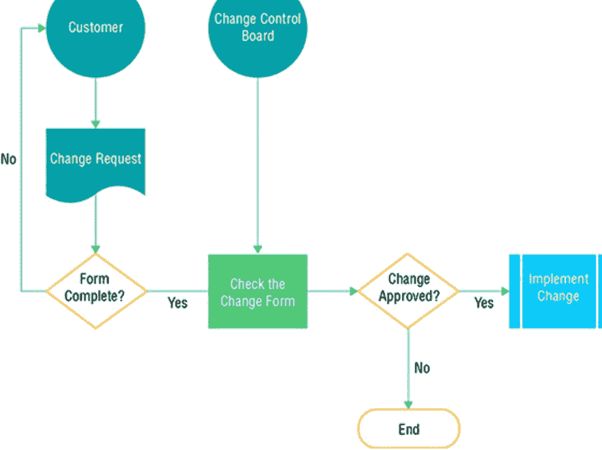

A. 流程图
B. 直方图
C. 帕托图
D. 甘特图

6. 项目进度包含以下所有元素，但不包括：

A. 活动的开始和结束日期
B. 活动持续时间
C. 活动对资源的分配
D. 项目开始的授权

7. Nathan 是一位软件游戏开发人员，被分配到一个创建一个革命性的新型虚拟现实游戏的项目。他收到通知，要求参加一个会议并对他们将使用的技术进行 45 分钟的演示。Nathan 收到的哪种文档传达了这一要求？

A. 会议议程 (Meeting agenda)
B. 会议记录 (Meeting minutes)
C. 行动事项 (Action items)
D. Wiki 页面

8. 以下哪些是沟通项目当前状况的手段？（选择三个）

A. 仪表板信息
B. 状态报告
C. 会议记录
D. 会议议程
E. 沟通章程
F. 项目章程

9. 下列哪个工具用于输入数据以自动生成甘特图、WBS 或活动序列？

A. 流程图
B. SCRUM 回顾
C. 协作工具
D. 项目进度软件

10. 哪种知识管理工具用于与整个组织的内部员工进行通信？

A. Wiki 页面
B. 内网站点
C. 互联网站点
D. 协作工具

11. RACI 矩阵是做什么用的？

A. 确定关键绩效指标
B. 识别角色和职责
C. 分析某一时刻的风险
D. 通过仪表板展示状态

12. 一位没有直接参与项目的领域专家接到了电话，就对团队面临的两个选项提供意见。在 RACI 矩阵中，该利益相关者被分配哪个角色？

A. 负责执行 (Responsible)
B. 问责 (Accountable)
C. 咨询 (Consulted)
D. 知情 (Informed)

13. Carl 一家装订公司的总裁，该公司赢得了为一本新的青少年小说装订的任务。出版公司需要在 12 天内交付 10 万本书。在每天结束时，Carl 都会询问完成的书籍数量，以确保数量达到 8,333 本或以上。这个数字代表什么？

A. 谅解备录 (MOU)
B. 实际成本 (AC)
C. 进度计划指数 (SPI)
D. 关键绩效指标 (KPI)

14. 你参考哪种以项目为中心的文档可以获取项目描述、查找关键交付物并理解项目的成功和验收标准？

A. 项目章程 (Project charter)
B. 范围说明 (Scope statement)
C. 项目进度 (Project schedule)
D. 会议记录 (Meeting minutes)

15. 在定期会议期间，团队创建了一份要采取的后续步骤列表、任务负责人以及截止日期。这属于哪种项目文档？

A. 行动事项 (Action items)
B. 问题日志 (Issues log)
C. 状态报告 (Status report)
D. 沟通计划

16. 在以下哪项中可以找到项目的关键里程碑？

A. 项目章程 (Project charter)
B. 范围说明 (Scope statement)
C. 项目进度 (Project schedule)
D. 行动事项 (Action items)

17. Meghan 是一个项目经理。一名成员向她报告了不不专业的互动。哪种文档可以帮助她升级这个问题？

A. RACI 矩阵
B. 方案请求
C. 组织结构图
D. 问题日志

18. 一个建筑项目刚刚完成了拆除和场地平整。项目经理正在寻找一份说明利益相关者、项目级范围、假设、限制条件以及项目授权的文档。她正在寻找哪种文档？

A. 项目章程 (Project charter)
B. 项目进度

19. 在项目会议期间，一位关键利益相关者查看报告，发现状态现在是黄色，而上次是绿色。该利益相关者正在查看哪种数据？

A. 仪表板信息
B. 鱼骨图
C. 项目管理计划
D. 风险登记册

20. 这里描述的是哪种项目管理工具？

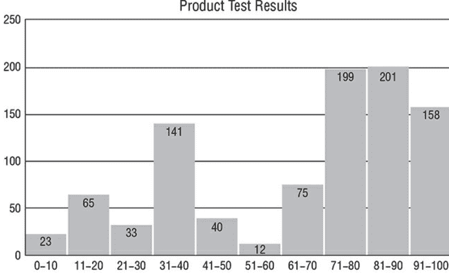

A. 流程图
B. 直方图
C. 帕托图
D. 甘特图

21. 沟通计划包含以下所有组件，但不包括：

A. 利益相关者的信息需求
B. 何时应该发布信息
C. 关于交付物和进度的报告
D. 如何交付信息

22. 在大学课程项目中，Hannah 记录了会议期间发生的情况，打印包含行动事项在内的信息，并将最终版本发给团队。Hannah 创建了哪种项目文档？

A. 会议议程 (Meeting agenda)
B. 会议记录 (Meeting minutes)
C. 状态报告 (Status report)
D. 行动事项 (Action items)

23. Bert 是被分配到开发新型医疗设备的项目经理。他正在寻找说明利益相关者、项目级范围、假设、限制条件以及项目授权的文档。Bert 正在寻找哪种文档？

A. 帕托图
B. RACI 矩阵
C. 项目章程 (Project charter)
D. 平衡计分图

24. 哪种文档在会议前分发，说明要讨论的话题以及谁将在会议上演示？

A. 会议记录 (Meeting minutes)
B. 沟通计划 (Communication plan)
C. 协作工具 (Collaboration tools)
D. 会议议程 (Meeting agenda)

25. 哪种类型的工具可以自动计算任务的持续时间和计划工作量，并允许分配和重新分配资源？

A. PERT
B. SIPOC-R
C. 项目进度软件
D. 直方图

26. 在创建 RACI 矩阵时，有多少不同的职位可以或必须拥有“问责 (accountable)”角色？

A. 零
B. 一个
C. 两个

27. 现场团队向项目经理发送了一份更新，告知其项目现场有12名员工，本周没有发生事故也没有需要报告的问题，且团队正朝着按时完成工作的目标努力。项目经理将这些信息添加到报告的一个框中。你认为这些提供给项目经理报告的数据应该什么？

- A. 行动事项 (Action items)
- B. 仪表板信息 (Dashboard information)
- C. 组织架构图 (Organization chart)
- D. 项目管理计划 (Project management plan)

28. Monty 不记得帮助衡量项目团队创建的产品成功的关键绩效指标是什么了。Monty 可以在哪里找到这些信息？

- A. 问题日志 (Issues log)
- B. 范围说明 (Scope statement)
- C. 沟通计划 (Communications plan)
- D. 行动事项 (Action items)

29. 哪份项目计划规定了项目信息如何共享、共享频率以及与谁共享？

- A. 会议议程 (Meeting agenda)
- B. 行动事项 (Action items)
- C. 项目章程 (Project charter)
- D. 沟通计划 (Communication plan)

30. 组织用于衡量项目目标进展的一组可量化指标是什么？

- A. RACI
- B. SWOT
- C. KPI
- D. NDA

31. Susan 正在参与一个项目，她是被分配完成某项任务中交付物的唯一专家。她将执行工作以完成任务，并且是必须对交付物的正确和彻底完成负责的人。她被分配了 RACI 矩阵中的哪两种参与类型？（选择两项。）

- A. 负责者 (Responsible)
- B. 问责者 (Accountable)
- C. 咨询者 (Consulted)
- D. 知情者 (Informed)

32. 为了履行交付物而应该解决的项目行动清单是什么？

- A. 直方图 (Histogram)
- B. Wiki 页面 (Wiki pages)
- C. 行动事项 (Action items)
- D. 问题日志 (Issues log)

33. 项目组织架构图包含以下所有组件，但不

- A. 项目授权 (Project authorization)
- B. 团队成员组织 (Team member organization)
- C. 汇报结构 (Reporting structures)
- D. 数据元素的可视化表示 (Visual representation of data elements)

34. Scott 是一家非营利组织的董事，他正在寻找该组织尝试的新项目在财务方面的更新。哪份文档可以帮助 Scott 了解项目的当前状况？

- A. 问题日志 (Issues log)
- B. 项目管理计划 (Project management plan)
- C. SWOT 分析 (SWOT analysis)
- D. 状态报告 (Status report)

35. 关于项目早之前会议上做出的决策有一个疑问。项目经理应该查看哪里来帮助回忆该决策以及讨论的情况？

- A. 会议议程 (Meeting agenda)
- B. 项目章程 (Project charter)
- C. 行动事项列表 (Action items list)
- D. 会议纪要 (Meeting minutes)

36. 哪种工具提供了过程中所需所有步骤的可视化表示？

- A. 流程图 (Process diagram)
- B. 直方图 (Histogram)
- C. 帕托图 (Pareto chart)
- D. 项目进度软件 (Project scheduling software)

37. 在创建 RACI 矩阵时，哪个人或群体被分配为负责的“R（Responsible）”？

- A. 对任务的正确和彻底完成负最终责任的人
- B. 在开展工作或做出决策之前需要其意见的人
- C. 执行完成任务或交付物所需工作的人
- D. 在工作或决策完成后后保持其了解最新进展的人

38. 项目经理应参考哪份文档来审查高层范围、高层风险、假设和约束条件，并找出谁是关键利益相关者？

- A. 范围说明 (Scope statement)
- B. 项目章程 (Project charter)
- C. 项目管理计划 (Project management plan)
- D. 会议议程 (Meeting agenda)

39. 这里描述的是哪种类型的项目管理工具？

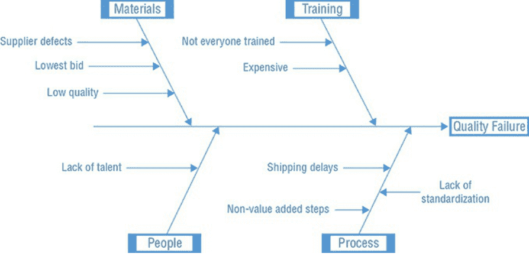

- A. 流程图 (Process diagram)
- B. 直方图 (Histogram)
- C. 帕托图 (Pareto chart)
- D. 鱼骨图 (Fishbone diagram)

40. 在会议期间，团队报告 Brad 的表现极差。项目经理需要更换或重新分配 Brad 的工作。这项任务将记录在哪里？

- A. 会议议程 (Meeting agenda)
- B. 经验教训 (Lessons learned)
- C. 问题日志 (Issues log)
- D. 行动事项 (Action items)

41. 哪种条形图的特殊形式可以直观地显示统计数据的中心趋势、离散程度分布？

- A. 看板 (Kanban board)
- B. 直方图 (Histogram)
- C. 帕托图 (Pareto chart)
- D. SIPOC-R

42. 哪些知识管理工具允许用户使用网络浏览器自由地创建和编辑网页内容？

- A. 内部网站点 (Intranet sites)
- B. Wiki 页面 (Wiki pages)
- C. 协作工具 (Collaboration tools)
- D. 网站 (Internet sites)

43. Troy、Tony 和 Hannah 被分配到一个项目，其中有几项活动他们的努力将产生一个交付物。在 RACI 矩阵的语境下，这些项目团队成员被分配了什么角色？

- A. 负责者 (Responsible)
- B. 问责者 (Accountable)
- C. 咨询者 (Consulted)
- D. 知情者 (Informed)

44. 项目赞助者决定更换项目经理。现任项目经理应该使用哪份以项目为中心的文档让新项目经理熟悉项目？

- A. 项目章程 (Project charter)
- B. 行动事项 (Action items)
- C. 项目进度 (Project schedule)
- D. 项目管理计划 (Project management plan)

45. 哪份文档提供了启动项目的正式授权，并允许项目经理开始向项目分配资源？

- A. 项目章程 (Project charter)
- B. 范围说明 (Scope statement)
- C. 项目管理计划 (Project management plan)
- D. 需求书 (Request for proposal)

46. 一个负责创建新应用程序的项目团队发现，所需的编程比他们想象的复杂一倍，将截止日期推迟几个月。这个主题将记录在哪里？
- A. 项目章程 (Project charter)
- B. 问题日志 (Issues log)
- C. 行动事项 (Action items)
- D. 风险注册 (Risk register)

47. 这里描述的是哪种项目管理工具？
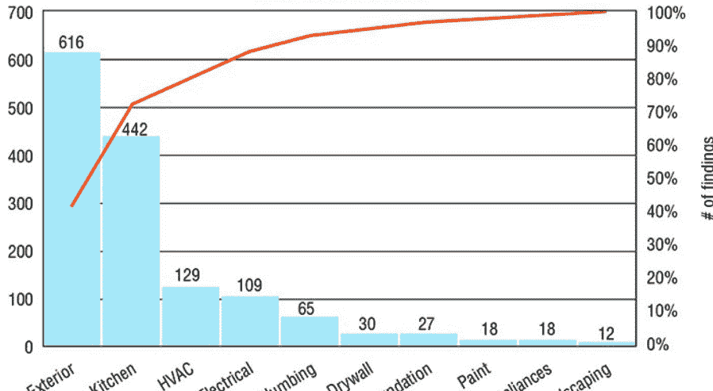
- A. 流程图 (Process diagram)
- B. 直方图 (Histogram)
- C. 帕托图 (Pareto chart)
- D. 甘特图 (Gantt chart)

48. 以下哪项是电子报告工具，用户可以选择项目的某些元素来监控健康和状态？
- A. 看板 (Kanban board)
- B. 项目进度软件 (Project scheduling software)
- C. 供应商库 (Vendor bases)
- D. 仪表板信息 (Dashboard information)

49. 状态报告将包含以下内容，但不
- A. 会议总结 (Recap of meeting)
- B. 交付物进展跟踪 (Tracking toward deliverables)
- C. 与进度表相比的项目状况 (Condition of project compared to the schedule)
- D. 风险和问题的更新 (Updates on risks and issues)

50. Molly 是一位专家规划师，帮助设计和建设新的银行分行以满足需求。她指出设施需要 ATM 机、带窗柜台和保险箱。Molly 需要在哪份项目为中心的文档中确保添加这些？
- A. 项目章程 (Project charter)
- B. 范围说明 (Scope statement)
- C. 组织章程 (Organization charter)
- D. 项目进度 (Project schedule)

51. Earl 是国际运输公司的装载主管。他们被聘在月底前将设备运到另一个大陆。他意识到运送最大设备的飞机已被另一个任务预订到月底。Earl 应该在哪里记录这些信息？
- A. 风险注册 (Risk register)
- B. 行动事项列表 (Action items list)
- C. 问题日志 (Issues log)
- D. 状态报告 (Status report)

+ B. 组织结构图
+ C. 行动事项
+ D. 状态报告

56. 会议结束后，被指定为记录员的人员将他的笔记以及所做的任何决策和分配的任务录入。这是哪种以项目为中心的文档？
+ A. 行动事项
+ B. 会议议程
+ C. 状态报告
+ D. 会议纪要

57. 哪种文档综合集合详细说明了沟通、风险管理、项目进度和范围管理？
+ A. 范围声明
+ B. 征求建议书 (RFP)
+ C. 项目管理计划
+ D. 仪表板信息

58. Emily 登录了项目网站，正在查看项目健康和状态的各种元素。Emily 正在查看哪种项目为中心的文档？
+ A. 会议纪要
+ B. 项目管理计划
+ C. 行动事项
+ D. 仪表板信息

59. 在处理 RACI 矩阵时，以下哪些是正确的？（选择三项。）
+ A. RACI 是负责（Responsible）、问责（Accountable）、咨询（Consulted）和知情（Informed）的缩写。
+ B. RACI 是一个基于等级和资历的矩阵。
+ C. RACI 是合理（Reasonable）、负责（Accountable）、冲突（Conflicted）和知情（Informed）的缩写。
+ D. RACI 是一个基于矩阵的图表。
+ E. RACI 是用于风险识别的 SWOT 分析的一种形式。
+ F. RACI 用于识别项目中的角色和职责。

60. 在新手机上描绘的是什么类型的项目管理？
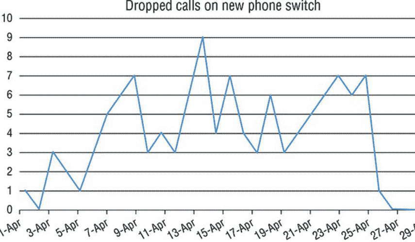
+ A. 运行图
+ B. 直方图
+ C. 帕累托图

61. 范围声明包含以下所有组件，**除外**
+ A. 产品描述
+ B. 关键交付物
+ C. 活动开始和结束日期
+ D. 验收标准

62. Nick 是被分配到一个举办大型足球锦赛项目的领域专家。他正在就项目每项活动所需的时间以及应该尝试的顺序提供建议。Nick 正在为哪份文档做贡献？
+ A. 项目进度
+ B. 范围声明
+ C. 会议议程
+ D. 经验教训

63. 在即将举行的会议之前，Judy 发送了一份文档，让每个人知道需要讨论的内容、每个项目允许发言的时间以及需要准备发言的人。这代表了哪种项目为中心的文档？
+ A. 行动事项
+ B. 会议议程
+ C. 问题日志
+ D. 会议纪要

64. 使用哪种工具可以帮助以图表上条形的形式发现问题（或其他变量）从高到低的分布情况？
+ A. 散点图
+ B. 直方图
+ C. 帕累托图
+ D. 运行图

65. 哪种知识管理工具允许承包商或公司产品用户找到有关特定问题的信息，或找到如何使用产品的操作说明？
+ A. 协作工具
+ B. 社交媒体
+ C. 供应商知识库
+ D. 内部网站点

66. 项目管理计划由以下所有组件，**除外**。（选择两项。）
+ A. 项目进度
+ B. 范围计划
+ C. 行动事项
+ D. 沟通计划
+ E. 征求建议书 (RFP)

67. Simon 是一个被分配帮助推广项目的高中实习生。他的任务是创建书面报告、发送电子邮件和创建议程。哪份文档会告诉 Simon 需要创建哪些任务以及间隔多久创建一次？
+ A. 沟通计划
+ B. 经验教训
+ C. 会议纪要
+ D. 项目进度

68. 在每次会议中，都会指定一名项目团队成员担任记录员，对会议中确定的主题、行动事项和其他问题进行记录。记录员被分配创建哪份文档？
+ A. 会议纪要
+ B. 状态报告
+ C. 仪表板信息
+ D. 问题日志

69. 使用哪种工具可以按时间顺序显示观察到的数据？
+ A. 运行图
+ B. 直方图
+ C. 帕累托图
+ D. 散点图

70. 一个软件开发团队告诉项目经理，他们需要额外五天来完成分配的任务。项目经理参考了一份文档并得出结论，如果没有其他情况变化，这将导致整个项目的延误。项目经理在使用哪份文档进行此分析的？
+ A. 状态报告
+ B. 沟通计划
+ C. 项目进度
+ D. 范围声明

71. 项目团队需要参加每日站会会议，以讨论项目的活动和障碍。哪份文档让项目团队知道他们需要参加会议？
+ A. 项目进度
+ B. 沟通计划
+ C. 项目章程
+ D. 范围声明

72. Pattie 是一家为高等教育机构提供认证的公司的项目经理。他们被要求对一个拥有三所学校的大学系统进行评审，因此她开始创建沟通计划、范围计划和项目进度。这些信息会被添加到哪份项目为中心的文档中？
+ A. 项目管理计划
+ B. 业务理由

73. 这里描绘的是哪种项目管理工具？

+ A. 流程图
+ B. 直方图
+ C. 帕累托图
+ D. 散点图

74. 一个项目正在进行。Josh 负责成本，Vanessa 负责营销。这些信息应该记录在哪里？
+ A. 项目章程
+ B. 沟通计划
+ C. 组织结构图
+ D. 范围声明

75. 使用哪种工具可以创建自变量如何影响因变量的回归？
+ A. 流程图
+ B. 直方图
+ C. 帕累托图
+ D. 散图

76. 项目经理正在审查一份包含沟通计划、风险管理计划、进度和范围计划的计划。项目经理正在看什么？
+ A. 项目章程
+ B. 仪表板信息
+ C. 会议议程
+ D. 项目管理计划

77. 使用哪种工具可以创建时间线、开始日期和活动顺序的可视化？
+ A. 流程图
+ B. 帕累托图
+ C. 甘特图
+ D. 直方图

78. Simon 是一个项目的项目经理，他正在创建一个显示每个领域负责人及其资源的图表。Simon 正在创建哪种文档？
+ A. 沟通计划
+ B. 帕累托图
+ C. 鱼骨图
+ D. 组织结构图

79. 项目经理负责创建、更新和完成这份包含预算、进度、沟通和风险的集合集合？
+ A. 沟通计划
+ B. 项目进度
+ C. 谅备忘录
+ D. 项目管理计划

80. 问题日志会记录以下所有数据，**除外**
+ A. 问题描述
+ B. 所有者
+ C. 缓解措施
+ D. 截止日期

81. 在会议纪要中，有一部分包含了会议中确定的待工作、执行人员姓名和截止日期。会议纪要的这一部分代表什么？
+ A. 仪表板信息
+ B. 看板板
+ C. SIPOC-R
+ D. 行动事项

82. 组织使用哪种知识管理工具向公众、客户和合作伙伴提供信息？
+ A. 社交媒体
+ B. 内部网站点
+ C. 互联网站点
+ D. 供应商知识库

83. Jean 正在查看描述项目团队结构的可视化表示。她正在查看哪份项目为中心的文档？
+ A. 项目章程
+ B. 项目进度
+ C. 组织结构图
+ D. 沟通计划

84. 项目章程完成了以下项目组件，**除外**
+ A. 设置高级范围、预算和里程碑
+ B. 设置项目的层级汇报结构
+ C. 授权项目开始
+ D. 授权资源开始应用于项目

85. Amelia 难以在计划的时间范围内与关键领域专家会面以收集项目需求。这些信息应该记录在哪里？
+ A. 沟通计划
+ B. 问题日志
+ C. 项目进度
+ D. 行动事项

86. 在与利益相关者的定期跟进会议期间，项目经理展示了所有任务区域的信息。每个任务区域都有时间、成本、资源、风险、问题和变更列，且每个项目都用红色、黄色或绿色表示该区域内每个任务的状态。展示的是哪种项目为中心的文档？
+ A. 流程图
+ B. 甘特图
+ C. 仪表板信息
+ D. 运行图

87. 项目赞助者要求利益相关者了解项目交付物、进度、风险和问题的进展。项目赞助者要求的是什么？
- A. 会议议程
- B. 状态报告
- C. 行动事项
- D. 会议纪要

88. 一个创建新电影的大型全球项目有一千多个人分配到项目中。项目经理需要找出哪些个人正在与第二个生产部门合作。哪份以项目为中心的文档可以帮助她获取这些信息？
- A. 组织架构图
- B. RACI矩阵
- C. 鱼骨图
- D. 项目章程

89. 项目经理正与项目团队编写一份每周文档，向利益相关者解释完成了哪些任务、花费了多少预算、存在哪些问题，以及任何影响项目的风险。他们正在编写哪种文档？
- A. 问题日志
- B. 行动事项
- C. 状态报告
- D. 项目管理计划

90. 一个新团队成员加入项目，并对需要完成哪些工作以及团队将如何知道他们成功了提问。哪份文档可以帮助回答该团队成员提出的问题？
- A. 项目章程
- B. 项目进度
- C. 行动事项
- D. 范围说明

91. 项目协调员被指示通过电子邮件向一组确定的利益相关者发送每周状态更新。哪份文档指示项目协调员执行此项活动？
- A. 项目章程
- B. 项目进度
- C. RACI矩阵
- D. 沟通计划

92. 一个项目团队成员从一封邮件中获知，需要在下次会议上进行简要演示，概述其团队项目任务中面临的问题以及可能的解决方案。该团队成员正在查看哪份以项目为中心的文档？
- A. 会议议程
- B. 会议纪要
- C. 状态报告
- D. 项目进度

93. DewDrops 怀疑其结账流程的及时性。Danielle 被派遣创建一个工具来跟踪和显示这些观测到的数据。她应该创建什么输出结果？
- A. 帕托图
- B. 直方图
- C. 运行图
- D. 散点图

94. 在 RACI 矩阵中，哪个角色每个任务只能分配一次？
- A. 负责人 (Responsible)
- B. 许可 (Accountable)
- C. 咨询 (Consulted)
- D. 通知 (Informed)

95. Wigit Construction 审查了一份 RFP 回复并与供应商达成了协议。他们应该如何沟通他们需要的货物和服务数量以及将支付的价格？
- A. 时间和材料合同
- B. 采购订单
- C. 成本报销合同
- D. 固定价格合同

96. “我们在这里为您服务！”是一家临时人员派遣公司，已向一个项目派遣了两名行政助理以跟上需求。他们用于提供此项服务的最佳合同形式是什么？
- A. 成本报销合同
- B. 采购订单
- C. 固定价格合同
- D. 时间和材料合同

97. 两家政府机构同意在一个重大项目上合作。他们花了一些时间创建了一份双方签署的谅解备录（MOU）。哪项最能描述 MOU 的含义？
- A. 具有相互约束力的文件
- B. 无相互约束力的文件
- C. 各机构意图的公告
- D. 获取更多信息的采购方法

98. DewDrops 刚刚与客户完成了一份文档。该文档描述了 DewDrops 将为客户提供的服务、支付的金额，以及如果 DewDrops 未交付将面临的惩罚。这是什么类型的文档？
- A. 建议书 (RFP)
- B. 保修书
- C. 保密协议
- D. 合同

99. Hugh 被要求调查一家医院的新型医疗设备，这是某位高管在贸易展会上看到的。医院并不知道是谁供应这些设备，也不知道费用是多少。Hugh 应该采取的适当采购方法是什么？
- A. 工作说明书 (SOW)
- B. 信息请求 (RFI)
- C. 建议书 (RFP)
- D. 询价单 (RFQ)

100. 什么是 SOW？
- A. 一旨在获取更多货物和服务信息的采购方法
- B. 一旨在邀请投标、评审、选择和购买货物或服务的采购方法
- C. 一份详细说明要从组织外采购货物和服务的采购文档
- D. 在完成建议书之前与潜在供应商进行的会议

101. Wigcom 正在寻找新的存储解决方案来处理日益增长的数据需求。他们不确定具体需要什么种解决方案，甚至不知道哪些供应商可以向他们提供解决方案。他们应该使用的最佳采购方法是什么？
- A. 建议书 (RFP)
- B. 询价单 (RFQ)
- C. 信息请求 (RFI)
- D. 工作说明书 (SOW)

102. Erik 一直在分析比较自变量和因变量之间的任何相关性。他创建了一个回归线图来预测变化。Erik 创建了什么？
- A. 流程图
- B. 直方图
- C. 帕托图
- D. 散点图

103. 购买方为什么要发布采购订单？
- A. 表示该情况比合同需要更多的灵活性和简单
- B. 在签订合同之前概述双方的意图或行动
- C. 描述所需的货物和服务数量以及价格
- D. 防止其他公司使用

104. DewDrops 正在寻求新设施的建设和交付招标。DewDrops 应该使用哪种征集方法？
- A. 工作说明书 (SOW)
- B. 询价单 (RFQ)
- C. 建议书 (RFP)
- D. 信息请求 (RFI)

105. 保修书规定了什么？
- A. 它规定了所需的货物和服务以及将支付的价格
- B. 它保证产品或服务将符合预期并按规定性能运行
- C. 它概述了签订合同之前双方的意图或行动
- D. 它确保敏感的贸易机密信息不被共享

106. 提交 SOW、接收供应商和供应商的投标、评估响应并做出选择的过程被称为以下哪项？
- A. RFQ
- B. RFP
- C. SCRUM
- D. C

107. 描述将提供的货物或服务、其成本以及违约罚款的法律文件被称为以下哪项？
- A. 建议书
- B. 保密协议
- C. 合同
- D. 保修书

108. 关键特征、功能、需求或设计基础如果发生变化，将对产品或服务的性能、范围、进度、成本和风险产生重大影响。这是定义？
- A. 关键绩效指标 (KPI)
- B. 谅解备录
- C. 关键性能参数
- D. 仪表板信息

109. Kim 和 Bill 是大型复杂项目的联合项目经理。他们需要计算并跟踪任务和截止日期，并且快速准确地生成报告。他们应该使用什么来实现目的？
- A. 看看板板
- B. 每日 SCRUM
- C. 项目进度软件
- D. 供应商知识库

110. Wig Construction 赢得了一个发布 RFP 的政府机构的招标。该机构担心 Wig Construction 不同意他们的条款，并希望确保不会进行漫长的合同谈判。Wig Construction 使用哪种文档可以开始谈判？
- A. 意向书
- B. 保修书
- C. 保密协议
- D. 终止函

111. 哪项最能描述 RFI？
- A. 获取更多货物信息的采购方法
- B. 邀请投标、评审、选择和购买货物或服务的采购方法
- C. 一份详细说明要从组织外采购货物服务的服务的文档
- D. 在完成建议书之前与潜在供应商进行的会议

### 112. DewDrops 是 SunRays, Inc. 和 DaisyChains, Inc. 的母公司。SunRays 和 DaisyChains 同意相互提供服务，并列出了具体的性能预期，并规定了任何激励或惩罚。
它们不遵守这些规定。记录该安排的最佳方法是什么？
+ A. MOU（谅解备录）
+ B. SLA（服务水平协议）
+ C. NDA（保密协议）
+ D. RFP（需求建议书）

### 113. “We are here for you!”过去曾为 DewDrops 提供过服务，现在在未获得 DewDrops 同意的情况下开始广告和营销 DewDrops 是其客户。应该向“We are here for you!”发送什么文档来纠正这种行为？
+ A. 保密协议
+ B. 服务水平协议
+ C. 终止函
+ D. 质保

### 114. Wigit Construction 已完成一个项目。他们提交了一份发票，以收回在创建餐厅地板时所使用的特殊大理石所花费的费用，合同允许他们这样做。Wigit Construction 使用的是哪种合同？
+ A. 工时材料合同
+ B. 成本报销合同
+ C. 固定价格合同

### 115. 为什么双方会创建服务水平协议？
+ A. 确保敏感或商业秘密信息不会在合作伙伴关系之外共享
+ B. 在签署合同之前勾勒双方的意图或行动
+ C. 勾勒两个组织之间预期的性能水平
+ D. 防止另一公司使用其知识产权并告知他们不要再次这样做

### 116. Jeff 完成了工作说明书（SOW）的编写，并将其提交给公司的采购部门，以向供应商招标。采购团队告诉他，他需要评估供应商的响应并帮助做出选择。此场景描述的是哪种采购方法？
+ A. SOW
+ B. RFI（信息请求）
+ C. RFP
+ D. RFQ（询价请求）

### 117. 当需要关于采购商品和服务服务的更多数据时，使用哪种供应商招标方法最好？
+ A. 信息请求 (RFI)
+ B. 询价请求 (RFQ)
+ C. 需求建议书 (RFP)
+ D. 工作说明书 (SOW)

### 118. 为什么科技公司向另一公司发送终止函？
+ A. 勾勒两个组织之间预期的服务水平
+ B. 在签署合同之前勾勒双方的意图或行动
+ C. 确保敏感或商业秘密信息不会在合作伙伴关系之外共享
+ D. 防止另一公司使用其知识产权并告知他们不要再次这样做

### 119. 一个软件开发团队正在使用网络浏览器编辑共同页面来共享他们的知识和进度。他们正在使用哪种知识管理工具？
+ A. Wiki 页面
+ B. 内网站点
+ C. 互联网站点
+ D. 协作工具

### 120. Trevor 和 Harry 正在为一个项目创建软件代码。他们在这项任务被分配了 RACI 中的哪种类别？
+ A. 负责 (Responsible)
+ B. 相应 (Accountable)
+ C. 咨询 (Consulted)
+ D. 知情 (Informed)

### 121. DewDrops 发布了一份允许卖家开始某项目的文档。该文档详细说明了卖家将获得什么报酬以及项目中需要提供的准确交付物。DewDrops 向卖家发布了什么文档？
+ A. 采购订单
+ B. 成本报销合同
+ C. 固定价格合同
+ D. 工时材料

### 122. 主要由联邦政府和公用事业行业使用的系统性能属性，被认为是开发有效能力至关重要或基本的？
+ A. 关键性能参数
+ B. 州间协议
+ C. 服务水平协议
+ D. 意向书

### 123. 什么文档提供了产品或服务将符合预期并按规定的保证？
+ A. 质保
+ B. 服务水平协议
+ C. 采购订单
+ D. 谅解备录

### 124. 使用哪种供应商招标方法来邀请供应商进入投标过程，对特定产品或服务进行投标？
+ A. 信息请求 (RFI)
+ B. 询价请求 (RFQ)
+ C. 需求建议书 (RFP)
+ D. 工作说明书 (SOW)

### 125. 什么最能描述 RFQ？
+ A. 在完成提议书之前与潜在供应商的会议
+ B. 详细说明从组织外部采购的商品和服务的采购文件
+ C. 用于邀请投标、评审、选择和购买商品或服务的采购方法
+ D. 获取有关商品和服务更多信息的采购方法

### 126. 以下所有项都是采购方法，除外
+ A. RFQ
+ B. RACI
+ C. RFI
+ D. RFP

### 127. Vanina 接手了一个大型复杂项目的项目经理。她与项目团队合作，获取任务的更新状态和开始日期。她将使用哪种工具将这些信息转换为更新的报告？
+ A. Kanban 看板
+ B. 项目调度软件
+ C. 内网站点
+ D. 供应商知识库

### 128. DewDrops 是 SunRays, Inc. 和 DaisyChains, Inc. 的母公司。SunRays 和 DaisyChains 同意相互提供服务，并概述双方必须遵守的特定标准。记录该安排的最佳方法是什么？
+ A. SLA
+ B. MOU
+ C. NDA
+ D. RFP

### 129. Wigit Construction 拥有一个移动设备的专利，另一公司在未经许可且未支付补偿的情况下使用了该专利。Wigit 的下一步是什么？
+ A. 发出采购订单
+ B. 发出意向书
+ C. 发出终止函
+ D. 签署保密协议

### 130. 为什么双方会共享意向书？
+ A. 确保敏感或商业秘密信息不会在合作伙伴关系之外共享
+ B. 在签署合同之前勾勒双方的意图或行动
+ C. 勾勒两个组织之间预期的服务水平
+ D. 防止另一公司使用其知识产权并告知他们不要再次这样做

### 131. 使用哪种以供应商为中心的文档可以确保敏感或商业秘密信息不会在合作伙伴关系之外共享？
+ A. MOU
+ B. SLA
+ C. NDA
+ D. RFP

### 132. 当组织准备好采购产品或服务以便开始工作，应该使用哪种采购方法？
+ A. 信息请求 (RFI)
+ B. 询价请求 (RFQ)
+ C. 需求建议书 (RFP)
+ D. 工作说明书 (SOW)

### 133. 什么是投标人会议（bidder's conference）？
+ A. 关于项目进度和障碍的每日会议
+ B. 与潜在供应商会面以解答 RFP 中的问题
+ C. 帮助寻找商品服务最低成本的拍卖
+ D. 说明组织希望从外部采购的商品文档

### 134. Wigcom 和 DewDrops 进入合作伙伴关系以完成一个项目。Wigcom 希望确保其商业秘密不被 DewDrops 披露或使用。这两个组织应该使用哪种协议？
+ A. RFP
+ B. NDA
+ C. SLA
+ D. MOU

### 135. DewDrops 发布了 RFP，但其工作说明书尚未开发，因为他们不确定最终产品要做什么。在这种情况下哪种类型的合同合理？
+ A. 成本报销合同
+ B. 采购订单
+ C. 固定价格合同
+ D. 工时材料

### 136. Wigit Construction 正在响应一份 RFP，所需的工作定义明确、清晰且简洁。如果他们赢得了工作，哪种类型的合同最好？
+ A. 固定价格合同
+ B. 服务水平协议
+ C. 成本报销合同
+ D. 工时材料

### 137. 哪种类型的合同对买方来说风险最大？
+ A. 工时材料
+ B. SCRUM 方法论
+ C. 成本报销合同
+ D. 固定价格合同

### 138. 一个政府机构正在寻找一个新的选民管理系统。尽管他们不清楚有哪些选项，但他们需要快速做出决定并推进采购解决方案。他们使用哪种采购方法最好？
+ A. SOW
+ B. 信息征询 (RFI)
+ C. 建议书请求 (RFP)
+ D. 报价请求 (RFQ)

### 139. 下面哪些属于具有约束力的文件类型？（选择三项。）
- A. 协议/合同
- B. 谅解备录 (MOU)
- C. SCRUM 回顾会议
- D. 问题日志 (Issues log)
- E. 采购订单 (Purchase order)
- F. 直方图 (Histogram)

### 140. Wigcom 正在开发新产品，需要特定的技能来帮助完成项目。他们找到了一家提供资源的人力公司，但 Wigcom 不确定该合作的具体交付物是什么。哪种合同形式能为他们提供最大的灵活性？
- A. 工时与材料 (Time and materials)
- B. 成本报销合同 (Cost-reimbursable contract)
- C. 固定价格合同 (Fixed-price contract)

### 141. DewDrops 发布了份 RFP，但他们的工作说明书（SOW）尚未完善。他们决定与卖家使用成本报销合同。在这种情况下，哪项最能描述 DewDrops 面临的风险状况？
- A. 风险在项目启动之前不会发生，在合同阶段并不重要。
- B. 风险在买方和卖家之间平均分配。
- C. 这是风险最高的合同类型，因为在项目完成之前，买方不知道最终成本。
- D. 这是风险最低的合同类型，因为卖家承担了未知成本的风险。

### 142. Noreen 一直在编写一个文件，概述了公司需要的几件设备以及安装这些设备所需的专业服务。Noreen 创建了哪种文件？
+ A. 信息征询 (RFI)
+ B. 报价请求 (RFQ)
+ C. 建议书请求 (RFP)
+ D. 工作说明书 (SOW)

### 143. 一家政府机构为新的计算机解决方案发布了报价请求，以帮助他们的选民。哪种其他采购方法与 RFQ 相当？
+ A. SOW
+ B. 保密协议 (NDA)
+ C. RFP
+ D. RFI

### 144. 为什么双方会创建一个谅解备忘录（MOU）协议？（选择两项。）
+ A. 情况需要比合同更具灵性和简单性。
+ B. 需要保护信息或商业秘密的安全。
+ C. 双方无法达成合同协议。
+ D. 为了通知另一方停止其行动且不再恢复。

### 145. 当所需的产品或服务定义明确时，哪种类型的合同工作效果最好？
+ A. 工时与材料
+ B. SCRUM 方法论
+ C. 成本报销合同
+ D. 固定价格合同

### 146. Wigit Construction 正在响应一份 RFP，客户希望使用固定价格合同。如果 Wigit Construction 赢得了这项工作，以下哪种陈述代表了 Wigit Construction 的风险？
+ A. 风险最低，因为买方承担了未知成本的风险
+ B. 风险最高，因为项目中的问题将增加他们的成本
+ C. 风险在买方和卖家之间平均分配
+ D. 风险在项目启动之前不会发生，在合同阶段并不重要

### 147. DewDrops 发布了用于购买新企业软件系统的 RFP。他们举办了电话会议来回答有关 RFP 的任何问题并澄清任何问题。这是以下哪项的例子？
+ A. SCRUM 回顾会议
+ B. 会议记录
+ C. 投标人会议 (Bidder conference)
+ D. 固定价格合同

### 148. 哪两种采购方法具有类似的目的，即扫描供应商市场数量并获得成本估算？（选择两项。）
+ A. RFQ
+ B. NDA
+ C. RFP
+ D. RFI

### 149. 哪种类型的合同允许卖家补偿与提供货物或服务相关的所有许可费用？
+ A. 成本报销合同
+ B. 工时与材料
+ C. 工作说明书 (SOW)
+ D. 固定价格合同

### 150. Wig Construction 一直考虑购买新的自卸车。在获得董事会、高级管理层或其他适当管理机构的资金批准后，他们准备开始采购。他们应该使用哪种采购方法？
+ A. 建议书请求 (RFP)
+ B. 报价请求 (RFQ)
+ C. 工作说明书 (SOW)
+ D. 信息征询 (RFI)

### 151. 哪项最能描述 RFP？
+ A. 用于邀请投标、评审、选择和购买商品或服务的采购方法
+ B. 用于获取更多有关商品和服务信息的采购方法
+ C. 在完成建议书之前与潜在供应商进行的会议
+ D. 详细说明要从组织外采购商品或服务的采购文件

### 152. 买方创建的哪种文件描述了要获取商品或服务的规格、数量以及价格？
+ A. 建议书请求 (RFP)
+ B. 采购订单 (Purchase order)
+ C. 信息征询 (RFI)
+ D. 行动事项 (Action items)

### 153. 哪种文件描述了组织感兴趣从组织外采购的货物或服务？
+ A. SOW
+ B. RFI
+ C. RFP
+ D. RFQ

### 154. 创建什么文件可以定义两个或多个双方之间的性能预期？
+ A. MOU
+ B. NDA
+ C. 服务水平协议 (SLA)
+ D. RFQ

### 155. 哪种合同对卖家来说风险最高？
+ A. 成本报销合同
+ B. 采购订单
+ C. 固定价格合同
+ D. 工时与材料

### 156. 创建什么文件可以概述双方之间的特定标准？
+ A. MOU
+ B. SLA
+ C. NDA
+ D. RFQ

### 157. 地理分散的团队需要协作。以下哪种对他们是有效的？
+ A. Wiki 页面
+ B. 网站
+ C. 供应商知识库
+ D. 协作工具

### 158. 创建什么文件可以概述已所采取的步骤？
+ A. 甘特图
+ B. 直方图
+ C. 流程图
+ D. 图

### 159. 项目章应包含以下内容，例外：
+ A. 高级需求
+ B. 高级预算
+ C. 高级行动事项
+ D. 假设和约束

### 160. 供应商在严格地执行变更控制。哪种合同会导致这种行为？
+ A. 成本报销
+ B. 固定价格
+ C. 工时与材料
+ D. 建议书请求

### 161. Alex 正在使用 SWOT 分析来确定项目的内部优势。该分析还能给他提供什么？
+ A. 外部机会和威胁
+ B. 内部机会和威胁
+ C. 外部优势和劣势
+ D. 没有其他贡献

### 162. 哪种类型的合同将适用于人员外包情况？
+ A. 工时与材料
+ B. 采购订单
+ C. 成本报销合同
+ D. 固定价格合同

### 163. 项目负责人接到电话，告诉她某项重大任务已完成，没有安全问题要报告。负责人承担哪个角色？
+ A. 负责 (Responsible)
+ B. 解释 (Accountable)
+ C. 咨询 (Consulted)
+ D. 知情 (Informed)

### 164. DewDrops 正在帮助客户实施新的业务，他们被一个阻塞项目困住了。DewDrops 顾问检查了数据库，查看其他客户是否有过这个问题以及是如何做的。他正在使用哪种知识管理工具？
+ A. 供应商知识库
+ B. Wiki 页面
+ C. 协作工具
+ D. 网站

### 165. 在门禁会议上，委员会收到了一份显示项目各个领域健康状况的报告：进度绿色、预算黄色、范围绿色、风险黄色、宣传红色。委员会正在看哪种类型的工具？
+ A. 协作工具
+ B. 散点图
+ C. 直方图
+ D. 平衡得分卡

### 166. Jack、Jill 和 Harry 是三个帮助项目全天候工作的轮班经理。哪种工具可以帮助他们记录日志？
+ A. 社交媒体
+ B. 网站
+ C. Wiki 页面
+ D. 供应商知识库

### 167. 在领导层变更后，新项目经理想了解结构和汇报关系。哪份文件可以提供这些信息？
+ A. 组织架构图
+ B. 项目图
+ C. 会议记录
+ D. 经验教训

### 168. 在门禁检查期间向委员会提交什么样的文件？
+ A. 状态报告
+ B. 沟通计划
+ C. 直方图
+ D. 项目进度软件

### 169. 在完成一项要求的政府项目时
安全许可，供应商可能被要求签署哪份文件？
+ A. 服务水平协议
+ B. 质修书
+ C. 需求说明书
+ D. 保密协议

### 170. 项目增加了一位顾问，帮助确定公司发票支付流程所需的所有步骤。该顾问最可能使用哪种工具？
+ A. 流程图
+ B. 帕托图
+ C. 项目进度软件
+ D. 项目章程

### 171. 项目赞助人由于预算不断攀升，认为该项目是失败的。项目经理可以使用哪种工具来确认或反驳项目赞助人的怀疑？
+ A. 平衡计分卡
+ B. RACI 矩阵
+ C. 甘特图
+ D. 项目管理计划

### 172. 哪种类型的合同为更改项目范围提供了最大的灵活性？
+ A. 成本报销类合同
+ B. 采购订单
+ C. 固定价格合同
+ D. 工时和材料合同

### 173. 项目团队准备好切换到新系统。在开始任务之前，他们联系了领域专家 Karen，以确保一切准备就绪。Karen 在 RACI 图中针对此任务分配了什么角色？
+ A. 负责人 (Responsible)
+ B. 问责者 (Accountable)
+ C. 咨询者 (Consulted)
+ D. 知情者 (Informed)

### 174. 这里的是哪种项目管理工具？
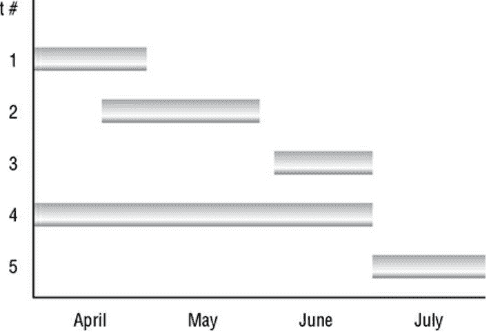
+ A. 流程图
+ B. 甘特图
+ C. 帕托图
+ D. 散点图

### 175. 在整个组织范围内共享信息，但防止这些信息泄给组织之外的人的最佳工具是什么？
+ A. 内部网站点
+ B. Wiki 页面
+ C. 协作工具
+ D. 互联网站点

### 176. 项目团队如何记录项目会议期间所说和达成共识的内容？
+ A. 创建业务案例
+ B. 创建项目管理计划
+ C. 创建范围声明
+ D. 创建会议纪要

### 177. 一家公司收到一封关于在物业边界筑墙的停止终止函。这封信告诉公司做什么？
+ A. 仅就墙的建造收取其时间和材料的费用
+ B. 不泄露有关墙的秘密的任何信息
+ C. 为墙的维护设定服务水平预期
+ D. 停止筑墙，并且不要恢复此活动

## 178.
Dean 已经在一个项目中工作了六个月，但他不是公司的正式员工——他是由供应商提供的合同工。在这种情况下，使用哪种合同形式最合理？
- A. 成本报销类
- B. 固定价格合同
- C. 工时和材料
- D. 需求说明书

## 179.
一项目团队成员正在花时间将任务信息输入到计算机应用程序中，其中包含任务、开始和结束日期以及持续时间。该团队成员正在使用哪种项目管理工具？
- A. 协作工具
- B. 关键绩效指标 (KPI)
- C. 项目进度软件
- D. 项目管理计划

## 180.
Wigit 建设需要作为拓宽项目的一部分完成六座桥梁的更换。他们需要每十周完成一座桥，以便项目按时完成。每十周完成一座桥代表了什么？
- A. 质量成本 (COQ)
- B. 关键绩效指标 (KPI)
- C. 完工预算 (ETC)
- D. 关键参数 (KPP)

## 181.
为什么组织和供应商会签署保密协议？
- A. 通知一方停止某项活动且不再进行该活动
- B. 确保敏感或贸易秘密信息不会共享到组织之外
- C. 在进入合同之前宣布双方的意图或行动
- D. 定义双方之间的服务水平性能预期

## 182.
一块电子板有六个区域，包含项目不同部分的信息。这个屏幕显示的是什么？
- A. Wiki 页面
- B. 仪表板信息
- C. 互联网站点
- D. 协作工具

## 183.
项目经理正在与团队审查一份文件，他们正在共同确定项目的关键路径。他们正在分析项目的哪部分？
- A. 范围声明
- B. 项目进度
- C. 预算差异
- D. 看板看板

## 184.
JoAnn 被要求跟踪原型产品前三个月的生产数据，以确保其符合质量预测。她应该使用哪种工具进行此项分析？
- A. 帕托图
- B. 运行图 (Run chart)
- C. 鱼骨图
- D. Wiki 页面

## 185.
项目赞助人正在寻找环境扫描，以确定项目是否有利于成功，特别是在将他们的公司与竞争对手比较时。完成此扫描的最佳工具是什么？
- A. 流程图
- B. 直方图
- C. 供应商知识库
- D. SWOT 分析

## 186.
“我们在这里为您服务！”是一家为某些项目实施提供人员增强的初创公司。他们会使用哪种工具让客户了解他们的业务？
- A. 内部网站点
- B. Wiki 页面
- C. 协作工具
- D. 互联网站点

## 187.
哪种文件用于在进入合同或其他相互具有约束力的协议之前，概述不同方的的意图或行动？
- A. 停止终止函
- B. 服务水平协议
- C. 保密协议
- D. 意向书

## 188.
Dean 已经在一个项目中工作了六个月，但他不是公司的正式员工——他是由供应商提供的合同工。在这种情况下，使用哪种合同形式最合理？
- A. 成本报销类
- B. 固定价格合同
- C. 工时和材料
- D. 需求说明书

## 189.
一个项目团队成员正在花时间将任务信息输入到计算机应用程序中，其中包含任务、开始和结束日期以及持续时间。该团队成员正在使用哪种项目管理工具？
- A. 协作工具
- B. 关键绩效指标 (KPI)
- C. 项目进度软件
- D. 项目管理计划

## 180.
Wigit 建设需要作为拓宽项目的一部分完成六座桥梁的更换。他们需要每十周完成一座桥，以便项目按时完成。每十周完成一座桥代表了什么？
- A. 质量成本 (COQ)
- B. 关键绩效指标 (KPI)
- C. 完工预算 (ETC)
- D. 关键参数 (KPP)

## 181.
为什么组织和供应商会签署保密协议？
- A. 通知一方停止某项活动且不再进行该活动
- B. 确保敏感或贸易秘密信息不会共享到组织之外
- C. 在进入合同之前宣布双方的意图或行动
- D. 定义双方之间的服务水平性能预期

## 182.
一块电子板有六个区域，包含项目不同部分的信息。这个屏幕显示的是什么？
- A. Wiki 页面
- B. 仪表板信息
- C. 互联网站点
- D. 协作工具

## 183.
项目经理正在与团队审查一份文件，他们正在共同确定项目的关键路径。他们正在分析项目的哪部分？
- A. 范围声明
- B. 项目进度
- C. 预算差异
- D. 看板看板

## 184.
JoAnn 被要求跟踪原型产品前三个月的生产数据，以确保其符合质量预测。她应该使用哪种工具进行此项分析？
- A. 帕托图
- B. 运行图 (Run chart)
- C. 鱼骨图
- D. Wiki 页面

## 185.
项目赞助人正在寻找环境扫描，以确定项目是否有利于成功，特别是在将他们的公司与竞争对手比较时。完成此扫描的最佳工具是什么？
- A. 流程图
- B. 直方图
- C. 供应商知识库
- D. SWOT 分析

## 186.
“我们在这里为您服务！”是一家为某些项目实施提供人员增强的初创公司。他们会使用哪种工具让客户了解他们的业务？
- A. 内部网站点
- B. Wiki 页面
- C. 协作工具
- D. 互联网站点

## 187.
哪种文件用于在进入合同或其他相互具有约束力的协议之前，概述不同方的意图或行动？
- A. 停止终止函
- B. 服务水平协议
- C. 保密协议
- D. 意向书

## 188.
项目团队正在测试他们制造的产品，试图查看它在失败前出现了多少次。他们使用哪种工具？
- A. 散点图
- B. 直方图
- C. 帕托图
- D. 运行图

## 189.
那些需要监控的项列表被称为以下哪一项？
- A. 问题日志 (Issues log)
- B. 行动项 (Action items)
- C. 风险登记 (Risk register)
- D. 预算报告

## 190.
Valentine 被要求确定项目问题的根源。她应该使用哪种工具来帮助她进行分析？
- A. 帕托图
- B. 运行图 (Run chart)
- C. Wiki 页面
- D. 鱼骨图

## 191.
项目经理正在密切监控项目某个阶段的工时。在这种场景中，工时代表了什么？
- A. SWOT 分析
- B. Wiki 页面
- C. 关键绩效指标 (KPI)
- D. 风险登记

## 192.
哪份文件用于强制另一方停止某项活动并让他们不要再次进行该活动？
- A. 停止终止函
- B. 服务水平协议
- C. 保密协议
- D. 质修书

## 193.
项目经理得到一张代表路段交通统计分布的条形图。项目经理拿到的是什么？
- A. 帕托图
- B. 直方图
- C. 流程图
- D. 鱼骨图

## 194.
哪种工具可以自动创建关键路径、浮动、WBS 和活动序列？
- A. 项目进度软件
- B. SIPOC-R
- C. PERT
- D. 运行图 (Run chart)

## 195.
供应商提供了一份他们在项目上花费的时间、差旅费用和补贴以及项目使用的材料成本。这里使用的是哪种合同？
- A. 停止终止
- B. 工时和材料
- C. 成本报销类

## 196.
Roy 正在应对项目中让他压力压力的问题。他想看看哪些问题对项目造成了最大的干扰。他应该使用哪种工具？
- A. 直方图
- B. 帕托图
- C. 运行图 (Run chart)
- D. 散点图

## 197.
一个项目团队位于两个城市，两个地地的团队成员试图解决一个问题。他们使用允许相互共享屏幕的软件。他们正在使用哪种知识管理工具？
- A. 内部网站点
- B. Wiki 页面
- C. 协作工具
- D. 互联网站点

## 198.
Miranda 是一个职能经理，她的业务将受到新软件实施的影响。她被邀请参加供应商演示，以便她看到新的生产流程并在最终决定前提供意见。Miranda 在此任务中分配了什么角色？
- A. 咨询者 (Consulted)
- B. 知情者 (Informed)
- C. 负责人 (Responsible)
- D. 问责者 (Accountable)

## 199.
项目经理非常激动地与团队分享，他们获得了启动项目的正式授权。他们收到了什么赋予他们这种权限？
- A. 方案建议书
- B. 范围说明书
- C. 项目章程
- D. 项目管理计划

## 200.
项目中的某领域专家一直在监控白天每小时收到的支持电话的分布情况，以确定项目的人员需求。此人最可能在使用哪种工具？
- A. 流程图
- B. 直方图
- C. 运行图
- D. 甘特图

## 201.
William 在一家政府机构的公共关系办公室工作。他收到消息，称一座新桥的建设已经完成，交通可以恢复正常运行，因此他可以发布新闻稿。在这次任务更新中，William 被分配了什么角色？
- A. 咨询（Consulted）
- B. 知情（Informed）
- C. 负责（Responsible）
- D. 解释（Accountable）

## 202.
买方大部分清楚他们想要从项目中获得什么，但无法完全说明产品需要具备哪些功能。在这种情况下，哪种合同形式最合理？
- A. 工时和材料合同
- B. 报销制合同
- C. 不尝试该项目
- D. 固定价格合同

## 203.
客户希望在与供应商的项目安排中获得坚定的固定价格。以下哪些陈述是正确的？（选择两项。）
- A. 合同谈判将花费更长时间，以确保范围明确。
- B. 合同风险转移给买方。
- C. 合同风险转移给卖方。
- D. 该项目可能会有很多变更订单。

## 204.
项目赞助人正在查看一份文件，该文件包含项目范围、预算和进度状态等级，以及一些额外的关键绩效指标（KPI）。项目赞助人正在看哪份文件？
- A. 关键性能参数
- B. 平衡计分卡
- C. SWOT 分析
- D. 关键绩效指标

## 205.
SWOT 代表什么？
- A. 优势、劣势、机会、 威胁（Strengths, weaknesses, opportunities, threats）
- B. 优势、工作、机会、可追溯性（Strengths, work, opportunities, traceability）
- C. 情况、劣势、开源、威胁（Situation, weaknesses, open source, threats）
- D. 情况、工作、开源、可追溯性（Situation, work, open source, traceability）

# 第 5 章

## 练习题 1

此练习考试可用于模拟真实的 CompTIA Project+ 考试。练习考试在百分比和题目数量上与你在实际考试中看到的题目组合保持平衡，尽管实际考试可能会有更多题目。其划分情况如下：

| 领域 1：项目基础 | 36% |
| 领域 2：项目约束 | 17% |
| 领域 3：沟通与变更管理 | 26% |
| 领域 4：项目工具与文档 | 21% |

设置闹钟时间为 75 分钟，并尝试在测试结束前不参考其他材料的情况下完成此练习测试。

### 1.
项目的两个定义特征是什么？（选择两项。）
- A. 重做一个现有项目
- B. 为了实现目的而进行的组织努力
- C. 有特定的结束日期
- D. 组织的日常活动
- E. 建筑所需的蓝图

### 2.
为什么买方会发布采购订单？
- A. 为了描述所需的货物和服务的数量以及将支付的价格。
- B. 为了在签订合同之前概述双方的意图或行动。
- C. 为了阻止另一公司使用其知识产权并告知他们不要再次这样做。
- D. 情况比合同需要更多的活性和简单性。

### 3.
你参考哪份以项目为中心的文档来获取项目描述、查找关键交付物，并理解项目的成功和验收标准？
- A. 项目章程
- B. 项目进度表
- C. 范围说明书
- D. 会议纪要

### 4.
以下所有项都是组织变更的形式，除了
- A. 搬迁
- B. 业务拆分
- C. 有机转变
- D. 业务合并

### 5.
当项目工作时间比计划长导致进度落后时，这代表了哪种常见的项目变更？
- A. 资金变更
- B. 时间线变更
- C. 风险事件
- D. 需求变更

### 6.
Scrum 是以下哪一个？
- A. 指代项目过度复杂的短语
- B. 使用待办事项列表（backlogs）的敏捷技术
- C. 为高级管理层创建更好、更详细的解释
- D. 对项目计划的持续修改和细节

### 7.
为每个风险及其对项目目标的影响分配数字概率的过程被称为哪一个？
- A. 识别风险
- B. 定量风险分析
- C. 定性风险分析
- D. 风险分类

### 8.
这里描述的是哪种项目管理工具？
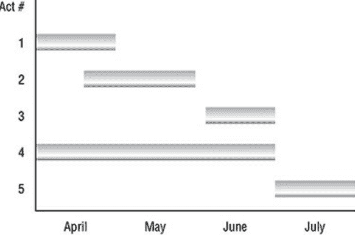
- A. 鱼骨图
- B. 甘特图
- C. 协作工具
- D. 流程图

### 9.
哪个项目角色促进项目的需求和紧急性，以及？
- A. 项目进度计划员
- B. 项目经理
- C. 项目赞助人
- D. 项目协调员

### 10.
项目的完成值（EV）为 800，实际成本（AC）为 1200。项目的成本绩效指数（CPI）是以下哪一个？
- A. .5
- B. 200
- C. .67
- D. .5

### 11.
作为每日站会（scrum）的一部分，团队在哪些领域共享信息？
- A. 昨天
- B. 今天
- C. 未来
- D. 下一步

### 12.
哪种文档描述了组织感兴趣的货物或服务？
- A. 征询函（RFI）
- B. 工作说明书（SOW）
- C. 方案请求（RFP）
- D. 询价单（RFQ）

### 13.
团队成员最近被更有专业的专家所取代。这是哪种类型的变更？
- A. 内部重组
- B. 业务拆分
- C. 外包
- D. 搬迁

### 14.
SWOT 代表什么？
- A. 情况、工作、开源、可追溯性
- B. 优势、工作、机会、可追溯性
- C. 情况、劣势、开源、威胁
- D. 优势、劣势、机会、威胁

### 15.
以下所有项都是常见的项目变更，除了
- A. 范围变更
- B. 需求变更
- C. 组织变更
- D. 时间线变更

### 16.
考虑基础模型时，需要哪些基本元素？（选择三项。）
- A. 传输
- B. 者
- C. 收件箱
- D. 发送者
- E. 非语言沟通
- F. 解码器
- G. 信息

### 17.
Cheryl 是一个客户现场结束工作的项目的负责人。与客户沟通工作和下一步的最好方法是什么？
- A. 结束会议
- B. 虚拟会议
- C. 启动会议
- D. 面对面会议

### 18.
在特定时间内完成给定工作的批准预算被称为哪一个？
- A. 计划值
- B. 成本偏差
- C. 完成值
- D. 实际成本

### 19.
“自制还是外购”的决策在哪个步骤发生？
- A. 在启动会议期间
- B. 在产品或服务设计期间
- C. 在项目计划执行期间
- D. 在制定采购计划期间

### 20.
应该在何时设定员工的项目绩效预期？
- A. 当部门经理设定年度目标时
- B. 与新团队成员的第一次会议期间
- C. 在利益相关者识别会议期间
- D. 在员工绩效评估期间

### 21.
当项目团队被分配专门负责一个项目时，这是哪种资源的示例？
- A. 专用
- B. 同地
- C. 共享
- D. 物理

### 22.
为应对可能发生的风险而建立应急储备被称为哪一个？
- A. 主动接受
- B. 被动接受
- C. 承认
- D. 转移

### 23.
位于欧洲的项目团队需要对位于印度的候选人进行工作面试。面试面试的沟通方法是什么？
- A. 面对面会议
- B. 虚拟会议
- C. 社交媒体
- D. 电子邮件

### 24.
什么是里程碑？
- A. 交付物必须满足的特征
- B. 用于衡量项目进展的重大事件
- C. 项目中决定“通过/停止”（go/no-go）决策的检查点
- D. 项目运行距离的衡量

### 25.
这里描述的是哪种类型的项目管理工具？
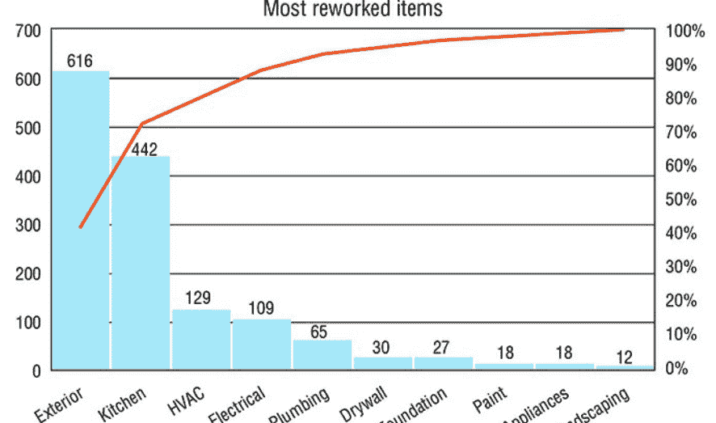
- A. 帕托图
- B. 项目进度计划
- C. 直方图
- D. 甘特图

### 26.
- A. 为本次迭代要完成的任务设置一个合理的待办列表
- B. 为项目制定沟通和质量计划
- C. 准备项目章程和启动会议
- D. 提前开始项目所需的工作

### 27.
当需要获得更多关于待采购货物和服务的数据时，使用哪种供应商招标方法最为合适？
- A. 建议征求书 (RFP)
- B. 报价请求 (RFQ)
- C. 信息请求 (RFI)
- D. 工作说明书 (SOW)

### 28.
一家大公司由于去中心化的人力模型，面临招聘和留才结果不一致的困扰。什么样的组织变更有助于解决这个问题？
- A. 业务拆分
- B. 外包
- C. 搬迁
- D. 内部重组

### 29.
对项目程序、文档、支出、法定合规性和报告进行系统且独立的检查被称为以下哪种？
- A. 审计
- B. 阶段审查
- C. SCRUM 回顾会议
- D. 项目变更

### 30.
以下所有项都是交付物的示例，除了：
- A. 蓝图
- B. 用户文档
- C. 成品
- D. 项目章程的签字

### 31.
以下哪些属于具有相互约束力的文件类型？（选择三项。）
- A. SCRUM 回顾会议
- B. 协议/合同
- C. 谅解备忘录 (M)
- D. 问题日志
- E. 采购订单
- F. 直方图

### 32.
一家公司在向客户计单方面遇到困难，因此聘请了一位顾问来帮助确定寄单所需步骤和工作流。顾问最可能使用哪种工具？
- A. 帕托图
- B. 流程图
- C. 项目章程
- D. 项目进度软件

### 33.
一家公司在22个地点都有采购团队，导致可能从22家不同的供应商处购买相同的产品。为了节省费用，公司决定集中并标准化报告功能。这是哪种业务变更？
- A. 内部重组
- B. 人员流动
- C. 业务流程变更
- D. 外包

### 34.
提交变更请求后，应该将其记录在何处并分配识别号以便跟踪？
- A. 变更请求日志
- B. 风险注册表
- C. 业务流程库
- D. 问题日志

### 35.
以下哪些因素给位于不同大陆的全球项目团队带来了挑战？（选择三项。）
- A. 语言障碍
- B. 报告详细程度

## C. 技术因素

## D. 时区

## E. 文化差异

## F. 关键性因素

## 36. 以下所有项都是定性风险分析后风险注册表的更新，除了：

- A. 低优先级风险的观察列表
- B. 需要近期响应的风险
- C. 风险原因
- D. 每项风险的数值化评估

## 37. 这里描述的是哪种项目管理工具？

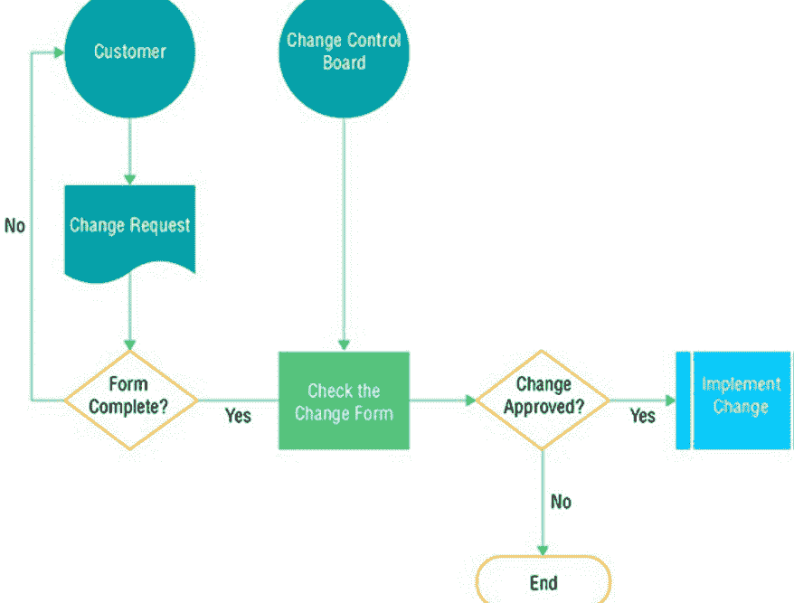

- A. SCRUM 回顾会议
- B. 鱼骨图
- C. 流程图
- D. 风险注册表

## 38. 什么是项目假设？

- A. 为了规划目的而被视为真实的因素
- B. 为了控制目的而被视为真实的因素
- C. 影响项目团队的内部或外部因素
- D. 限制项目的因素

## 39. 你的朋友暗示她生日时想要一份特别的礼物。礼物交换需要以下步骤：

- 享受她的礼物
- 在礼物上放卡片
- 包装礼物
- 选择礼物
- 送给她礼物
- 购买
- 填写卡片

“生日快乐”项目的正确顺序是哪个？

- A. 选择礼物；购买；在礼物上放卡片；包装礼物；填写卡片；享受她的礼物；送给她礼物
- B. 送给她礼物；在礼物上放卡片；包装礼物；购买；填写卡片；享受她的礼物；选择礼物
- C. 在礼物上放卡片；送给她礼物；填写卡片；购买；享受她的礼物；选择礼物；包装礼物
- D. 选择礼物；购买；包装礼物；填写卡片；在礼物上放卡片；送给她礼物；享受她的礼物

- A. 固定价格
- B. 建议征求书
- C. 工时和材料费
- D. 成本报销制

![一家供应商非常严格地坚持要求对项目进行正式变更控制，实际上很少有变更得到批准。哪种合同形式会导致供应商产生这种行为？]

## 41. 项目团队需要参加每日站会以讨论项目活动和障碍。哪份文件让项目团队知道他们需要参加这次会议？

- A. 项目进度计划
- B. 范围说明
- C. 沟通计划
- D. 项目章程

## 42. 两家企业合并并作为一个单一实体运营被称为以下哪种？

- A. 业务收购
- B. 业务合并
- C. 业务流程变更
- D. 业务拆分

## 43. 一家当地电缆公司不小心切断了进入项目现场的光纤电，导致通信中断。团队要求公司的技术人员快速修复损坏。这种沟通的触发因素是什么？

- A. 事件响应
- B. 任务启动
- C. 风险注册表更新
- D. 业务连续性响应

## 44. 一个离岸团队向项目经理发布了一份与其客户一致的假期计划。团队发布的假期计划与公司既定的假期计划不同。这是以下哪项的例子？

- A. 关键性因素
- B. 语言区域
- C. 时区
- D. 文化差异

## 45. 一政府机构聘请了一家公司对其系统进行工作。作为 RFP 的一部分，该机构要求供应商承担错误和遗漏险。这是哪种风险策略？

- A. 转移，负风险策略
- B. 承认，正风险策略
- C. 接受，负风险策略
- D. 分享，正风险策略

## 46. 在团队开发的哪个阶段，团队成员开始相互对抗并争夺地位和控制权？

- A. 结束
- B. 成熟
- C. 形成
- D. 冲突
- E. 执行

## 47. 项目利益相关者拥有以下哪些职责？

- A. 行政支持、任务估算、获取资源状态、专业知识
- B. 行政支持、提供需求、项目指导、专业知识
- C. 利益相关者、提供需求、项目指导、专业知识
- D. 利益相关者、提供需求、跨部门协调、专业知识

## 48. 项目管理的哪个方面是敏捷和传统瀑布方法共有的？

- A. 迭代方法
- B. 适应不断的需求
- C. 冲刺计划
- D. 自组织和自驱动团队

## 49. 获得产品设计的签字属于哪种类型的依赖？

- A. 强制性
- B. 任意性
- C. 外部
- D. 这不是依赖

## 50. 在制作设施电影项目开始时，员工会被要求签署哪份文件？

- A. 终止函
- B. 服务水平协议
- C. 保密协议
- D. 建议征求书

## 51. 哪种工具适合在整个组织内部共享信息，但屏蔽外部人员？

- A. 协作工具
- B. 内部网网站
- C. Wiki 页面
- D. 互联网网站

## 52. 哪个实体审查变更请求、评估影响并最终批准、拒绝或推迟此类请求？

- A. 变更咨询委员会
- B. 谅解备忘录
- C. 保密协议
- D. 变更控制委员会

## 53. 一个协调产品发布活动的项目遭遇了挫折，水管问题淹没了会议厅。预计将有五千人参加活动，该活动计划在四天后开始

……小时。什么因素会影响沟通方法？

+ A. 关系建立
+ B. 关键性因素
+ C. 语言障碍
+ D. 时区

## 54. 衡量截至目前的支出、确定资金消耗率并核算采购费用，被称为以下哪项？

+ A. 支出跟踪
+ B. 完工预算估计 (ETC)
+ C. 成本会计

## 55. SWOT 分析的哪些部分关注关注组织外部的问题？

+ A. 优势与劣势
+ B. 机会与劣势
+ C. 优势与威胁
+ D. 机会与威胁

## 56. 一家经营了数十年的大型成熟机构可能拥有哪种组织构结构？

+ A. 弱矩阵型
+ B. 强矩阵型
+ C. 职能型
+ D. 项目型

## 57. 哪种冲突解决技术会为各方产生赢输的结果？

+ A. 强制
+ B. 攻击
+ C. 回避
+ D. 对峙

## 58. 关于项目早期做出的某个决策有一个疑问。项目经理应该去哪里查看以帮助回忆该决策以及当时讨论的情况？

+ A. 会议纪要
+ B. 项目章程
+ C. 待办事项列表
+ D. 会议议程

## 59. 建筑设计团队已完成新建筑的蓝图并通知项目经理。这是哪种类型的沟通触发？

+ A. 事件响应
+ B. 资源变更
+ C. 任务完成
+ D. 任务启动

## 60. 确定用于评估风险的收集的数据之用的活动被称为以下哪项？

+ A. 影响和概率矩阵
+ B. 风险紧迫性评估
+ C. 风险数据质量评估
+ D. 风险分类

## 61. 哪个项目角色负责在多个项目之间安排资源？

+ A. 项目管理办公室 (PMO)
+ B. 项目进度计划员
+ C. 项目经理
+ D. 项目协调员

## 62. 项目经理参考哪个文档来审查高层范围、高层风险、假设和约束，并找出关键利益相关者是谁？

+ A. 项目章程
+ B. 范围说明
+ C. 项目管理计划
+ D. 会议议程

## 63. 项目经理刚刚完成了指导委员会的会议，并向团队宣布项目可以进入下一阶段。以下哪项启动了这次沟通？

+ A. 里程碑
+ B. 业务连续性响应
+ C. 资源变更
+ D. 阶段门审查

## 64. 在哪个项目阶段会对风险进行头脑风暴、评估和影响分析？

+ A. 执行
+ B. 收尾
+ C. 监控与控制
+ D. 启动
+ E. 计划

## 65. 在关口检查期间会向委员会提供哪种类型的文档？

+ A. 帕托图
+ B. 沟通计划
+ C. 状态报告
+ D. 变更控制计划

## 66. 哪个文档将确保所有所有的变更请求信息，以便获得适当的考虑？

+ A. SIPOC-R
+ B. 项目章程
+ C. 模板
+ D. 会议纪要

## 67. 项目中的人际冲突开始出现。在面对问题时最好的沟通方法是什么？

+ A. 即时消息
+ B. 面对面会议
+ C. 电子邮件
+ D. 视频会议

## 68. 在考虑风险应对策略时，接受的两种形式是什么

+ A. 主动
+ B. 无意
+ C. 有意
+ D. 被动

## 69. 谁负责高层风险识别？

+ A. 项目团队
+ B. 项目赞助人
+ C. 项目经理
+ D. 关键利益相关者

## 70. 组织结构类型包括以下哪些？（选择三个。）

+ A. 职能型
+ B. 敏捷型
+ C. 同地
+ D. 项目型
+ E. 矩阵型

## 71. 收尾阶段包括以下所有内容，例外

A. 监控风险和问题日志
B. 释放项目成员
C. 归档项目文档
D. 审查经验教训

## 72. 三点估计中使用的三种估计类型是什么？

A. 最快进度、最少资源、最理想
B. 最快进度、乐观、最理想
C. 最可能、最少资源、最快进度
D. 最可能、乐观和悲观

## 73. 一个动画电影项目需要以下顺序的步骤：故事构思、脚本、分镜脚本、配音人员、模型和场景建造，仅举几个。分镜脚本与脚本是什么关系？

A. 它是前置任务。
B. 它是自由裁量任务。
C. 它是后置任务。
D. 它是强制任务。

## 74. 领导层变更后，新项目经理想了解项目的结构和汇报关系。哪个文档可以给经理提供这些信息？

A. 经验教训
B. 项目图
C. 会议纪要
D. 组织结构图

## 75. 以下哪些项用于举行虚拟会议？（选择两个。）

+ A. 语音会议
+ B. 面对面
+ C. 视频会议
+ D. 临时

## 76. 哪些项是用于确定潜在风险何时发生的？

+ A. 风险分类
+ B. 风险紧迫性评估
+ C. 影响和概率矩阵
+ D. 风险数据质量评估

## 77. 项目经理被要求报告所有支出。经理被要求提供什么

+ A. 支出
+ B. 平衡得分卡
+ C. 实际成本
+ D. 成本差异

## 78. 安排视频或电话会议应考虑哪些因素？

+ A. 确定团队成员是内向还是外向
+ B. 识别不同的时区
+ C. 确保有写作材料
+ D. 确保座位

## 79. 以下都是成本估计技术，例外

A. SIPOC-R
+ B. 向上估计
+ C. 参数估计
+ D. 类比估计

## 80. 工作分解结构在哪个阶段创建？

+ A. 监控与控制
+ B. 收尾
+ C. 执行
+ D. 启动
+ E. 计划

## 81. 在哪种组织结构中，项目经理对人们的时间和分配的任务拥有有限权力？

+ A. 强矩阵型
+ B. 弱矩阵型
+ C. 职能型
+ D. 项目型

## 82. 范围管理计划包含以下哪些元素？（选择三个。）

+ A. 创建、维护和批准 WBS 的过程
+ B. 创建预算的过程
+ C. 定义如何验证交付物
+ D. 创建进度的过程
+ E. 创建范围说明的过程

## 83. 赶工是一种项目管理技术，涉及以下哪项？

+ A. 为了安抚利益相关者将后期交付物移至早期阶段
+ B. 查看成本和进度权衡，例如增加资源
+ C. 移除不必要的关键路径活动
+ D. 并行执行计划中的两个任务

## 84. 沟通计划要求每周通过电子邮件发送状态、每月举行状态会议、半年发布一次印刷通讯。该计划列出了以下哪项？

+ A. 关键性因素
+ B. 报告详细程度
+ C. 调整沟通风格
+ D. 沟通类型

## 85. 在特定时间范围内已完成项目工作的总支出被称为以下哪项？

+ A. 挣值
+ B. 计划价值
+ C. 成本差异
+ D. 实际成本

## 86. 一家大型汽车公司刚刚完成了新车型的发布。他们发现新产品存在严重的安全缺陷，他们需要与公众就产品召回进行沟通。以下方法是合适的方法。（选择两个。）

+ A. 短信
+ B. 社交媒体
+ C. 即时消息
+ D. 分发印刷媒体
+ E. 传真

## 87. 在哪个项目阶段，利益相关者的影响效率最低？

- A. 执行 (Execution)
- B. 监控与控制 (Monitor and Control)
- C. 启动 (Initiation)
- D. 计划 (Planning)

## 88. 一家建筑公司正在进行一个桥梁项目。该项目的挣值值（earned value）为 $9,500，实际成本（actual cost）为 $7,000。请选择项目正确的成本差异（cost variance）及其含义：

- A. $2,500且项目在预算内
- B. -$2,500且项目超预算
- C. $2,500且项目超预算
- D. -$2,500且项目超预算

## 89. 指示项目消耗预算快慢的指标是什么？

- A. 计划价值 (Planned value)
- B. 消耗率 (Burn rate)
- C. 成本差异 (Cost variance)
- D. 支出跟踪 (Expenditure tracking)

## 90. 以下所有项都是项目阶段，除了

- A. 计划 (Planning)
- B. 收尾 (Closing)
- C. 开发 (Development)
- D. 执行 (Execution)

# 第 6 章

## 练习题 2

此练习考试可用于模拟真实的 CompTIA Project+ 考试。练习考试在百分比和问题数量上的平衡，与你在实际考试中将看到的问题组合相一致。其具体划分如下：

| 领域 1：项目基础 | 36% |
| :--- | :--- |
| 领域 2：项目约束 | 17% |
| 领域 3：沟通与变更管理 | 26% |
| 领域 4：项目工具与文档 | 21% |

设置一个 75 分钟的计时器，并尝试在测试结束前不参考其他材料完成此练习测试。

## 1. 这里描述的是哪种类型的项目管理工具？

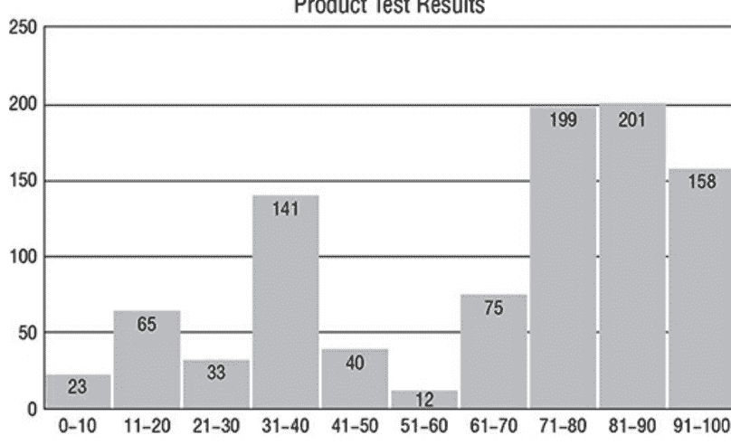

- A. 直方图 (Histogram)
- B. 甘特图 (Gantt chart)
- C. 帕托图 (Pareto chart)
- D. 流程图 (Process diagram)

## 2. 以下哪项*不是*沟通触发因素？

- A. 项目计划 (Project planning)
- B. 启动会议 (Kickoff meeting)
- C. 里碑 (Milestones)
- D. 进度变更 (Schedule changes)

## 3. 某个社区有一座 125 年历史的大桥，已建立一个项目来修复大桥并赋予其历史地位。然而，该项目需要资金和支持。大桥位于一个拥有大型退休社区的农村地区。向社区获取项目信息的最佳方式是什么？

- A. 即时消息 (Instant messaging)
- B. 短信 (Text message)
- C. 分发印刷媒体 (Distribution of printed media)
- D. 电子邮件 (Email)

## 4. 科技行业的初创公司可能具有什么样的风险容忍度？

- A. 风险冒险者 (Risk taker)
- B. 风险规避者 (Risk avider)
- C. 赌徒 (Gambler)
- D. 中等风险容忍度 (Moderate risk tolerance)

## 5. 利益相关者、赞助者对项目如何产生影响？（选择所有适用项。）

- A. 他们不负责项目交付物。
- B. 随着新项目的启动，他们对该项目失去兴趣。
- C. 随着项目的进行，他们会改变项目的优先级。
- D. 他们不参加所有的会议。

## 6. 作为开始项目工作的准备工作，项目经理列了一清单：(1) 周末和节假日不能工作，(2) 没有指导委员会的同意不允许加班，(3) 项目团队的百分之七十五是工会员工。此列表代表以下哪项？

- A. 目标 (Objectives)
- B. 需求 (Requirements)
- C. 约束 (Constraints)
- D. 假设 (Assumptions)

## 7. 项目的定义特征是什么？（选择两个。）

- A. 它是持续运营活动的一部分。
- B. 它被分配给项目组合（portfolio）。
- C. 它有明确的开始结束日期。
- D. 它创建了独特的产品或服务。
- E. 它是组织战略计划的一部分。

## 8. 从高级风险评估产生的工作应该记录在哪里？

- A. 风险注册表 (Risk register)
- B. 工作分解结构 (Work breakdown structure)
- C. 项目章程 (Project charter)
- D. 质量控制计划 (Quality control plan)

## 9. 哪种成本估算使用数学模型计算成本？

- A. 三点估算 (Three-point estimating)
- B. 自底向上估算 (Bottom-up estimating)
- C. 自顶向下估计 (Top-down estimating)
- D. 参数估算 (Parametric estimating)

## 10. 敏捷方法中的用户故事（user story）是什么？

- A. 产品发布后的客户调查结果
- B. 关于利益相关者及其工作的关键信息
- C. 对使用产品或服务的人的高层定义
- D. 产品燃尽图的可视化表示

## 11. 哪种类型的合同对买方来说风险最大？

- A. 报销制合同 (Cost-reimbursable contract)
- B. 关键性能参数 (Key performance parameter)
- C. 固定价格合同 (Fixed-price contract)
- D. 工时材料合同 (Time and materials)

## 12. 以下哪些项是关于项目当前状况的沟通手段？（选择三个。）

- A. 项目章程 (Project charter)
- B. 状态报告 (Status report)
- C. 会议议程 (Meeting agenda)
- D. 会议记录 (Meeting minutes)
- E. 项目计划 (Project plan)

## 13. RACI 矩阵中哪一个单一角色是指？

- A. 咨询 (Consulted)
- B. 负责 (Responsible)
- C. 通知 (Informed)
- D. 问责 (Accountable)

## 14. 这是哪种类型的组织变更？

- A. 业务流程 (Business process)
- B. 业务合并 (Business merger)
- C. 搬迁 (Relocation)

# D. 业务收购 (Business acquisition)

## 15. 以下哪项不会接收？
- A. 项目赞助者 (Project sponsor)
- B. 项目团队 (Project team)
- C. 项目管理办公室 (PMO)

## 16. 关于启动会议，以下所有项都是正确的，除了
- A. 它们代表启动阶段
- B. 它们在计划完成时发生
- C. 它们发生在启动阶段
- D. 它们传达目标

## 17. 风险响应最可能在哪个阶段激活？
- A. 监控与控制 (Monitor and Control)
- B. 执行 (Execution)
- C. 计划 (Planning)
- D. 启动 (Initiation)

## 18. 资源短缺意味着以下哪项？
- A. 资源过多，导致分配不足。
- B. 有足够的资源供使用。
- C. 资源不足，导致分配不足。
- D. 有大量的资源供使用。

## 19. 糟糕的结果会对项目产生什么影响？
- A. 项目将花费更长时间，因为
- B. 项目进入指导委员会
- C. 项目范围被削减
- D. 项目由于缺乏而推迟

## 20. 一家公司位于大陆的多个城市，项目将由来自各城市的成员组成。决定将项目团队集中到一个地点。这是哪项的示例？
- A. 内部采购 (Insourcing)
- B. 同地办公 (Collocation)
- C. 裁员 (Layoffs)
- D. 外包 (Outsourcing)

## 21. 在什么类型的组织结构中，资源仅汇报给职能？
- A. 弱矩阵 (Weak-matrix)
- B. 项目化 (Projectized)
- C. 矩阵 (Strong-matrix)
- D. 职能 (Functional)

## 22. 以下哪些是组织工作分解结构（WBS）的方法？（选择三个。）
- A. 待办列表和冲刺 (Backlog and sprints)
- B. 项目阶段 (Project phases)
- C. 子项目 (Subprojects)
- D. 主要交付物 (Major deliverables)
- E. 按风险排序

## 23. 项目赞助者或推动者在项目中担任什么角色？
- A. 开发和维护进度
- B. 作为审批权限并消除障碍
- C 设定标准和规范
- D. 执行跨部门协调

## 24. 哪种类型的合同允许供应商与提供商品或服务相关的允许费用？
- A. 报销制合同 (Cost-reimbursable contract)
- B. 固定价格合同 (Fixed-price contract)
- C. 工作说明书 (Statements of work)
- D. 工时材料合同 (Time and materials)

## 25. 一个热门的主题公园为了利用热门电影系列，在其土地上进行大规模扩张。该项目分配了数千人。项目经理需要找出哪些个人正在负责主题设计。哪种项目中心文档可以提供这些信息？
- A. `RACI` 矩阵
- B. 项目章程 (Project charter)
- C. 组织架构 (Organizational chart)
- D. 鱼骨图 (Fishbone diagram)

## 26. 当项目被考虑时，指导委员会要求了解公司内外部的环境变量。完成此扫描的最佳工具是什么？
- A. `SWOT` 分析
- B. 供应商知识库 (Vendor knowledge bases)
- C. 流程图 (Process diagram)
- D. 直方图 (Histogram)

## 27. 当公司决定剥离或出售其业务部门时，发生了哪种类型的组织变更？
- A. 业务合并 (Business merger)
- B. 业务拆分 (Business split)
- C. 业务收购 (Business acquisition)

# D. 内部重组

## 28. 项目文档策略要求在每份文档的开头记录每次变更。这被称为以下哪一项？
- A. 风险登记册表更新
- B. 版本控制
- C. 沟通计划
- D. 变更请求日志

## 29. 一家负责交通的政府机构比之前沟通的目标提前三天完成了应急项目工作。向大众传达这一成功的最佳方法是什么？
- A. 发放纸质媒体
- B. 传真
- C. 现身媒体
- D. 社交媒体

## 30. 下列哪项描述了项目组合（Portfolio）？
- A. 项目经理在面试时应携带的样本工作合集
- B. 支持战略性业务目标或目标的计划集、子项目组合和项目集合
- C. 使用共享资源和类似技术共同管理的一组相关项目
- D. 一组为维护以帮助资助项目的项目投资

## 31. 应该创建哪种文档来概述双方之间特定的绩效标准或其他行动？
- A. 保密协议
- B. 征求建议书（RFP）
- C. 服务水平协议（SLA）
- D. 谅解备录（MOU）

## 32. 阐述沟通、风险管理、项目进度和范围管理的综合文档被称为以下哪一项？
- A. 项目管理计划
- B. 仪表板信息
- C. 征求建议书
- D. 范围声明

## 33. 此处描述的是什么类型的项目管理工具？
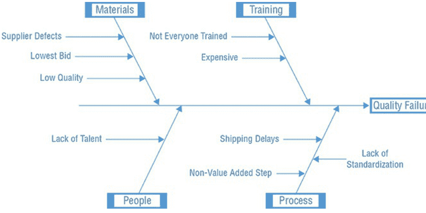
- A. 鱼骨图
- B. 流程图
- C. 帕累图
- D. 直方图

## 34. 一个组织决定不再要求差差据，而是发放津贴。这对该组织意味着什么？
- A. 业务收购
- B. 业务合并
- C. 业务拆
- D. 业务流程变更

## 35. 在考虑变更时，哪个角色负责分析进度、预算和资源分配，以确定变更对项目的影响？
- A. 项目赞助人
- B. 变更控制委员会
- C. 领域专家
- D. 项目经理

## 36. 一座承重桥梁的压力测试已经持续了两周。测试成功完成，项目经理通知所有当地交通部门道路已准备好涂漆和最后的装饰。这次沟通的触发因素是什么？
- A. 项目规划
- B. 进度变更
- C. 里程碑
- D. 任务完成

## 37. 一个项目经理正在管理一个位于同一大陆多个城市的团队。沟通计划要求每周更新状态。这种沟通的适当方法是什么？
- A. 虚拟会议
- B. 面对面会议
- C. 即时消息
- D. 电子邮件

## 38. 标准的项目阶段有哪些？
- A. 启动、计划、执行、监控与控制和结束
- B. 启动、准备、构建、监控与控制和收尾
- C. 发现、计划、构建、质量检查和结束
- D. 发现、准备、执行、质量检查和收尾

## 39. 项目经理应该花多少时间在沟通上？
- A. 高达 27%
- B. 高达 90%
- C. 高达 75%
- D. 高达 50%

## 40. 项目团队成员需要向项目经理和共享资源权权的职能经理汇报。这是哪种组织？
- A. 弱矩阵
- B. 平衡矩阵
- C. 项目型组织
- D. 强矩阵

## 41. 一家电脑电子公司正在制造电脑芯片。该项目的 `CPI`（成本绩效指数）为 0.77，这意味着以下哪一项？
- A. 项目超支。
- B. 项目滞后。
- C. 项目在预算内。
- D. 项目提前。

## 42. 下列哪些是敏捷管理的特征？（选择三项）
- A. 前期需求
- B. 自组织团队
- C. 详尽文档
- D. 冲刺计划
- E. 反馈循环
- F. 持续交付

## 43. 团队通常会经历哪些阶段？正确顺序是什么？
- A. 形成、规范化、震期和离散
- B. 规范化、震期、形成和执行
- C. 规范化、形成、震期和离散
- D. 形成、震期、规范化和执行

## 44. 确定和记录潜在风险的活动称为：
- A. 风险规避
- B. 风险规划
- C. 风险识别
- D. 风险缓解

## 45. 风险对项目造成的后果或机会称为什么？
- A. 风险登记册
- B. 风险概率
- C. 风险影响
- D. 风险响应计划

## 46. 一家政府机构发布了报价请求（RFQ）。哪种其他采购方法具有可比性？
- A. NDA（保密协议）
- B. RFI（信息请求）
- C. SOW（工作说明）
- D. RFP（征求建议书）

## 47. 下列哪项不包含在沟通计划中？
- A. 交付物的状态
- B. 信息如何交付
- C. 何时分配信息
- D. 利相关者信息

## 48. 主要用于开发的属性是什么？
- A. 服务水平协议
- B. 意向书
- C. 政府间协议
- D. 关键绩效

## 49. 公司面临缺乏灵活性的问题。哪种组织变更可以帮助？
- A. 搬迁
- B. 外包
- C. 内部重组
- D. 业务拆

## 50. 项目计划的可用性为 98%。客户要求达到 99.5%。这代表哪种项目变更？
- A. 风险
- B. 质量
- C. 范围
- D. 时间线

## 51. 谁是目标观众，进行评审的理由是什么？
- A. 项目治理，确保责任制和目标对齐
- B. 项目赞助人，查看是否选择了正确的项目
- C. 项目经理，确保资源可用性
- D. 项目团队，找出错误

## 52. Pete 是某公司的 CEO，客户现场发生了安全漏洞。需要立即通知他，但他正在外面会议。通知他问题的最佳方法是什么？
- A. 面面交流
- B. 短信
- C. 传真
- D. 社交媒体

## 53. 项目正进入执行阶段，项目计划已完成。现在是让团队成员相互认识并概述项目目标、交付物和里程碑的时候了。下一步沟通的适当形式是什么？
- A. 启动会议
- B. 现身会议
- C. 视频会议
- D. 电子邮件

## 54. 风险对项目造成的后果或机会称为什么？
- A. 风险登记册
- B. 风险概率
- C. 风险影响
- D. 风险响应计划

## 55. 项目范围通过正式变更控制过程得到扩大，导致进度超过了原始截止日期。这是哪种影响的例子？
- A. 约束之间的相互作用
- B. 环境因素
- C. 约束重新优先级排序
- D. 利相关者、赞助人和及管理层

## 56. 在团队发展的哪个阶段，由于团队成员变得彼此熟悉，情况开始平静？
- A. 离散
- B. 执行
- C. 形成
- D. 规范化

## 57. 项目管理办公室 (PMO) 具有以下哪些职责？（选择两项）
- A. 为项目提供治理
- B. 在整个业务范围内推广项目
- C. 建立关键绩效指标和参数
- D. 管理项目的团队、沟通、范围、风险、预算和时间

## 58. 在计划阶段（Planning phase），以下所有内容都会被创建，除了哪一项？
- A. 变更管理计划
- B. 经验教训
- C. 沟通计划
- D. 项目进度计划

## 59. 以比例形式表示的预算资源成本效率被称为哪一项？
- A. AC
- B. CPI
- C. SPI
- D. EV

## 60. 项目进度计划开发应该包含哪些关键要素？
- A. 开发进度、确定完成日期、检查利益相关者假设、进行可行性评估
- B. 预算活动、估算资源、确定里程碑、估算完成
- C. 定义活动、预算活动、估算资源、估算完成
- D. 定义活动、排列活动顺序、估算资源、估算持续时间

## 61. 在建立产品待办列表（product backlog）后，你会使用什么工具来确定项目的速率（velocity）？
- A. 燃点图
- B. 鱼骨图
- C. 看板
- D. 冲刺速度

## 62. 在资源分配方面，哪项最能描述项目化环境中资源的分配方式？
- A. 资源根据临时分配。
- B. 资源不能共同工作。
- C. 资源从职能部门分配到项目中。
- D. 资源必须外包。

## 63. 哪种合同对卖方来说风险最大？
- A. 采购订单
- B. 工时材料合同
- C. 成本报销合同
- D. 固定价格合同

## 64. 项目团队应该如何记录项目集会期间发言和达成一致的内容？
- A. 创建会议纪要
- B. 创建业务案例
- C. 创建范围说明书
- D. 创建项目管理计划

## 65. 山体隧道项目的炸药阶段已完成，没有安全事故报告。这触发了给项目发起人的电话以报告当前状态。项目发起人在此项任务中被分配了什么角色？
- A. 责任人（Accountable）
- B. 知情（Informed）
- C. 执行者（Responsible）
- D. 咨询者（Consulted）

## 66. 这里描述的是哪种类型的项目管理工具？
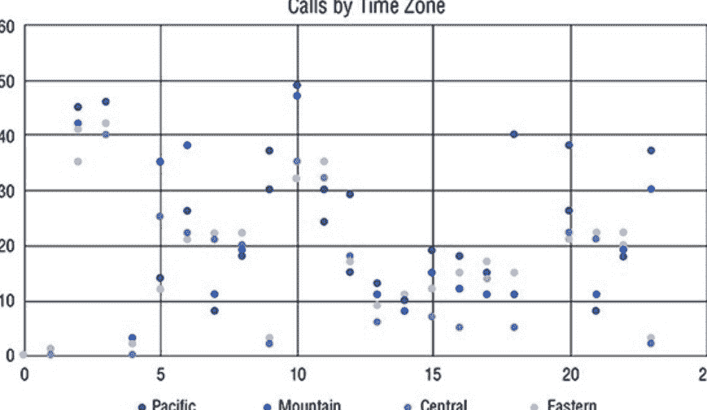
- A. 帕托图
- B. 流程图
- C. 散点图
- D. 直方图

## 67. 一个组织决定使用外部公司负责招聘、解雇、工资和税收功能，而不是使用内部员工。这是哪一项的例子？
- A. 外包
- B. 业务剥离/拆
- C. 搬迁
- D. 内部重组

## 68. 哪种风险应对策略试图减少负面风险的影响或概率？
- A. 缓解（Mitigate）
- B. 接受（Accept）
- C. 转移（Transfer）
- D. 规避（Avoid）

## 69. 项目中常见的三个约束条件是什么？（选择三项）
- A. 范围
- B. 人员
- C. 工作空间
- D. 质量
- E. 时间

## 70. 一个组织需要向项目添加供应商资源，但他们没有物理空间来容纳团队。该组织应该使用哪种方法进行人员管理？
- A. 使用远程团队
- B. 部署职能团队
- C. 使用内部团队
- D. 部署项目化团队

## 71. 以下都是敏捷项目管理方法的特征，除了哪一项？
- A. 每次发布都根据客户需求进行测试。
- B. 它对需求使用灵活的方法。
- C. 团队成员在短时间内（或冲刺（sprints）中工作。
- D. 它严格遵守变更控制流程。

## 72. 类比估算（analogous estimating）的另一个名称是什么？
- A. 三点估算
- B. 自顶而下估算
- C. 参数估算
- D. 自底向上估算

## 73. 工作分解结构（work breakdown structure）的定义是什么什么？
- A. 任务及其顺序的图形化表示
- B. 以任务为导向的项目分解
- C. 项目中里程碑的高级大纲
- D. 以交付物为导向的项目分解

## 74. 团队无法在允许的预算内完成项目，并要求将几个非必要的需求移到较晚的日期。这是哪一项的例子？
- A. 变更（Change）
- B. 里程碑（Milestone）
- C. 风险（Risk）
- D. 问题（Issue）

## 75. 共享积极风险（a positive risk）意味着什么？
- A. 项目团队寻找机会利用积极影响。
- B. 项目团队选择接受风险的后果。
- C. 项目团队将风险分配给最能带来机会的第三方。
- D. 项目团队监控风险事件的概率或影响，以确保收益的实现。

## 76. 项目团队被分配了两个个人，他们都…… 团队成员在短时间内（或冲刺（sprints）中工作，且通常在…… 这种是哪一项的例子？
- A. 资源短缺
- B. 资源短缺
- C. 共享资源
- D. 资源短缺

## 78. 进度计划的正确公式是什么？
- A. AC
- B. PV
- C. AC
- D. PV

## 79. 建筑地基施工比计划晚了三天。这代表了哪种变更？
- A. 时间变更
- B. 资金变更
- C. 质量变更
- D. 范围变更

## 80. 哪项最能描述信息请求？
- A. 在完成之前与潜在供应商会面
- B. 获取更多信息的采购方法
- C. 详细说明组织外采购商品和服务的文件
- D. 邀请投标的采购方法

## 81. 一初创公司试图在新兴产品市场上竞争。技术不断变化，市场口味也在发生变化。这种环境最适合哪一种？
- A. 职能环境
- B. 传统的，瀑布式
- C. 敏捷方法
- D. 项目化环境

## 82. 什么是项目加速（fast tracking）？
- A. 删除不必要的关键路径活动
- B. 将后期交付物移至早期
- C. 并行执行原本顺序执行的任务
- D. 考虑成本和进度的权衡，例如增加资源

## 83. 项目客户现场位于国家的农村，而项目总部位于大城市。面对面沟通的最大阻碍是什么？
- A. 地理因素
- B. 时区
- C. 组织间差异
- D. 技术因素

## 84. 什么表示个人或组织对风险情况或决策的接受程度？
- A. 风险注册
- B. 风险容忍度
- C. 风险规避
- D. 风险承担者

## 85. 一个大型组织有一个财务项目，将改变整个公司的采购申请、发票和财务报告。他们建立了一个邮件列表发送项目更新，并允许接收者设置频率为每天、每周或每月。这是哪一项的例子？
- A. 个人偏好
- B. 文化差异
- C. 关键因素
- D. 关系建立

## 86. 以下哪项不是项目的常见风险？
- A. 项目开始后范围会发生变化。
- B. 成本超过预算。
- C. 预算被无人看。
- D. 进度过于乐观是“最佳情况”而非现实的“预期情况”。

## 87. 项目团队位于三个不同的大陆。安排定期状态会议的最大因素是什么？
- A. 语言障碍
- B. 组织间差异
- C. 时区
- D. 组织内差异

## 88. 以下活动均包含在风险规划中，但不包括
- A. 为每项风险制定响应方案
- B. 分析每项风险的潜在影响
- C. 测量 SPI 和 CPI
- D. 识别项目的所有潜在风险

## 89. 对项目产生负面或积极影响的潜在未来事件称为什么？
- A. 愿望 (Hope)
- B. 问题 (Issue)
- C. 需求 (Requirement)
- D. 风险 (Risk)

## 90. 在什么情况下，自适应方法比更僵化的项目管理风格更优？
- A. 在具有定义流程的成熟组织中
- B. 在处理快速变化的环境时

- C. 当范围可以容易且彻底地定义时

- D. 当小规模增量改进对利益相关者没有价值时

## 附录

## 答案与解析

## 第 1 章：项目基础（领域 1.0）

- 1. B, E. 项目可以总结为具有以下属性：它具有临时性、创建一个独特的产品或服务、有明确的开始和结束日期、包含特定的原因/目的，并且可能是计划集或项目组合的一部分。一组相关任务不一定是项目，而可以是任何类型的待办事项列表。运营活动是在项目完成后进行的活动。重做现有项目不是创建新产品或服务，它不符合项目的属性。

- 2. A. 为项目提供治理是项目管理办公室的责任，而不是项目团队。项目团队负责为项目提供专业知识、根据进度提交交付物、估算任务时长以及估算依赖关系。

- 3. B. 工作分解结构（`WBS`）是对项目以交付物为导的分解。它是项目规划（如活动进度）的基础构建模块之一，并作为许多其他过程的输入。

- 4. D. 业务理由是一份书面文档或报告，帮助执行管理层和关键利益相关者确定项目的收益和回报。它可以包括理由说明、替代方案以及与战略计划的对齐。

- 5. A, C, D. 绩效测量与报告、执行质量保证和监控预算都是与监控控制阶段相关的活动。除了这些活动外，监控控制阶段还包括监控风险/问题日志以及管理变更控制过程。

- 6. D. 沟通计划记录了沟通中关于谁、什么、何时、何地以及为什么的所有元素需求。

- 7. C. 参数估算通常使用工作量乘以费率公式来计算成本。

- 8. B. 成本偏差 = 挣取价值 – 实际成本，即 $2,500 – $2,275 = $225。

- 9. D. 我昨天完成了什么？我今天将要做什么？哪些障碍阻碍了进度？这些是在站会（或 `SCRUM` 会议）期间提出的三个问题。

- 10. B. 在这个例子中，所有权力都在职能经理手中，他将 Marcus 调回去处理其他任务而不是项目。在职能型组织结构中，资源通常向职能经理汇报，项目经理的权限有限或没有权限。

- 11. A. 在这种情况下，与团队成员合作以获得预期结果是最佳行动方案。移除或更换团队成员并非总是选项，因此该选项是错误的。

- 12. D. 高级范围定义记录在项目章中，设定了项目希望完成的大蓝图。

- 13. B. 规划阶段是大多数项目文档创建的地方。在这里，项目目标、目的和交付物被精炼并分解为可管理的工作单元，例如在工作分解结构内部。

- 14. A. 项目描述说明了项目产品、服务或项目结果的属性。

- 15. B. 公式为 (最可能 + 乐观 + 悲观) / 3。

- 16. D. 在职能型组织中，权力掌握在职能经理手中，而不是项目经理手中。

- 17. C. 采购必须在施工开始之前进行。

- 18. C. 甘特图是一种显示任务时长和依赖关系的图表。

- 19. D. 虽然监控控制阶段管理利益相关者的预期，但它贯穿整个项目。

- 20. C. 外部依赖关系是项目之外的实体或条件。

- 21. A. 这种估算也可以称为数量级估算。

- 22. D. 关键路径包含任务 A（2 天）、任务 C（2 天）、任务 D（2 天）和任务 E（3 天），总计 9 天。

- 23. D. 在敏捷中，冲刺（`Sprint`）是短时间内的活动爆发。

- 24. B. 在强矩阵组织中，权权在项目经理手中。

- 25. B. 结束活动包括获取项目签字、记录教训、释放资源和关闭合同。

- 26. C. 启动会议是介绍项目团队成员和利益相关者的会议，它在执行阶段开始时举行。

- 27. E. 其他结束活动包括项目签字、收集教训以及作为过渡/计划的一部分进行培训。

- 28. A. 治理关口是项目阶段之间的检查点，在此获得批准以继续进行。通常，项目报告会发送给指导委员会，以确保时间、资金和范围的问责。

- 29. A, C. 两个正确的答案是项目有明确的开始和结束日期，以及它创建一个独特的产品或服务。当项目实现了目标且利益相关者对结果满意时，项目被认为是成功的。

- 30. B. 项目组合是支持战略目标或目标的计划、子项目组合和项目的集合。项目组合中的计划和项目之间并不一定有直接联系，且项目可以独立地存在于项目组合中。

- 31. D. 项目章在项目的启动阶段准备并通过。该文档为项目的启动提供了正式批准，并授权项目经理将资源应用于项目中。

- 32. C. 这是介绍项目团队成员和利益相关者并概述项目目标的地方。

- 38. C. 这可能包括直接成本和间接成本，但它必须与该活动的预算相对应。实际成本是项目成本控制的一个示例。

- 39. C. 确定活动序列是项目管理的一个重要部分，你可能会在考试中看到类似的问题。对于这个问题，正确的顺序是：收集面包、花生酱和果胶酱；拿一把刀；将面包放在盘子里；在其中一片面包上涂抹花生酱；在另一片面包上涂抹果胶酱；将两片面包合在一起；上菜。

- 40. A, D, 和 F. 关键关键路径时，所需的某些重要步骤包括：确定任务、确定任务的开始/结束日期、确定任务持续时间和里程碑、通过识别前置任务和设置依赖关系将它们按顺序排列，以及识别关键路径。进度安排活动还涉及资源分配、设定基准以及质量/治理关口。

- 41. C. 这也称为人小时估算，用于创建成本估算。

- 42. B. 这包括识别需要哪些资源以及何时需要这些资源。

- 43. C. 这种技术也可能称为*问题解决*，它是解决冲突的一种优越方法。问题的答案会显现出来，事实将有助于发现解决方案。

- 44. A, C, E. 使用团队建设活动、使用认可和奖励以及设定基本规则，是你可以用来开发高效项目团队的一些工具。

- 45. D. 这是团队正在追求的理想状态，即团队具有高生产力且高效。并非所有团队都能达到这一发展阶段。

- 46. B. 当质量是关键关注点时，意味着它比成本更重要。因此，让团队共同办公将是有益的，这样通信更快、纠正更及时，且不会受到时差的干扰。

- 47. A. 当需求发生变化时，敏捷方法允许组织能够随时地适应环境。

- 48. D. 项目经理有权分配团队资源并进行绩效评估，这使得其成为项目矩阵型组织结构。

- 49. B. 用户故事有助于关注产品将如何被使用，从而帮助塑造其设计。

- 50. D. 具有成熟流程和资深员工的更成熟组织可能具有以专业领域为中心的职能组织结构。

- 51. C. `PMP` 是项目管理计划的常用缩写。在项目管理领域，它也可以代表由项目管理协会（`PMI®`）认证的项目管理专业人士。

- 52. B. 待办列表（`Backlog`）是敏捷方法内部使用的制品，用于跟踪项目需要包含但可能不是本次冲刺部分的的所有元素。

- 53. C. 启动、计划、执行、监控和收结束是标准的项目阶段。项目阶段之间紧密相关，一个阶段的输出通常成为另一个阶段的输入。

- 54. D. 里程碑是项目中的重大事件，用于衡量进度。

- 55. B. 工作包代表了工作分解结构（`WBS`）中最低级别的分解。通过从 `WBS` 的工作包级别开始，计算每项活动的成本并分配给该工作包。

- 56. A. 虽然这是一个很理想的结果，但它并不是开发项目团队的目的。

- 57. D. 在敏捷方法中，任务可以在待办列表中被记录和识别，但它不是任务排序中重要的依赖关系。

- 58. B. 请记住，项目本质上是临时性的，有时增加过多的范围变更会改变努力的临时性。向项目添加未经批准的范围被视为范围蔓延（scope creep）。

- 59. B. 低级 `WBS` 组件的识别发生在确定主要交付物之后。

- 60. B. 妥协是指双方都放弃一些东西以达成冲突的解决方案。

- 61. B. 墙体的框架搭建必须在安装网络布线之前开始，导致开始-开始（start-to-start）的关系。在开始干墙和保温之前，线路必须到位。

- 62. B. 关键路径有 A (2天)、C (2天)、D (2天) 和 E (3天)，总共 9 天。

- 63. C. 资源日历还会让你知道资源活跃或空闲的日期。

- 64. A, D, F. 当团队内部没有和谐时，团队建设活动可以帮助恢复士气。当一个阶段完成时，庆祝项目进展并认可团队的贡献是有益的。团队动态的任何变化都可能影响项目，特别是当领导层是新人的时候。

- 65. D. 该组织的空间限制将迫使团队使用远程或虚拟团队。

- 66. D. 当 Nysa 被分配到项目时，显然权力掌握在职能经理手中，削弱了项目经理的权威。

- 67. A. 满足利益相关者的预期是确定项目是否成功的最关键因素。

- 68. B. 交付物可以是作为项目结果而产生的任何有形或无形产品或服务。

- 69. D. 项目赞助者的责任包括帮助项目管理、消除障碍以及提供资源。

- 70. B. 用户故事有助于关注产品将如何被使用，从而帮助塑造其设计。

- 71. A. 项目受到三重约束的限制，包括时间、预算和范围。

- 72. C. 项目章程赋予启动项目的正式授权。

- 73. D. 监控风险和问题被认为是监控和控制中的一个过程。

- 74. C. `WBS` 是一个项目制品。

- 75. A. 自上而下的估算（类比估算）是指通过比较相似项目来使用高层项目估算。

- 76. C. 这个数字以百分比表示。

- 77. A. 加紧跟踪是一种进度压缩技术，涉及并行完成之前按顺序安排的任务。

- 78. C. 交付物是在执行和管理工作期间产生的。

- 79. B. 任务的资源不足，导致过度负荷。个人的工作量变得更加严重，导致工作时间延长和职业倦怠风险增加。

- 80. E. 结束阶段是指在工作完成后团队的解散。

- 81. C. 当成本是项目最重要的元素时，虚拟团队有助于降低成本。这可能会以通信效率为代价，并可能让质量变得更难以保证。

应当设定预期，包括角色、截止日期、规范和团队互动。

- 90. B. 工作分解结构是更深思熟虑、前期的需求收集的特征，此时许多需求在项目早期就已确定了。

- 91. B. 外包是将工作从组织内部员工转移给承包商或供应商的过程。

- 92. B. 这是布鲁斯·塔克曼（Bruce Tuckman）博士开发的模型，被称为团队发展阶段。

- 93. A. 每日站会会议通常用于敏捷开发方法。因此，每日站会会议不会有治理机构参加，通常由项目团队成员参加。

- 94. D. 这有助于从战略战略角度让项目经理和项目团队等角色承担责任。

- 95. A. 施工将在蓝图获批准后进行。

- 96. B, C, E. 三种组织结构是职能型、矩阵型和项目型。在职能型组织中，决策和控制由专门职能（IT、会计、人力资源等）驱动。在项目型组织中，项目经理拥有决策权和对资源的控制权。矩阵型组织是职能型和项目型之间的混合模型。

- 97. D. 正的成本偏差（CV）意味着项目在预算内，负的 CV 意味着项目超支。$7,000 – $9,500 = -$2,500；因此，项目超支了。

- 98. A. 收尾阶段的主要目的是记录项目工作的正式验收，并将完成的产品交由组织进行持续的维护和支持。

- 99. B, D, E. `PMO`（项目管理办公室）为项目经理提供指导，并帮助在整个组织范围内提供一致、可靠的项目管理方法。职责包括为项目提供治理、维护标准文档和模板以及建立关键绩效指标和参数。

- 100. A. 赞助者的“冠军冠军”角色在初期和项目启动时都非常重要，以保持整个组织的能量和精力投入到成功。

- 101. C. 计划是一组通过协调的过程和技术共同管理的相关项目。确保你了解项目（project）和项目组合（portfolio）之间的区别。

- 102. C. 这些都是项目协调员承担的角色。

- 103. C. 成本绩效指数（`CPI`）。公式为 `CPI = 挣值 (EV) / 实际成本 (AC)`。

- 104. C. 在平衡矩阵组织中，项目经理和职能经理共同控制预算并共享权力和权威。

- 105. C. `WBS` 中记录的最低层级是工作包。这是确定资源、时间和成本估算的层级。

- 106. B, E. 平滑和谈判是冲突解决技术。震风期（Storming）和规范期（norming）是布鲁斯·塔克曼首次提出的群体发展阶段。威胁（Threatening）是一种通常会导致冲突的人际反应。

- 107. B. 这一阶段是确立谁最有影响力的过程，存在职位的争夺。

- 108. C. 当一个项目或项目的一部分必须在另一个项目开始之前完成时，它是项目间依赖关系的一个例子。

- 109. C. 当一个项目或项目的一部分必须在另一个项目开始之前完成时，它是项目间依赖关系的一个例子。

# 项目管理题目整理

## 第 1 章

- 108. C. 当一个项目或项目的一部分必须在另一个项目开始之前完成时，它是项目间依赖关系的一个例子。
- 109. C. 当一个项目或项目的一部分必须在另一个项目开始之前完成时，它是项目间依赖关系的一个例子。
- 100. A. 赞助者的“冠军”角色在初期和项目启动时都非常重要，以保持整个组织的能量和精力投入到成功。
- 96. B, E. 矩阵型组织是职能型和项目型之间的混合模型。
- 97. D. 正的成本偏差（CV）意味着项目在预算内，负的 CV 意味着项目超支。$7,000 – $9,500 = -$2,500；因此，项目超支了。
- 98. A. 收尾阶段的主要目的是记录项目工作的正式验收，并将完成的产品交由组织进行持续的维护和支持。
- 99. B, D, E. PMO（项目管理办公室）为项目经理提供指导，并帮助在整个组织范围内提供一致、可靠的项目管理方法。职责包括为项目提供治理、维护标准文档和模板以及建立关键绩效指标和参数。
- 100. A. 赞助者的“冠军”角色在初期和项目启动时都非常重要，以保持整个组织的能量和精力投入到成功。
- 101. C. 计划是一组通过协调的过程和技术共同管理的相关项目。确保你了解项目（project）和项目组合（portfolio）之间的区别。
- 102. C. 这些都是项目协调员承担的角色。
- 103. C. 成本绩效指数（CPI）。公式为 CPI = 挣值 (EV) / 实际成本 (AC)。
- 104. C. 在平衡矩阵组织中，项目经理和职能经理共同控制预算并共享权力和权威。
- 105. C. WBS 中记录的最低层级是工作包。这是确定资源、时间和成本估算的层级。
- 106. B, E. 平滑和谈判是冲突解决技术。震风期（Storming）和规范期（norming）是布鲁斯·塔克曼首次提出的群体发展阶段。威胁（Threatening）是一种通常会导致冲突的人际反应。
- 107. B. 这一阶段是确立谁最有影响力的过程，存在职位的争夺。
- 108. C. 当一个项目或项目的一部分必须在另一个项目开始之前完成时，它是项目间依赖关系的一个例子。
- 109. C. 当一个项目或项目的一部分必须在另一个项目开始之前完成时，它是项目间依赖关系的一个例子。
- 100. A. 赞助者的“冠军”角色在初期和项目启动时都非常重要，以保持整个组织的能量和精力投入到成功。
- 101. C. 计划是一组通过协调的过程和技术共同管理的相关项目。确保你了解项目（project）和项目组合（portfolio）之间的区别。
- 102. C. 这些都是项目协调员承担的角色。
- 103. C. 成本绩效指数（CPI）。公式为 CPI = 挣值 (EV) / 实际成本 (AC)。
- 104. C. 在平衡矩阵组织中，项目经理和职能经理共同控制预算并共享权力和权威。
- 105. C. WBS 中记录的最低层级是工作包。这是确定资源、时间和成本估算的层级。
- 106. B, E. 平滑和谈判是冲突解决技术。震风期（Storming）和规范期（norming）是布鲁斯·塔克曼首次提出的群体发展阶段。威胁（Threatening）是一种通常会导致冲突的人际反应。
- 107. B. 这一阶段是确立谁最有影响力的过程，存在职位的争夺。
- 108. C. 当一个项目或项目的一部分必须在另一个项目开始之前完成时，它是项目间依赖关系的一个例子。
- 109. C. 当一个项目或项目的一部分必须在另一个项目开始之前完成时，它是项目间依赖关系的一个例子。
- 100. A. 赞助者的“冠军”角色在初期和项目启动时都非常重要，以保持整个组织的能量和精力投入到成功。
- 101. C. 计划是一组通过协调的过程和技术共同管理的相关项目。确保你了解项目（project）和项目组合（portfolio）之间的区别。
- 102. C. 这些都是项目协调员承担的角色。
- 103. C. 成本绩效指数（CPI）。公式为 CPI = 挣值 (EV) / 实际成本 (AC)。
- 104. C. 在平衡矩阵组织中，项目经理和职能经理共同控制预算并共享权力和权威。
- 105. C. WBS 中记录的最低层级是工作包。这是确定资源、时间和成本估算的层级。
- 106. B, E. 平滑和谈判是冲突解决技术。震风期（Storming）和规范期（norming）是布鲁斯·塔克曼首次提出的群体发展阶段。威胁（Threatening）是一种通常会导致冲突的人际反应。
- 107. B. 这一阶段是确立谁最有影响力的过程，存在职位的争夺。
- 108. C. 当一个项目或项目的一部分必须在另一个项目开始之前完成时，它是项目间依赖关系的一个例子。
- 109. C. 当一个项目或项目的一部分必须在另一个项目开始之前完成时，它是项目间依赖关系的一个例子。
- 100. A. 赞助者的“冠军”角色在初期和项目启动时都非常重要，以保持整个组织的能量和精力投入到成功。
- 101. C. 计划是一组通过协调的过程和技术共同管理的相关项目。确保你了解项目（project）和项目组合（portfolio）之间的区别。
- 102. C. 这些都是项目协调员承担的角色。
- 103. C. 成本绩效指数（CPI）。公式为 CPI = 挣值 (EV) / 实际成本 (AC)。
- 104. C. 在平衡矩阵组织中，项目经理和职能经理共同控制预算并共享权力和权威。
- 105. C. WBS 中记录的最低层级是工作包。这是确定资源、时间和成本估算的层级。
- 106. B, E. 平滑和谈判是冲突解决技术。震风期（Storming）和规范期（norming）是布鲁斯·塔克曼首次提出的群体发展阶段。威胁（Threatening）是一种通常会导致冲突的人际反应。
- 107. B. 这一阶段是确立谁最有影响力的过程，存在职位的争夺。
- 108. C. 当一个项目或项目的一部分必须在另一个项目开始之前完成时，它是项目间依赖关系的一个例子。
- 109. C. 当一个项目或项目的一部分必须在另一个项目开始之前完成时，它是项目间依赖关系的一个例子。
- 100. A. 赞助者的“冠军”角色在初期和项目启动时都非常重要，以保持整个组织的能量和精力投入到成功。
- 101. C. 计划是一组通过协调的过程和技术共同管理的相关项目。确保你了解项目（project）和项目组合（portfolio）之间的区别。
- 102. C. 这些都是项目协调员承担的角色。
- 103. C. 成本绩效指数（CPI）。公式为 CPI = 挣值 (EV) / 实际成本 (AC)。
- 104. C. 在平衡矩阵组织中，项目经理和职能经理共同控制预算并共享权力和权威。
- 105. C. WBS 中记录的最低层级是工作包。这是确定资源、时间和成本估算的层级。
- 106. B, E. 平滑和谈判是冲突解决技术。震风期（Storming）和规范期（norming）是布鲁斯·塔克曼首次提出的群体发展阶段。威胁（Threatening）是一种通常会导致冲突的人际反应。
- 107. B. 这一阶段是确立谁最有影响力的过程，存在职位的争夺。
- 108. C. 当一个项目或项目的一部分必须在另一个项目开始之前完成时，它是项目间依赖关系的一个例子。
- 109. C. 当一个项目或项目的一部分必须在另一个项目开始之前完成时，它是项目间依赖关系的一个例子。
- 100. A. 赞助者的“冠军”角色在初期和项目启动时都非常重要，以保持整个组织的能量和精力投入到成功。
- 96. B, E. 矩阵型组织是职能型和项目型之间的混合模型。
- 141. C 传统的瀑布模型方法将是渐进迭代的，类似于敏捷方法中使用的迭代方法。
- 142. B, C, D. 范围管理包括创建范围说明书的过程、待验证的交付物定义，以及创建、维护和批准 WBS 的过程。它还将定义控制范围变更请求的过程，包括请求变更的程序。
- 143. D. 对抗（Confronting）也被称为解决问题，它是解决冲突的最佳方式。通过开展事实调查，问题的正确解决方案将呈现在相关方面前。
- 144. A. 由于项目的临时性，资源不会永久性地分配给任何特定项目或职能。
- 145. B. 非保密协议（NDA）有助于在项目完成或项目人员变动时保护组织的知识产权。
- 146. D. 其他选项将无法利用项目灵活且易于变化的环境。
- 147. C. 执行阶段是大部分材料和劳动力支出发生的地方。
- 148. C. 这是双方都放弃一些东西以帮助达成一个可行的解决方案。承诺满足截止日期以及调整时间的同时允许休假的协议，是关键的决策点。
- 149. C. 权威和权力在职能经理和项目经理之间共享。
- 150. B, D. 这是非临时性且没有结束日期的持续运营示例。此外，工作投入没有产生独特的产品。
- 151. D. 这种价值观源于精益（Lean）原则，这是一种管理项目活动的迭代、增量式方法。
- 152. C. 有时候，对于整个项目团队来说，最佳行动方案是不带不满的团队成员继续进行。
- 153. C. 由于时区的差异，电话或视频会议将需要额外的协调工作。因此，电子邮件是处理更新的最有效率的方式。
- 154. A. 团队成员聚集在一起并说明他们为何在一起工作。在这个阶段，个人往往表现得最含蓄和正式。
- 155. A. 使用第三方（如问题中的项目经理）有助于产生积极结果，第三方的中立可以协助达成共识。
- 156. A. 完成项目但尚未开始新任务的人员代表了“闲置待命”资源（benched resources），他们的技能没有被利用。这对组织来说是成本高昂的，因为团队成员正在领取工资，但没有产生收入。
- 157. D. Tiffany 在项目分配上分配过载了（overallocated），因为需要的工作量比工作时间多。
- 158. D. 同时向项目经理和职能经理汇报意味着 Amy 是一个共享资源。
- 159. A. 裁量依赖（discretionary dependency）由项目管理团队定义，通常由流程或程序驱动。
- 160. D. 高级范围定义文档记录了项目的原因以及你试图解决的问题，并对使项目成功所需的某些交付物进行了分级描述。
- 161. D. 选项 D 不正确因为这是一个替代方案识别与分析的示例。风险评估是针对提议项目进行的，而不是替代方案。
- 162. B, C. 项目协调员支持项目经理并执行时间和资源调度。此人还提供跨职能协调、文档和行政支持，并检查质量。
- 163. D. 这是敏捷方法中常用的一种教训总结（lessons-learned）会议形式，有助于改进冲刺（sprints）。
- 164. E. 在从项目向正常运营的过渡期间，将进行新规范的培训。
- 165. B. 采用敏捷方法的结果是，需求可以在迭代过程中随着结果开发而进行调整。
- 166. E. 项目经理在不考虑 Jessie 立场的情况下断言自己的观点。虽然这是一个永久性的解决方案，但它并不是一个特别好的方案。
- 167. B, C. 这符合创建一个新产品或服务的项目要求，且该工作在本质上是临时的。它还可能是共享资源的计划或相关项目的一部分。在这种情况下，安全团队的资源将与此项目共享。
- 168. B. 燃尽图（burndown chart）通常以条形图形式出现，它描绘了随着每次迭代接近项目完成时取得的进展。
- 169. C. 借助电子邮件、视频会议和其他技术的帮助，项目提供了与全球团队成员沟通的能力，能够通过虚拟团队成功完成。
- 170. A. 资源短缺可能是一个很有诱惑力的答案，但关键在于多个项目的参与。因此，项目之间存在资源竞争。
- 171. C. 在团队形成（forming）和震风（storming）阶段之后，彼此相互熟悉有助于稳定局势，个人开始处理项目问题而非人际问题。
- 172. B. 回避（Avoiding）永远不会导致问题的解决，而且它可能是效效最低的技术。
- 173. C. 闲置待命资源（benched resources）通常出现在项目化组织中，这些资源在工资单上，但目前尚未分配给任何项目。
- 174. B. 项目经理拥有完全权限并控制时间和任务。作为项目经理，你需要警惕分配到低质量资源。
- 175. B. 强制性依赖（mandatory dependency）的一个示例可能是浇混凝土。
- 176. B. WBS 在规划阶段开发。它是一个面向交付物的层级结构，定义了所有工作。
- 177. C. 预验收标准有助于确保质量。它们可以应用于敏捷和瀑布方法。
- 178. B, C, E. WBS 的组织方式可以是子项目、阶段或主要交付物。
- 179. D. 这也被称为退缩（withdrawal），它永远导致双输的冲突结果。
- 180. D. 沟通计划规定了谁需要了解哪些类型的变更，并指导应使用何种沟通方式。
- 181. D. 项目赞助者应利用他们的影响力来消除不参与等障碍。
- 182. C. 有效的团队建设有助于创建高效工作的团队。
- 196. A, B. 敏捷的特点是自组织和自导向的团队、冲刺计划以及持续的需求收集。使用瀑布流技术的项目将具有正式组织化团队的特征，并将反馈留到项目结束时的经验教训会议上。
- 197. A. 高层范围定义可以对项目包含和不包含的内容建立共识。这些信息将作为制定项目章程的依据。
- 198. A, B. 选项 C 是不对的，因为那是项目管理办公室的责任。选项 D 是项目利益相关者的角色，选项 F 是项目经理职责。
- 199. D. 没有实现真正的或永久的解决方案。这可以作为“双输局面”的例子，因为双方都没有解决他们的问题。
- 200. B. 赶工法（Crashing）是一种进度压缩技术，通常通过分配额外的资源来更快地完成任务。增加更多资源将增加项目的成本。
- 201. C. 项目收尾阶段的经验教训。
- 202. C. CPI 大于 1 意味着在测量日期，项目的支出低于预算预测。
- 203. A. 项目进度计划员负责沟通时间表和任何变更。
- 204. C. 低质量资源可能不具备所需的经验、不具备相应的技能组合、对项目缺乏热情，或工作态度恶劣。低质量资源有时可以被替换，但他们总是需要以某种形式进行管理。
- 205. B. 项目由团队中的个人代表，确保具备正确的技能、经验水平、可用性和兴趣都是团队选拔过程的一部分。

## 第 2 章：项目约束（领域 2.0）

- 1. C. 影响因素可以操纵或影响现有的约束，也可能带来新的约束。
- 2. B. 约束的优先级的重新排序是改变哪些约束是不可移动的，从而决定了如何操纵其他约束。“你可以要便宜、快速或三者兼得——你可以在三者中选两个”阐明了三重约束之间的相互作用。
- 3. C. 优势、劣势、机会、威胁（SWOT）是一种用于执行时点环境扫描的工具。
- 4. B. 记住风险可以是正面的也可以是负面的，它代表了项目早期并不存在的机会或威胁。
- 5. B. 风险登记可能是是用于记录所有潜在风险以供未来分析和评估的工具。
- 6. D. 风险分析是找出可能发生哪些风险，以及如果每个风险真的发生结果将会怎样的过程。
- 7. B. 风险影响详细说明如果事件实际发生会产生的后果或结果。通常，这被归分为高、中、低三个等级。
- 8. A, D, F. 通常被称为“三重约束”，几乎所有项目都受到时间、预算和范围的约束，因为它们会影响质量。
- 9. 与具有某些技能的人员可用性类似，设备的可用性和进度安排也可能导致项目产生约束。
- 10. B, C. 选项中代表了三重约束中的两个：预定义的预算和固定的（或强制的）完成日期。这些约束将影响范围方面的可选方案，在创建范围说明时应考虑这些因素。
- 11. A. 这种特定类型技能组合的稀缺，或者当他们的可用性受限或无法按时加入项目时，都可以代表对项目的约束。
- 12. A. 变更请求、范围蔓延以及约束之间的相互作用是一些可能影响项目的影响因素。
- 13. D. 这三个角色都可以对项目风险识别做出贡献。
- 14. D. 现有项目没有变更，但一个新项目正在与现有项目同时竞争相同的资源。利益相关者的焦点发生了变化。
- 15. A, D. 风险登记表的标准信息可能包括与风险相关的识别码、描述、概率和影响、评分以及所有者。
- 16. B. 这是一个停止侵权函函（cease and desist letter）的例子，其目的是停止所谓的违法活动并防止其在未来继续进行。
- 17. B. 增强风险（Enhancing a risk）涉及增加风险事件发生的概率或影响，以确保收益的实现。这可能以这种形式出现：建筑公司告诉您，如果对完工给予金钱奖励，他们就可以提早完成新健身房的建设。
- 18. D. 接受是选择承担风险对项目可能产生的影响。
- 19. C. 风险应对计划概述了在风险发生并开始影响项目时将采取的行动方案。
- 20. D. 风险概率是风险事件发生的可能性，通常表示为 0.0 到 1.0 之间的数字。
- 21. B. 机会是导致项目产生正向风险的外部条件，例如产品领域的牛市、比预想更好的天气状况或材料成本的下降。
- 22. C. SWOT 涉及通过优势/劣势（组织内部）以及机会/威胁（组织外部）对项目进行分析。
- 23. B, D, F. 头脑风暴、访谈和引导式工作坊等技术都可以协助创建清单。鱼骨图可以帮助理清因果关系。
- 24. D. 集成总进度计划包含了工作包。
- 25. C. 环境因素是实际约束而非影响因素。
- 26. A. 变更请求可以影响现有约束或产生新的约束。当改变三重约束中的一个时，至少另一个受到影响。
- 27. C. 范围涉及项目的特定目标、任务和交付物。
- 28. A. 天气条件构成环境约束。
- 29. D. 人员配备不是约束——它更像是一种影响。三重约束是时间、预算和范围，它们涉及质量。
- 30. B. 确定风险可能对项目产生正面或负面的影响以及发生的可能性，是风险分析。
- 31. B. 固定时间或预算、天气窗口或稀缺资源等约束限制了项目团队的选择。
- 32. C. 项目受到时间、预算和范围的限制，这些是三重约束的要素。
- 33. B. SWOT 代表优势、劣势、机会、威胁，它是一种执行环境扫描的练习。这种环境扫描有助于揭示风险。
- 34. C. D&D 是停止侵权的缩写，向企业或个人发送文件以停止所谓的非法活动并防止其重启。
- 35. A. 为了共享正向风险，项目寻求将风险交给最能带来机会的第三方——例如在材料销售国家已经拥有工厂的公司，从而降低成本。
- 36. B. 转移（Transference）是通过购买保险、履约保证金等工具将风险责任转移给第三方的策略。

## 项目管理题目列表

### 风险与约束相关

- 37. A. 专家判断是指领域专家、利益相关者和项目团队成员贡献他们在类似项目上的知识以提出建议。
- 38. A. 概率影响矩阵用于计算整体风险评分的工具，并有助于组织、排序和展示信息，以确定风险应对计划中需要的内容。
- 39. C. 劣势领域关注公司可以改进的要素，这可能会引入项目风险。负面风险也与劣势有关。
- 40. A. 团队不参加状态会议将是一个活跃问题的例子，而不是可能影响项目的潜在未来后果。
- 41. A. 测量进度执行指数（`SPI`）和成本执行指数（`CPI`）是监控和控制的一部分。

控制项目并非风险规划的直接活动。
- 42. C. 谅解备忘（`Memorandum of understanding`）是双方之间的协议，表示对行动的共同意向。它并不意味着双方承担了法律义务。
- 43. A. `RACI` 代表负责（Responsible）、问责（Accountable）、咨询（Consulted）和知会（Informed），它是一种用于在项目中指定角色和职责的工具。
- 44. A, B. 项目利益相关者、赞助人和管理层可以通过多种方式影响项目的约束条件，包括改变优先级和/或资源、为了投入更少精力对项目失去兴趣，以及导致范围蔓延。
- 45. B. 交付物代表了一种约束，因为它们列出了详细的要求或可衡量的结果，这些结果直接指导了项目团队的行动。
- 46. A. 项目范围发生了变化，但进度没有变化，因此成本将增加。这是三重约束驱动项目重要事项的示例。
- 47. B. 缩减项目范围以适应新预算是该项目最可能产生的影响。进度不会受到影响，因为没有要求延长或缩短项目时间。
- 48. B. 预算是成本约束，团队在不影响预算、范围或质量的情况下，无法在项目上无限制地工作。
- 49. D. 风险登记可能包含其他元素，包括应对计划或计划可能所在的位置。
- 50. A. 用于确定风险干扰项目的概率有多大以及对项目总影响有多大的工具是概率和影响矩阵。
- 51. B, D. 风险分是风险概率（通常表示为 0.0 到 1.0 之间的一个数字）乘以风险影响。项目可以为概率和影响选择不同的量化衡量标准，这些将在风险计划中详细说明。
- 52. C. 关键路径法也可以定义为寻找通过网络图的最长路径。
- 53. C. 风险触发因素是风险事件即将发生或已经发生的信号，并且可能需要采取行动。
- 54. D. 在寻求利用正向风险时，你应该寻找利用积极影响的机会，以确保风险得以实现。例如，油价下跌，项目能够以比计划低得多的价格购买所有所需的油。
- 55. D. 规避风险试图绕过风险，包括消除风险事件产生。
- 56. D. 威胁是组织外部的，对项目产生负面影响，例如产品市场疲软、劳工动荡或贸易壁垒。
- 57. C. 工作准备好开始是举行启动会议的合适时间，此时所有的规划都已完成。
- 58. D. 风险识别是进行头脑风暴并记录项目期间可能发生的所有潜在风险。
- 59. A. 国际标准组织（`ISO`）开发并发布了许多行业的国际标准。你也可以将其视作国际标准化组织。
- 60. B. 它代表责任、问责、支持和知会。这是 `RACI` 图的另一种形式，将“咨询”替换为识别谁承担支持性角色。
- 61. B. 这个示例展示了一个约束条件（在本进度表中）如何受到另一个约束条件（范围）变化的变化的相互关系。
- 62. D. 范围蔓延是指项目定义不断扩大，导致能够完成项目的控制力降低。
- 63. A, C, D. 这些是可能影响项目的常见影响因素：变更请求、范围蔓延和约束条件的优先级重新排序。
- 64. C. 约束是任何限制项目团队选择或规定特定行动方案的因素。
- 65. D. 随着为了满足截止日期而增加人数，婚礼成本将增加。时间、成本和范围之间的权衡在这里起作用。唯一改变的变量是时间或进度。由于成本相同，成本将增加。
- 66. C. 处理季节变化的条件（包括对最终产品的维护）将影响施工，这些是环境约束的示例。
- 67. D. 这是一个进度约束，因为技能组合短缺导致资源的时间和可用性受到限制。
- 68. B. 协议备忘录（`Memorandum of agreement`）有助于表示双方的善意并跟踪承诺。它不是法律文件，在法上不具有任何执行力。
- 69. B. 识别项目风险时的一个良好做法是在头脑风暴步骤准备一组要问的问题。
- 70. D. 风险管理计划概述了项目如何在整个过程中界定、监控和控制风险。
- 71. A. 质量成本（`COQ`）代表了将项目生产的标准产品或服务达到质量计划或其他标准中描述的标准所需的成本。
- 72. D. 在监控和控制阶段，项目团队观察风险是否被触发，并在应当发生时采取计划的行动。
- 73. A. 缓解是针对负向风险的风险应对策略。其目的是尽可能地减少风险发生的概率或影响。
- 74. C. 概率和影响矩阵还将包含一个计算出的风险分，用于对风险进行排序。
- 75. A. 处理负向风险所使用的策略有规避、转移、缓解和接受。
- 76. A. 这种技术在考虑到不可预见的问题或资源可用性时修改进度。
- 77. D. 通常，三重约束中的一个更具限制性，在这种情况下是预算。
- 78. A. 与组织分解类似，资源分解结构按劳动力、大型设备、材料、物资等类别列出资源。
- 79. A. 这是一个内部依赖，等待一个部分完成后另一个部分才能开始。
- 80. A. 里程碑可以代表主要交付物的完成。
- 81. B. 可行性研究可能还会查看可用性、成本或时间表。
- 82. A. 公司试图监控风险发生的概率来减轻影响。
- 83. C. 组织分解结构（`OBS`）是描述建立的项目管理框架的分层模型。
- 84. D. 主题专家具有相关领域的判断和经验，应当被咨询。
- 85. B. 项目管理协会（`PMI`）出版了《项目管理体系知识指南》，这是一本跨行业的项目管理良好实践框架。
- 86. A. 由于当前项目的成功对于工作安全至关重要，由于误差范围极小，Katie 最可能会尝试规避风险的决策。
- 87. D. 风险承受能力是指个人接受风险及其后果的舒适程度。
- 88. C. 这是范围在项目进行期间持续增长的示例。变更控制将提供处理这些问题的正式方法。
- 89. B. 当存在预设的项目截止日期时（例如法律规定了该活动完成的日期），可以使用进度压缩来缩短项目进度。
- 90. C. 备选分析衡量了为了利用可用资源完成任务可能考虑的不同方案。
- 91. B. 可酌性依赖也被称为首选逻辑、软逻辑或偏好逻辑。
- 92. D. 假设是与项目相关的被认为真实的条件。
- 93. C. 快速跟踪是当活动或阶段决定按顺序执行而非并发执行时的一种进度压缩技术。
- 94. C. 公司正寻求与能够利用该机会的第三方分担正向风险。
- 95. B. 工作说明书（`SOW`）正式捕获并定义了供应商为客户履行工作时必须满足的工作活动、时间范围、里程碑和交付物。
- 96. D. 询价请求（`RFQ`）通常比更复杂

仅仅是针对单件物品的价格响应。它也可以被称为招标邀请。
- 98. D. 关键性能参数（`KPI`）以阈值和目标格式识别了所需的运营能力。
- 99. D. 由于其表现优异，在工作上具有稳定性，Karen 可能有更大的缓冲空间来博弈并承担更多风险。
- 100. D. 应急储备金被预留用于应对风险后果，而管理储备金用于涵盖无法预测的未来状况。
- 101. C. 项目中过度施压个人可能会导致职业倦怠、项目人员流失或任务进度放慢，这些都将对项目产生负面影响。
- 102. B. 资源日历表描述了资源（设备和团队成员）可用于项目工作的时间范围。
- 103. B. 95% 现象是指项目似乎停滞不前，或者无法完成最后一步或几个步骤，导致项目无法完成。
- 104. A. 项目经理对人员和其他资源拥有权威的组织属于矩阵型组织结构。
- 105. D. 每周 3.5 英里的目标是一个关键性能指标，有助于跟踪特定项目成果的成功情况。
- 106. A. 服务水平协议（`SLA`）规定了提供服务时必须维持的阈值，例如响应时间、缺陷率和其他质量。
- 107. D. 关键性能指标可以用于项目或组织的不同层面，以帮助确定是否成功达成了特定成果。
- 108. C. 公司的生存取决于团队是否通过博弈或具有高风险容忍度来保持竞争力。不冒险可能会葬送公司的未来。
- 109. B. 如果你只在很短的时间窗口内拥有结构工程师或高级程序员的时间，那么进度计划的设计是为利用那段资源窗口而设计的。
- 110. C. 项目团队控制之外的、对于项目成功所需的因素被称为外部依赖。
- 111. D. 某些依赖关系是强制性的信号是，这些活动具有物理限制，例如在铺路之前必须先平整道路。
- 112. A. 赶工（`Crashing`）是一种以最低成本向项目增加资源的技术，反映在选择使用加班而非增加团队成员的决策上。
- 113. C. 其他地方自然灾害的不可预测性将导致项目团队重新对风险进行排序，以尝试应对。
- 114. B. 稳定性是关键，Richard 的组织不太可能在决策中接受不确定性。
- 115. A. 关键路径没有浮动时间或松弛时间，它是完成项目所需的最短时间。
- 116. C. 渐进式细化（`Progressive elaboration`）代表了项目规划的迭代性质，随着项目的推移，先前的产出物将得到更新和改进。
- 117. A. Wigit Construction 在风险发生时应该接受其后果，而不是试图规避、转移或减轻它。
- 118. C. 采购订单是发给卖方的正式报价要约，标明了产品和服务的类型、数量和约定的价格。
- 119. D. 应急储备金是已知风险计算的，并与记录在案的缓解响应计划配对。
- 120. A, C. 规避和接受都是用于应对负面风险的风险响应策略。
- 121. B. 可能着陆并影响材料成本的飓风的形成是一个风险触发因素。
- 122. B. 该软件公司通过采取合并行动利用其面临的积极风险，这是利用风险的例子。
- 123. C. 征求建议（`RFP`）是组织发布的正式文件，用于向潜在供应商和卖商征标。
- 124. A. 当组织需要帮助确定市场上有哪些可用资源时，他们会发布信息请求（`RFI`）。
- 125. C. 公司的生存取决于团队是否通过博弈或具有高风险容忍度来保持竞争力。不冒险可能会葬送公司的未来。
- 126. A. 项目团队完全规避了风险，选择使用符合质量规格的已知材料。
- 127. C. 关键实际上是留出资金以对付可能发生的风险。
- 128. C. 这种策略通过关注并强调风险触发因素，有助于增强某些风险发生的概率或影响。
- 129. B. 项目团队通过使用保修，将材料缺陷的风险和后果转移给了第三方。
- 130. A. 此类分析中的概率排名将为高、中、低，并就影响可能程度获取专家意见。定性风险分析可能使用某些技术，且不一定使用高/中/低分值。
- 131. C. 甘特图是一种显示活动并视觉化表示任务持续时间以及活动优先级的工具。
- 132. D. 考虑到项目在稳定行业中的安全属性，该公司的声誉和公共安全角色使他们规避或不愿接受不确定的结果。
- 133. D. 尽管 CompTIA Project+ 目标没有说明此点，但接受积极风险的后果与接受负面风险一样是完全合理的。
- 134. A, 被动接受是指项目团队无法消除项目的所有威胁。主动接受包括建立应急储备金以应对风险。
- 135. B. 利用（Exploiting）是为了寻找机会并确保积极结果发生。
- 136. C. 这一过程采用定性分析产生的主观结果，并将其量化以便进行评估。
- 137. C. 风险评估使用了风险触发因素、制定并实施响应，并将整体风险排名作为输入。
- 138. B. 风险识别、概率影响分析以及风险响应将发生在项目的规划阶段。
- 139. B. 社区认可是一个关键成功指标，可以减少不满或抗议的可能性。
- 140. A. 项目团队无法消除风险，但愿意在意外发生时接受后果。
- 141. B. 通过保险将负面风险的转移给第三方。
- 142. A. 随着项目的进行，监控和控制阶段将寻找风险触发因素并在需要时启动响应计划。
- 143. B. 这种选择只是让风险发生，因为团队在意外发生时可以承受后果。
- 144. D. 定量风险分析会增加具体的衡量项目，例如每个风险的数值评分。
- 145. C. 这种评估是为了确保数据无偏见且准确。
- 146. D. 通过要求供应商购买保险，可以将负面风险的后果转移给第三方。
- 147. D. 定量风险分析会增加具体的衡量项目，例如每个风险的数值评分。

### 范围与规划

160. A. 验收标准是客户接受项目最终成果时必须满足的条件。
161. A. 交付物是为完成项目而必须产出的特定项目，它们在性质上通常是实物。
162. C. 假设是出于规划目的而被认为是事实的事。与关键利益相关者进行沟通至关重要，以确保没有遗漏任何预期。
163. D. 时间跨度、对移动应用的需求以及安全性都是项目要求的示例。
164. C. 动词事项清单列出了为了完成交付物而应该解决的所有项目行动。
165. D. 当项目优先于职能部门工作时，这是一种强矩阵型组织结构。
166. B. 约束条件是限制或规定项目团队行动的条件。
167. D. 监控项目进度并需要采取纠正措施的活动发生在“监控控制”阶段。
168. B. 行业和公司越稳定，传统的项目管理方法成功的概率越大。
169. A. 正式批准通常是创建采购订单、为团队成员分配项目以及开始工作的必要条件。
170. C. 这是一个关键绩效指标，有助于跟踪达到预期结果的成功情况。
171. B. 由于产品不达标而需要进行的重工代表了使产品符合标准的成本。
172. B. 项目中的时间与成本之间存在相互作用，这意味着需要根据情况相应调整范围。
173. D. 与利益相关者和项目团队沟通风险是什么以及团队将如何应对至关重要，并在风险演变为问题时让每个人知道。
174. C. 风险缓解是降低风险发生的概率，或者在风险被触发时减轻其影响。
175. D. 优势和劣势关注的是组织正在做或没有做的事。
176. A. 风险识别不是正确答案，因为它只捕获了 Valdene 正在工作的活动三分之一。为了获取完整图景，风险规划包含了识别、风险评估和风险应对计划。
177. B. 这项活动比较了迄今的成本和支出，以便利益相关者看到计划与实际发生情况之间的差异。
178. A. 从依赖关系角度来看，最佳实践和内部流程被称为首选逻辑或软逻辑。依赖关系的三个类型是强制的、酌量的以及外部的。因此，“内部”不是正确答案，尽管它看起来很有诱惑力。
179. D. 从三重约束的角度来看，结果将是项目在分配的资源下耗时更长。
180. A. 此外，团队可以选择接受可能发生的风险及其后果。此外，接受也可以作为正向风险的策略。
181. D. 银行业通常倾向于低风险承受度，并寻求长期、低收益的投资，例如政府债券。
182. C. 随着项目的成熟，风险登记将通过渐进式展开变得更加详细。
183. A. 设定预期至关重要，这些资金不是用于额外功能或增强，而是为了处理各种情况（如成本超支和估计偏差），以及处理特定的风险状况。
184. A. 这是协议备忘录，通常不具备任何法院强制能力。
185. B. 根据支持风险应对计划的分析，有时可能不采取行动。在其他情况下，需要采取刻意行动来处理风险。
186. B. 项目计划的要素（包括进度、估计和对风险的响应）将随着项目团队完成项目的规划步骤而变得更加详细并不断更新。
187. D. 管理备金在支出权限上与其它不同，其目的是涵盖不可预见的成本。
188. C. 天气状况是组织外部依赖关系的示例，但它们需要发生，项目或活动才能进行。
189. C. 虽然两家公司可以合并，但它们这样做的可能性在评估其概率时会得到 0.0 到 1.0 之间的分数。
190. A. 整个研发行业可能具有很高的风险承受度，因为他们需要不断挑战现状以保持相关性。
191. A. 个人不是影响者，而是导致范围增加所需的变更请求影响了项目的变量。
192. C. 机会和威胁是指天气或政治气候等条件，它们会影响组织或项目，但不在组织的控制范围内。
193. C. 管理团队正在寻找项目可能经历的和机会，以便采取适当的风险应对措施。
194. A. 为项目管理工作设计的优势部分可以快速为利益相关者（包括管理层）生成支出报告。
195. A. 优势关注与项目相关的积极属性和或正向风险。
196. A. 项目团队在项目过程中不需要与职能分配竞争。
197. C. 这是敏捷方法的一种方法，用于创建所有需要完成的任务列表。
198. C. 像初创公司这样快速变化的环境是理想的。
199. D. 非披露协议将阐明预期的机密性。
200. B. 业务理由书有助于为分配资源提供理由。
201. A. 需要包含直接成本和间接成本。
202. B. 签署项目章程是一个里程碑，而不是交付物。
203. A. 阶段门检查在瀑布方法中更具代表性，而敏捷使用更具适应性的方式处理需求和执行。
204. B. 当公司使用外部资源充实员工时，被称为外包。
205. A. 团队成员没有机会说明自己的观点，项目经理也没有询问这种行为的发生。这些解决方案可能是短暂的。

## 第3章：沟通与变更管理（领域3.0）

- 1. C, D. 允许远程办公或允许员工在远程工作是一种可能影响项目的迁移形式。此外，允许员工选择不在办公室是业务流程变化的示例。
- 2. A. 虽然许多团队成员会认为文档是在浪费时间，但这些文档对于许多原因至关重要，包括绩效审计。
- 3. C. 变更控制委员会（`CCB`）而不是专家（`SME`）负责批准或拒绝变更。
- 4. D. 变更请求日志可以是包含变更 ID 号、日期、描述等的简单电子表格。
- 5. D. 批准后，下一步是实施变更。此时，可以进行质量检查并更新文档。
- 6. A. 记住资源可以是人员、材料或设备。
- 7. D. 这在任务位于关键路径上或当该活动没有浮时间时尤为如此。
- 8. A. 关键利益相关者可能会由于各种因素而变化，这需要通知项目中的所有利益相关者，包括项目团队。
- 9. D. 印刷媒体的分发是一种沟通方法，而不是沟通触发因素。
- 10. B. 这一事件需要采取纠正措施来修复损害并防止问题再次发生。
- 11. B. 计划列出了沟通方法以及频率。

- 12. A. 人力资源问题的机密性，加上谨慎处理局势的需求，会引发面对面交流。对话。一个良好的规则是公开表扬，私下批评。
- 13. B. 当项目涉及多个组织时，需要考虑每个公司不同的规范和做法，以满足两家公司的预期。
- 14. D. 良好的关系可以改善项目中的沟通和信任。个人和团队关系的建立可以提高士气，从而提高项目的质量和及时性。
- 15. D. 在城市中，即使只有一英里的距离，也会在交通和停车上浪费大量时间。如果项目在城市内分布广泛，由于团队成员之间的距离较远，很难安排临时会议，除非使用视频或语音会议。
- 16. C, E. 在列出的选项中，适用于向公众进行大规模传播的方法只有社交媒体和打印材料。其他形式代表了更多的一对一形式的沟通。
- 17. D. 对于大多数组织而言，原始签名的传真副本对于法律目的非常重要。然而，使用扫描并通过电子邮件发送文档或数字签名也日益被接受。
- 18. B. 当情况发生重大变化时，由于该事项的紧急性，中断会议并面对面告知 CEO 是最佳选择。
- 19. C. 短信允许米奇的老板在另一场会议期间获取更新，如果他认为该更新足够重要，短信通知允许老板离开会议以获取更多信息。
- 20. C. 使用外部资源而不是使用内部资源或增加永久性员工被称为外包。
- 21. C. 组织开展业务的常规方式或形式的改变属于业务流程变更。
- 22. B, D, E. 其他形式的组织变更包括搬迁、合并/收购和拆分/业务剥离。
- 23. A. 沟通变更是状态会议的关键功能，以便传达预期、收集意见并分配更新的任务。
- 24. B. 在任何团队从工作产品开始且该变更中断了其可用性的变更过程中，撤销更改是合理的。在一些采用敏捷实践的软件公司，他们可能只更新到下一个未来的版本，而不是撤销任何更改。在这个示例中，由于手机安全组件的可用性，回滚将是非常重要的。
- 25. D. 领域专家（SME）在项目经理的指导下，应该评估变更的影响，以确定是否应该尝试、变更对三重约束的影响是什么、会有哪些益处等。
- 26. B. 在更新所有文档后，将更新后的信息传播给所有相关方非常重要，以便他们理解已经发生了变更、变更的影响是什么，以及项目团队的新预期是什么。
- 27. B. 关键利益相关者、项目人员、赞助人或治理/CCB 成员都可以提交变更请求供考虑。
- 28. C. 项目的质量指标进行了调整，以减少缺陷。
- 29. B, D. 范围和资金是此示例中变化的共同元素。
- 30. A. 组织变更来自组织职侧，而不是项目侧。
- 31. B. 任何项目最常见的风险之一是人员流动，当这种情况发生时，需要向项目团队和项目经理沟通。
- 32. A, C, E. 审计员是独立于项目的群体，项目期间不需要与他们沟通。产品最终用户只有在产品准备好后才会与其沟通。股东通常不参与涉及沟通里程碑完成等细节细节的项目。
- 33. A. 由内部团队（如安全部门甚至内部审计部门）进行的审查是带有修复发现项建议的审计。
- 34. B. 因为报告反映的是例行更新，其关键性并不意味着要打扰 MaryAnn。她可以在中午或更晚更新。
- 35. A. 根据每个工作单元的任务，公司内不同小组之间的做法可能存在巨大差异。
- 36. C. 不同文化庆祝的节日可能彼此大异。
- 37. B. 不同文化庆祝的节日可能彼此大异。
- 38. A. 语言障碍可能会带来障碍。
- 39. D. 这是一个应该……的问题示例。
- 40. A. 社交媒体允许发布广泛通知。
- 41. A. 社交媒体允许发布广泛通知。
- 42. B. 当时间安排不一致时，虚拟会议是更好的选择。
- 43. D. 例如当团队分散时时。
- 44. D. 外包是用外部资源替代内部资源。
- 45. A. 这也被称为拆分。
- 46. B. 其他类型的组织变更包括业务流程变更、内部重组和外包。
- 47. A. 调离领域专家（SME）。
- 48. A. 在更新项目计划之前，会进行 CCB 批准。
- 49. B. 这是一个……示例。
- 50. B. 这是一个应该……的问题示例。
- 51. A, B, C. 技术因素、时区和组织间的差异是沟通方法的示例。
- 59. D. 了解合并与收购的区别。前者是指两家企业合并作为一个单一实体运营，而后者是指一个组织接管另一个组织。
- 60. C. 增加资源、修改范围或调整时间表都是可能请求的某些变更示例。
- 61. D. 回归计划（或回滚计划）将确定返回原始状态的步骤和工作量级。
- 62. D. 项目人员发生了变动，因此这是一个资源变更。
- 63. D. 虚拟会议是指所有人不在同一地点，通过使用技术手段来完成会议。
- 64. B. 项目管理办公室（PMO）为项目提供标准化支持，但不会参与单个项目的细节。
- 65. D. 昂贵设备的损失、人员受伤或死亡，或公共关系事件，将覆盖 Mo 不希望被打扰的意愿。
- 66. C. 即使是全球性公司，通常也有全公司范围的做法。当这些做法在同一公司内部有不同的细微差别时，被称为组织内部差异。
- 67. B. 有时项目和产品的机密性会防止信息的共享，即使在同一公司内部也是如此。
- 68. D. 给项目团队打电话或发送短信是优的，因为它们能立即提醒接收者你正尝试与他们进行通信。
- 69. A. 营销活动的希望是，他们的某些视频在根据“口碑”被反复分享和观看时会产生病毒式传播。
- 70. A. 根据问题中的信息，技术因素正在影响通信方式的选择。
- 71. D. 指令更具参与性允许书面的、详细的沟通传达到拖车员。在这种情况下，其他电子通信形式是不可靠的。
- 72. A. 对于不需要集中的项目团队的常规会议，利用电话会议或视频会议的虚拟会议是最佳选择。
- 73. C. 如果资源不再可用于开展项目，那么内部重组可能会中断项目。
- 74. A. 使用增量命名法是跟踪版本的极佳方法。此外，不要忘记在文档本身中进行更新，以记录版本以及该版本中作出的更改。
- 75. 一旦获得批准，下一步就是实施改进后的变更——在这种情况下，即开始改进景观设计的工作。
- 76. A. 变更请求应始终以书面形式记录，以记录请求以及对变更的响应，并保留纸质轨迹以说明项目时间表、预算或范围可能发生变化的原因。
- 77. A. B. 为了确保 Don 最大度地参与项目，将沟通方法与他的偏好相结合将有助于获得他的投入。
- 78. D. 安全问题、公共关系问题和潜在风险因素对于向关键利益相关者沟通至关重要，以便协调和执行响应。
- 79. D. 定期会议是分享此类信息的理想格式。在固定议程中留出部分讨论常规更新是一项良好的做法。
- 80. C. 结项会议将允许所有活动进行状态更新；让项目团队上交任何财产（如 ID 证/钥匙卡）；并结束该阶段的工作投入。
- 81. D. 启动会议通常发生在执行阶段的开始，它是介绍项目成员相互认识的主要手段。
- 82. B. 收购是指一家企业接管另一家。务必在考试中区分业务合并与收购的区别。
- 83. C. 记住，项目中的风险事件可以是积极的机遇，也可以是影响项目的负面事件。
- 84. C. 由于关键程序员请事假，项目将无法按照当前进度执行。
- 85. D. 在通信方面尝试满足利益相关者的偏好是重要的，这样你就能获得该利益相关者的积极响应和高水平的参与。
- 86. B. 不同时区可能会因为开始和结束时间以及午休时间的差异使安排状态会议变得复杂，因为这些时间并不总是对齐以提供良好的会议窗口。
- 87. B. 语音会议或电话会议是理想选择，因为它不需要 Greg 旅行，允许往返通信，且不会因为糟糕的网络质量而中断。
- 88. A. 项目中途搬迁有可能导致进度延误。
- 89. A. 由于项目团队的地理分离，向整个项目团队传递信息的最有效方法是电子邮件。由于项目团队的时区不同，尝试安排虚拟会议会麻烦。
- 90. C, D. 在实践中，最常被跳过的步骤是更新变更的项目管理计划。勤奋的项目经理应该确保不遗漏这一点。有时项目团队或成员会直接开始一项完全未批准的变更。确保有一套流程、对人员进行培训并予以执行，以便实现项目的成功和及时完成。
- 91. B. 项目需要的要求发生了变化，但没有从根本上增加项目的范围。
- 92. C. 由于此主题的合规性质，需要正式文档。
- 93. D. 版本控制有助于创建审计轨迹。
- 94. A, D. 为项目增加更多工作是范围变更。
- 95. B. 在同地环境中，将所有人召集到会议是最理想的。
- 96. D. 问题中描述的是一个风险事件。
- 97. D. 根据观众调整沟通内容。
- 98. C. 如果团队不在同，常规更新可以通过电子邮件分发。
- 99. A. 时间表的变更将需要沟通，并解释其将如何影响预算和范围。
- 100. A. 根据人口统计特征，分发印刷媒体是一种适当的方法。
- 101. B. 变更控制委员会（CCB）是评估和批准变更的机构。
- 102. C. 花时间庆祝成就是重要的，这有助于项目团队的士气。
- 103. A. 从经济角度来看，使用某种形式的远程会议（如视频会议或电话）是最合理的。
- 104. A, E, F. 基本通信模型是发送者-信息-接收者。
- 105. A. 任务完成情况通知项目经理和/协调员，以便他们启动后续活动。
- 106. D. 闸评审向治理委员会或指导委员会提交，以验证成本模型、进度、风险和目标的达成情况。独立小组。
- 111. A. 短信非常适合快速、简单的更新。在这种情况下，需要传达的信息并不多。
- 112. A. 组织内不同工作部门的准则和惯例可能会使项目进度成为一项挑战。
- 113. D. 首席执行官正在表达她对频率以及如何定制信息以适应她的个人风格的个人偏好。
- 114. C. 当项目团队被远距离、山脉、峡谷、河流、海洋或其他因素隔开时，地理问题会影响通信如何发生以及何时发生。
- 115. B. 电子邮件等格式良好的书面通信是存储复杂信息的绝佳格式，因为接收者可以消化和处理信息、再次查阅，并根据需要发送后续问题。
- 116. D. 收尾会议是进行项目最终交接的地方，包括任何合同，有时还会进行教训总结。教训总结可以与收尾会议分开。
- 117. A. 对于例行消息或非常复杂的消息，电子邮件是最好的方法，因为它允许项目团队在他们选择的时间处理信息，并最大限度地减少对项目工作的干扰。
- 118. B. 为了帮助控制成本并尽量地减少对项目工作的干扰，虚拟会议是处理例行会议的理想选择。
- 119. D. 在活动执行期间，设定的预期发生了变化。这应该引导项目经理与所有利益相关者重新建立通信，以便他们知道服务何时将恢复。
- 120. B. 随着新风险的识别，信息应记录在风险登记中，并需要通知利益相关者，以便制定缓解计划。
- 121. 通信在整个项目规划过程中都会发生，包括风险、质量、通信、进度、预算和范围计划的制定（限于此）。
- 122. D. 审计是获取证据的审查，以确保遵循良好的做法，确保项目团队的行为符合道德和法律，并确保没有发生欺诈、浪费或滥用。
- 123. C. 在处理尖端技术项目时，保密对于抢占市场和/或保护知识产权可能起着关键作用。保密限制将防止团队成员在项目完成之前与行业其他部分共享信息。
- 124. A. 此消息不带有任何紧迫性或关键性，不需要立即通信。因此，它可以等等到例行状态会议或电子邮件通信。
- 125. A. 在偏远地区，通常没有手机或卫星覆盖，因为某些峡谷或山脉造成了无法进行覆盖的屏蔽区。在这种情况下，地理地形影响了项目团队可以利用的决策方案。
- 126. B, C, F. 与任何位于不同大陆或同一大陆相反侧的团队打交道时，时区将影响通信。项目团队在规划通信时还需要考虑语言障碍和文化差异。
- 127. A. 传真或扫描并电子邮件发送文件是发送带有原始签名文档的常见且法律认可的形式。文档的电子签名正在获得接受。
- 128. D. 即使是丢失一天也可能对项目产生影响，特别是当任务位于关键路径上时。召开临时会议、明确方向并解决方法上的分歧是实现项目成功的最佳方法。
- 129. E. 启动会议通常发生在执行阶段的开始，而不是启动阶段。
- 130. D. 项目经理正在向组织发出信号，说明电话机的工作正在开始。在能力范围内，他们还应该沟通电话服务何时应该恢复。
- 131. D. 项目经理花费 90% 的时间用于通信，并且在项目规划期间的协调依赖于高水平的通信。
- 132. B. 由于消息的复杂性，项目经理受影响写了一份完整的信息来解释所有情况。
- 133. B. 有时，某些通信的紧迫性或重要性可以超过利益相关者的个人偏好，因为如果不做出决定，项目团队可能会处于停滞状态。
- 134. B. 即使不同国家说同一种语言，当一个人不习惯来自该世界地区的人说那种语言时，听起来也会很外星。不要忘记，通信双方个人对于理解彼此的困难可能可能是相互的。
- 135. D. 即时消息允许进行快速的往返通信，对参加董事会议的其他人员的干扰降至最低。
- 136. A. 为了帮助项目按进度进行，关键在于最大限度地减少工作期间对项目的干扰。语音会议或其他类型的虚拟会议将允许团队参加临时会议，而无需停止工作去旅行、应对堵车和停车。
- 137. B. 通知通过检查将是一个里程碑。不要将其与任务完成混淆，因为此示例中的任务将是建筑内电的布线和端接。
- 138. F. 取决于发现的性质，审计的目标观众可以是项目上的任何利益相关者或项目团队成员。通常情况下，你会看到指导委员会成员和项目经理作为目标。
- 139. D. 社交媒体和电视等老式媒体是向公众发布信息最好、最快的方法。
- 140. C. 技术可以是一个很好的工具，但有时可能比它花费更多时间。
- 141. D. 任何时区的转换（不仅仅是北美）都会给寻找合适的时间带来挑战。对于不同大陆的团队尤其如此。
- 142. B, D. 任何形式的即时通信，如通话或短信。
- 143. C. 面面会议或线下会议是解决冲突的优越选择。
- 144. A. 任何当范围、预算或进度发生变化时，都需要通知项目团队并调整计划。
- 145. B. 与非保密协议一起，人员行动是保密的且不共享的。
- 146. B. 残障不是个人偏好的例子，因此正确答案是技术因素。如果技术不存在，项目团队需要调整通信以适应她。
- 147. C. 在三个不同的大陆上工作意味着任何一个团队可能都在休息/睡觉。因此，最好的方法是电子邮件，这样下班团队在上班时会收到信息，而其他团队将立即收到信息。
- 148. D. 项目范围通过变更控制过程已更改，需要通知项目团队并调整计划。
- 149. B. 因此，对于那些不知情的人来说，似乎没有采取措施解决问题。
- 150. A, C. 在处理多样化的利益群体时，记住某些个人会对某一种方式有偏好。包括电子和非电子形式的通信对于将信息传递给每个人至关重要。
- 151. A. 审计可以是内部或外部审计；任何一种在权威和实践上都应该是独立的。
- 152. D. 项目的可行性和条件发生了巨大变化，需要在项目赞助人度假期间向她进行某种形式的通信。
- 153. C. 在停在街道上的汽车上贴传单、向居民邮寄信息以及张贴告示，将有助于确保每个人都知道停车的干扰，以便项目能够继续。
- 154. A. 需要时间消化的高度信息最适合以书面形式交付。因此，负责人根据消息本身的内容定制了信息的传递方式。
- 155. C. 随着母组织进行职能变更，可能会导致从项目工作转向更多的行政时间，直到在新流程上建立新的工作模式。
- 156. B, C. 一些公司可能会搬迁在一个税法较多的国家运营，而其他公司可能会停止导致税收负担增加的活动，并将这些责任转移给另一家不在意这些变化的公司。
- 157. D. Wigcom 应该寻找某种形式的拆分，并寻求出售该业务部门，以便其能够专注于其核心竞争力。
- 158. C. 实施一套标准化的流程、表格和报告将有助于消除组织目前获得的结果不一致的结果。
- 159. B. 务必考虑组织的全部或部分搬迁可能如何干扰您的项目。
- 160. A. 在同一组织内对工作分配和人员的调整属于内部重组。
- 161. C. 这种方式也称为拆分，请注意这如何对一个不再存在某些组织部分的项目产生影响。
- 162. B. 在最初未纳入范围的项目中添加额外功能将代表需求的变更。
- 163. D. 在文件名末尾添加姓名缩写的做法允许读者看到是谁对文档添加了注释或更改。
- 164. A. 资源变更应尽快传达给项目团队，以确保任务交付不出现失误。
- 165. C. 对于大规模的、可能发生的场景应有一个响应计划，告知团队成员他们在工作中的职责。
- 166. C. 功能经理将是其所在领域最终产品的最终所有者，因此她的缺席可能会导致她并不同意的决策，或者对一个最终无法行通的方向进行追求。
- 167. C. 由于不了解特定地理区域的所有电子邮件地址、可能的传真号码或社交媒体标签，这些因素导致了使用纸质媒体分发作为传达消息的沟通方式。
- 168. B. 当 Wigit Construction 合被出售时，Wigit Construction 被另一家公司收购了。
- 169. C. 与其承担招聘和培训员工的开销（这并非该公司的核心竞争力），外包是获得所需服务的最佳选择。
- 170. B. 搬迁运营总部和大部分施工设备将提高可见性并降低成本。
- 171. C. 为了确保人员和财产的安全，公司对其业务流程进行了更改，以防止事故再次发生。
- 172. A. 要实现如此剧烈的质量变化可能需要项目团队考虑业务的所有方面：招聘、培训、流程和材料，以实现 CEO 的目标。
- 173. C. 版本控制创建了一条轨迹，记录了增加了哪些更改、由谁添加、以及在文档历史的何一点添加。
- 174. A. 项目早期是风险最可能发生的时候，而且它们会对项目产生更大的影响。
- 175. B. 业务连续性事件中规模较小的局部事件被称为应急事件响应。
- 176. B. 业务连续性响应是一个关于公司在灾难发生时如何继续运营的计划。
- 177. B. 工作偏差可能会影响时间表，特别是当工作处于关键路径时。
- 178. A. 两家公司共同加入以单一公司的形式开展工作是合并。这可能会干扰项目，因为新组织在整合文化和流程的活动中挣扎。
- 179. C. 人员是任何组织最大的支出，而这种资金的临时性意味着它无法聘佣正式员工。在拨款结束后，该机构将无法支付这些员工的工资。在这种情况下，临时聘用也可行。
- 180. A. 两个组织共同加入并保留领导层和每种文化的元素是合并。

## 181-205

- 181. B. 记住拆分和业务拆分是同一种变化的不同名称。
- 182. D. 资源的任何增加、减少或更改都会反映在这种类型的变更中。
- 183. A. 公司准备履行其职责，即使在飓风登陆的情况下也是如此。响应计划将说明在灾难发生时人们应何何时报到。
- 184. A. 对通用做法的任何调整都将被视为业务流程变更。
- 185. D. 资源的搬迁往往会干扰项目，即使这些人员仍分配在项目中。
- 186. A. 通过集中此职能进行重组将增加组织的一致性和控制力。
- 187. D. 由于一家公司被另一家公司完全购买，这就是收购。如果两家公司共同加入并保留各自组织的元素，那就是业务合并。
- 188. D. 在同一组织架构内移动业务功能属于业务重组。
- 189. D. 业务执行方式、信息路由和审批方式的变更都是业务流程变更。
- 190. B. 需要传达两项变更：预算削减和资源分配的变更。在公司允许的范围内，通过保持团队知情来尽可能透明地共享信息。
- 191. C. 关键利益者的变更可能会影响项目的支持和方向。
- 192. D. 项目早期是风险最可能发生的时候，而且它们会对项目产生更大的影响。
- 193. C. 两家公司共同加入以单一公司的形式开展工作是合并。这可能会干扰项目，因为新组织在整合文化和流程的活动中挣扎。
- 194. D. 项目早期是风险最可能发生的时候，而且它们会对项目产生更大的影响。
- 195. B. 业务连续性事件中规模较小的局部事件被称为应急事件响应。
- 196. D. 业务连续性响应是一个关于公司在灾难发生时如何继续运营的计划。
- 197. B. 工作偏差可能会影响时间表，特别是当工作处于关键路径时。
- 198. A. 改变组织结构属于重组。
- 199. C. 符合政府要求会引入业务流程变更。
- 200. B. 利用其他公司的资源和专业知识来执行此前内部的功能被称为外包。
- 201. D. 缺陷、返工及其相关成本都与质量有关。
- 202. A. 从根本上改变组织业务的方式是流程变更。
- 203. B. 由于不了解特定地理区域的所有电子邮件地址、可能的传真号码或社交媒体标签，这些因素导致了使用纸质媒体分发作为传达消息的沟通方式。
- 204. B. 寻找资金困难的小公司并进行投资可以极大改善他们的状况。
- 205. A. 闸门审查是必须给予许可的检查点。

## 第4章：项目工具与文档（领域 4.0）

- 1. B. Ralph 在项目中的角色是对项目及项目团队的行为负责。他拥有分配任务、授权和确保交付物质量的权限。
- 2. D. 协作工具允许即时消息、网络屏幕共享以及包括视频会议在内的领域。Wiki 页面可以作为协作工具，但协作工具集远不止 Wiki 页面。
- 3. B. 记录任何分发的任务、负责人以及截止日期至关重要。这有助于防止由于分配不明确以及对需要完成什么何时完成缺乏清晰而导致缺失。
- 4. A. 状态报告是一份书面文档，记录了项目的进展、面临的挑战以及跟踪按时间和预算完成项目的数据。
- 5. A. 流程图是流程步骤的视觉化表示。流程图的其他名称包括流程图和工作流图。
- 6. D. 项目章是授权项目启动的文件。
- 7. A. 发布会议议程并提前传播可以让团队成员做好准备，确保会议准时进行，并提高团队成员在项目中稀缺时间的利用率。
- 8. 状态报告和会议纪要。
- 9. D. 像 Microsoft Project 或 Primavera 这样的标准工具，加上蓬勃发展的云工具市场，有助于自动化项目进度计划的创建和更新。更简单的项目可以使用 Microsoft Excel 或类似的工具。
- 10. B. 内部网站点是组织内部的信息站点，通常受防火墙保护，需要某种形式的身份验证才能访问信息。这些是传达组织信息的绝佳枢纽。
- 11. B. `RACI` 代表负责（Responsible）、问责（Accountable）、被咨询（Consulted）和知情（Informed）。在任务或活动层面，它识别了个人角色中需要执行哪些操作。
- 12. C. 被咨询（Consulted）意味着在对特定任务或决策采取行动之前，将进行双向沟通。这在 `RACI` 矩阵中通常会随活动而异。
- 13. D. 满足出版商目标的关键绩效指标是每天完成 1/12 的书籍，即 8,333 本。达到这一目标将让 Carl 知道他们正按计划完成工作。如果未能达到这一数字，则意味着 Carl 可以更改处理速度、增加人员或增加班次。
- 14. B. 与项目章程相比，范围说明对项目将交付的内容提供了更详细的解释，而项目章程包含的是层级的范围定义。
- 15. A. 行动项在会议期间经常被分配，它们记录了需要完成什么、谁来做以及何时完成。这些信息应该在会议后与团队共享，以便开展工作并进行跟进。行动项是为了实现项目交付成果而必须完成的活动。
- 16. C. 项目章程还包含关于假设、约束条件和风险的高级信息。记住，它也是启动项目工作的正式授权。
- 17. C. 组织结构图是项目结构如何图形化表示，包含了项目的汇报关系。
- 18. B. 项目进度计划通常以甘特图的形式显示，展示了任务顺序、开始和结束日期、持续时间，并且使用项目软件时可以帮助跟踪任务完成的百分比。
- 19. A. 仪表板（Dashboard）是报告的一种状态，将显示不同数据元素和关键绩效指标的状态，以沟通项目的进展和挑战。
- 20. B. 根据项目管理协会（PMI®）出版的《项目管理知识指南》（PMBOK Guide®）第五版，直方图（histogram）是一种特殊的条形图形式，用于描述统计分布的中心趋势、离散程度和形状。
- 21. C. 这定义了状态报告。虽然这是一种特定的通信类型，但报告的需求以及发送给谁应该包含在沟通计划中。报告本身是另一个不同的项目产物。
- 22. B. 安排专人记录会议期间发生的情况并创建书面记录对项目的效率非常有帮助。
- 23. C. 项目章程包含了层级风险、需求、预算、假设和约束条件等信息。这些信息中的大部分可以在业务案例文档中捕获，该文档可以作为制定项目章程的起点。记住，项目赞助人负责创建和签署项目章程。
- 24. D. 会议议程在会议之前分发，以便人们为会议做好准备。有些组织对提前多长时间交付议程有标准，例如在会议前两个工作日。这一标准可以添加到沟通计划中，以确保项目的一性。
- 25. C. 项目进度安排软件（特别是对于复杂项目）有助于跟踪数据和生成报告。记住，每当项目上引入新的软件工具时，所有用户都会面临学习曲线。
- 26. B. 对于任何给定任务，必须有一个且仅有一个职位是问责（Accountable）的。在 `RACI` 语境下，问责意味着一个人对交付成果或任务的正确且彻底完成负最终责任。
- 27. B. 仪表板是电子报告或纸质报告，它以仪表板显示的形式展示大量信息，通过不同的“仪表面板”显示来自不同项目领域的关键绩效信息。
- 28. B. 范围说明是关于产品需要做什么、识别了哪些假设和约束条件，以及将使用哪些关键绩效指标来跟踪和衡量项目成功的参考标准。
- 29. D. 该计划设定了书面沟通、会议安排以及应发生的升级流程，以确保利益相关者及时了解项目事件。
- 30. C. 关键绩效指标是跟踪项目、产品或组织成功因素所需的关键且可量化的标准。需要跟踪的“关键”指标应该是有限的。
- 31. A, B. 某人可能既是的又是问责的。记住，问责的人只能有一个，但可以有多个人负责。个人被分配到多种参与类型取决于分配到项目上的人员数量和质量。
- 32. C. 行动项类似于完成产品需要发生的活动“待办”列表。记住，这是一个动态列表，通常在执行过程中不断增加。
- 33. A. 项目授权是项目章程的一部分，因此它不是组织结构图的一部分。
- 34. D. 状态报告或仪表板将显示当前状况。其他性能衡量工具如平衡计分卡可以提供洞察。
- 35. D. 会议纪要用于记录会议中讨论的内容。它们是解决挑战的工具。
- 36. A. 流程图通常称为工作流图，显示从开始到结束的所有步骤。
- 37. C. `RACI` 矩阵中很容易混淆问责（Accountable）和负责（Responsible）。务必不要搞混它们。
- 38. B. 项目章程赋予启动项目的正式授权，并允许项目经理开始将资源项目。
- 39. D. 鱼骨图（也称为石川图）是一种用于对问题进行分类的可视化工具，以识别其根源。
- 40. 需要完成的具体行动被添加到行动项列表中。
- 41. B. 直方图可用于显示问题的频率，以采取预防或纠正措施。
- 42. B. 维基百科等著名网站是允许用户创建内容的简单网络工具的示例。内容往往是热门网站与无流量网站之间的区别。
- 43. 当你被分配负责（Responsible）时，意味着你被分配执行完成任务的工作。每个任务应至少有一个负责的角色，但可以分配多个人负责工作。
- 44. D. 项目管理计划由所有计划文档组成，包括范围范围说明、进度、沟通计划等。
- 45. A. 项目赞助人负责发布、签署和批准项目章程。该文档包含了需求、里程碑、预算、假设、约束和风险的高级元素。
- 52. D. 项目进度计划将包含任务依赖关系和持续时间，以便项目经理计算是否处于关键路径上。使用项目软件，可以自动创建关键路径。
- 53. 鱼骨图也是基于石川馨（Kaoru Ishikawa）创建的因果图的石川图。鱼骨图是一种展示特定事件案例的工具。
- 54. D. 该利益相关者被指定为“知情者”，这是一种单向通信，在行动或决策完成后进行。
- 55. A. 问题日志是经过编号的列表列表，其中包含了描述以及问题中详细说明的其他属性。
- 56. D. 记录会议至关重要，特别是所做出的行动事项和决策，以便为审计目的保留经验教训记录。
- 57. C. 项目管理计划是为解决预算、时间、质量、沟通、风险和其他项目要素而创建的计划集合。
- 58. D. 仪表板通过屏幕上的“仪表面板”提供项目许多不同元素的快照。注意：仪表板不非是电子版的，单页打印的仪表板也可以是一种有效的沟通方法。
- 59. A, D. `RACI` 矩阵是一种基于矩阵的图表，用于识别项目中的角色和职责。它代表负责（Responsible）、问责（Accountable）、咨询（Consulted）和知情（Informed）。
- 60. A. 运行图是一种按时间顺序显示观测数据的图表。
- 61. C. 项目进度计划将包含活动开始和结束日期的信息。
- 62. A. 项目进度计划设定了项目的时间计划，规定需要做什么、需要多久以及按什么顺序。
- 63. B. 议程允许进行预见和准备，并使项目团队和利益相关者的稀缺时间得到最佳利用。
- 64. B. 帕累托原理意味着20%的问题占据了团队80%的解决时间。帕累托图是一种按数值从大到小顺序显示最大集中度的图表。
- 65. C. 供应商知识库有两种形式：所有网络用户都可以访问的，以及只有公司代表可以访问信息的。无论是哪种情况，它们都能帮助用户尝试自助解决问题，而无需拨打帮助中心。
- 66. C, E. 行动事项是在会议过程中记录“待办事项”列表的战术项目，而征求建议（RFP）是帮助获取货物和服务的采购工具。采购计划可能是项目管理计划的一部分，但 RFP 最终会被添加到归档的项目文档中。
- 67. A. 沟通计划设定了项目成功所需的沟通频率、性质和内容。它还可以包括每个沟通项目所需任务的负责人。
- 68. A. 会议中的一种有效工具是确保分配了谁负责主持会议、谁负责计时以及谁负责做记录。当单个人在会议中承担多个角色时，会限制会议交付物的质量。
- 69. A. 运行图在项目开始阶段特别有价值，它帮助在在有足够信息设定可靠控制限之前识别有关过程的信息。
- 70. C. 项目进度计划将在整个项目过程中作为指南，帮助按时完成项目。当活动和任务导致延迟时，更新项目进度计划至关重要。务必保留进度的基线，以比较计划完成时间与实际完成时间。
- 71. B. 沟通计划记录了利益相关者对信息类型的需求、何时应该共享信息以及交付方法。
- 72. A. 项目管理计划是一个术语，指的是所有的规划文档，包括预算和进度计划。其他要素可能包括质量计划、资源计划和采购计划等。
- 73. D. 散点图描绘数值数据对，帮助分析师寻找相关性或关系。
- 74. C. 组织结构图将包含项目层级的细分，并显示每个项目功能和资源的分配情况。
- 75. D. 散点图也可以称为散点图，用于帮助识别因变量和自变量之间的相关性。
- 76. D. 当要求查看项目管理计划时，很多人错误地认为这就是项目进度计划。项目管理计划包含了项目所需的所需的计划。
- 77. C. 甘特图以美国工程师兼管理顾问亨利·甘特（Henry Gantt）命名，甘特图使用户可以一眼查看各种活动、开始和结束日期、持续时间、活动重叠以及项目何时开始和结束的信息。
- 78. D. 项目组织图有助于明确项目的参与情况，并可用于创建决策矩阵，指示谁有权做出某些决策。
- 79. D. 项目经理需要确保项目管理计划是完整的，以便进行交接和经验教训总结，并创建项目文档库。
- 80. C. 缓解与风险的预测和响应有关，而问题日志是在跟踪活跃的事件。正确答案可能是跟踪将采取什么行动。
- 81. D. 行动事项也可能保存在电子列表中，或保存在项目会议室的翻页板上。无论列表如何保存，
- 82. C. 全球维网改变了用户期望获取信息的方式。
- 83. C. 组织结构图将列出向谁汇报。
- 84. B. 组织结构图识别了项目团队。
- 85. B. 问题日志有助于管理事项。
- 86. C. 仪表板是一种显示摘要信息的状态报告。
- 87. B. 状态报告让利益相关者了解进展。
- 88. A. 组织结构图描述汇报结构。
- 89. C. 沟通计划将设定报告的频率。
- 90. D. 范围说明书将记录交付物。
- 成本。
- 102. 散点图上的标记点表示两个变量（一个是因变量，一个是自变量）之间的关系类型，或者不存在这种关系。
- 103. C. 一旦被卖方接受，它将成为具有法律约束力的文件，用于提供货物和服务，并按照列出的价格支付补偿。
- 104. B. 报价请求书（RFQ）是一种工具，通过对特定产品或服务的招标来确定时间和成本的估算。
- 105. B. 质保有助于消除买方的顾虑，即所声明的质量将获得公司的支持，如果出现问题，卖方将通过其购买的产品或服务使买方获得补偿。
- 106. B. 当组织准备好开始工作并准备好采购支持该工作的货物和服务时，他们会发布征求书（RFP）。
- 107. C. 合同具有法律执行力，通常分为三类：固定价格合同、成本报销合同和工时加材料合同。
- 108. C. 关键性能参数（KPP）定义了项目范围的边界，并确定了在数量、质量、覆盖范围、及时性和准备就方面必须交付的能力。
- 109. C. 项目进度计划软件可以帮助跟踪开始和结束日期以及持续时间，生成甘特图，并跟踪项目进度。
- 110. A. 意向书是一份可以协商的文件，可以被视为一种协议，即在双方建立合同时，同意某些条款和条件。
- 111. A. 信息请求（RFI）用于在没有足够信息或专家判断来确定某货物或服务的成本，或者不了解有多少供应商可以满足这一需求时使用。
- 112. B. 服务水平协议（SLAs）详细规定了必须遵循和遵守的预期性能水平。
- 113. C. 这封信应该让 *我们在这里为您提供服务！* 知道要停止使用 DewDrops 的名称，并在未来不再参与使用它。
- 114. C. 如合同所述，卖方可以收回合同条款允许的成本。
- 115. C. 例如，双方可能会在项目中创建服务水平，内容关于交付物是否按时产生、问题产生的速度快慢，以及由于表现产生了哪些激励或处罚。
- 116. C. 由于 Jeff 已完成工作说明书（SOW），组织知道他们需要采购什么并准备继续进行。因此，这种情况场景描述的是征求书（RFP）。
- 117. A. RFI 可以了解提供相关货物和服务的提供商或承包商的数量。RFI 还有助于提供成本的大致估算。
- 118. D. 虽然这个例子显示了技术公司正在保护其知识产权，但停止函不仅限于技术公司或知识产权问题。
- 119. A. Wiki 页面允许用户使用网络浏览器自由创建和编辑网页。
- 120. A. 执行工作的人负责该任务的 `RACI` 矩阵。
- 121. A. 采购订单创建了买方和卖方之间具有约束力的安排，保证买方获得服务，卖方获得补偿。
- 122. A. 关键性能参数（KPPs）是对产品或服务产生重大影响的关键特性、功能、需求或设计考量。未能满足这些参数将触发验证机构的审查以确保合规。
- 123. A. 质保通常是有时间限制的，一旦达到该时间限制就会过期。例如，汽车制造商可能对车辆动力系统提供特定里程数或特定时间内的质保。
- 124. RFQ 的含义通常与招标邀请（IFB）相同。RFI 与 RFQ 相似之处在于它们都具有相同的目的，大多数组织使用这两种方法中的一种来帮助确定估算。
- 125. 虽然与 RFI 相似，但单次报价请求（RFQ）的不同之处在于它提供的是一份采购组织可以采取行动的报价。
- 126. B. `RACI` 代表负责（Responsible）、应责（Accountable）、咨询（Consulted）和知情（Informed），它用于帮助澄清角色和职责。它不是一种采购工具。
- 127. B. 如果没有软件跟踪信息并自动生成利益相关者所需的各种报告，某些项目将变得无法管理。
- 128. B. 当双方之间无法建立法律协议时，使用谅解备录（MOU）。
- 129. C. 为了保护其知识产权，Wigitcom 将发送停止函。如果另一公司不遵守，Wigitcom 可以采取其他法律行动。
- 130. B. 意向书可以帮助双方确保每个方将采取的行动，在谈判合同之前同意合同条款和条件。这有助于展示和分享每个组织的诚意。
- 131. C. 保密协议确保所讨论、揭露或创建的内容保留在组织内部。
- 132. C. 这一过程包括提交工作说明书（SOW）、接收来自供应商和供应商的报价、评估建议书并做出选择。
- 133. B. 投标人会议通常在征求书（RFP）发布后立即举行，以提高提交建议书的质量。此外，供应商可以获得有关是否值得投标的信息。
- 134. B. 保密协议确保讨论的、揭露的或创建的内容保持保密。
- 135. A. 如合同所述，卖方可以收回合同条款允许的成本。这在结果不确定时为买方提供了灵活性。
- 136. A. 当工作说明书清晰简洁时，固定价格合同是良好的协议。

- 137. C. 对于买方来说，这是风险最大的合同类型，因为项目完成之前总成本是未知的。然而，买方的优势是可以容易获得范围。
- 138. D. `RFI` 和 `RFQ` 在收集数据以帮助组织做出决策方面是相似的。区别在于获取信息后推进采购的意愿。
- 139. A, B, E. 对双方具有约束力的文件，意味着合同、谅解备录（`MOU`）和采购订单。其他形式包括保密协议、停止函、意向书、服务水平协议和质保。
- 140. A. 因为 Wigitcom 支付的是时间和费用而非定义的交付物，他们能够经常改变主意。
- 141. C. 随着卖方继续进行项目，某些成本被报销的可能性越大。这在灵活性和不确定性之间是一种权衡。
153. A. 工作说明书（`SOW`）详细规定了该组织感兴趣从外部购买的货物或服务。
154. C. 服务水平协议（`SLAs`）规定了必须遵循和遵守的预期性能水平。例如，电力公用事业可能对客户有要求，在发生停电时在一定时间内恢复电力。
255. C. 如果项目出现问题且完成时间较长，固定价格合同对卖家来说是有风险的，因为卖家必须支付劳动力成本和增加的材料成本来履行合同义务。
156. A. 当双方无法建立法律协议时，使用谅解备录（`MOU`）。政府机构之间经常创建谅解备录，以向对方提供服务或绩效标准。
157. D. 协作工具将允许屏幕共享、文档共同编辑和共享、视频通话、任务列表和日历表。
158. C. 流程图可以有两种形式：绘制现状流程图（映射），以及将其重构为理想的流程图。
159. C. 行动事项会在制定范围说明书时制定，也可以是项目会议期间生成的列表。
160. B. 在固定价格合同下，风险在卖家一方。当项目变更增加了他们的成本但没有增加收入时，他们将面临损失。因此，他们可能允许项目范围发生较少变更。
161. A. `SWOT` 分析考虑了优势、劣势、机会和威胁，其中优势和劣势是内部的，而机会和威胁是外部的。
162. A. 工时材料合同为合同工人（如完成室内装修的油漆工）设定小时率，而不是固定价格。总成本在开始时是未知的，取决于生产产品或服务所花费的时间。
163. 当某人担任“知情者”（informed）角色时，意味着他们在做出决策或获得结果后会获得相关信息。
164. A. 供应商知识库可以是很好的信息来源，但访问权限仅限于该公司的员工。
165. D. 该文档显示了项目各个领域的价值，以展示对项目的平衡视图。
166. C. Wiki 页面可以通过网络浏览器进行编辑，不需要特殊软件。使用 Wiki 页面允许所有三个经理在同一个页面上添加内容，以记录事件和进度。
167. A. 了解项目和结构的最佳文档是组织结构图。
168. A. 为了帮助确定项目是否应该继续，状态报告将提供迄今已完成工作的快照、预算和进度状态以及项目面临的问题。
169. D. 非保密协议（`NDAs`）是政府和私营部门中需要安全审查的职位的常见合同形式。
170. A. 流程图通常被称为工作流图。它们显示了流程从开始到结束的所有步骤。
171. A. 项目发起人关注的是项目中的单一变量——即预算。该变量可能无法告诉项目的完整情况，包括成本的增加是因为范围的扩大而非成本超支。平衡计分有助于提供更宏的视图。
172. D. 工时材料与费率和小时数挂钩。如果买方愿意放弃合同工人本应执行的任务转而进行其他工作，或者买方希望在自己的费用下完成额外工作，这种合同形式允许这种灵活性。
173. C. 当某人担任“咨询者”（consulted）角色时，他们在工作完成之前对工作内容或决策提供建议。
174. B. 甘特图是一种条形图，用于说明项目进度表。
175. A. 内网站点受密码或网络防火墙保护，它们可以同时包含业务运营所需的信息和功能。
176. D. 会议纪要记录了做出决策的原因细节、讨论了什么，以及从会议中产生的任何任务分配/截止日期。
177. D. 发送停止侵权函的原因有很多。在这种情况下，可能是因为建筑建在了物业地界线的错误侧，或者违反了土地使用契约。
178. C. 工时材料合同非常适合人员增援的情况。客户仅需为他们使用的时间付费，因此这给客户提供了最大的灵活性。
179. C. 项目进度软件可以辅助对任务、进度和关键路径进行跟踪和报告。
180. B. 关键绩效指标（`KPIs`）是一种性能衡量工具，帮助跟踪迈向目标或目标的进展。
181. B. 非保密协议（`NDA`）用于确保双方之间讨论、发现或开发的内容保留在合作伙伴关系内部。
182. B. 仪表板类似于汽车仪表盘中的仪器，不同的指示器显示不同方面性能的信息。
183. B. 项目进度表反映活动的开始和结束日期、任务持续时间以及每个任务的前置任务表示形式。项目进度表通常通过甘特图表示。
184. B. 运行图（或趋势图）创建一个随时间推移数据的图表。
185. D. `SWOT` 分析查看组织的优势和劣势，并将其与机会和威胁进行比较。
186. D. 网站是交流的一种很好的方式。
187. C. 意向书是用于同意某些条款的可协商文件。
188. D. 运行图通常表示性能的某个方面。
199. A. 确保每个问题都有标识符、所有者截止日期。
200. D. 鱼骨图用于帮助确定导致问题的各种因素，并进行分析以确定根本原因。
191. C. 在此用例中，监控人员工时意味着工时是按时和预算的关键绩效指标。
205. A. 这是一个用于进行特定时刻环境扫描的工具，旨在查看组织内部的问题以及组织外部的问题。

## 第 5 章：练习测试 1

- 1. B, C. 项目是为了实现某个目的而付出的组织努力，并具有特定的结束日期。额外的项目属性还包括它具有临时性、有特定的开始和结束日期，并且它的存在是为了提供独特的产品或服务。
- 2. A. 一旦被卖家接受，它将成为一份关于提供商品和服务的具有法律约束力的文件，并按照列出的价格支付报酬。
- 3. C. 与项目章程相比，这是对项目范围更详细的说明，项目章程仅包含高层级的范围定义。
- 4. C. `CompTIA` 认可的其他类型的的组织变更包括业务流程变更、内部重组和外包。
- 5. B. 当当任务位于关键路径上，或者该活动没有浮动时间时，这一点尤为真实。*浮动时间*（`Float`）是指任务在开始干扰项目关键路径之前可以完成的时间。
- 6. B. 随着项目团队逐步完成项目的规划步骤，项目计划的要素（包括进度、估计和风险应对措施）将变得更加详细并不断更新。
- 7. B. 此过程将定性风险分析中更具主观性的结果与更具数值的衡量相结合，以便进行评估和优先级排序。
- 8. A. 甘特图是一种说明项目进度的条形图。
- 9. C. 赞助者的“推动者”角色在初期以及项目持续期间都非常重要，它能保持整个组织的能量和注意力投入到项目的成功中。
- 10. C. 成本指数（`CPI`） = 挣值 / 实际成本。因此 800 / 1200 = .667。
- 11. C. `Scrum` 会议通常在早晨同一时间、同一地点举行，并为团队的工作设定背景背景。
- 12. B. 工作说明书（`SOW`）详细规定了你从组织外部购买的商品或服务。
- 13. C. 外包涉及将工作承包给另一方。
- 14. D. 这是一个用于执行特定时刻环境扫描的工具，同时查看组织内部和外部的情况。
- 15. C. 组织变更将来自组织的职能部门，而不是项目部门。
- 16. B, D, G. 基础沟通模型是发送者-信息-接收者。
- 17. A. 结束会议将允许所有活动的状态；让项目团队归还任何财产（如 ID 证或门卡）；并使该阶段的工作结束。
- 18. A. 计划价值（`PV`）是截至报告日期已计划工作的总成本，通过通过小时率乘以总计划或调配的小时计算得出。
- 19. D. 该文件在创建采购计划期间制定，它解释了决策将如何做出，以及组织将购买什么。
- 20. B. 每当团队成员加入项目时，或者在项目开始有许多人加入项目时，都应该设定预期，包括他们的角色、任务截止日期、规范和团队互动。由于这个问题涉及的是“项目工作”，因此年度预期会议是不正确的，因为它没有考虑到项目中的特定预期。这可能会受到所用组织结构（职能型、项目型或矩阵型）的影响。
- 21. A. 专门的项目团队在项目过程中不必与职能任务争竞争，允许团队成员完全专注于项目工作。
- 22. A. 关键在于实际上要留出资金，以应对在项目过程中可能发生的风险。不进行这样的计划会导致项目中断或取消。
- 23. B. 从经济角度来看，使用某种形式的电话会议或电话是最合理的。对于可能不会加入团队的候选人来说，面对面的会议成本高得无法接受。邮件将无法评估口头沟通，并且会将面试拖长到无法接受的时间。社交媒体将无法保持讨论的机密性，因此并不合适。
- 24. B. 里程碑在项目管理中用于标记项目时间线上的特定点，例如项目的开始和结束日期、一个阶段的完成或门禁检查。
- 25. A. 帕累图包含折线图和条形，其中单个值由条形按降序表示，累积总和则由线图表示。
- 26. A. `ScrumMaster` 通常协调此类会议，这是一项协作努力，旨在详细说明需要完成的所有工作以及每个项目相应的验收标准。
- 27. C. `RFI`（信息征询）将提供能够提供相关商品和服务的供应商或承包商数量感。`RFI` 还会提供成本的大致估算。
- 28. D. 通过集中此职能来进行重组，将增加组织在招聘和留住员工等人力资源实践方面的一致性和控制力。
- 29. A. 审计是旨在获取证据以确保遵循良好实践的审查。
- 30. D. 签署项目章程将是一个资源可用的里程碑。
- 31. B, C, E. 双方具有约束力的文件包括合同、谅解备录（`MOU`）、订单和保修。
- 32. A. `SIPOC` 识别供应商、输入、过程、输出和客户。
- 33. A. 内部重组可能会中断项目。
- 34. A. 变更请求日志是一个简单的表格，具有 ID 号、日期、名称和变更描述。
- 35. A, D, E. 当与不同大陆的团队合作时，时区会影响沟通。对于海外团队时，必须考虑这些差异。
- 36. D. 定量风险分析会为每个风险增加数值评分，而定性分析使用专家判断和定义的量表。
- 37. C. 流程图是过程步骤的视觉化表示。流程图的其他名称是过程图或工作流图。
- 38. A. 假设是被认为是真实的事件、行动或条件。另一种观点是，它们是项目成功必须满足的条件，但是项目团队无法控制的。
- 39. D. 在考试中，可能会出现基于场景的题目，测试你推演项目活动顺序的关键思维能力。这应该帮助你体会可能会遇到的情况。
- 40. A 在固定价格合同下，风险在卖家方。当项目的变更增加了他们的成本但没有增加收入时，他们将会赔。因此，他们可能允许很少的变更。
- 41. C. 沟通计划记录了利益相关者所需的信息类型、何时共享信息以及交付方法。
- 42. B. 了解合并与收购的区别。后者是指一家组织接收另一家。
- 43. A. 事件响应与业务连续性响应有相似之处，但规模较小且局限于业务的特定部分。
- 44. D. 不同文化会对某些场合花费时间反思，这在彼此之间差异很大。对于国际化团队，必须考虑这些差异。
- 45. A. 通过要求成功的供应商承担保险，可以将负面风险的后果转移给第三方。
- 46. D. 在风暴阶段，会发生确定谁是最具影响力的过程，并存在对地位的争夺。
- 47. C. 项目利益相关者显然对项目结果有共同利益，因此需要提供输入和需求。利益相关者的其他角色可能包括项目指导和提供领域知识。
- 48. A. 传统的瀑布式方法可以渐进
迭代式的，类似于敏捷开发方法中使用的冲刺（sprints），它会创建一个在特定时间段内完成的工作待办列表；该过程不断重复，直到产品完成。
- 49. B. 自由裁量依赖由项目管理团队定义，通常由流程或程序驱动。这通常是两个活动之间的逻辑关系。
- 50. C. `NDA`（保密协议）是政府和私营部门工作中常见的合同合约形式，这些工作可能需要安全许可，或者需要保护信息免受竞争影响。
- 51. B. 内网网站受密码或网络防火墙保护，它们可以包含业务运营的信息和功能，如项目状态更新、考勤和员工自助服务。
- 52. D. 变更控制委员会（`CCB`）是负责评估和批准变更的机构。具体细节在作为项目一部分建立的变更控制过程中进行定义。
- 53. B. 向关键利益者沟通安全问题、公共关系问题和某些风险因素至关重要，以便协调和执行应对措施。
- 54. A. 这项活动是将迄目前的成本和支出与成本基准进行比较，以便利益相关者看到计划情况与实际发生情况之间的差异。
- 55. D. 机会和威胁是如天气或政治气候之类的条件，它们会影响组织或项目，但不在组织的控制范围之内。
- 56. C. 拥有成熟流程和资深员工的更成熟的组织最可能采用职能组织结构，以人力资源、财务、研发等专业领域为中心。
- 57. A. 强制是指一方按照自己的意愿行事，而另一方的利益得无法体现。
- 58. A. 会议纪要有助于记录现场对话和决策的细节。通常在项目执行过程中，由于流逝了大量时间并做了许多其他决定，可能很难想起做了什么以及为什么这样做。会议纪要是帮助应对这些挑战的有用工具。
- 59. C. 任务完成情况会告知项目经理和/或协调员，以便他们发出开始下一个活动或项目阶段的信号。
- 60. C. 这项评估确保数据无偏见且准确。
- 61. A. 项目管理办公室（`PMO`）履行跨组织协调资源的功能。
- 62. A. 项目章程还赋予了启动项目的正式权限，允许项目经理开始将资源投入项目。
- 63. D. 此题答案的关键在于对继续推进项目的批准。关口审查（Gate reviews）是授权继续执行的检查点。
- 64. E. 风险识别、概率和影响分析以及风险响应都将在项目的规划阶段进行。
- 65. C. 为了帮助确定项目是否应该继续，状态报告将提供迄今完成工作的快照、预算和进度的状态以及项目面临的问题。
- 66. C. 模板允许在控制过程中进行标准提交，其中包含了关于变更目的和影响所需的信息。
- 67. B. 面对面会议或实地会议是处理冲突解决、进行绩效评估和开展团队建设的优越选择。
- 68. A, D. 主动接受包括制定应急备用金以应对可能发生的风险。被动接受是指项目团队不消除对项目的所有威胁。
- 69. A. 项目团队最接近需要完成的工作，他们应该为项目带来一些专家判断，并将对项目的成功负责。
- 70. A, D, E. 三种组织结构类型为职能型、矩阵和项目型。敏捷是一种项目管理方法，而共同所在地（co-location）是一种组织形式。
- 71. A. 风险风险计划发生在监控和控制阶段。
- 72. D. 概率公式为（最可能值 + 乐观值 + 悲观值）/ 3。
- 73. C. 这种方法在项目启动之前进行，将工作分解为可管理的部分。
- 74. D. 这种方法是用于项目进度图的。
- 75. A, C. 虚拟会议是指大家不在同一地点，通过技术（如视频或音频）进行。
- 76. B. 风险评估使用了触发因素，发生在监控和控制阶段。
- 77. C. 实际成本代表在执行期间产生的总成本，包括直接成本和间接成本。
- 88. B. 这种方法用于进度。如果项目跨越多个时区，需要考虑这些因素。
- 79. A. `SIPOC` 代表供应商、输入、过程、输出和客户，它是一种流程改进方法。
- 80. E. 工作分解结构（`WBS`）的创建涉及将工作细分，这发生在工作开始之前。
- 81. C. 在职能型组织中，权力属于职能经理而非项目经理。这会给任务分配带来困难。
- 82. A, C, E. 范围管理包括创建范围说明、验证交付物以及创建、维护和批准 `WBS` 的过程。它还将定义控制变更请求的过程。
- 83. B. 赶进度（Crashing）是指向项目投入更多资源以便更快完成。
- 84. B. 该计划列出了沟通方法以及频率和受众。
- 85. D. 实际成本可能包括直接成本和间接成本，但必须与活动预算对应。
- 86. B. 在列出的选项中，适用于向大众大规模传播的方法是社交媒体和印刷品。其他形式代表更多的一对一的沟通形式。
- 87. B. 监控和控制阶段利益者的影响会减小。虽然利益者开始时影响力很大，但随着项目的推进，由于活动正在进行或已完成，改变主意的能力降低。
- 88. A. 成本差异（`CV`）的公式为 `EV` – `AC`。计算结果将为 $2,500，表明项目低于预算。正的成本差异（`CV`）意味着项目未超支，负的 `CV` 表示项目超支。$9,500 – $7,000 = -$2,500；因此，项目低于预算。
- 89. B. 消耗率（burn rate）是指项目消耗分配预算的速度，或资金在一段时间内的支出率。
- 90. C. 根据项目所属行业的性质，这项活动可能发生在规划阶段或执行阶段。

## 第 6 章：练习题 2

- 1. A 根据项目管理协会（`PMI®`）发布的《项目管理知识体系》（`PMBOK`指南）第五版，直方图是一种特殊的状图，用于描述统计分布的集中趋势、离散程度形状。
- 2. A 启动会议是一种沟通的形式，而不是沟通的触发因素。
- 3. C 根据人口统计数据，通过印刷媒体（无论是送上门还是通过邮件发送）都是合适的沟通方式。
- 4. C 行业属性加上公司较新这一事实表明，公司需要更进取的、赌博式的风险容忍度来获得增长和成功。
- 5. B, C. 项目利益相关者、赞助人和管理层可以通过多种方式影响项目的约束，包括改变优先级和资源、对项目失去兴趣而转向新的工作、导致范围范围蔓延。
- 6. C 约束是指在某些方面限制项目的条件，如资源、时间跨度、进度表或预算。
- 7. D. 项目可以总结为具有以下属性：它具有临时性，创建一个独特的产品或服务，有明确的开始和结束时间，包含原因/目的，并可能是程序或项目组合的一部分。根据定义，运营活动是持续的，并在项目完成后进行。包含在组合中或作为组织战略计划的一部分并不局限于项目，因此不是正确答案。
- 8. C 项目风险的高级概述将包含在项目章程中。
- 9. D. 参数估计通常使用工作量乘以费率的公式来计算成本。
- 10. C. 故事故事（Short stories）有助于关注产品将如何被使用，这有助于塑造最终产品的设计。
- 11. A. 这对买方来说风险最大，因为在项目完成之前项目的总成本是未知的。它对买方的优点是易于更改范围。
- 12. B, D, F. 会议议程、沟通计划和项目章程都属于不同层级的计划文档类别。项目状况信息（或状态）都可以从仪表板信息、状态报告和会议纪要中以不同形式获取。

### 题目列表

- 13. D. 在 `RACI` 矩阵中，每个任务可以且仅有一个责任人（Accountable）。
- 14. B. 两家公司为了共同工作而作为单家公司合并是合并。这可能会干扰项目，因为新的合并组织在整合文化和流程的活动中会挣扎。
- 15. C. 项目管理办公室（`PMO`）为项目提供标准化，但它不参与单个项目的细节。
- 16. B. 启动会议通常发生在执行阶段初期，而不是启动阶段。
- 17. A. 随着项目的进展，监控和控制阶段将寻找风险触发因素，并在需要时启动风险响应计划。记住，执行与监控和控制是同时发生的，但从识别的角度来看，风险响应计划应归类为监控和控制功能。
- 18. C. 缩小项目范围以适应新预算是对该项目最可能的影响。进度将不受影响，因为没有延长或缩短项目时间的理由。
- 19. C. 分配给的任务资源不足，导致负责该项目的人员过度配置。
- 20. B. 驻地涉及到将项目团队转移到同一个地点和工作空间。
- 21. D. 在职能组织结构中，职能经理拥有最大的权力和资源，员工直接向其职能经理报告。
- 22. B, C, D. 组织 `WBS` 的方法有：按子项目（每个子项目经理各创建一个 `WBS`）、按项目阶段、或按主要交付物。
- 23. B. 项目赞助人的两个职责之一是担任项目的批准权威，并帮助消除阻碍项目团队道路的障碍。
- 24. A. 正如合同所述，卖方可以补偿合同条款允许的成本。
- 25. C. 组织结构图描述了项目团队成员的组织情况并识别了报告结构。
- 26. A. `SWOT` 分析观察组织的优势和劣势，并与外部环境为公司（以及项目本身）带来的机会和威胁进行比较。
- 27. B. 也称为拆分（demerger）；注意当组织部分不再存在时，这会对项目产生影响。
- 28. B. 版本控制允许记录在文档历史中谁在什么时间增加了哪些更改的足迹。
- 29. D. 社交媒体和电视、报纸等传统媒体是向普通公众传播信息的最好且最快的方式。
- 30. B. 项目组合用于帮助支持战略目标或目的，它可能有一个经理来控制整个程序和项目组的资源以确保成功。
- 31. D. 当双方无法建立法律协议时，使用谅解备录（`MOU`）。政府机构在之间创建 `MOU` 以提供服务或绩效标准是常见的做法。
- 32. A 项目管理计划是解决预算、进度、风险和质量等问题的计划集合。
- 33. A 鱼骨图（也称为石川图）是识别问题原因的可视化工具。
- 34. D 组织业务方式的变化是一种流程变更。
- 35. D 项目经理寻找会干扰进度和预算的因素。
- 36. D 对于常规更新，电子邮件是远程沟通的极佳方法，特别是当需要决策时。
- 37. A 当任务完成时，应通知利益相关者。
- 38. A 项目的五个阶段是启动、计划、执行、监控控制和结束。
- 39. B 项目经理可以将 90% 的时间花在与利益相关者沟通状态上。
- 40. B 在平衡矩阵组织中，项目经理和职能经理共享权力和资源。
- 41. A `CPI` 小于 1 意味着支出超过预测。
- 42. C, D, F 敏捷的特点是自组织团队、冲刺计划和持续的需求收集，这导致了更灵活的管理方法。
- 43. D 形成、震荡、规范、绩效和离散是 Tuckman 博士开发的团队发展模式。
- 44. 在考试中，可能会出现基于场景的问题，测试你推理活动正确顺序的批判性思维能力。
- 45. C 风险识别是脑风暴并记录项目期间可能发生的所有风险。
- 46. B 信息请求（`RFI`）在某些公司中与报价请求（`RFQ`）含义相似。`RFQ` 也可以具有在一段时间有效的成本报价。
- 47. A 这定义了状态报告。虽然它是特定的沟通类型，但报告的需求以及发送给谁将包含在沟通计划中。报告本身是一个不同的交付物。
执行阶段，它是介绍项目团队相互认识的主要手段。请记住，在现实的项目管理中，启动会议在启动阶段、规划阶段或执行阶段举行并不罕见。对于考试来说，请记住启动会议发生在执行阶段。
- 54. C. 风险影响（Risk impact）详细说明了事件实际发生时将产生的后果或结果。通常，这被归类为高、中、低。
- 55. A. 这个示例展示了一个约束条件（在本例中为进度）如何受到另一个约束条件（范围）变化的影响。
- 56. D. 在团队形成（Forming）和震荡期（Storming）之后，团队成员之间的相互熟悉有助于稳定局面，个人开始处理项目问题而不是人际问题。
- 57. A. `PMO`（项目管理办公室）可能拥有的第三职责是维护标准文档和模板。
- 58. B. 经验训（Lessons learned）发生在项目的收尾阶段。
- 59. B. 成本绩效指数（`CPI`）表示为挣值（Earned Value）与实际成本（Actual Costs）的比率。
- 60. D. 为了制定项目进度，应完成以下任务/活动：定义活动、排序活动、估计资源和估计持续时间。
- 61. A. 燃尽图（Burndown chart）是一种视觉化表示和测量工具，通过显示时间间隔内完成的工作量来预测项目完成情况。
- 62. A. 由于项目的临时性，资源不会永久地分配给任何一个项目或部门。
- 63. D. 固定价格合同对卖家来说是有风险的，因为如果项目出现问题且完成时间变长，卖家仍必须支付人工成本并增加材料成本以履行合同义务。
- 64. A. 会议记录记录了做出决策的原因细节、讨论的内容，以及从会议中产生的任何任务分配或截止日期。
- 65. B. 当某人承担“知情者”（Informed）的角色时，意味着他们在决策做出或结果达成后后会获得通知。
- 66. C. 散点图（Scatter chart）对数值数据对进行绘图，帮助分析师寻找相关性或关系。
- 67. A. 外包是用外部资源替换内部资源以执行相同的业务功能。
- 68. A. 风险缓解（Mitigation）是降低风险发生的概率，或者在风险确实被触发时减轻其影响。
- 69. A, E. 通常被称为“三重约束”，几乎所有项目都受到时间、预算和范围的约束，这些约束会影响质量。
- 70. A. 使用远程团队可以缓解该组织的空间限制。
- 71. D. 严格遵守变更控制过程表明采用了更传统的瀑布式方法，这种方法通过更严格的变更流程来控制范围。
- 72. B. 自顶而下估算或类比估算（Analogous estimating）是通过与过去的类似项目进行比较，使用高层项目成本估算的方法。
- 73. D. 工作分解结构（`WBS`）将项目分解为较小的、可管理的工作单元。
- 74. A. 增加资源、修改范围或调整时间表都是可能被请求的变更示例。
- 75. C. 为了分享积极风险（机会），项目寻求将风险分配给最能带来该机会的第三方。例如，公司在材料销售地国家已经有一个运行中的工厂，从而降低了项目的成本。
- 76. D. 低质量资源缺乏所需的经验、不具备相应的技能组合、对项目缺乏热情，或者工作态度恶劣。低质量资源有时可以被替换，但他们始终需要以某种形式进行管理。
- 77. 进度偏差（`SV`）的计算方法是用挣值（`EV`）减去计划值（`PV`）。
- 78. A. 工作进度延误会影响时间表，特别是当关键路径上的工作时间很长时。
- 79. B. 团队（内部或外部）的审查是进行审计并提出关于修复发现问题的建议。
- 80. B. 信息征询（`RFI`）用于当信息不足或缺乏专家判断以确定产品或服务的成本，或者无法了解有多少供应商可以满足此需求时。
- 81. C. 当需求不断变化时，敏捷方法允许组织能够灵活地适应环境。
- 82. C. 快速跟踪（Fast tracking）是一种计划加速技术，使两个安排为并行执行的任务同时开始。
- 83. A. 当项目团队被远距离、山脉、峡谷、河流、海洋或其他因素分开时，地理因素会影响通信发生的方式和时间。
- 84. B. 风险承受度（Risk tolerance）是一个个人对接受风险及其后果的舒适度阈值。
- 85. A. 项目团队的沟通方法允许在接收沟通的频率上设定个人偏好。
- 86. C. 项目经理未控制成本是项目管理中的一个问题，而其他选项代表了可能影响项目的未来潜在问题或风险。
- 87. C. 由于开始和结束时间的差异，不同的时区会导致状态会议日程安排变得复杂。
- 88. C. 衡量进度绩效指数和成本绩效指数是监控和控制项目的一部分，它们不是风险规划的直接活动。
- 89. D. 请记住，风险可以是正的也可以是负面的，它代表了项目早期并不存在的机会。
- 90. B. 在处理快速变化的环境时，对新信息和反馈做出反应的能力关关。其他选项无法利用项目灵活且易变的环境。

## 综合在线学习环境

在 `Sybex.com` 上注册，以访问综合在线交互环境和测试库，帮助你备考 `CompTIA Project+` 认证。

在线测试库包括：

- 练习测试题：巩固你所学的知识
- 额外练习考试：测试你对材料的掌握程度

访问 `http://www.wiley.com/go/sybextprep` 注册并获取此综合学习工具包。

## ITProTV 需需 IT 视频培训 7 折优惠

`ITProTV` 与 `Sybex` 达成合作，提供高级年度或按月会员的 7 折优惠。`ITProTV` 为 IT 专业人士和学生提供了一个独特、定制化的学习环境，他们希望通过供应商认证来验证自己的技能。按需课程提供超过 1000 小时的视频培训，每月都会添加新课程，而实验室和练习考试提供了额外的实践经验。欲了解有关此优惠的更多信息并从今天开始开启会员服务，请访问 `http://itpro.tv/sybex30/`

## WILEY 用户许可协议

访问 `www.wiley.com/go/eula` 访问 Wiley 的电子书用户许可协议（`EULA`）。
