# CompTIA Security+ 认证进阶：SY0-501 学习指南（第4版）

## 献辞

献给我的妻子，即使在结婚 25 年后，她依然提醒我，如果你处于充满爱的关系中，生活是多么美好。感谢你与我分享你的生活。

## 致谢

这种规模和深度的书籍不是一个人能完成的，我感谢许多帮助我完成这本书的人。首先，感谢我的妻子。在整个项目中，她为我提供了无法衡量的支持。技术编辑 Chris Crayton 对每一章和在线实验室都提供了极佳的反馈。如果你手里拿着这本书的纸质版，那么你正在欣赏由 Susan Veach 完成的精美排版工作。

我非常感谢 Karen Annett 为这个项目付出的所有努力。她是一位出色的文字编辑和校对员，由于她的所有工作，这本书有了质的飞跃。最后，感谢我的助理 Jaena Nerona，她在幕后帮助我处理了许多细节。她帮助我进行了一些质量控制和项目管理。此外，她还管理了与维护网站相关的大部分日常任务。

虽然我非常感谢每个人给我的反馈，但我想强调，书中可能潜入的任何错误完全是我的责任，不反映任何帮助者的问题。我总是努力识别并消除每一个错误，但它们似乎还是会溜进去。

特别感谢：

* Wiggum 长负责安装护柱。
* Nelson Muntz 提供的个人安保服务。
* Martin Prince 教我们关于降级攻击。
* Comp-Global-Hyper-Mega-Net 提供的间歇性 HTTP 服务。
* Edna Krapple 提供的周到的继续教育课程。
* Apu Nahasapeemapetilon 提供关于安全编码概念的技术建议。
* Moe Szyslak 提供茶点，并通过他关于 RAT 的讨论提振了我们的精神。

## 关于作者

Darril Gibson 是 `YCDA`, LLC（You Can Do Anything，你无所不能）的 CEO。他曾作为作者、合著者或技术编辑编写了 40 本书。Darril 经常针对各种技术和安全主题进行写作、咨询和教学，并持有多种认证，包括 CompTIA A+、Network+、Security+ 和 CASP；(ISC)2 SSCP 和 CISSP；Microsoft MCSE 和 MCITP；以及 ITIL Foundations。

应多次要求，Darril 创建了`http://gcgapremium.com/`网站，他在该网站为多种认证考试提供学习材料，包括 CompTIA Security+ 考试。Darril 经常在`http://blogs.getcertifiedgetahead.com/`发布博客文章，并利用该网站帮助人们关注认证考试的变化。你可以通过这两个网站与他联系。

此外，Darril 还出版 Get Certified Get Ahead 通讯报。这封每周通讯报通常会让读者了解新的博客文章以及与 CompTIA 认证考试相关的更新。你可以在`http://eepurl.com/g44Of.`注册。

Darril 与妻子和两只狗住在弗吉尼亚海滩。只要可能，他们就会逃到乡村一个拥有二十多英亩土地的小木屋里，那里一直为他们提供和平、宁静和平衡。

## 重新认证要求

CompTIA Security+ 认证曾是终身认证。你只需通过一次考试即可终身有效。然而，对于任何在 2011 年 1 月 1 日之后考试的人员，认证将在三年后过期，除非进行续期。

你可以通过参加下一版本的考试或加入 CompTIA 的持续教育（CE）计划来续期认证。你将需要支付 50 美元的年度费用，并获得至少 50 个持续教育单元（CEU）。你可以通过多种活动获得 CEU。示例包括向他人演示主题、参加培训课程、参加行业活动或研讨会，或者编写相关的文章、白皮书、博客或书籍。

详细信息请访问 CompTIA 网站：[`certification.comptia.org/`](http://certification.comptia.org/)。遗憾的是，CompTIA 经常更改 URL，因此我没有列出 CEU 政策的具体 URL。但是，你通常可以在网站上搜索或使用“联系我们”页面找到它。

## 关于 CompTIA 认证

成为 CompTIA 认证的 IT 专业人士很容易，这也是获得更大职业机会和回报的最佳途径。

### 为什么要获得 CompTIA 认证？

**增长的需求：** 劳动力预计预测某些技术领域到 2020 年增长率将超过 20%。CompTIA 认证证明了加入这一动力所需的技能。

**高薪资：** 简历上拥有认证的 IT 专业人士可以获得更好的工作、赚更高的薪水，并为新的跨行业机会开启大门。

**经验证实力：** 91% 的招聘经理表示，`CompTIA`认证在验证 IT 专业知识方面具有价值，这使得认证成为向雇主展示能力和知识的最佳方式。

**通用技能：** `CompTIA`认证是厂商中性的——这意味着获得认证的专业人员可以熟练地处理大多数组织中存在的各种硬件和软件。

### 学习

通过查看以下内容了解更多关于考试涵盖的内容：

* 关键学习要点的考试目标。
* 示例题，用于对考试预期进行总体概述以及题型示例。
* 访问`LinkedIn`等在线论坛，查看其他 IT 专业人士对`CompTIA`考试的看法。

### 认证

在`Pearson VUE`测试中心或`CompTIAstore.com`购买考试券。

* 在`Pearson VUE`测试中心注册考试。
* 访问`pearsonvue.com/ CompTIA`寻找距离你最近的测试中心。
* 在线安排考试。你需要在注册时输入考试券号或提供支付信息。
* 参加认证考试。

### 工作

恭喜获得`CompTIA`认证！

* 确保将你的认证添加到简历中。
* 查看`CompTIA Certification Roadmap`以规划你的下一次职业变动。

了解更多信息：`Certification.CompTIA.org/securityplus`

* 来源：`CompTIA`第 9 年度信息安全趋势研究：500 名负责安全的美国 IT 和业务高管
* 来源：`CompTIA`雇对 IT 培训和认证的认知

© 2015 `CompTIA Properties, LLC`，根据`CompTIA Certifications, LLC`的许可使用。保留所有权利。所有认证计划及与此类计划相关的教育计划均由`CompTIA Certifications, LLC`单独运营。`CompTIA`是`CompTIA Properties, LLC`在美国及国际的注册商标。此处提到的其他品牌和公司名称可能是`CompTIA Properties, LLC`或其各自所有者的商标或服务标记。未经`CompTIA Properties, LLC`书面许可，禁止复制或传播。印于美国 02190-Nov2015

## 预评估

使用此评估考试在开始阅读书籍之前测试你对主题的知识，并在参加正式考试之前再次进行。评估结束后提供了带有解释的答案解析。

1. 你们的管理层定义了一个用例来支持数据库中存储的`PII`的机密性。以下哪种解决方案最能满足这一需求？

A. 哈希
B. 数字签名
C. 加密
D. 智能卡

2. 管理层实施了一项政策，规定高层执行官之间的消息必须在没有任何更改的情况下到达。IT 部门负责实施技术控制以满足这一需求。该策略解决了哪种安全目标？

A. 机密性
B. 完整性
C. 可用性
D. 身份验证

3. 你们组织最近部署了两台作为互备设备的服务器。你们组织正在追求哪种安全目标？

A. 模糊
B. 完整性
C. 机密性
D. 可用性

4. 你负责改进数据库服务器的整体安全性。以下哪种是实现该目标的预防性控制？

A. 禁用不必要的服务
B. 识别初始基线配置
C. 监控日志趋势
D. 实施备份和恢复计划

5. IT 部门最近削减了硬件预算，但组织仍然期望他们维护服务的可用性。以下哪种选择最能帮助他们在预算减少的情况下维护可用性？

A. 故障转移集群
B. 虚拟化
C. 护柱
D. 哈希

6. 你想在部署新的安全控制之前对其进行测试。以下哪种技术为实现这一目标提供了最大的灵活性？

A. 基线
B. 加固技术
C. 虚拟化技术
D. 补丁管理程序

7. 你怀疑网络中的流量被重定向到网络内未授权的路由器。以下哪种命令行工具可以帮你缩小问题范围？

A. `ping`
B. `tracert`
C. `ipconfig`
D. `netstat`

8. Springfield 第一银行最近经历了广泛的欺诈。攻击者正将资金从客户账户转移到其他银行。银行开始要求客户在银行亲自获取凭据。然而，这并没有减少欺诈交易的数量。查看可用日志后，调查人员确定这些欺诈交易是使用客户的实际凭据进行的。应该加强哪种安全控制以减少此类事件？

A. 身份验证
B. 身份识别
C. 审计
D. 授权

9. 一位外部安全审计员最近对你的网络进行了深度安全审计。他报告的问题之一与密码有关。具体来说，他发现网络使用了以下密码：`Pa$$`、`1@W2`和`G7bT3`。应该更改以下哪项以避免这些密码显示的问题？

A. 密码复杂度
B. 密码长度
C. 密码历史
D. 密码重复使用

10. 当你登录在线银行账户时，也可以访问合作伙伴的信用卡网站、支票订单和服务抵押贷款网站，而无需再次输入凭据。描述的是什么？

A. `SSO`
B. 同步登录
C. `SAML`
D. `Kerberos`

11. 你们的网络使用基于`X.500`规范的认证服务。加密时，它使用`TLS`。你们的网络正在使用哪种认证服务？

A. `SAML`
B. `Diameter`
C. `Kerberos`
D. `LDAP`

12. 你被要求识别是谁访问包含员工薪资数据的电子表格。该文件已正确配置了详细日志。然而，你无法识别访问该文件的特定个人。最可能的原因是哪个？

A. 未禁止共享账户。
B. 访客账户已禁用。
C. 文件的权限被分配给了一个组。
D. 已启用账户锁定。

13. 某当地大学的实习生经常在你们公司工作。一些实习生与数据库开发人员工作，一些与 Web 应用开发人员工作，另一些两者都参与。与数据库开发人员工作的实习生需要特定的权限，而与 Web 应用开发人员工作的实习生需要不同的权限。满足这些要求的最简单方法是？

A. 使用通用账户。
B. 创建基于用户的权限。
C. 使用基于组的权限。
D. 授予实习生访问访客账户的权限。

14. 你正在配置一个用于组织内员工共享文件和文件夹的文件服务器。但员工不能够访问服务器上的所有文件夹。管理这些文件夹安全的最佳方法是？

A. 根据需要为每个用户分配权限。
B. 等待用户请求权限，然后分配相应的权限。
C. 委托权限以分配这些权限。
D. 使用具有适当权限的安全组。

15. 退休城堡（Retirement Castle）为了方便管理和维护使用了组。他们最近聘请了 Jasper 作为新会计。Jasper 需要访问财务部门使用的所有文件和文件夹。管理员应该采取以下哪项操作来赋予 Jasper 适当的权限？

A. 为 Jasper 创建账户并将该账户添加到`Accounting`组。
B. 将`Guest`账户的密码给 Jasper。
C. 为 Jasper 创建账户，并对会计工作使用基于规则的访问控制。
D. 为 Jasper 创建账户并将该账户添加到`Administrators`组。

16. 你需要向一个业务伙伴发送几个包含专有数据的大文件。对于这项任务，以下哪种方案是最佳选择？

A. `FTP`
B. `SNMPv3`
C. `SFTP`
D. `SRTP`

17. 你的组织计划在其中一个邮件服务器与业务伙伴的邮件服务器之间建立一个安全连接。该连接将通过互联网。哪种协议是最佳选择？

A. `TLS`
B. `SMTP`
C. `HTTP`
D. `SSH`

18. Bart 正在他的组织网络中添加一个 DMZ。关于他为什么要这样做，以下哪种描述是最佳的？

A. 增加从公共网络访问服务器的安全性
B. 为网络设备提供安全的物理位置
C. 诱导攻击者进入虚拟服务器或虚拟网络
D. 缓存从 Web 服务器检索的数据

19. 你的组织想要防止员工访问文件共享网站。以下哪种选择可以满足这一需求？

A. 内容检查（Content inspection）
B. 恶意软件检查（Malware inspection）
C. `URL filter`
D. Web 应用防火墙（Web application firewall）

20. 你的组织在 Web 池中托管了多个 Web 服务器。他们最近遭到了攻击，导致了不可接受的停机时间。管理层希望实施一种解决方案，为 Web 池提供保护并包含负载均衡以提高 Web 池的整体性能。以下哪项将最佳满足这一需求？

A. 无状态防火墙（Stateless firewall）
B. 有状态防火墙（Stateful firewall）
C. Web 应用防火墙（Web application firewall）
D. 主机防火墙（Host-based firewall）

21. 管理层怀疑员工一直在通过电子邮件向网络外发送专有数据。他们希望实施一种解决方案，以检测并阻止未来的类似事件。以下哪种是满足这一需求的最佳选择？

A. 邮件网关（Mail gateway）
B. UTM 设备（UTM appliance）
C. 正向代理（Forward proxy）
D. 反向代理（Reverse proxy）

22. 你的任务是配置交换机，使其分离 VoIP 和数据流量。以下哪种方案提供了最佳解决方案？

A. `NAC`
B. `DMZ`
C. `SRTP`
D. `VLAN`

23. 你的组织运营着一个电子商务业务，该业务最近非常成功。它包括 DMZ 内的 Web 池和一个数据库服务器。IT 管理层担心没有足够的员工 24 小时工作来保护这些服务器。以下哪项将为这些服务器提供最佳的自动化保护？

A. `NIDS`和`HIDS`
B. `NIPS`和`HIPS`
C. `SIEM`和`NIPS`
D. `SIEM`和`NIDS`

24. 管理层担心恶意活动，并希望实施一种能够检测网络上异常流量的安全控制措施。以下哪种是实现该目标的最佳选择？

A. 基于网络的防火墙（Network-based firewall）
B. 基于特征的 IDS（Signature-based IDS）
C. 基于异常的 IDS（Anomaly-based IDS）
D. 蜜罐网（Honeynet）

25. 在以下选择中，你可以使用什么将针对你网络的恶意攻击从有价值的数据转移到毫无价值的伪造数据？

A. `IPS`
B. 代理服务器（Proxy server）
C. Web 应用防火墙（Web application firewall）
D. 蜜罐（Honeypot）

26. 你的组织经常有客人访问大楼内的各种会议室。这些客人需要通过无线网络访问互联网，但不应能够访问内部网络资源。员工需要同时访问内部网络和互联网。以下哪项将最佳满足这一需求？

A. `NAT`
B. `DMZ`
C. `VPN`
D. `802.1x`

27. 管理层问你是否可以修改无线网络以防止用户轻易地发现它。为了实现这一目标，你会修改以下哪项？

A. `CCMP`
B. `WPA2 Enterprise`
C. SSID 广播（SSID broadcast）
D. MAC 地址过滤（MAC address filter）

28. 安全管理员 Marge 的任务是确保所有设备在访问网络资源之前都已更新了病毒定义文件。以下哪种技术可以帮助她实现这一目标？

A. `NIDS`
B. `NAC`
C. `DLP`
D. `DMZ`

29. 你的组织托管着一个使用`PEAP`的`802.1x`服务器的无线网络。周四，用户报告他们无法再访问无线网络，但他们一天是可以访问的。管理员核实网络配置与基准一致，没有硬件故障，且有线网络正常。导致此问题最可能的原因是什么？

A. `RADIUS`服务器证书过期。
B. `DNS`提供了错误的主机名。
C. `DHCP`正在分配重复的 IP 地址。
D. 启用了 MAC 过滤（MAC filtering）。

30. Lisa 在她的开发计算机上创建了一个应用程序。她想在她常用的用于测试的 Linux 计算机上进行测试。然而，她希望确保在测试时它是被隔离的。以下哪种是满足她需求的最佳解决方案？

A. 使用`chroot`。
B. 侧载（Sideload）该应用程序。
C. 使用`FDE`。
D. 使用`chmod`。

31. 你的组织最近购买了一些包含`TPM`的笔记本电脑。以下哪项最佳识别了`TPM`提供的功能？

A. 检测未经授权的数据传输
B. 硬件信任根（Hardware root of trust）
C. 沙箱化（Sandboxing）
D. 用于存储加密密钥的外部安全设备

32. 你的组织最近通过云租用了计算资源。你组织内的管理员对操作系统进行补丁。以下哪种选择最佳描述了这种云部署模型？

A. 社区云（Community）
B. 软件服务（Software as a Service）
C. 基础设施服务（Infrastructure as a Service）
D. 混合云（Hybrid）

33. Homer 发现核电站内的几台发电机在没有用户交互的情况下启动了。安全调查人员发现安装了一个未经授权的文件，导致这些发电机按时间间隔启动。此外，他们确定该文件是在外部工程师访问期间安装的。Homer 建议什么以在未来缓解这种威胁？

A. 创建内部`CA`。
B. 实施`WPA2 Enterprise`。


C. 实施补丁管理流程（`patch management processes`）。

D. 在`VLAN`中配置`SCADA`。

### 34. 管理层希望确保员工不打印包含客户或员工`PII`（个人身份信息）的文档。以下哪种解决方案可以实现这一目标？

A. 安全模块（`HSM`）

B. `TPM`

C. `VLAN`

D. 数据泄露防护（`DLP`）

### 35. 一家科技公司最近发现其组织遭到了攻击，导致客户数据发生大规模泄露。在调查攻击后，他们意识到这非常复杂，并且可能源于一个外国。以下哪项识别了这次攻击中最可能的威胁实施者？

A. 黑客活动分子（`Hacktivist`）

B. 高级持续威胁（`APT`）

C. 竞争对手（`Competitors`）

D. 内部人员（`Insiders`）

### 36. 最近对服务器进行的防病毒扫描检测到一个木马程序（`Trojan`）。技术人员删除了该木马，但一名安全管理员担心未经授权的人员可能访问服务器上的数据。安全管理员决定进一步检查该服务器。在以下选择中，管理员最可能在台服务器上寻找什么？

A. 后门（`Backdoor`）

B. 逻辑炸弹（`Logic bomb`）

C. `Rootkit`

D. 僵尸网络（`Botnet`）

### 37. Marge 开启电脑后，看到一条消息，提示除非她付款，否则她的硬盘将被格式化。这表明什么？

A. 键盘记录器（`Keylogger`）

B. 勒索软件

C. 后门

D. 洛木马

### 38. 组织的安全策略要求员工将所有废弃的纸质文件放在容器中临时存储。这些纸随后会在焚烧炉中烧毁。这些措施最可能是在防止以下哪种攻击？

A. 窥视攻击 (`Shoulder surfing`)

B. 尾随 (`Tailgating`)

C. 语音诈骗 (`Vishing`)

D. 翻垃圾找 (`Dumpster diving`)

### 39. 你组织的用户报告收到了来自同一发送者的类似邮件。该邮件包含一个链接，但在最近针对新兴威胁进行培训后，所有用户都选择不点击该链接。安全调查人员确定该链接是恶意的，旨在下载勒索软件。以下哪项最能描述这封邮件？

A. 网络钓鱼攻击 (`Phishing`)

B. 针对性钓鱼攻击 (`Spear phishing`)

C. 垃圾邮件 (`Spam`)

D. 语音诈骗 (`Vishing`)

### 40. 你的当地图书馆计划购买新的电脑，供读者进行互联网查询。以下哪项是保护这些电脑的最佳选择？（选择两个。）

A. 人人隔间 (`Mantrap`)

B. 反恶意软件程序 (`Anti-malware software`)

C. 钢锁 (`Cable locks`)

D. 磁盘加密 (`Disk encryption`)

### 41. 你正在排查 Web 服务器的间歇性连接问题。在检查日志后，你发现来自各种 IP 地址的重复连接尝试。你意识到这些连接尝试正在导致服务器过载，使其无法响应其他连接。以下最可能发生了什么情况？

A. `DDoS` 攻击 (`DDoS attack`)

B. 拒绝服务攻击 (`DoS attack`)

C. 放大攻击 (`Amplification attack`)

D. 加盐攻击 (`Salting attack`)

### 42. 你正在审查安全控制措施及其有效性。你注意到已经实施了账户锁定策略。这些策略可以阻止以下哪些攻击？（选择两个。）

A. `DNS` 投毒 (`DNS poisoning`)

B. 重放攻击 (`Replay`)

C. 暴力破解 (`Brute force`)

D. 缓冲区溢出 (`Buffer overflow`)

E. 字典攻击 (`Dictionary`)

### 43. 安全分析师最近发现，你组织的用户在访问 `comptia.org` 网站后，无意中在系统中安装了恶意软件。用户访问 `comptia.org` 网站有合法需求。对于这种活动最可能的解释是什么？

A. 呆鱼攻击 (`Smurf`)

B. 域名抢注 (`Typo squatting`)

C. 模糊测试 (`Fuzzing`)

D. 重放攻击 (`Replay`)

### 44. 攻击者最近攻击了你公司托管的 Web 服务器。调查后，安全人员确定攻击者使用了一个此前未知的应用程序漏洞。以下哪项最能识别这种攻击？

A. 缓冲区溢出 (`Buffer overflow`)

B. 零日攻击 (`Zero-day attack`)

C. 浏览器中间人 (`Man-in-the-browser`)

D. 会话劫持 (`Session hijacking`)

### 45. 开发开发人员在审查 Web 应用程序日志时，注意到它多次报告内存错误并崩溃。在崩溃不久后，日志显示了不属于已知应用程序的恶意代码。以下最可能发生了什么情况？

A. 缓冲区溢出 (`Buffer overflow`)

B. `ARP` 投毒 (`ARP poisoning`)

C. 权限提升 (`Privilege escalation`)

D. 重放攻击 (`Replay`)

### 46. 你组织的管理层计划聘请开发公司创建一个复杂的 Web 应用程序。其主要目标之一是确保项目人员在整个项目过程中频繁协作。以下哪种模型对于该项目是合适的？

A. 瀑布模型 (`Waterfall`)

B. 软件开发生命周期 (`SDLC`)

C. 敏捷开发 (`Agile`)

D. 安全 `DevOps` (`Secure DevOps`)

### 47. 你的组织准备部署一个接受用户输入的 Web 应用程序。以下哪项最能测试该应用程序在维护可用性和数据完整性方面的可靠性？

A. 模型验证 (`Model verification`)

B. 输入验证 (`Input validation`)

C. 错误处理 (`Error handling`)

D. 动态分析 (`Dynamic analysis`)

### 48. 攻击者对你 `DMZ` 内的 Web 应用程序发起了多次成功的 `XSS` 攻击。以下哪项是保护 Web 服务器并防止此类攻击的最佳选择？（选择两个。）

A. 动态代码分析 (`Dynamic code analysis`)

B. 输入验证 (`Input validation`)

C. 代码混淆 (`Code obfuscation`)

D. Web 应用防火墙 (`WAF`)

E. 规范化 (`Normalization`)

### 49. `Ziffcorp` 正在开发一项新技术，他们预计发布后将获得巨大成功。首席信息官（`CIO`）担心有人会窃取与该技术相关的公司秘密。以下哪项将帮助 `CIO` 识别与技术丢失相关的潜在危险？

A. 威胁评估 (`Threat assessment`)

B. 漏洞评估 (`Vulnerability assessment`)

C. 隐私阈值评估 (`Privacy threshold assessment`)

D. 隐私影响评估 (`Privacy impact assessment`)

### 50. 你正在进行风险评估，需要计算事件的平均预期损失。你可能使用以下哪些数值组合？

A. `ALE` 和 `ARO`

B. `ALE` 和 `SLE`

C. `SLE` 和 `ARO`

D. `ARO` 和 `ROI`

### 51. 你最近对网络完成了漏洞扫描。报告显示几台服务器缺少关键的操作系统补丁。然而，在检查服务器后，你证实这些服务器已安装了这些补丁。以下哪项最能描述这种现象？

A. 漏报 (`False negative`)

B. 服务器配置错误 (`Misconfiguration on servers`)

C. 误报 (`False positive`)

D. 无凭据扫描 (`Non-credentialed scan`)

### 52. 你想识别网络中服务器上运行的所有服务。以下哪种工具是实现这一目标的最佳选择？

A. 渗透测试 (`Penetration test`)

B. 协议分析器 (`Protocol analyzer`)

C. 嗅探器 (`Sniffer`)

D. 端口扫描器 (`Port scanner`)

### 53. `Lisa` 需要识别 Web 应用程序是否存在风险，并识别服务器上的潜在配置错误。然而，她应该被动地测试安全控制。以下哪项是满足她需求的最佳选择？

A. 执行渗透测试 (`Perform a penetration test`)。

B. 执行端口扫描 (`Perform a port scan`)。

C. 执行漏洞扫描 (`Perform a vulnerability scan`)。

D. 使用嗅探器进行流量分析 (`Perform traffic analysis with a sniffer`)。

### 54. 网络管理员需要识别从特定 IP 地址发送的流量类型和数据包标志（`flags`）。以下哪项是满足此需求的最佳工具？

A. `SIEM`

B. `Netcat`

C. 协议分析器 (`Protocol analyzer`)

D. 漏洞扫描 (`Vulnerability scan`)

### 55. `Lisa` 被你组织聘用为渗透测试员，以测试 Web 服务器的安全性。她想识别操作系统并获取有关服务器使用的的服务和应用程序的信息。以下哪种工具最能满足这一需求？

A. `SIEM`

B. `Netcat`

C. `Tcpdump`

D. 黑盒测试 (`Gray box test`)

### 56. 一个组织想要提供针对恶意软件攻击的保护。管理员在所有电脑上安装了防病毒软件。此外，他们在网络上实施了防火墙和 `IDS`。以下哪项最能识别这一原则？

A. 默认拒绝 (`Implicit deny`)

B. 分层安全 (`Layered security`)

C. 最小权限 (`Least privilege`)

D. 洪泛防护 (`Flood guard`)

### 57. 安全人员需要识别一种物理安全控制措施，在允许人员通过之前识别并验证身份，并限制每次仅一人通过。该人员应该推荐哪项？

A. 尾随 (`Tailgating`)

B. 智能卡 (`Smart cards`)

C. 生物识别 (`Biometrics`)

D. 人人隔间 (`Mantrap`)

### 58. 你公司的网站在一年中的特定期间会收到大量的客户端请求。你公司可以添加以下哪些内容以确保网站在这些期间的可用性？

A. 故障开放集群 (`Fail-open cluster`)

B. 证书 (`Certificates`)

C. Web 应用防火墙 (`Web application firewall`)

D. 负载均衡 (`Load balancing`)

### 59. 以下哪项是容错性成本最低的解决方案？

A. 负载均衡 (`Load balancing`)

B. 轮询调度 (`Round-robin scheduling`)

C. `RAID`

D. 热备站点 (`Warm site`)

### 60. 员工通过输入密码代码进入安全区域，但该代码无法识别身份。在最近发生一起安全事件后，管理层决定实施门卡系统，以识别进入和离开该安全区域的人。然而，安装可能需要六个月或更长时间。组织可以立即安装以下哪种选择来识别进入或离开安全区域的人？

A. 人人隔间 (`Mantrap`)

B. 访问列表 (`Access list`)

C. 闭路电视 (`CCTV`)

D. 隔离柱 (`Bollards`)

### 61. 一家机构决定增加维护的客户数据量，并将其用于针对性销售。隐私官确定这些数据为`PII`。应该完成哪种评估以确保该机构符合与此类数据相关的法律法规？

A. 隐私影响评估 (`Privacy impact assessment`)

B. 隐私阈值评估 (`Privacy threshold assessment`)

C. 威胁评估 (`Threat assessment`)

D. 供应链评估 (`Supply chain assessment`)

### 62. 安全技术人员每晚运行一个自动化脚本，用于检测文件更改。在以下选项中，该脚本中最可能使用的协议是？

A. `PGP` 和 `SHA`

B. `ECC` 和 `HMAC`

C. `AES` 和 `Twofish`

D. `SHA` 和 `HMAC`

### 63. 应用程序要求用户使用密码登录。应用程序开发人员希望以某种方式存储密码以防止彩虹表攻击。以下最佳解决方案是？

A. `SHA`

B. `Blowfish`

C. `ECC`

D. `Bcrypt`

### 64. 下列哪个密码学概念表示密文在加密后与明文有显著差异？

A. 扩散 (`Diffusion`)

B. 模糊 (`Obfuscation`)

C. 冲突 (`Collision`)

D. 混淆 (`Confusion`)

### 65. 你的机构正在调查在公共网络上共享加密密钥的可能。以下最佳选择是？

A. `CRL`

B. `PBKDF2`

C. 哈希 (`Hashing`)

D. `ECDHE`

### 66. 一位开发人员正在处理应用程序的加密元素。她需要实现一种同时提供机密性和数据真实性的加密算法。以下哪种加密模式支持这些目标？

A. `CTM`

B. `CBC`

C. `ECB`

D. `GCM`

### 67. 一家机构在用于电子商务的 Web 服务器群中托管多个服务器。由于最近的攻击，管理层担心攻击者可能会尝试重定向网站流量，使攻击者能够冒充他们的电子商务网站。以下哪些方法可以解决这个问题？

A. `Stapling`

B. 完美正向安全性 (`Perfect forward secrecy`)

C. 钉用 (`Pinning`)

D. 密钥扩展 (`Key stretching`)

### 68. 机构内的用户频繁使用`HTTPS`访问公共 Web 服务器。管理层希望确保即使在公共`CAs`临时不可，用户也能验证证书有效。为了满足这一需求，应该实施以下哪些？

A. `OCSP`

B. `CRL`

C. 私有 `CA` (`Private CA`)

D. `CSR`

### 69. 安全审计员发现财务部门的几名员工可以打印和签署支票。在最终报告中，她建议限制打印支票的人数和签署支票的人数。她还建议不授权任何人打印和签署支票。这描述的是哪种安全策略？

A. 任意访问控制 (`Discretionary access control`)

B. 基于规则的访问控制 (`Rule-based access control`)

C. 职责分离 (`Separation of duties`)

D. 岗位轮换 (`Job rotation`)

### 70. 你的机构在 IT 部门内有一个软件开发部门。一名开发人员为销售和营销部门编写并维护应用程序。第二名开发人员为薪资部门编写并维护应用程序。每年，他们必须交换角色至少一个月。这种做法的目的是？

A. 实施职责分离策略

B. 实施强制休假策略

C. 实施岗位轮换策略

D. 实施可接受使用策略

### 71. 你的机构正在考虑在云提供商处存储敏感数据。你的机构希望确保数据在静态存储和传输过程中都是加密的。你的机构可以使用哪种互操作性协议来确保数据在传输过程中加密？

A. `SLA`

B. `BPA`

C. `MOU`

D. `ISA`

### 72. 你在一个大型机构担任帮助台专业人员。你开始收到大量员工关于恶意软件的电话。使用常用的事件响应程序，你的第一反应应该是以下哪？

A. 准备 (`Preparation`)

B. 识别 (`Identification`)

C. 根除 (`Eradication`)

D. 恢复 (`Recovery`)

### 73. 事件响应小组正在遵循典型的事件响应程序。在分析事件时，目标是识别防止事件再次发生的步骤，以下哪个阶段是最佳选择？

A. 准备 (`Preparation`)

B. 识别 (`Identification`)

C. 根除 (`Eradication`)

D. 教训总结 (`Lessons learned`)

### 74. 你正在帮助你的机构创建事件响应安全策略。当事件需要没收物理资产时，以下哪些选项是包含的最佳选择？

A. 确保首先获取哈希值。

B. 确保证人签署`AUP`。

C. 维护易失性顺序 (`Order of volatility`)。

D. 记录每个接触过该物理资产的人。

### 75. 安全人员在发生安全事件后没收了用户的工作站。管理员移除了硬盘进行取证分析，但在获取镜像前让其无人看管了几个小时。以下哪点可能会防止公司就此事件起诉该员工？

A. 未识别证人。

B. 未维护监管链 (`A chain of custody`)。

C. 未维护易失性顺序。

D. 硬盘分析未完成。

## 评估考试答案

在检查你的答案时，请花时间阅读解释。理解解释将有助于确保你为正式考试做好准备。解释还显示了你可以在哪些章节获取有关该主题的更详细信息。

1. **C.** `加密` (`Encryption`) 是提供任何类型信息机密性的最佳选择，包括存储在数据库中的个人身份信息 (`PII`)。`哈希` (`Hashing`) 将支持维护完整性的用例。数字签名将支持不可否认性的用例。智能卡将支持认证的用例。参见第 1 章。

2. **B.** `完整性` (`Integrity`) 提供了数据未被修改的保证，完整性通常通过`哈希`实现。`机密性` (`Confidentiality`) 防止数据的未经授权泄露，但不处理数据修改。`可用性` (`Availability`) 确保系统在需要时运行，并使用容错和冗余方法。`认证` (`Authentication`) 提供了用户与其身份一致的证明。参见第 1 章。

3. **D.** 故障转移设备增加可用性。`故障转移集群` (`failover cluster`) 使用冗余服务器确保即使一个服务器故障服务也能继续运行。`模糊` (`Obfuscation`) 方法试图使某些内容变得模糊或难以理解，与故障转移设备无关。`完整性` (`Integrity`) 方法确保数据未被修改。`机密性` (`Confidentiality`) 方法（如`加密`）防止数据的未经授权泄露。参见第 1 章。

4. **A.** 禁用不必要的服务是加固服务器的几个步骤之一。它是一种预防控制，因为它有助于防止事件发生。识别初始基线配置对于确定系统的安全态很有用，但本身不能防止攻击。监控`日志` (`logs`) 和趋势分析是检测控制，而不是预防性控制。`备份` (`backup`) 和恢复计划是纠正控制。参见第 1 章。

## 5. B

虚拟化提供了更高的可用性，因为发生故障后，重建虚拟服务器比重建物理服务器容易得多。虚拟化有助于降低预算，因为虚拟服务器需要更少的硬件、更小的数据中心空间、更少的电力以及暖空调需求。故障转移集群（`Failover clusters`）的成本更高。护柱（`Bollards`）是阻止车辆的物理屏障。哈希（`Hashing`）提供完整性，而非可用性。参见第 1 章。

## 6. C


虚拟化为测试安全控制提供了高度的灵活性，因为测试人员可以轻松重建系统或使用快照将其还原。基线（Baselines）提供了一个已知的起点，但由于它们保持不变，缺乏活性。加固技术（Hardening techniques）使系统比默认配置更安全。补丁管理程序确保补丁被部署，但不测试安全控制。参见第 1 章。

## 7. B

你可以使用`tracert`来跟踪数据包通过网络流，如果网络增加了额外的路由器，`tracert`将识别出它。你可以使用`ping`检查与远程系统的连接性，但它不会显示路由。`ipconfig`命令将显示 Windows 计算机上的网络设置，但无法识别故障的路由器。`Netstat`显示本地系统上的活动连接和其他网络统计数据，但无法识别网络路径。参见第 1 章。

## 8. A

应该增加身份验证，例如强制用户使用更强密码。场景表明攻击者以某种方式获取了客户凭据并利用它们进行欺诈交易。识别（Identification）仅仅是声称身份，让客户到银行获取凭据会增加身份识别，但这并没有帮助。计费（Accounting）通常通过审阅日志完成，但当前的日志正在记录的是欺诈行为。授权（Authorization）指示客户可以做什么，但没有迹象表明授权存在问题。参见第 2 章。

## 9. B

应该更改密码策略以增加密码最小长度。这些密码只有四个或五个字符，太短，无法提供足够的安全性。它们是复杂的，因为它们包含了至少三种以下字符类型的混合：大写字母、小写字母、数字和特殊字符。如果用户重复使用相同密码，应该解决密码历史和密码重复使用的问题，但场景并未表明这是一个问题。参见第 2 章。

## 10. A

这是一个单点登录（SSO）能力的示例，因为你可以登录一次并访问所有资源，无需再次输入凭据。相同登录（Same sign-on）要求你为每个新站点重新输入凭据，但使用的是相同的凭据。安全断言标记语言（SAML）是一种用于 Web 的 SSO 解决方案，银行可能在使用 SAML，但也有其他 SSO 解决方案。Kerberos 用于内部网络。参见第 2 章。

## 11. D

轻量级目录访问协议（LDAP）使用基于 X.500 的短语来识别组件，安全 LDAP 可以使用传输层安全（TLS）加密。安全断言标记语言（SAML）是一种用于单点登录（SSO）的扩展标记语言（XML），但它不是基于 X.500。Diameter 是某些远程访问解决方案中 RADIUS 的替代方案。Kerberos 不基于 X.500。参见第 2 章。

## 12. A

给定选项中最可能的原因是没有禁止共享账户，允许多个用户访问同一个文件。例如，如果启用了 Guest 账户并由所有用户作为共享账户，日志将显示 Guest 账户访问了文件，但无法识别特定个人。为了让日志识别谁访问了文件，权限如何分配并不重要。账户锁定（Account lockout）可以阻止他人猜测密码，但不会影响文件访问日志。参见第 2 章。

## 13. C

使用基于组的权限是满足场景需求的最佳选择。例如，你可以创建一个`DB_Group`和`Web_Group`，为这些组分配适当的权限，并根据分配将实习生账户添加到组中。不应使用像 Guest 账户这样的通用账户。基于用户的权限管理花费太长时间，因为你必须单独实施它们。参见第 2 章。

## 14. D

你可以创建安全组，将用户放入这些组中，并通过向安全组分配适当权限来授予对文件夹的访问权限。例如，安全组可以是销售、市场和人力资源，你可以根据工作将用户放入相应的组。这是使用组权限的示例。为每个用户单独分配权限具有很高的管理开销。等待用户询问也会增加管理开销。虽然授权他人分配权限可能可行，但它无法提供与集中管理组相同水平的安全性，而且如果没有组，对某人来说仍然会有很高的管理开销。参见第 2 章。

## 15. A

管理员应该为 Jasper 创建一个账户并将其添加到 Accounting 组。由于该组织使用组，他们有一个 Accounting 组是合理的。应该禁用 Guest 账户以防止使用通用账户。此场景描述的是基于角色的访问控制，而不是基于规则的访问控制。Jasper 不需要管理员权限，因此他的账户不应被添加到 Administrators 组。参见第 2 章。

## 16. C

文件传输协议（SFTP）是最佳选择。如果文件不包含敏感数据，文件传输协议（FTP）是发送大文件的最佳选择。这些文件包含专利数据，因此应该加密，SFTP 使用安全外壳（SSH）加密文件。简单网络管理协议版本 3（SNMPv3）用于管理网络设备，而不是传输文件。安全实时传输协议（SRTP）为流媒体提供加密、消息认证和完整性。参见第 3 章。

## 17. A

传输层安全（TLS）是在互联网上两个系统之间建立安全连接的良好选择。虽然邮件服务器可能会使用简单邮件传输协议（SMTP）交换邮件，但 SMTP 本身不会创建安全链接。同样，超文本传输协议（HTTP）也不会创建安全链接。虽然安全外壳（SSH）创建安全连接，但它不与 SMTP 使用。参见第 3 章。

## 18. A

非军事化区（DMZ）是用于从互联网等公共网络访问服务器的逻辑缓冲区，为 DMZ 中的服务器提供一层安全保护。配线间或机房为网络设备提供物理安全。蜜罐（Honeypot）是用于诱捕攻击者的虚拟服务器，蜜罐网络（Honeynet）是虚假网络。代理服务器缓存从 Web 服务器检索的数据。参见第 3 章。

## 19. C

URL 过滤器根据 URL 阻止访问特定网站。代理服务器和统一威胁管理（UTM）设备包含 URL 过滤器。UTM 设备还包括内容检查以识别并过滤不同类型的文件和流量，以及恶意检查以识别并拦截恶意软件。Web 应用防火墙（WAF）保护 Web 服务器免受入攻击。参见第 3 章。

## 20. A

Web 应用防火墙（WAF）是最佳选择。你可以将其放置在非军事化区（DMZ），并将 Web 农服务器放置在内部网络。除了保护 Web 服务器外，`WAF`还提供负载均衡功能。其他任何方案都不提供负载均衡。无状态防火墙使用访问控制列表过滤流量。状态检测防火墙根据会话中数据包的状态来过滤流量。基于主机的防火墙为单个主机提供保护。参阅第 3 章。

## 21. A

邮件网关置于电子邮件服务器和互联网之间，邮件网关通常包含数据泄露防护（DLP）功能。它们可以检查出站流量的内容查找关键词并阻止包含任何专有数据的流量。统一威胁管理（UTM）设备包含内容检查，但它通常只阻止特定类型的流量或特定类型的文件。邮件网关更关注电子邮件。代理服务器通常用于 Web 流量。它们不具备过滤电子邮件的能力。参阅第 3 章。

## 22. D

虚拟局域网（VLAN）为流量提供隔离，并可以配置以分离 IP 电话（VoIP）流量和数据流量。网络访问控制（NAC）解决方案在客户端连接到网络后对其进行健康检查。非军事化区（DMZ）为面向互联网的系统提供一层保护，同时允许客户端连接到它们。安全实时传输协议（SRTP）为实时传输协议（RTP）流量提供加密和身份验证。RTP 用于音频/视频流，例如在视频会议应用中。参阅第 3 章。

## 23. B

可选方案中最好的自动化解决方案是保护非军事化区（DMZ）的网络入侵防御系统（NIPS），以及位于数据库服务器和 Web 服务器上的基于主机的入侵防御系统（HIPS）。入侵检测系统（IDS）检测入侵并报告，但它不提供保护系统的自动化响应。安全信息和事件管理（SIEM）系统为日志条目提供聚合和关联服务，但并不提供自动化保护。参阅第 4 章。

## 24. C

基于异常的（也称为基于启发式的或基于行为的）入侵检测系统（IDS）将当前活动与之前创建的基准进行比较，以检测网络上的任何异常或异常流量。网络防火墙会阻止和允许流量，但它不检测异常流量。基于特征的 IDS 系统使用类似于杀病毒软件的特征。蜜罐网是一组配置为蜜罐的服务器。蜜罐网的设计目标是让攻击者看起来很有价值，并可以转移攻击。参阅第 4 章。

## 25. D

蜜罐可以将恶意攻击转移到你网络中的无害区域，例如远离持有有效数据的生产服务器。入侵防御系统（IPS）可以阻止攻击，但不会转移它们。代理服务器可以过滤和缓存网页内容，但不会转移攻击。Web 应用防火墙（WAF）是用于保护 Web 应用的附加防火墙。参阅第 4 章。

## 26. D

802.1x 服务器提供端口认证并可以验证客户端。无法验证的客户端（此场景中的访客）可以被重定向到游客网络，该网络授予他们 Internet 权限但不允许访问内部网络。其他任何方案都不提供端口安全或充分的网络隔离。网络地址转换（NAT）将私有 IP 地址转换为公共 IP 地址。非军事化区（DMZ）在公共网络和私有网络之间为面向外的服务器提供缓冲区。虚拟专用网络（VPN）通过公共网络访问私有网络。参阅第 4 章。

## 27. C

你可以禁用服务标识符（SSID）广播，以防止用户轻松发现无线网络。其他任何方法都没有隐藏网络。计数模式密码块链消息认证码协议（CCMP）为 Wi-Fi 安全访问第二代（WPA2）提供更强的安全性，WPA2 企业为无线网络增加了身份验证。媒体访问控制（MAC）地址过滤可以限制对无线网络的访问。参阅第 4 章。

## 28. B

网络访问控制（NAC）检查客户端健康状况，包括是否具有最新的病毒文件，并可以将不健康客户端的网络访问限制到修复网络。网络入侵检测系统（NIDS）可以检测传入的攻击，但不检查内部客户端。数据泄露防护（DLP）系统通常检查出站流量查找机密数据。非军事化区（DMZ）是互联网和内部网络之间的缓冲区。参阅第 4 章。

## 29. A

最可能的原因是远程拨号用户服务（RADIUS）服务器证书过期。802.1x 服务器被实现为 RADIUS 服务器，而保护扩展身份验证协议（PEAP）需要证书，这是题中的关键线索。如果域名系统（DNS）或动态主机配置协议（DHCP）失败，将同时影响有线和无线用户。如果所有 MAC 地址都被拦截，媒体访问控制（MAC）地址过滤可能会导致这种症状，但场景说明没有任何网络配置更改。参阅第 4 章。

## 30. A

可选方案中的最佳答案是使用`chroot`命令将应用程序隔离在沙箱中。侧载（Sideloading）是将应用程序复制到移动设备的过程，而不是 Linux 计算机。全磁盘加密（FDE）与移动设备相关，不会隔离应用程序。`chmod`命令用于更改 Linux 系统上的权限。参阅第 5 章。

## 31. B

可信平台模块（TPM）包括一个烧录在芯片中的加密密钥，该密钥提供了硬件根信任。数据泄露防护（DLP）系统检测未授权的数据传输。沙箱在系统上提供一个隔离区域，通常用于测试。硬件安全模块（HSM）是用于存储加密密钥的外部安全设备，但 TPM 是系统内部的芯片。参阅第 5 章。

## 32. C

基础设施即服务（IaaS）是一种云计算选项，供应商提供计算机的访问，但客户必须管理系统，包括保持其更新补丁。社区云由多个组织共享，但场景并未指示资源是共享的。软件即服务（SaaS）提供对应用程序（如电子邮件）的访问，但不提供操作系统的。IaaS 解决方案可以是公有的、私有的或混合的。混合云是两个或多个公共云、私有云和/或社区云的结合。参阅第 5 章。

### 33. D

发电机可能在数据采集与监控控制（SCADA）系统内控制，将它们隔离在虚拟局域网（VLAN）中将保护它们免受未经授权的访问。内部证书机构（CA）在公共密钥基础设施（PKI）中发布并管理证书，但没有迹象表明正在使用证书。Wi-Fi 安全访问二代（WPA2）保护无线网络，但不保护 SCADA 网络。补丁管理流程有助于确保系统保持最新的补丁，但这在此场景中并不适用。参见第 5 章。

### 34. D

数据泄露防护（DLP）解决方案可以检测发送到打印机的包含个人身份信息（PII）的文档并防止其打印。硬件安全模块（HSM）和可信平台模块（TPM）都提供全磁盘加密，但无法阻止发送到打印机的文档。虚拟局域网（VLAN）分段流量并帮助保护数据采集与监控控制（SCADA）系统，但对发送到打印机的文档不具选择性。参见第 5 章。

### 35. B

这极可能是一个高级持续性威胁（APT），因为这是一次复杂的攻击且源自外国。黑客行动主义（hacktivist）为了推进某项事业发起攻击，但场景中没有提到任何事业。竞争对手可能会发动攻击，但他们通常关注专利数据而非客户数据。内部人员不会从外国发动攻击。参见第 6 章。

### 36. A

安全管理员最可能在寻找后门，因为木马通常会创建后门，而后门允许未经授权的人员访问系统数据。逻辑炸弹和根内核（rootkits）可以创建后门账户，但木马不会创建逻辑炸弹，也很少安装根内核。计算机可能加入了僵尸网络，但僵尸网络是一组计算机。参见第 6 章。

### 37. B

勒索软件试图控制用户的系统或数据，然后索要赎金以恢复控制权。键盘记录器捕用户的按键并存储在文件中。根据键盘记录器的不同，该文件可以自动发送给攻击者或手动检索。Marge 的计算机可能感染了木马，该木马创建了一个后门。然而，并非所有的木马或后门账户都要求支付赎金。参见第 6 章。

### 38. D

翻找垃圾（Dumpster diving）是在垃圾桶中寻找文档的行为，但粉碎或焚烧文档可以确保翻找者无法检索到任何纸质文档。窥视（Shoulder surfers）试图查看显示器或其他屏幕上的内容而非纸张。尾随（Tailgating）是指跟随他人进入安全区域。语音钓鱼（Vishing）是一种使用电话的钓鱼形式。参见第 6 章。

### 39. B

这封邮件是鱼叉式钓鱼的一种，因为它针对的是同一组织的用户。虽然它是钓鱼的一种，但鱼叉式钓鱼是更好的答案，因为该邮件针对的是同一组织内的用户。它也是垃圾邮件，因为是不受欢迎的邮件，但并非所有垃圾邮件都是恶意的。钓鱼和鱼叉式钓鱼是使用电子邮件的攻击类型。语音钓鱼与钓鱼类似，但它使用电话技术。参见第 6 章。

### 40. B, C

反恶意软件和防盗锁是保护这些计算机的最佳选择。反恶意软件保护系统免病毒和其他恶意软件的侵害。防盗锁可以威慑计算机被盗。人肉通道（mantrap）可以防止尾随，但这与此问题无关。如果计算机包含机密，磁盘加密是有用的，但将机密放在公共计算机是不合适的。参见第 6 章和第 9 章。

### 41. A

分布式拒绝服务（DDoS）攻击包括来自多个系统的攻击，目的是耗尽目标的资源，此场景表明来自不同 IP 地址的多次连接尝试。DoS 攻击来自单个系统，SYN 洪水是 DoS 攻击的一个示例。虽然 DDoS 攻击可能是放大攻击（显著增加发送到受害者流量的攻击），但场景没有提供足够的细节将其识别为放大攻击。加盐（Salting）是一种防止暴力破解攻击发现密码的方法。参见第 7 章。

### 42. C, E

暴力破解和字典攻击尝试猜测密码，但账户锁定控制在多次猜测错误密码后锁定账户。其他攻击不是密码攻击，因此无法使用账户锁定控制来缓解。域名系统（DNS）投毒试图将网络浏览器重定向到恶意 URL。重放攻击试图捕获数据包以冒充在线会话中的一方。缓冲区溢出攻击试图用意外的代码或数据使在线应用程序崩溃。参见第 7 章。

### 43. B

错写域名攻击（或 URL 劫持）使用类似的域名来重定向流量。在此场景中，恶意域名中`comptia`的最后两个字母交换了位置，该网站试图向用户系统下载恶意软件。士木鱼攻击（smurf attack）与网站无关。模糊测试（Fuzzing）测试应用程序处理随机数据的能力。重放攻击尝试重放数据以冒充其中一方。参见第 7 章。

### 44. B

零日攻击利用了未记录的漏洞或公众未知的漏洞。缓冲区溢出攻击向系统发送意外数据以访问系统内存或导致其崩溃。虽然某些缓冲区溢出攻击是未知的，但其他是已知。如果服务器不更新补丁，可能会受到已知的缓冲区溢出攻击攻击。浏览器内恶意攻击是一种代理木马，它利用的是 Web 浏览器而非 Web 服务器的漏洞。会话劫持接管用户的会话，与对服务器攻击无关。参见第 7 章。

### 45. A

缓冲区溢出攻击通常导致应用程序崩溃并暴露系统内存。攻击者随后将恶意代码写入暴露的内存，并使用不同的技术使系统运行这些代码。其他攻击均未向内存中插入恶意代码。地址解析协议（ARP）投毒攻击试图误导系统源介质访问控制（MAC）地址。权限提升技术试图赋予攻击者更多权利和权限。在重放攻击中，攻击者拦截数据并通常尝试使用拦截的数据来冒充用户或系统。参见第 7 章。

### 46. C

敏捷软件开发模型具有灵活性，确保人员在整个项目期间相互互动，是可用选项中的最好的。瀑布模型不够灵活，侧重于分阶段完成项目。敏捷和瀑布都是软件开发生命周期（SDLC）模型，这是一种为软件开发项目提供结构的通用概念。安全 DevOps 是一种与敏捷对齐的开发方法，专注于整个项目过程中的安全考量。参见第 7 章。

## 47. D

动态分析技术（如模糊测试 fuzzing）可以测试应用程序在某些场景下维护可用性和数据完整性的能力。模糊测试向应用程序发送随机数据，以验证随机数据是否会导致应用程序崩溃或使系统面临数据泄露风险。模型验证确保软件符合规范并实现其预期目的，但它专注于可靠性或完整性。输入验证和错误处理技术可以保护应用程序，但不会对其进行测试。参见第 7 章。

## 48. B, D

输入验证和 Web 应用防火墙（WAF）是可用选项中的最佳选择。两者都能提供针对跨站脚本（XSS）攻击的防护。输入验证在使用数据之前对其验证，以帮助防止 XSS 攻击。`WAF`作为额外的防火墙，监控、过滤和/或阻止指向 Web 服务器的 HTTP 流量。其他答案均无法直接防止 XSS 攻击。动态代码分析（如模糊测试）可以测试代码。代码混淆使代码更难以阅读。规范化是指组织数据库中的表和列以减少冗余数据并提高整体数据库性能。参见第 2 章和第 7 章。

## 49. A

威胁评估评估可能损害数据或系统机密性、完整性和/或可用性的潜在危险。它评估威胁并尝试识别威胁的潜在影响。漏洞评估评估漏洞（或弱点），而不是潜在危险。隐私阈值评估（PTA）帮助组织识别系统中的个人身份信息（PII），而隐私影响评估（PIA）则尝试识别与 PII 相关的潜在风险。然而，此场景中没有提到 PII。参见第 8 章。


## 50. A. 预期损失是单损失损失（`SLE`），你可以通过年度损失预期（`ALE`）和年度发生率（`ARO`）计算，即 `ALE / ARO`。`SLE`是你试图确定的值，因此你没有该值。投资回报率（`ROI`）无法帮助识别 `SLE`。参见第 8 章。

## 51. C. 在此场景中，漏洞扫描器报告了一个假阳性（false positive），表明服务器存在漏洞，但实际上服务器并没有该漏洞。如果漏洞扫描器没有报告已知漏洞，则发生漏报（false negative）。没有迹象表明服务器配置错误。该场景未说明扫描是在账户上下文（有凭据或无凭据）下运行的，因此此答案与问题无关。参见第 8 章。

## 52. D. 端口扫描器识别系统上的开放端口，通常用于确定系统上运行着哪些服务。渗透测试尝试利用漏洞。协议分析器（也称为嗅探器）可以分析流量并发现使用的协议，但这比使用端口扫描器要困难得多。参见第 8 章。

## 53. C. 漏洞扫描识别攻击者可能利用的漏洞，且漏洞扫描器执行被动测试。渗透测试主动测试应用程序并可能攻破系统。端口扫描仅识别开放端口。嗅探器可以捕获流量进行分析，但它不检查安全控制。参见第 8 章。

## 54. C. 协议分析器（或嗅探器）可以捕获通过网络传输的流量，识别流量类型、源以及单个数据包内使用的协议标记。安全信息和事件管理（`SIEM`）系统提供了一个集中解决方案，用于收集、分析和管理来自多个源的日志数据，但它收集和分析数据包。`Netcat` 用于远程管理服务器非常有用，但它不收集和分析数据包。漏洞扫描识别网络上的漏洞。参见第 8 章。

## 55. B. `Netcat` 可以很容易用于指纹识别（banner grabbing），指纹识别将提供有关操作系统的信息，并获取有关服务器使用的服务和应用程序的信息。安全信息和事件管理（`SIEM`）系统提供了一个集中解决方案，用于收集、分析和管理来自多个源的数据。`tcpdump` 是用于捕获数据包的命令行工具，但它不会查询系统数据。灰盒测试表示测试人员对目标有一定的了解，但它并不指示测试人员使用的测试类型。参见第 8 章。

## 56. B. 分层安全（或深度防御）实施多个控制措施以提供多层保护。在这种情况下，病毒软件提供一层保护，而防火墙和入侵检测系统（`IDS`）提供了额外的层。隐含拒绝（Implicit deny）在除非显式允许否则阻止访问。最小权限确保用户仅获得执行工作所需的访问，而不更多。泛洪防护（flood guard）尝试阻止 SYN 泛洪攻击。参见第 9 章。

## 57. D. 步道（mantrap）控制进入安全区域的访问，且一次允许一人通过。该场景描述的是尾随（tailgating）的社交工程策略，而不是防止它的控制措施。一些复杂的步道包含识别和授权系统，例如生物识别系统或智能卡和密码。然而，用于物理安全的生物识别和智能卡除非与步道结合，否则无法限制为一次通过一人。参见第 9 章。

## 58. D. 负载均衡在多个系统之间转移负载，并在需要时通过添加额外节点增加网站可用性。故障转移集群也提供高可用性，但不存在“故障开放（fail-open）”集群。证书有助于确保机密性和完整性，但不支持可用性。Web 应用防火墙有助于保护 Web 服务器免受攻击，但它不能增加正常客户端请求的可用性。参见第 9 章。

## 59. C. 廉价磁盘冗余阵（`RAID`）子系统是磁盘容错的一种相对低成本的解决方案。`RAID` 也增加了数据可用性。负载均衡增加了额外的服务器，其成本远高于 `RAID`。轮询调度是负载均衡中使用的方法之一。热备站点（warm site）是一个独立的地点，可能很贵。参见第 9 章。

## 60. C. 闭路电视（`CCTV`）或类似的视频监控系统可以监控入口并记录进出区域的人员。步道防止尾随，但它并不一定识别个人。如果保安根据访问列表识别用户并允许访问，则访问列表是有用的，但访问列表并不识别用户。隔离柱（bollards）是一种保护建筑入口的屏障。参见第 9 章。

## 61. A. 隐私影响评估（PIA）尝试识别与个人身份信息（`PII`）相关的潜在风险，并确保组织遵守适用法律法规。隐私阈值评估（PTA）帮助组织识别系统中的 `PII` 并确定是否需要隐私影响评估。威胁评估是风险评估的一部分，有助于识别潜在威胁。供应链评估是风险评估的一部分，有助于识别供应链中可能影响组织任务的潜在问题。参见第 9 章。

62. D. 哈希算法，如`安全哈希算法` (`SHA`) 和`基于哈希的消息认证码` (`HMAC`)，可以检测文件的更改（或验证文件未丢失完整性）。`良好的隐私保护` (`PGP`) 是一种用于保护电子邮件通信的方法。`椭圆曲线加密` (`ECC`)、`高级加密标准` (`AES`) 和 `Twofish` 都是加密算法。参见第 10 章。

63. D. `Bcrypt` 是一种密钥扩展技术，旨在防止暴力破解攻击和彩虹表攻击，是给定选项中的最佳选择。另一种选择是`基于密码的密钥派生函数 2` (`PBKDF2`)。两者都会使用额外的位对密码进行加盐。使用`安全哈希算法` (`SHA`) 存储的密码更容易破解，因为它们没有使用盐。`Bcrypt` 基于 `Blowfish`，但 `Blowfish` 本身并不常用于加密密码。`椭圆曲线加密` (`ECC`) 效率很高，有时用于移动设备，但不是用于加密密码。参见第 10 章。

64. D. 在加密语境下，混淆（confusion）意味着密文与明文有显著差异。在密码学中，扩散（diffusion）确保明文的微小变化会导致密文发生巨大变化。混淆技术（obfuscation）试图隐藏数据或使其模糊，但它们并不一定会将明文转换为密文。冲突（collision）指的是哈希算法的漏洞，与加密无关。参见第 10 章。

65. D. `椭圆曲线迪菲-赫尔曼临时算法` (`ECDHE`) 允许实体通过公共网络安全地协商加密密钥，是可用答案中的最佳选择。`证书吊销列表` (`CRL`) 用于识别已吊销的证书，与共享加密密钥无关。`基于密码的密钥派生函数 2` (`PBKDF2`) 是一种增加密码破解难度的密钥扩展技术。哈希方法不支持在公共网络上共享加密密钥。参见第 10 章。

66. D. `伽罗瓦/计数模式` (`GCM`) 将`计数模式` (`CTM`) 与哈希技术相结合，以同时提供机密性和数据真实性。列出的其他模式均不提供数据真实性。`CTM` 模式将初始化向量 (`IV`) 与计数器结合以加密块。`密码块链模式` (`CBC`) 模式使用 `IV` 加密第一个块，然后使用 `XOR` 操作将每个后续块与前一个块结合。不应使用`电子密码本` (`ECB`) 运行模式，因为它使用相同的密钥加密块，使得攻击者更容易破解。参见第 10 章。

67. C. 公钥固定（Public key pinning）为客户端提供一组公钥哈希列表，客户端可以使用该列表来检测网站伪装尝试。封接（stapling）通过向证书附加带有时间戳和数字签名的 `OCSP` 响应，减少了`在线证书状态协议` (`OCSP`) 的流量。完美正向安全性确保长期密钥的泄露不会导致过去使用的密钥暴露。密钥扩展技术为密码添加额外的位（盐），使其更难破解。参见第 10 章。

68. B. 证书吊销列表 (`CRL`) 可以满足这一需求，因为 `CRLs` 是缓存的。如果由于任何类型的连接中断或 `CA` 故障导致无法访问公共`证书颁发机构` (`CA`)，只要缓存时间未过期，就可以使用缓存的 `CRL`。`在线证书状态协议` (`OCSP`) 是实时工作的，客户端通过证书序列查询 `CA`。如果无法访问 `CA`，则无法验证证书。私有 `CA` 用于组织内部，无法验证来自公共 `CA` 的证书。你通过证书签名请求 (`CSR`) 申请证书，但 `CSR` 并不验证已颁发的证书。参见第 10 章。

69. C. 这项建议执行了职责分离（separation of duties）原则，该原则防止任何单人执行可能允许其实施欺诈的多项工作功能。`自主访问控制`（Discretionary access control）规定每个对象都有一个所有者，但没有分离职责。路由器等设备使用基于规则的访问控制模型，但没有分离职责。工作轮换策略让员工轮换不同的工作，但它们并不一定分离工作功能。参见第 11 章。

70. C. 这种做法执行了工作轮换策略，让员工轮换不同的工作，旨在减少潜在事故。职责分离策略防止单个人执行多个工作功能以帮助防止欺诈，但它不会强制用户切换角色。强制休假政策要求员工离开工作一段时间。可接受使用政策告知用户在使用组织设备时的责任。参见第 11 章。

71. D. 互连安全协议 (`ISA`) 规定了安全连接的技术和安全要求，并可以确保数据在传输过程中经过加密。其他协议均未涉及连接。服务水平协议 (`SLA`) 规定了供应商的性能预期。业务伙伴协议 (`BPA`) 是针对业务伙伴的书面协议。谅解备忘录 (`MOU`) 表示双方之间共同合作的意向。参见第 11 章。

72. B. 在此阶段，第一响应是事故识别。准备阶段发生在事故之前，包含了防止事故的步骤。在识别出这是一个有效事故（恶意软件感染）后，下一步是遏制、根除、恢复和教训总结。参见第 11 章。

73. D. 你应该在事件响应的教训总结阶段分析事故，目标识别防止再次发生的步骤。准备是事故发生前进行的计划步骤，目标是防止事故并识别响应事故的方法。识别是在听到潜在事故后的第一步，用于验证其是否为事故。根除是在事故被遏制后尝试移除事故的所有恶意元素。参见第 11 章。

74. D. 对于任何没收的实物品，保持监管链（chain of custody）是重要的，监管链记录了在资产首次被没收后接触该资产的所有。在获取镜像之前应该取哈希，但在没收设备之前不需要取哈希。是用户而非证人签署可接受使用政策 (`AUP`)。安全人员应该意识到易失顺序，但没有方法可以维持这种顺序。参见第 11 章。

75. B. 没有维护监管链是因为硬盘在获取镜像之前被无人看管了几小时。文中没有提到证人，但如果维护了监管链，则不需要证人。易失顺序在这里不适用，但硬盘不是易失的。分析将在获取镜像后进行，但没有迹象显示未进行或未完成。参见第 11 章。

- 虚拟机管理器（I 型、II 型、应用程序单元/容器）、虚拟机泛滥规避、虚拟机逃逸防护、VDI/VDE

- 3.8 解释韧性和自动化策略如何降低风险。

- 非持久化（快照、恢复到已知状态、回滚到已知配置）、弹性、可扩展性

- 5.7 比较和对比不同类型的控制措施。

- 威慑、预防、检测、纠正、补偿、技术、管理、物理

- 6.1 比较和对比密码学的基本概念。

- 常见用例（支持机密性、支持完整性、支持混淆、支持不可否认性、资源与安全限制的平衡）

在深入研究安全的某些细节之前，你应该对核心安全目标有坚实的理解。本章介绍了许多此类核心目标，以提供概念的宏观视图，并介绍了基本的风险概念。安全控制措施可以降低风险，你将在本章中学习不同的安全控制措施类别。你还将学习虚拟化，并有机会进行一些实验来搭建虚拟环境。最后，本章包含了一些你可以在主计算机或虚拟机内运行的相关命令。

# 理解核心安全目标

安全始于组织将其纳入核心安全目标的原则。这些原则驱动了多个层面的许多安全相关决策。理解这些基本概念将帮助你建立安全的坚实基础。机密性、完整性和可用性共同形成了 CIA 安全三要素模型，这是一个指导组织内部安全原则的模型。在任何安全计划中，每个元素都同样重要。

## 什么是用例？

CompTIA 在多个目标中包含了“用例”（use case）这一术语。用例描述了组织想要实现的目标。工程师在系统分析和软件开发中使用它来识别和澄清实现目标所需的各种。用例的一种常见命名策略是使用“动词-名词”格式。例如，考虑一个名为“下单”的用例。组织内的不同部门可能以不同的方式使用它，但它可以保留相同的名称。

在第 7 章“防止高级攻击”中，你将读到如敏捷之类的开发生命周期模型。敏捷模型使用一组可以由跨职团队（不同部门的员工）共享的原则。开发者可以使用用例中的步骤来创建软件以支持该目标。用例可以帮助营销人员了解他们需要将精力放在哪里，以激励买家开始下单流程。计单和发货部门使用它来理解在客户下单后的责任。

想象 Lisa 想要通过在线电子商务系统下单。此“下单”用例可能包含以下元素：

- **参与者 (Actors)**：Lisa 是参与者之一。她可能拥有一个账户，并且是注册用户，现有数据库中有她的收货和计单信息。或者，她可能是一个新，需要收集她的信息。其他参与者包括为她的订单计费的计单系统以及处理并发送订单的履行系统。

- **前提条件 (Precondition)**：在过程开始之前必须满足前提条件。例如，Lisa 在下单之前需要选择要购买的物品。

- **触发器 (Trigger)**：触发器启动用例。在这种情况下，可能是 Lisa 点击购物车开始购买过程时。

- **后置条件 (Postcondition)**：后置条件发生在参与者触发过程之后。在这种情况下，Lisa 在完成购买后订单将被放入系统。她将收到订单确认，计单部门可能会采取额外步骤向她计费（如果她在购买过程中没有计费的话），发货部门将采取步骤发送产品。

- **正常流程 (Normal flow)**：用例通常会按特定顺序列出每个步骤。在这个示例中，你可能会看到十几个步骤，从 Lisa 选择物品进行订单开始，到她完成订单并退出购买系统结束。

- **备用流程 (Alternate flow)**：并不是所有的购买都是相同的。例如，与其使用现有的计单和发货信息，Lisa 可能可能想使用不同的信用卡或不同的收货地址。Lisa 也可能改变主意，在完成购买之前放弃过程，甚至在完成过程后取消购买。

注意，这些并不是用例中唯一的可能元素。还有许多其他元素。然而，你不需要成为敏捷专家就能理解用例的整体概念。如果你想成为敏捷专家，可以追求项目管理协会敏捷认证从业师 (PMI-ACP) 认证。它要求至少有 2,000 小时的团队工作通用项目经验、1,500 小时的敏捷项目团队或使用敏捷方法的工作经验，以及至少 21 小时的课堂培训。重点是，通过 CompTIA Security+ 考试并不要求你拥有 PMI-ACP 或了解用例的所有元素。它确实要求你理解用例的基本概念。

以下章节将讨论与支持机密性、完整性、可用性、身份验证、混淆和不可否认性相关的常见用例。

## 确保机密性

任何组织的一个常见用例都是支持机密性。机密性防止数据的未经授权泄露。换句话说，授权人员可以访问数据，但未经授权的人无法访问。你可以使用后续章节讨论的几种不同方法来确保机密性。

### 加密

加密通过扰乱数据使其无法被未经授权的人读取。授权人员可以解密数据进行访问，但加密技术使得未经授权的人访问加密数据变得极其困难。第 10 章“理解密码学和 PKI”更深入地涵盖了加密，包括常用的加密算法，如高级加密标准 (AES)。

例如，想象你需要通过电子邮件传输个人身份信息 (PII)，例如医疗信息或信用卡数据。你不希望任何未经授权的人访问这些数据，但一旦你点击“发送”，你就再无法控制这些数据了。然而，如果你在发送数邮件之前对它进行加密，你就保护了数据的机密性。

### 访问控制

识别、身份验证和授权结合提供了访问控制，并帮助确保只有授权人员可以访问数据。想象你想授予 Maggie 访问某些数据的权限，但你不想让 Homer 访问相同的数据。你使用访问控制来授予和限制访问。以下项目符号引入了访问控制的关键元素：

- **识别 (Identification)**：用户通过唯一的用户名声称一种身份。例如，Maggie 和 Homer 都拥有具有唯一用户名标识的独立用户账户。当 Maggie 使用她的账户时，她在声称她账户的身份。

- **身份验证 (Authentication)**：用户通过身份验证（如密码）证明自己的身份。例如，Maggie 知道她的密码，但不应该有其他人知道。当她用用户名和密码登录账户时，她正在声称她账户的身份并用密码证明她的身份。

### 授权

接下来，你可以使用权限等授权方法来授予或限制对资源的访问。例如，你可以为 Maggie 的账户授予对某些文件和文件夹的完全访问权限。同样，你可以确保 Homer 没有访问这些数据的权限。

第 2 章“理解身份和访问管理”将更深入地介绍这些主题。

### 隐写术与混淆

你可以用于机密性的第三种方法是隐写术。第 10 章将深入讨论隐写术，但作为介绍，它是将数据隐藏在数据中的做法。它可以模糊数据，并用于支持混淆的场景。

混淆方法试图让某些事物变得模糊或难以理解。在信息技术（IT）安全的背景下，这被称为“隐性安全”（security by obscurity）。值得注意的是，大多数安全专家都不认为隐性安全是维护安全性的可靠方法。

许多人将隐写术称为“在眼皮底下隐藏数据”。例如，你可以通过修改文件中的某些位在图像中嵌入隐藏消息。如果其他人查看该文件，他们不会发现任何异常。然而，如果其他人知道要找什么，他们就能检索出消息。

作为一个更简单的例子，除了使用 `WinRAR` 和 Windows 命令行之外，你不需要任何特殊工具就可以将文本文件添加到文件中。如果你感兴趣如何这样做，请查看此书在线练习 [`gcgapremium.com/501labs/`](http://gcgapremium.com/501labs/) 中的“隐写术实验室”。

### 记住这一点

机密性确保数据只有经过授权的用户才能查看。保护数据机密性的最佳方法是对其进行加密。这包括任何类型的数据，例如 PII（个人身份信息）、数据库中的数据以及移动设备上的数据。访问控制通过限制访问来帮助保护机密性。隐写术通过隐藏数据（如在图像文件中隐藏文本文件）来提供机密性。

## 提供完整性

另一个常见的用例是支持完整性。完整性提供了数据未发生变化的保证。这包括确保没有对数据进行修改、篡改或损坏。理想情况下，只有授权用户可以修改数据。然而，有时会发生未经授权或无意的更改。这可能来自未经授权的用户、恶意软件（malware），以及系统和人为错误。当这种情况发生时，数据就丢失了完整性。

### 哈希

你可以使用哈希技术来强制执行完整性。第 10 章讨论了相关的哈希算法，例如消息摘要算法 5 (`MD5`)、安全哈希算法 (`SHA`) 和基于哈希的消息认证码 (`HMAC`)。简单来说，哈希只是通过对数据（如文件或消息）执行哈希算法而创建的一个数字。如果数据从不改变，生成的哈希将始终相同。通过比较在两个不同时间创建的哈希，你可以判断原始数据仍然相同。如果哈希相同，则数据是相同的。如果哈希不同，则数据已经发生了变化。


例如，想象 Homer 正在向 Marge 发送消息，他们都希望确保消息保持了完整性。Homer 的消息是“价格为 $19.99。”他为这条消息创建了一个哈希。为了简单起见，假设哈希值是 `123`。然后他将消息和哈希一起发送给 Marge。

### 缩写（侧边栏）

你不喜欢这些缩写吗？`MD5`、`SHA`、`HMAC`。在 CompTIA Security+ 的背景下，`MAC` 实际上有三种含义：

1. 介质访问控制 (`MAC`) 地址是分配给网络接口卡 (`NICs`) 的物理地址。

2. 强制性访问控制 (`MAC`) 模型是第 2 章讨论的几种访问控制模型之一。

3. 消息认证码 (`MAC`) 提供的完整性保护与哈希的使用类似。

如果你在区分这些缩写词时遇到困难，不要觉得孤单。附录 A“术语表”列出了书中使用的相关缩写词，并附带了简要描述。

Marge 同时收到了消息和哈希。她可以对收到的消息计算哈希，并将她的哈希与 Homer 发送的哈希进行比较。如果收到的消息的哈希是 `123`（与发送消息的哈希相同），她就知道消息没有丢失数据完整性。然而，如果收到的消息的哈希是其他值（例如 `456`），那么她就知道收到的消息与 Homer 发送的消息不同。数据完整性已经丢失。

哈希并不能告诉你是什么修改了消息。它只是告诉你消息被修改了。这意味着该信息不应被视为有效的。

你可以将哈希用于消息（如电子邮件）以及任何其他类型的数据文件。某些电子邮件程序使用消息认证码 (`MAC`) 代替哈希来验证完整性，但其底层原理是相同的。

你还可以使用哈希技术来验证在下载或传输文件时是否了完整性。某些程序可以自动检查哈希，并确定文件在下载过程中是否丢失了即使一个位。执行下载的程序将通过比较源哈希和目标哈希来检测这一点。如果程序检测到哈希不同，它就知道完整性已丢失，并向用户报告该问题。

另一个例子是，网站管理员计算并在网站上发布文件的哈希。用户在下载文件后可以手动计算文件的哈希，并将计算出的哈希与发布的哈希进行比较。如果病毒感染了网络服务器上的一个文件，那么被感染文件的哈希将与原始文件的哈希（以及在网站上发布的哈希）不同。你可以使用如 `md5sum.exe` 等免费软件来计算 MD5 哈希。如果你想看其实操作演示，请查看此书在线练习 [`gcgapremium.com/501labs/`](http://gcgapremium.com/501labs/) 中的“创建和比较哈希实验室”。

也可能人为错误丢失数据完整性。例如，如果数据库管理员需要修改数据库中的大量数据，管理员可以写一个脚本来执行批量更新。然而，如果脚本有缺陷，它可能会损坏数据库，导致完整性丢失。

与完整性相关的两个关键概念是：

- 完整性提供了数据未被修改、篡改或损坏的保证。完整性的丢失表示数据不同。未经授权的用户可以更改数据，或者更改可以通过系统或人为错误发生。

- 哈希验证完整性。哈希只是通过对消息或文件执行哈希算法而创建的数值。哈希在源地和目的地，或在两个不同的时间（例如每月 1 号和 15 号）创建。如果哈希相同，则维护了完整性。如果两个哈希不同，则数据完整性已经丢失。

### 记住这一点

完整性验证数据未被修改、篡改或损坏。完整性的丢失表示数据不同。未经授权的用户可以更改数据，或者更改可以通过系统或人为错误发生。

哈希验证完整性。哈希只是通过对消息或文件执行哈希算法而创建的数值。哈希在源地和目的地或在两个不同的时间创建。如果哈希相同，则维护了完整性。如果两个哈希不同，则数据完整性已经丢失。

你也可以使用数字签名来确保完整性。第 10 章将更深入地介绍数字签名，但作为介绍，数字签名的概念与手写签名相似。想象你签署了一单页合同。以后任何人都可以查看该合同，看到你的签名，并知道这是同一份合同。除非他们能够伪造你的签名，否则其他人无法修改合同中的文字，这并不容易。

在电子邮件中使用数字签名非常常见。例如，想象 Lisa 想要给 Bart 发一封邮件。她可以在邮件上附加数字签名，当 Bart 收到邮件时，数字签名向他提供了保证，确保邮件没有被修改。

数字签名还提供身份验证。换句话说，如果数字签名完整无到达，它就能验证发送者的身份。Bart 知道邮件是 Lisa 发的。

数字签名的身份验证可以防止攻击者冒充他人发送恶意邮件。例如，攻击者可以伪造邮件看起来像是来自 Lisa 之手，并包含一个指向恶意网站的链接，催促 Bart 点击。如果没有数字签名，Bart 可能会误以为是 Lisa 发的并点击链接。这可能导致 Bart 在无意中向其系统下载恶意软件。

### 记住这一点

完整性验证数据未被修改过。完整性的丢失可以通过未经授权或无意的更改引起。哈希算法（如 `MD5`、`SHA-1` 和 `HMAC`）通过计算哈希值来验证完整性。哈希值只是在不同时间对文件或消息应用算法生成的数字。通过比较哈希值，你可以验证完整性是否得到了维护。

数字签名还提供不可否认性。换句话说， Lisa 随后无法否认发送过该邮件，因为数字签名证明了她确实这样做。不可否认性的另一种思考方式是信用卡。如果你用信用卡购买物品并在收据上签名，你以后无法否认购买行为。如果你这样做，商店将使用你的签名来反驳你的说法。换句话说，他们使用你的签名来实现不可否认。

安全系统通过数字签名之外的其他方式实现不可否认性。另一个例子是审计日志，它记录了谁、什么、何时、何地等详细信息。想象 Bart 用用户名和密码登录计算机，然后删除了几个重要文件。如果审计日志记录了这些操作，就提供了不可否认性。Bart 无法置信地否认他删除了这些文件。

数字签名需要使用证书和公钥基础设施（PKI）。证书包括了用于加密的密钥，而 PKI 提供创建、管理和分发证书的手段。显然，证书和 PKI 还有更多内容，但本章没有空间进行深入介绍。如果你现在想学习更多知识，可以随时跳到第 10 章。

### 记住这一点

数字签名可以验证邮件和文件的完整性，它们还提供身份验证和不可否认性。数字签名需要证书。

# 提高可用性

可用性表示数据和服务在需要时是可用的。对于某些组织来说，这简单意味着数据和服务必须在周一至周五的上午 8:00 到下午 5:00 之间可用。对于其他组织来说，这意味着它们必须做到每天 24 小时、每周 7 天、每年 365 天都可用。

组织通常实施冗余和容错方法，以确保关键系统的高可用性。此外，组织还确保系统更新到最新的补丁，以防止软件漏洞影响其可用性。

### 冗余与容错

冗余为关键系统增加副本并提供容错能力。如果某个关键组件发生故障，冗余提供的副本允许服务持续中断运行。换句话说，具有容错能力的系统可以发生故障，但它可以容忍故障并继续运行。

容错和冗余技术的共同目标是消除每个单点故障（SPOF）。如果某个 SPOF 故障，整个系统可能会崩溃。例如，如果一台服务器只有一个硬盘，那么该硬盘就是一个 SPOF，因为它的故障会导致服务器宕机。

第 9 章“实施控制措施以保护资产”更深入地涵盖了许多容错和冗余技术。作为介绍，这里是一些常见的例子：

*   磁盘冗余。容错磁盘，如 `RAID-1`（镜像）、`RAID-5`（带校验和的条列化）和 `RAID-10`（镜像条列化），允许系统在磁盘发生故障时继续运行。

*   服务器冗余。故障转移集群包含冗余服务器，并确保即使服务器发生故障服务也能继续运行。在故障转移集群中，服务会从集群中的故障服务器切换到同一集群中的正常运行服务器。虚拟化也可以通过减少计划外停机时间来增加服务器的可用性。本章稍后的“实施虚拟化”部分将更深入地介绍虚拟化。

*   负载均衡。负载均衡使用多个服务器来支持单一服务，例如高流量网站。它可以增加网站和基于 Web 的应用程序的可用性。

*   站点冗余。如果站点由于灾难（如火灾、洪水、飓风或地震）而无法运行，组织可以将关键系统移动到备用站点。备用站点可以是热机（24/7 准备就绪）、冷机（需要时可以移动设备、数据和人员的地方）或温机（热机和冷机之间的折中方案）。

*   备份。如果人员备份了重要数据，当原始数据丢失时，他们可以恢复。数据可能由于损坏、删除、应用程序错误、人为错误，甚至是随机决定吃掉你数据的“饥饿小鬼”而丢失。如果没有数据备份，一旦发生任何一类事件，数据将永久丢失。

*   备用电源。不间断电源（UPS）和发电机可以在市电故障时为关键系统提供电能。

*   冷却系统。暖通、通风和空调（HVAC）系统通过减少过热导致的停机来提高系统的可用性。

### 记住这一点

可用性确保系统在需要时处于运行状态，并通常处理单点故障。你可以通过添加容错和冗余（如 RAID、故障转移集群、备份和发电机）来增加可用性。HVAC 系统也能增加可用性。

### 补丁

确保系统可用的另一种方法是打补丁。软件漏洞会导致各种问题，包括安全问题甚至随机崩溃。当软件供应商发现漏洞时，他们会开发并发布代码来修补或解决这些问题。组织通常实施补丁管理程序，以确保系统保持最新的补丁状态。第 5 章“保护主机和数据”更深入地介绍了补丁和补丁管理。

## 资源与安全约束

组织经常需要平衡资源可用性和安全约束。考虑使用加密来维护数据的机密性。如果这是可能的，为什么不对所有数据进行加密呢？原因是加密会消耗资源。

例如，上述段落大约 260 个字符。加密后，大约有 360 个字符。这增加了约 40%，这在许多加密方法中是典型的。如果公司决定加密所有数据，意味着它将大约多需要 40% 的磁盘空间来存储数据。此外，在处理数据时，会消耗更多的内存。最后，加密和解密数据还需要额外的处理时间和处理能力。

安全专家可能会认为投入额外资源的成本是值得的，但希望增加公司价值的高管并不这么认为。相反，高管有责任在不牺牲安全的情况下将成本降至最低。他们通过寻找资源成本与安全需求之间的最佳平衡来实现这一点。

# 介绍基本风险概念

实施 IT 安全的基本目标之一是降低风险。由于风险非常重要，且许多章节都涉及到风险要素，因此在这里提供一个简要介绍是值得的。

风险是威胁利用漏洞导致损失的可能或可能性。威胁是指任何可能损害机密性、完整性或可用性的情况或事件。漏洞是一个弱点。它可以是硬件、软件、配置，甚至是操作系统的用户的弱点。

如果威胁（如攻击者）利用了漏洞，可能会导致安全事件。安全事件是指负面事件或一系列事件，会对组织信息技术（IT）系统和数据的机密性、完整性或可用性产生不利影响。这包括故意攻击、恶意软件（malware）感染、意外数据丢失等。

威胁可能来自组织内部，例如来自心不满的员工或恶意内部人员。它们也可能来自组织外部，例如来自世界上任何可以访问互联网的攻击者。威胁可以是自然性的，如飓风、海啸或龙卷风，也可以是人造的，例如犯罪分子编写的恶意软件。威胁可以是故意的（例如来自攻击者），也可以是意外的（例如员工错误或系统错误）。

降低风险也被称为风险缓解（risk mitigation）。风险缓解减少了威胁利用漏洞的机会。你通过实施控制措施（也称为对策和保护措施）来降低风险，书中描述的许多行动都是不同类型的控制措施。你无法阻止大多数威胁。例如，你无法阻止龙卷风或阻止犯罪分子编写恶意软件。然而，你可以通过减少针对威胁的漏洞，或通过减少威胁的影响来降低风险。

例如，访问控制（从身份验证开始）确保只有授权的人员才能访问特定区域、系统或数据。如果员工真的变得不满并想要造成伤害，访问控制通过减少他们可以访问的内容来减少潜在伤害的程度。如果发生自然灾害，业务连续性和灾难恢复计划有助于减少影响。同样，防病毒软件通过在恶意软件造成伤害之前将其拦截，来防止任何恶意软件的影响。

**记住这一点**

风险是威胁利用漏洞的可能性。风险缓解通过实施安全控制，减少威胁利用漏洞的机会，或减少风险的影响。

# 理解控制类型

组织可以实施数百种、甚至是数千种安全控制措施来降低风险。好消息是，你不需要成为所有可能的安全控制措施专家就能通过 CompTIA Security+ 考试。然而，你确实对控制类型有基本的了解。

CompTIA 在目标中列出了以下控制类型：

- 技术控制（Technical controls）使用技术。

- 行政控制（Administrative controls）使用行政或管理方法。

- 物理控制（Physical controls）指的是你可以物理触碰的控制措施。

- 预防性控制（Preventive controls）试图防止事件发生。

- 检测控制（Detective controls）试图在事件发生后对其进行检测。

- 纠正控制（Corrective controls）尝试扭转事件的影响。

- 震慑控制（Deterrent controls）试图阻止个人引发事件。

- 补偿控制（Compensating controls）在主要控制措施不可行时使用的替代控制。

列表中的前三种控制类型（技术、行政和物理）指的是安全控制的实施方式。其余的控制类型指的是安全控制的目标。

**记住这一点**

大多数安全控制可以分类为技术（通过技术实施）、行政（通过管理方法实施）或物理（可以触碰）。

## 技术控制

技术控制使用技术来减少漏洞。管理员安装并配置技术控制，然后由该技术控制提供保护。在书中，你会遇到几种技术控制的示例。以下列表提供了几个示例：

- **加密**。加密是一种保护数据机密性的强技术控制。这包括网络传输的数据以及存储在服务器、桌面电脑和移动设备上的数据。

- **防病毒软件**。安装后，防病毒软件提供针对恶意软件感染的保护。第 6 章“比较威胁、漏洞和常见攻击”将深入深入讨论恶意软件和防病毒软件。

- **入侵检测系统 (IDS) 和入侵预防系统 (IPS)**。IDS 和 IPS 可以监控网络或主机是否入侵，并针对各种威胁提供持续保护。第 4 章“安全你的网络”将涵盖不同类型的 IDS 和 IPS。

- **防火墙**。网络防火墙限制进出网络的流量。第 3 章“探索网络技术和工具”将深入深入讨论防火墙。

- **最小权限**。最小权限原则规定个人或进程仅获得执行其分配的任务或功能所需的权限，而不再更多。权限是权利和许可的结合。

**记住这一点**

技术控制使用技术来减少漏洞。一些示例包括加密、防病毒软件、IDS、IPS、防火墙和最小权限。技术物理安全和环境控制包括运动检测器和火抑制系统。

## 行政控制

行政控制使用组织政策或其他指南的方法。例如，管理层要求人员定期完成评估和测试以降低和管理风险。许多此类评估对组织的风险管理能力提供了持续审查。常见的行政控制包括：

- **风险评估**。风险评估有助于量化和定性组织内的风险，使组织能够关注严重风险。例如，定量风险评估使用成本和资产价值根据货币价值来量化风险。定性风险评估则根据概率和影响对风险进行分类。

- **漏洞评估**。漏洞评估试图发现当前的漏洞或弱点。必要时，组织实施额外的控制措施来降低这些漏洞带来的风险。

-   渗透测试。这些测试比漏洞评估更进一步，会尝试利用漏洞。例如，漏洞评估可能会发现服务器没有更新到最新的补丁，使其容易受到某些攻击。而渗透测试会尝试通过利用一个或多个未修补的漏洞来攻破该服务器。

第 8 章“使用风险管理工具”将更深入地介绍这些评估和测试。某些管理控制侧重于物理安全和环境。例如，访问列表会识别允许进入安全区域的个人。随后，安保人员会在允许其进入之前验证这些人员是否在访问列表中。

许多管理控制也被称为操作控制或管理控制。它们有助于确保组织的日常运营符合组织的整体安全计划。这些控制是由人员（而非技术）实施的。操作控制包括以下族类：

-   意识与培训。培训对于降低风险的重要性无论如何都不为过。培训有助于用户维护密码安全、遵循整洁桌面策略、理解网络钓鱼和恶意软件等威胁，等等。

-   配置与变更管理。配置管理通常使用基准来确保系统以安全、加固的状态启动。变更管理有助于确保更改不会导致意外之外的配置错误。第 5 章将详细介绍配置与变更管理。

-   应急计划。第 9 章介绍了几种不同的方法，帮助组织为潜在的系统停机制定计划和准备。目标是在发生停机时减少对组织的整体影响。

-   介质保护。介质包括物理介质，如 USB 闪存器、外部硬盘和备份带。

-   物理与环境保护。这包括物理控制（如摄像头和门锁）以及环境控制（如供暖通风系统）。

## 物理控制

物理控制是指任何你可以物理上接触到的控制措施。示例包括照明、标志牌、围栏、安保人员等。CompTIA 更加强调物理安全控制，包括环境控制，如冷热通道和灭火系统。你将在第 9 章中看到更深入的介绍。

然而，重要的一点是，意识到这些中的许多措施同时也是技术控制。例如，灭火系统是一种物理安全控制，因为你可以触到它。但是，它也是一种技术控制，因为它使用了技术来检测、抑制或扑灭火灾。

## 控制目标

技术控制和管理控制根据实施方式对控制进行分类。另一种分类安全控制的方法是根据它们相对于安全事件的目标进行分类。常见的分类包括预防、检测、纠正、威慑和补偿。后续章节将更深入地描述它们。

### NIST 和 SP 800 文档（侧边栏）

美国标准与技术研究院 (NIST) 是美国商务部的一部分，包含一个拥有信息技术实验室 (ITL) 的计算机安全部门。ITL 发布对计算机安全社区感兴趣的 800 系列特别出版 (SPs)。

许多 IT 安全专业人员使用这些文档作为设计安全 IT 系统和网络的参考。此外，许多与安全相关的认证（CompTIA Security+ 认证之外）也直接或间接地引用了 SP 800 文档。

`SP 800-53 Revision 4`，“联邦信息系统和组织的安全与隐私控制”包含了大量关于安全控制的信息。它包含了三个较短的章节介绍安全控制，随后是多个附录。附录 F 是一个安全控制目录，提供了数百个单独安全控制措施的详细信息，分为 21 个不同的族。

此外，这 21 个族类中的每一个族类都包含多个组。例如，访问控制族 (`AC`) 包含 25 个不同的组（`AC-1` 到 `AC-25`）。账户管理组 (`AC-2`) 描述了 110 个与账户管理相关的单独安全控制。

值得注意的是，`SP 800-53 Revision 3` 尝试将每项控制识别为技术、管理或操作性。然而，许多控制包含了不仅仅是其中一种分类的特征。NIST 在修订版 4 中删除了这些引用。

如果你对追求其他安全相关认证或将 IT 安全作为职业感兴趣，`SP 800` 文档非常值得阅读。你可以在 `http://csrc.nist.gov/publications/PubsSPs.html` 下载 `SP 800-53 Revision 4` 和其他 `SP 800` 文档。

## 预防控制

理想情况下，组织不会发生任何安全事件，这是预防控制的主要目标——防止安全事件。示例包括：


# 加固

加固是将系统或应用程序变得比其默认配置更安全的实践。这使用了分层安全的深度防御策略。这包括禁用不必要的端口和服务、实施安全协议、使用强密码结合健壮的密码策略，以及禁用默认和不必要的账户。这些主题将在第 5 章中更深入地介绍。

# 安全意识与培训

确保用户意识到安全漏洞和威胁有助于防止事件发生。当用户理解社会工程人员如何运作时，他们就不容易被欺骗。例如，未受教育的用户可能会被骗向社会工程人员提供密码，但受过教育的用户会看穿这些策略并保持密码安全。

# 安保人员

安保人员可以防止和威慑许多攻击。例如，安保人员可以通过首先验证用户身份来防止未经授权的人员进入建筑的安全区域。虽然社会工程师可能会欺骗接待员让他进入安全区域，但安保人员的存在会威慑许多社会工程师不要尝试这些策略。

# 变更管理

变更管理确保更改不会导致意外的停机。换句话说，管理员不是临时进行更改，而是将更改提交变更管理流程。注意，变更管理是一种操作控制，试图防止事件发生。换句话说，它既是操作控制也是预防控制。

# 账户禁用策略

账户禁用策略确保在员工离职时禁用用户账户。这防止包括前员工在内的任何人继续使用这些账户。第 2 章将更深入地介绍账户禁用策略。

> **记住这一点**

> 预防控制试图防止安全事件。加固系统增加了其基础配置以防止事件发生。安保人员可以防止未经授权的人员进入安全区域。变更管理流程有助于防止配置更改导致的停机。账户禁用策略确保在用户离开组织时禁用账户。

## 检测控制

虽然预防性控制试图防止安全事件发生，但某些事件仍会发生。检测性控制试图检测漏洞何时被利用并导致安全事件。重要的一点是，检测性控制在事件发生后才发现它。检测性控制的一些示例包括：

- **日志监控**。多种不同的日志记录了系统和网络上的活动细节。例如，`firewall logs` 记录了防火墙拦截的所有流量详情。通过监控这些日志，可以检测到事件。某些自动化日志监控方法可以自动检测潜在事件并在发生后立即报告。

- **趋势分析**。除了监控日志以检测任何单一事件外，你还可以监控日志以检测趋势。例如，入侵检测系统（`IDS`）试图检测攻击并发出警报。通过分析过去的警报，你可以识别趋势，例如针对特定系统的攻击增加。

- **安全审计**。安全审计可以检查组织的安全态势。例如，`password audit` 可以确定密码策略是否确保了强密码的使用。同样，对 `user rights` 进行定期审查可以检测用户的权限是否超过了其范围。

- **视频监控**。闭路电视（`CCTV`）系统可以记录活动并检测发生了什么。值得注意的是，视频监控也可以作为威慑性控制。

- **运动检测**。许多报警系统可以检测到潜在入侵者的运动并触发报警。

### 记住这一点

检测性控制试图检测漏洞何时被利用。一些示例包括 `log monitoring`、`trend analysis`、`security audits` 和 `CCTV` 系统。

### 比较检测控制和预防控制

强调检测控制与预防控制之间的差异是有重要的。检测控制无法预测事件何时会发生，也无法阻止它的发生。相比之下，预防控制完全阻止事件发生。考虑摄像头和安保：

- **视频监控**。不具备记录功能的简单摄像头可以防止事件，因为它起到了威慑作用。将其与具有记录功能的 `CCTV` 系统进行比较：它包含了可以防止事件的摄像头。由于具有录制功能，整个系统也是一种检测性控制。安全专业人员可以查看录像以在事件发生后进行检测。

- **安保**。安保人员主要是预防性控制。他们的存在就能防止许多事件的发生。

### 纠正控制

纠正性控制试图在事件或问题发生后扭转其影响。纠正性控制的一些示例包括：

- **IPS**。入侵防御系统（`IPS`）试图检测攻击并修改环境以阻止攻击继续。第 4 章将更深入地介绍 `IPSs`。

- **备份和系统恢复**。备份确保人员在数据丢失或损坏时可以恢复数据。同样，系统恢复程序确保管理员可以在故障后恢复系统。第 9 章更深入地介绍了备份和灾难恢复计划。

### 威慑控制

威慑性控制试图阻止威胁。某些威慑性控制试图阻止潜在攻击者发动攻击，另一些试图阻止员工违反安全策略。

你通常可以将许多威慑性控制描述为预防性控制。例如，想象一个组织雇佣安保人员来控制对建筑限制区域的访问。这名安保人员通过让人们不敢尝试，就能威慑大多数人不要溜入。这种威慑防止了与未经访问相关的安全事件。

以下列表列出了一些用于威慑威胁的物理安全控制：

- **电锁**。用 `cable lock` 将笔记本电脑固定在家具上可以威慑小偷偷走电脑。小偷无法轻易偷走这样固定的电脑。如果他们尝试拆除锁，就会损坏它。诚然，小偷可以使用大型 `cable cutter` 剪断电缆。然而，拿着四英尺长的剪线钳走动看起来很可疑。如果你不熟悉 `cable lock`，请参阅第 9 章中的“使用硬件锁”部分。

- **硬件锁**。其他锁（如保护布线室或服务器房的锁门）也能阻止攻击。许多服务器机柜也包括带锁的柜门。

### 补偿控制

补偿性控制是用于替代主控制的备用控制。例如，一个组织可能要求员工在系统上身份验证时使用 `smart cards`。然而，新员工可能需要时间才能收到智能卡。为了让新员工访问网络并保持高水平的安全，该组织可能会选择实施 `Time-based One-Time Password (TOTP)` 作为补偿性控制。补偿控制仍然提供了强大的身份验证解决方案。

## 结合控制类型和目标

重要的是要意识到控制类型（技术、管理和物理）和控制目标（预防、检测、纠正、威慑和补偿）并不是互斥的。换句话说，你可以使用超过一个类别来描述大多数控制措施。

例如，`encryption` 是一种预防性技术控制。它有助于防止数据机密性的丢失，因此它是一种预防性控制。你用技术来实现它，所以它是一种技术控制。如果你理解控制类别，即使 CompTIA 在问题中将它们结合起来（例如“预防性技术控制”），你在考试中选择正确答案也不会有任何问题。

# 实现虚拟化

虚拟化是大型数据中心常用的一种流行技术，也可以在普通的个人电脑（`PC`）上使用。它允许你在单个物理系统上托管一个或多个虚拟系统，或虚拟机（`VMs`）。凭借今天的技术，你可以在单个物理系统中托管整个虚拟网络，组织正越来越多使用虚拟化来降低成本。

在讨论 `VMs` 时，你应该理解以下术语：

- **Hypervisor**。创建、运行和管理 `VMs` 的软件是 `hypervisor`。目前存在多种虚拟化技术，包括 `VMware` 产品、`Microsoft Hyper-V` 产品和 `Oracle VM VirtualBox`。这些应用程序了自己的 `hypervisor` 软件。

- **Host**。托管 `VMs` 的物理系统是 `host`。它比典型系统需要更多资源，例如多个处理器、海量的 `RAM`、快速且充足的硬盘空间以及一个或多个快速网卡。虽然这些额外资源增加了 `host` 的成本，但仍然比支付多个物理系统的费用便宜。它还需要更少的电力、更少的冷却和更少的物理空间。

- **Guest**。运行在 `host` 系统上的操作系统是 `guests` 或客机。大多数 `hypervisors` 支持多种不同的操作系统，包括各种 `Microsoft` 操作系统和各种 `Linux` 发行版。此外，大多数 `hypervisors` 同时支持 32 位和 64 位操作系统。

# 主机弹性与可扩展性

弹性（Elasticity）和可扩展性（Scalability）是指根据负载调整计算容量的能力。例如，想象一个 `VM` 的流量增加了。你可以相对容易地增加该服务器使用的处理能力和内存。同样，当负载降低时，减少资源也相对容易。

当组织拥有许多利用率的服务器时，虚拟化通常能提供最佳投资回报率（ROI）。例如，假设一个机构有九台服务器，每台仅使用约 20%的处理能力、内存和磁盘空间。你可以将三台物理服务器转换为虚拟机主机，并在每台物理服务器上运行三个客户服务器。假设所有服务器都是相似的，这不会增加物理服务器的成本。此外，三台物理服务器消耗的电量更少，维护所需的通风条件也更。

相比之下，假设该机构有九台服务器，每台都使用了约 80%的处理能力、内存和磁盘空间。虽然可以将它们全部转换为虚拟机服务器，但这需要购买额外的硬件。节省的电力和通风费用将由购买新服务器的成本抵消。

## 比较虚拟机监控程序

虚拟机监控程序虚拟化主要分为两种不同类型：

- **Type I**：`Type I` 虚拟机监控程序直接运行在系统硬件上。它们通常被称为裸机虚拟机监控程序，因为它们不需要在操作系统内运行。例如，`VMware`拥有一系列 `ESX/ESXi` 产品，它们都是 `Type I` 虚拟机监控程序。

- **Type II**：`Type II` 虚拟机监控程序作为软件运行在宿主机操作系统内。例如，`Microsoft Hyper-V` 虚拟机监控程序运行在 `Microsoft` 操作系统中。

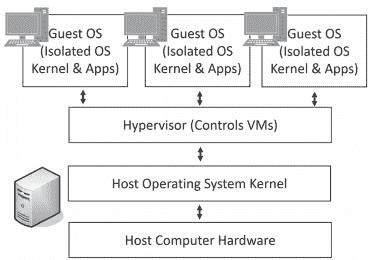图 1.1 显示了一个计算机使用基于 Type II 虚拟机监控程序的虚拟化托管三个客户操作系统。注意每个客户都有一个完整的操作系统，包括自己的内核。不要被“内核”这个词困扰你。泛而言之，内核只是某物的中心部分或最重要的部分。在提到计算机时，内核是操作系统的核心部分。

图 1.1：基于 Type II 虚拟机监控程序的虚拟化

在 PC 上实现虚拟化时，你将使用基于 Type II 虚拟机监控程序的虚拟化。然而，大型数据中心的虚拟化通常使用 Type I 虚拟化。

## 应用单元或容器虚拟化

应用单元虚拟化或容器虚拟化在隔离的应用单元（或容器）中运行服务或应用程序。作为对比，图 1.2 显示了容器虚拟化的示例。注意容器并没有托管整个操作系统。相反，宿主机的操作系统和内核在每个容器内运行服务或应用。然而，由于它们运行在单独的容器中，任何服务或应用都无法干扰其他容器中的服务和应用。

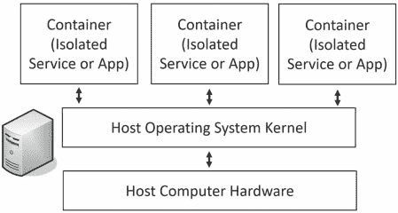

图 1.2：基于容器的虚拟化

容器虚拟化的优点是它使用的资源更少，并且比使用传统 Type II 虚拟机监控程序虚拟化的系统更有效率。互联网服务提供商（ISP）经常将其用于需要特定应用程序的客户。一个缺点是容器必须使用宿主操作系统。例如，如果宿主机运行 `Linux`，则所有容器都必须运行 `Linux`。

> **记住这一点**

> `Type I` 虚拟机监控程序直接运行在没有操作系统的裸机上。`Type II` 虚拟机监控程序运行在操作系统内的软件。`容器虚拟化`运行在隔离的单元或容器中，没有自己的内核。

## 安全网络架构

可以将虚拟化作为整体安全网络架构的一部分。其主要优势之一是 `VMs` 可以提供单个系统的划分、分段和隔离。其中一种方法是禁用 `VM` 中的网络接口卡（`NIC`）。这可以防止它向 `VM` 内部外部传输任何数据。

### 快照

快照为你提供了 `VM` 在某一时刻的副本，你可以将其作为备份。你仍然可以像往常一样使用 `VM`。然而，在拍摄快照后，虚拟机监控程序会记录 `VM` 的所有更改。如果 `VM` 出现问题，你可以将 `VM` 还原到拍摄快照时的状态。

管理员通常在执行任何风险操作之前对系统拍摄快照。高风险操作包括应用补丁或更新、测试安全控制以及安装新应用程序。理想情况下，这些操作不会引起任何问题，但偶尔会发生。通过在这些操作之前创建快照，管理员可以轻松地还原或回滚系统到具有已知良好配置的状态。

> **记住这一点**

> 虚拟化允许多个虚拟机服务器在单台物理服务器上运行。它以较低的运行成本提供了更高的可用性。此外，虚拟化在测试安全控制、更新和补丁时提供了高度的灵活性，因为它们可以使用快照轻松还原。

### VDI/VDE 和非持久性

除了虚拟化服务器，还可以虚拟化桌面。在虚拟桌面基础设施（`VDI`）或虚拟桌面环境（`VDE`）中，用户的桌面操作系统作为 `VM` 运行在服务器上。

使用 `VDI/VDE` 的优点是用户 PC 的硬件资源可以有限。如果 PC 可以通过网络连接到服务器，它可以从服务器运行功能完整的桌面操作系统。

运行虚拟桌面的首要考虑因素是它们将支持持久性还是非持久性。在持久性虚拟桌面中，每个用户都有自定义的桌面镜像。用户可以自定义它们并在桌面内保存数据。缺点是服务器上需要支持所有用户唯一桌面镜像的磁盘空间。

支持非持久性的虚拟桌面为所有用户提供相同的桌面。当用户访问远程服务器时，它会从预配置的快照提供桌面操作系统。虽然用户在使用过程中可以对桌面进行更改，但在注销时它会还原到已知状态（原始快照）。从另一个角度来看，它回滚到了已知配置。

### 虚拟机即文件

值得注意的是，虚拟机仅仅是文件。这些文件确实具有某些复杂性，但它们终究只是文件。如果你在计算机上进行实验来创建 `VMs`，你会被要求指定将这些文件存储在哪里。如果你有一台 Windows 电脑，可以使用 `File Explorer` 浏览到该位置并查看文件。

由于 `VM` 只是一组文件，将它们从一台物理服务器移动到另一台变得相对容易。例如，如果你的其中一台物理服务器过载，你可以将虚拟机服务器从过载的系统移动到另一台物理服务器。某些虚拟机服务器管理软件使这种操作变得像将虚拟机服务器从一个主机拖放到另一个主机一样简单。

恢复失败的虚拟机也非常容易。如果你为虚拟机服务器文件创建了备份，当原始服务器故障时，你只需还原文件即可。你可以以分钟为单位衡量恢复虚拟机所需的时间。相比之下，重建物理服务器可能需要几小时。许多虚拟化产品允许你在单台服务器上管理多个虚拟系统，即使这些虚拟机运行在不同的物理主机上也是如此。例如，你可能有五台物理服务器，每台托管着三个虚拟机，而你可以通过单一管理界面管理所有系统。这包括拍摄快照、回滚快照以及将虚拟机从一个物理主机移动到另一个。

## 与虚拟化相关的风险

尽管虚拟化技术具有许多优点，但你应该了解其一些缺点。许多人认为虚拟机逃逸（VM escape）是对虚拟系统安全最大的威胁。机密性丢失和可用性丢失也是令人关注的问题。

### 虚拟机逃逸

虚拟机逃逸允许攻击者从虚拟系统内部访问主机系统的攻击。如前所述，主机系统运行一个名为 `hypervisor` 的应用程序或进程来管理虚拟系统。在某些情况下，攻击者可以在虚拟机系统中运行代码并与 `hypervisor` 交互。

大多数虚拟系统运行在具有特权（类似于管理员权限）的物理服务器上。成功的虚拟机逃逸攻击通常会赋予攻击者对主机系统以及主机内每个虚拟系统的无限制控制权。

当厂商发现虚拟机逃逸漏洞时，他们会编写并发布补丁。与任何补丁一样，尽快测试并安装这些补丁至关重要。这包括保持物理服务器和虚拟机都更新状态。

### 虚拟机蔓延 (VM Sprawl)

当组织拥有许多未妥善管理的虚拟机时，就会发生虚拟机蔓延。大多数组织都有特定的策略确保物理服务器保持更新，并确保人员在经过变更管理流程后才对这些服务器进行更改。同样的策略也应适用于虚拟机。

考虑以下场景：Bart 创建了一个运行 Microsoft Windows Server 版本的虚拟机来测试某个软件应用程序。测试完成后，他让该虚拟机一直运行。后来，微软为该服务器发布了安全补丁。IT 部门测试了这些补丁并将其应用到所有需要的已知服务器上。然而，由于 Bart 没有告诉任何人他创建了虚拟机，该虚拟机一直未打补丁且容易受到攻击。

虚拟机蔓延的另一个挑战是，每个虚拟机都会为服务器增加额外负载。如果在物理服务器上添加了未经授权的虚拟机，它们可能会消耗系统资源。服务器可能会变慢并可能导致崩溃。

### 机密性丢失

提醒一下，每个虚拟系统或虚拟机只是一个或多个文件。虽然这使得管理和移动虚拟机变得容易，但也让它们很容易被窃取。

值得注意的是，许多虚拟机包含了操作系统和数据，就像物理系统在其物理驱动器上同时拥有操作系统和数据一样。例如，虚拟机可以包含带有信用卡数据、公司财务记录或任何类型的专有数据的数据库。

想象一下管理员产生了不满情绪。他拥有系统访问权限，作为一个恶意内部人员，他可以复制虚拟机带回家，并在另一台物理服务器上启动它。此时，他就获取了系统和数据的访问。

## 在虚拟机中运行 Kali Linux

Kali Linux 是一种许多安全专业人员用于渗透测试和安全审计的免费 Linux 发版。此外，CompTIA 将 Kali 列为推荐软件工具之一。好消息是，你可以免费下载 Kali Linux，并使用可用的免费虚拟化工具将其安装为虚拟机。

你可以参考在线实验室（`http://gcgapremium.com/501labs/`）在虚拟机中安装 Kali Linux。请注意，你有一些选择：

- `Hyper-V`。如果你运行的是支持 Hyper-V 的 Windows 版本，可以在 Windows 上启用它并在其中运行虚拟机。此的好处之一是，除了创建虚拟机，你还可以创建虚拟交换机。

- `VMware Workstation Player`。如果你的系统不支持 Hyper-V，你可以运行 VMware Workstation Player 的免费版。缺点是 VMware Workstation Player 免费版不支持在单个虚拟环境中运行多个虚拟机。然而，你可以升级到付费的 VMware Workstation Pro 以获得此功能以及其他多个功能。

- `Oracle VM VirtualBox`。这是过去最喜欢的。但在编写本章时，Kali Linux 无法在我 Windows 系统的 Oracle VM VirtualBox 上成功安装。这可能是由于微软或 Oracle 将通过更新来解决的技术问题。如果你感兴趣可以尝试一下，它可能对你来说运行完美。

一旦你在虚拟环境中安装了 Kali Linux，你还将能够运行 CompTIA 目标中提到的一些仅在 Linux 内运行的命令行工具。

# 使用命令行工具

命令行工具在排查故障或分析系统时可能是无价之。如果你知道如何使用它们，它们可以让许多任务变得更简单。此外，CompTIA Security+ 目标列出了几种你应该了解的命令行工具，以帮助你评估组织的安全态势。某些专门针对 Windows 系统并通过 Windows 命令提示符窗口运行。另一些专门针对 Linux 系统并通过 Linux 终端（有时称为 shell）运行。

当你阅读本节并学习这些工具时，我强烈鼓励你运行这些命令。你还将在发现一些可以在 `http://gcgapremium.com/501labs/` 在线实验室中运行的基础命令。


许多考生面临的挑战是他们没有 Linux 系统来尝试这些命令。如果你无法输入这些命令并看到它们的作用，那么即使在面对简单的问题时你也可能遇到困难。在线实验室包含了你可以使用的实验，可以让你在 Windows 系统上创建一个虚拟的 Linux 环境。

## Windows 命令行

在 Windows 中使用命令行之前，你首先需要启动 Windows 命令提示符窗口。启动命令提示符窗口的最简单方法是右键点击“开始”按钮并选择“命令提示符”，如图 1.3 所示。开始按钮位于屏幕左下方，点击它会显示带有许多应用程序链接的开始菜单。


图 1.3：启动 Windows 命令提示符窗口

在某些情况下，你需要以管理员身份通过特权启动命令提示符窗口。要此操作，右键点击“开始”按钮并选择`命令提示符 (管理员)`。

如果你使用的是不同版本的 Windows（或微软决定再次修改“开始”按钮的功能），使用你喜欢的搜索引擎进行快速搜索应该能帮助你识别如何打开命令提示符窗口。

## Linux 终端

终端是在 Linux 系统中运行命令的地方。根据你正在使用的发行版，有多种方法访问终端。如果你正在运行 Kali Linux（建议在阅读本书时使用），只需点击 Kali 菜单上的终端图标即可启动它。

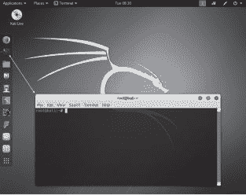

图 1.4 显示了带有侧菜单的 Kali 实例。如果你将鼠标悬停在第二个图标上，你会看到“Terminal”出现。点击它即可启动终端。

图 1.4：在 Kali Linux 中启动终端

为了简单起见，我在本书中不再统称为“Linux 或 Unix”，而是直接称为 Linux。请注意，Linux 是 Unix 的一个版本，可以在 Unix 终端中运行的命令也可以在 Linux 终端中运行。

## 理解开关（Switches）和获取帮助

你运行的几乎每个命令都有可用选项，你可以通过开关（switch）来调用它们。Windows 命令行开关在命令后使用正斜杠 (`/`) 或破折号 (`-`)，并包含一个修改命令以执行不同功能的选项。

Linux 命令也使用开关，但它们通常只使用破折号。如果你使用正斜杠 (`/`)，通常会得到意外的结果或错误。

Windows 系统中最常用的开关是用问号标识的帮助开关。例如，你可以使用帮助开关来获取这些命令的帮助：

*   `ping /?` 或 `ping -?`

*   `ipconfig /?` 或 `ipconfig -?`

*   `netstat /?` 或 `netstat -?`

虽然 Linux 终端命令也使用开关，但它们不使用问号 (`?`) 来帮助。相反，如果你想获取某个命令的基本帮助，通常可以不带任何开关直接输入命令，或者使用管道符号 (`|`) 和单词`help`：

*   `ping`

*   `ping | help`

大多数 Linux 发行版都包含一个可以查询的用户手册。该手册由手册页（man pages）组织，你通过`man`命令来查询它们。例如，你可以使用以下命令获取`ping`的帮助：

*   `man ping`

遗憾的是，Linux 中没有统一的标准来获取所有命令的帮助。有时，一种方法有效，而另一种方法则无效。关键在于了解不同的方法，以便在必要时使用替代方法。

## 理解大小写

大多数 Windows 命令对大小写不敏感。也就是说，你可以使用大写字母、小写字母或任何组合来输入命令。例如，以下每条命令都会 ping `localhost` 的 IPv6 地址 (`::1`) 并提供相同的输出：

*   `ping -6 localhost`

*   `PiNg -6 localHOST`

*   `PING -6 LocalHost`

然而，这在 Linux 终端中并非如此。相反，命令通常是小写的，如果你使用大写字母，你会发现命令无法被识别。在所示的三个 Windows 命令行命令中，只有 `ping -6 localhost` 在 Linux 终端中有效。

在学习这些命令时，请注意其中许多命令同时支持 IPv4 地址和 IPv6 地址。通过查询帮助，你可以看到如何执行每个操作。

## Ping

`ping`是一种用于测试远程系统连接性的基本命令。你也可以用它来验证系统是否可以将有效的主机名解析为 IP 地址、测试网卡 (`NIC`) 并检查网络的安全状况。

`ping`命令通过发送互联网控制消息协议 (ICMP) 回显请求包来检查连接性。远程系统用 ICMP 回显响应包进行回答，如果你收到了回显响应，你就知道远程系统正在运行。作为一个简单的例子，以下命令验证了你的电脑可以连接网络上的另一台电脑：

```
ping 192.168.1.1
```

在 Windows 系统上，`ping`会发送四个 ICMP 回显请求。接收到 ICMP 回显请求的系统会响应 ICMP 回显响应。在基于 Linux 的系统中，`ping`会持续运行直到你按下 `Ctrl + C` 键停止它。你可以通过这样使用 `-t` 开关在 Windows 系统上模拟这种行为：

```
ping -t 192.168.1.1
```

同样，你可以使用 `-c` 开关（用于计数）在 Linux 系统上模拟 Windows `ping`的行为：

```
ping -c 4 192.168.1.1
```

这个示例测试了与本地网络 IP 地址的连接性，但你同样可以测试任何系统的连接性。例如，如果你知道托管互联网上网站的系统的 IP 地址，你可以`ping`它的 IP 地址。

### 使用 Ping 检查名称解析

名称解析过程将主机（如 `getcertifiedgetahead.com`）解析为 IP 地址。名称解析有几个元素。通常情况下，计算机会向域名系统 (DNS) 查询主机名，DNS 将响应一个 IP 地址。

某些恶意软件会尝试破坏特定主机的名称解析过程。例如，Windows 系统从 Windows Update 服务器获取更新。在某些情况下，恶意软件会更改名称解析过程以防止系统访问 Windows Update 服务器获取更新。

你可以`ping`远程系统的主机名并验证名称解析是否正常工作。例如，以下命令将主机 (`getcertifiedgetahead.com`) 解析为 IP 地址：

```
ping getcertifiedgetahead.com
```

这是在 Windows 10 系统的命令行提示符上执行该命令时的结果。注意第一行显示`ping`将主机 (`getcertifiedgetahead.com`) 解析为其 IP 地址 (`72.52.206.134`)：

```
Pinging getcertifiedgetahead.com [72.52.206.134] with 32 bytes of data:
Reply from 72.52.206.134: bytes=32 time=45ms TTL=116
Reply from 72.52.206.134: bytes=32 time=45ms TTL=116
Reply from 72.52.206.134: bytes=32 time=48ms TTL=116
Reply from 72.52.206.134: bytes=32 time=45ms TTL=116
Ping statistics for 72.52.206.134:
Packets: Sent = 4, Received = 4, Lost = 0 (0% loss)
Approximate round trip times in milli-seconds: = 45ms, Maximum = 48ms, Average = 45ms
```

### 警惕防火墙

如果你收到系统的响应，说明该系统正在运行且是可以访问的。然而，如果`ping`命令失败，并不一定意味着远程系统未运行或不可访问。即使远程系统运行正常，`ping`也可能会显示“请求超时 (Reply Timed Out)”。

许多拒绝服务 (DoS) 攻击使用 ICMP 来破坏互联网系统上的服务。为了保护系统，防火墙通常会阻止 ICMP 流量以防止这些攻击成功。换句话说，远程系统可能运行正常，但由于防火墙阻止了 ICMP 流量，`ping`将失败。

例如，你可以使用浏览器连接到 [`blogs.getcertifiedgetahead.com/`](http://blogs.getcertifiedgetahead.com/) 网站，但`ping`可能会失败。这表明该网站可以使用超文本传输协议 (HTTP)，但防火墙正在阻止 ICMP 流量。

### 使用 Ping 检查安全状况

你还可以用`ping`来检查网络的安全状况。例如，如果你配置了防火墙和路由器阻止`ping`流量，你可以通过使用`ping`进行检查来验证防火墙和路由器确实阻止了该流量。

第四章将深入介绍入侵防御系统 (IPS)，但作为介绍，它们通常可以检测并自动阻止攻击。例如，简单的分布式拒绝服务 (DDoS) 攻击可以向服务器发送数千个 ping 包并使其过载。IPS 可以检测到攻击并自动阻止 ICMP 流量，从而有效防止攻击的影响。

你可以使用`ping`来模拟从几台计算机发起攻击，反复发送`ping`请求。如果`IPS`正在工作，它将阻止这些攻击，`pings`将停止接收响应。

### 记住这一点

管理员使用`ping`来检查远程系统的连接性，并验证名称解析是否正常。他们还使用`ping`来检查系统和网络的安全态势，通过验证路由器、防火墙和`IPS`在配置后是否会拦截 ICMP 流量。

## ipconfig, ifconfig 和 ip

`ipconfig`命令（Internet Protocol configuration，互联网协议配置的缩写）显示系统的传输控制协议/互联网协议（TCP/IP）配置信息。这包括计算机的 IP 地址、子网掩码、默认网关、MAC 地址以及域名系统（DNS）服务器地址等项目。该命令显示系统中所有网络网卡（NIC）的配置信息，包括有线和无线网卡。技术人员在排查网络问题时通常将`ipconfig`作为第一步。

基于 Linux 的系统使用`ifconfig`（interface configuration，接口配置的缩写）代替`ipconfig`。其优势是`ifconfig`具有比`ipconfig`更多的功能，允许你在列出网卡属性的同时使用它来配置网卡。

以下列表显示了一些常用命令：

-   `ipconfig`。单独输入该命令提供网卡的基本信息，如 IP 地址、子网掩码和默认网关。

-   `ipconfig /all`。此命令显示每个网卡 TCP/IP 配置信息的完整列表。它包括媒体访问控制（MAC）地址、分配的 DNS 服务器地址，以及如果系统是 DHCP 客户端则的动态主机配置协议（DHCP）服务器地址。在 Linux 系统上你可以使用 `ifconfig -a`。

-   `ipconfig /displaydns`。系统每当查询 DNS 将主机名解析为 IP 地址时，都会将结果存储在 DNS 缓存中，此命令显示 DNS 缓存的内容。它还显示 hosts 文件中包含的任何主机名到 IP 地址的映射。

-   `ipconfig /flushdns`。你可以用此命令清除 DNS 缓存内容。当缓存中包含错误信息且你想确保 DNS 查询的是最新信息时，请使用此命令。

以下命令是 Linux 系统特有的：

-   `ifconfig eth0`。此命令显示 Linux 系统上第一个以太网接口（NIC）的配置。如果系统有多个网卡，你可以使用 `eth1`、`eth2` 等。你也可以使用 `wlan0` 来查看第一个无线接口的信息。

-   `ifconfig eth0 promisc`。此命令在第一个以太网接口上启用混杂模式。混杂模式允许网卡处理其收到的所有流量。通常，网卡处于非混杂模式，会忽略所有不是发送给自己的数据包。你可以用此命令禁用混杂模式：`ifconfig eth0 -promisc`。

-   `ifconfig eth0 allmulti`。此命令在网卡上启用组播模式。这允许网卡处理其收到的所有组播流量。通常，网卡只会处理其已加入的多播组的组播流量。你可以用此命令禁用组播模式：`ifconfig eth0 -allmulti`。

通常情况下，网卡使用非混杂模式并只处理直接指向其 IP 地址的数据包。然而，当你将其置为混杂模式时，它会忽略 IP 地址处理所有数据包。这允许协议分析器捕获到达网卡的所有包。

`ifconfig`命令已于 2009 年在 Debian 发行版中被弃用。弃用意味着不建议使用但予以允许。`ifconfig`命令是 `net-tools` 软件包的一部分，Linux Debian 开发者不再维护该包。然而，在大多数 Linux 系统（包括 Kali Linux）上仍然能看到 `ifconfig` 和 `net-tools` 软件包中的其他工具。

Linux 开发者建议使用`ip`而不是`ifconfig`。虽然`ip`命令可以显示信息并配置网络接口，但它使用的命令并不相同，也不具备相同的功能。例如，它没有可以用于启用网卡混杂模式的命令。以下是你可以配合`ip`使用的一些命令：

-   `ip link show`。显示接口及其某些细节。

-   `ip link set eth0 up`。启用网络接口。

-   `ip -s link`。显示网络接口的统计信息。

### 记住这一点

Windows 系统使用`ipconfig`查看网络接口。Linux 系统使用`ifconfig`，且`ifconfig`还可以操作网络接口的设置。你可以用`ifconfig`为网卡启用混杂模式。`ip`命令与`ifconfig`类似，可查看和操作网卡设置。

## netstat

`netstat`命令（network statistics，网络统计的缩写）允许你查看系统中 TCP/IP 协议的统计信息。它还让你具备查看活动 TCP/IP 网络连接的能力。许多攻击会受感染计算机向远程计算机建立连接。如果你怀疑这一点，通常可以通过`netstat`识别这些连接。

你可以配合`netstat`使用的一些常用命令有：

-   `netstat`。显示所有打开的 TCP 连接列表。

-   `netstat -a`。除了所有打开的连接外，显示系统正在监听的所有 TCP 和用户数据报协议（UDP）端口列表。此列表包含 IP 地址后跟冒号和端口号，你可以使用端口号来识别协议。例如，如果你看到一个 IP 地址后跟着 `:80`，表示系统正在监听 HTTP 的默认端口 80。这表明该系统可能是一个 Web 服务器。

-   `netstat –r`。显示路由表。

-   `netstat -e`。显示网络统计的详细信息，包括系统发送和接收的字节数。

-   `netstat -s`。显示特定协议（如 IP、ICMP、TCP 和 UDP）的数据包发送或接收统计信息。

-   `netstat -n`。以数字顺序显示地址和端口号。如果你正在寻找与特定 IP 地址或特定端口相关的信息，这非常有用。

-   `netstat -p protocol`。显示特定协议（如 TCP 或 UDP）的统计信息。例如，你可以使用 `netstat -p tcp` 只显示 TCP 统计。

你可以组合许多`netstat`选项来显示不同类型的信息。例如，如果你想显示系统正在监听的端口列表（`-a`），按数字顺序列出（`-n`），且仅针对 TCP 协议（`-p`），你可以使用此命令：

```
netstat -anp tcp
```

`netstat`显示连接状态，例如用 `ESTABLISHED` 表示活动连接。RFC 793 (https://tools.ietf.org/rfc/rfc793.txt) 正式定义了这些状态。一些常见状态包括：

-   `ESTABLISHED`。这是连接数据传输阶段的正常状态。它表示一个打开的连接。

-   `LISTEN`。表示系统正在等待连接请求。系统监听的已知端口表示该协议。

-   `CLOSE_WAIT`。表示系统正在等待连接终止请求。

-   `TIME_WAIT`。表示系统正在等待足够的时间通过以确保远程系统收到了连接的 TCP 确认。

-   `SYN_SENT`。这表示系统发送了 TCP `SYN`（同步）包，作为 `SYN`、`SYN-ACK`（同步-确认）、`ACK`（确认）握手过程的第一部分，并等待 `SYN-ACK` 响应。

-   `SYN_RECEIVED`。这表示系统在接收到 `SYN` 包后发送了 TCP `SYN-ACK` 包，作为 `SYN`、`SYN-ACK`、`ACK` 握手过程的第一部分。它等待 `ACK` 响应以建立连接。大量的 `SYN_RECEIVED` 状态表明存在 `SYN` 攻击，攻击者正用 `SYN` 包淹没系统，但从不通过 `ACK` 包完成连接。

## Tracert

`tracert`命令列出两个系统之间的路由器。在此上下文中，每个路由器被称为一个“跳”（hop）。`tracert`识别每个跳的`IP`地址，有时还有主机名，以及每个跳的往返时间（`RTTs`）。Windows 系统使用 `tracert`，而 Linux 系统使用 `traceroute`，但它们的功能相似。为了简单起见，我在本节中使用命令名称 `tracert`，但本节同样适用于两者。

网络管理员通常使用`tracert`来识别网络上的故障路由器。`Ping`告诉他们是否可以到达远端服务器。如果`ping`失败，他们可以使用`tracert`来识别流量在哪里停止的。某些跳将会成功，但在某个点上，`tracert`会识别出数据包丢失的位置，让他们直观问题发生的位置。在其他情况下，他们会看到流量在绕过故障路由器进行路由时，`RTTs`何时增加。在通过广域网（`WAN`）排除故障时，追踪路径尤为有价值。

从安全的角度来看，你可以使用`tracert`来识别被修改的路径。例如，考虑图 1.5。内部网络内的用户通常直接通过路由器 1 访问互联网。但是，如果攻击者在路由器 1 和互联网之间安装了一个未经授权的路由器呢？

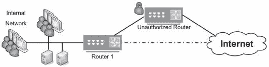

图 1.5：使用`tracert`追踪路径


流量仍会在用户之间往返传输。然而，攻击者可以使用协议分析器捕获流量，并查看任何明文发送的数据。攻击者还可能发起其他攻击，例如第 7 章讨论的某些攻击。

从另一个角度来看，你可以识别互联网路径是否被修改。假设你经常从纽约的位置连接到纽约的一个服务器。今天，连接似乎异常缓慢。你可以使用`tracert`来验证路径。如果你发现流量现在通过外国的`IP`地址，这说明存在问题。

尝试一下吧。启动命令提示符并使用以下命令查看`tracert`命令的一些常见用法和输出：

- 输入`tracert blogs.getcertifiedgetahead.com`并按回车。识别你的系统与此 Web 服务器之间有多少跳。识别是否有某些`RTTs`显著长于其他。

- 输入`tracert –d blogs.getcertifiedgetahead.com`并按回车。注意`-d`开关强制`tracert`不将`IP`地址解析为主机名，从而允许命令更快完成。

## Arp

`arp`是一个与地址解析协议（`ARP`）相关的命令行工具；然而，`arp`（命令）和`ARP`（协议）并不是同一个东西。第 3 章讨论了`ARP`（协议），但作为简介介绍，`ARP`将`IP`地址解析为`MAC`地址并将结果存储在`ARP`缓存中。

你可以使用`arp`命令查看和操作`ARP`缓存。以下是一些示例命令：

- `arp`。不带开关，在 Windows 上显示帮助信息

- `arp`。不带开关，在 Linux 上显示`ARP`缓存

- `arp -a`。在 Windows 上显示`ARP`缓存

- `arp -a 192.168.1.1`。显示指定`IP`地址的`ARP`缓存项

你还可以使用`arp`来识别本地网络上其他系统的`MAC`地址。例如，假设你想识别`server1`的`MAC`地址。你可以`ping server1`，`ARP`将识别`server1`的`IP`地址。然后你可以使用`arp -a`显示`ARP`缓存，其中包含`server1`的`MAC`地址。

第 7 章涵盖了多种攻击，包括`ARP`缓存投毒，攻击者通过这种手段操纵`ARP`缓存。如果你怀疑存在`ARP`缓存投毒攻击，可以使用`arp`来检查缓存。

# 第 1 章考试考点回顾

在准备考试时，确保你理解本章涵盖的这些关键概念。

## 理解核心安全目标

- 用例有助于专业人员识别并明确为了实现某目标所需的需求。

- 机密性（Confidentiality）确保数据仅供授权用户查看。加密是提供机密性的最佳选择。访问控制也保护数据的机密性。

- 隐写术（Steganography，在数据内部隐藏数据）是支持混淆的方法之一，使隐藏数据更难以被发现。

- 完整性（Integrity）提供保证，确保数据未通过授权或意外的更改而被修改、篡改或损坏。数据可以是消息、文件或数据库中的数据。哈希（Hashing）是确保完整性的常用方法。

- 非否认性（Non-repudiation）防止实体否认其执行过的操作。数字签名和审计日志提供了非否认性。数字签名还为文件和邮件提供了完整性。

- 可用性（Availability）确保在需要时数据和服务是可用的。一个常见目标是消除单点故障。用于增加或维持可用性的方法包括容错、故障转移集群、负载均衡、备份、虚拟化、HVAC 系统和发电机。

## 介绍基本风险概念

- 风险（Risk）是威胁利用漏洞并导致损失的可能性。

- 威胁（Threat）是任何可能损害机密性、完整性或可用性的情况或事件。

- 漏洞（Vulnerability）是一个弱点。它可以是硬件、软件、配置或操作系统的操作者（用户）中的一个弱点。

- 风险缓解（Risk mitigation）通过降低威胁利用漏洞的概率或降低风险的影响来减少风险。

- 安全控制（Security controls）减少风险。例如，杀病毒软件是一种降低病毒感染风险的安全控制。

## 理解控制类型

- 三种主要的安全控制类型是技术控制（通过技术实现）、管理控制（使用行政或管理方法）和物理控制（使用你可以物理触碰的控制措施）。

- 技术控制是利用技术来减少漏洞。加密、杀病毒软件、`IDSs`、防火墙和最小权限原则都是技术控制。

- 管理控制主要是行政性的，包括风险和漏洞评估等项目。某些管理控制有助于确保组织的日常运营符合其整体安全计划。示例包括安全意识和培训、配置管理和变更管理。

- 预防性控制（Preventive controls）试图防止安全事件发生。示例包括系统加固、用户培训、保安、变更管理和账户禁用策略。

- 检测性控制（Detective controls）试图检测漏洞何时被利用。示例包括日志监控、趋势分析、安全审计（例如定期审查用户权限）、视频监控系统和运动检测系统。

- 纠正控制（Corrective controls）试图在事件或问题发生后扭转其影响。示例包括入侵预防系统（`IPSs`）、备份和系统恢复计划。

- 威慑控制（Deterrent controls）试图通过威慑威胁来防止事件发生。

- 补偿控制（Compensating controls）是在无法可行或无法使用主要控制措施时使用的替代控制措施。

## 实现虚拟化

- 虚拟化允许多台服务器在单个物理宿主机上运行。它们通过`snapshots`（快照）和轻松恢复等工具提供了更高的可用性。

- I 型虚拟机程序（Type I hypervisors）直接运行在系统硬件上。它们通常被称为裸金属型虚拟机程序，因为它们不需要在操作系统中运行。

- II 型虚拟机程序（Type II hypervisors）作为软件运行在主机操作系统中。

- 容器虚拟化是 II 型虚拟机程序的特殊版本。它允许服务或应用程序在它们各自的隔离单元或容器中运行。容器不包含完整的操作系统，而是使用主机的`kernel`（内核）。

- 快照（Snapshots）捕获某一时刻`VM`的状态。管理员通常在执行风险操作前拍摄快照。如有必要，他们可以将`VM`回到快照状态。

- 如果组织内部人员未管理`VMs`，可能会发生虚拟机泛滥（VM sprawl）。

- 虚拟机逃逸攻击（VM escape attacks）允许攻击者从`VM`访问主机系统。主要的保护措施是保持宿主机和客户机更新最新的补丁。

## 使用命令行工具

- 你可以在命令提示符窗口（Windows 中）和终端（Linux 中）运行命令行工具。

- `ping`命令可检查连通性；检查名称解析；并验证路由器、防火墙和入侵预防系统是否阻止了`ICMP`。

- Windows `ipconfig`命令允许你查看网络接口的配置。

- Linux 使用`ifconfig`和/或`ip`来查看和操作网络接口的配置。你可以通过`ifconfig`在网卡上启用混杂模式。

- `netstat`允许你查看`TCP/IP`协议的统计数据并查看所有活动连接。如果你怀疑恶意软件导致计算机连接到远程计算机，这非常有用。

- `tracert`列出两个系统之间的路由器（也称为跳数）。它可以用于验证路径是否发生变化。

- `arp`命令允许你查看和操作`ARP`缓存。如果你怀疑系统的`ARP`缓存在攻击期间被修改，这非常有用。

## 在线参考

- 请记住，你可以在`http://gcgapremium.com/501-extras.`访问在线参考，例如实验室和基于性能的示例题。

# 第 1 章练习题

1. 你需要通过电子邮件传输 PII（个人身份信息）并希望保持其机密性。以下选项中最佳解决方案是？

A. 使用哈希。

B. 在发送前对其加密。

C. 使用数字签名保护它。

D. 使用`RAID`。

2. Apu 管理他商店里的网络设备，并维护所有受管理的路由器和交换机的配置文件副本。他每周为这些文件创建哈希，并将其与上周为相同文件创建的哈希进行比较。他最可能在使用哪种用例？

A. 支持机密性

B. 支持完整性

C. 支持加密

D. 支持可用性

3. Louie 在图像文件中隐藏了几个明文文档。然后将图像文件发送给 Tony。以下哪项最佳描述了他行为的目的是？

A. 支持隐写术（steganography）

B. 支持完整性

C. 支持可用性

D. 支持混淆（obfuscation）

4. 管理层强制组织内的所有人员使用数字签名。这主要支持哪种用例？

A. 支持机密性

B. 支持可用性

C. 支持混淆

D. 支持不可否认性

5. 作为 CTO，Marge 正在实施一项安全计划。她包含了处理机密性和可用性的安全控制措施。在以下选项中，她还应该包含什么？

A. 确保关键系统提供不间断的服务。

B. 防止传输数据被未经授权的泄露。

C. 确保系统不受未经授权更改的影响。

D. 安全数据以防止未经授权的泄露。

6. 你的组织想要减少因盗窃损失的资金。以下哪项设备盗窃威慑的最佳示例？

A. 快照

B. 锁

C. 强密码

D. 持久性`VDI`。

7. 你的组织正在考虑虚拟化解决方案。管理层希望确保任何解决方案都能提供最佳投资回报率（ROI）。以下哪种情况表明虚拟化将提供最佳 ROI？

A. 组织内的大多数物理服务器目前的利用率接近 100%。

B. 组织有许多不需要故障备服务的服务器。

C. 大多数桌面 PC 需要快速处理器和大量内存。

D. 组织内的大多数物理服务器目前利用率不足。

8. 你正准备在虚拟服务器上部署一个新应用程序。该虚拟服务器托管着员工经常访问的另一个服务器应用程序。在部署新应用程序时，使用哪种方法最佳？

A. 在部署新应用程序之前对`VM`拍摄快照。

B. 在部署新应用程序之后对`VM`拍摄快照。

C. 确保服务器配置为非持久性。

D. 在安装新应用程序后备份服务器。

9. Ned 无法从他基于 Linux 的计算机访问任何网络资源。他将使用哪条命令来查看其系统的网络配置？

A. `ifconfig`

B. `ipconfig`

C. `netstat`

D. `tracert`

10. 管理员经常为测试创建`VMs`。他们有时在测试完成后让这些虚拟机一直运行而不再次使用。以下哪项描述了这种情况？

A. 虚拟机逃逸

B. `VDI`快照

C. 虚拟机泛滥（VM sprawl）

D. II 型虚拟机程序

11. 你的组织内的用户访问托管在远程服务器上的虚拟桌面。这描述了以下哪项？

A. `VDE`

B. 用于非持久存储的快照

C. I 型虚拟机程序

D. 虚拟机泛滥

12. 你的组织为大多数用户实现了`VDI`。当用户注销时，桌面恢复到原始状态，不保存用户所做的任何更改。以下哪项最佳描述了这种行为？

A. 容器虚拟化

B. 虚拟机逃逸

C. 非持久性（Non-persistence）

D. 弹性

13. 哪种虚拟化允许计算机的操作系统内核运行多个隔离的客户虚拟机实例，每个客户共享该内核？

A. 容器虚拟化

B. I 型虚拟机程序虚拟化

C. II 型虚拟机程序虚拟化

D. `VDE`

14. 你正在考虑重启数据库服务器，并想识别它是否有任何活动网络连接。以下哪个命令将列出活动网络连接？

A. `arp`

B. `ipconfig`

C. `ping`

D. `netstat`

15. 你在网络中配置了防火墙以阻止`ICMP`流量。你想验证它是否正在阻止该流量。你将使用哪条命令？

A. `arp`

B. `ipconfig`

C. `netstat`

D. `ping`

# 第 1 章练习题答案

1. B. 你可以通过加密来维护任何数据的机密性，包括个人身份信息 (PII)。哈希值（Hashes）提供完整性，而非机密性。数字签名提供认证、不可否认性和完整性。廉价磁盘冗余阵（RAID）为磁盘子系统提供了更高的可用性。

2. B. 他最可能在使用一种支持完整性的用例。通过验证配置文件上的哈希值是否相同，他正在验证文件是否已更改。机密性通过加密、访问控制和隐写术来实现。加密是实施机密性的方法，它不使用哈希值。可用性确保系统在需要时处于运行状态。

3. D. 在数据中隐藏数据是支持混淆用例的一种方式。在这种情况下，Louie 正在使用隐写术将文件隐藏在图像中，但那是方法而不是目的。哈希方法和数字签名支持完整性。冗余和容错方法会增加可用性。

4. D. 数字签名将支持不可否认性的用例。数字签名不加密数据，因此它们不支持机密性的用例。冗余和容错解决方案将增加可用性。隐写术是支持混淆的一种方式。

5. C. 首席官 (CTO) 应确保系统不受未经授权更改的影响，这是完整性中的一个要素。安全计划应该处理三个核心安全原则：机密性、完整性和可用性 (CIA)。示例中的系统已经在处理机密性和可用性。确保关键系统提供不间断的服务解决了可用性。保护数据和安全数据以防止未经授权的泄露解决了机密性。

6. B. 锁是笔记本电脑和其他系统有效的设备盗窃威慑手段。快照是指捕捉虚拟机在某一时刻状态的数字快照。密码可以防止对系统的未经授权访问，但不能提供物理安全。虚拟桌面基础设施 (VDI) 允许用户访问远程服务器上的桌面。持久 VDI 会保存用户在桌面上的更改，但它不能阻止盗窃。

7. D. 如果组织内部大多数物理服务器目前处于低利用率状态，虚拟化将提供高投资回报率 (ROI)。如果服务器目前的利用率接近 100%，则需要购买新服务器来进行虚拟化。在虚拟化服务器上可以实现故障转移服务，因此物理服务器和虚拟化服务器之间的成本差异很小。除非你知道系统目前的使用量，否则处理能力或内存需求的大小并不相关。

8. A. 在部署虚拟机 (VM) 之前对其进行快照，可以确保在新应用程序出现问题时虚拟机可以恢复到原始配置。在安装后拍摄快照无法让你回滚镜像。非持久性用于虚拟桌面基础设施 (VDI)，在 VDI 中用户对桌面的更改不会被保存。在虚拟服务器上使用非持久性是不恰当的。在安装新应用程序之前备份服务器可能是合适的，但在安装之后不是。

9. A. `ifconfig`命令显示 Linux 计算机上的网络设置。这包括分配给网络接口卡 (NIC) 的 IP 地址、子网掩码和默认网关。`ipconfig`命令在 Windows 计算机上执行类似的检查，但在 Linux 系统上不是。`netstat`显示网络统计和活动连接，但不显示网络设置。`tracert`命令跟踪数据路由，并帮助确定哪些网络设备出现故障。

10. C. 当组织拥有许多未妥善管理的虚拟机时，就会发生虚拟机泛滥。未监控的虚拟机通常不会更新，并可能受到攻击。虚拟机逃逸 (VM escape) 是一种攻击，允许攻击者从虚拟系统内部访问主机系统。虚拟桌面基础设施 (VDI) 为用户提供托管在服务器上的虚拟桌面。VDI 快照通常用于为用户提供相同的、不保存更改的非持久桌面。虚拟机可能是 II 型虚拟机监控程序（作为主机操作系统内部的软件运行），但这与让它们运行且不受监控无关。

11. A. 在虚拟桌面环境 (VDE) 中，用户访问托管在远程服务器上的虚拟桌面。VDE 桌面可以使用快照来实现非持久性，但也可以允许用户在 VDE 中拥有持久的唯一桌面。I 型虚拟机监控程序（裸金属监控程序）直接运行在系统上，没有操作系统，不用于 VDE。虚拟机泛滥描述许多未管理虚拟机的问题，但场景中没有提到虚拟桌面未管理。

12. C. 虚拟桌面基础设施 (VDI) 中的非持久性表示桌面对于大多数（或所有）用户来说都是相同的，当用户注销时，桌面将恢复到已知状态或回滚到已知配置。使用容器虚拟化时，应用程序单元在主机内部运行隔离的服务或应用程序，并使用主机的内核。虚拟机 (VM) 逃逸是一种攻击，攻击者从虚拟机内部访问主机系统。弹性是指根据负载的增加或减少来调整虚拟机大小的能力。

13. A. 基于容器的虚拟化（也称为应用程序单元虚拟化）使用主机计算机相同的操作系统内核。它通常用于在虚拟环境中运行隔离的应用程序或服务。I 型虚拟机监控程序虚拟化直接运行在系统硬件上。II 型虚拟机监控程序虚拟化运行虚拟机，这些虚拟机都包含自己的操作系统，包括它们自己的内核。虚拟桌面环境 (VDE) 为用户提供完整的桌面操作系统。

14. D. `netstat`命令显示系统上的活动连接。`arp`显示与媒体访问控制 (MAC) 地址相关的信息。`ipconfig`显示有线和无线网络接口卡的 TCP/IP 配置信息。`ping`检查与远程系统的连通性。

15. D. `ping`命令发送 Internet 控制消息协议 (ICMP) 回显请求并检查 ICMP 回显应答。`arp`将 IP 地址解析为媒体访问控制 (MAC) 地址且不使用回显命令。`ipconfig`检查 NIC 的配置。`netstat`显示活动连接和网络统计。

# 第 2 章

## 理解身份和访问管理

#### 本章涵盖的 CompTIA Security+ 目标：

### 1.6 解释与漏洞类型相关的影响。

- 配置不当的账户

### 2.3 给定场景，排除常见安全问题。

- 未加密的凭据/明文、身份验证问题

### 2.6 给定场景，实施安全协议。

- 协议 (LDAPS)

### 3.3 给定场景，实施安全的系统设计。

- 操作系统（禁用默认帐户/密码）

### 4.1 比较和对比身份和访问管理概念。

- 身份识别、认证、授权和审计 (AAA)、多因素认证（你所是、你拥有的、你所知的、你所在的位置、你所做的）、联邦、单点登录、传递信任

### 4.2 给定场景，安装并配置身份和访问服务。

- `LDAP`、`Kerberos`、`SAML`、`OpenID Connect`、`OAUTH`、`Shibboleth`、`Secure token`、`NTLM`

### 4.3 给定一个场景，实施身份访问管理控制。

- 访问控制模型（`MAC`、`DAC`、`ABAC`、基于角色的访问控制、基于规则的访问控制）、生物识别因素（指纹扫描仪、视网膜扫描仪、虹膜扫描仪、语音识别、面部识别、误假性接受率、误假性拒收率、交叉错误率）、令牌（`硬件`、`软件`、`HOTP/TOTP`）、基于证书的认证（`PIV/ CAC/smart card`）

### 4.4 给定一个场景，区分常见的账户管理实践。


- 账户类型（用户账户、共享和通用账户/凭据、访客账户、服务账户、特权账户）
- 通用概念（最小权限原则、`时段限制`、`重新认证`、标准命名规范、`账户维护`、基于组的访问控制、`基于位置的策略`）
- 账户策略执行（凭据管理、组策略、密码复杂性、过期、恢复、禁用、锁定、密码历史、密码重用、密码长度）

### 6.1 比较和对比密码学的基本概念

- 常见用例（支持认证）

CompTIA Security+ 目标中的领域 4.0 是“身份和访问管理”，诚然，这个词听起来很绕口。用简单的话来说，用户通过用户名声称身份，并通过认证（例如使用密码）来证明自己的身份。然后，他们将根据其证明的身份获得访问资源的权限。在本章中，你将学习各种认证概念和方法，以及用于管理账户的一些基本安全原则。本章将以某些访问控制模型的比较作为结束。

# 探索认证概念

认证通过某种类型的凭据（如用户名和密码）来证明身份。例如，当用户使用用户名或电子邮件地址等标识符声称（或声明）自己的身份时，就发生了识别。随后用户通过认证（如密码）来证明自己的身份。在这种背景下，用户的凭据既包括声称的身份，也包括认证机制。

至少有两个实体知道凭据。其中一个实体（例如用户）提供凭据。另一个实体是验证凭据的认证器。例如，Marge 知道她的用户名和密码，而认证服务器也知道她的用户名和密码。Marge 将她的凭据提供给认证服务器，由服务器对其进行认证。

认证的重要性不言而喻。如果你无法识别用户，就无法实现任何类型的访问控制。换句话说，如果每个人都是匿名的，那么每个人对所有资源的访问都是相同的。

此外，认证不仅限于用户。服务、进程、工作站、服务器和网络设备都使用认证来证明自己的身份。许多计算机使用相互认证，即双方对彼此进行认证。

## 比较识别和 AAA

认证、授权和计费（AAA）与识别共同工作，提供了一个全面的访问管理系统。如果你理解了识别（声称身份，例如使用用户名）和认证（提供身份，例如使用密码），那么添加 AAA 的另外两个元素——授权和计费就会变得更容易。

如果用户能够证明自己的身份，并不意味着他们会自动获得系统内所有资源的访问权限。相反，用户根据其证明的身份获得访问资源的授权。这可以简单地是授予用户读取共享文件夹中数据的权限。访问控制系统包含多个安全控制，以确保用户能够访问其被授权使用的资源，且不再超出。

计费方法跟踪用户活动并将活动记录在日志中。例如，审计日志跟踪活动，管理员使用这些日志来创建审计跟踪。审计跟踪允许安全专业人员重建发生安全事件之前的事件。

有效的访问控制始于强大的认证机制，例如使用强效的密码、智能卡或生物识别。如果用户可以绕过认证过程，那么授权和计费过程将是失效。

## 记住这一点

识别发生在用户使用用户名或电子邮件地址等方式声称身份时。认证发生在用户证明所声称的身份（例如使用密码）且凭据通过验证时。访问控制系统通过根据授予已证明身份的权限来提供访问资源的授权。日志记录提供了计费。

## 比较认证因素

认证通常被简化为认证的类型或“因素”。支持认证的用例可能要求管理员为基础认证实施一种认证因素，为更安全的认证实施两个因素，或为更高安全性的认证实施更多因素。作为介绍，这些因素是：

- 你所知道的，例如密码或个人识别码（`PIN`）
- 你所拥有的，例如智能卡或 USB 令牌
- 你所具备的，例如指纹或其他生物识别
- 你所处的地点，例如你使用地理定位技术所在的位置
- 你所执行的，例如触摸屏上的手势

### 你所知道的

“你所知道的”认证因素通常指的是共享秘密，例如密码甚至 `PIN`。这种因素是安全性最低的认证形式。然而，你可以通过遵循一些简单的指南来增加密码的安全性。接下来的部分提供了重要密码安全概念的更多详细信息。

#### 密码复杂性

使密码更安全的方法之一是要求它们复杂且强大。一个强密码具有足够的长度，不包含字典中的单词或用户名称的任何部分，并结合了以下至少三种字符类型：

- 大写字母（26 个字母 `A–Z`）
- 小写字母（26 个字母 `a–z`）
- 数字（10 个数字 `0–9`）
- 特殊字符（32 个可打印字符，如 `!`、`$` 和 `*`）

复杂的密码使用多种字符类型，例如 `Ab0@`。然而，复杂的密码并不一定强效。它还需要足够的长度。值得注意的是，关于强密码最佳长度的建议取决于账户类型。截至 2016 年 1 月，微软开始建议将最小密码长度设置为至少 14 个字符作为最佳实践。组织通常要求管理员创建更长的密码。关键点是，使用更多字符类型的长密码更安全，而 4 或 5 个字符的短密码极其脆弱。

密码中不同字符的组合形成了密钥空间，你可以使用公式计算密钥空间：`C^N`。`C` 是使用的可能字符数量，`N` 是密码长度。`C^N` 中的 `^` 字符表示 `C` 的 `N` 次方。

例如，仅使用小写字母（26 个字母）的 6 位密码计算结果为 `26⁶`（`266`），或者大约有 3.08 亿种可能。将其更改为 10 位密码，数值变为 `26¹⁰`（`2610`），或者大约有 141 万亿种可能。尽管这看起来是一个很大的数字，但在配备高端图形处理器的台式电脑上，密码破解工具每秒可以测试超过 200 亿个密码。攻击者可以在两小时内破解仅使用小写字母的 10 位密码（141 万亿种可能）。

然而，如果你使用所有 94 个可打印字符（大写字母、小写字母、数字和特殊字符）并保持相同的 6 位和 10 位密码长度，数值将发生巨大变化：`94⁶`（`946`）大约有 6890 亿种可能，而 `94¹⁰`（`9410`）大约有 53 京（quintillion）。即 53 后面跟着 18 个 0。

你可能并不经常遇到“京”这个单位。数量级的顺序是：百万（million）、十亿（billion）、兆（trillion）、千万（quadrillion），然后是京（quintillion）。两个小时破解小写密码的工具，需要多年才能破解一个使用四种字符类型的 10 位密码。

安全专家经常提到，如果你让密码过于复杂，它的安全性反而会降低。

再读一遍。这不是笔误。

更高的复杂性等同于更低的安全性。这是因为用户很难记住像 `4%kiElNsB*` 这样过于复杂的密码，他们更有可能将它们写下来。写在纸上或存储在用户计算机文件密码密码会降低安全性。相反，鼓励用户使用密码短语（passphrases）。密码短语不是毫无意义的字符字符串，而是一个对用户有意义的长字符字符串。强密码短语的示例包括 `IL0veSecurity+`、`IL0veThi$B00k` 和 `IWi11P@$$.`。注意，这些示例包含了四种字符类型——大写字母、小写字母、一个或多个数字以及一个或多个特殊字符。这些密码也被称为密码短语，因为它们是单词的组合，比 `4*eiRS@<]` 这样毫无意义的字符字符串更容易记忆。

强密码绝不包含容易被猜到的单词，例如用户名、字典中的单词（任何语言）或常见的按键组合。

## 记住这一点

复杂的密码使用多种字符类型的混合。强密码使用多种字符类型的混合，并且密码长度至少为 14 位。

## 对用户进行密码行为培训

历史上，与密码行为相关的常见用户习惯在长期以来忽视了安全性。许多用户并不理解密码的价值，或者不知道泄露密码可能造成的潜在损害。如果组织内部使用密码，那么为用户提供足够的密码安全培训是关重要的。这包括创建强密码以及绝不泄露密码的重要性。

例如，“123456”这个密码频繁出现在最常用密码列表中。创建这个密码的用户可能不知道这几乎等同于没有使用密码。此外，他们可能没有意识到通过使用诸如“ICanCountTo6”这样简单的密码短语可以显著提高密码强度。少量的培训就能大有裨益。

查看位于`http://gcgapremium.com/501labs/`的在线实验室“Using John the Ripper”。它展示了破解弱密码是多么简单。

## Ashley Madison 密码（侧边栏）

你可能认为用户不再使用弱密码了，但事实并非如此。作为一个例子，攻击者在 2015 年入侵了 Ashley Madison 网站并发布了 3600 万个账户的信息。Ashley Madison 是一种面向已婚或处于稳定关系但仍想与他人约会的在线约会服务。用户在保持信息隐私方面有切利益，但许多人仍在使用弱密码。

以下是用户为其账户创建的前十大密码列表中的一些密码：`123456`、`12345`、`password`、`DEFAULT`、`123456789`、`qwerty`、`12345678`、`abc123` 和 `1234567`。超过 12,000 名用户使用 `123456` 作为密码。

### 密码过期

除了使用强密码外，用户应该定期更改密码，例如每 45 或 90 天一次。在大多数系统中，技术密码策略要求用户定期更改密码。当密码过期时，用户在不更改密码的情况下将无法登录。

我可以根据经验告诉你，如果不是通过技术手段强制用户更改密码，他们通常不会这样做。无论你给他们多少提醒都没有用。另一方面，当密码策略在用户更改密码之前锁定其账户时，他们会立即更改。

### 密码恢复

用户偶尔忘记密码并不罕见。在许多组织中，帮助台人员或其他管理员会重置用户密码。

在重置密码之前，验证用户的身份是重要的。想象“黑客 Harry”拨打帮助台，谎称是 CEO 并请求重置密码。如果帮助台人员这样做，就会将 CEO 锁在账户之外。糟糕糟糕，取决于流程，可能会让“黑客 Harry”访问 CEO 的账户。组织在重置用户账户之前使用不同的识别方法来防止这些漏洞。

在某些系统中，帮助台人员手动更改用户密码。这会导致另一个问题。想象一个用户拨打帮助台并请求重置密码。帮助台人员更改密码并告知用户新密码。然而，此时有两个人知道密码。帮助台人员可以使用该密码冒充用户，或者用户可以指责帮助台人员冒充自己。

相反，帮助台人员应该将密码设置为临时密码，并在首次使用后过期。这要求用户在登录后立即更改密码，并维护了密码的完整性。

与其让 IT 专业花费宝贵的时间重置密码，自助密码重置或密码恢复系统可以实现这一过程。例如，许多在线系统包含“忘记密码”之类的链接。如果你点击此链接，系统可能会通过电子邮件向你发送密码，或者重置密码并通过电子邮件发送新密码。

某些系统会调用身份验证系统。身份验证系统会向你提出之前回答过的问题，例如第一只狗的名字、第一位老板的名字等。一旦你充分证明了自己的身份，系统就会给你更改密码的机会。

许多密码重置系统会向你的手机或预先配置的备用邮箱地址发送一个代码，例如六位的 `PIN`。当你收到这个 `PIN` 时，你可以输入它并更改密码。

## 记住这一点

在为用户重置密码之前，验证用户的身份是重要的。手动重置密码时，最好创建一个首次使用后过期的临时密码。

### 密码历史与密码重复使用

许多用户倾向于永远使用同一个密码，仅仅是因为这样更容易记忆。即使技术性的密码策略强制用户更改密码，许多用户也会简单地将密码改回原始密码。遗憾的是，这显著削弱了密码的安全性。

密码历史系统会记住过去的密码并防止用户重复使用密码。密码策略设置通常会记住最后 24 个密码，并防止用户在使用完 24 个新密码之前重复使用这些密码。

### 组策略

Windows 域使用组策略来管理域内的多个用户和计算机。组策略允许管理员在组策略对象（`GPO`）中配置一次设置，并将此设置应用于域内的许多用户和计算机。Active Directory 目录服务（`AD DS`）是微软为 Windows 域网络开发的一种目录服务。它以一组进程和服务的形式包含在大多数 Windows Server 操作系统中。管理员在域控制器上实施域组策略。

虽然你可以在单台、独立的 Windows 计算机上实施组策略，但组策略的巨大优势在你在微软域中实施它时体现出来。例如，如果你想更改域内所有计算机的本地 `Administrator` 密码，你可以配置一次 `GPO`，将 `GPO` 链接到域，它就会更改域内所有计算机的本地 `Administrator` 密码。组策略的魔力在于，无论你有五个系统还是五千个系统，都没关系。策略仍然只需要设置一次即可应用于域中的所有系统。

管理员还使用组策略针对特定的用户组或计算机组。例如，在微软域中，管理员在组织单元（`OUs`）中组织用户帐户和计算机帐户。他们可以创建一个 `GPO`，并将其链接到特定的 `OU`，该 `GPO` 设置将仅适用于该 `OU` 内的用户和计算机。这些设置不会应用于其他 `OUs` 中的用户和计算机。

#### 记住这一点

组策略在域内的域控制器上实施。管理员使用它来创建密码策略、实施安全设置、配置主机防火墙等更多功能。

### 使用密码策略

管理员在组策略中配置的一组常用设置是密码策略设置。密码策略通常以文档的形式开始，识别组织与密码相关的安全目标。例如，它可能规定密码长度至少为 14 个字符、具有复杂性，并且用户应每 45 天更改一次密码。然后，管理员通过 `GPO` 中的技术密码策略等技术控制手段来实现这些要求。

图 2.1 显示了左侧面板选择了密码策略的本地组策略编辑器。右侧面板了 Windows 系统的密码策略，后续文本解释了这些设置：

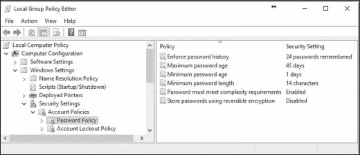

- **强制密码历史**。某些用户会在经常使用和重复使用的密码之间反复切换。然而，密码历史会记住过去的密码并防止用户重复使用用过的密码。例如，将其设置为 24 可以防止用户在使用完 24 个新密码之前重复使用密码。
- **最长密码年龄**。此设置定义了用户何时更改密码。例如，将其设置为 45 天会导致密码在 45 天后过期。这迫使用户在第 46 天将密码重置为新密码。
- **最小密码年龄**。最小密码年龄定义了用户在再次更改密码之前必须等待多久。如果你将其设置为 1 天，则防止用户在 1 天内更改密码。这与密码历史配合使用非常有用，可以防止用户多次更改密码直到回到原始密码。如果密码历史设置为 24 且最小密码年龄设置为 1 天，用户需要 25 天才能回到原始密码。这足以阻碍大多数用户。
- **最小密码长度**。此设置强制密码的字符长度。通常要求用户的密码长度至少为 14 个字符，但某些组织要求管理员拥有更长的密码。
- **密码必须满足复杂性要求**。此设置要求用户拥有复杂的密码，其中包含四种字符类型（大写字母、小写字母、数字和特殊字符）中的至少三种。
- **使用可逆加密存储密码**。可逆加密以某种方式存储密码，以便可以发现原始密码。这种设置很少启用。

#### 记住这一点

密码策略包含多个元素。密码历史配合最小密码年龄使用，以防止用户将密码更改以前用过的密码。最长密码年龄会导致密码过期并要求用户定期更改密码。最小密码长度规定了密码的最小字符数。密码复杂性通过要求更多字符类型增加了密码的密钥空间或复杂度。

### 实施帐户锁定策略

帐户通常会有锁定策略，以防止用户猜测密码。如果用户多次输入错误密码（例如三次或五次），系统将锁定用户的帐户。图 2.1 显示了密码策略设置。帐户锁定策略位于下方，允许管理员使用组策略实施锁定策略。

与帐户锁定策略相关的两个短语是：

- **帐户锁定阈值**。这是用户输入错误密码的最大次数。当用户超过阈值时，系统将锁定帐户。
- **帐户锁定持续时间**。这指示帐户保持锁定的时间。它可以设置为 30，表示系统将锁定帐户 30 分钟。30 分钟后，系统会自动解锁帐户。如果持续时间设置为 0，帐户将保持锁定状态，直到管理员解锁。

### 更改默认密码

许多系统和设备从默认密码开始。一项安全实践是在系统投入使用之前更改这些默认设置。例如，许多无线路由器具有名为 `admin` 或 `administrator` 的默认帐户，默认密码为 `admin`。如果你不更改密码，任何知道默认设置的人都可以登录并控制路由器。在这种情况下，攻击者甚至可以进一步将你排除在自己的网络之外。

更改默认设置还包括在可能的情况下更改 `Administrator` 帐户的默认名称。在许多系统中，`Administrator` 帐户无法通过常规锁定策略锁定，因此攻击者可以继续尝试猜测 `Administrator` 帐户的密码而无被锁定的风险。将 `Administrator` 帐户名称更改为其他内容（如 `Not4U2Know`）可以降低攻击者的成功概率。攻击者在尝试猜测密码之前需要新的管理员名称。

一些管理员更进一步，添加一个名为 `administrator` 的虚拟用户帐户。该帐户没有权限。如果有人尝试猜测此帐户的密码，系统将将其锁定，提醒管理员可能存在非法活动。

### 你拥有的东西

你的“拥有的因素”（something you have）指的是你可以物理持有的物品。本节介绍了该因素中的许多常见物品，包括智能卡、通用访问卡（CAC）和硬件令牌。它还涵盖了两种用于硬件和软件令牌的开源协议。

## 智能卡

智能卡是信用卡大小的卡片，内部嵌入了微芯片和证书。用户将智能卡插入智能卡读卡器，类似于将信用卡插入信用卡读卡器。智能卡读卡器读取卡片上的信息，包括来自证书的详细信息，这提供了基于证书的身份验证。

第 10 章“理解密码学和 PKI”更详细地介绍了证书，但作为介绍，它们是支持加密以增强安全性的数字文件。嵌入的证书允许使用复杂的加密密钥，并提供比简单密码更安全的身份验证。此外，证书可用于数字签名和数据加密。智能卡提供了机密性、完整性、身份验证和不可否认性。

智能卡的要求是：

- 嵌入式证书。嵌入证书持有用户的私钥（仅用户可访问），并与公钥（其他人公开可用）匹配。用户每次登录网络时都会使用该私钥。
- 公钥基础设施（`PKI`）。第 10 章更深入探讨了 `PKI`，但简单来说，`PKI` 支持证书的发行和管理。

智能卡通常与另一种身份验证因素结合使用。例如，用户在使用智能卡的同时，可能还会输入 `PIN` 或密码。因为智能卡属于“拥有的”因素，而 `PIN` 属于“所知的”因素，这种组合提供了双因子身份验证。

## CAC 和 PIV

通用访问卡（`CAC`）是美国国防部的一种特殊类型智能卡。除了包含智能卡的功能外，它还包含用户的照片和其他可读信息。用户可以使用 `CAC` 作为一种照片身份证明以进入安全区域。例如，他们可以向保护安全区域访问的守卫展示 `CAC`。一旦进入安全区域，用户可以将 `CAC` 当作智能卡登录计算机。

同样，个人身份验证（`PIV`）卡是美国联邦机构使用的特殊类型智能卡。它也包含照片身份识别，并像 `CAC` 一样为用户提供机密性、完整性、身份验证和不可否认性。


`CACs`和`PIVs`都支持双因子身份验证（有时称为双因素身份验证），因为用户通常使用智能卡并输入他们知道的信息（如密码）进行登录。此外，与智能卡一样，这些卡也包含了用于数字签名和加密的嵌入证书。

### 记住这一点

智能卡通常用于双因子身份验证，即用户既“拥有”东西（智能卡），又“知道”东西（如密码或`PIN`）。智能卡包含用于数字签名和加密的嵌入证书。`CACs`和`PIVs`是包含照片身份识别的特殊智能卡。它们用于进入安全区域和登录计算机系统。

## 令牌或钥匙扣（Key Fobs）

令牌或钥匙扣（有时简单称为 fob）是一种大小类似于汽车遥控钥匙的电子设备。你可以轻松地将其放在口袋或包包里，或将其连接到钥匙链上。它们包含一个显示数字的液晶显示器（`LCD`），这个数字会定期变化，例如每 60 秒变化一次。有时被称为硬件令牌，以区别于逻辑令牌或软件令牌。

令牌与服务器同步，服务器知道任何时刻的数字是多少。例如，在`9:01`，令牌上显示的数字可能是`135792`，服务器知道该数字是`135792`。在`9:02`，显示的数字变为另一个值，服务器也知道新数字。

这个数字是一个一次性的滚动密码。即使攻击者发现了它，对他们来说也不会持续很久。例如，肩部窥视的攻击者可能从某人的肩膀后看过去并读出数字。然而，该数字会在接后的 60 秒内过期，并被另一个一次性密码取代。

用户经常使用令牌通过网站进行身份验证。他们输入令牌上显示的数字以及用户名和密码。这提供了双因子身份验证，因为用户必须“拥有”东西（令牌）并“知道”东西（他们的密码）。

RSA 销售 RSA Secure ID，这是一种流行的身份验证令牌。你可以在 Google 上搜索“Secure ID image”查看许多此类令牌的照片。虽然 RSA 令牌很流行，也有其他品牌。

## HOTP 和 TOTP

基于哈希的消息认证码（`HMAC`）使用哈希函数和加密密钥用于许多不同的加密函数。第 1 章“掌握安全基础”介绍了哈希。提醒一下，哈希只是用哈希算法创建的数字。基于哈希的一次性密码（`HOTP`）是一种用于创建一次性密码的开放标准，类似于令牌或钥匙扣中使用的密码。该算法结合了密钥和一个递增计数器，并使用`HMAC`创建结果的哈希。然后将结果转换为六到八位的`HOTP`值。

假设 Bart 需要使用`HOTP`进行身份验证。他使用令牌或软件应用程序请求一个新的`HOTP`数字。然后他可以使用此数字结合其他身份验证方法（如用户名和密码）进行身份验证。一旦他使用，该数字就会过期。其他人无法使用它，Bart 也无法再次使用。

不过，这里有一个有趣的转。用`HOTP`创建的密码在被使用之前保持有效。假设 Bart 请求了`HOTP`数字但随后分心了一直未使用。现在会发生什么？从理论上讲，它是永久可用的。这带来了一个与`HOTP`相关的风险，因为如果其他人发现了这个密码，就可以使用。

基于时间的一次性密码（`TOTP`）与`HOTP`，但它使用时间戳而不是计数器。使用`TOTP`创建的一次性密码通常在 30 秒后过期。

`HOTP`和`TOTP`的一个显著优势是价格。使用这些开源标准的硬件令牌比使用专有算法的令牌便宜得多。此外，许多软件应用程序使用这些算法来创建应用程序内部使用的软件令牌。

例如，图 2.2 显示了 Symantec 创建并运行在 iPad 上的免费`VIP Access`应用。它也适用于许多其他平板电脑和智能手机。一旦你配置它与兼容的身份验证服务器配合，它就会产生持续的一的一次性密码流。六位安全码就是密码，计数器让你知道在它再次更改之前还有多少时间。

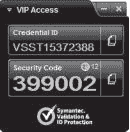

图 2.2: VIP Access 应用

类似于硬件令牌，用户输入用户名和密码作为“你所知道的”因素，然后输入应用程序中的安全代码作为“你所拥有的”因素。这提供了双因子身份验证。许多如 eBay 和 PayPal 等公共网站都支持这种方式，让许多终端用户只要拥有智能手机或平板电脑就可以实施双因子身份验证。

## 记住

`HOTP`和`TOTP`都是用于创建一次性密码的开源标准。`HOTP`创建一个不会过期的一次性密码。`TOTP`创建一个在 30 秒后过期的一次性密码。这两者都可以作为软件令牌用于身份验证。

## 你所特征

“你所特征”身份验证因素使用生物识别进行验证。生物识别方法是最形式的验证形式，因为对于攻击者来说最难伪造。相比之下，密码是最弱的验证形式。

### 生物识别方法

生物识别利用物理特征（如指纹）进行验证。生物识别系统使用两步过程。在第一步，用户在身份验证系统中注册。例如，验证系统首先获取用户的指纹并将其与用户身份关联。之后，当用户想要访问系统时，他们使用指纹来证明自己的身份。生物识别有多种类型，包括：

- 指纹扫描仪。许多笔记本电脑包含指纹扫描仪或指纹读取器，在平板设备和智能手机上也很常见。同样，某些 USB 闪盘也包含指纹扫描仪。它们可以存储三四个人的指纹，以共享同一个 USB 驱动器的访问权限。执法机构已使用指纹几十年，但它们用于识别，而不是生物识别验证。

- 视网膜扫描仪。视网膜扫描仪扫描一只或双眼的视网膜，利用眼后的血管纹进行识别。有些人反对使用这些扫描仪进行验证，因为它们可以识别医疗问题，而且你通常需要与`scanner`发生物理接触。

- 虹膜扫描仪。虹膜扫描仪使用摄像头技术捕捉瞳孔周围虹膜的纹进行识别。它们被用于世界上许多无需护照的过关。它们可以在约 3 到 10 英寸外拍摄照片，避免物理接触。

- 语音识别。语音识别方法使用语音识别技术识别不同的声学特征，从而识别说话者。由于口部和喉咙的差异以及影响说话风格的行为模式，一个人的声音与另一个人不同。例如，苹果的`Siri`支持语音识别。设置后，`Siri`只会对所有者的声音做出反应。遗憾的是，这确实防止了在多个拥有 iPhone 的派对上大喊“Hey Siri”这种老点子。

- 人脸识别。人脸识别系统根据面部特征识别人员。这包括脸部与身体其余部分的大小比较，以及眼睛、鼻子、嘴、颧骨和下颌的大小、形状和位置。这种方法的缺点是有时受到光照变化的负面影响。Microsoft Windows 系统支持 Windows Hello 人脸识别服务。为了避免正常光照带来的挑战，它使用了红外（`IR`），可以在各种光照条件下运行。

### 生物识别错误

当技术实现准确时，生物识别可以非常精确。然而，生物识别制造商可能会采取捷径而不正确实现它，导致误读。两种生物识别误读是：

- 假接受。当生物识别系统错误地将未经授权的用户识别为授权用户。假接受率（`FAR`，也称为误匹配率）标识了假接受发生的百分比。

- 假拒绝。当生物识别系统错误地拒绝授权用户。假拒绝率（`FRR`，也称为非匹配率）标识了假拒绝发生的百分比。

当生物识别系统准确地接受或拒绝用户时，发生真实读取。例如，真实接受是生物识别系统准确确定为匹配。相比之下，真实拒绝是生物识别系统准确确定为不匹配。生物识别系统允许你调整发生错误的灵敏度或阈值水平。通过增加灵敏度，会减少假匹配的数量并增加假拒绝的数量。相反，降低灵敏度会增加假匹配并减少假拒绝。通过使用不同的灵敏度绘制`FAR`和`FRR`速率图，你可以确定生物识别系统的有效性。

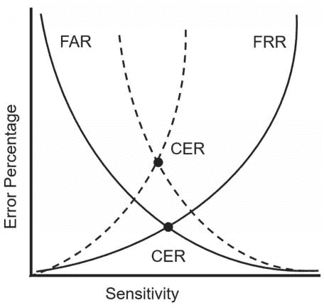 图 2.3 显示了生物识别系统的交叉错误率（`CER`）。`CER`是`FAR`与`FRR`交叉的点。较低的`CER`表示生物识别系统更准确。例如，图中实线表示的系统比虚线表示的系统更准确。

图 2.3：交叉错误率

## 你所在的位置

“你所位置的”身份验证因素识别用户的位置。`Geolocation`（地理定位）是一组用于识别用户位置的技术，是该因素中最常用的方法。许多身份验证系统使用互联网协议（`IP`）地址进行地理定位。`IP`地址提供了有关国家、地区、州、城市有时甚至是邮政编码的信息。

## 记住

身份验证的第三个因素（用生物识别定义的“你所特征”）是最强大的单一身份验证方法，因为对于攻击者来说最难伪造。生物识别方法包括指纹、视网膜扫描、虹膜扫描、语音识别和人脸识别。虹膜和视网膜扫描是本节提到的最强大的生物识别方法，由于隐私问题和扫描要求，虹膜扫描的使用比视网膜扫描更多。人脸识别最灵活，当使用替代光照（如红外）时，它们可能会最流行。交叉错误率（`CER`）衡量系统的准确性，越低的`CER`越好。

例如，我曾雇了一个印度的虚拟助理帮我做一些数据输入。我在名为`Hootsuite`的在线应用程序中为助手创建了账户并向他发送了登录信息。然而，当他尝试登录时，`Hootsuite`识别出他的`IP`在印度，而我总是从美国的`IP`登录。`Hootsuite`阻止了他的访问，并给我发了一封邮件，说有一个来自印度的人尝试登录。他们还向我提供了如果他是合法用户如何授予他访问权限的说明，但知道他们自动检测并阻止了这种访问，我很安心。

值得注意的是，使用`IP`地址进行地理定位并不是万无一失的。网上有许多虚拟专用网络（`VPN`）`IP`地址切换器。例如，俄罗斯的用户可以使用美国的这些服务之一来访问网站。该网站将识别出`VPN`服务的`IP`地址，但看不到俄罗斯用户的`IP`地址。

在组织内部，可以使用计算机名称或系统的媒体访问控制（MAC）地址作为“你所处”（somewhere you are）因素。例如，在 Microsoft 活动目录（Active Directory）域中，你可以配置账户，使用户只能通过其中一台特定的计算机登录网络。如果他们不在那台电脑前，系统将完全阻止他们登录。

## 你所操作（Something You Do）

“你所操作”身份验证因素指的是你可以执行的操作，例如在触摸屏上的手势。例如，Microsoft Windows 10 支持图片密码。用户首先选择一张图片，然后可以添加三个手势作为他们的图片密码。手势包括在图片的特定位置点击、用手指在项目之间画线，或者在某个项目（如人的头部）周围画圆。在注册图片和手势后，用户稍后重复这些手势即可再次登录。

“你所操作”的其他示例还包括书写或打字。例如，击键动力学（keystroke dynamics）可以测量用户在键盘上打字时的模式和节奏。它测量速度、持续时间（dwell time）和飞行时间（flight time）等细节。持续时间是按键按下的时间，飞行时间是释放一个按键到按下下一个按键之间的时间。许多安全专业人员将其称为行为生物识别，因为它识别了个人的行为特征。然而，某些人会将这些动作归入“你所操作”身份验证因素中。

## 双因素与多因素身份验证

双因素身份验证（有时称为双因子身份验证）使用两个不同的身份验证因素，例如“你拥有的”和“你所知的”。双因素身份验证通常使用智能卡和 PIN、USB 令牌和 PIN，或者将智能卡或硬件令牌与密码结合。在每种情况下，用户必须“拥有”某东西并“知道”某些东西。

多因素身份验证使用两个或多个身份验证因素。例如，你可以将“你所是”因素与其他一个或多个身份验证因素相结合。

请注意，从技术上讲，使用两个不同因素的身份验证系统可以称为双因素身份验证，也可以称为多因素身份验证。多因素身份验证表示多个因素，而“多”简单多于一个。

值得注意的是，在同一个因素中使用两种身份验证方法并不是双因素身份验证。例如，要求用户输入密码和 PIN（两者都属于“你所知的”因素）是单因素身份验证，而不是双因素身份验证。同样，使用指纹和视网膜扫描不是双因素身份验证，因为两种方法都属于“你所是”因素。

### 记住这一点

在同一身份验证因素中使用两种或更多方法（如 PIN 和密码）是单因素身份验证。双因素（或双因子）身份验证使用两个不同的因素，例如使用硬件令牌和 PIN。多因素身份验证使用两个或多个因素。

## 总结识别方法

到目前为止，本章介绍了几种不同的识别方法，由于识别非常重要，对它们进行总结是值得的。它们是用户名、照片身份卡和生物识别。

最常用的识别方法是用户名。这可以是传统的用户名，例如`DarrilGibson`，也可以是电子邮件地址，例如`Darril@gcgapremium.com`，取决于系统的如何配置。许多其他识别方法也可用于识别和身份验证。

CAC 和 PIV 包含所有者的照片和关于所有者的其他信息，因此所有者经常使用它们进行身份识别。它们在“你拥有的”身份验证因素中也充当智能卡的作用。

“你所是”部分侧重于使用生物识别进行身份验证，但多个实体也使用生物识别方法进行识别。例如，执法机构几十年来一直使用指纹识别犯罪现场的个人。同样，视网膜和手掌扫描仪可以以很高的准确度识别个人。

## 排除身份验证问题

本节提到了一些可能导致安全问题的常见身份验证问题。总结如下：

- 弱密码。如果不是强制用户使用强且复杂的密码，他们可能不会这样做，他们的账户将极易受到攻击。技术性密码策略可以确保用户实施强密码、不重复使用密码并定期更改。

- 忘记密码。组织需要有一套密码恢复程序来帮助用户找回密码。如果在在没有验证用户身份的情况下手动重置密码，攻击者可能会欺骗某人重置密码。

- 生物识别错误。交叉错误率高的弱生物识别系统可能有较高的误匹配率（也称为误接受率）或较低的非匹配率（也称为误拒绝率）。

# 比较身份验证服务

还有几种处于前述身份验证因素范围之外的身份验证服务。它们的共同目标是确保不跨网络发送未加密的凭据。换句话说，它们确保凭据不以明文发送。如果凭据以明文发送，攻击者可以使用协议分析器等工具捕获并查看它们。以下章节描述了许多此类服务。

## Kerberos

Kerberos 是一种用于 Windows 活动目录域和某些称为“领域”（realms）的 Unix 环境的网络身份验证机制。它最初由麻省理工（MIT）为 Unix 系统开发，随后作为意见请求（RFC）发布。Kerberos 提供双向认证，可以帮助防止中间人攻击，并使用票据帮助防止重放攻击。第 7 章“防御高级攻击”将深入介绍这些攻击。

Kerberos 的正常工作需要若干要求：

- 一种用于身份验证的票据发放方法。密钥发行中心（KDC`）通过复杂的过程发放票据授予票（TGTs）和其他票据。`KDC`（或 TGT 服务器）将用户凭据封装在票据中。当用户访问文件服务器上的文件等资源时，票据为用户提供认证。这些票据有时被称为`tokens`，但它们是逻辑令牌，而不是之前在“你拥有的”部分中讨论的钥匙扣类型令牌。

- 时间同步。Kerberos 版本`5`要求所有系统同步，且彼此之间在五分钟以内。提供时间同步的时钟用于对票据进行时间戳标记（timestamp），确保它们正确过期。这有助于防止重放攻击。在重放攻击中，第三方在拦截会话捕获的数据后尝试冒充客户端。然而，如果攻击者截获了票据，`timestamp`限制了攻击者使用该票据的时间。

- 主体或用户数据库。在 Microsoft 环境中，这是 Active Directory，但也可以是任何用户数据库。

当用户使用 Kerberos 登录时，KDC 会向用户颁发 get 票据（ticket-granting ticket），该票据通常有效期为 10 小时，适用于单个工作日。当用户尝试访问资源时，会将该票据作为身份验证，系统将为其颁发资源的票据。然而，如果用户登录时间过长（例如超过 10 小时），票据将会失效，阻止他们访问网络资源。在这种情况下，用户可能会提示提供密码以刷新 get 票据，或者需要注销并重新登录以生成新的 get 票据。

此外，Kerberos 使用对称加密来防止未经授权的泄露并确保机密性。第 10 章更深入地解释了算法，简单来说，对称加密使用单一密钥对相同的数据进行加密和解密。

### 记住这一点

Kerberos 是 Microsoft Windows Active Directory 域或 Unix 领域（realm）内的一种网络身份验证协议。它使用 Active Directory 和 KDC（或`TGT`服务器）等对象数据库来颁发在特定时间后过期的时间戳票据。

## NTLM

新建局域管理器 (NTLM) 是一套在 Windows 系统中提供身份验证、完整性和机密性的协议。在最基础的，它们使用消息摘要（Message Digest）哈希算法来挑战用户并检查凭据。NTLM 有三个版本：

- `NTLM`是用户密码的简单 MD4 哈希值。`MD4`已经被破解，目前不建议使用`NTLM`或`MD4`。

- `NTLMv2`是一种挑战-响应型身份验证协议。当用户尝试登录时，`NTMLv2`会创建一个由用户名、登录域名（或计算机名）、用户密码、当前时间等组合成的`HMAC-MD5`哈希值。为了创建`HMAC-MD5`消息，身份验证码于用户密码的 MD5 哈希，然后对其进行加密。

- `NTLM2` Session 通过增加双向验证改进了`NTLMv2`。换句话说，客户端验证服务器，服务器也验证客户端。

那么，你应该选择哪种协议呢？实际上，微软明确建议开发者不要选择这些协议之一。相反，开发者应该在应用程序中使用`Negotiate`安全包。该安全包会在系统之间选择可用的最安全的安全协议。它首先尝试在可用时使用`Kerberos`。如果不可，则取决于参与系统的能力使用`NTLMv2`或`NLTM2` Session。

## LDAP 和 LDAPS

轻量级目录访问协议 (LDAP) 指定了查询目录的格式和方法。在此背景下，目录是一个对象数据库，提供管理用户、计算机和其他目录对象的中央访问点。LDAP 是 X.500 标准的扩展，Novell 和早期的 Microsoft Exchange Server 版本广泛使用了它。

Windows 域使用基于`LDAP`的 Active Directory。Active Directory 是一个对象（如用户、计算机和组）目录，为对象管理提供单一位置。对 Active Directory 的查询使用`LDAP`格式。同样，Unix 领域使用`LDAP`来识别对象。

管理员经常在脚本中使用`LDAP`，但他们需要具备如何识别对象的知识。例如，`GetCertifiedGetAhead.com`域中 Users 容器下名为`Homer`的用户通过以下 LDAP 字符串识别：`LDAP://CN=Homer,CN=Users,DC=GetCertifiedGetAhead,DC=com`

- `CN=Homer`。`CN`是通用名称（common name）的缩写。


`CN=Users`。在此背景下，`CN` 有时被称为容器（container）。

`DC=GetCertifiedGetAhead`。`DC` 是域组件（domain component）的缩写。

`DC=com`。这是域名中的第二个域组件。

LDAP 安全（`LDAPS`）使用加密来保护 LDAP 传输。当客户端使用 `LDAPS` 连接服务器时，两个系统会在传输任何数据之前建立传输层安全（`TLS`）会话。`TLS` 在传输前对数据进行加密。

### 记住这一点

LDAP 基于早期版本的 X.500。Windows Active Directory 域和 Unix 领域使用 `LDAP` 通过 `CN=Users` 和 `DC=GetCertifiedGetAhead` 等代码在查询字符串中识别对象。`LDAPS` 使用 `TLS` 加密传输。

## 单点登录

单点登录（SSO）指用户只需提供一次凭据即可登录或访问多个系统。SSO 增加了安全性，因为用户只需要记住一组凭据，将它们写下的概率较低。如果用户只需登录一次，访问网络资源也将方便得多。

例如，考虑一个需要访问网络内多个服务器来执行正常工作的用户。如果没有 SSO，用户需要知道一组凭据进行本地登录，并为每台服务器准备额外的凭据。许多用户会写下这些凭据以备记忆。

相反，在具有 SSO 能力的网络中，用户只需登录网络一次。SSO 系统通常会创建某种类型的 SSO 安全令牌，在整个登录会话期间使用。用户每次访问网络资源时，SSO 系统都都会使用此安全令牌进行身份验证。`Kerberos` 和 `LDAP` 都包含了 SSO 能力。

SSO 需要强身份验证才能有效。如果用户创建了弱密码，攻击者可能猜到它们，从而获得访问多个系统的权限。有些人争论认为 SSO 增加了风险，因为如果攻击者获取了用户的凭据，就意味着获得了访问多个系统的权限。

### SSO 和传递信任

传递信任创建了一种间接的信任关系。例如，想象 Homer、Moe 和 Fat Tony 之间存在传递信任关系：

- `Homer` 信任 `Moe`。

- `Moe` 信任 `Fat Tony`。

- 由于传递信任关系，`Homer` 信任 `Fat Tony`。

当然，这在人与之间并不总是成立的，如果 `Moe` 向 `Fat Tony` 泄露 `Homer` 的秘密，`Homer` 可能会有些不悦。然而，它减少了域内的网络管理工作。

（图片描述）在基于 LDAP 的网络中，域使用传递信任来实现 SSO。图 2.4 显示了同一网络中三个域的常见配置。父域是 `GetCertifiedGetAhead.com`，配置包含两个子域——`Training` 和 `Blogs`。

图 2.4：用于 SSO 的 LDAP 传递信任

在此示例中，父域（`GetCertifiedGetAhead.com`）与子域（`Training.GetCertifiedGetAhead.com`）之间存在双向信任。父域信任子域，子域也信任父域。同样，父域与 `Blogs` 子域之间也存在双向信任。两个子域之间没有直接信任，但传递关系在它们之间创建了双向信任。

所有这些域都包含对象，如用户、计算机和组。`Homer` 的用户账户在 `Training` 域中，名为 `Costington` 的服务器在 `Blogs` 域中。通过传递信任，可以授予 `Homer` 访问 `Costington` 服务器的权限，而在 `Training` 和 `Blogs` 域之间直接创建另一个信任关系。

如果没有信任关系，在授予 Homer 权限之前，你必须在 Blogs 域中为他创建另一个账户。此外，Homer 还需要单独管理第二个账户的密码。然而，由于有了传递信任关系，网络支持 SSO，因此 Homer 只需要一个账户。

## SSO 与 SAML

安全断言标记语言（`SAML`）是一种基于可扩展标记语言（XML）的数据格式，用于 Web 浏览器上的 `SSO`。想象一下两个由不同组织托管的网站。通常情况下，用户必须提供不同的凭据来访问其中任何一个网站。但是，如果这些组织相互信任，它们就可以使用 `SAML` 作为联邦身份管理系统。用户在其中一个网站进行身份验证，在访问第二个网站时无需再次进行身份验证。

许多基于 Web 的门户使用 `SAML` 进行 `SSO`。用户只需登录一次门户，然后门户就会将用户的身份证明传递给后端系统。只要其中一个组织通过了用户的身份验证，他们在访问门户内的其他站点时就不需要再次身份验证。

`SAML` 定义了三个角色：

- 主体（Principal）：这通常是一个用户。用户登录一次。如有必要，主体会向身份提供者请求身份。

- 身份提供者（Identity provider）：身份提供者负责创建、维护和管理主体的身份信息。

- 服务提供者（Service provider）：服务提供者为主体提供服务的实体。例如，服务提供者可以托管通过 Web 门户访问的一个或多个网站。当主体尝试访问资源时，服务提供者会将主体重定向以先获取身份。

此过程在系统之间发送多个基于 XML 的消息。然而，这对于用户来说通常是透明的。

## SAML 与授权

重要的是，`SSO` 的主要目的是对用户进行识别和身份验证。用户声称身份并用凭据证明该身份。`SSO`并不提供授权。例如，如果发电厂和学校系统使用 `SAML` 创建了一个联邦，这并不会自动授予学校系统中的每个人访问核电厂资源的的完全权限。授权是完全独立的。

然而，许多联邦 SSO 系统（包括 `SAML`）都包含了在系统之间传输授权数据的能力。换句话说，可以使用 `SAML` 进行单点登录认证，也可以用于授权。

### 记住这一点

`SAML` 是一种基于 XML 的标准，用于在不同实体之间交换身份验证和授权信息。`SAML` 为 Web 应用程序提供 `SSO`。

## SSO 与联邦

某些 `SSO` 系统可以连接来自不同环境的认证机制，例如不同的操作系统或不同的网络。一种常用方法是使用联邦身份管理系统，它通常集成为联邦数据库。此联邦数据库在非同构环境中提供集中身份验证。

例如，想象斯普菲尔核电厂与斯普菲尔学校系统建立了关系，允许发电厂员工访问学校资源。将这两个网络合并为一个是既不可行也不理想的。但是，你可以为这两个网络创建一个联邦。一旦建立，发电厂员工将使用他们的发电厂账户登录，无需再次登录即可访问共享的学校资源。

联邦需要一个所有联邦成员都使用的联邦身份管理系统。在上例中，联邦的成员是发电厂和学校系统。联邦成员同意联邦身份的标准，然后根据该标准交换信息。联邦身份将用户来自不同网络或操作系统的凭据连接起来，但联邦将其视为一个身份。

`Shibboleth` 是 CompTIA Security+ 考试目标中特别提到的联邦身份解决方案之一。它是开源且免费提供的，使其比一些商用的联邦身份解决方案更具性。它还包含用 `C++` 和 `Java` 编写的 `Open SAML` 库，让开发者更容易扩展其实用性。

## OAuth 与 OpenID Connect

`OAuth` 是一种开放标准，许多公司使用它提供对受保护资源的安全访问。你不需要为访问的每个网站创建不同的账户，通常可以使用你通过 Google、Facebook、PayPal、Microsoft 或 Twitter 创建的同一个账户。

例如，想象 Try-N-Save 百货商店决定在线销售部分产品，管理层决定允许客户通过 `PayPal` 进行购买。开发者配置他们的网站，以便与 `PayPal` 服务器之间交换应用程序接口（`API`）调用。现在，当客户进行购买时，他们使用他们的 `PayPal` 账户登录并通过 `PayPal` 完成购买。`OAuth` 在 `PayPal` 和 `Try-N-Save` 网站之间传输数据，以便百货商店收到资金并知道向客户发送什么。客户的益处是他们不需要为 Try-N-Save 创建另一个账户。

`OpenID Connect` 与 `OAuth 2.0` 配合工作，允许客户端在不管理凭据的情况下验证终端用户的身份。在这种情况下，客户端通常是需要验证用户的网站或应用程序。`OpenID Connect` 提供了身份识别服务，而无需应用程序处理凭据。它还简化了用户体验。例如，Skyscanner 是一个寻找机票、酒店和租车的应用程序。它允许用户使用 Facebook 凭据登录。这样做之后，Skyscanner 为用户提供了更个性化的体验。

# 管理账户

账户管理涉及账户的创建、管理、禁用和终止。当账户激活时，使用访问控制方法来控制用户操作。此外，管理员使用访问控制来控制用户何时以及何地登录。以下章节介绍了常见的账户管理实践，以及账户管理中使用 Basic 原则。配置不当的账户不遵循这些原则会增加风险。

## 最小权限

最小权限原则是通过访问控制实施的技术控制示例。权限是分配给授权用户的权利和许可。最小权限规定个人和进程仅获得执行分配任务或功能所需的权利和权限，不能更多。例如，如果 Lisa 需要服务器上某个文件夹的读取权限，你应该授予她该文件夹的读取权限，而不授予其他任何权限。

实施最小权限的主要目标是降低风险。例如，想象 Carl 在核电厂工作，但管理员配置账户时不当，忽略了最小权限原则。换句话说，Carl 拥有核电厂内所有数据的访问权限，而不仅仅是他工作所需的少量数据。后来，Lenny 遇到了麻烦并需要钱，于是他说服 Carl 从发电厂偷取数据并卖掉。在这种情况下，Carl 可以偷取并出售电厂的所有数据，这可能会导致严重损失。

相比之下，如果管理员遵循最小权限原则，卡尔（Carl）将只能访问有限的数据。即使列尼（Lenny）说服他偷取数据，卡尔也无法偷走太多，因为他根本没有这些数据的访问权限。这限制了发电厂的潜在损失。

这一原则同样适用于普通用户和管理员。例如，如果玛丽（Marge）管理培训实验室所有的计算机，那么赋予她对所有计算机的管理控制权是适当的。然而，她的权限不需要扩展到域，因此她不会对网络中的所有计算机拥有管理控制权。此外，除非培训实验室有此要求，否则她将没有将这些计算机加入域所需的权限。同样，如果网络管理员需要查看日志并更新特定的网络设备，赋予管理员访问这些日志和设备的权限是适当的，但仅此而已。

许多服务和应用程序运行在用户账户的上下文中。这些服务具有该用户账户的权限，因此，确保这些账户仅被授予服务或应用程序所需的权限非常重要。在过去，许多管理员为这些服务和应用程序账户配置了完全的管理权限。当攻击者攻破了此类配置的服务或应用程序时，他们就会获得管理员权限并在网络上造成破坏。

### 记住这一点

最小权限是一种技术控制手段。它规定个人或进程仅被授予执行其分配的任务或功能所需的权利和权限。

## 知情原则

知情原则（Need to Know）与最小权限原则相似，即用户仅被授予其工作所需的知晓的数据和信息的访问权限。注意，知情原则侧重于数据和信息，这些信息通常通过权限进行保护。相比之下，最小权限原则包含了权利（Rights）和权限（Permissions）。

权利（Rights）指的是操作，包括如更改系统时间的权利、安装应用程序的权利或将计算机加入域的权利。权限（Permissions）通常指的是文件的权限，如读取、写入、修改、读取和执行以及完全控制。

## 账户类型

在管理账户时，识别网络内常用的账户类型非常重要。它们是：

- **终端用户账户**：大多数账户用于普通用户。管理员创建这些账户，并根据用户的工作职责分配适当的权限。微软将其称为 `Standard user account`（标准用户账户）。

- **特权账户**：特权账户拥有超出普通用户的额外权利和权限。例如，Windows 计算机上拥有管理员权限的人对该 Windows 计算机拥有完全的控制权。

- **来客账户**：Windows 操作系统包含 `Guest account`（来客账户）。如果你希望在不创建新账户的情况下授予某人访问计算机或网络的有限权限，这些账户非常有用。例如，想象一家机构与派遣机构签约让某负责数据录入。派遣可能每天都派不同的人。为这些人启用 `Guest account` 比每天创建一个新账户要简单得多。管理员通常禁用 `Guest account`，仅在特殊情况下启用。

- **服务账户**：某些应用程序和服务需要在账户的上下文中运行，而服务账户正满足了这一需求。例如，`SQL Server` 是一个运行在服务器上的数据库应用程序，它需要访问服务器和网络上的资源。管理员创建一个普通用户账户，将其命名为类似 `sqlservice`，分配适当的权限，并配置 `SQL Server` 使用该账户。注意，这类似于普通的终端用户账户。唯一的区别是它仅供服务或应用程序使用，而不是终端用户使用。

服务账户的一个挑战是，它们通常不被管理。例如，想象一个普通用户账户的密码在 45 天后过期。用户被通知更改密码并执行了操作。服务账户可能会向应用程序发送更改密码的通知，但该通知被忽略了。当密码过期时，账户被锁定。突然，应用程序（或服务）停止工作，管理员必须排除故障以找出原因。

解决方案是配置服务账户，使其无需遵守密码策略。然而，这允许服务账户忽略其他策略要求，例如使用强且复杂的密码。使用此类账户的开发人员采取措施以确保其账户遵循现有策略，这是非常重要的。

## 要求管理员使用两个账户

要求管理员拥有两个账户是常见的。他们使用其中一个账户处理日常工作，该账户具有与普通终端用户相同的限制权限。另一个账户具有执行管理工作所需的特权权限，且他们仅在执行管理工作时才使用该账户。这种做法的好处是减少了管理员账户受到攻击的风险。

例如，当恶意软件感染系统时，它通常会尝试使用权限提升技术获取额外的权利和权限。它可能利用应用程序或操作系统中的某些漏洞或缺陷。或者，它可能直接获取登录用户的权利和权限。如果管理员使用管理员账户登录，恶意软件就可以获取这些特权权限。相比之下，如果管理员使用普通的 `standard user account`（标准用户账户）登录，恶意软件必须采取额外步骤来提升其权限。

这也降低了日常工作中管理员账户的风险。想象霍默（Homer）是一个管理员，他被叫去处理紧急情况。他很有可能在离开时没有锁定计算机。如果他是用管理员账户登录的，路过的攻击者就可以访问系统并获得管理员权限。虽然系统通常有密码保护的屏幕保护程序，但这些程序通常在用户离开约 10 分钟或更久后启动。

## 标准命名规范

组织采用标准的命名规范以确保用户账户名和电子邮件地址的创建方式相似是常见的。例如，一种规范使用名字、点和姓氏。这创建了如 `homer.simpson` 和 `bart.simpson` 的账户。如果组织聘请了第二个同名的人（例如第二个 Bart·辛森），命名规范可能会指定在名字后添加数字，如 `bart.simpson2`。

你可能不需要设计命名规范。但是，如果你进入了一个不同的组织并需要创建账户，你应该理解该组织可能已经有一套命名规范。对于你创建的任何账户，都应该遵循该规范。

## 禁止共享通用账户

账户管理策略通常规定人员不应使用共享账户或通用账户。相反，每个用户至少有一个账户，且只有该用户可以访问。如果多个用户共享同一个账户，你就无法实施基本的授权控制。在此提醒一下，四个核心概念是：

- **识别（Identification）**：用户使用如 `username`（用户名）等标识符声称身份。

- **身份验证（Authentication）**：用户使用如 `password`（密码）等验证方法证明自己的身份。

- **授权（Authorization）**：根据用户已证明的身份，授权其访问特定资源。

- **审计（Accounting）**：日志记录使用用户声称身份进行的活动。

想象一下 Bart、Maggie 和 Lisa 都使用访客账户（Guest）。如果你想让 Lisa 访问某些文件，你会授予访客账户访问权限，但 Bart 和 Maggie 也会拥有相同的权限。如果 Bart 删除了文件，日志会显示访客账户删除了文件，但你并不知道是谁实际删除的。相比之下，如果用户拥有唯一的独立账户，你就可以单独为他们授予资源权限。此外，日志将准确指示是谁执行了该操作。

请注意，单一的临时访客账户登录确实支持身份识别、验证、授权和审计。只有当多个用户共享同一个账户时，你才会失去这些控制。尽管如此，某些组织禁止出于目的目的访客账户。

**记住这一点**

要求管理员使用两个账户（一个具有管理员权限，另一个具有普通用户权限）有助于防止权限提升攻击。用户不应使用共享账户。

## 禁用策略（Disablement Policies）

许多组织拥有一种禁用策略，规定了在不同情况下如何管理账户。例如，大多数组织要求管理员在员工离开组织后尽快禁用其用户账户。此外，禁用默认账户（如之前提到的访客账户）也是常见做法，以防止它们被使用。

至少在最初，禁用账户比删除账户更佳。如果管理员删除了账户，他们也会删除与该账户相关的任何加密和安全密钥。然而，当账户被禁用时，这些密钥会被保留。例如，想象一个员工用他的账户加密了文件。操作系统使用加密密钥来加密和解密这些文件。如果管理员删除了此账户，这些文件可能永远处于加密，除非组织拥有可以访问这些文件的密钥托管（key escrow）或恢复代理（recovery agent）。

账户禁用策略的内容包括：

- **离职员工（Terminated employee）**：账户禁用策略规定，应尽快禁用前员工的账户。这确保了离职员工不会变成在网络上制造破坏的愤恨前员工。请注意，"离职"既指辞职员工也指被解雇的员工。

- **休假（Leave of absence）**：如果员工将长时间缺席，应在员工离开期间禁用其账户。不同组织对"长时间"的定义不同，有些组织将其定义为仅两周，而另一些组织则将其延长至两个月。

- **删除账户（Delete account）**：当组织确定账户不再需要时，管理员会将其删除。例如，策略可能会指导管理员删除已未活动 60 或 90 天的账户。

**记住这一点**

账户禁用策略确定了对永久离职或休假员工账户应如何处理。大多数策略要求管理员尽快禁用账户，以防前员工无法继续使用该账户。禁用账户确保了与其相关的数据保持可用。当账户被禁用时，与账户相关的安全密钥可用，但如果账户被删除，这些密钥将无法再次访问。

## 恢复账户（Recovering Accounts）

在某些情况下，管理员需要恢复账户。主要的账户恢复场景有两种：


- **启用已禁账户（Enable a disabled account）**：管理员可以重置用户密码并获得对账户的控制权。同样，他们也可以将账户控制权交给他人，例如前员工的主管或经理。管理员重置用户密码，将其设置为首次使用过期，然后将密码交给对方。
- **恢复已删除的账户（Recover a deleted account）**：恢复已删除的账户也是可能的。这比简单地创建一个同名的账户要复杂得多。相反，管理员遵循详细程序来恢复账户。

## 时间段限制（Time-of-Day Restrictions）

时间段限制规定了用户登录计算机的时间。如果用户尝试在限制时间之外登录网络，系统将拒绝用户的访问。

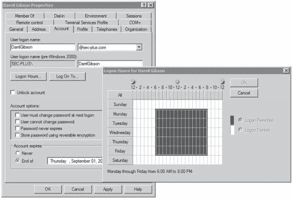

例如，想象一家公司每天从早上 8:00 运行到下午 5:00。经理决定不希望普通用户在周一至周五的早上 6:00 到晚上 8:00 之外登录网络。你可以为用户账户设置时间段限制，如图 2.5 所示。如果用户尝试在限制时间之外（例如周末）登录，系统将阻止用户登录。

图 2.5：带有时间限制的用户账户属性

如果用户正在为某个项目加班，当限制时间到达时，系统不会将他们注销。例如，如果 Maggie 在周三晚上工作到很晚，系统不会在晚上 8:00 将其注销（假设时间限制按图 2.5 所示设置）。然而，系统将阻止她创建任何新的网络连接。

### 基于位置的策略（Location-Based Policies）

基于位置的策略根据用户的位置限制访问。本章前面的“你所在的某处”部分讨论了用于实施此措施的常用方法。例如，地理位置技术通常可以使用 `IP` 地址检测位置，并阻止来自任何不可接受地址（如外国国家）的流量。也可以将一组 `IP` 地址识别为唯一接受的地址。这通常被称为对 `IP` 地址设置白名单。

在网络内部，可以根据计算机名称或 `MAC` 地址限制访问。例如，想象 Bart 一直使用他的账户登录多台计算机。可以将他的账户限制为仅限他的计算机登录。当他尝试登录账户时，操作成功了。如果他尝试登录另一台计算机，基于位置的策略将阻止他。

> **记住这一点**
>
> 时间段限制防止用户在限制时间段登录。它们还防止已登录的用户在特定时间内访问资源。基于位置的策略根据用户的位置限制访问。

## 账户过期与重新认证（Expiring Accounts and Recertification）

可以设置用户账户自动过期。当账户过期时，系统会禁用它，用户将不再能够使用该账户登录。

如果你回看图 2.5，它显示了账户的属性。`Account Expires`（账户过期）部分位于页面底部，账户被设置为 9 月 1 日过期。当 9 月 1 日到来时，账户将自动禁用，用户将不再能够登录。

配置临时账户过期是常见做法。例如，组织可能会聘用为期 90 天的承包商来执行特定工作。管理员为承包商创建账户并设置它们在 90 天后过期。这在合同结束时自动禁用这些账户。

如果组织延长了合同，重新认证账户只是件简单的事。管理员核实合同已延长，更改过期日期并启用账户。

> **记住这一点**
>
> 账户过期日期会在过期当天自动禁用账户。这对于临时账户（如临时承包商）非常有用。

## 账户维护（Account Maintenance）

管理员经常会执行账户维护。这通常通过脚本来自动化这些过程。

例如，在 Microsoft AD DS 域中，创建并运行脚本来列出所有在过去 30 天内未使用的已启用账户是相对比较的。这提供了一份非活动账户列表。通常，这些账户是离职员工或不再在该机构工作的临时员工的账户。理想情况下，账户禁用策略应该确保在员工离开时立即禁用账户。脚本提供了一种额外的检查，以确保非活动账户已被禁用。

此外，账户维护还包括删除不再需要的账户。例如，如果一个机构的策略是在员工离职时禁用账户，但在 60 天后再删除这些账户，那么账户维护程序就能确保这些账户被删除。

## 凭据管理

凭据是信息的集合，用于提供身份（如用户名）并证明该身份（如通过密码）。随着时间的推移，用户通常会有多个需要记住的凭据，特别是当他们访问许多网站时。凭据管理系统帮助用户安全地存储这些凭据。其目标是简化用户的凭据管理，同时确保未经授权的人员无法访问用户的凭据。

凭据管理系统的示例，Windows 10 包含了可以通过 `Control Panel` 访问的 `Credential Manager`。用户可以将凭据添加到 `Credential Manager` 中，系统将其安全地存储在称为“存储库”的特殊文件夹中。然后，当用户访问需要凭据的网站时，系统会自动从存储库中检索凭据并提交给网站。

同样，`Google Chrome` 等网络浏览器也使用凭据管理系统来记住密码。当你访问需要密码的网站时，`Chrome` 会提示你询问是否让 `Chrome` 记住它。稍后，当你再次访问同一个网站时，`Chrome` 会为你自动填好凭据。

# 比较访问控制模型

访问控制确保只有经过验证和授权的实体才能访问资源。例如，它确保只有获得适当权限的经过验证的用户才能访问服务器上的文件。这从确保用户被准确识别和验证开始。然后，你使用以下几种不同模型之一来授予访问权限。本节涵盖的模型包括：

- 基于角色的访问控制（`role-BAC`）
- 基于规则的访问控制（`rule-BAC`）
- 自主访问控制（`DAC`）
- 强制访问控制（`MAC`）
- 基于属性的访问控制（`ABAC`）

你可能会发现 CompTIA 使用缩写 `RBAC` 同时表示基于规则访问控制和基于角色的访问控制。为了清晰起见，本书使用 `role-BAC` 或 `rule-BAC` 代替具有歧义的 `RBAC`。

通过进一步了解一些底层设计原理，你就能理解为什么某些规则是重要的，并能更好地准备以确保遵循安全原则。

通常，在使用任何一种模型时，你会遇到以下术语：

- **主体（Subjects）**：主体通常是访问对象的用户或组。偶尔，主体也可能是一个使用服务账户访问对象的服务。
- **对象（Objects）**：对象是如文件、文件夹、共享和打印机等主体访问的条目。例如，用户访问文件和打印机。访问控制有助于确定系统如何向对象授予授权。换句话说，访问控制模型决定了系统如何授予用户访问文件和其他资源的权限。

## 基于角色的访问控制

基于角色的访问控制（`role-BAC`）使用角色来管理用户的权利和权限。这对于特定部门内执行相同工作功能的用户非常有用。管理员创建角色，然后将特定的权利和权限分配给角色（而不是分配给用户）。当管理员将用户添加到某个角色时，该用户就拥有了该角色所有的权利和权限。

### 基于工作和功能使用角色

假设你的组织有几个部门，如会计、销售和 IT，每个部门都有一个独立的服务器来托管其文件。你可以创建 `Accounting`、`Sales` 和 `IT` 角色，并根据他们工作的部门将这些角色分配给用户。接下来，你授予这些角色访问相应服务器的权限。例如，你将 `Accounting` 角色授予 `Accounting` 服务器，将 `Sales` 角色授予 `Sales` 服务器，以此此类推。

`role-BAC` 模型的另一个示例是 `Microsoft Project Server`。`Project Server` 可以托管由不同项目经理管理的多个项目。它包含以下角色：

- **管理员（Administrators）**：管理员对服务器上的所有内容具有完全的访问和控制权，包括在服务器上管理的所有项目。
- **高管（Executives）**：高管可以访问服务器上任何项目的数据，但没有修改服务器上系统设置的权限。
- **项目经理（Project Managers）**：项目经理对自己的项目拥有完全控制权，但对其他项目经理拥有的项目没有任何控制。
- **团队成员（Team Members）**：团队成员通常可以对项目经理分配给他们的工作进行报告，但他们在分配范围之外的权限很少。

`Microsoft Project Server` 包含更多角色，但通过这四个角色你就能明白要点。这些角色中的每个都分配了相应的权利和权限，要给某人相关的特权，你只需将用户的账户添加到该角色中。

### 使用矩阵记录角色

想想 `Microsoft Project Server` 的开发者们。他们并不是直接开始创建角色的。相反，他们进行了一些规划，并确定了他们在应用程序中构想的角色。接下来，他们确定了这些每个角色所需的权限。使用矩阵来记录基于角色的权限是常见做法，矩阵中列出了所有职位名称以及每个角色的特权，如表 2.1 所示。

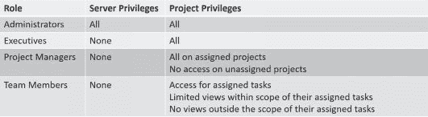

表 2.1：Project Server 的 Role-BAC 矩阵

`Role-BAC` 也称为基于层级或基于职的控制：

- **基于层级（Hierarchy-based）**：在 `Project Server` 示例中，你可以看到顶层角色（如 `Administrators` 角色）拥有的权限如何比低层角色（如 `Team Members` 角色）多得多。角色可以模仿组织的层级结构。
- **基于工作、任务或功能（Job-, task-, or function-based）**：`Project Server` 示例还显示了角色是如何以用户需要执行的工作或功能为中心的。

> **记住这一点**
>
> `role-BAC` 模型使用基于工作和功能的角色。矩阵是一种将角色与所需特权相匹配的规划文档。

### 通过基于组的特权建立访问

管理员在 `role-BAC` 模型中通常使用角色授予访问权限，并且他们经常将角色实现为组。Windows 系统将这些称为安全组。他们将权利和权限（特权）分配给组，然后将用户账户添加到相应的组中。这种基于组的访问控制（即访问是基于角色或组的访问控制）简化了用户管理。

`role-BAC` 模型的一种实现方式是 Microsoft 内置的安全组，以及管理员在工作站、服务器和域内创建的特殊安全组。

`Administrators` 组是一个内置安全组的示例。例如，本地计算机上的 `Administrators` 组包含了该计算机上的所有权利和权限。如果你想授予 Marge 对计算机的完全完整控制权，你可以将 Marge 的用户账户添加到该计算机的 `Administrators` 组中。一旦 Marge 成为 `Administrators` 组的成员，她就拥有该组的所有权利和权限。

同样，你也可以通过将其他用户账户添加到 `Backup Operators` 组来授予其他用户备份和恢复数据的能力。虽然内置组非常有用，但它们无法满足大多数组织的所有需求。例如，如果你的组织想要分离备份和恢复职责，你可以创建一个只能备份数据的组，以及另一个只能恢复数据的组。

在 Windows 域中，管理员经常创建与组织部门相对应的组。例如，假设 Homer、Marge 和 Bart 在 `Sales` 部门工作，并且需要访问存储在网络服务器上名为 `Sales` 的共享文件夹中的数据。管理员可以通过以下步骤简化管理工作，如图 2.6 所示：

1. 创建一个 `Sales` 组，并将每个用户账户添加到 `Sales` 组中。
2. 将 `Sales` 组添加到 `Sales` 文件夹。
3. 为 `Sales` 组的 `Sales` 文件夹分配适当权限。

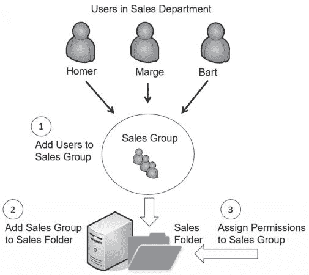

图 2.6：通过组角色建立访问

如果公司增加了新的销售人员，管理员会为他们创建账户并将账户放入 `Sales` 组。这些新销售人员现在就有了访问分配给该组的所有内容的权限。如果有任何用户在公司内部换工作并离开 `Sales` 部门，管理员将把他们从 `Sales` 组中移除。这会自动防止他们访问授予 `Sales` 组的任何资源。这个示例展示了如何为 `Sales` 部门使用组，但你也可以将相同的步骤应用于任何部门或用户组。

如果没有组，你将使用用户 le 配的权限。换句话说，你将为每个用户单独分配所有特定的权利和权限。这对于一个或两个用户可能是行的，但随着用户数量增加，很快就会变得难以管理。

例如，想象 `Sales` 部门内的人员需要访问网络中的 10 种不同资源（如文件、文件夹和打印机）。当公司聘佣一名新销售人员时，你需要手动为这 10 种不同资源分配权限，这需要 10 个不同的管理任务。如果你将权限分配给 `Sales` 组，你只需要将新用户添加到一个组中即可。

组提供了另一个安全益处。想象一个用户被晋升离开了 `Sales` 部门，现在在市场部工作。如果你有一个 `Marketing` 组，你可以将该用户账户放入 `Marketing` 组并从 `Sales` 组中移除该账户。从 `Sales` 组中移除用户将立即撤销从该组应用的所有用户权利和权限。然而，如果你没有使用组而是直接向用户分配权限，你可能不会忘记作为 `Sales` 部门成员的身份分配了哪些资源。相反，该用户将继续拥有这些销售数据，这违反了最小权限原则。

> **记住这一点**
>
> 基于组的权限减少了访问管理的管理性工作量。管理员将用户账户放入安全组中，并向组分配权限。组内的用户会自动继承分配给该组的权限。

## 基于规则的访问控制

基于规则的访问控制（`rule-BAC`）使用规则。最常见的例子是路由器或防火墙中的规则。然而，更高级的实现也会在应用程序内部触发规则。

路由器和防火墙使用访问控制列表（`ACLs`）中的规则。这些规则定义了设备允许进入网络的流量，例如允许浏览超文本传输协议（`HTTP`）流量。这些规则通常是静态的。换句话说，管理员创建规则，除非管理员再次更改，否则规则保持不变。

某些规则是动态的。例如，入侵防御系统可以检测攻击，然后修改规则以阻止来自攻击者的流量。在这种情况下，攻击触发了规则的更改。

另一个示例是，可以为用户应用程序配置规则。例如，你想在 Marge 不在时赋予 Homer 对数据库的额外权限。你可以配置一条数据库规则，当系统识别到 Marge 不在时触发对这些权限的更改。

> **记住这一点**
>
> 基于规则的访问控制基于一组经过批准的指令，例如访问控制列表。某些 `rule-BAC` 系统使用响应事件而触发的规则，例如在检测到攻击后修改 `ACLs` 或在某些情况下向用户授予额外权限。

## 任意裁量访问控制

在任意裁量访问控制（`DAC`）模型中，每个对象（如文件和文件夹）都有所有者，由所有者为对象建立访问权限。许多操作系统（如 Windows 和大多数基于 Unix 的系统）使用 `DAC` 模型。

`DAC` 模型的一个常见示例是 Windows 中使用的现代技术文件系统（`NTFS`）。`NTFS` 通过允许用户和管理员使用权限限制对文件和文件夹的访问来提供安全性。`NTFS` 基于 `DAC` 模型，下一节将解释它如何使用 `DAC` 模型。

### SIDs 和 DACLs

Microsoft 系统使用安全标识符（`SIDs`）识别用户，尽管你很少看到 `SID`。`SID` 是一段长字符，对大多数人来说是没有意义的，看起来可能像这样：`S-1-5-21-3991871189-223218`。系统不是直接显示 `SID`，而是查找与 `SID` 关联的名称并显示名称。同样，Microsoft 系统使用 `SID` 识别组。

每个对象（如文件或文件夹）都包含一个任意裁量访问控制列表（`DACL`），在使用 `DAC` 模型的系统中标识谁可以访问它。`DACL` 是访问控制条目（`ACEs`）的列表。每个 `ACE` 由一个 `SID` 和授予该 `SID` 的权限组成。例如，一个名为 `Study Notes` 的文件夹可能分配了以下权限：

- Lisa：完全控制
- Bart：读取
- Maggie：修改

这些条目中的每一个都是一个 `ACE`，它们组合成一个 `DACL`。“查看一个 DACL”实验展示了如何查看文件夹的 `DACL`。你可以在 [`gcgapremium.com/501labs/`](http://gcgapremium.com/501labs/) 访问本书的在线练习。

### 所有者建立访问

如果用户创建了文件，他们被指定为所有者并对文件拥有显式控制权。作为所有者，用户可以通过向 `DACL` 添加用户或组账户并分配所需的权限来修改对象上的权限。

`DAC` 模型比下一节描述的 `MAC` 模型要灵活得多。`MAC` 具有预定义的访问权限，并且要求管理员进行更改。在 `DAC` 中，如果你想授予另一个用户访问你拥有的文件，只需进行更改，该用户即可获得访问权限。

> **记住这一点**
>
> `DAC` 模型规定每个对象都有所有者，所有者对对象拥有完全、显式的控制权。Microsoft `NTFS` 使用 `DAC` 模型。

### 警惕木马

`DAC` 模型的一个固有缺陷是容易受到木马病毒的攻击。第 6 章“比较威胁、漏洞和常见攻击”将更深入地介绍恶意软件，但为了本次讨论，你应该了解一些与木马病毒的基础知识。木马病毒是可执行文件。它们伪装成有用的程序，但包含了恶意软件。例如，Bart 决定下载并安装一个朋友极力推崇的程序。安装后，他发现这个程序没那么好，就把它忘了。然而，损害已经造成了。

到底发生了什么？当 Bart 安装程序时，它也安装了恶意软件。此外，如果 Bart 在安装时是以管理员权限登录的，木马病毒就能以这些管理员权限运行。

许多组织要求管理员拥有两个账户，以降低与木马相关的风险。在大多数情况下，管理员使用普通用户账户登录。如果系统被恶意软件感染，恶意软件仅拥有普通用户账户的有限权限。相比之下，如果系统在管理员以管理员账户登录时被感染，恶意软件将拥有管理员的高级权限。

## 强制访问控制

强制访问控制（`MAC`）模型使用标签（有时称为敏感性标签或安全标签）来确定访问。安全管理员为主体（用户）和对象（文件或文件夹）分配标签。当标签匹配时，系统可以授予主体对对象的访问权限。当标签不匹配时，访问模型将阻止访问。

军事单位广泛使用此模型来保护数据。你可能在电影中见过他们展示一个带有大红黑封面的文件夹，上面标有“机密”（Top Secret）。封面标识了文件夹内包含数据的敏感性标签。拥有机密标签（机密访问权限）且有“知情需要”的用户可以访问机密文件夹内的数据。

“知情需要”（Need to know）是一个需要理解的重要概念。仅仅因为个人拥有机密权限并不意味着他们应该自动访问所有的机密数据。相反，访问是根据知情需要受到限制的。


安全增强型 Linux（`SELinux`）是少数使用强制访问控制模型的操作系统之一。`SELinux` 专门创建用于演示如何向操作系统中添加强制访问控制。相比之下，Windows 操作系统使用的是自主访问控制模型。

### 标签与格结构

`MAC` 模型使用不同的安全级别对用户和数据进行分类。这些级别定义在一个格结构（lattice）中。格结构可以是不同有序标签集合之间的复杂关系。这些标签定义了安全层级的边界。

图 2.7 显示了 `MAC` 模型如何使用格结构根据知情需要将访问划分为不同的区域。格结构首先定义了不同的级别：机密（Top Secret）、秘密（Secret）、机密（Confidential）和官方可用（For Official Use）。这些标签每一个都定义了特定的安全边界。在这些级别内部，格结构定义了特定的区域。例如，机密级包含标记为“核电厂”、“007”和“Happy Sumo”的区域。

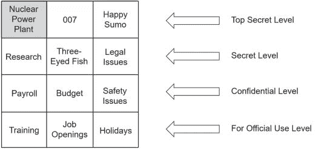

图 2.7：MAC 模型格

假设 Homer 拥有核电厂标签的机密权限。这使他能够访问核电厂区域内的数据。然而，除非他也拥有这些权限（以及相关的标签），否则他无法访问 007 或 Happy Sumo 区域内的数据。

高级别的权限包含低级别的权限。例如，因为 Homer 拥有机密权限，可以被授予访问秘密和更低级别数据的权限。尽管如此，他只能根据自己的知情需要访问这些较低级别的数据。

作为另一个例子，假设 Lisa 拥有秘密级权限。管理员可以根据她的知情需要，授予她访问秘密级及更级别数据的权限。例如，他们可能会通过为她分配“研究”（Research）标签来授予访问研究数据的权限，但不一定授予她访问“三眼鱼”（Three-eyed Fish）或“法律问题”（Legal Issues）数据的权限。然而，他们不能授予她访问任何机密级数据的权限。

**记住这一点**

`MAC` 模型对用户和数据使用敏感标签。它通常用于根据知情需要限制访问的场景。敏感性标签通常反映了数据的分类级别和授予个人的访问权限。

### 建立访问

管理员负责建立访问，但只有具有更高权威的人才能定义主体和对象的访问。

通常，安全专业人员会识别个人授权访问的特定内容。在必要时，此人还可以升级或降低个人的访问权限。请注意，安全专业人员通过文件完成这一切，而不会在计算机系统中分配权利和权限。相反，管理员根据安全专业人员的指示分配权利。

在确定用户可以访问内容的决策过程中，通常涉及多个审批级别。例如，在军队中，担任安全专业人员角色的官会与高级政府实体协调，以升级或降低权限。这些高级实体负责批准或否决权限请求。

一旦个人被正式授予访问权限，网络管理员将根据安全专业人员识别的权限负责建立访问。从 IT 管理员的角度来看，所有的权限和访问特权都是预定义的。

如果有人需要不同的访问权限，管理员会将请求转发给安全专业人员，安全专业人员可能会批准或拒绝该请求。另一方面，安全专业人员可能会根据既定程序将请求转发给高级实体。这一过程需要时间，会导致灵活性有限。

## 基于属性的访问控制

基于属性的访问控制（`ABAC`）根据属性的值评估属性并授予访问权限。属性可以是用户、环境或资源的几乎任何特征。ABAC 使用策略来评估属性，并在系统检测到策略匹配时授予访问。

举一个简单的例子，Homer 是春普林德核电厂的安全安全检查员。他的用户账户可能定义以下属性：员工、检查员和核安全意识。工厂的一台文件服务器包含一个名为 `Inspector` 的共享，其中存储了核安全检查员常用的文档。针对该共享的 ABAC 策略可能会授予任何具有员工、检查员和核安全意识属性的主体访问该共享的权限。许多软件定义网络（`SDNs`）使用 ABAC 模型。ABAC 系统中的策略控制流量，而不是在物理路由器上的规则。这些策略通常使用白话语句。例如，针对一家雇佣研究人员公司的 ABAC 策略规则可能是：

“允许登录的研究人员通过主网络访问研究站点。”策略语句通常包含四个元素：

- 主体（Subject）。这通常是一个用户。你可以使用任何用户属性作为属性，例如就业状态、组成员身份、工作角色、登录状态等。在示例中，主体被识别为已登录且是研究人员组的成员。

- `Object`（对象）：这是用户尝试访问的资源（例如文件、数据库或应用程序）。在示例中，对象是研究网站。研究网站对象将包括通过代理服务器访问互联网，以及一份特定的研究网站 URL 列表。

- `Action`（操作）：操作是用户尝试执行的行为，例如读取或修改文件、访问特定网站以及访问网站应用程序。示例允许访问特定网站。

- `Environment`（环境）：环境包括主体和对象属性之外的所有内容。这通常被称为访问请求的上下文。它可以包括时间、位置、协议、加密、设备和通信方法。在示例中，它将主网络指定为环境属性。

ABAC 系统具有很高的灵活性，既可以执行 DAC（自主访问控制）也可以执行 MAC（强制访问控制）模型。ABAC 模型与 DAC 和 MAC 模型之间也有许多相似之处。在 DAC 模型中，所有者拥有访问控制权；而在 ABAC 模型中，所有者可以创建策略来授予访问。MAC 模型使用分配给主体和对象的标签，并在标签匹配时授予访问。ABAC 模型使用识别主体和对象的属性，并在策略识别出匹配项时授予访问。

如果你想进一步深入研究 ABAC 模型，请查阅 NIST SP 800-162，《基于属性的访问控制 (ABAC) 定义与考虑》。

### 记住这一点

ABAC 模型使用策略中定义的属性来授予资源访问权限。它通常用于软件定义网络 (SDN)。

# 第 2 章考点复习

在准备考试时，请确保你理解本章涵盖的关键概念。

## 探索身份验证概念

- 身份验证（Authentication）允许实体通过另一个实体已知的凭据来证明自己的身份。

- 身份识别（Identification）发生在用户声称或宣布某种身份时，例如使用用户名、电子邮件地址、PIV 卡或使用生物识别。

- 身份验证（Authentication）发生在实体提供身份证明（如密码）时。第二个身份是验证器，它负责验证该身份。

- 授权（Authorization）根据已证明的身份提供资源访问权限。

- 审计（Accounting）方法跟踪用户活动并在日志中记录活动。

- 身份验证的五个要素是：

    * 你所知的，例如用户名和密码

    * 你所拥有的，例如智能卡、CAC、PIV 或令牌 (token)

    * 你所具备的，使用生物识别，如指纹或视网膜扫描

    * 你所处的的位置，使用地理位置、计算机名称或 MAC 地址

    * 你所执行的，例如在触摸屏上的手势

- “你所知的”要素通常指共享密钥，如密码或 PIN 码。这是安全性最低的身份验证形式。

- 密码应该是强且经常更换的。复杂密码包含多种字符类型。强密码是复杂的且长度至少为 14 个字符。

- 管理员在重置用户密码之前应验证用户的身份。在手动重置密码时，管理员应将其配置为临时密码，并在首次使用后过期，要求用户在首次登录时创建新密码。自服务密码系统实现了密码恢复的自动化。

- 密码策略提供了一种技术手段，确保用户采用安全的密码实践。

- 密码长度规定了密码的最小字符数。

- 密码复杂度确保密码是复杂的，并包含四种字符类型中的至少三种（例如特殊字符）。

- 密码历史会记住过去的密码并防止用户重复使用密码。

- 最小密码有效期与密码历史配合使用，防止用户反复更改密码以换回原始密码。

- 最大密码有效期或密码过期强制用户定期更改密码。当管理员重置用户密码时，密码应在首次使用时过期。

- 密码策略应适用于任何使用密码的实体。这包括用户账户以及服务和应用程序使用的账户。内部创建密码的应用程序仍应遵循组织的密码策略。

- 智能卡是信用卡大小的卡，嵌入了用于身份验证的证书。它们需要 PKI 来发放证书。

- 访问卡 (CAC) 和身份验证卡 (PIV) 可以作为照片 ID 和智能卡（同时用于身份识别和身份验证）。

- 令牌（或钥匙）在 LCD 屏幕上显示数字。这些数字提供滚动的一次性密码，并与服务器同步。USB 令牌包含嵌入芯片和 USB 连接。泛而言，这些被称为硬件令牌。

- `HOTP` 和 `TOTP` 是用于创建一次性密码的开源标准。`HOTP` 创建不过期的一次性密码，而 `TOTP` 创建的 30 秒后过期的一次性密码。

- 生物识别方法最难伪造。物理方法包括语音和脸部识别、指纹、视网膜扫描、虹膜扫描和手掌扫描。生物识别方法也可用于身份识别。

- 误接受率 (`FAR`) 或误匹配率识别了错误接受发生的百分比。误拒率 (`FRR`) 或误非匹配率识别了错误拒绝发生的百分比。交叉错误率 (`CER`) 表示生物识别系统的质量。`CER` 越低越好。

- 单因素身份验证包括同一因素中的一个或多个身份验证方法，例如 PIN 码和密码。双因子（或双因素）身份验证使用两个身份验证因素，例如 USB 令牌和 PIN 码。多因素身份验证使用两个或更多因素。多因素身份验证比任何形式的单因素身份验证都强。

- 在同一因素中使用两个或更多方法的方法属于单因素身份验证。例如，密码和 PIN 码都属于“你所知的”因素，因此它们只提供单因素身份验证。

## 比较身份服务

- `Kerberos` 是一种网络身份验证协议，使用由 `KDC` 或 `TGT` 服务器发放票据。票据过期，用户可能无法访问资源。Microsoft Active Directory 域和 Unix 领域使用 `Kerberos` 进行身份验证。

- `LDAP` 指定了查询目录的格式和方法。它为 Active Directory 域或 Unix 领域中的对象（如用户和计算机）提供单一管理点。以下是 LDAP 字符串示例：`LDAP:// CN=Homer,CN=Users,DC=GetCertifiedGetAhead,DC=com`

- 安全 LDAP (`LDAPS`) 使用 `SSL` 或 `TLS` 对传输进行加密。

- 单点登录 (`SSO`) 允许用户使用单个用户账户进行身份验证并访问网络上的多个资源，无需再次验证。

- `SSO` 可用于联合数据库提供中心身份验证，并在不同操作系统的环境（异构环境）中使用此身份验证。

- `SAML` 是一种基于 XML 的标准，用于在不同方之间交换身份验证和授权信息。`SAML` 用于 Web 应用程序。

- 联邦身份将用户来自不同网络或操作系统的凭据关联起来，但联邦身份机制将其视为单一身份。

- `Shibboleth` 是一个开源的联邦身份解决方案，包含 `Open SAML` 库。

- `OAuth` 和 `OpenID Connect` 被许多网站用于简化用户的身份验证过程。它们允许用户使用其他账户登录许多网站，例如使用 `Google`、`Facebook`、`PayPal`、`Microsoft` 或 `Twitter` 创建的账户。

## 管理账户

- 最小权限原则（principle of least privilege）是一种使用访问控制的技术控制手段。它规定个人或进程仅被授予执行分配任务或功能所需的权利和权限，而不能更多。

- 用户不应共享账户。这会防止有效的身份识别、验证、授权和审计。大多数组织都会确保禁用了 `Guest` 账户。

- 账户策略通常要求管理员拥有两个账户（一个管理员账户和一个标准用户账户），以防止权限提升和其他攻击。

- 账户禁用策略确保不活跃的账户被禁用。对于辞职或被解雇的员工账户，应尽快禁用。在临时账户上配置过期日期可以确保它们被自动禁用。

- 时间限制可以防止用户在特定时间段登录或访问网络资源。基于位置的策略防止用户从某些位置登录。

- 账户应进行重新认证以核实其是否仍然需要。例如，如果组织延长了合同，重新认证账户是一件简单的事。管理员核实合同已延长，更改过期日期并启用账户。

- 管理员定期执行账户维护。这通常通过脚本自动完成这些过程，并包括删除不再需要的账户。

- 凭据管理系统存储并简化了用户对凭据的使用。当用户访问需要凭据的网站时，系统会自动检索存储的凭据并将其提交给网站。

## 比较访问控制模型

- 基于角色的访问控制（`role-BAC`）模型通过根据分配的工作、功能或任务将用户置于角色中，来授予访问权限。在使用 `role-BAC` 时，一个将职位名称与所需权限匹配的矩阵可以作为非常有用的规划文档。

- 基于组的权限是 `role-BAC` 的一种形式。管理员创建组，将用户添加到组，然后为组分配权限。这简化了管理工作，因为管理员不需要为每个用户单独分配权限。

- 基于规则的访问控制（`rule-BAC`）模型基于一组经过批准的指令，例如防火墙中的 `ACL` 规则。某些 `rule-BAC` 实现使用响应事件触发的规则，例如在检测到攻击后修改 `ACLs`。

- 在自主权量访问控制（`DAC`）模型中，每个对象都有一个所有者。所有者拥有显式访问权限并为任何其他用户建立访问。`Microsoft NTFS` 使用 `DAC` 模型，每个对象都有一个自主权量访问控制列表（`DACL`）。`DACL` 识别谁拥有访问权限以及授予了他们什么权限。`DAC` 模型的一个主要缺陷是容易受到木马程序的攻击。

- 强制访问控制（`MAC`）使用安全或敏感性标签来识别对象（你需要保护的内容）和主体（用户）。它通常用于需要根据“知情需要”来限制访问的情况。管理员根据预定义的安全标签建立访问。这些标签通常用格结构（lattice）定义，以指定上下的安全边界。

- 基于属性的访问控制（`ABAC`）评估属性并根据这些属性的值授予访问权限。它被用于许多软件定义网络（`SDNs`）。

## 在线参考

- 你最近查看过在线内容吗？你可以在 `http://gcgapremium.com/501-extras.` 查看实验室和额外的示例题。

# 第 2 章练习题

1. 你组织的开发人员创建了一个为销售团队设计的应用程序。销售人员可以使用 `1234` 简单密码登录该应用程序。然而，此密码不符合组织的密码策略。安全管理员在获此后，以下哪种反应是最佳的？

   A. 什么都不做。应用程序中不需要强密码。

   B. 修改安全策略以接受此密码。

   C. 在应用程序的文档中将其记录为异常情况。

   D. 指示应用程序团队经理确保应用程序符合组织的密码策略。

2. Ned 正在审查 The Leftorium 员工的密码安全性。密码策略具有以下设置：

   - 密码最大有效期为 30 天。

   - 密码最小长度为 14 个字符。

   - 在使用其他五个密码之前，不能重复使用密码。

   - 密码必须包含以下四种字符类型中的至少一种：大写字母、小写字母、数字和特殊字符。

   Ned 发现，尽管有此密码策略，用户仍然在使用多个月前使用的同一个密码。以下哪种操作可以解决此问题？

   A. 在密码策略中创建一个规则，将密码最小有效期设为 7 天。

   B. 将密码历史记录改为 10。

   C. 要求使用复杂密码。

   D. 将最大有效期设置改为 60 天。

3. 你的组织计划实施远程访问功能。管理层希望使用强身份验证，并希望确保密码在预定义的时间间隔后过期。以下哪种选择最符合这一要求？

   A. HOTP

   B. TOTP

   C. CAC

   D. Kerberos

4. 你的组织决定实施一种生物识别身份解决方案。目标之一是确保生物识别系统具有高度准确性。以下哪项提供了生物识别系统准确性的最佳指示？

   A. 最低的 FRR（误拒率）

   B. 最高的 FAR（误报率）

   C. 最低的 CER（错误率）

   D. 最高的 CER（错误率）

5. 你的组织最近更新了一个在线应用程序，员工在居家办公时使用它登录。员工从智能手机向应用程序输入用户名和密码，应用程序使用 GPS 记录他们的位置。正在使用的是哪种类型的身份验证？

   A. 单因素

   B. 双因素

   C. 你所拥有的

   D. 你所处的

6. 一个网络包含一个用于身份验证的票据授予服务器（ticket-granting ticket server）。该网络使用哪种身份验证服务？

   A. Shibboleth

   B. SAML

   C. LDAP

   D. Kerberos

7. Lisa 是一位培训师，她维护着拥有 18 台计算机的培训实验室。她在这些机器上拥有足够的权利和权限，以便根据课程需要对它们进行配置。然而，她没有权限将它们加入组织的域。以下哪种选择最准确描述了这个例子？

   A. 最小权限

   B. 知情需要

   C. 基于组的权限

   D. 基于位置的策略

8. Marge 正在审查组织的账户管理流程。她希望确保安全日志条目准确报告执行特定操作的人员身份。以下哪种步骤最符合这一要求？

   A. 更新所有文件和文件夹的 ACL（访问控制列表）。

   B. 实现基于角色的权限。

   C. 使用 SSO 解决方案。

   D. 移除所有共享账户。

9. 最近的一次安全审计发现了几个似乎处于休眠状态的用户账户。尽管用户可以登录这些账户，但已经超过 60 天没有人登录过了。你后来发现这些账户属于每季度仅工作大约一周的承包商。针对这种情况，**最佳**的响应是什么？

   A. 移除账户的过期设置。

   B. 删除账户。

   C. 重置账户。

   D. 禁用账户。

10. 项目团队的成员选择在当地图书馆会面以完成某个关键项目的工作。他们都被授权使用 `VPN` 连接在家里工作，并且已经成功从家里连接过。然而，他们发现无法从图书馆通过 `VPN` 连接到网络，并且无法访问任何项目数据。在以下选项中，他们无法访问这些**最可能**的原因是什么？

    A. 基于角色的访问控制

    B. 基于时段访问控制

    C. 基于位置的策略

    D. 自由裁量访问控制

11. 你需要为一名将在你公司工作 60 天的承包商创建一个账户。在创建此账户时，采取的**最佳**安全步骤是什么？

    A. 为账户配置历史记录。

    B. 为账户配置密码过期日期。

    C. 为账户配置过期日期。

    D. 配置复杂性。

12. 一家公司最近聘请担任安全管理员。你注意到某些由临时员工使用过的旧账户目前处于启用状态。在以下选项中，**最佳**的响应是什么？

    A. 禁用所有临时账户。

    B. 禁用你注意到的已启用的临时账户。

    C. 编写脚本根据根据最后登录时间识别不活跃的账户。

    D. 在创建所有账户时为所有账户设置账户过期日期。


13. 开发人员正计划使用基于角色的访问控制开发一个应用程序。在他们的计划中，他们**最可能**会包含以下内容？
A. 反映分类分级的标签列表
B. 识别“知情需要”的需求列表
C. 所有者列表
D. 功能与其所需权限相匹配的矩阵

14. 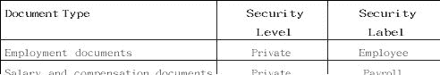 安全管理员需要实施一种访问控制系统，根据以下矩阵保护数据。（注意，此矩阵仅代表了整体要求的子集。）管理员正在实施的是哪种模型？
A. DAC
B. MAC
C. Role-BAC
D. ABAC

15. 你的组织正在实施`SDN`。管理层想使用一种基于属性控制访问的访问控制模型。以下哪项是**最佳**解决方案？
A. DAC
B. MAC
C. Role-BAC
D. ABAC

# 第 2 章练习题答案

1. D. 应用程序应该重写以符合公司的密码策略，因此最佳响应是指导应用程序团队经理这样做。应用程序密码应该是强密码，并应符合组织的安全策略。为了匹配应用程序的缺陷而削弱安全策略是不恰当的。仅仅记录该应用程序使用弱密码也是不恰当的。

2. A. 解决方案是在密码策略中创建一个密码最小年龄的规则。目前，用户可以在几分钟内更改五次密码，并在第六次更改时改回原始密码。其他任何设置都无法阻止用户这样做。`10`次密码历史记录迫使用户多花几分钟才能回到原始密码。密码策略目前要求复杂密码。`60`天的最大年龄增加了用户保持相同密码的时间。

3. B. 基于时间的一次性密码(`TOTP`)符合这一要求。使用`TOTP`创建的密码在30秒后过期。基于HMAC的一次性密码(`HOTP`)创建的密码不会过期。通用访问卡(`CAC`)是一种智能卡，但它不创建密码。`Kerberos`使用票据代替密码。

4. C. 较低的交叉错误率(`CER`)表示生物识别系统更准确。误接受率(`FAR`)和误拒率(`FRR`)随生物识别系统的敏感性而异，其本身并不表示准确性。较高的`CER`表示生物识别系统的准确性较低。

5. A. 这是使用单因素身份验证——你所知道的。应用程序使用用户名进行识别，使用密码进行验证。注意，尽管应用程序正在使用全球定位系统(`GPS`)记录位置，但没有迹象表明它正使用这些信息进行验证。双因子身份验证需要另一个验证因素。如果应用程序在验证过程中验证你是从某个特定的`GPS`位置登录的，那么就是双因子身份验证（你所知道的和你所在的所在地）。特征是指生物识别验证方法。所在地验证方法验证你处于某地，例如特定的`GPS`位置，但在这种场景中并未被用于验证。

6. D. `Kerberos`使用票据授予票据(`TGT`)服务器创建用于验证的票据。`Shibboleth`是用于某些单点登录(`SSO`)解决方案的联邦身份解决方案。安全断言标记语言(`SAML`)是用于某些`SSO`解决方案的扩展标记语言(`XML`)。轻量级目录访问协议(`LDAP`)是一种基于`X.500`的验证服务。

7. A. 遵循最小权限原则时，个人仅拥有执行工作所需的权利和权限，这正是该场景所描述的。“知情需要”通常指的是数据和信息，而不是执行操作所需的权限（例如将计算机添加到域）。基于组的权限是指向组授予权限，然后将用户添加到组以赋予适当的权限。基于位置的策略允许或阻止基于位置的访问，但场景并未显示正在检查位置。

8. D. 移除所有共享账户是可用选项中的最佳答案。如果两个员工使用同一个账户，且其中一个员工恶意删除了数据库中的数据，则无法识别是哪个员工删除了数据。文件和文件夹访问控制列表(`ACLs`)识别用户的权限，但不控制用户身份。基于角色的（或基于组的）权限向组中的所有成员分配相同的权限，这简化了管理。单点登录(`SSO`)解决方案允许用户登录一次并访问多个资源。

10. C. 基于位置的策略根据位置（例如IP地址）限制访问，这是所给选项中最佳的答案。场景表明他们可以使用来自家中的虚拟专用网络(`VPN`)连接，但当他们尝试从图书馆访问时，连接被阻止了。时间段访问控制根据一天中的时间限制访问，但场景中并未指示时间。无论是自主性访问控制模型还是基于角色的访问控制模型，都不会根据位置限制访问。

11. C. 创建临时账户时，最好配置过期日期，以便系统在指定日期自动禁用这些账户。历史记录、密码过期和复杂性都指的是密码策略设置。然而，在单个账户上配置特定的密码策略非常罕见。

12. C. 运行最后登录脚本允许你识别不活跃的账户，例如过去30天未登录的账户。禁用未使用的账户是适当的，但并不一定禁用临时账户，因为某些账户可能仍在使用。如果你禁用了你发现的账户，你可能会禁用某些员工仍在使用的账户，并可能漏掉一些应该被禁用的账户。为新创建的账户设置过期日期是一个好方法，但它无法解决之前创建的账户问题。

13. D. 将功能、角色或职位与每个功能、角色或职位所需的访问权限匹配的矩阵是基于角色的访问控制(`RBAC`)模型常用的规划文档。强制性访问控制(`MAC`)模型使用敏感性标签和分类级别。`MAC`能够有效地根据“知情需要”限制访问。自主性访问控制(`DAC`)模型规定每个对象都有所有者，并可能在列表中标识出所有者。

14. B. 这是一个强制性访问控制(`MAC`)模型。你可以看出，因为它正在使用安全标签。列出的其他模型均未使用标签。自主性访问控制(`DAC`)模型有一个所有者，由所有者建立对象的访问权限。基于角色的访问控制(`RBAC`)模型使用角色或组来分配权利和权限。基于属性的访问控制(`ABAC`)模型使用在策略中分配给主体和对象的属性来授予访问权限。

15. D. 软件定义网络(`SDN`)通常使用基于属性的访问控制(`ABAC`)模型，该模型基于识别策略内主体和对象的属性。自主性访问控制(`DAC`)模型有一个所有者，由所有者建立对象的访问权限。强制性访问控制(`MAC`)模型使用分配给主体和对象的标签。基于角色的访问控制(`RBAC`)模型使用角色或组来分配权利和权限。

# 第 3 章：探索网络技术与工具

#### 本章涵盖的 CompTIA Security+ 目标：

1.2 比较并对比攻击类型。
- 应用程序/服务攻击（ARP毒化、DNS污染）

2.1 安装和配置硬件及软件网络组件，以支持组织安全。
- 防火墙（`ACL`、基于应用vs网络、有状态vs无状态、隐式拒绝）、路由器（`ACL`、反欺骗）、交换机（端口安全、二层vs三层、环路防止、泛洪防护）、代理（正向和反向代理、透明、应用/多用途）、邮件网关（垃圾过滤器、`DLP`、加密）、桥、媒体网关

2.2 给定场景，使用适当的软件工具评估组织的安全态。
- 命令行工具（`nslookup/dig`）

2.3 给定场景，排除常见的安全问题。
- 配置错误的设备（防火墙、内容过滤器）

2.4 给定场景，分析并解释安全技术的输出。
- 主机防火墙、`UTM`、Web应用防火墙

2.6 给定场景，实施安全协议。
- 协议（`DNSSEC`、`SSH`、`SRTP`、`FTPS`、`SFTP`、`SNMPv3`、`SSL/TLS`、`HTTPS`、安全`POP/IMAP`）
- 用例（语音和视频、时间同步、电子邮件和网页、文件传输、目录服务、远程访问、域名解析、路由和交换、网络地址分配、订阅服务）

3.2 给定场景，实施安全网络架构概念。
- 区域/拓扑结构（`DMZ`、外网、内网、`NAT`）、隔离/分段/划分（物理、逻辑 (`VLAN`)、空气隔离）、安全设备/技术放置（过滤器、代理、防火墙、负载均衡器、`DDoS`缓解器、聚合交换机）

1.3 给定场景，实施安全系统设计。
- 操作系统（禁用不必要的端口和服务）

CompTIA期望CompTIA Security+的考生至少拥有两年的网络经验。然而，即使拥有这些经验，信息技术(`IT`)专业人员或安全专业人员的知识中往往存在空白。例如，你可能花费了大量时间排除连接问题，但很少操作路由器上的访问控制列表(`ACL`)或修改防火墙规则。本章回顾了安全网络内部一些基础网络概念、设备和网络拓扑结构。在适当的情况下，它将从安全的角度进一步深入探讨这些主题。

# 复习基础网络概念

在处理网络上的任何相关安全问题之前，你需要对网络有基础的了解。提醒一下，CompTIA期望你在`IT`管理方面至少有两年的经验。此外，CompTIA建议在参加Security+考试之前获得Network+认证。虽然不需要Network+认证，但这些知识对于帮助通过Security+考试中的网络部分非常有帮助。

本节包含对许多与安全相关的不同协议和网络概念的简要回顾。如果你对这些概念中的任何一个完全陌生，你可能需要找一本网络书籍来复习它们。

本节还提到了某些针对协议的常见攻击，或者协议有助于防止的攻击。以下项目符号引入了其中一些攻击，第7章“防止高级攻击”将更深入地涵盖这些攻击：

- 嗅探攻击。攻击者经常使用协议分析仪来捕获通过网络发送的数据。捕获数据后，当数据以明文发送时，攻击者可以轻松地通过协议分析仪读取数据。第8章“使用风险管理工具”将更深入地介绍协议分析仪。

- DoS和DDoS。拒绝服务(`DoS`)攻击是来自单一源的服务攻击，试图破坏另一个系统提供的服务。分布式拒绝服务(`DDoS`)攻击包括多个计算机攻击单个目标。

- 毒化攻击。许多协议将数据存储在缓存中以便临时访问。毒化攻击试图用不同的数据损坏缓存。

## 基础网络协议

网络协议提供了计算机在网上通信所需的规则。某些传输控制协议/网际协议(`TCP/IP`)协议，如`TCP`和`IP`，提供了基本的连接。其他协议，如超文本传输协议(`HTTP`)和简单邮件传输协议(`SMTP`)，支持特定类型的流量。本节包含了你参加CompTIA Security+考试需要理解的常用协议信息。

`TCP/IP`不是单一协议，而是一套完整的协议族。显然，书中没有空间详细介绍所有`TCP/IP`协议的细节。相反，本节的目的是提醒你记住一些常用协议。此外，许多协议满足特定的用例，本节将在用例的背景下描述这些协议。

CompTIA在历史上非常强调协议所使用的常用端口。例如，`HTTP`的默认端口是80，CompTIA Security+的考生需要知道这一点。目前的测试目标降低了端口重要性。然而，当你在路由器和无状态防火墙中实施访问控制列表(`ACLs`)，以及在禁用不必要的端口和服务时，你仍然需要了解它们。考虑到这一点，我在本章中包含了许多协议的常用端口。

以下列表描述了一些基础网络协议：

- `TCP`。传输控制协议(`TCP`)提供面向连接的流量（保证交付）。`TCP`使用三次握手，图3.1显示了`TCP`握手过程。要启动一个`TCP`会话，客户端发送一个`SYN`（同步）包。服务器用`SYN/ACK`（同步/确认）包进行响应，客户端通过`ACK`包完成握手的第三部分以建立连接。

图3.1：`TCP`握手过程

- `UDP`。用户数据报协议(`UDP`)提供无连接的会话（无三次握手）。虽然`TCP`流量提供保证交付，但`UDP`尽力交付流量而不使用额外的流量来确保交付。如`ping`命令之类的`ICMP`流量以及音频/视频流使用`UDP`。许多基于网络的拒绝服务(`DoS`)攻击使用`UDP`。`TCP/IP`流量或是面向连接的`TCP`或是无连接的`UDP`。

- `IP`。互联网协议(`IP`)识别`TCP/IP`网络中的主机并使用`IP`地址将流量从一个主机传输到另一个主机。`IPv4`使用点分进制表示的32位地址，例如`192.168.1.100`。`IPv6`使用十六进制代码的128位地址，例如`FE80:0000:0000:0000:20D4:3FF7:003F:DE62`。

- `ICMP`。互联网控制消息协议(`ICMP`)用于测试基本连通性，并包含诸如`ping`、`pathping`和`tracert`等工具。例如，`ping`可以检查两个系统之间的基本连通性，如第1章“掌握安全基础”所讨论。许多`DoS`攻击使用`ICMP`。由于`ICMP`在攻击中频繁使用，在防火墙和路由器上阻止`ICMP`已变得很常见，这会禁用`ping`响应。阻止`ICMP`可以防止攻击者发现网络中的设备。例如，扫描可以向子网中的每个`IP`地址发送`ping`。回复的设备将验证它们处于开启状态并具有`IP`地址。

- `ARP`。地址解析协议(`ARP`)将`IPv4`地址解析为介质访问控制(`MAC`)地址。`MAC`也称为物理地址或硬件地址。`TCP/IP`使用`IP`地址将包送到目标网络，但一旦到达目标网络，它就会使用`MAC`地址将其送到正确的主机。换句话说，一旦包到达目标子网，就需要`ARP`。`ARP`投毒攻击使用`ARP`包为客户端提供虚假的硬件地址更新，攻击者利用它来重定向或中断网络流量。

- `NDP`。邻居发现协议(`NDP`)在`IPv6`上执行多种功能。例如，它执行类似于`IPv4`中`ARP`的功能。它还执行设备`IPv6`地址的自动配置，并发现网络上的其他`IPv6`设备，例如默认网关地址。

## 为用例实现协议

网络不会自动支持所有可用协议。相反，`IT`专业人员根据组织目标识别需求，并启用最佳协议来满足该需求。第1章讨论了用例。作为提醒，用例通常描述组织目标。CompTIA Security+目标中提到的许多协议支持特定的用例，并在本节中进行了讨论。

### 语音和视频用例

组织在网络上传输语音和视频很常见，某些协议在处理语音视频方面比其他协议更好。如前所述，`UDP`通常用作语音和视频流的底层协议。

实时传输协议(`RTP`)在`IP`网络上传输音频和视频。这包括协议语音(`VoIP`)通信、流媒体传输、视频会议应用程序以及使用基于Web的按按对讲功能的设备。然而，组织通常希望加密这些传输。安全实时传输协议(`SRTP`)为`RTP`提供加密、消息认证和完整性保护。

`SRTP`有助于保护数据机密性免受此类攻击的影响，同时确保数据传输的完整性。这提供了防止重放攻击的保护。在重放攻击中，攻击者捕获两个实体之间发送的数据并进行修改，然后尝试通过重放数据来冒充其中一方。`SRTP`可用于单播传输（例如一个人给另一个人打电话）以及一个人向多个接收者发送流量的多播传输。

### 文件传输用例

传输数据(`Data-in-transit`)是任何通过网络发送的流量。当数据以明文发送时，攻击者可以使用协议分析仪来捕获并读取它。你可以通过加密来保护个人身份信息(`PII`)及任何其他传输数据的机密性。注意，你也可以加密静态数据(`Data-at-rest`)，即存储在任何类型介质上的数据。第10章“理解加密和PKI”深入涵盖了若干特定的加密算法。

与文件传输相关的常用用例包括：通过网络传输数据、在网络传输数据时确保机密性以及确保管理员使用安全连接到服务器。以下列表识别了用于通过网络传输数据的基础协议：

- `FTP`。文件传输协议(`FTP`)向`FTP`服务器上传和下载大文件。默认情况下，`FTP`以明文传输数据，使得攻击者很容易用协议分析仪捕获并读取`FTP`数据。`FTP`激活模式使用`TCP`端口`21`控制信号，使用`TCP`端口`20`数据。`FTP`被动模式（也称为`PASV`）使用`TCP`端口`21`控制信号，但使用随机`TCP`端口传输数据。如果`FTP`流量通过防火墙，此随机端口经常阻塞，因此最好在`FTP`客户端禁用`PASV`。

- `TFTP`。简易文件传输协议(`TFTP`)使用`UDP`端口`69`，传输较少的数据，例如与网络设备通信时。许多攻击使用`TFTP`，但它并不是大多数网络上的必选协议。因此，管理员通常会禁用它。

以下列表识别了几种用于加密传输数据的加密协议。它们可用于与安全文件传输相关的各种用例：

- **`SSH`**。安全外壳(`SSH`)加密传输中的流量，并可加密其他协议，如`FTP`。Linux管理员在远程管理系统时经常使用`Telnet`，但这并不推荐，因为`Telnet`在网络上以明文形式发送流量。相反，管理员通常使用`SSH`来远程管理系统。安全复制(`SCP`)基于`SSH`，用于在网络上复制加密文件。`SSH`还可以加密`TCP Wrappers`，这是一种Linux系统上用于过滤流量的访问控制列表。当`SSH`加密流量时，它使用`TCP`端口22。

- **`SSL`**。安全套层(`SSL`)协议是作为安全超文本传输协议(`HTTPS`)保护`HTTP`流量的主要方法。`SSL`还可以加密其他类型的流量，例如`SMTP`和轻量级目录访问协议(`LDAP`)。然而，它已被破解，不建议使用。

- **`TLS`**。传输层安全(`TLS`)协议是`SSL`的指定替代方案，应该用来代替`SSL`。此外，许多支持`TLS`的协议使用`STARTTLS`。`STARTTLS`看起来像一个缩写，但它并不是。相反，它是一个用于将同一端口上的未加密连接升级为加密连接的命令。

- **`IPsec`**。协议安全(`IPsec`)用于加密`IP`流量。它是`IPv6`原生的，但也支持`IPv4`。`IPsec`封装并加密`IP`数据包负载，并使用`Tunnel`模式保护虚拟专用网络(`VPN`)流量。`IPsec`包含两个主要组件：由协议ID数字51标识的认证头(`AH`)和由协议ID数字50标识的封装安全载荷(`ESP`)。它使用通过`UDP`端口500的互联网密钥交换(`IKE`)为`VPN`创建安全关联。第4章“保护你的网络”更深入地介绍了`IPsec`。

- **`SFTP`**。安全文件传输协议(`SFTP`)是`FTP`的安全实现。它是安全外壳(`SSH`)的扩展，使用`SSH`以加密格式传输文件。`SFTP`使用`TCP`端口22传输数据。

- **`FTPS`**。安全文件传输协议(`FTPS`)是`FTP`的扩展，使用`TLS`加密`FTP`流量。`FTPS`的某些实现使用`TCP`端口989和990。然而，`TLS`也可以加密`FTP`使用的端口（20和21）上的流量。注意`SFTP`和`FTPS`的区别在于`SFTP`使用`SSH`而`FTPS`使用`TLS`。

## 记住这个


安全外壳（`SSH`）在`TCP`端口 22 上加密流量。传输层安全（`TLS`）是`SSL`的替代品，用于加密许多不同的协议。安全 FTP（`SFTP`）使用`SSH`加密流量。安全 FTP（`FTPS`）使用`TLS`加密流量。

## SSL 对比 TLS（侧边栏）

`SSL`已破解，不建议使用。2014 年 9 月，Google 的一个团队发现了`SSL`的一个严重漏洞，他们将其命名为`POODLE`攻击。`Poodle`是“降级遗留加密填充预言攻击”（Padding Oracle on Downgraded Legacy Encryption）的缩写。`SSL`协议不再维护或修补，因此该漏洞仍然存在。

这是美国政府和许多其他组织禁止使用`SSL`保护任何敏感数据的原因之一。例如，美国标准与技术研究院（`NIST`）特别出版（`SP`）800-52《选择、配置和使用传输层安全（`TLS`）实现的指南》明确指出联邦机构不应使用`SSL`。

`TLS`是推荐的替代方案。虽然`TLS`可以用于几乎任何之前使用`SSL`的实现，但两者并不是同一种协议。尽管如此，你经常会看到`SSL`和`TLS`被提到像同一种协议一样。即使 CompTIA 的`Security+`考试目标也把“`SSL`/`TLS`”视作同一种协议。

其似乎似乎仅仅是因为人们熟悉`SSL`。通过将这些主题合并为`SSL`/`TLS`，许多人就能理解其通用用途。

从通用角度来看，使用`SSL`/`TLS`术语有助于人们理解它们的相似性。然而，从技术角度来看，意识到`SSL`已破解并应该使用`TLS`是重要的。

### 电子邮件和网络用例

与电子邮件相关的一些常见用例包括发送和接收电子邮件、发送和接收安全电子邮件以及管理电子邮件文件夹。对于网络，内部员工的常见用例是提供互联网访问和提供安全的互联网访问。许多组织托管 Web 服务器，这些 Web 服务器的常见用例是为外部客户端提供 Web 服务器访问。

许多这些协议都支持`STARTTLS`。它不是使用一个端口传输明文数据并使用另一个端口传输密文数据，而是`STARTTLS`命令允许协议在同一端口上执行两种操作。用于电子邮件和网络的常用协议包括：

- **SMTP**。简单邮件传输协议（`SMTP`）在客户端和`SMTP`服务器之间传输电子邮件。`SMTP`使用`TCP`端口 25。`SMTP`非正式地配合`SSL`使用端口 465，配合`TLS`使用端口 587。然而，现在建议`SMTP`使用`STARTTLS`来初始化安全连接。

- **POP3 和安全 POP**。邮局协议 v3（`POP3`）将邮件从服务器传输到客户端。`POP3`使用`TCP`端口 110。安全`POP3`使用`SSL`或`TLS`加密传输，并可以使用`TCP`端口 995。然而，现在建议使用`STARTTLS`在端口 110 上创建安全连接。

- **IMAP4 和安全 IMAP**。互联网消息访问协议版本 4（`IMAP4`）用于在电子邮件服务器上存储邮件。`IMAP4`允许用户在服务器文件夹中组织和管理电子邮件。例如，Gmail 使用了`IMAP4`。`IMAP4`使用`TCP`端口 143。带有`SSL`或`TLS`的`IMAP4`可以使用`TCP`端口 993，但建议在相同的`TCP`端口 143 使用`STARTTLS`。

- **HTTP**。超文本传输协议（`HTTP`）在互联网和内网上传输 Web 流量。服务器使用`HTTP`将网页传输到客户端浏览器。超文本标记语言（`HTML`）是显示网页的常用语言。`HTTP`使用`TCP`端口 80。

- **HTTPS**。安全超文本传输协议（`HTTPS`）加密 Web 流量以确保在传输过程中安全。Web 浏览器通常通过显示锁图标和在统一资源定位符（`URL`）字段包含`HTTPS`来指示安全会话在使用`HTTPS`。`HTTPS`使用`SSL`或`TLS`加密，并使用`TCP`端口 443。

## 记住这个

`SMTP`在`TCP`端口 25 发邮件，`POP3`在端口 110 接收邮件，`IMAP4`使用端口 143。`STARTTLS`允许加密版本与未加密版本使用相同的端口。`HTTP`和`HTTPS`使用端口 80 和 443，分别以明文和加密格式在互联网上传输数据。

### 目录服务用例

网络操作系统通常使用目录服务来简化管理并实现安全。一个常见用例是提供网络的安全访问。例如，许多组织使用 Microsoft Active Directory 域服务（`AD DS`）。`AD DS`为管理员提供了为每个授权用户创建用户对象、以及为每个授权计算机创建计算机对象的方法。然后，管理员使用目录服务中的各种方法来强制识别、验证和授权方法。

第 2 章“理解身份和访问管理”涵盖了有助于支持此用例的相关主题：

- `Kerberos`。Kerberos 是 Windows 领域和某些 Unix 环境使用的身份验证协议。它使用`密钥分配中心`（`KDC`）发布带有时间戳的票据。Kerberos 使用`UDP`端口`88`。

- `LDAP`。轻量级目录访问协议（`LDAP`）是用于与`AD DS`等目录通信的协议。LDAP 为对象标识和管理提供了清晰的语法。LDAP 使用`TCP`端口`389`。`LDAP Secure`（`LDAPS`）使用`TLS`通过`TCP`端口`636`对数据进行加密。

- `Group Policy`。管理员使用`组策略对象`（`GPOs`）来配置设置。然后他们可以将这些`GPOs`应用于域内的用户和计算机。

## 远程访问用例

人员需要从远程位置访问系统的情况有很多。一些常见的用例包括远程管理系统和远程访问桌面。例如，想象一个服务器机房托管着数百台服务器，包括 Microsoft 域的域控制器。如果管理员需要创建用户帐户或在`GPO`中实施更改，他们很少去服务器机房。相反，他们会远程访问服务器并在办公桌电脑上进行更改。

管理员经常实现`SSH`（在“文件传输用例”部分讨论）来满足支持远程访问用例。例如，许多 Linux 管理员在连接到远程系统进行管理时使用`Netcat`，并用`SSH`安全`Netcat`传输。第 8 章将深入介绍`Netcat`，但你可以查看第 3 章的实验来了解`Netcat`。

管理员和客户端经常使用`远程桌面协议`（`RDP`）从远程位置连接到其他系统。微软在`远程桌面服务`和`远程协助`等解决方案中使用`RDP`。`RDP`使用端口`TCP` `3389` 或`UDP` `3389`，尽管`TCP`端口`3389`更常见。用户无法通过`RDP`连接系统的常见原因是端口`3389`被主机防火墙或网络防火墙拦截了。另一种支持远程访问用例的方法是使用使用虚拟专用网络（`VPN`）。第 4 章深入讨论了`VPNs`。

> **记住这一点**

> 管理员使用诸如`安全外壳`（`SSH`）和`远程桌面协议`（`RDP`）等协议远程连接到服务器。在某些情况下，管理员使用虚拟专用网络连接到远程系统。

## 时间同步用例

在许多情况下，系统需要使用相同的时间（至少是接近的时间）。一个常见的用例是确保系统具有准确的时间。例如，`Kerberos`要求所有系统同步且彼此误差在五分钟以内。

在 Microsoft 域中，一个域控制器定期使用`Windows Time`服务来定位一个运行`网络时间协议`（`NTP`）的可靠互联网服务器。`NTP`是最常用的时间同步协议，允许系统将其时间同步到几十毫秒以内。网络中的其他域控制器定期与第一台域控制器同步时间。最后，域内的所有计算机都与这些域控制器之一同步时间。此过程确保了所有计算机都拥有准确的时间。

`简单 NTP`（`SNTP`）协议也可用于时间同步。然而，`NTP`使用复杂的算法并查询多个时间服务器以识别出最准确的时间。`SNTP`不使用这些算法，因此其结果可能没有`NTP`准确。

## 网络地址分配用例

网络地址分配是指为网络内的主机分配`IP`地址。你可以手动进行，但大多数网络使用`动态主机配置协议`（`DHCP`）为主机动态分配`IP`地址。`DHCP`还会分配其他`TCP/IP`信息，如子网掩码、默认网关、`DNS`服务器地址等。接下来的章节提供了对基础网络概念的概述。

### IPv4

`IPv4`使用点分十进制格式表示的 32 位`IP`地址。例如，`192.168.1.5`的`IPv4` `IP`地址是四个由点分隔的数字。你也可以用 32 位的二进制形式表示该地址。

所有的互联网`IP`地址都是公共`IP`地址，而内部网络使用私有`IP`地址。公共`IP`地址受到严格控制。你不能随意使用任何公共`IP`地址。

相反，你必须购买或租赁它。互联网服务提供商（`ISPs`）购买整个`IP`地址范围并分配给客户。如果你从家里访问互联网，你很可能正在接收来自`ISP`的公共`IP`地址。

互联网上的路由器包含规则，丢弃任何来自或发往私有`IP`地址的流量，因此你无法在互联网上分配私有`IP`地址。`RFC 1918`规定了以下私有地址范围：

- `10.x.y.z`：`10.0.0.0`到`10.255.255.255`

- `172.16.y.z–172.31.y.z`：`172.16.0.0`到`172.31.255.255`

- `192.168.y.z`：`192.168.0.0`到`192.168.255.255`

这是你在私有网络内应该分配三个`IPv4`地址范围。

> **记住这一点**

> 私有网络应该只有私有 IP 地址。这些地址在`RFC 1918`中正式定义。

### IPv6

尽管`IP`地址的数量最初看起来是无穷无尽的，但互联网数字分配机构（`IANA`）在 2011 年 2 月分配了最后一区块`IPv4`地址。为了做好准备，互联网工程任务组（`IETF`）创建了`IPv6`，它提供了比`IPv4`大得多的地址空间。

`IPv6`使用十六进制格式表示的 128 位`IP`地址。例如，`fe80:0000:0000:0000:02d4:3ff7:003f:de62`的`IPv6` `IP`地址包含八组四个十六进制字符，用冒号分隔。每个十六进制字符由 4 位组成。

`IPv6`使用唯一本地地址而不是私有`IP`地址。这些地址仅在私有网络内分配，而不会分配给互联网上的系统。唯一本地地址以`fc00`前缀开头。

## 域名解析用例

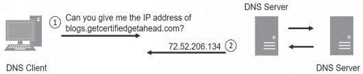`域名系统`（`DNS`）的主要目的是域名解析。`DNS`将主机名解析为`IP`地址。系统不断查询`DNS`，尽管这通常对用户是透明的。想象你想访问`http://getcertifiedgetahead.com/`。你将 URL 输入网络浏览器或点击页面上的链接，你的系统就会查询`DNS`服务器获取该站的`IP`地址。图 3.2 显示了你的系统和`DNS`之间发生的情况。`DNS`使用`UDP`端口`53`进行此类查询。

有时，你查询的`DNS`服务器知道答案并直接给出响应。有时，它会查询一个或多个其他`DNS`服务器来获取答案。当`DNS`服务器查询其他`DNS`服务器时，它会将答案缓存，这样就不需要再次执行相同的查询。同样，当客户端从`DNS`服务器接收答案时，它们会将答案存储在缓存中，这样就不需要重复查询。

`DNS`服务器在区域中托管数据，你可以将其视为数据库。区域包含多条记录，例如：

- `A`。也称为主机记录。此记录持有主机名和`IPv4`地址，是`DNS`服务器中最常用的记录。`DNS`客户端使用正向查找请求通过名称查询`DNS`，`DNS`返回此记录中的`IPv4`地址。

- `AAAA`。此记录持有主机名和`IPv6`地址。它与`A`记录类似，但它是用于`IPv6`的。

- **PTR**：也称为指针记录（pointer record）。它是`A`记录的反面。不是由`DNS`客户端通过名称查询 DNS，而是`DNS`客户端通过 IP 地址查询 DNS。当配置为如此时，`DNS`服务器会返回名称。`PTR`记录是可选的，因此这些反向查找并不总是有效。

- **MX**：也称为邮件交换（mail exchange）或邮件交换器（mail exchanger）。`MX`记录标识用于电子邮件的邮件服务器。`MX`记录链接到邮件服务器的`A`记录或`AAAA`记录。

- **CNAME**：名称（canonical name）或别名，允许单个系统拥有多个与单个 IP 地址关联的名称。例如，域名`getcertifiedgetahead.com`中名为`Server1`的服务器可以在同一域名下拥有`FileServer1`的别名。

- **SOA**：区域起始记录（start of authority）包含有关`DNS`区域的信息及其某些设置。例如，它包含了`DNS`记录的`TTL`（生存时间）设置。`DNS`客户端使用`TTL`设置来决定缓存`DNS`结果的时间。`TTL`时间以秒为单位，较低的时间会导致客户端更频繁地刷新记录。

互联网上的大多数`DNS`服务器运行伯克利命名域（`BIND`）软件，并运行在`Unix`或`Linux`服务器上。内部网络可以使用`BIND`，但在微软网络中，`DNS`服务器通常使用微软 DNS 软件。

偶尔，`DNS`服务器会通过名为区域传输（zone transfer）的过程相互共享信息。在大多数情况下，区域传输仅包含少量更新的记录。然而，某些传输包含该区域中的所有记录。`DNS`服务器使用`TCP`端口`53`进行区域传输。相比之下，名称解析查询使用`UDP`端口`53`。

### DNSSEC

DNS 的一个风险是 DNS 毒化，也称为 DNS 缓存污染。成功后，攻击者用虚假的 IP 地址修改 DNS 缓存。例如，想象攻击者想要在用户每次访问`msn.com`时都将他们引导到恶意网站。一种方法是修改`DNS`缓存中`msn.com`的`A`或`AAAA`记录。它将不再向用户发送`msn.com`使用的 IP 地址，而是发送到恶意网站的 IP 地址。

防止 DNS 缓存污染的主要方法之一是使用域名系统安全扩展（`DNSSEC`）。`DNSSEC`是 DNS 的一组扩展，用于为 DNS 响应提供验证。它为每条记录添加了数字签名以提供数据完整性。如果`DNS`服务器接收到带有数字签名记录的`DNSSEC`启用响应，`DNS`服务器就知道该响应是有效的。

#### 记住这些

DNS 区域包含用于`IPv4`地址的`A`记录和用于`IPv6`地址的`AAAA`记录。`DNS`使用`TCP`端口`53`进行区域传输，使用`UDP`端口`53`进行`DNS`客户端查询。大多数基于互联网的`DNS`服务器在`Unix`或`Linux`服务器上运行`BIND`软件，配置`DNS`服务器仅使用安全区域传输是常见的。`DNSSEC`有助于防止 DNS 毒化攻击。`nslookup`和`dig`是两个用于测试 DNS 的命令行工具。微软系统包含`nslookup`；`Linux`系统包含`dig`。

### Nslookup 和 Dig

技术人员使用`nslookup`命令（name server lookup 的缩写）来排查与 DNS 相关的问题。例如，你可以使用`nslookup`验证`DNS`服务器可以将特定的主机名或完全限定域名（`FQDNs`）解析为 IP 地址。完全限定域名包括主机名和域名。

`dig`命令行工具在`Linux`系统上取代了`nslookup`工具。它有时被称为域名信息查询（domain information groper）。你可以使用`dig`查询`DNS`服务器，以验证`DNS`服务器是否可用，并验证`DNS`服务器是否可以将名称解析为 IP 地址。例如，这些工具可以验证`DNS`服务器是否有一个将 Web 服务器（或任何主机）的主机名映射到 IP 地址的主机记录。`dig`通过查询 DNS、验证记录是否存在以及验证`DNS`服务器的响应来验证 DNS 功能。

这两个命令的某些版本都支持`@`符号来识别你想要查询的特定`DNS`服务器。如果你想从`DNS`区域拉取所有记录，这非常有用。这样做时，你会使用`any`关（指示所有记录）或`axfr`关（all transfer 的缩写）。然而，大多数`DNS`服务器被配置为阻止这些查询。

访问以下在线资源查看实验，了解如何使用这些工具：

`http://gcgapremium.com/501labs/`

### 订阅服务用例

订阅服务指的是基于订阅的业务模式。例如，许多供应商不再向用户出售软件应用程序，而是转向了用户随时间付费的订阅模式。

作为一个例子，几年前，人们购买`Microsoft Office`来访问`Microsoft Word`、`Microsoft Excel`、`Microsoft Outlook`等应用程序是很常的。今天，组织通常按月或按付费以访问`Office 365`。这让他们能够获得最新版本的`Microsoft Office`产品，以及云存储等附加功能。

用于订阅服务用例的协议取决于实际服务，差异很大。然而，这些服务通常使用`HTTPS`连接来确保安全。数据库服务器维护客户数据库以及他们租赁的产品。Web 服务器和数据库服务器之间的连接应该是安全的，可能会使用`HTTPS`或`TLS`。当订阅接近结束时，系统会使用`SMTP`向客户发送自动电子邮件。

## 理解和识别端口


端口是`TCP/IP`使用的逻辑数字，用于识别由系统处理接收到的数据的服务或应用程序。`TCP`和`UDP`都使用端口，共有65,536个`TCP`端口（0到65,535）和65,536个`UDP`端口（0到65,535）。管理员在防火墙和路由器上开启端口，允许关联协议进入或离开网络。例如，`HTTP`使用端口`80`，管理员通过开启端口`80`来允许`HTTP`流量。

此外，管理员作为基本安全实践的一部分会禁用不使用的端口和服务。这些端口和服务与特定协议相关，如果禁用了它们，就可以阻止针对这些端口、服务和协议的攻击。

互联网分配机构（`IANA`）维护着官方端口分配列表，你可以在`http://www.iana.org/assignments/port-numbers`查看该列表。`IANA`将端口分为三个范围，如下：

- **良好端口**：0–1023。`IANA`在良好端口范围内为常用协议分配端口号。
- **注册端口**：1024–49,151。`IANA`为IT社区的便利为公司注册了这些端口。单一公司可能会为专用注册一个端口，或者多个公司可能为某个特定标准使用同一个端口。例如，`Microsoft SQL Server`使用端口`1433`用于数据库服务器，二层隧道协议（`L2TP`）使用端口`1701`，点对点隧道协议（`PPTP`）使用端口`1723`。
- **动态和私有端口**：49,152–65,535。这些端口供任何应用程序使用。应用程序通常使用这些端口临时将应用程序映射到端口。这些临时端口映射通常称为临时端口（ephemeral ports），表示它们是短暂的。

虽然几乎所有的端口都容易受到攻击，但大多数端口攻击是针对已知端口的。端口扫描器通常只是检查已知端口是否开放。例如，`SMTP`使用已知端口`25`，因此如果端口`25`是开放的，则系统可能正在运行`SMTP`。

经常与路由器和防火墙打交道的网络管理员可以轻松告诉你哪个协议与哪个已知端口相关，例如`20`、`21`、`22`、`23`、`25`、`80`或`443`。他们使用这些端口来允许或阻止流量。

例如，管理员可以关闭端口`25`以阻止所有进入网络的`SMTP`流量。此时，路由器将忽略端口`25`上的流量，而不是将其转发。类似地，管理员可以关闭端口`1433`以阻止发往`Microsoft SQL`服务器的数据库流量。另一方面，管理员可以打开端口`25`以允许`SMTP`流量。

虽然对于路由器和防火墙管理员来说，端口已是常识，但对你来说可能并不那么熟悉。如果你不经常处理端口，就需要花额外的时间学习，以确保你准备好参加考试。

## 连接IP地址与端口

在任何时刻，计算机都可能接收几十个数据包。这些数据包每一个都包含目的IP地址和目的端口。`TCP/IP`使用`IP`地址将数据包送到计算机。然后，计算机使用端口号将数据包传递到处理它的正确服务、协议或应用程序。

例如，如果数据包的端口为`80`（`HTTP`的已知端口），系统将把数据包交给处理`HTTP`的进程。将`SMTP`邮件数据包交给`HTTP`服务或将`HTTP`请求数据包发送给`SMTP`服务将毫无意义。

## 用于定位主机的IP地址

假设`GetCertifiedGetAhead.com`的IP地址为`72.52.206.134`，ISP分配给你计算机的地址为`70.150.56.80`。`TCP/IP`使用这些IP地址将数据包从你的计算机传送到Web服务器，并将服务器的答案传回你的计算机。

`TCP/IP`在后台还有许多其他操作（如`DNS`、`NAT`和`ARP`），但要点是，服务器的IP地址用于将请求数据包从你的计算机传送到服务器。服务器使用你的IP地址（或`NAT`服务器的IP地址）将响应数据包传回你的计算机。

## 服务器端口

服务器上启用并运行着不同的协议。这些协议具有已知或注册端口号，例如`SSH`的端口`22`、`SMTP`的端口`25`、`HTTP`的端口`80`、`HTTPS`的端口`443`等。当系统接收到目的端口为`80`的流量时，系统将其发送给处理`HTTP`的服务。

任何浏览器都知道`HTTP`的已知端口是`80`。即使你没有在URL中看到端口`80`，它也被隐含为`http://GetCertifiedGetAhead.com:80`。如果你省略端口号，`HTTP`默认使用已知端口号`80`。

互联网上流行的Web服务器包括`Apache`和`Internet Information Services (IIS)`。`Apache`是免费的，运行在`Unix`或`Linux`系统上。`Apache`也可以运行在其他平台，如Microsoft系统。`IIS`包含在Microsoft Server产品中。这些Web服务器使用端口`80`用于`HTTP`。当服务器接收到目的端口为`80`的包时，服务器将包发送给处理它的Web服务器应用程序（`Apache`或`IIS`）并返回响应。

## 客户端端口

`TCP/IP`与客户端操作系统协作维护一个客户端端口表。该表将端口号与期待返回流量的不同应用程序关联。客户端端口从端口`49,152`开始，一直增加到`65,535`。如果系统在重启之前使用了`49,152`到`65,535`之间的所有端口，它将从`49,152`重新开始。

当你使用浏览器请求某个网站的页面时，你的系统会在内部表中记录一个未使用的客户端端口号（如`49,152`）来处理返回流量。当Web服务器返回网页时，它会将客户端端口作为目的端口。当客户端接收到目的端口为`49,152`的网页数据包时，它会将这些数据包发送给浏览器应用程序。浏览器处理数据包并显示页面。

## 整合所有内容

上一节描述了不同的部分，但将这些整合成一个单一的描述是有用的。假设你决定使用浏览器访问`http://GetCertifiedGetAhead.com`网站，因此你在浏览器中输入URL，网页出现了。以下是发生过程的细节。图3.3提供了该过程的概述，接下来的文本解释了该过程。

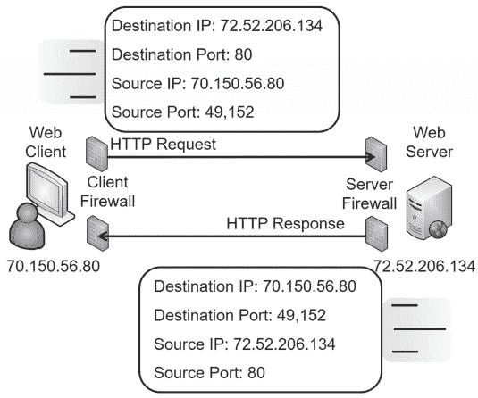

图3.3：使用源端口和目的端口

你的计算机创建一个包含源/目的IP地址以及源/目的端口的数据包。它查询`DNS`服务器获取`GetCertifiedGetAhead.com`的IP地址，并获知地址为`72.52.206.134`。此外，你的计算机将使用自己的IP地址作为源IP地址。在此例中，假设你计算机的IP地址为`70.150.56.80`。

由于Web服务器正在使用`HTTP`提供网页并使用了已知端口，因此目的端口为`80`。你的计算机将在动态和私有端口范围内（`49,152`到`65,535`之间的端口号）识别一个未使用的端口，并将该端口映射到浏览器。在此例中，假设它将`49,152`分配给浏览器。它将其作为源端口。

此时，数据包的源数据和目的数据如下：

* 目的IP地址：`72.52.206.134`（Web服务器）
* 目的端口：`80`
* 源IP地址：`70.150.56.80`（你的计算机）
* 源端口：`49,152`

`TCP/IP`使用IP地址（`72.52.206.134`）将数据包送到`GetCertifiedGetAhead` Web服务器。当它到达Web服务器时，服务器查看目的端口（`80`）并确定数据包需要发送到处理`HTTP`的Web服务器程序。Web服务器创建页面并将数据放入一个或多个返回数据包中。此时，源和目的发生了对换，因为数据包正从服务器传回给你的：

### 比较端口和协议号（侧边栏）

端口和协议号不是一回事，尽管它们经常被混淆。如前所述，已知端口标识了许多服务或协议。

然而，许多协议并不是通过端口标识，而是通过协议号标识。例如，在`IPsec`内部，协议号`50`表示数据包是`封装安全载荷 (ESP)`数据包，协议号`51`表示它是`认证头 (AH)`数据包。同样，`ICMP`的协议号为`1`，`TCP`为`6`，`UDP`为`17`。

你可以像根据端口阻止或允许流量一样，在路由器和防火墙上使用协议号来阻止或允许流量。请注意，说你可以通过开放端口`50`来允许`IPsec ESP`流量是不准确的。`IANA`将端口`50`列为“远程邮件检查协议”。然而，你可以通过允许使用协议号`50`的流量来允许`IPsec`。协议分析器可以捕获并检查IP头以确定协议号和端口，并读取任何未加密的数据。注意，你可能会看到协议号列为协议ID或协议标识符。第8章将更深入地介绍协议分析器。

再次，`TCP/IP`使用IP地址将数据包传输到目的地，此时该地是你的计算机。一旦数据包到达你的系统，它会发现端口`49,152`是目标端口。由于你的系统将此端口映射到你的网络浏览器，它会将数据包发送到网络浏览器，由其显示网页。

## 端口在安全中的重要性

路由器以及防火墙的路由组件根据IP地址、端口以及如`ICMP`或`IPsec`等协议对数据包进行过滤。由于许多协议使用已知端口，你可以通过允许或阻塞基于端口的流量来控制协议流量。

在以前的示例中，客户端防火墙必须允许端口`80`的出站流量。防火墙会自动确定用于回程流量的客户端端口，如果它们允许出站流量，它们就会允许回程流量。换句话说，因为防火墙允许了发往目标端口`80`的Web服务器的数据包，它也允许通过动态源端口`49,152`返回的网页。

请注意，为了使此功能生效，客户端防火墙不需要允许端口`80`的入站流量。Web客户端并没有托管运行`HTTP`的Web服务器，因此客户端防火墙会阻止端口`80`的入站流量。然而，过滤发往Web服务器流量的防火墙需要允许端口`80`的入站流量。

你可以将此原理应用于任何协议和端口。例如，如果你想允许`SMTP`流量，你可以在防火墙上创建一个规则，允许端口`25`的流量。修改路由器和防火墙上访问控制列表（`ACLs`）的IT专业人员通常将此称为“开放端口以允许流量”或“关闭端口以阻塞流量”。

# 理解基础网络设备

网络将计算设备连接在一起，以便用户可以共享资源，例如数据、打印机和其他设备。任何具有IP地址的设备都是主机，但你经常会看到它们被称为客户端或节点。

交换机的常见用例是连接网络内的主机。路由器的常见用例是连接多个网络以创建更大的网络。

在讨论不同的网络设备时，记住`IPv4`在处理`TCP/IP`流量时使用的主要方法非常重要：

- **单播（Unicast）**：一对一流量。一个主机使用目标IP地址向另一个主机发送流量。具有目标IP地址的主机将处理该数据包。大多数其他主机会看到数据包，但由于它不是发给它们的，它们不会处理它。
- **广播（Broadcast）**：一对多流量。一个主机使用如`255.255.255.255`等广播地址向子网上的所有其他主机发送流量。每个接收广播流量的主机都会处理它。交换机在端口之间传递广播流量，但路由器不传递广播流量。

## 交换机

交换机可以学习哪些计算机连接到每个物理端口。然后它利用这些知识在两台计算机相互通信时创建内部交换连接。

考虑图`3.4`。当交换机启动时，它除了知道自己有四个物理端口外，没有任何其他知识。想象第一条流量是Lisa的计算机与Homer的计算机之间`TCP/IP`会话的开始。

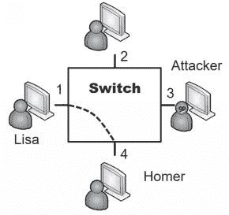

图3.4：交换机

当Lisa的计算机发送第一个数据包时，它包含了目标计算机的MAC地址。然而，由于交换机不知道Homer的计算机连接到哪个端口，它会将这第一个数据包转发到交换机上的所有端口。

该第一个数据包中包含了Lisa计算机的MAC地址。交换机将此信息记录在内部表中。然后，它将任何指向Lisa MAC地址的未来流量导向端口`1`，且仅指向端口`1`。

当Homer的计算机接收到数据包时，它会响应。回程包中嵌入了Homer计算机的MAC地址。交换机捕获Homer的MAC地址，并将其与端口`4`记录在内部表中。从现在起，Lisa和Homer计算机之间的任何单播流量都在端口`1`和`4`之间进行内部交换。交换机会在内部交换单播流量。然而，它们会将广播流量传递到所有端口。

### 交换机的安全优势

之前的大部分讨论都是基础网络知识，但你真正需要知道的是它在安全方面的重要性。如果攻击者在连接到另一个端口（如图`3.4`中的端口`3`）的计算机上安装协议分析仪，协议分析仪将无法捕捉通过交换机去其他端口的单播流量。如果Lisa和Homer在端口`1`和`4`上交换数据，没有任何流量会到达端口`3`。协议分析仪无法捕捉未到达端口的流量。

相反，如果计算机是通过简单的集线器（hub）连接的，攻击者可以捕捉它，因为单播流量会到达集线器上的所有端口。这是组织用交换机取代集线器的安全原因。交换机降低了攻击者使用协议分析仪获取数据的风险。当然，交换机也提高了网络效率。

### 端口安全

端口安全限制了连接到交换机物理端口的计算机。在最基础的层，管理员禁用未使用的端口。例如，办公室中的单个`RJ-45`墙插连接到交换机上的特定物理端口。如果墙插未被使用，管理员可以禁用交换机端口。这防止了有人将笔记本电脑或其他计算机插入墙插并连接到网络。

MAC地址过滤是端口安全的另一个示例。在简单实现中，交换机记得连接到端口的第一个或两个MAC地址。然后它会阻止使用任何其他MAC地址访问系统。你也可以手动配置每个端口，仅接受来自特定MAC地址的流量。这限制了每个端口与使用该MAC地址特定设备的连接性。这可能非常耗力，但它提供了更高水平的安全。

**记住这一点**

端口安全包括禁用未使用的端口和限制每个端口的MAC地址数量。更高级的实现是将每个物理端口限制为单个特定的MAC地址。

### 交换机的物理安全

许多交换机有一个控制端口（console port），管理员可以使用它监控所有流量。与只能看到特定发往流量的普通端口不同，监控端口将看到进出交换机的所有流量。这包括交换机在两个普通端口之间内部交换的任何单播流量。监控端口对于故障排除很有用，但如果交换机没有物理安全保护，它对攻击者也有用。

物理安全通过将交换机放在安全区域（如锁定的布线间）来保护交换机。物理安全确保攻击者无法物理接触交换机和其他网络设备。

### 回路预防

在某些情况下，网络可能会产生交换环路或桥路问题。其影响类似于广播风暴，并有效禁用交换机。例如，如果用户用线缆将交换机的两个端口连接在一起，就会创建一个交换环路，交换机通过交换机不断发送和重发单播传输。除了禁用交换机外，它还会降低整个网络的性能。

对于许多网络管理员来说，这并不复杂，因为目前大多数交换机都安装并启用了生成树协议（`STP`）或更快速生成树协议（`RSTP`）来防止环路。然而，如果禁用了这些协议，交换机就会容易环路。简单的解决方法是确保交换机包含`STP`或`RSTP`等环路保护。

生成树协议还能保护网络免受潜在攻击者的侵害。例如，想象一个攻击者访问了会议室，并可以使用`RJ-45`墙壁插座。如果没有启用环路保护，他可以用电缆将两个插座连接起来，导致网络性能下降到极其缓慢。

## 记住这一点

`STP`或`RSTP`等环路保护对于防止交换环路问题是必要的，例如当交换机的两个端口连接在一起时产生的问题。

## 洪泛攻击与洪泛防护

MAC洪泛攻击试图通过与每个物理端口关联不同的MAC地址来使交换机过载。通常情况下，任何物理端口只连接一个设备。在正常运行期间，交换机的内部表存储与该设备关联的MAC地址并映射到端口。在MAC洪泛攻击中，攻击者向同一个端口发送大量带有伪造MAC地址的流量。

在MAC洪泛攻击的某个时刻，交换机的内存耗尽无法存储所有MAC地址并进入故障开放（fail-open）状态。它不再作为交换机工作，而是作为一个简单的集线器运行。发送到交换机任何端口的流量现在会被发送到所有其他交换机端口。此时，攻击者可以在任何端口上连接协议分析仪，并收集通过交换机的所有流量。

许多交换机包含洪泛防护功能，以防止MAC洪泛攻击。启用后，交换机将限制每个端口用于存储MAC地址的内存量。例如，交换机可以将任何端口的条目数量限制为132条。这远多于正常运行所需的。如果交换机检测到尝试存储超过132条条目，它会发出警报。

洪泛防护通常会在响应警报时发送简单网络管理协议（`SNMP`）陷阱或错误消息。此外，它可以禁用端口或限制该端口的更新。通过禁用端口，它可以有效地阻塞通过该端口的所有流量，直到管理员干预。如果它限制了更新，交换机将使用当前记录的端口条目，但忽略更新尝试。所有其他端口将继续正常运行。

某些交换机支持的另一种洪泛防护是端口支持的最大MAC数量设置。大多数端口通常将此项设置为1，以仅支持单个MAC地址。然而，考虑运行在物理主机上的虚拟机（`VM`）。如果`VM`设为桥接模式，它可以使用物理主机的`NIC`访问网络，但使用的是`VM`的MAC地址。在这种情况下，`Maximum MAC`设置应设为2。

## 比较端口与端口（侧边栏）

请注意，网络设备（如交换机或路由器）使用的物理端口与之前讨论的逻辑端口完全不同。你将电缆插入物理端口。逻辑端口是嵌入在数据包中的数字，用于识别服务和协议。

这就像是“minute（60秒）”和“minute（微小的）”，或者就像关于“secure（安全）”含义的老笑话。国防部长指示不同军种的成员“确保那栋大楼”。海军人员关了灯并锁了门。陆军占领了大楼并确保无人进入。海军陆战队攻击了它、夺取了它并建立了防御以守住它。空军获得了一份为期两年的租赁并带有购买选择。

## 路由器

路由器将多个网段连接到单一网络，并在网段之间路由流量。例如，互联网实际上是一个托管了数十亿台计算机的单一网络。路由器在网段之间路由流量。


由于路由器不传递广播，它们有效地减少了任何单个网段上的流量。由路由器隔离的网段有时被称为广播域。如果一个网络的单个网段上有太多计算机，广播会导致过多的冲突并降低网络性能。将计算机移动到路由器隔离的另一个网段可以显著提高整体性能。同样，网络子网划分创建了独立的广播域。

思科路由器非常流行，但也存在其他品牌。大多数路由器是物理设备，物理路由效率最高。然而，也可以在具有多个`NIC`的计算机上添加路由软件。例如，Windows Server 产品可以通过向服务器添加附加服务充当路由器。

## 路由器与 ACL

访问控制列表（`ACLs`）是在路由器（以及防火墙）上实施的规则，用于识别哪些流量是被允许的，哪些流量是被拒绝的。ACL 内部的规则为路由器提供了基于规则的管理，并控制入站和出站流量。

路由器 ACL 提供基础的数据包过滤。它们根据 IP 地址、端口和某些协议（如`ICMP`或`IPsec`）基于协议标识符过滤数据包：

- IP 地址和网络。你可以在`ACL`中添加规则，根据 IP 地址阻止来自任何单台计算机的访问。如果你想阻止从一个子网到另一个子网的流量，可以使用规则使用子网 ID 阻止流量。例如，销售部门可能位于`192.168.1.0/24`网络，而财务部门可能位于`192.168.5.0/24`网络。你可以通过路由器上的`ACL`确保这两个部门的流量保持分离。

- 端口。你可以根据逻辑端口过滤流量。例如，如果你想阻止 HTTP 流量，可以创建一个规则来阻止端口`80`上的流量。注意，你可以选择阻止入站流量、出站流量或两者。换句话说，可以在允许出站 HTTP 流量的同时阻止入站 HTTP 流量。

- 协议号。许多协议通过其协议号识别。例如，`ICMP`使用协议号`1`，许多 DoS 攻击使用`ICMP`。你可以通过阻塞使用此协议的流量来阻止所有`ICMP`流量（以及使用它的攻击）。许多自动化入侵防御系统（`IPSs`）会根据攻击动态阻塞`ICMP`流量。同样，你可以使用允许协议号`50`但阻塞所有其他流量的规则，将流量限制为仅使用`IPsec ESP`加密的包。`PPTP`使用协议号`47`，可以通过允许使用协议 ID`47`的流量来允许它。

## 隐式拒绝

隐式拒绝（Implicit deny）是一个重要的概念，特别是在`ACLs`的背景下。它表示所有未被显式允许的流量都会被隐式拒绝。例如，想象你配置路由器允许超文本传输协议（`HTTP`）访问 Web 服务器。路由器现在定义了一个显式规则来允许此流量到达服务器。如果你不定义任何其他规则，隐式拒绝规则将阻止所有其他流量。防火墙（在本稍后讨论）也使用隐式拒绝规则。

隐式拒绝规则是`ACL`中的最后一条规则。某些设备会自动将隐式拒绝规则作为最后一条规则应用。其他设备要求管理员手动将该规则放在`ACL`的末尾。隐式拒绝规则的语法在不同系统中有所不同，但它可能是`DENY ANY ANY`或`DENY ALL ALL`，其中`ANY`和`ALL`都指代任何类型的流量。

## 反欺骗

攻击者通常使用欺骗手段来冒充或伪装他人或其他器物。在路由器的语文中，攻击者会通过将实际源 IP 地址替换为另一个地址来欺骗源 IP 地址。这通常是为了隐藏数据包的实际来源。你可以通过修改访问列表来允许或阻止 IP 地址，从而在路由器上实现反欺骗。例如，私有 IP 地址（在本章前面列出）应仅用于私有网络。任何来自互联网并使用私有 IP 地址作为源 IP 地址的流量显然都是试图欺骗源 IP 地址。路由器上将实施以下三条规则（尽管不同路由器的反欺骗语法可能不同）：

```
deny ip 10.0.0.0 0.255.255.255 any
```

```
deny ip 172.16.0.0 0.15.255.255 any
```

```
deny ip 192.168.0.0 0.0.255.255 any
```

注意，这些规则中子网掩码部分的显示方式略有不同，但这是许多路由器规则的常用语法。例如，`10.0.0.0 0.255.255.255`涵盖了`10.0.0.0`到`10.255.255.255`范围内的所有 IP 地址。

**记住这一点**

路由器和无状态防火墙（或包过滤防火墙）使用访问控制列表（ACL）执行基本过滤。ACL 识别哪些流量是被允许的，哪些是被阻止的。ACL 可以根据网络、子网、IP 地址、端口和某些协议控制流量。隐式拒绝（Implicit deny）阻止所有未显式授予的访问。路由器和防火墙将隐式拒绝作为访问控制列表的最后规则。反欺骗方法使用 ACL 规则阻止流量。

## 桥接

网络网桥将多个网络连接在一起，在某些情况下可以替代路由器。如前所述，路由器根据目的 IP 地址引导网络流量，而交换机根据目的 MAC 地址将流量引导至特定端口。同样，网桥也根据目的 MAC 地址引导流量。图 3.5 在简化的网络图中显示了所有三个设备。

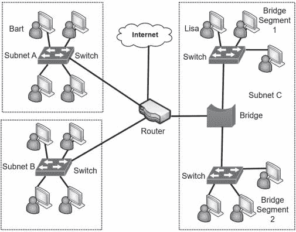

图 3.5: 带有路由器、交换机和网桥的网络

注意有三个子网（子网 A、子网 B 和子网 C）。路由器将流量引导到这些子网的每一个。子网 C 有由网桥分隔的两个段。网桥根据 MAC 地址将流量发送到子网 C 中相应的段。

网桥通常通过分析流量学习不同网桥网络中的 MAC 地址。这与交换机学习哪些 MAC 地址与每个物理端口相关。想象 Bart（在子网 A 中）向 Lisa（在子网 C 中）发送流量。当网桥接收流量时，它不知道 Lisa 的 MAC 地址是在网桥段 1 还是网桥段 2，因此它将流量发送到两个网桥网络。当 Lisa 的电脑回复时，网桥识别出她的 MAC 地址位于网桥网络 1，并将此信息存储在内部表中。当 Bart 向 Lisa 发送其他流量时，网桥仅将其转发到网桥段 1。

使用这种学习方法的硬件网桥相对容易安装。连接好线缆，开启电源，它就会开始学习。

## 聚合交换机

聚合交换机将网络中的多个交换机连接在一起。聚合（Aggregate）意味着你正在从较小的元素创建一个更大的整体。例如，回看图 3.5。如果你用交换桥替换为交换机，该交换机就是聚合交换机。

同样，你可以使用聚合交换机连接子网 A 和子网 B。子网 A 和子网 B 中的交换机连接到聚合交换机，而不是连接到路由器。聚合交换机再连接路由器。这减少了路由器使用的端口数量。

将聚合交换机放置在路由器相同的位置是常见的。例如，大型组织将网络设备位于数据中心，而小型组织将其置于布线间。两者都通过物理安全进行保护。

## 防火墙

防火墙对单个主机或网络之间的进出流量进行过滤。换句话说，防火墙可以确保只有特定类型的流量允许进入网络或主机，且只有特定类型的流量允许离开网络或主机。

网络中防火墙的作用类似于汽车中的防火墙。汽车防火墙位于发动机舱和客舱之间。如果发动机舱发生火灾，防火墙为客舱内的乘客提供了一层保护。同样，网络中的防火墙会尝试将坏流量（通常是攻击者的形式）挡在网络之外。

当然，发动机有许多运动部件，如果人在其运行时不小心伸进去，会对人造成伤害。汽车防火墙保护乘客免受接触任何运动部件。同样，网络也可以阻止用户访问管理员认为危险的地方。例如，未受过良好教育的用户可能会无意中下载损坏的文件，但许多防火墙可以阻止潜在的恶意下载。

防火墙始从“路由器和 ACL”部分描述的用于包过滤的基本路由能力开始，包括使用隐式拒绝规则。更高级的防火墙超越了简单的数据包过滤，包含了高级内容过滤。

### 基于主机的防火墙

基于主机的防火墙监控单个主机（如服务器或工作站）的进出流量。它监控通过`NIC`的流量，并防止通过`NIC`侵入计算机。许多操作系统都包含了作为基于主机防火墙的软件防火墙。例如，微软自 Windows XP 以来就在操作系统中包含了基于主机的防火墙。此外，还有许多第三方基于主机的防火墙。

图 3.6 显示了 Windows 10 上带高级安全的 Windows 防火墙。注意你可以配置入站规则来允许或限制入站流量，并配置出站规则来允许或限制出站流量。连接安全规则提供了额外功能，例如在`Tunnel`或`Transport`模式下配置`IPsec`连接以加密流量。

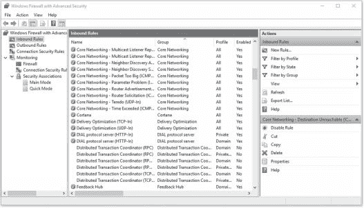

图 3.6: Windows 10 上带高级安全的 Windows 防墙

Linux 系统支持`iptables`以及`iptables`的许多扩展，如`ipv6tables`、`arptables`等。通常，管理员将这些工具统称为`xtables`。你可以在不同的表中配置规则。这些规则结合起来的工作方式就像`ACL`一样。

个人防火墙为系统免受意外入侵提供了宝贵的保护。许多组织在网络防火墙之外，还在每个系统上使用个人防火墙，作为整体深度防御策略的一部分。

在公共场所访问互联网时使用个人防火墙尤为重要。公共场所通常提供免费 Wi-Fi，如机场、酒店和许多快餐店（如星巴克和麦当劳）。然而，在未启用个人防火墙的情况下连接公共 Wi-Fi 热点是有风险的，且绝不建议这样做。

**记住这一点**

基于主机的防火墙为单个主机（如服务器或工作站）提供保护。基于主机的防火墙为主主机提供入侵防护。Linux 系统支持`xtables`的防火墙功能。基于网络的防火墙通常是专用服务器或设备，为网络提供保护。

### 基于应用的防火墙与基于网络的防火墙

基于应用程序的防火墙通常是运行在系统上的软件。例如，基于主机的防火墙通常是基于应用程序的。基于网络的防火墙通常专用系统，安装了额外的软件来监控、过滤和记录流量。例如，思科制造了多种不同的基于网络的防火墙。其中许多是安装了专有防火墙软件的专用服务器。

基于网络的防火墙具有两个或多个网络接口卡（NIC），且所有流量都通过防火墙。防火墙控制进入和出网络的流量。它通过根据防火墙规则过滤流量来实现这一点，并仅允许授权的流量通过。大多数组织会在其内网（或内部网络）与互联网之间的边界至少包含一个基于网络的防火墙。

### 无状态防火墙规则

无状态防火墙使用实现为`ACLs`的规则来识别允许和阻塞的流量。这类似于路由器使用规则的方式。防火墙使用隐式拒绝策略来阻止所有未显式允许的流量。尽管`ACLs`中的规则取决于你正在使用的硬件而有所不同，但它们通常遵循以下格式：

权限 协议 源 目的地 端口

- **权限**。你通常会看到`PERMIT`或`ALLOW`表示允许流量。大多数系统使用`DENY`来阻止流量。

- **协议**。通常你会在这里看到`TCP`或`UDP`，特别是在阻塞特定的`TCP`或`UDP`端口时。如果你想使用同一个端口同时阻塞`TCP`和`UDP`流量，可以使用`IP`。在这里使用`ICMP`会阻塞`ICMP`流量，从而有效阻止 ping 以及其他使用`ICMP`的诊断程序。

- **源**。流量来自源 IP 地址。你识别一个 IP 地址以允许或阻塞来自单台计算机或一组 IP 地址范围（例如来自单个子网）的流量。`any`或`all`等通配符包含所有 IP 地址。

- **目的地**。流量指向目的 IP 地址。你识别一个 IP 地址以允许或阻塞指向单台计算机或一组 IP 地址范围（例如指向整个子网）的流量。`any`或`all`等通配符包含所有 IP 地址。

- **端口或协议**。通常你会看到已知端口，例如用于`HTTP`的`80`端口。然而，某些设备支持如`www`这种用于`HTTP`流量的代码。某些系统支持使用如`eq`（等等于）、`lt`（小于）和`gt`（大于）等关键字。例如，它可能不是仅使用端口`80`，而是指示为`eq 80`。

某些防火墙要求在规则中包含子网掩码。例如，如果你想阻止所有到`192.168.1.0/24`网络的`SMTP`流量，将使用 IP 地址`192.168.1.0`和子网掩码`255.255.255.0`。然而，如果你只想允许指向 IP 地址为`192.168.1.20/24`的单台计算机的`SMTP`流量，将使用 IP 地址`192.168.1.20`和子网掩码`255.255.255.255`。

**记住这一点**

防火墙在`ACL`末尾使用`deny any any`、`deny any`或`drop all`语句来执行隐式拒绝策略。该语句强制防火墙阻止任何之前在`ACL`中未允许的流量。隐式拒绝策略为防火墙提供了一个安全的起点。

### 有状态与无状态

有状态防火墙检查流量并根据流量的上下文（或状态）做出决策。它跟踪已建立的会话，并根据流量在会话中的状态进行检查。它阻止不属于已建立会话的流量。例如，`TCP`会话始于三次握手。如果有状态防火墙检测到没有相应三次握手的`TCP`流量，它会认为此流量为可疑流量并进行拦截。

无状态防火墙的一个常见安全问题是`ACLs`配置错误。例如，如果`ACL`不包含隐式拒绝规则，它可能会允许几乎所有流量进入网络。

### Web 应用防火墙

Web 应用防火墙（`WAF`）是专门为保护 Web 应用设计的防火墙，Web 应用通常托管在 Web 服务器上。换句话说，它置于托管 Web 应用的服务器和客户端之间。它可以是一个独立设备，也可以是添加到另一个设备上的软件。

例如，一个组织可能会托管电子商务网站以产生收入。Web 服务器将放置在非军事化区（`DMZ`）（在本章稍后讨论）中，但由于 Web 服务器处理的数据，它需要更多的保护。成功的攻击可能会导致 Web 服务器宕，并允许攻击者访问或操纵数据。

注意，你不会用`WAF`代替基于网络的防火墙。相反，它在基于网络的防火墙之外，为 Web 应用提供了额外的保护层。

**记住这一点**

无状态防火墙使用`ACL`拦截流量。有状态防火墙根据数据包在会话中的状态来拦截流量。Web 应用防火墙为 Web 服务器提供强力保护。它们防御多种不同类型的攻击，重点关注 Web 应用攻击，并可以包含负载均衡功能。

# 实现安全网络

安全网络包含多个要素，包括不同区域和拓扑结构的实现、某些元素的划分和隔离以及使用各种网络设备。本节将深入介绍这些主题。

## 区域与拓扑结构

大多数网络都有互联网连接，但直接将网络连接到互联网是很罕见的。相反，通常使用不同的拓扑结构将网络划分为不同的区域。这里相关的术语有两个：

- **内网（Intranet）**。内网是一个内部网络。人们使用内网相互通信并共享内容。虽然内网包含 Web 服务器是很的，但这并非强制要求。

- **外网（Extranet）**。外网是网络的一部分，可以由网络外部的授权实体访问。例如，组织通常为授权的业务伙伴、客户、供应商或其他人员提供访问权限。

网络边界在内网和互联网之间提供了一个分界。

边界保护包含了多种保护网络边界的方法。

### DMZ

非军事化区（`DMZ`）是私有网络与互联网之间的缓冲区。攻击者会寻找互联网上的服务器，因此任何直接放置在互联网上的服务器风险都是最高的。然而，DMZ 为这些面向互联网的服务器提供了一层保护，同时允许客户端连接到它们。

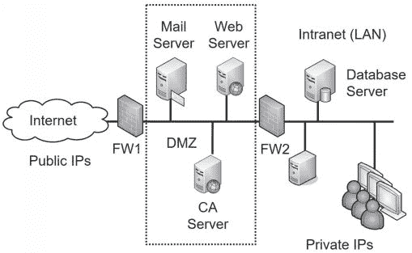

例如，图 3.7 显示了带有 DMZ 的常见网络配置。DMZ 是两个防火墙（`FW1`和`FW2`）之间的区域，并托管了多个面向互联网的服务器。许多 DMZ 有两个防火墙，在互联网和内部网络之间创建一个缓冲区，如图 3.7 所示，尽管也存在其他的 DMZ 配置。

图 3.7：带有 DMZ 的网络

在此配置中，一个防火墙将 DMZ 与互联网隔离开。第二个防火墙将 DMZ 与内部网络隔离开。每个防火墙都包含详细的规则，旨在过滤流量并保护内部网络和公共服务器。这种说法的一种方式是：`DMZ`提供了对`DMZ`中托管服务的访问，同时隔离了对内部网络的访问。

例如，`FW1`可以设置规则，以允许流量流向 DMZ 中的服务器，但阻止流向`FW2`的未授权请求流量。邮件服务器将通过`FW1`的`25`端口与互联网上的其他邮件服务器发送和接收邮件，还会通过`FW2`上的`25`端口与内部客户端收发邮件。Web 服务器通过`FW1`上的`80`和`443`端口向任何互联网用户托管网页，但`FW2`会阻止使用这些端口的入站流量。证书颁发机构（CA）服务器通过`FW1`回答来验证互联网客户端的证书。

注意图 3.7，内网包含一个数据库服务器。Web 服务器可能使用它为电子商务网站创建网页。它可以存储产品数据、客户数据等更多内容。`FW2`允许 Web 服务器（仅限 Web 服务器）与数据库服务器之间的`1433`端口流量。`FW2`会阻止所有指向数据库服务器的互联网流量。

Web 服务器和数据库服务器也可能是局外网（extranet）的一部分。例如，想象 Web 服务器托管了一个业务伙伴可以使用其进行下单的网站。Web 服务器在授予完全访问权限之前将会对他们进行身份验证。用户登录后，网站将连接到后端数据库服务器，允许他们浏览库存并下单。由于该网站仅供授权的业务伙伴使用，因此它是局外网。

`DMZ`可以托管任何面向互联网的服务器，而不仅仅图中所示的那些。其他示例包括用于上传下载文件的 FTP 服务器以及用于提供远程访问的虚拟专用网络（VPN）服务器。

**记住这一点**

`DMZ`是互联网和内部网络之间的缓冲区。它允许访问服务，同时隔离了对内部网络的访问。换句话说，互联网客户端可以访问托管在`DMZ`中服务器上的服务，但`DMZ`为内网（内部网络）提供了一层保护。

## 理解 NAT 和 PAT

网络地址转换（`NAT`）是一种将公共 IP 地址转换为私有 IP 地址并将私有地址转换回公的协议。你经常会在面向互联网的防火墙上看到`NAT`。一种常用的`NAT`形式是网络地址和端口转换，通常称为端口地址转换（`PAT`）。

如果你在家运行网络（例如无线网络），连接到互联网的路由器很可能正在运行`NAT`。`NAT`的一些优势包括：

- 不需要为所有客户端购买公共 IP 地址。家庭或公司网络可以包含多台计算机，这些计算机可以通过一台运行`NAT`的路由器访问互联网。需要更多带宽的大型公司可能会使用多个公共 IP 地址。

- `NAT`从互联网隐藏了内部计算机。具有私有 IP 地址的计算机与互联网隔离，并对互联网是隐藏的。`NAT`为这些私有计算机提供了一层保护，因为它们不容易被从互联网攻击和利用。


`NAT`的缺点之一是它与`IPsec`不兼容。你可以使用`IPsec`创建`VPN`隧道，并结合`L2TP`使用它来加密`VPN`流量。尽管有办法解决`NAT`与`IPsec`不兼容的问题，但如果你的设计包含`IPsec`经过`NAT`，你就需要仔细考虑这一点。

`NAT`可以是静态`NAT`也可以动态`NAT`：

* **静态NAT**。`Static NAT`使用一对一映射的单个公共IP地址。它将一个私有IP地址映射到单个公共IP地址。
* **动态NAT**。`Dynamic NAT`使用一对多的映射的公共IP地址。`Dynamic NAT`根据负载决定使用哪个公共IP地址。例如，如果多个用户通过一个公共IP地址连接到互联网，`NAT`将下一个请求映射到较少使用的公共IP地址。

**记住这一点**

`NAT`将公共IP地址转换为私有IP地址，并将私有IP地址转换回公共。一种常见的`NAT`形式是端口地址转换。`Dynamic NAT`使用多个公共IP地址，而静态`NAT`使用单个公共IP地址。

## 网络隔离

一种常见的网络安全实践是使用不同的组件提供网络隔离。CompTIA目标将这些列为隔离（segregation）、分段（segmentation）和隔离（isolation）。隔离提供基本的区分，分段是指将流量放在不同的分段中，而隔离表示系统是完全分开的。第一章深入涵盖了虚拟化概念，虚拟化可以用于提供逻辑隔离。例如，某些防病毒专家使用虚拟机来分析恶意软件。本节介绍了用于隔离的物理安全和逻辑安全方法。

### 物理隔离与空隙

物理隔离确保网络连接到任何其他网络。例如，考虑监控控制和数据采集（`SCADA`）系统。这些通常是位于发电厂或水处理设施等大型设施内的工业控制系统。虽然`SCADA`系统在自己的网络中运行，但确保它们与任何其他网络隔离是常见的。

这种物理隔离显著降低了`SCADA`系统的风险。如果攻击者无法从互联网到达它，那么攻击它将困难得多。然而，如果系统连接到内部网络，攻击者可能会获得内部计算机的访问，然后访问内部网络上的任何资源。

空隙（`airgap`）是物理隔离的隐喻，表示隔离系统与其他系统之间存在空气隙。从字面上说，空隙系统未连接到任何其他系统。例如，许多组织同时使用机密（红色）和非机密（黑色）网络。严格的规则确保这两个系统互不连接。某些规则要求任何来自红色网络的电缆必须与黑色网络的电缆物理分离。

### 逻辑隔离与分段

正如本章前面提到的，路由器和防火墙提供了基础的隔离和分段。路由器使用`ACLs`内的规则分段网络之间的流量。管理员使用子网划分将较大的IP地址范围划分为较小的范围。然后，他们在`ACLs`中实现规则以允许或阻塞流量。防火墙使用基本的数据包过滤规则分离网络流量，也可以使用更复杂的方法阻止不受欢迎的流量。

还可以使用虚拟局域网（`VLAN`）对逻辑组的用户或计算机之间的流量进行分段。这提供了逻辑隔离。

### 比较二层交换机与三层交换机

传统的交换机运行在开放系统互连模型（`OSI`）模型的二层。正如之前讨论的，传统交换机（二层交换机）使用数据包中的目标MAC地址来确定目标端口。此外，二层交换会将广播流量转发到交换机上的所有端口。

路由器在`OSI`模型的第3层（网络层）运行。它们根据包中的目的IP地址转发流量，并会拦截广播流量。三层交换机模拟路由器的行为，并允许网络管理员创建虚拟局域网（`VLAN`）。由于三层交换机是根据目的IP地址而非MAC地址转发流量，因此它不容易受到基于`ARP`的攻击。

### 使用VLAN隔离流量

虚拟局域网（`VLAN`）使用交换机将几台不同的计算机分到虚拟网络中。您可以根据部门、工作功能或其他任何管理需求将计算机分到一起。这提供了安全性，因为您能够隔离`VLAN`内计算机之间的流量。

通常情况下，路由器会根据物理位置将不同的计算机分到不同的子网中。路由段中的所有计算机通常位于同一个物理位置，例如大楼的特定楼层或侧翼（wing）。

然而，单台三层交换机可以创建多个`VLAN`，根据逻辑需求而非物理位置来分离计算机。此外，如果需要，管理员可以轻松重新配置交换机，以从任何`VLAN`中添加或删除计算机。

例如，一组通常在不同部门工作的用户可能开始一个需要他们处于同一子网的项目。您可以配置三层交换机将这些人员在逻辑上组合，即使这些计算机在物理上位于大楼的不同楼层或侧翼。项目结束后，您只需重新配置交换机将网络恢复到原始配置。

另一个例子是，VoIP流流量可能会消耗大量的带宽。增加使用此类语音流量的系统可用性和可靠性的方法是将它们放在专用的`VLAN`中。传输传统数据流量的其他系统可以放在单独的`VLAN`中。这会将`VLAN`内部语音流量和数据流量分离。

同样，您可以使用带有多个`VLAN`的单交换机来分离用户流量。例如，如果您想分离人力资源部门和IT部门之间的流量，可以使用带有两个`VLAN`的单台交换机。`VLAN`在逻辑上隔离两个不同部门之间的所有计算机，即使这些计算机在物理上彼此靠近。

**记住这一点**

虚拟局域网（`VLAN`）在物理网络上分离或分割流量，您可以使用一个三层交换机创建多个`VLAN`。`VLAN`可以在逻辑上将几台不同的计算机组合在一起，或在逻辑上分离计算机，而不考虑它们的物理位置。`VLAN`还用于分离流量类型，例如`VLAN`上的语音流量和独立`VLAN`上的数据流量。

### 媒体网关

媒体网关是一种将数据从一个网络使用的格式转换为另一个网络使用的格式的设备。例如，VoIP网关可以在传统电话线和基于IP的网络之间转换电话流量。这允许用户使用VoIP设备拨打和接电话，网关可以翻译流量并通过传统电话线传输通话。

## 代理服务器

许多网络使用代理服务器（或正向代理服务器）来从客户端转发服务的请求（例如`HTTP`或`HTTPS`）。它们可以通过缓存内容来提高性能，某些代理服务器还可以通过过滤内容来限制用户访问不适当的网站。代理服务器位于互联网和内部网边界的网络边缘，如图3.8所示。

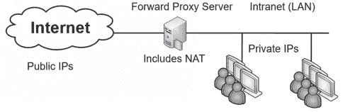

图3.8：代理服务器

管理员配置内部客户端针对特定协议使用代理服务器。代理接受它们的请求，从互联网上检索内容，然后将数据返回给客户端。大多数代理服务器仅作为`HTTP`和`HTTPS`的代理。然而，代理服务器也可以代理其他互联网协议，例如`FTP`。

### 缓存内容以提高性能

代理服务器通过缓存从互联网上收到的每个结果来提高互联网请求的性能。代理服务器缓存中的任何数据不需要再次从互联网检索以满足另一个客户端的请求。在这种背景下，缓存仅意味着“临时存储”。缓存可以是RAM的专用区域，或者在某些情况下，也可以是高性能磁盘子系统上的某个区域。

例如，如果Lisa从`GetCertifiedGetAhead.com`获取了一个网页，代理服务器会将结果存储在缓存中。如果Homer随后请求相同的页面，代理服务器将从缓存中检索页面并发送给Homer。这减少了用于网页浏览的互联网带宽，因为页面不需要再次检索。

### 透明代理与非透明代理

透明代理会在不修改请求的情况下接受并转发请求。它的设置和使用最简单，并且提供缓存功能。

相比之下，非透明代理服务器可以修改或过滤请求。组织经常使用URL过滤器通过URL限制用户访问的内容。URL过滤器检查请求的URL，并选择允许或拒绝请求。

许多第三方公司出售URL过滤的订阅列表。这些网站在互联网上搜索网站，并根据公司通常想要阻止的内容对网站进行分类。类别可能包括匿名工具、色情、赌博、基于Web的电子邮件和盗版站点（warez sites）。匿名工具是提供互联网隐私幻觉的网站。员工有时尝试使用匿名工具绕过代理服务器，但代理服务器通常会检测、阻止并记录这些尝试。基于Web的电子邮件绕过了内部电子邮件服务器的安全控制，因此许多组织都阻止了它们。盗版站点通常托管盗版软件、电影、MP3文件和黑客工具。

订阅列表可以加载到代理服务器中，每当用户尝试访问URL过滤器拦截列表上的站点时，代理就会阻止请求。通常，当用户尝试访问受限页面时，代理服务器会向用户显示警告页面。许多组织使用此页面提醒用户公司的可接受使用政策，有些组织还会提醒代理服务器正在监控他们的在线活动。

代理服务器包含记录用户访问的每个网站的日志。这些日志有助于识别频繁访问的网站并监控用户的网页浏览活动。

**记住这一点**

代理服务器从客户端转发服务的请求。它提供缓存以提高性能并减少互联网带宽消耗。透明代理服务器使用URL过滤器限制对某些网站的访问，并记录用户活动。

### 反向代理

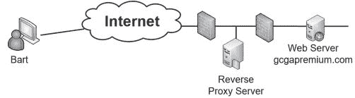 反向代理接受来自互联网的请求，通常针对单个Web服务器。它在客户端看来是一个Web服务器，但实际上正在将请求转发给Web服务器并提供Web服务器返回的页面。图3.9显示了如何配置反向代理服务器来保护Web服务器。请注意，此配置允许Web服务器位于第二个防火墙之后的私有网络中。

图3.9：反向代理服务器

想象一下Bart想要访问[`gcgapremium.com`](http://gcgapremium.com/)。他在浏览器中输入URL，浏览器随后连接到反向代理服务器。反向代理服务器连接到Web服务器并检索网页，然后将网页发送给Bart。反向代理服务器像正向代理服务器一样缓存网页，因此它可以提高网站的整体性能。

反向代理服务器可以用于单个Web服务器或由多个服务器组成的Web集。当与Web集配合使用时，它可以充当负载均衡器。你会将负载均衡器放在DMZ中以接收请求，然后使用负载均衡算法将请求转发到Web集中的不同服务器。第9章“实施保护资产的控制措施”更深入地涵盖了负载均衡。

### 应用代理

应用程序代理用于特定的应用程序。它接受请求，将请求转发到相应的服务器，然后将响应发送给原始请求者。用于`HTTP`的正向代理是一种基础应用程序代理。然而，大多数应用程序代理是多用途代理服务器，支持`HTTP`和`HTTPS`等多种协议。

举一个更高级的例子，想象你从`Amazon`购买了一本书，`Amazon`通过`United Parcel Service`（`UPS`）寄送。稍后，你检查账户查看物流状态。`Amazon`网站向`UPS`应用程序代理发送状态查询。`UPS`应用程序代理在响应中提供状态。互联网应用程序通过应用程序编程接口（`APIs`）以此方式交换数据。例如，`UPS`在`API`中指定了请求的格式。如果应用程序代理接收到格式正确且有效的请求，它就会提供答案。

### 统一威胁管理

统一威胁管理（`UTM`）是一种结合多种安全控制措施的单一解决方案。`UTM`的总体目标是提供更好的安全性，同时简化管理需求。在许多情况下，`UTM`设备可以在不牺牲安全的情况下减少管理员的工作量。

当基于IT的威胁首次出现时，安全专家创建了各种解决方案来对付每种威胁。当攻击者开始发布恶意软件以感染计算机时，供应商创建了反病毒软件。当攻击者开始攻击网络时，作为回应，安全专家开发并不断改进了防火墙。当组织意识到需要控制用户访问的网站时，它们实施了带有`URL`过滤器的代理服务器。

尽管这些解决方案是有效的，但它们也很复杂。管理员通常发现单独管理这些解决方案具有挑战性。正因如此，`UTM`安全设备变得非常流行。

`UTM`安全设备将多种安全解决方案的功能整合到单一设备中。例如，`UTM`安全设备可能包含防火墙、反病毒保护、反垃圾邮件保护、`URL`过滤和内容过滤。

通常，计算机设备（appliance）是一种旨在提供特定解决方案的硬件设备。例如，垃圾邮件设备扫描所有入站邮件并剥离垃圾邮件。“appliance”一词的目的是唤起一种简单的感觉。例如，你不需要知道烤面包机工作的细节来烤面包。同样，你不需要知道计算机设备运行的细节来使用它。

`UTM`安全设备包含多种功能，包括：

- **URL过滤**。`UTM`安全设备内部的`URL`过滤器的作用与代理服务器相同。它们根据`URL`阻止对网站的访问。通常会订阅某服务并选择类别来阻止访问某组网站。管理员也可以手动配置`URL`过滤器以允许或阻止访问特定网站。例如，如果管理员发现用户经常连接到某个点对点（`P2P`）文件共享网站，管理员可以将该`URL`添加到过滤器中并阻止对该网站的访问。

- **恶意软件检查**。恶意软件通常通过垃圾邮件或恶意网页进入网络。`UTM`设备的恶意软件检查组件筛选入站数据以检测已知恶意软件并将其拦截。组织通常会在邮件服务器和单个系统上扫描恶意软件，作为分层安全或深度防御解决方案的一部分。

- **内容检查**。内容检查包含了不同内容过滤器的组合。它监控输入的数据流并尝试阻止任何恶意内容。它可以包含垃圾邮件过滤器来检查入站邮件并拒绝垃圾邮件。它还可以阻止特定类型的传输（如流媒体音频和视频）以及特定类型的文件（如`Zip`文件）。

- **DDoS缓解器**。`DDoS`缓解器尝试检测并阻止`DDoS`攻击。这与入侵预防系统（`IPSs`）阻止攻击类似。第4章更深入地涵盖了`IPS`。

`UTM`的输出取决于设备及其看到的内容。例如，如果它检测到恶意软件，通常会发出警报并发送给管理员。

`UTM`的一个常见安全问题是内容过滤器配置错误。例如，如果垃圾邮件过滤器配置错误，它可能会拦截有效邮件或允许过多垃圾邮件进入网络。管理员会调整垃圾邮件过滤器的敏感度以满足组织的需求。例如，某个组织可能认为拦截来自客户或潜在客户的邮件是不可接受的。管理员将调整敏感度，允许更多垃圾邮件进入网络以满足这一需求。

将`UTM`设备置于网络边界，即互联网和内网（或私有网络）之间，是常见的做法。这允许它拦截并分析所有进出互联网的流量。然而，位置取决于`UTM`设备的使用方式。例如，如果它被用作代理服务器，则可以放在DMZ中。管理员会配置客户端使用`UTM`设备作为代理服务器，以确保所有相关流量通过它。

**记住这一点**

统一威胁管理（`UTM`）设备将多种安全控制整合到单一设备中。它们可以检查数据流，并通常包含`URL`过滤、恶意软件检查和内容检查组件。许多`UTM`包含`DDoS`缓解器以阻止`DDoS`攻击。

### 邮件网关

邮件网关是一种服务器，它检查所有入站和出站邮件，并尝试减少与邮件相关的风险。许多供应商销售执行邮件网关所有所需服务的设备。管理员将其位于邮件服务器和互联网之间，并根据用途对其进行配置。所有邮件在发送到邮件服务器之前都会到达网关。此外，许多供应商在`UTM`设备中包含了邮件网关。邮件网关只是`UTM`设备中的另一项安全功能。

垃圾邮件是不请求的邮件，攻击者通常利用垃圾邮件发起攻击。例如，垃圾邮件可能包含恶意软件附件，也可能包含指向恶意网站的链接。邮件网关内的垃圾邮件过滤器会从入站邮件中过滤掉垃圾邮件。通过过滤垃圾邮件，有助于阻止攻击。

邮件网关通常包含数据泄露防护（`DLP`）功能。它们检查发出的邮件以寻找机密或敏感信息并对其进行拦截。例如，想象一个组织正在进行一个代号为“DOH”的秘密项目。与该项目相关的文档都包含该关键词。邮件网关在搜索时包含此关键词，当它在邮件或附件中检测到该关键词时，它会拦截该邮件。管理员可以选择配置网关在拦截邮件时通知安全人员、发送邮件的用户或两者都通知。第5章“确保主机和数据安全”将更深入地讨论`DLP`。

许多邮件网关还支持加密。它们可以加密所有发出的邮件以确保传输中数据的机密性，或者根据策略仅加密某些数据。例如，如果一个组织正在与另一个组织合作项目，管理员可以配置网关加密发送到另一个组织的所有流量。加密方法因供应商而异。例如，某些供应商使用基于证书的加密，另一些使用基于密码的加密。第10章将更深入地讨论加密。

## 总结路由交换用例

在本章之前涵盖了几个用例。虽然它们可以独立涵盖，但在使用路由交换用例连接它们之前，对路由器和交换机的基本理解是非常重要的。本节总结了一些路由和交换主题。

以下项目符号列出了你可以使用交换机实现的一些用例：

- 防止交换环路。你通过在交换机上实现`STP`或`RSTP`来做到。
- 防止洪攻击。洪泛器阻止`MAC`洪攻击。
- 防止未经授权的用户连接到未使用的端口。端口安全方法（如禁用未使用端口）可以防止这些未经授权的连接。
- 提供增强的用户计算机分段。`VLANs`提供了增强的分段。它们实现在三层交换机上。

简单网络管理协议版本3（`SNMPv3`）监控和管理网络设备，例如路由器或交换机。这包括使用`SNMPv3`修改设备配置，或让网络设备将状态报告回中央网络管理系统。安装在设备上的`SNMPv3`代理通过称为`traps`（有时称为设备陷阱）的通知向`SNMP`管理器发送信息。

`SNMP`第一版本存在漏洞，例如在网络中以明文传输密码。`SNMPv2`和`SNMPv3`安全得多，它们提供了强大的身份验证机制。`SNMPv3`使用`UDP`端口`161`。它通过`UDP`端口`162`发送`traps`（错误消息和通知）。

以下项目列出了你可以使用路由器实现的一些用例：

- 防止IP地址欺骗。反欺骗方法防止IP地址欺骗。通过`ACLs`中的规则实现。
- 提供路由器的安全管理。使用`SNMPv3`安全地管理路由器等网络设备。

### 记住这个

管理员使用`SNMPv3`管理和监控网络设备，`SNMP`使用`UDP`端口161和162。它包含了强大的身份验证机制，比之前的版本更安全。

## 第3章考试考点回顾

在准备考试时，确保你理解本章涵盖的这些关键概念。

### 复习基础网络概念

- 用例通常描述一个组织目标，管理员启用特定协议来满足组织目标。
- 用于语音和视频的协议包括实时传输协议（`RTP`）和安全实时传输协议（`SRTP`）。`SRTP`为`RTP`提供加密、消息认证和完整性。
- 文件传输协议（`FTP`）通常用于在网络上传输文件，但`FTP`不加密传输。
- 几种加密协议对传输数据加密以保护其机密性。它们包括安全文件传输协议（`FTPS`）、安全文件传输协议（`SFTP`）、安全外壳（`SSH`）、安全套字层（`SSL`）和传输层安全（`TLS`）。


`SMTP` 使用 `TCP` 端口 25 发送邮件。`POP3` 使用 `TCP` 端口 110 接收邮件。`IMAP4` 使用 `TCP` 端口 143。安全 `POP` 在端口 995 使用 `TLS`（旧版）或在端口 110 使用 `STARTTLS`。安全 `IMAP` 在端口 993 使用 `TLS`（旧版）或在端口 143 使用 `STARTTLS`。

`HTTP` 使用端口 80 用于网络流量。`HTTPS` 加密传输中的 `HTTP` 流量并使用端口 443。

目录服务解决方案实现 `Kerberos` 作为身份验证协议。它们还使用通过 `TCP` 端口 389 的轻量级目录访问协议 (`LDAP`) 和通过 `TCP` 端口 636 的安全 LDAP (`LDAPS`)。

管理员通常使用 `SSH` 而不是 `Telnet` 连接到远程系统，因为 `SSH` 会加密连接。管理员还使用远程桌面协议 (`RDP`) 通过 `TCP` 端口 3389 连接到远程系统。

网络时间协议 (`NTP`) 提供时间同步服务。

域名系统 (`DNS`) 提供域名解析。`DNS` 区域包括用于 IPv4 地址的 `A` 记录和用于 IPv6 地址的 `AAAA` 记录。区域数据通过区域传输更新，安全区域传输有助于防止未经授权访问区域数据。`DNS` 使用 `TCP` 端口 53 进行区域传输，使用 `UDP` 端口 53 进行 DNS 客户端查询。

域名系统安全扩展 (`DNSSEC`) 为 `DNS` 响应提供验证并有助于防止 DNS 污染攻击。

用于查询 `DNS` 的两个命令行工具是 `nslookup` 和 `dig`。两者都支持 `axfr` 选项，允许它们从 `DNS` 服务器下载所有区域数据，除非该 `DNS` 服务器阻止该尝试。

## 理解基础网络设备

交换机用于网络连接并将介质访问控制 (`MAC`) 地址映射到物理端口。

端口安全限制对交换机端口的访问。它包括限制每个端口的 `MAC` 地址数量和禁用未使用端口。你还可以手动将每个端口映射到特定的 `MAC` 地址组。

聚合交换机将网络中的多个交换机连接在一起。

路由器连接网络并根据目标 IP 地址引导流量。路由器（和防火墙）使用访问控制列表 (`ACLs`) 中的规则来允许或阻止流量。

隐式拒绝表示除非显式允许，否则将被拒绝。它是 `ACL` 中的最后规则。基于主机的防火墙（有时称为基于应用程序的）过滤进出主机的流量。某些 Linux 系统使用 `iptables` 或 `xtables` 提供防火墙功能。

基于网络的防火墙过滤进出网络的流量。它们被放置在网络边界，例如位于互联网和内部网络之间。

无状态防火墙使用 `ACL` 中的规则控制网络之间的流量。`ACL` 可以根据端口、IP 地址、子网和某些协议阻止流量。有状态防火墙根据会话内数据包的状态过滤流量。

Web 应用防火墙 (`WAF`) 保护 Web 服务器免受 Web 应用攻击。它通常放置在非军事化区 (`DMZ`)，并向管理员报警可疑事件。

## 实现安全网络

`DMZ` 为从互联网访问的服务器提供一层保护。

内网是内部网络。人们使用内网相互进行通信和共享内容。外网是允许网络外部授权实体访问的网络的一部分。

`NAT` 将公网 IP 地址转换为私有 IP 地址，将私有转换为公网，并向互联网用户隐藏内部网络上的 IP 地址。

网络使用各种方法提供网络隔离、分段和划分。

`airgap`（物理隔离）是物理隔离的隐喻，表示一个系统或网络与另一个系统或网络完全隔离。

`Routers`（路由器）使用 `ACLs` 控制流量，提供逻辑分离和分段。

正向代理服务器为客户端转发服务请求。它可以缓存内容并记录用户的互联网活动。`transparent proxy`（透明代理）在不修改请求的情况下接受并转发请求。`nontransparent proxy`（非透明代理）可以修改或过滤请求，例如根据目标 `URLs`过滤流量。

`Reverse proxy servers`（反向代理服务器）接受来自互联网的流量并将其转发到多个内部 Web 服务器。`reverse proxy server` 位于 `DMZ` 中，Web 服务器可以位于内部网络。

统一威胁管理 (`UTM`) 安全设备包含多层保护，例如 `URL filters`、内容检查、恶意软件检查和分布式拒绝服务 (`DDoS`) 缓解器。`UTMs` 通常发出告警并发送给管理员进行解释。

`Mail gateways`（邮件网关）逻辑上置于电子邮件服务器和互联网之间。它们检查并分析所有流量，可以使用 `spam filter`（垃圾邮件过滤器）阻止未经许可邮件。许多设备包含数据防护 (`DLP`) 和加密功能。

## 总结路由和交换用例

`Loop protection`（环路）防止交换环问题，例如用户用电缆连接两个交换机端口时。`Spanning Tree Protocols`（生成树协议）防止交换环。

`Flood guards`（洪泛防护）防止针对交换机的 `MAC flood` 攻击。

`VLANs` 可以逻辑上隔离计算机，或无论物理位置如何对计算机进行逻辑分组。你使用 `Layer 3 switches` 创建它们。

`Routers` 使用 `ACLs` 内的规则作为反欺骗方法。`Border firewalls`（边界防火墙）拦截所有来自私有 IP 地址的流量。

`SNMPv3` 用于监控和配置网络设备，使用被称为 `traps` 的通知消息。它使用强身份验证机制，优于早期版本。`SNMP` 使用 `UDP` 端口 `161` 和 `162`。

## 在线参考

记住，在线内容包含一些额外，如实验、性能测试题示例等。访问 [`gcgapremium.com/501-extras.`](http://gcgapremium.com/501-extras) 查看。

## 第 3 章练习题

1. 贵组织的安全策略要求传输中的 `PII` 数据必须加密。以下哪些协议最能满足这一要求？

A. `FTP`

B. `SSH`

C. `SMTP`

D. `HTTP`

2. Marge 需要从网络上的设备收集配置信息和网络统计数据。她想保护连接这些设备时使用的凭据的机密性。以下哪些协议最能满足这一需求？

A. `SSH`

B. `FTPS`

C. `SNMPv3`

D. `TLS`

3. Lisa 正在 `DMZ` 内的某些服务器上启用 `NTP`。通过此操作，她最可能支持哪种用例？

A. 支持语音和视频传输

B. 提供时间同步

C. 启用邮件使用

D. 加密传输中的数据

4. 贵组织想增加网络内部使用的 `VoIP` 和视频会议应用的安全性。以下哪些协议最能支持这一目标？

A. `SMTP`

B. `TLS`

C. `SFTP`

D. `SRTP`

5. 贵组织的管理层想确保交换机不会受到交换环问题的影响。以下哪些协议是满足此需求的最佳选择？

A. `Flood guard`

B. `SNMPv3`

C. `SRTP`

D. `RSTP`

6. 网络技术人员错误地接线了贵组织网络中的交换机连接。这导致交换机失效，就像遭受了拒绝服务攻击一样。为了防止未来发生这种情况，应该怎么做？

A. 安装 `IDS`。

B. 仅使用 `Layer 2 switches`。

C. 在交换机上安装 `SNMPv3`。

D. 实现 `STP` 或 `RSTP`。

7. 开发人员最近在 `ServerA` 上配置了一个新服务。`ServerA` 位于 `DMZ` 中，供内部用户和通过互联网访问。网络管理员修改了防火墙规则以访问该服务。测试显示，从内部系统访问时服务工作正常。但从互联网访问时则无法工作。以下哪项最可能是配置错误？

A. 新服务

B. 一个 `ACL`

C. `ServerA`

D. `VLAN`

8. 你管理着一台用于网络安全的 `Linux` 计算机。你计划使用 `iptables` 检查并处理基于网络的流量。以下哪些网络设备可以替代它？

A. 无线接入点

B. `Firewall`

C. `Layer 2 switch`

D. `Bridge`

9. 你需要在 `border router`（边界路由器）上实施反欺骗。以下选项中哪一个最能满足这一目标？

A. 创建规则拦截所有源自私有 IP 地址的出站流量。

B. 在交换机上实施 `flood guard`。

C. 添加 Web 应用防火墙。

D. 创建规则拦截所有来自私有 IP 地址的入站流量。

10. 某机构最近 `DMZ` 内的服务器遭受了多次攻击。安全管理员发现，许多攻击使用了 `TCP`，但它们并没有从三次握手开始。以下哪些设备提供了最佳解决方案？

A. `Stateless firewall`

B. `Stateful firewall`

C. `Network firewall`

D. `Application-based firewall`

11. 哪种类型的设备使用以下条目定义其操作？

```
permit IP any any eq 80
permit IP any any eq 443
deny IP any any
```

A. `Firewall`

B. `Layer 2 switch`

C. `Proxy server`

D. `Web server`

12. 贵组织托管有一个 Web 服务器并想增加其安全性。你需要将所有面向 Web 的流量与内部流量分开。以下哪项提供了最佳解决方案？

A. `DMZ`

B. `VLAN`

C. `Firewall`

D. `WAF`

13. 贵组织的管理层想防止员工使用公司计算机访问社交媒体网站。你会实施哪种设备？

A. `transparent proxy`

B. `reverse proxy`

C. `nontransparent proxy`

D. `caching proxy`

14. 你需要配置一个 `UTM` 安全设备以限制访问社交媒体网站的流量。你最可能配置哪项？

A. `Content inspection`

B. `Malware inspection`

C. `URL filter`

D. `DDoS mitigator`

15. 贵组织最近购买了一台包含 `DDoS mitigator` 的高级安全设备。你应该将此设备放在哪里？

A. 位于 `DMZ` 内

B. 位于网络边界，内网和 `DMZ` 之间

C. 位于网络边界，私有网络和互联网之间

D. 位于内部网络

## 第 3 章练习题答案

1. B. 你可以使用 `SSH` 在网络传输 `PII` 数据时（传输中的数据）对其进行加密。安全文件传输协议 (`SFTP`) 使用 `SSH` 加密文件传输协议 (`FTP`) 流量。`FTP`、简单邮件传输协议 (`SMTP`) 和超文本传输协议 (`HTTP`) 在不与加密协议结合的情况下，均以明文传输数据。

2. C. 简单网络管理协议版本 3 (SNMPv3) 是一种可以监控和收集网络设备信息的安全协议。它包含强身份验证机制以保护凭据的机密性。列出的其他协议均未用于监控网络设备。安全外壳 (SSH) 提供了连接设备的安全方法，但并不监控它们。安全文件传输协议 (FTPS) 用于使用传输层安全协议 (TLS) 对传输中的大文件进行加密。`TLS` 通常用于保护传输，但不包含监控设备的方法。

3. B. 网络时间协议 (NTP) 提供时间同步服务，因此在服务器上启用 NTP 可以满足这一用例。实时传输协议 (RTP) 在 IP 网络上传输音频和视频，而安全实时传输协议 (SRTP) 为 `RTP` 提供加密、消息认证和完整性。简单邮件传输协议 (SMTP)、邮局协议 v3 (POP3) 和互联网消息访问协议版本 4 (IMAP4) 等协议用于电子邮件。加密数据与 `NTP` 提供的时间同步服务无关。

4. D. 安全实时传输协议 (SRTP) 为 IP 语音 (VoIP)、视频会议和其他流媒体应用提供加密、消息认证和完整性。其他答案均不与 `VoIP` 或视频会议直接相关。简单邮件传输协议 (SMTP) 用于传输电子邮件。传输层安全协议 (TLS) 用于加密传输中的数据，但不是流媒体的最优选择。安全文件传输协议 (SFTP) 是 `FTP` 传输的安全实现。

5. D. 快速生成树协议 (RSTP) 防止交换环路问题，应在交换机上启用以满足此需求。交换机上的洪泛防护有助于防止介质访问控制 (MAC) 攻击。简单网络管理协议版本 3 (SNMPv3) 用于管理和监控网络设备。安全实时传输协议 (SRTP) 为视频和语音数据提供加密、消息认证和完整性。

6. D. 生成树协议 (STP) 和快速生成树协议 (RSTP) 都能防止交换环路问题。接线错误导致交换机故障的情况很少见。然而，如果交换机上的两个端口相互连接，就会形成交换环路并有效禁用交换机。入侵检测系统 (IDS) 无法防止交换环路。二层交换机容易受到此问题的影响。管理员使用简单网络管理协议版本 3 (SNMPv3) 管理和监控设备，但不能防止交换环路。

7. B. 可用选项中最可能的问题是访问控制列表 (ACL) 配置错误。服务器位于非军事化区 (DMZ)，最可能的问题是边界防火墙上的 `ACL` 配置错误。当从内部客户端访问时服务运行正常，因此它不太可能是问题所在。此外，服务器对内部系统有效，说明其运行正常。没有迹象显示使用了虚拟局域网 (VLAN)。

8. B. `iptables` 包含 Linux 内核防火墙使用的设置，可用于替代防火墙。虽然可以在无线接入点上实现 `iptables`（假设它是基于 Linux 的），但 `iptables` 仍然作为防火墙，而不是无线接入点。二层交换机根据目标介质访问控制 (MAC) 地址路由流量，而 `iptables` 关注 IP 地址。网络桥接将多个网络连接在一起。

9. D. 你将创建规则来阻止来自私有 IP 地址的所有入站流量。边界路由器位于内部网络和互联网之间，任何来自互联网的带有私有 IP 地址的流量都是伪造的源 IP 地址。所有出站流量通常使用私有 IP 地址，因此你不应该阻止这些出站流量。交换机上的洪泛防护防止介质访问控制洪泛攻击，与此问题无关。Web 应用防火墙保护 Web 应用程序，与防伪装无关。

10. B. 状态检测防火墙根据数据包在会话中的状态过滤流量。它会过滤掉不是 `TCP` 三次握手的数据包。无状态防火墙根据 IP 地址、端口或协议过滤流量。虽然将网络防火墙放在非军事化区 (DMZ) 中是合适的，但网络防火墙可以是无状态防火墙或状态检测防火墙。基于应用程序的防火墙通常只保护主机，而不是网络。

11. A. 这些是防火墙访问控制列表 (ACL) 中的规则。前两条规则表示，从任何 IP 地址到任何 IP 地址、使用端口 `80` 或 `443` 的流量是被允许的。最后一条规则也称为隐式拒绝规则，位于 `ACL` 的末尾。它确保所有之前未被允许的流量都被拒绝。二层交换机不使用 `ACLs`。代理服务器不会使用 `ACL`，尽管它会分别使用端口 `80` 和 `443` 用于超文本传输协议 (HTTP) 和安全 HTTP (HTTPS)。Web 服务器不会使用 `ACL`，尽管它也会使用端口 `80` 和 `443`。

12. A. 非军事化区 (DMZ) 是私有网络和互联网之间的缓冲区，它将 Web 服务器面向的流量与内部网络隔离。你可以使用虚拟局域网 (VLAN) 根据工作功能或其他管理需求将计算机分组，但它是在内部网络上的交换机上创建的。防火墙确实为 Web 服务器提供保护，但不一定将面向 Web 的流量与内部网络隔离。Web 应用防火墙 (WAF) 防止 Web 服务器受到入站攻击，但它并不一定隔离互联网和内部流量。

13. C. 非透明代理包含根据 `URL` 过滤流量的能力是最佳选择。透明代理不修改或过滤请求。反向代理用于进入内部防火墙的流量，而不是离开网络的流量。代理服务器是缓存代理服务器，但不会阻止出站流量。

14. C. 你可能会在统一威胁管理 (UTM) 安全设备上配置统一资源定位符 (URL) 过滤器。这将根据 `URL` 阻止访问网站。内容检查和恶意软件检查侧重于检查通过 `UTM` 的数据，但它们不阻止访问。分布式拒绝服务 (DDoS) 缓解设备会尝试阻止入站 `DDoS` 攻击流量。

15. C. 分布式拒绝服务 (DDoS) 缓解设备试图阻止 `DDoS` 攻击，应放在网络边界，私有网络和互联网之间。如果网络包含非军事化区 (DMZ)，设备应放在 `DMZ` 和互联网的边界。将其放在 `DMZ` 或内部网络不能确保它能阻止入站流量。

# 第 4 章

## 网络安全

### 本章涵盖的 CompTIA Security+ 目标：

1.2 比较并对比攻击类型。

- 无线攻击（重放、IV、恶意孪生、仿冒 AP、干扰、WPS、蓝球攻击、蓝牙窃取、RFID、NFC、解除）

2.1 安装和配置硬件及软件类网络组件，以支持组织安全。

- `VPN` 集中器（远程访问 vs. 站点到站点，`IPSec` [隧道模式、传输模式、`AH`、`ESP`]，分隧道 vs. 全隧道、`TLS`、始终开启 VPN），NIPS/NIDS（基于签名、启发式/行为、异常、内联 vs. 被动式、带内 vs. 带外、规则、分析 [误报、漏报]），访问点（SSID、`MAC` 过滤、信号强度、频段选择/带宽、天线类型和放置、胖型 vs. 瘦型、控制器控制 vs. 独立）、NAC（溶解性 vs. 永久、主机健康检查、代理 vs. 无代理），`SSL/TLS` 加速器、`SSL` 解密器

2.2 给定场景，使用适当的软件工具评估组织的安全态。

- 蜜罐

2.3 给定场景，排除常见的安全问题。

- 配置不当的设备（访问点）

2.4 给定场景，分析并解释安全技术的输出。

- `HIDS/HIPS`

2.6 给定场景，实施安全协议。

- 用例（远程访问）

3.2 给定场景，实施安全网络架构概念。

- 区域/拓扑（无线、访客、蜜罐网、自形成）、隧道/`VPN`、安全设备/技术放置（传感器、收集器、VPN 集中器、`SSL` 加速器、分路器和端口镜像）、`SDN`


## 4.2 给定场景，安装并配置身份访问服务

- `TACACS+`、`CHAP`、`PAP`、`MSCHAP`、`RADIUS`

## 4.3 给定场景，实施身份访问管理控制

- 基于的认证（`IEEE 802.1x`）

## 6.3 给定场景，安装并配置无线安全设置

- 加密协议（`WPA`、`WPA2`、`CCMP`、`TKIP`），认证协议（`EAP`、`PEAP`、`EAP-FAST`、`EAP-TLS`、`EAP-TTLS`、`IEEE 802.1x`、`RADIUS` 联邦），方法（`PSK` vs. 企业级 vs. 开放、`WPS`、强制门户）

在本章中，你将学习一些高级网络安全概念。主题包括入侵检测系统（`IDS`）和入侵防御系统（`IPS`）、用于保护无线网络的方法以及虚拟专用网络（`VPN`）技术。

# 探索高级安全设备

第 3 章“探索网络技术和工具”讨论了基础网络技术和协议。本节探索许多用于保护网络的先进安全设备。

## 理解 IDS 和 IPS

入侵检测系统（`IDS`）监控网络并在系统或网络检测到可疑事件时发送警报。入侵防御系统（`IPS`）对正在进行的攻击做出反应，并防止它们到达系统和网络。

第 8 章“使用风险管理工具”更深入讨论了协议分析器（或嗅探器），但作为介绍，管理员使用它们来捕获和分析主机之间传输的网络流量。`IDS` 和 `IPS` 具有相同的能力。它们捕获流量并分析以检测潜在的攻击或异常。

`IDS` 和 `IPS` 均具有使用相似检测方法检测攻击的能力。最大的区别在于它们对攻击的响应。本节首先介绍 `IDS`，然后以一些 `IPS` 的信息结束，并对两者进行比较。然而，在你阅读本节时，值得记住 `IDS` 和 `IPS` 可以实施相同的监控和检测方法。

### HIDS

基于主机的入侵检测系统（`HIDS`）是安装在工作站或服务器等系统上的额外软件。它为单个主机提供保护，并可以检测潜在攻击和保护关键的操作系统文件。任何 `IDS` 的主要目标都是监控流量。对于 `HIDS`，这些流量通过网卡（`NIC`）。

许多基于主机的 `IDS` 已经扩展到监控系统上的应用程序活动。例如，你可以在不同的面向互联网的服务器（如 Web 服务器、邮件服务器和数据库服务器）上安装 `HIDS`。除了监控到达服务器的网络流量外，`HIDS` 还可以监控服务器。

强调的是，`HIDS` 可以帮助检测传统杀毒软件可能会漏掉的恶意软件（`malware`）。由于如此，许多组织在每个工作站上安装 `HIDS`，作为传统杀毒软件之外的额外保护层。正如服务器上的 `HIDS` 主要用于监控网络流量一样，工作站 `HIDS` 主要用于监控到达工作站的网络流量。然而，`HIDS` 还可以监控某些应用程序并保护操作系统文件等本地资源。

在其他组织中，管理员仅在感知到需要时才安装 `HIDS`。例如，如果管理员担心某个带有专有数据的服务器受攻击的风险增加，管理员可能会选择在该系统上安装 `HIDS` 作为额外保护层。

### NIDS

基于网络的入侵检测系统（`NIDS`）监控网络上的活动。管理员在路由器和防火墙等网络设备上安装 `NIDS` 传感器或收集器。这些传感器收集信息并报告到托管有 `NIDS` 控制台的中央监控服务器。

除非异常情况导致网络流量发生显著差异，否则 `NIDS` 无法检测单个系统或工作站上的异常。此外，`NIDS` 无法解密加密流量。换句话说，它只能监控和评估通过明文或非加密流量发送的流量对网络构成的威胁。

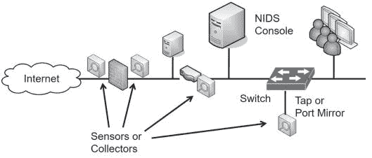

图 4.1 显示了 `NIDS` 配置的示例。在图中，传感器位于防火墙之前、防火墙之后以及路由器上。这些传感器收集并监控网络内子网的网络流量，并报告到 `NIDS` 控制台。`NIDS` 提供了整体监控和分析，并可以检测网络上的攻击。

图 4.1：NIDS 传感器

图 4.1 还显示了内部交换机上的分路器（`tap`）或端口镜像。大多数交换机支持端口镜像，允许管理员配置交换机将接收到的所有流量发送到单个端口。在配置端口镜像后，你可以将其用作分路器，将所有交换机数据发送到传感器或收集器，并转发到 `NIDS`。同样，可以在路由器上配置分路器，以捕获通过交换机的所有流量并将其发送到 `IDS`。

### 传感器和收集器的放置

在何处放置传感器取决于你想衡量什么。例如，防火墙互联网侧的传感器将看到所有流量。然而，防火墙内部的传感器只能看到通过防火墙的流量。换句话说，防火墙将过滤某些攻击，内部传感器将看不到。

如果你想看到网络上的所有攻击，请将传感器放在防火墙的外侧。如果你只想看到通过的内容，请仅在内部放置传感器。如果你两者都想要，请在两个地方都放置传感器。

**记住这一点**

`HIDS` 可以监控单个主机系统（如服务器或工作站）上的所有流量。在某些情况下，它可以检测杀毒软件漏的恶意活动。`NIDS` 安装在路由器或防火墙等网络设备上，用于监控网络流量并检测基于网络的攻击。它还可以使用分路器或端口镜像来捕获流量。`NIDS` 无法监控加密流量也无法监控单个主机上的流量。

### 检测方法

`IDS` 只能检测攻击。它不能阻止攻击。相比之下，`IPS` 通过检测攻击并在它们到达目标之前阻止它们来防止攻击。攻击是任何破坏机密性、完整性或可用性的尝试。

两种主要的检测方法是基于特征的和基于启发式或行为的（也称为基于异常的）。任何类型的 `IDS` 都可以基于特征、异常或两者两者来检测攻击。`HIDS` 监控到达其 `NIC` 的网络流量，而 `NIDS` 则监控网络上的流量。

## 基于特征的检测

基于特征的 `Ss`（也称为基于定义的）使用已知漏洞或已知攻击模式的数据库。例如，有工具可供攻击者仅通过输入要攻击系统的 IP 地址即可对服务器发起 `SYN flood` 攻击。该攻击工具会向目标系统发送大量的同步（`SYN`）数据包，但永远不会通过最后的确认（`ACK`）数据包来完成传输控制协议（`TCP`）三次握手。如果攻击未被拦截，它可能会消耗系统资源并最终导致系统崩溃。

然而，这是一种已知攻击，具有特定的从一个 IP 到另一个 IP 的连续 `SYN` 数据包模式。当特征数据库包含攻击定义时，`IDS` 就能检测到这些模式。该过程与杀毒软件检测恶意软件的方式非常相似。你需要定期从供应商处更新 `IDS` 特征和杀毒定义，以防御当前的威胁。

## 启发式/行为检测

基于启发式/行为的检测（也称为基于异常的检测）首先识别网络的正常运行或正常行为。它通过在正常运行条件下创建性能基准来实现这一点。

`IDS` 通过不断将当前网络行为与基准进行比较来提供持续监控。当 `IDS` 检测到异常活动（超出基准中确定的正常范围）时，它会发出警报，指示可能的攻击。

基于启发式的检测类似于启发式杀毒软件的工作原理。尽管内部方法不同，但两者都检查活动并检测超出基于特征检测能力范围的异常活动。

## SYN Flood 攻击（侧边栏）

`SYN flood` 攻击是一种常见的拒绝服务（`DoS`）攻击。第 3 章描述了建立会话的三次握手。提醒一下，一个系统发送 `SYN` 数据包，第二个系统用 `SYN/ACK` 数据包进行响应，第一个系统随后用 `ACK` 数据包完成握手。然而，在 `SYN flood` 攻击中，攻击者发送多个 `SYN` 数据包，但从不通过最后的 `ACK` 数据包完成 `TCP` 握手的第三部分。

这就像一个朋友伸出手和你握手，你也伸出手回应，但在最后一刻，朋友却缩回了手。虽然你或我可能会停止向这样做这种事的人伸出手，但服务器并不知道，它会继续用 `SYN/ACK` 数据包响应每个 `SYN` 数据包。

每个未完成的会话都会消耗服务器上的资源，如果 `SYN flood` 攻击持续进行，可能会导致服务器崩溃。某些服务器为连接预留特定数量的资源，一旦攻击消耗了这些资源，系统就会阻止额外的连接。攻击并不是让服务器崩溃，而是防止合法用户连接到服务器。

`IDSs` 和 `IPSs` 可以检测 `SYN flood` 攻击，且 `IPSs` 可以防止攻击。此外，许多防火墙包含 `SYN flood guard` 功能，它可以检测 `SYN flood` 攻击并采取步骤关闭开放会话。这与第 3 章中讨论的用于停止 `MAC flood` 攻击的交换机泛洪保护不同。

这对于发现零日漏洞可能是有效的。零日漏洞通常被定义为供应商未知的漏洞。但在某些情况下，管理员将零日漏洞定义为供应商尚未发布补丁的漏洞。换句话说，供应商可能知道该漏洞，但尚未编写、测试并发布补丁来修复该漏洞。

在两种情况下，漏洞都存在且系统处于不受保护状态。如果攻击者发现了这些漏洞，他们就会尝试利用它们。然而，这种攻击具有产生异常流量的潜力，允许基于异常的系统检测到它。

当管理员对系统或网络进行任何导致正常行为发生重大更改时，他们应该重新创建基准。否则，`IDS` 将对现在的正常行为不断发出警报。

## 记住这些

基于特征的检测根据已知攻击或漏洞识别问题。基于特征的检测系统可以检测已知异常。基于启发式或行为的 `IDSs`（也称为基于异常的）可以检测未知异常。它们从正常行为的性能基准开始，并将网络流量与此基准进行比较。当流量与基准差异显著时，`IDS` 会发送警报。

## 数据源与趋势

任何类型的 `IDS` 使用各种原始数据源收集活动信息。这包括许多日志，例如防火墙日志、系统日志应用程序日志。可以通过分析这些日志来提供对趋势的洞察。这些趋势可以检测出攻击模式，并为如何更好地保护网络提供洞察。

许多 `IDS` 具有实时监控日志的能力。每当系统记录一条日志时，`IDS` 都会检查该日志以确定其是否为感兴趣的项目。其他 `IDS` 则定期轮询相关日志并扫描新条目寻找感兴趣的项目。

## 基于规则的报告

`IDS` 根据 `IDS` 内配置的规则对感兴趣的事件进行报告。并非所有事件都是攻击或实际问题，相反，它们提供的报告指示某个事件可能是警报或警告。管理员进行调查以确定其是否有效。某些系统将警告（`alarm`）和警报（`alert`）视为同一物。其他系统将警告用于潜在的严重问题，将警报用于较小的问题。后者的系统的目标是鼓励管理员赋予警告高于警报的优先级。

实际的报告机制因系统和不同组织而异。例如，一个 `IDS` 可能会将事件作为警告或警报写入日志，然后向管理员帐户发送电子邮件。在大型网络操作中心（`NOC`）中，`IDS` 可能会发送警报到 NOC 内所有人员易于查看的显示器。点在于管理员根据组织需求在 `IDS` 内配置规则。

## 误报与漏报

虽然 `IDS` 使用高级分析来检查流量，但它们容易受到误报和漏报的影响。误报是对针对无威胁、良性或无害事件的警报或警告。漏报是攻击者正在积极攻击网络，但系统没有检测到。两者都不是理想的，但无法同时消除两者。大多数 `IDS` 在事件超过阈值时触发警报或警告。

考虑经典的 `SYN flood` 攻击，攻击者保留了 `TCP` 握手的第三部分。主机将发送 `SYN` 数据包，服务器将用 `SYN/ACK` 数据包响应。然而，攻击主机并没有用 `ACK` 数据包完成握手，而是从未发送 `ACK`，而是继续发送更多的 `SYN` 数据包。这导致服务器留下了开放连接，最终可能破坏服务。

如果一个系统接收到 1 个 `SYN` 包而没有伴随的 `ACK` 包，这是一种攻击吗？可能不是。这种情况在正常运行期间发生。如果一个系统在 60 秒内从单个 IP 地址接收到超过 1,000 个 `SYN` 包且没有伴随的 `ACK` 包，这是一种攻击吗？绝对是。

管理员在 `IDS` 中配置规则并将阈值设置为 1 到 1,000 之间的数字，以指示攻击。如果管理员将阈值设置得太低，会导致太多的误报，并因为花费时间追逐“幻影”而产生巨大的工作量。如果他们将阈值设置得太高，实际攻击将在管理员不知情的情况下渗透。同样地，他们还可以根据 `IDS` 的 `analytics` 分析和 `capabilities` 能力来配置许多设置。

大多数 `administrators` 都想知道他们的 `system` 是否受到攻击。这是 `IDS` 的主要目的。然而，一个不断大喊“狼来了！”的 `IDS` 在真狼来袭时会被忽略。将阈值设置为足够高以减少误报数量，同时又足够低以对任何实际攻击发出警报，是非常重要的。

阈值没有完美的数字。管理员根据网络活动水平和个人偏好在不同的网络中调整阈值。

### 记住这一点

误报（`False positive`）是在攻击未发生时错误地指示攻击正在发生。高误报率会增加管理员的工作量。漏报（`False negative`）是指攻击正在发生，但系统没有检测到并报告。管理员通常将 `IDS` 阈值设置为足够高，以最大限度地减少误报，同时足够低以防发生漏报。

## IPS VS IDS—内联与被动式

入侵防御系统（`IPSs`）是 `IDSs` 的扩展。就像你可以同时拥有 `HIDS` 和 `NIDS` 一样，你也可以拥有 `HIPS` 和 `NIPS`，但基于网络的入侵防御系统（`NIPS`）更常见。与 `IDS` 相比，`IPS` 有一些主要区别：

* `IPS` 可以检测、响应并阻止攻击。
* 相比之下，`IDS` 监控并在检测到攻击后做出响应，但它不会阻止攻击。
* `IPS` 是流量的内联（`inline`）。换句话说，所有流量都通过 `IPS`，`IPS` 可以拦截恶意流量。这有时被称为带内（`in-band`）。
* 相比之下，`IDS` 是带外（`out-of-band`）。它监控网络流量，但流量并不通过 `IDS`。这有时被称为被动式（`passive`）。

大多数 `IDSs` 只会通过发出警报做出响应。例如，`IDS` 会记录攻击并发送通知。通知可以有许多形式，包括向管理员组发送电子邮件、短信、弹出窗口或中央监视器上的通知。某些 `IDSs` 具有额外的功能，允许它们在发送通知之外还可以更改环境。

例如，`IDS` 可以修改防火墙上的访问控制列表（`ACLs`）以拦截违规流量，关闭系统中由攻击引起的进程，或将攻击重定向到安全环境，例如蜜罐（`honeypot`）或蜜罐网络（`honeynet`，在本章稍后讨论）。虽然这有时被称为主动 `IDS`，但这个短语具有误导性。

具体而言，`CompTIA Security+` 目标使用 `inline`（内联）和 `in-band`（带内）来描述 `IPS`，使用 `passive`（被动式）和 `out-of-band`（带外）来描述 `IDS`。

### 记住这一点

`IPS` 可以检测、响应并阻止攻击。它与流量内联部署（也称为带内）。`IDS` 监控并响应攻击。它不是内联的，而是被动地收集数据（也称为带外）。

正如本节引言中所提醒的，`IDSs` 和 `IPSs` 都具有协议分析器功能。这允许它们监控数据流以寻找恶意行为。`IPS` 可以检查这些数据流中的数据包并在其进入网络之前拦截恶意包。

相比之下，`NIDS` 拥有监控和报告流量的传感器或数据收集器。主动 `NIDS` 可以采取措施阻止攻击，但仅在攻击开始之后。`IPS` 的内联配置允许 `IPS` 防止攻击到达内部网络。

例如，图 4.2 显示了两个基于网络的入侵防御系统（`NIPS 1` 和 `NIPS 2`）的位置。所有互联网流量都通过 `NIPS 1`，这使其有机会检查入站流量。`NIPS 1` 通过检测恶意流量并防止攻击到达内部网络来保护内部网络。

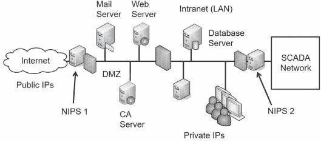

图 4.2：用于检测和防止攻击的 NIPS

`NIPS 2` 正在保护一个内部私网。例如，假设 Homer 需要管理核电站监控控制数据采集（`SCADA`）网络内的某些设备。`SCADA` 设备位于私网。`NIPS 2` 旁的防火墙可以允许来自 Homer 计算机进入流量，但阻止所有其他流量。`NIPS 2` 将检查所有入站流量并拦截恶意流量。

这似乎可能多此举，但许多高级持续性威胁（`APTs`）已经通过钓鱼或恶意软件攻击成功地将远程访问木马（`RATs`）安装到内部系统中。一旦安装了 `RAT`，攻击者就可以从内部攻击。如果攻击者从 Homer 的系统对私网发起攻击，防火墙将不会拦截。然而，`NIPS` 将防止这种攻击到达私网。

注意，每个 `IPS` 都放置在受保护网络的边缘。`NIPS 1` 位于互联网与非军事区（`DMZ`）之间网络的边缘。`NIPS 2` 位于 `SCADA` 网络与内网之间的边缘。这种部署确保了 `NIPS` 可以检查所有进入网络的流量。

### 记住这一点

入侵防御系统（`IPS`）是一种预防性控制。它与流量内联部署。`IPS` 可以主动监控数据流、检测恶意内容并停止正在进行的攻击。它也可以用于内部以保护私网。

## SSL/TLS 加速器

`SSL/TLS accelerators` 指的是专注于处理传输层安全（`TLS`）流量的硬件设备。如本书之前提到的，`TLS` 是安全套层（`SSL`）的指定替代方案，但许多人对 `SSL` 术语熟悉，因此即使使用的协议是 `TLS`，你仍会看到它。

`TLS` 为许多不同的协议提供加密，包括安全超文本传输协议（`HTTPS`）。`HTTPS` 使用证书和异步加密，两者在第 10 章“理解密码和 PKI”中有更深入的描述。建立 `HTTPS` 会话、协商客户端和服务器支持的最佳安全性、共享加密密钥以及加密会话数据都需要大量的时间和资源。通过将这些任务卸给另一个硬件设备，可以释放主计算机的资源，如 `CPU` 功率和 `RAM`。

使用 `SSL accelerator` 时，最好将其尽可能地靠近相关设备。例如，如果你正在使用 `SSL accelerator` 为 Web 服务器卸载 `HTTPS` 会话，请将 `SSL accelerator` 放置在 Web 服务器附近。

## SSL 解密器

某些组织使用 `SSL decryptors` 来应对许多威胁。例如，攻击者经常使用加密来防止检测方法检测到进入网络的恶意软件。

例如，想象 Homer 无意中访问了一个恶意网站。该网站建立了一个安全的 `HTTPS` 连接，然后将恶意软件下载到 Homer 的电脑上。由于该网站使用了 `HTTPS`，恶意软件在传输过程中是加密的。即使一个机构拥有最好的内容检查方法和恶意软件检测软件，也无法在恶意软件加密状态下检测到它。

`SSL` 解密器可以解决这个问题。你可以将其放置在 `DMZ` 中，并将所有进出互联网的流量都重定向到它通过。未加密的数据将通过该设备而不进行任何修改。然而，任何建立加密会话的尝试都会触发 `SSL` 解密器创建一个独立的 `SSL`（或 `TLS`）会话。


当 Homer 无意中访问恶意网站时，流量会通过 `SSL` 解密器。`SSL` 解密器在它自己与 Homer 电脑之间建立一个 `HTTPS` 会话，同时在它与网站之间建立一个 `HTTPS` 会话。所有传输中的数据都是加密的。然而，`SSL` 解密器可以查看未加密的数据并对其进行检查。

`SSL` 解密器通常与 `NIPS` 一起使用。`NIPS` 是内联的，但如果流量是加密的，恶意流量就可以。`SSL` 解密器允许 `NIPS` 检查未加密的流量并防止攻击。

# SDN

软件定义网络（`SDN`）使用虚拟化技术来路由流量，而不是使用硬件路由器和交换机。具体来说，`SDN` 分离了网络内部的数据平面和控制平面。另一种思考方式是，`SDN` 分离了用于转发或阻塞流量的逻辑（数据平面）和用于识别路径的逻辑（控制平面）。

硬件路由器使用 `ACL` 内的规则来识别路由器将转发还是阻塞数据平面上的流量。这始终是专有的，因为它们实现在特定的硬件路由器上。然而，`SDN` 使用软件和虚拟化技术实现数据平面，允许机构摆脱专有硬件。

如开放最短路径优先（`OSPF`）和边界网关协议（`BGP`）等路由协议帮助路由器在控制平面上确定路由流量的最佳路径。路由器使用这些协议相互之间共享信息，创建已知网络的映射。`SDN` 仍然可以使用这些路由协议，但不再需要硬件路由器。

第 2 章“理解身份和访问管理”讨论了基于属性的访问控制（`ABAC`），它通常用于 `SDNs`。`ABAC` 模型不再使用 `ACL` 内的规则，允许管理员创建数据平面策略来路由流量。这些策略的一个巨大优势是，它们通常使用纯语言语句，而不是 `ACL` 中复杂的规则。

# 蜜罐

蜜罐（`honeypot`）是一个看起来很甜的服务器——至少对攻击者来说应该是甜的，就像蜂蜜对熊看起来很甜一样。它是一个开放或看起来锁定粗糙的服务器，允许攻击者相对容易地访问。其意图让服务器看起来像是一个容易攻击的目标，以便攻击者浪费时间在蜜罐中而不是现有网络中。简而言之，蜜罐将攻击者从现有网络引开。

例如，蜜罐可以设计成像真实 Web 服务器的 Web 服务器。它会有虚假的数据，例如包含伪造信用卡交易数据的文件和文件夹。如果一个机构怀疑有恶意内部人员问题，它可以创建一个带有有关专有项目虚假信息的内部蜜罐。

蜜罐通常只有极少的保护，攻击者可以轻易绕过。如果管理员不使用任何安全措施，蜜罐对经验丰富的攻击者来说可能看起来可疑，他们可能直接避开它。

安全人员经常将蜜罐作为工具收集有关攻击者的情报。攻击者不断修改其方法以利用不同类型的攻击。一些复杂的攻击者在补丁发布之前就发现了漏洞（也称为零日利用或零日漏洞）。在某些情况下，安全专业人员观察到攻击者针对蜜罐发动零日漏洞攻击。

蜜罐永远不会持有对组织有价值的数据。这些数据对攻击者可能看起来是有价值的，但泄露它是无害的。蜜罐有两个主要目标：

- 将攻击者从现有网络引开。如果攻击者在蜜罐中花费时间，他就没有攻击现有资源。
- 允许观察攻击者。当攻击者在蜜罐中时，安全专业人员可以观察攻击并从攻击者的方法中学。蜜罐还可以帮助安全专业人员了解零日利用或未知的攻击。

# 蜜罐网

蜜罐网（`honeynet`）是独立网络或区域内的一组蜜罐，但可以从机构的主网络访问。安全人员通常使用包含在一个物理服务器内的多个虚拟服务器来创建蜜罐网。该网络内的服务器是蜜罐，蜜罐网模拟了现有网络的功能。

例如，你可以使用一个具有大量 `RAM` 和处理能力的单一强大服务器。这台服务器可以托管多个虚拟服务器，每个虚拟服务器运行一个操作系统和应用程序。托管六个虚拟服务器的物理服务器在子网上将显示为七个系统。从内部观察的攻击者将无法轻易判断服务器是物理的还是虚拟的。

这个虚拟网络的目的是吸引攻击者的注意力，就像单个蜜罐试图吸引攻击者的注意力一样。如果攻击者在蜜罐网中，现有网络就不会受到攻击，管理员可以观察攻击者的行为。

孙子在《兵法》中著名地写道：“兵者，诡诡者也”，以及“知己知彼”。网络战每天都在发生，网络和系统攻击前线的安全专业人员意识到，这些攻击在许多方面模拟了战争。蜜罐和蜜罐网为这些专业人员提供了在这场战争中使用一些额外工具。

### 记住这一点

蜜罐和蜜罐网试图将攻击者从现有网络引开。它们为安全人员提供了一个观察攻击中所使用的当前方法并收集这些攻击情报的机会。

# IEEE 802.1x 安全

第 3 章通过禁用未用端口或使用 `MAC` 地址过滤来讨论端口安全。另一种端口安全方法是使用 `IEEE 802.1x`，这是一种基于端口的验证协议。它要求用户或设备在连接到特定的无线访问点或特定的物理端口时进行身份验证，它可以实现在无线和有线网络中。

它保护了客户端访问网络之前的验证过程，并在客户端无法通过验证时阻止网络访问。`802.1x` 可以使用简单的用户名密码进行验证，或使用证书进行基于证书的验证。

`802.1x` 服务器防止恶意设备连接到网络。考虑开放的 `RJ-45` 墙插。虽然禁用它们是良好的端口安全实践，但你也可以配置 `802.1x` 服务器对这些端口进行身份验证。如果客户端无法通过验证，`802.1x` 服务器将阻止或限制对网络的访问。

可以将 `802.1x` 服务器与其他网络元素（如虚拟局域网 `VLAN`）结合起来。例如，想象你想为访客提供互联网访问权限，但防止他们访问内部网络资源。你可以配置 `802.1x` 服务器，为授权的客户端授予完全访问权限，但通过 `VLAN` 将未授权的客户端重定向到网络的访客区域。

正如本章稍后讨论的，你可以将 `802.1x` 实现为远程拨号用户服务（`RADIUS`）或 `Diameter` 服务器。这有助于在虚拟专用网络（`VPN`）客户端连接之前对其进行身份验证。你还可以在无线网络中实现 `802.1x`，以强制无线客户端在连接之前进行身份验证。

> **记住这一点**
>
> `802.1x` 服务器提供基于端口的认证，确保只有授权的客户端才能连接到网络。它防止了非法设备接入。

# 无线网络安全

无线局域网（`WLANs`）近年来在家庭和商业网络中变得非常流行。无线网络易于设置，可以在不需要布线的情况下快速连接几台计算机，这显著降低了成本。

无线网络面临的主要挑战是安全性。多年来无线安全性得到了改进，但无线网络仍然容易受到漏洞的影响，许多用户并不理解如何充分锁定无线网络。

## 复习无线基础

在深入研究无线安全之前，你需要了解一些与无线设备和网络相关的基本概念。如果你最近通过了 `CompTIA Network+` 考试，这些主题对你可能非常熟悉，但仍然值得查看一下，以确保你从 `CompTIA Security+` 考试的角度理解了它们。

无线接入点（`AP`）将无线客户端连接到有线网络。然而，许多 `APs` 也具有路由功能。供应商通常将具有路由功能的 `APs` 营销为无线路由器，这就是你通常看到它们广告的方式。其区别在于：

- 所有的无线路由器都是 `APs`。这些带有额外功能——路由的 `APs`。
- 并不是所有的 `APs` 都是无线路由器。许多 `APs` 没有任何额外功能。它们为无线客户端连接到有线网络提供连接，但没有路由功能。

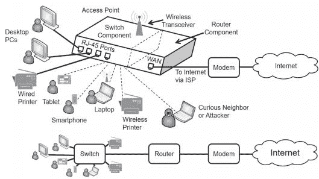

图 4.3 显示了为多个系统提供连接的无线路由器的图。请注意，无线路由器既有交换机组件也有路由器组件，图 4.3 底部的图显示了网络的逻辑配置。设备连接到交换机组件，路由器组件根据互联网服务提供商（`ISP`）的要求通过宽带调制解调器或类似设备提供到互联网的连接。

图 4.3：具有路由功能的接入点（无线路由器）

大多数 `APs` 包含用于有线访问的物理端口（图中标记为“RJ-45 Ports”）和用于无线客户端的无线收发器。换句话说，某些用户可以使用普通的双绞线连接，而另一些用户可以使用无线传输进行连接。有线端口和无线连接都通过无线路由器的交换机组件连接。许多供应商将互联网连接标记为用于广域的 `WAN`，但某些供应商将此端口标记为“Internet”。

当如图 4.3 所示使用时，`AP` 还包含额外的服务和功能，例如路由、网络地址翻译（`NAT`）、动态主机配置协议（`DHCP`）等。这些额外的服务缩短了 `WLAN` 所需设置时间。

由于无线网络在已知的频段上广播，其他无线用户通常可以看到它们。这包括授权用户、好奇的邻居和攻击者。

### 胖接入点与瘦接入点

胖 `AP`（也称为独立、智能或自主 `AP`）包含了将无线客户端连接到无线网络所需的所有内容。它通常包括诸如路由组件、`NAT`、`DHCP`、无线安全选项、访问控制列表（`ACL`）等功能。如果你在家里或小型办公室网络中运行无线网络，你可能正在使用胖接入点。胖 `APs` 必须相互单独配置，如果你只配置一个 `AP`，这并不是什么问题。

考虑一个在组织中散布了十几个 `APs` 的网络。如果这些都是胖 `APs`，管理员需要单独配置每一个，这效率非常低。这时瘦 `AP` 出场了。瘦 `AP` 是基于控制器的 `AP`，这意味着它不是独立的 `AP`，而是由控制器管理的 `AP`。管理员使用无线控制器来配置和管理基于瘦的 `APs`。这通过将其整合在一个地方简化了管理工作。

瘦 `APs` 也正在进入小型办公室和家庭网络。例如，`NETGEAR` 的 `Orbi` 无线路由器包含一个胖 `AP` 和一个或多个瘦卫星 `APs`。你配置单个 `AP`，然后它会配置卫星 `APs`。

> **记住这一点**
>
> 胖 `AP` 也称为独立 `AP`，并被独立管理。瘦 `AP` 也称为基于控制器的 `AP`，由无线控制器管理。无线控制器配置瘦 `AP`。

### 频段选择与通道带宽

无线网络使用两个主要的射电频段：2.4 GHz 和 5 GHz。然而，无线设备传输并非恰好地在 2.4 GHz 或 5 GHz 上。相反，这两个频段有多个从大约 2.4 GHz 和 5 GHz 开始的信道。并没有一个适用于所有国家的单一标准，因此你会发现每个频段内的信道数量因国家而异。

电气与电子工程师学会（`IEEE`）定义了许多标准，包括 `IEEE 802.11` 无线网络协议组。表 4.1 显示了一些常见的无线标准以及它们支持的频段（或频段）。它还显示了每个标准支持的信道带宽。然而，信道带宽具有某种误导性。例如，`802.11n` 支持 20 MHz 和 40 MHz 的信道带宽。然而，40 MHz 信道是两个组合的 20 MHz 信道。

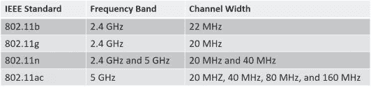

表 4.1：常见的无线标准、频率和信道带宽

理论上，更宽的信道允许你通过信道传输更多数据。遗憾的是有两个挑战。首先，当你增加信道带宽时，你会减少无线电传输的距离。在特定距离处通过 20 MHz 信道连接的设备可能无法在相同位置以 40 MHz 连接。其次，增加了干扰的可能性。更宽的信道更容易与其他无线设备重叠，这种干扰会影响整体性能。

这些挑战在 2.4 GHz 频段更为普遍，因为在该频段内有更多技术在运行。例如，蓝牙设备、微波炉和无线电话都在该范围内工作。此外，2.4 GHz 范围内只有三个互不重叠的信道。`APs` 通常允许你选择频段（2.4 GHz 和/或 5 GHz）。此外，大多数 `APs` 允许你手动选择信道或允许 `AP` 选取最佳信道。“PSK、企业和开放模式”部分（位于本章稍后部分）显示了带有此类选择的 `AP` 截图。

### 接入点 SSID

无线网络通过服务集标识符（`SSID`）进行识别，它就是无线网络的名称。某些 `APs` 仍然带有默认的 `SSIDs`，尽管大多数厂商已经放弃了这种做法。例如，某些旧版 `Linksys APs` 的默认 `SSID` 是“Linksys”。一些较新的 `APs` 在你首次安装时会强制你输入一个 `SSID` 名称，且不包含默认值。从深度防御的角度来看，如果使用了默认 `SSID`，那么更改其名称是一个好主意。这只是能让攻击者获得更少的信息。

例如，如果攻击者看到一个 `SSID` 为 `Linksys` 的无线网络，攻击者就能判断出该网络正在使用 `Linksys AP`。如果攻击者知道该 `AP` 的特定漏洞，他就可以开始利用这些漏洞。相反，一个 `SSID` 为“Success”的 `AP` 则不会给攻击者提供关于该 `AP` 的线索。

## 是否禁用 SSID 广播

`802.11` 无线网络的目标之一是易于使用。设计者希望无线计算机能够轻松找到彼此并协同工作。他们在这一目标上成功了。遗憾的是，攻击者也可以轻松找到你的网络。默认情况下，`APs` 以明文广播 `SSID`，这使得定位无线网络变得简单。

多年前，曾有人声称 `SSID` 是一个密码（并非如此！），许多信息技术（`IT`）专业人员抓住了这一点，认为可以通过禁用 `SSID` 广播来增加安全性。其他人则认为 `SSID` 与安全性无关，禁用广播只会降低可用性而不会增加安全性。

作为背景，`APs` 必须定期发送信标帧以确保与无线网络与其他设备的互操作性。该信标帧包含了 `SSID`，如果禁用了广播，则 `SSID` 项将为空。然而，即使禁用了 `SSID` 广播，`AP` 也会在响应授权无线客户端的 `Probe requests` 时，在发送的 `Probe responses` 中包含 `SSID`。因此，拥有无线协议分析仪的攻击者可以很容易监听 `Probe responses` 并检测到 `SSID`。

换句话说，禁用 `SSID` 让攻击者找到你的网络变得稍微困难了一点，但并不多。这就像是锁了家的大门，却把钥匙留在了锁里。

Steve Riley 在一篇名为“神话与现实：无线 SSIDs”的安全博客中写道，为了安全而禁用 `SSID` “是一个需要被强行拖到林后小屋，勒死直到它发出最后一次艰难的呼吸，然后为了保险起见再射几枪的神话”。如果还不清楚，Riley 先生属于认为你不应该为了安全而禁用 `SSID` 的阵营。在此声明，我同意同。

对于 `CompTIA Security+` 考试，你应该知道禁用 `SSID` 广播并向普通用户隐藏网络是可能的。然而，拥有无线协议分析仪的攻击者即使在禁用了 `SSID` 广播的情况下也能轻松地发现 `SSID`。

### 记住这一点

服务集标识符（`SSID`）标识无线网络的名称。你应该将 `SSID` 从默认名称更改。禁用 `SSID` 广播可以向普通用户隐藏网络，但攻击者可以使用无线嗅探器轻松地发现它。

## 启用 MAC 过滤

启用媒体访问控制（`MAC`）过滤为无线网络提供了一种微小的安全保障。提醒你一下网络学习知识，`MAC` 地址（也称为物理地址或硬件地址）是用于识别网络接口卡（`NICs`）的 48 位地址。你通常会看到 `MAC` 地址显示为六对十六进制字符，例如 `00-16-EA-DD-A6-60`。每个 `NIC`（包括无线 `NIC`）都有一个 `MAC` 地址。

`MAC` 过滤是网络访问控制的一种。它与交换机上的端口安全（在第 3 章介绍）配合使用，你可以用它来限制对无线网络的访问。

例如，图 4.4 显示了 `NETGEAR Orbi AP` 上的 `MAC` 过滤器。在图中，你可以看到系统设置为“允许下列出的 PC 访问无线网络”。`MAC Address` 列显示了允许设备的 `MAC` 地址。`Status` 列显示这些设备中的每个都被设置为“Allows（允许）”，授予它们访问权限。“阻止所有新设备连接”设置防止了任何其他设备的连接。你还可以选择任何设备的复选框，并点击“Block（阻止）”将其状态更改为“Blocked（已阻止）”。

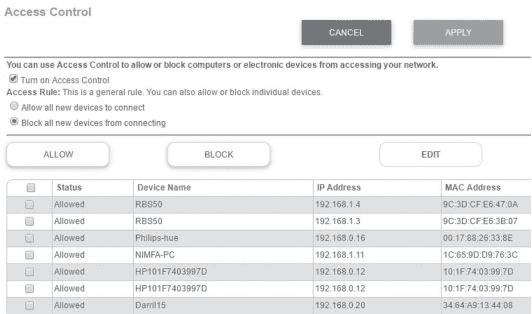

图 4.4：`AP` 上的 `MAC` 过滤器

理论上，`MAC` 地址是唯一的。图 4.4 中的 `MAC` 过滤器限制只有具有这些 `MAC` 地址的设备。这听起来可能安全，但拥有无线嗅探仪的攻击者可以很容易识别无线网络中允许的 `MAC` 地址。此外，更改 `MAC` 地址非常容易。攻击者可以通过更改其笔记本电脑上的 `MAC` 地址来发起欺骗攻击，从而装成允许的 `MAC` 地址之一。

许多操作系统都内置了更改 `NIC` 的 `MAC` 地址的功能。例如，在 `Windows 10` 中，你可以从“设备管理器”访问 `NIC` 的属性，点击“高级”选项卡，并使用新的 `MAC` 配置“网络地址”设置。

### 记住这一点

`MAC` 过滤可以限制特定客户端对无线网络的访问。然而，攻击者可以使用嗅探器发现允许的 `MAC` 地址并绕过这种形式的网络访问控制。对于攻击者来说，伪造 `MAC` 地址相对简单。

## 天线类型与放置

在 `APs` 和无线设备上最常用的无线天线是全向（或 `omni`）天线。全向天线同时向所有方向传输和接收信号。这允许无线设备从任何方向连接到 `AP`。另一种类型的天线是定向天线。定向天线向单一方向传输并从相同方向接收信号。由于天线的功率集中在一个方向上，定向天线比全向天线具有更大的增益，并且可以在更远的距离传输和接收信号。定向天线还具有非常窄的辐射模式，将信号聚焦在特定区域。

在考虑天线放置时，你还应该配置天线的方向。许多 `APs` 具有可调节的天线。你应该将它们垂直放置并直向上吗？还是，你应该将它们水平放置并平行地面直出？这取决于情况。当你的 `AP` 天线方向与无线设备使用的方向匹配时，接收效果达到最大。然而，你会发现天线方向在所有设备中并不一致。有些设备水平放置，有些则垂直放置。如果你的 `AP` 有两根天线，一些专家建议将一个水平放置，另一个垂直放置。

管理员在规划和部署无线网络时通常会进行场地调查。现场调查检查无线环境以识别潜在问题，例如存在噪声或其他在相同频段上运行其他设备的区域。管理员和安全人员定期重复现场调查，以验证环境没有发生变化并检测潜在的安全问题。

执行现场调查的一种方法是配置一个 `AP` 并将其天线放在组织内部。管理员随后从不同区域测量 `AP` 的功率水平，以确定其是否提供了所需的覆盖范围。如果 `AP` 未提供足够的覆盖，管理员可能会尝试修改 `AP` 的位置和/或天线的位置，或者添加额外的 `APs`。

### 天线功率与信号强度

你无法在不改变物理属性的情况下修改线的增益。然而，许多无线接入点包含一个功率设置，你可以通过该设置来增加或减少发射功率。管理员有时降低功率水平以限制对会议室等小区域的访问，或者防止无线用户从停车场或建筑外的地方连接。同样，管理员有时会增加功率水平以扩大 `AP` 的范围。


图 4.5 显示了两个建筑中的几个`APs`。`AP` 1 到 6 周围的虚线显示了它们的范围。它们都使用全向天线。`AP` 4 的圆比其他的大，表示该`AP`的功率水平最高。标记为 A 和 B 的两个`APs`使用的是定向天线。组织有时使用这种配置来连接两栋楼之间的网络。

图 4.5：全向和定向`APs`

**记住这一点**

你可以通过降低`AP`的功率水平将`AP`的范围限制在一个房间或建筑内。这可以防止人们连接，因为他们将超出`AP`的范围。

## 网络架构区域

第 3 章介绍了网络内部使用的几种区域和拓扑。这些通常根据用途对网络进行隔离。一些额外的区域和拓扑包括：

* **无线**：许多组织为员工和客人提供无线网络。员工无线网络提供了到有线网络的桥梁，允许员工访问所有网络资源，就像他们在桌旁通过有线 PC 连接一样。

* **访**：游客网络通常是用于为客人提供 Internet 服务的无线网络。游客网络很少让客人访问网络资源，而是为他们提供一种检查电子邮件或访问网站的简单。

* **自持 (Ad hoc)**：在自持模式下，无线设备在没有`AP`的情况下相互连接。例如，如果你和另一个用户都有无线笔记本电脑，你可以创建一个 ad hoc 无线网络来连接你的两台电脑。Ad hoc 是拉丁语，意为“根据需要”，这是理解 ad hoc 无线网络的一种良好方式。你根据需要创建它。相比之下，当你通过`AP`连接到无线网络时，你正在使用基础设施模式。

## 无线加密协议

由于无线网络通过空气广播，任何拥有无线收发器的人都可以拦截传输。你可以通过几个不同的步骤保护无线网络的安全，但最重要的步骤是实施强安全协议，例如 Wi-Fi 安全访问 II（`WPA2`）。接下来的章节描述了无线网络提供的主要安全协议。

### WPA

Wi-Fi 安全访问（`WPA`）是有线等加密（`WEP`）的过渡期替代品。`WEP`存在已知漏洞，不应被使用。`WPA`为`WEP`的缺陷提供了即时解决方案，而无需用户升级硬件。即使在`WPA`替换`WEP`时，其开发者也意识到`WPA`不够稳固，无法长期维持。相反，`WPA`通过为用户提供现有硬件的`WEP`替代方案，改进了无线安全性，同时开发人员致力于创建更强大的`WPA2`协议。

`WPA`容易受到密码破解攻击，特别是当`AP`具有弱口令时。攻击者使用无线协议分析器捕获身份验证流量，然后使用离线暴力破解发现口令。攻击者经常使用取消攻击（在本章稍后部分讨论）强制用户重新进行身份验证。

### WPA2

Wi-Fi 安全访问 II（`WPA2`）是`WPA`的永久替代品。`WPA2`（也称为`IEEE 802.11i`）使用比`WPA`更强的加密。Wi-Fi 联盟要求所有带有 WI-FI CERTIFIED 标志的设备都要符合`WPA2`标准，包括使用密码块消息认证码计数模式（`CCMP`）。

尽管`WPA2`比之前的无线加密技术提供了显著的安全改进，但某些企业需要更高的安全性。你可以采取的另一个步骤是启用企业模式身份验证，本文章稍后部分描述。

### TKIP 与 CCMP

临时密钥完整性协议（`TKIP`）是用于`WPA`的较旧加密协议，而`CCMP`是用于`WPA2`的较新加密协议。由于各种安全问题，`IEEE`已废弃了`WPA`和`TKIP`，但许多无线网络仍在使用这些旧协议。`IEEE`建议使用带有`CCMP`的`WPA2`，因为它提供了更高的安全性。

`TKIP`的一个优点是它不需要新硬件。`WEP`用户可以升级软件和/固件并实施带有`TKIP`的`WPA`，无需更换硬件。新的硬件支持`WPA2`，因此`WPA`和`TKIP`的使用正在减少。然而，你可能仍然看到在使用`WPA`和`TKIP`的旧硬件。

`WPA`的后期实现支持高级加密标准（`AES`）而非`TKIP`。第 10 章深入介绍了`AES`，但简而言之，它是一种非常强大且高效的加密算法。`WPA`/`WPA2`之外许多应用程序使用`AES`提供安全加密并确保机密性。有些人成功破解了带有`TKIP`的`WPA`，因此只要可能，最好将`WPA`升级到`WPA2`，或至少将`TKIP`升级为使用`AES`。

`WPA2`支持`CCMP`，它基于`AES`并比使用`TKIP`的`WPA`强得多。`WPA2`还采用比`WPA`安全得多的密钥管理方法。

**记住这一点**

`WPA`为`WEP`提供了即时替代品，最初使用`TKIP`，它与旧硬件兼容。后期实现支持更强的`AES`加密算法。`WPA2`是`WEP`和`WPA`的永久替代品。`WPA2`支持`CCMP`（基于`AES`），它比旧的`TKIP`协议强得多，`CCMP`应替代`TKIP`。

### PSK、企业模式和开放模式

`WPA`和`WPA2`可以在预共享密钥（`PSK`）或企业模式下运行。使用`PSK`模式时，用户使用`PSK`或口令匿名访问无线网络。这并不提供身份验证。作为提醒，身份验证是通过使用用户名和密码等凭据来证明用户的身份。用户通过用户名声称身份并通过密码证明身份。只有没有用户名的口令提供了授权而不提供身份验证。

相比之下，企业模式强制用户在授予无线网络访问之前使用唯一的凭据进行身份验证。企业模式使用`802.1x`服务器（通常实现为`RADIUS`服务器），它访问账户数据库。如果用户没有正确的凭据，企业模式（使用`802.1x`服务器）将阻止其访问。此外，`802.1x`服务器可以提供基于证书的身份验证，以增加身份验证过程的安全性。身份验证协议（在本章稍后部分讨论）决定`802.1x`服务器是否将使用证书。

图 4.6 显示了 NETGEAR Orbi 路由器网页的截图。无线网络（Wireless Network）部分显示了 SSID（`Success`）以及 2.4 GHz 和 5 GHz 信道的选择。2.4 GHz 的自动选择允许`AP`自动选择最佳可用信道。5 GHz 信道选择表示设备将从该频段的 48 个可用信道中选择。

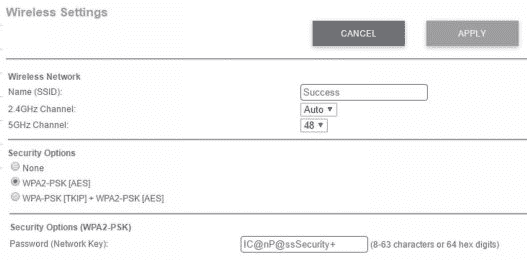

图 4.6：配置无线安全

安全选项（Security Options）部分显示选择使用带有`AES`的`WPA2-PSK`，且密码（短语或`PSK`）为`IC@nP@ssSecurity+`。密码长度可达 63 个字符，你在此处输入的密码与你在所有无线设备上输入的密码相同。许多安全专家建议使用长度至少 20 个字符的密码，并混合大写字母、小写字母、数字和特殊字符。该设备还支持使用`WPA`以向下兼容。

注意，安全选项部分还包含`None`（无）选项。如果你选择`None`，`AP`将以开放模式（Open mode）运行，这意味着它没有任何安全防护。

某些 AP 支持企业模式（Enterprise mode），但图 4.6 所示的。如果支持，它将包含一个用于实现`WPA2 Enterprise`的复选框。当你选择企业模式时，你需要输入三项信息：

- `RADIUS Server`。你输入分配给`802.1x`服务器的 IP 地址，这通常是一个`RADIUS`服务器。这有时被称为`AAA`服务器。

- `RADIUS port`。你输入`RADIUS`服务器使用的端口。`RADIUS`的官方默认端口为`1812`。然而，某些供应商使用了如`1645`等其他端口。关键在于你在此处输入的端口必须与服务器使用的端口一致。

- `Shared Secret`。共享密钥类似于密码，你必须在此输入与`RADIUS`服务器上完全相同的密钥。

查看本章的在线实验，了解如何使用`WPA2 Enterprise`模式配置无线路由器。你可以在此处访问：[`gcgapremium.com/501labs/`](http://gcgapremium.com/501labs/)。

在`AP`上配置`WPA2 Enterprise`后，它会将所有连接尝试重定向到`RADIUS`服务器进行验证。用户通过验证后，`RADIUS`服务器会告诉`AP`授予访问权限。

使用`802.1x`服务器的无线认证系统比大多数家庭网络的需求更为先进，但许多大型组织在使用它们。换句话说，大多数家庭网络使用个人模式（Personal mode），但希望增加无线安全性的组织使用企业模式（Enterprise mode）。将`WPA2`等安全协议与`802.1x`认证服务器相结合，可以显著减少针对无线系统的成功访问攻击的概率。

**记住这一点**

`PSK`模式（或`WPA-PSK`和`WPA2-PSK`）使用预共享密钥，不提供个人身份验证。开放模式不使用任何安全，允许所有用户访问`AP`。企业模式比个人模式更安全，并提供强身份验证。企业模式使用`802.1x`服务器（实现为`RADIUS`服务器）来添加认证。

## 认证协议

无线网络支持多种不同的认证协议。许多协议基于可扩展认证协议（`EAP`），这是一种为认证方法提供通用指导的认证框架。`IEEE 802.1x`服务器通常使用这些方法之一来提高认证过程中的安全级别。此外，虽然它们经常用于无线网络，但也可以用于任何部署了`802.1x`服务器的地方。

每种方法需要记住的关键点是它们是否支持或需要证书。

某些方法包括：

- `EAP`。`EAP`为两个系统创建安全加密密钥的方法，也称为对端主密钥（`PMK`）。系统随后使用该密钥加密设备间传输的所有数据。`TKIP`和基于`AES`的`CCMP`都使用此密钥，尽管`CCMP`要安全得多。

- `通过安全隧道进行灵活认证`（`EAP-FAST`）。Cisco 设计`EAP-FAST`作为其同样设计的轻量级`EAP`（`LEAP`）的安全替代方案。`EAP-FAST`支持证书，但证书是可选的。

- `保护性 EAP`（`PEAP`）。`PEAP`为`EAP`提供了额外的保护。`EAP`设计者假设`EAP`将配合足够的物理安全使用以确保通信信道安全。在实践中，并不总是如此，但`PEAP`保护了信道。`PEAP`在传输层安全（`TLS`）隧道中封装并加密了`EAP`会话。`PEAP`要求服务器端有证书，但客户端不需要。一种常见的实现是使用微软挑战手握认证协议版本 2（`MS-CHAPv2`）。

- `隧道型 TLS`（`EAP-TTLS`）。这是`PEAP`的扩展，允许系统在`TLS`隧道内使用一些较旧的认证方法，如密码认证协议（`PAP`）。`EAP-TTLS`要求`802.1x`服务器端有证书，但客户端不需要。

- `EAP-TLS`。这是最安全的`EAP`标准之一，并被广泛实现。`PEAP`和`EAP-TLS`的主要区别在于，后者在`802.1x`服务器和每个无线客户端上都需要证书。

- `RADIUS 联邦`。第 2 章涵盖了用于单点登录（`SSO`）的联邦。提醒一下，联邦包括两个或多个共享相同身份管理系统的实体（例如公司）。用户只需登录一次，即可访问与另一个实体的共享资源，而无需再次登录。同样，也可以使用`802.1x`和`RADIUS`服务器创建联邦。

注意，`EAP-FAST`支持数字证书，但证书是可选的。`PEAP`和`EAP-TTLS`要求服务器端有证书，但客户端不需要。`EAP-TLS`要求服务器和客户端都必须证书。第 10 章将更深入探讨证书，但作为介绍，证书有助于提供强身份验证和加密服务。然而，必须由证书颁发机构（`CA`）发布证书，因此组织必须从公共`CA`购买证书，或者在内部实现私有`CA`。

**记住这一点**

企业模式需要`802.1x`服务器。`EAP-FAST`支持证书。`PEAP`和`EAP-TTLS`要求`802.1x`服务器端有证书。`EAP-TLS`也使用`TLS`，但它要求在`802.1x`服务器和每个客户端上都使用证书。

## 强制门户

强制门户（Captive portal）是一种技术解决方案，它强制使用网络浏览器的客户端在允许其访问网络之前完成特定流程。组织通常将其用作热点，要求用户在访问互联网之前登录或同意特定条款。以下是三个常见示例：

- `免费互联网访问`。许多医院和其他医疗机构为患者和访客提供免费的互联网访问。强制门户要求用户确认并同意遵守可接受使用政策（`AUP`）。免费强制门户很少要求用户登录，而是要求他们勾选一个表示同意的框，然后点击按钮继续。

- `付费互联网访问`。许多酒店、度假村、邮轮轮和航空公司为客户提供互联网访问，但是按需付费的。当用户尝试访问互联网时，他们会被重定向到强制门户，并且必须使用预创建的账户登录或输入信用卡信息支付访问费用。

- `IEEE 802.1x 的替代方案`。添加`802.1x`服务器可能价格昂贵，有时并非可行可行方案。组织可以使用强制门户作为替代方案。它在授予访问权限之前要求用户进行身份验证。

# 理解无线攻击

针对无线网络的攻击有多种。大多数攻击可以通过使用强安全协议（如带有`CCMP`的`WPA2`）来避免。相比之下，`WPA`容易受到攻击，特别是当它使用`TKIP`时。

## 解离攻击 (Disassociation Attacks)

解离攻击有效地将无线客户端从无线网络中移除。为了理解这种攻击，首先了解其正常操作很有价值。

在无线客户端与无线 `AP` 进行身份验证后，两个设备交换帧，使客户端与 `AP` 关联。在任何时候，无线设备都可以向 `AP` 发送解离帧以终止连接。该帧包含了无线客户端的 MAC 地址。当 `AP` 接收到解离帧时，它会释放用于该连接的所有内存。

在解离攻击中，攻击者使用受者的伪造 MAC 地址向 `AP` 发送解离帧。`AP` 接收到帧后关闭连接。受害者现在与 `AP` 断开，必须再次通过身份验证才能重新连接。

有趣的是，许多酒店利用这种攻击来防止客人使用自己的个人无线网络。例如，如果你有一部可以使用蜂窝上网的 iPhone，可以开启个人热点功能。这允许你与其他设备（如笔记本电脑）共享连接。某些酒店会寻找这些个人无线网络，并对它们发起解离攻击。客户随后被迫为酒店的无线服务付费。例如，美国联邦通信委员会（FCC）曾对万豪酒店服务公司罚款 60 万美元，原因是其对客户发起了攻击，阻止了他们使用个人无线网络。

### 记住这一点

解离攻击有效地将无线客户端从无线网络中移除，强制其重新身份验证。`WPS` 允许用户通过输入八位 PIN 码轻松配置无线设备。`WPS` 攻击会猜测所有可能的 PIN 直到找到正确的为止。它通常会在几小时内发现 PIN，并利用它发现密码密码。

## WPS 和 WPS 攻击

Wi-Fi 保护设置（`WPS`）允许用户在不输入密码的情况下配置无线设备。相反，用户可以通过按下按钮或输入短的八位个人身份识别码（`PIN`）来配置设备。

例如，用户可以通过按下 `AP` 和无线设备上的按钮来配置新的无线设备。设备将在约 30 秒内自动配置完成，无需执行其他操作。这些按钮可以是设备上的物理按钮，也可以是用户通过应用程序或网页点击的虚拟按钮。当使用 `PIN` 方法时，用户首先识别 `AP` 上的八位 `PIN`，然后在新的无线设备上输入 `PIN`。

遗憾的是，`WPS` 容易受到暴力破解攻击。`WPS` 攻击会不断尝试不同的 `PIN` 直到成功为止。例如，`Reaver` 是一个可以免费获取开源工具，它允许攻击者在 10 小时内发现 `PIN`，通常速度更快。一旦发现了 `PIN`，它就可以在 `WPA` 和 `WPA2` 无线网络中发现密码密码。

安全专家建议禁用所有设备上的`WPS`。这通常可以通过`AP`配置页面实现。即使你选择启用`WPS`以方便连接某些设备，在操作完成后也应立即将其关闭。

## 伪造 AP (Rogue AP)

伪造接入点（rogue AP）是未经官方授权放置在网络中的`AP`。它可能是员工为了绕过安全限制而安装，也可能是攻击者安装的。如果员工安装了伪造`AP`，那么该`AP`不被妥善管理的概率更高，从而增加了网络的漏洞。

广义地说，你可以将 rogue 视为恶流氓、骗子或反派。显然，如果 rogue 是骗子或反派，那么伪造接入点就不是管理员的朋友。你可能还会看到它们被称为假冒接入点（counterfeit access points），这同样表明它们不是合法的。

攻击者可能会将伪造接入点连接到缺乏足够物理安全的无线机柜内的网络设备。该接入点充当嗅探器，捕获通过有线网络设备的流量，然后利用`AP`的无线功能广播这些流量。攻击者随后可以坐在停车场里捕获外泄的数据文件。数据外泄是将数据未经授权地从组织传输到攻击者控制的位置。

此外，攻击者可能可以使用伪造接入点连接到有线网络。其原理与普通用户通过无线网络连接到有线网络的方式相同。区别在于攻击者配置了伪造接入点的所有安全设置，并将其用于恶意目的。

如果你发现未经授权的`AP`，应尽快将其断开连接。发现任何攻击时采取的基本要步骤是遏制或隔离威胁。只需简单的拔掉`Ethernet`线，就可以阻止未经授权的`AP`捕获网络流量。

## 邪恶孪生 (Evil Twin)

邪恶孪生是与合法接入点具有相同`SSID`的伪造接入点。例如，许多咖啡馆、酒店和机场等公共场所提供免费 Wi-Fi 服务。攻击者可以使用与公共 Wi-Fi 网络相同的`SSID`设置一个`AP`，许多毫无防备的用户将连接到这个邪恶孪生。

一旦用户连接到邪恶孪生，无线流量将通过邪恶孪生而不是合法的`AP`。通常，攻击者向用户展示虚假的登录页面以获取用户名和密码。有时，他们只需捕获连接中的流量（例如在网页文本框中输入的电子邮件或文本），并进行分析以检测他们可以利用的敏感信息。

虽然设置一个邪恶孪生听起来很复杂，但其实很容易。攻击者可以将带有无线网卡的笔记本电脑配置为`AP`。在运行期间，攻击者看起来就像咖啡馆或机场候机室的其他用户一样。他们会打开笔记本电脑看起来在工作（可能就像你一样），而你完全不知道他们正试图通过邪恶孪生从互联网窃取你的凭据或其他个人数据。同样，攻击者可以在停车场或组织附近的另一个位置设置，试图欺骗员工或访客。


通常，管理员会使用无线扫描仪进行现场调查。除了检测频段上的噪声外，他们还可以检测伪造 AP，包括邪恶孪生。现场调查可以帮助他们识别接入点的物理位置，因为随着管理员越近，信号会变得越强。

### 记住这一点
伪造接入点经常用于捕获和外泄数据。邪恶孪生是使用与合法接入点相同`SSID`的伪造接入点。安全的 AP 会阻止未经授权的用户，而伪造接入点为未经授权的用户提供访问权限。

## 干扰攻击 (Jamming Attacks)
攻击者可以在无线网络使用的相同频率上传输噪声或其他无线电信号。这会干扰无线传输并严重降低性能。这种拒绝服务攻击通常被称为“干扰”（jamming），它通常会阻止所有用户连接到无线网络。在某些情况下，用户会遇到间歇性连接，这是因为干扰导致他们失去了与`AP`的关联，并迫使他们尝试重新连接。

在某些情况下，你可以提高`AP`的功率水平来克服攻击。克服攻击的另一种方法是使用不同的无线信道。每个无线标准都有多个可以使用信道，如果某个信道噪声太大，可以使用另一个。虽然这对于克服家庭网络中的干扰很有用，但对抗干扰攻击可能那么有效。如果你切换了信道，攻击者也可以切换信道。

## IV 攻击
无线初始化向量（`IV`）攻击试图从`IV`中发现预共享密钥。`IV`仅仅是一个数字。某些无线协议通过将`IV`与预共享密钥结合来加密传输中的数据。当加密系统重用相同的`IV`时，`IV`攻击就会成功。遗憾的是，`WEP`对`IV`使用了较小的 24 位数字。这种较小的`IV`导致无线网络重用密钥。

在许多`IV`攻击中，攻击者使用数据包注入技术向数据流中添加额外的数据包。`AP`返回更多数据包，增加了重用密钥的概率。使用数据包注入的`IV`攻击将破解`WEP`密钥的时间缩短到极短的时间，有时不到一分钟。值得重复的是，`WEP`已经过，不应使用。

## NFC 攻击
近场通信（`NFC`）是一组用于移动设备并允许通信的标准。

- 重放攻击。成功的窃听攻击允许攻击者执行重放攻击。例如，攻击者可以配置一个伪造标签来模仿附在贵重物品上的标签。然后攻击者就可以偷取贵重物品，而不会被轻易发现。
- DoS。拒绝服务（DoS）攻击试图中断服务。如果攻击者知道 RFID 系统所使用的频率，就可能启动干扰或干扰攻击，用噪声淹没该频率。这会阻止 RFID 系统的正常运行。

**记住这一点**
使用`CCMP`和`AES`的 WPA2 可以防止无线重放攻击。`TKIP`存在漏洞，不应被使用。无线射频识别（`RFID`）攻击包括窃听、重放和`DoS`。

## 配置错误的接入点
无线攻击成功的首要原因之一是接入点（AP）配置不当。例如，如果 AP 没有使用带有`AES`和`CCMP`的`WPA2`，它就很容易受到许多攻击。同样，如果 AP 上开启了`WPS`，通过`WPS`攻击只需通过猜测就能在几小时内发现`PIN`。在发现`PIN`后，它就可以发现密码。

`Configuring a Wireless Router Lab`展示了如何在无线路由器上配置若干安全设置。虽然你的无线路由器可能略有不同，但你仍然能够看到许多典型的配置设置。你可以在[`gcgapremium.com/501labs/`](http://gcgapremium.com/501labs/)访问此实验室以及本书的其他在线练习。

# 使用 VPN 进行远程访问
第 3 章涵盖了远程访问的几种用例，包括安全 Shell（`SSH`）和远程桌面协议（`RDP`）。虚拟专用网络（`VPN`）是另一种用于远程访问的方法。`VPN`允许用户通过公共网络访问私网。公共网络通常是互联网，但也可以是电信公司的半私有租线。由于电信公司通常会将一条物理线路租用给几家公司，因此租线并不是真正的私有。

通过公共网络访问是`VPN`的核心安全关注点。不同的隧道协议通过封装和加密流量来保护数据免受未经授权的泄露。隧道防止任何人读取通过其传输的数据。

## VPN 和 VPN 集中器
可以通过在服务器上启用服务来创建`VPN`。例如，如果你有一个 Windows 服务器，可以启用`Direct Access VPN`角色并配置`Routing and Remote Access`控制台。唯一的额外硬件要求是服务器具有两个网络接口卡（`NICs`）。其中一个`NIC`可以从互联网访问，第二个`NIC`提供对私网的访问。如果你只支持少数`VPN`客户端，这可能是完美的解决方案。

较大的组织通常使用`VPN 集中器`，这是一种用于`VPN`的专用设备。`VPN 集中器`包含了创建`VPN`所需的所有服务，包括强加密和身份验证技术，并支持许多客户端。

在使用`VPN 集中器`时，你通常会将其放置在`DMZ`中。互联网与`DMZ`之间的防火墙会将`VPN`流量转发到`VPN 集中器`。集中器会将所有私有的`VPN`流量路由到`DMZ`与内网之间的防火墙。

**记住这一点**
虚拟专用网络（`VPN`）通过公共网络提供对私网的远程访问。`VPN 集中器`是用于`VPN`的专用设备。它们包含了创建支持许多客户端的加密`VPN`所需的所有服务。

## 远程访问 VPN
图 4.7 展示了用户如何从远程位置连接到内部网络的示例。`VPN`客户端首先通过宽带连接到互联网服务提供商（`ISP`）。在连接到互联网后，`VPN`客户端就可以发起`VPN`连接。

图 4.7：连接到 VPN 服务器

`VPN`服务器位于`DMZ`中，可以通过公共 IP 地址访问。这使得从互联网上的任何其他主机都可以访问。`VPN`服务器需要对客户端进行身份验证。一种常用方法是使用内部远程认证拨号用户服务（`RADIUS`）服务器。当用户登录时，`VPN`服务器会将用户的凭据发送给`RADIUS`服务器。

虽然`RADIUS`服务器可能有一个用户密码数据库，但更常见的做法是将凭据传递给另一个服务器进行验证。例如，在认证过程中，`RADIUS`服务器可以将凭据传递给轻级目录访问协议（`LDAP`）服务器。在微软域中，`LDAP`服务器是域控制器。

### 作为隧道协议的 IPsec
第 3 章介绍了互联网协议安全（`IPsec`）作为一种传输数据加密的方法。`IPsec`同时支持隧道模式（`Tunnel mode`）和传输模式（`Transport mode`）。

`隧道模式`加密内部网络中使用的整个 IP 数据包，它是在互联网上传输`VPN`时使用的模式。其益处是内部网络中使用的 IP 地址经过了加密，任何拦截流量的人都无法看到。如果有人拦截了流量，他可以看到客户端的源 IP 地址和指向`VPN`服务器的目的地址，但内部 IP 地址信息仍然保持隐藏。

`传输模式`仅加密有效负载，通常用于私网，但不用于`VPN`。如果流量仅在私网内部传输和使用，则不需要通过加密来隐藏 IP 地址。

`IPsec`通过两种方式提供安全：

- 身份验证。`IPsec`包含认证头（`AH`），允许`IPsec`会话中的每个主机在交换数据之前进行相互身份验证。`AH`提供身份验证和完整性。`AH`使用协议号`51`。
- 加密。`IPsec`包含封装安全载荷（`ESP`）以加密数据并提供机密性。`ESP`包含`AH`，因此提供了机密性、身份验证和完整性。`ESP`使用协议号`50`。

“协议号”这个术语看起来像是个拼写错误，但并不是。`AH`和`ESP`使用协议号而不是端口号标识。第 3 章讨论了路由器和防火墙。你可能记得第 3 章提到基础包过滤防火墙可以根据 IP 地址、端口和某些协议（如互联网控制消息协议`ICMP`和`IPsec`）过滤数据包。包过滤器使用协议号识别`AH`和`ESP`流量。

`IPsec`使用端口`500`互联网密钥交换（`IKE`）来对`IPsec`会话中的客户端进行身份验证。`IKE`为`VPN`创建安全关联（`SAs`），并利用这些在客户端和`VPN`服务器之间建立安全通道。

### 作为隧道协议的 TLS
某些隧道协议使用传输层安全（`TLS`）来保护`VPN`通道。例如，安全套字隧道协议（`SSTP`）使用端口`443`上的`TLS`加密`VPN`流量。使用端口`443`为许多管理员提供了很大的灵活性，且很少需要开启额外的防火墙端口。当`VPN`隧道必须通过使用`NAT`的设备且`IPsec`不可行时，这是一个实用的替代方案。`OpenVPN`和`OpenConnect`是两个可以使用`TLS`创建安全通道的开源应用程序。虽然这也可以使用安全套字层（`SSL`），但`SSL`有已知的弱点，`TLS`是指定的替代方案。

### 分隧道与全隧道
想象一下 Lisa 使用家中的电脑通过`IPsec`连接到公司的 VPN 服务器。该 VPN 使用`ESP`，因此隧道中的所有流量都经过了加密。现在，Lisa 想在互联网上搜索关于萨克斯风的信息。她的电脑会直接连接到互联网进行搜索吗？还是说她的电脑会先通过 VPN 服务器建立连接？这取决于 VPN 的如何配置。

在分流隧道（split tunnel）中，VPN 管理员决定哪些流量应该使用加密隧道。例如，可以配置隧道仅加密发往私有网络内部使用的私有 IP 地址的流量。如果 Lisa 在配置为分流模式的 VPN 服务器上进行互联网搜索，她的搜索流量将不会通过加密隧道。相反，她的搜索将通过其 ISP（互联网服务提供商）直接访问互联网网站。

在全隧道（full tunnel）中，当用户连接到 VPN 时，所有流量都会通过加密隧道。如果 Lisa 连接到 VPN 后尝试连接到某个公共网站，流量将首先通过加密隧道，然后从私有网络流向公共网站。如果私有网络通过统一威胁管理（`UTM`）设备路由互联网流量，那么 Lisa 的流量将通过该`UTM`设备。网站会将网页传回给`UTM`设备，VPN 服务器对其进行加密，并通过加密隧道传回 Lisa。

第 3 章将讨论`UTM`设备。在此提醒一下，`UTM`设备可以对通过其发送的所有流量进行 URL 过滤、恶意软件检查和内容检查。这就是为什么组织可能选择为连接到 VPN 服务器的用户使用全隧道的原因之一。其缺点是速度可能会很慢。不仅互联网流量通过 VPN 服务器绕了间接路线，而且还经过了数次的加密和解密。

### 记住这些
`IPsec`是一种用于 VPN 的安全加密协议。封装安全载荷（`ESP`）为 VPN 流量提供机密性、完整性和身份验证。`IPsec`在 VPN 流量中使用`Tunnel mode`（隧道模式），并可以通过协议 ID`50`识别为`ESP`。它在端口`500`上使用`IKE`。全隧道在用户连接到 VPN 后加密所有流量。分流隧道仅加密发往 VPN 私有网络的流量。

### 站点到站点 VPN
站点到站点 VPN 包含两个 VPN 服务器，作为两个地理位置上分离的网络的网关。例如，一个组织可以有两个地点：一个是总部，另一个是远程办事处。它可以使用两个 VPN 服务器作为网关，将两个地点的网络连接在一起，如图 4.8 所示。

图 4.8：站点到站点 VPN

站点到站点模型的优势在于，它可以连接两个网络，而不需要用户执行额外的步骤。远程办公室的用户连接到总部的服务器就像服务器就在远程办公室一样简单。连接到远程服务器可能比连接到本地服务器慢，但除此之外，它对终端用户是透明的。

相比之下，在传统的远程访问 VPN（也称为主机到网关模型）中，终端用户直接连接到 VPN 服务器，并且对这一过程非常清楚。

### 始终连接 VPN
某些 VPN 是始终连接的（always-on VPN）。它们可以同时用于站点到站点 VPN 和远程访问 VPN。与站点到站点 VPN 使用时，两个 VPN 网关维持 VPN 连接。相反，某些站点到站点 VPN 使用按需连接。只有当用户连接到远程系统时，才会建立 VPN 连接。

许多供应商为远程访问 VPN 提供了始终连接的 VPN。它们尝试在用户设备连接到互联网时立即建立 VPN 连接。对于家庭用户来说，这可能发生在用户开启台式 PC 或笔记本电脑之后。

在移动设备（如手机）上配置时，只要设备连接到互联网连接，设备就会随时连接到始终连接的 VPN。例如，如果用户访问一家有免费 Wi-Fi 的咖啡馆并连接到网络，设备将自动连接到始终连接的 VPN。

## 网络访问控制
允许远程访问私有网络可能会让您的网络面临来自客户端的风险。如果用户使用感染恶意软件的电脑登录 VPN，这台电脑就可以感染内部网络上的其他计算机。网络访问控制（`NAC`）方法通过检查计算机并在未通过检查时阻止其访问网络来提供持续的安全监控。

大多数管理员对其网络中的计算机拥有完全控制权。例如，他们可以确保客户端安装了最新的杀病毒软件，操作系统应用了当前的补丁，并启用了防火墙。然而，管理员对员工在家里或途中使用的计算机没有完全控制。

`NAC`为这些其他计算机提供了一种控制措施。它确保客户端在访问网络之前符合预定义的特征。`NAC`系统经常使用“健康”作为一个比喻，表示客户端符合这些预定义的特征。就像医生可以隔离某些疾病的患者一样，`NAC`可以隔离或排除不符合预定义`NAC`条件的不健康客户端。

### 主机健康检查
管理员为健康客户端设置预定义的条件，符合这些预设条件的客户端可以访问网络。`NAC`系统隔离不符合条件的计算机。`NAC`检查的常见健康状况包括：

- 杀病毒软件，包括更新的签名定义
- 操作系统，包括当前的补丁和修复
- 客户端已启用防火墙

`NAC`系统使用认证代理（有时称为健康代理）来检查`NAC`客户端。这些代理是检查计算机上不同条件并将状态记录在健康声明中的应用程序或服务。当客户端连接到受`NAC`控制的网络时，代理会报告`NAC`客户端的健康状态。

考虑图 4.9。当 VPN 客户端访问网络时，VPN 服务器查询`NAC`健康服务器以确定所需的健康条件。VPN 服务器还会向客户端查询其健康声明。如果客户端满足所有健康要求，`NAC`系统允许客户端访问网络。

图 4.9：使用网络访问控制

然而，如果客户端不满足`NAC`服务器强制要求的健康条件，VPN 服务器会将客户端重定向到修复网络（也称为隔离网络）。修复网络包含了客户端可以用来恢复健康状态的资源。例如，它将包含当前批准的补丁、杀病毒软件和更新的病毒特征。客户端可以使用这些资源改善其健康状况，然后再次尝试访问网络。

虽然`NAC`可以检查 VPN 客户端的健康状况，你也可以用它检查内部客户端的健康状况。例如，内部计算机可能会错过补丁并存在漏洞。`NAC`将检测到未补补的系统并将其隔离。如果你使用此功能，检测的准确性非常重要。`NAC`系统的误报可能会隔离健康的客户端，并阻止其访问网络。

同样，您的组织可能允许访问者或员工将其移动计算机接入活动网口以进行连接，或连接到无线网络。`NAC`会检查客户端，如果它们不符合健康状况，它们可能会被授予访问的权限，但与任何其他网络活动隔离。

### 永久性与可溶解性
客户端上的代理可以是可溶解的也可以是永久性的。永久性代理（有时称为持久性`NAC`代理）安装在客户端上并一直留在客户端上。当客户端尝试远程登录时，`NAC`会使用该代理。这是公司拥有设备、以及员工用于远程连接的已批准笔记本电脑和 PC 最常见的实现方式。

可溶解代理在客户端远程登录时被下载并运行在客户端上。它收集所需的信息，识别客户端是健康还是不健康，并将状态报告回`NAC`系统。某些可溶解`NAC`代理在向`NAC`系统报告后会立即自删除。另一些则在远程会话结束后自删除。

当组织实施自自带设备 (`BYOD`) 策略时，可溶解代理通常用于移动设备。组织会对会对员工拥有的设备进行健康检查，但并不要求用户在设备上安装额外软件。然而，这些可溶解代理可以检测移动设备上的漏洞，例如越狱（jail-broken）或根（rooted）设备。越狱的 Apple 设备会移除软件限制，例如从 Apple Store 的其他源安装软件的能力。已过的 Android 设备经过了修改，允许对 Android 操作系统进行根级访问和修改。

许多`NAC`将可溶解代理称为无代理功能，尽管这在某种程度上是一个误导名称。`NAC`仍然在使用代理来检查客户端，但它并没有在客户端上安装代理。

**记住这一点**
网络访问控制 (`NAC`) 包含了检查客户端健康状况的方法，例如是否具有最新的反病毒软件。`NAC`可以限制不健康客户端访问修复网络。您可以将`NAC`用于`VPN`客户端和内部客户端。永久性代理安装在客户端上。可溶解代理（有时称为无代理）不安装在客户端上，且通常用于检查员工拥有的移动设备。

### 身份与访问服务
实施`VPN`的一个重要步骤是确保只有授权的实体才能访问它。授权始于身份验证，`VPN`支持多种身份验证方法。以下章节将更深入地描述不同的远程访问身份验证机制，但这里有一个快速介绍：

- 密码验证协议 (`PAP`)。`PAP`以明文发送密码，因此`PAP`仅作为最后的手段。
- 挑战握手身份验证协议 (`CHAP`)。`CHAP`使用握手过程，服务器挑战客户端。客户端随后用适当的身份验证信息响应。
- 微软 CHAP (`MS-CHAP`)。这是微软对`CHAP`的实现，仅供微软客户端使用。
- `MS-CHAPv2`。`MS-CHAP`已废弃，取而代之的是`MS-CHAPv2`。它包含了多改进，包括执行双向认证的能力。
- 远程拨号用户服务 (`RADIUS`)。`RADIUS`为多个远程访问服务器提供中心化的身份验证方法。`RADIUS`加密密码包，但不加密整个身份验证过程。
- Diameter。`Diameter`的创建是为了克服`RADIUS`的某些局限性，通常用于替代`RADIUS`。


终端访问控制器访问控制系统+（`TACACS+`）。`TACACS+` 是 `RADIUS` 的替代方案，但它是 Cisco 系统的专有协议。`TACACS+` 的一个优点是它可以与 `Kerberos` 交互，允许它工作于更广泛的环境，包括使用 `Kerberos` 的微软域。此外，`TACACS+` 加密了整个身份验证过程，而 `RADIUS` 只加密密码。

## PAP

密码验证协议（`PAP`）与点点链路协议（`PPP`）用于验证客户端。`PAP` 的一个严重缺陷是它在网络上明文发送密码，这构成了重大的安全风险。

`PPP` 主要用于拨号连接。信不信由你，曾有一段时间，窃听电话的想法相当遥远。正因如此，`PPP` 的安全性是事后考虑的。今天由于密码以明文传递，`PPP` 仅作为最后的手段，或者与提供加密的协议一起使用。

## CHAP

挑战握手身份验证协议（`CHAP`）也使用 `PPP` 并验证远程用户，但它比 `PAP` 更安全。`CHAP` 的目标是允许客户端通过公共网络（如电话或互联网）传输凭据，而不会允许攻击者拦截数据并在稍后攻击中使用。

客户端和服务器都知道一个用于身份验证过程的共享密钥（类似于密码）。然而，客户端不会像 `PAP` 那样通过网络以明文发送共享密钥。相反，客户端在与服务器提供的 `nonce`（一次性数字）结合后对其进行哈希处理。这种握手过程在客户端最初尝试连接服务器时以及连接期间的不同时间点使用。

**记住这一点**

`PAP` 身份验证使用密码或 `PIN`。一个严重的缺陷是 `PAP` 跨网络以明文发送信息，使其容易受到嗅探攻击。`CHAP` 比 `PAP` 更安全，因为密码不会通过网络以明文发送。

## MS-CHAP 和 MS-CHAPv2

微软引入了微软挑战握手身份验证协议（`MS-CHAP`）作为对微软客户端 `CHAP` 的改进。`MS-CHAP` 支持老到像 Windows 95 的客户端。后来，微软用 `MS-CHAPv2` 改进了 `MS-CHAP`。

`MS-CHAPv2` 相比 `MS-CHAP` 的重大改进是执行双向认证的能力。不仅客户端向服务器验证身份，服务器也向客户端验证身份。第 7 章“防止高级攻击”涵盖了不同类型的攻击，包括攻击者可能尝试伪装服务器的攻击。双向认证在客户端传输数据之前提供了服务器身份的保证，降低了客户端向恶意服务器发送敏感数据的风险。

## RADIUS

远程拨号用户服务（`RADIUS`）是一种中心化的身份验证服务。不需要每个单独的 `VPN` 服务器都需要一个独立的数据库来识别谁可以验证，`VPN` 服务器会将身份验证请求转发到中央 `RADIUS` 服务器。`RADIUS` 还可以作为带有 `WPA2 Enterprise` 模式的 `802.1x` 服务器（在本章前面介绍过）。

假设您的公司在弗吉尼亚海滩、亚特兰大和芝加哥设有地点。每个地点都有用户可以访问的 `VPN` 服务器。Bart 是一个推销员，他可以连接到这些 `VPN` 服务器中的任何一个。输入销售数据时，他连接 `亚特兰大 VPN`。当移动设备使用公司赞助的始终连接 `VPN` 时，他连接到 `弗吉尼亚海滩 VPN` 服务器。Bart 所有的公司访问都有一个账户，今天他被提示更改密码。

如果每个 `VPN` 服务器都有一个包含 Bart 用户名和密码的独立数据库，那么这些数据库都必须进行更新。这可能会耗费大量精力，并导致不必要的错误。

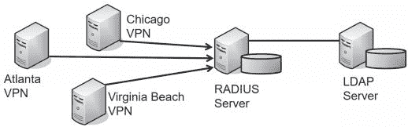

然而，公司可以使用如图 4.10 所示的集中式 `RADIUS` 服务器。每个 `VPN` 服务器都配置了一个共享密钥（类似于密码），而 `RADIUS` 服务器则为每个 `VPN` 服务器配置了与之相匹配的共享密钥。

图 4.10：`RADIUS` 配置

这个集中式 `RADIUS` 服务器可以存储一个集中式的用户账户数据库。然而，更常见的做法是 `RADIUS` 服务器访问存储账户的 `LDAP` 服务器。例如，在微软域环境中，`RADIUS` 服务器会将凭据传递给域控制器。一个显著的优势是用户只有一个账户。如果 Bart 更改了密码，域控制器就会知道新密码。

`RADIUS` 使用用户数据报协议（`UDP`），该协议提供尽力而为的交付机制。因此，`RADIUS` 包含了检测通信问题的逻辑。相比之下，`RADIUS` 的替代方案使用 `TCP`，它提供了可靠交付。这些替代方案允许 `TCP` 检测并处理通信问题。此外，`RADIUS` 仅加密密码，而替代方案则加密整个认证过程。

尽管 `RADIUS` 在可扩展认证协议（`EAP`）开发之前就已经创建，但 `RADIUS` 确实可以与 `EAP` 工作。`RFC 3579`《`RADIUS` 支持 `EAP`》是一份信息性 RFC，描述了如何实现。然而，替代方案更容易扩展 `EAP` 的使用。

## TACACS+

终端访问控制器访问控制系统增强型（`TACACS+`）是 Cisco 对 `RADIUS` 的替代。与 `RADIUS` 相比，它提供了两个重要的安全优势。首先，它加密整个认证过程，而 `RADIUS` 只加密密码。其次，`TACACS+` 在客户端和服务器之间使用多次挑战和响应。

尽管 `TACACS+` 是 Cisco 的专用技术，但它可以与 `Kerberos` 交互。这使得 Cisco `VPN` 集中器可以在 Microsoft Active Directory 环境中交互。提醒一下，Microsoft Active Directory 使用 `Kerberos` 进行身份验证。

组织还将 `TACACS+` 作为网络设备的认证服务。换句话说，你可以在用户访问路由器或交换机的配置页面之前对其进行身份验证。网络设备必须启用 `TACACS+`，并由 `TACACS+` 服务器提供认证服务。

## Diameter

`Diameter` 是 `RADIUS` 的扩展，许多组织因其额外功能而切换到它。`Diameter` 在 `RADIUS` 的功能之外增加了其他几个命令，并添加了可以与 `EAP` 使用的新命令。`Diameter` 使用 `TCP` 而不是 `RADIUS` 的 `UDP`。一个关键优势是它与 `RADIUS` 向后兼容，并提供了从 `RADIUS` 到 `Diameter` 的升级路径。

在几何中，圆的直径是圆两个边缘之间的直线，而半径是从中心到边缘的直线。换句话说，圆的直径长度是半径的两倍。设计者在命名 `Diameter` 时考虑到了这一点，以间接表示它比 `RADIUS` 好两倍。

## 记住这些

`RADIUS`、`TACACS+` 和 `Diameter` 都提供集中认证。`TACACS+` 是 Cisco 专用，但可以配合 `Kerberos` 使用。`Diameter` 是 `RADIUS` 的改进，并支持许多额外功能，包括使用 `EAP` 保护传输。

## AAA 协议

AAA 协议提供身份验证（Authentication）、授权（Authorization）和计费（Accounting）。身份验证验证用户的身份。授权决定用户是否应该拥有访问权限。计费通过日志跟踪用户访问。

例如，`RADIUS`、`TACACS+` 和 `Diameter` 被视为 AAA 协议，因为它们提供了所有三种服务。它们验证尝试远程访问的用户的身份，通过检查数据库确定用户是否获得远程访问的授权，然后记录用户的活动。`TACACS+` 在会话期间使用多次挑战和响应。`Kerberos` 有时被称为 AAA 协议，但它不提供任何计费服务。

# 第 4 章考试考点复习

在准备考试时，确保你理解本章涵盖的这些关键概念。

## 探索高级安全设备

- 入侵检测系统（`IDSs`）和入侵预防系统（`IPSs`）使用与协议分析相同的功能检查流量。
- 基于主机的入侵检测系统（`HIDS`）可以检测针对工作站和服务器等本地系统的攻击。`HIDS` 保护主机上的本地资源，并可以检测某些传统杀病毒软件无法检测的恶意软件。基于网络的入侵检测系统（`NIDS`）检测针对网络的攻击。
- 基于签名的 `IDS` 或 `IPS` 使用签名来检测已知的攻击或漏洞。
- 基于启发式或基于行为的 `IDS`（也称为基于异常的 `IDS`）需要一个基准，并根据异常或流量超出预期边界来检测攻击。
- 误报（False positive）是指在没有攻击发生的情况下错误地发出指示有攻击的警报。误报增加了管理员的工作量。漏报（False negative）是指攻击正在发生但未被报告。
- `IPS` 与主动式 `IDS` 类似，不同之处在于它被放置在流量的链路上（有时称为带内，in-band），并可以在攻击到达内部网络之前阻止它们。`IPS` 可以主动监控数据流，检测恶意内容并防止其到达网络。相比之下，`IDS` 是带外的（out-of-band）。
- `IDS` 和 `IPSs` 还可以保护内部私有网络，例如私有数据控制和数据采集（`SCADA`）网络。
- `SSL/TLS` 加速器是处理传输层安全（`TLS`）流量的专用硬件设备。其他设备（如 Web 服务器）可以将 `TLS` 流量处理卸载给加速器。
- `SSL` 解密器允许组织检查流量，即使流量在使用 `SSL` 或 `TLS` 时。
- 软件定义网络（`SDN`）使用虚拟化技术路由流量，而不是使用硬件路由器和交换机。它分离了数据平面和控制平面。
- 蜜罐和蜜罐网络看起来拥有有价值的数据，并试图将攻击者从现有网络转移开。安全人员利用它们观察当前的攻击方法并收集攻击情报。
- `802.1x` 服务器使用端口身份验证提供强大的端口安全。它通过确保只有授权的客户端才能连接，防止恶意设备连接到网络。

## 无线网络安全

- 无线接入点（`APs`）将无线客户端连接到有线网络。
- 胖型 `AP`（也称为独立 `AP`）包含了将无线客户端连接到无线网络所需的一切。
- 瘦型 `AP` 是基于控制器的 `AP`。控制器负责配置和管理瘦型 `AP`。
- 服务集标识符（`SSID`）是无线网络的名称。禁用 `SSID` 广播可以向普通用户隐藏无线网络。
- 你可以使用媒体访问控制（`MAC`）过滤来限制对无线网络的访问。然而，攻击者可以发现授权的 `MAC` 地址并伪造授权的 `MAC` 地址。
- 大多数 `WAP` 使用全向天线。定向天线具有更窄的波束和更长的范围。
- 自组无线网络是指两个或多个设备在没有 `AP` 的情况下连接在一起。
- Wi-Fi 保护访问（`WPA`）可以使用临时完整性协议（`TKIP`）或计数器模式块链消息认证协议（`CCMP`）。`WPA` 和 `TKIP` 都已废弃。
- 个人模式（Personal mode）使用预共享密钥（`PSK`）。它容易实现，并用于许多小型无线网络。
- 企业模式（Enterprise mode）比个人模式更安全，因为它添加了身份验证。它使用实现为 `RADIUS` 服务器的 `802.1x` 验证服务器。
- 开放模式（Open mode）不使用 `PSK` 或 `802.1x` 服务器。许多热点为客户提供免费无线访问时使用开放模式。
- `802.1x` 服务器使用可扩展身份验证协议（`EAP`）的版本之一，例如保护的 `EAP`（`PEAP`）、隧道传输层 `TLS`（`EAP-TTLS`）、`EAP-TLS` 或通过安全隧道进行灵活身份验证（`EAP-FAST`）。
- 最安全的 `EAP` 方法是 `EAP-TLS`，它要求服务器和每个无线客户端上都安装证书。`PEAP` 和 `EAP-TTLS` 要求服务器上有证书，但客户端不需要。`PEAP` 通常与微软挑战握手身份验证协议版本 2（`MS-CHAPv2`）实现。`LEAP` 是 `Cisco` 的专有协议，不需要证书。`Cisco` 设计 `EAP-FAST` 来取代轻量 `EAP`（`LEAP`）。
- 强制性门户（captive portal）强制无线客户端在获得网络访问权限之前完成某个过程，例如确认策略或支付费用。

### 理解无线攻击

- 解离攻击（disassociation attack）可以有效地将无线客户端从无线网络中移除，强制其重新进行身份验证。
- Wi-Fi 安全设置（`WPS`）允许用户通过按按钮或输入短 `PIN` 码轻松配置无线设备。`WPS` 不安全。`WPS` 攻击可以在几小时内发现 `PIN`，然后使用该 `PIN` 发现密码。
- 恶意接入点（rogue `AP`）是未经官方授权放置在网络中的接入点。恶性孪生（evil twin）是与合法接入点具有相同 `SSID` 的恶意接入点。
- 干扰攻击（jamming attack）用噪声淹没无线频率，阻塞无线流量。
- 初始化向量（`IV`）攻击试图发现 `IV` 并利用其发现密码。
- 近场通信（`NFC`）攻击使用 `NFC` 读卡器从移动设备读取数据。
- 蓝牙劫持（Bluejacking）是向手机发送未经请求的消息的实践。蓝牙窃取（Bluesnarfing）是指未经授权访问或盗取蓝牙设备上的信息。
- 在无线重放攻击中，攻击者捕获两个实体之间发送的数据，对其进行修改，然后通过重放数据来冒充其中一方。使用 `CCMP` 和 `AES` 的 `WPA2` 可以防止无线重放攻击。
- 射频识别（`RFID`）攻击包括窃听、重放和拒绝服务（`DoS`）。

## 使用 VPN 进行远程访问

- 虚拟专用网络（`VPN`）通过公共网络（如互联网）访问私有网络。`VPN` 集中器是为远程用户提供安全远程访问的专用设备。
- `IPsec` 是常用于 `VPN` 的一种隧道协议。它保护隧道内的流量。`IPsec` 通过身份验证头（`AH`）提供身份验证。封装安全载负载（`ESP`）加密 `VPN` 流量并提供机密性、完整性和认证。
- `IPsec` 隧道模式加密内部网络使用的整个 IP 包。`IPsec` 传输模式仅加密载负载，通常用于私有网络，但不用于 `VPN`。
- 某些 `VPNs` 使用 `TLS` 加密 `VPN` 隧道内的流量。
- 全隧道（full tunnel）在用户连接到 `VPN` 后加密所有流量。分拆隧道（split tunnel）仅加密发往 `VPN` 私有网络的流量。
- 站点到站点 `VPNs` 在两个网络之间提供安全访问。这些可以是按需的 `VPN`，也可以是始终开启的 `VPN`。
- 移动设备也可以使用始终开启的 `VPN` 在用户连接公共热点时保护流量。
- 网络访问控制（`NAC`）检查客户端是否符合特定的健康状况（例如杀毒软件已更新），并可以将不健康的客户端重定向到修复网络。
- 永久 `NAC` 代理（有时称为持久性 `NAC` 代理）安装在客户端上并留在客户端上。可溶解 `NAC` 代理（有时称为无代理）在客户端登录时下载并在客户端上运行，会话结束后删除。可溶解代理通常用于员工自己的移动设备。
- 当用户从远程位置（例如通过 `VPN` 连接）访问私有网络时，使用远程访问身份验证。
- 密码验证协议（`PAP`）使用密码或 `PIN` 码进行身份验证。一个显著缺陷是 `PAP` 以明文跨网络发送密码。
- 挑战握手身份验证协议（`CHAP`）比 `PAP` 更安全，并在验证客户端时使用握手过程。
- `MS-CHAP` 和 `MS-CHAPv2` 是微软对 `CHAP` 的改进。`MS-CHAPv2` 提供双向认证。
- `RADIUS` 为多个远程访问服务提供中央认证。`RADIUS` 依赖共享密钥的使用，仅在身份验证过程中加密密码。它使用 `UDP`。
- `TACACS+` 被某些 `Cisco` 系统作为 `RADIUS` 的替代方案。`TACACS+` 使用 `TCP`，加密整个身份验证过程，并支持多次挑战和响应。
- `Diameter` 是 `RADIUS` 的改进。`Diameter` 使用 `TCP`，加密整个身份验证过程，并支持许多额外功能。
- `RADIUS`、`TACACS+` 和 `Diameter` 都是认证、授权和计费（`AAA`）协议。

## 在线参考

- 你做过 `http://gcgapremium.com/501-extras/` 的在线实验吗？在线资源还包括示例练习测试题，包括基于性能的问题。

# 第 4 章练习题

1. 你正准备部署一个基于启发式的检测系统来监控网络活动。以下选项中你会首先创建哪一个？

   A. 洪泛防护器

   B. 签名

   C. 基线

   D. 蜜罐

2. 攻击者最近对你组织 DMZ 中的服务器发起了多次攻击。你的任务是确定一个最可能防止未来此类攻击的解决方案。以下哪项是最佳选择？

   A. 带外 `IPS`

   B. 带内 `IPS`

   C. 被动式 `IDS`

   D. 带外 `IDS`

3. Lisa 负责使用 `SCADA` 系统管理和监控水处理厂的过程。管理员最近在她的系统中发现了连接到 `SCADA` 系统的恶意软件。尽管他们删除了恶意软件，但管理层仍然担心。Lisa 需要继续使用她的系统，且无法更新 `SCADA` 系统。以下哪项可以降低这种风险？

   A. 在 `SCADA` 系统上安装 `HIPS`。

   B. 在 `SCADA` 网络边界上安装防火墙。

   C. 在 `SCADA` 网络边界上安装 `NIPS`。

   D. 在 `SCADA` 网络上安装蜜罐。

4. 以下哪项最准确地描述了漏报（false negative）？

   A. `IDS` 错误地指示发生了缓冲区溢出攻击。

   B. 杀毒软件报告某个有效程序是恶意软件。

   C. 基于启发式的 `IDS` 检测到了一个以前未知的攻击。

   D. `IDS` 未检测到缓冲区溢出攻击。

5. 你的无线网络包含一个由你配置的集中 AP。该 AP 将配置转发到无线网络中的其他 AP。以下哪项最描述了这些 AP？

   A. 集中 AP 是一个独立的，它配置你网络中的 `fat AP`。

   B. 集中 AP 是一个瘦的 `AP`，它配置你网络中的 `fat AP`。

   C. 集中式 `AP` 是基于控制器的 `AP`，它配置你网络中的独立 `APs`。

   D. 集中式 `AP` 是胖 `AP`（fat `AP`），它配置你网络中的瘦 `APs`（thin `AP`）。

6. 你需要在不运行任何电缆的情况下在两栋建筑之间提供连接。你决定使用两个 `802.11ac APs` 在建筑之间提供无线连接。以下选项中，支持此需求的最佳选择是？

   A. 在两个 `APs` 上都使用全向天线。

   B. 使用宽信。

   C. 使用 2.4 GHz 频段。


D. 在两个`APs`上都使用定向天线。

7. 你想在无线网络上实现**最强**的安全级别。以下哪个选项支持这一目标？

A. 实现带有`TKIP`的`WPA`

B. 禁用`SSID`广播

C. 启用`MAC`过滤

D. 实现带有`CCMP`的`WPA2`

8. 你的组织计划使用`WPA2 Enterprise`实现无线网络。在以下选项中，需要什么？

A. 一个在认证服务器上安装了数字证书的认证服务器

B. 一个在认证服务器上安装了`DHCP`的认证服务器

C. 一个在认证服务器上安装了`DNS`的认证服务器

D. 一个在接入点上运行`WEP`的认证服务器

9. 一安全管理员正在测试`AP`的安全性。该`AP`使用`WPA2`。她运行自动化程序几个小时，发现了`AP`的密码。她**最可能**在使用哪种方法？

A. `IV`攻击

B. 断离攻击 (Disassociation attack)

C. `WPS`攻击

D. 邪恶入侵攻击 (Evil twin attack)

10. 你的无线网络名称为`myoffice`。你几天前禁用了`SSID`广播。今天，你注意到无线用户可以使用名为`myoffice`的无线网络。你已验证`SSID`广播仍处于禁用状态。这种行为**最可能**的原因是？

A. 邪恶入侵攻击

B. 断离攻击

C. `WPS`攻击

D. 干扰攻击 (Jamming attack)

11. 你网络中的移动用户报告说，他们经常丢失与无线网络的连接，但在其他日子他们没有任何问题。你怀疑这是由于攻击导致的。以下哪些攻击**最可能**导致了这个问题？

A. 无线干扰

B. `IV`

C. 重放攻击 (Replay)

D. 蓝牙窃取 (Bluesnarfing)

12. 你组织的管理层希望某些用户能够从远程访问内部网络资源。以下满足此需求的**最佳**选择是？

A. `NAC`

B. `VPN`

C. `IDS`

D. `IPS`

13. 你的组织计划实施`VPN`。他们希望确保`VPN`客户端连接到`VPN`服务器后，来自`VPN`客户端的所有流量都经过加密。以下哪个选项**最能**满足这一目标？

A. 分拆隧道 (Split tunnel)

B. 全隧道 (Full tunnel)

C. 使用`隧道模式` (Tunnel mode) 的`IPsec`

D. 使用`传输模式` (Transport mode) 的`IPsec`

14. 你被负责配置网络计算机上的身份验证服务设置。你正在不同的服务器上输入共享密钥。你**最可能**正在配置以下哪些服务？（选择两项。）

A. `RADIUS`

B. `Kerberos`

C. `LDAP`

D. `EAP-TLS`

15. 你的组织最近实施了 BYOD 策略。然而，管理层希望确保移动设备在访问任何网络资源之前符合最低安全标准。`NAC`**最可能**拥有哪种代理？

A. 永久的 (Permanent)

B. 健康的 (Health)

C. `RADIUS`

D. 可消散的 (Dissolvable)

# 第 4 章练习题答案

1. C. 基于启发式的（也称为基于异常或基于行为的）检测系统将当前活动与之前创建的基准进行比较，以检测任何异常或变化。洪泛防护 (Flood guards) 有防止泛洪攻击（例如`SYN`泛洪攻击）。基于签名的系统（也称为基于定义的）使用已知攻击模式的签名来检测攻击。蜜罐 (honeypot) 是设计成对攻击者看起来很有价值的服务器，可以转移攻击。

2. B. 给定选项中的最佳解决方案是带内入侵防御系统 (`IPS`)。流量通过`IPS`，`IPS`有最大的机会防止攻击到达内部系统。`IPS`是带内的，而不是带外的。入侵检测系统 (`IDS`) 是被动的，不是带内的，因此它只能检测并响应攻击，而不能阻止它们。

3. C. 安装在监视控制和数据采集 (`SCADA`) 网络上的网络入侵防御系统 (`NIPS`) 可以拦截进入网络的恶意流量，是给定选项中的最佳选择。场景说明你无法更新`SCADA`系统，因此你无法在其中任何一个系统上安装基于主机的 IPS (`HIPS`)。防火墙提供了一个级别的保护。但它无法区分 Lisa 发送的有效流量和来自 Lisa 系统恶意软件发送的恶意流量。蜜罐可能对观察恶意流量有用，但不能阻止它。

4. D. 如果入侵检测系统 (`IDS`) 未检测并报告缓冲区溢出攻击，则为漏报 (false negative)。如果`IDS`错误地（错误地）指示发生了攻击，则为误报 (false positive)。如果杀病毒软件将有效的应用程序指示为恶意软件，也是误报。如果基于启发式的`IDS`准确检测到以前未知的攻击，则它工作正常。

5. D. 集中式接入点 (`AP`) 是胖`AP`，它配置网络中的瘦`APs`。胖`AP`也可以称为独立、智能或自主`AP`，它用于配置瘦`APs`而不是胖`APs`。瘦`APs`不配置其他`APs`。独立`APs`不由其他`APs`配置。

6. D. 在两个接入点 (`APs`) 上使用定向天线是满足此需求的最佳选择，因为它们具有高增益和极窄的辐射模式。全向天线同时向所有方向传输信号，连接两栋建筑之间的网络并不是良好选择。宽信道会缩小无线传输范围，在这里不是良好选择。因为`802.11ac`仅使用`5 GHz`频段，你无法使用`2.4 GHz`。

7. D. 使用带分组链消息认证码协议 (`CCMP`) 的 Wi-Fi 安全访问 II (`WPA2`) 提供了给定选项中最强的安全级别。临时密钥完整性协议 (`TKIP`) 是与`WPA`一起使用的旧加密协议，它没有`CCMP`强。禁用 set 标识 (`SSID`) 广播可以向普通用户隐藏网络，但攻击者仍然可以发现它，因为`SSID`仍然以明文包含在某些数据包中。攻击者可以通过伪造授权的`MAC`地址绕过介质控制 (`MAC`) 地址过滤。

8. A. `WPA2 Enterprise`需要一个`802.1x`认证服务器，大多数实现要求在服务器上安装数字证书。网络可能具有动态主机配置协议 (`DHCP`) 和域名系统 (`DNS`) 服务，但不需要在认证服务器上安装它们。

9. C. 这极可能是一个 Wi-Fi 保护设置（WPS）攻击。`Reaver`是一个自动化程序，它可以发现 WPS PIN，并在发现 PIN 之后，它可以发现接入点（AP）使用的密码令或或密钥。虽然初始化向量 (IV) 攻击可以在旧的无线安全协议中发现口令，但 Wi-Fi 保护访问 II (WPA2) 不易受到 IV 攻击。取消关联攻击（Disassociation attack）可以有效地将无线客户端从无线网络中移除，但它无法发现密码。恶性孪生攻击（Evil twin attack）使用与现有 AP 名称同名的独立 AP，目的是欺骗用户连接到它。

10. A. 场景表明正在进行恶性孪生攻击。即使禁用了 SSID 广播，攻击者也可以轻松发现服务集标识符 (SSID)，然后创建另一个具有相同 SSID 的接入点。取消关联攻击会将无线客户端从无线网络中断开。Wi-Fi 保护设置（WPS）攻击会发现八位 PIN，然后使用它来发现口令。干扰攻击（Jamming attack）通过向频率通道充入噪声来防止连接。

11. A. 无线干扰攻击是一种拒绝服务（DoS）攻击，可导致无线设备丢失与接入点的关联并将其从网络断开。其他攻击均不是 DoS 攻击。初始化向量 (IV) 攻击尝试发现口令。重放攻击（Replay attack）捕获流量，其目的是稍后重放它以冒充原始传输中的其中一方。蓝牙窃取（Bluesnarfing）是一种蓝牙攻击，尝试访问蓝牙设备上的信息。

12. B. 虚拟专用网络（VPN）通过远程位置在互联网等公共网络提供对私有网络的访问，是最佳选择。网络访问控制（NAC）方法可以在允许 VPN 客户端访问网络之前检查其健康状况，但它并不直接提供访问功能。入侵检测系统（IDSs）和入侵防御系统（IPSs）负责保护网络，但不控制远程访问。

13. B. 全隧道（Full tunnel）在用户使用隧道连接 VPN 后加密所有流量。分隧道（Split tunnel）仅加密发往 VPN 私有网络的流量。从客户端直接到另一个互联网网站的流量不被加密。IP 协议安全（IPsec）隧道模式加密内部网络中使用的整个 IP 数据包。它加密 VPN 私有网络内使用的所有流量，但不是来自 VPN 客户端的所有流量。IPsec 传输模式仅加密有效负载，用于私有网络，而不用于 VPN 流量。

14. A, C. 远程认证拨号用户服务（RADIUS）服务器使用共享密钥。你可以通过在 RADIUS 服务器和 LDAP 服务器上输入相同的共享密钥，配置它们使其与基于轻量级目录访问协议（LDAP）的系统交互。共享密钥基本上就是两个系统上相同的密码。Kerberos 使用票证（tickets）进行身份验证，而不是共享密钥。扩展认证协议-传输层安全（EAP-TLS）是一种要求在客户端和服务器上使用证书的认证协议，而不是共享密钥。

15. D. 可溶解代理（Dissolvable agent）通常用于员工拥有的设备，如果组织实施了自备设备（BYOD）策略，则将是合适的。永久性网络访问控制（NAC）代理永久安装在设备上，但这可能给员工拥有的设备带来问题。任何 NAC 代理都是健康代理。远程认证拨号用户服务（RADIUS）用于认证，而不是检查客户端。

# 第 5 章

## 主机与数据安全

### 本章涵盖的 CompTIA Security+ 目标：

- **1.6 解释与漏洞类型相关的影响。**

    - 漏洞引起于生命终结系统、嵌入式系统、缺乏厂商支持）、配置错误/弱配置

- **2.1 安装和配置硬件和软件基准的网络组件，以支持组织安全。**

    - `DLP`（USB 阻止、云端、电子邮件）、硬件安全模块

- **2.3 给定场景，排排除常见的安全问题。**

    - 权限问题、访问违规、数据外泄、弱安全配置、未经授权的软件、基准偏差、许可证合性违规（可用性/完整性）

- **2.4 给定场景，分析并解释来自安全技术的输出。**

    - 应用白名单、可移动介质控制、补丁管理工具、`DLP`

- **2.5 给定场景，安全地部署移动设备。**

    - 连接方法（蜂窝、WiFi、卫星、蓝牙、NFC、ANT、红外、USB）、移动设备管理概念（应用管理、内容管理、远程擦除、地理围栏、地理位置、屏幕锁、推送通知服务、密码和 PIN、生物识别、上下文感知认证、容器化、存储分区、全设备加密）、执行和监控范围：（第三方应用商店、根根/越狱、侧加载、自定义固件、运营商解锁、固件 OTA 更新、摄像头使用、SMS/MMS、外部介质、USB OTG、录风风制、GPS 标记、WiFi 直连/点继、热点、支付方式）、部署模型（BYOD、COPE、CYOD、公司所有、VDI）

- **3.3 给定场景，实施安全的系统设计。**

    - 硬件/固件安全（FDE/SED、TPM、HSM、UEFI/BIOS、安全启动和证明、供应链、硬件根、EMI/EMP）、操作系统（类型、网络、服务器、工作站、设备、亭式机、移动 OS、补丁管理、最小功能化、安全配置、可信操作系统、应用白名单/黑名单）、外设（无线键盘、无线鼠标、显示器、支持 WiFi 的 MicroSD 卡、打印机/多功能一体机、外部存储设备、数字相机）

- **3.4 解释安全阶段部署概念的重要性。**

    - 沙箱、环境（开发、测试、阶段、生产环境）、安全基准、完整性测量

- **3.5 解释嵌入式系统的安全影响。**

    - SCADA/ICS、智能设备/IoT（可穿戴技术、家居自动化）、HVAC、SoC、RTOS、打印机/多功能一体机、摄像头系统、特殊用途（医疗设备、车辆、飞机/无人机）

- **3.7 总结云和虚拟化概念。**

    - 云存储、云部署模型（SaaS、PaaS、IaaS、私有、公共、混合、社区）、本地 vs 托管 vs 云、云访问安全代理（（CASB）、安全即服务

- **3.8 解释韧性和自动化策略如何降低风险。**

    - 自动化/脚本（自动化行动）、模板、主镜像、非持久性（实时启动介质）

- **4.3 给定场景，实施身份和访问管理控制。**

    - 文件系统安全、数据库安全

- **5.3 解释风险管理流程和概念。**

    - 变更管理

在本章中，你将学习用于实现安全系统设计的各种方法。这包括使用不同的操作系统、外围设备以及硬件和固件安全。越来越多的组织正在使用云资源，本章总结了重要的云概念。此外，移动设备的使用在过去几年中激增，越来越多的组织允许员工将移动设备连接到网络。这给组织带来了许多挑战，但移动设备管理工具帮助管理员应对这些挑战。本章还涵盖了嵌入式系统的安全影响，这些系统现在已应用于打印机、车辆、智能设备等。最后，你将学习用于保护数据的许多许多不同方法。

# 实现安全系统

安全系统设计概念有助于确保计算系统以安全状态进行部署和维护。在此背景下，系统是指任何主机，如服务器、工作站、笔记本电脑、网络设备或移动设备。在理想世界中，系统从安全状态开始。遗憾的是，现实并非理想世界，管理员需要积极行动，在部署前保护系统，并在部署后保持其安全。本节概述了用于保护主机的几个步骤。

加固（Hardening）是指使操作系统（`OS`）或应用程序比默认安装更安全的实践。它有助于消除默认配置、错误配置和弱配置中的漏洞。

与安全系统设计相关的核心原则是最小功能原则（least functionality）。部署系统时应仅包含其实现目的所需的应用程序、和服务协议。如果系统上没有运行某个服务或协议，攻击者就无法对其进行攻击。简单的例子是，如果系统上没有运行且可用的文件传输协议（`FTP`），则系统就不会受到任何`FTP`攻击的威胁。

除了禁用不必要的服务以减少漏洞外，卸载不需要的软件也同样重要。软件经常存在漏洞和缺陷。虽然频繁修补软件可以关闭这些漏洞，但你可以通过简单地删除不需要的应用程序来消除它们。

几年前，我在一家小型培训公司工作。其中一台服务器使用了`Windows`的默认配置，导致了严重的漏洞。我们当时将该服务器作为文件服务器，但由于它没有从默认配置进行加固，它还运行着互联网信息服务（`IIS`），即微软 Web 服务器。

在某个时刻，攻击者发布了 Nimda 病毒，该病毒利用了`IIS`的漏洞。微软发布了`IIS`的补丁，但由于`IIS`是默认安装的且我们并没有使用它，因此也没有对其进行管理。最终，Nimda 病毒发现了我们的服务器，Nimda 的蠕虫组件迅速感染了我们的网络。如果没有安装`IIS`软件，服务器就不会受到该攻击的威胁。

禁用不必要的账户也很重要。例如，`Guest`账户在当前的`Windows`系统中是禁用的，除非有特定需求，否则它应保持禁用状态。

某些应用程序还包含后门账户。后门是访问应用程序或服务的接入点，可以绕过正常的安全机制。开发者出于合法目的使用后门以查看应用程序的内部运作或方便管理。然而，在最终发布版本中强烈建议不要后门。如果存在后门，你可以预计攻击者会找到并利用它。同样，如果系统或应用程序具有默认密码的默认账户，则应该更改该密码。

**记住这一点**

最小功能原则是一个核心安全原则，规定部署系统时应包含最少的应用程序、服务和协议。

## 操作系统

计算机主要有三种操作系统（`OSs`）：`Windows`、Apple 的操作系统以及基于`Linux`或`Unix`的系统。第一章“精通安全基础”介绍了`Linux`和`Unix`。为了简单起见，在本书中我不再反复说“Linux 或 Unix”，而是直接称为`Linux`。

在这些类型中有许多不同的版本。例如，`Windows`操作系统包括用于桌面工作站（包括笔记本电脑）的版本和其他用于服务器的版本。此外，这些版本定期更新，如`Windows 8`、`Windows 10`以及`Windows Server 2012`和`Windows Server 2016`。`Windows`操作系统是闭源软件，意味着底层代码不对公众开放。微软开发了这些`OS`并对其进行更新。

Apple 也使用闭源操作系统——用于其 Macintosh 电脑的`macOS`以及作为 iPhone 和 iPad 等移动设备移动端操作系统的`iOS`。因为它们是闭源的，只有 Apple 会更新或修改这些操作系统。

`Linux`派自`Unix`是开源的，这意味着任何人都可以免费使用。开发者可以访问代码并对其进行修改、改进，并在时免费重新分发。由于由于，`Linux`版本几乎无穷无尽。例如，`Android OS`是开源软件，它源自开源的`Linux OS`。此外，许多移动设备制造商修改了`Android OS`并将其作为其设备的移动操作系统。值得注意的是，`Linux`在许多系统中的应用一直在增加。此外，CompTIA 已经在其考试（包括`Security+`考试）中增加了基于`Linux`的目标。

虽然你主要看到操作系统运行在桌面电脑、笔记本电脑和服务器上，但它们也运行在其他地方，包括：

*   自助机（Kiosks）。自助机是开放区域内的小型结构，用于销售物品、提供信息或展示广告。例如，组织可以创建一个安装在计算机上的触摸屏应用程序并将其放在自助机中。这可以位于商场或商店（用于投放某些广告）、医疗中心（用于共享信息），或组织认为可能有任何地方。

*   网络。许多网络设备如交换机、路由器和防火墙包含一个用于管理设备的操作系统。这些通常是`Linux`的某个版本。某些 Cisco 网络设备使用`Cisco IOS`（最初称为网络工作操作系统）。

*   设备（Appliance）。网络设备是集成了多项功能的专用硬件设备。例如，第三章“探索网络技术和工具”讨论了包含多层保护的统一威胁管理（`UTM`）设备。许多设备运行在`Linux`版本上。


还可以使用现场启动介质在计算机上创建非持久性操作系统。例如，国防信息系统局（`DISA`）使用可启动介质（`BootMe`），这是一种 CD，授权的国防部（`DoD`）用户可以在几乎任何计算机上运行操作系统。它为用户提供了一个用于执行特定功能的操作系统，例如通过远程访问访问`DoD`资源。它被称为非持久性操作系统，因为它在用户关闭计算机时会消失。

## 安全操作系统配置

大多数操作系统在开箱时并不安全。相反，管理员必须采取特定步骤来保护它们。部署系统的常用方法是创建一个具有安全配置的主镜像，然后将镜像部署到多个系统。

可信操作系统满足一组预定义的标准，并强调身份验证和授权。可信操作系统的总体目标是确保只有授权人员才能根据其权限访问数据。此外，可信操作系统防止未经授权的实体对数据进行任何修改或移动。可信操作系统有助于防止恶意软件（malware）感染，因为它可以防止恶意或可疑代码执行。

可信操作系统满足第三方实施的高级安全需求。例如，《信息技术安全评估通用标准》（或简称为通用标准）包含了对可信操作系统的要求。满足这些要求的操作系统可以被认证为可信操作系统。此外，可信操作系统通常使用第 2 章“理解身份与访问管理”中讨论的强制访问控制（MAC）模型。

### 记住

可信操作系统满足一组预定义的要求，例如通用标准中识别出的那些。它使用强制访问控制（MAC）模型。

## 使用主镜像

部署系统的常用方法之一是使用从主镜像开始的镜像。镜像是单个系统的快照，管理员将其部署到多个其他系统上。镜像化对于许多组织来说已成为一项重要实践，因为它在简化部署流程的同时，确保了它们是以安全的方式部署的。图 5.1 及后续文本识别了捕捉和部署镜像的整体流程：

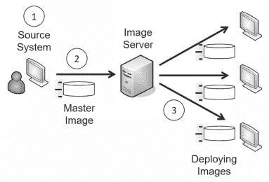

图 5.1：镜像的捕获与部署

1. 管理员从一个空白源系统开始。他们安装并配置操作系统，安装并配置任何所需的应用程序，并修改安全设置。管理员在进入下一步之前会进行大量的测试，以确保系统运行符合预期且安全。

2. 接下来，管理员捕获镜像，使其成为他们的主镜像。`Symantec Ghost`是一种流行的镜像应用程序，而`Windows Server`版本包含了许多组织用于捕捉和部署镜像的免费工具。捕捉到的镜像就是一个文件，可以存储在服务器上或复制到外部介质（如 DVD 或外部 USB 驱动器）。

3. 在步骤 3 中，管理员将镜像部署到多个系统。在网络内部使用，管理员可以在初始部署期间将相同的镜像部署到几十个系统，或仅部署到单个系统以进行重建。镜像在目标系统上安装的配置与第 1 步创建的原始源系统相同。

管理员通常会花费大量时间来配置和测试源系统。他们遵循之前讨论的相同加固实践，并经常使用安全和配置基准。如果他们只是在教室环境等少数系统上部署镜像，可能在几小时内就能创建镜像。然而，如果他们要在组织内的成千上万系统中部署镜像，可能需要几周或几个月来创建和测试镜像。一旦创建了镜像，他们就可以以极少的管理工作快速部署。

镜像化提供了两个重要益处：

*   **安全起点**。镜像包含了系统强制要求的安全配置。部署系统的人员不需要记忆或遵循详尽的清单来确保新系统安装了所有详细的配置和安全设置。部署的镜像保留了原始镜像的所有设置。管理员在部署镜像后仍需配置某些设置，例如计算机名。

*   **降低成本**。部署镜像系统可以降低整体维护成本并提高可靠性。支持人员不需要学习几种不同的终端用户系统环境来协助终端用户。相反，他们只需要学习一种。在排除故障时，支持人员可以将精力集中在帮助终端用户上，而不是尝试学习系统配置。经理将其理解为降低系统的总拥有成本（TCO）。

许多虚拟化工具包含将镜像转换为虚拟系统的能力。换句话说，一旦创建了镜像，你将其部署到物理系统或虚拟系统。从安全的角度来看，如何部署没有区别。如果你已经对部署到物理系统的镜像进行了锁定，那么你就对部署到虚拟系统的镜像进行了锁定。

镜像化不仅限于桌面电脑。你可以对任何系统进行镜像，包括服务器。例如，考虑一个在大数据中心维护 50 台数据库服务器的组织。该组织可以使用镜像部署新服务器，或作为其灾备恢复计划的一部分来恢复故障服务器。与从头构建服务器相比，部署镜像来重建故障服务器要快得多。如果管理员保持镜像更新，这有助于确保恢复的服务器以安全状态启动。

## 韧性与自动化策略

韧性和自动化策略包括自动化、脚本和模板，它们可以帮助安全地部署系统并保持其安全状态。例如，管理员经常在`Microsoft`域中使用`Group Policy`来自动检查和配置系统。第 2 章深入讨论了`Group Policy`的使用。它通过应用安全和其他设置提供自动化的措施。

此外，`Microsoft`创建了具有不同安全级别的安全模板。管理员可以修改这些模板以适应其需求，将它们导入`Group Policy Object`（`GPO`），然后将其应用于域内的系统。某些组织将主镜像部署到所有系统，然后使用安全模板根据不同的安全需求为不同的系统组自动应用不同的安全设置。

## 安全基准与完整性测量

基准是一个已知的起点，组织通常使用安全基准为系统提供已知起点。安全基准的主要益处之一是它们提高了系统的整体安全态。弱的安全配置是一个常见的安全问题，但安全基准有助于消除这一问题。

基准的使用分为三个步骤：

1.  **初始基准配置**。管理员使用各种工具以一致的安全状态部署系统。

2.  **针对基准偏离的完整性测量**。自动化工具监控系统是否存在任何基准变化，这是一个常见的安全问题。某些工具如`vulnerability scanners`监控系统并报告它们检测到的任何更改。其他工具如`Group Policy`在检测到更改时，会自动将系统重新配置为基准设置。

3.  **修复**。第 4 章“保护你的网络”涵盖了网络访问控制（`NAC`）。`NAC`方法可以检测基准设置的更改，并自动将系统隔离或在修复网络中。通常，管理员需要手动修正这些系统中的问题。

### 记住

主镜像为系统提供了一个安全的起点。管理员有时使用模板或其他工具创建主镜像以建立安全基准。然后他们使用完整性测量来发现系统何时偏离基准。

## 补丁管理

软件是不安全的。我直说了。作为一个多年来编写过一些程序的人，说这话并不容易。在一个完美的世界里，广泛的测试本该发现所有导致众多问题的漏洞、利用程序和安全缺陷。

然而，由于操作系统和应用程序包含了数百万行代码，测试根本无法发现所有问题。相反，大多数公司在发布软件前会尽力进行测试。随后，随着问题的不断浮现，公司会编写并发布补丁或更新。管理员必须应用这些补丁，以保持系统处于最新状态，并免受已知漏洞的威胁。

补丁管理确保系统和应用程序保持最新的补丁状态。这是减少操作系统和应用程序漏洞的最有效的方法之一，因为它保护系统免受已知漏洞的侵害。补丁管理包含了一组方法论，涵盖识别、下载、测试、部署和验证补丁的过程。

在对补丁进行测试后，管理员将其部署。不过，他们并不是手动部署补丁。相反，他们使用系统管理工具以受控的方式部署补丁。例如，`Microsoft System Center Configuration Manager`（`SCCM`也称为`ConfigMgr`）是一种用于许多用途的系统管理工具，包括补丁管理。

除了部署补丁外，系统管理工具还包含一个验证组件，用于验证补丁的部署。它们定期查询系统并检索已安装补丁和更新的列表。然后将检索到的列表与已部署的补丁和更新列表进行对比，对任何差异提供报告。在某些网络中，管理员会将此与网络访问控制（`NAC`）技术相结合，并将未打补丁的系统隔离在隔离网络中，直到它们被修复。

### WannaCry 勒索软件攻击了未打补丁的系统（侧边）

2017 年 5 月，攻击者在几天内发起了攻击，感染了 150 多个国家的 20 万多台计算机。当用户登录时，他们看到了 WannaCry 勒索软件信息：“哎，您的文件已加密！”该信息要求在三天内支付 300 美元，六天后赎金翻倍，并威胁如果用户不支付将在七天后删除文件。

然而，如果用户遵循一个简单的安全实践——保持系统使用最新的补丁更新，这完全是可以避免的。WannaCry 勒索软件利用了`Microsoft Windows`系统中的一个已知漏洞，但`Microsoft`在攻击发生两个月前就发布了该漏洞的更新。打过补丁的系统未受到攻击。未打补丁的系统则非常脆弱。

## 变更管理策略

许多网络最大的敌人是不受约束的管理员。一个善意的管理员可能会为了修复一个问题而做出看似微小的更改，结果在另一个地方引发了重大问题。配置错误可能会导致服务器宕机、禁用网络、停止电子邮件通信，甚至停止整个企业的网络流量。

例如，我曾见过当管理员在排除打印机故障时发生过重大停机。在修改了打印机的互联网协议（`IP`）地址后，打印机开始工作了。听起来很成功，不是吗？遗憾的是，新的`IP`地址与分配给域名系统（`DNS`）服务器的`IP`地址相同，导致了地址冲突。冲突导致`DNS`服务器无法将名称解析为`IP`地址。这导致了严重的网络中断，直到另一位管理员发现并纠正了问题。

这些自造成的灾难在 IT 早期相对常见。今天它们仍然发生，但拥有成熟变更管理流程的机构这类问题会较少。变更管理定义了任何类型的系统修改或升级过程，包括应用程序的更改。它提供了两个核心目标：

*   确保 IT 系统的更改不会导致意外的宕机

*   提供一种计数结构或方法来记录所有更改

当建立了变更管理计划时，管理员被认为在提交更改进行审查和批准之前不应进行配置更改。换句话说，他们不会在识别出潜在更改需求时立即进行更改。这包括对系统、应用程序、补丁或其他任何更改进行任何类型的配置更改。相反，他们在更改之前会遵循变更管理流程。

来自组织不同部门的专家会审查变更请求，并决定批准或推迟。该过程通常会快速批准简单的更改。正式的变更评审委员会定期审查被推迟的请求，并可以批准、修改或拒绝更改。整个过程为已批准的更改提供了文档。例如，某些自动化变更管理系统为所有变更请求创建审计日志。系统跟踪从开始到实施的整个过程。管理员使用这些文档进行配置管理和灾难恢复。如果修改后的系统故障，变更和配置管理文档将标识如何将系统恢复到故障前的状态。

### 记住这一点

补丁管理程序确保操作系统和应用程序拥有最新的补丁。这保护系统免受已知漏洞的侵害。变更管理定义了处理修改和升级的过程及计数结构。其目标是减少与意外宕机相关的风险，并为所有更改提供文档。

## 未授权软件与合规违反

一个常见的安全问题是使用未经授权的软件，会导致许多不同的问题。最常见的问题是非法软件通常包含恶意软件。当用户安装软件时，他们也在安装恶意软件。

另一个问题与支持有关。安装非法软件的用户通常在遇到问题时希望 IT 部门帮助他们。然而，IT 部门人员无法成为所有领域的专家，这会分散他们处理其他任务。与使用非法软件相关的另一个常见安全问题是许可证合规性违反。例如，想象一个组织购买了 10 个某个应用程序的许可证。9 个用户安装了该软件并在他们的系统中激活了它。Bart 发现了密钥并决定在自己的计算机上安装该软件，尽管他的工作并不需要。

后来，组织雇佣了 Maggie。IT 人员为她准备了一台新电脑并尝试激活应用程序，但失败了，因为第十个许可证已被占用。这导致 Maggie 无法使用该应用程序。

某些应用程序会验证密钥是否有效，但它们并不一定检查密钥是否在使用。如果 IT 人员成功在 Maggie 的计算机上安装并激活了软件，会导致组织许可证合规性的完整性损失。如果应用程序开发者发现该组织违反了许可证要求，该组织可能会面临罚款和处罚。

## 应用程序白名单与黑名单

白名单和黑名单是用于保护主机（包括工作站、服务器和移动设备）的两种额外方法。应用程序白名单是允许在系统上运行的应用程序列表。应用程序黑名单是系统拦截的应用程序列表。

你可以使用微软组策略中的“软件限制策略”（Software Restriction Policies）对域内的计算机进行白名单和黑名单管理。对于白名单，你识别可以在系统上运行的应用程序，而`Group Policy`会阻止所有其他应用程序。对于黑名单，你识别不能在系统上运行的应用程序，而`Group Policy`则允许任何其他应用程序。

同样，许多移动设备管理（MDM）应用程序也使用应用程序白名单和黑名单来允许或阻止移动设备上的应用程序。MDM 将在本章的稍后部分讨论。

当用户由于白名单或黑名单无法安装应用程序时，他们看到的消息有时是晦涩的。当用户尝试安装不在白名单中的应用程序时，系统通常会报告权限问题，或者有时仅以模糊的错误失败。然而，应用程序日志通常会包含安装失败原因的详细信息。

> 记住这一点

> 应用程序白名单是授权软件列表，它可以防止用户安装或运行不在列表中的软件。应用程序黑名单是未经授权的软件列表，它可以防止用户安装或运行列表中的软件。

## 安全暂存与部署

安全系统设计中的另一个概念是安全暂存和部署概念。这些包括沙箱、环境控制、使用安全基准以及执行完整性测量。

### 使用 VM 进行沙箱

沙箱是使用系统上的隔离区域，通常用于测试。第 1 章介绍了虚拟机（VMs）的使用，你可以创建虚拟机并使其在沙箱环境中隔离。第 7 章“防御高级攻击”讨论了如何使用沙箱进行应用程序测试。

管理员和安全专业人员还使用沙箱在部署到生产网络之前测试各种安全控制措施。虚拟化为测试安全控制提供了高度的灵活性，因为环境很容易重建。例如，他们可以测试杀毒软件检测沙箱内发布的恶意软件的有效性。如果杀毒软件没有检测到恶意软件且其导致了问题，很容易将系统恢复到之前的状态。此外，沙箱内的隔离防止了恶意软件的传播。

同样，虚拟沙箱对于测试补丁非常有用。例如，软件供应商通常会开发软件更新和补丁，但在发布之前需要在各种环境中对其进行测试。他们可以为多个操作系统创建虚拟机。当准备好测试时，他们启动其中一个虚拟机，拍摄快照，然后应用并测试补丁。如果补丁导致了问题，他们可以轻松恢复虚拟机。

### 使用 Chroot 进行沙箱

另一种沙箱方法是基于 Linux 的`chroot`命令。它用于更改应用程序的根目录，从而有效地将其隔离。通常，Linux 的根目录被指定为`/`，所有其他目录都可以从这里访问。用户通常在`/home`目录下有自己的主目录。例如，Lisa 在 Linux 系统上的根目录可能是`/home/lisa`。普通用户没有访问根目录的权限，只能访问其目录内的文件。相比之下，root 用户（或管理员）拥有根权限，可以访问驱动器上的所有文件和文件夹。

假设 Lisa 是一个 root 用户并想要在一个隔离区域内测试应用程序。她可以在她的环境中创建一个名为`testing`的目录，路径为`/home/lisa/testing`。她会将她的应用程序文件以及任何其他需要的目录（如`/bin`和`/lib`目录）复制到沙箱目录。然后她将使用`chroot`在测试目录中创建隔离的沙箱。这种沙箱通常被称为`chroot`狱。

此时，她输入的任何命令只能访问`/home/lisa/testing`目录内的文件。此外，她的应用程序只能访问具有相同路径的文件。如果应用程序是恶意的或有 bug 的，它无法访问任何系统文件。

### 安全暂存环境

安全暂存环境包含多个环境，通常包括用于每个阶段的不同系统。例如，想象一个软件开发团队正在创建一个用于通过互联网销售产品的应用程序。不同的环境如下：

*   **开发 (Development)**：软件开发人员使用开发环境创建应用程序。这通常包括版本控制和变更管理控制，以跟踪应用程序开发。

*   **测试 (Test)**：测试人员对应用程序进行测试，并尝试发现任何 bug 或错误。测试环境通常不模拟完整的生产环境，而是包含足够的硬件和软件来测试软件模块。

*   **暂存 (Staging)**：暂存环境模拟生产环境，用于后期测试。它提供了一个完整但独立的生产环境副本。

*   **生产 (Production)**：生产环境是最终产品。它包含了支持应用程序并允许客户及其他人使用它的所有内容。在示例中，它将包含运行的 Web 服务器、可能的后端数据库服务器以及 Internet 访问。

安全系统设计包含了安全暂存和部署。

> 记住这一点

> 沙箱是使用隔离区域，通常用于测试。你可以通过虚拟机（VM）和在 Linux 系统上使用`chroot`命令创建沙箱。一个安全的部署环境包含了开发、测试、暂存和生产元素。

## 外围设备

在实施安全系统设计时，组织应该考虑使用各种计算机外围设备，包括以下：

*   **无线键盘和无线鼠标**：无线传输有时会被截获。如果在使用处理敏感数据的系统中使用这些设备，那么使用有线设备可能更明智。

*   **显示器**：如果显示器显示敏感或隐私数据，应限制其视野。例如，不应让其从窗外看到。此外，可以在显示器上放置隐私屏以限制信息的查看，除非有人直视显示器。

*   **外部存储设备**：外部存储设备包括任何具有内存能力的外部设备。它通常指外部 USB 驱动器，但也包括智能手机、平板电脑、MP3 播放器和数字相机等设备。用户可以将它们插入系统并在系统之间轻松复制数据。它们可以在用户不知情的情况下传输恶意软件，并成为数据泄露的源。恶意用户可以使用易于隐藏的优盘复制并盗取大量信息。此外，用户可能会丢失这些驱动器，数据可能很容易落入他人手中。许多组织通过技术策略阻止使用任何外部设备。

*   **数字相机**：数字相机通常内置存储，并支持通过插入内存卡进行额外的存储。它们面临着与任何外部存储设备相同的风险。

*   **支持 Wi-Fi 的 MicroSD 卡**。传统的 Micro 安全数字（SD）卡需要插入端口才能读取数据。它们通常用于数字相机。然而，较新的 MicroSD 卡包含了无线功能。与任何无线设备一样，其风险在于无线传输可能被截获，因此如果必须使用这些设备，应该配置强有无线安全设置。

*   **打印机和其他多功能设备 (MFDs)**。MFD 通常具有一些在购买时应考虑的额外功能，特别是当它们将处理敏感信息时。这些设备通常带有嵌入式系统，其风险将在本章稍后讨论。此外，它们通常具有内部存储器，可能会保留处理过的文档。例如，如果该设备被用于复制或扫描文档，文档的副本可能会留在系统的内部内存中。

## 硬件与固件安全

在实施安全系统设计时，评估若干硬件元素也是重要的，包括本节涵盖的内容。此外，组织还应该评估供应链。供应链包含了生产产品所需的所有元素。在安全设计中，产品本身就是一个安全系统。


已经出现过许多新电脑出货时带有恶意软件的事件。例如，微软研究人员在中国购买了几台新电脑，发现它们被感染了`Nitol`病毒。这些电脑还运行着假造版的`Windows`。这说明了从信誉良好的来源购买电脑。

### EMI 和 EMP

在设计系统时，考虑电磁干扰（EMI）和电磁脉冲（EMP）非常重要。`EMI`来自电机、电源线和荧荧灯等来源，并可以干扰通过电线传输的信号。第 9 章“实施控制措施以保护资产”讨论了有助于防止`EMI`引起问题的屏蔽技术。在设计过程中包含屏蔽比在后期添加屏蔽要容易。

EMP 是电磁能量的短脉冲。`EMP`可以来自各种来源，某些来源会对计算设备造成损坏。某些来源包括：

- **静电放电 (ESD)**。基本的`ESD`防护措施（如使用`ESD`防静手带）有助于防止`ESD`损坏。
- **闪电**。闪电脉冲可以穿过电线损坏不受保护的系统。浪涌保护方法（如浪涌保护插座）保护电气系统。
- **军事武器**。核爆炸会产生巨大的`EMP`，可以损坏区域内的电子设备（包括嵌入式系统）。某些非核武器被设计用来模拟核`EMP`，但没有核爆炸。非核`EMP`的范围比核`EMP`小，但仍能损坏设备。众知的最佳保护方法是关闭设备，但你不太可能知道这些爆炸何时会发生。

**记住这一点**

> 安全系统设计考虑了电磁干扰（EMI）和电磁脉冲（EMP）。`EMI`来自电机、电源线和荧荧灯等来源，可以通过屏蔽来防止。系统可以免受轻微`EMP`（电磁能量短脉冲）的影响，例如静电放电和闪电。

### FDE 和 SED

全盘加密 (FDE) 对整个磁盘进行加密。有多种应用程序可以实现此。例如，`VeraCrypt`是一个开源工具，可以加密分区或整个存储设备。

许多硬件供应商现在制造基于硬件的`FDE`驱动器。这些有时被称为自加密驱动器 (`SEDs`)。`SED`包含了加密驱动器所有数据以及安全存储加密密钥的硬件和软件。这些设备通常允许用户在设置驱动器时输入凭据。当用户启动系统时，他们再次输入凭据以解密驱动器并启动系统。

### UEFI 和 BIOS

基本输入输出系统 (`BIOS`) 包含了为计算机提供如何启动的基本指令的软件。它运行一些基本检查，定位操作系统并启动。`BIOS`通常被称为固件。它是一个物理上可见且可触摸的硬件芯片，并包含了在计算机上执行代码的软件。硬件和软件的结合就是固件。

较新的系统使用统一可扩展固件接口 (`UEFI`) 代替`BIOS`。`UEFI`执行许多与`BIOS`的功能，但提供了一些增强。例如，它可以从更大的磁盘启动，并且设计为不依赖于 CPU。

`BIOS`和`UEFI`都可以通过名为“刷写”（flashing）的过程进行升级。刷写是用新软件覆盖芯片内的软件。

### 可信平台模块

可信平台模块 (`TPM`) 是计算机主板上的一个硬件芯片，用于存储用于加密的加密密钥。许多笔记本电脑包含`TPM`，你可能在许多移动设备上也能看到它们。然而，如果系统不包含`TPM`，则无法添加。一旦启用，`TPM`即可提供全盘加密功能。它会保持硬盘锁定或密封状态，直到系统完成系统验证和身份验证过程。

`TPM`支持安全启动和远程证明过程。当配置`TPM`时，它捕获用于启动计算机的关键文件的签名，并将签名报告安全地存储在`TPM`内部。当系统启动时，安全启动过程会根据存储的签名对文件进行检查，以确保它们没有发生变化。如果它检测到文件已被修改（例如来自恶意软件），它将阻止启动过程以保护驱动器上的数据。

远程证明过程的工作原理与安全启动过程类似。然而，它不是通过`TPM`中存储的报告来检查启动文件，而是使用一个独立的系统。同样，当配置`TPM`时，它捕获关键文件的签名，但会将此报告发送到远程系统。当系统启动时，它检查文件并将当前报告发送到远程系统。远程系统验证文件是否相同，并证明（或确认）系统是安全的。

`TPM`出厂时带有一个烧入其中的唯一`Rivest, Shamir, Adleman (RSA)`私钥，用于非对称加密。该私钥与公钥匹配，并提供硬件根信任，或一个已知的安全起点。私钥保持私密并与公钥匹配。此外，`TPM`还可以生成、存储和保护用于加密解密磁盘的其他密钥。第 10 章“理解加密和 PKI”更深入地讨论了非对称加密以及公、私钥。

如果系统包含`TPM`，你使用操作系统内的应用程序来启用它。例如，许多微软系统包含`BitLocker`，你可以为包含`TPM`的系统启用它。

`BitLocker`使用`TPM`作为平台验证过程的一部分，检测任何关键操作系统文件或进程的篡改。此外，用户需要提供身份验证，例如使用智能卡、密码或个人识别码 (`PIN`)。在平台验证和用户身份验证过程完成之前，驱动器将保持锁定状态。

如果小偷偷走了系统，硬盘仍将保持锁定和保护状态。攻击者没有身份验证凭据，因此他们无法通过正常的启动过程访问硬盘。如果攻击者尝试修改操作系统以绕过安全控制，`TPM`会检测到篡改并保持硬盘锁定状态。如果小偷将硬盘移动到另一个系统，由于`TPM`不可用，硬盘仍将保持锁定状态。

### 记住

可信平台模块（`TPM`）是包含在许多笔记本电脑和移动设备中的一种硬件芯片。它提供全盘加密，并支持安全启动过程和远程证明。`TPM`包含一个烧录在芯片中的唯一`RSA`非对称密钥，提供了硬件信任根。

### 硬件安全模块

硬件安全模块（`HSM`）是一种安全设备，你可以将其添加到系统中，用于管理、生成和安全存储加密密钥。高性能的`HSMs`是通过`TCP/IP`连接到网络的外部设备。较小的`HSMs`以扩展卡的形式安装在服务器内部，或者以插入计算机端口的设备形式存在。

`HSMs`支持与`TPM`相似的安全方法。它们提供硬件信任根、安全启动，并可以配置远程证明。

`HSM`和`TPM`之间值得注意的区别之一是`HSMs`是可拆卸或外部设备。相比之下，`TPM`是嵌入主板的芯片。你可以轻松地将`HSM`添加到系统或网络中，但如果系统出厂时没有配备`TPM`，后期添加是不行的。`HSMs`和`TPMs`都通过存储和使用`RSA`密钥提供安全的加密能力。许多高性能服务器使用`HSMs`来存储和保护密钥。

### 记住

硬件安全模块（`HSM`）是一种可拆卸或外部设备，可以生成、存储和管理用于非对称加密的`RSA`密钥。许多基于服务器的应用程序使用`HSM`来保护密钥。

### 额外的漏洞

组织需要避免两个问题：与寿命结束系统相关的漏洞以及缺乏供应商支持。当系统达到寿命结束时，在丢弃它们之前，你需要确保它们上没有任何价值数据。第 11 章“实施策略以降低风险”讨论了几种清理方法。

此外，当供应商停止支持某个系统、操作系统或应用程序时，就是开始使用其他东西了。例如，考虑`Windows XP`。它在 12 年里都是非常出色的操作系统，现在可能仍在许多计算机上运行良好。然而，微软已 2014 年 4 月 8 日停止了对其支持。这意味着他们不再对其提供安全更新或技术支持。2014 年 4 月 8 日之后的任何新漏洞都将无法得到修复。

# 总结云概念

云计算是指通过比你本地计算机不同的位置访问计算资源。在大多数情况下，你通过互联网访问这些资源。

例如，如果你使用如`Gmail`等基于网页的电子邮件，你就在使用云计算。具体来说，基于网页的邮件是一种软件即服务（SaaS）云计算服务。你知道你正在通过互联网访问电子邮件，但你并不知道托管你账户的物理服务器位于何处。它可能位于弗吉尼亚州的一个数据中心，也可能隐藏在犹他州，或者世界上任何其他地方。

云存储对个人和组织来说都变得非常流行。例如，Apple 提供`iCloud`存储，微软提供`OneDrive`，Google 提供`Google Drive`。你通常可以获得一些免费存储，或者支付极低的费用获得更多存储。随着他们继续提供更多存储空间，他们的价格不断下降。

被大量使用的系统和网络通常依赖云计算资源来处理增加的负载。例如，考虑美国最大的购物日——黑色星期五（感恩节的第二天），零售商希望在这一天扭亏为盈。几年前，`Amazon.com`在感恩节周末期间流量巨大，以至于其服务器几乎无法处理。不过，公司吸取了教训。明年，它利用云计算租赁了专门用于感恩节周末的服务器访问权限，尽管销售额增加了，但它没有出现任何问题。

正如许多伟大的创新者一样，Amazon 没有将这种情况视为问题，而是将其视为机会。如果它对其密集使用的系统需要云计算，其他公司可能也有同样的需求。Amazon 现在通过其`Amazon Elastic Compute Cloud`（`Amazon EC2`）服务向其他组织托管云服务。`Amazon EC2`将虚拟化与云计算相结合，他们目前通过`Amazon EC2`提供各种类型的服务。

作为比较，组织也可以使用本地部署或托管服务：

* **本地（On-premise）**：所有资源都在组织的建筑内或建筑群内拥有、运行和维护。
* **托管（Hosted）**：组织可以从特定组织租赁资源。注意，托管服务和云服务之间的界限是模糊的。在某些情况下，你确切知道服务的所在地。但在大多数情况下，托管服务位于云端某处。

## 软件即服务

软件即服务（`SaaS`）包括通过互联网等网络向用户提供的任何软件或应用程序。互联网用户使用网页浏览器访问`SaaS`应用程序。客户使用哪种网页浏览器或操作系统并不重要。他们可以使用`Microsoft Edge`、`Chrome`、`Firefox`或几乎任何网页浏览器。

如前所述，基于网页的电子邮件是`SaaS`的示例。这包括`Gmail`、`Yahoo! Mail`等。该服务通过简单的网页浏览器为用户提供电子邮件的所有组件。

如果你有一个`Gmail`账户，还可以使用`Google Docs`，这是另一个`SaaS`示例。`Google Docs`提供对多个`SaaS`应用程序的访问，允许用户通过浏览器打开文本文档、电子表格、演示文稿、图表和`PDF`文件。

不久前，一位才华的开发者和我合作了一个项目。他是一个运行`macOS`的苹果粉，而我是一个运行`Windows`的微软粉，而且我们住在不同的州。然而，我们通过`Google Docs`发布和共享文档，尽管位置不同且个人系统运行的应用程序不同，我们仍然能够轻松地协作。一个风险是，我们的数据托管在`Google Docs`上，如果攻击者黑入`Google Docs`，我们的数据可能会遭到破坏。

## 平台即服务

平台即服务（`PaaS`）为客户提供一个预配置的计算平台，他们可以根据需要使用。它为客户提供易于配置的操作系统，结合适当的应用程序和按需计算。

许多云供应商将此称为托管硬件解决方案。例如，我通过`Liquid Web`（`http://www.liquidweb.com/`）使用其“全托管”方案之一，在虚拟服务器上托管了`http://gcgapremium.com/`。

Liquid Web 在其全托管解决方案中提供了多种功能，包括已安装的操作系统、用于 Web 服务器的核心软件包、作为 Web 服务器的 Apache、防病毒软件、垃圾邮件保护等。此外，他们会通过相关的更新和补丁保持操作系统的最新状态。我负责管理网站使用的软件，包括软件更改和更新。然而，我不需要担心管理服务器本身。当服务器出现问题的几次，他们甚至在我意识到问题之前就已经修复了。

## 基础设施即服务 (IaaS)

基础设施即服务 (IaaS) 允许组织外包其设备需求，包括硬件和所有支持操作。IaaS 服务提供商拥有设备，将其放置在自己的数据中心，并执行所有所需的硬件维护。客户本质上是租用设备访问权限，并通常按使用付费。

许多云提供商将此称为“自托管解决方案”。他们提供带有默认操作系统安装的服务器访问权限，但客户必须根据自己的需求对其进行配置并安装额外的软件。此外，客户还负责所有的操作系统更新和补丁。

如果一个组织发现很难在自己的数据中心管理和维护服务器，那么 IaaS 也会很有用。通过外包需求，公司限制了其硬件足迹。这作为虚拟化部分服务器的替代方案或额外手段。通过 IaaS，它们在数据中心需要更少的服务器以及更少的资源，例如电力、空调（HVAC）和管理服务器的人员。

### 记住这个

通过互联网提供的 Web 电子邮件等应用程序是软件服务 (SaaS) 云技术。平台即服务 (PaaS) 为客户提供一个全托管平台，供应商保持该平台使用当前的补丁更新。基础设施即服务 (IaaS) 为客户提供在自托管平台中访问硬件的权限。

## 云模型中的安全责任

云服务模型中一个重要的考虑因素是分配给云服务提供商 (CSP) 和客户的安全责任之间的差异。图 5.2（源自美国国防部 (DoD) 的《云计算安全需求指南》中的图 1）显示了 SaaS、PaaS 和 IaaS 在责任数量上的差异。这包含了维护责任也包含了安全责任。

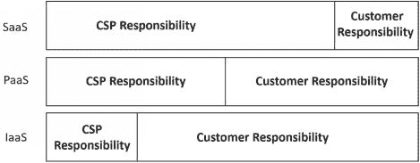

图 5.2：云模型中的安全责任

以 SaaS 为例，考虑 Gmail。Google 承担着维护该应用程序并确保其可用性的首要责任。此外，Google 还承担确保 Gmail 安全性的首要责任。如果你使用它，你仍然承担某些责任，例如确保你使用与其他在线账户不同的强密码。

对于 PaaS 解决方案，CSP 负责为你提供平台并确保其保持可用。许多 CSP 提供额外的安全保护，例如防火墙、恶意软件内容过滤器和入侵检测系统。尽管如此，客户对平台的操作、配置和安全仍承担着极大的责任。

与 PaaS 和 SaaS 相比，CSP 对 IaaS 解决方案承担的责任最小，而客户承担的责任最多。

## 安全服务 (SECaaS)

云计算的另一个切入点是安全服务。它包括通过云提供的任何提供安全服务，通常被视为软件服务 (SaaS) 模型的一个子集。

安全服务的一个常见例子是防病毒软件。假设广播电台 W-KOMA 决定为其八名员工购买防病毒软件。他们从防病毒公司购买访问软件的许可。然后，每个员工都配置其系统使用其个人许可的该软件。一旦安装，软件会自动下载病毒定义，保持每个用户的系统都是最新的，而无需用户亲自操作。

安全服务的一个关键优势是它外包了与实施服务相关的管理任务。此外，专业人员专注于所提供的特定安全服务，消除了员工需要成为各方面专家的需求。

使用云资源的组织通常会添加云访问安全代理 (CASB) 来获得额外的安全性。这是一个部署在组织网络和云提供商之间的软件工具或服务。它监控所有网络流量并可以执行安全策略。例如，它可以确保存储在云中的所有数据都经过加密。

## 云部署模型

云部署模型有四类：公有、私有、社区和混合。这些模型识别了谁有权访问云基础设施。

公有云服务可从第三方公司（如亚马逊、谷歌、微软和苹果）获得。他们向任何愿意付费的人提供类似的服务。

私有云是为特定组织设置的。例如，谢尔比维尔核电厂可能决定它想在云中存储数据，但不想使用第三方供应商。相反，该电厂选择托管自己的服务器，并通过互联网向内部员工提供这些服务器。

具有共同关注事项的社区（如目标、安全需求或合规性考虑）可以在社区云内共享云资源。例如，想象谢尔比维尔核电厂和斯普林菲德市内的几所学校决定在云中共享教育资源。它们可以为云提供资源，并且只有社区内的组织才有权访问这些资源。

尽管，并非所有的云实现都完全符合这些定义。混合云是两个或多个云的结合。它们可以是私有的、公有的、社区的或这些者的组合。它们保留独立的身份，以帮助保护私有云中的资源。然而，它们被桥接在一起，通常是以一种对用户透明的方式连接的。

### 记住这个

云访问安全代理 (CASB) 是部署在组织网络和云提供商之间的软件工具或服务。它通过监控流量和执行安全策略来提供安全服务。私有云仅供一个组织使用。公有云服务由第三方提供并供任何人使用。社区云由多个组织共享。混合云是两个或多个云的结合。

# 安全地部署移动设备

移动设备给今天的组织带来了重大挑战。组织需要确定员工是否可以将移动设备连接到网络。如果是，组织需要识别管理设备相关安全的方法，以及如何监控设备并执行安全策略。

什么是移动设备？在 CompTIA Security+ 考试的背景下，你可以将移动设备视为智能手机或平板电脑。此外，NIST SP 800-124《企业移动设备安全管理指南》提到移动设备具有额外的特征，例如至少一个无线网络接口、本地数据存储、操作系统（不是全功能的桌面或或笔记本电脑操作系统）以及安装额外应用程序的能力。

移动设备通常具有其他可选功能。这包括其他网络选项，如蓝牙、近场通信（NFC）、用于语音通信的蜂窝网络以及全球定位系统（GPS）服务。它们通常包含数字摄像头、视频录制机、麦克风，以及将数据传输到其他系统（如传统计算机）或其他移动设备的能力。

`NIST`的定义除了许多设备。例如，在这一定义下，笔记本电脑不被视为移动设备。笔记本电脑拥有完整的操作系统，并且可以使用许多安全控制措施，而这些是智能手机和平电脑不具备的。此外，基础手机和数字相机也不包含在此定义内，因为它们无法访问网络，且不受与智能手机和平电脑相同的风险的影响。

## 部署模型

任何连接到组织网络的设备都代表着潜在的风险。作为一个简单的例子，如果有人将感染的设备连接到网络，它可能会感染网络上的其他设备。为了限制这种风险，组织会采取措施来监控和管理移动设备。

如果组织拥有所有连接到网络的设备，监控和管理它们就是很容易的事。然而，如果设备由员工拥有（例如他们自己的智能手机），那么监控和管理这些设备就会变得更具挑战性。例如，员工希望使用自己的设备访问网络资源，但他们有时反感让组织监控和管理他们的个人设备。

以下列表识别了一些常见的移动设备部署模型。请注意，在某些模型中组织拥有设备，而在其他模型中，员工拥有设备：

* **公司所有（Corporate-owned）**。在这种传统的部署模型中，组织购买设备并将其分配给员工。
* **COPE（公司所有，个人启用）**。`COPE`与传统的公司所有模型相似，但主要区别是员工可以自由地像个人设备一样使用它。这允许员工在连接到组织网络的同时，还能将设备用于个人活动。由于组织拥有这些设备，因此管理它们变得更容易。


**BYOD（自带设备）**。一些组织允许员工携带自己的移动设备上班并将其连接到网络。员工负责选择和支持该设备，并且在设备连接到网络时通常必须遵守`BYOD`策略。虽然对于员工来说这很简单，但在 IT 专业人士中，这有时被称为“自带灾难”（bring your own disaster）。因为员工可能拥有任何可能的设备，IT 部门现在负责支持、监控和管理员工拥有的任何可能的设备。

**CYOD（自选设备）**。为了避免支持任何可能的移动设备方面相关的某些挑战，一些组织创建了一个认可设备列表并配合`CYOD`策略。员工可以购买列表上的设备并带去上班。这为 IT 部门提供了一份他们需要支持、监控和管理的特定设备列表。

**VDI（虚拟桌面基础设施）**。第 1 章讨论了`VDIs`，它们在服务器上托管用户的桌面操作系统。虽然这些通常由网络内的传统计算机访问，但也可以部署用户可以使用移动设备访问的`VDI`。这允许用户访问安装在其桌面上的任何应用程序。当组织托管诸如虚拟专用网络（`VPN`）之类的远程访问解决方案时，只要用户有互联网访问，就可以从任何地方访问移动`VDI`。

### 记住这些

公司所有、个人启用（`COPE`）设备归组织所有，但可以出于个人原因使用。自带设备（`BYOD`）策略允许员工将个人设备连接到公司网络。自选设备（`CYOD`）策略包含一份认可设备列表。拥有列表设备的员工可以将其连接到网络。虚拟桌面基础设施（`VDI`）是一个虚拟桌面，可以创建这些桌面以便用户从移动设备进行访问。

## 连接方法

移动设备可以使用多种方法连接到网络和其他设备。它们包括：

**蜂窝网络（Cellular）**。智能手机（以及许多平板电脑）具有连接蜂窝网络的能力，例如第三代（`3G`）、长期演进（`LTE`）、第四代（`4G`）或`4G LTE`网络。你连接的网络类型取决于你的移动运营商。新一代通常为数字传输提供更高的速度并改进语音通信。

**Wi-Fi**。移动设备几乎都有无线网络接口，你可以配置它以连接到无线网络。第 4 章讨论了常见的无线安全方法和无线协议。典型的无线网络需要你输入或选择服务集标识（`SSID`）并输入预共享密钥或密码以访问网络。更安全的网络使用带有`802.1x`服务器的企业级认证模式。

**卫星通信（SATCOM）**。某些移动设备支持使用卫星通信（`SATCOM`）连接网络。`SATCOM`最常用的地方是手机而非平板电脑。不过，你可以购买卫星热点。你可以将移动设备连接到热点，热点通过卫星连接提供互联网和语音访问。此外，某些车辆包含了卫星通信技术，可用于通话，有时还用于共享互联网访问。

**蓝牙（Bluetooth）**。大多数移动设备都支持蓝牙。`Bluetooth`是一种常用个人区域网的无线协议。例如，大多数智能手机都支持使用`Bluetooth`耳机进行免提通话。此外，某些技术使用蓝牙连接两部智能手机。例如，苹果的`AirDrop`使用蓝牙创建对点网络。这使得在两部手机之间交换照片或视频等文件变得简单。

**NFC（近场通信）**。`NFC`最常用作支付网关，让你只需在零售商的`NFC`读卡器前挥动手机即可付款。你也可以通过`NFC`在两个设备之间建立对点网络。例如，`Android Beam`允许两个使用`Android`设备的用户通过背背设备来共享屏幕上显示的数据。某些应用程序使用`NFC`开启两个设备上的`Bluetooth`，通过`Bluetooth`发送共享数据，然后禁用`Bluetooth`。

**ANT**。`ANT`和`ANT+`是某些移动设备使用的专利无线协议。虽然它看起来像一个缩写，但在`ANT Wireless`网站（`https://www.thisisant.com/`）并没有列出全称。许多运动和健身传感器（如`Fitbit`）收集用户数据（如心率、步数等），并使用`ANT`将数据发送到移动设备应用程序。

**红外线**: 红外线是某些移动设备使用的视距无线技术。这与大多数电视及其他视听设备遥控器使用的技术相同。许多人会在智能手机上添加应用程序，将其用作设备的通用遥控器。只要两部手机都支持红外线，就可以通过红外线之间传输文件。

**USB（通用串行总线）**: 移动设备通常可以通过 USB 线连接到台式 PC 或笔记本电脑。大多数 Apple 设备具有 Lightning 端口，可以通过 Lightning 转 USB 线连接到 PC。许多 Android 设备具有 mini-USB 线，可以通过 mini-USB 转标准 USB 线连接到 PC。

## 移动设备管理

移动设备管理（MDM）包含了用于管理移动设备的设备。其目标是确保这些设备实施了安全控制以保持其安全。

系统管理工具，例如 Microsoft System Center Configuration Manager（`SCCM`，也称为`ConfigMgr`），可以确保系统保持最新的补丁，安装了具有最新定义库的防病毒软件，并使用标准的安全实践进行保护。虽然这些工具最初关注的是台式 PC 和笔记本电脑，但它们已经扩展到包含许多移动设备。例如，`ConfigMgr`包含了对许多移动设备的支持，包括基于 iOS 的设备和基于 Android 的设备。

MDM 应用程序帮助管理员管理移动设备。以下项目符号描述了许多适用于移动设备的 MDM 概念：

**应用程序管理**: MDM 工具可以限制在移动设备上运行的应用程序。它们通常使用应用程序白名单来控制应用程序，并防止安装未经批准的应用程序。

**全设备加密**: 加密可以防止多个平台上的机密性丢失，包括工作站、服务器、移动设备和数据传输。像全设备加密之类的加密方法提供了设备安全、应用程序安全和数据安全。虽然组织可以确保公司拥设备使用全设备加密，但在员工使用自己的设备时，这并不总是可能做到的。

**存储分段**: 在某些移动设备上，可以使用存储分段来隔离数据。例如，用户可能被要求使用外部存储存储任何公司数据，以降低设备丢失或被盗时数据丢失的风险。还可以在设备内创建单独的段。用户可以将公司数据存储在加密段中，而将个人数据存储在设备的其他地方。

**内容管理**: 在创建分段存储空间后，确保那里存储了适当的内容非常重要。MDM 系统可以确保从组织源（如服务器）检索的所有内容都存储在加密段中。此外，内容管理还可以强制用户在访问此加密段中的数据时重新进行身份验证。

**容器化**: 第 1 章讨论了应用程序单元虚拟化（也称为容器虚拟化）的使用。容器化也可以在移动设备中实现。通过在容器中运行应用程序它可以隔离并保护应用程序，包括其任何数据。当组织允许员工使用自己的设备时，这非常有用。可以加密容器以保护它，而无需加密整个设备。

**密码和 PIN**: 移动设备通常支持使用密码或个人识别码（PIN）。MDM 系统通常支持密码策略，类似于桌面系统使用的密码策略。唯一的局限性是某些移动设备仅支持 PIN，而其他设备则支持密码或 PIN。

**生物识别**: 第 2 章讨论了生物识别作为身份验证因素之一（你的特征）。许多移动设备现在都支持生物识别验证。例如，你可以教设备识别你的指纹，然后使用指纹进行验证，而不是输入密码或 PIN。

**屏幕锁定**: 大多数设备支持使用访问密码或密码来锁定设备。这类似于桌面系统上的密码保护屏幕保护程序，它在一段时间后自动锁定设备。它防止了他人轻易访问设备及其包含的数据。这通常与擦除功能结合。例如，如果有人偷了手机并输入十次错误的访问密码，智能手机将自动擦除手机上的所有数据。

**远程擦除**: 如果手机丢失，远程擦除功能非常有用。它向设备发送远程信号以擦除或删除所有数据。主可以向手机发送远程擦除信号以删除手机上的所有数据。这通过删除所有有价值的数据对设备进行彻底清理。

### 记住这一点

移动设备管理（MDM）工具帮助在移动设备上执行安全策略。这包括使用存储分段、容器化和全设备加密来保护数据。它们还包括执行强身份验证方法以防止未经的访问。

**地理定位**: 移动设备通常包含全球定位系统（GPS）功能，可用于地理定位。应用程序通常使用 GPS 识别设备位置。也可以用于定位丢失的设备。

**地理围栏**: 组织有时使用 GPS 通过地理围栏技术创建虚拟围栏或地理边界。当设备位于虚拟围栏内时，应用程序可以做出响应。例如，组织可以配置移动应用程序，使其仅在设备位于虚拟围栏内时运行。同样，组织可以配置无线网络，使其仅为定义边界内的移动设备提供服务。

**GPS 标记**: GPS 标记（也称为地理标记）在向社交媒体网站发布文件（如图片）时为之添加地理信息。例如，当你使用开启了 GPS 功能的智能手机拍照时，照片应用程序会为照片添加经纬度坐标。考虑到朋友家人，这是一个很棒的功能。然而，考虑到小偷和犯罪分子他们他们利用这些数据。例如，如果 Lisa 经常在她的家里发布亲友的照片，这些照片就识别了她的地址。如果她后来开始从度假地发布照片，小偷就能意识到她离开了，并入室盗窃。

**上下文感知身份验证**: 上下文感知身份验证使用多个元素来验证用户和移动设备。它包括用户的身份、地理定位、设备是否在地理围栏内的验证、时间以及设备类型。这些元素的结合有助于防止未经授权的用户访问应用程序或数据。

**推送通知服务**。推送通知服务从应用程序向移动设备发送消息。例如，如果 Lisa 在她的智能手机上安装了 Facebook 应用并启用了通知，Facebook 应用就会向她发送通知。软件开发人员可以配置通知，即使设备处于屏幕锁屏模式且应用程序未运行，通知也会显示。MDM（移动设备管理）应用可以发送通知来提醒用户安全设置，或让他们了解其设备是否符合安全策略要求。

### 记住这一点

远程擦除向丢失或被盗的设备发送信号以擦除所有数据。地理定位使用全球定位系统（`GPS`），可以帮助定位丢失或被盗的设备。地理围栏创建了一个虚拟的栅围栏或地理边界，可用于检测设备何时位于组织的财产范围内。GPS 标记为图片等文件添加地理数据。上下文感知认证使用多个元素来验证用户和移动设备的身份。

## 移动设备强制与监控

MDM 工具通常根据设备所有者的不同对设备进行不同的管理。如果设备由组织所有，MDM 工具通常会下载并安装所有所需的应用程序，并确保它们保持最新更新。

如果设备由员工所有，MDM 工具将监控其合规性，并在设备不符合最低要求时阻止访问网络。例如，如果设备未打补丁或没有最新的防病毒软件，MDM 软件将与网络访问控制（`NAC`）技术配合，防止设备连接到网络。以下段落识别了 MDM 可以监控和/或强制许多常见问题。

### 未授权软件

组织通常希望用户仅从批准的源获取应用。例如，所有 iPhone 和 iPad 设备都仅从 Apple App Store 获取应用。Apple 在测试这些应用程序的恶意软件方面非常积极，任何试图通过 Apple 商店分发恶意软件的开发者通常会被封禁。同样，Google 为 Android 设备维护着 Google Play 网站。

第三方应用商店是指 Apple App Store 或 Google Play 以外的。从这些第三方应用商店获取的应用程序不会像 App Store 或 Google Play 应用程序那样经过同级别的审查，风险更高。Apple 让从第三方应用商店获取应用变得困难，但对于 Android 设备，从第三方商店获取应用相对容易。

越狱（Jailbreaking）是指移除 Apple 设备上的所有软件限制。越狱后，用户可以从任何第三方源安装软件。根根（Rooting）是修改 Android 设备以赋予用户 root 级（或完全管理员）访问设备权限的过程。根化和越狱都会给设备引入风险和漏洞，因此如果 MDM 检测到设备已被根化或越狱，通常会阻止对网络的所有访问。

移动设备通常将操作系统存储在板载内存（如闪存）中，即使在没有电源的情况下也能保留数据。由于操作系统是软件而内存是硬件，这通常被称为固件。操作系统的更新使用空中下载（`OTA`）技术覆盖旧固件。固件 OTA 更新使设备保持最新状态。

也可以使用自定义固件来覆盖旧固件。有些人将此作为根化 Android 设备的另一种方法。该过程通常非常复杂且充满风险。然而，有些人发现了一些可下载的镜像并将其复制到设备上以覆盖固件。

还可以通过侧载（sideloading）在 Android 设备上安装应用程序。侧载是将应用程序包工具包（`APK`）格式的应用程序包复制到设备中然后激活它的过程。设备必须设置为允许来自`未知源`的应用程序，这会显著削弱安全性。侧载对于开发者测试应用很有用，但在安装第三方应用时被认为具有高风险。

### 记住这一点

越狱移除了 Apple 设备上的所有软件限制。根化修改 Android 设备，赋予用户 root 级访问权限。用自定义固件覆盖 Android 设备上的固件是根化 Android 设备的另一种方法。侧载是从授权商店以外的源在 Android 设备上安装软件的过程。

许多人使用短信服务，如短信息（`SMS`）和多媒体短信（`MMS`）。SMS 是许多电话和移动设备支持的基础文本消息服务。MMS 是 SMS 的扩展，允许用户包含多媒体内容，如图片、短视频、音频甚至多张图片的幻灯片。

短信通信有两个主要风险。首先，两者都以明文发送文本，允许信息被他人拦截和读取。然而，许多应用程序（如 iMessage）提供了加密功能。

第二个风险仅适用于 MMS，因为它可以发送媒体。攻击者已经发现向手机号码发送 MMS 消息并获取用户手机远程代码执行权限的方法。例如，安全研究人员识别了`Stagefright`中的漏洞，它是 Android 操作系统中的一个媒体库，容易受到攻击。2015 年，专家指出 95% 的 Android 设备都存在漏洞。目前，该漏洞在大多数设备上已得到修复。

大多数智能手机都可以存储信用卡数据并用于支付。例如，`NFC`（在本章前面已描述）通常作为某些移动设备的支付网关。在向用户发放手机时，组织需要考虑是否要在手机上设置自己的支付方式进行某些支付。如果是这样，这通常需要密切监控。

### 硬件控制

组织可能希望控制移动设备上的某些硬件，MDM 工具可以提供帮助。移动设备通常包括摄像头和录音麦克风。这些对于普通用户很有用，但对组织内的员工可能会带来巨大风险。

例如，攻击者已成功在某些第三方网站提供的应用中插入了恶意代码。当用户安装这些应用时，它允许攻击者远程连接手机、拍照、录制音频等。

为了消除风险，组织可以配置 MDM 软件禁用摄像头和录音麦克风。理想情况下，MDM 工具仅在检测到设备位于预配置的地理围栏内时禁用摄像头和麦克风。遗憾的是，并非 MDM 工具都支持根据地理位置禁用硬件。如果 MDM 工具不支持此功能，组织可能会禁止在某些区域持有智能手机。

MDM 工具还可以防止使用外部介质和通用串行总线（`USB OTG`）电缆。移动设备通常有一个或多个可以插入电缆的端口。Apple 设备具有`Lightning`端口，而 Android 设备通常具有`micro-USB`或`mini-USB`。在某些情况下，可以将外部介质（如外部驱动器）连接到设备。组织可能希望防止这种行为，因为介质会带来额外风险。它可能包含恶意软件。它还可能允许恶意内部人员拷贝大量数据。`USB OTG`电缆允许你将几乎任何设备连接到你的移动设备，包括另一台移动设备。这包括鼠标、键盘、数字乐器（`MIDI`）键盘和外部介质。许多人发现这对于将照片从数码相机传输到移动设备非常有用。同样，由于这允许连接到外部介质，组织可能会使用 MDM 工具禁用此功能。

## 未授权的连接

组织内部的管理层可能希望限制移动设备的连接。例如，如果移动设备可以连接主网络，管理层可能希望确保移动设备无法通过其他连接访问互联网。本节识别了其他可以使用 MDM 工具进行修改和拦截的连接。

大多数智能手机支持热点（tethering），这允许你与其他设备共享一个设备的互联网连接。例如，你可以将智能手机连接到互联网，然后通过此互联网连接供笔记本电脑、平板电脑或任何具有无线连接设备设备。如果员工在组织内部使用热点，将允许他们绕过防火墙和代理服务器等安全措施。想象一下 Bart 想用他的工作笔记本访问一个不宜办公的（`NSFW`）网站。代理服务器阻止了他的访问。然而，他可以将笔记本电脑热点到智能手机并访问该网站。这种直接连接还将绕过网络中的任何内容过滤器，并可能允许恶意软件进入他的笔记本。

许多移动设备还支持`Wi-Fi Direct`，这是一种允许设备在没有无线接入点或无线路由器的情况下进行连接的标准。这类似于无线自接网络（ad hoc network），它允许设备在没有无线接入点或无线路由器的情况下相互连接。区别在于`Wi-Fi Direct`使用单射频跳跃通信。换句话说，`Wi-Fi Direct`网络中的设备都无法共享互联网连接。然而，无线自接网络中的系统使用多跳无线通信，并可以共享互联网连接。

智能手机通常锁定在特定的运营商（如 Verizon 或 AT&T）。用户识别模块（`SIM`）卡标识手机将使用哪些国家和/或网络。换句话说，如果 Lisa 有一部智能手机并办理了 Verizon 套餐，她手机中的`SIM`卡将她连接到 Verizon 网络而非 AT&T 网络。

如果 Lisa 在两年合约下购买了手机并履行了套餐的所有条款，她就可以解锁手机（也称为运营商解锁）并与另一个运营商使用。组织可能希望对所有 COPE 设备禁用此功能。

**记住这一点**

> 热点共享是将移动设备的互联网连接共享给其他设备的过程。`Wi-Fi Direct`是一种允许设备在没有无线接入点或无线路由器的情况下进行连接的标准。MDM 工具可以阻止使用热点或`Wi-Fi Direct`访问的设备。

## 探索嵌入式系统

嵌入式系统是具有专用功能并使用计算机系统执行该功能的任何设备。桌面电脑、笔记本电脑和服务器都使用中央处理器（`CPUs`）、操作系统和应用程序来执行各种功能。同样，嵌入式系统使用`CPUs`、操作系统和一个或多个应用程序来执行各种功能。作为一个简单的例子，无线多功能打印机通常包含一个嵌入式系统。它运行一个你可以通过无线访问的网站，以配置打印机。当然，你也可以向它发送打印作业、扫描文档并使用打印机复制文档。许多设备还包含传真功能和通过电子邮件发送文档的功能。

### 相关人物（侧栏）


《神秘人物》（Person of Interest）是一部融合了虚构与事实的科幻电视节目，它确实对移动设备如何被攻击者破坏和利用提供了一些真实的见解。一些场景显示了 John Reese（以及剧中的其他人）使用蓝牙配对设备或向手机发送信息，然后安装恶意软件。一旦安装，Reese 和剧中的其他人对手机拥有几乎无限的访问权限。他们的一些能力包括：

- 监控所有短信
- 跟踪手机位置
- 开启麦克风偷听对话
- 监控并记录所有通话（包括电话号码）

虽然目前手机还没有任何已知方法可以做到这一点，但这些功能在过去曾经存在过。例如，在 20 世纪初，强制蓝牙配对经常可行，但安全措施已经为今天大多数（如果不是所有）智能手机关闭了这一安全漏洞。同样，Android 手机上的 MMS 漏洞允许攻击者只需通过发送 MMS 消息即可接管手机。一旦攻击者接管了手机，其他功能将变得轻而易举。

包含嵌入式系统的其他系统还有摄像头系统、医疗设备、智能电视、汽车以及冰箱、微波炉和防盗报警器系统等家用电器。每个设备可以根据其功能使用不同的`CPU`、操作系统和应用程序。

## 安全影响与漏洞

嵌入式系统的挑战是使其保持安全修复的更新。桌面电脑和服务器操作系统及应用程序经常被发现漏洞利用。当供应商发现这些漏洞时，他们会发布补丁。当你应用补丁时，系统就不再受到该漏洞的影响。相比之下，嵌入式系统的供应商在识别漏洞和创建修复它们的补丁方面没有那么积极。

此外，补丁管理是大多数组织 IT 管理员的一项日常工作。他们经常检查补丁、进行测试并在必要时应用。相比之下，普通用户多久会考虑检查或为他的冰箱应用补丁呢？

另一个重大的安全担忧是嵌入式系统以默认配置部署时。例如，想象 Homer 使用可以通过互联网访问的安全摄像头创建了一个家庭安全系统，并使用默认用户名和密码进行部署。如果攻击者发现了这些摄像头，他们就可以通过互联网访问它们。

更糟糕，如果攻击者发现了摄像头嵌入式系统中的漏洞，他们就可以利用它们。这正是攻击者在 2016 年导致互联网中断的 Dyn 网络攻击中所做的。第 7 章在“DNS 攻击”部分讨论了这次攻击。攻击者感染了摄像头和其他连接互联网的设备，并将它们加入僵尸网络。然后他们使用这些设备发起攻击。

## 嵌入式系统比较

CompTIA Security+ 目标包含了大量的嵌入式系统列表。其中一些你可能很熟悉，但另一些使用了许多人并不熟悉的缩写。以下章节描述了许多常见的嵌入式系统。

### 智能设备与物联网

智能电视（TV）是你家中可能拥有的许多智能设备之一。你可以轻松地将其连接到家的有线或无线网络，并使用它访问互联网。许多人用它在电视上流媒体节目和电影。之所以能够实现，是因为这些智能电视拥有提供额外功能的嵌入式系统。

其他智能设备包括可穿戴技术和家居自动化系统。这些智能设备组合被称为物联网（IoT）。

### 可穿戴技术

可穿戴技术近年来爆发式增长。它包括任何你可以佩戴或植入体的设备。这些设备可以用于与其他设备（如智能手机）交互。例如，Fitbit 制造了一系列你可以佩戴以监控健康和健身的产品。结合智能手机上的应用程序，人们可以深入了解自己的目标完成情况。

大多数兽医医生建议在宠物体内植入微芯片。动物收容所经常寻找这些芯片，如果找到，就能帮助宠物回到主人身边。某些芯片甚至可以用于打开宠物门。Dangerous Things 公司销售一种类似的人设备，据报道可以在纹身店注射到你的手中。一旦注射，你就可以编写它打开某些智能锁或控制你的手机。不过要小心，Dangerous Things 警告道：“使用此设备的风险自担。”

### 家庭自动化与安全

家居自动化包括连接互联网的设备，如无线恒温器、照明、咖啡机等。这些设备通常连接到家庭网络，从而获得互联网访问权限。这允许人们即使在不在家里，也能通过互联网访问或控制这些设备。

摄像头系统通常包括连接互联网的摄像头。这些摄像头可能位于家居自动化系统中，或者用于支持组织的物理安全目标。

### 单片系统 (SoC)

单片系统系统（`SoC`）是一种集成电路，在硬件内部包含计算系统的所有功能。它通常包含位于板载内存中的应用程序，例如只读存储器（`ROM`）、电学可擦除编程只读存储器（`EEPROM`）或闪存。许多移动计算设备都包含`SoC`。

**记住这一点**

> 嵌入式系统是任何具有专用功能并使用计算机系统执行该功能的设备。它包括物联网（IoT）类别中的任何设备，例如可穿戴技术和家居自动化系统。某些嵌入式系统使用单片系统（`SoC`）。

### 工业控制系统 (ICS)

工业控制系统（`ICS`）通常指大型设施（如发电厂或水处理设施）内的系统。`ICS` 由监控控制与数据采集（`SCADA`）系统控制。理想情况下，这些系统包含在隔离的网络中（例如虚拟局域网（`VLAN`）内部），不访问互联网。如果它们连接到公司网络，通常会受到网络入侵防御系统（`NIPS`）的保护以阻止意外流量。第 3 章讨论了`VLAN`，第 4 章讨论了`NIPS`。

### 理解 Stuxnet

Stuxnet 为嵌入式系统（如`SCADA`系统）的需求提供了一个很好的例子。Stuxnet 是一种旨在攻击伊朗核富集设施使用的特定嵌入系统的计算机病毒。它导致离心机旋转快到足以使其自我损坏，某些报告显示它破坏了高达 20% 的离心机。

安全专家 Roel Schouwenberg 对 Stuxnet 完成了广泛的研究，并识别了它如何在六个主要步骤运行：

1. **感染**。Stuxnet 首先通过有人将受感染的`USB`盘插入系统来感染 Windows 系统。据报道，Stuxnet 的架构师之一说：“……周围总有一个傻瓜并不怎么考虑他们手中的优盘。” 确实，`USB`优盘是许多感染的源头。

2. **搜索**。Stuxnet 检查受感染系统的网络以寻找目标系统。

3. **更新**。如果它找到了目标系统，它会下载病毒的更新版本。

4. **攻破**。它随后尝试破解目标系统。Stuxnet 在首次发布时利用了四个零日漏洞。零日漏洞要么对厂商未知的，要么厂商尚未为其发布补丁。

5. **控制**。它随后向系统发送信号。Stuxnet 的一个后期版本告诉系统不受控地旋转离心机。

6. **欺骗与销毁**。在它导致离心机失控旋转时，它正向监控系统的工程师发送虚假数据。监控系统显示一切正常。

### 实时操作系统 (RTOS)

实时操作系统（`RTOS`）是在特定时间内对输入做出反应的操作系统。如果它不能在规定时间内响应，它就不会处理数据并通常报告错误。例如，想象一条用于制作甜甜圈的自动装配线。线上的每个位置从上一个位置接收材料，添加额外的材料或以某种方式处理材料（如混合），并将结果传递给下一个位置。这些位置中的每一个都可能包含一个带有`RTOS`的嵌入式系统，以确保在规定时间内接收并处理材料。如果没做到，它可以发出错误或警告并停止装配线。

诚然，`RTOS`对于甜甜圈装配线可能大材小用。有更简单的方法。然而，某些装配线快得多，要求每个位置的响应时间在毫秒或纳秒级。`RTOS`可以可靠地用于这些系统。

### HVAC 以及

加热、通风和空调（`HVAC`）系统保持计算系统处于适当的温度和湿度。大多数系统都有控制它们的嵌入式系统。如果攻击者可以访问这些系统，他们可能会远程关闭`HVAC`系统，或欺骗其将数据中心的温度保持在 95 度。这对该数据中心内系统造成的损害可能是灾难性的。

你也可以在特殊设备中找到许多嵌入式系统，例如医疗设备、汽车车辆和无人机（`UAVs`）。某些控制专用任务，例如确保每个发动机气缸在精确的时间点点火。另一些控制更复杂的任务，例如汽车自动并行停车。选择选项并将手移开方向盘。汽车将在空间内自动停好，且不会碰撞到任何东西。

虽然这些系统并不一定可以通过互联网访问，但许多汽车现在通过卫星通信包含了互联网访问。制造商可能会决定集成汽车中所有的嵌入式系统，使它们都能通过互联网访问。

飞机和无人机（`UAVs`）包含嵌入式系统。

**记住这一点**

数据采集与监控控制（SCADA）系统拥有用于控制工业控制系统（ICS）的嵌入式系统，例如用于发电厂或水处理设施的系统。嵌入式系统还用于许多特殊用途，如医疗设备、汽车、飞机和无人机（UAV）。

## 保护数据

数据是任何机构管理的最有价值的资源之一，仅次于其人员。如果你关注新闻，可能听过如 Arby’s、Edmodo、OkCupid、St. Mark’s 手术中心、Uber、Verizon、华盛顿州立大学和 Yahoo! 等机构的数据泄露。不幸的是，数据泄露频繁发生，并影响了数百万人。在最坏的情况下，盗贼利用被盗的数据清空银行账户，在信用卡上产生欺诈费用并盗取个人身份。

失去对数据的控制会直接影响组织的声誉，通常还会影响其利润。采取措施保护宝贵数据的重要性如何强调都不过。

第 11 章介绍了组织可以实施的保护数据的安全策略。安全策略有助于组织对其数据进行分类和标记。本节介绍了根据数据安全策略中设定的要求，组织可以用于保护数据的许多安全控制措施。

机密性主要通过加密和强访问控制来保护。第 2 章关注访问控制，从强身份验证方法开始。本章讨论了基于软件和硬件的加密方法，第 10 章涵盖了保护数据的特定加密算法。

### 使用加密保护机密性

如第 1 章所述，防止机密性丢失的主要方法之一是对数据进行加密。这包括无论存储在什么种设备上都加密静态数据，以及无论使用何种传输介质都加密传输中数据。对于攻击者来说，查看加密数据比查看未加密的数据要困难得多。

你可以使用其他工具来限制对数据的访问，但这并不总是有效。例如，考虑微软新技术文件系统（NTFS），它允许你在访问控制列表（ACLs）中配置权限。你可以使用 NTFS 对文件和文件夹设置权限以限制访问。然而，如果盗贼偷了带有受 NTFS 保护文件的笔记本电脑，访问这些文件就是轻而易举的事。盗贼只需将驱动器作为额外驱动器移动到另一个系统，以管理员身份登录并获取文件所有权。加密就没那么容易绕过了。

### 数据库安全

另一种形式的软件加密是数据库加密。例如，许多数据库应用程序（如 Oracle Database 或 Microsoft SQL Server）包含了加密数据库内数据的能力。虽然可以加密整个数据库，但加密特定的数据元素更为常见。

例如，想象一个数据库包含一个名为`Customers`的表。表中的每条记录都有多个列，包括客户编号、姓、名、信用卡号和安全代码。管理员不必加密整个表，而是可以选择只加密每条记录中的信用卡号和安全代码字段。这保护了敏感数据，但不会浪费宝贵的处理能力去加密非敏感数据。

**记住这一点**

保护数据机密性的主要方法是加密和强访问控制。数据库列加密保护了数据库中的单个字段。

### 文件系统安全

许多操作系统支持文件级和文件夹级加密。Linux 系统支持 GNU 隐私卫（`GnuPG` 或 `GPG`），这是一种使用密码加密和解文件的命令行工具。微软 NTFS 包含了加密文件系统（EFS），在大多数 Windows 操作系统中均可用。攻击者访问这些加密文件将变得更加困难。

文件级和文件夹级加密的好处是，你可以加密单个文件而不必加密整个磁盘。例如，服务器可能存储公司范围内用户访问的文件。访问控制为这些文件提供了第一层保护，但管理员可能会绕过访问控制。想象一家公司在服务器上存储薪资数据，并确保具有管理权限的恶意内部人员无法访问这些数据。使用文件加密提供了额外的保护层。

#### 权限问题与访问违规

权限的一个常见安全问题是给予用户比他们需要的更多的权限。最小权限原则是一个核心安全原则，并在书中多次提到。简而言之，这意味着只给用户提供其工作所需的权利和权限，而不再更多。当用户拥有的权限比他们需要的多时，他们可能会无意或恶意地引起问题。

如果用户访问了不应访问的材料，就会发生访问违规。例如，想象 Bart 是一个帮助台技术人员。在审查日志期间，安全管理员发现 Bart 访问了薪资数据，尽管他没有查看这些数据的业务。这属于访问违规，应该进行调查。安全调查人员的首要目标是发现 Bart 如何访问这些材料的。

#### Linux 权限

CompTIA 越来越多增加了关于 Linux 的问题，因此你应该了解一些 Linux 权限的基础知识。在 Linux 中，你可以向三个主要实体分配权限。它们是：

- 所有者（Owner）：这是拥有文件或目录的用户，该所有者通常被授予该文件或目录的所有权限。
- 组（Group）：文件也可以由一个命名组所有。该组的成员被授予对文件或目录的特定权限。这些权限通常少于应用于所有者的权限。
- 其他（Others）：你可以将其视为其他人。应用在此处的权限不会覆盖所有者或组的权限。

除了理解你可以向谁分配权限之外，理解基本的 Linux 权限也很重要。这些权限可以用字母（`r`、`w`和`x`）或数字表示。它们是：

- 读取（`r`）：允许你查看文件，用数字`4`表示。
- 写入（`w`）：允许你修改文件，用数字`2`表示。
- 执行（`x`）：允许你运行文件（假设它是一个应用程序），用数字`1`表示。

如果没有分配权限，你会看到用破折号`-`表示。还可以分配多个权限，例如读取和执行；读取和写入；读取、写入和执行。以下项目显示了用于表示组合权限的数字：

- `5`表示读取 (`4`) + 执行 (`1`)
- `6`表示读取 (`4`) + 写入 (`2`)
- `7`表示读取 (`4`) + 写入 (`2`) + 执行 (`1`)

表 5.1 显示了这些 Linux 权限类型通常如何在文件访问控制列表（FACL）中显示。每行代表一个不同文件的 FACL。

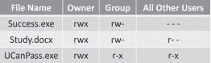

表 5.1: Linux 权限

查看表 5.1，你可以看到以下权限将分配给不同的实体：

- `Success.exe`: 所有者具有读取、写入和执行权限 (`rwx`)，组具有读取和写入权限 (`rw-`)，其他用户零权限 (`- - -`)。
- `Study.docx`: 所有者拥有读、写、执行权限 (`rwx`)，组拥有读写权限 (`rw-`)，其他用户拥有读权限 (`r--`)。
- `UCanPass.exe`: 所有者拥有读、写、执行权限 (`rwx`)，组拥有读和执行权限 (`r-x`)，其他用户拥有读和执行权限 (`r-x`)。

表 5.2 显示了用数字表示相同的权限。

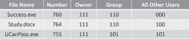

表 5.2：八进制表示的 Linux 权限。

管理员通常使用`chmod`命令（change mode 的缩写）来更改文件的权限。例如，假设一个名为`Success.exe`的文件当前权限设置为`760` (`rwx rw- - -`)，但你想将权限更改为`755` (`rwx r-x r-x`)。你可以使用以下命令：

```bash
chmod 755 success.exe
```

### 记住这一点

文件级和文件夹级保护保护单个文件。全盘加密保护整个磁盘，包括 USB 闪存和移动设备上的驱动器。`chmod`命令更改 Linux 系统上的权限。

### Windows 权限

Windows 文件和文件夹权限稍微更容易理解，因为它们只需指向并点击即可分配。例如，要修改文件或文件夹的权限，管理员可以在文件资源管理器中右键点击文件，选择“安全”选项卡并修改权限。以下列表显示了基本的 Windows 权限：

- **读取**：授予读取权限的用户可以查看文件或文件夹的内容。
- **读取和执行**：授予读取和执行权限的用户具有读取权限，他们还可以运行或执行程序。
- **写入**：用户可以创建新文件和文件夹，还可以对现有文件和文件夹进行更改。这通常随读取权限分配。
- **修改**：当授予文件或文件夹修改权限时，用户可以读取、执行、写入和删除文件和文件夹。主要增加的功能是删除文件和文件夹的能力。

# 数据丢失防护

组织通常使用数据丢失防护（DLP）技术和工具来防止数据丢失。它们可以阻止 USB 闪存的使用并控制可移动介质的使用。它们还可以检查传出的数据并检测许多未经授权的数据传输。

### 可移动介质

可移动介质是指任何你可以连接到计算机并轻松复制数据的存储系统。它主要指 USB 硬盘和 USB 闪存盘，但许多个人音乐设备（如 MP3 播放器）使用与 USB 闪存盘相同类型的闪存内存。用户可以将它们插入系统并轻松地在系统之间复制数据。此外，今天许多智能手机也包含使用相同类型内存的存储功能。

组织中包含安全策略陈声明以禁止使用 USB 闪存盘和其他可移动介质是常见现象。某些技术政策会完全阻止 USB 驱动器的使用。

DLP 解决方案更具选择性，它可以防止用户复制或打印带有特定内容的文件。例如，可以配置 DLP 解决方案以防止用户复制或打印标记有“机密”（Confidential）标签的任何分类文档。DLP 软件会扫描发送到打印机的所有文档，如果包含该标签，DLP 软件将阻止其到达打印机。

除了阻止传输，DLP 解决方案通常还会记录这些事件。某些 DLP 解决方案还会向安全管理员警报该事件。根据组织的政策，尝试授权复制或打印文件的人员可能会受到纪律。

### 数据外泄

数据外泄是将数据未经授权地传输到组织之外的行为，这是一个严重关注的问题。在某些情况下，攻击者接管系统并使用恶意软件将数据传输到组织之外。恶意内部人员也可能传输数据。

第 3 章讨论了统一威胁管理（UTM）设备中使用的不同类型的内容过滤器。这些设备监控传入的数据流以寻找恶意代码。相比之下，基于网络的 DLP 监控传出的数据以寻找由管理员指定的敏感数据。

DLP 系统可以扫描所有电子邮件的文本和任何附件文件的内容，包括文档、电子表格、演示文稿和数据库。即使用户在发送之前将文件压缩为 zip 文件，DLP 也能通过简单地解压缩它来检查内容。

例如，我了解的一家组织例行扫描所有发出的电子邮件以寻找个人身份信息（PII），例如社会安全号。基于网络的 DLP 包含一个掩码，将社会安全号识别为以下格式的数字串：`###-##-####`。如果电子邮件或附件包含此数字数字串，DLP 就会检测到它、阻止电子邮件并向安全管理员发送警报。

许多组织使用“机密”（Confidential）、“隐私”（Private）和“专有”（Proprietary）等术语对数据进行分类和标记。在 DLP 应用中包含这些搜索词，或组织认为重要的任何其他术语都是很容易的。


基于网络的 DLP 系统不限于仅扫描电子邮件。许多系统可以扫描其他流量的内容，例如 FTP 和 HTTP 流量。复杂的数据外泄攻击通常在发送数据之前对其进行加密，这使得 DLP 系统更难检查数据。然而，DLP 系统通常可以配置为查找传出的加密数据并在检测到它时向安全管理员警报。

## 云端 DLP

组织内部人员将数据存储在云端是很常见的。这使得从任何地方和几乎任何设备访问数据变得更容易。云端 DLP 解决方案允许组织对存储在云端的数据实施策略。例如，组织可以实施策略检测存储在云端的个人身份信息（PII）或受保护健康信息（PHI）。检测到数据后，可以配置 DLP 策略采取一个或多个操作，例如向安全管理员发送警报、阻止任何保存数据到云端的尝试以及隔离数据。

## 记住这一点

数据外泄是将数据未经授权地传出网络。数据丢失防护（DLP）技术和工具可以阻止 USB 设备的使用以防止数据丢失，并监控传出的电子邮件流量以发现未经授权的数据传输。云端 DLP 可以对存储在云端的数据执行安全策略，例如确保个人身份信息（PII）已加密。

# 第 5 章考试主题回顾

在准备考试时，请确保你理解本章涵盖的关键概念。

## 实现安全系统

- 最小功能原则（Least functionality）是一个核心的安全系统设计原则。它规定系统部署时应仅包含其运行所需的应用程序、服务和协议。
- 可信的操作系统（Trusted operating system）满足一组预定义的 set，例如由通用标准（Common Criteria）定义的标准。它通常使用强制访问控制（MAC）模型。
- 主镜像（Master image）为系统提供安全的起点。主镜像通常通过模板或其他基准创建，以为系统提供安全的起点。完整性测量工具可以检测系统何时偏离基准。
- 补丁管理程序确保操作系统和应用程序能够更新到最新的补丁。这确保它们免受已知漏洞的威胁。
- 变更管理策略定义了更改流程，并有助于减少因更改引起的意外停机。
- 应用白名单允许授权的软件运行，但阻止所有其他软件。应用黑名单则阻止未经授权的软件，但允许其他软件运行。
- 沙箱为测试安全控制和测试补丁提供了高度的灵活性。你可以在虚拟机（VM）中创建沙箱，也可以 Linux 系统上使用 `chroot` 命令创建。
- 电磁干扰（EMI）来自电机、电源线和荧荧灯等源，可以通过屏蔽来防止。
- 电磁脉冲（EMP）是短时间的电磁能量爆发。轻微的形式如静电放电和闪电可以防止，但军事武器造成的 EMP 损坏可能无法防止。
- 全盘加密（FDE）对整个磁盘进行加密。自加密驱动（SED）包含了自动加密磁盘所需的硬件和软件。
- 可信平台模块（TPM）是许多笔记本电脑和某些移动设备内置的芯片，它提供全盘加密、安全启动过程并支持远程证明。TPM 内部烧录了加密密钥，提供了硬件信任根。
- 硬件安全模块（HSM）是用于加密的拆卸式或外部设备。HSM 生成并存储 RSA 加密密钥，并与服务器集成以提供基于硬件的加密。

## 云概念总结

- 云计算为组织提供了额外的资源。大多数云服务通过互联网或托管提供商提供。本地云由组织自己拥有并维护。
- 软件即服务（SaaS）包括基于网络的应用程序，如基于网络的电子邮件。
- 基础设施即服务（IaaS）通过云提供硬件资源。它可以帮助组织限制其硬件足迹的大小并降低人员成本。
- 平台即服务（PaaS）为客户提供易配置的操作系统和按需计算。
- 云访问安全代理（CASB）是部署在组织网络和云提供商之间的软件工具或服务。它监控所有网络流量并可以作为“安全即服务”执行安全策略。
- 私有云仅供特定组织使用。公有云服务由第三方公司提供，任何人都可以。社区云由多个组织共享。混合云是两个或多个云的结合。

## 安全地部署移动设备

- 移动设备包括智能手机和平板电脑，运行移动操作系统。
- 公司所有、个人许可（COPE）移动设备由组织拥有，但员工可以出于个人原因使用它们。
- 自带设备（BYOD）策略允许员工将移动设备连接到组织网络。选择自己的设备（CYOD）策略包含一份认可设备列表，并允许拥有这些设备的员工将其连接到网络。
- 虚拟桌面基础（VDI）是虚拟桌面，可以创建这些桌面以便用户从移动设备进行访问。
- 移动设备可以通过蜂窝、无线、卫星、蓝牙、近场通信（NFC）、ANT、红外和 USB 连接到互联网、网络和其他设备。
- 移动设备管理（MDM）工具有助于确保设备符合最低安全要求。它们可以监控设备、执行安全策略，并在设备不符合要求时阻止访问网络。
- MDM 工具可以限制设备上的应用程序、分割并加密数据、执行强身份验证方法，并实施屏幕锁和远程擦除等安全方法。
- 屏幕锁类似于桌面系统中受密码保护的屏幕保护程序，一段时间后会自动锁定设备。远程擦除信号会删除丢失手机中的所有数据。
- 地理位置使用全球定位系统（GPS）来识别设备位置。地理围使用 GPS 创建虚拟围栏或地理边界。组织使用地理围在设备位于边界内时允许访问服务或设备，在边界外时阻止访问。
- 地理标记在向社交媒体网站发布文件（如图片）时使用 GPS 添加地理信息。
- 第三方应用商店是移动设备主商店以外的商店。Apple 的 App Store 是 Apple 设备的主商店。Google Play 是 Android 设备的主商店。
- 越狱（Jailbreaking）移除 Apple 设备上的所有软件限制。根（Rooting）为用户提供 Android 设备的根级权限。自定义固件也可以对 Android 设备进行根。MDM 工具会阻止越狱或已根设备的网络访问。
- 侧载（Sideloading）是将应用程序拷贝到 Android 设备而不是从在线商店安装的过程。
- 通用串行总线（USB OTG）线允许你连接移动设备。
- 热点（Tethering）允许一个移动设备与其他设备共享其互联网连接。Wi-Fi 直连允许你在没有无线路由器的情况下连接设备。

## 探索嵌入式系统

- 嵌入式系统是任何具有专用功能并使用计算机系统执行该功能的设备。嵌入式系统的安全挑战之一是保持其更新。
- 嵌入式系统包括有时被称为物联网（IoT）的智能设备，如可穿戴技术和家庭自动化设备。
- 芯片级系统（SoC）是一个包含完整计算系统的集成电路。
- 监视控制与数据采集（SCADA）系统控制工业控制系统（ICS）。ICS 用于电厂或水处理设施等大型设施。SCADA 和 ICS 系统通常位于不连接互联网的隔离网络中，有时受到网络入侵防御系统（NIPS）的保护。
- 实时操作系统（RTOS）是在特定时间内对输入做出反应的操作系统。
- 嵌入式系统存在许多常见和专用设备中。这包括多功能设备（MFD），如打印机；暖通空调（HVAC）系统；医疗设备；汽车；飞机；以及无人机（UAV）。

## 保护数据

- 保护数据机密性的主要方法是加密和强访问控制。文件系统安全包括使用加密对文件和文件夹进行加密。
- 你可以数据库中的单列（如信用卡号）、整个数据库、单个文件、整个磁盘和可移动介质进行加密。
- 用户应仅被赋予所需的权限。当权限过大时，可能会导致访问冲突或对数据的未经授权访问。
- 你可以使用 `chmod` 命令在 Linux 系统上更改权限。
- 数据外泄是将数据未经授权传输到组织之外的行为。
- 数据丢失防护（DLP）技术和有助于防止数据丢失。它们可以阻止向 USB 设备传输数据，并通过电子邮件分析传出的数据以检测未经授权的传输。云端 DLP 系统可以对存储在云中的任何数据执行安全策略。

## 在线参考

- 你准备好面对性能题了吗？不要忘记查看 `http://gcgapremium.com/501-extras/` 上的在线内容。

# 第 5 章练习题

## 1. 攻击者最近攻击了贵机构托管的一个 Web 服务器

管理层要求管理员根据最小功能原则（principle of least functionality）配置服务器配置。以下哪项可以实现这一目标？

A. 禁止不必要的服务

B. 安装并更新反病毒软件

C. 识别基线

D. 安装 NIDS

## 2. 网络管理员发现来自内部计算机的似乎是恶意流量

但只有在没有人登录该计算机时流量才会出现。你怀疑该系统感染了恶意软件。它定期运行一个程序，尝试通过 Telnet 端口 80 运行到网站。在将计算机与主镜像（master image）的应用程序列表进行对比后，你确认该程序很可能是问题所在。是什么让你能够做出的这一判断？

A. 最小功能

B. 沙箱（Sandbox）

C. 黑名单

D. 完整性测量（Integrity measurements）

## 3. 安全专家希望减少与更新关键操作系统相关的风险

以下哪项**最好**实现这一目标？

A. 在补丁发布时立即实施。

B. 实施变更管理策略。

C. 仅使用受信任的操作系统。

D. 实施具有安全配置的操作系统。

## 4. 贵机构希望确保员工不在其计算机上安装任何未经授权的软件

以下哪项是防止此问题的**最佳**选择？

A. 主镜像（Master image）

B. 白名单（Application whitelisting）

C. 反恶意软件

D. 反病毒软件

## 5. 一软件供应商最近为其一个应用程序开发了补丁

在向客户发布补丁之前，供应商需要在不同的环境中对其进行测试。以下哪些方案提供了在不同环境中测试补丁的**最佳**方法？

A. 基线镜像（Baseline image）

B. BYOD

C. 沙箱（Sandbox）

D. 变更管理

## 6. 贵机构内部希望希望某些关键计算机实现安全启动过程

在启动过程中，每台计算机应向远程系统发送数据以检查计算机的配置。以下哪项可以实现这一目标？

A. 可信平台模块（Trusted Platform Module）

B. 硬件根信任（Hardware root of trust）

C. 远程证明（Remote attestation）

D. 可信操作系统

## 7. 斯普菲尔德核电厂创建了一个教授核物理的在线应用程序

只有斯普菲尔德小学的学生和老师可以通过云访问此应用程序。这属于哪种云服务模型？

A. IaaS

B. PaaS

C. SaaS

D. 公共（Public）

## 8. 某组织有一个关键的 SCADA 网络，用于管理一个大城市的水处理厂

该系统的可用性非常重要。以下哪些安全控制措施对保护该系统**最相关**？

A. DLP

B. TPM

C. EMP

D. NIPS

## 9. Bizzfad 计划实施 CYOD 部署模型

你被要求为新策略提供建议。以下哪些概念适用于该策略？

A. SCADA 访问

B. 存储分段

C. 数据库安全

D. 嵌入式 RTOS

## 10. 一项新的移动设备安全策略允许使用员工自有的设备

但强制在设备丢失或被盗时采取额外的安全控制措施以保护它们。以下哪项可以实现这一目标？

A. 屏幕锁和 GPS 标记

B. 补丁管理和变更管理

C. 屏幕锁和设备加密

D. 全设备加密和 IaaS

## 11. 贵公司管理层希望限制从移动设备对 Bizz 应用的访问

如果用户在公司范围内，应允许其访问。如果他们不在公司范围内，则其访问应被阻止。以下哪项答案提供了实现这一目标的**最佳**解决方案？

A. 地围栏（Geofencing）

B. 地理位置（Geolocation）

C. GPS 标记

D. 容器化（Containerization）

## 12. 贵公司管理层希望实施一种根据多个元素授权员工的方法

包括员工的身份、位置、时间以及员工使用的设备类型。以下哪项可以满足这一需求？

A. 地围栏（Geofence）

B. 容器化（Containerization）

C. 绑定（Tethering）

D. 环境感知认证（Context-aware authentication）

## 13. Lisa 无法访问 `project.doc` 文件

但她的工作需要访问该文件。Homer 是系统管理员，他确定了文件的以下权限：

```text
rwx rw- ---
```

Homer 应该使用什么来授予 Lisa 读取该文件的权限？

A. `chmod` 命令

B. 远程擦除

C. 推送通知

D. `chroot` 命令

## 14. 贵公司管理层希望防止用户将文档复制到 USB 驱动器

以下哪些项可以用于实现这一目标？

A. DLP

B. HSM

C. COPE

D. SED

## 15. 贵机构托管有一个带有后端数据库的网站

该数据库存储了客户卡号。以下保护数据的**最佳**方式是？

A. 全数据库加密

B. 整个磁盘加密

C. 数据库加密

D. 文件级加密

# 第 5 章练习答案

## 1. A

禁止不必要的服务是最小功能原则的元素之一。其他元素包括在部署服务器时仅部署满足其目的所需的应用程序和协议。安装最新的反病毒软件是一种有效的预防控制，但它与功能无关。识别基线应在禁用不必要的服务后进行。网络入侵检测系统（NIDS）有助于保护服务器，但它并没有实现功能。

## 2. D

主镜像是基线，管理员执行了完整性测量以识别基线偏差。通过对比基线中的应用程序列表与可疑计算机上运行的应用程序，你可以识别出未经授权的应用程序。其他答案均不包含发现问题所需的故障排除步骤。主镜像仅包含满足最小功能原则所需的应用程序、服务和协议。

## 3. B

变更管理策略有助于减少与对系统进行任何更改（包括更新）相关的风险。补丁在实施之前应经过测试和评估，在发布时立即实施它们有时会导致意外的后果。使用受信任的操作系统或具有安全配置的操作系统并没有解决如何更新它们的问题。

## 4. B

白名单识别授权的应用程序并防止用户安装未经授权的软件。或者，你可以使用黑名单来识别无法在系统中安装或运行的特定应用程序。主镜像提供了一个安全的基线，但它不能防止用户安装额外的应用程序。反恶意软件和反病毒软件可以检测并阻止恶意软件，但它们不能防止用户安装未经授权的软件。

## 5. C

沙箱提供了一种简单的补丁测试方法，并将配合快照使用，以便虚拟机（VM）能够轻松恢复到原始状态。基线镜像是单个环境的起点。自带设备（BYOD）允许员工拥有的移动设备接入网络，这与此问题无关。变更管理实践确保更改在获得批准和记录之前不会被应用。

## 6. C

远程证明过程在启动周期期间检查计算机并向远程系统发送报告。远程系统证明（或确认）该计算机是安全的。其他所有答案均未向远程系统发送数据。可信平台模块（TPM）是主板上的一个硬件芯片，并提供本地安全启动过程。`TPM` 包含一个烧录在 CPU 中的加密密钥，提供了硬件根信任。可信的操作系统满足一组预先要求的，这些要求通常通过强制性访问控制（MAC）模型强制执行。

## 7. C

这是一种软件服务（SaaS）模型。软件是在线应用程序，云提供商（在本例中的斯普林菲尔核电厂）对其进行维护。基础设施服务（IaaS）通过云为客户提供硬件。客户负责安装操作系统和任何应用程序。平台服务（PaaS）是一个计算平台。例如，云提供商可以提供带有预先配置操作系统的服务器。任何人都可以访问公共云。然而，问题指出只有学生和老师可以访问。

## 8. D

网络入侵预防系统（NIPS）是列出的安全控制中与确保数据控制与数据采集（SCADA）系统的可用性最相关的。数据泄露防护（DLP）系统有助于防止数据丢失，但不能保护 `SCADA` 系统免受潜在攻击。可信平台模块（TPM）是计算机主板上的一个硬件芯片，存储用于加密的加密密钥。电磁脉冲（EMP）是短脉电磁能量，与 `SCADA` 系统无关。

## 9. B

存储分段在移动设备中创建单独存储区域，并与选择设备（CYOD）移动设备部署模型配合。其他所有答案均与移动设备直接相关。数据控制与数据采集（SCADA）系统控制工业控制系统（ICS），例如核电厂或水处理设施使用的系统，它应该被隔离。某些嵌入式系统在必须在特定时间内做出反应时使用实时操作系统（RTOS）。

## 10. C

屏幕锁通过增加他人访问设备的难度来为丢失的设备提供保护。设备加密保护数据的机密性。全球定位系统（GPS）标记包含图片和其他文件的位置信息，但无法帮助保护丢失或被盗的设备。补丁管理保持设备更新，而变更管理有助于防止因未经授权的更改导致停机。基础设施服务（IaaS）是一种云计算选项。

## 11. A

地理围栏可用于创建虚拟围栏或地理边界，勾勒公司的财产。地理围栏将使用地理定位识别移动设备的位置，但没有地理围栏的地理定位无法检测用户是否在公司财产范围内。全球定位系统（GPS）标记向文件添加地理数据（如纬度和经度数据），与此问题无关。容器化在容器中运行应用程序以对其进行隔离。

## 12. D

上下文感知认证可以使用多个元素（包括身份、地理位置、时间以及设备类型）来验证用户和移动设备。其他所有答案均未满足问题的所有要求。地理围栏创建一个虚拟围栏或地理边界，可以与上下文感知认证配合。容器化隔离应用程序，保护其及其数据。热点允许一个设备与其他设备共享其互联网连接。

## 13. A

系统管理员应使用 `chmod`（change mode 的缩写）命令修改权限。远程清除向移动设备发送远程信号以擦除或删除所有数据，与此问题无关。推送通知服务向用户发送消息但不更改权限。`chroot` 命令用于为测试应用程序创建沙箱。

## 14. A

数据泄露防护（DLP）解决方案可以防止用户将文档复制到 USB 驱动器。其他所有答案均不控制 USB 驱动器。硬件安全模块（HSM）是用于管理、生成和安全存储加密密钥的外部安全设备。COPE（公司所有，个人许可）是一种移动设备部署模型。自加密驱动器（SED）包含了加密驱动器上所有数据的硬件和软件，并安全存储加密密钥。

## 15. C

数据库列（或字段）加密是最佳选择，因为它可以用于加密持有信用卡数据的字段，而对于不需要加密的字段则。全数据库加密和全磁盘加密并不合适，因为为了保护信用卡数据并不加密所有内容。文件级加密在数据库上并不合适，并且通常会导致数据库应用程序无法访问。

# 第 6 章

## 比较威胁、漏洞和常见攻击

### 本章涵盖的 CompTIA Security+ 目标

#### 1.1 在给定场景下，分析受入侵指标并确定恶意软件类型

- 病毒、加密恶意软件、勒索软件、蠕虫、木马、根内核、键盘记录器、广告软件、间谍软件、机器人、RAT、逻辑炸弹、后门

#### 1.2 比较并对比不同攻击类型


社会工程（钓鱼、针对性钓鱼、捕鲸鱼攻击、语音钓鱼、冒充、翻垃圾桶、窥视、骗局、水池攻击）、原理（有效原因）、（权威、威慑、共识、稀缺、熟悉、信任、紧急）、应用程序/服务攻击（DoS，DDoS）

#### 1.3 解释攻击者类型和属性。

攻击者类型（脚本小子、黑客主义者、组织犯罪、国家/APT、内部人员、竞争对手）、攻击者属性（内部/外部、复杂程度、资源/资金、意图/动机）、开源情报的使用

#### 1.6 解释与漏洞类型相关的影响。

资源耗尽、未经培训的用户

#### 2.1 安装并配置硬件和软件基础的网络组件，以支持组织安全。

邮件网关（垃圾邮件过滤器）

#### 2.3 在给定场景下，排排除常见安全问题。

人员问题（内部威胁、社会工程、社交媒体）

#### 2.4 在给定场景下，分析并解释安全技术的输出。

杀病毒软件、文件完整性检查、高级恶意软件工具、数据执行保护

#### 3.9 解释物理安全控制的重要性。

屏幕滤镜

组织需要理解并保护自己不受许多不同类型的威胁者的攻击，因此，了解他们、特征以及他们可能发起的攻击类型是有价值的。恶意软件（`malware`）和社会工程学是任何组织都会面临的两个常见攻击类别，但每个类别都具有某些复杂性。攻击者在这些攻击中正变得越来越复杂，因此了解如何降低攻击者的成功率至关重要。

# 理解威胁者

在考虑攻击时，重要的是意识到有几种不同类型的威胁者，他们每种都具有不同的特征。不要让“威胁者”（threat actors）这个词困扰你。它只是给攻击者起的一个更高级的名称——即任何对他人发起网络攻击的人。

攻击者在发起攻击之前经常使用的一种常用方法是从开源情报中收集信息。这包括通过网站和社交媒体可以获取的任何信息。例如，如果攻击者想要获取某公司首席执行官（`CEO`）的名字，他们可能可以在公司的网站上找到。同样，许多组织会在 `Facebook` 和 `Twitter` 等社交媒体上发布信息。

脚本小子（Script kiddie）是指使用现有的计算机脚本或代码发起攻击的攻击者。脚本小子通常几乎没有专业知识或复杂手段，资金也非常匮乏。很多人开玩笑说无聊的青少年就是脚本小子，他们为了好玩而攻击网站或组织。然而，脚本小子并无年龄限制。更重要的是，他们仍然可以获得强大的脚本并发动危险的攻击。他们的动机各不相同，但他们通常是因为无聊而发起攻击，或者只是看看自己能做什么。

黑客行动分子（Hacktivist）作为活动运动的一部分或为了推进某项事业而发起攻击。黑客行动分子通常不是为了自己的利益发起这些攻击，而是为了提高对某项事业的意识。例如，德里克·洛斯塔特（网络上称为`KYAnonymous`）对俄亥州斯图滕贝维尔的一名高中女孩遭到强奸以及他所感到的正义缺失感到愤怒。他后来承认参与了多项提高该案件意识的努力，包括针对一个由该高中一名足球运动员运营的网站。最终，两名高中足球球员被定犯强奸罪。其中一人被判处在少年收留所一年，服了约 10 个月；另一人被判处两年，服了约 20 个月。洛斯塔特最终被判处联邦监狱监禁两年。

内部人员（Insider）是指任何拥有权限访问组织内部资源的人。由内部威胁引发的常见安全问题包括组织资产机密性、完整性和可用性的丢失。威胁的程度取决于内部人员拥有的权限大小。例如，管理员拥有的 IT 系统访问权限比普通用户多得多。

恶意内部人员有多种动机。例如，某些恶意内部人员受贪婪驱动，只想增加自己的财富，而另一些人则想向组织报复。他们可能会窃取包含价值数据的文件、安装或运行恶意脚本，或将资金重定向到个人账户。

### 记住这个

脚本小子是指使用现有的计算机脚本或代码发起攻击的攻击者。脚本小子通常几乎没有专业知识、手段和资金。黑客行动分子作为活动运动的一部分或为了推进某项事业发起攻击。内部人员是指任何权限访问组织内部资源的人，例如公司员工。

竞争对手也可能参与攻击。他们的动机通常是获取另一家公司的专有信息。虽然使用开源情报收集信息是合法的，但贪婪有时会导致竞争对手越界从事非法活动。这可能简单到翻找竞争对手的垃圾桶，这被称为翻垃圾（dumpster diving）。在某些情况下，竞争对手会雇用其他公司的员工，然后让这些新员工提供关于其前雇主的专有信息。

有组织犯罪是一个雇用一组共同从事犯罪活动的实体。该小组按照层级结构组织，有领导和工人，就像普通业务一样。根据企业的大小，它可能有几层管理结构。然而，与合法业务不同，该企业专注于犯罪活动。例如，赛门铁克报告了`Butterfly`，这是一个组织良好且能力极强的攻击者小组，他们窃取公司的市场敏感信息并将其卖给出价最高者。他们已经入侵了一些美国大公司，包括苹果、微软和脸。此外，他们不断扩大目标，包含了制药和大宗商品类组织。

有组织犯罪分子的首要动机是钱。他们几乎所有的努力都可以追溯到获取更多钱的贪婪，无论他们如何获取。然而，由于有组织犯罪没有定义的规模，他们的手段、资源和动机会有很大差异。想象一个由 10 个人组成的小决定针对一家公司。他们的手段和资源可能远少于`Butterfly`内部的犯罪分子。

某些攻击者是由国家或政府资助的组织化力量。高级持续性威胁（`APT`）是针对网络的定向攻击。这些攻击通常由一个既有能力又有意图发起复杂定向攻击的小组发起。他们通常拥有大量的资源和资金。此外，`APT`小组中的个人通常有非常具体的目标，例如特定的公司、组织或政府机构。成功的攻击通常允许未经授权的长时间访问，使攻击能够泄露大量数据。

### 记住这个

有组织犯罪元素通常受贪婪和金钱驱动，但经常使用复杂的技巧。高级持续性威胁（`APTs`）由政府资助，他们发起复杂的、针对性的攻击。

例如，`Mandiant`得出结论，他们命名为`APT1`的小组在中国内部作为中国解放军（`PLA`）的`61398`运作。`Mandiant`估计`APT1`包含超过 1000 多台服务器以及几十到数百名个人操作员，并具有：

- 发布了至少 40 种不同家族的`malware`
- 从至少 141 个组织中盗了数百 TB 的数据
- 在被发现之前，对某些受害者网络的访问保持了超过四年
- 在邮件接收者打开了安装后门的恶意文件后，在许多网络中建立了立足点，允许攻击者进行远程访问

中国官员否认了这些指控。

最近，美国国土安全部（DHS）和美国联邦调查局（FBI）发布了一份名为`GRIZZLY STEPPE`的联合分析报告（`JAR-16-20296A`），提供了关于这些 APT 威胁的详细信息。它们被称为`Fancy Bear`（`APT 28`）和`Cozy Bear`（`APT 29`）。联合报告指出，这些组织目标了全球许多政府机构、智库、大学和公司。`GRIZZLY STEPPE`还表明，这两个 APT 入侵并利用了与 2016 年美国总统选举相关的网络。

`CrowdStrike`、`SecureWorks`、`ThreatConnect`以及 FireEye 的`Mandiant`等网络安全公司均指出，`APT 28`由俄罗斯政府资助，并且可能从 2000 年中期就开始运营了。同样，`CrowdStrike`认为`APT 29`与俄罗斯机构有关。`Symantec`认为该组织至少从 2010 年以来一直在攻击政府和外交机构。

俄罗斯官员否认了这些指控。

第 7 章“防御高级攻击”详细讨论了许多不同类型的攻击。两种通用攻击类型是拒绝服务（`DoS`）攻击和分布式拒绝服务（`DDoS`）攻击。`DoS`攻击是由一个攻击者针对一个目标的攻击。`DDoS`攻击是两或多台计算机针对单个目标的攻击。`DDoS`攻击通常包括受攻击计算机网卡上持续的、异常高网络流量。

`DoS`和`DDoS`攻击通常尝试使计算机应用程序或服务过载。例如，Web 服务器响应超文本传输协议（`HTTP`）请求以提供网页。`DDoS`攻击通过每秒向服务器发送数千个`HTTP`请求使服务器过载。这些请求会耗尽资源（如处理器和内存），并导致资源枯竭。在某个时刻，受攻击的计算机无法跟上请求。受攻击的计算机通常会变慢，导致合法用户无法查看网页。资源耗尽的极端情况下，受攻击的计算机可能会崩溃。

### 记住这个

拒绝服务（`DoS`）攻击是来自单一源的攻击，试图破坏另一个系统提供的服务。分布式拒绝服务（`DDoS`）攻击包括多台计算机攻击单个目标。`DDoS`攻击通常包括持续的异常高网络流量。

# 确定恶意软件类型

恶意软件（mal 软件）包含了各种具有恶意意的软件。恶意软件不是你会故意购买、下载并安装的软件。相反，它是通过诡计安装到你的系统中的。受感染的系统会产生各种症状，如运行变慢、启动未知进程、在没有用户操作的情况下发送电子邮件、随机重启等。

你可能会听到人们使用`virus`一词来描述所有类型的恶意软件，但这并不准确。`virus`是一种特定的恶意软件类型，恶意软件包含许多其他类型的恶意软件，包括蠕虫、逻辑炸弹、木马、勒索软件、根基程序、间谍软件等。

同样值得强调的是恶意软件仍在进化。`Panda Security`在其 2017 年的报告《2017 年网络安全预测》中写道，`PandaLabs`在 2016 年每天检测到超过 200,000 个新型恶意软件样本。其中大部分并非全新的，而是现有恶意软件的微调版本。

## 病毒

`virus`是附加到宿主应用程序的恶意代码。必须执行宿主程序才能运行，而当宿主程序执行时，恶意代码也会执行。`virus`通过寻找其他宿主程序并注入恶意代码来尝试复制。在某个时刻，`virus`会激活并释放其载荷。

通常情况下，`virus`的载荷是有破坏性的。它可能会删除文件、导致随机重启、将计算机加入僵尸网络，或开启攻击者可用于远程访问系统的后门。一些旧版病毒只会在某个时刻显示一条消息，例如“大麻合法化！”大多数病毒不会立即造成破坏。相反，它们会先给`virus`留出复制时间。用户通常会执行`virus`（尽管是在不知情的情况下），但在其他情况下，操作系统会在用户交互后自动执行它。例如，当用户插入一个受感染的 USB 驱动器时，系统可能会自动执行`virus`，从而感染系统。

## 蠕虫

`worm`是自我复制的恶意软件，可以在不需要宿主程序协助或用户交互的情况下在网络中传播。`worm`驻留在内存中，可以使用不同的传输协议在网络中传输。

蠕虫引起的一个严重问题是它们消耗网络带宽。`Worms`可以自我复制数百次并扩散到网络中的所有系统。每个受感染的系统都会尝试定位并感染网络上的其他系统，网络性能可能会慢到爬行速度。

### 记住这个

恶意软件包含了多种恶意代码，包括病毒、蠕虫、木马、勒索软件等。`virus`是附加到应用程序的恶意代码，并在程序启动时运行。`worm`是自我复制的，不需要用户交互即可运行。

## 逻辑炸弹

`logic bomb`是嵌入应用程序或脚本中的一段代码，它会响应特定事件而执行。该事件可能是特定的日期或时间，或者是用户操作（例如当用户启动特定程序时）。

有一个经常被反复提到的故事：一家公司由于经济低迷决定必须裁掉一名工程师。他的老板们没见他能做什么，所以他们认为没有他也可以行。在他离开后的几周内，他们开始遇到各种无法解决的计算机问题。

他们把他叫了回来，在几周内，一切恢复了正常。几个月后，他们确定必须再次裁掉他。正如你猜想的那样，在几周内，一切又乱套了。

这名工程师编写了一个`logic bomb`，该程序在工资程序运行时执行。它会检查工资单上是否有他的名字，如果名字在那里，一切正常；但当他的名字不在那里，砰的一声——`logic bomb`爆炸了。

### 记住这个

`logic bomb`响应事件而执行，例如当执行特定应用程序或到达特定时间时。

## 后门

后门提供了访问系统的另一种方式，类似于房屋的后门提供了另一种进入方法。恶意软件经常在系统中安装后门以绕过正常的身份验证方法。

虽然应用程序开发者经常会将后门编码到应用程序中，但这种做法并不推荐。例如，应用程序开发者可能会在应用程序中创建一个用于维护目的的后门。然而，如果攻击者发现了后门，他们可以使用它来访问应用程序。

有效的账户管理策略有助于防止前员工在离开后创建后门。例如，如果员工在被解雇后立即失去网络访问权限，该员工无法创建后门账户。相比之下，如果管理员保留网络访问权限，他可能会创建另一个管理账户。IT 人员在得知他被开除可能会禁用他的账户，但他仍然可以使用这个新的后门账户。这正是房美贷款（Fannie Mae）一名 Unix 工程师在被告知解雇后所做的事情。

房利美贷款（Fannie Mae）的账户管理策略并没有立即撤销他的高级系统权限，这为他留下了创建后门账户的时间。回家后，他远程访问了系统并安装了一个逻辑炸弹脚本，计划在 1 月 31 日上午 9:00 运行。如果不是其他管理员发现了这个逻辑炸弹，它将删除约四千台服务器的数据和备份，更改它们的密码并将其关闭。

## 记住这一点

后门提供了访问系统的另一种方式。许多类型的恶意软件都会创建后门，允许攻击者从远程位置访问系统。员工也在应用程序和系统中创建过后门。

## 木马

木马（Trojan），也称为特洛伊木马，看起来是有益的，但实际上是有害的。木马是以于特洛伊战争中著名的木马命名的。在希腊神话中，希腊人曾多次围攻特洛伊城，但他们始终无法突破城市的防御。在某个时刻，有人想出了建造一个巨大木马的主意，并说服特洛伊人这是神神的礼物。战士躲在木马内部，木马被推到了城门前。

特洛伊人整日彻夜地庆祝自己的好运，但当城市入睡时，战士们从木马内部爬出来打开了城门。其余的战士涌入入。希腊战士多年无法做到的事情，特洛伊木马帮助他们在一天之内完成了。

在计算机中，木马可能以盗版软件、实用工具、游戏或用户可能被诱导下载尝试的其他形式出现。攻击者越来越多地使用“挂载式下载”（drive-by downloads）来分发木马。在挂载式下载中，网络服务器包含恶意代码，这些代码会在用户访问后尝试在用户的计算机上下载并安装自己。以下是挂载式下载涉及的典型步骤：

1. 攻击者攻破网站以获取其控制权。
2. 攻击者在网站代码中嵌入木马。
3. 攻击者试图诱骗用户访问该网站。有时，他们只是通过电子邮件将链接发送给成千上万的用户，希望其中一些人点击链接。
4. 当用户访问时，网站会尝试将木马下载到用户的系统中。

近年来另一种流行的木马程序方法是“流氓软件”（rogueware），也称为“恐吓软件”（scareware）。流氓软件伪装成免费杀毒程序。当用户访问网站时，网页上的消息或弹出窗口会显示检测到用户的系统中存在恶意软件。用户被鼓励下载并安装免费杀毒软件。

从表面上看，这种免费杀毒软件看起来很有用。然而，它并非如此。如果用户在系统中安装并运行它，它似乎在进行系统扫描。扫描完成后，它报告称发现了多个问题，例如被数十种病毒感染。该报告并非真实。即使在没有任何感染的全新安装的操作系统上，该程序也会报告这些问题。

然后它鼓励用户立即解决这些问题。如果用户尝试解决，程序会告知用户这只是试用版，试用版无法解决这些问题。然而，只需支付 79.95 美元的少量费用，用户即可解锁完整版以移除威胁。某些流氓软件会安装额外的恶意组件。例如，它可能允许攻击者远程控制受感染的系统。

许多浏览器扩展程序都包含恶意木马。例如，我曾在我的`Google Chrome`浏览器中添加过扩展扩展，以便下载视频并离线查看。不幸的是，它修改了浏览器的行为。当我从 Google 搜索进入一个页面并右键点击页面时，它将我带到一个恶意网站，鼓励我安装伪装成 Windows 修复工具的恶意软件。在右键点击后的某个时刻，它显示我的`Chrome`浏览器已过期并鼓励我下载安装更新。然而，使用`Chrome`的工具，我证实了`Chrome`是最新版本。当我点击`Extensions`（扩展）将其删除时，它将我重定向到一个恶意网站。我最终将`Chrome`重置为默认设置，禁用了所有扩展并删除了该恶意扩展。

## 记住这一点

木马看起来是有用的，但包含恶意组件，例如在用户系统上安装后门。许多木马通过挂载式下载分发。它们还可以通过虚假杀毒软件、盗版软件、游戏或受感染的 USB 驱动器感染系统。

## RAT

远程访问木马（RAT）是一种恶意软件，允许攻击者从远程位置控制系统。它通常通过挂载式下载分发。一旦安装在系统上，攻击者就可以随时访问受感染的计算机，并根据需要安装额外的恶意软件。

某些 RAT 会自动收集并记录击键、用户名和密码、入站邮件、聊天会话和浏览器历史，并进行截图。然后 RAT 可以在预定的时间将数据发送给攻击者。

此外，攻击者可以使用用户或用户计算机的凭据来探索网络。攻击者经常这样做是为了发现并利用网络中的额外漏洞。攻击者利用这一个受感染的系统并用额外的恶意软件感染整个网络（包括在其他系统上安装 RAT）是非常常见的。

## 勒索软件

一种特殊的木马是勒索软件。攻击者加密用户数据或控制计算机并将用户锁定在之外。然后，他们要求用户支付赎金以重新获得数据或计算机的访问权限。犯罪分子通常通过挂载式下载或嵌入通过电子邮件发送的其他软件来分发勒索软件。攻击者最初针对个人使用勒索。然而，他们越来越多地针对组织，索要越来越大的赎金。

许多机构表明，勒索软件攻击持续增长，正成为最大的网络安全威胁之一：

* 赛门铁（`Symantec`）报告称，2015 年勒索软件攻击增长了 35%（与 2014 年相比）。
* 网络威胁联盟（CTA）报告称，`CryptoWall 3`（一种特定的勒索软件版本）仅 2015 年就造成了 3.25 亿美元的损失。很难知道所有版本的勒索软件损失了多少钱。
* FBI 在一份公共公告（编号 `I-091516-PSA`）中报告称，一种勒索软件变种在 2016 年第一季度每天感染了多达 10 万台计算机。
* SonicWall 在其 2017 年年度威胁报告中报告，`SonicWall GRID Threat Network`观察到的勒索软件攻击数量从 2015 年的 400 万增加到 2016 年的 6.3 亿。

勒索软件类型不断进化。在早期版本中，它们有时只是将用户锁定在系统之外。但现在已很少这样做。相反，攻击者通常会加密用户数据以确保用户无法检索。加密用户数据的勒索软件有时被称为加密恶意软件（crypto-malware）。

## 记住这一点

勒索软件是一种控制用户系统或数据的恶意软件。犯罪分子随后尝试从受那里索要付款。勒索软件通常包括如果受害者不支付赎金，将破坏用户系统或数据的威胁。加密用户数据的勒索软件有时被称为加密恶意软件。


某些勒索软件增加了一种名为“人肉搜索”（doxing）的新勒索技术。如果用户不支付赎金以解密文件，攻击者将威胁发布这些文件以及害者的凭据。使用人肉搜索的恶意软件有时被称为“肉肉索软件”（doxingware）。

## 键盘记录器

键盘记录器试图捕捉用户的按键。按键被存储在一个文件中，要么自动发送给攻击者，要么由攻击者手动获取。

虽然键盘记录器通常是软件，但也可以是硬件。例如，你可以购买一个 `USB` 键盘记录器，将其插入电脑，然后将键盘插入 `USB` 键盘记录器。这种硬件键盘记录器将记录所有的按键并将其存储在 `USB` 设备的内存中。

## 间谍软件

间谍软件是在用户不知情或不同意安装在其系统上的软件。其目的通常是监控用户的计算机和活动。间谍软件对用户的计算机获得某种程度的控制以获取信息，并将这些信息发送给第三方。如果间谍软件能够访问用户的隐私数据，会导致机密性丢失。

间谍软件活动的示例包括更改用户主页、重定向浏览器以及在浏览器内安装额外软件。在某些情况下，这些更改会降低系统速度，导致性能下降。与更具恶意的间谍软件（称为隐私入侵型软件）可能的行为相比，这些示例相当无害。

隐私入侵型软件试图使用数据收集技术获取用户的资金。它尝试收集信息以冒充用户、清空银行账户并盗取身份。例如，某些间谍软件包含了键盘记录器。间谍软件定期读取键盘记录器存储的数据并将其发送给攻击者。在某些情况下，间谍软件允许攻击者远程控制用户的系统。

间谍软件通常与其他软件（如 `Trojan`）一起包含在一起。用户安装了一个应用程序，却在不知情的情况下获得了一些额外内容。间谍软件还可以通过“路路下载”感染系统。用户只需访问一个恶意网站，该网站包含自动下载并向间谍软件安装到用户系统中的代码。

### 记住这一点

键盘记录器捕捉用户的按键并将其存储在文件中。根据键盘记录器的不同，该文件可以自动发送给攻击者或手动获取。间谍软件监控用户的计算机，并通常包含键盘记录器。

## 广告软件

当广告软件首次出现时，其意图主要是为了学习用户的习惯以便进行定向广告。随着收集用户信息的行为变得越来越恶劣，越来越多的人开始将其称为间谍软件。然而，一些传统的广告软件仍然存在。互联网营销人员变得非常老练，他们将网络分析与行为分析相结合来跟踪用户活动。然后他们根据用户的过去活动提供定向广告。

“广告软件”一词也适用于免费但包含广告的软件。用户了解软件将显示广告，并可以选择购买不包含广告的软件版本。这一切都是公开合规的，没有任何误导用户的意图。

## 机器人与僵尸网络

广义地说，机器人是软件机器人。例如，谷歌使用机器人作为搜索引擎爬虫来遍历互联网寻找网页。然而，攻击者也利用机器人用于恶意目的。僵尸网络结合了机器人和网络两个词。它包含了多台作为软件机器人（机器人）运行、并在网络（如互联网）中协同工作的计算机，通常是为了恶意目的。僵尸网络中的机器人通常被称为僵尸，它们将听从控制僵尸网络的人的指挥。

僵尸控制者是管理僵尸网络的犯罪分子。他们试图感染尽可能多的计算机，并通过运行命令与控制软件的一个或多个服务器来控制它们。受感染的计算机定期向命令与控制服务器汇报，接收指令，然后开始工作。用户通常意识不到这些活动。

大多数计算机通过恶意软件感染加入僵尸网络。例如，用户可能下载带有 `Trojan` 的盗版软件，或点击恶意链接导致路路下载。随后，恶意软件将系统加入僵尸网络。

僵尸控制者一直在使用 `Mirai` 来创建大型僵尸网络。`Mirai` 感染运行旧版本 Linux 的 Linux 系统，并将它们加入僵尸网络。这包括运行在物联网（IoT）设备（如连接到互联网的数字相机）上的 Linux 软件。受感染的设备会在互联网上搜索其他物联网设备并感染它们。攻击者在公共论坛上发布了 `Mirai` 的源代码，使得许多攻击者都能获取。

`Mirai` 僵尸网络于 2016 年 10 月针对域名系统（DNS）服务器发起了攻击。它包含了大约 100,000 台连接到互联网的数字相机和打印机等简单设备。僵尸控制者指示这些设备在长时间的分布式拒绝服务（DDoS）攻击中反复查询 DNS 服务器。这次攻击使 DNS 服务器过载，导致美国和欧洲的用户无法访问许多常用网站，如 Amazon、Second Life、Twitter、CNN、BBC、Fox News、Tumblr、Reddit 等。

同样，`Wordfence` 在 2017 年 4 月发现了来自拥有约 10,000 个独立 IP 地址的僵尸网络的攻击。在调查这些攻击后，他们发现攻击系统通常是具有已知漏洞的家庭路由器，该漏洞被 Checkpoint Software Technologies 命名为 `Misfortune Cookie`。有趣的是，Checkpoint 2005 年就报告过该漏洞。然而，这次攻击表明阿尔及利亚特定的互联网服务提供商（ISP）正在向其客户发放这些未修复的路由器。

僵尸网络控制者有时对他们的僵尸网络保持完全控制。在其他时候，他们会将访问权限租给他人按需使用。命令与控制服务器发送的一些指令包括：

- 发送垃圾邮件。
- 发起分布式拒绝服务攻击。
- 下载额外的恶意软件、广告软件或间谍软件（如键盘记录器）。

## `Rootkit` 程序

`Rootkit` 是一组程序（或在少数情况下是单个程序），用于隐藏系统已被恶意代码感染或破坏的事实。用户可能会怀疑出了问题，但反病毒扫描和其他和其他检查显示一切正常，因为 `Rootkit` 隐藏了它的运行进程以避免检测。

除了修改操作系统的内部进程外，`Rootkit` 通常还会修改注册表（Registry）等系统文件。在某些情况下，`Rootkit` 会修改系统访问，例如移除用户的管理员权限。

`Rootkit` 具有系统级权限。这有时被称为 root 级访问或内核级访问，表示它们具有与操作系统相同级别的权限。`Rootkit` 使用挂钩进程（hooked processes）或挂钩技术来拦截对系统的调用。在这种语境下，挂钩是指拦截系统级函数调用、事件或消息。`Rootkit` 将钩子安装到内存中并利用它们来控制系统的行为。

杀毒软件通常会调用操作系统的来检测恶意软件，但根基工具（rootkit）会阻止杀毒软件进行这些调用。这就是为什么杀毒软件有时会报告一切正常，即使系统已感染了根基工具。然而，杀毒软件通常可以通过检查系统随机内存（`RAM`）的内容来检测被挂钩的进程。

检测根基工具的另一种方法是进入安全模式，或在系统启动前对其进行扫描，但这并不总是成功。务必记住，根基工具非常难以检测，因为它们可以隐藏大量的活动。恶意软件扫描器给出的“健康检查报告”可能并非有效。

务必记住，在任何种类型的恶意软件背后，你可能都会发现一个参与了犯罪活动的攻击者。成功在用户系统中安装了根基工具的攻击者可以使用根基工具安装的后门远程登录用户的计算机。同样，攻击者可能会引导计算机连接到互联网上的计算机并发送数据。数据可以包括从键盘记录器收集的任何内容、收集到的密码或存储在用户计算机上的特定文件或文件类型。

## 记住这个

根基工具具有系统级或内核权限，可以修改系统文件和系统访问权限。根基工具通过挂钩技术隐藏其运行进程以避免检测。可以检查 `RAM` 的工具可以发现这些隐藏的挂钩进程。

# 识别常见攻击

除了恶意软件，了解一些其他常见攻击也很重要。社会工程包括攻击者用来欺骗用户的几种技术。此外，许多攻击者还使用电子邮件、即时消息和电话来实施攻击。

## 社会工程

社会工程是利用社交策略来获取信息的实践。它通常是低技术的，鼓励个人做一些他们通常不会做的事，或导致他们暴露某些信息，例如用户凭据。一些个人方法和技术包括：

- 使用奉承和欺骗
- 假装权威
- 鼓励某人执行危险操作
- 鼓励某人透露敏感信息
- 冒充某人，例如授权的技术人员
- 尾随或紧跟授权人员而不提供凭据

在电影《猫猫》（Catch Me If You Can）中，莱昂纳·迪卡普里饰演了弗兰克·阿格内尔二（Frank Abagnale Jr.），一位高诈骗犯。他通过欺骗和奉承别人让他们告诉自己，学习了关于不同职业的一些深层秘密。然后他结合所学知识冒充飞行员和医生，并进行了一些复杂的伪造。

社会工程师会像弗兰克·阿格内尔二那样面对面骗人，也会使用其他方法。他们可能使用电话、发送带有钓鱼策略的电子邮件，甚至在网站上使用一些诡计，例如欺骗某人安装恶意软件。

作为一个工程师使用电话的例子，考虑以下场景。玛吉（Maggie）正忙于工作，接到黑客赫曼（Hacker Herman）的电话，他自称是 IT 部门的成员。

黑客赫曼：“你好，玛吉。我只想提醒你，我们今天会对你的电脑进行升级，将停机几小时。”

玛吉：“等一下。我没有听到这个事。我今天需要电脑来完成一个项目。”

黑客赫曼：“你应该收到邮件的。很抱歉，但我今天必须完成最后几台计算机的更新。”

玛吉：“没有别的办法？我真的需要我的电脑。”

黑客赫曼：“额……可以在你工作时通过网络进行升级。我们通常不这样做，因为我们需要用户的密码来完成。”

玛吉：“如果我还能用我的电脑，请用那样处理吧。”

黑客赫曼：“好的，玛吉。不要告诉任何人我正在为你做这件事，但如果你把用户名和密码给我，我就通过网络完成它。”

这确实是一个真实的场景，除非安全意识和培训计划不断反复强调这句准则：“永远交出你的密码”，否则许多终端用户都会给出密码。

然而，攻击者并不总是如此直白。很多时候，他们不是直接向你索要密码，而是询问可以在密码重置系统中使用的问题，以重置你的密码。一个老练的骗子在问这些问题时就像是对你个人表现感兴趣一样。等你反应过来，你已经告诉了他你第一只狗的名字、童年时最好的朋友、第一任老板的名字等信息。当人们在社交媒体上发布这些信息时，攻击者甚至不需要问。接下来的章节描述了许多与社会工程相关的常见安全问题。

## 记住这个

社会工程利用社交策略欺骗用户放弃信息或执行他们通常不会采取的行为。社会工程攻击可以在面对面、通过电话、上网时以及通过电子邮件发生。

### 冒充

某些社会工程师经常尝试冒充他人。目标是说服授权用户提供某些信息，或帮助攻击者击败安全控制。

例如，攻击者可以冒充维修技术人员以进入机房或电信室。在获得访问权限后，攻击者可以安装硬件（如非法访问点）来捕获数据并无线发送到外部收集点。同样，攻击者会在电话中冒充合法组织并试图获取信息。身份验证方法对于防止冒充攻击成功很有用。

### 窥视（Shoulder Surfing）

窥视简单是指从人的肩膀后面去看获取信息。目标是通过随意的观察获取未经授权的信息，这可能发生在办公环境中。这可能是为了获取凭据，例如用户名和密码，或用于智能卡或借记卡的 PIN 码。最近，攻击者一直在使用摄像头监控用户输入 PIN 码的地方，例如取款机（`ATMs`）。

防止窥视的一种简单方法是调整显示器和其他类型屏幕的位置，使未经授权的人员看不到。这包括确保人们无法通过窗户或接待区看到它们。

另一种减少窥视的方法是在显示器上放置屏幕防窥滤光膜。这限制了非直接面对显示器的人对屏幕的可见性。

## 记住这个

社会工程师只需通过看别人的肩膀后面就能获取未经授权的信息。这可能是面对面的，例如当用户在使用电脑时，或者远程使用摄像头。屏幕滤光膜通过遮挡视线来帮助防止窥视，除非他们正对着显示器前方。

### 用虚假信息欺骗用户

虚假信息（Hoax）是一种通常通过电子邮件传播的消息，告知人们由于病毒或其他安全威胁即将临临的厄，而这些威胁实际上并不存在。用户可能会被鼓励删除文件或更改系统配置。

早期的一个例子是“泰迪病毒”（`jdbgmgr.exe`），它根本不是一种病毒。受害者收到一封邮件，说这种病毒会处于睡眠状态 14 天，然后就会破坏用户的系统。随后，它告诉用户，可以通过删除该文件（图标是一个小熊）来保护他们的系统，并提供了操作方法说明。删除了该文件的用户失去了一些系统功能。

更严重的病毒欺骗可能具有与真实病毒同等的破坏性。如果用户被说服删除重要文件，可能会导致其系统无法使用。此外，由于由于欺骗引发的无效电话，或者用户在响应欺骗时损坏系统后拨打的支持电话，还会浪费帮助台人员的时间。

## 尾随（Tailgating）与防入侵门（Mantraps）

尾随是指一个人在不显示凭证的情况下紧跟另一个人后面的行为。例如，如果 Homer 使用门卡进入一座安全建筑，而 Francesca 跟在 Homer 后面且没有使用门卡，那么 Francesca 就是在尾随。

员工通常出于方便和礼貌会这样做。他们没有为紧跟在后面的人关上门，而是经常为对方开门。然而，这绕过了访问控制，如果员工发生尾随，非员工很容易跟在别人后面溜进去。通常，只需要像 Francesca 这样的人友善微笑就能鼓励 Homer 为她保持门开启。

第 9 章“实施控制措施以保护资产”讨论了物理安全控制措施，如防入侵门和安保人员。简单的防入侵门可以是像地铁站或公交站使用的那种转闸机。想象一下两个男人试图同时通过这样的转闸机，这几乎是不可能的。安保人员可以检查每个人的凭证，他们不会像 Homer 那样容易被微笑所欺骗。

## 翻垃圾桶（Dumpster Diving）

翻垃圾桶是指搜索垃圾或回收容器以从丢弃的文档中获取信息的行为。许多组织会粉碎或焚烧纸张，而不是直接扔掉。

例如，公司目录的旧副本对攻击者可能很有价值。他们可能会识别出组织内关键人员的姓名、电话和职位。攻击者可以使用这些信息针对高管进行鲸叉钓鱼攻击（whaling attack），或针对组织内的任何人进行社交工程攻击。攻击者可以利用任何包含详细员工或客户信息的文档，并且往往能从看似无用的打印件和笔记中发现价值。

在个人层面，信用卡公司发出的预先批准的信用卡申请或空白支票，对于试图骗钱或盗取身份的人来说可能非常有价值。任何包含各种类型个人识别信息（PII）或受保护健康信息（PHI）的文档都应该粉碎或焚烧。

### 记住这一点

翻垃圾桶的人通过搜索垃圾寻找信息。粉碎或焚烧纸张而不是直接扔掉可以减轻这种威胁。

## 水坑攻击（Watering Hole Attacks）

水坑攻击试图发现某群体可能访问的哪些网站，然后向这些网站注入恶意软件，以感染访问者。攻击者的目标是感染用户已经信任的网站，这使他们更有可能下载受感染的文件。

例如，2016 年后期发现的一项攻击最初针对波兰银行。该攻击是由一家波兰银行发现的，其在内部计算机上发现了此前未知的恶意软件。赛信科技（Symantec）报告，攻击来源是波兰金融监管局的服务器。该机构是波兰银行员工非常信任的机构，他们经常访问该机构的网站。

但这并非孤立事件。赛信科技报告称，在 30 多个国家发现了 100 多次类似的攻击。

## 通过电子邮件和电话进行的攻击

攻击者正越来越多地使用电子邮件发起攻击。原因之一是这种方式非常成功。许多人并不理解一封简单的邮件对整个组织有多有多危险。在不了解危险性的情况下，他们经常点击恶意邮件中的链接，从而让攻击者获得访问整个网络的权限。电子邮件攻击包括垃圾邮件、钓鱼攻击、针对性钓鱼攻击和鲸叉钓鱼。

### 垃圾邮件（Spam）

垃圾邮件是不受欢迎的或未经请求的电子邮件。根据你所引用的不同研究，所有互联网邮件的 80%到 92%都是垃圾邮件。某些垃圾邮件是无害的广告，但更多的是恶意的。垃圾邮件可能包含恶意链接、恶意代码或恶意附件。即使它不是恶意的，如果 10 封邮件中只有 1 封是有效的，也会浪费你大量时间。

在某些情况下，合法公司会鼓励用户加入他们的邮件列表，然后向他们发送有关产品的邮件。当用户加入邮件列表时，他们同意了相关条款。从表面上看，你会认为这意味着你同意接收公司的邮件，事实确实如此。然而，条款通常包括同意允许其合作伙伴向你发送邮件，这意味着原始公司可以将你的电子邮件地址分享给他人。

合法公司不会向你发送恶意垃圾邮件，但他们发送的邮件可能比你要求的多。法律要求他们包含退出（opt out）功能，表示你不想再接收来自他们的任何邮件。一旦你选择退出，就不应该再收到来自该公司的任何邮件。

犯罪分子使用各种方法收集电子邮件地址。他们从其他犯罪分子手中购买列表并从网站上抓取。某些恶意软件会扫描感染计算机的通讯录来收集电子邮件。由于他们是犯罪分子，他们不在乎法律，但他们可能会在发送的垃圾邮件中包含退出说明。然而，攻击者并不是利用此将你从其邮件列表中删除，而是将其作为对你的电子邮件地址有效的确认。结果就是更多的垃圾邮件。

### 恶意垃圾邮件 `Malspam`（侧栏）

2016 年后期，某些坏分子发起了三次恶意垃圾邮件（malspam）活动，试图在受害计算机上安装 Cerber 勒索软件。每场活动都遵循类似的模式，每一波都针对域管理员：

- 主题包含针对目标域名的 `Domain Abuse Notice`（域名滥用通知）。
- 正文指出目标域被反复用于发送垃圾邮件和传播恶意软件。
- 在某些邮件中，指出这是最终通知，如果在此 24 小时内未解决，该域名将被暂停。
- 正文包含至少一个标记为 `Click Here`（点击此处）或 `Click Here to Download your Report`（点击此处下载报告）的链接。

这些链接是恶意的，并尝试下载 Cerber 勒索软件。某些链接指向恶意的 JavaScript 文件（如 `Domain_Abuse_Report_Viewer.js`），另一些则指向受感染的 Word 文档（如 `Invoice_349KL.doc`），其中带有恶意宏。这些恶意文档在每一波中托管在不同的服务器上。

### 钓鱼（Phishing）

钓鱼攻击是指向用户发送电子邮件，目的是欺骗他们泄露个人信息或点击链接。钓鱼攻击通常会将用户引导至恶意网站，该网站在用户看来是一个合法的网站。

经典的例子是用户收到一封看起来像是来自 eBay、PayPal、银行或其他某些知名公司的电子邮件。“钓鱼者”不知道收件者是否在该公司拥有账户，这就像钓鱼不知道他下钩所在的水域里是否有鱼一样。然而，如果攻击者发送了足够多的邮件，接收邮件的人中确实有人拥有账户的概率很大。

这封邮件看起来可能像这样：

> “我们注意到您的账户存在可疑活动。为了保护您的隐私，除非您能够登录并验证凭据，否则我们将挂起您的账户。点击此处验证您的账户并防止其被锁定。”

邮件通常包含您在供应商网站或来自供应商的实际邮件中看到的相同图形。尽管它看起来是真的，但它并非如此。正规公司不会要求您通过电子邮件重新验证凭据。如果您直接访问实际网站，可能会被要求提供凭据之外的额外信息来证明身份，但正规公司不会发送邮件要求您点击链接并输入凭据来验证它们。

## 记住这一点

垃圾邮件（Spam）是不受欢迎的电子邮件。钓鱼（Phishing）是恶意的垃圾邮件。攻击者试图诱骗用户泄露敏感或个人信息，或点击链接。邮件中的链接还可能导致毫无备的用户安装恶意软件。

## 警惕来自朋友的邮件


犯罪分子已经非常擅长冒充你的朋友。他们扫描社交媒体网站并识别你的朋友和家人。然后他们向你发送看起来来自你的朋友或家人的邮件，但实际上并非如此。这已成为与社交媒体相关的常见安全问题。

例如，假设你和 Lisa Simpson 是朋友，她的电子邮件地址是 `lisa@simpsons.com`。你可能会收到一封在“发件人”栏中包含“Lisa Simpson”的邮件。然而，如果你查看实际电子邮件地址，你会发现它是不同的，例如 `homer@moes.com`。底层的电子邮件地址可能属于某人，但伪造并不意味着他们发送了这封邮件。要识别实际发送者，你通常需要查看电子邮件地址的完整标头。

最近我经常看到这样的邮件。它们似乎与我在 Facebook 上的评论或点赞有关。例如，在 Lisa Simpson 的 Facebook 页面上点赞了一个帖子后，我后来收收到一封发件人是 Lisa Simpson 且带有伪造邮件地址的邮件。这些邮件通常只包含一行，如“我想你可能喜欢这个”，以及一个恶意链接。点击链接通常会将用户带到一个尝试进行“路过下载”（drive-by download）的服务器。这是用户无意中在系统中安装勒索软件的常见方式。

另一种可能是攻击者已将你朋友的电脑加入了僵尸网络。僵尸控制主现在正在利用你朋友的电脑发送钓鱼邮件。

## 钓鱼安装恶意软件

有一封钓鱼邮件看起来像是来自一家新闻机构，上面有近期新闻事件的标题。如果用户点击邮件中的任何地方，就会弹出一个对话框，指示用户的 `Adobe Flash` 版本过旧，无法查看故事。然后它询问：“您想升级您的 `Adobe Flash` 版本吗？”如果用户点击“是”，它就会下载并安装恶意软件。

另一封邮件的主题行是“我们劫持了你的宝宝”，内容如下：“你必须向我们支付 50,000 美元。细节我们稍后发送。我们附上了你家人的照片。”

英语表达很奇怪，收件者可能根本没有宝宝，这让它一看就是虚假的。然而，攻击者只是试图勾起你的好奇心。附件并不是照片，而是恶意软件。如果用户点击照片查看，它就会在用户的系统上安装恶意软件。

## 钓鱼验证电子邮件地址

验证电子邮件地址的一种简单方法是使用信标（beacons）。信标是邮件中的一个链接，指向存储在互联网服务器上的图像。该链接包含了识别收件人电子邮件地址的唯一代码。

为了让电子邮件应用程序显示图像，必须从互联网服务器检索图像。当托管图像的服务器接收到请求时，它会记录用户的电子邮件地址，表明它是有效的。这就是大多数邮件程序默认不显示图像的原因之一。

## 钓鱼骗钱

经典的尼日利亚骗局（也称为 419 骗局）依然盛行。你收到一封邮件，某人声称亲戚或其他其他人拥有数百万。不幸的是，发送者没有你的帮助下无法获得这笔钱。邮件说，如果你帮助取回这笔钱，你将获得很大一部分作为报酬。

这种骗局通常要求受害者支付一小笔钱，以换取大额资金的承诺。然而，大额资金从未出现。相反，攻击者会想出理由说明他们还需要更多一点钱。在很多情况下，骗子要求访问你的银行账户以存入你的份额，但他们实际上利用它来清空你的银行账户。

这种骗局有无数变体。彩票骗局通知邮件接收者他们中奖了。受害者有时必须支付小费以释放资金，或提供银行信息以获取存款资金。他们很快就会发现并没有奖金。

## 针对性钓鱼

针对性钓鱼（Spear Phishing）是一种有针对的钓鱼形式。它不是无差别地向所有人发送邮件，针对性钓鱼攻击试图针对特定的用户群体甚至是单个用户。针对性钓鱼攻击可能针对公司内部员工或公司的客户。

例如，攻击者可能会尝试在邮件中冒充组织的 CEO。更改邮件标头使发件人字段包含任何内容（包括 CEO 的姓名和职位）相对简单。攻击者可以向所有员工发送邮件，要求他们回复密码。由于邮件看起来来自 CEO，这类钓鱼邮件欺骗了缺乏防范的用户。

一种抑制此类针对性钓鱼攻击成功的解决方案是使用数字签名。CEO 和公司内的其他人可以使用数字签名对邮件进行签名。这为人员提供了关于谁发送了该邮件的高级确定性。第 10 章“理解密码学和 PKI”深入讲解了数字签名。

## 鲸鱼钓攻击

鲸鱼钓攻击（Whaling）是一种针对高层管理人员的针对性钓鱼。拉斯拉斯维加斯的赌场将大消费者称为“鲸鱼”，赌场经理愿意投入额外的时间精力将他们带进赌场。同样，攻击者将高层管理人员视为“鲸鱼”，攻击者愿意付出额外努力来捕获鲸鱼，因为回报非常丰厚。成功后，攻击者将获得可能在其他地方无法获得的公司机密信息。

例如，攻击者在一次精心策划的钓鱼攻击中，专门针对多达 20,000 名企业高管。这些电子邮件看起来像是官方传票，要求收件人到联邦大陪审团出庭，并包含了高管的全名或其他细节，例如公司名称和电话号码。电子邮件还包含一个指向有关传票更多信息的链接。如果高管点击了链接，他们会被带到一个网站，该网站显示他们需要浏览器插件才能阅读文档。如果他们批准安装，实际上他们安装了一个键盘记录器和恶意软件。键盘记录器将他们所有的击键记录到一个文件中，而恶意软件让攻击者获得了高管系统的远程访问权限。

类似的“捕叉鱼”攻击曾伪装成来自商业改进局（Better Business Bureau）或司法部的投诉。高管对可能影响公司利润的问题非常敏感，这些攻击会引起他们的注意。虽然并不常见，但某些捕叉鱼攻击会尝试通过电话联系高管以获取数据。然而，许多高管都有助理筛选电话，以防止攻击者通过电话联系高管。

### 记住这一点

鱼叉式钓鱼攻击针对特定的用户群体。它可能针对公司内部的员工或公司的客户。数字签名为接收者提供了关于谁发送电子邮件的保证，并可以降低鱼叉式钓鱼的成功率。捕叉鱼攻击针对的是高层高管。

### 语音钓鱼（Vishing）

语音钓鱼攻击使用电话系统欺骗用户交出个人和财务信息。它通常使用 IP 语音（VoIP）技术，并与其他钓鱼攻击一样欺骗用户。当攻击使用 VoIP 时，它可以伪造主叫显示，使其看起来像来自某个真实的公司。

在一种形式中，机器会留语音信息，说你需要就有关其中一张信用卡的问题回电。在另一种形式中，你会收到一封包含相同信息的电子邮件。如果你拨打电话，你会听到自动录音对政策给出一个模糊的借口，并提示你验证身份。录音会逐个提示你提供更多信息，例如你的姓名、生日、社会安全号码、信用卡号、过期日期等。有时，录音会索要用户名和密码。如果你提供了所有要求的信息，录音会显示他们已经验证了你的账户。实际上，你只是交出了关于你自己的宝贵信息。

语音钓鱼的另一个例子是来自罪犯的普通电话。一种流行的策略是来自一家自称“信用服务”的公司的电话，提议为你提供更低的信用卡利率。他们玩弄主叫显示，让其显示任何他们想要的数字。一种常见的策略是显示一个与你的号码相似的数字，让他们看起来像本地电话。他们通常会宣布：“这是您的第二次也是最后一次通知”，试图引起紧迫感。

如果你接了电话，自动系统会将你转接到一个真人，那个人开始询问一系列“资格”问题，例如你欠了多少信用卡债务以及你的利率是多少。然后他们承诺可以帮助你降低债务并获得更好的利率。接下来，他们开始询问一些个人问题。他们可能会向你索要社会安全号码的后四位，以便“验证你的账户状态良好”。他们可能会向你索要信用卡上的代码，“以验证你是否仍然持有它”。

最终，他们希望获得你的信用卡号、过期日期和代码，以便他们可以使用它来发布欺诈性交易。一些人报告过类似的来电者试图获取他们的银行信息，以便从账户中转出资金。

如果你要求他们将你从名单中删除或停止打电话，他们会立即挂断电话。同样，当他们听到“罪犯”、“小偷”以及其他我不打算在书中提到的词汇时，他们也会挂断电话。他们甚至会用侮骂的话回复。他们给我打了太频繁了，我配合过几次。我很喜欢他们向我索要信用卡信息。我回答说：“你能等一下，我去拿一下吗？”然后我把电话放进抽屉，回到工作中。有一次，他们在电话线上等了我三个多小时。

### 记住这一点

语音钓鱼是使用电话系统或 VoIP 的一种钓鱼形式。某些语音钓鱼尝试是完全自动的。另一些从自动开始，但在通话期间的某个时刻由攻击者接管。

### 一次点击就让他们得入

值得强调的是，一个缺乏教育的用户只需点击一下，就能让攻击者获得对组织网络几乎无限的访问。考虑图 6.1。它概述了 APT（高级持续性威胁）用于发起攻击的过程。

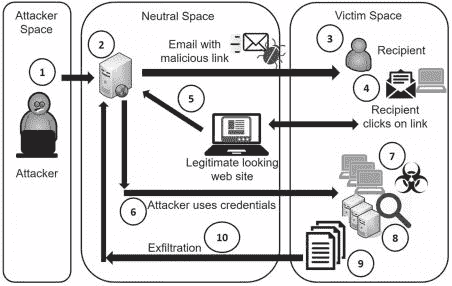

图 6.1：攻击步骤

注意，攻击者（位于攻击者空间）可以位于世界的任何地方，只需要访问互联网。中立空间可能是由攻击者拥有和运行的服务器。他们可能与攻击者处于同一个国家，也可能在另一个国家。在某些情况下，攻击者使用他人拥有但由攻击者控制的服务器，例如僵尸网络中的服务器。受害者空间是目标的内部网络。在阅读以下攻击步骤时，请参考图 6.1：

1. 攻击者使用开源情报识别目标。一些典型来源是社交媒体网站和新闻媒体。在其他时候，攻击者通过电话和电子邮件使用社会工程学策略来获取有关组织或该组织雇员的信息。
2. 接下来，攻击者编写一个带有恶意链接的鱼叉式钓鱼电子邮件。电子邮件可能包含指向托管在另一个网站上的恶意软件链接，并鼓励用户点击链接。在某些情况下，此链接可以激活“路过下载”（drive-by download），在用户不知情的情况下自行安装到用户的计算机上。Cozy Bear (APT 29) 使用了这种技术，且至少有一个目标个人点击了该链接。同样，罪犯通常使用这种技术将勒索软件下载到用户的计算机上。在其他情况下，电子邮件可能会指示用户的密码已过期，用户需要更改密码，否则所有访问将被挂起。Fancy Bear (APT 28) 使用了类似的技术。
3. 攻击者从中立空间中的服务器向接收者发送鱼叉式钓鱼电子邮件。该电子邮件包含一个恶意链接，并使用旨在欺骗用户点击它的词汇。
4. 如果用户点击链接，它会将用户带到一个看起来合法的网站。该网站可能会尝试“路过下载”，或者可能模仿合法的网站并鼓励用户输入用户名和密码。
5. 如果恶意链接欺骗用户输入了凭据，网站会将信息发回给攻击者。如果恶意链接在用户系统上安装了恶意软件（例如 RAT 远程访问工具包），攻击者将使用它来收集用户计算机上的信息（包括发现后的用户凭据），并将其发回给攻击者。
6. 攻击者使用凭据访问目标系统。在许多情况下，攻击者使用被感染的计算机扫描网络以寻找漏洞。
7. 攻击者在目标系统上安装恶意软件。
8. 该恶意软件检查这些系统上的所有可用数据，例如计算机和服务器上的电子邮件和文件。
9. 恶意软件收集所有感兴趣的数据，并通常将其划分为加密块。
10. 这些加密分块被外泄到网络之外并返回给攻击者。当用户或进程访问了高级权利和权限时，就会发生特权提升。权利和权限结合起来称为特权。当攻击者首次攻破系统时，他们通常拥有最小权限。然而，特权提升策略允许他们获得越来越多的特权。图 6.1 所示的受害者可能只有最小权限，但恶意软件将使用各种特权提升技术，在用户的计算机和网络内部获取越来越多的特权。

如果用户以管理员权限登录，恶意软件将更容易控制用户的系统和网络。这就是组织要求管理员拥有两个账户的原因之一。管理员使用一个账户进行日常工作，并使用另一个账户进行管理工作。他们只有在执行管理任务时，才会使用管理员账户登录。这缩短了管理员账户的使用时间，并增加了恶意软件使用特权提升技术的难度。

# 阻止恶意软件和其他攻击

之前的几个章节描述了攻击者和犯罪分子用于发起新攻击的几种不同方法。然而，组织和个人只需几个步骤就能防止许多此类攻击成功。这些步骤包括使用反恶意软件和对用户进行教育。

## 保护系统免受恶意软件侵害

恶意软件对任何组织都是重大威胁。管理员通常实施分层安全或深度防御计划来防止恶意软件。以下列表项目列出了一些用于防止恶意软件的常用安全控制：

- 邮件网关上的垃圾邮件过滤器。钓鱼攻击以恶意垃圾邮件的形式发送。邮件网关（电子邮件服务器）上的垃圾邮件过滤器在邮件到达用户之前对其进行检测和过滤。某些网络首先将邮件路由到另一个设备以过滤垃圾邮件。如果用户从未收过恶意邮件，他们就没有机会点击邮件中的恶意链接。
- 邮件网关上的反恶意软件。恶意邮件通常包含恶意软件附件。邮件服务器上的反恶意软件可以检测并拦截它。该软件会从邮件中剥离潜在的恶意附件，并通常向用户发送通知，解释删什么以及为什么要删除。
- 所有系统。所有工作站和服务器都安装了反恶意软件。根据服务器上运行的应用程序，服务器可能还会安装额外的专用反恶意软件。
- 边界或防火墙。许多网络包含监控防火墙网络流量的检测工具。例如，统一威胁管理（UTM）会检查网络流量以降低恶意软件进入网络的风险。第 3 章“探索网络技术和工具”涵盖了 UTM 系统。

### 防病毒软件与反恶意软件

反恶意软件提供针对许多类型恶意软件的保护。你经常会听到防病毒软件这个术语，认为它只保护病毒。然而，界限已经变得模糊。病毒并不是唯一的威胁。攻击者通过使用不同类型的恶意软件改变了他们的方法，防病毒软件供应商也通过包含检测和阻止这些新威胁的方法来适应。大多数防病毒软件都能检测、阻止和删除几种不同类型的恶意软件，如病毒、木马、蠕虫、根内核、间谍软件和广告软件。防病毒软件提供实时保护，并可以执行计划和手动扫描。实时保护持续监控系统。例如，当用户访问网站时，防病毒软件会扫描下载的网站文件并尝试阻止恶意代码。同样，当用户下载或打开文件时，防病毒软件会在打开前对其扫描。计划扫描定期进行，例如每周一次。如果用户或技术人员检测到疑活动，可以执行手动扫描来检查系统。

如果防病毒软件检测到恶意软件，它通常将其隔离并通知用户。然而，不同供应商之间执行此操作的具体方法有所不同。分析和解释防病毒软件输出的关键在于识别警报并阅读它。有些人只点击确定而不注意警报，可能会在无意中覆盖掉防病毒软件的操作。

防病毒软件使用基于签名的检测或基于启发式的检测来检测病毒。

#### 基于签名的检测

病毒和其他恶意软件具有已知的模式。签名文件（也称为数据定义文件）定义了这些模式，防病毒软件扫描文件以寻找匹配的模式。当软件识别出匹配模式时，它会报告为感染并采取行动，例如删除或隔离该文件。

被隔离的病毒在隔离期间对系统无害，但它仍可用于分析。例如，安全专业人员可以将被隔离的病毒释放到不受保护但隔离的虚拟机环境中进行研究和学习。

恶意软件开发人员不断发布新病毒，因此定期更新签名定义文件至关重要。大多数防病毒软件都包含自动检查和下载更新后的签名定义文件的功能。它们通常每天会检查几次更新。

也可以手动下载和安装签名文件。管理员在更新没有互联网访问的系统时会执行此操作。在这样做时，管理员务必通过对比防病毒供应商网站上发布的签名文件哈希值与下载文件的哈希值，确保签名文件没有丢失完整性。

#### 基于启发式的检测

某些防病毒软件包含基于启发式的检测。基于启发式的检测尝试检测以前未知且没有签名的病毒。这包括本章后面提到的零日漏洞。

基于启发式的分析在专门为保护活动环境而设计的沙箱或虚拟化环境中运行可疑代码，同时观察代码的行为。大多数病毒都会参与病毒性活动——这些活动可能有害，但很少由合法程序执行。启发式分析会检测这些病毒性活动。

例如，多态恶意软件在创建副本时会向文件添加变体。任何应用程序对文件添加此类变体是非常异常的，启发式方法通常能检测多态恶意软件。

### 记住这一点

> 防病毒软件检测并移除恶意软件，如病毒、木马和蠕虫。基于签名的防病毒软件根据签名定义检测已知恶意软件。基于启发式的软件根据行为检测以前未知的恶意软件。

#### 检查文件完整性

某些防病毒扫描程序使用文件完整性检查器来检测修改过的系统文件。文件完整性检查器计算系统文件的哈值作为基准。然后定期重新计算这些文件的哈希值，并与基准中的哈希值进行比较。如果哈值发生任何变化，则表明系统文件已被修改。当防病毒扫描程序检测到修改的文件时，它会发送警报。很多时候，这些警报可以检测到根内核感染。

也可以使用命令行工具检查文件完整性。例如，微软文件校验和完整性验证器（`fciv.exe`）工具可以验证文件夹内或一组嵌套文件夹内所有文件的完整性。查看本章实验中的“使用文件校验和完整性验证器”实验：[`gcgapremium.com/501labs/`](http://gcgapremium.com/501labs/)。

`fciv.exe` 允许你创建一个数据文件，列出目录下所有文件的哈希值。稍后你可以运行该命令来验证哈希值是否相同。通常情况下，你会看到以下消息，表示文件没有丢失完整性：“所有文件验证成功。”然而，如果应用程序检测到文件的哈希值不同，你将看到类似下面的消息：

修改文件列表：

-----------------------

```text
exefiles\md5Sum.exe

Hash is: 08ab4b9b40448d77079f61751f989702bbebe2ed

It should be: 7648ec1a2d8c8b65a024973d30b4b2dc48ad0cec
```

在此示例中，它表明文件 `md5sum.exe` 已被修改。因为可执行文件通常不会被修改，这表明该文件可能已被恶意软件感染，不应被使用。

## 数据执行保护

数据执行保护（DEP）是一种安全功能，可防止代码在标记为不可执行的内存区域中执行。它可以防止应用程序或服务从不可执行内存区域执行代码。DEP 的主要目的是保护系统免受恶意软件的影响。

DEP 由硬件和软件共同执行。超威（AMD）使用不可执行页保护（`NX`）功能实现 DEP。英特（Intel）使用执行禁用位（`XD`）功能实现 DEP。两者都在输入输出系统（BIOS）或统一可扩展固件接口（UEFI）中启用。在 Windows 内部，可以在系统属性的性能设置中启用 DEP。

如果 BIOS 或 UEFI 中未启用 DEP，但你尝试安装 Windows，通常会看到类似“您的 PC CPU 与 Windows 不兼容”的错误消息。解决方案是在 BIOS 或 UEFI 中启用 DEP。

## 高级恶意软件工具

许多供应商已开始开发高级恶意软件工具。这些工具不仅检查文件以判断其是否为恶意软件。例如，思科的高级恶意软件保护（AMP）结合了多种技术，在攻击前、攻击中和攻击后保护网络。

AMP 通过威胁情报和分析来分析网络以防止攻击。它从思科的安全情报组织、Talos 安全情报与研究小组以及 Threat Grid 情报馈送中收集全球威胁情报。这些信息帮助它像任何杀毒软件一样检测并警报类似的恶意软件。

在攻击期间，AMP 使用多种技术在威胁渗透网络之前检测并阻止新兴威胁，或遏制并修复进入网络中的恶意软件。AMP 使用持续分析来检测网络内部可疑的文件和网络活动，这有助于它检测网络内运行的恶意软件。

安全管理员查看日志和警报，分析并解释来自 AMP 等高级恶意软件工具的输出。例如，管理员可能会看到警报，显示加密数据正在发送出网络。这是一个严重的危险信号，表明恶意软件正在收集数据并发送给攻击者。

## 垃圾邮件过滤器


组织通常采用多管齐下的方法阻止垃圾邮件。例如，许多`UTM`系统包含垃圾邮件过滤器来检测并拦截垃圾邮件。`UTM`的输出发送到电子邮件服务器。电子邮件服务器也有检测和阻止垃圾邮件的方法。电子邮件服务器将所有邮件发送给用户，检测为垃圾邮件的除外。用户系统也有反垃圾邮件过滤器或垃圾邮件选项作为最后检查。

任何垃圾邮件过滤器的挑战在于只过滤垃圾邮件，而绝不过滤掉实际邮件。例如，公司不希望垃圾邮件过滤器过滤掉尝试购买物品的客户发送的邮件。因此，大多数垃圾邮件过滤器倾向于谨慎，宁愿允许垃圾邮件通过，也不可能将有效邮件标记为垃圾邮件。尽管垃圾邮件过滤背后的科学仍在改进，但犯罪分子也在不断适应。

垃圾邮件过滤器通常允许你识别电子邮件地址为安全或被阻止。你可以添加这些单独地址或整个域名。例如，如果你想确保收到 Homer 从`springfield.com`发送的邮件，你可以将`springfield.com`添加为安全。同样，如果你想确保收到来自`springfield.com`的邮件，你可以将`springfield.com`指定为安全。

# 教育用户

未经过训练的用户对任何组织都构成了重大风险，并且往往是最大的漏洞之一。他们不需要是恶意的内部人员，可能只是对风险不了解。回想本章提到的 Fancy Bear 和 Cozy Bear APT 攻击。无论组织在技术上花费了多少钱，都可能被用户点击电子邮件中的恶意链接而绕过。影响可能是整个网络被感染。

防止社会工程攻击和钓鱼攻击等许多攻击的最单一保护措施是培训并提高用户的安全意识。许多用户并不知道攻击者的方法。然而，一旦他们理解了风险和手段，就不容易落入这些攻击陷阱。同样，提高用户的安全意识有助于他们识别并适当应对新的威胁和安全趋势。

与安全相关的意识和培训计划有多种形式。常见方法包括正式课程、短时间的非正式现场培训、在线课程、海报、简报、登录横幅和定期电子邮件。这些计划通常让用户意识到新的威胁、安全趋势以及警报，例如新的恶意软件、当前的钓鱼攻击和零日漏洞。

## 新病毒

犯罪分子不断发布新病毒，某些病毒证明具有极强的破坏性。其中许多病毒需要管理员迅速采取行动来缓解威胁。例如，当供应商发现攻击者可以利用的漏洞时，他们会发布补丁和更新以移除该漏洞。管理员随后需要评估、测试并对服务器实施这些补丁或升级。同样，家庭用户应保持其系统和应用程序为最新版本。

## 钓鱼攻击

除了定期发布新病毒外，犯罪分子还在发起新的钓鱼攻击。一些新尝试非常狡猾，欺骗了许多人。防止攻击成功的最佳方法是教育人们犯罪分子现在正在做什么。

例如，犯罪分子对 Gmail 用户设计了一次复杂的攻击，甚至欺骗了精通技术的用户。一旦他们获取了某个用户的凭据，就会迅速登录该账户，并搜索其发送的邮件、附件和主题。

随后，他们利用该账户向此人之前发送过邮件的人发送邮件，通常使用相似的主题。此外，他们通常会包含一个类似于文档缩略图的内容。通常情况下，点击缩略图会提供文档预览。然而，这会在浏览器中打开另一个标签页，其 URL 如：`data:text/html,https://accounts.google.com/ServiceLogin?service=mail…`

当用户看到`accounts.google.com`时，它看起来是合法的。此外，页面显示的登录界面看起来与 Google 登录页面一模一样。但事实并非如此。被欺骗在这个虚假但制作精良的网页上“登录”的用户因此遭受了攻击。攻击者迅速登录该账户，并重新开始这一过程，希望能诱捕其他毫无防备的用户。

在一个广为人知的案例中，攻击者使用一个被攻破的账户向团队所有成员重新发送了一份团队练习计划。该计划包含相似的主题和原始附件的截图。某些收到邮件的接收者点击了缩略图，并被带到了带有`accounts.google.com`的相同 URL。一些人被欺骗并输入了凭据，看似是为了登录 Google。攻击者迅速登录这些新被攻破的账户，并再次启动了该过程。

## 零日漏洞

第四章“保护你的网络”讨论了零日漏洞和零日攻击。提醒一下，零日漏洞是指受信信源（如操作系统和反病毒软件供应商）未知的漏洞或程序错误。操作系统厂商在获知这些漏洞后会编写并发布补丁，但在厂商获知之前，该漏洞一直存在。例如，Heartbleed 漏洞在被广泛发布之前已经存在多年。在`OpenSSL`开发者发布修复程序之前，所有使用它的人都处于危险之中。

用户可能会认为，防病毒软件可以保护他们免受所有恶意软件的侵害。这并非事实。无论反病毒公司识别新恶意软件的能力有多强，犯罪分子发布恶意软件的时间与反病毒公司发布新特征以发现它的时间之间总会有滞后。当攻击者每天发布超过 200,000 种新的恶意软件变体时，情况尤为如此。这包含了利用零日漏洞设计的恶意软件。

### 记住这一点

教育用户了解新病毒、钓鱼攻击和零日攻击有助于防止事件发生。零日攻击利用了受信源（如操作系统厂商和反病毒软件供应商）未知的漏洞。

考虑到这一点，用户需要养成安全的计算习惯。他们不能依赖反病毒软件和其他技术控制措施来保护自己。一些基本指南如下：

- 不要点击未知来源邮件中的链接（无论你有多好奇）。
- 不要打开来自未知来源的附件。恶意软件可以嵌入许多不同的文件中，例如可携式文档格式（`PDF`）文件、Word 文档、压缩（Zipped）文件等。
- 警惕互联网上的免费下载。（木马会用免费之物诱惑你，但它们包含了恶意软件。）
- 限制你在社交媒体网站上发布的信息。（犯罪分子利用此来回答密码重置问题。）
- 定期备份你的数据（除非你愿意看到它永远消失）。
- 保持计算机更新到最新的补丁（但要警惕零日攻击）。
- 保持反病毒软件更新到最新（但不要依赖它捕捉一切）。

## 为什么社会工程学有效

社会工程工程师通常使用一或多个基于心理学的原理来增加其攻击的有效性。在教用户了解不同的社会工程策略的同时，教他们了解这些底层原理也是有用的。以下章节将介绍这些主题。

### 权威

许多人成长后尊重权威，当权威人士要求这样做时，他们更容易顺从。例如，参与`Milgram experiment`（米尔格实验）的志愿者即使能听到受试者的痛苦尖叫，仍然向看不见的对象发送电击，仅仅是因为一个穿实验大褂的人告诉他们继续。他们并没有真的放电，尖叫声也是伪造，但对志愿者来说，一切都是真实的。心理学家重复了这些实验，并看到了类似的结果。利用权威在冒充、大鱼钓鱼（whaling）和电话钓鱼（vishing）攻击中最为有效：

- **冒充**：某些社会工程工程师冒充他人让人们做某些事。例如，许多人给用户打电话，自称是微软员工。警察病毒（勒索软件的一种）试图冒充执法机构。其他时候，社会工程工程师试图冒充权威人士，如公司高管或技术人员。
- **大鱼钓鱼**：高管尊重法律实体等权威。例如，“大鱼钓鱼”部分提到了有多少高管被欺骗打开看起来像官方传票的感染`PDF`文件。
- **电话钓鱼**：某些攻击者使用电话冒充权威人物。

### 恐吓

在某些情况下，攻击者试图恐吓受害者采取行动。恐吓可能是通过欺凌手段，并且通常与冒充他人结合。利用恐吓在冒充和电话钓鱼攻击中最为有效。

例如，一个社会工程工程师可能会给高管的接待员打电话请求：“Simpson 先生正准备向潜在客户进行大型演示，但他的文件损坏了。他让我打电话让你立即把文件发给我，这样我就可以为他的演讲做好准备。”如果接待员拒绝，社会工程工程师可以使用恐吓策略，比如：“听着，如果你想对这笔百万美元的交易失败负责，没问题。我会告诉你不想帮忙。”

注意，这种策略可以同时使用多个原理。在这个例子中，攻击者将恐吓与紧迫性结合在一起。接待员没有多少回应。

### 认可

人们通常更愿意喜欢别人喜欢的东西。某些攻击者利用这一点，创建带有虚假证言的网站来推广产品。例如，犯罪分子建立了一些网站，上面有几十条证言，列出了他们虚假反病毒软件的所有优点。如果用户在下载虚假反病毒软件之前搜索互联网，他们就会遇到这些网站，并可能相信其他人在为该产品背书。

使用认可（有时称为社会证明）在木马和骗局中最为有效。

### 稀缺

当人们认为数量有限时，往往会被鼓励采取行动。以稀缺性为例，考虑一下苹果的 iPhone。当苹果首次发布新版本时，通常会迅速售罄。钓鱼邮件可以利用这一点，鼓励用户点击链接以获得新产品的专属访问权限。如果用户点击了，他们将进入一个恶意网站。稀缺性在钓鱼和木马攻击中通常非常有效。人们在不经深思考的情况下做出了快速决定。

### 紧迫性

某些攻击利用紧迫性作为技术，鼓励人们立即采取行动。例如，勒索软件利用倒计时器使用了稀缺性原则。受害者通常在丢失所有数据之前有 72 小时时间支付。他们每次查看电脑时，都会看到计时器在倒计时。

使用紧迫性对于勒索软件、钓鱼、电话诈骗（vishing）、高管钓鱼（whaling）和恶作剧最为有效。例如，带有恶意链接的钓鱼邮件可能表示某种价格的产品数量有限，用户应该“立即点击”。高管可能会被骗认为传票需要立即采取行动。许多病毒骗局都有截止日期，例如骗局声称病毒将在下午 4:00 造成损害。

### 记住这一点

社会工程学之所以有效，很多原因是因为他们使用了基于心理学的技巧来克服用户的反对意见。稀缺性和紧迫性是促使立即行动的两种技术。

### 熟悉

如果你喜欢某人，你更有可能按照那个人的要求去做。这就是为什么许多大公司聘雇受欢迎的名星。这也是为什么当他们卷入影响信誉的丑闻时，公司会解雇他们。

一些社会工程工程师试图在发起攻击之前与受害者建立联系以建立关系。这种原则在窥视攻击（shoulder surfing）和尾随攻击中最为有效：

- **窥视攻击（Shoulder surfing）**。如果人们熟悉某人或喜欢他们，更容易接受别人在他们身后窥视。相比之下，如果你不认识或不喜欢某人，你更有可能识别出窥视攻击并立即停止。
- **尾随（Tailgating）**。如果人们认识或喜欢某人，他们更有可能让人跟在自己后面。某些社会工程工程师使用简单的、消除防备的微笑让对方喜欢他们。

### 信任

除了熟悉感，某些社会工程工程师还试图在他们与受害者之间建立信任关系。这通常需要一点时间，但对犯罪分子来说是值得的。电话诈骗（Vishing）攻击经常使用这种方法。

例如，一个自称是安全专家的人曾给我打过电话。他说他在为一家名称中带有“Secure”字的公司工作，他们注意到我的电脑正在发送错误。他强调了两次他们部署并支持 Windows 系统。公司名称和他们的经验是为了尝试建立信任。

然后他指导我完成了打开`Event Viewer`（事件查看器）并查看系统中某些错误的过程。他要求我描述我看到的内容，并用老练演员的声音说道：“噢，天哪！”他解释说这表明我的电脑被严重感染了。实际上，这些错误是微不足道的。

在严肃地解释了我的电脑面临多大的麻烦之后，他声音中带了一丝微笑说道：“但这是你的幸运日。我会帮助你。”他提议在恶意软件永久损坏我的电脑之前，指导我完成修复电脑的过程。

这一切都是为了建立信任。在这一点，他发出了致命一击。他让我打开`Run`窗口并输入一个网站地址，并要求我点击`OK`。我在这里停了下来。我没有点击`OK`。

我试图让他回答一些问题，但他一直在回避。最后，我听到了鼠标点击声。

我与这个社会工程学罪犯共度过的“幸运日”经历结束了。

那个链接可能会带我进入一个准备好进行流式下载的恶意网站。攻击者可能会指导我完成在我的系统中安装恶意软件的过程。如果我的系统因错误而拒绝，我打赌他会准备好用安抚的声音说：“那是正常的。只需点击`OK`。相信我。”在我身上花了很多时间。我怀疑这种骗局在许多其他人身上已经非常成功。

# 第 6 章考试考点回顾

在准备考试时，确保你理解本章涵盖的这些关键概念。

## 理解威胁行为者

- 脚本小子（Script kiddies）使用现有的计算机脚本或代码来发起攻击。他们通常几乎没有专业知识或技术水平，资金也非常少。
- 黑客活动分子（Hacktivist）作为活动运动的一部分或为了推进某事业而发起攻击。
- 内部人员（如公司员工）拥有组织内部资源的合法访问权限。他们有时会出于贪婪或报复变成恶意内部人员。
- 竞争对手有时会进行攻击以获取另一家公司的专有信息。
- 有组织犯罪（Organized crime）是一个雇佣一组共同从事犯罪活动的企业。他们的主要动力是金钱。
- 某些攻击者是有组织的，并由国家级或政府赞助。
- 高级持续性威胁（APT）是针对网络的针对性攻击。APT 组织既有能力也有意图发起复杂且有针对性的攻击。他们由国家赞助，并且通常拥有大量的资源和资金。
- 攻击者在发起攻击之前经常使用的一种常用方法是从开源情报中收集信息，包括通过网站和社交媒体获取的任何信息。

## 确定恶意软件类型

- 恶意软件包括多种类型的恶意代码，包括病毒、蠕虫、逻辑炸弹、后门、木马、勒索软件、根内核（rootkits）等。
- 病毒是附加到宿主程序中的恶意代码。当程序启动时代码就会运行。
- 蠕虫（Worm）是自我复制的恶意软件，可以在没有用户干预的情况下遍布网络。
- 逻辑炸弹（Logic bomb）响应事件执行，如日期、时间或条件。恶意内部人员在现有系统中植入了逻辑炸弹，这些逻辑炸弹在员工离开公司后释放了其载荷。
- 后门（Backdoors）提供了访问系统的另一种方式。恶意软件经常在系统中插入后门，赋予攻击者远程访问系统的权限。
- 木马（Trojan）看起来是某种东西，例如盗版软件或免费防病毒软件，但实际上是邪恶的。远程访问木马（RAT）是一种允许攻击者从远程位置控制系统的恶意软件。
- 旁路式下载（Drive-by downloads）通常尝试用木马感染系统。
- 勒索软件（Ransomware）是一种控制用户系统或数据的恶意软件。犯罪分子试图勒索赎金，以换回控制权还给用户。加密勒索软件（Crypto-malware）是加密用户数据的勒索软件。攻击者要求付款以解密数据。
- 间谍软件（Spyware）是在用户不知情或不同意安装在用户系统上的软件，它监控用户的活动。它有时包括记录用户击键的键记录器。
- 僵尸网络（Botnet）是一组通过命令与控制服务器控制的计算机。攻击者使用恶意软件将计算机加入僵尸网络。僵尸网络控制者（Bot herders）通过僵尸网络发起攻击。
- Rootkits（根 kits）获取系统的根级或内核级控制权限。它们通过隐藏进程来规避检测。它们可以移除用户权限并修改系统文件。

## 识别常见攻击

- 社会工程（Social engineering）是指利用社会策略来获取信息或欺骗用户执行他们通常不会采取的行为的行为。
- 社会工程攻击可以在面对面、通过电话、上网以及电子邮件发生。许多社会工程工程师试图冒充他人。
- 窥视偷窥（Shoulder surfing）是试图通过随意观察获取未经授权的信息，例如从别人肩膀后看，或使用摄像头监控屏幕。屏幕滤镜可以防止窥视偷窥。
- 骗术信息（Hoax）是一种通常通过邮件传播的消息，声称病毒或其他安全威胁即将来临，而这些威胁实际上并不存在。
- 尾随攻击（Tailgating）是指一个人紧跟在另一个人后面而不显示身份凭证的行为。防尾随门（Mantraps）有助于防止尾随攻击。
- 翻垃圾者（Dumpster divers）通过搜查垃圾来寻找信息。粉碎或焚毁文件可以减少翻垃圾的风险。
- 水坑攻击（Watering hole attacks）发现目标群体经常访问并信任的网站。攻击者随后修改这些网站以下载恶意软件。当目标群体访问被修改的网站时，他们更有可能下载并安装受感染的文件。
- 垃圾邮件（Spam）是不受欢迎或未经请求的电子邮件。攻击者经常在不同类型的攻击中使用垃圾邮件。
- 网络钓鱼（Phishing）是指向用户发送电子邮件，目的是欺骗他们泄露敏感信息、安装恶意软件或点击链接。
- 鱼叉式钓鱼（Spear phishing）和鲸钓鱼（Whaling）是网络钓鱼的类型。鱼叉式钓鱼针对特定的用户群体，而鲸钓鱼针对高层执行人员。
- 语音钓鱼（Vishing）是钓鱼的一种形式，使用电话语音并通常使用 VoIP。某些语音钓鱼攻击从录音语音开始，然后切换到真人。

## 阻塞恶意软件和其他攻击

- 杀病毒软件可以检测并阻止不同类型的恶意软件，如蠕虫、病毒和木马。杀病毒软件使用签名来检测已知的恶意软件。
- 当手动下载签名时，可以使用哈希值验证签名文件的完整性。
- 杀病毒软件通常包含一个文件完整性检查器，用于检测被 rootkit 修改的文件。
- 数据执行保护（DEP）防止代码在标记为不可执行的内存位置中执行。DEP 的主要目的是保护系统免受恶意软件侵害。
- 高级恶意软件工具监控网络内部的文件和活动。
- 反垃圾邮件软件尝试阻止未经请求的电子邮件。你可以配置垃圾邮件过滤器来阻止特定的电子邮件地址和域名。
- 与安全相关的意识和培训计划帮助用户了解新威胁和安全趋势，例如新病毒、新钓鱼攻击和零日漏洞。零日漏洞利用了信誉来源未知的漏洞。
- 社会工程工程师和其他犯罪分子利用了几种基于心理学的原理来增加其攻击的有效性。这些原理包括：权威性、威慑、共识、稀缺性、紧急性、熟悉和信任。

## 在线参考

- 你做过在线实验吗？它们可能帮助你理解一些关键内容。查看在线内容以获取[`gcgapremium.com/501-extras`](http://gcgapremium.com/501-extras)上的额外材料。

# 第 6 章练习题

1. 马文·门罗纪念医院最近遭受了严重攻击。攻击者通知管理人员，他们加密了医院服务器上的大量数据，在管理层向攻击者支付巨额之前，数据将保持加密状态。以下哪项识别了此类攻击中最可能的威胁者？

   A. 有组织犯罪
   B. 勒索软件
   C. 竞争对手
   D. 黑客行动主义

2. Terwilliger 医生安装了某种代码，如果他失去了电视节目中的配角工作，将自动启用他的账户。该代码设计为在账户被禁用三天后重新启用。这描述的是哪一项？

   A. 逻辑炸弹（Logic bomb）
   B. Rootkit
   C. 间谍软件
   D. 勒索软件

3. Lisa 最近为人力资源部门开发了一个应用程序。人员使用该应用程序存储和管理员工数据，包括 PII（个人身份信息）。她编写了使用只有她才知道的用户名和密码访问该应用程序的功能，以便在必要时对应用程序进行远程维护。这描述的是哪一项？

   A. 病毒
   B. 蠕虫


# C. 后门（Backdoor）

# D. 木马

4. Terwilliger 医生安装了某种代码，如果他失去了电视节目中的配角工作，将会运行。该代码将在原始账户被删除三天后创建一个只有他才知道的凭据的新账户。此代码创建的是什么类型的账户？

# A. 后门

# B. 逻辑炸弹

# C. Rootkit

# D. 勒索软件

5. 安全管理员最近在你的网络中发现了可疑活动。调查活动后，他们发现来自网络外部的恶意流量连接到网络内部的服务器。他们确定恶意威胁者利用此连接在服务器上安装了恶意软件，该软件正在收集数据并发送到网络之外。以下哪项最描述威胁者使用的恶意软件类型？

# A. APT

# B. 有组织犯罪

# C. RAT

# D. 加密恶意软件

6. 安全管理员最近注意到工作站活动异常。它正在使用常用的端口连接到组织内部网络的系统。管理员发现计算机还在运行多个隐藏进程。以下哪种选项最能描述这一活动？

# A. Rootkit

# B. 后门

# C. 垃圾邮件

# D. 木马

7. Lisa 是一名数据库管理员，接到了一个自称是已知硬件供应商技术人员的电话。技术人员说他知道他们出售的数据库服务器存在问题，但只影响某些操作系统版本。他询问 Lisa 公司在数据库服务器上运行什么操作系统。以下哪项是 Lisa 的最佳回答？

# A. 告知来电者服务器上运行的操作系统和版本，以确定是否需要采取进一步行动。

# B. 感谢来电者并挂断，向主管汇报电话，并独立检查供应商的问题。

# C. 向来电者要电话号码，以便检查服务器后回电给他。

# D. 联系执法人员。

8. Bart 位于办公室外的休息区。他告诉 Lisa 他把证件留在里面了，并请求 Lisa 在她回到室内时让他跟着她进去。这描述的是哪一项？

# A. 鱼叉式钓鱼

# B. 鲸钓鱼

# C. 防尾随门（Mantrap）

# D. 尾随攻击

9. Bart 在清理办公桌时，将几张包含 PII 的纸张扔进了回收箱。哪种类型的攻击可以利用这种行为？

# A. 语音钓鱼

# B. 翻垃圾者（Dumpster diving）

# C. 窥视偷窥

# D. 尾随攻击

10. 你的组织最近遭受了此前任何信誉来源均未知的恶意软件损失。以下哪项最能描述这种攻击？

# A. 网络钓鱼

# B. 零日（Zero-day）

# C. 开源情报

# D. 骗术信息（Hoax）

## 11. 组织的某项安全策略规定，显示器必须放置在无法从外部查看的位置。此规定的目的是什么？

# A. 钓鱼攻击 (phishing)

# B. 窥视 (shoulder surfing)

# C. 翻找垃圾 (dumpster diving)

# D. 冒充 (impersonation)

## 12. 攻击者最近向组织的财务总监发送了一些恶意邮件。这些邮件看起来是来自 CEO 的。它们包含一个恶意 PDF 文件。以下哪项最能描述这种攻击类型？

# A. 钓鱼攻击 (phishing)

# B. 垃圾邮件 (spam)

# C. 木马 (trojan)

# D. 鱼叉钓鱼 (whaling)

## 13. 最近一次看起来来自组织 CEO 的定向式钓鱼攻击导致几名员工泄露了密码。管理层希望实施某种安全控制措施来防止员工点击此类邮件。以下应该实施什么？

# A. 数字签名 (digital signatures)

# B. 垃圾邮件过滤器 (spam filter)

# C. 培训 (training)

# D. 启发式检测 (heuristic-based detection)

## 14. 最近一次针对组织的攻击导致了大量数据的加密。随后，攻击者要求组织支付一笔巨款以解密数据。安全调查人员确定，这是公司内某员工点击邮件中的链接导致的。以下哪项最能描述该场景中的漏洞？

# A. 勒索软件 (ransomware)

# B. 未经过培训的用户 (untrained user)

# C. 资源耗尽 (resource exhaustion)

# D. 内部威胁 (insider threat)

## 15. 公司的 CEO 最近收到一封邮件。邮件显示她的公司正面临诉讼，并把她列为被告。邮件包含一个附件，该附件描述为传传票。以下哪项最能描述发送者使用的社会工程原理？

# A. 鱼叉钓鱼 (whaling)

# B. 钓鱼攻击 (phishing)

# C. 共识 (consensus)

# D. 权威 (authority)

# 第 6 章练习题答案

1. # A. 这种攻击最可能是由组织犯罪集团发起的，因为他们的动机是钱。虽然场景描述的是勒索软件，但勒索软件是恶意软件，而不是威胁者。竞争对手通常想要获取专有信息，向另一家医院勒索钱的情况是非常罕见的。黑客活动者通常为了事业发起攻击，而不是为了勒索钱。

2. # A. 逻辑弹（logic bomb）是响应事件执行的代码。在此场景中，逻辑弹在账户被禁用时执行（表明 Terwilliger 博士不再在该公司工作）。在此场景中，逻辑弹创建了一个后门。根内核程序（rootkit）包含隐藏进程，但它们不会响应事件。间谍软件（spyware）是在用户不知情或未经同意的情况下安装在系统上的软件。其目的是监控用户的计算机和用户活动。勒索软件要求赎金。

3. # C. 后门（backdoor）为提供了访问系统或应用程序的替代方法，这正是 Lisa 在场景中创建的。看起来似乎她是出于善意这样做，但如果攻击者发现了后门，他们就可以利用它。病毒（virus）是附加到应用程序并在运行时执行的恶意代码，而不是故意写入应用程序的程序。蠕虫（worm）是自我复制的恶意软件，可以在没有主机程序或用户交互的情况下在网络中传播。木马（trojan）是看起来有益处但包含恶意组件的软件。

4. # A. 该代码创建了一个 Terwilliger 博士可以使用其访问系统的新账户。他用逻辑弹创建了它，但逻辑弹是恶意软件类型，而不是他创建的账户类型。根内核程序包含隐藏进程，但它们不会响应事件。勒索软件要求付费以释放用户的计算机或数据。

5. # C. 场景描述的是一种远程访问木马（RAT），这是一种允许攻击者从远程位置控制系统的恶意软件。虽然威胁者可能是高级持续威胁（APT）或组织犯罪集团的成员，但这些是威胁者类型，而不是恶意软件类型。加密恶意软件（crypto-malware）是一种加密数据的勒索软件，但在场景中没有迹象表明数据正在加密。

6. # A. 根内核程序（rootkit）通常运行隐藏进程，它还尝试通过互联网连接到计算机。虽然攻击者可能使用后门来访问用户的计算机并安装根内核程序，但后门并不运行隐藏进程。垃圾邮件是不需要的邮件，与此问题无关。木马是看起来有益处但具有恶意的软件。

7. # B. 这听起来像是一次社会工程学攻击，拨号者正试图获取服务器的信息，因此挂断电话、向主管报告该电话并独立检查供应商的潜在问题是恰当的。通过电话向外部人员提供内部系统信息是不恰当的。没有询问电话，因为你不会回电提供服务器信息。拨号者通过提问并没有犯罪。

12. D. 鲸叉鱼攻击（Whaling）**是一种针对高层管理人员（例如首席财务官 CFO 或首席执行官 CEO）的钓鱼攻击，此场景描述的是一次针对 CFO 的攻击。由于鲸叉鱼攻击比钓鱼攻击更具针对性，因此钓鱼并不是最佳答案。垃圾邮件（Spam）是不受欢迎的电子邮件，但垃圾邮件并不一定恶意。虽然受感染的可移动文档格式（PDF）可能包含木马，但该场景并未描述 `PDF` 内部的恶意软件类型。

13. A. 数字签名提供了关于邮件发送者的保证，并符合此场景的目标。虽然垃圾邮件过滤器可能会过滤鱼叉式钓鱼攻击，但它无法提供关于邮件发送者的保证。培训计划可以帮助员工了解攻击，并帮助防止此类攻击的成功，但它无法提供关于邮件发送者的保证。某些杀病毒软件包含了基于启发式的检测。启发式检测试图检测此前未知的且没有病毒特征码的病毒。

14. B. 在给出的选项中，未经过训练的用户是此场景中最可能的漏洞。经过训练的用户不太可能点击电子邮件中收到的恶意链接。虽然攻击描述的是勒索软件，但勒索软件并不是漏洞。拒绝服务（DoS）或分布式拒绝服务（DDoS）攻击通常会导致资源耗尽，但那是攻击的结果，而不是漏洞。内部威胁意味着恶意内部人员，但没有迹象表明该新员工是恶意的。

15. D. 发送者在此场景中使用了社会工程中的**权威**原则。首席执行官（CEO）会尊重法律权威，可能更倾向于打开此类权威的附件。虽然场景描述了鲸叉鱼攻击（一种特定的钓鱼攻击类型），但鲸叉鱼攻击和钓鱼都是攻击手段，而不是社会工程原则。共识社会工程原则试图证明其他人喜欢某件产品，但这与此场景无关。

# 第 7 章：防御高级攻击

## 本章涵盖的 CompTIA Security+ 目标：

**1.2 比较并对比攻击类型。**

* 应用程序/服务攻击（DoS, DDoS、中间人攻击、缓冲区溢出、注入、跨站脚本、跨站请求伪造、权限提升、ARP 污染、放大攻击、DNS 污染、域名劫持、浏览器内攻击、零日攻击、重放、哈希传递、劫持及相关攻击 [点击劫持、会话劫持、URL 劫持、仿写攻击]、驱动程序操控 [Shimming、重构）、MAC 伪装、IP 伪装），加密攻击（生日攻击、已知明文/密文、彩虹表、字典、暴力破解 [在线与离线]、碰撞、重放）

**1.6 解释与漏洞类型相关的影响。**

* 竞态条件、输入不当、错误处理不当、内存/缓冲区漏洞（内存泄漏、整数溢出、缓冲区溢出、指针引用、DLL 注入）、新威胁/零日

**3.1 解释框架、最佳实践和安全配置指南的用和目的。**

* 行业标准框架和参考架构（监管、非监管、国家级对比国际、特定行业框架）、基准/安全配置指南（特定平台/厂商指南 [Web 服务器、操作系统、应用程序服务器、网络基础设施设备]，通用指南）

**3.6 总结安全应用程序开发和部署概念。**

* 开发生命周期模型（瀑布式 vs 敏捷式）、安全 DevOps（安全自动化、持续集成、基准化、不可变系统、基础设施即代码）、版本控制和变更管理、配置与取消配置、安全编码技术（适当的错误处理、适当的输入验证、规范化、存储过程、代码签名、加密、混淆/伪装、代码重用/死代码、服务端与客户端执行及验证、内存管理、第三方库和 SDK 的使用）、代码质量和测试（静态代码分析器、动态分析（例如模糊测试）、压力测试、沙箱、模型验证）、编译代码与运行时代码

**6.1 比较并对比密码学的基本概念。**

* 碰撞

如果 IT 世界中有什么是无处不在的，那就是攻击和攻击者。攻击者几乎无处不在。如果你有计算机系统，就无法逃避他们。然而，你可以主动识别不同类型的攻击并采取措施防止它们，或者至少防止它们发挥作用。本章涵盖了来自不同来源的各种攻击，并提供了预防许多此类攻击的见解。

# 比较常见攻击

本节总结了针对系统和网络发起的许多常见和高级攻击类型。重要的是，书中列出的所有攻击都存在有效的防御措施。然而，攻击者正积极致力于破解防御措施。随着他们的努力，安全专业人员会创建额外的防御措施，而攻击者则尝试破解它们。战斗每天都在进行。

本节的目标是让你了解许多已知攻击。通过理解这些攻击，你将更好地理解不断改进的攻击以及改进后的防御措施。

## DoS 对阵 DDoS

拒绝服务（DoS）攻击是来自一个攻击者针对一个目标的攻击。分布式拒绝服务（DDoS）攻击是来自两或多台计算机针对单一目标的攻击。DDoS 攻击通常包括被攻击计算机网卡上持续的异常高网络流量。其他系统资源使用情况（如处理器和内存使用）也会变得异常高。两者的目标都是执行服务攻击并防止合法用户访问目标计算机上的服务。

> **记住这一点**

> 拒绝服务（DoS）攻击是来自单一源的试图破坏另一个系统提供的服务的攻击。分布式拒绝服务（DDoS）攻击包括多个计算机攻击单一目标。DDoS 攻击通常包括持续的异常高网络流量。

## 权限提升

第 6 章“比较威胁、漏洞和常见攻击”讨论了攻击者经常使用的权限提升策略。例如，攻击者经常使用远程访问木马（RATs）获取单个系统的访问权限。在他们最初利用系统时，通常权限有限（权利和许可的组合）。然而，他们使用各种权限提升技术来获得越来越多的权限。

本章中的大多数攻击也出于相同的原因使用权限提升技术——获取对系统或网络越来越多的访问权限。

## 伪装（Spoofing）

伪装发生在一个人或一个实体冒充或假装成他人或其他物时。CompTIA 目标中特别提到的两种常见伪装攻击是介质访问（MAC）地址伪装和网际协议（IP）地址伪装。

网络上的主机为其网络接口卡（NIC）分配了介质访问控制（MAC）地址。这些地址被硬编码在`NIC`中。然而，在`MAC`欺骗攻击中，软件方法将不同的`MAC`地址关联到`NIC`上。例如，第三章“探索网络技术与工具”讨论了`MAC`洪泛攻击，攻击者利用伪造的`MAC`地址淹没交换机。洪泛防护（Flood guards）可以防止此类攻击。第四章“保护你的网络”讨论了无线攻击者如何通过伪造受授权系统的`MAC`地址来绕过`MAC`地址过滤。

在`IP`欺骗攻击中，攻击者更改源地址，使 IP 数据包看起来来自不同的源。这允许攻击者从单个系统发起攻击，而看起来攻击是来自不同的 IP 地址。

记住这一点

欺骗攻击通常通过更改数据来冒充另一个系统或人员。`MAC`欺骗攻击更改源`MAC`地址，而`IP`欺骗攻击更改源`IP`地址。

## SYN 洪泛攻击

`SYN`洪泛攻击是一种常用于互联网服务器的攻击。它们对于攻击者容易发起，难以停止，并会导致严重问题。`SYN`洪泛攻击破坏了`TCP`握手过程，并可以阻止合法客户端连接。

第三章解释了`TCP`会话在建立连接时如何使用三次握手。提醒一下，两个系统通常通过在`TCP`握手中交换三个包来启动`TCP`会话。例如，当客户端与服务器建立会话时，采取以下步骤：

1. 客户端向服务器发送一个`SYN`（同步）包。

2. 服务器响应一个`SYN/ACK`（同步/确认）包。

3. 客户端通过发送`ACK`（确认）包完成握手。建立会话后，两个系统交换数据。

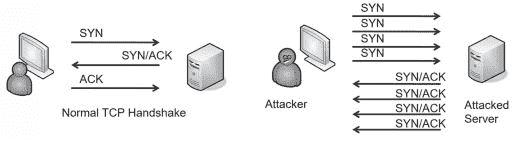

然而，在`SYN`洪泛攻击中，攻击者永远不会通过发送`ACK`包来完成握手。此外，攻击者发送大量的`SYN`包，导致服务器留下多个半打开连接。图 7.1 比较了正常的`TCP`握手与`SYN`洪泛攻击的开始。

图 7.1：TCP 握手与 SYN 洪泛攻击

在某些情况下，这些半打开连接会在服务器等待第三个包时消耗其资源，并实际上导致其崩溃。但通常情况下，服务器会限制这些半打开连接的数量。一旦达到限制，服务器将不再接受任何新连接，阻塞来自合法用户的连接。例如，Linux 系统支持`iptables`命令，可以为`SYN`包设置阈值，在设置阈值后将其拦截。虽然这防止了`SYN`洪泛攻击导致系统崩溃，但也拒绝了合法客户端的服务访问。

攻击者可以在`DoS`攻击中从单个系统发起`SYN`洪泛攻击。在这样做时，他们通常会伪造源`IP`地址。攻击者还可以使用`DDoS`攻击从多个系统协调发起攻击。

## 中间人攻击

中间人 (MITM) 攻击是主动拦截或主动窃听的一种形式。它使用一台单独的计算机接收来自会话双方的流量，并在两者之间转发流量。两台计算机并不知道中间人计算机的存在，它可以随意地中断流量或插入恶意代码。

例如，想象 Maggie 和 Bart 正在通过网络使用他们的两台计算机交换信息。如果黑客 Harry 可以从第三台计算机发起 MITM 攻击，他将能够拦截所有流量。Maggie 和 Bart 仍然接收到所有信息，因此他们没有意识到攻击。然而，黑客 Harry 也收到了所有信息。由于中间人计算机可以控制整个对话，很容易插入恶意代码并发送到计算机上。地址解析协议 (`ARP`) 毒化是攻击者发起 MITM 攻击的一种方法。Kerberos 通过双向身份验证帮助防止中间人攻击。它不允许恶意系统在另外两个系统不知情的情况下自己插入到对话中间。

## ARP 毒化攻击

`ARP`毒化是一种误导计算机或交换机关于系统实际`MAC`地址的攻击。`MAC`地址是分配给`NIC`的物理地址或硬件地址。`ARP`将系统的`IP`地址解析为其硬件地址，并将结果存储在名为`ARP`缓存的内存区域。

`TCP/IP`使用`IP`地址将数据包发送到目标网络。一旦数据包到达目标网络，它将使用`MAC`地址将其引导到正确的主机。`ARP`使用两种主要消息：

- `ARP`请求。`ARP`请求广播`IP`地址，本质上是在询问：“谁拥有这个 IP 地址？”

- `ARP`回复。拥有`ARP`请求中`IP`地址的计算机响应其`MAC`地址。发送`ARP`请求的计算机缓存该`IP`的`MAC`地址。在许多操作系统中，所有听到`ARP`回复的计算机也会缓存`MAC`地址。

`ARP`的漏洞在于它非常信任。它会相信任何`ARP`回复包。攻击者可以轻松创建带有伪造或虚假`MAC`地址的`ARP`回复包，并毒化网络中系统的`ARP`缓存。`ARP`毒化的两种可能攻击是中间人攻击和`DoS`攻击。

### ARP 中间人攻击

在中间人攻击中，攻击者可以重定向网络流量并在某些情况下插入恶意代码。考虑图 7.2。正常情况下，从用户到互联网的流量将直接通过交换机到达路由器，如图 7.2 顶部所示。然而，在毒化受害者的`ARP`缓存后，流量被重定向到了攻击者那里。

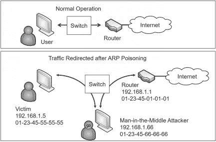

图 7.2：使用 ARP 毒化重定向流量

受害者的`ARP`缓存应该包含此条目以向路由器发送数据：

```
192.168.1.1, 01-23-45-01-01-01
```

然而，在毒化`ARP`缓存后，它包含了此条目：

```
192.168.1.1, 01-23-45-66-66-66
```

受害者现在将所有指向路由器的流量发送给攻击者。攻击者捕获数据以便以后分析。它使用另一种方法（如 IP 转发）将流量发送到路由器，让受害者不知攻击。

记住这一点

`ARP`毒化攻击试图误导系统系统的实际`MAC`地址。`ARP`毒化有时用于中间人攻击。


### ARP DoS 攻击

攻击者还可以在`DoS`攻击中使用`ARP`毒化。例如，攻击者可以发送一个带有默认网关虚假`MAC`地址的`ARP`回复。默认网关是提供离开网络路径的路由器`IP`地址。如果所有计算机都缓存了默认网关的虚假`MAC`地址，则它们都无法到达网关，从而停止所有流出网络的流量。

## DNS 攻击

第 3 章将更深入地介绍域名系统（DNS），但作为提醒，DNS 负责将主机名解析为 IP 地址。这使得你我都不再需要记住网站的 IP 地址。相反，我们只需直接在浏览器中输入名称即可进行连接。例如，如果你在网络浏览器中输入`gcgapremium.com`作为统一资源定位符（URL），你的系统会向 DNS 服务器查询 IP 地址。DNS 返回正确的 IP 地址，你的系统便使用该 IP 地址连接到网站。

DNS 还提供反向查询。在反向查询中，客户端向 DNS 服务器发送 IP 地址，并请求将其解析为名称。某些应用程序将其用作一种基础的安全机制来检测欺骗。例如，攻击者可能会在会话期间使用不同的名称来伪装计算机的身份。然而，会话中的传输控制协议/网协议（`TCP/IP`）数据包包含了伪装系统的 IP 地址，而反向查询了系统的实际名称。如果名称不一致，则显示可疑活动。反向查询并非 100% 可靠，因为 DNS 服务器上的反向查询记录是可选的。不过，在记录可用时，它们是非常有用的。

针对 DNS 服务的攻击有三种：DNS 毒化、钓鱼攻击（Pharming）和 DDoS。

### DNS 毒化攻击

DNS 毒化攻击试图修改或破坏 DNS 结果。例如，成功的 DNS 毒化攻击可以修改与`google.com`关联 IP 地址，并替换为恶意网站的 IP 地址。每当用户查询`google.com`的 DNS IP 地址时，DNS 服务器都会返回恶意网站的 IP 地址。

多年来发生过多次成功的 DNS 毒化攻击。许多当前的 DNS 服务器使用域名系统安全扩展（`DNSSEC`）来保护 DNS 记录并防止 DNS 毒化攻击。第 3 章将更深入介绍`DNSSEC`。

### 钓鱼攻击

钓鱼攻击是另一种操纵 DNS 名称解析过程的攻击。它可能试图破坏 DNS 服务器或 DNS 客户端。正如 DNS 毒化攻击可以将用户重定向到不同的网站一样，成功的钓鱼攻击也会将用户重定向到不同的网站。

针对客户端计算机的钓鱼攻击会修改 Windows 系统使用的`hosts`文件。该文件位于`C:\Windows\System32\drivers\etc\`文件夹中，可以包含 IP 地址以及主机名映射。默认情况下，当前 Windows 计算机上的该文件除了注释外没有其他内容。然而，映射可能如下所示：

```
127.0.0.1 localhost 13.207.21.200google.com
```

第一条将名称`localhost`映射到`127.0.0.1`的回环 IP 地址。第二条将名称`google.com`映射到`bing.com`的 IP 地址（`13.207.21.200`）。如果用户在浏览器地址栏输入`google.com`，浏览器将转到`bing.com`。恶作剧可能会在朋友的计算机上这样做，这并没有恶意。然而，如果 IP 地址指向恶意服务器，可能会导致系统下载恶意软件。

### DDoS DNS 攻击

攻掉互联网是非常困难的。然而，2016 年 10 月的一次网络攻击确实为北美和欧洲的数百万用户实现了这一点。具体而言，110 月 21 日，攻击者在当天上午 7:00、上午 11:52 和下午 4:00 发起了三次 DDoS 攻击。这些攻击阻止了用户访问许多网站，如 Amazon、CNN、Fox News、Netflix、PayPal、Reddit、Spotify、Twitter、Xbox Live 等。

攻击者使用名为`Mirai`的恶意软件感染了许多连接互联网的设备，如摄像头、视频录像机、打印机和婴儿监视器。`Mirai`迫使单个系统成为大型僵尸网络中的机器人。第 6 章将更深入地介绍机器人和僵尸网络。10 月 21 日，他们向数百万受感染的设备发送命令，指示它们反复向 DNS 服务器发送查询。这些查询淹没了 DNS 服务器，导致普通用户无法访问数十个网站。

这三次攻击针对由互联网性能管理公司`Dyn, Inc.`维护的 DNS 服务器。它们清楚地证明了严重破坏 DNS 服务是可能的，从而导致数百万人的互联网访问出现问题。

## 放大攻击

放大攻击是 DDoS 攻击的一种。它通常使用显著增加发送到受害者或从受害者处请求的流量的方法。例如，蓝精灵攻击（smurf attack）通过伪造定向广播 ping 数据包的源地址，用 ping 回复淹没受害者。有必要将其拆解：

- ping 通常是单播的——从一台计算机到另一台计算机。ping 向一台计算机发送`ICMP`回显请求，接收计算机用`ICMP`回显响应进行响应。

- 蓝精灵攻击将 ping 作为广播发送。在广播中，一台计算机将数据包发送给子网中的所有其他计算机。

- 蓝精灵攻击伪造源 IP。如果源 IP 地址不更改，发送广播 ping 的计算机将会被 ICMP 回复淹没。相反，蓝精灵攻击将源 IP 替换为受害者的 IP 地址，受害者会被这些 ICMP 回复淹没。

DNS 放大攻击通过伪造受害者的 IP 地址向 DNS 服务器发送 DNS 请求。这些攻击不仅仅是请求单个记录，而是告诉 DNS 服务器发送尽可能多的区域数据，从而放大发送给受害者的数据。多个攻击者重复此过程可能会使受害者系统过载。

网络时间协议（`NTP`）放大攻击的一个示例使用了`monlist`命令。正常使用时，它会发送连接到 NTP 服务器的最后 600 个主机的列表。在带有`monlist`的 NTP 放大攻击中，攻击者在发送命令时伪造源 IP 地址。然后，NTP 服务器向受害者发送了向 NTP 服务器请求时间的最后 600 个系统的详细信息。

**记住这一点**

DNS 毒化攻击试图破坏 DNS 数据。放大攻击增加了发送到受害者或从受害者处请求的流量，并可用于各种系统，包括单个主机、DNS 服务器和 NTP 服务器。

## 密码攻击

密码攻击试图发现或绕过用于系统、网络以及身份验证以及不同类型文件的密码。某些密码攻击是复杂的密码学攻击，而另一些则是简单的暴力破解攻击。以下章节涵盖了一些常见的密码攻击。

### 暴力破解攻击

暴力破解攻击尝试猜测所有字符组合。暴力破解攻击分为在线和离线两种。

在线密码攻击试图从在线系统中发现密码。例如，攻击者可以尝试通过反复猜测用户名和密码来登录账户。攻击者可以使用许多可用工具来自动化这一过程。例如，`ncrack`是一个可以运行在线暴力破解密码攻击的免费工具。

# 第 2 章，“理解身份与访问管理”

讨论在 Windows 系统中使用的账户锁定策略。这些策略对于防止在线暴力破解密码攻击非常有效。账户锁定设置会在用户输入预设次数错误密码后锁定账户。单个服务通常有其自己的设置，以防止暴力破解攻击。例如，安全外壳（SSH）可以在攻击者在 60 秒内未登录的情况下断开其连接，并限制每个连接的身份验证尝试次数。这些设置通常能够阻止针对这些服务的暴力破解攻击。

离线密码攻击试图从捕获的数据库或捕获的数据包扫描中发现密码。例如，当攻击者黑入系统或网络导致数据泄露时，他们可以下载整个数据库。然后他们进行离线攻击以发现数据库包含的密码。

阻止离线暴力破解攻击的步骤之一是使用复杂密码并加密或哈希格式存储密码。复杂密码包括大写字母、小写字母、数字和特殊字符的混合。此外，较长的密码比短密码难以破解得多。

## 字典攻击

字典攻击是最原始的密码攻击之一。它使用一个单词字典，并尝试字典中的每一个单词以查看是否有效。在这里，字典简单是指单词和字符组合的列表。

用于这些攻击的字典随时间不断演变，以反映用户行为。今天，它们包含了许多缺乏安全意识的用户为账户配置的常用密码。例如，尽管 12345 并不是字典单词，但许多人将其作为密码，因此此类字符集已添加到许多字典攻击工具使用的字典中。

这些攻击可以通过使用复杂密码来抵。。复杂密码不会包含字典中的单词。

### 记住这一点

暴力破解攻击尝试猜测密码。在线攻击猜测在线系统的密码。离线攻击猜测存储在文件（如数据库）中的密码。字典攻击使用包含单词和常用密码的文件来猜测密码。账户锁定策略有助于防止暴力破解攻击，而复杂密码可以阻止字典攻击。

## 密码哈希

大多数系统并不存储账户的实际密码。相反，它们存储密码的哈希值。哈希攻击针对密码的哈希值而非密码本身。第 1 章“精通安全基础”介绍了哈希处理，第 10 章“理解密码学和 PKI”更深入地讨论了哈希。哈希简单来说是用哈希算法（如消息摘要算法 5 (MD5) 或安全哈希算法 3 (SHA-3)）创建的数字。系统可以使用`MD5`等哈希算法创建密码的哈希。

例如，如果用户的密码是`IC@nP@$$S3curity+`，系统会计算哈希并存储它。在此示例中，MD5 哈希值为`75c8ac11c86ca966b58166187589cc15\.`。随后，用户使用用户名和密码进行验证。系统然后计算用户输入的密码的哈希，并将计算出的哈希与存储的哈希进行比较。如果它们匹配，则用户输入了正确的密码。

遗憾的是，现在有很多工具可以发现许多哈希密码。例如，`MD5 Online`（[`www.md5online.org/`](http://www.md5online.org/)）允许你输入哈希，它会返回密码文本。如果密码是`12345`，哈希值为`827ccb0eea8a706c4c34a16891f84e7b`。如果你将该哈希输入`MD5 Online`，它会在不到一秒的时间返回密码`12345`。`MD5 Online`使用了来自字典的哈希单词数据库。如果哈希与数据库条目匹配，该网站就会返回密码。

密码很少以明文形式跨网络传输。第 8 章“使用风险管理工具”讨论了协议分析器，并展示了如果密码以明文在网络中传输，攻击者将如何捕获并查看。为了防止这种情况，协议可以在用户系统上计算密码的哈希，然后通过网络发送哈希而不是密码。遗憾的是，如果哈希以未加密格式通过网络传输，攻击者可能捕获该哈希并使用其登录系统。相反，大多数身份验证协议在通过网络发送之前会对密码或哈希进行加密。

## 哈希传递攻击 (Pass the Hash)

在哈希传递攻击中，攻击者发现用户密码的哈希值，然后用它作为该用户登录系统。任何以未加密格式在网络上传输哈希的身份验证协议都容易受到这种攻击。然而，它与 Microsoft LAN Manager (LM) 和 NT LAN Manager (NTLM) 最相关，这是两种用于验证 Microsoft 客户端的旧安全协议。它们都容易受到哈希传递攻击。

任何使用`LM`或`NTLM`的系统都容易受到哈希传递攻击。简单的解决方案（也是推荐的解决方案）是使用`NTLMv2`或`Kerberos`。`NTLMv2`在客户端和验证服务器上都使用随机数字（nonce）。身份验证过程在挑战/响应过程中同时使用客户端 nonce 和服务器 nonce。第 2 章讨论了`Kerberos`。

遗憾的是，许多现有应用程序仍使用`NTLM`，因此在许多 Windows 系统上仍然启用它以向后兼容。然而，微软建议配置客户端仅发送`NTLMv2`响应，并配置验证服务器拒绝任何对`LM`或`NTLM`的使用。这通过组策略设置很容易实现。

## 生日攻击

生日攻击得自数学概率论中的“生日悖论”。生日悖论指出，对于任何随机的 23 个人小组，有 50% 的概率其中 2 个人的生日相同。这不是指同一年，而是一年中 365 天中的某一天。

在生日攻击中，攻击者能够创建一个与用户实际密码产生相同哈值的密码。这也被称为哈希冲突（hash collision）。

当哈希算法从不同的密码创建相同的哈希时，就会发生哈希冲突。这是不理想的。例如，想象一个简单的哈希算法创建三位数的哈希。密码“success”可能会创建一个哈希值`123`，而密码“passed”可能会创建相同的哈希`123\.`。在这种情况下，攻击者可以使用“success”或“passed”作为密码，两者均有效。

针对哈希的生日攻击可以通过增加哈希中使用的位数来增加可能的哈希数量，从而阻止。例如，`MD5`算法使用 128 位，容易受到生日攻击。`SHA-3`可以使用多达 512 位，它不容易受到生日攻击。

## 彩虹表攻击

彩虹表攻击是一种试图从哈希发现密码的攻击类型。彩虹表是一个预计算哈希的巨大数据库。这有助于观察某些密码破解程序在没有彩虹表的情况下发现密码的过程。假设攻击者拥有密码的哈希值。应用程序可以使用以下步骤对其破解：

1. 应用程序猜测密码（或使用字典中的密码）。

2. 应用程序对猜测的密码进行哈希处理。

3. 程序将原始密码哈希值与猜测的密码哈希值进行比较。如果它们相同，程序现在知道了密码。

4. 如果它们不相同，程序将重复步骤 1 到 3，直到找到匹配项。从计算的角度来看，这些步骤中最耗耗时的部分是步骤 2 中对猜测的密码进行哈希处理。然而，通过使用彩虹表（rainbow tables），应用程序消除了这一步。彩虹表是密码及其计算哈希值的巨大数据库。某些彩虹表的大小高达 160 GB，包含了长度八字符以内所有可能的字符组合的哈希。使用更多字符可以使用更大的彩虹表。

在彩虹表攻击中，应用程序只需将原始密码的哈希与彩虹表中存储的哈希值进行比较。当应用程序找到匹配项时，它就能识别出创建该哈值的密码（或至少是能够还原原始密码哈值的文本）。诚然，这是对彩虹表攻击的一种简单解释，但除非你打算编写算法来创建自己的彩虹表攻击软件，否则这种解释足够了。

给密码加盐（Salting passwords）是防止彩虹表攻击的常用方法，其他密码攻击（如字典攻击）也是如此。盐是一组随机数据，例如两个额外的字符。密码加盐是在哈希处理之前向密码添加这些额外的字符。这些额外字符增加了密码的复杂度，并导致与系统仅使用原始密码时产生不同的哈希值。这使得比较哈希值的密码攻击失败。

第 10 章涵盖了 bcrypt 和基于密码的密钥派生函数 2（`PBKDF2`）。这两者都使用加盐技术来增加密码的复杂度，并阻止破解攻击和彩虹表攻击。

### 记住这一点

密码通常以哈希形式存储。哈希传递攻击（pass the hash attack）尝试使用截获的哈希值来访问账户。加盐在哈希之前向密码添加随机文本，可以防止许多密码攻击，包括彩虹表攻击。当哈希算法对不同的密码创建相同的哈希值时，就会发生哈希碰撞。生日攻击（Birthday attacks）利用哈希算法中的碰撞。

## 重放攻击

重放攻击是指攻击者重放已作为通信会话一部分的数据。在重放攻击中，第三方试图冒充原始会话涉及的客户端。重放攻击可能发生在有线和无线网络上。

例如，Maggie 和 Bart 可能会彼此启动会话。在通信期间，每个客户端都通过向对方系统发送身份凭据来验证对方身份。黑客 Harry 截获了所有数据（包括凭据），稍后假装成 Bart 与 Maggie 发起对话。当 Maggie 向黑客 Harry 提出身份挑战时，他发送了 Bart 的凭据。

许多协议使用时间戳和序列号来防止重放攻击。例如，第 2 章介绍的 Kerberos 通过带有时间戳的票据帮助防止重放攻击。

### 记住这一点

重放攻击捕获会话中的数据，目的是稍后冒充会话中的一方。时间戳和序列号是防止重放攻击的有效应对措施。

## 明文攻击

许多加密攻击试图解密加密数据。第 10 章将更深入地涵盖加密和解密，但本节中的两个相关术语是明文（plaintext）和密文（ciphertext）。明文是人类可读的数据。加密算法会打乱数据，创建密文。

如果攻击者拥有明文和密文的样本，他就可以发起已知明文攻击。例如，如果攻击者捕获了一条加密消息（密文）并知道该消息的明文，他可以使用这两组数据来发现加密和解密方法。如果成功，他可以在其他密文可以使用相同的解密方法。

选择明文攻击（chosen plaintext attack）与之类似，但攻击者无法访问所有明文。例如，想象一家公司在每封邮件末尾都包含以下句子：

“本邮件包含的信息以及任何附件可能包含有关 Pay & Park & Pay 停车场的专有信息。如果您不是这些信息的预期接收者，则禁止使用这些信息。”

如果整个消息都经过了加密，攻击者可以尝试各种方法来解密所选明文（每封邮件中包含的最后两个句子）。当他成功时，可以使用相同的方法解密整个消息。

在纯密文攻击（ciphertext only attack）中，攻击者没有任何关于明文的信息。如果攻击者拥有资源和时间，已知明文攻击和选择明文攻击几乎总是成功的。然而，纯密文攻击通常只对弱加密算法有效。通过不使用旧旧和过时的加密算法可以阻止它们。

## 劫持及相关攻击

域名抢注（Typo squatting，也称为 URL 劫持）发生在有人购买了与合法域名相似的域名时。人们这样做通常出于恶意。例如，CompTIA 托管了`comptia.org`网站。如果攻击者购买了`comptai.org`（在`comptia`结尾略有拼写错误），某些用户可能会无意中访问攻击者的网站而不是合法网站。

攻击者可能出于各种原因购买类似的域名，包括：

*   托管恶意网站。恶意网站在用户访问时可能会尝试在用户的系统上安装驱动器下载恶意软件。

*   赚广告收入。攻击者可以托管点击付费广告。当访问者进入网站并点击广告时，广告商会向攻击者支付收入。

*   转售域名。攻击者可以相对廉地购买域名，然后将其转售给原网站的所有者以巨额利润。

点击劫持（Clickjacking）欺骗用户点击并非他们认为正在点击的内容。作为一个简单的例子，想象 Bart 正在浏览 Facebook。他看到标记为“黑板格言”（Chalkboard Sayings）的评论，并点击了它。他被带到一个标题为“人类测试”并指示“找到蓝色按钮以继续”的页面。这看起来像是一个用于区分计算机和人类的全自动公开图灵测试（`CAPTCHA`），但并不是。当他点击蓝色按钮时，他实际上是在点击 Facebook 分享按钮，导致他向其 Facebook 朋友分享标记为“黑板格言”的原始评论。

虽然这对用户来说很少明显，但大多数点击劫持攻击都使用超文本标记语言（`HTML`）框架（frames）。框架允许网页在一个定义为框架或 iframe 的区域内显示另一个网页。


攻击者不断寻找发起点击劫持攻击的新方法。随着这些方法的出现，Web 开发人员实施新标准来击败它们。大多数方法集中于破坏或禁用框架。这确保了攻击者无法在他们的网页框架内显示您的网页。例如，Facebook 分享示例通过 Facebook Web 开发人员在他们的网页上添加代码阻止使用框架而被阻止。

会话劫持利用了存储在 `cookie` 中的会话 ID。当用户登录网站时，网站通常会返回一个带有会话 ID 的小型文本文件（称为 `cookie`）。在许多情况下，此 `cookie` 存储在用户的系统中，并保持激活状态，直到用户注销。如果用户关闭会话并返回网站，网站将读取 `cookie` 并自动登录用户。这对于用户来说很方便，但可能会被攻击者利用。

在会话劫持攻击中，攻击者利用用户的会话 ID 来伪装用户。Web 服务器无法区分原始用户和攻击者之间的区别，因为它仅根据会话 ID 识别用户。

攻击者可以通过多种方法读取安装在系统上的 `cookie`，例如通过跨站脚本攻击（在本章稍后部分描述）。一旦他们获取了会话 ID，就可以将其插入 HTTP 头部中并发送到网站。如果 Web 服务器使用此会话 ID 自动登录用户，就会赋予攻击者访问用户账户的权限。

## 域名劫持

在域名劫持攻击中，攻击者在未经所有者许可的情况下更改了域名的注册。攻击者通常使用社会工程技术来获取对域名所有者邮箱账户的未经授权的访问。

例如，想象 Homer 设置了一个名为 `homersimpson.com` 的域名。他在注册时使用他的 Gmail 账户作为邮箱地址，尽管他现在很少检查自己的 Gmail 账户了。

攻击者关注他的 Facebook 页面，注意到他经常添加诸如“Doh!”之类的简单评论。随后，他们尝试通过暴力破解登录他的 Gmail 账户。他们尝试了密码 `Doh!Doh!` 并成功进入。然后，他们访问域名注册商，并使用`忘记密码`功能。系统会向 Homer 的 Gmail 账户发送一个重置密码的链接。在域名注册商网站重置密码后，攻击者更改了域名所有权。他们还删除了所有跟踪他们操作的电子邮件。后来，Homer 发现他的网站被完全改变了，他再也无法访问它。

### 记住这一点

攻击者在拼写劫持（也称为 URL 劫持）攻击中购买类似的域名。当用户在输入 URL 时出现常见的拼写错误时，就会访问该拼写劫持域名。在会话劫持攻击中，攻击者利用用户的会话 ID 来伪装用户。在域名劫持攻击中，攻击者在未经所有者许可的情况下更改了域名的注册。

## 浏览器中间人

浏览器中间人是一种感染漏洞 Web 浏览器的代理木马。成功的浏览器中间人攻击可以捕获浏览器会话数据。这包括用于捕获击键的关键记录器，以及所有发送自 Web 浏览器的数据。

例如，`Zeus` 是一种在感染系统后使用浏览器中间人技术的木马。`Zeus` 包含键记录和表单抓取。一旦攻击者收集了用户银行的登录信息，他们就会利用这些信息登录并将资金转移到海外账户。

## 驱动程序操控

操作系统使用驱动程序与硬件设备或软件组件交互。例如，当你使用 Microsoft Word 打印页面时，`Word` 会通过 Windows 操作系统访问相应的打印驱动程序。同样，如果你访问系统上的加密数据，操作系统通常会访问软件驱动程序来解密数据以便你查看。

有时，应用程序需要支持旧版驱动程序。例如，Windows 10 需要兼容 Windows 8 使用的驱动程序，但最初并非所有驱动都是兼容的。垫片（Shimming）提供了解决方案，使得旧驱动程序看起来是兼容的。

驱动程序垫片是用来替代原始驱动程序运行的额外代码。当应用程序尝试调用旧版驱动程序时，操作系统会拦截该调用并将其重定向到运行垫片代码。代码重构是在不改变其外部行为的情况下，重写代码内部处理逻辑的过程。它通常用于纠正与软件设计相关的问题。

当驱动程序不再兼容时，开发者有选择。他们可以编写一个垫片来提供兼容性，也可以完全重写驱动程序以重构相关代码。如果代码非常臃肿，那么重写驱动程序是恰当的。具有强大编程技能的攻击者可以利用他们的知识通过创建垫片或重写内部代码来操控驱动程序。如果攻击者能够欺骗操作系统使用被操纵的驱动程序，他们就可以使其运行被操纵驱动程序中包含的恶意代码。

## 零日攻击

零日漏洞是受信任来源（如操作系统和杀病毒软件供应商）未知的弱点或错误。零日攻击利用未文档记录的漏洞。许多情况下，供应商并不知道该问题。在某个时间，供应商会获知该漏洞并开始编写和测试补丁以消除它。然而，在供应商发布补丁之前，该漏洞仍然是零日漏洞。

在大多数情况下，零日漏洞是一个新威胁。然而，也存在存在多年的零日漏洞。

例如，从 1993 年到 2010 年提供的每个 32 位 Windows 系统的虚拟 DOS（`VDM`）中存在一个漏洞。该漏洞允许攻击者将权限提升到全系统级，有效地允许他们接管系统。Google 研究员 Tavis Ormandy 表示，他于 2009 年年中向微软报告了该漏洞。此时，微软（供应商）已经知道了该漏洞，但直到 2010 年 1 月才发布了解决方法，直到 2010 年 2 月才发布了补丁。由于该漏洞直到 2010 年 1 月才公开，因此在那之前它一直是零日漏洞。

攻击者和安全专家都在不断寻找新威胁，例如零日漏洞。攻击者想要了解它们以便利用它们。大多数安全专家想要了解它们以便能够帮助确保供应商在给用户造成损害之前对其进行修补。

### 记住这一点

零日利用是未文档记录的且公众未知的。供应商可能知道它，但尚未发布补丁来解决它。

## 内存缓冲区漏洞

许多应用程序攻击利用系统内存或缓冲区中的漏洞。因此，开发者在代码中使用安全的内存管理技术至关重要。例如，糟糕的内存管理技术会导致内存泄漏，或允许各种溢出问题。

内存泄漏是计算机应用程序中的一种错误，会导致应用程序运行时间越长，消耗的内存越多。在极端情况下，应用程序消耗的内存过多会导致操作系统崩溃。

内存泄漏通常由应用程序预留了临时内存但从不释放引起。例如，想象一个 Web 应用程序收集用户配置数据以为用户提供个性化的浏览体验。然而，它每次用户访问网页时都会收集这些数据，且从不释放用于存储这些数据的内存。随着时间的推移，Web 服务器运行速度会变得越来越慢，最终需要重启。

### 整数溢出

整数溢出攻击尝试使用或创建一个应用程序无法处理的巨大数值。结果是应用程序给出了不准确的结果。例如，如果一个应用程序预留了 8 位来存储一个数字，它就可以存储 0 到 255 之间的任何值。如果该应用程序尝试将两个值相乘，例如 95 × 59，结果是 5605。这个数字无法存储在 8 位中，因此导致了整数溢出错误。双重检查缓冲区的大小是一项良好的做法，以确保它们能够处理应用程序生成的任何数据。

在某些情况下，如果应用程序期望一个正数但实际接收到一个负数，就会发生整数溢出错误。如果应用程序没有足够的错误处理和异常处理程序，这可能会导致缓冲区溢出错误。输入处理和错误处理将在本章稍后部分讨论。

### 缓冲区溢出与缓冲区溢出攻击

当应用程序接收到的输入比预期的多或不同时，就会发生缓冲区溢出。结果是一个错误，暴露了本应受保护且无法访问的系统内存。通常，应用程序只能访问特定的内存区域，称为缓冲区（buffer）。缓冲区溢出允许访问应用程序缓冲区之外的内存位置，使攻击者能够将恶意代码写入此内存区域。

例如，一个应用程序可能期望接收一个 15 个字符的用户名字符串。如果它接收了超过 15 个字符，就会导致缓冲区溢出并暴露系统内存。下面的 `GET` 命令显示了向系统发送长字符串以创建缓冲区溢出的示例：

```http
GET /index.php?username=ZZZZZZZZZZZZZZZZZZZZZZZZZZZZZZZZZZZZZZZZ
```

缓冲区溢出暴露了一个漏洞，但它本身并不一定会造成破坏。然而，一旦攻击者发现了该漏洞，他们就会利用它并用自己的代码覆盖内存位置。如果攻击者利用缓冲区溢出导致系统崩溃或中断其服务，那么这就是一次拒绝服务（DoS）攻击。

更多时候，攻击者的目标是在系统将执行的内存位置插入恶意代码。攻击者很难知道恶意代码存储的确切内存位置，这使得让计算机执行它变得困难。但是，攻击者可以进行推测来接近目标。

一种让猜测更容易的方法方法是使用无操作（`NOP`，读作“no-op”）指令，写为 NOP 滑段（NOP slide）或 NOP 雪橇（NOP sled）。许多 Intel 处理器使用十六进制 `90`（通常写为 `x90`）作为 NOP 指令，因此 `x90` 字符字符串就是一个 NOP 雪橇。攻击者向内存中写入长串 `x90` 指令，随后是恶意代码。当计算机执行内存中的代码并遇到 `NOP` 时，它只会跳转到下一个内存位置。通过一长串 NOP，计算机将简单地滑过所有它们，直到到达最后一个，然后执行下一条指令中的代码。如果攻击者能让计算机执行 NOP 滑段中任何内存位置的代码，系统将执行攻击者的恶意代码。

恶意代码各不相同。在某些情况下，攻击者编写代码通过 Web 服务器的网络传播蠕虫。在其他情况下，代码会修改 Web 应用程序，使 Web 应用程序尝试对每个访问该网站的每个用户感染其他恶意软件。攻击的可能性几乎是无尽的。

一次缓冲区溢出攻击包含几个不同的元素，但它们是同时发生的。攻击者向应用程序发送一个单一的数据字符串。字符串的第一部分导致缓冲区溢出。字符串的后续部分是长串 NOP，后面跟着攻击者的恶意代码，存储在受攻击系统的内存中。最后，恶意代码开始工作。

在某些情况下，攻击者编写恶意脚本来发现缓冲区溢出漏洞。例如，攻击者可以使用 `JavaScript` 向同一系统上的另一个服务发送随机数据。

尽管错误处理程序和输入验证在防止缓冲区溢出方面很大，但它们并不能防止所有。攻击者偶尔会发现漏洞，允许他们向应用程序发送特定的数据字符串，导致缓冲区溢出。当供应商发现缓冲区溢出漏洞时，他们通常会迅速发布补丁或热修复。从管理员的角度来看，解决方案很简单：保持系统更新到最新的补丁。

### 记住这一点

缓冲区溢出发生在应用程序接收到的数据超过其处理能力，或接收到暴露系统内存的意外数据时。缓冲区溢出攻击通常包含 NOP 指令（如 `x90`）以及随后的恶意代码。成功后，攻击将导致系统执行恶意代码。输入验证有助于防止缓冲区溢出攻击。

### 指针解引用

`C`、`C++` 和 `Pascal` 等编程语言通常使用指针，指针仅存储对某些内容的引用。像 `Java` 等语言将其称为引用（references）。

例如，想象一个应用程序有多个模块。当新客户开始下单时，应用程序调用 `CustomerData` 模块。该模块需要在用户输入邮政编码后填充表单中的城市和州。

该模块是如何获取这个数组的？一种方法是在调用模块时将整个数组传递给模块。然而，这会消耗大量内存。第二种是传递数据数组的引用，它只是指向该数组的指针。这消耗的内存非常少，是优先的方法。这种方法使用了指针解引用（pointer dereference）。

解引用是使用指针访问数据数组的过程。假设指针名为 `ptrZip`，完整数据数组的名为 `arrZip`。`ptrZip` 内部的值是 `arrZip`，它引用了该数组。指针指向的这个东西是什么？没有标准的名称，但一些开发者称之为 pointee（被引用对象）。

啊，我听到你的问题了。这有什么意义呢？

失败的解引用操作可能会导致应用程序崩溃。在某些编程语言中，它可能会微妙地损坏内存，这可能比崩溃更糟糕。微妙、随机的变化会导致应用程序使用错误的数据。这通常很难调试和修正。

解引用操作失败的原因是指针引用了一个不存在的 pointee。如果继续之前的例子，假设 `ptrZip` 指针包含 `arrayZip` 的值。这指向一个不存在的 pointee，因为数组的名为 `arrZip`。

诚然，这个编程错误（使用 `arrayZip` 而不是 `arrZip`）会很快被发现，因为 `CustomerData` 模块将无法正确地填充城市和州。然而，其他的指针解引用问题并没有那么容易发现。

### DLL 注入

应用程序通常使用动态链接库（`DLL`）或多个 `DLL`。`DLL` 是一组编译好的代码，应用程序可以在不重新创建代码的情况下使用它。例如，大多数编程语言都包含了基于数学的 `DLL`。开发者不需要编写计算一个数字平方根的代码，只需包含适当的 `DLL` 并访问其中的平方根函数。

DLL 注入是一种将 DLL 注入到系统内存并使其运行的攻击手段。例如，想象攻击者创建了一个名为 `malware.dll` 的 DLL，其中包含几个恶意函数。在一次成功的 DLL 注入攻击中，攻击者挂载到一个正在运行的进程，在运行进程中分配内存，在分配的内存中连接恶意 DLL，然后执行该 DLL 中的函数。

# 总结安全编码概念

对于应用开发者来说，理解安全应用开发和部署概念非常重要。此外，管理开发项目的 IT 安全经理也应该理解这些概念，即使他们不编写代码。

除非开发者使用安全编码概念来创建应用程序，否则应用程序通常会为攻击者提供攻击途径。本节涵盖了创建安全应用的常用方法。

## 编译代码与运行时代码

编译代码经过了应用程序（称为编译器）的优化并转换为可执行文件。编译器会检查程序中的错误，并提供开发者可能想要检查的项目的报告。一些常用的编译编程语言有 `C`、`C++`、`Visual Basic` 和 `Pascal`。

运行时代码是在代码运行时进行评估、解释和执行的代码。例如，`HTML` 是用于创建网页的标准。它包含了浏览器在渲染网页时解释的特定标签。基于 `HTML` 的网页是在运行时解释的。

许多语言使用了编译代码和运行时代码的结合。例如，`Python` 是一种广泛用于创建复杂网站的解释语言。然而，在首次运行时，`Python` 解释器会对其进行编译。服务器每次运行时都会使用编译后的版本。如果系统检测到 `Python` 源代码发生变化，它将其重新编译。

## 正确的输入验证

开发者应该采取的最安全步骤之一是包含输入验证。输入验证是在使用数据之前检查其有效性的实践。输入验证通过对输入进行清理以移除恶意代码或拒绝输入，防止攻击者发送应用程序将使用的恶意代码。

输入处理不当（或缺少输入验证）是 Web 应用常见的安全问题之一。它允许许多不同类型的攻击，例如缓冲区溢出攻击、`SQL injection`、命令注入和跨站脚本攻击。这些攻击在本章中都会被介绍。

考虑一个包含姓名文本框的 Web 表单。从逻辑上可以预期一个有效的名字只包含字母，且长度不超过 25 个字母。开发者使用输入验证技术来确保用户输入的名称符合此有效性检查。如果用户输入了其他数据（如数字、分号或 `HTML` 代码），则无法通过有效性检查。应用程序不会使用这些数据，而是拒绝它们并向用户提供错误信息。

如果你曾在 Web 页面上填写过表单，可能见过输入验证检查和错误处理程序。如果你没有填写所有必填文本框，或者在一个或多个框中输入了无效数据，网站并没有崩溃。相反，它重新加载了页面并显示错误。网站通常会在缺失或无效数据的文本框旁边使用红色星号。

输入验证执行的某些常用检查包括：

- 验证正确的字符。某些字段（如邮政编码）仅使用数字，而其他字段（如州名）仅使用字母。其他字段是混合的。例如，电话号码只使用数字和连字符。开发者可以配置输入验证代码来检查特定的字符类型，甚至验证字符输入的顺序是否正确。例如，电话号码掩码 `###-###-####` 只接受三个数字、一个连字符、三个数字、一个连字符和四个数字。
- 实施边界或范围检查。这些检查确保值在预期的边界或范围内。例如，如果某个产品的最大购买数量为三个，范围检查会验证数量是否为三个或更少。验证检查将范围之外的数据标识为无效，应用程序不会使用它。
- 阻止 `HTML` 代码。某些恶意攻击将 `HTML` 代码嵌入输入中作为攻击的一部分。这些可以通过防止用户输入 `<` 和 `>-` 字符来阻止。
- 防止使用某些字符。某些攻击（如 `SQL injection` 攻击）使用特定字符，如连字符（`-`）、单引号（`‘`）和等号（`=`）。阻止这些字符有助于防止此类攻击。

### 客户端和服务端输入验证

可以在客户端和服务器端执行输入验证。客户端执行表示代码运行在客户端系统上，例如用户的浏览器。服务器端执行表示代码运行在服务器上，例如 Web 服务器上。

客户端输入验证更快，但容易受到攻击。服务器端输入验证耗时较长，但是安全的，因为它确保了应用程序不会接收无效数据。许多应用程序同时使用两者。想象 Homer 正在使用浏览器通过 `Duff` 网站购买最新版本的 `Scrabbleships`。客户一次购买不能超过三个。

在客户端输入验证中，验证代码包含在发送给 Homer 的 `HTML` 页面中。如果他输入的数量为四个或更多，`HTML` 代码会给他一个错误信息，并在 Homer 输入正确数据之前不会将页面提交到服务器。

遗憾的是，绕过客户端验证技术是可能的。许多浏览器允许用户在浏览器中禁用 `JavaScript`，从而绕过客户端验证。还可以使用 Web 代理捕获从客户端通过 `HTTP POST` 命令发送的数据，并在向转发到服务器之前对其进行修改。

服务器端输入验证在值到达服务器时对其进行检查。这确保了用户没有绕过客户端检查。

同时使用客户端和服务端验证可以兼顾速度和安全性。客户端验证检查在用户输入正确数据之前防止了与服务器的往返。服务器端验证是服务器使用数据前的最后检查。

#### 记住这一点

缺少输入验证是 Web 应用中最常见的安全问题之一。输入验证在使用输入数据之前验证其有效性，且服务器端验证比客户端验证更安全。输入验证可以防止许多攻击，例如缓冲区溢出、`SQL injection`、命令注入和跨站脚本攻击。

### 其他输入验证技术

其他输入验证技术尝试在将 `HTML` 代码发送到浏览器之前对其进行清理。这些方法有时被称为转义 `HTML` 代码或编码 `HTML` 代码。作为一个简单的例子，大于符号（`>`）可以使用 ASCII 替换字符（`&gt;`）进行编码。这样做，结合有关不向网页中插入不可信数据的特定准则，有助于防止许多 Web 应用程序攻击。

大多数语言都包含了开发者可以使用的清理 HTML 代码的库。例如，开放 Web 应用安全项目（OWASP）的企业级安全 API（ESAPI）是一个适用于许多编程语言的免费开源库。它包含了一套丰富的基于安全的工具，其中许多工具被用于输入验证。

## 避免竞态条件


当应用程序的两个或多个模块，或两个或多个应用程序尝试同时访问资源时，可能会导致被称为竞态条件的冲突。大多数应用程序开发者都知道竞态条件的存在，并在编写代码时包含了避免这些问题的方法。然而，当新开发者没有意识到竞态条件或忽略了它们时，竞态条件可能会导致严重的问题。

作为一个潜在问题的简单示例，想象一下你正在在线购买机票，并使用 Web 应用程序选择座位。你发现了一个靠位并选择了它。然而，在你选择这个靠位的同时，另一个人也在选择。你们在同一时间完成了购买，并且都拥有同一个座位号的票。你比另一个人晚，他不愿意让座，并出示了带有座位号的票。空乘员最终帮助你找到了一个座位。不幸的是，那个座位在两个上周一直在吃白菜饮食的壮汉之间。你可能不会太高兴。

飞机、音乐会和其他活动的在线票务务应用程序避免了这种类型的竞态条件。在某些情况下，它们会在将选择提供给客户之前进行锁定。在其他情况下，它们会在流程的后阶段再次检查冲突。大多数数据库应用程序都有内部并发控制过程，以防止两个实体同时修改一个值。然而，缺乏经验的 Web 开发者经常忽略竞态条件。

## 适当错误处理

错误处理和异常处理程序确保应用程序能够优雅地处理错误。它们捕获错误并向用户提供友好的反馈。当应用程序没有捕获错误时，可能会导致应用程序崩溃。在极端的情况下，应用程序内部不当错误处理技术会导致操作系统崩溃。使用有效的错误和异常处理程序可以保护底层操作系统的完整性。

不当的错误处理经常为攻击者提供有关应用程序的信息。当应用程序没有捕获错误时，它通常会提供攻击者可以利用的调试信息。相反，当应用程序捕获错误时，它可以控制显示给用户的信息。关于错误报告有两个重要点：

-   给用户的错误应该是通用的。详细的错误提供了攻击者可以利用系统的信息，因此错误应该是通用的。攻击者可以分析错误来确定有关系统的详细信息。例如，如果应用程序无法连接数据库，详细错误可以让攻击者确切知道系统使用的是什么类型的数据库。这间接让攻击者知道系统将接受什么类型的命令。此外，详细错误会困扰大多数用户。

-   详细信息应该被记录。错误的详细信息通常包括调试信息。通过记录这些信息，开发者可以更容易识别导致错误的原因以及如何解决。

### 记住这一点

错误和异常处理有助于保护操作系统的完整性，并控制显示给用户的错误。应用程序应该向用户显示通用错误消息，但记录详细信息。

## 加密技术

第 10 章讨论了用于加密和认证的各种加密技术。在应用安全编码技术时，也可以使用这些技术中的某些。

通常，敏感数据会被加密以防止未经未经授权泄露。如果应用程序访问任何敏感数据，开发者需要确保这种访问不会导致无意的数据暴露。例如，如果应用程序访问另一个服务器上的加密数据，应用程序需要确保数据在传输过程中是加密的。

应用程序在处理数据之前需要解密。完成数据处理后，应用程序需要在存储数据之前对其加密。此外，应用程序需要确保所有数据残留都从内存中清除。

证书用于各种用途，例如验证用户和计算机。它们也可以用于验证和确认软件代码。例如，开发者可以购买证书并将其与应用程序或代码关联。这种代码签名过程为代码提供了数字签名，证书包含了代码的哈希值。这提供了两个益处：首先，证书识别了作者。其次，哈希值验证了代码没有被修改。如果恶意软件更改了代码，哈希值将不再匹配，从而提醒用户代码已被修改。

## 代码复用和 SDK

鼓励开发者尽可能复用代码。例如，想象一个开发者为 Web 应用程序创建了用于创建、修改和验证用户的代码，并且这段代码已经使用了一年。该代码经过了内部测试，并在应用程序中使用存活了下来。与其为新应用程序创建完全全新的代码，不如使用这些经过测试的代码。代码复用可以节省时间并有助于防止新 Bug 的引入。

然而，然而，在复用代码时，开发者应该确保他们使用了复制到另一个应用程序中的所有代码。例如，想象一个开发者创建了一个具有三个用途的模块：创建用户、修改用户和验证用户。在开发新应用程序时，他意识到自己需要一个验证用户的模块。如果他简单地将整个模块复制到新应用程序中，就会产生死代码。死代码是指永不执行或使用的代码。在这个示例中，复制的创建和修改用户的代码在新应用程序中未使用，因此它们是死代码。

逻辑错误也会创建死代码。例如，一下一个函数测试一个名为 `Donuts` 的变量值。如果 `Donuts` 有值（如 12），它会将其平方。如果 `Donuts` 为空（无值），它会返回一个错误并退出函数。

接下来，函数检查 `Donuts` 是否为 `null`，如果是，它会在错误日志中打印消息。你发现错误了吗？打印到错误日志的代码永远不会执行。如果 `Donuts` 为 `null`，之前的检查已经退出了函数，所以第二次检查不会发生。这个逻辑错误创建了死代码。

另一种流行的代码复用方法是使用第三方库。例如，`JavaScript` 是一种被许多 Web 应用程序使用的丰富解释语言。Netscape 最初开发了它，它最终标准化为一种开源语言。

软件开发包 (SDK) 类似于第三方库，但它们通常与单一供应商绑定。例如，如果你正在创建一个 Android 应用，你可以使用 `Android SDK`。它包含了帮助你为基于 Android 的设备创建应用程序的软件工具。

## 代码混淆

开发者经常花费大量时间开发代码。如果是 `JavaScript`，其他开发者很容易直接复制并使用代码。减慢这种速度的一种方法是使用混淆/伪装方法。

混淆试图让某物变得模糊或难以理解。代码混淆（或代码伪装）试图让代码变得不可读。它的手段包括重命名变量、将数字替换为表达式、将字符字符串替换为十六进制代码以及删除注释。例如，一个有意义的变量`strFirstName`可能会被重命名为`94mdiwl`，而数字`11`可能会被改为`0xF01B` – `0x73` – `0xEF9D`（结果仍然是十进制`11`）。

值得注意的是，大多数安全专家拒绝将“模糊安全”作为维护安全性的可靠方法。同样，代码混淆可能会让大多数人难以理解代码。然而，具有技能的人仍然可以剖析代码。

## 代码质量与测试

许多创建应用程序的组织还会聘用测试人员来验证代码质量。测试人员使用各种方法对代码进行测试。理想情况下，他们会在代码上线之前检测出问题。常见的代码测试方法包括：

- **静态代码分析器**。静态代码分析在不执行代码的情况下检查代码。自动化工具可以分析代码并标记潜在缺陷。某些工具会在开发者创建代码时工作，类似于拼写检查器。其他工具可以在代码半成品后进行检查。

- **动态分析**。动态分析在代码运行时检查代码。一种常用方法是使用模糊测试（fuzzing）。模糊测试使用计算机程序向应用程序发送随机数据。在某些情况下，随机数据会导致程序崩溃或产生意外之外的结果，表明存在漏洞。在动态分析期间发现的问题可以在发布应用程序之前修复。

- **压力测试**。压力测试方法试图模拟实时环境，并确定应用程序在负载下的运行有效性或效率。例如，网络应用程序容易受到 DDoS 攻击。压力测试可以模拟 DDoS 攻击并确定其对网络应用程序的影响。

- **沙箱**。沙箱是一个用于测试程序的隔离区域。该术语来自游乐场里的沙箱。孩子们可以在沙箱里玩耍，他们相对安全（父母可以轻松地盯着他们）。同样，应用程序开发者可以在沙箱中测试应用程序，知道他们所做的任何更改都不会影响沙箱之外的任何内容。虚拟机（`VMs`）经常用于沙箱。例如，Java 虚拟机包含一个沙箱以限制不可信的应用程序。

- **模型验证**。测试有助于识别和删除错误。然而，确保软件按照其预期功能运行同样重要。模型验证是确保软件符合规范并实现其预期目的的过程。

### 记住这些

静态代码分析在不运行代码的情况下检查代码，而动态分析在代码运行时检查代码。模糊测试技术向应用程序发送随机数据字符串以寻找漏洞。压力测试验证应用程序能否处理负载。沙箱在隔离环境中运行应用程序进行测试。模型验证确保应用程序符合所有规格并实现其预期目的。

## 开发生命周期模型

软件开发生命周期（`SDLC`）模型试图为软件开发项目提供结构。流行的模型是瀑布模型和敏捷模型。

瀑布模型包含从上到下的多个阶段。每个阶段为下一个阶段提供支持，因此当你完成一个阶段时，就会移动到下一个阶段。严格遵循瀑布模型时，在完成某个阶段后不会返回该阶段。瀑布模型有多种变体，但它们都使用了阶段。然而，这些阶段的名称在不同模型之间有所不同。瀑布模型使用的典型阶段包括：

- **需求**。开发者与客户合作理解需求。该阶段的输出是需求文档，它为应用程序将做什么提供了清晰的指导。

- **设计**。开发者在此阶段开始设计软件架构。这类似于为建筑创建蓝图。设计阶段不包括任何详细编码，而是侧重于项目的整体结构。

- **实现**。开发者在此阶段根据需求和设计编写代码。

- **验证**。验证阶段确保代码符合需求。

- **维护**。维护阶段根据需要实施更改和更新。

瀑布模型面临的挑战是它缺乏灵活性。修改之前阶段的任何内容都很困难。例如，如果客户意识到需要更改需求，在维护阶段之前是不可能的这种更改的。

敏捷模型使用跨功能团队共享的一组原则。这些原则强调交互、创建可运行的应用程序、与客户协作以及响应变化。

敏捷模型没有使用严格的阶段，而是使用迭代周期。每个周期都会创建一个可运行（即使不完整）的产品。测试人员验证产品在当前功能下运行正常，然后开发者进入下一个周期。下一个周期添加额外的功能，通常会添加上一个周期的微小增量更改。

敏捷模型（与瀑布模型相比）的关键区别在于，它强调每个周期中客户、开发者和测试人员之间的交互。相比之下，瀑布模型鼓励在需求阶段与客户交互，但在设计和实现阶段则不然。

如果客户对需求有明确的想法，敏捷模型会非常有效。否则，客户可能会在每个周期要求更改，从而延长项目时间。

## 安全 DevOps

DevOps 结合了开发（development）和运营（operations），是一种与敏捷一致的软件开发方法。安全 DevOps 是一个包含软件开发者与运营人员之间广泛通信的软件开发过程。它还包含了整个项目的安全考虑。当应用于软件开发项目时，它可以允许开发者响应不断变化的业务需求推送多次更新。

安全 DevOps 项目包含的一些概念总结在以下项目中：

- **安全自动化**使用自动化测试检查代码。在修改代码时，对其进行测试并确保代码不会引入软件错误或安全缺陷是非常重要的。包含生产环境的镜像并在每次更新时运行自动化测试是常见做法。

- **持续集成**指的是将代码更改合并到中央仓库的过程。然后从该中央仓库对软件进行构建和测试。中央仓库包含一个版本控制系统，版本控制系统通常在代码更改引起问题时支持回滚。

- **基线化 (Baselining)** 指每天对基线代码应用更改，并根据这些更改构建代码。例如，假设有五位开发者正在处理同一个项目的不同元素。他们每个人都在自己的计算机上修改并验证了一些代码。在一天结束时，五位开发者中的每个人都会上传并提交他们的更改。然后有人根据这些更改构建代码，并由自动化技术检查代码。这样做的好处是能够更快地识别并修复漏洞。相比之下，如果所有开发者每周才应用一次更改，漏洞可能会倍增且更难以修复。

- **不可变系统 (Immutable systems)** 无法被更改。在安全 DevOps 的语境下，可以在受控环境中创建并测试系统。一旦创建，就可以将其部署到生产环境中。例如，可以为特定目的创建一个服务器的安全镜像。该镜像可以作为不可变系统部署，以确保其安全性。

- **基础设施即代码 (Infrastructure as code)** 指通过定义虚拟机（VMs）的代码来管理和配置数据中心。第 1 节介绍了虚拟化概念，许多虚拟机是通过脚本创建的。一旦创建了脚本，只需运行脚本即可创建新的虚拟机。

### 记住这些

SDLC（软件开发生命周期）模型为软件开发项目提供了结构。瀑布模型使用从上到下的多个阶段，每个阶段都为下一阶段提供支持。敏捷模型是一种灵活的模型，强调与项目中所有参与者的之间的互动。安全 DevOps 是一种与敏捷一致的方法论，强调在整个项目生命周期内的安全性。

## 版本控制与变更管理

第 5 章“主机与数据安全”涵盖了 IT 系统的变更管理策略。其主要目的是确保系统更改不会导致意外停机。安全编码实践使用版本控制和变更管理实践的原因相同——防止意外停机。

变更管理有助于确保开发者不会进行未经授权的更改。例如，如果客户想对应用程序进行更改或添加，开发者不会直接实施，无论这看起来有多简单。相反，对应用程序的任何更改都必须通过特定的预定义流程。

变更管理流程允许几个人检查更改，以确保不会产生意外后果。此外，对应用程序的任何更改都会成为一项额外的责任。如果客户在交付后由于该更改发现了漏洞，开发者可能负责修复它，即使这未经授权。

除了防止未经授权的更改和相关问题外，变更管理流程还提供了计数结构来记录更改。一旦更改获得授权并实施，更改就会记录在版本控制文档中。

版本控制跟踪软件更新时的版本，包括谁在何时进行了更新。许多先进的软件开发工具都包含了复杂的版本控制系统。开发者检出代码以进行处理，并在完成后将其检回系统。版本控制系统随后可以记录开发者所做的每处更改。更好，这种版本控制过程通常允许开发者在需要时将更改回滚到之前的版本。

## 配置与撤销配置 (Provisioning and Deprovisioning)

配置和撤销配置通常用户账户。例如，当员工开始在一个机构工作时，管理员创建账户并赋予其适当权限。这样，用户就可以使用该账户授权访问各种资源。撤销账户是指移除对这些资源的访问，可以简单地禁用账户。

在安全应用程序开发和部署概念的语境下，这些术语适用于应用程序。配置应用程序是指准备和配置应用程序以便在不同设备上启动并使用不同的应用程序服务。

例如，创建 iOS 应用（运行在 Apple 设备上）的开发者会根据其将运行的设备对应用进行配置。应用程序可以在 iPhone、iPad 和 Mac 上运行。此外，这些应用可以使用不同的服务，例如加速度计和陀螺仪来检测移动。应用程序需要在目标设备上正确配置适当的代码以使用这些服务。

撤销应用程序是指将其从设备中移除。例如，如果用户决定删除应用程序，该应用程序应该能够完全移除。留下应用程序的残留会消耗设备上的资源。

# 识别应用程序攻击

许多攻击针对服务器应用程序，例如托管在 Web 服务器上的程序。Web 服务器极易受到多种攻击，例如缓冲区溢出攻击和 SQL 注入攻击，因为它们通常接受用户的数据。其他服务器容易受到某些类型的注入攻击。本节涵盖了许多与不同服务器相关的常见攻击。

## Web 服务器

Web 服务器最常见的是托管可以通过访问的网站，但它们也可以为内部网络提供页面。组织将 Web 服务器放置在军事化区（DMZ）中以提供一层保护。

用于 Web 服务器两个主要应用程序是：

- **Apache**。Apache 是互联网上流行的 Web 服务器。它是免费的，可以在 Unix、Linux 和 Windows 系统上运行。

- **Internet Information Services (IIS)**。IIS 是微软的 Web 服务器，它随任何 Windows Server 产品免费提供。

对于现在的组织来说，建立网络存在几乎是一项要求，用户期望拥有动态页面且易于使用的精美网站。虽然许多应用程序让创建网站变得简单，但它们并不总是包含安全特性。这通常导致许多网站极易受到攻击。以下章节识别了网站的许多常见攻击。

## 数据库概念

几种安全编码技术和攻击直接适用于数据库，因此它们被组织在本节中。SQL（读作“sequel”或“es-que-el”）是一种用于与数据库通信的结构化查询语言。SQL 语句读取、插入、更新和删除数据库中的外部数据。许多网站使用 SQL 语句与数据库交互，为用户提供动态内容。

数据库是数据的结构化的数据集。它通常包含多个表，每个表包含多个列和行。例如，考虑图 7.3。它显示了用于存储书籍及其作者信息的数据库的模式。它包含了两个错误的条目，这些条目在“归一化”部分中进行了描述。

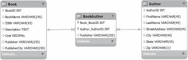

图 7.3：数据库模式

`Book` 表（左侧）标识了该表的列名。这些列中的每一列都有一个名称，并标识了列中允许的数据类型或属性类型。例如，`INT` 代表整数，`VARCHAR` 代表变长度的字母数字字符，`TEXT` 用于段落，而 `decimal` 可以存储货币值。

`Author` 表存储了作者的信息，例如他们的姓名和地址。`BookAuthor` 表建立了 `Book` 表与 `Author` 表之间的关系。`Publisher` 列本不应该出现在这里，但它有助于在下一节中描述规范一化。

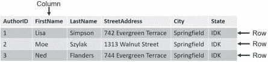图 7.4 显示了 `Author` 表的三行。它还显示了列和行之间的区别。因为列标识了数据类型，所以列有时被称为属性（attributes）。同样，由于每行代表一条记录，所以行有时被称为记录（records）或元组（tuples）。

图 7.4：数据库表

数据库中的单个元素被称为字段（fields）。例如，`FirstName` 列第二行的字段就是存储值 `Moe` 的字段。

### 规范一化

数据库规范一化是指组织表和列以减少冗余数据并提高数据库整体性能。尽管有几种范式，但前三个是最重要的。

#### 第一范式

如果数据库满足以下三个标准，则该数据库符合第一范式（`1NF`）：

*   表中的每一行都是唯一的，并通过主键标识。例如，`Author` 表的主键是 `AuthorID`，且表中的每一行都有不同且唯一的 `AuthorID`，或者不同的主键。主键在图 7.3 中以小钥匙图标的形式显示。`Book` 表中的主键是 `BookID`。`BookAuthor` 具有使用两个值的复合主键：`Book_BookID` 和 `Author_AuthorID`。

*   相关数据包含在单独的表中。作者信息包含在另一个表中。虽然可以创建一个单一表来存储所有信息，但这会产生多个问题。首先，每当你添加一本书时，你都必须创建诸如 `FirstName`、`LastName` 等几个额外的列。想象 Lisa Simpson 写了五本书，那么她在 `book` 表中的每本书都将包含 Lisa 的所有信息。重复输入相同的信息会增加错误发生的概率。如果她搬到了新地址，你需要修改五次地址。

*   没有任何列包含重复组。例如，`Author` 表包含了用于名字的 `FirstName` 和用于姓的 `LastName`。如果你将它们合并为单一列 `name`，就违反了这条规则。这使得只访问重复组的某一部分（例如名字或姓）变得更加困难。

#### 第二范式


# 数据库规范化

第二范式（`2NF`）仅适用于具有复合主键的表，即两个或多个列组成完整主键。`BookAuthor`表具有包含`Book_BookID`列和`Author_AuthorID`列的复合键。如果数据库满足以下标准，则该数据库符合`2NF`：

* 符合`1NF`。
* 每个非键列完全完全依赖于主键。

## 第三范式

第三范式（`3NF`）有助于消除冗余。如果数据库满足以下标准，则该数据库符合`3NF`：

* 符合`2NF`。
* 没有非键列依赖于另一个非键列。

## SQL 查询

规范化是一个用于优化数据库的过程。尽管有几种范式，但前三个是最重要的。

数据库的漏洞之一是 SQL 注入。接下来的章节将识别 SQL 查询如何工作、攻击者如何发起 SQL 注入，以及如何防止它。

图 7.4 显示了`Author`表的三行。它还显示了列和行之间的区别。因为列标识了数据类型，所以列有时被称为属性（attributes）。同样，由于每行代表一条记录，所以行有时被称为记录（records）或元组（tuples）。

### SQL 注入攻击

在 SQL 注入攻击中，攻击者向 Web 表单输入额外数据以生成不同的 SQL 语句。SQL 查询语言使用分号（`;`）表示 SQL 行的结束，并使用双折号（`--`）作为忽略的注释。利用这一点，攻击者可以这样向 Web 表单输入不同的信息：

```
Darril Gibson'); SELECT * FROM Customers;--
```

如果 Web 将此数据字符串直接插入到由相同单引号围的`SELECT`语句中，它会像这样：

```
SELECT * FROM Books WHERE Author ='Darril Gibson'; SELECT * FROM Customers;--
```

这种攻击对 Amazon 是无效的（请不要尝试），因为 Amazon 正在使用安全编码原则。我无法访问其代码，但我敢赌开发者正在使用输入验证和基于 SQL 的存储过程（在下一节中描述）。

许多 SQL 注入攻击使用`or '1' = '1'`这样的短语来创建一个真条件。例如，如果一个在线数据库允许你通过搜索`Customers`表查找特定记录，它可能会预期你输入名称。如果你输入了`Homer Simpson`，它会创建一个如下查询：

```sql
SELECT * FROM Customers WHERE name ='Homer Simpson'
```

然而，如果攻击者输入的`' or'1'='1'--`而不是 Homer Simpson，它将创建一个如下查询：

```
SELECT * FROM Customers WHERE name =' ' or '1'='1' --'
```

虽然这是一个单一的`SELECT`语句，但`or`子句导致它的表现像两个独立的`SELECT`语句：

```sql
SELECT * FROM Customers WHERE name =' ' SELECT * FROM Customers WHERE '1'='1'
```

第一个子句可能不会返回任何记录，因为表中不太可能存在名称字段为空的记录。然而，因为数字 1 始终等于数字 1，第二个语句中的`WHERE`子句始终等于真，因此`SELECT`语句会从`Customers`表中检索所有记录。

在许多情况下，SQL 注入攻击首先通过向系统发送格式不正确的 SQL 语句来生成错误。然而，适当的错误处理可以防止攻击者从这些错误获取信息。许多网站不会向用户显示错误，而是简单地呈现通用的错误网页，不提供任何细节。

输入验证和存储过程降低了 SQL 注入攻击的风险。

## 记住

攻击者使用 SQL 注入攻击通过 Web 服务器向后端数据库传递查询。许多 SQL 注入攻击使用`' or '1'='1' --`短语来欺骗数据库服务器提供信息。

## 防止 SQL 注入攻击

如前所述，输入验证对 SQL 注入攻击提供了强有力的保护。在使用输入 Web 表单的数据之前，Web 应用程序会验证数据是否有效。

此外，数据库开发者经常在动态网页中使用存储过程。存储过程是一组作为一个整体执行的 SQL 语句，类似于一个微程序。参数化存储过程接受名为“参数”的输入作为数据。它不是将用户的输入直接复制到`SELECT`语句中，而是将输入作为参数传递给存储过程。存储过程执行数据验证，同时也以不同的方式处理参数（输入的数据），并防止 SQL 注入攻击。

考虑上一个通过作者搜索书籍的示例，攻击者输入了以下文本：`Darril Gibson'; SELECT * From Customers;--`。Web 应用程序将此搜索字符串传递给存储过程。然后，存储过程在如下的`SELECT`语句中使用整个搜索字符串：

```sql
SELECT * From Books Where Author ="Darril Gibson'; SELECT * From Customers;-- "
```

在这种情况下，用户输入的文本被解释为无害文本，而不是恶意的 SQL 语句。它将查找使用所有文本作为作者名称的书籍：`Darril Gibson'; SELECT * From Customers;--`。书籍名称中没有嵌入`SELECT`语句，因此查询返回为空。

取决于数据库服务器的锁定程度（或未锁定状态），SQL 注入攻击可能允许攻击者访问数据库结构、所有数据，甚至修改数据。在某些情况下，攻击者将产品价格从几百美元修改为仅几美元，购买了几件，然后将价格恢复正常。

## 注入攻击

在本章之前讨论的 DLL 注入和 SQL 注入攻击之外还有多种类型的注入攻击。另一种类型的注入攻击是命令注入攻击。

在某些情况下，攻击者可以使用页面表单或文本框向应用程序注入操作系统命令。任何接受用户输入的 Web 页面都是潜在威胁。目录遍历是一种特定的命令注入攻击，试图通过包含完整目录路径或遍历目录结构来访问文件。

例如，在 Unix 系统中，`passwd`文件包含用户登录信息，存储在`/etc`目录下，完整目录路径为`/etc/passwd`。攻击者可以使用`../../etc/passwd`或`/etc/passwd`等命令读取该文件。同样，他们可以使用删除目录命令（如`rm -rf`）删除目录，包括所有文件和子目录。输入验证可以防止此类攻击。

## 跨站脚本

跨站脚本（XSS）是另一种可以通过输入验证防止的应用程序漏洞。攻击者在网站中嵌入恶意的 HTML 或 JavaScript 代码。当用户访问该网站时，代码就会执行。

你可能在奇怪为什么缩写不是 CSS 而是 XSS。原因是网站使用级联样式表（Cascading Style Sheets），而 CSS 文件不是恶意的（注意：原文此处存在逻辑混乱，但根据指令保留了内容）。

防止 XSS 的主要防护在于 Web 应用程序。开发者应该避免任何允许网页显示不可信数据的方法。此外，OWASP 强烈建议使用编码库。实施后，编码库将清理 HTML 代码并防止 XSS。OWASP 包含了开发者可以遵循的防止 XSS 的十多条规则。

教育用户点击链接的危险性也很重要。某些 XSS 攻击会发送带有恶意链接的电子邮件。如果用户不点击链接，XSS 攻击就会失败。

## 记住

跨站脚本（XSS）攻击允许攻击者捕获 cookie 等用户信息。服务器端的输入验证有助于防止 XSS。

## 跨站请求伪造

跨站请求伪造（XSRF 或 CSRF）是一种攻击者欺骗用户在网站上执行操作的攻击。攻击者创建一个特殊构造的 HTML 链接，用户在不知情的情况下执行了该操作。

作为一个 HTML 链接创建操作的无辜示例，考虑此 HTML 链接：[`http://www.google.com/search?q=Success`](http://www.google.com/search?q=Success)。如果用户点击此链接，效果就像用户浏览到 Google 并输入 Success 作为搜索词一样。查询中的`?q=Success`部分导致了操作。

许多网站使用相同类型的 HTML 查询来执行操作。例如，想象一个支持用户个人资料的网站。如果用户想更改个人资料信息，可以登录网站、进行更改并点击按钮。网站可能会使用如下的链接来执行该操作：

```
http://getcertifiedgetahead.com/edit?action=set&key=email&value=you@home.com
```

攻击者利用这些知识创建恶意链接。例如，以下链接可能会更改用户资料中的电子邮件地址，将用户的电子邮件重定向到攻击者处。

[`getcertifiedgetahead.com/edit?action=set&key=email&value=hacker@hackersrs.com`](http://getcertifiedgetahead.com/edit?action=set&amp;key=email&amp;value=hacker%40hackersrs.com)

虽然这显示了一种可能性，但还有许多可能性。如果一个网站支持通过 HTML 链接执行任何操作，那么攻击就是可能的。这包括购买、更改密码、转账等许多操作。

网站通常不会在用户先登录的情况下允许这些操作。然而，如果用户以前登录过，身份验证信息会存储在他们的系统中，通过 cookie 或 Web 浏览器的缓存存储。某些网站会在用户访问时自动使用这些信息进行登录。在某些情况下，`XSRF`攻击允许攻击者获取用户的密码。

应该教育用户识别与来自未知来源链接相关的风险。钓鱼邮件（在第 6 章中介绍）通常包含对用户看起来足够无害的恶意链接，但这些链接可能会造成巨大损害。如果用户不点击链接，就不会触发`XSRF`攻击。

然而，与跨站脚本一样，防止`XSRF`的主要责任在于网站开发人员。开发人员需要意识到`XSRF`攻击以及防御它们的不同方法。一种方法是使用双重认证，并强制用户在执行操作之前手动输入凭据。另一种方法是让 cookie 在短时间后过期（例如 10 分钟后），防止用户自动登录。

许多编程语言都支持`XSRF`令牌。例如，两种流行的 Web 开发语言`Python`和`Django`要求在任何包含表单的页面中使用一个`XSRF`令牌，尽管这些语言将其称为 CSRF 令牌。该令牌是每次显示表单时都会生成一个大随机数。当用户提交表单时，网页会将该令牌与其他表单数据一起提交。Web 应用程序随后验证 HTML 请求中的令牌是否与 Web 表单包含的令牌相同。

HTML 请求可能像这样：`getcertifiedgetahead.com/edit?action=set&key=email&value=you@home.com&token=1357924`。令牌通常要长得多。如果网站接收到带有错误的查询，通常会抛出`403 Forbidden`错误。攻击者无法猜测令牌，因此他们无法构造出针对该网站恶意链接。

### 记住这一点

跨站请求伪造（`XSRF`）脚本会导致用户在自己不知情的情况下在网站上执行操作（例如购买）。在某些情况下，它允许攻击者窃取 cookie 并获取密码。

# 理解框架和指南

在网络安全的背景下，有许多参考资料描述了最佳实践并提供了有关如何保护系统的说明。其中一些是行业标准框架，另一些是针对特定平台或供应商的指南。

框架是一种用于提供基础的结构。网络安全框架通常使用基本概念结构，并为专业人员提供如何在各种系统中实施安全的指引。第 8 章讨论了渗透测试人员经常使用的各种漏洞利用框架。框架的一些通用类别有：

* **监管类 (Regulatory)**。监管性框架基于相关的法律法规。例如，《健康保险可流动性与责任法案》（`HIPAA`）规定对所有健康相关数据进行特定保护。国家信息技术协调员办公室（`ONC`）和卫生与健康服务部民事权利办公室（`OCR`）创建了`HIPAA`安全风险评估（`SRA`）工具。该工具提供了一个组织可以使用的框架，以帮助确保符合`HIPAA`。

* **非监管类 (Non-regulatory)**。非监管框架不是任何法律的要求。相反，它通常识别了组织可以遵循的通用标准和最佳实践。例如，`COBIT`（信息和相关技术控制目标）是许多组织使用的框架，以确保业务目标和 IT 安全目标相结合。

* **国家级与国际级 (National versus international)**。某些框架在单个国家内使用（称为国家框架），而另一些在国际范围内使用。例如`NIST`创建了网络安全框架，重点关注美国境内网络安全活动和风险。相比之下，国际标准化组织（`ISO`）和国际电工技术委员会（`IEC`）创建并发布了国际标准。例如，`ISO/IEC 27002`为 IT 安全提供了一个框架。

* **行业特定类 (Industry-specific)**。某些框架仅适用于特定行业。例如，处理信用卡的组织通常遵守支付卡行业数据安全标准（`PCI DSS`）。`PCI DSS`包含 12 项要求和 220 多项子要求，组织遵循这些要求来保护信用卡数据。

除了框架，你还可以使用各种指南来提高安全性。这包括基准测试或安全配置指南、平台或供应商特定指南以及通用指南。从表面上看，这非常简单。配置`Windows`系统时，使用`Windows`指南来识别安全设置。配置`Linux`系统时，使用`Linux`指南。

此外，在为特定角色配置系统（如 Web 服务器、应用服务器或网络基础设施设备）时，请遵循该角色的相应指南。例如，Web 服务器需要开放端口`80`和`443`分别用于`HTTP`和`HTTPS`。然而，数据库应用服务器通常不需要这些端口，因此在数据库服务器上应关闭它们。每个角色的单独指南提供了这些信息。

# 第 7 章考点复习

在准备考试时，确保你理解了本章涵盖的核心概念。

* `DoS`攻击是从单一系统发起的攻击，试图中断服务。

* `DDoS`攻击是来自多个计算机的`DoS`攻击。`DDoS`攻击通常包括持续的异常高网络流量。

* 欺骗（`Spoofing`）攻击试图冒充另一个系统。`MAC`地址欺骗更改了源 MAC 地址，`IP`欺骗更改了源 IP 地址。

* ARP 投毒（`ARP poisoning`）攻击试图误导计算机或交换机关于系统的实际 MAC 地址。它们可以被用于中间人攻击。

* `DNS`投毒（`DNS poisoning`）攻击修改`DNS`数据并将用户重定向到恶意网站。许多`DNS`服务器使用`DNSSEC`来保护`DNS`记录并防止`DNS`投毒攻击。

* 放大攻击（`Amplification attacks`）向受害者发送增加的流量或从其请求额外的流量。

* 密码攻击（`Password attacks`）试图发现密码。暴力破解尝试猜测所有可能的字符组合，字典攻击使用文件中存储的所有单词和字符组合。账户锁定策略可以阻止在线暴力破解，复杂的密码可以阻止离线密码攻击。

* 密码通常以哈希值（`hash`）的形式存储。由于弱的哈希算法容易发生碰撞，这允许不同的密码产生相同的哈希值。

* 在哈希值传递（`pass the hash`）攻击中，攻击者发现用户密码的哈希值，然后用它以用户的身份登录系统。

* 在生日攻击（`birthday attack`）中，攻击者能够创建一个与用户实际密码产生相同哈希值的密码。这也被称为哈希碰撞。

* 当哈希算法从不同的密码创建相同的哈希值时，就会发生哈希碰撞（`hash collision`）。

* 密码加盐（Password salting）在哈希处理之前向密码添加额外字符，可以防止许多类型的攻击，包括字典攻击、暴力破解和彩虹表攻击。

* 重放攻击（Replay attacks）捕获会话中的数据，意图利用这些信息冒充其中一方。时间戳和序列号可以阻止重放攻击。

* 如果攻击者同时拥有明文和通过加密明文生成的密文，则可能实施已知明文攻击（Known plaintext attack）。这使得使用类似的方法解密其他数据变得更容易。

* 攻击者在抢注（typo squatting，也称为 URL 劫持）攻击中购买带有轻微拼写错误的域名。其目标是在用户输入错误的 URL 时吸引流量。攻击者可以在网站上配置恶意软件以感染访问者，或配置网站为攻击者产生广告收入。

* 点击劫持（Clickjacking）欺骗用户点击他们并非认为正在点击的内容。

* 攻击者在会话 ID 攻击中利用用户的会话 ID 来冒充用户。

* 域名劫持攻击（Domain hijacking attacks）允许攻击者在未经所有者许可的情况下更改域名的注册。

* 浏览器中间人（Man-in-the-browser）是一种利用有漏洞 Web 浏览器的代理木马。成功后，它允许攻击者捕获击键以及所有发送和来自浏览器的数据。

* 驱动程序垫片（Driver shim）是用来替代原始驱动程序运行的额外代码。

* 攻击者利用未知或未记录的漏洞即是在利用零日漏洞（Zero-day vulnerabilities）。在厂商发布修复该漏洞的补丁后，它就不再是零日漏洞。

* 缓冲区溢出（Buffer overflows）发生在应用程序接收的数据超过其处理能力或存在意外数据时，暴露了对系统内存的访问权限。整数溢出攻击（Integer overflow attacks）尝试使用或创建一个大于应用程序处理范围的数值。

* 缓冲区溢出攻击利用缓冲区溢出漏洞。一种常用方法是使用`NOP`指令或 NOP 滑块（例如一系列`x90`命令）。防止缓冲区溢出攻击的两种主要保护方法是输入验证和保持系统最新更新。

## 总结安全编码概念

* 编译代码（Compiled code）经过应用程序优化并已转换为可执行文件。运行时代码（Runtime code）是在代码运行时进行评估、解释和执行的代码。

* Web 应用程序中常见的编码错误是缺乏输入验证。

* 输入验证（Input validation）在将数据传递给应用程序之前进行检查，可以防止许多攻击，包括缓冲区溢出、SQL 注入、命令注入和跨站脚本。

* 服务端输入验证是最安全的。攻击者可以绕过客户端输入验证，但无法绕过服务端验证。


- 竞态条件（Race conditions）允许两个进程同时访问相同的数据，导致结果不一致。可以通过在访问数据之前锁定数据来避免问题。
- 应用程序中的错误处理程序可以防止应用程序故障并保护操作系统的完整性。显示给用户的错误信息应该是通用的，但应用程序应该记录有关错误的详细信息。
- 代码签名（Code signing）使用证书内的数字签名来验证和确认软件代码。
- 代码质量和测试技术包括静态代码分析、动态分析（如模糊测试）、压力测试、沙箱化和模型验证。
- 软件开发生命周期（`SDLC`）模型为软件开发项目提供了结构。瀑布模型（Waterfall）使用多个阶段，每个阶段为下一阶段提供支持。敏捷模型（Agile）是一种更灵活的模型，它强调与项目中所有参与者之间的互动。
- 安全 DevOps（Secure DevOps）是一种与敏捷对齐的方法论。它强调整个项目生命周期中的安全性。

## 识别应用程序攻击

- 常见的 Web 服务器有 `Apache`（运行在 `Linux` 上）和 `Internet Information Services`（运行在 `Microsoft` 服务器上）。
- 数据库通过称为规范化（`normalization`）的过程进行优化。当数据库符合前三个范式时，认为是规范化的。
- SQL 注入攻击提供数据库信息，并允许攻击者读取和修改数据库中的数据。输入验证和存储过程提供了针对 SQL 注入攻击的最佳保护。
- 跨站脚本（`XSS`）允许攻击者将用户重定向到恶意网站并盗取 Cookie。它使用带有 `<` 和 `>` 字符的 HTML 和 JavaScript 标签。
- 跨站请求伪造（`XSRF`）导致用户在不知情在网站上执行操作，允许攻击者盗取 Cookie 并收集密码。
- `XSS` 和 `XSRF` 攻击可以通过输入验证技术缓解。

## 理解框架和指南

- 框架（Frameworks）是提供基础的参考。网络安全框架通常使用基本概念结构，并就如何实施安全提供指导。
- 监管框架（Regulatory frameworks）基于相关法律法规。非监管框架不被任何法律强制。
- 某些框架在单个国家内使用（称为国家框架），而另一些框架在国际范围内使用。
- 某些框架仅适用于特定行业。例如，处理信用卡的组织通常遵守支付卡行业数据安全标准（`PCI DSS`）。
- 在配置特定系统时，应使用特定特定的指南。

## 在线参考

记住，你可以在网上获得更多可用资源。请在此处查看：

`http://gcgapremium.com/501-extras.`

# 第 7 章练习题

1. 攻击者利用多个系统对单一目标发起了攻击。这是哪种攻击？

   A. DoS  
   B. DDoS  
   C. SYN 洪水攻击  
   D. 缓冲区溢出

2. 攻击者捕获了一个填充有随机生成密码哈希值的数据库。以下哪种攻击最可能破解该数据库中数量最多的密码？

   A. 字典攻击  
   B. 生日攻击  
   C. 暴力破解攻击  
   D. 彩虹表

3. 应用程序以哈希格式存储用户密码。以下哪项可以降低攻击者发现这些密码的概率？

   A. 彩虹表  
   B. `MD5`  
   C. 盐（Salt）  
   D. 输入验证

4. 攻击者一直在分析拦截的加密数据。他知道数据的结尾包含一个与所有类似消息一起发送的模板。他利用这一知识解密消息。以下哪种类型最好描述这种攻击？

   A. 已知密文  
   B. 已知明文  
   C. 暴力破解  
   D. 彩虹表

5. 攻击者试图向 Web 应用程序内存写入超过其容量的数据。这是哪种攻击？

   A. `XSRF`  
   B. DLL 注入  
   C. 哈希值传递（Pass the hash）  
   D. 缓冲区溢出

6. 贵层计划聘一家开发公司创建一个复杂的 Web 应用程序。他们的主要目标之一是确保参与项目的人员在整个过程中频繁协作。以下哪种是该项目的合适模型？

   A. 瀑布模型  
   B. `SDLC`  
   C. 敏捷模型  
   D. 安全 DevOps

7. 一 Web 开发人员正在为 Web 应用程序添加输入验证技术。开发人员在此过程中应该实施以下哪项？

   A. 在服务端进行验证。  
   B. 在客户端进行验证。  
   C. 防止边界检查。  
   D. 实现指针解引用技术。

8. 开发者创建了一个用户可以下载并安装到计算机上的应用程序。管理层希望为用户提供一种可靠的方法，以验证该应用程序未被修改。以下哪种方法提供了最佳解决方案？

   A. 代码签名  
   B. 输入验证  
   C. 代码混淆  
   D. 存储过程

9. 你的组织准备部署一个基于 Web 的应用程序，该程序将接受用户输入。以下哪种方法最佳测试该应用程序维护可用性和数据完整性的可靠性？

   A. 模型验证  
   B. 输入验证  
   C. 错误处理  
   D. 动态分析

10. 你正在监督一个大型软件开发项目。理想情况下，开发者不会对代码添加任何未经授权的更改。如果他们这样做了，你希望能够轻松识别出做出更改开发者。以下哪种方法为这一需求提供了最佳解决方案？

    A. 敏捷 SDLC  
    B. 版本控制  
    C. 安全 DevOps  
    D. 静态代码分析

11. 数据库管理员创建了一个供 Web 应用程序使用的数据库。然而测试显示应用程序访问数据库内数据花费了大量时间。以下哪些操作最可能提高数据库的整体性能？

    A. 规范化  
    B. 客户端输入验证  
    C. 服务端输入验证  
    D. 混淆

12. 查看在线 Web 应用程序的日志，你发现有人在多个查询中输入了以下短语：

    `‘ or ‘1’=’1’ --`

    以下哪项最可能的解释？

    A. 缓冲区溢出攻击  
    B. XSS 攻击  
    C. SQL 注入攻击  
    D. DLL 注入攻击

13. 在创建 Web 应用程序时，开发者添加代码来限制用户提供的数据。该代码防止用户输入特殊字符。此代码最可能防止哪种攻击？

    A. 浏览器中间攻击  
    B. 放大攻击  
    C. XSS  
    D. 域名劫持

14. Homer 最近收到一封邮件，感谢他购买了他并未购买过的商品。他向管理员询问此事，管理员注意到一个弹窗，其中包含以下代码：

```html
<body onload="document.getElementByID('myform').submit()">
<form id="myForm" action="gcgapremium.com/purchase.php" method="post"
<input name="Buy Now" value="Buy Now" />
</form>
</body>
```

以下哪项是最可能的解释？

A. XSRF  
B. 缓冲区溢出  
C. SQL 注入  
D. 死代码

15. 你的组织最近购买了一个新的硬件防火墙。管理员需要将其作为网络内 DMZ 的部分进行安装。哪些参考资料将为他们提供安装防火墙最合适说明？

A. 监管框架  
B. 非监管框架  
C. 通用防火墙指南  
D. 厂商特定指南

# 第 7 章练习题答案

1. **B.** 分布式拒绝服务（`DDoS`）攻击包含来自多个系统的攻击，旨在耗尽目标资源。`DoS` 攻击来自单个系统，`SYN flood` 是 `DoS` 攻击的一个示例。缓冲区溢出是 `DoS` 攻击的一种，试图向应用程序的内存中写入数据。

2. **D.** 彩虹表攻击试图从哈希值中发现密码。然而，它们使用的是彩虹表，这是包含预计算哈希值的巨大数据库。字典攻击将密码与单词字典中的单词进行比较，但单词字典不会包含随机生成的密码。生日攻击依赖哈希碰撞。然而，取决于使用的哈希算法，它并不一定有效。暴力破解攻击试图猜测所有字符组合，但对每个密码来说都非常耗时。

3. **C.** 密码盐是在哈希密码之前添加到密码中的额外随机字符，它可以降低密码攻击的成功率。攻击者使用彩虹表，其中包含预计算的哈希值。消息摘要 5（`MD5`）是一种创建哈希的哈希算法，但场景已经说明密码已经过哈希处理。输入验证技术在使用数据之前验证其有效性，它们与保护哈希后的密码无关。

4. **B.** 这描述的是已知明文攻击，因为攻击者知道用于创建加密数据的部分明文数据。更具体地说，这是选择明文攻击（但选项中未提供），因为攻击者知道部分明文。在已知密文攻击中，攻击者没有关于明文的任何信息。暴力破解试图猜测密码。彩虹表攻击使用哈希表通过匹配的哈希值识别密码。

5. **D.** 一种缓冲区溢出攻击试图向应用程序内存中写入比其能处理更多的数据。其他答案没有一个直接与过载应用程序内存有关。跨站请求伪造（`XSRF`）攻击试图使用 HTML 代码发起攻击。动态链接库（`DLL`）注入攻击将 DLL 注入内存使其运行。哈希传递攻击试图发现密码。

6. **C.** 敏捷软件开发模型灵活，确保人员在整个项目过程中相互互动，是可用选项中的最好的。瀑布模型没有那么灵活，侧重于分阶段完成项目。敏捷和瀑布都是软件开发生命周期（`SDLC`）模型，这是一个为软件开发项目提供结构的通用概念。安全 DevOps 是一种与敏捷一致的开发方法，专注于整个项目中的安全考量。

7. **A.** 输入验证应该在服务端执行。客户端验证可以与服务端验证结合，但它可以被绕过，因此不应单独使用。边界或限制检查是输入验证的重要部分。指针解引用技术使用引用指向值，与输入验证技术无关。

8. **A.** 代码签名为代码提供数字签名，验证代码发布者并验证自发布者发布以来未被修改。其他答案都没有验证应用程序未修改。输入验证在使用前验证数据有效。代码混淆使代码更难以阅读。存储过程与 `SQL` 数据库配合使用并可用于输入验证。

9. **D.** 动态分析技术（如模糊测试）可以测试应用程序在某些场景下维护可用数据完整性的能力。模糊测试向应用程序发送随机数据，以验证随机数据不会导致应用程序崩溃或使系统面临数据泄露风险。模型验证确保软件符合规范并实现其预期用途，但它不关注可靠性或完整性。输入验证和错误处理技术保护应用程序，但不测试它们。

10. B. 版本控制系统将跟踪系统的所有更改，包括谁在何时进行了更改。变更管理流程（未作为候选项答案）通常也提供相同的解决方案。敏捷软件开发生命周期（`SDLC`）模型侧重于项目中所有参与者之间的交互，但并不一定包含版本控制系统。安全运维（Secure DevOps）是一种与敏捷对齐的软件开发方法论，关注整个过程中的安全性。静态代码分析是一种在不执行代码的情况下对其进行检查的代码测试方法。

11. A. 规范化技术可以组织数据库中的表和列，并提高整体数据库性能。其他答案均不能提高数据库性能。输入验证技术有助于防止许多类型的攻击，且服务端输入验证技术优于客户端技术。混淆技术使代码更难以阅读。

12. C. 攻击者在 SQL 注入攻击中使用短语（`‘ or ‘1’=’1’--`）来查询或修改数据库。缓冲区溢出攻击向应用程序发送更多数据或意外数据，目标是访问系统内存。跨站脚本（`XSS`）攻击试图在网站或电子邮件中插入 HTML 或 JavaScript 代码。动态链接库（`DLL`）注入攻击试图将 DLL 注入内存中，导致 DLL 命令运行。

13. C. 跨站脚本（`XSS`）攻击可以通过使用输入验证技术来阻止，即过滤特殊字符，如 HTML 代码中使用的 `<` 和 `>` 字符。列出的其他攻击都不需要使用特殊字符。浏览器中间攻击利用浏览器漏洞来捕获用户输入的数据。放大攻击增加发送到受害者的数据量，以使其瘫痪。域名劫持攻击在未获得所有者许可的情况下更改域名的注册信息。

14. A. 跨站请求伪造（`XSRF`）攻击导致用户在不知情的情况下执行操作。此场景表明用户访问了某个网站（很可能是通过恶意链接），且该链接发起了购买。其他攻击都不会导致毫无防备的用户进行购买。缓冲区溢出攻击攻击网站并尝试访问系统内存。SQL 注入攻击尝试访问数据库服务器上的数据。死代码是指永不执行的代码，与此场景无关。

15. D. 针对新硬件防火墙的特定特定指南将提供最合适的安装说明。框架（监管或非监管性的）提供了可以供不同目的遵循的结构，但不适用于特定的防火墙。通用指南将提供通用说明，但不会提供特定厂商防火墙的说明。

# 第 8 章：使用风险管理工具

## 本章涵盖 CompTIA Security+ 目标

### 1.4 解释渗透测试概念

- 主动侦察、被动侦察、跳转、初始利用、持久化、权限提升、黑盒、白盒、灰盒、渗透测试与漏洞扫描

### 1.5 解释漏洞扫描概念

- 被动测试安全控制、识别漏洞、识别安全控制缺失、识别常见配置错误、侵入性与非侵入性、有凭证与无凭证、误报

### 2.1 安装和配置硬件和软件类的网络组件，以支持组织安全

- SIEM（聚合、关联、自动告警和触发、时间同步、事件去重、日志/WORM）

### 2.2 给定场景，使用适当的软件工具评估组织的安全态势

- 协议分析器、网络扫描器（非法系统检测、网络映射）、无线扫描器/破解器、密码破解器、漏洞扫描器、配置合规扫描器、利用框架、指纹抓取（Banner grabbing）、被动与主动、命令行工具（`Tcpdump`、`nmap`、`netcat`）

### 2.3 根据给定场景，排除常见的安全问题

- 未加密凭据/明文、日志和事件异常

### 3.2 根据给定场景，实施安全网络架构概念

- 安全设备/技术放置位置
  - 关联引擎

### 3.8 解释韧性和自动化策略如何降低风险

- 自动化/脚本（持续监控、配置验证）

### 4.4 根据给定场景，区分常见的账户管理实践

- 一般概念（权限审计和审查、使用审计和审查）

### 5.3 解释风险管理流程和概念

- 威胁评估（环境、人为、内部与外部）、风险评估（SLE、ALE、ARO、资产价值、风险登记表、发生概率、供应链评估、影响、定量、定性）、测试（渗透测试授权、漏洞测试授权）、风险响应技术（接受、转移、规避、缓解）

作为一名安全专业人员，你需要了解与威胁、漏洞和风险相关的不同安全问题，以及应对这些问题的工具。本章将深入探讨风险管理概念，包括风险评估方法。你将学习漏洞扫描器和渗透测试人员，包括他们之间的关键区别。本章还涵盖了一些用于评估网络和管理风险特定工具。

# 理解风险管理

风险是威胁利用漏洞的可能性。漏洞是一个弱点，而威胁是一个潜在的危险。结果是对组织产生负面影响。影响是指威胁利用漏洞时可能造成的损害程度。

例如，一个没有更新最新杀病毒软件的系统容易受到恶意软件的攻击。恶意攻击者编写的恶意软件就是威胁。恶意软件到达漏洞系统的可能性就代表了风险。根据恶意软件的作用，影响可能是计算机无法启动、数据丢失，或是一个加入僵尸网络被远程控制的计算机。然而，风险发生的概率并不是 100%。一个没有互联网访问、网络连接或 USB 端口的隔离系统，受到恶意软件感染的可能性非常低。

对于连接互联网的系统，这种可能性会显著增加，如果用户访问风险网站并下载和安装未验证的文件，可能性会更高。

意识到你无法消除风险是非常重要的。确实，你可以通过拔掉电脑电源并将其埋掉来完全避免信息技术（IT）风险。但这并没有什么用。相反，用户和组织通过实践风险管理来降低风险。

你可能每天都在实践风险管理。在道路和街道上开车或步行可能是一项非常危险的活动。汽车大小的子弹来回飞梭，对路上的任何其他人构成了重大风险。然而，你通过谨慎和警惕来缓解了这些风险。计算机和网络也是如此。组织使用不同类型的安全控制来缓解风险。

## 威胁与威胁评估

威胁是一个潜在的危险。在风险管理的背景下，威胁是指任何可能损害数据或系统的机密性、完整性或可用性的情况或事件。威胁有多种形式，包括以下：

## 威胁评估

- **恶意人为威胁**。第 6 章“比较威胁、漏洞和常见攻击”讨论了各种类型的威胁行为者。他们包括相对缺乏经验的脚本小子（script kiddies）、在有组织犯罪集团内部工作的职业犯罪分子，以及由政府资助的复杂的高级持续性威胁（APTs）。这些都是恶意人为威胁。恶意人为威胁定期发起不同类型的攻击，包括网络攻击、系统攻击和发布恶意软件。
- **意外人为威胁**。用户可能会意外删除或损坏数据，或者无意中访问他们不应该访问的数据。即使是管理员也可能无意中导致系统中断。常见原因是出于善意的管理员为了修复一个问题而更改配置，却无意中引发了另一个问题。
- **环境威胁**。这包括长期停电，这可能导致化学品泄漏、污染或其他对环境的可能威胁。它还包括自然威胁，如飓风、洪水、龙卷风、地震、山滑坡、电风暴和其他类似事件。

威胁评估有助于组织识别和分类威胁。它试图预测针对组织资产的威胁，以及威胁发生的可能性。威胁评估还试图识别这些威胁带来的潜在影响。一旦组织识别并确定了威胁的优先级，就会确定安全控制措施来防御最严重的威胁。

组织的资源有限，因此无法防御所有威胁。然而，威胁评估通过确保资源不浪费在低优先级威胁上，提高了任何系统或应用程序的安全态势。一些常见的威胁评估类型有：

- **环境**。环境威胁评估评估环境威胁发生的可能性。例如，我住在弗吉尼亚州弗吉尼亚海滩，虽然我们担心飓风季节飓风带来的自然威胁，但我们并不非常担心地震。我姐姐是一位业务连续性专家，她住在旧金山附近并在硅谷工作。她帮助公司防范那里与地震相关的风险，但她花费很少的时间或精力来考虑飓风袭击旧金山的风险。
- **人为**。人为威胁评估所有来自人类的威胁。这包括恶意人为威胁和意外人为威胁。恶意人为威胁是指来自个人或个人团体发起的任何潜在攻击。意外人为威胁是指由于个人或团体意外导致的任何潜在损失。
- **内部**。内部威胁评估来自组织内部的威胁。这包括来自恶意员工的威胁和意外事故威胁。它还包括与硬件故障相关的威胁。
- **外部**。外部威胁评估来自组织外部的威胁。这包括来自外部攻击者的任何威胁。它还包括任何自然威胁，如飓风、地震和龙卷风。

### 记住这一点

威胁是潜在的危险，而威胁评估评估的是潜在威胁。环境威胁包括天气事件等自然威胁。人为威胁是人类产生的任何潜在危险，可能是恶意的可能是意外的。内部威胁通常指组织内的员工，而外部威胁可以来自组织外的任何源。

## 漏洞

漏洞是软件或硬件中的缺陷或弱点，或者是威胁可以利用的过程缺陷，会导致安全漏洞。漏洞的示例包括：

- **缺乏更新**。如果系统没有及时更新补丁、热修复程序和服务包，它们就会容易受到软件中错误和缺陷的影响。
- **默认配置**。系统加固包括将系统从默认的硬件和软件配置进行更改，包括更改默认用户名和密码。如果系统未经过加固，将更容易受到攻击。第 5 章“安全保护主机和数据”更深入地涵盖了系统加固。


- **缺乏恶意软件保护或更新的定义**。杀毒病毒和反间谍软件方法保护系统免受恶意软件侵害，但如果未使用且不保持更新，系统就会容易受到恶意软件攻击。第 6 章涵盖了恶意软件类型以及保护系统免受恶意软件攻击的方法。
- **缺乏防火墙**。如果个人和网络防火墙未启用或配置不，系统将更容易受到网络和基于互联网的攻击。
- **缺乏组织政策**。如果没有实施职责分离、强制休假和职位轮换政策，组织可能更容易受到员工欺诈和合谋的影响。

并非所有漏洞都会被利用。例如，用户可能使用默认设置安装无线路由器。它非常容易受到攻击，但这意味着攻击者会发现并攻击它。换句话说，仅仅因为无线路由器从未被攻击过，并不意味着它没有漏洞。在任何时刻，开车的搜索攻击者都可能开车经过并利用漏洞。

## 风险管理

风险管理是识别、监控并将风险限制在可接受水平的实践。它并不是消除风险，而是识别限制或减轻风险的方法。风险管理后剩余的风险称为残留风险。

风险管理的首要目标是将风险降低到组织可以接受的水平。高层管理对残留风险负责。管理层必须根据组织目标选择可接受的风险水平。他们决定投入哪些资源（如资金、硬件和时间）来减轻风险。

组织有多种风险应对技术或风险管理方法可供。它们包括：

- **规避**。组织可以通过不提供服务或不参与高风险活动来规避风险。例如，组织可能会评估一个需要在防火墙上开启多个端口的应用程序，认为其风险太大。可以通过购买另一个不需要开启任何额外防火墙端口的应用来规避风险。
- **转移**。组织将风险转移给另一个实体，或至少与其他实体共享风险。最常见的方法是购买保险。另一种方法是外包或委托第三方。
- **减轻**。组织实施控制措施来减少风险。这些控制措施要么减少漏洞，要么减少威胁的影响。例如，更新的杀毒软件可以减轻恶意软件风险。同样，保安人员可以减少攻击者访问安全区域的风险。
- **接受**。当控制措施的成本超过风险时，组织通常会接受风险。例如，花费 100 美元的硬件锁来保护一个 15 美元的鼠标是没有意义的。相反，组织接受鼠标被偷的风险。同样，即使在实施控制措施后仍然存在残留风险，组织接受这种残留风险。

消除风险是不可能的，但你可以采取措施来管理它。组织可以通过不提供服务或不参与高风险活动来避免风险。保险将风险转移给另一个实体。你可以通过实施控制措施来缓解风险，但当控制的成本超过风险成本时，组织将接受剩余风险（即残留风险）。

### 风险评估

风险评估（或 `risk analysis`）是风险管理中的一项重要任务。它根据不同的价值或判断对风险进行量化或定性分析。风险评估首先从识别资产及其价值开始。

资产包括组织重视的任何产品、系统、资源或流程。资产价值确定了资产对组织的价值。它可以是一个特定的货币价值，也可以是主观价值，例如 `Low`、`Medium` 和 `High`。资产价值有助于组织关注高价值资产，避免在低价值资产上浪费时间。

在识别资产价值后，风险评估会识别威胁和脆弱性，并确定威胁尝试利用漏洞的概率。风险评估试图识别潜在威胁的影响和潜在的危害，并根据发生的概率和影响对风险进行优先级排序。最后，风险评估还包括关于实施哪些控制措施来缓解风险的建议。

风险评估是一个时间点的评估，或是一个快照。换句话说，它是基于当前状况（如当前的威胁、脆弱性和现有控制措施）来评估风险。例如，考虑一台拥有最新的防毒保护且无法访问互联网的图书馆计算机。基于这些情况，风险较低。然而，如果管理员将系统连接到互联网，或未能保持防毒软件更新，风险就会增加。

对新系统或应用程序进行风险评估是很常见的。例如，如果一个组织考虑增加一项可以增加收入的新服务或应用程序，它通常会进行风险评估。这有助于它确定潜在风险是否会抵消潜在收益。

风险评估使用定量测量或定性测量。定量测量使用数字，例如代表成本和资产价值的货币金额。定性测量使用判断。这两种方法的核心目标都是帮助管理层根据优先级做出明智的决策。

### 定量风险评估

定量风险评估使用特定的货币金额来衡量风险。这种货币金额有助于确定风险的优先级。例如，一个潜在损失为 $30,000 的风险比潜在损失为 $1,000 的风险重要得多。

资产价值是定量风险评估中的一个重要元素。它可能包括资产的收入价值或重置价值。一台 Web 服务器每小时可能产生 $10,000 的收入。如果 Web 服务器故障，公司每停机一小时就会损失 $10,000 的直接销售，再加上维修成本。如果客户将业务转向其他地方，还可能导致未来业务的损失。相比之下，图书馆工作站的故障更换成本最高可能为 $1,000。

一种常用的定量模型使用以下值来确定风险：

- 单次损失预期（`SLE`）。`SLE` 是任何单次损失的成本。
- 年发生率（`ARO`）。`ARO` 表示损失在一年内发生的次数。如果 `ARO` 小于 1，则 `ARO` 以百分比表示。例如，如果你预计每两年发生一次，则 `ARO` 为 50% 或 .5。
- 年损失预期（`ALE`）。`ALE` 是 `SLE` × `ARO` 的值。

假设你公司的员工平均每月丢失一台笔记本电脑。小偷在员工午餐时间将电脑留在会议室、在客户现场以及在培训室期间偷走了这些电脑。

有人建议购买总价为 $1,000 的硬件锁来保护这些笔记本电脑。这些锁的作用类似于自行车锁，允许员工将电缆绕在家具上并连接到笔记本电脑上。小偷要么破坏笔记本电脑以拆锁，要么在偷电脑时把家具一起带走。你的公司应该购买吗？经过简单分析，结论显而易见。

你已经确定这些笔记本电脑的平均成本（包括硬件、软件和数据）为每台 $2,000。这假设员工没有在系统中存储整个客户数据库或其他敏感数据，否则可能会很容易产生更高的成本。你现在按以下方式计算 `SLE`、`ARO` 和 `ALE`：

- `SLE`。每台笔记本电脑的价值为 $2,000，因此 `SLE` 为 $2,000。
- `ARO`。员工每月丢失约一台电脑，因此 `ARO` 为 12。
- `ALE`。你计算 `ALE` 为 `SLE` × `ARO`，即 $2,000 × 12 = $24,000。

安全专家估计，这些锁将丢失或被盗笔记本电脑的数量从每年 12 台减少到每年仅 2 台。这使得 `ALE` 从 $24,000 减少到仅 $4,000（每年节省 $20,000）。换句话说，组织花费 $1,000 可以节省 $20,000。不需要火箭科学家也能看出这是一个明智的财务决策，净节省了 $19,000。买吧。

经理在处理大多数此类问题时使用这些简单的指南：

- 如果控制的成本小于节省的金额，则购买。
- 如果控制的成本大于节省的金额，则接受风险。

组织可能正在考虑其他控制措施，例如硬件锁、生物识别认证、笔记本 LoJack 等等。所有这些控制措施的最终成本每年为 $30,000。即使笔记本电脑再也没有被盗过，公司每年花费 $30,000 来节省 $24,000，导致净亏损增加——他们每年多损失了 $6,000。

诚然，公司可以选择考虑其他价值，例如笔记本电脑上数据的敏感性，并做出购买额外控制措施的判断。然而，如果使用的是定量风险评估，这些价值需要用货币术语表示。

虽然你通常知道 `SLE` 和 `ARO` 并使用它们来计算 `ALE`，但你可能偶尔只有 `SLE` 和 `ALE` 而不知道 `ARO`。使用基础代数，你可以重新调整公式。任何一种都是有效的：

- `ALE = SLE × ARO`
- `ARO = ALE / SLE`
- `SLE = ALE / ARO`

记住：定量风险评估使用特定的货币金额来识别成本和资产价值。`SLE` 识别每次损失的金额，`ARO` 识别一年内的故障次数，`ALE` 识别预期的年度损失。定性风险评估使用判断根据发生的概率和影响对风险进行分类。

### 定性风险评估

定性风险评估使用判断根据发生的概率（或可能性）和影响对风险进行分类。发生的概率是事件发生的可能性，例如威胁尝试利用漏洞的概率。影响是风险造成的危害程度。它包括事件的负面结果，例如系统或数据的机密性、完整性、可用性的丢失。

请注意，这与使用货币数字的定量评估所提供的精确数字大不同。你可以将定量（quantitative）理解为使用数量或数字，而定性（qualitative）则与质量有关，这通常是一个判断问题。

某些定性风险评估使用调查问卷或焦点小组。他们征求专家提供最佳判断，然后对结果进行制表。例如，一项调查可能会要求专家对与在互联网上销售产品的 Web 服务器以及未连接互联网的图书馆工作站相关的风险概率和影响进行评分。专家将使用“低”、“中”、“高”等词汇来对它们进行评分。

他们可以将 Web 服务器受到攻击的概率评为“高”，如果攻击导致 Web 服务器停止服务，那么影响也是“高”。相反，图书馆工作站受到攻击的概率是“低”的，尽管图书馆读者可能会感到不便，但影响也是“低”。

为这些判断分配数字是很常见的。例如，你可以使用“低”、“中”和“高”等术语，并分别分配值 `1`、`5` 和 `10`。专家使用低、中、高为每个风险分配概率和影响，在汇总结果时，你将这些词汇转换为数字。这使得计算结果变得容易了一些。

在 Web 服务器和图书馆电脑的示例中，你可以通过乘以概率和影响来计算风险：

- Web 服务器。高概率和高影响：`10 × 10 = 100`
- 图书馆电脑。低概率和低影响：`1 × 1 = 1`

管理层可以查看这些数字并轻松确定如何分配资源来防止这些风险。他们为保护 Web 服务器分配的资源将比保护图书馆电脑的更多。

定性风险评估的挑战之一是在概率和影响上达成共识。与可以通过事实验证的货币值不同，概率和影响往往会引起争议。

## 评估文档记录

风险评估的最后阶段是报告。它识别了评估期间发现的风险以及建议的控制措施。作为一个简单的例子，对启用数据库的 Web 应用程序进行风险评估可能会发现它易受到 `SQL injection` 攻击。风险评估将建议使用输入验证技术或存储过程来重写 Web 应用程序，以保护数据库。

管理层利用此决定实施哪些控制措施以及接受哪些控制措施。在许多情况下，最终报告记录了管理决策。当然，管理层可以决定不实施某控制措施，而是接受风险。

想一下这份报告对于攻击者来说将有多有价值。他们不需要挖掘来识别漏洞或控制措施。相反，报告列出了所有细节。即使管理层批准了纠正漏洞的控制措施，实施它们可能需要一些时间。正如此，风险评估的结果受到了高度保护。通常，只有高层管理和安全专业人员才能访问这些报告。

## 风险注册表

某些风险评估使用风险注册表。风险注册表有不同的定义，取决于你遵循哪种标准。例如，`ISO 73:2009` 将其定义为“关于已识别风险的信息记录”。受控环境项目（`PRINCE2`）是一种详细的项目管理方法，它将风险注册表定义为“所有识别风险的存储，并包含每个风险的额外信息”。

创建风险注册表的一种简单方法是使用表格格式。例如，想象你正在评估与访问后端数据库的新电子商务网站相关的风险。你的风险注册表可能包含以下列：

- **类别**（Category）。风险类别可能包括硬件故障导致的停机、攻击导致的故障、数据库服务器故障导致的停机、数据泄露等。
- **特定风险**（Specific risk）。硬件故障相关的风险之一可能是硬盘故障。当然，还有其他潜在的硬件故障，但此风险的其余列将侧重于硬盘故障。对于这个例子，想象一个驱动器存放操作系统和应用程序。第二个驱动器存放数据。
- **发生概率**（Likelihood of occurrence）。中。这假设安装的硬盘目前没有使用冗余廉价磁盘阵列（`RAID`）磁盘子系统。
- **影响**（Impact）。高。如果硬盘故障，它可能会导致整个网站无法运行。
- **风险评分**（Risk score）。`50`（满分 `100`）。这假设“中”分的值为 `5`，“高”分的值为 `10`（`5 × 10 = 50`）。注意，组织可以为发生概率和影响分配任何所需的值。这里使用的值仅是一个示例。
- **安全控制措施或缓解步骤**（Security controls or mitigation steps）。实施 `RAID-1` 以保护托管操作系统的硬盘。实施 `RAID-6` 以保护数据。
- **应急预案**（Contingencies）。确保存在备份并保持更新。
- **带有安全控制的风险评分**。`10`（满分 `100`）。在实施 `RAID-1` 和 `RAID-6` 后，发生概率变为“低”，但影响仍然是“高”。新评分假设“低”分的值为 `1`，“高”分的值为 `10`（`1 × 10 = 10`）。
- **分配执行人员**（Action assigned to）。风险注册表可能会记录谁负责实施安全控制措施。
- **操作截止日期**（Action deadline）。截止日期确定了应何时实施控制措施。

组织可能会使用此类列，或根据需要对其进行修改。关键在于风险注册表根据组织的需求记录了相关风险。

## 供应链评估

供应链包含了生产和销售产品所需的所有要素。作为一个简单的例子，考虑 `Lard Lad Donuts` 商店。他们需要面粉、糖、鸡蛋、牛奶、油和其他原料的稳定供应。他们还需要诸如冰箱等用于存储原料的设备、制造甜甜的空间以及用于烹饪甜甜的炸锅机。最后，他们需要一种向客户销售甜甜的方法。如果这些项目中的任何一个失败，公司将无法制作和销售甜甜。

重要的是，供应链不仅是原材料的供应。它还包括创建和分发成品所需的所有流程。

供应链评估评估这些要素——原材料供应源以及创建、销售和分发产品所需的所有流程。在某些情况下，评估侧重于识别风险。例如，是否有任何原材料仅来自单一来源？它还将检查流程，并识别任何代表单点故障的任务或步骤。如果甜甜店只有一个炸锅机，它就是一个单点故障。如果它坏了，所有销售都会停止。

许多组织拥有成熟的供应链。换句话说，他们为所有原材料准备了多个来源。任何单一供应源的失败都不会影响组织创建和销售产品的能力。同样，他们在流程中内置了冗余机制。如果任何内部流程失败，他们有备选的替代方法来实施并保持组织运行。

拥有成熟供应链的组织仍然会进行供应链评估。这些评估的目标是寻找改进供应链的方法。

### 记住这一点

风险清单是一份列出已知风险信息的详尽文档。它通常包含风险评分以及旨在降低风险分数的建议安全控制措施。供应链评估则评估生产和销售产品所需的所有内容。它包含了创建和分发成品所需的所有原材料和流程。

# 比较扫描工具与测试工具

安全管理员使用工具来测试其网络。工具通常分为两类：漏洞扫描器（用于检查弱点）和渗透测试（用于尝试利用漏洞）。本节将更深入地介绍漏洞扫描器和渗透测试。

## 检查漏洞

漏洞是弱点，通过减少漏洞，你可以降低风险。这听起来足够简单。然而，你如何识别产生风险最大的漏洞呢？常见的方法是漏洞评估以及各种扫描，如网络扫描和漏洞扫描。

漏洞评估的总目标是评估系统和网络的安全态势。它们识别系统、网络和组织内部的漏洞或弱点，是整体风险计划的一部分。

漏洞评估可以包含来自广泛来源的信息，包括审查安全策略和日志、访谈人员以及测试系统。评估通常会使用各种扫描和渗透测试，这些在本节中都会进行讨论。漏洞评估通常包含以下高级步骤：

- 识别资产和能力。
- 根据价值对资产进行优先级排序。
- 识别漏洞并对其优先级排序。
- 建议缓解严重漏洞的控制措施。

许多组织在内部进行漏洞评估。组织也会聘请外部安全专家完成外部评估。后续章节将讨论许多用于漏洞评估和漏洞扫描的常用工具。

### 密码破解器

密码破解器尝试发现密码。密码通常经过加密或哈希处理，使其不易于读取。第 10 章“理解加密和 PKI”涵盖了加密和哈希方法。某些方法比其他方法更强。如果使用弱方法保护密码，密码破解器就能发现密码。

例如，消息摘要 5（`MD5`）是一种哈希算法。当针对 `passwordofP@ssw0rd` 执行时，它会创建一个以下 MD5 哈希值：`161ebd7d45089b3446ee4e0d86dbcf92`。密码破解器可以分析 `161ebd7d45089b3446ee4e0d86dbcf92` 的 `MD5` 哈希值，并发现 `P@ssw0rd` 的真实密码。第 7 章“防御高级攻击”讨论了许多破解密码的常用方法。这里的点在于，密码破解器是安全管理员在漏洞评估期间使用的工具之一。

密码破解器分为两类——离线和在线：

- 离线密码破解器通过分析包含密码的数据库或文件尝试发现密码。例如，攻击者通常在数据泄露期间获取大量数据，这包括包含哈希或加密密码的文件。然后他们可以分析受保护的密码以发现真实密码。离线密码破解攻击的一个主要优势是攻击者拥有无限的时间来分析密码。
- 在线密码破解器尝试通过暴力破解攻击猜测密码来发现密码。例如，某些在线密码破解器尝试通过远程登录账户来发现特定账户的密码。其他在线密码破解器则收集网络流量，并尝试破解通过网络发送的密码。

### 网络扫描器

网络扫描器使用各种技术收集网络内主机的信息。例如，`Nmap`（在本章稍后的部分将详细介绍）是一种流行的网络扫描工具，可以提供有关网络内主机的大量信息。其他流行的网络扫描工具还有 `Netcat` 和 `Nessus`。网络扫描器通常使用以下方法：

- Ping 扫描。Ping 扫描（有时称为 ping 扫描）向范围发送互联网控制消息协议（`ICMP`）ping 包。如果主机响应，扫描器就知道有一个主机。Ping 扫描的问题是防火墙通常会拦截 `ICMP`。
- ARP 扫描。第 1 章“精安全”讨论了地址解析协议（`ARP`）以及系统如何使用它将 IP 地址解析为媒体控制（`MAC`）地址。任何主机都会响应。
- Syn 隐形扫描。第 3 章“探索网络技术”讨论了传输控制协议（`TCP`）三次握手。提醒一下，一个主机发送 `SYN`（同步）包。另一个主机响应 `SYN/ACK`（同步/确认）包。第一个主机通过 `ACK` 包完成握手。Syn 隐形扫描向范围内的每个 IP 地址发送单个 `SYN` 包。如果主机响应，扫描器就知道该主机在该地址上正常运行。然而，扫描器通常不会用 `ACK` 包响应，而是发送一个 `RST`（重置）响应来关闭连接。
- 端口扫描。端口扫描检查系统上的开放端口。每个开放端口都表示底层协议正在系统上运行。例如，如果端口 `80` 是开放的，则主机正在运行 `HTTP`。端口扫描通常使用互联网分配数字机构（`IANA`）识别为已知端口的端口。


- 服务扫描。服务扫描类似于端口扫描，但更进一步。端口扫描识别开放端口并提供关于可能运行的协议或服务的提示。服务扫描则验证协议或服务。例如，如果端口扫描识别出端口`80`，服务扫描将发送`HTTP`命令，例如`Get /`。如果端口`80`上运行着`HTTP`，它将对`Get`命令做出响应，从而验证它是一个 Web 服务器。

- OS 检测。操作系统（`OS`）检测技术分析来自 IP 地址的数据包以识别`OS`。这通常被称为 TCP/IP 指纹识别。举个简单的例子，TCP 窗口大小（TCP 会话第一个包中的接收窗口大小）不是固定的。不同的操作系统使用不同的大小。某些`Linux`版本使用`5840`字节，`Cisco`路由器使用`4128`字节，某些不同的`Windows`版本使用`8192`和`65535`字节。OS 检测技术不依赖于单一值，而是通常评估系统响应中包含的多个值。

图 8.1 显示了使用`Zenmap`（`Nmap`的图形版本）扫描的结果。启动后，我将`192.168.0.0/24`输入为目标。`Nmap`扫描了从`192.168.0.1`到`192.168.0.254`的所有 IP 地址。扫描完成后，我选择了 IP 地址为`192.168.0.12`的主机并点击了`Ports/Hosts`标签。`Nmap`发现这是一台打印机，显示了打印机的名称和序列号，并且该打印机在端口`80`上运行着嵌入式网站。

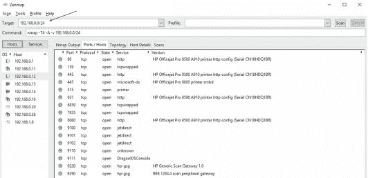

图 8.1：Zenmap 扫描

### 记住

密码破解器尝试发现密码并可以识别弱密码或保护不当的密码。网络扫描器可以检测网络上的所有主机，包括每个主机上运行的操作系统、服务或协议。

## 网络映射

网络映射发现网络上的设备以及它们相互连接的方式。这通常作为网络扫描的一部分进行，但它只关注连接性。相比之下，全网络扫描还包括额外的扫描，以识别开放端口、运行的服务和操作系统详情。

某些工具（如`Zenmap`）可以提供网络的图形化表示。要查看其效果，请参考[`gcgapremium.com/501labs/`](http://gcgapremium.com/501labs/)上的`Nmap`和`Zenmap`实验。

## 无线扫描器/破解器

第 4 章“保护你的网络”讨论了管理员在规划和部署无线网络时通常如何进行现场调查。安全人员会定期重复现场调查以验证环境没有发生变化。

无线扫描器通常同时可以使用被动和主动扫描。当使用被动扫描时，扫描器仅监听`2.4 GHz`和`5 GHz`频率范围内已知通道内广播的所有流量。

图 8.2 显示了`Acrylic Wi-Fi Professional`的截图，这是一款具有许多功能的无线扫描器。与许多扫描器一样，它可以收集并报告关于本地`APs`的大量信息。

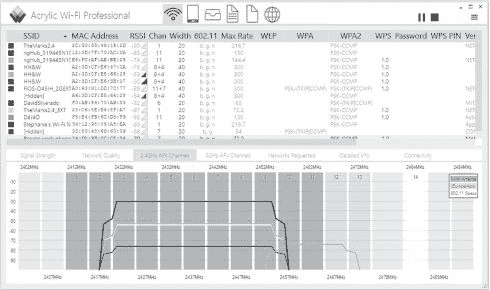

图 8.2：Acrylic Wi-Fi Professional

以下项目描述了图 8.2 中的某些列：

- `SSIDs`：扫描器将检测扫描器范围内所有接入点的服务集标识（`SSID`）。
- `MAC addresses`：它显示`AP`的`MAC`或硬件地址。
- `Signal strength`：信号强度通常标识`AP`距离执行扫描的计算机有多近（或多远）。
- `Channels`：这有助于管理员确定附近的`APs`是否在同一通道上广播，从而导致干扰。
- `Channel widths`：通道宽度通常为`20 MHz`，但当`AP`使用两个通道时，为`40 MHz`。扫描器会显示此信息。
- `Security`：扫描器将显示`AP`是处于`Open`模式还是使用其他无线加密协议之一：Wi-Fi 保护（`WPA`）或 Wi-Fi 保护 II（`WPA2`）。第 4 章将深入讨论这些模式。

当使用主动扫描时，无线扫描器充当扫描器/破解器，通过向`AP`发送查询来获取更多关于该`AP`的信息。例如，第 4 章讨论了各种攻击，包括 Wi-Fi 保护设置（`WPS`）攻击。`WPS`攻击会不断猜测`PINs`直到发现`AP`使用的八位`PIN`。然后它可以利用此发现`AP`使用的预共享密钥（`PSK`）。各种无线扫描器具有其他功能，包括使用其他方法的密码破解器。

## 异常系统检测

第 4 章讨论了非法`APs`，即未经授权就投入使用的`APs`。只要管理员知道哪些`APs`是经过授权的，通过无线扫描就可以很容易发现非法`APs`。管理员在规划和部署无线网络时通常会进行现场调查。例如，图 8.2（上一节中`Acrylic Wi-Fi Professional`的截图）显示了它检测到的所有`SSIDs`。

管理员可以调查任何未知的`SSIDs`。接收信号强度指示（`RSSI`）显示信号强度。负数越小（越接近 0），信号越强。通过在笔记本电脑上安装无线扫描器并在组织内四处走动，你可以定位非法`APs`。当你靠近非法`AP`时，信号会变强；当你远离它时，信号会变弱。

### Banner 抓取（Banner Grabbing）

Banner 取是一种用于获取远程系统信息的技术，许多网络扫描器都使用它。它通常用于识别操作系统以及有关某些应用程序的信息。如果成功，服务器将返回一个超文本标记语言（`HTML`）横幅，提供有关服务器的信息。横幅可能如下所示：

```html
<!DOCTYPE HTML PUBLIC "-//-//IETF//DTD HTML 2.0//EN">
<html><head><title>501 Method Not Implemented</title></head><body>
<h1>Method Not Implemented</h1>
<p>GET to /index.html not supported.<br /></p>
<p>Additionally, a 404 Not Found error was encountered.</p><hr>
<address>Apache/2.2.25 (Unix) mod_ssl/2.2.25 OpenSSL/1.0.0-fips mod_auth_ passthrough/2.1 mod_bwlimited/1.4 FrontPage/5.0.2.2635 Server at 72.52.230.233 Port 80</address>
</body></html>
```

大部分内容是格式化的。然而，地址部分中的信息提供了大量关于 Web 服务器的信息。它显示这是一个运行`Apache` Web 服务器软件的 Unix 服务器，以及其他额外信息。命令行工具`Netcat`可用于 Banner 抓取，如本章稍后部分所示。你也可以在本书的在线练习[`gcgapremium.com/501labs/`](http://gcgapremium.com/501labs/)中查看`Banner Grabbing Lab`。

### 记住

无线扫描器可以检测网络上的非法接入点，有时还可以破解接入点使用的密码。`Netcat`可用于 Banner 抓取，以识别远程服务器上的操作系统以及某些应用程序和服务。

## 漏洞扫描

漏洞评估的关键部分是漏洞扫描。安全管理员经常使用漏洞扫描器来识别哪些系统容易受到攻击。漏洞扫描器可以识别攻击者可以利用的广泛漏洞和已知安全问题。大多数漏洞扫描器将多个功能整合到一个包中。漏洞扫描通常包含以下内容：

- 识别漏洞
- 识别配置错误
- 被动测试安全控制
- 识别缺乏安全控制

### 识别漏洞和配置错误

漏洞扫描器利用已知漏洞的数据库或字典，并根据该数据库对系统进行测试。例如，MITRE 公司维护着常见漏洞与披露（`CVE`）列表，这是一份公开的安全漏洞和披露的字典。这与杀毒软件使用病毒特征检测恶意软件类似。区别在于，`CVE`是由美国政府资助的单一公共列表，而杀毒软件供应商维护的是私有特征文件。

漏洞扫描器使用的其他标准包括安全内容自动化协议（`SCAP`）。`SCAP`利用国家漏洞数据库（`NVD`），该数据库包含了常见的配置错误、与安全相关的软件缺陷以及影响评级或风险评分。风险评分量化了风险，使安全专家能够优先处理漏洞。`SCAP`还包含了`CVE`中项目的风险评分。

此外，攻击者经常寻找配置错误的系统，而漏洞扫描器可以检测到常见的配置错误设置。漏洞扫描器发现的一些漏洞和常见的配置错误包括：

- **开放端口**。开放的端口可能意味着存在漏洞，特别是当管理员没有积极管理与这些端口相关的服务时。例如，并非所有的 Web 服务器都使用文件传输协议（`FTP`），因此如果`TCP`端口`20`和`21`是开放的，则表明存在与`FTP`相关的潜在漏洞。同样，`Telnet`使用端口`23`，因此如果该端口开放，攻击者可以尝试使用`Telnet`连接到服务器。
- **弱密码**。许多扫描器包含密码破解器，可以发现弱密码，或验证用户创建的密码是否符合组织的安全策略。使用技术性密码策略来要求并强制使用强密码更为高效。然而，如果无法实现，管理员会使用单独的密码破解器来发现弱密码。
- **默认账户和密码**。操作系统和应用程序可能具有默认的用户名和密码。基础操作系统和应用程序加固步骤应移除这些默认值，如果操作系统和应用程序没有得到妥善的安全防护，扫描可以发现这些弱点。例如，某些`SQL`数据库系统允许启用空密码的`sa`（系统管理员）账户。`Nessus`等扫描器会检测到这一点。
- **敏感数据**。某些扫描器包含数据泄露防护（`DLP`）技术，用于检测通过网络传输的敏感数据。例如，`DLP`系统可以扫描数据寻找社会安全号码模式或识别分类或专有数据的关键词。
- **安全和配置错误**。漏洞扫描还可以根据配置或安全基准检查系统，以识别未经授权的更改。

管理员可以扫描特定系统或整个网络。例如，许多组织会对整个网络进行定期扫描以检测漏洞。如果管理员进行了未经授权的更改导致产生漏洞，扫描可以检测到。同样，如果重建的系统缺少某些关键安全设置，扫描也将检测到它们。在系统部署之前或部署后立即对其进行扫描也是可能的。

### 被动测试安全控制措施

漏洞扫描的一个重要点是，它并不尝试利用任何漏洞。相反，漏洞扫描是一种识别弱点的被动尝试。这确保了测试不会干扰正常运行。安全管理员随后会评估这些漏洞，以确定需要缓解哪些漏洞。相比之下，渗透测试（在本章稍后部分介绍）是一种尝试利用漏洞的主动测试。

### 识别安全控制措施的缺失

漏洞扫描器还可以识别缺失的安全控制措施，例如缺少最新的补丁或缺少杀毒软件。虽然许多补丁管理工具具备验证系统是否更新到最新补丁的能力，但漏洞扫描器提供了额外的检查以检测未打补丁的系统。

### 记住此

漏洞扫描器可以识别漏洞、配置错误的系统以及缺少安全控制措施（如缺少最新补丁）。漏洞扫描是被动的，在测试期间对系统的影响很小。相比之下，渗透测试是侵入性的，并可能损害系统安全。

### 误报

不幸的是，漏洞扫描器并非完美。偶尔，它们会报告一个实际上并不存在的漏洞。换句话说，扫描指示系统存在已知漏洞，但报告是假的。例如，对服务器进行的漏洞扫描可能会报告该服务器缺少与数据库应用程序相关的补丁，但该服务器并没有安装数据库应用程序。

这类似于入侵检测系统（`IDS`）中的误报，即`IDS`对某事件发出警报，但该事件并非真实的入侵。同样，杀毒扫描器可能会将有用的程序识别为恶意软件，即使该程序没有任何恶意代码。误报会导致较高的管理开销，因为管理员必须对它们进行调查。

### 有凭据扫描与无凭据扫描

漏洞扫描器可以使用账户凭据作为凭据扫描运行，也可以在没有任何用户凭据的情况下无凭据运行。攻击者通常没有内部账户的凭据，因此当他们对系统运行扫描时，运行的是无凭据扫描。

安全管理员经常以管理员账户的权限运行凭据扫描。这允许扫描以比无凭据扫描深得多的级别检查安全问题。此外，由于凭据扫描更容易访问系统的内部工作机制，它对测试系统的影响较小，且测试结果更准确，误报更少。

值得提到的是，攻击者通常从没有任何凭据开始，但使用权限提升技术来获取管理权限。这允许他们在需要时对网络运行凭据扫描。同样，尽管凭据扫描通常更准确，但管理员经常运行无凭据扫描，以查看没有凭据的攻击者会看到什么。

### 记住此

漏洞扫描的误报表示扫描检测到了漏洞，但该漏洞并不存在。凭据扫描在有效账户的上下文中运行，通常比无凭据扫描更准确。

### 配置合规性扫描器

配置合规扫描器验证系统配置是否正确。它们通常会使用一个识别系统正确配置的文件。在运行扫描时，扫描器将验证系统具有与配置文件定义的相同配置。这也被称为配置验证。安全管理员经常配置这些工具使用自动化或脚本方法，使其按照设定的日程自动运行。

例如，由`Tenable Network Security`开发的漏洞扫描器`Nessus`使用插件执行配置合规扫描。他们目前拥有用于针对`Windows`和`Unix`系统的插件。管理员还可以创建自定义审核文件，对`Windows`和`Unix`系统执行自定义的合规配置扫描。`AutoNessus`是一个可以自动化`Nessus`扫描的免费工具。

配置合规扫描通常需要作为凭据扫描运行。这有助于确保在扫描期间能够准确地读取系统的配置。

## 获取授权

在执行任何漏洞测试或渗透测试之前，获取漏洞测试授权和渗透测试授权是非常重要的。在大多数情况下，这种许可是书面形式的。如果没有书面形式，许多安全专业人员将不会进行测试。未经许可的渗透测试就是攻击。组织可能会将一个出于好意进行未经授权渗透测试的管理员视为黑帽或灰帽攻击者。管理员在运行未经授权的扫描或渗透测试后，可能正在更新他的简历。

许多组织在聘请外部安全人员执行测试时，会使用一份书面的交互规则（rules-of-engagement）文档。交互规则文档确定了渗透测试的边界。如果测试人员遵循了交互规则但测试仍然导致了服务中断，那么产生的后果也会较小。

# 渗透测试

渗透测试主动评估系统或网络中部署的安全控制措施。它始于被动侦察（例如漏洞扫描），但会更进一步，尝试通过模拟或执行攻击来利用漏洞。

安全测试人员通常通过执行渗透测试来演示系统内部的实际安全漏洞。这可以帮助组织确定威胁对系统的影响。换句话说，它帮助组织确定攻击者通过利用漏洞可能造成的损害程度。

虽然这种情况并不常见，但也可以通过渗透测试来确定组织如何对受攻击的系统做出响应。这允许组织展示安全漏洞以及策略执行过程中的缺陷。例如，许多组织在纸面上可能拥有完美的政策。然而，如果员工没有一贯地遵守这些政策，渗透测试就能准确地展示出这些缺陷。

由于渗透测试可能会利用漏洞，因此它具有破坏实际运营并导致系统不稳定的风险。因此，严格定义测试边界至关重要。理想情况下，渗透测试将在执行可能导致损坏或中断的利用操作之前停止。然而，某些测试会导致意料之外的结果。

测试人员有时会在测试系统而非实时生产系统上进行渗透测试。例如，一个组织可能托管了一个可以在互联网上访问的 Web 应用程序。渗透测试人员或管理员不会在实时服务器上进行测试以影响客户，而是会配置另一台运行相同 Web 应用程序的服务器。如果渗透测试导致测试服务器崩溃，它能准确地演示安全漏洞，但不会影响客户。

许多渗透测试包括以下活动：

- 被动侦察
- 主动侦察
- 初始利用
- 权限提升
- 枢纽跳转（Pivot）
- 持久化

### 记住这一点

渗透测试是一种主动测试，可以评估部署的安全控制措施并确定威胁的影响。它始于漏洞扫描，然后尝试通过实际攻击或模拟攻击来利用漏洞。

## 被动侦察

被动侦察使用开源源情报（OSINT）收集有关目标系统、网络或组织的信息。这包括查看有关目标的社交媒体来源、新闻报告，甚至是组织的网站。如果该组织拥有无线网络，它可能包括被动地收集网络信息，如网络 SSID。注意，由于被动侦察不接触目标，因此它是不违法的。

被动侦察不包括使用任何工具向目标发送信息并分析响应。然而，被动侦察可以包括使用工具从目标以外的系统收集信息。例如，你有时可以使用`Whois`查询网站（`https://www.whois.com`）获取关于域名持有者的信息。其他时候，你可以通过查询域名系统（`DNS`）服务器获取信息。

## 主动侦察

主动侦察包括使用工具向系统发送数据并分析响应。它通常从使用各种扫描工具（如网络扫描器和漏洞扫描器）开始。重要的是，主动侦察会接触目标，且几乎总是违法的。在获得明确授权之前，绝不要开始执行。

本章之前的“网络扫描器”部分讨论了如`Nmap`和`Nessus`等工具如何收集有关网络和单个系统的大量信息。这包括识别网络中活跃的所有 IP 地址、单个系统上活跃的端口和服务，以及在单个系统上运行的操作系统。

### 记住这一点

渗透测试包括被动侦察和主动侦察。被动侦察使用开源源情报方法，如社交媒体和组织的网站。主动侦察方法使用网络扫描器等工具来获取目标信息。

## 初始利用

在扫描目标后，测试人员会发现漏洞。他们会更进一步，寻找他们可以利用的漏洞。例如，漏洞扫描可能会发现某个系统没有安装已知漏洞的补丁。该漏洞允许攻击者（以及测试人员）远程访问系统并在其安装恶意软件。

利用这些知识，测试人员可以使用已知方法来利用该漏洞。这使得测试人员获得了系统的完全访问权限。他们随后可以在被利用的系统上安装额外的软件。

## 权限提升

在许多渗透测试中，测试人员首先获得低级系统或低级账户的访问。例如，测试人员可以使用 Homer 的用户账户访问 Homer 的电脑。Homer 可以访问网络，但没有任何管理员权限。然而，测试人员使用各种技术在 Homer 的电脑及其网络中获得越来越多的权限。

第 6 章讨论了攻击者经常使用的权限提升战术。“点击一下即可进入”部分讨论了高级持续性威胁（`APTs`）如何经常使用远程访问木马（`RATs`）获取单个系统的访问。攻击者欺骗用户点击恶意链接，从而获得单台电脑的访问权限。然后攻击者使用各种脚本扫描网络寻找漏洞。通过利用这些漏洞，攻击者在网络中获得了越来越多的权限。

渗透测试人员通常使用类似的战术。根据他们被授权执行的操作范围，测试人员可以使用其他方法获得对网络的更多访问。

## 枢纽跳转（Pivot）


枢纽跳转（Pivoting）是使用各种工具获取额外信息的过程。例如，想象测试人员获得了公司网络内 Homer 电脑的访问权限。测试人员随后可以枢纽跳转，利用 Homer 的电脑收集其他电脑的信息。Homer 可能拥有访问装满核电站运行文件的网络共享。测试人员可以使用 Homer 的电脑收集这些数据，然后通过 Homer 的电脑将它们发送回网络外部。

测试人员（以及攻击者）可以使用枢纽跳转技术来收集各种信息。很多时候，测试人员必须先使用权限提升技术来获得更多权限。然而，在此之后，测试人员可能会访问数据库（如用户账户和密码数据库）、电子邮件以及存储在网络内的任何类型的数据。

**记住这一点**

在利用系统后，渗透测试人员使用权限提升技术获取对目标系统的更多访问权限。枢纽跳转是利用已破解系统来攻击其他系统的过程。

## 持久化

攻击者经常使用各种威胁，使能够在网络中停留数周、几个月甚至几年而不被发现。渗透测试技术使用相似的技术在网络中维持持久化。

用于维持持久化的一种常用技术是创建一个可以返回网络的后门。例如，测试人员可能创建可以远程访问的备用账户。在某些情况下，安装或修改服务以连接回系统也是可能的。例如，测试人员可能启用安全外壳（`SSH`），然后创建一种使用 `SSH` 登录系统的方法。

## 白盒、灰盒和黑盒测试

根据测试人员在开始测试之前拥有的知识水平来识别测试类型是常见的。这些测试人员可能是内部员工，也可能是受雇执行测试的第三方机构的外部安全专业人员。三种测试类型为：

- **黑盒测试**：测试人员在开始黑盒测试之前对环境一无所知。相反，他们以攻击者相同的知识来进行测试。在测试新应用程序时，黑盒测试人员对该应用程序没有任何先验经验。在测试网络时，他们在测试前不会获得有关网络的任何信息或文档。黑盒测试人员经常使用模糊测试（fuzzing）来检查应用程序漏洞。
- **白盒测试**：测试人员在开始白盒测试之前对环境有完全了解。例如，他们可以访问产品文档、源代码，甚至可能拥有登录详情。
- **灰盒测试**：测试人员在开始灰盒测试之前对环境有一定的了解。例如，他们可能可以访问某些网络文档，但不知道完整的网络布局。

> 记住这一点
>
> 黑盒测试人员在渗透测试之前对系统没有任何先验知识。白盒测试人员拥有完全知识，而灰盒测试人员拥有部分知识。黑盒测试人员经常使用模糊测试。

你可能还会遇到黑帽、白帽和灰帽等术语。这些并不是指测试人员，而是指不同类型的攻击者。它们让人联想起美国西部，在那里你可以通过帽子的颜色很容易识别出好人与坏人。黑帽是指执行犯罪活动的恶意攻击者。白帽是指在法律范围内工作的安全专业人员。灰帽是指可能有良好意图但其活动可能跨越伦理界限的人。例如，有时被称为黑客主义者（hacktivist）的活动可能会使用攻击方法推进某项事业，而不是为了个人利益。

你可能还会遇到 `hacker`（黑客）和 `cracker`（破解者）这两个术语。最初，`hacker` 指的是精通计算机并希望与他人分享知识的人。他们并没有恶意。相比之下，`cracker` 是将知识用于恶意目的的熟练黑客。然而，英语是一种不断演变的活语言，媒体一直使用 `hacker` 来指代恶意攻击者。本书经常使用 `attacker`（攻击者）一词来指代出于目的攻击系统的个人。

## 侵入性与非侵入性测试

扫描可以是侵入性的，也可以是非侵入性的。你也可以将这些术语分别视为侵入性和非侵入。使用侵入性方法的工具可能会干扰系统的运行。相比之下，使用非侵入性方法的工具不会损害系统。这些术语也适用于渗透测试（侵入性）和漏洞扫描（非侵入性）。

在比较渗透测试和漏洞扫描时，重要的是记住渗透测试是侵入性的，并且比漏洞扫描更具破坏性。它们涉及探测系统并尝试利用发现的任何漏洞。如果它们成功利用了漏洞，渗透测试可能会中断服务甚至导致系统崩溃。

漏洞扫描通常是非侵入性的，且比渗透测试侵入性更小。它们绝不会尝试利用漏洞。因此，在系统或网络上运行漏洞扫描要安全得多，因为它影响服务的可能性要低得多。

## 被动工具与主动工具

在用于发现安全威胁和漏洞的工具背景下，理解被动工具和主动工具之间的区别非常重要。被动工具以非侵入性的方式测试系统，几乎不可能损害系统。主动工具使用侵入性和破坏性的方法，可能会影响系统的运行。

本章前面的“漏洞扫描”部分提到，漏洞扫描是被动的，而渗透测试是主动的。在这种语境下，被动并不意味着漏洞扫描器没有执行任何事情。它确实在探测系统以识别漏洞和其他问题。然而，它不会采取任何行动来利用这些漏洞。

这并不意味着你可以因为漏洞扫描是被动且非侵入的就可以在任何网络上随意运行它。如果你的行为被发现，你可能会被识别为攻击者并面临法律行动。

> 记住这一点
>
> 漏洞扫描器是被动且非侵入的，在测试期间对系统的影响很小。相反，渗透测试是主动且侵入的，可能会损害系统。渗透测试的侵入性比漏洞扫描更高。

## 利用框架

利用框架（Exploit framework）是一种用于存储安全漏洞信息的工具。它经常被渗透测试人员（以及攻击者）用于检测和利用软件。利用框架通常包括用于检查漏洞以及对任何发现的漏洞执行利用的工具。第 4 章讨论了入侵检测系统（`IDS`），许多 `IDS` 使用来自现有框架的信息来检测攻击。常用的利用框架有：

- **Metasploit Framework**：Metasploit 是一个运行在 Linux 系统上的开源项目。它拥有超过 1600 个漏洞利用的数据，并包含了开发、测试和使用利用代码的方法。Rapid7 在 2009 年收购了 Metasploit。虽然该框架仍然免费开源，但也有更高级的版本可以购买。
- **BeEF (Browser Exploitation Framework)**：BeEF 是一个开源 Web 攻击框架。它侧重于识别浏览器漏洞。成功的攻击允许测试人员（以及攻击者）从被利用的浏览器内部发起攻击。
- **w3af (Web Application Attack and Audit Framework)**：这个开源框架专注于 Web 漏洞。其目标是发现并利用所有 Web 应用漏洞，并让其他人了解这些信息。Web 开发者就可以确保他们的应用程序不受这些漏洞的攻击。

# 使用安全工具

安全专业人员和攻击者同样可以使用多种工具。本章前面详细讨论了漏洞扫描器，包括它们作为 Ping 扫描器和端口扫描器的用法。然而，还有其他工具可用。本节讨论了如协议分析仪、命令行工具、日志和审计等工具。

## 使用协议分析仪嗅探

协议分析仪可以捕获并分析网络上的数据包。使用协议分析仪的过程有时被称为嗅探（sniffing）或使用嗅探器。管理员和攻击者都可以使用协议分析仪查看 IP 头并检查数据包。例如，管理员可以使用协议分析仪排除网络系统之间的通信问题，或通过经过篡改或分段的数据包识别潜在攻击。

攻击者可以使用协议分析器捕获在网络中以明文传输的数据。例如，未加密的凭据是以明文在网络中传输的用户名和密码。攻击者查看此类数据的方法之一是在网络内部连接一个未经授权的交换机，捕获流量并将其转发到运行协议分析器的系统。如果布线没有受到保护，他们可能简单地连接到吊花板上方的交换机。`Wireshark` 是一个免费的协议分析器，你可以从 Wireshark 网站下载：[`www.wireshark.org/`](http://www.wireshark.org/)。

图 8.3 显示了 Wireshark 在捕获通过网络传输的数据包后的界面。它包含约 150 个数据包，并在顶窗选择了第 121 号数据包。顶窗显示了源和目的 IP 地址以及服务器消息块（`SMB`）协议。许多网络使用 `SMB` 在网络上发送文件，而此数据包包含了该文件的内容。中间窗显示了该数据包的细节，部分展开了 Internet 协议版本 4 头部信息。底窗以十六进制和 ASCII 字符显示了数据包的所有内容（包括未加密的凭据）。

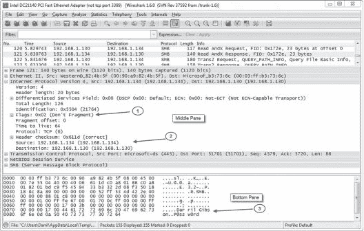

图 8.3：Wireshark 捕获

虽然分析数据包捕获可能很麻烦，但对于愿意花时间的人来说，其中包含大量信息。偶尔，攻击者会操纵不同类型攻击的头部中的标志（箭头 1），协议分析器允许你验证头部操纵攻击。你还可以在 IP 头部字段中看到源和目的 IP 地址（箭头 2）。你可以展开 Ethernet II 部分以显示源计算机和目的的介质访问控制（`MAC`）地址。

注意，你可以在底窗（箭头 3）中查看未加密的凭据——用户名（`Darril`）和密码（`P@ssw0rd`），因为 `SMB` 以明文发送它。然而，如果应用程序在跨网络发送数据之前对其进行了加密，它将是不可读的。

尽管此数据包捕获仅包含约 150 个数据包，但数据包捕获很容易包含数千个数据包。`Wireshark` 包含了管理员使用的过滤器，用于关注特定类型的流量。这些过滤器还允许他们对流量进行定量。例如，他们可以确定网络上 `SMTP` 流量或 `HTTP` 流量的百分比。

除了使用 `Wireshark` 图形界面查看捕获外，你也可以将其查看为文本文件。文本文件中的信息通常使用过滤器限制，但通常包括时间、标记为 `src` 的源信息、标记为 `dst` 的目的信息，有时还有协议信息。这是一个示例：

```text
22:33:44, src 192.168.5.55:3389, dst 192.168.7.17:8080, syn/ack
```

时间以 24 小时制显示，为晚上 10:33 44 秒。注意源和目的包含 IP 地址和端口号。这再次强调了了解第 3 章中提到的常用端口的重要性。它还向你展示了如何识别流量源。例如，如果攻击者正在作为攻击的一部分操纵或分段数据包，你可以使用 `src` IP 地址来识别攻击的来源。

值得注意的是，源 IP 地址并不总是能识别实际攻击者。例如，攻击者经常接管其他计算机并在所有者不知情的情况下从它们发起攻击。同样，端口地址翻译（`PAT`）会翻译公共和私有 IP 地址。如果流量通过使用 `PAT` 的设备，协议分析器只会捕获翻译后的 IP 地址，而不是原始 IP 地址。

当使用协议分析器时，你需要配置系统上的网卡（`NIC`）使用混杂模式。通常，`NIC` 使用非混杂模式，仅处理直接发送给其 IP 地址的数据包。然而，当你将其设置为混杂模式时，它会处理所有数据包，无论 IP 地址。这允许协议分析器捕获到达 `NIC` 的所有数据包。

> **记住这一点**
>
> 管理员使用协议分析器捕获、显示和分析通过网络发送的数据包。它在排除系统之间的通信问题时非常有用。对于检测操纵或分段数据包的攻击也有用。捕获显示了流量类型（协议）、标志、源和目的 IP 地址以及源和目的 MAC 地址等信息。`NIC` 必须配置为混杂模式以捕获所有流量。

## 命令行工具

第 1 章介绍了 Windows 和 Linux 系统上可用的一些命令行工具。某些工具在执行漏洞扫描和渗透测试时非常有用。本节讨论的三种工具是 `tcpdump`、`Nmap` 和 `Netcat`。

与任何命令行工具一样，最好深入研究并尝试一下。我强烈建议你查看 [`gcgapremium.com/501labs/`](http://gcgapremium.com/501labs/) 上的免费在线实验室并完成每一个。

### Tcpdump

`tcpdump` 是一个命令行数据包分析器（或协议分析器）。它允许你像使用 `Wireshark`（在“使用协议分析器嗅探”部分提到）一样捕获数据包。区别在于 `Wireshark` 是基于 Windows 的工具，而 `tcpdump` 从命令行执行。许多管理员使用 `tcpdump` 捕获数据包，稍后使用 `Wireshark` 进行分析。本章的一个在线实验室展示了如何这样做。

Kali Linux 包含了 `tcpdump`，但你在 Windows 系统上找不到它。与大多数 Linux 命令行工具一样，`tcpdump` 对大小敏感。你需要输入全小写的 `tcpdump`。此外，开关必须以正确的大小写输入。例如，`-c`（小写 c）代表计数，表示捕获在接收到指定数量的数据包后停止。然而，`-C`（大写 C）代表文件大小，表示数据包捕获的最大大小（以百万字节为单位）。当文件达到此大小时，`tcpdump` 关闭并开始在新文件中存储数据包。

### Nmap

`Nmap` 是一个网络扫描器，在之前的“网络扫描器”部分讨论过。`Nmap` 的图形界面是 `Zenmap`，图 8.1 显示了 `Zenmap` 的截图。此外，在线实验室向你展示了如何安装和使用 `Nmap` 和 `Zenmap`。

它包含许多功能，包括识别网络中的所有活动主机及其 IP 地址、这些主机上运行的协议和服务，以及主机的操作系统。在运行命令时，你包含了扫描类型、可选选项和目标规范。例如，考虑以下命令：

```text
nmap -T4 -A -v 192.168.0.0/24
```

注意它有三个开关：`-T4`、`-A` 和 `-v`：

- `-T4`：`T4` 指扫描速度。有效的开关是从 `T0` 到 `T5`，其中 `T0` 最慢，`T5` 最快。较快的扫描更容易被检测，而较慢的扫描可能不会被检测。
- `-A`：`-A` 开关表示扫描应包括操作系统检测、版本检测、脚本扫描和跟踪路由。
- `-v`：`-v` 开关表示详细程度。你可以通过使用 `-vv` 或 `-vvv` 获取更多数据输出。

### Netcat

第 3 章讨论了 `Netcat` 以及管理员如何使用它来远程访问 Linux 系统。它不包含原生加密，因此通常使用 `SSH` 来保护会话安全。此外，本章前面的“指纹抓取（Banner Grabbing）”部分提到 `Netcat` 可以轻松用于指纹抓取。以下是一个用于指纹抓取的示例命令：

```text
echo "" | nc -vv -n -w1 72.52.206.134 80
```

它使用了 `netcat` 命令（`nc`）以及一些开关：`-vv` 用于详细输出，`-n` 表示不解析主机名，`-w1` 表示等待响应的时间不超过 1 秒。该命令连接到 IP 地址为 `72.52.206.134` 的系统的 80 端口。`echo ""` 向服务器发送一个空命令，管道符号（`|`）告诉 `Netcat` 在建立连接后发送该命令。

`Netcat` 的其他用途包括：

- **传输文件。**第 3 章的在线实验室之一展示了如何在两个系统之间创建聊天会话。一旦打开该会话，你就可以使用该连接在系统之间复制文件。
- **端口扫描器。**你可以使用 `Netcat` 对单个 IP 地址运行端口扫描。它允许你指定端口范围（例如 10 到 1024），并随机化扫描的端口以规避检测。它还支持在端口检查之间等待更长的时间，同样是为了规避检测。

**记住这一点**

`Tcpdump` 是一个命令行协议分析器。它可以创建数据包捕获文件，然后可以在 `Wireshark` 中查看。`Nmap` 是一种从命令行运行的复杂网络扫描器。`Netcat` 可用于远程管理系统，并用于收集有关远程系统的信息。

## 监控日志以发现事件异常

日志具有记录发生了什么、何时发生、何地发生以及是谁执行的记录。日志记录的主要目的之一是让人员（如管理员或安全专业人员）能够准确识别出发生了什么以及发生的时间。

很多时候，安全管理员会在日志中寻找事件异常。举一个简单的例子，攻击者有时尝试通过猜测密码来登录账户。安全日志会将这些尝试记录为失败登录，这是一种事件异常。在调查失败登录后，管理员可以确定失败登录是正常操作的一部分，还是安全事件。

人们往往希望设置日志来记录每个事件并提供尽可能详尽细节——大多数日志都支持详细模式，该模式会记录额外的细节。然而，一个限制因素是可用磁盘空间的大小。此外，启用日志记录时，就隐含了审查日志的责任。你选择记录的内容越多，可能需要审查的内容就越多。目标是在需求内容与可用存储空间之间取得平衡。接下来的章节将介绍常用的日志。

### 操作系统事件日志

操作系统具有记录事件的基本日志。例如，Windows 系统有几个常用日志，记录了 Windows 计算机系统上发生的事件。这些日志可以使用 `Windows Event Viewer`（事件查看器）查看。Windows 系统中的主要日志之一是 `Security`（安全日志），它具有安全日志、审计日志和访问日志的功能。

`Security` 日志记录可审计事件，例如用户登录或注销，或者用户访问资源。某些系统默认启用了一些审计，但管理员可以添加额外的审计。`Security` 日志将审计事件记录为成功或失败。成功表示审计事件已成功完成，例如用户成功登录或成功删除文件。失败表示用户尝试执行某项操作但失败，例如登录失败或尝试删除文件但收到权限错误。Windows 系统中的其他额外日志包括：

- `Application`（应用程序）。`Application` 日志记录由系统上的应用程序或程序记录的事件。任何应用程序都有在 `Application` 日志中记录错误的能力。
- `System`（系统）。操作系统使用 `System` 日志记录与操作系统运行相关的事件。这包括系统启动、关机、服务启动和停止的信息、驱动程序加载或失败，或系统开发者认为重要的任何其他系统组件事件。

如果系统受到攻击，你可能通过查看操作系统日志来了解攻击细节。取决于攻击的类型，任何一种操作系统日志都可能有用。

### 防火墙和路由器访问日志

你通常可以操作防火墙和路由器来记录特定信息，例如记录设备通过的所有流量、设备拦截的所有流量或两者兼有。这些日志在排查连接问题以及识别潜在的入侵或攻击时非常有用。

防火墙和路由器日志包含数据包来自哪里（源）和去往哪里（目的）的信息。这包括 IP 地址、MAC 地址和端口。

### Linux 日志

CompTIA Security+ 包含几个基于 Linux 的命令。了解这一点，知道一些常见的 Linux 日志是有价值的。你可以使用 Linux 系统上的 `System Log Viewer`（日志查看器）或通过终端使用 `cat` 命令来查看日志。例如，要查看认证日志（`auth.log`），可以使用以下命令：

```bash
cat /var/log/auth.log
```

管理员经常查看的一些 Linux 日志包括：

- `/var/log/messages`。此日志包含各种通用系统消息。它包括启动期间记录的一些消息、与邮件、内核相关的消息以及身份认证消息。它存储通用的系统活动日志条目。
- `/var/log/boot.log`。这里包含了系统启动时创建的日志条目。
- `/var/log/auth.log`。认证日志包含与成功和失败登录相关的信息。


- `/var/log/faillog`。此日志包含失败登录尝试的信息。可以使用`faillog`命令查看。
- `/var/log/kern.log`。内核日志包含由系统内核记录的信息，内核是 Linux 操作系统的核心部分。
- `/var/log/httpd/`。这是一个目录，如果系统被配置为 Apache Web 服务器，你可以通过此目录查看访问和错误日志。

某些 Linux 发行版包含`utmp`、`wtmp`和`btmp`文件（或`utmpx`、`wtmpx`和`btpx`变体）。创建这些文件是为了让管理员回答此类问题：谁正在登录、最近谁登录过，以及哪些账户登录失败。它们通常位于`/var/log`文件夹中，但可能在其他地方。以下项目符号描述了这些文件：

- `utmp`文件维护系统当前状态，包括谁正在登录。`who`命令查询此文件以显示当前登录的用户列表。
- `wtmp`文件是`utmp`文件的存档。根据其实现方式，它可以是一个循环文件，在达到预设大小时覆盖自身。`last`命令查询此文件以显示最后登录的用户。
- `btmp`文件记录失败登录尝试。`lastb`命令显示最后的失败登录尝试。

### 其他日志

除了基础操作系统日志以及防火墙和路由器访问日志外，管理员在维护系统和网络时还会使用其他日志。这些包括：

#### 日志

- **杀毒软件日志**。杀毒软件日志记录所有杀毒活动，包括扫描运行的时间以及是否检测到任何恶意软件。这些日志还会识别恶意软件是否已被删除或隔离。
- **应用程序日志**。许多服务器应用程序内部都包含记录功能。例如，如`Microsoft SQL Server`或`Oracle Database`等数据库应用程序包含了记录性能和用户活动的日志。
- **性能日志**。性能日志可以监控系统性能，并在超过预设的性能阈值时发出警报。

### 记住这一点

日志记录了发生了什么、何时发生、何地发生以及是谁操作的。通过监控日志，管理员可以检测事件异常。此外，通过审阅日志，安全人员可以创建审计追踪。

## SIEM

安全信息和事件管理（`SIEM`）系统提供了一种中心化的解决方案，用于从多个源收集、分析和管理数据。它们结合了安全事件管理（`SEM`）和安全信息管理（`SIM`）解决方案的功能。`SEM`提供对安全事件（如疑似安全事件）的实时监控、分析和通知。`SIM`则提供数据的长期存储，以及分析数据以寻找趋势或创建验证法律法规合规性所需报告的方法。

`SIEMs`对于需要监控海量数据和活动的大型企业非常有用。考虑一个拥有超过 1,000 台服务器的组织。当其中某一台服务器发生事件时，管理员需要尽快获知。`SIEM`提供了持续监控和实时报告。例如，在大型网络运营中心（`NOC`）中，`SIEM`可能会在大型显示屏上显示警报。其优点是可以通过`SIEM`的脚本实现监控和报告的自动化。

供应商将`SIEMs`作为可以安装在系统上的应用程序以及专用的硬件设备进行销售。然而，无论供应商如何组合，它们通常具有通用功能。这始于一个可以轻松搜索和分析的数据库。`SIEM`从整个网络中的设备收集日志数据，并将这些日志存储在数据库中。

以下项目概述了大多数`SIEMs`共享的一些额外功能：

- **聚合**。聚合是指将多个不同的项目合并为一个项目。`SIEM`可以从多个源（如防火墙、入侵检测系统、代理服务器等）收集数据。这些设备的日志格式各不相同。然而，`SIEM`可以聚合数据并进行存储，使其易于分析和搜索。
- **关联引擎**。关联引擎是一种软件组件，用于收集和分析网络内各种系统的事件日志数据。它通常聚合数据以寻找共同属性。然后，它使用高级分析工具检测潜在安全事件的模式并发出警报。系统管理员随后可以对警报进行调查。
- **自动告警**。`SIEM`通常带有预定义的警报，这些警报提供可疑事件的通知。例如，如果它检测到服务器上的端口扫描，它可能会向管理员组发送电子邮件或在抬头式显示器上显示警报。`SIEMs`还包括创建新警报的能力。
- **自动触发器**。触发器根据预定义的重复事件次数来导致某种操作。例如，想象一个针对登录失败的触发器被设置为五次。如果攻击者反复使用`Secure Shell`（`SSH`）尝试登录服务器，服务器的日志将显示失败的登录尝试。当`SIEM`检测到超过 5 次失败的`SSH`登录时，它可以更改环境并停止攻击。它可能会修改防火墙以阻止这些`SSH`登录尝试，或向服务器发送脚本临时禁用`SSH`。`SIEM`包括修改预定义触发器和创建新触发器的能力。
- **时间同步**。所有向`SIEM`发送数据的服务器都应该同步相同的时间。这在调查事件时变得格外重要，以便安全调查人员知道事件发生的时间。此外，大型组织可能位于不同时区。这些位置中的每一个都可能拥有向单个中心化`SIEM`发送数据的服务器。如果服务器日志使用本地时间，`SIEM`需要确保补偿时间偏移。一种方法是将所有时间转换为格林威治标准时间（`GMT`），即英国伦敦格林威治皇家天文台所在的时间。
- **事件去重**。去重是移除重复记录的过程。例如，想象 10 个用户收到了同一封电子邮件并选择保存。使用去重处理的电子邮件服务器将保留该邮件的一个副本，但让所有 10 个用户都能访问。想象`NIDS`从防火墙收集数据，而`SIEM`从`NIDS`和防火墙收集数据。`SIEM`将对任何重复日志条目仅存储一份，同时确保这些条目与两个设备都关联。
- **日志/WORM**。`SIEM`通常包含防止任何人修改日志记录的方法。这有时被称为写入一次，多次读取（`WORM`）。在接收日志时，`SIEM`会聚合并关联日志条目。在处理日志后，它可以带有写保护地存档源日志。

`SIEM`的位置（以及其关联引擎的位置）取决于`SIEM`的使用方式。然而，将`SIEM`位于私有网络内部是常见的，即使它从非军事化区（`DMZ`）收集某些数据。内部网络将为日志数据提供最好的保护。在大型组织中，聚合过程和关联引擎可能会消耗大量的处理能力，因此组织有时会将过程卸载到另一台服务器。主`SIEM`设备就可以专注于告警和触发器。

## 持续监控

必须意识到，安全专业人员永远都不可以说：“现在我们实施了这项安全措施，可以坐下来放心地知道我们了。”换句话说，安全永无止境。相反，安全专业人员必须持续监控其环境中的新兴威胁和新漏洞。

持续安全监控包括监控所有相关的安全控制，目标是确保它们帮助组织维持强大的安全态势。监控方法有很多，包括执行定期的威胁评估、漏洞评估和风险评估。许多组织执行例行的漏洞扫描（例如每周一次）和不常见的渗透测试。此外，组织还执行例行的审计和审查，例如使用情况审计审查和权限审计审查，这些将在下一节中讨论。

## 使用审计与审查

使用审计是指记录用户操作行为的信息。例如，如果 Homer 访问了网络服务器上的一个文件，日志条目将显示他的身份、访问文件的时间、访问了什么文件以及他使用哪台计算机访问的文件。他将无法否认记录的行为，因为审计提供了**不可否认性**。

审计包含的内容远比用户访问文件得多。它还可以包括用户登录、访问网络共享、读取文件、修改文件、创建文件、打印文件、通过代理服务器访问网站等等。

配置登录尝试的日志记录是系统监控的一个重要安全步骤。配置日志记录后，系统会记录用户登录的时间和日期，以及他们访问网络内系统的时间。当用户首次登录其账户时，会被记录为一次登录操作。此外，当用户通过网络访问资源（如文件服务器）时，也会被记录为登录操作。许多系统利用单点登录（SSO），因此用户无需再次提供凭据。然而，他们的访问仍会被记录为登录操作。

使用审计审查通过查看日志查看用户在做什么。例如，一个组织可能有一个充满了专有项目文件的网络共享。使用审计审查可能会查看这些文件的审计日志，以确定谁在访问这些文件以及他们正在对文件做什么。

日志创建了所发生事件的审计轨迹。使用审计审查通常是为了重建审计轨迹，或重构过去发生的事情。例如，如果有人向组织外泄露了专有信息，调查人员可以查看审计文件，确定谁访问了这些信息、对它们做了什么（如打印）以及何时操作的。

## 从审计确定行为（侧边栏）

Reality Leigh Winner 于 2017 年被捕，原因是怀疑她向新闻网站泄露了一份情报报告。据称她打印了该文件并发送给了 The Intercept。The Intercept 扫描了该文件，创建了一个五页的 PDF 文件并将其包含在他们发布的报道中。该文件经过了部分删除，但仍为调查人员提供了足够的信息，他们在 The Intercept 发布报道后不久逮捕了 Winner。

### 调查人员是如何识别 Winner 的？

PDF 文件显示出折痕，表明它被打印过。经过一番调查，他们发现该文件只有六个人打印过。这表明该文件可能设置了高级审计。高级审计可以记录对该文件的任何访问，包括文件是否被打印。

Winner 女士是这六个人之一。PDF 文件还包含了打印机隐形水印追踪点，这提供了另一种审计方法。这些编码点识别了文件打印的日期、时间，以及打印机的型号和序列号。对这台打印机的访问可能让调查人员很容易排除其他五个人。

## 权限审计与审查

权限审计审查查看分配给用户的权利和权限，有助于确保执行**最小权限原则**。第 2 章“理解身份和访问管理”更深入地讨论了最小权限原则，但简而言之，它意味着用户拥有他们所需的权利和权限，且更多。这包括确保用户只能访问执行其工作所需的资源。

权限审计审查识别授予用户的特权（权利和权限），并将其与用户的需求进行比较。它可以检测出**权限膨胀**，这是一种违反最小权限原则的常见问题。

权限膨胀（或权限冗余）发生在由于工作要求的变化，用户获得了越来越多的特权，但不再需要的权限从未被移除时。例如，想象 Lisa 在人力资源（HR）部门工作，因此她有权访问 HR 数据。后来，她转到了销售部门，管理员授予了她访问销售数据的权限。然而，尽管她在销售部门工作不需要 HR 数据，但没有人删除她对 HR 数据的访问权限。

组织通常使用基于角色的访问控制模型和基于组的权限，如第 2 章所述。例如，当 Lisa 在 HR 部门工作时，她的账户会在适当的 HR 部门安全组中，以授予她 HR 工作所需的权限。当她转到销售部门时，管理员会将她加入相应的销售部门组，授予她新工作的权限。组织还应建立账户管理控制，以确保管理员将其从 HR 部门安全组中移除。权限审计审查验证了这些账户管理实践执行。

大多数组织确保至少执行一次权限审计审查，有些组织执行得更频繁。目标是足够频繁地发现潜在问题并防止安全事件。然而，除非能够自动化，否则如果要求安全管理员频繁地执行（例如每天甚至每周一次），就会变成一种不必要的负担。

### 记住这一点

使用审计在日志中记录用户活动。使用审计审查通过查看日志查看用户在做什么，并用于重建审计轨迹。权限审计审查有助于确保用户仅拥有所需的访问而非更多，并可以检测权限膨胀问题。

# 第 8 章考试考点复习

在准备考试时，确保你理解本章涵盖的这些关键概念。

### 理解风险管理

- 风险是威胁利用漏洞的概率。威胁是可能损害数据或系统机密性、完整性或可用性的潜在危险。漏洞是一个弱点。
- 影响（`Impact`）是指如果威胁利用漏洞，可能造成的损害的程度。
- 威胁评估有助于组织识别和分类威胁。环境威胁评估评估环境威胁（如自然灾害）发生的概率。人为威胁评估评估来自人类的威胁。
- 内部威胁评估评估组织内部的威胁。外部威胁评估评估来自组织外部的威胁。
- 漏洞是软件或硬件中的缺陷或弱点，或者是威胁可以利用的过程中的弱点，导致安全泄露。
- 风险管理试图将风险降低到组织可以接受的水平，剩余的风险被称为**剩余风险**。高层管理负责管理风险以及剩余风险相关的损失。
- 你可以通过不提供服务或参与高风险活动来规避风险。购买保险（如火灾险）是将风险转移给另一个实体。安全控制缓解或减少风险。当控制的成本超过风险时，接受风险是常见做法。
- 风险评估根据不同的值或判断对风险进行量化或定性分析。它从识别资产价值并优先考虑高价值项目开始。
- 定量风险评估使用数字，例如成本和资产价值。单次损失预期值（`SLE`）是任何单次损失的成本。年度发生率（`ARO`）表示损失每年发生的次数。你可以通过`SLE` × `ARO`来计算年度损失预期值（`ALE`）。
- 定性风险评估使用判断，根据发生的概率和影响对风险进行优先级排序。这些判断提供了一种主观排名。
- 风险评估结果具有敏感性。只有高管和安全专业人员才应被访问风险评估报告。
- 风险注册表是一份列出风险信息的详细文档。它通常包括风险分以及旨在降低风险分的建议的安全控制措施。
- 供应链评估评估生产和销售产品所需的供应链。它包括原材料以及创建和分发成品所需的所有流程。

## 比较扫描工具与测试工具

- 端口扫描器扫描系统的开放端口，并尝试发现运行的哪些和服务协议。
- 网络映射识别网络内主机的 IP 地址。网络扫描器在网络映射的基础上进行了扩展。它们可以识别每个主机上运行的操作系统，还可以识别每个主机上运行的服务和协议。
- 无线扫描器可以检测网络中的非法接入点（`APs`）。许多工具还可以破解 AP 使用的密码。
- 横幅抓取（Banner grabbing）查询远程系统以检测其操作系统，以及运行在远程系统上的服务、协议和应用程序。
- 漏洞扫描器被动测试安全控制，以识别漏洞、安全控制缺失以及常见的配置错误。它们能够有效地发现易受攻击的系统，而无需利用这些系统。
- 漏洞扫描的误报表示扫描检测到了漏洞，但该漏洞并不存在。凭据扫描在账户的上下文中运行，可以比非凭据扫描更准确，产生的误报更少。
- 渗透测试人员在开始渗透测试之前应获得同意。交接规则（rules-of-engagement）文档确定了测试的边界。
- 渗透测试是一种主动测试，尝试利用已发现的漏洞。它从漏洞扫描开始，然后绕过或主动测试安全控制以利用漏洞。
- 被动侦察从开源情报中收集信息。主动侦察使用扫描技术收集信息。
- 在初始利用后，渗透测试人员使用权限提升技术来获取更多访问权限。渗透测试中的枢纽（Pivoting）是指使用被利用的系统访问其他系统的过程。
- 在黑盒测试中，测试人员在对环境零先知的情况下进行渗透测试。白盒测试表示测试人员完全了解环境，包括所测试应用程序的文档和源代码。灰盒测试表示对环境有一定的了解。
- 扫描可以是侵入性的或非侵入性的。渗透测试是侵入性的（也称为破坏性的），并可能干扰操作。漏洞测试是非侵入性的（也称为非侵入式）。
- 利用框架存储安全漏洞信息。它们经常被渗透测试人员（和攻击者）用于检测和利用软件。

## 使用安全工具

- 协议分析器（嗅探器）可以捕获并分析通过网络的数据。测试人员（和攻击者）使用协议分析器捕获跨网络传输的明数据。
- 管理员使用协议分析器通过检查协议头来检测被篡改或分段的数据包，从而排除通信问题。
- 捕获的数据包显示流量类型（协议）、源和目的 IP 地址、源和目的 MAC 地址以及标志位。
- `tcpdump`是一个命令行协议分析器。捕获的数据包文件可以在`Wireshark`等图形化协议分析器中分析。
- `Nmap`是从命令行运行的复杂网络扫描器。`Netcat`是用于远程管理服务器的命令行工具。`Netcat`也可以用于横幅抓取。
- 日志记录事件，通过监控日志，管理员可以检测事件异常。安全日志跟踪系统的登录和注销活动。系统日志识别服务的启动和停止。
- 防火墙和路由器日志识别流量的源和目的。
- 安全信息和事件管理（`SIEM`）系统可以在单一位置聚合并关联来自多个源的日志。`SIEM`还提供持续监控和自动告警触发。
- 持续安全监控通过验证安全控制继续按预期功能运行，帮助组织维护其安全态势。
- 用户审计记录用户活动。用户审计检查用户活动。权限审计检查有助于确保用户仅拥有执行工作所需的权利和权限，而不再。

## 在线参考

- 不要忘记查看`http://gcgapremium.com/501-extras/`上的在线资源。它包含了额外的免费练习测试题、实验室和其他帮助你通过考试的资源。

# 第 8 章练习题

1. 一位安全专家正在进行风险。她正在寻找信息以识别特定类型事件每年发生的次数。以下哪项最能标识这种情况？
   
   A. `ALE`
   
   B. `ARO`
   
   C. `SLE`
   
   D. `WORM`

2. Lisa 需要为网络中一组服务器计算`ALE`。在过去的两年中，有五台服务器故障。修复或更换每台服务器的硬件成本为 3,500 美元，每次停机导致 2,500 美元的额外损失。`ALE`是多少？
   
   A. $7,000
   
   B. $8,000
   
   C. $15,000
   
   D. $30,000

3. Martin 正在对电子商务 Web 服务器进行风险评估。在此过程中，他创建了一份文档，显示该服务器的所有已知风险，以及每个风险的评分。这份文档叫什么？
   
   A. 定量风险评估
   
   B. 定性风险评估
   
   C. 剩余风险
   
   D. 风险注册表

4. 你的组织包含一个用于销售数字产品的电子商务网站。你被要求评估支持该网站的所有元素。你正在进行什么？
   
   A. 定量评估
   
   B. 定性评估
   
   C. 威胁评估
   
   D. 供应链评估

5. 一位渗透测试人员正在你组织 DMZ 内的服务器上运行多次测试。测试人员想要识别远程主机的操作系统。以下哪些工具或方法最可能提供此类信息？
   
   A. 横幅抓取
   
   B. 漏洞扫描
   
   C. 密码破解器
   
   D. 协议分析器

6. 你需要对网络进行测试以识别缺失的安全控制。然而，你希望对用户访问的系统影响最小。以下哪种工具最符合这一需求？
   
   A. `syn`隐蔽扫描
   
   B. 漏洞扫描
   
   C. Ping 扫描
   
   D. 渗透测试

7. 你定期在网络上运行漏洞扫描，但一直收到了很多误报。以下哪些操作有助于减少误报？
   
   A. 以凭据扫描的形式运行。
   
   B. 以非凭据扫描的形式运行。
   
   C. 使用被动侦察运行扫描。
   
   D. 使用主动侦察进行扫描。

8. 组织在 DMZ（非军事区）内运行着一台旧服务器。它运行的旧软件与当前的补丁兼容，因此管理层决定让其不打补丁。管理层想知道攻击者成功攻破此服务器后是否可以访问内部网络。以下哪项是**最恰当**的操作？
   
   A. 执行漏洞扫描。
   
   B. 执行端口扫描。
   
   C. 执行黑盒测试。
   
   D. 执行渗透测试。


9. 渗透测试人员成功攻击了网络内的单台计算机。测试人员现在正尝试通过该计算机访问网络内的其他系统。以下哪项**最准确**描述了测试人员当前的操作？

A. 侦察  
B. 执行初始利用  
C. 横枢移动 (`Pivoting`)  
D. 权限提升  

10. 你正在排查网络上两个服务器之间的问题，并分析网络流量。在以下选项中，捕获和分析此类流量的**最佳**工具是什么？

A. 网络映射器 (`Network mapper`)  
B. 协议分析器 (`Protocol analyzer`)  
C. 网络扫描器 (`Network scanner`)  
D. `SIEM`  

11. 一名渗透测试人员被要求获取你内部一台服务器的信息，他输入了以下命令：

```
echo "" | nc -vv -n -w1 72.52.206.134 80
```

此命令的目的是什么？

A. 识别服务器是否运行使用端口 80 的服务以及是否可访问。  
B. 对短时间内发送 80 个独立数据包的服务器发起攻击。  
C. 使用 `Netcat` 远程管理服务器。  
D. 使用 `Netcat` 在服务器上启动 `RDP` 会话。  

12. 你怀疑攻击者一直在向服务器发送特制的 `TCP` 数据包以尝试利用漏洞。你决定捕获发送到该服务器的 `TCP` 包以备日后分析，并想使用命令行工具来实现。以下哪个工具**最能**满足你的需求？

A. `Wiredump`  
B. `Tcpdump`  
C. `Netcat`  
D. `Nmap`  

13. 你怀疑有人正对 `Linux` 系统进行密码破解攻击。你应该检查以下哪个日志来查看用户的失败身份验证尝试？

A. `/var/log/btmp`  
B. `/var/log/fail`  
C. `var/log/httpd`  
D. `/var/log/kern`  

14. 一个组织拥有包含数十台服务器的大型网络。管理员发现很难审查和分析所有网络设备的日志。他们正在寻找一种聚合和关联日志的解决方案。以下哪个选项**最符合**这一需求？

A. `Nmap`  
B. `Netcat`  
C. `Wireshark`  
D. `SIEM`  

15. `Lisa` 最近从人力资源部门转到了薪资部门。在浏览文件共享文件夹时，`Lisa` 发现自己可以访问与她新同事相关的 `HR` 文件。以下哪项可以防止这种情况的发生？

A. 权限审计与审查  
B. 持续监控  
C. 漏洞扫描  
D. 渗透测试  

# 第 8 章练习题答案

1. B. 年度发生率 (`ARO`) 是识别特定类型事件每年发生次数的最佳选择。年度预期损失 (`ALE`) 识别一年的预期金额损失，单次预期损失 (`SLE`) 识别单次事件的预期金额损失。`ALE = SLE × ARO`，如果你知道这些值中的任何两个，就可以确定第三个值。例如，`ARO = ALE / SLE`。一次写入多次读取 (`WORM`) 是有时用于存档日志的术语，表示日志不可修改。

2. C. 年度预期损失 (`ALE`) 为 $15,000。单次预期损失 (`SLE`) 为 $6,000（修复或更换每台服务器需要 $3,500，每次停机产生额外 $2,500 损失）。年度发生率 (`ARO`) 为 2.5（两年内发生五次，即 `5 / 2`）。你通过 `SLE × ARO` 计算 `ALE`（$6,000 × 2.5）。

3. D. 风险注册表列出了资产（如 `Web` 服务器）的所有已知风险，通常包含风险评分（发生概率与风险的影响组合）。风险评估（包括定量和定性风险评估）可能会使用风险注册表，但它们本身不是注册表。剩余风险是指应用安全控制缓解风险后剩余的风险。

4. D. 供应链评估评估用于创建、销售和分发产品的所有元素。风险评估（包括定量和定性风险评估）评估风险，但不评估支持电子商务网站所需的供应链。威胁评估评估威胁。

5. A. 标志抓取 (`Banner grabbing`) 是一种用于获取远程服务器信息的技术，它会识别非军事区 (`DMZ`) 中系统的操作系统。漏洞扫描器检查漏洞。密码破解器尝试发现密码。协议分析器收集跨网络发送的数据包，并可用于分析数据包。

6. B. 漏洞扫描器是被动的，对系统的影响最小，它可以检测缺少特定安全控制的系统。网络扫描器使用 `syn` 隐扫描和 `ping` 扫描等方法发现网络上的设备，但它们无法识别缺失的安全控制。渗透测试是侵入性的，对系统的影响并非最小。

7. A. 以凭据扫描（在有效账户上下文中）运行扫描允许扫描看到更多信息，通常会产生更少的误报。非凭据扫描在没有任何用户凭据的情况下运行，准确性较低。被动侦察利用开源情报收集目标信息。所有漏洞扫描都使用主动侦察技术。

8. D. 渗透测试尝试利用漏洞，并确定成功攻击是否会允许攻击者进入内部网络。漏洞扫描是被动的。它不尝试攻破系统，因此无法验证攻击者是否可以访问内部网络。端口扫描仅识别开放端口。黑盒测试仅指测试人员的知识水平，表示他们在开始测试前零知识。

9. C. 横枢移动 (`Pivoting`) 是通过单个受损系统访问其他系统的过程。侦察技术在攻击系统之前完成。对单台计算机的成功攻击是初始利用。权限提升尝试在目标上获得更高的权限。

10. B. 协议分析器（也称为嗅探器）是捕获和分析网络流量的最佳选择。网络映射器可以检测网络上的所有设备，网络扫描器可以检测有关这些设备的更多信息，但这两个工具都不是用于故障排除捕获和分析流量的最佳选择。安全信息和事件管理 (`SIEM`) 系统聚合并关联来自多个源的日志，但不捕获网络流量。

11. A. 此命令通过端口 80 向服务器发送查询，如果服务器在端口 80 上运行服务，它将建立连接。这是标志抓取尝试的常用起始命令。它不会发送 80 个独立数据包。`Netcat` 常用于远程管理服务器，但不使用端口 80。远程桌面协议 (`RDP`) 使用端口 3389，在此场景中不相关。

## 12.

`tcpdump` 命令行工具是给定选项中的最佳选择。它是一个命令行数据包分析器（或协议分析器），其主要目的是捕获数据包。`Wiredump` 不是一个有效的工具名称。`Wireshark`（未包含在选项中）是一个基于图形的数据包分析器，可以从命令行启动，但 `tcpdump` 包含比 `Wireshark` 更多的命令行选项。`Netcat` 用于远程访问系统并可用于 banner 获取（`banner grabbing`），但它不捕获数据包。`Nmap` 在扫描期间分析数据包。它可以使用 `Nmap` 项目的数据包嗅探库 `Npcap`，但 `Nmap` 不是捕获数据包的最佳选择。

## 13.

A. `/var/log/btmp` 日志包含用户登录失败尝试的信息。虽然选项中没有提供，但 `/var/log/auth` 也包含登录失败尝试的信息。虽然 `/var/log/faillog` 日志包含登录失败的信息，但 `/var/log/fail` 不是 `Linux` 中有效的日志名称。`/var/log/httpd` 目录在安装 `Apache Web` 服务器时包含其日志。`/var/log/kern` 日志包含由系统内核记录的信息。

## 14.

D. 安全信息和事件管理（`SIEM`）系统提供了一个从多个源收集、分析和管理数据的集中解决方案，并可以对日志进行聚合和关联。其他选项均不能聚合和关联日志。`Nmap` 是一个网络扫描器，可以发现并映射网络上的设备。`Netcat` 是一个可连接到服务器的命令行工具。`Wireshark` 是基于图形的协议分析器。

## 15.

A. 权限审计和审查流程验证了是否遵循最小权限原则。这包括确保用户只能访问执行工作所需的资源。持续监控包括监控所有相关的安全控制，但对于这一特定场景，并不是最佳选择。漏洞扫描将发现系统或网络上的漏洞，渗透测试将扫描系统或网络并尝试利用漏洞。然而，漏洞扫描和渗透测试无法验证用户是否拥有相应权限。

# 第 9 章

## 实现控制措施保护资产

### 本章涵盖的 CompTIA Security+ 目标：

*   **1.2 比较和对比不同类型的攻击。**
    * 社会工程学（尾随）
*   **1.6 解释与漏洞类型相关的影响。**
    * 脆弱的业务流程、系统膨胀/未记录的资产、架构/设计缺陷
*   **2.1 安装和配置硬件和软件网络组件，以支持组织安全。**
    * 负载均衡器（调度 [亲和性、轮询]、主备模式、主主模式、虚拟 `IP`）
*   **2.2 给定场景，使用适当的软件工具评估组织的安全态。**
    * 备份工具
*   **2.3 给定场景，排除常见的安全问题。**
    * 资产管理
*   **3.1 解释框架、最佳实践和安全配置指南的用例和目的。**
    * 深度防御/分层安全（供应商多样化、控制多样化 [管理、技术]、用户培训）
*   **3.8 解释韧性和自动化策略如何降低风险。**
    * 分布式分配、冗余、容错、高可用性、`RAID`
*   **3.9 解释物理安全控制措施的重要性。**
    * 照明、标志牌、围栏/门/笼、保安、警报器、保险箱、安全柜/外壳、受保护分布/受保护布线、空气隔离、人禁通道、法拉第笼、锁类型、生物识别、路障/柱、令牌/卡片、环境控制（`HVAC`、冷热通道、灭火系统）、线锁、摄像头、运动检测、日志、红外检测、密钥管理
*   **4.3 给定场景，实施身份和访问管理控制措施。**
    * 物理访问控制（感应卡、智能卡）
*   **5.2 总结业务影响分析概念。**
    * `RTO`/`RPO`、`MTBF`、`MTTR`、关键任务功能、关键系统识别、单点故障、影响（生命、财产、安全、财务、声誉）、隐私影响评估、隐私阈值评估
*   **5.6 解释灾难恢复和业务连续性概念。**
    * 恢复站点（热备、温备、冷备站点）、恢复顺序、备份概念（差异、增量、快照、全备）、地理考虑（异地备份、距离、位置选择、法律影响、数据主权）、业务连续性规划

# 实现深度防御

深度防御（也称为分层安全）是指实施多层保护的安全实践。你不能简单地采取单一行动（例如实施防火墙或安装防病毒软件）就认为自己已经受到了保护。你必须在几个不同的层上实施安全。这样，如果某一层失效，你仍然有额外的层来保护你。

如果你开车去当地的沃尔玛，在仪表台上放一张五美元钞票，把钥匙留在车里并让引擎运转，那么当你走出商店时，汽车很可能已经不在了。相反，如果你确保从窗户看不到任何有价值的物品，锁好门，装有报警系统，并在窗户上贴上宣传报警系统的贴纸，那么有人偷走它的概率就会降低。这并非不可能，但可能性较低。

你可能听过“没有灵丹妙药”。如果你想杀死一只狼人，你可以在枪里装入一颗银子弹，它就能命中目标。事实是，根本不存在所谓的灵丹妙药。（当然，世界上也没有狼人。）

应用于计算机，在每一步、每个阶段和每一层实施安全都是至关重要的。信息技术（`IT`）专业人员永远不能认为自己已经做得足够且不再需要担心安全而固步自封。

控制多样化是指使用不同的安全控制类型，例如技术控制、管理控制和物理控制。例如，技术安全控制（如防火墙、入侵检测系统 `IDS` 和代理服务器）有助于保护网络。物理安全控制可以为机房或其他设备所在的区域提供额外保护。管理控制（如漏洞扫描和渗透测试）可以帮助验证这些控制措施是否按预期工作。

供应商多样性是指通过实施来自不同供应商的安全控制措施来提高安全性。例如，第 3 章“探索网络技术与工具”描述了非军事化区（`DMZ`）。许多 `DMZ` 使用两台防火墙，而供应商多样性要求使用来自不同供应商的防火墙。例如，一个防火墙可以是 `Cisco` 防火墙，另一个可以是 `Check Point` 防火墙。如果其中一个防火墙被发现漏洞，攻击者可能会利用它。然而，两个防火墙同时出现同种漏洞的可能性并不大。

用户培训也有助于提供深度防御。如果用户参与高风险行为，例如从未知来源下载并安装文件，或响应钓鱼邮件，他们可能会为攻击者提供进入组织网络的路径。然而，对用户进行有关常见威胁和新兴威胁的定期培训，可以帮助他们避免此类类型的攻击。

**记住这一点**

分层安全（或深度防御实践）利用控制的多样性，实施管理、技术和物理安全控制措施。供应商多样性利用了来自不同供应商的控制措施。用户培训告知用户威胁，帮助他们避免常见的攻击。

# 比较物理安全控制措施

物理安全控制措施是你物理上可以触到的东西，例如硬件锁、围栏、身份证和摄像头。物理安全访问控制试图控制进入和退出，组织通常在不同的边界实施不同的控制措施，如下：

- **周边界**：军事基地和其他许多组织在其土地的整个周边界筑起围栏。他们通常在门口派驻安保人员以控制访问。在某些情况下，组织会安装路障来阻止车辆。

- **建筑**：建筑通常针对安全和防护设有额外的控制措施。例如，安保人员和锁门限制了进入，只有授权人员才能进入。许多建筑配备了照明和视频摄像头来监控出入。

- **安全工作区域**：当员工执行机密或受限访问任务时，某些公司会限制访问特定的工作区域。在某些情况下，组织会限制访问所有内部工作区域。换句话说，访客可以进入建筑大堂，但在没有护送的情况下进入内部工作区域。

- **服务器和网络室**：服务器和路由器、交换机等网络设备存储在只有适当 `IT` 人员才能访问的区域。这些空间可能被指定为机房或布线间。组织通常为这些房间提供额外的物理安全保护，以防止攻击者接触设备。例如，锁上布线间可以防止攻击者安装非法监控硬件（如协议分析仪）来捕获网络流量。

- **硬件**：额外的物理安全控制措施保护单个系统。例如，服务器房通常设有锁柜，以保护安装在机柜内的服务器和其他设备。笔记本锁保护笔记本电脑，较小设备可以存储在保险箱中。

- **物理隔离 (`Airgap`)**：物理隔离是一种确保计算机或网络物理上与另一台计算机或网络隔离的物理安全控制措施。例如，通过确保计算机不连接到网络中的任何其他系统，可以将其与网络隔离。这种缺乏连接的状态提供了物理隔离。这通常用于将机密网络与非密网络分开。

## 使用标识

一种简单的物理安全控制措施是标识。例如，“仅限授权人员进入”的标志会阻止许多人进入限制区域。同样，“禁止入内”标志让人们知道他们不应该进入。当然，这些标志无法震慑所有人，因此组织通常会使用额外的物理安全措施。

## 比较门锁类型

用门锁保护建筑受控区域的访问是常见的，并且有许多不同的锁类型。门禁系统是指在使用某些访问控制机制后才会打开的系统。一些常见的门禁系统有密码锁、感应卡和生物识别。

在实施门禁系统时，限制入口和出口点的数量是重要的。例如，如果数据中心只有一个入口和一个出口，那么监控这一个访问点要容易得多。你可以通过门锁、视频监控和安保人员来控制它。另一方面，如果数据中心有两个进出口点，你就需要另一组控制措施来控制这两个地方的访问。

门禁系统的另一个重要考虑与人员安全和火灾有关。在发生火灾时，门禁系统应允许人员在不需要任何形式身份验证的情况下离开建筑。

**记住这一点**

在发生火灾时，门禁系统应允许人员在不需要任何形式身份验证的情况下离开建筑。应尽可能将数据中心和服务器房的访问点限制为单一进出口点。

### 使用密码锁保护门禁

密码锁通常有四个或五个标有数字的按钮。员工按特定顺序按下数字来解锁。例如，密码代码可以是 `1, 3, 2, 4`。用户按正确顺序输入代码以获得访问。密码锁可以是电子的，也可以是手动的。

在实施门禁系统时，限制入口和出口点的数量是重要的。例如，如果数据中心只有一个入口和一个出口，那么监控这一个访问点要容易得多。你可以通过门锁、视频监控和安保人员来控制它。另一方面，如果数据中心有两个进出口点，你就需要另一组控制措施来控制这两个地方的访问。

门禁系统的另一个重要考虑与人员安全和火灾有关。在发生火灾时，门禁系统应允许人员在不需要任何形式身份验证的情况下离开建筑。

**记住这一点**

在发生火灾时，门禁系统应允许人员在不需要任何形式身份验证的情况下离开建筑。应尽可能将数据中心和服务器房的访问点限制为单一进出口点。

### 使用密码锁保护门禁

密码锁通常有四个或五个标有数字的按钮。员工按特定顺序按下数字来解锁门。例如，密码代码可以是 `1, 3, 2, 4`。用户按正确顺序输入代码以获得访问。密码锁可以是电子的，也可以是手动的。电子密码锁在您键盘上输入正确代码后会自动解锁门。手动密码锁要求用户在输入代码后转动手柄。

为了增加复杂性并减少暴力破解攻击，许多手动密码锁包含需要同时按下两个数字的密码。而不是简单的 `1, 3, 2, 4`，代码可以是 `1/3`（同时按下），然后是 `2, 4, 5`。

密码锁的一个挑战是它们不识别用户。此外，缺乏安全意识的用户在不了解风险的情况下会将密码泄露给未经授权的人员。肩膀窥视者可能会试图通过观察用户进入来尝试获取代码。安全意识培训有助于减少这些风险。

### 使用卡片保护门禁

还可以使用感应卡或智能卡来保护区域的访问。感应卡是类似于信用卡大小的小卡片，当它们靠近读卡器时会激活。许多组织将这些用于访问点，例如建筑的入口或建筑内部受控区域的入口。门使用电子锁，只有当用户将感应卡通过读卡器前时才会解锁。

同样，可以使用智能卡或物理令牌（见第 2 章“理解身份和访问管理”）进行门禁访问。在某些情况下，智能卡包含感应卡电子元件。在其他情况下，用户必须将智能卡插入智能卡读卡器以获得访问权限。

你可能见过在信用卡读卡器中实现的感应卡读卡器。许多自助加油站和快餐店都使用它们。你不需要将信用卡通过磁条读卡器，只需将它靠近读卡器（靠近读卡器），读卡器就会提取您的信用卡信息。

这些技术在其他地方也变得流行起来。例如，如果你入住华特迪士尼世界度假区的酒店，他们可以为你颁发一个带有感应卡功能的手环。要进入你的酒店房间，你只需在门前挥动一下手环即可。如果你想购买食物、纪念品或支付几乎任何费用，只需在卡读卡器前挥动一下手环即可完成购买。

这种卡片（以及手环）不需要独立的电源。相反，卡片中的电子设备包含一个电容器和一个线圈，它们可以接受来自感应卡读卡器的电荷。当你将卡片靠近读卡器时，读卡器会激发线圈并在电容器中存储电荷。充电完成后，卡片会使用射频向读卡器传输信息。当与门禁系统配合时，感应卡可以发送一个简单的信号来解锁门。某些系统会包含用户的详细信息，并记录用户进入或离开该区域的时间。在这种用法下，通常会将感应卡读卡器与需要用户输入个人识别码（`PIN`）的键盘结合使用。这通过多因素身份验证来识别并验证用户。用户拥有某些东西（感应卡），并且知道某些东西（`PIN`）。

许多组织使用感应卡配合闸机来提供一次一个人的通行权限。这些与地铁站、体育场和游乐场入口处使用的闸机是同类型的。

### 请记住

感应卡是信用卡大小的门禁卡。用户将卡片靠近感应卡读卡器，读卡器随后读取卡片上的数据。某些访问控制点使用带有 `PIN` 的感应卡进行验证。


### 使用生物识别技术保护门禁

使用生物识别方法作为访问控制系统也是可能的。其优点之一是某些生物识别方法同时提供识别和验证。当连接到后端数据库时，这些系统可以轻松记录活动，例如谁在何时进入了该区域。

例如，你可以在安全服务器房的入口处安装视网膜扫描仪。当人员想要进入时，生物识别扫描仪会对他们进行识别和验证。确保你使用准确的生物识别系统并将其配置为低假接受率（如第 2 章所述）是非常重要的。否则，它可能会错误地识别未经授权的人员并允许进入。

### 请记住

门禁系统包括密码锁、感应卡和生物识别。密码锁不识别用户。感应卡在与 PIN 结合时可以识别并验证用户。生物识别也可以识别并验证用户。

### 随（Tailgating）

第 6 章“比较威胁、漏洞和常见攻击”讨论了多种类型的社会工程攻击，尾随就是另一种。尾随（也称为搭乘）是指一个用户在不使用凭证的情况下紧跟在另一个用户后面的行为。例如，如果 Lisa 用她的感应卡打开了门，而 Bart 紧跟在她后面而没有使用感应卡，那么 Bart 就是在尾随。如果授权用户经常这样做，说明该环境容易受到社会工程攻击的影响，即未经授权的用户紧跟在授权用户身后。

举例来说，某组织聘请了一家安全公司进行漏洞评估。该公司派遣了其中一名顶尖安全专业人员（恰好是一位外貌佳的女性）去看看她是否能进入建筑。她看到员工正在使用感应卡进入建筑，但她没有卡片。于是，她背上一个书包并提着笔记本电脑——确保双手没有空闲。她仔细地计算了接近的时间，并紧跟在一个使用感应卡的员工身后。她露出了友好的微笑，果不其然，员工为她开了门。

我们大多数人人都学会了要礼貌和谦虚，而社会工程师利用了这一点。为手里拿满东西的人开门是礼貌的。相反，对着跟在身后的人关上门是无礼的。然而，大多数用户并不想帮助罪犯。安全意识计划和培训帮助用户理解罪犯如何使用如尾随等策略。受过教育的用户不容易被欺骗，即使是来自外貌佳女性的友好微笑。

高流量区域最容易受到尾随攻击。安保人员是访问点处有效的预防措施，但他们需要保持警惕以确保不发生尾随。最佳解决方案是防尾间（`mantrap`）。

### 使用防尾间防止尾随

防尾间是一种物理安全机制，旨在通过缓冲区控制对安全区域的访问。人员使用感应卡等工具获取访问，而防尾间允许一次且仅一人通过。由于它们一次只允许一个人通过，因此防尾间防止了尾随。防尾间的命名是因为它们可以将人锁在两个区域之间（例如开放的访问区域和安全访问区域），但并不是所有的防尾间都那么复杂。

简单的防尾间示例是类似于你在许多公共交通系统中看到的闸机。即使你从未乘坐过美国许多城市的地铁或伦敦的地铁（The Tube），你可能在《当爱莉入睡时》（While You Were Sleeping）等电影中见过闸机。当客户展示代币时，闸机解锁并允许单人通过。同样，用户使用感应卡等物品解锁防尾间闸机。

复杂的防尾间是一个房间，甚至是一栋建筑，它在安全区域和非安全区域之间创建了一个巨大的缓冲区。通过入口门和出口的访问受到严格控制，要么通过安保人员，要么通过感应卡之类的访问卡。

在允许通过防尾间之前要求身份识别和验证也是可能的。例如，视网膜扫描仪可以识别个人并将访问限制为授权人员。同样，某些读卡器系统支持使用分配给用户的唯一 PIN。用户展示卡片并输入 PIN 以在防尾间打开之前获得访问。

### 请记住

尾随是一种社会工程策略，发生在一个用户在不使用凭证的情况下紧跟在另一个用户之后的情况。防尾间一次只允许一个人通过。复杂的防尾间可以在允许访问之前识别并验证个人。

### 通过安保人员增加物理安全

许多组织使用安保人员控制对建筑和安全空间的访问。如果员工有 ID 证，安保人员可以在授予员工访问之前检查这些证件。即使不使用 ID 证，安保人员可以使用其他身份证明验证人员身份。同样，安保人员可以通过对比预先批准的访问控制列表检查身份来限制访问。在某些情况下，安保人员会将所有访问记录在访问日志中。安保人员也可以采取较不活跃的角色来威慑安全事件。例如，安保人员可以通过观察人员使用感应卡进入安全区域的行为，来威慑尾随事件的发生。

### 使用摄像头监控区域

机构越来越多地在工作场所及周边区域使用摄像头进行视频监控。这包括建筑外的区域（如停车场）以及所有建筑的出入口。此外，许多机构还使用摄像头监控高安全区域的内部入口，例如数据中心或服务器房的入口。

摄像头连接到闭路电视（`CCTV`）系统，该系统将视频摄像头的信号传输到类似于电视的显示器。`CCTV` 在提供安全保障外，还能通过威慑威胁来增强安全性。

机构经常在工作环境中使用摄像头来保护员工并增强工作场所的安全。除了实时监控外，大多数系统还包含录制功能，并可以验证是否有人偷取公司资产。通过记录活动，视频可以在事后回放用于调查，甚至是起诉。

视频监控提供了个人位置和活动最可靠的证明。访问日志提供了记录，但访问日志的安全性是可以绕过的。例如，如果巴特（Bart）使用你的感应卡进入安全区域，日志将显示是你进入了，而不是巴特。相比之下，如果视频显示巴特在某天的某个时间进入了房间，巴特很难反驳这监控视频。

### 记住这一点

视频监控提供了个人位置和活动可靠的证明。它可以识别谁进入和离开安全区域，并记录资产的盗窃行为。

在工作环境中使用视频监控时，尊重隐私并意识到隐私法律非常重要。需要考虑的因素包括：

- 仅记录公共区域的活动。人们在某些区域（如更衣室和洗手间）对隐私有合理的预期，在这些区域记录活动通常是违法的。
- 通知员工监控情况。如果员工未被通知监控，可能会产生与视频监控相关的法律问题。当录像被用于对员工采取法律和/或纪律措施时，情况尤为如此。
- 不要录制音频。在许多管辖区，未经所有录制方的明确同意，录制音频是非法的。许多公司甚至不销售带有录音功能的监控摄像头。

## 围栏、照明和报警器

围栏为物业提供防护屏障并阻止人们进入。使用围栏时，通常通过特定的门禁控制该区域的访问。安保人员经常监控这些门禁，确保只有授权人员才能进入。当需要额外的安全措施时，机构有时会配置双门，允许进入一个区域，并在允许完全访问之前检查凭证。这有效地创建了一个防止完全进入的笼，同时也防止了未经授权的人员逃脱。

在建筑的所有入口安装灯光可以威慑攻击者试图闯入。同样，任何内部限制区域入口的照明也可以阻止人们尝试进入。许多机构使用自动化设备、调光器和运动传感器的组合，在不牺牲安全性的情况下节省电费。灯光在黄昏时自动开启，但处于低调的模式。当运动传感器检测到任何移动时，灯光会以全功率开启。它们在黎明时自动关闭。

保护灯具非常重要。例如，如果攻击者可以拆灯泡，控制就会失效。可以将灯光放置得足够高以便无法轻易触及，或者用金属笼保护它们。

报警器提供了额外的物理安全保护。这包括检测火灾的报警器和检测未经授权访问的报警器。火灾报警器检测烟雾和/或热量并触发灭火系统。防盗系统监控门窗等入口点，检测人员何时有人打开了它们。

你还可以将运动检测系统与防盗系统结合起来。它们检测监控区域内的移动并触发报警器。显然，你不会一直开启运动检测系统。相反，你会在人们不在该区域工作时开启它们，例如在晚上或周末。

你可能已经注意到围栏、照明和报警器都可以与运动检测结合。在最基础的层，运动检测方法检测移动物体。许多运动检测器使用微波技术来检测移动。这类似于某些警察雷达测速枪使用的技术。

更先进的方法是红外检测。红外检测器感应红外辐射（有时被称为红外光），它可以有效观察到不同温度物体之间的差异。例如，人比房间内的物体暖得多，使用红外检测器很容易显现出来。通过感知不仅是运动，而且来自不同温度物体的运动，这可以帮助消除误报。

### 记住这一点

围栏、照明和报警器都提供物理安全。它们通常一起使用以提供分层安全。运动检测方法也与这些方法结合以增加有效性。红外检测器通过不同温度物体的移动。

## 使用路障固定访问

在某些情况下，围栏不足以威慑潜在攻击者。为了增强围栏和其他物理安全措施，机构会竖起更强的路障。例如，军基地经常竖起坚固的 Z 字形路障，要求车辆减速才能通过。这防止了攻击者试图撞破大门。

企业和机构需要呈现亲和的外观，因此不能使用那种剧烈的路障。然而，它们经常使用护柱（`bollards`），即由钢筋混凝土和/或钢制的短垂直柱。它们通常将护柱放置在入口前，间隔约三到四英尺。它们通常被涂成与商店颜色匹配的颜色。你可能多次走过一组护柱而没有多想。然而，考虑开着汽车或卡车冲进入口的小偷会看到它们。

许多小偷曾直接开车穿过建筑正面，然后偷走视范围内的一切东西。取决于墙壁的强度，犯罪分子甚至可能用卡车撞破墙。策略性放置的护柱将防止这类攻击。

### 记住这一点

路障提供了比围栏更强的屏障，并试图威慑攻击者。护柱是可以拦截车辆的有效路障。

## 使用硬件锁

你可以实施简单的物理安全措施来防止访问安全区域。例如，你可以使用硬件锁——类似于你用来保护房屋的锁——来保护建筑以及建筑内的房间。没有资源聘用先进安全系统的公司通常使用这类硬件锁。

小型组织不再允许随意进入布线间或小型服务器机房，而是使用这些类型的锁来限制访问。虽然这些锁没有大型机构使用的锁那么复杂，但它们比让房间敞开并让设备暴露在外面要好得多。

在使用硬件锁时，密钥管理是一个需要考虑的重要概念。适当的密钥管理可以确保只有授权的人员才能接触物理钥匙。这可以通过将钥匙锁在保险箱或锁定柜内来实现。

### 使用电缆锁保护移动电脑

电缆锁是移动电脑、甚至是工作中的许多台式电脑极好的防盗震慑手段。电脑电缆锁的工作原理与自行车锁类似。然而，它不是将自行车固定在自行车架或柱子上，电脑电缆锁是将电脑固定在家具上。

用户将电缆缠绕在桌子、桌面或其他沉重物体上，然后将其插入笔记本电脑上专门为此目的创建的开口中。大多数电缆锁都有四位组合密码。如果你（或任何人）在没有密码的情况下移除电缆锁，它可能会损坏笔记本电脑。

电缆锁的另一个常见用途是无人实验室的计算机。例如，你可以在训练实验室中使用电缆锁固定笔记本电脑或台式电脑。这允许你敞开门以便学生可以使用设备，但电缆锁可以防止小偷盗走设备。

### 使用锁定柜保护服务器

大型公司通常拥有具有先进安全措施的大服务器机房以限制访问。此外，在机房内部，管理员使用锁定柜或机箱来保护安装在机位内的设备。设备机位的大小相当于一台大冰箱，可以容纳服务器、路由器和其他 IT 设备。这些机位后面有门，许多前面也有门。管理员锁上这些门以防止未经授权的人员接触设备。

办公室通常也有带锁的文件柜，因此在提到“锁定柜”时，注意语境至关重要。例如，如果你想保护服务器机房内的设备，锁定柜是你可以使用许多物理安全控制措施之一。如果你想保护办公空间内无人看管的手机，你也可以使用锁定柜，但那是一种带锁的办公文件柜。

#### 记住这一点

电缆锁是对笔记本电脑和某些工作站等小型设备有效的威胁震慑手段。使用得当时，它们可以防止因小型设备被盗导致的损失。服务器机房内的锁定柜提供了额外的物理安全措施。锁定的柜子可以防止未经授权的人员访问安装在服务器位中的设备。

## 资产管理

资产管理是在整个生命周期内跟踪有价值资产的过程。例如，组织通常会实施流程来跟踪服务器、台式电脑、笔记本电脑、路由器和交换机等硬件。有效的资产管理系统可以帮助减少多种漏洞：

- **架构和设计缺陷**：资产管理通过确保采购经过审批流程，帮助减少架构和设计缺陷。审批流程不仅仅是比较成本，还会评估购买项目以确保其符合整体网络架构。未经批准的资产往往通过增加未管理的资源而削弱安全性。
- **系统膨胀和未记录资产**：当组织拥有的系统超过所需，且拥有的系统未充分利用时，就会发生系统膨胀。资产管理始于购买之前，通过评估采购来防止系统膨胀。此外，在购买完成后，资产管理流程确保硬件被添加到资产管理跟踪系统中。这确保了资产从诞生到死亡都得到了管理和跟踪。

许多组织使用自动化方法进行库存控制。例如，射频识别（`RFID`）方法可以跟踪设备的移动。这些与商店中防止防窃使用的设备类型相同。如果有人在未付款的情况下离开，`RFID` 设备会在小偷靠近出口门时传输信号并发出警报。组织不一定会有报警器，但它们可以跟踪设备的移动。

移动设备很容易丢失，因此组织经常使用资产跟踪方法来减少损失。例如，当向用户发放移动设备时，资产跟踪方法会记录它。同样，如果用户离开公司，资产跟踪方法会确保用户归还设备。

## 实施环境控制

虽然环境控制看起来可能与安全无关，但它们直接有助于系统的可用性。这包括确保温度和湿度控制运行正常、灭火系统到位，并在布线时使用正确的程序。

### 制暖、通风和空调

供暖、通风和空调（`HVAC`）系统是重要的物理安全控制措施，可以增强系统的可用性。简单来说，计算机和其他电子设备无法处理剧烈的温度变化，尤其是高温。如果系统过热，芯片实际上会烧毁。

`HVAC` 系统的冷却能力以“吨”（tonnage）衡量。这与重量无关，而是指冷却能力。一吨制冷等于每小时 12,000 英制热单位（`Btu/hour`），典型的家庭 `HVAC` 系统是三吨单元。较高吨数的 `HVAC` 系统可以冷却更大的区域或产生更多热量的区域。

冷却巨型数据中心所需的空调量远大于冷却家庭所需的量，主要是因为所有设备产生的热量。如果你的家中的空调在夏天途中故障，你可能会感到一会儿不舒服，但如果数据中心的 `HVAC` 系统故障，可能会导致可用性丢失和巨额资金损失。

我曾在几个环境中工作过，那里有一项政策：当房间温度达到特定阈值时关闭所有电子设备。当我们不遵守该政策时，系统往往会因为热量产生问题，导致停机时间比空调故障时间长得多。

大多数服务器不像典型的台式电脑那样有外壳。相反，它们安装在机架式机箱中。这些机架式服务器安装在设备柜（也称为机架或机位）中，大小相当于高冰箱。大型数据中心将有多个柜在多行中并排排列。

这些柜通常在前后都有锁的门以确保物理安全。门是穿孔的，冷空气从前面进入，经过并穿过服务器以保持冷却，较热的空气从后面排出。此外，服务器机房还有架空地板，空调通过架空地板下的空间泵送。

#### 记住这一点

大吨位的 `HVAC` 系统提供更强的冷却能力。这使得服务器房保持在较低的运行温度，并减少故障的发生率。

### 热道与冷道

热道和冷道有助于调节具有多排机柜的数据中心的冷却系统。同一排内所有机柜的背面都面向相邻排所有机柜的背面。由于热空气从机柜背面排出，因此背对背的过道即为热道。

同样，同一排机柜的前面也面向相邻排所有机柜的前面。冷气通过架空地板中的穿空地板砖从地板下方泵送到这条冷气过道中。这就是冷道。在某些设计中，冷气也会通过机柜底座泵送。这取决于机柜的设计和设备的需求。考虑一下，如果所有机柜的前面都朝向同一个方向而不采用热/冷道设计会发生什么？从一排机柜背面排出的热气将传输到它们后面一排机柜的前部。前排前面会有非常冷的空气进入，但其他行的前面进入将是较暖的空气。

当然，`HVAC` 还包括一个用于温度控制的恒温器和额外的湿度控制装置。恒温器确保空气温度得到控制和维持。同样，湿度控制确保湿度得到控制。高湿度会导致设备上产生冷凝，引起水损。低湿度会导致静电放电（`ESD`）发生频率增加。

### HVAC 与火灾

`HVAC` 系统通常与火报警系统集成，以防止火灾蔓延。火的核心要素之一是氧气。如果火灾发生时 `HVAC` 系统继续运行，就会持续泵入氧气，从而助燃。当 `HVAC` 系统与火报警系统集成时，它可以控制气流以防止火灾快速蔓延。许多现代 `HVAC` 系统具有可以控制通往建筑特定区域气流的风阀。

**记住这一点**

`HVAC` 系统通过控制温度和湿度提高了可用性。温度控制有助于确保温度相对恒定。湿度控制减少了静电放电和冷凝造成的潜在损害。`HVAC` 系统应与火报警系统集成，并在发生火灾时配备风阀或具备被关闭的能力。

### 灭火

你可以使用单个灭火器、固定系统或两者兼顾来灭火。大多数组织都包含了固定系统来控制火灾，并在组织的不同区域放置便携式灭火器。固定系统可以探测火灾并自动激活以灭火。个人使用便携式灭火器来扑灭或抑制小火。

火灾的不同组成部分是热量、氧气、燃料以及产生火灾的链反应。灭火方法试图移除或破坏这些元素之一来灭火。你可以使用以下方法之一灭火：

- 移除热量。灭火器通常使用化学药剂或水来移除热量。然而，绝对不要用水扑灭电气火灾。
- 移除氧气。许多方法使用气体（如二氧化碳 `CO2`）来置氧气。这是扑灭电气火的常用方法，因为 `CO2` 和类似气体对电气设备无害。
- 移除燃料。灭火方法通常不通过这种方式灭火，但当然，一旦所有材料烧完，火就会熄灭。
- 破坏链反应。某些化学品可以破坏火灾的链反应以停止火。

在实施任何灭火系统时，考虑人员的安全至关重要。例如，如果灭火系统使用二氧化碳（`CO2`）等气体来置氧气，那么确保人员在氧气被排出之前离开是非常重要的。

同样，考虑使用门卡锁的出口门。通常情况下，员工使用刷卡开门，系统记录他们的离开。如果发生火灾且建筑断电会发生什么？刷卡读读器将无法工作，如果门无法打开，员工将被困住。确保有替代方案让人员即使在刷卡读取器失去电源的情况下也能离开是非常关重要的。当然，这可能会引入一个需要考虑的漏洞。你不希望攻击者仅仅通过切断刷卡读取器的电源就能访问安全的数据中心。

### 环境监控

环境监控包括温度和湿度控制。从非常基础的角度来看，`HVAC` 系统监控当前的温度和湿度，并在必要时调整以保持温度湿度恒定。

大型数据中心通常具有复杂的环境监控日志记录功能。`HVAC` 系统仍然尝试保持温度湿度恒定。然而，日志记录了一天中不同时间的实际温度和湿度。这允许管理员审查 `HVAC` 系统的性能，查看它是否跟上数据中心的需求。

## 屏蔽

屏蔽有助于防止电磁干扰（`EMI`）和射频干扰（`RFI`）干扰正常的信号传输。它还能防止意外发射，并帮助防止攻击者捕获网络流量。

尽管你可能会看到 `EMI` 和 `RFI` 被归为同一类（`EMI/RFI`），但它们是不同的。`EMI` 来自不同类型的电机、电源线，甚至是荧光灯。`RFI` 则来自射频（`RF`）源，如 AM 或 FM 发射器。然而，用于屏蔽来自 `EMI` 和 `RFI` 源干扰的屏蔽通常被称为 `EMI` 屏蔽。

攻击者经常使用不同类型的窃听方法来捕获网络流量。如果数据从电缆外部或设备外部泄漏，攻击者可能捕获并读取数据。`EMI` 屏蔽具有双重目的：防止干扰进入以及防止攻击者捕获网络流量。

### 布线保护

对绞线（如 `CAT5e` 和 `CAT6` 线缆）有屏蔽对绞（`STP`）和非屏蔽对绞（`UTP`）两种版本。屏蔽有助于防止攻击者捕获网络流量，并防止干扰损坏数据。

当数据沿铜线（如对绞线）传输时，它会在电线周围产生感应场。如果你有正确的工具，只需将工具放置在电线周围即可捕获信号。`STP` 电缆中的屏蔽可以阻止这种现象。光纤电不受此类攻击的影响。

### 布线分布保护


物理安全包括规划你如何布线以及如何路由。熟练的网络管理员可以在 5 分钟内切割对绞线，在两端各接上`RJ-45`接头，并使用适配器将其重新连接。经验的光纤技术人员可以在 10 分钟内对光电缆完成同样的操作。

如果攻击者这样做，他可以将切断的电缆连接到集线器，然后用协议分析器捕获所有通过集线器的流量。这代表了重大的风险。

降低这种风险的方法是将电缆布过电缆槽或线槽。电缆槽是一种长方形金属容器，通常宽 4 英寸、高 4 英寸。如果你将数据电缆布过电缆槽，潜在攻击者就难以接触。相比之下，许多组织简单地将电缆穿过吊顶花板或架空地板。

除了考虑物理安全，保持电缆远离`EMI`（电磁干扰）源也很重要。例如，如果技术人员将电缆铺在或穿过荧光灯具，灯具产生的`EMI`可能会干扰电缆上的信号，导致用户出现间歇性连接。

### 法拉第笼

法拉第笼通常是一个防止信号向房间外扩散的房间。它包含电气特性，使到达房间边界的`RF`信号反射回来，防止信号扩散到法拉第笼之外。法拉第笼也可以是一个小型外壳。

除了防止信号向房间外扩散，法拉第笼还提供屏蔽，防止外部干扰（如`EMI`和`RFI`射频干扰）进入房间。在基础层上，某些电梯充当了法拉第笼（尽管我怀疑设计者并非刻意为此为）。你可能走进电梯，发现手机停止了接收和发送信号。电梯周围的金属屏蔽防止了信号外泄，也防止手机塔信号等信号进入电梯。

在较小范围内，计算机等电气设备包含屏蔽，以防止信号外泄并阻止干扰进入。

**记住这一点**

`EMI`屏蔽防止外部干扰源损坏数据，并防止数据从电缆外扩散。电缆槽通过金属容器保护分布在整个建筑中的电缆。法拉第笼防止信号扩散到笼子之外。

# 添加冗余和容错性

计算机、子系统和网络的一个永常状态是它们会故障。这是你可以信赖的少数事情之一。这不是是否会故障的问题，而是何时故障的问题。然而，通过在你的系统和网络中增加冗余，即使在系统故障时你也可以提高其可靠性。通过提高可靠性，你增加了一个核心安全目标之一：可用性。

冗余为关键系统组件和网络增加了副本，并提供了容错性。如果关键组件发生故障，冗余提供的副本允许服务像故障从未发生过一样继续运行。换句话说，具有容错性的系统可以发生故障，但它可以容忍并继续运行。组织通常添加冗余来消除单点故障。

你可以在多个级别添加冗余：

*   使用`RAID`添加磁盘冗余
*   通过添加故障转移集群添加服务器冗余
*   通过添加发电机或`UPS`添加电源冗余
*   通过添加热备、冷备或温备站点添加站点冗余

## 单点故障

单点故障是系统中的组件，如果该组件故障，就会导致整个系统故障。在设计冗余时，组织将检查不同的组件以确定它们是否为单点故障。如果是，他们将采取措施提供冗余或容错能力。其目标是提高系统的可靠性和可用性。

单点故障的一些示例包括：

*   **磁盘**。如果服务器使用单个驱动器，当单个驱动器故障时，系统将崩溃。廉价磁盘冗余阵（`RAID`）为硬盘提供了容错性，是一种为系统添加容错性的相对廉价的方法。
*   **服务器**。如果服务器提供关键服务且其故障会导致服务停止，那么它就是一个单点故障。故障转移集群（在本章稍后部分讨论）为关键服务器提供了容错性。
*   **电源**。如果一个组织对关键系统只有一个电源源，那么电源就是单点故障。然而，不间断电源（`UPSs`）和发电机等元件为停电提供了容错性。

尽管`IT`人员意识到单点故障的风险，但他们通常会在灾难发生之前忽视它们。然而，业务连续性计划（在本章稍后介绍）等工具帮助组织识别关键服务并解决单点故障。

**记住这一点**

单点故障是任何故障会导致整个系统故障的组件。`RAID`、故障转移集群、`UPSs`和发电机等元件消除了许多单点故障。`RAID`是一种增加容错性和提高可用性的廉价方法。

## 磁盘冗余

任何系统都有四种主要资源：处理器、内存、磁盘和网络接口。其中，磁盘最慢且最容易故障。因此，管理员经常升级磁盘子系统以提高其性能和冗余。

廉价磁盘冗余阵（`RAID`）子系统为磁盘提供了容错性并增加了系统可用性。即使磁盘故障，大多数`RAID`子系统也能容忍故障，系统将继续运行。随着驱动器价格稳定下降和磁盘容量稳定增长，`RAID`系统变得越来越负担得起。虽然预计你熟悉`RAID`子系统，但后续章节提供了简短总结，以提醒你重要的细节。

### RAID-0

`RAID-0`（条带）在某种程度上误名，因为它不提供任何冗余或容错性。它包含两个或多个物理磁盘。存储在`RAID-0`阵列上的文件分布在每个磁盘上。

`RAID-0`的处是提高了读写性能。因为文件分布在多个物理磁盘上，文件的不同部分可以同时从每个磁盘读取或写入。如果你有三个 500 GB 的驱动器用于`RAID-0`，你有 1500 GB（1.5 TB）的存储空间。

### RAID-1

`RAID-1`（镜像）使用两个磁盘。写入一个磁盘的数据也会写入另一个磁盘。如果其中一个磁盘故障，另一个磁盘仍然拥有所有数据，因此系统可以在不丢失任何数据的情况下继续运行。考虑到这一点，如果你在系统中对所有驱动器进行镜像，你实际上可以丢失一半的驱动器并继续运行。

你可以为`RAID-1`配置添加额外的磁盘控制器，以消除磁盘控制器作为单点故障的问题。换句话说，每个磁盘也有它自己的磁盘控制器。在镜像中添加第二个磁盘控制器称为磁盘双工（disk duplexing）。

如果你有两个 500 GB 的驱动器用于`RAID-1`，你有 500 GB 的存储空间。另外 500 GB 的存储空间专门用于具有容错能力的镜像卷卷。

`RAID-2`、`RAID-3`和`RAID-4`很少使用。

### RAID-5 和 RAID-6

`RAID-5`是三个或多个磁盘的条带化组合，类似于`RAID-0`。然而，它相当于包含了一个硬盘的校验信息。这些校验信息被条带分布在`RAID-5`的每块硬盘上，并用于容错。如果其中一个硬盘发生故障，系统可以读取剩余硬盘上的信息并确定实际数据应该是什么。如果`RAID-5`中的两块硬盘发生故障，数据将会丢失。

`RAID-6`是`RAID-5`的扩展，它包含一个额外的校验块。一个巨大的优势是，即使两个磁盘驱动器发生故障，`RAID-6`磁盘子系统也会继续运行。`RAID-6`至少需要四块磁盘。

记住这一点

`RAID`子系统（如`RAID-1`、`RAID-5`和`RAID-6`）提供了容错能力并提高了数据可用性。`RAID-5`可以承受一个磁盘的故障。`RAID-6`可以承受两块磁盘的故障。

### RAID-10

`RAID-10`配置结合了镜像 (`RAID-1`) 和条带化 (`RAID-0`) 的功能。`RAID-10`有时被称为`RAID 1+0`。变体是`RAID-01`或`RAID 0+1`，它们也结合了镜像和条带化的功能，但实现硬盘的方式略不同。

`RAID-10`的硬盘最小数量是四个。添加更多硬盘时，每次增加两个（或二的倍数，如四个、六等）。如果你有四个 500 GB 的硬盘用于`RAID-10`，你就有 1 TB 的可用存储空间。

## 服务器冗余与高可用性

高可用性是指需要保持几乎零停机时间运行的系统或服务。通过利用不同的冗余和容错方法，可以实现 99.999% 的运行时间，通常被称为“五九九”。这相当于每年停机时间于 6 分钟：60 分钟 × 24 小时 × 365 天 × .00001 = 5.256 分钟。故障转移集群是实现“五九九”的关键组件。

虽然可以实现“五九九”，但它是昂贵的的。然而，如果停机的潜在成本很高，那么冗余技术的高成本就是合理的。例如，某些网站会产生大量收入，网站不可用的每分钟都代表金钱的损失。高容量故障转移集群确保了即使服务器故障，服务也始终可用。

分布式分配是提供高可用性和可扩展性的另一种选择，尽管它通常主要用于科学应用。在分布式应用程序模型中，多台计算机（通常称为节点）被配置协同工作以解决复杂问题。这些计算机配置在局域网内。中央处理器将复杂问题分解成较小的任务，然后协调各个节点的任务并收集结果。如果任何单个节点故障，中央处理器就不会再向其分配任务，但整体处理将继续，从而提供高可用性。这也提供了高可扩展性，因为添加额外的节点并在其上线时为其分配任务相对容易。

### 用于高可用性的故障转移集群

故障转移集群的主要目的是为服务器提供的服务提供高可用性。故障转移集群在配置中使用两个或多个服务器，这些服务器被称为节点。至少有一个服务器或节点处于活动状态，至少有一个处于空闲状态。如果活动节点故障，空闲节点可以接管负载而不会对客户端产生中断。

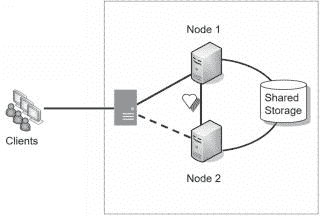

考虑图 9.1，它显示了一个双节点的主备备用故障转移集群。两个节点都是独立的服务器，它们都可以访问活动服务器使用的外部数据存储器。此外，两个节点之间有一个监控连接，用于检查彼此的健康状况或心跳。

图 9.1: 故障转移集群

假设`Node 1`是活动节点。当任何客户端连接时，集群软件（安装在两个节点上）会确保客户端连接到活动节点。如果`Node 1`故障，`Node 2`通过心跳连接感知到故障并将自己配置为活动节点。由于两个节点都可以访问共享存储器，客户端不会丢失数据。客户端可能会注意到到瞬间的卡顿或暂停，但服务会继续运行。

你可能会注意到图 9.1 中的共享存储代表了单点故障。这种存储通常是一个健壮的`RAID-10`，并不罕见。这确保了即使共享存储中的一个硬盘故障，服务也将继续运行。此外，如果两个节点都插在同一个电网上，电源就代表了单点故障。它们可以各自由独立的`UPS`保护，并使用独立的电网。

还可以将集群配置为主主式集群。不是由一个服务器处于空闲，而是集群在两个服务器之间平衡负载。

集群配置可以包含远多于两个节点。然而，节点需要具有近乎相同的硬件且通常非常昂贵，但如果一家公司确实需要实现 99.999% 的运行时间，这种支出是值得的。

### 用于高可用性的负载均衡器

负载均衡器可以优化并分配数据负载到多个计算机或多个网络。例如，如果一个组织托管热门网站，它可以在 Web 池中使用多个服务器托管同一个网站。负载均衡软件在 Web 池中的所有服务器之间平均分配流量，这些服务器通常位于`DMZ`。

“负载均衡器”这个词听起来像是一个硬件设备，但负载均衡器可以是硬件也可以是软件。硬件负载均衡器接收流量并根据处理器利用率和到服务器的当前连接数等因素将其引导至服务器。软件负载均衡器使用运行在负载均衡集群每台服务器上的软件来平衡负载。负载均衡主要提供可扩展性，但它对高可用性也有贡献。可扩展性是指服务在不降低性能的情况下服务更多客户端的能力。可用性确保系统在需要时处于启动和运行状态。通过在多个系统之间分散负载，确保了单个系统不会过载，从而提高整体可用性。

考虑一个每分钟可以服务 100 个客户端的 Web 服务器，但如果有超过 100 个客户端同时连接，性能就会下降。你需要向上扩展（scale up）或水平扩展（scale out）来服务更多客户端。你通过添加额外资源（如处理器和内存）来向上扩展，通过在负载均衡器中添加额外的服务器来水平扩展。

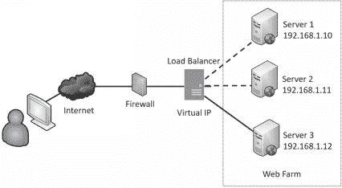

图 9.2 显示了在 Web 池中配置多个 Web 服务器的负载均衡器示例。每个 Web 服务器都包含相同的 Web 应用程序。负载均衡器使用调度技术来决定将新请求发送到哪里。某些负载均衡器以轮询方式将新请求发送到服务器。负载均衡器将第一个请求发送到`Server 1`，第二个请求发送到`Server 2`，依此类推。其他负载均衡器会自动检测单个服务器的负载并将新客户端发送到使用最少的服务器。

图 9.2: 负载均衡

一些负载均衡器使用源地址亲和性来引导请求。源亲和性根据请求者的 IP 地址将请求发送到同一服务器。例如，想象 Homer 发送了一个请求来获取网页。负载均衡器记录了他的 IP 地址并将其请求发送到`Server 3`。当他再次发送另一个请求时，负载均衡器会识别他的 IP 地址并再次将其请求发送到`Server 3`。源亲和性在用户会话期间可以有效地将用户固定在特定的服务器上。

基于软件的负载均衡器使用虚拟 IP。例如，假设网站的 IP 地址为`72.52.206.134`。这个 IP 地址并没有分配给特定的服务器。相反，客户端向此 IP 地址发送请求，负载均衡软件使用它们的私有 IP 地址将请求重定向到 Web 农场中三台服务器之一。在这种情况下，实际的 IP 地址被称为虚拟 IP。

许多负载均衡器的另一个优势是它们可以检测服务器何时故障。如果某个服务器停止响应，负载均衡软件将不再将客户端发送到该服务器。这有助于负载均衡器的整体高可用性。

## 记住这一点

故障转移集群是服务器冗余的一种方法，它们为服务器提供了高可用性。它们可以消除服务器作为单点故障的。负载均衡通过在多个服务器之间分担负载，增加了服务的整体处理能力。配置可以是主备式的，也可以是主主式的。调度方法包括轮询算法和源 IP 地址亲和性。源 IP 地址亲和性调度确保客户端在整个会话期间被重定向到同一台服务器。

### 集群与负载均衡

值得提到的是，CompTIA 在目标中将集群和负载均衡都归类在负载均衡的同一个类别中。许多 IT 专业人士做的是相同的工作，尽管从技术上讲，它们是不同的概念。通常，故障转移集群常用于数据库应用程序等应用。负载均衡器通常用于服务，例如 Web 农场中的 Web 服务器。

## 电源冗余

在审查冗余时，电力是一个需要考虑的关键公用事业。对于任务关键系统，您可以使用不间断电源（`UPS`）和发电机来提供容错能力和高可用性。`UPS`为电源提供容错能力并能防止电压波动。它提供短期电力。发电机在长时间停电期间提供长期电力。

# 使用备份保护数据

备份是为了确保在原始数据丢失或损坏时可以恢复而创建的数据副本。也许我应该重申一下：备份是为了确保当原始数据丢失或损坏时，可以进行恢复而创建的数据副本。事实是，如果你接触计算机的时间足够长，你终会丢失数据。重大灾难和轻微不便之间的区别在于是否存在可用的备份。

### 一个备份的恐怖故事（侧边栏）

我的朋友曾是一家小企业的顾问，曾经被聘请帮助一位小企业主恢复一些丢失的数据。该所有主已经经营了大约五年业务，在一个系统中拥有了几乎与其业务相关的所有内容（客户列表、账单信息、建议书、协议等）。系统崩溃了。

顾问试图从磁盘中恢复信息，但没有成功。企业主恐慌了，因为他只是急需这些信息。如果无法找回数据，他的业务可能会破产。

尽管费用昂贵，但可以由无净室设施拆解硬盘并在位级上读取数据，以恢复至少部分数据。此时，该所有主愿意尝试任何方法，因此他支付了高昂的价格并将磁盘送到了恢复设施。不幸的是，硬盘遭遇了灾难性故障，即使在无净室里，他们也无法检索到任何有意义的数据。

我的朋友去所有主那里传达坏消息。他说当他离开时，所有主双手抱头，字面上面上在哭泣。他建立了五年的事业几乎毁于一旦，没有太大恢复的机会。

这个故事最糟糕的部分是，它在许多不同环境中许多不同的人身上反复发生。有太多的人在丢失数据之前没有意识到备份的重要性。不幸的是，那时已经太晚了。

必须意识到冗余和备份不是一回事。使用`RAID-1`或`RAID-10`保护数据并不能消除对备份的需求。如果火灾毁了服务器，它也会毁掉`RAID`中的数据。如果没有备份，所有数据都消失了。永远消失。

## 比较备份类型

备份工具支持几种不同类型的备份。尽管第三方备份程序在功能和实现上可能非常复杂，但您应该对基础知识有充分的理解。

备份最常用的介质是磁带。磁带存储的数据更多，而且比其他介质便宜，尽管某些组织使用硬盘进行备份。然而，介质类型并不影响备份类型。

以下是常用的备份类型：

* **全量备份**：全量备份（或普通备份）备份所有选定的数据。
* **差异备份**：备份自上一次全量备份以来所有发生变化或不同的数据。
* **增量备份**：备份自上一次全量备份或增量备份以来所有发生变化的数据。
* **快照**：快照备份捕捉某一时间点的数据。它有时被称为镜像备份。

### 全量备份

全量备份备份备份中指定的所有数据。例如，你可以在`D:`盘上有几个文件夹。如果你在备份程序中指定了这些文件夹，备份程序就会备份这些文件夹中的所有数据。

虽然每天进行全量备份是可行的，但在大多数生产环境中非常罕见。这是由于两个限制性因素：

* **时间**：全量备份可能需要几个小时才能完成，并可能干扰操作。然而，管理员并不总是拥有无限的时间来执行备份和其他系统维护。例如，如果系统 24/7 在线运行，管理员可能需要将全量备份的时间限制在周日凌晨，以最大限度地减少对用户的影响。
* **金钱**：备份需要存储在某些介质上，例如磁带或硬盘。每天执行全量备份需要更多介质，成本可能令人生负担。相反，组织通常将全量备份与差异备份或增量备份结合。

然而，每种备份策略必须从全量备份开始。

### 恢复全量备份

全量备份是最容易恢复最快的。你只需要恢复单个全量备份即可。如果你将备份存储在磁带上，你只需要恢复一个磁带。然而，大多数组织需要在时间和金之间平衡，使用全量/差异或全量/增量的备份策略。

### 差异备份

差异备份策略从全量备份开始。全量备份之后，差异备份备份自上一次全量备份以来发生变化或不同的数据。

例如，全量/差异备份策略可以从周日晚上的全量备份开始。在周一晚上，差异备份将备份自周日上次全量备份以来更改的所有文件。在周二晚上，差异备份将再次备份自上一次全量备份以来更改的所有文件。此过程一直持续到周日，届时另一个全量备份将启动该过程。随着一周的进行，差异备份的大小会逐渐增长。

### 全量/差异备份集的还原顺序

假设每份备份都存储在不同的磁带上。如果系统在周三早晨发生崩溃，你需要多少张磁带来恢复数据？

答案是两张。你首先需要恢复周日的全量备份。由于周二晚上的差异备份包含了上次全量备份之后更改的所有文件，因此你只需要还原该磁带，即可恢复直到周二晚上的所有更改。

### 增量备份

增量备份策略同样从全量备份开始。全量备份之后，增量备份会备份自上次备份以来更改的数据。这包括上一次的全量备份或上一次的增量备份。

例如，全量/增量备份策略可以从周日晚上的全量备份开始。在周一晚上，增量备份将备份自周日全量备份以来更改的所有文件。在周二晚上，增量备份将备份自周一晚上增量备份以来更改的所有文件。同样地，周三晚上的备份将备份自周二晚上上次增量备份以来更改的所有文件。此过程一直持续到周日，届时另一个全量备份将再次启动该过程。随着一周的进行，增量备份的大小保持不变。

### 全量/增量备份集的还原顺序


假设每份备份都存储在不同的磁带上。如果系统在周四早晨发生崩溃，你需要多少张磁带来恢复数据？

答案是四张。你首先需要恢复周日的全量备份。由于增量备份在每周的每天备份的是不同的数据，因此必须还原每份增量备份——并且必须按时间顺序顺序进行还原。

有时，人们误认为最后一次增量备份包含所有相关数据。虽然它可能包含某些相关数据，但并不包含全部。

例如，想象你每周的每天都处理一个项目文件，而系统在周四早晨发生崩溃。在这种情况下，最后一次增量备份将拥有该文件的最新副本。然而，如果你每周一都编译一份报告，但在下周一之前不再触碰它，那么只有周一的增量备份会包含最新副本。周三晚上或本周其他其他增量备份将不会包含该报告。

**记住这一点**

如果你有无限的时间和资金，仅全量备份就能提供最快的恢复速度。全量/增量策略减少了执行备份所需的时间。全量/差异策略减少了还原备份所需的时间。

## 选择全量/增量还是全量/差异

一个逻辑问题是：“为什么备份有这么多选择？”答案是不同的组织有不同的需求。例如，想象两个组织都进行每日备份以尽可能的减少损失。它们在周日都进行全量备份，但现在正试图确定它们应该使用全量/增量策略还是全量/差异策略。

第一家机构没有太多时间在周内进行维护。在这种情况下，备份管理员需要尽可能减少在周内完成备份所需的时间。增量备份仅备份自上次备份以来更改的数据。换句话说，它只包含单日的更改。相比之下，差异备份包含了自上次全量备份以来的所有更改。备份单日更改所需的时间比备份多日更改的时间短，因此全量/增量备份是最佳选择。

在第二家机构，故障系统的恢复更为重要。如果故障需要还原数据，他们希望尽可能减少还原数据所需的时间。在这种情况下，全量/差异备份是最佳选择，因为它只需要还原两份备份（全量和最新的差异备份）。相比之下，全量/增量备份根据发生的时间可能需要还原多份备份。

## 快照备份

快照备份捕捉某一时刻的数据。它通常用于虚拟机，有时被称为检查点。第一章“掌握安全基础”讨论了虚拟机（`VM`），管理员通常在进行风险操作前对 `VM` 进行快照。如果更新引起了问题，很快可以将 `VM` 回滚到之前的状态。

## 测试备份

我听过很多恐怖故事，人员定期进行备份并认为一切正常。最终发生了某些事情，他们需要还原数据。遗憾的是，他们发现备份全部无效。人们一直在执行流程，但流程存在缺陷。

验证备份的唯一方法是进行测试还原。测试还原无非从备份恢复数据并验证其完整性。如果你想验证是否可以还原整个备份，请执行全量还原。如果你想验证是否可以还原单个文件，请执行单个文件的测试还原。通常会将数据还原到原始位置之外的其他位置，以便你验证数据。

举一个简单的例子，管理员可以提取一个随机备份并尝试进行还原。这种测试有两种可能的结果，两种都是好的：

- 测试成功。太棒了！你知道备份流程是有效的。你不确定每张备份磁带都是有效的，但至少你知道流程是可靠的，且至少某些备份有效。

- 测试失败。太棒了！你知道存在问题，可以在危机发生前修复它。

定期进行测试还原的额外好处是它让管理员熟悉熟悉流程。他们第一次尝试还原不应该是在危机中，还有几位高层管理人员在旁边盯着。

# 销毁

当备份不再需要时，应对其进行销毁。可以通过对介质进行消磁、粉碎或燃烧，或者通过在介质上反复写入不同模式的 `1s` 和 `0s` 来清除介质来实现。

## 备份与地理因素

组织通常会制定备份策略来回答与备份相关的关键问题。备份策略是一份书面文档，通常会识别此类问题，例如备份哪些数据、备份频率、如何测试备份以及备份保留多久。

此外，处理特殊的地理因素也是非常重要的，例如：

- **异地备份**：备份的副本应存储在不同的地理位置。这可以防止如火灾或洪水等灾难的发生。即使灾难摧毁了现场，组织仍拥有另一份关键数据的副本。

- **距离**：许多组织对主站点与异地地点之间的距离有特定要求。在某些情况下，目标是让异地地点相对较近，以便于检索备份。但在其他情况下，异地地点必须很远，例如 25 英里或更远。

- **位置选择**：位置通常取决于环境问题。例如，考虑一家位于加利福尼亚州圣安德亚斯断层附近的组织。异地备份位置应该足够远，以至于主站点的地震不会影响异地位置。

- **法律影响**：与备份相关的法律影响取决于备份中存储的数据。例如，如果备份包含个人身份信息（`PII`）或受保护的健康信息（`PHI`），则需要根据相关法律对备份进行保护。

- **数据主权**：数据主权是指数据异地存储时的法律影响。如果备份存储在另一个国家，它们受该国法律的。如果备份存储在云端位置，且云服务器位于另一个国家，这可能会引起关注。例如，想象一家位于美国的组织。它定期进行备份并存储在云提供商处。该云提供商在美国有一些服务器，在加拿大有一些，在墨西哥也有。如果组织的备份存储在其他国家，它可能会受到额外的法律法规的约束。

### 记住这些

恢复测试是测试公司备份数据完整性的最佳方法。备份介质受保护的程度应与备份数据相同。备份的地理因素包括异地存储备份、选择最佳位置以及考虑法律影响和数据主权。

# 比较业务连续性要素

业务连续性计划有助于组织预测并计划关键服务或功能的潜在中断。其目标是确保关键业务运营继续，并使组织能够存活中断。组织通常会制定业务连续性计划（`BCP`）。该计划包含了灾难恢复要素，这些要素提供了中断后将关键功能恢复到运行的步骤。

灾难和中断可能来自许多来源，包括：

- 火灾

- 攻击

- 停电

- 任何原因的数据丢失

- 硬件和软件故障

- 自然灾害，如飓风、洪水、龙卷风和地震

处理所有这些可能的来源需要大量的时间和精力。目标是预测相关的灾难及其影响，然后开发恢复策略来减轻这些影响。组织完成的第一工作之一是业务影响分析。

## 业务影响分析概念

业务影响分析（`BIA`）是 `BCP` 的重要部分。它帮助组织识别对组织成功至关重要的关键系统和组件。这些关键系统支持任务关键功能。`BIA` 还有助于识别易影响的业务流程。这些是支持任务关键功能的流程。

例如，想象一个组织拥有在线电子商务业务。一些基础的任务关键功能可能包括提供网页、提供购物车路径、接受购买、发送电子邮件确认以及向客户发货。单是购物车路径本身就是一个业务流程，因为它对电子商务销售的任务至关重要，管理层可能会将其视为需要保护的易影响业务流程。客户需要能够查看产品、选择产品、输入客户信息、输入信用卡数据并完成购买。支持网站的某些关键系统是 Web 服务器和托管在一个或多个数据库服务器上的后端数据库应用程序。

如果关键系统和组件故障且无法快速恢复，任务关键功能将无法完成。如果这种情况持续时间过长，组织很可能无法在灾难中生存。

例如，如果发生飓风等灾难，组织必须恢复哪些服务才能维持业务？想象一家金融机构。它可能决定客户必须通过在线网站无间断地访问账户数据。如果客户无法在线访问其资金，他们可能会对公司失去信任并大量流失。

然而，公司可能决定在业务的其他要素中实施替代业务实践。例如，管理层可能决定，在灾难期间接受和处理贷款申请并不重要到需要继续进行。贷款处理对公司的利润仍然很重要，但延迟不会严重影响其维持业务的能力。在这种情况下，持续的在线访问是一项任务关键功能，但在灾难期间处理贷款申请并非任务关键功能。

做出这些决策的时间不是在危机期间。相反，组织会提前完成 `BIA`。`BIA` 涉及收集整个组织的信息并记录结果。这些文档识别了核心业务或任务需求。`BIA` 不提供解决方案，但它为管理层提供了有价值的信息，以便他们关注关键业务功能。它可以帮助他们解决以下问题：

- 关键系统和功能有哪些？

- 这些关键系统和功能是否存在依赖关系？

- 这些关键系统和功能的长时间限制是多少？

- 哪些场景最可能影响这些关键系统和功能？

- 这些场景造成的潜在损失是多少？

例如，想象一个组织通过在线销售每小时平均赚 5000 美元。在这种情况下，管理层可能认为在线销售是任务关键功能，所有支持在线销售的系统都是关键系统。这包括 Web 服务器和后端数据库服务器。这些服务器依赖网络基础设施、互联网访问以及用于信用卡支付的支付网关访问。

经过分析，他们可能会确定在线销售的最大允许停机时间为五小时。确定最大停机限制至关重要。它驱动了与恢复目标相关的决策，并帮助组织识别各种应急预案和策略。

### 影响

业务影响分析（`BIA`）评估各种场景，例如火灾、攻击、停电、数据丢失、硬件和软件故障以及自然灾害。此外，`BIA` 试图识别这些场景的影响。

在评估影响时，`BIA` 会考虑多个项目。例如，它可能会尝试回答与任何场景相关的以下问题：

• 灾难会导致人员伤亡吗？是否有方法可以降低人员风险？

• 灾难会导致财产损失吗？

• 灾难会降低人员或财产的安全吗？

• 组织潜在的财务损失是什么？

• 组织的声誉可能面临哪些损失？

例如，数据库服务器可能托管客户数据，包括信用卡信息。如果攻击者能够访问这些客户数据，给组织造成的成本可能超过数百万美元。

你可能还记得 2013 年 11 月和 12 月针对零售巨头 Target 的攻击。攻击者访问了超过 1.1 亿名客户的数据，导致 Target 遭受了巨大损失。据估计，该事件的总成本从 6 亿美元到 10 亿美元不等。这包括销售损失——与去年相比，Target 在 2013 年第四季度的利润下降了 46%。客户害怕在 Target 使用信用卡，干脆避之不及。这还包括修复形象的成本、为受影响客户购买信用监控的成本、支付卡行业的罚款以及数不胜数的法律诉讼。据报道，Target 拥有 1 亿美元的网络网络险，这帮助他们支付了与数据泄露相关的索赔。

**记住这一点**

`BIA` 识别了对组织成功至关重要的核心功能和关键系统。它还识别了这些系统和组件的最大停机限制、影响这些系统和组件的各种场景，以及事件可能导致的潜在损失。

### 隐私影响和阈值评估

组织在完成 `BIA` 时可以使用两种工具：隐私阈值评估和隐私影响评估。美国国家标准与技术研究院（`NIST`）的特别出版（`SP`）800-122 报告《保护个人身份信息（`PII`）机密性指南》对这些进行了更深入的介绍，但将隐私阈值评估称为隐私阈值分析。

隐私阈值评估的主要目的是帮助组织识别系统中的 `PII`。通常，阈值评估由系统所有者或数据所有者通过回答简单的问卷完成。

如果系统持有 `PII`，那么下一步是进行隐私影响评估。影响评估试图通过审查信息的处理方式来识别与 `PII` 相关的潜在风险。其目标是确保系统符合相关的法律、法规和指南。影响评估提供了一种主动方法，在计算机系统的整个生命周期内处理与 `PII` 相关的潜在风险。

**记住这一点**

隐私阈值评估通常是系统或数据所有者完成的一份简单问卷。它帮助识别系统处理的数据是否超过 `PII` 的阈值。如果系统处理 `PII`，隐私影响评估有助于识别并减少与 `PII` 潜在丢失相关的风险。

### 恢复时间目标

恢复时间目标（`RTO`）确定了停机后恢复系统所需的最大时间。许多 `BIA` 为核心功能和关键系统确定了最大允许停机时间或最大容忍停机时间。如果停机时间超过这一最大时间，对组织来说是不可接受的。

例如，想象一家通过网站销售产品的组织，每小时产生 10,000 美元的收入。它可能决定 Web 服务器的最大允许停机时间为五分钟。这导致了五分钟的 `RTO`，意味着任何停机必须限制在五分钟以内。这五分钟的 `RTO` 仅适用于在线销售的核心功能以及支持它的关键系统。

想象该组织有一个仅供内部员工使用的数据库服务器，而不用于在线销售。虽然数据库服务器可能有价值，但它并不是关键的。管理层可能决定他们接受长达 24 小时的停机，导致 `RTO` 小于 24 小时。

### 恢复点目标

恢复点目标（`RPO`）确定了一个可以接受数据丢失的时间点。例如，某个服务器可能托管归档数据，每周变化很少。管理层可能认为某些数据丢失是可以接受的，但他们始终希望能够从至少上周恢复数据。在这种情况下，`RPO` 为一周。

有了一周的 `RPO`，管理员将确保他们至少有每周一次的备份。在发生故障时，他们能够恢复最近的备份并满足 `RPO`。

在某些情况下，`RPO` 精确到发生发生时的分钟。例如，记录客户交易的在线数据库的任何数据丢失都可能是不可接受的。在这种情况下，组织可以使用各种技术确保管理员可以恢复到故障发生的那一刻的数据。

**记住这一点**

恢复时间目标（`RTO`）确定了停机后恢复系统应花费的最大时间。它源于 `BIA` 中确定的最大允许停机时间。恢复点目标（`RPO`）指的是你能够承受的数据丢失量。

### 比较 MTBF 和 MTTR

在进行 `BIA` 时，专家通常尝试预测故障发生的可能性。例如，`RAID` 配置中的硬盘发生故障的概率是多少？以下两个术语常用于预测潜在故障：

• 平均故障间隔时间（`MTBF`）。平均故障间隔时间（`MTBF`）提供了系统可靠性的衡量，通常以小时为单位。更具体地说，`MTBF` 确定了两次故障之间的平均时间（算术平均值）。`MTBF` 数字越高，表示产品或系统的可靠性越高。管理员和安全专家试图识别关键系统的 `MTBF`，旨在预测潜在的停机。

• 平均恢复时间（`MTTR`）。平均恢复时间（`MTTR`）确定了恢复故障系统所需的平均时间（算术平均值）。在某些情况下，人们将 `MTTR` 解释为平均修复时间，两者本质上是相同的意思。拥有维护合同的组织通常会将 `MTTR` 作为合同的一部分进行规定。供应商同意其平均将在 `MTTR` 时间内恢复故障系统。`MTTR` 并不保证每次都会在 `MTTR` 时间内恢复系统。有时可能需要更长一点的时间，有时可能快一点点，而平均值由 `MTTR` 定义。

## 业务连续性计划

业务连续性规划侧重于在发生关键故障后，在恢复站点恢复任务关键功能。例如，如果飓风或其他灾难导致公司无法在主位置运行，该组织可以在管理层之前确定的为恢复点的备用位置继续运行任务关键功能。故障（`Failover`）是将任务关键功能转移到备用站点的过程。

## 恢复站点

恢复站点是组织在灾难后可以使用的备用处理场所。三种主要的恢复站点类型是热备（`hot sites`）、冷备（`cold sites`）和温备（`warm sites`）。这些备用位置可以是大楼内的办公空间、整栋建筑，甚至一组建筑。另外两种类型的恢复站点是移动站点（`mobile sites`）和镜像站点（`mirrored sites`）。以下章节提供了有关这些站点的更多细节。

### 热站点

热备站每天 24 小时、每周 7 天运行，能够在主站点故障后迅速接管主站点的功能。它将包含主站点的所有设备、软件和通信能力，并且所有数据都是最新的。在很多情况下，备份磁带副本存储在热备站点作为异地存储。

在很多情况下，热站点是另一个活跃的业务地点，具备在灾难期间承担运营的能力。例如，一家金融机构可以在两个不同的城市拥有地点。第二个地点提供非关键支持服务，但也包含了接管第一个地点功能所需的所有资源。

对热站点的一些定义指出它们可以瞬时接管，尽管这一致。在大多数情况下，将业务转移到热备站点需要一些时间，这可能从几分钟到一小时不等。

显然，对于高可用性需求，热站点是最有效的灾难恢复解决方案。如果一个组织必须保留具有高可用性要求的关键系统，热站点是最佳选择。然而，热站点的维护和数据更新成本最高。

**记住这一点**

热备站点包含了主站点的人员、设备、软件和通信能力，且所有数据都是最新的。与温备和冷备相比，热站点提供的恢复时间最短。它是最有效的灾难恢复解决方案，但维护也最昂贵。

### 冷站点

冷站点需要电力和连接，但不需要其他东西。通常情况下，只要它有屋顶、电力、自来水和互联网访问，就可以使用了。组织在激活站点时，会将所有设备、软件和数据带到现场。

我经常在当地的陆军基地散狗，偶尔会看到士兵激活冷站点的极端例子。在大多数周末，那些空地是空的。在其他周末，士兵会将一个或多个田地转变为功能完运营站点，配备帐篷、天线、电缆、发电机和移动厕所。

由于军队在基地上有几栋建筑，他们不需要在大田野中间运行，但他们实际上是在测试自己在随意地点建立冷站点的能力。如果他们可以在野外做到，他们就可以在沙漠中心或任何他们需要的地方做到。

冷站点的维护最便宜，但也最难测试。

### 温站点

你可以将温备站点想象成“金发姑娘”解决方案——既不热也不冷，而是恰好。对于大多数组织来说，热站点通常太贵了，而冷站点配置完全运行所需有时太长。然而，温备站点提供了一个组织可以根据其需求定制的折中方案。

例如，组织可以在温备站点位置放置所有必要的硬件，但但不包含最新数据。如果发生灾难，组织可以将数据复制到温备站点并接管运营。这只是一个例子，但温备站点的配置有许多可能性。

### 站点变体

虽然热、冷、温站点是最常见的，但你可能还会遇到两种备用站点类型：移动和镜像。

移动站点是一个自成一体的可运输单元，配备了特定需求的所有设备。例如，你可以为一辆半挂车配备运营所需的所有设备，包括用于连接的卫星天线。卡车、火车或船只将其运往目的地，它只需要电力即可运行。

镜像站点与主位置完全相同，并提供 100% 的可用性。它们使用实时传输将修改从主位置发送到镜像站点。虽然热站点可以在一小时内启动并运行，但镜像站点始终处于启动运行状态。

## 恢复顺序

灾难过去后，你将希望将所有功能返回主站点。作为最佳实践，组织首先将最不关键的功能返回主站点。记住，关键功能在备用站点运行，并可以根据需要一直留在那里。如果一个站点刚刚经历过灾难，很可能仍然存在一些未知问题。通过先移动最不关键的功能，未发现的问题将会出现并可以得到解决，而不会显著影响任务关键功能。

**记住这一点**

冷站点将拥有恢复站点所需的电力连接，但几乎没有其他。冷站点最便宜且最难测试。温站点是热站点和冷站点之间的折中。移动站点没有固定位置，但可以在灾难期间提供临时支持。

## 灾难恢复

灾难恢复是整体业务连续计划的一部分。通常，组织将使用业务影响分析来识别关键系统和组件，然后制定灾难恢复策略和灾难恢复计划（`DRPs`）来处理托管这些功能的系统。

在某些情况下，组织会在业务连续性计划（`BCP`）中包含多个 `DRP`，在其他情况下，组织将有一个 `DRP`。例如，可能拥有单独 `DRP` 来识别恢复单个关键服务器的步骤，以及其他 `DRP` 来详细说明在发生飓风或龙卷风等不同类型灾难后的恢复步骤。较小的组织可能只有一个 `DRP`，简单地识别出用于响应任何中断的所有步骤。

一个 `DRP` 或 `BCP` 将包含一个关键系统的分级列表。该列表确定了在灾难后恢复哪些系统以及按什么顺序恢复。例如，托管在线网站的服务器应该先恢复，还是托管内部应用程序的服务器？答案取决于组织如何评估和使用这些服务器。在某些情况下，系统之间存在依赖关系，要求按特定顺序恢复系统。


如果`DRP`（灾恢复计划）没有对系统进行优先级排序，恢复系统的个人将根据自己的判断，这可能不符合组织的整体需求。例如，新人`Nicky New Guy`可能没有意识到一个`Web`服务器每小时产生 5,000 美元的收入，但他知道自己负责维护一个通用文件服务器的运行。在没有关键系统有序列表的情况下，他可能会花时间恢复文件服务器，而不是`Web`服务器。

这种分级列表在使用如热备用（`warm sites`）或冷备用（`cold sites`）等备用站点时也很有价值。当组织需要将业务迁移到备用站点时，组织会希望首先恢复最重要的系统和功能。

同样，`DRP`通常会对停机发生后需要恢复的服务进行优先级排序。根据原则，关键业务功能和安全服务优先恢复。支持性服务最后恢复。

灾恢复过程的不同阶段通常包括以下步骤：

- **激活灾难恢复计划**：某些灾难（如地震或龙卷风）在没有太多预警的情况下发生，灾恢复计划在灾难发生后激活。其他灾难（如飓风）会提供预警，计划在灾难临近时激活。

- **实施应急措施**：如果恢复计划需要实施备用站点，则会将关键功能迁移到这些站点。如果灾难摧毁了现场备份，此步骤将从异地位置提取异地备份。

- **恢复关键系统**：灾难过去后，组织开始恢复关键系统。`DRP`文档记录了要恢复哪些系统，并包含了如何恢复它们的详细步骤。这还包括审查变更管理文档，以确保恢复的系统包含已批准的变更。

- **测试恢复的系统**：在将系统上线之前，管理员会对其进行测试和验证。这可能包括将恢复的系统与性能基准进行比较以验证功能。

- **行动后报告**：灾恢复的最后阶段包括对灾难进行回顾，有时称为行动后回顾。这通常包括经验教训回顾，以识别哪些工作是正确的，哪些是错误的。在审查行动后报告之后，组织通常会更新计划以纳入任何经验教训。

### 记住这一点

灾难恢复计划（`DRP`）包含关键系统的分级列表，并通常会对停机后需要恢复的服务进行优先级排序。测试验证了计划的有效性。灾恢复的最后阶段包括一项回顾，以识别任何经验教训，并可能包括计划的更新。

## 通过练习测试计划

业务连续性计划（`BCP`）和灾恢复计划（`DRP`）包含了测试。测试验证了计划是否按预期运行，并且通常包括对冗余和备份的测试。`BCPs`和`DRPs`使用了几种不同类型的测试。

`NIST SP 800-34`《IT计划和能力测试、培训和演练指南》为测试`BCP`和`DRP`计划提供了详细指导。`SP 800-34`识别了两种主要的演练类型：桌面演练（`tabletop exercises`）和功能演练（`functional exercises`）。

桌面演练（也称为桌面演练或结构化走读流程）是基于讨论的。协调员在教室或会议室聚集参与者，并引导他们走过一个或多个场景。当协调员引入事件的每个阶段时，参与者根据计划确定他们将要做什么。这引发了关于团队成员角色、职责以及事件期间决策过程的讨论。理想情况下，这验证了计划的有效性。然而，它有时会暴露缺陷。`BCP`协调员确保在时重新编写计划。

功能演练为人员提供了在模拟操作环境中测试计划的机会。功能演练种类广泛，从简单的模拟到全方位的测试。在模拟中，参与者以受控的方式执行各个步骤，而不影响实际系统。例如，模拟可以从指示服务器故障开始。然后参与者按照步骤在测试系统上重建服务器。全方位测试则涵盖计划的所有步骤。除了验证测试是否有效外，它还显示了执行计划所需的时间。

测试的一些常见元素包括：

- **备份**：通过恢复备份来测试备份，正如前文“备份”部分所述。

- **服务器恢复**：物理安全控制通过恢复系统进行测试。参与者按照步骤在测试系统上重建服务器。

- **服务器冗余**：如果服务器位于集群中，可以通过使主节点离线来测试集群。集群中的另一个节点应接管离线节点。

- **备用站点**：你可以测试备用站点（热、冷或温）的各个元素，例如互联网连接或获取和恢复备份介质的能力。

### 记住这一点

可以通过测试来验证业务连续性计划。桌面演练仅基于讨论，通常在教室环境中进行。功能演练是实操性的。

# 第 9 章考试主题回顾

在准备考试时，确保你理解本章涵盖的核心概念。

### 实施深度防御

- 分层安全（或深度防御）采用多层安全来防御威胁。人员不断监控、更新、增加和改进安全控制。

- 控制多样性是指使用不同类型的控制，例如技术控制、管理控制和物理控制。

- 供应商多样性是通过实施不同供应商的安全控制来增加安全性。

### 比较物理安全控制

- 物理安全控制是可以触碰的控制。它们通常控制出入口，并包括各种类型的锁。

- 空隙隔离是一种物理安全控制，确保计算机或网络与另一个计算机或网络物理隔离。

- 受控区域（如数据中心和服务器房）应只有一个出入口。门锁类型包括密码锁、感应卡和生物识别。

- 感应卡可以电子解锁门，并有助于防止未经授权的人员进入安全区域。单凭感应卡无法识别和验证用户。某些系统将感应卡与`PIN`结合用于身份验证。

- 跟尾是指一个用户紧跟在另一个用户后面而不使用凭证的情况。防撞门（`mantrap`）可以防止跟尾。

- 安保人员是一种预防性物理安全控制，他们可以防止未经授权的人员进入安全区域。安保人员的优点是他们可以识别人员并对不熟悉的人员检查身份证。

- 摄像头和闭路电视（`CCTV`）系统提供视频监控。它们为人员的身份和活动提供了可靠的证据。

- 围栏、照明和报警器通常与运动检测系统结合用于物理安全。红外运动检测系统根据温度检测人类活动。

- 路障（`Barricades`）比围栏提供更强的物理安全性，并试图威慑攻击者。柱（`Bollards`）是有效的路障，允许人员通过但阻止车辆通过。

- 缆锁用于保护实验室中的笔记本电脑等移动计算机。服务器机柜包含服务器房内的锁闭机柜或机箱。小型设备可以存储在保险箱或锁好的办公柜中，以防止未使用资源被盗。

- 资产管理流程可以防止与架构和设计缺陷、系统蔓延以及未记录资产相关的漏洞。

- 暖、通风和空调（`HVAC`）系统控制数据中心和服务器房的气流。温度控制保护系统免受过热导致的损坏。

- 热道和冷道为数据中心内的系统提供更高效的冷却。

- 电磁干扰（`EMI`）屏蔽可以防止来自荧光灯灯具等`EMI`源的问题。它还能防止双绞电缆中的数据丢失。法拉笼可以防止信号扩散到房间或机箱之外。

## 添加冗余与容错性

- 单点故障（`Single point of failure`）是指任何一旦发生就会导致整个系统故障的组件。

- `RAID`磁盘子系统提供容错性并增加可用性。`RAID-1`（镜像）使用两块磁盘。`RAID-5`使用三个或更多磁盘，可以承受一块磁盘的故障。`RAID-6`和`RAID-10`使用四块更多磁盘，可以承受两块磁盘的故障。

- 负载均衡器将处理负载分散到多个服务器上。在主主（`active-active`）配置中，所有服务器都积极处理请求。在主备（`active-passive`）配置中，至少有一个服务器处于激活状态，而是监控活动并准备接管故障服务器。基于软件的负载均衡器使用虚拟`IP`。

- 亲和性调度（`Affinity scheduling`）根据客户端的`IP`地址将请求发送到相同的服务器。这在客户端需要在整个在线会话期间访问同一服务器时非常有用。轮询调度（`Round-robin scheduling`）按照预定义的顺序将请求发送到服务器。

## 使用备份保护数据

- 备份策略包括全量、全量/差异、全量/增量和快照备份策略。仅全量备份策略即可实现最快的恢复时间。

- 全量/增量备份策略可以最大限度地缩短执行每日备份所需。

- 测试恢复（`Test restores`）可以验证备份的完整性。全量备份的测试恢复可以验证备份是否可以完整恢复。

- 备份应标记标签以识别内容。备份的副本应保存在异地。

- 考虑主站点与异地地点之间的距离非常重要。

- 备份包含的数据可能具有法律影响。如果包含个人身份信息（`PII`）或受保护健康信息（`PHI`），则必须根据相关法律进行保护。

- 数据备份的位置影响数据主权。如果备份存储在不同的国家，则备份中的数据现在受该国家法律的。

## 比较业务连续性要素

- 业务影响分析（`BIA`）是业务连续计划（`BCP`）的一部分，它识别对组织成功至关重要的关键功能、关键系统和脆弱业务流程。

- `BIA`确定这些系统和组件的最大停机时间。它考虑了影响这些系统和组件的各种场景，以及事件对生命、财产、安全、财务和声誉的影响。

- 隐私阈值评估（`Privacy threshold assessment`）识别系统处理的数据是否超过`PII`的阈值。如果系统处理`PII`，隐私影响评估有助于识别并减少与潜在`PII`丢失相关的风险。

- 恢复时间目标（`RTO`）确定发生故障后恢复系统所需的最大时间。恢复点目标（`RPO`）指的是你可以承受损失的数据量。

- 平均故障间隔时间（`MTBF`）识别故障之间的平均（算术平均值）时间。平均恢复时间（`MTTR`）识别恢复故障系统所需的平均（算术平均值）时间。

- 业务连续性规划识别替代处理站点和替代业务实践。恢复站点在重大灾难后为业务功能提供替代地点。

- 热备（`Hot site`）包含`60`分钟内运行所需的一切。它是最有效的恢复解决方案，也是最贵的。冷备（`Cold site`）具有电力连接连接需求，几乎没有其他。维护成本最低。温备（`Warm sites`）是热备和冷备之间的折中方案。

- 定期测试验证业务连续计划的有效性。演练验证恢复单个系统、激活备站点以及记录计划内其他操作的步骤。桌面演练（`Tabletop exercises`）仅基于讨论。功能性演练（`Functional exercises`）是实操演练。

## 在线参考

- 你知道如何回答基于性能的问题吗？查看`http://gcgapremium.com/501-extras/`的在线附加。

## 第 9 章练习题

1. 在贵组织网络最近遭受攻击后，`CTO`坚持要求`DMZ`使用两个防火墙，且它们购买自不同的公司。以下哪项最准确地描述这种做法？
A. 单层安全
B. 供应商多样化
C. 控制多样化
D. 冗余

2. 贵组织的管理层想创建一个仅供高管使用的小型网络。他们希望确保该网络与主网络完全隔离。以下哪个选项最满足这一需求？
A. 空隙隔离（`Airgap`）
B. 密室（`Mantrap`）
C. 控制多样化
D. 红外运动检测器

3. 一位安全人员报告，进入安全数据中心的尾随（`tailgating`）违规行为有所增加。以下哪项可以防止这种情况？
A. 闭路电视（`CCTV`）
B. 密室（`Mantrap`）
C. `IC`卡
D. 密码锁（`Cipher lock`）

4. Lisa 是贵组织的新首席技术官（`CTO`）。她希望确保关键业务系统免受隔离故障的影响。以下哪项可以让她知道系统发生故障的频率？
A. `MTTR`
B. `MTBF`
C. `RTO`
D. `RPO`

5. 窃贼最近用一辆卡车撞开了贵公司主楼的入口。在混乱期间，他们的同伙偷走了大量的`IT`设备。以下哪个选项可以防止这种情况再次发生？
A. 柱（`Bollards`）
B. 保卫人员
C. 闭路电视（`CCTV`）
D. 密室（`Mantrap`）

6. 你是一家小型组织的技术人员。你需要在业务内部添加容错能力以增加数据的可用性。然而，你需要尽可能降低成本。以下哪项是满足这些需求的最佳选择？
A. 替代处理站点
B. `RAID-10`
C. 备份
D. 法拉笼

7. Flancrest Enterprises 最近建立了一个网站，利用了 Web 农场中的多个 Web 服务器。Web 农场将负载分散在不同的 Web 服务器之间。使用访问者`IP`地址确保客户端在 Web 会话期间始终返回相同的服务器。以下哪项最准确地描述了这种配置？
A. 亲和性（`Affinity`）
B. 轮询（`Round-robin`）
C. 虚拟`IP`
D. 主备（`Active-passive`）

8. 贵组织计划部署一个新的电子商务网站。管理预计后端应用程序有大量的处理需求。当前的设计将使用一个 Web 服务器和多个应用服务器。以下哪项最准确地描述了应用服务器？
A. 负载均衡
B. 集群（`Clustering`）
C. RAID
D. 亲和性调度

## 9. Flancrest Enterprises 最近建立了一个网站，利用 Web 场中的多个 Web 服务器。该 Web 场通过将第一个请求发送到一个服务器，下一个请求发送到第二个服务器，以此此类推，在不同的服务器之间分配负载。以下哪项最能描述这种配置？
A. 亲性 (`Affinity`)
B. 轮询 (`Round-robin`)
C. 物理隔离 (`Airgap`)
D. 人员通道 (`Mantrap`)

## 10. Flancrest Enterprises 最近建立了一个网站，利用 Web 场中的多个 Web 服务器。Web 服务器访问后端数据库。该数据库由配置在两个数据库服务器上的数据库应用程序托管。Web 服务器可以访问任一数据库服务器。以下哪项最能描述数据库服务器的配置？
A. 主备 (`Active-passive`)
B. 轮询 (`Round-robin`)
C. 亲性 (`Affinity`)
D. 主主 (`Active-active`)

## 11. 你的组织决定增加维护的数据数据量，并将其用于目标销售。然而，管理层担心他们需要遵守现有的与`PII`（个人身份信息）相关的法律。应该完成以下哪项来确定客户数据是否为`PII`？
A. 隐私阈值评估 (`Privacy threshold assessment`)
B. 隐私影响评估 (`Privacy impact assessment`)
C. 桌面演练 (`Tabletop exercise`)
D. 亲性调度 (`Affinity scheduling`)

## 12. 你对数据库服务器的备份策略规定执行备份所需的时间应降最低。以下哪种备份计划最能满足这一需求？
A. 周日全备，每周其他六天也进行全备
B. 周日全备，每周其他六天进行差异备份
C. 周日全备，每周其他六天进行增量备份
D. 周日进行差异备份，每周其他六天进行增量备份

#### 13. 你正在帮助实施公司的业务连续性计划。对于某个系统，该计划要求的`RTO`为五小时，`RPO`为一天。以下哪项可以满足这一要求？
A. 确保系统可以在五小时内恢复，并确保数据丢失不超过一天。
B. 确保系统可以在一天内恢复，并确保数据丢失不超过五个小时。
C. 确保系统在故障后五小时到一天之间恢复。
D. 确保关键系统可以在五小时内恢复，非关键系统可以在一天内恢复。

## 14. 一位安全分析师正在创建一份文档，其中包括重大故障导致的预期损失。她正在计算对生命、财产、财务和组织声誉的潜在影响。她最可能正在创建哪份文档？
A. `BCP`（业务连续计划）
B. `BIA`（业务影响分析）
C. `MTBF`（平均故障间隔时间）
D. `RPO`（恢复点目标）

## 15. 你们组织的一位安全专家正在与关键灾难恢复人员召开现场会议。会议的目的是进行测试。以下哪项最能描述这项测试？
A. 功能演练 (`Functional exercise`)
B. 全方位测试 (`Full-blown test`)
C. 桌面演练 (`Tabletop exercise`)
D. 执行计划步骤的模拟 (`Simulation to perform steps of a plan`)

# 第 9 章练习题答案

1. **B**. 首席技术官 (`CTO`) 建议在非军事化区 (`DMZ`) 使用供应商多样性。来自不同公司（供应商）的防火墙提供了供应商多样性。这提供了深度防御或分层安全，而不是单层安全。控制多样性是指使用不同的控制措施，如技术、行政和物理控制。冗余是使用重复组件来实现容错，但这两台防火墙在`DMZ`中是协同工作的。

2. **A**. 物理隔离 (`Airgap`) 确保计算机或网络在物理上与另一个计算机或网络隔离。人员通道 (`Mantrap`) 有助于防止未经授权的进入，并有助于防止尾随。控制多样性是使用不同的控制措施（技术、行政和物理），但它并不意味着隔离网络。红外运动探测器感应红外光的运动，但它们不会隔离网络。

3. **B**. 人员通道对于防止未经授权的进入非常有效，也可用于防止尾随。闭路电视 (`CCTV`) 使用摄像头进行视频监控，可以记录未经授权的进入，但无法阻止。`IC`卡作为访问控制机制很有用，但它无法防止尾随，因此没有人员通道有用。密码锁是一种门禁访问控制，但它无法防止尾随。

4. **B**. 平均故障间隔时间 (`MTBF`) 提供了系统可靠性的衡量，并可以提供系统发生故障的频率估计。平均恢复时间 (`MTTR`) 指恢复系统所需的时间，而不是故障之间的时间。恢复时间目标 (`RTO`) 确定了故障后恢复系统所需的最长时间。恢复点目标 (`RPO`) 确定了可以接受数据丢失的时间点。

5. **A**. 护柱 (`Bollards`) 是有效的屏障，可以阻止车辆。警卫可以限制人员的访问，但无法阻止卡车撞入建筑。闭路电视 (`CCTV`) 或类似的视频监控系统可以监控入口，但它们无法阻止攻击。人员通道防止尾随，但它们很可能无法阻止卡车。

6. **B**. 廉价磁盘冗余阵列 10 (`RAID-10`) 子系统提供了磁盘容错并增加了数据可用性。备用处理站点可能用于任务关键功能，但它的成本高昂，且功能远不止于增加数据可用性。备份有助于确保数据可用性，但对容错没有帮助。迪法拉笼是一个防止信号扩散到房间之外的房间或容器。

7. **A**. 源地址`IP`亲性调度 (`Source address IP affinity scheduling`) 允许负载器在 Web 会话期间将客户端请求重定向到同一台服务器。轮询调度简单地将每个请求发送到下一台服务器。负载均衡可以使用虚拟`IP`，但这指的是 Web 服务器的`IP`地址，而不是访问者的`IP`地址。主备配置 (`Active-passive`) 至少有一台服务器未活动服务客户端，但场景并未指示任何服务器处于备用模式。

8. **A**. 该设计使用负载均衡将负载分散到多个应用程序服务器上。场景表明，目标是因为沉重的处理需求而使用多台服务器，这正是负载均衡的作用。聚类通常用于在某台服务器故障时通过切换到另一台服务器来提供高可用性。`RAID`为磁盘驱动器提供容错，而不是服务器。亲性调度有助于确保客户端在会话期间访问同一服务器，但这与此无关。


## 9. **B**. 轮询调度方案允许负载均衡一个接一个地向服务器发送请求。亲性调度 (`Affinity scheduling`) 根据用户的 IP 地址将用户请求定向到特定服务器，以确保用户在 Web 会话期间访问同一台服务器。物理隔离 (`Airgap`) 确保计算系统之间物理分离，与此问题无关。人员通道 (`Mantrap`) 利用尾随这种社会工程策略防止未经授权的进入。

## 10. **D**. 数据库服务器处于双主活动负载均衡配置中，因为 Web 服务器可以查询两个数据库服务器。在主备式配置中，在任何给定时间，只有一个数据库服务器会响应查询。轮询（`Round-robin`）和亲和性（`Affinity`）是双主活动配置中调度负载均衡的两种方法。

## 11. **A**. 隐私阈值评估有助于组织识别系统内的个人身份信息（`PII`），在这一场景下，它将帮助组织确定客户数据是否为 `PII`。隐私影响评估是在确认系统正在处理 `PII` 之后进行的，而不是为了确定数据是否为 `PII`。桌面演习（`Tabletop exercise`）是一种基于讨论的练习，用于讨论业务连续计划。亲和性调度是一种使用客户端 IP 地址的负载均衡调度方案，与 `PII` 无关。

## 12. **C**. 全量/增量备份策略是最佳选择，即在一天进行一次全量备份，在其他日期进行增量备份。与其他方法相比，增量备份所需的时间较短。每天进行全量备份将消耗最多时间。差异备份随着时间的推移而逐渐增大，且备份时间比增量备份长。备份必须从全量备份开始，因此差异/增量备份策略是不可能的。

## 13. **A**. 恢复时间目标（`RTO`）确定了发生故障后恢复系统所需的最长时间。恢复点目标（`RPO`）指的是你可以承受的数据丢失量。`RTO` 指时间，不指数据。`RPO` 指数据恢复点，而不是恢复系统的时间。

## 14. **B**. 业务影响分析（`BIA`）包含了潜在金钱损失的信息，以及对生命、财产和组织声誉的影响。在列出的文档中，它是最可能包含这些信息的。业务连续性计划（`BCP`）包含 `BIA`，但 `BIA` 比 `BCP` 更可能包含这些信息。平均故障间隔（`MTBF`）提供了系统可靠性的衡量标准。恢复点目标（`RPO`）指的是你可以承受的数据丢失量，但不包括金钱损失。

## 15. **C**. 桌面演习是基于讨论的，通常在教室或会议室进行。由于这是一场包含灾难恢复人员的会议，因此属于桌面演习。功能演习（`Functional exercises`）是实操性练习，包括模拟和全面的测试。

# 第 10 章：理解密码学与 PKI

## 本章涵盖的 CompTIA Security+ 考试目标：

- **1.2 比较和对比攻击类型。**
    - 密码学攻击（降级、弱实现实现）

- **1.6 解释与漏洞类型相关的影响。**
    - 弱加密套件和实现方式、不当的证书和密钥管理

- **2.2 给定场景，使用适当软件工具评估组织的安全态。**
    - 隐写术工具

- **2.3 给定场景，排排除常见安全问题。**
    - 证书问题

- **2.6 给定场景，实施安全协议。**
    - 协议（`S/MIME`）

- **6.1 比较和对比密码学的基本概念。**
    - 对称算法、模式、非对称算法、哈希、盐（`Salt`）、`IV`、随机数（`nonce`）、椭圆曲线、弱/过时算法、密钥交换、数字签名、扩散、混淆、隐写术、混淆、流式与块式、密钥强度、会话密钥、临时密钥、秘密算法、传输中数据、静态数据、使用中数据、随机/伪随机数生成、密钥扩展、实现与算法选择（加密服务提供商、加密模块）、完全前安全性、通过模糊实现安全、常见用例（低功耗设备、低延迟、高可用性）

- **6.2 解释加密算法及其基本特征。**
    - 对称算法（`AES`, `DES`, `3DES`, `RC4`, `Blowfish/Twofish`）、加密模式（`CBC`, `GCM`, `ECB`, `CTM`, 流式与块式）、非对称算法（`RSA`, `DSA`, `Diffie-Hellman` [`Groups`, `DHE`, `ECDHE`],椭圆曲线、`PGP/GPG`）
    - 哈希算法（`MD5`, `SHA`, `HMAC`, `RIPEMD`）
    - 密钥扩展算法（`BCRYPT`, `PBKDF2`）
    - 混淆（`XOR`, `ROT13`, 替换密码）

- **6.4 给定场景，实施公钥基础设施。**
    - 组件（`CA`、中间级 `CA`、`CRL`、`OCSP`、`CSR`、证书、公钥、私钥、对象标识符 [`OID`]）、概念（在线与离线 `CA`、`OCSP` 封送、锁定、信任模型、密钥托管、证书链）
    - 证书类型（通配符、`SAN`、代码签名、自签名、机器/计算机、电子邮件、用户、根、域名验证、扩展验证）
    - 证书格式（`DER`, `PEM`, `PFX`, `CER`, `P12`, `P7B`）

尽管密码学和公钥基础设施（`PKI`）仅占考试分数的 12%，但你可能会发现其中许多主题不像其他主题那样熟悉，你可能需要在这里花费超过 12% 的学习时间。在处理这些主题时，不要忽视基础知识。本章的第一节“介绍密码学概念”概述并总结了这些基础。其他章节将深入探讨哈希、加密和公钥基础设施（`PKI`）组件的细节。

# 介绍密码学概念

密码学包含几个 CompTIA Security+ 考试需要掌握的重要概念，但这些主题对许多信息技术（`IT`）专业人员来说是全新的。两个核心主题是完整性和机密性，在第一章“掌握安全基础”中介绍。

作为介绍，以下几点识别了重要的密码学核心概念。记住，这只是一个概述。如果这些要点现在对你没有意义，那么在你完成本章之后它们应该会有意义：

- 完整性提供了数据未被修改的保证。哈希确保数据保持了完整性。
- 哈希是根据对数据（如消息、补丁或文件）进行计算得出的数字。
- 哈希创建一个固定大小的位字符串或十六进制字符字符串，无法反向还原以重建原始数据。
- 常见的哈希算法包括 `MD5` 和安全哈希算法(`SHA`)。
- 机密性确保数据只有授权用户才能查看。加密保护数据的机密性。
- 加密对数据进行扰乱或加密，使其在被拦截时无法读取。加密通常包含一个算法和一个密钥。
- 对称加密使用相同的密钥对数据进行加密和解密。
- 非对称加密使用成对两个密钥（公钥和私钥）。
    - 非对称加密需要公钥基础设施（`PKI`）来颁发证书。
    - 使用公钥加密的内容只能用匹配的私钥解密。
    - 使用私钥加密的内容只能用匹配的公钥解密。
- 流加密每次加密 1 位数据。块加密按块加密数据。
- 隐写术通过将数据隐藏在其他文件中来提供某种机密性。例如，可以将数据嵌入图片文件的空白区域。
- 数字签名提供身份验证、不可否认性和完整性。
- 身份验证验证身份。
- 不可否认性防止某方否认其操作。
- 用户使用数字签名签名，签名是使用发送者私钥加密的邮件消息的哈希值。
- 只有发送者的公钥可以解密哈希值，这证明了该哈希是用发送者的私钥加密的。

# 使用哈希提供完整性

你可以通过哈希来验证完整性。哈希是对文件或消息等数据执行的算法，用于生成一个称为 `hash`（有时称为 `checksum`校验和）的数字。`hash` 用于验证数据未被修改、篡改或损坏。换句话说，你可以验证数据是否保持了完整性。

关于 `hash` 的一个关键点是，无论对相同的数据执行多少次哈希算法，只要数据相同，哈希值始终是相同的。

哈希值至少需要创建两次以便进行比较。例如，假设一家软件公司正在发布一个客户可以下载的应用程序补丁。他们可以计算补丁的 `hash`，并在公司网站上同时发布补丁文件的链接和 `hash`。他们可能会列出：

- 补丁文件。`Patch_v2_3.zip`
- `SHA-1` `checksum`。`d4723ac6f72daea2c7793ac113863c5082644229`

安全哈希算法 1 (`SHA-1`) `checksum` 是以十六进制显示的计算出的 `hash`。客户可以下载文件，然后对下载后的文件计算 `hash`。如果计算出的 `hash` 与网站上发布的 `hash` 相同，则证明该文件保持了完整性。换句话说，文件没有发生变化。

**记住这一点**

哈希可以验证如电子邮件、下载的文件和存储在磁盘上的文件的完整性。`hash` 是用哈希算法创建的数字，有时被列为 `checksum`。

## MD5

消息摘要算法 5 (`MD5`) 是一种常见的哈希算法，可产生 128 位的哈希。哈希值通常以十六进制格式显示，而不是 1 和 0 的位流。例如，一个 `MD5` `hash` 显示为 32 个十六进制字符，而不是 128 位。十六进制字符由 4 位组成，并使用 0 到 9 的数字和 a 到 f 的字符。

`MD5` 自 1992 年以来一直在使用。专家在 2004 年及之后的几年发现了 `MD5` 存在重大漏洞。随着计算机处理能力的提高，利用这些漏洞变得越发容易。安全专家现在认为它已被破解，并不建议使用它。

然而，它仍然被广泛用于验证文件的完整性。这包括电子邮件、存储在磁盘上的文件、从互联网下载的文件、可执行文件等。“哈希文件（`Hashing Files`）”部分展示了你如何手动计算哈希。

## SHA

安全哈希算法 (`SHA`) 是另一种哈希算法。`SHA` 有几种变体，分为四个家族——`SHA-0`、`SHA-1`、`SHA-2` 和 `SHA-3`：

- `SHA-0` 不再被使用。
- `SHA-1` 是一个更新版本，可创建 160 位的哈希。这与 `MD5` `hash` 类似，但它创建的是 160 位哈希，而不是 128 位哈希。
- `SHA-2` 改进了 `SHA-1` 以克服潜在的弱点。它包含四个版本。`SHA-256` 创建 256 位的哈希，`SHA-512` 创建 512 位的哈希。`SHA-224`（224 位哈希）和 `SHA-384`（384 位哈希）分别创建 `SHA-256` 和 `SHA-512` 的截断版本。
- `SHA-3`（以前称为 `Keccak`）是 `SHA-2` 的替代方案。美国国家安全局（`NSA`）创建了 `SHA-1` 和 `SHA-2`。`SHA-3` 在 `NSA` 之外创建的，并在一次非 `NSA` 的公开竞赛中被选中。它可以创建与 `SHA-2` 相同大小的哈希（224 位、256 位、384 位和 512 位）。

就像 `MD5` 用于验证文件的完整性一样，`SHA` 也用于验证文件完整性。例如，可执行文件很少被修改。然而，某些恶意软件会通过在文件中添加恶意代码来修改可执行文件。根部工具（`Rootkits`）经常会修改系统级文件。

某些基于主机的入侵检测系统 (`HIDSs`) 和反病毒软件在首次扫描系统时会获取系统文件的哈希，并将系统文件的有效哈希包含在签名定义文件中。当它们再次扫描系统时，可以获取可执行文件和系统文件的哈希，并将其与已知的哈希进行比较。如果可执行文件或系统文件的哈希不同，则表明该文件被修改，并且可能被恶意软件修改过。

## HMAC

另一种提供完整性的方法是基于哈希的消息认证码 (`HMAC`)。`HMAC` 是一个固定长度的位字符串，类似于 `MD5` 和 `SHA-1` 等其他哈希算法（称为 `HMAC-MD5` 和 `HMAC-SHA1`）。然而，`HMAC` 还使用共享密钥来为结果增加一些随机性，且只有发送者和接收者知道该密钥。

例如，假设一个服务器正在使用 `HMAC-MD5` 向另一个服务器发送消息。它首先用 `MD5` 创建消息的 `hash`，然后使用密钥对该 `hash` 完成另一项计算。该服务器将消息和 `HMAC-MD5` 哈希发送到第二个服务器。第二个服务器执行相同的计算，并将接收到的 `HMAC-MD5` 哈希与其结果进行比较。就像任何其他哈希比较一样，如果两个哈希相同，则消息保持了完整性；但如果哈希不同，则消息丢失了完整性。

`HMAC` 同时提供了消息的完整性和真实性。`hash` 中的 `MD5` 部分像 `MD5` 那样提供完整性。然而，因为只有服务器和接收者知道密钥，如果接收者可以计算出与发送者相同的 `HMAC-MD5` 哈希，它就知道发送者使用了相同的密钥。如果攻击者试图仿充发送者，消息将通过此真实性检查，因为攻击者没有该密钥。互联网协议安全 (`IPsec`) 和传输层安全 (`TLS`) 经常使用 `HMAC` 的版本，如 `HMAC-MD5` 和 `HMAC-SHA1`。

**记住这一点**

用于验证完整性的两种流行哈希算法是 `MD5` 和 `SHA`。`HMAC` 同时验证消息的完整性和真实性。使用共享密钥验证完整性。其他协议如 `IPsec` 和 `TLS` 使用 `HMAC-MD5` 和 `HMAC-SHA1`。

## RIPEMD

弹性完整性评估消息摘要 (`RIPEMD`) 是另一种用于完整性的哈希函数，尽管它没有 `MD5`、`SHA` 和 `HMAC` 那样被广泛使用。不同版本创建不同大小的哈希。`RIPEMD-160` 创建 160 位固定大小哈希。其他版本创建 128 位、256 位和 320 位。

## 哈希文件

许多应用程序在没有用户干预的情况下计算并比较哈希。例如，数字签名（后文介绍）在电子邮件中使用哈希，电子邮件应用程序会自动创建并比较哈希。

此外，你可以使用几种应用程序手动计算哈希。例如，`sha1sum` 是任何人都可以免费程序。在 Google 上搜索“下载 sha1sum”会显示多个位置。对文件运行 `SHA-1` 哈希算法以创建哈希。

如果你从第一章提到的实验室下载了 Kali Linux 镜像，你会在网站上看到发布的镜像哈希。网站指示我下载的文件 `SHA-1` 哈希为：`93AEB16A1A9A5D6E94A9AE6AF105573C7CB3357B`。

```
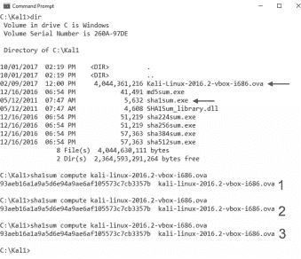
通过对文件运行 `sha1sum` 命令，我可以计算我下载的文件的哈希。我首先使用 `dir` 命令列出目录中的文件。然后对 Kali Linux 文件运行了三次 `sha1sum`。每次，`sha1sum` 都创建了相同的哈希 `93aeb16a1a9a5d6e94a9ae6af105573c7cb3357b`，如图 10.1 所示。

图 10.1：使用 sha1sum 计算哈希
```

图 10.1 展示了两个关键点：

- 无论计算多少次，哈希值始终是相同的。在图中，我运行了三次 `sha1sum`，但即使我运行 3,000 次，得到的结果也是相同的。
- 哈希处理可以验证文件是否保持了完整性。因为计算出的哈希与下载网站上发布的哈希相同，这证明了文件没有丢失完整性。

相比之下，如果 `sha1sum` 创建的哈希与网站上发布的哈希不同，我就知道文件丢失了完整性。我不一定知道文件丢失完整性的具体原因。攻击者可能向其注入了恶意软件，或者它在传输过程中丢失了一两个比特位。然而，我知道文件的完整性已经丢失，不应该信任该文件。

值得强调的是，哈希是单向函数。换句话说，你可以对文件或消息计算哈希，但你无法利用哈希来还原原始数据。无论原始数据的大小如何，哈希算法总是创建一个固定大小的位字符串。哈希不会提供任何关于文件大小、文件类型或其他任何信息的线索。

例如，消息“`I will pass the Security+ exam`”的 `SHA-1` 哈希是：`765591c4611be5e03bea41882ffdaa159352cf49`。然而，你无法通过哈希来识别消息内容，甚至不知道这是一个六个单词消息的哈希。同样，你无法通过图 10.1 显示的哈希判断出它是从一个 3.8 GB 的可执行文件计算出来的。

如果你想自己操作哈希，请查看本书在线资源中位于 `http://gcgapremium.com/501labs/` 的哈希和校验和实验。

## 密码哈希处理

密码通常以哈希的形式存储。当用户创建一个新密码时，系统会为密码计算哈希然后存储该哈希。稍后当用户通过输入用户名和密码进行身份验证时，系统会计算输入密码的哈希，然后将其与存储的哈希进行比较。如果哈希相同，则说明用户输入了正确的密码。

**记住这一点**

哈希处理是一种创建字符字符串的单向函数。你无法通过反转哈希来重新创建原始文件。密码通常存储为哈希，而不是存储实际密码。此外，应用程序通常在哈希处理之前使用额外字符对密码进行“加盐”（`salt`）。

## 密钥扩展

正如第 7 节“防止高级攻击”提到的，许多密码攻击试图通过对猜测的密码计算哈希，然后与存储的哈希进行比较来发现密码。使用复杂密码在很大程度上可以防止此类攻击，但并不能防止所有攻击。

密钥扩展（有时称为密钥强化）是一种用于增加存储密码强度的技术，可以帮助防御暴力攻击和彩虹表攻击。密钥扩展技术通过添加额外的随机位对密码进行加盐，使其变得更加复杂。两种常用的密钥扩展技术是 `bcrypt` 和基于密码的密钥派生函数 2 (`PBKDF2`)。

`bcrypt` 基于 Blowfish 加密算法，并用于许多 Unix 和 Linux 发行版中，以保护 shadow 文件中存储的密码。`bcrypt` 在使用 Blowfish 加密之前通过添加随机位对密码进行加盐。`bcrypt` 可以多次执行此过程，以进一步防止破解密码的尝试。其结果是一个 60 字符的字符串。例如，如果你的密码是 `IL0ve`，应用程序可以使用 `bcrypt` 和随机盐对其进行加密。它看起来像这样，应用程序将其存储在数据库中：

```
$2b$12$IKtJr93DH59BzzKQheh9pRA/03ENcFRby1jH0k
```


稍后，当用户使用用户名和密码身份验证时，应用程序会对提供的密码运行`bcrypt`，并将其与存储的加密密码进行比较。如果提供的密码的`bcrypt`结果与存储的结果相同，则用户通过身份验证。作为额外措施，可以在盐中添加一些“胡椒”（pepper）来使`bcrypt`字符串随机化。在这种背景下，胡椒是存储在其他另一组随机位。

`PBKDF2`使用至少 64 位的盐，并使用如`HMAC`等伪随机函数来保护密码。许多算法如 Wi-Fi 安全访问 2 (`WPA2`)、Apple 的 iOS 移动操作系统以及 Cisco 系统都使用`PBKDF2`来提高密码安全性。某些应用程序会将密码通过`PBKDF2`过程处理高达 1,000,000 次以创建哈希。生成的哈希大小取决于`PBKDF2`的实现方式。128 位、256 位和 512 位是最常见的位。

一些安全专家认为`PBKDF2`比`bcrypt`更容易受到攻击。一个公共小组创建了密码哈希竞赛 (`PHC`)。他们接收并评估了 24 种不同的哈希算法作为替代方案。2015 年 7 月，`PHC`选择`Argon2`为竞赛胜者，并推荐替代`PBKDF2`等旧算法。

### 记住这一点
`bcrypt`和`PBKDF2`是有助于防止彩虹表攻击的密钥扩展技术。它们都会使用额外的随机位对密码加盐。

## 消息哈希处理

哈希处理为消息提供了完整性。它向接收消息的人确保消息没有被修改。想象 Lisa 正在向 Bart 发送消息，如图 10.2 所示。消息内容是“The price is $75.”这条消息不是秘密，因此不需要加密。然而，我们确实希望提供完整性保障，因此此解释仅关注哈希处理。

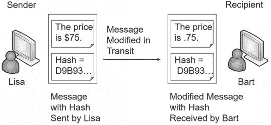

图 10.2：简化的哈希过程

Lisa 电脑上的应用程序计算出的`MD5`哈希为：
`D9B93C99B62646ABD06C87039053F56`。

在图中，我将完整哈希缩短为前五个字符“D9B93”。Lisa 然后将消息和哈希一起发送给 Bart。在这个例子中，某些东西在到达 Bart 之前修改了消息。当 Bart 接收到消息和原始哈希时，消息变成了“The price is.75.”注意消息在传输过程中被修改了，但哈希没有修改。

Bart 电脑上的程序对收到的消息计算出`MD5`哈希为`564294439E1617F5628A3E3EB75643FE`。然后将收到的哈希与计算出的哈希进行比较：

- Lisa 电脑创建并在 Bart 电脑接收的哈希：`D9B93C99B62646ABD06C87039053F56`
- Bart 电脑创建的哈希：`564294439E1617F5628A3E3EB75643FE`

显然，哈希不同，所以你知道消息丢失了完整性。Bart 电脑上的程序会报告这种差异。Bart 并知道问题的原因。可能是攻击者更改了消息，也可能是技术问题。然而，Bart 知道收到的消息与发送的消息不一致，他不应该信任它。

## 使用 HMAC

你可能在关于哈希消息的解释中发现了一个问题。如果攻击者可以更改消息，为什么攻击者不能也更改哈希呢？换句话说，如果黑客 Harry 将消息更改为“The price is .75”，他也可以对修改后的消息计算哈希，并用修改后的哈希替换原始哈希。以下是结果：

- Lisa 电脑创建的哈希：`D9B93C99B62646ABD06C87039053F56`
- 攻击者在修改消息后插入的修改哈希：`564294439E1617F5628A3E3EB75643FE`
- Bart 计算机上为修改消息创建的哈希：`564294439E1617F5628A3E3EB75643FE`

对修改后的消息计算出的哈希与收到的哈希相同。这错误地表明消息保持了完整性。`HMAC`有助于解决这个问题。

通过`HMAC`，Lisa 和 Bart 的计算机将拥有相同的密钥，并使用它来创建`HMAC-MD5`哈希，而不是仅仅是`MD5`哈希。图 10.3 显示了结果。

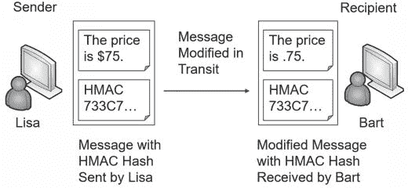

图 10.3：使用`HMAC`

Lisa 仍在发送相同的消息。

`MD5`哈希为`D9B93C99B62646ABD06C887039053F56`。然而，应用`HMAC`密钥后，`HMAC-MD5`哈希为`733C70A54A13744D5C2C9C4BA3B15034`。为了简洁起见，我在图中将其缩短为前五个字符（`733C7`）。

攻击者可以像以前一样修改传输过程中的消息。然而，攻击者不知道密钥，因此他无法计算`HMAC`哈希。

Bart 的计算机使用共享密钥对收到的消息计算`HMAC-MD5`哈希。然后将计算出的哈希与从 Lisa 收到的哈希进行比较：

- Lisa 计算机上创建的`HMAC-MD5`哈希：`733C70A54A13744D5C2C9C4BA3B15034`
- Bart 计算机上创建的`HMAC-MD5`哈希：`1B4FF0F6C04434BF97F1E3DDD4B6C137`

再次，你可以看到哈希是不同的，消息已经丢失了完整性。如果消息没有被修改，`HMAC-MD5`哈希将相同。

表 10.1 总结了 CompTIA Security+ 考试涵盖的重要哈希协议。

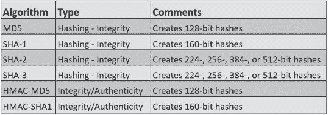

表 10.1：哈希协议

**记住这一点**

如果你能识别`MD5`、`SHA`和`HMAC`等哈希算法，将有助于回答很多考试题。例如，如果问题问你会用什么来加密数据并列出了哈希算法，你可以快速排除它们，因为哈希算法并不加密数据。

# 使用加密提供机密性

加密提供了机密性并防止数据的未经授权泄露。加密数据采用不可读的密文格式。攻击者无法读取通过网络发送的加密流量或存储在系统的加密数据。相比之下，如果数据以明文发送，攻击者可以使用协议分析器捕获并读取数据。

静态数据（Data-at-rest）是指存储在介质上的任何数据，对敏感数据进行加密是常见的。例如，可以对数据库中的单个字段（如存储客户信用卡数据的字段）、单个文件、文件夹或整个磁盘进行加密。

传输中数据（Data-in-transit）是指通过网络发送的任何数据，对传输中的敏感数据进行加密是常见的。例如，电子商务网站通常使用安全超文本协议（`HTTPS`）会话来加密包含信用卡数据的交易。如果攻击者拦截了传输，他们只能看到密文。

使用中数据（Data-in-use）是指计算机正在使用的数据。由于计算机需要处理这些数据，它们在使用时是不加密的。如果数据是加密的，应用程序在使用时将其解密并存储在内存中。如果应用程序更改了数据，将在保存之前再次对其加密。此外，应用程序通常会在处理后采取额外步骤清除内存中的敏感数据。

两种主要的加密方法是对称加密和非对称加密。对称加密使用相同的密钥对数据进行加密和解密。非对称加密使用公钥和私钥密钥对进行加密和解密。

这些加密方法包括两个元素：

- **算法**。算法对数据进行数学计算。算法始终是相同的。
- **密钥**。密钥是一个为加密提供变数的数字。它被保密和/或经常更换。

**记住这一点**

加密提供了机密性并有助于确保数据仅供授权用户可见。这适用于任何静态数据（如存储在数据库中的数据）或通过网络发送的传输中数据。

## 加密术语

密码学中有几个重要的术语。理解这些术语将有助于理解许多高级概念：

- **随机数和伪随机**。许多加密方案需要随机或伪随机作为输入。如果你能够完全随机选择一个数字，它就是随机数。然而，计算机并不是随机运行的，因此很难获得真正的随机数。相反，计算机通常使用技术来获取伪随机。伪随机看起来是随机的，但它是由确定性算法创建的。也就是说，在相同输入的情况下，伪随机生成器将产生相同的输出。
- **IV**。初始化向量（`IV`）为加密算法提供起始值。它是一个固定大小的随机或伪随机，有助于创建随机加密密钥。理想情况下，`IV`应该足够大，以便算法重用同一个`IV`。
- **Nonce**。随机数是一个只使用一次的数字。例如，`IV`应该足够大，使其只使用一次。许多加密算法使用随机或伪随机作为种子或起始数字。
- **XOR**。异或（XOR）是某些加密方案中逻辑操作。异或操作比较两个输入。如果两个输入相同，它输出 True（或二进制 1）。如果两个输入不同，它输出 False（或二进制 0）。
- **混淆 (Confusion)**。在加密背景下，混淆意味着密文与明文有显著差异。例如，使用高级加密标准（`AES`）加密“I passed!”时，结果为文本：`nkm6olLdchB049LbrCpLQ`。
- **扩散 (Diffusion)**。有效的扩散技术确保明文的微小变化会导致密文的巨大变化。仅更改明文中的单个字符会导致完全不同的密文。例如，使用`AES`加密“I passed.”，结果为文本：`k/ljn+j6WBxAIKHN6IONBA`。将其与密文“I passed!”对比，你可以看到仅更改明文一个字符就完全改变了密文，这表明`AES`使用了强大的扩散技术。
- **秘密算法**。秘密算法是指被保密的算法。安全专家不鼓励这种做法，因为防止了专家和数学家对算法进行审查。严格的审查可以发现任何缺陷或潜在漏洞。相比之下，大多数算法都是公开且已知的。
- **弱/废弃算法**。弱算法可以被破解，允许攻击者轻松将密文转换回明文。当算法中发现缺陷时，专家和机构建议废弃该弱算法。例如，网站通常使用安全套层（`SSL`）来加密互联网上的 HTTPS 会话。然而，专家在`SSL`中发现了缺陷，大多数机构已废弃了`SSL`的使用，并建议使用`TLS`。
- **高韧性**。加密算法的一个常见用例是提供高韧性。在密码学中，高韧性是指即使攻击者发现了密钥的一部分，加密密钥的安全性依然存在。理想情况下，密钥不应受到泄露的影响，防止攻击者获取关于密钥任何部分的信息。然而，存在许多可能导致泄露的情况。强力算法实现了高韧性技术，确保这种泄露不会破坏加密密钥。

**记住这一点**

随机数是随机选取的。伪随机数看起来是随机的，但它们是由确定性算法生成的，这意味着给定相同的输入，伪随机数生成器将产生相同的输出。在密码学中，混淆表示密文与明文之间有显著差异。扩散加密技术确保了明文的微小变化会导致密文的显著变化。

## 块密码与流密码

大多数对称算法均使用块密码或流密码。它们都是对称的，因此都使用相同的密钥来对数据进行加密或解密。然而，它们划分数据的方式不同。

块密码使用特定大小的块来加密数据，例如 64 位块或 128 位块。块密码将大文件或消息划分为这些块，然后单独加密每个块。流密码则以位流或字节流的形式加密数据，而不是将其划分为块。

通常，当数据大小未知或以连续流发送时（例如在网络上流传输音频和视频），流密码比块密码更高效。当数据大小已知时（例如加密文件或特定大小的数据库字段），块密码更高效。

使用流密码时的一个重要原则是加密密钥绝不应重复使用。如果重复使用密钥，加密将更容易被破解。

**记住这一点**

流密码在流中一次加密一个位（bit）或一个字节（byte）。块密码则按特定大小的块（如 64 位或 128 位块）加密数据。在对连续流数据进行加密时，流密码比块密码更高效。

## 密码模式

块密码可以使用多种工作模式。在选择加密套件时，对这些模式有基本的了解是非常重要的。

电子密码本（ECB）工作模式是本节提到的最简单的加密模式。使用`ECB`的算法将明文划分为若干块，然后使用相同的密钥加密每个块。这代表了一个重大的缺陷。如果任何明文块是相同的，生成的密文也是相同的，这使得破解变得容易。如今不建议在任何加密协议中使用`ECB`。

密码块链链接（CBC）模式被某些对称块密码使用。它在加密第一个块时使用`IV`进行随机化。然后使用`XOR`操作将后续每个块与前一个块结合。由于每个块的加密都依赖于所有之前块的加密，`CBC`有时会受到流水线延迟的影响，使其效率低于某些其他模式。

计数器（CTM）模式有效地将块密码转换为流密码。它将`IV`与计数器结合，并使用结果加密每个明文块。每个块使用相同的`IV`，但`CTM`将其与计数器值结合，导致每个块产生不同的加密密钥。多处理器系统可以同时加密或解密多个块，允许算法在多处理器或多核系统上运行更快。`CTM`被广泛使用并被认为是一种安全的工作模式。

值得注意的是，CompTIA 目标列出了`CTM`并在缩写列表中将其包含为 Counter-Mode（计数模式）。然而，更常见的是将其列为`CTR`或`CM`。

伽罗瓦/计数模式（GCM）是许多块密码使用的工作模式。它结合了计数器模式和伽罗瓦认证模式。请注意，它不验证用户或系统，而是提供数据的真实性（完整性）和机密性。除了加密数据保证机密外，它还包含了用于完整性的哈希技术。由于其高效性能，被广泛使用，允许系统快速加密和解密数据。

**记住这一点**

电子密码本（ECB）工作模式已废弃，不应使用。密码块链接（CBC）模式在加密数据时将每个块与前一个块结合，有时会产生流水线延迟。计数器（CTM）模式将`IV`与计数器结合以加密每个块。伽罗瓦/计数模式（GCM）将计数模式与用于完整性的哈希技术相结合。

## 对称加密

对称加密使用相同的密钥对数据进行加密和解密。换句话说，如果你使用密钥 3 加密数据，就使用相同的密钥 3 进行解密。对称加密也称为秘密密钥加密或会话密钥加密。

举个简单的例子，当我小时候，我和一个朋友经常互相传递编码后的消息。我们的算法是：

- 加密算法：向前移动`X`格进行加密。
- 解密算法：向后移动`X`格进行解密。

在上学的路上，我们会确定当天使用的密钥（`X`）。例如，我们某一天可能使用了密钥 3。如果我想加密一条消息，我会将每个字符向前移动三格，而他通过向后移动三格来解密消息。

假设需要发送消息“PASS”：

- “P”之后的三个字符是“S”——从 P 开始（Q, R, S）
- “A”之后的三个字符是“D”——从 A 开始（B, C, D）
- “S”之后的三个字符是“V”——从 S 开始（T, U, V）
- “S”之后的三个字符是“V”——从 S 开始（T, U, V）

加密后的消息是`SDVV`。我的朋友通过向后移动三格解密了它，并得知“PASS”是原始消息。

我们使用的是简单的替换密码。替换密码使用固定系统将明文替换为密文。在示例中，“PASS”是明文，“SDVV”是密文，固定系统是三个字母。

`ROT13`（旋转 13 位缩写）密码使用相同的替换算法，但始终使用 13 作为密钥。要加密消息，你将每个字母旋转 13 格。要解密消息，你将每个字母旋转 13 格。然而，由于`ROT13`使用了相同的算法和相同的密钥，它并没有提供真正的加密，而是对数据进行了混淆。

混淆方法试图让某些事物变得模糊或难以理解。这有时被称为“通过模糊实现安全”。然而，这很少是维护安全的一种可靠方法。

使用不同的密钥进行字母旋转展示了对称加密如何使用相同的密钥进行加密和解密。如果我用密钥 3 加密消息，我的朋友除了使用密钥 3 之外无法解密它。这对于演示算法和密钥也有帮助，尽管承认它很简单。

复杂的对称加密技术使用算法和密钥的相同组件。然而，算法和密钥要复杂得多。例如，高级加密标准（AES）对称算法通常使用 128 位密钥，但可以使用 256 位的密钥。

想象两台服务器之间使用`AES`对称加密相互发送加密流量。它们对这些数据都使用相同的`AES`算法和相同的密钥。数据在一台服务器上使用`AES`和密钥进行加密，然后通过线路或其他传输介质发送，然后在另一台服务器上使用相同的密钥进行解密。同样，如果数据库包含加密数据，则加密数据使用的密钥与解密数据所使用的密钥是同一个。

然而，对称加密并不是使用同一个密钥来加密和解密所有数据。例如，我和我的朋友每天都使用不同的密钥。在上学的路上，我们决定了当天使用的密钥。第二天，我们又选了一个不同的密钥。如果有人昨天破解了我们的代码，他们就无法轻易破解我们今天的代码。

对称加密算法更换密钥的频率比每天一次高得多。例如，想象一个算法使用`123`密钥加密一个项目文件。然后它可以使用`456`密钥加密一个电子表格文件。`123`密钥只能解密项目文件，而`456`密钥只能解密电子表格文件。

另一方面，如果对称加密始终使用相同的`123`密钥，将会增加漏洞。首先，当密钥被重复使用时，加密更容易被破解。其次，一旦密钥被破解，所有使用该密钥加密的数据都会泄露。如果攻击者发现了`123`密钥，他们不仅可以访问项目文件，还可以访问电子表格文件以及任何使用此相同密钥加密的其他数据。

一个更现实的例子是，第 4 章“保护你的网络”，描述了远程拨号认证用户服务 (`RADIUS`) 是如何加密密码包的。`RADIUS`使用共享密钥进行对称加密。当用户进行身份验证时，`RADIUS`服务器和客户端使用共享密钥对挑战/响应会话中交换的数据进行加密和解密。没有共享密钥，客户端无法解密数据并做出相应响应。

## 对称加密与门钥匙的比较（侧边栏）

安全专家偶尔会将对称密钥与家用钥匙进行比较，这种类比有助于一些人稍好理解对称加密。例如，想象玛姬（Marge）搬进新家。她会收到一把钥匙，可以用来锁和开她的家。当然，玛姬无法用这把钥匙打开邻居家的门。

后来，玛姬嫁给了霍默（Homer），霍默也搬进了玛姬的家。玛姬可以为她的家钥匙制作一个副本并交给霍默。霍默现在可以使用那把钥匙副本来锁和开门了。通过共享同一把钥匙的副本，无论是玛姬还是霍默锁门都不重要了；他们都可以开锁。

同样，对称加密使用单一密钥来加密和解密数据。如果共享了对称密钥的副本，拥有该密钥的其他人也可以加密和解密数据。

## 记住这一点

对称加密使用相同的密钥加密和解密数据。例如，在传输加密数据时，对称加密算法在传输介质的两端使用相同的密钥进行加密和解密。`RADIUS`使用对称加密。

### AES

高级加密标准 (`AES`) 是一种强对称分组密码算法，它以 128 位块加密数据。美国国家标准与技术研究院 (`NIST`) 在对几种不同的算法进行长期评估后，从`Rijndael`加密算法中采用了`AES`。`NIST`是一个负责开发和推广标准的美国机构。他们花了大约五时间对 15 种对称算法进行了审查，并确定`AES`是这 15 种中最好的。

`AES`可以使用 128 位、192 位或 256 位的密钥长度，有时被称为`AES-128`、`AES-192`或`AES-256`以标识密钥中使用的位数。使用的位数越多，发现密钥和解密数据就越困难。`AES-128`提供了强大的保护，但`AES-256`提供了更强的保护。

总来说，任何加密密钥的大小直接对应密钥强度。对于特定算法，密钥越长，强度越强。

由于其优势，`AES`被广泛应用于各种场景。例如，许多在 USB 驱动器上加密数据的应用程序都使用`AES`。`AES`的优点包括：

- **速度快**。`AES`使用优雅的数学公式，只需要通过一次即可加密和解密数据。相比之下，`3DES`（本章后提到）需要多次迭代才能加密和解密数据。
- **高效**。`AES`的资源消耗低于`3DES`等其他加密算法。即使在 USB 闪存盘等小型设备上加密数据，`AES`也能快速进行加解密。
- **安全**。`AES`为数据提供了强加密，提供了高水平的机密性。

### DES

数据加密标准 (`DES`) 是一种对称分组密码，已广泛使用了多年，追溯到 20 世纪 70 代。它以 64 位块加密数据。然而，它使用的密钥仅为 56 位，可以通过暴力破解破解。在 70 年代，破解 56 位加密的技术并不易于获得，但随着计算机技术的进步，56 位密钥现在被认为是微不足道的。现在不建议使用`DES`。

### 3DES

`3DES`（读作 "Triple DES"）是一种对称分组密码，旨在改进`DES`的已知缺陷。简单来说，`3DES`使用`DES`算法通过三次独立的处理来加密数据。就像`DES`以 64 位块加密数据一样，`3DES`也以 64 位块加密数据。

尽管`3DES`是一种强算法，但它的使用频率没有`AES`那么高。`AES`的资源消耗低得多。然而，如果硬件不支持`AES`，`3DES`是一个合适的替代方案。`3DES`使用 56 位、112 位或 168 位的密钥长度。

## 记住这一点

`AES`是一种强对称分组密码，它以 128 位块加密数据。`AES`使用 128 位、192 位或 256 位密钥。`DES`和`3DES`是以 64 位块加密数据的分组密码。`3DES`最初设计作为`DES`的替代品，但`NIST`选择了`AES`作为当前标准。然而，`3DES`仍用于某些应用程序，例如当旧版硬件不支持`AES`时。

### RC4

罗·里维斯特（Ron Rivest）发明了多个版本的`RC`，有时被称为“罗恩的代码”（Ron’s Code）或“里维斯特密码”（Rivest Cipher）。最常用的版本是`RC4`（也称为`ARC4`），它是一种对称流密码，可以使用 40 位到 2048 位之间的密钥。

`RC4`作为一种强密码曾拥有很长的寿命。多年来，它一直是互联网上加密`HTTPS`连接时`SSL`和`TLS`中的推荐加密机制。然而，自 2013 年以来，专家们推测，像美国国家安全局 (`NSA`) 等机构可以破解`RC4`，即使是在像`TLS`这样正确实现的情况下。由于由于原因，微软等公司建议禁用`RC4`并改用`AES`。尽管`AES`是分组密码而`RC4`是流密码，但`TLS`可以实现其中任何一种。

### Blowfish 和 Twofish

`Blowfish`是一种强对称分组密码，今天仍被广泛使用。它以 64 位块加密数据，并支持 32 位到 448 位之间的密钥。布鲁斯·施尼尔（Bruce Schneier，IT 安全领域备受尊敬的专家）将`Blowfish`设计为一种通用算法以取代`DES`。

有趣的是，`Blowfish`在某些情况下实际上比`AES`快。在比较`Blowfish`和`AES-256`时，这一点尤为明显。部分原因在于`Blowfish`使用较小的 64 位块进行数据加密，而`AES`则是使用 128 位块进行数据加密。

`Twofish`与`Blowfish`相关，但它使用 128 位块进行数据加密，并支持 128 位、192 位或 256 位密钥。它是`NIST`为`AES`评估的入围算法之一。然而，`NIST`最终选择了`Rijndael`作为`AES`。

#### 记住这一点
`RC4`是一种强对称流加密算法，但目前大多数专家建议改用`AES`。`Blowfish`是 64 位块加密算法，而`Twofish`是 128 位块加密算法。尽管`NIST`推荐`AES`作为标准，但`Blowfish`比`AES-256`快。

### 对称加密总结

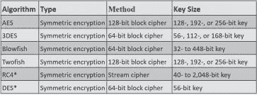表 10.2 总结了重要的对称算法及其基本特性。带有星号（`RC4`和`DES`）标记的项目不再建议使用，但仍包含在`CompTIA Security+`的考试目标中。

表 10.2：对称加密协议

#### 记住这一点
如果你能识别`AES`、`DES`、`3DES`、`Blowfish`和`Twofish`等对称算法，将有助于回答很多考试题。例如，如果问题问你用什么对数据进行哈希处理，并列出了加密算法，你可以迅速排除它们，因为加密算法并不对数据进行哈希。你还应该知道表 10.2 中列出的块大小和密钥大小。

## 非对称加密
非对称加密使用一对匹配的密钥来加密和解密数据——一个公钥和一个私钥。关于这些密钥，有几点需要记住：

- 如果用公钥加密信息，只有匹配的私钥可以解密相同信息。
- 如果用私钥加密信息，只有匹配的公钥可以解密相同信息。
- 私钥始终保持私密，绝不共享。
- 公钥通过将其嵌入共享证书中自由共享。

#### 记住这一点
只有私钥可以解密用匹配公钥加密的信息。只有公钥可以解密用匹配私钥加密的信息。多种非对称加密方法的一个关键要素是，它们需要一个证书和`PKI`。

尽管非对称加密非常强大，但它也非常消耗资源。加密和解密数据需要大量的处理能力，尤其是与对称加密相比。大多数使用非对称加密的加密协议仅将其用于密钥交换。密钥交换是用于在两个实体之间共享加密密钥的任何加密方法。在此范围内，非对称加密使用密钥交换来共享对称密钥。加密加密随后使用对称加密来加密和解密数据，因为对称加密的效率高得多。

如果你不理解匹配公私钥对的关系，与非对称加密的一些高级主题将变得难以理解。然而，由于你实际上无法看到这些密钥，这些概念对某些人来说很难掌握。`Rayburn box`展示了如何使用物理密钥来实现与这些公私钥相同的目的。

### Rayburn 箱
我经常在教室里提到`Rayburn box`，以帮助人们理解公钥和私钥的用法。`Rayburn box`是一种锁箱，允许人们跨距离安全地传输物品。它有两把钥匙。一把钥匙可以锁箱，但不能打开；另一把钥匙可以打开箱，但不能锁箱。

两把钥匙都匹配同一个箱子，无法与其他箱子配合：

- 仅存在一把钥匙的副本——将其想象成私钥。
- 另一把钥匙存在多个副本，并且可以自由地制作和分发——将这些视为公钥。

箱子有两个不同的版本。在一个版本中，它用于以机密的方式发送秘密，以防止未经授权的泄。在另一个版本中，它用于发送带有身份验证的消息，这样你就知道发送者发送了消息，并且消息在传输过程中没有被修改。

### 用于发送秘密的 Rayburn 箱
假设我想让你向我发送一些专利信息和一个发明的原型模型。显然，我们不希望其他人能够访问这些信息或模型。我可以给你寄一个空的开箱，并附上一把用于锁箱的钥匙副本。你将所有东西放在箱子里，然后用我随箱子寄给你的公钥将其锁。

这把钥匙无法打开箱子，所以即使其他人有我发给你的公钥副本，他们也无法用它打开箱子。当我从你那里收到箱子时，我可以使用唯一能打开它的钥匙——我的私钥来打开它。

这与使用公私钥在互联网上发送加密数据以确保机密性的相似。公钥加密信息。用公钥加密的信息只能用匹配的私钥解密。公钥有许多副本可用，但只存在一个私钥，且私钥始终保持私密。本章节稍后的“使用 TLS 加密 HTTPS 流量”部分将更深入地展示这一过程。

### 用于身份验证的 Rayburn 箱
通过对箱子进行简单的密钥更换，我可以使用它发送消息，同时向接收者保证我发送了这条消息。在这种情况下下，消息不是秘密的，也不需要保护。相反，重要的是让你知道是我发送了这条消息。

当这样使用时，私钥会锁上`Rayburn box`，但它不能打开箱。相反，只有匹配的公钥可以打开它。公钥存在多个副本，任何拥有公钥的人都可以打开箱子。然而，用匹配的公钥打开箱子后，无法用公钥将其锁上。

假设你是我战斗中的盟友。我想给你一条`SY0-501`消息，这是一段告诉你在特定时间发动特定攻击的代码。我们不在乎有人读了这条消息，因为这是一段代码。然而，我们需要你确定是我发送了这条消息。

我写下消息，把它放在箱子里，并用我的私钥锁上。当你收到它时，可以使用匹配的公钥打开它。因为公钥能打开它，所以你知道这是我的箱子，而且它是用我的私钥锁的——你知道是我发送了这条消息。

如果敌间谍拦截了箱子并用公钥打开它，间谍将无法再次使用公钥将其锁上，所以你会收到一个开开的箱子。然而，间谍可以将消息替换为其他内容。一个带有消息的开箱并不能证明是我发送的。你确认由我发送的唯一方法是，你收到一个可以用匹配的公钥打开的锁闭箱。

这与数字签名使用公私钥的方式相似。本章节稍后的“使用数字签名签名电子邮件”部分将更深入地解释数字签名。简而言之，我可以给你发送一条用我的私钥数字签名的消息。如果你能用我匹配的公钥解密数字签名，你就知道它是用我的私钥加密（或签名）的。因为私钥只存在一个，且我是唯一能访问它的人，所以你知道是我发送了这条消息。

### 揭秘 Rayburn 箱

在你尝试寻找 Rayburn 盒之前，让我先澄清某事。Rayburn 盒只是我想象的产物。Rayburn 是我的中间名。

我还没有发现过关于公钥/私钥如何工作的真实世界示例，因此我创建了 Rayburn 盒作为一个比喻，帮助人们视觉化公钥/私钥的工作原理。如果你愿意，可以自己构建一个。

## 证书

非对称加密的一个关键要素是证书。证书是一种数字文档，通常包含公钥和证书所有者的信息。证书颁发机构（CAs，在本章稍后的部分将深入探讨）颁发并管理证书。证书用于非对称加密之外的多种用途，包括身份验证和数字签名。

图 10.4 显示了一个选择了公钥的示例证书。用户和应用程序共享证书文件以共享公钥。它们不共享私钥。

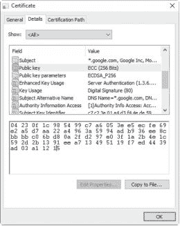

图 10.4：已选择公钥的证书

证书中包含的信息远比公钥多，但图中并非所有内容都可见。证书中常见的元素包括：

- 序列号。序列号唯一标识标识证书。CA 使用此序列号来验证证书。如果 CA 吊销证书，它会在证书吊销列表（`CRL`）中发布此序列号。
- 颁发者。这标识颁发证书的 CA。
- 有效期。证书包含“起始日期”和“结束日期”。这确保证书会在某个时间过期。
- 主体。这标识证书的所有者。在图中，它将主体标识为 Google, Inc，并指示这是一个通配证书，用于所有具有`google.com`根域名的网站。
- 公钥。RSA 非对称加密使用公钥与匹配的私钥结合。
- 用途。某些证书仅用于加密或身份验证，而其他证书支持多种用途。

如果你想查看证书，请查看本书在线实验室中的“查看证书”实验，地址为 [`gcgapremium.com/501labs/`](http://gcgapremium.com/501labs/)。

**记住这一点**
证书是非对称加密的重要部分。证书包含公钥，以及关于证书所有者和颁发证书的 CA 的详细信息。证书所有者通过共享证书副本来共享他们的公钥。

## RSA

Ron Rivest、Adi Shamir 和 Leonard Adleman 在 1977 年开发了`RSA`，`RSA`缩写使用了他们的姓氏（Rivest, Shamir, Adleman）。这是一种同时使用成对公钥和私钥的非对称加密方法，由于其强大的安全性，它在互联网和其他地方被广泛使用。

例如，电子邮件应用程序通常使用`RSA`在两个系统之间私密地共享对称密钥。应用程序使用接收者的公钥来加密对称密钥，然后由接收者的私钥对其进行解密。在本章稍后的“保护电子邮件”部分将更详细地讨论这一过程。

`RSA`算法利用质数的数学属性来生成安全的公钥和私钥。具体来说，`RSA`依赖于一个事实：分解两个大质数的乘积是非常困难的。数学对于数学家来说既复杂又有趣，但你不需要理解数学就能理解只要使用足够的密钥长度，`RSA`就是安全的。

什么是足够的密钥长度？`RSA`实验室建议使用 2,048 位密钥长度来保护直到 2030 年的数据。如果数据需要在 2030 年之后继续受保护，他们建议使用 3,072 位密钥长度。

**记住这一点**
`RSA`被广泛用于保护电子邮件和其他在互联网上传输的数据。它同时使用成对匹配的公钥和私钥。

## 静态密钥与临时密钥

非对称密钥的两大类是静态密钥和临时密钥。通常，静态密钥是半永久的，在很长时间内保持不变。相比之下，临时密钥的寿命非常短，并且每个会话都会重新创建。

`RSA`使用静态密钥。证书包含一个与私钥匹配的嵌入公钥，该密钥对在证书的有效期内有效（例如一年）。证书有过期日期，系统会在证书过期前继续使用这些密钥。静态密钥的优点是 CA 可以对它们进行验证，正如在本章稍后的“证书问题”部分中所讨论的那样。临时密钥对包含一个临时私钥和一个临时公钥。

然而，系统为单个会话使用这些密钥对，然后将其丢弃。某些版本的 Diffie-Hellman（在本节稍后部分讨论）使用静态密钥，而某些版本使用临时密钥。

完全正向安全性（Perfect forward secrecy）是临时密钥在非对称加密中遵循的一个重要特征。完全正向安全性表示加密系统为每个会话生成随机公钥，且不使用确定性算法来实现。换句话说，在相同的输入下，算法将创建不同的公钥。这有助于确保系统不重用密钥。结果是，长期密钥的破解不会导致任何过去的密钥泄露。

## 椭圆曲线加密

椭圆曲线加密（`ECC`）消耗的处理能力不如其他加密方法。因此，`ECC`通常用于低功耗设备的常见用例。例如，`ECC`通常用于小型无线设备，因为实现所需的安全性不需要大量的处理能力。它使用数学方程来表述椭圆曲线，然后在曲线上绘制点以创建密钥。这种方法在数学上更容易且所需的处理能力更少，同时也很难破解。

美国国家安全局（NSA）曾支持`ECC`用于数字签名和 Diffie-Hellman 密钥协商。然而，他们在 2015 年底宣布打算放弃其使用。从那时起，他们废用了各种版本的 ECC。

## Diffie-Hellman

Diffie-Hellman（`DH`）是一种用于在双方之间私密共享对称密钥的密钥交换算法。一旦双方知道了对称密钥，它们就会使用对称加密来加密数据。

Whitfield Diffie 和 Martin Hellman 在 1976 年首次发表 Diffie-Hellman 方案。有趣的是，Malcolm J. Williamson 在英国情报机构工作时了一种类似的算法。人们广泛认为这三人的工作为公钥加密奠定了基础。

Diffie-Hellman 方法支持静态密钥和临时密钥。`RSA`基于使用静态密钥的 Diffie-Hellman 密钥交换概念。两种使用临时密钥 Diffie-Hellman 方法是：

- `DHE`。临时 Diffie-Hellman（DHE）使用临时密钥，为会话生成不同的密钥。某些文档将其列为临时 Diffie-Hellman（EDH）。
- `ECDHE`。临时椭圆曲线 Diffie-Hellman（ECDHE）使用通过`ECC`生成的临时密钥。另一个版本椭圆曲线 Diffie-Hellman（ECDH）使用静态密钥。

在使用 Diffie-Hellman 时，双方协商共同支持的最强组。目前已有超过 25 组`DH`（Diffie Hellman）组，它们被定义为`DH Group 1`、`DH Group 2`等。组数字越高表示组越安全。例如，`DH Group 1`在密钥交换过程中使用 768 位，而`DH Group 15`使用 3,072 位。

Diffie-Hellman 是一种在公共网络上共享对称加密密钥的安全方法。椭圆曲线加密法常用于小型无线设备。`ECDHE`是 Diffie-Hellman 的一个版本，它使用椭圆曲线加密法生成加密密钥。

## 隐写术

隐写是将数据隐藏在其他数据之中，或者正如某些人所说，它是在众眼皮底下隐藏数据。其目标是隐藏数据，让无人怀疑存在隐藏信息。它并没有对数据进行加密，因此不能被归类为对称或非对称。然而，它可以使用混淆技术有效隐藏信息，因此它被包含在加密主题中。正如第一章提到的，混淆方法试图让某些内容变得模糊或难以理解。

有很多隐写术工具可以让该过程变得简单。此外，这些工具试图抵抗取证方法的检测。例如，`Kali Linux`包含了`Steghide`和`StegoSuite`，这是你可以用来数据嵌入图形文件的工具。

隐写的常见示例包括：

* 通过操纵位隐藏数据。可以操纵图像或声音文件中的某些位来嵌入消息。在大文件中嵌入数据的一种方法是修改某些字节中的最低有效位。通过修改`JPEG`文件中某些单独字节的最低有效位，可以嵌入一条消息，但这些变化微小到难以察觉。然而，如果人们知道文件包含消息，他们就可以轻松地将其提取出来。
* 在文件的空白处隐藏数据。许多文件在文件簇的末尾有未使用的空间（称为空白）。想象一个 6 KB 的小文件存储在两个 4 KB 的簇中。它有额外的 2 KB 未使用空间，并可以用消息填充这些空白。例如，你可以将消息嵌入到`GIF`或`JPEG`文件的空白处，而不会改变文件的大小。

安全专业人员使用`steganalysis`技术来检测隐写术，最常见的方法是使用哈希。如果文件的任何一个位被修改，哈希算法就会创建一个不同的哈希值。通过定期获取不同文件的哈希值并将其与之前的哈希值进行比较，很容易检测出文件何时被修改过。

如果你想查看如何向图像文件嵌入文本文件，请查看第一章提到的隐写术实验室：`http://gcgapremium.com/501labs.`。

**记住这一点**

隐写术将消息或其他数据隐藏在文件中。例如，你可以在`JPEG`或`GIF`文件的空白处隐藏消息。安全专业人员使用哈希来检测文件中的变化，这些变化可能表明使用了隐写术。

# 使用密码学协议

对哈希、对称加密和非对称加密有了基本的了解后，更容易掌握密码学是如何使用的。许多应用程序结合使用这些方法，理解它们是如何交织在一起的非常重要。

在之前描述公钥和私钥时，强调了一个密钥加密，另一个密钥解密。一个常见的问题是“哪一个加密，哪个解密？”答案取决于你想实现什么。以下章节描述了细节，但作为概述，这些与这些密钥相关的要点：

* 电子邮件数字签名
    * 发者的私钥加密（或签名）。
    * 发者的公钥解密。
* 电子邮件加密
    * 接收者的公钥加密。
    * 接收者的私钥解密。
* 网站加密
    * 网站公钥加密。
    * 网站私钥解密。
* 对称密钥加密网站会话中的数据。

电子邮件和网站加密通常结合使用非对称加密和对称加密。它们使用非对称加密进行密钥交换，私密地共享对称密钥。对称加密则加密数据。

**记住这一点**

知道哪个密钥加密、哪个密钥解密将帮助你回答考试中的许多问题。例如，只要知道私钥正在加密，你就知道它正被用于数字签名。

## 保护电子邮件

密码学为电子邮件提供了两种可使用的主要安全方法：数字签名和加密。这些是独立的过程，但你可以对同一封电子邮件进行数字签名和加密。

### 使用数字签名对邮件签名

数字签名在概念上类似于打印文档上的手写签名（用于识别身份），但它们提供了更多的安全益处。数字签名算法（`DSA`）使用消息的加密哈希。哈希使用发送者的私钥进行加密。如果数字签名邮件的接收者能够解密哈希，它将提供以下三个安全益处：

* **身份验证。** 这识别了电子邮件的发送者。电子邮件接收者可以确保邮件确实来自其显示的发件者。例如，如果一位高管对邮件进行了数字签名，接收者就这邮件来自该高管，而不是冒充该高管的攻击者。
* **不可否认性。** 发送者事后不能否认发送过该消息。这在在线交易中通常是需要的。例如，想象 Homer 使用带有数字签名的邮件发送了一个卖出股票的订单。如果在他出售完成后股票上涨了，他就无法否认这笔交易。
* **完整性。** 这提供了消息没有被修改或损坏的保证。接收者知道该消息与发送时的消息是一致的。

如果你理解本章中的其他概念，数字签名将容易理解得多。作为简短的回顾，这些概念是：

* **哈希。** 数字签名从创建消息的哈希开始。哈希仅仅是通过在消息上执行哈希算法创建出的一个数字。
* **证书。** 数字签名需要证书，而证书包含了发送者的公钥。
* **公钥/私钥。** 在数字签名中，发送者使用私钥加密哈希。接收者使用发送者的公钥解密哈希。公钥通常分发在`S/MIME.p7s`文件中。

图 10.5 显示了该过程的概述。图中，Lisa 正向 Bart 发送带有数字签名的消息。请注意，消息“我通过了”并不是秘密。如果是秘密，Lisa 就会对其加密，这是一个独立的过程。本解释的重点仅在于数字签名。

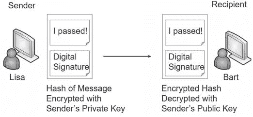

图 10.5：数字签名过程

Lisa 在`Microsoft Outlook`等电子邮件程序中创建消息。一旦配置好`Microsoft Outlook`，她只需点击按钮对消息进行数字签名。当她点击按钮时，发生了以下操作：

1. 程序对消息进行哈希。
2. 程序获取 Lisa 的私钥并使用该私钥加密哈希。
3. 程序将加密的哈希签名（数字签名）和未加密的消息发送给 Bart。

当 Bart 的系统接收消息时，它将使用以下步骤验证数字签名：

1. Bart 的系统检索`Lisa`的公钥，该密钥位于`Lisa`的公钥证书中。在某些情况下，`Lisa`可能会向 Bart 发送一份包含其公钥的证书副本。在域环境中，Bart 的系统可以从网络位置自动检索`Lisa`的证书。

2. Bart 系统上的电子邮件应用程序使用`Lisa`的公钥解密加密的哈希值。

3. 应用程序对收到的消息计算哈希值。

4. 应用程序将解密后的哈希值与计算出的哈希值进行比较。

如果收到的消息的计算哈希值与数字签名的加密哈希值相同，则通过了以下几项重要检查：

• **身份验证**。`Lisa`发了消息。公钥只能解密用私钥加密的内容，而只有`Lisa`拥有私钥。如果解密成功，则`Lisa`的私钥一定加密了该哈希值。反，如果使用了另一个密钥加密哈希值，`Lisa`的公钥将无法解密。在这种情况下，`Bart`将看到一个指示数字签名问题的错误。

• **不可否认性**。`Lisa`随后无法否认发送过消息。只有`Lisa`拥有她的私钥，如果公钥解密了哈希值，那么该哈希一定是用她的私钥加密的。不可否认性在在线交易中非常有价值。

• **完整性**。因为发送的消息哈希值与收到的消息哈希值匹配，所以消息保持了完整性。它没有被修改。

此时，你可能会想，如果我们做了这一切，为什么不直接对消息进行加密呢？答案是资源问题。在`SHA-256`哈希中加密`256`位并不消耗多少处理能力。相比之下，加密一封长邮件及其附件需要大量的处理能力。然而，如果你需要确保电子邮件的机密性，可以对其进行加密。

**记住这一点**

数字签名是消息的加密哈希。发送者的私钥加密消息的哈希值以创建数字签名。接收者使用发送者的公钥解密哈希值。如果成功，它将提供身份验证、不可否认性和完整性。身份验证识别发送者。完整性验证消息未被修改。不可否认性防止发送者在日后否认他们发送过电子邮件。

### 加密电子邮件

有时，你希望确保电子邮件内容只有授权用户才能阅读。你可以对电子邮件进行加密，就像其他任何时候使用加密一样，加密提供了机密性。

#### 使用仅非对称加密加密电子邮件

假设`Lisa`想要向`Bart`发送一封加密消息。如果仅使用非对称加密，以下步骤提供了过程的简化说明：

1. `Lisa`检索包含`Bart`公钥的证书副本。
2. `Lisa`使用`Bart`的公钥加密电子邮件。
3. `Lisa`将加密后的电子邮件发送给`Bart`。
4. `Bart`使用他的私钥解密电子邮件。

这种方法之所以有效，是因为`Bart`是唯一可以访问其私钥的人。如果攻击者拦截了邮件，没有`Bart`的私钥，他们将无法解密。请记住，当你加密邮件内容时，是由接收者的公钥进行加密，由接收者的私钥进行解密。发送者的密钥不参与此过程。相反，数字签名只使用发送者的密钥，而不使用接收者的密钥。

在大多数情况下，公钥并不直接加密消息，而是加密一个用于加密电子邮件的对称密钥。接收者然后使用私钥解密对称密钥，再使用该对称密钥解密电子邮件。

**记住这一点**

加密电子邮件消息时使用接收者的公钥进行加密，接收者使用接收者的私钥解密加密后的电子邮件消息。

#### 使用非对称和对称加密加密电子邮件

之前的描述对某些电子邮件应用程序使用的电子邮件加密提供了简单的解释。然而，大多数电子邮件应用程序结合了非对称加密和对称加密。你可能记得在本章前面提到，非对称加密速度慢且效率低，但对称加密非常快。

大多数电子邮件应用程序并非仅使用对称加密，而是使用非对称加密来私密共享会话密钥。然后使用对称加密来加密数据。例如，假设`Lisa`正向`Bart`发送一封加密消息。图 10.6 显示加密消息和对称密钥的过程。图 10.7 显示发送加密消息和加密会话密钥的过程。

1. `Lisa`确定一个加密电子邮件的对称密钥。例如，假设它是`128`位。
2. `Lisa`使用像`AES`的对称算法加密电子邮件。
3. `Lisa`检索包含`Bart`公钥的证书副本。
4. `Lisa`使用`Bart`的公钥加密对称密钥。
5. `Lisa`将加密的电子邮件和加密的会话密钥发送给`Bart`。
6. `Bart`使用他的私钥解密对称密钥。
7. `Bart`然后使用对称密钥解密电子邮件。

拦截`Lisa`发送邮件的未授权用户将无法读取它，因为它是用对称密钥加密的。此外，他们无法读取对称密钥，因为它是用`Bart`的公钥加密的，只有`Bart`的私钥可以解密它。


`Images/image0348.jpeg`

图 10.6: 加密电子邮件

```
```

`Images/image0349.jpeg`

图 10.7: 解密电子邮件


### S/MIME

安全/多用途 Internet 扩展 (S/MIME) 是用于对电子邮件进行数字签名和加密的最流行的标准之一。大多数支持加密和数字签名的电子邮件应用程序都使用 S/MIME。

S/MIME 使用 `RSA` 进行非对称加密，使用 `AES` 进行对称加密。它可以加密静态数据（存储在驱动器上）和传输中数据（通过网络发送的数据）。由于 S/MIME 使用 `RSA` 进行非对称加密，它需要 PKI 来分发和管理证书。

### PGP/GPG

优隐私 (PGP) 是一种用于保护电子邮件通信的方法。它可以对电子邮件进行加密、解密和数字签名。Phillip Zimmerman 在 1991 年设计了 PGP，多年来它经历了许多变化和改进。赛门公司于 2010 年 6 月收购了它。

OpenPGP 是一种基于 PGP 的标准，旨在避免与现有许可发生冲突。换句话之，用户没有义务支付许可费用即可使用它。某些 PGP 版本遵循 S/MIME 标准。其他版本遵循 OpenPGP 标准。GNU Privacy Guard (GPG) 是基于 OpenPGP 标准的免费软件。

每个 PGP 版本都使用 `RSA` 算法以及公私钥对进行加密和解密。像 S/MIME 一样，PGP 同时使用非对称加密和对称加密。

## HTTPS 传输加密

传输加密方法对传输中的数据进行加密，以确保传输数据的机密性。这包括通过 Internet 传输的数据以及内部网络上的数据。例如，第 3 章“探索网络技术和工具”讨论了使用安全外壳 (SSH) 加密流量，例如安全文件传输协议 (SFTP)。本节关注用于 HTTPS 的传输加密方法。

### SSL 与 TLS

安全套接层 (SSL) 和传输层安全协议 (TLS) 是常用于加密传输中数据的加密协议。例如，通常会使用 `SSL` 或 `TLS` 对 HTTPS 进行加密，以确保在互联网上传输的数据的机密性。它们也可用于加密其他传输，例如安全文件传输协议 (FTPS)。

Netscape 为其网络浏览器创建了 `SSL`，并将其更新到 `SSL 3.0` 版本。这发生在像互联网工程任务组 (`IETF`) 等组织创建并维护标准之前。Netscape 的成功日渐衰落，尽管所有网络浏览器都在使用它，但并没有一个标准化的流程来更新 `SSL`。`IETF` 创建了 `TLS` 以对 `SSL` 的改进进行标准化。

`SSL` 和 `TLS` 都提供了基于证书的身份验证，并在会话期间通过对称加密和非对称加密相结合对数据进行加密。它们使用非对称加密进行密钥交换（私下共享会话密钥），并使用对称加密来加密网页上显示以及会话期间传输的数据。下一节将展示这一过程。

传输层安全协议 (`TLS`) 是 `SSL` 的替代者，并广泛应用于许多不同的应用程序。`IETF` 已更新并发布了多份指定标准的 `TLS` 文档。`TLS 1.0` 基于 `SSL 3.0`，被称为 `SSL 3.1`。同样地，`TLS` 的每次更新都表示它是对 `SSL` 的更新。例如，`TLS 1.1` 被称为 `SSL 3.2`，`TLS 1.2` 被称为 `SSL 3.3`。

正如第 3 章提到的，大多数组织已弃用 `SSL` 转而使用 `TLS`。然而，许多人常将 `TLS` 称为 `SSL/TLS`，仿佛它们是同一种。即使 CompTIA Security+ 的目标也将许多主题列为 `SSL` 或 `SSL/TLS`。在这种语境下，你可以将考试中对 `SSL` 的任何引用视为对 `TLS` 的引用。

记住 `TLS` 和 `SSL` 都需要证书。证书颁发机构 (`CAs`) 颁发并管理证书，因此需要 `CA` 来支持 `TLS` 和 `SSL`。这些 `CAs` 可以内部的，也可以是外部第三方 `CAs`。

#### 记住这一点

- `TLS` 是 `SSL` 的替代者。`TLS` 和 `SSL` 都需要证书颁发机构 (`CAs`) 颁发的证书。`TLS` 加密 HTTPS 流量，但它也可以加密其他流量。

### 使用 TLS 加密 HTTPS 流量

HTTP 安全 (HTTPS) 通常用于互联网以保护网络流量。HTTPS 通常使用 `TLS` 对流量进行加密，同时使用非对称加密和对称加密。如果你能够掌握 HTTPS 如何结合非对称和对称加密的基础知识，你就掌握了大多数使用这两种加密方式的协议所需的全部知识。

由于非对称加密加密大量数据的效率不高，因此使用对称加密来加密会话数据。然而，客户端和服务器在使用对称密钥之前都必须知道这个对称密钥是什么。他们不能在互联网上互相耳语传达。这就像电视上的演员使用大声的耳语（或称舞台耳语）来分享秘密一样，数百万电视观众也能听到这个秘密。

相反，HTTPS 使用非对称加密通过安全的密钥交换方法传输对称密钥。然后使用该对称密钥配合对称加密来加密 HTTPS 会话中的所有数据。

图 10.8 及后续步骤显示了建立和使用 HTTPS 会话的整体过程。在阅读这些步骤时，请记住这两个重要概念：

- `TLS` 使用非对称加密来安全地共享对称密钥。
- `TLS` 使用对称加密来加密会话数据。

**图 10.8 用于 HTTPS 的简化 TLS 握手过程**

1. 客户端通过请求 HTTPS 会话开始该过程。这可以通过在 URL 中输入 HTTPS 地址或点击 HTTPS 链接来实现。
2. 服务器通过发送服务器证书做出响应。该证书包含了服务器的公钥。匹配的私钥位于服务器上，且仅供服务器访问。
3. 客户端创建一个对称密钥并用服务器的公钥对其进行加密。例如，假设对称密钥为 `53`（在实际会话中它会复杂得多）。客户端使用 Web 服务器的公钥加密为 `53` 的对称密钥，生成密文 `UcaNP@$$`。该对称密钥将用于加密 HTTPS 会话中的数据，因此有时被称为会话密钥。
4. 客户端将加密后的会话密钥 (`UcaNP@$$`) 发送给 Web 服务器。只有服务器的私钥可以解密它。如果攻击者拦截了加密的密钥，他们将无法解密，因为他们没有访问服务器私钥的权限。
5. 服务器接收加密的会话密钥并用服务器私钥将其解密。此时，客户端和服务器都知道了会话密钥。
6. 所有会话数据都使用此对称密钥通过对称加密进行加密。

让我惊讶的是，这一切发生得如此迅速。如果 Web 服务器花费了五秒钟，我们很多人都会怀疑为什么需要这么长时间。然而，为了建立这个会话，正在发生很多操作。

### 密码套件

密码套件是加密算法的组合，为 `TLS` 和 `SSL` 提供多层安全保护，尽管大多数组织已弃用 `SSL`。当两个系统连接时，它们会识别一个双方都能接受的密码套件，然后使用该套件内的协议。套件内的协议提供了三种主要的加密解决方案。它们是：

- **加密。** 加密提供了数据的机密性。`TLS` 使用非对称加密来私下交换对称密钥，然后使用对称算法加密数据。`TLS` 支持多种类型的对称加密，包括 `3DES` 和 `AES`。
- **身份验证。** `TLS` 使用证书进行身份验证。客户端可以通过查询颁发证书的 `CA` 来验证证书的真实性。
- **完整性。** `TLS` 使用消息认证码 (MAC) 来保证完整性。例如，可以使用 `HMAC-MD5` 或 `HMAC-SHA256`。

有 200 多个命名的密码套件，系统通过十六进制字符字符串和编码名称密码标识符来识别它们。以下是两个示例：

- `0x00C031.TLS_ECDH_RSA_WITH_AES_128_GCM_SHA256`
- `0x00003C.TLS_RSA_WITH_AES_128_CBC_SHA256`

如果你熟悉这些缩写，就可以很好了解每个密码套件在使用什么。以下是一些说明：

- **协议。** 两者都在使用 `TLS`。
- **密钥交换方法。** 第一个使用的是 `ECDH`，第二个使用的是 `RSA`。
- **身份验证。** 两者都在使用 `RSA`，但第二个缩短了代码。它没有列出两次 `RSA`（分别对应密钥交换方法和身份验证），而是只列了一次。
- **加密。** 两者都在使用 128 位 `AES`，但在不同的工作模式。这里识别出的两种模式是伽罗斯/计数模式 (`GCM`) 和密码块链模式 (`CBC`)。下一节将深入讨论密码模式。
- **完整性。** 两者都在使用 `SHA-256` 哈希算法。

某些密码套件非常老旧，包含了诸如 DES 等加密算法。显然，它们不应该被使用，并且在如今大多数系统中默认是被禁用的。在需要时，管理员会配置系统和应用程序来禁用旧的特定密码套件。

当两个系统连接时，它们会协商以确定使用哪种加密套件（cipher suite）。每个系统都会传递一个其愿意使用的加密套件优先级列表。然后，它们会选择两个列表中共同存在且优先级最高的一个加密套件。

### 实现与算法选择

当你阅读关于不同的算法和不同的工作模式时，你可能会好奇这与你有什么关系。这实际上取决于你的工作内容。这里有两个相关的术语：

- **加密模块（Crypto module）。** 加密模块是一组硬件、软件和/或固件，用于实现加密功能。这包括用于加密和哈希的算法、密钥生成技术，以及如数字签名等身份验证技术。
- **加密服务提供者（Crypto service providers）。** 加密服务提供者是一个包含加密标准和算法的软件库。这些库通常分发在加密模块中。

例如，软件开发者在程序中实现加密功能时，会访问软件库。如果他们需要加密数据，他们并不是从零开始，而是访问一个加密服务提供者，这是一个包含各种加密标准和算法不同实现的库。

加密服务提供者通常分发在加密模块中。例如，`Python` 是 Web 开发者用于创建动态网站的流行应用程序。`Python` 包含了开发者可以使用的丰富加密模块。`Python Cryptography Toolkit` 包含了一个包含哈希函数和加密算法的库。开发者只需遵循库中定义的语法即可实现这些哈希函数和加密算法。

开发者应该了解不同的加密算法以及不同的工作模式。例如，虽然可以选择 `DES` 进行加密，但这是一个错误，因为 `DES` 已经被弃用了。同样，开发者可能使用 `ECB` 工作模式实现算法。然而，`ECB` 具有已知的弱点，因此这也是一个错误。

管理员通过服务器上的加密套件来实现算法。他们的职责是确保服务器上禁用了已弃用和弱效的加密套件。如果管理员让服务器上运行弱的或已弃用的算法，将使服务器容易受到降级攻击（downgrade attacks）的威胁。

### 针对弱性实现的降级攻击

降级攻击（Downgrade attack）是一种强制系统降低其安全级别的攻击。攻击者随后会利用较弱的安全控制。这种攻击通常由于加密套件实现较弱而与加密攻击有关。

常见的例子是传输层安全协议 (`TLS`) 和安全套接层 (`SSL`)。`SSL` 具有已知漏洞，且在大多数实现中已被 `TLS` 取代。然而，许多服务器同时安装了 `SSL` 和 `TLS`。如果客户端无法使用 `TLS`，服务器将降低安全性并使用 `SSL`。

攻击者通过配置其系统使其无法使用 `TLS` 来利用这一漏洞。当他们与服务器通信时，服务器会降级安全性以使用 `SSL` 而不是 `TLS`。这允许攻击者发起基于 `SSL` 的攻击，例如众所知的针对降级旧版加密的填充 Oracle 攻击 (`POODLE`)。

确保网站不使用 `SSL` 的一种方法是修改服务器的协议列表，并确保禁用了 `SSL`。通常，网站服务器会有以下五个选项：`SSL 2`、`SSL 3`、`TLS 1.0`、`TLS 1.1` 和 `TLS 1.2`。你可以通过在网站服务器上禁用 `SSL 2` 和 `SSL 3` 来防止基于 `SSL` 的降级攻击。

同样，应该禁用具有已知漏洞的加密套件。如果服务器上启用了弱加密套件，就会增加漏洞风险。

#### 记住这一点

管理员应该在服务器上禁用弱加密套件和弱协议。当服务器同时拥有强加密和弱加密套件时，攻击者可以发起降级攻击，绕过强加密套件并利用弱加密套件。

# 探索 PKI 组件

公钥基础设施 (`PKI`) 是一组用于请求、创建、管理、存储、分配和撤销数字证书的技术。非对称加密依赖于使用证书来实现各种目的，例如保护电子邮件以及通过 `SSL` 和 `TLS` 保护互联网流量。例如，`HTTPS` 会话保护互联网信用卡交易，而这些交易依赖于 `PKI`。

`PKI` 的主要优势是它允许两个个人或实体在事先不认识的情况下进行安全通信。换句话说，它允许他们通过互联网等不安全的公共媒介进行安全通信。

例如，即使你从未这样做过，也可以与 `Amazon.com` 建立安全会话。`Amazon` 从 `Symantec` 购买了证书。如之前“使用 TLS 加密 HTTPS 流量”部分所示，该证书提供了建立安全会话的能力。

`PKI` 的一个关键元素是证书颁发机构。

## 证书颁发机构

证书颁发机构 (`CA`) 负责发布、管理、验证和撤销证书。在某些范围内，你可能会看到 `CA` 被称为认证机构（Certification Authority），但它们是同一个。`CA` 可以很大，例如 `Comodo` 或 `Symantec`，它们是公共 `CA`。`CA` 也可以很小，例如运行在私有网络服务器上的单个服务。

公共 `CA` 通过出售证书盈利。为了实现这一点，公共 `CA` 必须被信任。如果 `CA` 是受信任的，那么由该 `CA` 发布的所有证书都是信任的。

这类似于驾执照被信任的方式。车辆管理局 (`DMV`) 在验证个人身份后颁发驾执照。如果你想兑支票，你可能会出示驾执照来证明你的身份。企业信任 `DMV`，因此他们信任驾执照。相反，如果你从 `Gibson’s Instant IDs` 购买了身份 ID，企业可能不会信任它。

虽然我们可能信任 `DMV`，但为什么计算机会信任 `CA` 呢？答案基于证书信任路径。

## 证书链与信任模型

`CA` 通过将其根证书的副本放入受信任的根 CA 存储区获得信任。根证书是 `CA` 创建的第一个用于标识自身的证书，而存储区只是这些根证书的集合。如果 `CA` 的根证书被放入此存储区，由该 `CA` 发布的所有证书都是受信任的。

图 10.9 显示了 Windows 计算机上的受信任根证书颁发机构。你可以看到来自许多不同 `CA` 的许多证书。图中，我选择了来自 `COMODO Certification Authority` 的证书之一。本章的实验之一（可在 `http://gcgapremium.com/501labs` 获取）显示了如何在 Windows 计算机上访问此内容。

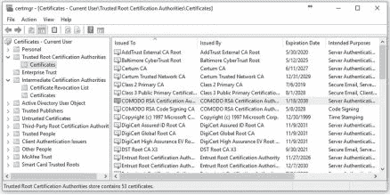

图 10.9：受信任根证书颁发机构

`Symantec` 和 `Comodo` 等公共 `CA` 与网络浏览器开发者协商，将它们的证书包含在浏览器中。这样，它们卖给企业的任何证书都会被自动信任。

最常见的信任模型是分级信任模型，也称为中心化信任模型。在这种模型中，公共 `CA` 创建第一个 `CA`，即根 `CA` (root CA)。如果组织很大，它可以创建中间 CA 和子 `CA`。如果你回看图 10.9，可以看到它包含一个用于存储中间 CA 证书的区域。一个大型信任链工作如下：

- `root CA` 向中间 `CA` 颁发证书。

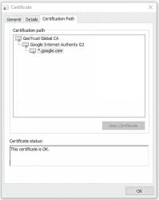

- 中间 `CA` 向子 `CA` 颁发证书。
- 子 CA 向设备或终端用户颁发证书。

**图 10.10：证书链**

证书链将从根 CA 到颁发给终端用户的证书的所有证书组合在一起。例如，图 10.10 显示了为 `google.com` 颁发的通配符证书的证书链。证书链将包含所有三个证书。在小型组织中，根 CA 可以直接向设备和终端用户颁发证书，没有设置中间 CA 和子 CA。

另一种信任模型是信任网或去中心化信任模型，有时与 `PGP` 和 `GPG` 使用。信任网使用自签名证书，并由第三方为这些证书背书。例如，如果你的五个朋友信任某个证书，你就可以信任该证书。如果第三方是可靠的来源，信任网提供了一种安全的替代方案。然而，如果第三方未能充分验证证书，可能会导致使用不应信任的证书。

## 注册与 CSR

用户和系统通过注册过程向 CA 请求证书。在某些情况下，用户手动在网站表单中输入信息。在其他情况下，用户向 CA 发送一个特定格式的文件。在域内部，系统会自动处理大部分过程。

作为一个示例，假设我想为 `GetCertifiedGetAhead.com` 购买一个证书用于安全的 HTTPS 会话。首先，我会创建一个公钥和私钥对。有很多程序可以自动化此过程。例如，`OpenSSL` 是包含在许多 Linux 发行版中的命令行程序。它可以在一个命令中创建密钥对，并允许通过第二个命令将公钥导出到文件中。从技术上讲，`OpenSSL` 类似的应用程序首先创建私钥。但这些应用程序似乎是同时创建两个密钥的。

然后我会为证书创建一个证书签名请求 (CSR)，包括证书的用途以及关于网站、公钥和我的信息。大多数 CA 要求 CSR 使用公钥加密密码学标准 (PKCS) #10 规范格式化。CSR 包含公钥，但不包含私钥。CA 通常会发布一个证书模板，准确显示如何格式化 CSR。

接收 CSR 后，CA 会验证我的身份并使用公钥创建证书。验证过程根据证书用途而异。在某些情况下，它包括广泛的检查，在另一些情况下，验证来自我购买证书时使用的信用卡。

然后，我可以将此证书同私钥一起注册到我的网站。每当有人发起安全的 HTTPS 连接时，网站会发送带有公钥的证书，TLS/SSL 会话就会创建会话。

证书使用对象标识符 (OID) 来识别证书内的特定对象，某些 CA 要求 CSR 中的某些项目包含 OID。OID 是一个由句点分隔的数字字符串。OID 可命名证书中的几乎每个对象类型。

例如，在查看 Google 证书时，我注意到“常规”（General）选项卡上有一个带有此 OID 的证书：`1.3.6.1.4.1.11129.2.5.1`：

- 第一个 `1` 表示它是国际标准化组织 (ISO) OID。
- `1.3` 表示它是一个已标识的组织。
- `1.3.6.1.4.1` 表示它正在使用 IANA 企业编号。
- `1.3.6.1.4.1.11129` 表示该组织是 Google。
- 额外的数字（`2.5.1`）在 Google 内部专门定义。

在大型组织中，注册机构 (RA) 可以通过收集注册信息来协助 CA。RA 绝不颁发证书。相反，它只协助注册过程。

如果 CA 是在线的（即可以通过网络访问），则可以使用自动化过程提交 CSR。然而，组织可能会选择让某些 CA 保持离线以保护它们免受攻击。离线 CA 只能手动接受 CSR。

### 记住这一点

你通常使用证书签名请求 (CSR) 请求证书。第一步是创建基于 RSA 的私钥，它用于创建公钥。然后你将公钥包含在 CSR 中，CA 将把公钥嵌入证书中。私钥不会发送给 CA。

## 撤销证书

通常，证书根据“有效期”（Valid From）和“失效日期”（Valid To）自动到期。但在某些情况下，CA 会在证书过期之前撤销它。

例如，如果私钥公开可用，该密钥对就泄露了。它不再提供足够的安全性，因为私钥不再是私密的。同样，如果 CA 本身通过安全漏洞受到破坏，由 CA 颁发的证书也可能受到破坏，因此 CA 可以撤销证书。

通常，只要 CA 不想让任何人使用某个证书，CA 就会撤销它。虽然最常见的原因是密钥或 CA 泄露，但还有其他原因。CA 在撤销证书时可以使用以下任何原因：

- 密钥泄露
- CA 泄露
- 隶属关系变更
- 被取代
- 停止运营
- 证书挂起


CA 使用证书撤销列表 (CRL，读作“crill”)来撤销证书。CRL 是一个包含按序列号列出的撤销证书列表。例如，图 10.11 显示了 CRL 的副本。本章的一个实验演示了如何下载和查看 a。

**图 10.11：证书撤销列表**

## 证书问题

在客户端使用证书之前，它们首先通过检查验证其有效性。许多不同的证书问题会导致证书无效。浏览器通常会显示描述问题的错误并鼓励用户不要使用该证书。检测到证书问题的应用程序可能会显示错误，但它们通常被编写为不使用它。常见问题包括：

- **已过期：** 第一个检查是确保它没有过期。如果证书过期，计算机系统通常会给用户一个错误，指示证书无效。
- **证书不受信任：** 下一个检查是查看证书是否由受信任的 CA 颁发。例如，Windows 系统将查找图 10.9 所示的受信任根证书颁发机构和中间证书颁发机构存储。如果系统没有 CA 证书的副本，它将指示证书不受信任。用户可以忽略此警告，尽管通常会有鼓励不要继续的警告。
- **证书和密钥管理不当：** 私钥应保持私密。它们通常以加密格式存储并绝不公开共享。如果持有私钥的证书管理不当，可能会损害证书。

客户端还通过 CA 验证证书以确保它们未被撤销。首先，它们验证证书是否由受信任的 CA 颁发。接着，它们查询 CA 以验证 CA 尚未撤销该证书。验证证书的常用方法是请求 CRL 副本，如图 10.12 所示。以下步骤概述了该过程：

1. 客户端发起需要证书的会话，例如 HTTPS 会话。
2. 服务器响应包含公钥的证书副本。
3. 客户端查询 CA 获取 CRL 副本。
4. `CA` 返回一个 `CRL` 副本。


**图 10.12：验证证书**

随后，客户端会将证书的序列号与 `CRL` 中的序列号列表进行比对。如果证书由于任何原因被吊销，应用程序将向用户显示错误信息。

`CRLs` 通常在首次下载后被缓存。客户端不再请求另一个 `CRL` 副本，而是使用缓存的副本。这避免了客户端与 `CA` 之间产生大量流量。

验证证书的另一种方法是使用在线证书状态协议 (`OCSP`)。`OCSP` 允许客户端使用证书序列号查询 `CA`。随后，`CA` 返回“good（良好）”、“revoked（已吊销）”或“unknown（未知）”答案。“unknown”响应可能表示该证书是伪造。

由于 `OCSP` 提供实时响应，它是支持低延迟常用用例的优秀示例。如果 `CA` 吊销了一个证书，使用 `OCSP` 的客户端将立即获知。相比之下，如果客户端使用的是缓存的 `CRL`，在下载另一个 `CRL` 副本之前，他们无法感知该证书已被吊销。

随着时间的推移，机构发现 `OCSP` 为 `CA` 产生了大量的实时流量，因为它要求 `CA` 响应每一个请求。`OCSP stapling`（OCSP 封）解决了这个问题。证书提交者（例如图 10.12 中的 Web 服务器）从 `CA` 获取带有时间戳的 `OCSP` 响应。在发送之前，`CA` 会对其进行数字签名。然后，证书提交者在 `TLS` 握手过程中将带有时间戳的 `OCSP` 响应附加到证书上。这消除了客户端查询 `CA` 的需求。

### 记住这一点

`CAs` 出多种原因吊销证书，例如私钥泄露或 `CA` 被攻破。证书吊销列表 (`CRL`) 包含一份已吊销证书列表并公开可用。使用 `CRL` 的替代方案是在线证书状态协议 (`OCSP`)，它返回 good、revoked 或 unknown 等答案。`OCSP stapling` 在证书上附加数字签名的 `OCSP` 响应。

## 公钥固定 (Public Key Pinning)

公钥固定是一种安全机制，旨在防止攻击者使用伪造证书冒充网站。当在网站服务器上配置时，服务器会在响应客户端的 `HTTPS` 请求时带有额外的头部。此额外头部包含一个由该网站使用的有效公钥的哈希值列表。它还包含一个 `max-age` 字段，指定客户端存储和使用数据的时间。

当客户端再次连接到同一个网站时，它们会重新计算哈希值，并将重新计算的哈希值与存储的哈希值进行比较。如果哈希值匹配，则验证客户端连接到了同一个网站。

网站管理员创建网站使用的一个或多个证书的哈希值。这可以是网站证书使用的公钥。它也可以包括证书链中任何证书的公钥，例如来自根 `CA` 证书的公钥，和/或来自中间 `CA` 证书的公钥。最后，它必须包含一个在当前密钥失效时可以使用备份密钥。

### 记住这一点

证书封送（Certificate stapling）是 `OCSP` 的替代方案。证书提交者（如 Web 服务器）附加一个来自 `CA` 的带有时间戳的数字签名 `OCSP` 响应。这减少了往返 `CA` 的 `OCSP` 流量。公钥固定有助于防止攻击者使用伪造证书冒充网站。Web 服务器发送公钥哈希列表，客户端可以使用其验证后续会话中发送给客户端的证书。

## 密钥托管 (Key Escrow)

密钥托管是将私钥副本放在安全环境中的过程。对于恢复很有用。如果原始密钥丢失，机构可以检索密钥副本来访问数据。密钥托管并非强制，但如果机构认为数据丢失是不可接受的，它将实施密钥托管流程。

在某些情况下，机构会将密钥副本提供给第三方。另一种方法是在机构内部指定员工负责密钥托管。这些员工维护并保护密钥副本，如果原始密钥丢失，他们会向管理员或用户调出密钥副本。

## 恢复代理 (Recovery Agent)

密钥恢复代理是指定的个人，可以恢复或还原加密密钥。在 `PKI` 语文中，恢复代理可以恢复私钥以访问加密数据。恢复代理可以是安全专业人员、管理员或公司指定的任何人。

在某些情况下，恢复代理可以使用不同的密钥恢复加密数据。例如，Microsoft `BitLocker` 支持对整个驱动器进行加密。在创建 `BitLocker` 加密驱动器时可以添加数据恢复代理字段。在这种情况下，`BitLocker` 使用两个密钥。用户持有一个密钥并在日常使用中使用解锁驱动器。第二个密钥仅供恢复代理访问，并将在原始密钥丢失或无法访问时用于恢复目的。

## 比较证书类型

证书有时根据其用途进行识别。以下项目符号描述了一些常见的证书类型：

- **机器/计算机：** 发给设备或计算机的证书通常称为机器证书或计算机证书。该证书通常用于识别域内的计算机。
- **用户：** 证书也可以颁发给用户。它们可以用于加密、身份验证、智能卡等。例如，Microsoft 系统可以创建用户证书，允许用户使用加密文件系统 (`EFS`) 加密数据。
- **电子邮件：** 电子邮件证书的两个用途是邮件加密和数字签名。
- **代码签名：** 开发者经常使用代码签名证书来验证可执行应用程序或脚本的身份验证。代码签名证书验证代码未被修改过。
- **自签名：** 自签名证书不是由信任的 `CA` 发的。企业内部的私有 `CAs` 经常创建自签名证书。它们默认不受信任。然而，管理员可以使用自动化手段将自签名证书的副本放入受信任的根 `CA` 存储中。来自私有 `CAs` 的自签名证书消除了从公共 `CAs` 购买证书的费用。
- **通配符：** 通配符证书以星号 `*` 开头并用于多个域名，但每个域名必须具有相同的根域。例如，Google 使用颁发给 `*.google.com` 的通配符证书。该证书可以用于其他 Google 域名，如 `accounts.google.com` 和 `support.google.com`。通配符证书可以减少管理多个证书的行政负担。
- **SAN：** 使用者用于名称不同但属于同一组织的多个域名。例如，Google 使用 `*.google.com`、`*.android.com`、`*.cloud.google.com` 等 `SAN`。它通常用于具有相同基础域名但不同顶级域系统。例如，如果 Google 使用 `google.com` 和 `google.net` 等名称，它可以使用单个 `SAN` 证书同时用于这两个域名。同样，`SAN` 证书可以用于 `google.com` 和 `www.google.com`。
- **域名验证（Domain validation）：** 域名验证的证书表示证书请求者对 DNS 域名具有某种控制权。`CA` 会采取额外步骤联系请求者，例如通过电子邮件或电话。其目的是向客户端提供额外的证据，证明该证书和组织是值得信赖的。
- **扩展验证（Extended validation）：** 扩展验证证书使用了比域名验证之外的额外步骤。如果你访问一个带有扩展验证证书的域名，地址栏会在实际 URL 之前包含公司名称。这有助于防止钓鱼攻击的身份冒充。例如，`PayPal` 使用了扩展验证证书。当你访问时，你会发现 URL 之前显示了 `PayPal, Inc [US] |`。想象一下，攻击者发送了一封带有 `paypa1.com` 链接的钓鱼邮件（`paypa1` 中是 `1` 而不是字母 `l`）。如果用户点击了该链接，假设她理解扩展验证证书，她将就能看到该网站并非真正的 `PayPal` 站点。

## 证书格式

大多数证书使用 `X.509 v3` 格式之一。主要的异常是用于分发证书吊销列表的证书（在本章后后描述），它们使用 `X.509 v2` 格式。

证书通常存储为二进制文件或 `BASE64` 美国标准信息交换（ASCII）编码文件。二进制文件存储为 `1s` 和 `0s`。`BASE64` 编码将二进制数据转换为 ASCII 字符串格式。此外，某些证书还经过了加密以提供额外的机密性。

证书的基础格式是规范编码规则（`CER`）或区分编码规则（`DER`）。`CER` 和 `DER` 格式由国际电电电信标准化部门（`ITU-T`）在 `X.690` 标准中定义。它们使用抽象语法表示一（`ASN.1`）格式的变体，该格式定义了密码学中常用的数据结构。`CER` 是二进制格式，而 `DER` 是 ASCII 格式。

基于 `DER` 的证书包含头部和页脚以识别内容。例如，以下文本显示了证书的头部和页脚：

```text


```
-----BEGIN CERTIFICATE-----
MIIDdTCCAl2gAwIBAgILBAAAAAABFUtaw5QwDQYJKoZIhvcNAQEFBQAwVzELMAkG

... additional ASCII Characters here...
HMUfpIBvFSDJ3gyICh3WZlXi/EjJKSZp4A==

-----END CERTIFICATE-----
```


每个头部以五个连字符（`-----`）、`BEGIN`、一个标签和五个连字符开头。页脚以五个连字符、`End`、相同的标签和五个连字符开头。在上例中，标签是`CERTIFICATE`。其他标签包括`PUBLIC KEY`、`PRIVATE KEY`、`ENCRYPTED PRIVATE KEY`、`CERTIFICATE REQUEST`和`X509 CRL`。基于`CER`的证书是二进制编码的，因此它们没有头部和页脚。

证书文件可以许多扩展名，例如`.crt`、`.cer`、`.pem`、`.key`、`.p7b`、`.p7c`、`.pfx`和`.p12`。然而，值得强调的是，带有`.cer`扩展名的并不意味着它使用的是`CER`格式。

在比较不同格式时，了解它们可能包含的内容以及如何识别它们至关重要。表10.3提供了主要格式的概述，后续章节将更深入地描述这些格式。

### 表10.3: 证书格式

`PEM`源自隐私增强邮件（Privacy Enhanced Mail）格式，但这种说法具有误导性。它暗示基于`PEM`的证书仅用于电子邮件。然而，基于`PEM`的证书几乎可以用于任何地方。它可以格式化为`CER`（二进制文件）或`DER`（ASCII文件）。它们还可以用于在证书内部共享公密钥、作为`CSR`向`CA`请求证书、在服务器上安装私钥、发布`CRL`或共享完整的证书链。

你可能会看到带有`.pem`扩展名的`PEM`编码证书。然而，证书使用其他扩展名通常更为常见。例如，持有公密钥证书的`PEM`编码文件通常使用`.cer`或`.crt`扩展名。仅持有私钥的`PEM`文件通常使用`.key`扩展名。

`P7B`证书使用`PKCS`版本7（`PKCS#7`）格式，并且是基于`DER`的（ASCII）。它们通常用于共享带有证书持有者身份证明公密钥。接收者使用公密钥加密或解密数据。例如，Web服务器可能会使用`P7B`证书来共享其公密钥。`P7B`证书也可以包含证书链或`CRL`。但它们永远不包含私钥。

`P12`证书使用`PKCS`版本12（`PKCS#12`）格式，并且是基于`CER`的（二进制）。它们通常用于持有带有私钥的证书。例如，在服务器上安装证书以支持`HTTPS`会话。`PFX`（个人信息交换）是这种格式的另一个名称。

## 第十章考试复习

在准备考试时，确保你理解了涵盖的这些关键概念。

### 密码学概念简介

- 完整性（Integrity）提供了数据未被修改的保证。哈希（Hashing）确保数据保持完好。
- 机密性（Confidentiality）确保数据只有授权用户可见。加密（Encryption）保护数据。
- 对称加密使用相同的密钥进行加密和解密。
- 非对称加密使用成对创建的两个密钥（公钥和私钥）。
- 数字签名（Digital signature）提供了身份验证、不可否认性和完整性。
- 身份验证（Authentication）验证一个身份。
- 不可否认性（Non-repudiation）防止一方否认某项操作。
- 用户用数字签名邮件，数字签名是用发送者私钥加密邮件内容的哈希值。
- 只有发送者的公钥可以解密该哈希值，从而证明其是用发送者的私钥加密的。

### 通过哈希提供完整性

- 哈希验证数据的完整性，例如下载的文件和电子邮件消息。
- 哈希值（Hash，有时列为校验和）是一个固定长度的数字或十六进制字符字符串。
- 哈希算法是创建哈希的单向函数。你无法通过反转过程来重新创建原始数据。
- 密码通常存储为哈希值而非实际密码。对密码加盐（Salting）可以防止许多密码攻击。
- 两种常用的密钥扩展技术是`bcrypt`和“基于密码的密钥派生函数2”（`PBKDF2`）。它们保护密码免受暴力破解和彩虹表攻击。
- 常用的哈希算法有`消息摘要算法5`（`MD5`）、`安全哈希算法`（`SHA`）和基于哈希的消息认证码（`HMAC`）。`HMAC`提供消息的完整性和真实性。

### 通过加密提供机密性

- 机密性确保数据只有授权用户可见。
- 加密提供数据的机密性，包括静态数据（存储在磁盘上的任何类型数据）或传输中数据（任何类型的传输数据）。
- 块加密按固定大小的块加密数据。`高级加密标准`（`AES`）和`Twofish`以128位块加密数据。
- `流密码 (Stream ciphers)` 每次加密1位或1字节数据。在加密未知大小的数据或以连续流发送的数据时，它们比`块密码 (block ciphers)`更高效。`RC4`是一种常用的流密码。
- 密文模式包括`电子密码本 (ECB)`、`密码块链 (CBC)`、`计数器模式 (CTM)`和`伽拉斯/计数器模式 (GCM)`。不应使用`ECB`。`GCM`被广泛使用是因为因为它高效且提供了数据真实性。
- `数据加密标准 (DES)`、`三重 DES (3DES)`和`Blowfish`都是以64位块为加密数据的`块密码`。`AES`是一种流行的对称块加密算法，它使用`128、192或256`位作为密钥。
- `非对称加密`使用公钥和私钥作为配对使用。
- 如果使用公钥加密信息，只有匹配的私钥可以解密。
- 如果使用私钥加密信息，只有匹配的公钥可以解密。
- 私钥始终保持私密且绝不共享。
- 公钥通过将其嵌入证书中进行自由共享。
- `RSA`是一种流行的非对称算法。许多加密协议使用`RSA`来保护电子邮件和通过互联网传输的数据等安全。`RSA`使用质数生成公钥和私钥。
- `椭圆曲线密码学 (ECC)`是一种通常用于小型无线设备的加密技术。
- `Diffie-Hellman`提供了一种在双方之间私密共享对称密钥的方法。`椭圆曲线迪菲-赫尔曼临时 (ECDHE)`是`Diffie-Hellman`的版本，它使用`ECC`为每个会话重新密钥。
- `隐术 (Steganography)`是将数据隐藏在文件中实践。你可以在文件的空白处隐藏信息而不修改其大小。更复杂的方法是修改文件中的位。通过捕获和比较文件的哈希值可以发现隐术尝试。

## 使用加密协议

- 当在电子邮件中使用数字签名时：
    - 发送者的私钥进行加密（或签名）。
    - 发送者的公钥解密。
    - 数字签名提供发送者的身份验证（验证身份）、不可否认性和消息的完整性。
    - 发送者通过对消息进行哈希并用发送者的私钥加密哈希值来创建数字签名。
    - 接收者使用发送者匹配的公钥解密数字签名。
- 当对电子邮件加密时：
    - 接收者的公钥进行加密。
    - 接收者的私钥解密。
    - 许多电子邮件应用程序使用公钥加密对称密钥，然后使用该对称密钥加密电子邮件内容。
- `S/MIME`和`PGP`使用加密和数字签名保护电子邮件。它们都使用`RSA`、`证书`并依赖于`PKI`。它们可以加密静态邮件（存储在驱动器上）和传输中邮件（通过网络发送）。
- `TLS`是`SSL`的替代者。`SSL`已废弃，不应再使用。
- 当使用`TLS`加密网站流量时：
    - 网站的公钥加密对称密钥。
    - 网站的私钥解密对称密钥。
    - 对称密钥加密会话中的数据。
    - 应禁用弱的加密套件（如支持`SSL`的套件）以防止降级攻击。

## 探索PKI组件

- `公钥基础设施 (PKI)`是一组用于请求、创建、管理、存储、分发和撤销数字证书的技术。`PKI`允许两个实体在没有任何事先通信的情况下私密共享对称密钥。
- 大多数公共`CA`使用分级集中`CA`信任模型，拥有`根CA`和中间`CA`。`CA`负责发布、管理、验证和撤销证书。
- Trusted `CA`的根证书存储在计算机上。如果`CA`的根证书不在信任存储中，网络用户将看到错误，指示证书不受信任或`CA`不被识别。
- 你通过`证书签名请求 (CSR)`请求证书。你首先创建一个私钥/公钥对并将公钥包含在`CSR`中。
- 当员工离职、私钥泄露或`CA`泄露时，`CA`会撤销证书。`CRL`以序列号列表的形式识别被撤销的证书。
- `CA`发布`CRL`让任何人都可以访问。网络浏览器可以根据从Web服务器接收的证书与`CRL`副本进行对比，以确定收到的证书是否被撤销。
- 公钥固定为客户端提供其使用的每个公钥的哈希列表。
- 证书封送（Certificate stapling）为客户端提供带有时间戳和数字签名的`OCSP`响应。这来自`CA`并附加在证书中。
- 当系统尝试使用过期的证书时，用户系统返回错误。
- `密钥托管 (key escrow)`存储`PKI`中使用的私钥副本。如果原始私钥丢失或无法访问，则从托管处检索副本，防止数据丢失。
- 通配符证书使用`*`用于子域名以减少管理证书的行政负担。“备用主题名称 (SAN)`证书可以用于具有不同域名的多个域名。
- 域名验证证书表示请求者对`DNS`域名具有某些控制权。扩展验证证书使用领域验证之外的其他步骤，为用户提供视觉指示确认他们正在访问该网站。
- `CER`是证书的二进制格式，`DER`是ASCII格式。
- `PEM`是最常用的证书格式，几乎可以用于任何类型的证书。
- `P7B`证书通常用于共享公钥。`P12`和`PFX`证书通常用于持有私钥。

## 在线参考

- 记住，在 http://gcgapremium.com/501-extras 有更多资源。它们包括实验室、示例性能性问题等。

## 第10章练习题

1. Bart最近通过电子邮件向潜在竞争对手发送了机密数据。管理层怀疑他是无意为，但Bart否认发送了数据。管理层希望实施一种防止Bart未来再次否认责任的方法。他们试图执行的是以下哪项？
   A. 机密性
   B. 加密
   C. 访问控制
   D. 不可否认

2. 一软件公司偶尔通过其网站提供应用程序更新和补丁。它还为每个更新和补丁提供校验和。以下哪项最能描述校验和用途？
   A. 更新和补丁的可用性
   B. 更新和补丁的完整性
   C. 更新和补丁的机密性
   D. 应用程序的完整性

3. 单向函数将数据转换为字符字符串。无法将此字符字符串转换回原始状态。这是类型的函数？
   A. 对称加密
   B. 非对称加密
   C. 流密码
   D. 哈希

4. 一应用程序开发人员正在处理应用程序的加密元素。在此应用程序中不应使用以下哪种密文模式？
   A. CBC
   B. CTM
   C. ECB
   D. GCM

5. 下文显示了用大写P和小写p对单词“passed”进行加密的密文结果：
   - Passed!—xnBKCndl+25mHjnafwi6Jw
   - passed!—RqMbHJqLdPE3RCuUU17FtA
   通过比较这两个单词生成的密文，以下哪项最能描述该文所展示的密码学概念？
   A. 混淆
   B. 扩散
   C. 密钥扩展
   D. 隐蔽性安全

6. 以下哪项是每次加密1位数据的对称加密算法？
   A. 块密码
   B. 流密码
   C. AES
   D. DES
   E. MD5

7. 一家供应公司在仓库内连接了多个遗留系统。一次外部安全审计发现该公司对静态数据使用了`DES`。审计要求该公司升级`DES`以满足最低安全要求。该公司计划在明年更换遗留系统，但目前需要满足审计的要求。对于这些系统来说，以下哪项**最可能**是最简单的升级方案？

A. S/MIME
B. HMAC
C. 3DES
D. TLS

8. Bart想给Lisa发送一封安全邮件，因此决定对邮件进行加密。Bart希望确保Lisa可以验证邮件确实是他发送的。为了满足这一要求，Lisa需要以下哪项？

A. Bart的公钥
B. Bart的私钥
C. Lisa的公钥
D. Lisa的私钥

9. Bart想给Lisa发送一封安全邮件，因此决定对邮件进行加密。他希望确保只有Lisa能解密。Lisa需要以下哪项来解密Bart的邮件？

A. Bart的公钥
B. Bart的私钥
C. Lisa的公钥
D. Lisa的私钥

10. 一个组织请求合同投标，并要求公司通过电子邮件提交标书。在中标后，Acme发现自己无法满足合同要求。Acme而是声称从未提交过标书。以下哪项可以向该组织证明Acme确实提交了标书？

A. 数字签名
B. 完整性
C. 否认性
D. 加密

11. 开发人员正在创建一个需要用户使用强密码登录的应用程序。开发者想要以一种能够阻止暴力破解攻击的方式来存储密码。以下哪项是**最佳**解决方案？

A. 3DES
B. MD5
C. PBKDF2
D. 数据库字段

12. 管理员注意到向中间`CA`发送了大量的`OCSP`流量。他们希望减少这种流量。以下哪项是满足这一需求的**最佳**选择？

A. 固定 (Pinning)
B. 数字签名
C. 封接 (Stapling)
D. 哈希

13. 一个网站正在使用证书。用户最近收到该网站的错误提示，显示该网站证书已被撤销。以下哪项包含了已撤销证书的列表？

A. CRL
B. CA
C. OCSP
D. CSR

14. 一个组织最近更新了其安全策略。其中一项要求是所有内部Web服务器必须仅支持`HTTPS`流量。然而，该组织没有资金支付费用。以下哪项是**最佳**解决方案？

A. 为Web服务器创建代码签名证书。
B. 为所有Web服务器创建一个通配符证书。
C. 创建一个公共`CA`并从中签发证书。
D. 创建由内部私有`CA`签名的证书。

15. 管理员正在服务器上安装带有私钥的证书。他**最可能**正在安装哪种类型的证书？

A. DER
B. P12
C. P7B
D. CRT

## 第10章练习题答案

1. D. 非否认性方法（如数字签名）防止用户否认执行过某操作。加密方法保护机密性。访问控制方法保护数据的访问。

2. B. 校验和（也称为哈希）为更新和补丁提供了完整性，使用户可以验证它们未被修改过。安装更新和补丁增加了程序的可用性。机密性由加密提供。校验和是对更新和补丁的，因此它们不提供程序的完整性。

3. D. 哈希函数在对文件或消息执行操作时会创建一个字符字符串（通常以十六进制显示），且哈希函数无法反转以重建原始数据。加密算法（包括对称加密、非对称加密和流加密）从明文数据创建密文，但它们包含了用于重建原始数据的解密算法。

4. C. 电子密码本 (`ECB`) 运行模式使用相同的密钥加密相同数据块，使得攻击者更容易破解。其他密码模式是安全的且可以使用。密码分组链 (`CBC`) 模式被某些对称块加密器使用，尽管它的效率较低。计数器模式 (`CTM`) 模式将初始化向量 (`IV`) 与计数器结合，有效地将块加密转换为流加密。伽罗瓦/计数器模式 (`GCM`) 将计数器模式与哈希技术结合，用于数据的真实性和机密性。

5. B. 这演示了扩散性，因为明文的微小变化会导致密文的巨大变化。混淆表示密文与明文有显著差异。虽然这两个结果都是如此，但问题要求你比较这两个结果。密钥加盐技术在哈希处理之前为密码添加盐，以阻止密码破解攻击。通过隐性安全的方法使用混淆方法隐藏数据，但它们并不一定加密数据。

6. B. 流加密每次加密一个位或一个字节的数据，当数据大小未知（如流音频或视频）时效率更高。块加密按特定大小的块来加密数据，例如64位块或128位块。高级加密标准 (`AES`) 和数据加密标准 (`DES`) 都是块加密器。消息摘要5 (`MD5`) 是一种哈希算法。

7. C. 最佳选择是三重数据加密标准 (`3DES`)。其他答案都不是对称加密算法数据加密标准 (`DES`) 的有效替代方案。多用途互联网邮件扩展 (`S/MIME`) 用于对邮件进行数字签名和加密。基于哈希的消息认证码 (`HMAC`) 是一种用于验证消息完整性和真实性的哈希算法。传输层安全 (`TLS`) 同时使用对称和非对称加密来加密传输中的数据，而不是静态数据。

8. A. Lisa使用Bart的公钥解密数字签名，并通过查询证书颁发机构 (`CA`) 验证公钥是否有效。数字签名提供了Bart发送消息的验证、非否认性和消息的完整性。Bart使用他的私钥加密数字签名，该签名只能用他的公钥解密。Lisa的密钥不用于Bart的数字签名，但可能用于邮件的加密。虽然不属于此场景，但Bart会用Lisa的公钥加密邮件，而Lisa将用她的私钥解密邮件。

9. D. Lisa使用她的私钥解密邮件，Bart使用Lisa的公钥加密邮件。虽然不属于此场景的一部分，但如果Bart希望Lisa能够验证邮件是他发送的，他将用自己的私钥创建一个数字签名，Lisa将用Bart的公钥解密签名。Bart不使用他的密钥来加密发送给他人的邮件。

10. A. 数字签名提供了身份验证、不可否认性和完整性。Acme的签名证明它确实提交了标书。完整性确保消息未被更改。否认性不是安全控制。加密只保护数据的机密性。

11. C. 基于密码的密钥派生函数2 (`PBKDF2`) 是一种密钥扩展技术，旨在防止暴力破解尝试，是所给选项中的最佳选择。另一种替代方案是`bcrypt`。它们都会使用额外的位对密码进行加盐。三重DES (`3DES`) 是一种加密协议。使用消息摘要算法5 (`MD5`) 存储的密码更容易被破解，因为它们没有使用盐。将密码存储在加密的数据库字段中是一种解决方案，但仅将其存储在未加密的数据库字段中完全无法起到保护作用。

12. C. 在线证书状态协议 (`OCSP`) 封字减少了发送到证书机构 (`CA`) 的`OCSP`流量。证书演示者向证书附加带有时间戳和数字签名的OCSP响应。公密钥固定在Web服务器的HTTPS响应中，包含公密钥哈希列表。虽然固定有助于验证证书，但它与`OCSP`无关。数字签名不会减少流量。哈希用于完整性，不会减少`OCSP`流量。

13. A. 证书吊销列表 (`CRL`) 是由证书颁发机构 (`CA`) 吊销的证书列表。CA存储一个吊销证书数据库仓库，并向任何请求的人发布`CRL`。在线证书状态协议 (`OCSP`) 验证证书的信任性，但只返回良好、未知或已吊销等短响应。证书签名请求 (`CSR`) 用于请求证书。

14. D. 最佳解决方案是使用由内部私有证书颁发机构 (`CA`) 签名的证书。这确保连接使用安全超文本协议 (`HTTPS`) 而不是`HTTP`。即使组织没有内部`CA`，也可以在现有服务器上创建一个而无需产生任何额外费用。代码签名证书为应用程序或脚本提供数字签名，而不是整个Web服务器。通配符证书用于具有多个子域的单一域名。除非所有Web服务器都共享相同的根域名，否则它不会用于多个Web服务器，但场景并未表明Web服务器共享相同的根域名。你不会创建一个公共`CA`来支持内部私有服务器。虽然从公共`CA`购买证书是可行的，但这需要费用，而场景表明没有可用资金。

15. B. `P12` (`PKCS #12`) 证书通常包含私钥，并用于在服务器上安装私钥。基于区分性编码规则 (`DER`) 的证书是ASCII编码文件，但`P12`证书是规范编码规则 (`CER`) 二进制编码文件。`P7B` (`PKCS #7`) 证书从不包含私钥。`CRT`不是一种有效的证书类型，尽管许多证书使用`.crt`扩展名。

## 第11章：实施策略以缓解风险

### 本章涵盖的CompTIA Security+目标：

* 2.2 给定一个场景，使用适当的软件工具评估组织的安全态势。
    * 数据清理工具
* 2.3 给定一个场景，对常见安全问题进行故障排除。
    * 人员问题（违反策略、个人电子邮箱）
* 4.4 给定一个场景，区分常见的账户管理实践。
    * 通用概念（入职/离职）
* 5.1 解释与组织安全相关的策略、计划和程序的重要性。
    * 标准操作程序、协议类型 (`BPA`、`SLA`、`ISA`、`MOU/MOA`)、人员管理（强制休假、工作轮换、职责分离、整洁桌面、背景检查、离职面试、基于角色的意识培训 [数据所有者、系统管理员、系统所有者、用户、特权用户、执行用户]、`NDA`、入职、继续教育、可接受使用政策/行为规范、不利影响）、通用安全策略（社交媒体网络/应用程序、个人电子邮箱）
* 5.4 给定一个场景，遵循事件响应程序。
    * 事件响应计划（记录的事件类型/类别定义、角色和职责、响应团队、演练）、事件响应过程（准备、识别、遏制、根除、恢复、教训）
* 5.5 总结取证的基本概念。
    * 易失性、证据链、法律保留、数据采集（采集系统镜像、网络流量和日志、录像、计算哈希、证人询问）、保护、恢复、战略情报/反情报收集（跟踪工时）
* 5.8 给定一个场景，执行数据安全和隐私实践。
    * 数据销毁和介质清理（焚烧、粉碎、浆化、粉碎、消磁、清除、擦除）、数据敏感性标记和处理（机密、隐私、公开、专利、`PII`、`PHI`）、数据角色（所有者、管理员/保管员、隐私官）、数据保留、法律与合规

公司经常制定特定政策，以定义和澄清与人员管理相关的问题。这包括人员行为、预期以及可能产生的后果。人员在入职时以及发生变化时会学习这些政策。某些与人员直接相关的政策包括可接受使用政策、强制休假、职责分离、岗位轮换和清洁桌面政策。接下来的章节将更深入地介绍这些以及其他人员政策。

### 记住这一点

书面安全策略是识别安全计划的行政控制措施。人员通过制定计划和程序来实施安全控制并强制执行安全策略。

### 可接受使用政策

可接受使用政策（AUP）定义了员工在使用信息技术（IT）系统时的妥当使用方法或行为准。它通常描述了计算机系统和网络的用途、用户如何访问它们，以及用户在访问系统时承担的责任。

许多组织会监控用户活动，例如他们访问的网站以及通过电子邮件发送的数据。例如，`proxy server`通常会记录用户访问的所有网站。`AUP`可能包含相关声明，告知用户已有系统措施在监控其活动。

在某些情况下，`AUP`可能包含隐私声明，告知用户哪些计算机活动可以被视为隐私。许多用户在使用组织的计算机系统和网络时对隐私有预期，但这种预期往往是没有根据的。隐私政策声明有助于澄清组织的立场。

`AUP`通常包含对不可接受使用的定义和示例。例如，它可能禁止员工利用公司资源访问`P2P sites`或社交媒体网站。

组织通常要求用户在入职时以及结合年度安全培训时，阅读并签署一份文件，表明他们理解了可接受使用政策。其他方法，如`logon banners`或定期邮件，也有助于强化可接受使用政策。

### 强制休假

强制休假政策有助于检测员工是否参与了恶意活动，如欺诈或挪用资金。例如，处于财务信任职位的人员（如股票交易员或银行员工）通常被要求休至少五个连续工作日的年假。

为了使任何大规模的挪用资金行为成功，员工需要不断在场，以便操纵记录并应对不同的查询。相反，如果员工被强制缺席至少五个连续工作日，则需要他人在员工不在期间回答任何查询。这增加了发现员工非法活动的的概率。它也起到了有效的震慑作用。

然而，强制休假并不限于金融机构。许多组织对管理员也要求类似的政策。例如，某个管理员可能是唯一被要求执行敏感活动（如审查某些日志）的人。恶意的管理员可能会忽略或掩盖日志中显示的某些活动。然而，强制休假政策将要求他人执行这些活动，这增加了被发现的机会。

当然，强制休假本身不会防止欺诈。大多数公司将通过使用多层保护来实施纵深防御原则。额外的政策可能包括职责分离和岗位轮换，以提供尽可能的保护。

### 记住这一点

强制休假政策要求员工离开工作一段时间。这些政策有助于在员工不在期间震慑欺诈并发现恶意活动。

### 职责分离

职责分离是一项防止任何个人或实体能够完成关键或敏感过程的所有功能的原则。它的设计目的是防止欺诈、盗窃和错误。

会计提供了一个经典的例子。将会计部门分为两个部门是常见的：应收账款和应付账款。应收账款部门的人员负责审查和验证账单。然后他们将验证过的账单发送给应付账款部门的人员，由他们支付账单。同样，此政策将确保人员没有权限打印和签署支票。相反，职责分离政策将这两个功能分开，以减少欺诈的可能性。

如果Homer是唯一执行所有这些功能的人，那么他可能会自己创建并批准一份来自“Homer最卓越退休账户”的账单。在批准账单后，Homer将对其进行支付。如果Homer没有进监狱，他确实可能以公司财务健康为代价提前退休。

职责分离政策也适用于IT人员。例如，将应用程序开发任务与应用程序部署任务分离是常见的。换句话说，开发者创建并修改应用程序，然后将编译后的代码传递给管理员。管理员随后将代码部署到实时生产系统。如果没有这项政策，开发者可能会对代码进行快速、未经测试的更改，导致意外的停机。这提供了高水平的版本控制，并防止了通过不受控制的更改产生的问题。

另一个例子是，一组IT管理员可能被分配维护一组数据库服务器。然而，他们不会获得访问这些服务器上安全日志的权限。相反，安全管理员会定期审查这些日志，但这些安全管理员无法访问数据库内部的数据。

想象Bart一直担任IT管理员，但最近换了工作，现在担任安全管理员。应该发生什么？根据职责分离原则，Bart现在应该有权访问安全日志，但他访问数据库内部数据的权限应该被撤销。如果他的数据权限没有被撤销，他将获得比其需要更多的权限，违反了最小权限原则。用户权限和许可审查通常会发现此类问题。

### 记住这一点

职责分离通过在员工之间分配任务，防止任何个人或实体控制关键或敏感过程的所有功能。这有助于防止潜在的欺诈，例如由一个人打印并签署支票。

### 岗位轮换

岗位轮换是一个概念，让员工在不同的工作之间轮换，学习每个工作的流程和程序。从安全的角度来看，岗位轮换有助于防止或暴露危险的捷径甚至欺诈活动。员工可能会临时或永久地轮换工作。

例如，你的公司可能会计部门。正如在“职责分离”部分提到的，你将会计分为两个部门——应收账款和应付账款。此外，你可以在这两个部门的岗位之间轮换人员进出。这将确保对过去的交易有更多的监督，并有助于确保员工遵守规则和政策。

相比之下，想象一个人始终执行相同的功能，而没有任何监督预期。这增加了超出既定政策范围的诱惑。

岗位轮换政策与职责分离政策结合使用效果良好。职责分离政策有助于防止单个人控制过多的权限。然而，如果一个组织仅使用职责分离政策，可能会出现两个人勾通并策划计划欺骗公司的情况。如果同时使用岗位轮换政策，这两个人将无法无限地继续欺诈活动。

岗位轮换政策也适用于IT人员。例如，该政策可以要求管理员定期更换角色，例如每年或每季度。这防止了任何单一管理员对系统或网络拥有过多的控制权。

#### 记住这一点

岗位轮换政策要求员工定期更换角色。员工可能会临时更换角色（例如持续三四周）或永久更换。这有助于确保员工无法无限地继续欺诈活动。

### 整洁桌面政策

整洁桌面政策指示用户保持其区域整洁且没有纸张。其主要的安全目标是通过确保敏感数据的保护来减少安全事件的威胁。具体来说，它有助于防止数据泄取或信息无意泄露的可能性。

想象一名攻击者进入银行见到一位贷款员。贷款员的桌子上堆着一叠叠纸，包括来自各种客户的贷款申请。如果贷款员离开，攻击者可以轻松抓取一些文件，或者简单地用手机对文件拍照。

除了安全之外，组织还希望向客户和客户展示积极的形象。桌上凌乱、堆满纸张的员工很容易让客户产生反感。

然而，整洁桌面政策不仅适用于会见客户的员工，也适用于不与客户打交道的员工。就像翻垃圾桶的人可以通过搜寻垃圾来获取价值信息一样，任何人都可以通过整理桌上的纸张来获取信息。最好的做法是将所有纸张妥善固定，使其远离窥探的目光。留在桌上可能存在风险的物品包括：

* 钥匙
* 手机
* 访问卡
* 敏感纸张
* 登录状态的电脑
* 遗留在打印机中的打印输出
* 贴签纸上的密码
* 敞开或未锁的文件柜
* 个人物品，如带有个人身份识别信息 (`PII`) 的邮件

有些人想将整洁桌面政策推更进一步，即每天使用抗菌清洁剂和消毒剂对桌面进行擦拭和消毒。他们可以这样做，但这并不属于安全相关的整洁桌面政策。

#### 记住这一点

整洁桌面政策要求用户整理其区域以减少可能的数据泄露风险。它提醒用户妥善保护敏感数据，并可能包含关于不写下密码的陈述。

### 我宁愿坐牢也不会交出密码！（侧边栏）

旧金山市曾有过一个极端案例，说明了单个人拥有过多的明确知识或权力的危险性。一位拥有思科最高认证之一——思科认证网络专家 (`CCIE`) 的网络管理员对该市的网络进行了更改，更改了密码使得只有他自己知道这些密码，并确保他是唯一拥有管理访问权限的人。他可能采取这些行动是为了保护他认为的“宝贝”的网络。他是唯一的`CCIE`，他可能认为其他人没有必要的知识来充分地维护网络。多年来，接触到他所做工作的人越来越少，他的知识变得越来越具有专有性。他本质上并不是恶意的，可能只是在出于保护心理，即使是过度保护。

在某一点，他的主管意识到所有的“信息鸡蛋”都在这个孤单`CCIE`人的篮子里。这太危险了。万如果有一辆公交或旧金山著名的电车撞到了他怎么办？组织该怎么办？他的主管向他索要一些密码，但他拒绝了，即使面临逮捕也是如此。后来，他给了执法人员无效的密码。

执法人员指控他四项篡改计算机网络罪，法院以500万美元的保释金将其拘留。最终，法院判处他一项重罪罪名，并判处有禁四年。这与他报道的年薪127,735美元相比是一个巨大的落差。

旧金山市不得不从思科引入专家，并报告了花费90万美元才重新获得对网络的控制权。在他被定罪后，法院还命令该管理员支付150万美元的赔偿。

这里的教训是什么？内部安全控制，例如创建和执行与职责轮换、职责分离和交叉培训相关的政策，可能完全能够避免这种情况。如果这个`CCIE`对他所认为的网络确实有善意，这些内部控制可能会防止他越过过度保护的界限，从而透过监狱的栅窗观察世界。

### 背景调查

组织对潜在员工进行背景调查，甚至在员工录用后进行调查，是很常见的。背景调查调查潜在员工的经历，旨在发现关于该人的任何可能使其不那么适合某工作的情况。

背景调查将根据工作职责和该人员可以访问的数据敏感性而异。例如，对沃尔玛一名助理的背景调查将远小于对处理“机密敏感分级信息”的政府员工的背景调查。

然而，背景调查通常会包括对执法机构的查询，以识别个人的犯罪记录。在某些情况下，这仅是为了确定该人是否为重犯。在其他情况下，它会检查所有潜在的犯罪活动，包括对个人驾驶记录的审查。

许多组织通过获取信用报告来检查一个人的财务历史。例如，如果一个申请会计部门工作的人信用分为350分且拥有一系列未偿还贷款，那么他可能不是合适的人选。

雇主检查一个人的在线活动也很常见。这包括社交媒体网站，如`Facebook`、`LinkedIn`和`Twitter`。有些人会在网上说的话和做的事情他们在公共场合很少这样做。其中一个原因是一种被称为“在线抑制效应”的现象。就像啤酒或葡萄酒会释放许多人的抑制作用一样，个人在网上发布评论时往往受到较少的抑制。他们发布的内容通常反映了他们真实的感受和信念。考虑一个经常对他人发布仇恨言论的人。潜在雇主可能会认为这个人不太可能在团队环境中协作工作，并聘用别人。

请注意，某些背景调查需要潜在员工的书面许可。例如，《公平信用报告法》 (`FCRA`) 要求组织在获取求职申请人或员工的信用报告之前必须获得书面许可。然而，其他背景调查不需要许可。例如，任何人都可以查看个人的社交媒体资料。

### NDA

保密协议 (`NDA`) 用于两个实体之间，以确保专有数据不会泄露给未经授权的实体。例如，想象BizzFad想与Costington’s就某个项目进行合作。BizzFad管理层意识到他们需要与Costington’s的人员共享专有数据，但他们希望确保数据的传播限制在范围内。`NDA`是一份法律文件，如果专有数据被共享，BizzFad可以以此要求Costington’s承担法律责任。

同样，许多组织使用`NDA`来禁止员工在职期间或离开组织后共享专有数据。在离职面谈期间提醒员工已存在的`NDA`是很常见的。

### 离职面试

离职面谈是在员工离开组织之前对其进行的。请注意，离职面谈并非只有在员工被解雇时进行，员工自愿离开时也会进行离职面试。其总体目的是雇主从离职员工那里获得信息。离职面试期间询问的一些常见问题包括：

* 你对在这里的工作最喜欢（和/或最不喜欢）的地方是什么？
* 你认为你对在这里的工作接受了充分的培训吗？
* 你能告诉我是什么促使你离开目前的职位吗？
* 你能描述一下你与主管之间的工作关系吗？
* 你的继任者需要什么技能和资质才能胜任这一职位？

离职面试通常由人力资源 (`HR`) 部门的员工进行。除了寻求员工的反馈，离职员工有时被要求签署文件，例如关于之前签署过的`NDA`的提醒书。`NDA`防止员工与组织之外的人员共享专有信息。

从安全的角度来看，确保在离职面谈期间或之前发生其他操作也同样重要。例如，用户的账户应当被禁用（根据公司策略被删除）。理想情况下，这应该在面试期间发生。组织实现这一点的一种方法是提前一天通知IT部门预定面试的时间。然后管理员在面试开始后禁用账户。关键在于，离职员工在面试后不应具有计算和网络资源的访问。

收集组织发放给员工的任何设备（如智能手机、平板电脑或笔记本电脑）、安全胸牌或感应卡也很重要。这不仅仅是一个成本问题。设备上很可能有专有数据，公司需要采取措施保护这些数据。此外，智能卡和感应卡允许个人访问受保护区域。

#### 记住这一点

背景调查调查个人在入职之前（有时在入职期间）的历史。它们可能包括犯罪检查、信用检查以及个人的在线活动。当个人离开组织时会进行离职面试。用户账户通常在离职面试期间被禁用或删除，并收集发给员工的所有物品。

### 入职

入职（Onboarding）是在聘用后授予个人访问组织计算资源的过程。这包括为员工提供用户账户并授予对适当资源的访问权限。入职过程中的考虑因素之一是遵循最小权限原则。授予新员工其工作所需的权限，但不多于此。

离职（Offboarding）是移除其权限的过程。当员工离开公司时，撤销他们的权限是非常重要的。这通常在离职面试期间完成。

### 政策违规与不利措施

如果员工不遵守安全政策该怎么办？主管应该采取哪些不利措施？显然，这取决于政策违规的严重程度。

想象一名员工向组织内的所有人发送了一封邮件，邀请他们参加他的教会活动。主管可能会决定对员工进行口头教育，并明确表示发送此类个人邮件是不可接受的。根据谈话进展情况，主管可能会选择将此记录为书面教育，并将警告放入员工的`HR`文件夹中。

某些事件需要更严厉的回。想象一名员工开始对另一名员工发起网络欺凌。他一直在向她发送仇恨邮件，并在社交媒体页面上发布仇恨信息。在大多数组织中，一旦这个欺凌者的活动被发现，他寻找其他工作。

虽然在安全政策中记录特定的不利措施是可能的，但很少建议这样做。实际的政策违规并不总是相同的，如果政策要求对违规采取特定行动，它并不总是允许主管或经理对违规做出恰当的回。

### 其他通用安全政策

从更通用的角度来看，组织可能会实施影响员工生活其他领域的人员管理政策。一些示例包括社交媒体网络上的行为和电子邮件的使用。

作为一个简单的例子，公司员工不应对其他员工或客户发表不利评论。对同事进行网络欺凌的员工通常会被解雇。同样，对客户发表贬低评论的员工会很快发现自己正在寻找其他工作。

你可能认为人们会知道自己在互联网上发布的内容可以被任何人看到，包括他们的雇主。然而，如果你对“Facebook帖子后被解雇”或“推文后被解雇”进行快速的`Google`搜索，你会发现许多人忽略了他们的话可能被雇主看到的可能性。

另一个考虑因素是个人电子邮件。一些组织允许员工使用组织的IT基础设施发送和接收个人邮件，而其他组织则禁止这样做。这里的关键是确保员工理解政策。

### 社交媒体网络与应用程序

数百万人使用社交媒体网络和应用程序（如`Facebook`和`Twitter`）。`Facebook`允许人们与朋友、家人和其他分享他们的生活。`Twitter`允许人们就正在发生的事件发布推文。从社交角度来看，这些技术允许人们与他人分享自己的信息。用户发布一条评论，大量的人会立即看到。

然而，从安全的角度来看，它们带来了一些重大风险，特别是与无意信息泄露相关的风险。组织通常会对用户进行风险培训，或者阻止对社交媒体网站的访问以规避风险。

用户经常发布个人信息，例如出生日期、喜欢的颜色或书籍、毕业的高中、毕业日期等。某些网站会使用这些个人信息在用户忘记或需要更改密码时对其进行身份验证。想象一下Maggie需要重置她的银行账户密码。该网站可能会要求她输入出生日期、喜欢的书和毕业日期来通过验证。这也被称为**认知密码**（cognitive password），从理论上来说，只有Maggie知道这些信息。然而，如果Maggie在Facebook上发布了所有这些信息，攻击者就可以利用它们来更改其银行账户的密码。

例如，David·内核（David Kernell）利用Yahoo!的认知密码账户恢复过程，更改了前阿拉斯加州州长莎拉·帕林（Sarah Palin）的电子邮件账户密码。当时，Yahoo!询问了有关她的读中和出生日期等问题，Kernell通过在线搜索获取了所有信息。当然，结果对他来说并不妙。陪审团裁定他犯有一项重罪，他在监狱中服了一年多。

在某些情况下，攻击者利用社交网络网站上的个人信息来发起诈骗。例如，攻击者首先通过社交网络网站识别朋友或亲属的名字。然后，攻击者在电子邮件中冒充该朋友或亲属，声称自己被抢劫并被困在国外。攻击者在邮件结尾处寻求帮助，要求受害者通过电汇汇款。

物理安全也是值得考虑的。在巴黎度假期间，金·卡戴戴安·西斯特斯特（Kim Kardashian West）经常在社交媒体上发布她的状态和位置。她还强调自己没有佩戴假珠宝。盗贼在她巴黎的酒店房间内持枪抢劫了她。他们捆绑并封住了她的嘴，夺走了她的一枚戒指（估计价值490万美元）和一个珠宝盒（价值价值560万美元的珠宝）。在被捕并逮捕后，其中一名盗犯后来承认，仅仅通过观察她的在线活动来追踪她相对容易。

### 记住这一点

社交媒体网站允许人们与大量人群分享个人评论。然而，不当使用社交网络网站可能会导致无意的信息泄露。攻击者还可以利用这些网站上的可用信息对用户发起攻击，或在认知密码攻击中更改用户的密码。培训有助于用户理解这些风险。

### 横幅广告与恶意广告

多年来，攻击者一直通过恶意的横幅广告投放恶意软件。这些广告看起来像普通的广告，但包含恶意代码。其中许多是嵌入了恶意代码的Flash插件，但另一些仅使用代码将用户重定向到另一个服务器，例如一个等待任何人点击即可进行“路过下载”（drive-by download）的服务器。

尽管这些恶意广告出现在许多社交媒体网站上，但它们也出现在主流网站上。例如，攻击者在《纽约时报》网站上安装了一个恶意广告，该广告在网站管理员发现并禁用它之前运行了大约24小时。

同样，恶意广告也出现在过Yahoo!网站上。点击某些Yahoo!广告的用户被引导到托管假反病毒软件的网站。这些网站包含弹出窗口，指示用户系统已被恶意软件感染，并鼓励用户下载并安装它。中计了钓饵的用户在他们的系统中安装了恶意软件。根据Blue Coat Systems, Inc.的研究，其中一些广告将用户引导到东欧托管`CryptoWall`的网站。`CryptoWall`是一种恶意勒索软件形式，它会加密用户文件并要求支付费用以解密。

攻击者使用两种主要方法将这些恶意广告安装在合法网站上。一种方法是攻击网站并在网站上插入广告。另一种方法是购买广告。他们通常伪装成代表合法客户的广告代理。例如，一名攻击者说服了盖格尔媒体（Gawker Media）投放一系列铃木广告，而这些广告实际上是恶意广告。同样，Yahoo!可能并没有意识到自己正在托管恶意广告，相反，这些广告可能是由于攻击或被欺骗而出现的。

### 社交网络与P2P

点对点（`P2P`或文件共享）应用程序允许用户在互联网上共享文件，如音乐、视频和数据。并不是由单一服务器向终端用户提供数据，`P2P`网络中的所有计算机都是对等节点，任何计算机都可以作为其他客户端的服务器。

第一个被广泛使用的`P2P`网络是`Napster`，这是一项在1999年到2001年间运行的在线音乐共享服务。用户之间复制并分发MP3音乐文件，这些通常是盗版音乐文件。文件存储在每个用户的系统中，只要该系统在互联网上可以访问，其他用户就可以访问并下载这些文件。由于版权问题，法院命令关闭了`Napster`，但它后来作为在线音乐商店重新开放。其他的`P2P`软件和`P2P`网络不断出现并演变。

组织通常限制网络中`P2P`应用程序的使用，但这并不是因为版权问题。原因之一是`P2P`可能会消耗网络带宽，减慢网络上其他系统的速度。更糟糕的是，`P2P`应用程序的一个风险是数据泄露。用户通常不知道他们正在共享什么数据。另一个风险是，用户通常不知道应用程序下载并存储在他们系统中的数据，导致他们托管了不适当的数据。两个例子有助于说明这些数据泄露风险。

信息聚集器（Information concentrators）在`P2P`网络中搜索感兴趣的信息并进行收集。调查人员曾在伊朗发现过一个信息聚集器，其中包含200多份含有美国政府机密和秘密的文件。这包括关于总统使用的直升机“海军一号”（Marine One）的机密信息。虽然关于“海军一号”的信息登上了头条新闻，但攻击者拥有更多信息。例如，这个聚集器还包括伊拉克状况报告和带有隐私数据的士兵列表。

这是如何发生的？调查显示，一家国防承包商在计算机上安装了`P2P`应用程序。该计算机可以访问这些数据，而`P2P`应用程序共享了它们。

媒体紧抓住关于“海军一号”的新闻，因此这个故事被广泛报道。然而，人们广泛认为有更多数据正通过`P2P`网络被挖掘。大多数终端用户的系统中没有机密数据，但他们确实有个人身份信息（PII），例如银行信息或税收数据。当攻击者获取用户系统上的数据并清空银行账户时，对用户来说可能是一场灾难，但这并不是新闻。

组织可以通过在防火墙中阻止访问来限制对`P2P`网络的使用。此外，端口扫描器可以扫描远程系统的开放端口以识别`P2P`软件。组织在作为漏洞扫描运行端口扫描时，通常会包含这些检查。

### 记住这一点

当用户安装`P2P`软件并在无意中共享文件时，就会发生数据泄露。组织通常会在防火墙拦截`P2P`软件。

### 协议类型

组织通常利用不同类型的协议来帮助识别各种责任。在与其他组织合作时会使用许多协议，但它们通常也可以用于与同一组织内部的不同部门合作。这些包括：

- **互连安全协议 (ISA)**。`ISA`规定了在两个或多个实体之间规划、建立、维护和断开安全连接的技术和安全要求。例如，它可能规定所有传输中数据必须采用特定类型的加密。`NIST SP 800-47`《信息系统互连安全指南》包含了更多关于`ISAs`的深度信息。
- **服务水平协议 (SLA)**。`SLA`是公司与供应商之间的一种协议，规定了性能预期，例如最小可用时间和最大停机时间水平。组织在从互联网服务提供商（`ISPs`）等服务提供商处购买服务时使用`SLAs`。许多`SLAs`规定，如果供应商无法满足约定的预期，将面临金罚。
- **谅解备忘录 (MOU) 或协议备忘录 (MOA)**。`MOU/MOA`表达两个或多个双方之间的理解，表明他们意图共同共同目标努力。`MOU/MOA`通常用于通过定义`ISA`的目的和双方的责任来支持`ISA`。然而，它不包含任何技术细节。你也可以将`MOU/ MOA`与`SLA`进行比较，因为它定义了每个方的责任。但是，它比`SLA`正式程度较低，且不包含金罚。此外，它没有建立用于保护敏感数据的严格准则。
- **业务伙伴协议 (BPA)**。`BPA`是一种书面协议，详细说明了业务伙伴之间的关系，包括他们对合作伙伴关系的义务。它通常确定了每个伙伴将承担的利润或损失份额、他们相互责任，以及当伙伴选择离开合作伙伴关系时该怎么办。`BPA`的主要优点之一是在冲突发生时帮助解决冲突。

### 记住

谅解备忘录或协议备忘录（`MOU/MOA`）定义了每个方的责任，但它没有服务水平协议（`SLA`）或互连安全协议（`ISA`）严格。如果双方将处理敏感数据，他们应该包含ISA以确保有严格的准则来保护传输中的数据。`MOU/MOA`通常支持`ISA`。

## 保护数据

每家公司都有秘密。保守这些秘密往往决定了成功与失败。公司可能拥有价值贵的研发数据、客户数据库、产品专有信息等。如果公司无法保持私有和专有数据的秘密，将直接影响其底线。

数据政策有助于保护数据并防止数据泄露。本节涵盖了数据策略中可能包含许多不同元素。

### 信息分类

作为最佳实践，组织花时间对他们使用的数据进行识别、分类和标记。数据分类确保用户理解数据的价值，且分类有助于保护敏感数据。分类可以适用于硬性数据（打印件）和软数据（文件）。

例如，美国政府使用`Top Secret`（绝密）、`Secret`（秘密）、`Confidential`（机密）和`Unclassified`（公开）等分类来识别数据的敏感性。私有公司通常使用`Proprietary`（专有）、`Private`（隐私）、`Confidential`（机密）或`Public`（公开）等术语。注意，尽管美国政府发布了这些分类的标准，并没有所有私有公司都使用的发布标准。

对比，以下语句说明了这些公开分类的典型含义：

- **公开数据**任何人都可以获取。它可能在手手册、新闻稿或网站上。
- **机密数据**是组织打算在特定人员范围内保持保密的信息。例如，大多数公司认为薪资数据是机密的。`Accounting`部门的人员和某些高管可以访问薪资数据，但他们在内部对此保密。许多公司有特定的政策，告诉人们甚至不应该告诉其他人自己的薪资金额。
- **所有者**是主人，专有数据是与所有权相关的数据。常见的例子是与专利或贸易秘密相关的信息。
- **隐私数据**是关于个人的、应保持私密的信息。IT安全中的两个经典例子是个人身份信息（`PII`）和个人健康信息（`PHI`）。`PII`和`PHI`将在本章稍后的部分详细介绍。

组织使用的标签和分类并不如使用标签和分类这一事实重要。组织花时间分析数据、对其进行分类，并对用户提供培训，以确保用户识别数据的价值。他们还将这些分类包含在数据中。

### 数据敏感性标记与处理

数据标记确保用户知道他们正在处理和操作的数据。例如，如果一个组织将数据分类为机密、隐私、专有和公开，它还将使用标记来识别数据。这些标签可以是备份带等介质的打印标签。也可以使用元数据对文件进行标记，例如文件属性、头部、页脚和水印。

考虑一家花费数美元研发（`R&D`）试图开发或改进产品的公司。公司对这些专有数据的重视程度远高于在其网站上公开可用的数据，并需要保护它。然而，如果员工可以访问`R&D`数据而其没有分类或标记，他们可能无法意识到其价值并可能不会保护它。

例如，网页内容作者可能会为公司网站写一篇推扬其成就的文章。如果`R&D`数据没有分类和标记，作者可能会在文章中包含部分此类`R&D`数据，无意中让公司的竞争对手免费访问专有数据。虽然`R&D`员工将很容易识别出数据的价值，但假设每个人都这样做是不安全的。相反，如果数据被标记，任何人都会识别出其价值并采取适当措施保护它。

第9章“实施控制以保护资产”介绍了有关备份的信息。提醒一下，对备份进行与原始数据相同水平的保护是关重要的。备份介质上的标签有助于人员轻松识别备份中数据的价值。

### 记住

公开数据任何人都可以获取。机密数据信息在特定人员范围内保密。专有数据是与所有权相关的数据，例如专利或贸易秘密。隐私数据是关于个人的、应保持私密的信息。数据分类和数据标记有助于确保人员适当的安全控制来保护信息。

### 数据销毁与介质清理

当计算机达到生命周期终点时，组织会将它们捐赠、回收，或者有时直接丢弃。从安全角度来看，你需要确保计算机不包含任何可能对组织外的人有用，或如果被未经授权的人接收将会对组织造成损害的数据。

组织通常有一份清单，以确保人员在丢弃系统之前对其进行清理。目标是确保人员从系统中移除所有可用的数据。

硬盘是最大的风险，因为它存储了最多的信息，因此在报废旧硬盘时采取额外措施至关重要。在硬盘上简单删除文件并不会真正删除它。相反，它只是将文件标记为删除，并释放空间供使用。同样，格式化磁盘驱动器也不会擦除数据。目前有很多恢复应用程序可以恢复被删除的数据、文件残留以及来自格式化驱动器的数据。

数据销毁不仅限于硬盘。组织通常会对包含任何类型敏感数据的纸张制定政策。粉碎或焚烧这些纸张可以防止它们落入别法之手。如果人员直接将这些纸张扔掉，翻垃圾者就可以搜索垃圾并获取有价值的信息。组织还会采取措施销毁其他类型的数据（例如备份带）以及其他类型的设备（例如可移动介质）。

用于销毁数据和清理介质的常用方法包括：

* **清除 (Purging)**：清除是一个通用的清理术语，表示已从设备中移所有敏感数据。
* **文件粉碎 (File shredding)**：某些应用程序使用粉碎技术移除文件的所有残留。它们通过在文件所在空间内反复写入1和0来实现。
* **擦除 (Wiping)**：擦除是指完全移除磁盘上所有数据残留的过程。磁盘擦除工具可能会使用位级覆盖过程，多次写入不同模式的1和0，并确保磁盘上的数据不可读。
* **擦除和重写 (Erasing and overwriting)**：固态硬盘 (SSD) 需要特殊的清理过程。由于它们使用闪存内存而不是磁性存储盘片，传统的驱动器擦除工具是无效。某些组织要求人员物理销毁SSD，将其作为唯一可接受的清理方法。
* **焚烧 (Burning)**：许多组织在焚化炉中焚烧材料。显然，这可以对打印材料进行操作，但对所有材料的效果都不理想。
* **纸张粉碎 (Paper shredding)**：你可以通过通过碎纸机来物理性地粉碎纸张。这样做时，最好使用断头式碎纸机，将纸张切成细颗粒。大型物理粉碎机甚至可以破坏其他硬件，例如从硬盘驱动器中拆下的盘片。
* **造浆 (Pulping)**：造浆是在粉碎纸张后采取的额外步骤。它将粉碎的纸张变成浆或糊泥。
* **消磁 (Degaussing)**：消磁机是一种非常强大的电子磁铁。让磁盘通过消磁场使磁带和磁性驱动器上的数据变得不可读。
* **粉碎 (Pulverizing)**：粉碎是通过物理破坏介质来对其进行清理，例如使用大锤（和护目镜）。光介质通常会被粉碎，因为它对消磁方法免疫，且许多碎纸机无法处理光介质的大小。也可以从硬盘驱动器中取出盘片并对其进行物理破坏。

值得提到，硬盘和其他介质可能存在计算机以外的设备中。例如，许多复印机包含磁盘驱动器，它们可以存储员工最近复制或打印的任何文件。如果人员在处置这些设备之前没有清理驱动器，可能会导致机密性丢失。

### 簇尾清理 (Cluster tip wiping)

簇尾清理是一种特殊的处理过程，用于移除存储在文件末尾的随机数据。当你想要保留文件但移除随机数据时，这种方法非常有用。

文件存储在簇中，簇的大小通常约为4 KB。文件根据需要使用多个簇，但最后一个簇有一些未使用的空间，操作系统用随机数据填充这些空间。

例如，假设你正在保存一个6 KB的文件。它将使用两个4 KB的簇，而第二个簇中的最后2 KB并未存储你的文件信息。然而，最后2 KB并不是空的。相反，它包含了从内存中提取的随机数据。如果有人最近处理过专利数据，最后2 KB可能包含其中部分数据。簇尾清理工具可以清理存储在系统上的文件并消除这个问题。

### 数据留存策略 (Data Retention Policies)

数据留存策略识别数据保留多长时间，有时会指定存储在何处。这减少了保留数据所需的资源（如硬盘空间或备份带）。留存策略还有助于减少法律责任。例如，假设留存策略规定公司只保留一年的电子邮件。那么要求提供公司所有电子邮件的法院命令只能预期收到过去一年的邮件。

另一方面，如果组织没有留存策略，它们可能需要根据法院命令提供过去10年或更久之前的电子邮件。这可能需要管理员花费大量工作来恢复存档或搜索特定的电子邮件。此外，调查可能会发现往年其他令人尴尬的证据。留存策略有助于避免这些问题。

某些法律强制要求在特定时间范围内保留数据，例如三年或更久。例如，法律规定无限保留所有白宫电子邮件。如果某法律适用于某个组织，则留存策略将反映相同的要求。

### PII和PHI (个人身份信息与个人健康信息)

个人身份信息 (PII) 是可以用于识别个人的的个人信息。个人健康信息 (PHI) 是包含健康信息的PII。

PII的示例包括：

* 全名
* 生日和出生地
* 医疗和健康信息
* 街道地址或电子邮件地址信息
* 个人特征，如生物识别数据
* 任何类型的身份标识，例如社会安全号码 (SSN) 或驾照号码

通常情况下，你需要两个或更多条信息才能使其成为PII。例如，“John Smith”本身并不是PII，因为无法追溯到特定的个人。但是，当你将姓名与出生日期、地址、医疗信息或其他数据结合时，它就是PII。

当攻击者获得PII时，他们通常会以个人为代价来获取财务利益。例如，攻击者窃取身份、访问信用卡并清空银行账户。只要可能，组织应尽量减少对PII的使用、收集和保留。如果不保留，它就不会被泄露。另一方面，如果他们收集了PII而攻击者泄露了数据，公司将承担责任。

导致PII丢失的安全事件数量持续增加。例如，一名退伍军事务部 (VA) 员工将一个数据库拷贝到笔记本电脑，其中包含超过2600万美国退伍军人的PII。他将笔记本电脑带回家，结果被小偷偷了。随后，VA经过了痛苦且昂贵的过程，通知了所有易受身份盗影响的人，受影响的个人花费了无数小时搜索记录以寻找身份盗事件。尽管警察后来找回了笔记本电脑，但VA支付了2000万美元和解了案中的诉讼。

这并非孤立事件。身份盗用资源中心（Identity Theft Resource Center）跟踪数据泄露并在其网站（[http://www.idtheftcenter.org/]）上列出它们。他们2015年的报告显示，美国已知的数据泄露事件有780起，泄露了超过1.77亿条包含个人身份信息（PII）和/或健康信息（PHI）的记录。某些数据泄露规模较小，仅影响几百人；另一些规模很大，例如对Scottrade的攻击，访问了超过460万条记录。很多时候，公司甚至不报告访问了多少记录，因此犯罪分子手中的数据记录数量很可能高得多。

这些实例每一个都导致了潜在的身份盗用，以及公司声誉和公众信任的损失。客户和员工都受到了负面影响，公司被迫花费时间和精力讨论事件，并花钱试图修复其声誉。

### 保护PII和PHI

组织有义务保护PII。许多法律都强制保护PII，包括国际法、联邦法律和地方条例。组织通常会制定政策来确定他们如何处理、保留和分发PII，这些政策有助于确保他们遵守相关法规。当公司没有使用特定的PII策略时，它通常会在相关数据策略中识别用于保护PII的方法。

许多法律要求公司报告因安全漏洞导致的数据丢失。如果攻击导致客户PII数据丢失，公司被要求报告此类情况并通知受影响的个人。例如，亚利桑那州颁布了一项安全泄露通知法，要求任何在亚利桑那州经营的企业都必须通知客户安全泄露。美国大多数州都有类似的法律，国际也存在类似的法律。

数据似乎落入错误人员之手的常见原因之一是员工不理解涉及的风险。他们可能没有意识到笔记本电脑上数据的价值，或者可能会随手将PII数据拷贝到USB闪存驱动器。如前所述，数据分类和标记程序有助于员工识别数据的价值，并帮助保护敏感数据。

培训也很重要。安全专业人员的目标之一是强化不保护PII带来的风险。当员工理解了风险时，他们就不可能让客户和员工数据面临身份盗用的风险。

此外，如果员工需要通过网络传输PII，他们可以使用加密来确保其受到保护。正如本书之前提到的，对传输中的数据进行加密为防止机密性丢失提供了有力保护。

许多政府已经颁布了强制保护PII和PHI的法律。此外，还有许多文档提供了如何保护它们的指导。美国国家标准与技术研究院（NIST）创建了特别出版物（SP）800-122《保护个人身份信息（PII）机密性指南》。它确定了组织可以实施的保护PII的许多特定措施，以及发生涉及PII的数据泄露时应采取的步骤。你可以在`http://csrc.nist.gov/publications/PubsSPs.html`获取所有的NIST出版物。

#### 记住

个人身份信息（PII）包括如全名、出生日期、生物识别数据和识别码（如`SSN`）。PHI是包含医疗或健康信息的PII。组织有义务保护PII和PHI，并通常会在数据策略中确定处理和保留PII的程序。

### 法律与合规问题

组织有责任遵守适用于它们的所有法律，并确保保持合规。在数据安全和隐私的背景下，以下法律通常是关注的重点：

- 1996年健康保险流通性与责任法案（HIPAA）。HIPAA强制组织保护PHI。这包括医生、医院或任何医疗机构可能持有的与个人健康直接相关的任何信息。它也适用于组织持有的与提供给员工的健康计划相关的信息。违反法律的罚金高达430万美元。
- 格拉姆-莱奇-布莱法案（GLBA）。这也被称为《金融服务现代化法案》，包含《金融隐私规则》。该规则要求金融机构向消费者提供隐私通知，解释他们收集了哪些信息以及这些信息如何被使用。
- 萨班斯-奥克斯法案（SOX）。SOX在安恩（Enron）和世界公司（WorldCom）等大型公司发生多次会计丑闻后通过。这些公司通过会计欺诈使其财务状况看起来比实际情况更好，并支撑股价。例如，安恩的股价在2000年曾超过90美元，但高管对问题了如指并开始抛售。随着丑闻爆发，股价在一年后跌至42美元，并在2001年10月跌至15美元。2002年12月，股价每股仅剩6分，毫无价值，实际上抹掉了600亿美元的投资。SOX要求组织内部的高管对财务报告的准确性承担个人责任。它还包含了与审计相关的细节，并规定了对违规个人的惩罚。
- 通用数据保护条例（GDPR）。这项欧盟（EU）指令取代了《数据保护指令》（也称为第95/46/EC指令）。两者都强制保护欧盟境内个人的隐私数据。

虽然本节概述了四部与数据相关的特定法律，但其他还有。关键在于组织有责任了解哪些法律适用于它们并保持遵守。

### 数据角色与职责

组织内的许多人都会处理数据。然而，组织通常会对某些人分配特定的角色。下列表中的每个角色都有特定的职责：

- 所有者（Owner）。数据所有者是对数据负总责任的个人。这通常是一个高级职位，例如首席执行官（CEO）或部门主管。数据所有者负责识别数据的分类，确保数据标记与分类匹配，并确保实施安全控制以保护数据。
- 管理员/保管员（Steward/custodian）。数据管理员或数据保管员处理保护数据的日常任务。例如，数据保管员会确保根据备份策略备份数据。保管员还会确保备份带被正确标记，以与数据分类匹配，并存储在能为该数据分类提供足够保护的地方。数据所有者通常会将任务委托给数据保管员。
- 隐私官（Privacy officer）。隐私官是组织内的一个高管管理职位。此人主要负责确保组织遵守相关法律。例如，如果组织处理任何PHI，隐私官会确保组织遵守`HIPAA`。如果`SOX`适用于该组织，隐私官会确保组织遵守`SOX`。

#### 记住

组织内部的关键数据角色负责保护数据。数据所有者对数据保护负总责任。数据管理员（或数据托管人）处理保护数据的例行任务。隐私官是负责确保组织遵守相关法律的高管人员。

## 响应事件

许多组织会制定事件响应策略，以帮助人员识别并响应事件。安全事件是指不利的事件或一系列事件，这些事件会对组织内数据或系统的机密性、完整性或可用产生负面影响，或者具有产生这种影响的潜力。

示例包括攻击、恶意软件发布、安全策略违规、对数据的未经授权访问以及对系统的不当使用。例如，导致数据泄露的攻击就是安全事件。一旦组织识别出安全事件，它将根据事件响应策略进行响应。

组织会定期审查并更新该策略。审查可能按照常规计划（如每年一次）进行，或者在事件发生后并在对事件进行教训回顾后进行。

例如，在计算机早期，有一位黑客入侵了一个政府系统，他看到的第一个信息是一条欢迎消息。他开始四处窥探，但被当局捕获了。后来，当法官问他他在做什么时，他回答说当他看到欢迎消息时，他认为那是邀请他进入。这里吸到的教训是，欢迎消息可能会防止组织对入侵者采取法律行动。政府系统不再有欢迎消息。相反，它们现在有警告横幅，强调只有经过授权的人员才能访问系统。在今天，登录任何系统时看到类似的警告横幅是很常见的。

NIST SP 800-61 Revision 2《计算机安全事件处理指南》为如何响应事件提供了全面的指导。它共有79页，因此显然比本节要深入得多，但如果你想深入研究这些主题中的任何一个，它是一个极佳的资源。使用你喜欢的搜索引擎搜索“NIST SP 800-61”。

### 记住这一点

事件响应策略定义了安全事件和事件响应程序。事件响应程序始于准备工作，为准备并预防事件。准备工作有助于防止如恶意软件感染等事件。人员会定期审查策略，并在事件发生后根据教训回顾进行审查。

### 事件响应计划

事件响应计划（IRP）提供的细节比事件响应策略更多。它为组织提供了一个正式的、协调的计划，人员在响应事件时可以使用该计划。事件响应计划中包含的一些常见元素包括：

* 事件类型的定义。此部分帮助员工识别事件（可能也可能不是安全事件）与实际事件之间的区别。某些类型的事件包括来自僵僵尸网络的攻击、通过电子邮件投递的恶意软件、数据泄露，以及犯罪分子加密组织数据后的勒索要求。计划可以使用特定的类别定义对这些事件类型进行分组，例如攻击、恶意软件感染和数据泄露。
* 网络事件响应团队。网络事件响应团队由具有不同领域专业知识的员工组成。组织通常将该团队称为网络事件响应团队、计算机事件响应团队 (CIRT) 或安全事件响应团队。结合在一起，他们拥有响应事件的知识和技能。由于事件的复杂性，团队通常接受广泛的培训。培训包括相关概念，例如如何识别和验证事件、如何收集证据以及如何保护收集到的证据。
* 角色与责任。许多事件响应计划识别了事件响应团队的特定角色及其职责。例如，事件响应团队可能包括一名具有足够权限解决问题的高级管理人员、一名具有理解问题所需技术知识的网络管理员或工程师、一名了解如何收集和分析证据的安全专家，以及在必要时向公众传递信息的传播专家。
* 升级。在识别出事件后，人员通常需要对其进行升级。升级可能要求技术人员通知其主管，称其发现了恶意软件感染并正在解决。如果关键服务器遭受持续的分布式拒绝服务 (DDoS) 攻击，升级可能要求事件响应团队的所有成员参与到事件响应中。
* 报告要求。根据事件的严重程度，安全人员可能需要向公司内部的高管通知事件。显然，他们不会向高管报告每一个事件。然而，他们会就可能影响关键业务的严重事件通知高管。如果事件涉及数据泄露，人员需要确定损失范围，并确定外部实体是否受到影响。例如，如果攻击者成功攻击了系统并收集了如信用卡信息等客户数据，组织有责任尽快通知客户数据泄露事件。事件响应计划概述了需要通知谁以及何时通知。
* 演练。准备事件响应的一种方法是进行演练。这些演练可以测试团队所有成员的响应。例如，技术演练可以测试管理员在模拟攻击后重建服务器的能力。模拟面试或新闻发布会可以测试团队对媒体的响应。NIST SP 800-84《IT计划和能力测试、培训和演练指南》提供了关于执行演练的更深入的信息。

### 事件响应过程

事件响应包括多个阶段。它始于创建事件响应策略和事件响应计划。在计划到位后，人员将接受培训并获得处理事件所需的工具。理想情况下，事件响应准备将帮助组织防止事件。然而，这对于大多数组织来说并不现实，但有了有效的计划，组织将能够有效处理发生的任何事件。

事件响应过程的某些常见阶段包括：

* **准备**。此阶段发生在事件之前，为人员提供如何响应事件的指导。它包括建立和维护事件响应计划及事件响应程序。它还建立预防事件的程序。例如，准备包括实施安全控制以防止恶意软件感染。
* **识别**。并非所有事件都是安全事件，因此当报告潜在事件时，人员会花时间验证其是否为实际事件。例如，入侵检测系统 (IDS)可能会误报入侵，但管理员会进行调查并验证是误报还是事件。如果事件得到验证，人员可能会根据既定程序尝试隔离系统。
* **遏制**。在识别事件后，安全人员会尝试对其隔离或遏制。这可能包括隔离设备或将其从网络中移除。这可以简单地拔掉系统的网卡以确保其无法在网络上通信。同样，你可以通过修改路由器或网络防火墙上的访问控制列表将网络与互联网隔离。这类似于你处理水槽溢出的水的方式：在关闭水龙头之前，你不会开始清理水。隔离的目的是防止问题扩散到网络中的其他区域或其他计算机，或者简单地停止攻击。
* **根除**。在遏制事件后，通常需要移除攻击中的组件。例如，如果攻击者在系统上安装了恶意软件，那么移除组织内所有主机上的所有恶意软件残留就至关重要。同样，攻击可能从一个或多个受损的账户发起。根除包括删除或禁用这些账户。
* **恢复**。在恢复过程中，管理员将所有受影响的系统恢复到正常运行并验证它们运行正常。这可能包括从镜像重建系统、从备份中恢复数据以及安装更新。此外，如果管理员识别了导致事件的漏洞，他们通常会采取措施移除这些漏洞。
* **经验总结**。人员处理事件后，安全人员会进行经验总结回顾。该事件可能提供了某些有价值的教训，组织可能会修改流程或增加额外的控制措施以防止事件再次发生。回顾可能表明需要对用户提供额外培训，或表明需要更新事件响应策略。目标是防止事件在未来再次发生。

### 记住

事件响应过程的第一步是准备。在识别事件后，人员会尝试遏制或隔离问题。这通常简单如断开计算机与网络的连接。根除尝试移除攻击中的所有恶意组件，恢复则将系统恢复到正常运行状态。回顾经验总结允许人员分析事件和响应，其目的是防止未来再次发生。

### 实施基础取证程序

取证评估有助于组织收集和分析数据，作为其在起诉犯罪时使用的证据。通常情况下，取证评估是基于收集的数据将作为法庭证据的假设。因此，取证实践会保护证据以防止修改，并在收集后对其进行控制。

一旦事件被遏制或隔离，下一步就是取证评估。当你听到“取证”时会想到什么？很多人会想到电视节目CSI（“犯罪现场调查”的缩写）及其所有的衍生剧。这些节目展示了科学在犯罪调查中的惊人能力。

计算机取证通过分析计算机中的证据来确定计算机事件的细节，类似于CSI人员分析犯罪现场证据的方式。它使用多种不同的工具来收集和分析计算机证据。计算机取证是一个不断增长的领域，许多教育机构提供围绕该科学的专业学位。虽然你可能不是分析证据的计算机取证专家，但你应该了解一些与收集和保护证据相关的基本概念。

取证专家使用多种取证程序在攻击后收集和保护数据。这一过程的关键部分是在数据采集阶段保护证据。换句话说，他们确保在收集数据时不修改它，并在收集后对其进行保护。一个菜鸟警察是不会走过犯罪现场的一滩血迹的，至少不会走过两次。同样，员工不应该访问被攻击的系统，也不应该关闭它们的电源。

例如，文件具有显示其最后访问时间的“最后访问时间”的属性。然而，在许多情况下，访问文件会修改此属性。如果该文件是证据，那么访问它就修改了证据。这可能会阻止调查识别攻击者何时访问了文件。此外，系统内存中的数据包含有价值的证据，但关闭系统会删除这些数据。通常情况下，事件响应团队在花时间收集和保护证据之前不会尝试分析证据。

取证专家可以使用特种工具来捕获数据。例如，许多专家使用Guidance Software的EnCase Forensic或AccessData的Forensic Toolkit (FTK)。这些工具可以从内存或磁盘捕获数据。包括文档、图像、电子邮件、网页邮件、互联网痕迹、网页历史、聊天记录、压缩文件、备份文件和加密文件。它们还可以从智能手机和平板捕获数据。

Kali Linux包含了大量的取证工具。可以随时研究其中任何一个以了解更多信息。可以通过`Applications > Forensics`菜单访问。

### 易失性顺序

易失顺序指的是你应该收集证据的顺序。易失（Volatile）并不意味着它是爆炸性的，而是指它不是永久的。通常，你应该从最易失的数据开始收集，然后到最不容易失的数据。

例如，随机存存储器（RAM）在计算机电源后会丢失。因此，如果你怀疑计算机可能涉及安全事件并可能持有有价值的证据，意识到不应关闭计算机电源是非常重要的。

处理器只能处理RAM中的数据，因此RAM中的所有数据都指示了系统正在做什么。这包括用户一直在处理的数据、系统进程、网络进程、应用程序残留等。所有这些内容在调查中都可以是有价值的证据，但如果一个菜鸟技术员关闭了计算机，证据就丢失了。

许多取证工具包含捕获易失数据的能力。例如，Kali Linux包含了`Volatility`应用程序（位于`Applications > Forensics > Volatility`），它可以捕获RAM的内容。一旦被捕获，专家就可以对其进行分析，并深入计算机和用户在做什么。

相比之下，磁盘驱动器上的数据即使在系统关闭后仍然留在磁盘上。这包括任何文件，甚至是磁盘上的主引导记录（MBR）等底层数据。然而，在分析磁盘数据之前保护数据至关重要，一种常用方法是获取磁盘镜像。

从最易失到最不易失的顺序是：

- 缓存内存中的数据，包括处理器缓存和硬盘缓存
- RAM中的数据，包括系统和网络进程
- 系统磁盘驱动器上的分页文件（有时称为交换文件）
- 存储在本地磁盘器上的数据
- 存储在远程系统上的日志
- 归档媒体

如果你还记得CompTIA A+时代的知识，分页文件是RAM的扩展，存储在硬盘上。然而，分页文件并不是典型文件，它在系统重启时会被重建，这使得它比存储在硬盘上的其他文件更具易失。

### 记住

在收集法证分析数据时，你应该按照从最易变到最易变的顺序进行收集。易失性顺序为：缓存内存、普通RAM、交换或分页文件、硬盘数据、存储在远程系统的日志以及归档媒体。

### 数据获取与证据保护

在执行证据数据获取时，遵循特定的程序以确保证据不被修改非常重要。以下章节提供了有关这些程序的更多信息。

### 捕获系统镜像

磁盘的法证镜像捕捉了驱动器的全部内容。某些工具使用位级复制方法，可以在不修改数据的情况下读取数据。其他方法包括连接到驱动器的硬件设备，在复制过程中对其进行写保护。

第5章“保护主机和数据”引入了磁盘镜像作为一种部署系统的常用方法。这些系统磁盘镜像包含强制性的安全配置，有助于确保系统以安全状态启动。标准系统镜像与取证镜像的一个本质区别在于，取证镜是精确复制且不修改原始文件。这在系统镜像工具中并不总是如此。

用于法证的最旧磁盘镜像工具之一是Linux系统（包括Kali Linux）中提供的`dd`命令。它也可以安装在Windows系统上。要查看`dd`如何工作，请查看本章的实验：http://gcgapremium.com/501labs/。

这些方法捕获了磁盘的所有内容，包括系统文件、用户文件以及被标记为删除但未被覆盖的文件。同样，许多工具还具备捕获易失内存中的数据并保存为镜像的能力。

捕获镜像后，专家会创建一个副本并分析该副本。他们不分析原始磁盘，通常甚至不分析原始镜像。他们理解为直接分析磁盘内容可能会修改内容。通过创建和分析法证副本，他们永远不会修改原始证据。

### 获取哈希值

哈希处理是法证分析中的一个重要元素，用于证明所收集的数据保持了完整性。第10章“理解密码学和PKI”涵盖了哈希值和哈希算法。提醒一下，哈希值仅仅是一个数字。你可以对数据执行任意次数哈希算法，只要数据相同，哈希值就会相同。第10章的重点是在文件和消息中使用哈希值。一个捕获的法证镜像（来自RAM或磁盘）只是一个文件，你可以对法证镜像使用哈希处理来确保镜像的完整性。

如果你执行了之前提到的`dd`实验，其中包含了创建镜像副本的步骤。创建副本后，你还有机会使用`sha1sum`命令来创建并比较哈希值。

例如，在捕获磁盘镜像后，专家可以为镜像创建一个哈希值。然后专家可以对镜像进行写保护，以防止分析过程中发生意外修改。随后，专家可以获取镜像的另一个哈希值并与原始哈希进行比较。只要两个哈希值相同，就能证明镜像是相同的，且分析没有修改它。

法证分析师有时会制作镜像副本进行分析，而不是分析他们捕获的第一张镜像。如果他们需要验证副本的完整性，他们会对该副本运行相同的哈希算法。同样，只要哈希值相同，他们就知道分析的数据与捕获的数据是相同的。

同样，某些工具允许你创建整个驱动器的哈希值。这些操作可以验证镜像过程没有修改数据。例如，你可以在捕获镜像之前和之后分别为驱动器创建哈希值。如果哈希值相同，则证明镜像过程没有修改驱动器。

**记住这一点**

法证镜像是数据的位级复制，且在捕获过程中不会修改数据。专家在分析之前捕获数据镜像，以保护原始数据并保持其作为证据的可用性。哈希处理为捕获的镜像（包括内存和磁盘驱动镜像）提供了完整性保障。你可以在捕获镜像前后对驱动器取哈希值，以验证镜像过程没有修改驱动器内容。

### 网络流量与日志

法证调查通常包括对网络流量和可用日志的分析。这些信息有助于调查人员重建导致事件发生及事件期间的事件。

例如，一个机构可能想要证明某特定计算机参与了攻击。一种方法是将攻击计算机使用的介质访问控制（MAC）地址与现有的计算机进行匹配。MAC地址是永久分配给网络网卡的，尽管操作系统可以被操纵以使用不同的MAC，但实际的MAC是不会改变的。相比之下，计算机的IP地址和名称不是永久分配的，更改它们相对容易。

第8章“使用风险管理工具”涵盖了用于分析数据包的协议分析器。数据包中的数据根据其IP地址和MAC地址识别参与对话的计算机。如果数据捕获显示MAC地址与嫌疑计算机的实际MAC地址匹配，则有力地表明该计算机参与了攻击。

同样，如果攻击来自互联网，你可以将IP地址追溯到互联网服务提供商（ISP）。ISP向用户发放IP地址，且ISP日志会精确识别在任何给定时间向谁发放了IP地址。这对于捕捉业余黑客通常有效，但专业罪犯会使用各种工具来掩盖他们的实际地址。

第8章介绍了有关日志的信息。日志记录了事件期间发生了什么、何时发生，以及在事件期间使用了哪个账户。你可能记得安全日志会记录登录和注销事件。同样，许多应用程序要求用户进行身份验证，且应用程序会记录身份验证事件。所有这些日志在安全事件后重建事件细节时都可能是无价之宝，包括攻击中使用的账户身份。

#### 捕获视频

视频闭路电视（CCTV）系统等视频监控方法通常被用作调查期间的侦查手段。如果某人的视频被记录，视频为该人员的位置和活动提供了可靠证据。例如，如果某人偷取设备或数据，视频可能会提供证据。

例如，我记得有一个高中生在当地一家杂货店上夜。商店有一批用拖车运送的啤酒，还没有卸载，但整晚倒停在商店的装货平台。那个学生偷了几箱啤酒，他认为这种犯罪是无法被发现的。然而，整个场景都被录制成了视频。当第二天晚上上班时，商店立即通知了警察并提供了视频副本。视频提供了简单无法辩驳的可靠证据。

### 记录时间偏移

在某些情况下，识别事件发生很容易，如图11.1所示。在图中，你可以轻松识别某人创建、修改、最后保存和最后访问文件的准确日期和时间。然而，在某些情况下，你需要考虑时间偏移量。

图11.1：显示准确日期和时间的资源资源管理器

例如，格林威治标准时间（GMT）指的是伦敦格林威治皇家天文台的时间。其他时间通常表示与GMT的关系。例如，我住在东部标准时间（EST）区，那里有四小时的偏移。你可以将访问时间表示为`5:10 p.m. EST`。使用`GMT`，你可以将相同的时间表示为`9:10 p.m. GMT`。使用`GMT`的优点是它不会随着夏令时而改变，因此保持不变。

许多视频记录器使用录制时间偏移来识别磁带录像上的时间，而不是实际时间。例如，录像可能会使用显示计数器来识别自录制开始以来所经过的时间。假设计数器每小时增加1,000个刻度或计数。如果计数器显示事件发生在偏移时间为`1,500`处，且录制是从午夜开始的，那么事件发生就是`1:30 a.m.`。

在分析任何证据的时间戳时，理解这些时间通常基于偏移量是非常重要的。如果你无法识别偏移量，你可能无法识别实际时间。

### 截图

截图（Screenshots）仅仅是你在计算机屏幕上看到的内容的图片。如果你想精确地捕获用户正在的操作或特定的显示内容，截图是完美的解决方案。

例如，之前所示的图11.1是文件资源管理器（File Explorer）的截图。你可以将截图保存为图形文件，并将这些图形嵌入到文档中。许多操作系统都包含捕捉屏幕并将其保存到`Clipboard`的功能。例如，你可以通过按下大多数键盘上的`PrtScn`键来捕捉几乎任何系统的屏幕。许多应用程序（如Windows截图工具或TechSmith的Snagit）允许你从特定窗口或应用程序、屏幕的任何区域，甚至是滚动窗口（如长网页）提取截图。

### 证人访谈

调查的另一个元素是访谈证人。证人提供关于发生了什么以及何时发生的一手报告。然而，除非有人询问他们，否则证人并不一定会主动相关信息。通常证人并不知道哪些信息是有价值的。

例如，想象一起“尾随”（tailgating）事件，攻击者紧跟在员工身后。员工使用感应卡进入，但攻击者直接跟在员工后面了进去。员工可能会注意到，但不会想太多，特别是如果尾随行为在组织中很常见。如果攻击导致了设备或数据的丢失，调查人员可能仅仅通过访谈证人获得对攻击者的详尽描述。

### 监管链

事件响应的关键部分是收集和保护证据。监管链（Chain of Custody）是一个过程，它提供保证确保证据在收集后得到了妥当的控制和处理。取证专家在首次收集证据时就会建立监管链。安全专业人员使用监管链表单来记录这种控制。监管链表单记录了每一位拥有过作为证据收集的物理资产的人员。它显示了自收集以来谁拥有证据的保管权，以及证据存储在何处。此外，人员通常还会作为监管链流程的一部分对证据进行标记。适当的监管链流程可以确保提交到法庭的证据与安全专业人员收集的证据是同一份。

例如，想象Homer在调查中收集了一个硬盘。然而，他没有建立监管链，而是简单地将硬盘放在办公桌上，打算第二天再进行分析。是否有人可能在夜间修改硬盘的内容？这是肯定的。相反，他应该立即建立监管链并将硬盘锁定在安全的存储位置。

如果证据没有被控制，某就可以对其进行修改、篡改或损坏。如果缺乏适当的控制，甚至缺乏显示人员维持了适当控制的文档记录，法院将裁定该证据不可采信。然而，监管链提供了人员妥当处理证据的证明。

> **记住这一点**

监管链提供了保证确保证据在收集后得到了妥当的控制和处理。它记录了谁在何时处理了证据。法律留存（Legal Hold）是法院要求维护不同类型数据作为证据的命令。

### 法律留存

法律留存指的是法院的一项命令。例如，想象Ziffcorp公司因欺诈被起诉并正接受证券交易委员会（SEC）的调查。法院命令他们维护与案件相关的过去三年的数字和纸质文件。Ziffcorp现在需要采取措施保护这些数据。

这些数据可能包括电子邮件；数据库；备份带；存储在文件共享和文档库服务器上的数据；以及存储在公司桌面电脑、笔记本电脑、平板和智能手机上的数据。管理层需要的第一步是指示数据保管人员保护这些数据。从表面上看，这听起来很容易，但可能极其复杂，特别是如果数据保管人员不清楚哪些数据应该被保留。他们可能会保留过多数据，导致存储成本高昂。他们可能会保留过少数据，导致在涉嫌掩盖时使公司面临更多诉讼。

数据保留策略也适用于此。例如，想象数据保留策略规定六个月以前的电子邮件将被删除。如果管理员严格遵守该策略，公司将没有任何超过六个月以前的电子邮件。如果该策略是书面形式且管理员正在遵循执行，那是没问题的。

如果管理员没有遵守数据保留策略呢？如果他们留有两年前的电子邮件呢？在这种情况下，管理员需要维护这些电子邮件。如果他们在收到法院命令后采取步骤删除电子邮件，看起来就像他们正试图隐瞒证据，并使组织陷入掩盖行为的法律风险。

### 数据恢复

泛而言，数据恢复是指恢复丢失的数据，例如从备份恢复损坏的文件。在取证语境下，数据恢复更进一步。即使没有备份，通常也可能恢复被刻意或意外删除的数据。

当用户删除文件时，操作系统通常只是将其标记为待删除，并将该文件占用的空间供其他文件使用。然而，文件仍然在那里。许多文件系统将文件放在回收站或垃圾桶中，你可以直接从中检索。即使用户在删除文件后清空了垃圾桶，取证专家可以使用工具恢复被删除的文件。

格式化驱动器看起来似乎覆盖了该驱动器上的所有数据。然而，正如法证专家拥有恢复删除文件的工具一样，他们也拥有可以取消格式化驱动器的工具。值得注意的是，犯罪分子也能使用这些工具，并可以从未经过净化的系统中恢复数据。

### 用于情报收集的活动日志

对于组织而言，通过增加收集的数据量来开展战略情报或反情报收集通常是恰当的。例如，活动日志策略可以帮助组织收集关于攻击者的大量数据。

通常，网络基础设施被配置为仅记录日常运营所需的数据。如果网络受到攻击，管理员可能会在攻击发生期间某个时刻增加日志能力。然而，如果他们在攻击开始时没有开启这些日志功能，那么他们可能无法获得有价值的数据。

活动日志策略增加了常规情况下收集的日志数据量。理想情况下，网络管理员将拥有可用过滤器，以便他们只查看日常运营所需的数据。然而，一旦攻击开始，安全专业人员就可以查看所有日志数据。

### 跟踪工时和费用

调查可能会花费极长的时间，对于任何企业来说，时间就是金钱。当预算时间到来时，能够准确识别自己花费了多少时间和金钱的部门更有可能获得其申请的预算批准。

此外，定量风险评估基于特定的货币金额（如成本和资产价值）来做出决策。如果某个事件需要安全响应团队的安全专业人员参与，那么事件响应团队所产生的工时和费用需要包含在评估中。包含这些数据可以提高定量风险评估中所用成本值的准确性。

## 提供培训

组织通常会对用户就各种问题提供培训。这包括对人员进行安全策略的培训，以及通过持续教育培训来帮助确保人员能够跟上当前的技术。

### 基于角色的意识培训

基于角色的意识培训针对人员人员的角色进行设计。其首要目标是最大限度地减少对组织的风险，通过向用户提供所需的培训，让他们能够更好地准备规避威胁。以下角色通常需要基于角色的培训：

* **数据所有者**。数据所有者需要理解与其拥有的数据相关的责任。这包括确保数据被正确分类，并确保数据标签与分类匹配。他们还负责确保实施了充分的安全措施来保护数据。虽然他们经常将日常任务委托给数据保管员，但他们不能委派自己的责任。
* **系统管理员**。系统管理员负责系统的整体安全。他们通常需要技术培训，以便理解软件功能和漏洞，以及如何确保系统处于安全运行。举个简单的例子，如果组织购买了新的硬件防火墙，系统管理员需要培训以确保他们知道如何安全地实施它。
* **系统所有者**。系统所有者通常是高管或部门负责人，对系统负总责。虽然系统所有者不会对系统进行日常维护，但他们负责确保系统管理员拥有维护系统所需的技能和知识。
* **用户**。普通终端用户需要理解常见的威胁，例如恶意软件和钓鱼攻击。他们还需要理解点击未知链接带来的风险，以及路过的下载如何感染他们的系统。培训可以根据组织的情况涵盖许多广泛的主题，并可以通过不同的方法进行。例如，安全专家可以发送电子邮件告知用户当前的威胁。某些培训通过网络、课堂或由主管非正式地进行。当用户在审阅并签署组织的`AUP`（接受使用政策）时通常包含培训。
* **特权用户**。特权用户是指任何比普通用户拥有更多权利和权限的用户。特权用户需要接受关于他们处理的数据分类和标记的培训。管理员通常被使用两个账户，一个用于日常使用，一个用于管理使用。为了让管理员遵循此策略，他们需要理解实施该策略的原因以及如果管理员始终使用管理员账户可能产生的后果。
* **高管用户**。高管需要接受有关组织所面临风险的高级简报，以及有关组织整体信息安全意识计划的信息。此外，高管应该接受针对“叉式钓鱼”攻击的培训，因为攻击者会利用恶意钓鱼邮件针对高管。
* **事件响应团队**。事件响应团队需要接受关于如何响应事件的详细培训。即使在团队内部，人员可能需要不同的培训。例如，负责法证调查的安全人员需要专门的法证培训。

任何安全意识和培训计划的成功与高层的支持直接相关。如果高层支持该计划，中层管理和员工也会支持它。反之，如果高层对该计划表示不支持，组织内的人员也很可能不支持它。

### 记住这一点

基于角色的培训确保员工根据其在组织中的角色接受适当培训。需要基于角色的培训的常见角色包括数据所有者、系统管理员、系统所有者、终端用户、特权用户和高管用户。

### 持续教育

培训很少是一劳永逸的事件。相反，人员需要定期接受额外的培训，以确保他们跟上当前的威胁、漏洞和技术。如果网络管理员仍在使用他们10年前学到的实践和技术，他们的网络很可能受到多种攻击的威胁。

这一概念被用于许多不同的职业。例如，你的医生被要求定期参加持续教育以更新她的知识。这是一件好事。当你接受医疗治疗和建议时，你不希望得到的是十年前有效但在今天可能已经失效的治疗和建议。同样，许多认证（包括`CompTIA Security+`认证）都有正式的持续教育要求。

组织内部的持续教育可以采取多种形式。通常可以派遣人员参加课程来更新知识。当许多人需要相同的培训时，组织通常会请培训师进行内部授课。

### 培训与合规性问题

在许多情况下，需要培训来维持对现有法律、最佳实践和标准的遵守。例如，许多法律涵盖了`PII`（个人身份信息）。尽管这些法律有很多相似之处，但在不同地区可能存在细微差异。对于处理任何`PII`的人员来说，理解适用的法律是非常重要的。

当用户理解并遵循最佳实践时，通常可以防止各种事故发生。本书涵盖了许多最佳实践，包括制定和遵循安全策略、确保用户不共享账户、使用强密码、遵循最小权限原则等。除非相关人员知晓并理解了这些内容，否则他们可能无法实施它们。

此外，许多组织应当遵守某些标准。例如，处理信用卡信息的组织需要符合《支付卡行业数据安全标准》（`PCI DSS`）。`PCI DSS`包含6个控制目标和12项特定要求，旨在帮助防止欺诈。

管理员可能可以在无需任何额外培训的情况下理解如何实现其中的许多要求。然而，某些要求可能需要额外的培训以维持合规性。`PCI DSS`并非无懈可击，但它有助于降低许多与信用卡欺诈相关的风险。

### 排除人员问题

CompTIA考试的目标之一是排错常见的安全问题，包括人员问题。虽然我在不同的章节中涵盖了这些主题，但在这里对它们进行了总结。人员问题包括内部威胁、个人电子邮件、违反策略、社会工程学和社交媒体。

检测内部威胁的方法取决于具体的活动。想象Bart正在尝试将专有数据复制到外部驱动器或通过电子邮件向网络外发送专有数据。数据泄露防护（`DLP`）技术提供了检测这些活动的最佳方法。`DLP`系统通常向安全人员发送通知，随后可以采取措施阻止Bart。审计和审查通常也能检测内部威胁。例如，使用审计将检测用户正在做什么。这包括显示他们正在访问哪些文件和文件夹，以及他们如何使用自己的权利和权限。如果他们从事工作职责之外的事情，就应该进行调查。

其中两个问题（个人电子邮件和社交媒体）涉及用户未遵守安全策略。例如，某策略可能规定用户不能将电子邮件用于个人目的，且在社交媒体上发帖时不能与组织关联。这些活动通常会被其他员工发现并报告给管理层。提醒用户遵守策略的培训计划可以减少此类事件。

当检测到违反策略的行为时，管理层将根据组织策略采取行动。这包括从口头警告到解雇的任何措施。检测社会工程学策略的最佳方法是向人员普及常见的策略。当员工发现社会工程师时，应对其进行报告。安全人员可以通过培训和意识计划采取额外步骤，提高对这些事件的意识。

## 第11章考试主题复习

在准备考试时，请确保你理解了本章涵盖的关键概念。

### 探索安全策略

- 书面安全策略是行政控制措施，用于识别组织的整体安全计划并有助于降低整体风险。计划和程序识别了用于执行安全策略的安全控制措施。
- 可接受使用政策（AUP）定义了用户正当系统使用方式，并规定了访问系统和网络时的行为规则。它通常提供不可接受用法的特定示例（例如访问某些网站），并通常包含告知用户组织正在监控用户活动的声明。用户在入职时以及结合复习培训时，需要阅读并签署可接受使用政策。
- 强制休假政策要求员工离开岗位一段时间。这些政策有助于减少欺诈行为，并发现员工的恶意活动。
- 职责分离政策将整体功能中的个人任务分配给不同的实体或不同的人员，并有助于震慑欺诈。例如，一个人不应该既能批准账单又能支付账单，或者既能打印支票又能签字。
- 岗位轮换政策要求员工定期更换角色。员工可能会临时（例如三到四周）或永久地交换角色。这些政策有助于防止员工继续欺诈活动，并在发生欺诈时帮助检测。
- 整洁桌面政策要求用户整理其办公桌及周围区域，以减少可能的数据窃取和密码泄露的风险。
- 背景检查在聘佣员工之前进行。入职后，入职流程会让员工获得资源。员工离开组织前会进行离职面试，通常在面试期间禁用其账户。
- 不当使用社交网站可能导致无意的信息泄露。攻击者从这些网站收集信息以对用户发起攻击，例如通过认知密码攻击更改用户的密码。培训可以降低这些风险。
- 保密协议（NDA）有助于确保专有数据不被共享。
- 服务水平协议（`SLA`）是公司与供应商之间的协议，规定了性能预期，例如最小运行时间和最大停机时间水平。
- 互连安全协议（`ISA`）规定了连接的技术和安全要求，并确保数据在传输过程中的机密性。
- 谅解备忘录或协议备忘录（`MOU/MOA`）支持`ISA`，但不包含技术细节。

### 保护数据

- 信息分类实践通过确保用户理解数据的价值来保护敏感数据。数据标记确保用户知道他们正在处理和操作哪些数据。
- 公共数据供任何人使用。机密数据是组织意图在特定人群中保密的信息。专有数据是与所有权相关的数据，例如专利或商业秘密。隐私数据包括`PII`和`PHI`。
- 销毁和清理方法确保将敏感数据从退役的系统中移除。文件粉碎机可以移除文件的所有残留。擦除方法会擦除磁盘驱动器。
- 对磁盘进行消磁处理会磁性删除所有数据。物理破坏驱动器是确保未经授权人员无法访问专有信息的安全方法。
- 保留策略规定了数据保留多久。它们可以限制公司在法律诉讼中的风险，并减少响应法院指令所需的人力成本。
- 个人身份信息（`PII`）用于识别个人。示例包括人的全名、出生日期、地址和医疗信息。个人健康信息（`PHI`）是包含医疗或健康信息的`PII`。
- `PII/PHI`在数据保留方面需要特殊处理。许多法律强制保护这两者，并要求在攻击导致`PII`或`PHI`泄露时通知个人。
- 数据所有者对数据负总责。数据管理员或保管员处理日常性任务以保护数据。隐私官负责确保组织遵守相关法律以保护隐私数据，如`PII`或`PHI`。

### 响应事件

- 事件响应策略定义了事件和响应程序。组织定期审查并更新事件，并在实际事件发生并回顾教训后进行更新。
- 事件响应的第一步是准备工作。它包括创建和维护事件响应策略，并包括预防措施，例如实施安全控制措施以防止恶意软件感染。
- 在采取行动之前，人员会核实某个事件是否为实际事件。接下来，他们会尝试遏制或隔离问题。将计算机从网络中断开即可将其隔离。
- 消除试图移除事件后留下的所有恶意组件。恢复是将系统恢复到原始状态。根据事件的范围，管理员可能会完全重新构建系统，包括应用所有更新和补丁。
- 对经验教训进行回顾有助于组织防止事件再次发生。
- 数据易失性的从最易变到最易变的顺序为：缓存内存、普通RAM、分页文件、硬盘数据、存储在远程系统上的日志以及归档介质。
- 取证专家在分析之前捕获数据镜像，以保护原始数据并保持其作为证据的可用性。
- 硬盘镜像会创建一个取证副本，并防止取证捕获和分析修改原始证据。取证镜像是数据的位位（bit-by-bit）复制，在捕获过程中不会修改数据。
- 哈希（Hashing）为镜像提供了完整性，包括内存和磁盘驱动器的镜像。在捕获硬盘镜像前后获取哈希，可以验证捕获过程没有修改数据。哈希可以揭示证据被篡改，或者至少表明证据已丢失完整性。
- 监管链（Chain of custody）提供了人员在收集证据后妥善控制和处理证据的保证。它可能从附在物理物品上的标签开始，随后是一份记录了每个处理过的人及其处理时间的监管链表单。
- 法律留存（Legal hold）要求组织保护现有数据作为证据。

### 提供培训

- 安全意识和培训计划加强了用户对安全策略的合规性，并有助于减少用户带来的风险。
- 基于角色的培训确保人员获得他们所需的培训。例如，高管人员需要针对鲸钓鱼攻击（whaling attacks）的培训。
- 需要基于角色培训的常见角色包括数据所有者、系统管理员、系统所有者、终端用户、特权用户和执行用户。
- 持续教育计划确保人员了解当前的技术、威胁和漏洞。

### 在线参考

- 你知道如何回答基于性能的问题吗？查看`http://gcgapremium.com/501-extras.`的在线额外内容。

## 第11章练习题

1. 你组织的管理层希望确保用户在访问组织的计算机系统和网络时遵守行为规则。以下哪项最能描述他们将实施什么来满足这一要求？
A. AUP
B. NDA
C. BYOD
D. DD

2. Martin在你的组织内担任多年网络管理员。随着时间的推移，他被指派执行多项工作，包括数据库管理和应用程序开发。安全人员担心他的访问权限代表了严重风险。减少这种风险的最佳解决方案是？
A. 强制休假
B. 职面试
C. 变更管理
D. 职责分离

3. 在最近一次安全审计之后，管理层决定升级安全策略。除了其他项目外，他们希望确定一种能够减少组织内部人员勾结贪污公司资金风险的策略。以下哪项是满足这种种的最佳选择？
A. AUP
B. 培训
C. 强制休假
D. 背景检查

4. 在发生重大数据泄露后，Lisa被分配审查与数据丢失相关的安全策略。以下哪项与数据丢失最相关？
A. 洁净桌面策略
B. 法律留存策略
C. 职位轮换策略
D. 背景检查策略

5. 一个组织准备聘用额外的网络管理员。他们决定在获得书面许可后对所有人员进行背景检查。以下哪些项不适合包含在背景检查中？
A. 社交媒体状况
B. 犯罪背景
C. 财务历史
D. 医疗历史

6. Dan一直在你公司担任会计师。然而，在与一位高管发生争议后，他决定离开公司并在当地商场工作。他有一个允许其访问网络资源的用户账户。采取以下哪个步骤是最恰当？
A. 在他宣布将离开公司时确保其账户已禁用。
B. 立即终止其雇关系。
C. 强制他强制休假。
D. 在其离职面试期间确保其账户已禁用。

7. 你的组织计划根据新的事件响应安全策略实施事件响应计划。以下哪项是事件响应过程的第一步？
A. 准备
B. 识别
C. 遏制
D. 消除

8. Waylon报告了他的计算机上有可疑活动。经过调查，你核实他的计算机感染了恶意软件。你下一步应该采取哪一步？
A. 识别
B. 准备
C. 遏制
D. 消除

9. 在最近的事件之后，一名取证分析师给了几个硬盘进行分析。分析师应该首先做什么？
A. 截屏并捕获硬盘镜像。
B. 获取哈希和截图。
C. 获取哈希并捕获硬盘镜像。
D. 执行防病毒扫描并创建监管链文件。

10. 你需要从Linux系统为取证分析创建一个大硬盘镜像。你最可能使用哪项？
A. 哈希
B. 截图
C. `dd`
D. 日志

11. BizzFad公司决定与Costington’s合作竞争合同。两家公司的管理层意识到他们需要共享专利数据。然而，他们希望确保这些数据的分限于各自公司内部。以下哪项最能满足这种需求？
A. MOU
B. BPA
C. NDA
D. ISA

12. 你正在审查与易失性相关的事件响应程序。以下哪项最不容易变动？
A. 硬盘
B. 内存
C. RAID-10缓存
D. CPU缓存

13. 在获悉一名员工计算机上有未经授权的内容后，管理层指示安全人员没收了他的计算机。随后，一名安全专家捕获了系统磁盘的取证镜像。然而，他报告说在捕获镜像之前计算机被无人看了几小时。如果此案件进入法庭，以下哪项是一个潜在问题？
A. 监管链
B. 易失性
C. 时间偏移
D. 截图

14. 你的组织卷入了一场诉讼。法官发布了要求你的组织保留过去所有电子邮件的法院。你们的数据保留策略规定仅维护过去12个月的电子邮件。经过调查，管理员发现备份中包含过去三年的电子邮件。他们应该如何处理这些备份？
A. 为了符合数据保留策略，应删除12个月之前的备份。
B. 为了符合法律留存，应保护过去12个月的备份。
C. 为了符合法律留存，应保护过去两年的备份。
D. 应当保护过去三年的备份，以符合法律保留（legal hold）。

15. 贵组织决定实施一项基于角色的更积极的培训和持续教育计划。管理层希望确保每个角色根据根据其获得必要的培训。以下哪项最能描述数据所有者（data owners）的职责，并指明他们需要哪些培训？
A. 确保根据数据策略进行数据备份
B. 确保数据被正确分类和标记
C. 符合与隐私相关的法律
D. 理解常见威胁，例如恶意软件和钓鱼攻击

## 第11章练习题答案

1. A. 可接受使用策略（AUP）告知用户在使用计算机系统和网络时公司的预期要求，并定义了可接受的行为准则。保密协议（NDA）确保个人不与他人共享专有数据。自带设备（BYOD）策略规定了对员工自有移动设备的要求。`dd`命令（data duplicator的缩写）在Linux系统上可用，用于复制文件或整个磁盘映像。取证分析师使用它在不修改原始磁盘的情况下创建磁盘映像。

2. D. 职责分离策略防止任何个人执行可能导致其实施欺诈的多个工作功能。在这种场景中，管理员在多个工作功能中积累了权限，这代表了风险。强制休假政策有助于发现个人实施的欺诈，但此场景清楚地表明该个人控制了过多的工作功能。员工离开组织时会进行离职访谈。变更管理确保更改在实施之前经过审查。

3. C. 强制休假有助于减少欺诈和侵吞资金的可能性。可接受使用策略告知用户公司政策，尽管用户签署了这些策略，但它们无法震慑考虑通过侵吞资金来盗窃的人。培训可以通过确保人员意识到适当的政策来帮助减少事故。背景调查在雇佣员工之前很有用，但它不能直接减少与员工勾结侵吞资金相关的风险。

4. A. 洁净桌面策略要求用户整理其区域，以减少可能的数据泄露和密码被破解的风险。法律保留（legal hold）指的是法院保护可能需要作为证据的数据数据的命令。法律保留政策可能规定组织将遵守法院命令，但这与数据泄露无关。工作轮换策略要求员工定期更换角色，并暴露欺诈活动。背景调查政策通常规定在雇佣员工时需要检查哪些内容。

5. D. 医疗史不适合包含在背景中。然而，检查潜在员工的社交媒体状况、犯罪背景和财务历史是常见的。

6. D. 他的账户在离职访谈期间应被禁用（如果公司规定则将其删除）。在员工离开之前立即进行离职访谈是合适的。员工通常会提前两周或更久通知。如果立即撤销他们的访问权限，他们将无法进行任何工作。虽然有些公司会在员工提交通知时终止雇关系，但从安全角度来看，最好是针对用户账户采取行动。强制休假的目的是检测欺诈，但如果员工即将离开，任何潜在的欺诈将在该员工离开时被发现。

7. A. 应急响应过程的第一步是准备。当发生潜在事故时，下一步是识别。如果该事件是安全事故，下一步是遏制以隔离事故并限制损害。接着，人员将采取措施消除导致事故的所有元素，例如恶意软件或受侵害的账户。

8. C. 在识别事故后，下一步是遏制。该场景表明你已识别出事故为恶意软件感染。准备是应急响应过程的第一步。清除尝试在遏制后移除事故的所有元素。

9. C. 取证分析师在开始分析之前捕获驱动器映像并计算哈希值，他们只分析映像副本，而不是原始驱动器。在计算机运行时会进行截图。杀毒病毒扫描可能会修改磁盘，并在收集证据时会创建监管链文件。

10. C. `dd`命令在Linux系统上可用，用于复制文件以进行分析。例如，`dd if=/dev/sda2 of=sd2disk.img`命令在不修改原始磁盘的情况下创建磁盘映像。其他选项均未创建驱动器映像。哈希算法创建文件的哈希值。截图从计算机屏幕创建图形。日志在文件中记录日志条目。

11. C. 保密协议（NDA）有助于确保专有数据不被共享。它可以被书写，以确保数据被正确分类和标记。谅解备忘录（MOU）表示两个或双方之间的理解。业务伙伴协议（BPA）详细说明了双方的关系。互连安全协议（ISA）规定了技术要求。

12. A. 硬盘上的数据是列出的内容中最易失性最低的。所有其他来源都是内存，如果系统关闭，将会丢失。这包括普通内存中的数据、冗余磁盘阵列（RAID-10）缓存和中央处理器（CPU）缓存中的数据。

13. A. 监管链（Chain of custody）是主要问题，因为计算机被无人看管几个小时。很难证明收集的数据与没收时员工计算机上的数据是相同的。从磁盘捕获的数据不是易失的，因此易失性不是问题。时间偏移指的是记录的时间，与此问题无关。截图是某一时刻屏幕的图片，但与此问题无关。

14. D. 法院命令对过去三年的电子邮件规定了法律保留，因此应保留过去三年所有的备份。如果备份在法院命令之前已被销毁，它们将无法使用，因此法律保留不适用于它们。在法院命令后删除它们是非法的。只保护过去12个月或过去两年的备份不符合法院命令。

15. B. 所有者负责识别数据的正确分类、确保其被正确标记，并确保实施安全控制措施来保护数据。数据管理员（data steward）负责日常常规任务，如数据备份。隐私官负责确保组织遵守相关法律。终端用户需要接受常见威胁（例如恶意软件和钓鱼攻击）的培训。

在参加正式考试前，可以使用此练习题作为额外的学习工具。练习题末尾提供了带有说明的答案。

1. Homer需要向他的主管发送一封邮件，附件中包含专有数据。他希望维护这些数据的机密性。下列选项中，满足他需求的最佳选择是？
A. 数字签名
B. 加密
C. 隐写术
D. 哈希处理

2. 你是所在组织的安全管理员。你希望确保一个文件的完整性。下列选项中，满足你目标的最佳方案是？
A. 隐写术
B. 加密
C. 哈希值
D. AES

3. 下列哪项准确识别了主要的安全控制类型？
A. 基于角色的和自由裁量的
B. 技术性和管理性的
C. 机密性和可用性
D. 加密和哈希处理

4. 你最近在信息技术安全领域开始了一份新工作。你的主要职责是监控安全日志、分析趋势报告以及安装CCTV系统。下列哪些选项最能体现你的职责？（选择两项。）
A. 系统加固
B. 检测安全事件
C. 防止事件发生
D. 实现监控控制

5. 一位安全专家正在识别并实施几种不同的物理威慑控制，以保护组织的机房。下列哪种选项最能实现这一目标？
A. 使用硬件锁
B. 利用数据加密
C. 进行漏洞评估
D. 培训用户

6. 一个组织正在实施一项功能，允许多个服务器在单台物理服务器上运行。下列哪项是正在实施的功能？
A. 虚拟化
B. IaaS
C. 云计算
D. DLP

7. Lisa正在使用Linux计算机监控网络流量。她将计算机连接到交换机的镜像端口并启动了日志软件。然而，她发现收集到的流量只有流往或来自该Linux计算机的流量。她希望收集所有通过交换机的流量。她应该采取哪种操作？
A. 运行命令 `ipconfig eth0 promisc`。
B. 运行命令 `ifconfig eth0 promisc`。
C. 重新配置交换机。
D. 将计算机连接到路由器。

8. 管理层更新了安全策略，更改了密码策略的要求。密码策略需要确保用户定期更改密码，且不能重复使用密码。需要配置哪些设置？（选择三项。）
A. 最大密码年龄
B. 密码长度
C. 密码历史记录
D. 密码复杂度
E. 最小密码年龄

9. 你的组织实施了一个系统，在中心数据库中存储用户凭据。用户只需使用凭据登录一次，然后就可以访问组织内的其他系统而无需再次登录。下列哪项描述了这种情况？
A. 联邦身份
B. SAML
C. 单点登录
D. 生物识别

10. 你正在修改一个配置文件，用于通过外部服务器验证Linux账户。文件中包含类似`DC=Server1`和`DC=Com`的短语。外部服务器最可能在使用哪种身份验证服务？
A. Diameter
B. RADIUS
C. LDAP
D. SAML

11. 网络包含一个票据授予服务器（TGS）。下列选项中，该服务器的主要目的是什么？
A. 身份验证
B. 识别
C. 授权
D. 访问控制

12. 你的组织有一项严格策略，要求管理员在离职面试期间禁用用户账户。这提供了若干安全益处。下列哪些选项最能识别该做法的安全益处？
A. 确保保留用户安全密钥
B. 确保保留用户文件
C. 确保在员工重新入职时，账户可以被重新启用
D. 确保用户无法远程登录

13. 管理员需要根据用户的职位功能授予其访问不同服务器的权限。使用哪种访问控制模型是最佳选择？
A. 自由裁量访问控制
B. 强制访问控制
C. 基于角色的访问控制
D. 基于规则的访问控制

14. 你为组织的用户配置访问控制。某些部门的人员流动率较高，因此你想简化账户管理。下列哪项是最佳选择？
A. 用户分配的权限
B. 基于组的权限
C. 域分配的权限
D. 网络分配的权限

15. Mapple组织正在创建一个帮助台团队以协助员工解决账户问题。该团队成员需要创建和修改用户账户，并偶尔重置用户密码。实现这一目标的最佳方法是？
A. 为每个帮助台员工单独分配适当的权限。
B. 将帮助台团队的成员添加到具有适当权限的安全组中。
C. 将帮助台团队的每个成员添加到域内的管理员组中。
D. 为组成员分配属性，并赋予这些属性适当的权限。

16. Lisa希望管理和监控网络中的交换机和路由器。她会使用哪种协议？
A. NAT
B. SRTP
C. SNMPv3
D. DNSSEC

17. 你的组织网络中有多个交换机。你需要实施一种安全控制以防止未经授权访问这些交换机。下列哪些选项最能满足这一需求？
A. 禁用未用端口。
B. 实现隐式拒绝规则。
C. 禁用STP。
D. 启用SSH。

18. 你正在排查网络连接问题，发现尝试ping远程服务器时失败了。你怀疑路由器内的ACL可能会拦截某些流量。下列哪项会导致这种现象？
A. 路由器正在拦截DNS流量。
B. 路由器正在拦截ICMP流量。
C. 路由器正在拦截SSH流量。
D. 路由器正在拦截SFTP流量。

19. 你的网络目前有一个专用的防火墙保护对Web服务器的访问。目前ACL中仅配置了以下两条规则：
```


`PERMIT TCP ANY ANY 443`

`PERMIT TCP ANY ANY 80`


你检测到通过防火墙的 DNS 请求和区域传输请求，并且你需要拦截它们。下列哪些项可以实现这一目标？（选择两项。每个答案都是一个完整的解决方案。）

A. 向防火墙添加以下规则：`DENY TCP ALL ALL 53`。
B. 向防火墙添加以下规则：`DENY UDP ALL ALL 53`。
C. 向防火墙添加以下规则：`DENY TCP ALL ALL 25`。
D. 向防火墙添加以下规则：`DENY IP ALL ALL 53`。
E. 在 ACL 末尾添加隐式拒绝规则。

## 20. 你的组织想要结合一些用于控制入站和出站网络流量的安全控制。解决方案至少应包含恶意软件检查、内容检查和 DDoS 缓解设备。下列哪种方案最能满足这一目标？

A. VLAN
B. NAT
C. UTM
D. DNSSEC

## 21. 你的邮件服务器正被垃圾邮件淹没，其中许多是恶意的。你需要实施一个可以减少到达邮件服务器的垃圾邮件数量的解决方案。下列哪个是最佳选择？

A. 反向代理
B. 媒体网关
C. Web 应用防火墙
D. 邮件网关

## 22. 你的组织有一个专门的教室用于教授计算机课程。学生包括内部员工和访客。安全管理员最近发现，学生将某些教室电脑上的网线拔掉，并将其网线插入到自己的笔记本电脑中，从而访问了网络资源。防止此类活动的以下哪项是**最佳**解决方案？

A. 洪泛防护 (Flood guard)
B. VLAN
C. 端口安全 (Port security)
D. 环路保护 (Loop protection)

## 23. 一台 HIDS（主机入侵检测系统）报告了一个基于已知攻击的系统漏洞。在研究了 HIDS 的告警后，你确定了推荐的解决方案并开始应用。正在使用的是哪种类型的 HIDS？

A. 基于网络的 (Network-based)
B. 基于特征的 (Signature-based)
C. 基于启发式的 (Heuristic-based)
D. 基于异常的 (Anomaly-based)

## 24. 在最近添加了额外的网络设备后，管理员注意到与 IDS 相关的工作量有所增加。以下哪项可能由于报告错误导致工作量增加？

A. 假阴性 (False negatives)
B. 假阳性 (False positives)
C. 基于特征的 IDS (Signature-based IDS)
D. 基于行为的 IDS (Behavioral-based IDS)

## 25. Lenny 注意到组织的公共网站上管理员账户出现了大量登录失败的情况。在进一步调查后，他发现这些尝试大多数来自分配给外国的 IP 地址。他希望实施一种检测并防止类似攻击的解决方案。以下哪项是**最佳**选择？

A. 在网络中添加洪泛防护 (flood guard)。
B. 阻止来自所有外国的流量。
C. 实现 IPS（入侵预防系统）。
D. 禁用管理员账户。

## 26. 你正在帮助一位小型企业主为她的客户设置公共无线热点。对于该热点，以下哪项操作是**最合适**的？

A. 使用开放模式 (Open mode)
B. 启用 MAC 过滤
C. 禁用 SSID 广播
D. 安装定向天线

## 27. Jasper 正在养老院城堡（Retirement Castle）建立 802.11ac 网络。他希望提供最高级别的安全性。以下哪项能**最好**满足他的需求？

A. 带有 AES 的 WPA2
B. 带有 TKIP 的 WPA2
C. 带有 SSL 的 WPA2
D. 带有 MD5 的 WPA2

## 28. 你正在为一家企业规划无线网络。一个核心需求是确保解决方案在用户输入用户名和密码时加密用户凭据。以下哪项**最好**满足这一要求？

A. WPA2-PSK
B. 使用 CCMP 的 WPA2
C. 带有 EAP-FAST 的 WPS
D. 带有 EAP-TTLS 的 WPA2

## 29. 攻击者可以访问你手机上的电子邮件联系人列表。这是哪种攻击？

A. 蓝牙窃取 (Bluesnarfing)
B. 蓝牙攻击 (Bluejacking)
C. 强制性门户 (Captive portal)
D. WPS

## 30. 一个组织正在托管 VPN。管理层希望确保所有 VPN 客户端使用最新的操作系统和防病毒软件。以下哪项能**最好**满足这一需求？

A. NAT
B. NAC（网络访问控制）
C. VLAN
D. DMZ

## 31. 网络管理员需要更新网络内部交换机的操作系统。假设该组织遵循标准的最佳实践，管理员首先应该做什么？

A. 使用基线配置流程（baseline configuration process）提交请求。
B. 使用事件管理流程（incident management process）提交请求。
C. 使用变更管理流程（change management process）提交请求。
D. 使用应用程序补丁管理流程（application patch management process）提交请求。

## 32. HSM（硬件安全模块）包含哪些功能？

A. 减少员工向外发送机密信息的风险
B. 为客户提供网页邮箱
C. 提供全盘加密
D. 生成并存储用于服务器的密钥

## 33. 谢尔比维（Shelbyville）核电厂利用其自有资源在云端存储了一些数据。斯普林菲学区也有一个使用自有资源的云。后来，这两个组织决定共享两个云中的某些教育数据。以下哪项**最好**描述了由这两个组织创建的云？

A. 社区云 (Community)
B. 私有云 (Private)
C. 公共云 (Public)
D. PaaS

## 34. Ziffcorp 计划取消当前的 BYOD（自带设备）策略，转而实施 COPE（公司拥有个人控制）部署模型。你被要求为新策略提供建议。以下哪些概念适用于该策略？

A. 员工所有设备上的加密
B. HSM
C. ISA（信息系统审计）
D. 远程清除 (Remote wipe)

## 35. 你的组织计划实施 CYOD（用户选择设备）策略。以下哪些安全控制将有助于通过隔离数据来保护数据？

A. 加密敏感数据
B. 存储分段 (Storage segmentation)
C. 全设备加密
D. 根权限 (Rooting)

## 36. Bart 最近使用他在网上找到的脚本对一家网站发起了攻击。以下哪项**最好**描述了作为威胁源的 Bart？

A. 内部人员 (Insider)
B. 黑客活动分子 (Hacktivist)
C. 脚本小子 (Script kiddie)
D. 国家级实体 (Nation-state)

## 37. 最近，蒙提·伯恩赌场（Monty Burns Casino）电脑上的恶意软件在检测到 Homer 不再赌场工作后，销毁了几个重要文件。以下哪项能**最好**识别这种恶意软件？

A. 逻辑炸 (Logic bomb)
B. 根内核程序 (Rootkit)
C. 后门 (Backdoor)
D. 广告软件 (Adware)

## 38. 商场的安全管理员发现了两个对准自动取款机的无线摄像头。这些摄像头不是商场人员安装的，且未经授权。这些摄像头的**最可能**目标是什么？

A. 尾随 (Tailgating)
B. 翻垃圾 (Dumpster diving)
C. 语音诈骗 (Vishing)
D. 窥视 (Shoulder surfing)

## 39. Maggie 报告说她不断收到关于抵押的垃圾邮件。这描述了什么？

A. 网络钓鱼 (Phishing)
B. 鱼叉式钓鱼 (Spear phishing)
C. 垃圾邮件 (Spam)
D. 语音诈骗 (Vishing)

## 40. 你的组织一直在收到大量带有恶意网站链接的垃圾邮件。你想停止这些垃圾邮件。在以下选项中，哪个提供了**最佳**解决方案？

A. 将域名添加到封名单。
B. 使用 URL 过滤器 (URL filter)。
C. 使用 MAC 过滤器。
D. 添加防病毒软件。

## 41. Lisa 收到一封推销某热门手机最新版本的邮件。她一直在寻找这款手机，但在其他地方都找不到。这封邮件包含一个恶意链接。邮件发送者正在利用以下哪种原则？

A. 权威 (Authority)
B. 威吓 (Intimidation)
C. 稀缺性 (Scarcity)
D. 信任 (Trust)

## 42. IDS 对流量增加发出告警。调查后，你发现这是由于来自多个源的网络流量激增。假设这是恶意的，以下哪项是**最可能**的解释？

A. 烟雾攻击 (smurf attack)
B. 欺骗攻击 (spoofing attack)
C. DoS 攻击
D. DDoS 攻击（分布式拒绝服务）

## 43. 你的一台数据库服务器上的一个应用程序最近崩溃了几次。通过检查详细的调试日志，你发现在崩溃之前，数据库应用程序正在接收一长串 `x90` 字符。**最可能**发生了什么？

A. SQL 注入 (SQL injection)
B. 缓冲区溢出 (Buffer overflow)
C. XML 注入 (XML injection)
D. 零日漏洞 (Zero-day)

## 44. 对 Web 应用程序的审查发现应用程序没有执行边界检查。Web 开发人员应该在该应用程序添加以下哪些内容来解决这个问题？

A. XSRF
B. XSS
C. 输入验证 (Input validation)
D. 模糊测试 (Fuzzing)

## 45. Web 开发人员正在网站应用程序中实现错误处理。以下哪项代表了此方面的最佳实践？

A. 显示详细的错误信息，但对错误记录通用信息
B. 显示通用的错误信息，但对错误记录详细信息
C. 显示通用的错误信息并对错误记录通用信息
D. 显示详细的错误信息并对错误记录详细信息

## 46. 开发人员创建了一个用户可以下载并安装到其计算机上的应用程序。管理层希望为用户提供一种可靠的方法，用以验证该应用程序未被修改。以下哪种方法提供了最佳解决方案？

A. `Code signing`
B. `Input validation`
C. `Code obfuscation`
D. `Stored procedures`

## 47. 某些协议包含时间戳和序列号。这些组件有助于防止哪种攻击？

A. `Amplification`
B. `Replay`
C. `SYN flood`
D. `Salting`

## 48. 查看在线 Web 应用程序的日志，你发现有人在多次查询中输入了以下语句：

```
‘ or ‘1’='1’ --
```

以下哪种方法对这种攻击提供了最佳防护？

A. `Normalization`
B. `Proper error handling`
C. `Removing dead code`
D. `Stored procedures`

## 49. 你需要计算服务器的 `ALE`。该服务器的价值为 $3,000，在过去一年中故障了 10 次。每次故障都会导致 10% 的损失。`ALE` 是多少？

A. $300
B. $500
C. $3,000
D. $30,000

## 50. 最近的漏洞扫描报告某 Web 应用程序服务器缺少某些补丁。然而，在检查服务器后，你意识到这些补丁是针对管理员已从服务器上移除的协议。以下哪项是对这种差异的最佳解释？

A. `False negative`
B. `False positive`
C. `Lack of patch management tools`
D. `The patch isn’t applied`

## 51. 你怀疑 Web 应用程序使用的数据库服务器没有最新的补丁。以下哪种操作是验证服务器具有最新补丁的最佳行动？

A. `Network mapping`
B. `Port scan`
C. `Protocol analyzer`
D. `Vulnerability scan`

## 52. 你怀疑某个用户在组织大楼内运行一个未经授权的 AP（接入点）。以下哪种工具是查看网络上是否运行着未经授权 AP 的最佳选择？

A. `Rogue system`
B. `Wireless scanner`
C. `Password cracker`
D. `Penetration test`

## 53. 你的组织外包开发了一个软件模块，用于修改现有专有应用程序的功能。开发人员完成了该模块，现在正在结合整个应用程序进行测试。开发人员正在进行哪种类型的测试？

A. `White box`
B. `Black box`
C. `Gray box`
D. `Black hat`

## 54. 你的同事告诉你，最近针对网络的攻击一直中断着服务和网络连接。他建议你使用 `Nmap` 对网络运行漏洞扫描并识别漏洞。你应该首先执行哪操作？

A. `Create a network map.`
B. `Locate a network map.`
C. `Obtain an administrative account to run a credentialed scan.`
D. `Obtain authorization.`

## 55. 你的组织安全策略规定管理员应遵循最小权限原则。以下哪种工具可以确保管理员遵循该策略？

A. `Permission auditing review`
B. `Risk assessment`
C. `Vulnerability assessment`
D. `Threat assessment`

## 56. 你需要保护对数据中心的访问。以下哪种选择提供了满足此需求的最佳物理安全？（选择三项。）

A. `Biometrics`
B. `Cable locks`
C. `Mantrap`
D. `CCTV`

## 57. 你的公司想通过增加包含面部识别的额外物理安全控制来控制建筑限制区域的访问。以下哪种方法提供了最佳解决方案？

A. `Bollards`
B. `Guards`
C. `Retina scanners`
D. `Cameras`

## 58. 组织需要提高容错能力以增加数据可用性。然而，组织的预算有限。以下哪种是满足组织需求的最佳选择？

A. `RAID`
B. `Backup system`
C. `Hot and cold aisles`
D. `UPS`

## 59. 你需要修改网络基础设施，以增加互联网客户端 Web 应用程序的可用性。以下哪种选择提供了最佳解决方案？

A. `Load balancing`
B. `Proxy server`
C. `UTM`
D. `Content inspection`

## 60. 你对数据库服务器的备份策略规定应尽可能缩短恢复备份所需。以下哪种备份计划最能满足这一需求？

A. `周日进行全备份，其余六天进行增量备份`
B. `周日进行全备份，其余六天进行差异化备份`
C. `周日进行增量备份，其余六天进行差异化备份`
D. `周日进行差异化备份，其余六天进行增量备份`

## 61. 在最近发生数据泄露的攻击后，一位高管正在分析财务损失。她确定攻击可能至少花费 100 万美元。她希望确保记录这些信息以供未来规划。她最可能记录在以下哪项？

A. `DRP`
B. `BIA`
C. `HVAC`
D. `RTO`

## 62. 组织正在考虑作为业务连续性计划的一个地点。它希望确定一个提供最短恢复时间的解决方案。以下哪种是最佳选择？

A. `Cold site`
B. `Warm site`
C. `Hot site`
D. `Off-site backups`

## 63. 你需要识别一种用于数据完整性的方法。以下哪种选择将满足你的需求？

A. `AES`
B. `DES`
C. `RC4`
D. `SHA`

## 64. 你的组织中的用户使用数字签名对电子邮件进行签名。以下哪种为这些数字签名提供了完整性？

A. `Hashing`
B. `Encryption`
C. `Non-repudiation`
D. `Private key`

## 65. 你的组织网络管理员需要管理防火墙、安全设备和其他网络设备。这些设备受强密码保护，且密码存储在一个列出这些密码的文件中。以下哪种是保护此密码列表的最佳选择？

A. `File encryption`
B. `Database encryption`
C. `Full database encryption`
D. `Whole disk encryption`

## 66. 应用程序开发人员需要使用加密协议对应用程序使用的数据库中的信用卡数据进行加密。以下哪种在提供强机密性的同时最快？

A. `AES-256`
B. `DES`
C. `Blowfish`
D. `SHA-2`

## 67. 一位开发人员正在创建一个可以在移动设备上加密和解密数据的应用程序。这些设备没有多少处理能力。以下哪种加密方法的开销最小，并且可以在这些移动设备上运行？

A. `Elliptic curve`
B. `3DES`
C. `PBKDF2`
D. `Bcrypt`

## 68. 你的组织托管了一个仅供员工使用的网站。该网站使用由私有 CA 颁发的证书，网络每周从 CA 下载一次 `CRL`。然而，在最近遭到入侵后，安全管理员想使用 `CRL` 的实时替代方案。以下哪种方案最能满足这一需求？

A. `DSA`
B. `HMAC`
C. `CSR`
D. `OCSP`

## 69. 你需要为 Web 服务器请求证书。你最可能使用以下哪项？

A. `CA`
B. `CRL`
C. `CSR`
D. `OCSP`

## 70. 你的组织最近更新了安全策略。策略规定网络管理员和应用程序开发人员的职责必须分开。实施该策略最可能的结果是哪项？

A. 一组开发程序代码，另一组部署代码。
B. 一组开发程序代码，另一组修改代码。
C. 一组部署程序代码，另一组负责数据库管理。
D. 一组开发数据库，另一组修改数据库。

## 71. 你的组织想要防止恶意软件造成的破坏。在常见的事件响应程序中，以下哪个阶段是处理此问题的最佳阶段？

A. 准备 (Preparation)
B. 识别 (Identification)
C. 封制 (Containment)
D. 教训总结 (Lessons learned)

## 72. 一位法医专家正准备分析硬盘。专家应该**首先**做什么？

A. 捕镜像。
B. 识别易失性顺序（order of volatility）。
C. 创建监管链文件。
D. 截图。

## 73. 一位管理员最近获悉，一个位于佛罗里达州的 Web 服务器遭受了疑似攻击，IP 地址为 `72.52.206.134`，时间为 GMT 01:45:43。然而，在调查日志后，他没有看到该时间来自该 IP 的任何流量。管理员无法识别该流量最可能的原因是？

A. 他没有考虑到时间偏移（time offsets）。
B. 他没有捕镜像。
C. IP 地址已过期。
D. 系统重启动时日志被删除了。

## 74. 社会工程人员针对你的组织发起了多次成功的电话攻击，导致了多次数据泄露。以下哪种措施对于减少此类攻击的成功率最有效？

A. 实施 BYOD（自带设备办公）政策。
B. 更新 `AUP`（用户许可协议）。
C. 提供数据处理培训。
D. 实施提高安全意识的计划。

## 75. 安全人员最近发布了一个在线培训模块，建议员工不要在访问的社交媒体网站上分享特定的个人信息。这项建议最可能是为了防止什么？

A. 在非工作相关网站上花费时间
B. 钓鱼攻击
C. 认知密码攻击（Cognitive password attacks）
D. 彩虹表攻击（Rainbow table attack）

# 评估考试答案

在检查答案时，请花时间阅读解释。理解解释将有助于确保你为现场考试做好准备。解释还显示了你可以从哪些章节获取有关主题的更详细信息。

1. **B**. `Encryption`（加密）是提供任何类型信息（包括专有数据）机密性的最佳选择。数字签名提供完整性、不可否认性和身份认证。`Steganography`（隐写术）提供了一种机密性，但它没有加密强。`Hashing`（哈希）提供完整性。见第 1 章。

2. **C**. `hash` 为文件、电子邮件和其他类型的数据提供完整性。`Steganography` 通过将数据隐藏在其他数据中提供机密性，而 `encryption` 通过对数据进行加密提供机密性。`Advanced Encryption Standard (AES)` 是一种加密协议。见第 1 章。

3. **B**. 安全控制分为技术型（通过技术手段实施）和管理（通过行政或管理方法实施）。其他组合不是安全控制分类。访问控制模型包括基于角色的访问控制（`role-BAC`）和任意访问控制（`DAC`）。机密性和可用性是常见的安全目标。`Encryption` 是用于确保机密性的方法，`hashing` 是用于确保完整性的方法。见第 1 章。

4. **B, D**. 监控安全日志和分析趋势报告是检测性控制，其目的是检测安全事件。安装闭路电视（`CCTV`）系统是实施监控控制的一个示例。系统加固（Hardening）是一种预防性控制，包括禁用不必要的服务等几个步骤，但场景并未描述任何加固步骤。预防性控制试图防止事件发生，但场景没有具体描述任何预防性控制。见第 1 章。

5. **A**. 硬件锁是一种物理安全控制。它也是威慑控制，因为它会阻止某人进入。数据加密是旨在保护数据的技术控制，不是物理安全控制。漏洞评估是用于发现漏洞的管理控制，但不是物理控制。培训用户是一种有效的预防性控制，但它不是物理控制。见第 1 章。

6. **A**. 虚拟化允许多个虚拟服务器存在于单台物理服务器上。基础设施即服务（`IaaS`）是一种云计算选项，供应商提供对计算机的访问，但由客户进行管理。云计算是指通过本地计算机以外的位置访问计算资源。数据泄露防护（`DLP`）技术检查并检查数据以寻找未经授权的数据传输。见第 1 章。

7. **B**. 她应该运行命令 `ifconfig eth0 promisc` 来启用 `eth0`（网络接口卡 `NIC`）的混杂模式。混杂模式允许 `NIC` 处理收到的所有流量，而不仅仅是发送给它的流量。`ipconfig` 命令不支持此功能。交换机端口镜像将交换机收到的所有流量副本发送到镜像端口。场景显示已配置，因此不需要重新配置交换机。场景显示她想收集通过交换机的流量，因此没有必要连接路由器。见第 1 章。

8. **A, C, E**. 最大密码有效期确保用户定期更改密码。密码历史记录之前使用过的密码（如最后 24 个密码），以防止用户重复使用密码。最小密码有效期防止用户反复更改密码以恢复原始密码，并应与密码历史设置配合使用。密码长度要求密码至少包含数量数量字符。密码复杂度要求混合大写和小写字母、数字和特殊字符。见第 2 章。

9. **C**. 这描述了一种单点登录（`SSO`）解决方案，用户只需登录一次。虽然联合（federation）支持 `SSO`，但并非所有的 `SSO` 系统都使用联合。安全断言标记语言（`SAML`）是一种用于 Web 应用程序的 `SSO` 解决方案，但并非所有的 `SSO` 解决方案都使用 `SAML`。`Biometrics`（生物识别）是一种身份验证方法（如指纹），但它不是 `SSO` 解决方案。见第 2 章。

10. **C**. 轻量级目录访问协议（`LDAP`）使用基于 `X.500` 的短语来识别组件，如域组件（`DC`）。`Diameter` 是远程拨号用户服务（`RADIUS`）的替代方案，但两者都不使用基于 `X.500` 的短语。安全断言标记语言（`SAML`）用于 Web 单点登录（`SSO`）解决方案的可扩展标记语言（`XML`）。见第 2 章。

11. **A**. `Kerberos` 使用票据授予票（`TGT`）服务器进行身份验证。用户使用用户名声明身份进行识别。他们通过凭据证明身份进行验证，`Kerberos` 将这些凭据包含在票据中。用户获得权限访问资源，但仅是在通过 `Kerberos` 等认证服务的验证之后。访问控制在用户被识别和验证后限制对资源的访问。见第 2 章。

### 12. A. 这确保了用户安全密钥（也称为加密密钥）被保留。这些加密密钥可以对文件进行加密和解密，如果密钥被删除（例如删除账户时），可能无法访问用户加密的文件。通过禁用账户，可以帮助保留对文件的访问权限，但它不会直接保留用户文件。离职的员工预计不会回来，因此此策略与方便他们返回时重新启用账户无关。参见第 2 章。

### 13. C. 基于角色的访问控制（`role-BAC`）模型是根据工作功能分配访问的最佳选择。自主访问控制（`DAC`）模型规定每个对象都有所有者，所有者对对象具有完全控制权，但这与工作功能无关。强制访问控制（`MAC`）模型使用标签和格来授予访问，而不是工作功能。基于规则的访问控制（`rule-BAC`）模型使用响应事件的规则。参见第 2 章。

### 14. B. 基于组的权限是基于角色的访问控制的形式，它们简化了管理工作。你不需要为新员工单独分配权限，只需将新员工用户账户添加到适当的组中，即可授予他们工作所需的权利和权限。用户分配的权限需要你单独管理每个用户的权限，这增加了账户管理的负担。域分配的权限和网络分配的权限不是有效的管理实践。参见第 2 章。

### 15. B. 可用选项中的最佳解决方案是将帮助台团队的成员添加到具有适当权限的安全组中。单独为用户分配权限会增加管理工作量。赋予成员管理员权限违反了**最小权限原则**，因为给予了他们过多的权限。基于属性的访问控制模型可以使用属性来授予访问，但你并不分配属性。参见第 2 章。

### 16. C. 简单网络管理协议第 3 版（`SNMPv3`）监控并管理网络设备。其他选项均与管理和监控网络设备无关。网络地址转换（`NAT`）将公共 IP 地址转换为私有 IP 地址并将私有地址转换回公共地址。安全实时传输协议（`SRTP`）保护语音和其他流媒体传输的安全性。域名系统安全扩展（`DNSSEC`）有助于防止 DNS 缓存污染攻击。参见第 3 章。

### 17. A. 你可以通过禁用交换机上未使用的物理端口来防止未经授权的访问。如果有人将电脑插入未使用的禁用端口，这会阻止连接。路由器的访问控制列表末尾会放置一条隐式拒绝规则，以拒绝未显式允许的流量，但它对物理端口没有特殊影响。生成树协议（`STP`）防止交换环路问题并应该启用。安全外壳（`SSH`）加密流量但不保护交换机。参见第 3 章。

### 18. B. 此症状最可能是由于路由器阻塞了互联网控制消息协议（`ICMP`）流量，`ping` 使用了该协议。列出的其他协议均未使用 `ping`。域名系统（`DNS`）流量用于将域名解析为 IP 地址。安全外壳（`SSH`）加密通过网络的流量。安全文件传输协议（`SFTP`）用于在网络上传输加密文件并使用 `SSH` 进行加密。参见第 3 章。

### 19. D, E. 最简单的方法是在访问控制列表（`ACL`）末尾添加一条隐式拒绝规则，所有防火墙都应该具有此规则以拦截所有意外流量。你也可以使用 `DENY IP ALL ALL 53` 拒绝所有端口 53 的 IP 流量。域名系统（`DNS`）请求使用 UDP 53，DNS 区域传输使用 TCP 53，因此仅阻塞 TCP 53 或 UDP 53 无法拦截所有 DNS 流量。端口 25 用于简单邮件传输协议（`SMTP`），与此问题无关。参见第 3 章。

### 20. C. 统一威胁管理（`UTM`）设备将多种安全控制整合到单个设备中，通常包括恶意软件检查、内容检查和分布式拒绝攻击（`DDoS`）缓解器。其他答案都不包含这些组件。你可以在交换机上配置虚拟局域网（`VLAN`）将计算机在逻辑上分组。网络地址转换（`NAT`）将公共 IP 地址转换为私有 IP 地址并将私有地址转换回公共 IP 地址。域名系统安全扩展（`DNSSEC`）是 DNS 的扩展套件，为 DNS 响应提供验证。参见第 3 章。

### 21. D. 邮件网关位于电子邮件服务器和互联网之间，它可以过滤垃圾邮件。其他解决方案均不包含垃圾邮件过滤器。反向代理保护内部 Web 服务器。媒体网关将数据从一种格式转换为另一种格式，例如电话流量转换为 IP 流量。Web 应用防火墙保护 Web 服务器。参见第 3 章。

### 22. C. 端口安全是最佳解决方案。具体来说，教室计算机使用的交换机端口应配置为仅允许相应计算机的媒体访问控制（`MAC`）地址。泛洪防护阻止 MAC 泛洪攻击，但场景未表明正在进行攻击。虚拟局域网（`VLAN`）分段流量，但在这种情况下无法阻止学生连接网络。环路保护防止交换环路问题，但这与此问题无关。参见第 3 章。

### 23. B. 如果基于主机的入侵检测系统（`HIDS`）识别出已知问题，说明它在使用基于特征的检测。`HIDS` 不是基于网络的。基于启发或基于异常（有时称为基于行为）的检测系统通过将当前活动与基准进行比较来识别问题。它们可以识别以前未知的问题。参见第 4 章。

### 24. B. 入侵检测系统（`IDS`）的误报会导致工作量增加，因为它们错误地指示了警报的发生。漏报不会报告实际攻击，因此不会增加工作量，因为管理员对攻击一无所知。基于特征的 `IDS` 除非误报率很高，否则不一定会导致工作量增加。该场景表明网络有一个基于行为的 `IDS`。由于在添加网络设备后没有升级 `IDS` 基准，在添加额外网络设备后，它可能会发送更多的误报。参见第 4 章。

### 25. C. 入侵防御系统（`IPS`）可以动态检测、响应并防止攻击。在这种场景中，它可以被配置为检测登录尝试并拦截来自违规 IP 地址的流量。泛洪防护阻止泛洪攻击（如 SYN 泛洪攻击），但与此场景无关。如果你拦截来自所有国家的流量，可能会拦截合法流量。如果不需要管理员账户，应该禁用它们。但是，如果你禁用了所有管理员账户，管理员将无法进行所需的工作。参见第 4 章。

## 26. A. `Open mode` 是公共无线热点给定选项中的最佳选择。它与 `Wired Equivalent Privacy (WEP)` 配合使用，用户不需要预共享密钥或密码，也不需要业务所有者提供此类信息。也可以禁用热点的安全性。媒体访问控制 (`MAC`) 地址过滤将非常难以维护。禁用服务集标识符 (`SSID`) 广播会使无线网络难以发现。对于公共无线热点，全向天线（而非定向天线）是最好的。参见第 4 章。

## 27. A. 带有 `Advanced Encryption Standard (AES)` 的 `Wi-Fi Protected Access II (WPA2)` 是保护 `802.11n` 无线网络的最佳选择。它使用了 Wi-Fi 联盟认证标志所需的 `Counter Mode with Cipher Block Chaining Message Authentication Code Protocol (CCMP)`。`Temporal Key Integrity Protocol (TKIP)` 是一种较旧的加密协议，用于 `Wi-Fi Protected Access (WPA)`。由于不同的安全问题，`IEEE` 已经弃用了 `WPA` 和 `TKIP`。在大多数实现中，`Secure Sockets Layer (SSL)` 已被 `Transport Layer Security (TLS)` 取代，且不用于无线协议。`Message Digest 5 (MD5)` 是一种哈希协议，不用于保护 `802.11n` 网络。参见第 4 章。

## 28. D. 带有 `Extensible Authentication Protocol-Tunneled Transport Layer Security (EAP-TTLS)` 的 `Wi-Fi Protected Access II (WPA2)` 在用户输入用户名和密码时加密用户凭据。`EAP-TTLS` 在企业模式下实现并使用 `802.1x` 服务器。`WPA2-pre-shared key (PSK)` 不根据用户名验证用户。带有 `Counter Mode Cipher Block Chaining Message Authentication Code Protocol (CCMP)` 的 `WPA2` 非常强大，但它只使用 `PSK` 而不是用户名。`Wi-Fi Protected Setup (WPS)` 是一种旨在简化无线网络设置的标准，但它没有实现用户名。`EAP-Flexible Authentication via Secure Tunneling (EAP-FAST)` 是 `EAP` 的轻量级版本，但它与 `WPS` 不配合使用。参见第 4 章。

## 29. A. 成功的 `bluesnarfing` 攻击允许攻击者访问手机上的数据（包括电子邮件联系人列表）。`Bluejacking` 是向其他蓝牙设备发送未请求消息的行为。`captive portal` 不是一种攻击。相反，它强制用户承认使用策略或为访问付费。`Wi-Fi Protected Setup (WPS)` 攻击试图通过猜测 PIN 码来发现接入点的 `WPS PIN`。参见第 4 章。

## 30. B. `Network access control (NAC)` 技术可以检查虚拟专用网络 (`VPN`) 客户端的健康状况，包括是否有最新的操作系统和杀病毒软件。所有答案均不会检查 `VPN` 客户端。`Network Address Translation (NAT)` 允许多个具有私有 IP 地址的用户共享单个公共 IP 地址。虚拟局域网 (`VLAN`) 可以划分客户端，但不能对其进行检查。非军事化区 (`DMZ`) 为面向互联网的服务器提供层保护，将其置于互联网和内部网络之间的缓冲区。参见第 4 章。

## 31. C. 网络管理员应使用变更管理流程提交请求，该流程通常用于任何设备或系统的变更。基线配置识别了初始配置。`Incident management` 处理安全事件。常规补丁管理流程通常遵循变更管理，但应用程序补丁管理不适用于设备。参见第 5 章。

## 32. D. 硬件安全模块 (`HSM`) 是一个可拆卸设备，可以生成并存储用于服务器数据加密的 `RSA` 密钥。`data loss prevention (DLP)` 设备是一种可以减少员工向组织外发送机密信息风险的设备。`Software as a Service (SaaS)` 通过云提供软件或应用程序（如 Webmail）。`Trusted Platform Module (TPM)` 提供全盘加密并包含在许多笔记本电脑中。参见第 5 章。

## 33. A. 他们创建了一个社区云。在场景中，这两个组织有一个共享教育材料的共同目标。单个云是私有云，但任何人都可以使用公共云。`Platform as a Service (PaaS)` 提供按需计算服务。参见第 4 章。

## 34. D. `Remote wipe` 发送擦除数据的信号。`Interconnection agreement (ISA)` 规定了两个实体之间规划、建立和断开连接的安全要求。参见第 5 章。

## 35. B. `Storage segmentation` 是保护数据的一种方式。`Rooting` 是修改 Android 设备以赋予用户 root 级权限的过程。参见第 5 章。

## 36. C. 在此场景中，Bart 扮演的是脚本小子 (script kiddie)，因为他正在使用现有的脚本。参见单独。

## 37. A. `logic bomb` 响应事件而执行。在此场景中，当 `logic bomb` 检测到 Homer 不在公司工作时，它释放了载荷。参见第 6 章。

## 38. D. `Shoulder surfing` 是窥视他人肩膀以发现信息的行为。在此场景中，攻击者正在利用无线摄像头在用户输入时发现 PIN 码。参见第 6 章。

## 39. C. `Spam` 是来自任何来源的垃圾垃圾邮件。`Phishing` 和 `spear phishing`（鱼叉钓鱼）是使用电子邮件的攻击类型。`Vishing` 是使用电话技术的一种钓鱼形式。参见第 6 章。

40. A. 你可以通过将特定域名添加到封列表中来阻止来自该域名的垃圾邮件。虽然题目没有表明垃圾邮件来自单个域名，但在给出的选项中这仍然是答案。`URL filter` 拦截出站流量，可以用于阻止此场景中指向恶意网站的链接，但它无法阻止邮件发送。路由器和交换机使用 `MAC filters` 来限制网络内的访问。`Antivirus`软件不阻止垃圾邮件。参见第 6 章。

41. C. 攻击者正在利用“稀缺性”来诱导用户点击链接。用户可能会意识到点击未知来源的链接是有风险的，但获得新手机的诱惑可能会导致用户忽略风险。没有迹象表明该邮件来自任何特定机构。它并没有试图恐吓接收者，也没有迹象表明它试图建立信任。参见第 6 章。

42. D. 分布式拒绝服务（`DDoS`）攻击会导致多个系统尝试连接服务器并耗尽目标资源，引起网络流量激增。`smurf attack` 是一种使用定向广播的攻击，如果路由器没有阻止定向广播，这可能是一种 smurf 攻击，但也可能是另一种类型的 `DDoS` 攻击。`spoofing attack` 试图通过更改源 IP 地址或源 MAC 地址来隐藏攻击源，但场景并未表明存在 `spoofing`。`DoS` 攻击来自单个系统。参见第 7 章。

43. B. `Buffer overflow` 攻击包含一系列无操作（`NOP`）命令，例如十六进制的 `90`（`x90`）。当成功时，它们可以导致应用程序崩溃并暴露内存，允许攻击者在系统上运行恶意代码。`SQL injection`攻击和可扩展标记语言（`XML`）注入攻击不使用 `NOP` 命令。`Zero-day attacks` 是未知或未记录的，但使用 `NOP` 命令的攻击是已知的。参见第 7 章。

44. C. 缺乏 `input validation` 是一种常见的编码错误，它包括边界或限制检查，以便在使用数据之前对其验证。适当的 `input validation` 可以防止许多问题，例如跨站请求伪造（`XSRF`）、跨站脚本（`XSS`）、缓冲区溢出和命令注入攻击。`Fuzzing` 通过注入额外数据并测试 `input validation` 的有效性。参见第 7 章。

45. B. 你应该显示通用的错误信息，但对错误记录详细信息。向用户显示详细错误信息通常让他们感到困惑，并为攻击者提供可用于系统的信息。记录通用信息会使以后排除问题变得更加困难。参见第 7 章。

46. A. `Code signing` 为代码提供数字签名，验证代码发布者并验证代码自发布者发布以来未被修改。其他所有答案都没有验证应用未被修改。`Input validation` 在使用数据前验证数据是否有效。`Code obfuscation` 使代码更难以阅读。`Stored procedures` 用于 SQL 数据库，并可用于输入验证。参见第 7 章。

47. B. `Timestamps` 和 `sequence numbers` 是针对 `replay attacks` 的计数措施。其他答案均未被时间戳和序列号阻止。`Amplification attacks` 增加了发送到受害者的流量。`SYN (synchronize) flood attacks` 破坏 TCP 三次握手。`Salting` 不是一种攻击，但它能防止对密码的暴力破解攻击。参见第 7 章。

48. D. 短语 `'or'='1'--` 常用于 SQL 注入攻击，`stored procedures` 是防止 SQL 注入的有效方法。`Normalization techniques` 组织数据库中的表和列以减少冗余数据，但不能阻止 SQL 注入。此语句不会引起错误，因此适当的错误处理技术没有帮助。`Dead code` 是从未执行的代码，应该被删除，但死代码与 SQL 注入攻击无关。参见第 7 章。

49. C. 预期损失（`ALE`）为 `$3,000`。其计算方法为单次损失预期（`SLE`）× 年发生率（`ARO`）。每次失败都导致了 10% 的损失（这意味着修复它的成本是资产价值的 10%）。`SLE` 是 `$3,000` 的 10%（`$300`），`ARO` 为 10。`10 × $300` 为 `$3,000`。参见第 8 章。

50. B. 漏洞扫描中的 `false positive` 表示检测到了漏洞，但该漏洞实际上并不存在。`false negative` 表示漏洞扫描没有检测到确实存在的漏洞。即使组织拥有强大的补丁管理流程，也可能发生误报。虽然补丁未应用是事实，但补丁无法应用是因为它是针对已被管理员移除的协议，这也是事实。参见第 8 章。

51. D. `vulnerability scan` 确定系统是否有当前的补丁。其他所有答案都不会检测缺失的补丁。`Network mapping` 发现网络上的设备，但它只关注连接性。`port scan` 识别开放端口。`protocol analyzer (sniffer)` 捕捉流量进行分析。参见第 8 章。

52. B. 无线扫描器可以检测网络上运行的所有无线接入点（`APs`）。通过与授权的 `APs` 列表对比，你可以检测未经授权的 `APs`。`rogue system` 是未经授权的系统，但它不用于检测未经授权的 `APs`。`password cracker` 通常可以破解 `APs` 使用的密码，但它不用于检测异常 `APs`。`penetration test` 试图利用已知漏洞，但它不用于检测异常 `APs`。参见第 8 章。

53. C. 开发人员正在进行 `gray box test`。灰盒测试人员对应用程序有一定的了解。在这种场景下，测试人员需要一些关于程序的知识（例如输入和输出数据）来开发和测试该模块。`White box testers` 对他们测试的产品或网络有完全了解，但由于这是一个专有应用程序，测试人员不太可能完全了解。`Black box testers` 对他们测试的产品或网络无所知，但对于需要开发和测试模块以修改现有应用程序的开发人员来说，这是行的。`Black hat` 指恶意攻击者。参见第 8 章。

54. D. 在执行任何类型的网络扫描之前，你应该首先确保你拥有相关授权。如果没有授权，你可能会被视为攻击者。`Nmap` 在扫描期间创建网络地图。你可以找到一个网络地图并与 `Nmap` 创建的地图进行比较，但你仍应该先获得许可。你可能会运行 `credentialed scan`，但同样，你需要先获得许可。参见第 8 章。

55. A. `permission auditing review` 验证用户拥有其工作所需的权限且仅此，这验证了是否遵循了最小权限原则。`Risk, vulnerability, and threat assessments` 评估当前风险。虽然它们可能会验证是否遵循了最小权限原则，但它们做的远不止此。参见第 8 章。

56. A, C, D. 用于访问控制的生物识别器、防风门（mantrap）和闭路电视（`CCTV`）系统都为数据中心的访问提供了强大的物理安全。`Cable locks` 是笔记本电脑等移动设备的有效防盗震慑，但它们不能保护数据中心。参见第 9 章。

## 57. B. 安保人员可以通过人脸识别和在允许进入前检查身份来保护受限区域的访问。在某些情况下，安保可能会认识这些人，而在其他情况下，他们会将人员的面部与其证进行对比。路桩是阻止车辆的有效屏障，但不能阻止人员。视网膜扫描仪是有效的生物识别访问设备，但它们不使用人脸识别。摄像头可以监控区域的进出，但并不控制访问。参见第 9 章。

## 58. A. 独立磁盘阵列（RAID）系统为磁盘驱动器提供容错，并在驱动器故障时增加数据可用性。备份系统提高了数据可用性，因为你可以在数据丢失或损坏后恢复数据。然而，备份系统不提供容错。冷热通道有助于调节数据中心的冷却，但除非数据中心正因热量发生故障，否则它们不会直接增加数据可用性。不间断电源（UPS）在断电后提供短期电源，但它不会直接增加数据可用性。参见第 9 章。

## 59. A. 负载均衡解决方案通过将负载分散到多个服务器上提高了 Web 解决方案的可用性。内部客户端使用代理服务器访问 Internet 资源，它不会增加 Web 服务器的可用性。统一威胁管理（UTM）安全设备保护内部资源免受攻击，但不会直接增加 Web 应用程序的可用性。内容检查是 `UTM` 的功能之一，它保护内部客户端但不会直接增加 Web 应用程序的可用性。参见第 9 章。

## 60. B. 全备/差异备份策略是最好的，即某一天进行一次全备备份，其他日子进行差异备份。恢复只需要两个备份，这比其他选项更快。全备/增量备份通常需要你恢复两个以上的备份。例如，周五的数据丢失将要求你恢复全备备份加上四个增量备份。备份必须从全备开始，因此增量/差异备份策略或差异/增量备份策略都是不可行的。参见第 9 章。

## 61. B. 业务影响分析（BIA）包含有关潜在损失的信息，在所列出的文档中，它是最可能记录此类损失的文件。灾难恢复计划（DRP）包含了用于从故障中恢复的方法。暖通和空调系统调节温度和湿度；它不是一份文档。恢复时间目标（RTO）确定了你计划在故障后恢复系统的时间段；它不是一份文档。参见第 9 章。

## 62. C. 热备房的恢复时间最短，但也最贵。冷备房的恢复时间最长，温备房比冷备房短，但没有热备房快。虽然备份应该存储在境外，但那不是业务连续计划中考虑的备用位置。参见第 9 章。

## 63. D. 安全哈希算法（SHA）是用于验证数据完整性的许多哈希算法之一。其他选项都不是哈希算法。高级加密标准（AES）、数据加密标准（DES）和 Rivest 密码 4（RC4）都是对称加密算法。参见第 10 章。

## 64. A. 哈希为数字签名和其他数据提供了完整性。数字签名是使用发送者私钥加密的消息哈希，但加密本身并不提供完整性。数字签名提供了不可否认性，但不可否认性并不提供完整性。私钥和公钥都需要，但私钥并不提供完整性。参见第 10 章。

## 65. A. 最好的选择是保护密码。恢复时间目标（RTO）确定了你计划在故障后恢复系统的时间段；它不是一份文档。参见第 9 章。

## 66. C. Blowfish 最快。Blowfish 提供强有力的。高级加密标准-256（AES-256）是一种协议。数据加密标准（DES）不是。安全哈希算法版本 2（SHA-2）是一种算法。参见第 10 章。

## 67. A. 椭圆曲线密码学（ECC）开销最小。三重数据标准（3DES）消耗大量的。基于密码的密钥派生函数 2（PBKDF2）和 `bcrypt` 是密钥扩展技术。

## 68. D. 在线状态协议（OCSP）提供由证书颁发机构（CA）发布的实时响应。证书吊销列表（CRL）是吊销证书列表。数字签名算法（DSA）创建数字签名。基于哈希的认证码（HMAC）创建哈希。证书签名请求（CSR）用于请求证书。参见第 10 章。

## 69. C. 证书签名请求（CSR）使用特定格式请求证书。你将 `CSR` 提交给证书颁发机构（CA）。证书吊销列表（CRL）是吊销证书列表。在线状态协议（OCSP）是验证证书的替代方法，指示证书是有效的、吊销的还是未知的。

## 70. A. 这描述了一种策略，开发人员创建并修改代码，而管理员将代码部署到生产系统，但这两组人都不能同时执行这两项功能。

## 71. A. 准备阶段是常见事件响应程序的第一阶段，试图防止安全事件。事件识别发生在潜在事件发生之后，并验证其确实是一个事件。抑制试图通过防止事件扩散来限制损害。教训总结发生在后期，涉及分析以识别防止未来再次发生的的步骤。参见第 11 章。

## 72. A. 在分析硬盘之前，取证专家应该捕获硬盘镜像，然后分析该镜像。这可以防止其被意外修改并保存为可用的证据。易失性顺序确定了哪些数据最易变（如缓存），哪些数据最不易变（如硬盘）。在最初收集证据时应创建证据链文档。当系统运行时会进行截图。参见第 11 章。

73. A. 最可能的原因是他没有考虑到时间偏移。攻击发生在格林尼治标准时间 (GMT) 01:45:43，而网络服务器位于佛罗里达东部标准时间 (EST) 区，与 GMT 有五小时差。不需要捕捉镜像来查看日志。互联网上的 IP 地址不会过期。日志被写入硬盘或中央位置；系统重启时它们不会被擦除。请参第 11 章。

74. D. 在可用答案中最佳选择是实施一项程序来提高安全意识，该程序可以侧重于社会工程攻击。自带设备 (BYOD) 策略或可接受使用策略 (AUP) 不适用于此场景。培训是有用的，但对用户进行数据处理方面的培训并不一定能让他们了解社会工程攻击。请参阅第 11 章。

75. C. 认知密码攻击利用个人可能知道的信息，例如第一个宠物的名字或最喜欢的颜色。如果这些信息在 Facebook 或其他社交媒体上可用，攻击者就可以利用它们更改用户的密码。此建议与员工访问网站无关，而与他们发布的内容有关。尽管攻击者可能在钓鱼攻击中使用这些信息，但他们也可以在没有这些信息的情况下发起钓鱼。彩虹表攻击是一种密码攻击，但它使用预计算哈希数据库。请参阅第 11 章。

# 附录 A—术表

`3DES`—三重数字加密标准。一种用于加密数据并提供机密性的对称算法。它是一种以 64 位块加密数据的分组密码算法。

## A

`AAA`—身份验证、授权和审计。用于远程访问系统的技术组。身份验证核实用户的身份。授权决定用户是否应该拥有访问权限。审计通过日志跟踪用户的访问情况。有时被称为安全领域的 AAAs。

`ABAC`—基于属性的访问控制。一种根据分配给主体和对象的属性授予资源访问权限的访问控制模型。

`可接受使用策略 (AUP)`——定义系统恰当用法和员工行为规则的策略。它通常描述了计算机系统和网络的用途、用户如何访问它们，以及用户在访问系统时的责任。

`接入点 (AP)`——将无线客户端连接到无线网络的设备。有时被称为无线接入点 (WAP)。

`审计`——跟踪用户活动并在日志中记录这些活动的过程。审计的一种方法是创建审计追踪的审计日志。

`ACLs`—访问控制列表。路由器和无状态防火墙使用的规则列表。这些设备使用 ACL 根据网络、子网、IP 地址、端口和某些协议来控制流量。

`主动侦察`——用于收集信息的渗透测试方法。它向系统发送数据并分析响应以获取目标信息。与被动侦察相比。

`ad hoc`（临时——无线设备在没有 AP 的情况下使用的模式。当无线设备通过 AP 连接时，它们使用的是基础设施模式。

`管理控制`——通过行政或管理方法实施的安全控制。

`AES`—高级加密标准。一种强力的对称分组密码，以 128 位块加密数据。AES 可以使用 128 位、192 位或 256 位的密钥。

`亲和性`——与负载均衡器配合使用的调度方法。它使用客户端的 IP 地址确保客户端在会话期间重定向到同一服务器。

`聚合交换机`——用于将多个交换机连接到网络中的交换机。交换机连接到聚合交换机，聚合交换机连接到路由器。

`敏捷`——一种关注客户、开发者和测试人员之间交互的软件开发生命周期模型。与瀑布模型相比。

`AH`—身份验证头。IPsec 中的一种用于提供身份验证和完整性的选项。

`空隙（物理隔离）`——一种提供物理隔离的安全控制。被空隙隔离的系统通常与其他系统没有物理连接。

`ALE`—年度（或年化）损失预期。年的预期损失。它用于在定量风险评估中 ARO 和 SLE 衡量风险。计算公式为 `SLE × ARO = ALE`。

`放大攻击`——一种增加发送到受害者带宽数量的攻击。

`异常`——入侵检测和入侵防御系统上的一种监控类型。它通过将操作与基准进行比较来检测攻击。也称为启发式检测。

`ANT`——某些移动设备使用的专用无线协议。它不是一个缩写。

`反欺骗`——某些路由器上用于防止欺骗攻击的方法。常见的实现方式是实施特定规则来阻止某些流量。

`防病毒软件`——保护系统免受恶意软件的软件。尽管被称为防病毒软件，但它防御大多数恶意软件，包括病毒、木马、蠕虫等。

`应用程序黑名单`——系统阻止的应用程序列表。用户无法安装或运行列表上的任何应用程序。

`应用程序单元`——也称为应用程序容器。一种在隔离的应用程序单元（或容器）内运行服务或应用程序的虚拟化技术。每个容器共享主机的内核。

`应用程序白名单`——系统允许的应用程序列表。用户只能安装或运行列表上的应用程序。

`APT`—高级持续性威胁。一个有能力也有意发起复杂针对性攻击的群体。

`ARO`—年度（或年化）发生率。预计每年发生损失次数。它用于在定量风险评估中 ALE 和 SLE 衡量风险。

`arp`——用于显示和操作地址解析协议 (ARP) 缓存的命令行工具。

`ARP 毒`——一种误导系统关于系统实际 MAC 地址的攻击。

`资产价值`——风险评估中的一个要素。它识别资产的价值，可以包括任何产品、系统、资源或过程。价值可以是特定的金额，也可以是主观价值。

`非对称加密`——一种使用两个密钥加密和解密数据的加密类型。它使用公钥和私钥。与对称加密相比。

`证明`——在启动过程中检查并验证系统文件的过程。TPM 有时会使用远程证明，向远程系统发送报告进行证明。

`审计追踪`——记录在一条或多个日志中的事件记录。当安全专业人员访问所有日志时，他们可以重建发生安全事件之前的事件。

`身份验证`——用户证明身份（如通过密码）时发生的过程。

`授权`——根据证明身份（如通过用户名和密码）为证明身份的用户授予资源权限的过程。

`可用性`——信息安全三大主要目标之一（CIA 安全三角）。可用性确保系统和数据在需要时处于开启和运行状态。与机性和完整性相比。

## B

`后门`——访问系统的替代方法。恶意软件通常在感染系统后向系统中添加后门。

`背景调查`——对个人历史的检查，通常用于确定工作的任职资格。

`banner grabbing`——一种用于获取远程系统信息的方法。它可以识别远程系统上的操作系统和其他其他详细信息。

`bcrypt`——一种密钥扩展算法。用于保护密码。`bcrypt` 在使用 `Blowfish` 对密码加密之前，会对密码添加额外的盐（salts）。这可以防止彩虹表攻击。

`BIOS`——基本输入/输出系统。计算机的固件，用于操作不同的设置，如日期和时间、启动驱动器和访问密码。`UEFI` 是 `BIOS` 的指定替代方案。

`birthday`——一种根据概率论中的“生日日悖论”命名的密码攻击。该悖论指出，对于任何 23 个人的随机小组，有 50% 的概率其中 2 个人生日相同。

`black box test`——一种渗透测试类型。测试人员在开始测试之前对环境一无所知。与 `gray box test`（灰盒测试）和 `white box test`（白盒测试）对比。

`block cipher`——一种以固定大小块加密数据的方法。与 `stream cipher`（流密码）对比。

`Blowfish`——一种强对称块密码。它以 64 位块加密数据，并支持 32 到 448 位之间的密钥长度。与 `Twofish` 对比。

`bluejacking`——针对 `Bluetooth` 设备的攻击。是指向附近的 `Bluetooth` 设备发送未经请求的信息的行为。

`bluesnarfing`——针对 `Bluetooth` 设备的攻击。攻击者获得对 `Bluetooth` 设备的未经授权访问，并可以访问设备上的所有数据。

`bollards`——作为屏障的短立柱。`bollards` 阻止车辆但不阻止人员。

`bots`——自动运行的软件机器人。`botnet`（机器人网络）是一组连接在一起的计算机。攻击者经常使用恶意软件将计算机加入 `botnet`，然后使用 `botnet` 发起攻击。

`BPA`——业务伙伴协议。一份详细说明业务伙伴之间关系的书面协议，包括他们对伙伴关系的义务。

`bridge`——一种用于连接多个网络的网络设备。在某些情况下可以替代路由器使用。

`brute force`——一种尝试猜测密码的密码攻击。在线 `brute force` 攻击猜测在线系统的密码。离线攻击则猜测文件或数据库中的密码。

`buffer overflow`——当应用程序接收到的输入比预期的多或不同时发生的一种错误。它会暴露通常无法访问的系统内存。

`business impact analysis (BIA)`——一个帮助组织识别对组织成功至关重要的关键系统和组件的过程。

`BYOD`——自带设备。一种移动设备部署模型。员工可以将自己的私有设备连接到网络。与 `COPE` 和 `CYOD` 对比。

## C

`CA`——证书授权机构。管理、颁发和签名证书的组织。`CA` 是 `PKI` 的主要元素。

`CAC`——通用访问卡。由 `美国国防部` 使用的特殊类型智能卡。它包含照片识别，并提供机密性、完整性、身份验证和不可否认性。

`captive portal`——门户。一种技术解决方案，强制使用网络浏览器的无线客户端在访问网络之前完成某个过程。它通常用于确保用户同意可接受的使用政策或支付访问费用。

`carrier unlocking`——从特定的移动运营商解锁手机手机的过程。

`CBC`——密码块链模式。一种用于加密的操作模式，可有效将块密码转换为流密码。它对第一个块使用 `IV`，随后的每个块都与前一个块结合。

`CCMP`——带密码块消息认证码的计数模式协议。一种基于 `AES` 的加密协议，与 `WPA2` 用于无线安全。它比 `TKIP` 更安全，后者用于最初版本的 `WPA`。

`CER`——规范编码规则。`PKI` 证书的基准格式。它们是二进制编码文件。与 `DER` 对比。

`certificate`——证书。一种用于加密、身份验证、数字签名等的数字文件。公共证书包含用于非对称加密的公钥。

`certificate chaining`——证书链。组合信任模型内所有证书的过程。它包括从根 `CA` 到颁发给终端用户的信任链中的所有证书。

`chain of custody`——监管链。一个提供确保证据在收集后经过适当控制和处理的过程。取证专家在首次收集证据时建立 `chain of custody`。

`change management`——变更管理。用于防止未经授权更改的过程。未经授权的更改通常会导致意外的停机。

`CHAP`——挑战握手认证协议。一种服务器向客户端发起挑战的认证机制。与 `MS-CHAPv2` 和 `PAP` 对比。

`chroot`——用于更改根目录的 Linux 命令。通常用于沙箱。

`ciphertext`——密文。加密明文的结果。在解密之前，`ciphertext` 不是易于阅读的格式。

`clean desk policy`——清洁桌面策略。一种要求员工保持区域整洁且无纸张的安全策略。其目标是通过保护敏感数据来减少安全事件的威胁。

`clickjacking`——劫持。一种欺骗用户点击并非他们认为在点击的内容攻击。

`cloud access security broker (CASB)`——云访问安全网关。一种执行云安全要求的软件工具或服务。它位于组织资源和云之间，监控所有网络流量，并可以执行安全策略。

`cloud deployment models`——云部署模型。识别谁有权访问云资源的类型。公有云适用于任何组织。私有云适用于单一组织。社区云在社区组织之间共享。`hybrid cloud` 是两个或多个云的结合。

`code signing`——代码签名。将证书分配给代码的过程。证书包含数字签名并验证代码。

`cold site`——冷备中心。业务运行的备用位置。`cold site` 将具有激活所需的电力连接，但此外几乎一无所有。与 `hot site` 和 `warm site` 对比。

`collision`——一种用于发现密码的哈希漏洞。当两个不同的密码产生相同的哈希值时就会发生 `hash collision`。

`compensating controls`——补偿控制。当主要安全控制不可行时使用的替代控制措施。

`compiled code`——编译代码。经应用程序优化并转换为可执行文件的代码。与 `runtime code` 对比。

`confidential data`——机密数据。意在特定人群中保密的数据。例如，工资数据应保持保密，不与公司内所有人共享。

`confidentiality`——机密性。信息安全三大目标之一，被称为 `CIA security triad`。机密性确保未经授权的实体无法访问数据。加密和访问控制有助于防止机密性丢失。与可用性和完整性对比。

`configuration compliance scanner`——配置合规扫描器。一种验证系统配置是否正确的漏洞扫描器。它通常会使用一个识别系统正确配置的文件。

`confusion`——混淆。一种密码学概念，表示密文与明文显著不同。

`containerization`——容器化。一种用于在移动设备中隔离应用程序的方法。它隔离并保护应用程序，包括应用程序使用的任何数据。

`上下文感知认证（context-aware authentication）`——一种使用多种元素对用户和移动设备进行验证的方法。它可以包括身份、地理位置、设备类型等。

`业务性计划（continuity of operations planning）`——在发生严重故障后确定运营替代地点的规划过程。它可以包括热备（hot site）、冷备（cold site）或温备（warm site）。

`控制多样性（control diversity）`——使用不同类型的安全控制措施，例如技术控制、管理控制和物理控制。与供应商多样性（vendor diversity）对比。

`基于控制器的 AP（controller-based AP）`——由控制器管理的接入点。也称为瘦 AP（thin AP）。与胖 AP（fat AP）对比。

`COPE`——公司所有，个人启用。一种移动设备部署模型。组织购买并向员工分发设备。与 `BYOD` 和 `CYOD` 对比。

`纠正控制（corrective controls）`——试图扭转安全事件影响的安全控制。

`CRL`——证书吊销列表（Certificate revocation list）。`CA` 已吊销的证书列表。如果证书被泄露或发放给离开组织的员工，证书通常会被吊销。

`交叉错误率（crossover error rate）`——误接受率（`FAR`）与误拒绝率（`FRR`）交叉的点。较低的 `CER` 表示生物识别系统越准确。

`跨站请求伪造（XSRF）`——一种 Web 应用攻击。XSRF 攻击欺骗用户在他们不知情的情况下在网站上执行操作，例如进行购买。

`跨站脚本（XSS）`——一种 Web 应用漏洞。攻击者将恶意的 HTML 或 JavaScript 代码嵌入网站代码中，这些代码在用户访问网站时会执行。

`加密勒索软件（crypto-malware）`——一种加密用户数据的勒索软件。

`加密模块（crypto module）`——实现加密功能的硬件、软件和/或固件集。与加密服务提供（crypto service provider）对比。

`加密服务提供（crypto service provider）`——包含加密标准和算法的软件库。这些库通常分布在加密模块中。

`CSR`——证书签名请求（Certificate signing request）。向 `CA` 请求证书的方法。它从创建一个基于 `RSA` 的私公密钥对开始，并将公钥包含在 `CSR` 中。

`CTM`——计数模式（Counter mode）。一种用于加密的运行模式，将 `IV` 与计数器结合。组合结果用于加密数据块。

`自定义固件（custom firmware）`——设备提供的固件以外的移动设备固件。人们有时使用自定义固件对 Android 设备进行 root。

`应急响应（cyber-incident response team）`——响应安全事件的专家小组。也称为 `CIRT`。

`CYOD`——自选设备（Choose your own device）。一种移动设备部署模型。只要设备在预先批准列表中，员工就可以将其个人拥有设备连接到网络。与 `BYOD` 和 `COPE` 对比。

## D

`DAC`——自主访问控制（Discretionary access control）。一种访问控制模型，所有对象都有所有者，所有者可以修改对象（文件和文件夹）的权限。`Microsoft NTFS` 使用 `DAC` 模型。

`静态数据（data-at-rest）`——存储在介质上的任何数据。对敏感静态数据进行加密是常见的。

`数据执行防护（DEP）`——一种安全功能，防止代码在标记为不可执行的内存区域中执行。它有助于阻止恶意软件。

`数据外泄（data exfiltration）`——将数据未经授权地传输到组织之外。

`传输中数据（data-in-transit）`——通过网络发送的任何数据。对敏感传输中数据进行加密是常见的。

`使用中数据（data-in-use）`——计算机正在使用的任何数据。由于计算机需要处理数据，因此在在使用过程中是不加密的。

`数据保留策略（data retention policy）`——指定数据应保留（保存）多久的安全策略。

`数据主权（data sovereignty）`——指存储在不同国家的数据的法律影响。它主要与通过云存储在替代地点的备份有关。

`DDoS`——分布式拒绝服务（Distributed denial-of-service）。从多个源发起的攻击，旨在使用计算机资源或服务对用户不可。DDoS 攻击通常包括持续的、异常的高流量。与 `DoS` 对比。

`死代码（dead code）`——从不执行或使用的代码。通常由逻辑错误引起。

`深度防御（defense in depth）`——使用多层安全措施来保护资源。控制多样性和供应商多样性是组织实施深度防御的两种方法。

`消磁（degaussing）`——使用强力磁铁从磁介质上删除数据的过程。消磁有时用于从备份带中删除数据或销毁硬盘。

`DER`——区分编码规则（Distinguished Encoding Rules）。PKI 证书的基础格式。它们是 `BASE64` ASCII 编码文件。与 `CER` 对比。

`DES`——数据加密标准（Data Encryption Standard）。一种用于提供机密性的旧对称加密标准。它已被破解，应该使用 `AES` 或 `3DES`。

`检测控制（detective controls）`——试图在安全事件发生后检测这些事件的安全控制。

`威慑控制（deterrent controls）`——试图阻止个人引发安全事件的安全控制。

`字典攻击（dictionary）`——一种使用单词和字符组合文件的密码攻击。攻击在尝试猜测密码时尝试文件中的每一项。

`增量备份（differential backup）`——一种备份自上次完整备份以来所有变化或不同数据的备份类型。

`迪菲-赫尔曼（Diffie-Hellman (DH））`——用于私共享对称密钥的不对称算法。`DH Ephemeral` (`DHE`）使用临时密钥，每个会话重新创建。椭圆曲线 `DHE` (`ECDHE`）使用椭圆曲线密码学生成加密密钥。

`扩散（diffusion）`——一种加密概念，确保明文的微小变化会导致密文的显著变化。

`dig`——用于在 Linux 系统上测试 `DNS` 的命令行工具。与 `nslookup` 对比。

`数字签名（digital signature）`——使用发送者私钥加密的消息加密哈希值。它提供了身份验证、不可否性和完整性。

`禁用策略（disablement policy）`——指定管理员何时应禁用用户账户的策略。

`解除关联攻击（disassociation attack）`——将无线客户端从无线网络移除的攻击。

`可解代理（dissolvable agent）`——运行在客户端上稍后删除自的 NAC 代理。它检查客户端的健康状况。与永久代理（permanent agent）对比。

`DLL 注入（DLL injection）`——将动态链接库（`DLL`）注入内存并运行的攻击。攻击者重写 `DLL` 并插入恶意代码。

`DLP`——数据泄露防护（Data loss prevention）。用于防止数据丢失的技术组。它可以阻止 USB 设备的使用，监控导出邮件以检测并阻止未经授权的数据传输，并监控存储在云端的数据。

`DMZ`——非特区（Demilitarized zone）。互联网与内部网络之间的缓冲区。互联网客户端可以访问托管在 DMZ 上的上的服务，但 DMZ 为内部网络提供了一层保护。

`DNS`——域名系统（Domain Name System）。一种用于将主机名解析为 IP 地址的服务。`DNS` 区域包括 IPv4 地址的 `A` 记录和 IPv6 地址的 `AAAA` 记录。

`DNS 投毒（DNS poisoning）`——修改或损坏 DNS 结果的攻击。`DNSSEC` 帮助防止 DNS 投毒。

`DNSSEC`——域名系统安全扩展（Domain Name System Security Extensions）。一组用于 `DNS` 的扩展，用于保护 DNS 记录的完整性并防止某些 `DNS` 攻击。

`域名劫持（domain hijacking）`——未经所有者许可更改域名注册的攻击。

`DoS`——拒绝服务（Denial-of-service）。一种来自单一源的攻击，试图中断被攻击系统提供的服务。与 `DDoS` 对比。

`downgrade attack`—降级攻击。一种强制系统降低其安全级别的攻击。攻击者随后会利用较低的安全控制措施。

`DSA`—数字签名算法。一种对消息进行加密哈希，用于身份验证、不可否性和完整性。发送者的私钥对消息哈希值进行加密。

`dumpster diving`—翻垃圾桶。通过搜寻垃圾试图从丢弃文档中获取信息的行为。粉碎或焚烧纸张有助于防止翻垃圾桶行为成功。

## E

`EAP`—扩展认证协议。一种为认证方法提供通用指导的认证框架。变体包括 `PEAP`、`EAP-TLS`、`EAP-TTLS` 和 `EAP-FAST`。

`EAP-FAST`—通过安全隧道进行灵活身份认证 (EAP-FAST)。由 Cisco 设计的用于替代轻量级 EAP (`LEAP`) 的方案。`EAP-FAST` 支持证书，但证书是可选的。

`EAP-TLS`—扩展认证协议-传输层安全。`EAP` 的扩展，有时与 `802.1x` 配合使用。这是最安全的 `EAP` 标准之一，并被广泛实施。它要求在 `802.1x` 服务器和客户端 (`clients`) 上都有证书。

`EAP-TTLS`—扩展认证协议-隧道传输层安全。`EAP` 的扩展，有时与 `802.1x` 配合使用。它允许系统在 `TLS` 隧道中使用如 `PAP` 等较旧的认证方法。它要求在 `802.1x` 服务器上有证书，但客户端 (`clients`) 不需要。

`ECB`—电子密码本。一种用于加密的旧操作模式。它是脆弱的，不应使用。

`embedded system`—嵌入式系统。任何具有专用功能并使用计算机系统执行该功能的设备。它包括一个 `CPU`、操作系统以及一个或应用程序。

`EMI`—电磁干扰。由电机、电源线和荧荧灯引起的干扰。`EMI` 屏蔽可以防止外部干扰源损坏数据，并防止数据泄漏到电缆外。

`EMP`—电磁脉冲。一种可能损坏电子设备的短时间能量爆发。它可以由静电放电 (`ESD`)、闪电和军事武器引起。

`encryption`—加密。一种通过扰乱或加密数据使其不可读的过程。加密通常包括一个公有算法和一个私钥。与非对称加密和对称加密对比。

`Enterprise`—企业级模式。一种使用 `802.1x` 服务器进行安全的无线模式。它强制用户使用用户名和密码进行认证。与 `Open` 和 `PSK` 模式对比。

`ephemeral key`—临时密钥。密码学中的一种密钥。临时密钥的寿命非常短，并且每个会话都会重新创建。

`error handling`—错误处理。一种优雅处理错误的编程过程。

`ESP`—封装安全载荷。`IPsec` 中的一个选项，用于提供机密性、完整性和身份验证。

`evil twin`—恶意孪生。一种伪造的 `AP`。恶意孪生与合法的 `AP` 具有相同的 `SSID`。

`exit interview`—离职面试。在员工离开组织之前对其进行的访谈。

`exploitation frameworks`—利用框架。用于存储安全漏洞信息的工具。它们通常被渗透测试人员（以及攻击者）用于检测和利用软件。

`extranet`—外部网络。内部网络与外部实体共享的部分。外部网络通常用于向授权的业务伙伴、客户、供应商或其他人员提供访问。

## F

`facial recognition`—面部识别。一种根据面部特征识别人员的生物识别方法。

`false negative`—漏报。未被检测或报告的安全事件。例如，如果网络上存在活跃攻击但 `NIDS` 未发出警报，则发生了 `NIDS` 漏报。

`false positive`—误报。对非安全事件的事件出的警报。例如，如果 `NIDS` 发出警报但网络活动正常，则发生了 `NIDS` 误报。

`FAR`—错误接受率。也称为错误匹配率。一种识别生物识别认证系统错误指示匹配的百分比的速率。

`Faraday cage`—法拉第笼。一种防止信号扩散到房间或装置之外的房间或装置。

`fat AP`—胖 AP。一个包含了连接无线客户端到无线网络所需的所有内容的 `AP`。胖 AP 必须独立配置。有时也称为独立 `AP`。与瘦 AP (`thin AP`) 对比。

`fault tolerance`—容错性。系统遭受故障但继续运行的能力。换句话说，系统可以像故障从未发生一样允许故障。

`FDE`—全盘加密。一种加密整个磁盘的方法。与 `SED` 对比。

`federation`—联邦。联邦身份管理系统的两个或多个成员。用于单点登录。

`fingerprint scanners`—指纹扫描仪。扫描指纹进行认证的生物识别系统。

`firewall`—防火墙。用于过滤流量的软件或网络设备。防火墙可以是基于应用的（运行在主机上），也可以基于网络的设备。状态防火墙使用 `ACL` 内的规则过滤流量。无状态防火墙根据其在会话中的状态过滤流量。

`firmware OTA updates`—固件 OTA 更新。移动设备固件的空中更新，使其保持最新。这些更新通常从互联网下载到设备并应用于更新设备。

`flood guard`—洪保护。一种阻止洪水攻击的方法。在交换机上，洪保护阻止 `MAC` 洪水攻击。在路由器上，洪保护防止 `SYN` 洪水攻击。

`framework`—框架。一种用于提供基础的结构。网络安全框架通常使用基本概念的结构，并为专业人员提供实施安全的指导。

`FRR`—错误拒绝率。也称为错误非匹配率。一种识别生物识别认证系统错误拒绝有效匹配的百分比的速率。

`FTPS`—安全文件传输协议。`FTP` 的扩展，使用 `TLS` 加密 `FTP` 流量。某些 `FTPS` 实现使用 `TCP` 端口 `989` 和 `990`。

`full backup`—全备。备份所有选取数据的备份类型。全备可以认为是普通备份。

`full tunnel`—全隧道。配合 `VPN` 使用加密连接。当用户连接到 `VPN` 时，用户的所有流量都会被加密。与分隧道 (`split tunnel`) 对比。

## G

`GCM`—伽罗瓦/计数模式。一种用于加密的操作模式。它将计数模式 (`CTM`) 与哈希技术相结合，以实现数据的真实性和机密性。

`geofencing`—地理围栏。一种虚拟围栏或地理边界。它使用 `GPS` 创建边界。当移动设备位于虚拟围栏内时，应用程序可以做出响应。

`geolocation`—地理位置。通过 `GPS` 识别的设备位置。它可以帮助定位丢失或被盗的移动设备。

`GPO`—组策略对象。微软 Windows 内用于管理用户和计算机的技术。它在域内的域控制器上实施。

`GPS`—全球定位系统。一种基于卫星的导航系统，用于识别设备或车辆的位置。移动设备通常包含 `GPS` 功能。

`GPS tagging`—地理标记标记。一种向图片等文件添加地理数据的过程。它通常包括拍摄照片或创建文件时位置的纬度和经度坐标。

`gray box test`—灰盒测试。一种渗透测试。测试人员在开始测试之前对环境有一定的一定了解。与黑盒测试和白盒测试对比。

`group-based access control`—基于组的访问控制。一种使用组作为角色的角色访问控制方法。

`Guest account`—客账户。Windows 系统中预创建的账户。默认禁用。

## H

`hacktivist`—黑客主义。作为活动运动的一部分或为了推进某项事业而发起攻击的攻击者。

`hardware root of trust`——一种已知的安全起点。`TPMs` 在硬件中烧录了私钥，从而提供了硬件根信任。

`hash`——通过对数据（如文件或消息）执行哈希算法生成的数字。哈希通常用于完整性校验。常见的哈希算法有 `MD5`、`SHA-1` 和 `HMAC`。

`heuristic/behavioral`——入侵检测系统和入侵防御系统中的一种监控类型。它通过将流量与基准进行比较来检测攻击。也称为异常检测。

`HIDS`——基于主机的入侵检测系统。安装在系统上用于检测攻击的软件。它保护主机上的本地资源。基于主机的入侵防御系统（`HIPS`）是 `HIDS` 的扩展。它是安装在系统上用于检测和阻止攻击的软件。

`high availability`——表示系统或组件可用时间接近 100% 的术语。

`HMAC`——基于哈希的身份认证码。一种使用共享密钥来验证消息完整性和真实性的哈希算法。它通常与另一种哈希算法（如 `SHA`）结合使用。

`hoax`——一种通常通过电子邮件传播的消息，声称病毒或其他安全威胁即将来临，但这些威胁实际上并不存在。

`home automation`——家庭内部使用的具有 IP 地址的智能设备。这些设备可以通过互联网访问，是物联网（`IoT`）的一部分。

`honeypot`——设计用于吸引攻击者的服务器。它通常具有较低的安全性，以鼓励攻击者对其进行调查。

`honeynet`——网络中的一组 `honeypots`。蜜罐网络通常配置在虚拟网络中。

`hot and cold aisles`——数据中心常用的用于保持设备冷却的办法。冷空气从机柜的前部流向后，导致前走道较冷，后走道较热。

`HOTP`——基于 `HMAC` 的一次性密码。一种用于创建一次性密码的开放标准。它结合了密钥和计数器，然后使用 `HMAC` 创建结果的哈希。

`hot site`——业务运行的备选位置。热备机通常包含在 60 分钟内运行所需的一切。与冷备机（cold site）和温备机（warm site）进行比较。

`HSM`——硬件安全模块。一种可以生成、存储和管理用于异步加密的 `RSA` 密钥的可移动式或外部设备。与 `TPM` 进行比较。

`HTTPS`——安全超文本传输。一种用于加密 `HTTP` 流量的协议。`HTTPS` 使用 `TCP` 端口 `443` 通过 `TLS` 加密流量。

`HVAC`——暖通风和空调。一种物理安全控制手段，通过调节数据中心和服务器房内的空气流来提高可用性。

# I

`IaaS`——基础设施即服务。一种云计算模型，允许组织在自管理平台上租用硬件的访问权限。与 `PaaS` 和 `SaaS` 进行比较。

`ICS`——工业控制系统。一种控制发电厂或水处理设施等大型系统的系统。`SCADA` 系统控制 `ICS`。

`identification`——用户声称身份（如使用用户名）时的过程。

`IEEE 802.1x`——一种用于 VPN 以及有线和无线网络的认证协议。VPN 经常将其实现为 `RADIUS` 服务器。有线网络使用它进行端口身份认证。无线网络在企业模式下使用它。它可以与基于证书的认证配合使用。

`ifconfig`——Linux 系统上的一种命令行工具，用于显示和操作网卡（`NIC`）的设置。类似于 Windows 系统上使用的 `ipconfig`。

`IMAP4`——第四版互联网消息访问协议。一种用于在服务器上存储和管理电子邮件的协议。`IMAP4` 使用 `TCP` 端口 143。安全的 `IMAP4` 使用 `TLS` 加密 `IMAP4` 流量。

`impact`——与风险相关的危害。它是事件的负面结果，例如系统或数据的机密性、完整性或可用性的丢失。与发生概率比较。

`implicit deny`——`ACL` 中的一种规则，用于阻塞所有未显式允许的流量。隐式拒绝规则是 `ACL` 中的最后一条规则。

`incident response`——响应安全事件的过程。组织通常会制定事件响应计划，概述在响应事件时将使用的程序。

`incident response plan (IRP)`——在事件响应策略中记录的程序。

`incident response process`——事件响应的阶段，包括准备、识别、封锁、根除、恢复和教训总结。

`incremental backup`——一种备份类型，备份自上次全备或增量备份以来所有发生变化的数据。

`injection attack`——注入代码或命令的攻击。常见的注入攻击包括 `DLL 注入`、命令注入和 `SQL 注入`攻击。

`inline`——一种强制流量通过设备的配置。`NIPS` 被置在链路中，允许其阻止恶意流量进入网络。有时被称为带内（in-band）。与带外（out-of-band）比较。

`input validation`——一种在运行数据之前验证其是否有效的编程过程。

`insider`——从组织内部发起攻击的攻击者，通常是员工。

`integer overflow`——一种应用程序攻击，尝试使用或创建一个超出应用程序处理范围的数值。输入处理和错误处理可以阻止这种攻击。

`integrity`——信息安全的三大目标之一，被称为 `CIA` 安全三要素。完整性提供了数据或系统配置未被修改的保证。审计日志和哈希是确保完整性的两种方法。与可用性和机密性比较。

`intranet`——内部网络。人们使用内网相互进行通信和共享内容。

`IoT`——物联网。连接到互联网的物理设备网络。它通常指具有 IP 地址的智能设备，如可穿戴技术和家庭自动化系统。

`ip`——Linux 系统上的一种命令行工具，用于显示和操作网卡（`NIC`）的设置。开发者创建它是为了取代 `ifconfig`。

`ipconfig`——Windows 系统上的命令行工具，用于显示 `NIC` 的配置设置。

`IPsec`——网协议安全。一组用于加密传输数据的协议包，可以在隧道模式（Tunnel mode）和传输模式（Transport mode）下运行。它对 VPN 流量使用隧道模式，对私有网络使用传输模式。

`IP spoofing`——更改源 IP 地址的攻击。

`iris scanners`——扫描虹膜进行认证的生物识别系统。

`ISA`——连接安全协议。一种规定两个或多个实体之间连接的技术和安全要求的协议。与 `MOU/MOA` 进行比较。

`IV (initialization vector) attack`——一种试图发现 `IV` 的无线攻击。旧的无线安全协议容易受到 攻击。

# J

`jailbreaking`——修改 Apple 移动设备以移除软件限制的过程。它允许用户从任何第三方源安装软件。与越狱（rooting）比较。

`jamming`——针对无线网络的 DoS 攻击。它在无线网络使用的频率上发送噪声。

`job rotation`——一种确保员工轮换不同的工作以学习每份工作流程和程序的过程。它有时可以检测欺诈活动。

# K

`KDC`—密钥分发中心。也称为 `TGT` 服务器。用于网络认证的 Kerberos 协议的一部分。`KDC` 发放带有时间戳且会期的票据。

`Kerberos`—一种用于 Windows Active Directory 域和某些 Unix 环境（称为领域，realms）的网络认证机制。它使用 `KDC` 来发放票据。

`kernel`—操作系统的核心部分。在容器虚拟化中，客户端共享该 `kernel`。

`key escrow`—密钥托管。将私钥副本存放在安全环境中的过程。

`keylogger`—键盘记录器。用于捕获用户按键的软件或硬件。按键存储在文件中，并可以手动检索或自动发送给攻击者。

`key stretching`—密钥加领域。一种用于增加存储密码强度的技术。它添加额外的位（称为盐 `salts`），并有助于防止暴力破解攻击和彩虹表攻击。

`known plaintext`—已知明文攻击。一种解密加密数据的密码攻击。在这种攻击中，攻击者知道用于创建密文的明文。

## L

`labeling`—标签化。确保数据被清晰标记以便使用户了解其分类的过程。标签可以是物理标签（如备份带上的标签），也可以是嵌入文件中的数字标签。

`LDAP`—轻量级目录访问协议。一种用于与 Microsoft Active Directory 等目录通信的协议。它使用类似 `CN=Users` 和 `DC=GetCertifiedGetAhead` 的代码通过查询字符串来识别对象。

`LDAPS`—安全轻量级目录访问协议。一种使用 `TLS` 加密 `LDAP` 流量的协议。

`least functionality`—最小功能化。安全系统设计的核心原则。部署系统时应仅满足其目的所需的应用程序、服务和协议。

`least privilege`—最小权限原则。一种安全原则，规定授予个人和进程仅执行分配的任务或功能所需的权利和权限，而不再更多。

`legal hold`—法律留存。为了证据而要求维护数据的法院命令。

`likelihood of occurrence`—发生概率。某事发生的概率。在定性风险评估中与影响共同使用。与影响进行比较。

`load balancer`—负载均衡器。在两个或多个服务器之间平衡负载的硬件或软件。调度方法包括源 IP 地址亲和性和轮询。

`location-based policies`—基于位置的策略。防止用户从某些位置登录，或要求他们仅从特定位置登录的策略。

`logic bomb`—逻辑炸。一种响应事件执行的恶意软件。事件可能是特定的日期或时间，或者是用户操作（例如用户启动特定程序时）。

`loop prevention`—环路预防。防止交换环或桥环问题的方法。`STP` 和 `RSTP` 都能防止交换环。

## M

`MAC`—强制访问控制。一种使用给对象（文件和文件夹）和主体（用户）分配敏感标签的访问控制模型。`MAC` 根据知情需要限制访问。

`MAC`—介质访问控制。用于识别网络接口卡的 48 位地址。也称为硬件地址或物理地址。

`MAC filtering`—MAC 过滤。一种根据 `MAC` 地址允许或阻止访问的网络访问控制形式。它在交换机上配置用于端口安全，或在 `APs` 上配置用于无线安全。

`MAC spoofing`—MAC 欺骗。一种更改源 `MAC` 地址的攻击。

`mail gateway`—邮件网关。检查并处理所有入站和出电子邮件的服务器。它通常包含垃圾过滤器和 `DLP` 功能。某些网关还提供加密服务。

`malware`—恶意软件。包括各种具有恶意意图的软件，如病毒、蠕虫、勒索软件、根内核、逻辑炸等。

`mandatory vacation`—强制休假。一种强制员工休假的政策。目标是震慑恶意活动（如欺诈和挪用），并在恶意活动发生时进行检测。

`man-in-the-browser`—浏览器中间。一种感染漏洞网络浏览器的攻击。它可以允许攻击者捕获浏览器会话数据，包括按键。

`man-in-the-middle` (`MITM`)—中间人。一种使用主动拦截或窃听的攻击。它使用第三台计算机捕获发送在两个其他系统之间的流量。

`mantrap`—防尾。一种旨在控制安全区域访问的物理安全机制。防尾可以防止尾随。

`MD5`—MD5 摘要。一种用于提供完整性的哈希函数。`MD5` 创建 128 位哈希值，也称为 `MD5` 校验和。专家认为 `MD5` 已被破解。

`MDM`—移动设备管理。一组用于管理移动设备的应用程序和/技术。`MDM` 工具可以监控移动设备并确保它们符合安全策略。

`memory leak`—内存泄漏。一种消耗内存但不释放内存的应用程序缺陷。

`MFDs`—多功能设备。任何执行多个功能的设备。例如，许多打印机都是 `MFDs`，因为它们可以打印、扫描和复制文档。许多还包含传真功能。

`MMS`—多媒体短信。一种发送短信的方法。它是 `SMS` 的扩展，支持发送多媒体内容。

`MOU/MOA`—谅解备录或协议。一种定义各方责任的协议类型。与 `ISA` 比较。

`MS-CHAPv2`—微软挑战握手认证协议版本 2。微软对 `CHAP` 的实现。`MS-CHAPv2` 提供双向认证。与 `CHAP` 和 `PAP` 比较。

`MTBF`—平均故障间隔时间。一种衡量系统可靠性的指标，通常以小时表示。`MTBF` 识别故障之间的平均时间。

`MTTR`—平均故障恢复时间。一种识别恢复故障系统所需平均时间的指标。拥有维护合同的组织通常会将 `MTTR` 视为合同的一部分。

`multifactor authentication`—多因素身份认证。一种使用超过一个认证因素方法的认证类型。

## N

`NAC`—网络访问控制。一种检查客户端以确保其健康的系统。代理检查客户端，代理可以是持久的或可消除的（也称为无代理）。

`NAT`—网络地址转换。一种将公共 IP 地址转换为私有 IP 地址并将私有 IP 地址转换为公共 IP 地址的服务。

`NDA`—保密协议。一种旨在禁止人员共享专有数据的协议。它可以用于组织内部员工与其他组织之间。

`Netcat`—一种用于连接到远程系统的命令行工具。

`netstat`—一种显示系统网络统计信息的命令行工具。

`network mapping`—网络拓扑。一种用于发现网络上设备的过程，包括它们如何连接。

`network scanner`—网络扫描器。一种用于发现网络上设备的工具，包括它们的 IP 地址、操作系统以及设备上运行的服务和协议。

`NFC attack`—NFC 攻击。针对使用近场通信（NFC）移动设备的攻击。NFC 是一组标准，允许移动设备与附近的移动设备进行通信。

`NIDS`—基于网络的入侵检测系统。一种检测攻击并发出警报的设备。NIDS 安装在路由器或防火墙等网络设备上，并监控网络流量。

`NIPS`—基于网络的入侵预防系统。一种检测并停止正在进行的攻击的设备。NIPS 部署在流量的线上（也称为带内），以便能够主动监控数据流。

`NIST`—美国国家标准与技术研究院。`NIST` 是美国商务部的一部分，包含一个信息技术实验室（ITL）。`ITL` 发布与安全相关的特殊出版，任何人都可以免费获取。

`nmap`—一种用于扫描网络的命令行工具。它是一种网络扫描器。

`nonce`—一次性用数字。密码学元素频繁使用 `nonce` 来增加随机性。

`non-persistence`—非持久化——虚拟桌面中的一种方法，用户所做的更改不会被保存。大多数（或所有）用户拥有相同的桌面。当用户注销时，桌面将恢复原始状态。

`non-repudiation`—不可否认性——防止一方否认某些操作的能力。数字签名和访问日志提供了不可否认性。

`normalization`—归一化——组织数据库中表格和列的过程。归一化减少了冗余数据并提高了整体性能。

`nslookup`—用于在 Microsoft 系统测试 DNS 的命令行工具。与 `dig` 比较。

`NTLM`—新技术局域网管理器。一套在 Windows 系统中提供机密性、完整性和身份验证的协议。版本包括 `NTLM`、`NTLMv2` 和 `NTLM2` 会。

## O

`OAuth`—一种用于基于互联网的单登录解决方案授权的开源标准。

`obfuscation`—混淆——试图让某些事物变得模糊或难以理解。隐写术方法使用混淆将数据隐藏在数据之中。

`OCSP`—在线证书状态协议。使用 `CRL` 的替代方案。它允许实体使用证书序列号查询 `CA`。`CA` 返回良好、已撤销或未知。

`onboarding`—入职引导——在员工被雇用后授予其访问组织计算资源的过程。它通常包括为员工提供具有适当权限的用户账户。

`Open`—开放——一种不使用安全性的无线模式。与 Enterprise 和 PSK 模式比较。

`OpenID Connect`—一种用于互联网身份识别的开源标准。它通常与 `OAuth` 一起使用，允许客户端在不管理用户凭据的情况下验证终端用户的身份。

`open-source intelligence`—开源情报——使用公共来源（如社交网站和新闻媒体）收集数据的方法。

`order of volatility`—易失性顺序——指收集证据的顺序术语。例如，内存中的数据比磁盘驱动器上的数据更易失，因此应该先收集内存数据。

`out-of-band`—带外——一种允许设备在流量不通过其的情况下收集流量的配置。有时被称为被动式。与 inline（内联）比较。

## P

`P7B`—PKCS#7。PKI 证书的常见格式。它们基于 DER (ASCII)，并通常用于共享公钥。

`P12`—PKCS#12。PKI 证书的常见格式。它们基于 CER (二进制)，并且通常持有带有私钥的证书。它们通常是加密的。

`PaaS`—平台即服务。一种云计算模型，为云客户提供一个可以根据需要使用的预配置的计算平台。与 `IaaS` 和 `SaaS` 比较。

`PAP`—密码认证协议。一种旧的身份验证协议，密码或 PIN 以明文形式跨网络传输。与 `CHAP` 和 `MS-CHAPv2` 比较。

`passive reconnaissance`—被动侦察——用于收集信息的渗透测试方法。它通常使用开源情报。与主动侦察比较。

`pass the hash`—哈希传递——一种捕获并使用密码哈希的密码攻击。它尝试使用哈希值作为用户登录，通常与 Microsoft `NTLM` 协议相关。

`password cracker`—密码破解器——用于发现密码的工具。

`patch management`—补丁管理——用于保持系统补丁更新的过程。它通常包括在部署之前评估和测试补丁。

`PBKDF2`—基于密码的密钥派生函数 2。一种密钥扩展技术，通过加盐为密码添加额外的位。它有助于防止暴力破解和彩虹表攻击。

`PEAP`—保护的可扩展身份协议。`EAP` 的扩展，有时与 `802.1x` 使用。`PEAP` 需要 `802.1x` 服务器上的证书。

`PEM`—隐私增强邮件。PKI 证书的常见格式。它可以使用 CER (ASCII) 或 DER (二进制)格式，并用于几乎任何类型的证书。

`penetration testing`—渗透测试——一种测试目标系统以确定漏洞是否可以被利用的方法。渗透测试具有侵入性。与漏洞扫描比较。

`perfect forward secrecy`—完全正向安全性——加密密钥的一种特性，确保密钥是随机的。完全正向安全性方法不使用确定性算法。

`permanent agent`—永久代理——安装在客户端上的 `NAC` 代理。它检查客户端的健康状况。与可解析代理比较。

`permission auditing review`—权限审计审查——一种分析用户权限的审计。它识别授予用户的权限（权利和许可），并将其与用户所需的权限进行比较。

`PFX`—个人信息交换。PKI 证书的常见格式。它是 `P12` 证书的前身。

`PHI`—个人健康信息。包含健康信息的 `PII`。

`phishing`—网络钓鱼——向用户发送电子邮件的实践，目的是欺骗他们泄露个人信息或点击链接。

`physical controls`—物理控制——你可以物理触碰的安全控制措施。

`PII`—个人身份信息——关于个人的信息，可用于追踪人的身份，例如全名、出生日期、生物识别数据等。

`ping`—用于测试与远程系统连接通性的命令行工具。

`pinning`—固定——某些网站用于防止网站仿冒的安全机制。网站向客户端提供一份公钥哈希列表列表。客户端存储该列表并使用它来验证网站。

`PIV`—个人身份验证卡。美国联邦机构使用的特殊智能卡。它包含照片身份识别，并提供机密性、完整性、身份验证和不可否认性。

`pivot`—转向——渗透测试的步骤之一。在提升权限后，测试人员使用额外工具获取有关被攻击计算机或网络的更多信息。

`plaintext`—明文——以可读格式显示的文本。加密将明文转换为密文。

`pointer dereference`—指针引用——一种使用指针引用内存区域的编程实践。失败的引用操作可能会损坏内存，有时会导致应用程序崩溃。

`POP3`—邮局协议第三版。一种用于从邮件服务器传输电子邮件到客户端的协议。

`port mirror`—端口镜像——交换机上的监控端口。所有通过交换机的流量也会发送到镜像端口。

`preventive controls`—预防控制——试图防止安全事件发生的控制措施。

`privacy impact assessment`—隐私影响评估——用于识别和减少与潜在 `PII` 丢失相关的风险。与隐私阈值评估比较。

`privacy threshold assessment`—隐私阈值评估——帮助识别系统是否处理 `PII` 的评估。与隐私影响评估比较。

`private data`—隐私数据——应当保持隐私的个人信息。个人身份信息 (`PII`) 和个人健康信息 (`PHI`) 是两个例子。

`private key`—私钥——非对称加密中匹配密钥对的一部分。私钥始终保持私有。与公钥比较。

`privilege escalation`—权限提升——获取提升权利和许可的过程。恶意软件通常使用各种技术获取提升权限。

`privileged account`—特权账户——具有提升权限的账户，例如管理员账户。

`专有数据`——与所有权相关的数据。常见示例包括与专利或商业秘密的信息。

`协议分析仪`——用于捕获网络流量的工具。专业人员和攻击者都使用协议分析仪来检查数据包。协议分析仪可查看明文发送的数据。

`近距离卡`——信用卡大小的小卡片，在靠近读卡器时激活。它们通常由授权人员用于开门。

`代理/代理（proxy/proxies）`——用于转发 `HTTP` 或 `HTTPS` 等服务请求的服务器（或服务器）。正向代理服务器将内部客户端的请求转发到外部服务器。反向代理接收来自互联网的请求并转发到内部 Web 服务器。透明代理不修改请求，而非透明代理包含 过滤器。应用程序代理用于特定的应用程序，但大多数代理服务器用于多种协议。

`PSK`——预共享密钥。一种使用预共享密钥（类似于密码或短语）进行安全的无线模式。与企业（Enterprise）和开放（Open）模式对比。

`公共数据`——任何人都可以的数据。它可能存在于手册、新闻稿或网站上。

`公钥`——非对称加密中匹配密钥对的一部分。公钥是公开可用的。与私钥对比。

`公钥基础设施（PKI）`——用于请求、创建、管理、存储、分配和吊销数字证书的技术组。

`纸 pulp`——纸张粉碎后进行的过程。它将碎纸还原成浆状或糊状。

`粉碎`——用于物理销毁无法通过消磁器擦除的光盘等物品的过程。

`清除`——一种通用清理术语，表示所有敏感数据已从设备中删除。

`推送通知服务`——向移动设备发送消息的服务。

## Q

`定性风险评估`——使用判断对风险进行分类的风险评估。基于影响和发生的可能性。

`定量风险评估`——使用特定货币金额识别成本和资产价值的风险评估。然后使用 `SLE` 和 `ARO` 来计算 `ALE`。

## R

`竞态条件`——当一组代码尝试访问相同资源时发生的编程缺陷。先访问资源的胜出，可能会导致结果不一致。

`RADIUS`——远程拨号用户认证。一种为远程访问客户端提供中央认证的认证服务。替代方案有 `TACACS+` 和 Diameter。

`RAID`——廉价阵列。将多个磁盘组合在一起以提高性能或提供故障保护。常见类型包括 `RAID-1`、`RAID-5`、`RAID-6` 和 `RAID-10`。

`彩虹表`——包含字符组合预计算哈希值的文件。彩虹表用于发现密码。`PBKDF2` 和 `bcrypt` 可以阻止彩虹表攻击。

`勒索软件`——一种用于向个人和组织勒索的恶意软件。勒索软件通常会加密用户数据并在解密前索要赎金。

`RAT`——远程访问木马。允许攻击者从远程位置控制系统的恶意软件。

`RC4`——一种可以使用 40 到 2,048 位密钥的对称流密码。专家认为它已被破解，并建议使用更强的替代方案。

`录制时间偏移`——录制器用于识别录制时间的偏移量。如果你知道录制开始的时间，可以使用该偏移量识别录制中任何点的实际时间。

`恢复站点`——重大灾难后业务职的备选位置。

`冗余`——向关键系统组件和网络中添加副本以提供容错能力的过程。

`重构`——一种驱动操作方法。开发者在不改变驱动程序行为的情况下重写代码。

`远程擦除`——向远程设备发送信号以删除所有数据的过程。它在移动设备丢失或被盗时非常有用。

`重放攻击`——捕获并重放数据的攻击。攻击者通常会在重放之前修改数据。

`资源耗尽`——许多 `DoS` 和 `DDoS` 攻击的恶意结果。攻击过载计算机资源（如处理器和内存），导致服务中断。

`视网膜扫描`——通过扫描眼睛视网膜进行身份验证的生物识别系统。

`RFID 攻击`——针对射频识别 (`RFID`) 系统的攻击。常见的 RFID 攻击包括监听、重放和 `DoS`。

`RIPEMD`——RACE 完整性评估消息摘要。一种用于完整性的哈希函数。它创建 128、160、256 或 320 位固定长度哈希。

`风险`——威胁利用漏洞导致损失的可能性或概率。与威胁和漏洞对比。

`风险评估`——用于识别和确定风险优先级的过程。包括定量风险评估和定性风险评估。

`风险管理`——识别、监控并将风险限制在可管理水平上的实践。它包括风险响应技术、定性风险评估和定量风险评估。

`风险缓解`——通过实施控制来降低风险的过程。安全控制通过减少与风险相关的漏洞或减少威胁的影响来降低风险。

`风险注册`——一份列出风险信息的文档。它通常包括风险分以及旨在降低风险分的建议安全控制措施。

`风险响应技术`——用于管理风险的方法。常见的风险响应技术有接受、转移、规避和缓解。

`越客 AP`——未经授权的接入点。它可以由攻击者或未获得许可的员工放置。

`角色-BAC`——基于角色的访问控制。一种基于工作和功能角色定义访问的访问控制模型。它通常通过组实现（提供组权限）。

`根证书`——识别根 CA 的 PKI 证书。

`Root`——修改 Android 设备的过程，赋予用户 root 级或管理员访问权限。与越狱对比。

`Rootkit`——一种对计算机具有系统级访问的恶意软件。Rootkit 通常能够向用户和防病毒软件隐藏自己。

`ROT13`——一种使用 13 位密钥的替换密码。要加密消息，你需要将每个字母旋转 13 位。要解密消息，你需要将每个字母旋转 13 位。

`轮询`——用于负载均衡器的调度方法。它按照预定的顺序将每个客户端请求重定向到服务器。

`路由器`——将多个网络段连接到单一网络的网络设备。它们根据目标 `IP` 地址路由流量且不通过广播流量。路由器使用 `ACLs`。

`RPO`——恢复点目标。一个术语，通过识别数据丢失可接受的时间点，指你能够承受的数据丢失量。通常在 `BIA` 中确定。

`RSA`——Rivest, Shamir 和 Adleman。一种用于加密数据和对传输进行数字签名的异步算法。它以创建者 Rivest、Shamir 和 Adleman 命名。

`RSTP`——快速生成树协议。STP 的改进，用于防止交换环问题。

`RTO`——恢复时间目标。发生故障后恢复系统所需的最大时间。它源自 `BIA` 中确的最大允许停机时间。

`RTOS`—实时操作系统。一种能够在特定时间内对输入做出响应的操作系统。许多嵌入式系统包含 `RTOS`。

`rule-BAC`—基于规则的访问控制。一种使用规则定义访问的访问控制模型。基于规则的访问控制基于一组经过批准的指令，例如访问控制列表，或响应于事件触发的规则（例如在检测到攻击后修改 `ACLs`）。

`runtime code`—运行时代码。在执行时进行解释的代码。与编译后的代码相比。

## S

`SaaS`—软件即服务。一种通过互联网提供应用程序的云计算模型。网页邮箱是云技术的一个示例。与 `IaaS` 和 `PaaS` 比较。

`salt`—盐值。在创建哈希值时添加到密码中的一组随机数据。`PBKDF2` 和 `bcrypt` 是两种使用 `salts` 的协议。

`SAML`—安全断言标记语言。一种基于 XML 的标准，用于在不同实体之间交换身份验证和授权信息。`SAML` 为 Web 应用提供 `SSO`。

`sandboxing`—沙箱。使用系统上的隔离区域，通常用于测试。虚拟机经常用于在隔离的沙箱中测试补丁。应用程序开发者有时使用 `chroot` 命令更改根目录以创建沙箱。

`sanitize`—清理。破坏或移除系统和设备中所有敏感数据的过程。数据清理方法包括烧毁、粉碎、造浆、粉化、去磁、净化和擦除。

`SATCOM`—卫星通信。允许设备连接到卫星进行通信的系统。许多汽车包含卫星通信功能。

`SCADA`—数据采集与监控系统。一种用于控制 `ICS`（如发电厂或水处理设施）的系统。理想情况下，`SCADA` 位于隔离网络中。

`screen filter`—滤屏。用于减少计算机屏幕可见性的物理安全设备。滤屏有助于防止窥视屏幕。

`script kiddie`—脚本小子。缺乏专业知识或技巧攻击者。脚本小子使用现有脚本发起攻击。

`SDN`—软件定义网络。一种使用软件和虚拟化技术取代硬件路由的方法。`SDNs` 将数据平面和控制平面分离。

`secure boot`—安全启动。启动过程中检查并验证系统文件的过程。`TPM` 通常使用安全启动过程。

`secure DevOps`—安全 DevOps。一种使用敏捷方法论的软件开发过程。它在整个项目的生命周期内考虑安全性。

`security incident`—安全事件。可能对影响组织信息技术（IT）系统和数据的机密性、完整性或可用性的不利事件或系列事件。

`SED`—自加密驱动器。包含加密硬盘所需的硬件和软件的驱动器。用户通常输入凭据来解密并使用驱动器。

`separation of duties`—职责分离。防止任何个人或实体控制关键或敏感过程的所有功能的安全原则。旨在防止欺诈、盗窃和错误。

`service account`—服务帐户。服务或应用程序使用的帐户。

`session hijacking`—会话劫持。试图通过捕获并使用会话 ID 来冒充用户的攻击。会话 ID 存储在 Cookie 中。

`SFTP`—安全文件传输协议。Shell (`SSH`) 的扩展，用于加密 FTP 流量。`SFTP` 使用 `TCP` 端口 `22` 传输数据。

`SHA`—安全哈希算法。提供完整性的哈希函数。版本包括 `SHA-1`、`SHA-2` 和 `SHA-3`。

`Shibboleth`—一种开源联邦身份解决方案。

`shimming`—垫片。一种驱动程序操纵方法。它使用额外的代码来修改驱动程序的行为。

`shoulder surfing`—窥视屏幕。从他人肩膀后面看以获取信息（如计算机屏幕）的行为。在显示器上放置滤屏有助于降低窥视屏幕的成功率。

`shredding`—粉碎。一种破坏数据或清理介质的方法。交叉切碎机将纸张切成细颗粒。文件粉碎机通过多次覆盖内容来移除文件的所有残留部分。

`sideloading`—侧载。将应用程序包复制到移动设备的过程。这对于开发者测试应用很有用，但如果用户向其设备侧载未经授权的程序，可能会存在风险。

`SIEM`—安全信息和事件管理。一种试图查看整个组织安全事件的安全系统。

`signature-based`—基于特征。用于入侵检测和入侵防御系统的监控类型。它根据记录为攻击签名的已知攻击模式检测攻击。

`single point of failure`—单点故障。系统中的一个组件，如果组件故障会导致整个系统故障。

`SLA`—服务水平协议。公司与供应商之间的协议，规定了性能预期，例如最小运行时间和最大停机时间。

`SLE`—单次损失预期。任何单次损失的货币价值。它在定量风险评估中与 `ALE` 和 `ARO` 一起衡量风险。计算公式为 `SLE × ARO = ALE`。

`smart card`—智能卡。带有嵌入芯片和证书的信用卡大小的卡。它用于身份验证中的“你拥有的”因素。

`S/MIME`—安全/多用途互联网邮件扩展。一种用于保护电子邮件的流行标准。`S/MIME` 提供机密性、完整性、认证和不可否认性。

`SMS`—短信服务。一种基础短信服务。与 `MMS` 比较。

`snapshot`—快照。虚拟机 (`VM`) 时刻的副本。如果之后 `VM` 出现问题，可以将其恢复到快照的状态。某些备份程序也使用快照创建时刻的数据副本。

`SNMPv3`—简单网络管理协议第三版。一种用于监控和管理路由器和交换机等网络设备的协议。

`SoC`—片上系统。在硬件内部包含计算系统的集成电路。许多移动设备包含 `SoC`。

`social engineering`—社会工程。利用社交策略获取信息的实践。社会工程师试图从人们那里获取信息，或让人们做他们通常不会做的事。

`something you are`—你所特征的。使用生物识别的身份因素，例如指纹扫描器。

`something you do`—你所做的。表示动作的身份因素，例如触摸屏上的手势。

`something you have`—你拥有的。使用物理物品的身份因素，例如智能卡或令牌。

`something you know`—你所知的。表示知识的身份因素，例如密码或 PIN。

`somewhere you are`—你所在的地点。表示位置的身份因素，通常使用地理定位技术。

`spam`—垃圾邮件。不受或未请求的电子邮件。攻击者经常使用垃圾邮件发起攻击。

`spam filter`—垃圾过滤器。阻止不需要电子邮件的方法。通过阻止电子邮件，通常也会阻止恶意软件。

`spear phishing`—鱼叉式钓鱼。一种针对性的钓鱼形式。钓鱼攻击试图针对特定的用户组，例如特定组织内的用户，甚至是单个用户。

`split tunnel`—分隧道。`VPN` 使用的加密连接。分隧道仅加密指向私有网络私有 IP 地址的流量。与全隧道比较。

`spyware`—间谍软件。在用户不知或未同意的情况下安装在系统上的软件。其目的通常是监控用户的计算机和活动。

`SRTP`—安全实时传输协议。一种用于加密实时传输协议（`RTP`）流量并提供身份验证的协议。`RTP` 用于音频/视频流传输。

`SSH`—安全外壳。一种用于加密网络流量的协议。`SSH` 加密包括 `SFTP` 在内的多种流量。`SSH` 使用 `TCP` 端口 `22`。

`SSID`—服务集标识符。无线网络的名称。`SSIDs` 可以设置为广播，以便用户可以轻松看到它。禁用 `SSID` 广播可以使其对普通用户隐藏。

`SSL`—安全套接层。`TLS` 的前身。`SSL` 用于通过使用证书加密传输过程中的数据。

`SSL 解密器`—用于创建独立 `SSL`（或 `TLS`）会话的设备。它们允许其他安全设备检查发送和来自互联网的加密流量。

`SSL/TLS 加速器`—用于处理 `TLS` 流量的设备。服务器可以将 `TLS` 流量卸载以提高性能。

`SSO`—单点登录。一种身份验证方法，用户可以使用单一账户访问网络上的多个资源。`SSO` 可以提供中心身份验证。

`标准操作程序 (SOPs)`—提供有关如何执行常见任务或常规操作的逐步说明的文档。

`OCSP 封装`—在证书上附加数字签名 `OCSP` 响应的过程。它减少了发送到 `CA` 的整体 `OCSP` 流量。

`STARTTLS` 一个命令（非缩写词），用于在同一端口上将未加密连接升级为加密连接。

`隐写术`—将数据隐藏在数据中的做法。例如，可以将文本文件嵌入图像中，对普通用户隐藏。它是模糊数据以隐藏数据的一种方法。

`存储分段`—一种用于隔离移动设备上数据的方法。它允许将个人数据存储在一个位置，并将加密的企业数据存储在其他处。

`存储过程`—一组作为一个整体执行的 `SQL` 语句，类似于微程序。开发者使用存储过程来防止 `SQL` 注入攻击。

`STP`—生成树协议。大多数交换机上启的一种协议，用于防止交换环路。如果交换机的两个端口连接，就会引起交换环路。

`流密码`—一种以位或字节流形式加密数据的加密方法。与分组密码相比。

`替换密码`—一种用其他字符替换字符的加密方法。

`供应链评估`—生产和销售产品所需的供应链评估。它包括原材料以及创建和分发成品所需的所有过程。

`交换机`—用于连接设备的网络设备。二层交换机根据 `MAC` 地址向端口发送流量。三层交换机根据 `IP` 地址向端口发送流量并支持 `VLANs`。

`对称加密`—一种使用单一密钥加密和解密数据的加密。与非对称加密相比。

`系统蔓延`—当组织拥有的系统超过所需，且这些系统未充分利用时发生的漏洞。与虚拟机蔓延相比。

## T

`桌面演习`—一种基于讨论的练习，参与者坐在桌旁或会议室内讨论某个事件。它通常用于测试业务连续性计划。

`TACACS+`—终端访问控制器访问控制系统+。一种为远程访问客户端提供中心身份验证的身份验证服务。它可以作为 `RADIUS` 的替代方案。

`尾随攻击`—一种社会工程攻击，一个人在不使用凭据的情况下跟在另后面。防尾门有助于防止尾随攻击。

`分路器`—网络设备上的监控端口。`IDS` 使用分路器捕获流量。`tcpdump`—一种命令行协议分析器。管理员使用它来捕获数据包。技术控制—通过技术实现的安全控制。

`热点`—从一个移动设备向另一个移动设备共享互联网连接的过程。

`瘦 AP`—由控制器管理的接入点。有时被称为基于控制器的 AP。与胖 AP 相比。

`第三方应用商店`—移动设备应用主要来源以外的应用程序商店。指的是除 Apple 的 `App Store` 或 Android 的 `Google Play` 之外的应用商店。

`威胁`—任何可能损害机密性、完整性或可用性的情况或事件。与风险和漏洞相比。

`威胁评估`—对潜在威胁的评估。常见的威胁评估类型包括环境、人为、内部和外部。

`时间限制`—一种防止用户在特定时间登录的账户限制。

`TKIP`—临时密钥完整性协议。一种旧的无线安全协议。`CCMP` 是推荐的替代方案。

`TLS`—传输层安全。`SSL` 的替代方案。`TLS` 用于加密传输中的数据。像 `SSL` 一样，它使用由 `CA` 发的证书。

`令牌`—一种身份验证设备或文件。硬件令牌是用于“拥有”因素身份验证的物理设备。软件令牌是身份验证服务使用的小文件，指示用户已登录。

`TOTP`—基于时间的一次性密码。一种类似于 `HOTP` 的开源标准。它使用时间戳而不是计数器。使用 `TOTP` 创建的一次性密码在 30 秒后过期。

`TPM`—可信平台模块。主板上的硬件芯片，包含许多笔记本电脑和一些移动设备。它提供全磁盘加密。与 `HSM` 相比。

`tracert`—用于跟踪两个系统之间路由的命令行工具。

`传递信任`—由两个或多个直接信任关系创建的间接信任关系。

`木马`—也称为木马的恶意软件。木马通常看起来有用，但它是恶意的。

`可信操作系统`—配置为满足一组安全要求的操作系统。它确保只有授权人员才能根据其权限访问数据。

`双鱼`—一种对称密钥分组密码。它以 128 位块加密数据，并支持 128 位、192 位或 256 位密钥。与 Blowfish 相比。

`I 型虚拟机`—一种虚拟化技术。I 型虚拟机（或裸机虚拟机）直接运行在系统硬件上。它们不需要在操作系统内运行。

`II 型虚拟机`—一种虚拟化技术。II 型虚拟机作为软件在主操作系统内运行。Microsoft Hyper-V 虚拟机运行在 Microsoft 操作系统内以托管虚拟机。

`域名抢骗`—购买与合法域名相似的域名。攻击者经常试图欺骗无意中使用错误域名的用户。这也也称为 URL 劫持。

## U

`UAVs`—无人机。由遥控或车载计算机驾驶的飞行器。

`UEFI`—统一可扩展固件接口。一种用于启动某些系统的方法，旨在取代基本输入输出系统（`BIOS`）固件。

`URL 劫持`—购买与合法域名相似的域名。攻击者经常试图欺骗无意中使用错误域名的用户。也称为域名抢骗。

`USB OTG`—通用串行总。一种用于连接移动设备与其他设备的电缆。它是你可以将移动设备连接到外部媒体的许多方法之一。

`用例`—一种用于系统分析和软件工程的方法，用于识别和明确需求以实现目标。例如，支持机密性的用例可以帮助组织识别保护数据机密性所需的步骤。

`UTM`—统一威胁管理（Unified threat management）。将多种安全控制组合的单一解决方案。UTM 设备可以检查数据流中的恶意内容并进行拦截。

## V

`VDI/VDE`—虚拟桌面基础架构或虚拟桌面环境。用户访问托管虚拟桌面的服务器，并从服务器运行桌面操作系统。

`供应商多样性（vendor diversity）`——实施来自不同供应商的安全控制措施以增加安全性的做法。请与控制多样性（control diversity）对比。

`版本控制（version control）`——在软件更新时跟踪更改的方法。

`虚拟化（virtualization）`——允许在单个物理系统上托管多个虚拟机的技术。类型包括 Type I、Type II 以及应用程序单元/容器虚拟化。

`病毒（virus）`——附加到宿主程序的恶意代码。必须执行宿主程序才能运行恶意代码会在宿主程序执行时运行。

`VLAN`—虚拟局域网。一种划分流量的方法。VLAN 在逻辑上将若干不同的计算机组合在一起，而不考虑它们的物理位置。

`虚拟机逃逸（VM escape）`——一种允许攻击者从虚拟机内部访问主机系统的攻击。主要的保护措施是保持主机和虚拟机更新到最新的补丁。

`虚拟机泛滥（VM sprawl）`——当组织拥有许多未妥善管理的虚拟机时发生的漏洞。未管理的虚拟机不会更新到最新的补丁。请与系统泛滥（system sprawl）对比。

`语音识别（voice recognition）`——一种生物识别方法，使用语音识别方法识别不同的声学特征来识别说话者。

`VPN`—虚拟专用网络。一种通过公共网络（如互联网）访问私有网络的方法。VPN 集中器是用于为大量用户提供 VPN 服务的专用设备。

`漏洞（vulnerability）`——弱点。它可以是硬件、软件、配置甚至是操作系统的用户的弱点。请与风险（risk）和威胁（threat）对比。

`漏洞扫描器（Vulnerability scanner）`——用于检测漏洞的工具。扫描通常识别漏洞、错误配置和安全控制缺失。它被动地测试安全控制。

## W

`温备（warm site）`——备用运营地点。昂贵的热备（hot site）和冷备（cold site）之间的折中。请与冷备和热备对比。

`瀑布模型（waterfall）`——一种采用自上而下方法的软件开发生命周期模型。它包含多个阶段，每个阶段在上一个阶段完成后开始。请与敏捷（agile）对比。

`水坑攻击（watering hole attack）`——一种感染群体可能信任并访问的网站的攻击方法。

`可穿戴技术（wearable technology）`——人类可以佩戴或植入智能设备。

`Web 应用防火墙（WAF）`——专门设计用于保护 Web 应用（如 Web 服务器）的防火墙。WAF 检查指向 Web 服务器流量的内容，可以检测并拦截恶意内容（如用于跨脚本攻击的代码）。

`大鱼钓钓攻击（whaling）`——一种鱼叉式网络钓鱼的形式，试图针对高层经理。成功后，攻击者将获得可能在其他任何地方获得的公司机密信息。

`白盒测试（white box test）`——一种渗透测试。测试人员在开始测试前对环境完全了解。请与黑盒测试（black box test）和灰盒测试（gray box test）对比。

`Wi-Fi Direct`——允许设备在没有无线接入点的情况下连接的标准。

`通配符证书（wildcard certificate）`——可用于具有相同根域名的多个域名的证书。它以星号开头。

`擦除（wiping）`——完全移除磁盘上所有数据残留的过程。位级覆盖多次写入 1 和 0 的模式，以确保磁盘上的数据不可读。

`无线扫描器（wireless scanners）`——一种扫描无线频段的网络扫描器。扫描器可以帮助发现非法 AP 并破解无线 AP 使用的密码。

`蠕虫（worm）`——通过网络传播的自我复制恶意软件。蠕虫不需要用户交互即可执行。

`WPA`—Wi-Fi 保护访问。一种旧的无线安全协议。它已被 WPA2 代。

`WPA2`—Wi-Fi 保护访问 II。一种无线安全协议。它支持基于 AES 的加密算法 CCMP。可以使用 Open 模式、预共享密钥或企业模式。

`WPS`—Wi-Fi 安全设置。一种允许用户轻松配置无线网络的方法，通常仅需 PIN 码。WPS 暴力攻击可以发现 PIN。

`WPS 攻击`——针对 AP 的攻击。WPS 攻击发现八位 WPS PIN 并利用它发现 AP 密码令。

## X

`XML`—可扩展标记语言。许多数据库用于输入或导出数据的语言。XML 使用格式规则来描述数据。

`XOR`——某些加密方案使用的逻辑操作。XOR 操作比较两个输入。如果两个输入相同，则输出 True；如果两个输入不同，则输出 False。

## Z

`零日漏洞（zero-day vulnerability）`——一种受信任来源未知但可被攻击者利用的漏洞或错误。零日攻击利用零日漏洞。
