# CompTIA Security+ 学习指南：考试 SY0-501


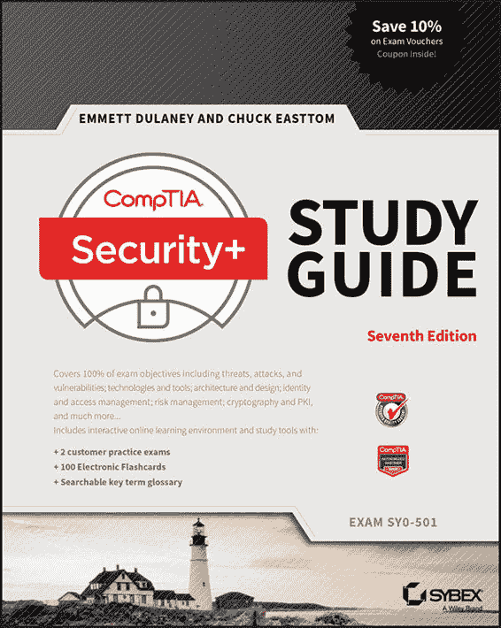


版权所有 © 2018 John Wiley & Sons, Inc., 印第安纳州，印第安波利斯
在加拿大同步出版

ISBN: 978-1-119-41687-6
ISBN: 978-1-119-41690-6 (ebk.)
ISBN: 978-1-119-41689-0 (ebk.)
美国制造

除非根据 1976 年《美国版权法》第 107 节或第 108 节的规定，或在事先获得出版者书面许可，或通过向版权许可中心（222 Rosewood Drive, Danvers, MA 01923, (978) 750-8400，传真 (978) 646-8600）支付相应的单份费用授权，否则不得以任何形式或手段（电子、机械、复印、录制、扫描或其他）复制、存储在检索系统中或传输本书的任何部分。许可请求请联系 John Wiley & Sons, Inc., 111 River Street, Hoboken, NJ 07030, (201) 748-6011, 传真 (201) 748-6008 或访问 http://www.wiley.com/go/permissions。

责任限制/免责：出版商和作者对本书内容的准确性或完整性不作任何陈述或保证，并特别否认所有保证，包括但不限于对特定用途的保证。销售或促销材料不得创建或扩大任何保证。本书包含的建议和策略可能不适用于每种情况。本书的销售基于以下理解：出版商并未提供法律、会计或其他专业服务。如果需要专业协助，应寻求有能力的专业人士的服务。出版商和作者对由此产生的损害均不承担责任。本书中将某个组织或网站作为引用和/或进一步信息的潜在来源提及，并不意味着作者或出版商认可该组织或网站可能提供的信息或其可能提出的建议。此外，读者应注意，书中列出的互联网网站在本书编写与阅读之间可能已经发生变化或消失。

欲了解有关我们其他产品和服务的通用信息或获取技术支持，请联系我们的美国客户服务部门：(877) 762-2974；美国外：(317) 572-3993 或传真：(317) 572-4002。

Wiley 以多种印刷和电子格式以及按需打印出版。本书标准纸质版包含的部分材料可能未包含在电子书或按需打印中。如果本书提到的 CD 或 DVD 等媒体未包含在购买的版本中，您可以在 http://booksupport.wiley.com 下载这些材料。欲了解更多关于 Wiley 产品的信息，请访问 www.wiley.com。

美国国会图书馆控制号：2017955410

商标：Wiley、Wiley 标志和 Sybex 标志是 John Wiley & Sons, Inc. 及其/或其关联公司在美国和其他国家的商标或注册商标，未经书面许可不得使用。CompTIA 和 Security+ 是 CompTIA, Inc. 的商标或注册商标。所有其他商标均为其所有者的财产。John Wiley & Sons, Inc. 与书中提到的任何产品或供应商均无关。

# 致谢

如果没有第一版作者 Mike Pastore，这本书将不复存在。他针对一项广泛的考试列出了一系列复杂的目标，并撰写了你现在手中这份学习指南的基础。虽然考试及其相关目标随着每次版本的迭代而改进，但此书的所有后续版本都对他早期的展现的知识、辛勤工作和才华永存感激。

感谢 Gary Schwartz，他是出版行业中最优秀、合作的编辑之一，并感谢 Wiley 所有协助此本书的同仁。

# 关于作者

Emmett Dulaney 是印第安纳州一所小型大学的教授，曾任 Mercury Technical Solutions 的培训总监。他是《认证杂志》的专栏作家，并撰写了关于认证、操作系统和跨平台集成的 30 多本书。Emmett 可以 eadulaney@comcast.net 与他联系。

Chuck Easttom 是计算机科学和计算机安全的研究员、顾问和培训师。他在软件工程、操作系统、数据库、Web 开发和计算机网络方面拥有专业知识。他环游世界就数字取证、网络安全、密码学及相关主题进行教学和咨询。他已编写了 22 本以上的著作以及数十篇研究论文。Chuck 还是一个发明家，拥有 10 项专利计算机科学发明。他还经常在计算机相关案件中担任专家证人。他的网站是 http://chuckeasttom.com/。


   - 图 2.1 PCI-DSS 控制目标
   - 图 2.2 典型的 DMZ
   - 图 2.3 网络分段
   - 图 2.4 通过互联网使用 VPN 连接的两个局域网
   - 图 2.5 代理防火墙阻止来自外部网络的网络访问
   - 图 2.6 Windows 10 控制面板


1. 图 4.1 `tcpdump`
2. 图 4.2 `Wireshark`
3. 图 4.3 `Wireshark` 跟踪会话
4. 图 4.4 SolarWinds 网络拓扑扫描
5. 图 4.5 SolarWinds 扫描结果
6. 图 4.6 `LanHelper`
7. 图 4.7 `Aircrack`
8. 图 4.8 `pwdump`
9. 图 4.9 `Ophcrack`
23. 图 4.23 Kerberos 认证过程
24. 图 4.24 RADIUS 客户端管理本地连接并向中央服务器进行认证


5. 图 7.5 Shodan
6. 图 7.6 Firefox
7. 图 7.7 原型制作

6. 图 8.6 PGP 加密

5. 图 10.5 虚报警报是一种骗术行为。

- 14. [图 10.14] 安全槽中的电缆防止笔记本电脑被轻易移除](#part0019_split_003.html_figure10-14)

- 1. [图 11.1] 蓝牙窃取 (Bluesnarfing](##part0020_split_001.html_figure11-1)
- 2. [图 11.2] 恶意孪生盗用接入点](#part0020_split_001.html_figure11-2)
- 3. [图 11.3] 地理围栏](#part0020_split_002.html_figure11-3)

- 4. [图 12.4] 备份服务器归档服务器文件](#part0021_split_003.html_figure12-4)
- 5. [图 12.5] 工作站或服务器的系统重建过程](#part0021_split_003.html_figure12-5)

1. 封面
2. 目录
3. 引言

## 页码
2. ix
3. xxiv
4. xxv
5. xxvi
8. xxix
9. xxx
10. xxxi
11. xxxii
12. xxxiii
15. xxxvi
16. xxxvii
17. xxxviii
18. xxxix
21. xlii
22. xliii
23. xliv
24. xlv
27. xlviii
28. 1
29. 2
30. 3
33. 6
34. 7
37. 10
38. 11
39. 12
40. 13
43. 16
44. 17
45. 18
46. 19
49. 22
50. 23
51. 24
52. 25
55. 28
56. 29
57. 30
58. 31
61. 34
62. 35
63. 36
64. 37
67. 40
68. 41
69. 42
70. 43
71. 45
74. 48
75. 49
76. 50
77. 51
78. 52
81. 55
82. 56
83. 57
84. 58
87. 61
88. 62
89. 63
90. 64
93. 67
94. 68
95. 69
96. 70
99. 73
100. 74
101. 75
102. 76
105. 80
106. 81
107. 82
108. 83
111. 86
112. 87
113. 88
114. 89
117. 92
118. 93
119. 94
120. 95
121. 96
124. 99
125. 100
126. 101
127. 102
130. 105
131. 106
132. 107
135. 110
136. 111
137. 112
138. 113
139. 114


142. 117
143. 118
144. 119
145. 121
146. 122
149. 125
150. 126
151. 127
152. 128
155. 131
156. 132
157. 133
158. 134
161. 137
162. 138
163. 139
164. 140
165. 141
168. 144
169. 145
170. 146
171. 147
174. 150
175. 151
176. 152
177. 153
180. 156
181. 157
182. 158
183. 159
184. 160
187. 163
188. 164
189. 165
190. 166
193. 169
194. 170
195. 171
196. 172
197. 173
200. 176
201. 177
202. 178
203. 179
206. 182
207. 183
208. 184
209. 185
212. 188
213. 189
214. 190
215. 191
216. 192
219. 195
220. 196
221. 197
222. 198
225. 201
226. 202
227. 203
228. 204
231. 207
232. 208
233. 209
234. 210
237. 213
238. 214
239. 215
240. 216
243. 219
244. 220
245. 221
246. 222
247. 223
250. 226
251. 227
252. 228
253. 229
256. 232
257. 233
258. 234
259. 235
262. 238
263. 239
264. 240
265. 241
268. 244
269. 245
270. 246
271. 247
274. 250
275. 251
276. 252
277. 253
280. 256
281. 257
282. 258
283. 259
284. 260
287. 263
288. 264
289. 265
290. 266
293. 269
294. 270
295. 271
296. 272
299. 275
300. 276
301. 277
302. 278
305. 281


307. 283
308. 284
309. 285
310. 286
313. 289
314. 290
315. 291
316. 292
319. 295
320. 296
321. 297
322. 298
325. 301
326. 302
327. 303
328. 304
329. 305
332. 308
333. 309
334. 310
335. 311
338. 314
339. 315
340. 316
341. 317
344. 320
345. 321
346. 322
347. 323
348. 324
351. 327
352. 328
353. 329
354. 330
357. 333
358. 334
359. 335
360. 336
363. 339
364. 340
365. 341
366. 342
369. 345
370. 346
371. 347
372. 348
375. 351
376. 352
377. 353
378. 354
381. 357
382. 358
383. 359
384. 360
387. 363
388. 364
389. 365
390. 366
393. 369
394. 370
395. 371
396. 372
397. 373
400. 376
401. 377
402. 378
403. 379
406. 382
407. 383
408. 384
409. 385
412. 388
413. 389
414. 390
415. 391
418. 394
419. 395
420. 396
421. 397
424. 400
425. 401
426. 402
427. 403
428. 404
431. 407
432. 408
433. 409
434. 410
437. 413
438. 414

# 引言

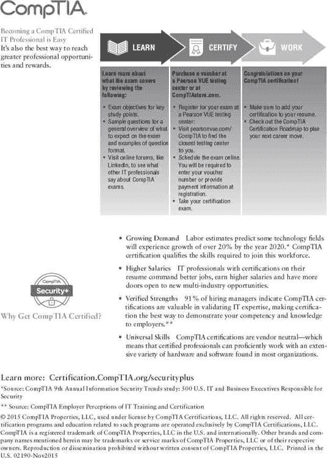


本书介绍的是中级技术水平的内容。对安全概念、操作系统和应用程序系统的经验和知识将帮助你全面理解作为安全专业人员所将面临的挑战。

我们在每一章的末尾都包含了复习题，让你领略一下考试的感受。如果你已经在安全领域工作，我们建议你先查看这些问题，以评估你的专业知识水平。然后，你可以主要利用这本书来填补你现有知识的空白。这本学习指南将帮助你在应对考试之前完善你的知识体系。

如果你能正确回答某个特定章节中 90% 或以上的复习题，你就可以放心地进入下一章。如果你无法正确回答那么多的题目，请重读该章节并再次尝试题目。你的得分将会提高。

在开始备考之前，你必须了解有关 Security+ 认证的几点。`Security+` 是由 `CompTIA`（一个负责许多入门级认证的行业协会）颁发的证书，授予那些通过单项入门级考试获得通过分数的人。除了将 `Security+` 作为一项独立认证加入你的简历外，你还可以将其作为许多厂商认证路径中的选修课程。

当你准备任何考试时，准备工作的第一步始终应该是尽可能多地有关测试的信息：提前了解得越多，就越能规划你的学习路线。目前的考试以及本书涵盖的考试是 2017 年更新版。尽管所有变量都可能发生变化，但在本书编写期间，考试包含 100 道题。你有 90 分钟的时间参加考试，及格分数基于 100 到 900 分的分值。`Pearson VUE` 测试中心在美国及其他几个国家提供考试服务。

你还应该知道，`CompTIA` 以在其所有考试中都包含模糊的问题而闻名。你可能会看到这样一道题：四个可能的答案中有两个是正确的——但你只能选择一个。利用你的知识、逻辑和直觉来选择最佳答案，然后继续。有时，问题的措辞方式会让英语专业的学生感到尴尬——这里有一个拼写错误，那里有一个动词错误。不要让这让你沮丧；回答问题，然后进入下一个。虽然我们没有故意添加拼写错误或其他语法错误，但书中的题目尽力还原真实考试题目的结构和外观。

在学习过程中，你需要知道你要参加的考试是在特定时间点创建的。你不会看到关于上周袭击你系统的新病毒的问题，但你会看到关于在该考试创建时存在的概念的问题。更新考试是一个困难的过程，会导致考试编号的增加。

获得 `Security+` 认证有很多理由。这些包括以下方面：

**它提供了专业成就的证明。** 专业的认证是脱颖而出的最佳方式。在这个技术认证的时代，你会发现成千上万成功完成 `Microsoft` 和 `Cisco` 认证路径的管理员。为了让自己脱颖而出，你需要更多一点。`Security+` 考试是 `CompTIA` 认证路径的一部分，该路径包括 `A+`、`Network+` 以及其他厂商中立认证，如 `Linux+`、`Project+` 等。这项考试将帮助为你更高级的认证做准备，因为它在安全概念方面提供了坚实的基础，并将赋予你应得的认可。

**它提供了晋升的机会。** 证明自己有能力且敬业的人最有可能晋升。获得认证是证明你的技能水平并向雇主展示你致力于提高技能集的好方法。看看你周围那些拥有证书的人：他们可能就是获得良好加薪和晋升的人。

**它满足了培训要求。** 许多公司为员工设定了培训要求，以便他们跟上最新技术。安全认证计划为管理员在耗尽一些其他行业标准认证后提供了另一条可以遵循的认证路径。

## 如何成为 Security+ 认证专家

获取认证的第一步是在任何 `Pearson VUE` 测试中心注册考试。考试价格根据国家或 `CompTIA` 会员身份而异。你可以联系 Pearson：

[`www.vue.com/comptia`](http://www.vue.com/comptia)

美国和加拿大：877-551-PLUS (7587)

在你成功通过 `Security+` 考试后，`CompTIA` 将授予你证书。在通过考试后的四到六周内，你将收到官方 `CompTIA Security+` 证书和身份卡。（如果你在参加考试八周内没有收到这些物品，请使用注册包中找到的信息直接联系 `CompTIA`。）

## 谁应该读这本书？


## 本书涵盖了什么？

本书涵盖了你通过 Security+ 考试所需的所有知识。

* 第 3 章：理解设备与基础设施
* 第 4 章：身份与访问管理
* 第 5 章：无线网络威胁
* 第 6 章：云安全加固
* 第 9 章：威胁、攻击与漏洞
* 第 10 章：社会工程和其他敌人
* 第 11 章：安全管理
* 第 12 章：灾难恢复与应急响应

这里是一些参加考试的通用建议：

* 随身携带两种身份证。其中一种必须是照片身份证（如驾驶执照），另一种可以是主信用卡或护照。两种证件都必须包含签名。
* 不要遗留任何未回答的题目。未回答的题目会扣分。
* 将会有多个正确答案的问题。当有多个正确答案时，屏幕底部的消息会提示你“选择两个”或“选择所有适用项”。务必阅读显示的消息，以了解你必须选择几个正确答案。
* 在回答你不确定的单选题时，使用排除法先剔除明显错误的答案。如果你需要进行合理推测，这样做将提高你的几率。
* 在基于形式的测试（非自适应）中，由于难题最耗时间，请将其留到最后。你可以在考试中前后移动。
* 有关考试的最新定价和注册程序的更新，请访问 CompTIA 网站：`http://certification.comptia.org`。

我们在书中和配套网站上包含了几项测试功能。这些工具将帮助你记住重要的考试内容，并帮助你为实际考试做好准备：

**评估测试** 在本介绍的结尾有一项评估测试，你可以用它检查自己对考试的准备情况。在开始阅读本书之前进行此测试；它将帮助你确定可能需要复习的领域。评估测试问题的答案出现在测试最后一个题目之后的单独页面上。每个答案都包含一个解释以及一条告知该材料出现章节的备注。

**考试要点** 在总结部分之前，每章都包含了一些考试要点。这些是在你准备考试时，从该章节中应该重点关注的关键主题。

**复习题** 为了在阅读本书的过程中测试你的知识，每章的末尾都有复习题。当你完成每个章节时，回答复习题并检查你的答案。正确答案和解释可以在附录 A 中找到。你可以回去重读涉及错题的章节，以确保在下次测试该材料时能够正确回答。

*CompTIA Security+ Study Guide: Exam SY0-501* 配套的交互式在线学习环境提供带有学习工具的题库，帮助你准备认证考试并增加首次通过考试的概率！题库包含以下元素：

**样本测试** 本书中提供的所有问题，包括你在介绍末尾看到的评估测试以及章节测试（包含每章末尾的复习题）。此外，还有两份模拟考试。使用这些问题来测试你对学习指南材料的掌握。在线题库可以在多个设备上运行。

**术语表** 本书中的关键术语及其定义以完全可搜索的 PDF 格式提供。

**额外实验** 在线你还会找到额外的额外实验。这些包括可以在系统上进行的实验活动，以及智力练习（十字字游戏、单词搜索等），以帮助记忆关键概念。

如果你想为 Security+ 考试打下坚实的基础，这本书就是适合你的。我们花费了无数小时编写这本书，唯一目的就是帮助你准备考试。

书中充满了有价值的信息，如果你了解我们是如何组织内容的，你就能让学习效率最大化。以下是描述如何学习的列表：

3. 读读总结和考试要点。这些内容将突出你在参加考试前需要熟悉的章节部分。
4. 回答每章末尾的所有复习题。特别注明任何困扰你的问题，并重新学习书中的这些章节部分。不要只是扫一眼这些问题——确保你完全理解每个答案。
5. 复习电子闪卡。这些有助于你准备最新的 Security+ 考试，它们是非常好的学习工具。
6. 参加模拟考试。

CompTIA 尽力确保其认证计划能够准确反映 IT 行业的最佳实践。他们通过为每个考试计划建立委员会来实现这一点。每个委员会由一小组 IT 专业人士、培训提供者和出版人员组成，他们负责建立考试的基准能力水平，并确定适当的目标受众水平。


一旦确定了这些因素，CompTIA 将会将这些信息与一组精选的主题专家（SME）共享。这些人是该认证计划背后的真正大脑。对于本次考试，他们是来自 Microsoft、Oracle、VeriSign 和 RSA Security 等机构的资深 IT 业内人士。SME 会审查委员会的发现，对其进行完善，并将其塑造为本节之后的后续目标。CompTIA 将此过程称为工作-任务分析（JTA）。

最后，CompTIA 会进行调查，以确保目标和权重真实反映了工作需求。只有这样，SME 才能开始编写考试所需的数百道题库。尽管如此，在许多情况下，在考试以最终状态上线之前，他们仍需要回到起点进行更进一步的完善。请放心，你即将学习的内容在你通过考试后很一段时间仍将对你有帮助。

| 领域 | 考试占比 |
| --- | --- |
| 1.0 威胁、攻击和漏洞 | 21% |
| 4.0 身份和访问管理 | 16% |
| 5.0 风险管理 | 14% |
| 6.0 加密法和 PKI | 12% |
| 总计 | 100% |

| 目标 | 章节 |
| --- | --- |
| **1.0 威胁、攻击和漏洞** | |
| 1.2 比较并对比攻击类型 | |
| 社会工程：网络钓鱼；鱼叉式钓鱼；鱼叉钓鱼；语音钓鱼；尾随；身份冒充；翻垃圾桶；肩旁窥视；骗局；水坑攻击；原理（有效性原因）：（权威；威慑；共识；稀缺；熟悉度；信任；紧急性） | 第 10 章 |
| 应用/服务攻击：DoS；DDoS；中间人攻击；缓冲区溢出；注入；跨站脚本；跨站请求伪造；权限提升；ARP 投毒；放大；DNS 投毒；域名劫持；浏览器中间人；零日；重放；哈希传递；劫持及相关攻击（点击劫持；会话劫持；URL 劫持；域名拦截）；驱动程序操纵（填充；重构）；MAC 伪装；IP 伪装 | 第 9 章 |
| 无线攻击：重放；IV；恶性孪生；流氓 AP；干扰；WPS；蓝牙植入；蓝牙嗅取；RFID；NFC；断开连接 | 第 5 章 |
| 角色类型：脚本小子；黑客主义者；组织犯罪；国家级/APT；内部人员；竞争者攻击者属性：内部/外部；复杂程度；资源/资金；意图/动机；开源情报的使用 | |
| 1.4 解释渗透测试概念 | 第 12 章 |
| 主动侦察；被动侦察；枢纽；初始利用；持久化；权限提升；黑盒；白盒；灰盒；渗透测试 vs. 漏洞扫描 | |
| 1.5 解释漏洞扫描概念 | 第 12 章 |
| 竞态条件；由于以下原因导致的漏洞：（生命终结系统；嵌入式系统；缺乏厂商支持）；输入处理不当；错误处理不当；配置错误/弱配置；默认配置；资源耗尽；未经训练的用户；配置不当的账户；脆弱的业务流程；弱加密套件和实现；内存/缓冲区漏洞（内存泄漏；整数溢出；缓冲区溢出；指针解引用；DLL 注入）；系统扩散/未记录的资产；架构/设计缺陷；新威胁/零日；证书和密钥管理不当 | |
| **2.0 技术与工具** | |
| 2.1 安装和配置硬件及软件网络组件，以支持组织安全 | 第 3 章 |
| 防火墙（ACL；基于应用 vs. 基于网络；有状态 vs. 无状态；隐式拒绝）；VPN 集中器（远程访问 vs. 站点到站点；`IPSec`(隧道模式，传输模式，AH, ESP）；分流隧道 vs. 全隧道；TLS；始终开启 VPN）；NIPS/NIDS（基于特征；启发式/行为；异常；Inline vs. 被动式；带内 vs. 带外；规则；分析（误报，漏报））；路由器（ACLs；反伪装）；交换机（端口安全；二层 vs. 三层；环路保护；泛洪防护）；代理（正向和反向代理；透明；应用/多功能）；负载均衡器（调度（亲和性，轮询）；主备式；主主式；虚拟 IP）；接入点（SSID；MAC 过滤；信号强度；信号选择/宽度；天线类型和放置；胖型 vs. 瘦型；基于控制器 vs. 独立）；SIEM（聚合；关联；自动报警和触发；时间同步；事件去重；日志/WORM）；DLP（USB 阻塞；云端；电子邮件）；NAC（可解析 vs. 永久；主机健康检查；代理 vs. 无代理）；邮件网关（垃圾邮件过滤器；DLP；加密）；网桥；SSL/TLS 加速器；SSL 解密器；媒体网关；硬件安全模块（注：此处为硬件安全模块，即 HSM） | |
| 2.3 在给定场景下，排除常见的安全问题 | 第 4 章 |
| 未加密凭据/明文；日志和事件异常；权限问题；访问违反；证书问题；数据外泄；错误的设备（防火墙；内容过滤器；接入点）；弱安全配置；人员问题（违反策略；内部威胁；社会工程；社交媒体；个人电子邮件）；未经软件；基线偏差；许可证合规违反（可用性/完整性）；资产管理；身份验证问题 | |
| 2.4 在给定场景下，分析并解释安全技术的输出 | 第 4 章 |
| HIDS/HIPS；防病毒软件；文件完整性检查；主机防火墙；应用白名单；可移动媒体控制；高级恶意软件工具；补丁管理工具；UTM；DLP；数据执行防护；Web 应用防火墙 | |


- **移动设备管理概念**：`应用管理`、内容管理`、远程擦除`、地理围栏`、地理位置定位`、屏幕锁定`、推送通知服务`、密码和 PIN 码、生物识别`、上下文感知认证`、容器化`、存储分段`、全设备加密`。
- **针对以下内容的强制与监控**：`第三方应用商店`、`Root/越狱`、`侧载`、自定义固件`、运营商解锁`、固件 OTA 更新`、相机使用、`SMS/MMS`、外部媒体、`USB OTG`、麦克风录音、GPS 标记、`WiFi 直连/自建`、`网络共享`、支付方式`。
- **部署模型**：`BYOD`、`COPE`、`CYOD`、公司所有`、`VDI`。
- **协议**：`DNSSEC`、`SSH`、`S/MIME`、`SRTP`、`LDAPS`、`FTPS`、`SFTP`、`SNMPv3`、`SSL/TLS`、`HTTPS`。
- **用例**：`语音和视频`、时间同步、`电子邮件和网页`、文件传输、目录服务、远程访问、域名解析、路由与交换、`网络地址分配`、`订阅服务`。

# 3.0 架构与设计
- **行业标准框架和参考架构**：`监管性`、`非监管性`、国家与国际对比、`特定行业框架`。
- **基准/安全配置指南**：`平台/厂商特定指南`（`Web 服务器`、`操作系统`、`应用服务器`、网络基础设施设备`）、通用指南`。
- **深度防御/分层安全**：`厂商多样性`、`控制多样性`（管理性；技术性）、用户培训`。

- **隔离/分段/划分**：`物理`、`逻辑`（`VLAN`）、虚拟化、`物理隔离`。
- **隧道/VPN**：`对等站点`、远程访问`。
- **安全设备/技术部署**：`传感器`、收集器、关联引擎、过滤器、代理服务器、`防火墙`、`VPN 集中器`、`SSL 加速器`、`负载均衡器`、`DDoS 缓解器`、聚合交换机、`分路器和端口镜像`、`SDN`。

- **操作系统**：`类型`（网络、服务器、工作站、设备、亭机、移动操作系统）、`补丁管理`、`禁用不必要的端口和服务`、`最小功能原则`、安全配置、受信操作系统、`应用白名单/黑名单`、`禁用默认账户/密码`。
- **外围设备**：无线键盘、无线鼠标、显示器、`支持 WiFi 的 MicroSD 卡`、打印机/多功能一体机、外部存储设备、数字相机`。

## 3.4 解释安全阶段性部署概念的重要性（第 2 章）
## 3.5 解释嵌入式系统的安全影响（第 7 章）
- `SCADA/ICS`、`智能设备/IoT`（可穿戴技术、家居自动化））、`HVAC`、`SoC`、`RTOS`、打印机/多功能一体机、摄像头系统、`特殊用途`（医疗设备、车辆、飞机/无人机）。

## 3.6 总结安全应用开发和部署概念（第 7 章）
- **版本控制与变更管理**、`配置与撤销`。
- **安全编码技术**：`适当的错误处理`、`适当的输入验证`、规范化、存储过程、代码签名、加密、`混淆/伪装`、`代码复用/死代码`、`服务端与客户端的执行与验证`、`内存管理`、`第三方库和 SDK 的使用`、`数据泄露`。
- **代码质量与测试**：`静态代码分析器`、`动态分析`（例如`模糊测试`）、压力测试、沙箱、`模型验证`。
- `编译代码`对比`运行时代码`。
- **虚拟机监控器**：`I 型`、`II 型`、`应用单元/容器`。
- `防止虚拟机泛滥`、`虚拟机逃逸防护`。
- **云存储**、**云部署模型**（SaaS、PaaS、IaaS、私有、公有、混合、社区）。
- `本地 vs 托管 vs. 云端`、`VDI/VDE`、`云访问安全代理`、`安全即服务`。
- **自动化/脚本**：`自动化行动方案`、持续监控、`配置验证`。
- **模板**：`主镜像`、`非持久化`（`快照`、`恢复到已知状态`、`回滚到已知配置`、`启动介`）。
- **弹性**：`可扩展性`、分布式分配、`冗余`、`容错`、`高可用`、`RAID`。


# 4.0 身份与访问管理

## 4.1 比较身份访问管理概念（第 4 章）
- `联邦`、`单点登录`、`传递信任`。

## 4.2 给定场景，安装并配置身份访问服务（第 4 章）
- `LDAP`、`Kerberos`、`TACACS+`、`CHAP`、`PAP`、`MSCHAP`、`RADIUS`、`SAML`、`OpenID Connect`、`OAuth`、`Shibboleth`、`安全令牌`、`NTLM`。
- **访问控制模型**：`MAC`、`DAC`、`ABAC`、`基于角色的访问控制`、`基于规则的访问控制`。
- **物理访问控制**：`感应卡`、智能卡。
- **生物识别因子**：`指纹扫描`、`视网膜扫描`、`虹膜扫描`、`语音识别`、`脸部识别`、`误识率`、`误拒率`、`交叉错误率`。
- **令牌**：硬件、软件、`HOTP/TOTP`。

#### 4.4 给定场景区分区分账户管理实践（第 11 章）
- **账户类型**：`用户账户`、`共享和通用账户/凭据`、`访客账户`、`服务账户`、`特权账户`。
- **通用概念**：`最小权限`、`入职/离职`、`权限审计与审查`、`使用审计与审查`、`时间限制`、`重新认证`、`标准命名规范`、`账户维护`、`基于组的访问`、`基于位置的策略`。


| 5.3 解释风险管理流程和概念 | 第 1 章 |
| `威胁评估（环境；人为；内部与外部）`; `风险评估（`SLE`;`ALE`;`ARO`;`资产价值`;`风险注册表`;`发生概率`;`供应链评估`;`影响`;`定量`;`定性`;`测试（渗透测试授权；漏洞测试授权）`); `风险响应技术（接受；`转移；`避免；`缓解）`)`; `变更管理` | |

| 5.4 在给定的场景下，遵循事件响应程序 | 第 12 章 |
| 5.5 总结取证的基本概念 | 第 12 章 |
| `易失性顺序`;`证据链`;`法律保留`;`数据采集（捕获系统镜像；`网络流量和日志；`捕获视频；`记录时间偏移；取哈希；`截图；`证人访谈）`; `保护`;`恢复`;`战略情报/反情报收集（活动日志）`;`跟踪工时` | |

| 5.6 解释灾难恢复和业务连续性概念 | 第 12 章 |
| 5.7 对比不同类型的控制措施 | 第 10 章 |
| `威慑`;`预防`;`检测`;`纠正`;`补偿`;`技术`;`管理`;`物理` | |

| 5.8 在给定的场景下，执行数据安全和隐私实践 | 第 10 章 |
# 6.0 密码学与 PKI

| 6.1 对比密码学的基本概念 | 第 8 章 |
| `对称算法`;`工作模式`;`非对称算法`;`哈希`;`盐`;`IV`;`随机数 (nonce)`;`椭圆曲线`;`弱/弃用算法`;`密钥交换`;`数字签名`;`扩散`;`冲突`;`隐身术`;`混淆`;`流式 vs 块式`;`密钥强度`;`会话密钥`;`临时密钥`;`秘密算法`;`传输中数据`;`静态数据`;`使用中数据`;`随机/伪随机数生成`;`密钥扩展`;`实现 vs 算法选择（加密服务提供商`;`加密模块）`;`完美向前秘密`;`通过模糊实现安全`;`常见用例（低功耗设备；`低延迟；`高弹性；`支持机密性；`支持完整性；`支持混淆；`支持身份验证；`支持不可否认性；`资源 vs 安全约束）` | |
| `对称算法（AES`;`DES`;`3DES`;`RC4`;`Blowfish/Twofish)`; `密码模式（CBC`;`GCM`;`ECB`;`CTM`;`流式 vs 块式)`; `非对称算法（RSA`;`DSA`;`Diffie-Hellman (组`;`DHE`;`ECDHE));`; `椭圆曲线`;`PGP/GPG）`; `哈希算法（MD5`;`SHA`;`HMAC`;`RIPEMD）`; `密钥扩展算法（BCRYPT`;`PBKDF2）`; `混淆（XOR`;`ROT13`;`替换密码）` | |

| 6.3 在给定的场景下，安装并配置无线安全设置 | 第 8 章 |
| `加密协议（WPA`;`WPA2`;`CCMP`;`TKIP)`; `身份验证协议（EAP`;`PEAP`;`EAP-FAST`;`EAP-TLS`;`EAP-TTLS`;`IEEE 802.1x`;`RADIUS 联邦）`; `方法（PSK vs 企业级 vs. 开放；`WPS；`强制门户）` | |
| `组件（CA`;`中间 CA`;`CRL`;`OCSP`;`CSR`;`证书`;`公钥；`私钥`;`对象标识符 (OID)))`; `概念（在线 vs 离线 CA`;`Stapling`;`锁定`;`信任模型`;`密钥托管`;`证书链）`; `证书类型（通配符`;`SAN`;`代码签名`;`自签名`;`机器/计算机`;`电子邮件`;`用户`;`根`;`域名验证`;`扩展验证）`; `证书格式（DER`;`PEM`;`PFX`;`CER`;`P12`;`P7B）` | |

# 评估测试

    - `使用审计`
    - `升级审计`
    - `报告审计`

    - `周边界安全`
    - `安全区域`
    - `安检门 (Mantrap)`

    - `PKCS`
    - `ISA`
    - `SSL`

    - `RPO`
    - `RTP`
    - `WML`

    - `桌面演练`
    - `黑帽`
    - `DHE`

    - `HSM`
    - `MTU`
    - `PIV`

    - `VLAN`
    - `I&A`
    - `路由器`

    - `私密钥`
    - `旧密钥`
    - `托管密钥`

    - `后门`
    - `中间人攻击`
    - `洪水攻击`

    - `传感器`
    - `事件`
    - `分析器`

    - `MAC 地址`
    - `DHCP 配置`
    - `DNS 默认值`

    - `验证伦理得到维护`
    - `建立明确的数据控制`
    - `验证数据私密安全`

    - `MD5`
    - `SSHA`
    - `OCSP`

    - `128-bit`
    - `256-bit`
    - `512-bit`

    - `你的硬盘可能有缺陷。`
    - `你的用户想象了不存在的事，因此是错的。`
    - `系统正遭受电压浪涌。`

    - `ACL`
    - `加固`
    - `端口阻塞`


17. 不利用虚拟机管理程序（hypervisors）的虚拟化可以通过以下哪种方式实现？
1. `Wrappers`
4. `Sinks`

18. 哪种类型的程序主要为了传播并扩散到其他系统？
1. `Virus`
4. `Worm`

19. 有个人出现在你的办公室，自称是服务技术人员，想讨论你目前的服务器配置。这可能是哪种攻击的示例？
1. `Social engineering`
4. `Behavioral engineering`

20. 以下哪种是中间人攻击的一种，其中特洛马操纵了浏览器与其安全机制之间的调用，但仍然显示用户预期的交易？
1. `PFS`
4. `SDN`

21. 你应该安装哪个系统来为连接到互联网的网络提供主动保护和安全问题通知？
1. `IPS`
4. `VPN`

22. 验证维护证据完整性所采取步骤的过程被称为什么？
1. `Security investigation`
4. `Security policy`

23. 哪种加密过程使用一条消息来隐藏另一条？
1. `Steganography`
4. `Cryptointintelligence`

24. 采取被动方法而非实际尝试入侵网络的渗透/漏洞测试被称为以下哪种？
1. `Flaccid testing`
4. `Pedestrian testing`

25. 哪种算法用于为交换密钥信息创建一个临时安全会话？
1. `KDC`
4. `RSA`

26. 你受聘为一个开始实施智能手机等手持设备的公司的安全顾问。你告知公司必须使用非对称系统。你会建议他们实施哪种安全标准？
1. `ECC`
4. `MD`

27. 以下哪种备份方法通常提供最快的备份速度？
1. `Full backup`
4. `Archival backup`

28. 你想根据扫描时的个人视网膜认证授予网络访问访问。哪种安全方法使用物理特征作为确定身份的方法？
1. `Smart card`
4. `CHAP`

29. 哪种访问控制方法主要关注个人在组织中的角色？
1. `MAC`
4. `STAC`

30. 调查计算机系统寻找事件线索的过程被称为什么？
1. `Computer forensics`
4. `Evidence gathering`

# 测试答案

2. D. `mantrap`（安全门禁）限制一次仅允许一个人进入。例如，它可以是一个小房间。安全门禁通常使用电子锁和其他方法控制访问。更多信息请参阅第 10 章。

3. B. `Public Key Cryptography Standards`（公钥密码标准）是一组用于公钥加密的自愿标准。这组标准由 `RSA` 协调。更多信息请参阅第 8 章。

5. B. `tabletop exercise`（桌面演习）涉及围坐在桌旁，在协调员的帮助下，以低压力格式讨论可能的安全风险。更多信息请参阅第 12 章。

6. B. `Hardware Security Module` (`HSM`，硬件安全模块）是一种加密处理器芯片（或安装在计算机内的电路），可增强安全性，并常与 `PKI` 系统配合使用。更多信息请参阅第 3 章。

8. C. `key recovery process`（密钥恢复过程）必须能够之前的密钥。如果无法恢复之前的密钥，则使用该密钥的所有信息将无法挽回。更多信息请参阅第 8 章。

9. D. `flood attack`（洪水攻击）旨在通过反复发起服务请求来使协议或服务过载。此类攻击通常会导致 `DoS`（拒绝服务）情况的发生，因为协议冻结或由于请求导致网络中占用了过多带宽。更多信息请参阅第 3 章。

11. A. `SSID` (`Service Set Identifier`，服务集标识符）广播包含网络名称。关于加固的更多信息请参阅第 3 章。

12. A. 为了实现 `integrity`（完整性）目标，你必须验证使用的信息是准确的且未被篡改。`integrity` 与 `accountability`（可追溯性）相结合以确保数据准确并在需要时存在一个最终权威来验证这一点。更多信息请参阅第 8 章。

14. B. `TKIP` 在 `WEP` 加密周围加了一个 128 位的封装，其密钥基于主机设备的 `MAC` 地址和数据包序列号等因素。更多信息请参阅第 5 章。

15. A. `IM` 和其他系统允许毫无防备的用户下载可能包含病毒的文件。由于文件扩展命名规范的弱点，显示具有一个扩展名的文件实际上可能有另一个扩展名。例如，`account.doc.vbs` 文件在许多应用程序中显示为 `account.doc`，但它实际上是 Visual Basic 脚本并可能包含恶意代码。更多信息请参阅第 9 章。

17. B. 不利用虚拟机管理程序的虚拟化可以通过使用 `containers`（也称为“Docker 容器”）来实现。更多信息请参阅第 6 章。

18. D. `worm`（蠕虫）旨在繁殖和传播。`Worms` 可能携带导致系统破坏的病毒，但这不是它们的首要任务。更多信息请参阅第 9 章。

20. B. `man-in-the-browser` 攻击（中间中间攻击，缩写为 `MITB`、`MitB`、`MIB` 和 `MiB`）是中间人攻击的一种，其中 `Trojan horse` 操纵了浏览器与其安全机制之间的调用，在交易在浏览器中形成时进行嗅探或修改，但仍然显示用户预期的交易。更多信息请参阅第 9 章。


### 21. **A.** 入侵防护系统 (IPS) 对网络上的异常活动提供主动监控和基于规则的响应。例如，防火墙通过阻止未经授权流量的访问来提供被动安全防护。如果防火墙被破解，IPS 将根据其设计实施的规则通知你。更多信息，请参阅第 3 章。

### 22. **B.** 证据链（Chain of custody）确保从收集点开始，处理证据的每一步骤都经过记录并可追溯。证据链涉及证据存储的谁、做了什么、何时、何地以及为什么。更多信息，请参阅第 12 章。

### 24. **C.** 被动方法而非实际尝试入侵网络的渗透/漏洞测试被称为非侵入性测试。更多信息，请参阅第 12 章。

### 25. **B.** 密钥交换算法 (KEA) 用于创建一个临时会话以交换密钥信息。该会话会创建一个密钥。当密钥交换完成后，正式会话开始。更多信息，请参阅第 8 章。

### 27. **B.** 增量备份通常是最快的备份方法，因为它只备份自上次增量备份或全备以来更改的文件。更多信息请参阅第 12 章。

### 28. **C.** 生物识别是利用物理特征（如掌纹或视网膜模式）建立身份识别的认证过程。更多信息，请参阅第 11 章。

### 30. **A.** 计算机取证是调查计算机系统以确定事件原因的过程。该过程的一部分是收集证据。更多信息，请参阅第 12 章。

# 第 1 章：风险管理

- ** 3.8 解释韧性和自动化策略如何降低风险。**
    - 自动化/脚本：自动化行动方案；持续监控；配置验证
    - 模板
    - 主镜像
    - 可扩展性
    - 分布式配额
    - 冗余
    - 容错能力
- ** 5.1 解释与组织安全相关的策略、计划和程序的重要性。**
    - 标准操作程序 (SOP)
    - 协议类型：BPA；SLA；ISA；MOU/MOA
    - 人员管理：强制休假；岗位轮换；职责分离；整洁桌面；背景检查；离职面试；基于角色的意识培训（数据所有者；系统管理员；系统所有者；用户；特权用户；执行用户）；NDA，入职培训；继续教育；可接受使用政策/行为准则；不利影响
    - RTO/RPO
    - MTBF
    - MTTR
    - 任务关键功能
    - 影响：生命；财产；安全；财务；声誉
    - 隐私影响评估
    - 隐私阈值评估
- ** 5.3 解释风险管理过程和概念。**
- 变更管理

 作为管理员，你负责任。你对创建、存储、传输、查看、修改、删除以及对数据可以进行的几乎一切操作负责。正如此，你不仅必须让数据存在，还必须对其进行保护、认证、加固，并保持其符合所有适用法律、政策和法规的形式。与之相反的是可能发生在数据上的所有危险：可能会被意外删除、覆盖、盗取和丢失。这些潜在危害代表`risks`，你必须了解处理数据时涉及的风险。你必须知道并接受数据可能会损坏、被不该看到的人访问、数值可能会被更改等等。

风险计算权衡潜在的`threat` 与其发生的`likelihood`或`probability`。尽管这看起来可能令人沮丧，但你应该接受这样一个事实：某些风险（通常称为`residual risk`）将且必须存在。本章重点关注风险以及处理风险的各种方式，为了在 Security+ 考试中成功，你需要充分理解所有内容。

我们将首先查看一些与风险领域相关的`vernacular`，即术语。然后我们将进入风险评估；策略、标准和指南；以及变更管理。

每个研究领域都有几个该领域特有的术语或单词，以帮助专业人员之间进行交流。风险研究也不例外。许多与风险相关的术语将出现在本章的各个地方以及整书中。以下术语（在在线词表中也可找到）是 CompTIA 喜欢使用和测试的。提供这些术语是为了让你更容易了解它们每个词想要传达的内容。

## 威胁评估

**环境** 威胁：来自环境的威胁包括洪水、龙卷风、飓风等。如果你与另一个组织共用一栋建筑，如果他们的区域响了火警会发生什么？整栋建筑的喷淋系统是否会被激活导致你的服务器机房被淹？

**人为** 类别之间可能存在重叠，服务器房的环境洪水在本质上可能是人为的，由个人拿着火柴靠近卫生间的烟雾器引起。


**内部 vs. 外部** 如果威胁源是你组织聘佣的个人，那么它被视为内部威胁。如果该个人目前未雇用于你的组织，则被视为外部威胁。

## 风险评估

风险评估也被称为`risk analysis`（风险分析）或`risk calculation`（风险计算）。为了统一，我们将使用 `risk assessment` 作为讨论术语。`risk assessment`处理信息处理能力丧或信息本身丢失带来的威胁、漏洞和影响。简单来说，`vulnerability`（漏洞）是一个可能被威胁利用的弱点。对每个识别出的风险都应该进行概述、描述，并对其发生的可能性进行评估。这里的关键在于跳出框架。在考虑风险评估时，传统的威胁和风险往往过于局。

**组织面临的风险** 这一部分允许你开发场景，帮助你评估在这些此类风险发生时如何处理。操作系统、服务器或应用程序在特定环境中可能存在已知风险。你应该为你的组织如何最好处理这些风险以及应对它们的最佳方式制定一个计划。

**需要解决的风险** 风险评估组件还允许组织对风险进行现实检查，确定哪些风险是真实的，哪些是不可能的。这一过程有助于组织集中资源，并关注最可能发生的风险。例如，工业间谍活动和盗窃很可能，但飓风损坏印第纳州服务器房的风险非常低。因此，应该分配更多资源用于防止间谍活动或盗窃，而不是后者的可能性。

### 计算风险评估

当你进行风险评估时，最重要的事情之一就是确定优先级。并不是所有事情都应该同等对待，因为某些事件发生的可能性更大。此外，公司可以接受某些风险，而其他风险对公司来说可能是灾难性的。

为了风险评估（无论是现实世界还是考试），你应该熟悉一些术语，以确定事件可能产生的`impact`（影响）：

* `ALE` 是`annual loss expectancy`（年度预期损失）值。这是一个衡量你每年预期损失金额的货币标准。
* `SLE` 是另一个货币值，代表你在任何时间可能预期损失的金额：`single loss expectancy`（单次损失预期）。SLE 可以分为两个部分：
* `ARO` 是事件在一年内发生的概率，通常源自历史数据：`annualized rate of occurrence`（年度发生率）。

当你计算风险评估时，记住这个公式：

```

例如，如果你合理合理预计每次 `SLE`（等于资产价值 `AV` 乘以暴露因素 `EF`）将等同 $1,000，且每年发生七次此类事件（`ARO`），那么 ALE 就是 $7,000。相反，如果某个事件在一年内发生的概率只有 10%（`ARO = 0.1`），那么 ALE 将降至 $100。

任何风险评估的关键在于同时识别资产和威胁。你首先必须确定你想保护什么，然后确定这些资产可能受到什么伤害。然后你从成本或严重性的角度对风险进行分析。

### 定量与定性风险评估

为了理解定量和定性的区别，使用一个简单的例子会有帮助。想象你接到一个紧急电话，帮助一家你从未听说过的小公司。结果发现他们唯一的服务器崩溃了，而且备份毫无用处。丢失的文件之一是公司历史的唯一副本。该文件详细记录了公司从成立到现在的状况，并包含了使命宣言随时间变化的各种版本。虽然这个文件对公司文化来说是一个极其痛苦的损失，但它与完成订单和让客户满意无关，因此其损失在性质上是定性的。

另一个损失是客户数据库。它存储了客户联系信息以及所有过去的订单、账单号等历史。公司没有这个文件就无法运行，需要通过从仓库调出所有纸质发票并重新输入系统来重建它。这种损失可以通过损失的业务量以及查找/重新输入所有数据所需的时间来计算，因此它是定量损失。

确保你理解硬件和`service-level agreement (SLA)`（服务水平协议）相关术语的范围和定义。这样做可以帮助避免挫败，并防止意外中断瘫痪你的组织。以下是你应该熟悉的关键指标：

**可能性 (Likelihood)** `likelihood` 一词的含义通常是自解释的；然而，可以给可能性分配具体的数值。美国标准与技术研究院建议将可能性视为一个代表威胁启动可能性的评分。通过这种方式，可以用定性或定量的术表示。表 1.1 显示了根据 NIST Publication 800-30 附录 G 改的威胁事件启动可能性量表。

| 极高 (Very High) | 10 | 对手几乎确定会启动威胁事件。 |
| 高 (High) | 8 | 对手极有可能启动威胁事件。 |
| 中等 (Moderate) | 5 | 对手有些可能启动威胁事件。 |
| 低 (Low) | 2 | 对手不太可能启动威胁事件。 |
| 风险评估指南，美国标准与技术研究院，Publication 800-30。 |

表 1.1 可能性评估量表


## 平均故障间隔
`mean time between failures (MTBF)`（平均故障间隔）是衡量系统或组件预期发生故障的频率的指标。该测量值决定了组件的预期寿命。如果冷却系统的 `MTBF` 为一年，你可以预计该系统将运行一时间；这意味着你应该准备好每年更换或重建一次系统。如果系统运行时间超过了 `MTBF`，那么对你的组织来说是一个额外收益。`MTBF` 对于评估系统的可靠性和使用寿命非常有帮助。


## 平均恢复时间
`mean time to restore (MTTR)`（平均恢复时间）是衡量发生故障后修复系统或组件所需时间的指标。（这通常也被称为 `mean time to repair`，平均修复时间）。对于计算机系统而言，如果 `MTTR` 为 24 小时，这意味着当故障发生时通常需要 24 小时才能修复。


## 恢复点目标
`recovery point objective (RPO)`（恢复点目标）与 `RTO` ，但它定义了系统需要恢复的点。这可能是崩溃前两天的状态（调出旧备份带），或者是崩溃前五分钟的状态（需要完全的冗余）。作为一个一般原则，`RPO` 与崩溃时刻匹配得越近，获取成本就越高。

### 评估隐私
对于今天的管理员来说，隐私是一个极其重要的领域。你不仅负责保持数据的可用性，而且这种可用性必须限制某些特定人员，而这些人员似乎经常发生变化。例如，在医疗领域，记录可能仅限于患者和医生，但一个患者可能有十几个医生，且所有这些医生都需要查看这些数据。其他患者可能希望他们的配偶能够访问其记录，而另一些人则不会。情况如此……

你应该熟悉的两个隐私相关概念是 `privacy impact assessment (PIA)`（隐私影响评估）和 `privacy threshold assessment (PTA)`（隐私阈值评估）。`PIA` 通常与业务影响分析相关，它识别了与组织数据破坏、损坏或问责制缺失可能相关的不利影响。例如，美国国土安全部（DHS）利用它来识别并缓解隐私风险，向公众告知它收集了哪些 `personally identifiable information (PII)`（个人身份信息）、收集信息的原因，以及如何使用、访问、共享、保护和存储。根据 `DHS` 的规定，`PIA` 需要完成三件事：确保符合相关的隐私法律、法规和政策要求；确定风险和影响；以及评估保护措施和替代流程以减轻潜在的隐私风险。

可以帮助识别风险的两种测试类型是 `penetration testing`（渗透测试）和 `vulnerability testing`（漏洞测试）。它们在识别与授权相关的威胁方面特别有用。两者将在后续章节中进行详细讨论。

### 执行你的风险评估
#### 风险规避
`Risk avoidance`（风险规避）涉及识别风险并做出不再参与与该风险相关的活动的决定。例如，公司可能认为许多风险与邮件附件有关，并可能选择禁止任何邮件附件进入网络。作为风险规避的一部分，公司采取措施消除风险，选择从事其他活动，或停止对风险的暴露。规避应该基于明智的决策，即最佳行动方案是偏离可能导致风险暴露的行为。风险规避面临的最大问题之一是，你实际上在避开可能从中获益的活动。例如，避免计算机犯罪的有效风险规避策略简单就是完全避免使用计算机。这种解决方案不仅不现实，还会阻止公司为其利益相关者增加社会价值（更不用说货币价值）。

#### 风险转移
目前的趋势是将许多服务迁移到由第三方提供商托管的云端。如果你这样做，你就通过依赖该第三方提供商的可用性、性能和安全措施参与了某种风险转移。另一种风险转移的可能性涉及聘请外部顾问协助在内部 IT 薄弱的领域提供解决方案，并要求外部顾问保证其工作质量。

#### 风险缓解
`Risk mitigation`（风险缓解）在你采取措施减少风险时即可完成。这一类别包括安装杀病毒软件、教育用户了解可能的威胁、监控网络流量、添加防火墙等。在微软的《安全智能报告》第 13 卷中，列出了以下通过用户意识培训缓解风险的建议：
*   针对新员工和现有员工。
*   设定目标以确保高比例的员工接受安全最佳实践培训。
*   重复信息以提高意识。


CompTIA 倾向于降低风险，并通过使用常规 `audits` 来应对风险，这些审计涉及 `user rights` 和权限审查；`change management`（即为了保护公司资产而遵循的结构化方法）；以及 `incident management`（即事件发生时遵循的步骤，以确保已采取控制措施以防止对所有 IT 资产进行未经授权的访问和更改）。需要建立针对数据丢失或盗窃的策略，并执行技术控制。

`Data loss prevention (DLP)` 系统监控系统（工作站、服务器和网络）的内容，以确保关键内容不被删除或移除。它们还监控谁在使用数据（寻找未经授权的访问）以及谁在传输数据。DLP 系统与网络入侵防御系统具有共同性。其他方法还包括 `IPs`、`firewalls` 和可以帮助降低风险的类似设备。
当实施任何其他响应的成本超过了风险发生时可能造成的损害价值时，`Risk acceptance` 往往是你必须做出的选择。要真正被视为“接受”，它不能是管理员或经理未感知其存在的风险；它必须是一个已识别的风险，且相关人员理解潜在的成本或损害并同意接受。`Risk acceptance` 无非只是承认风险存在并选择不对其采取任何行动。它并不意味着你一定会受到风险的影响，而只是你意识到这种可能存在。很多时候，当实施任何其他选项的成本超过风险实现时可能发生的任何损害价值时，这就是你的选择。每家公司都有不同水平的 `risk tolerance`（有时称为 `risk appetite`）是他们接受的。

风险策略不需要被视为非此即彼的假设。通常可以将部分缓解与规避相结合。你通常会尝试结合策略以尽可能地减少你的敞口。然后你只能接受那些无法通过其他手段解决的问题。在邮箱类比的情况下，将单个箱子分组并将它们全部放在一起的方法结合了缓解和转移的元素。

想象你是一个大型 IT 部门的初级管理员，你认为一个旧服务器应该更换为新服务器。目前没有故障迹象，但你认为在灾难性事件发生之前进行升级是明智的。然而，问题是，所有的支出都需要你上级的批准，而她专注于尽可能为公司节省资金，并以此希望获得晋升的机会。因此，她不想任何人提出不必要的花钱方法。你足够了解她，可以意识到如果真的发生了问题，她将毫不犹豫将所有责任推在你身上以拯救她自己的职业。`Table 1.2` 显示了你如何将各种可能的风险行动应用到此场景中。

| 风险行动 | 应用 |
| --- | --- |
| 风险缓解 (Risk mitigation) | 你写下故障的可能性并提交给老板，同时将关键服务从该服务器迁移到其他服务器。 |
| 风险接受 (Risk acceptance) | 你知道服务器可能会故障，但希望它不会发生。你既不写也不提交报告，因为你不想得罪让你的老板对你不高兴。运气好的话，在服务器崩溃之前你就转到另一个部门了。 |

**表格 1.2** 场景的风险行动

## 与云计算相关的风险

`cloud computing` 一词最近变得非常流行，很少有人对其真实含义达成共同。对于 Security+ 考试而言，`cloud computing` 意味着在互联网上托管服务和数据，而不是在本地托管。这些示例包括：从网页运行如 `Office 365` 或 `Google Docs` 等办公套件应用程序，而不是在每个工作站上安装类似的应用程序；在服务器空间上存储数据，如 `Google Drive`、`SkyDrive` 或 `Amazon Web Services`；以及使用云端网站，如 [Salesforce.com](http://Salesforce.com)。

### 平台即服务
`Platform as a Service (PaaS)` 模型也称为 `cloud platform services`。在这种模型中，供应商允许在他们的基础设施上创建和运行应用程序。这种实现的两个知名模型是 `Amazon Web Services` 和 `Google Code`。


### 基础设施即服务
`Infrastructure as a Service (IaaS)` 模型利用虚拟化技术，客户为使用的资源向云服务供应商付费。由于由于，IaaS 模型类似于电力、燃气和水供应商使用的传统公用模型。`GoGrid` 是这种实现的一个知名示例。

### 合规性
取决于你组织的类型和规模，有许多监管机构的规则是你必须的。例如，如果你的组织是上市公司，你必须遵守 `Sarbanes-Oxley` 严苛且精确的规则，当数据不在你的服务器上时，做到这一点可能很困难。确保托管你数据的任何人都像你一样重视隐私和安全。

### 用户特权


就像网络托管公司通常为了盈利而在一台服务器上放置多个家公司的网站一样，数据托管公司也可以在一台服务器上放置多个家公司的数据。为了防止这种情况出现问题，你应该使用加密技术来保护你的数据。请注意，你的数据安全性取决于与其集成的数据之安全性。例如，假设你的客户数据库托管在一个服务器上，另一家公司也在使用该服务器测试他们正在创建的应用程序。如果他们的应用程序在某个时刻获得了 root 级权限（例如更改密码）并在该时刻崩溃，那么运行应用程序的用户可能会被留下 root 权限，并可能能够访问其无权访问的服务器上的数据，例如你的客户数据库。数据隔离至关重要；请将你的数据存储在安全的服务器上。

数据集成同样重要。确保你的数据没有发生超出你预期的混合。在企业外网中，从多个数据库中提取信息以创建报告并不罕见。这些数据库可能属于任何连接到外网的实体，因此，确保你的数据库设置了适当的权限，以防止其他成员访问到超出你意图共享的信息。

如果说云计算已经流行，那么 `virtualization`（虚拟化）已成为当之热门的技术。虚拟化由允许一组硬件托管多个虚拟机组成。它在大多数大型企业中都有，在小型企业中也变得越来越常见。

与虚拟化相关的一些可能的安全风险包括：


大多数针对虚拟化的威胁都集中在 `hypervisor`（虚拟机监控器）。`Hypervisor` 是虚拟机监视器——即允许虚拟机存在的软件。如果 `hypervisor` 成功受到攻击，攻击者就可以获得所有虚拟系统的 root 级权限。虽然这是一个合法的问题，并且在大多数系统（包括 `VMware`、`Xen` 和 `Microsoft Virtual Machine`）中已被证明是可能的，但它在每次出现时都得到了修补。解决大多数虚拟化威胁的方案始终是应用最新的补丁并保持系统更新。请务必查找并实施虚拟化系统供应商可能在加固指南中发布的建议。

## 开发政策、标准和指南

接下来的章节将讨论为了使安全工作成功你需要建立的政策、标准和指南。

### 实施政策

- **范围声明**：一个好的政策有一个 `scope statement`（范围声明），概述了该政策意图实现的目标，以及该政策涉及的文档、法律和实践。范围声明提供了背景，帮助读者理解政策的内容以及它如何适用于他们。
- **政策概述声明**：`policy overview statement`（政策概述声明）提供了政策的目标、重要性以及如何合规。理想情况下，只需要一段就能让读者对政策有一个整体感觉。
- **政策声明**：一旦政策读者理解了其重要性，他们应该被告知政策的实质。`policy statement`（政策声明）应尽可能清晰且无歧。政策可以以段落形式、项目符号列表或清单的形式呈现。

- **问责制声明**：此政策应说明谁（通常表述为职位，而不是个人的真实姓名）负责确保政策的执行。`accountability statement`（问责制声明）为读者提供了额外信息，说明在发现问题时应联系谁。它还应该指示不遵守政策的后果。
- **例外声明**：有时，即使是最好的政策也无法预见每一种情况`exception statement`（例外声明）就偏离政策必须遵循的程序或过程提供了具体指导。这可能包括在处理情况的人员需要知道下一个联系谁时提供的升级联系方式。

### 纳入标准

`standard`（标准）处理业务的特定问题或方面。标准源自政策。标准应该提供足够的细节，以便进行审计以确定是否符合标准。标准和政策一样，在某些结构方面具有共同点。

- **范围和目的**：`standards document`（标准文档）应该解释或描述其意图。如果为技术实施制定了标准，其范围可能包括软件、更新、插件以及任何其他有助于实施者执行任务的相关信息。
- **角色和职责**：标准文档的这部分概述了由谁负责实施、监控和维护该标准。在系统配置中，这部分将概述客户应该完成什么，以及安装程序应该什么什么。这并不意味着其中一方不能超出这些角色；而是意味着在发生混淆时，清楚谁负责完成哪些任务。


# 参考文档
标准文档的这一部分解释了标准如何与组织的不同策略相关联，从而将标准与已实施的底层策略联系起来。在出现困惑或不确定时，它还允许人们追溯源头并弄清楚标准的含义。在你的职业生涯中，你会遇到很多这类标准看起来毫无逻辑的情况。通常，通过参考相关策略，你可以弄清楚为什么该标准是这样写的。这样做可能帮助你执行该标准，或者向负责该标准的人员通报变更或问题。


例如，如果你负责在偏远地点安装服务器，标准将规定将使用什么种类型的计算机、安装什么操作系统以及任何其他相关规格。

## 维护与管理要求
如你所见，标准文档为新旧标准的合规性评估提供了一种机制。评估过程被称为 `audit`（审计）。组织日益被要求对其标准和策略进行定期审计。

## 遵循指南
指南（Guidelines）与策略或标准略有不同。`Guidelines` 通过提供如何执行策略和维护标准的信息，帮助组织实施或维护标准。

指南并不是硬性的铁律规则。然而，它们可以提供完成任务的逐步流程。与标准和策略一样，指南也应该包含背景信息，以帮助用户执行任务。

以下四项代表了一个良好的指南文档的最少内容：
`scope and purpose`（范围与目的）部分提供了指南意图的概述和声明。在文档开头看到“目的与范围”或“范围与目的”标题并不罕见，随后是如下文字：“本文档包含了 `xyz` 的分配和使用的指南及程序，并规定了管理……的可接受使用的最低要求……”

当范围和目的是两个独立的标题时，“目的”部分下的信息说明了其存在的原因（例如，“本策略规定了管理……的指南和最低要求”），而“范围”部分说明适用对象（例如，“本策略适用于任何……的员工”）。


### 指南声明
`guideline statements`（指南声明）提供了如何以特定方式完成任务的逐步说明或程序。再次，这些是指南或建议——它们可能不是硬性的铁律，甚至可以包含快捷方法和建议。


指南从三个方面帮助组织：
* 如果某个流程或步骤没有被例常化执行，经验丰富的支持和安全人员将忘记如何操作；指南将帮助他们刷新记忆。
* 当你试图训练某人做新事情时，书面指南可以降低新人的学习曲线。
## 需要实施的业务策略
业务策略也会影响组织的安全性。它们处理组织和部门的业务问题，而不是全公司的人事问题。在开发业务策略时，你必须考虑这些主要的关注领域。策略可以分为大类：针对供应商的和针对人员的。

### 实施供应商策略
`Service-level agreements (SLAs)`（服务水平协议）之前讨论过，同样重要的是 `business partner agreements (BPAs)`（业务伙伴协议）。这些概述了业务伙伴之间的责任和义务（以及利润和亏损分配）。当你在灾难发生前后需要授权以获取所需的帮助和设备来确保一切按正常运行时，这些文档可能非常重要。

`memorandum of understanding (MOU)`（谅解备录）和 `memorandum of agreement (MOA)`（协议备录）在很大程度上通用，定义了安全共享数据和信息的条款条件。识别互连存在的目的是非常重要的。它还应该识别每个组织内部的相关机构并定义它们的职责。由于没有任何是永远的，因此还应包含终止协议的条件以及预期的成本分配。

### 实施人员策略
出于考试目的，与人员（员工和承包商）相关的策略比供应商的更多，你应该熟悉。以下章节将介绍它们以及相关的指南。


## 强制休假
`强制休假政策`要求员工离开工作一段时间以恢复精力，这主要用于与金融部门相关的工作。尽管这听起来可能有些矛盾，但不休假的员工可能对他们自己的健康以及组织的健康都产生不利影响。如果公司过度依赖某个人，当该人员发生意外状况时，公司可能会陷入真正的困境。强制休假不仅为员工提供了焕新自己的机会，还为公司提供了确保其他人能够填补技能空白的机会，并满足了各层对人员备份或重复操作的需求。强制休假还提供了发现欺诈的机会。


当一个人替代另一个人工作时（例如在强制休假期间），这提供了一个观察此人在做什么并可能揭露任何欺诈的机会。

## 职责分离政策
职责分离有助于防止各种问题，例如个人从公司中挪用资金。要成功挪用资金，个人需要招募其他人实施`collusion`（共谋）行为——即两个或多个双方之间为了实施欺骗或欺诈而建立的协议。共谋作为犯罪的一部分时，其本身也是一种犯罪行为。

此外，职责分离政策有助于防止组织内部事故的发生。假设你正在管理一个软件开发项目。你希望在新的代码投入生产之前，有人对其进行质量保证测试。建立的职责分离可以防止开发代码在完成质量测试之前进入生产状态。

## 洁洁桌面
尽管计算机系统内部的数据可能很安全，但堆放在某人桌上的数据打印副本同样不安全。整洁桌面政策通过要求员工将桌面上的内容仅限于当前正在处理的工作，并安全地存放当前不需要的物品（例如锁在抽屉里），增加了数据的物理安全性。

## 背景检查
## 保密协议
保密协议（`NDA`）是一种旨在涵盖机密的法律合同。`NDA`可以制定并接受以涵盖几乎任何规模。例如，它可以仅限于与供应商单次会议中讨论的内容，也可以涵盖你在入职期间学到的所有内容。

## 入职培训
## 持续教育
终身学习在当今的职场中是必要的。额外的学习不仅增加了员工的技能并使其对雇主更有价值，而且通常是维持认证的必要要求。例如，如今大多数 `CompTIA` 认证（包括 `Security+`）都需要最低数量的持续教育单元（`CEUs`），以便认证管理员能够随时间推移保留该认证。

## 离职面试
## 基于角色的意识培训
并非所有员工都是平等的，在数据访问方面尤其是如此。根据你的组织，你可能使用具有许多不同名称的组并将用户分配到这些组中。然而，你至少应该拥有：`Data Owner`（数据所有者）、`System Administrator`（系统管理员）、`System Owner`（系统所有者）、用户、`Privileged User`（特权用户）和`Executive User`（高管用户）。

在决定每个用户应该是哪个组的成员时，应使用`least privilege policy`（最小权限策略），特别是在分配权限时。只给用户完成工作所需的权限，不要给更多。例如，临时员工绝不应该拥有安装软件的权利，接待员不需要制作备份的权利，等等。每个操作系统都包含了根据组和个人权限限制用户的能力，你的公司应该遵循始终仅应用用户所需的权限并阻止他们不需要的权限的策略。
`可接受使用政策 (AUPs)` 描述了组织内的员工如何使用公司的系统和资源（包括软件和硬件）。该政策还应概述误用的后果。此外，该政策（也称为`use policy`）应该解决在公司计算机上安装个人软件以及使用`USB devices`等个人硬件的问题。当便携设备直接插入机器中时，它们会绕过网络安全措施（如 `firewalls`），并允许数据通过所谓的 `pod slurping`（数据吸取）进行复制。如果员工开始使用免费云盘，也会发生这种情况，这种场景应该在 `AUP` 中予以解决。

现在的每项可接受使用政策都应该包含一个关于在工作场所使用（甚至携带）手机的章节。虽然智能手机对员工来说是一种便利（他们现在可以在工作中更容易地接收和拨打个人电话），但对于安全管理员来说这可能是个头疼的问题。大多数智能手机存储文件的方式与任何 `USB device` 相同，并可以被用于在工作站之间复制文件。此外，大多数手机上的相机功能使用户能够拍摄公司文档、服务器和物理安全实施措施等物品的照片，这些都是公司可能不想分享的许多内容。由于由于原因，大多数安全设施对在设施内出现智能手机有严格的限制。


# 惩分措施
在职场中，这是一个悲哀但真实的状况：必须对员工采取行政（通常是惩罚性的）措施。这可能是因为员工被强制行政休假、被解雇或其他任何其他情况。应该有一项惩分措施政策，详细说明必须执行的操作——挂起用户账户、撤销权限等。

# 通用安全策略
`Security policies` 定义了实施和维护系统、用户和网络安全所需的控制措施。该策略应作为系统实施和评估的指南，解决被认为是常识的问题。

## 网络/应用策略
正如你刚刚学到的，公司拥有的任何东西在市场和法庭上都被认为代表公司。这适用于使用公司邮箱账户发送个人邮件、使用公司电脑玩社交媒体，以及员工在工作或执行任务期间访问的所有其他应用程序和网络。

# 理解控制类型和假阳性/假阴性
根据风险实施安全控制后，你必须进行常规审计。这些审计应该包括对用户权限、许可以及特定事件的审查。特别关注假阳性和假阴性。

`False positives` 是并非真实事件的事件。事件标记通常基于既定的接受规则（偏离规则被称为 `anomalies`）以及攻击特征等内容。如果规则设置不当，正常流量可能会触发分析器并生成事件。除非你确定发生了紧急情况，否则你不想宣布紧急状态。假阳性的反面是 `false negative`。在假阴性情况下，当你应该收到警报时却没有收到。在这种情况下，你错过了某些关键点，它就此溜掉了。


## 执行业务影响分析
`Business impact analysis (BIA)` 是评估组织内所有关键系统（对核心业务功能至重要）的过程，以定义影响和恢复计划。`BIA` 不关注外部威胁或漏洞；分析重点是损失对组织产生的影响。

### **识别关键功能** 为了识别关键功能，公司必须自问：“在完全恢复服务之前，哪些功能是维持运营的？”这一识别过程将帮助你确定哪些系统必须恢复运行以便业务继续。在执行此识别时，你可能会发现部门中某个微小或被忽视的应用程序对于运营至关重要。许多组织忽略了看似不重要的流程步骤或系统，这阻止了业务连续性计划 (`BCP`) 的有效性。每个部门都应该经过评估，以确保没有遗漏关键流程。

### **关键业务功能的优先级** 当事件发生后恢复业务时，必须将操作划分为`mission-essential` 功能或非必要功能。如果组织为恢复过程提供资源，这些资源可能是有限的。此外，在大范围停机期间，一段时间内可能无法完全运行。例如，如果你的数据通信服务中断了会怎样？你通常可以建立临时服务，但可能无法恢复完整的网络能力。对于 `identification of critical systems` 内部不应有任何分歧，你应该根据可用资源明确哪些应用程序或系统具有优先级。例如，你的公司可能会发现自己选择在恢复网站之前先恢复电子邮件。

* **生命**：是否有人因为故障面临迫的危险？
* **财产**：是否会因为故障导致任何损失？
* **安全**：是否由于崩溃导致有人处于危险之中？
* **财务**：停工将导致多少损失？
这一组成部分决定了必须建立的应急措施，以最大限度地减少超过允许期限导致的损失。

### **估算对组织的实体和无形影响** 你的组织将在停机期间遭受损失。这些损失在性质上是有形的，例如生产损失和销售损失。无形损失也是一个因素。例如，客户会对你的服务失去信心吗？提前了解这些影响的真实成本将大大提高组织应对此类停机的效率。

* 停机可能造成的真实影响和损害将变得可见。
* 理解真实的损失潜力可能帮助你争取预算。
* 最重要的是，也许该过程将记录正在使用哪些业务流程、它们对组织的影响以及如何快速恢复它们。

## 识别关键系统和组件


# 引言

有时，你的系统依赖于你通常不会考虑的事物。电力、水和天然气等基础公用一直是业务连续性的关键方面。在大多数情况下，电力供水的恢复相当迅速——至少在应急范围内。暴雪、龙卷风和其他自然灾害造成的损害由公用事业公司和政府机构管理和修复。其他灾难（如大地震或飓风）可能会让这些机构应付不堪，服务可能会中断很久。当此类事件发生时，关键基础设施可能无法使用几天、几周甚至几个月。

考虑天气对你的`应急预案`的影响。如果由于龙卷风击中你的机房，你需要将设施搬迁到国家的另一个地区，该怎么办？你如何将人员送到那里？哪些人员会被重新安置？在危机期间如何为他们提供食宿和食物？你应该提前考虑这些可能性。虽然发生毁灭性灾难的概率较小，但你仍然需要评估风险。

作为管理员，你应该随时意识到可能发生的问题，并对将如何处理这些问题有所想法。准备每一种紧急情况是不可能的，但你可以为那些理论可能发生的情况制定计划。

依靠机房里的某人发现问题并按下按钮来阻止问题的时代正在走向结束。得益于复杂的监控器和传感器，可以在各种场景中使用`自动化/脚本`来预先计划`自动化措施`。可以采取自动化措施的场景范围从对网络上添加的新设备进行`配置验证`到对服务器操作进行`持续监控`。

## 框架与模板

## 主镜像

大多数较新的操作系统允许你将模型用户系统创建为服务器上的磁盘镜像；当发生故障时，下载并安装该磁盘镜像。这种方法让管理员恢复系统比手动操作容易得多。

持久性镜像是保持不变的镜像，而非持久性的镜像是临时的。它们仅存在于 RAM 中，或者是在重启时会被持久性/冻结镜像覆盖的更改。

简而言之，系统镜像（前文提到）是现状的`快照`。在操作系统被利用状态下捕捉其镜像，有助于在事后回顾该问题以获取更多信息。作为一个类比，想象一下在大规模爆发后存储在实验室中的病菌样本，以便科学家以后重新查看它们并进行进一步研究。

当所有手段都失败时，你通常可以使用`现场启动媒体`来启动系统并开始进行故障排除。你通常可以根据你使用的操作系统及其提供的功能创建可启动的闪存盘和/或 DVD。请记住，为了让现场启动媒体生效，你正在工作的系统必须配置为从媒体启动。

## 弹性

## 可扩展性

谈到向上和向下扩展，`可扩展性`始终是任何系统的理想属性。例如，从管理的角度来看，虚拟数据中心与物理数据中心看起来相同，它具有弹性、可扩展性等特征。虚拟中心的一个大益处是它可以采用按需付费模型。

通常被称为负载均衡，`分配式分配`允许分配负载（文件请求、数据路由等），以确保任何设备都不会负载过重。这有助于冗余、可用性和容错性。

## 高可用性

## 韧性规划

`韧性`是指从困难中快速恢复的能力。在 IT 世界中，没有什么比崩溃或故障更困难了——无论是在服务器层面还是机房层面。本章重点关注在经济可行的情况下如何计算和管理风险并增加你的韧性。在大多数情况下，风险韧性是一个等同于风险管理的流行术。

`冗余`指的是系统要么被复制，要么在发生故障时`故障转移`到其他系统。`故障转移`是指检测到故障时重建系统或切换到其他系统的过程。对于服务器而言，当检测到故障时，服务器切换到冗余服务器。这种策略允许服务持续进行，直到主服务器可以恢复。对于网络而言，这意味着在主路径发生网络故障时，处理切换到另一个网络路径。

许多操作系统，如 Linux、Windows Server 2012 和 Novell Open Enterprise Server，都能够`聚类`提供故障转移能力。`聚类`涉及多个系统协作连接在一起（这提供了`负载均衡`），并以网络方式连接，使得如果任何系统故障，其他系统都会接管并继续运行。服务器集群的整体能力可能会降低，但网络或服务将保持运行。


大多数互联网服务提供商（ISP）和网络提供商具有强大的内部故障转移能力，以向客户提供高可用性。无法访问信息或服务的客户和员工往往会失去信心。当然，可靠性和信任性的代价是成本：故障转移系统的费用可能会变得极其昂贵。你需要仔细研究自己的需求，以确定你的系统是否需要这种能力。例如，如果你的环境需要高水平的可用性，你的服务器应该进行集群。这将允许集群中的某个服务器故障时，网络中的其他服务器接管负载。

## 容错性

通过添加第二个电源、第二个 CPU 以及其他关键组件可以在服务器中构建容错能力。几家制造商（如 HP、Unisys 和 IBM）提供容错服务器。这些服务器通常具有多个处理器，当发生故障时会自动进行故障转移。

容错性有两个你不应忽视的关键部分：备件和电力。备备件应始终随时备用，以便在任何系统关键组件发生故障时进行维修。冗余策略 `N+1` 意味着你拥有所需的组件数量，外加一个，以备在需要时插入任何系统。例如，一个拥有五台相同型号独立服务器的小型公司应该在附近的盒子里备一个电源，以便在发生故障时将其安装到任何一台服务器中。（冗余策略 `1+1` [或 `2N`] 是为每个使用的组件都准备一个备件。）

`UPS` 允许你在断电的情况下持续运行短时间。对于长时间情况的容错，你需要一个 `backup generator`（备用发电机）。备用发电机使用汽油、丙烷、天然气或柴油运行，并产生提供稳定电源所需的电。虽然某些备用发电机在停电时可以立即启动，但大多数在提供持续电源之前需要短时间的预热。因此，你会发现你仍然需要在组织内部实施 `UPSs`。

## 独立磁盘冗余阵列

最常用的 RAID 级如下：

- **RAID 0 级**: `RAID 0` 是 `disk striping`（磁盘分带）。它使用多个驱动器并将它们映射为单个物理驱动器。这主要是为了提高性能，而不是为了容错。如果 `RAID 0` 阵列中的任何驱动器故障，整个逻辑驱动器都将无法使用。
- **RAID 5 级**: `RAID 5` 是 `disk striping with parity`（带校验的磁盘分带），它是目前最常用的 RAID 形式之一。它的运行方式与 `RAID 0` 中的磁盘分带类似。校验信息分布在阵列中的所有磁盘上，而不是像 `RAID 3` 那样局限于单个磁盘。大多数实现要求至少需要三块磁盘，并支持最多 32 块。

这四种类型的 RAID 驱动器（或阵列）如图图 1.1 所示。

**图 1.1** 系统中使用的四种主要 RAID 技术

RAID 0, 1, 3 和 5 级是今天服务器中实现最常见的级。`RAID 5` 在较新系统中很大程度上取代了 `RAID 3`。当结合两个级别以获得更强大的解决方案时，数字简单变为两位，代表组合的两个 RAID 级。例如，将 `RAID 1` 与 `RAID 0` 结合现在被称为 `RAID 10`（在旧文档中为 `RAID 0+1`）。将 `RAID 1` 与 `RAID 5` 结合现在被称为 `RAID 15`，依此类推。

在实施 RAID 之前，你必须进行大量的规划。在规划领域，你必须能够计算出所需实现所需的磁盘数量。

## 变更管理


组织面临的最大风险之一涉及变更：实施实施或未能实施。`change management`（变更管理）这门学科专注于如何对变更进行文档记录和控制。变更管理是项目管理的一个子集，侧重于变更的受控实施和识别。这些变更可以针对物理资源本身（新服务器、迁移到云端等）、针对个人（新团队、组织重组等），甚至是针对整个组织（合并、收购等）。在任何情况下，关键在于记录一切，并关注每项变更影响的程度和范围。

风险评估是对所用系统中存在的威胁、漏洞和弱点进行评估和分类的过程。风险评估应确保所有方面都无不遗漏。

安全模型始于对组织所面临的业务问题的理解。必须评估以下业务事项：

* 指南 (Guidelines)

一个良好的策略设计包含了范围声明、概述声明、责任预期和例外情况。精心设计的策略中，这些方面的每一个方面都有助于为公司里的每一个人设定预期。为了使策略生效，它需要组织高层管理人员和决策者的明确支持。

**说出控制类型的三个类别。** 可以实施的三种控制类型是技术性的、管理操作性的。

**了解如何计算风险。** 风险可以通过定性（主观）或定量（客观）进行计算。定量计算分配金额，其基本公式为 `SLE × ARO = ALE`，其中 `SLE` 是单次损失预期，`ARO` 是年度发生率，而 `ALE` 是年度损失预期。

**了解策略、标准和指南的重要性。** 实施和维护安全网络的过程必须首先从策略、标准和指南的角度进行处理。策略和指南为组织设定了预期标准。标准告诉人们被期望做什么，而指南则就如何完成特定任务或活动提供具体建议。

**理解 RAID 关键级别的重要元素。** RAID 级 0 不包含任何容错能力。RAID 级 1 可以镜像或双工模式实现；区别在于后者包含多个控制器。RAID 级 5 被称为带校验的磁盘分条。

答案可以在附录中找到。

1. 你是 MTS 的首席安全联系人。你的主要任务之一是记录与安全相关的所有内容，并创建一个可以在你缺席时管理公司的手册。你的手册中应该引用哪些文档来识别用于完成特定任务所使用的方法？
    1. 策略
    4. BIA

2. 考虑以下场景。你公司主服务器的资产价值为 200 万美元，它们位于印第安纳州安德森的一栋办公办公楼内。办事处遍布全美，但位于办事处的工作站作为瘦客户端从安德森的服务器访问数据。该地区的龙卷风并不少见，估计每 60 年就会一次会摧毁该建筑。对于该场景，以下哪个是 `SLE` 值？
    1. $200 万
    4. $33,333.33
    5. $16,666.67

3. 参考问题 2 中的场景。以下哪个金额是该场景的 `ALE` 值？
    3. $500,000
    4. $33,333.33
    5. $16,666.67

    2. 1
    3. 5
    4. 16.7
    5. 60
    1. 风险接受
    2. 风险回避
    3. 风险缓解
    4. 风险转移
    1. 范围
    2. 例外
    3. 概述
    4. 责任
    1. 职责分离
    2. 可接受使用
    3. 最小权限
    4. 物理访问控制
    1. 愚子金
    2. 非事件
    3. 错误标记
    4. 假阳性
    1. 审计管理
    2. 事件管理
    3. 变更管理
    4. 技能管理
    1. 风险接受
    2. 风险回避
    3. 风险威慑
    4. 风险缓解
11. 风险评估组件与 ________ 结合，为组织提供了其所面临状况的准确图景。
    1. RAC
    2. ALE
    3. BIA
12. 以下哪种策略声明应该说明谁负责确保策略的执行？
    1. 范围
    2. 例外
    3. 概述
13. 以下哪种策略是在你采取减少风险的步骤时都会实现的？
    1. 风险接受
    2. 风险回避
    3. 风险转移
14. 如果你计算 `SLE` 为 4,000 美元，且每年发生 10 次 (`ARO`)，那么 `ALE` 为：
    1. $400
    2. $4,000
    3. $40,000
15. 以下哪些政策描述了组织中的员工如何使用公司的系统和资源、软件和硬件？
    1. 职责分离
    2. 可接受使用
    3. 最小权限
16. 职责分离有助于防止个人从公司挪款。要成功挪用资金，个人需要招募其他人实施 __________（两个或多个伙伴之间为了实施欺骗或欺诈而建立的协议）。
    1. 挪用
    2. 滥用
    3. 通谋
17. 以下哪些协议包含关于两个或多个组织之间互联的技术和安全要求的信息？
    1. BPA
    2. MOA
    3. ISA
18. 如果你计算 `SLE` 为 25,000 美元，且每四年发生一次 (`ARO`)，那么 `ALE` 是多少？
    1. $6,250
    2. $12,500
    3. $25,000
19. 在分配权限时，仅赋予用户完成工作所需的权限而而不更多，应该使用以下哪种政策？
    1. 职责分离
    2. 可接受使用
    3. 最小权限
20. 以下哪种策略需要一个已识别的风险，使相关人员理解潜在的成本/损害并同意与其共存？


1. 风险接受
2. 风险规避
3. 风险转移
4. 风险缓解

**本章涵盖了以下 CompTIA Security+ 考试目标：**

- ** 3.1 解释框架、最佳实践和安全配置指南的使用场景和目的。**
    - 通用指南
    - 深度防御/分层安全：供应商多样性；控制多样性；用户培训
- ** 3.2 给定场景，实施安全网络架构概念。**
    - 区域/拓扑结构：DMZ；外网；内网；无线；访客；蜜罐网络；NAT；自组织网络
    - 安全设备/技术部署：传感器；收集器；关联引擎；过滤器；代理；防火墙；VPN 集中器；SSL 加速器；负载均衡器；DDoS 缓解器；聚合交换机；分路器端口镜像
    - SDN
- ** 3.3 给定场景，实施安全系统设计。**
    - 硬件/固件安全：FDE/SED；TPM；HSM；UEFI/BIOS；安全启动和证明；供应链；硬件根信任；EMI/EMP
- ** 3.4 解释安全阶段性部署概念的重要性。**
    - 沙箱
    - 环境：开发；测试；阶段性；生产
    - 安全基线
 监控系统和网络的能力对于安全至关重要。如果你不能有效监控系统和网络，你将发现无法检测到安全漏洞，从而无法解决它们。

## 网络监控与诊断术语

## 框架、最佳实践和配置指南

有许多标准和最佳实践可以作为你保护和监控网络的指导参考。Security+ 考试会向你询问关于广泛使用的标准的问题。遗憾的是，CompTIA 并没有发布它具体会对你就哪些标准进行提问。因此，在本章中，我们将回顾一些最广泛的标准和框架。标准越常见，越可能出现在考试中。

尽管网络安全是一个复杂的话题，但有一个好消息：大量的标准、框架和指南可以帮助你规划和实施组织的网络安全。这些包括国家和国际标准、特定行业标准、产品特定指南和厂商特定指南。所有这些内容都将有助于你确定网络安全的最佳实践。

然而，必须指出，涵盖每项法规或标准已经超出了单章甚至一整本书的范围。在本章中，我们将探索一些最广为人知的标准、框架和法规。你还应该咨询与你所在地区和行业相关的法规。

国际标准化组织（`ISO`）正如其名所示，是国际标准的实质性来源。他们发布了广泛的标准，其中许多与网络安全有关。其中一个标准特别值得密切推敲：`ISO/IEC 27001:2013`。该标准于 2014 年 10 月发布，其全名为“ISO/IEC 27001:2013 – 信息技术 – 安全技术 – 信息安全管理体系 – 要求”。

该标准分为几个部分。它包含了一份关于管理网络安全的良好实践的大纲。其目标是为希望获得 ISO 认证的组织提供指南。

> ISO/IEC 27001:2013 规定了在组织范围内建立、实施、维护和持续改进信息安全管理体系的要求。它还包含了根据组织需求定制的信息安全风险评估和处理的要求。ISO/IEC 27001:2013 中规定的要求是通用的，适用于所有组织，无论其类型、大小或性质。

该框架的一个有趣方面是，它鼓励你关注那些针对你组织的问题。这包括你组织的能力以及其企业文化。这些因素会显著影响哪些安全措施对你的组织来说是行的。

从这段简短描述可以看出，该框架更像是一种通用的安全管理方法。该框架不会为你提供具体的待办事项。然而，关于如何管理安全的通用方法是正确的起点。

`ISO 27002` 是网络安全领域另一个广泛使用的 ISO 标准。该标准建议了启动、实施和维护信息安全管理体系（`ISMSs`）的最佳实践。标准本身从五个介绍性章节开始，提供了术语和标准范围等指导。问题在于主要章节，从`第 5 章`开始。它们提供了关于 ISMSs 许多领域的建议最佳实践。章节列表如下：

7. 人力资源安全
8. 资产管理
9. 访问控制
10. 密码学
13. 通信安全
14. 系统获取、开发和维护
15. 供应商
16. 信息安全事件管理
这些主题在本书的章节中都有涉及。例如，本书的第 4 章将涉及身份访问管理；第 8 章密码学；以及第 12 章灾难恢复和事件响应。ISO 27002 的所有 13 个主要章节都是任何安全专业人员应该熟悉的重要主题。

`ISO 27017` 是云安全的指南。它将 `ISO 27002` 的指南应用于云，但又添加了七项新的控制措施。


`CLD.6.3.1` 这是一个关于客户与云提供商之间共享或划分安全责任的协议。

`CLD.9.5.1` 此控制规定云提供商必须将客户的虚拟环境与其他客户或其他外部隔离开。

`CLD.9.5.2` 此控制规定客户和云提供商都必须确保虚拟机经过了加固。

`CLD.12.4.5` 云提供商的能力使客户能够监控自身的云环境。

`CLD.13.1.4` 虚拟网络环境的配置必须确保其至少达到物理环境的安全策略策略要求。

### 北美电力可靠性协会 (NERC)

存在许多针对特定行业的标准。近年来，基础设施（如电网）的安全一直是安全关注的焦点。`北美电力可靠性协会 (NERC)` 为电力公司发布相关标准。特别是 `NERC CIP`（关键基础设施保护）`007-6` 专门处理所有系统的补丁更新问题。该标准要求所有注册实体至少每隔 35 天检查一次新补丁。对于某些读者来说，这个间隔可能看起来太长了，但电力系统与桌面电脑不同。补丁通常不是每天发布一次，甚至不是每几天发布一次。

尽管你可能没有参与电力行业，该标准也是不同行业具有不同安全要求的绝佳示例。你不能简单地将通用的安全程序应用于所有组织、所有行业或所有情况。

需要注意的是，`NERC` 还于 2003 年创建了 `NERC 网络安全标准 (CSS)`。这些标准已更新并现代化为 `NERC 1300`。`NERC 1300` 的最新版本被称为 `CIP-002-3` 到 `CIP-009-3`（CIP 代表关键基础设施保护）。

如果说 `ISO` 是国际标准最常见的来源，那么 `美国国家标准与技术研究院 (NIST)` 则是美国许多国家标准的来源。`NIST` 发布了许多标准，其中许多与网络安全有关。这些是适用于任何特定行业甚至任何特定设备的通用指南。`NIST 网络安全框架 (NIST CSF)` 是一组相关的标准，旨在提供网络安全方面的指导。每个标准都以带有数字编号的 `NIST SP`（特别出版）的形式发布。本节讨论了其中一些特别出版物。

`NIST Special Publication 800-12` 提供了计算机安全的广泛概述。它主要处理安全控制领域。它是针对联邦机构编写的，但对任何安全专业人员都有用处。该文档的完整标题是“NIST Special Publication 800-12，计算机安全简介”。该文档较重要的特征之一是它强调了在整个系统开发生命周期中解决计算机安全的需要，而不仅仅是在系统开发之后。

`Special Publication 800-14` 的八项原则如下：

1. 计算机安全支持组织的任务。
2. 计算机安全是健全管理的不可缺的元素。
5. 计算机安全责任和问责机制应当明确。
6. 计算机安全需要全面且综合的方法。
7. 应该定期重新评估计算机安全。
8. 计算机安全受到社会因素的限制。

1. 政策
2. 程序管理
3. 风险管理
6. 应急和灾难准备
7. 计算机安全事件处理
8. 意识与培训
9. 计算机支持与运行中的安全考量
12. 逻辑访问控制
13. 审计追踪
14. 密码学

`NIST SP 800-53` 是一个重要的网络安全标准。截至 2017 年，`NIST SP 800-53` 的当前版本为第 4 版。该文档将安全措施组织成控制族，例如风险评估、访问控制、事件响应等。该文档还定义了三个级别的最低安全控制。

`Special Publication 800-82, Revision 2, 工业控制系统 (ICS) 安全指南` 专门工业控制系统。工业系统包括 `SCADA`（监视控制与数据采集）和 `PLCs`（可逻辑控制器）。该文档从详细检查这些系统的威胁开始。该标准讨论了如何为此类系统制定全面的安全计划。该文档概述的计划包含了防火墙问题、网络隔离（本章稍后讨论）、网络协议以及缓解工业系统威胁的安全控制。

`NIST 800-35` 题为“信息技术安全服务指南”，是对信息安全的概述。在该标准中，定义了 IT 安全周期的六个阶段：

**阶段 1：启动** 在此阶段，组织正在考虑实施某些 IT 安全服务、设备或流程。


## 第 4 阶段：实施
在此阶段，将实施 IT 安全服务、设备或流程。


## 第 6 阶段：结束
在某个时刻，第 4 阶段实施的所有内容都将结束。这通常是系统被更新且更好的系统取代的时候。

### ISA/IEC-62443
ISA/IEC-62443 是一系列定义实现电子安全工业自动化和控制系统 (IACSs) 程序的标准。本文档中的指南分为四个大类：通用、策略与程序、系统和组件。这是另一个针对特定行业的标准。

### 支付卡行业数据安全标准 (PCI-DSS)
PCI-DSS 的第一个版本于 2004 年 12 月发布。该标准定期更新。截至 2016 年 4 月，当前版本为 3.2。

PCI-DSS 的主要重点是处理信用卡的公司应该实施的安全控制和目标。进行安全审计和渗透测试是为了确保这些控制措施已实施并实现了目标。这就是为什么你需要对 PCI-DSS 有基本的了解，才能真正理解 PCI-DSS 渗透测试的原因。

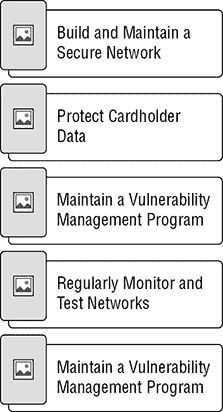

图 2.1 PCI-DSS 控制目标

### 开源 Web 应用安全项目 (OWASP)
如果你关注的是 Web 应用安全，那么开源 Web 应用安全项目是你寻找标准、框架和指南的逻辑起点。在 OWASP 网站 [www.owasp.org](http://www.owasp.org) 上，你可以找到各种 Web 应用安全资源。其他资源中还包括 OWASP 为 Web 开发人员提供的安全控制列表(`https://www.owasp.org/](https://www.owasp.org/index.php/OWASP_Proactive_Controls))：

1. 尽早且频繁进行安全验证
4. 验证所有输入
5. 实施身份和验证控制
6. 实施适当的访问控制
7. 保护数据
10. 错误和异常处理

OWASP 最出名的可能是他们的 Top 10 漏洞列表。他们每隔几年就会发布上一年在 Web 应用中发现的前 10 个漏洞。对于任何关注 Web 应用安全的人来说，这是一个极佳的起点。至少，你应该处理这些广为人知的漏洞。


#### Web 服务器
Web 服务器是一个明显的安全关注点。由于其本质，它们暴露给整个世界，因此容易受到各种攻击。同时，它们无法像其他服务器那样安全地锁定。这是因为你必须允许未知访问者连接到你的网站。事实上，这正是你发布网站的原因。

Apache 基金提供了关于如何保护 Apache Web 服务器的许多技巧(`https://httpd.apache.org/docs/2.4/misc/security_tips.html](https://httpd.apache.org/docs/2.4/misc/security_tips.html))。他们的网站有一个专门章节介绍如何配置 Apache 以抵抗拒绝服务 (DoS) 攻击等常见的 Web 攻击。该网站非常详尽。建议的方法包括保护服务器端文件、安全配置通用网关接口 (CGI) 以及正确配置权限。

IIS 和 Apache 了世界上绝大多数网站。但无论你使用哪种特定的 Web 服务器，目标都是尽可能安全地配置它。这通常涉及咨询你正在使用的 Web 服务器的供应商并遵循他们的建议。


微软有一个 Windows 安全页面(`https://technet.microsoft.com/en-us/library/cc772066.aspx](https://technet.microsoft.com/en-us/library/cc772066.aspx))，其中包含 Windows 安全相关应用程序（AppLocker、授权管理器等）的子章节，以及如何如何使用各种安全功能，如 BitLocker 驱动加密和 Kerberos。

微软 TechNet 还发布了一份安全最佳实践清单(`https://technet.microsoft.com/en-us/library/bb735870.aspx](https://technet.microsoft.com/en-us/library/bb735870.aspx))。该清单包含了安全配置问题、系统更新、物理安全、安全通信以及保护客户端计算机的最佳实践。


弗吉尼亚大学提供了一份针对 Unix/Linux 的安全最佳实践列表（[http://its.virginia.edu/unixsys/sec/]）。建议包括关闭未使用的服务、使用防火墙以及保持系统更新。红帽（Red Hat）发布了一份更为详尽 Linux 安全指南（[https://access.redhat.com/documentation/en-US/Red_Hat_Enterprise_Linux/6/pdf/Security_Guide/Red_Hat_Enterprise_Linux-6-Security_Guide-en-US.pdf]）。他们这本 232 页的书在上以 PDF 格式免费提供，是 Linux 安全的全面指南。

你可能已经注意到，这些操作系统指南中的许多都提供了相似的建议。这是因为某些安全建议是无处不在的——它们并非特定受信任操作系统所独特。保持系统补更新、使用防病毒软件、使用防火墙以及使用非管理员账户进行日常活动——无论你使用哪种受信任的操作系统，这些都是好主意。

1. 确保操作系统已安装补丁。如果不更新操作系统本身，其他安全措施的效果将大打折扣。
2. 关闭任何不需要的服务、账户或其他访问系统的其他方法。
3. 开启足够的日志记录，以便你对系统进行审计并了解操作系统上发生了什么。

这些只是作为操作系统安全起点而应该采取的通用步骤，而非终点。在不添加第三方软件、设备或其他安全控制的情况下，使系统变得尽可能安全的过程通常被称为 `operating system hardening`（操作系统加固）。

## 网络基础设施设备

在保护操作系统和保护网络基础设施之间存在某些重叠。例如，在两种情况下，补丁更新和正确的配置都至关重要。然而，对于网络基础设施，拓扑布局同样重要。

## 安全网络架构概念

### 区域 (Zones)

网络安全最基本的方面之一是将你的网络划分为不同的区域。每个区域具有不同的安全级别。此外，如果某个区域被攻破，只有该区域受到影响——整个网络并不一定会变得脆弱。

- `Secure Zone`（安全区域）：这些是最敏感的系统，拥有关键任务数据。
- `General Work Zone`（通用工作区域）：这些是标准工作站和服务器，具有典型的业务数据功能。
- `Low Security Zone`（低安全区域）：这些是没有高度敏感信息的计算机、网络分段和系统，这些系统被破坏的影响微乎其微。

### 非军事化区 (Demilitarized Zones)

`demilitarized zone (DMZ)` 是一个可以在其中放置公共服务器的区域，供那些你可能不信任的人访问。通过在 DMZ 中隔离服务器，你可以隐藏或移除对网络其他区域的访问。你仍然可以使用你的网络访问该服务器，但其他人无法进一步访问网络资源。这可以通过防火墙隔离你的网络来实现。

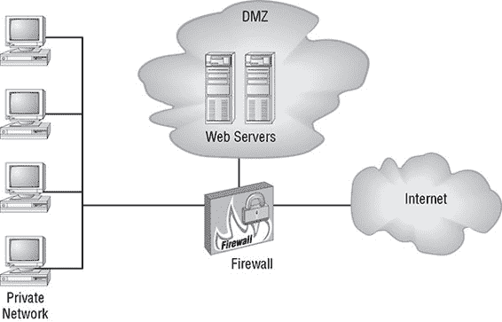

**图 2.2** 典型的 DMZ

* 内部网络
* 外部世界（互联网）
* 指向你共享的公共信息（DMZ）

### 外网与内网 (Extranet and Intranet)

许多组织利用仅在组织内部访问的网站。这些被称为 `intranets`（内网）。这些网站可用于在公司内部发布信息。通常，如人力资源信息、公司政策和在线培训可以通过内网发布。由于这些站点完全包含在组织网络中，通常不会实施额外的安全措施。内网仅供内部员工访问，并且已经受到公司防火墙、防恶意软件和其他安全措施的保护。


## 无线

在当今这个依赖技术的社会中，很难想象有任何公司、学校或其他机构不提供无线访问。然而，无线网络在安全性上天生低于物理有线网络。这意味着分段变成了一个更加重要的问题。

除了处理旧技术的问题外，还有一个更根本的问题，就是像分段有线网络一样，对无线网络进行分段。这意味着建立基于数据敏感性和关键程度的区域。

为访客提供一个完全独立的网络（通常是无线网络，但也可以是有线网络）使用也是一个好主意。这个网络将只提供基本的 Internet ，可能还可以访问一台打印机。但它不应该连接到网络的其他部分。这意味着你大不必担心访客访问他或她不应该访问的数据和资源。

## 分段与深度防御

除了本章之前讨论的特定指南外，维护安全网络还涉及一些概念性问题。这些是通用的安全方法，在考虑特定框架和安全模型之外，还应该考虑它们。

实现深度防御的一种方法是确保每个设备（服务器、工作站、路由器、交换机等）都经过安全配置。之前讨论的安全标准将帮助你确保这一点的实现。另一种有助于实现深度防御的重要技术是通过网络分段。

网络分段涉及根据安全需求将你的网络划分为区域。例如，你可能有一个销售区域、一个独立的技术支持区域以及另一个研究区域。这些区域中的每个区域都有不同的技术需求。你可以通过 `routers/switches` 或使用 `虚拟局域网 (VLANs)` 将它们分开。这些将在本书后后的部分进行更详细的讨论，但本质上，当你配置交换机的一组端口的行为像一个独立的网络时，就创建了一个 `VLAN`。你本质上通过创建一个逻辑子网段分段了你的网络。

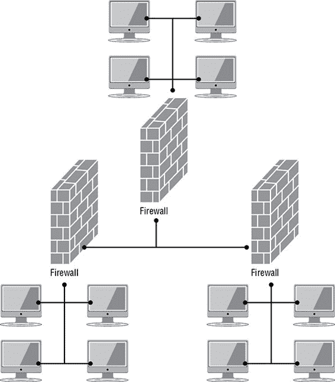

图 2.3 网络分段

另一个更极的分段例子是物理隔离（`air-gap`）。这发生于一个或多个系统字面上没有连接到网络时。显然，这会降低许多系统的可用性，并不是每种情况的正确解决方案。但在某些情况下，一个系统可能足够敏感，不需要连接到网络。拥有一个物理隔离的备份服务器通常是一个好主意。这是防止该系统遭受恶意软件感染的一种确定方法。

虚拟化是分段网络的另一种方法。在后面的章节中，我们将更详细地探讨虚拟化。对于我们当前的话题，需要记住的问题是，分段虚拟系统比分段物理系统容易得多。举一个简单的例子，考虑你工作站上的虚拟机。你可以轻松地配置它，使虚拟机与工作站完全隔离——它不共享剪贴板、公共文件夹或驱动器，并在字面上作为一个隔离的系统运行。这仅仅是使用虚拟化分段你网络的一个例子。

另一个问题是供应商和控制的多样性。这意味着你不会通过单一的控制措施或单一的供应商来解决任何特定的安全忧虑。假设你担心恶意软件进入你的网络，你正在考虑的控制措施之一是反恶意软件软件。这是一个恰当且合逻辑的第一步。但它仅仅是如此，只是第一步，它不应该是你唯一的反恶意软件安全控制。

尽管大多数安全专家都会同意反恶意软件是解决恶意软件忧虑的一个基本方面，但它不是唯一的安全控制。阻止可疑网站、针对附件和下载的安全策略、限制用户权限——这些这些助于缓解恶意软件的威胁。这就是所谓的`控制多样性`（control diversity）。
你不应该依赖单一的控制措施来解决任何安全威胁。


除了控制手段的多样化，你还应该追求供应商的多样化。回到担心恶意软件的场景，你不仅在每台计算机上使用反恶意软件是正确的，在网络上和防火墙处运行反恶意软件也是正确的。然而，在这种情况下，实现供应商多样化是最佳解决方案。本书的目标并非背书任何特定的供应商，但无论你考虑的是哪家供应商，请记住该供应商在所有产品中都使用相同的恶意软件检测算法。因此，如果你选择了 `vendor A` 并在工作站、网络和防火墙反恶意软件上使用它们的产品，那么其中任何一个漏掉的威胁（例如防火墙），这三者都会漏掉。

更好的解决方案是在防火墙反恶意软件上使用 `vendor A`，在网络上使用 `vendor B`，在个人电脑上使用 `vendor C`。由不同供应商创建并使用不同检测算法的这三个产品同时漏掉某个特定恶意软件的概率，远低于其中任何一个单独漏掉的概率。

### 管理控制措施

管理控制措施是所有支持安全而建立策略、程序和流程。例如，为了缓解恶意软件的威胁，制定反对下载未知附件的政策并禁止使用未知外部媒体（如 `USB drives`）都是管理控制措施的示例。

然而，无论我们讨论的是技术控制还是管理控制措施，如果没有用户培训，这两者都不算特别有效。用户培训是网络安全中的一个关键课题。首先，用户（包括技术用户）必须就技术控制措施的使用接受适当培训。如果技术人员没有经过适当培训，那么世界上最好的防火墙其效果也会大打折扣（让你的技术人员获得 `Security+` 认证是一个很好的第一步！）。

终端用户也需要接受如何处理他们面临的威胁的培训，例如钓鱼邮件和附件。世界上最安全的系统也因为未能遵守安全策略的终端用户而受到破坏。但在没有充分培训的情况下，不能指指他们遵循这些策略。

`honeypot`（蜜罐）的概念是一个独立的系统，它看起来是一个吸引人的目标，但实际上是针对攻击者（内部或外部）的陷阱。例如，你可以设置一个看起来像财务数据库的服务器。然而，所有的记录都是虚假的。这实现了两个重要目标：第一，攻击者认为他找到了自己想要的东西并将忙于这个系统，从而离开你的其他系统（至少在短时间内内）。蜜罐提供的第二点是，由于它不是真实系统，没有任何合法用户访问它。因此，你可以自由地对该系统开启大量的监控和日志记录。这样，当攻击者确实访问它时，你正在收集大量的证据来协助你的调查。

`honeynet`（蜜罐网）是蜜罐的下一个逻辑扩展。在这种情况下，有一个看起来非常有诱惑力的虚假网段。有些组织专门为了此目的设置了虚假的无线访问点。

*   `Honeyd` ([www.honeyd.org/](http://www.honeyd.org/))
*   `Symantec Decoy systems` ([www.symantec.com/region/au_nz/press/au_030701c.html](http://www.symantec.com/region/au_nz/press/au_030701c.html))
*   `Google Hack Honeypot` ([`ghh.sourceforge.net/`](http://ghh.sourceforge.net/))

`virtual private network (VPN)`（虚拟专用网络）是通过公共网络发生的私网络连接。私有网络在不安全环境中提供了安全性。VPN 可用于互联网或其他公共网络将局域网（LAN）连接在一起。通过 VPN，远程端看起来就像本地连接到网络中一样。VPN 需要安装特殊的硬件，或者在服务器和工作站上运行 VPN 软件包。

VPN 通常使用隧道协议，例如 `Layer 2 Tunneling Protocol`（二层隧道协议）、`IPSec` 或 `Point-to-Point Tunneling Protocol (PPTP)`（点点隧道协议）。图 2.4 显示了远程网络通过互联网和 VPN 连接到局域网。这种连接看起来像是本地连接，所有的消息流量和协议在 VPN 上可用。

**图 2.4](#part0011_split_003.html_figure2-4) 使用 VPN 跨越互联网连接两个局域网**

VPN 正成为在两个或多个远程办公室之间建立外部网或内部网的选择连接。使用 VPN 的主要安全问题是加密。`PPTP` 提供了一些加密功能，但它们很弱。`IPSec` 提供了更高的安全性，并成为许多安全 VPN 环境使用的加密系统。

VPN 系统可以用于特定的协议，也可以将在网络一端看到的任何协议传递到另一端。纯 VPN 连接是两个网络端之间的专用有线连接。

`VPN concentrator` 是用于远程访问 VPN 的硬件设备。集中器创建加密的隧道会话，许多使用双因素认证来增加安全性。Cisco 模型通常集成 `Scalable Encryption Processing (SEP)` 模块以允许基于硬件的加密和/或冗余。

一个暗示但尚未详细讨论的问题是放置各种安全设备的位置。我们讨论过分段网络，甚至是网络区域，但这并没有完全回答如何放置所有设备的问题。


最容易部署的设备是防火墙。你可能已经意识到需要在网络边界部署防火墙。除此之外，事实上你应该在网络区域的每个交汇处放置防火墙。你的网络每个网段都应该由防火墙保护。这实际上比你想象的要容易。所有现代交换机和路由器都具有防火墙功能。即使是最原始的家用商业产品也至少具备基本的过滤功能。这些功能只需要开启并进行善配置即可。

除了防火墙，我们还必须讨论关联引擎。这些应用程序通过查看防火墙日志（通常来自不同的防火墙）并尝试关联这些条目以理解可能的攻击。关联引擎的放置位置不需要紧邻防火墙，只要关联引擎能够访问并检查防火墙日志即可。

另一个显然属于边界的设备是分布式拒绝服务攻击（DDoS）缓解器。这些设备尝试检测并阻止 DDoS 攻击，或者至少减轻其影响。显然，此类攻击必须在影响整个网络之前被停止。

某些设备的放置最好取决于你其余的网络配置。例如，负载均衡器用于平衡服务器集群中镜像服务器的负载。如果我们讨论的是 DMZ 区域中的 Web 服务器集群，那么负载均衡器也需要放置在 DMZ 中。然而，如果我们指的是内部网络网段中的数据库服务器集群，那么该负载均衡器必须放置在那个集群中。

网络聚合交换机是另一种没有明确放置建议的设备。此类交换机将多个带宽流聚合在一起。只要你的网络中有需要聚合的地方就可以这样做。一个示例是使用聚合交换机与任何网络集群配合，以最大化提高进入和离开集群的带宽。

其他设备必须部署在整个网络中。对于入侵检测系统，每个网段都必须有收集器或传感器。如果没有它们，IDS/IPS 将对该网段的活动视而不见。

`Firewalls`（防火墙）是网络的第一道防线之一。防火墙有不同的类型，它们可以是独立系统，也可以包含在路由器或服务器等设备中。你可以找到以纯硬件形式营销的防火墙解决方案，也有作为纯软件形式销售的解决方案。然而，许多防火墙由可用于服务器或工作站的附加软件组成。

防火墙的基本目的是将一个网络与另一个网络隔离开。防火墙以设备的形式存在，这意味着它们被安装为分离两个网络的主要设备。`Appliances`（专用设备）是独立的设备，它们在很大程度上以自包含的方式运行，与基于服务器的产品相比，需要的维护和支持更少。

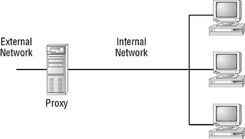

**FIGURE 2.5** 阻止来自外部网络访问的代理防火墙

- 数据包过滤器
- 代理防火墙
- 状态检测检测防火墙

作为`packet filter`（数据包过滤器）运行的墙根据应用程序类型通过或阻塞到特定地址的流量。数据包过滤器不分析包的数据；它根据数据包的地址信息来决定是否通过。例如，数据包过滤器允许端口 `80` 上的 Web 流量并阻塞端口 `23` 上的 Telnet 流量。这种过滤包含在许多路由器中。如果收到的数据包请求要求未授权的端口，过滤器可能会拒绝请求或简单地忽略。许多数据包过滤器还可以指定哪些 IP 地址可以请求哪些端口，并根据防火墙的安全设置允许或拒绝它们。

数据包过滤器的复杂性和能力日益增长。数据包过滤器防火墙可以允许你指定的任何接受的流量。例如，如果你想让 Web 用户访问你的网站，你可以配置数据包过滤器防火墙允许端口 `80` 的数据进入。如果每个网络都完全相同，防火墙将带有硬编码的默认端口设置，但网络各不相同，因此防火墙不包含此类设置。

`proxy firewall`（代理防火墙）可以认为是你的网络与任何其他网络之间的中介。代理防火墙用于处理来自外部网络的请求；代理防火墙检查数据并基于规则做出是否应该转发或拒绝请求的决策。代理拦截所有包并对其进行重新处理以供内部使用。此过程包括隐藏 IP 地址。

由于代理防火墙提供了更高的智能性，它比数据包过滤提供了更好的安全性。来自内部网络用户的请求通过代理进行路由。代理反过来对请求进行重新封装并发送，从而将用户与外部网络隔离开。如果再次发出相同的请求，代理还可以提供缓存，并提高数据交付的效率。

### 状态检测防火墙

关于防火墙的最后部分重点是状态检测的概念。为了理解这一术语，你应该知道之前被称为 `stateless`（无状态）。`Stateless firewalls`（无状态防火墙）根据数据包中的数据做出决策，例如而不是基于任何复杂的决策。

## SDN

`Software-defined networking (SDN)`（软件定义网络）是一个较新的趋势，对于部署安全设备和划分网络都很有用。本质上，在 SDN 中，整个网络都是虚拟化的。这允许网络进行相对容易的划分。它还允许管理员在他们任何想要的地方放置虚拟安全设备。


# IDS vs. IPS

这种系统是一种会对检测到的入侵做出反应的 `IDS`，最常见的方法是通过阻止来自违规 `IP address` 的通信来实现。这种方法的问题在于误报问题。没有哪个系统是完美的——在某些时刻，你可能会遇到这样的情况：网络活动异常且 `IDS` 指明发生了入侵，但实际上这并非入侵。例如，如果 `IDS` 设置为对正常范围之外的流量做出反应，那么来自特定系统的过量流量可能意味着攻击。然而，它也可能意味着工作负载异常高。

# 安全系统设计

## 硬件和固件安全

在设计网络时，你必须解决的首要问题之一就是安全系统。安全系统的一个关键方面是加密数据问题。今天有许多选项可以加密硬盘。在本书的后面部分，我们将更详细地讨论加密，包括各种算法。此时，我们仅对密码学的应用感兴趣。

自加密驱动器 (`SED`) 内置控制器芯片，只要输入正确的密码，它就会自动对驱动器进行加密和解密。`SED` 中使用的加密密钥称为媒体加密密钥 (MEK)。锁定和解锁驱动器需要另一个由用户提供的密钥，称为密钥加密密钥 (KEK)。`KEK` 用于解密 `MEK`，而 `MEK` 反过来用于加密和解密驱动器。

信任平台模块 (TPMs) 是使用加密密钥执行各种任务的专用处理器。例如，它们可以用于身份验证。TPMs 也可以用于辅助 `FDE`。通常 `TPM` 位于计算机的主板上。

除了保护驱动器外，系统的 `BIOS` 或 `UEFI` 也必须经过保护。`BIOS`（基本输入输出系统）是处理计算机启动信息的旧方法。`UEFI`（统一扩展固件接口）是更现代的技术。虽然 `UEFI` 与 `BIOS` 相比具有许多更新且更好的功能，但它们具有相同的基本目的：存储计算机启动时需要的信息。因此，你应该始终确保对 `BIOS` 或 `UEFI` 的访问受到密码保护。

`安全启动` 是一个过程，其中 `BIOS` 或 `UEFI` 对操作系统引导加载程序和任何引导驱动程序进行加密哈希处理，并与存储的哈希值进行比较。这样做是为了防止根内核和启动区病毒。存储的哈希值通常受 `TPM` 或加密。另一个选项是将哈希值存储在远离受保护计算机的远程服务器上。这导致了 `远程证明`。

系统还必须防止电磁干扰和电磁脉冲 (`EMI/EMP`) 的影响。在大多数环境中，这并不是太大的问题。然而，计算机容易受到电子干扰。在最简单的层，这意味着要意识到可能产生 `EMI/EMP` 的设备和过程，并将它们远离系统。在其他更安全的环境中，这可能涉及采取措施防止 `EMI/EMP` 渗透到带有计算机的房间。实现此点的常用方法是通过`法第笼`。`法第笼` 以著名的物理学家迈克尔·法拉第命名。它们本质上是防止电磁信号穿透的金属网。美国政府，特别是国防部，使用安全分区信息设施 (`SCIFs`)，其中房间或建筑本身就是一个 `法第笼`。

最后，当从外部实体采购系统时，你需要检查供应链以确保其没有被破坏。这可能仅仅是使用一个签署了遵守最小安全要求的信誉供应商，也可能根据你的安全需求而复杂得多。

操作系统有很多类型。有网络操作系统、计算机操作系统（客户端或服务器）、设备操作系统、自助机操作系统和移动设备操作系统。然而，它们都具有一些必须解决的共同需求。在接下来的章节中，我们将探讨这些问题。

网络定义定义网络如何运行。网络操作系统取决于域控制器上使用的操作系统。例如，如果域控制器运行 `Unix`，那么该网络就是 `Unix` 网络，即使它包含许多 `Windows` 或 Macintosh 计算机。

设备操作系统和自助机操作系统都局限于特定用途。设备操作系统可能运行在智能设备上，例如智能家居的温控器。`自助机` 通常是用于有限用途的公共计算机。在这两种情况下，操作系统只需要支持有限范围的功能。这通常使安全变得更容易，因为需要解决的问题较少。

移动操作系统现在与服务器和客户端操作系统相似。`Apple iOS` 类似于 Macintosh 操作系统。`Android` 手机运行版本的 `Linux`。当然，`Windows` 手机运行 `Windows 10`（或运行 `Windows 8` 的旧手机）。随着移动设备支持的功能范围扩大，需要缓解的安全问题数量随之增加。

在本章之前，在讨论标准时，我们提到了更新操作系统。这通常意味着确保它已修补补丁。然而，在运行系统中，特别是关键服务器中，补丁管理可能会复杂一些。

通常建议家庭用户开启自动更新。但是，这并不建议大型组织这样做——至少对于敏感系统而言。补丁总有可能对你系统上运行的自定义应用程序产生某些问题，或者补丁本身存在缺陷。出于此原因，我们建议以下流程：


3. 如果补丁通过了初始测试，则将其部署到少数几个运行系统中。等待适当的时间后，然后分阶段继续部署。适当的等待时间取决于补丁的性质。关键的安全补丁应该在对补丁进行测试的同时，尽可能快地进行部署。功能升级则可以在一段时间内缓慢地滚动部署。

严格遵守这种经过周计划且分阶段的补丁部署计划是补丁管理的基石之一。然而，这只是补丁管理的一部分。另一个关键方面是拥有回滚计划（backout plan）。如果在任何时候发现补丁导致了问题，你必须有一个计划来撤回补丁并恢复到之前的之前的运行状态。

## 安全配置

在讨论标准时，我们触到的另一个问题是安全配置。无论是讨论关键服务器、客用工作站还是网络交换机，某些问题是所有这些设备所共有的。

下一个问题是尽可能锁定系统。这涉及到禁用所有默认密码以及任何你不使用的默认账户。在现实世界的系统审计中，我经常发现，即使是网关路由器也使用默认用户名和密码，这令人惊叹。而且，万一你不知道，只需简单的 Google 搜索就能找到任何系统的默认用户名和密码。

如果有你不使用的默认账户，请将它们关闭。我们怀疑大多数读者从未以“访客”身份登录过家庭电脑。如果没有，那么你为什么要保持访客账户开启状态？简单地关闭任何你不需要的内容将极大提高安全性。

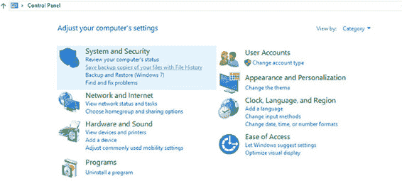

图 2.6 Windows 10 控制面板

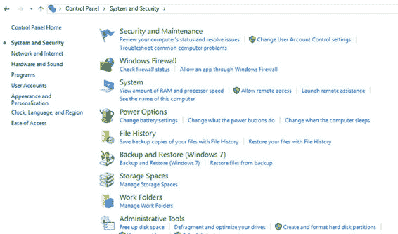

图 2.7 Windows 10 系统和安全

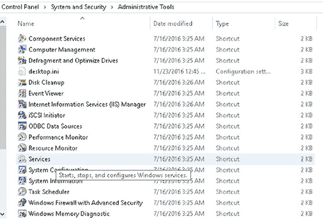

图 2.8 Windows 10 管理工具屏幕

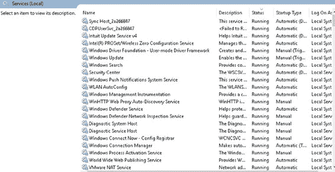

图 2.9 Windows 10 服务

### 外设

外设也存在安全问题。今天有许多外设设备，包括无线键盘和鼠标、显示器、支持 Wi-Fi 的卡、打印机、扫描仪、外部驱动器、数字相机等等。正如你可能怀疑的那样，这些设备具有必须解决的安全问题。

许多病毒扫描器可以扫描任何带有易易性存储器的设备。这意味着你应该定期扫描外部驱动器和数字相机以检测恶意软件。如果某个设备支持 Wi-Fi 但你不需要该功能，请考虑将其禁用。

### 安全阶段部署概念

对于应用程序，第一阶段是`开发环境`。这是开发应用程序的地方。它用于桌面应用程序和 Web 应用程序。通过适当的测试，可以在应用程序开发环境中发现安全缺陷。

对于应用程序、操作系统和设备，应该有一个`测试环境`。将其想象为一个微网络。测试环境越真实地模拟真实环境，你就越有可能在测试中发现并解决安全问题。


接下来是*分阶段部署 (staging)*。通常，网络中的任何新增内容都是分阶段部署的，而不是简单地推向整个网络。这对于应用程序甚至是现有应用程序和操作系统的补丁来说尤为重要。将新软件发布到网络的某些区域，并在每个新阶段之间留出一段时间。这为在问题传播到整个网络之前发现它们提供了机会。生产环境应该始终分阶段部署。

当对网络上的新项目有任何疑问时，将新项目放入沙箱。*沙箱 (sandbox）*是一个与网络其余部分完全隔离的测试环境的术语。当新项目是应用程序或补丁时，隔离的虚拟机可以提供良好的沙箱。其理念是在新项目与网络隔离且无法影响网络的情况下对其进行完全测试。这样，如果在测试中发现了某些重大问题，它不会影响生产网络。

一旦定义了基线，下一步就是监控该系统无论是单个服务、计算机还是应用程序），以确保它没有偏离该基线。这一过程定义为*完整性测量 (integrity measurement)*。例如，`NIST SP 800-155` 定义了测试系统 BIOS 完整性的标准，以确保其没有发生更改。

完整性测试的一部分涉及信任链。如果系统 A 信任系统 B，而系统 B 又信任系统 C，那么完整性测试应该按反序进行。从该信任链的根节点系统 C 开始。一旦你检查了系统 C 的完整性，就可以沿着链继续向下，检查每个系统的完整性。

在本章中，我们讨论了如何设计和实施网络以增强安全性。我们关注了网络安全标准、分段和深度防御等问题。

我们还研究了防火墙和 `VPNs`，以及在何处以及如何实施这些设备。我们向你介绍了基础安全设备，如 `honeypots`（蜜罐技术）和入侵检测系统。

**能够描述这些标准。** 在测试中，你会被问及关于标准的问题。世界上有很多标准，但预计重点将放在 `NIST` 和 `ISO` 标准上。任何章节甚至整本书的范围都无法涵盖以详细描述所有的 `NIST` 和 `ISO` 标准。在本章中，我们关注了网络安全中最常用的、且你最可能在考试中看到的标准。

**能够解释蜜罐 (honeypot)/蜜罐网络 (honeynet) 的目的。** 蜜罐是一个用于收集信息或设计用于被破解的系统。蜜罐系统用于在调查中收集证据并研究攻击策略。

**能够解释并应用网络设计和配置。** 确保你理解网络分段、区域和深度防御。你还应该理解本章中讨论的技术（如 `VPNs`）和网络设备（`firewalls`、`IDSs/IPSs` 等）。

## 复习题

1. 一种修正产品某个版本问题的周期性更新被称为(n) ________。
    1. 热补丁 (Hotfix)
    2. 重构 (Overhaul)

2. 哪种设备以被动方式监控网络流量？
    1. 嗅探器 (Sniffer)
    2. IDS

3. 旨在或设计供攻击者破解的系统是？
    1. 蜜罐 (Honeypot)
    2. 蜜桶 (Honeybucket)
    5. 如果员工被解雇则删除

4. 在入侵检测系统的术语中，哪个账户负责为组织设置安全策略？
    1. 管理员 (Supervisor)
    4. 监监 (Director)

5. 你是一家大型银行的初级安全管理员。你被要求让数据库服务器尽可能安全。确保某个实体（操作系统、应用程序等）尽可能安全的过程被称为以下哪一个？
    1. 稳定 (Stabilizing)
    4. 变硬 (Toughening)

6. John 正在为他任的保险公司设计网络。他想将 Web 服务器放在一个安全性稍的区域，以便外部用户可以访问。但他不想让这损害网络其他部分的安全性。John 的最佳方法是什么？
    1. 将 Web 服务器放在蜜罐网络 (honeynet) 中。
    4. 将 Web 服务器放在他的网络之外。

7. Tom 被指示寻找一种适用于美国的安全标准，帮助他开发适当的安全策略。他发现了一个描述了用于开发安全策略的 8 个原则和 14 项实践的标准。Tom 最可能查看的是哪种标准？
    1. `ISO/IEC 27001:2013`
    4. `ISA/IEC-62443 4`

8. Juanita 正在实施一种安全机制，全加密她组织笔记本的硬盘。加密和解密将是自动的。什么最能描述 Juanita 实施的内容？
    1. AES
    4. SED (自加密驱动)

9. Ahmed 一直致力于缓解他网络中的恶意软件威胁。他选择了一个特定的供应商（ABC 公司）作为他的防病毒软件。他在所有需要防病毒软件的地方都使用 ABC 产品。这是一个正确的决定吗？为什么或为什么不？
    1. 是，一致性更安全。
    4. 不，这违反了供应商多样性 (vendor diversity)。

10. 你担心你的备份文件被恶意软件感染。以下哪种技术最能保护你的备份？
    1. 物理隔离 (Air-gap)
    4. VLAN

# 第 3 章

**本章涵盖了以下 CompTIA Security+ 目标：**

* **2.1 安装和配置硬件和软件支持的网络组件以支持组织安全。**
    * 防火墙 (Firewall)：`ACL`（访问控制列表）；基于应用 vs. 基于网络；状态 vs. 无状态；默认拒绝 (Implicit deny)
    * 路由器 (Router)：`ACLs`；反欺骗
    * 交换机 (Switch)：端口安全；`二层` vs. `三层`；环环路保护；泛洪防护
    * 代理 (Proxy)：正向代理和反向代理；透明代理；应用/多用途
    * 负载均衡器 (Load balancer)：调度算法 (`会话性`, `轮询`)；主-备用；主-主；虚拟 IP


* 接入点：SSID；MAC 过滤；信号强度；频段选择/带宽；天线类型与布局；胖型 vs 瘦型；控制器型 vs 独立
* NAC（网络访问控制）：可解离型 vs 永久型；主机健康检查；代理型 vs 无代理型
* 邮件网关：垃圾邮件过滤器；DLP；加密
* 桥器
* SSL/TLS 加速器
* 硬件安全模块

 本章介绍了网络内部使用的硬件。你的网络由多种媒体设备组成，这些设备既有助于通信又提供了安全保障。其中许多设备提供了从你的网络到其他系统和网络的外部连接，而另一些设备专门用于提供某种形式的安全。为了给整个网络提供合理的安全防护，你必须了解这些设备的工作原理，以及它们是如何提供（或无法提供）安全的。

## 基础设施术语

由于许多设备都通过缩写来引用，有时每件设备的具体功能可能会让人感到困惑。考虑到目标中包含的冗余内容，以及你经常使用多台设备执行相似的功能，以下术语（在线词表中也可找到）是 CompTIA 喜欢在该类别中使用并测试的术语。我们按顺序提供这些术语，以便你更容易了解每个术语想要表达的内容。

当你设计网络的安全拓扑结构时，你关注的是访问方法、安全性和所使用的技术。这些问题必须被纳入构成网络的物理要素中。你添加或想要添加的任何东西都伴随着限制条件。这些限制条件的范围从支持的节点数量到成本不等。

大型跨国公司以及中小型企业正在构建极其复杂且精密的网络。这些网络通过使用数英里的有线和无线技术工作。无论网络是完全基于线缆和光纤的还是完全无线的，数据从一个地方传输到另一个地方的方法都会产生漏洞和利用机会。只要存在从媒体中截获信息的机会，漏洞就会出现。

### 防火墙

防火墙是网络中的第一道防线之一。有不同类型的防火墙，它们可以是独立系统，也可以包含在路由器或服务器等设备中。你可以找到被标记为纯硬件的防火墙解决方案，也有标记为纯软件的。然而，许多防火墙由适用于服务器或工作站的插件软件组成。

防火墙可以在许多层级工作，因此可以是基于应用程序或基于网络的。大多数防火墙被配置为基于网络，并结合访问控制列表（`ACLs`）工作，以决定哪些内容允许进入（就流量、数据、应用程序或你想要使用的任何其他标准而言），哪些内容被排除在外。所有操作都应遵循默认拒绝原则，这意味着任何未被明确允许的服务都会被隐式拒绝。

图 3.1 所示的防火墙有效地限制了来自外部网络的访问，同时允许内部网络用户访问外部资源。此图中的防火墙还执行着代理功能，将在稍后讨论。

**图 3.1**](#part0012_split_002.html_figureanchor3-1) 拦截来自外部网络网络访问的代理防火墙

防火墙的功能充当以下一种或多种功能之一：

* 状态数据包检测防火墙（与无状态防火墙相比）

#### 数据包过滤器防火墙

数据包过滤器的复杂性和能力正在不断增长。数据包过滤器防火墙可以允许你指定的任何可接受的流量。例如，如果你想让网络用户访问你的网站，你向于配置数据包过滤器防火墙允许 80 端口上的数据进入。如果每个网络都完全相同，防火墙将带有硬编码的默认端口设置，但网络各不相同，因此防火墙不包含此类设置。

### 代理防火墙

由于代理防火墙提供了更高的智能性，代理防火墙比数据包过滤提供了更好的安全性。来自内部网络用户的请求被路由到代理。代理反过来对请求进行重新封装并发送，从而将用户与外部网络隔离开。

代理防火墙通常使用两个网络接口卡（`NICs`）。这种类型的防火墙被称为双宿主防火墙。其中一个网卡连接到外部网络，另一个连接到内部网络。代理软件管理这两个块网卡之间的连接。这种设置将两个网络相互隔离开并提供了更高的安全性。

应用层代理功能会读取所服务协议的单个命令。这种类型的服务器是高级的，必须了解所用协议的规则和功能。例如，这种类型代理的实现必须知道 GET 和 PUT 操作之间的区别，并拥有指定如何执行它们的规则。


`电路级代理（circuit-level proxy）`在客户端和服务器之间建立电路，它不处理正在处理的数据包内容。

对于每个支持的协议，必须存在一个唯一的应用层代理服务器。许多代理服务器还提供完整的审计、计数和其他使用信息，而电路级代理服务器通常不会保留这些信息。

关于防火墙的最后一个章节重点介绍了状态检测（stateful inspection）的概念。为了理解这一术语，你应该知道之前的技术被称为“无状态（stateless）”。`无状态防火墙`根据输入的数据（例如数据包）做出决策，而不是基于任何复杂的决策。

`状态检测（stateful inspection）`也被称为`状态数据包检测（SPI）过滤`。网络中使用的大多数设备并不跟踪信息是如何路由或使用的。数据包通过后，该数据包和路径就会被遗忘。在状态检测（或状态数据包过滤）中，使用状态表保留记录，该状态表跟踪每一个通信通道；它记得数据包来自哪里，以及下一个数据包应该从哪里来。

## UTM 安全设备

从该术语最广泛意义上说，任何以很大程度上自包含的方式运行的独立设备都被视为`设备（appliance）`。`合一设备（all-in-one appliance）`也称为`统一威胁管理（UTM）`和`下一代防火墙（NGFW）`，它是提供良好安全基础设备。有很多种类；考试中你应该熟悉的属于提供 URL 过滤、内容检查或恶意软件检查类别。它们将在后续章节中进一步讨论。当你将防火墙与其他功能（入侵防御、防病毒、内容过滤等）结合时，以前被称为合一设备的现在被称为`UTM`。这种优点包括降低了学习曲线（你只需要学习一个产品）、只需要面对一个供应商并且（通常）降低了复杂度。将一切合为一的缺点包括潜在的单点故障和对单一供应商的依赖。

`URL 过滤（URL filtering）`涉及仅根据 URL 阻止网站（或网站的部分），限制对指定网站和某些基于 Web 的应用程序的访问。这与内容过滤器不同，内容过滤器根据数据的内容而非数据源头来阻止数据。例如，微软首先实现了`钓鱼过滤器（Phishing filter）`，它作为其浏览器的 URL 过滤器，然后用`SmartScreen 过滤器（SmartScreen filter）`取代了它，后者在后台运行并将访问的网站地址发送到`SmartScreen 过滤器服务器`，在那里它将与维护的钓鱼和恶意软件网站列表进行比较。如果发现匹配项，就会出现一个阻塞网页（红色），并鼓励你不要继续。你可以继续访问网站（不建议）或终止操作。

### 内容检查

### 恶意软件检查

在恶意软件获取系统之前阻止它是非常重要的。虽然在系统中发现恶意软件时识别它的工具是有用的，但阻止其进入进入系统的实时工具要好得多。Windows 可用的工具之一是`Windows Defender`（它取代了它的前身`Microsoft Security Essentials`）。

### Web 应用防火墙 vs 网络防火墙

`Web 应用防火墙（WAF）`是一种实时设备，它通过应用一组规则来阻止进出 Web 服务器的流量，并试图防止攻击。阻止规则可以自定义，并且随着将万物移至云端的趋势，`WAF`正变得越来越流行。`WAF`试图防御的主要威胁之一包括跨站脚本（`XSS`）、注入攻击（例如使用`SQL`的注入攻击）和伪造的 HTTP 请求。

### 应用感知设备

`应用感知设备（application-aware device）`是一种能够根据网络流量的内容对其做出响应的设备。通常，此类设备结合了`SNMP`和质量服务，以便根据内容的重要性和价值对流量进行排序。这种功能可以添加到此类设备中，作为防火墙、`IPS`、`IDS`和代理使用。

`虚拟私有网络（VPN）`是通过通过公共网络发生的私有网络连接。私有网络在原本不安全的环境提供安全性。VPN 可用于通过互联网或其他公共网络将局域网连接在一起（`站点到站点/site-to-site`），或用于更小范围内为远程用户提供安全性（`远程访问`或`主机到站点`）。

通过 VPN，远程端看起来就像连接在本地网络上的一样。VPN 需要安装特殊的硬件，或者在服务器和工作站上运行 VPN 软件包。

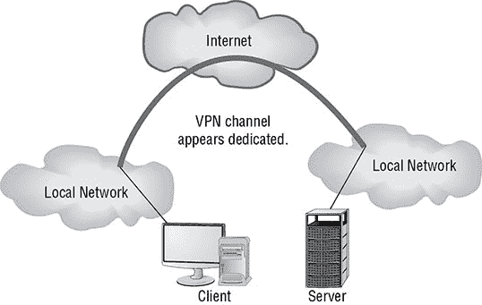

**图 3.2** 使用 VPN 跨互联网连接两个局域网


如前所述，VPN 用于在跨公共网络（如互联网）的私有网络之间建立连接。除非隧道协议（如 `PPTP`）和加密系统（如 `IPSec`），否则这些连接无法保证是安全的。VPN 支持提供了多种选择，包括专有技术。许多大型互联网服务提供商（ISP）和数据通信提供商提供具有 VPN 功能的专用硬件。许多服务器还提供软件 VPN 功能，用于两个网络之间。

`VPN concentrator`（VPN 集中器）是一种用于创建远程访问 VPN 的硬件设备。集中器在主机之间创建加密隧道会话，许多设备使用双因子身份验证来增加安全性。思科机型通常集成了可扩展加密处理（SEP）模块，以实现基于硬件的加密和或冗余。

### IPSec

通过使用 `AH` 或 `ESP`，系统之间传输的数据可以得到保护，确保传输内容不会被无访问权限的人查看、访问或修改。内部网络上的保护似乎没有外部网络那么有必要；然而，你跨网络发送的大部分数据几乎或没有任何保护，导致不希望意的窥视者看到它们。

IPsec 提供三项关键安全服务：数据验证（验证收到的数据是否来自预期源）、防止数据篡改（确保数据在发送和接收设备之间未被篡改或更改）以及私密交易（确保发送和接收设备之间发送的数据不会被任何其他设备读取）。

IPSec 可以在 `Tunneling mode`（隧道模式）或 `Transport mode`（传输模式）下工作。在隧道模式下，数据或负载以及消息头会被加密。传输模式仅加密负载。

### 分流隧道与全隧道

组织同时拥有这两种连接并不罕见。例如，一个大学校园可能会使用分流隧道加密所有 Web 邮件，而不对来自 Amazon、Facebook 等流量进行加密。同一校校园会使用全隧道来要求来自远程站的流量访问互联网。

在所有情况下，全隧道是最安全的，但在存在限制（如带宽）时会实施分流隧道。

`TLS (Transport Layer Security)` 不仅是 `SSL`（最初为 Netscape 网页浏览器创建）的增强，也是它的替代品。由于如此，TLS 在 VPN（以及 VoIP 应用）中非常流行，而“SSL”通常被用来表示机密性，无论实际运行使用的是 SSL 还是 TLS。例如，`SSL VPN`（也营销为 `WebVPN` 和 `OpenVPN`）可用于连接那些在使用 IPSec 时会遇到防火墙和 NAT 问题的地点。无论加密是使用 SSL 还是 TLS 完成的，它都被称为 `SSL VPN`。

### 始终连接 VPN (Always-on VPN)

### 入侵检测系统

`intrusion detection system (IDS)`（入侵检测系统）是运行在工作站或网络设备上的软件，用于监控和跟踪网络活动。通过使用 IDS，网络管理员可以配置系统像防盗报警器一样做出响应。IDS 可以配置为评估系统日志、查看可疑网络活动并断开似乎违反安全设置的会话。

图 3.3 显示了 IDS 与防火墙协同工作以增加安全性。

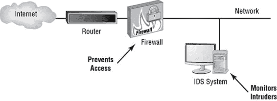

问题在于对 IDS 在发生渗透时所做行为的描述。IDS 仅检测并报告破坏和渗透；而 IPS 则对破坏和渗透采取行动。

### 理解入侵检测系统

IDS 正在成为网络监控不可或缺的一部分。`Intrusion detection (ID)`（入侵检测）是监控系统或网络中的事件以确定是否发生入侵的过程。`intrusion`（入侵）定义为任何试图破坏或损害资源机密性、完整性可用性的活动或行动。正如你可能记得，防火墙的设计是为了防止攻击者访问资源。IDS 则负责报告和监控入侵尝试。

解释入侵检测背后的技术需要几个关键术语：


### 活动 (Activity)
### 管理员 (Administrator)
`administrator` 是负责为组织制定安全策略的人，并负责对 IDS 的部署和配置做出决策。管理员应该对警报级别、历史日志和会话监控能力做出决策。他们还负责确定对攻击的适当响应并确保这些响应得到执行。

### 警报 (Alert)
### 分析器 (Analyzer)
`analyzer` 是分析传感器收集的数据的组件或过程。它在所有收集到的数据中寻找可疑活动。分析器通过监控事件并确定是否发生了异常活动来工作，或者可以使用在配置 IDS 时建立的基于规则的过程。

### 数据源 (Data Source)
### 事件 (Event)
`event` 是数据源中的一次发生（或持续发生的情况），表明已发生了可疑活动（一旦经过分析并被证明与安全相关，它就被称为 `incident` [安全事件]）。它可能会生成警报。事件被记录以备日后参考。它们通常还会触发通知，说明网络中可能正在发生异常情况。如果入站邮件连接量突然激增，IDS 可能会开始记录事件；此事件可能是有人正在探测你的网络。如果发生了偏离正常网络流量模式的情况或超过了活动阈值，该事件可能会触发警报。

### 管理器 (Manager)
### 通知 (Notification)
`Notification` 是 IDS/IPS 管理器让操作员感知警报的过程或方法。这可能包括突出显示流量的图形显示，或发送给网络管理人员的电子邮件。

### 操作员 (Operator)
### 传感器 (Sensor)
`sensor` 是 IDS 的组件，负责从数据源收集数据并将其传递给分析器进行分析。传感器可以是系统上的设备驱动程序，也可以是连接到网络并向 IDS/IPS 报告的实际黑盒。需要记住的是，传感器是 IDS/IPS 的主要数据收集点。

如你所见，IDS/IPS 许多许多不同的组件和过程协同工作，以提供网络流量的实时快照。图 3.4 显示了提供 IDS 所的协同工作的各种组件和过程。记住，数据可能来自许多不同的源，必须经过分析以确定发生了什么。IDS 的目的并不是为了作为一个真正的流量阻塞设备，尽管某些 IDS 也可以执行此功能；它的目的是是一个流量审计设备。

### 基于行为的检测 (Behavior-Based Detection)
`behavior-based system`（基于行为的系统）寻找行为的变化，例如异常高流量、违反策略等。通过寻找行为偏差，它能够识别潜在威胁并对其做出快速响应。


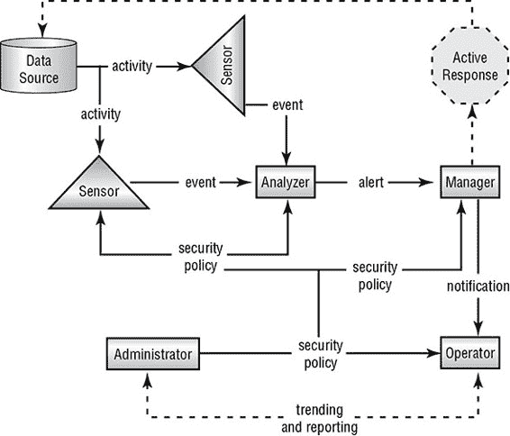

**图 3.4** IDS 组件协同工作提供

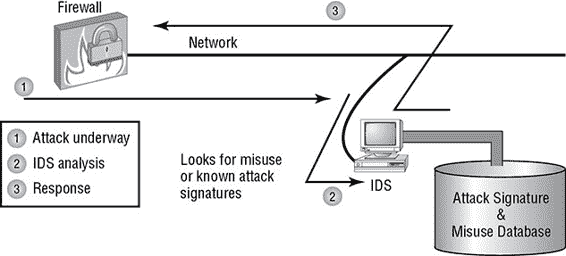

**图 3.5** 基于特征检测
`anomaly-detection (AD)`（异常检测）系统寻找异常，意味着它寻找常规之外的事物。通常，训练程序学习正常操作是什么，然后发现与其偏离。基于 AD 的系统可以通过手动分配值或通过观察流量模式的自动化过程来建立基准。一种方法是基于行为的，它寻找异常行为并采取相应行动。

### 启发式 (Heuristic)
`heuristic system`（启发式系统）使用算法分析通过网络的流量。通常，启发式系统比其他检测系统需要更多的调整和微调，以防止网络误报。如果系统使用不完整的信息工作，它触发的频率可能会更高。


`图 3.6` 使用专家系统技术评估风险的 AD-IDS

MD-IDS 和 AD-IDS 在大多数商业系统中正在合并。它们提供了检测和阻止攻击以及未经授权访问的最佳机会。与`firewall`（防火墙）不同，`IDS`是为了检测和报告网络中的异常情况，而不是阻止它们。

### IDS 与 IPS

尽管 `IDS` 长期以来一直很流行，但`入侵防御系统 (IPSs)` 在过去几年中变得非常普遍。由于 `IPS` 是主动且实时工作的，因此它被认为是一种 `inline`（旁路）设备，而不是 `passive`（被动）设备（这是从 `IDS` 演演变）。

这种系统是对检测到的入侵做出反应的 `IDS`，通常通过阻止来自违规 IP 地址的通信来实现。这种方法存在误报（false positives）问题。没有系统是完美的——在某些时刻，你可能会遇到网络活动异常且 `IDS` 指示有入侵，但实际上这根本不是入侵。例如，如果 `IDS` 设置为对正常范围外的流量做出反应，那么来自给定系统的过度流量可能表明存在攻击。然而，它也可能表示负载异常高。

### 使用基于网络的 IDS

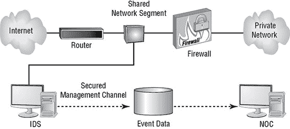

`图 3.7` NIDS 在网络中的放置决定了将分析哪些数据。

`NIDS` 可以连接到 `switch`（交换机）或 `hub`（集线器），也可以连接到 `tap`（分流器）。许多 `hubs` 和 `switches` 都提供用于故障排除和诊断目的的监控端口。此端口的功能可能类似于 `tap`。使用 `tap` 方法的优势是 `IDS` 是唯一使用该 `tap` 的设备。图 3.8 插了一了使用 `hub` 或 `tap` 连接到网络的情况。

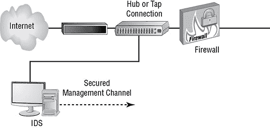

在任何一种情况下，`IDS` 都会监控和评估其能够访问的所有流量。

在网络层面可以制定两种基本的响应类型：被动和主动。它们在接下来的章节中将进行简要解释。

`passive response`（被动响应）是对入侵的最简单的一种响应。通常情况下，被动响应最容易开发和实施。以下列表包含了一些被动响应策略：

*   **日志记录 (Logging)**：`Logging` 涉及记录事件发生以及在什么情况下发生。`Logging` 函数应提供有关攻击性质的足够信息，以帮助管理员确定发生了什么，并协助评估威胁。这些信息随后可以被用于制定应对威胁的方法。

### 实现主动响应

`active response`（主动响应）涉及根据攻击或威胁采取行动。主动响应的目标是采取尽可能快的行动来减少事件的潜在影响。这种类型的响应需要如何处理事件的计划、清晰/易懂的策略以及 `IPS` 中的智能，才能成功。主动响应将包括此处简要描述的反应之一：

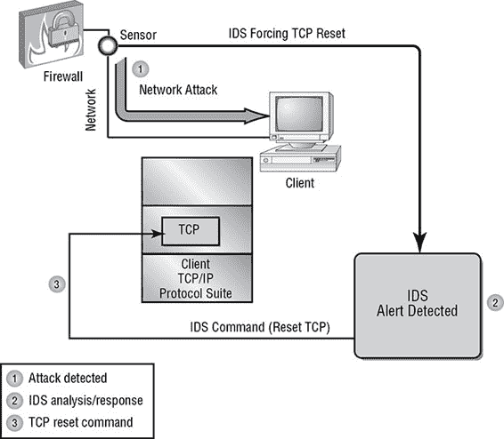

`图 3.9` IPS 指令 TCP 重置


FIGURE 3.10 IPS 指令防火墙关闭 80 端口 60 秒以阻止 IIS 攻击

如果 IPS 确定特定的套接字或端口受到攻击，它可以指示防火墙在指定时间内阻塞该端口。这样做可以有效消除攻击，但可能由于消除了合法流量而意外导致自发性 DoS 情况的发生。这对于 80 端口（HTTP 或网络）流量尤为如此。

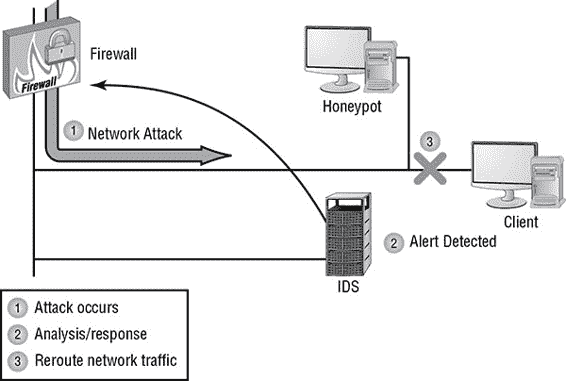

FIGURE 3.11 网络蜜罐欺骗攻击者并收集了情报。

当执法部门正在进行积极调查，并且他们正在收集证据以确保成功起诉攻击者时，这种方法被频繁使用。欺骗允许你在不冒实时数据风险的情况下收集文档。

### 使用基于主机的 IDS

图 3.12 展示了安装在服务器上的 HIDS。注意 HIDS 与登录审计和内核审计文件进行交互。内核审计文件用于进程和应用程序接口。

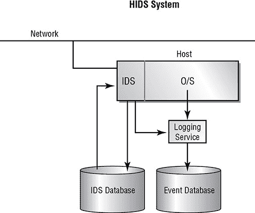

HIDS 的两个主要问题并不容易克服。第一个问题涉及系统被破解。如果系统被攻破，IDS 报告的日志文件可能会变得损坏或不准确。这可能导致故障确定变得困难，或者可能使系统不可靠。HIDS 的第二个主要问题是它必须部署在每个需要它的系统上。这会给行政和支持人员带来头疼的问题。

HIDS 的主要优势之一是能够对文件进行校验和存储。这些校验和可以用于通知系统管理员文件已被攻击修改。恢复工作变得简单了，因为更容易确定篡改发生在哪里。另一个优势是 HIDS 可以在 NIDS 无法读取内存时读取内存。

与 NIDS 不同，网络入侵防御系统（NIPSs）侧重于 `prevention`（预防）。这些系统专注于特征匹配，然后采取行动措施。例如，如果看起来攻击可能正在进行，可以丢弃、忽略数据包等。为了这一点，NIPS 必须能够 `detect` 正在发生的攻击，因此可以认为 NIPS 是 NIDS 的子集。

## 路由器

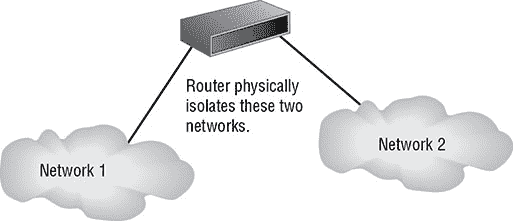

FIGURE 3.13 连接两个局域网的路由器

路由器结合通道服务单元/数据服务单元（CSU/DSU），还用于从局域网帧转换为广域网帧（例如，连接 100BaseT 网络到 T1 网络的路由器这是必要的，因为局域网和广域网中的网络协议是不同的。此类路由器被称为 `border routers`（边界路由器）。它们作为局域网到广域网的外部连接，运行在你的网络边界。就像许多国家的边境检查一样，边界路由器决定谁可以进入以及在什么条件下进入。

将内部网络分为两个或多个子网络是路由器的常见用途。路由器还可以在内部连接到其他路由器，有效地创建自主运行的 `zones`（区域）。图 3.14 展示了一个企业网络，它结合使用连接到 ISP 的边界路由器和内部路由器来创建用于通信的自主网络。这种连接将本地网络流量保持在公司网络骨干之外，并为内部用户提供了额外的安全性。

FIGURE 3.14 实现路由器以进行分段和安全的企业网络

路由器通过维护有关目的地和本地连接的表来建立通信。路由器包含有关连接到它的系统的信息，以及在目的地未知时将请求发送到何处的信息。这些表随着通过路由器建立连接而增长。

路由器通常使用三种标准协议之一通信路由和其他信息：路由信息协议 (RIP)、边界网关协议 (BGP) 或开放最短路径优先协议 (OSPF)。路由发生在网络内部或外部。

路由器是你的第一道防线，它们必须配置为仅通过经网络管理员授权的流量。实际上，如果配置得当，路由器可以充当防火墙。最佳方法是分层的；路由器不应取代防火墙，而应只是增强它。


路由本身可以配置为静态或动态。如果是静态的，则通过手动编辑并保持原样直到进行更改。如果是动态的，它们会学习周围其他路由的信息并利用这些路由器的信息来构建路由表。

## 交换机

`switch`（交换机）是一种提高网络效率的多端口设备。交换机通常包含关于网络中系统的少量信息——MAC 地址表（介质访问控制，即每个控制器的唯一物理地址），而不是 IP 地址。由于虚拟电路的能力，使用交换机比使用集线器或路由器具有更高的网络效率。交换机还能提高网络安全性，因为虚拟电路更难被网络监视器检查。你可以将交换机认为是一个结合了路由器和集线器某些优点的设备。

交换机维护着关于内部网络节点的有限路由信息，并允许连接到集线器或路由器等系统。图 3.15 显示了局域网内两个工作站之间交换机的工作情况。

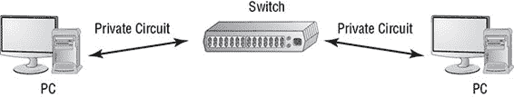

图 3.15 系统之间的切换

连接通常不是安全或加密的；然而，由于数据不会离开交换区域，对加密的需求就减少了。

交换机可以在 OSI 模型的第 2 层（数据链路层）或第 3 层（网络层）工作。多层交换机是指可以同时在 OSI 模型的第 2 层和第 3 层运行的设备，这意味着多层设备既可以作为交换机也可以作为路由器。多层交换机也称为三层交换机，它是一种实际上支持与路由器相同路由协议的高性能设备。它是在局域网内引导流量的普通交换机。此外，它还可以在子网之间转发数据包。

当网络上实现多一个桥器或交换机时，可能会发生环路。在这种情况下，设备可能会误导对方，让对方认为某个主机位于特定分段，而实际上并非如此。为了解决 `loop`（环路）问题，生成树协议（STP）等技术允许为桥器/交换机接口分配一个值，然后使用该值来控制学习过程并防止环路。由于交换机可能会受到 DoS 攻击，因此使用 `flood guards`（洪水防护）来查找并防止恶意流量导致交换机停止。

交换机端口可能是一个很大的弱点，`port security`（端口安全）至关重要。务必确保交换机安全，禁用未使用端口，并留意以下内容：DHCP 侦听、ARP 检查、MAC 地址过滤和 VLAN 分配（与网络划分有关）。确保交换机安全、禁用未使用端口并使用常识解决方案可以极大提高网络安全性。

## 代理

`proxy`（代理）是代表其他设备操作任何设备。这可以是访问网页、数据库或几乎任何其他服务于单一具有多种用途的`application`。出于安全考虑，所有内部用户与互联网的交互都应该通过 `proxy server`（代理服务器）进行控制。代理服务器应自动阻止已知的恶意网站。代理服务器应缓存经常访问的网站以提高性能。

大多数代理 `forward proxy`（正向代理）工作，代表其服务的客户端检索数据。如果互联网上的任何用户都可以访问该代理服务器，则被称为“开放”代理服务器。另一种变体是 `reverse proxy`（反向代理），也称为“代理服务器”。这是一种面向内部的服务器，用作前端来控制（并保护）对私有网络上服务器的访问。反向场景用于负载均衡、验证、解密和缓存等任务。来自代理服务器的响应就像直接来自原始服务器一样，因此客户端对原始服务器一无所知。

大多数代理位于客户端和互联网之间，它们被称为 `transparent proxy`（透明代理，也称为拦截代理、内联代理或强制代理）。`RFC2616` 将透明性定义为“一个除了代理身份验证和识别所需的修改之外，不修改请求或响应的代理”。换句话说，客户端不需要感知代理的存在。此相反的是“nontransparent proxy”（非透明代理）——即，一个“通过修改请求或响应来为用户代理提供某些额外服务的代理，例如组注释服务、媒体类型转换、协议精简或匿名过滤”。

## 负载均衡器

`Load balancing`（负载均衡）是将负载从一个设备转移到另一个设备。通常涉及的设备是服务器，但该术语也可以用于硬盘、CPU 或几乎任何你想要避免过载的设备。使用服务器作为问题设备，在多个服务器之间平衡负载而不是仅依赖于一个，可以缩短响应时间，最大化吞吐量并允许更好地分配资源。

`load balancer`（负载均衡器）可以作为软件或硬件解决方案实现，它通常与设备相关——路由器、防火墙、网络地址转换 (NAT) 设备等。在它最常见的实现中，负载均衡器将指向网站的流量拆分成单独的请求，然后根据可用性将其轮询到冗余服务器。（如果应该用的服务器正忙或宕机，则将其从循环中移除。）

`Scheduling`（调度）是负载均衡的关键问题：确定如何划分工作并将其分配到服务器上。处理此问题的两种方法是轮询（round-robin）和亲和性（affinity）。`Round-robin` 均衡非常简单：第一个客户端请求发送第一组服务器，第二个发送第二组，依此类推。当到达列表末尾时，负载均衡器循环回并再次遍历列表。相反，使用 `affinity` 均衡时，相似的服务会被发送给相似的服务器。

`active-active`（主主）配置意味着多个负载均衡服务器一直在工作，以处理不断涌入的负载/请求。其替代方案是 `active-passive`（主备），在这种情况下，有一个主服务器而备用服务器处于监听模式——当第一个服务器负载过重时，它可以在需要时激活并开始分担负载。

最后，你可以使用 `virtual IP (VIP)` 实现跨多个接口的入站和出站负载负载均衡。这种负载均衡方法的优点是它比基于 DNS 的负载均衡方法更具活性。这种方法的缺点是它是一种基于连接的解决方案，而不是基于负载的解决方案（不考虑每个接口上的负载，假设所有连接的流量负载相似）。`VIP` 具有一个 IP 地址，必须公开可用才能使用（例如用于网络流量的 `TCP` 端口 `80`）。

## 接入点


虽然 `access point (AP)` 在技术上既可以用于有线也可以用于无线连接，但实际上，该术语现在几乎专门指支持无线功能的设备。`AP` 工作在 OSI 模型的第 2 层（数据链路层），它可以作为连接标准有线网络与无线设备的桥接，也可以作为路由器将数据传输从一个接入点传递到另一个接入点。无线接入点（`APs`）由发射器和接收器（收发器）设备组成，用于创建无线局域网（`WLAN`）。`APs` 通常是带有内置天线、发射器和适配器的独立网络设备。`APs` 使用无线基础设施网络模式在 `WLANs` 和有线以太网之间之间提供连接点。`APs` 通常具有几个端口，为您提供扩展网络以支持额外客户端的方法。

根据网络的大小，可能需要一个或多个 `APs` 来提供覆盖。额外的 `APs` 用于允许更多无线客户端接入并扩大无线网络的范围。每个 `AP` 都受到传输范围的限制——也就是说，客户端距离 `AP` 多远且仍能获得可用信号。实际距离取决于所使用的无线标准以及客户端与 `AP` 之间的障碍物和环境条件。

`APs` 具有各种形状和大小。许多较廉价，且专为家庭或小型办公室使用设计。此类 `APs` 具有低功率天线和有限的扩展端口。用于商业目的的高端 `APs` 具有高功率天线，能够延伸无线信号传输的距离。说一个 `AP` 用于将有线局域网扩展到无线客户端，并没有给您全貌。今天的无线 `AP` 除了作为接入点外，还可以提供不同的服务。如今，`APs` 可能提供许多端口，可轻松增加网络规模。可以向网络中添加或删除系统，而对网络上的其他系统没有影响。此外，许多 `APs` 还提供防火墙功能和动态主机配置协议（`DHCP`）服务。当它们连接时，它们为客户端系统提供私有 IP 地址，然后防止互联网流量访问这些系统。因此，实际上 `AP` 是一个交换机、`DHCP` 服务器、路由器和防火墙。

要连接到无线 `AP`，你需要一个服务集标识符（`SSID`）名称。`802.11` 无线网络使用 `SSID` 来识别属于同一网络的所有系统，客户端站必须配置 `SSID` 才能通过 `AP` 验证。`AP` 可能会广播 `SSID`，允许区域内的所有无线客户端看到 `AP` 的 `SSID`，但出于安全考虑，`APs` 可以配置为不广播 `SSID` 或将其隐藏。这意味着管理员需要给客户端系统提供 `SSID`，而不是允许其被自动发现。

无线设备出厂时带有默认的 `SSIDs`、安全设置、通道、密码和用户名。为了保护您的安全，强烈建议您更改这些默认设置。今天，许多网站都列出了制造商在其无线设备中使用的默认设置。这些信息被那些想要未经授权访问您的无线设备的人所利用。

访问任何网络资源都应该要求身份验证。`MAC 过滤`（通过 `MAC` 地址识别每个主机并根据此允许（或拒绝）访问）可以大幅提高安全性。你还应该考虑 `AP` 的 `signal strength`（信号强度），并确保你没有超出网络范围而让不该连接的人连接进来。如果你遇到干扰或其他困难，请考虑 `band selection`（频段选择）：许多接入点允许你选择想要使用的哪种 Wi-Fi 频段，并选择在你的环境中效果最好的一个。

`Antenna placement`（天线放置）对于允许客户端到达接入点至关重要。这个问题没有通用的解决方案，它取决于接入点放置的环境。作为一个一般原则，信号必须传输的距离越远，衰减就越严重，但如果建筑材料反射或吸收信号，即使在短距离内你也可能丢失信号。你应该尽量避免将接入点放置在金属（包括家电器）附近或地面。建议将它们放置在服务区域的中心，并且足够高以避开大多数障碍物。如果信号实际上传输得太远，某些接入点包含 `power level controls`（功率电控制），允许你减少输出量。

与天线放置一样重要的是所使用的天线类型。许多（但不是所有）`APs` 上的默认天线可以被更换，以增加或减少传输范围。合适的天线可以绕过障碍物，最小化干扰影响，增强信号强度并聚焦传输（这可以提高信号速度）。

天线可以是完全位于 `AP` 内部，也可以由一、二或三根外部杆子组成。

`omnidirectional`（全向）天线设计用于提供 360 度模式和所有方向的均匀信号，因此你通常希望将 `AP` 位于覆盖区域的中间。另一方面，`directional`（定向）天线强制信号向一个方向，由于它在聚焦信号，它可以用更强的信号覆盖更大的距离。

所有天线按 `gain value`（增益值）额，以 `dBi` 数字表示。广告为 `20 dBi` 的无线天线强度比 `0 dBi` 基准强 20 倍。作为一个一般原则，天线每增加 `3 dB`，功率输出就会有效翻倍。

接入点可以被称为 `fat`（胖）或 `thin`（瘦），以及`基于控制器的`或`独立的`。`Fat APs`（有时仍称为自主 `APs`）需要手动配置网络和安全设置。然后它们基本上被留置在那里服务客户端，直到它们无法运行为止。`Thin APs` 是胖接入点的进化演变，允许使用控制器（通常为机架式）进行远程配置。由于瘦客户端不需要手动配置，它们可以轻松地进行现场重新配置——并监控。独立接入点也被称为厚接入点（与瘦型相对），它们不需要控制器，而基于控制器的接入点使用该控制器进行集中管理、更新、策略设置以及各种其他功能。

### SIEM

将安全信息管理（`SIM`）与安全事件管理（`SEM`）相结合产生了该领域最新的缩写之一：`security information and event management (SIEM)`。`SIEM` 产品对网络设备和软件应用程序标记的安全警报进行实时分析（`aggregation` 聚合）。许多供应商将一体机 `SIEM` 作为托管服务出售（区别于纯软件或基于设备的解决方案）。

### DLP


`数据泄露防护 (DLP)` 系统监控系统（工作站、服务器和网络）的内容，以确保关键内容不被删除或移除。实现这一点的方法之一是`阻止 USB` 以及其他接口。DLP 系统还会监控谁在使用数据（寻找未授权的访问）以及谁在传输数据。DLP 系统与网络入侵防御系统具有共同点。这种监控可以是`基于云的`，并限制在特定的应用程序中（例如电子邮件）。

最广为人知的 DLP 系统之一是 MyDLP，这是一个运行在大多数 Windows 平台上的开源解决方案。你可以在 [www.mydlp.org](http://www.mydlp.org) 找到 MyDLP。市场上还有大量的商业程序可以购买。RSA 是另一个流行的 DLP 产品，此外 McAfee、Palisade Systems 和 Global Velocity 也提供了其他产品。

## 网络访问控制 (NAC)

运行安全问题包括`网络访问控制 (NAC)`；身份验证以及网络安装后的安全拓扑结构。这些问题包括网络日常日常运行、与其他网络的连接、备份计划和恢复计划。简而言之，运行安全涵盖了网络中所有与设计或物理安全无关的内容。现在的重点不再是存储数据的物理组件（如服务器），而是转向拓扑结构和连接。

理解 NAC 的最佳方式是将其视为网络为尝试访问它的客户端定义的一 set 标准，只有符合特定要求的已知设备才能连接。通常，NAC 要求客户端在允许进入网络之前必须没有病毒，并被分配给信任的用户。

尝试连接到网络的设备必须在其内部运行某些程序（通常是`代理程序 (agent)`）以验证设备、检查其是否运行了最新的病毒防护软件，并执行管理员想要运行的任何其他`主机健康检查`。如果该代理程序始终在设备设备上，则被称为`持久的 (permanent)`，这在连接大多数公司配发的设备时通常是如此。如果该代理仅为该会话安装，则被称为`溶解的 (dissolvable)`，这通常发生在基于浏览器的会话以及用户从旅行时的客机连接网络的情况下。

代理程序并不适用于每个设备和操作系统（例如网络打印机），因此也存在`无代理 (agentless)` 解决方案。这些设备必须是已知、定义且受信任的，并在 NAC 进行的网络扫描期间被识别并被允许接入网络。

## 邮件网关

邮件网关不仅可以用于路由邮件，还可以执行其他功能，例如`加密`或范围较窄的`DLP`。更常见的是，可以添加`垃圾邮件过滤器`来捕获不需要的邮件并在内部投递之前将其过滤掉。过滤是基于既定规则进行的，例如阻止来自某些 IP 地址的邮件、主题行中包含特定词汇的邮件等。虽然垃圾邮件过滤器通常用于扫描传入邮件，但它们也可以用于扫描传出邮件，从而作为可能感染病毒的内部 PC 的快速标识。

据估计，超过 90% 的传入邮件是垃圾邮件。Apache SpamAssassin 是最广知的开源垃圾邮件过滤器之一。你可以在这里找到更多信息：[`spamassassin.apache.org/`](http://spamassassin.apache.org/)。

## 桥接器

`桥接器`通过位于两个物理网络段之间并管理两者之间的数据流，将较大的网络划分为较小的部分。近年来，桥接器不再受到青睐，被交换机取代，交换机提供了类似的功能甚至更多。此外，由于工作方式的原因，交换机有时被称为“多端口桥接器”。

通过查看连接到每个段的设备的 MAC 地址，桥接器可以选择转发数据（如果它们认为目标地址在另一个接口上）或阻止其跨越（如果它们可以验证地址位于来源的接口上）。桥接器还可以用于将两个物理局域网连接成一个更大的逻辑局域网。

## SSL/TLS 加速器

根据之前的讨论，你可能记得 SSL（安全套接层）是常用的缩写，无论所使用的技术实际上是 SSL 还是其替代品 TLS（传输层安全）。这在`SSL 加速器`上尤其如此，这是一个同时用于 SSL 和 TLS 加速器的术语。由于加密数据非常消耗处理器，可以使用加速器将公钥加密卸载到硬件加速器，这通常是一个独立的插拔卡（通常插入 PCI 插槽）。

## SSL 解密器

可以使用`SSL 解密器`为网络添加另一层安全防护。这些网关会解密加密流量（SSL 或 TLS），对其进行检查，然后在发送到目的地之前重新加密。这是一个处理器密集密集型过程，但它提供的优势在于检查步骤——确保你不会由于数据被加密而转发了未被捕获的问题。

## 媒体网关

最新的术语之一是`Web 安全网关`，它可以被看是一个带有内置 Web 保护软件的代理服务器（执行代理和缓存功能）。根据供应商，“Web 保护”的范围从对传入数据包进行标准病毒扫描到监控传出用户流量中是否存在红旗不等。

网关可以检测和/或禁止的潜在红旗包括不当内容、尝试与文件共享网站建立点对点连接、即时消息以及未经授权的隧道。你可以配置大多数 Web 安全网关以阻止已知的 HTTP/HTML 漏洞、剥离 ActiveX 标签、剥离 Java Applet 并阻止/剥离 Cookie。

## 硬件安全模块

除了基于软件的加密外，还可以应用基于硬件的加密。例如，在某些 BIOS 配置菜单的高级设置中，你可以选择启用或禁用 TPM。`可信平台模块 (TPM)` 可辅助哈希密钥生成。TPM 是分配给可以存储密码密钥、密码或证书的芯片名称。TPM 还可以保护智能手机和 PC 以外的设备。它还可以生成用于全盘加密（如 BitLocker）的值，将在第 8 章“密码学”中详细讨论。BitLocker 可以在使用或不使用 TPM 的。与 TPM 结合使用要安全得多（事实上是首选），但并不要求它。

TPM 芯片可能安装在主板上。如果是这样，在很多情况下它在 BIOS 中默认设置为关闭。在练习 3.1 中，你将在 Windows 中查找 TPM 芯片。大多数版本的 Windows 都包含对 TPM 支持，尽管这种支持在某些版本中受到限制。

有关 TPM 的更多信息可以在信赖计算组网站找到：[`www.trustedcomputinggroup.org/`](https://www.trustedcomputinggroup.org/)。

除了 TPM 之外，`HSM (硬件安全模块)` 是一种可以增强安全性的密码处理器。HSM 常用于 PKI 系统以通过证书机构 (CA) 增强安全性。与像 TPM 安装在主板上不同，HSM 传统上被封装为 PCI 适配器。

## 总结

本章重点介绍了网络基础设施的关键要素以及涉及网络的一些硬件组件。你的基础设施是网络的骨干，也是其所有安全能力的关键。


你的总网络基础设施包含了运行网络所需的硬件和软件。这些基础设施组件的妥善配置，是按照网络需求的方式提供服务的关键。如果你的网络安全设备配置不当，情况可能比完全没有这些设备还要糟糕。当你认为自己是安全的，但实际上并非安全时，这是一个非常危险的情况。

## 考试要点

**能够描述基础设施的各种组件及其目的。** 你的网络基础设施是系统和网络运行的骨。基础设施包含了所有已有的硬件、软件、物理安全和操作安全方法。基础设施的关键组件包括路由器、`firewalls`（防火墙）、`switches`（交换机）以及网络使用的其他设备。

**了解误报（false positives）和漏报（false negatives）之间的区别。** 漏报是指任何应该被标记但未被标记的事件。这是危险的，因为它可能让你产生虚假的安全感。相反，误报是指被错误触发的标记事件。其危险之处在于你花费了大量时间在错误的事情上，并试图解决并不存在的问题。

**了解基于亲和性的负载均衡（affinity-based load balancing）和轮询负载均衡（round-robin load balancing）之间的区别。** 两者都是常用作负载均衡的调度方法。在亲和性调度中，类似的服务会被发送到类似的服务器。在轮询调度中，第一个客户端请求发送到第一组服务器；第二个发送到第二组；依此类推。

## 复习题

你可以在附录中找到答案。

1. 下列设备中最能提供基础设施安全的是？
    1. `Hub`
    2. `Switch`
    3. `Router`
    4. `Modem`

2. 高层管理规定立即部署 `firewall`（防火墙），以防你的站点遭受类似于姐妹公司所遭受的攻击。为了响应这一命令，你的老板指示你在本周末前实施 `packet filter`（包过滤）。`packet filter` 执行哪种功能？
    1. 防止未经授权的数据包进入网络
    2. 允许所有数据包离开网络
    3. 允许所有数据包进入网络
    4. 消除网络中的冲突

3. 哪种设备存储网络目的地的信息（选择最佳答案）？
    1. `Hub`
    2. `Modem`
    3. `Firewall`
    4. `Router`

4. 随着越来越多的客户端加入你的网络，网络效率显著下降。你正在准备明年的预算，并特别想解决这个问题。下列哪种设备主要作为提高网络效率的工具？
    1. `Hub`
    2. `Switch`
    3. `Router`
    4. `PBX`

5. 你收到通知很快将被调到另一个站点。在离开之前，你需要对网络进行审计，并记录所有使用的内容及其原因。下一任管理员将使用这些文档来维持网络运行。下列哪个协议不是隧道协议，但可能被你站点的隧道协议协议用于网络安全？
    1. `IPSec`
    2. `PPTP`
    3. `L2TP`
    4. `L2F`

6. 下列哪项可以作为软件或硬件解决方案实施，并且通常与设备（`router`、`firewall`、`NAT` 等）相关，用于将负载从一个设备转移到另一个设备？
    1. `Proxy`
    2. `Hub`
    3. `Load balancer`
    4. `Switch`

7. 下列哪些是提高网络效率的多端口设备？
    1. `Switches`
    2. `Modems`
    3. `Gateways`
    4. `Concentrators`

8. 哪种 IDS（入侵检测系统）使用算法来分析通过网络的流量？
    1. Arithmetical
    2. Algebraic
    3. Statistical
    4. Heuristic

9. 下列哪项可将公钥加密卸载到独立的硬件插卡上？
    1. `SSL accelerator`
    2. `Load balancer`
    3. `Proxy firewall`
    4. `SIEM`

10. 下列哪种保护意味着信息一旦写入就无法修改？
    1. `DLP`
    2. `ROM`
    3. `WORM`
    4. `NAC`

11. `IPSec` 可以在哪两种模式下工作？
    1. Tunneling and Storing（隧道与存储）
    2. Transport and Storing（传输与存储）
    3. Tunneling and Transport（隧道与传输）
    4. At-Rest and At-Ease（静态与易用）

12. 哪种隧道配置使得只有部分（通常是所有入站）请求通过 `VPN` 路由并加密？
    1. `Split`（分流）
    2. `Full`（全隧道）
    3. `Partial`（部分）
    4. `Hybrid`（混合）

13. 哪种类型的负载均衡调度将第一个客户端请求发送到第一组服务器，第二个发送到第二组，依此类推？
    1. Affinity（亲和性）
    2. Round-robin（轮询）
    3. Sequential（顺序）
    4. Progressive（渐进）

14. 哪种负载均衡配置意味着始终有一个负载均衡服务器在工作，以处理进入的负载/请求？
    1. Active-active（主备）
    2. Cooperative-sharing（协作共享）
    3. Equal-partner（平等伙伴）
    4. Proactive-colleague（主动同事）

15. 下列哪项通过解密加密流量（`SSL` 或 `TLS`）、对其进行检查，然后在发送到目的地之前重新加密来工作？
    1. `SSL filters`
    2. `SSL gateways`
    3. `SSL accelerators`
    4. `SSL decryptors`

16. 下列哪项是用于存储加密密钥、密码或证书的芯片？
    1. `HMP`
    2. `TPM`
    3. `MTP`
    4. `PMH`

17. 哪种基于 AP 的技术可以通过根据客户端的物理地址允许或拒绝访问来提高安全性？
    1. `MAC filtering`（MAC 过滤）
    2. `UTM (unified threat management)`（统一威胁管理）
    3. Round-robin
    4. `WORM`

18. 哪种网络设备通过位于两个物理网络网段之间并管理两个段之间的数据流，将较大的网络分为较小的部分？
    1. `Accelerators`
    2. `Proxies`
    3. `Bridges`
    4. `Balancers`

19. 当网络上实施多个网桥器或交换机时，可能会发生什么问题？这些设备会误导对方，让对方认为主机位于某个网段，但实际上它并非在那里。
    1. Backdoors（后门）
    2. Dead zones（死区）
    3. Collisions（冲突）
    4. Loops（环路）

20. 为了解决问题 19 中描述的问题，下列哪种技术允许网桥/交换机接口分配一个值，该值用于控制学习过程并防止问题？
    1. `ESSID`
    2. `SSID`
    3. `BRD`
    4. `STP`

# 第 4 章

## 身份与访问管理

**本章涵盖以下 CompTIA Security+ 考试目标：**

* ** 2.2 给定场景下，使用适当的软件工具评估组织的安全态势。**
    * 协议分析器（Protocol analyzer）
    * 网络扫描器：非法系统检测（Rogue system detection）；
    * 网络映射（Network mapping）
    * 无线扫描器/破解器（Wireless scanners/cracker）
    * 密码破解器（Password cracker）
    * 漏洞扫描器（Vulnerability scanner）
    * 配置合规性扫描器（Configuration compliance scanner）
    * 漏洞利用框架（Exploitation frameworks）
    * 数据清理工具（Data sanitization tools）
    * 隐写术工具（Steganography tools）
    * 蜜罐（Honeypot）
    * 备份实用程序（Backup utilities）
    * 标志抓取（Banner grabbing）
    * 被动与主动对比（Passive vs. active）
    * 命令行工具：`ping`；`netstat`;`tracert`;`nslookup`/`dig`;`arp`;`ipconfig`/`ip`/`ifconfig`;`tcpdump`;`nmap`;`netcat`

* ** 2.3 给定场景下，解决常见的安全问题。**
    * 未加密凭据/明文（Unencrypted credentials/clear text）
    * 日志和事件异常（Logs and events anomalies）
    * 权限问题（Permission issues）
    * 访问违规（Access violations）
    * 证书问题（Certificate issues）
    * 数据泄露（Data exfiltration）
    * 配置错误的设备：`Firewall`（防火墙）；内容过滤器（Content filter）；`Access points`（访问点）
    * 弱安全配置（Weak security configurations）
    * 人员问题：违反违规（Policy violation）；内部威胁（Insider threat）；社会工程学（Social engineering）；社交媒体（Social media）；个人电子邮件（Personal email）


-   未经授权的软件
-   基线偏差
-   许可证合规性违规（可用性/完整性）
-   资产管理
-   身份验证问题

 2.4 给定场景，分析并解释安全技术的输出。

-   HIDS/HIPS（主机入侵检测/防御系统）
-   防病毒软件
-   文件完整性检查
-   基于主机的防火墙
-   应用程序白名单
-   移动媒体控制
-   高级恶意软件工具
-   补丁管理工具
-   UTM（统一威胁管理）
-   DLP（数据泄露防护）
-   数据执行防护
-   Web 应用防火墙

 4.1 对比身份访问管理概念。

-   识别、认证、授权和审计 (AAA)
-   多因素身份验证：你特征的；你拥有的；你所知的；你所在的位置；你所做的
-   联邦身份
-   单点登录
-   传递信任

 4.2 给定场景，安装并配置身份访问服务。

-   LDAP
-   Kerberos
-   TACACS+
-   CHAP
-   PAP
-   MSCHAP
-   RADIUS
-   SAML
-   OpenID Connect
-   OAUTH
-   Shibboleth
-   安全令牌
-   NTLM

 4.3 给定场景，实施身份访问管理控制。

-   访问控制模型：MAC（强制访问控制）；DAC（自主访问控制）；ABAC（基于属性的访问控制）；基于角色的访问控制；基于规则的访问控制
-   物理访问控制：门卡；智能卡
-   生物识别因子：指纹扫描仪；视网膜扫描仪；虹膜扫描仪；语音识别；人脸识别；误接受率；误拒率；交叉错误率
-   令牌：硬件；软件令牌；HOTP/TOTP
-   基于证书的认证：PIV/CAC/智能卡；IEEE 802.1x
-   文件系统安全
-   数据库安全

 本章涵盖了安全中的关键主题：控制谁可以访问你的系统、他们可以访问哪些资源，以及如何确保个人身份真实。在最基础的层，你可以将认证和访问控制视为安全的两大基石。如果你没有做好这些任务，你剩下的安全策略就不可能有效。

本章首先从访问控制的基础开始，然后探索远程访问和认证服务。最后通过检查访问控制的实施和最佳实践结束。

## 使用工具评估你的网络

可以使用多种工具来评估网络安全。这些工具是任何安全专业人员工作中价值所在。

### 协议分析仪

协议分析仪（也称为包嗅探器）是网络管理员最常用的工具之一。本质上这些工具查看网络上的当前流量，允许你查看这些流量并捕获副本供以后分析。在本节中，我们将简要介绍两种最常用的工具。

监控网络流量是安全工作中的关键步骤。异常流量可能指示拒绝服务攻击、数据外泄或任何其他安全问题。协议分析仪和数据包嗅探器是网络安全、事件响应和网络取证的基础工具。

### tcpdump

`tcpdump` 是一种常用的 Linux 数据包嗅探器。它在 shell 中运行，相对易用。要启动它，你只需要告诉它监听哪个接口，如下：

```
tcpdump -i eth0
```

这会导致 `tcpdump` 捕获网卡 `eth0` 的网络流量。你还可以通过各种命令行标志来更改 `tcpdump` 的行为，例如：

```
tcpdump -c 100 -i eth0
```

这告诉 `tcpdump` 仅捕获接口 `eth0`上的前 100 个数据包然后停止。

```
tcpdump -D
```

此命令将显示计算机上所有的接口，以便你选择使用哪一个。你可以在图 4.1 中看到这三个选项。

![窗口显示带有编程代码的 tcpdump，如 1.eth0 [up, running], 2\. Any (在所有接口上捕的伪设备) [up, running], 6.usbmon1 (USB 总线号 1), 7.usbmon2 (USB 总线号 2) 等。](images/00035.jpeg)

**图 4.1** `tcpdump`

### Wireshark

`Wireshark` 是最广为人知的网络包嗅探器之一。渗透测试人员通常只需通过嗅探目标网络的流量就能学到很多。`Wireshark` 提供了一个方便的图形化用户界面 (GUI) 来检查网络流量。它是免费下载，你可以在 [`www.wireshark.org/`](https://www.wireshark.org/) 获取。该工具可以下载 Windows 或 Macintosh 版本。它具有 GUI 而不是基于命令行。你可以在图 4.2 中看到主 `Wireshark` 界面。

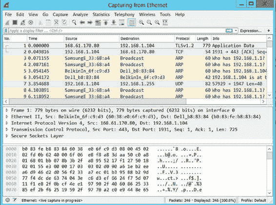

**图 4.2** `Wireshark`

使用 `Wireshark` 时，你可以突出显示任何数据包并查看该包的详情，包括各种网络头（如以太网、TCP 和 IP）。你也可以右键点击特定数据包并选择查看与该包相关的整个对话。这可以在图 4.3 中看到。

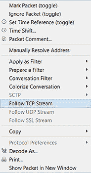

**图 4.3** `Wireshark` 跟踪对话

`Wireshark` 是一个非常多功能的工具。值得花时间完全学习该工具的所有功能。幸运的是，你可以在 [`www.wireshark.org/#learnWS`](https://www.wireshark.org/#learnWS) 的 Wireshark 页面找到许多帮助学习的资源。

### 网络扫描器

网络扫描与包嗅探不同。在网络扫描中，你实际上是在尝试找出网络上有什么。这看起来像是一个奇怪的任务。难道你不应该已经知道网络上有什么吗？理想情况下应该是。然而，网络随着时间的推移而变化，并不是所有的更改都有记录。网络扫描器或网络映射器可以枚举你网络上的所有内容，为你提供网络状况的最新视图。

#### Solar Winds

`SolarWinds` 是一款商业网络扫描器，开发者提供免费的 14 天试用版。你可以在图 4.4 中查看网络拓扑扫描。

你选择一个 IP 范围、子网或 IP 地址列表进行扫描，然后开始扫描。`SolarWinds` 将生成你的网络地图。然后你可以右键点击网络上的任何设备以获取更多细节（图 4.5）。


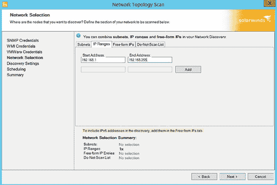

图 4.4 SolarWinds 网络拓扑扫描

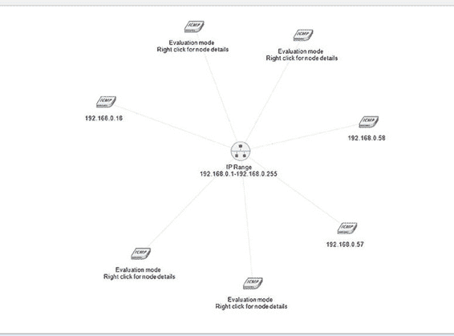

图 4.5 SolarWinds 扫描结果

该工具是一个功能齐全且易于使用的网络扫描器。

#### LanHelper

该工具是一款廉价的网络映射和扫描器，你可以从 [www.hainsoft.com/download.htm](http://www.hainsoft.com/download.htm) 下载。它安装速度很快，然后你只需点击下拉菜单上的 `Network`，然后选择以下之一即可进行扫描：

* `Scan Lan`（扫描局域网）
* `Scan IP`（扫描 IP）
* `Scan Workgroups`（扫描工作组）

扫描完成后，你将看到网络上所有设备的列表，你可以点击其中任何一个来获取更多详细信息，如图 4.6](#part0013_split_001.html_figure4-6) 所示。

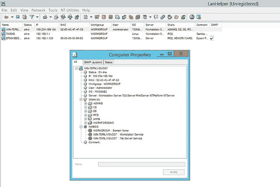

图 4.6 LanHelper

#### 无线扫描器和破解器

无线网络在今天已无处不在。因此，扫描无线网络，甚至通过尝试破解它来测试其安全性，对于任何网络管理员来说都是一项重要的活动。上一节中提到的网络扫描器可以用于无线网络，但也有专门为 Wi-Fi 设计的工具供你使用。

除了扫描之外，许多 Wi-Fi 工具还会尝试破解你的 Wi-Fi。它们本质上会尝试推导出密码或绕过安全防护。网络安全专业人员使用此类工具扫描自己的网络以便在攻击者之前发现问题，是非常重要的。

### Aircrack

Aircrack 是扫描和破解 Wi-Fi 最流行的工具之一。它是免费的，你可以在 [www.aircrack-ng.org/](http://www.aircrack-ng.org/) 获取它。该下载包实际上包含几个工具。其中一个名为 `wzcook.exe` 的工具会尝试从安装它的本地机器上提取无线数据（包括密码）。但这不是我们感兴趣的部分。主要工具是 `aircrack-ng`。它是一个命令行工具，你可以在图 4.7](#part0013_split_001.html_figure4-7) 中看到它。

![窗口显示 aircrack 和编程代码为 C:\aircrack>aircrack-ng-avx, usage: aircrack-ng [options] <.cap / .ivs file(s)>, -q:启用静音模式（无状态输出），-l <file>:将密钥写入文件，等等。](images/00041.jpeg)

图 4.7 Aircrack

熟悉所有的命令行标志需要一些时间。然而，这是一个非常重要的工具，花时间是值得的。它之所以如此重要，是因为在攻击者中非常流行。如果你使用攻击者可能使用的相同工具扫描你的无线网络，并发现且纠正了这些问题，那么你的网络受到无线攻击的脆弱性就会更低。

#### 密码破解器

可以合理地假设攻击者会尝试破解你网络上的密码。考虑到这一事实，你尝试在你的网络上使用密码破解器也是合的。如果你能够破解一个或多个密码，那么你就意识到了这一安全漏洞，并可以采取适当措施解决该问题。在本节中，我们将查看三种广泛使用的密码破解器。

#### pwdump

pwdump 是攻击者常用的常用工具，因此安全专业人员使用它也是是一件好事。许多密码破解工具的第一步是从 Windows SAM 文件中获取本地密码哈值的副本。SAM 文件（或安全账户管理器）是 Windows 存储密码哈值的地方。`pwdump` 程序将从 SAM 文件提取密码哈值。`pwdump` 可以从 [www.openwall.com/passwords/windows-pwdump](http://www.openwall.com/passwords/windows-pwdump) 免费下载。图 4.8](#part0013_split_001.html_figure4-8) 是 `pwdump7` 输出的图像。实际哈值已经过处理，因为这是在实时机器上运行的。

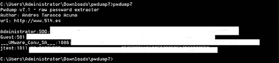

图 4.8 pwdump

通常，你可能希望将哈值转储到外部文件中，以便将其导入到彩虹表（rainbow table）工具中。彩虹表在第 8 章“密码学”中进行了详细解释，但现在只需知道它们是用于猜测密码的预计算哈值表。通过简单将 `pwdump` 的输出重定向到测试文件就可以很容易地实现这一点。例如：

```
pwdump > passwordhashes.txt
```

一旦你有了密码哈值，就可以使用任何彩虹表工具来检查是否可以恢复密码。这是验证你组织密码强度的一种方法。

#### Ophcrack

Ophcrack 是最广泛使用的密码破解工具之一。Ophcrack 之所以重要是因为它可以安装在启动光盘上。如果以这种方式使用，你可以从光盘启动系统，从而绕过 Windows 安全限制，并尝试破解密码。Ophcrack 免费提供小型彩虹表；你必须购买较大的彩虹表。你可以从 [`ophcrack.sourceforge.net/`](http://ophcrack.sourceforge.net/) 下载 Ophcrack。它不需要单独的过程来转储 Windows SAM 文件。相反，它会为你从 SAM 文件中获取数据。Ophcrack 的输出所示于图 4.9](#part0013_split_001.html_figure4-9)。实际哈值和密码已经过处理。

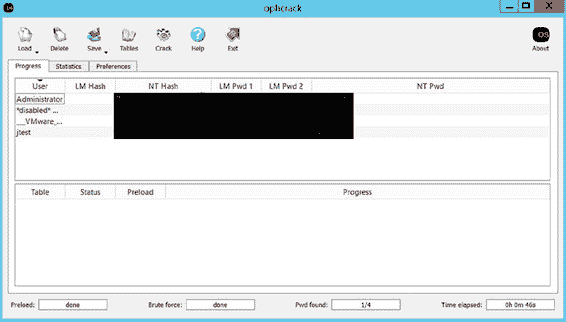

图 4.9 Ophcrack

无论你使用哪种特定的密码破解工具，此类工具对于验证密码的安全性都可能非常重要。本质上，你尝试破解密码，如果成功了，说明你的密码强度不够。

### 漏洞扫描器

扫描网络漏洞是非常重要的。目标是在攻击者发现之前发现并修复漏洞。在这些工具中，有些用于扫描通用漏洞，另一些专门扫描网页漏洞，而还有一些则检查你的系统配置是否正确。本节将讨论一些最常用的扫描器。

漏洞扫描器可以分为主动式和被动式。*主动式扫描器*会直接与目标网络交互。诸如 `Nessus`、`MBSA` 和 `OWASP ZAP`（这些将在本节中详细讨论）工具都是主动式扫描器。*被动扫描*涉及不与网络直接交互的搜索方法。这通常意味着提供信息的网站。这里列出了几个，并带有简要说明。

**Netcraft.com** 该网站提供了有关网站及其操作系统的信息。

**Shodan.io** 该网站是一个漏洞搜索引擎。你可以搜索你自己的网络域名以查找漏洞。


`isc.sans.edu` 这是 SANS 学院的网络风暴中心，它将提供有关当前网络威胁的信息。

## Nessus

Nessus 是最广泛使用的漏洞扫描器。你可以在 [https://www.tenable.com/products/] 找到 Nessus。它是一个商业工具，其库中包含数万个已记录的漏洞。你可以扫描 Linux 机器、Windowsget、路由器以及网络上的几乎所有设备。漏洞库持续更新，因此你始终能够检查最新的漏洞。Nessus 会为每次扫描生成一份报告。你可以在 图 4.10 中看到此类报告的示例。


**图 4.10** Nessus 报告

报告采用 HTML 格式，你可以深入任何特定问题，并阅读问题的详细描述以及建议的修复步骤。

## MBSA

微软基准安全分析器（Microsoft Baseline Security Analyzer）并不是最强大的漏洞扫描器。然而，它是免费下载的，除了发现漏洞外，它还有发现 Windows 机器的配置问题。你可以从 [https://www.microsoft.com/en-us/download/details.aspx?id=7558] 下载 MBSA。除了免费，它非常易用。你可以在 图 4.11 中看到 MBSA 的输出。

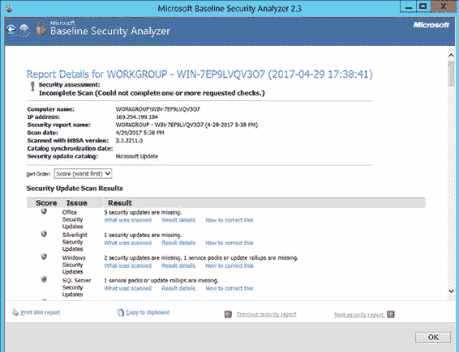

**图 4.11** MBSA 输出

如你所示，MBSA 可以发现常见的 Windows 漏洞，并让你知道是否需要补丁或系统密码是否存在问题。因此，它将漏洞扫描与配置扫描结合在一起。

## OWASP Zap

回想第 2 章“网络监控与诊断”，我们讨论过开放 Web 应用安全项目（OWASP）。他们发布了一份顶级漏洞列表。他们还发布了一个免费工具来扫描网站漏洞。该工具可以从 [https://www.owasp.org/index.php/OWASP_Zed_Attack_Proxy_Project] 下载。它也很易用。只需输入想要检查的网站 URL 并点击按钮即可。你可以在 图 4.12 中看到 OWASP 的输出。

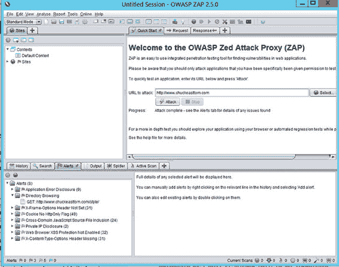

**图 4.12** OWASP ZAP 输出

如你所示，该工具对其发现的每个内容都提供了详细信息。每个项目都可以双击以查看更多详情。OWASP ZAP 将告诉你漏洞的细节以及建议的修复步骤。

## 漏洞利用框架

在某些情况下，网络管理员会采取额外步骤，实际上在他们的网络上尝试利用。这通常是渗透测试的一部分。在这些情况下，使用漏洞利用框架通常很有帮助。最广为人知的框架可能是 Metasploit。该程序可以从 [https://www.metasploit.com/] 下载。它有免费和商业版本。免费版本包含在 Kali Linux 发行版中。

关于 Metasploit 已经有整本书著作，教你掌握 Metasploit 的方方面面已超出本章的范围。然而，如果你兴趣使用框架来测试你的网络，强烈建议你花时间学习 Metasploit。

## 命令行工具

你可以使用许多命令行工具获取有关你网络的信息。其中一些是基础网络实用程序，另一些专门用于网络安全。CompTIA 经常强调这些工具。对于 Security+ 考试，实际上使用其中每一个工具并熟悉它们是非常关重要的。此外，正如你在后续章节中看到的，每个命令都有多个你可以使用的标志（flags）。Security+ 考试要求你了解这些标志以及基础命令。这些工具中的许多也是基础网络工具，Security+ 考试将假设这一部分主要是复习，而不是新内容。

### ping

`ping` 是一项基础网络实用程序。它是 Windows 和 Linux 的共同部分。`ping` 工具用于查找特定网站是否可以访问。偶尔 `P`acket `I`nter`N`et `G`opher 被建议作为 `ping` 的缩写，但 `ping` 的原始作者表示它是基于声纳返回的声音。`ping` 的工作原理是向目标主机发送互联网控制消息协议（ICMP）回显请求包，并等待 ICMP 响应（有时被随口称为 `pong`）。你可以在 图 4.13 中看到 `ping` 的用法。

![窗口显示命令提示符中的 ping 和编程代码如 C:\(images/00047.jpeg)ping www.google.com, 正在 ping www.google.com [2607:f8b0:4000:800: :2004] 使用 32 字节的数据，等等。"/>

**图 4.13** ping

`ping` 最常用的标志描述在 表 4.1 中。

| 标志 | 描述 |
| :--- | :--- |
| `-t` | 持续 ping 直到停止——例如，`ping -t www.google.com`。 |
| `-a` | 如果正在 ping IP 地址，则将地址解析为主机名。 |
| `-i` | 指定包的生存时间（TTL）值。 |
| `-w` | 在发送下次 ping 之前等待指定毫秒数的响应。 |
| `-l` | 设置数据包大小。例如，`ping -l 20000 www.google.com` 将向 [google.com](http://google.com) 发送 20,000 字节的数据包。 |

**表 4.1** 常用 ping 标志

### netstat

`netstat` 命令也是 Windows 和 Linux 的共同部分。它显示当前的网络连接。基本命令显示在 图 4.14 中。

![窗口显示 netstat 和编程代码如 C:\(images/00048.jpeg)netstat, 以及活动连接，以及用于协议（TCP）、本地地址（127.0.0.1:1029, 192.168.1.104:1093）、外部地址和状态（已建立）的列。"/>

**图 4.14** netstat

一些常用的 `netstat` 标志描述在 表 4.2 中。

| 标志 | 描述 |
| :--- | :--- |
| `-A` | 显示任何协议的地址 |
| `-a` | 显示套接字状态 |
| `-c` | 显示网络缓存的统计信息 |
| `-n` | 显示活动 TCP 连接 |
| `-o` | 显示活动 TCP 连接以及启动它们的进程 ID |
| `-p` | 显示协议 |
| `-s` | 显示每个协议的统计信息 |

**表 4.2** 常用 netstat 标志

### tracert

该命令在 Windows 中是 `tracert`，在 Linux 中是 `traceroute`。它将告诉你到达给定地址的完整路径。人们常说 `ping` 告诉你地址可用，而 `tracert` 或 `traceroute` 告诉你如何到达。基础的 `tracert` 显示在 图 4.15 中。

![窗口显示命令提示符中的 tracert 和编程代码如 C:\>tracert www.google.com 正在追踪路由到 www.google.com [2607:f8b0, 4003:c06: :63] 最大 30 跳。](images/00049.jpeg)


## 图 4.15](#part0013_split_001.html_figureanchor4-15) tracert

该命令的常用标记在表 4.3 中描述。

| -h | 最大跳数。默认为 30，但你可以更改它。 |
| -w | 超时。 |
| -6 | 强制使用 IPv6。 |
| -4 | 强制使用 IPv4。 |

## 表 4.3](#part0013_split_001.html_tableanchor4-3) 常用 tracert 标记

### nslookup/dig

`nslookup` 命令与其他命令略有不同。它首先会验证机器能否连接到 DNS 服务器。然而，它还会打开一个命令提示符，你可以在其中输入 DNS 相关的命令。你可以在图 4.16 中看到基础 `nslookup` 命令。

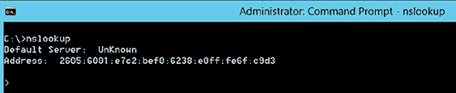

## 图 4.16](#part0013_split_001.html_figureanchor4-16) nslookup

从提示符开始，你可以尝试区域传输：

```
 run: nslookup.exe
type: ls -d domain_name <enter>
```

*区域传输*（zone transfer）是你尝试让 DNS 服务器向你发送所有的区域信息。配置恰当的 DNS 服务器会拒绝。尝试这样做来验证你的 DNS 服务器是否安全是一个好主意。

### arp

`arp`（地址解析协议）将 IP 地址映射到 MAC 地址。与其他命令不同，此命令至少需要一个标记才能工作，因此让我们先在表 4.4 中列出更常用的标记，然后演示 `arp`。

| -d | 从 arp 缓存中删除列表。你可能不会经常使用它。 |
| -a | 显示所有接口的所有当前 arp 条目。这是最常用的标记。 |
| -g | 显示所有接口的所有当前 arp 条目。与 -a 相同。 |
| -N | 列出指定接口的 arp 缓存。 |

## 表 4.4](#part0013_split_001.html_tableanchor4-4) 常用 arp 标记

你可以在图 4.17 中看到 `arp` 的用法。

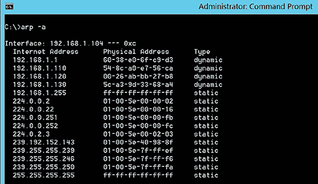arp -a and interface: 192.168.1.104 --- oxc, and columns for internet address (192.168.1.1, 192.168.1.110, 224.0.0.2, 239.255.255.246), physical address, and type (dynamic, static)."/>

## 图 4.17](#part0013_split_001.html_figureanchor4-17) arp

### ipconfig/ip/ifconfig

Windows 中的 `ipconfig`（Linux 中的 `ifconfig`）是较基础的网络命令之一。它将为你提供有关你的网络接口的信息。你可以在图 4.18 中看到基础命令的用法。

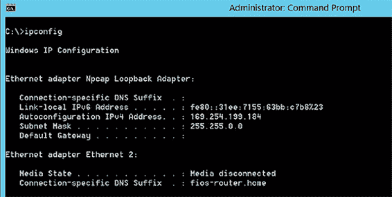

## 图 4.18](#part0013_split_001.html_figureanchor4-18) ipconfig

常用的 `ipconfig` 标记所示在表 4.5 中。

| /all | 显示所有网络接口的所有信息。 |
| /release | 释放任何动态分配的 IP 地址。 |
| /renew | 更新动态分配的 IP 地址。 |

## 表 4.5](#part0013_split_001.html_tableanchor4-5) 常用 ipconfig 标记

### nmap

`nmap` 是 Windows 或 Linux 的免费下载软件。它不是操作系统的一部分。它经常用于对机器进行端口扫描。这可以揭示运行的服务以及目标机器操作系统的信息。你可以扫描一个 IP 地址范围也可以扫描单个 IP。

`nmap` 还允许你设置若干标记（通过 `nmap` 的命令行版本或 Windows 版本）来自定义你的扫描。允许的 `nmap` 标记列在表 4.6 中。

| -O | 检测操作系统 |
| -sP |  ping 扫描 |
| -sT | TCP 连接扫描 |
| -sS | SYN 扫描 |
| -sF | FIN 扫描 |
| -sX | Xmas 树扫描 |
| -sN | NULL 扫描 |
| -sU | UDP 扫描 |
| -sO | 协议扫描 |
| -sA | ACK 扫描 |
| -sW | Windows 扫描 |
| -sR | RPC 扫描 |
| -sL | 列表/DNS 扫描 |
| -sI | 空闲扫描 |
| -Po | 不 ping |
| -PT | TCP ping |
| -PS | SYN ping |
| -PI | ICMP ping |
| -PB | TCP 和 ICMP ping |
| -PM | ICMP 子网掩码 |
| -oN | 正常输出 |
| -oX | XML 输出 |
| -oG | 可 grep 的输出 |
| -oA | 所有输出 |
| -T | 计时 |
| -T0 | 偏执狂 |
| -T 1 | 潜行 |
| -T 2 | 礼貌 |
| -T 3 | 正常 |
| -T 4 | 激进 |
| -T 5 | 疯狂 |

## 表 4.6](#part0013_split_001.html_tableanchor4-6) 允许的 nmap 标记

这里是一些基础扫描：

```
 Basic nmap scan
nmap 192.168.1.1
Scan a range of IP addresses
nmap 192.168.1.1-20
Scan to detect operating system, use TCP scan, and use sneaky speed
nmap -O -PT -T1 192.168.1.1
```

### netcat

`netcat` 实用程序也不随操作系统提供，但它是 Windows 或 Linux 的免费下载软件。该工具允许你使用 TCP 或 UDP 读写网络连接。以下是一些示例：

```
 Open a connection to a mail server on port 25
nc mymail.server 25
listen on port 12345
nc -l -p 12345
```

你可以在图 4.19 中看到基础 `netcat` 命令的用法。

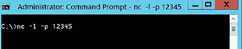

## 图 4.19](#part0013_split_001.html_figureanchor4-19) netcat

一些常用的 `netcat` 标记列在表 4.7 中。

| -l | 监听模式（默认是客户端模式） |
| -L | 持续监听（仅支持 Windows 版本）。此选项使 netcat 成为持久监听器，在客户端断开连接后重启。 |
| -u | UDP 模式（默认为 TCP）。 |
| -p | 本地端口（在监听模式下，这是监听的端口；在客户端模式下，这是所有发送数据包的源端口）。 |
| -e | 连接后执行的程序，将 STDIN 和 STDOUT 连接到该程序。 |

## 表 4.7](#part0013_split_001.html_tableanchor4-7) 常用 netcat 标记

### 其他工具

任何网络安全专业人员必须熟悉的许多其他工具。这些工具中的每一个都为安全的各个方面提供了帮助。本节描述了一些常用的网络工具。

#### 通用网络工具

*数据清理*工具用于确保在重新使用设备之前，从该设备中完全清除数据。删除文件恢复工具的普及使得数据清理变得至关重要。

*备份实用程序*对于网络安全也至关重要。定期备份你的服务器和工作站是网络安全的基础部分。无论你如何处理备份策略，拥有能够有效且安全地自动化该过程的工具都是关重要的。具体的方法将在 12 章“灾难恢复与事件响应”中进行讨论。


蜜罐在第 2 章“网络监控与诊断”中曾简要介绍。简单回顾一下，`honeypot`（蜜罐）是一个虚假系统，旨在吸引攻击者，使其关注虚假系统而非你的实际系统。蜜罐通常被设定为用于执行大量的监控和追踪，以收集攻击证据。目前有很多蜜罐工具可用，这里简要讨论了其中几种：

- **Nova Network Security**: Nova 销售一种既是入侵检测系统又是蜜罐罐的产品：[www.novanetworksecurity.com/](http://www.novanetworksecurity.com/)。
- **Honeynet Project**: Honeynet 项目是一个开源的蜜罐和蜜罐网络项目：[www.honeynet.org/](http://www.honeynet.org/)。
- **Web Application Security Project**: Web 应用安全项目有一个支持分布式蜜罐的协作项目：[`projects.webappsec.org/w/page/29606603/Distributed%20Web%20Honeypots`](http://projects.webappsec.org/w/page/29606603/Distributed%20Web%20Honeypots)。

### 隐术工具

`steganography`（隐术）过程将在第 8 章“密码学”中详细探讨。目前，你需要理解这是一个将数据隐藏在文件中的。事实上，整个文件都可以隐藏在其他文件中。

互联网上有许多工具（其中一些是免费的），允许攻击者在无需理解隐术原理的情况下通过隐术手段隐藏数据。这些工具有时会被内部人员用于泄露机密信息。这里列出了此类工具：

- **Invisible Secrets**: 这是一款低成本商业产品，可以在图像或声音文件中隐藏数据。你可以在 [www.invisiblesecrets.com](http://www.invisiblesecrets.com) 更多信息。
- **Deep Sound**: 这是一个免费下载软件，允许你在声音文件中隐藏数据：[`jpinsoft.net/deepsound`](http://jpinsoft.net/deepsound)。
- **Open Stego**: 这是一个开源隐术工具，可以在 [www.openstego.com](http://www.openstego.com) 找到。它的功能有些有限，但可以提供基础的隐术功能。

## 常见安全问题排排除

Security+ 考试假设你能够排排除常见的安全问题。在本节中，我们将讨论这些常见问题以及解决它们。

### 访问问题

`Access issues`（访问问题）是一类非常常见的安全异常。每当有人访问他们不应该访问的数据时，就会发生访问违规。这些违规分为大类。

第一类涉及 `permission issues`（权限问题）。安全的基石之一是`最小权限`原则。每个用户或服务仅提供完成工作所需的权限。任何超出部分的权限都是可能导致访问违规的权限问题。

此类权限问题发生的一种方式是用户从网络上的一个角色移动到另一个角色。重要的是用新权限替换旧权限，而不是在旧权限上添加新权限。如果网络管理员不小心，用户最终拥有的权限将远超过其工作需求。解决权限问题的根本方法是将每个用户的权限与其工作需求进行比较。

当有人访问或尝试访问他们不应访问的数据时，就会发生访问违规。例如，如果一个用户访问了未被授予权限的文件，那就是访问违规。违规可能发生在内部员工访问超出授权范围的数据上，也可能发生在未获得任何数据访问授权但仍进行尝试的外部攻击者身上。

访问违规有第二个定义，与权限无关。这个定义涉及内存管理。当运行在计算机上的应用程序能够访问另一个应用程序的内存时，这也是访问违规。这有时被更精确地定义为软件尝试访问受保护的内存。当系统硬件通知操作系统某些软件尝试访问内存限制区域时，这被称为`segmentation fault`（段错误）或访问违规。

通常，访问违规（定义为有人访问他们不应访问的数据）最好通过检查给定系统的日志来发现。例如，数据库日志应该显示哪些用户在何时访问了什么数据。通过扫描数据库日志中的异常，你可以检测到访问违规。

访问违规与身份验证问题密切相关。每当有人绕过正常的身份验证过程时，可能会导致访问违规。以下是你在网络上应该检查的一些常见问题：

- **强密码**: 密码长度至少应为 10 个字符，实施复杂性要求，并定期更改。
- **密码存储**: 密码应使用带有盐值（salt）的算法以哈希形式存储。哈希和盐值将在第 8 章详细讨论。
- **最小权限**: 确保用户通过身份验证后，仅被赋予完成工作所需的权限。
- **协议**: 存在现代身份验证协议，如`Kerberos`，将在本章后半部分讨论。你应该确保自己正在使用这些协议。
- **强身份验证**: 在本章后半部分，我们将讨论不同类型的身份验证。确保尽可能使用双因子身份验证。

当你未能实现这些指南中的任何一个时，整个网络的安全就会受到损害。

### 配置问题

当任何设备或软件未正确配置时，就会构成重大的安全隐患。配置错误可能是未能启用某些安全机制、使用弱的安全配置，或简单地错误配置了系统设置。这适用于工作站、服务器、路由器、交换机以及网络上的所有其他设备。然而，对于某些设备，问题更令人不安。

你的防火墙为网络提供了前线保护。不幸的是，现代防火墙变得越来越复杂。这可能导致防火墙配置错误。如果防火墙配置错误，可能会为攻击者提供可能的访问点。常见的防火墙配置问题包括未正确配置防火墙规则——这包括入站和出站规则。另一个防火墙配置问题是允许不应允许的流量离开网络。

对于任何系统，一些常见的配置问题包括：

- **默认密码**: 所有系统都带有一个默认登录。此登录必须立即更改。
- **未打补丁**: 防火、访问点、交换机和路由器等网络设备都有必须打补丁的操作系统，就像你的电脑一样。

无论什么种系统，它都应该配置为符合安全基准。`security baseline`（安全基准）本质上是一种整体安全方法，为你的网络大部分部分提供基础保护。配置问题可能会导致偏离该安全基准。

配置内容过滤器的问题也带来了安全风险。除了上述问题外，内容过滤器必须仔细配置，以便其拦截你想要拦截的内容，而不会意外拦截合法流量。通常需要一些时间和精力的投入才能配置完全正确。


配置不当的接入点是一个严重的安全问题。任何接入点，特别是无线接入点，都需要精细的安全配置。除了默认密码和补丁等问题外，额外的安全关注点还包括以下这些：

- **限制管理员访问**：无线接入点具有管理面板。该面板应仅通过物理连接访问，而不是通过无线连接。
- **过滤**：大多数接入点提供某种程度的过滤功能。应当开启并进行配置。
- **日志**：接入点通常提供日志功能，必须开启并进行配置。

### 数字证书问题

虽然数字证书不是设备，但也必须对其进行正确的配置和实施。第 8 章将详细讨论数字证书，但让我们先来解决这里的几个问题。

第一步涉及以安全的方式颁发证书。这意味着要确保选择了合适的密钥长度，并确保私钥存储得安全。

下一个常见问题涉及自签名证书的使用。这些证书应该被谨慎使用，因为它们没有经过受信任的第三方的认证。最好由组织证书机构（CA）颁发证书。证书吊销是另一个需要解决的重要问题。当你的组织拥有自己的证书机构时，这一点尤为重要。当你拥有自己的证书机构时，你就有责任确保被吊销的证书不会在你的网络上使用。这可以通过经常地更新和发布证书吊销列表（CRL）来实现。

### 人员问题

网络安全领域常说，最大的威胁是内部人员。不幸的是，事实确实如此。无论是来自不满员工的故意恶意行为，还是仅仅由于缺乏知识或疏忽导致的失误，事实是内部人员可以造成巨大的损害。遗憾的是，许多与内部人员相关的安全问题无法通过技术手段来缓解。

内部人员最明显的问题是未能遵守政策。违反政策会破坏你整个网络的安全。政策违规通常是由于简单的无知造成的。政策没有充分传达给员工，或者规定不够清晰。然而，故意的违规也是你必须意识到的重大内部人员威胁。

内部人员也容易受到社会工程的影响。`social engineering` 本质上是利用人际技巧试图获取信息。有人可能会拨给你组织的员工打电话，假装成技术支持并试图从用户那里获取密码。社会工程的其他应用没那么明显。例如，攻击者可能会打电话声称正在为一家大公司进行 IT 调查，同时试图收集有关你网络的信息。

社交媒体在许多方面也是一个问题。首先，它可以成为分散员工注意力和降低生产力的手段。然而更重要的是，它可能是信息外泄的渠道。员工可能会泄露有关机项目或其他敏感信息。这通常发生在员工炫耀公司某项新创新，或抱怨新项目带来的额外工作的背景下。无论哪种情况，结果都是公司的信息泄露到了外部世界。

在工作期间使用个人邮箱是另一个安全问题。当员工在公司工作站上检查个人邮箱时，发送到该邮箱地址的任何恶意软件现在都会感染公司网络。此外，员工的个人邮箱可能没有你在公司网络上拥有的严密安全措施。

### 其他问题

对所有组织来说，一个严重风险是安装未经授权的软件。任何组织都有一套审查和控制安装在网络上的软件的流程。如果安装了未经授权的软件，这将问题的开始。

最明显的问题是，未经授权的软件可能存在严重的漏洞。由于软件没有经过测试或审查，其安全性将无法得知。这种未经授权的软件实际上是一个木马，将恶意软件引入组织。

未经授权的软件与许可证合规违规密切相关。版权是严重的法律问题，你的公司应该努力遵守版权法。安装未经许可的软件是违反版权法的行为。无论软件已获得你的 IT 部门授权还是未经授权，你都必须警惕，确保网络上没有安装未经许可的应用程序。

未经许可的软件本身是资产管理主题的一个分支。组织越大，清晰管理所有公司 IT 资产就越具挑战性。无论是笔记本电脑、服务器还是软件，你都必须对公司拥有的所有物品及其当前位置维护准确的清单。

SMS/MMS 消息也可能存在安全风险，尽管是微不足道的。许多公司选择根据发送的时间、地点和内容来限制短信。特别是在安全区域，发送图片可能会成为安全问题。

## 安全技术

content]

你可以实施多种安全技术来使你的网络更加安全。大多数网络管理员会实施多种技术的组合。然而，挑战变成了如何解释这些技术的输出。在本节中，我们将针对各种技术回顾这一问题。

### 入侵检测系统

一个`基于主机的入侵检测系统 (HIDS)` 或 `基于主机的入侵防御系统 (HIPS)` 是你安全体系中至关重要的部分。此类设备会检测指示可能发生入侵的活动。这类系统有很多，有些是商业的，有些是开源的。显然，你需要咨询你特定设备的文档才能完全解释来自 `HIDS/HIPS` 的输出，但某些通用指南适用于所有此类设备。

首先记住的是，没有任何 `HIDS/HIPS` 是 100% 有效的。所有此类系统都会有一些误报（将合法流量标记为攻击）和漏报（将攻击标记为合法流量）。关键在于正确解释你的 `HIDS/HIPS` 告诉了你什么，以便判断是否需要更改配置以获得更准确的读数。

这引出了解释 `HIDS/HIPS` 输出的第一个问题——即将识别为攻击的流量与网络上的实际流量进行匹配。如前所述，将有一些误报。因此，你应该预感到某些被识别为攻击的流量实际上与该主机的活动相匹配，而你可以确认那是合法流量。当你注意到误报的数量时，可以更改 `HIDS/HIPS` 的配置以降低误报的频率。

对于 `HIPS` 来说，这会更容易，因为它会拦截可疑攻击。这些攻击将在你的 `HIPS` 日志中被清晰识别，无论你使用的是哪种 `HIPS`。

如前所述，实际上解释你 `HIDS/HIPS` 的日志和输出将需要你参考特定产品的文档。但让我们来看一个特定的 IDS/IPS：`SNORT IDS/IPS`。这是一个开源的 `HIDS/HIPS`，它的日志提供了一个很好的示例。这里有一个示例日志：

```
[116:56:1] (snort_decoder): T/TCP Detected
```


这对你来说可能看起来非常晦涩，它可能不会为你提供任何你可以使用的信息。第一个数字（116）是`generator ID`生成器 ID，它指示了哪个 Snort 组件了此告警。第二个数字（56）有时被称为`Signature ID`签名 ID，或 `Snort ID`。它将标识触发此告警的规则。第三个数字（1）是`revision ID`修订 ID，标识匹配此告警的攻击特征的版本号。文本告诉你检测到了什么。在这种情况下，它是正常的 TCP 流量。

*NIST SP 800-94 入侵检测与防御系统（IDPS）指南*为基于主机的（HIDS）和基于网络的（NIDS）的 IDS 系统提供了指导。你可以在此处查看此文档：[`nvlpubs.nist.gov/nistpubs/Legacy/SP/nistspecialpublication800-94.pdf`](http://nvlpubs.nist.gov/nistpubs/Legacy/SP/nistspecialpublication800-94.pdf)。该标准描述了各种类型的 IDS/IPS、其工作原理以及典型组件。在选择你自己的 IDS 时，这是一个非常有价值的资源。

### 反恶意软件

有各种反恶意软件应用程序，包括标准杀毒软件以及高级反恶意软件应用程序。就像 HIDS/HIPS 一样，这些程序有时会有误报和漏报。幸运的是，大多数应用程序提供的输出比 HIDS/HIPS 更加用户友好，解释输出结果也容易得多。图 4.20 显示了流行的杀毒工具 Malwarebytes 的输出。

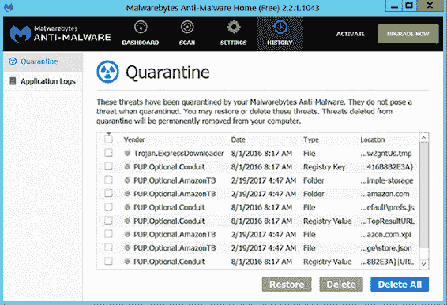

**图 4.20** Malwarebytes

此输出非常清晰。它识别了可疑项目、检测到的日期时间、类型（文件、文件夹、注册表项等）以及准确位置。大多数杀毒甚至更高级的反恶意软件产品都提供同样易读的输出。然后，作为用户，你可以决定是要恢复还是删除该项目。

更高级的反恶意软件工具具有更健壮的扫描算法，可扫描更多异常，并在处理此类问题方面提供更多选项。它们通常还提供如 HIDS/HIPS、防火墙和类似的安全服务等插件功能，但仍然倾向于具有你在图 4.20 中看到的易用界面。

### 防火墙及相关设备

无论你使用的是基于主机防火墙还是 Web 应用防火墙（WAF），你仍然需要知道如何解释这些系统的日志。与 HIDS/HIPS 一样，你最终必须参考特定防火墙的文档来正确解释结果。

作为防火墙日志的示例，让我们检查 Windows 防火墙日志。

在大多数 Windows 版本中，它位于 `%windir%\system32\logfiles\firewall\`。如果你没有开启日志记录，此日志将是空的。你可以开启防火墙但不记录日志。要开启日志记录，请打开 Windows 防火墙控制（`wf.msc`）并选择“操作” -> “属性”。你将看到一个类似于图 4.21 所示的屏幕。

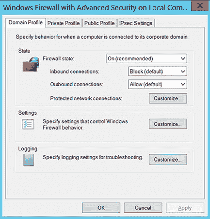

**图 4.21** Windows 防火墙

只需点击“日志”按钮开启日志记录。以下是日志条目可能性的示例：

```
2017-04-09 10:10:45 ALLOW TCP 192.168.0.104 192.168.0.100 52174 23
2017-04-09 10:10:54 DROP TCP 192.168.0.104 192.168.0.100 52175 21
```

两个条目都以年-月-日格式的日期开头，随后是时间。然后是发生情况的描述。在两个示例条目中，TCP 流量从 IP `192.168.0.104` 流向 IP `192.168.0.100`。第一个条目被允许，但第二个被拦截了。最后一项是流量使用的端口。因此，在此日志中，端口 23 (Telnet) 的流量被允许，但端口 21 (FTP) 被拦截了。

每个厂商的日志格式都不同，因此你需要复阅随防火墙附的文档。我们提供了关于防火墙日志如何工作的基本理解。重要的是要意识到，防火墙日志可能包含关于尝试入侵你网络的量信息。

### 其他系统

除了三种最常见的安全技术（HIDS/HIPS、杀毒软件和防火墙）之外，其他安全技术也有你可能想要审查的输出。

*文件完整性*检查系统非常常见。Tripwire 是一款著名的产品，具有开源和商业版本。所有文件完整性产品都配置为检查某些文件是否被更改并记录此类活动。许多产品（如 Tripwire）会将文件恢复到其之前的状态。然而，如果你不检查日志，你可能甚至不知道有人尝试过此类更改。即使你的文件完整性产品确实纠正了此类问题，知道它们发生过也是重要的。

应用程序白名单是安全专业人员的一种常用技术。`应用程序白名单`是允许在给定计算机或网络运行的应用程序列表。如果某个应用程序不在列表中，则不允许其运行。可以使用多种产品来执行这些应用程序白名单策略。此类产品还会记录安装未经授权应用程序的尝试。检查这些日志非常重要，因为你想知道，例如，网络上的某些用户是否尝试安装密码破解器。

许多网络管理员还控制可以使用哪些可移动介质，例如 USB 驱动器和光盘。存在许多工具可以执行这些策略。然而，你必须复阅工具的日志，以查看是否有人尝试违反这些策略。如果你网络上的用户反复尝试安装不允许的 USB 驱动器，这可能表明他们想要外泄数据。

正如你可能意识到的，补丁管理在网络环境中是一项挑战。与家庭使用不同，你不能简单地在所有系统上设置自动更新。相反，你必须在测试机上安装补丁，并在发布之前验证补丁或更新是否正常工作。目前有多种产品可以为你自动化此过程。重要的是检查任何补丁管理软件的日志，以审查补丁失败、必须回滚的补丁或任何补丁应用未成功的情况。

*统一威胁管理 (UTM)* 系统（有时被称为 `USM (统一安全管理)` 系统）包含了我们在本节中早些讨论的所有其他设备的组合，包括防火墙、IDS 和杀毒软件，以及其他项目，如负载均衡和 VPN。查看日志的程序将取决于你选择的特定设备。然而，一个主要优势是你可以在一个地方查看日志，而无需非要检查多个设备和系统日志。

*数据泄露防护 (DLP)* 软件尝试检测数据外泄。它通过监控出站网络流量来寻找传出的关键文件来实现这一点。它还可以监控敏感文档的数据存储，以记录数据被访问的情况。与我们检查的其他技术一样，你需要咨询制造商的文档以了解如何解释你系统的日志。


`Data execution prevention (DEP)` 变得越来越流行。微软在 Windows Vista 中引入了这一技术。当应用程序尝试启动时，用户必须批准执行后才能继续。其他厂商生产了更复杂的 DEP 系统。这些系统会记录应用程序尝试执行的任何时候，即使执行被拦截。这对于学习恶意软件可能是非常有价值的资源。即使恶意软件被拦截，你也会知道曾经有过执行尝试。

## 身份与访问管理概念

理解识别（identification）和验证（authentication）之间的区别，对于正确回答 Security+ 考试中的访问控制问题至关重要。`Identification` 指确定某是谁。`Authentication` 是验证该身份的机制。换句话说，识别是声称某个身份；验证是证明该身份。

### 识别 vs 验证

在物理世界中，最好的类比是任何人都可以声称是任何人（`identification`）。然而，为了证明这一点（`authentication`），这个人需要提供某些证据，例如驾照、护照或其他不可否认的证明。

验证系统或方法基于以下五个因素之一或多个：

* 你所知道的，例如密码或 PIN 码。这通常被称为 `Type I`。
* 你所拥有的，例如智能卡、令牌或身份设备。这通常被称为 `Type II`。
* 你所特征的，例如你的指纹或视网膜模式（通常称为 `biometrics`）。这通常被称为 `Type III`。
* 你所执行的，例如为了完成验证而必须采取的动作。它没有类型（`I`、`II`、`III`）。
* 你所在的位置（这基于地理位置）。它没有类型（`I`、`II`、`III`）。

系统之间使用类似的方法相互验证。系统之间经常相互传递私有信息以建立身份。一旦完成验证，两个系统就可以按照设计中指定的方式进行通信。验证有几种常用方法，它们属于单因素或多因素类别。每种方法在安全性方面都提供某些保障，在评估验证方案或方法时应当考虑这些因素。

### 验证（单因素）与授权

验证最基本的形式被称为 `single-factor authentication (SFA)`，因为只检查一种类型的验证。SFA 最常见的实现方式是传统的用户名/密码组合。用户名和密码是登录过程的唯一标识符。以下是 SFA 工作原理的概述：当用户坐在计算机系统面前时，安全系统首先要求他们确立自己的身份。识别通常通过登录过程确认。大多数操作系统使用 `user ID`（`username`）和密码来完成操作。这些值可以以明文形式通过连接发送，也可以进行加密。

登录过程向操作系统可能可能网络识别出你就是你所称的身份。图 4.22 展示了登录和密码过程。请注意，操作系统会将此信息与来自安全处理器的存储信息进行比较，并接受或拒绝登录尝试。操作系统可能会根据关于特定 `user ID` 的存储数据建立特权或权限。

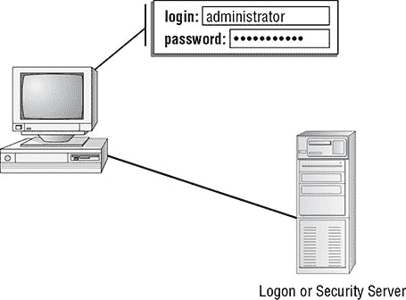

**图 4.22** 在工作站上发生的登录过程

每当两个或多个双方相互验证时，被称为 `mutual authentication`（双向验证）。当需要在两者之间建立安全会话并使用加密时，客户端可以验证服务器，服务器也可以验证客户端。双向验证确保客户端不会在无意中连接到恶意服务器并提供其凭据，恶意服务器随后可以转身从真实服务器窃取数据。

通常，当会话期间要发送的数据具有关键性质（例如财务或医疗记录）时，会实施双向验证。

### 多因素验证

当验证过程包含两个或多个访问方法时，你正在实施 `multifactor authentication`（多因素）系统。使用智能卡和密码的系统被称为 `two-factor authentication`（双因素）系统。这个示例同时需要智能卡和登录密码过程。

多因素系统可以由双因素、三因素系统或任何数量的因素组成。只要验证过程中涉及一个以上的因素，就被认为多因素系统。

出于明显原因，使用的两个或多个因素不应来自同一类别。虽然要求用户输入两组用户名/密码组合增加了获取系统访问的难度，但将单个用户名/密码组合与生物识别标识或其他安全检查相结合是更优的方案。

### 生物识别

通过使用 `biometrics`（生物识别）验证用户的一种非常安全的方法。生物识别是 `Type III`，即你所特征的。这些可以是指纹扫描仪、全手部扫描仪、眼扫描仪（包括视网膜或虹膜扫描仪）、面部识别或语音识别。

眼扫描仪通常非常准确。全手部扫描仪比单一的指纹扫描仪更准确。然而，所有这些方法都有 `误接受率 (FAR)` 和 `误拒率 (FRR)`。你首先想到的可能是希望 `FRR` 高于 `FAR`。然而，建议这两个率相等。这是因为拒绝或接受使用的是相同的算法。`FRR` 和 `FAR` 之间的波动表明算法本身可能存在问题。

`FRR` 和 `FAR` 相等的点被称为 `crossover error rate (CER)`，有时称为 `equal error rate (ERR)`（等误差）。对于任何生物识别系统，你都希望达到 `CER/ERR`，然后将该率降低尽可能低。

### 联邦

`federation`（联邦）是一组对操作标准（如安全标准）达成共的计算机网络。通常，这些是在某些方面相互关联的网络。在某些情况下，可能是建立此类标准的行业协会。

联邦的另一个例子是即时消息（IM）联邦。在这种情况下，多个 IM 提供商形成共同通信标准，从而允许使用不同平台和不同客户端的用户之间进行自由通信。

在其他情况下，一组合作伙伴可能会选择建立共同的安全和通信标准，从而形成一个联邦。这将方便各个合作伙伴的员工之间进行通信。

`federated identity`（联邦身份）是一种将用户身份与其权限联系起来的方法，这种方式可以跨越业务边界使用（例如 `Microsoft Passport` 或 `Google checkout`）。这允许用户拥有一个单一身份，并可以在不同的业务部门甚至可能是完全不同的业务中使用该身份。

### 潜在的验证与访问问题

在 Security+ 考试中，你应该了解两个问题领域，因为它们适用于验证/访问问题：传递访问（transitive access）和客户端攻击。让我们来处理这两个问题。

#### 传递访问


`transitive` 一词意味着涉及传递（transition）——在学习传递访问问题如何产生时，请记住这一点。通过 `transitive access`（传递访问），一方 (A) 信任另一方 (B)。如果第二个主体 (B) 信任第三方 (C)，则可能存在一种关系，使得第一个主体 (A) 也信任第三方 (C)。这被称为 `transitive trust`（传递信任）。

在早期的操作系统，这种过程经常被利用。在当前的操作系统中，如 `Windows Server 2016`，传递访问问题通过创建 `transitive trusts` 来解决，这是一种可以在域之间存在的信任关系类型（其反面是 `nontransitive trusts` 非传递信任）。当信任关系是传递的时，主体 (A) 和主体 (B) 之间的关系如前所述向下流动（例如，A 现在信任 C）。在 `Active Directory` 的所有版本中，默认情况下森林中的所有域都通过双向传递信任关系进行相互信任。

尽管这一过程在您添加新子域时会让管理工作变得简单得多（无需管理干预即可建立信任），但它留下了可能性，即黑客可能通过加入域而获得比本应拥有的更多的信任。我们将探索如何在 `Windows Server 2012` 中验证信任关系，这是解决该问题的一步。

### LDAP

`Lightweight Directory Access Protocol (LDAP)`（轻量目录访问协议）是一种标准的目录访问协议，允许对目录进行查询（特别是精简的基于 X.500 的目录）。如果目录服务支持 `LDAP`，您可以使用 `LDAP` 客户端查询该目录，但 `LDAP` 本身正变得流行，并被广泛应用于在线白页和黄页。

`LDAP` 是 `Active Directory` 使用的主要访问协议。它默认运行在端口 `389` 上。`LDAP` 语法在名称之间使用逗号分隔。

由于 `LDAP` 泄露可能会非常严重，某些组织使用安全 LDAP。通过 `secure LDAP (LDAPS)`，所有的 `LDAP` 通信都通过 `SSL/TLS` 加密，并使用端口 `636`。

### PAP, SPAP, 和 CHAP

这三种认证协议代表了认证的演变。最老的 `PAP`（密码认证协议）在您看来可能相当原始且不安全。然而，那是因为它非常老且不再被使用。

#### PAP

`Password Authentication Protocol`（密码认证协议）是一种旧且不安全的认证方法。本质上，用户名和密码是以明文发送的。`PAP` 用于数据包嗅探器广泛出现之前。它现在是不安全的，不应使用。

#### SPAP

`Shiva Password Authentication Protocol` 只是对用户名和密码进行加密。这防止了数据包嗅探器获取用户名密码，但对限制重放攻击或会话劫无效。

#### CHAP

`Challenge Handshake Authentication Protocol`（挑战握手认证协议）是今天使用的现代认证协议。通过该协议，当用户将用户名和密码发送到服务器（当然是加密的）时，服务器首先验证用户。一旦认证完成，服务器指示客户端计算机生成某个随机数（通常是加密哈希）并将其发送到服务器（同样也是加密的）。然后服务器会定期挑战客户端重现该数字/哈希值。如果客户端会话被破解，客户端将无法生成该数字/哈希值，服务器将终止会话。微软有一个该协议的专有版本，称为 `MS-CHAP`。

### Kerberos

`Kerberos` 是一种以守护冥界入口的神话三头狗命名的认证协议。最初由 `MIT` 设计，`Kerberos` 作为一种认证方法非常流行。它允许对分布式网络进行单点登录。

`Kerberos` 认证使用 `key distribution center (KDC)` 来协调该过程。`KDC` 验证 `principal`（可以是用户、程序或系统）并为其提供票据（ticket）。在该票据发放后，它可以对其他主体进行认证。当另一个主体执行请求或服务时，此过程会自动发生。

`Kerberos` 是网络环境中常用的标准。它唯一的显著弱点是 `KDC` 可能成为单点故障。如果 `KDC` 宕，认证过程将停止。图 4.23 展示了 Kerberos 认证过程以及向经 KDC 授权的系统提交的票据。需要注意的是，该图是对 Kerberos 的简化解释。还有更多细节，但 Security+ 考试未涵盖这些内容。

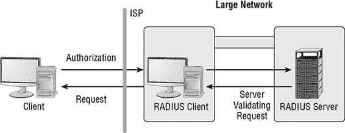

**图 4.23** Kerberos 认证过程

使用 `Kerberos` 时，用户向 `KDC` 认证并获得一个 `ticket granting ticket (TGT)`。该票据是加密的，且有效期长达 10 小时。票据列出了该用户的权限（类似于令牌）。每当用户想要访问网络上的某些资源时，用户的计算机向 `KDC` 提供 `TGT`；然后 `TGT` 向该用户的计算机发送 `service ticket`（服务票据），授予用户访问该服务的权限。服务票据通常有效 5 分钟。用户的计算机随后将服务票据发送到尝试访问的服务器。作为最后的认证检查，该服务器将与 `TGT` 通信以确认并验证服务票据。

### 使用 RADIUS

`Remote Authentication Dial-In User Service (RADIUS)`（远程认证拨号用户服务）是一种允许对远程和其他网络连接进行认证的机制。它最初用于拨号连接，但现在已远超这一范围，并提供了许多先进功能。`RADIUS` 协议是 `IETF` 标准，已被大多数大多数操作系统制造商实现。`RADIUS` 服务器可以进行集中管理，允许访问网络的服务器可以向 `RADIUS` 服务器验证入站呼叫者是否获得授权。在具有许多连接的大型网络中，这允许单台服务器执行所有认证。

图 4.24 显示了 `RADIUS` 服务器与 `ISP` 通信以允许远程用户访问的示例。注意远程 `ISP` 服务器正作为 `RADIUS` 服务器的客户端。这允许对访问权限进行集中管理。

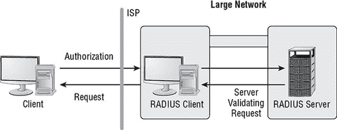

**图 4.24** RADIUS 客户端管理本地连接并向中央服务器认证

当你想通过实施单一服务来认证远程连接到网络的用户以提高网络安全性时，应使用 `RADIUS`。这样做可以为你提供一个认证发生的单一源。此外，你可以在 `RADIUS` 服务器上实施审计和计费。

单服务器 `RADIUS` 环境的主要困难在于是，如果服务器发生故障，整个网络可能会拒绝连接。许多 `RADIUS` 系统允许使用多台服务器来增加可靠性。所有这些服务器都是基础设施的关键组件，必须受到保护免受攻击。

### TACACS, TACACS+, XTACACS


`Terminal Access Controller Access Control System (TACACS)` 是一种面向客户端-服务器的环境，其运行方式类似于 RADIUS。扩展的 TACACS (`XTACACS`) 取代了原始版本，并将认证、授权与日志相结合以实现审计。

TACACS 目前最新的方法或级别是 `TACACS+`。它取代了之前的两个版本。`TACACS+` 允许从多种方法（包括 Kerberos）接受凭据。`TACACS` 客户端-服务器进程与 RADIUS 进程相同。

Cisco 已广泛应用于 `TACACS+`。`TACACS+` 已作为 RADIUS 的替代方案被广泛接受。

# OATH

`Open Standard for Authorization (OATH)` 是授权网站或应用程序访问信息的常用方法。它允许用户与第三方应用程序共享信息。

它的设计用于配合 HTTP 工作，并允许在资源所有者批准的情况下向第三方客户端发放访问令牌。因此，资源所有者（例如社交媒体网站用户）可以授权第三方访问其数据。

## 一临时密码 (One-Time Passwords)

顾顾名，这些密码可以使用一次且永不再使用。一种常见的应用是基于时间的一次性密码（或 `TOTP`），其特点是分发的密码仅在有限的时间内有效。在使用一次或时间过期后，它不再是有效的密码。如果你需要重置密码，银行网站通常会使用这种方法。`TOTP` 会发送到你的手机，你有有限的时间来登录并更改密码。

另一种变体是基于密钥哈希消息认证码 (`HMAC`) 的一次性密码 (`HOTP`)。这些通常用于物理令牌，我们将在本章稍后讨论它们。哈希值、消息认证码 (`MAC`) 和 `HMAC` 将在第 8 章详细讨论。

## SAML

`Security Assertion Markup Language (SAML)` 是一种标记语言，类似于 HTML。它使用标签，但并不是定义 页面元素（如 HTML 那样），而是定义安全授权。

`SAML` 用于在身份提供者和服务服务提供者之间交换认证和授权信息。它通常用于 Web 浏览器单登录实现。

`Shibboleth` 是一种在网上广泛使用的单登录系统。该名字源于一个圣经故事，其中 `shibboleth` 一词被用作密码。`Shibboleth` 系统使用 `SAML`。Open ID。

## OpenID

`OpenID` 是一种通常由第三方提供的认证服务，它可以登录任何接受 `OpenID` 的网站。

## 安装和配置身份与访问服务

访问控制有多种方法，每种方法都有自己的优缺点。在本节中，我们将回顾访问控制方法。

### 强制访问控制 (Mandatory Access Control)

`强制访问控制 (MAC)` 是一种允许信息访问的一种不灵活的方法。在 `MAC` 环境中，所有访问权限都是预定义的。除非管理员建立了用户共享信息的权限，否则用户无法共享信息。因此，管理员必须对此类权限进行任何所需的更改。这一过程执行了一个严谨的安全模型。然而，它也被认为是最安全的安全模型。

为了使 `MAC` 模型有效运行，管理员和网络设计人员必须在实施之前仔细考虑各种关系。这种模型的优点是安全访问得到了良好的建立和定义，使得安全违规更容易调查和纠正。设计良好的 `MAC` 模型可以使信息控制工作更容易，并本质上锁定网络。该模型的主要缺点是缺乏灵活性，并且随着时间的推移需要。管理人员无法处理这些变化有时会导致模型难以维护。

这种模型用于机密性是驱动因素的环境。它通常采用政府和军事分级（标签），例如绝密和其他等。

### 任意自主访问控制 (Discretionary Access Control)

在 `任意自主访问控制 (DAC)` 模型中，网络用户在如何访问信息方面具有某些灵活性。这种模型允许用户与其他用户动态地共享信息。这种方法允许更灵活的环境，但增加了信息未经授权披露的风险。管理员在确保信息访问受控以及仅授予适当访问权限方面面临更大的困难。

`DAC` 的经典示例是 `Unix/Linux` 环境中针对“其他”文件的权限结构。该操作系统中的所有权限都属于三类用户：所有者、组和其他其它。与所有者以及所有者所属组相关的权限基于他们的角色的，但所有不是所有者或所有者组成员的人都属于“其他”类别。

该组的权限是与另外两组分开设置的，在极少数特殊例外情况下，它们是读、写和执行的组合。在这个环境中，你可以创建一个数据库并赋予自己（所有者）读和写权限，赋予其他管理员（组）仅读权限，并且不给不在管理员组的人员（其他）任何权限。

你同样可以轻松地创建一个清理日志文件并释放工作站空间的脚本。为了这样做，你会赋予自己（所有者）所有权限，赋予其他管理员（组）读和执行的能力，并赋予基本用户（其他）仅执行权限。

### 基于角色的访问控制 (Role-Based Access Control)

`基于角色的访问控制 (RBAC)` 模型基于组织中既定的角色来处理访问控制问题。`RBAC` 模型根据工作功能或职责实现访问。每个员工都有一个或多个允许访问特定信息的角色。如果一个人从一个角色移动到另一个角色，之前角色的访问将不再可用。`RBAC` 模型比 `MAC` 模型更有灵活性，比 `DAC` 模型灵活性更小。然而，它们具有严格基于工作功能而非个人需求的优势。

与其考虑“Denise 需要能够编辑文件”，`RBAC` 使用逻辑是“编辑器需要能够编辑文件”以及“Denise 是编辑器组的成员”。这种模型在员工流动率高的环境总是总是很有用的。

这有时被称为`基于组的控制`或`基于组的权限`。本质上，Windows 操作系统是以这种方式工作的。你在基于 Windows 的域上的权限取决于你所所属的组。这些组实际上是角色。

### 基于规则的访问控制 (Rule-Based Access Control)

`基于规则的访问控制 (RBAC)` 使用预先配置的安全策略中的设置来做出所有决策。这些规则可以是：

- 拒绝所有非特定出现在列表中的人员（允许列表） 
- 仅拒绝那些特定出现在列表中的人员（真正的拒绝列表）

列表中的项目可能是用户名、IP 地址、主机名甚至域名。基于规则的模型通常与基于角色的模型结合使用以增加更大的灵活性。

实现基于规则访问控制的最简单方法是使用访问控制列表 (`ACLs`)，将在本章稍后讨论。`ACLs` 创建了访问控制模型运行的规则。

### ABAC

`基于属性的访问控制 (ABAC)` 是一种相对新的访问控制方法。它定义在 NIST 800-162《基于属性的控制定义与考虑》中。根据该标准：


> 一种逻辑访问控制方法论，其执行一组操作的授权取决于通过评估与主体、对象、请求的操作以及（在某些情况下）环境条件相关的属性，与策略、规则或关系进行对比，这些策略或关系描述了针对给定属性集的允许操作。

本质上讲，访问控制机制查看尝试访问特定对象的主体，但在做出访问控制决策时，会考虑与主体和对象相关的各种属性。`subject`（主体）是一个活动实体（通常是个人、进程或设备）。`object`（对象）是主体尝试访问的资源。`Attributes`（属性）是定义主体、对象、环境条件和/或请求操作特定层面的特征，这些特征由权威预先定义并指派。

例如，如果一名出差的销售代表试图访问公司网络上的客户记录，ABAC 系统不仅会查看该销售代表的访问权限，还会考虑整个场景。该代表是否正在从其以前未使用过的机器或位置登录？该代表是否在不寻的时间登录？该代表正尝试做什么？销售代表可能被赋予读取文件的权限，但不能编辑或删除文件。本质上，ABAC 是一种更健壮的访问控制方法，它在做出访问控制决策时检查整个场景。

### 智能卡

智能卡通常用于访问控制和安全目的。卡片本身通常包含少量内存，可存储权限和访问信息。

智能卡很难伪造，但很容易被盗。一旦小偷拿了智能卡，他们就可以访问该卡片允许的所有内容。为了防止这种情况，许多组织不在其智能卡上标记任何身份标识，这使得他人使用它们变得困难。大多数智能卡需要密码或 PIN 码激活，并采用加密来保护内容。对于许多智能卡，如果你多次输入错误的 PIN （通常是三次），卡片将关闭以进一步增强安全性。

许多欧洲国家已开始使用智能卡代替磁条信用卡，因为它们提供了额外的安全性，并且可以包含更多信息。美国已经在这一方向迈出了努力，但尚未完全实施芯片和密码（chip and pin）。

智能卡现在有时被实现为感应卡。这些卡片带有 RFID（射频识别器）芯片，当卡片在认证设备的范围内时，它会传输认证信息。

智能卡主要有两种：通用访问卡和个人身份验证卡。我们将在后续章节中讨论这些智能卡。

#### 通用访问卡

第一种智能卡是 `common access card (CAC)`（通用访问卡）。这些卡片由国防部（DoD）发行，作为军事人员、承包商和非国防员工的通用识别/认证卡。卡片正面显示照片，下方集成芯片和一个条形码。卡片背面有一个磁条和一个条形码。

CAC 用于访问国防计算机、签署电子邮件和实施 PKI（公密钥基础设施）。在 2008 年（可用数据的最新年份），已发行了 1700 万张卡。你可以在此处查找 CAC 的当前信息：[www.cac.mil](http://www.cac.mil)。

#### 个人身份验证卡

正如 PIV（CompTIA 称为个人身份验证卡）适用于联邦员工和承包商。根据国土安全总统指令第 12 号（`HSPD-12`），所有美国政府员工和承包商最终都需要 PIV。访问政府资源（物理和逻辑）将需要 PIV。

### 令牌

`token`（令牌）是用于获取访问的物理设备。它可以是无线钥匙卡、钥匙扣或任何物理设备。这些有时被称为 `security tokens`（安全令牌）。令牌通常包含数字证书，该证书用于验证用户身份。令牌也有软件实现，但该术语的含义是指硬件设备。

基于软件的安全令牌是双因素认证设备的一部分。软件令牌存储在设备上并验证用户。它们可以是加密文件中的密码，可能是数字证书。

令牌的操作方式有很多。它可能有一个存储的密码，简单称为 `static password token`（静态密码令牌）。另一种方法是根据算法循环密码。令牌和认证服务器使用同步时钟来确定在何时应该使用什么密码。还有根据某些算法生成的一次性密码。最后一种令牌是挑战响应令牌（challenge response token）。认证服务器用公钥加密挑战（通常是随机数，或至少带有某些随机部分的数据）；设备通过提供解密后的挑战来证明其拥有匹配的私钥副本。

## 文件和数据库安全

维护网络安全将需要维护你最敏感数据的安全性。这些数据通常位于文件或数据库服务器上。当攻击者入侵你的网络或内部人员寻求外泄数据时，最可能的目标将是文件服务器或数据库服务器。

本章讨论的大部分安全措施已适用于文件和数据库服务器。例如，两种类型的服务器都应该有自己的防火墙，并定期检查该防火墙的日志。两种类型的服务器都应该有 HIDS（主机入侵检测系统），并定期检查该 HIDS 的日志。当然，任何服务器（任何计算机）都应该安装防病毒软件。

本章讨论的身份验证和访问控制方法也适用于文件和数据库服务器。将对这些服务器的访问限制在“按需”（need-to-know）的基础上是至关重要的。确保任何有访问权限的用户只能访问其执行工作任务所需的范围也是重要的——即最小权限原则。

## 总结

本章介绍了许多你可以用来收集网络相关数据的工具。对于 Security+ 考试，你应该能够定义这些工具类型，例如漏洞扫描器和密码破解器。作为安全管理员的职责范围内，你应该能够利用其中的几种工具。命令行工具也构成了 Security+ 考试中的常见测试题。

接下来，本章检查了配置问题的排除。这是一个非常广泛的主题，没有哪个章节能完全解决它。要理解的核心点是，如果你的安全设备和服务没有配置妥当，那么这种配置错误本身就是一个安全漏洞。

本章介绍了一些安全技术，并解释了如何查看它们的输出。这包括 IDS、防火墙、防病毒软件和其他相关技术。你应该熟悉如何查看这些系统的输出。

本章还讨论了访问控制和身份管理。身份验证（authentication）与识别（identification）之间的区别在于：身份验证意味着某人拥有准确的信息，而识别意味着准确的信息被证明由正确的个人持有。


最基础的认证形式被称为单因子认证（SFA），因为它只检查一组值。为了增加安全性，有必要使用多因素认证，这涉及到检查两个或多个值。

本章审视了正在使用的各种类型认证服务，包括 `RADIUS` 和 `TACACS` 的不同变体。它还研究了隧道协议、智能卡和其他访问控制手段。

`ACLs` 正在网络设备和系统中进行实施，以实现对系统和用户的访问控制。`ACLs` 允许忽略单个系统、用户或 IP 地址。

## 考试要点

**能够描述各种工具。** 理解漏洞扫描器、端口扫描器、密码破解器以及相关工具。从概念上了解它们是如何工作的。非常熟悉如 `ipconfig`、`ping` 和 `arp` 等命令行工具。

**理解配置问题。** 所有安全设备和网络设备的正确配置至关重要，并且将出现在考试中。你还应该对如何读取和解释安全设备的输出有大致的了解。

**能够描述访问控制的角色。** 四个主要角色是 `MAC`、`DAC` 和 `RBAC`（两种类型的 `RBAC`）。强制访问控制（`MAC`）在组织内部建立了严格的访问控制方法。自主访问控制（`DAC`）允许访问控制具有灵活性。基于角色的访问控制（`RBAC`）基于个人或部门在组织中所的角色。第四类型基于规则的访问控制（`RBAC`）使用预配置安全策略中的设置来做出所有决策。

**解释你可用的认证技术的相对优势。** 你有许多可用工具来帮助建立认证过程。其中一些工具以密码和用户 ID 开始。另一些则涉及物理设备或请求认证人员的物理特征。

**理解最小权限原则。** 最小权限规定，在分配权限时，应该只给用户完成工作所需的权限，而不更多。遵循此策略最大的益处是降低风险。

## 复习题

你可以在附录中找到答案。

1. John 是 ACME 公司的网络管理员。他正试图向一名新技术员解释最小权限。以下哪项是最小权限的基本前提？
    1. 始终向具有所需权限的管理员分配职责。
    2. 在分配权限时，只给用户完成工作所需的权限，而不更多。
    3. 定期检查用户权限，并撤销他们当前拥有的某项，看看他们是否会投诉甚至注意到其缺失。
    4. 不要给管理层比用户更多的权限。

2. 目前要求对每个对象严格定义访问的方法对你的环境来说过于繁琐。高层下达命令应适当减少访问需求。哪种访问模型允许用户出于信息共享目的具有一定的灵活性？
    1. DAC
    2. MAC
    3. RBAC
    4. MLAC

3. Ahmed 被指示确保其网络上的 `LDAP` 是安全的。`LDAP` 是以下哪者的示例？
    1. 目录访问协议
    2. IDS
    3. 分层模型应用开发环境
    4. 文件服务器

4. 高层突然开始关注安全。作为高级网络管理员，你被要求建议应该实施的更改。如果使用的技术主要是是基于预设访问且无法被用户更改的，你应该推荐以下哪种访问方法？
    1. MAC
    2. DAC
    3. RBAC
    4. Kerberos

5. 你的办公室管理员正在接受服务器备份的培训。哪种访问控制方法最适用于这种情况？
    1. MAC
    2. DAC
    3. RBAC
    4. 安全令牌

6. 你被分配指导一名初级管理员并让她快速进入状态。你目前正在解释的话题是认证。哪种方法使用 `KDC` 为用户、程序或系统完成认证？
    1. CHAP
    2. Kerberos
    3. 生物识别
    4. 智能卡

7. 在仔细的风险分析后，你公司的数据价值增加了。因此，你预计实施反映数据价值增加认证解决方案。以下哪种认证方法在登录时使用了多个认证过程？
    1. 多因素
    2. 生物识别
    3. 智能卡
    4. Kerberos

8. 你的公司为全球数据库的医生提供医疗数据。由于数据的敏感性，必须在每个会话上建立认证且仅对该会话有效。以下哪种认证方法提供的凭据在单会话期间有效？
    1. 令牌
    2. 证书
    3. 智能卡
    4. Kerberos

9. 当两个或多个双方相互认证时，使用以下哪个术语？
    1. SSO
    2. 多因素认证
    3. 相互认证
    4. 隧道

10. 你为网络添加了一个新的子域。作为结果，该子域继承了其父域在森林中与其他域建立的所有信任关系。对此负责的是？
    1. LDAP 访问
    2. XML 访问
    3. Fuzzing 访问
    4. 传递访问

11. 以下哪种是国防部颁发的用于军事人员、承包商和非国防部员工的通用身份/认证卡的智能卡类型？
    1. PIV
    2. POV
    3. DLP
    4. CAC

12. 你在一家小型金融机构担任安全管理员。你想要使用一种会定期重新认证客户端的认证方法。哪种协议最适合这种？
    1. PAP
    2. SPAP
    3. KERBEROS
    4. CHAP

13. 哪条命令最可能产生图中所示输出？
    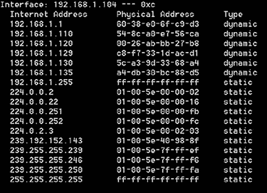
    1. arp -a
    2. ping -a
    3. netstat
    4. nslookup

14. John 试图确定一封邮件的来源。他捕获了邮件头并知道发件邮件服务器的 IP 地址。哪条命令可以向 John 显示到该 IP 地址的完整路径？
    1. ping -a
    2. arp
    3. tracert
    4. nslookup

15. Juanita 是某大型大学的安全管理员。她担心版权问题，并希望确保大学不违反版权。对于未经授权的软件，她的主要关注点是什么？
    1. 它可能有版权。
    2. 它可能被用于绕过版权保护。
    3. 那不应该是版权关注点。
    4. 如果她至少有一个该软件的许可，就不需要担心。

16. Terrance 正在检查一个在 MIT 开发并使用票据进行认证的系统。Terrance 最可能正在检查哪个系统？
    1. CHAP
    2. MS-CHAP
    3. KERBEROS
    4. OATH

17. Melissa 计划在她的网络上实施生物识别认证。对于她选择的任何生物识别解决方案，以下哪项应该是目标？
    1. 高 FRR，低 FAR
    2. 高 FAR，低 FRR
    3. 低 CER
    4. 高 CER

18. Jarod 正在评估基于 Web 的单点登录解决方案。以下哪技术与网页授权最相关？
    1. SAML
    2. PIV
    3. CHAP
    4. RBAC


# 19. 你是 ACME 公司的网络管理员。你想实施一种新的访问控制机制。你正在考虑的机制考虑了访问请求的整个环境/场景。这描述什么？

1. MAC
2. DAC
3. RBAC
4. ABAC

# 20. Dennis 实现了一个使用密码、PIN 码和用户生日的认证系统。哪项最能描述该系统？

1. 单因素
2. 双因素
3. 三因素
4. 强认证

# 第 5 章

## 无线网络威胁

**本章涵盖了以下 CompTIA Security+ 考试目标：**

* ** 1.2 比较对比攻击类型。**
    * 无线攻击：重放 (Replay)；初始化向量 (IV)；邪恶 (Evil twin)；非法接入点 (Rogue AP)；干扰 (Jamming)；WPS；蓝牙攻击 (Bluejacking)；蓝牙窃取 (Bluesnarfing)；RFID；NFC；取消关联 (Disassociation)

 简单来说，`Wireless systems`（无线系统）为攻击者提供了许多机会。与有线设备相比，这些系统很容易被截获。

本章将讨论你需要注意的各种无线威胁和攻击，并确保你只会在书中遇到它们，而不是在你的 `systems`（系统）中遇到。

## 无线威胁术语

在涉及无线威胁时，听起来像来自《星球大战》电影的缩写和名称非常常见。在某些情况下，术语之间可能会重叠：例如，`evil twin`（邪恶）就是一个 `rogue AP`（非法接入点）。以下术语（在在线词表中也可以找到）是 CompTIA 喜欢在该类别中使用并测试的术语。按顺序提供是为了便于你理解每个术语想要传达的内容。

## 需要的无线漏洞

无线系统容易受到与有线网络相同的攻击。然而，由于这些协议使用射频信号进行数据发射，它们有一个额外的弱点：所有的射频信号都可以被轻易拦截。要截获 `802.11x` 流量，你只需要一台安装了适当 `802.11x` 网卡的 `PC`。许多网络会定期广播其名称（称为 `SSID broadcast`）以宣布它们的存在。`PC` 上的简单软件可以捕捉无线 `AP` 中的链路流量，然后处理这些数据以解密账户和密码信息。

在练习 5.1 中，我们将向你展示如何配置 `Windows` 连接到不广播 `SSID` 的网络。

无线系统的另一个方面是现场勘测（site survey）。`Site surveys` 涉及使用商用技术监听现有的无线网络。这样做可以对你无线网络中的系统进行情报收集，并进行数据捕获。`site survey` 术语最初的意思是确定拟定位置是否没有 `interference`（干扰）。当攻击者使用时，现场勘测可以确定使用了哪些种类型的系统、使用的协议以及关于你网络的其他关键信息。它是收集无线网络信息的主要方法。几乎所有的无线网络都受到现场勘测的影响。

在接下来的章节中，我们将重点关注 CompTIA 希望你在 Security+ 考试中熟悉的各种无线攻击类型、技术和主题。

### 重放 (Replay)

`replay attack`（重放攻击）是一种相当常见的访问或修改攻击。当信息在网络上被捕获，然后被恶意重新用于预期之外的其他目的时，就会发生。

例如，在分布式环境中，登录和密码信息在客户端和认证系统之间传输。攻击者可以捕获信息并在稍后重放。这也会发生在来自 `Kerberos` 等系统的安全证书上：攻击者重新提交证书，希望通过认证系统的验证并绕过任何时间敏感性，从而进入系统。

如果此类攻击成功，此示例中的攻击者将拥有原始证书的所有权利和权限。这就是大多数证书包含唯一会话标识符和时间戳的主要原因。如果证书过期，它将被拒绝，并会在安全日志中创建一个条目以通知系统管理员。

`IV (initialization vector) attacks`（初始化向量攻击）的出现是由于有线等隐私加密（WEP）的弱点，WEP 是一种设计用于提供与有线网络同等隐私的无线协议。WEP 已应用于许多无线设备中，包括智能手机和其他移动设备，但由于其加密算法（`RC4`）的使用方式存在缺陷，它是脆弱的。这些弱点使得算法可以使用可用的 `PC` 软件最仅需五分钟即可被破解。由于这个原因，WEP 被认为是最脆弱的安全协议之一。

WEP 用于加密的初始化向量 (IV) 是 24 位的，这非常脆弱，意味着 IV 会与相同的密钥被重用。通过检查重复的结果，攻击者很容易破解 WEP 密钥密钥。这被称为 `IV attack`。

由于 IV 比密钥短，在使用时必须重复。从直观来看，攻击的发生是因为使用的算法是 `RC4`、`IV` 太小、`IV` 是静态的，且 `IV` 是 `RC4` 加密密钥的一部分。

图 5.1 显示了非常简单的路由器上的配置设置，并最好地总结了这种情况：唯一使用 WEP 的时候是你必须与不支持新加密的旧设备兼容时。


FIGURE 5.1 简单路由器的无线安全设置

### 非法 AP 和邪恶镜像 (Evil Twins)

弱加密是早期接入点的问题，但大多数较新的无线 `APs` 使用特殊的 ID 数字 (`SSIDs`)，并且必须在网卡中配置以允许通信。然而，使用 ID 数字配置并不一定防止无线网络被监控。一个特别顽劣的任务涉及利用 `rogue access points`（非法接入点）。任何添加到你的网络但未经授权的无线接入点都被视为非法。

非法接入点可能是攻击者添加的，也可能是用户为了增强环境而无意添加的。用户这样做的问题在于，他们很有可能不会实施和你同水平的安全，这可能导致系统遭受中间人攻击或邪恶镜像攻击。`evil twin attack`（邪恶镜像攻击）是指非法无线接入点伪装成法的无线服务提供商，以拦截用户传输的信息。

教育并培训用户关于无线网络以及保持安全的需要，就像你对任何其他安全主题他们他们培训和教育一样。他们可能认为在旅行途中加入他们发现的任何无线网络都没有害处，例如图 5.2 所示，但他们应该怀疑所有此类网络的管理员是否以你公司数据的利益利益为考虑。


FIGURE 5.2 某些可疑无线网络的示例

### 干扰 (Jamming)


干扰可能是无意的（例如由邻附近的其他设备引起），也可能是故意的。当干扰是故意的时，它被称为 `jamming`（干扰），其意图是干扰信号并使合法设备无法通信。考虑到干扰攻击的工作原理，它可以被视为一种拒绝服务（DoS）攻击，并且在大多数情况下，这违反了联邦法律。

市上有强功率干扰器，它们可以发送持续信号，如果处于合适的位置，可以迅速使网络瘫痪。然而，由于这些信号非常强，这些持续干扰器通常很容易被检测，管理员可以实施反干扰程序（如切换信道）来消除它们。

更难识别的是低功率干扰器，其中某些通过发送信号然后停止、隐藏一段时间，然后再次发送信号来躲避检测。

### WPS

为了简化网络设置，许多小型办公和家庭办公（SOHO）路由器使用一系列 `EAP`（可扩展身份验证协议）消息来允许新主机加入网络并使用 `WPA/WPA2`（Wi-Fi 保护访问版本 1 和 2）。这被称为 `Wi-Fi Protected Setup (WPS)`，它通常需要用户执行某些操作以完成注册过程：在短时间内按下路由器上的按钮、输入 `PIN`，或将新设备靠近（以便进行近场通信）。

遗憾的是，`WPS attacks` 已经变得随处可见，因为该技术容易受到用于猜解用户 `PIN` 的暴力破解攻击的影响。一旦攻击者获得了访问权限，他们就进入了 Wi-Fi 网络。因此，我们建议在允许 `WPS` 的设备中禁用它（并在可能存在该性风险的设备中更新固件）。

### Bluejacking（蓝牙劫持）

蓝牙技术通常用于创建个人局域网（PAN 或 WPANs），大多数蓝牙设备都带有出厂默认的 `PIN`，您可能希望将其更改为更安全的值。随着蓝牙的普及，增加了两个额外的漏洞：蓝牙劫持（bluejacking）和蓝牙盗取（bluesnarfing）。`Bluejacking` 是通过蓝牙连接发送未请求的消息（可以想象为垃圾邮件）。虽然这很烦人，但基本上被认为是无害的。

### Bluesnarfing（蓝牙盗取）

`Bluesnarfing` 是通过蓝牙连接获取未经授权的访问。这种访问可以通过智能手机或任何蓝牙设备获得。一旦实现访问，攻击者就可以以任何其他类型的未经授权访问相同的方式复制数据。

### NFC 和 RFID

`Near field communication (NFC)` 是一项需要用户将客户端靠近 `AP` 以验证设备存在的技术——通常通过 `radio frequency identification (RFID)` 或 Wi-Fi 进行。随着手机被用作支付系统的一部分，这项技术的普及日益增加，它也可以在两部手机之间进行“碰碰”并将数据从一个发送到另一个。虽然没有定义“近距离”的硬编码标准，但行业倾向于使用 4cm（1.6 英寸）作为距离。

`NFC` 是较新的标准，但它建立在为 `RFID` 创建的旧标准之上，这些标准允许兼容的硬件通过无线电为无电源的被动式电子标签供电并与之通信。`RFID` 广泛用于识别、身份验证和跟踪应用。

### Disassociation（取消关联）

就像干扰可以归类为 DoS 攻击一样，`disassociation attack`（通常称为 `deauthentication attack`）也是如此。在这类攻击中，入侵者向 `AP` 发送一个带有伪造地址的帧，使其看起来像是来自受害者并将他们从网络断开。由于受害者无法与 `AP` 保持连接，这增加了他们选择使用另一个 `AP` 的概率——一个恶意的 AP，或者是酒店或其他场所中必须付费才能使用的 AP。许多酒店被联邦贸易委员会提起了诉讼，原因是它们发起了此类攻击，并通过要求客人支付“溢价”服务而不是让他们能够使用免费 Wi-Fi 来赚取收入。

## 无线常识

请务必更改所有无线设备上的默认密码设置。永远不要假设无线连接是安全的。无线门户的发射可能会穿透墙并在门户附近的几个街区被检测到。考虑到 `RF` 是通信的介质，拦截很容易实现。新的无线设备提供数据安全功能，你应该使用它。你可以在配置 `WPA2` 和更高加密级别之外，将较新的 `APs` 和无线路由器设置为不广播。

## 无线攻击类比

想象一下你决定去一家三明治店吃午饭，并且你想尽快吃完并回到工作中。然而，午餐潜伏着问题，如 表 5.1 所示。并不是每种攻击都符合这种场景，只检查了符合该场景的情况。

| 攻击 | 类比 |
| --- | --- |
| 恶意接入点 (Rogue access point) | 当你排队下单时，一个正在休息的员工认出你是常客，并提议用后屋的原料为你制作三明治，而不是让你等待。这会绕过收银机并让所有主损失。 |
| 干扰 (Jamming) | 当你试图下单时，一位认识你的同事一直模仿你说的话。他们的幽默尝试让三明治制作者无法正确听到你的订单。 |
| 相互干扰 (Interference) | 当你试图下单时，一个讨厌的商人站在你身后队伍里对着手机大大大叫。他的声音太大，导致三明治制作者无法正确听到你的订单。 |
| 蓝牙劫持 (Bluejacking) | 当你点餐时，你身后的人一直匿名地提到要添加到三明治里的东西，三明治制作者认为是你想要这些东西，于是将它们加入了你的订单。 |
| 恶性孪生 (Evil twin) | 你被雨分散了注意力，下车进了一家你认为是你喜爱的三明治店，结果发现你进错了一个门，进了一家竞争对手的三明治店，那里价格贵一倍，肉却少了一半。 |
| 重放攻击 (Replay attack) | 你排队后面的人告诉三明治制作者，他们要一份和你点的一模一样的，并且应该加在你的账单上。 |

****表 5.1](#part0014_split_004.html_tableanchor5-1)** 三明治店攻击

如果你那些讨厌的同事不知道这家店的存在（因为你从未提到过它，即禁用 SSID 广播），如果三明治制作者只在三明治上放置他们确定是你点的物品（近场通信），并且他们只允许现有客户推荐的新人进入（Wi-Fi Protected Setup），那就太好了。

## 总结

无线系统变得越来越流行和标准化。这些无线网络受到许多威胁。

漏洞的存在是因为协议存在弱性。例如，`WEP` 漏洞是因为加密算法使用方式的弱性；`WEP` 用于加密的初始化向量 (`IV`) 是 24 位的，并且 `IVs` 会与相同的密钥重复使用。通过检查重复的结果，入侵者很容易破解 `WEP` 密钥，这被称为 `IV` 攻击。

移动设备使用 `RF` 信号或蜂窝网络技术进行通信。如果设备使用 `WAP`，则存在多个级别的安全保护：匿名身份验证（任何人都可以连接）、服务器身份验证（工作站必须通过服务器身份验证）和双向身份验证（客户端和服务器必须相互身份验证）。

## 考试要点


了解无线接入点扩展了网络范围。无线接入点（`AP`）连接在有线网络上，并充当无线客户端的路由器。大多数无线接入点可以支持多个以上的 `802.11` 标准。使用无线 `NIC` 卡的无线客户端以及移动设备连接到接入点。

了解无线网络的漏洞。获取无线网络信息的主要方法是现场勘测。现场勘测可以通过 `PC` 和 `802.11` 卡完成。无线网络面临着与有线网络相同的攻击。

了解无线安全协议。`802.11i` 标准通常被称为 `WPA2`（Wi-Fi 保护访问版本 2）。它是对早期标准的增强，而早期标准要薄弱得多。`WPS`（Wi-Fi 保护设置）通常需要用户执行某些操作以完成注册过程：在短时间内按下路由器上的按钮、输入 `PIN`，或将新设备靠近设备以增加安全性。

## 复习题

你可以在附录中找到答案。

1.  `IV` 攻击通常与以下哪种无线协议相关？
    1. `WEP`
    2. `WAP`
    3. `WPA`
    4. `WPA2`

2.  `WEP` 用于加密的初始化向量（`IV`）的大小是多少？
    1. `6-bit`
    2. `24-bit`
    3. `56-bit`
    4. `128-bit`

3.  `TKIP` 在 `WEP` 加密外放置的封装大小是多少，其密钥基于机器的 `MAC` 地址和数据包序列号等？
    1. `128-bit`
    2. `64-bit`
    3. `56-bit`
    4. `12-bit`

4.  使用哪种技术在距离的手机之间发送数据？
    1. `NFC`
    2. `IBI`
    3. `IBJ`
    4. `IFNC`

5.  使用哪种技术来简化网络设置，允许管理员按下路由器上的按钮以允许新主机加入？
    1. `WEP`
    2. `WPA`
    3. `WTLS`
    4. `WPS`

6.  以下哪些技术被用于识别和跟踪附在物体上的标签？
    1. `NFC`
    2. `RFID`
    3. `IV`
    4. `DSC`

7.  哪种攻击捕获会话的部分稍后回放，以说服主机它仍在与原始连接通信？
    1. `Replay`
    2. `Echo`
    3. `Duplication`
    4. `Reprise`

8.  哪种标准定义了无线网络访问控制的端口安全？
    1. `802.1n`
    2. `802.1g`
    3. `802.1x`
    4. `802.1s`

9.  以下哪种类型的攻击涉及通过蓝牙连接发送未请求的消息？
    1. `Bluesmurfing`
    2. `Bluesnarfing`
    3. `Bluewhaling`
    4. `Bluejacking`

10. Karl 在长途一天的旅行后入住了酒店。他正试图使用房内的免费 Wi-Fi 检查每日大量的电子邮件信息，但连接不断丢失。当他打电话给前台时，他们建议他可能想使用高级 Wi-Fi（费用更高）来获得更好的连接。这种场景可能代表哪种攻击？
    1. `Upselling`
    2. `Cross-selling`
    3. `Disassociation`
    4. `Imitation`

11. Spencer 对他隔间内设备接收到的低信号感到沮丧，他带入了自己的接入点并创建了自己的网络。同事 Kristin 告诉他，如果老板发现这件事，将成为立即解雇的理由，如果他有任何疑问，他应该阅读员工手册。设置自己的接入点代表了以下哪种？
    1. `Degenerate`
    2. `Rogue`
    3. `Corporeal`
    4. `Temporal`

12. 在设置其小型办公室接入点的身份验证部分，Wolfgang 被要求在 60 秒内输入 `PIN`。这个过程被称为：
    1. `Wired Equivalent Privacy`
    2. `Wi-Fi Protected Access`
    3. `Wi-Fi Protected Setup`
    4. `Wi-Fi Authentication Protection`

13. 哪种无线网络安全协议尝试为无线网络建立与有线网络相同的安全性？
    1. `WEP`
    2. `WEB`
    3. `WELL`
    4. `WALL`

14. Evan 担心隔壁办公室的租户正在使用 `RF` 干扰试图迫使他的小公司因沮丧离开建筑。故意阻塞或干扰信号被称为以下哪种？
    1. `Shoving`
    2. `Jamming`
    3. `Cramming`
    4. `Blocking`

15. 离关联攻击（disassociation attack）通常被称为什么？
    1. `Decertification attack`
    2. `Disconfirmation attack`
    3. `Deauthentication attack`
    4. `Denial attack`

16. 使用近场通信（`NFC`）技术，行业倾向于将什么距离视为“近”？
    1. `1 inch`
    2. `1.2 inches`
    3. `1.6 inches`
    4. `2 inches`

17. 蓝牙设备突然在你的网络中到处出现，你想要尽可能地保护这些设备。保护这些设备最简单的方法之一是不将它们的属性设置为：
    1. `Discoverable`
    2. `Transmit`
    3. `Announce`
    4. `Communicate`

18. 以下哪种是指通过蓝牙连接获取未经授权的访问？
    1. `Bluejumping`
    2. `Bluesnarfing`
    3. `Bluerunning`
    4. `Bluelining`

19. 一个客户给你打电话，说他想关闭他小型网络上的 `SSID` 广播，因为他担心那些仅仅扫描网络的人会发现它并尝试连接它。你告诉他这是一种*非常薄弱*的安全形式，并建议了其他选项，但他坚持要这样做。这种隐藏路由器的形式被称为？
    1. `Veiling`
    2. `Masking`
    3. `Shrouding`
    4. `Cloaking`

20. 以下哪种攻击是指一个流氓无线接入点冒充合法的无线服务提供商，以拦截用户传输的信息？
    1. `Collision`
    2. `Evil twin`
    3. `NFC`
    4. `WPS`

# 第 6 章：云安全保护

**本章涵盖了以下 CompTIA Security+ 考试目标：**

*   **3.7 总结云和虚拟化概念。**
    * `Hypervisor`: 类型 I；类型 II
    * 避免 `VM` 泛滥
    * `VM` 逃逸防护
    * `Cloud` 存储
    * `Cloud` 部署模型：`SaaS`；`PaaS`；`IaaS`；`Private`；`Public`；`Hybrid`；`Community`
    * `On-premise`（本地） vs. `hosted`（托管） vs. `cloud`（云）
    * `VDI`/`VDE`
    * 云访问安全代理
    * 服务即安全

如果信息技术领域有一个“每日词汇”，那么最近最受欢迎的无疑是“云”。供应商已经在他们的营销材料中采用了这个词，涵盖了从平板电脑到服务器以及之间的许多奇特设备。作为安全专业人员，你可能会被许多并不完全理解自己所说含义的人拉入关于云的讨论中。

CompTIA 已经围绕云技术创建了独立的认证。本章的目的是定义云——以及它必要的兄弟——虚拟化——究竟是什么，以及你为了 `Security+` 考试以及保持系统安全，关于这个主题需要了解的知识。

## 云相关术语

“云”对不同的人有许多不同的含义。在你准备 `Security+` 考试时，你关心的是它对 `CompTIA` 的意义，以及他们在创建考试时使用的来源。以下术语（也可以在在线词表中找到）是 `CompTIA` 喜欢在该类别中使用和测试的术语。提供这些术语是为了让你更容易了解每个术语想要传达的内容。

## 与云计算工作


“云”在讨论中之所以如此令人困惑，原因之一是由于在营销炒作中该短语有许多被不当使用的实例。为了找到一个大家都能认同的定义，让我们参考美国国家标准与技术研究院（NIST）。特殊出版物 800-145 定义了三种服务模型：软件即服务（SaaS）、平台即服务（PaaS）和基础设施即服务（IaaS）。接下来的章节将详细介绍这些服务模型。随后，我们将查看四种可能的交付模型：私有云、公共云、社区云和混合云。

## 软件即服务 (SaaS)

根据 NIST，`Software as a Service (SaaS)` 被定义为：

> 向消费者提供的能力是使用运行在云基础设施上的提供者的应用程序。可以通过纤客户端界面（如网络浏览器，例如基于 Web 的电子邮件）或程序接口从各种客户端设备访问应用程序。消费者不管理或控制底层云基础设施，包括网络、服务器、操作系统、存储，甚至是单个应用程序功能，但特定的用户特定应用程序配置设置除外。

> **美国国家标准与技术研究院，特殊出版物 800-145**

尽管该描述看起来可能冗长，但所使用的词非常重要。此定义中重点关注的词是消费者可以“使用”提供者的应用程序，并且他们不“管理或控制”任何底层云基础设施。图 6.1 形象地描绘了该模型中各方的责任。

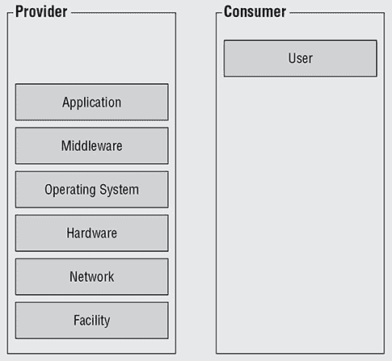

**图 6.1** SaaS 服务模型

## 平台即服务 (PaaS)

根据 NIST，`Platform as a Service (PaaS)` 被定义为：

> 向消费者提供的能力是在云基础设施上部署消费者创建或获取的应用程序，这些应用程序是使用提供者支持的编程语言、库、服务和工具创建的。消费者不管理或控制底层云基础设施（包括网络、服务器、操作系统或存储），但对部署的应用程序以及应用程序托管环境的可能配置设置具有控制权。

> **美国国家标准与技术研究院，特殊出版物 800-145**

为了理解此模型与其他模型之间的区别，此定义中重点关注的关键词是消费者可以“部署”，他们不“管理或控制”任何底层云基础设施，但他们可以“对部署的应用程序拥有控制权”。图 6.2](#part0015_split_002.html_figure6-2）形象地描绘了该模型中各方的责任。

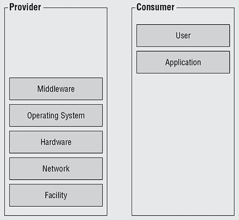

**图 6.2** PaaS 服务模型

## 基础设施即服务 (IaaS)

NIST 指定的第三种服务模型 `Infrastructure as a Service (IaaS)` 被定义为：

> 向消费者提供的能力是置备处理、存储、网络和其他基础计算资源，消费者可以在其中部署和运行任意软件，其中可能操作系统和应用程序。消费者不管理或控制底层云基础设施，但对操作系统、存储和部署的应用程序具有控制权；并对选定的网络组件（例如主机防火墙）拥有可能的有限控制权。

> **美国国家标准与技术研究院，特殊出版物 800-145**

这里的相关措辞是消费者可以“置备”，能够“部署和运行”，但仍然不“管理或控制”底层云基础设施，现在他们可以负责某些方面。图 6.3](#part0015_split_002.html_figure6-3）形象地描绘了该模型中各方的责任。

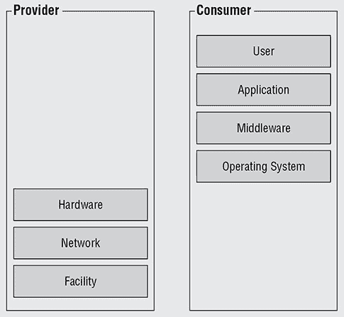

**图 6.3** IaaS 服务模型

无论使用哪种服务模型，每种模型的特征都是它们必须包含：按需自服务、广网络访问、资源池化、快速扩展性和可计量的服务。一旦选定了服务模型，CompTIA 和 NIST 都认可四种不同的交付模型，这些将在后续章节中探讨。

## 私有云

根据 NIST，`private cloud` 的定义如下：

> 云基础设施是为包含多个消费者（例如业务部门）的单一组织独占使用而置备的。它可能由该组织、第三方或两者的结合所有、管理和运营，并可能存在于场内或场外。

> **美国国家标准与技术研究院，特殊出版物 800-145**

在大多数情况下，私有云由组织拥有，他们既充当提供者又是消费者。他们的优势在于不需要将数据放在到互联网上。

## 公共云

与私有云相反，`public cloud` 的定义如下：

> 云基础设施是面向公众开放使用而置备的。它可能由商业、学术或政府组织或两者的结合所有、管理和运营。它存在于云服务提供者的场内。

> **美国国家标准与技术研究院，特殊出版物 800-145**

在大多数情况下，云服务提供者拥有公共云，它将使用按需付费模式。示例包括 Web 邮箱和在线文档共享/协作。

## 社区云

根据 NIST，`community cloud` 的定义如下：

> 云基础设施是为具有共同关注点（例如任务、安全需求、策略和合规性考量）的组织的特定社区消费者独占使用而置备的。它可能由社区中的一个或多个组织、第三方或两者的结合所有、管理和运营，并可能存在于场内或场外。

> **美国国家标准与技术研究院，特殊出版物 800-145**

区分社区云与其他类型云交付的关键在于它服务于一组*相似的*群体。它必须有共同利益和有限的加入人数。为了便于类比，可以将私有云比作房子房子（你拥有它；你负责维护、公用事业和所有事务等），将公共云比作酒店（你只使用了其中的一小部分；你对结构几乎没有责任），而将社区云比作公寓（你拥有部分份额，共同承担公共区域的维护，等等）。

## 混合云

最后一种交付模型 `hybrid cloud` 的定义如下：

> 云基础设施是两个或多个不同的云基础设施（私有、社区或公共）的组合，这些基础设施保持为独立的实体，但通过标准化或专有技术结合，从而实现数据和应用程序的可移植性（例如用于云之间负载均衡的云突发）。

> **美国国家标准与技术研究院，特殊出版物 800-145**


虽然混合云可以是公有云、私有云和社区云的任何组合，但在大多数情况下它是私有云和公有云的混合。当你开始引入社区云时，它往往更像是社区云的扩展，而不是混合云。

## 虚拟化工作

与“云”同样流行（且互补）的热门词是 `virtualization`（虚拟化）。虚拟化承诺的成本效益往往会被虚拟机（`VM`）被破解时可能面临的安全威胁所抵消。虚拟化流行的原因之一是，为了实现云计算，你必须使用虚拟化——这种对硬件的抽象并将其提供给 `VMs` 的技术是云计算构建的基础。今天，这通过使用虚拟机管理程序（hypervisors）或容器来实现。

### 理解虚拟机管理程序

大多数虚拟化的核心是虚拟机管理程序，它是实现虚拟化的软件/硬件结合体。实现方法两种：第 I 型和第 II 型。`Type I hypervisor` 模型也称为 `bare metal`（裸机），它独立于操作系统，并在操作系统启动之前引导。`Type II hypervisor` 模型也称为 `hosted`（托管），它依赖于操作系统，在操作系统运行之前无法引导。它需要操作系统运行以便进行引导。

图 6.4 展示了 I 型模型。从性能和扩展性的角度来看，这种模型优于 II 型。II 型被认为管理更加复杂。

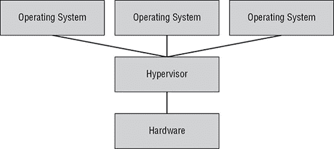

图 6.4 I 型虚拟机管理程序模型

图 6.5 展示了 II 型模型。`ESX` 最新且强大的迭代是第 1 型，而旧的 `VMWare workstation` 或 `MS Virtual PC` 是第 2 型的典型示例。

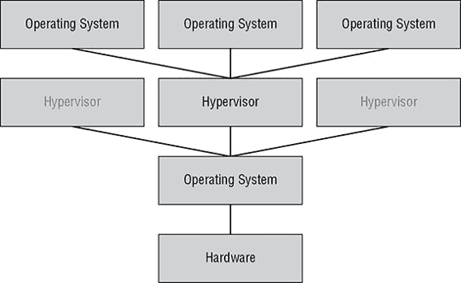

图 6.5 II 型虚拟机管理程序模型

两种类型的专有和开源实现均可使用，有时可能很难分淆使用的是哪种类型的实现。例如，`Xen` 同时分支出专有和开源解决方案。通常情况下，`Xen` 被认为是免费开源的；来自 `VMware` 的 `ESX` 是免费的但不是开源（专有的）；`KVM` 是免费开源的；来自 `Microsoft` 的 `Hyper-V` 通常是免费（取决于实现）但绝对不是开源（专有的）。`ESX` 是第 I 型安装的良好示例，而 `VMWare workstation` 和 `Microsoft Virtual PC` 是第 II 型的良好示例。

### 理解容器和应用程序单元

曾经虚拟机管理程序是虚拟化的唯一方式，但现在大多数人认为 `containers`（容器）是它们的继任者。有时根据引入该技术的应用程序被称为“Docker 容器”，通过容器，一个软件包含了运行所需的所有内容——代码、运行时、系统工具、系统库等，并且无需为每个应用程序启动整个 `VM` 即可部署（这就是为什么 `application cells` 应用程序单元是另一个同义词）。

容器是一种操作系统级别的虚拟化方法，通过使用单个内核在控制主机上运行多个隔离的系统（容器本身）。这种虚拟化方法为应用程序提供了一个隔离的环境。

### VDI/VDE

在 `virtual desktop environment (VDE)` 中，用户的会话是远程运行的。虽然看起来文件夹、窗口、壁纸等资源存在于本地，但实际上它们都存储并运行在远程服务器上。VDE 本质上是桌面虚拟化的通用术语。选择 VDE 解决方案有很多原因，包括功能完全的虚拟桌面比 PC 便宜，而且应用程序管理/许可变得更加简单。

在此基础上，通过 `virtual desktop infrastructure (VDI)`，用户的桌面运行在位于数据中心服务器上的虚拟机内部。VDI 是 VDE 的一种形式，它能够为每个用户提供完全个性化的桌面，并带来集中化管理带来的益处：安全性、简单性等。总共有共有四种主要的虚拟化类型：服务器、桌面、应用程序和演示。

### 本地 vs. 托管 vs. 云

用于虚拟化的服务器可以位于任何地方。如果你选择将它们位于你位置的物理范围内，则被称为 `on-premise`（本地）。将它们放置在本地的好处是你可以控制对服务器的物理访问，并且比任何人都更有兴趣保护它们。自然，当你选择使用本地模型时，你承担了与安全相关的风险和责任，以及开销（电力、折旧等）。

对于 `hosted`（托管）模型，另一个供应商承担了为你提供所需虚拟访问的责任。你与他们签订特定期限的合同，在此期间他们负责安全、开销等。他们可能将服务器存储在一个地点或多个地点，但你与他们之间的协议规定了他们的义务，而你大部分时间不需要干预。

`cloud`（云）解决方案与托管非常相似。虽然理论听起来非常相似，但 NIST 定义云模型的区别在于它围绕五个不同的属性：

1. `On-demand self-service`（按需自服务）。客户能够在不涉及提供商的情况下配置新用户、服务、虚拟机等。
2. `Broad network access`（宽网络访问）。通过互联网访问服务，而不是通过仅限私有连接的内部网络。
3. `Resource pooling`（资源池）。提供共享资源，以便服务可以根据需要从中提取。
4. `Rapid elasticity`（快速伸缩）。需求可以扩展或收缩，所需的服务将随这些需求扩展或收缩。
5. `Measured service`（计量服务）。计费基于某些衡量的消耗（可能是许可证、CPU 周期、消耗的存储等）——按需付费。

### 虚拟机逃逸保护

存在这种可能性：另一个客户实现的崩溃可能会暴露一条路径，用户可以通过该路径跳跃（“服务器跳跃”）到你的数据。重要的是，尽管这种可能性存在——你应该进行大量测试以防止其发生——但某些媒体极夸大了其发生的可能性。

`Sandboxing`（沙箱）涉及在受限的内存区域运行程序以提供逃逸保护。通过这样做，可以限制应用程序崩溃的可能性，使用户访问另一个应用程序或与其相关的数据。如果没有沙箱，跳跃的可能性会增加，但沙箱大大减少了这种可能性。

### 避免虚拟机蔓胀

虚拟机就像其他与 IT 相关的事物一样——它们可以从小规模开始，但通常会在体量和数量上以惊人的速度持续增长。

随着它们的增长，许可证、用户、维护和整体管理也会之增长。这种增长被称为 `sprawl`（蔓胀），当他们认为自己节省的成本突然让他们面临着比他们能管理的更大的工作时，它可能会迅速让组织措手不及。

处理蔓胀的最佳方法是像计划其他任何事情一样对其计划。如果你监控使用情况、添加资源并从繁忙的机器上移动低利用的 `VMs`，你就可以对抗蔓胀并保持运行顺畅。


# 安全与云

由于这是一场关于安全的认证考试，而不仅仅是关于云术语的记忆，因此，识别与云计算相关的安全问题至关重要。考试中中你需要了解的两个点是多租户（multitenancy）以及法律和法规：

### 多租户
云计算能够获得成本效益的方法之一是将来自不同客户的数据放在同一台机器上。这种“多租户”性质意味着不同客户的工作负载可以在同一个系统中，而实施中的缺陷可能会损害安全性。从理论上讲，安全事件可能源于云提供者的另一个客户，并渗透到你的数据中。因此，数据需要受到其他云消费者的保护，同时也需要受到云提供者的保护。

### 法律与法规
消费者保留合规的最终责任。根据 NIST 的规定：

> 主要问题在于将重要应用程序或数据从组织计算中心内部移动到另一个组织（即公共云，供普通大众随时使用的云）时相关的风险。组织和云提供者的责任取决于具体的服务模型。降低成本和提高效率是向公共云迁移的主要动力，但放弃安全责任不应是其动力。最终，组织应对公共云的选择以及外包服务的安全和隐私负责。

> **美国标准与技术研究院，特别出版 800-144**

云计算在扩展性、成本节省、快速部署和赋能方面具有巨大的前景。然而，与任何许多内容脱离你控制的技术一样，它也涉及风险。每种风险都应该仔细考虑，以识别帮助缓解风险的方法。例如，数据隔离可以帮助减少与多租户相关的风险。在多租户环境中，你在一台机器上有多个租户，理论上存在用户从一个租户跳到另一个租户的风险。通过隔离数据，你可以减少与之相关的风险。

实施并非必需的软件和服务应被移除或至少禁用。补丁和固件更新应保持最新，并仔细监控日志文件。你应该在他人之前发现实施中的漏洞，并与你的服务提供商合作关闭任何漏洞。

在云数据存储方面，加密是保护数据的最佳方法之一（防止其对未经授权的产生价值），VPN 路由和转发也可以提供帮助。应该定期进行备份（并加密且存储在安全位置），并将访问控制作为首要任务。

### 云访问安全代理
虽然它们听起来像是个个人，但`云访问安全代理 (CASBs)`实际上是本地或基于云的安全策略执行点。它们存在于云服务用户和云服务提供商之间，目的是在访问资源时结合（并添加）企业安全策略。

这些代理可以整合许多不同安全策略执行（单点登录、授权、凭据映射、加密等），同时充当看门员。它们从本质上允许组织将其安全策略的范围扩展到其自身基础设施的范围之外。

### 云存储
个人和企业的趋势都是收集和存储尽可能的数据。这导致了大型本地硬盘的发展——`DAS（直接连接存储）`、`NAS（网络附属存储）`、`SAN（存储区域网络）`以及现在的云。

正如云在运行应用程序、负载均衡和许多其他选项方面具有巨大前景一样，它提供了在云上存储越来越多数据的能力，并让提供商担心扩展性问题，而不是由本地管理员。从经济角度来看，这可能是一种幸运，但从安全的角度来看，这可能会带来麻烦——而这正是我们在本书中关注的视角。

首先，至关的是你必须理解并接受你对自己的数据保护负责（法律上、道德上等），即使是由另一方托管的。`SLA` 需要说明提供商将如何保护数据（沙箱和/或其他方法）以及冗余、灾难恢复等。确保你加密了数据、进行了备份并实施了尽可能控制。

### 安全服务
不要与 NIST 部署模型（`SaaS`、`PaaS` 和 `IaaS`）混淆，`安全服务 (SECaaS)` 是一种基于订阅的业务模式，旨在比个人或小型公司自己获得的更具成本效益。在这种模式下，大型服务提供商将其安全服务集成到企业基础设施中，并按订阅方式提供。由于规模经济，在考虑总拥有成本时，该解决方案更具成本效益。

订阅者不需要本地硬件，提供的服务可以包括身份验证、反病毒、反恶意软件/间谍软件和入侵检测。通过这种方式，`SECaaS`可以作为许多在线威胁的缓冲。

## 总结
云计算具有巨大的前景。它提供了降低成本、提高效率和让世界变得更好的能力。提供三种服务模型（`SaaS`、`PaaS` 和 `IaaS`），并且有四种交付模型（私有、公共、社区和混合）。

虚拟化是云计算的关键组件。它通过抽象硬件并将其提供给虚拟机来实现这一可能。

这种抽象可以通过使用`hypervisor`来实现，它可以是`Type I（裸机）`或`Type II（托管）`，也可以通过使用容器来实现。虚拟化中你应该注意的两个大问题是`虚拟机泛滥 (VM sprawl)` 和`虚拟机逃逸 (VM escape)`。后者也说明了新技术往往会引入新的安全风险。设计考虑不能掩盖保护数据和保持安全为首要任务的需求。安全方面的某些成本可以通过`安全服务`模型所可能的规模经济来降低。

## 考试要点
**了解三种云服务模型。** NIST（美国标准与技术研究院）认可三种可能的云服务模型模型：软件即服务 (`SaaS`)、平台即服务 (`PaaS`) 和 基础设施即服务 (`IaaS`)。

**了解四种不同的云交付模型。** NIST 认可四种可能的云交付模型：私有、公共、社区和混合型。

**了解 hypervisor 的作用。** `hypervisor` 是允许虚拟机存在的元素（软件/硬件）。

**了解 hypervisor 的类型。** `Type I hypervisor` 被称为裸机，同时作为 hypervisor 和操作系统运行。`Type II hypervisor` 被称为托管型，运行在另一个操作系统之上。

## 复习题
你可以在附录中找到答案。

1. 消费者可以在哪种云服务模型中“配置”并“部署运行”？
    1. `SaaS`
    2. `PaaS`
    3. `IaaS`
    4. `CaaS`
2. 哪种云交付模型由单一组织实施，使其能够在防火墙后实施？
    1. `Private`
    2. `Public`
    3. `Community`
    4. `Hybrid`
3. 哪种云服务模型为消费者提供了创建应用程序和托管这些应用程序的基础设施？
    1. `SaaS`
    2. `PaaS`
    3. `IaaS`
    4. `CaaS`


## 4. 哪种云交付模型可以被视为由云提供商通过互联网交付的服务和资源池？
1. 私有
2. 公有
3. 社区
4. 混合

## 5. 哪种云服务模型赋予消费者通过互联网使用云提供商提供的应用程序的能力？
1. SaaS
2. PaaS
3. IaaS
4. CaaS

## 6. 哪种云交付模型具有由几个具有共同利益和共同 IT 需求的组织共享的基础设施？
1. 私有
2. 公有
3. 社区
4. 混合

## 7. 哪种云交付模型可以被视为其他类型交付模型的混合？
1. 私有
2. 公有
3. 社区
4. 混合

## 8. 在以下哪种订阅模式中，安全性比个人或小型公司自己能获得的更具成本效益？
1. SECaaS
2. PaaS
3. XaaS
4. WaaS

## 9. 以下哪些项是本地或基于云的安全策略执行点？
1. 功能特征位符 (Feature slugs)
2. 洪水防护器 (Flood guards)
3. VDI/VDEs
4. 云访问安全代理 (Cloud access security brokers)

## 10. 云计算的哪种特征涉及根据需要动态配置（取消配置）资源？
1. 多租户
2. 弹性
3. CMDB
4. 沙箱

## 11. 将应用程序限制在安全/受限资源区域的术语是什么？
1. 多租户
2. 围栏/栅栏隔离 (Fencing)
3. 安全化 (Securing)
4. 沙箱 (Sandboxing)

## 12. 以下哪个术语意味着在同一设备上托管来自多个消费者的数据？
1. 多租户
2. 双工化 (Duplexing)
3. 堡垒化 (Bastioning)
4. 造型化 (Fashioning)

## 13. 采用公有云交付模型时，谁对外包服务的安全隐私负责？
1. 云提供商和组织
2. 云提供商
3. 组织
4. 无人

## 14. 当你的公司购买了一个虚拟数据中心提供商时，你继承了一堆乱子。在那里工作的员工必须定期响应创建虚拟机的请求，但没有采用物理世界中通常的纪律和控制。这导致机器过度配置（CPU、内存或磁盘过多），并在它们不再需要很后仍消耗资源。这属于什么类型的问题？
1. 虚拟机逃逸 (VM escape)
2. 虚拟机偏离 (VM digress)
3. 虚拟机泛滥 (VM sprawl)
4. I 型虚拟机虚拟机

## 15. 虽然混合云可以是任何云交付模型的混合，但它通常是以下哪些项的组合？
1. 公有和社区
2. 公有和私有
3. 私有社区
4. 两个或多个社区

## 16. 哪种类型的虚拟机程序实现被称为“裸金属”（bare metal）？
1. Type I
2. Type II
3. Type III
4. Type IV

## 17. 哪种类型的虚拟机程序实现被称为“托管型”（hosted）？
1. Type I
2. Type II
3. Type III
4. Type IV

## 18. 当你的服务器变得过于忙碌时，你可以将流量分卸到云提供商的资源。这被称为以下哪项？
1. 延迟
2. 云极爆发 (Cloud bursting)
3. 多租户
4. 峰值 (Peaking)

## 19. 技术用于负载均衡/流量优先级使用的是哪种协议？
1. ESX
2. QoS
3. IBJ
4. IFNC

## 20. 运行虚拟化软件的机器被称为？
1. 节点
2. 工作站
3. 主机 (Host)
4. 服务器

# 第 7 章
主机、数据和应用程序安全

本章涵盖了以下 CompTIA Security+ 考试目标：

*  1.3 解释威胁攻击者的类型和属性。
    * 攻击者类型：脚本小子（Script kiddies）；黑客行动分子；组织化犯罪；国家/APT；内部人员；竞争对手
    * 攻击者属性：内部/外部；复杂程度；资源/资金；意图/动机
    * 使用开源情报
*  1.6 解释与漏洞类型相关的影响。
    * 竞态条件
    * 由以下引起的漏洞：生命终止系统；嵌入式系统；缺乏厂商支持
    * 不当的输入处理
    * 不当的错误处理
    * 配置错误/弱配置
    * 默认配置
    * 资源耗尽
    * 未经培训的用户
    * 配置不当的账户
    * 脆弱的业务流程
    * 弱加密套件和实现
    * 内存/缓冲区漏洞：内存泄漏；整数溢出；缓冲区溢出；指针解引用；DLL 注入
    * 系统泛滥/未记录资产
    * 架构/设计缺陷
    * 新威胁/零日漏洞
    * 不当的证书和密钥管理
*  2.6 给定场景，实施安全协议。
    * 协议
        * DNSSEC
        * SSH
        * S/MIME
        * SRTP
        * LDAPS
        * FTPS
        * SFTP
        * SNMPv3
        * SSL/TLS
        * HTTPS
        * Secure
        * POP/IMAP
    * 用例
        * 语音和视频
        * 时间同步
        * 电子邮件和网页
        * 文件传输
        * 目录服务
        * 远程访问
        * 域名解析
        * 路由和交换
        * 网络地址分配
        * 订阅服务
*  3.5 解释嵌入式系统的安全影响。
    * SCADA/ICS
    * 智能设备/IoT：可穿戴技术；家居自动化
    * HVAC（暖空调系统）
    * SoC（系统级芯片）
    * RTOS（实时性操作系统）
    * 打印机/多功能设备 (MFDs)
    * 摄像头系统
    * 特种：医疗设备；车辆
    * 飞机/无人机 (UAV)
*  3.6 总结安全应用程序开发和部署概念。
    * 开发生命周期模型：瀑布型 vs. 敏捷型
    * 安全 DevOps：安全自动化；持续集成；基线化；不可变系统；基础设施即代码
    * 版本控制和变更管理
    * 配置和取消配置
    * 安全编码技术：适当的错误处理；适当的输入验证；归一化；存储过程；代码签名；加密；混淆/伪装；；代码重用/死代码；服务端 vs. 客户端执行和验证；内存管理；第三方库和 SDK 的使用；数据泄露
    * 代码质量和测试；静态代码分析器；动态分析（例如，模糊测试）；压力测试；沙箱化；模型验证
    * 编译代码 vs. 运行时代码

 计算机（服务器和客户端）、数据和应用程序的最佳安全方式是妥善实施实施。这并非完美的安全，但它是安全的基础。然而，一旦你开始降低安全设置以增加与其他操作系统或应用程序的互操作性，你就会引入可能被利用的弱点。本章将涉及如何确保你所使用的产品尽可能安全的过程。

在本章中，我们将首先讨论对任何网络构成威胁的实际攻击者。这将帮助你理解特定攻击背后的技术和动机。然后，我们将查看特定的漏洞及其对你组织的影响。

接下来，我们将检查嵌入式系统。这包括 SCADA 系统、智能系统、打印机、医疗设备和其他相关系统。


我们将通过如何保护应用程序来结束本章。正如你所看到的，许多安全威胁是基于利用应用程序（特别是 Web 应用程序）的漏洞。接下来，我们将讨论保护计算机（即主机）本身的方法。我们在第 2 章“网络监控与诊断”中探讨了操作系统的加固，因此我们在这里不会重复这些内容。最后，我们将讨论保护数据本身的方法。

## 威胁行为者与属性

有许多与主机、数据和应用程序安全相关的术语是你考试时需要注意的。以下术语（在在线术语表中也可以找到）是 CompTIA 喜欢在该类别中使用并对其进行测试的术语。提供这些术语是为了方便你理解每个术语想要表达的内容。

安全中的一个关键问题是知道谁是攻击者。了解各种类型的攻击者是网络威胁情报的基础部分。就像警察一样，如果你了解谁可能攻击你的网络以及他们的动机，你的工作将会更加高效。

### 脚本小子 (Script Kiddies)

`script kiddy` 一词是对那些使用黑客技术但技能有限的人的贬称。通常此类攻击者可能完全依赖他们从互联网上下载的自动化工具。

你可能认为，由于他们的技能水平较低，脚本小子并不是真正的安全威胁。然而，有两个问题反驳了这一想法。第一个问题是网络上黑客工具的普及。你可以轻松地找到工具来自动化拒绝服务（`DoS`）攻击、创建病毒、制作特洛伊马，甚至作为一种服务分发勒索软件。个人技术技能不再是攻击网络的障碍。

第二个问题是脚本小子的数量极其巨大。有成千上万这样的人——其中任何一个人都可能在任何时间对任何网络尝试攻击。

总的来说，脚本小子的动机围绕着试图证明自己的技能。换句话说，他们攻击你的网络仅仅是因为它存在那里。由于学生群体中脚本小子很多，中学和大学网络是脚本小子攻击的常见目标。幸运的是，脚本小子的数量被他们技能的缺乏和资源的缺乏所抵消。这些人往往很年轻，他们单兵作战，而且资源非常少。我们所说的资源是指时间和金钱。脚本小子不能 24 小时攻击你的网络。他或她必须工作或上学，处理其他生活事务。

脚本小子成为内部人员并不常见。其原因是，如果内部人员是攻击的幕后黑手且技能有限，他们通常很快就会被发现。但请注意，尽管不常见，但有时确实会。

### 黑客行动派 (Hacktivist)

黑客行动派利用黑客技术来实现某些活动主义目标。他们可能会破坏他们不认可的政策公司的网站。或者，黑客行动派可能会因为某些政治问题攻击网络。黑客行动派的定义特征是，他们认为自己正在做符合伦理的事，即使是非法的。

这种动机意味着，可能威慑其他攻击者的措施不太可能威慑黑客行动派。因为他们相信自己正参与一场正义的运动，至少在某些情况下，他们甚至为了冒被目标的风险。然而，与脚本小子不同，黑客行动派的技能水平差异很大。有些人只是脚本小子，而另一些则非常有技巧。技能更高的黑客行动派对任何网络都是威胁。

黑客行动派的资源也有不同。许多人单兵作战，资源非常有限。然而，一些人是组织活动的一部分。黑客组织 `Anonymous` 就参与过黑客行动。集体小组总是比单个攻击者拥有的时间和其他资源。`Anonymous` 是一个松散的黑客组织，他们参与过各种高关注度的攻击。由于其本质，很难识别谁在 `Anonymous` 中，谁不在。据所确定，他们没有确定的结构或层次结构，而是作为一个松散的集体运作。

黑客行动派倾向于是外部攻击者，但在某些情况下，强烈反对其公司政策的内部员工也会参与黑客行动。在这些情况下，黑客行动派更有可能通过泄露机密来攻击公司。这种情况发生在各种政府员工中。

### 组织犯罪 (Organized Crime)

组织犯罪集团多年来一直参与网络犯罪。已经有涉及黑手党、非法摩托车车帮、俄罗斯组织犯罪和其他小组参与网络犯罪的案例。这些小组的共同点是动机和意图。动机仅仅是非法利润。没有政治问题或事业，犯罪行为也不是为了证明什么。目标仅仅是偷取。

组织犯罪的攻击者技能水平从中等到高水平不等。脚本小子参与此类犯罪非常罕见，如果他们参与了，往往会很快被捕。另一个决定因素是，组织犯罪集团在时间和金钱方面通常比黑客行动派或脚本小子拥有更多资源。

### 国家级/APT (Nation-States/APT)

近年来，人们非常关注国家级黑入外国政府或公司的行为。安全公司 `Mandiant` 首次将多次攻击追踪到中国军队。这些攻击被定义为`advanced persistent threats (APTs)`。这个名字告诉了你许多关于攻击本身的信息。首先，他们使用了高端技术，而不仅仅是从互联网上下载的工具。其次，攻击持续了很长时间。在某些情况下，攻击持续了几年。

`Mandiant` 报告的 `APT` 攻击是`国家级攻击`的典范。它们的特点是具有高技能且资源丰富的攻击者。国家拥有人力、时间和资金来资助持续、复杂的攻击。

动机可能是政治或经济的。在某些情况下，攻击是为了传统的间谍目标：收集有关目标防御能力的信息。在其他情况下，攻击可能针对知识产权或其他资产。

### 内部人员 (Insiders)

内部人员是一个完全不同的问题。第一个问题是技能水平。内部人员可以是任何技能水平。他或她可能是脚本小子，也可以是非常精通。第二个问题是动机。内部人员的理由和目标可以涵盖动机的所有范围。有些人受到某些活动主义目标的驱动，而另一些则受财务利益驱动。还有人可能仅仅因为被跳过晋升或在其他方面受到轻视而感到不快。

关于资源，内部人员通常单兵作战，拥有有限的财务资源和时间。然而，内部人员身份赋予了他们自动优势。他们已经对你的网络拥有某些权限和知识。取决于内部人员的职位，他或她可能有大量的权限和知识。

### 竞争对手 (Competitors)

企业间谍是一个广为人知但很少讨论的问题。尽管大多数公司都是道德且不会采取此类策略，但显然有些公司确实这样做。事实是，企业间谍是一个长期存在的问题。其动机很明确：财务收益。技能水平可以异，但往往是中等到高水平，且资源通常非常丰富。


在某些情况下，竞争对手会利用心不满的内部人员从贵公司获取信息。另一个相关现象与活跃交易被盗信息的黑暗网市场有关。图 7.1 显示了一个真实的出售企业信息的黑暗网市场。

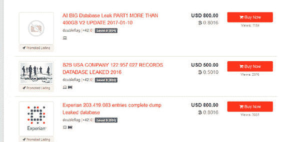

图 7.1 黑暗网市场

这些市场并不在乎是如何获取信息的：他们唯一的关注点就是出售。在某些情况下，黑客侵入网络并将信息出售给黑暗网市场。在其他情况下，内部人员在黑暗网上出售机密信息。事实上，一些黑暗网市场正在广告，他们希望从企业内部人员处购买机密数据。这为竞争对手在黑暗网上购买贵公司的信息提供了现成的资源。

## 开源情报的使用

在考虑威胁时，能够进行网络威胁情报收集至关重要。幸运的是，开源情报在该领域提供了许多选择。有许多网站和工具允许你收集有关当前威胁甚至特定问题的收集。

ThreatCrowd 是一个搜索引擎引擎，能够让你找到有关最新威胁的信息。图 7.2 显示了 [threatcrowd.org](http://threatcrowd.org) 的主页。

你可以使用该网站搜索特定的病毒或攻击，甚至搜索 IP 地址以确定该 IP 地址是否连接过攻击。

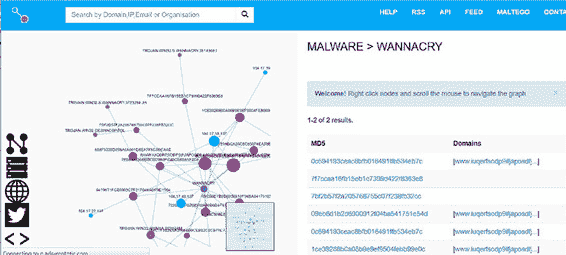

图 7.2 ThreatCrowd

另一个重要的开源情报来源是 [`openphish.com/`](https://openphish.com/)。该网站将为你提供有关当前钓鱼计划的最新信息。你可以在图 7.3 中查看网页和搜索结果。

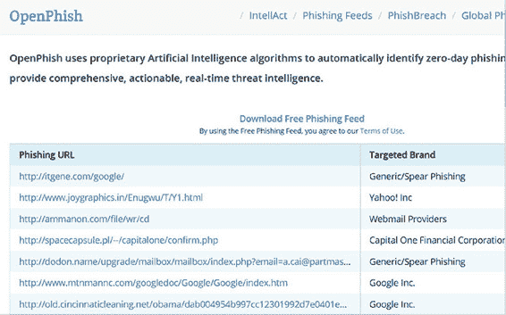

图 7.3 OpenPhish

一旦你识别出威胁源，就有许多开源工具可以供你调查该威胁。例如，如果你认为某个电子邮件地址是病毒或钓鱼尝试的来源，或者你认为特定的 IP 地址或 URL 是攻击的来源，你可以调查该来源。你在网络上可以获得的一个开源资源是 [`osintframework.com`](http://osintframework.com)。该网站允许你搜索广泛的开源资源；参见图 7.4。

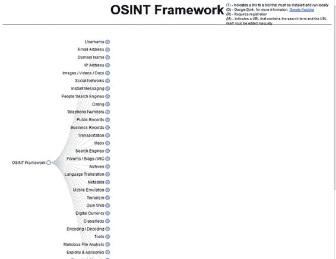

图 7.4 OSINT 框架

如果不讨论 [www.shodan.io](http://www.shodan.io)，关于开源情报的讨论就是完整的。该网站在第 4 章“身份和访问管理”中提到过，但值得再次提及。要使用该网站，你必须创建一个免费账户。它允许你搜索漏洞。你可以根据特定的地理区域、IP 地址、域名和其他选项进行搜索。图 7.5 显示了对默认密码的搜索。

这些只是你可以用来收集有关当前威胁的开源情报的几个来源。

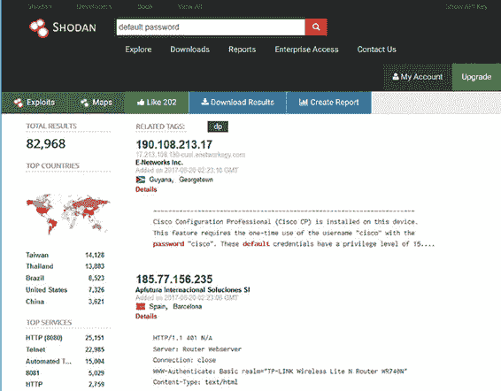

图 7.5 Shodan

## 漏洞类型

各种漏洞可能会影响你的系统。意识到你正试图缓解哪些漏洞是网络安全的一个重要方面。

### 配置问题

你拥有的系统以及这些系统支持的安全防护如果没有适当的配置将毫无用处。这可能简单地未能更改默认设置或默认密码。也可能是由于对特定设备没有适当的培训，导致其配置不当。

与配置错误相关的是弱配置问题。正如你所看到的，安全设置（例如“当网站尝试安装加载项时向你”）已被选中。如果用户取消勾选这些设置，就存在弱配置。与弱配置相关的是账户配置不当的问题。所有系统上的所有账户都应该配置为最小权限。

与弱配置相关的还是加密性薄弱的问题。例如，所有无线访问点都有使用 `WEP`、`WPA` 或 `WPA2` 的选项。只有 `WPA2` 完整实现了 `802.11i` 安全要求。如果你实施 `WEP`，那么你实施的是一个弱加密套件，对于安全性来说是不够的。

### 用户问题

许多组织安全中最薄弱的环节是端点用户。这个问题最好通过培训和教育来解决。未经训练的用户绝无可能遵守良好的安全实践，因为他们并不了解这些做法。安全培训与你购买的任何技术或可以实施的任何策略一样重要。

当然，除了适当的配置和用户培训外，还需要供应商的支持。出于安全考虑，这意味着供应商必须及时修补任何发现的漏洞。糟糕的供应商支持会削弱系统安全性。

### 零日漏洞

当网络浏览器或其他软件中发现漏洞，并且攻击者在发现漏洞的当天就开始利用它，绕过了许多软件提供商在发现漏洞后发布补丁所需的一到两天的响应时间时，这被称为零日漏洞。这种利用在供应商甚至意识到该漏洞之前就发生了。如果攻击者在开发者同一天获知了该弱点，那么他们就可以一直利用它，直到补丁发布。通常，在发现漏洞和发布补丁之间，你作为安全管理员唯一能做的就是关闭该服务。虽然这在生产力方面可能是一项代价代价，但它是保持网络安全的唯一方法。


传输层安全（Transport Layer Security）最初用于加密网络流量。`HTTP`（超文本传输协议）通过 `TLS` 加密后变为 `HTTPS`。这一过程由网景（Netscape）发明，尽管当时他们使用的是 `SSL` 而不是 `TLS`。如果网络流量涉及如信用卡号等敏感信息，那么 `HTTP` 应该使用 `TLS` 进行加密。所有的银行网站和电子商务网站都使用 `HTTPS` 来保护敏感信息。

传输层安全可以用于保护许多不同的协议。`TLS` 为协议增加了加密和身份验证。例如，电子邮件协议 `SMTP`（简单邮件传输协议）、`POP3`（邮局协议 v3）和 `IMAP`（互联网消息访问协议）都可以通过 `TLS` 进行加密。这些协议中的每一个都演变为 `SMTPS`、`POP3S` 和 `IMAPS`。“S”代表安全（secure）。通常情况下，建议在几乎所有场景下使用加密电子邮件。如果你未能对电子邮件进行加密，那么在你的机器和电子邮件服务器之间运行数据包嗅探器的任何人都可以看到你的邮件内容，可能还会密码。如今，大多数电子邮件服务都坚持使用 `TLS` 来保护电子邮件协议。

`FTP`（文件传输协议）也可以通过 `TLS` 加密变为 `FTPS`。如果你正在传输带有敏感信息的文件，你应该使用 `FTPS` 而不是 `FTP`。作为 `FTPS` 的替代方案，还有 `SFTP` 和 `SCP`。安全文件传输协议和安全拷贝都能确保文件传输的安全，但它们使用的是 `SSH`（安全外壳）而不是 `SSL/TLS`。如果正在传输任何敏感文件，始终建议使用 `SFTP`、`SCP` 或 `FTPS`。

域名系统安全扩展（`DNSSEC`）是针对安全 `DNS`（域名系统）的安全规范。`DNSSEC` 涉及许多安全特性，例如经过数字签名的 DNS 响应。这些机制旨在降低如 `DNS 毒化` 等 DNS 攻击的风险。这与 `DNS` 解析也有。当 `DNS` 解析过程以明文发送时，它就会受到数据包嗅探的攻击。因此，`DNS` 解析也应该被保护/加密。

`SNMP`（简单网络管理协议）用于管理网络。每个受管设备都安装了一个软件代理，用于向集中的 `SNMP` 管理服务器报告问题和故障。`SNMP` 的版本 1 和 2 将所有数据都以明文发送。`SNMP v3` 加密了所有数据。在所有情况下，都应该使用 `SNMPv3`。`SNMP` 发送的详细网络信息足够敏感，绝不能以明文发送。

轻量级目录访问协议（`LDAP`）是一种目录协议，它包含了关于你网络字面上的所有信息。它列出了所有的目录服务、服务器、工作站、用户等。攻击者会发现这些信息非常有用。因此，建议使用 `TLS` 对此类流量进行加密。当你担心任何攻击者枚举你的网络时，你应该使用 `LDAPS`。

语音和视频通话通过会话建立协议（`SIP`）建立。数据通过实时传输协议（`RTP`）传输。显然，某些语音通话可能是敏感的。如果你需要安全的语音通话，就必须使用 `sRTP`（安全实时传输协议）。你也可以使用 `sRTP` 来保护视频，特别是对于机密视频会议。

远程访问无论使用 `RADIUS`、`TACACS+` 还是 `Diameter`，都应该被保护。在远程连接期间，有一个传输用户凭据的验证过程。如果此过程没有加密，任何人都可以看到登录凭据。事实上，任何可能泄露敏感信息的通信都应该加密。除了之前过的协议外，这还包括时间同步、路由和交换、订阅服务（subscription service）、通过 `DHCP` 进行的网络地址分配，这些都应该加密。`TLS` 不是加密流量的唯一方法，但它是一种有效且广泛支持的方法。

## 其他问题

其他几个漏洞无法很好地归入上述任何一类。本节将简要讨论其中的每一个问题。

`系统蔓延`（system sprawl）是许多网络的共同问题。随着网络的增长，跟踪网络上所有的设备和软件变得越来越困难。这可能导致未记录的资产。这些资产成为问题，因为它们的安全配置是未知的。例如，一个未记录的 Wi-Fi 访问点可能在使用默认密码、弱加密，或者仅仅没有打补丁。

证书管理或密钥管理不当是另一个问题。在第 8 节“密码学”中，我们将详细讨论数字证书的各个方面。现在，你只需要意识到未能妥善存储私钥和对称密钥是一种安全漏洞。此外，在网络在使用过期的数字证书也是另一个相关的漏洞。

旧系统也可能构成安全漏洞。在某个点，供应商不再为旧系统提供补丁。这些寿命结束的系统非常脆弱。例如，`wannacry` 勒索软件在本书编写期间最初传播的。在其他问题中，事实是使用 `Windows XP` 的用户没有 `wannacry` 所利用的漏洞的补丁。在这种情况下，`Microsoft` 确实为 `Windows XP` 发布了紧急补丁。尽管如此，这种情况说明了与生命周期结束系统相关的漏洞。

在某些情况下，业务流程本身也可能是漏洞。未能妥善进行背景检查或验证供应商都是漏洞。从可疑来源获取软件是一种漏洞。要在单本书的一个章节中列出所有可能的业务流程漏洞将是一项巨大的挑战。然而，你应该意识到，任何组织的流程对安全性的重要性与实施的技术一样重要。

与业务流程不佳相关的是架构和设计缺陷。当网络的设计方式本身不安全时，就会产生漏洞。一个例子是位于内部网络和外部网络之间不使用 `DMZ` 的网络，或者未进行分段的网络。这些是导致安全漏洞的设计缺陷。

## 嵌入式系统安全

`嵌入式系统`是大型机械或电气系统中具有专用功能的计算机系统。这些可以是物联网（`IoT`）设备中的芯片，或是制造设备中的控制器。今天在使用多种嵌入式系统。

在某种程度上，这些设备的安全担忧与其他计算机设备相同。这包括使用强健的身份验证、补丁管理、数据加密以及类似的安全措施。

物联网（`IoT`）是一个日益增长的问题。最初，它主要涵盖自动化工业设备。然而，它已经扩展到家庭。随着越来越多的人接受智能温控器和类似设备，安全问题变得更加受关注。

2016 年 8 月 7 日，报道了首个针对智能温控器的勒索软件（http://motherboard.vice.com/read/internet-of-things-ransomware-smart-thermostat/）。幸运的是，在这种情况下，这并不是在野外发现的勒索软件，而是两个安全研究人员的创作。他们设计它是为了说明智能家居技术中的一个缺陷。他们在拉斯维加斯著名的 Defcon 大会上展示了他们的概念证明。


可穿戴技术有多种形式。这些可以是与运动相关的设备，也可以医疗设备。无论哪种情况，设备上都存储了敏感个人信息。在某些情况下，设备会与计算机同步。存储在设备上的数据应在设备上进行加密，任何发送的数据应进行传输加密。`TLS` 是传输加密的一种极解决方案。

除了智能家居技术外，工业系统长期以来一直在加热、通风和空调（HVAC）中使用智能技术。这些系统利用智能技术来调节空气和温度。

自从网络打印机存在以来，一直存在安全问题。大多数具有相当功能的现代打印机都程序了嵌入式芯片。此外，许多打印机允许使用 `telnet`、`SSH` 或类似技术远程访问打印机。这些远程访问技术非常方便，但也为攻击者提供了手段，特别是当这些协议使用默认设置时。

在第 1 章“风险管理”中，我们讨论了各种行业标准。请记住 `NIST 800-82`，《Special Publication 800-82, Revision 2>——工业控制系统（ICS）安全指南》是专门针对工业控制系统的。工业系统包括 `SCADA`（数据采集与监控系统）和 `PLCs`（可编程逻辑控制器）。

针对 `SCADA` 系统采取的最基础的安全步骤之一是实施账户使用和监控。这将提供关于谁在使用系统、如何使用以及何时运行的详细信息。

`实时操作系统 (RTOSs)` 是另一个问题。这些操作系统旨在尽可能快速地处理数据。请注意，我们谈论的是实时操作系统，而不仅仅是实时运行的软件。`RTOSs` 最初是为军事应用开发的。这些系统旨在实现零延迟，或尽可能接近零延迟。

另一种较新的技术是片上系统（SoC）。这些设备是集成在单个芯片上的完全自包含的系统。

医疗设备也是一个日益关注的问题。著名黑客 Barnaby Jack 能够入侵胰岛素泵，并导致设备释放其内含的所有 300 单位胰岛素。该设备具有无线功能，以便与医生的计算机同步数据。然而，那种无线通信是不安全的。是的，这意味着有人真的可能通过黑客攻击被杀，尽管目前还没有此类事件的文献记录。加密通信和强身份验证是针对此问题的适当应对措施。

越来越多的车辆拥有了复杂的计算机甚至具有无线功能。这使得这些车辆容易受到攻击。然而，这不仅限于汽车——无人机（UAVs，或无人机）甚至载人飞机都是脆弱的。

监控摄像头是另一个问题。许多此类摄像头是具有无线功能的数字摄像头。这使得它们可能受到攻击。攻击者可以破解设备并利用它来监视受害者。

虽然有许多新设备需要保护，比 10 年前多得多，但安全关注点并没那么不同。无论涉及哪种设备，都必须问相同的安全问题：设备是否具有稳健的身份验证？数据在静态存储和传输过程中是否经过了加密？设备的软件/固件是否已打补丁？你在网络中处理的所有相同问题现在都扩展到了其他设备。此外，可以肯定的是，未来几年设备数量将比现在更多。

本章（以及书中其他地方）讨论的所有这些安全技术管理起来都可能非常复杂。这引出了了安全中非常重要的方面。首先是安全自动化。在可能的情况下，安全应该是技术的一项自动功能。例如，你不需要手动告诉浏览器加密流量。`HTTPS` 协议会为你处理好。

除了安全自动化之外，安全必须始终集成到技术中。持续集成要求安全必须处于产品设计、开发、实施和维护中。安全不能简单地作为事后补救。

## 应用程序漏洞

我们听到的许多漏洞甚至泄露事件都是由于程序缺陷导致的。应用程序漏洞为攻击者利用系统提供了方法。某些应用程序漏洞允许攻击者获得访问权限，而另一些只是让系统变得不稳定。在讨论讨论加固和安全编码之前，你应该了解涉及的漏洞。

### 输入漏洞

许多攻击（如 `SQL injection` 和跨站脚本攻击）依赖于输入未经过妥当检查。所有输入都应该经过验证。这意味着当用户向文本字段输入数据时，会在客户端侧对其进行检查，以确保其具有正确的数据类型和大小。其他检查（例如寻找常见的 `SQL injection` 符号）也会在此时进行。然而这也意味着当数据从一个系统移动到另一个系统时，会再次进行检查。当数据从客户端移动到服务器端组件时，服务器组件应该验证数据。当从数据库或服务读取数据时，不要假设它是可靠的——要对其进行验证。

如果所有应用程序都利用适当的 `input validation`，包括上述的许多攻击将几乎不可能发生。这包括在输入甚至在程序特定函数中使用之前对其进行验证。

缓冲区溢出涉及尝试向数组中加载超过数组所容纳的数据。如果你有一个 10 字节的数组并加载了 15 字节，额外的 5 字节将加载到内存中，覆盖某些内容。通过简单检查输入、缓冲区和相关整数的边界，溢出永远不会发生。

这可以总结为：所有数据都应在客户端和服务器端进行验证。这样做提供了一个稳健的验证机制，可以消除许多漏洞。

与输入验证相关的是错误处理。每一个具有意义功能的函数都应该有适当的错误处理。换句话说，每当程序崩溃时，很可能是因为没有涉及适当的错误处理。如果程序具有适当、稳健的错误处理，那么在发生问题时，用户只会看到错误消息框。

### 内存漏洞

内存泄漏是内存管理中最常见的问题。许多现代编程语言（例如 `C#` 和 `Java`）不允许程序员直接分配或释放内存。因此，那些编程语言并不容易发生内存泄漏。

然而，某些编程语言（特别是 `C` 和 `C++`）赋予了程序员对内存管理的极大控制权。内存泄漏通常由于未能释放已分配的内存引起。静态代码分析器可以检查所有内存分配命令（`malloc`、`alloc` 等）是否都有匹配的释放命令。

指针是另一种操作内存的复杂方法。`C` 和 `C++` 有指针（pointer）的概念。这是一种变量，它不存储数据，而是指向另一个变量的内存地址。这会导致 `pointer dereferencing` 问题。这种攻击包括在目标程序中找到空引用并对其解引用，导致异常的产生。


另一个问题是资源耗尽。当应用程序持续分配额外资源（如内存）时，宿主机的有限资源最终会被耗尽，导致系统挂起或崩溃。当被蓄意执行时，这可以成为拒绝服务攻击的形式。

所有这些攻击都涉及内存管理。应用程序必须有效利用内存管理。这意味着要有效地处理指针、内存分配以及任何相关任务。

Windows 程序经常使用动态链接库（DLL），这些 DLL 被加载到使用该 DLL 的应用程序内存空间中。DLL 注入是一种恶意软件尝试将代码注入到库的内存进程空间的情况。换句话说，`DLL` 被攻破了，并被用于尝试破解调用该 `DLL` 的程序。DLL 注入是一种相当复杂的攻击。

竞态条件是与多线程应用程序相关的漏洞。当多线程应用程序未能妥善处理多个线程访问公共值时，可能会导致该变量产生不可预知的值。这被称为 `race condition`（竞态条件）。

# 安全编程

为了进行安全编程，你必须对代码是如何编写的有一定了解。软件是复杂的，有特定的模型详细描述了如何开发应用程序。

## 编程模型

`瀑布模型`包含以下步骤：需求收集、设计、实现（也称为编码）、测试（也称为验证）、部署和维护。每个阶段都是完全自的。一旦完成一个阶段，就会移动到下一个阶段。这种方法适用于需求早已明确定义的情况。

`敏捷开发`以周期方式工作，每个周期产生特定的交付物。这意味着设计和开发等阶段会重复。敏捷编程是一种`prototyping`（原型设计）。此类方法都使用通用方法，例如：原型代码 ➢ 测试 ➢ 部署 ➢ 收集反馈。这个过程不断重复，每次都接近最终目标。该过程如图图 7.7 所示。


`图 7.7` 原型

有许多敏捷方法，包括这些：

- 敏捷建模 (Agile Modeling)
- Scrum 
- 自适应软件开发 (Adaptive Software Development)
- 水晶模型 (Crystal)
- 特性驱动开发 (Feature-Driven Development)
- 动态系统开发方法 (Dynamic Systems Development Method)
- 精益软件开发 (Lean Software Development)
- XP (极值编程)

## 软件测试

大多数编写用于接受输入的应用程序都期望特定类型的数据——字符串值、数值等。有时，可能会输入意想不到的值并导致应用程序崩溃。当发生这种情况时，用户可能会获得提升的权限，或者访问他们不应拥有的值。`Fuzzing`（模糊测试）是通过向应用程序提供意想不到的值作为输入以使其崩溃的技术。这是一种动态测试，通过刻意使用意想不到的值进行测试来发现安全漏洞。这些值可以是随机的、无效的，或仅仅是意料之外的。一种常用方法是用随机位流填充输入。

除了动态测试外，还有静态测试技术。静态代码分析器是工具，它们只需读取源代码并尝试记录漏洞。这可能包括错误处理不当、内存内存释放或其他问题。

动态和静态测试都是测试代码质量的方法。安全编码最基本的方面之一就是首先确保代码质量。程序编码中的缺陷经常被利用作为安全漏洞，正如你在本章中所看到的。

`Stress testing`（压力测试）是软件测试的另一个方面。这涉及让目标系统承受远超其正常遇到的负载。这可以揭示软件中的缺陷，包括安全漏洞。例如，如果你预计网站每天有 1,000 个访问者，请模拟每天 10,000 甚至 100,000 人，以测试系统对这种压力的响应。

许多形式的测试核心都是仿真。压力测试模拟某些异常情况；模糊测试模拟错误的输入。当你使用任何仿真来测试你的应用程序时，都必须验证模型。确保仿真模型的所有方面都是准确的。。如果模型包含任何不准确的数据或设置，结果将是不准确的。

## 特定测试类型

除了本节之前的通用测试方法外，无论使用什么软件模型，在软件开发生命周期期间必须进行五种测试。这里简要描述了每种形式：

`Unit Testing`（单元测试）当一个功能单元完成后（无论是模块、程序类还是完整的应用程序），都应该进行测试。这通常由程序员完成。测试可以是动态的、静态的或两者都有。

`Integration Testing`（集成测试）当两个或多个单元连接时，应该对它们进行测试以确保它们共同工作。这通常由程序员完成。这种测试通常是动态测试。

`System Testing`（系统测试）当你有一个完整的功能系统时，应该对其进行测试。这通常由专门的测试团队完成。这种测试通常是动态测试。

`User Acceptance Testing`（用户验收测试）这通常被称为 Beta 测试。给一组用户访问系统的权限进行测试。他们通常是为了查看系统是否满足他们的需求。

`Regression Testing`（回归测试）一旦系统部署，只要发生更改，不仅必须测试该更改，还应该对可能受更改影响的所有系统进行测试。

显然，接下来将讨论的安全编程是关于为了使软件更安全而采取的具体步骤。某些来源建议对漏洞进行简单的混淆/伪装。然而，混淆并不是安全。无论你如何伪装安全漏洞，攻击者都能找到它。因此，直接缓解安全风险是适当的方法。你不应该依赖混淆/伪装。

## 安全编码标准

`Secure coding`（安全编码）可以最好防止本章讨论的许多攻击。本章详细讨论了跨站脚本和 SQL 注入，适当/安全的编码是这些攻击的唯一预防措施。缓冲区溢出在本书的其他处进行了检查，但再次，安全编码是防御这种攻击的唯一防御。

### 通用安全编码指南

在检查某些安全编码标准之前，考虑一些适用于所有编程的简单安全措施是重要的。

第一个是加密。对于所有传输中的数据，你至少应该考虑加密这些数据；对于 Web 应用程序尤其如此。在第 8 章中，我们将查看 `SSL/TLS` 作为加密数据的主要手段。

对于所有将安装在第三方机器上的代码，建议进行代码签名。通过对代码进行数字签名（例如网页中的 `ActiveX` 组件或设备驱动程序），安装软件的终端用户可以确认软件的来源。

版本控制和变更管理是所有编程的共同概念。提供了源码控制工具（某些是开源的，如 `Subversion` 和 `Git`），允许你控制软件版本。同样重要的是，软件更改必须接受你在任何其他网络更改可能使用的相同严格变更管理程序。这包括变更请求 (`RFC`)，它将由变更批准委员会 (`CAB`) 进行评估。


确定你正在处理的程序类型同样重要。它是一个编译型程序（如 `C` 或 `C++`），还是运行时程序（如 `Java` 或 `.NET`）？对于运行时程序，运行时环境中可能存在漏洞。例如，在使用 `Java` 时，你需要检查正在使用的 Java 虚拟机（`JVM`）版本，以确保它没有任何漏洞。

## 安全编码标准

安全编码是一个广阔的领域，但对于 Security+ 考试，你只需要了解通用概念。如果你是一名程序员或负责监督应用安全，我们建议你通过本节提供的 URL 深入研究这一主题。

### OWASP

`Open Web 应用程序安全项目 (OWASP)`（[`www.owasp.org/index.php/OWASP_Secure_Coding_Practices_-_Quick_Reference_Guide`](https://www.owasp.org/index.php/OWASP_Secure_Coding_Practices_-_Quick_Reference_Guide) 是一个志愿者组织，致力于为 Web 应用程序、移动和客户端应用程序以及后端设计问题制定安全编码规范。关注 Web 应用程序是非常重要的，因为它们是最容易受到攻击的系统之一。该组织提供了一系列编码标准。最基础（也是对 Security+ 考试最关键）的是输入验证。

正如你在本章后面将看到的，某些攻击（如 `SQL injection`）完全依赖于通过 Web 应用程序发送的未过滤输入。`OWASP` 建议在处理用户输入的所有数据之前对其进行验证。如前所述，进行输入验证主要有两种方法：客户端验证和服务器端验证。

`客户端验证`通常通过获取用户在文本框中输入的输入，并在客户端检查无效字符或输入来实现。这个过程可以简单到只需验证输入是否超过所需的长度，也可以对 `SQL injection` 字符进行完整检查。无论何种情况，验证都是在数据发送到服务器之前在客户端 页面上完成的。

`服务器端验证`涉及在服务器接收数据后对其进行验证。此过程可以包括检查业务逻辑，以查看发送的数据是否符合预期参数。仅有服务器端验证是不常见的。你可能会拥有只有客户端验证的系统，但服务器端验证通常是与客户端验证配合进行的。

### CERT 安全编码标准

卡内基梅梅隆大学的`计算机应急响应小组 (CERT)`（[www.cert.org/secure-coding/](http://www.cert.org/secure-coding/)）也详细介绍了安全编码标准。`CERT` 标准涵盖了许多与 `OWASP` 相同的问题，它们还为 `Java`、`Perl`、`C` 和 `C++` 提供了完整的特定语言标准。

`CERT` 处理的一个项目是异常处理。事实是程序会遇到错误。如何处理这些错误对安全至关重要。例如，某些程序员向终端用户显示详细的错误信息。不仅对大多数终端用户没有帮助，实际上可能为黑客提供有用信息。更好的想法是向终端用户显示简单但有用的信息，而仅记录详细信息。

## 应用配置基准

基准设定（Baselining）始终涉及将性能与指标进行比较。该指标是一个历史测量值，你可以指向并识别它是在配置更改之前、网站繁忙之前、添加新服务之前存在的。基准设定可以使用任何指标进行，例如网络性能或 CPU 使用率，也可以针对应用程序。

建议在进行重大配置更改之前，对关键应用进行基准设定。确保应用程序具有适当设置，以便以最佳值运行并提供安全保护。

## 操作系统补丁管理

在第 2 章中，我们讨论了补丁。有三种类型的操作系统补丁，每种的紧迫程度不同：

`Hotfix`：`hotfix` 是一种立即且紧急的补丁。通常情况下，这些代表严重的安全问题，不是可选的；它们必须应用于系统。

`Patch`：`patch` 提供一些额外的功能或非紧急的修复。这些有时是可选的。

`Service Pack`：`service packs` 是到目前为止热修复和补丁的累积组合。这些应该始终被应用，但必须先进行测试，以确保更新不会导致任何问题。

## 应用补丁管理

正如你需要保持操作系统补丁更新（因为它们通常修复了操作系统内部发现的安全问题一样），你需要对应用补丁进行同样的操作。一旦应用程序中的漏洞被发现，攻击者就可以利用它进入或破坏系统。大多数供应商会定期发布补丁，你应该定期扫描任何可用的补丁。

今天有大量攻击针对客户端系统，简单原因是客户端并不总是能良好地管理应用补丁。结合大多数客户端运行着许多应用程序这一事实，找到可以利用的弱点的概率大大增加。

## 其他应用安全问题

各种与应用程序相关的安全问题并不整齐地归入之前的任何一类，因此在本节中进行讨论。

### 数据库与技术

安装计算机的一个关键原因是它们存储、访问和修改数据的能力。数据管理的主要工具是数据库。数据库变得越来越复杂，其功能在过去 10 年中急剧增长。这种增长提供了以新方式查看数据的机会，也为这些产品的设计和用户带来了问题。

本节简要讨论数据库技术以及与数据库系统漏洞的一些常见问题。

`关系型数据库`已成为数据库实现最常用的方法。这种技术允许根据用户或管理员的需求以动态方式查看数据。与数据库通信的最常用语言是`结构化查询语言 (SQL)`。`SQL` 允许实时配置查询并将其传递给数据库服务器。这种灵活性在实施不安全时会产生一个巨大的漏洞。

例如，你可能想要获取某个特定地理区域且在过去两年从你公司购买过产品的客户的电话号码。在手动系统中，你首先需要确定哪些客户住在你想研究的区域。你将对客户记录进行手动搜索，然后识别哪些客户进行过购买。这种过程可能非常复杂且耗时。

在关系型数据库环境中，你可以查询数据库以找到所有符合你标准的记录并将其打印出来。执行此操作的命令可能一行代码，也可能需要数千条指令。显然，生产力的提高是一项值得的投资。

公司或组织数据是一个组织最宝贵的资产之一。它们通常位于桌面系统或大型集中式数据库服务器中。这些信息使得服务器成为工业间谍和破坏的诱人目标。

数据库服务器遭受我们迄为止讨论的所有漏洞。此外，数据库本身是一组复杂的程序，它们共同工作以提供数据访问。


早期的数据库系统通过应用程序将终端用户直接连接到数据。这些程序旨在允许方便地访问数据，并允许对数据库执行事务。在私有网络中，物理安全通常是保护数据所需要的。

随着互联网的增长，企业允许客户访问此类数据，如跟踪订单、查看购买记录、汇款以及他们想要的几乎任何其他功能。这种互操作性的增加为数据库带来了更多的代码、更多的软件和复杂性。

软件制造商努力跟上客户的需求。遗憾的是，他们频繁发布的软件容易出现安全问题。对面向数据库的型系统的需求增加，以及软件开发人员和制造商引入的安全问题，已成为数据库服务器最大的漏洞领域。

为了提高系统性能并增强数据库的安全性，公司实施了分层系统模型。这里解释了三种不同的模型：

### 单层模型
在`one-tier model`（单层模型）或`single-tier environment`（单层环境）中，数据库和应用程序存在于系统中。这在运行独立数据库的桌面系统中很常见。早期的 Unix 实现也是这种方式工作的；每个用户登录终端并运行一个访问数据的专用程序。

### 二层模型
在`two-tier model`（二层模型）中，客户端工作站或系统运行一个与运行在不同服务器上的数据库通信的应用程序。这是一种常见的实现，对许多应用程序都有效。

### 三层模型
`three-tier model`（三层模型）通过引入`middle-tier server`（中间层服务器）有效地将终端用户与数据库隔离。该服务器接收客户端的请求，对其评估，然后将其发送到数据库服务器进行处理。数据库服务器将数据返回给中间层服务器，然后将其发送给客户端系统。这种方法在今天正变得常见。中间服务器还可以控制对数据库的访问并提供额外的安全性。

这三个模型提供了增强的能力和复杂性。你必须管理每个系统并保持其更新，才能提供安全性。

### NoSQL
`NoSQL` 是一个较新的概念。大多数商业关系型数据库管理系统（`Oracle`、`Microsoft SQL Server`、`MySQL`、`PostGres`等）使用 `SQL`。`NoSQL database`不是关系型数据库，也不使用 `SQL`。这些数据库比关系型数据库少，但在重要扩展性的地方经常使用。表 7.1

| 特性 | NoSQL 数据库 | SQL 数据库 |
| --- | --- | --- |
| 数据库类型 | 非关系/分布式 | 关系型 |
| Schema 类型 | 动态 | 预定义 |
| 数据存储 | 将所有内容存储在单个嵌套文档中，通常为 XML 格式（基于文档） | 逐条记录存储为表中的行（基于表） |
| 优点 | 可以处理海量的结构化、半结构化和非结构化数据 | 广泛支持且易于配置结构化数据 |
| 典型扩展模型 | 水平扩展：添加更多服务器 | 垂直扩展：增强服务器 |
| 流行厂商/实现 | `MongoDB`、`CouchDB`等 | `Oracle`、`Microsoft`、`MySQL`等 |
| 是否容易受到 SQL 注入攻击 | 否，但容易受到类似的注入类型攻击 | 是 |

**表 7.1**](#part0016_split_007.html_tableanchor7-1) NoSQL 数据库对比 SQL 数据库

### 大数据
组织日益需要存储极其大量的数据，通常是许多 TB。这有时被简单称为`Big Data`。这些数据通常无法放入单个服务器上，而是存储在存储区域网络（`SAN`）中，接下来将讨论。大数据的一个问题是，它的规模达到了一个难以进行搜索、存储、共享、备份和真正管理的程度。

### 数据库安全
数据库安全的的第一步是稳定的数据库配置。数据库配置最基础的方面之一是`database normalization`（数据库规范化）。规范化是从数据库中消除冗余条目的过程。通常有四个级别的规范化，范围从最低最低的 `1N`（重复最多）到最高的 `4N`（重复最少）。

一旦你有了安全的数据库配置，下一个问题就是如何执行 `SQL` 查询。这通常通过存储过程完成。`Stored procedures`（存储过程）被广泛用于许多数据库管理系统，以包含 `SQL` 语句。数据库管理员或由 `DBA` 指定的人员创建该业务所需的各种 `SQL` 语句，然后程序员就可以简单地调用这些存储过程。

这种方法防止了每个程序员编写自己的 `SQL` 命令。当不同的人编写 `SQL` 语句时，存在编写得不当的 `SQL` 的可能。此外，将 `SQL` 语句保存在单个位置（存储过程）使得维护变得容易得多。

## 安全配置
安全配置系统的一种方法是不可变系统。正如名称所示，这种系统实际上是冻结的。系统上不能添加或更改任何内容。在某些情况下，为了防止配置更改这是必要的。

另一种安全配置方法是`Infrastructure as Code (IaC)`（基础设施即代码），即通过机器可读的定义文件管理和配置计算机数据中心，而不是通过硬件配置或交互式配置工具。无论数据中心（或多个中心）使用物理机还是虚拟机，都是管理数据中心的有效方法。

`Sandboxing`（沙箱）是一种日益流行的提供安全应用程序的方法。如果应用程序在主机环境中隔离运行，那么应用程序的任何安全漏洞极不可能影响主机操作系统。沙箱可以通过简单地在虚拟机中运行应用程序来实现。这种方法用于许多情况，但对于可能需要旧版本操作系统的遗留应用程序特别有用。

所有这些方法，以及你在本章中看到的其他建议，都是关于安全 DevOps。这只是安全开发运维的术语。它意味着安全性被集成到你所有的开发操作中，包括数据库设计、编程和基础设施。

### 代码问题
代码复用非常常见，但它可能导致安全漏洞。在代码复用攻击中，攻击者执行用于其他目的的代码。在许多情况下，这些可能是不再使用的旧代码（死代码），即使这些代码存在于第三方库中。

代码复用与第三方库或软件开发包（`SDKs`）的使用有关。虽然这是一个非常常见的做法，但可能会导致安全漏洞。2014 年，`WordPress`（一种 Web 开发工具）的特定版本存在漏洞，导致数千个网站容易受到 `SQL injection` 攻击。这就是 `SDK` 中的漏洞如何广泛存在，并影响每个使用该 `SDK` 开发的应用程序的例子。

## 总结
本章向你介绍了加固（hardening）的概念，即使服务器或应用程序能够抵抗攻击的过程。为了保护网络，必须对其环境中的每个元素进行单独评估。记住，你的网络安全性取决于其最薄弱的环节。加固的主要方法之一是禁用系统中不需要需要的任何内容。保持系统更新也有助于提高安全性。


产品更新通常用于改进安全性和修复错误。系统升级的三种主要方法是热修复（hotfixes）、服务包（service packs）和补丁（patches）。热修复通常是指即时修复，而服务包通常包含多个修复程序。补丁用于临时修复程序，直到应用永久修复方案为止。

应用程序加固有助于确保漏洞降至最低。请确保你只运行支持你的环境所需的应用程序和服务。攻击者可能会针对应用程序协议的目标。许多较新的系统为终端用户提供了丰富的环境，每种协议都会增加你的风险。

数据库技术由于其提供的灵活性而容易受到攻击。请确保数据库服务器和应用程序保持更新。为了提供更高的安全性，许多环境实施了多层数据访问方法。

## 考试要点

- **能够讨论运行在网络上的各种应用程序的缺陷和漏洞。** Web、电子邮件和其他服务面临着独特的安全挑战，必须考虑这些。关闭不需要的服务。确保应用程序保持最新的安全和漏洞修复。按照制造商的意图以安全的方式实施这些服务。这是保护应用程序的最佳方法。
- **理解安全编程。** 输入验证、错误处理、编程模型和软件测试在 Security+ 考试中都非常重要。你应该熟悉所有这些内容。
- **熟悉新技术。** Security+ 考试将提出有关 SCADA、IoT、医疗设备和其他技术的性问题。请确保你熟悉与这些技术相关的安全问题。

## 复习题

你可以在附录中找到答案。

1. 下列哪个术语是指建立安全标准的过程？
    1. `Baselining`
    2. `Security evaluation`
    3. `Hardening`
    4. `Methods research`

2. 你被选中领导一个管理员团队以尝试提高安全性。你目前正在为需要检查和采取行动的所有安全方面制定大纲。下列哪个术语描述了改进网络操作系统 (NOS) 安全性的过程？
    1. `Common criteria`
    2. `Hardening`
    3. `Encryption`
    4. `Networking`

3. John 负责公司的应用程序安全。他担心应用程序对意外输入的反应是否恰当。哪种类型的测试对他帮助最大？
    1. `Unit testing`
    2. `Integration testing`
    3. `Stress testing`
    4. `Fuzzing`

4. Myra 担心数据库安全。她想从良好的数据库配置开始。以下哪项是数据库配置的一个基础问题？
    1. `Normalization`
    2. `Input validation`
    3. `Fuzz testing`
    4. `Stress testing`

5. 下列哪种技术是向应用程序提供意外输入值以试图使其崩溃？
    1. `DLP`
    2. `Fuzzing`
    3. `Stress testing`
    4. `HSM`

6. Mary 负责公司的网站安全。她想解决广为人知且记录的 Web 应用程序漏洞。哪种资源帮助最大？
    1. `OWASP`
    2. `CERT`
    3. `NIST`
    4. `ISO`

7. 你正在为出售公司准备重新设计网络。网络和公司所有方面一样，需要以最佳状态运行以有利于出售。使用哪种模型在终端用户和数据库之间提供中间服务器？
    1. `One-tiered`
    2. `Two-tiered`
    3. `Three-tiered`
    4. `Relational database`

8. `MTS` 的管理员最近被解雇了，事实证明他没有在更新和修复发布时安装它们。作为新聘的管理员，你的首要任务是将所有网络客户端和服务器更新到最新状态。单个产品中的一个或多个系统修复程序称为什么？
    1. `Service pack`
    2. `Hotfix`
    3. `Patch`
    4. `System install`

9. 你的公司对全球范围内软禁的人员进行电子监控。由于业务的敏感性，你无法承受任何不必要的停机。在系统运行时对操作系统进行修复的过程是什么？
    1. `Upgrading`
    2. `Service pack installation`
    3. `Hotfix`
    4. `File update`

10. Juan 刚刚对公司的电子商务应用程序进行了细微更改。更改按预期工作。对他来说，最重要的测试类型是什么？
    1. `Unit testing`
    2. `Regression testing`
    3. `Static testing`
    4. `Stress testing`

11. 你的公司增长非常快，在各个 IT 领域招聘专才的需求已变得显性。你正在帮助编写一份用于招聘新员工的在线广告，你想确保申请者具备必要的技能。你的组织薄弱的一个知识领域是数据库智能。你可以在广告中提到的今天应用程序中主要的数据库类型是什么？
    1. `Hierarchical`
    2. `Relational`
    3. `Network`
    4. `Archival`

12. 对程序进行手动更改的过程称为什么？
    1. `Hotfix`
    2. `Service pack`
    3. `Patching`
    4. `Replacement`

13. 你想给用户分配权限，让她可以删除文件但不能将权限分配给他人。你应该分配哪些权限？
    1. `Full Control`
    2. `Delete`
    3. `Administrator`
    4. `Modify`

14. Ahmed 负责 `SCADA` 系统的安全性。如果可用性是他最大的关注点，他实施最重要的事情是什么？
    1. `SIEM`
    2. `IPS`
    3. `Automated patch control`
    4. `Log monitoring`

15. Gerard 担心他公司电子商务服务器上的 `SQL` 注入攻击。对他来说，实施最重要的安全措施是什么？
    1. `Stress testing`
    2. `Input validation`
    3. `IPS`
    4. `Agile programming`

16. Elizabeth 在一家制造胰岛素泵等便携医疗设备的公司工作。她担心设备的安全性。以下哪项对保护这些设备帮助最大？
    1. 确保与设备的所有通信都加密。
    2. 确保设备具有 `FDE`。
    3. 确保设备已经过压力测试。
    4. 确保设备已经过模糊测试（fuzz tested）。

17. Vincent 是一个在电子商务网站工作的程序员。他进行了漏洞扫描，并发现第三方模块中存在一个缺陷。该模块有一个可以修复该缺陷的更新。他缓解此威胁的最佳方法是什么？
    1. 提交一个 `RFC`。
    2. 立即应用更新。
    3. 将更新放在测试服务器上；如果有效，则将其应用于生产服务器。
    4. 记录该问题。

18. 下列哪是部署需要旧操作系统的旧应用程序最安全的方法？
    1. `Sandboxing`
    2. `Stress testing`
    3. `Dynamic testing`
    4. 将其放在加密驱动器上。

19. Denish 正在测试一个多线程应用程序。以下哪是多线程应用程序的特定关注点？
    1. `Input validation`
    2. `Memory overflow`
    3. `Race conditions`
    4. `Unit testing`

20. Gertrude 正在管理一个新的软件项目。该项目有非常明确且可能不会改变的需求。哪种开发模型最适合她？
    1. `Agile`
    2. `XP Programming`


## 3. 瀑布模型
## 4. Scrum 

# 第 8 章：密码学

本章涵盖了以下 CompTIA SECURITY+ 考试目标：

-  1.2 比较并对比攻击类型。
    - 密码学攻击：生日攻击；已知明文/密文攻击；彩虹表；字典攻击；暴力破解——在线与离线——冲突；降级；重放；弱点实现
-  6.1 比较并对比密码学的基本概念。
    - 对称算法
    - 运行模式
    - 非对称算法
    - 哈希函数
    - 盐 (Salt)、初始化向量 (IV)、随机数 (nonce)
    - 椭圆曲线
    - 弱/已弃用的算法
    - 密钥交换
    - 数字签名
    - 扩散
    - 混淆
    - 冲突
    - 隐写术
    - 模糊化
    - 流式与块式
    - 密钥强度
    - 会话密钥
    - 临时密钥
    - 秘密算法
    - 传输中数据
    - 存储中数据
    - 使用中数据
    - 随机/伪随机数生成
    - 实现与算法选择：加密服务提供商；加密模块
    - 完美向前密钥
    - 模糊安全性
    - 常见用例：低功耗设备；低延迟；高弹性；支持机密性；支持完整性；支持模糊化；支持认证；支持不可否认性；资源与安全限制
-  6.2 解释加密算法及其基本特征。
    - 对称算法：AES；DES；3DES；RC4；Blowfish/Twofish
    - 模式：CBC；GCM；ECB；CTM；流与块
    - 非对称算法：RSA；DSA；Diffie-Hellman—组；DHE；ECDHE—椭圆曲线；PGP/GPG
    - 哈希算法：MD5；SHA；HMAC；RIPEMD
    - 密钥扩展算法：BCRYPT；PBKDF2
    - 模糊化：XOR；ROT13；替换密码
-  6.3 给定场景，安装并配置无线安全设置。
    - 密码学协议：WPA；WPA2；CCMP；TKIP
    - 认证协议：EAP；PEAP；EAP-FAST；EAP-TLS；EAP-TTLS；IEEE 802.1x；RADIUS 联邦
    - 方法：PSK vs. 企业级 vs. 开放式；WPS；强制门户
-  6.4 给定场景，实施公钥基础设施 (PKI)。
    - 组件：CA；中间 CA；CRL；OCSP；CSR；证书；公钥；私钥；对象标识符 (OID)
    - 概念：在线/离线 CA；封套 (Stapling)；固定 (Pinning)；信任模型；托管；证书链
    - 证书类型：通配符；SAN；代码签名；自签名；机器/计算机；电子邮件；用户；根证书；域名验证；扩展验证
    - 证书格式：DER；PEM；PFX；CER；P12

用于定义某些威胁和攻击的术语之间经常存在交叉，但在讨论它们时，尽可能具体是非常重要的，以便能够无歧义地理解和报告它们。以下术语（在在线词表中也可以找到）是 CompTIA 喜欢在此类别中使用并测试的术语。按照顺序提供这些，以便您了解每个术语旨在传达的含义。

`Cryptography` 是研究改变信息使其在没有密钥的情况下无法解码的科学。它是通过加密和转换保护信息的实践。随着数据价值的提高，这成为政府、企业以及日益增长个人关注的领域。

在涉及个人或其他敏感信息时，人们希望拥有隐私。企业希望并需要保护财务记录、贸易秘密、客户名单和员工信息。政府使用密码学来帮助确保其公民的安全与健康。已经建立了整个政府机构来帮助确保机密，并花费了数美元试图保护国家秘密并尝试获取其他国家的秘密。

研究加密算法被称为`密码学`。研究如何破解加密算法被称为`密码分析学`。这两个学科结合在一起通常被称为`密码学 (cryptology)`。所有这些学科都需要深厚的数学背景，特别是数论方面。

## 密码学概述

密码学是一个几乎与人类一样老的领域。最早记录的加密尝试发生在 4000 年前。这些早期尝试包括将信息从一种语言翻译成另一种语言或替换字符。从那时起，密码学包含了无数可能性。最终，所有的密码学都是为了模糊明文，使其无法易于读取。经典方法使用相对简单的技术，人类通常可以在合理时间内破解。现代密码学中使用的模糊化要复杂得多，并且在实际时间内是不可破解的。

### 历史密码学

历史加密方法早于现代计算机时代。这些方法不依赖数学（像许多现代方法那样），而是依赖某些扰乱文本的技巧。

`cipher`（密码）是一种用于扰乱或模糊字符以隐藏其取值的方法。`Ciphering`（加密）是使用`cipher`对消息进行此类扰乱的过程。两种主要的非数学密码学或加密方法是`替换`和`置位`。我们将在在本节中讨论这两种方法。

### 替换密码

`substitution cipher`（替换密码）是一种编码或加密系统，将一个字符或符号更改另一个。字符替换是一种加密信息的相对简单的方法。已知最老的替换密码之一被称为`Caesar cipher`（凯撒密码）。据说被朱撒·凯撒使用过。该系统只需将字母表中的所有字母向前移动若干空格。据推，朱撒·凯撒向右移动三位。当然，他使用的是拉丁语，但任何语言（包括英语）都可以这样做。这里有一个例子：

> I will pass the Security plus test.

如果你将每个字母向右移动三位，你会得到：

> L zloo sdvv wkh Vhfxulwb soxv whvw.

Atbash（阿特巴什密码）是另一种古老的替换密码。希伯来抄写员复制《耶利米书》时使用了这种替换密码。应用`Atbash cipher`（阿特巴什密码）相当——只需反转字母表的顺序。从现代标准来看，这是一种非常原始且易破解的密码。例如，在英语中：

> A becomes Z, B becomes Y, C becomes X，以此此类推。

当然，希伯来人使用不同的字母表，aleph 是第一个字母，tav 是最后一个字母。然而，我将使用英语示例来演示这一点：

> Attack at dawn

变为

> Zggzxp zg wzdm

### 多字母替换

替换密码的问题之一是它们没有改变文本底层的字母和单词频率。对抗这种问题的一种方法是使用多次替换。例如，你可以将第一个字母向右移动三位，第二个字母向右移动二位，第三个字母向左移动一位；然后对下三个字母重复此公式。历史时期最著名的多字母替换示例是`Vigenère cipher`（维吉尼亚密码）。它使用一个密钥在表中查找密文。用户取想要加密的文本中的第一个字母，找到维吉尼亚表，将其与密钥中的字母匹配以找到密文字母。此过程将一直持续直到整个消息加密。密钥中的每个字母都会生成一个不同的替换表。


# 易位密码

`transposition cipher`（易位密码）涉及以特定方式对字母进行易位或置乱。通常，消息被分成等大小的块，然后对每个块进行置乱。在图 8.1 所示的简单示例中，字符通过改变组的顺序进行易位。在这种情况下，消息中的字母旋转了三位。你可以改变 `Block 1` 相对于 `Block 2` 的易位方式，使其稍微复杂一点，但解密仍然相对容易。


**图 8.1** 运行中的简单易位密码

`Rail Fence Cipher`（栅栏密码）是易位密码的一个经典示例。使用这种密码，你可以在若干行上对角写出消息字母，然后逐行读取密文。例如，你将消息写成：

> m e m a t r h t g p r y

> e t e f e t e o a a t

生成的密文为：

> MEMATRHTGPRYETEFETEOAAT

## 恩尼玛机

如果不讨论 `Enigma machine`（恩尼玛机），密码学历史讨论就是完整的。`Enigma machine` 本质上实现了多字母替换密码的打字机。每按下一个按键，就会使用一个不同的替换字母。`Enigma machine` 使用 26 种不同的替换字母。在计算机出现之前，这极难破解。

与人们的误解相反，`Enigma` 并不是单一机器，而是一系列机器。第一个版本是由德国工程师 Arthur Scherbius 在第一次世界大战后期发明的。它曾被多个不同国家的军方使用，而不仅仅是纳粹德国。

`Enigma machine`的核心是转子。这些是呈循环排列的圆盘，上面刻有 26 个字母。转子对齐排列。本质上，每个转子代表一种不同的单字母替换密码。你可以将 `Enigma` 视为一种机械多字母密码。

## 隐写术

`Steganography`（隐写术）是将消息隐藏在数字图像、音频文件或其他文件媒介中的过程。理论上讲，这样做可以防止分析人员检测到真实消息。你可以将消息编码在另一个文件或消息中，并使用该文件来隐藏你的消息。

今天常用的方法被称为 `least significant bit (LSB) method`（最低位法）。如你所知，计算机上的一切都存储在组织成字节的位中。例如，Windows 屏幕上的单个像素存储在 3 字节/24 位中。如果你更改最后一位（每个字节中的 `least significant bit`），那么在图像上不会产生明显变化。换句话说，你无法察觉到任何内容的被更改。利用这一事实，你可以通过将数据放入图像文件的最低位来存储数据。观察图像的人不会发现任何异常。

数据也可以隐藏在音频文件、视频文件或字面意义上的任何数字文件类型中。网上甚至提供了隐写术的程序。`QuickStego` ([`quickcrypto.com`](http://quickcrypto.com)) 是一个免费易于使用的程序。`Invisible Secrets` ([www.invisiblesecrets.com](http://www.invisiblesecrets.com)) 价格相当便宜且非常强大。

在练习 8.1 中，我们将向你展示如何在 `SuSE Linux` 中加密文件系统。

# 现代密码学

随着计算机的出现，旧的密码学方法不再可行。计算机可以快速轻松地破解替换密码和易位密码。即使是维吉尼亚密码（Vigenère）和 `Enigma machine` 也无法抵御现代密码攻击。

现代密码学分为三个主要领域：对称加密、非对称加密和哈希算法。这三者在 Security+ 认证考试中都有涵盖，并在本节中详细讨论。

在我们开始学习现代对称密码之前，我们应该讨论独异异（`OR (XOR)`）操作。这是一种非常简单的数学运算，是所有对称密码的一部分。`XOR`（通常如此称为）是一种简单但强大的二进制数学运算。考虑两个二进制数 1011 和 1001。要对这些数字进行异或，你从最低位（`LSB`）开始，问一个简单的问题：上方或底部数字中是否有一个 1，但不能同时都有（即：不是与或或，而是异或）？如果是，结果为 1；如果不是，结果为 0。

> 1011

> 1001

> 0010

现在这看起来可能特别有趣，直到你意识到 `XOR` 操作是可逆的。如果我取结果 (0010) 与另外两个数字中的任何一个进行异或，就能得到另一个。例如：

> 0010

> 1001

> 1011

在某个点上，所有的对称密码都会使用 `XOR` 操作作为其算法的一部分。单单本身，`XOR` 将是一种非常弱的加密算法——事实上，它弱到可能将其视为加密是不准确的，至少按照现代标准来看如此。然而，它是对称密码的一部分，并与许多操作结合使用。

### 使用对称算法

`Symmetric algorithms`（对称算法）要求加密消息的发送方和接收方具有相同的密钥和处理算法。对称算法生成一个必须保护的密钥。`symmetric key`（对称密钥），有时被称为 `secret key`（秘密密钥）或 `private key`（私钥），是一种不向未经授权使用加密系统的人员的密钥。秘密密钥的泄露会破坏加密系统的安全性。如果密钥丢失或被盗，整个过程就会被破解。这类系统很常见，但密钥需要特殊处理。图 8.2 展示了一个对称加密系统；在这个示例中，两端的密钥是相同的。


**图 8.2** 对称加密系统

围绕对称加密的另一个问题是密钥分发。如果你想与其他城市的朋友加密消息，你如何交换密钥？

对称方法使用块密码或流密码。如名所示，使用 `block cipher`（块密码）时，算法对数据块进行，加密一个然后移动到下一个。使用 `stream cipher`（流密码）时，数据一次加密一个位或一个字节。

在检查特定的对称算法之前，有一些对称加密的通用原则是我们应该注意的。有两个术语特别值得关注，它们是扩散（diffusion）和混淆（confusion）。这些术语来自信息论。`Diffusion`（扩散）意味着输入中单个位的变化会改变输出中多个一个位。在我们之前检查的经典密码（凯撒、维吉尼亚密码等）中，情况并非如此。然而，现代对称密码的结构使得，如果改变了输入的一个比特位，多个输出位就会发生变化。

另一个与对称密码相关的概念是 `confusion`（混淆）。这个术语不是指读完密码学章节后的感受。相反，它是指明文、密文和密钥之间的关系很难看出。通过观察反面最好能理解这一点。考虑之前描述的 `XOR` 操作。在该操作中，明文、密文和密钥之间的关系非常容易看出。几乎没有任何混淆。现代对称密码的结构使得它们具有大量的混淆。


一些成功的加密系统使用了对称算法。强大的算法可能很难被破解。以下是一些使用对称算法的常用标准：

### 数据加密标准
`Data Encryption Standard (DES)` 自 20 世纪 70 年代中期以来一直被使用。在被 `AES` 取代之前，它是政府和工业领域的主要标准。它基于 56 位密钥，并有多种提供安全性和完整性的模式。由于密钥较短，它现在被认为是不安全的。请注意，`DES` 实际上生成一个 64 位密钥，但其中 8 位仅用于纠错，只有 56 位是实际密钥。

### 三重 DES 
`Triple-DES (3DES)` 是 `DES` 的技术升级。尽管 `AES` 是政府应用的首选，但 `3DES` 仍然在使用。`3DES` 比许多其他系统都更难破解，而且比 `DES` 更安全。它将密钥长度增加到 168 位（使用三个 56 位 `DES` 密钥）。

### 高级加密标准
`Advanced Encryption Standard (AES)` 已取代 `DES` 成为现行标准，它使用了 `Rijndael` 算法。`AES` 由 Joan Daemen 和 Vincent Rijmen 开发。`AES` 是美国政府机构使用的当前产品。它支持 128、192 和 256 位的密钥，其中 128 位是默认值。

### CAST
`CAST` 是由 Carlisle Adams 和 Stafford Tavares 开发的算法（因此得名）。它用于微软和 IBM 提供的某些产品。`CAST` 使用 40 位到 128 位的密钥，非常快速高效。此外两个额外的版本：`CAST-128` 和 `CAST-256`。

### GOST
`GOST` 是苏联人在 20 世纪 70 年代开发的一种类似于 `DES` 的算法。它曾是机密的，但在 1994 年向公众发布。它使用 64 位块和 256 位密钥。这是一个 32 轮 Feistel 密码。`GOST` 是 `gosudarstvennyy` 标准的缩写，翻译成英文为“国家标准”。其正式名称为 `GOST 28147-89`。它旨在作为美国 `DES` 算法的替代方案，并与 `DES` 有相似之处。

### Ron 的密码
`RC` 是 RSA 实验室产生的一个加密系列。`RC` 代表 `Ron’s Cipher` 或 `Ron’s Code`（Ron Rivest 是该算法的作者）。目前的级别有 `RC4`、`RC5` 和 `RC6`。`RC5` 使用长达 2,048 位的密钥大小。它被认为是一个强大的系统。

`RC4` 在无线和 WEP/WPA 加密中非常流行。它是一种流密码，密钥大小范围在 40 到 2,048 位之间，用于 `SSL` 和 `TLS`。它在用于下载 BitTorrent 文件的实用程序中也很流行，因为许多提供商限制了此类文件的下载。通过使用 `RC4` 对头部和数据流进行混淆，使得服务商更难意识到他们传输的真的是 BitTorrent 文件。

### Blowfish 和 Twofish
`Blowfish` 是由 Bruce Schneier 领导的团队发明的加密系统，以极快的速度执行 64 位块密码。它是一种对称块密码，可以使用变长密钥（从 32 位到 448 位）。`Twofish` 非常相似，它工作在 128 位块上。后者的独特特征是它具有复杂的密钥调度。

### 国际数据加密算法
`International Data Encryption Algorithm (IDEA)` 由一个瑞士财团开发。这是一个使用 128 位密钥的算法。该产品在速度和能力上与 `DES` ，但更加安全。`IDEA` 用于 `Pretty Good Privacy (PGP)`，这是一种许多人用于电子邮件的公共加密系统。目前，Ascom AG 拥有 `IDEA` 的营销权。

### 一次性垫
`One-time pads`（一次性垫）是唯一真正完全安全的加密实现。它们如此安全有两个原因：第一，使用的密钥与明文消息一样长。这意味着密钥的应用中没有攻击者可以利用的模式。此外，一次性垫密钥只使用一次然后就会丢弃。因此，即使你破解了一次性垫密码，同一个密钥也不会再次被使用，所以获取密钥将毫无用处。

Vernam 密码是一种一次性垫。一次性垫背后的原理是，明文通过随机数据字符串进行某种修改，使得生成的密文是真正随机的。Gilbert Vernam 提出了一种用于电报打字机的流密码。它会将准备好的（存储在纸带上的）逐个字符的密钥与明文的字符结合，产生密文。接收者再次应用密钥以取回明文。

1919 年，Vernam 申请了他的想法（美国专利 1,310,719）。Vernam 的方法使用了应用于消息位上的二进制 `XOR`（逻辑异或）操作。

### 对称密码问题
对称密码中的一个重要问题是延迟（latency）。在密码学中，`latency` 指输入明文的时间与输出密文的时间之间的时间差。你可能认为不断输入并将其越搅越乱是好事。然而，低延迟是任何密码的目标。这在低功耗设备中尤为重要。加密数据所需的时间越长，消耗的功率就越多。

另一个问题是高韧性（high resiliency）。关注点是各种高级攻击，这些攻击可以“泄露”部分密钥，例如侧信道攻击。这些攻击的性质超出了本文的范围。尽管如此，高韧性的概念是，具有韧性的算法不易泄露数据位。Security+ 考试最多会顺带提到这一点。这是一个复杂的课题，需要一些密码学背景。

### 密钥交换
密钥交换（Key exchange）是与对称加密相关的重要主题。密钥交换有两种主要方法：带内密钥交换和带外密钥交换。带内密钥交换（In-band key exchange）本质意味着密钥是在将加密的同一信道内交换。在本章稍后讨论的 `IPSec` 使用带内密钥交换。带外密钥交换（Out-of-band key exchange）意味着使用除要保护通道之外的其他通道来交换密钥。

前向安全性（Forward secrecy）是任何密钥交换系统的属性，它确保如果一个密钥被破解，后续的密钥也不会被破解。当这一过程不可破解时，就发生了完全前向安全（Perfect forward secrecy）。一种常用方法是使用临时密钥（ephemeral keys），在本章稍后讨论。

### 对称密码模式
对称密码可以用几种不同的操作模式执行。最简单的是电子密码本（Electronic Code Book, ECB）。这意味着在不进行任何修改的情况下直接使用算法。本质上，你完全按照它的设计来实现该算法。

第二种常用模式是密码块链（cipher-block chaining, CBC）。块密码（例如 `DES`、`AES`、`Blowfish`、`GOST` 等）将明文划分为块（通常为 64 位或 128 位）并逐个加密每个块。`CBC` 的做法是当一个块加密完成后，在开始第二个块之前，第一个块的输出将与下一个块的明文进行 `XOR` 操作。这为密码带来了两个有趣的改进。第一个是引入了更多的扩散。第二个是它使得已知明文攻击完全失效。第二个改进的原因仅仅是因为在 `CBC` 中，即使每一块明文都完全相同，输出也是不同的。

计数器模式（Counter mode, CTM 或 CTR）用于将块密码转换为流密码。它的基本工作原理是通过加密某些计数器的顺序序列值来生成密钥流块。该计数器可以是任何产生长周期且无重复序列的函数。


另一种模式是 `Galois Counter Mode (GCM)`，它比 `ECB` 或 `CBC` 稍微复杂。这种模式使用二位伽罗瓦场的哈希函数来提供经过认证的加密。在标准的计数模式下，每个块都以顺序方式使用加密器加密以产生流加密器。`GCM` 使用带有哈希的伽罗瓦场来获得经过认证的加密器。伽罗瓦场的细节超出了 Security+ 考试的范围。

### PRNG

对称算法使用的加密密钥应该是一个随机数。然而，这带来了一个问题。有序的算法不会产生真正的随机数。因此，密码学家使用伪随机数生成器。这些是产生足够随机随机的数字的算法。`PRNGs` 有许多应用。我们已经提到过使用它们为对称加密器生成密钥。

`PRNGs` 的另一个用途是生成初始化向量 (`IVs`)。`IVs` 是应该只使用一次的数字，并添加到密钥中以增强算法的强度。事实上，密码学中使用的术语是 `nonce`（使用一次的数字）。例如，64 位的 `WEP`（我们将在本章稍后讨论）使用一个 40 位的 `RC4` 密钥，该密钥将使用一段时间，可能是几个月。然而，每个 40 位密钥都有一个只使用一次的 24 位 `IV`。这意味着即使有人破解了 40 位的 `RC4` 密钥，他们仍然无法解密消息。

## 使用非对称算法

`Asymmetric algorithms` 使用两个密钥来加密和解密数据。这些非对称密钥被称为 `public key` 公钥和 `private key` 私钥。发送者使用 `public key` 加消息，接收者使用 `private key` 解密消息；一个密钥的操作会被另一个密钥抵消。正如你可能记得的，对称系统要求密钥在双方之间保持私密。

`public key` 可以是公开的，也可以是双方秘密。`private key` 保持私密，只有所有者（接收者）知道它。如果有人想向你发送加密消息，他们可以使用你的 `public key` 加密消息然后发送给你。你可以使用你的 `private key` 解密消息。`private key` 始终保持保护状态。如果两个密钥都被第三方获取，加密系统将无法保护消息的隐私。

这些系统的真正“魔力”在于 `public key` 不能用于解密消息。如果 Bob 向 Alice 发送一条用 Alice 的 `public key` 加密的消息，即使地球上其他其他人都有 Alice 的 `public key` 也没关系，因为那无法解密消息。只有 Alice 的 `private key` 才能做到，如 图 8.3 所示。所有的非对称算法都基于数论。


**图 8.3**](#part0017_split_002.html_figureanchor8-3) 使用中的双密钥系统

今天在使用四种流行的非对称系统：

### RSA
`RSA` 以其发明者 Ron Rivest、Adi Shamir 和 Leonard Adleman 命名。`RSA` 算法是一种早期公钥加密系统，使用大整数作为过程的基础。它被广泛实现，并已成为事实标准。`RSA` 同时用于加密和数字签名，这些将在章稍稍后讨论。`RSA` 用于许多环境，包括安全套字层 (`SSL`)，并且可以用于密钥交换。

### Diffie-Hellman
Whitfield Diffie 和 Martin Hellman 构想了 `Diffie-Hellman key exchange`。他们被认为是公/私钥概念的创始人。该算法主要用于在公共网络上生成共享秘密密钥。该过程不用于加密或解密消息；它仅用于在双方之间创建对称密钥。

一个有趣的转折是，该方法实际上是由英国情报机构的 Malcolm J. Williamson 在几年前开发的，但当时是机密的。

### 椭圆曲线加密
`Elliptic Curve Cryptography (ECC)` 提供了与 `RSA` 类似的功能，但使用较小的密钥来获得相同的安全级别。`ECC` 加密系统基于使用曲线上的点结合无穷点以及求解离散对数问题的困难性的想法。许多供应商已经实现或正在实施 `ECC` 系统用于安全。国家安全局也推荐了几种 `ECC` 的实现。你可以预计 `ECC` 在不久后将在移动设备中广泛实现。

椭圆曲线有很多变体，包括：
* 椭圆曲线 Diffie-Hellman (`ECC-DH`)
* 椭圆曲线数字签名算法 (`ECC-DSA`)

### ElGamal
`ElGamal` 由 Taher Elgamal 于 1984 年开发。它是一种非对称算法，已经建立了若干 `ElGamal` 变体，包括椭圆曲线 `ElGamal`。`ElGamal` 和相关算法使用所谓的临时密钥（ephemeral key）。`ephemeral key` 是仅用于该会话的密钥。本质上，该算法创建一个密钥用于该次通信会话，不再再次使用。

这里讨论的非对称算法没有对称加密算法那么多，但要区分所有的它们仍然很困难。表 8.1 提供了常用非对称算法的字母列表，对于 Security+ 考试准备很有用。

| 算法 | 常见用途 |
| --- | --- |
| Diffie-Hellman | 密钥协商。 |
| ElGamal | 传输数字签名和密钥交换。 |
| 椭圆曲线 (ECC) | RSA 的选项，使用的计算资源比 RSA 少，在智能手机等较小设备中很流行。 |
| RSA | 最常用的公钥算法，RSA 用于加密和数字签名。 |

**表 8.1**](#part0017_split_002.html_tableanchor8-1) 非对称算法

## 密码学概念

有一些适用于所有算法的通用概念，包括对称和非对称加密算法。

### 你应该使用什么加密？

无论你使用非对称加密还是对称加密，只使用经过证明的加密技术都是重要的。在密码学中，一个关键原则被称为 `Kerckhoffs’ principle`（柯克霍夫法则）。该原则由 Auguste Kerckhoffs 在 19 世纪首次提出。基本上，`Kerckhoffs’ principle` 指出算法的安全性仅取决于密钥的机密性，而不取决于算法本身的机密性。这意味着算法可以公开供所有人检查，只要你保持特定的密钥，过程就是安全的。

允许算法公开似乎违背直觉。然而，本章讨论的所有主要算法都是公开的，整个算法集发表在许多书籍、文章和众多网站上。这允许研究人员检查算法的缺陷。

通常，秘密算法没有经过适当审查。密码学社区没有获得检查算法缺陷的机会。这一切都导致了一个基本原则：你应该只使用经过证明的加密技术——即避免使用新的和“秘密”方法。

保持加密方法的秘密不仅使其无法通过密码学社区的测试，而且安全专家将其称为 `security through obscurity`（通过模糊性实现安全）。这意味着某事物并不特别安全，只是隐藏了细节并希望没有攻击者发现它们。这是一个非常糟糕的安全方法。

### 实现


这也为我们带来了实现方面的问题。是的，对于加密来说，选择强大的算法（如 `AES` 256 位）是一个好主意。然而，算法还必须被正确实现。这包括许多方面，例如密钥如何生成（使用良好的 `PRNG`）、不重用密钥以及密钥交换。关注正确的实现与选择算法同样重要。

实现工作的一部分是选择加密模块和加密提供者。你极不太可能自己编写加密解决方案，诚然，坦率地说，除非你拥有深厚的密码学背景，否则你不应该尝试这样做。因此，你将使用一些第三方加密模块和提供者。学习更多加密知识的目标之一，就是让你能够向此类供应商提出正确的问题。例如，你应该询问他们的密钥生成和密钥存储方法。

其他问题还包括时间和功耗。运行缓慢的加密模块对于商业解决方案可能没有用。需要大量电力的加密模块对于低功耗设备将没有用。这本质上是资源与安全的比较。显然，安全性至关重要，但加密解决方案不应成为系统资源的负担。

### 哈希算法

用于存储数据（如哈希表）的哈希与加密哈希非常不同。在加密中，哈希函数必须具备三个特征：

1. `它必须是单向的`。这意味着它是不可逆的。一旦你对某些内容进行哈希处理，就无法将其还原。
2. `变长输入产生固定长度输出`。这意味着无论你哈希两个字符还是两百万个字符，哈希的大小都是相同的。
3. `算法必须很少或没有冲突`。这意味着对两个不同的输入进行哈希不会产生相同的输出。

接下来的章节将讨论你应该熟悉的哈希算法及相关概念。

### 安全哈希算法

`Secure Hash Algorithm (SHA)` 设计用于确保消息的完整性。`SHA` 是一种单向哈希，提供一个可用于加密协议的哈希值。该算法产生一个 160 位的哈希值。`SHA-2` 有几种尺寸：224、256、334 和 512 位。`SHA-2` 是最广泛使用的，但 `SHA-3` 已经发布。尽管 `SHA-3` 现在是一项标准，但 `SHA-2` 根本没有已知问题，因此它仍然是使用最广泛且推荐的哈希算法。该算法最初名为 `Keccak`，由 Guido Bertoni、Joan Daemen、Michël Peeters 和 Gilles Van Assche 设计。

`SHA-3` 标准于 2012 年发布，但它仍然没有被广泛使用。这并不是因为 `SHA-3` 有任何问题，而是因为 `SHA-1` 仍然非常好用。应该注意的是，2016 年发现了 `SHA-1` 的问题，建议你使用 `SHA-2` 代替它。

### 消息摘要算法

`Message Digest Algorithm (MD)` 也创建一个哈希值并使用单向哈希。该哈希值用于维护完整性。`MD` 有几个版本；最常见的是 `MD5`、`MD4` 和 `MD2`。`MD4` 被 `NTLM`（稍后将讨论）用于计算 `NT Hash`。

`MD5` 是该算法最新版本。它产生一个 128 位的哈希，但该算法比之前的版本更复杂，提供了更高的安全性。它最大的弱点是不具备强力的抗冲突性，因此不再推荐使用。`SHA`（1 或 2）是推荐的替代方案。

### RIPEMD

`RACE Integrity Primitives Evaluation Message Digest (RIPEMD)` 算法基于 `MD4`。关于它的安全性存在疑问，它已被 `RIPEMD-160` 代替，后者使用 160 位。目前存在使用 256 和 320 位的版本（分别为 `RIPEMD-256` 和 `RIPEMD-320`），但所有的 `RIPEMD` 版本仍然存在。

### GOST

`GOST` 是旧苏联开发的一种对称密码，经过修改可作为哈希函数。`GOST` 将变长消息处理为 256 位的长度输出。

### LANMAN

在 Windows NT 发布之前，微软的操作系统使用 `LANMAN 协议` 进行身份验证。虽然仅作为身份验证协议，`LANMAN` 使用了 `LM Hash` 和两个 `DES` 密钥。随着 Windows NT 的发布，它被 NT LAN 管理器 (NTLM) 代替。

### NTLM

微软在 Windows NT 发布时将 `LANMAN 协议` 替换为 `NTLM (NT LAN Manager)`。`NTLM` 使用 `MD4/MD5` 哈希算法。该协议存在多个版本（`NTLMv1`, `NTLMv2`），尽管微软已指出 `Kerberos` 是其首选的身份验证协议，但它仍在广泛使用。尽管 `LANMAN` 和 `NTLM` 都采用哈希，但它们主要用于身份验证。

### 冲突

当哈希算法的两个不同输入产生相同的输出时，就会发生`冲突` (collision)。现代哈希算法的设计是为了降低这种情况发生的概率。然而，基本逻辑应该告诉你，如果给定的哈希具有 160 位的输出（如 `SHA1`），并且你输入了 `2¹⁶⁰+1` 个不同的输入，那么最后一个必须与之前的输入之一发生冲突。现在不要担心；`2¹⁶⁰` 是一个巨大的数字：`1.4615016373309029182036848327163e+48`。

## 彩虹表与加盐值

由于哈希算法是不可逆的，你可能认为破解哈希是不可能的。然而，有方法可以做到。这尤其重要，因为密码通常以哈希的形式存储。彩虹表就是其中一种方法。

通过`rainbow table`，所有可能的哈希都会预先计算。换句话说，你创建了一系列表；每张表包含所有可能的双字母、三字母、四字母等组合，以及使用如 `SHA-2` 等已知哈希算法对该组合计算的哈希。现在，如果你在表中搜索一个给定的哈希，表中产生该哈希的字母组合一定就是你正在寻找的密码。

流行的密码破解工具（如 `OphCrack`）使用彩虹表。一种名为 `Salt`（加盐）的防御措施是在哈希之前或之后在关键位置添加位。因此，如果你输入密码 `lemein`，操作系统会在对其哈希处理之前添加位。使用 `Salt`，如果有人进行彩虹表攻击，他们搜索的哈希将产生一个与你实际输入不同的字母组合。

## 密钥加伸

`Key stretching`（密钥加伸）指的是使可能较弱的密钥变强的过程，通常是通过使其变长。将密钥（或密码/短语）输入到算法中，该算法将加强密钥并使其变长，从而降低受到暴力攻击的可能性。实现此操作有很多方法——这里是两种：

- `PBKDF2`: `PBKDF2 (Password-Based Key Derivation Function 2)` 是 `PKCS #5 v. 2.01` 的一部分。它对密码或短语应用某些函数（如哈希或 `HMAC`）以及 `Salt` 以产生派生密钥。
- `Bcrypt`: `bcrypt` 用于密码，它本质上使用 `Blowfish` 算法的衍生转换为哈希算法，对密码进行哈希并添加 `Salt`。

## 密码分析方法

如果时间教会了我们什么的话，那就是人们经常做一些别人认为不可能的事。每当发明一种被认为不可破解的新代码或流程时，总有人想出破解它的方法。

让我们来看看常见的代码破解技术。

### 暴力破解


这种方法简单来说就是尝试所有可能的密钥。它保证有效，但可能耗费过长时间，以至于完全无法使用。例如，破解凯撒密码只有 26 种可能的密钥，你可以在很短时间内尝试完毕。但即使是密钥强度较弱的 `DES`，也需要 `2⁵⁶` 次不同的尝试。这意味着 `72,057,594,037,927,936` 种可能的 `DES` 密钥。直观来看，如果你每秒尝试 100 万个密钥，那么需要略超过 46,190,765 年才能尝试所有密钥。

### 频率分析

`频率分析`涉及观察加密消息的块，以确定是否存在任何常见的模式。最初，分析人员并不尝试破解代码，而是观察消息中的模式。在英语中，字母 `e` 和 `t` 以及 `the`、`and`、`that`、`it` 和 `is` 等单词非常常见。句子中单独出现的单个字母通常仅限于 `a` 和 `I`。

坚定的密码分析学家会寻找这类模式，并随着时间的推移，可能推导出用于加密数据的方法。这个过程有时很简单，也可能需要花费大量精力。这种方法仅适用于我们在本章开头讨论的历史密码。它不适用于现代算法。

### 已知明文攻击

这种攻击依赖于攻击者拥有已知明文及其对应的密文对。这为攻击者提供了一个尝试推导密钥的起点。对于现代密码，仍然需要数以亿计的组合才有机会破解密码。然而，这种方法曾成功破解了德国海军的 Enigma 密码机。英国布莱切利公园的破译人员意识到，所有德国海军的海报都以 `Heil Hitler.` 结尾。他们利用这种已知明文攻击破解了密钥。

###选定明文攻击

在这种攻击中，攻击者获取与其自行选择的一组明文对应的密文。这允许攻击者尝试推导出所使用的密钥，从而解密使用该密钥加密的其他消息。这可能很困难，但并非不可能。差异密码分析等高级方法都是选定明文攻击的一种。

### 密钥攻击

这类似于选定明文攻击，不同之处攻击者可以获得在两个不同密钥加密下的密文。如果你能获得明文和匹配的密文，这实际上是一种非常有用的攻击。

### 生日攻击

这是一种针对密码哈希的攻击，基于所谓的`生日定理`。其基本思想是：

> 房间里需要有多少个人，才能使得其中两人很有可能具有相同的生日（月份和日期，但不包括年份）？

显然，如果你在房间里放进 367 个人，至少会有 2 个人生日相同，因为一年只有 365 天，加上闰年再加一天。这个悖论并不是问你需要多少人来保证匹配——而只需要多少人就能产生很高的概率。

即使房间里只有 23 个人，你有 50% 的概率认为其中 2 个人的生日相同。第一个人与之前的人不共享生日的概率是 100%，因为集合中没有之前的人。这可以写成 `365/365`。

第二个人只有一个前前置人员，所以第二个人生日与第一个人不同的概率是 `364/365`。第三个人可能与两个前置人员共享生日，因此与这两个前置人员中的任何一个具有相同生日的概率是 `363/365`。因为这些都是独立的，我们可以按照如下方式计算概率：

```
365/365 * 364/365 * 363/365 * 362/365 … * 342/365
```

(342 是第 23 个人与前置人员共享生日的概率。)当我们将这些转换为小数值时，结果如下（截取到第三位小数）：

```
1 * 0.997 * 0.994 * 0.991 * 0.989 * 0.986 * … 0.936 = 0.49，或 49%
```

这 49% 是 23 个人没有没有共同生日的概率；因此，有 51%（比五五开几更高）的机会这 23 个人中有 2 个人生日相同。

数学计算得出大约需要 `1.7 √ n` 次才能产生碰撞。记住，碰撞是指两个输入产生相同的输出。所以对于 `MD5` 哈希，你可能认为需要 `2¹²⁸ +1` 个不同的输入才能获得碰撞——而为了保证碰撞，确实需要如此。这是一个巨大的数字：`3.4028236692093846346337460743177e+38`。

但生日悖论告诉我们，要让哈希产生碰撞的概率仅达到 51%，你只需要 `1.7 √ n`（`n` 为 `2¹²⁸`）次输入。这个数字仍然很大：`31,359,464,925,306,237,747.2`。但它比尝试所有可能的输入的暴力破解法要小得多。

### 其他方法

其他方法并非真正的密码分析，而是获取某人在加密内容时可能使用的密码的方法。例如，当某人加密硬盘时，用户必须选择一个密码以便以后解密。如果用户选择了弱密码，那么它就可能受到字典攻击。字典攻击涉及尝试可能作为密码的常用单词（如字典中的单词），希望其中一个能生效。

`降级攻击`有时用于针对 `TLS` 等安全通信，试图诱导用户切换到不安全的模式。其想法是欺骗用户切换到不安全的协议版本，该版本可能更容易破解。

旧的方法是`重放攻击`。当用户发送登录信息时，即使它是加密的，攻击者也会捕获并在稍后发送相同的信息。用户从未解密那些登录信息；他们只是重放了它。现代验证方法使得这种情况极不可能发生。

还有这种情况：有人使用了良好的加密算法（如 `AES`），但实现方式很弱——例如使用弱密钥生成机制。一个经典的例子（我们将在本章后面回顾）是无线等效隐私 (`WEP`)，它使用了 `RC4`，这是一个很好的算法。但由于实现不当，导致它变得很脆弱。

密码破解可以在在线或离线进行。例如，书中提到的彩虹表可以在活动系统中在线进行。或者有人可以捕获密码哈希，然后使用离线方法尝试匹配。离线方法可以使用更多资源，并花费需要的时间。在线方法则必须执行得非常快。

### 利用人为错误

人为错误是加密漏洞的主要原因之一。如果使用加密方案发送电子邮件，其他人可能会以`明文`（未加密）形式发送。如果密码分析学家获取了这两条消息，解码未来消息的过程将大大简化。代码密钥可能会落入错误的人手中，从而提供关于密钥构造的见解。许多系统都因为这类事故而被攻破。

一个经典案例涉及使用加密系统传输敏感的军事相关消息。大多数消息都有一个导言，告知接收者消息是给谁的、谁发送的、消息包含多少字符、发送日期和时间以及其他相关。在这种情况下，导言是以明文形式发送的，而这些信息也被加密并放入消息中。结果是，密码分析学家获得了关于消息内容的关键见解。他们获得了大约 50 个字符，这些字符在消息中以代码重复。这个错误导致一个相对安全的系统被攻破。


另一个错误是使用弱效或过时的算法。随着时间的推移，某些算法不再被认为是合适的。这可能是因为在算法中发现了某些缺陷，也可能是因为计算能力的提高。例如，在 1976 年，`DES` 被认为是非常安全的。但计算机计算能力的进步使其密钥长度变得太短。尽管该算法本身是合理的，但密钥尺寸使得 `DES` 成为现代密码学的糟糕选择，且该算法已被废弃。

## Wi-Fi 加密

Wi-Fi 加密需要对其进行简要讨论。在这种环境中，客户端和访问点共享相同的密钥，并使用对称加密；本章早些时候提到了 `RC4`。由于所有客户端和访问点共享相同的密钥，这被称为`预共享密钥 (preshared key)`。

`WEP (有线等效隐私)` 加密是增加安全性的早期尝试，但由于加密算法使用方式的弱点而未能成功。`Wi-Fi 保护访问 (WPA)` 和 `Wi-Fi 保护访问 2 (WPA2)` 技术旨在解决 `WEP` 的核心问题。

`WPA` 将 `RC4` 加密算法与 `TKIP (临时密钥完整性协议)` 结合。本质上，`TKIP` 将根密钥与初始化向量混合。这种密钥混合意味着每个数据包实际上都有一个新密钥。

`WPA2` 倾向于使用`链式块模式消息认证码协议 (CCMP)`。`CCMP` 使用 `128-bit AES`。关于 `WPA2` 最需要记住的一点是它完全实现了 `802.11i` Wi-Fi 安全标准。

许多无线路由器还提供使用 Wi-Fi 保护设置 (WPS) 来建立初始连接的选项。`WPS` 使用 `PIN` 连接到无线访问点。这意味着对于第一次连接，你只需要 `PIN` 即可连接。这非常方便，但它也让系统受到特定的攻击。`WPS` 攻击试图在传输过程中截获该 `PIN`，连接到 `WAP`，然后取 `WPA2` 密码。

在设置 Wi-Fi 加密时，有两种模式可以使用：`预共享密钥 (PSK)` 模式和`企业 (enterprise)` 模式。在`企业模式`中，由服务器处理加密密钥和/或数字证书的发布。在`PSK 模式`中，客户端和无线访问点必须在启动通信之前协商并共享密钥。第三种模式有时称为`开放 (open)`，它仅仅是不安全的。这有时用于不访问任何敏感数据的公共 Wi-Fi，它仅仅是访问互联网的门户。

当用户首次连接时启动一个网页也是常见的。该网页可能会列出可接受的使用策略或要求某些身份验证。在授予网络资源的完全访问之前，必须导航到此页面。此网页的术语是`强制门户 (captive portal)`。

## 使用密码系统

`密码系统 (cryptographic system)` 是用于加密和解密的系统、方法或过程。它可以是硬件、软件或手动执行的过程。密码系统存在的原因与安全存在的原因相同：提供机密性、完整性、身份验证、不可否认性和访问控制。接下来的章节将在密码系统的框架内讨论这些问题。

### 机密性与强度

实施密码系统的主要原因之一是确保所用信息的机密性。机密性可能是防止本地网络中信息的未经授权泄露，或防止跨网络信息的未经授权泄露。密码系统必须有效地做到这一点才能具有价值。

防止记录免受内部泄露的需求可能与防止记录免受外部攻击的需求同样巨大。密码系统防止未经授权解密的有效性称为其`强度 (strength)`。一个强大的密码系统很难被破解。强度也被称为算法的`工作因子 (work factor)`：`工作因子` 描述了破解系统所需的时间和精力的估计值。

如果系统允许弱密钥、设计上有缺陷或容易被解密，则该系统被认为是弱的。今天提供的许多系统对于业务和个人使用绰绰有余，但对于敏感的军事或政府应用是不够的。

### 完整性

实施密码系统的另一个主要原因是提供确保消息在传输过程中没有被修改。修改可能会导致消息无法理解，甚至更不准确。想象一下如果涉及药物处方的医疗记录中的记录更改未被发现将造成什么后果。如果消息被篡改，加密系统应该有一种机制来指示消息已被损坏或更改。

完整性可以通过添加冗余数据等信息来实现，这些数据可以使用哈希算法进行检查。本质上，会生成消息的`哈希值 (hash)` 并将其附加在消息末尾。接收方计算收到的消息的`哈希值`，并将其与收到的`哈希值`进行比较。如果传输过程中发生了变化，哈希值将不匹配。

哈希算法是许多情况下可接受的完整性检查。然而，如果截获者想要故意更改消息且消息未经过加密，那么`哈希值`就是无效的。例如，截获者可以看到消息上附带了一个 `160-bit 数值`。由于 `SHA-1` 产生一个 `160-bit 摘要 (digest)`，他们可以假设这是一个 `SHA-1` 摘要。然后截获者可以随心所欲地更改消息，删除原始的 `SHA-1` 哈希值，并从新的、更改后的消息重新计算一个`哈希值`。注意，`hash (哈希)`、`digest (摘要)`、`message digest (消息摘要)`和`hash value (哈希值)`这些术语是互使用的。

验证完整性的常用方法涉及向消息中添加`消息认证码 (MAC)`。`MAC` 是通过使用`密码块链接模式 (CBC)` 下的对称加密计算的，且仅产生最后一个块。本质上，`CBC` 的输出被用作类似于哈希算法的输出。然而，与哈希算法不同，该加密算法需要双方事先交换的对称密钥。尝试截获并更改消息的人将没有密钥，并且无法重新创建 `MAC` 值（请参见图 8.4）。


**图 8.4** `MAC` 值由发送者和接收者使用相同算法计算。

`HMAC (基于哈希的消息认证码)` 使用哈希算法结合对称密钥。例如，双方同意使用 `MD5` 哈希。。一旦计算出哈希值，它将与摘要进行独占异或 (XOR) 运算，产生的结果值即为 `HMAC`。再次，如果有人截获消息并尝试更改消息以及相关的 `HMAC`，该方将没有密钥，并且无法复制 `HMAC`。

#### 何时加密

使用密码系统时的另一个问题是你何时应该加密数据。数据可能被加密三个主要时间。第一个是数据仅存储时——例如在硬盘上。这被称为`静态数据 (data at rest)`。第二个是数据从 A 点传输到 B 点时。这被称为`传输中数据 (data in transit)`。最后，数据在实际使用时是否应该被加密？这被称为`使用中数据 (data in use)`。


通常情况下，如果可以在这三种状态的任何一种下对数据进行加密，且不会过度干扰合法用户使用数据的能力，那么就应该对其进行加密。静态数据加密（Data at rest）非常常见，确实没有充分的理由不这样做。我们将在本章稍后部分讨论 SSL/TLS，它被广泛用于加密传输中的数据（Data in transit）。

### 数字签名

`digital signature`（数字签名）的功能与文档上的标准签名相似。它可以验证消息的完整性和发送者身份。加密系统对消息进行加密，并在消息中添加第二部分信息，即数字签名。图 8.5 说明了这一概念。


**图 8.5** 数字签名处理步骤

假设图 8.5 中的发送者想要向接收者发送一条消息。这条消息不被篡改至关重要。发送者使用私钥创建一个数字签名。实际上，消息是用私钥签名的。然后发送者将消息发送给接收者。接收者使用发送者的公钥来验证数字签名。如果值匹配，接收者就知道消息是真实的。

接收者使用发送者提供的密钥（即公钥）来解密消息。大多数数字签名实现还使用哈希（hash）来验证消息在传输过程中没有被故意或意外地篡改。事实上，通常签名的是消息的哈希值。

接收者将消息中被称为 `message digest`（消息摘要）的签名区域与计算出的值进行比较。如果值匹配，说明消息未被篡改，且发送者的身份被确认为其声称的身份。这一过程提供了消息完整性、不可否认性（nonrepudiation）和身份验证。由于该过程提供了不可否认性，接收者可以确消息是由发送者发送的，而不是冒充发送者的人。在某些情况下，数字签名也是身份验证的一部分。例如，用户登录并提供其用户名和密码，但这些登录信息经过了数字签名。

数字签名也用于代码签名。当代码在互联网上分发时（无论是设备驱动程序还是 ActiveX Web 组件），用户能够信任它确实是由声称的发送者产生的。攻击者非常希望伪造一个设备驱动程序或 Web 组件，声称来自某大供应商但实际上是恶意软件。使用代码签名可以降低这种危险。

### 身份验证

`Authentication`（身份验证）验证发送者是其所称身份的过程。这在许多应用程序中至关重要。来自无效来源的有效消息并不是真实的。

验证真实常用方法之一是添加数字签名。这是目前最常用的方法。事实上，大多数设备驱动程序都由供应商数字签名。

### 不可否认性

`Nonrepudiation`（不可否认性）防止一方否认其所执行的操作。打个比方，想象你回到家发现家里的落地窗破了。你的三个孩子都说他们没做，保姆说在她的到达时窗户就已经破了。所有可能有罪的方都在“否认”他们做过这事的事实，这是他们的说法与常识的对立。现在，想象你运行了一台婴儿摄像头，能够回放视频看到究竟是谁弄破的。视频抵消了他们说对破窗户一无所知的说法，并提供了事实的“不可否认性”。

在电子世界中，可以通过双密钥系统实现类似的证明。但问题是，任何人都可以声称自己是合法发送者，如果他们拥有这种系统，他们就可以给你发送一个公钥。因此，尽管你收到了消息，你仍无法验证发送者是否真的是他们所声称的身份，你需要不可否认性来验证发送者是他们所声称的。

被称为 `certificate authorities (CAs)`（证书颁发机构）的第三方组织管理公钥并发布验证发送者消息有效性的证书。验证方面起到了不可否认性的作用，因为受尊敬的第三方为个人提供了担保。任何有效加密系统的目标必须包含不可否认性。然而，其实施上比概念要复杂一点。

## 关键特性

`Key escrow`（密钥托管）解决了加密密钥可能丢失的问题。担忧通常针对对称密钥或非对称加密中的私钥。如果发生这种情况，就没有办法找回密钥，用户无法解密消息。在整个组织中实施加密的公司通常建立密钥托管，以便恢复丢失的密钥。

`key recovery agent`（密钥恢复代理）是一个能够根据需要恢复密钥、密钥组件或明文消息的实体。显然，密钥恢复代理是一个敏感的职位。这个人可能访问某个特定密钥托管的所有密钥。这是实施“职责分离”的绝佳之处，确保没有人能独立访问密钥托管账户。

`Key registration`（密钥注册）是向用户提供证书的过程，当需要从证书颁发机构（CA）减轻负荷时，通常由注册机构（RA）处理此功能。

还存在不再使用的密钥问题。密钥可能已经过期，可能由于某些安全漏洞而被取消，或者可能被替换。在任何情况下，必须有某种机制来发现密钥仍然有效。最广泛使用的方法是 `certificate revocation list (CRL)`（证书撤销列表）。这从字面上是一份证书列表，由特定的 CA 声明不应再使用。CRL 现在正逐渐被一种名为 `Online Certificate Status Protocol (OCSP)`（在线证书状态协议）的实时协议所取代。

`Stapling`（OCSP 封字）是用于 OCSP 的方法，它允许 Web 服务器提供其自身证书有效性的信息，而无需访问证书供应商。这是通过 Web 服务器预先从证书供应商处下载 OCSP 响应并将其提供给浏览器来实现。

当密钥被破解时，应立即向 CA 提交撤销请求。CRL 可能需要一天或更长时间才能分发给所有使用该 CA 的人。

PKI 实现中存在信任模型，并有多种类型。`trust model`（信任模型）简单是指不同证书颁发机构如何相互信任的模型，因此它们的客户端将如何信任来自其他证书颁发机构的证书。PKI 使用的四种主要信任模型是桥接、层层、混合和网状。

## 理解加密标准和协议

有许多标准用于建立安全服务。后续章节将介绍的一些标准已经在前面的章节中进行了更详细的讨论。在这里我们将回顾这些标准，并向您介绍更多的标准。

从专有的政府标准向更统一的全球标准迁移是一个日益增长的趋势，具有积极和消面的影响。不同系统之间更高的互操作性意味着这些标准将得到广泛使用。标准使用得越频繁，攻击者就越会关注它们并尝试破解它们。


作为安全管理员，你必须权衡各种标准的优缺点，并根据组织的需求对其进行评估。接下来的章节将向你介绍主要标准，讨论它们的侧重点，并描述它们是如何开发的。

## 加密标准的起源

正如章节开头提到的，早期加密标准主要设计为政府和军事提供通信安全保障。如今存在许多不同的标准小组，它们提供的标准往往与其他小组的标准不兼容。这些标准旨在解决这些小组所处的特定环境问题。

接下来的章节将介绍关键的美国政府机构、一些广为人知的行业协会以及公有领域的加密标准。

## 政府机构的角色

几家美国政府机构参与了安全系统标准的制定。它们要么直接控制政府的特定部门，要么为政府机构提供验证、批准和支持。我们将在接下来的章节中查看这些机构。

### 国家安全局

`National Security Agency (NSA)`（国家安全局）负责为美国政府创建代码、破译代码以及编码系统。`NSA` 于 1952 年特许成立。它试图保持低调；多年来，政府从未向外界承认过它的存在。

`NSA` 负责获取外国情报并将其提供给需要的各种美国政府机构。据说是它是全球最大的数学家雇主。`NSA` 的任务极其机密，但它的触角遍布政府、政府承包商和军事领域涉及加密及加密系统的各个。

### 国家安全局/中央安全局

`National Security Agency/Central Security Service (NSA/CSS)`（国家安全局/中央安全局）是 `NSA` 一个独立运行的部分。它创建于 20 世纪 70 年代初，旨在标准化和支持国防部（DoD）的活动。`NSA/CSS` 支持军队的所有分支。每个军种分支以前都有自己的情报活动。通常，这些分支之间的协调并不良好。`NSA/CSS` 的建立是为了帮助协调他们的努力。

### 国家标准与技术研究院

`National Institute of Standards and Technology (NIST)`（美国国家标准与技术研究院）曾被称为国家标准局（NBS），100 多年来一直参与美国政府标准的开发和支持。`NIST` 已参与各个领域的加密标准、系统和技术工作。它主要关注政府系统，并对这些产生巨大影响。`NIST` 与安全社区共享许多研究结果，因为业务需求与政府需求是相似的。

`NIST` 发布有关操作系统和应用程序中已知漏洞的信息。在保护系统的战斗中，你会发现 `NIST` 很有帮助。

## 行业协会与开发流程

特定行业（如银行业）对安全的需求驱动了标准的发展。标准通常始于自愿或专有的努力。

`request for comments (RFC)`（意见征求）起源于 1969 年，是用于提议标准的机制。这是一个具有一套实践规范的文档创建过程。`RFC` 分类为标准（草案或标准）、最佳实践、信息性、实验性或历史性。

草案文档通过指定的 `RFC` 编辑器处理，由编辑负责确保文档符合出版标准。编辑在 `RFC` 过程中起着关键作用；他们负责确保提案得到妥善记录，并管理讨论。随后，`RFC` 将开放给计算机用户社区进行评论和批评。这一过程确保了所有利益方都有机会对 `RFC` 发表意见。

`RFC` 流程允许对互联网和其他拟议标准进行开放通信。几乎所有采用的互联网相关标准都通过了这一过程。

几个工业协会承担了允许它们处理特定环境的角色。接下来的章节将简要讨论一些主要协会及其处理的特定环境。

### 互联网工程任务组

`Internet Engineering Task Force (IETF)`（互联网工程任务组）是一个国际计算机专家社区，包括网络工程师、供应商、管理员和研究人员。`IETF` 主要关注改进互联网；对计算机安全问题也非常感兴趣。`IETF` 使用工作组来开发和提议标准。

`IETF` 成员对任何人开放。成员主要通过邮件列表和公共会议进行交流。

### 电气工程师学会

`Institute of Electrical and Electronics Engineers (IEEE)`（电气电子工程师学会）是一个专注于技术和相关标准的国际组织。`IEEE` 读作“I Triple-E”，由若干工作组和标准委员会组成。`IEEE` 积极参与 `PKC`、无线和网络协议标准的开发。

## 公钥基础设施 X.509/公钥加密标准

`Public Key Infrastructure X.509 (PKIX)`（公钥基础设施 X.509）是 `IETF` 为开发 PKI 环境的标准和模型而组建的工作组。`PKIX` 工作组负责 `X.509` 标准，该标准将在下一节中讨论。

`Public Key Cryptography Standards (PKCS)`（公钥加密标准）是由 RSA 和安全部门创建的一系列自愿标准。该小组的早期成员包括 Apple、Microsoft、DEC（现为 HP）、Lotus、Sun 和 MIT。

目前已发布了 15 项 `PKCS` 标准：

* `PKCS #1`: RSA 加密标准
* `PKCS #2`: 包含在 `PKCS #1` 中
* `PKCS #3`: Diffie-Hellman 密钥交换标准
* `PKCS #4`: 包含在 `PKCS #1` 中
* `PKCS #5`: 基于密码的加密标准
* `PKCS #6`: 扩展证书语法标准
* `PKCS #7`: 加密消息语法标准
* `PKCS #8`: 私钥信息语法标准
* `PKCS #9`: 选定的属性类型
* `PKCS #10`: 证书请求语法标准
* `PKCS #11`: 加密令牌接口标准
* `PKCS #12`: 个人信息交换语法标准
* `PKCS #13`: 椭圆曲线加密标准
* `PKCS #14`: 随机数生成器
* `PKCS #15`: 加密令牌信息格式标准

这些标准通过 RSA 进行协调；然而，欢迎全球专家参与其开发过程。

## X.509

`X.509 标准` 定义了公钥的证书格式和字段。它还定义了用于分发公钥的程序。当前版本的 `X.509` 证书是版本 3，分为两种基本类型：

**实体证书 (End-Entity Certificate)**：最常见的是 `end-entity certificate`，由 `CA` 发给实体。`end entity` 是不颁发证书仅使用证书的系统。

**CA 证书 (CA Certificate)**：`CA certificate` 由一个 `CA` 发给另一个 `CA`。第二个 `CA` 随后可以向实体颁发证书。

### 证书格式

证书有许多格式。这里描述了几种：

**DER**: `DER` 扩展名用于二进制 `DER` 编码证书。这些文件也可能带有 `CER` 或 `CRT` 扩展名。

**PEM**: `PEM` 扩展名用于不同类型的 `X.509v3` 文件，这些文件包含带有 `-- BEGIN ...` 行前缀的 ASCII (Base64) 护甲数据。

**PFX**: 这是 `PKCS#12` 标准证书信息的归档文件。


### CER
这是 `.crt` 的另一种形式（微软约定）。你可以使用微软加密 API 将 `.crt` 转换为 `.cer`（两者都是 DER 编码的 `.cer`，或 base64 [PEM]-编码的 `.cer`）。`.cer` 文件扩展名也被 IE 识别为运行 MS cryptoAPI 命令的指令（具体为 `rundll32.exe cryptext.dll, CryptExtOpenCER`）。

### P12
这指的是使用 `PKCS#12` 标准。

### P7b
这些是 base64 编码的 ASCII 文件。它们实际上包含了几种变体：`P7b`、`P7C` 等。

## 证书概念

证书链是指证书通过信任链进行处理。你从证书颁机构（CA）购买数字证书，因此你信任该 `CA` 的证书。反之，该 `CA` 信任根证书。在这个示例中，`CA` 的证书是一个中间 `CA`，而最终的信任是根证书。

也可以生成自签名证书。事实上，使用微软 Internet 信息服务 (IIS) 执行这一任务是很容易的。该证书将是 `X.509`，但它将由你进行数字签名。这意味着尽管它可以用于传输你的公钥，但不会被浏览器信任。它会生成一个证书错误消息。

固定（Pinning）是一种旨在缓解欺诈证书使用的方法。基本上，一旦针对特定主机看到了公钥或证书，该密钥或证书就会固定到该主机上。如果为该主机看到不同的密钥或证书，可能表明存在欺诈证书问题。

证书颁机构可以是在线的或离线的。在线证书颁机构是最常见的。它们始终连接并始终可以访问。离线通常用于与网络访问隔离的根证书颁机构。它仅为了特定目的而上线。其核心理念是，由于它是隔离的，被破解的概率就会降低。这就是为什么通常只对根证书颁机构进行此类操作。

### 证书类型

有多种 `X.509` 证书，每种的用途略有不同。通用结构相同，但应用不同。

通配符证书顾于名义可以更广泛地，通常用于给定域的多个子域名。因此，与其为每个子域名准备不同的 `X.509` 证书，不如使用一个通配符证书用于所有子域名。

主体备用名称（SAN）与其说是 `X.509` 的一种证书类型，不如说是其中的一个特殊字段。它允许你指定额外的项目（IP 地址、域名等）来由此单一证书进行保护。

代码签名证书在本章前面提到过。这些是用于对某些计算机代码进行数字签名的 `X.509` 证书。

机器/计算机证书是分配给特定机器的 `X.509` 证书。这些通常用于身份验证方案。例如，为了让机器登录网络，它必须使用其机器证书进行身份验证。

电子邮件证书用于保护电子邮件。安全多用途互联网邮件扩展（S/MIME）使用 `X.509` 证书来保护电子邮件通信。

用户证书用于个人用户。与机器/计算机证书一样，这些通常用于身份验证。用户在访问某些资源之前必须出示证书进行身份验证。

根证书用于根权威。这些证书通常由该权威自签名。

域名验证证书是最常见的证书之一。它们用于保护与特定域的通信。这是一种低成本证书，网站管理员使用它为给定域提供 TLS。

扩展验证证书顾于名义要求对证书持有者进行更多验证；因此，它们提供了更高的安全性。

## 公钥基础设施

本章已经介绍了 PKI 的许多方面。在本节中，我们将扩展其中的一些概念。公钥基础设施（PKI）旨在为大规模的消息和交易提供安全保障的手段。支持电子商务、安全交易和信息隐私的通用系统需求，是 PKI 正在解决的问题的一个方面。

之前提到了证书颁机构。这里将给出更详细的描述。证书颁机构（CA）是一个负责颁发、撤销和分发证书的组织。证书本质是将公钥与个人关联的机制。它包含了大量关于用户的信息。PKI 系统的每个用户都有一个可以验证其真实性的证书。获取证书的第一步之一是提交证书签名请求（CSR）。这是一个为 CA 格式化的请求。该请求包含你希望使用的公钥和你的完整限定名称（通常是域名）。然后 CA 将使用此来处理你对数字证书的请求。

CA 可以是私有的也可以是公开的，像 DigiCert、Verisign 等公司向普通公众提供证书。许多操作系统供应商允许将其系统配置为 CA 系统。这些 CA 系统可以生成用于业务内部或大型外部环境的内部证书。

向用户提供证书的过程虽然有助于确保安全，但需要一台服务器。随着时间的推移，服务器可能会过载并需要协助。一个额外的组件——注册机构（RA），可以帮助分担 CA 的工作。

注册机构（RA）为 CA 承担了部分工作。RA 系统在过程中充当中介：它可以分发密钥、接受 CA 的注册并验证身份。RA 不颁发证书；该责任仍由 CA 所有。

### Pretty Good Privacy

Pretty Good Privacy (PGP) 是一种免费的电子邮件加密系统。正如本章前面提到的，PGP 出于 20 世纪 90 年代初，被认为是非常好的系统。它被广泛用于电子邮件安全。

PGP 在其过程中同时使用对称和非对称系统；正是这些过程的串联组合使其变得如此强大。图 8.6 提供了 PGP 过程中的各个组件如何协同工作以提供安全的概述。在加密过程中，文档使用公钥和一个会话密钥（一种一次性的随机数）进行加密，以创建密文。会话密钥被加密到公钥中并随密文一同发送。


**图 8.6** PGP 加密系统

在接收端，使用私钥确定会话密钥。然后使用会话密钥和私钥将密文解密回原始文档。

### SSL 和 TLS

以及免费软件 PGP 的替代品是 GPG (GNU Privacy Guard)。它是自由软件基金 GNU 项目的一部分，与 PGP 具有互操作性。和它的替代品 PGP 一样，它被认为是一个混合程序，因为它结合了对称和公钥加密。这个 PGP 的免费替代品可以从 [www.gnupg.org](http://www.gnupg.org) 下载。


`Secure Sockets Layer (SSL)` 用于在两台基于 TCP 的机器之间建立安全的通信连接。该协议使用握手方法来建立会话。握手步骤的数量取决于步骤是否合并以及/或是否包含相互身份验证。根据编写文档的人的不同，步骤数量始终在四到九步之间（包含边界值）。

早期的步骤之一总是选择一个合适的加密套件。`cipher suite` 是多种方法的组合，例如共同使用的身份验证、加密和消息认证码（MAC）算法。许多加密协议（如 `TLS`）都使用加密套件。

无论讨论的是哪种厂商的实现，这些步骤都可以总结如图 8.7 所示。以下是完整的握手过程：


**图 8.7** SSL 连接过程

1. 客户端向服务器发送客户端的 SSL 版本号、加密设置、会话特定数据以及服务器使用 `SSL` 与客户端通信所需的其他信息。
2. 服务器向客户端发送服务器的 SSL 版本号、加密设置、会话特定数据以及客户端通过 `SSL` 与服务器通信所需的其他信息。服务器还会发送自己的证书，如果客户端请求的是需要客户端身份验证的服务器资源，服务器会请求客户端的证书。
3. 客户端使用服务器发送的信息对服务器进行身份验证——例如，在网络浏览器连接到网络服务器的情况下，浏览器会检查收到的证书主体名称（subject name）是否与与连接的服务器名称匹配、证书颁发者是否为受信任的证书颁发机构、证书是否过期，以及理想情况下证书是否已被撤销。如果无法验证服务器，将警告用户存在该问题，并告知无法建立加密和身份验证的连接。如果成功验证了服务器，客户端将进入下一步。
4. 使用到此为止握手中产生的所有数据，客户端（在服务器配合下，取决于使用的加密算法）创建会话的预主密钥（pre-master secret），使用服务器的公钥（从第 2 步发送的服务器证书获得）对其进行加密，然后将加密后的预主密钥发送给服务器。
5. 如果服务器请求了客户端身份验证（握手中的一个可选步骤），客户端还会对另一段该握手特有且客户端和服务器已知的数据进行签名。在这种情况下，客户端将签名数据和客户端自己的证书同加密后的预主密钥一起发送给服务器。
6. 如果服务器请求了客户端身份验证，服务器将尝试验证客户端。如果无法验证客户端，会话将结束。如果成功验证了客户端，服务器将使用其私钥解密预主密钥，然后执行一系列步骤（客户端也从相同的预主密钥开始执行）生成主密钥（master secret）。
7. 客户端和服务器都使用主密钥生成会话密钥，会话密钥是用于加密和解密 SSL 会话期间交换信息的对称密钥，并用于验证其完整性（即检测数据从发送到通过 SSL 连接接收期间所发生的任何更改）。
8. 客户端向服务器发送一条消息，告知服务器未来来自客户端的消息将使用会话密钥加密。然后它发送一条独立的（加密）消息，表示客户端部分的握手已完成。
9. 服务器向客户端发送一条消息，告知客户端未来来自服务器的消息将使用会话密钥加密。然后它发送一条独立的（加密）消息，表示服务器部分的握手已完成。

该会话将保持开启，直到其中一方发出关闭命令。该命令通常在浏览器关闭或请求另一个 URL 时发出。

作为安全管理员，你有时需要知道如何为运行在你操作系统上的网站配置 SSL/TLS 设置。你还需要知道，为了让 SSL/TLS 正常工作，客户端必须接受你所应用的加密级别。现代浏览器可以处理 128 位加密会话/证书。早期的浏览器通常需要使用 40 位或 56 位的 SSL 加密。作为管理员，你应该推动所有客户端使用最新的浏览器。

Verisign 使用了一种聪明的广告策略，使这一点变得显而易见：它在透明袋里邮寄传单，上面写着：“在 Web 上不使用最强加密发送敏感信息就像放在透明信封里写信。任何人都能看到。”这有效地说明了对尽可能强的 SSL 的需求。

`Transport Layer Security (TLS)` 是一种扩展了 `SSL` 的安全协议。尽管许多人仍然说“SSL”，但你实际上在使用 SSL 的可能性极低，因为 `TLS` 自 1999 年起就存在了。图 8.8 展示了 TLS 网络中的连接过程。


**图 8.8** TLS 连接过程

在练习 8.2 中，我们将向你如何在 Windows Server 2016 中配置 TLS 端口。

## 使用公钥基础设施

除了理解加密算法和技术的本质，你还应该理解加密的实现。加密是作为网络基础设施的一部分实现的。

### 基于硬件的加密设备

除了软件加密，还可以应用基于硬件的加密。例如，在某些 BIOS 配置菜单的高级设置中，你可以选择启用或禁用 TPM。`trusted platform module (TPM)` 可用于辅助加密密钥的生成。`TPM` 是分配给存储加密密钥、密码或证书的芯片的名称。`TPM` 还可以用于保护手机以及 PC 以外的设备。它还可以用于生成用于全磁盘加密（如 `BitLocker`）的值。`BitLocker` 可以在没有 `TPM` 的情况下使用。配合 `TPM` 使用时安全得多（也是首选），但不需要它。

`TPM` 芯片可能安装在主板上；如果是这样，很多情况下它在 BIOS 中默认设置为关闭。关于 `TPM` 的更多信息可以在可信小组网站找到：[`www.trustedcomputinggroup.org/`](https://www.trustedcomputinggroup.org/)。

除了 `TPM`，`HSM (hardware security module)` 也是一种可用于增强安全的加密处理器。`HSM` 常用于 PKI 系统，以通过 CA 增强安全性。与 `TPMs` 安装在主板上不同，`HSMs` 传统上是 PCI 适配器。

### 数据加密


`Data encryption`（之前在提到移动设备时过的数据加密）允许被盗的数据在入侵者没有正确密码的情况下，依然处于处于入侵者的窥视之外。目前 Windows 8.1 仅适用于专业版和企业版（以及 Windows 7 的终极版）的最新安全功能之一是 BitLocker。`BitLocker` 是一种 `full disk encryption`（全磁盘加密）功能，可以使用 128 位加密加密整个卷。当整个卷加密后，试图通过启动另一个操作系统来绕过计算机安全的人将无法访问数据。全磁盘加密有时被称为 `hard drive encryption`。

BitLocker to Go 允许你将相同的技术应用于可移动介质。这通常意味着加密 USB 设备，但也意味着加密任何可移动介质。通过加密可移动硬盘和 USB 闪盘，你还可以防止它们在落入错误的人手中时造成破坏性影响。

除了 BitLocker 之外，还有其他数据加密技术，包括广泛使用的 `VeraCrypt`。这两个工具都允许你加密整个磁盘或仅加密部分。例如，人们可以使用单个文件加密。一个相关概念是 `database encryption`（数据库加密）。许多关系数据库系统（如 Microsoft SQL Server）都有加密数据库的选项。

## 认证

加密算法在各种认证方法中也起着作用。

`Extensible Authentication Protocol (EAP)`（可扩展认证协议）是一种经常用于无线网络和点点连接的框架。它最初定义在 `RFC 3748` 中，但从那时进行了更新。它处理密钥及相关参数的传输。`EAP` 有多个版本，我们将简要介绍：

- `LEAP` 轻量级可扩展认证协议由 Cisco 开发，广泛用于无线通信。`LEAP` 支持许多 Microsoft 操作系统，包括 Windows 7。`LEAP` 使用了修改版本的 `MS-CHAP`。
- `Extensible Authentication Protocol – Transport Layer Security`（可扩展认证协议 – 传输层安全）该协议利用 `TLS` 来保护认证过程。大多数 `EAP-TLS` 的实现都利用 `X.509` 数字证书来验证用户。
- `Protected Extensible Authentication Protocol`（保护可扩展认证协议）该协议使用经过认证的 `TLS` 隧道加密认证过程。`PEAP` 由包括 Cisco、Microsoft 和 RSA Security 在内的联盟开发。它首次包含在 Microsoft Windows XP 中。
- `EAP – FAST or Flexible Authentication via Secure Tunneling`（通过安全隧道进行灵活认证）该协议由 Cisco 提出，作为原始 `EAP` 的替代方案。`EAP-FAST` 为认证建立 `TLS` 隧道，但它是使用受保护访问凭据 (PAC) 实现的。
- `EAP-TTLS (Tunneled Transport Layer Security)`（隧道传输层安全）该协议扩展了 `TLS`。Windows 从 Windows 8 开始获得原生支持。目前有两个版本的 `EAP-TTLS`：`EAP-TTLS v0` 和 `EAP-TTLSv1`。

`EAP`（及其变体）广泛应用于许多其他协议中。例如，远程访问协议 `RADIUS`（远程认证拨号用户服务）和 `Diameter` 都支持使用 `EAP` 进行认证。

`EAP` 也用于 `802.1.x`。`802.1x` 是 IEEE 基于端口的网络访问控制标准。它可以用于局域网（LAN）或无线局域网（WLAN）。`802.1x` 允许你保护端口，使得只有经过认证的用户才能连接它。

`Radius Federation`（Radius 联盟）是一个使用 `RADIUS` 在联盟内各种实体之间进行认证的联盟。`Radius` 是远程认证拨号用户服务。它开发于 1991 年，至今在使用。它运行在 OSI 模型的第七层。

## 总结

本章重点介绍了密码学的基本元素和 PKI 实现。加密有三种主要方法：

- 对称加密
- 非对称加密
- 哈希（散列）

对称系统要求连接的每个端点都拥有相同的密钥。非对称系统使用双密钥系统。在公钥加密中，接收者拥有一个只有自己知道的私钥；与之对应的是公钥，将其告知他人。公钥可以发送给所有其他方；私钥绝不泄露。哈希是指对消息进行计算并产生固定长度的哈希值。

实现加密系统的五个主要考虑如下：

1. `Confidentiality`（机密性）意味着消息保持其隐私性。
2. `Integrity`（完整性）意味着消息在不被发现的情况下无法被更改。
3. `Authentication`（认证）用于验证发送消息的人确实是他们所称的人。
4. `Nonrepudiation`（不可否认性）防止发送者否认消息已发送。
5. `Access controls`（访问控制）是防止未经授权访问系统的方法、过程和机制。

在本章中，你还学习了关注密码学的标准、机构和协会。几个政府机构被专门负责监督安全和加密。`NSA` 和 `NIST` 都关注政府加密标准。`NIST` 主要关注非军事标准；`NSA/CSS` 关注军事应用。

## 考试要点

**能够描述哈希算法的过程。** 哈希算法用于通过数学方法从消息中生成固定长度的值。加密应用中最常见的哈希标准是 `SHA` 和 `MD` 算法。

**掌握对称算法的原理。** 对称算法要求消息的接收者使用相同的私钥。对称算法可以非常安全。这种方法在政府应用中被广泛实施。

**能够描述非对称算法的过程。** 非对称算法使用双密钥加密方法。使用公钥加密消息并使用第二个密钥或私钥解密。密钥源自同一个算法。

**了解使用加密系统的主要目标。** 这些系统的主要目标是机密性、完整性、认证和不可否认性。数字签名可验证消息的完整性并提供不可否认性。

**理解 PKI 中使用的过程。** `PKI` 是一种使用多种技术提供机密性、完整性、认证和不可否认性的加密系统。`PKI` 使用由 `CA` 发布的证书来提供这种能力以及加密。`PKI` 正在全球组织范围内广泛实施。

## 复习题

你可以在附录中找到答案。

1. 下列哪项不哈希算法？
    - 单向性
    - 长密钥长度
    - 变长度输入固定长度输出
    - 抗碰撞性

2. 在培训课程，你想要向用户强调安全（特别是密码学）的严肃性。为了实现这一点，你想尽可能给他们提供关于该主题的概述。你应该提到哪个政府机构主要负责建立涉及通用政府用途的密码学政府标准？
    - `NSA`
    - `NIST`
    - `IEEE`
    - `ITU`

3. 你负责公司的电子商务安全。你想使用目前最广泛实施的非对称算法。以下哪项是目前最广泛使用的非对称算法？
    - `RSA`
    - `AES`
    - `3DES`
    - `SHA`

4. 你是一个联盟的成员，想要创建一个能够有效结束所有垃圾邮件的新标准。经过多年的会议，该小组终于找到了解决方案，现在想提议它。在互联网上提议新标准或方法由哪个缩写词称为？
    - `WBS`
    - `X.509`
    - `RFC`


# 4. IEEE

5. Mary 声称她没有从她的办公室给竞争对手打过电话，也没有告诉过他们公司的进展。然而，电话日志显示，该电话是从她的手机打出的，而考卡记录显示，当时她是唯一在工作的人。这些记录提供了什么信息？
1. 完整性 (Integrity)
2. 机密性 (Confidentiality)
3. 身份认证 (Authentication)
4. 不可否认性 (Nonrepudiation)

6. Mercury Technical Solutions 在 B2B 环境中使用 SSL 已多年。尽管没有出现过安全泄露，但新的 IT 经理希望使用比 SSL 更强的安全性。以下哪种协议与 SSL 相似，但提供了使用额外安全协议的能力？
1. TLS
2. SSH
3. RSH
4. X.509

7. 在密码学中，MAC 是什么缩写？
1. 媒体访问控制 (Media access control)
2. 强制访问控制 (Mandatory access control)
3. 消息认证码 (Message authentication code)
4. 多重咨询委员会 (Multiple advisory committees)

8. 你被聘请为一家小型自行车制造公司的安全顾问。你立即注意到他们正在使用中心化的密钥生成过程，并记录下要尽快阻止他们这种做法。使用中心化的密钥生成过程会产生什么问题？
1. 网络安全 (Network security)
2. 密钥传输 (Key transmission)
3. 证书撤销 (Certificate revocation)
4. 私钥安全 (Private key security)

9. 你需要加密你的硬盘。以下哪种是最佳选择？
1. DES
2. RSA
3. AES
4. SHA

10. 作为 MTS 的 IT 负责人，你正在向一名新入职的初级管理员解释一些安全问题。你试图强调区分什么是重要的、哪些不重要的。在密钥存储中，以下哪个不是考虑因素？
1. 环境控制 (Environmental controls)
2. 物理安全 (Physical security)
3. 加固服务器 (Hardened servers)
4. 内部控制 (Administrative controls)

11. 维护证书的主要组织称为什么什么？
1. CA
2. RA
3. LRA
4. CRL

12. 由于泄露，某个证书必须永久撤销，你不希望它再次被使用。通常使用什么撤销证书？
1. CRA
2. CYA
3. CRL
4. PKI

13. 在 PKI 环境中，可以使用哪个组织识别个人以发放证书？
1. RA
2. LRA
3. PKE
4. SHA

14. 薪资部的 Kristin 去休产假了，至少六周内不会回来。你指示挂起她的密钥。以下哪个陈述是正确的？
1. 为了使用，挂起的密钥必须被撤销。
2. 挂起的密钥不会过期。
3. 挂起的密钥可以重新激活。
4. 挂起密钥是一种糟糕的做法。

15. 什么文档描述了 CA 如何发布证书以及它们的用途？
1. 证书策略 (Certificate policies)
2. 证书实践规范 (Certificate practices)
3. 撤销机构 (Revocation authority)
4. CRL

16. 你的公司在整个企业实施了电子邮件加密。你担心有人可能会丢失他们的加密密钥。你想实现某种存储密钥副本并恢复它们的机制。你应该实施什么？
1. 密钥托管 (Key escrow)
2. 密钥归档 (Key archival)
3. 密钥更新 (Key renewal)
4. 证书轮换 (Certificate rollover)

17. CRL 完全传播需要时间。哪种协议允许立即验证证书的真实性？
1. CA
2. CP
3. CRC
4. OCSP

18. John 担心消息完整性。他希望确保无论面临什么威胁，消息完整性都不会被破坏。什么最能帮助他实现这一目标？
1. SHA2
2. MD5
3. AES
4. MAC

19. 以下哪种与 Blowfish 相似，但工作于 128 位块？
1. Twofish
2. IDEA
3. CCITT
4. AES

20. 你的 IT 经理表示，你需要选择一种合适的电子邮件加密工具。以下哪种是最佳选择？
1. MD5
2. IPSEC
3. TLS
4. PGP

# 第 9 章

威胁、攻击与漏洞

本章涵盖以下 CompTIA SECURITY+ 考试目标：

*  1.1 在给定场景下，分析入侵指标并确定恶意软件类型。
    * 病毒 (Viruses)
    * 勒索病毒 (Crypto-malware)
    * 勒索软件 (Ransomware)
    * 蠕虫 (Worm)
    * 特木马 (Trojan)
    * 根内核 (Rootkit)
    * 密钥记录器 (Keylogger)
    * 广告软件 (Adware)
    * 间谍软件 (Spyware)
    * 机器人 (Bots)
    * 远程访问工具 (RAT)
    * 逻辑炸弹 (Logic bomb)
    * 后门 (Backdoor)
*  1.2 比较并对比攻击类型。
    * 应用/服务攻击：DoS；DDoS；中间人攻击；缓冲区溢出；注入；跨站脚本 (XSS)；跨站请求伪造 (CSRF）；权限提升；ARP 投毒；放大攻击；DNS 投毒；域名劫持；浏览器中间人；零日攻击；重放攻击；哈希传递攻击；劫持及相关攻击（点击劫持；会话劫持；URL 劫持；仿钓域名）；驱动程序操纵（垫片技术；重构）；MAC 伪装；IP 伪装

 正如我们在第一章“风险管理”中所讨论的，无论走到哪里风险无处不在。从你第一次打开电脑的那一刻就开始，并在网卡激活的瞬间风险呈指数级增长。第一章讨论了如何衡量和权衡风险，而本章将重点关注两种特定类型的风险：恶意软件和攻击。然后我们将讨论你可以用来对抗它们的工具。

在恶意软件的情况下，你由于系统上运行的软件而暴露在风险之中——这些漏洞并非故意创建，但确实存在。在攻击的情况下，有人正刻意针对你的系统并试图对其造成伤害。

在本章中，我们将查看网络可能存在漏洞的一些原因。这个列表并不完整，因为攻击者经常创建每种漏洞的新变体。然而，该列表在两个方面非常详尽：它包含了 CompTIA 要求你在考试中掌握的所有知识，而且许多新的恶意软件和攻击变体仅仅是此处讨论内容的最新修改版本或实现。

## 威胁与攻击术语

用于定义某些威胁和攻击的术语之间通常存在交叉，但在讨论它们时，尽可能具体是非常重要的，以便尽可能无歧义地理解和报告它们。以下术语（在在线术语表中也可以找到）是 CompTIA 喜欢在此类别中使用并测试的术语。按顺序提供是为了让你更容易了解每个术语想要传达的内容。

## 生活在病毒世界中

`virus` (病毒) 是一种旨在感染计算机系统的软件。在理想情况下，病毒可能仅仅留在计算机上无所作为，但它也可能损坏你存储设备上的数据，破坏你的操作系统，并可能扩散到其他系统。病毒通过三种方式进入你的计算机：

* 通过受污染的介质（DVD、USB 驱动器或其他）
* 通过电子邮件和社交网络网站
* 作为另一个程序的一部分

由于许多其他类型的恶意软件被误分类为病毒或伴随病毒出现，我们将花费比其他实体更多的时间来讨论它们。

接下来的章节介绍了病毒感染的般症状，解释了病毒的工作原理，并描述了你可能会遇到的病毒类型以及它们通常的行为。你还将看到病毒是如何通过网络传输的。

### 病毒感染的症状


许多病毒在获得你系统的访问权限后会立即宣布你已被感染。它们可能会控制你的系统，并在屏幕上闪烁烦人的信息，或者破坏你的硬硬盘。当这种情况发生时，你就知道自己成了受害者。其他病毒则会导致你的系统变慢、导致文件从你的计算机中消失，或占用磁盘空间。

在判断是否发生了病毒感染时，你应该寻找以下某些症状：

*   你系统上的程序开始加载变慢。这是因为病毒正在扩散到系统中的其他文件，或者正在接管系统资源。
*   硬盘驱动器上异常文件，或者文件开始从你的系统中消失。许多病毒会删除系统中的关键文件，使其无法运行。
*   程序的大小与安装版本发生了变化。这是因为病毒将自己附加到你磁盘上的这些程序上。
*   你的浏览器、文字处理应用程序或其他软件开始表现出异常的操作特性。屏幕或菜单可能会发生变化。
*   系统莫名其妙地自动关闭或启动，并产生大量意外之外的磁盘活动。
*   你莫名其妙地无法访问驱动器或其他系统资源。病毒更改了设备的设置使其无法使用。
*   你的系统突然无法重启，或在启动期间给出意外的错误信息。

此列表绝非详尽，但它是确定你的计算机是否被感染的一个良好开始。

### 病毒的工作原理

在大多数情况下，病毒试图完成两件事之一：使你的系统无法运行，或者扩散到其他系统。许多病毒在有机会的情况下会扩散到其他系统，然后使你的系统变得无法使用。这在许多新病毒中很常见。

如果你的系统被感染了，病毒可能会尝试将自己附加到系统中的每个文件中，并在你每次向其他用户发送文件或文档时进行传播。图 9.1 显示了病毒如何通过网络或可移动介质从感染系统扩散。当你将可移动介质交给另一个用户或将其放入另一个系统时，你就会用病毒感染该系统。


图 9.1 使用网络或可移动介质从感染系统传播的病毒

许多病毒通过电子邮件传播。感染的系统会将文件附加到你发送给其他用户的任何电子邮件中。接收者打开这个文件，认为这是你正发送给他们的东西。当他们打开文件时，病毒就会感染目标系统。病毒随后可能会将自己附加到新感染系统发送的所有邮件中，从而感染这些邮件的接收者。图 9.2 显示了病毒如何在极短的时间内通过电子邮件从单个用户扩散到成千上万个用户。


图 9.2 以几何级数形式传播给其他用户的电子邮件病毒

相当多的病毒可以通过污染的 USB 优存盘传播。员工可能会看到一个优盘掉在地上，以为是同事丢失的，并将其插入机器，而没有意识到其中包含病毒。这是一个如此严重的问题，以至于美国国防部禁止使用优存盘。

### 病毒的类型

病毒有许多形式。以下章节简要介绍了这些形式并解释了它们的工作原理。这些是最常见的类型，但此列表并不详尽。

**壳体病毒（Armored Virus）** `armored virus` 设计用于难以被检测或分析。壳体病毒用保护代码覆盖自己，阻止调试器或反汇编器检查病毒的关键元素。病毒的编写方式使得编程的某些方面充当诱饵，以分散分析的注意力，而实际代码则隐藏在程序的其他区域。

从创建者的角度来看，解构病毒所需的时间越长，它就能活得越久。活得越久，它就有更多的时间复制并扩散到尽可能多的机器。停止大多数病毒的关键快速识别它们并对管理员进行教育——而这正是壳层增加实现难度的地方。

**伴随病毒（Companion Virus）** `companion virus` 附加到合法程序上，然后创建一个不同文件扩展名的程序。该文件可能存在于系统的临时目录。当用户输入合法程序的名称时，执行的是伴随病毒而不是真实程序。这有效地在用户面前隐藏了病毒。许多用于攻击 Windows 系统的病毒会更改 `Registry` 中的程序指针，使其指向被感染的程序。被感染的程序可能会执行其坏事，然后启动真实程序。

**宏病毒（Macro Virus）** `macro virus` 利用了程序员对许多应用程序所做的增强，这些程序用于扩展如 Microsoft Word 和 Excel 等应用程序的功能。例如，Word 支持一种微 BASIC 编程语言，允许自动处理文件。文档中的这些程序被称为 `macros`。例如，宏可以告诉你的文字处理器在打开文档时自动对文档进行拼写检查。宏病毒可以感染你系统上的所有文档，并通过电子邮件或其他方法传播到其他系统。

**多部分病毒（Multipartite Virus）** `multipartite virus` 以多种方式攻击你的系统。它可能会尝试感染你的引导扇、感染你所有的可执行文件并破坏你的应用程序文件。这里的希望是你无法纠正所有问题，这将允许感染继续。

**噬菌病毒（Phage Virus）** `phage virus` 修改和改变其他程序和数据库。病毒感染所有这些文件。删除这种病毒的方法是重新安装被感染的程序。如果你在受害者系统上漏掉了即使一次这种病毒事件，过程就会重新开始并再次感染系统。

**多态病毒（Polymorphic Virus）** 任何类型的 `polymorphic viruses` 和 `polymorphic malware`——尽管病毒是唯一真正流行的——都会改变形式以避免检测。这些类型的病毒攻击你的系统，在你的计算机上显示信息并删除系统上的文件。病毒会尝试躲避你的杀毒软件。病毒经常加密自身的一部分以避免检测。病毒这样做被称为 `mutation`。变异过程使杀毒软件难以检测病毒的共同特征。病毒更改特征签名试图欺骗杀毒软件。

**逆病毒（Retrovirus）** `retrovirus` 攻击或绕过安装在计算机上的杀毒软件。你可以将逆病毒视为反杀毒软件。逆病毒可以直接攻击你的杀毒软件并可能破坏你的病毒特征库数据库文件。在你不知的情况下破坏这些信息会让你产生虚假的安全感。病毒还可能直接攻击杀毒程序为自己创建绕过路径。


# 隐形病毒

`stealth virus` 试图通过向应用程序隐藏自身来避免检测。它可能会自己附加到硬盘的引导扇上。当系统工具或程序运行时，隐形病毒会将命令重定向绕过自身以避免被检测。被感染的文件可能会报告与实际大小不符的文件大小，以规避检测。出于同样的原因，隐形病毒在病毒扫描期间还可能将自己从 `fileA` 移动到 `fileB`。

## 管理垃圾邮件以避免病毒

虽然垃圾邮件并非真正的病毒或骗局，但它是管理员必须应对的最令人烦恼的事情之一。`Spam` 定义为任何不需要的、非自愿的电子邮件，其庞大的数量不仅令人人感感，而且往往会为更大的问题打开大门。例如，垃圾邮件中广告的某些网站可能感染了病毒、蠕虫和其他不需要的程序。如果用户开始通过访问这些网站来响应垃圾邮件，那么病毒和其他问题就会在你的系统中倍数增长。

正如你可以且必须安装良好的防病毒软件一样，你也应该考虑针对垃圾邮件采取类似的措施。过滤信息并防止它们进入网络是处理该问题最有效的方法。最近，“垃圾邮件”一词已出现在电子邮件之外的其他形式的不良信息中，产生了缩写词 `SPIM`（即时消息垃圾邮件）和 `SPIT`（网络电话垃圾邮件）。

## 防病毒软件

防止恶意代码传播的首要方法是使用 `antivirus software`。防病毒软件是安装在系统上的应用程序，用于保护系统并扫描病毒以及蠕虫和特洛马。大多数病毒具有病毒家族共有的特征。防病毒软件寻找这些特征（或指纹），以便在病毒影响你之前识别并中和它们。大多数新的防病毒软件包现在还会检查 cookie 的问题。

已经定义了数千种已病毒、蠕虫、逻辑炸和其他恶意代码。新病毒不断出现。你的防病毒软件制造商通常会非常努力地保持定义数据库文件的更新。定义数据库文件包含了针对特定防病毒软件产品的所有已知病毒和应对措施。你可能不会收到任何这些公司之一未见过的病毒。如果你保持软件中的病毒定义数据库文件为最新状态，你可能不会容易受到攻击。

防止病毒的第二种方法是用户教育。教你的用户不要打开可疑的文件，只打开那些他们合理认为没有病毒的文件。他们在打开收到的每一个磁盘、电子邮件和文档之前都需要进行扫描。你还应该验证用户正在使用的应用程序中的安全设置是否足够高。

## 恶意软件和加密恶意软件

`malware` 一词用于指代产生危害的软件——有意的（如病毒）或无无的（如编写不当的代码）。如果恶意软件包含了加密技术，则可以被称为 `crypto-malware`，它仅仅是恶意软件的一个子集。

`software exploitation` 一词是指针对应用程序和高级服务的攻击。它们包括利用数据库数据访问对象的弱点或服务或应用程序的漏洞来获取数据。本节简要概述了过去成功的常见利用方式。使用病毒或访问攻击可能会引入以下利用方式：

### 勒索软件
通过 `ransomware`，软件（通常通过特洛伊木马传递，稍后讨论）会接管系统并要求向第三方付款。“控制”可以通过加密硬盘、更改用户密码信息或通过任何其他许多创造性的方式来实现。用户通常会得到保证，通过支付勒索金额（赎金），他们将获得将系统恢复到正常运行的代码。

### 蠕虫
`worm` 一旦进入系统，就可以做许多坏事，但它的主要目的是复制。它作为一种独立的软件发挥作用，因为它可以在没有其他程序（或人类）干预的情况下进行传播，并侧重于从受感染的系统传播到尽可能不受影响的系统，将这一目标置于一切之上。一个恶意软件可以充当特洛伊木马、间谍软件、蠕虫等。只要它的首要重点是传播并能够作为一个独立实体运行功能，它就被归类为蠕虫。

### 特洛伊木马
`Trojan`（或称特洛伊木马）是一种以其他程序伪装进入系统或网络的程序。特洛伊木马可能作为附件或安装程序的一部分包含。特洛伊木马可以在安装期间创建后门或替换有效程序。随后，它将在另一个程序的伪装下完成其任务。特洛伊木马可用于破坏你系统的安全性，它们可以在系统中存在数年才被发现。

防止特洛伊木马的最佳预防措施是不让它们进入你的系统。在安装新软件程序或操作系统之前之后，请立即进行备份！如果你怀疑有特洛伊木马，可以重新安装原始程序，这应该删除特洛伊木马。端口扫描也可能揭示你系统上的特洛伊木马。如果应用程序打开了网络中不经常使用的 `TCP` 或 `UDP` 端口，你可能会注意到此并采取纠正措施。

为了主动对抗软件攻击你可以采取的最重要措施之一是了解常见的文件扩展名及其关联应用程序。例如，`.scr` 文件扩展名用于屏幕保护程序，病毒经常通过使用这些文件进行分发。没有合法的用户应该通过电子邮件向你的用户发送屏幕保护程序，并且禁止所有带有 `.scr` 扩展名的附件进入你的网络。其他扩展名的文件通常不那么明确。例如，带有 `.zip` 扩展名的压缩文件对于发送大型附件通常是必要的，但加密的 `.zip` 文件也是勒索软件的主要分发方式。

[表 9.1] 虽然不全面，但包含了作为一般规定，应该和不应该允许作为电子邮件附件进入你网络的最常见文件名扩展名。

| 应该允许 | *不*应该允许 |
| --- | --- |
| `.doc/docx` | `.bat` |
| `.pdf` | `.com` |
| `.txt` | `.exe` |
| `.xls/xlsx` | `.hlp` |
| | `.pif` |
| | `.scr` |

**电子邮件附件的常见文件名扩展名**

### 根部工具
最近，rootkits 已成为当之流行的软件利用程序。`Rootkits` 是具有向操作系统隐藏某些能力的软件程序。通过根部工具，系统上可能会运行许多进程，这些进程不会在任务管理器中显示，或者在 `netstat` 显示中不会出现已建立或可用的连接——根部工具隐藏了这些项目的存在。根部工具通过操作操作系统的函数调用并过滤掉通常会出现的信息来实现这一点。理论上，根部工具可以隐藏在任何有足够内存停留的地方：显卡、PCI 卡等。在练习 9.1 中，我们将向你展示如何在 Windows 机器上查看运行进程，在练习 9.2 中，我们将在 Linux 机器上进行同样的操作。


遗憾的是，许多 rootkit（根内核）的编写是为了绕过那些未更新的防病毒和反间谍软件。你拥有的最佳防御是监控系统的运行情况，并在 rootkit 安装过程中将其捕。

### 键盘记录器 (Keylogger)
`keylogger`（键盘记录器）是一种将按键记录到日志文件中的软件，然后允许查看该日志文件，以便查看密码和其他敏感数据。日志文件通常经过加密，以确保除了在机器上放置键盘记录器的作恶者之外，其他人无法轻易查看或访问。

虽然某些键盘记录器仅以软件形式存在，但许多被安装在如键盘适配器之类的设备上，这些设备可以放置在系统中并在稍后取出。这些硬件设备存储日志文件，并作为隐藏驱动器运行，直到使用解密代码解锁。

### 广告软件 (Adware)
如果恶意软件的首要目的是投放广告，那么它被归类为 `adware`（广告软件）。广告软件具有与间谍软件相同的特性，但其主要目的是显示广告并为开发者创造收入。由于间谍软件和广告软件具有相似的特征，可以使用 `Windows Defender` 作为第一道防线。

### 间谍软件 (Spyware)
`spyware`（间谍软件）与其他恶意软件的区别在于，它代表第三方运行（通常是主动的）。与病毒和蠕虫会自我复制不同，间谍软件是由用户无意中请求而传播到机器的。用户通常并不知道自己请求了它，但他们通过下载其他程序、访问受感染的网站等方式获取了它。

间谍软件程序监控用户的活动并在不通知用户的情况下将其报告给另一方。通常，它会收集有关用户的信息并转给营销人员，或者拦截信用卡号等个人数据。将间谍软件与大多数其他恶意软件区分的一点是，它几乎总是为了商业利益而存在。微软的操作系统受间谍软件的影响最大。

运行在受感染计算机上的软件被称为 `zombies`（僵尸），通常被称为 `bot`（机器人）或 `botnet`（僵尸网络）。机器人本身只是一种自动且自主运行的软件形式。（例如，Google 使用 `Googlebot` 来查找网页并带回索引所需的值。）然而，`botnet` 已成为用来描述运行在僵尸上并受 `bot-herder`（机器人控制者）控制的恶意软件的词。

拒绝服务攻击——DoS 和 DDoS——可以由僵尸网络发起，许多形式的广告软件、间谍软件和垃圾邮件（通过 `spambots`）也可以。大多数机器人被写成在后台运行的，且没有明显的存在迹象。许多恶意软件工具包可用于创建僵尸网络并修改现有的僵尸网络。

处理僵尸网络没有通用方法，但了解如何处理各种类型的僵尸网络（此处描述了所有类型）对于考试准备至关重要。有些可以通查看已知威胁数据库被轻易检测到，而另一些则必须通过分析其行为来识别。

### 远程管理工具 (RAT)
`remote administration tool (RAT)`（远程管理工具）顾名思义，允许远程用户访问系统以进行管理。尽管这对于合法的管理可能极具价值，但如果访问不当，它就提供了利用操作系统强大功能的机会。最危险的漏洞之一是 `Ghost Rat`（或 `GhostRat`），它利用了 `Adobe Acrobat PDF` 文件内置的复杂功能，允许攻击者在 Windows 操作系统上远程录音录视频。

### 逻辑炸弹 (Logic Bomb)
`Logic bombs`（逻辑炸弹）是在某些预定义事件发生时执行的程序或代码段。当用户登录互联网并使用文字处理器时，炸弹可能会向攻击者发送一条备注。此消息通知攻击者用户已准备好接受攻击。

图 9.3 显示了运行中的逻辑炸弹。注意，这个炸弹并没有开始攻击，但它告诉攻击者受害者已达到开始攻击所需的标准或状态。逻辑炸弹还可以被设置为在特定日期或当特定情况发生时爆炸。


图 9.3 正在启动的逻辑炸弹

在 图 9.3 所示的攻击中，逻辑炸弹向攻击系统发回消息，确认它已成功加载。受害者系统随后可以用于发起攻击，例如 DDoS 攻击，或者可以在攻击者选择的时间授予访问。

### 后门 (Backdoor)
`backdoor attack`（后门攻击，也称为 `backdoor`）一词可以有两个不同的含义。原始术语后门指的是进入系统的故障排除和开发人员钩子，这些钩子通常会绕过正常的身份验证。在开发复杂的操作系统或应用程序期间，程序员会添加后门或维护钩子。后门允许他们在代码运行时运行时检查代码内部的操作。当代码移动到生产环境时，后门会被剥离。当软件制造商发现未删除的钩子时，他们会发布维护升级或补丁来关闭后门。这些补丁在新产品发布之初非常常见。

第二类后门是指访问网络并插入一个为攻击者创建入口的程序或实用。该程序可能允许特定的 `user ID` 在没有密码的情况下登录或获得管理员权限。图 9.4 显示了如何使用后门攻击来绕过网络安全。在这个示例中，攻击者正在使用后门程序利用资源或窃取信息。


图 9.4 正在进行的后门攻击

后门攻击通常是访问攻击或修改攻击。存在许多对系统进行后门攻击的工具。流行的包括 `Back Orifice` 和 `NetBus`。幸运的是，大多数传统的病毒软件都会检测并阻止此类攻击。

本节查看了 CompTIA Security+ 考试需要的所有恶意软件类型。知道，病毒有多种形式，并且比其他形式复杂得多。

## 理解各种应用程序/服务攻击

在计算领域，很多使用的术语来自其他领域，例如军事。这在安全方面似乎也是如此。使用这种逻辑，`attack`（攻击）发生在未经授权的个人或群体尝试访问、修改或破坏你的系统或环境时。这些攻击可能非常简单且无目标，也可能看起来闪电战般的强度。

攻击产生差异的主要原因是它们以多种方式发生，并出于不同的原因。攻击者发起攻击有多种原因。这里是几个：

*   他们可能只是纯粹为了好。
*   他们可能是为了偷取东西的犯罪分子。
*   他们可能是利用攻击发表政治声明或实施恐怖行为的个人或群体。

无论他们的动机如何，你的工作是保护你的同事免受这些侵略行为。在许多情况下，你是组织中唯一负责击退这些攻击的人。


后续章节将介绍你可能会遇到的通用类型攻击。

### 识别拒绝服务攻击和分布式拒绝服务攻击

`Denial-of-service (DoS)`（拒绝服务）攻击阻止授权使用这些资源的用户对资源进行访问。攻击者可能会试图破坏电子商务网站，以防止或拒绝合法客户的使用。大多数简单的 DoS 攻击来自单一系统，并以特定的服务器或组织为目标。

此类攻击中可能会发生几种类型的攻击。这些攻击可以实现以下操作：

* 拒绝对信息、应用程序、系统或通信的访问。
* 在通信和系统继续运行的同时使网站崩溃。
* 导致操作系统崩溃（简单的重启可能使服务器恢复正常运行）。
* 填满网络的通信信道并阻止授权用户的访问。
* 尽可能开启大量的 `TCP` 会话。这种攻击被称为 `TCP SYN flood` DoS 攻击。

最常见的 DoS 攻击类型是 `ping of death`（死亡之 ping）和 `buffer overflow`（缓冲区溢出）。`ping of death` 通过发送比系统能够处理更大的互联网控制消息协议（`ICMP`）包（类似于回声）来使系统崩溃。缓冲区溢出攻击顾名其义，尝试将更多数据（通常是长输入字符串）放入缓冲区无法容纳的内容。`Code Red`、`Slapper` 和 `Slammer` 都是利用缓冲区溢出的攻击，而 `sPing` 是 ping of death 的示例。

`distributed denial-of-service (DDoS)`（分布式拒绝服务）攻击与 DoS 攻击类似。DDoS 攻击通过多个计算机系统（通常通过僵尸网络）对单一组织发动攻击，放大了 DoS 攻击的概念。这些攻击利用了专用网络（如 `DSL` 和电缆）的固有弱性。这些永久连接的系统通常很少或没有任何保护。攻击者可以将攻击程序加载到几十甚至数百个使用 `DSL` 或电缆调制解调器的计算机上。攻击程序在这些计算机上潜伏，直到收到来自主计算机的攻击信号。信号触发系统，使其同时对目标网络或系统发起攻击。DDoS 攻击在互联网上很常见，曾击中过大型公司，此类攻击经常在媒体上被广泛报道。

图 9.5 显示正在发生的攻击以及主控制器如何协调攻击。主控制器可能是另一个毫无防备的用户。从主计算机接收指令的系统被称为 `zombies`（僵尸）或 `nodes`（节点）。这些系统仅仅执行主计算机给出的指令。


图 9.5 分布式拒绝服务攻击

这种攻击的糟糕之处在于，执行攻击的机器属于普通计算机用户。攻击不会对这些用户发出任何特殊警告。当攻击完成后，攻击程序可能会从系统中删除自己，或者用病毒感染毫无防备的用户计算机，该病毒会破坏硬盘，从而抹除证据。

### 中间人攻击

`Man-in-the-middle attacks`（中间人攻击）在服务器和用户之间秘密地放置某些东西（例如软件或恶意路由器），而服务器管理员或用户对此对此一无察觉。中间人攻击拦截数据，然后将信息发送给服务器，仿佛无无发生。服务器对软件做出响应，认为它正在与合法的客户端通信。攻击软件继续向服务器发送信息，以此此类推。

如果服务器和用户之间的通信继续，那么该软件有什么危害呢？答案在于该软件正在做的其他事情。中间人软件可能会记录信息以供日后查看、对其进行修改，或者以其他方式破坏你的系统和会话的安全性。

图 9.6 阐述了一个中间人攻击。注意服务器和客户端是如何认为他们通信的系统是合法系统的。中间人对客户端看起来是服务器，对服务器看起来又是客户端。


图 9.6 客户端和网络服务器之间发生的中间人攻击

近年来，无线网络中间人攻击的威胁有所增加。由于不再需要连接到线缆，恶意攻击者可以在建筑外拦截数据包、修改它们并发送出去。解决此问题的常用方案是强制执行安全的无线认证协议，例如 `WPA2`。

`TCP/IP hijacking`（TCP/IP 劫持）涉及攻击者获取网络中主机的访问权限并在逻辑上将其从网络分离。然后攻击者插入另一台具有相同 `IP` 地址的机器。这种情况发生很快，并让攻击者能够访问话以及原始系统上的所有信息。服务器不知道这种情况的发生，它将像客户端是受信任的一样做出响应——攻击者强制服务器接受其 `IP` 地址为有效。劫持者希望获得权限并访问服务器上的所有信息。你对这种威胁的应对手段较少，但幸的是这些攻击需要相当复杂的软件，并且比简单的 DoS 攻击更难实现。

### 缓冲区溢出

`Buffer overflows`（缓冲区溢出）发生在应用程序接收的数据超过其程序设定接收量时。这种情况可能导致应用程序终止或在分配空间结束之后写入数据。终止可能会导致系统发送带有对受攻击系统特权级别临时访问权限的数据，而覆盖则可能导致重要数据丢失。这种利用通常是软件开发过程中的编程错误导致的。

虽然缓冲区溢出作为利用源不像过去那样常见，但仍然非常普遍，并且仍然是一个大问题。

### 注入

可能会发生许多注入攻击，包括涉及 `SQL`、`LDAP`、`XML` 和其他命令的注入。我们将查看这些可能性。

#### SQL 注入

`SQL (Structured Query Language)` 是用于与在线（以及其他关系型）数据库通信的事实语言。通过 `SQL injection attack`（SQL 注入攻击，也称为 SQL 插入攻击），攻击者操纵数据库代码以利用其中的漏洞。例如，如果接口期望用户输入字符串值，但代码没有没有那样进行专门编码，攻击者就可以输入一行代码，该代码将执行执行而不是作为字符串值被接受。

各种类型的利用都使用 SQL 注入，最常见的属于以下几类：

* 转义字符未被正确过滤
* 类型处理不恰当
* 条件错误
* 时间延迟

防御此类攻击的方法始终是过滤输入。这意味着网站代码应该检查文本字段中是否包含某些字符，如果是，则拒绝该输入。

`SQL` 用于与数据库通信，因此当有人点击登录按钮时，执行 SQL 语句是常见现象。SQL 语句获取输入的用户名和密码，并查询数据库以检查它们是否正确。


问题源于网站的编写方式。它们使用某些脚本、标记或编程语言编写，例如 `HTML`（超文本标记语言）、`PHP`（PHP: 超文本预处理器）、`ASP`（活动服务器页）等。这些语言并不理解 `SQL`，因此 `SQL` 语句通常被放入字符串中，用户在用户名和密码框中输入的任何内容都会追加到该字符串之后。这是一个示例：

```
 "SELECT * FROM tblUSERS WHERE UserName ='" + txtUserName + "'"AND &#x21B5;  Password = '"+password +"'"
```

注意文本插入了单引号，这样用户在用户名和密码文本字段中输入的任何内容都会被包含在 SQL 查询字符串引号内，如下：

```
 SELECT * FROM tblUSERS WHERE UserName ='admin' AND Password = 'password'';
```

现在，攻击者会在用户名和密码字段中输入一个始终为真的 SQL 语句，例如：

```
 ' or '1' ='1
```

这将导致产生如下 SQL 查询语句：

```
 &lsquo;SELECT * FROM tblUSERS WHERE UserName =''  or '1' ='1' AND Password = ''   or '1' ='1''
```

现在它的意思是：如果用户名是 ''（空）或者 1=1，则从表 tblUsers 获取所有条目。由于 1 始终等于 1，用户成功登录。

## LDAP 注入

就像 SQL 注入攻击利用用户输入的语句并利用其内部漏洞，`LDAP 注入攻击` 利用了 `LDAP`（轻量目录访问协议）实现中的漏洞。当用户输入没有经过适当过滤时，就会发生这种情况，结果可能会执行命令、修改内容或向未经授权的查询返回结果。

防止 LDAP 注入攻击的最佳方法是过滤用户输入并使用验证方案以确保查询不包含利用程序。

## XML 注入

当 Web 用户通过输入不应输入的值来利用 SQL 的漏洞时，这被称为 `SQL 注入攻击`。同样，当用户输入利用漏洞的值来对 `XML`（已知为 `XPath`）进行查询时，这被称为 `XML 注入攻击`。`XPath` 的工作方式与 `SQL` 类似，不同之处在于它没有相同层次的访问控制，且利用其内部漏洞可能会返回整个文档。

防止 XML 注入攻击的最佳方法是过滤用户输入并对其进行清理，以确保其导致 `XPath` 返回比预期更多的数据。

## 目录遍历/命令注入

如果攻击者能够通过 `HTTP` 访问受限目录（如根目录），这被称为 `目录遍历攻击`。如果攻击者可以访问系统的根目录（该目录对管理员用户以外的用户限制），他们基本上就可以获得系统上所有内容的访问权限。请记住，网站的根目录远不是服务器真正的根目录；站点根目录的绝对路径可能是 `IIS`（互联网信息服务）中的某些内容，例如 `C:\inetpub\wwwroot`。如果攻击者能够离开此目录并进入 `C:\windows`，造成伤害的可能性将呈指数级增长。

执行目录遍历的最简单方法之一是使用执行操作的 `命令注入攻击`。例如，通过调用网页以及带有参数 `cmd.exe?/c+dir+c:\` 来利用较弱的 `IIS` 实现，这将调用命令 shell 并执行根驱动器（`C:\`）的目录列表。在 Unicode 支持下，诸如 `%c%1c` 和 `%c0%af` 的条目可以分别翻译为 `/` 和 `\`。

如今执行命令注入的能力已经很罕见。大多数漏洞扫描器都会检查目录遍历/命令注入的漏洞并通知您它们的存在。为了确保系统安全，您应该运行此类扫描器并保持 Web 服务器软件固更新。

## 跨站脚本和请求伪造

使用客户端脚本语言，攻击者可以欺骗访问该站点的用户使其在本地执行代码。当这样做时，被称为 `跨站脚本 (XSS)`。让我们来看一个例子。`UserA` 收到一条消息，告诉他需要对他的 `XYZ` 账户进行更改，但消息中的链接实际上并非指向 `XYZ` 站点（一种钓鱼策略）。当他访问该站点时，脚本程序开始以他的权限在他的机器上运行，并开始执行诸如运行恶意程序来发送、删除或更改数据的操作。

在这种攻击中，执行者在网站上寻找用户相互互动的地方。产品评论区是理想的选择。攻击者不是在输入文本字段中放置评论，而是输入了一些脚本，例如 `JavaScript`。当下一次用户访问网站的该部分时，脚本就会执行。防止这种攻击的方法是过滤输入，与 SQL 注入类似。

`跨站请求伪造`——也称为 `XSRF`、会话劫持和单点击攻击——涉及来自受信任用户到网站的未经授权命令。这通常在用户不知情的情况下进行，并利用某种社交网络来完成。

例如，假设 `Evan` 和 `Spencer` 正在通过 `Facebook` 聊天。`Spencer` 给 `Evan` 发送了一个链接，声称是一个让他大笑的搞笑视频。`Evan` 点击链接，但它实际上在另一个浏览器标签页中打开了 `Evan` 的银行账户信息，截图，关闭标签页并将信息发送给 `Spencer`。攻击之所以可能是因为 `Evan` 是他自己银行的受信任用户。为了让其生效，`Evan` 需要最近访问过该银行的网站，并且有一个尚未过期的 cookie。

防止跨站脚本的最佳防护是禁用脚本运行（以及浏览器配置文件）。

## 权限提升

`权限提升` 涉及用户获得他们应拥有的更多权限。通过提升后的权限，他们可以执行不应允许执行的任务（例如删除文件或查看数据）。这种情况通常与软件中留下的 bug 相关。在创建软件程序时，开发者偶尔会在程序中留一个后门，以便他们在调试阶段需要修复某些问题时能够成为 root 用户。

在调试完成且软件上线之前，这些能力会被移除。如果开发者忘记在正式版本中移除后门，且访问后门的方法泄露，就会留下攻击者利用系统的能力。

## ARP 毒化

`ARP 化`（也称为 `ARP 欺骗`）数据的 `MAC`（媒介访问控制）地址被伪造了。通过伪造此值，可以使其看起来来自并非实际的网络。这个伪造地址可以用于访问网络、欺骗路由器将旨在发送其他主机的数据发送此处，或发起 `DoS` 攻击。在所有情况下，被伪造的地址都是合法用户的地址，这使得绕过允许/拒绝列表等措施成为可能。

## 放大

`放大`攻击通常作为 `DDoS` 攻击的一部分。攻击者的目标是使其请求的响应比例大于 1:1，使得额外的带宽流量拥塞并减慢响应服务器。实现的比例被称为`放大倍数`，对于基于 `UDP` 的协议（如 `NTP`、`CharGen` 和 `DNS`），可以获得高数值。


例如，`monlist` 命令可用于 NTP 放大攻击，将最后向该计算机请求时间的 600 个人的详细信息发送回给请求者，导致发送给伪造受害者的数据量是请求量的 550 多倍。僵尸网络可以从许多不同的僵尸主机发送具有相同伪造 IP 源地址的请求，并导致服务器向受害者发送大量数据；因此，这也被称为反射 DoS 攻击。

### DNS 投毒

通过`DNS  poisoning`，DNS 服务器会被赋予一个名称服务器的信息，该服务器认为其是合法的，但实际上并非如此。这可以将用户引导到他们不想访问的网站、重定向邮件，或进行任何其他使用 DNS 服务器数据来确定目的地的重定向。这种现象的另一个名称是 `DNS 欺骗`，而快速泛洪（fast flux）是最流行的技术之一。

### 域名劫持

顾如其名，`域名劫持` 涉及个人在未经原始注册者许可的情况下，更改网站的域名注册信息。一旦被劫持，网站通常会被一个外观完全相同的网站取代，但该网站会记录私人信息（密码）或传播恶意软件。

### 浏览器中间人

`man-in-the-browser` 攻击（缩写 MITB、MitB、MIB 和 MiB）是一种中间人攻击，其中特洛马会操纵浏览器与其安全机制之间的调用，在交易在浏览器中形成时进行嗅探或修改，但仍然向用户显示其预期的交易内容。

### 零日漏洞

当网络浏览器或其他软件中发现漏洞，且攻击者在开发者发现该漏洞的当天就开始利用它时（绕过了许多软件供应商在发现漏洞后发布补丁通常需要的一到两天的响应时间），这种漏洞被称为`零日漏洞`。应对零日漏洞非常困难。如果攻击者在开发者同一天获获了该漏洞，他们就有能力在补丁发布之前一直利用该漏洞。通常，作为安全管理员，在漏洞发现和补丁发布之间，你唯一做的就是关闭服务。虽然这在生产力方面可能是一项代价巨大的，但它是保持网络安全的唯一方法。

几年前，发现 Stuxnet 使用了总共四个零日漏洞进行传播：

`www.symantec.com/connect/blogs/stuxnet-using-three-additional-zero-day-vulnerabilities`

### 重放攻击

重放攻击变得越来越常见。它们发生在信息在网络上被截获时。`重放攻击` 是一种访问或修改攻击。在分布式环境中，登录和密码信息在客户端和身份验证系统之间传输。攻击者可以捕这些信息并在稍后重放。这也发生于如 `Kerberos` 等系统的安全证书上：攻击者重新提交证书，希望通过身份验证系统的验证并绕过任何时间敏感性。

`Figure 9.7` 显示了攻击者向启用 `Kerberos` 的系统提供一个之前截获的证书。在这个示例中，攻击者从客户端获取了合法信息并将其记录。然后攻击者尝试使用这些信息进入系统。攻击者随后转发信息以获得访问权限。


`FIGURE 9.7` 发生的重放攻击

如果此攻击成功，攻击者将拥有原始证书的所有权利和权限。这是大多数证书包含唯一会话标识符和时间戳的主要原因。如果证书过期，它将被拒绝，并在安全日志中应创建一个条目以通知系统管理员。

### 哈希值传递

由于 `NTLM` 和 `LanMan` 的缺陷，攻击者可以发送密码哈希值的验证副本（连同有效用户名），并对接受 `LM` 或 `NTLM` 认证的任何远程服务器（Windows、Unix 或任何操作系统）进行验证。这种攻击利用了身份验证协议中的缺陷，在更改密码之前，密码哈希值在会话之间保持静态不变。

### 劫持及相关攻击

在讨论域名劫持时已经讨论过劫持，但这远不是唯一的类型。每当非责任方接管某个实体时，都可以被视为劫持。CompTIA 希望你了解其他许多类型——这些将在后续节中进行讨论。

#### 点击劫持

`点击劫持` 涉及攻击者使用多个透明或不透明的层，欺骗用户在想要点击顶层页面时点击了另一个页面上的按钮或链接。通过这种方式，攻击者“劫持”了本用于一个页面的点击，并将其路由到与另一个应用程序、域名或两者都相关的页面。

例如，一个合法的网页包含一个“点击获取更多信息”的链接，恶作者在上方放置了一个透明按钮。当无辜的用户认为他们正在点击链接时，他们实际上在激活不可见的按钮，该按钮会将他们带到一个完全不同的网站——通常随后会由恶作者收集信息用于未来的恶意目的。

#### 会话劫持

`会话劫持` 一词描述了用于验证用户会话的项目（如 `cookie`）被盗取并被他人用于与主机建立会话，而主机认为自己仍在与第一方通信。用一个极其简单的类比来说，想象你刚和一位家人通完长时间的电话，然后在出门时不小心将智能手机留在了房间里。如果 Jim 拿起手机并按下重拨，那位家人就会看到呼叫显示，知道他们刚刚和你通过电话，并错误地认为你正在回拨。如果 Jim 能够模仿你的声音，他就可以发表许多句难听的话，从而危及你与那位家人的关系。如果有人能欺骗主机让其认为仍在与你的电脑而不是他们的电脑通话，同样的原理也是成立的。

许多类型的攻击使用会话劫持，包括中间人攻击和侧路劫持（sidejacking）。`Firefox` 扩展的一个缺陷曾引发新闻，因为人们发现一种利用使得公共 Wi-Fi 用户可能遭受这种攻击的侵害（`Firesheep` 是为了利用该缺陷而创建的扩展）。

防止会话劫持的一些最佳方法是加密会话、鼓励用户在完成后登出网站，并对用户的身份进行二次检查。

#### 拼写劫持与 URL 劫持


`Typo squatting` (也拼写为 `typosquatting`) 和 `URL hijacking` 是同一回事。这种行为很难描述为一种攻击，它是指注册与已知实体相似但基于拼写错误或排字错误的域名的。例如，一个读者想要访问 [Sybex.com](http://Sybex.com) 来查找有关这本书的额外信息，访问的是出版商的网站（顺便提一下，它托管在 Wiley 之下），但某些企图破坏的人可能会注册 `Sybecks.com`，希望同一个读者会拼错这个单词。结果，他们没有到达出版商的安全网站，而是进入了另一个网站，该网站可能会下载木马、蠕虫和病毒——噢，我的天哪！

防止拼写劫持的最佳防御方法是注册与你的域名相似的域名，用户在尝试寻找你时可能会无意中输入这些值。这包含了你网站所有合理偏离的顶级域名（如 .com, .biz, .net 等）。

### 驱动程序操纵

在操作系统或应用程序内部，造成危害的方法之一是驱动程序工作的数据。这种操纵会导致驱动程序完全被跳过，或者执行它程序设计的功能——只是使用的不是它应该接收的值。两种流行的驱动程序操纵方法是垫片（shimming）和重构（refactoring）。

#### 垫片

`shim` 是一个创建的小库，用于透明地拦截 API 调用并执行以下三件事之一：处理操作本身、更改传递的参数或将请求重定向到其他地方。垫片通常编写用于支持旧版 API，并赋予它们原始编写时并不具备的功能（例如在尚未为其开发的操作系统版本上运行）。相反，垫片也可以编写用于在旧版环境中支持新 API，但这种情况较少见。

在恶意软件方面，垫片涉及创建一个库（或修改现有库）以跳过驱动程序，并执行该 API 创建目的之外的函数。

#### 重构

`Refactoring` 是一组技术的名称，这些技术用于识别代码流，然后在不改变代码可见行为的情况下修改代码的内部结构。在非恶意软件领域，这样做是为了改进设计、消除不必要的步骤并创建更好的代码。在恶意软件领域，这通常是为了寻找利用弱代码的机会，并寻找可以被利用的漏洞。

### MAC 和 IP 伪造攻击

`spoofing` 攻击是某人或某物伪装成别人的尝试。这类攻击通常被认为是访问攻击。在早期 Unix 和其他分时系统中流行了多年的的一种常见伪造攻击涉及程序员编写一个虚造的登录程序。它会提示用户输入用户 ID 和密码。无论用户输入什么，程序都会显示登录尝试无效，然后将控制权交给真实的登录程序。伪造程序会将登录名和密码写入磁盘文件，稍后会被取回。

图 9.8 显示了计算机网络上登录过程中发生的伪造攻击。在这种情况下，攻击者伪装成服务器，面对试图登录的客户端。无论客户端尝试做什么，伪装系统都会导致登录失败。当此过程结束时，伪装系统会与客户端断开连接。然后客户端登录到合法服务器。在此期间，攻击者现在拥有了有效的用户 ID 和密码。


**图 9.8** 登录期间的伪造攻击

涉及到伪造时，重要的记忆点是，涉及它的攻击欺骗某些事物或某人，让他们认为合法操作正在发生实际上并非如此。在 ARP 投毒的讨论中提到的 ARP 伪造造了数据的 MAC 地址。对于 `IP spoofing`，目标是让数据看起来像是来自信任的主机（从而伪造发送端主机的 IP 地址）。

## 总结

本章重点关注你将遇到的各种威胁和漏洞。我们涵盖了：

*   恶意软件类型
    *   病毒类型
*   应用程序攻击类型

讨论的某些攻击包括拒绝服务、分布式拒绝服务、后门攻击、伪造攻击、中间人攻击和重放攻击。这些只是你可能遇到的攻击中的一部分。每种攻击都利用了当今最常用的网络技术中固有的缺陷。

恶意代码描述了整个对你的网络和计算机具有有害意图的家族。这包括病毒、木马、逻辑弹和蠕虫。病毒和蠕虫是互联网上的主要问题。

## 考试要点

**能够描述你的系统所面临的各种攻击类型。** 你的网络容易受到单个系统或多个系统引起的 DoS 攻击。多系统攻击被称为 DDoS。你的系统还容易受到访问、修改和否认攻击。

**能够描述用于执行后门攻击的方法。** 后门攻击使用现有的维护钩子或开发工具来检查程序的内部操作。这些钩子通常在产品上市或投产时被移除。后门攻击还指在机器中插入程序或服务，允许绕过身份验证并获得访问权限。

**了解伪造攻击是如何发生的。** 当用户或系统伪装成另一个用户或系统时，就会发生伪造攻击。伪造允许攻击者获取真实用户或系统的访问权限。

**能够描述中间人攻击。** 中间人攻击基于这样一个原理：可以将系统放在两个合法用户之间，以捕获或利用他们之间传输的信息。对话双方都认为中间人是另一端并进行正常通信。这导致了安全漏洞并允许对信息的非法访问。

**能够描述重放攻击。** 重放攻击捕获之前会话中的信息并尝试重新发送以获得未经授权的访问。这种攻击基于一个前提：如果它成功过一次，它就会再次成功。这在用户 ID 和密码在大型网络中明文传输的环境中特别有效。

**了解用于破坏系统和网络的病毒特征和类型。** 如今有多种不同类型的病毒。最常见的是多态病毒、隐形病毒、反病毒病毒、多部分病毒和宏病毒。

**能够解释木马和逻辑弹的特征。** 木马是以其他程序的伪装进入系统或网络的程序。逻辑弹是在特定的某个预定义事件发生时执行的程序或代码段。

## 复习题

你可以在附录中找到答案。


1. 作为你组织的安全管理员，你必须意识到可能发生的所有攻击类型并对它们制定计划。哪种类型的攻击使用一台及以上的计算机来攻击受害者？
    1. DoS（拒绝服务）
    2. DDoS（分布式拒绝服务）
    3. 蠕虫
    4. UDP 攻击

2. 警报提示你，网络中的一台服务器上运行着一个绕过授权的程序。发生了哪种类型的攻击？
    1. DoS
    2. DDoS
    3. 后门（Backdoor）
    4. 社会工程

3. 姐妹公司的一位管理员来电报告了一种正在传播的新威胁。根据他的说法，最新的危险是一种攻击，通过在两个通信的系统之间插入计算机来试图干预通信会话。这属于以下哪种类型的攻击？
    1. 中间人攻击（Man-in-the-middle attack）
    2. 后门攻击
    3. 蠕虫
    4. TCP/IP 劫持

4. 你发现一个过期的证书被反复用于用于获取登录权限。这最可能是哪种攻击？
    1. 中间人攻击
    2. 后门攻击
    3. 重放攻击（Replay attack）
    4. TCP/IP 劫持

5. 哪种类型的攻击拒绝授权用户访问网络资源？
    1. DoS
    2. 蠕虫
    3. 逻辑炸弹（Logic bomb）
    4. 社会工程

6. 你的系统刚刚停止响应键盘命令。你注意到这是在打开电子表格并连接互联网时发生的。可能发生了哪种攻击？
    1. 逻辑炸弹
    2. 蠕虫
    3. 病毒
    4. ACK 攻击

7. 你正在向高管理层解释安全基础知识，试图增加网络预算。管理团队成员之一提到，他们听过一种病毒威胁，这种病毒试图通过对反病毒病毒软件隐藏代码来伪装自己。她指的是哪种病毒？
    1. 装甲病毒（Armored virus）
    2. 恶意病毒
    3. 蠕虫
    4. 隐形病毒（Stealth virus）

8. 哪种病毒可以附加到磁盘的引导区以避免检测并报告有关文件大小的虚假信息？
    1. 特洛马病毒
    2. 隐形病毒
    3. 蠕虫
    4. 多态病毒（Polymorphic virus）

9. 攻击者操纵数据库代码以利用其中的漏洞的行为被称为什么？
    1. SQL 撕裂
    2. SQL 操纵
    3. SQL 破解
    4. SQL 注入

10. 当用于验证用户会话的项（如 cookie）被盗取并被他人用于与主机建立会话，而该主机认为仍在与第一方通信时，术语是什么？
    1. 补丁渗透
    2. XML 注入
    3. 会话劫持（Session hijacking）
    4. DTB 漏洞利用

11. 以下哪项涉及来自信任用户对网站的未经授权的命令？
    1. ZDT
    2. HSM
    3. TT3
    4. XSRF（跨站请求伪造）

12. 当网络浏览器或其他软件中发现漏洞，且攻击者在开发者响应之前开始利用它时，这种攻击被称为什么？
    1. 多态的（Polymorphic）
    2. Xmas
    3. 恶意内部人员
    4. 零日（Zero-day）

13. 以下哪项是创建用于透明地拦截 API 调用的小型库？
    1. Chock
    2. Wedge
    3. 重构（Refactor）
    4. Shim

14. 新任软件工程主管要求对所有代码进行测试以识别设计流，然后根据需要进行修改，在不改变代码可见行为的情况下清理程序。这一过程被称为什么？
    1. 直化（Straightening）
    2. 清理（Sanitizing）
    3. 重构（Refactoring）
    4. 整理（Uncluttering）

15. 财务部的 Karl 正在陷入恐慌。他坚信自己已经在服务器上发现了恶意软件——一种中间人攻击，特洛洛伊马操纵了浏览器之间的调用，但仍然显示出用户预期的交易结果。他可能撞上了哪种攻击？
    1. 浏览器中间人（Man-in-the-browser）
    2. 城堡内中间人（Man-in-the-castle）
    3. 代码中间人（Man-in-the-code）
    4. 业务中间人（Man-in-the-business）

16. 传递哈希攻击利用了与哪些协议相关的弱加密程序？
    1. NetBEUI 和 NetBIOS
    2. NTLM 和 LanMan
    3. Telnet 和 TFTP
    4. Chargen 和 DNS

17. 命令 `monlist` 可以与哪种协议配合用于放大攻击？
    1. SMTP
    2. NTP
    3. SNMP
    4. ICMP

18. 攻击者在你的网页上的“请求 A 目录”按钮上覆盖了一个不透明的层。该层欺骗访问者进入另一个网站的表单，并将他们的联系信息提供给另一方，而他们的本意是提供给你的。这种攻击被称为什么？
    1. 点击劫持（Clickjacking）
    2. 中间人
    3. XSRF
    4. 零日

19. 通过以下哪项，DNS 服务器被提供了有关名称的信息？
    1. DNS 标记
    2. DNS 劫持
    3. DNS 投毒（poisoning）
    4. DNS 注入

20. 你被告知，一个可能是攻击者根据公司名称的常见拼写错误购买域名，其目的是创建与你类似的网站，以猎捕进入这些页面的人。这种攻击被称为什么？
    1. 入水池攻击（Watering hole）
    2. 投毒
    3. 故障
    4. 域名抢注（Typo squatting）

# 第 10 章

## 社会工程和其他敌人

**本章涵盖以下 CompTIA SECURITY+ 目标：**

* ** 1.2 比较和对比攻击类型。
    * 社会工程：钓鱼（Phishing）；鱼叉式钓鱼（Spear phishing）；鲸钓鱼（Whaling）；语音钓鱼（Vishing）；尾随（Tailgating）；冒充（Impersonation）；翻垃圾桶（Dumpster diving）；窥视（Shoulder surfing）；欺骗（Hoax）；入水池攻击（Watering hole）。原理（有效性）：权威；恐吓；共识；稀缺；熟悉；信任；紧迫性。
* ** 3.9 解释物理控制的重要性。**
    * 照明；标志；围栏/门；安保人员；警报；保险箱；安全柜；受保护分布/受保护布线；物理隔离（Airgap）；陷阱间（Mantrap）；法拉笼；锁类型；生物识别；令牌/卡；环境控制（空调；热水通道；火抑制）；电缆锁；屏幕过滤器；摄像头；运动检测；日志；红外检测；密钥管理。
* ** 5.7 比较和对比各种控制。**
    * 威慑；预防；检测；纠正；补偿；技术；管理；物理。
* ** 5.8 给场景执行数据安全和隐私实践。**
    * 数据销毁和介质清理：焚烧；粉碎；造纸；粉碎；消磁（Degaussing）；净化（Purging）；擦除（Wiping）。
    * 数据敏感性标记和处理：机密；私有；公开；专有；PII；PHI。
    * 数据角色：所有者；管理员/保管员；隐私官。
    * 数据留存。
    * 法律和合规。

 计算机和网络安全不仅涉及系统和网络的各个方面。在许多情况下，弱环节是访问数据但对可能遇到的安全问题理解完全的用户。

作为安全专业人员，你必须从技术和业务角度通过平衡的方法来解决用户缺乏安全知识的问题。你的责任是确保数据安全，如果这意味着在实施更严格的网络安全之外还需要培训用户，那么正如麦克白夫人所优雅说说的：“把你的勇气下定在关键位置，我们就不会失败。”


# 社会工程学与物理安全术语

与前面的章节一样，在涉及社会工程学和物理安全时，有很多你必须掌握的定义和命名。以下术语（在在线词表中也可以找到）是 CompTIA 喜欢在该类别中使用并进行测试的术语。提供这些术语是为了让你更容易理解每个术语想要表达的内容。

## 理解社会工程学

`social engineering`（社会工程学）利用人们通常容易信任的本性，获取访问你的设施、网络甚至是员工权限。社会工程学攻击可能来自伪装成供应商的人，也可能以一封来自（据称）出差的高管的邮件形式出现，邮件显示他们忘记了如何登录网络或在周末期间如何进入建筑。要判断该个人是身份合法还是怀有坏意通常是非常困难的。

社会工程学攻击的发展非常微妙。它们也很难以检测。让我们来看一些经典的社会工程学攻击。

有人穿着一件带有标志的白大褂进入了你的建筑。他手里还拿着一个工具箱。他走向接待员，介绍自己是当地一家大型复印机公司的维修人员。他表示来这里是为了对你的复印机进行预防性维护。在大多数情况下，接待员会让他通过并告诉他复印机的位置。一旦“技术人员”消失在视线中，接待员可能也不会想他一眼。你的组织刚刚成为了社会工程学攻击的受害者。攻击者现在已经渗透了你的第一层甚至可能的第二层安全防护。在许多办公室（包括以安全为导的办公室）中，这个人将拥有访问整个组织的权限，并能够自由进入任何想去的地方。这种攻击不需要像复印机维修人员之外的任何才能或技能。`impersonation`（伪装）在允许进入建筑或网络方面大有作为。

另一次社会工程学攻击发生在一个高度安全的政府机构。访问该设施需要通过一系列守守检查站。受过专业训练且能力出众的安全人员驻守这些检查站。一名员工决定对安全部门开一个玩笑：他拿了一个旧员工工牌，把自己的照片剪掉，贴了一张米老鼠的照片。在被发现之前，他成功进入了该设施两个周之久。

这样的社会工程学攻击在大多数组织中很容易实现。即使你的组织使用了生物识别设备、磁卡条或其他电子措施，社会工程学攻击仍然相对简单。

## 社会工程学攻击的类型

作为管理员，你的职责之一是教育用户如何避免落入社会工程学攻击的陷阱。他们应该了解现行的安全程序并严格遵守。你还应该对正确程序的到位有高度的信心，而获得这种信心的最好方法就是偶尔检查你的用户。

防止社会工程学攻击不仅仅是提供如何检测和防止它们的培训。它还涉及确保人们保持警惕。以下是一些常见攻击列表：

**网络钓鱼** `phishing`（网络钓鱼）是一种社会工程学形式，你通过伪装成看似合法的请求，来向某人索取你缺失的信息。邮件可能看起来像来自银行，并包含一些基本信息，例如用户的姓名。在邮件中，通常会说明该人的账户或访问权限存在问题。用户会被要求点击链接来修复问题。在他们点击链接（该链接指向非银行的网站）之后，他们会被要求提供用户名、密码、账户信息等。发起网络钓鱼的人随后可以使用输入的值来访问合法账户。

**鱼叉式网络钓鱼** `spear phishing`（鱼叉式网络钓鱼）是一种独特的网络钓鱼形式，信息看起来像是来自你认识并信任的人，而不是一个非正式的第三方。例如，在网络钓鱼攻击中，你会收到一封看起来来自 XYZ 银行的消息，告诉你的账户存在问题，你必须立即登录进行纠正。这种来自你从未听说过的人的消息会有极高的概率引起怀疑，从而导致钓鱼者的回报率低于预期。而通过**鱼叉式网络钓鱼**，你可能会收到一封看起来来自你老板的消息，告诉你的直接存款账户存在问题，你现在需要访问此 HR 链接来纠正它。

鱼叉式网络钓鱼比普通网络钓鱼效果更好，因为它使用了从电子邮件数据库、朋友列表等处找到的关于你的信息。

**鲸鱼式攻击** `whaling`（鲸鱼式攻击）无非是针对大用户的网络钓鱼或鱼叉式网络钓鱼。鲸鱼式攻击者不是向成千上万用户发送“致所有相关者”的信息，而是识别出一个他们可以从其那里获得所有想要的数据的人（通常是经理或所有者），并针对他们发起钓鱼活动。

**语音钓鱼** 当你将网络钓鱼与 IP 电话 (`VoIP`) 结合时，它被称为 `vishing`（语音钓鱼），一种更高级的社会工程学。尽管自电话发明以来骚扰电话一直存在，但 VoIP 的兴起使得现在有人从世界上任何地方给你拨打电话，而无需担心追踪、主叫号码显示和其他与固电话相关的功能。他们随后伪装成不是自己的人，以便从你那里获取数据。图 10.1 显示了语音钓鱼的一个示例。


**图 10.1** 语音钓鱼示例

**尾随** 进入电子锁系统的常用方法是跟随刚刚解锁门的人进入，这个过程被称为 `tailgating`（尾随）。许多人对此事件不屑一——这种情况一直在发生——因为他们会为后面提着重箱或身体某种程度上残疾的人扶着门（见图 10.2）。


**图 10.2** 尾随示例

**伪装** 正如章节开头提到的，`impersonation`（伪装）涉及任何假装成不是你自己的行为。这可以是一个服务技术人员、披萨送餐员、安保人员或任何可能被允许不受限制地访问区域、网络或系统的人。伪装可以通过亲自、电话、电子邮件等方式进行。

**翻找垃圾** `dumpster diving`（翻找垃圾），在图 10.3 中所示，是一种常见的物理访问方法。公司通常会产生大量的纸张，其中大部分最终会进入垃圾桶或回收箱。垃圾桶中可能包含上具有高度敏感性质的信息。在高度安全和政府环境中，敏感文件会被粉碎或焚烧。大多数企业并不这样做。此外，“绿色”公司的出现增加了回收纸的数量，这些纸张通常包含关于公司及其员工的各种详实信息。


**图 10.3** 翻找垃圾示例


## 窥视攻击 (Shoulder Surfing)

一种流行的社会工程学形式被称为 `shoulder surfing`，它无非是在别人输入敏感数据时从其“肩膀后”偷视（如图 10.4 所示）。他们可以看到你输入密码、输入信用卡号或任何其他相关信息。防止此类攻击的最佳防御方法是在输入个人数据之前观察周围环境。用户最好不要让显示器处于一种容易让此类行为发生易发生的位置，但他们也需要理解并意识到，这种攻击也会发生在办公桌之外：例如在他们使用笔记本电脑的任何公共场所、酒店的商务中心、ATM 机等。


**图 10.4** 窥视攻击的示例

在 Apple 产品上输入的密码默认会显示最后输入的字母，以方便用户操作。遗憾的是，这增加了窥视攻击的危险。可以使用覆盖在屏幕上并限制视角为正视的 `Privacy filters` 来降低窥视攻击的成功率。

## 骗信息 (Hoax)

网络用户有许多真实的病毒需要担心。然而，有些人发现通过发布虚假威胁来让人们保持警惕是有趣的。流传的一些流行的 `hoaxes`（如图 10.5 所示）是 Good Time 和 Irina 病毒。数百万用户收到了关于这两个病毒的邮件，其症状听起来非常糟糕。


**图 10.5** 虚假报警是一种骗信息。

这两种病毒都声称能做到病毒无法完成的事情。当你收到病毒警告时，可以通过查看你正在使用的反病毒软件的网站来验证其真实性，或者访问几个公共系统。获取最新病毒状态最有用的网站之一是 CERT 组织的网站（[`www.cert.org`](http://www.cert.org)）。CERT 在该网站上监控并跟踪病毒并提供定期报告。

当你怀疑一封邮件是骗信息时，在将其转发给他人之前请检查 CERT 网站。骗信息的创建者想要传播恐慌，如果你盲目地将信息转发给同事和朋友，你就是在帮助创建者完成这项任务。例如，任何写着“转发给你的所有朋友”的邮件都是骗信息研究的对象。忽略骗信息可以使其迅速终结，并让用户专注于富有成效的任务。任何在互联网上快速传播的概念被称为 `meme`（模因）。

## 水坑攻击 (Watering Hole Attack)

`watering hole attack` 听起来比实际上复杂得多。攻击者采取的策略简单就是识别出目标人物经常访问的网站，对该网站投毒，然后等待结果。

例如，假设一个攻击者想要非法访问 Spencer Industries 的服务器，但 Spencer 的安全性非常好。攻击者发现 Spencer 并不托管自己的电子邮件，而是将其外包给大型云服务提供商。因此，他们将注意力放在云提供商较弱的安全性上。在云服务提供商的邮件网站上，他们安装了流行的恶意软件，等待一名 Spencer 员工受感染，突然获得了他们梦寐以求的访问。

防止水坑攻击的最佳防御是确保你所有的合作伙伴都是安全的。识别薄弱环节，并将它们的安全性提高到与你基础设施其他部分相同的水平。

从考试的角度来看，大多数此类类型攻击的优点之一是，其名称就预示了这种困境。作为一名 IT 管理员，你无法阻止某人对你的公司尝试这些策略，但让用户了解这些知识是防止他们得手的最佳方法。越多的人意识到这些攻击的存在及其潜在危害，他们就越可能帮助阻止此类攻击，因为其终极目标是非法访问信息。

从现实世界的角度来看，有许多工具可以限制社会工程学攻击的成功率。大多数浏览器都包含一项功能，允许它们将用户想要访问的网站与已知的可疑网站数据库进行对比，并在发现匹配时向用户发出警告。

### 是什么驱动了攻击？

尽管今天有这么多技术来防止，但社会工程学仍然很容易实现。教育是关键。教育用户了解人们会尝试获取数据的原因，以及公司可能因此受到什么样的负面影响。教育他们可以参与的简单程序，例如通过停止尾随进入（tailgating）来增加安全性。一旦用户理解了为什么被要求遵循某些程序，他们能提供多大的帮助是令人惊讶的。

不要忽视最常见的个人驱动因素：贪婪。这可能让你感到惊讶，但人们可能会被贿赂而提供信息，最困难的挑战之一是内部某个对公司不满并急于从中获利的人。这被称为 `malicious insider threat`（恶意内部人员威胁），它可能比任何外部威胁都更难以对，因为他们已经拥有对系统的访问权限——物理权限和登录权限。

社会工程学会对安全系统产生巨大的破坏性影响。始终记住，社会工程学攻击可以通过电话、电子邮件或访问发生。其意图是获取访问信息，例如用户 ID 和密码。

### 社会工程学背后的原理

许多原理或元素使社会工程学攻击变得有效。其中大多数基于我们乐于助人、对他人普遍信任，以及相信存在一个应该遵循的领导层级等本性。对于考试，请熟悉以下其有效的原因：

**权威 (Authority)** 如果能够说服你试图欺骗的人你处于权威地位，他们可能就不那么质疑你的请求。这种权威地位可能是高层管理、技术支持、人力资源或执法部门。

**恐吓 (Intimidation)** 虽然权威可以是恐吓的来源，但在缺乏权威的情况下也可能发生恐吓。这可以通过威胁、大叫甚至利用负罪感来实现。

**共识 (Consensus)** 将注意力放在被欺骗者身上以让他们感到放松——专注地倾听他们说的话、认可他们的想法、迷住他们——是该元素的关键。这个名字源于我们所有人的一种渴望：被告诉我们是正确的、有吸引力的、聪明的等等，我们倾向于喜欢那些为我们确认这一点的人。通过这种极其友好的方式，社会工程师说服对方，他们的意图绝可能是有害的。

**稀缺性 (Scarcity)** 如果操作得当，说服被欺骗者某东西供应有限通常是有效的。例如，说服他们全年只有 100 个休假申请会得到批准，如果他们想在今年任何时候休假，现在就必须去一个虚假网站填写他们的信息（当然包括用户名和密码），这可以欺骗一些容易受影响的员工。


**熟悉感**——当我们与自己喜欢的人相处时，心理防线往往会降低，很多时候是下意识的。这种“喜欢”的感觉可以通过他人拥有（或假装拥有）与我们相同的兴趣、参与相同的活动或通过努力获得积极的关注来实现。

**信任**——获得信任的最简单方法之一是通过互惠。当有人为你做某事时，你通常会觉得欠了对方人情。例如，为了赢得你的信任，某可能会帮助你度过困境或请你吃午饭。

**紧迫性**——成功利用紧迫元素的秘诀在于，社会工程师必须说服他们试图欺骗的个体时间至关重要。如果他们不立即采取行动，将会导致资金、不存在的入侵者将逃脱、公司将遭受不可弥补的伤害，或者发生许多其他负面情况。

## 社会工程攻击示例

社会工程攻击的科技含量较低，更类似于诈骗术。以下是一些示例。

你的帮助热台在凌晨 4 点接到一个电话，对方自称是你们公司的一位副总裁。她告诉帮助热台人员，她正在外出参加会议，电脑刚刚故障了，她正坐在一家 Kinko’s 试图从办公室的台式电脑获取一个文件。她似乎想不起密码和用户 ID。她告诉帮助热台代表，她立即需要访问信息，否则公司可能会损失数百万美元。你的帮助热台代表相信了来电者，并在电话中给了副总裁用户 ID 和密码，而不是联系 IT 部门。你中招了！

另一种常见方法是接到某人的电话或邮件，对方声称是你们的软件供应商之一，告诉你他们有一个必须安装在你的计算机系统上的关键补丁。如果不立即安装此补丁，你的系统将会崩溃并丢失所有数据。由于某种原因，你更改了维护账户密码，他们无法登录。你的系统操作员将密码给了那个人，而不是拨打 IT 部门。你再次中招了。

通过社会工程，反派在实施攻击时并不非要看到或听到。之前提到了使用电子邮件，近年来得益于社交媒体，通过即时消息进行攻击的频率也在增加。攻击者通过 `instant messaging (IM)` 发送感染文件就像通过电子邮件一样简单，这发生在 Facebook、LinkedIn 或任何可以使用即时消息的地方。最近出现的一种病毒会访问用户的 IM 客户端，并利用受感染用户的好友列表向其他用户发送消息，从而感染他们的机器。

在 `Exercise 10.1` 中，我们将向你展示如何在你的环境中测试社会工程。

应对社会工程攻击的唯一预防措施是教育你的用户和员工，绝不要通过电话或电子邮件向任何人提供密码和用户 ID，或者向未经过实实核实其所称身份的人提供信息。社会工程是一个反复出现的话题，由于它与讨论的主题相关，将在书中出现多次。

## 理解物理安全

`Access control` 是物理安全的关键组成部分，它可以帮助减少社会工程或其他类型攻击成功的可能性。系统必须在受控环境中运行以确保安全。这些环境必须尽可能免受入侵。计算机系统控制台可能是关键的漏洞点，因为许多管理功能可以通过系统控制台完成。这些控制台以及系统本身必须受到防止物理访问的保护。

访问控制的一个关键方面涉及`physical barriers`。物理屏障的目的是防止访问计算机和网络系统。最有效的物理屏障实现要求跨越多个物理屏障才能获得访问。这种方法被称为`multiple barrier system` 或“深度防御”。

理想情况下，你的系统应该至少有三个物理屏障：

*   建筑的外部入口，称为`perimeter`，由防盗报警器、外墙、围栏、监控等保护。这应该结合`access list` 使用，该列表识别谁可以进入设施以及可以由守卫或权威人员核实。

*   保护计算机中心的锁门；你还应该依赖 ID 证、近距离读卡器、感应钥匙或钥匙来访问。
*   计算机房本身的入口。这应该是另一扇经过仔细监控的锁门。尽管你试图通过另外两个屏障挡住大多数入侵者，但进入建筑的人中可能有人伪装成他们不是的人——空调技术人员、房东代表等。尽管这些伪装可以让他们绕过前两个屏障，但锁着的计算机房门仍然应该阻止他们。

这些每一个入口都可以单独使用报警系统进行安全加固、监控和保护。图 10.6 说明了这一概念。


**图 10.6**](#part0019_split_003.html_figureanchor10-6) 三层安全模型

### 照明

照明在任何设施的安全中都起着重要作用。光线不佳会导致各种不受愿的情况：有人溜进光线不好的门、某个人通过检查站时被误认为是他人、或者生物识别失败。后者在面部识别中尤为如此，面部和背景都需要适当的光线。

### 标牌

可以实施的最廉的物理安全工具之一是`sign`。标牌可以放置在安全区域周围，告知经过那里的人只有授权才能进入，侵入者将被起诉等。有一个故事说，一对魔术师巡演期间开车穿越，为了防止任何人闯入他们的车，他们在车上贴了一个标牌，标明该车辆是疾病控制中心的运输车辆。据称这起作用了，从未有人进入过那辆车。

在`Microsoft Windows` 中，你有能力放置标牌（以屏幕弹出横幅的形式），它们在登录前显示类似的信息——仅限授权访问、违反者将被起诉等。此类横幅向用户传达警告或监管信息，用户必须“接受”才能使用机器或网络。

在 Windows 中，横幅在注册表中开启，位于`HKEY_LOCAL_MACHINE\SOFTWARE\Microsoft\Windows\CurrentVersion\Policies\System` 下方的条目。你可以将`legalnoticecaption` 配置为想要显示的标牌标题，并将`legalnoticetext` 配置为将显示的文本，用户在继续之前必须将其撤销。两者都是接受任何字母数字组合的字符串值。

### 围栏、大门和笼

`Perimeter security`无论是物理上的还是技术上的，都是你安全模型的第一道防线。在物理安全问题的情况下，其目的是防止未经授权访问建筑或设施内部的资源。


物理边界安全旨在为网络实现类似于边界安全对建筑所起的作用。你如何防止入侵者通过网络获取网络中系统和信息的访问权限呢？在物理环境中，边界安全是通过围栏、大门、笼子、锁、门、监控系统和报警系统来实现的。这在功能上与网络没有区别，网络使用边界路由器、入侵检测系统和防火墙来防止未经授权的访问。

很少有安全系统是完全没有弱点或漏洞的。坚定的入侵者可以通过耐心克服大多数安全系统。这项任务可能并不容易，可能需要周密的计划和研究；然而，一个坚定的对手通常能找到办法。这就是为什么威慑如此重要的原因。

### 安保人员
与标牌相比，可以实施的最昂贵的物理安全工具之一是`guard`（保安）。保安可以对情况做出反应并产生威慑力，但保安也会犯错，而且成本高昂。

### 报警器
`alarm`（报警器）用于在入侵发生或怀疑发生入侵时引起注意。这种报警可以通过多种方式发出——通过警报器、一系列灯光（闪烁或常亮），或电子邮件或语音消息。然而，其目的始终是引起对事件的关注。

`security zone`（安全区域）是建筑内一个访问被单独监控和控制的区域。大型网络（例如大型物理工厂中的网络）可能有许多需要限制访问的区域。在建筑中，楼层、楼层区域甚至办公室都可以划分为较小的区域。这些较小的区域被称为`security zones`（安全区域）。在物理环境中，每个楼层被划分为不同的区域。能够识别入侵区域的报警系统可以通知安保人员入侵者在建筑中的位置；区域通知告诉安保人员进入场所时从哪里开始寻找。

安全区域的概念与安全本身一样古老。大多数防盗报警器都允许在建筑或住宅内创建单独区域；这些区域随后由安保人员分别处理。在住宅中，为卧室分配一个独立的区域是正常的，这样在这里可以发生活动，而房屋的其他部分可能由运动检测器进行扫描。

### 保险箱
`safe`（保险箱）提供了一个安全的物理位置，用于存储物品。这些物品可以包括数据的纸质副本、备份介质或任何其他对贵公司至关重要的物品。保险箱的访问必须经过严格管理，并且保险箱必须足够防火且坚固，以减少入盗、抢劫和内部盗窃的威胁。商业保险箱有许多品种，包括需要生物识别认证才能打开的。确保选择适合你用途的保险箱。

### 安全柜和外壳
硬件安全涉及通过应用物理安全改进来加固系统，并防止其离开设施。不要把时间花在担心入侵者通过网络电线进入，而忽视了对物理安全的明显需求。

对于桌面级机型，在后盖上增加一把锁可以防止具有物理访问权限的入侵者夺取硬盘或损坏内部组件。通过电脑后部插槽连接的锁还可以连接到电缆，电缆连接到到桌或其他坚固固定装置上，以防止整台电脑被带走。这种配置的示例所示图 10.7。


**图 10.7** 可以使用电缆防止台式机被轻易取走。

除了将电缆连接到桌子上，如果公司外设被盗是一个问题，你可以选择将电缆的另一端连接到显示器上。这种物理安全的示例所示图 10.8。


**图 10.8** 如果存在设备被盗的可能性，将电缆的一端通过工作桌孔从显示器连接到台式电脑。

你还应该考虑使用`safe`（保险箱）和`locking cabinets`（锁柜）来保护备份介质、文档以及任何落入坏人手中可能造成危害的物理实体。服务器机架应将机架服务器锁定在柜内，防止有人直接拔出一个并从大门走出去。

### 受保护布线
`protected distribution system (PDS)`（受保护分布系统）是指网络足够安全，允许以未加密格式传输机密信息——换句话说，即用物理网络安全取代了加密安全。例如，在小型办公室中，你可以禁止使用无线设备，并要求所有此类设备连接到通过空间清晰可见的总线拓扑网络。

从这种过度简化的场景推进，创建一个使用光纤、各种拓扑结构的更大的网络，只要你仍然有监控和控制其范围的能力。此类网络曾被称为“批准电路”，美国政府很大程度上在使用它们。

### 受保护布线
系统的安全性取决于其最薄弱的环节，有时那个薄弱环节可能是布线。受保护布线与受保护分布系统密切相关，涉及使用锁线间、锁定备用插座、线管和电缆槽来优先保护布线。实施物理安全保护措施是为了防止布线受到意外损坏、中断和物理篡改，并帮助防止窃听或传输的“传输中修改”（`NIST 800-53r4`）。

### 物理隔离
`airgap`（物理隔离）是一种网络安全措施，用于确保安全的计算机网络在物理上隔离不安全的网络。这些“不安全的网络”包括互联网和任何不安全的局域网。

`Airgapping`（物理隔离）通常用于网络或设备被评为处理不同级别机密信息的环境中（例如机密和非机密）。从一个系统移动数据到另一个系统时，通常使用机密性模型（如 Bell–LaPadula 模型）。

### 人员通道 (Mantrap)


高安全性设施使用一种名为 `mantrap`（双重门，有时也写作 `man`-`trap`）的中间访问控制机制。双重门需要视觉识别和身份验证才能进入。双重门使得大量人员难以同时进入设施，因为一次只允许一或两个人进入设施。它通常被设计用于在当局到达之前，在物理上拦截留未经授权且可能具有敌意的人员。图 10.9 展示了一个双重门。注意此插图中，视觉验证是通过安保人员完成的。一个设计良好的双重门包括防弹玻璃、高强度门和锁。在人员进入设施后，进一步进入可能还需要额外的安保措施和身份验证。


**图 10.9** 运行中的双重门

## 法拉第笼

`Shielding`（屏蔽）是指防止计算机系统的电子发射被收集情报，并防止外部电子发射干扰信息处理能力的过程。在固定设施（如计算机中心）中，在机房周围使用 `Faraday cage`（法拉第笼）可以提供电子屏蔽。法拉第笼通常由导电金属丝网或其他导体编织成环绕房间的“笼”组成。然后对导体进行接地。由于这个笼的存在，极少有电磁信号可以进入或离开房间，从而减少了窃听计算机对话的能力。为了验证笼的功能，需要使用特殊测量设备对房间发出的射频（RF）发射进行测试。

## 锁的类型

锁有许多尺寸、形状、类型和设计。同样，它们提供了许多不同的安全级别和/或操作的难易程度。有些锁看起来很吓人，但很容易被破解或绕过；另一些设计非常简单，但几乎无法防破。

作为管理员，你需要确保用于特定目的的锁能够实现该目的。使用比工作需求更高安全等级的锁通常不会出错，但如果使用的锁无法为任务提供所需的安全级别，可能会导致惨败。

你可以在 Security Blogger 网站上找到各种锁类型的良好概述：[www.thesecurityblogger.com/the-many-different-types-of-locks/](http://www.thesecurityblogger.com/the-many-different-types-of-locks/)。

## 生物识别

`Biometric systems`（生物识别系统）利用某种独特的生物特征来识别身份，例如指纹、视网膜图案和手印。使用的方法包括手扫描仪、视网膜扫描仪、人脸识别应用程序和击键识别程序，这些可以作为访问控制机制的一部分。这些设备应与安全导向的计算机系统结合，记录所有的访问尝试。它们还应该受到监控，以防止个人绕过。

这些技术正变得越来越可靠，并在未来几年内被广泛使用。现在销售的许多笔记本电脑内置了指纹读取器。这些技术的成本在近年来大幅下降。生物识别领域发展的最佳独立信息源之一是 [BiometricNews.net](http://BiometricNews.net)，你可以在那里找到出版物及其博客的链接。从参考的角度来看，请务必访问 [www.nist.gov/itl/biometrics/index.cfm](http://www.nist.gov/itl/biometrics/index.cfm)。

## 屏障/路柱

为了阻止某人进入设施，可以使用屏障或道闸。这些通常与警卫、围栏和其他物理安全措施配合使用，但也可以单独使用。

## 令牌/卡片

`Physical tokens`（物理令牌）或 `FOBs` 是用户访问网络资源时必须携带的物品，它们通常与允许用户生成一次性密码以验证其身份的设备相关联。来自 `RSA` 的 `SecurID` 是最著名的物理令牌示例之一。无论你认为你的系统有多安全，你永远无法阻止所有人。但你的目标是阻止大多数尝试，至少减慢最复杂的尝试。打个比方，你家的门可能包含一把锁和一个插舌锁。这种最低安全性足以说服大多数盗贼尝试不那么安全的地方。然而，一个一心想进入你家的专业人士始终可以带着适当的破锁工具来到门前。

## 环境控制

计算机设施的位置对其安全性至关重要。计算机设施必须放置在物理上可以安全的地点。此外，该位置必须具备适当的能力来管理温度、湿度和其他对计算机系统健康至重要的环境因素。以下章节将介绍你必须注意的各种环境要素。

### HVAC

如果你负责的计算机系统需要特殊的环境考量，你就需要建立冷却和湿度控制。理想情况下，系统位于建筑物的中间，其管道与其余 `HVAC`（暖、通风和空调）系统分离开来。现代建筑使用基于区域的空调环境是一项常见做法，这允许在建筑物无人居住时关闭环境设备。机房通常需要全天候的环境控制。

### 热道和冷道

服务器房内通常有几排位于机架中的服务器。这些服务器排行被称为通道，可以被分为`热道`和`冷道`。在热道中，使用热风出口来冷却设备；而在冷道中，使用冷风进气来冷却设备。将两者结合，你就有了下方的冷空气进气和上方的热排出，提供了持续的循环。

重要的是，一排机架排出的热空气不能是下一排机架吸入的空气，否则将发生过热。空气处理器必须将热空气排出，而通常来自架空地板的冷空气则作为进空气供应。图 10.10 显示了热冷道设计的示例。


**图 10.10** 热冷道设计

### 灭火

`Fire suppression`（灭火）是计算机中心设计中的关键考虑因素。灭火是指扑灭火灾而非防火。使用的两种主要灭火系统是灭火器和固定系统。

### 灭火器

灭火器是便携系统。灭火器的选择和使用至关重要。共有四种主要的灭火器，根据它们扑灭火灾类型分类：A、B、C 和 D。表 10.1 描述了四种火灾以及各种灭火器的功能。

| 类型 | 用途 | 阻燃成分 |
| --- | --- | --- |
| A | 木材和纸张 | 主要是水或化学品 |
| B | 易燃液体 | 阻燃化学品 |
| C | 电气 | 不导电化学品 |


| D | 易燃金属 | 视类型而定 |

## 表 10.1 火火器等级

几种多功能灭火器在一个瓶子中结合了多种灭火功能。常见的多功能灭火器有 A-B、B-C 和 ABC 型。

使用灭火器的推荐程序被称为`PASS 方法`：拔掉（Pull）、对准（Aim）、挤压（Squeeze）和扫（Sweep）。灭火器通常只运行几秒钟——如果你使用它，请确保不要盯着某一个点。大多数灭火器的有效范围限制在 3 到 8 英之间。

大多数灭火器需要每年进行一次检查。这是消防检查员经常开罚的领域。你可以与服务公司约定定期进行此工作：他们将根据计划协议检查或更换你的灭火器。

### 固定式系统

`Fixed systems`通常是建筑系统的一部分。最常见的固定系统将火探测器与灭火系统相结合，探测器因温度急剧变化或烟雾过多而触发。灭火系统使用水喷淋或灭火气体。水系统配合顶部的喷嘴工作，如图 10.11 所示。这些系统是现代建筑中最常用的方法。水系统可靠且相对廉价，且维护极少。


### 图 10.11 水基灭火系统

水基系统的一个缺点是它们会对计算机等带电的电气设备造成极大破坏。这些系统可以连接到继电器，在向室内释放水之前切断计算机系统的电源。

气体基系统最初设计用于使用二氧化碳，后来改用哈卤气体（halon gas）。哈卤气体不再被使用，因为它会破坏臭氧层。现在已有环保接受的替代品，其中`FM200` 是最常见的之一。气体系统的原理是排斥房间内的氧气，从而消除火灾的这一基本成分。

气体基系统的主要缺点是它们需要密封环境才能运行。气体系统通常会安装特殊的通风系统，以便在气体释放时限制空气流通。气体系统也很昂贵，通常只用于机房或其他水会损坏技术或其他知识产权的区域。

### EMI 屏蔽

电磁干扰（`EMI`）和射频频率干扰（`RFI`）是另外两个额外的环境考虑因素。电机、灯和其他机电物体会产生 EMI，可能导致电路过载、尖峰或电子元件故障。确保所有信号线都经过适当屏蔽和接地可以尽可能减少 EMI。产生 EMI 的设备应尽可能远离电缆，因为这种类型的能量往往随着距离的增加而迅速消散。

图 10.12 显示了一个产生 EMI 的电机。在这个例子中，电机旁的数据线接收到了 EMI。这导致信号恶化，并可能导致线路无法使用。插图中的灰色区域代表电机产生的干扰。


### 图 10.12 数据线中的电磁干扰 (EMI) 吸收

RFI 是电气过程的副作用，与 EMI 类似。主要区别在于 RFI 通常跨越无线电频谱。电刷故障的电机可以产生 RFI，许多设备也是如此。如果 `RF` 电平过高，会导致无线单元中的接收器变得“真空”。这个过程被称为`desensitizing`（灵敏下降），是因为存在大量的 RF 能量。即使信号位于不同的频率，这种情况也会发生。

图 10.13 展示了无线接入端口 (WAP) 发生的灵敏下降。解决此问题的唯一方法是将设备移得远一点或关闭 RFI 生成器。


### 图 10.13 手机干扰导致的 RF 灵敏下降

1985 年，荷兰研究人员 Wim van Eck 提出，通过检测其电磁发射可以监听 CRT 和 LCD 显示器。这被称为`Van Eck phreaking`，这个问题/可能性因为电子投票机的潜在问题而引起了新闻关注。TEMPEST 推荐的常用应对措施包括屏蔽。

### 环境监控

环境考虑包括对水和洪水损害的考虑以及火灾抑制。机房应装有火灾和湿度探测器。大多数办公楼的天花板上有水管和其他携带水分的系统。如果水管破裂（这在微地震中很常见），机房可能会被淹没。水和电不相容。如果检测到水分，湿度监测会自动切断机房电源，因此安全专业人员应该知道水断阀的位置。

火灾无论大小都会对计算机系统造成损害。除了可能熔化或变形塑料和金属的高热外，火灾产生的烟雾可以渗透进计算机。烟雾颗粒足以落在硬盘的读写头下方，从而导致数据丢失。此外，大多数建筑中的灭火系统由压力水组成，即使是扑灭小火产生的水损坏也可能清除整个数据中心。

### 温度和湿度控制

许多计算机系统需要`温度湿度控制`来提供可靠的服务。大型服务器、通信设备和驱动器阵列会产生大量的热量；对于主机和旧的微型计算机尤其如此。此类设备的环境系统是除实际计算机系统成本之外的一项重大支出。幸运的是，新系统可以在更宽的温度范围内运行。大多数新系统设计为在办公环境中运行。

湿度控制防止环境中静电的积累。如果湿度远低于 50%，电子元件极易受到静电击穿的伤害。大多数环境系统还会调节湿度；然而，故障系统可能会导致湿度几乎完全从房间中被提取。确保环境系统得到定期维护。

### 缆锁

在笔记本电脑和桌子之间增加一个`cable lock`可以防止有人拿起它并带走你的客户数据库副本。所有笔记本电脑外壳都包含一个安全槽，可以在其中插入缆锁以防止其轻易离开场所（参见图 10.14

### 图 10.14 安全槽中的电缆防止笔记本电脑被轻易移走。

### 屏幕滤镜


`Screen filters`（也称为`privacy filters`，隐私过滤器）覆盖在屏幕上，并将视角限制在正前方。这可以防止站在边缘的人看到屏幕上的数据，其目的是减少“窥视攻击”（shoulder surfing）的成功率。

## 摄像头

在高安全和军事环境中，门禁（mantrap）处会放置武装人员以及`security cameras`或`video surveillance`。除了门禁之外，你还可以将安保人员与摄像头（甚至是摄像头的威胁）结合起来，创建一个强大的威慑力。摄像头可以将信号发送到房间，由能够处理情况的保安进行监控，并在需要时做出响应。

### 摄像头对比保镖

摄像头与保镖的争论是一个老话题了。你必须决定什么最适合你的环境。摄像头（也称为`closed`-`circuit television`或`CCTV`）的优点是它可以一直运行，并记录它看到的一切，在需要时创建可在法庭采纳的证据。另一方面，它是固定的，缺乏任何智能，可以被避开，并且需要有人监控画面或查看录像才能发挥作用，而这很多时候在问题被发现之前并不会这样做。

安保人员的优点是他们可以移动，对情况应用判断力并收集证据。然而，安保人员并不总是在记录，可以被避开，并且有更多的休息时间。

## 运动检测

`motion detection`（运动检测）系统可以监控位置并在检测到移动时发出报警。这些系统通常用于监控家庭，同样的技术也可保护服务器房、办公大楼或其他任何地点。运动检测可以通过红外、微波或声波传感器完成，也可以利用多种混合传感器来实现。

在练习 10.2 中，我们将引导你对自己的环境进行评估。

## 日志

`Log files`（日志文件）记录了发生的事件及其发生的情况。日志功能应该提供足够关于攻击性质的信息，以帮助管理员确定发生了什么，并协助评估威胁。这些信息随后可以用于制定对抗威胁的方法、进一步调查，或作为法律诉讼中的证据。

## 红外检测

正如运动检测器通过识别运动的变化工作一样，`infrared detectors`（红外探测器）通过检测红外辐射（传统上为热量的变化的变化。一旦检测到设定值之外的变化，就可以触发报警或警报，并根据任何既定协议进行响应。

## 密钥管理

随着 PKI 服务增加并扩展到移动端，`Key management`（密钥管理）是一个不断增长的重要领域。第 8 章“密码学”侧重于密码学以及与密钥管理相关的问题。

## 各种控制类型

安全领域中最通术语之一是`control`（控制）。这个词的使用方式非常多，以至于意义可能会变得模糊。最好的办法是将该词与当前负责该任务的任何实体等同。该任务可以是防止某事情发生、在事情发生时进行记录、对其做出响应，或任何其他可能性。对于考试，CompTIA 将控制分为八种类型，如下：

**威慑（Deterrent）**：`deterrent control`（威慑控制）是任何旨在警告潜在攻击者不应进行攻击的手段。这可能是一张告示警告通知，告知他们将受到法律的最严追究，门上的锁、障碍物、照明或任何可以延迟或阻碍攻击的东西。

**预防（Preventive）**：正如名称所示，`preventive controls`（预防控制）的目的是阻止某事的发生。这些控制可以包括防止入侵者进入的锁门、对潜在危害进行用户培训（以保持他们的警惕和专注），或在身份验证之前拒绝访问的生物识别设备和保镖。

**检测（Detective）**：`detective control`（检测控制）的目的是发现违规行为。只有在预防性控制失效且需要发出报警时，它们才有意义。检测控制的范围可以从下载文件的校验和、门被撬开时响起的警报器，到主动寻找问题的杀病毒扫描器。它也可以是声探测器、运动传感器或任何可以检测入侵正在进行的设备。

**纠正（Corrective）**：`Corrective controls`（纠正控制）正如名称所示，旨在纠正局面：防止错误再次发生。纠正控制通常在检测到不当结果时开始。管理世界中纠正控制的示例包括质量小组和预算差异报告。

**补偿（Compensating）**：`compensating controls`（补偿控制）是只有在其他控制失效时才起作用的备份控制。办公大楼门上可能有一个复杂的电子锁（预防控制）以及一张进入将的逮捕的牌子（威慑控制），但可以肯定的是，当门被撬开时，还会有一个响起的报警（一种补偿控制）以及一个在断电时保持电子锁运行的备用发（另一种补偿控制）。

**技术（Technical）**：`Technical controls`（技术控制）是通过技术实现的控制。它们可以是威慑性的、预防性的、检测性的或性的（但不是管理的），包括防火墙、IDS 和 IPS 等。

**管理（Administrative）**：`administrative control`（管理控制）是通过策略、程序和指南实施的控制。管理控制的示例是发生入室事件时使用的升级程序：先通知谁，后给谁拨打电话，依此类推。另一个管理控制的示例是关键员工离职时需要遵循的步骤列表：禁用其帐户、更改服务器密码等。

**物理（Physical）**：`Physical controls`（物理控制）是那些为了减少物理财产、信息、计算机系统或其他资产遭受损害的风险而建立的。这些通常包括摄像头、保镖、围栏、障碍物以及本章前面讨论的与物理安全相关的其他项目。

字体 控制类型的类比

为了准备认证考试，使用类比来将主题置于背景中通常会有帮助。基于此，考虑此作者在镇中心拥有的一栋住宅。我在后院种植珍贵的番茄植物，对我来说，没有人去那里非常重要，担心他们可能会做伤害番茄的事。因此，我实施了以下控制：

*   **管理（Administrative）**：我建立了若干策略来确保番茄的安全：
    *   **预防（Preventive）**：我指示每个家庭成员不要进入后院，也不让其他人去那里。
    *   **威慑（Deterrent）**：我告诉孩子们，如果我听到他们任何一个或他们的朋友出现在后院，我会扣掉一个月零花钱。
    *   **检测（Detective）**：作为惯例，我希望每个家庭成员经常查看窗外，看看有人进了院子。
    *   **补偿（Compensating）**：指示每个家庭成员在看到院子里有人时立即报警警察。
*   **技术（Technical）**：不信任管理控制会万无一失，我实施了许多技术控制：
    *   **预防/物理（Preventive/Physical）**：我在院子周围围起了栅，通往车库的门锁上了。
    *   **威慑（Deterrent）**：围栏上到处贴着“内有猛犬”告示（我并没有狗）。
    *   **检测（Detective）**：大门上安装了传感器，大门打开时会触发报警。


- `Compensating`：触发警报将以全音量开启后院喷淋器，以驱赶任何闯入的入侵者。

这些控制措施协同工作，帮助防止不该出现在那里的人进入后院并远离我的番茄植物。自然地，作为所有者/管理员，我有权根据需要覆盖所有控制措施。我可以忽略警告信号，关闭喷淋器等物理控制设备，并在我需要时获得花园的全访问权限。设置这些控制并不是为了阻碍我的访问，而是为了阻止和防止他人进入院子。

## 数据安全与隐私实践

处理数据时的风险之一是它很难确保安全。数据不仅可能被预期方看到，还可能被他人看到。某些危险可能在使用数据的日常过程中产生，而另一些则在你不再需要数据并准备将其丢弃时引入。

无论损害是由于日常访问还是生命周期结束的破坏造成的，你都有责任维护和保护这些数据。后续章节将讨论与此角色相关的一些问题。

### 数据销毁与介质清理

作为此类政策需求的示例，请考虑闪盘（也称为优盘、内存棒、跳线驱动器和 USB 驱动器）的容量已大幅增加，其普及程度也是如此。许多用户现在将所有文件都存储在随身携带的闪盘中，而不是保存到一台或多台电脑（工作电脑、家庭等）的硬盘上。这项技术足够稳定，这种方案运行良好，且在需要擦除文件所有痕迹之前，都不会出现问题。

想象一下你的闪盘中有一个或多个文件，如果这些文件被发现，可能会让你陷入巨大的麻烦。这些文件可能是不适当的非业务照片、税务报表、社会安全号码或几乎任何你你不希望落入他人之手中的东西。删除这些文件并不是一个好的解决方案，因为实际删除的是指向文件的指针——内容在被覆盖之前仍然存在。拥有正确工具（许多共享软件均可使用）和知识的人可以很轻松地恢复文件。

网上可以找到许多程序，它们声称通过擦除空空间来永久删除文件。如果你愿意可以相信它们，但根据技术新闻和信息网站 `Ars Technica` 的 IT 安全编辑 Dan Goodin 的说法：

> ……即使在使用安全擦除功能从 SSD（固态硬盘）中删除后，文件中存储的数据仍有高达 67% 留存……其他覆盖操作（通过反复重写存储在特定磁盘位置的数据来安全删除文件）在用于擦除 SSD 上的单个文件时，也以同样巨大的差距失败了。

更多信息，请参见 `www.theregister.co.uk/2011/02/21/flash_drive_erasing_peril/`。

**焚烧（Burning）**：控制焚烧或 `burning` 是销毁数据纸质（纸张）和某些介质（例如旧式软盘）的好方法，但由于环境考虑，其作为垃圾处理方法的使用通常受到限制。某些介质（如 DVD 和 CD）在燃烧时会产生毒性气体，因此你应该非常谨慎地使用这种处理方法。

**粉碎（Shredding）**：`Shredding` 通过减小物体尺寸使其无法使用。最常见的粉碎类型是使用碎纸机完成的（许多碎纸机也可以粉碎 CD 和 DVD），有多种类型和质量的碎机可用。条形碎机通常最快，因为它们只在一个方向切割纸张；它们产生的纸条尺寸很重要，因为对于破坏者来说，较小的纸条比较大的纸条更难以重新组合。

断切式碎机从多个方向切割纸张，通常比条形碎机更安全。微型碎机是断切式碎机的一种，能产生非常小的碎片。自然地，它们的时间比条形碎机长，因为它们的工作量更大，这可能是一个很大的缺点。为了补偿时间因素，许多公司与商业粉碎公司签约来处理大量负荷。

**造浆（Pulping）**：除了粉碎纸张，另一种选择是将其 `pulping`。造浆是将纸制成液体浆，然后投入消费后产品中重复利用。虽然这是减少浪费的极佳解决方案，但缺点包括运输到造浆设施，以及担心文档在造浆之前是安全的风险。更安全的可能性是在造浆之前先粉碎文档，使其变得“不可读”。

**粉化（Pulverizing）**：通过 `pulverizing`，介质（通常是文档）被送入粉碎机，粉碎机利用液压或气动将材料还原为松散的纤维和碎片。通过如此彻底的破坏，其主要优势是确保可读性完全消失。缺点是成本和可用性；极少有商业处理公司使用这种方法。

**消磁（Degaussing）**：`degaussing`过程用于从硬盘和磁带等磁存储介质中移除数据。在此过程中，使用大型磁铁（称为消磁器）来破坏存储在磁存储设备上的数据，使其无法被恢复。由于数据是不可挽回地丢失，消磁通常也被称为擦除。

**清除（Purging）**：`Purging` 数据简单是指移除数据及其痕迹。这通常在存储设备（如硬盘）上进行，通常被称为 `sanitation`（清理）。例如，你不仅删除文件，还会从垃圾箱中移除它们的痕迹，意是数据无法通过任何已知技术进行重建。

**擦除（Wiping）**：`Wiping` 比清除更进一步，也被称为 `overwriting`（覆盖）或粉碎。通过擦除，原本的数据首先会被替换为其他内容，然后被移除。这样，如果数据以某种方式被恢复，返回的是被覆盖的数据而不是原始数据。简单的覆盖技术是在原始数据上写入全零模式。

### 数据敏感性标记与处理

数据可以被赋予许多不同的分类。分类非常重要，因为它应该决定如何保护和处理数据。后续章节将讨论一些最常见的数据敏感性标记以及它们之间的区别。

#### 机密（Confidential）

此分类用于识别低级秘密；它通常是军事使用的最低级别分类。它被广泛用于防止访问敏感信息。比“机密”低的信息通常被认为是“未归类”（Unclassified）。然而，“机密”分类允许根据《信息自由法》限制对信息的访问。机枪的维护要求可能被归类为机密；这些信息将包括披露武器工作原理的图纸、程序和规范。

#### 私有（Private）

`Private information`（隐私信息）仅供组织内部使用。此类信息可能导致公司面临尴尬、泄露商业秘密或对人员产生不利影响。隐私信息也可能称为 `working documents`（工作文档）或 `work product`（工作成果）。确保隐私信息不泄露是非常重要的，因为如果披露不当，可能会涉及诉讼。


`Internal information` 包括人事记录、财务工作文件、账本、客户列表以及运行业务所需的几乎任何其他信息。这些信息具有价值，必须受到保护。在人事记录和医疗记录方面，向未经授权的人员披露会导致法律责任问题。由于担心未经授权的泄露，许多组织不愿采取除验证就业以外的任何其他操作。

学校将学生信息视为内部信息。没有获得学生的特定许可，学校不能发布有关学生的信息。

`Restricted information` 如果泄露，可能会对组织造成严重损害。它包括专有流程、商业秘密、战略信息和营销计划。除非高层管理给出特定授权，否则绝不向外部实体披露此类信息。在许多情况下，这类信息还根据“按需知原则”（`need-to-know basis`）放置——除非你需要知道，否则你不会被通知。

## Public

`Public information` 主要向更广泛公众或需要这些信息的特定个人提供。私营组织的财务报表可能是公开信息，但仅对对其有正当需求的个人或组织开放。

需要记住的一点是，组织需要制定关于哪些信息是可用的以及以何种目的传播这些信息的政策。此外，确保组织成员知道谁有权进行此类披露也是有帮助的。有些组织收取费用收集竞争数据；他们经常使用社会工程学方法获取有关业务的信息。良好的政策有助于防止敏感信息的意外泄露。

`Limited distribution` 信息并不打算向公众发布。这类信息不是秘密，但它是私密的。如果一家公司寻求获得信贷额度，提供给银行的信息具有私密性质。这些信息如果泄露给竞争对手，可能会让他们洞察组织的计划或财务状况。如果泄露给客户，可能会惊吓他们并导致他们转向竞争对手。

此类类型的披露通常由银行和金融机构保持机密。这些机构通常有隐私和机密性规定，以及所有机构员工都必须遵守的政策。

软件制造商通常会将产品的早期版本发布给愿意帮助评估功能的客户。软件的早期版本并不总是能正常工作，而且它们通常包含最终版本中不包含的功能。这个版本的软件被称为 `beta test`。在允许 beta 测试人员使用软件之前，他们被要求签署保密协议（NDA）。NDA 告诉测试人员该产品存在哪些隐私要求。正在开发的产品将发生变化，测试版本的任何问题可能不会是什么大秘密。然而，NDA 提醒测试人员他们的保密责任。

指示隐私或机密性的声明在受限访问文档中很常见。它们应该指出，未经许可披露信息属于违反机密性。这可以帮助某人记住信息不是用于公开传播的。

与其说是受限分发，营销材料是应进行 `full distribution` 的信息的示例。给股东的年度报告和其他具有公共关系性质的信息也是完全分发材料的示例。

完全发行分类的关键要素涉及决策责任。谁来做出完全披露的决策？较大的组织有一个公司传播部门负责管理这一过程。如果你不确定，询问信息的传播情况是一个好主意。不要假设你知道；这正是信息分类策略的目的。

## Proprietary

`proprietary`（专有）标签通常用于与业务运营相关的数据。因此，它通常与“机密”同义，应该受到同样的关注和对待。

## PII

`Personally identifiable information (PII)` 是对任何可用于唯一识别身份的数据的统称。这些数据可以是从个人的姓名到指纹（考虑生物识别）、信用卡号或患者记录的任何内容。当 NIST（美国国家标准与技术研究院）开始发布有关此的指南和建议时，该术语变得主流。

NIST 定义 PII 如下：

> 机构维护的关于个人的任何信息，包括 (1) 任何可用于区分或追踪个人身份的信息，如姓名、社会安全号码、出生日期和出生地、母姓或生物识别记录；以及 (2) 任何其他与个人关联或可关联到个人的信息，如医疗、教育、财务和就业信息。

> **NIST 出版了特殊出版物 800-122，《保护个人身份信息 (PII) 机密性指南》**

你组织内的用户应该理解 PII 以及保护他们自己数据的原因，并尊重客户和其他用户的记录。此外，根据 NIST 的规定：

> **对于 PII 保护，意识方法包括：告知员工正在被用于窃取身份的新型骗局，提供新闻中有关隐私项目的更新（例如政府数据泄露及其对个人和组织的影响），提供员工因不当行为被追究责任的案例，以及提供建议的隐私实践的案例。**

> **NIST 出版了特殊出版物 800-122，《保护个人身份信息 (PII) 机密性指南》**

为了帮助用户理解 PII 的意义，请解释智能手机中的 SIM 卡（用户识别码）包含关于他们的 PII 信息，而他们不希望这些信息落入坏人手中。

## PHI

CompTIA 所说的 `personal health information (PHI)` 更常见的名称是 `protected` 健康信息，应该被认为是法律保护的 PII 的子集。例如，根据美国法律，PHI 是任何关于健康状况、医疗服务提供或医疗服务支付的信息，由“受保护实体”（Covered Entity）创建或收集，并可以关联到特定的个人。

## Data Roles

个人在数据文件方面可以扮演许多角色。计算机操作系统和网络操作系统提供了许多不同的选择，但对于考试，你应该了解这三个关键的数据角色：

**Owner（所有者）**：涉及数据时，`owner` 是（根据法律、合同或政策）确定的负责授予用户访问权限并确保信息适当使用的的人（或这些人）。通常，这是创建文件的人，但并不总是如此。例如，FERPA（《家庭教育权利与隐私法》）要求学生学术记录必须有一个“信息主管”（所有者）。

**Steward/Custodian（管理员/保管员）**：`steward` 或 `custodian` 是对数据的物理和电子安全负运营责任的人（或这些人）。通常，这是系统管理员、数据库管理员或程序员/分析师。在大多数大型公司中，行政员工共同承担信息管理员的角色，而小型业务部门可能由一个兼任其他若干职责的 IT 人员担任这一角色。


# 隐私官

`privacy officer`（隐私官）或 `chief privacy officer (CPO)` 是组织内部负责保护个人信息的人员。在医疗机构中，该人员负责保护患者医疗记录以符合 `HIPAA`（《健康保险可流通性与责任法》）；而在金融机构中，他们负责根据《公平信用报告法》和《格拉姆-莱奇-布莱法案》等法律保护消费者的金融和银行交易。

## 数据保留

本章的大部分内容讨论了数据处置问题，但数据需要保留多长时间的问题也必须考虑在内。你应当考虑针对你业务的数据存储的政府法规，以及公司政策。每个组织都应该有一项 `data retention`（数据保留）政策，以概述在运营过程中保留信息的指南，同时确保遵守相关的法律法规。

## 法律与合规

许多法律法规和/或法令规范着数据安全、隐私、保留和处置的各个方面。本章之前提到了适用于医疗记录的《健康保险可流通性与隐私法》，以及适用于教育记录的 `FERPA`。针对金融机构的《公平信用报告法》和《格拉姆-莱奇-布莱法案》。此外还有几十种适用于特定行业而不适用于其他行业的法律。

最重要的是查明哪些法律和政策规范着你的组织，然后确保你完全理解并遵守它们。了解你必须具备的控制措施和保护措施，并定期进行审计以确保你完全符合规定。记住，对法律的无知绝不是正当辩护，合规的法律责任在于你。

## 总结

本章涵盖了物理安全以及环境控制与监控的关键要素。物理安全措施包括访问控制、物理屏障和环境系统。环境考虑因素包括电气、灭火和干扰问题。

本章还研究了硬件安全、数据政策和社会工程。通过利用社会工程，攻击者能够通过员工获取数据或工作场所的权限。可能会发生许多类型的社会工程攻击，本章也对这些攻击进行了研究。作为安全专业人员，你的工作包括关注当前问题，并向受影响方通报新威胁。

## 考试要点

- **能够描述社会工程的过程。** 社会工程是指未经授权的人员利用人类或非技术手段来获取信息或访问安全信息的行为。组织中的个人应接受培训，以警惕此类尝试，并在发生时向安全专业人员报告。
- **了解安全意识和培训的重要性。** 安全意识和培训对于安全工作的成功至关重要。它们包括向用户和管理层解释政策、程序和当前威胁。
- **能够讨论环境系统及其功能。** 环境系统包括供暖、空调、湿度控制、灭火和电源系统。所有这些功能对于设计良好的物理设施都至关重要。
- **了解环境中屏蔽的作用。** 屏蔽主要防止来自 `EMI`（电磁干扰）和 `RFI`（射频干扰）源的干扰。大多数屏蔽连接到有效的接地，从而中和或减少对干扰的敏感性。
- **能够描述目前使用的灭火系统类型。** 灭火系统可以是固定的或便携式的。便携系统最常见的是灭火器。固定系统是建筑的一部分，通常是水基或气基的。气基系统通常位于机房或其他水基系统会导致更大损害的地方。气基系统仅在空气受限的环境中运行；它们通过移除火中的氧气使火熄灭。水系统通常通过移除火中的热量使火熄灭。
- **了解六种控制措施。** `CompTIA` 将控制措施分为六类：威慑性（警告）、预防性（阻止）、检测性（发现）、补偿性（备份）、技术性（使用技术）和管理性（使用策略）。

## 复习题

你可以在附录找到答案。

1. 作为你培训计划的一部分，你正试图教育用户安全的重要性。你向他们解释，并不是所有的攻击都取决于实施先进的技术方法。某些攻击利用人类的弱点来获取本应被拒绝的访问。你使用什么术语来描述这类攻击？
    1. 社会工程
    2. `IDS system`
    3. 边界安全
    4. 生物识别

2. 下列哪项是社会工程的另一种说法？
    1. 社会伪装
    2. 社会黑客攻击
    3. 人体硬件 (Wetware)
    4. 湿火 (Wetfire)

3. 下列对尾随（tailgating）的最佳描述是？
    1. 跟随某人刚刚打开的门
    2. 研究如何解锁受保护区域
    3. 在会议中坐在某人附近
    4. 从某人的桌子上偷取信息

4. 哪种社会工程形式是指通过让请求看起来像合法请求，直接向某人索要你需要的信息？
    1. 骗局
    2. 游泳
    3. 垃圾邮件
    4. 钓鱼

5. 当你将钓鱼与 IP 电话（Voice over IP）结合时，被称为：
    1. 欺骗
    2. 勺子
    3. 鲸鱼攻击 (Whaling)
    4. 语音钓鱼 (Vishing)

6. 下列哪项对窥屏（shoulder surfing）的最佳描述是？
    1. 跟随某人刚刚打开的门
    2. 研究如何解锁受保护区域
    3. 观察他人输入重要信息
    4. 从某人的桌子上偷取信息

7. 下列哪项是高安全设施中使用的中间访问控制机制，需要视觉识别和身份验证才能获得访问？
    1. 人员通道 (Mantrap)
    2. 栅栏
    3. 近距离读卡器
    4. 热风道

8. 你被征召加入安全委员会。你的首要任务之一是对所有灭火器进行清点，并确保整个建筑的正确位置放置了正确的类型。下列哪类灭火器旨在用于电气火灾？
    1. A 型
    2. B 型
    3. C 型
    4. D 型

9. 下列哪项不会减少 `EMI`？
    1. 物理屏蔽
    2. 湿度控制
    3. 物理位置
    4. 翻新老旧电机

10. 下列哪项是边界安全的最佳示例？
    1. 铁丝网
    2. 摄像头
    3. 电梯
    4. 锁锁的电脑房

11. 你是 ACME 公司安全委员会的负责人。在搬到新设施后，你正在整个范围内安装新的安全监控系统。下列哪项最适合描述安装在走廊角的运动探测器？
    1. 边界安全
    2. 分隔
    3. 安全区域
    4. `IDS system`

12. 哪种技术使用物理特征来建立身份？
    1. 生物识别
    2. 监控
    3. 智能卡
    4. `CHAP authenticator`

13. 减少或消除对外部干扰敏感性的过程被称为什么？
    1. 屏蔽
    2. `EMI`
    3. `TEMPEST`
    4. 钝敏化


14. 你在一家电子公司工作，该公司刚刚开发出了一种发射射频（RF）低于任何竞争对手产品的设备。鉴于这项发明的巨大意义以及它可能带来的营销效益，你希望对产品进行认证。哪种认证用于指示最小电子排放？

    1. EMI
    2. RFI
    3. CC EAL 4
    4. TEMPEST

15. 由于增长超过了当前容量，正在建立一个新的服务器机房。作为经理，你希望确保房间完工具备所有必要的安全要素。哪种灭火系统在密闭区域内通过排除火灾周围的空气来工作时效果最好？

    1. 气体基
    2. 水基
    3. 固定系统
    4. 顶喷喷淋器

16. K 型灭火器用于烹饪油火。这类灭火器是哪种其他类型灭火器的子集？

    1. A 型
    2. B 型
    3. C 型
    4. D 型

17. 邻读读器与以下哪项配合工作？（选择所有适用项。）

    1. 15.75 fob 卡片
    2. 14.32 监控卡
    3. 13.56 MHZ 智能卡
    4. 125 kHz 邻近卡

18. 在冷热通道系统中，处理冷空气的典型方法是什么？

    1. 它从架空地板的地板下方泵入。
    2. 它从天花板吊板上方泵入。
    3. 仅提取热空气，冷空气是自然的结果。
    4. 每个通道中都存在冷空气。

19. 如果 RF 电平过高，可能会导致无线单元中的接收器“失聪”。这个过程被称为：

    1. 裁剪 (Clipping)
    2. 去灵敏化 (Desensitizing)
    3. 失真 (Distorting)
    4. 破裂声 (Crackling)

20. RFI 是电过程的副产品，类似于 EMI。主要区别在于 RFI 通常投影在以下哪项上？

    1. 网络介质
    2. 电线
    3. 射电频谱
    4. 便携式媒体

# 第 11 章：安全管理

本章涵盖了以下 CompTIA Security+ 考试目标：

*  2.5 在给定场景下，安全地部署移动设备。
    * 连接方法：蜂窝；Wi-Fi；卫星通信；蓝牙；NFC；ANT；红外；USB
    * 移动设备管理概念：应用管理；内容管理；远程擦除；地理围栏；地理位置；屏幕锁；推送通知服务；密码和 码；生物识别；上下文感知认证；容器化；存储分段；全设备加密
    * 执行和监控针对：第三方应用商店；根根/越狱；侧载；自定义固件；运营商解锁；固件 OTA 更新；相机使用；SMS/MMS；外部媒体；USB OTG；录制风风；GPS 标记；Wi-Fi 直连/ad；热点；支付方法
    * 部署模型：BYOD；COPE；CYOD；企业所有；VDI
*  4.4 在给定场景下，区分常见的账户管理实践。
    * 账户类型：用户账户；共享和通用账户/凭据；访客账户；服务账户；特权账户
    * 一般概念：最小权限；入职/离职；权限审计和审查；使用审计和审查；时段限制；重新认证；标准命名规范；账户维护；基于组的访问控制；基于位置的策略
    * 账户策略执行：凭据管理；组策略；密码复杂度；过期；恢复；禁用；锁定；密码历史；密码重复；密码长度

 无线连接和便携设备在我们的社会中已变得无处不在。这意味着保护这些设备对于网络安全至关重要。除了便携设备安全这一重要话题，本章还将探讨安全的一个基础部分：账户管理。

与安全管理相关的许多术语是考试中需要的。以下术语（在在线术表中也能找到）是 CompTIA 喜欢在该类别中使用并进行测试的术语。按顺序提供这些便于您了解每个术语想要传达的内容。

## 连接类型

连接到网络有多种方法，特别是对于无线/移动连接。每种方法都有其自身的安全问题。本节将讨论各种连接方法。

### 蜂窝网络

蜂窝网络技术已经演进。目前 5G 标准已经完成，但尚未广泛可用。可用标准列在此处：

**GSM：全球移动通信系统** 这是一个由欧洲电信标准协会 (`ETSI`) 开发的标准。基本上，`GSM` 是 2G 网络。

**EDGE：GSM 演进增强型数据速率** 这一标准并不完美契合 2G/3G/4G 频谱。从技术上讲，它被认为是前 3G，但它是对 `GSM` (2G) 的改进。因此，我们可以将其视为 2G 和 3G 技术之间的桥梁。

**UMTS：通用移动电信系统** 这是一个基于 `GSM` 的 3G 标准。它本质上是 `GSM` 的改进。

**LTE：长期演进** 这是一个用于移动设备高速数据无线通信的标准。它就是我们常说的 4G。

### 蓝牙

`Bluetooth` 是一种短距离无线系统，设计用于有限距离。典型的 `Bluetooth` 设备有效范围约为 10 米（或略高于 30 英尺）。这项技术通常用于同步设备。

`Bluetooth` 有其自己的安全问题。这些问题大部分可以通过设置 `Bluetooth` 设备，使其仅连接到其他受信任的设备来修复。

两个最常见的 `Bluetooth` 安全问题是蓝牙劫持 (bluejacking) 和蓝牙盗取 (bluesnarfing)。`Bluejacking` 涉及在 `Bluetooth` 设备处于范围内时发送未请求的消息。`Bluesnarfing` 涉及从 `Bluetooth` 设备获取数据。`Bluesnarfing` 如图图 11.1 所示。


**图 11.1** 蓝牙盗取

### Wi-Fi

无线技术由几个标准组成。这些标准在本节中按顺序给出。

#### 早期标准

`802.11a` 是第一个无线标准。今天不太可能在任何地方遇到它。`802.11a` 标准工作在 5-GHz 频率上，最大数据速率为 54 Mbps。

`802.11b` 是下一个标准。这是另一个旧标准，在此处仅作为历史背景介绍。`802.11b` 的最大数据速率为 11 Mbps。

`IEEE 802.11g` 标准在 2.4 GHz 频率范围内工作。使其与 `802.11b` 设备向下兼容。与 `802.11b` 设备通信时，最大数据速率降低到 11 Mbps。`802.11g` 标准的最大吞吐量为 54 Mbps。

#### 802.11n

`802.11n` 标准工作在 5 GHz 上，也可以工作在 2.4 GHz 上。`802.11n` 设备兼容 `802.11a`、`802.11b` 和 `802.11g`，但与这些设备配对时可能不支持 `MIMO` 技术。多输入多输出 (MIMO)` 是一种无线网络技术，使用两个或多个数据传输流来增加数据吞吐量。

#### IEEE 802.11n-2009

这项技术通过在 40 MHz 通道宽度下使用四个空间流获得高达 600 Mbit/s 的带宽。它使用 `MIMO`，即通过多个天线以比单天线可能实现的相干方式解析更多信息。

#### 802.11ax

`802.11ax` 有多个迭代版本，每个版本都有自己的优势。在此简要描述。

**IEEE 802.11ac** 该标准于 2014 年 1 月批准。它的吞吐量高达 1 gbps，至少为 500 mbps。它使用最多 8 个 `MIMO`。


# IEEE 802.11ad
该标准由无线千兆比特联盟（Wireless Gigabyte Alliance）开发。它支持高达 7 Gbps 的传输速率，比 802.11n 最高速率快十倍以上。

# IEEE 802.11af
该标准被称为“White-Fi”和“Super Wi-Fi”，于 2014 年 2 月通过。它允许在 54 MHz 到 790 MHz 之间的 VHF 和 UHF 频段电视白隙频谱运行无线局域网（WLAN）。

## 无线安全
由于大部分内容在第 8 章“加密”中讨论过，因此在此简单摘要。安全流量在设备和无线接入点之间流动的主要有三种：

### 有线等效隐私 (WEP)
`WEP` 代表 `Wired Equivalent Privacy`。从其名称可以看出，`WEP` 协议旨在让无线网络像有线网络一样安全。然而，它存在缺陷，现在建议不要使用它。

### WPA Wi-Fi 保护访问 (WPA)
`WPA` 使用临时密钥完整性协议（`TKIP`），这是一种每包 128 位的密钥，意味着它为每个包动态生成新密钥。`WPA` 在 Windows XP Service Pack 1 中引入，并将身份验证方法与加密相结合。这两个功能都整合在一个协议中。加密的额外改进是它比 `WEP` 加密更破解。这是因为 `WPA` 会随着网络上交换的每个包自动更改加密密钥。

### WPA2
`WPA2` 基于 IEEE 802.11i 标准。它提供高级加密标准（`AES`），使用计数器模式密码分组链（`CBC`）消息认证码（`MAC`）协议（`CCMP`），为无线帧提供数据机密性、数据源认证和数据完整性。

你现在必须知道有不同的无线安全方法：`WEP`、`WPA` 和 `WPA2`。应尽可能避免 `WEP`；并且尽可能始终使用 `WPA2`。

## 802.11 信道
今天你可能在使用 802.11ax 标准的变体。但无论你使用哪种无线标准，在部署无线接入点时，你使用的信道也很重要。802.11 标准定义了 14 个信道。可用信道由所在国家决定。在美国，`WAP` 只能使用信道 1 到 11。信道往往会重叠，因此相邻的 `WAPs` 不应使用相邻信道。

## Wi-Fi 攻击
许多攻击影响无线连接，每种攻击都有自己的安全防御措施。我们将在节中简要检查这些攻击。

### 解离 (Disassociation)
在 `disassociation` 攻击中，攻击者向无线接入点发送一个去认证包，伪造用户的 IP 地址。这导致接入点认为用户正在注销，并对用户进行去认证。针对此的防御方法是双向身份认证。这使得攻击者难以伪造用户。

### NFC
近场通信（`NFC`）是一种在范围内会自动连接的无线电波传输。虽然是使用电波实现的，但也可以通过蓝牙实现。如果流量未加密，则容易受到嗅探（`sniffing`）的影响。近场通信通常用于极短的距离。`NFC` 最明显的安全防御措施是确保所有传输都加密。`TLS`（在第 8 章描述）是加密 `NFC` 通信的选择之一。

### 恶意接入点 (Rogue Access Point)
当有人放置未经授权的接入点时，就会发生恶意接入点。如果用户连接到它，他们的所有流量都会通过这个接入点。它的变体是“邪恶孪生”（evil twin）。`evil twin` 是复制合法接入点 SSID 的恶意接入点。再次，双向身份认证可以降低这种风险。如果接入点必须向用户进行身份认证，恶意接入点的实现将要困难得多。邪恶孪生恶意接入点请见图 11.2。


图 11.2 邪恶孪生恶意接入点

## ANT
`ANT` 是一种专有的无线网络技术，提供低功耗模式，并用于 Wi-Fi 设置。它已用于运动相关技术。它提供更低功率的无线连接。`ANT` 是 Garmin 子公司开发的专有技术。它使用 2.4 GHz 频率。范围约为 30 米。顺带一提，`ANT` 并不是一个缩写。

## 红外线
红外是创建无线通信的早期尝试之一，但今天已不再广泛使用。它使用人类视觉范围之外的红外光谱的光。这使其成为传输数据的有趣方法。然而，它存在视距问题。这意味着如果发送者和接收者之间有任何东西，传输就会被阻塞。这证明是红外技术的致命缺陷。

## 卫星通信 (SATCOM)
如名所示，`SATCOM` 是卫星通信的缩写。过去，这种技术局限于各国军队。但现在任何人都可以购买卫星电话。对用户的优势是，他们不再需要担心是否处于 Wi-Fi 甚至基站的范围内。相反，手机可以在地球任何地方使用。

然而，由于其本质，`SATCOM` 可能会引发安全问题。人员可以在不通过你公司网络的情况下连接到卫星。因此，你不知道可能有什么数据通过该手机到了某些网络外的设备或服务。

## 移动设备
笔记本电脑、平板电脑和智能手机等移动设备带来的安全挑战比桌面级工作站、服务器等设备更高，因为它们离开了办公室，这增加了被盗的概率。

在最基本的情况下，移动设备上应采取以下安全措施：

### 屏幕锁定
显示器应配置为在闲置一段时间后超时，并用密码锁定屏幕。为了再次访问系统，用户必须提供密码。在尝试一定次数后，不应允许用户尝试任何额外的登录；这被称为 `lockout`（锁定）。

### 强密码
密码始终很重要，但当你考虑到设备可能被盗并落入拥有无限 access 权限时间尝试各种值的人手中时，密码变得更为重要。

强密码还可以通过生物识别进行增强。使用指纹甚至面部识别在今天的智能手机中非常流行。对于移动设备来说，访问控制至少与你网络上的任何其他设备一样重要。

### 上下文感知认证
上下文感知认证考虑了进行身份验证尝试的上下文。上下文感知认证仍然需要用户名和密码，除了这些标准外，它还会检查用户的位置、登录的时间、登录的计算机、他们正尝试做什么等。

### 设备加密
数据应在设备上进行加密，这样即使落入坏人手中，在没有正确密码的情况下也无法以可用的形式访问。我们建议尽可能对所有笔记本电脑使用第 8 章讨论的受信平台模块（`TPM`）。

### 远程擦除/清理
许多程序（如 Microsoft Exchange Server 2016 或 Google Apps）允许你向手机发送命令，远程清除该手机上的数据。这一过程被称为 `remote wipe`（远程擦除），旨在手机被盗或将重新分配给其他用户时使用。


## 语音加密
语音加密可用于手机及类似设备以加密传输。其目的是保持对话的安全性，其工作原理是在数字化的对话中添加密码学（在第 8 章中讨论）。

## GPS 追踪
如果设备被盗，可以使用 GPS（全球定位系统）追踪来识别其位置并允许当局找到它。请注意，可移除式存储可以绕过 GPS。例如，如果一个设备具有 GPS 追踪功能但带有可移除式存储，盗贼只需移除他们想要的数据并留下设备。这通常与地理标记（geotagging）有关，即设备的地理位置被标记（跟踪）。

## 地理围栏
地理围栏依赖 GPS 追踪，但它更进了一。通过`geofencing`，设备只有在特定的地理位置内才能正常工作。因此，如果移动设备被盗，当它被带出公司范围时，将无法运行。这一概念在图 11.3 中所示。


**图 11.3** 地理围栏

## 应用控制
应用控制主要关注控制安装在移动设备上的应用程序。Android 手机上发现的大多数病毒源于安装了不良应用程序。与应用控制相关的是禁用未使用的服务。如果你不需要某服务，请将其关闭。

## 存储分段
通过对移动设备的存储进行分段，你可以将工作数据与个人或操作系统数据分开。你甚至可以实施全设备加密，或仅对机密数据进行加密。可以通过`容器化`来增强。数据被包含在设备的特定部分。特别是当公司数据和用户数据都在同一设备上时，将数据包含在单独区域变得非常重要。

## 资产追踪
你必须有一种资产追踪方法。它可以简单的刻在设备上的序列号，也可以复杂的 GPS 定位器。这与库存控制相关。完整准确的设备列表是移动设备管理不可或的一部分。

## 设备访问控制
在此背景下，设备访问控制是指控制组织内谁拥有移动设备。并不是每个员工都应该拥有一个。限制对此类设备的访问可以降低风险。

## 内容管理
内容管理涉及多个主题。第一个是控制安装在移动设备上的应用程序。许多应用程序会对你的网络构成安全威胁。即使是无害应用程序也可能包含某些安全漏洞，被利用来损害你的网络。与管理应用程序一起的是补丁管理问题。使用通知推送新更新——即`push notifications`——是内容管理的一个方面。

### BYOD 问题
`BYOD (自带设备设备)` 指员工将他们的个人设备带入公司网络环境。这是现代工作场所的常见问题，可能会带来重大的安全风险。

第一个风险涉及那些连接到公司网络的设备。例如，如果员工有一部个人手机，他们将其带到工作场所连接到公司的 Wi-Fi 网络，那么可能感染手机的任何病毒、间谍软件或其他恶意软件可能会传播到公司网络。解决此问题的方法是建立第二个 Wi-Fi 网络——不连接到公司主网络，只是一个访客网络——仅允许个人设备连接到该 Wi-Fi 网络而不是主网络。

另一个风险涉及机密数据的泄露。现代移动设备是复杂的计算机系统。员工可以使用智能手机拍摄敏感文件、录制对话并获取大量敏感数据。某些国防承包商不允许在建筑的某些敏感区域使用手机。这可能比大多数民营公司更严格，但至少你应该意识到这个潜在问题并有一项政策来解决它。该政策可以简单为：所有员工同意，如果他们将移动设备带入公司财产，则须接受随机检查。

在 BYOD 中，数据所有权变成了一个问题。如果设备是个人拥有的但用于公司业务，那么设备上的数据归谁所有？公司还是个人？与之相关的是支持所有权问题。是个人负责支持还是公司负责？补丁管理与支持所有权密切相关。谁负责确保个人设备已更新补丁？杀毒管理是另一个相关问题。将使用哪种杀毒软件？将如何更新？这些都是需要回答的重要问题。

遵守公司政策是一个显而易见的问题。如果个人拥有他们用自己的资金购买的设备，确保用户和设备符合公司政策将是一项挑战。与该问题相关的是法律关注。当设备归个人所有但用于公司业务时，就会出现许多法律问题。仅举一个例子，如果设备被用于发送垃圾邮件怎么办？公司需要负责吗？另一个例子涉及员工离开公司。组织如何验证设备上没有包含任何专有数据？取证是另一个法律问题。如果，例如对公司提起诉讼，通常会传唤计算机记录，但可能存储在个人设备上的数据是一个灰色地带。

然后是纯粹的技术考量。架构和基础设施考虑至关重要。个人设备将与组织基础设施兼容吗？板载摄像头和视频也构成了挑战。某些组织禁止在公司内或至少在安全区域内使用摄像头。最后，是可接受使用政策的问题。公司通常有关于如何在组织内部使用计算机的可接受使用政策。对于不属于公司的设备，将如何实施该政策呢？

这些并不是意味着你不能在组织中使用 BYOD 设备。但是，在允许 BYOD 设备连接到你的网络之前，你需要解决本节提到的问题。某些组织简单选择禁止此类设备，但在我们设备无处不在的世界里，这种方法可能不可行。

有些组织使用 BYOD 的两种变体。第一个是`自选设备 (CYOD)`。通过这种方法，公司创建了一个符合公司最低安全标准的批准设备列表。员工可以从这个预先批准的设备列表中选择。这种方法有助于降低与 BYOD 相关的安全风险，因为所有员工使用的设备都具有最低安全级别。

第二种方法是`公司拥有并提供的设备 (COPE)`。通过使用 COPE，公司对设备拥有完全控制权，从而可以确保更高水平的安全。然而，这种方法也有自己的问题。第一个是成本问题。为全体员工甚至大部分员工提供便携设备是昂贵的。第二个问题是这些设备的个人使用会导致公司拥有设备上产生个人数据。


另一种方案是针对手机使用虚拟桌面基础架构（VDI）。VDI 已被用于为用户在他们希望的任何机器上提供桌面。桌面本身实际上是虚拟化的，它包含了用户所有的应用程序、文件、设置等。这一过程也可以适用于移动设备，使使用户在进行公司活动时拥有一个 VDI。这使得公司对手机应用程序的部署、更新和安全配置拥有更多的控制权。

## 强制执行

移动设备存在各种安全考量和应对措施，其中许多在前面的章节中已经描述过。然而，为了维护你的移动设备和网络安全，必须执行某些规定。在接下来的章节中，我们将讨论这些问题。

### 定制化

无论设备的初始安全性有多高，用户都可能通过更改系统配置而导致安全性大幅降低。iPhone 上实现此点的常用方法之一是越狱（jailbreaking）。通过 `jailbreaking` 手机，用户获取了管理员/root 控制权限。这允许用户安装他们想要的任何应用程序，从而绕过 iTunes 商店的安全控制。对于任何连接到你网络的设备，都应该严格禁止越狱。

这个问题与 Android 设备的侧载加载（sideloading）相当。`sideloading` 一词泛指在两个设备之间传输数据。更具体地说，对于移动设备，它通常与从 Google Play 以外的地方安装 Android 应用有关。这与 iPhone 的越狱一样，任何连接到你网络的设备都应该被禁止。本质上，应该禁止任何来自非批准源的第三方应用程序。

Android 手机的另一个相关问题是根（rooting）。`Root` 是 Linux 中管理员的术语，而 Android 手机使用 Linux。因此，root 意味着在 Android 手机上获得 root 级或管理员权限。这将允许用户进行他们希望的修改修改。

对于任何设备，都必须禁止加载自定义或非标准的固件。固件是设备的核心，任何非标准的固件都极可能破坏设备的安全性。然而，官方固件必须更新。确保这一点的一种方法是 `Over-the-Air (OTA) updates`。每当设备连接到你的无线网络时，设备都会根据需要进行更新。

最后，`carrier unlocking`（运营商解锁）是一个安全考量。这是将手机从发行它的运营商移动到另一个运营商的过程，通常是暂时的。这与简单的切换手机服务提供商不是回事。

### 物理控制

在某些情况下，移动设备会在固定位置使用。例如，一台平板电脑被安置在服务台供普通公众使用。在这种情况下，对设备进行固定（tethering）非常重要。`Tethering` 是上面上的将某些电缆从设备连接到某些固定结构的过程。

设备本身可能存在安全风险。手机都带有可以录制的麦克风。有些可以将手机变成监控设备，使用手机自身的麦克风记录范围内的对话。手机的摄像头也是此类设备。

记住，任何手机或平板电脑都可以作为 USB 存储设备。这被称为 `USB OTG` (On the Go)。这意味着进入你网络的任何便携设备都可能用于从你的网络中泄露文件和数据。

许多便携设备可以快速转换为移动热点。这同样产生了安全风险。通过使用移动设备，可能会开始广播与你实际公司无线接入点相似的 SSID，从而欺骗用户连接到恶意设备，而不是你公司真实的无线接入点之一。

一个相关问题是自形成网络（ad hoc networking）。自形成网络是在没有中心控制的情况下完成的，仅由各种设备相互进行通信。这可能是一个安全问题，因为没有手段可以中心化地控制安全。

将媒体连接到便携设备必须谨慎行之。连接到便携设备上的外部媒体可能是泄露数据或向设备（以及网络）引入恶意软件的方法。

### 支付方式

使用手机本身作为支付方式变得越来越普遍。这通常意味着用于支付商品和服务的移动钱包。它还可以包括向手机运营商为购买的项目计费，然后将费用添加到用户的手机账中。在某些情况下，近场通信（NFC）可以用于手机支付。

所有这些方法都提供了极其便利的支付方式，但也引入了安全风险。目前最明显的风险是手机本身变成了支付方式，使得丢失、被盗或被破解的手机成为更大的安全问题。

## 账户管理概念

网络安全的最基本的方面之一是`account management`（账户管理）。所有授权用户必须拥有相应访问权限的账户，以便这些用户访问网络上的资源。同时，攻击者总是试图破解账户，以便他们也能访问网络资源。

### 账户类型

创建安全账户的第一步是确保针对不同的用途拥有不同的账户类型。无论账户类型如何（我们将在本节中讨论），所有账户都应该具有一些相同的属性。这些属性包括密码复杂度、有效期和历史记录等。这些概念在书的其他地方提到过，但这里值得再次回顾。

`Password complexity`（密码复杂度）是指要求密码包含大写字母、数字和符号。在阻止至少某些攻击方面，这与密码长度同样重要。`Password age`（密码有效期）涉及密码过期并在生成新密码之前可以使用多久。`Password history`（密码历史）决定系统会记住多少个旧密码，从而防止用户在更改密码时简单重复之前的密码。

除了密码复杂度外，还有 `password length`（密码长度）等相关问题。规则是越长越好。`Passphrases`（口令）变得越来越常见。除了使用一系列单词或其他文本来控制访问外，口令通常更，以提供额外的安全性。

然后是 `account lockout`（账户锁定）问题。用户在账户被锁定之前可以输入多少次错误的密码？如果账户被锁定，如何恢复？例如，你可能设置锁定在 24 小时后自动恢复，或者可能需要管理员重置。

这些问题没有绝对的答案。适用于一个组织的方法可能对另一个组织并不合适。在低安全性环境中，你可能设置 8 个字符的密码，6 个月后过期，失败 6 次前不锁定，然后在 2 小时后自动恢复。对于高安全性环境，你可能设置 14 个以上字符的密码，每 30 天更改一次，失败 3 次后锁定。然后，只能由管理员恢复。你对这些问题做出的特定决定取决于你公司的安全需求。

最常见的账户类型是 `user account`（用户账户）。这些将分配给网络的人类用户。每个用户账户都应该具有某些属性。这包括过期日期以及用户类型。例如，`administrator accounts`（管理员账户）是具有大量权限的特殊用户账户。应该谨慎授予管理员账户并进行严密监控。


管理员账户这一主题自然引出了更广泛的特权账户主题。根据定义，任何在网络上拥有重大权限的账户都是`privileged account`（特权账户）。Linux 中的 `root`账户就是一个经典例子。在 Windows 中，`administrator`账户和高级用户账户也是很好的例子。此类账户的主要问题在于，只有在绝对必要时才给予它们。

最重要的账户是`domain admin account`（域管理员账户）。本地管理员账户（或 Linux 中的 `root`）赋予用户对单个机器不受限制的控制。但域管理员账户为用户提供了对整个网络完整且完全的控制权。任何攻击者的终极目标都是获取域管理员权限。因此，域管理员账户必须受到非常严格的控制。

在某些情况下，你可能希望使用共享账户供多个用途。这有时被称为`generic account`（通用账户）。通常不建议使用`generic account`。首选方法是为每个用户设置单独的账户。然而在在有限的情况下，使用共享的低权限账户是可以接受的。例如，对于大学校园内一个只能访问实验室系统而无法访问其他资源的实验室，你可能会设置一个通用账户 `labuser`，实验室里的任何学生都可以使用它。

在任何相当规模的组织中，你最终都会遇到需要访问网络的外部人员。这可能包括短期访问你设施的客户或业务伙伴。酒店客人是另一个经典例子。这些账户通常被称为`guest accounts`（访客账户）。它们应该拥有最小权限。为每位访客设置个人账户是可能的。事实上，酒店通常让客人通过房号和姓氏登录，从而为每位访客创建一个个人账户。然而在某些情况下，酒店可能会为客人使用共享账户。例如，访客 Wi-Fi 通常使用所有客人共享的单一“访客”登录。

特权账户和访客账户的概念是基于组的访问控制这一大主题的一部分。任何较大的网络都会迅速变得难以管理，尝试为几千名员工单独管理权限是一项艰巨的任务。更好的方法是根据工作角色将用户划分到组中，然后管理这些组的权限。因此，与其需要管理所有销售人员的权限，你只需要管理 `Sales` 组的权限即可。

人类不是唯一可能访问网络资源的实体。你可能拥有需要访问网络的软件，且独立独立于人工干预。例如，数据库服务通常在它们所在的机器启动时启动。这些服务需要自己的账户。一个非常常见的错误是简单地将这些服务分配给域管理员账户。这违反了你在书中反复读到的最小权限原则（principle of least privileges）。正确的方法是创建服务账户，并仅授予其完成所需任务的足够权限。

## 通用概念

在本章以及本书之前提到的账户管理中，最重要的概念是`least privileges`（最小权限）。这意味着每个账户仅被授予授予该实体（用户或服务）完成其工作所需的权限。这并不关乎于对该用户缺乏信任或缺乏技能。所涉及的用户在技术上可能非常精通，甚至可能是你愿意付出生命去信赖的人。然而，他们的用户账户仅被授予完成工作所需的足够权限，不再更多。

一旦你评估了每个用户和服务的需求，并为这些账户分配了适当的权限，下一步就是定期审核这些账户。与账户相关的审计有两种类型：使用审计和权限审计。

无论账户的类型或用途如何，凭据管理都是一个重要概念。这意味着对凭据进行完整管理。例如，密码将如何存储、存储在何处？账户何时过期，密码可以使用多久？这些都是凭据管理的一部分。此类管理通常通过策略来实现。这将需要账户策略强制。如果你的组织有一项策略，要求密码至少为 12 个字符且每 90 天更改一次，那么必须有一种机制来执行该账户策略。

### 使用审计 (Usage Audits)

使用审计字面意思是审计账户正在做什么。对于用户来说，这旨在确保账户的使用符合公司安全策略，并且仅用于合法的与工作相关的目的。这是一种基础的安全审计，应该定期进行。

### 权限审计 (Privilege Audits)

权限审计有些不同。随着时间的推移，用户会更换工作角色。某位用户可能拥有他们不再需要的权限。当用户的工作角色发生变化，其新权限简单地添加到旧权限之上时，就会发生这种情况。也可能是用户最初分配的权限超过了其工作实际上所需的。权限审计旨在检测任何账户权限超过其工作任务所需的情况。这仅仅是强制执行最小权限概念。

权限审计与重新认证（recertification）密切相关。`Recertification`是一个确定既有账户是否仍然需要其所拥有权限的过程。

账户管理是一个每家公司必须定期处理的持续过程。然而，关注账户管理最重要的两个时期是人员入职（onboarding）和离职（offboarding）期间。

### 入职 (Onboarding)

`Onboarding`简单指的是在人员聘用后的非常早阶段，必须告知该人员公司网络策略，特别是安全策略。然后他的账户应该以最小权限进行设置。

### 离职 (Offboarding)

`Offboarding`稍微简单。当有人由于任何原因离开公司时，该用户的所有账户必须立即挂起。这是否是为组织提供了 30 年卓越服务的退休信赖员工并不重要。当他们在退休派对上享受蛋糕时，他们的账户应该被禁用。

在删除账户之前，将其禁用一段时间是重要的。员工离开公司后可能会出现问题。如果你删除了他们的账户，你可能无法访问他们加密的文件，甚至可能会丢失与该账户相关的日志。

记住，账户管理的金律是最小权限。记住这个概念会引导另外两个想法。第一个是`time-of-day restrictions`（时段限制）。如果某位员工通常从早上 8 点工作到下午 5 点，为什么他们的账户在凌晨 1 点还可以被访问呢？当然，人的会有波动，所以你可能希望设置这个假设账户使其在早上 7 点到晚上 7 点之间运行。并不是所有账户都能通过时间限制锁定。但对于那些工作时间相对固定的员工，这是提高安全性的极佳方法。


与时间段限制相关的是`计算机限制`（computer restrictions）。例如，如果 Elizabeth 在位于 4 层的财务部工作，为什么要允许她的账户也能在 10 层的软件开发部运行呢？将账户仅限制在用户本应该使用的机器上，是最小权限原则的自然延伸。同样，并不是所有账户都可以这样锁定。例如，技术支持人员需要从网络上的几乎任何一台计算机进行工作。

`基于机器的限制`（Machine-based restrictions）是一种特殊的基于位置的控制。基于位置的控制`（Location-based controls）是指任何根据人员尝试登录的位置来限制账户的控制。例如，账户在芝加哥办公室运行正常，但在休斯顿办公室完全无法工作。

这些概念都与标准的账户维护有关。除了已经讨论的项目外，还有其他问题。其中一个问题涉及`命名规范`（naming conventions）。账户名称不应泄露工作角色。如之前提到的，攻击者想要入侵管理员账户。如果你的网络有 1000 多个账户，要弄清楚哪些是管理员账户可能具有挑战性。但如果你将管理员账户命名为 `dmnadmin001`，就不需要夏尔洛·福尔斯也能推推出这是一个域管理员账户。

## 总结

在本章中，我们检查了各种移动连接方法以及与之相关的安全问题。我们还讨论了企业环境中与移动设备相关的问题。最后，我们回顾了账户管理概念。

## 考试要点

- **能够描述无线安全标准。** 理解并能够阐述 `802.11`、`WEP`、`WPA` 和 `WPA2` 标准的细节。这些每一个标准在 Security+ 认证考试中都特别重要。
- **理解与移动设备相关的安全问题。** 随着移动设备变得无处不在，相关的安全问题也越来越多。对于 Security+ 认证考试，你必须理解各种问题，特别是关于 `BYOD` 设备以及 `CYOD` 和 `COPE` 等变体。
- **能够解释账户管理。** 账户管理是 Security+ 认证中的重要课题。你必须理解与账户管理相关的问题，并能够解释如何缓解相关的安全担忧。

## 复习题

你可以在附录中找到答案。

1. John 正在为公司寻找一种解决方案，让公司对移动设备拥有最大的控制权，同时让员工自行购买设备。他应该选择以下哪种解决方案？
    1. `BYOD`
    2. `COPE`
    3. `CYOD`
    4. `BBBA`

2. 你的公司为员工提供智能手机。以下哪项对它的描述最为准确？
    1. `BYOD`
    2. `CYOD`
    3. `COPE`
    4. `BYOE`

3. 以下哪项最能防止小偷使用从你公司偷的移动设备？
    1. `GPS tracking`
    2. `WPA2`
    3. `COPE`
    4. `Geofencing`

4. Ahmed 是一家保险公司的网络管理员。他担心用户将公司数据存储在智能手机上以外泄这些数据。以下哪项对它的描述最为准确？
    1. `BYOD`
    2. `Bluejacking`
    3. `USB OTG`
    4. `CYOD`

5. 使用蓝牙从受害者手机中提取数据最好描述为以下哪项？
    1. `Bluesnarfing`
    2. `Bluejacking`
    3. `CYOD`
    4. `Jailbreaking`

6. 设置网络账户时哪种原则最重要？
    1. `Least privileges`
    2. `Password expiration`
    3. `Password complexity`
    4. `Separation of duties`

7. Tom 负责公司的账户管理。对于作为管理员的用户 John Smith，他选择以下哪种名称是最好的？
    1. `Admin001`
    2. `Admjsmith`
    3. `Ajsmith`
    4. `jsmith`

8. Juanita 负责为公司设置网络账户。她想为 `SQL Server` 服务创建一个账户。她使用以下哪种类型的账户是最好的？
    1. `A user/service account`
    2. `Domain admin account`
    3. `Guest account`
    4. `Shared account`

9. 以下哪项完全实现了 `802.11i` 安全标准？
    1. `WEP`
    2. `WPA`
    3. `WPA2`
    4. `WAP`

10. 以下哪项最能防止小偷访问被盗手机上的数据？
    1. `Geotagging`
    2. `Remote wipe`
    3. `Geofencing`
    4. `Segmentation`

11. Janet 是一家小公司的网络管理员。用户报告说在使用无线网络时个人数据被盗了。他们都坚称自己只连接了公司的无线接入点。查看 `WAP` 的日志显示，这些用户并没有连接到它。以下哪项最能解释这种情况？
    1. `Bluesnarfing`
    2. `Rouge access point`
    3. `Jamming`
    4. `Bluejacking`

12. 你发现网络上的用户无线连接被断开了。当你检查无线接入点的日志时，发现有一个包从用户的 IP 地址向 `WAP` 发送了去身份验证包。这里似乎发生了什么？
    1. `Bluesnarfing`
    2. `Bluejacking`
    3. `Session hijacking`
    4. `Disassociation attack`

13. 红外通信的主要弱点是什么？
    1. `Line of sight`
    2. `Low bandwidth`
    3. `Poor authentication`
    4. `Cannot be encrypted`

14. 哪种无线技术使用 `TKIP`？
    1. `WEP`
    2. `WPA`
    3. `WPA2`
    4. `WAP`

15. 哪个缩写描述了公司提供的设备？
    1. `BYOD`
    2. `COPE`
    3. `CYOD`
    4. `CYOP`

# 第 12 章
灾难恢复与事件响应

**本章涵盖了以下 CompTIA SECURITY+ 考试目标：**

- **1.4 解释渗透测试概念。**
    - 主动侦查
    - 被动侦查
    - 横向移动
    - 初始利用
    - 持久化
    - 权限提升
    - 黑盒
    - 白盒
    - 灰盒
    - 渗透测试与漏洞测试
- **1.5 解释漏洞扫描概念。**
    - 被动测试安全措施
    - 识别漏洞
    - 识别缺乏安全措施
    - 识别常见的错误配置
    - 侵入性与非侵入性
    - 有凭据与无凭据的
    - 误报
- **5.4 给定场景，遵循事件响应程序。**
    - 事件响应计划：记录的事件类型/分类定义；角色与职责；报告要求/升级；网络事件响应小组；演练
    - 事件响应流程：准备；识别；遏制；根除；恢复；教训总结
- **5.5 总结取证的基本概念。**
    - 易失性顺序
    - 证据链
    - 法律留存
    - 数据采集：获取系统镜像；网络流量和日志；录像；记录时间偏移；计算哈希；截图；证人访谈
    - 保护
    - 恢复
    - 战略情报/反情报收集：主动日志
    - 跟踪工时
- **5.6 解释灾难恢复与业务连续性概念。**
    - 恢复站点：热备、温备、冷备站点
    - 恢复顺序
    - 备份概念：差异备份；增量备份；快照；全备
    - 地理考量：异地备份；距离；位置选择；法律影响；数据主权


-   业务连续性规划：演练/桌面演练；事后报告；故障转移；备用处理站点；备用业务实践


作为一名安全专业人员，你必须努力防止损失，还要为可能发生的任何损失制定恢复计划。本章将从运营的角度讨论业务连续性和供应商支持的关键方面。它还涵盖了事件响应以及你应当熟悉的的基础取证程序。

坚实地掌握这些概念将帮助你为考试做准备，因为它们出现在多个考试目标中。此外，这也有将帮助你成为一名更熟练、更专业的安全团队成员。在组织中开展工作、协助设计和维护安全工作是一项艰巨的任务。它需要奉献精神、警惕性以及对组织的责任感。

## 灾难与事件相关术语

作为本书的收尾，有许多与灾难恢复和事件响应相关的术语是你在考试中需要的。以下术语（在在线术表中也可以找到）是 CompTIA 喜欢在该类别中使用并测试的术语。按顺序提供这些术语是为了便于你理解每个术语想要表达的含义。

## 渗透测试

公司聘用渗透测试人员来测试其系统的防御正变得越来越普遍。本质，渗透测试人员将使用与黑客相同的技术来寻找系统安全中的任何缺陷。这些缺陷可以通过比直接访问系统以外的方法发现，例如从公共数据库中收集信息、与员工/伙伴交谈、翻垃圾桶以及社交工程学。这被称为 `passive reconnaissance`（被动侦察）。相比之下，`active reconnaissance`（主动侦察）直接针对系统（端口扫描、跟踪路由信息、网络映射等），以识别可能用于发起攻击的弱点。

在进行渗透测试时，拥有一概述待测试范围的范围文档是非常重要的。同样重要的是必须获得管理员的许可，并以书面形式授权进行此类测试。

通常，最薄弱的环节可能不在你最终想要访问的系统上，而在另一个受信任的系统上。当可以使用另一个受感染的系统来攻击系统时，这被称为进行 `pivot`（跳板）。通过跳板（也称为 `island hopping`，跳岛攻击），利用受感染的系统在 `initial exploitation`（初始利用）后攻击同一网络上的另一个系统。如果入侵的时间与攻击的时间不同，则认为涉及 `persistence`（持久化）。持久化的一个例子是员工在出差旅行期间在酒店其电脑被感染，直到一周后回到办公室并连接到公司网络时，公司网络才被入侵。

良好的渗透测试会寻找的一个弱点是 `escalation of privilege`（权限提升）——即当以比运行它的用户更高的权限执行代码时创建的漏洞。通过从执行代码中跳脱出来，用户将获得比他们本拥有的更高的权限。

### 你应该测试什么？

渗透测试的步骤之一是决定需要测试什么。这是一个关于验证网络中存在哪些实际威胁的问题。例如，如果你是一所公立学校的网络管理员，不太可能有高技能的网络恐怖分子试图渗透你的网络。对你的网络最可能的威胁是一个技能低到中等水平的学生。最可能的威胁应该决定渗透测试的确切性质。

本质上，无论威胁如何，所有测试都包含几个相似的步骤。这些步骤包括尝试绕过安全控制。渗透测试人员将尝试绕过在你的网络上实现的任何安全控制。这是主动测试安全控制措施的最佳方法。

这里描述了三种类型的测试：

-   **Black Box**（黑盒测试）：测试人员对系统完全无知，运行方式与外部攻击者相同。
-   **White Box**（白盒测试）：测试人员对系统有深入了解。这模拟了内部人员——流氓员工的攻击。
-   **Gray Box**（灰盒测试）：这是前两种测试之间的折中。在灰盒测试中，测试人员对目标系统有一定的有限了解。

除了根据给予测试人员的信息量对渗透测试进行分类外，还可以将其分类为侵入性（intrusive）与非侵入性（nonintrusive）。`Nonintrusive tests`（非侵入性测试）涉及对安全控制进行被动测试——执行漏洞扫描并探测弱点，但不利用它们。`Intrusive tests`（侵入性测试）涉及实际上尝试破解网络。从严格来说，被动测试实际上只是漏洞扫描而不是渗透测试，而主动测试则提供更有意义的结果。通过主动测试，它们可能会像真实攻击一样干扰业务运行。

### 漏洞扫描

许多安全专家认为漏洞扫描与渗透测试是分开的。然而，它应该是渗透测试的一部分，或者与之同时进行。`Vulnerability scanning`（漏洞扫描）允许你识别网络中的特定漏洞，大多数渗透测试人员将从此程序开始，以便识别可能的受攻击目标。渗透测试本质上是尝试利用这些漏洞。

漏洞扫描的关键元素始终是识别漏洞：识别常见的配置错误并识别安全控制的缺失。一旦你识别了漏洞，就是尝试利用它们的时候了。当然，最恶劣的漏洞是你的系统中漏洞扫描显示缺乏安全控制的任何方面。一些更常见的漏洞涉及配置错误。事实上，流行的漏洞扫描器例如 Nessus（`[www.tenable.com/products/nessus]`）将帮助识别常见的配置错误。

### 有凭证与无凭证

漏洞扫描可以以后凭证（credentialed）或无凭证（noncredentialed）的方式进行。区别在于凭证漏洞扫描使用实际的网络凭据连接到系统并扫描漏洞。Nessus 漏洞扫描器的创建者 Tenable Security 对凭证扫描的优势如下说明：

-   **不干扰操作或消耗过多资源**：由于使用凭据进行扫描，因此操作是在主机本身执行的，而不是跨越网络。从操作系统识别到端口扫描，一切都是通过在主机上运行命令并将这些命令的结果传回 Nessus 服务器完成的。这允许 Nessus 比起执行远程探测端口和服务的传统网络扫描消耗得得系统和网络资源。
-   **缺失补丁的确定列表**：Nessus 将不是远程探测服务并尝试寻找漏洞，而是查询本地主机以查看是否已应用针对特定漏洞的补丁。这种查询比运行远程检查要准确得多（且更安全）。
-   **客户端软件漏洞会被发掘**：通过查看安装的软件及其版本，Nessus 将发现在传统的基于网络的审计中否则会被遗漏的客户端软件漏洞。


-   **其他其他“漏洞”** Nessus 可以读取密码策略、获取 USB 设备列表、检查防病毒软件配置，甚至枚举连接到扫描主机的蓝牙设备。
-   *来源:* [`www.tenable.com/blog/the-value-of-credentialed-vulnerability-scanning`](http://www.clamav.net)

无论你使用带凭据还是不带凭据的漏洞扫描，都要做好应对误报的准备。当扫描程序错误地将某些非漏洞内容识别为漏洞时，就会发生`误报`。没有任何软件程序是完美的，这意味着任何漏洞扫描器都会偶尔产生一些误报。

## 与业务连续性相关的问题

如今仍在使用的最老短语之一是“演出必须继续”。在商业世界，没有地方比这里更适用，因为每一分钟的停机都意味着巨大收入的损失。`业务连续性` 主要关注组织遵循的流程、策略和方法，以尽可能的减少系统故障、网络故障或运行所需的任何关键组件故障的影响——本质上，就是为了确保业务持续并确保演出确实继续而所采取的一切。

**业务连续性计划 (BCP)** 业务连续性计划是实施策略、控制和程序的过程，以应对关键业务流程损失、中断或失败产生的影响。`BCP` 主要是一种管理工具，用于确保在正常业务运营受到中断且必须采用替代业务实践时，关键业务功能能够执行。对于每项关键业务任务，在制定连续性计划期间，至少应识别出一种替代业务流程。这些替代业务实践应以这种方式记录，使得不熟悉它们的人也能通过最少培训即可完成操作。

关键业务功能 (CBFs) 关键业务功能是指发生故障时必须立即恢复运行的流程或系统。没有它们，业务将无法运行，而且许多功能是信息密集型的，需要同时访问技术和数据。

`BCP` 的两个关键组成是`业务影响分析 (BIA)` 和`风险评估`。`BIA` 关注评估流程，而风险评估关注评估损失的风险或可能性。为了使 `BCP` 有效，必须对组织或企业中的所有流程进行评估。

### 存储机制类型

你可能出于各种原因需要从备份副本中恢复信息。其中一些常见原因如下：

-   误删
-   应用程序错误
-   自然灾害
-   物理攻击
-   服务器故障
-   病毒感染
-   工作站故障

你备份的信息在需要时必须能够立即使用。如果用户丢失了关键文件，他们不想在等待数据文件从远程存储设施发送时等上几天。目前有几种类型的存储机制可用于数据存储，包括以下：

**工作副本** `working copy backups`（工作副本备份）有时被称为 `shadow copies`（影子副本），是保留在计算机中心以便立即恢复的局部或完整备份。它们通常频繁更新，并且通常是已制作的最新的备份。

服务器上使用的许多文件系统都包含`日志记录`。`日志文件系统 (JFS)` 包含一个在特定时间范围内（如过去几小时）发生的所有更改和事务的日志文件。如果发生崩溃，操作系统可以检查日志文件以查看哪些事务已提交，哪些尚未提交。

这项技术运行良好，并允许在恢复后写入未保存的数据。系统通常会成功恢复到崩溃前的状态。

**现场存储** `onsite storage`（现场存储）通常指计算机中心现场的某个位置，用于本地存储信息。有各种现场存储容器，允许将卡带、磁带或备份媒体存储在建筑内受合理保护的环境中。

现场存储容器经过防火、防潮和耐压设计并评级。这些容器在大多数情况下不是`防火`的，但它们确实具有`防火等级`。完全防火容器应保证无论火灾类型或温度如何，都能承受损坏，而防火等级则规定容器在特定情况下可以保护其内容持续特定时间。

如果你选择完全依赖于现场存储，请确保你获取的容器能够承受你所在地可能发生的最坏环境灾难。同时，请确保它们位于你可以在灾难发生后易于找到并访问的位置（例如，靠近外墙、位于楼层等）。

**离地存储** `offsite storage`（离地存储）是指计算机中心之外的地点，用于存放纸质副本和备份媒体。离地存储可能涉及非常简单的操作，如在远程办公室保留一份备份媒体副本，也可能是复杂的核加固高安全性存储设施。存储设施应定期进行保单、保险和检查，以确保遵守了所有的存储程序。

决定使用何种存储机制应根据组织的需求、存储设施的可用性以及可用预算。大多数离地存储设施根据所需空间的大小和访问存储信息的频率进行收费。

### 制定灾难恢复计划

`disaster-recovery plan`（灾难恢复计划）或方案有助于组织在灾难发生时有效应对。灾难可能包括系统故障、网络故障、基础设施故障和自然灾害。此类计划的主要重点是重新建立服务并最小化损失。

在较小的组织中，灾难恢复计划可能相对简单直接。在较大的组织中，它可能涉及多个设施、公司战略计划和整个部门。无论何种情况，其目的都是开发出尽快恢复服务的方法，并保护组织在灾难发生时遭受不可接受的损失。

灾难恢复计划的一个主要部分涉及信息的访问和存储。你的数据备份计划是这一过程不可或的一部分。以下章节将介绍备份计划问题和备份类型。它们还讨论了制定备份计划、恢复系统和使用替代站点。这些是灾难恢复计划的关键组成部分：它们构成了组织在发生关键故障或灾难时如何响应的核心。

#### 理解备份计划问题

当组织为信息制定备份计划时，必须明确信息的价值。`备份计划`识别了哪些信息需要存储、如何存储以及存储多久。你必须审视所保留信息的相对价值。在某种程度上，你使用的系统类型和支持的应用程序决定了计划的结构。

让我们来看看不同的系统和应用程序：

**数据库系统** 大多数现代数据库系统都毫不费提供全局备份数据或数据库某些部分的能力。大规模数据库系统还提供事务审计和数据恢复能力。


例如，你可以配置数据库，在单独的文件中记录发生的每一次信息添加、更新、删除或更改。这些事务文件或审计文件可以直接存储在任何类型的归档介质上，例如磁带盒、固态硬盘等。在发生系统停机或数据丢失时，可以使用审计文件回滚数据库，并将其更新到最后执行的事务。

图 12.1 进一步详细说明了审计过程。在这种情况下，审计文件被直接写入数字音频带 (DAT) 中，该磁带用于存储更改记录。如果发生停机，可以对审计文件或事务文件进行向前滚动（roll forward），以将数据库恢复到最新状态。此恢复过程可以将数据库更新到最近的几次事务。虽然这不能确保所有正在处理的事务都能恢复，但它会将潜在损失减少到系统发生故障时正在处理的少数事务。


图 12.1 数据库事务审计过程

大多数数据库系统包含大文件，与存储的记录数量相比，更新的记录相对较少。一个大型客户数据库可能存储数百万条记录；但在任何时间内，可能只有几百条正在被修改。

### 用户文件
文字处理文档、电子表格和其他用户文件对组织来说价值极高。幸运的是，尽管人们保留的文件数量通常很大，但在初始创建后更改的文件数量相对较少。通过对用户系统进行定期备份，你可以保护这些文档，并确保在丢失时是可以恢复的。在大型组织中，备份用户文件是一项巨大的任务。幸运的是，大多数操作系统在文件被修改时都会标记日期戳。如果创建仅存储更改文件的备份，那么对于组织来说，保护用户文件将是一个相对不痛苦的过程。

### 应用程序
文字处理程序、事务系统和其他程序通常不会频繁更改。当对应用程序进行更改或升级时，通常会在整个组织范围内完成。你不一定需要为每个用户保留文字处理应用程序的副本，但你应该保留一个单一的最新版本，供下载和重新安装。

### 了解备份类型
执行备份的频率应该基于你愿意丢失的数据量。如果你每周只备份一次（从不建议），那么你可能会丢失最多一周的数据。同样，如果你每天备份一次，你最多丢失的数据也是 24 小时的量。

无论备份频率如何，大多数系统都存在三种备份信息的方法。它们之间的区别在于所包含的数据，这会影响执行备份以及以后可能需要的任何恢复操作所需的时间：

#### 全量备份
`full backup`（全量备份）是对磁盘或服务器上所有文件的完整、全面的备份。全量备份仅在执行时是实时的。一旦完成了全量备份，你就拥有了该时间点系统的完整归档。系统在进行全量备份时不应被使用，因为某些文件可能无法被备份。一旦系统恢复运行，备份就不再是实时的。在大型系统上，全量备份可能是一个耗时的过程。

#### 增量备份
`incremental backup`（增量备份）是一种部分备份，仅存储自上一次全量备份或上一次增量备份以来更改的信息。如果在周日晚上执行了全量备份，那么周一晚上进行的增量备份将仅包含自周日晚上以来更改的信息。此类备份通常比全量备份小得多。每个增量备份都必须保留到可以执行全量备份。增量备份通常是大多数系统中执行最快的备份，而且每个增量备份磁带都较小。请记住，尽管我们在使用不同的存储介质时也使用“磁带”一词，但概念仍然相同。

#### 差异备份
`differential backup`（差异备份）的功能与增量备份相似，但它备份自上一次全量备份以来任何已更改的文件；它会对自上一次差异备份以来未更改的文件创建重复副本。如果在周日晚上执行了全量备份，那么周一晚上执行差异备份将捕获周一更改的信息。周二晚上完成的差异备份将记录周一任何文件中的更改以及周二任何文件中的更改。正如你所看到的的，在这一周内，每个差异备份都会变得越来越大；到周五或周六晚上，它可能几乎与全量备份一样。这意味着每周循环早期阶段的备份将非常快，而随后的每一个备份都会变慢。

#### HSM
`Hierarchical storage management (HSM)`（分层存储管理）是一种较新的备份类型。HSM 通过光盘或磁带库提供持续的在线备份。它在系统中显示为无限的磁盘，并可以配置为提供最接近的可用实时备份版本。因此，与其使用三种传统备份策略之一，不如你确保数据正在被持续备份。

当这些备份方法结合使用时，丢失风险可以大大降低，但你永远不能将增量备份和差异备份组合在同一个集中。决定使用这三种方法中哪种组合的主要因素之一是时间——在理想情况下，每天执行一次全量备份。若干商业备份程序支持这三种备份方法。在选择使用哪些工具完成备份时，你必须评估你的组织需求。

几乎每个稳定的操作系统都包含一个实用程序，用于创建在灾难后达到当前状态所需的配置设置副本并进行重置。例如，在 `Windows 10` 中，这是通过 `System Restore` 实现的。确保你对正在运行的操作系统了解对应的操作。

作为管理员，你必须知道如何进行备份并熟悉所有可用的选项。在练习 12.1 中，我们将向你展示如何在 `SUSE Linux` 中执行备份。

### 制定备份计划
设计备份计划时使用了几种常见模型。每种模型都有自己的优缺点。已经开发出许多方法来处理归档备份；其中大多数都是这里讨论的三个模型的演变结果：


## 祖父-父亲-儿子方法 (Grandfather, Father, Son Method)

`祖父-父亲-儿子方法`基于一种哲学：定期（如每月或每周）进行全备。该方法假设全备后的最近一次备份是“儿子”。随着新备份的产生，“儿子”变成“父亲”，而父亲转而变成“祖父”。每个月底，会对所有系统进行一次全备份。该备份存储在异地设施中保存一年。每个月的备份将替换前一年的同月备份。执行每周或每日增量备份并存储，直到下一次全备份发生。随后，该全备份被存储在异地，而每周或每日备份带则被重复利用（例如，1 月 1 日的增量备份将在 2 月 1 日使用，以此此类推）。

这种方法确保了在发生丢失时，可以使用上个月底的全备份和每日备份来将信息恢复到最后一天。图 12.2 释了这一概念。年度备份被称为“祖父”，每月备份被称为“父亲”，每周备份被称为“儿子”。该月的最后一次备份成为该月的归档备份。年的最后一次备份成为该年的年度备份。年度备份通常会被归档；这允许组织保留多年的备份，并最大限度地减少数据丢失的可能性。组织在归档中保留至少七年是一个常见做法。


图图 12.2 祖父-父亲-儿子备份方法

年的最后一次全备份将被永久保留。这确保了在必要时可以恢复以前的信息。

该过程的主要困难在于，大量的磁带在存储设施和计算机中心之间不断流动。此外，对每日和每周备份进行编目可能会非常复杂。要确定哪些文件已经备份以及存储在何处可能会变得困难。

## 全归档方法 (Full Archival Method)

`全归档方法`假设任何系统上创建的信息都会永久存储。所有备份都使用某种形式的备份介质无限期保留。简之，所有全备份、所有增量备份以及任何其他备份都永久保存在某处。

这种方法有效地消除了数据丢失的可能。在任何计算机上创建的所有内容都会永久备份。图 12.3 展示了这种方法。如你所见，备份介质副本的数量可能会迅速超出你的存储能力。某些尝试过这种方法的组织需要整个仓库来存放它们的归档备份。


图图 12.3 全归档备份方法

考虑一下你组织拥的文件数量：完成全归档需要多少存储介质？另一个主要问题涉及记录哪些信息已归档。出于这些原因，许多大型公司并不认为这是一个可靠的备份方法。

## 备份服务器方法 (Backup Server Method)

磁盘存储和服务器的成本在过去几年中大幅下降。较低的价格使得组织更容易使用专用服务器进行备份。`备份服务器方法`建立了一台具有大量磁盘空间的服务器，其唯一目的是备份数据。通过适当的软件，专用服务器可以每天检查并复制所有发生过变化的文件。

图图 12.4 展示了备份服务器的使用。在这种情况下，备份服务器上的文件包含 `APPS`、`ACCTG` 和 `DB` 服务器上所有信息和数据的副本。这三台服务器上的文件定期复制到备份服务器上；随着时间的推移，该服务器的存储需求可能会变得巨大。这种方法的优点是所有备份数据都在线可用，可以立即访问。


图图 12.4 归档服务器文件的备份服务器

该服务器可以定期进行备份，备份可以保留指定的期限。如果系统或服务器发生故障，可以访问备份服务器，从该系统执行的最后备份中恢复信息。

备份服务器不需要过大的处理器；但它们必须具有大型磁盘和其他长期存储介质的能力。几家软件制造商更进了一步，创建了文件分级。随着时间的推移，如果一个文件没有被访问，它会被移动到速度较慢的介质，并最终可能离线存储。这有助于减少磁盘存储需求，但仍保持最可能需要恢复的文件随时可用。

许多组织使用这些方法中的两种或多种来备份系统。问题变成了存储需求和保留需求。在建立备份计划时，你必须询问用户和经理实际上需要多少备份（就频率、文件大小等方面），以及需要多长时间。

### 恢复系统

当系统故障时，如果不重新生成所有系统组件，你将无法重新运行。此过程包括确保硬件运行正常、恢复或安装操作系统、恢复或安装应用程序，以及恢复数据文件。在大型系统上，这可能需要几天时间。只要稍加考虑，你可能能够简化这一过程并使其易于管理。

当你安装新系统时，在创建任何数据文件之前，对其进行全备份。如果存储在现场，此备份将随时可用。如果你对系统进行了标准化，你可能只需要一个基础系统的副本，其中包含你使用的所有常用程序。基础系统通常可以快速恢复，从而允许重新连接网络以恢复其他软件。许多新的操作系统现在都提供了这种功能，而且系统恢复非常快。

图 12.5 进一步演示了这一过程。注意正在使用 DVD 安装基础操作系统和应用程序。


图图 12.5 工作站或服务器的系统重建过程

恢复基础系统后，数据文件和任何其他需要的文件可以从最后的全备份以及执行过的任何增量或差异备份中恢复。最后一次全备份应该包含系统上的大部分数据；增量备份或差异备份包含自全备以来更改的数据。


许多新的操作系统允许你将模型用户系统以磁盘镜像的形式存储在服务器上；当发生故障时，会下载并安装该磁盘镜像。这种方法让管理员恢复系统比手动操作要容易得多。了解如何备份以及备份重要性固然是好事。然而，总会有需要进行恢复的时候——这正是灾难规划（计划）的核心意义所在。作为一名管理员，你必须为这一事件做好准备，并知道如何处理它。

一个重要的恢复问题是明确执行的顺序。如果服务器被完全销毁必须重新创建，请确定哪些应用程序最重要并应该在其他程序之前恢复。同样，从业务角度来看，哪些服务对用户最重要且需要保持可用？同时，哪些服务虽然很好，但对业务运行并非必不可？答案对于每个组织来说都是不同的，你必须了解你所属组织的答案。

## 回滚 (Backout) 与 备份 (Backup)

尽管大部分注意力理所应当放在备份上，但永远不要忽视对回滚计划的需求。`backout` 是对产生负面后果的更改进行还原。例如，可能在生产机器上安装服务包之前，一切运行正常，但安装后通常可用的服务变得无法访问。在这种情况下，回滚将使系统恢复到应用服务包之前的状态。

回滚计划可以包括卸载服务包、热补丁和补丁，也可以包括撤销迁移并使用先前的固件版本。创建此类计划的关键组件是识别哪些事件将触发你执行回滚。

## 恢复地点的规划 (Planning for Recovery Sites)

灾难恢复计划的另一个关键方面是在发生大规模服务中断时，提供业务功能的恢复方案。你可以租赁或购买一个短期内用的设施，用于恢复网络或系统运行。这些设施被称为 `recovery sites`（恢复站点）、`alternate sites`（备用站点）或 `backup sites`（备份站点）。

如果你所在地区的电力中断几天，你如何在主服务恢复之前，在备用站点重新建立服务？实现这一点有几种方案；我们在这里简要介绍一下。这些解决方案并非理想，但从时间角度来看，它们的实施成本始终认为比原始站点恢复正常所需的预估时间低得多。它们的作用是让你在永久服务可用之前，让你的组织恢复运转。备用站点可以是 `hot site`（热备）、`warm site`（温备）或 `cold site`（冷备）：

### 热备 (Hot Site)
`hot site` 是可以在故障后几小时内提供运营的地点。这种类型的站点拥有服务器、网络和电信设备，以便在短时间内恢复服务。热备提供网络连接、系统和预配置的软件以满足组织的需求。可以使用网络连接保持数据库更新。这类设施昂贵，主要适用于短期情况。热备还可以兼作外部存储设施，提供对存档和备份媒体的即时访问。许多热备还提供办公设施和其他服务，以便企业可以将少数员工搬迁维持运营。

### 温备 (Warm Site)
`warm site` 提供了热备的一些功能，但需要客户投入更多工作才能运行。温备提供计算机系统和兼容介质能力。如果使用温备，管理员和其他人员将安装并配置系统以恢复运行。对于大多数组织来说，温备可以是一个远程办公室、租赁设施或与你组织有互惠协议的另一个组织。温备可以供你专门使用，但并非必须。温备需要更高级的规划、测试以及用于系统恢复的介质访问。温备代表了昂贵的热备与未预配置的冷备之间的折中方案。

### 冷备 (Cold Site)
`cold site` 是一个无法立即使用的设施。使用它的组织必须自备设备和网络。冷备可能提供网络能力，但通常并非如此；该站点为运营恢复提供场所，但不提供支持这些运营的基础设施。在预计会出现长时间中断的情况下，冷备效果良好。主要的挑战是客户必须提供所有能力并完成所有工作才能恢复运行。冷备的部署成本通常最低，但它们需要最先进的规划、测试和资源才能投入运行——有时需要一个月才能投入使用。

问题就在于此。你需要这些设施的概率很低——大多数组织永远不需要使用这些类型的设施。费用通常基于订阅或其他合同关系，对于大多数组织来说，这笔费用很难合理。此外，规划、测试和维护这些设施是困难的；如果这些服务在你需要时无法运行且无法使用，那么为它们付钱也无于事。

管理层必须将灾难恢复计划视为其 `业务连续性计划 (BCP)` 的不可或的一部分。在做出签约设施的决定后，管理层必须提供实施和维护备用站点所需的资源。他们有责任将地理距离考虑在选择标准中，并将与距离相关的旅行费用纳入其中。

## 事件响应程序 (Incident Response Procedures)

概述行动步骤的 `incident response plan`（事件响应计划）或 `incident response procedures`（事件响应程序）将定义组织应如何响应事件。这些政策可能涉及第三方，并且需要是全面的。`incident` 一词在范围上有些模糊。对于我们而言，事件是指任何违反安全策略的尝试、成功的渗透、系统的妥协或对信息的任何未经授权的访问。这包括组织内部的系统故障和服务中断。

事件响应计划至少至少建立：

*   记录事件类型并定义其类别的指南。这包括应就事件收集的信息列表，以及收集和保护证据的程序。
*   用于处理事件的资源。
*   为参与调查和响应的人员定义的角色和职责。这应该识别出网络事件响应小组的成员。
*   报告要求和升级程序，包括应联系或通知的外部机构列表，以及需要时可用于解决问题的外部专家。

根据 CERT 的说法，`Computer Security Incident Response Team (CSIRT)` 可以是正式团队，也可以是临时团队。你可以在事件发生后临时凑齐团队来响应，但在开发过程中投入时间可以使事件更易于管理。处理事件的许多决策将提前考虑过。事件是高压力的情况；因此，通过提前考虑重要方面来简化流程更好。如果民事或刑事诉讼是流程的一部分，必须妥善收集并保护证据。


假设你刚刚发现一起在内部使用公司电脑实施的欺诈行为。你是调查小组的成员。你的事件响应策略中列出了你在调查时需要联系的专家。理想情况下，你已经与调查人员或调查公司见过面，已经掌握了如何保护现场的方法，并知道如何妥善地处理媒体的关系（如果他们介入的话）。

就像火灾演习对于应对发生的真实危机有帮助，准备应对事件的最佳方法之一是在应急情况发生之前`exercise`应急响应。将团队成员包含在内，定期进行模拟事件，以识别响应中的弱点并制定相应的解决方案。

任何事件响应过程的六个步骤应如下：

* 准备
* 识别
* 遏制
* 根除
* 恢复
* 教训总结

在接下来的章节中，我们将详细地介绍这些步骤，以帮助理解事件响应过程。

## 理解事件响应

`Forensics` 指通过检查数据足迹来识别系统上发生了什么的过程。它涉及对计算机和数字存储媒体上发现的证据进行分析。`Incident response` 包含了取证，并指的是识别、调查、修复、记录和调整程序以防止再次发生事件的过程。一个 `incident` 是任何危及系统或网络的事件发生。我们需要讨论对两类事件的响应：内部事件和涉及执法专业人员的事件。

将你通常会遵循的程序包含在`incident response plan (IRP)`中是一个好主意。`IRP` 概述了需要哪些步骤，以及谁负责决定如何处理某种情况。卡内基·梅隆大学的计算机系开创了这一流程。

`incident` 一词在不同行业有特殊含义。在银行和金融领域，它的含义非常具体，涉及包括金钱损失的内容。如果你参与了银行网络，你不会希望将黑客尝试称为 `incident`，因为这种术语会自动触发完全不同类型的调查。

接下来的五个章节将处理典型事件响应过程的各个阶段。此示例中的步骤是通用的。每个组织都有一套特定的程序，这些程序通常会映射到这些步骤上。

然而，在事件发生之前需要充分的准备。准备事件响应涉及多个因素。第一步是概述你打算如何响应特定事件。制定 `IRP` 是该准备工作的一部分。你还需要识别响应所需的人员和资源。例如，如果你打算在服务器被入侵时将其下线，你是否有可用的备份服务器？在怀疑发生计算机犯罪的情况下，你的哪些人员有资质执行初始的取证流程？如果没有合格的人选，你就需要识别一个可以联系的第三方。

### 第 1 步：识别事件

`Incident identification` 是确定你组织内发生了什么的第一步。内部或外部攻击可能是刚刚浮出的更大攻击的一部分，也可能是对你网络的随机探测或扫描。

许多 `IDS` 在报告事件时会触发误报。`False positives` 是并非真正是事件的事件。记住，`IDS` 是基于既定的接受准则（偏离这些规则被称为 `anomalies`）和攻击特征码的。如果规则设置得不当，正常流量可能会触发分析器并生成事件。务必双击你的结果，因为你不想宣布一个虚假的紧急情况。

手动网络监控可能出现的问题是过载。随着时间的推移，可能会发展出强度不断增加的缓慢攻击。手动流程通常会适应，他们可能在太迟无法停止它时才注意到这种攻击。如果变化持续很长时间，人员倾向于适应变化的环境。自动化监控系统（如 `IDS`）在达到特定阈值或活动水平时会发出警报。

当怀疑的事件出现时，`first responders` 是那些必须确定这真的是事件还是误报的人员。根据你的组织，第一响应者可能是主安全管理员，也可能由网络和系统管理员团队组成。

即使在怀疑事件的情况下，第一步也是隔离。例如，如果你认为某台机器感染了病毒，即使在未确定它确实被感染之前，必须隔离那台机器。这涉及对你怀疑被感染的机器进行隔离。在分析情况时，字面上切断它们与网络的连接。在某些情况下，这是通过简单的移除设备实现的——只需拔掉网线将设备从网络中移除。

在你确定自己确实面临一个事件后，你需要考虑如何处理它。这个过程被称为 `escalation`，涉及咨询政策、咨询适当的管理层，并决定如何对事件进行最佳调查。确保你用于调查事件的方法与你组织的公司和法律要求一致。尽早将你的人力资源部门和法务部门引入调查，并在每当出现涉及他们专业领域的问题时，寻求他们的指导。

一个经常被系统专业人员忽视的关键方面涉及信息控制。当事件发生时，谁负责管理有关事件的沟通？公司员工自然会对情况感到好奇。需要指定一个单一的发言人。记住，一个人知道的事情面临被另外一百个人也发现的风险。

### 第 2 步：调查事件

调查事件的过程涉及搜索日志、文件和任何关于事件性质和范围的其他数据源。如果可能，你应该确定这是否是更大攻击的一部分、随机事件或误报。误报在 `IDS` 环境中很常见，可能是网络中异常流量的结果。可能是你的网络正被一群计算机安全专业的学生 ping 探测，以演示返回时间，也可能是自动化工具正在发起攻击。

你可能会发现，如果事件无法成功，那么它就不需要响应。你的调查可能会得出结论，需要更改政策来应对新类型的威胁。这类决策应该被记录，并在必要时进行重新配置，以应对变化。

### 第 3 步：恢复/修复损害

事件发生后，你的首要考虑因素之一是确定如何恢复对受影响资源的访问。然后，你必须重新获得对系统的控制。大多数操作系统都提供使用发行介质或系统状态文件创建灾难恢复流程的能力。

在确定问题后，你将采取哪些步骤来恢复服务？在 `DoS` 攻击的情况下，重启系统可能就是全部要求。你的操作系统制造商通常会提供有关在攻击发生恢复服务的详细说明或文档。


如果系统遭受了严重破坏（例如蠕虫病毒攻击），则可能无法修复。它可能需要从头开始重建。幸运的是，防病毒软件软件包可以修复你遇到的病毒所造成的大部分损坏。但如果你遇到了新威胁呢？你可能需要从一个新系统重新开始。在这种情况下，我们强烈建议你进行完全的磁盘格式化或重新分区，以确保磁盘上没有潜伏任何东西，等待着再次感染你的网络。

在某些情况下，可能无法完全解决问题。如果数据被盗取，你无法回到过去来防止这些数据的丢失。在这种情况下，你必须采取缓解措施。这些是旨在减轻损害的步骤。例如，如果数据被盗取，你可能采取以下措施：

1. 立即更改所有密码。
2. 通知相关方。
3. 进行程序性更改，以确保被盗的信息不会导致导致进一步的泄露。

### 第 4 步：记录和报告响应

在响应事件的整个过程中，你应该记录你为识别、检测和修复系统或网络而采取的步骤。这些信息非常有价值；需要记录下来，以防再次发生此类攻击。文档应该让最有可能处理此类问题的人能够访问。许多帮助台软件系统提供了详细的方法，你可以用它们记录程序和步骤。这些类型的软件产品允许快速访问。

如果合适，你应该向法律机构和 CERT（`www.cert.org`）报告/披露该事件，以便其他人了解这种攻击类型，并帮助寻找主动预防措施以防止其再次发生。

你可能还想向软件或系统制造商告知问题以及你是如何纠正它的。这样做可能帮助他们告知或通知其他客户威胁，并为他人节省时间。

### 第 5 步：调整程序

在成功处理事件后，重新审视组织现行的程序和政策是一项值得的步骤，以确定需要进行哪些更改（如果有）。

在解决问题时，回答简单的问题有时会有帮助。以下问题可以包含在政策或程序手册中：

* 政策在这种情况下是如何起作用的或不起作用的？
* 你对该情况学到了哪些新知识？
* 下次你应该做什么不同的改变？

这些简单的问题可以帮助你调整程序。这个过程被称为 `postmortem`（事后分析），等同于尸检。

### Security+ 视角的取证

这里概述的五个步骤将有助于所有的事件响应情况。然而，对于考试来说，CompTIA 希望你了解一些与取证调查相关的程序和主题。我们强烈建议你在准备考试时熟悉这些主题。

**按易失性从高到低操作（Act in Order of Volatility）** 在处理多个问题时，请按易失性顺序（OOV）处理它们；始终先处理最易失的。`Volatility` 可以被认为你在机会窗口关闭之前可以收集某些数据的时间。自然地，在调查中，你想收集所有内容，但某些数据存在时间比其他数据长，而且你不可能一次性收集所有数据。例如，调查中的 `OOV` 可能包括 `RAM`、硬盘数据、`CDs/DVDs` 和打印输出。

**捕获系统映像（Capture System Image）** `system image` 是现有状态的快照。捕获操作系统在被利用状态下的映像有助于事后回顾问题，以获取更多信息。作为一个类比，想象一下在大爆发后存储在实验室中的病菌样本，以便科学家以后可以重新查看并进行进一步研究。

**记录网络流量和日志（Document Network Traffic and Logs）** 查看网络流量和日志，看看你那里可以找到什么信息。这些信息在识别与重复攻击相关的趋势方面非常有用。

**捕获视频（Capture Video）** 捕获任何你可以获取的相关视频。视频稍后可以逐帧手动分析，也可以通过多个可以创建内容索引的程序。

**记录时间偏移（Record Time Offset）** 工作站时间与实际时间有轻微偏差是非常常见的，服务器也可能发生这种情况。由于取证调查通常依赖对所发生情况的逐步说明，能够按照正确的时间顺序跟踪事件至关重要。因此，在调查期间记录每台受影响机器的时间偏移是必须的。协助此操作的方法之一是在日志文件中添加条目，并记录执行操作的时间以及与系统相关的时间。

**获取哈希值（Take Hashes）** 尽可能收集数据以说明情况是非常重要的，哈希值不能排除在方程式之外。NIST（美国国家标准与技术研究院）维护着 `国家软件参考库 (NSRL)`。`NSRL` 的目的之一是通过它们的哈希值收集“已知、可追溯的软件应用程序”，并将它们存储在参考数据集 (`RDS`) 中。`RDS` 可以供执法部门、政府机构和企业使用，以确定哪些文件是刑事调查中的重要证据。关于 `RDS` 的更多信息可以访问 [`https://www.nsrl.nist.gov/`](https://www.nsrl.nist.gov/)。

**捕获截屏（Capture Screenshots）** 像视频一样，捕获所有相关的截图以供日后分析。一张图像往往可以传达数百条日志记录才能相等的信息。

**与证人交谈（Talk to Witnesses）** 与尽可能多的证人交谈以准确了解发生了什么，并在事件发生后尽快进行。随着时间的推移，细节和想法可能会 way，你希望在这些发生之前收集他们的想法。如果可能，使用视频录像机、数字录音机或任何你能找到的录制工具尽可能记录采访内容。

**跟踪工时和支出（Track Man-Hours and Expenses）** 不要误会；调查是昂贵的。跟踪与调查相关的总工时间和支出，并准备好向上级、法院或保险代理人证明这些费用。

**事后报告（After-Action Reports）** 在从任何灾难/事件中恢复后，永远不要忘记恢复小组聚集进行事后回顾。这种简报需要团队成员分享所采取的步骤，并对哪些起了作用以及未来危机中应该改变什么进行开放讨论。对恢复目标性能的评估以及事件期间或之后使用的任何指标都应进行审查。

### 桌面演练（Tabletop Exercises）

`tabletop exercise` 是灾难的模拟。它是检查你的计划是否准备就绪的方法。有五种测试级别：

**文档审查（Document Review）** 对恢复、操作、恢复计划和程序的审查。

**演练（Walkthrough）** 对恢复、操作、恢复计划和程序进行小组讨论。

**模拟（Simulation）** 在脚本化的“案例研究”或“场景”中对恢复、操作、恢复计划和程序进行演练。

**并行测试（Parallel Test）** 在这种测试中，你启动所有备份系统，但保持主系统运行。

**切换测试（Cutover Test）** 这种测试关闭主系统并让一切切换到备份系统。


如果你还没有进行过模拟和并行测试，绝不要进行切换测试（cutover test）。如果切换测试失败，你的整个系统将离线；本质上，你制造了一场灾难。系统越大，系统宕机的影响就越广泛。因此，进行切换测试可能非常困难，但你绝不能因为其带来的挑战就简单地在灾难恢复中忽略这些系统。

## 总结

在本章中，你学习了安全环境运行涉及的许多方面。你研究了业务连续性和供应商支持。业务连续性规划是关于组织内部如何处理损失、中断和故障决策的过程。业务影响分析包括对组织关键功能进行评估。这些信息被用于在发生中断时就如何处理中断做出明智的决策。

公用事业（如电力和水务）服务的可靠性问题应作为你灾难恢复过程的一部分进行评估。在业务决策中解决潜在问题可以防止意外的停机。

灾难恢复是帮助你的组织为发生计划外的情况做好准备的过程，它是组织业务连续性计划的一部分。

处理安全问题的过程被称为事件响应（incident response）。事件响应策略应清楚地概述在发生事件时应涉及哪些资源、人员和程序。

## 考试要点

**理解灾难恢复的方面。** 灾难恢复关注在发生损失时关键系统的恢复。主要问题之一是备份策略和程序的有效性。异地存储是保护信息免丢失的最安全方法之一。

**了解组织中通常执行的备份类型。** 三种备份方法是全备、增量备份和差异备份。全备涉及系统上所有信息的总归档。增量备份仅归档自上次备份以来发生变化的信息。差异备份保存自上次全备以来所有发生变化的信息。

**能够讨论在发生故障时恢复系统的过程。** 系统恢复通常涉及恢复操作系统、应用程序和数据文件。操作系统和应用程序通常从原始分发介质或包含系统镜像的服务器恢复。数据通常从备份或存档中恢复。

**能够讨论用于灾难恢复的可用站点类型。** 可用于灾难恢复的三类站点是热备（hot sites）、温备（warm sites）和冷备（cold sites）。热备通常提供高水平的能力，包括网络功能。温备可能提供某些能力，但其准备程度通常低于热备。冷备站点需要组织复制关键系统和所有服务以恢复运行。

**能够描述事件响应策略所需的组件。** 事件响应策略解释了如何处理事件，包括通知、资源和升级。该策略驱动事件响应过程，并为事件响应团队提供提前计划。

**理解取证的基础知识。** 取证是通过检查系统数据足迹来识别系统上发生了什么的过程。它涉及对计算机和数字存储介质上发现的证据进行分析。在处理多个问题时，按易失性顺序处理它们：捕获系统镜像作为快照，查看网络流量和日志，捕任何相关的视频/截图/哈希值，记录系统上的时间偏移，与证人交谈，并跟踪调查相关的总工时和费用。

## 复习题

你可以在附录中找到答案。

1. 哪种计划或策略帮助组织确定如何迁移到应急站点？
    1. 灾难恢复计划
    2. 备份站点计划
    3. 权限管理策略
    4. 隐私计划

2. 虽然你正在电话和她通话，但走廊里传来了行政助理绝望的尖叫声。她无意中删除了一个老板急需的文件。哪种类型的备份用于立即恢复丢失的文件？
    1. 现场存储
    2. 工作副本
    3. 增量备份
    4. 差异备份

3. 你正试图重新调整备份程序，以减少每天晚上花费的时间。你希望备份在周期间尽快完成。哪种备份系统只备份自上次备份以来发生变化的文件？
    1. 全备
    2. 增量备份
    3. 差异备份
    4. 备份服务器

4. 哪种备份系统备份自上次全备以来所有发生变化的文件？
    1. 全备
    2. 增量备份
    3. 差异备份
    4. 归档备份

5. 你被请为 MTS 的备份程序提供建议。你注意到的第一个问题之一是公司没有使用良好的磁带循环方案。哪种备份方法使用备份介质的循环调度来确保长期信息存储？
    1. 祖父父亲子法 (Grandfather, Father, Son method)
    2. 全归档方法
    3. 备份服务器方法
    4. 差异备份方法

6. 哪种站点最能为灾难中的服务恢复提供有限的能力？
    1. 热备站点
    2. 温备站点
    3. 冷备站点
    4. 备份站点

7. 你是 MTS 的信息技术主管，哥哥在 ABC 公司担任类似的职位。两公司规模相似，相隔数百英里。为了两公司的利益，你想实施一项协议，允许在灾难导致建筑无法使用时，任何一家公司使用另一个站点的资源。两个组织之间的哪种协议可以在紧急情况下提供站点互用？
    1. 备份站点协议
    2. 温备站点协议
    3. 热备站点协议
    4. 互惠协议 (Reciprocal agreement)

8. 从故障系统自动切换到另一个系统的过程是什么？
    1. 故障安全 (Fail-safe)
    2. 冗余
    3. 故障转移 (Failover)
    4. 热备站点

9. 下列哪种渗透测试关注系统，使用端口扫描、traceroute 信息和网络映射等技术发现弱点？
    1. 主动侦察
    2. 被动侦察
    3. 侦察
    4. 限制侦察

10. 你的公司正准备大力投资一个新的服务器农，并已对另一个国家的一块土地给出了有吸引力的报价。另一个另一个项目的顾问听此此后，建议你撤回该提议，因为那个国家的法律比你目前运营的地方要严格得多。以下哪种概念是指数据受其存储地法律限制？
    1. 数据主权 (Data sovereignty)
    2. 数据隶属 (Data subjugation)
    3. 数据统治 (Data dominion)
    4. 数据保护国 (Data protectorate)

11. 下列哪项通常不是事件响应策略的一部分？
    1. 外部机构（需要身份说明）
    2. 外部专家（解决事件）
    3. 应急预案
    4. 证据收集程序

12. 在合理预见到诉讼时，在数据采集期间用于保护所有形式的相关信息的过程是？


1. 监管链
2. 易失性顺序
3. 法律保全
4. 战略情报收集

13. 下列哪种类型的漏洞扫描使用实际网络身份验证连接到系统并扫描漏洞？
1. 凭据的 (Credentialed)
2. 验证的 (Validated)
3. 背书的 (Endorsed)
4. 确认的 (Confirmed)

14. 工作副本（working copies）的另一个名称是什么？
1. 功能副本 (Functional copies)
2. 运行副本 (Running copies)
3. 操作系统副本 (Operating copies)
4. 影子副本 (Shadow copies)

15. 下列哪项是对产生负面影响的更改还原？
1. 备份 (Backup)
2. ERD
3. 回滚 (Backout)
4. DIS

16. Karl 正在 Pranks Anonymous 的服务器进行渗透测试，很难发现弱点。突然，他发现另一家公司（Pranks Anonymous 的供应商）的服务器可以被攻破。一旦他攻破了完全不同的公司服务器，他就可以访问 Pranks Anonymous 的服务器并发起攻击。这种弱点/利用方法被称为什么？
1. 支点 (Fulcrum)
2. 枢纽 (Pivot)
3. 旋转 (Swivel)
4. 旋转 (Twirl)

17. 根据 CERT，下列哪项是你可以在事件发生后呼叫以进行响应的正式团队或临时团队？
1. CSIRT
2. CIRT
3. IRT
4. RT

18. 下列哪项概念基于任何系统上创建的任何信息都会永久存储的假设？
1. 云计算 (Cloud computing)
2. 热备用站点 (Warm site)
3. 大数据 (Big data)
4. 全归档 (Full archival)

19. 下列哪种是新的备份类型，它通过光盘或磁带库提供连续在线备份，并可以配置为提供可用实时备份的最接近版本？
1. TPM
2. HSM
3. SAN
4. NAS

20. 哪种类型的渗透式测试涉及实际尝试破解网络？
1. 隐蔽的 (Discreet)
2. 不加密的 (Indiscreet)
3. 非侵入性的 (Nonintrusive)
4. 侵入性的 (Intrusive)

# 录

## 复习题答案

# 第 1 章：风险管理

1. C. 指南（Guidelines）有助于澄清流程以维护标准。指南通常比策略或标准不正式。

2. A. 预计损失发生的频率高低并不重要（在这种情况下，每 60 年才发生一次）。重要的是，每次发生都是灾难性的：`SLE`（单次损失预期）等于资产价值（`AV`）乘以暴露因子（`EF`）。在这种情况下，资产价值为 200 万美元，暴露因子为 1。

3. D. `ALE`（年度损失预期）等于 `SLE` 乘以年发生率。在这种情况下，`SLE` 为 200 万美元，`ARO` 为 1/60。

4. A. `ARO`（年发生率）是预计事件可能发生的频率（以年为单位）。在这种情况下，`ARO` 为 1/60，或 0.0167。

5. B. 风险规避涉及识别风险并决定不再从事与该风险相关的活动。

6. B. 异常策略声明可能包含一个升级联系人，以防处理情况的人员需要知道应该联系谁。

7. A. 职责分离策略旨在减少欺诈风险并防止组织内的其他损失。

8. D. 虚假警报（False positives）是指被错误标记但并非真正需要关注的事件。

9. C. 变更管理是为保护公司资产而遵循的结构化方法。

10. E. 风险转移涉及与他人（如保险公司）分担部分风险负担。

11. C. 风险评估组件结合业务影响分析（`BIA`），为组织提供了其所面临情况的准确图景。

12. D. 问责策略声明应该说明谁负责确保策略的执行。

13. D. 只要你采取措施减少风险，就可以实现缓解。

14. C. 如果你计算出 `SLE` 为 4,000 美元，且每年发生 10 次（`ARO`），那么 `ALE` 即为 40,000 美元（$4,000 × 10）。

15. B. 可接受使用策略描述了组织中的员工如何使用公司的系统和资源（包括软件和硬件）。

16. C. 合谋（Collusion）是两个或多个双方之间为了欺骗或欺诈而建立的协议。合谋作为犯罪的一部分本身也是一种犯罪行为。

17. C. `ISA`（互连安全协议）规定了互连的技术和安全要求。

18. A. 如果你计算 `SLE` 为 25,000 美元，且每四年发生一次（`ARO`），那么 `ALE` 即为 6,250 美元（$25,000 × 0.25）。

19. C. 在分配权限时应使用最小权限原则。只给用户完成工作所需的权限，不要多给。

20. A. 风险接受需要已识别的风险，相关人员理解潜在的成本或损害并同意接受。

### 第 2 章：网络监控与诊断

1. C. 修正产品某个版本中问题的定期更新称为服务包（service pack）。答案 A 是错误的。`hot fix`（热修复）是针对特定问题的紧急修复。答案 B 是错误的；`Overhaul` 不是行业中使用的术语。答案 D 是错误的。`patch`（补丁）是为了修复特定问题。

2. B. `IDS` 监控流量但不采取任何特定行动，因此是被动的。答案 A 是错误的，因为嗅探器（sniffers）通常由人工运行。答案 C 是错误的；`firewall` 用于拦截流量而非监控。

3. A. `honeypot`（蜜罐）是专门设计用于破解的系统。答案 B、C 和 D 不是行业中使用的术语。

4. B. `administrator`（管理员）是设置策略的人员。答案 A、C 和 D 不是行业中使用的术语。

5. C. 加固（Hardening）是使系统变得尽可能安全的术语。答案 A、B 和 D 不是行业中使用的术语。

6. C. `DMZs` 用于面向公共服务器。`DMZ` 的外部防火墙比内部防火墙宽松，导致 `DMZ` 的安全性稍低。答案 A 是错误的。`honeynet`（蜜罐网络）的设计目的是捕捉攻击者，它不应该明显比生产网络安全。答案 B 是错误的；`guest network`（访客网络）不应从外部访问。答案 D 是错误的。它将完全不安全，而非安全性稍低。

7. C. 其他答案是其他标准。

8. D. `SED` 或自加密驱动是此处描述的内容。其他答案与加密有关，但不是自动的。例如，`FDE`（全盘加密）会完全加密硬盘，但它不是自动的。

9. C. 这违反了供应商多样性。他所有的防病毒软件都使用同一个供应商。如果该供应商存在任何缺陷或该供应商使用的算法漏掉了某种特定病毒，那么在所有地方都会被漏掉。

10. A. `air-gapped backup`（隔离备份）不暴露于网络，因此被感染的可能性小得多。事实上，唯一感染的可能性是在备份传输到物理隔离存储的时刻。如果在此之前运行 `anti-virus`（杀病毒软件），那么备份中存在病毒的可能性将变得非常微小。


3. D. 路由器在路由表中存储有关网络目的地的信息。路由表包含关于路由器两侧已知主机的信息。
4. B. 交换机在网络中的系统之间创建虚拟电路。这些虚拟电路具有某种程度的私密性，并且在使用时可以减少网络流量。
5. A. IPsec 为隧道协议提供网络安全保障。IPsec 可以与 TCP/IP 之外的许多不同协议一起使用并具有两种安全模式。
6. C. 负载均衡器可以用软件或硬件解决方案的形式实现，通常与设备相关联——如路由器、防火墙、NAT 等。顾如其名，它用于将负载从一个设备转移到另一台设备。
7. A. 交换机是提高网络效率的多端口设备。交换机通常拥有关于网络中系统的少量系统信息。
8. D. 启发式系统使用算法来分析通过网络的流量。
9. A. 由于加密数据非常消耗处理器资源，因此可以使用 SSL 加速器将公钥加密卸载到单独的插拔卡上。
10. C. 有了 WORM（写一次多次读取）保护，信息一旦写入就无法修改，从而确保数据一旦写入设备就无法被篡改。
11. C. IPsec 可以在隧道模式（Tunneling）或传输模式（Transport）下工作。在隧道模式下，数据或负载以及消息头会被加密。传输模式仅加密负载。
12. A. 使用全隧道配置时，所有请求都通过 VPN 进行路由和加密；而使用拆分隧道（split tunnel）时，只有部分请求（通常是所有入站请求）通过 VPN 进行路由和加密。
13. B. 使用轮询负载均衡时，第一个客户端请求发送到第一组服务器，第二个发送到第二组，依此类推。
14. A. 主主活动（active-active）配置意味着有一台负载均衡服务器一直在工作，以处理不断入入的负载/请求。
15. D. SSL 解密器的工作原理是解密加密流量（SSL 或 TLS），进行检查，然后在发送到目的地之前对其重新加密。
16. B. TPM（可信平台模块）分配给可以存储密码密钥、密码或证书的芯片名称。
17. A. 通过 MAC 过滤，每个主机都通过其 MAC 地址进行识别，并根据该地址允许（或拒绝）访问。
18. C. 桥器通过位于两个物理网络网段之间并管理两者之间的数据流，用于将较大的网络分成较小的部分。
19. D. 当网络上实现多个一个桥器或交换机，且这些设备通过误导对方认为某个主机位于特定网段（而实际上并非如此）时，就会产生环。
20. D. 为了解决环路问题，生成树协议（STP）等技术允许为桥器/交换机接口分配值，然后用于控制学习过程并防止环。

## 第 4 章：身份与访问管理

1. B. 最小权限原则意味着仅授予完成工作所需的权限，而不再更多。其他答案没有描述最小权限原则。
2. A. 任意性访问控制（DAC）允许用户定义访问。答案 B 是错误的，因为这将更具限制性。答案 C 是基于角色的访问控制（RBAC）。答案 D 不是访问控制机制。
3. A. LDAP（或轻量级目录访问控制）是一种目录访问协议。其他答案与目录访问无关。
4. A. 强制性访问控制（MAC）无法由用户修改，被认为更安全。答案 B 是错误的——DAC 提供了用户灵活性且安全性较低。答案 C 是错误的。RBAC 不是基于预先建立的访问，而是基于角色。答案 D 是错误的。Kerberos 是一种身份验证协议，而不是访问方法。
5. C. 基于角色的访问控制（RBAC）基于用户的角色，在本例中为办公室管理员。答案 A 和 B 是错误的，且不是基于用户角色。答案 D 与访问无关。
6. B. Kerberos 使用 KDC 或密钥分发中心。其他答案没有。
7. A. 多因素认证使用一种以上的方法方法。答案 B、C 和 D 都是单因素方法。
8. A. 令牌（Tokens）是安全的，可以是一次性令牌。答案 B、C 和 D 都可以被多次使用。
9. C. 双方相互验证身份是双向认证。其他答案没有描述这一点。
10. D. 这是传递性访问的经典示例。答案 A 是错误的。LDAP 是一种目录访问协议。答案 B 和 C 不是访问描述。
11. D. CAC 是美国国防部使用的智能卡。
12. D. CHAP 定期进行重新身份验证。答案 A、B 和 C 都是身份验证方法，但不重新身份验证。
13. A. 这是 `arp -a` 的输出。其他答案不会产生此输出。
14. C. `tracert`（在 Linux 中为 `traceroute`）将显示通往 IP 地址的完整路径。答案 A 是错误的——ping 显示站点是否可用，但不是通往它的路径。答案 B 是错误的——arp 显示地址解析协议表。答案 D 是错误的；`nslookup` 用于 DNS。
15. A. 受版权保护，未经授权的软件可能是受版权保护的软件。
16. C. Kerberos 发于 MIT，使用票据（tickets）进行身份验证。答案 A 和 B 是挑战握手身份验证协议，它不使用票据。答案 D 也是不使用票据的身份验证协议。
17. C. 你想要交叉错误率，也称为相等错误率，并且你希望它是低的。
18. A. SAML 用于网页授权。答案 B 是错误的——PIV 是一种智能卡。答案 C 是错误的——CHAP 是一种身份验证协议。答案 D 是错误的——RBAC 是一种访问控制。
19. D. 基于属性的身份验证会考虑整个环境。答案 A、B 和 C 都是访问控制方法，但并不考虑整个环境。
20. A. 虽然使用了三项，但它们都是第一类（你知道的）。双因素或强认证需要两种不同类别的方法（I、II 或 III）。

## 第 5 章：无线网络威胁

1. A. IV 攻击通常与 WEP 无线协议相关。
2. B. WEP 用于加密的初始化向量（IV）是 24 位的。
3. A. TKIP 为 WEP 加密加上 128 位的封装，密钥基于主机 MAC 地址和数据包序列号等。
4. A. 近场通信（NFC）用于相邻手机之间发送数据。
5. D. WPS（无线保护设置）旨在简化家庭和小办公室的网络设置。
6. B. RFID（射频识别）技术用于识别和跟踪附在物体上的标签。
7. A. 重放攻击捕获会话部分稍后播放，以欺骗主机认为仍在与原始连接通信。
8. C. 802.1x 标准定义了无线网络访问控制的端口安全。
9. D. 蓝牙入侵（Bluejacking）是通过蓝牙连接发送未经自愿的消息。
10. C. 在取消关联攻击中，入侵者发送一个带有伪造地址的帧给接入点，使其看起来来自受害者，并切断其与网络的连接。
11. B. 恶意接入点是网络中任何未经的无线接入点。
12. C. 要求用户执行某些操作以完成注册过程的身份验证过程被称为无线保护设置（WPS）。
13. A. 有线等效隐私（WEP）是一种用于 802.11b（无线）的安全协议，试图为其建立与有线网络相同的安全性。
14. B. 干扰是指故意阻塞或干扰信号。


15. C. 分离攻击（disassociation attack）通常被称为取消认证攻击（deauthentication attack）。

16. C. 虽然没有硬编码的标准来定义“近”，但行业倾向于使用 4cm（1.6 英寸）作为距离。

17. A. 蓝牙设备安全的方法之一是不将其属性设置为“可发现”（Discoverable）。

18. B. 蓝牙窃取（Bluesnarfing）是通过蓝牙连接获取未经授权的访问。

19. D. 隐藏（Cloaking）是一种保护网络的方法，涉及关闭 SSID 广播。接入点仍然存在，并且已知其存在的人可以访问，但它能防止仅进行扫描的人发现它。

20. B. 在双孪生攻击（evil twin attack）中，恶意的无线接入点伪装成法的无线服务提供商，以拦截用户传输的信息。

# 第 6 章：云安全

1. C. 在基础设施即服务（IaaS）模型中，消费者可以“配置”并能够“部署和运行”，但他们仍然无法“管理或控制”底层云基础设施。

2. A. 私有云交付模型由单一组织实施，并可以实现在防火墙之后。

3. B. 在平台即服务（PaaS）模型中，消费者具有创建应用程序并托管它们的能力。

4. B. 公共交付模型可以被看作是由云提供商通过互联网交付的和服务和资源池。

5. A. 在软件即服务（SaaS）模型中，消费者有能力通过互联网使用云提供商提供的应用程序。

6. C. 社区交付模型由若干个具有共同利益和共同 IT 需求的组织共享一个基础设施。

7. D. 混合交付模型可以被视为其他类型交付模型的混合体。

8. A. 安全即服务（SECaaS）是一种基于订阅的业务模式，旨在比较小个人/公司自己能获得的安全性更具成本效益。

9. D. 云访问安全代理（Cloud access security brokers）是部署在本地端（on-premise）或基于云的安全策略执行点。

10. B. 弹性（Elasticity）是云计算的一项特性，涉及根据需要动态配置（或取消配置）资源。

11. D. 沙箱（Sandboxing）是用于将应用程序限制在安全/受限资源区域的术语。

12. A. 多租户（Multitenancy）意味着在同一设备上托管来自多个消费者的数据。

13. C. 最终，组织对公有云的选择以及外包服务的安全隐私负责。

14. C. 虚拟机扩散（VM sprawl）可能是由于在没有物理世界纪律和控制的情况下创建虚拟机导致的。这可能导致过度配置（过多的 CPU、内存或磁盘），或在资源不再需要后继续消耗。

15. B. 虽然混合云可以是任何云交付模型的混合，但它通常是公有云和私有云的结合。

16. A. I 型虚拟机监控程序（hypervisor）实现被称为“裸金属”（bare metal）。

17. B. II 型虚拟机监控程序实现被称为“托管”（hosted）。

18. B. 云爆发（Cloud bursting）意味着当你的服务器变得太忙时，你可以将流量卸载到云提供商的资源上。

19. B. QoS（服务质量）使得负载均衡/优先级成为可能。

20. C. 运行虚拟化软件的机器被称为主机（host），而虚拟机被称为客户（guests）。

# 第 7 章：主机、数据和应用安全

1. A. 基线（Baselining）是建立安全标准的术语。

2. B. 加固（Hardening）是提高网络操作系统或任何操作系统安全性的过程。

3. D. 模糊测试（Fuzzing）通过输入错误数据来测试应用程序的响应。

4. A. 规范化（Normalization）是数据库配置最基本的方面之一。

5. B. 这是模糊测试或模糊测试。

6. A. 开源 Web 应用安全项目（OWASP）。

7. C. 三层架构有一个中间服务器。

8. A. 维修包（service pack）是补丁和热修复的包。

9. C. 热修复程序（Hotfixes）通常可以在不重启机器的情况下安装。

10. B. 回归测试（Regression testing）测试更改是否引起了任何其他问题。

11. B. 关系型（Relational）。

12. C. 补丁（Patching）。

13. B. 始终应用最小权限原则，在这种情况下是 `Delete`。

14. B. IPS（入侵防御系统）将阻止许多攻击，从而保持系统在线。

15. B. 输入验证（Input validation）可以阻止大多数 SQL 注入攻击。

16. A. 加密所有传输。

17. A. 始终使用变更管理。

18. A. 对应用程序进行沙箱是最安全的。

19. C. 竞态条件（Race conditions）。

20. D. 当需求固定时，瀑布模型是一个很好的方法。

# 第 8 章：密码学

1. A. 密钥长度不适用于哈希算法。

2. A. 国家安全局（NSA）负责美国政府的加密工作，尽管这些标准在当时已成为 NIST 标准。

3. A. RSA 是目前最广泛使用的非对称密码，尽管 ECC 正在变得越来越广泛使用。

4. C. 请求征询（RFC）是你提议新标准的方式。

5. D. 这是不可否认性（nonrepudiation）。

6. A. TLS 是 SSL 的替代品。

7. C. 这是消息认证码（Message Authentication Code）。

8. B. 密钥传输是一个关注问题。

9. C. 对于硬盘，你需要对称加密，`AES` 比 `DES` 更安全。

10. A. 环境控制是最不重要的问题。

11. A. 这是证书颁发机构（CA）。

12. C. 应使用证书吊销列表（Certificate Revocation List）。

13. A. 注册机构（Registration Authority）通过证书颁发机构识别个人以发放证书。

14. C. 密钥必须重新激活。

15. A. 证书策略描述了如何使用证书。

16. A. 应该使用密钥托管（key escrow）。

17. D. 在线证书状态协议（OCSP）是实时完成的。

18. D. 消息认证码将揭示任何无意或有意的篡改。

19. A. Twofish。

20. D. PGP 是电子邮件安全性的极佳选择。

# 第 9 章：威胁、攻击和漏洞

1. B. DDoS 攻击使用多个计算机系统来攻击网络中的服务器或主机。

2. C. 在后门攻击中，在服务器上放置程序或服务以绕过正常的安全程序。

3. A. 中间人攻击（man-in-the-middle attack）试图欺骗通信会话的两端，使其认为中间系统就是另一端。

4. C. 重放攻击（replay attack）试图重放以前成功会话的结果以获得访问。

5. A. DoS 攻击旨在通过淹没或洪水服务或网络来防止访问网络资源。

6. A. 逻辑炸弹（logic bomb）在特定情况发生时通知攻击者。这可能反过来触发对你系统的攻击。

7. A. 装甲病毒（armored virus）的设计是将病毒签名隐藏在混淆反病毒软件或阻止其检测病毒的代码之后。

8. B. 隐身病毒（stealth virus）报告虚假信息以躲避反病毒软件。隐身病毒通常附加到操作系统的引导扇区。

9. D. SQL 注入发生在攻击者操纵数据库代码以利用其漏洞时。

10. C. 会话劫持（Session hijacking）发生在用于验证用户会话的项目（如 `cookie`）被盗用并被他人用于与主机建立会话，而主机认为仍在与第一方通信时。

11. D. XSRF 涉及来自受信任用户到网站的未经授权命令。这通常在用户不知情的情况下完成，并利用了某种社交网络来实现。


12. D. 当网络浏览器或其他软件中发现漏洞，且攻击者在开发者发现漏洞的当天就开始利用该漏洞（绕过了许多软件供应商在发现漏洞后发布补丁所需的一到两天的响应时间），这被称为零日攻击。

13. D. `shim`（垫片）是一个被创建的小型库，用于透明地拦截 API 调用。

14. C. 重构涉及测试以识别设计流程，然后根据需要进行修改，在不改变代码可见行为的情况下清理程序例。

15. A. 浏览器中间人攻击（Man-in-the-browser）是中间人攻击的一种，特洛伊马操纵浏览器与其安全机制之间的调用，但仍向用户显示其预期的交易结果。

16. B. 哈希传递攻击（Pass-the-hash）利用了与 `NTLM` 和 `LanMan` 协议相关的弱加密程序。

17. B. `monlist` 命令可配合 `NTP` 放大攻击使用，发送请求网络时间的最后 600 个人的详细信息。

18. A. 点击劫持（Clickjacking）涉及攻击者使用多个透明或不透明层，欺骗用户在想要点击顶层页面时点击另一个页面上的按钮或链接。

19. C. 通过 `DNS poisoning`（DNS 毒化，也称为 DNS 欺骗），`DNS` 服务器被赋予了它认为是合法但实际上并非合法的名称服务器信息。

20. D. 域名抢注（Typo squatting）涉及创建基于其他域名拼写错误的域名。

# 第 10 章：社会工程和其他敌人

1. A. 社会工程攻击利用了我们作为人类固有的信任感（而非技术）来获取你环境的访问。

2. C. 人员（Wetware）是社会工程的另一个名称。

3. A. 尾随（Tailgating）的最佳定义是跟随某人进入他们刚刚打开的门。

4. D. 钓鱼（Phishing）是社会工程的一种形式，你只需通过使其看起来像合法请求向某人索要你要的信息。

5. D. 语音钓鱼（Vishing）涉及将钓鱼与 `Voice over IP`（IP 电话）结合。

6. C. 窥视（Shoulder surfing）的最佳定义是观察某人输入重要信息。

7. A. 高安全设施使用一种名为 `mantrap`（人禁室）的中间访问控制机制。人禁室需要视觉识别和身份验证才能进入。人禁室使得大量人员同时访问设施变得困难，因为它一次只允许一或二个人进入设施。

8. C. C 型火灭器旨在用于电气火灾。

9. B. 电机等产生磁场的电气设备会产生 `EMI`（电磁干扰）。湿度控制无法解决 `EMI`。

10. A. 周边界安全涉及为物理空间创建周边界或外部边界。视频监控系统不被视为周边界安全的一部分，但它们可以增强物理安全监控。

11. C. 安全区域是整个设施的一个较小组件区域。安全区域允许在建筑的特定部分检测到入侵。

12. A. 生物识别（Biometrics）是一种利用个人特征（如视网膜图案或指纹）来建立身份的技术。

13. A. 屏蔽（Shielding）防止外部电子信号干扰操作。

14. D. `TEMPEST` 是授予发射极少 `RF` 的电子设备的认证。`TEMPEST` 认证很难获得，并且会显著增加系统的成本。

15. A. 气体系统通过排出火源周围的空气起作用。这消除了火的三个必要要素之一：氧气。

16. B. K 型火灭器是 B 型火灭器的子集。

17. C, D. 近接读器配合 `13.56 MHz` 智能卡和 `125 kHz` 近接卡工作。

18. A. 通过热冷通道道，冷空气从架空地板砖下方泵入。

19. B. 如果 `RF` 水平过高，会导致无线单元中的接收器变得“盲”，这被称为去敏（desensitizing）。这是由于存在的 `RF` 能量造成的。

20. C. `RFI`（射频干扰）是过程的副产品，类似于 `EMI`。主要区别是 `RFI` 通常横跨整个无线电频谱。电刷缺陷的电机会产生 `RFI`，许多其他设备也是如此。

# 第 11 章：安全管理

1. C. `CYOD`（公司自选设备）让员工从批准的设备列表中选择。`COPE`（公司拥有并提供）由公司购买设备，而 `BYOD`（自带设备）提供的控制很少。`BBBA` 不是此语境下的术语。

2. C. `Company Owned and Provided Device`（公司拥有提供的设备）描述公司提供的智能手机。其他缩写/答案指的是移动设备的替代方法。

3. D. `Geofencing`（地理围）防止设备在地理区域外工作`WPA2` 是一种无线安全技术。`Company-Owned and -Provided Equipment` 由公司购买移动设备，而 `geotracking`（地理跟踪）仅定位设备。

4. C. `USB OTG` 将便携设备作为 `USB` 使用。`Bring Your Own Device` 仅仅是允许员工将自己的设备带入公司网络的方法。`Bluejacking`（蓝牙劫持）是一种 `Bluetooth` 攻击。`Choose Your Own Device` 允许员工从预先批准的列表中选择设备。

5. A. `Bluesnarfing`（蓝牙数据窃取）通过 `Bluetooth` 提取数据。`Bluejacking` 只是向设备发送消息。`Choose Your Own Device` 允许员工从预先批准的列表中选择设备。`Jailbreaking`（越狱）指的是获取根或管理员权限。

6. A. `Least privileges`（最小权限）是账户管理中最重要的原则。其他选项都很重要，但没有 `least privileges` 关键。

7. D. 这是唯一没有提供关于用户角色任何提示的选择。其他选择都显示或暗示了用户的角色。

8. A. 所有服务都应分配服务帐户。其他选项是不安全的。

9. C. `WPA2` 完全实现了 `802.11i`，而 `WEP` 和 `WPA` 没有。`WAP` 是 `Wireless Access Point`（无线接入点），它不是安全机制。

10. B. `Remote wiping`（远程擦除）允许你删除被盗手机上的所有数据。`Geotagging`（地理标记）仅允许你定位手机。`Geofencing` 会防止手机工作，但不能防止访问数据。`Segmentation`（分割）用于将用户数据与公司数据分开。

11. B. 这是非法接入点（rogue access point）的经典示例。其他任何攻击无法解释这种场景。

12. D. 这是一个取消攻击（disassociation attack）。`Bluesnarfing` 和 `bluejacking` 是 `Bluetooth` 攻击。问题没有描述会话劫持。

13. A. `line of sight`（视距）是红外通信的主要弱点。其他所有答案都不是正确的。红外连接可以支持这些每一种。

14. B. `WPA` 使用 `Temporal Key Integrity Protocol (TKIP)`（临时完整性协议），而 `WEP` 和 `WPA2` 没有。`WAP` 是无线接入点。

15. B. `BYOD`（自带设备）以及 `CYOD`（公司自选设备）都是员工自己的设备。`CYOP` 不是便携设备的真实缩写。

# 第 12 章：灾难恢复与事件响应

1. A. `disaster-recovery plan`（灾难恢复计划）处理紧急、自然灾害或服务中断时的站点迁移。

2. B. `Working copies`（工作副本）是通常保留在机房中的备份，用于立即恢复系统或丢失文件。

3. B. `incremental backup`（增量备份）备份自上次全备或部分备份以来更改的文件。

4. C. `differential backup`（差异备份）备份自上次全备以来所有更改过的文件。

5. A. `Grandfather, Father, Son`（祖父、父、子）备份方法旨在提供一种备份过程的循环调度。它允许备份介质的使用最小化，并且仍然允许长期存档。

6. B. `Warm sites`（热备站点）在恢复时提供某些能力。想要使用热备站点的组织需要在热备站点可能已经存在的系统上进行安装、配置并重新建立运行。


7. D. 互惠协议是两个组织之间的协议，允许一方在紧急情况下使用另一方的站点。

8. C. 故障转移（Failover）是指当系统发生故障时，自动将进程切换到另一个系统以继续运行。

9. A. 主动侦查是一种侧重于系统的渗透测试类型，使用端口扫描、路由跟踪信息和网络拓扑等技术来发现漏洞。

10. A. 数据主权是一个概念，认为数据受其存储地法律的约束。

11. C. 应急预案（Contingency plan）通常不是事件响应策略的一部分。它是灾难恢复计划的一部分。

12. C. 在合理预见会有诉讼的情况下，在数据采集期间用于保护所有形式的相关信息的过程被称为“法律留存”（legal hold）。

13. A. 带有凭据的漏洞扫描使用实际网络凭据连接到系统并扫描漏洞。

14. D. 工作副本（Working copies）也称为影子副本（shadow copies）。

15. C. 回滚（backout）是指对产生负面影响的更改进行还原。

16. B. 在渗透测试领域，利用另一个（通常是受信任的）实体的漏洞对目标站点/服务器发起攻击被称为“转向”（pivot）。

17. A. CSIRT（计算机安全响应小组）是一个正式或临时团队，你可以在事件发生后呼叫其进行响应。

18. D. 全归档（Full archival）是一个概念，假设在任何系统上创建的任何信息都会永久存储。

19. B. HSM 是一种较新的备份类型，通过使用光盘或磁带库提供连续的在线备份。它在系统中显示为无限磁盘，并可以配置为提供与可用实时备份最接近的版本。

20. D. 侵入性测试（Intrusive testing）涉及实际尝试破解网络。非侵入性测试（Non-intrusive testing）则更多采用被动的方法。

# 综合在线学习环境

注册即可免费获得一年在线互动学习环境和题库，帮助你准备 CompTIA Security+ 认证考试——购买本书时已附送！

在线题库包含以下内容：

* **评估测试**，帮助你将学习重点放在特定目标上
* **章节测试**，巩固你所学知识
* **练习考试**，测试你对材料的掌握情况
* **数字闪卡**，强化你的学习并在考前提供最后的冲刺准备
* **可搜索术语表**，定义你考试需要掌握的关键术语

### 注册并访问在线题库

要注册你的书籍并访问在线题库，请按照以下步骤操作：

1. 访问 [bit.ly/SybexTest](http://bit.ly/SybexTest)。
2. 从列表中选择你的书籍。
3. 完成所需的注册信息，包括回答用于证明书籍所有权的安全验证。你将通过电子邮件收到一个 PIN 码。
4. 访问 [`www.wiley.com/go/sybextestprep`](http://www.wiley.com/go/sybextestprep)，在该页面找到你的书籍，并点击书籍下方的“注册或登录”链接。
5. 如果你已经在 [testbanks.wiley.com](http://testbanks.wiley.com) 拥有账户，登录后点击“兑换访问代码”按钮，使用收到的 PIN 码添加新书。如果你还没有账户，请创建一个新账户并使用收到的 PIN 码。


# WILEY 最终用户许可协议

访问 [www.wiley.com/go/eula](http://www.wiley.com/go/eula) 访问 Wiley 电子书用户许可协议 (EULA)。

