# CompTIA Server+ 学习指南：Exam SK0-004

高级收购编辑：Kenyon Brown

开发编辑：David Clark

技术编辑：Robin Abern Abernathy 和 Quentin Docter

制作编辑：Christine O'Connor

文字编辑：Elizabeth Welch

编辑经理：Mary Beth Wakefield

制作经理：Kathleen Wisor

执行编辑：Jim Minatel

书籍设计：Judy Fung 和 Bill Gibson

校对：Rebecca Rider

索引编制：John Slevea

封面项目协调员：Brent Savage

封面设计：Wiley

封面图片：Getty Images Inc./Jeremy Woodhouse

> 致我的妻子 Heike，是你让所有的艰辛工作都变得值得

## 青少年非虚构系列

作者：Lena Euerby

TRESE BALZER

印刷版 ISBN 978-1-5435-0024-9

图书馆装订版 ISBN 978-1-5435-0033-1

## 致谢

特别感谢 David Clark 让我能够按进度推进并确保所有细节正确无误。同时，我要感谢 Robin Abernathy 和 Quentin Docter 出色的技术编辑，他们在某些时刻将我从错误中解救出来。最后，一如既往地，我要感谢 Kenyon Brown 对我所有写作工作的持续支持。

## 关于作者

Troy McMillan 为 Kaplan IT Cert Prep 编写练习题、学习指南和在线课程材料，同时经营自己的咨询和培训业务。他持有 30 多项行业认证。可以通过 mcmillantroy@hotmail.com 与 Troy 联系。

## 练习表

- **练习 1.1** 更换服务器中的 CPU .......................... 15
- **练习 2.1** 使用 BIOS 更改启动顺序 ................... 47
- **练习 2.2** 使用 UEFI 更改启动顺序 ................... 49
- **练习 2.3** 在 Windows Server 2012 R2 中禁用服务........... 59
- **练习 2.4** 在 Linux 中禁用服务 .............................. 60
- **练习 3.1** 使用 Windows Update ...................................... 101
- **练习 3.2** 更换 Dell PowerEdge 的背板风扇 ......... 112
- **练习 3.3** 更换 Dell 1850 上的驱动器 ........................... 113
- **练习 3.4** 更换 IBM 刀片服务器中的 RAM ...................... 114
- **练习 3.5** 更换 SCSI 背板 ............................ 115
- **练习 3.6** 更换 IBM 服务器中的电池 ................... 118
- **练习 4.1** 安装 SATA 驱动器 .................................. 150
- **练习 6.1** 在 Windows Server 2012 R2 中禁用网络适配器... 193
- **练习 8.1** 配置后缀搜索列表 ........................ 260
- **练习 8.2** 将后缀搜索列表配置为策略 ............. 262
- **练习 8.3** 配置服务器以使用 WINS 服务器 ................ 265
- **练习 8.4** 配置 NIC 团队 ................................... 269
- **练习 8.5** 配置 NIC 团队 ................................... 273
- **练习 9.1** 创建裸机备份 ............................. 301
- **练习 10.1** 排除 Dell PowerEdge T110 中扩展卡的故障 324
- **练习 10.2** 修复 Windows Server 2012 R2 中的启动文件 ......... 337
- **练习 11.1** 识别 IP 地址冲突 ....................... 369
- **练习 11.2** 使用嗅探器识别代码号 ............. 375
- **练习 11.3** 安装 Telnet 客户端 .............................. 402
- **练习 12.1** 修复 Windows Server 2012 R2 中的系统.......... 420
- **练习 12.2** 使用 GRUB 还原 Linux 的启动扇区.................. 421
- **练习 12.3** 在 Windows Server 2012 R2 中检查磁盘.............. 423

## 成为 CompTIA 认证的 IT 专业人员很简单

这也是获得更多职业机会和回报的最佳途径。

### 为什么选择 CompTIA 认证？

#### 日益增长的需求

劳动力预测显示，到 2020 年，某些技术领域的增长率将超过 20%。* CompTIA 认证可证明加入该劳动力队伍所需的技能。

#### 更高的薪资

简历中拥有认证的 IT 专业人员能获得更好的工作，赚取更高的薪水，并且有更多机会进入新的跨行业领域。

#### 经过验证的实力

91% 的招聘经理表示，CompTIA 认证在验证 IT 专业知识方面具有价值，这使得认证成为向雇主证明您的能力和知识的最佳方式。**

#### 通用技能

CompTIA 认证具有厂商中立性——这意味着经过认证的专业人员可以熟练地操作大多数组织中常见的各种硬件和软件。

#### 学习

通过查阅以下内容，进一步了解考试涵盖的内容：

- 关键学习点的考试目标。
- 示例题目，以概览考试预期内容和题目格式示例。
- 访问 LinkedIn 等在线论坛，了解其他 IT 专业人员对 CompTIA 考试的看法。

#### 认证

在 Pearson VUE 测试中心或 CompTIAstore.com 购买凭证。

- 在 Pearson VUE 测试中心注册考试。
- 访问 pearsonvue.com/CompTIA 寻找距离您最近的测试中心。
- 在线预约考试。注册时您需要输入凭证号码或提供付款信息。
- 参加认证考试。

#### 工作

恭喜您获得 CompTIA 认证！

- 请务必将您的认证添加到简历中。
- 查看 CompTIA 认证路线图，规划您的下一个职业目标。

## 了解更多：Certification.CompTIA.org/serverplus

* 来源：CompTIA 第九届年度信息安全趋势研究：500 位负责安全的美国 IT 和商业高管
** 来源：CompTIA 雇主对 IT 培训和认证的看法
*** 来源：CompTIA 授权合作伙伴的 2013 年 IT 技能与薪资报告

© 2014 CompTIA Properties, LLC。经 CompTIA Certifications, LLC 许可使用。保留所有权利。所有认证计划及相关教育均由 CompTIA Certifications, LLC 独家运营。CompTIA 是 CompTIA Properties, LLC 在美国及国际上的注册商标。本文中提到的其他品牌和公司名称可能是 CompTIA Properties, LLC 或其各自所有者的商标或服务标志。未经 CompTIA Properties, LLC 书面同意，禁止复制或传播。美国印刷 01094-Sep2014

## 简介

Server+ 认证计划由计算技术工业协会 (CompTIA) 开发，旨在提供一种全行业通用的方式来认证计算机服务器技术人员的能力。Server+ 认证授予那些已具备为最常用的服务器和存储系统提供高效支持所需的知识水平和故障排除技能的人员，它与计算机行业中的其他认证类似。这些认证背后的理论是，如果您需要对任何产品进行维护，您会更倾向于调用一名在相关计划中获得认证的技术人员，而不是随机拨打电话簿中第一个所谓的*“专家”*。

CompTIA 的 Server+ 考试目标会定期更新，以保持认证与最新的硬件和软件相适应。这是必要的，因为技术人员必须能够操作最新的设备。对目标以及整个计划的最新修订于 2015 年推出，并体现在本书中。

本书和 Sybex 的 *CompTIA Server+ Complete Study Guide*（标准版和豪华版）都是帮助您准备此次认证以及应对现代服务器技术人员工作新重点领域的工具。

### 什么是 Server+ 认证？

Server+ 认证计划的创建是为了提供一个广泛的认证，也就是说，它旨在认证对许多不同制造商/供应商的服务器的胜任能力。每个人都必须参加并通过一项考试：SK0-004。

只有在您通过考试后才会授予 Server+ 认证。有关考试的最新价格和注册程序的更新，请致电 Pearson VUE (877) 551-7587。您也可以访问网站 www.vue.com 获取更多信息或进行在线注册。如果您对考试范围或相关的 CompTIA 计划有进一步的问题，请参考 CompTIA 网站 www.comptia.org。

### 谁应该购买本书？

如果您想在服务器及其使用的存储系统方面打下坚实的基础，并且您的目标是通过填补知识空白来准备考试，那么本书就是为您准备的。您将发现对需要掌握的概念的清晰解释，以及大量帮助，以使您达到在所选领域取得成功所需的高水平专业能力。

如果您想成为一名 Server+ 持证者，这本书绝对是您需要的。然而，如果您只是想在不真正理解个人计算机基础知识的情况下尝试通过考试，那么本指南并不适合您。它是为那些希望获取服务器和存储系统技能与知识的人编写的。

### 本书涵盖的内容

本书涵盖了通过 CompTIA Server+ 考试所需了解的所有内容。

### 书中包含的内容

我们在全书中包含了几种学习工具：

**目标映射表和开篇目标清单** 我们提供了一份详细的考试目标映射表，向您展示每个考试目标在书中的具体涵盖位置。此外，每章开头都列出了该章涵盖的考试目标。利用这些资源，您可以准确地找到每个考试主题的讲解位置。

**测评测试** 我们在本文引言部分的末尾提供了一套测评测试，您可以用来检查自己是否准备好参加考试。在开始阅读本书之前请先进行此测试；它将帮助您确定哪些领域可能需要温习。测评测试问题的答案出现在测试最后一题之后的独立页面上。每个答案都包含详细解释，并注明了相关资料所在的章节。

**考试要点** 每章在总结之前，都包含了一系列考试要点。这些是您在准备考试时应重点关注的本章核心主题。

**章节复习题** 为了在阅读过程中测试您的知识掌握情况，每章末尾都设有复习题。在完成每章学习后，请回答复习题并核对答案——正确答案出现在附录中。如果您在某道题上出错，可以返回重新阅读相关章节，以确保下次测试时能正确回答。

### 互动式在线学习环境与题库

随 CompTIA Server+ Exam SK0-004 提供的互动式在线学习环境包含了一个带有学习工具的题库，旨在帮助您准备认证考试并增加一次性通过的概率！题库包括以下元素：

**模拟测试** 提供了本书中的所有问题，包括本引言末尾的测评测试以及每章末尾的复习题。此外，还有两套全真模拟考试。利用这些题目来测试您对学习指南资料的掌握程度。在线题库支持在多种设备上运行。

**闪卡** 一组问题以数字化闪卡形式提供（问题后紧跟一个正确答案）。您可以使用闪卡来强化学习，并在考试前进行最后的冲刺准备。

**词汇表** 本书的关键术语及其定义以可完全搜索的 PDF 形式提供。

> 请访问 www.wiley.com/go/sybextestprep 进行注册，以获取此互动式在线学习环境和带有学习工具的题库。

### 如何使用本书

如果您希望为 Server+ 考试打下坚实的基础，那么本书就是为您准备的。我花费了无数小时编写此书，唯一目的就是帮助您准备考试。

本书加载了大量有价值的信息，如果您了解我们编写本书的逻辑，将能最大限度地利用学习时间。以下是建议的学习方法：

1. 在阅读完本引言后立即进行测评测试。即使您不知道任何答案也没关系——这正是本书的作用。仔细阅读所有错题的解释，并记录涵盖这些知识点的章节。
2. 仔细学习每一章，确保充分理解信息以及每章开头列出的考试目标。同样，对于测评测试中错题所涵盖的章节，请给予格外关注。
3. 阅读总结和考试要点。这些内容将突出显示您在参加考试前需要熟悉的章节重点。
4. 回答每章末尾的所有复习题。特别记录令您困惑的问题，并重新学习书中对应的章节。不要只是走马观花地浏览这些题目！确保您完全理解每个答案。
5. 浏览电子闪卡。这些工具能帮助您准备最新的 Server+ 考试，是非常出色的学习工具。
6. 进行模拟考试。

### 基于性能的问题 (PBQs)

CompTIA 在 Server+ 考试中包含基于性能的问题。这些不是您可能熟悉的传统多选题。这类题目要求考生知道如何执行特定的任务或一系列任务。考生将面对一个场景并被要求完成一项任务。他们将被带入一个模拟环境，必须执行一系列步骤，并根据任务完成质量进行评分。

### Server+ 考试技巧

以下是顺利通过考试的一些通用建议：

- 携带两种形式的身份证件。其中一种必须是带照片的身份证件（如驾照）。另一种可以是主流信用卡或护照。两种证件都必须包含签名。
- 提前到达考试中心，以便您可以放松心态并复习学习资料，特别是与考试相关的表格和列表。
- 仔细阅读题目。不要急于得出初步结论。确保您准确理解题目在问什么。
- 不要留下未回答的问题。未回答的问题会对您的分数产生不利影响。
- 考试中会出现有多个正确答案的问题。当有多个正确答案时，屏幕底部会出现提示，要求您“选择两个”或“选择所有适用项”。请务必阅读显示的消息，以确定必须选择多少个正确答案。
- 在回答不确定的多选题时，使用排除法先去掉明显错误的答案。如果您需要进行合理推测，这样做将提高正确率。
- 在基于表单的测试（非自适应）中，由于难题最耗时，请将它们留到最后。您可以在考试中前后跳转。
- 有关考试的最新价格和注册流程更新，请访问 CompTIA 官网 www.comptia.org。

## CompTIA Server+ 考试目标

CompTIA 尽最大努力确保其认证计划能够准确反映 IT 行业的最佳实践。该公司通过为每个考试项目建立“基石委员会”（Cornerstone Committees）来实现这一点。每个委员会由一小组 IT 专业人士、培训供应商和出版商组成，负责制定考试的基础能力水平并确定合适的目标受众级别。

一旦这些因素确定，CompTIA 会将此信息分享给一组精心挑选的领域专家（SMEs）。这些人是认证计划背后的真正智囊。他们审查委员会的发现，对其进行完善，并将其塑造成您现在看到的考试目标。CompTIA 将此过程称为工作任务分析（JTA）。

最后，CompTIA 进行一项调查，以确保目标和权重真实反映了工作要求。之后，领域专家才能开始编写考试所需的数百道题目。在许多情况下，在考试正式发布最终版本之前，他们必须重新推敲并进一步完善。因此，请放心，您即将学习的内容在考试结束后依然会对您有所帮助。

> **注意**
>
> 考试目标可能会在不事先通知的情况下随时更改，且 CompTIA 保留唯一决定权。请访问 CompTIA 官网 www.comptia.org 的认证页面，以获取最新的考试目标清单。

CompTIA 还公布了每个考试目标的相对权重。下表列出了目标域及其在每场考试中的占比。

| SK0-004 考试域 | 考试占比 |
| :--- | :--- |
| 1.0 服务器架构 | 12% |
| 2.0 服务器管理 | 24% |
| 3.0 存储 | 12% |
| 4.0 安全 | 13% |
| 5.0 网络 | 10% |
| 6.0 灾难恢复 | 9% |
| 7.0 故障排除 | 20% |
| **总计** | **100%** |

接下来的章节将详细探讨每个域下的具体目标。

### CompTIA SK0-004 考试

#### 1.1 解释服务器外形尺寸（Form Factors）的目的和功能

- 机架式（Rack mount）
  - 尺寸
    - 1U, 2U, 4U
  - 线缆管理臂
- 导轨套件（Rail kits）
- 塔式服务器
- 刀片技术
  - 刀片机箱
- 背板/中板
- 电源插座
- 网络模块/交换机
- 管理模块
- 刀片服务器

#### 1.2 根据给定场景，安装、配置和维护服务器组件

- CPU
  - 多处理器 vs. 多核心
  - 插槽类型
  - 缓存级别：L1, L2, L3
  - 主频
- 核心
- 总线
- 倍频
  - CPU 步进
  - 架构
- x86
- x64
- ARM
- RAM
  - ECC vs. 非 ECC
  - DDR2, DDR3
  - 引脚数量
  - 静态 vs. 动态
  - 内存条插槽位置
  - CAS 延迟
  - 时序
  - 内存配对
- 总线类型、总线通道和扩展槽
  - 高度差异和位速率差异
  - PCI
  - PCIe
  - PCI-X
- 网卡 (NICs)
- 硬盘
- 拓宽卡 (Riser cards)
- RAID 控制器
- BIOS/UEFI
  - CMOS 电池
- 固件
- USB 接口/端口
- 热插拔 vs. 非热插拔组件

#### 1.3 比较和对比电源与冷却组件

- 电源
  - 电压
    - 110v vs. 220v vs. -48v
    - 208v vs. 440v/460v/480v
  - 功率
    - 功耗


## 冗余

## 单相 vs. 三相电

## 插头类型

- NEMA
- Edison
- 扭锁式 (Twist lock)

## 冷却

- 气流
- 散热
- 挡风板/导流罩
- 风扇
- 液冷

### 2.1 安装和配置服务器操作系统

- 确定服务器角色/用途
- 更新固件
- BIOS/UEFI 配置
  - 启动顺序
- 磁盘准备
  - RAID 设置
  - 分区
  - 格式化
  - 文件系统类型
    - Ext 2, 3, 4
    - NTFS
    - FAT32
    - ReiserFS
    - UFS
    - VMFS
    - ZFS
  - 交换分区 (Swap)
- 配置主机名
- 本地账户设置
- 连接网络
- 加入域/目录
- 处理安全问题
  - 打补丁
  - 操作系统加固
  - 符合公司流程/标准
- 启用服务
- 安装功能/角色/应用程序/驱动程序
- 性能基准
  - 服务器优化
  - 交换文件或页面文件优化
- 无人值守/远程安装
  - 镜像部署和克隆
  - 脚本化安装
    - PXE 启动
    - TFTP

### 2.2 比较和对比服务器角色及其各自的需求

- Web 服务器
- 应用服务器
- 目录服务器
- 数据库服务器
- 文件服务器
- 打印服务器
- 消息服务器
- 邮件服务器
- 路由和远程访问服务器
- 网络服务服务器
  - DHCP
  - DNS/WINS
  - NTP

### 2.3 根据给定场景，使用访问和控制方法管理服务器

- 本地硬件管理
  - KVM
  - 串口
  - 虚拟管理控制台
- 基于网络的硬件管理
  - KVM over IP
  - ILO
  - iDRAC
- 基于网络的操作系统管理
  - RDP
  - SSH
  - VNC
  - 命令行/shell

### 2.4 根据给定场景，执行正确的服务器维护技术

- 变更管理
- 补丁管理
  - 操作系统更新
  - 应用程序更新
  - 安全软件更新
  - 固件更新
  - 设备驱动更新
  - 兼容性列表
    - 操作系统
    - 硬件
    - 应用程序
  - 测试与验证
- 停机时间和服务等级协议 (SLA)
  - 计划停机
  - 非计划停机
  - 影响分析
  - 客户通知
  - 平均修复时间 (MTTR)
- 性能监控
  - CPU 利用率
  - 内存利用率
  - 网络利用率
  - 磁盘利用率
    - 磁盘 IOPS
    - 存储容量
  - 与性能基准对比
- 进程和服务监控
- 日志监控
- 硬件维护
  - 检查系统健康指标
    - LED 灯
    - 错误代码
    - 蜂鸣码
    - LCD 消息
  - 更换故障组件
    - 风扇
    - 硬盘
    - RAM
    - 背板
    - 电池
  - 预防性维护
    - 清除灰尘
    - 检查气流是否正常
  - 正确的关机流程
- 容错和高可用性技术
  - 集群
    - 主主 (Active/active)
    - 主备 (Active/passive)
  - 负载均衡
    - 轮询 (Round robin)
    - 心跳检测 (Heartbeat)

### 2.5 解释资产管理和文档的重要性

- 资产管理
  - 许可/授权
  - 标签
  - 保修
  - 生命周期管理
    - 采购
    - 使用
    - 寿命终结
    - 处置/回收
- 库存
  - 品牌
  - 型号
  - 序列号
  - 资产标签
- 文档
  - 服务手册
  - 网络图
  - 架构图
  - 数据流图
  - 恢复文档
  - 基准文档
  - 变更管理策略
  - 服务等级协议 (SLA)
  - 服务器配置
- 敏感文档的安全存储

### 2.6 解释虚拟化组件的目的和运行机制

- 宿主机 (Host) 和客户机 (Guest)
- 虚拟机管理界面
- Hypervisor (虚拟化管理程序)
  - I 型
  - II 型
  - 混合型
- 硬件兼容性列表
  - BIOS/UEFI 兼容性与支持
  - CPU 兼容性支持
  - AMD-V/Intel VT
- 客户机与宿主机之间的资源分配
  - CPU
  - 存储
  - 内存
  - 网络连接
    - 直接访问 (桥接) vs. NAT
    - 虚拟网卡 (Virtual NICs)
    - 虚拟交换机
  - 显卡/视频

### 3.1 根据给定场景，基于给定的规格和接口安装并部署主要存储设备

- 磁盘规格
  - 转速 (RPM)
  - 尺寸/外形尺寸 (Form factor)
  - 容量
  - 总线宽度
  - IOPS
  - 寻道时间和延迟
  - 热插拔 vs. 非热插拔组件
- 接口
  - SAS
  - SATA
  - SCSI
  - USB
  - 光纤通道 (Fibre Channel)
- 机械硬盘 vs. 固态硬盘 (SSD)

### 3.2 根据给定场景，使用最佳实践配置 RAID

- RAID 级别和性能考量
  - 0
  - 1
  - 5
  - 6
  - 10
- 软件 RAID vs. 硬件 RAID
  - 性能考量
- 配置规格
  - 容量
  - 总线类型
  - 硬盘转速
- 热插拔支持及其影响
- 热备盘 (Hot spare) vs. 冷备盘 (Cold spare)
- 阵列控制器
  - 内存
  - 电池备份缓存
  - 冗余控制器

### 3.3 总结各种存储技术的硬件和特性

- DAS (直接附加存储)
- NAS (网络附加存储)
  - iSCSI
  - FCoE
- SAN (存储区域网络)
  - 光纤通道 (Fibre Channel)
  - LUN 和 LUN 屏蔽 (LUN masking)
  - HBA 和织物交换机 (Fabric switches)
- JBOD (无 RAID 磁盘阵列)
- 磁带
  - 驱动器
  - 库 (Libraries)
- 光驱
- 闪存、Compact Flash 和 USB 驱动器

### 3.4 根据给定场景，计算合适的存储容量并规划未来增长

- Base10 vs. Base2 磁盘容量计算 (1000 vs. 1024)
- 磁盘配额
- 压缩
- 容量规划考量：
  - 操作系统增长
    - 补丁
    - 服务包
    - 日志文件
  - 临时目录
  - 数据库
  - 应用服务器
  - 文件服务器
  - 归档

### 4.1 比较和对比物理安全方法和概念

- 多因素身份验证 (MFA)
  - 你拥有的东西 (Something you have)
  - 你知道的东西 (Something you know)
  - 你本身的东西 (Something you are)
- 安全概念
  - 螳螂门/双门拦截 (Mantrap)
  - RFID 芯片
  - ID 卡
  - 生物识别
  - 密码键盘
  - 访问列表
  - 安保人员
  - 安防摄像头
- 钥匙与锁
  - 机柜
  - 机架安装
  - 服务器
- 保险柜

### 4.2 根据给定场景，应用服务器加固技术

- 操作系统加固
  - 停止不必要的服务/关闭不必要的端口
  - 仅安装必要的软件
  - 安装最新的操作系统补丁
- 应用程序加固
  - 安装最新补丁
  - 禁用不必要的服务/角色/功能
- 端点安全
  - HIDS (主机入侵检测系统)
  - 反恶意软件
- 根据漏洞扫描结果修复安全问题
- 硬件加固
  - 禁用不必要的硬件和物理端口/设备
  - BIOS 密码
  - 禁用 WOL (网络唤醒)
  - 设置启动顺序
  - 机箱锁/入侵检测

### 4.3 解释基本的网络安全系统和协议

- 防火墙
  - 基于网络的
  - 基于主机的
- 端口安全/802.1x/NAC
- 路由器访问控制列表 (ACL)
- NIDS (网络入侵检测系统)

### 4.4 根据公司策略实施逻辑访问控制方法

- 身份验证协议
  - LDAP
  - RADIUS
  - TACACS
  - TACACS+
- PKI (公钥基础设施)
  - 私钥
  - 公钥
  - 证书颁发机构 (CA)
  - SSL/TLS
- VPN
- IPSEC
- VLAN
- 安全区域
  - DMZ (非军事区)
  - 公共区域和私有区域
  - 内部网和外部网
- 访问控制列表 (ACLs)
  - 用户
    - 组
      - 角色
  - 资源
    - 文件系统
    - 网络 ACLs
    - 外设
    - 管理员权限
    - 分发列表
  - 权限
    - 读取
    - 写入/修改
    - 执行
- 删除
- 完全控制/超级用户
- 文件 vs. 共享

### 4.5 实现数据安全方法和安全存储处置技术

- 存储加密
  - 文件级加密
  - 磁盘加密
  - 磁带加密
- 存储介质
  - 软抹除
    - 文件删除
  - 硬抹除
    - 所有扇区清零
  - 物理破坏
  - 远程抹除

### 4.6 根据给定场景，实施适当的环境控制和技术

- 电源概念和最佳实践
  - UPS（不间断电源）
    - 运行时间 vs. 容量
    - 连接设备的自动化优雅关机
    - 电池定期测试
    - 最大负载
    - 旁路程序
    - 远程管理
  - PDU（电源分配单元）
    - 将冗余机架 PDU 连接到独立电路
- 容量规划
  - PDU 额定值
  - UPS 额定值
  - 总潜在功耗
  - 多路电路
  - 将冗余电源连接到独立的 PDU
- 安全
  - ESD（静电释放）程序
  - 消防抑制
  - 正确的起吊技术
  - 机架稳定性
  - 地板承重限制
  - 锐利边缘和夹点
- HVAC（暖通空调）
  - 房间和机架的温度与湿度
    - 监控和警报通知
  - 空气流动
    - 机架填充物/挡板/盲板
- 热通道和冷通道

### 5.1 根据给定场景，配置服务器使用 IP 地址和网络基础设施服务

- IPv4 vs. IPv6
- 默认网关
- CIDR 表示法和子网划分
- 公网和私网 IP 地址
- 静态 IP 分配 vs. DHCP
- DNS
  - FQDN（完全限定域名）
  - 默认域名后缀/搜索域
- WINS
- NetBIOS
- NAT/PAT
- MAC 地址
- 网络接口卡（NIC）配置
  - NIC 绑定（Teaming）
  - 双工模式
    - 全双工
    - 半双工
    - 自动
  - 速率
    - 10/100/1000 Mbps
    - 10 Gbps

### 5.2 比较和对比各种端口与协议

- TCP vs. UDP
- SNMP 161
- SMTP 25
- FTP 20/21
- SFTP 22
- SSH 22
- SCP 22
- NTP 123
- HTTP 80
- HTTPS 443
- TELNET 23
- IMAP 143
- POP3 110
- RDP 3389
- FTPS 989/990
- LDAP 389/3268
- DNS 53
- DHCP 68

### 5.3 根据给定场景，安装电缆并实施正确的电缆管理程序

- 铜缆
  - 跳线
    - 交叉线
    - 直通线
    - 翻转线
  - CAT5
  - CAT5e
  - CAT6
- 光纤
  - 单模
  - 多模
- 连接器
  - ST
  - LC
  - SC
  - SFP
  - RJ-45
  - RJ-11
- 电缆布置与路由
  - 电缆槽
  - 电缆管理托盘
    - 垂直
    - 水平
- 标签标记
- 弯曲半径
- 扎带

### 6.1 解释灾难恢复原则的重要性

- 站点类型
  - 热备站点
  - 冷备站点
  - 温备站点
- 复制方法
  - 磁盘到磁盘
  - 服务器到服务器
  - 站点到站点
- 业务连续性
  - 灾难恢复计划
  - 业务连续性计划
  - 业务影响分析
    - 谁受到影响
    - 什么受到影响
    - 影响的严重程度

### 6.2 根据给定场景，实施适当的备份技术

- 方法论
  - 全量/常规
    - 复制
  - 增量
  - 差异
  - 快照
  - 选择性
  - 裸金属
  - 打开的文件
  - 数据 vs. 操作系统还原
- 备份介质
  - 线性访问
    - 磁带
  - 随机访问
    - 磁盘
    - 可移动介质
    - 光盘介质
- 介质与还原最佳实践
  - 标签标记
  - 完整性验证
  - 测试可还原性
  - 磁带轮替与保留
- 介质存储位置
  - 异地
  - 本地
  - 安全考虑
  - 环境考虑

### 7.1 解释故障排除理论和方法论

- 识别问题并确定范围
  - 询问用户/利益相关者并识别服务器/环境的变更
  - 收集额外的文档/日志
  - 如果可能，适当地复现问题
  - 如果可能，在进行更改前执行备份
- 建立可能原因的理论（质疑显而易见的事项）
  - 确定是否存在导致多个问题的共同症状要素
- 测试理论以确定原因
  - 理论一旦确认，确定解决问题的后续步骤
  - 如果理论未得到确认，建立新理论或升级上报
- 制定解决问题的行动计划并通知受影响的用户
- 实施解决方案或适当地升级上报
  - 一次仅进行一项更改，并测试/确认该更改已解决问题
  - 如果问题未解决，适当地撤销更改并实施新的更改
- 验证系统的全部功能，并在适用时实施预防措施
- 执行根因分析
- 在整个过程中记录发现的问题、采取的行动和结果

### 7.2 根据给定场景，有效地排除硬件问题，选择适当的工具和方法

- 常见问题
  - POST（上电自检）失败
  - 过热
  - 内存故障
  - 板载组件故障
  - 处理器故障
  - 启动顺序错误
  - 扩展卡故障
  - 未找到操作系统
  - 驱动器故障
  - 电源故障
  - I/O 故障
- 常见问题的原因
  - 第三方组件或不兼容组件
  - 不兼容或错误的 BIOS
  - 冷却失败
  - 组件不匹配
  - 背板故障
- 环境问题
  - 灰尘
  - 湿度
  - 温度
  - 电涌/断电
- 硬件工具
  - 电源测试仪（万用表）
  - 硬件诊断工具
  - 压缩空气
  - ESD 设备

### 7.3 根据给定场景，有效地排除软件问题，选择适当的工具和方法

- 常见问题
  - 用户无法登录
  - 用户无法访问资源
  - 内存泄漏
  - BSOD（蓝屏）/停止错误
  - OS 启动失败
  - 驱动程序问题
  - runaway 进程（失控进程）
  - 无法挂载驱动器
  - 无法写入系统日志
  - OS 性能缓慢
  - 补丁更新失败
  - 服务故障
  - 关机时挂起
  - 用户无法打印
- 常见问题的原因
  - 用户账户控制 (UAC/SUDO)
  - 文件损坏
  - 硬盘空间不足
  - 系统资源不足
  - 虚拟内存（配置错误、损坏）
  - 碎片化
  - 打印服务器驱动程序/服务
  - 打印后台处理程序 (Print Spooler)
- 软件工具
  - 系统日志
  - 监控工具（资源监视器、性能监视器）
  - 磁盘碎片整理工具
  - 磁盘属性工具（使用量、可用空间、卷或驱动器映射）

### 7.4 根据给定场景，有效地诊断网络问题，选择适当的工具和方法

- 常见问题
  - 互联网连接失败
  - 电子邮件故障
  - 资源不可用
  - DHCP 服务器配置错误
  - 功能失效或无法访问
  - 目标主机不可达
  - 未知主机
  - 默认网关配置错误
  - 服务提供商故障
  - 无法通过主机名/FQDN 访问
- 常见问题的原因
  - IP 配置不当
  - VLAN 配置
  - 端口安全
  - 子网划分不当
  - 组件故障
  - OS 路由表错误
  - 电缆损坏
  - 防火墙（配置错误、硬件故障、软件故障）
  - NIC 配置错误，路由/交换机问题
  - DNS 和/或 DHCP 故障
  - hosts 文件配置错误
  - IPv4 vs. IPv6 配置错误
- 网络工具
  - `ping`
  - `tracert`/`traceroute`
  - `ipconfig`/`ifconfig`
  - `nslookup`
  - `net use`/`mount`
  - `route`
  - `nbtstat`
  - `netstat`

### 7.5 根据给定场景，有效地排除存储问题，选择适当的工具和方法

- 常见问题
  - 文件访问缓慢
  - 未找到 OS
  - 数据不可用
  - 备份未成功
  - 错误指示灯


无法挂载设备
驱动器不可用
无法访问逻辑驱动器
数据损坏
I/O 性能缓慢
还原失败
缓存故障
多个驱动器故障

常见问题的原因
介质故障
驱动器故障
控制器故障
HBA 故障
连接器松动
电缆问题
配置错误
终端不当
引导扇区损坏
文件系统表损坏
阵列重建
磁盘分区不当
坏扇区
缓存电池故障
缓存被关闭
空间不足
RAID 配置不当
驱动器不匹配
背板故障

存储工具
分区工具
磁盘管理
RAID 阵列管理
阵列管理
系统日志
`Net use`/`mount` 命令
监控工具

#### 7.6 在给定场景下，有效地诊断安全问题并选择合适的工具和方法

常见问题
文件完整性问题
权限提升
应用程序无法加载
无法访问网络文件/共享
无法打开文件
过度访问
内存利用率过高

常见问题的原因
开放端口
活跃服务
未激活服务
入侵检测配置
反恶意软件配置
本地/组策略
防火墙规则
权限配置错误
病毒感染
恶意进程/服务

安全工具
端口扫描器
嗅探器
密码分析工具（`Cipher`）
校验和（`Checksums`）
`Telnet` 客户端
反恶意软件（`Anti-malware`）

## 目标映射图

以下目标映射图向您展示了考试目标在各章节中的覆盖情况。请将其作为参考，以查找您需要的信息。

### CompTIA Server+ 学习指南

### SK0-004 考试目标

| 目标 | 章节 |
|:---|:---:|
| **1.0 服务器架构** | |
| 1.1 解释服务器外形尺寸（form factors）的目的和功能 | 1 |
| 1.2 在给定场景下，安装、配置和维护服务器组件 | 1 |
| 1.3 比较和对比电源与冷却组件 | 1 |
| **2.0 服务器管理** | |
| 2.1 安装和配置服务器操作系统 | 2 |
| 2.2 比较和对比服务器角色及其各自的要求 | 3 |
| 2.3 在给定场景下，使用访问和控制方法管理服务器 | 2 |
| 2.4 在给定场景下，执行正确的服务器维护技术 | 3 |
| 2.5 解释资产管理和文档记录的重要性 | 3 |
| 2.6 解释虚拟化组件的目的和运行方式 | 2 |
| **3.0 存储** | |
| 3.1 在给定场景下，根据给定的规格和接口安装并部署主存储设备 | 4 |
| 3.2 在给定场景下，使用最佳实践配置 RAID | 5 |
| 3.3 总结各种存储技术的硬件和特性 | 4 |
| 3.4 在给定场景下，计算合适的存储容量并规划未来增长 | 5 |
| **4.0 安全** | |
| 4.1 比较和对比物理安全方法和概念 | 6 |
| 4.2 在给定场景下，应用服务器加固技术 | 6 |
| 4.3 解释基础网络安全系统和协议 | 7 |
| 4.4 根据公司策略实施逻辑访问控制方法 | 7 |
| 4.5 实施数据安全方法和安全存储处置技术 | 7 |
| 4.6 在给定场景下，实施正确的环境控制和技术 | 6 |
| **5.0 网络** | |
| 5.1 在给定场景下，配置服务器以使用 IP 地址和网络基础设施服务 | 8 |
| 5.2 比较和对比各种端口和协议 | 8 |
| 5.3 在给定场景下，安装电缆并实施正确的电缆管理程序 | 8 |
| **6.0 灾难恢复** | |
| 6.1 解释灾难恢复原则的重要性 | 9 |
| 6.2 在给定场景下，实施合适的备份技术 | 9 |
| **7.0 故障排除** | |
| 7.1 解释故障排除理论和方法论 | 10 |
| 7.2 在给定场景下，有效地排除硬件问题，并选择合适的工具和方法 | 10 |
| 7.3 在给定场景下，有效地排除软件问题，并选择合适的工具和方法 | 10 |
| 7.4 在给定场景下，有效地诊断网络问题，并选择合适的工具和方法 | 11 |
| 7.5 在给定场景下，有效地排除存储问题，并选择合适的工具和方法 | 12 |
| 7.6 在给定场景下，有效地诊断安全问题，并选择合适的工具和方法 | 11 |

**注意**

示例规格和内容可能会在不事先通知的情况下，由 CompTIA 全权决定随时更改。请访问 CompTIA 网站 (`www.comptia.org`) 获取有关考试内容的最新信息。

## 评估测试

1. 以下哪项*不*属于服务器的外形尺寸（form factor）部分？

   A. 尺寸（Size）
   B. 外观（Appearance）
   C. 维度（Dimensions）
   D. 安全性（Security）

2. 当服务器配备导轨套件（rail kit）时，哪项功能变得更容易？

   A. 安装
   B. 维护
   C. 配置
   D. 访问

3. 在讨论机架组件时，以下哪项是测量单位？

   A. M
   B. I
   C. U
   D. C

4. 以下哪个术语是 RAID 1 的另一种说法？

   A. Duplicating（复制）
   B. Doubling（加倍）
   C. Duplexing（双工）
   D. Mirroring（镜像）

5. PXE 的主要功能是什么？

   A. 远程启动
   B. 安全路由
   C. 远程管理
   D. 冗余连接

6. 共享（Shares）用于向虚拟机（VMs）分配以下哪项？

   A. ROM
   B. CPU
   C. NVRAM
   D. L2 缓存

7. SAN 使用最常见的协议是什么？

   A. IPX
   B. IP
   C. 以太网（Ethernet）
   D. 光纤通道（Fibre Channel）

8. 关于 NAS，以下哪项是正确的？

   A. NAS 比 SAN 具有更低的延迟和更高的可靠性。
   B. NAS 通常仅支持 RAID 5。
   C. NAS 不支持高吞吐量。
   D. 实施 NAS 的成本较低。

9. LUN 这个术语与哪个协议相关？

   A. SCSI
   B. IP
   C. SSL
   D. FDDI

10. DHCP 服务器在网络中的作用是什么？

    A. 分配 IP 配置
    B. 将私有地址转换为公有地址
    C. 身份验证用户
    D. 将 IP 地址解析为主机名

11. 指标 IOPS 用于描述哪种资源的性能？

    A. 内存
    B. 磁盘
    C. CPU
    D. 网络

12. 随着分配给打印机的用户数量增加，应增加哪种资源？

    A. 磁盘
    B. 网络
    C. CPU
    D. 内存

13. 命令行实用程序 `wevtutil` 的功能是什么？

    A. 管理日志文件
    B. 管理网络连接
    C. 管理内存问题
    D. 管理 CPU 亲和性

14. 执行“磁盘清理（Disk Cleanup）”时会删除以下哪项？

    A. 临时文件
    B. 内存
    C. 路由表
    D. 页面文件（Pagefile）

15. 哪个 RAID 版本至少需要三块硬盘？

    A. RAID 0
    B. RAID 1
    C. RAID 5
    D. RAID 10

16. 关于保险箱（safes），以下哪项陈述是正确的？

    A. 没有保险箱是防火的。
    B. Consumer Reports 对保险箱进行评级，您可以据此评估保险箱的适用性。
    C. 耐火的保险箱可以保护备份带不被损坏。
    D. 在考虑保险箱时，您应关注两项：成本和尺寸。

17. 关于 HIDS，以下哪项是正确的？

    A. 较高数量的漏报（false negatives）会导致安全团队态度松懈。
    B. HIDS 无法解决身份验证问题。
    C. 加密数据包可以被分析。
    D. HIDS 仅监控发送到安装该系统的机器的流量。

18. MBSA 漏洞扫描器仅在哪个操作系统上运行？

    A. Linux
    B. Windows
    C. Unix
    D. Mac

19. Joe 将使用以下哪项对文档进行数字签名，以便 Sally 可以验证他的签名？

    A. Joe 的私钥
    B. Sally 的私钥
    C. Joe 的公钥
    D. Sally 的公钥

20. 哪种身份验证机制是“你是谁（something you are）”的示例？

    A. 密码
    B. 用户名
    C. 智能卡
    D. 视网膜扫描

21. 基于 Linux 系统的常用主机防火墙是什么？

    A. `iptables`
    B. `nessus`
    C. `tripwire`
    D. `scannow`

22. 使用端口安全（port security）可以实现以下哪项？

    A. 设置端口上可见的 MAC 地址的最小数量
    B. 设置端口上可见的 IP 地址的最大数量
    C. 精确定义哪些 MAC 地址不允许在端口上出现
    D. 设置端口上可见的 MAC 地址的最大数量

23. 在讨论 802.1x 时，用户的计算机扮演以下哪个角色？

    A. 申请者（Supplicant）
    B. 认证者（Authenticator）
    C. 认证服务器（Authentication server）
    D. 强制执行者（Imperative）

24. 100 Mbps 传输所需的最低类别的电缆是什么？

    A. CAT3
    B. CAT5
    C. CAT5e
    D. CAT6

25. 以下哪个服务使用端口号 443？

    A. SFTP
    B. NTP
    C. HTTP
    D. HTTPS

26. 802.1ax-2008 标准解决了什么问题？

    A. NIC 绑定（NIC teaming）
    B. 确定性路由
    C. 安全 DNS
    D. MIMO

27. MAC 地址的以下哪个部分对于供应商制造的每个接口都是唯一的？

    A. UAA
    B. BAA
    C. OUI
    D. EUI-64

28. 在 GFS 系统中使用多少组备份磁带？

    A. 2
    B. 3
    C. 4
    D. 5

29. 在创建备份时，可以使用什么功能来验证结果的完整性？

    A. 校验和 (Checksums)
    B. 加密 (Encryption)
    C. 数字签名 (Digital signatures)
    D. 事务日志 (Transaction logs)

30. 如果你每周执行一次全量备份，并在该周内其余时间使用差异备份方案，那么在全量备份完成四天后进行恢复，需要多少盘磁带？

    A. 1
    B. 2
    C. 3
    D. 4

31. 以下哪个组件你 *最* 可能使用万用表来测量？

    A. 网卡 (NIC)
    B. 硬盘 (Hard drive)
    C. 电源 (Power supply)
    D. CPU

32. 高湿度可能导致什么结果？

    A. 腐蚀 (Corrosion)
    B. 静电释放 (ESD)
    C. 射频干扰 (RFI)
    D. 电磁干扰 (EMI)

33. 关于服务器背板 (backplanes)，以下哪项是不正确的？

    A. 它们可能是单点故障。
    B. 它们为 CPU 提供数据和控制信号连接器。
    C. 背板故障并不常见。
    D. 你应该实施冗余背板。

34. 在 CompTIA 故障排除方法中，以下哪个步骤最先执行？

    A. 验证整个系统的功能，并在适用时实施预防措施。
    B. 在整个过程中记录发现的问题、采取的行动和结果。
    C. 识别问题并确定范围。
    D. 执行根因分析。

35. 在 Windows 计算机上使用哪个命令来识别到达目标网络的路径？

    A. `traceroute`
    B. `tracert`
    C. `ipconfig/trace`
    D. `trace`

36. 端口安全 (port security) 用于哪类设备？

    A. 集线器 (Hub)
    B. 交换机 (Switch)
    C. 路由器 (Router)
    D. 多路复用器 (Multiplexer)

37. 你收到了一条带有源 IP 地址的目的地不可达消息。它来自哪里？

    A. 远程路由器
    B. 远程 DNS 服务器
    C. 本地 DNS 服务器
    D. 本地路由器

38. `sudo fdisk -l` 命令列出哪种类型的系统上的分区？

    A. Windows
    B. Mac
    C. Novell
    D. Linux

39. 在 Linux 中，`fstab` 的用途是什么？

    A. 在启动时挂载分区
    B. 创建分区
    C. 格式化分区
    D. 对驱动器进行碎片整理

40. Linux 中哪个组件用于定位操作系统？

    A. NTLDR
    B. GRUB
    C. Bootmgr
    D. boot.ini

## 评估测试答案

1. D. 形式因子 (Form factor) 是指服务器的物理外观和尺寸。

2. B. 导轨套件 (Rail kits) 在实施后，允许将服务器从机架中滑出以进行维护。

3. C. 每个 U 的高度为 1.75 英寸 (4.445 厘米)。

4. D. RAID 1 也被称为磁盘镜像。这是一种通过将所有数据同时写入两个独立的驱动器来产生容错的方法。

5. A. 预启动执行环境 (PXE) 是一种行业标准的客户端/服务器接口，允许尚未加载操作系统的网络计算机由管理员进行远程配置和启动。

6. B. 控制物理 CPU 使用分配有三种方式。这些方法如下：

- 份额 (Shares)：使用低 (Low)、正常 (Normal)、高 (High) 和自定义 (Custom) 等值（例如在 VMWare 中），这些值与服务器上所有虚拟机的份额总和进行比较。因此，它们定义了每个 VM 可以使用的相对百分比。
- 预留 (Reservation)：为 VM 保证的 CPU 分配量。
- 限制 (Limit)：VM CPU 分配的上限。

7. D. 在经典的 SAN 中，设备通过存储设备的光纤网络使用光纤通道 (Fibre Channel) 协议进行通信，这些设备通常连接到光纤通道交换机。

8. D. 与实施 SAN 相比，实施 NAS 的成本较低。

9. A. 逻辑单元号 (LUN) 标识由 SCSI 协议或封装 SCSI 的协议（如光纤通道或 iSCSI）寻址的设备。

10. A. DHCP 服务器用于自动为网络中的设备提供 IP 配置。这些服务器通过向 DHCP 客户端提供 IP 地址、子网掩码和默认网关，来响应基于广播的配置请求。

11. B. IOPS (每秒输入/输出操作次数，读作 eye-ops) 是一个常见的磁盘指标，描述了磁盘子系统读写驱动器的速度。因此，该值越高越好。

12. D. 打印服务器需要大量内存来保存打印队列中等待的打印作业。具体数量取决于分配给该打印服务器管理打印机的用户数量。

13. A. 管理日志文件可以在命令行中使用以下命令完成，插入日志文件名和以字节为单位的最大大小：

`wevtutil sl <LogName> /ms:<MaxSizeInBytes>`

14. A. 手动执行磁盘清理可以让你清除这些文件（以及许多其他无用文件），但如果你想创建批处理文件，则可以使该过程自动化。

15. C. RAID 5 至少需要三块硬盘。

16. A. 关于火灾，没有保险箱是完全防火的。许多是耐火的，可以保护文档不被摧毁，因为文档被摧毁的温度远高于许多其他物品（如备份磁带和 CD）在不损坏的情况下能承受的温度。因此，备份磁带等物品应存储在异地。

17. D. 基于主机的系统安装在设备上（就我们的讨论而言，是指服务器），该系统仅专注于识别该设备上的攻击。

18. B. 对于 Windows 服务器，一个极好的工具是 Microsoft 基线安全分析程序 (MBSA)。该工具可以识别缺失的安全补丁、弱密码以及针对已安装产品的其他安全问题。

19. A. 由于 Sally 将使用 Joe 的公钥来验证签名，因此 Joe 必须使用其私钥对其进行签名。

20. D. 密码和用户名是你“知道”的东西的示例，智能卡是你“拥有”的东西的示例，而视网膜扫描提供的是你“本身”的特征。

21. A. 在基于 Linux 的系统中，一个常见的基于主机的防火墙是 `iptables`，它取代了之前的 `ipchains` 软件包。它具有接受或丢弃数据包的能力。

22. D. 可以指定一个端口上允许的最大 MAC 地址数量。

23. A. 用户的计算机是请求者 (supplicant)，访问设备 (WAP、拨入服务器或 VPN 服务器) 是认证者 (authenticator)，而 RADIUS 或 TACACS+ 服务器是认证服务器。

24. B. CAT5 的传输速度最高可达 100 Mbps，指定的电缆长度最高为 100 米。

25. D. HTTPS 是一种安全的 HTTP 形式，使用 443 端口。

26. A. 物理链路的合并可以使用专有方法完成，此外还有一个名为 802.3ad 的 IEEE 标准，后来被 802.1ax-2008 取代。


27. A. 该地址的每个部分都传递信息。地址的左半部分称为组织唯一标识符 (`OUI`)，它标识制造该接口的供应商。右半部分称为通用管理地址 (`UAA`)，对于供应商制造的每个接口都是唯一的。两者结合构成了一个全球唯一的 `MAC` 地址。

28. B. 在祖父-父亲-儿子 (`GFS`) 备份方案中，定义了三组备份。最常见地，这三个定义是每日、每周和每月。

29. A. 如果你使用校验和 (`checksums`) 创建备份（许多实用程序都提供此选项），它将允许你检查数据自创建以来是否发生变化，或者是否已损坏。

30. B. 你将需要最后一次全量备份磁带和最后一次差异备份磁带。每盘差异备份磁带包含自上次全量备份以来发生的所有更改。

31. C. 使用万用表，你可以测量电压、电流和电阻。

32. A. 将湿度保持在合适水平是一个平衡行为，因为低湿度会导致 `ESD`，而高湿度会导致水分凝结。

33. B. 背板的优势在于它们为硬盘提供数据和控制信号连接器。它们还为前置 `I/O` 板、电源和定位按钮以及系统/组件状态 `LED` 提供互连。不幸的是，这造成了一个严重的单点故障，因为如果背板失效，我们将失去与与之连接的服务器的通信。

34. C. 步骤顺序为：

- 识别问题并确定范围。

- 建立可能原因的理论。

- 测试理论以确定原因。

- 制定解决问题的行动计划并通知受影响的用户。

- 实施解决方案或适时升级。

- 验证整个系统的功能，并在适用时实施预防措施。

- 执行根因分析。

- 在整个过程中记录发现的问题、采取的行动和结果。

35. B. `tracert` 命令（Linux 和 Unix 中为 `traceroute`）用于在路由器上跟踪数据包通过网络的路径。

36. B. 使用此功能可以指定的一些内容包括：允许在端口发送流量的唯一 `MAC` 地址或一组 `MAC` 地址、可以在端口上传输的 `MAC` 地址总数，以及发生违规时要采取的操作（关闭端口或阻止违规 `MAC` 地址的传输）。

37. A. 如果消息没有携带源 `IP` 地址，这意味着消息来自本地路由器（发送者的默认网关）。如果它带有发送者的源 `IP` 地址，那么它是路径上的另一个路由器。

38. D. `sudo fdisk -l` 命令列出 Linux 系统上的分区。

39. A. `fstab` (文件系统表) 是 Linux 操作系统用于在启动时挂载分区的文件。

40. B. 在 Linux 中，这由 `GRUB` 处理。

# 第 1 章：服务器硬件

### 本章涵盖的 COMPTIA SERVER+ 考试目标：

- ✓ 1.1 解释服务器外形尺寸（Form Factors）的目的和功能

    - 机架式（尺寸 [1U, 2U, 4U]、理线臂、导轨套件）

    - 塔式

    - 刀片技术（刀片机箱 [背板/中板、电源插槽、网络模块/交换机、管理模块]、刀片服务器）

- ✓ 1.2 给定场景，安装、配置和维护服务器组件

    - `CPU`（多处理器 vs. 多核心、插槽类型、缓存级别：L1, L2, L3、速度 [核心, 总线, 倍频]、`CPU` 步进、架构 [x86, x64, ARM]）

    - `RAM`（ECC vs. 非 ECC、DDR2, DDR3、引脚数、静态 vs. 动态、模块放置、CAS 延迟、时序、内存配对）

    - 总线类型、总线通道和扩展槽（高度差异和位速率差异、PCI, PCIe, PCI-X）

    - 网卡（NICs）

    - 硬盘

    - 崛起卡（Riser cards）

    - RAID 控制器

    - `BIOS/UEFI`（CMOS 电池）

    - 固件

    - `USB` 接口/端口

    - 热插拔 vs. 非热插拔组件

- ✓ 1.3 比较和对比电源与冷却组件

    - 电源（电压 [110V vs. 220V vs. -48V, 208V vs. 440V/460V/480V]、瓦数、功耗、冗余、单相 vs. 三相电、插头类型 [NEMA, Edison, twist lock]）

    - 冷却（气流、散热、挡风板/罩、风扇、液冷）

虽然服务器和工作站拥有许多相同的硬件组件，并且在很多情况下使用相同或类似的操作系统，但它们在网络中的角色以及因此而产生的功能要求截然不同。

基于此原因，CompTIA 开发了 Server+ 认证，以验证在企业中设计、安装和维护服务器系统所需的技能和知识。尽管维护工作站所需的许多技能可以转移到服务器维护中，但设备本身以及它们运行的环境之间确实存在足够多的差异，足以支撑这样一项认证。本书旨在为您准备 SK0-004 考试，即 CompTIA Server+ 考试。

## 服务器外形尺寸

当我们在讨论任何计算设备或组件使用`外形尺寸`（form factor）这个术语时，我们指的是它的尺寸、外观或规格。外形尺寸通常用于将同一设备或组件的不同物理实现方案区分开来。在服务器的情况下，我们讨论的是服务器所在的机箱的尺寸和规格。

在本节中，我们将探讨主要的服务器外形尺寸：机架式、塔式和刀片式。每种形式在部署时都有其独特的特点和需要考虑的因素。

### 机架式 (Rack Mount)

机架式服务器是指设计为通过螺栓固定在称为“机架”的框架中的服务器，因此它们被设计为适应几种标准尺寸的机架槽位或`bays`（槽位）。它们还需要`导轨套件`（rail kits），安装后允许您将服务器从机架中拉出以进行维护。使用机架存放服务器、路由器、交换机和其他硬件设备的优点之一是，机架使设备脱离地面，同时更高效地利用服务器机房的空间并保持良好的空气流通。图 1.1 显示了一个安装了服务器和其他设备的机架。

**图 1.1 机架中的服务器**

- 1U KVM 切换器

- 1U 以太网交换机/集线器

- 7U LCD

- 2U 服务器

- 20U 机架

#### 尺寸

正如您在图 1.1 中可能注意到的，机架中有多个项目，它们在机架中占据不同的空间。虽然有 19 英寸和 23 英寸宽的机架，但这是一个 19 英寸宽的机架。每个模块的前面板宽度均为 19 英寸（482.6 毫米）。设备或模块之间存在差异的维度是高度。这个维度以机架单位（rack units）衡量，简称 U。每个 U 高 1.75 英寸（44.45 毫米）。虽然在图中液晶显示器（LCD）占据了 7U，但服务器有四种标准尺寸：

- **1U**：用于非常小的设备或高度仅为 1.75 英寸的服务器。在图中，一个 KVM 切换器（为机架中所有设备提供共用的键盘、鼠标和显示器）和一个以太网交换机或集线器使用了 1U 槽位。

- **2U**：这是最常见尺寸中的中等尺寸。图中机架底部有一个使用 2U 槽位的服务器。

- **3U**：虽然不那么常见，但也有 3U 服务器。

- **4U**：尽管图 1.1 所示的机架中没有使用 4U 的设备，但这是一种常见的服务器槽位尺寸。图 1.2 显示了一台 4U 服务器。为了对比，这台服务器的高度是图 1.1 中 2U 服务器的两倍。

**图 1.2 一台 4U 服务器**

同样值得注意的是，刀片服务器的机箱尺寸可达 10U。典型的机架提供 42U 的空间。

#### 理线臂 (Cable Management Arms)

服务器机房的挑战之一是控制所有电缆。考虑到服务器使用导轨套件允许您将其拉出进行维护，电源线和数据线必须有足够的余量来允许此操作。另一方面，您不希望每个设备在机架背面都挂着一堆散乱的电缆。为了提供所需的余量并防止电缆覆盖机架背面导致过热，您可以使用`理线臂`（见图 1.3）。这些手臂包含电缆余量，并设计为在您将服务器从槽位拉出时随之移动。

**图 1.3 理线臂**

#### 导轨套件 (Rail Kits)

您已经知道导轨套件用于提供将服务器从机架中拉出的机制。导轨套件包含内轨和外轨。内轨连接到服务器，而外轨连接到机架。内轨设计为安装在外轨内部，然后在其上“骑行”或滑动。安装步骤如图 1.4 所示。

**图 1.4 导轨套件安装**

1. 第 1 步：使用提供的螺钉将内轨安装到设备上。

2. 第 2 步：使用提供的螺钉将外轨安装到机架上。

3. 第 3 步：将设备推入机架，但记得在推入之前按下所示的杠杆。

### 塔式 (Tower)

您可能熟悉的第二种外形尺寸是`塔式服务器`。这种类型与您习惯使用的工作站最为相似。当服务器机房中使用许多此类设备时，它们不是放在机架中，而是放在搁架上。它们的外观是直立的，如图 1.5 所示。

**图 1.5 塔式服务器**

也可以通过使用转换套件将塔式服务器放入机架中。这种方法的问题是它会浪费机架中的一些空间。图 1.6 显示了一台使用转换套件的机架内塔式服务器。

**图 1.6 机架中的塔式服务器**

### 刀片技术 (Blade Technology)

最后，服务器也可以采用刀片形式。这种技术由一个服务器机箱组成，其中容纳了多个薄的模块化电路板，称为`服务器刀片`。每个刀片（或卡）包含处理器、内存、集成网络控制器和其他输入/输出 (I/O) 端口。与传统的 1U 或塔式服务器相比，刀片安装可减少高达 85% 的布线。刀片技术还占用更少的空间，如图 1.7 中刀片系统和机架系统的对比所示。

**图 1.7 机架式 vs. 刀片式**

#### 刀片机 enclosure (Blade Enclosure)

刀片机 enclosure 是一种容纳多个刀片服务器的系统。enclosure 的机箱为刀片服务器提供电源和冷却。图 1.8 展示了一个刀片服务器被插入 enclosure 的过程。

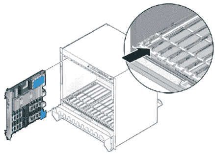

#### 背板/中板 (Backplane/Midplane)

背板为刀片机 enclosure 中的刀片服务器提供连接点。某些背板在两侧都构造有插槽，在这种情况下，它们位于 enclosure 的中间，被称为`中板 (midplanes)`。在其他情况下，服务器连接在的一侧，而电源和冷却可能连接在另一侧。这种布局如图 1.9 所示。标记为 3 的组件即为中板。

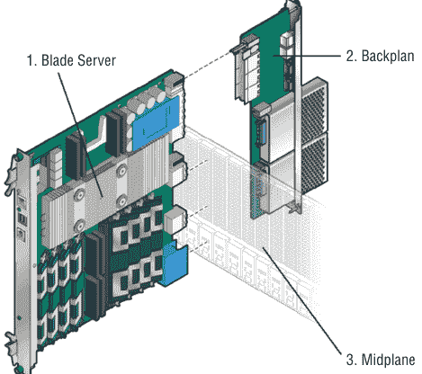

#### 电源插槽 (Power Supply Sockets)

中板或背板还为各种组件提供电源连接。当使用中板时，背面为电源模块提供连接。图 1.10 显示了 IBM 中板上的电源连接器。刀片电源连接器是刀片服务器获取电能的地方，而电源模块连接器则用于插入电源插槽的电缆。

##### 图 1.10 中板电源

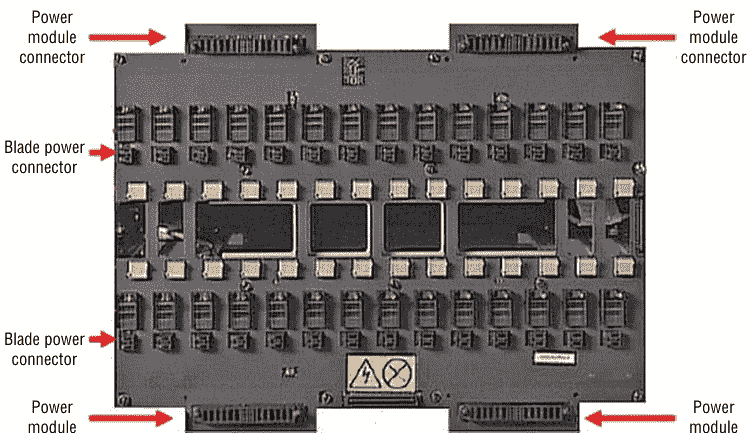

#### 网络模块/交换机 (Network Modules/Switches)

除了刀片服务器外，刀片机 enclosure 还可以接收几种类型的模块。为了给服务器提供网络连接，通常至少会有一个，可能有两个交换机模块。这种交换机模块通常是以太网，但并不绝对。

#### 管理模块 (Management Modules)

最后，会有一个管理模块，用于配置和管理整个刀片服务器 enclosure。这包括单个刀片服务器的 IP 地址以及连接和管理存储等事项。为了实现冗余，可能会有多个管理模块。管理模块的典型位置如图 1.11 所示。

##### 图 1.11 高级管理模块

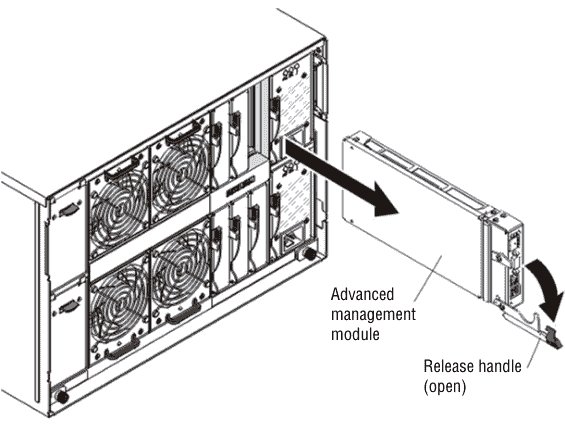

#### 刀片服务器 (Blade Server)

刀片服务器是独立的卡，每张卡都作为一个独立的物理服务器运行。这类服务器会有一定数量——例如 8 个、16 个或 24 个。任何未使用的刀片插槽都应安装刀片填充件 (blade filler)。图 1.12 展示了刀片服务器和刀片填充件的插入情况。

##### 图 1.12 插入刀片服务器和填充件

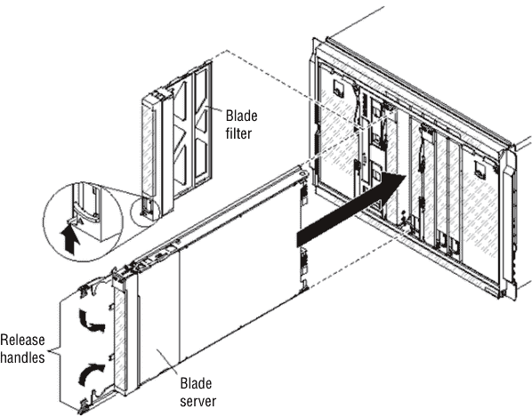

## 安装和配置服务器组件

正如 A+ 技术人员需要熟悉机箱内可能存在的所有组件以及如何安装、维护和修理这些组件一样，作为一名 Server+ 技术人员，你必须在服务器方面具备同样的知识。服务器拥有与工作站相同的组件，但由于其在网络中扮演的角色所带来的高工作负载，其组件必须更加强健。本节将探讨关键组件的服务器版本。

#### CPU

服务器中的中央处理单元 (CPU) 必须能够在处理高工作负载的同时不发生过热。在许多情况下，这需要同时使用多核处理器和多个 CPU。多核处理器是指拥有多个核心的处理器，每个核心都可以作为一个单独的 CPU 运行。在本节中，我们将研究服务器 CPU 使用的插槽类型、内存使用方式、你可能会遇到的可能架构，以及你可能会看到的各种速度值及其含义。我们还将介绍 CPU stepping (步进) 的概念。

#### 插槽类型 (Socket Type)

CPU 通过主板上的插槽与主板连接。最常见的插槽类型列在表 1.1 中。

##### 表 1.1 服务器插槽类型

| 插槽名称 | 支持的 CPU 系列 | 封装 | 引脚数 | 总线速度 |

| :--- | :--- | :--- | :--- | :--- |

| LGA 771/Socket J | Intel Xeon | LGA | 771 | 1600 MHz |

| LGA 1366/Socket B | Intel Core i7 (900 系列), Intel Xeon (35xx, 36xx, 55xx, 56xx 系列), Intel Celeron | LGA | 1366 | 4.8–6.4 GT/s (每秒千兆传输) |

| LGA 1248 | Intel Itanium 9300 系列 | LGA | 1248 | 4.8 GT/s |

| LGA 1567 | Intel Xeon 6500/7500 系列 | LGA | 1567 | 4.8–6.4 GT/s |

| LGA 2011/ Socket R | Intel Core i7 3xxx Sandy Bridge-E<br>Intel Core i7 4xxx Ivy Bridge-E<br>Intel Xeon E5 2xxx/4xxx [Sandy Bridge EP] (2/4S)<br>Intel Xeon E5-2xxx/4xxx v2 [Ivy Bridge EP] (2/4S) | LGA | 2011 | 4.8–6.4 GT/s |

| Socket F | AMD Opteron 13xs, 2200, 2300, 2400, 8200, 8300, 8400, AMD Athlon 64 FX | LGA | 1207 | 200 MHz |

| Socket 940 | Opteron 100, 200 和 800 | PGA-ZIF | 940 | 800 MHz |

| G34 | AMD Opteron 6000 | LGA | 1974 | 3.2 GHz |

| AM3+ | AMD Phenom II, Athlon 2, Sempron, Opteron 3xxx | PGA-ZIF | 942 | 3.2 GHz |

请注意表 1.1 中大多数处理器使用 land grid array (LGA) 封装。这类插槽的芯片上没有引脚。相反，它们具有裸露的镀金铜片，与插入插槽的 CPU 上凸出的引脚接触。然而，LGA 2011/ Socket R 使用的是 pin grid array (PGA) 的一个版本，这是一种替代设计，在这种设计中插槽拥有引脚，并在 CPU 放入插槽时将其插入 CPU。图 1.13 显示了 PGA (左侧) 和 LGA 插槽的对比。

##### 图 1.13 PGA 和 LGA

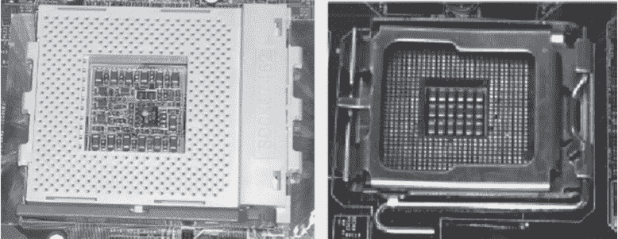

LGA 兼容插槽有一个覆盖在 CPU 上的盖子，由一个沿插槽两条边分布的 L 形臂锁定在原位。该手臂的非锁定腿在中间有一个弯曲，当手臂的另一条腿被固定时，可将盖子锁闭。

对于基于 PGA 概念的 CPU，使用零插入力 (ZIF) 插槽。ZIF 插槽在两条侧边之一使用塑料或金属杠杆来锁定或释放将 CPU 引脚固定在插槽中的机构。CPU 位于插槽的可移动顶层部分，而与 CPU 引脚配对的插槽触点则位于插槽的固定底层部分。

#### 缓存级别：L1, L2, L3

服务器中的 CPU 使用服务器中的系统内存，但与大多数工作站 CPU 一样，它们也包含自己的内存，称为缓存 (cache)。使用这种内存来存储最近获取的数据，使得 CPU 在需要再次使用该数据时能够快得多地检索。缓存内存可以位于多个位置，且每个实例用于不同的目的。

一级 (L1) 缓存保存等待进入 CPU 的数据。在现代系统中，L1 缓存集成在 CPU 中。二级 (L2) 缓存保存正在退出 CPU 并等待返回 RAM 的数据。在现代系统中，L2 缓存与 CPU 处于同一封装中，但位于一个单独的芯片上。在旧系统中，L2 缓存安装在主板上的一个单独电路板上，有时被称为 stick-on cache (COASt)。

在某些 CPU 上，L2 缓存的运行速度与 CPU 相同；而在其他 CPU 上，缓存速度仅为 CPU 速度的一半。具有全速 L2 缓存的芯片性能更好。一些较新的系统还具有 L3 缓存，它位于 CPU 晶圆 (die) 之外，但不一定在 CPU 封装之外。

缓存距离 CPU 的远近影响缓存的容量以及 CPU 访问该缓存中信息的速度。距离由近到远的顺序是 L1、L2 和 L3。距离 CPU 越近，缓存容量越小，但 CPU 访问该类型缓存的速度越快。

#### 速度

在测量 CPU 速度时，数值通常以兆赫兹 (MHz) 和吉赫兹 (GHz) 表示。有时你可能会看到它（如表 1.1 所示）以每秒千兆传输 (GT/s) 表示。当以 GT/s 表示时，要计算数据传输率，必须将传输率乘以总线宽度。

然而，在比较 CPU 时涉及两种速度：核心速度和总线速度。

- **核心 (Core)**：处理器可以有一个或多个核心。每个核心作为一个独立的 CPU 运行，且每个核心都有一个内部速度，即 CPU 执行其内部操作的最大速度，以 MHz 或 GHz 表示。


- **总线（Bus）**：总线速度是主板与 CPU 通信的速度。它由主板决定，其节奏由产生定期电脉冲的石英晶体（系统晶体）设定。

### 倍频（Multiplier）

内部速度可能与主板速度（外部速度或总线速度）相同，但更有可能是其倍数。例如，一个 CPU 的内部速度可能是 1.3 GHz，而外部速度为 133 MHz。这意味着系统晶振时钟每跳动一次，CPU 内部时钟就跳动 10 次。

### CPU 性能

CPU *时间*（time）是指 CPU 为操作系统或应用程序完成某项任务所花费的时间，以时钟 *滴答*（ticks）或秒为单位。CPU *占用率*（usage）是 CPU 执行工作的总能力。CPU 时间是占用率的一个子集，通常以百分比表示。

CPU 占用率值可用于评估服务器的整体工作负载。当 CPU 占用率较高（例如 70%）时，系统可能会出现减速或延迟。另一方面，特定应用程序或程序的 CPU 时间值则代表了归因于该应用程序的相对 CPU 占用量。

我们还可以根据系统中的哪个组件正在被服务以及在哪个安全域中进行来监控 CPU 占用率。CPU 运行主要有两个安全域：用户模式和内核模式。在用户模式下，它代表应用程序工作，不直接访问硬件。在内核模式下，它为操作系统工作，具有更多权限。

在监控 CPU 性能时，您会遇到以下常见指标及其含义：

- **用户时间（User Time）**：CPU 忙于在用户空间执行代码的时间。
- **系统时间（System Time）**：CPU 忙于在内核空间执行代码的时间。
- **空闲时间（Idle Time）**：CPU 不忙的时间；衡量未使用的 CPU 能力。
- **窃取时间（Steal Time，虚拟化硬件）**：操作系统想要执行但被虚拟化管理程序（hypervisor）禁止的时间，因为尚未轮到该 CPU 的时间片。

### CPU 步进（CPU Stepping）

当 CPU 经历修订时，这些修订被称为 *步进级别*（stepping levels）。当制造商投入资金进行步进时，意味着他们发现了逻辑中的 Bug 或对设计进行了改进，从而实现了更快的处理速度。集成电路有两种主要的 *掩模集*（mask sets，用于进行更改）：用于构建组成逻辑的结构（如晶体管）的 *基础层*（base layers），以及将逻辑连接在一起的 *金属层*（metal layers）。基础层的更新比金属层的更新更困难且更耗时。因此，您可以将金属层更新类比为软件版本控制。步进级别由一个字母后跟一个数字表示——例如 C-4。通常，字母表示芯片基础层的修订级别，数字表示金属层的修订级别。例如，处理器的第一个版本始终是 A-0。

### 架构（Architecture）

有些处理器一次处理 32 位信息，而有些则一次处理 64 位信息。处理 64 位信息效率更高，但这仅适用于支持该功能的处理器，并且需要与支持该功能的操作系统配合使用。64 位处理器可以支持 32 位和 64 位应用程序及操作系统，而 32 位处理器只能支持 32 位操作系统和应用程序。这就是我们在讨论 CPU *架构* 时所描述的内容。CPU 主要有三种架构。

**x86**：一次处理 32 位信息的处理器使用一种称为 x86 的架构。它的名称源自第一系列计算机 CPU（8086，仅为 16 位，以及 286、386 和 486）。

**x64**：一次处理 64 位信息的处理器使用一种称为 x64 的架构。它支持比其 32 位前代产品更大的虚拟内存和物理内存，允许程序在内存中存储更多的数据。

**ARM**：高级精简指令集计算机（ARM）是由英国公司 ARM Holdings 开发的一系列精简指令集计算（RISC）指令集架构。自最初开发以来，ARM 及其第三方伙伴都在此架构上开发了 CPU。它比 x86 或 x64 需要更少的资源。在这方面，ARM CPU 非常适合平板电脑、智能手机和其他小型设备。

在练习 1.1 中，您将更换服务器中的 CPU。

#### 练习 1.1：更换服务器中的 CPU

1. 关闭整个系统并切断电源。
2. 将服务器节点从系统中取出。（许多系统在机箱中设有多个服务器。要取出每个服务器，必须先移除机箱托盘。）
3. 取下服务器节点盖板（请遵循文档中包含的任何说明）。
4. 使用正确类型和尺寸的螺丝刀（通常是 2 号十字螺丝刀）松开固定散热器的螺丝（通常 4 个），然后将其从 CPU 上提起。（您的设备可能需要不同类型的螺丝刀。）
5. 解开第一个 CPU 固定锁扣，然后解开其余的所有锁扣（通常有两个）。
6. 打开铰接式 CPU 覆盖板。
7. 取出旧 CPU。
8. 插入新 CPU。
9. 安装散热器（不要忘记在 CPU 和散热器之间涂抹导热硅脂）。
10. 装回服务器节点盖板。
11. 重新安装服务器节点。
12. 接回电源线，然后开启系统电源。

### RAM（内存）

与任何计算设备一样，服务器需要内存，且服务器尤其需要大量内存。在本节中，我们将讨论服务器中使用的内存芯片类型，并描述区分它们的一些特性。

#### ECC 与 Non-ECC

当数据在 RAM 中移入和移出时，传输并不总是顺利的。内存芯片具有错误检测功能，在某些情况下还具有错误纠正功能。一种 RAM 错误纠正方式是错误检查和纠正码（ECC）。具有 ECC 的 RAM 可以检测并纠正错误。为了实现这一点，需要存储额外的信息并进行更多处理，这使得 ECC RAM 比 Non-ECC RAM 更昂贵且速度稍慢。

在 ECC 中，每当访问内存时，会对数据及其校验位执行一种算法。如果算法结果全部为零，则认为数据有效并继续处理。ECC 可以检测单位和双位错误，并能实际纠正单位错误。这现在是一种很少使用的奇偶校验 RAM 类型。如今大多数 RAM 都是 Non-ECC。

#### DDR2 与 DDR3

双倍数据率（DDR）是时钟倍增的 SDRAM（本节稍后介绍）。内存芯片可以在任何时钟周期的两个边沿（上升沿/开始和下降沿/结束）执行读写，从而使每秒的有效内存执行次数翻倍。因此，如果您使用 100 MHz 内存总线的 DDR SDRAM，内存将以 200 MHz 执行读写，并以 100 MHz 将数据传输到处理器。DDR 优于普通 SDRAM 的优势在于增加了吞吐量，从而提高了整体系统速度。

##### DDR2

下一代 DDR SDRAM 是 DDR2（双倍数据率 2）。它允许在每个上升沿和下降沿进行两次内存访问，有效地将 DDR 的速度翻倍。DDR2-667 芯片运行速度为 667 MHz，配套 PC2-5300 模块。

##### DDR3

DDR3 相比 DDR2 的主要优势是其数据传输速率是 DDR2 的两倍（为其内部内存阵列速度的八倍），从而实现了更高的带宽或峰值数据速率。通过在四倍时钟的每个周期执行两次传输，64 位宽的 DDR3 模块可实现高达内存时钟速度 64 倍的传输率，单位为兆字节每秒（MBps）。此外，DDR3 标准允许芯片容量高达 8 GB。选定的内存标准、速度和格式如表 1.2 所示。

**表 1.2** 选定内存详情

| 模块标准 | 速度 | 格式 |
|---|---|---|
| DDR-500 | 4000 MBps | PC4-000 |
| DDR-533 | 4266 MBps | PC4-200 |
| DDR2-667 | 5333 MBps | PC2-5300 |
| DDR2-750 | 6000 MBps | PC2-6000 |
| DDR2-800 | 6400 MBps | PC2-6400 |
| DDR3-800 | 6400 MBps | PC3-6400 |
| DDR3-1600 | 12,800 MBps | PC3-12800 |

#### 引脚数量

内存模块有引脚将其连接到所在的主板插槽。双在线内存模块（DIMM）有两排引脚，与主板的接触面积是原来的两倍，从而创建了更大的接口，导致其数据路径比旧的单在线内存模块（SIMM）更宽。DIMM 根据每个特定物理尺寸所使用的导体（或引脚）数量而有所不同。一些常见的例子包括 168 引脚（SDR RAM）、184 引脚（DDR, DDR2）和 240 引脚（DDR3）配置。

#### 静态与动态（Static vs. Dynamic）

RAM 可以是静态的（Static）或动态的（Dynamic）。动态 RAM 需要刷新信号，而静态 RAM 不需要。这使得静态 RAM 具有更好的性能。另一方面，一个静态 RAM 单元在芯片上所需的空间比动态 RAM 单元更多，导致芯片上的内存容量较低。因此，在提供相同数量的单元时，静态 RAM 更加昂贵。

总之，静态 RAM 更贵但更快，而动态 RAM 较慢但更便宜。然而，由于两者不同的优缺点，这两种类型经常被同时使用。静态 RAM 用于创建 CPU 对速度敏感的缓存，而动态 RAM 则构成更大的系统 RAM 空间。

#### 内存条安装

在 RAM 和内存控制器之间利用多通道可以提高这两个组件之间的传输速度。单通道 RAM 无法利用这一概念，但双通道内存可以，它能创建两个 64 位的数据通道。请不要将其与 DDR 混淆。DDR 是通过在每个时钟周期访问内存模块两次来使速率翻倍的。

使用双通道需要支持双通道的主板以及两个或更多内存模块。有时这些模块安装在不同的颜色编码插槽（bank）中，如图 1.14 所示，有时它们使用相同的颜色。请查阅您的文档。

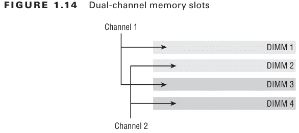

内存以组（bank）形式运行，每组由两个插槽组成。主板应通过颜色编码指示哪两个插槽位于同一组中。它可能是橙色和黄色，也可能是其他两种颜色的组合。安装内存时，请在同一组中安装相同大小的模块。否则，内存模块将无法以双通道模式运行，这将损害该组的性能。

#### CAS 延迟

另一个可用于区分内存模块的特性是其 CAS 延迟值。列地址选通（CAS）延迟是指访问内存模块并将其数据提供给模块引脚所需的时间。

CL 值越低越好。在异步 DRAM 中，延迟值以纳秒为单位衡量，且数值为常数；而在同步 DRAM 中，它以时钟周期衡量，并会根据时钟频率而变化。

#### 时序

内存时序衡量 RAM 的性能，由四个部分组成：

- **CAS 延迟（CAS Latency）**：如果正确的行已打开，访问地址列所需的时间
- **行地址到列地址延迟（Row Address to Column Address Delay）**：在没有活动行的情况下读取内存第一个位所需的时间
- **行预充电时间（Row Precharge Time）**：如果打开的是错误的行，访问地址列所需的时间
- **行激活时间（Row Active Time）**：内部刷新一行所需的时间

内存时序以时钟周期为单位列出；因此，在将这些值转换为时间时，请记住对于 DDR 内存，这将是传输速率的一半速度。同样值得注意的是，内存时序仅是性能图谱的一部分。内存带宽是内存的吞吐量。虽然带宽技术的进步（DDR2, DDR3）可能会对时序产生的延迟产生负面影响，但 DDR2 和 DDR3 可以运行在更高的时钟频率上，从而带来净性能提升。

#### 内存配对

每块主板支持的内存取决于前端总线（FSB）的速度和内存的外形尺寸。如果您安装的内存额定速度低于 FSB，那么内存将以该较低速度运行（如果它能工作的话）。大多数主板制造商会在其文档中列出它们支持的内存类型以及最高速度和要求的配对方式。

关于添加和升级内存，可以在安装了低速内存的服务器中添加高速内存，但系统将仅以当前存在的最慢模块的速度运行。

此外，虽然您可以混用速度，但不能混用内存类型。例如，您不能将 SDRAM 与 DDR 混用，DDR 也不能与 DDR2 混用。观察内存名称时，数字越大，速度越快。例如，DDR2-800 比 DDR2-533 快。

最后，内存配对还指在双通道内存架构中安装匹配的 RAM 对。

## 总线类型、总线通道和扩展槽

主板提供了所有组件附加的平台，并提供了称为总线（busses）的通信路径。总线是计算机系统中相关设备进行通信的通用信号路径集合。扩展总线在总线的某些点包含插槽，以允许插入外部设备。在本节中，我们将研究常见的服务器总线类型及其特性。

### 高度差异和比特率差异

总线类型的两个主要区分特性是它们的比特率以及插槽及其匹配适配器的外形尺寸。服务器中主导的总线类型是外设组件互连（PCI）扩展总线的各种形式。在接下来的章节中，将涵盖三种主要的 PCI 总线类型，并重点关注外形尺寸和比特率。

### PCI

外设组件互连（PCI）总线是一种 33 MHz 宽（32 位或 64 位）的扩展总线，曾是通用扩展设备主板上的现代标准。其插槽通常为白色。您可能会看到两个 PCI 插槽，但大多数主板已转向更新的标准。图 1.15 显示了一些 PCI 插槽。

**图 1.15** PCI 插槽

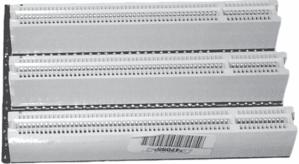

32 位 33 MHz 的 PCI 卡运行速度最高可达 133 MBps，而 32 位 64 MHz 的卡最高可达 266 MBps。64 位 33 MHz 的 PCI 卡最高可达 266 MBps，而 64 位 66 MHz 的卡最高可达 533 MBps。

### PCI-X

PCI-eXtended（PCI-X）是 32 位 PCI 本地总线的双宽版本。它的运行速度最高可达时钟频率的四倍，从而实现了更高的带宽，但在其他方面它使用相同的协议和类似的电气实现。它已被 PCI Express（见下一节）取代，后者使用了不同的连接器和不同的逻辑设计。此外还有一个 64 位 PCI 规范，它在电气上有所不同，但与 PCI-X 具有相同的连接器。PCI-X 有两个版本：版本 1 最高可达 1.06 GBps，版本 2 最高可达 4.26 GBps。

### PCIe

PCI Express（PCIE, PCI-E 或 PCIe）使用一组高速运行的串行互连网络。它是基于 PCI 系统的；您可以使用适配器插件卡将 PCIe 插槽转换为 PCI，但不能将 PCI 插槽转换为 PCIe。PCIe 旨在取代高级图形端口（AGP 是图形处理的过渡方案）和 PCI，它能够在保持 PCI 灵活性的同时，比 AGP 更快。PCIe 有四个版本：版本 1 最高 8 GBps，版本 2 最高 16 GBps，版本 3 最高 32 GBps，而在撰写本文时，版本 4 的最终规范仍在制定中。图 1.16 显示了本节讨论的插槽。表 1.3 列出了每种插槽的速度。所示的 PCIe 速度是每通道（per lane）的速度。因此，4 通道的 PCIe 2 版本将以 20 GBps 运行。

**图 1.16** PCI 插槽类型比较

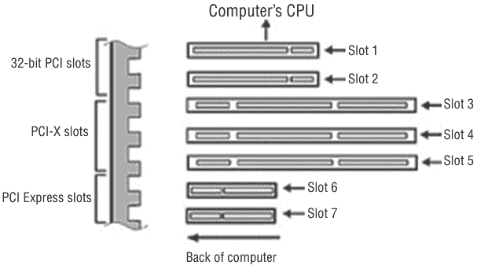

**表 1.3** PCI 和 PCIe 插槽速度

| 类型 | 数据传输率 |
|---|---|
| PCI 33, 32-bit | 133 MBps |
| PCI 33, 64-bit | 266 MBps |
| PCI 66, 32-bit | 266 MBps |
| PCI 66, 64-bit | 533 MBps |
| PCIe version 1 | 2 GBps |
| PCIe version 2 | 5 GBps |
| PCIe version 3 | 8 GBps |
| PCIe version 4 | 16 GBps |

## NICs（网卡）

网络适配器（网卡）的功能正如其名：它们为服务器提供连接到网络的连接。通常，网络接口卡（NICs）通过扩展槽添加或集成在主板中，但也可以通过 USB 添加。阻碍网络连接最常见的问题是跳线损坏或未插好。

网络卡针对各种访问方法（以太网、令牌环）和各种介质类型（光纤、铜缆、无线）连接而设计。您使用的网络卡必须同时支持所采用的访问方法和介质类型。

网络卡最明显的区别在于其能够达到的速度。如今大多数网络运行在 100 Mbps 或 1 Gbps。无论其他组件如何，服务器将以最慢组件的速度运行，因此如果网卡支持 1 Gbps 但电缆仅支持 100 MBps，服务器将仅以 100 Mbps 传输。

另一个需要注意的重要特性是网卡的自动感知（auto-sensing）能力。此功能允许网卡感知连接是否支持全双工，并在此模式下运行而无需任何操作。

还有另一种类型的自动感知，即网卡能够检测另一端是什么类型的设备，并相应地改变线对的使用方式。例如，通常一台 PC 连接到另一台 PC 需要交叉线，但如果两端都能进行这种感知，则不需要交叉线。这类网卡被称为 auto-MDIX。

在今天的服务器中，您最可能会看到 10 Gb 网卡，甚至可能会看到 40 Gb 或 100 Gb 网卡。此外，许多服务器连接到存储网络，可能会运行融合网络适配器（CNAs），它既充当存储区域网络（SAN）的主机总线适配器（HBA），又充当服务器的网络卡。这一概念如图 1.17 所示。在图中，FC 代表光纤通道（Fiber Channel），NC 代表网络卡（Network Card）。

**图 1.17** 传统模式与 CNA 模式

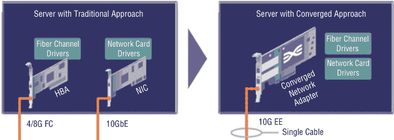

### 硬盘驱动器

服务器可以包含三种不同类型的硬盘架构。在本节中，我们将分别探讨每种类型。

#### 磁性硬盘（Magnetic Hard Drives）

磁性驱动器曾是最主要的硬盘类型。驱动器本身是一个机械设备，它旋转若干个盘片，并使用磁头在盘片表面读写数据。固态驱动器（在下一节中讨论）的优势之一就是没有可能发生故障的机械部件。磁性硬盘的组成部分如图 1.18 所示。

##### 图 1.18 磁性硬盘

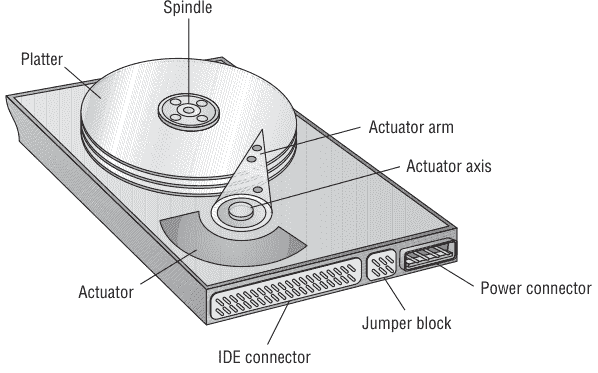


硬盘的基本几何结构由三个组件组成：每个磁道包含的扇区数、磁盘组件中的读/写头数以及组件中的柱面数。这组数值被称为 CHS（代表柱面/磁头/扇区）。柱面是指在组件所有可写表面上具有相同编号的磁道集合。之所以被称为“柱面”，是因为当将硬盘组件所有可写表面上所有相同编号的磁道垂直连接在一起时，看起来像一个几何圆柱体。因此，例如在一个包含三个盘片的组件中，1 号柱面由六个磁道组成（每个盘片的每面各一个），且每个磁道在其相应的表面上都被标记为 1 号磁道。图 1.19 展示了本讨论中提到的关键术语。

#### 图 1.19 CHS

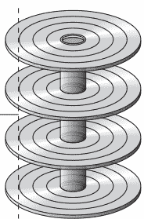

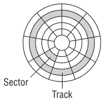

#### 5400 rpm

磁盘或盘片的旋转速度直接影响驱动器定位特定磁盘扇区的速度。这种定位延迟被称为延迟（latency），以毫秒（ms）为单位衡量。旋转速度越快，延迟越小。运行速度为 5400 rpm 的驱动器大约会有 5.5 ms 的此类延迟。

#### 7200 rpm

运行速度为 7200 rpm 的驱动器延迟约为 4.2 ms。截至 2015 年，典型的 7200 rpm 桌面硬盘的持续数据传输率最高可达 750 Mbps。该速率取决于磁道位置，因此外圈磁道的数据传输率较高，而内圈磁道则较低。

#### 10,000 rpm

在 10,000 rpm 时，延迟将降低至约 3 ms。数据传输率（约 1.5 Gb）通常也随旋转速度的提高而增加，但受磁盘密度（给定区域内的磁道和扇区数量）的影响。

#### 15,000 rpm

运行速度为 15,000 rpm 的驱动器属于高端驱动器，延迟仅为 2 ms。其运行速度略低于 2 Gb。这些驱动器产生的热量更多，因此机箱需要更强的冷却措施。在相同面密度（面密度是指在给定空间内可存储的比特量）的情况下，它们还能提供更快的数据传输率。

#### 热插拔驱动器

如果在不关闭服务器的情况下可以将驱动器连接到服务器，那么它就是热插拔驱动器。支持热插拔的驱动器类型包括 USB、FireWire、SATA 以及通过以太网连接的驱动器。您应始终检查文档以确保您的驱动器支持此功能。

#### 固态驱动器

固态驱动器（SSD）将数据保存在非易失性内存芯片中，不含运动部件。与机电硬盘驱动器（HDD）相比，SSD 通常不易受物理冲击影响，运行安静，访问时间和延迟更低，但每 GB 的成本更高。

#### 混合驱动器

混合驱动器是将固态和传统机械驱动器两种技术相结合的驱动器。这样做是为了在利用固态驱动器速度的同时，保持机械驱动器的成本效益。

这主要有两种实现方式：双驱动混合和固态混合。双驱动系统在同一台机器中包含两种类型的驱动器，用户通过将更频繁使用的信息放在固态驱动器上，而将较少访问的数据放在机械驱动器上，或者在某些情况下由操作系统使用两种驱动器的空间创建混合卷，从而优化性能。

另一方面，固态混合驱动器（SSHD）是一个单一的存储设备，它在传统硬盘中包含固态闪存。与机器性能最相关的数据存储在闪存中，从而提高性能。图 1.20 显示了混合驱动器的两种方案。在图中，mSATA 指的是 SATA 驱动器的一种较小形态，而 NAND 磁盘是指一种以 NAND 逻辑门命名的闪存类型。

#### 图 1.20 混合方案

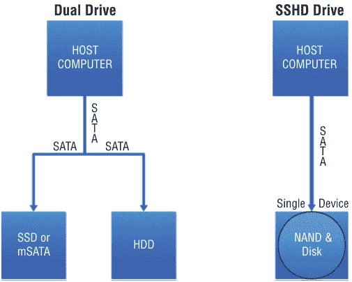

### 扩展卡（Riser Cards）

扩展卡允许您向系统添加扩展卡。您可能已经熟悉它们在低剖面机箱中的应用，在这种机箱中，机箱高度不允许全高扩展卡垂直放置。它们还用于机架式和刀片服务器，允许您以水平位置（而非标准垂直位置）添加功能卡。

通常，1U 系统使用 1U 单槽扩展卡，而 2U 系统使用 2U 三槽扩展卡。图 1.21 显示了机架服务器中扩展卡的示例。

#### 图 1.21 机架服务器中的扩展卡

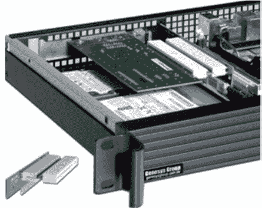

### RAID 控制器

独立磁盘冗余阵列（RAID）是一种多磁盘技术，旨在提高性能，或者通过简单地更换故障驱动器来实现从故障硬盘中自动恢复数据。RAID 有多种类型，可提供不同程度的性能提升和/或容错能力。所有这些技术都涉及两个或更多硬盘以某种方式共同工作。

RAID 可以通过软件或硬件实现。最高级别的保护是通过使用硬件 RAID 提供的，这要求系统具有 RAID 控制器。该硬件设备用于管理存储阵列中的磁盘，使其作为一个逻辑单元工作。这是一块插入 PCI Express 插槽的卡，阵列中的驱动器连接到该卡上。此概念如图 1.22 所示。

#### 图 1.22 RAID 控制器

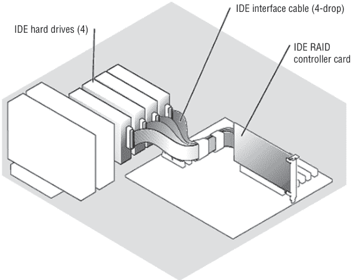

### BIOS/UEFI

服务器还包含固件，即使在没有操作系统的状态下也能为设备提供低级指令。这种固件被称为基本输入输出系统（BIOS）或统一可扩展固件接口（UEFI），其中包含可操作的设置和用于监控设备的诊断实用程序。

UEFI 是一种旨在取代 BIOS 的服务器和 PC 标准固件接口。UEFI 固件的一些优点包括：

- 更强的安全性；保护启动前过程
- 更快的启动时间以及从休眠中恢复的时间
- 支持大于 2.2 TB（太字节）的驱动器
- 支持 64 位固件设备驱动程序
- 能够在 UEFI 硬件上使用 BIOS 的能力

在启动时，BIOS 或 UEFI 将尝试检测其可用的设备和组件。它收集的信息以及组件的当前状态可在 BIOS 设置中查看。本节涵盖了部分组件以及关于这些设备和组件的可获取信息类型。

您可以通过 CMOS 设置程序查看并调整服务器的基础设置，在启动时按下特定键（如 F1 或 Delete，取决于系统）即可进入。互补金属氧化物半导体（CMOS）是指为 BIOS 设置（也称为 BIOS 设置程序）提供电力的电池类型。您在 CMOS 中可以调整的最常见设置包括端口设置（并行、串行、USB）、驱动器类型、启动顺序、日期和时间以及病毒/安全防护。通过 CMOS 设置程序进行的变量设置存储在非易失性随机访问存储器（NVRAM）中，而不可更改的基础指令（BIOS）则存储在 EEPROM（电可擦除可编程只读存储器）芯片上。

#### CMOS 电池

CMOS 芯片必须有恒定的电源才能保持其设置。为了防止数据丢失，主板制造商包含了一块小电池来为 CMOS 内存供电。在现代系统中，这是一个纽扣电池，直径和厚度大约相当于一枚美国十美分硬币。图 1.23 显示了其中一个示例。

#### 图 1.23 服务器中的 CMOS 电池

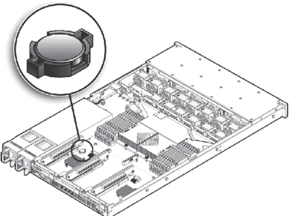

当服务器在关机时无法保持正确的日期或时间，这通常是 CMOS 电池问题，也是电池即将耗尽的预警。在服务器没有从时间服务器（如网络时间协议（NTP）服务器）接收日期和时间更新的情况下，CMOS 中保存的时间就是计算机的时间源。

#### 固件

固件是指存储在非易失性存储设备（如 ROM、EPROM 或闪存）中的任何类型的服务器指令。BIOS 和 UEFI 代码是固件最常见的例子。计算机 BIOS 不会“损坏”，它们只会过时或包含 Bug。如果是 Bug 的情况，通过升级可以解决问题。此外，当 BIOS 不支持你想安装的某些组件（例如更大的硬盘或不同类型的处理器）时，也需要进行升级。

如今大多数 BIOS 都被写入 EEPROM 芯片中，并可以通过软件进行更新。每个制造商都有自己的实现方法，请查阅文档了解完整详情。无论具体步骤如何，这个过程都被称为 `flashing`（闪存/刷写）BIOS。这意味着旧的指令从 EEPROM 芯片中被擦除，新的指令被写入芯片。

固件可以使用主板供应商提供的更新实用程序进行更新。在许多情况下，步骤如下：

1. 将更新文件下载到闪存盘。
2. 插入闪存盘并重启机器。
3. 使用指定的按键序列进入 CMOS 设置。
4. 如有必要，禁用安全启动（`Secure Boot`）。
5. 保存更改并再次重启。
6. 重新进入 CMOS 设置。
7. 选择启动选项，然后从闪存盘启动。
8. 按照更新随附的具体指南在闪存盘中定位升级文件。
9. 执行该文件（通常通过输入 `flash`）。
10. 在更新完成期间，确保设备持续供电。

### USB 接口/端口

与其他计算设备一样，服务器通常会配备 USB 端口。通常至少有两个，分别用于鼠标和键盘（不过当服务器采用机架式或刀片式部署时，你可能会为此使用 KVM 切换器）。这些端口通常位于服务器正面，不过服务器背面可能还设有额外的端口。

一些专门的服务器产品能够作为 USB 服务器运行，允许网络设备访问连接到服务器的共享 USB 设备。这通常需要某种 USB 管理软件。在这种情况下，如果服务器提供的端口不足，可能需要使用连接到服务器其中一个 USB 端口的 USB 集线器（`hub`）。

### 热可插拔组件

热可插拔组件是指无需关闭服务器即可更换的组件。这是一个非常理想的特性，因为对于许多服务器角色而言，应尽可能减少服务器的停机时间。然而，仅仅因为一个组件是热可插拔的，并不意味着在更换该组件之前不需要进行一些管理工作。

例如，要更换一个热可插拔硬盘，在大多数情况下，你必须防止任何应用程序访问该硬盘并移除逻辑软件链接。此外，在很多情况下，如果该硬盘提供操作系统且操作系统未在另一块硬盘上镜像，则无法进行热插拔。如果硬盘无法从服务器模块的在线操作中进行逻辑隔离，也无法实现热插拔。尽管如此，这仍然是一个极佳的功能。在一些高端服务器中，甚至可以热插拔内存和 CPU。

## 维持电源与冷却需求

任何类型的计算设备（包括服务器）都需要一定的电力水平以及足够凉爽的环境，以防止设备过热。在本节中，我们将讨论电力和冷却的需求，以及你应该注意的相关问题。

### 电源

在讨论电源时，定义一些相关的术语会很有帮助。在本节中我们将完成定义，并探讨功耗和电源冗余。最后，我们将研究在企业环境中处理服务器时可能会遇到的电源插头类型。

#### 电压

在讨论电源时，经常被提及且容易混淆的两个术语是电压（Voltage）和电流（Amperage）。电压是电力的压力或力量，而电流是电力的量。两者共同描述了供应的功率（Wattage）。设备所需的瓦数等于电流乘以电压。

电流乘以电压得出功率（瓦特），这是衡量电力每秒所做功的指标。

服务器中自带的电源（实际上所有计算机都是如此）必须设置为能够接收其连接的电源插座所提供的电压。这种电压是标准化的，但不同国家的标准不同。现在几乎所有的 IT 电源都具备自动感应和通用电压能力（100-250 V），以便同一产品能在全球范围内运行。对于不具备此功能的电源，其机壳外部会提供一个开关，允许你更改电源预期的电力类型，如图 1.24 所示。

#### 图 1.24 电压开关

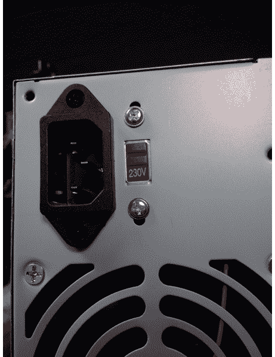

#### 单相电 vs. 三相电

电力传输系统有两种类型：单相电和三相电。单相电是指两线交流电（`AC`）电路。通常有一根火线和一根零线。在美国，120V 是标准单相电压，包含一根 120V 火线和一根零线。在一些国家，230V 是标准单相电压，包含一根 230V 火线和一根零线。电力在火线（通过负载）和零线之间流动。

三相电是指三线交流电电路。通常有三根火线（A 相、B 相、C 相，彼此之间相位相差 120 度）和一根零线。例如，一个三相四线 208V/120V 电路可提供三个 120V 单相电电路和一个 208V 三相电电路。在数据中心安装三相电系统有助于将配电集中在一处，从而降低安装多个配电单元的相关成本。

大多数家庭使用的是单相电，而三相电则更多见于工业环境。

#### 110V vs. 220V vs. 48V

虽然世界部分地区使用 110V，而其他地区使用 220V，但这两种系统各有优劣。虽然 220V 效率更高，因为传输损耗较小（且可以使用额定电流较低的导线），但如果有人触电，110V 相对更安全。一些数据中心向机架提供 220V 电源，然后根据需要使用变压器将其降压至 110V 供给设备。

某些设备还被设计为使用 -48V 直流（`DC`）电源，而非 110/220V 交流电。48V 是中心局端和许多数据中心常用的供电方案。许多电信公司可以向设施提供 48V 直流电，且目前许多公司正如此操作。使用它的优势在于发热量。设备内部不再需要 AC/DC 转换，而仅需 DC/DC 转换。发热量较低意味着可以使用更少（更小）的 HVAC（暖通空调）设备。不过，你需要一个整流器，这是一个接收 48V 电源并将其转换为 -48V 的小型设备。

#### 120/208V vs. 277/480V

前面你已经了解到系统可以是单相或三相的。大多数商业系统使用两种三相版本之一。第一种是我们之前提到的 120/208V。回顾一下，该电路提供三个 120V 单相电电路和一个 208V 三相电电路。

277/480V 电路提供两个 277V 单相电电路和一个 480V 三相电电路。直接从 480/277V 配电电路运行的服务器电源可以通过降低基础设施和运营成本，来降低高性能集群的总拥有成本（`TCO`）。权衡之处在于，277/480V 系统本身更危险。

#### 瓦数（Wattage）

前面你已经了解到电压是电力的压力或力量，而电流是电力的量。两者共同描述了供应的功率。电流乘以电压得出功率（瓦特），这是衡量电力每秒所做功的指标。

每秒钟消耗的电量。电源必须能够提供服务器及其所有附加且依赖该电源供电的设备的功率需求。

#### 功耗

不同服务器的总功耗各异。不过，多年来的一些研究可以让你大致了解服务器及其部分组件的功耗情况。以下内容可作为规划的粗略指南：

- 1U 机架式 x86：300 W–350 W
- 2U 机架式，双路 x86：350 W–400 W
- 4U 机架式，四路 x86：平均 600 W，重型配置可达 1000 W
- 刀片服务器：机箱平均功耗 4500 W；除以每个机箱的刀片数量（例如：每机箱 14 个，则每台刀片服务器约为 320 W）

请记住，这些仅是服务器本身的数值。在数据中心中，冷却和其他需求会消耗大量额外电能。一个名为电源使用效率（PUE）的数值被用来衡量数据中心的效率。它是一个描述整个数据中心消耗的电量与仅服务器消耗的电量之间关系的数值。例如，数值为 3 意味着数据中心需要的电量是服务器所需电量的三倍。数值越低越好。虽然情况在不断变化，但一般的经验法则是 PUE 通常为 2.0，这意味着数据中心需要的电量是服务器所需电量的两倍。

#### 冗余

数据中心通常部署冗余电源以维持持续供电。冗余可以通过多种方式实现：

- 并行冗余或 N+1 方案描述了一种架构，其中始终有一个额外的 UPS 可用（即 +1），而 N 则表示数据中心所需的 UPS 总数。由于系统运行在两路馈电中且仅有一个冗余 UPS，该系统仍可能遭受故障影响。
- 2N 冗余意味着数据中心提供其所需电量的两倍。这确保了系统具有完全的冗余性。

冗余还指在设备上使用冗余电源。许多服务器配备两个电源，你也可以购买额外的电源。始终确保你购买的电源能够满足服务器的所有需求。正如你在之前的“功耗”章节中所见，许多 4U 机架式服务器和刀片服务器功耗很高。

#### 插头类型

在服务器中，你会遇到几种类型的电源插头。让我们逐一查看。

##### NEMA

符合美国国家电气制造商协会（NEMA）标准的电源插头被称为 NEMA 插头。这类插头有许多类型，它们在插脚方向和形状上有所不同。NEMA 设备的两个基本分类是直插式（straight-blade）和锁定式（locking）。

##### Edison

`Edison plug`（爱迪生插头）是指我们都熟悉的标准三脚接地或两脚非接地插头。两者均如图 1.25 所示。请记住，插头的形状可能会有所不同。

#### 图 1.25 爱迪生插头

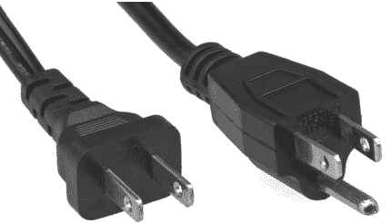

##### Twist Lock（扭锁式）

扭锁连接器是指由任何公司制造的 NEMA 锁定连接器，尽管 “Twist-Lock” 仍然是 Hubbell Inc. 的注册商标。该术语被泛指为使用弧形插脚的锁定连接器。插头被推入插座并旋转，使旋转后的插脚锁定。

图 1.26 显示了一个用于 6000 W 电源的此类连接器示例。

#### 图 1.26 锁定插头


### 冷却

当所有电源考量都得到满足后，你应该将注意力转向确保服务器不会过热。服务器中的 CPU 会产生大量热量，这些热量需要被处理。在本节中，我们将探讨服务器机房或数据中心中的热源，以及用于控制这些热量的方法，以免导致重启（或更严重的问题）。

#### 气流

无论是服务器内部还是整个服务器机房或数据中心，必须维持气流，并尽可能消除任何阻碍气流的障碍物。在服务器机箱内部，如果你添加任何风扇，请避免犯以下常见错误：

- 将进风口和出风口紧挨着放置在机箱的同一侧，这会导致排出的热空气重新流回机箱，降低整体冷却性能
- 在气流路径上安装面板和组件，例如显卡、主板和硬盘

你还必须考虑服务器机架周围的气流，在某些情况下，还要考虑大型数据中心中机架行周围的气流。我们将在本章后面的“挡风板/导风罩”部分讨论一些相关方法。

#### 散热

电子设备会产生热量，且必须将其散发出去。有多种技术可以实现这一点。散热片（Heatsinks）是你可能已经熟悉的一种方法。虽然散热片可以将热量从 CPU 或主板中抽出，但我们仍需将热量移出机箱，而这是通过风扇实现的。最后，我们需要将所有服务器聚集的热量移出服务器机房，或者至少在房间内创造一种气流，防止热空气重新进入设备。

实现这一点的方法之一是采用冷热通道布局。冷热通道配置的目标是通过管理气流来节约能源并降低冷却成本。它涉及将服务器机架交替排列成行，冷空气进风口面向一边，热空气出风口面向另一边。冷通道面对空调输出风管，热通道面对空调回风管。该布置如图 1.27 所示。

#### 图 1.27 冷热通道配置


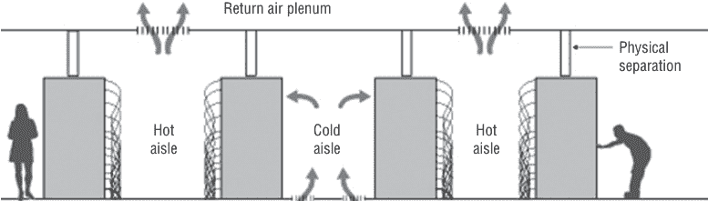

#### 挡风板/导风罩

另一种在机箱内部和服务器机房中使用的技术是部署挡风板（`baffles`）或导风罩（`shrouds`）来引导和改变气流方向。在机箱内部，它们用于将空气引导至所需方向。例如，在图 1.28 中，它们用于将空气引导至可能会阻塞所需气流的组件上方。

**图 1.28 挡风板**

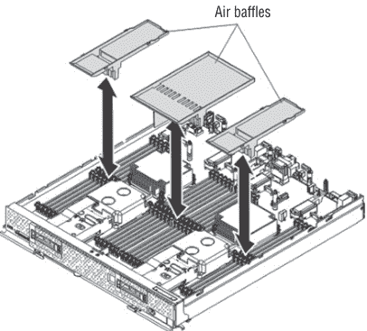

在服务器机房或数据中心中，也可以部署挡风板以引导气流。在这里，它们通常用于覆盖开放的机架槽位，在某些情况下，它们也被用于防静电地板下方以封闭那里的孔洞。封闭这些孔洞可以改善气流。你可能学过，塔式计算机背面的开放槽位应该用挡板封闭。该建议的原因相同：为了改善气流。

##### 风扇

风扇被用于服务器机箱内部的多个位置。散热片顶部可能有一个风扇，用于辅助散热片将热量从 CPU 中移出。此外，至少还会有一个（如果不是两个的话）机箱风扇用于将热空气移出机箱。

在服务器机房和数据中心中，放置服务器的机架可能也会有多个风扇将空气从机架中抽出。图 1.29 显示了一个机架系统背面的风扇示例。在这种情况下，风扇位于一个外部单元中，该单元可以购买并安装在没有风扇或风扇不足的机架背面。

**图 1.29** 机架风扇

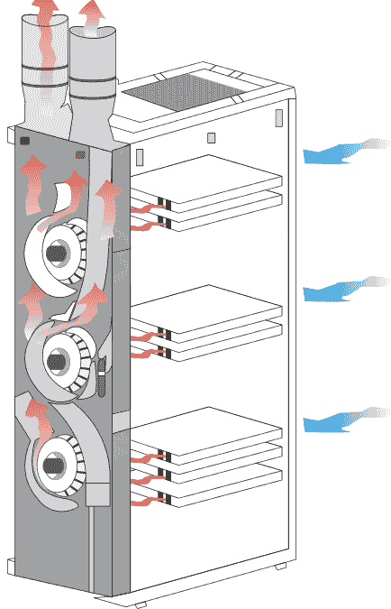

#### 液冷

在被动散热不足的情况下，可以在机箱内部部署液冷。在大型数据中心中，液冷可以从机箱外部输送到需要冷却的芯片。在这种方式下，每台服务器从主源接收冷却水，所有服务器加热后的水返回到中心位置，然后该过程循环往复。图 1.30 显示了一台以这种方式接收液冷散热的服务器。

**图 1.30** 液冷

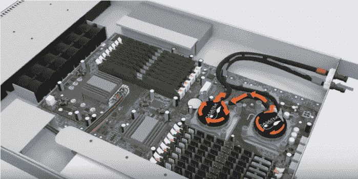

## 总结

在本章中，我们涵盖了服务器中的硬件知识，包括考试目标 1 中的相关主题。这包括对塔式、机架式和刀片服务器等外形尺寸（`form factors`）的讨论。我们还讨论了如何配置和维护服务器组件，如 CPU、内存、网卡（NIC）、硬盘、转接卡（`riser cards`）和 RAID 控制器。在本章末尾，我们探讨了满足服务器以及服务器所在的机房和数据中心对电源和冷却要求的方法。

## 考试要点

**区分服务器的外形尺寸。** 这些包括塔式服务器；1U、2U、3U 和 4U 机架式服务器；以及刀片服务器。机架服务器表示法中的 U 指的是服务器在机架中所占用的单位数量。

**描述服务器内部的组件。** 在服务器机箱内部，你会发现所有在工作站中可能看到的相同组件，但它们会更加健壮，且数量可能更多。这些组件包括 CPU、内存、网卡、硬盘、转接卡和 RAID 控制器。

**理解服务器的电源要求。**

服务器的功耗需求从 350 W（对于 1U 机架式服务器）到 4500 W（对于包含 14 片刀片的机箱）不等。

**识别并缓解冷却问题。**

解释如何利用机箱内部的散热片、风扇和挡风板（`baffles`）来消除服务器产生的热量。在服务器机房或数据中心，了解如何部署挡风板和冷热通道以将热量从房间中移走。

## 复习题

你可以在附录中找到答案。

1. 哪个术语是指服务器的大小、外观或尺寸？
- A. 外形尺寸 (Form factor)
- B. 占用空间 (Footprint)
- C. 物理参考 (Physical reference)
- D. U 测量 (U measure)

2. 以下哪项用于使机架式服务器的维护更加便捷？
- A. KVM
- B. 导轨套件 (Rail kits)
- C. 挡风板 (Baffles)
- D. 机架槽位 (Rack slot)

3. 机架中的每个 U 有多大？
- A. 19 英寸
- B. 4.445 英寸
- C. 1.75 英寸
- D. 取决于机架

4. 哪种技术由一个服务器机箱组成，其中装有多个薄的模块化电路板，每块电路板都充当一台服务器？
- A. 机架式服务器
- B. 塔式服务器
- C. KVM
- D. 刀片技术

5. 哪种类型的 CPU 缓存存储等待进入 CPU 的数据？
- A. L1
- B. L2
- C. L3
- D. L4

6. 哪个术语描述了 CPU 内部速度与系统总线速度之间的关系？
- A. CPU 时间
- B. 倍频 (Multiplier)
- C. 差值 (Differential)
- D. 系数 (Coefficient)

7. 哪个术语描述了 CPU 在内核模式下执行的时间？
- A. 用户时间 (User time)
- B. 窃取时间 (Steal time)
- C. 系统时间 (System time)
- D. 空闲时间 (Idle time)

8. CPU 的修订版本称作什么？
- A. 服务包 (Service packs)
- B. 热修复 (Hot fixes)
- C. 基础层 (Base layers)
- D. 步进级别 (Stepping levels)

9. 哪种 CPU 架构是为平板电脑设计的？
- A. ARM
- B. x86
- C. x64
- D. LGA

10. DDR3 内存的速度是 DDR2 的 _______。
- A. 三倍
- B. 两倍
- C. 一半
- D. 三分之一

判断正误：DDR 通过在每个时钟周期访问两次内存模块来将速率翻倍。

11. 关于双通道内存，哪项陈述是正确的？
- A. 在同一个内存库中安装不同容量的模块将导致模块以单通道模式运行。
- B. 在同一个内存库中安装不同容量的模块将导致模块以双通道模式运行。
- C. 在同一个内存库中安装相同容量的模块将导致模块以单通道模式运行。
- D. 在同一个内存库中安装不同容量的模块将提高该内存库的性能。

12. 如果正确的行已经打开，访问内存地址列的时间是以下哪项？
- A. CAS 延迟 (CAS Latency)
- B. 行地址到列地址延迟 (Row Address to Column Address Delay)
- C. 行预充电时间 (Row Precharge Time)
- D. 行激活时间 (Row Active Time)

14. 安装内存时，以下哪些可以混用？选择两项。
- A. 不同速度
- B. 不同类型
- C. 不同外形尺寸
- D. 不同制造商

15. 以下哪项是 32 位 PCI 本地总线的双倍宽度版本？
- A. PCI
- B. PCI-X
- C. PCIe
- D. PCI/2

16. 哪种类型的网卡能检测另一端设备的类型并相应地更改线对的使用方式？
- A. Auto-MDIX
- B. 全双工 (Full-duplex)
- C. 融合网卡 (Converged)
- D. HBA

17. 哪种类型的网卡既能作为 SAN 的主机总线适配器 (HBA)，又能作为服务器的网络卡？
- A. Auto-MDIX
- B. 全双工 (Full-duplex)
- C. 融合网卡 (Converged)
- D. HBA

18. 混合硬盘的两种实现方式是什么？
- A. 双驱动器 (Dual-drive)
- B. 单驱动器 (Single-drive)
- C. 固态 (Solid-state)
- D. 双状态 (Dual-state)

19. 2U 系统的高度是多少？
- A. 1.75"
- B. 3.5"
- C. 5.25"
- D. 7"

20. 关于 UEFI，哪项陈述是错误的？
- A. 它保护预启动过程。
- B. 它的启动时间比 BIOS 慢。
- C. 它支持 64 位固件设备驱动程序。
- D. 它支持大于 2.2 terabytes (TB) 的驱动器。


# 第 2 章：安装与配置服务器

### 本章涵盖的 COMPTIA SERVER+ 考试目标：

- ✓ 2.1 安装和配置服务器操作系统。
  - 确定服务器角色/用途。
  - 更新固件。
  - BIOS/UEFI 配置（启动顺序）。
  - 磁盘准备（RAID 设置、分区、格式化、文件系统类型 [ext 2, 3, 4, NTFS, FAT32, ReiserFS, UFS, VMFS, ZFS, Swap]）。
  - 配置主机名。
  - 本地账户设置。
  - 连接网络。
  - 加入域/目录。
  - 处理安全问题（补丁更新、操作系统加固、遵守公司流程/标准）。
  - 启用服务。
  - 安装功能/角色/应用程序/驱动程序。
  - 性能基准（服务器优化、交换文件或页面文件优化）。
  - 无人值守/远程安装（部署镜像和克隆，脚本化安装 (PXE 启动, TFTP)）。

- ✓ 2.3 给定场景，使用访问和控制方法管理服务器。
  - 本地硬件管理 (KVM, 串口, 虚拟管理控制台)。
  - 基于网络的硬件管理 (KVM over IP, ILO, iDRAC)。
  - 基于网络的操作系统的管理 (RDP, SSH, VNC, 命令行/shell)。


- ✓ 2.6 解释虚拟化组件的目的和运行方式。
  - 宿主机 (Hosts) 和客户机 (guests)。
  - 虚拟机的管理界面。
  - Hypervisor（I 型, II 型, 混合型）。
  - 硬件兼容性列表 (BIOS/UEFI 兼容性和支持, CPU 兼容性支持, AMD-V/Intel VT)。
  - 客户机与宿主机之间的资源分配 (CPU, 存储, 内存, 网络连接 [直接访问 (桥接) 与 NAT, 虚拟网卡, 虚拟交换机], 视频)。


除非服务器拥有一个可以用来访问和控制你在第一章“服务器硬件”中学到的硬件的操作系统 (OS)，否则服务器将毫无用处。操作系统也是在服务器上安装任何运行软件的前提，因为在现代系统中，应用程序不允许直接访问硬件，必须有一个底层的操作系统作为硬件和应用程序之间的联络员。正如你可能已经知道的，这是一件好事，因为它防止了任何单个应用程序的卡死导致整个系统崩溃。在本章中，我们将研究安装操作系统和一些必需的预安装任务，以及为了管理目的而确保服务器访问的安全性。最后，由于在当今的网络中你可能会遇到虚拟化服务器，我们将探讨虚拟化组件的基础知识。

## 安装和配置服务器操作系统

如果你在读这本书，你可能以前安装过操作系统。如果是这样，那么你知道当计划正确、提前收集了所有所需信息且所有预安装任务都成功完成时，整个过程会顺畅得多。你可能不知道的是，对于服务器来说，由于它们在网络中扮演的重要角色，其风险更高。

在本节中，我们将讨论与工作站共有的考虑因素以及服务器特有的因素。我们还将讨论执行安装的各种方式以及安装成功后应执行的任务。最后，我们将讨论一些在服务器启动并运行时可用于优化其性能的方法。

### 确定服务器角色/用途

在开始安装之前需要考虑的首要事项之一是服务器将在网络中扮演的角色。这个问题的答案将影响多个项目。某些服务器角色比其他角色需要更多内存，而有些则更看重快速磁盘访问或多个 CPU。在第三章“服务器维护”中，你将学习更多关于服务器在网络中可扮演的主要角色。目前请记住，服务器的角色将决定你做出的一些硬件决策。

## 第 2 章 • 安装与配置服务器

服务器的角色也将影响你安装的操作系统以及你需要启用和配置的服务。它还可能影响你为服务器所承担的角色提供的冗余量和冗余类型。例如，如果该服务器将作为域控制器或 DNS 服务器，你几乎肯定需要为这些角色准备多台服务器，因为网络中这些功能的丧失将是毁灭性的。底线是，在开始安装之前，你应该清楚地了解服务器将承担的所有角色。

### 更新固件

就像工作站一样，你将安装操作系统的服务器硬件已经由制造商安装了一些基本的指令，称为固件。这种存储在某种非易失性存储器或芯片中的固件，在服务器离开安装固件的工厂时就会开始过时。如果供应商等到所有漏洞都被发现才发布固件，那么服务器将永远无法出厂，因此随着时间的推移，发现问题并发布修正这些问题的更新是可以理解的。

同样事实是，在某些情况下，这些更新并不旨在修正问题，而是增加功能或特性。正如你可能已经知道的，在很多情况下，当你向系统添加新的 CPU 时，需要进行固件更新才能使系统支持新的 CPU。另一个例子可能是固件更新增加了对硬件虚拟化的支持。

无论你是为了确保所有问题或漏洞都已修正，还是想确保所有最新功能可用，你都应该始终检查并安装任何可用的固件更新。检查更新的地方是制造商的网站。他们不仅提供最新的更新，通常还提供用于更新固件的实用程序。

### BIOS/UEFI 配置

多年来，工作站和服务器一直依赖 BIOS 作为控制启动过程的固件。传统 BIOS 带来的限制以及 BIOS 无法提供的更高安全性需求，促使统一可扩展固件接口（UEFI）成为新标准。UEFI 规范定义了一个接口，其中 UEFI 的实现通过初始化平台和加载操作系统来执行与 BIOS 等效的操作。这个新接口提供的一些增强功能如下：

- 防止启动过程受到 bootkit 攻击
- 从休眠中恢复更快且启动速度更快
- 支持大于 2.2 TB 的驱动器
- 支持 64 位固件驱动程序，可在启动期间访问超过 17.2 GB 的内存
- 同时支持 BIOS 和 UEFI

虽然你可以使用 BIOS 或 UEFI 界面执行许多操作，但与安装操作系统直接相关的是设置启动顺序。

#### 启动顺序

无论是在 BIOS 设置中还是使用 UEFI，你都可以影响系统搜索启动文件的设备顺序。最常见的启动文件来源是硬盘，但文件也可以位于 DVD、USB 驱动器和外部驱动器上，或者可以通过网络位置以及使用 PXE 启动来访问。系统将执行在搜索中遇到的第一个启动文件（或任何可执行文件）。在安装操作系统时，你希望系统在启动时首先查找安装文件所在的路径。

如果系统已经安装了操作系统，这一点就变得更加重要。因为通常系统寻找的第一 place 是硬盘。如果这个顺序不改变，系统将继续启动到旧的操作系统，即使你的 DVD 驱动器中放入了安装 DVD 或 USB 驱动器中存放了安装文件。

这意味着你必须熟悉如何进入 BIOS 或 UEFI 并更改此启动顺序。这也意味着当你完成安装后，你需要将其改回来，以便它能启动到你刚刚安装的操作系统。

许多新服务器允许你使用 UEFI 或 BIOS 设置来管理启动过程。在接下来的练习中（基于 Dell PowerEdge 服务器），你将进入这两个系统。在任何一个系统中，你都可以设置启动模式，告知服务器使用哪个系统来管理启动过程。

**警告** 如果你计划使用 UEFI 系统，那么你打算安装的操作系统必须是能够支持 UEFI 的版本。如果你将设备设置为使用 UEFI 启动模式而操作系统不支持，可能会导致操作系统无法启动。

在第一个练习中，你将使用传统的 BIOS；在第二个练习中，你将使用 UEFI。

#### 练习 2.1：使用 BIOS 更改启动顺序

1. 打开或重启你的系统。
2. 在看到以下消息后按下 F2：
   `<F2> = System Setup`
3. 你现在将进入主系统设置屏幕，如此处所示。
4. 使用方向上键和下键移动到“启动设置”（Boot Settings）屏幕。
5. 此屏幕上有两个与启动过程相关的设置。一个是“启动模式”（Boot Mode）字段，可用于将模式设置为 BIOS 或 UEFI，如此处所示。另一个是“启动顺序”（Boot Sequence）字段；使用方向键聚焦并选择该字段。然后从列表中选择存放启动文件的设备。
6. 退出此屏幕并选择保存设置。
7. 重启服务器，它应该能启动到安装文件。

本练习演示了在 Dell PowerEdge 上的操作过程。你的系统可能有所不同，请参考你的文档。

#### 练习 2.2：使用 UEFI 更改启动顺序

1. 打开或重启你的系统。
2. 在看到以下消息后按下 F11：
   `<F11> = UEFI Boot Manager`
   你现在将进入 UEFI 启动管理器屏幕。
3. 使用方向上键和下键移动到“UEFI 启动设置”（UEFI Boot Settings）屏幕。
4. 使用方向上键和下键移动到“更改启动顺序”（Change Boot Order）屏幕。
5. 使用方向键聚焦并选择此字段。然后从列表中选择存放启动文件的设备。
6. 退出此屏幕并选择保存设置。
7. 重启服务器，它应该能启动到安装文件。

### 磁盘准备

在安装操作系统之前，请准备好将要安装系统的磁盘。此过程包括一些必要任务，如格式化驱动器、创建安装系统的分区，以及如果你正在实施 RAID，则需要设置 RAID 阵列。

一旦你在服务器中安装了多个驱动器，或购买了已内置多个驱动器的服务器，你就可以将驱动器设置为所需的 RAID 配置。首先，让我们回顾三种主要的 RAID 类型。

#### RAID 类型


RAID 代表独立磁盘冗余阵列（Redundant Array of Independent Disks）。它是一种将多个硬盘的存储能力结合起来以实现特定目的（如提高性能或容错能力）的方法。RAID 可以使用 SCSI 驱动器实现，但更常用的是串行连接 SCSI (SAS) 驱动器。接下来的章节将介绍几种 RAID 类型。由于提供容错的方法不同，阵列中可用空间的总量会有所不同，具体在每个章节中讨论。

## RAID 0

RAID 0 也被称为磁盘条带化（disk striping）。这是一种不提供容错能力的 RAID 形式。数据被分散写入多个驱动器，因此当一个驱动器在读取或写入时，下一个驱动器的读写头可以同步移动。这实现了更快的数据访问。然而，如果任何一个驱动器损坏，所有内容都将丢失。在 RAID 0 中，由于没有容错机制，驱动器的可用空间等于所有驱动器的总空间。因此，如果阵列中的两个驱动器各拥有 250 GB 空间，则可用驱动器空间为 500 GB。

## RAID 1

RAID 1 也被称为磁盘镜像。这是一种通过将所有数据同时写入两个独立的驱动器来产生容错的方法。如果一个驱动器发生故障，另一个驱动器包含所有数据，并且也可以作为该数据源使用。然而，磁盘镜像并不能提高访问速度，且成本是单个驱动器的两倍。由于 RAID 1 在两个驱动器上重复数据，因此总驱动器空间只有一半可用于存储数据。所以，如果在阵列中使用两个 250 GB 的驱动器，可用驱动器空间将是 250 GB。

## RAID 5

RAID 5 结合了 RAID 0 和 RAID 1 的优点，也被称为带奇偶校验的分条化。除了将数据分条存储在驱动器上之外，它还在阵列中的所有驱动器上分布一个奇偶校验块。这样，如果一个驱动器发生故障，可以使用奇偶校验信息来恢复故障驱动器上的内容。该模式至少需要三个驱动器。RAID 5 使用 1/n（n = 阵列中的驱动器数量）的空间用于存储奇偶校验信息（例如，在三个驱动器的阵列中占用三分之一的空间），只有 1 – (1/n) 可用于数据。因此，如果在阵列中使用三个 250 GB 的驱动器（总计 750 GB），可用驱动器空间将为 500 GB。

## RAID 设置

硬件 RAID 的管理通常通过一个实用程序完成，您可以在启动过程中选择访问该实用程序，就像选择进入设置界面一样。例如 PowerEdge 可扩展 RAID 控制器 BIOS 配置实用程序。启动服务器时，按下 `Ctrl+M` 即可启动此实用程序。从高层级来看，您将使用该实用程序和方向键执行以下操作：

**注意**

本示例使用 Dell PowerEdge。您的服务器可能有所不同。请参阅相关文档。

1. 在初始屏幕上选择 Configure ➤ View/Add Configuration，如图 2.1 所示。

**图 2.1** 查看/添加配置

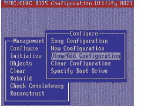

2. 在下一个屏幕（图 2.2）中，已经在线的驱动器将显示为 ONLINE，而刚刚添加的驱动器将显示状态为 READY。对于任何仍显示为 READY 的驱动器，选择该驱动器并按下空格键，这将把状态从 READY 更改为 ONLINE。当您选定了将加入阵列的驱动器后，它们会闪烁。按下 Enter 键以确认这些驱动器将成为该阵列的成员。

**图 2.2** 确认驱动器添加

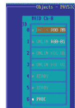

3. 按下 `F10` 显示阵列配置屏幕（图 2.3）。

**图 2.3** 阵列配置屏幕

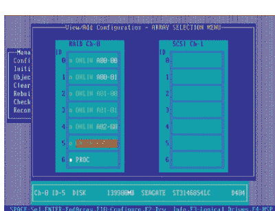

4. 这里将显示上一步为新磁盘驱动器分配的阵列编号。按下空格键，在阵列编号出现正下方显示 Span-1 消息。按下 `F10`，您现在就可以选择 RAID 级别，如图 2.4 所示。

**图 2.4** 选择 RAID 级别

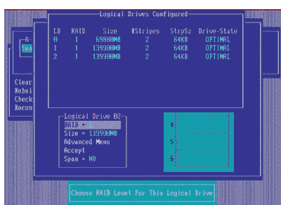

5. 选择 RAID 级别，同时留意每种类型所需的驱动器数量。最后，选择阵列的大小。

6. 保存配置并重启系统。

## 分区

当所有卷都按照您的意愿配置完成后，您必须在其中一个卷上创建分区以包含操作系统。这可以在安装操作系统期间，使用安装实用程序提供的 GUI 完成。例如，在安装 Windows Server 2012 R2 期间（见图 2.5），您可以创建所需大小的分区。请留意操作系统所需的空间，并预留一些额外空间。

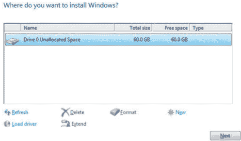

**图 2.5** 创建分区

## 格式化

分区创建后，必须使用文件系统对其进行格式化。文件系统的选择由操作系统决定。例如，Windows 将要求使用 FAT 或 NTFS。其他系统（如 Unix 和 Linux）将使用其他文件系统。我们稍后将讨论文件系统。您可以在安装期间格式化分区。以 Windows Server 2012 R2 为例，您可以选择图 2.5 所示的 Format 选项。在许多形式的 Linux 和 Unix 安装过程中也提供了类似的选项。

## 文件系统类型

您可能会遇到许多不同的文件系统。在接下来的章节中，我们将简要调研这些文件系统类型，看看它们在何时何地被使用。

### ext2, ext3, 和 ext4

`ext2`、`ext3` 和 `ext4` 是 Linux 文件系统。正如您所预料的，每个版本的功能都比前一个版本更强大。虽然 `ext4` 具有此处列出的优势，但需要注意的是它不与 Windows 兼容。（不过，您可以获取第三方程序使 Windows 能够读取 `ext4`。）以下是 `ext4` 的优点：

- 它支持高达 16 TB 的单个文件大小。
- `ext4` 文件系统的总最大容量为 1 EB (exabyte)。（1 EB = 1024 PB [petabyte]，1 PB = 1024 TB [terabyte]）。
- 目录可以包含 64,000 个子目录，而 `ext3` 仅支持 32,000 个。
- 您可以将现有的 `ext3` 文件系统作为 `ext4` 文件系统挂载（无需对其进行升级）。
- 与 `ext3` 相比，文件系统的性能和可靠性有所提高。
- 在 `ext4` 中，您还可以选择关闭日志（journaling）功能。日志是文件系统在做出更改之前记录其更改意图的过程。虽然这种方法在系统在更改提交前崩溃时非常有益，但它确实会消耗资源。

### NTFS

NTFS (NT File System) 随 Windows NT 推出（并在所有 Windows Server 和客户端操作系统上可用），在几乎所有方面都比所有版本的 FAT 文件系统先进得多。它包含单个文件安全和压缩、RAID 支持、对极大文件和分区大小的支持以及磁盘事务监控等功能。它是高性能计算的首选文件系统。只有当卷非常小时，FAT 才会比 NTFS 更高效。

### FAT32

FAT (File Allocation Table，文件分配表) 是文件系统上用于跟踪文件位置的文件缩写。它也是这种文件系统的名称，于 1981 年推出。FAT16 能创建的最大 FAT 磁盘分区约为 2 GB。FAT32 随 Windows 95 OEM Service Release 2 推出，支持高达 16 MB 的分区（此处原文可能为笔误，应指容量上限）。随着磁盘容量的增长，格式化大于 2 GB 分区的需求也随之增加。FAT32 更多地基于虚拟文件分配表 (VFAT) 而非 FAT16。VFAT 是为 Windows 95 开发的文件系统，允许文件名长度超过 8 个字符。它允许 32 位簇寻址，从而提供了 2 TB (2048 GB) 的最大分区大小。它还包含更小的簇大小以避免空间浪费（我们稍后讨论）。当前的 Windows 服务器版本均包含对 FAT32 的支持。

### ReiserFS

ReiserFS 是 Linux 支持的一种提供日志功能的文件系统，在 2006 年采用 `ext3` 之前，它是 Novell SUSE Linux Enterprise 的默认系统。它也是许多其他 Linux 发行版的默认文件系统。它在 Linux 内核 2.4.1 版本中引入，现在由志愿者作为一个开源项目维护。它支持 16 TB 的卷（每 TB 为 1024 GB），最大文件大小为 1 EB（每 EB 为 10 亿 GB）。在 Linux 中使用时，文件名最长可达 255 个字符。

### UFS

Unix 文件系统 (UFS) 被 Unix 和其他类 Unix 操作系统使用。虽然 Linux 包含一个 UFS 实现，以在读取级别与其他版本的 Unix 保持二进制兼容，但它并不完全支持对 UFS 的写入。在 Mac OS X 中，它曾作为 Apple 专有文件系统的替代方案可用。它具有 8 ZB (zettabyte，每 ZB 为一万亿 GB) 的最大卷大小和 8 ZB 的最大文件大小。它允许最高 255 字节的任何文件大小（此处原文 255 bytes 疑似笔误）。

### VMFS

VMware 文件系统 (VMFS) 被 VMware 虚拟化套件 vSphere 使用。VMFS 有四个版本，分别对应 ESX Server 产品的发布版本。虽然 NFS 也可以与 VMware 配合使用，但 VMFS 具有一些独特的功能，使其非常适合虚拟化。它被开发用于存储虚拟机磁盘镜像（包括快照）。它允许多个服务器同时访问文件系统。可以通过将多个 VMFS 卷跨区组合来扩展卷。VMFS 的最大虚拟磁盘大小为 64 TB，而每个文件的最大大小可达 62 TB。它还支持长文件名。

### ZFS

Zettabyte 文件系统 (ZFS) 由 Sun Microsystems 开发，但它也是一个开源项目。它在许多其他操作系统上得到支持，例如某些版本的 BSD（BSD 即 Berkeley Software Distribution，是 Unix 的一个版本）。曾几何时，Apple 似乎对该文件系统感兴趣，但后来放弃了该项目。ZFS 侧重于数据的完整性，这使其与某些更侧重于性能的其他文件系统区分开来。ZFS 支持高达 256 ZB 的卷和最大 16 EB 的文件大小。它还支持最长 255 个字符的文件名。

### Swap (交换空间)

如今的操作系统支持使用交换文件。这些是位于硬盘上的文件，当某个特定功能所需的内存不足时，用于临时存放从内存中移出的项目。运行中的程序认为其信息仍在 RAM 中，但操作系统已将数据移至硬盘。当应用程序再次需要该信息时，它会被交换回 RAM，以便处理器使用。为该文件提供足够的空间是一个关键的磁盘管理问题。每个操作系统似乎对其最优大小都有自己的建议，但在所有情况下，如果可能，交换文件应位于与操作系统不同的驱动器上。

## 配置主机名

您在服务器上首先想要配置的事情之一就是它的主机名。这通常在安装操作系统期间完成。虽然您可以在以后根据需要更改主机名，但这样做可能会给使用旧名称映射驱动器的用户带来问题。在为服务器命名时，制定一套能暗示其位置的命名约定会很有帮助。

服务器所在的位置，以及可能包含一个代表该服务器所扮演角色的代码。明确标识服务器的角色可能会带来安全风险。你的命名约定不必遵循你在书中发现的任何标准建议；重要的是它能实现这些目的，并且对你以及网络中其他工作的人员是有意义的。同样重要的是，每个人在为服务器命名时都必须遵循该命名约定。

一些已被用作命名约定一部分的服务器特征示例包括：

- 服务器运行的环境（例如：`dev` 代表开发环境，`prd` 代表生产环境）
- 服务器的角色（例如：`sql` 代表数据库服务器，`dns` 代表域名服务器）
- 服务器的位置（例如：`atl` 代表亚特兰大，`dal` 代表达拉斯）

将这些组合起来，例如，一台位于亚特兰大的生产环境 SQL 服务器的名称可能是：

```
sql01-prd-atl
```

## 本地账户设置

为了管理服务器，你需要在服务器上创建一个本地账户。本地管理员账户通常在安装操作系统的过程中创建，但该账户将拥有对所有内容的完整访问权限（在某些系统中称为 root 访问权限），这可能比你希望技术人员拥有的控制权更多。

安全最佳实践建议技术人员使用标准用户账户，除非他们需要执行需要管理员权限的操作。随后，他们可以使用管理员凭据执行该任务。在 Windows 中，这被称为以管理员身份运行任务（右键单击图标或应用程序，然后从上下文菜单中选择“以管理员身份运行”），如图 2.6 所示。该菜单选项旁边有一个盾牌图标，如果你在命令行界面，则在命令前加上 `runas`。这将在管理员安全上下文中执行该功能，并在进程结束时结束该上下文。图 2.7 显示了在命令行中使用 `runas` 的情况。执行命令后，记事本打开并提示输入凭据，随后提供了相应的凭据。

> 图 2.6 以管理员身份运行应用程序

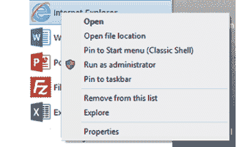

**图 2.7 使用 runas**

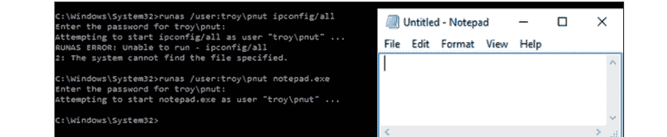

随后，如果你将服务器加入域，域管理员账户将被添加到本地管理员组中，从而使域管理员拥有对该服务器的完整权限。请记住，对于域管理员组中的成员，同样适用“仅在需要时才使用管理员账户”的建议。

## 连接到网络

当服务器启动并运行后，你需要将其连接到网络。这显然包括连接电缆并将其连接到交换机，但还包括以下步骤：

- 分配 IP 地址、子网掩码以及（通常）默认网关。虽然我们通常希望服务器保持相同的 IP 地址，但如果我们希望服务器参与 DHCP（这是一件理想的事情），可以通过预约（reservation）来实现。DHCP 将在第 8 章“网络”中详细介绍。
- 为服务器分配 DNS 服务器地址，并允许服务器将其 IP 地址注册到 DNS 服务器。将服务器设置为通过 DHCP 接收此信息，可以在 DNS 服务器地址更改时，使服务器无需手动干预即可进行更新。
- 在某些情况下（例如电子邮件服务器），需要手动创建 DNS 记录。

## 加入域/目录

企业网络将服务器、工作站和其他设备加入到称为域（domains）或区域（realms）的安全关联中。这些关联是通过使用诸如 Active Directory 之类的目录服务实现的。此类关联使得单点登录（single sign-on）概念成为可能。这意味着任何用户都可以使用任何域成员设备登录网络，并通过一次登录获得所有分配给他们的权利和特权。

在某些情况下，你可以在安装过程中将服务器加入域，但大多数管理员在操作系统成功安装后才执行此操作。图 2.8 显示了在 Windows Server 2012 R2 中执行此操作的示例。要在 Windows Server 2012 R2 中导航到“系统属性”，请打开“控制面板”并选择“系统”图标（使用图标视图）；然后从页面左侧的菜单中选择“高级系统设置”。这将打开“系统属性”对话框。选择“计算机名”选项卡并点击“更改”，以进入“计算机名/域更改”对话框。

**图 2.8 将服务器加入域**

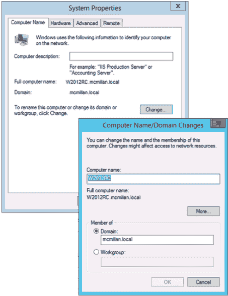

# 安装和配置服务器操作系统

## 处理安全顾虑

在服务器安全地加入域之后，下一个需要处理的问题是安全。在系统安装所有安全补丁以及安装并更新杀毒软件之前，任何服务器都不应连接到网络，尤其是互联网。除此之外，还有其他几项安全考虑因素，我们将在接下来的章节中讨论。

### 打补丁

就像每个操作系统自带的驱动程序文件在安装 DVD 出厂那一刻起就过时了一样，操作系统的安全态势也是如此。在安装后应尽快应用所有操作系统补丁和服务包。某些操作系统（如 Windows 和 Linux 系统）提供了在安装过程中下载并应用这些更新的能力。

### OS 硬化

接下来的工作应该是对操作系统进行硬化。操作系统硬化的目标是减少攻击面。这包括禁用所有不使用的服务并关闭任何不需要的功能。其背后的理论是，所有的服务、应用程序和功能都有众所周知的漏洞，黑客可以利用这些漏洞来入侵机器。虽然及时更新安全补丁可以缓解这一问题，但禁用任何不必要的服务显然是合理的。另一个好处是更好的服务器性能，因为系统不再需要为该服务分配资源。

最后，应卸载任何不使用的应用程序，并关闭任何不需要的端口。应删除可能存在但不需要的任何用户账户，并更改所有内置账户的默认密码。

### 遵守公司流程/标准

虽然应用所有固件和操作系统补丁是保障新服务器安全的起始基线，但你公司的标准和流程可能要求你做得更多。在审查这些文档时，你可能会发现还需要采取额外的行动。例如，根据政策，某些服务器角色可能要求其提供的网络服务（例如 SQL 或项目管理服务器）配置为在用户账户的安全上下文中运行，而不是在系统账户的上下文中运行（这是一个非常常见的安全保障措施）。底线是，在任何新服务器符合所有安全策略和流程之前，都不应将其发布到网络中。

### 启用服务

如果你在操作系统硬化部分留心听讲（希望如此！），你会记得不应启用任何不必要的服务。同时，所有必需的服务都应启用。在一段时间内，Windows 服务器上实施的安全模式将管理服务的安全责任交给管理员。这意味着所有服务默认都是启用的，管理员负责禁用不需要的服务。

这种方法导致服务被误开启，进而导致系统通过未加密的服务被黑客攻击。现在微软采取了不同的方法，许多服务默认不启用，这意味着你需要启用所有所需的服务，而将不需要的服务保持禁用状态。

在其他操作系统中，也应遵循相同的原则。它们关于服务的安全性可能有所不同。练习 2.3 将探讨如何在 Windows Server 中禁用服务。

> **注意**：本练习使用 Windows Server 2012 R2 操作系统。你的系统步骤可能会有所不同。

## 练习 2.3

### 在 Windows Server 2012 R2 中禁用服务

1. 如果尚未打开，请打开服务器管理器（Server Manager）。
2. 选择“工具”▸“服务”以打开服务实用程序。此时将显示所有服务，包括正在运行和未运行的服务。
3. 右键单击某个服务。
4. 从上下文菜单中选择“属性”。


- 5. 在“启动类型”下拉框中，选择“禁用”，如图所示。

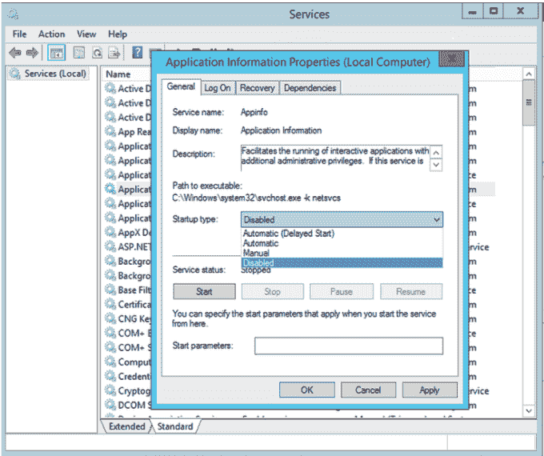

要在 Linux 中禁用服务，必须先确定其进程 ID（PID）；在执行 `kill` 命令时，PID 将用于指定该服务。要确定服务的 PID，必须知道服务的名称。例如，要禁用 FTP，必须执行一条能够显示所有开放端口及其服务名称和 PID 的命令。让我们在练习 2.4 中将这些操作结合起来。

## 练习 2.4

### 在 Linux 中禁用服务

1. 执行以下命令以识别所有开放端口：

```bash
[admin@bigco]netstat -lp
```

在输出结果中，找到如图所示的 FTP。它是屏幕截断前列表中的最后一个程序。

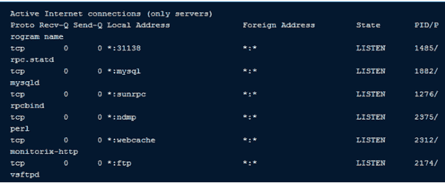

2. 在输出结果的 PID 列中找到 PID。在本例中，PID 为 2174。

3. 既然知道了 PID，请执行以下命令以终止 FTP 进程：

```bash
[admin@bigco]kill -9 2174
```

`-9` 参数告诉系统在不保存的情况下强制终止该进程。

### 安装功能、角色、应用程序和驱动程序

服务器在网络中扮演的角色将决定需要安装或启用哪些功能和角色。在 Windows 中，应用于服务的相同安全范式也被应用于微软所谓的“功能和角色”（features and roles）。例如，如果该服务器将作为 DNS 服务器，那么您必须安装该角色以及执行该角色所需的相关功能。这在服务器管理器中完成，如图 2.9 所示，其中已添加了 FTP 角色。要导航到“添加角色和功能向导”，请打开服务器管理器，然后选择“管理”▸“添加角色和功能”。

### 性能基准

当所有应用程序安装完毕且相应的服务已启用后，您需要创建所谓的“性能基准”（performance baseline）。这是服务器关键资源（如 CPU、内存、磁盘和网卡）性能的一个快照。该快照应在正常活动期间采集。

**图 2.9** 在服务器管理器中添加角色

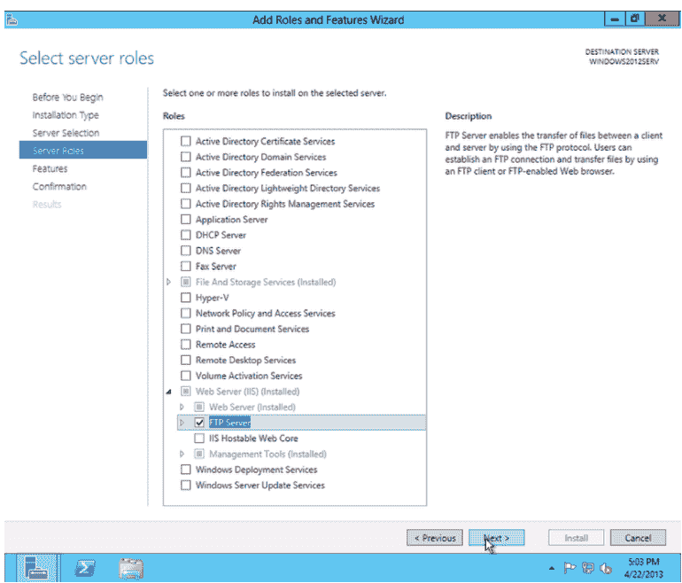

您可以使用第三方监控工具，也可以依赖系统内置的一些工具，例如 Windows Server 2012 R2 中的性能监视器（Performance Monitor）工具。性能监视器工具还可用于在一段时间内多次采集快照，从而让您感受到服务器工作负载的起伏。通过这种方式，您可以更好地了解一天中哪些时段的高工作负载属于正常现象。您可能还希望利用 System Center Operations Manager 等工具，它允许您通过单个控制台轻松地为多台服务器执行此操作。图 2.10 显示了一台 Windows Server 2012 Datacenter 计算机的七天内存页每秒（Memory Pages Per Second）报告。

要在 Windows Server 2012 R2 中导航到性能监视器，请打开服务器管理器并选择“工具”➤“性能监视器”。

**图 2.10** 七天内存页每秒报告

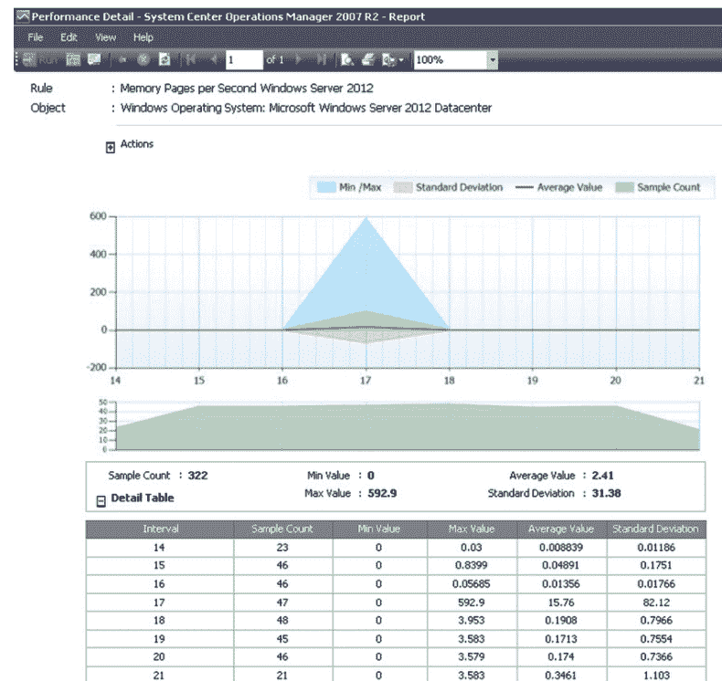

将性能基准保存为以后读取的参考点。除非您知道什么是“正常”，否则不可能知道什么时候发生了异常。这就是该基准的作用。它还有助于预测工作负载随时间的增长，以便您在问题出现之前采取步骤增加资源。

### 服务器优化

“服务器优化”（server optimization）一词是指将资源合理地分配给服务器，使资源既不过度利用也不利用不足。在过去，这通过检查每台服务器的角色，尝试预测工作负载，然后安装尽可能匹配服务器需求的资源（CPU、网卡、内存、磁盘）来实现。然而，无论多么小心，资源往往还是会出现过度或利用不足的情况。因为预知未来简直是不可能的。

如今，服务器虚拟化使这项任务变得简单得多。部署为虚拟机的服务器可以在需求出现时实时动态分配资源。当服务器工作负载下降时，这些资源可以动态重新分配并部署到其他地方。虚拟化将在本章后面的“虚拟化组件的目的与运行”部分中讨论。

#### 交换文件或分页文件优化

在本章前面，您已经接触到了交换文件（swap file）的概念，有时它也被称为“分页文件”（pagefile）。优化此文件意味着确定为该功能分配的适当磁盘空间量。虽然很难让某些供应商给出具体的建议，但您应始终从供应商提供的任何指南开始。最佳实践随着时间的推移而演进。

关于 Windows 服务器，以下是一些最佳实践：

- 将分页文件设置为 RAM 的 1.5 倍。
- 托管数据库或资源密集型应用程序的服务器应将分页文件设置为 RAM 的 3 倍。
- 将分页文件分散在两个不同的驱动器上，最好是两个不同的磁盘。
- 对于 Windows 2008、Windows Server 2008 R2 和 Windows Server 2012 R2，C 盘应设有 6 GB 的分页文件。

在 Linux 中，有一个名为 `swappiness` 的参数，用于控制系统将数据交换到磁盘的积极程度。其范围从 0 到 100，当 `swappiness=0` 时，它告诉内核尽可能避免将进程从物理内存中交换出去。当 `swappiness=100` 时，它告诉内核积极地将进程从物理内存中交换出去并将其移动到交换缓存。如果您发现系统频繁交换（这会损害性能），可能需要尝试调整此设置。

无论使用哪种操作系统，如果服务器频繁交换到交换文件或分页文件，这意味着服务器需要更多的物理内存。在内存和磁盘之间来回移动数据，以及必须从磁盘检索本应在内存中的内容，都会损害性能。

#### 无人值守/远程安装

通过插入 DVD、从 DVD 启动并按照提示手动执行安装来安装操作系统并没有错。然而，有更简单的方法。在本节中，我们将探讨各种类型的无人值守安装。它们不仅使过程在某种程度上更加自动化，还有助于在企业中为工作站和服务器部署维护一个一致的过程。

#### 镜像部署与克隆

快速且一致地部署操作系统的一种方法是创建已完成安装的镜像，并使用磁盘镜像软件将镜像复制到驱动器。这不仅加快了部署过程，而且镜像可以根据公司关于服务器角色的政策进行预配置。

虚拟化环境的另一个优势是能够维护这些镜像的库以快速使用。不过，虚拟化并非必须，微软等供应商提供的工具可以让镜像的创建、管理和部署变得更加简单。Windows Server 2012 R2 中的 Windows 部署服务（WDS）就是这样一个工具。该工具可用于：

- 捕获现有服务器的镜像。
- 创建引导镜像并发送到没有现有操作系统的设备，以便它们可以通过 PXE 启动启动并连接到部署服务器（稍后详细介绍 PXE 启动）。
- 为支持 PXE 启动的设备创建包含用于连接到部署服务器的镜像的启动介质。
- 执行包含应答文件的无人值守安装，该文件可回答安装过程中的所有提示（下一节详细介绍此类安装）。

#### 脚本化安装

脚本化安装与简单的镜像部署有一点不同：部署过程中关联有某种类型的文件，该文件会对部署进行更改或为安装提供答案。在经典的 Windows 无人值守安装中，此文件被称为“应答文件”（answer file）。在使用 Windows 部署服务或任何第三方部署工具时，在镜像部署或完整安装过程中可能会使用许多脚本文件。在镜像部署中，该文件对镜像进行更改或提供驱动程序；在完整安装中，则进行完整的安装过程，由该文件提供对提示的回答。

无论进行哪种类型的部署，没有操作系统的整个新系统必须能够：

- 启动并获取 IP 配置。
- 定位部署服务器。
- 下载镜像或安装文件。
- 定位并下载任何需要运行的附加脚本。

有几种方法可以实现这一点，我们现在来看看。

#### PXE 启动与 TFTP

预启动执行环境（PXE）使得在没有操作系统的情况下启动设备成为可能，并能够访问网络中的某个位置，在那里可以找到并安装操作系统文件。

启用了 PXE 的设备将拥有一个名为 PXE Boot 的额外启动选项。当设备被设置为该启动选项时，它将尝试进行 PXE 网络启动。随后的过程遵循以下步骤：

1. 系统首先寻找 DHCP 服务器。这一步被称为 Discover（发现）。
2. DHCP 服务器通过一个名为 Offer 的数据包进行响应，表示愿意提供配置。这一步被称为 Offer（提供）。
3. 客户端向 DHCP 服务器表明它需要网络启动程序（NBP）的位置。这一步被称为 Request（请求）。
4. DHCP 服务器提供该位置的 IP 地址。这一步被称为 Acknowledge（确认）。

> 如果您使用 WDS 安装了 Microsoft DHCP，那么来自 DHCP 服务器的原始 Offer 数据包中已经包含了 PXE 服务器和 NBP 的位置。

5. 客户端使用简单文件传输协议（TFTP），从 PXE 服务器指定的网络位置下载 NBP。
6. NBP 被初始化。此时，要么使用应答文件进行完整安装，要么在有或没有附加脚本文件的情况下部署镜像。

请注意，该过程独立于操作系统。虽然我们将讨论框架设定在 Windows 环境下，但被部署的系统可以是任何操作系统。PXE 启动过程如图 2.11 所示。

##### 图 2.11 PXE 启动过程

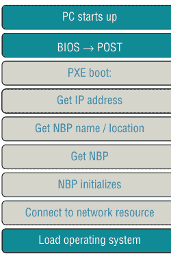

## 使用访问和控制方法管理服务器

虽然您可以进入服务器机房或数据中心，使用连接到服务器的键盘和鼠标来管理服务器，但除非被迫如此，否则您不太可能以这种方式管理服务器。在本节中，我们将讨论管理服务器硬件和操作系统的各种方法。

### 本地硬件管理

当我提到“本地”管理硬件时，是指您不会通过网络连接到设备，而是在服务器机房或数据中心中进行操作。可用选项取决于服务器是物理设备（如机架式服务器、刀片服务器或塔式服务器），还是部署在虚拟化宿主机上的虚拟机（VM）虚拟服务器。在本节中，我们将探讨三种本地管理硬件的方法。

#### KVM

在本地操作服务器时（即站在服务器所在的同一个房间内），技术人员连接服务器最常用的方式之一是通过 KVM。键盘、视频和鼠标（KVM）设备允许您将多台 PC（通常是服务器）插入该设备，并使用同一套鼠标、显示器和键盘在不同系统之间轻松切换。KVM 实际上是一个所有系统都接入的交换机。通常不需要安装软件。只需关闭所有系统，将它们全部插入交换机，然后重新开启；之后您就可以使用连接到 KVM 交换机的同一套键盘、显示器和鼠标设备在各系统间切换。该交换机连接设备的方式如图 2.12 所示。

#### 串口（Serial）

虽然串口连接在很大程度上已被 KVM 交换机取代，但仍然可以通过串口连接到服务器。出现的问题是，即使技术人员的笔记本电脑有串口（如今这不太可能），最多也只有一个。这一难题促使了串口设备服务器的开发。它提供多个串口，然后连接到其他设备（如服务器、路由器或交换机）的串口。随后，可以通过调制解调器等串口链路，或通过带有 Telnet 或 SSH 等终端仿真软件的网络连接到控制台服务器，从而访问连接设备的控制台，从而保持可生存的连接性，允许远程用户在无需亲临现场的情况下登录各种控制台。这种布置如图 2.13 所示。其优点之一是能够“带外（out of band）”访问服务器。这意味着即使网络中断，也可以通过本地串口或调制解调器访问服务器。

##### 图 2.12 标准 KVM 交换机

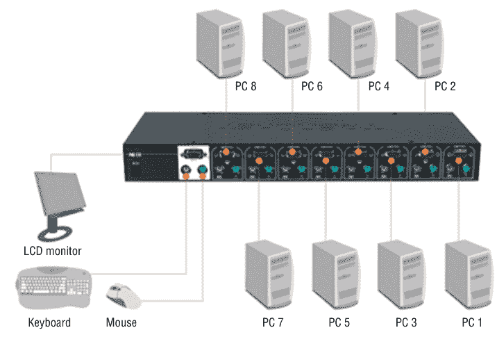

##### 图 2.13 串口设备服务器

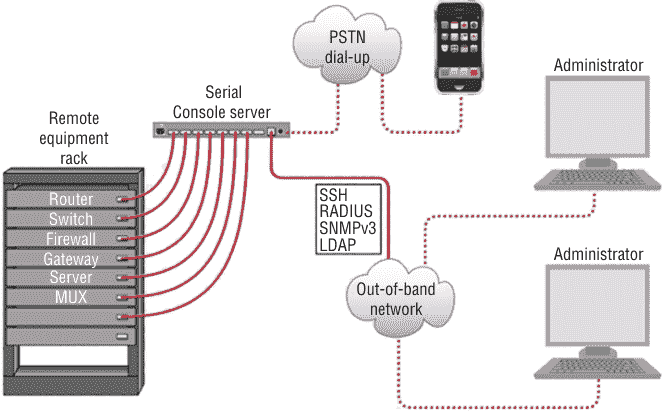

#### 虚拟管理控制台

为了在虚拟环境中管理服务器，虚拟化软件厂商提供了管理控制台，允许在服务器之间进行切换以进行维护和管理。示例包括 VMware Server Console 和 Windows Hyper-V 中的虚拟机管理器（Virtual Machine Manager）控制台。

图 2.14 展示了 VMware Server Console 的示例。这里的系统监控页面显示了特定虚拟化宿主机的负载（稍后将详细介绍虚拟化，但宿主机是指运行多个虚拟机的物理机）。您可以看到该服务器托管了四台 VM，目前全部处于关机状态。这解释了为什么 CPU 占用率仅为 2%，内存占用仅为 1.3 GB，且没有被 VM 使用。

##### 图 2.14 VMware Server Console

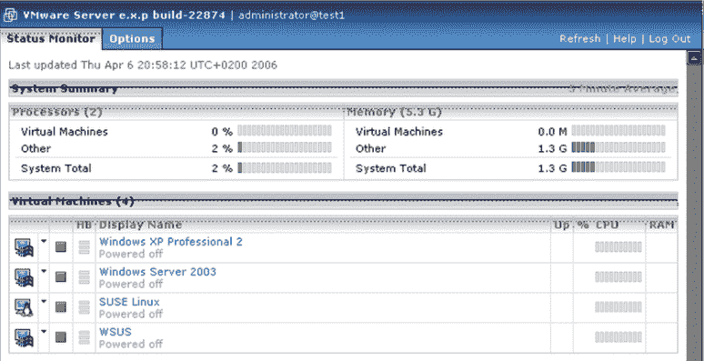

Hyper-V 中的虚拟机管理器（VMM）控制台如图 2.15 所示。它同样允许通过此控制台集中管理服务器。这里在名为 Hypervisor8 的宿主机上显示了两台 VM。其中一台 VM 的创建进度为 90%，而另一台处于停止状态。

##### 图 2.15 Windows Hyper-V 中的 VMM

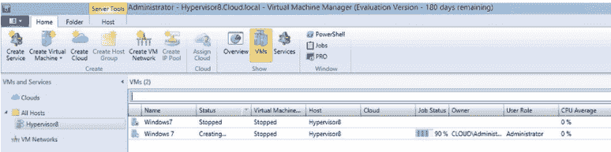

### 基于网络的硬件管理

虽然部分服务器管理可能在本地进行，但大多数时间您会发现自己是通过基于 IP 的网络连接到服务器的。有多种方案可以实现这一点。在本节中，我们将讨论使用基于网络的管理方式来管理服务器硬件。

#### KVM over IP

您之前学习了如何使用基础 KVM 交换机。KVM 厂商针对可以通过网络访问的 KVM 交换机需求做出了响应。该交换机与您之前看到的类似，但有一个不同之处——它可以通过网络访问，如图 2.16 所示。这意味着它不仅可以从隔壁房间的工作站访问，还可以从任何地方访问。在这一特定实现中（有多种实现方式），每台服务器与 KVM 交换机之间都有一个接受串口和键盘/鼠标连接的小设备。

##### 图 2.16 KVM over IP

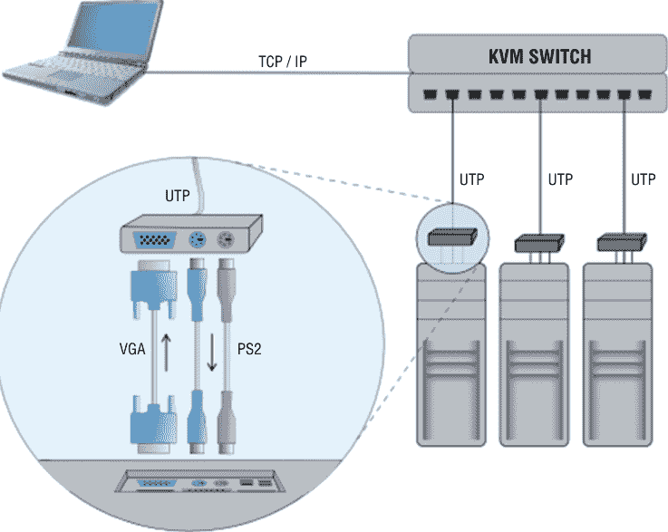

#### iLO

Integrated Lights-Out（iLO）是嵌入在惠普（HP）服务器中的技术，允许对服务器进行带外管理。带外管理是指任何不使用主网络管理服务器的方法。

物理连接是一个位于服务器上的以太网端口，标记为 iLO。在图 2.17 中，HP Moonshot 机箱（用于承载刀片服务器）中显示了一个此类 iLO 端口。无论服务器的运行状态如何，HP iLO 均可开箱即用，无需安装额外软件，让您能通过 Web 浏览器或 iLO 移动应用从任何位置完全访问服务器。

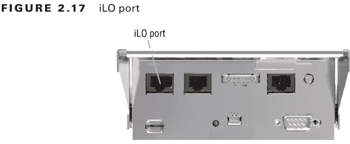

#### iDRAC

Dell 远程访问控制器（DRAC）卡为戴尔服务器提供带外管理。iDRAC 指的是集成在服务器主板上的此类接口卡版本。服务器背面会有一个看起来像以太网端口的端口，作为 iDRAC 端口。在图 2.18 中，它被标记为指定系统管理端口。

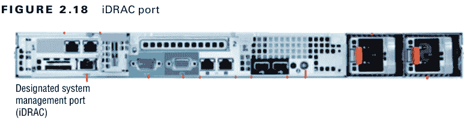

一旦配置完成，当连接建立时，该端口将在技术人员的计算机上呈现一个接口。该控制台界面如图 2.19 所示。

**图 2.19** iDRAC 控制台

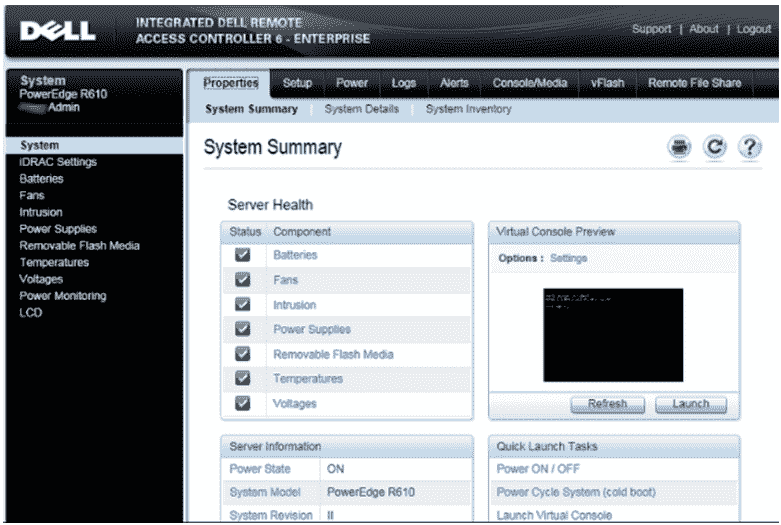

### 基于网络的操作系统管理

当你需要对操作系统进行更改时，有多种方式可以远程建立连接。在本节中，我们将概述实现基于网络操作系统管理最常用的几种方法。

#### RDP

远程桌面协议（RDP）由微软开发，允许你连接到远程计算机并在其上运行程序。当你使用 RDP 时，你会在自己的屏幕上看到已登录计算机的桌面。你面前的计算机是客户端，而你登录的计算机是服务器。服务器使用自己的显卡驱动程序创建视频输出，并通过 RDP 将输出发送给客户端。来自客户端的所有键盘和鼠标输入都经过加密并发送到服务器进行处理。RDP 还支持声音、驱动器、端口和网络打印机的重定向。

一个可用于此目的的工具是微软远程桌面连接管理器（RDCMan）。它是一个方便的控制台，如图 2.20 所示。请注意，它并不局限于管理微软服务器，也可以为非微软系统找到相应的客户端。

**图 2.20** RDCMan

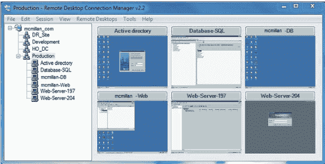

#### SSH

如果你不需要访问图形界面，而只是想连接到服务器在命令行进行操作，你有两个选择：Telnet 和 SSH。Telnet 运行良好，但它以明文传输所有数据，这显然会带来安全问题。因此，首选的连接工具变成了安全外壳协议（SSH）。它的设置没有那么简单，因为它会对所有传输进行加密，而如果没有加密密钥，这是不可能实现的。

虽然根据操作系统的不同，命令会有所差异，但你必须生成一个密钥，该密钥使用关于服务器的一些唯一信息作为种子信息生成，从而使密钥对于该服务器是唯一的（加密算法是众所周知的）。一旦配置完成，连接过程将与使用 Telnet 非常相似，当然，唯一的区别是传输内容将受到保护。

#### VNC

另一种像 RDP 一样的远程管理工具是虚拟网络计算（VNC）。它的不同之处在于使用了远程帧缓冲（RFB）协议。在体验方面它与 RDP 类似，但它不是一个安全协议。它虽然不以明文传输，但如果加密密钥和密码被截获，破解密码是有可能的。因此，应使用强密码，并且建议将其通过 VPN 或 SSH 连接进行隧道传输。

#### 命令行或 Shell

Shell 是一种用户界面，可以是图形化的，也可以是非图形化的。在大多数情况下，Shell 是命令行驱动的界面。Unix 系统有许多 Shell，它们都有自己的命令、语法和功能。有些操作系统只有一个 Shell——例如 MS-DOS 程序。其他 Windows 系统则有多个可用的 Shell，例如 PowerShell。路由器和交换机等设备也有类似 Cisco IOS 的 Shell。在网络上使用时，Shell 有时被称为远程 Shell（Remote Shells）。

## 虚拟化组件的目的与运行


在当今的网络中，你必须了解虚拟化。无论规模大小，各组织都在致力于利用这项技术带来的好处。它们在节省电力、整合资源、缩小（有人称之为优化）物理足迹，并大大减少由资源限制引起的瓶颈。本节将向你介绍使虚拟化得以实现的组件，以及每个组件在实现这些益处中所扮演的具体角色。

## 宿主机与客户机 (Hosts and Guests)

虚拟化的基础是宿主设备，它可以是工作站或服务器。该设备是包含使虚拟化成为可能的软件以及用于客户操作系统的容器（或`虚拟机`）的物理机。宿主机向虚拟机 (VM) 提供底层硬件和计算资源，如处理能力、内存、磁盘和网络 I/O。每个客户机都是一个完全独立且分离的操作系统和应用程序软件实例。

宿主机负责按照配置的规定向每个虚拟机分配计算资源。管理这一切的软件被称为`管理程序 (hypervisor)`。根据管理员设置的参数，管理程序可能会采取各种措施，以维持管理员指定的每个客户机的性能。这些措施可能包括：

- 关闭未在使用的虚拟机
- 从一个虚拟机中回收 CPU 资源并将其分配给另一个虚拟机
- 在需要提供容错能力时开启额外的虚拟机

管理程序、宿主操作系统与客户操作系统之间关系的具体性质取决于所使用的管理程序类型。在本节稍后学习管理程序时，这一点会更加清晰。从高层级来看，这种关系如图 2.21 所示。

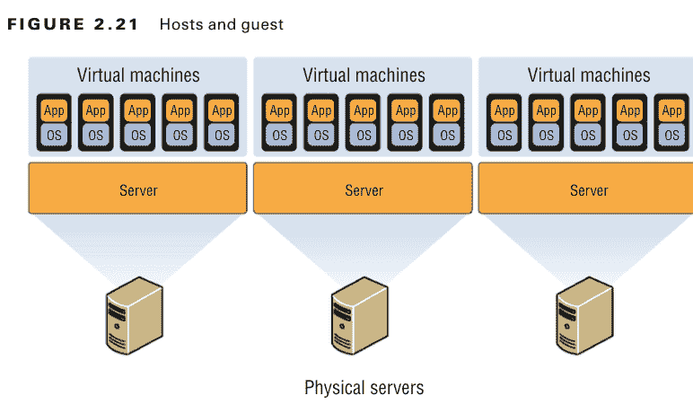

## 虚拟机管理界面

VMware vSphere、Microsoft Hyper-V 和 Oracle VM VirtualBox 等虚拟化产品的一个优势是它们提供的管理界面。这些界面允许你创建、查看并对虚拟机进行更改。其中一些更改可以在设备运行过程中完成，而另一些则需要关闭虚拟机。本章早前的“虚拟管理控制台”章节中的图 2.14 展示了 VMware Server 控制台。在同一章节的图 2.15 中，展示了 Hyper-V 中的 Microsoft 虚拟机管理器 (VMM) 控制台。图 2.22 显示了 Oracle VM VirtualBox 管理控制台。在该控制台中你可以看到有三个虚拟机。我们高亮显示了名为`test2`的虚拟机，该虚拟机的资源详细信息显示在详情窗格中。

## 管理程序 (Hypervisor)

前面你已经了解到，管理程序、宿主操作系统与客户操作系统之间关系的具体性质取决于所使用的管理程序类型。目前有三种类型的管理程序，现在让我们来回顾一下。

### Type I

Type I 管理程序（或称为原生、裸金属管理程序）直接运行在宿主机的硬件上，以控制硬件并管理客户操作系统。客户操作系统运行在管理程序之上的另一层。此类示例包括 VMware vSphere 和 Microsoft Hyper-V。

**图 2.22** Oracle VM VirtualBox

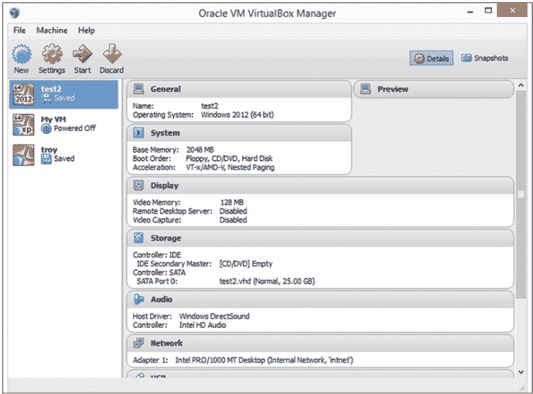

### Type II

Type II 管理程序运行在传统的操作系统环境中。由于管理程序层是一个独立的第二层软件，客户操作系统运行在硬件之上的第三层。VMware Workstation 和 VirtualBox 是 Type II 管理程序的典型代表。两种方法的对比见图 2.23。

### 混合型 (Hybrid)

在数据中心中，你最有可能遇到 Type I 管理程序，但你也应该意识到一种新兴的管理程序类型：混合型。这基本上是一个 Type II 管理程序，但它与云集成在一起。最好的例子是 VMware Workstation 12 版本。通过该版本，可以连接到 vCloud Air 或任何私有云，并从 Workstation 界面上传、运行和查看虚拟机。

另一种可能被认为是混合型的新方法是基于容器的虚拟化。基于容器的虚拟化也被称为操作系统级虚拟化。这种服务器虚拟化技术是指内核允许存在多个隔离的用户空间实例。这些实例被称为容器、虚拟私有服务器或虚拟环境。

**图 2.23** Type I 和 II 管理程序

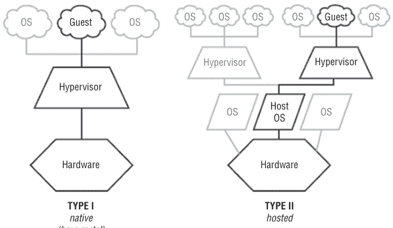

在这种模型中，管理程序被操作系统级虚拟化所取代，即操作系统的内核允许存在多个隔离的用户空间或容器。虚拟机不再是一个完整的操作系统实例，而是同一操作系统的部分实例。图 2.24 中的容器就是宿主操作系统层正上方的蓝色方框。基于容器的虚拟化主要用于 Linux 环境，示例包括商业软件 Parallels Virtuozzo 和开源项目 OpenVZ。

**图 2.24** 基于容器的虚拟化

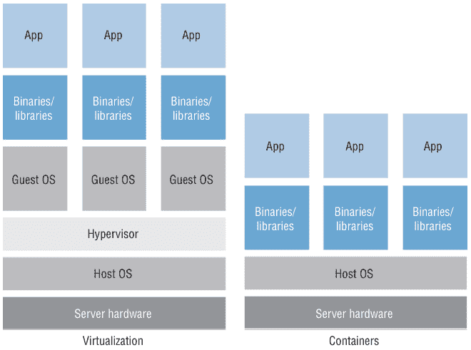

## 硬件兼容性列表

在为虚拟化解决方案选择主机（服务器）时，应考虑能够使该解决方案发挥最大效益所需的硬件。请查阅主要厂商（VMware、Citrix (XenServer) 和 Microsoft）提供的兼容性指南。这些指南可根据您的具体需求，就其解决方案所需的硬件提供关键指导。话虽如此，由于某些通用特性和组件非常重要，仍值得提及。以下章节将涵盖其中一部分内容。

## BIOS/UEFI 兼容性与支持

在许多情况下，主板及其相关的 BIOS/UEFI 设置无需更改即可为虚拟机提供服务。然而，某些虚拟化产品（如 Microsoft Hyper-V）要求主板支持硬件辅助虚拟化。这是因为在这种情况下，虚拟化产品并非安装在常规操作系统之上，而是直接安装在裸机上——也就是说，它是作为操作系统的一个组成部分安装的，例如在 Windows Server 2012 R2 中。

使用硬件辅助虚拟化的益处在于，它允许虚拟化管理程序（`hypervisor`）根据需要动态地为虚拟机（VM）分配内存和 CPU。当主板和 BIOS 支持该技术时，您必须确保其已启用。图 2.25 展示了设置示例。虽然大多数新服务器都支持硬件辅助虚拟化，但这是一个您应该了解的特性和考量因素。

**图 2.25** 启用硬件辅助虚拟化

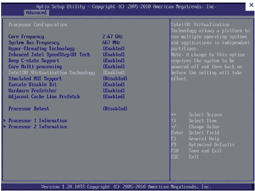

## CPU 兼容性支持

在查阅兼容性指南时，需要考虑的关键问题之一是 CPU。该组件在虚拟化解决方案的整体成功中起着至关重要的作用。您不仅要确保您考虑的或候选主机机器中现有的 CPU 已列在兼容虚拟化列表中，还应尽一切努力使用支持旨在增强虚拟化的指令扩展和特性的 CPU。让我们来看看两家主要厂商及其技术。

### AMD-V 和 Intel VT

不同 CPU 支持或增强虚拟化的能力各异。Intel 提供了一整系列支持其所谓的 Intel 虚拟化技术的处理器。使用具有该技术的 CPU 所带来的益处包括：

- 整个平台基础虚拟化过程的加速
- 降低存储和网络延迟，减少潜在的瓶颈
- 坚实的硬件基础所提供的增强安全性
- 提高软件和服务器投资的短期及长期价值

AMD 也有类似的处理器系列，其技术被称为 AMD 虚拟化 (AMD-V)。它扩展了 CPU 的指令集，并提供了与 Intel 技术许多相同的益处。

> 虽然服务器可能完全支持硬件辅助虚拟化，且 CPU 可能支持指令集的虚拟化扩展，但您可能需要在 BIOS/UEFI 中同时启用这两项才能获得这些益处。

## 客户机与宿主机之间的资源分配

您需要理解的问题之一是宿主机系统和客户机操作系统如何共享资源。请记住，宿主机和客户机共享相同的物理资源（CPU、内存、磁盘、NIC）。这是 Type 1（或称裸金属）虚拟化管理程序的优势。没有底层的操作系统占用资源。分配给虚拟机的资源被称为虚拟资源，其数量不需要与宿主机中的物理资源数量一致。例如，宿主机可能有两个处理器，但您可以为客户机分配四个虚拟 CPU。话虽如此，根据最佳实践，您可能不应该这样做。资源分配的具体方式以及管理员如何利用这些分配来协调物理资源的使用取决于资源类型。让我们来看看虚拟环境中四种主要资源是如何分配的。

### CPU

您可以通过三种方式之一控制物理 CPU 的使用分配：

- **份额 (Shares)**：例如低、正常、高和自定义（以 VMware 为例）等值，将与服务器上所有虚拟机份额的总和进行比较。因此，它们定义了每个虚拟机可以使用的相对百分比。
- **预留 (Reservation)**：为虚拟机保证的 CPU 分配量。
- **限制 (Limit)**：虚拟机 CPU 分配的上限。

这些设置用于确保目标虚拟机具有 CPU 优先级（份额），确保某些虚拟机始终获得保证的 CPU 时间（预留），以及确保没有单个虚拟机垄断 CPU（限制）。在图 2.26 中，您可以看到在 Microsoft Hyper-V 中是如何操作的。虽然术语略有不同，但概念是一样的。如图所示，您可以为虚拟机分配多个虚拟 CPU，这是影响虚拟机性能的另一种方式。

**图 2.26** 在 Hyper-V 中设置 CPU 分配


### 存储

虚拟化的一大好处是虚拟机能够共享存储。这种存储可以位于单个存储设备或设备中，也可以位于多个存储设备上。通过逻辑上地将存储集中化并进行统一管理，您可以减少以前每个服务器使用独立存储时产生的浪费。

越来越多的存储以本地存储的形式呈现给虚拟机，但实际上位于存储区域网络 (SAN) 或网络附属存储 (NAS) 中。SAN 是一个独立于局域网 (LAN) 的高性能数据网络，而 NAS 是驻留在局域网上的存储设备或设备。

虚拟机驻留在宿主服务器上，而宿主服务器连接到共享存储设备，如图 2.27 所示。从概念上讲，共享存储可以是 NAS 或 SAN，区别在于使用 SAN 时，服务器需要安装一个主机总线控制器卡，以便将服务器连接到通常组成 SAN 的光纤网络。

**图 2.27** 共享存储


共享存储的益处之一是更高效地利用存储，减少在其他存储承受压力时处于闲置状态的存储。在创建虚拟机时，其中一个步骤是为虚拟机创建虚拟硬盘。这是共享存储中用于保存虚拟机镜像的空间。您可以创建几种类型的虚拟磁盘，某些类型具有有助于高效利用空间的独特能力。每家虚拟化厂商对这些类型的命名略有不同，但提供的基本类型都是相同的。作为示例，我们将查看虚拟化市场领导者 VMware 提供的类型。

#### 厚置备延迟清零 (Thick Provision Lazy Zeroed)

这类似于经典的普通硬盘，但有一个例外。与经典磁盘一样，虚拟磁盘所需的空间在创建期间分配。如果磁盘上存在数据，直到需要为新数据提供空间时，该数据才会被删除。

#### 厚置备立即清零 (Thick Provision Eager Zeroed)

这与延迟清零类似，但磁盘上的任何数据都会提前被清零。这意味着创建此类磁盘需要更长的时间。

#### 精简置备 (Thin Provision)

这就是磁盘效率体现的地方。起初，精简置备磁盘仅使用其初始所需的存储空间。如果精简磁盘随后需要更多空间，它可以增长到为其分配的最大容量。

在图 2.28 中，您可以看到在 Hyper-V 中是如何操作的，虽然术语略有不同，但大多数厂商的概念是一样的。如图所示，您可以创建所谓的`差异磁盘 (differencing disk)`。这种磁盘类型并非 Hyper-V 特有。当您决定保留先前版本镜像的副本时，它用于存储对镜像所做的更改。这就是在……之后能够实现镜像回滚过程的原因。

进行您希望撤销的更改。这使得虚拟化非常适合在企业级部署前测试更改。

**图 2.28** 在 Hyper-V 中创建虚拟磁盘


### 内存

虚拟机的内存资源使用预留（`reservations`）、限制（`limits`）和份额（`shares`）进行分配，这与 CPU 时间的分配方式非常相似。虚拟机可以使用三种用户定义设置来影响其内存资源分配。

- **限制 (Limit)**：限制虚拟机的内存消耗。该值以兆字节 (MB) 为单位。
- **预留 (Reservation)**：保证虚拟机的最小分配量。预留值以兆字节 (MB) 为单位。
- **份额 (Shares)**：代表分配内存容量的相对指标。分配给虚拟机的份额越多，在没有内存空闲时间时，它获得内存时间片的频率就越高。

在 Citrix XenServer 中，您可以使用动态内存控制 (Dynamic Memory Control)，它允许压缩现有 VM 的内存利用率，以便在主机上启动额外的 VM。一旦该主机上的 VM 随后关闭或迁移到其他主机，运行中的 VM 就可以回收未使用的物理主机内存。您可以通过为虚拟机定义最小和最大内存设置来启用动态内存控制，如图 2.29 所示。在 VMware 中，这个概念被称为`内存超配 (overcommitting memory)`。

**图 2.29** Citrix 动态内存分配


## 网络连接

可以将 VM 连接在一起组成网络，该网络可以是与局域网 (LAN) 相同的网络，也可以与局域网分离。取决于您如何使用可用的虚拟网络组件，该网络可以拥有互联网访问权限，也可以没有。本节将介绍将 VM 连接到主机、彼此之间以及“盒子外部”设备的一些方法。

### 直接访问（桥接）与 NAT

将 VM 连接到主机有两种基本选项：

- 直接访问（桥接），使用主机系统上的物理网卡 (NIC)。
- 网络地址转换 (NAT)，在主机系统上创建一个私有网络，由主机系统充当 DHCP 服务器。当需要访问该私有网络之外的网络时，主机将对私有 IP 地址执行 NAT 并使用其自身的 IP 地址。

最简单的配置是将 VM 桥接以使用主机的网卡并使用其自己的 IP 地址。但如果您希望隐藏 VM 的 IP 地址，那么使用 NAT 将确保所有来自 VM 或其主机的数据包看起来都来自主机。

如果您想创建一个 VM 之间可以相互访问的网络，可以使用上述任何一种配置。图 2.30 显示这两种方法都可以在主机中使用。您可以看到某些主机使用 NAT，这就是为什么它们拥有在局域网中使用的 IP 地址，而其中一个 VM 采用了桥接，因此没有一个在局域网中工作的 IP 地址。

### 虚拟网卡

您可能已经从我们之前关于虚拟网络的讨论中推断出，为了使 VM 能够在局域网或私有虚拟网络上通信，您必须为其分配一个虚拟网卡 (vNIC)。为了实现容错或负载均衡，可以在同一个 VM 中添加多个 vNIC。vNIC 添加后，您可以将其分配到一个网络。

**图 2.30** NAT 与桥接对比


### 虚拟交换机

要创建前一节讨论的虚拟网络，您必须创建一个用于互连 VM 和主机的虚拟交换机。VM 的 vNIC 连接到虚拟交换机，而虚拟交换机（如果需要）连接到主机上的物理网卡，如图 2.31 所示。请注意，其中一个交换机连接到局域网，而另一个则没有。在创建 vSwitch 时，您可以选择是否将 vSwitch 连接到物理网卡。在图 2.32 中，VMware 中创建的 vSwitch 表明有两个可用的物理适配器可分配给此交换机。

### 视频

在虚拟桌面基础架构 (VDI) 中，VM 用于承载用户将其作为桌面的镜像。在这种方式实现 VM 时经常遇到的痛点之一是视频性能差：屏幕拖动缓慢、显示更改延迟以及其他突发问题。

这个问题不仅限于 VDI，但在其中很常见。使用 VM 的视频适配器设置来增加问题 VM 的视频内存，如图 2.33 所示。在必须对大量 VM 进行此操作的情况下，您可以使用 PowerShell 脚本一次性更改所有 VM。

**图 2.31** 虚拟交换机 (vSwitch)


**图 2.32** 将 vSwitch 分配给物理适配器


**图 2.33** 增加视频内存


## 总结

在本章中，您学习了如何安装和配置服务器操作系统，包括更新固件、配置 BIOS/UEFI、准备磁盘以及将服务器连接到网络等关键步骤。您还学习了在本地和通过网络管理服务器的各种方法。最后，我们涵盖了虚拟化的基础知识，包括宿主机 (host) 和客户机 (guest) 之间的关系、管理程序 (hypervisor) 的作用、管理程序的类型以及 VM 如何共享资源。

## 考试要点

安装并配置服务器操作系统。描述该过程中的步骤，并识别哪些是必需的，哪些是可选的。理解创建性能基线 (performance baseline) 和对系统进行加固 (hardening) 的重要性。

描述可用于管理服务器的方法。本地方法包括使用 KVM 切换开关、建立串口连接，以及在虚拟世界中使用虚拟管理控制台。网络方法包括使用 KVM over IP、iLO 和 iDRAC。

识别虚拟化的组成部分并描述它们的作用。这些组件包括但不限于宿主机和客户机、管理接口以及管理程序。您还应该能够描述 CPU、内存和其他资源是如何被 VM 共享的。

## 复习题

您可以在附录中找到答案。

1. 关于 UEFI，以下哪项*不是*正确的？
   - A. 它通过帮助保护预启动过程来提供更好的安全性。
   - B. 它提供更快的启动和从休眠中恢复的时间。
   - C. 它不支持大于 2.2 太字节 (TB) 的驱动器。
   - D. 它支持现代的 64 位固件设备驱动程序。

2. 哪种 RAID 类型不提供容错能力？
   - A. RAID 0
   - B. RAID 1
   - C. RAID 3
   - D. RAID 5

3. 以下哪个是微软的文件系统？
   - A. ext2
   - B. NTFS
   - C. ReiserFS
   - D. UFS

4. 哪个文件系统是由 Sun Microsystems 创建的？


- A. ext2
- B. ZFS
- C. ReiserFS
- D. UFS

### 5. 交换文件（swap file）位于何处？

- A. 内存中
- B. L1 缓存中
- C. 硬盘上
- D. 跨网络

### 6. 以下哪项不是系统加固的一部分？

- A. 禁用所有未使用的服务
- B. 卸载不需要的应用程序
- C. 确保所有补丁都已安装
- D. 确保有足够的处理能力

### 7. Windows Server 2012 R2 中使用什么工具用于创建基线？

- A. 性能监视器（Performance Monitor）
- B. 操作中心（Action Center）
- C. 系统信息（System Information）
- D. 事件查看器（Event Viewer）

### 8. 交换文件的另一个术语是什么？

- A. `vDisk`
- B. 分页文件（Pagefile）
- C. 虚拟 RAM
- D. 检查点文件（Checkpoint file）

### 9. 对于一个非数据库服务器的 Windows 服务器，分页文件应该有多大？

- A. RAM 大小的一半
- B. 等于 RAM 的大小
- C. RAM 大小的 1.5 倍
- D. RAM 大小的两倍

### 10. 哪个 Windows 工具可用于创建和部署镜像？

- A. `WDS`
- B. `NFS`
- C. `PXE`
- D. `DAV`

### 11. 以下哪个是工业标准的客户端-服务器接口，允许尚未加载操作系统的网络计算机由管理员远程配置和启动？

- A. `DNS`
- B. `PXE`
- C. `iDRAC`
- D. `NBP`

### 12. 哪个设备允许您将多台 PC（通常是服务器）插入该设备，并使用同一套鼠标、显示器和键盘在系统之间轻松切换？

- A. `ILO`
- B. `iDRAC`
- C. `KVM`
- D. `vSwitch`

### 13. 哪种技术在 HP 服务器上可见？

- A. `iLO`
- B. `iDRAC`
- C. `vSwitch`
- D. `VMM`

## 复习题

### 14. 哪项微软技术允许您连接到远程计算机并在其上运行程序？

- A. `iDRAC`
- B. `RDP`
- C. `KVM`
- D. `SSL`

### 15. 哪个厂商生产 `iDRAC` 卡？

- A. EMC
- B. Dell
- C. HP
- D. Cisco

### 16. 以下哪项使用了远程帧缓冲区（RFB）协议？

- A. `VNC`
- B. `RDP`
- C. `iDRAC`
- D. `ILO`

### 17. 哪种远程管理技术在本质上不是图形化的？

- A. `VNC`
- B. `SSH`
- C. `RDP`
- D. `Shell`

### 18. 关于虚拟机管理程序（hypervisors），哪项陈述是正确的？

- A. Type II 被称为原生。
- B. Type II 直接运行在宿主机的硬件上。
- C. Type II 虚拟机管理程序运行在常规的操作系统环境中。
- D. VMware Workstation 和 VirtualBox 是 Type I 虚拟机管理程序的典型代表。

### 19. 哪种技术用于在虚拟机之间分配 CPU 的相对访问权限？

- A. 预留（Reservations）
- B. 限制（Limits）
- C. 份额（Shares）
- D. 时间片（Time slots）

### 20. 哪种 RAID 类型也被称为镜像？

- A. `RAID 0`
- B. `RAID 1`
- C. `RAID 3`
- D. `RAID 5`

# 第 3 章：服务器维护

## 本章涵盖的 COMPTIA SERVER+ 考试目标

### 2.2 比较和对比服务器角色及其各自的需求

- Web 服务器
- 应用服务器
- 目录服务器
- 数据库服务器
- 文件服务器
- 打印服务器
- 消息服务器
- 邮件服务器
- 路由和远程访问服务器
- 网络服务服务器（`DHCP`、`DNS/WINS`、`NTP`）

### 2.4 给定场景，执行适当的服务器维护技术

- 变更管理
- 补丁管理（操作系统更新、应用程序更新、安全软件更新、固件更新、设备驱动程序更新、兼容性列表［操作系统、硬件、应用程序］测试和验证）
- 停机与服务水平协议（计划停机、非计划停机、影响分析、客户通知、MTTR）
- 性能监控（CPU 利用率、内存利用率、网络利用率、磁盘利用率［磁盘 IOPS、存储容量］与性能基准的比较、进程和服务监控、日志监控）
- 硬件维护（检查系统健康指示灯［LED、错误代码、蜂鸣码、LCD 消息］、更换故障组件［风扇、硬盘、RAM、背板、电池］、预防性维护［清理灰尘、检查气流是否畅通］、正确的关机程序）
- 容错和高可用性技术（集群［主主/active-active、主备/active-passive］、负载均衡［轮询/round robin、心跳/heartbeat］）

### 2.5 解释资产管理和文档的重要性

- 资产管理（许可、标签、保修、生命周期管理［采购、使用、寿命终止、处置/回收］、库存［品牌、型号、序列号、编号、资产标签］）
- 文档（服务手册、网络图、架构图、数据流图、恢复文档、基准文档、变更管理策略、服务水平协议、服务器配置）
- 敏感文档的安全存储

安装好服务器后，您必须采取额外步骤使它们能够执行您在网络中为它们选择的角色。您还需要监控和维护服务器，以便它们能继续保持良好的性能。此外，您希望通过制定并遵循关于补丁、更新和数据安全的最佳实践，来避免与安全相关的问题，如恶意软件感染和数据泄露。最后，您必须开发一套系统，允许您在整个资产生命周期内以标准化的方法管理这些关键的组织资产。

## 服务器角色与需求

服务器的存在是为了以某种形式服务于网络及其用户。每个服务器都扮演一定的角色，尽管在小型网络中，一台服务器可能会承担多个角色。这些角色对服务器的硬件和软件提出了不同类型的需求。某些角色需要大量内存，而另一些则给 CPU 带来更重的负载。通过了解每个服务器角色，您可以更恰当地确保提供相应的资源，使服务器能够以尽可能低的延迟和停机时间成功服务于网络。在本节中，我们将探讨您可能会遇到的主要服务器角色，以及在执行这些角色过程中受压的具体计算资源（CPU、内存、网络和磁盘）。

> **警告**
>
> 在讨论服务器角色的硬件要求时，我们只能根据服务器上运行软件的典型操作来概括性地描述。您的网络规模、执行该角色的服务器数量，以及在某些情况下部署该服务器角色的具体方式，都会对需求产生重大影响。本章中的建议仅作为起点。

### Web 服务器

Web 服务器用于为通过 Web 浏览器（应用程序的客户端部分）连接到服务器的用户提供信息访问。Web 服务器使用 HTTP 作为传输机制。此类服务器可以包含在网络内部并设置为仅在网络内可用（称为内网服务器），也可以连接到互联网以便从任何地方访问。为了给 Web 服务器提供安全性，可以将其配置为要求并使用 HTTPS，后者使用 SSL 对连接进行加密，用户无需付出额外努力，只需意识到 URL 必须使用 `https` 而非 `http` 即可。

以下是为确保 Web 服务器良好性能而应最大化优化的组件：

- **磁盘子系统**：磁盘延迟是导致 Web 性能缓慢的主要原因之一。磁盘系统应尽可能快。使用高速固态硬盘（SSD）会非常有益，并且如果可能，您应该部署 `RAID 0` 或 `RAID 5` 配置，两者都能提高读取性能。如果还需要考虑容错能力，请选择 `RAID 5`，因为 `RAID 0` 不提供任何容错能力。
- **RAM**：内存对 Web 服务器同样至关重要。80% 的 Web 请求集中在 20% 的内容上。因此，充足的内存可以确保请求的页面仍保留在内存中，从而实现更快的访问。您可以通过部署 Web 缓存来改善这种情况，如果您使用了代理服务器，可以在代理服务器上实现。
- **CPU**：CPU 很重要，但对于 Web 服务器来说并不是核心问题，除非服务器需要执行加密和解密操作。如果是这种情况，建议使用带有独立处理器的网卡来处理此过程。
- **NIC**：网卡速度应至少为 1 Gbps，使用多块网卡效果更好。这取决于您预期的流量大小。

### 应用服务器

应用服务器是用户连接并运行其应用程序的服务器。这意味着所有繁重的计算工作都由服务器完成，而用户机器仅向服务器发送请求并显示输出结果。在许多情况下，该服务器是三层架构中的中间层，它接收用户对应用程序的请求，然后与存储内容的数据库服务器进行通信，如图 3.1 所示。

以下是为确保应用服务器良好性能而应最大化优化的组件：

- **CPU**：此组件在应用服务器上承受较大压力，因为它代表客户端执行所有处理工作。建议使用多核和多处理器。
- **NIC**：考虑到服务器将处理的流量（如果服务器运行中间件，流量可能是双向的），网卡速度应至少为 1 Gbps。
- **磁盘**：磁盘系统应该很快，但对于应用服务器来说，它不是最关键的环节。
- **内存**：应用服务器同样需要大量内存，尤其是当它作为后端数据库服务器的中间层时。

#### 图 3.1 三层结构


### 目录服务服务器

目录服务服务器用于接收并验证用户的凭据。通常，它不仅对用户进行身份验证，还通过单点登录（SSO）为用户提供对资源的访问权限。SSO 允许用户进行一次身份验证，而无需再次验证即可访问已被授权的资源。此外，这些资源可能分布在网络中的各种设备上。最典型的例子是 Windows Active Directory 域中的域控制器。当所有用户需要登录网络时，这些服务器就是他们的引导点。

为了确保目录服务服务器的良好性能，应最大化优化以下组件：

- **磁盘**：使用快速系统，且由于此功能至关重要，请实施 `RAID 5` 以实现容错和性能提升。将 Active Directory（AD）数据库（`ntds.dit`）放置在独立的磁盘轴上。在为 AD 数据库分配磁盘空间时，每 1,000 个用户至少分配 0.5 GB。

### 网络连接

虽然这可能不会成为系统的瓶颈，但如果其他资源充足，它可能会变成瓶颈。确保使用 1 Gbps 网卡。如果涉及加密（极有可能），请考虑将此加密任务卸载到网卡上。

### 处理器

如果服务器需要执行加密操作，应使用多核处理器。如果您没有将加密任务卸载到 NIC（网络接口卡），则还需要配备多个 CPU。请记住，随着用户数量的增加，您可能需要增加更多的处理能力。

### 内存

内存需求取决于 AD 数据库或 `ntds.dit` 文件的大小。您应该拥有足够的内存来容纳该文件，并额外增加 20% 的空间。`ntds.dit` 文件位于 `%systemroot%\ntds\ntds.dit`。

### 数据库服务器

数据库服务器运行数据库软件，如 SQL Server 或 Oracle。它包含存储在数据库中的信息，用户可以通过直接发布命令或使用具有 GUI 的应用程序来搜索数据库。为了确保数据库服务器的良好性能，应最大化优化以下组件：

#### CPU

您的 CPU（是的，多个）应在预算允许范围内尽可能快，具备多核且拥有充足的缓存。具体数量应参考数据库软件的建议和用户数量。

#### 内存

关于内存，您应该用能买到的最便宜的内存填满所有可用插槽。这意味着使用容量较小但数量较多的 DIMM（双在线内存模块）。例如，与其用 64 GB 内存填满 12 个插槽，不如安装 32 GB 的 DIMM，这样可以在速度损失极小的情况下节省资金。

#### 磁盘

您应该使用 `RAID 5` 配置的多块磁盘，以获得性能和容错能力。磁盘的确切数量取决于您安装的功能和数据库的大小。请查阅数据库软件的建议。

#### 网络

与所有企业级服务器一样，您应至少使用 1 Gbps 网卡。如果该服务器至关重要，请使用多块网卡以实现容错和负载均衡。

### 文件服务器

文件服务器用于存储网络用户可以访问的文件。通常，用户被鼓励甚至被要求将任何重要数据存储在这些服务器上，而不是存储在本地硬盘上，因为这些服务器通常会定期备份，而用户机器通常不会。为了确保文件服务器的良好性能，应最大化优化以下组件：

- **磁盘**：文件服务器应具有大量的存储空间，甚至可以配置多个硬盘组成的 RAID 阵列，以便在驱动器崩溃时比通过备份恢复能提供更快的恢复速度。
- **CPU**：处理器的数量取决于您预期的并发用户数以及是否在服务器上进行加密。随着用户数量的增加，在某个时间点之后，使用更多且较慢的处理器会比使用较少且较快的处理器更好。这是因为当大量并发请求进入时，多个较慢的 CPU 通过在彼此之间分担请求，能更好地处理整体负载，而较少的快速 CPU 则会尝试进行一种效率较低的多任务处理。
- **内存**：您应该随着访问文件服务器的用户增加而同步增加 RAM。从操作系统指定的最低量开始，并在此基础上至少增加 50%。
- **NIC**：我对所有这些角色给出的建议同样适用。使用 1 Gbps NIC，如果该服务器非常繁忙，请使用多块 NIC 以实现容错和负载均衡。

### 打印服务器

打印服务器用于管理打印机，在只有该单一角色时，它们会管理多台打印机。打印服务器为所管理的打印机提供脱机打印（spooler）服务，当您查看打印队列时，实际上是在打印服务器上查看。许多企业级打印机自带内置打印服务器，这使得使用专用机器承担此角色变得没有必要。为了确保打印服务器的良好性能，应最大化优化以下组件：

- **内存**：打印服务器需要大量内存来存放等待在打印队列中的打印作业。具体数量取决于分配给该打印服务器管理打印机的用户数。
- **CPU**：CPU 的数量和类型受服务器所管理打印设备可用处理能力的影响。如果它们是具备充足内存和处理能力的高强度企业级打印机，那么对服务器的需求就会较低。物理服务器比虚拟打印服务器需要更少的处理能力，因为物理服务器可以将部分打印处理卸载到显卡的 CPU 上，而虚拟打印服务器则不能。
- **磁盘**：与处理能力一样，如果打印设备上有充足的磁盘空间，则打印服务器的需求会降低。您应该做的一件事是将脱机文件（spool file）移动到操作系统所在磁盘以外的磁盘上。如果您的企业要求存储已完成的打印作业，请确保定期删除它们，以防止它们占用所有空间。
- **NIC**：一如既往，使用 1 Gbps NIC。如果服务器管理许多打印机且因此有许多用户，您可能需要多块 NIC 以实现容错和负载均衡。

### 即时通讯服务器

即时通讯服务器运行即时通讯软件，允许用户通过聊天或视频形式进行实时协作。为了确保即时通讯服务器的良好性能，应最大化优化以下组件：

- **内存**：所需内存量是并发连接数的函数。用户在通讯习惯上存在差异。有些人从不使用，而有些人则经常使用，因此这难以预测，您可能需要监控服务器使用情况并相应调整内存。
- **磁盘**：包括操作系统和即时通讯软件的磁盘空间。系统的磁盘吞吐量至关重要，以便服务器能够跟上速度，这意味着您应该使用更快的磁盘。
- **CPU**：所需处理能力是用户类型的函数。如果大多数用户是不活跃的（即已连接但未聊天），那么您需要的 CPU 将少于高比例活跃用户的情况。
- **NIC**：此资源的规模应参考 CPU 的相同指南。如果您有许多活跃用户，则需要更快和/或多块 NIC（同样是 1 Gbps）。

### 邮件服务器

邮件服务器运行电子邮件服务器软件，使用 `SMTP` 代表在服务器上拥有邮箱的用户发送电子邮件，并在邮件服务器之间传输电子邮件。这些用户将使用客户端邮件协议从服务器检索电子邮件。最常见的两种是 `POP3`（仅检索协议）和 `IMAP4`（功能更多，可用于管理服务器上的电子邮件）。为了确保邮件服务器的良好性能，应最大化优化以下组件：

- **磁盘**：磁盘系统通常是电子邮件服务器的瓶颈。它应该是高速的（可能是固态硬盘），并且应设置为 `RAID 5` 配置，除非您使用的是分布式配置且该服务器并非主邮件服务器。
- **内存**：内存量不应基于用户数量，而应基于他们生成和接收的电子邮件量。对于这一项，您应寻求供应商文档的指导。
- **CPU**：CPU 的使用量是同一时间发送和接收邮件量的函数，这意味着如果邮件流量在一天内均匀分布，它比所有邮件在 4 小时窗口期内涌入时需要的 CPU 更少。

### 路由和远程访问服务（RRAS）服务器

运行 Windows 路由和远程访问服务（RRAS）的服务器可以充当远程访问（拨号）和虚拟专用网络（VPN）服务器，同时它也能充当路由器。在其作为远程访问或 VPN 服务器（其最常见角色）时，为了确保良好的性能，应最大化以下部分组件：

- **CPU**：处理能力取决于您预计的并发连接用户数量以及数据传输类型。产生较小数据包的传输以及较大量的并发连接将消耗更多的处理能力。
- **内存**：内存的规模设定应与 CPU 类似。随着并发用户数量的增加，内存需求也会随之增加。内存和 CPU 是该服务器上压力最大的资源。
- **磁盘**：磁盘系统通常不是 RRAS 服务器出现竞争的区域。
- **NIC**：网卡的速度和数量将取决于并发流量的大小以及对冗余的需求。如果 VPN 连接是关键任务，您应该配备多个 NIC。

### 网络服务服务器

接下来的三个服务器角色对于网络的运行至关重要，您可能需要部署多个实例以实现冗余。它们为设备提供自动 IP 配置、管理名称解析，并确保网络中的设备在时间维度上保持同步，这对于某些安全功能的运作以及正确的日志分析至关重要。

#### DHCP

动态主机配置协议（DHCP）服务器用于自动化为网络中的设备提供 IP 配置的过程。这些服务器通过向 DHCP 客户端提供 IP 地址、子网掩码和默认网关，来响应基于广播的配置请求。虽然这些选项提供了基础的网络连接，但还可以提供许多其他选项，例如 IP 电话可以用来下载配置文件的 Trivial File Transfer Protocol（TFTP）服务器的 IP 地址。以下是为确保良好性能而应最大化的部分组件：


- `CPU` 处理能力不是 `DHCP` 服务器上的关键资源。请确保您的处理器速度符合操作系统文档中关于安装 `DHCP` 服务的建议速度。
- **内存** `RAM` 是 `DHCP` 服务器上的关键组件之一。您应当提供充足的 `RAM`。在部署后，如果您发现服务器的内存使用量超过了其容量，您可能会发现需要增加更多内存。
- **磁盘** 磁盘是第二个关键组件。如果您打算在服务器上托管大量作用域（作用域是 IP 地址范围），请记住每次添加作用域都需要更多的磁盘空间。
- **NIC** 虽然这不是 `DHCP` 运行的关键组件，但如果 `NIC` 性能不足或数量不够，可能会成为系统的瓶颈。请使用至少 1 Gbps 的 `NIC`，并考虑使用多个 `NIC` 的选项。

### `DNS`

域名系统 (`DNS`) 服务器将设备名和域名（网站名称）解析为 IP 地址，反之亦然。它们使得在不知道设备或托管网站的服务器 IP 地址的情况下也能进行连接成为可能。客户端配置有 `DNS` 服务器的 IP 地址（通常通过 `DHCP`），并使用查询向服务器发送请求。组织的 `DNS` 服务器将被配置为：对于其数据库中没有记录的 IP 地址，通过向互联网上的 `DNS` 服务器发送请求来进行查找，这些服务器以层级结构组织，以便更高效地提供答案。当 `DNS` 服务器完成查找后，它们将 IP 地址返回给客户端，以便客户端可以使用该 IP 地址进行直接连接。以下是为确保良好性能而应最大化的部分组件：

- **RAM** 内存是最重要的资源，因为整个 `DNS` 区域文件将被加载到内存中。随着您添加区域或区域变得更大，您应该增加内存。如果您预计服务器需要并发回答大量查询，那么同样需要额外的内存。
- **磁盘** 磁盘不是关键组件，但它需要足够大，以保存所有区域。
- **NIC** 除非在并发查询量极大时成为瓶颈，否则 `NIC` 不是关键资源。如果您发现这种情况经常发生，请增加更多 `NIC`。
- **CPU** `CPU` 不是关键资源，但如果您预计查询负载较重，则应在预算允许范围内选择最快的处理器。在工作负载较高时，`CPU` 可能会像 `NIC` 一样成为瓶颈。

#### `NTP`

网络时间协议 (`NTP`) 服务器被网络中的设备用作时间源。当设备配置了 `NTP` 服务器的地址后，它们将定期与服务器同步以确保时间正确。此服务确保带有时间戳的日志条目能够被正确解读，并且严重依赖时间的数字证书能够继续正常工作。`NTP` 服务器通常没有很高的资源要求，因此该服务非常适合添加到已经承担其他角色的服务器中。

## 正确的服务器维护技术

与所有网络设备一样，服务器时不时需要一些维护。如果遵循定期的维护程序，将减少停机时间，减少硬件问题，并减轻所有人的头疼之苦。在本节中，我们将探讨这些程序应该是怎样的。

### 变更管理

在管理服务器时，“厨师太多反而坏了汤”这句老话非常适用。当技术人员对服务器进行未经集中管理和规划的更改时，就会陷入混乱。在这种环境下，所做的更改可能会产生冲突。所有组织都需要一个变更管理流程，使每一次更改在实施之前都要经过正式的评估过程。

该流程确保所有更改都支持组织的目标，并且在做出更改之前已预见到每项更改的影响。应该设立一个变更管理委员会，所有的更改都提交给该委员会审核。只有在更改获得批准后才能实施。

### 补丁管理

您已经知道及时更新安全补丁的重要性，但这并不是您应该关注的唯一类型的补丁和更新。在本节中，我们将确定一些应纳入正式补丁管理策略的更新类型。该策略的设计应确保没有任何一类更新被遗漏。

#### 操作系统更新

所有操作系统供应商都会定期为其系统提供更新。这些更新有时是为了修复 Bug 或问题，有时是为了增加功能。在某些情况下，它们会关闭已发现的安全漏洞。无论发布原因如何，您都应该获取、测试并部署所有这些更新。许多像 Microsoft 这样的供应商通过包含 `Windows Update` 等工具使该过程变得简单，允许您自动化该流程。如果操作系统没有提供此类实用程序，那么您应该主动寻求解决办法。在练习 3.1 中，您将使用 `Windows Server 2012 R2` 中的 `Windows Update` 工具调度更新。

##### 练习 3.1：使用 `Windows Update`

1. 在开始屏幕上，点击“控制面板”。
2. 在“控制面板”中，打开“Windows Update”窗口。
3. 从左侧窗格点击或轻触“更改设置”。
4. 在“重要更新”部分，在下拉框中您将看到以下选项：
   - 自动安装更新
   - 下载更新但让我选择是否安装
   - 检查更新但让我选择是否下载和安装
   - 从不检查更新

（接下页）

如果您想在部署更新之前对其进行测试，请选择“下载更新但让我选择是否安装”。如果您只想安装，请选择“自动安装更新”。

#### 应用程序更新

许多服务器运行着需要不时更新的应用程序和服务。服务器可能运行着数据库程序、电子邮件软件或服务器执行前面“服务器角色与要求”部分所述角色所需的任何服务。虽然跟进这些更新可能不像操作系统更新那样简单（许多情况下可以自动化），但您应该建立一套机制，在这些更新可用时及时获知。您可以加入应用程序供应商的邮件列表，以便在有更新时收到通知。如果其他方法都失效，请记得不时访问其网站检查这些更新。

#### 安全软件更新

这些是我们在本节中涵盖的最关键的更新。这些更新包括针对杀毒软件和反恶意软件的更新。此类软件应定期更新（特别要注意定义文件）。虽然配置这些更新的步骤和选项在每个产品中各不相同，但对于 `Windows Defender` 等内置 Windows 工具，这些定义将随您从 `Windows Update` 接收的其他更新一起更新。大多数安全软件供应商都提供了自动下载并应用这些更新的机制。如果可用，您应该利用这种机制。虽然此类软件对用户机器很重要，但对于经常成为攻击目标的服务器来说，它更为关键。

#### 固件更新

内置在硬件设备中的任何软件都被称为固件。固件通常存储在闪存 `ROM` 中，并且可以在新版本发布时进行更新。固件的一个例子是激光打印机中的软件，它控制打印机并允许您在控制台（通常通过有限的选项菜单）与其交互。固件更新通常由硬件供应商发布。您应该定期检查其网站，以获取需要下载并安装的更新。

#### 设备驱动程序更新

设备驱动程序是允许设备与操作系统通信的文件。简称为驱动程序，它们用于与打印机、显示器、网卡、声卡以及几乎所有连接到服务器的硬件类型进行交互。其中一个与驱动程序相关的最常见问题是未安装当前版本——随着问题的修复，驱动程序会不断更新。通常，直到某些功能停止工作时，驱动程序更新才会进入考虑范围。在这种情况下，在花费大量时间进行故障排除之前，你应该考虑设备驱动程序更新可能会解决该问题的可能性。

### 兼容性列表

在部署新服务器或向服务器添加设备和应用程序时，在花钱之前确保新添加的内容与服务器之间具有兼容性是非常有益的。软件和硬件供应商都会创建兼容性列表，用于确保潜在的软件或硬件能够与服务器协同工作。这些兼容性列表分为三类，将在以下节中介绍。

#### 操作系统

主要的操作系统供应商会发布几种类型的兼容性列表。有些列出了每个操作系统的硬件要求。另一些则列出了经过测试且已知能与该操作系统正常工作的硬件设备。微软将其列表称为 Windows 兼容产品列表。你可以在这里找到它：`https://sysdev.microsoft.com/en-US/Hardware/lpl/`。

##### 硬件

我们经常连接到服务器的硬件供应商也会创建兼容性列表，描述其设备所兼容的操作系统和其他硬件。

#### 应用程序

最后，软件应用程序的供应商也会发布兼容性列表，描述其软件可运行的操作系统以及安装该软件的系统硬件要求。

### 测试与验证

我们刚刚讨论完了你可以应用于服务器的所有类型的更新。由于服务器对网络功能至关重要，你必须在对待更新时保持一定的谨慎和怀疑态度。供应商不可能预见到服务器运行的所有场景，因此无法保证更新不会破坏某些功能（例如关键业务操作）。除了可能的安全更新外，你应该始终测试更新并验证它们与你的硬件和软件集的兼容性。

这些测试应该在测试网络中进行，而不是在生产服务器上。拥有虚拟化环境的优势之一是能够对服务器创建镜像，并在虚拟环境中对这些镜像进行更新测试。一旦更新被验证为兼容，你就可以将它们部署到实时服务器上。

### 停机时间与服务水平协议

IT 支持部门通常与他们支持的客户签订书面协议，称为服务水平协议（SLA）。在某些情况下，这些协议是与同一公司中他们提供支持的其他部门签订的。这些协议规定了要提供的支持类型以及响应支持电话的可接受时间。

通常，不同类型的事件其时间窗口不同。例如，他们可能被要求在 20 分钟内响应服务器停机，而响应用户浏览器问题可能只需要在当天结束前做出响应。以下章节将探讨正式 SLA 中可能涵盖的一些问题以及其他相关问题。

#### 计划停机

SLA 可能会规定，将任何基础设施设备下线进行维护需要事先通知，且该事件只能在晚上或周末发生。这类事件被称为*计划停机*（scheduled downtime）。重要的是，当你计划此类事件时，要在时间窗口内留出足够的时长以完成所需工作，并且在明显无法在计划停机时间内完成维护时，你应该始终有一个备用计划。

#### 非计划停机

非计划停机是任何管理员的噩梦。这种情况是指设备在计划维护窗口之外下线或发生故障。某些 SLA 可能会包含一项非计划停机条款，在非计划停机时间超过预定水平后，以某种方式惩罚支持团队。如果支持是提供给客户的，可能会有经济处罚。如果 SLA 适用于同一组织内的另一个部门，惩罚形式可能会有所不同。

#### 影响分析

大多数 SLA 中的另一个典型要求是，任何计划停机都应通知所有用户，且通知应包括受停机影响的具体人员以及具体的影响是什么。例如，描述计划停机的通知邮件可能包含以下内容：

- 受影响的部门
- 受影响的具体应用程序或服务
- 预计停机时长

#### 客户通知

SLA 还应规定需要客户通知的事件以及必须完成通知的时间段。它将涵盖所有计划停机，但还应规定发生非计划事件时发送通知的时间段。它还可能讨论响应客户请求的参数。

#### `MTTR`

在规划 SLA 和通用 IT 运营时使用的一项指标是平均修复时间（MTTR）。该值描述了供应商修复设备或组件所需的平均时长。通过将 MTTR 纳入 SLA，IT 部门可以确保修复组件或设备所需的时间不会成为导致其违反 SLA 要求的因素。有时，MTTR 被认为是由于故障首次被发现到设备恢复运行的时间点。在其他情况下，它是衡量实际开始修复到设备恢复运行之间经过的时间。各方对于计算 MTTR 时计时开始和结束的明确理解至关重要。

### 性能监控

在本章的前面部分，我们涵盖了某些服务器角色通常所需的资源。如前所述，那些只是基于一般原则讨论的指导方针和起点。服务器部署后，你应该定期对其进行监控，以确定系统是否确实能够处理工作负载。在监控资源时，你需要选择代表资源所承受工作负载各方面的性能计数器。但首先，你需要知道你的服务器的“正常”状态是什么。

#### 与性能基线的对比

如果你曾尝试在互联网上查找某个特定的性能指标以确定其“正常”值，你可能会因为无法获得直接答案而感到沮丧。这是因为你必须为你的网络定义什么是正常。这通过在所有运行良好、操作正常的期间创建一套性能指标来实现。虽然在本章早些时候我们列出了一些关于某些指标的粗略指南，但它们仅仅是：指南。

只有当你创建了这套被称为*性能基线*（performance baseline）的数值后，你才能说你的网络什么是正常的。创建这套数值应在常规操作期间进行，而不是在工作负载异常高或极低的时段进行。之后，你可以将随后产生的性能指标与此基线进行对比。让我们来看看四种主要资源。

#### `CPU` 利用率

在监控 `CPU` 时，所使用的具体计数器取决于服务器角色。请参考供应商的文档，获取有关这些计数器及其对服务或应用程序性能含义的信息。服务器管理员监控的常用计数器包括：

- `Processor\% Processor Time`：`CPU` 执行非空闲线程的时间百分比。在持续基础上，该值不应超过 85%。
- `Processor\% User Time` 表示 `CPU` 处于用户模式的时间百分比，这意味着它正在为应用程序执行工作。如果该值高于您在正常运行期间捕获的基准线，则说明该服务或应用程序正在主导 `CPU`。
- `Processor\% Interrupt Time` 表示 `CPU` 在特定采样间隔内接收并处理硬件中断的时间百分比。如果该值超过 15%，则可能存在硬件问题。
- `System\Processor Queue Length` 表示处理器队列中的线程数（线程是整体操作的更小组成部分）。如果该值超过 `CPU` 数量的 2 倍，则服务器无法跟上工作负载。

#### 内存利用率

与 `CPU` 一样，不同的服务器角色对内存的需求不同，因此您可以通过查阅供应商文档来了解您可能感兴趣的特定计数器。服务器管理员监控的常见计数器包括：

- `Memory\% Committed Bytes In Use` 已使用的虚拟内存量。如果该值超过 80%，则您需要更多内存。
- `Memory\Available Mbytes` 当前可用的物理内存量（以兆字节为单位）。如果该值低于 5%，则您需要更多内存。
- `Memory\Free System Page Table Entries` 页表中当前未被系统使用的条目数。如果该数值少于 5,000，则可能存在内存泄漏（当应用程序被分配了内存但未将其返回给系统时，就会发生内存泄漏。久而久之，这会耗尽服务器的内存）。
- `Memory\Pool Non-Paged Bytes` 非分页池的大小（以字节为单位），其中包含不能分页到磁盘的对象。如果该值大于 175 MB，则可能存在内存泄漏（应用程序在完成后未释放其分配的内存）。
- `Memory\Pool Paged Bytes` 分页池的大小（以字节为单位），其中包含可以分页到磁盘的对象。（如果该值大于 250 MB，则可能存在内存泄漏。）
- `Memory\Pages per Second` 分页期间将页面写入和从磁盘读取页面的速率。如果由于过度分页导致该值大于 1,000，则可能存在内存泄漏。

#### 网络利用率

正如您在“服务器角色与要求”章节中所学到的，如果网卡（`NIC`）无法跟上流量，它可能会成为系统的瓶颈。服务器管理员监控的一些常见计数器包括：

- `Network Interface\Bytes Total/Sec` 当前使用的网卡带宽百分比。如果该值超过接口带宽的 70%，则说明接口已饱和或无法跟上进度。
- `Network Interface\Output Queue Length` 输出队列中的数据包数量。如果该值超过 2，则网卡无法跟上工作负载。

#### 磁盘利用率

在我们讨论的几个服务器角色中，磁盘是关键资源。在监控磁盘子系统时，您必须考虑两个问题：磁盘被访问的速度以及您可用的容量。让我们更详细地检查这些指标。

##### 磁盘 `IOPS`

磁盘每秒输入/输出操作数 (`IOPS`) 表示每秒可以完成的读取和写入次数。新型固态硬盘 (`SSD`) 的优势之一是它们表现出比传统硬盘驱动器高得多的 `IOPS` 值。例如，一个具有 3 Gb/s 接口的 15,000 rpm SATA 驱动器的标称性能约为 175–210 `IOPS`，而具有 SATA 3 Gb/s 接口的 `SSD` 标称性能约为 8,600 `IOPS`（而且这还属于较慢的 `SSD` 驱动器）。

##### 存储容量

设计存储解决方案时，第二个感兴趣的指标是容量。在规划和管理存储容量时，请考虑以下问题：

- 您目前需要什么？请记住，这不仅包括您要存储的数据总量，还包括系统为容错而付出的成本。例如，如果数据位于 `RAID 1` 或镜像驱动器上，您需要两倍的数据空间。此外，如果数据位于 `RAID 5` 阵列中，您的需求将取决于阵列中的驱动器数量。随着阵列中驱动器数量的增加，用于奇偶校验信息的空间占驱动器总空间的百分比会降低。例如，三个驱动器时，您损失 33% 的空间用于奇偶校验，但如果再增加一个驱动器，该比例将降至 25%。再增加一个，则降至 20%。
- 需求增长速度如何？请记住，您的需求不是静态的。它们时刻在变化，且可能在增长。您可以手动计算此增长率，也可以使用容量规划工具。如果您拥有不同类型的存储，您可能希望按类别而非整体进行计算，因为不同类别的增长率可能截然不同。
- 是否有重大的扩容计划？如果您知道即将进行重大增项，应将其反映在增长率中。例如，如果您知道要增加一个需要一定容量的数据中心，那么该容量应被添加到增长率中。

在许多情况下，您会发现自己在无法增加容量时陷入空间紧缺的困境。在这种情况下，您应该了解最大化现有空间的技术。其中一些方法如下：

##### 使用磁盘重复数据删除工具

重复数据删除工具在移除冗余的同时，通过指向单个位置，使数据在之前存在的任何位置依然可用。这个过程可以在数据写入驱动器后进行，也可以内联 (`inline`) 实施，这意味着写入驱动器的数据会首先被检查是否已存在于驱动器中。这两个过程如图 3.2 所示。

**图 3.2 重复数据删除技术**


##### 归档旧数据

您也可以选择将旧数据从主存储移动到备份磁带或介质中，以释放空间。

### 进程和服务监控

在更细粒度的基础上，您可以区分服务器上由特定应用程序和服务创建的工作负载。您可以通过监控特定于该服务或应用程序的性能计数器来实现这一点。通常在服务器承受高工作负载且您需要确定该工作负载来源时会进行此操作。如果您需要识别适用于某个应用程序或服务的性能计数器，获取此类信息的最佳途径是咨询应用程序或操作系统供应商。

### 日志监控

当您发现某个服务或应用程序使用的资源超过正常值时，您可能想要调查与该服务或应用程序相关的日志。大多数服务器操作系统都会创建这些日志，或者您可能会决定投资一个日志监控系统，该系统可以从多个服务器抓取这些日志，并通过某种中央界面提供给您。在 Windows 中，可以通过创建所谓的*事件订阅* (`event subscriptions`) 来实现。简单来说，这意味着一台服务器订阅访问另一台服务器上的日志，并将其显示在第一台服务器的控制台中。这也被称为*日志转发* (`log forwarding`)。该概念如图 3.3 所示。

### 硬件维护

与工作站一样，服务器在得到妥善护理时，寿命更长，性能更好，且故障率更低。在本节中，我们将列出您应该执行的常规硬件维护活动，并确定您应该重点关注的特定领域。


### 图 3.3 日志转发


## 检查系统健康指示灯

首先，硬件和软件供应商会提供一些指示机制，可以为您提供早期警告，提醒您某些事情出现了偏差或即将损坏。您应该像对待汽车发动机过热警告一样对待这些指标，因为它们通常在情况变得严重时才会生效。

### LED 指示灯

大多数网络设备（包括服务器）都带有指示某些状态的 LED 灯。Sun Blade X6250 服务器模块的 LED 图表如图 3.4 所示。LED 灯和按钮的目的如下：

- #1：帮助您识别您正在操作哪个系统的 LED 灯
- #2：指示服务器模块是否可以从机箱中移除
- #3：需要服务操作
- #4：电源/状态正常

### 错误代码

许多服务器自带集成诊断功能，会生成错误代码。这些通常是文本界面，即使服务器出现重大问题，您仍然可以访问。在其他情况下，您在重启服务器（通常在出现问题时执行）时会收到错误代码消息。例如，Dell 服务器会发出这些消息，并在其网站上提供表格，不仅帮助您解读问题，而且在许多情况下，会准确告诉您如何解决该问题。

### 图 3.4 LED 灯


例如，如果在重启时收到以下消息，这表明某些内容发生了变化；并且它建议，如果这是非预期的（你既没有增加也没有移除内存），则说明你有一块损坏的内存，目前未被计入内存总量中：

```text
Amount of memory has changed
```

## 蜂鸣码

在排除服务器问题时，另一个可能的信息来源是重启服务器时听到的蜂鸣码。与工作站一样，服务器会发出蜂鸣码以指示启动期间 POST（上电自检）的状态。例如，当微处理器寄存器测试失败时，IBM 刀片服务器会发出两次长鸣，随后是一次短鸣。通过使用在线代码描述列表（或文档），你会发现文档不仅列出了该模式的含义，还会准确地告诉你该怎么做（在这种情况下，重新安装处理器）。接着它会告诉你，如果重新安装处理器不起作用，你应该更换处理器；如果仍然不起作用，则更换主板。

## LCD 消息

许多硬件设备（如服务器）在前部还配有小型 LCD 屏幕，在故障排除期间，这些屏幕提供的消息可能会有所帮助。Dell PowerEdge 具有如图 3.5 所示的面板。

### 图 3.5 Dell LCD


该面板不仅用于进行配置，还用于显示错误消息。当显示错误时，它会将背光颜色从蓝色改为琥珀色，以便你更快地注意到。涵盖的警报类型如下：

- 电缆和板卡在位情况
- 温度
- 电压
- 风扇
- 处理器
- 内存
- 电源
- BIOS
- 硬盘驱动器

IBM 将其系统称为“光路诊断”（light path diagnostics）。这是一个由前部的 LED 面板和机箱内部各组件附近的系列 LED 组成的系统。其中一个 LED 是信息 LED，当它指示有错误时，你可以打开机箱，机箱内部问题组件附近的 LED 可能会亮起，如图 3.6 所示。

### 图 3.6 IBM 光路诊断


## 更换故障组件

不可避免地，部件会出现损坏，你必须对其进行更换。本节涵盖了常见的组件更换。

### 风扇

服务器通常配有多个风扇。例如，Dell PowerEdge 在机箱后面板上有一个风扇，在驱动器 bays 下方有一个前风扇。在练习 3.2 中，你将更换后面板上的风扇。

**注意** 本练习适用于 Dell PowerEdge 2400 系统。你的服务器的操作步骤可能有所不同，请参阅相关文档。

#### 练习 3.2：更换 Dell PowerEdge 的后面板风扇

1. 关闭系统（包括外围设备），并断开 AC 电源线。
2. 拆除右侧计算机外壳。
3. 拆除冷却罩。
4. 将冷却风扇电缆从系统板上的 `FAN3`（后风扇）连接器上断开。
5. 使用硬币或平头螺丝刀，将每个紧固件的柱塞推回紧固件筒内，拆除将风扇固定在机箱后部的四个紧固件。

   

6. 在后面板的另一侧，将紧固件完全从后面板中拉出。
7. 使用拆除的四个紧固件安装新风扇。
8. 将风扇电源线连接到系统板的 `FAN3` 连接器。
9. 装回右侧计算机外壳并重新连接电源。
10. 开启系统。

### 硬盘驱动器

曾经，硬盘驱动器的机械部件出现意外故障的率较高，而 SSD 的正常寿命较短。然而，随着 SSD 变得越来越耐用，这种情况正在发生改变。无论如何，你在某个时间点总得更换驱动器。具体方法取决于驱动器的类型。在练习 3.3 中，你将使用 Dell 1850 机架式服务器并学习如何更换驱动器。

**注意** 本练习适用于 Dell 1850 系统。你的服务器的操作步骤可能有所不同，请参阅相关文档。

#### 练习 3.3：更换 Dell 1850 的驱动器

1. 关闭系统。
2. 拆除前 bezel（面板）。
3. 使用如图所示的硬盘驱动器把手。

   

4. 从 bay（插槽）中取出旧硬盘。
5. 将硬盘插入空插槽中。
6. 关闭硬盘把手将驱动器锁定在原位。
7. 如果在步骤 2 中拆除了前 bezel，请将其装回。
8. 在系统诊断中，运行 SCSI 控制器测试。

### RAM

更换服务器中的 RAM 与在工作站中更换大体没有区别。机箱外观虽然不同，但基本步骤是一样的。在练习 3.4 中，你将使用一台 IBM 刀片服务器。

**注意** 本练习适用于 IBM 刀片服务器。你的服务器的操作步骤可能有所不同，请参阅相关文档。

#### 练习 3.4：更换 IBM 刀片服务器中的 RAM

1. 如果刀片服务器安装在 BladeCenter 单元中，请将其从 BladeCenter 单元中取出。
2. 拆除刀片服务器盖板。
3. 如果安装了可选的扩展单元，请拆除该扩展单元。这可能需要提取设备（拇指螺钉或杠杆），也可能不需要。如果没有提供提取设备，请使用两边的刀片服务器盖板释放装置，如图所示将扩展单元从刀片服务器中提起。

   

4. 找到 DIMM 连接器。确定你想从刀片服务器中拆除哪个 DIMM。

   **警告：** 为避免折断固定夹或损坏 DIMM 连接器，请轻轻操作固定夹。

5. 将 DIMM 连接器两端的固定夹向远离连接器中心的方向按下，将其移至开启位置。要访问 DIMM 连接器 7 到 12，请用手指提起 DIMM 访问门，如下图所示。

   

6. 用手指将 DIMM 从连接器中拉出。
7. 在每个空的 DIMM 连接器中安装一个 DIMM 或 DIMM 填充件。

请注意，为了确保 IBM HS22 刀片服务器的良好散热，DIMM 或 DIMM 填充件必须占用 DIMM 连接器 1, 2, 13, 14, 15 和 16。

### 背板

服务器拥有与驱动器相接的背板，并与驱动器建立连接，因此不需要电缆。这些背板可能会损坏，有时需要更换。在练习 3.5 中，你将在 Dell PowerEdge 2650 上进行此操作。

**注意** 本练习适用于 Dell 2650 服务器。你的服务器的操作步骤可能有所不同，请参阅相关文档。

#### 练习 3.5：更换 SCSI 背板

1. 在关闭服务器电源后，使用钥匙解锁并拆除 bezel（面板）。
2. 拧松将盖板固定在机箱上的三个拇指螺钉。
3. 将后盖向后滑动，并抓住盖板的两端。
4. 小心地将盖板从系统中提起。
5. 按下控制面板电缆盖上的释放标签，然后将电缆盖垂直向上提起以避开机箱，如图所示。

   

6. 同时向上旋转系统板托盘杠杆，直到托盘从机箱中释放。
7. 将系统板托盘直接向后拉，直到停止。
8. 将系统板托盘前部稍微向上提起，然后将托盘直接向后拉，直到脱离机箱。
9. 如果系统具有 SCSI 背板子卡，请拉动固定杠杆使子卡从 SCSI 背板连接器上滑动，从而将其拆除。
10. 将卡向上提起，使其脱离驱动器 bay 上方卡槽指南上的标签。
11. 抓住 CD/软盘驱动器托盘释放把手，将托盘从系统中拉出，如图所示。

    

12. 打开硬盘托架手柄以释放驱动器。将其向外滑动，使其与背板断开连接。
13. 拧松固定系统中 SCSI 背板卡的拇指螺钉。
14. 将背板卡向机箱右侧墙壁方向滑动约 0.5 英寸。
15. 将背板卡从其接地片上抬起。
16. 抬起背板卡并断开其与控制面板电缆的连接。
17. 将背板卡从系统主板托盘中抬起，如图所示。

    

18. 按照相反的步骤安装新的 SCSI 背板并重启系统。

### 电池

是的，服务器配有系统电池，电池可能会耗尽并需要更换。请始终使用厂商推荐的电池类型。在练习 3.6 中，您将使用 IBM System x3250 M4。

> **注意**：本练习适用于 IBM 服务器。您的服务器操作步骤可能会有所不同，请参考相关文档。

#### 练习 3.6：更换 IBM 服务器中的电池

1. 在关闭服务器电源后，取下盖板。
2. 如有必要，将空气导流罩抬起移开。它位于服务器中间的风扇上方，如图所示。

   

3. 取出旧电池。
4. 插入新电池：
   - a. 放置电池，使正极 (`+`) 符号面向电源。
   - b. 倾斜电池，以便将其插入电池夹对面侧的插座中。
   - c. 将电池向下压入插座，直到其卡入到位，如图所示。

   

   

## 预防性维护

即使服务器在没有任何问题的情况下运行良好，如果能定期执行维护任务，也将延长服务器的使用寿命并防止可避免的问题。其中两项任务对于避免过热问题大有裨益。

### 清除灰尘

灰尘会在服务器内部积聚，如果不清除，它将充当组件的绝缘体并增加过热的可能性。清洁灰尘时，请使用防静电真空吸尘器或压缩空气。如果使用压缩空气，请确保将灰尘吹出服务器，以免灰尘仅仅是在空气中飘浮然后重新落在原处。

### 检查气流是否正常

虽然在打开机箱时清除灰尘很重要，但您还应在服务器运行时检查，确保风扇协同工作以保证气流正常。如果服务器处于购买时的原装状态，这一点无需过多担心，因为厂商可能已经确保了风扇的正确位置。但如果您对服务器进行了更改（例如在机箱中添加了处理器或新卡），气流可能会以不利的方式发生改变，甚至被严重阻塞。

一般而言，您希望空气从服务器前面进入，不受阻碍地向后方移动，然后从服务器后面排出。任何破坏此气流的添加组件都需要引起注意。此外，任何添加的风扇都不应将热空气推向服务器前面。

### 正确的关机程序

在为了维护而关闭服务器时，请确保遵循正确的关机程序。重启有两种类型：

- **软重启**：比硬重启对系统更友好，软重启允许所有运行中的应用程序和服务正常关闭，但要求您必须以管理员或 root 身份登录，且服务器处于响应状态。同样需要知道的是，由于电源未完全切断，内存寄存器不会被清除。
- **硬重启**：对系统不利，相当于关闭电源然后再开启。然而，在服务器无响应的情况下，硬重启可能是唯一的选择。

只要有可能，请始终使用软重启。硬重启不给服务器提供正常关闭所有运行中的应用程序和服务的机会。

## 容错与高可用性技术

由于服务器对于网络运行至关重要，在许多情况下，我们需要防止服务器宕机带来的负面影响。在其他情况下，我们只需增加更多的服务器算力来满足工作负载。我们通过容错和高可用性技术来实现这些目标。本节将探讨几种此类方法。

### 集群（Clustering）

集群是将多个物理或虚拟服务器组合在一起的一种排列方式，称为一个“集群”，其中服务器协同工作以服务于相同的工作负载或应用程序。这样做可能是为了提高性能，或者为了确保在某个服务器宕机时服务仍能被持续访问，或者两者兼而有之。对于运行具有长期内存状态或频繁更新数据的应用程序的服务器，通常建议使用服务器集群。服务器集群的典型用途包括文件服务器、打印服务器、数据库服务器和消息服务器。集群可以通过两种方式之一实现：主备/主备（active/active）或主备/从备（active/passive）。

#### 主备/主备（Active/Active）

在 `active/active` 集群中，两个或所有服务器都积极地服务于工作负载。这并不一定意味着它们时刻运行相同的应用程序，而仅是指如果某个集群成员宕机，其他成员能够接管该成员运行的应用程序工作负载。例如，在图 3.7 中，左侧服务器在失效前运行两个应用程序，而右侧服务器仅运行三个应用程序中的一个。失效后，右侧服务器接管所有三个应用程序的工作。在这种排列方式下，您必须确保剩余的服务器能够处理全部的工作负载。

#### 主备/从备（Active/Passive）

在 `active/passive` 集群中，集群中至少有一台服务器不积极工作，而仅仅是闲置，直到发生故障。如图 3.8 所示。这种排列方式的代价是有一台服务器在故障发生前一直处于闲置状态。它的优点是，如果服务器配置相同，可以提供更高的保证，即工作负载将继续以相同的资源水平得到服务。


### 负载均衡（Load Balancing）

另一种更多侧重于提供资源高可用性的容错形式是负载均衡。在负载均衡中，前端设备或服务接收工作请求，并将请求分配给若干后端服务器。这种容错类型推荐用于不具有长期内存状态或频繁更新数据的应用程序。Web 服务器是负载均衡的理想选择。负载均衡设备或服务可以使用多种方法分配工作。让我们来看看最常见的分配方法——轮询（round robin），并探讨负载均衡系统中的一个关键功能——心跳（heartbeat）。

#### 轮询（Round Robin）

在轮询分配系统中，负载均衡器按顺序将工作请求分配给每台服务器，导致每台服务器获得相同数量的请求。如图 3.9 所示，这意味着一个用户发出的两次请求实际上可能会被发送到两台不同的服务器。

##### 图 3.9 轮询负载均衡


#### 心跳（Heartbeat）

心跳连接是负载均衡场景下服务器之间的连接，服务器通过该连接发送信号（称为心跳），用于判断另一台服务器何时宕机。如果一台服务器宕机，另一台将服务于全部工作负载。这两台服务器通常是完全相同的（内容一致），这经常被用作故障转移技术。它可能是一种直接的物理连接（如图 3.10 所示），也可能通过网络实现。

##### 图 3.10 心跳连接


# 资产管理与文档编制

你可能会惊讶地发现，许多网络管理员无法准确告诉你某种类型的设备究竟有多少台，即便他们知道数量，也无法告知这些设备具体分布在哪里。这是糟糕的记录习惯和频繁的人员流动共同导致的结果。虽然人员流动可能是行业中一个不幸的特性，但如果遵循正确的文档编制策略，这不应该成为一个问题。在本节中，我们将涵盖整个资产生命周期内资产的正确管理方式。我们还将讨论你应该保存的文档类型以及如何处理这些文档，尤其是敏感信息。

## 资产管理

正确的资产管理并非什么高深的技术。其核心在于准确地知道你拥有什么、何时获取的、在何处以及使用许可（License）在哪里。大多数服务器管理员并非故意地进行糟糕的资产管理，他们只是没有赋予这项工作使其能够被正确执行所需要的重视程度。让我们将这个过程分解，讨论其各个组成部分以及为什么每一部分都至关重要。

### 许可（Licensing）

当你购买软件时，你购买的是使用权。在任何时间点，你都可能面临来自主要供应商的软件审计。当这种情况发生时，你需要能够提供书面证明，证明你拥有的特定产品许可证数量等于或多于网络中的安装数量。到那时，你能找到这些证明吗？它们应该保存在一个安全的地方，以便你能在瞬间找到。这并不意味着记录不能是数字化的，但它们必须是可获取的。

### 标签（Labeling）

为服务器、工作站、打印机、基础设施设备（路由器和交换机）上的端口以及其他项目贴标签，是另一种经常被忽视的资产文档形式。这不仅能让你的日常工作变得更轻松，还能简化维护准确记录的过程，并支持一个正确的资产管理计划。在进行定期盘点时（你应该在这么做，对吧？），贴好标签能让过程快得多。这同样适用于服务器机房中的线缆。

### 保修（Warranty）

当设备损坏时，保修信息应当能被迅速获取。你绝不应该花费时间或金钱去维修仍处于保修期内的项目。在需要时，不应该花上好几个小时才找到这些信息。请将这些纸质文件或其数字化副本像对待许可信息一样妥善存放于手边。

### 生命周期管理


如果你理解资产会经历被称为“生命周期”的各个阶段，那么管理资产就会变得更容易。因此，生命周期管理包含我们在生命周期各时间点针对资产所采取的活动。让我们来审视这些阶段。

## 采购（Procurement）

这包括所有可能涉及购买产品的活动。包括产品调研、招标请求、产品选择和交付等活动。

## 使用（Usage）

这个阶段包括在使用该项目过程中涉及的日常维护任务。这可能涵盖更新软件或固件，或者针对特定设备类型的独特任务，例如硬盘碎片整理。

## 寿命终结（End of Life）

“寿命终结”可能有几种不同的含义。从供应商的角度来看，它可能意味着他们不再为该产品提供支持。从你的角度来看，它可能意味着该产品不再满足你的需求，或者你决定用新版本替换该项目。它还可能意味着业务流程的变化使得该项目不再必要。

## 处置/回收（Disposal/Recycling）

资产生命的最后一个阶段是处置。无论你采取什么方法——是将其丢弃、捐赠给慈善机构还是交给回收站——你都应确保所有敏感数据已被清除。这需要的不仅仅是简单的删除，处理程度取决于数据的敏感级别。消磁是一种永久删除数据的方法。对于极其敏感的数据，你可能会发现销毁设备才是明智之举。

## 主动生命周期管理

这里有一个最后的建议：你可能会发现采取交错的更换周期是有益的，这样你的整个服务器机房就不需要一次性全部更换。将较小规模的升级添加到预算中要容易得多。

## 盘点（Inventory）

正如我在本节开始时提到的，资产管理包括了解你拥有什么。在进行盘点之前，你无法知道有什么东西缺失了，因此你应该定期进行盘点。那么，记录什么样的信息是有用的？你可以选择记录更多，但以下项目应始终包含在内：

- **品牌（Make）**：应记录设备的制造商及其给设备起的名称。
- **型号（Model）**：应完整记录确切的型号号码，不得遗漏。有时型号号码末尾的那些字母是为了表明该型号与另一个型号的区别，或者可能表示某项功能，因此请记录*完整号码*。
- **序列号（Serial Number）**：应记录设备的序列号。这个号码在保修和服务支持方面对你非常重要。你应该能够快速找到这个号码。
- **资产标签（Asset Tag）**：如果你的组织在设备上贴了资产标签，这可能意味着你拥有一套内部编号或其他识别系统。记录该号码以及组织认为足够重要而放在资产标签上的任何其他相关信息，例如区域和建筑。

# 文档编制

除了稳健的资产管理计划外，你还应该实施一套正式的计划，用于组织、存储并在多个地点备份各种支持资产管理计划的文档。正如你应该能瞬间找到盘点文档一样，你也应该能够在任何时间从以下任何文档中获取所需信息。

## 服务手册（Service Manuals）

应保留随新硬件附带的所有服务手册。它们是关于设备使用和维护的极具价值的信息源。它们还包含联系信息，可以在关键时刻更轻松地寻求帮助。许多手册带有故障排除流程图，可以将 4 小时的解决方案缩短至 30 分钟。如果没有保留纸质副本，通常可以在供应商网站上在线获取这些服务手册。

## 网络拓扑图（Network Diagrams）

所有网络拓扑图都应以纸质和数字格式保存。此外，这些图表必须与变更管理流程紧密结合。变更管理策略（在本节稍后讨论）应明确要求在对网络进行任何影响拓扑图的变更结束时更新图表，并应强调，除非完成了此项更新，否则变更程序不被视为已完成。

## 架构图（Architecture Diagrams）

应保留所有用于描述软件程序或程序组架构的图表。当原始开发人员不再就职于公司时，这些图表对于留下来的人理解软件的运行机制至关重要。这类文档可能有多个层级。有些可能仅专注于单个软件，而另一些则可能描述软件如何融入公司的整体业务流程。此类图表的一个示例（称为企业架构图）如图 3.11 所示。

**图 3.11 企业架构图**


## 数据流图（Dataflow Diagrams）

虽然你的一些网络拓扑图将专注于网络的物理部分，但其他图表将专注于业务过程中网络中的数据流向。因此，它们可能会描述一个工作流，以及单个交易或业务流程中的信息如何从网络中的一个逻辑组件传输到另一个组件。一个订单系统的数据流图示例如图 3.12 所示。

**图 3.12 订单录入的数据流**


## 恢复文档

如果您的组织拥有灾难恢复计划，该计划应要求提供恢复文档。它应详细概述在发生导致设施全部或部分损毁的灾难时，设备恢复的先后顺序。它还应涵盖在较轻微事件（如停电、设备被盗或设备故障）中应采取的步骤，以及数据恢复程序。

## 基线文档

앞前您已经了解了为主要系统创建性能基线的重要性。基线将作为定期读取数据的对比点。这意味着基线数据应随时可用。应制定一项计划，定期考虑网络中的重大变更是否需要重新获取新的基线。

## 变更管理策略

作为整体安全策略的一部分，变更管理策略将概述建议、考虑、计划、执行和记录服务器配置任何变更的步骤。未经此流程的变更不得实施。当在进行配置变更出现疑问时，该策略应随时可供查阅。

## 服务水平协议

服务水平协议（SLA）可以与客户或组织内部的部门签署。这些文档描述了提供服务的类型、形式、时间范围以及成本。部分 SLA 是与向组织提供服务的供应商签署的。当出现分歧且需要澄清时，这些文档应易于获取。

## 服务器配置

每台服务器的确切配置应被完整记录，并在每次做出变更时进行更新。应包含以下信息：

### 常规

- 服务器名称
- 服务器位置
- 服务器的功能或用途
- 服务器上运行的软件，包括操作系统、程序和服务

### 硬件

- 硬件组件，包括系统每个部件的品牌和型号

### 配置信息

- 事件日志设置
- 正在运行的服务
- 任何安全锁定工具或设置的配置
- 服务器上运行的软件的配置和设置

### 数据

- 服务器上存储的数据类型
- 服务器上存储的数据所有者
- 服务器上存储数据的敏感程度
- 应备份的数据及其位置
- 有权访问服务器存储数据的用户或组
- 管理员及其各自的权限列表
- 服务器数据用户的身份验证过程和协议
- 用于身份验证的身份验证过程和协议
- 数据加密要求
- 身份验证加密要求

### 用户

- 账户设置
- 从远程位置访问数据的用户列表及其访问数据的介质类型（如 Internet 或私有网络）
- 从远程位置管理服务器的管理员列表及其访问服务器的介质类型

### 安全

- 服务器上使用的入侵检测和防御方法
- 操作系统及每个运行服务的最新补丁
- 能够物理进入服务器所在区域的人员及其访问类型（如钥匙或卡片访问）
- 紧急恢复磁盘及上次更新日期
- 灾难恢复计划和备份数据的位置

# 敏感文档的安全存储

如果不讨论敏感文档的存储，关于文档存储的讨论就不完整。应该有一套数据分类系统，涵盖合同、租赁、设计方案和产品详情等敏感文档。赋予每个类别的保护方法应反映其敏感度标签。任何标记为敏感的文档都应加密，并与其他类别的数据分开存储。此类信息的示例包括：

- 个人可识别信息（PII），部分或组合使用可用于识别个人
- 人力资源信息
- 非公开的财务文档
- 商业机密和专有方法
- 计划和设计方案
- 公司认为敏感的任何其他文档

# 总结

在本章中，您学习了服务器角色及其要求。我们还涵盖了适当的服务器维护技术，如补丁管理、性能监控和硬件维护。您学习了变更管理的重要性以及更换服务器组件的步骤。最后，我们从资产生命周期的角度讨论了资产管理，以及适当的文档管理在正确网络管理中所起的作用。

# 考点精华

- **比较并对比服务器角色及其各自的要求。** 理解服务器在网络中可能扮演的角色，并描述这些角色的硬件要求。
- **执行适当的服务器维护。** 识别补丁管理以及更新驱动程序和固件涉及的步骤。描述如何使用 SLA 来控制向网络交付服务。列出性能监控期间应监控的主要资源。
- **解释资产管理和文档的重要性。** 列出创建资产清单时应包含的内容。理解组织和维护文档的重要性。描述一些需要特殊处理的敏感文档类型。

# 复习题

您可以在附录中找到答案。

1. 哪个服务器角色使用 HTTP 作为传输机制？
   - A. Web
   - B. Application
   - C. Directory
   - D. Database

2. 应用程序服务器上压力最大的是哪个资源？
   - A. 磁盘
   - B. 网卡 (NIC)
   - C. CPU
   - D. 内存

3. 以下哪个服务器角色用于将用户验证到网络？
   - A. Web
   - B. Application
   - C. Directory
   - D. Database

4. 哪个服务器角色自动化了为网络设备提供 IP 配置的过程？
   - A. DNS
   - B. 路由和远程访问
   - C. DHCP
   - D. NTP

5. 哪个服务器角色对数字证书的运行至关重要？
   - A. DNS
   - B. 路由和远程访问
   - C. DHCP
   - D. NTP

6. 哪个服务器角色将主机名解析为 IP 地址？
   - A. DNS
   - B. 路由和远程访问
   - C. DHCP
   - D. NTP

7. 以下哪项是允许设备与操作系统通信的软件桩（stubs）？
   - A. 驱动程序 (Drivers)
   - B. 补丁 (Patches)
   - C. 垫片 (Shims)
   - D. 清单 (Manifests)

8. 以下哪项描述了供应商修复设备或组件所需的平均时间？
   - A. MTBF
   - B. MMTR
   - C. MTTR
   - D. MTR

9. 以下哪项代表了资源所承受的工作负载方面？
   - A. 计数器 (Counters)
   - B. 警报 (Alerts)
   - C. 指标 (Metrics)
   - D. 标记 (Markers)

10. 以下哪项不是四大主要资源之一？
    - A. 内存
    - B. CPU
    - C. 磁盘
    - D. 页面文件 (Pagefile)

11. 以下哪项是 CPU 执行非空闲线程的时间百分比？
    - A. `Processor\% Processor Time`
    - B. `Processor\% User Time`
    - C. `Processor\% Interrupt Time`
    - D. `System\Processor Queue Length`

12. 以下哪项是以兆字节（MB）为单位的、可用于运行进程的物理内存量？
    - A. `Memory\% Committed Bytes in Use`
    - B. `Memory\Pool Non-Paged Bytes`
    - C. `Memory\Available Mbytes`
    - D. `Memory\Pool Paged Bytes`

13. 描述磁盘子系统读写驱动器速度的常用磁盘指标是什么？
    - A. ILO
    - B. IOPS
    - C. IOS
    - D. TIOS

14. 驱动器紧贴哪个组件并与服务器建立连接，从而不需要电缆？
    - A. 前平面 (Frontplane)
    - B. 驱动器板 (Drive board)
    - C. 背板 (Backplane)
    - D. 磁盘平面 (Disk plane)

15. 以下哪项允许所有运行中的应用程序和服务正常关闭？
    - A. 硬重启 (Hard reboot)
    - B. 软重启 (Soft reboot)
    - C. 慢速重启 (Slow reboot)
    - D. 简单启动 (Easy boot)

16. 对于运行没有长期内存状态或不经常更新数据的应用程序的服务器，建议使用哪种容错类型？
    - A. 负载均衡
    - B. 热备站点 (Hot site)
    - C. 集群 (Clustering)
    - D. 冷备站点 (Cold site)

17. 以下哪项意味着设备不再受供应商支持？
    - A. 专有 (Proprietary)
    - B. 遗留 (Legacy)
    - C. 生命周期结束 (End of life)
    - D. 过期 (Expiration)

18. 打印服务器的内存量由什么决定？
    - A. 打印机数量
    - B. 分配给打印机的用户数量
    - C. 网络规模
    - D. 所需的容错能力

19. 邮件服务器在发送电子邮件时使用以下哪个协议？
    - A. POP3
    - B. SMTP
    - C. SNMP
    - D. IMAP4

20. 哪种 RAID 类型能提高容错能力和性能？
    - A. RAID 0
    - B. RAID 1
    - C. RAID 3
    - D. RAID 5

# 第 4 章：存储技术

**本章涵盖的 COMPTIA SERVER+ 考试目标：**

- ✓ 3.1 根据给定的规格和接口，在给定场景中安装和部署主存储设备
  - 磁盘规格（RPM、尺寸/外形尺寸、容量、总线宽度、IOPS、寻道时间和延迟、热插拔与非热插拔组件）
  - 接口（SAS, SATA, SCSI, USB, Fibre Channel）
  - 硬盘 vs. SSD
- ✓ 3.3 总结各种存储技术的硬件和特性
  - DAS
  - NAS (iSCSI, FCoE)
  - SAN (Fibre Channel, LUN 和 LUN masking, HBAs 和 fabric switches)
  - JBOD
  - 磁带（驱动器、库）
  - 光驱
  - 闪存、紧凑闪存 (compact flash) 和 USB 驱动器

服务器需要存储空间来存放操作系统和应用程序，在某些情况下，还需要存放大量数据。虽然这种存储的功能与任何工作站相同，但其采取的形式可能截然不同。在某些情况下，它既不是直接连接的，也不使用标准硬盘。存储也可能位于一个与其余局域网 (LAN) 完全不同类型的网络上。在本章中，我们将研究在处理服务器时可能会遇到的存储技术。

# 各种存储技术的硬件和特性

服务器可以使用几种不同的技术来连接其存储设备。虽然它们可以像工作站那样利用直接连接的存储设备，但由于有时需要存储的数据量巨大，且对该数据的性能和容错能力有要求，因此其他类型的存储往往更为理想。在本节中，将介绍为服务器提供高性能、容错存储的三种主要方法。

## 直接连接存储 (DAS)

直接连接存储 (DAS) 是工作站中所使用的存储类型。在这种方法中，驱动器通过 SATA、USB、SCSI 或 串行连接 SCSI (SAS) 连接本地连接到服务器。所有这些接口类型将在后续的“安装和部署主存储设备”章节中介绍；目前您需要掌握的核心概念是，这些是服务器的本地接口。

请记住，如果与存储的接口是这些本地技术之一，那么即使有多个驱动器或存在 RAID 等容错技术，仍可被视为 DAS。DAS 的一个关键特性是服务器和存储之间没有网络连接，而我们将讨论的其他两种技术则不同。虽然 DAS 具有被广泛理解且易于部署的优点，但其缺点是扩展较为困难。

## 网络附属存储 (NAS)

正如其名，网络附属存储 (NAS) 由连接到网络而非本地连接到访问该 NAS 的服务器的存储设备组成。虽然存储可能未本地连接到服务器，但可以通过 TCP/IP 网络访问。

在 NAS 中，几乎任何能连接到局域网（或通过广域网 WAN 与局域网互连）的机器都可以使用 NFS、CIFS 或 HTTP 等协议连接到 NAS 并共享文件。使用 NAS 的优缺点列在表 4.1 中。

**表 4.1 NAS 的优缺点**

| 优点 | 缺点 |
| :--- | :--- |
| NAS 易于通过基于 TCP/IP 以太网的网络访问。 | NAS 的延迟较高且可靠性低于 SAN。 |
| NAS 的实施成本低。 | 由于 NAS 不在独立网络上，其流量与网络上的常规数据竞争。 |
| NAS 通常支持多种 RAID 方法。 | 丢包和拥塞是以太网固有的。 |
| NAS 提供基于 GUI 的管理。 | 在 SAN 中进行频繁快照的效果更好。（快照是操作系统的镜像，使得回滚到之前的状态成为可能。） |
| NAS 通常包含备份软件。以太网故障排除已非常成熟。 | |
| NAS 支持高吞吐量。 | |

## 存储区域网络 (SANs)

经典的存储区域网络 (SAN) 由大容量存储设备组成，这些设备通过一个存储专用交换机，利用高速私有网络（与局域网分离）连接。这种存储信息架构解决了数据的收集、管理和使用问题。SAN 的优缺点列在表 4.2 中。

**表 4.2 SAN 的优缺点**

| 优点 | 缺点 |
| :--- | :--- |
| SAN 具有可扩展性；可以根据需要轻松添加额外存储。 | SAN 价格昂贵。维护 SAN 需要更高的技能水平。 |
| SAN 具有高可用性；可以在不关闭服务器的情况下进行维护。 | 无法利用旧有的投资。 |
| 由于 SAN 不直接连接到任何网络或服务器，共享变得更加容易。 | SAN 供应商相对较少。 |
| SAN 更容易提供物理安全性。由于 Fibre Channel 允许您访问远程位置的 SAN，因此可以实现更长的电缆运行距离。 | |

NAS 运行与 SAN 运行的另一个关键区别是，SAN 提供**块级 (block-level)** 数据访问，而 NAS 提供**文件级 (file-level)** 数据访问。在文件级访问中，数据以文件的形式批量访问，该过程由客户端使用的协议控制。当使用块级访问时，数据存储在原始块中，每个块都可以像独立硬盘一样被控制。

如表 4.3 所示，每种系统都有其优点。

**表 4.3 文件级和块级访问**

| 文件级 | 块级 |
| :--- | :--- |
| 易于实施和使用 | 性能更好 |
| 将数据存储并呈现为文件和文件夹 | 每个块都可以被视为一个独立磁盘 |
| 成本较低 | 更可靠 |
| 非常适合批量文件存储 | 可以支持连接到它的系统的外部启动 |


到目前为止我们讨论的三种存储方法的对比见图 4.1。图中的`FC`指的是`Fibre Channel`（光纤通道），我们将在下一节中讨论。

## Fibre Channel

在经典`SAN`中，设备通过`Fibre Channel`协议在存储设备的光纤网络上进行通信，这些设备通常连接到`Fibre Channel`交换机。这意味着任何直接连接到此光纤网络的服务器必须安装能够在该光纤网络上通信的主机总线适配器（`HBA`）。让我们详细看看经典`SAN`中的这两个关键组件。

### HBAs 和 Fabric Switches

服务器中必须具备的主机总线适配器（`HBA`）通常安装在扩展槽中，通常是`PCIe`槽。它们有单端口或多端口版本。在图 4.2 中，显示了一个双端口适配器，以及连接到`HBA`端口的光纤网络电缆。在这种情况下，光纤连接器是`LC`连接器。

`HBA`具有用于标识它们的全球唯一名称（`WWN`）。`HBA`有两种类型的`WWN`：一种标识`HBA`整体并被`HBA`上的所有端口使用，另一种标识`HBA`上的每个具体端口。

`HBA`可以分配给特定的设备、连接和存储区域（`Zones`。区域是出于性能和/或安全原因而创建的存储划分）。`HBA`分配是指为了安全而将`HBA`上的某些端口限制在某些区域内的过程。

`Fabric switches`是支持`Fibre Channel`网络的交换机。回顾图 4.1，您会发现光纤交换机连接存储设备，而服务器通过它访问存储设备。

### LUN Masking

逻辑单元号（`LUN`）用于标识由`SCSI`协议或封装`SCSI`的协议（如`Fibre Channel`或`iSCSI`）寻址的设备。`LUN`掩码（`LUN masking`）或映射是通过有效地向不应拥有访问权限的用户“隐藏”其存在，从而控制对`LUN`访问的过程。这使得存储对某些主机可用，而对其他主机不可用。

`LUN`屏蔽可以在`HBA`层或存储控制器层完成。在存储控制器层实施`LUN`屏蔽安全性更高，因为在`HBA`层实施则可以通过伪造`IP`地址、`MAC`地址或`WWN`来破解。此外，如果`HBA`被移动，可能会导致屏蔽过程变得脆弱。图 4.3 展示了`LUN`屏蔽。每台服务器只能访问分配给它的`LUN`。

**图 4.3** LUN 屏蔽


## 使用 iSCSI 和 FCoE

`SAN`也可以通过某种方式实现，使得通常无法使用光纤通道（`Fibre Channel`）协议或`SCSI`命令通信的设备能够访问存储设备。接下来将介绍实现这一目标的两种技术。

### iSCSI

互联网小型计算机系统接口（`iSCSI`）是一种基于`IP`的网络存储标准方法，用于将`SCSI`命令（用于`SAN`）封装在`IP`数据包中。这允许您将用于存储的网络与其余网络统一。虽然`iSCSI`也可以用于`NAS`架构，但由于它最初应用于`SAN`，因此我们将其归类在`SAN`之下。图 4.4 对比了常规`SAN`和使用`iSCSI`的`SAN`。

**图 4.4** 经典 SAN 与 iSCSI SAN


使用`iSCSI`的优缺点列在表 4.4 中。

**表 4.4** iSCSI 的优缺点

| 优点 | 缺点 |
| :--- | :--- |
| `iSCSI`简单，因为它依赖于众所周知的以太网。 | 由于依赖软件，可能会出现性能问题。 |
| `iSCSI`消除了`SCSI`传输带来的距离限制。 | `iSCSI`容易受到网络拥塞的影响。 |
| 在简单部署中，`iSCSI`成本较低。 | 在大规模部署中，`iSCSI`的成本可能与光纤通道相当甚至更高。 |

### FCoE

以太网光纤通道（`FCoE`）将光纤通道流量封装在以太网帧中，就像`iSCSI`将`SCSI`命令封装在`IP`数据包中一样。然而，与`iSCSI`不同的是，它完全不使用`IP`。图 4.5 显示了`iSCSI`和`FCoE`的结构。

**图 4.5** FCoE 和 iSCSI


## JBOD

`JBOD`这个缩写是指“仅仅是一堆磁盘”（`just a bunch of disks`）。这“一堆磁盘”中的磁盘彼此独立，不像参与某种`RAID`阵列的磁盘那样。虽然数据可以跨磁盘条带化，但没有提供容错能力。它是`RAID`系统的一种更便宜的替代方案。`JBOD`使用一种称为串联（`concatenation`）的过程，如图 4.6 所示。在图中可以看到，数据从磁盘 0 的末尾（块 64）串联到磁盘 1 的开头（块 65）。请注意，这里没有数据冗余，无论系统中磁盘数量多少，如果数据跨磁盘分布，单个磁盘的损坏意味着所有数据的丢失，因此备份极其重要。

**图 4.6** JBOD


## 磁带

虽然将数据备份到磁带有很多限制，但它仍然是一种被广泛使用的方法。在本节中，我们将研究所需的硬件以及数据在磁带上组织逻辑的方式。

### 驱动器

磁带驱动器有多种格式，且容量不断增加。`LTO`（线性磁带开放）、`IBM`和`Oracle`是目前一些主要的格式。`LTO`驱动器已经经历了多个代次，最新的`LTO-6`最大容量为 2.5 TB，非压缩运行速度为 160 MBps。关于`LTO`不同版本的一个有趣特性是使用颜色来指示特定的磁带盒类型。例如，虽然不是标准，但`LTO-6`磁带盒通常为黑色，而`LTO-5`磁带盒为红色（除非是`HP`，它有自己的配色方案）。`LTO-7`预计在 2016 年初推出，它将支持 6 TB 原生容量和高达 15 TB 的压缩容量，运行速度为 700 MBps。

磁带在历史上的一个缺陷是其顺序访问方式，这促使了`LTO-5`中媒介分区（`media partitioning`）的引入。这使得磁带可以通过一种新方式被访问，即使用`IBM`的线性磁带文件系统（`LTFS`）。它允许以类似于访问磁盘或闪存驱动器文件的方式访问磁带上的文件。请记住，虽然这可能使磁带驱动器看起来像硬盘一样工作，但数据仍然是顺序存储的。

### 库

磁带库是一个包含多个磁带驱动器的存储设备。它还包含许多用于存放磁带盒的槽位和一个用于识别磁带盒的条码读取器。磁带库通常包含一种机器人加载磁带的方法。如图 4.7 所示，它可以通`SCSI`、光纤通道或`iSCSI`连接到备份设备。

**图 4.7** 磁带库


## 光驱

当驱动器是内置或集成时，服务器可能通过`SATA`连接配备光驱。或者，它们可能是外置的，并通过`USB`连接。这些驱动器使得在服务器上安装软件、轻松传输数据以及执行备份变得简单。

## 闪存、紧凑闪存和 USB 驱动器

越来越多的大型数据中心和组织开始转向使用闪存驱动器或固态硬盘（`SSD`），而不是使用机械硬盘（`HDD`）。过去，`SSD`的寿命比`HDD`短，但现在情况已不再如此，且`SSD`比`HDD`更快，这使得它们值得额外的支出。`SSD`使用闪存且没有活动部件。

这些驱动器也可以通过紧凑闪存（`Compact Flash`）实现。虽然最初被设计为一种内存形式，但紧凑闪存卡可以通过适配器连接，允许系统将紧凑闪存卡作为`SSD`使用。

我们在本节中讨论的几乎所有类型的驱动器都可以通过`USB`连接以外部方式实现。这包括闪存盘、`SSD`驱动器、光驱和磁带驱动器。

## 安装和部署主存储设备

在预想在服务器上安装或部署主存储设备时，在购买驱动器之前，您应该考虑几个因素。首先，需要了解许多磁盘规格，以及在安装过程中可能涉及的各种接口。让我们先考虑这两个问题，然后我们将通过运行典型安装步骤来结束本节。

### 磁盘规格

在购买存储解决方案时，您首先看到的各种技术规格可能会让人感到困惑。但如果您了解每项指标的含义以及如何比较这些规格的数值，选择正确方案的过程会变得简单得多。在本节中，我们将讨论服务器存储最常见的特性。

#### RPM

每分钟转速（`RPM`）是一个指示驱动器旋转速度的数值。`RPM`与驱动器延迟之间存在反比关系。这意味着旋转速度越快的驱动器延迟越低。服务器磁盘驱动器的`RPM`值通常在 7200 到 15000 之间。需要明确的是，这个数值仅对机械硬盘有意义。`SSD`完全不需要旋转。

#### 尺寸/外形规格

购买了驱动器，收到货后才发现装不下，那将非常尴尬。因此，驱动器的尺寸和规格（也称为外形规格/`form factor`）也必须予以考虑。驱动器必须能够放入安装它的托架中。最常见的两种是 2.5 英寸小外形规格（`SFF`）和 3.5 英寸大外形规格（`LFF`）。企业级`HDD`机箱通常有标准的长度和宽度。它们的高度可能有所不同，`SFF`最高可达 15 mm，`LFF`最高可达 26.1 mm。许多`SSD`的尺寸设计为可放入`HDD`使用的相同槽位中。购买前请务必考虑将驱动器安装的托架。

#### 容量

磁盘的容量差异很大。您需要的空间量在很大程度上取决于服务器扮演的角色。如果您阅读第 3 章“服务器维护”中关于服务器角色的部分，您会发现某些角色（如文件服务器）需要大量空间，而其他角色则不需要。最新的标准`HDD`可容纳高达 8 TB 的数据。西部数据（`Western Digital`）有一系列氦气密封驱动器，容量可达 10 TB，三星（`Samsung`）则发布了一款容量接近 16 TB 的固态硬盘。

#### 总线宽度

曾经，磁盘连接的总线宽度是选择磁盘时的关键考虑因素，但由于大多数驱动器技术不再使用并行通信，总线宽度的重要性已降低。在`SCSI`和`IDE`使用期间，总线越宽越好。但如今的串行连接`SCSI`（`SAS`）和串行`ATA`（`SATA`）使用的是高速串行通信。

如果您仍在使用`SCSI`，那么确保购买能够充分利用服务器总线宽度的磁盘驱动器至关重要。因此，如果您的`SCSI`总线支持`Ultra 640 SCSI`，您应该购买同样完全支持该标准的驱动器。

#### IOPS

每秒输入/输出操作数（`IOPS`）是一个描述驱动器读写磁盘速度的数值。请记住，`SSD`的优势之一就是它们的与`HDD`相比，具有更高的`IOPS`值。有关这两类驱动器常见值的更多信息，请参阅第 3 章中的“磁盘 IOPS”部分。

### 寻道时间和延迟

寻道时间（`Seek time`）是指执行读写操作时，执行臂移动到正确位置所需的时间。延迟（`Latency`）是衡量磁盘盘片旋转到执行臂正上方正确区域所需的时间。延迟在很大程度上取决于`RPM`（每分钟转速），因为旋转速度更快的磁盘比速度较慢的磁盘能更快地到达目标位置。

综上所述，`SSD`没有移动部件，因此寻道时间和延迟时间要低得多，不能将其与`HDD`进行比较。对于数据中心中的磁盘，你应该寻找平均寻道时间在 5 ms 到 10 ms 之间的驱动器。

### 热插拔与非热插拔组件

某些磁盘可以在服务器运行状态下更换，而另一些则不行。热插拔（`hot-swap`）磁盘是指无需关闭服务器即可更换的磁盘。在某些情况下，虽然服务器可以保持开启，但服务器中的软件可能需要先与被更换的磁盘断开连接，然后在更换完成后重新连接。低端`SCSI`设备可能是这种类型，这种类型也被称为*冷可插拔（`cold pluggable`）*。

在其他情况下，如果设备是真正的热可插拔，则系统不需要断开连接过程，因为它可以在你进行更换时检测到发生的情况。这类驱动器的示例包括高端`SCSI`设备、`USB`、`FireWire`和`eSATA`。

### 接口

在安装或更换磁盘驱动器时，你可能会遇到五种主要的驱动器接口。我们已经讨论了其中一部分，但为了完整起见，让我们在这里统一回顾一遍。

#### 串行连接 SCSI (SAS)

串行连接`SCSI`（`SAS`）是一种`SCSI`类型，它采用串行操作，而不是像原始`SCSI`那样采用并行操作。它与并行`SCSI`还有其他几点不同。`SCSI`总线是一种多点连接总线（存在多个连接点），而`SAS`使用点对点通信。此外，`SAS`不需要像并行`SCSI`那样进行端接。最新版本的`SAS`（`SAS-3`）运行速度为 12.0 Gbps。

图 4.8 展示了一个常见的`SAS`配置。插入`HBA`的电缆是使用`SFF-8470`连接器的`SAS`电缆外部版本，而从`HBA`运行到驱动器的电缆是内部品种，也被称为“章鱼电缆（`octopus cable`）”，它使用`SFF-8484`连接器连接到`HBA`，并使用`SFF-8484`连接器连接到驱动器。

**图 4.8 SAS 布线**


#### 串行 ATA (SATA)

串行`ATA`（`SATA`）也是一种串行通信方法，它最初是对原始`ATA`规范（也称为`IDE`，现在称为`PATA`）的增强。技术证明，串行通信优于并行放置多个数据位并尝试同步传输。串行传输比并行传输更容易适应更快的速率。如图 4.9 所示，`SAS`系统插座与`SAS HDD`插头和`SATA HDD`插头都兼容。反之则不然：你不能将`SAS HDD`插入`SATA`系统插座。

**图 4.9 带有 SATA HDD 插头的 SAS 系统插座**


#### SCSI

经典的`SCSI`接口与`SAS`的不同之处在于，`SCSI`总线上的设备就像局域网（`LAN`）上的设备一样，需要`SCSI ID`。`SCSI`有许多版本，它们在总线宽度和允许的电缆长度上有所不同。内部并行`SCSI`电缆有两个或多个 50 针、68 针或 80 针连接器。外部电缆两端具有 50 针或 68 针连接器，具体取决于支持的特定`SCSI`总线宽度。80 针单连接附件（`SCA`）通常用于热插拔设备。最新版本`Ultra 640 SCSI`的总线上只能有 16 个设备，电缆长度不能超过 10 米，但它可以达到 640 MBps。图 4.10 展示了 50 针、68 针和 80 针接口的示例。

**图 4.10 SCSI 接口**


`SCSI`还通过使用`SCSI`光纤通道协议（`FCP`）在光纤接口上实现，并通过使用`USB`连接`SCSI`（`UAS`）在`USB`接口上实现。

#### USB

如你所知，`USB`可以为几乎任何类型的设备（包括存储设备）提供接口。这包括使用特殊的适配电缆通过`UAS`将`SCSI`驱动器连接到`USB 3.0`端口的能力。图 4.11 显示了在这种情况下你会用到的其中一种电缆。

**图 4.11 USB 转 SCSI**


#### 光纤通道 (Fibre Channel)

服务器存储中一个非常常见的接口是光纤通道接口。它们用于连接高速光纤存储网络中的设备。这些网络通常使用光纤交换机，设备通过光纤通道接口连接到交换机。服务器需要某种光纤`HBA`的实现。每个`HBA`都有一个唯一的全球名称（`WWN`），就像`MAC`地址一样，它使用由`IEEE`分配的组织唯一标识符（`OUI`）。在本章之前的“HBA 和织物交换机”部分展示了一个双口版本的光纤`HBA`。图 4.12 显示了一个光纤交换机的示例，服务器上的`HBA`电缆将连接到该交换机。

**图 4.12 光纤交换机**


### 硬盘 vs. SSD

在第 3 章中，你了解到虽然传统`HDD`比`SSD`便宜，但`SSD`速度更快，且更少出现非老化导致的故障。同时请记住，`SSD`表现出比传统`HDD`高得多的`IOPS`值。例如，一个 10,000 rpm、3 Gbps 的`SATA`驱动器被列为提供 ~125–150 IOPS，而具有`SATA 3 Gbps`接口的`SSD`被列为 ~8,600 IOPS（而且这还是较慢的`SSD`驱动器之一）。

最后，一个你在第 3 章中没有学到的特性是，`SSD`与`HDD`不同，不受磁性的影响，因此不能像对`HDD`那样使用磁性将其擦除。在练习 4.1 中，你将在`HP ProLiant DL380p Gen8`服务器中更换硬盘。在`HP ProLiant`中，`HDD`和`SSD`都可以在不关闭服务器的情况下更换。你的服务器可能有所不同，请参考供应商文档。

### 练习 4.1：安装 SATA 驱动器

1. 移除驱动器空白面板。这只是驱动器槽位上的一个盖子，如图所示。


2. 准备驱动器并将驱动器安装回槽位，如前图中标注为 1 和 2 的步骤所示。

3. 观察驱动器前方的 LED 状态，如图所示。


4. 使用以下图表评估新安装驱动器的状态。

| LED 编号 | LED 名称 | 状态 | 定义 |
|---|---|---|---|
| 1 | 定位 (`Locate`) | 蓝色常亮 | 驱动器正被主机应用程序识别。 |
| 1 | 定位 (`Locate`) | 蓝色闪烁 | 固件正在更新或需要更新。 |
| 2 | 活动环 (`Activity ring`) | 绿色旋转 | 驱动器活动。 |
| 2 | 活动环 (`Activity ring`) | 熄灭 | 无驱动器活动。 |
| 3 | 请勿移除 (`Do not remove`) | 白色常亮 | 请勿移除驱动器。移除驱动器会导致一个或多个逻辑驱动器失效。 |
| 3 | 请勿移除 (`Do not remove`) | 熄灭 | 移除驱动器不会导致逻辑驱动器失效。 |


| 4 | 驱动器状态 (Drive status) | 绿色常亮 | 该驱动器是一个或多个逻辑驱动器的成员。 |

| 4 | 驱动器状态 (Drive status) | 绿色闪烁 | 驱动器正在重建或执行 RAID 迁移、条带大小迁移、容量扩展、逻辑驱动器扩展，或正在擦除。 |

| 4 | 驱动器状态 (Drive status) | 琥珀色/绿色闪烁 | 该驱动器是一个或多个逻辑驱动器的成员，并预测驱动器将失效。 |

| 4 | 驱动器状态 (Drive status) | 琥珀色闪烁 | 驱动器未配置，并预测驱动器将失效。 |

| 4 | 驱动器状态 (Drive status) | 琥珀色常亮 | 驱动器已失效。 |

| 4 | 驱动器状态 (Drive status) | 熄灭 | 驱动器未被 RAID 控制器配置。 |

## 总结

在本章中，你学习了多种存储技术，包括 DAS、NAS 和 SAN。我们研究了每种技术的优缺点。我们还讨论了多种存储设备的各种实现方式，例如 JBOD。我们探讨了磁带驱动器和磁带库的使用。

在章节的后半部分，我们讨论了在购买驱动器时应考虑的规格，例如 RPM、外形尺寸 (form factor)、容量和总线宽度。最后，我们介绍了你可能会遇到的最常见的接口，如 SAS、SCSI、SATA、USB 和光纤通道。

## 考试要点

- **比较和对比存储技术。** 理解 DAS、NAS 和 SAN 之间的区别。描述各自的优缺点。

- **描述磁带系统的一些物理实现。** 解释磁带驱动器和磁带库及其在数据备份和恢复中扮演的角色。

- **解释 JBOD 的局限性。** 描述 JBOD 的含义以及使用此类驱动器配置时的容错局限性。描述其优缺点。

- **理解用于比较驱动器的各种规格。** 这些包括 RPM、IOPS、外形尺寸、总线宽度、寻道时间和延迟。

- **识别各种驱动器接口。** 能够区分 SAS、SATA、SCSI、USB 和光纤通道接口及端口。

## 复习题

您可以在附录中找到答案。

- 1. 在哪种存储技术中，所有存储设备都是本地连接的？

  A. NAS

  B. SAN

  C. DAS

  D. PAS

- 2. 以下哪项不是 NAS 的优势？

  A. NAS 比 SAN 具有更低的延迟和更高的可靠性。

  B. NAS 通常支持多种 RAID 方式。

  C. NAS 支持高吞吐量。

  D. 实现 NAS 的成本较低。

- 3. 在以下哪项中，存储可以通过 TCP/IP 网络原生访问？

  A. NAS

  B. SAN

  C. DAS

  D. PAS

- 4. 以下哪项是 SAN 的优势？

  A. 以太网故障排除已被广泛理解。

  B. 实现 SAN 的成本较低。

  C. 可以利用旧有的投资。

  D. 由于 SAN 不直接连接到任何网络或服务器，因此共享变得更容易。

- 5. 以下哪项使用光纤通道（Fibre Channel）协议？

  A. NAS

  B. SAN

  C. DAS

  D. PAS

- 6. 以下哪项被用作主机总线适配器（HBA）的标识符？

  A. MAC 地址

  B. 全球唯一名称 (WWN)

  C. IP 地址

  D. LUN

- 7. 以下哪项是为了性能和/或安全原因而创建的存储划分？

  A. 区域 (Zones)

  B. 域 (Domains)

  C. 组织者 (Organizers)

  D. 象限 (Quadrants)

- 8. 以下哪项标识了由 SCSI 协议或封装 SCSI 的协议寻址的设备？

  A. LUN

  B. 区域 (Zone)

  C. WWW

  D. 掩码 (Mask)

- 9. 以下哪项是基于 IP 的网络存储封装 SCSI 命令的标准方法？

  A. HBA

  B. iSCSI

  C. FCoE

  D. 光纤通道 (Fibre Channel)

- 10. 以下哪项不是 iSCSI 的优势？

  A. 在简单部署中成本较低

  B. 消除了 SCSI 传输带来的距离限制

  C. 由于依赖于广为人知的以太网，因此简单易用

  D. 对网络拥塞免疫

- 11. 以下哪项描述了 FCoE？

  A. 将光纤通道流量封装在以太网帧中

  B. 将光纤通道流量封装在 IP 帧中

  C. 将 SCSI 流量封装在以太网帧中

  D. 将 SCSI 流量封装在 IP 帧中

- 12. 以下哪项被定义为使用多个磁盘且彼此独立运行？

  A. RAID 1

  B. RAID 5

  C. JBOD

  D. vRAID

- 13. LTO 驱动器的最新版本是什么？

  A. 4

  B. 5

  C. 6

  D. 7

- 14. 包含多个磁带驱动器的存储设备是什么？

  A. JBOD

  B. 磁带库 (Tape library)

  C. 磁盘盒 (Disk box)

  D. 磁带盒 (Tape box)

- 15. 以下哪项不是 SSD 的规范？

  A. IOPS

  B. RPMs

  C. 寻道时间 (Seek time)

  D. 尺寸 (Form factor)

- 16. 以下哪项描述了驱动器读写磁盘的速度快慢？

  A. IOPS

  B. RPMs

  C. 寻道时间 (Seek time)

  D. 尺寸 (Form factor)

- 17. 以下哪项是指执行读写操作时，执行臂到达正确位置所需的时间？

  A. IOPS

  B. RPMs

  C. 寻道时间 (Seek time)

  D. 尺寸 (Form factor)

- 18. 以下哪项是指盘片旋转磁盘，使得执行臂处于正确扇区上方所需的时间？

  A. IOPS

  B. RPMs

  C. 寻道时间 (Seek time)

  D. 延迟 (Latency)

- 19. 以下哪项描述了一种驱动器，在更换之前需要从服务器软件中断开连接，并在更换完成后重新连接？

  A. 热插拔 (Hot pluggable)

  B. 温插拔 (Warm pluggable)

  C. 冷插拔 (Cold pluggable)

  D. 热可换 (Hot swappable)

- 20. 以下哪项是一种使用串行操作而非原始 SCSI 使用的并行操作的 SCSI 类型？

  A. SATA

  B. SAS

  C. FCP

  D. UAS

# 第 5 章：确定容量和容错要求

**本章涵盖的 COMPTIA SERVER+ 考试目标：**

- **✓ 3.4** 给定场景，计算合适的存储容量并规划未来的增长

  - 十进制 vs 二进制磁盘大小计算 (1000 vs 1024)

  - 磁盘配额

  - 压缩

  - 容量规划考虑因素（操作系统增长 [补丁、服务包、日志文件]、临时目录、数据库、应用服务器、文件服务器、归档）

- **✓ 3.2** 给定场景，使用最佳实践配置 RAID

  - RAID 级别和性能考虑 (0, 1, 5, 6, 10)

  - 软件 RAID vs 硬件 RAID（性能考虑）

  - 配置规范（容量、总线类型、驱动器 RPM）

  - 热插拔支持及其影响

  - 热备用 (Hot spare) vs 冷备用 (Cold spare)

  - 阵列控制器（内存、电池备份缓存、冗余控制器）

在设计和部署服务器解决方案时，您需要了解一些基本信息来指导存储系统的实施。显然，其中一个驱动因素将是您需要的存储量或存储系统的容量。正如您在本章中将学到的，这包括您现在的需求以及您预计未来的额外需求。

然而，可能比容量更重要的，是恢复那些被有意或无意删除，或者因硬件故障而丢失的数据的能力。频繁的备份是容错解决方案的一部分，但在某些情况下，寻找正确的磁带并执行恢复操作所需的时间超出了可承受的范围。在这种情况下，您可能希望实施一种解决方案，使系统即使在丢失一个驱动器的情况下也能维持对数据的访问。在本章中，我们将探讨容量考虑因素和容错技术。

## 计算合适的存储容量并规划未来的增长

规划服务器的容量需求可能具有挑战性。您必须考虑到当前的需求以及未来可能出现的需求。预测未来并非易事，即使您拥有过去的数据作为基准。通常，您必须考虑部门经理给出的较为模糊的未来需求评估，而他们可能无法准确地完成这项工作。无论如何，必须尝试为现在和未来进行规划。在本节中，我们将研究用于讨论容量的术语、影响所需空间量的一些因素，以及可能需要更多空间的场景。

### 十进制 vs 二进制磁盘大小计算

这是一个被问过很多次的问题：“为什么我的驱动器广告容量与我在 Windows 中看到的不一致？”答案在于容量的计算方式。当出现这种不匹配时，通常是因为供应商使用了一种方法，而 Windows 使用了另一种方法。

计算空间有两种方式。供应商通常使用十进制数制计数，而 Windows 则使用二进制数制。让我们看看使用这两个系统如何得出不同的结果。

#### 1000 vs 1024

制造商定义的 1 GB 是 1,000,000,000,000 字节。在十进制公制中，我们将 *kilo-* 定义为 1000，*mega-* 定义为 1,000,000，*giga-* 定义为 1,000,000,000。

然而，Windows 在二进制系统中计算磁盘大小。在二进制中：

- $2^{10}$ 是 1024 字节，即 1 KB

- $2^{20}$ 是 1,048,576 字节，即 1 MB

- $2^{30}$ 是 1,073,741,824 字节，即 1 GB

当硬盘制造商宣传一个 120 GB 的硬盘时，他们卖给您的是 120,000,000,000 字节。Windows 将这个数字除以它认为的 1 GB (1,073,741,824)，并报告硬盘大小为：

$120,000,000,000 \text{ (字节)} / 1,073,741,824 \text{ (每 GB 字节)} = 111.8 \text{ GB}$

因此，请留意这一点，并确保在比较驱动器容量时是在相同标准下进行比较。

#### 磁盘配额

在处理用户将存储数据的服务器时，使容量规划更容易的方法之一是实施磁盘配额。这些是分配给每个用户的限制。这些限制可以在用户填满分配空间时向其发出警告，以便他们删除部分数据或采取某些措施使其保持在限制范围内。这在 Windows Server 2012 R2 的磁盘属性中实现，如图 5.1 所示。在图中，所有用户都被给予 1 GB 的空间，并在达到 50 MB 时收到警告。

**图 5.1** 磁盘配额

可能需要不同设置的用户需要通过“配额条目”（Quota entries）按钮进行配置。

之所以这有助于容量规划，是因为如果你知道每个用户被分配了多少空间，那么根据当前和潜在用户的数量来确定所需容量就变成了简单的数学计算。请记住，配额会忽略压缩，并根据所占用的未压缩空间来计算使用量。

### 压缩

另一种可以用来更好地利用现有空间的策略是压缩不经常使用的文件。在 Windows 中，这可以在文件和文件夹级别上完成。在文件或文件夹属性的高级属性中，勾选“压缩内容以节省磁盘空间”，如图 5.2 所示。

**图 5.2** 磁盘压缩


请注意，如果你对频繁访问的文件和文件夹执行此操作，将会增加服务器 CPU 的负载，因为系统在使其可用时需要解压缩文件，在保存时再次压缩。因此，请谨慎使用此工具。

### 容量规划考虑因素

正如你已经学到的，容量规划需要考虑当前需求和未来需求。对未来的合理猜测需要考虑许多因素。在本节中，我们将探讨影响健康服务器所需空间量的问题。

### 操作系统增长

虽然基础操作系统文件的数量和大小不会改变，但事实是，随着你安装不同类型的更新，操作系统实际上会占用更多空间。随着时间的推移，它在监控和报告系统运行情况时也会消耗空间。这些日志很有用，但它们会占用空间。让我们来看看操作系统随时间增长的三种方式。

#### 补丁 (Patches)

补丁是在服务包（service packs）之间发布的与安全性或性能相关的操作系统代码增量。当你添加补丁时，系统可能会为了回滚目的而创建系统的备份或快照。如果系统没有删除这些备份，那么这对你的空间来说就是双重打击。

#### 服务包 (Service Packs)

过去，所有的服务包都是累积性的——这意味着你只需要加载最后一个。然而，从 XP SP3 开始，所有发布的 Windows 服务包（包括服务器版本）都是增量性的，这意味着在安装新服务包之前，你必须安装之前的服务包。当然，如果你一直维护所有更新，这就无需考虑。但是，如果你正在将一台新服务器的服务包和补丁更新到最新版本，你需要知道这一点。

在 Windows 中，你可以采取的一种减轻持续更新所占用空间的方法是管理一个名为*组件存储*（component store）的文件夹。这个名为 *windows\winsxs* 的文件夹包含 Windows 安装所需的所有文件。在安装更新时，对这些文件的任何更新也保存在组件存储中。这意味着随着时间的推移，该目录可能会变得非常庞大。

要减小 Windows 安装中组件存储目录的大小，你可以选择永久安装服务包，并从服务包文件中回收已使用的空间。你也可以对该目录使用磁盘清理。执行这两项操作中的任何一项都会使服务包安装变为永久性，且不可移除。

有关清理组件存储和/或控制其大小增长的几种完整方法的详细信息，请参阅：

`https://technet.microsoft.com/en-us/library/dn251565.aspx`

#### 日志文件

服务器还会创建一些你可能会或不会使用的有用日志。即使你在使用这些日志（而且你应该使用！），也不应允许它们缓慢地吞噬所有空间。你可以通过几种方式控制 Windows 中日志文件的行为：

- 你可以限制每个日志使用的空间量。

- 你可以确定日志满时的行为。

- 你可以选择保存日志以便以后查看。

要设置日志文件的最大大小，请在事件查看器中访问该日志的属性。在“最大日志大小”选项中，使用调节控件设置你想要的值并点击确定，如*图 5.3* 所示。

**图 5.3** 事件日志属性


你也可以使用命令行，插入日志文件名和以字节为单位的最大大小：

```
wevtutil sl <LogName> /ms:<MaxSizeInBytes>
```

要确定日志满时发生的情况，请访问图 5.3 所示的同一对话框，并选择以下三个选项之一：

- 根据需要覆盖事件（最早的事件优先）

- 日志满时存档，不覆盖事件

- 不覆盖事件（手动清理日志）

这也可以通过命令行使用以下命令完成：

```
wevtutil sl <LogName> /r:{true | false} /ab:{true | false}
```

`r` 参数指定你是否要保留日志，`ab` 参数指定是否自动备份日志。

使用以下组合来实现所需结果：

- 根据需要覆盖事件（最早的事件优先）：r = false, ab = false

- 日志满时存档，不覆盖事件：r = true, ab = true

- 不覆盖事件（手动清理日志）：r = true, ab = false

#### 临时目录

服务器上的服务和应用程序在许多情况下会创建临时目录。在某些情况下，这些文件可能会导致程序问题，因此清理这些目录不仅仅是一个空间问题。删除这些目录总是安全的——任何需要的目录都会被重新构建。

手动执行磁盘清理可以让你清除这些文件（以及许多其他无用文件），但如果你想创建批处理文件，可以将该过程自动化。以下批处理文件可以实现此目的。

```
rd /s /q %temp%
md %temp%
rd /s /q %systemroot%\temp
md %systemroot%\temp
```

请记住，如果此过程遇到任何正在使用的文件，整个操作将被终止。因此，请安排在没有应用程序运行时运行此批处理文件（例如作为登录脚本）。同时请记住，如果你正在安装需要重启的应用程序，则不应使用此方法。许多软件安装程序使用 Windows 临时目录来存放安装程序文件，直到进程完成。如果这些文件被删除，安装程序将无法完成或直接崩溃。

#### 数据库

当服务器包含数据库时，你还必须管理数据库及其大小。虽然数据库管理超出了本书的范围，但你应该理解尝试预测数据库随时间增长的重要性，以便根据需要计划增加存储。数据库管理员最可怕的噩梦之一就是“空间不足”错误。你不仅要考虑数据，还要考虑作为数据库运行自然过程而创建的日志文件。有关估算数据和日志所需空间的帮助，请咨询供应商。

#### 应用服务器

正如你在第 3 章“服务器维护”的服务器角色章节中所学到的，应用服务器对 NIC（网络接口卡）和处理器的负载比对磁盘的负载更大。然而，每种类型的应用程序与硬盘的交互方式不同。有些临时使用空间（且可能不删除该临时文件），而有些则不。因此，我们无法在这里给出明确的结论，但关于预留足够空间以保证正常运行和良好性能的指导，你可以从应用程序的供应商那里获得。因此，规划应在安装应用程序之前进行，且最好在服务器的初始规划阶段完成。

#### 文件服务器

文件服务器的存在是为了给用户提供存储空间。你所需空间的大小将由以下问题的答案决定：

- 将有多少用户在服务器上存储数据？

- 每个用户平均使用多少空间？

- 用户数量和空间使用量的增长率是多少？

- 你的组织处于硬件升级生命周期的哪个阶段——是否会有额外的空间上线？

在本章前面的“磁盘配额”节中讨论过的磁盘配额使用，在规划中可以提供很大帮助。详情请参阅该节。

### 归档

归档是指将服务器上的文件集合打包在一起并保存到另一个位置，以释放服务器空间。服务器上会有一些您不想丢弃的信息，但您使用它们的频率不足以证明其占用空间的合理性——然而，但您希望以后能参考这些信息，或者您有法律义务将其保留。如前面“日志文件”节所述，这些信息（事件日志等）可以被保存。


许多组织通过实施分级存储系统，采取了更积极的方法来管理数据的整个生命周期。这些是自动化系统，能够随着数据的老化将其从一种存储类型转移到另一种存储类型。这将最近且最重要的数据置于最昂贵且最快的存储形式中，而随着数据的老化将其移至更便宜的存储。这一概念如图 5.4 所示。

**图 5.4** 分级存储系统


## 配置 RAID

在某些情况下，即使在单个驱动器发生故障时，您可能仍希望能够访问数据（尽管这不能替代频繁的备份）。您可以通过部署某种版本的 RAID 来实现这一点。正如您在第 2 章“安装和配置服务器”中所学到的，RAID 代表独立磁盘冗余阵列（Redundant Array of Independent Disks）。它是一种将多个硬盘的存储能力结合起来以实现特定目的（如提高性能或容错能力）的方法。RAID 通常使用 SAS 驱动器实现，但也可以使用 IDE 或 SATA 驱动器。

### RAID 级别和性能考量

并非所有版本的 RAID 都能提供容错能力，而且它们对性能的影响各不相同。让我们来看看每种类型。

#### RAID 0

RAID 0 也被称为*磁盘条带化（disk striping）*。有关 RAID 0 的详细信息，请参阅第 2 章。RAID 0 如图 5.5 所示。


#### RAID 1

RAID 1 也被称为*磁盘镜像（disk mirroring）*。有关 RAID 1 的详细信息，请参阅第 2 章。RAID 1 如图 5.6 所示。


#### RAID 5

RAID 5 结合了 RAID 0 和 RAID 1 的优点，也被称为*带奇偶校验的条带化（striping with parity）*。有关 RAID 5 的详细信息，请参阅第 2 章。RAID 5 如图 5.7 所示。

**图 5.7** RAID 5


#### RAID 6

RAID 6 像 RAID 5 一样在驱动器中写入奇偶校验信息，但它写入两个条带，这使得系统能够从两个驱动器故障中恢复，而 RAID 5 则不能。由于每组奇偶校验必须单独计算，因此在向驱动器写入数据时性能会降低。由于有两个驱动器专门用于奇偶校验信息，成本更高。

RAID 6 使用 `2/n`（`n` = 阵列中的驱动器数量）用于奇偶校验信息（例如，在三盘阵列中占用三分之二的空间），只有 `1 − (2/n)` 可用于数据。因此，如果在阵列中使用三个 250-GB 驱动器（总计 750 GB），可用驱动器空间将为 250 GB。在图 5.8 中，您可以看到奇偶校验块旁边标有小写字母，并且它们是以配对形式出现的。RAID 6 如图 5.8 所示。

**图 5.8** RAID 6


#### RAID 10

RAID 10 也称为 RAID 1+0。条带集被镜像（至少需要四个驱动器，且驱动器数量必须为偶数）。它提供了容错能力并提高了性能，但增加了复杂性。由于这实际上是一个镜像条带集，而条带集在没有镜像的情况下可以 100% 利用驱动器，因此该阵列将提供阵列总驱动器空间的一半作为可用驱动器空间。例如，如果在 RAID 10 阵列中有四个 250 GB 驱动器（总计 1,000 GB），可用驱动器空间将为 500 GB。RAID 10 如图 5.9 所示。

**图 5.9** RAID 10


### 软件 RAID 与硬件 RAID

RAID 可以使用随操作系统（如 Microsoft Windows Server 2012 R2）提供的磁盘软件来实现，也可以使用硬件来实现，在这种情况下，它将由内置在驱动器控制器中的 RAID 实用程序管理，而不是在操作系统中管理。使用硬件 RAID 时，磁盘阵列被呈现给操作系统为一个单一磁盘。这对性能以及在某些情况下可用的 RAID 类型都有影响。让我们来看看这些问题。

#### 性能考量

使用软件 RAID 的优点是：

- 成本较低
- 能够实现磁盘双工（disk duplexing）

#### 磁盘双工

磁盘双工是指在实现磁盘镜像（RAID 1）时，为每个磁盘使用单独的控制器卡，从而在磁盘级别和磁盘控制器级别同时提供容错能力，防止单个磁盘故障和单个控制器卡故障。这一概念在以下图形中得到了说明，其中将没有双工的镜像磁盘与具有双工的镜像磁盘进行了比较。


使用硬件 RAID 的优点是：

- 比软件 RAID 更快、更可靠的性能
- 支持在线备用盘（online spares）
- 支持 RAID 10
- 降低处理器负载
- 用户友好的配置实用程序
- 开始重建时不需要操作系统界面

如果您查看图 5.10 中显示的软件 RAID 和硬件 RAID 运行情况的比较，您可以看到在使用硬件 RAID 时，操作系统在读写数据和奇偶校验信息方面的参与程度要低得多。

**图 5.10** 硬件 RAID 与软件 RAID


### 配置规范

在配置 RAID 时，您需要考虑与所选阵列驱动器相关的一系列问题。这些问题中的大部分我们已经提及过，但为了完整起见并将所有这些问题集中在一起，让我们再次审视它们。

#### 容量

请始终记住实现每种 RAID 类型的容量成本。虽然互联网上有许多 RAID 容量计算器（您可以通过 `www.raid-calculator.com` 访问其中一个），但表 5.1 显示了在使用不同数量的 500-GB 磁盘时，每种方法所产生的容量。RAID 0 未列出，因为它不提供容错能力，因此没有容量成本。

**表 5.1 RAID 容量**

| 类型 | 500-GB 磁盘数量 | 可用空间 |
|------|-------------------|-----------|
| RAID 1 | 4 | 1000 GB |
| RAID 5 | 4 | 750 GB |
| RAID 6 | 4 | 1000 GB |
| RAID 10 | 4 | 1000 GB |

#### 总线类型

阵列的总线类型将对解决方案的速度和所涉及的电缆长度产生重大影响。三个主要选择是 SATA、SCSI 和光纤（fiber）。在同一个阵列中不能混合使用这些类型。正如您所预期的，性能最佳的选项成本最高。表 5.2 从几个方面比较了这三种方法。

**表 5.2 总线类型**

| 总线类型 | 最大电缆长度 | 速度 | 成本 |
|----------|----------------------|-------|------|
| SATA | 1 米 (3 英尺) | 最慢 | 最便宜 |
| SCSI | 12 或 25 米，取决于版本 | 比 SATA 快，比 FC 慢 | 比 FC 便宜，比 SATA 贵 |
| 光纤通道 (Fiber channel) | 单模 10K | 最快 | 最昂贵 |

#### 驱动器 RPM

虽然在同一个池中混合使用不同 RPM 的驱动器是可能的，但不建议这样做。事实上，在同一个阵列中混合使用以下任何驱动器规格，都将导致整个阵列使用能力最低的规格（也称为阵列的“降级”）：

- 最慢的速度（性能）
- 最小的容量；例如，`750 GB + 1 TB`（`1 TB` 中的 `250 GB` 将丢失）
- 最小的缓冲区

### 热插拔支持及其影响

选择 RAID 类型时的另一个考虑因素是热插拔支持。如果您需要在不关闭服务器的情况下更换损坏的驱动器，那么您需要一个支持热插拔的解决方案。但请记住，虽然您不需要关闭服务器，但在某些情况下，您仍然需要先在逻辑上将服务器与损坏的磁盘断开连接，然后在更换磁盘后再将其重新进行逻辑连接。

您还应该知道，如果您使用的是 SATA 磁盘，由于引脚布局的原因，其本身就支持热插拔。无论如何，热插拔必须得到控制器以及所使用的任何驱动器外壳或背板的支持。此外，它必须是硬件 RAID 实现，并且操作系统必须支持它（尽管大多数服务器操作系统都支持）。

### 热备盘 (Hot Spare) 与 冷备盘 (Cold Spare)

虽然热插拔很方便，但热备盘更加方便。这些是连接到阵列但未被使用的磁盘，可用于自动替代损坏的磁盘。而冷备盘则是连接到系统上并可用，但在没有管理员干预（某些情况下还需要重启）的情况下无法替代损坏磁盘的磁盘。

### 阵列控制器

硬件阵列的核心是阵列控制器。在选择控制器时，您应该关注三个问题。让我们来讨论这三个问题。

#### 内存

RAID 卡在卡上自带内存。该内存用于缓存信息，购买的内存越多，阵列的性能就越快。例如，一块带有 512 MB 板载内存的卡会比一块带有 256 MB 板载内存的卡更好的选择。该内存可以配置为两个缓存：读缓存和写缓存。两者常用的比例是 `75:25`（写:读）。

#### 电池备份缓存

RAID 控制器自带缓存的另一个有趣之处在于，它通常由电池支持，这样如果发生断电，驻留在缓存中的信息也不会丢失。这也包括尚未写入磁盘的数据更改。图 5.11 显示了一个 RAID 卡，电池组连接在卡背面。

**图 5.11** 电池备份缓存


### 冗余控制器

为了进一步提升 RAID 提供的冗余性，您可以实现多个 RAID 控制器，这样您不仅在磁盘级别，而且在控制器级别也具有容错能力。图 5.12 显示了一个提供冗余的单件 RAID 控制器示例。

**图 5.12** 冗余 RAID 控制器


## 本章小结

在本章中，您学习了与存储规划、存储实现以及为存储数据提供容错相关的主题。这包括对磁盘容量计算方法以及旨在最大限度减少磁盘空间占用（如磁盘配额和压缩）的选项的讨论。

您还学习了使用 RAID 来实现容错和提升性能。这包括研究 RAID 0、1、5、6 和 10，以及讨论软件 RAID 与硬件 RAID 之间的区别。我们还讨论了热插拔组件的类型以及在购买驱动器时应注意的一些规范。最后，我们区分了热备盘和冷备盘，并讨论了阵列控制器的特性。

## 考点要点

- **讨论磁盘容量计算技术。** 理解在计算磁盘容量时使用 10 进制和 2 进制计数法之间的区别。
- **描述用于最大限度减少磁盘占用空间的方法。** 解释诸如磁盘配额（允许您控制磁盘使用情况）和压缩（同样可以节省驱动器空间）等方法。
- **解释操作系统的增长问题。** 描述在规划容量时需要考虑的操作系统增长类型。这包括补丁和服务包的添加，以及日志文件和临时目录的增长。
- **理解每一种 RAID 类型。** 详细说明 RAID 0、1、5、6 和 10 的性能和容错特性，并描述每种类型的适用场景。

## 复习题

您可以在附录中找到答案。

1. 如果一个硬盘按照 10 进制计算为 120 GB，Windows 报告的容量是多少？
   - A. 120 GB
   - B. 110 GB
   - C. 111.8 GB
   - D. 122.5 GB

2. 以下哪个是服务器中进行压缩的最佳候选对象？
   - A. 平均每月访问一次的文件夹
   - B. 平均每天访问一次的文件夹
   - C. 平均每天访问三次的文件夹
   - D. 平均每年访问一次的文件夹

3. 以下哪个文件夹是组件存储目录？
   - A. `C:\windows`
   - B. `C:\windows\winsxs`
   - C. `C:\winsxs`
   - D. `C:\winnt\winsxs`

4. 哪个命令行实用程序可用于管理日志文件的大小？
   - A. `winsxs`
   - B. `wevtutil`
   - C. `nlookup`
   - D. `logutil`

5. 以下哪个操作可以清空临时目录？
   - A. 运行 `wevtutil`
   - B. 运行磁盘清理 (Disk Cleanup)
   - C. 运行磁盘碎片整理 (defrag)
   - D. 运行磁盘检查 (Disk Check)

6. 以下哪个不提供容错能力？
   - A. RAID 0
   - B. RAID 1
   - C. RAID 5
   - D. RAID 6

7. 以下哪个也被称为磁盘镜像？
   - A. RAID 0
   - B. RAID 1
   - C. RAID 5
   - D. RAID 6

8. 如果 RAID 5 阵列中有三块 250 MB 的磁盘，实际可用于数据的空间是多少？
   - A. 125 MB
   - B. 200 MB
   - C. 250 MB
   - D. 500 MB

9. RAID 5 所需的最少磁盘数量是多少？
   - A. 2
   - B. 3
   - C. 4
   - D. 5

10. RAID 6 像 RAID 5 一样在驱动器中写入奇偶校验信息，但它写入两个条带。写入两个条带的效果是什么？
    - A. 提高性能
    - B. 允许电缆更长
    - C. 降低性能
    - D. 允许您仅使用两个驱动器

11. 与硬件 RAID 相比，软件 RAID 的优势是什么？
    - A. 更好的性能
    - B. 更低的成本
    - C. 更好的安全性
    - D. 更快的恢复速度

12. 与软件 RAID 相比，以下哪项不是硬件 RAID 的优势？
    - A. 减轻处理器负载
    - B. 能够进行磁盘双写 (disk duplexing)
    - C. 支持在线备盘 (online spares)
    - D. 更快的性能

13. 您在 RAID 10 阵列中有四块 500 GB 的磁盘。可用数据空间是多少？
    - A. 500 GB
    - B. 750 GB
    - C. 1000 GB
    - D. 2500 GB

14. 当每块磁盘使用单独的控制器卡时，这被称为什么？
    - A. 磁盘自动换碟机 (Disk jukebox)
    - B. JBOD
    - C. 磁盘双写 (Disk duplexing)
    - D. 磁盘三写 (Disk triplexing)

15. 以下哪个允许电缆最大长度为 1 米？
    - A. SATA
    - B. SCSI
    - C. 光纤通道 (Fibre Channel)
    - D. iSCSI

16. 以下哪个实施成本最高？
    - A. SATA
    - B. SCSI
    - C. 光纤通道 (Fibre Channel)
    - D. iSCSI

17. 在讨论硬盘驱动器时，以下哪个 RPM 将提供最快的访问速度？
    - A. 4800
    - B. 5400
    - C. 7200
    - D. 10000

18. 您有三块容量分别为 500 MB、750 MB 和 1000 MB 的驱动器。撇开奇偶校验信息的成本不谈，阵列的总容量是多少？
    - A. 1500 MB
    - B. 2250 MB
    - C. 3000 MB
    - D. 3500 MB

19. 以下哪项技术原生支持热插拔？
    - A. SAS
    - B. SATA
    - C. SCSI
    - D. 光纤通道 (Fibre Channel)

20. 以下哪个连接到系统，但如果没有人工干预则无法替代损坏的磁盘？
    - A. 热插拔 (Hot swap)
    - B. 热备盘 (Hot spare)
    - C. 冷备盘 (Cold spare)
    - D. 备用 (Standby)


# 服务器安全

**本章涵盖的 COMPTIA SERVER+ 考试目标：**

- **4.1 比较和对比物理安全方法和概念**
  - 多因子身份验证（你拥有的、你知道的、你自身的特征）
  - 安全概念（防风门/mantrap、`RFID` 芯片、`ID` 卡、生物识别、键盘锁、访问列表、保安、监控摄像头、钥匙和锁 [机柜、机架安装、服务器]、保险箱）
- **4.2 给定场景，应用服务器加固技术**
  - `OS` 加固（停止不需要的服务/关闭不需要的端口，仅安装必要的软件，安装最新的操作系统补丁）
  - 应用程序加固（安装最新补丁，禁用不需要的服务/角色/功能）
  - 端点安全（`HIDS`、反恶意软件）
  - 根据漏洞扫描结果修复安全问题
  - 硬件加固（禁用不需要的硬件和物理端口/设备，`BIOS` 密码，禁用 `WOL` [网络唤醒]，设置启动顺序，机箱锁/入侵检测）
- **4.6 给定场景，实施适当的环境控制和技术**
  - 电源概念和最佳实践（`UPS` [运行时间 vs 容量，连接设备的自动优雅关机，电池定期测试，最大负载，旁路程序，远程管理]，`PDU` [将冗余机架 `PDU` 连接到单独的电路]，容量规划 [`PDU` 额定值，`UPS` 额定值，总潜在功耗]，多电路 [将冗余电源连接到单独的 `PDU`]）
  - 安全（`ESD` 静电释放程序，消防抑制，正确的起重技术，机架稳定性，地板承重限制，尖锐边缘和夹点）
  - `HVAC` 暖通空调（房间和机架的温度与湿度 [监控和警报通知]，气流 [机架填充板/挡风板/盲板]，热通道和冷通道）


一旦你部署了服务器并验证其功能正常，你还需要维护服务器，并确保服务器能够防御来自内部和外部的攻击。保障服务器安全意味着它能够提供安全性的三大原则：机密性、完整性和可用性（CIA）。机密性意味着数据仅限有权人员访问；完整性意味着数据未被篡改或损坏；可用性意味着服务器始终作为可用资源存在。为了实现这三大原则，服务器不仅需要被保障安全，还需要进行维护，以防止过载或服务中断。

## 物理安全方法与概念

虽然有许多逻辑安全方法可用于保护服务器上的数据，但如果用户能够获得对服务器的物理访问权限，他们破坏服务器的可选手段将剧增。因此，服务器和其他基础设施设备应被锁在封闭空间内。在本节中，我们将不仅探讨实现此目标的物理方法，还将讨论与获得物理访问权限相关的认证概念。

### 多因素认证

由于进入服务器机房的权限应仅由少数人持有，因此用于验证尝试进入机房人员身份的方法必须足够强健。名称和密码易于创建、管理和使用，但你可以通过实施`多因素`（multifactor）认证来提高认证方案的安全性。

认证共有三个因素。当需要其中两个或更多因素进行验证时，即称为多因素认证。如果使用的是同一种认证因素的两种形式，则不属于多因素认证。让我们来看看这三种形式及其各自的示例。

#### 你拥有的东西（Something You Have）

当系统要求“你拥有的东西”时，意味着你必须持有某种物品（如智能卡），并将其插入读取器中，读取器将验证卡上的安全凭证是否正确，以及它们是否与你提供的另一种因素相匹配。

#### 你知道的东西（Something You Know）

当系统要求“你知道的东西”时，意味着需要存储在你记忆中的信息，例如密码、用户名或`PIN`码。

#### 你本身的东西（Something You Are）

当系统要求“你本身的东西”时，它将检查某些唯一的身体特征，例如指纹或视网膜扫描。这被称为`生物识别`（biometrics）。虽然使用生物识别可以提供极高水平的安全性，但你应该知道，其实施成本昂贵，且容易出现误报（允许不该进入的用户进入）和漏报（拒绝合法用户）。

请记住，当需要其中两个或更多因素进行验证时，才称为多因素认证。如果使用的是同一种认证因素的两种形式，例如用户名和密码（两者都属于“你知道的东西”），则不属于多因素认证。

### 安全概念

提供物理安全的方法有很多。让我们探讨讨论物理安全时使用的术语以及实现它的可用机制。

#### 门禁拦截舱（Mantrap）

`门禁拦截舱`（mantrap）是指两扇门之间的一个小房间。用户在第一扇门进行认证后被允许进入房间。此时将进行额外的验证（例如保安通过视觉识别人员身份），然后用户被允许通过第二扇门。这些门通常仅用于极高安全级别的场景。门禁拦截舱通常还要求第一扇门必须关闭，第二扇门才能开启。图 6.1 展示了一个门禁拦截舱的设计。

图 6.1 门禁拦截舱

#### RFID 芯片

一种日益流行的物理资产跟踪方法是使用无线射频识别（RFID）芯片对其进行标记。这使得随时跟踪资产位置成为可能。该技术使用条形码或磁条来嵌入信息，可以通过无线方式从一定距离读取。其主要组件包括：

- `RFID 读取器`：该设备拥有一个天线和一个连接到计算机的接口。
- `应答器`（Transponder）：这是安装在设备上的标签，用于无线传输其存在信号。

读取器接收来自使用连接计算机软件的人员的指令。这促使读取器发送信号，唤醒或激活设备上的应答器。随后设备做出无线响应，从而允许读取器确定设备的位置，并将该位置显示在计算机的用户界面上。

标签可分为两种类型：被动式和主动式。主动式标签带有电池，而被动式标签在读取器查询设备时从读取器获取能量。正如预期的那样，被动式标签价格更便宜，但范围仅有几米；而主动式标签价格更高，但传输距离可达 100 米。

该技术的缺点是，范围内的任何读取器都可以读取标签信号；一个区域内的多个读取器可能会相互干扰；且多个设备在响应时也可能相互干扰。

最后，考虑到距离限制，一旦被盗物品移至一定距离之外，你就失去了跟踪能力，因此该技术应仅作为包含强物理安全在内的大型计划的一部分。正如你在下一节将看到的，资产跟踪并不是 RFID 标签的唯一用途。

#### ID 卡

所有用户都应持有并佩戴身份卡，但当这些用户拥有进入服务器机房的权限时，这一点变得更为重要。可以使用多种不同技术将这些卡片纳入认证流程：

- `密钥令牌`（Key Fobs）：得名于以前将怀表挂在衣服上的链条。它们是你随身携带的安全设备，显示随机生成的代码，可用于认证。该代码通常变换很快（平均每 60 秒一次），你需要将此代码与你的`PIN`码结合使用进行认证。
- `无线射频识别`（RFID）：一种用于这些卡片及其配套读取器的无线非接触技术。读取器连接到网络并对照安全系统进行验证。这提高了认证流程的安全性，因为你必须物理持有智能卡才能使用资源。当然，如果卡片丢失或被盗，捡到卡的人可以访问该卡允许的所有资源。
- `智能卡`（Smart Card）：一种允许你访问资源（包括建筑、停车场和计算机）的徽章或卡片。它包含关于你的身份和访问权限的信息。每个区域或计算机都有一个卡片扫描仪或读取器，你将卡片插入其中。智能卡难以伪造，但容易被盗。一旦窃贼拥有了智能卡，该人就拥有了卡片允许的所有权限。为了防止这种情况，许多组织不在智能卡上放置任何识别标记，从而增加他人利用的难度。许多现代智能卡需要密码或`PIN`码才能激活，并采用加密技术保护卡片内容。

#### 物理令牌（Physical Tokens）

指用户为了访问网络资源而必须随身携带的任何物品（包括密钥令牌）。它们通常与允许用户生成一次性密码以验证身份的设备相关联。来自 RSA 的 SecurID 是物理令牌最著名的例子之一；详情请访问`www.rsa.com/node.aspx?id=1156`。

#### 生物识别（Biometric）

对于那些值得投入额外成本和管理精力的极高安全场景，生物识别是一个可行的选择。生物识别设备利用身体特征来识别用户。此类设备在商业环境中变得越来越普遍。生物识别系统包括手掌扫描仪、视网膜扫描仪，以及不久后可能出现的 DNA 扫描仪。为了获得资源访问权限，你必须通过物理筛查流程。在手掌扫描的情况下，这可能包括识别指纹、疤痕和手上的标记。视网膜扫描仪将你眼睛的视网膜图案（与指纹一样唯一）与存储的视网膜图案进行比对，以验证你的身份。DNA 扫描仪将检查你 DNA 结构的唯一部分，以验证你是否为你所声称的人。

随着时间的推移，`生物识别`的定义正在从简单的识别人体物理属性扩展到能够描述行为模式。近期在基于用户输入密码时的按键模式（如每个按键之间的暂停时间、每个按键按下的时长等）来验证身份方面取得了进展。采用生物识别技术的公司需要考虑可能面临的争议（某些认证方法被认为比其他方法更具侵入性）。此外，还需要考虑错误率，错误可能包括误报和漏报。

#### 键盘锁（Keypad）

一种虽然古老但仍被广泛使用的技术是门禁键盘锁，用户在键盘上输入代码以识别身份并进行认证，若获准通过，门将为其打开。在许多情况下，这些设备还可以配置应急代码（在个人代码失效时使用）和警报代码（在打开门的同时向警方或其他当局发出绑架事件正在发生的警报）。

#### 访问列表（Access List）

`访问列表`既可以是存储在认证系统中的允许用户数字列表，也可以是由出入口保安监督的物理登记簿。

在用户进出设施或服务器机房的任何物理地点，都应通过本节讨论的机制之一对用户进行身份验证。每次用户的进入和离开都应有记录。这可以是日志中所有成功和失败的身份验证记录，或者对于没有网络账户的访客，可以采用某种物理识别过程。在任何情况下，都应以物理文档的形式保存一份出入控制名册，记录每个人的进入和离开设施的时间。如果日志丢失，这将作为备份。

#### 安保人员

安保人员在应对突发情况时具有最大的灵活性。警卫能够根据具体情况做出判断，而自动化系统无法做到这一点。这使得他们成为你试图构建的防御层中极佳的补充。成功的关键之一是对警卫进行充分的培训，使他们能够应对任何意外情况。应对任何可能发生的事件都应有预案。

#### 安防摄像头

如果你聘请了安保人员，可以通过部署闭路电视（CCTV）系统来提高他们的效率。这些摄像头可以实时监控，允许警卫在中心位置同时监控较大的区域。即使在没有警卫的情况下，这些系统也可以记录数天的活动，以便在稍后需要时查看。

#### 钥匙与锁

防止心怀不轨的人物理进入你的环境最简单的方法之一就是锁好门并将其拒之门外。访问控制的一个关键方面涉及物理屏障。物理屏障的目标是防止接触计算机和网络系统。最有效的物理屏障实现方式要求必须跨越多个物理屏障才能获得访问权限。这种方法被称为多重屏障系统。这意味着需要一把锁保护设施，另一把锁保护服务器机房，再一把锁打开机架。让我们来看看应该安装锁的一些关键点。

##### 机柜

任何用于存放备用设备或工具的机柜都应上锁，并对所有钥匙进行清点。任何封闭服务器机架的机柜也应上锁。这包括所有类型的设备外壳。其中一些锁可以集成到你的访问控制系统中，有些还会在机柜门被打开时向你发出警报。图 6.2 展示了其中一种锁的示例。


##### 机架安装

机架式服务器可能配备有锁，防止在未解锁的情况下将服务器从机架中取出。虽然许多此类锁位于前一节讨论的封闭服务器的机柜上，但另一些则是服务器机箱本身的一部分，如图 6.3 所示。


##### 服务器

可能还存在一些不位于机架或可锁定服务器机柜中、需要物理防止篡改的服务器。也许你仍在运行一些塔式服务器。这些服务器可以使用可锁定的机架进行固定，如图 6.4 所示。它连接到一根电缆，你可以像固定笔记本电脑一样将其固定在不可移动的物体上。

图 6.4 塔式服务器锁


你也可以将塔式服务器安置在专门为此类情况设计的可锁定机柜中，如图 6.5 所示。通常这些机柜配有通风系统以保持服务器冷却。

图 6.5 塔式机柜


#### 保险箱

除了服务器，你还有其他需要妥善保管的物品。安装 CD 和 DVD、网络拓扑图、灾难恢复计划和备份磁带都是这类物品的例子。在考虑选择保险箱时，你应该关注两点：保险箱被破解的难易程度，以及保险箱耐火的能力。

在美国，美国 Underwriters Laboratories（UL）为保险箱分配评级，你可以利用这些评级来评估保险箱的适用性。这些评级通常会指定一个建议的最大金额，即你希望用该保险箱保护的任何物品的价值不应超过此金额。请参考这些数值来指导你的选择。

关于防火，首先要明白没有绝对防火的保险箱。许多保险箱是耐火的，可以防止文档被销毁，而文档被销毁的温度远高于许多其他物品（如备份磁带和 CD）在不损坏的情况下所能承受的温度。因此，备份磁带等物品应存储在异地。

## 服务器加固技术

服务器加固旨在减少黑客或攻击者用来破坏系统的可用选项。它涉及逻辑上的系统加固（即加固操作系统和应用程序）以及物理上的服务器加固（通过确保能够接触到服务器的人员无法篡改设备）。本节将涵盖这两个概念。

### OS 加固

服务器加固应从加固操作系统开始。这涉及一系列步骤，旨在使服务器为黑客提供的攻击点降至最低。让我们来看实现这一目标的六个步骤。

#### 停止不需要的服务/关闭不需要的端口

服务器上任何不需要的服务都应禁用。应仅保留那些服务器执行其网络角色所必需的服务。最简单的方法是在系统上安装主机防火墙，并对服务采取“默认禁用”策略。然后手动启用你需要的服务。

如果你需要禁用服务，请参阅第 2 章“安装和配置服务器”中的练习“在 Windows Server 2012 R2 中禁用服务”和“在 Linux 中禁用服务”。

#### 仅安装必要的软件

移除服务器不需要的任何软件也可以加固系统。服务器操作系统通常自带某些预装应用程序，尽管这种做法在业内已在一定程度上被摒弃，许多供应商正逐渐放弃这种做法。你应该检查所有已安装的应用程序，仅保留你需要的那些。不必要的软件不仅消耗资源，在某些情况下还会造成安全漏洞。

#### 安装最新的操作系统补丁

在讨论到这一步时，说这句话似乎有些多余，但我还是要说：始终确保服务器安装了所有最新的操作系统补丁和服务包。建立一套自动化流程，例如使用 Windows Server Update Services（WSUS）服务器，或者至少将服务器设置为检查并下载更新。自动安装并不是一个好主意，因为你需要先对其进行测试，确保它们不会损坏服务器上的任何功能。

#### 执行应用程序加固

应用程序加固遵循与操作系统加固相同的概念过程。应用程序可能具有许多你可能用不到的功能和嵌入式程序。确定其中哪些是你需要的，并在可能的情况下禁用所有其他功能。如果你有企业自主开发的应用程序，请确保这些程序在开发时就考虑到了安全性，并在创建时遵循安全编码原则。

#### 安装最新补丁

不要忘记运行在服务器上的应用程序。应用程序同样可能遭到黑客攻击。这就是为什么软件供应商也会定期发布安全更新。随着安全问题的报告，他们会通过修复软件来应对。对于 Windows 应用程序，如果你选择启用，这些更新可以随操作系统更新一起安装。

其他应用程序可能更具挑战性，但如今很难找到不自动发送并安装更新，或者至少不通知你有可用更新的供应商。

#### 禁用不需要的服务/角色/功能

服务器操作系统自带大量功能、实用程序、工具和角色。很有可能你不需要其中的大部分，即使服务器在网络中承担多个角色。在过去，Windows 服务器会运行其中的许多角色。庆幸的是，现在情况已不再如此，你可以直接选择不启用或不安装该角色或功能，而无需将其卸载。

在 Linux 和 Unix 中，大多数版本不会向内核安装任何内容。你需要手动启用或安装这些功能或服务。这使得限制运行功能仅为你所需要且信任的功能变得更加容易。

### 终端安全

在讨论网络安全时，终端是指进入网络的任何接入点。一个典型的终端示例是通过远程访问连接到网络的笔记本电脑。因此，提供终端安全的过程就是确保每个终端（包括服务器）都采用了与保护网络网关相同的方式进行加固。其基本假设是，任何连接到网络的设备——无论是像服务器那样永久连接，还是像远程访问连接那样临时连接——只要该设备被攻破，就可能成为潜在的入口。在提供终端安全时，需要考虑两个主要问题：在入侵发生时识别入侵以及防止恶意软件的传播。让我们来看看这两个问题。

### HIDS

IDS（入侵检测系统）是一个负责检测未经授权的访问或攻击的系统。对 IDS 最常见的分类方式是基于其信息源：基于网络和基于主机。基于主机的入侵检测系统（HIDS）安装在设备（在本文讨论中为服务器）上，该系统仅专注于识别针对该设备的攻击。这与基于网络的系统相反，后者监控所有通过它的流量，以寻找网络中任何机器受到攻击的迹象。

这些系统可以使用多种方法检测入侵。两种主要方法是：

- `基于签名`（Signature Based）：分析流量并将其与 IDS 数据库中存储的称为`签名`的模式进行比较。这意味着它需要不断更新签名数据库。
- `基于异常`（Anomaly Based）：分析流量并将其与正常流量进行比较，以确定该流量是否构成威胁。这意味着任何异常流量都会触发警报。

HIDS 可以被配置为同时关注与服务器所执行角色相关的攻击（例如，在 DNS 服务器上查找 DNS 污染攻击）。但这些系统也存在缺点，其中包括：

- 大量的误报会导致安全团队产生懈怠心理。
- 需要不断更新签名。
- 在攻击发布与签名发布之间存在时间滞后。
- HIDS 无法解决身份验证问题。
- 无法分析加密数据包。
- 在某些情况下，IDS 软件本身容易受到攻击。

尽管有这些缺陷，HIDS 在多层防御系统中仍能发挥重要作用。

### 反恶意软件

虽然如果在部署了网络 IDS 且希望避免前一节提到的 HIDS 相关问题的情况下，可能不需要安装 HIDS，但所有终端（包括服务器）都需要安装反恶意软件软件。许多教材将杀毒软件和反恶意软件软件分开讨论，但在本文讨论中，我们是指处理所有类型恶意软件的软件，包括病毒、蠕虫、特洛伊木马、广告软件和间谍软件。

防止恶意代码传播的主要方法是使用杀毒软件。杀毒软件是一种安装在系统上的应用程序，用于保护系统并扫描病毒、蠕虫和特洛伊木马。大多数病毒具有其病毒家族共有的特征。杀毒软件通过寻找这些特征（或指纹）来识别并中和病毒，防止其对用户产生影响。

目前已经定义了数以百万计的已知病毒、蠕虫、炸弹和其他恶意软件。新的恶意软件一直在不断增加。杀毒软件厂商通常会非常努力地保持定义数据库文件的实时更新。定义数据库文件包含特定杀毒软件产品的所有已知病毒及其应对措施。你可能不会遇到一个这些公司从未见过的病毒。如果你保持软件中的病毒定义数据库文件处于最新状态，你就不会过度容易受到攻击。

### 基于漏洞扫描修复安全问题

如果不采取攻击者的方式来接近服务器，就无法准确评估服务器的安全态势。实现这一目标的方法之一是对服务器进行漏洞扫描。这可以使用专门为此目的开发的软件产品来完成。虽然使用这些产品很重要，但执行评估的人员接受过相关流程培训同样重要。这种培训不仅涵盖工具的使用，还解释了一种考虑黑客思维的结构化方法。

对于 Windows 服务器，一个优秀的工具是 Microsoft Baseline Security Analyzer（MBSA）。该工具可以识别缺失的安全补丁、弱密码以及针对已安装产品的其他安全问题。最新的 MBSA 2.3 版本不支持 Windows 8.1 之后的客户端系统，但支持所有直至 Windows Server 2012 R2 的 Windows 服务器。

图 6.6 展示了一个新安装的 Windows Server 2012 R2 扫描结果示例。在输出结果中，主机上发现的问题按严重程度排序，最严重的问题排在顶部。对于此输出中扫描的计算机，我们看到有一个“高（High）”严重程度的问题（无法检查安全更新，这是因为系统未连接到 Internet）和一个警告性问题（某些用户账户的密码永不过期）。

图 6.6 MBSA 结果


对于非 Windows 系统，也有其他工具。`Nessus`是由`Tenable Network Security`开发的一款商业漏洞扫描程序，可扫描任何类型的系统。它对非企业环境中的个人使用免费。它可以从云端或本地部署。图 6.7 展示了一个`Nessus`扫描示例。它按严重程度组织问题，最关键的问题位于列表顶部。

**图 6.7** `Nessus`输出

| 插件 ID | 数量 | 严重程度 | 名称 | 家族 |
|-----------|-------|----------|------|--------|
| 32315 | 1 | 高 | Firebird 默认凭据 | 数据库 |
| 51192 | 2 | 中 | SSL 证书不可信 | 通用 |
| 18405 | 1 | 中 | Microsoft Windows 远程桌面协议服务器中间人弱点 | Windows |
| 24244 | 1 | 中 | Microsoft .NET 未设置自定义错误 | Web 服务器 |
| 57608 | 1 | 中 | SMB 签名被禁用 | 杂项 |
| 57690 | 1 | 中 | 终端服务加密级别为中或低 | 杂项 |
| 30218 | 1 | 低 | 终端服务加密级别不符合 FIPS-140 标准 | 杂项 |
| 14272 | 15 | 信息 | netstat 端口扫描器 (SSH) | 端口扫描器 |
| 10736 | 7 | 信息 | DCE 服务枚举 | Windows |

### 硬件加固

虽然确保服务器免受跨网络攻击至关重要，但你还必须针对可能发生的任何物理攻击对服务器进行加固。我们已经在之前的章节中触及了其中一些问题，但为了完整性，让我们涵盖所有物理加固问题。

#### 禁用不必要的硬件和物理端口/设备

关闭任何不使用的软件端口是数字加固的一部分，而禁用服务器上的任何物理端口或连接则是物理加固的一部分。这也包括禁用服务器上不使用的设备，例如可能存在的 CD 驱动器或 DVD 刻录机。但请记住，目标是在不影响服务器在网络中执行其角色之前完成此操作。应考虑禁用的项目包括：

- USB 端口
- 网卡 (NICs)
- 串口 (Serial ports)
- 固件端口 (Firmware ports)
- Thunderbolt 端口

如果你使用的是 Windows，大部分工作可以在设备管理器中完成。例如，在图 6.8 中你可以看到如何禁用 USB 端口。

**图 6.8** 在设备管理器中禁用 USB 端口


这也可以在 BIOS 或 UEFI 设置中完成。图 6.9 展示了在 BIOS 中禁用 USB 端口的操作。

**图 6.9** 在 BIOS 中禁用 USB 端口


在练习 6.1 中，您将在 Windows Server 2012 R2 中禁用网络适配器。

#### 练习 6.1：在 Windows Server 2012 R2 中禁用网络适配器

1. 如果尚未打开，请打开服务器管理器（`Server Manager`）工具。
2. 从“工具”菜单中选择“计算机管理”。
3. 在“计算机管理”控制台中选择“设备管理器”。
4. 如图 6.10 所示，找到并展开“网络适配器”设备类别。

**图 6.10** 展开网络适配器类别


**练习 6.1（接上页）**

5. 右键单击您希望禁用的网络适配器（本服务器只有一个，但您的服务器可能有一个或多个），然后从菜单中选择“禁用”。
6. 您可以通过查看适配器旁边的黑色向下箭头来验证您的操作，如图 6.11 所示。

**图 6.11** 禁用适配器


#### BIOS 密码

在进入 BIOS 时，请为其设置一个密码。任何尝试引导设备进入 BIOS 的人都必须知道此密码。这可以防止拥有服务器物理访问权限的人员引导至 BIOS、更改启动顺序并启用启动设备，从而引导至外部操作系统，进而从硬盘中窃取数据。

如图 6.12 所示，您可以为用户设置一个密码，为管理员设置另一个密码（在 BIOS 中称为管理员密码`Supervisor password`）。关键的是管理员密码，因为该密码允许访问设置实用程序。

**图 6.12** 设置 BIOS 密码


#### 禁用 WOL（网络唤醒）

许多网卡（NIC）具备名为网络唤醒（`Wake on LAN, WOL`）的功能。该功能允许通过向网卡（网卡实际上从未真正关闭）发送一个特殊数据包，从而从网络启动设备。虽然此功能很有用，但也可能被攻击者滥用。这些“魔术包”是二层帧，可以由与目标处于同一局域网（LAN）中的任何设备发送。虽然这仅允许启动服务器，并不会移除访问服务器所需的其他身份验证，但如果您不使用此功能，它可能是您想要禁用的功能。

这是另一项可以在 BIOS 设置中进行的配置，其方式与我们禁用 USB 端口类似。图 6.13 显示了在 BIOS 设置中执行此操作的位置。在本例中，WOL 已被禁用。

**图 6.13** 禁用 WOL


#### 设置启动顺序

您之前了解到，启动顺序可以在 BIOS 或 UEFI 设置中设置。您应该设置此启动顺序，使得引导至硬盘以外的设备变得困难，甚至不可能。如果您锁定了对 BIOS 设置的访问，则无法更改此顺序。图 6.14 显示了在 Dell PowerEdge 服务器上访问启动设置的方法。

**图 6.14** 访问启动设置


访问启动设置后，使用“启动顺序（`Boot sequence`）”设置来达成所需的顺序，如图 6.15 所示。

**图 6.15** 更改启动顺序


#### 机箱锁/入侵检测

虽然保护 BIOS 可以防止服务器通过引导另一个操作系统而被访问，但它无法防止内存或硬盘被盗。您应该在机箱上加锁以防止其被打开。您还应该使用 BIOS 中的设置，在机箱被打开时提醒您。这些设置如图 6.16 所示。在本例中，机箱打开警告尚未启用（`not`）。

**图 6.16** BIOS 中的机箱打开警告


### 正确的环境控制和技术

您可能会认为在安全章节中讨论环境控制有些离题。然而，如果您考虑安全三元组 CIA 中的 A 代表什么，这样做就完全合理了。CIA 是安全三大目标的缩写：提供机密性（`Confidentiality`，数据仅能被预期的对象读取）、完整性（`Integrity`，数据未被以任何方式篡改）和可用性（`Availability`，需要数据的人在需要时可以获取数据）。

维护正确环境控制的目的就是为了实现可用性目标。如果没有适当的环境实践，服务器会死机、关机，并遭受各种故障，导致其无法履行职责或无法提供资源。话不多说，让我们用一个涵盖最佳实践的章节来结束本章。

### 电源概念与最佳实践

电力是数据中心的生命线。您的目标之一是确保所有系统都有稳定、纯净的电源。在本节中，我们将研究不间断电源（UPS）的正确使用，并讨论电源分配单元（PDU）是什么。我们还将讨论如何规划以确保您有足够的容量来支撑设备。最后，我们将探讨使用冗余电源和多个电路来增强可用性。

#### UPS

所有对企业持续运行至关重要的系统都应连接到 UPS。这些设备带有电池，可在断电时为系统提供电力。您可能也知道，这些系统旨在仅为系统提供短期电力；即足够让某人优雅地关闭设备的时间。在本节中，我们将深入探讨并识别这些设备的一些特性。我们还将介绍关于确保您的 UPS 方案提供预期保护的最佳实践。

#### 运行时间（Runtime）与容量（Capacity）

在评估 UPS 时，运行时间和容量是两个相关但`不`相同的关键指标。运行时间是指 UPS 在给定功率水平下能够提供电力的时长。这意味着如果不了解您将给 UPS 施加的负载量，就无法评估此指标。随 UPS 附带的文档应该会向您揭示在各种功率水平下的预期分钟数。因此，如果您将连接到 UPS 的同类设备数量增加一倍，预计时间将减半（实际上，由于高负载下电池放电更快，实际时间将减少一半以上）。

容量是 UPS 在任何时刻能提供的最大电量。因此，如果它的容量为 650 伏安（VA），而您尝试从 UPS 抽取 800 VA，它将自动关机。因此，必须同时考虑这两个值。您需要知道设备可能需要的总电量（容量），并基于该数值选择一个能够在您需要关闭所有设备的时间范围内提供电力的 UPS。

值得了解的一点是，一些 UPS 供应商可以为现有单元提供扩展包，以增加其容量和运行时间。为了允许系统增长，这会是一个值得坚持要求的功能。

#### 连接设备的自动化优雅关机

如今的企业级 UPS 系统通常能够实现在断电时关闭与其连接的服务器。如果所有设备都配备此功能，可以减少所需的运行时间，并消除紧急关闭服务器的竞争压力。

供应商为此采取了多种方法。在某些情况下，如果您为 UPS 购买特殊的网络卡，单个 UPS 即可为多个服务器提供自动关机。每台服务器上的代理（`Agent`）与 UPS 中的网络卡进行通信。

另一种选择是为每台服务器使用专用的 UPS，并使用串口或 USB 线将服务器连接到 UPS。这种方法的缺点是每个设备都需要一个 UPS，并且您将面临串口和 USB 线的长度限制。

在任何一种情况下，使用 UPS 自带的软件，您还可以在关机前运行脚本，并且可以配置等待关机的时间，以便脚本有时间执行，如图 6.17 所示。您可以为该事件设置通知。

**图 6.17** 自动关机


#### 电池定期测试

就像您绝不会等到发生数据丢失才去发现备份系统是否工作一样，您绝不应该等到停电才去看 UPS 是否在履行职责。您应该定期测试电池，以确保它们准备好提供预期的运行时间。

虽然最简单的测试方法是切断电源并观察结果，但如果你在操作时连接了生产服务器，这可能会导致恢复生成事件（RGE）。在大多数情况下，UPS 自带的软件能够根据电池的当前状态报告当前预期的运行时间，如图 6.18 所示。

**图 6.18** 检查电池电量


即便拥有这些信息，建议仍应不时使用不重要的设备连接单元进行测试，以确保切换到电池的过程能够成功执行，并能提供正确的运行时间。

#### 最大负载

虽然 UPS 的容量是以伏安（VA）为单位评定的，但这与最大负载不同。容量值假设所有连接的设备都处于最大功耗状态，但这种情况很少发生。根据经验法则，如果你将 VA 乘以 0.8，就可以粗略估算出你的 UPS 在任何特定时间可能承受的最大负载。因此，额定值为 650 VA 的 UPS 不能提供超过 520 瓦的功率。如果在运行过程中超过其中任何一个值，UPS 将无法提供你所需的电力。

#### 旁路程序

将 UPS 设为旁路模式在概念上是将 UPS 从设备和墙壁输出端之间移除，而无需将其物理断开。`静态旁路`是指 UPS（无论是通过管理员手动调用旁路，还是由于 UPS 内部逆变器故障）将电源路径切回主线路并使自身退出线路的一种方式。

当 UPS 增加了名为旁路柜的外部设备时，即可实现`维护旁路`。这允许在启用旁路后对 UPS 进行操作，而无需担心电源是否开启（尽管可以在保持 UPS 电源开启的同时启用该功能）。这一概念如图 6.19 所示。请注意旁路柜上的两个开关，可以通过开启和关闭来实现这种电源隔离。

**图 6.19** 维护旁路


#### 远程管理

大多数企业级 UPS 系统还允许对系统进行远程管理。在大多数情况下，这将通过使用特殊的网络卡来实现，例如前文“连接设备的自动化优雅关机”章节中所描述的那种。这些卡安装在 UPS 的插槽中，如图 6.20 所示。移除插槽盖并用该卡替换。安装完成后，为该卡分配 IP 地址、子网掩码和网关。一旦该卡接入网络，你就可以使用多种协议（如 SMTP、HTTP、Telnet 和 SSH）来访问它。

**图 6.20** 安装远程管理卡


请记住，这些卡的功能等级各不相同。有些可以让你完全控制设备，而有些可能仅允许你监控设备环境。

#### PDU

电源分配单元（PDU）是一种看起来非常像带有多个插座的简单电源插排的设备，但根据型号的不同，它的功能远不止于此。有些是大型独立设备。除了提供多个插座外，这些设备还可以提供以下功能：

- 电源调节（平滑电压跌落和浪涌）
- 浪涌保护
- 环境监测
- 机箱报警

图 6.21 显示了一个安装在机架柜中的机架式 PDU 示例。

**图 6.21** 机架 PDU


#### 将冗余机架 PDU 连接到独立电路

在必须尽一切努力保持服务器运行的情况下，你可能会决定在机架或机柜中部署多个机架 PDU，如图 6.22 所示，其中有两个 PDU。

**图 6.22** 冗余 PDU


如果出于冗余目的这样做，你可能希望将每个 PDU 连接到不同的电路，这样如果整个电路断电，机架仍然可以通过第二个电源供电。

### 容量规划

在规划电源系统时，你需要确保拥有足够的容量，以便在正常运行以及可能发生的任何停电期间（此时你可能依赖电池或发电机运行）能够处理所有设备。为此，你需要了解与容量规划相关的几个术语以及描述产品时使用的一些指标。

#### PDU 额定值

PDU 根据其能处理的功率负载进行额定。你应该确保没有单个 PDU 连接的设备数量超过其处理能力。因此，额定值为 24 安培的 PDU 每次能为连接的服务器提供的最大功率不能超过此值。同样有用的一点是，PDU 在这方面会有两个额定值。由国家消防协会发布的《国家电气代码》要求，从分支电路抽取的连续电流不得超过电路最大额定值的 80%。因此，PDU 具有最大输入值和降额值。降额值将是最大输入值的 80%。因此，最大值为 30 安培的 PDU 其降额值为 24 安培。

#### UPS 额定值

你还必须确保拥有足够的 UPS 设备，并且它们能在停电期间支持所需的功率。正如你之前学到的，你需要同时考虑 UPS 的总容量及其运行时间。此外，关于容量，不要忘记同时考虑 VA 值和最大负载值。有关此方面的更多信息，请回顾本章前面的“电源概念与最佳实践”部分。

#### 总潜在功耗

任何单个服务器的功耗都会有所不同。虽然不太可能，但可能会出现所有设备在同一时间都需要所谓的`关键功率`的情况。你需要计算该值并确保在这种情况下拥有足够的电力。如果电路过载，可能会导致完全停电。这意味着链条中的每一个环节，包括 PDU、UPS 以及连接这些设备的电路，都必须能够承受该负载。在确定该负载时，请参考以下指南：

- 将每个设备上列出的瓦数相加。如果设备上未列出瓦数，请将电流（安培）乘以设备的电压以获得 VA。
- 将 VA 乘以 0.67，以估算关键负载代表的实际功率（瓦）。
- 将该数值除以 1000，以确定预期关键负载的千瓦（kW）负载水平。

不要忘记你的需求不是静态的，因此请预留一些额外的容量以允许扩展。

#### 多重电路

如果你只有一个电源电路且该电路发生故障，你只能在电池电量耗尽或发电机运行期间保持运行。许多数据中心部署多个电源电路以防止这种情况。图 6.23 显示了单电路中心与双电路中心的对比。在这种情况下，工程师不仅实现了电路冗余，还实施了主电源面板、自动转换开关、电源面板、维护旁路（`MBP`）以及 UPS 冗余。`MBP`用于在更换 UPS 或对其进行维护时旁路 UPS。

**图 6.23** 多重电路


#### 将冗余电源连接到独立的 PDU

如果你部署了多个 PSU 以实现冗余，你可能希望将每个 PSU 连接到不同的电路，这样如果整个电路断电，机架仍然可以通过第二个电源供电。另一种方法是将两个 UPS 连接到 PDU，一个连接到主电源，另一个连接到次级电源或发电机，如图 6.24 所示。

**图 6.24** 带有单个 PDU 的冗余 UPS


### 安全性

组织所拥有的所有技术对其使命都至关重要，但组织最重要的资源是其人员。因此，在数据中心中，安全性至关重要。设备也是如此，如果处理不当，它们可能会受损。在本章的最后一部分，我们将讨论确保设备和人员安全需要做些什么。

#### ESD 流程

`静电释放` (ESD) 是与计算机工作相关的最危险的风险之一。ESD 不仅具有损坏计算机组件的潜在风险，还可能导致人员受伤。如果不了解避免静电荷释放的正确方法，可能会给你带来巨大的伤害。

静电释放是指当两个电荷不同的物体接触时所发生的现象的专业术语——想象一下你的脚在地毯上摩擦，然后触摸灯开关。这两个物体会交换电子，以平衡它们之间的静电电荷。如果接收电荷的设备恰好是一个电子组件，那么它很有可能会损坏。


由于互补金属氧化物半导体（`CMOS`）芯片包含一个对`ESD`极其敏感的薄金属氧化层，因此组件损坏的可能性随着`CMOS`芯片的使用而增加。上一代的晶体管-晶体管逻辑（`TTL`）芯片比`CMOS`芯片更鲁棒，因为它们不包含这个金属氧化层。如今大多数集成电路（`IC`）都是`CMOS`芯片，因此`ESD`近来更受关注。

你能感受到的最低静电电压转移约为 3,000 伏（它不会电击你，因为电流极小）。你能*看到*的静电转移至少在 10,000 伏！仅仅坐在椅子上，你就能产生约 100 伏的静电。穿着合成材料走动可以产生约 1,000 伏。在冬天，只需将平底鞋在地毯上拖动，就能轻松产生约 20,000 伏的电压。（事实上，不一定是冬天才会产生这种危险；在任何湿度极低的房间里都可能发生。只是冬天的暖气房通常湿度非常低。）

理所当然地，这些数千伏的电压会损坏计算机组件。然而，只要 300 伏的电压就可能损坏组件。这意味着如果你的身体积聚了少量电荷，你可能会在毫无意识的情况下损坏组件。

就像你可以使用接地带使自己接地一样，你也可以让设备接地。这通常通过使用绝缘垫或直接连接到地线来实现。

### 防静电袋

在处理组件和存储组件时，将它们存放在防静电袋中是一个好主意。虽然你可以购买这些袋子，但替换零件通常自带防静电袋，如果你保留这些袋子，以后可以使用。在对设备进行操作时，这些袋子还可以作为临时放置组件的安全场所。

### ESDWrist Strap (静电手环)

你可以采取一些措施来帮助抑制`ESD`的影响。最容易实施的一种是*防静电腕带*，也称为 *`ESD` 手环*。

> **注意** 我们这里讨论的`ESD`不具备杀死你的能力，因为它没有足够的电流。但真正构成威胁的是使用你自己设计的、没有内置电阻保护的腕带，然后在佩戴腕带时意外触摸高压物体。如果没有电阻，高压电将通过你接地！

你将`ESD`手环的一端连接到大地地线（通常是延长线的地线引脚），将另一端缠绕在手腕上。这个手环使你的身体接地并保持零电荷。图 6.25 展示了连接防静电腕带的正确方法。

**图 6.25** 正确的`ESD`手环连接方式


如果你没有可用的接地插座，只需将手环连接到`PC`机箱的金属框架上即可获得部分效果。这样做可以保持你的身体与机箱之间的电荷平衡，这样在你触摸机箱内部组件时就不会发生静电释放。

> **警告** `ESD`手环是一种经过专门设计的设备，用于安全地导出电荷。它使用一个 1 兆欧的电阻来缓慢地导出电荷。简单地将一根电线缠绕在手腕上无法正常工作，并且可能会电击你！

> **警告** 当有可能接触到高压电容器时（例如在显示器或电源内部工作时），请勿佩戴防静电腕带。手环可能会将该电压引导通过你的身体。

### ESD 绝缘垫

仅仅将设备放在工作台上就可能会损坏设备。因此，除了`ESD`手环外，你还应该准备一块 *`ESD` 垫*（也称为*防静电垫*）。这种垫子可以将任何与其接触的物品中的多余电荷导出（见图 6.26）。`ESD`垫也以鼠标/键盘垫的形式销售，以防止`ESD`电荷干扰计算机的运行。

你还可以购买`ESD`地垫，供技术人员在进行计算机维护时站立使用。这些地垫包含一根接地线，长度通常在 6 到 10 英尺之间。

**图 6.26** `ESD`垫的正确使用方法


供应商有在从制造到安装的运输过程中保护组件的方法。他们将`IC`的引脚压入防静电泡沫中，使所有引脚处于相同的电势，而电路板则在前面讨论过的防静电袋中运输。但请记住，与防静电垫不同，防静电袋不能导出电荷——它们绝不能替代防静电垫。

### 自我接地

*接地* 是一个电学术语，指为电荷提供一条返回大地的路径。这个词在前面提到`ESD`手环和垫子时出现过。在发生电荷释放时，由于电荷通过地线流向大地，接地可以使你免受伤害。最简单的自我接地方法是使用接地带。

## 火灾抑制

你还必须保护自己和设备免受火灾影响。虽然准备好合适的灭火器很重要，但如果没有人在场怎么办？火灾抑制系统旨在检测火灾并处理这种情况。你可以使用几种类型的系统。

### 湿式管道 (Wet Pipe)

湿式管道系统使用管道中的水来灭火。在某些地区，水可能会结冰并导致管道破裂，造成损坏。这些系统不建议用于水会损坏设备的房间。

### 干式管道 (Dry Pipe)

在这种系统中，水不保存在管道中，而是在储水箱中。管道内充满压缩空气，当检测到火灾时，压力降低，允许水进入管道和洒水头。这最大限度地减少了意外喷水的可能性。图 6.27 显示了湿式管道和干式管道系统的对比。

**图 6.27** 湿式和干式系统


### 预作用系统 (Preaction)

该系统的运作方式类似于干式管道系统，不同之处在于洒水头包含一个热熔断链路，必须在释放水之前将其熔化。这目前是计算机房推荐的系统。

### 开放式系统 (Deluge)

该系统允许大量的水释放到房间中，这显然使其成为放置计算设备的糟糕选择。

曾经，火灾抑制系统使用哈龙 (`Halon`) 气体，它通过化学反应抑制燃烧，效果很好。然而，这些系统不再使用，因为人们发现它们会破坏臭氧层。

经`EPA`批准的哈龙替代品包括：

- 水

- 氩气 (`Argon`)

- `NAF-S-III`

另一种可用于计算机房、不会损坏计算机且对人体安全的火灾抑制系统是`FM-200`。`NAF-S-III`表现出与`Halon 1301`类似的物理特性，但没有破坏臭氧层的特性。`FM-200`是杜邦公司推出的哈龙替代品。

## 正确的起重技巧

通过不安全或不正确的方式搬运设备很容易导致受伤。以下是一些应始终牢记的安全起重技巧：

- 用腿发力，而不是用背。当你需要捡起某样东西时，请弯曲膝盖，而不是弯腰。在起重时，你要保持背部和脊柱的自然曲线。

- 起重时注意不要扭转身体。保持重量在你的中心线上。

- 将物体尽可能靠近身体并保持在腰部高度。

- 尽可能选择推而不是拉。

起重的目标应该是尽可能减轻下背部肌肉的压力，因为下背部的肌肉远没有腿部或其他身体部位的肌肉那么强壮。有些人会使用背带或护腰来帮助在起重时保持正确的姿势。

## 机架稳定性

服务器机房中的机架可能会承载巨大的重量。放置在其中的设备可能非常脆弱，因此为了你和设备的安全性，机架必须保持稳定。如果机架的所有立柱都得到了妥善固定，并且牢固地连接到地板和天花板，那么你就无需为此担心。

考虑到某些机架可能装有轮子，你可能需要考虑使用机架稳定器以防止它们倾倒。然后进入机架下方，将机架固定在地面上，如图 6.28 所示。

**图 6.28** 机架稳定器


## 地板承重限制

无论你的服务器机房或数据中心是否采用了防静电活动地板（强烈建议采用），你必须确保地板能够支撑设备的重量。你应该确定房间内所有设备和机架的总重量，包括所有将放置在房间内的物品。然后，在建设活动地板时，必须确保其具有相应的承载能力。如果你处于地震多发地区，则需要进一步咨询承重专家，他们可以告诉你针对特定强度的地震事件可能需要多少额外的承载能力。

大多数服务器机房或数据中心地板都有可拆卸的瓷砖面板，以便访问地板下的布线等设施。你的地板承重计算应在安装瓷砖的情况下进行，因为当所有瓷砖到位时，它们会增加承载能力。

## 锐边与挤压点

在操作服务器及其安装的机架过程中，你会遇到一些不可避免的危险，但耐心和警觉可以帮你规避。虽然制造商试图尽可能减少这种情况，但如果你不小心，仍可能会遇到能割伤你的锐边。这些包括机箱的金属角、卡边以及子组件。如果你动作缓慢并小心操作，就可以避免割伤自己。

此外，在某些操作过程中，你可能会接触到“挤压点”，简单来说，就是在执行操作时手指被夹在两个物体之间的机会。在某些情况下，描述该操作的文档会标出此类危险，这也是“阅读说明”的另一个充分理由。例如，图 6.29 显示了一个在移除`Sun Netra 440`服务器电源分配板指令之前的警告标注。请始终留意这些警告。

**图 6.29** 挤压点警告

> **注意** - 电源模块上存在多个挤压点，因此在系统中拆卸或安装电源时请小心。有关更多信息，请参阅电源上的警告标签。

## HVAC（暖通空调）

正如本章开头所述，确保服务器上存储的资源可用性也是安全职能的一部分。除非服务器运行的环境符合某些标准，否则无法实现这一点。在本节中，我们将重点讨论暖通空调（`HVAC`）系统，以及确保服务器机房为设备提供最佳运行环境的最佳实践。

### 机房与机架的温度和湿度

一个必须考虑的关键问题是为设备维持适当的温度和湿度水平。将环境温度范围维持在 68° 到 75°F（20° 到 24°C）之间对于系统可靠性是最理想的。当温度升高时，会开始出现服务器重启等糟糕情况。只要没有剧烈的波动，计算机可以耐受（并且喜欢）稍低一点的温度而没有问题。

为了获得最佳性能和可靠性，建议湿度水平在 45% 到 55% 之间。当湿度过高时，会导致结露，这对任何电子设备来说都是坏消息。当湿度过低时，干燥的空气容易导致静电释放（`ESD`）。

#### 监控与告警通知

当湿度或温度超出推荐范围时，你需要及时获知。即使你当时就在房间里，也可能没有注意到。因此，你需要部署一套环境监控系统，且该系统应具备通知人员的能力。

目前有专门的硬件设备（通常为机架式）可以进行此类监控。大多数设备还能告诉你何时出现了积水，以及机箱或机柜何时被打开。图 6.30 显示了一个机架监控器的示例。其背面连接着各种类型的传感器。可以使用`HTTP`请求从系统中检索传感器数据，也可以通过`Web`界面进行监控。如果发生事件，它可以通电子邮件、`SNMP`或`SMS`向你发送告警。

**图 6.30** 机架监控器


#### 气流

另一个重要问题是维持设施内的气流，以便将热空气送出房间并用冷空气替换。这需要以整体的方式来处理，确保在此过程中不会产生热空气口袋。你可能记得我们讨论过服务器机箱内的气流，以及风扇的位置必须与箱内可能阻碍气流的卡片和其他物体共同考虑。对于房间的整体气流，通风系统必须考虑到这些因素。

由于每台服务器都必须能够成功地将热空气排出机箱，因此任何服务器机柜必须能够将热空气排出机柜或机架，并且所有房间系统必须能够捕捉这些热空气并将其移出房间。这是一个协同工作的整体运行过程。有时这意味着你必须使用机架填充物、挡风板和盲板来改变房间内的气流。接下来我们详细讨论这些组件。

#### 机架填充物、挡风板与盲板

机架填充物（也称为填充面板）用于覆盖两个机架之间或机架与墙壁之间的空间。它们可以用来消除空隙，帮助创建所需的气流。示例见图 6.31。


挡风板安装在机架和机柜的顶部，可能有角度也可能没有。它们通常用于需要将机架排一侧的空气引导至特定方向的情况。在热通道/冷通道布局中（下一节将详细介绍），挡风板通常用于热通道，以防止热空气重新循环回热通道。图 6.32 显示了一个示例。

**图 6.32** 挡风板


盲板用于覆盖机架中没有设备安装的空间，用以封闭这些开口，就像插槽盖封闭计算机后部的孔洞一样。盲板有实心和通风两种版本。图 6.33 显示了安装前后的机架对比。

**图 6.33** 盲板


#### 热通道与冷通道

确保热空气被有效移除并正确引入冷空气的一种常用方法是采用热通道/冷通道布局。图 6.34 显示了这种布局的一个版本。热空气在热通道中向上排出，然后移出房间；冷空气从地板引入，并通风进入刚刚向上排出热空气的同一组机架的背面。如果操作正确，这将创建一种能够实现目标的房间气流。

##### 图 6.34 热通道与冷通道


## 总结

在本章中，您学习了与服务器安全相关的概念。这些内容包括物理安全方法，例如锁定机柜和服务器房，以及部署用于访问这些房间的强身份验证方法。我们还涵盖了服务器技术，例如停止不需要的服务、仅安装必要的软件以及及时更新安全补丁。最后，我们探讨了相关概念，通过维持服务器运行的适当环境，确保您能够满足`CIA`安全三元组中的可用性要求。

## 考试要点

- **比较并对比物理安全方法和概念。** 这些方法包括多因素身份验证、螳螂陷阱（`mantraps`）、`RFID`芯片和访问列表。您还应熟悉所有类型的锁，包括服务器锁、机架锁和机柜锁。

- **描述服务器加固包含的内容。** 解释停止不需要的服务、关闭不需要的端口、仅安装必要的软件以及安装最新操作系统补丁的价值。您还应了解物理加固，包括禁用不需要的硬件和物理端口、实施`BIOS`密码、禁用`WOL`（网络唤醒）以及使用机箱锁。

- **列出适当的环境控制和技术。** 识别确保服务器资源可用性所需的步骤。这些包括实施`UPS`系统、使用冗余机架`PDU`以及配置多个电路。它还涉及监控温度和湿度，以确保其处于推荐水平。最后，服务器房的布局应能够促进散热气流。

## 复习题

您可以在附录中找到答案。

1. 哪种身份验证机制是“你拥有的东西”的一个例子？

   A. 密码

   B. 用户名

   C. 智能卡

   D. 视网膜扫描

2. 以下哪一项是指由两道门组成且中间有一个小房间的结构？

   A. 螳螂陷阱 (`Mantrap`)

   B. 双门 (`Bi-gate`)

   C. 拘留室 (`Holding cell`)

   D. 视觉检查门 (`Visual check door`)

3. 以下哪项*不是*使用主动式`RFID`芯片的缺点？

   A. 标签信号可被范围内的任何阅读器读取。

   B. 标签信号只能传输几英尺。

   C. 区域内的多个阅读器可能会相互干扰。

   D. 多个设备在响应时可能会相互干扰。

4. 以下哪种身份验证方法*不是*生物识别的例子？

   A. 密码

   B. 手掌扫描仪

   C. 指纹扫描

   D. 视网膜扫描

5. 以下哪项在应对安全事件时提供了最大的灵活性？

   A. 摄像头

   B. 安保人员

   C. 运动传感器

   D. 入侵防御系统

6. 关于保险箱，以下哪个说法是错误的？

   A. 所有保险箱都是防火的。

   B. 美国实验室 (`UL`) 为保险箱分配等级，您可以使用这些等级来评估保险箱的适用性。

   C. 耐火的保险箱可以防止文档被销毁。

   D. 在考虑选择保险箱时，您应关注两点：保险箱被破解的难易程度以及保险箱耐火的能力。

7. 以下哪项是物理加固技术？

   A. 停止不需要的服务

   B. 关闭不需要的端口

   C. 仅安装必要的软件

   D. 分配`BIOS`密码

8. 在讨论安全时，以下哪项被定义为进入网络的任何入口点？

   A. 接入点 (`Access point`)

   B. 端点 (`Endpoint`)

   C. 掉线点 (`Drop point`)

   D. 接入链路 (`Access link`)

9. 关于`HIDS`，以下哪项是不正确的？

   A. 大量误报会导致安全团队产生懈怠态度。

   B. `HIDS`无法解决身份验证问题。

   C. 加密数据包无法被分析。

   D. `HIDS`监控所有经过它的流量，寻找网络中任何机器被攻击的迹象。

10. 以下哪项仅是针对`Windows`的漏洞扫描程序？

    A. `MBSA`

    B. `Nessus`

    C. `NIDS`

    D. `Tripwire`

11. 以下哪项*不是*服务器物理加固的例子？

    A. 禁用`USB`端口

    B. 实施强身份验证以登录服务器

    C. 在服务器机架上安装锁

    D. 在服务器房门上安装锁

12. 以下哪项允许通过向网卡 (`NIC`) 发送特殊数据包来从网络启动设备？

    A. `RAID`

    B. `WOL`

    C. `JBOD`

    D. `LANwake`

13. 以下哪项描述了`UPS`能提供给定电平功率的时间量？

    A. 容量 (`Capacity`)

    B. 伏安 (`Volts ampere`)

    C. 运行时间 (`Runtime`)

    D. 充电时间 (`Charge time`)

14. `UPS`在任何时刻能供应的最大功率是多少？

    A. 容量 (`Capacity`)

    B. 电压限制 (`Volt limit`)

    C. 上限 (`Ceiling`)

    D. 最大电压 (`Maximum volts`)

15. 以下哪种模式在概念上将`UPS`从设备和墙上输出端之间移除，而无需物理断开连接？

    A. 覆盖 (`Override`)

    B. 链路开关 (`Link switch`)

    C. 旁路 (`Bypass`)

    D. 闭路 (`Closed circuit`)

16. 以下哪项设备看起来很像一个带有多个插座的简单电源接线板，但同时能提供机箱警报和环境监控？

    A. `HIDS`

    B. `PDU`

    C. 浪涌保护器

    D. `UPS`

17. 对于最大输入值为 30 安培的`PDU`，其降额值 (`de-rated value`) 是多少？

    A. 35 安培

    B. 30 安培

    C. 24 安培

    D. 20 安培

18. 在确定所有设备的临界负载时，应将每个设备上列出的总瓦数乘以哪个值？

    A. 1.5

    B. 0.9

    C. 0.75

    D. 0.67

19. 人类能感觉到的最低静电电压是多少？

    A. 1500 伏特

    B. 2000 伏特


C. 2500 伏特

D. 3000 伏特

20. 以下哪项在消防系统中已不再合法使用？

    A. 哈龙 (Halon)

    B. 水

    C. 氩气

    D. NAS-S-III

# 第 7 章：保障服务器数据和网络访问安全

**本章涵盖的 COMPTIA SERVER+ 考试目标：**

- ✓ 4.3 解释基础网络安全系统和协议

  - 防火墙（基于网络、基于主机）

  - 端口安全/802.1x/NAC

  - 路由器访问列表

  - NIDS

  - 身份验证协议 (LDAP, RADIUS, TACACS, TACACS+)

  - PKI（私钥、公钥、证书颁发机构、SSL/TLS）

  - VPN

  - IPsec

  - VLAN

  - 安全区域 (DMZ, 公共与私有, 内部网与外部网)

- ✓ 4.4 根据公司政策实施逻辑访问控制方法

  - 访问控制列表 (用户, 组 [角色], 资源 [文件系统, 网络 ACL, 外围设备, 管理权限, 分发列表])

  - 权限 (读取, 写入/修改, 执行, 删除, 完全控制/超级用户, 文件权限 vs 共享权限)

- ✓ 4.5 实施数据安全方法和安全存储处置技术

  - 存储加密 (文件级加密, 磁盘加密, 磁带加密)

  - 存储介质 (软擦除 [文件删除], 硬擦除 [所有扇区置零], 物理破坏, 远程擦除)


虽然防止物理访问服务器至关重要，但保障服务器上驻留的数据安全同样关键，并且需要不同的方法。逻辑控制或技术控制被用于保护这些数据。我们需要关注数据在通过网络传输至用户途中以及在存储介质上静止时的安全性。此外，我们必须确保在处置存储介质时，介质上驻留的数据被完全清除。

## 基础网络安全系统和协议

可以使用许多安全机制来保护介质和网络上的数据。这些机制包括硬件设备、流程、身份验证过程、加密算法和安全网络设计原则。所有这些组件必须协同工作，才能实现保障网络及其资源安全的终极目标。在本节中，我们将拆解这些构建块并逐一研究。

### 防火墙

防火墙用于在允许所需流量的同时过滤掉不需要的流量。它们通过多种不同的方式执行此功能。在本节中，我们将研究两种类型的防火墙：基于网络的防火墙和基于主机的防火墙。

#### 基于网络

基于网络的防火墙是网络的第一道防线之一。防火墙有多种类型，它们可以是独立系统，也可以包含在其他设备（如路由器或服务器）中。您可以找到以纯硬件形式销售的防火墙解决方案，也可以找到纯软件形式的。然而，许多防火墙由可安装在服务器或工作站上的附加软件组成。

**注意：** 虽然某些解决方案被销售为“纯硬件”，但硬件仍然运行某种形式的软件。它可能是经过加固并存储在 ROM 中以防止篡改，并且可能是定制的——但软件依然存在。

防火墙的基本目的是将一个网络与另一个网络隔离。防火墙现在越来越多地以设备 (appliances) 的形式出现，这意味着它们被安装为分隔两个网络。*Appliances*（设备）是独立运行的设备，在很大程度上以自包含的方式工作，比基于服务器的产品需要更少的维护和支持。

防火墙的功能可以是一项或多项以下内容：

- 分组过滤器（Packet filter）

- 代理防火墙（Proxy firewall）

- 状态检测防火墙（Stateful inspection firewall）

> **提示** 为了理解防火墙的概念，了解这个词的来源会很有帮助。在古代，房屋建得非常密集，如果其中一栋起火，在被控制之前很容易摧毁一整块或更多建筑区域。为了降低这种风险，人们在建筑之间建造了防火墙。防火墙是巨大的砖墙，将建筑分开，使火势被限制在一侧。这种限制和禁锢的概念同样适用于网络防火墙。来自外部世界的流量撞击防火墙，除非获得邀请，否则不允许进入网络。

图 7.1 所示的防火墙有效地限制了来自外部网络的访问，同时允许内部网络用户访问外部资源。该图中的防火墙还执行代理功能。

**图 7.1** 一个拦截来自外部网络访问的代理防火墙


以下列表讨论了防火墙执行的三项最常见功能：

> **提示** 虽然防火墙通常与外部流量相关联，但你可以在任何地方部署防火墙。例如，如果你想将内部网络的一个部分与其他部分隔离，可以在它们之间放置一个防火墙。

##### 分组过滤器防火墙

作为*分组过滤器*运行的防火墙根据应用程序的类型允许或拦截发往特定地址的流量。分组过滤器不分析分组的数据；它根据分组的寻址信息决定是否通过。例如，分组过滤器可能允许 80 端口的 Web 流量，并拦截 23 端口的 Telnet 流量。这种过滤类型包含在许多路由器中。如果收到的分组请求请求的是未经授权的端口，过滤器可能会拒绝该请求或直接忽略它。许多分组过滤器还可以指定哪些 IP 地址可以请求哪些端口，并根据防火墙的安全设置来允许或拒绝它们。

分组过滤器的复杂程度和能力正在不断提高。分组过滤器防火墙可以允许任何你指定为可接受的流量。例如，如果你希望 Web 用户访问你的站点，那么你配置分组过滤器防火墙允许 80 端口的数据进入。如果每个网络都完全相同，防火墙将带有硬编码的默认端口设置，但由于网络各异，因此防火墙不包含此类设置。

##### 代理防火墙

代理防火墙可以被视为你的网络与任何其他网络之间的中间人。代理防火墙用于处理来自外部网络的请求以及从内部网络发出的出站请求。代理防火墙检查数据并根据规则决定请求应被转发还是拒绝。代理拦截所有分组并对其进行重新处理以供内部使用。这个过程包括隐藏 IP 地址。

由于代理防火墙提供了更高的智能水平，它比分组过滤提供了更好的安全性。来自内部网络用户的请求通过代理进行路由。随后，代理将请求重新打包并发送，从而将用户与外部网络隔离。如果再次发起相同的请求，代理还可以提供缓存，从而提高数据传输的效率。

代理防火墙通常使用两个网络接口卡（NIC）。任何具有两个 NIC 的防火墙都被称为双宿主（dual-homed）防火墙。其中一张卡连接到外部网络，另一张连接到内部网络。代理软件管理这两个 NIC 之间的连接。这种设置将两个网络彼此隔离，并提供了更高的安全性。图 7.12 展示了一个将两个网络彼此隔离的双宿主防火墙。

代理功能可以在 OSI 模型的应用层或会话层实现。应用层代理功能读取被服务协议的单个命令。这种类型的服务器较为先进，必须了解所用协议的规则和能力。例如，这种类型的代理实现必须知道 `GET` 和 `PUT` 操作（这些是用于读取和写入网页的 HTTP 命令）之间的区别，并拥有指定如何执行它们的规则。电路级代理在客户端和服务器之间创建电路，不处理正在处理的分组内容。

每种支持的协议必须存在一个唯一的应用层代理服务器。许多代理服务器还提供完整的审计、计费和其他使用信息，而这些信息通常不会由电路级代理服务器保存。

**图 7.2** 一个将两个网络彼此隔离的双宿主防火墙


> 请确保在操作系统中禁用了路由或 IP 转发。

##### 状态检测防火墙

关于防火墙的最后一个部分聚焦于状态检测的概念。*状态检测*也被称为*状态分组过滤*。网络中使用的大多数设备不跟踪信息是如何路由或使用的。分组通过后，该分组和路径就会被遗忘。在状态检测（或状态分组过滤）中，使用状态表记录并跟踪每个通信信道。状态检测发生在网络的所有层级，并提供额外的安全性，特别是在*用户数据报协议 (UDP)* 和*互联网控制消息协议 (ICMP)* 等无连接协议中。这增加了流程的复杂性。拒绝服务 (DoS) 攻击带来了一项挑战，因为攻击者使用泛洪技术使状态表过载，从而有效地导致防火墙关闭或重启。

#### 基于主机的防火墙

基于主机的防火墙是安装在单个设备上的软件，仅保护该设备免受攻击。如今许多操作系统都自带个人防火墙或基于主机的防火墙。许多商业基于主机的防火墙旨在专注于特定类型的流量或保护某个特定应用程序。

在基于 Linux 的系统中，一种常见的基于主机的防火墙是 `iptables`，它取代了之前的 `ipchains` 软件包。它具有接受或丢弃分组的能力。防火墙规则的创建方式与在路由器上创建访问列表非常相似。以下是一个规则集的示例：

```
iptables -A INPUT -i eth1 -s 192.168.0.0/24 -j DROP
iptables -A INPUT -i eth1 -s 10.0.0.0/8 -j DROP
iptables -A INPUT -i eth1 -s 172. -j DROP
```

该规则集拦截所有源自 `192.168.0.0/24` 网络或 `10.0.0.0/8` 网络的传入流量。这两者都是私有 IP 地址范围。拦截源地址为私有 IP 的来自互联网的传入流量是非常常见的，因为这通常表明正在发生 IP 欺骗。

### 网络访问控制

用户对网络的本地和远程访问都应受到严格控制。这可以在 OSI 模型的多个层级上完成，并可以通过分散或集中方式实现。在本节中，我们将介绍三种网络访问控制形式及其工作原理。

#### 端口安全

端口安全适用于交换机上的端口，由于它依赖于监控连接到交换机端口的设备的 MAC 地址，因此我们称之为第二层（Layer 2）安全。虽然禁用任何不使用的端口总是个好主意，但端口安全更进一步，允许你为合法设备保持端口启用，同时防止非法设备使用该端口。

你可以通过端口安全实现多项功能。它可以用于：

- 设置端口上可见的 MAC 地址的最大数量。

- 精确定义哪些 MAC 地址允许在端口上使用。

- 当发生端口违规时采取特定操作。

通过使用端口安全可以防止以下场景：

- 恶意人员进入设施，拔掉一台合法计算机，并接入自己的计算机。

- 部门用户违反政策，将集线器（hub）连接到其中一个交换机端口，以便连接更多设备。

- 计算机实验室的一名学生断开实验室计算机的连接，并将她的笔记本电脑连接到网络。

#### 802.1x

IEEE 802.1x 安全标准描述了一种集中管理本地或远程连接到网络的用户身份验证、授权和计费的方法。它有时被称为基于端口的访问控制，因为在 802.1x 架构中，在流程完成之前，用户的网络端口是不开放的。802.1x 架构可应用于无线和有线网络，并使用三个组件：

- **请求者 (Supplicant)**：请求访问网络的用户或设备

- **验证者 (Authenticator)**：请求者尝试访问网络所经过的设备

- **认证服务器 (Authentication Server)**：执行身份验证的集中式设备

验证者的角色可以由多种网络访问设备担任，包括远程访问服务器（包括拨号和 VPN）、交换机和无线接入点。认证服务器的角色可以由远程身份验证拨入用户服务 (RADIUS) 或终端访问控制器访问 (TACACS) 担任。控制系统+ (TACACS+) 服务器。这些服务器类型中的每一种都代表多个认证者集中处理认证过程。

认证者向申请者请求凭据，并在收到这些凭据后将其转发至认证服务器进行验证。验证成功后，认证者将收到通知，为申请者打开端口以允许网络访问。该过程如图 7.3 所示。

**图 7.3 802.1x 流程**


虽然 RADIUS 和 TACACS+ 承担相同的角色，但它们具有不同的特性。在选择方法时请考虑这些差异。同时请记住，虽然 RADIUS 是一个标准，但 TACACS+ 是 Cisco 的私有协议。许多人认为，在所有设备上启用 802.1x 认证是你能为网络提供的最佳保护。RADIUS 和 TACACS+ 将在本章稍后部分更详细地介绍。

#### NAC

网络准入控制 (NAC) 是一项超越用户认证的服务。NAC 包括在用户通过远程访问或 VPN 连接到网络时，对用户引入网络的计算机状态进行检查。

这些服务在 Cisco 领域被称为网络准入控制 (Network Admission Control)，在 Microsoft 领域被称为网络访问保护 (NAP)。这些功能的目的是相同的：检查所有请求网络访问的设备是否存在恶意软件、缺失安全更新以及设备可能给网络带来的任何其他安全问题。

Microsoft NAP 中发生的步骤如图 7.4 所示。请求访问的设备健康状态被收集并发送到网络策略服务器 (NPS)，在该服务器上将状态与要求进行比对。如果满足要求，则授予访问权限；如果不满足要求，则通常限制或拒绝访问。

**图 7.4 Microsoft 网络访问保护**

##### 网络访问保护

工作原理：

- 1. 请求访问。

- 2. 将健康状态发送至 NPS (RADIUS)。

- 3. NPS 根据本地健康策略进行评估。

- 4. 如果合规，则授予访问权限。

- 5. 如果不合规，则限制网络访问并进行修复。


#### 路由器访问控制列表

虽然可以使用防火墙来阻止不必要且可能是恶意的流量进入网络，且端口安全和 NAC 可以帮助阻止入侵者进入网络，但在网络内部，有时你可能不希望某些设备之间进行通信。例如，你可能希望防止销售子网的用户访问财务子网中的数据。在这种情况下，你可以在路由器上使用访问控制列表 (ACL)。

ACL 的固有局限性在于它们无法检测是否发生了 IP 欺骗。IP 地址欺骗是黑客用来掩盖踪迹或伪装成另一台计算机的技术之一。黑客会更改数据包中显示的 IP 地址。这有时可以使数据包通过基于 IP 地址的 ACL。它还可以用于连接到仅信任某些 IP 地址或 IP 地址范围的系统。

访问控制列表是顺序排列的规则集，用于控制允许或拒绝通过路由器路径的流量。这些规则可以在第 3 层运行（基于 IP 地址做出决定），或者在第 4 层运行（基于 TCP 或 UDP 端口号仅允许某些类型的流量）。在这种情况下，ACL 通常会引用允许或拒绝的服务或应用程序的端口号。

在创建 ACL 规则集时，请记住以下设计注意事项：

- 规则的顺序很重要。如果流量匹配第一条规则，将执行该规则指定的动作，且不再读取其他规则。请将更具体的规则放在列表顶部，将更通用的规则放在底部。

- 在许多设备（如 Cisco 路由器）上，所有 ACL 的末尾都有一条隐式的“拒绝所有 (deny all)”规则。如果你不确定，最好在 ACL 列表末尾配置一条显式的“拒绝所有”规则。隐式拒绝所有是指实际上没有出现在列表中但被所有列表默认包含的规则。显式拒绝是通过将“deny all”指定为列表中的最后一条规则来实现的。

- 还可以对符合任何规则的所有流量进行日志记录。

#### NIDS

IDS（入侵检测系统）是一个检测未经授权的访问或攻击的系统。基于网络的 IDS (NIDS) 监控本地网络段上的网络流量。这与基于主机的 IDS (HIDS) 不同，后者监控单台机器。

NIDS 的一个缺点（而这也是 HIDS 的优点）是它无法监控系统内部发生的任何活动，例如通过登录系统的本地终端对系统发起的攻击。

大多数 IDS 被编程为在特定情况下以特定方式做出反应。事件通知和警报对 IDS 至关重要。这些通知和警报会在检测到攻击时告知管理员和安全专业人员攻击发生的时间和位置。

为了监控网络段上的流量，网络接口卡 (NIC) 必须在混杂模式下运行。此外，NIDS 受到交换网络的限制，因为通常 NIDS 仅监控单个网络段，而每个交换机端口都是一个独立的冲突域。

### 认证协议

在讨论 802.1x 等认证框架时，不能不讨论在此过程中可能使用的认证协议。本节涵盖的协议并非全部认证协议——在远程访问等操作中还有许多其他协议——但这些协议与 802.1x 过程关系最密切且在该过程中被广泛使用。

#### LDAP

轻量级目录访问协议 (LDAP) 是一种提供访问和查询目录服务系统机制的协议。这些目录服务系统最可能是 Microsoft 的 Active Directory，但也可能是 Novell Directory Services (NDS)。

虽然 LDAP 支持直接针对目录数据库执行命令行查询，但大多数 LDAP 交互是通过实用程序（如认证程序/网络登录）完成的，或涉及通过搜索实用程序在目录中定位资源。

基于 LDAP 的服务器可以作为认证服务器参与 802.1x 系统。同时，RADIUS 服务器也可能与 LDAP 服务器集成。

#### RADIUS

远程用户认证拨号服务 (RADIUS) 是一种提供集中认证和授权的网络协议。它可以运行在中心位置，所有访问设备（AP、远程访问、VPN 等）都可以作为该服务器的客户端。每当发生认证时，RADIUS 服务器执行认证和授权。这为管理网络的远程访问策略和密码提供了一个统一的位置。使用这些系统的另一个优点是审计和访问信息（日志）不保存在访问服务器上。

RADIUS 是 RFC 2865 定义的标准。它旨在提供一个包含三个组件的框架：*申请者 (supplicant)* 是寻求认证的设备；*认证者 (authenticator)* 是他们尝试连接的设备（AP、交换机、远程访问服务器）；*RADIUS 服务器* 是认证服务器。关于 RADIUS，寻求进入的设备并不是 RADIUS 客户端。执行认证的服务器是 RADIUS 服务器，而 *认证者*（AP、交换机、远程访问服务器）才是 RADIUS 客户端。

#### TACACS

终端访问控制器访问控制系统 (TACACS) 是 Cisco 的私有服务，运行在 Cisco 设备中，而 RADIUS 是 RFC 2138 定义的标准。TACACS 服务器在 802.1x 架构中也可以扮演认证者的角色。

#### TACACS+

Cisco 随时间推移实现了多个版本的 TACACS。它经历了从 TACACS 到扩展 TACACS (XTACACS)，然后到最新版本 TACACS+ 的演变。最新版本提供了认证 (Authentication)、计费 (Accounting) 和授权 (Authorization)，因此有时被称为 AAA 服务。TACACS+ 采用令牌进行双因子动态密码认证。它还允许用户更改密码。

#### PKI


公钥基础设施（PKI）包括分发、管理和控制公钥加密的系统、软件和通信协议。在公钥加密中，使用两个密钥：公钥和私钥。这两个密钥并不相同，但它们在数学上相关，以至于如果你用其中一个加密数据，可以用另一个解密。用户和设备被颁发一对公钥/私钥，这些密钥绑定到一个称为数字证书的数字文档中。该证书（更具体地说是与之绑定的密钥）可用于多种用途，包括：

- 加密数据
- 认证用户和设备
- 对电子邮件进行加密
- 对软件进行数字签名

让我们详细了解一下组成 PKI（公钥基础设施）的组件。

## 私钥

作为密钥对的一部分而生成的私钥仅提供给获发该密钥的用户或设备。此密钥可以存储在用户计算机的软件中，或者如果用于身份验证，则可以存储在智能卡中。无论如何，这里的核心概念是它*仅*可被获发该密钥的用户或设备使用。

## 公钥

作为密钥对的一部分而生成的公钥可以提供给任何被出示证书的人，因为它是该数字文档中所包含信息的一部分。在某些情况下，公钥可以保存在存储库中，以便相关实体在需要时请求。无论使用何种方法获取公钥，需要记住的是，任何人都可以获取它。

## 综合运作

这些密钥协同工作以执行加密和数字签名。为了实现加密，数据使用接收者的公钥进行加密，从而产生只有接收者的私钥才能解密的密文。为了给文档进行数字签名，发送者为要发送的数据创建所谓的*哈希值*（hash value），使用发送者的私钥对该值进行加密，并将该值随消息一起发送。接收者使用发送者的公钥对哈希值进行解密。随后，接收者使用相同的哈希算法对消息进行哈希处理。然后，接收者将解密后的哈希值与刚刚生成的哈希值进行比较。如果两者相同，则签名（以及数据的完整性）得到了验证。

## 证书颁发机构

证书颁发机构（CA）是创建并签署数字证书、生成密钥对、维护证书并在必要时撤销证书的实体。要参与 PKI，实体必须联系 CA 并申请数字证书。它是 PKI 中每个参与者真实性的最终权威机构，并为每个数字证书签名。证书将参与者的身份与公钥绑定在一起。

## SSL/TLS

安全套接层（SSL）是一种传输层协议，提供加密、服务器和客户端身份验证以及消息完整性。SSL 由 Netscape 开发，用于在互联网上传输私密文档。传输层安全性协议（TLS）是一个开放社区标准，提供与 SSL 许多相同的服务。TLS 1.0 基于 SSL 3.0，但具有更好的可扩展性。TLS 的主要目标是两个通信应用程序之间的隐私和数据完整性。

SSL 与 PKI 的关系在于，在 SSL 通信的服务器端需要证书，而客户端端可选地使用证书。如果用户验证了服务器证书且服务器验证了用户证书，则该过程称为双向身份验证。在 SSL 的运行过程中，服务器的公钥和私钥用于加密数据并保护其完整性。

## VPN

虚拟专用网络（VPN）连接是远程访问连接，允许用户安全地连接到企业网络，并像在办公室一样工作。这些连接使用特殊的隧道协议，对用户与公司网络之间传输的信息进行加密。在任何允许用户、业务合作伙伴或供应商远程访问网络的场景中，都应使用 VPN 连接。可用的隧道协议示例包括：

- 点对点隧道协议（PPTP）
- 第二层隧道协议（L2TP）

在 VPN 运行过程中，当该过程发生时，隧道协议会包裹或封装原始数据包。PPTP 将使用微软点对点加密（MPPE）对结果进行加密。L2TP 没有加密机制，但通常与 IPsec（在下一节中介绍）结合使用以提供加密。

## IPsec

互联网协议安全（IPsec）是一套在两个设备之间建立安全通道的协议。IPsec 通常在 VPN 上实现，但这并非其唯一用途。IPsec 的组件包括：

- **认证头（AH）** 提供身份验证和完整性
- **封装安全载荷（ESP）** 提供身份验证、完整性和加密（机密性）
- **安全关联（SAs）** 设备参与 IPsec 通信所需的配置记录。
- **安全参数索引（SPI）** 一种跟踪所使用的不同 SA 的表，确保设备使用合适的 SA 与另一个设备通信。每个设备都有自己的 SPI。

IPsec 以两种模式之一运行：传输模式或隧道模式。传输模式仅保护消息载荷，而隧道模式则保护载荷、路由和标头信息。这两种模式均可用于网关到网关或主机到网关的 IPsec 通信。IPsec 不指定使用哪种哈希或加密算法。该选择由连接的设计者决定，但两端的参数必须匹配。

IPsec 的挑战之一是如何为会话生成加密密钥（每个会话密钥都是唯一的）。互联网密钥交换（IKE）是 IPsec 最常用的密钥交换方法。IKE 与 IPsec 结合提供了身份验证和密钥交换。

IKE 与 IPsec 可使用的身份验证方法包括预共享密钥、证书和公钥身份验证。最安全的预共享密钥实现需要 PKI。但如果预共享密钥基于简单密码，则不需要 PKI。

## VLAN

虚拟局域网（VLAN）是交换机的逻辑细分，它将端口彼此隔离，就好像它们处于不同的 LAN 中一样。VLAN 提供了另一种在敏感设备与网络其余部分之间增加隔离层的方法。例如，如果只有一台设备能够连接到财务服务器，则该设备和财务服务器可以被放置在一个与其他 VLAN 分离的 VLAN 中。由于 VLAN 之间的流量只能通过路由器传输，因此可以使用访问控制列表（ACL）来控制 VLAN 之间允许的流量。

这些 VLAN 还可以跨越多个交换机，这意味着连接到网络不同部分交换机的设备，无论物理位置如何，都可以被放置在同一个 VLAN 中。

VLAN 具有许多优点，只有一个缺点。这些在表 7.1 中列出。

### 表 7.1 VLAN 的优缺点

| 优点 | 缺点 |
| :--- | :--- |
| 成本：具有 VLAN 的交换网络比路由网络成本低，因为路由器的成本高于交换机。 | 确保 VLAN 安全的管理开销 |
| 性能：通过创建较小的广播域（每个 VLAN 都是一个广播域），性能得以提高。 | |
| 灵活性：消除了同一 LAN（在这种情况下是 VLAN）中的设备必须在同一位置的要求。 | |
| 安全性：在第 2 层和第 3 层提供了额外的隔离层。 | |

你需要注意的一个 VLAN 安全问题称为*VLAN 跳跃*（VLAN hopping）。默认情况下，交换机端口是访问端口，这意味着它只能成为单个 VLAN 的成员。配置为传输多个 VLAN 流量的端口称为干道端口（trunk ports），用于在交换机之间以及到路由器传输流量。VLAN 跳跃攻击的目标是接收来自黑客端口并非其成员的 VLAN 的流量。这可以通过两种方式实现：

### 交换机欺骗

交换机端口可以设置为使用一种名为动态干道协议（DTP）的协议来协商干道链路的形成。如果访问端口被配置为使用 DTP，黑客可能会将其接口设置为欺骗交换机，并使用 DTP 创建干道链路。如果发生这种情况，他们可以捕获所有 VLAN 的流量。为了防止这种情况，请禁用所有交换机端口上的 DTP。

### 双重标记

干道端口使用一种名为 802.1q 的封装协议，在每个帧周围放置一个 VLAN 标签，以标识该帧所属的 VLAN。当干道链路末端的交换机收到 802.1q 帧时，它会剥离此标签并将流量转发到目标设备。在双重标记攻击中，黑客创建了一个具有两个标签的特殊帧。内层标签是黑客想要发送帧（可能包含恶意内容）的 VLAN，外层标签是黑客所属的真实 VLAN。如果该帧经过两个交换机（这是可能的，因为 VLAN 可以跨越交换机），第一个标签会被第一个交换机剥离，留下第二个标签，从而允许第二个交换机将该帧转发到目标 VLAN。

双重标记仅在使用了“本征”（native）VLAN 的交换机上是一个问题。本征 VLAN 用于任何仍属于默认 VLAN 或 VLAN 1 的流量。为了减轻双重标记的影响，可以将所有端口移出 VLAN 1，或者将本征 VLAN 的编号从 1 更改为其他数字。如果这不可行，你还可以启用本征 VLAN 上所有流量的标记。这些设置都不是默认配置，因此需要你进行配置。

## 安全区域

安全网络最基本的设计原则之一是创建*安全区域*。这些是网络的逻辑划分，应用访问控制以控制区域之间的流量。通过在这些区域中组织资源并应用适当的访问控制，我们可以降低未经授权访问数据的可能性。在本节中，我们将探讨三个常见的安全区域。

### DMZ

非军事区（DMZ）是一个你可以放置公共服务器以便由你可能不完全信任的人员访问的区域。通过将服务器隔离在 DMZ 中，你可以隐藏或移除对网络其他区域的访问。你仍然可以使用你的网络访问该服务器，但其他人无法访问进一步的网络资源。这可以通过使用防火墙来隔离你的网络来实现。

在建立 DMZ 时，你假设访问资源的人不一定是你会托付其他信息的信任对象。通过防止外部用户看到网络的其余部分，这降低了内部网络被入侵的威胁。

**提示：** 任何时候当你想要将公共信息与私密信息分开时，DMZ 都是一个可行的方案。

创建 DMZ 最简单的方法是使用一个能够向三个方向传输数据的防火墙：

- 向内部网络
- 向外部世界（互联网）
- 向你共享的公共信息（即 DMZ）

由此，你可以决定流量的去向；例如，HTTP 流量将被发送到 DMZ，而电子邮件则发送到内部网络。

### 内联网与外联网

虽然 DMZ 通常用于使资产公开可用，但外联网（extranets）用于向较小范围的公众（例如合作伙伴组织）提供数据。内联网（Intranet）是一个描述内部局域网（LAN）的术语；外联网是一个在逻辑上独立于内联网、互联网和 DMZ（如果设计中两者都存在）的网络，其中提供了可供外部世界访问的资源。访问权限可能会授予客户、商业合作伙伴以及普通公众。该网络与内联网之间的所有流量都应受到密切监控和安全控制。任何敏感性质的内容都不应放置在外联网中。

### 公共与私有

创建 DMZ 等安全区域的目的是将敏感资产与那些需要较低保护级别的资产分开。由于安全性与性能/易用性的目标通常是互斥的，因此并非所有网络都应具有相同的安全级别。

具有公共性质的信息，或者你认为不具有敏感性质的信息，可以位于你创建的任何区域中。然而，你应该确保私有的公司数据，特别是个人可识别信息（PII）——即可用于识别员工或客户并可能被用于窃取身份的信息——仅位于安全区域中，绝不能位于 DMZ 或外联网中。

## 逻辑访问控制方法

控制资源访问具有物理组件，包括锁定服务器机房门以及培训用户在离开时锁定机器。但在大多数情况下，我们使用逻辑或技术方法来控制用户对资源的访问。这是通过向资源应用 ACL（访问控制列表）来实现的，ACL 定义了谁拥有访问权限，以及具体拥有什么样的访问权限。在本节中，我们将了解如何使用 ACL 和权限来实现逻辑访问控制。

### 访问控制列表

虽然路由器上的 ACL 用于控制允许通过的流量类型，但资源上的 ACL 则控制哪些用户可以访问资源以及该访问权限允许执行的操作。你可以将这些 ACL 视为一张表格，其中列出了每个用户及其被分配的访问权限。每当用户尝试访问资源时，系统都会检查该列表。这建立了用户或用户组与网络中现有资源之间的安全关系。让我们讨论这三个概念。

#### 用户

每位员工在入职时都会被分配一个专属账户。然而，在许多操作系统中，还有一些默认账户你也应该了解。操作系统中最常见的默认账户类型如下。

##### 管理员账户（Linux 和 Unix 中的 Root）

管理员账户是所有账户中最强大的；它拥有执行一切操作的权力，从小任务直到删除整个操作系统。由于它拥有的权力巨大，且始终被创建，因此许多试图造成破坏的人会将此账户作为突破口。为了提高安全性，在安装 Windows 操作系统期间，系统会提示你输入一个将被指定为管理员的用户名称。此时，权限不再源于名称真的叫“Administrator”（它现在可能是 tcmillan，mcmillant 或类似的名称），而源于该用户是 Administrators 组的成员（注意，组名使用复数，用户名使用单数）。

##### 访客账户

此账户由默认创建（且应被禁用），并且是名为 Guests 组的成员。在大多数情况下，Guests 组的成员拥有与普通用户相同的权利，但他们无法访问日志文件。将用户设为 Guests 组成员的最佳理由是他们仅在有限时间内访问系统。

**提示**：作为操作系统安全的一部分，我们通常建议你重命名安装时创建的默认 Administrator 和 Guest 账户。

##### 标准用户账户

这是标准用户所属的默认账户。该组的成员对其自身的配置文件具有读/写权限。他们不能修改系统范围的注册表设置，也无法在自己的账户之外造成太大破坏。根据最小特权原则，除非在特殊情况下被迫拥有更高权限，否则用户应仅被设为 Users 组的成员。

#### 用户组

为大量具有相同需求的用户分配权限最简单的方法之一是将他们全部放入一个组中，并将权限或权利分配给该组。Windows 操作系统中存在一些具有标准特权集合的默认组，如果你愿意可以使用，但通常最好创建自己的组。最好的例子之一就是 Administrators 组。

由于 Administrators 组的成员拥有如此大的权力，他们可能会在无意中造成破坏（例如意外删除一个普通用户无法删除的文件）。为了防止这种情况，强烈不建议在日常交互中使用管理员账户或以 Administrators 组员身份登录。相反，我们建议系统管理员使用普通用户账户（较低权限）登录，并且仅在必要时切换到 Administrators 组账户（提升权限）。

在创建用于分配访问权限的组时，你应该将需要*相同*访问权限的用户分在一起。如果你定义了角色并根据这些角色创建组，这可能会更容易。让我们来看看角色。

#### 角色

当你创建基于角色的组时，你应该定义该角色能够执行的操作。你为代表该角色的组（例如，客户服务代表）分配的权限或权利的选择，应由完成该工作所需的任务和资源驱动。这是一个你应该运用名为*最小特权*安全原则的领域。该原则规定，不应向任何用户授予执行工作不需要的任何资源访问权限。

#### 资源

作为创建访问控制策略的一部分，你需要识别所有资源以确保全部得到安全保护。除了文件和文件夹之外，还需要考虑许多不同类型的资源。创建访问控制策略不仅限于控制对资源的访问，还包括定义用户在网络上可以采取的其他操作。在本节中，我们将探讨所有这些问题。

##### 文件系统

对存储在网络中各种服务器文件系统中的信息的访问，将由附加在这些文件和文件夹上的 ACL 来控制。这些资源可以排列在层级结构中，使你能够利用这些文件系统中默认运行的访问权限继承机制。

虽然你可以更改此继承属性，但通过根据敏感度仔细对数据进行分类，并根据需要访问它的组进行排列，你可以让这种继承机制简化你的工作。

Windows 中使用的 NTFS 文件系统允许你在文件夹和文件级别分配权限。文件将继承其所在文件夹分配的权限，但你可以通过直接为文件分配不同的权限来修改这一点。默认情况下，对文件夹级别分配的权限所做的任何更改都将反映在文件级别继承的权限中。如果需要，你也可以完全禁用继承。

FAT 文件系统不允许在文件级别分配权限，因此在将文件放入文件夹时必须更加小心，因为它们将采取该文件夹分配的权限。在 Linux 和 Unix 系统中，一个新创建或放置在文件夹中的资源将继承自该文件夹的权限；然而，在文件夹级别对权限所做的更改不会影响文件的权限。

### 网络 ACL

用于控制网络流量的访问控制列表（ACL）通常应用于路由器和防火墙的接口。这些与应用于文件系统资源的 ACL 截然不同。它们不引用用户，而是引用由以下信息标识的流量类型：

- 源和目的 IP 地址
- 源和目的端口号
- 方向（入站或出站）

这些列表是数据包过滤防火墙能够工作的核心。通过使用这些列表，管理员可以在非常细粒度的级别上定义谁可以将特定类型的流量发送到特定位置。例如，我们可以阻止 Jack 使用 Telnet 连接到销售服务器，而不会阻止他使用 Telnet 连接到任何其他设备，也不会影响他的任何其他活动或任何其他用户的活动。

我们可以通过创建一个 ACL 来阻止 Jack 使用 Telnet 访问销售服务器，该 ACL 包含一条规则，将 Jack 的 IP 地址（`192.168.5.5/24`）作为源 IP 地址，将 Telnet 的端口号（`23`）作为流量类型，并将销售服务器的 IP 地址（`192.168.6.20/24`）作为目的 IP 地址：

```
deny host 192.168.5.5 0.0.0.255 host 192.168.6.20 0.0.0.255 eq 23
```

访问控制列表基于“默认拒绝”原则运行，这意味着列表中*没有*明确允许的任何流量都会被拒绝。因此，我们会在此规则之后包含一条允许所有其他流量类型的规则，例如：

```
permit ip any any
```

一旦在路由器或防火墙上创建了访问控制列表，就必须将其应用于一个接口，并且该接口必须位于 Jack 和销售服务器之间的路径上。如果从 Jack 到销售服务器有不止一条路径，则可能需要在两个地方应用 ACL。不过，通常我们可以通过将 ACL 分配给作为销售服务器默认网关的路由器接口，并在此接口上应用出站（outbound）方向来避免这种情况。

### 外设设备

一个持续的安全威胁是用户将外设设备连接到公司计算机。个人外设（如 USB 驱动器和闪存盘）可能会引入恶意软件，并且它们构成了敏感企业数据离开网络的路径。因此，许多组织选择控制使用个人外设的能力，如果允许使用的话。

在外设使用方面，在 Windows 世界中这被视为一种“权限”（right），其中“权限”（rights）用于控制操作，而“权限”（permissions）用于控制对文件文件夹和打印机等资源的访问。连接外设到 USB 端口的权限可以通过使用组策略进行大规模控制。目前存在许多不同的策略，旨在控制 USB 端口的使用。

在图 7.5 中，显示了来自 Windows Server 2012 R2 域控制器的防止使用 USB 端口的域安全策略。如果你在域级别启用此策略，域中的所有用户都将被禁止使用 USB 设备。该系统允许你识别某些特定用户，如果他们的工作需要将这些设备连接到计算机，则可以让他们免于执行此策略。

#### 图 7.5 USB 策略


### 管理员权限


管理员权限应该是受控制最严格的权限。几乎没有管理员权限无法完成的事情。这些权限可以通过将用户分配到 `Administrators` 组，或者将分配给管理员的权限复制给用户来整体授予。也可以仅分配管理员所拥有的部分子集权限。

当管理员需要将某些权限委托给用户时，有两种方法。管理员可以直接将执行某些功能的权限分配给用户；采用这种方法时，权限被分配在这些权限所适用的对象上。例如，为了允许用户管理打印机，可以将“管理打印机”权限在相关的打印机对象上分配给该用户。

然而，在某些情况下，可能希望在*所有*打印机对象上分配该权限。在这种情况下，使用第二种方法委托此权限会更容易：使用 Windows 中为此类情况而设立的内置组之一。将用户放入“域打印操作员”（Domain Print Operators）组可确保用户获得管理域中所有打印机的权限。为了此类目的而存在许多此类内置组。以下是一些额外的示例：

- 网络配置操作员 (Network Configuration operators)
- 服务器操作员 (Server operators)
- 性能日志用户 (Performance Log users)
- 事件日志读取者 (Event Log readers)

这些组中的每一个都拥有执行该组创建之初所需功能的所有权限，并允许在该组范围内的所有相关对象上行使该权限。

### 分发列表

到目前为止我们讨论的所有组都是*安全*组。安全组用于分配权利（rights）和权限（permissions）。第二类组是*分发*组，也称为分发列表。这些是用于电子邮件的组。创建分发组的主要功能是作为一个可以发送电子邮件的组，使该组的每个成员都能收到该邮件。

安全组和分发组之间存在一种有趣的关系。虽然安全组也可以用作分发组，但分发组不能用作安全组。举例来说，如果存在一个“销售”安全组，它也可以作为一个分发组，用于向该安全组的所有成员发送电子邮件。另一方面，如果为财务部门的成员创建了一个分发组，你不能向该分发组分配任何权利或权限。

### 权限

虽然不同文件系统的权限名称可能略有不同，但大多数文件系统具有可以应用于资源的相同基本权限。在本节中，我们将研究这些基本权限，并讨论文件权限和共享权限在操作上的区别。虽然表 7.2 和表 7.3 并非你将遇到的唯一文件系统，但表 7.2 显示了 NTFS 文件夹权限及其允许的操作，表 7.3 显示了 NTFS 文件权限及其允许的操作。这些表格能够较好地近似于任何文件系统中这些权限所允许的操作。

**表 7.2 NTFS 文件夹权限**

| NTFS 权限 | 含义 |
|---|---|
| 完全控制 (Full Control) | 给予用户所有其他选项以及更改权限的能力。用户还可以取得目录或其任何内容的所有权。 |
| 修改 (Modify) | 将“读取和执行”权限与“写入”权限相结合，并进一步允许用户删除所有内容（包括文件夹）。 |
| 读取和执行 (Read & Execute) | 将“读取”权限与“列出文件夹内容”权限相结合，并增加运行可执行文件的能力。 |
| 列出文件夹内容 (List Folder Contents) | “列出文件夹内容”权限（在之前的版本中简称为 List）允许用户查看目录的内容并导航到其子目录。除非在文件权限中指定，否则它不授予用户访问这些目录中文件的权限。 |
| 读取 (Read) | 允许用户导航整个目录结构，查看目录内容，查看目录中任何文件的内容，并查看所有权和属性。 |
| 写入 (Write) | 允许用户在文件夹内创建新实体，以及更改属性。 |

**表 7.3 NTFS 文件权限**

| NTFS 权限 | 含义 |
|---|---|
| 完全控制 (Full Control) | 给予用户所有其他权限，以及取得所有权和更改权限的权限 |
| 修改 (Modify) | 将“读取和执行”权限与“写入”权限相结合，并进一步允许用户删除文件 |
| 读取 (Read) | 允许用户查看文件内容并查看所有权和属性 |
| 读取和执行 (Read & Execute) | 将“读取”权限与执行能力相结合 |
| 写入 (Write) | 允许用户覆盖文件，以及更改属性并查看所有权和权限 |

### 超级用户

*超级用户*（superuser）是指任何对系统拥有完全控制权和访问权的用户账户。该用户将对其所拥有此账户类型的设备上的每个资源和对象拥有“完全控制”权限。不同的操作系统为该账户赋予了不同的名称。Windows 系统称之为管理员（Administrator）账户；其他系统则称之为 root、admin 或 supervisor。无论该账户被称作什么，安全最佳实践要求仅在必要时才使用该账户。任何属于拥有这些权限的组账户（如 Administrators 组）的成员或超级用户账户持有者，在所有日常活动中应使用标准用户账户，并且仅在需要时才使用超级用户账户登录。

### 文件与共享

Windows 新技术文件系统（NTFS）随 Windows NT 推出，旨在解决安全问题。在 Windows NT 发布之前，微软已经意识到需要一种新的文件系统来处理不断增长的磁盘容量、安全顾虑以及对更高稳定性的需求。NTFS 的创建正是为了解决这些问题。

虽然 FAT 在控制它的系统持续运行的情况下相对稳定，但在断电或系统意外崩溃时表现不佳。NTFS 的优势之一是具有事务跟踪系统，这使得 Windows NT 在崩溃或掉电时，能够撤回当时正在进行的任何磁盘操作。

通过 NTFS，文件、目录和卷都可以拥有各自的安全设置。NTFS 的安全性具有灵活性且内置于系统中。NTFS 不仅通过 ACL（访问控制列表）跟踪安全设置（ACL 可持有本地用户和组的权限），而且 ACL 中的每个条目都可以指定授予的访问类型——例如读取、写入、修改或完全控制。这在设置网络时提供了极大的灵活性。此外，特殊的文件加密程序可以在数据存储在硬盘上时对其进行加密。

微软强烈建议所有网络共享都使用 NTFS 建立。微软目前的几种操作系统同时支持 FAT32 和 NTFS。可以将 FAT32 转换为 NTFS 而不丢失数据，但不能反向操作（你需要重新格式化驱动器并从备份带重新安装数据）。

如果你正在使用 FAT32 并想更改为 NTFS，`convert` 实用程序可以实现此操作。例如，将 E 盘更改为 NTFS 的命令是 `convert e: /FS:NTFS`。

共享权限仅在用户通过网络访问文件或文件夹时生效。当用户在本地时，则使用本地权限和属性来保护文件。在 FAT 和 FAT32 中，你没有能力分配“扩展”或“可扩展”权限，且坐在控制台前的用户实际上是系统上所有资源的所有者。因此，他们可以添加、更改和删除任何他们想要的数据或文件。

然而，以 NTFS 作为文件系统，你可以为计算机系统分配更全面的安全性。NTFS 权限能够在文件级别保护你。共享权限只能应用于目录级别。NTFS 权限可以影响本地登录或通过网络登录到应用了 NTFS 权限的系统的用户。共享权限仅在用户通过网络连接到资源时生效。

**NTFS 权限和共享权限如何协同工作？**

共享权限和 NTFS 权限不是累加的；必须在两个级别都获得授权才能允许访问。此外，用户拥有的有效权限将是综合 NTFS 权限与综合共享权限相比后，最严格的那个。

### 允许与拒绝

在 NTFS 中，对象的权限分为三类：允许（allow）、不允许（not allow）和拒绝（deny）。在查看文件或文件夹的权限时，你可以勾选“允许”框，这实际上允许该组执行该操作。你也可以取消勾选“允许”框，使该组无法执行该操作。或者，你可以勾选“拒绝”框，这会阻止该组使用该操作。 “不允许”（未勾选复选框）与“拒绝”（明确禁止）之间存在区别，你通常不会看到经常使用“拒绝”。一旦使用了“拒绝”，它将覆盖其他权限。对于从多个组继承权限的用户来说，这可能会成为一个问题。

在文件夹上设置的权限会向下继承到子文件夹，除非另有更改。权限也是累加的；如果一个用户是一个拥有读取权限的组的成员，同时也是一个拥有写入权限的组的成员，那么该用户实际上同时拥有读取和写入权限。

## 数据安全方法与安全存储处置技术

虽然控制对文件和文件夹的访问很重要，但如果设备被盗，这对我毫无帮助，因为可以通过外部驱动器上的操作系统访问数据。为了防止这种情况，加密数据是解决方案。在最后一个章节中，我们将探讨不同级别的加密及其区别。我们还将讨论在存储设备报废时如何安全地删除数据。

### 存储加密

当使用加密来保护存储设备上的数据（称为*静态数据*，data at rest）时，我们可以在不同级别应用加密，并产生不同的结果。让我们看看三种加密类型。

#### 文件级加密

文件级加密是对每个文件或包含文件的文件夹执行的。在 Windows 中，这是通过加密文件系统（EFS）完成的。EFS 是内置在所有 Windows 企业版中的加密工具。它允许用户加密文件，且该文件只能由加密文件的用户解密。它只能在 NTFS 卷上使用，但使用简单。

Linux 和 Unix 没有像 EFS 这样的系统，但你可以使用 `gpg` 命令加密文件。它是用于 Linux 和类 Unix 操作系统（如 FreeBSD/Solaris 等）的加密和签名工具。要加密名为 `Sales.txt` 的文件，你需要执行此命令：

```
$ gpg -c Sales.txt
```

这将生成以下输出，你必须输入密码进行响应：

```
Enter passphrase:<YOUR-PASSWORD>
Repeat passphrase:<YOUR-PASSWORD>
```

#### 磁盘级加密

磁盘级加密对整个卷或整个磁盘进行加密，并且可能对整个磁盘使用同一个密钥，或者在某些情况下，对每个分区或卷使用不同的密钥。这有助于防止因计算机或硬盘被盗而导致的数据丢失。

磁盘级加密还可能使用可信平台模块（TPM）芯片。该芯片位于系统的主板上，提供密码保护、数字版权管理（DRM）和全盘加密。它保护用于加密计算机硬盘的密钥，并为可信启动路径提供完整性认证。由于访问硬盘需要 TPM 芯片中的密钥，如果芯片被移除，驱动器上的数据将无法解密。

在 Windows 中，全盘加密使用 BitLocker 完成。在 Linux 和 Unix 中，过去使用过 TrueCrypt 等开源工具。虽然该工具的开发已停止，但仍存在 dm-crypt 等其他开源工具来实现全盘加密。

#### 磁带加密

对存储在备份磁带上的数据进行加密也是可能的。从线性磁带开放标准（LTO-4）的第 4 版本开始，加密成了一项支持的功能。你应该记住以下问题：

- 选择在执行加密之前先执行压缩的产品。否则，磁带将无法压缩，因为加密实际上打乱了数据，消除了压缩算法所依赖的冗余。
- 你所有的磁带驱动器必须支持 LTO-4 驱动器所使用的加密。
- 确保你拥有一个健壮的密钥管理系统；丢失密钥意味着丢失用该密钥加密的数据。

### 存储介质

在某个时间点，存储介质必须被报废。当这种情况发生时，所有敏感数据必须被清除。实现这一目标有多种方法，其结果差异很大。我们将在本节中讨论数据清除方法。

#### 软擦除 (Soft Wipe)

软擦除是指任何以某种方式删除数据，使得该数据随后可以使用特殊的数字取证软件恢复的方法。最典型的例子就是简单的文件删除过程。

##### 文件删除

当你简单地右键点击文件并选择“删除”时，数据并没有立即被删除——硬盘上存放该数据的区域被标记为“可删除”。这仅仅意味着文件系统现在被允许在该位置将新数据覆盖在旧数据之上。在覆盖发生之前，数据仍然存在于硬盘上。此外，即使数据被覆盖，除非覆盖次数足够多，否则仍可以使用数据恢复软件找回数据。

#### 硬擦除 (Hard Wipe)

*硬擦除* 是一个术语，用于描述任何无法使用数据恢复或取证软件还原的删除过程。大多数磁盘管理软件都会提供此类删除功能，并可能将其称为各种术语，例如对驱动器进行“擦洗 (scrubbing)”。让我们看看这个过程是如何运作的。

##### 将所有扇区清零

执行硬擦除时，文件所在的区域会被清零，这意味着在数据所在的扇区写入全部 0。随后在相同位置写入全部 1，然后再进行一轮全部 0 的写入。这个过程可能会持续多次。执行次数越多，数据擦除的效果就越好。

#### 物理破坏

最终，保护硬盘上敏感数据最有效的方法就是摧毁硬盘。虽然重点在硬盘，但你也可以物理破坏其他形式的介质，例如闪存盘和 CD/DVD。

##### 碎纸机/粉碎机

对于 DVD 和 CD，许多商业纸质碎纸机都具备摧毁它们的功能。然而，纸质碎纸机无法处理硬盘，你需要一台专门为此目的设计的粉碎机。Jackhammer 公司生产的一种低容量型号每分钟可摧毁八块硬盘，建议零售价略低于 30,000 美元。

##### 电钻/锤子

如果你没有预算购买硬盘粉碎机，你可以使用电钻以一种更耗时的方式达到类似的效果。目标是物理破坏驱动器中的盘片。首先，拆除驱动器的盖子——这通常使用 Torx 螺丝刀完成（虽然 #8 并不适用于所有型号，但它是首先尝试的好选择）。你可以用一字螺丝刀移除磁头臂，然后用 Torx 螺丝刀移除盘片上的盖子。不必担心损坏或刮花任何东西，因为没有任何东西需要被保存。除盘片外的所有部件都可以丢弃。

作为一个可选步骤，你可以使用带式研磨机、角磨机或掌上研磨机完全去除磁道。目标是将闪亮的表面变成细粉末。这增加了一层保障，确保没有可用内容残留。请务必注意佩戴护目镜，不要吸入研磨/破坏过程中产生的任何细小颗粒。

随后，使用电钻将盘片切割成尽可能小的颗粒。对于这项任务，使用台钻比尝试用手持电钻拿着驱动器钻孔效果要好得多。

**注意** 即使经过练习，你会发现手动摧毁硬盘也非常耗时。有一些专业公司专门从事这项工作并能高效完成。其中一家公司是 Shred-it，他们可以上门取件，并提供监管链保证以及完成后的销毁证明。你可以在这里了解更多关于其服务的信息：`www.shredit.com/shredding-service/What-to-shred/Hard-drive-destruction.aspx`

##### 电磁/消磁 (Degaussing)

消磁涉及应用强磁场来初始化介质。这个过程有助于确保信息不会落入不法之徒手中。

由于消磁使用专门设计的电磁铁来消除驱动器上的所有数据，这种破坏也包括工厂预录的伺服磁道（这些是工厂出厂时写入的磁道）。你可以找到价格略高于 500 美元的棒状消磁器，或者售价高达 30,000 美元的台式设备。

##### 焚烧

对于某些形式的存储，最后的选项是焚烧介质。无论介质是硬盘、CD、DVD、固态硬盘还是软盘，介质必须被化为灰烬；对于硬盘盘片，内部盘片必须因加热而发生物理形变。

##### 销毁证明 (Certificate of Destruction)

销毁证明是证明敏感数据所在的介质已被物理破坏，或采用了科学认可的方法从驱动器中移除数据的文档。

这些文档通常由存储供应商或云服务提供商出具给组织，以证明数据已被移除或介质已被销毁。

#### 远程擦除 (Remote Wipe)

虽然远程擦除最常用于擦除移动设备中的数据，但在某些情况下，你可能需要远程擦除服务器。使用 SSH，擦除 Linux 或 Unix 服务器的命令为：

```
shred [option(s)] file(s)_or_devices(s)
```

默认情况下，此命令将对指定的驱动器或文件进行 25 次覆盖。如果需要，可以使用选项来增加这个次数。

在 Windows 中，远程擦除功能仅适用于移动设备，不适用于服务器。

## 总结

在本章中，你学习了基础的网络安全系统和协议。这包括对防火墙、NID 和路由器等物理安全设备的讨论。我们还讨论了 LDAP、TACACS、TACACS+ 和 RADIUS 等认证协议，以及构成 PKI 的组件。你还学习了如何使用逻辑控制方法控制对服务器上数据的访问。最后，我们涵盖了安全的数据存储和处置方法，包括可用的各种加密级别，以及从介质中移除敏感数据的技术，如软擦除、硬擦除和消磁。

## 考试重点

- **识别控制网络流量的常用方法。** 其中包括部署基于主机的防火墙和基于网络的防火墙，实施基于端口的安全和 802.1x，以及实施 VLAN。
- **描述逻辑访问控制方法。** 解释如何正确使用访问控制列表 (ACL) 来保护资源。使用组来实现基于角色的访问控制 (RBAC)。列出常见的权限，并识别在处理资源时这些权限所能实现的任务。
- **实施安全存储方法和安全数据处置技术。** 描述加密可以应用的各种级别及其影响。列出从存储设备中移除敏感数据的技术。理解每种方法的优缺点。

## 复习题

你可以在附录中找到答案。

- 1. 以下哪个设备还可以提供 Web 缓存服务？
  A. 代理防火墙 (Proxy firewall)
  B. 包过滤防火墙 (Packet filtering firewall)
  C. 状态检测防火墙 (Stateful firewall)
  D. 基于主机的防火墙 (Host-based firewall)

- 2. 以下哪个能够读取正在提供服务的协议的具体命令？
  A. 状态检测防火墙 (Stateful firewall)
  B. 包过滤防火墙 (Packet filtering firewall)
  C. 应用层代理 (Application-level proxy)
  D. 基于主机的防火墙 (Host-based firewall)

- 3. 在以下哪个设备中，使用跟踪每个通信通道的表来保存记录？
  A. 状态检测防火墙 (Stateful firewall)
  B. 包过滤防火墙 (Packet filtering firewall)
  C. 应用层代理 (Application-level proxy)
  D. 基于主机的防火墙 (Host-based firewall)

- 4. `iptables` 在哪个操作系统中使用？
  A. Windows
  B. Sun Solaris
  C. Linux
  D. Novell

- 5. 根据以下 `iptables` 规则，哪个数据包将被允许通过？
  `iptables -A INPUT -i eth1 -s 192.168.0.0/24 -j DROP`
  A. 来自 192.168.1.6/24 的数据包
  B. 来自 192.168.0.6/24 的数据包
  C. 来自 192.168.0.1/24 的数据包


D. 来自`192.168.0.240/24`的数据包

### 6. 以下哪项无法使用端口安全（`port security`）实现？

A. 设置端口上可见的 MAC 地址的最小数量。

B. 当端口违规发生时采取特定操作。

C. 精确定义允许在端口上使用的 MAC 地址。

D. 设置端口上可见的 MAC 地址的最大数量。

### 7. 哪个标准描述了基于端口的集中式访问控制？

A. `802.11i`

B. `802.1x`

C. `802.12`

D. `802.10`

### 8. 在讨论 `802.1x` 时，RADIUS 服务器扮演以下哪个角色？

A. 申请者（Supplicant）

B. 认证者（Authenticator）

C. 认证服务器（Authentication server）

D. 强制执行者（Imperative）

### 9. 在 `802.1x` 架构中，以下哪项不是认证者的示例？

A. 支持 `802.1x` 的交换机

B. 接入点（Access point）

C. RADIUS 服务器

D. VPN 服务器

### 10. 关于路由器 ACL（访问控制列表）的描述中，哪项是错误的？

A. 规则的顺序很重要。

B. 所有 ACL 的末尾都有一个隐含的“拒绝所有（deny all）”规则。

C. 可以记录所有符合任何规则的流量。

D. 在允许流量通过之前，会考虑列表中的所有规则。

### 11. 以下哪项提供了访问和查询目录服务系统的机制？

A. `TACACS`

B. `LDAP`

C. `TACACS+`

D. `RADIUS`

### 12. Joe 将使用以下哪项来加密一条只有 Sally 才能解密的消息？

A. Joe 的私钥

B. Sally 的私钥

C. Joe 的公钥

D. Sally 的公钥

### 13. 关于在网站上使用 SSL 的要求，以下哪项是正确的？

A. Web 服务器必须拥有证书。

B. 客户端必须拥有证书。

C. Web 服务器和客户端都必须拥有证书。

D. Web 服务器和客户端都不需要拥有证书。

### 14. PPTP 使用哪种类型的加密？

A. `AES`

B. `IPsec`

C. `MPPE`

D. `Triple DES`

### 15. 以下哪个 IPsec 组件仅提供认证和完整性？

A. `SPI`

B. `SA`

C. `ESP`

D. `AH`

### 16. 以下哪项是用于跟踪 IPsec 安全关联（Security Associations）的表类型？

A. `SPI`

B. `SA`

C. `ESP`

D. `AH`

### 17. 在 IPsec 中，以下哪项用于生成每个会话密钥？

A. `IKE`

B. `SA`

C. `ESP`

D. `AH`

### 18. 你有两个设备连接到同一个交换机，且 IP 地址在同一个网络中。在将这两个设备放置在不同的 VLAN 后，它们不再能相互 ping 通。在 OSI 模型的哪个层级，VLAN 提供了隔离？

A. 网络层（Network）

B. 数据链路层（Data link）

C. 会话层（Session）

D. 传输层（Transport）

### 19. 使用以下哪个协议可能会使你的交换机暴露在交换机欺骗攻击（switch spoofing attack）之下？

A. `SSL`

B. `VTP`

C. `DTP`

D. `STP`

### 20. PII（个人可识别信息）应该位于哪个唯一的安全区域中？

A. DMZ

B. 外部网络（Extranet）

C. 内部网络（Intranet）

D. 公有云（Public cloud）

# 第 8 章 网络

## 本章涵盖的 COMPTIA SERVER+ 考试目标

- ✓ 5.1 给定场景，配置服务器使用 IP 地址和网络基础设施服务
  - IPv4 vs. IPv6
  - 默认网关
  - CIDR 表示法和子网划分
  - 公有和私有 IP 地址
  - 静态 IP 分配 vs. DHCP
  - DNS（FQDN、默认域名后缀/搜索域）
  - WINS
  - NetBIOS
  - NAT/PAT
  - MAC 地址
  - 网络接口卡配置（NIC 绑定、双工模式[全双工、半双工、自动]、速率[10/100/1000 Mbps、10 Gbps]）

- ✓ 5.2 比较和对比各种端口与协议
  - TCP vs. UDP
  - SNMP 161
  - SMTP 25
  - FTP 20/21
  - SFTP 22
  - SSH 22
  - SCP 22
  - NTP 123
  - HTTP 80
  - HTTPS 443
  - TELNET 23
  - IMAP 143
  - POP3 110
  - RDP 3389
  - FTPS 989/990
  - LDAP 389/3268
  - DNS 53
  - DHCP 68

- ✓ 5.3 给定场景，安装线缆并实施适当的线缆管理程序
  - 铜缆（跳线[交叉线、直通线、翻转线]、CAT5、CAT5e、CAT6）
  - 光纤（单模、多模）
  - 连接器（ST、LC、SC、SFP、RJ-45、RJ-11）
  - 线缆布置与路由（线槽、线缆管理托盘[垂直、水平]）
  - 标签标注
  - 弯曲半径
  - 扎带

如果你真的想保护服务器免受网络攻击，你可以将它们从网络中移除。不幸的是，未连接到网络的服务器对我们没什么用处。

因此，你需要知道如何将服务器连接到网络并管理可能出现的所有问题。此外，由于服务器组网涉及布线工作，你需要知道如何管理服务器房或数据中心中可能存在的那些“面条”一样的乱线。本章将讨论关于网络的所有内容。

## 配置服务器使用 IP 地址和网络基础设施服务

服务器与任何其他网络主机一样，需要 IP 地址和子网掩码才能在网络上运行。在几乎所有情况下，它们还需要一个默认网关和 DNS 服务器的 IP 地址。此外，服务器通常依赖大量网络服务。为了成功配置服务器在网络上运行，你必须理解所有这些功能和服务。首先，让我们花时间学习和/或回顾基础设施服务以及允许服务器利用这些服务所需的配置。

### IPv4 vs. IPv6

IPv4 使用 32 位地址方案，可提供超过 40 亿个唯一地址。不幸的是，每天都有大量启用 IP 的设备加入互联网——更不用说并非所有可创建的地址都被公共网络使用（许多被保留在 D 类及以上，不可用于公共用途）。这减少了可分配为公共互联网地址的数量。

IPv6 提供了许多改进，其中最显著的是它处理公共网络增长的能力。IPv6 使用 128 位地址方案，允许巨大的地址数量：340,282,366,920,938,463,463,374,607,431,768,211,456。表 8.1 比较了 IPv4 和 IPv6。

> 注意：在 IPv6 地址中，十六进制组（hextet）中的前导零可以省略，且由全零组成的连续十六进制组可以用双冒号表示，因此地址中相邻的冒号表示该部分的组包含一个或多个全零组。然而，双冒号在此方式中只能使用一次。

**表 8.1 IPv4 vs. IPv6**

| 特性 | IPv4 | IPv6 |
| :--- | :--- | :--- |
| 回环地址 | `127.0.0.1` | `0:0:0:0:0:0:0:1 (::1)` |
| 私有范围 | `10.0.0.0`、`172.16.0.0–172.31.0.0`、`192.168.0.0` | `FEC0::`（建议） |
| 自动配置地址 | `169.254.0.0` | `FE80::` |

### 默认网关

在 TCP/IP 中，网关是将非本网络主机数据发送到的机器地址（换句话说，就是默认网关）。它是允许流量发送到内部网络之外的路由器。主机被配置为网关地址（称为默认网关），如果它们需要与内部网络之外的主机通信，数据将被发送到该网关以实现此目的。当你在主机上配置 TCP/IP 时，你应该提供的字段之一是网关字段，它指定了非本网络的数据被发送到何处，以便能够与外部世界通信。

### CIDR 表示法和子网划分

对网络进行子网划分是将单个网络划分为较小网络的 process。当你在主机上配置 TCP/IP 时，通常只需要提供三个值：一个唯一的 IP 地址、一个默认网关（路由器）地址和一个子网掩码。正是子网掩码决定了主机所在的网络。每类网络的默认子网掩码如表 8.2 所示。

> 注意：纯粹主义者可能会争论你不需要默认网关。如果你的网络很小且不与外部通信，从技术上讲这是正确的。但出于所有实际目的，大多数网络都需要默认网关。

**表 8.2** 默认子网值

| 类型 | 默认子网掩码 |
| --- | --- |
| A | `255.0.0.0` |
| B | `255.255.0.0` |
| C | `255.255.255.0` |

当你使用默认子网掩码时，意味着你要求所有主机都位于同一个站点，且不对网络进行细分。这被称为有类子网划分（classful subnetting）。任何与默认值的偏差都表明你正在将网络划分为多个子网络，这一过程被称为无类子网划分（classless subnetting）。

有类子网划分的问题在于它仅允许三种规模的网络：A 类（16,777,216 个主机）、B 类（65,536 个主机）和 C 类（254 个主机）。其中两种在现实世界中规模过大，无法高效运行；当企业被分配到比实际需求更大的公网 ID 时，大量公网 IP 地址被浪费。出于这个原因，以及为了能够创建运行效果更好的更小规模的网络，无类路由（classless routing）或无类域间路由（Classless Interdomain Routing, CIDR）的概念应运而生。

通过使用 CIDR，管理员可以通过操作一个较大的无类网络或主网络 ID 的子网掩码，创建被称为“子网”的较小网络。这允许你创建在规模上更接近实际需求的子网，从而减少 IP 地址的浪费并提高每个子网的性能。性能的提升源于每个子网中产生的广播流量减少了。

### 公网与私网 IP 地址

在 IPv4 地址的三个主要类别中，都预留了一段范围用于私有地址。如果没有使用代理服务器或网络地址转换（NAT），这些地址无法直接与互联网通信。表 8.3 列出了 A、B 和 C 类地址的私有地址范围。

**表 8.3** 私有地址范围

| 类型 | 范围 |
| --- | --- |
| A | `10.0.0.0/8` 至 `10.255.255.255/8` |
| B | `172.16.0.0/16` 至 `172.31.255.255/16` |
| C | `192.168.0.0/16` 至 `192.168.255.255/16` |

自动私有 IP 地址（APIPA）是微软将其操作系统中添加的一项 TCP/IP 功能。如果找不到 DHCP 服务器且客户端被配置为自动获取 IP 地址，客户端会自动为自己分配一个 IP 地址（某种程度上是随机的），范围在 `169.254.x.x` 之间，子网掩码为 `255.255.0.0`。这允许它们与同样配置了 APIPA 但无法连接到互联网的其他主机通信。如果一台计算机使用 APIPA 地址，而其他客户端不使用 APIPA 地址，那么它在与这些客户端通信时会遇到困难。

在 IPv6 中，有一种地址被称为链路本地地址（link local address），它在许多方面与 APIPA 地址相似，即设备会为每个接口自动生成一个这样的地址，无需人工干预——就像 APIPA 所做的那样。该地址的作用域也相同，即它是不可路由的，仅在设备所在的网段上有效。

与 APIPA 地址一样，如果连接到同一个网段的两台设备生成了这些地址，它们将处于同一个网络中，并且两台设备能够相互通信。这是因为设备总是使用相同的 IPv6 前缀（相当于 IPv4 中的网络 ID）来生成地址，即 `FE80::/64`。地址的其余部分是通过将 48 位 MAC 地址分布在最后 64 位中创建的，从而产生一个如下所示的 IPv6 地址：

`FE80::2237:06FF:FECF:67E4/64`

### 静态 IP 分配 vs. DHCP

为主机输入地址信息的两种方法是静态和动态。静态意味着你手动为主机输入信息，且该信息不会改变。动态意味着使用动态主机配置协议（DHCP）让主机从 DHCP 服务器租赁信息。

DHCP 分发 IP 配置数据。管理员无需为添加到网络上的每台主机手动配置唯一的 IP 地址（以及默认网关和子网掩码），而可以使用 DHCP 服务器来分发这些值。该服务器被赋予一个范围内的若干地址，可将其提供给客户端。

例如，服务器可能被赋予 IP 范围（或作用域）`192.168.12.1` 到 `192.168.12.200`。当客户端启动时，它会发送请求，要求服务器从该作用域中为其分配一个地址（以及任何其他配置数据）。服务器从可用地址中选取一个，并将其租赁给客户端一段时间。如果租赁期限到 50% 时客户端仍在用该配置数据，它会向服务器请求续租；在正常运行条件下，请求会被批准。当客户端不再使用该地址时，地址将返回到作用域中，并可以分配给另一个客户端。

DHCP 构建在较早的启动协议（BOOTP）之上，BOOTP 用于允许无盘工作站启动并连接到提供操作系统和应用程序的服务器。客户端使用广播来请求数据，因此——通常情况下——无法与自身子网之外的 DHCP 服务器通信（广播不可路由）。然而，可以使用 DHCP 中继代理（DHCP relay agent）允许 DHCP 广播从一个网络传输到另一个网络。中继代理可以是本地网络上的其中一台主机，或者是本地网络主机用作网关的路由器。中继代理的位置如图 8.1 所示。

**图 8.1** DHCP 中继代理


虽然 DHCP 的主要目的是向主机租赁 IP 地址，但在提供 IP 地址的同时，它通常还包含额外的配置信息：DNS 服务器、路由器信息等等。

### DNS

TCP/IP 网络上的每台计算机、接口或设备都需要一个 IP 地址。由于互联网的存在，TCP/IP 成为当今最常用的网络协议。显而易见，大多数用户很难记住这些数字，因此使用主机名来代替。主机名是分配给主机的字母数字值；任何主机都可以拥有多个主机名。

例如，主机 `192.168.12.123` 可能被所有用户称为 Gemini，或者被销售部门称为 Gemini，而被市场部门称为 Apollo9。唯一需要的是一种能将字母数字名称翻译成其 IP 地址的手段。实现这一点有多种方法，但对于本次考试，你只需要知道一种：DNS。在大型网络中，可以添加一台服务器供所有主机在进行名称解析时引用。多个 DNS 服务器可以服务于一个区域，并为彼此提供容错支持。在所有情况下，DNS 服务器将其区域划分为多个区域（zones）；每个区域有一个主服务器和任意数量的辅助服务器。DNS 适用于任何操作系统及其任何版本。

#### FQDN

全限定域名（FQDN）标识了主机以及该主机名在组织 DNS 命名空间中的位置。FQDN 至少由两部分组成，也可能更多。所有 FQDN 都包含一个主机名和一个域名。如果组织的 DNS 命名空间被细分为子域名，它还可以包含一个子域名部分。例如，在 FQDN `tmcmillan.acme.com` 中，`tmcmillan` 是主机名，`acme.com` 是域名。在示例 `tmcmillan.atlanta.acme.com` 中，`tmcmillan` 是主机名，`atlanta` 标识子域名，`acme.com` 是域名。

#### 默认域后缀/搜索域

虽然 `tmcmillan.acme.com` 描述了一个 FQDN，但如果我们只考虑主机名部分，即没有域名的 `tmcmillan`，我们会称这个名称为非限定（unqualified）的，因为它缺乏完整限定或描述其在 DNS 命名空间中位置的信息。

在许多情况下，用户在访问资源时会引用非限定主机名。当这种情况发生时，DNS 需要知道如何处理这些非限定域名。默认情况下，DNS 对这些名称的处理方式是将域名（称为后缀）附加或添加到非限定主机名之后，直到在 DNS 命名空间中找到匹配项。如果设备已被分配了一个域名，那么它将使用该域名作为非限定主机名的后缀。

还可以配置一个域名列表供 DNS 附加到非限定主机名，并规定尝试的顺序。在微软系统中，这可以通过多种方式实现。可以通过推送给客户端的组策略（Group Policy）来实现，也可以在设备的接口上手动配置。练习 8.1 将演示手动方法，练习 8.2 将演示组策略的使用。这项任务也可以通过编辑注册表完成，但微软推荐上述两种方法最为安全。

#### 练习 8.1：配置后缀搜索列表

1. 进入网络接口的 TCP/IP 属性。你应该能看到图 8.2 所示的对话框。

2. 点击屏幕底部的“高级”按钮。然后选择“DNS”选项卡，你将看到图 8.3 所示的对话框（已打开 DNS 选项卡）。

3. 在该页面中间有两个单选按钮，其中一个默认被选中，它告诉 DNS 将父 DNS 后缀附加到任何非限定主机名。第二个按钮“附加这些 DNS 后缀（按顺序）”是你用来创建在遇到非限定主机名时尝试的域名列表的选项。请选择该单选按钮。

## 配置服务器以使用 IP 地址和网络基础设施服务

### 图 8.2 TCP/IP 属性


### 图 8.3 DNS 选项卡


#### 练习 8.1（接上页）

4. 点击下方紧邻的“添加”按钮，打开一个允许您向列表中输入域名后缀的对话框，如图 8.4 所示。您可以重复此操作，直到列表完成。如果您需要更改尝试顺序，请使用列表框旁边的向上和向下箭头。然后点击页面底部的“确定”以最终确定该列表。

### 图 8.4 向搜索列表添加域名后缀


## 练习 8.2：将后缀搜索列表配置为策略

**注意**：本练习使用 Windows Server 2012 R2。

1. 访问“组策略管理”控制台，从服务器管理器的“工具”菜单中选择它。在树状结构中右键单击默认域策略并点击“编辑”，如图 8.5 所示。

2. 在组策略窗口中，导航至计算机配置 $\rightarrow$ 管理模板 $\rightarrow$ 网络 $\rightarrow$ DNS 客户端，如图 8.6 所示。


3. 选择“主 DNS 后缀”策略，将其启用，并在“主 DNS 后缀”框（如图 8.7 所示）中输入后缀。使用逗号分隔的字符串来输入多个地址，例如 `"acme.com, ajax.com"`，然后点击“应用”。


在 Linux 环境中，可以通过编辑名为 `resolv.conf` 的文件来实现，该文件位于`/etc/resolv.conf`。使用`vi`命令或`sudo vi`命令打开该文件。然后只需将搜索条目添加到文件中。例如，要添加后缀`acme.com`，请使用以下命令：

```bash
# vi /etc/resolv.conf
search acme.com
```

然后保存并关闭文件。目前的搜索列表限制为六个域名，总字符数不超过 256 个。

## NetBIOS

NetBIOS（网络基本输入/输出系统）允许不同计算机上的应用程序在局域网内进行通信，最初由 IBM 开发，后来被微软采用。在当今的网络中，NetBIOS 通常通过 NetBIOS over TCP/IP (NBT) 协议在 TCP/IP 之上运行。

与 DNS 中每个设备通常只有一个主机名（尽管可以配置其他名称或别名）不同，设备拥有多个 NetBIOS 名称。这些名称中的每一个都代表设备上的一项服务。一个 NetBIOS 名称由 16 个 ASCII 字符组成；然而，微软将主机名限制在 15 个字符，并将第 16 个字符预留为 NetBIOS 后缀。NetBIOS 后缀以十六进制形式编写并用于标识服务；这就是设备上每个名称的唯一之处。

## WINS

Windows Internet 名称服务 (WINS) 是一种基于使用 NetBIOS 名称来定位设备的替代方法。虽然主要用于 Windows 环境，但它可以用在任何使用需要解析 NetBIOS 名称的基于 NetBIOS 应用程序的环境中。

WINS 服务器代表 WINS 客户端执行 NetBIOS 名称解析。在没有 WINS 服务器的情况下，需要 NetBIOS 名称解析的客户端将采用其他方法，这会产生更多的网络流量，例如广播。尽管随着基于 NetBIOS 应用程序的减少，WINS 服务器的使用量也有所下降，但您仍然需要知道如何配置服务器以使用 WINS 服务器。练习 8.3 将演示此任务。

## 练习 8.3：配置服务器以使用 WINS 服务器

**注意**：本练习使用 Windows 2012 R2。

1. 访问网络接口的 TCP/IP 属性。您应该能看到之前图 8.2 中的对话框。

2. 点击“高级”按钮并选择“WINS”选项卡，如图 8.8 所示。

3. 点击“添加”按钮，在提供的框中输入 WINS 服务器的地址，如图 8.9 所示。然后点击“确定”以完成配置。


## NAT/PAT

虽然*网络地址转换* (NAT) 最初并非作为安全机制而创建，但它为协助网络安全提供了独特的机会。

最初，NAT 扩展了可用的 Internet 地址数量。它将私有 IP 地址转换为公有地址。现在，它允许组织向 Internet 展示一个统一的地址以涵盖所有计算机连接。NAT 服务器向网络中的主机或系统提供 IP 地址，并跟踪入站和出站流量。

使用 NAT 的公司向网络呈现单个连接。此连接可以通过路由器或 NAT 服务器实现。入侵者能够获取的唯一信息就是该连接具有单个地址。

NAT 有效地将您的网络隐藏在外界视线之外，使得确定路由器另一端存在哪些系统变得更加困难。大多数新路由器都支持 NAT。

> 重要的是要理解，NAT 在局域网（可以使用私有 IP 地址）和 Internet 之间充当代理。

大多数 NAT 实现为内部主机分配私有 IP 地址，并且仅使用公有地址进行 NAT 转换并与外部世界通信。私有地址范围（全部为不可路由）在之前的“公有和私有 IP 地址”章节中讨论过。

> 除了 NAT 之外，端口地址转换 (PAT) 也是可能的。NAT 可以使用多个公有 IP 地址，而 PAT 为每个离开网络的数据包使用单个地址，并通过记录设备在发起传输时作为源端口使用的动态端口号来跟踪原始发送者。

## MAC 地址

每个网络接口卡 (NIC) 都有一个唯一的硬件地址，称为*媒体访问控制* (MAC) 地址。如果同一网络上的两个 NIC 或接口具有相同的硬件地址，则两者都将无法通信。为此，IEEE 制定了硬件地址标准，并将这些地址块分配给 NIC 制造商，由制造商将地址硬编码到网卡中。

MAC 地址也被称为*物理地址*，位于 TCP/IP 模型的网络访问层，应用于各种类型的网络接口适配器。这些永久地址有时被称为*出厂烧录地址 (BIA)*，由制造商分配给适配器。

MAC 地址使用十六进制计数系统，并遵循可识别制造商和单个设备的标准格式。IEEE 规定了两种格式；最常见的是 MAC-48 格式。一种较新的格式 EUI-64 格式用于 IPv6。随着 IPv6 在北美（仍落后于世界其他地区）的使用增加，EUI-64 格式的使用也将增加。即使使用 EUI-64，它实际上也没有改变 48 位物理 MAC 地址的格式。它是一种将 48 位 MAC 扩展到 64 位的方法，以便将其用作 128 位 IPv6 地址的最后 64 位。它通过确保 MAC 地址中间的 16 位始终设置为十六进制的 `FF:FE` 来实现。

使用 MAC-48 标识符的项目示例包括：

- 有线以太网适配器
- 无线网络适配器
- 路由器接口
- 蓝牙设备
- 令牌环网络适配器
- FDDI 网络适配器

这些地址的标准格式是以连字符或冒号分隔的六组两个十六进制数字。有时也显示为以点分隔的三组四个十六进制数字。需要注意的是，虽然我们在查看和讨论这些 MAC 地址时使用十六进制格式，但它们在介质（电缆或无线）上传输时是二进制的。图 8.10 显示了在计算机命令提示符下执行`ipconfig/all`命令所显示的 MAC 地址示例。该命令将显示计算机网络接口的信息，包括 MAC 地址。

**图 8.10 MAC 地址输出**

```text
C:\Users\tcmcmillan>ipconfig/all

Ethernet adapter Local Area Connection:

   Connection-specific DNS Suffix . : alpha.kaplaninc.com
   Description . . . . . . . . . . : Broadcom NetXtreme 57xx Gigabit Controller
   Physical Address. . . . . . . . : 00-1A-A0-E1-95-AB
   DHCP Enabled. . . . . . . . . . : Yes
   Autoconfiguration Enabled  . . : Yes
   Link-local IPv6 Address . . . . : fe80::ada3:8b73:a66e:6bc0::11<Preferred>
   IPv4 Address. . . . . . . . . . : 10.88.2.177<Preferred>
   Subnet Mask . . . . . . . . . . : 255.255.255.0
   Lease Obtained. . . . . . . . . : Friday, April 08, 2011 7:05:01 PM
   Lease Expires . . . . . . . . . : Friday, May 06, 2011 7:08:43 AM
   Default Gateway. . . . . . . . : 10.88.2.6
   DHCP Server . . . . . . . . . . : 10.88.10.55
```

该地址的每个部分都传递信息。地址分为两个部分，如图 8.11 所示。地址的左半部分称为*组织唯一标识符 (OUI)*。右半部分称为*通用管理地址 (UAA)*。两者共同构成一个全球唯一的 MAC 地址。

**图 8.11 OUI 和 UAA**


根据设备制造商以及您查看 MAC 地址的工具不同，该 MAC 地址可能会以以下格式表示：

```text
00-50-56-C0-00-08
00:50:56:C0:00:08
0050.56C0.0008
```

## 网络接口卡配置

您可以对 NIC 应用的最基本配置是分配 IP 地址和子网掩码，但大多数设备还需要默认网关和 DNS 服务器。不过，您可能需要对 NIC 进行除此之外的其他更改，并且您需要理解并意识到将 NIC 设置为正确速度和双工模式的重要性。最后，在某些情况下，您可能需要将多个 NIC 的带宽合并为我们所说的 NIC 组队（NIC team）。在本节中，我们将讨论所有这些问题。

### NIC 组队

NIC 组队是将多个物理网络连接组合成一个单一逻辑接口的过程。这个过程也有其他称呼，包括链路聚合（link aggregation）和链路绑定（link bonding）。组合这些物理链路可以使用私有方法完成，此外还有一个名为 `802.3ad` 的 IEEE 标准，后来被 `802.1ax-2008` 取代。当使用标准方法时，一种称为链路聚合控制协议（LACP）的协议会根据多个链路两端设置的正确组合，并在所有“捆绑”物理链路（包括速度和双工模式在内）达成某些设置一致的情况下，控制聚合链路的建立。

使用 NIC 组队的优势是增加了带宽和容错能力。您拥有两个物理链路，因此如果一个链路丢失，另一个仍然可以正常工作。对于在交换机之间运行的链路，它比使用两个*未*聚合的链路更好，因为在包含冗余链路（根据最佳实践，应当包含）的交换机网络中，一种名为生成树协议（STP）的交换环路防止协议会禁用其中一个链路。当链路被聚合时，STP 将其视为单个链路，并且不会关闭聚合中的任何端口。

在练习 8.4 中，您将在 Windows Server 2012 R2 服务器上设置 NIC 组队。

#### 练习 8.4：配置 NIC 组队

**注意**：本练习使用 Windows Server 2012 R2。

1. 打开服务器管理器（Server Manager），确定是否已启用 NIC 组队，如图 8.12 所示。如果没有，请双击“已禁用”（Disabled）链接。

2. 如果 NIC 组队被禁用，双击“已禁用”链接，将打开 NIC 组队窗口，如图 8.13 所示。

**图 8.12 服务器管理器**


**图 8.13 NIC 组队**


3. 从左下方 Teams 面板上方的“任务”（Tasks）下拉框中选择“新建组”（New Team），如图 8.14 所示。

4. 将出现一个新的对话框。选择将作为您创建的组之成员的网络适配器。如图 8.15 所示，我们选择了 `Ethernet 5` 和 `Ethernet 6`。

**图 8.14 新建组**


**图 8.15 NIC 组队设置**


另请注意，在此页面上您可以选择两个适配器均处于活动状态，还是其中一个仅为备用。在本例中，我们没有设置备用，这意味着两者均可正常工作。从“组队模式”（Teaming Mode）下拉菜单中，我们选择了“独立交换机”（Switch Independent），这意味着我们打算将每个适配器连接到不同的交换机。“负载均衡”（Load Balancing）下拉菜单允许您选择用于在两个适配器之间分配流量的方法。我们将其设置为“地址哈希”（Address Hash），这意味着它将把属于同一对话或会话的所有流量保持在同一个适配器上。

5. 点击确定（OK），新组即创建完成。您将返回到之前的对话框，新组将列在 Teams 窗格中，如图 8.16 所示。

**图 8.16 新 NIC 组**


这在 Linux 中也可以实现。在练习 8.5 中，您将使用两个适配器 `Ethernet 1` 和 `Ethernet 2` 创建一个 NIC 组，它们将被组队成一个名为 `bond0` 的对象。您将实现轮询（round robin）模式，其中两个适配器都会被使用。

#### 练习 8.5：配置 NIC 组队

**注意**：本练习使用 Linux。

1. 通过打开 `ifcfg-eth1` 文件并编辑如下内容，将 `Ethernet 1` 配置为 `bond0` 的从属设备（slave）：

```bash
# vi /etc/sysconfig/network-scripts/ifcfg-eth1
DEVICE="eth1"
TYPE=Ethernet
ONBOOT="yes"
BOOTPROTO="none"
USERCTL=no
MASTER=bond0
SLAVE=yes
```

2. 对 `Ethernet 2` 执行相同的步骤，如下所示：

```bash
# vi /etc/sysconfig/network-scripts/ifcfg-eth2
DEVICE="eth2"
TYPE=Ethernet
ONBOOT="yes"
BOOTPROTO="none"
USERCTL=no
MASTER=bond0
SLAVE=yes
```

3. 在`/etc/sysconfig/network-scripts/`目录下创建名为`ifcfg-bond0`的 `bond0` 接口，并配置通道绑定（channel bonding）。

```bash
# vi /etc/sysconfig/network-scripts/ifcfg-bond0
DEVICE=bond0
ONBOOT=yes
IPADDR=192.168.246.130
NETMASK=255.255.255.0
BONDING_OPTS="mode=0 miimon=100"
```

**注意**

`Bonding mode=0` 表示轮询（round robin）。

`miimon=100` 是轮询间隔。

4. 重启网络使组队生效，如下所示：

```bash
# service network restart
```

### 双工模式

双工模式是通信进行的方式。有三种设置：

- **全双工（full duplexing）**：适配器可以同时发送和接收。全双工相对于半双工通信的主要优势在于性能。在全双工模式下，NIC 的运行速度可以比在半双工模式下快两倍。

- **半双工（half duplexing）**：通信可以双向传输，但在任何给定时间只能向一个方向传输。可以将其想象成一条正在进行单车道施工的道路——交通可以双向行驶，但在该位置一次只能向一个方向行驶。

- **自动双工（auto duplexing）**：模式被设置为最低公共分母。如果一张网卡检测到另一张网卡被手动配置为半双工，那么它也会将自己设置为半双工。

您可以通过设备管理器中网卡的属性窗口中的“配置”按钮来设置双工模式，如图 8.17 所示。

**图 8.17 设置速度与双工**


### 速度

速度设置允许您配置（或不配置）网卡是否应运行在最高可能设置上。您通常需要与主机所在的网络保持兼容。例如，如果您将带有 10/100BaseT 网卡的工作站连接到旧版网络，您需要运行在 10 MBps 以匹配网络中的其他设备。这与双工模式一起设置，如图 8.17 所示。

#### 10/100/1000 Mbps

虽然图 8.15 中显示的示例使用的是仅支持 10/100 速度的 NIC，但您在服务器上更有可能遇到能力更强的网络适配器。当您设置速度和双工时，会看到 10/100/1000 Mbps 选项，这意味着该网卡是支持 1 Gbps 速度的千兆以太网卡。因此，如果服务器连接的交换机和电缆也支持该速度（极有可能支持），您应该将其设置为此最高设置。

#### 10 Gbps

在某些情况下，服务器中的 NIC 将比千兆以太网卡更强大。如果网卡支持 10 Gbps，请务必利用该速度，并记得确保它插入了同样支持此速度的交换机端口并使用了相应的电缆。


> 如果服务器连接的交换机端口和服务器上的 NIC 设置的速度不匹配或双工不匹配，您将面临性能下降，甚至可能无法连接。请确保两端设置匹配！

## 端口与协议


基于 TCP/IP 的网络通信使用各种协议进行，例如用于传输文件的 `FTP`、用于查看网页的 `HTTP`，以及用于处理电子邮件的 `POP3` 或 `IMAP`。每种协议都有一个相关的默认端口，CompTIA 要求您在本次考试中熟悉这些端口。

TCP 和 UDP 都使用端口号来监听并响应使用各种协议的通信请求。为了这次考试，您必须了解许多协议及其端口号，以及 TCP 和 UDP 之间的区别。

### TCP vs. UDP

TCP/IP 协议栈中有两种传输层协议。`TCP` 提供保证的、面向连接的传输，而 `UDP` 提供非保证的、无连接的传输。每个协议或服务使用这两种传输协议之一（在某些情况下两者都用）。本章稍后将提供关于 TCP 和 UDP 的更多信息。

TCP 和 UDP 都使用端口号来监听和响应通信请求。RFC 1060 定义了许多常用服务的通用端口，这些端口的编号都很低——最高到 1,024。不过，您可以重新配置您的服务。

如果您担心安全性且不希望您的站点向匿名流量开放，可以使用另一个端口号（最好高得多）。

### SNMP 161

简单网络管理协议 (`SNMP`) 是一种促进网络管理功能的协议。它本身并不是一个网络管理系统 (`NMS`)，而仅仅是使 `NMS` 成为可能的协议。它在端口 161 上运行。

### SMTP 25

简单邮件传输协议 (`SMTP`) 是一种在 `SMTP` 服务器之间发送电子邮件的协议。客户端通常使用 `IMAP` 或 `POP` 来访问其电子邮件服务器，并使用 `SMTP` 发送电子邮件。`SMTP` 默认使用端口 25。

### FTP 20/21

文件传输协议 (`FTP`) 既是一种 TCP/IP 协议，也是一种允许在计算机系统之间传输文件的软件。由于 `FTP` 已在多种类型的计算机系统中实现，因此可以在异构系统（例如，个人计算机和小型机）之间传输文件。它默认使用端口 20 和 21。`FTP` 可以配置为允许或拒绝特定 IP 地址的访问，并可以配置为处理例外情况。虽然该协议可以在大多数浏览器中运行，但目前有许多 `FTP` 应用程序可用；[FileZilla](http://filezilla-project.org) 是最受欢迎的之一。

### SFTP 22

基于 `SSH` 的安全文件传输协议 (`SFTP`) 是 `FTP` 的一个版本，由 `SSH` 加密。由于它在 `SSH` 会话上运行，且 `SSH` 使用端口 22，因此 `SFTP` 使用端口 22。

### SSH 22

Secure Shell 是一种远程管理工具，可以作为使用 Telnet 远程访问和配置路由器或交换机等设备的安全替代方案。虽然它比 Telnet 需要稍多一些的设置，但它为远程管理设备提供了加密的命令行会话。正如您在 `SFTP` 章节中所学到的，它还用于为许多其他协议提供安全性。它使用端口 22。

### SCP 22

安全复制 (`SCP`) 是一种将文件从一个设备传输到另一个设备的安全方法。它是运行在 `SSH` 之上的协议的另一个例子，实际上是由 `SSH` 提供加密；因此，`SCP` 同样使用端口 22。

### NTP 123

网络时间协议 (`NTP`) 用于将网络中的所有设备同步到同一个时间源。这有助于保持可能发送到中央服务器的所有网络事件的时间戳同步，以便将事件按其发生的顺序排列。所有设备的时间同步对于数字证书以及 Active Directory 等服务的正常运行也至关重要。它在端口 123 上运行。

### HTTP 80

超文本传输协议 (`HTTP`) 是用于 Web 服务器和 Web 浏览器之间通信的协议。它默认使用端口 80。

### HTTPS 443

基于安全套接字层的超文本传输协议 (`HTTPS`)，或 HTTP Secure，是一种用于建立安全 Web 连接的协议。它默认使用端口 443。

### Telnet 23

Telnet 是一种在 OSI 模型的应用层运行的协议，提供终端仿真能力。Telnet 运行在端口 23 上，但由于 Telnet 以明文格式发送数据（包括密码），它已不再受欢迎，被 `SSH` 所取代。

### IMAP 143

Internet 消息访问协议 (`IMAP`) 是一种具有存储转发能力的协议。它还可以允许将消息存储在电子邮件服务器上，而不是下载到客户端。该协议的当前版本是 4 (`IMAP4`)，与其对应的是邮局协议 (`POP`)。`IMAP` 运行在端口 143 上。

### POP3 110

邮局协议 (`POP`) 是一种从邮件服务器接收电子邮件的协议。`POP`（运行在端口 110）的替代方案是 `IMAP`。

### RDP 3389

远程桌面协议 (`RDP`) 用于 Windows 环境，以实现远程桌面通信。它使用端口 3389。

### FTPS 989/990

基于 TLS/SSL 的文件传输协议 (`FTPS`) 与 `SFTP` 一样，可以保护 `FTP` 文件传输过程，但实现方式不同。`SFTP` 是由 `SSH` 加密的 `FTP` 版本，而 `FTPS` 使用 SSL 进行加密。因此，与所有由 `SSH` 保护并使用端口 22 的协议不同，`FTPS` 使用端口 989 和 990。

### LDAP 389/3268

轻量级目录访问协议 (`LDAP`) 是一种提供访问和查询目录服务系统机制的协议。这些目录服务系统最可能是微软的 Active Directory，但也可以是 Novell 目录服务 (`NDS`)。虽然 `LDAP` 支持直接针对目录数据库执行的命令行查询，但大多数 `LDAP` 交互是通过实用程序完成的，例如身份验证程序（网络登录）或通过搜索实用程序在目录中定位资源。`LDAP` 使用端口 389 和 3268。

### DNS 53

如前所述，`DNS` 是域名服务，用于将主机名翻译为 IP 地址。`DNS` 是同时使用 UDP 和 TCP 端口的协议示例。

### DHCP 68

本章中已经多次讨论了 `DHCP`。它起到了向客户端发放 IP 地址和其他网络相关配置值的有用作用，使其能够在网络上运行。`DHCP` 使用端口 68 以及端口 67。

## 电缆管理流程

要管理服务器连接，您必须熟悉服务器可能连接的所有各种类型的电缆，以及这些介质类型的能力和缺陷。您还需要了解在数据中心或服务器室中使用的电缆管理技术，这不仅是为了防止房间看起来混乱，还要避免因大量无序的电缆导致设备过热。在本节中，这些将是我们的关注重点。

### 铜缆

铜缆使用电信号来表示传输中的 0 和 1。目前最常用的铜缆类型是双绞线。双绞线主要有两种类型：屏蔽双绞线 (`STP`) 和非屏蔽双绞线 (`UTP`)。在这两种情况下，电缆都由相互缠绕的一对导线组成，如图 8.18 所示。


`UTP` 不提供屏蔽（因此得名），是最容易受到外部干扰的网络电缆类型。干扰可能来自荧光灯镇流器、电动机或其他此类来源（称为电磁干扰 [`EMI`]），或者来自导线靠得太近导致信号跳跃（称为串扰）。`STP` 在双绞线周围增加了一个箔屏蔽层，以防止 `EMI`。

#### 跳线 (Patch Cables)

虽然任何双绞线都可以被称为跳线，但实际上有三种类型的跳线（在接线方式和所需场景上有所不同），并且这些电缆具有称为“类别 (Category)”的规格，用于描述其能力。让我们先看看这三种接线方式。

#### 交叉线与直通线

双绞线中通常使用两种接线标准：`T568A` 和 `T568B`（有时简单地称为 `568A` 和 `568B`）。这些是来自 TIA 和 EIA 的电信标准，规定了 `UTP` 或 `STP` 电缆上 `RJ-45` 连接器的引脚排列。数字 568 指的是 5 类电缆内部导线终止并连接到连接器的顺序。两者的信号是相同的。

`T568A` 是第一个标准，于 1991 年发布。十年后，即 2001 年，`T568B` 发布。图 8.19 显示了 568A 和 568B 标准的引脚编号分配。引脚编号从左向右读取，连接器卡扣面向下方。请注意，引脚排列保持不变，唯一的区别在于接线的颜色编码。

**图 8.19** T568A 和 T568B 的引脚分配

底线是，如果两端使用相同的标准，该电缆将是直通线；如果两端使用不同的标准，它将是交叉线。

交叉线用于连接相同类型的设备，而直通线用于连接不同类型的设备。例如，要将路由器连接到另一个路由器，或将交换机连接到另一个交换机，请使用交叉线。要将路由器连接到交换机，或将计算机连接到交换机，请使用直通线。有一个例外：要将主机连接到路由器，请使用交叉线。尽管如此，如今大多数网卡 (`NIC`) 具有感知连接所需引脚排列模式并自动采用的能力。此功能称为 `Auto-MDI-X`。

#### 翻转线 (Rollover)

翻转线是一种使用完全相反接线模式的电缆。它用于连接到路由器、交换机或接入点的控制台端口，以便使用 HyperTerminal 应用程序管理设备。引脚排列如图 8.20 所示。

**图 8.20** 翻转线引脚排列

### CAT5

Category 5（5类）布线的数据传输速度最高可达 100 Mbps，用于快速以太网（运行速度为 100 Mbps），传输距离为 100 米。它包含四对双绞铜线，以提供最大程度的保护。虽然它曾一度非常流行（主要用于 10/100 以太网网络），但现在已是一个过时的标准。较新的实现方案使用 5e 标准。

### CAT5e

`CAT5e` 布线的数据传输速度最高可达 1 Gbps (1000 Mbps)。根据所采用的实现方案和标准，Category 5e 布线的使用距离最高可达 100 米，并提供至少 100 MHz 的带宽。它同样包含四对双绞铜线，但它们的物理间距更大，且每英尺的绞合次数比 Category 5 更多，以提供最大的干扰保护。

### CAT6

`CAT6` 布线的数据传输速度最高可达 10 Gbps，带宽至少为 250 MHz，并规定电缆长度最高可达 100 米（使用 `CAT6a`）。它包含四对双绞铜线，用于 `10GBaseT` 网络。Category 6 电缆通常由四对双绞铜线组成，但其能力远超其他类型的电缆。Category 6 双绞线使用纵向分隔符，将四对电线彼此分开，从而减少可能产生的串扰。

### 光纤 (Fiber)

由于光纤介质使用光传输而非电子脉冲，因此电磁干扰 (`EMI`) 和串扰等问题不再是问题。光纤解决了除了成本之外几乎所有方面的限制，非常适合传输数据、视频和语音。由于任何试图访问光纤电缆中数据信号的人必须物理上切入介质，因此它是所有电缆介质中最安全的。根据所使用的模式和电缆类型，它确实存在距离限制。

#### 类型（单模 vs. 多模）

光纤电缆有两种类型：单模 (single-mode) 和多模 (multimode)。顾名思义，单模使用单束直射光，从而允许更远的距离和更快的传输速度。而在多模中，大量光束在电缆中传输并从电缆壁上反弹；这会削弱信号，从而缩短数据信号可以传输的长度。

最常见的光纤电缆类型包括：

- 8.3 微米芯径/125 微米包层单模
- 50 微米芯径/125 微米包层多模
- 62.5 微米芯径/125 微米包层多模

#### 速度与传输限制

表 8.4 列出了最常见的光纤实现方案的速度和传输限制。

| 特性 | 100BaseFX | 1000BaseSX | 1000BaseLX | 10GBaseER |
|---|---|---|---|---|
| 速度 | 100 Mbps | 1000 Mbps | 1000 Mbps | 10,000 Mbps |
| 距离 (多模) | 412 米 | 220 至 550 米 | 550 米 | (不适用) |
| 距离 (单模) | 10,000 米 | (不适用) | 5 km | 40 km |

## 连接器

你需要掌握网络的基本概念以及可以使用各种不同类型的布线。对于后者，你应该能够根据图表识别连接器和电缆，即使这些图表是出现在弹出框中的粗略线条图（类似阴影图）。

为了通过这次考试，你必须了解两种特定类型的网络电缆及其相关的连接器：光纤和双绞线。光纤是两者中较昂贵的一种，且传输距离最长。有多种类型的连接器可以与光纤配合使用，但你必须掌握的是 `SC`、`ST`、`LC` 和 `SFP`。

双绞线常用于办公环境，将工作站连接到集线器或交换机。它分为两种类型：非屏蔽 (`UTP`) 和屏蔽 (`STP`)。常用的两种连接器是 `RJ-11`（四根线，流行于电话）和 `RJ-45`（八根线，用于 xBaseT 网络——如 `100BaseT`、`1000BaseT` 等）。

让我们详细看看所有这些连接器。

### ST

由 AT&T 开发的直插式 (straight tip, ST) 光纤连接器可能是最广泛使用的光纤连接器。它使用 `BNC` 连接机制，使得连接和断开非常方便。`ST` 的易用性是使其如此受欢迎的属性之一。图 8.21 展示了一个 `ST` 连接器以及 `SC` 和 `LC` 连接器。


### SC

用户连接器 (subscriber connector, `SC`)，有时也被称为方形连接器，同样显示在图 8.19 中。`SC` 是锁扣式连接器，如果不释放其锁扣（通常通过按下按钮或释放开关），几乎不可能将其拔出。`SC` 可与单模或多模光纤配合使用。在局域网 (`LAN`) 连接中，它们不如 `ST` 连接器那样流行。

### LC

由 Lucent Technologies 开发的本地连接器 (local connector, `LC`) 是一种小型封装 (`MFF`) 连接器，特别流行于光纤通道 (Fibre Channel) 适配器、快速存储区域网络和千兆以太网适配器（见图 8.21）。

### SFP

小型可插拔 (small form-factor pluggable, `SFP`) 是一种紧凑的、热插拔的收发器。虽然它没有被 IEEE 等任何管理机构标准化，但它是通过竞争制造商之间的多源协议 (`MSA`) 创建的。因此，你可能会发现来自不同供应商的 `SFP` 之间并不完全兼容。

这些设备允许为设备增加功能。例如，你可以将一个光纤 `SFP` 插入设备的空 `SFP` 插槽中，在原本没有光纤连接的地方增加一个光纤连接。`SFP` 插槽可见于以太网交换机、路由器、防火墙和网络接口卡中。你也会在存储设备中发现它们。图 8.22 展示了一个光纤 `SFP` 的示例。该示例显示了一根光纤电缆插入 `SFP` 模块，然后 `SFP` 模块被插入 `SFP` 插槽。图中展示了 `SFP` 插槽从思科 (Cisco) 设备通用插槽中移除后的样子。

图 8.22 光纤 `SFP`


如果你需要添加目前不存在的连接类型，可以将 `SFP` 卡添加到服务器中。这些卡可以添加到 `PCI-Express` 插槽中。图 8.23 展示了其中一张卡。这个特定型号接受两个 `SFP+` 连接器，要求在铜缆环境中使用直接连接电缆 (`DAC`)，或者在光纤环境下使用支持短距 (`SR`) 光学的光收发器加上光纤电缆。

图 8.23 HP 双口服务器适配器


### RJ-45 和 RJ-11

双绞线布线使用一种称为 `RJ` (registered jack, 注册插座) 连接器的连接器类型。你可能对 `RJ` 连接器很熟悉。大多数固定电话使用 `RJ-11` 连接器连接。与 `UTP` 电缆配合使用的连接器称为 `RJ-45`。`RJ-11` 有两对（四根线）的空间，而 `RJ-45` 有四对（八根线）的空间。在几乎所有情况下，`UTP` 都使用 `RJ` 连接器；使用压线钳将 `RJ` 连接器安装到电缆上。图 8.24 显示了一个 `RJ-11` 和一个 `RJ-45` 连接器。

图 8.24 `RJ-45` 和 `RJ-11` 连接器


### 电缆放置与布线

捆扎电缆、在槽道中铺设以及在墙壁中穿线可能非常耗时，但如果这能防止人员受伤害，那么这种投入是非常值得的。很容易被电缆缠住，或者被横跨在地板上的电缆绊倒。花额外的时间管理电缆，这将增加你以及在同一环境中工作的人员的安全性。最后几个章节将讨论服务器机房或数据中心中的电缆管理。

#### 电缆槽道 (Cable Channels)

电缆槽道用于在地面和其他表面上引导电缆。它们将电缆包裹起来，保护其免受损坏，同时防止他人被绊倒。在某些情况下，这些托盘也可以集成到数据中心的地板中。图 8.25 展示了一个电缆槽道的示例。

图 8.25 电缆槽道


#### 电缆管理托盘 (Cable Management Trays)

虽然电缆槽道适用于地面，但在某些情况下，电缆必须向上运行并跨越设备机架。在这种情况下，你可以使用电缆托盘，它分为两种类型：垂直和水平。

##### 垂直 (Vertical)

垂直托盘用于引导一组电缆向上或向下运行。例如，你可能需要将电缆从机架背面引导至天花板，在那里它可能会与水平托盘相交。

线槽可将电缆引导至房间外或房间内的另一个机架。在垂直安装时，线槽上的电缆必须使用卡扣或合适的捆绑材料固定。图 8.26 展示了一个垂直线槽的示例。

**图 8.26** 将电缆固定在垂直线槽上


##### 水平布线

水平线槽用于在房间的地板、天花板或两者之间或任何位置路由电缆。图 8.27 展示了一个水平线槽。

**图 8.27** 水平线槽


#### 标签标识

在数据中心、服务器房或布线间中，对端口、系统、电路和配线架进行正确且更新的标签标识，可以防止在进行配置更改时产生许多混乱和错误。在标签不正确或不完整（在某些情况下甚至不存在）的情况下工作，有点像尝试用一张错误或不完整的地图来定位某个地方。在本节中，我们将探讨一些应当正确标记的项目。

##### 端口标识

交换机、配线架和其他系统上的端口应进行妥善标记，且与其相连的墙上插座应与之匹配。你应该约定一套命名规范，以便所有技术人员在相同的参考基准下操作。在任何情况下，一旦发生需要更新的变更，标签应当及时更新。

##### 系统标识


安装在机架中的其他系统（如服务器、防火墙设备和冗余电源）也应标记其拥有的 IP 地址和 DNS 名称。

### 电路标识

进入设施的电路也应进行标记。请为电源插座、断路器面板和电源分配单元（PDU）标记标签。内容应包括电路信息、电压和电流、电源插座类型以及导管在数据中心中的终止位置。

### 命名规范

命名系统或规范用于指导和组织标签标识并确保一致性。无论你使用什么样的名称或编号系统，请保持一致。

### 配线架标识

配线架标识的关键问题是确保其正确性。此外，你需要确保与之相连的墙上插座是一致的。美国国家标准协会/电信工业协会（ANSI/TIA）606-B 2012 年 4 月批准的《电信基础设施管理标准》，为所有电气和网络系统场所类别（包括大型数据中心）的标识和管理最佳实践提供了明确的规范。

## 弯曲半径

在处理电缆（尤其是光纤电缆）时，你必须认识到每根电缆都有一个最大弯曲半径，如果超过该半径会对电缆造成损坏。允许的弯曲半径越小，材料的柔韧性越大。如果你超过了建议的弯曲半径，将会损坏电缆。对于双绞线电缆，这个问题相对较小，但对于水平 UTP 电缆，弯曲半径不应超过电缆直径的 4 倍；对于多对主干 UTP 电缆，不应超过电缆直径的 10 倍。

对于光纤电缆，如果没有电缆制造商提供的具体建议，电缆的拉伸弯曲半径不应小于电缆直径的 20 倍。

## 电缆扎带

在整个数据中心或服务器房中，你需要整理成束的电缆，并在某些情况下将这些电缆束固定在托盘和槽道上。为此，你将使用电缆扎带，它们有各种尺寸和强度。你应该始终准备充足的各种尺寸的扎带。图 8.28 展示了多种电缆扎带以及使用扎带整齐组织的一束电缆。

**图 8.28** 电缆扎带


## 总结

在本章中，你学习了网络服务器的相关知识。这包括为服务器配置 IP 地址、默认网关、子网掩码和 DNS 服务器——这些在大多数情况下都是基本设置。你还学习了如何使用 WINS 服务器使服务器支持 NetBIOS 通信。我们探讨了网络地址转换（NAT）和私有 IP 寻址的使用，以便在节省公网 IP 地址的同时实现互联网访问。我们检查了各种网卡（NIC）设置，包括设置速度和双工模式，以及启用网卡绑定（NIC teaming）。

本章还探讨了常用协议及其功能以及这些协议使用的端口号。我们讨论的较常用协议包括 HTTP、SNMP、FTP 和 SSH。最后，我们探讨了电缆及其使用的连接器，该主题涵盖了光纤和铜缆的不同变体。你还学习了在服务器房或数据中心中进行妥善电缆管理的重要性。

## 考试要点

**识别最常见且最重要的网络设置。** 服务器通常需要 IP 地址、子网掩码、默认网关和 DNS 服务器地址才能在网络上运行。在某些情况下，它可能还需要 WINS 服务器的地址。此外，了解 NAT 的目的及其与私有 IP 寻址的结合使用。最后，知道如何正确配置网卡的速度和双工模式，以及在需要时配置网卡绑定。

**比较和对比协议与端口号。** 列出知名网络协议和服务所使用的端口号，包括但不限于 FTP、SNMP、DNS、DHCP、HTTP 和 SSH。同时描述每种协议提供的功能。

**实施正确的电缆管理程序。** 描述各种类型的光纤和铜缆。理解交叉线、直通线和 rollover 线的正确用途。了解如何将电缆槽和线槽与电缆扎带结合使用，以组织服务器房或数据中心中的路由器布线。

## 复习题

你可以在附录中找到答案。

1. 以下哪个是 IPv6 的回环地址？

   A. 127.0.0.1

   B. FE80::

   C. ::1

   D. FEC0:

2. 以下哪个是自动配置地址的 IPv6 前缀？

   A. 127.0.0.1

   B. FE80::

   C. ::1

   D. FEC0:

3. 在实现 CIDR 时，通过操作哪个配置设置来按需调整子网大小？

   A. IP 地址

   B. 子网掩码

   C. 默认网关

   D. 双工模式

4. 以下哪个*不是*私有 IP 地址？

   A. 10.0.0.5

   B. 172.16.5.9

   C. 192.168.5.9

   D. 172.32.63

5. 以下哪个是 APIPA 地址？

   A. 168.254.3.3

   B. 172.16.5.9

   C. 192.168.5.9

   D. 169.254.5.6

6. 以下哪个是链路本地（link local）IPv6 地址的示例？

   A. FE80::2237:06FF:FECF:67E4/64

   B. FE80::1/64

   C. ::1

   D. FEC0: 2237:06FF:FECF:67E4/64

7. 以下哪个*不是*完全限定域名（FQDN）？

   A. tcmcmillan

   B. tcmcmillan.acme.com

   C. ws5.ajax.com

   D. smitht.smithcorp.com

8. 设备在何时使用 DNS 后缀搜索列表？

   A. 始终使用

   B. 遇到未限定的主机名时

   C. 遇到 FQDN 时

   D. 当用户选择使用该列表时

9. 在 Linux 中，你需要编辑以下哪个文件来影响 DNS 后缀搜索列表？

   A. `resolv.conf`

   B. `suffix.lst`

   C. `search.lst`

   D. `resolv.sfx`

10. 关于 WINS，以下哪项陈述是错误的？

    A. 它是一种基于 NetBIOS 名称定位设备的替代方法。

    B. 它代表 WINS 客户端执行主机名解析。

    C. 它主要用于 Windows 环境。

    D. 在没有 WINS 服务器的情况下，需要 NetBIOS 名称解析的客户端将采取其他方法，这会产生更多的网络流量。

11. 以下哪种方法是将 48 位 MAC 地址扩展到 64 位，以便将其用作 128 位 IPv6 地址最后 64 位的方法？

    A. TACACS

    B. EUI-64 格式

    C. TACACS+

    D. MAC-48 格式

12. MAC 地址的以下哪个部分标识了接口的制造商？

    A. UAA

    B. BAA

    C. OUI

    D. EUI-64

13. 以下哪个是实现网卡绑定（NIC teaming）的标准方法？

    A. 802.1ax-2008

    B. 802.3

    C. 802.1x

    D. 802.3g

14. 在 Linux 中编辑哪个文件以配置用于 NIC 团队（NIC team）的 Ethernet 6 接口？

    A. `ifcfg-eth1`

    B. `ifcfg-bond0`

    C. `ifcfg-eth6`

    D. `ifcfg-bond6`

15. 在 Windows 中，以下哪个工具用于设置接口的速度和双工模式？

    A. 网络和共享（Network and Sharing）

    B. 设备管理器（Device Manager）

    C. 服务器管理器（Server Manager）

    D. 设备和打印机（Devices and Printers）

16. 以下哪个是 SMTP 的端口号？

    A. 21

    B. 161

    C. 25

    D. 20

17. 以下哪个服务使用 22 号端口？

    A. SFTP

    B. NTP

    C. HTTP

    D. HTTPS

18. 以下哪个协议因为以明文格式发送数据（包括密码）而不再受欢迎，被 SSH 所取代？

    A. POP3

    B. Telnet

    C. RDP

    D. IMAP

19. 使用哪一对配置将产生一根交叉线（crossover cable）？

    A. T568A 和 T568A

    B. T568B 和 T568B

    C. T568A 和 T568B

    D. T568A 和一个完全反向的布线模式

20. 10 Gbps 传输需要哪种类别的电缆？

    A. CAT 3

    B. CAT 5

    C. CAT 5e

    D. CAT 6

## 灾难恢复（Disaster Recovery）

本章涵盖的 COMPTIA SERVER+ 考试目标：

- ✓ 6.1 解释灾难恢复原则的重要性

  - 站点类型（热站点、冷站点、温站点）

  - 复制方法（磁盘到磁盘、服务器到服务器、站点到站点）

  - 业务连续性（灾难恢复计划、业务连续性计划、业务影响分析 [受影响者、受影响内容、影响严重程度]）

- ✓ 6.2 给定场景，实施适当的备份技术

  - 方法论（全量/常规 [副本]、增量、差异、快照、选择性、裸机、开放文件、数据与操作系统的恢复）

  - 备份介质（线性访问 [磁带]、随机访问 [磁盘、可移动介质、光学介质]）

  - 介质和恢复最佳实践（标签化、完整性验证、恢复能力测试、磁带轮转和保留）

  - 介质存储位置（异地、本地、安全性考量、环境考量）

尽管我们做了所有的规划并努力防止灾难，但灾难依然会发生。虽然破坏程度各异，但其发生是不可避免的。不可避免的是这些事件（严重程度从删除单个文件到整个办公室或地点的完全丧失不等），但组织因此瘫痪或无法继续经营则并非必然。能从同一场灾难中幸存的组织与不能幸存的组织的区别在于准备工作。在很大程度上，准备工作的成功取决于是否选择并实施了适当的备份技术。

## 灾难恢复原则

灾难恢复原则基于接受这些事件不可避免的事实，并采取措施确保当灾难发生时，组织能够及时恢复其数据以及所依赖的基础设施。这可能涉及到建立第二个站点，以便在摧毁办公室的严重事件中企业能够在此运行。在任何情况下，都应在事件发生前制定多项计划，用于引导组织应对各类事件。在本章的第一节中，我们将探讨备份站点的类型、将数据复制到备份站点的方法，以及为确保灾难恢复和业务连续性而应创建的计划和文档类型。

### 站点类型

虽然一个在各方面都与主站点完全相同且数据保持分钟级同步的次级站点是最理想的，但对于大多数组织来说，其成本是难以承受的。成本效益分析必须应用于每个业务问题，即使是灾难恢复。幸运的是，并非所有次级站点都一样，它们在功能和成本上有所不同。在本节中，我们将探讨三种类型的站点。

#### 热站点（Hot Site）

热站点是一个租赁的设施，包含全功能运行所需的所有资源。该环境包括计算机、防静电地板、完整的公用设施、电力和通信布线、网络设备以及不间断电源（UPS）。在热站点中唯一需要恢复的资源是组织的数据，且通常仅需部分恢复。将热站点投入全功能运行仅需几分钟时间。

虽然热站点提供了最快的恢复速度，但维护成本最高。此外，如果组织需要专有硬件或软件，其管理起来可能会比较困难。热站点需要与主设施相同的安全控制和完全的冗余，包括硬件、软件和通信布线。

#### 冷站点（Cold Site）

冷站点是一个租赁的设施，仅包含电力和通信布线、空调、管道和防静电地板。在无需将站点投入全功能运行之前，冷站点不安装任何通信设备、网络硬件或计算机。因此，冷站点的恢复时间比热站点或温站点长得多。

冷站点的恢复速度最慢，但维护成本最低。同时，它也是最难以进行测试的。

#### 温站点（Warm Site）

温站点在恢复时间和成本上介于热站点和冷站点之间。它是最广泛实施的备用租赁地点。虽然温站点的测试比冷站点更容易，但比热站点需要投入更多的测试工作。

温站点是一个租赁的设施，包含电力和通信布线、完整的公用设施和网络设备。在大多数情况下，唯一需要恢复的是软件和数据。温站点的恢复时间比热站点长，但比冷站点短。

### 复制方法

当实施多个站点以实现容错时，必须将主站点的当前数据状态复制到次级站点。在使用热站点或所谓的镜像站点（两个站点保持持续同步）时，这一点尤为关键。

您可以使用多种方法来实现这种复制。在本节中，我们将介绍三种常见的复制方法。

#### 磁盘到磁盘（Disk to Disk）

实施磁盘到磁盘复制（有时也称为基于存储或阵列的复制）时，数据从服务器的本地磁盘复制到同一服务器上的另一个磁盘，或远程办公室的另一个磁盘。最简单的运行示例是实施 RAID 1，它在另一个本地磁盘上创建原磁盘的镜像。但它也可以实现复制到另一个办公室的磁盘，如图 9.1 所示，其中服务器 B 及其磁盘位于另一个办公室。

**图 9.1 磁盘到磁盘**

在磁盘到磁盘或阵列复制中，复制过程从服务器中卸载，因此不会影响服务器性能。由于复制软件是存储阵列的一部分，因此要求目标阵列必须来自同一供应商。

#### 服务器到服务器（Server to Server）

在服务器到服务器复制（也称为基于主机的复制）中，服务器上的软件处理复制过程。服务器到服务器复制通常比基于磁盘（阵列）的复制成本更低，但会影响运行该软件的服务器性能。随着补丁和服务包的安装，复制软件可能还需要不时更新。该过程如图 9.2 所示。

**图 9.2 服务器到服务器**

- 单模光纤（Single-Mode Fiber）

- 多模光纤（Multimode Fiber）

在图 9.2 中，服务器和存储设备连接到光纤通道（FC）交换机。因此，连接使用的是光纤电缆。从服务器到本地交换机的电缆使用多模（这意味着它们可以携带更多数据，但距离较短），而办公室之间的电缆是单模（这意味着它们携带的数据较少，但可以传输长距离）。

#### 站点到站点（Site to Site）

*站点到站点复制*（有时称为基于网络的复制）使用 FC 交换机将数据从一个站点复制到另一个站点。交换机会将本地站点执行的写入操作复制到备用站点。这使服务器摆脱了该处理过程，并消除了本地和远程系统必须一致的要求。这也可能是最昂贵的解决方案。该过程如图 9.3 所示。

**图 9.3 站点到站点**

### 业务连续性（Continuity of Operations）

当灾难发生时，组织受损程度取决于企业在进行恢复期间能够继续运行的程度。即使是降低运行水平，也比完全停止运行要好。如果没有规划，这种连续性就无法实现。应开发一系列相互关联的文档，以引导公司在维持一定程度运行的同时，度过困难的恢复过程。让我们来看看这些文档。

#### 灾难恢复计划（Disaster Recovery Plan）

*灾难恢复计划*（DRP）旨在最大限度地降低灾难的影响，并包括恢复正常运行所需的步骤。灾难恢复必须考虑组织的所有资源、职能和人员。高效的灾难恢复将在灾难导致的中断期间及之后维持组织的运转。

每个组织职能或系统都将拥有自己的灾难恢复计划（DRP）。每个职能或系统的 DRP 是在该职能或系统被确定为业务连续性计划（见下一节）的一部分后直接创建的。当紧急情况发生时，将实施 DRP，其中包含恢复职能和系统的步骤。DRP 的目标是最大限度地减少或防止财产损失，并防止人员伤亡。

#### 业务连续性计划

*业务连续性计划*（BCP）考虑受灾害影响的所有方面，包括职能、系统、人员和设施。它列出并优先排序所需的服务，特别是电信和 IT 职能。因此，它用于确定 DRP 中应处理的流程、职能和硬件设备。

连续性规划涉及识别任何灾害的影响，并确保为每个职能和系统实施可行的恢复计划。其主要关注点是在发生中断时如何执行组织职能。

#### 业务影响分析

*业务影响分析*（BIA）是业务连续性和灾难恢复的一部分。执行彻底的 BIA 将帮助业务部门了解灾害的影响。由此产生的文档列出了关键且必要的业务职能、它们的资源依赖项以及它们对整个组织的至关重要程度。本质上，针对每个职能的丢失和/或使该职能成为可能的设备，会收集以下信息：

- **受影响者**：识别如果该职能或流程丢失将受影响的所有用户和部门。不要忘记考虑任何可能依赖于你已经识别为脆弱部门所生成信息的其他部门。不幸的是，在许多情况下，这会在部门之间引发连锁反应。

- **受影响内容**：识别因每个职能丢失而可能受损的相关流程。例如，如果 Web 电子商务服务器依赖于 SQL 服务器，而 SQL 服务器不可用，那么电子商务服务器也将无法运行。

- **影响严重程度**：最后，必须为每个职能丢失的影响分配一个严重级别。其重要性在于，这些信息将用于优先排序职能的恢复，以便最关键的职能首先得到恢复。

## 备份

虽然有一定相关性，但备份的目的与复制不同。复制的目标是在第二个站点提供快速（如果不是无缝的话）的数据访问，而定期备份的目标是使组织在出现复制问题或没有第二个站点的情况下能够恢复数据。在本节中，我们将探讨各种备份类型、可用于存储备份的介质选项以及管理备份过程的最佳实践。最后，我们将研究存储备份介质的选项以及每个选项的影响。

### 方法论

你可以选择多种备份类型，不同方法之间的区别在于每种方法如何处理文件的属性——存档位（archive bit）。这是一个用于向备份系统传递信息的位，告知某个特定文件自上次备份以来是否发生了更改。当存档位被清除（0）时，它表示该文件已被备份且此后未发生更改。当该位开启（1）时，它表示该文件自上次备份以来发生了更改，应再次备份。其价值在于能够防止未更改的文件被不必要地再次备份。在本节中，我们将针对存档位的处理及其对备份计划的影响，对比各种方法论。

#### 全量/常规备份

在全量或常规备份中，所有数据都会被备份。在全量备份期间，当前存档位的状态被忽略，所有内容都被备份，且每个文件的存档位都被清除。全量备份完成所需的时间最长，占用空间最多。然而，如果组织仅使用全量备份，则只需还原最新的全量备份，这意味着它是最快的还原方式。全量备份最适合异地存档。

#### 复制备份

复制备份与常规备份类似，但不会重置文件的存档位。另一种以此方式处理存档位的备份类型是每日备份，它使用文件的时刻戳来确定是否需要存档。每日备份在关键任务环境中很受欢迎，因为文件不断更新，需要进行多次每日备份。

#### 增量备份


在增量备份中，自上次全量或增量备份以来所有发生更改的文件将被备份。在增量备份过程中，每个文件的存档位都会被清除。增量备份通常完成所需的时间和空间最少。在采用全量/增量方案的组织中，必须还原全量备份以及随后每一次的增量备份。增量备份必须按顺序还原。例如，如果你的组织在周日完成一次全量备份，并在周一至周六每天进行一次增量备份，你将需要最后一次全量备份以及此后创建的每一次增量备份。

## 差异备份

在差异备份中，自上次全量备份以来所有发生更改的文件将被备份。在差异备份过程中，每个文件的存档位不会被清除。如果此后没有发生全量备份，每次差异备份都将备份之前差异备份中的所有文件。在采用全量/差异方案的组织中，只需还原全量备份和最近的一次差异备份，这意味着仅需要两次备份即可执行还原。

## 快照

使用特殊的备份实用程序，你还可以执行所谓的快照备份。这些是数据的指针或引用列表，类似于特定时间点数据的详细目录。它们可以在需要时加速数据恢复过程。快照有两种类型：写时复制（`copy-on-write`）和拆分镜像（`split mirror`）。

请记住，快照不是定期备份的替代品。在许多情况下，快照存储在与数据相同的卷上，因此如果驱动器损坏，你也将丢失快照。

## 写时复制

这种类型的快照在用户输入数据或更改数据时每次都会创建，且仅包含更改的数据。它允许从数据丢失中快速恢复，但在恢复期间需要你能够访问之前所有的快照。随着更改的进行，会创建多个快照副本。其中一些包含其他副本中不存在的更改。同时，也会有一些在所有快照中都保持不变的数据。

## 拆分镜像

这种类型的快照同样在每次更改时创建，但它是所有内容的快照，而不仅仅是更改部分。然而，你可以想象，这会占用大量的存储空间，且还原过程会更慢。

## 选择性备份

选择性备份是指用户或技术人员选择特定文件进行备份，且仅备份这些文件的备份。许多备份工具允许你在创建此类备份时决定是否清除存档位。

## 裸机备份

裸机备份是指将整个系统（包括操作系统、应用程序、配置数据和文件）全部保存。它能快速提高恢复速度，因为在还原数据之前，无需重新安装操作系统和应用程序并重新配置服务器。它被称为裸机备份，是因为这种类型的备份可以还原到没有任何操作系统的系统中。

## 打开文件备份

通常，当备份过程中有文件处于打开状态时，备份系统会跳过该文件。通常，打开的文件被应用程序或操作系统锁定。然而，使用`Windows`卷影复制服务（`VSS`）的备份程序可以备份打开的文件。但你应该知道，当你以这种方式备份打开的文件时，在文件打开且备份作业进行期间可能对文件所做的更改不会存在于该打开文件的备份中，直到下一次备份时才会被记录。

## 数据还原 vs. 操作系统还原

备份可以针对系统中的现有数据、操作系统，或者两者同时进行。当备份操作系统时，保存的是操作系统的配置，有时被称为“系统状态”。当数据和操作系统同时备份时，有时被称为“完整 PC 备份”。重要的是要意识到，仅进行系统状态备份不会备份任何数据，而只备份系统文件。反之，仅数据备份则无法保留操作系统。最后，这两种备份类型都无法备份您的应用程序。若要同时保留应用程序，您必须进行完整 PC 备份或基于镜像的备份。

在练习 9.1 中，您将在`Windows Server 2012 R2`服务器上执行一次裸机备份。您将把备份发送到外部硬盘驱动器。

## 练习 9.1：创建裸机备份

1. 如果尚未安装`Windows Server`备份功能（默认情况下未安装），请导航到“服务器管理器”页面，并在页面顶部的“配置此服务器”面板中选择“添加角色和功能”。

2. 在“开始之前”页面，点击“下一步”。在“选择安装类型”页面，选择如图所示的“基于角色或功能的安装”，然后点击“下一步”。


3. 在“选择目标服务器”页面，保持选中“从服务器池中选择服务器”单选按钮，然后从池中的服务器列表中突出显示本地服务器的名称（它可能是唯一的）。然后点击“下一步”。


4. 在“选择服务器角色”页面，从页面左侧的菜单中选择“功能”。在“选择功能”页面，从列表中选择“`Windows Server`备份”，然后点击“下一步”。


5. 在“确认”页面，勾选“如果需要则重新启动服务器”复选框，然后选择“安装”。

6. 安装完成后，点击“关闭”。服务器重启后，返回“服务器管理器”页面，从“工具”菜单中选择“`Windows Server`备份”。

7. 在“本地备份”页面，右键单击左侧菜单中的“本地备份”，然后选择“一次性备份”。在“备份选项”页面，保持选中“不同选项”单选按钮，然后点击“下一步”。


8. 在“选择备份配置”页面，选择“自定义”并点击“下一步”。在“选择备份项”页面，通过勾选复选框来选择项目，然后点击“确定”。

9. 点击“下一步”，在“指定目标”页面保持选择“本地驱动器”，然后点击“下一步”。

10. 在“选择备份目标”页面，选择您连接的外部驱动器。这些可以是内置驱动器、外置驱动器、磁带或闪存驱动器。

11. 在“确认”页面，点击“备份”。监控进程直至完成。


## 备份介质

在选择备份介质时，了解各种技术的优缺点至关重要。通常，对于备份介质，您应该允许两种类型的存储数据访问方式：线性访问和随机访问。在本节中，我们将探讨这两种访问方式之间的区别，以及使用这两种方式的介质类型。

## 线性访问

提供线性访问数据的技术要求在访问特定数据之前，必须将数据读取头定位到介质中该特定数据所在的部位。仅提供线性访问的技术示例是磁带。

## 磁带

多年来，磁带一直是默认的备份介质，直到最近才被`CD`、`DVD`和外部驱动器等其他介质类型所取代。虽然年轻的技术人员可能不熟悉通过快退或快进音乐磁带/盒式磁带来查找特定歌曲的操作，但这说明了线性访问的工作方式。只有当磁带头（读取头）定位在歌曲所在的位置时，才能播放该歌曲。

磁带不能像`CD`、`DVD`和外部驱动器那样瞬间访问磁带上的任何位置（这被称为随机访问），但它们是最经济的介质。尽管情况正在发生变化，但它们仍然是最广泛使用的介质。缺乏随机访问一直是一个缺点，但技术人员直到最近才愿意接受它，因为提供随机访问的技术已变得更加普及。

磁带的耐用性也低于`CD`和`DVD`。它们更容易受到极端温度的影响而损坏，且记录数据的次数有限。虽然标准磁带驱动器的最大容量曾为`10 TB`，但索尼在 2014 年发布了一种新型盒式磁带，通过在磁带上极高密度地存储数据，可容纳`185 TB`的数据。

2010 年，`IBM`引入了线性磁带文件系统（`LTFS`），它允许您像在磁盘文件系统上一样访问磁带上的文件，这意味着磁带也可以实现随机访问。

## 随机访问

任何允许您无论文件位于何处都能立即访问单个文件的备份介质都提供了随机访问。您可能对这种访问方式非常熟悉，因为它在硬盘、`CD`和`DVD`上都有提供。在本节中，我们将介绍其中最常见的几种。

### 磁盘

硬盘驱动器是提供随机访问的存储设备中最常见的示例。通过使用命令行或操作系统文件实用程序（如`Windows`资源管理器），无论文件在硬盘上的位置如何，您都可以访问单个文件。无论驱动器是固态驱动器、磁性磁盘驱动器还是混合驱动器，情况都是如此。

### 可移动介质

可移动介质（如外部驱动器、闪存驱动器和`USB`驱动器）也是提供随机访问的存储介质示例。利用驱动的文件系统，您可以浏览到任何位置并立即访问。

### 光盘介质

尽管光驱使用的技术与硬盘和可移动驱动器完全不同，但它们仍然提供相同类型的随机访问。它们可能会使用不同的文件系统来定位数据，但您仍然使用该文件系统进行浏览，并且无论文件在驱动器上的顺序如何，都可以立即访问该文件。

## 介质与还原最佳实践

除非备份过程管理得当，否则您可能会发现需要在还原时数据不可用。所有的备份程序必须对所有人清晰可见，并基于多年总结的最佳实践。本节涵盖的最佳实践可以帮助防止问题并确保还原过程顺利进行。

### 标记

所有备份介质都应清晰地标记，以防止在选择当晚备份应使用哪盘磁带或`DVD`时产生混淆。标记逻辑将在很大程度上取决于您选择的介质轮转方案。介质轮转方案将在本节稍后部分讨论。最重要的一点是，所有介质都应按照选定的轮转方案进行标记。

### 完整性校验

验证备份的完整性是一个可选但重要的步骤。它用于验证备份是否成功完成。如果您在创建备份时使用了校验和（许多实用工具提供此选项），它将允许您检查数据自创建以来是否发生更改，或者是否已损坏。在备份后和还原前执行校验非常重要，这样您就不会还原任何损坏的数据。

### 测试可还原性

虽然许多备份实用程序提供[原文此处文本被截断]

### 磁带轮转与保留

您应该保留磁带或其他备份介质的时间长短由以下几个因素决定：

- 公司运营所在行业可能适用的任何法规

- 数据的关键程度

- 可能存在的任何公司政策

成本和存储考虑通常决定备份介质在一段时间后被重复使用。您应该采用一套轮转所用介质的系统，尤其是当介质为磁带时，因为磁带只能可靠地使用一定次数。如果这种重复利用没有提前计划，介质可能会因为过度使用而变得不可靠。两种最流行的备份轮转方案是“祖父/父亲/儿子”和“先进先出”：

#### 祖父/父亲/儿子 (GFS)

在这种方案中，定义了三组备份。通常这三个定义是每日、每周和每月。每日备份是“儿子”，每周备份是“父亲”，每月备份是“祖父”。每周，一个“儿子”晋升为“父亲”集。每月，一个“父亲”晋升为“祖父”集。

#### 先进先出 (FIFO)

在这种方案中，最新的备份被保存到最旧的介质中。虽然这是最简单的轮转方案，但它不能防止数据错误。如果数据发生错误，随着时间的推移，这个系统可能会导致所有副本都包含该错误。

图 9.4 展示了一个使用 21 盘带的典型五天`GFS`轮转方案。每日磁带通常是差异备份或增量备份。每周和每月磁带必须是全量备份。

**图 9.4** 祖父/父亲/儿子（`GFS`）


## 介质存储位置

在设计备份系统时，介质的安全存储是一个至关重要的考虑因素。虽然能够快速访问包含需要恢复数据的介质是一个关键考量，但其他因素同样重要，甚至更为重要。在最终分析中，您可能会发现结合使用两种方法是理想的选择。让我们来看看在决定备份介质的存储位置和方式时需要考虑的一些问题。

## 第 9 章 • 灾难恢复

### 异地存储

将备份介质存储在异地有助于确保在发生最糟糕的情况（整个建筑物被摧毁）时，仍有备份介质可以重新创建所有丢失的数据。如果您出于此原因将其存储在异地，请确保它与办公室的距离足够远，以免遭受与办公室相同的命运。

异地存储介质唯一的缺点是在需要恢复时，将介质运回现场会有一定的延迟。同样值得注意的是，在当今的世界中，异地存储可能意味着数据是通过`WAN`链路备份到供应商处的，且在需要时通过`WAN`链路检索。在这种情况下，缺点是通过`WAN`链路检索数据可能需要较长时间。在许多情况下，这种方法提供的保护每`GB`成本也更高。

### 本地存储

将备份介质存储在本地的优点是确保在需要时能够随时调用介质，并且与异地存储相比，恢复过程更快。此外，其每`GB`数据的存储成本也比异地存储低。

另一方面，它给备份过程带来了极高的风险。如果一场灾难摧毁了同时存储实时数据和备份介质的办公室，那么将没有办法替换数据。将介质存储在本地还带来了备份介质被破坏或盗窃的风险。

### 安全考量

异地存储和本地存储为您带来了不同的安全问题和担忧。对于本地存储，介质在过程中的每一步都必须经过核算，就像为证据创建监管链（`chain of custody`）一样。必须维护一份日志，描述谁创建了它、谁处理了它以及存储在哪里。请记住，组织最需要防范的是自己的员工，因为他们拥有进入设施和网络的特殊权限。此外，建议对备份介质中的数据进行加密。这为任何窃取或复制介质的人提供了另一个障碍。

当介质被物理运输到异地位置时，监管链变得更加重要。当第三方参与运输时，应审核这些第三方，以确保他们能够被信任地保护介质，并严格遵守创建书面记录的任何程序。

当备份数据通过`WAN`链路传输到备份位置时，必须采取措施确保传输经过适当加密，以防止在使用嗅探工具截获时泄露。

### 环境考量

如果不能提供适当的环境，备份介质（无论是磁带还是光盘）都可能会损坏并失效。它们应该被锁在湿度和温度受控的区域。对于磁带，应当：

- 远离污染物，如污垢、灰尘、香烟烟雾和灰烬

- 避免强光直射

- 垂直存放而非平放

- 存储环境温度不超过`110`华氏度（`43`摄氏度）或不低于`32`华氏度（`0`摄氏度）

- 存储在湿度为`40%`的位置。更高的湿度会促进真菌生长，从而损坏磁带。

光盘介质应存储在`41`到`68`华氏度（`5`到`20`摄氏度）之间的温度环境中。湿度应在`30%`到`50%`之间。此类介质应避免阳光直射，尽管对某些变体光盘（可读写盘）的影响极小。光盘还应保持干燥。

## 本章小结

在本章中，您了解了实施正确灾难恢复原则的重要性。这包括对各种类型的备用站点以及用于在主站点和备份站点之间同步数据的复制方法的讨论。您还了解了在灾难期间确保业务连续性需要根据正确执行的业务影响分析结果来创建业务连续性计划。

您还学习了各种备份方法，其中包括全量备份、增量备份和差异备份。我们还涵盖了可用于存储已备份数据的介质类型，包括提供线性访问的介质（磁带）和提供随机访问的介质（光盘）。文中还讨论了介质管理，包括介质存储、标记和保留等主题。最后，本章以备份介质本地存储和异地存储的优缺点作为结束。

## 考试要点

- **识别灾难恢复的关键原则。** 描述各种备用站点类型（如热备、温备和冷备站点）的优缺点。区分复制方法，包括磁盘到磁盘、服务器到服务器以及站点到站点。理解创建各项文档（如灾难恢复计划、业务连续性计划和业务影响分析）如何作为确保灾难期间持续运行的基础。

- **实施适当的备份技术。** 区分备份方法，包括但不限于全量备份、增量备份和差异备份。描述各种备份介质（如磁带和光盘介质）的访问技术。识别并实施介质存储和标记的最佳实践。讨论异地和本地存储介质的安全和环境考量。

## 复习题

您可以在附录中找到答案。

1. 以下哪种站点类型仅包含电力和通信布线、空调、管道和防静电地板？

   A. 镜像站点

   B. 温备站点

   C. 冷备站点

   D. 热备站点

2. 以下哪种复制方法也被称为基于阵列的复制？

   A. 差异复制

   B. 磁盘到磁盘

   C. 站点到站点

   D. 服务器到服务器

3. 哪种方法对被复制的主机性能影响最大？

   A. 裸机复制

   B. 磁盘到磁盘

   C. 站点到站点

   D. 服务器到服务器

4. 以下哪种复制方法最昂贵？

   A. 裸机复制

   B. 全量复制

   C. 站点到站点

   D. 服务器到服务器

5. 哪份文档提供了创建`DRP`（灾难恢复计划）所需的信息？

   A. `BCP`

   B. `DCP`

   C. `BIA`

   D. `DIA`

6. 以下哪项描述了每个业务流程或功能丢失时受影响的人员和内容？

   A. `BCP`

   B. `DCP`

   C. `BIA`

   D. `DIA`

7. 使用哪个文件属性来告知备份系统某个特定文件自上次备份以来是否发生了更改？

   A. 只读

   B. 存档

   C. 系统

   D. 隐藏

8. 哪种备份方法*不会*清除存档位？（选择两个）

   A. 全量备份

   B. 差异备份

   C. 增量备份

   D. 复制备份

9. 以下哪项总是需要恰好两盘磁带才能恢复？

   A. 全量备份

   B. 差异备份

   C. 增量备份

   D. 复制备份

10. 您在每周六凌晨 1 点进行全量备份，在每周其他日子的凌晨 1 点进行增量备份。周四下午 5:30 发生驱动器故障。您需要多少盘备份磁带来恢复？

    A. 1

    B. 3

    C. 4

    D. 6

11. 哪种快照类型是在用户输入数据或更改数据时每次拍摄的，且仅包含更改的数据？

    A. 站点到站点

    B. 写时复制 (`Copy-on-write`)

    C. 基于阵列

    D. 分离镜像 (`Split mirror`)

12. 要执行打开文件备份，必须支持以下哪项？

    A. `VSS`

    B. `BAA`

    C. `OUI`

    D. `EUI-64`

13. 下列哪项是系统配置数据的另一个名称？

    A. 裸机 (`Bare metal`)

    B. 系统状态 (`System state`)

    C. 头文件 (`Head files`)

    D. `BCD`

14. 哪种备份介质类型提供对数据的线性访问？

    A. `CD`

    B. 磁带 (`Tape`)

    C. `DVD`

    D. 外置硬盘

15. 使用校验和 (`checksums`) 创建备份的目的是什么目的？

    A. 用于完整性验证

    B. 用于加密数据

    C. 为了加速恢复

    D. 为了对数据进行去重

16. 下列哪项*不是*影响保留时间 (`retention time`) 的因素？

    A. 数据量

    B. 可能适用于该行业的法规

    C. 数据的关键程度

    D. 公司政策

17. 下列哪项使用了三组备份磁带？

    A. `GFS`

    B. 汉诺塔 (`Tower of Hanoi`)

    C. `FIFO`

    D. `LIFO`

18. 下列哪种轮转方案不能防止数据错误？

    A. `GFS`

    B. 汉诺塔 (`Tower of Hanoi`)

    C. `FIFO`

    D. `LIFO`

19. 关于将备份介质使用异地存储，下列哪项是错误的？

    A. 它导致所提供的保护每`GB`成本更高。

    B. 当需要恢复时，将介质传输到现场会有一定的延迟。

    C. 它增加了备份介质被破坏或被盗的风险。

    D. 它能防御最糟糕的情况（例如整栋建筑被毁）。


## 20. 磁带介质的安全温度范围是多少？

A. 32–74 度

B. 50–90 度

C. 32–100 度

D. 60–80 度

# 第 10 章：硬件和软件问题排查

**本章涵盖的 COMPTIA SERVER+ 考试目标：**

- ✓ 7.1 解释故障排查理论和方法论
  - 识别问题并确定范围（询问用户/利益相关者并识别服务器/环境的变化，收集额外的文档/日志；如果可能，在适当的情况下复现问题；如果可能，在进行更改前执行备份）
  - 建立可能原因的理论（质疑显而易见的事项，确定是否存在导致多个问题的共同症状元素）
  - 测试理论以确定原因（一旦理论得到确认，确定解决问题的下一步措施；如果理论未得到确认，建立新理论或升级处理）
  - 制定解决问题的行动计划并通知受影响的用户
  - 实施解决方案或在适当情况下升级处理（一次仅做一个更改并测试/确认更改是否解决了问题；如果问题未解决，在适当情况下撤销更改并实施新更改）
  - 验证整个系统的功能，并在适用时实施预防措施
  - 执行根因分析
  - 在整个过程中记录发现、采取的行动和结果

- ✓ 7.2 给定场景，有效地排查硬件问题，选择适当的工具和方法
  - 常见问题（POST 失败、过热、内存故障、主板组件故障、处理器故障、启动顺序错误、扩展卡故障、找不到操作系统、驱动器故障、电源故障、I/O 故障）
  - 常见问题的原因（第三方组件或不兼容组件、不兼容或错误的 BIOS、冷却故障、组件不匹配、背板故障）
  - 环境问题（灰尘、湿度、温度、电涌/断电）
  - 硬件工具（电源测试仪 [万用表]、硬件诊断工具、压缩空气、ESD 设备）

- ✓ 7.3 给定场景，有效地排查软件问题，选择适当的工具和方法
  - 常见问题（用户无法登录、用户无法访问资源、内存泄漏、BSOD/停止错误、操作系统启动失败、驱动程序问题、失控进程、无法挂载驱动器、无法写入系统日志、操作系统性能缓慢、补丁更新失败、服务故障、关机时卡死、用户无法打印）
  - 常见问题的原因（用户账户控制 [UAC/SUDO]、文件损坏、硬盘空间不足、系统资源不足、虚拟内存 [配置错误、损坏]、碎片化、打印服务器驱动程序/服务、打印后台处理程序）
  - 软件工具（系统日志、监控工具 [资源监视器、性能监视器]、碎片整理工具、磁盘属性工具 [使用情况、可用空间、卷或驱动器映射]）

正如设备及其组件会不时出现故障一样，硬件和软件也会不时地发生故障，或者至少看起来像是发生了故障。在某些情况下，这是真正的故障；而在其他情况下，它仅仅是配置错误、人为失误、对硬件或软件运行方式的误解，或者是对硬件或软件能够交付的能力抱有不切实际的期望。在本章中，我们将讨论一种已被证明有效的通用排查方法，以及针对特定问题的具体排查方法。

## 故障排查理论与方法论

如果你在搜索引擎中输入“故障排查方法论”（troubleshooting methodology）这个词，你会发现有很多种方法。其中大多数方法遵循相同的基本步骤，只是略有差异，因为多年的经验告诉了我们哪些有效，哪些无效。CompTIA 有一套你为了考试而需要掌握的特定方法论。在本章的第一节中，我们将涵盖涉及的步骤。

### 识别问题并确定范围

虽然这听起来很显而易见，但如果不清楚问题是什么，就无法对问题进行排查。在某些情况下，问题是很明显的。但在其他情况下，特别是当依赖用户对问题的描述时，表面上看似乎是一回事，但实际上用户经历的问题可能是另一个（可能是更严重）问题的症状。

当用户报告问题时，你应该尝试做的第一件事就是确定问题的范围。我的意思是“该问题的影响范围有多广？”。是只有这一个用户遇到了问题，还是他所在子网、部门或 VLAN 中的所有人都有问题？是一个办公室的所有人都遇到了问题？还是整个网络都出问题了？当问题影响到其他用户时，该问题出在报告用户的机器上的可能性较低，而更有可能是许多人都依赖的基础设施设备或服务出现了问题。

如果你确定问题是普遍性的，请清楚地了解你所做的任何更改可能带来的潜在影响，并始终确保预先制定了回滚计划。每当你确定某项更改可能会导致大范围问题时，请尝试在测试环境或网络中一个小型且影响较低的部分进行更改。

在本节中，将讨论能够帮助理清情况的流程。

### 询问用户/利益相关者并识别服务器/环境的变化

通过询问用户并识别用户对计算机所做的更改来识别问题。在做任何其他事情之前，请询问用户以下内容：

- 问题是什么
- 上次问题不存在是什么时候
- 从那时起发生了什么变化

在执行此步骤时，要警惕直接接受用户对问题的诊断结果。例如，用户可能会以这样一句话开始对话：“邮件服务器宕机了。”此时，请询问：“除了无法打开电子邮件，还有其他什么事情是你无法完成的吗？”要求他们尝试访问共享文件夹或互联网。如果这两项任务中任何一项失败，问题可能不在于邮件服务器，而在于他们计算机的基础网络连接。

如果事实上你发现问题确实出在服务器环境中，那么你可以向自己或涉嫌故障的服务器所有者提出与询问报告用户相同的问题——即：问题是什么，上次问题不存在是什么时候，以及从那时起发生了什么变化？

### 收集额外的文档/日志

在回答这些问题时，最好的信息来源之一是服务器产生的日志，以及在解决早期问题的过程中随时间积累的任何支持文档。这也是为什么最佳实践要求为每台服务器保留某种格式的日志，记录已发生的问题以及为解决这些问题而采取的措施。

创建和维护这些文档不仅有助于加快已解决问题的处理速度，而且当某个问题反复出现时，它可以识别出趋势，表明早期的解决方案可能只是治疗了症状，而没有解决根源问题。

当你将这些信息与从服务器日志中获得的信息相结合时，可以帮助将问题的出现与日志中记录的事件以及可能做出的更改相关联。如果你能建立这些联系，就可以推导出可能原因的理论和可能的解决方案。

### 如果可能，在适当的情况下复现问题

在检查过日志和文档之后，你可以尝试复现该问题。在许多情况下，从排查的角度来看，尝试复现问题可能是理想的，但由于可能引发的混乱，这可能是不可行的或不建议的。例如，你不应该尝试重新制造 DNS 故障，因为无论由此获得的信息多么有价值，这通常会导致整个网络瘫痪。

然而，在适当的情况下，如果你能够重现问题，这意味着你已经非常清楚发生了什么，以及如何修复该问题。不幸的是，在许多情况下你无法做到这一点（或者至少在刚开始时不能），而且问题可能是间歇性出现的，这类问题往往被证明是最难解决的。

## 如果可能，在进行更改前执行备份

为了定位和/或解决问题，你可能会尝试对服务器进行重大更改。请务必在进行任何更改之前执行备份，以便在必要时可以撤销所有操作。如果你拥有虚拟服务器，或者能够创建物理服务器的磁盘镜像，你可能希望在恢复的实时服务器镜像（对于虚拟服务器则是快照）上进行故障排除，以防止使生产网络中的问题恶化。

## 建立可能原因的理论（质疑显而易见的事物）

随着你获得初步问题的答案，关于问题根源的理论将开始演变。

一旦你列出了所有可能的原因，就制定一份测试清单，对每一个原因进行测试，通过逐一排除理论来缩小范围。不要忘记考虑显而易见的事项，并且不要做任何假设。仅仅因为电缆在过去五年里每天都能正常工作，并不意味着清洁办公室的人昨晚没有用吸尘器勾到电缆并损坏其连接器。

## 确定是否存在导致多个问题的共同症状元素

在某些情况下，可能会出现多个问题同时发生的情况。虽然多个无关问题同时发生确实有可能，但应始终对这种可能性保持怀疑。通常，一个单一的元素会导致看似不相关的一系列问题。你对设备或软件内部工作细节了解得越多，就越容易在面对一组问题时产生那个“顿悟”时刻，意识到什么可能导致所有这些问题同时发生。

因此，永远不要犹豫寻求其他主题专家的建议。这可能意味着你组织内部的人员，也可能是其他组织的同事。最后，你可能希望参考可能讨论该问题的博客和讨论组。底线是，寻求帮助并不是作弊，也不是软弱的表现！

### 测试理论以确定原因

测试相关组件，包括连接、硬件和软件配置；使用设备管理器；并参考厂商文档。无论问题是什么，很有可能其他人之前也经历过。利用你可支配的所有工具（包括手册和网站），尝试尽可能迅速地锁定问题。

### 理论确认后，确定解决问题的后续步骤

如果你的理论得到了确认，那么确定解决问题需要采取的后续步骤。在你确定了问题所在设备但缺乏该领域专业知识的情况下，根据需要将问题升级（汇报）给相关人员。例如，如果你将问题缩小到了路由器，而你不了解或不管理该路由器，请将问题升级给路由器管理员。

### 如果理论未被确认，则建立新理论或升级

如果你的理论没有得到确认，那么请提出一个新的理论，或者引入更具专业知识的人员（升级问题）。如果你为了测试某个理论而进行了更改，请确保在测试另一个理论之前撤销这些更改。同时进行多次更改可能会导致新问题，并使处理过程变得更加困难。

### 制定解决问题的行动计划并通知受影响的用户

评估结果，并制定一个旨在完全解决问题的分步行动计划。请记住，可能不止一件事在导致问题。如果是这种情况，你可能需要先解决一个问题，然后将注意力转向下一个。

一旦规划好工作，就按照计划执行。有条不紊地进行必要的更改，同时始终准备好回滚计划，以防你的更改导致更大的问题。

### 执行解决方案或酌情升级

请记住，如果你因为缺乏经验而无法找到解决方案，请将问题升级给具备处理该问题技能的人员。不要忘记，如果组织内没有这样的人，你需要充分利用文档、在线资源和任何其他专业来源。如果所有方法都失败了，考虑寻求可用供应商或第三方专家的帮助。

### 一次只做一个更改，并测试/确认该更改已解决问题

在整个故障排除过程中，一次只进行一项配置更改，并且在每一步都停下来测试并分析结果。当你一次进行多次更改时，这些更改可能会相互影响，使情况变得更加混乱。如果任何一项更改解决了问题，请继续验证该更改是否引入了新问题，以及功能是否完全恢复（见本节后面的步骤）。

## 如果问题未解决，酌情撤销更改并实施新更改

如果一项更改没有解决问题，在进行任何额外更改之前，请将该更改回滚。只有通过这种方式，你才能真正判断每个独立配置更改的影响。记住，一次进行多次更改不仅无法正确评估每项更改的效果，还可能导致问题恶化！

## 验证系统的完整功能，并在适用时实施预防措施

当认为问题已解决时，验证系统是否功能完整。如果有可以防止这种情况再次发生的预防措施，请在该机器以及所有可能存在该问题的其他机器上采取这些措施。同时请记住，这类时刻是教用户了解他们可能扮演的角色，以及未来他们可以采取哪些行动来防止问题再次发生（如果合适的话）的绝佳学习机会。

### 执行根因分析

虽然解决眼前的问题确实令人满意，且人们倾向于认为问题已解决，但请记住，在很多情况下，你可能只是治疗了症状而非根源。如果你对问题是否真正解决仍有疑虑，请继续寻找根源。这就是记录每台服务器的所有问题以及尝试解决问题所做所有更改的益处之一。当你看到某个问题一次又一次地出现时，这通常是一个很好的迹象，表明你的更改只是在治疗症状而非根源。

## 在整个过程中记录发现、操作和结果

记录你的活动和结果。经验是极好的老师，但前提是你能记得自己做过什么。记录你的操作和结果将帮助你（或同事管理员）在未来出现类似问题时进行故障排除。

在某些情况下，你可能认为自己解决了一个问题，结果发现它在以后再次出现，因为你只治疗了更大问题的一个症状。当这种情况发生时，过去发生情况的文档有助于发现否则会被掩盖的规律。

## 排除硬件问题

虽然操作系统可能会在几乎没有物理警告的情况下出现问题，但在硬件问题方面很少见。你的感官通常会通过听觉、嗅觉或视觉提醒你出错了。本节讨论主要硬件的常见问题。

### 常见问题

当你进行一段时间的故障排除后，你会注意到一种模式。除少数例外，同样的问题会反复出现，并且每次通常都会给你相同的警告。本节涵盖了常见的症状或警告迹象。当你了解这些症状试图告诉你什么时，你的工作会变得更简单。

#### POST 失败

在系统启动期间，会进行上电自检（POST），检查每个系统关键设备的功能。如果系统能启动到加载视频驱动程序且显示屏正常工作的程度，任何问题都将通过数字错误代码报告。

如果系统无法启动到那个程度，问题将通过蜂鸣码（beep code）报告。虽然每个制造商的蜂鸣码集及其解释可以在系统文档或制造商网站上找到，但一声短促的鸣叫几乎总是意味着一切正常。在此过程中测试的项目示例包括以下内容：

- RAM
- 显卡
- 主板

在无法读取屏幕上的错误代码时，请使用`www.computerhope.com/beep.htm`提供的图表来解释蜂鸣码。

在启动过程中，无法正确识别的设备、无法启动的服务等问题会被写入系统日志，也可以通过事件查看器（Event Viewer）查看。如果没有 POST 错误代码阻碍成功启动，该实用程序将提供系统层面的运行信息，帮助你排除故障。事件查看器显示警告、错误消息以及成功发生事件的记录。你可以通过计算机管理访问它，或者直接从控制面板的管理工具中访问。

#### 过热

在正常情况下，服务器通过吸入空气来散热。这些空气被用来散发处理器产生（并由散热片吸收）的热量。当气口被堵塞、风扇故障等原因导致气流受限时，机箱内部会积聚热量并引发问题。芯片蠕变（chip creep）——即组件松脱——是系统内部过热与冷却循环中较为常见的副作用之一。

由于空气是被吸入机器的，因此炎热的工作环境也会导致服务器外部产生过高热量。这些热量被吸入后会引发同样的问题。请务必将环境空气保持在正常范围（大约 60-90 华氏度）且温度恒定。

更换插槽盖板至关重要。服务器在设计时，是基于安装了插槽盖板或在端口中插有卡的情况下进行空气循环的。将计算机背面的插槽留在开放状态会改变空气循环，并导致更多灰尘被吸入系统。

#### 内存故障

内存问题包括内存芯片损坏或失效、使用速度与主板不兼容的内存，或者运行需要比服务器现有内存更多的应用程序。这些问题通常表现为系统冻结或死锁。如果问题足够严重，服务器可能会导致 POST（上电自检）失败。请根据需要更换和升级内存。

以下是一些可能表明内存问题的错误消息：

- `Data_Bus_Error`：此错误通常是硬件问题。这可能包括安装了故障硬件，或现有硬件失效。在许多情况下，它与某种缺陷内存（RAM、L2 缓存或显存）有关。如果您刚刚添加了组件，请将其移除并测试结果。

- `Unexpected_Kernel_Mode_Trap`：有几个因素会导致此错误。其中之一是对 CPU 进行超频。尝试执行系统提供的硬件诊断程序，特别是内存系统诊断。同样，如果您刚刚添加了硬件，请将其移除并测试结果。

- `Page_Fault_in_nonpaged_area`：这是另一个可能是由于添加故障硬件或硬件（通常是某种类型的内存）损坏而导致的消息。使用系统提供的硬件诊断程序以获取有关该错误的更多信息。并且一如既往，如果您刚刚添加了组件，请将其移除并测试结果。

#### 板载组件故障

板载组件（也称为集成组件）是指内置在主板上的组件。不幸的是，当这些组件失效时，通常需要更换主板。虽然可以对某些组件进行更换，但这需要焊接，且在许多情况下，它带来的问题比解决的问题更多。即使您具备相关技能，也应始终权衡尝试维修所需的时间价值（您可能会徒劳地浪费时间）与新主板的成本。话虽如此，如果该主板是较新型号，您可能能够禁用有缺陷的板载组件，并将系统设置为使用安装在扩展插槽中的替代组件。

### 处理器故障

处理器失效对于服务器来说通常是一次灾难性事件。这就是为什么许多服务器厂商采用多 CPU 方案，以实现冗余并提高性能。CPU 故障可能由多种问题引起，最常见的是晶体管失效或 CPU 内部的互连失效。当这些故障发生时，过热通常是罪魁祸首。如果您在某个时间点更换了 CPU，并且在散热片和 CPU 之间使用了过多的导热膏，也可能导致处理器故障。使用的量应该是大约一颗大米的大小。在您压紧 CPU 时，它会充分铺开。晶体管的退化并不总是导致完全失效。在某些情况下，它会导致 CPU 性能下降。如果您发现性能在衰减，请考虑这种可能性。

#### 错误的启动顺序

当计算机上存在多个卷或分区，或者有多个硬盘，甚至可能有 CD/DVD 和软盘驱动器时，启动文件就存在多个潜在来源。如果系统发出“未找到操作系统”（operating system not found）的消息，可能是因为系统在错误的位置寻找启动文件。

启动顺序在 BIOS 中设置。检查启动顺序，确保其设置为从存放启动文件的分区、卷和硬盘启动。如果设备仍有软盘驱动器，请先检查软盘驱动器中是否有软盘。当系统遍历启动文件的潜在来源列表时，在所有其他情况下，如果在某个位置未找到启动文件，它将移动到列表中的下一个位置。然而，如果软盘驱动器中存在软盘，且它在检查软盘驱动器时未发现启动文件，它不会继续向下执行，而是停止并发出“非系统盘”消息。

#### 扩展卡故障

当服务器中的扩展卡失效时，解决方案是用新卡更换。但是，您应始终先确认该卡是否为故障源。许多服务器自带板载硬件诊断程序，可以帮助您确定是卡本身的问题还是其所在插槽的问题。虽然每台服务器的文档提供的确定步骤可能不同，但练习 10.1 中的步骤可作为使用诊断工具的指南。

以下练习适用于 Dell PowerEdge T110。您的服务器可能会有所不同，请参阅相关文档。

**练习 10.1：排除 Dell PowerEdge T110 中的扩展卡故障**

1. 运行在线诊断测试。在系统启动时，按下 F10。
2. 点击左侧窗格中的 Hardware Diagnostics，然后点击右侧窗格中的 Run Hardware Diagnostics。
3. 当屏幕切换时，选择 Run Diags，如图 10.1 所示。

**图 10.1：选择 Run Diags**


4. 选择 Test One Device，如图 10.2 所示。

**图 10.2：测试单个设备**


5. 测试完成后，查看相关插槽和卡的测试结果。

#### 未找到操作系统

如果系统发出“未找到操作系统”的消息，可能是系统在错误的位置寻找启动文件，或者文件已损坏。请参阅前面的“错误的启动顺序”章节。


启动问题也可能由于启动文件损坏或组件丢失而引起。幸运的是，在安装 OS 期间，日志文件会创建在`%SystemRoot%`或`%SystemRoot%\Debug`文件夹中（根据操作系统的不同，为`C:\WINNT`和`C:\WINNT\DEBUG`或`C:\Windows`和`C:\Windows\Debug`）。如果您遇到了令人困惑的问题，请查看这些日志，看看能否从中找到错误条目。这些日志主要在安装期间有用。对于常规故障排除，您可以通过在 Windows 高级选项菜单中选择“启用启动日志”（通过启动计算机并在 Windows 启动前按下 F8 键进入该菜单）来激活启动日志，从而在`%systemroot%`文件夹中创建`ntbtlog.txt`日志文件。

## 驱动器故障

硬盘在失效之前通常会表现出某些症状。学会阅读这些线索对于故障排除至关重要。本节讨论这些最常见的线索和症状。

### 读/写故障

当硬盘的某些区域在成功读写之前需要重复尝试时，就会发生读/写故障。这是因为这些区域至少部分损坏了，尽管可能还不足以被标记为坏道。

### 性能缓慢

硬盘问题的另一个症状是访问驱动器速度缓慢。奇怪的是，潜在原因之一是内存不足。在这种情况下，会导致过度的分页操作。另一个原因是驱动器需要进行碎片整理。碎片化的驱动器会导致在打开文件之前，定位文件的所有部分需要花费更长时间。导致性能缓慢的其他问题还包括需要更新的控制器卡、不恰当的数据线，以及与硬盘共用同一根电缆的较慢设备。

### 响亮的咔嗒声

响亮的咔嗒声（有时被称为死亡之咔嗒）是由读写头与盘片接触引起的。发生这种情况后，磁头和盘片都会受损，系统无法建立成功的起始点来读取驱动器。（请记住，损坏的风扇也可能发出咔嗒声）。这是严重的损坏且无法修复。请注意，固态驱动器没有活动部件，因此永远不会发出这种咔嗒声。如果仍然可能，请备份所有数据。如果驱动器已无法读取，恢复数据的唯一选择是寻求专业数据恢复服务的帮助。此时，您必须权衡恢复成本与数据的价值。这是一个定期备份能化险为夷的典型案例！

### 启动失败

系统启动失败可能由多种问题引起。

- 系统无法定位启动文件。请参阅“错误的启动顺序”章节。
- 如果在启动时出现 "IDE drive not ready"，则驱动器在启动期间的旋转速度可能不足以被读取。请启用或增加硬盘预延迟时间（predelay time）。
- 如果收到消息 "Immediately back up all your data and replace your hard drive. A fault may be imminent"（请立即备份所有数据并更换硬盘。故障可能即将发生），请严肃对待。这意味着驱动器正在使用自我监控、分析和报告技术 (SMART) 来预测失效。
- 硬盘数据线或电源线可能松脱。有时即使电缆看起来安装良好，重新插拔也可能产生积极效果。同时确保数据线没有反接。

### 驱动器未被识别

如果系统无法识别驱动器，问题可能是以下之一：

- 硬盘数据线或电源线可能松脱。有时即使电缆看起来安装良好，重新插拔也可能产生积极效果。同时确保数据线没有反接。
- 如果您刚刚添加了一个驱动器，请确保两个驱动器没有都被设置为 master（主盘）或 slave（从盘），并且启动盘在第一个通道上被设置为 master。
- 如果系统使用串行 ATA 且您刚刚添加了一个驱动器，请确保所有板载 SATA 端口均已启用。
- 如果您刚刚添加了驱动器，请确保新驱动器与另一个设备之间没有冲突。
- 如果您收到“No boot device available, strike F1 to retry boot, F2 for setup utility（无可用启动设备，按 F1 重试启动，按 F2 进入设置实用程序）”的消息，这可能是由于驱动器几何结构不正确（如果该驱动器之前一直正常工作，则可能不是这种情况）、CMOS 电池损坏，或者无法定位活动分区或主引导记录（MBR）。您应该检查 BIOS 并确保系统正确检测到了驱动器。

## 电源故障

虽然会出现电源故障，但电源问题通常涉及以下问题和场景：

- 检查电源线，如果它插入了电源接线板或 UPS，请确保接线板已接通（如果它有断路器，请检查是否因电涌而跳闸，或者关闭整个接线板的开关是否被不小心拨到了关闭位置）。如果是 UPS，请检查 UPS 电池是否没电以及插座是否仍有电力供应。
- 尝试使用一个已知良好的电源单元替换现有电源，以查看是否是电源故障。
- 电源问题同样会导致重启。电源会持续向主板发送`Power_Good`信号，如果该信号瞬间消失，系统将会重置。
- 电源也可能提供过高电压，这将烧毁路径上的组件。例如，您更换了烧毁的内存，而新内存立即被烧毁，这可能是因为电源提供的功率过高。

## I/O 故障

I/O 错误通常与系统对其存储设备的读取或写入相关。I/O 错误可能发生在不同类型的硬件设备或介质上：

- 外接硬盘
- SD 卡
- USB 闪存盘或 U 盘
- CD-Rom 或 DVD 驱动器
- CD 或 DVD 光盘

与此相关最常见的错误消息之一是：

> The request could not be performed because of an I/O device error（由于 I/O 设备错误，无法执行请求）

当生成此消息或其他引用 I/O 问题的信息时，一些可能的原因包括：

1. 硬件驱动程序损坏或不兼容。
2. 您尝试访问的光盘脏污或损坏。
3. 操作系统尝试使用硬件设备无法支持的传输模式。
4. 您尝试访问的设备损坏或有缺陷。
5. 存在连接问题，例如电缆损坏。

处理这些问题的通用方法如下：

1. 重启服务器，然后尝试再次访问驱动器或光盘。
2. 使用清洁盘清理光盘。
3. 将光盘或驱动器移至另一台服务器并尝试访问数据，以确认驱动器或光盘未损坏。
4. 如果没有备用且兼容的服务器，请在原服务器上尝试不同的光盘或驱动器，以确保问题出在计算机而非原光盘上。

如果这不能解决问题，请检查所有电缆连接并对服务器进行干净启动。

## 干净启动 (Clean Boot)

当您以干净启动方式启动服务器时，它将使用预选的最小驱动程序集和启动程序开始运行。由于计算机在最小驱动程序集下启动，某些程序可能无法按预期工作。

## 常见问题的原因

虽然不兼容的程序和驱动程序是导致 I/O 问题等故障的可能原因，但它们并不是本节中提到的一些问题的唯一原因。我们将探讨一些可能困扰任何计算机的问题，以及一些数据中心服务器特有的问题。

### 第三方组件或不兼容组件

虽然服务器硬件和软件供应商试图在产品中尽可能多地加入功能，但客户不可避免地希望系统能实现非设计之初的功能，或展现产品目前不具备的功能。为了满足这一需求，第三方供应商经常介入并创建组件，将其添加到系统后即可提供所述功能或类似功能。

虽然这些组件肯定会有市场，但这些产品的供应商不能总是确保这些插件能与每个操作系统或所有硬件完美兼容。为他们辩护的话是，虽然测试组件与尽可能多的潜在接口系统（硬件和软件）相匹配符合他们的利益，但他们无法预见这些变量的所有组合。

因此，请务必参考您的服务器制造商、操作系统以及安装在服务器上的任何应用程序的供应商网站，以获取关于支持的第三方组件的指导。在完成此操作后，您仍应测试这些组件的兼容性，因为在您的具体配置中可能会有一些异常情况导致组件不兼容。

### 不兼容或错误的 BIOS

在启动时，BIOS 会尝试检测可用的设备和组件。它收集的信息以及组件的当前状态可在 BIOS 设置中查看。BIOS 必须支持在此过程中发现的设备，否则系统将无法通过 POST（上电自检）、无法启动，或者组件在服务器启动后无法正常工作。

在某些情况下，您可以通过执行 BIOS 升级（也称为刷 BIOS）来解决此问题。服务器 BIOS 不会“损坏”，它们只是变得过时或包含错误 (Bug)。如果是 Bug，升级将纠正该问题。当 BIOS 不支持您想要安装的某些组件（例如更大的硬盘或不同类型的处理器）时，也可能需要升级。

如今大多数 BIOS 都写入电可擦除可编程只读存储器 (EEPROM) 芯片，并可以通过软件进行更新。每家制造商都有自己的实现方法，请查阅文档以获取完整细节。这意味着旧指令从 EEPROM 芯片中被擦除，新指令被写入芯片。

UEFI (统一可扩展固件接口) 是一种旨在取代 BIOS 的 PC 标准固件接口。UEFI 固件的一些优势包括：

- 更高的安全性——保护预启动过程
- 更快的启动速度和从休眠中恢复的速度
- 支持大于 2.2 TB 的驱动器
- 支持 64 位固件设备驱动程序
- 能够在 UEFI 硬件上使用 BIOS

UEFI 也可以使用主板供应商提供的更新实用程序进行更新。在许多情况下，步骤如下：

1. 将更新文件下载到闪存盘。
2. 插入闪存盘并重启机器。
3. 使用指定的按键序列进入 BIOS 设置。
4. 如有必要，禁用安全启动 (Secure Boot)。
5. 保存更改并再次重启。
6. 再次进入 BIOS 设置。
7. 选择启动选项并从闪存盘启动。
8. 按照更新附带的具体指示在闪存盘上定位升级文件。
9. 执行该文件（通常通过输入`flash`）。
10. 在更新完成期间，确保设备持续供电。

### 冷却故障

CPU 产生热量，CPU 越强大，产生的热量越多。总的来说，热量是服务器的敌人，因为它会导致随机重启等问题。随着散热需求的增加，冷却 CPU 以及机箱整体内部的方法也在不断演进。

当冷却失效时，通常是风扇或气流问题。如果问题的范围涉及许多服务器，那么问题可能出在数据中心本身的冷却系统中。在这种情况下，请始终随身携带 HVAC（暖通空调）专家的联系方式。

当您确定只有一台服务器涉及时，请考虑以下可能原因：

- 风扇损坏
- 前面板或背面通风口被灰尘或碎片堵塞
- 组件或电缆安装不当，阻塞了通过服务器的气流
- 分隔板、挡板、组件填充面板和服务器顶盖缺失或安装不当

### 组件不匹配

在添加此类组件时，您必须确保组件与任何现有该硬件/软件实例以及整个系统相匹配且兼容。内存就是必须与现有内存和 CPU 均匹配的组件典型例子。

另一个例子是电源单元 (PSU)。大多数服务器系统可以使用冗余电源，许多系统在出厂时已安装。如果工厂安装了多个电源，由于它们是同一型号，因此不会有问题。另一方面，如果您添加新电源，必须确保这些 PSU 兼容。当两个或多个 PSU 不具备相同的功能集时，就会发生 PSU 不匹配。

CPU 是另一种功能集不匹配可能导致问题的场景。通过简单地利用随服务器附带的文档，可以避免所有这些问题。如果您丢失了文档，或者有理由认为文档已更新，请从供应商网站获取最新版本，并在购买替换或额外组件之前做好功课。

### 背板故障

背板的优势在于它们为硬盘提供了数据和控制信号连接器。它们还为前置 I/O 板、电源和定位按钮以及系统/组件状态 LED 提供了互连。

不幸的是，这造成了一个严重的单点故障，因为如果背板失效，我们将失去与连接到该背板的服务器的通信。虽然这通常被认为是一个极低概率的事件，但当它真的发生在您身上时，这并不能让您感到好受！如果使用该背板的服务器是关键任务级（mission critical）的，您可能需要投资购买备用背板以及连接背板所需的备用电缆。在连接背板之前，请确保您也考虑到了电缆故障的可能性。

## 环境问题

与环保计算环境密切相关的三项指标是温度、湿度和通风。我们将涵盖这三者中最关键的要素，并在本节末尾讨论电源问题。

## 灰尘

对计算机最有害的大气危害之一就是灰尘。灰尘、污垢、毛发和其他空气污染物可能会被吸入计算机并在内部积聚。由于计算机风扇的工作原理是通过计算机抽气（通常是通过机箱吸入，然后通过电源排出），这些物质很容易进入并被卡住。计算机中的每一个部件都会产生热量，这些微粒也不例外。随着它们的积聚，风扇执行其功能的能力会受到阻碍，导致组件的温度比正常情况更高。灰尘还充当成覆盖在其上面的所有部件的绝缘层，导致产生更多热量；而且由于它能导电，可能会导致部件被烧毁。图 10.3 展示了一个在铺有地毯且周围环境多尘的区域中使用仅六个月的系统内部情况。

图 10.3 系统内部积聚的灰尘。


您可以使用短促喷射的压缩空气清除服务器内部的灰尘和碎片。短促喷射有助于防止灰尘飞得太远进入另一台机器，同时防止气罐以液体形式释放空气。压缩空气罐应距离系统 2-3 英寸，并且始终保持直立使用，以便内容物以气体形式释放。如果气罐摸起来发冷，请停止使用，直到它回升至室温。

> **警告**：当您需要大量空气时，可以使用空气压缩机代替压缩空气罐。如果您采取这种方法，请确保将每平方英寸压力（PSI）保持在 40 或以下，并在空气压缩机上安装去除水分的措施。

## 湿度

您可以采取的另一个预防措施是将相对湿度维持在 50% 左右。注意不要过度增加湿度，以免水分开始在设备上凝结！将湿度保持在适当水平是一项平衡工作，因为低湿度会导致静电放电（ESD），而高湿度会导致水分凝结。两种极端情况都很糟糕，但产生的影响完全不同。

此外，可以使用商业供应的抗静电喷雾，以减少衣服和地毯上的静电积聚。在紧急情况下，喷洒稀释的织物柔软剂溶液也能达到同样的效果。

至少，您可以意识到 ESD 的危险并采取措施减轻其影响。除此之外，您应该学习相关知识，以便在 ESD 成为重大问题时能够及时察觉。

## 温度

热量与计算机不相容。许多计算机系统需要温度和湿度控制才能提供可靠的服务。大型服务器、通信设备和磁盘阵列会产生大量热量；对于大型机和旧型小型机尤其如此。这类设备的环境系统是一项巨大的支出，超出了实际的计算机系统成本。幸运的是，较新的系统可以在更宽的温度范围内运行。大多数新系统被设计在办公环境下运行。

如果您负责的服务器需要特殊的环境考量，您将需要建立冷却和湿度控制。理想情况下，系统位于建筑物的中间，并且其风管与其余的供暖、通风和空调（HVAC）系统分开。现代建筑普遍采用基于区域的空调环境，这样在建筑物无人占用时可以关闭环境设备。而计算机房通常需要全天候的环境控制。

## 电源浪涌/故障

许多与电源相关的威胁可能会损害服务器。其中包括以下各项：

- **停电（Blackout）**：电源供应完全中断。
- **欠压（Brownout）**：电压下降并持续几分钟以上。
- **跌落（Sag）**：短期电压下降。
- **尖峰（Spike）**：与跌落相反，这是一种短期的（通常在 1 秒以下）电压增加，可能会对设备造成不可修复的损害。
- **浪涌（Surge）**：这是一种长期的尖峰（有时持续数秒）。虽然浪涌的功率增加幅度通常较低，但同样会损坏设备。

针对这些问题的三种解决方案是电池备份、浪涌抑制器和线路调节器。虽然浪涌保护器只能防止破坏性的浪涌，UPS 能防止完全断电，但线路调节器可以接管墙上的电源，并平稳地将其传递给设备，而不会出现跌落或浪涌。

## 硬件工具

有一些您可以熟悉并用来辅助工作的故障排除工具。本节将讨论一些最重要的工具。

### 电源测试仪（万用表）

万用表将多种工具合而为一。虽然可能存在细微差异，但万用表始终包含电压表、欧姆表和电流表（有时简称为 VOM）。通过一台基础万用表，您可以测量电压、电流和电阻（有些甚至能测量温度）。

名为电源测试仪的廉价设备可以做得比简单检查电源线电压更多一些。这些设备可以检查的一项内容是 Power_Good 信号是否正常运行。如果此信号工作不正常，计算机将无法通过电源按钮启动，但按下 Ctrl+Alt+Del 时可以启动。

### 硬件诊断

可以使用诊断实用程序来排除硬件问题。首先我们将讨论 BIOS 或 UEFI 中提供的最基础工具，然后查看可能随服务器操作系统一起提供的工具。

虽然您可能没有意识到，但每次启动计算机时，内置诊断程序都在运行。每台计算机（包括服务器）的 BIOS 中都内置了一个名为上电自检（POST）的诊断程序。当您开启服务器时，它会执行这套诊断。POST 涉及许多步骤，但它们发生得非常快，对用户不可见，且在不同 BIOS 版本之间有所不同。这些步骤包括检查 CPU、检查 RAM、检查显卡是否存在等等。意识到 POST 存在的主要原因是，如果它遇到问题，启动过程将停止。能够确定问题在哪个点发生有助于您排除故障。

确定问题源的一种方法是倾听蜂鸣码（beep code）。这是来自计算机扬声器的一系列蜂鸣声。蜂鸣声的数量、持续时间和模式有时能告诉您哪个组件导致导致了问题。然而，蜂鸣声因 BIOS 制造商和版本而异，因此您必须在特定 BIOS 的图表中查找蜂鸣码。不同的 BIOS 制造商使用蜂鸣的方式不同。例如，AMI BIOS 依赖于蜂鸣声的绝对数量，并使用长短蜂鸣的组合模式。

在 POST 过程中确定问题的另一种方法是使用 POST 卡。这是一个电路板，插入主板的工业标准架构（ISA）或外设组件互连（PCI）扩展槽中，并在启动过程推进时报告数字代码。每个代码对应于一个正在被检查的特定组件。如果 POST 卡停止在某个数字上，您可以在随卡附带的手册中查找该数字以确定问题。

> **注意**：BIOS Central 是一个网站，包含许多不同 BIOS 制造商的蜂鸣码和 POST 错误代码详细图表。

大多数服务器供应商在 Dell 称之为“预操作系统”的环境中也包含硬件诊断实用程序。由于该实用程序具有对连接硬件的物理视图（而非逻辑视图），它可以识别操作系统和其他在线工具无法识别的硬件问题。您可以使用硬件诊断实用程序来验证内存、I/O 设备、CPU、物理磁盘驱动器和其他外设。

有关硬件诊断使用的示例，请回顾本章前面“扩展卡故障”部分中的练习 10.1。

### 压缩空气

您可以使用短促喷射的压缩空气清除服务器内部的灰尘和碎片。请回顾本章前面关于“灰尘”的章节。

### ESD 设备

防止 ESD 的内容已在第 6 章的“安全”部分中涵盖。

# 排除软件问题

由于是软件且出错的地方如此之多，操作系统可能是最令人困惑的故障排除组件之一。考虑到成百上千个文件协同工作使系统运行，它们竟然能正常工作有时简直像个奇迹。在本节中，将涵盖常见的操作系统问题及其解决方案。

## 常见问题


本节接下来的内容看起来像是操作系统可能出现的一系列令人生畏的症状。只要有合理的行动计划和良好的备份（永远记得备份！），您就可以充满信心地处理这些问题。在今天的许多情况下，技术人员不再花费大量时间追踪操作系统问题，因为大多数重要数据都保存在服务器上，而计算机可以被如此快速地重新镜像，从而进行故障排除

这并不值得投入这么多精力。尽管如此，你仍然应该了解这些基本症状以及在它们出现时应采取的方法。

## 用户无法登录

当用户在登录服务器时遇到困难时，可能是由以下几种原因之一引起的：

- 用户输入密码错误
- 密码不正确
- 账户被禁用
- 账户已过期
- 无法联系域控制器
- `DNS` 服务器故障
- 服务器上的 `DNS` 服务器 IP 地址不正确
- 未经授权的用户

如果你已经确认用户使用了正确的密码且输入无误，你需要检查用户的账户是否被禁用或已过期。如果服务器执行的是本地身份验证，你将在服务器的用户账户设置中进行查看。如果服务器使用的是域身份验证（可能性更大），你将在 `Active Directory (AD)` 中检查。此外，在服务器使用 `Active Directory` 的情况下，服务器可能无法定位并连接到 `AD` 服务器。如果服务器上的 `DNS` 设置不正确，或者 `Active Directory` 出现问题，或者 `AD` 服务器宕机，都可能导致此问题。

最后，用户可能根本没有访问该服务器的权限。你可以通过联系其部门主管或上级来验证这一点。

## 用户无法访问资源

解决资源访问问题的方法与解决系统登录问题的方法大体相同。可能的原因包括：

- 未经授权的用户
- 权限设置错误
- 由于以下问题导致无法连接到资源服务器：
  - 客户端上的 `DNS` 服务器地址不正确
  - `DNS` 服务器故障
  - `Active Directory` 故障

如果用户根本无法连接到资源服务器，请检查其 `DNS` 服务器设置（见上文）。如果设置正确，请继续验证 `DNS` 服务器是否正常运行。如果 `DNS` 不正常，`Active Directory` 也将无法正常工作。如果 `DNS` 工作正常，请检查域控制器以确保其运行正常。

## 第 10 章 ■ 硬件和软件问题排查

如果用户可以连接但被拒绝访问资源，请检查应用于该资源的权限。如果用户没有权限，或者列出的权限与用户告知你的不符，请告知用户你必须与其上级核实权限。如果你需要修改权限，请务必告知用户注销并重新登录，以便这些更改生效。

最后，在 `Windows` 中，请确保你同时检查了 `NTFS` 权限和共享权限。有效权限将是合并后的 `NTFS` 权限（作为用户或任何组成员）与合并后的共享权限（作为用户或任何组成员）中限制最严格的那一个。

### 内存泄漏、BSOD/Stop

内存泄漏发生在应用程序被分配了某些内存使用，但在程序不再需要该内存及其任何临时文件后，未将其归还给操作系统时。随着时间的推移，该应用程序或操作系统该部分的可用内存将被耗尽，导致程序无法继续运行。这是由糟糕的编码习惯引起的。虽然应该对导致此问题的应用程序进行调查并可能进行更新，但一个快速的解决方案是重启服务器。执行此操作时，请确保是冷启动。许多最新的操作系统在重启时实际上并未真正重启，而只是进入了睡眠状态。

一个更严重的问题是 `STOP` 消息或蓝屏（`BSOD`）消息。蓝屏在 `Windows` 早期非常常见，但现在已变得少见。偶尔系统会锁死；你通常可以检查日志文件以发现发生这种情况时的运行情况并采取步骤予以纠正。记住，在处理蓝屏时，始终问自己：“我刚刚安装或更改了什么？”在许多情况下，更改与 `BSOD` 相关。同时请记住（如蓝屏上的指令所述），简单的重启通常能解决问题。保留 `BSOD` 的内容有助于排查问题。在大多数情况下，`BSOD` 错误会出现在微软的知识库中以辅助排查。

## Windows 中的操作系统启动失败

常见的错误消息包括无效的启动磁盘和无法访问的启动驱动器。在 `Windows` 服务器上，还可能出现缺失 `NTLDR` 和缺失 `BOOTMGR` 的消息。在 `Windows Server 2012 R2` 中，导致此问题的主要原因有四个：

- 系统文件损坏
- 启动配置数据 (`BCD`) 损坏
- 启动扇区损坏
- 主引导记录 (`MBR`) 损坏

这些问题都可以通过使用安装盘启动系统，并在过程中选择修复系统来解决。在练习 10.2 中，你将执行四个用于解决这些问题的命令。

#### 练习 10.2：修复 Windows Server 2012 R2 中的启动文件

1. 将 `Windows Server 2012 R2` 安装光盘放入光驱，然后重启服务器。
2. 当出现“Press any key to boot from CD or DVD ...”消息时，按下任意键。
3. 选择语言、时间、货币以及键盘或其他输入法，然后点击“下一步”。
4. 点击“修复计算机”。
5. 点击你想要修复的操作系统，然后点击“下一步”。
6. 在“系统恢复选项”对话框中，点击“命令提示符”。
7. 为确保系统文件全部完整，在命令提示符下执行以下命令：

   `sfc /scannow`

8. 为重建启动配置数据 (`BCD`)，执行以下命令：

   `Bootrec /RebuildBcd`

9. 为修复启动扇区，执行以下命令：

   `BOOTREC /FIXBOOT`

10. 为修复主引导记录，执行以下命令：

    `BOOTREC /FIXMBR`

11. 最后，为应用与 `BOOTMGR` 兼容的主引导代码，执行以下命令（其中 `Drive` 是安装介质所在的驱动器）：

    `Drive:\boot\Bootsect.exe /NT60`

### GRUB/LILO 丢失

`GRUB` 是 `Linux` 和 `UNIX` 系统中的启动加载程序包。如果它不存在，系统可能无法启动。在某些情况下，当你安装 `Windows` 时，它会覆盖 `GRUB`。如果发生这种情况，或者在任何需要重新安装或恢复 `GRUB` 的情况下，请按照以下步骤操作（以 `Ubuntu` 为例）：

1. 挂载 `Ubuntu` 安装所在的分区。
2. 绑定 `GRUB` 需要访问以检测其他操作系统的目录。
3. 使用 `chroot` 安装、检查并更新 `GRUB`。
4. 退出 `chroot` 环境并卸载所有内容。
5. 关闭计算机并重新开启，你将看到默认的 `GRUB` 界面。

#### 更多信息

有关此过程的更详细协助，请访问 `http://howtoubuntu.org/how-to-repair-restore-reinstall-grub-2-with-a-ubuntu-live-cd`。

虽然大多数 `UNIX` 和 `Linux` 发行版现在使用 `GRUB`，但一些旧系统使用名为 `LILO` 的启动加载程序。由于与 `GRUB` 相同的一些原因，它可能会损坏，或者在安装 `Windows` 后丢失。这也可以通过重新安装来恢复。操作步骤如下：

1. 通过其他方式启动进入 `Linux`，可以使用 `Loadlin` 或 `Linux` 启动软盘。
2. 在 `Linux` 命令提示符下直接输入 `/sbin/lilo`。
3. 重启，`LILO` 将恢复。

### 驱动程序问题

通常，当设备无法启动或未被系统检测到，且你已排除硬件问题时，问题就涉及驱动程序。驱动程序与设备相关联，你可以通过查看设备的属性来访问它们。例如，以下是设备管理器中适配器属性对话框最常见的三个选项卡（在 `Windows Server 2012 R2` 中有五个选项卡）：

- **常规 (General)**：此选项卡显示设备类型、制造商和位置。它还包含关于设备当前是否正常工作的信息。
- **驱动程序 (Driver)**：此选项卡显示当前驱动程序和数字签名信息。五个命令按钮允许你查看驱动程序详情以及卸载或更新驱动程序。它还提供了在新驱动程序导致问题时将驱动程序回滚到之前版本的选项。
- **资源 (Resources)**：此选项卡显示正在使用的系统资源（`I/O`、`IRQ` 等）以及是否存在冲突。

最常见的与驱动程序相关的设备问题是在安装新驱动程序时出现设备故障。如果发生这种情况，你可以使用设备管理器中的“回滚驱动程序”选项，或启动进入“最后一次正确配置”。

### runaway 进程（失控进程）

失控进程是指接管了服务器控制权并可能导致系统锁死，或者至少导致某项服务或应用程序锁死的进程。请记住，某些形式的恶意软件可能会导致此问题，但我们将重点讨论变为失控状态的正规进程。

在 `Windows` 中，你可以使用任务管理器来停止失控进程。为此，请访问“进程”选项卡，并点击“CPU”和“内存”列，根据 `CPU` 和内存使用情况对运行中的进程列表进行排序。这将使你能够识别出占用所有 `CPU` 或内存的进程。突出显示该进程并选择“立即结束”。

在 `Linux` 中，你可以使用 `kill` 命令来停止进程。为此，你必须使用 `ps` 命令来识别出故障进程。要列出并根据 `CPU` 使用率对进程进行排序，请使用此命令（`head -5` 选项将其限制在前五个进程）：

```bash
$ ps aux --sort=-cpu | head -5

USER   PID %CPU %MEM    VSZ   RSS TTY      STAT START   TIME COMMAND
root      1  2.6  0.7   51396  7644 ?        Ss   02:02   0:03 /usr/lib/systemd/
systemd --switched-root --system --deserialize 23
root   1249  2.6  3.0 355800 30896 tty1     Rsl+  02:02   0:02 /usr/bin/X
-background none :0 vt01 -nolisten tcp
root     508  2.4  1.6 248488 16776 ?        Ss   02:02   0:03 /usr/bin/python /
usr/sbin/firewalld --nofork
silver  1525  2.1  2.3 448568 24392 ?        S    02:03   0:01 /usr/bin/python /
usr/share/s
```

一旦识别出进程，找到 `PID` 并使用 `kill` 命令停止它，操作如下（我们正在终止进程 1249）：

```bash
kill -SIGKILL 1249
```

## 无法挂载驱动器

在设备或驱动器可以使用之前，必须对其进行挂载。对于当前已挂载的驱动器和设备，这一步会自动完成，但也可以手动执行。在 `Linux` 中，这通过 `mount` 命令实现，其中 `-t` 是设备类型，`destination` 是文件系统中的挂载点。

```bash
mount -t type device destination_dir
```

通常在挂载 `CD` 或 `DVD` 驱动器等外部驱动器时会出现问题。请确保驱动器已连接且没有电缆问题。你可能还需要安装存储设备的驱动程序。

## 无法写入系统日志

当系统无法写入系统日志时，通常是因为日志已满。在 `Windows` 中，默认情况下，系统日志会用新事件覆盖最旧的事件，但也可以将日志设置为不这样做，这意味着当日志满时，它将停止收集事件。为了避免这个问题，你有两种选择。首先，你可以将日志设置为覆盖旧事件，这意味着你可能会丢失一些较旧的事件。定期对日志进行存档可以减轻这种损失。另一个选项是保持现状并增加日志文件的大小。无论你选择哪种解决方案，都应定期对日志进行存档。

`Linux` 中最重要的日志可能是 `/var/log/messages` 文件，它记录了各种事件，包括系统错误消息、系统启动和系统关机。有关在 `Linux` 中使用 `logrotate` 命令管理日志文件的详细信息，请参阅链接 `http://www.linuxcommand.org/man_pages/logrotate8.html`。

### 操作系统性能缓慢

系统性能缓慢可能由多种问题引起。在本次讨论中，我们将重点讨论在运行良好后出现恶化的性能，而不是从一开始就低下的系统性能（后者可能是由于 `RAM` 等资源不足导致的）。以下是一些可能的原因：

- 对硬盘进行碎片整理。碎片化程度越高，磁盘访问速度越慢。
- 检查硬盘空间。当操作系统所在的分区或卷满时，性能会下降。这就是为什么将数据和应用程序存储在与系统文件不同的分区中的好主意。
- 确保安装了最新的更新。在许多情况下，更新有助于解决性能问题，因此请确保它们是最新的。
- 使用任务管理器确定是否有进程占用过多内存或 `CPU`，或者进程是否锁死（无响应），并在必要时结束该进程。
- 最后，检查是否存在病毒或其他恶意软件。如果系统似乎有过多的磁盘活动，请使用存储在外部 `CD/DVD` 或 `U` 盘上的杀毒程序进行扫描。

### 补丁更新失败

在应用安全补丁和系统补丁时，有时会出现失败的情况。虽然曾出现过补丁本身就存在问题的案例，但在大多数情况下，问题并不在于此。如果更新是从补丁源或像 `Windows Server Update Services` 这样的集中补丁服务器自动安装的，问题可能是补丁传输到设备的传输中断。在这种情况下，你可以等待下一次计划更新，或者尝试手动更新，如果问题是网络问题，手动更新将会成功。也可能是因为驱动器空间不足以容纳更新。此外，补丁在到达设备时可能已损坏。最后，请确保防火墙允许更新。

### 服务故障

有时在系统启动时，你会收到一条提示某个服务启动失败的消息。发生这种情况时，请使用事件日志来确定哪个服务失败了。然后，要与服务交互，请访问控制面板的“管理工具”部分并选择“服务”。这将启动服务控制台。你可以右键单击任何服务并选择启动、停止、暂停、恢复或重新启动。你还可以双击该服务以访问其属性，并配置启动类型、依赖关系和其他变量。

如果服务拒绝启动，可能是因为它依赖的某个服务无法启动。要确定该故障服务启动必须运行哪些服务，请选择服务属性对话框的“依赖关系”选项卡，如图 10.4 所示。

**图 10.4** 服务依赖关系


在图中你可以看到，远程桌面服务依赖于 `RPC` 和终端设备驱动程序才能运行。请尝试先启动这些组件。在某些情况下，你可能需要追踪多层依赖关系才能使系统恢复运行。

### 关机时卡死

在某些情况下，系统在关机过程中会卡死。如果系统在不使用电源按钮的情况下无法关机，请使用该按钮将其强制关机，然后以安全模式重启。接着尝试关机。如果这样可行，你应该检查驱动程序问题。

你还可以尝试以下其他操作：

- 检查 `BIOS` 更新
- 切换（反转）以下注册表项的设置（请务必先备份！！）：

  `HKEY_LOCAL_MACHINE\SOFTWARE\Microsoft\Windows NT\CurrentVersion\Winlogon`

  - 要更改的键是 "PowerdownAfterShutdown"。
  - 如果设置为 1，请将其更改为 0。
  - 如果设置为 0，请将其更改为 1。

更改后你需要重启，但下次关机时它应该能够正常离线。如果不行，请还原更改并重启，之后应该可以正常工作。

### 用户无法打印

如果你已经排除了电缆故障而用户仍然无法打印，问题可能出在以下两个地方之一：

- 用户的计算机
- 打印设备（或打印服务器）

检查其他人是否也遇到了问题，如果是，那么问题可能出在打印设备或打印服务器上。有时打印机无法打印，且所有删除打印作业或清除打印队列的尝试都失败了。感觉就像打印机冻结了一样。在这种情况下，最好的办法是在充当打印服务器的计算机上重启打印后台处理程序服务（`print spooler service`）。不幸的是，之后所有用户都必须重新发送他们的打印作业，但至少打印机将恢复功能。

此外，打印机还可能出现几种类型的内存错误。最常见的是内存不足以打印页面。有时你可以通过以下任何操作来规避此问题：

- 关闭打印机以清空其 `RAM`，然后重新开启并重试。
- 以较低的分辨率打印。（在 `Windows` 的打印机属性中调整此设置。）
- 修改要打印的页面，使其复杂度降低。
- 如果你的打印机支持多种打印机描述语言 (`PDL`)，请尝试不同的打印机驱动程序。（例如，尝试从 `PostScript` 切换到 `PCL`，反之亦然。）这样做涉及安装另一个打印机驱动程序。
- 如果打印机允许，请升级内存。

如果只有该用户出现问题，请检查用户与打印服务器的连接情况。要确定是否为与远程打印机的连接问题，请 `ping` 打印机的 `IP` 地址。如果你无法通过 `IP` 地址 `ping` 通打印机，则必须先解决该问题，否则所有其他关于设置和驱动程序的故障排除都将是徒劳。

最后，打印机被视为与文件和文件夹一样的资源，因此可以为其附加权限。当用户收到“拒绝访问”的消息时，说明该用户缺乏打印权限。通常，共享打印机会自动赋予所有用户打印权限，但当使用权限来控制哪些用户可以向特定打印机打印时，该默认设置就会被更改。

在检查权限时，请记住在 `Windows` 中，用户可能拥有源自其个人账户和其所属组的权限。你必须确保用户没有通过其账户或其所属的任何组被显式拒绝打印权限。无论他们对打印机拥有其他什么权限，只要有一个“拒绝”项，就会阻止他们打印。

此外，打印可用性或打印优先级也会影响对打印机的访问。打印可用性用于允许某些用户仅在特定时间打印。通过打印优先级，某些用户或组的打印作业会被分配比其他用户或组更高的优先级。这些设置通常由管理员设置，可能会阻止或延迟成功的打印。

### 常见问题的原因

虽然排除软件故障有时看起来像是在大海捞针，但你会发现许多常见的原因会反反复复出现。这就是为什么一些经验丰富的技术人员说，他们有时对问题所在仅仅是一种“直觉”。他们真正的意思是，由于见过太多常见问题，他们能够更快地将问题与原因联系起来。尽管我们在之前的章节中已经涵盖了其中一些原因，但这里列出了最常见的一些问题源头。

#### 用户账户控制 (UAC/SUDO)

`管理员（Administrator）` 和 `root` 账户是操作系统中权限最高的账户。当服务器在登录了高权限账户的状态下被闲置时，会造成巨大的安全问题。如今你将遇到的大多数服务器操作系统都包含这样一种能力：`管理员` 或 `root` 账户持有者可以将非特权账户作为标准操作流程，并在需要时提升其权限，而无需注销并以 `root` 根用户 (`root`) 身份重新登录。


Windows 中的用户账户控制（UAC）功能和 Linux 中 `sudo` 命令的使用使这一点成为可能。使用这两种系统中的任何一个，管理员都可以为特定任务提升权限，且该安全上下文在任务完成时即告结束。

在 Windows 中，可以通过在代表该任务的图标上点击右键并选择“以管理员身份运行”在图形用户界面（GUI）中完成，如图 10.5 所示。

> **图 10.5** 以管理员身份运行
>
> 

在 Windows 命令行中，可以通过在命令前加上 `runas` 命令来完成相同操作（如下所示），从而以管理员身份打开命令提示符。

```text
runas /user:troym@mcmillan.com\administrator cmd
```

在 Linux 中，可以使用 `sudo` 命令完成同样的操作。`sudo` 命令可以添加到命令前面，以 root 权限执行该命令。例如，要以 root 权限删除一个软件包，命令如下：

```text
sudo apt-get remove {package-name}
```

`su` 命令用于从一个用户账户切换到另一个用户账户。执行该命令时，系统会提示你输入要切换到的账户密码，如下所示：

```text
$ su mact
password:
mact@sandy:~$
```

#### 文件损坏

文件可能会损坏，尤其是在通过网络传输或其所在的存储介质损坏时。在几乎所有情况下，损坏的传输文件会在目的地通过帧检查序列（FCS）被检测出来。然而，无论文件如何损坏，在许多情况下，该文件在此时已经毫无用处。

虽然这对任何文件来说都是一种糟糕的状态，但如果该文件很重要，希望你已经有了备份。在系统文件损坏的情况下，问题会变得更加严重，因为操作系统中的某些功能可能无法正常工作。很多时候，这是由于恶意软件篡改或更改了系统文件造成的。

无论系统文件损坏的原因是什么，在 Windows 中，你可以使用系统文件检查器（SFC）来验证系统文件并在需要时对其进行替换。如果你对重要系统文件的完整性有任何疑问，请执行命令 `sfc /scannow`。SFC 将检查文件结构。如果 SFC 发现受保护的文件被覆盖，它将从 `systemroot\system32\dllcache` 文件夹中检索该文件的正确版本，然后替换错误的文件。

在 Linux 或 Windows 中都可以使用的另一个工具是 Tripwire 实用程序。虽然这需要你对所有系统文件进行哈希运算（并在每次更新系统时更新哈希值），但它通过检查文件的哈希值来确保文件自你执行哈希运算以来没有发生更改。

#### 硬盘空间不足

无论服务器拥有多少存储空间，在某个时间点你都可能会填满它！虽然空间不足本身会降低系统速度，但随之而来的硬盘填满问题会使情况变得更糟。

首先，这种情况通常伴随着磁盘碎片（在本节稍后讨论）。此外，随着更多数据被添加到系统中，反恶意软件程序扫描系统所需的时间会越来越长，而在后台执行此操作时，性能会下降。

如果情况变得危急，有一个领域会受到空间不足的影响。如果系统内存不足并频繁使用硬盘上的分页文件或交换文件，空间不足将影响性能。解决此问题最简单的方案是增加空间，或者将某些数据存档并将其从驱动器中移除。

#### 系统资源不足

有时系统会突然发现没有足够的系统资源来处理当前的负载。如果这种情况是临时或短暂的，可能是由于某个服务或应用程序因故障或简单的代码质量低劣而垄断了所有资源。在这种情况下，你可以使用本节“失控进程（Runaway Process）”部分讨论的技巧来解决问题。

也有可能是你需要增加物理资源。使用任务管理器和/或性能工具（在后文的“软件工具”部分讨论）来确定问题出在内存还是 CPU 上，然后增加相应资源。

#### 虚拟内存（配置错误、损坏）

虚拟内存是硬盘的一个分区，当当前可用内存不足以处理手头任务时，数据会被暂时移动到这里。之前你已经了解到，当硬盘填满时，它会限制可用作虚拟内存的空间，从而降低性能。

系统应根据现有内存量自动正确设置文件大小，但你可以使用控制面板中的系统工具增加文件大小并更改其位置。请记住，如果这种情况持续发生，你需要增加更多 RAM。

该实用程序允许你查看和配置各种系统元素。图 10.6 显示了 Windows Server 2012 R2 中的系统小程序。

> **图 10.6** 系统
>
> 

在左侧菜单中选择“高级系统设置”选项，将打开图 10.7 中的对话框。

> **图 10.7** 系统属性“高级”选项卡
>
> 

接着选择“性能”旁边的“设置”按钮，当下一个对话框打开时，选择“高级”选项卡（是的，第二个“高级”选项卡），然后将打开图 10.8 所示的对话框。

> **图 10.8** 性能选项
>
> 

最后点击“虚拟内存”部分的“更改”按钮。在图 10.9 所示的对话框中，你可以更改文件的位置并调整其大小。之前你了解到，将文件移动到操作系统驱动器以外的驱动器可能会提高性能。要进行其中任何一项更改，你必须取消勾选“自动管理所有驱动器的分页文件大小”选项。

> **图 10.9** 虚拟内存设置
>
> 

#### 碎片化

随着时间的推移，随着数据在驱动器中被写入和删除，数据会变得碎片化，这意味着同一个文件的片段被散布在驱动器的各个位置。这使得系统在读取驱动器时更难找到所有片段，从而导致性能下降。这可以通过使用磁盘碎片整理工具来解决（在后文的“碎片整理工具”部分讨论）。

#### 打印服务器驱动程序/服务

如今在很多情况下，企业级打印机都内置了打印服务器，但你可能仍有一台服务器充当功能较弱的打印设备的打印服务器。在这种情况下，你必须确保该服务器拥有与它管理的所有各种打印机通信所需的全部驱动程序，并且支持所有将其作为打印服务器的操作系统。虽然许多驱动程序已经内置在操作系统中，但有些可能没有，你可能需要将它们提供给服务器。获取这些驱动程序的最佳途径是供应商网站或 Windows Update。

最重要且也最难监控和管理的打印服务将在下一节中讨论。

#### 打印后台处理程序（Print Spooler）

在某些情况下，打印机无法打印，且打印任务似乎卡在队列中。打印后台处理程序服务负责控制打印队列。可以通过停止并重新启动此服务来解决许多与软件相关的问题。在“服务”控制台中找到该服务并右键点击它；您可以先启动然后停止该服务。这也可以在命令行中使用 `net stop spooler` 和 `net start spooler` 命令来完成。

### 软件工具

有许多可用于排除操作系统问题的工具，其中一些在前面关于常见症状的章节中已简要提及。

#### 系统日志

所有操作系统都会收集有关已发生事件的信息并将其存储在日志文件中。通常针对不同组件设有不同的日志文件，例如安全日志、应用程序日志或系统日志。这些文件可用于排除操作系统问题，而与此相关的事件通常记录在“系统”日志中。

如果企业规模较大，您可能希望所有设备将日志发送到一台中央服务器，以便进行存储和分析。在 Windows 中，可以使用名为“事件查看器（Event Viewer）”的工具来查看、筛选和保存这些日志。我们将在本节后面详细讨论该工具。

在 Linux 中，以下是一些主要的日志文件及其位置：

- `/var/log/messages`：通用及系统相关
- `/var/log/auth.log`：身份验证日志
- `/var/log/kern.log`：内核日志
- `/var/log/cron.log`：Cron 日志（计划任务）
- `/var/log/maillog`：邮件服务器日志
- `/var/log/qmail/`：Qmail 日志目录（该目录下包含更多文件）（qmail 是运行在 Unix 上的邮件传输代理（MTA））
- `/var/log/httpd/`：Apache 访问和错误日志目录（Apache 是一个 Web 服务器）
- `/var/log/lighttpd/`：Lighttpd 访问和错误日志目录（lighttpd 是一个开源 Web 服务器）
- `/var/log/boot.log`：系统启动日志
- `/var/log/mysqld.log`：MySQL 数据库服务器日志文件
- `/var/log/secure` 或 `/var/log/auth.log`：身份验证日志
- `/var/log/utmp` 或 `/var/log/wtmp`：登录记录文件
- `/var/log/yum.log`：Yum 命令日志文件（Yellowdog Updater, Modified（yum）是一个用于使用 RPM 包管理器的 Linux 操作系统的开源命令行包管理实用程序）

Windows 采用了全面的错误和信息日志记录例程。理论上，每个程序和进程都可以拥有自己的日志实用程序，但微软开发了一个相当巧妙的实用程序——事件查看器，它通过日志文件跟踪特定 Windows 计算机上的所有事件。不过，通常您必须是管理员或管理员组的成员才能访问事件查看器。

在 Windows Server 2012 R2 中，您可以从服务器管理器的“工具”菜单中访问事件查看器，如图 10.10 所示。

**图 10.10** 工具菜单


选择事件查看器后，打开页面如图 10.11 所示。

- “系统”日志文件显示与 Windows 整体运行相关的警报。
- “应用程序”日志文件记录应用程序错误。
- “安全”日志文件记录安全事件，如登录成功和失败。
- “设置”日志将出现在域控制器上，并包含针对它们的特定事件。
- “转发的事件”日志包含由其他计算机转发到此日志的事件。

**图 10.11** 事件查看器的启动界面


这些日志文件可以大致反映 Windows 计算机的健康状况。

使用事件查看器时会出现的一种情况是日志文件存满。虽然这本身不是真正的问题，但由于条目过多，可能会使查看日志文件变得混乱。尽管每个事件都有时间戳和日期戳，但您仍应定期清理事件查看器。为此，请打开事件查看器，右键点击日志，选择“属性”，然后点击“清除日志”按钮；在较早的操作系统中，从“日志”菜单中选择“清除所有事件”。这样做会擦除当前日志文件中的所有事件，使您在发生新事件时更容易看到。您可以通过右键点击日志并选择“属性”来设置最大日志大小。默认情况下，当日志填充到最大大小时，旧条目将按先进先出（FIFO）的顺序被删除。清除日志、设置最大日志大小以及设置日志满时的处理方式都在如图 10.12 所示的“日志属性”对话框中完成。

**提示**

您可以在擦除日志文件之前将其保存。保存的文件可以刻录到 CD 或 DVD 中以备将来参考。如果您在遵守严格监管标准的公司工作，通常被要求将文件保存到 CD 或 DVD 中。

**图 10.12** 事件日志属性


除了直接擦除日志外，您还可以针对文件达到最大大小时的操作配置三种不同的设置。第一个选项是“按需要覆盖事件（最旧事件优先）”，这将用新条目替换旧事件。第二个选项是“日志满时存档，不覆盖事件”，这将在当前空间耗尽时立即创建另一个日志文件。第三个选项“不覆盖事件（手动清除日志）”在文件满后将不再记录任何额外事件。

## 监控工具（资源监视器、性能监视器）

Windows Server 2012 R2 中有许多可用于监控资源使用的工具。我们将讨论的两种工具是资源监视器和性能监视器。

### 资源监视器

资源监视器可在服务器管理器的同一“工具”菜单中找到（即访问事件查看器的地方），它可以实时跟踪 CPU、内存、磁盘系统和网卡的利用情况。它为每个资源提供了一个选项卡，以及一个“概述”选项卡，如图 10.13 所示。

**图 10.13** 资源监视器


在每个选项卡中，都有关于每个资源使用情况的实时详细信息。例如，在图 10.14 中，“内存”选项卡显示了内存使用率图表（实时滚动），底部条形图显示了已使用内存量、可用内存量等。

### 性能监视器

性能监视器显示性能计数器，这些计数器代表对象（对象即资源）在系统使用方面的各种方面。它将收集计数器信息，然后将其发送到控制台（例如管理员面前的控制台，以便他们意识到问题）或事件日志。

它与资源监视器的不同之处在于，它允许您为对象选择具有粒度的计数器。例如，如果您知道 CPU 的运行负载比平时高，您可以选择添加“% 特权时间”计数器，而不是仅查看整体性能。特权模式（或内核模式）是一种处理模式，允许代码直接访问系统中的所有硬件和内存。图 10.15 显示了一个已添加的计数器。任何资源都可以通过这种方式进行细分。

**图 10.14** 内存选项卡


**图 10.15** 添加计数器


#### 磁盘碎片整理工具

磁盘碎片整理工具用于重新组织硬盘上数据的物理位置，使文件的所有碎片都位于同一位置。完成此操作后，可以提高驱动器的性能。所有服务器操作系统都内置了碎片整理工具，且其运行时间可以根据用户的方便进行调度。这也使用户（和技术人员）无需担心定期运行该工具。图 10.16 显示了 Windows Server 2012 R2 中的“驱动器优化”工具。该工具可从服务器管理器的“工具”菜单中访问。

**图 10.16** 驱动器优化工具


您可以分析驱动器以确定碎片化程度，或者直接选择“优化”在不分析的情况下开始碎片整理过程。您还可以设置计划使其自动运行。图中的服务器被设置为每周进行一次碎片整理。

## 磁盘属性工具（使用情况、可用空间、卷或驱动器映射）

有几种工具可用于监控磁盘。这可以在命令行中完成，也可以使用 GUI 工具。

### 磁盘管理

在 Windows 中，您可以通过“磁盘管理”组件管理硬盘。要访问磁盘管理，请从服务器管理器的“工具”菜单中访问“计算机管理”。磁盘管理是计算机管理中的工具之一。磁盘管理界面允许您查看系统中安装的所有驱动器的各种信息，包括 CD-ROM 和 DVD 驱动器，如图 10.17 所示。

**图 10.17** 磁盘管理


屏幕上半部分的设备列表向您显示每个驱动器上每个分区的附加信息，例如所使用的文件系统、状态、可用空间等等。如果您右键单击任一区域中的分区，可以执行多种功能，例如格式化分区以及更改名称和驱动器号分配。如需更多选项和信息，您可以通过右键单击分区并选择“属性”来访问分区的属性。

#### 驱动器状态

驱动器的状态可能与许多变量相关联（系统、启动等），但真正关键的是它是否属于“健康”或“不健康”类别。正如标题所示，如果它是健康的，则表示其运行正常；如果是不健康的，则您需要对其进行处理并纠正问题。在图 10.18 的磁盘管理“状态”列中，我们可以看到所有驱动器均处于“健康”状态。

## 装载（Mounting）

驱动器在可以使用之前必须先装载。在 Windows 中，大多数可移动介质（闪存盘、CD 等）在连接时会被识别并装载。然而，基本磁盘上的卷在默认情况下不会自动装载并分配驱动器号。要装载它们，您必须在磁盘管理中手动为其分配驱动器号或创建装载点。

> **注意：** 您还可以使用 `Diskpart` 或 `Mountvol` 实用程序通过命令行进行装载。

### 初始化

初始化磁盘使其可被磁盘管理系统使用，在大多数情况下，除非您执行此操作，否则驱动器不会显示。一旦驱动器连接或安装完毕，您就应该执行此操作。初始化驱动器可以通过命令行使用 `diskpart` 或在“磁盘管理”工具中完成。您需要知道，初始化将擦除驱动器中的所有内容！要使用 `diskpart` 对 2TB 及更小容量的驱动器执行初始化，请遵循以下步骤：

1. 打开“开始”菜单，输入 `diskpart` 并按回车键。
2. 输入 `list disk` 并按回车键。
3. 输入 `select disk X`（其中 X 是您的驱动器显示的编号）并按回车键。
4. 输入 `clean` 并按回车键。
5. 输入 `create partition primary` 并按回车键。
6. 输入 `format quick fs=ntfs`（这将使用 NTFS 文件系统格式化分区）并按回车键。
7. 输入 `assign` 并按回车键。
8. 输入 `exit` 并按回车键。

要使用 `diskpart` 对 2.5 TB 及更大容量的驱动器执行初始化，请遵循以下步骤：

1. 打开“开始”菜单，输入 `diskpart` 并按回车键。
2. 输入 `list disk` 并按回车键。
3. 输入 `select disk X`（其中 X 是您的驱动器显示的编号）并按回车键。
4. 输入 `clean` 并按回车键。
5. 输入 `convert gpt` 并按回车键。
6. 输入 `create partition primary` 并按回车键。
7. 输入 `format quick fs=ntfs` 并按回车键。
8. 输入 `assign` 并按回车键。
9. 输入 `exit` 并按回车键。

要使用“磁盘管理”，请遵循此步骤：

1. 安装驱动器并重启设备。


2. 在搜索栏中输入“磁盘管理”并按回车键。连接驱动器后，您将看到如图 10.18 所示的弹出框。

3. 选择 MBR 或 GPT（GPT 具有许多优势，但 MBR 仍然兼容性最强，且旧版操作系统需要它）并点击“确定”。

4. 假设您看到了此弹出框，请在磁盘编号列出的位置右键单击并选择初始化新添加的驱动器，如图 10.19 所示。

## 图 10.18 初始化磁盘弹出框


## 图 10.19 初始化磁盘


## 扩展分区

可以通过将分区（和逻辑驱动器）扩展到未分配空间来为其增加更多空间。在磁盘管理中，可以通过右键单击并选择“扩展”或使用`Diskpart`实用程序来完成。

## 分割分区

就像您可以扩展分区一样，您也可以减小其大小。虽然通常被称为“分割分区”，但在磁盘管理中的菜单选项是“压缩”。通过压缩现有分区，您可以创建另一个具有未分配空间的分区，然后将其用于其他目的。您只能压缩使用 NTFS 文件系统（且存在可用空间）或没有文件系统的基本卷。

## 压缩分区

还可以将卷从其创建时的大小进行压缩。要在磁盘管理中执行此操作，请访问相关卷，右键单击该卷，然后选择“压缩卷”，如图 10.20 所示。

## 图 10.20 压缩卷


这将打开另一个对话框，允许您控制想要压缩卷的大小，如图 10.21 所示。

## 图 10.21 设置卷大小


## 分配/更改驱动器号

装载驱动器和分配驱动器号是相辅相成的两项任务。当您装载驱动器时，通常会为其分配一个驱动器号，以便能够访问它。

在磁盘管理中右键单击卷会显示“更改驱动器号和路径”选项，如图 10.22 所示。

## 图 10.22 更改驱动器号


## 添加驱动器

当添加可移动驱动器时，Windows 操作系统默认配置为识别它们并分配驱动器号。当添加不可移动驱动器时，您必须像前面提到的那样对其进行装载并分配驱动器号。

## 添加阵列

添加阵列是为了提高容错能力（使用 RAID）或性能（条带化）。磁盘管理允许您根据需要创建和修改阵列。

## Diskpart

`Diskpart`是 Windows 中的命令行磁盘管理实用程序。它使您能够通过使用脚本或在命令提示符下直接输入来管理对象（磁盘、分区或卷）。它可以执行磁盘管理实用程序能够完成的所有功能，以及相当多磁盘管理无法完成的功能。在许多方面，它是`fdisk`的更新版本。它可以用于在驱动器上创建和管理卷。

## 总结

在本章中，您学习了软件故障排除，从 CompTIA 的故障排除方法论开始。您了解到遵循这八个步骤可以帮助您组织工作，并在最短的时间内解决问题。我们还涵盖了硬件故障排除，包括讨论您会看到的常见问题及其可能的原因。最后，本章以讨论常见的软件问题、其来源以及您将用于处理这些问题的工具而结束。

## 考试要点

- **列出 CompTIA 故障排除方法的八个步骤。** 步骤顺序为：识别问题并确定范围；建立可能原因的理论；测试理论以确定原因；制定解决问题的行动计划并通知受影响的用户；实施解决方案或根据情况升级；验证整个系统的功能，并在适用时实施预防措施；进行根因分析，并记录整个过程中的发现、行动和结果。

- **识别常见的硬件问题、其原因和解决方案。** 描述常见的硬件问题，其中包括：POST 失败、过热、内存故障、主板组件故障、处理器故障、启动顺序错误、扩展卡故障、找不到操作系统、驱动器故障、电源故障和 I/O 故障。

- **识别常见的软件问题、其原因和解决方案。** 描述常见的软件问题，其中包括：用户无法登录、用户无法访问资源、内存泄漏、BSOD/停机、操作系统启动失败、驱动程序问题、失控进程、无法装载驱动器、无法写入系统日志、操作系统性能缓慢、补丁更新失败、服务故障、关机时卡死、用户无法打印。

## 复习题

您可以在附录中找到答案。

1. 在 CompTIA 故障排除方法中，以下哪个步骤最后执行？

A. 验证系统功能的完整性，并在适用时实施预防措施。

B. 在整个过程中记录发现的问题、采取的行动和结果。

C. 识别问题并确定范围。

D. 执行根因分析。

2. 在故障排除期间进行更改之前，应采取以下哪个操作？

A. 以安全模式重启计算机。

B. 执行备份。

C. 通知用户。

D. 禁用反恶意软件软件。

3. 关于故障排除，以下哪个说法是正确的？

A. 一次只做一个更改。

B. 如果涉及多个用户，源头很可能是他们的本地计算机。

C. 您应该始终尝试在生产环境中复现问题。

D. 始终假设电缆连接良好。

4. 以下哪个事件会导致芯片蠕变（chip creep）？

A. 高湿度

B. 过热

C. 设备跌落

D. 电涌

5. 更换插槽盖有助于防止哪个事件？

A. 腐蚀

B. 过热

C. 盗窃

D. EMI（电磁干扰）

6. 以下哪个通常是错误消息`Data_Bus_Error`的来源？

A. 主板

B. 内存

C. CPU

D. 硬盘

7. 如果集成组件性能不佳，通常的解决方案是什么？

A. 更换该组件。

B. 更换插槽。

C. 更换主板。

D. 禁用该组件。

8. 以下哪个*不是*导致硬盘性能缓慢的原因？

A. 碎片化

B. 内存不足

C. 数据电缆不当

D. 过多中断

9. 以下哪个选项在启动时使用预选的最小驱动程序集和启动程序？

A. 干净启动 (Clean boot)

B. 安全模式 (Safe mode)

C. 诊断启动 (Diagnostic boot)

D. 核心模式 (Core mode)

10. 以下哪个旨在取代 BIOS？

A. EEPROM

B. UEFI

C. BCD

D. GUID

11. 以下哪个不需要正确匹配？

A. 多个 CPU

B. 多个内存模块

C. 多个网卡

D. 多个电源

12. 关于服务器背板（backplanes），以下哪个说法正确？

A. 它们可能是单点故障。

B. 它们为 CPU 提供数据和控制信号连接器。

C. 背板故障很常见。

D. 您应该实施冗余背板。

13. 在机箱内部应如何使用压缩空气？

A. 长时间持续喷射。

B. 短促喷射。

C. 将罐子持有距离系统 12 英寸远。

D. 将罐子倒置持有。

14. 服务器机房的湿度应该是多少？

A. 30%

B. 40%

C. 50%

D. 60%

15. 低湿度会导致什么结果？

A. 腐蚀

B. ESD（静电释放）

C. RFI（射频干扰）

D. EMI（电磁干扰）

16. 以下哪个是指短期电压下降？

A. 停电 (Blackout)

B. 浪涌 (Surge)

C. 欠压/ brownout

D. 骤降 (Sag)

17. 以下哪个用于测试电源？

A. POST 卡

B. 寻线仪 (Toner probe)

C. 万用表

D. ESD 防静电手环

18. 以下哪个*不可能是*用户无法登录的原因？

A. 用户输入密码错误

B. 未经授权的用户

C. 密码不正确

D. 间谍软件

19. 当应用程序被分配了一些内存使用但未将其返回时，会发生以下哪种情况？

A. 内核恐慌 (Kernel panic)

B. BSOD（蓝屏）

C. 内存泄漏 (Memory leak)

D. 陷阱门/双重门禁 (Mantrap)

20. 哪个命令可以确保系统文件全部完好无损？

A. `sfc /scannow`

B. `bootrec /rebuildbcd`

C. `bootrec /fixboot`

D. `bootrec /fixmbr`

## 排除连接问题

本章涵盖的 COMPTIA SERVER+ 考试目标：

- ✓ 7.4 给定场景，有效地诊断网络问题，选择合适的工具和方法

    - 常见问题（互联网连接失败、电子邮件故障、资源不可用、DHCP 服务器配置错误、功能失效或无法访问、目标主机不可达、未知主机、默认网关配置错误、服务提供商故障、无法通过主机名/FQDN 访问）

    - 常见问题的原因（IP 配置不当、VLAN 配置、端口安全、子网划分不当、组件故障、操作系统路由表错误、电缆损坏、防火墙 [配置错误、硬件故障、软件故障]、NIC 配置错误、路由/交换问题、DNS 和/或 DHCP 故障、hosts 文件配置错误、IPv4 与 IPv6 配置错误）

    - 网络工具（`ping`, `tracert`/`traceroute`, `ipconfig`/`ifconfig`, `nslookup`, `net use`/`mount`, `route`, `nbtstat`, `netstat`）

- ✓ 7.6 给定场景，有效地诊断安全问题，选择合适的工具和方法

    - 常见问题（文件完整性问题、权限提升、应用程序无法加载、无法访问网络文件/共享、无法打开文件、访问权限过高、内存利用率过高）

    - 常见问题的原因（开放端口、活动服务、非活动服务、入侵检测配置、反恶意软件配置、本地/组策略、防火墙规则、权限配置错误、病毒感染、恶意进程/服务）

    - 安全工具（端口扫描仪、嗅探器、`cipher`, 校验和, `telnet` 客户端, 反恶意软件软件）

当用户无法连接到所需的资源时，他们就无法开展工作。连接问题主要有两个来源。*网络*问题意味着在用户及其资源之间某个位置存在配置错误或功能故障的设备。*安全*问题则意味着安全功能（无论配置正确与否）拒绝了用户访问资源的请求。在本章中，我们将讨论这两类问题的诊断。

## 诊断网络问题

如果用户的设备与持有资源的设备之间不存在清晰且有效的网络路径，用户将无法访问资源。这意味着任何网络连接问题都可能存在于两者之间的多个位置。可能是两个端点设备之一配置错误，或者问题可能与它们之间的基础设施设备（交换机和路由器）有关。在本节中，我们将首先查看常见的网络问题和错误消息，然后讨论可能的解决方案。最后，我们将介绍能够帮助您识别这些问题的工具。

### 常见问题

在处理网络问题时，您会发现许多常见问题经常出现。用户可能不会总是用这些术语来描述问题，但随着时间的推移，您将学会哪些问题可能是导致他们困境的潜在原因。

### 资源不可用

网络问题通常表现为无法连接到资源，可能由许多不同的源引起。本节讨论一些网络问题的常见症状。对于我们将涵盖的许多问题，您可能会发现用户根本没有连接。现在是讨论单台设备通用网络故障排除的最佳时机。

### 无连接

当无法与网络建立任何连接时，您的故障排除方法应从物理层开始，然后沿 OSI 模型向上推进。随着每一层的组件被排除在问题源之外，再进入更高的一层。一套简单且有效的步骤可能如下：

1. 检查网络电缆，确保电缆类型正确（交叉电缆或直通电缆）且功能正常。如有疑问，请尝试更换电缆。

2. 通过 ping 回环地址（IPv4 为 `127.0.0.1`，IPv6 为 `::1`）来确保 NIC 功能正常且 TCP/IP 协议已安装并运行。如果需要，安装或重新安装 TCP/IP 和/或更换或修复 NIC。

3. 检查本地 IP 配置，确保 IP 地址、子网掩码和网关正确。如果能 ping 通默认网关，则说明计算机在本地网络中的配置正确，问题出在路由器之后或目标设备上。如果 ping 网关不成功，请确保路由器接口和计算机的 IP 配置兼容且处于同一子网。

在处理无线网络时，请确保无线网卡功能正常。笔记本电脑上的无线网卡很容易通过按键禁用，应该是首先检查的项目。如果网络使用隐藏的 SSID，请确保相关站点配置了正确的 SSID。

#### APIPA/链路本地地址

自动私有 IP 地址 (APIPA) 是微软添加到其操作系统中的一项 TCP/IP 功能。如果找不到 DHCP 服务器，客户端会自动给自己分配一个 IP 地址（具有一定的随机性），范围在 `169.254.x.x` 之间，子网掩码为 `255.255.0.0`。这允许它们与同样配置的其它主机通信，但它们将无法连接到互联网，或任何拥有 DHCP 分配 IP 地址的机器或资源。

如果网络使用 DHCP 进行 IP 配置，而出现连接问题的计算机具有 APIPA 地址，那么问题出在以下三点之一：

- DHCP 服务器的 IP 地址已耗尽。

- DHCP 服务器位于路由器的另一侧，且没有可用的 DHCP 中继，或者路由器上没有配置 IP 辅助地址——简而言之，就是 DHCP 请求没有到达 DHCP 服务器。

- 计算机存在基础连接问题，导致其无法连接到网络（请参阅本章稍后的“有限连接”、“本地连接”和“间歇性连接”章节）。

在第 2 章“安装和配置服务器”中，您学习过一种称为*链路本地地址* (link local address) 的 IPv6 地址，它在许多方面与 APIPA 地址相似，即设备会为每个接口自动生成一个此类地址，无需人工干预。该地址的作用域也相同；它是不可路由的，仅在设备所在的网段内有效。

然而，与 APIPA 地址一样，如果连接到同一网段的两个设备生成了这些地址，它们将处于同一个网络中，这两个设备将能够通信。这是因为设备始终使用相同的 IPv6 前缀（相当于 IPv4 中的网络 ID）来生成地址，即 `fe80::/64`。地址的其余部分是通过将 48 位 MAC 地址分布在最后 64 位而创建的，从而产生一个如下所示的 IPv6 地址：

`FE80::2237:06FF:FECF:67E4/64`

#### 有限连接

在某些情况下，计算机可以连接到部分资源，但不能连接到所有资源。在这种情况下，应考虑 OSI 模型其他层可能存在的问题。这些问题包括以下内容：

#### 身份验证问题

用户是否具有访问该资源的权限？

**DNS 问题** 您可能能够使用 IP 地址 ping 通整个网络，但大多数访问是通过名称而非 IP 地址完成的。如果您无法通过名称 ping 通资源，说明 DNS 功能失效，这意味着要么 DNS 服务器宕机，要么本地机器未配置正确的 DNS 服务器 IP 地址。如果 DNS 映射近期发生了更改，或者由于已解决的临时网络问题导致您与目标设备的连接最近失败，您可能需要使用`ipconfig /flushdns`命令清除本地 DNS 缓存。

#### 远程端问题

不要忘记，建立连接是一条双向通道，如果远程设备出现问题，则无法进行通信。请务必检查远程设备。计算机与资源之间的任何互连设备（如交换机或路由器）也应检查其功能是否正常。

#### 本地连接

当计算机只能在本地网络或子网内通信时，问题通常是以下之一：

- **子网掩码错误** 有时错误的掩码会阻止所有通信，但在某些情况下，它会导致本地连接成功但远程连接（本地子网之外）失败。子网掩码值应与连接到本地网络的路由器接口上使用的掩码相同。

- **默认网关地址错误** 如果计算机无法连接到默认网关，它将被限制在仅与本地网络上的设备通信。该 IP 地址应为连接到本地网络的路由器接口的地址。

- **路由器问题** 如果网络上的所有用户都出现连接问题，您可能遇到了路由问题，应将其上报给相应的管理员。

#### 间歇性连接

当连接问题时断时续时，可能是硬件问题或软件问题。请检查以下硬件组件的功能：

- **网线** 损坏的电缆会导致间歇性连接。

- **网络接口卡** 如果 NIC 安装不牢固或部分脱离插槽，可能会导致连接时断时续。

- **干扰** 在无线网络中，无绳电话、微波炉和其他无线网络可能会干扰传输。此外，远离访问点（AP）的用户可能会遇到信号不稳定的情况。

以下是可能导致间歇性连接的软件问题：

**DHCP 问题** 当 DHCP 服务器宕机或 IP 地址耗尽时，对于已经拥有 IP 地址的用户，该问题在他们的租约到期且需要新地址之前不会显现。在这种情况下，部分用户正常而另一部分用户不正常，随后原本正常的用户在 IP 地址租约到期后可能会出现问题。

**DNS 问题** 如果 DNS 服务器宕机或运行异常，将给需要名称解析响应的 DNS 客户端带来问题。对于在故障前一小时内已连接到资源的用户，在名称到 IP 地址的映射从客户端 DNS 解析器缓存中删除之前，仍然可以连接到这些资源。

#### IP 冲突

在使用 DHCP 时，IP 地址冲突较为罕见，但仍可能发生。当 DHCP 客户端接收 IP 地址时，DHCP 服务器和客户端都会检查 IP 是否重复，但该过程并非总是有效。此外，如果有人使用静态配置的 IP 地址连接到网络，且该地址与另一台机器相同，则会产生冲突。

无论冲突如何发生，都必须予以解决，因为在解决之前，拥有相同地址的一台或两台计算机将无法进行网络通信。您可以使用`ping`命令随后使用`arp -a`命令来确定与您发生冲突的计算机的 MAC 地址。在练习 11.1 中，您将识别一个 IP 地址冲突。

##### 练习 11.1：识别 IP 地址冲突

1. 首先 ping 如图 11.1 所示的冲突 IP 地址。

图 11.1 Ping 冲突地址


2. 现在使用`arp -a`命令查看 ARP 缓存，您的计算机刚刚创建的 MAC 地址到 IP 地址的映射将位于此处，如图 11.2 所示。正如您在输出中看到的，我们 ping 的 IP 地址的 MAC 地址是 `18-67-b0-c3-3d-27`。

图 11.2 使用`arp -a`识别 MAC 地址


#### 传输速度慢

网络传输缓慢可能是由硬件和软件问题引起的。一些导致性能下降的物理问题如下：

### 干扰


无线和有线网络都可能受到电磁干扰 (EMI) 和射频干扰 (RFI) 的影响。EMI 会降低网络性能，这可以通过表现出的性能低下来识别。请确保电缆绕过（而不是覆盖在）镇流器和其他可能产生 EMI 的物品周围。RFI 是由无线电波引入的类似问题。无线网络受这两类问题的影响更为严重。

## 布线错误

网络的运行速度取决于其最弱的环节。例如，使用 CAT3 电缆将导致使用该电缆的设备即使其网卡支持 10 Gbps，也只能在 10 Mbps 下运行。

## NIC 故障

网络接口卡 (NIC) 可能会发生故障并导致广播风暴。这些广播数据包会使网络充斥流量，从而降低所有人的性能。使用协议分析仪来确定导致问题的计算机的 MAC 地址。

从软件角度来看，以下问题可能会导致性能不理想：

## 路由器配置错误

如果路由器配置不正确，可能会因为路由路径并非最优而导致性能低下。请将该问题上报给相应的管理员。

## 交换机配置错误

实施不当的冗余交换机网络可能会导致交换环路，从而导致性能低下。请将该问题上报给相应的管理员。

## RF 信号弱

在无线网络中，来自访问点 (AP) 的信号有距离限制。根据标准的细微差别，这个距离大约是 300 英尺。然而，这个距离会受到该区域障碍物和干扰的影响。WLAN 设计应包括一次现场勘测，以识别这些问题并确定访问点 (AP) 和天线类型的布局，从而减轻这些影响。

同样有用的一点是，AP 和某些客户端无线电具有控制信号强度的设置。更改笔记本电脑无线网卡的设置并不是常规做法，但更改 AP 的发射功率可能是必要的。在许多情况下，如果 AP 干扰了网络中的其他 AP，或者您想限制信号范围以防止其传出建筑物，降低 AP 的发射功率实际上是有益的。在为了提高吞吐量而将多个 AP 部署在同一区域的高密度区域，这一点尤为明显。

## 未找到 SSID

在 802.11 WLAN 中，这不能构成真正的安全性，是因为 SSID 仅从信标帧（Beacon frames）中被移除，而信标帧是站点用来定位可用网络的。SSID 并没有从许多其他帧类型中移除，黑客可以使用无线嗅探器捕捉这些帧并获知 SSID。

当 SSID 隐藏时，设备连接到 WLAN 的唯一方法是配置一个包含该 WLAN SSID 的配置文件。虽然每个操作系统略有不同，但在 Windows 8.1 中，请按照以下步骤操作：

1. 打开“网络和共享中心”，如图 11.3 所示。
2. 选择“设置新连接或网络”，打开如图 11.4 所示的页面。

###### 图 11.3 网络和共享中心


###### 图 11.4 设置新的连接或网络


3. 选择“手动连接到无线网络”选项并点击“下一步”，打开如图 11.5 所示的页面。

###### 图 11.5 手动连接到无线网络


4. 填写网络名称、安全类型、加密类型和安全密钥；勾选“即使网络不广播也连接”复选框；然后点击“下一步”。现在配置文件已完成，你应该能够连接到该“隐藏”网络。为了方便用户，你可能还希望勾选“自动启动此连接”复选框。

## 互联网连接故障

当用户无法连接到互联网时，你很快就会收到通知。这个问题可能有多种来源，例如：

- 用户的计算机 IP 配置
- 用户默认网关或路由器的 IP 配置
- 位于网关和互联网之间的任何路由器的 IP 配置
- DNS 服务器
- ISP（互联网服务提供商）
- DHCP 服务器

每一个潜在来源都会产生特定的线索，可能表明其参与了故障。接下来的章节将涵盖其中一些线索。首先确定问题的范围总是很有帮助的，因为这可以排除一些可能性。如果只有一名用户出现问题，那么很可能是该用户设备的 IP 配置问题（或设备硬件故障）。在这种情况下，请检查用户设备上正确的 IP 地址、子网掩码、默认网关和 DNS 服务器地址。不要忘记询问用户最近是否进行了任何更改。最近的更改经常被发现是导致问题的原因。

如果多名用户出现此问题，则可能是位于用户和互联网之间的基础设施设备出现了问题。如果你知道受影响用户的位置，这可能有助于你确定这些设备共享到互联网的哪些网络路径。然后你可以从用户端向互联网方向进行追踪，检查每个设备的配置和功能，直到找到问题所在。

### 电子邮件故障

用户经常会抱怨电子邮件服务器宕机。作为一名技术人员，你应该学会通过对网络的深入理解来筛选用户对问题的描述。你知道如果用户无法连接到电子邮件，可能是电子邮件服务器的问题，但也可能是许多其他问题。一如既往，你应该首先确定问题的范围。如果多名用户出现此问题，则可能是位于用户和电子邮件服务器之间的基础设施设备或电子邮件服务器本身出了问题。如果只有一名用户受影响，请检查该用户设备的 IP 配置及其电子邮件客户端的功能。

就像处理互联网问题一样，从受影响的用户向电子邮件服务器方向进行追踪，检查每个环节的配置和功能，直到找到问题所在。请记住，这包括 DNS 服务器、DHCP 服务器以及路径上的路由器和交换机。最后，如果路径畅通，就该检查电子邮件服务器的功能了。

### DHCP 服务器配置错误

正如你之前所学到的，如果 DHCP 服务器出现问题，可能会影响许多用户。请始终确保它拥有足够的 IP 地址来服务于每个作用域。同时确保它分发的任何默认网关和 DNS 服务器地址都是正确的；如果不对，将导致用户无法离开本地子网或无法进行名称解析。

## 功能失效或不可达

请始终记住，目标设备可能无法正常工作，或者即使在工作状态下也可能不可达。我们稍后将查看某些 ICMP 消息的含义；它们能告诉你很多信息，但请知晓，虽然你可能可以通过 IP 地址和名称同时 ping 通目标，但这并不意味着目标提供的服务正在运行。你可以尝试通过 Telnet 连接到设备的 IP 地址并添加服务的端口号（如所示）来确定这一点。在本例中，测试旨在验证 HTTP 的功能：

```
telnet 192.168.5.5 80
```

如果端口开放，你会看到一个空白屏幕。这意味着连接成功。如果端口未开放，你会看到如下内容：

```
telnet 192.168.5.5 80
Connecting to 192.168.5.5 .... could not open connection to the host on port 80:
connect failed
```

请记住，这仅测试与服务的连通性，不能保证服务已配置正确或运行正常。

## 目标主机不可达 (Destination Host Unreachable)

这是你在尝试 ping 目标设备时可能会收到的错误消息。这意味着通往目标的路径上的某个路由器没有到达设备所在网络的路由。这并不意味着设备未开机或不可用，那是另一种消息。

它将显示为一条目标不可达消息（这是一组都带有代码号的消息类型），其代码号为 1。

代码号不会直接出现在目标不可达消息中。但是，你可以使用协议分析仪捕获其中一个数据包，并通过在工具中查看该数据包来查看代码号。你将在练习 11.2 中完成此操作。

### 练习 11.2：使用嗅探器识别代码号

本练习使用 Wireshark，一个著名的协议分析仪或嗅探器。如需获取试用版，请访问 www.downloadcrew.com/article/1456-wireshark。

1. 如果尚未安装，请按照说明安装 Wireshark。
2. 打开 Wireshark，在首页的“接口列表 (Interface List)”部分，选择你想要捕获数据包的接口。点击它后，捕获应该会开始。如果没有开始，请前往屏幕顶部的“捕获 (Capture)”菜单，从下拉菜单中选择“开始捕获 (Start Capture)”。
3. 打开命令提示符并 ping 不可达的目标，以生成 ICMP 消息。
4. 返回 Wireshark，从“捕获 (Capture)”菜单中选择“停止捕获 (Stop Capture)”。你将看到许多捕获的数据包列表，如图 11.6 所示。

###### 图 11.6 Wireshark


### 练习 11.2（接上页）

5. 在捕获窗口中找到一个 ICMP 数据包并双击它。该数据包的详细信息将出现在弹出窗口中，类似于图 11.7。

###### 图 11.7 帧详细信息


6. 展开树形结构，如图 11.8 所示。在 ICMP 部分，你会找到类型 (Type) 和代码 (Code)。在本例中，代码是 3，即“端口不可达 (Port Unreachable)”。

###### 图 11.8 ICMP 代码


如果消息没有源 IP 地址，这意味着消息来自本地路由器（发送者的默认网关）。如果它具有发送者的源 IP 地址，那么它是路径中的另一个路由器。如果你收到的是这条消息，那么是时候开始检查路由器的路由表，或者如果这超出了你的权限范围，则将问题上报。

#### 未知主机 (Unknown Host)

此消息告诉你指定的主机未知。此消息通常由目标主机本地的路由器生成，通常意味着 IP 地址错误。它将显示为一条目标不可达消息（这是一组都带有代码号的消息类型），其代码号为 7。

#### 默认网关配置错误

之前你学到，如果计算机无法连接到默认网关，它将仅限于与本地网络上的设备通信。此 IP 地址应该是连接到本地网络的路由器接口地址。你还应确保计算机的 IP 地址与网关处于同一网络中，这意味着它们必须共享相同的网络 ID。除非它们还拥有相同的子网掩码，否则无法共享相同的网络 ID。在排查网关问题时，请考虑所有这些因素。归根结底，设备必须能够 ping 通其网关。

#### 服务提供商故障

虽然 ISP 通常不是互联网问题的原因，但请始终记住 ISP 可能会出现故障。如果整个办公地点的用户都无法访问互联网，那么就有必要考虑这种可能性。通过致电 ISP 即可简单验证，但如果你想自行验证，可以对一个互联网地址执行`traceroute`，然后你可以确定流量在何处停止。`traceroute`是一个将在本节稍后的“网络工具”中介绍的命令，但目前它允许你识别能够路由该数据包的最后一个路由器，从而告诉你路径在哪里结束。

#### 无法通过主机名/FQDN 访问

当尝试通过名称连接到资源（这是用户采用的方法）时，连接是建立在完全限定域名 (FQDN) 基础上的，形式为`hostname.domain.com`。正如你之前学到的，如果无法实现，这就是一个名称解析问题或 DNS 问题。这意味着问题可能出现在多个地方。请始终考虑这些可能性：

- DHCP 服务器可能分发了错误的 DNS 服务器地址。
- 计算机可能被手动配置了错误的 DNS 服务器 IP 地址。
- 可能存在阻止访问 DNS 服务器的网络问题。
- DNS 服务器出现故障。

## 常见问题的原因

虽然在每个章节中都会根据相关问题提供对其常见原因的覆盖，但我们将在本节中更详细地重新回顾一遍。

## 不正确的 IP 配置

如你所知，除非连接尝试两端计算机的 IP 配置正确，否则无法进行任何网络通信。这包括以下内容：

- IP 地址
- 默认网关
- 子网掩码
- DNS 服务器

## VLAN 配置

默认情况下，交换机中的所有端口都处于同一个二层网络或同一个局域网（LAN）中。我们可以将交换机细分为多个独立的二层网络，称为虚拟局域网（VLAN）。当我们这样做时，通常也会将处于不同 VLAN 的设备放置在不同的三层网络中。然而，即使我们将不同 VLAN 中的设备分配在同一个子网的 IP 地址中，它们也无法通信，因为它们在二层也被隔离了。

VLAN 还可以跨交换机扩展，这意味着连接到不同交换机的设备可以处于同一个 VLAN 中。在这种情况下，你必须创建称为“干道链路”（trunk links）的特殊链路，以允许这些交换机之间传输多个 VLAN 的流量。

这意味着 VLAN 的配置错误会导致通信问题。可能导致此问题的错误类型包括：

- 端口被分配到了错误的 VLAN
- 同一 VLAN 中的设备使用了不同 IP 子网的 IP 地址
- VLAN 被错误地禁止通过干道链路

在使用 VLAN 时，请始终考虑交换机上这些可能的配置错误，如果这超出了你的专业领域，请将问题上报。

## 端口安全（Port Security）

交换机上的另一项功能也可能导致连接问题。可以使用一项名为“端口安全”的功能来防止未经授权的设备连接到交换机。端口安全功能允许你：

- 指定允许在该端口发送流量的唯一 MAC 地址或一组 MAC 地址。
- 指定可以在该端口传输的 MAC 地址总数。
- 指定发生违规时的采取操作（要么关闭端口，要么阻止违规 MAC 地址的传输）。

你可以想象，这很容易引发连接问题。即使端口安全配置正确，未经授权的设备连接到端口也可能会导致端口关闭，从而导致合法设备在重新连接到该端口时出现问题。如果你怀疑是端口安全问题，请检查以下各项：

- 在`show port`命令的输出中，该端口是否被列为`err-disabled`？如果是，必须手动启用。
- 该端口是否允许所有必需的合法 MAC 地址（不要忘记计算机可能连接的 IP 电话）？
- 该端口是否允许所需数量的 MAC 地址——例如，如果它仅允许一个，但实际连接了两个（IP 电话和计算机）？

在使用端口安全时，请始终考虑交换机上这些可能的配置错误，如果这超出了你的专业领域，请上报。

## 不正确的子网划分

子网划分在第 8 章“网络”的“CIDR 表示法和子网划分”节中有所涵盖，但让我们再次回顾几个关键点。

处于同一 IP 子网的设备必须具有使其处于同一子网的 IP 地址和子网掩码组合。无论你使用的是默认子网掩码还是实施 CIDR（允许非默认掩码长度），两个设备要处于同一子网，它们必须共享 IP 地址的同一网络部分。这意味着它们的 IP 地址在掩码覆盖的位上必须一致。例如，考虑这两个地址：

```
192.168.6.5/16
192.168.5.6/16
```

为了让这两个地址处于同一子网，它们在前 16 位（掩码中的位数）必须一致。在这种情况下，它们的前两个八组（即 16 位）都是 192.168，因此它们处于同一子网。但是，考虑以下变化：

```
192.168.6.5/24
192.168.5.6/24
```

现在它们必须在前 24 位一致，但它们并不一致（192.168.5 和 192.168.6），因此它们现在不在同一个子网中。无论是否使用 CIDR，请始终考虑设备上这些可能的配置错误。

## 组件故障

没错，网络问题可能不是你的错——至少可能不是配置错误。有时组件会发生故障。如果网络中的任何路由器、交换机或防火墙发生故障，或者其某个组件失效，就会出现网络问题。当这种情况发生时，影响通常是广泛的，通常会影响整个子网或网络的整个区域。由于影响范围大，这些问题在发现后应立即上报。

### 错误的 OS 路由表

路由器通过查阅路由表来转发数据包，路由表由路由器将所有直接连接（或本地）网络放入表中，然后随着远程网络的被识别而将其添加到表中。路由器可以通过两种方式学习远程网络：由管理员手动添加，或者通过通用的路由协议从其他路由器学习。由于这两种方法都涉及人为的配置设置，因此总是存在配置错误的机会。

当你发现两个设备之间的路径终止于某个特定路由器时（记住，你可以使用`traceroute`命令来确定这一点），这时就该怀疑该路由器的路由表了。可以使用`show ip route`命令来识别路由器已知的路由。如果路由器缺失该路由，它将永远无法将数据包转发到目标网络。虽然配置路由器超出了本书的范围，但在你确定路径终止于某个路由器时，请考虑这种可能性，并根据需要上报。

## 损坏的线缆

虽然技术人员在职业生涯初期就学习到要首先检查物理层，但有时人们会花费数小时去排除上层问题而无济于事，而真正的元凶其实是一根损坏的线缆。同时请记住，性能问题有时也源于损坏的线缆。

在某些情况下，线缆可能能工作但效果不佳。如果线缆的外皮有缺口，电磁干扰（EMI）和射频干扰（RFI）就更容易进入线缆。这种“噪声”会损坏数据包，导致它们在到达目的地时无法通过完整性检查。对于 UDP 流量，这会导致数据包彻底丢失；对于 TCP 流量，则会导致其重新传输。重新发送数据包所花费的时间本可以用来发送新数据包，因此这会导致数据传输率降低。当服务器性能不佳时，请始终首先考虑线缆损坏的可能性。

虽然这超出了本书的范围，但如果你检查服务器连接的交换机端口的性能信息，你可以识别出数据包是否因 CRC 错误而被丢弃。

## 防火墙

与路由器和交换机等其他基础设施设备一样，当防火墙出现问题时，通常会影响多个用户。这些问题通常由以下三种原因之一引起。

### 配置错误

防火墙使用规则集，这些规则集必须精心构建，否则无法达到目的。在大多数情况下（但并非所有），访问控制列表（ACL）被用于控制通过接口的流量。规则列表被创建，然后以入站或出站方式应用于接口。当数据包到达防火墙接口时，防火墙从规则列表的顶部开始，按顺序将数据包中的流量类型与每条规则进行比较。当它找到第一条与数据包流量类型匹配的规则时，它会执行该规则中指定的动作（允许或拒绝），并停止读取列表。这意味着顺序非常重要。

例如，假设我们的意图是防止 192.168.5.5/24 的一台计算机通过接口发送流量，同时允许子网中的其他所有人发送流量。我们按此顺序创建这两条规则：

```
Permit 192.168.5.0/24
Deny 192.168.5.5/24
```

你能猜到会发生什么吗？由于 192.168.5.5/24 的设备同时匹配这两条规则，且允许（permit）规则在前，因此我们旨在拒绝该流量的规则永远不会被触发。所以如你所见，错误的规则顺序是一个常见的错误。


ACL 的另一个共同特点是（在大多数系统但非所有系统中），每条 ACL 的末尾都有一个隐含的“拒绝所有”（deny all）规则。你看不到它，它是自动的。这意味着如果防火墙遍历了整个列表且没有一条规则允许该流量，则该流量将被拒绝。未能显式允许本应允许的流量是另一个常见的错误。

最后，你可以没完没了地创建 ACL，但如果你从未将它们应用于接口，它们就永远不会执行任何操作。因此，未能应用 ACL 是另一个常见的错误。

虽然大多数系统使用刚才解释的逻辑，但有些系统并非应用第一条匹配规则，而是遍历整个列表并选择*最匹配*（best match）的规则。因此，使用该逻辑的系统在之前的示例中能够选择正确的规则，因为列表中的第二条规则比第一条规则更精准地匹配发送者的 IP 地址。你必须了解每个系统的逻辑。

### 硬件故障

防火墙也可能出现硬件故障。无论防火墙是以硬件设备形式实现，还是作为运行在服务器上的软件实现，这种情况都可能发生。任何影响安装软件的服务器的硬件问题都会影响防火墙功能。同样，硬件设备上的接口、内存或 CPU 的任何硬件问题也会影响该硬件设备。

### 软件故障

软件故障也可能发生在运行在服务器上的防火墙软件中，或者发生在硬件设备运行的固件或操作系统中。在许多情况下，可以通过在防火墙软件和固件可用时及时维护所有补丁来避免这些故障。虽然这些故障始终有可能发生，但更可能的威胁是前面讨论的软件配置错误。

#### NIC 配置错误

大多数技术人员不会过多考虑网络接口卡（NIC）的设置；他们通常只是将其插入，只要能工作就满意了。一个配置错误的 NIC 就像一根损坏的电缆一样，虽然可能可以工作，但如果其双工（duplex）和速度设置与所连接的交换机端口不匹配，则无法高效工作。尽管大多数网卡据称能够“自动感知”对方端的设置并自行匹配，但该功能需要一个协商过程，而这个过程可能会失败，一旦失败，两端可能会陷入不匹配的默认状态。

就像损坏的电缆会导致数据包损坏，从而无法通过完整性检查并必须重新传输一样，速度或双工不匹配会导致数据包冲突，这同样会导致数据包被重新发送并降低吞吐量。这是你可以通过查看交换机端口上发生的错误来检测的另一种行为。

#### 路由/交换问题

像防火墙问题这样的路由和交换问题通常会影响多个用户。本书并非专门讨论路由器和交换机的书籍，但你应该能够将某些错误与某些设备联系起来。你已经了解到，如果路由器的路由表中没有通往目标网络的路由，它将无法向该网络发送流量。当你尝试 ping 该目标时，这将导致“目标不可达”（destination unreachable）的消息。以下是几种表明缺少路由或存在安全问题的消息：

- 带有源地址的目标不可达（且代码号为 0）：路径中除本地路由以外的某个路由器没有通往该网络的路由。

- 不带源地址的目标不可达（且代码号为 0）：本地路由器没有通往该网络的路由。

- 目标不可达（代码号为 9 或 10）：源设备不被允许发送到该网络（代码 9）或该设备（代码 10）。此消息表明 ACL（访问控制列表）禁止了该流量。

交换机问题仅会影响连接到该交换机的设备，除非存在跨交换机的 VLAN；在这种情况下，影响可能会更广泛。大多数交换机问题涉及交换机端口安全配置错误或速度与双工不匹配，但在交换机之间配置 Trunk 链路错误时也会出现问题。虽然默认设置是允许所有 VLAN 的流量通过 Trunk 链路，但也可以禁止某些 VLAN。显然，在配置该设置时出现失误可能会导致问题。当发生 VLAN 内部问题时，请始终考虑这种可能性。

#### DNS 和/或 DHCP 故障

DNS 和 DHCP 故障将影响多个用户，其损害程度取决于多个因素。让我们先从 DHCP 开始。

大多数 DHCP 问题会导致计算机无法获得 IP 配置。这在用户看来表现为无法连接到任何内容，从而可能导致用户做出各种误诊（例如：邮件服务器宕机了，Web 服务器宕机了……）。这可能是由以下原因引起的：

- DHCP 服务器的 IP 地址已用尽。

- 计算机无法到达 DHCP 服务器。

- DHCP server 宕机。

第一个问题很容易解决：增加更多 IP 地址。第二个问题发生在计算机与 DHCP 服务器处于不同子网且未使用*中继代理（relay agents）*的情况下。由于 DHCP 客户端通过广播数据包定位 DHCP 服务器，因此它们必须在同一子网中，否则服务器永远无法收到广播。中继代理可以应用于路由器接口，然后路由器接口可以将这些数据包转发给服务器。在没有中继代理的情况下，将出现无法连接的情况。这种情况的一个症状是设备将拥有一个自动生成的 IP 地址。如果设备是 Windows 且运行的是*IPv4*，则地址的首个八位组将为 169。

DNS 问题也将具有广泛的影响。用户将无法通过名称定位资源。对他们来说，这个问题看起来与 DHCP 问题一样，即无法连接到任何内容。因此，你可能会收到一些相同的用户误诊。你可以通过 ping 目标的名称和 IP 地址来轻松判断是哪种问题。如果你能通过 IP 地址 ping 通但不能通过名称 ping 通，那么问题就在于 DNS。

#### Hosts 文件配置错误

大多数系统依赖 DNS 进行名称解析，但这并不是系统可以使用的唯一方法。Windows 和 Linux 系统有一个名为 Hosts 的文件，可以手动在其中填充 IP 地址到名称的映射。这种方法的缺点是该文件的静态特性——也就是说，任何更改都必须手动进行。该文件始终位于`C:\Windows\System32\drivers\etc\hosts`。如果该文件配置错误，将导致无法连接到目标。更糟糕的是，该文件是设备在尝试 DNS 之前首先查看的地方，因此如果文件中存在该名称的条目，它将永远不会使用 DNS！

最后，某些形式的恶意软件会编辑 Hosts 文件并添加条目。因此，即使你不知道有人编辑过此文件，它仍然是需要检查的地方，因为恶意软件可能会添加条目。

#### IPv4 与 IPv6 配置错误

IPv6 是 IP 的新版本，它使用 128 位 IP 地址，而不是 IPv4 中的 32 位。许多技术人员仍在学习 IPv6，这是一个极易出现配置错误的领域。

IPv6 提供了许多改进，其中最显著的是处理公共网络增长的能力。IPv6 的 128 位寻址方案允许巨大的可能地址数量：340,282,366,920,938,463,463,374,607,431,768,211,456。

表 11.1 对比了 IPv4 和 IPv6。

| 特性 | IPv4 | IPv6 |
|------|------|------|
| 回环地址 | `127.0.0.1` | `0:0:0:0:0:0:0:1` (`::1`) |
| 私有范围 | `10.0.0.0/8`, `172.16.0.0/12`, `192.168.0.0/24` | `FC00::/7` |
| 自动配置地址 | `169.254.0.0/16` | `FE80::` |

> **注意** 在 IPv6 地址中，重复的零可以省略，因此地址中相邻的冒号表示该部分包含一组或多组零。

一个常见的错误是将链路的两端配置为不在同一子网中。在 IPv6 中，前缀的位数在地址之后给出，如下所示：

```
aaaa.bbbb.cccc.dddd.0000.0000.0000.0000 /64
```

这意味着前缀长度为 64 位，即`aaaaa.bbbbb.ccccc.ddddd`。因此，要使两个 IP 地址处于同一网络，前 64 位必须相同。

### 网络工具

有许多命令行工具可帮助你诊断网络问题，其中一些我们已经提到过。你应该了解这些工具的工作原理，以及在哪些情况下它们可以帮助你收集有用的诊断数据。

### ping

`ping`命令利用 ICMP 协议来测试两个设备之间的连通性。`ping`是 TCP/IP 协议中最有用的命令之一。它向另一个系统发送一系列数据包，后者随后发送响应。`ping`命令对于排除远程主机问题极其有用。

`ping`命令指示主机是否可达，以及主机发送回显数据包所需的时间。在局域网（LAN）上，时间通常显示为小于 10 毫秒。然而，在广域网（WAN）链路中，这个值可能会大得多。当包含`-a`参数时，该命令还将尝试解析与 IP 地址关联的主机名。图 11.9 显示了一个成功 ping 的示例。

**图 11.9 ping 命令**

```
C:\Users\tmcmillan\ping 10.88.2.103

Pinging 10.88.2.103 with 32 bytes of data:
Reply from 10.88.2.103: bytes=32 time<1ms TTL=128
Reply from 10.88.2.103: bytes=32 time<1ms TTL=128
Reply from 10.88.2.103: bytes=32 time<1ms TTL=128
Reply from 10.88.2.103: bytes=32 time<1ms TTL=128

Ping statistics for 10.88.2.103:
Packets: Sent = 4, Received = 4, Lost = 0 (0% loss),
Approximate round trip times in milli-seconds:
Minimum = 0ms, Maximum = 0ms, Average = 0ms
```

### tracert/traceroute

`tracert`命令（在 Linux 和 Unix 中称为`traceroute`）用于追踪数据包在网络中的路径。它的最佳用途是确定数据包在网络的哪个位置被丢弃。它将显示数据包经过的每个跳数（路由器）以及所需的时间。图 11.10 显示了追踪到`www.msn.com`路径的部分显示。

**图 11.10 使用 tracert**

```
Microsoft Windows [Version 10.0.10586]
(c) 2015 Microsoft Corporation. All rights reserved.

C:\WINDOWS\system32\tracert www.nascar.com

Tracing route to ai1269.w7.akamai.net [8.18.43.66]
over a maximum of 30 hops:

 1  2273 ms     1 <1 ms    1 <1 ms    10.200.97.1
 2     1 ms    12 ms     1 ms    rcrcs24-199-211-193.midouth.biz.rr.com [24.199.211.193]
 3     1 ms     1 ms     1 ms    70.62.94.106
 4     1 ms     1 ms     1 ms    70.62.94.66
 5     1 ms     1 ms     1 ms    24.27.253.238
 6     7 ms     7 ms     7 ms    ten2-0-0.rlghncdc-pe-rt01.southeast.rr.com [24.93.73.78]
 7     7 ms     7 ms     8 ms    ten2-0-0.gnbconcsg-p-rt01.southeast.rr.com [24.93.73.37]
 8    21 ms     7 ms     7 ms    ten2-0-0.gnbconcsg-pe-rt01.southeast.rr.com [24.93.73.74]
 9     7 ms    22 ms     7 ms    ten2-0-0.chrlncsa-p-rt01.southeast.rr.com [24.93.73.33]
10   21 ms    11 ms    11 ms    24.93.67.100
11   16 ms    20 ms    15 ms    bu-ether44.atlngamq46w-bcr00.ttbone.rr.com [107.14.19.46]
12   15 ms    12 ms    12 ms    0.ae1.pr0.at120.ttbone.rr.com [66.109.6.177]
13   13 ms    12 ms    12 ms    116.158.108.45.ptr.us.xo.net [116.158.108.45]
14   55 ms    24 ms    26 ms    207.88.13.45.ptr.us.xo.net [207.88.13.45]
15   31 ms    38 ms    26 ms    te-11-4-0.rar3.washington-dc.us.xo.net [207.88.12.201]
16   26 ms    26 ms    26 ms    207.88.12.132.ptr.us.xo.net [207.88.12.132]
17   26 ms    26 ms    29 ms    207.88.14.191.ptr.us.xo.net [207.88.14.191]
18   26 ms    25 ms    26 ms    be3013.rcr41.iad02.atlas.iogentco.com [154.54.9.5]
19   26 ms    26 ms    26 ms    be2657.rcr42.dca01.atlas.iogentco.com [154.54.91.109]
20   37 ms    30 ms    30 ms    be2113.rcr42.atl01.atlas.iogentco.com [154.54.24.222]
21   25 ms    25 ms    26 ms    be2848.rcr41.atl04.atlas.iogentco.com [154.54.6.118]
22   31 ms    25 ms    25 ms    38.122.47.42
23   25 ms    25 ms    25 ms    8.18.43.66

Trace complete.

C:\WINDOWS\system32>
```

## ipconfig/ifconfig

`ipconfig`命令用于查看设备的 IP 配置，当结合特定的开关或参数时，可用于释放和更新从 DHCP 服务器获取的 IP 地址租约，以及刷新 DNS 解析缓存。其最常见的用途是查看当前配置。图 11.11 展示了使用`/all`开关执行该命令的结果，其中显示了大量关于 IP 配置的信息。

**图 11.11 使用 ipconfig**


可以通过先执行`ipconfig /release`命令，随后执行`ipconfig /renew`命令，来使用`ipconfig`释放并更新从 DHCP 服务器获取的配置。

同样有必要了解的是，当你刚刚修正了目标设备上的配置错误（例如 IP 地址）时，你应该通过执行`ipconfig /registerdns`命令，确保设备将新 IP 地址注册到 DNS 服务器中。

此外，可能还需要清除尝试访问目标设备的设备上可能仍然存在的错误 IP 地址到主机名的映射。这可以通过执行`ipconfig /flushdns`命令来完成。

如果你使用的是 Linux 或 Unix 系统，该命令不是`ipconfig`而是`ifconfig`。图 11.12 显示了该命令及其输出的示例。带有`-a`选项的`ifconfig`命令会显示所有网络接口信息，即使网络接口处于关闭状态。

**图 11.12 ifconfig**


## nslookup

`nslookup`命令是一个用于测试和排除 DNS 服务器故障的命令行管理工具。它可以运行在两种模式下：交互模式和非交互模式。非交互模式在仅需要返回单条数据时非常有用；交互模式则允许你在不退出`nslookup`模式的情况下，查询名称对应的 IP 地址或 IP 地址对应的名称。其命令语法如下：

```
nslookup [-option] [hostname] [server]
```

要进入交互模式，只需输入`nslookup`。此时，默认情况下它将识别本地机器配置使用的 DNS 服务器（如果有）的 IP 地址和名称，然后进入`>`提示符。在此提示符下，你可以输入 IP 地址或名称，系统将尝试将 IP 地址解析为名称，或将名称解析为 IP 地址。

```
C:\> nslookup
Default Server: nameserver1.domain.com
Address: 10.0.0.1
>
```

以下是其他可运行的查询，在排除名称解析问题时可能会有所帮助：

- 在数据库中查找不同的数据类型（例如 Microsoft 记录）
- 直接从另一个名称服务器进行查询（与本地设备配置使用的服务器不同）
- 执行区域传输

## net use/mount

`net`命令是基于 Windows 网络中最强大的命令之一，`net use`便是一个典型的例子。该命令可使用的选项根据你使用的 Windows 操作系统而略有不同；你可以通过输入`net /?`来查看完整列表。

`net use`命令用于基于 Windows 的客户端连接或断开共享资源。你可以通过输入不带任何参数的`net use`来查看当前共享的内容，如图 11.13 所示。

**图 11.13 输入 net use 可以让你看到当前共享的内容。**


`mount`命令用于将某些设备上的文件系统附加到 Linux 和 Unix 的文件系统中。`mount`命令的标准格式为：

```
mount -t type device destination_dir
```


其中 `type` 代表设备类型，`device` 代表设备，`destination_dir` 代表你想要挂载的目录。在以下示例中，挂载了一个 CD-ROM，`-o ro` 参数表示应以只读权限挂载。`iso9660` 将设备标识为 CD-ROM。

```
# mount -t iso9660 -o ro /dev/cdrom /mnt
```

## route

`route` 命令在 Linux 和 Windows 中均可用于查看和编辑计算机上的路由表。在 Linux 中查看路由表，可以使用如下的 `route` 命令：

```
$ route
Kernel IP routing table
Destination     Gateway         Genmask         Flags Metric Ref    Use Iface
192.168.1.0     *               255.255.255.0   U     0      0        0 eth0
```

输出显示设备感知到一个网络（即它所连接的网络）。

在 Windows 中，该命令需要 `print` 关键字，如下所示：

```
C:\WINDOWS\system32>route print

Interface List
 18...9c 4e 36 7e 04 6d ......Microsoft Wi-Fi Direct Virtual Adapter
  6...0a 00 27 00 00 00 ......VirtualBox Host-Only Ethernet Adapter
 10...08 9e 01 36 53 73 ......Realtek PCIe FE Family Controller
 14...9c 4e 36 7e 04 6c ......Intel(R) Centrino(R) Wireless-N 2200
 12...e0 06 e6 be cc 7b ......Bluetooth Device (Personal Area Network)
  1......................Software Loopback Interface 1
  7...00 00 00 00 00 00 e0 Microsoft ISATAP Adapter
 17...00 00 00 00 00 00 e0 Teredo Tunneling Pseudo-Interface
  5...00 00 00 00 00 00 e0 Microsoft ISATAP Adapter #9

IPv4 Route Table
===========================================================================
```

| 网络目的地址 | 子网掩码 | 网关 | 接口 | 跃点数 |
| :--- | :--- | :--- | :--- | :--- |
| 0.0.0.0 | 0.0.0.0 | 192.168.0.1 | 192.168.0.6 | 20 |
| 127.0.0.0 | 255.0.0.0 | On-link | 127.0.0.1 | 306 |
| 127.0.0.1 | 255.255.255.255 | On-link | 127.0.0.1 | 306 |
| 127.255.255.255 | 255.255.255.255 | On-link | 127.0.0.1 | 306 |
| 192.168.0.0 | 255.255.0.0 | On-link | 192.168.0.6 | 276 |
| 192.168.0.6 | 255.255.255.255 | On-link | 192.168.0.6 | 276 |
| 192.168.0.255 | 255.255.255.255 | On-link | 192.168.0.6 | 276 |
| 192.168.56.0 | 255.255.0.0 | On-link | 192.168.56.1 | 266 |
| 192.168.56.1 | 255.255.255.255 | On-link | 192.168.56.1 | 266 |
| 192.168.56.255 | 255.255.255.255 | On-link | 192.168.56.1 | 266 |
| 224.0.0.0 | 240.0.0.0 | On-link | 127.0.0.1 | 306 |
| 224.0.0.0 | 240.0.0.0 | On-link | 192.168.56.1 | 266 |
| 224.0.0.0 | 240.0.0.0 | On-link | 192.168.0.6 | 276 |
| 255.255.255.255 | 255.255.255.255 | On-link | 127.0.0.1 | 306 |
| 255.255.255.255 | 255.255.255.255 | On-link | 192.168.56.1 | 266 |
| 255.255.255.255 | 255.255.255.255 | On-link | 192.168.0.6 | 276 |

```
Active Routes:
===========================================================================
Persistent Routes:
  None

IPv6 Route Table
===========================================================================
```

```
Active Routes:
  If Metric Network Destination                 Gateway
   17    306 ::/0                                 On-link
    1    306 ::1/128                               On-link
   17    306 2001::/32                              On-link
   17    306 2001:0:5ef5:79fb:30be:34ca:cd75:ec40/128
                                                  On-link
    6    266 fe80::/64                              On-link
   10    276 fe80::/64                              On-link
   17    306 fe80::/64                              On-link
   17    306 fe80::30be:34ca:cd75:ec40/128
                                                  On-link
    6    266 fe80::a1f4:3886:392:d218/128            On-link
   10    276 fe80::f098:57fb:c0d7:5e65/128           On-link
    1    306 ff00::/8                               On-link
    6    266 ff00::/8                               On-link
   17    306 ff00::/8                               On-link
   10    276 ff00::/8                               On-link
=======================================================
Persistent Routes:
  None
```

该输出列出了 IPv4 和 IPv6 路由表以及接口列表。可以使用 `route` 和 `route print` 命令来确定设备是否有到达其默认网关的路由。这类路由被称为默认路由，在 Windows 中，它被列为目的网络为 `0.0.0.0` 且掩码为 `0.0.0.0` 的路由。

## nbtstat

Microsoft 网络使用一种称为网络基本输入/输出系统 (NetBIOS) 的接口来将工作站名称解析为 IP 地址。`nbtstat` 命令可用于查看 NetBIOS 信息。在图 11.14 中，该命令带有 `-n` 开关执行，将显示本地机器当前已知的 NetBIOS 名称。在这种情况下，该本地机器仅感知到其自身的 NetBIOS 名称。

**图 11.14 使用 `nbtstat`**


## netstat

`netstat`（网络状态）命令用于查看基于 TCP/IP 的系统中哪些端口正在监听。`-a` 选项用于显示所有端口，`/?` 用于显示可用且其他的选项（选项因您使用的操作系统而异）。在不带任何开关执行时，该命令将显示当前的连接情况，如图 11.15 所示。

**图 11.15** 使用 `netstat`


## 诊断安全问题

虽然许多连接问题根源于网络问题，但另一些则是由于安全特性和功能引起的。最终结果是一样的——用户无法连接到资源——但症状略有不同。接下来，我们将探讨导致连接问题的安全问题诊断以及其他更通用的安全顾虑。

### 常见问题

就像某些硬件和软件问题似乎比其他问题发生得更频繁一样，一些安全问题也十分普遍。其中许多是配置中的人为错误导致的结果，另一些则是由于配置不当或编写糟糕的应用程序所致。在本节中，我们将探讨一些常见的安全问题。

### 文件完整性问题

当文件通过损坏或未经授权的访问而被篡改时，我们称文件的完整性已被破坏。当系统文件被更改时（有时是通过恶意软件的操作），可能会导致操作系统错误和崩溃。在“安全工具”部分，我们将研究一些维护系统文件以及其他需要保护的关键文件完整性的方法。

### 权限提升

当任何用户能够获得额外的权利和权限时，我们称之为发生了权限提升。在大多数情况下，这是由于用户获取了特权账户的登录信息，以该用户身份登录并利用这些额外的权利和权限。如果被入侵的操作是管理员或 `root` 账户，情况会变得更糟，因为此时用户可能能够清除安全日志并掩盖其行踪。在“常见问题的原因”部分，我们将讨论这种情况是如何发生的，以及可以采取什么措施来降低其发生的可能性。

### 应用程序无法加载

恶意软件感染的另一个可能症状是应用程序崩溃。虽然由于其他原因，这种情况偶尔会发生，但当它反复出现时，你应该怀疑是恶意软件。当崩溃的应用程序是你的杀毒软件时，这是恶意软件更强烈的信号，因为禁用或破坏你的杀毒保护是某些类型恶意软件尝试做的第一件事。

此外，如果你的组织使用了软件限制策略，用户可能正在尝试运行不允许的应用程序。在这种情况下，你应该确保控制该用户的软件限制策略是正确的。

最后，应用程序本身损坏的可能性始终存在。在这种情况下，请尝试删除并重新安装该应用程序。

### 无法访问网络文件/共享

虽然应首先排除网络问题，但在某些情况下，网络文件和共享权限可能会阻止用户访问共享或文件。在 Windows 中，你必须始终考虑用户可能拥有的多种权限的影响，这些权限包括应用于其账户的权限以及应用于其所属任何组的权限。你应该清楚地了解这些权限如何协同工作。在“常见问题的原因”部分，我们将回顾 Windows 权限的工作原理。

### 无法打开文件

当文件在机器上无法打开时，文件权限始终可能是原因，但还可能有其他原因。如果用户缺乏打开文件所需的应用程序，则文件将无法打开。这种情况经常发生在用户收到以其没有相应应用程序的文件格式发送的电子邮件附件时。即使应用程序是免费的，他们可能知道也可能不知道如何定位并安装该程序。如果软件限制策略阻止安装正确的应用程序，用户可能需要获得协助和权限才能读取该文档。

### 过度访问

随着时间的推移，随着用户更换工作、获得晋升以及在部门之间调动，会出现一种称为“权限蔓延”（permission creep）的情况。这意味着虽然他们因新工作获得了新权限，但适用于之前职位的旧权限并未按要求被移除。这可以通过在申请新权限时以及随后的定期时间间隔内进行正式的权限审查来防止。

### 内存占用过高

当内存占用率在工作负载没有相应已知增加的情况下上升时，通常是恶意软件的迹象。如果你思考一下，这完全合理：内存正被某些东西占用，在这种情况下就是恶意软件。任何内存占用过高的情况都应进行调查，以查看是否是恶意软件问题。否则，你可能遇到了一个需要打补丁或更换的故障应用程序。

### 常见问题的原因

虽然可能难以确定，但每个问题都有其原因。虽然有时人们倾向于采用快速的临时解决方案以使事情继续运行（在某些情况下这可能是最佳方法），但你应始终尝试确定根本原因。否则，问题可能会反复出现。在本节中，我们将研究一些值得考虑的常见原因。我们还将涵盖你应该意识到的常见安全漏洞。

### 开放端口

安全指导原则之一是禁用所有不需要的服务并关闭任何未使用服务的端口。黑客了解利用常见端口号的常见攻击方式。在大多数情况下，维持补丁和更新可以防止黑客利用开放端口，但并非总是如此。在“安全工具”部分，我们将讨论你如何使用与黑客相同的工具来发现这些开放端口。

### 活跃服务

虽然从表面上看，活跃服务的存在似乎是一件好事，但在某些情况下并非如此。遵循我们对待开放端口的相同原则，设备上任何不需要的服务或应用程序都应被禁用。原因是大多数服务和应用程序在某个时间点都被攻破过。如果应用了所有补丁，这些漏洞通常会被修复，但为了安全起见，任何不需要的服务都应禁用。

### 不活跃服务

当所需服务不活跃时，这就是一个问题。有时系统启动时，你会收到一条信息，告知某个服务启动失败。当这种情况发生时，请使用事件日志来确定失败的服务。然后，为了与该服务交互，请访问控制面板的“管理工具”部分并选择“服务”。这将启动“服务”控制台。你可以右键单击任何服务并选择启动、停止、暂停、恢复或重启。你还可以双击该服务以访问其属性，并配置启动类型、依赖项和其他变量。

如果服务拒绝启动，可能是因为它依赖的服务无法启动。要确定出问题的服务启动必须运行哪些服务，请选择服务属性对话框的“依赖关系”选项卡，如图 11.16 所示。

**图 11.16** 服务依赖关系


在图中你可以看到，远程桌面服务依赖于 RPC 和终端设备驱动程序服务才能运行。请尝试先启动这些服务。在某些情况下，你可能需要向上追溯几级依赖关系才能使事情运转起来。

## 入侵检测配置

入侵检测系统 (IDS) 是一个负责检测未经授权的访问或攻击的系统。它可以验证、列举并表征来自网络外部和内部的威胁。大多数 IDS 被编程为在特定情况下以特定方式做出反应。由于这些设备不能直接响应或阻止攻击，因此事件通知和警报对 IDS 至关重要。这些通知和警报会在检测到攻击时，告知管理员和安全专业人员攻击发生的时间和地点。对 IDS 最常见的分类方式是基于其信息源：基于网络或基于主机。

最常见的 IDS 是基于网络的 IDS (NIDS)，它监控本地网络段上的网络流量。为了监控网络段上的流量，网络接口卡 (NIC) 必须在混杂模式下运行。NIDS 只能监控网络流量，无法监控系统内部发生的任何活动，例如通过登录到系统的本地终端而对系统发起的攻击。NIDS 会受到交换网络的限制，因为通用 NIDS 监控器只能看到单个网络段。

当这些设备配置错误时，结果将不符合你的预期。任何支持这些设备的人员都应接受配置和支持方面的培训。即使配置正确，也可能会出现错误。当一个事件被错误地识别为威胁时，就会发生误报 (false positive)。而漏报 (false negative) 则更为糟糕，它发生在威胁事件*未*被识别时。如你所见，配置这些设备可能很复杂，需要专家级知识。

## 反恶意软件配置

大多数反恶意软件配置出现的问题都源于无法更新恶意软件定义或恶意软件引擎。两者都应定期更新，最好是以自动方式进行，几乎所有企业级产品都支持此功能。缺失更新是网络中恶意软件爆发的最大原因之一。虽然某些威胁（称为零日威胁）会在供应商开发解决方案之前出现，但由于缺失更新而导致的爆发应被视为流程上的失败。你应该制定相关流程以确保更新能够执行。

## 本地/组策略

当使用组策略来控制企业的安全性时，如果对组策略的运行方式理解不完整，可能会导致本不应允许的操作被允许，或者本不应阻止的操作被阻止。Windows 中使用的目录服务 Active Directory 具有层次结构，策略设置按照特定方式从一个级别继承到另一个级别。当机器启动并应用组策略时，它按以下顺序应用：

- 域 (Domain)
- 组织单位 (OU)
- 本地 (Local)

这意味着本地机器上的策略将覆盖 OU 级别的任何策略，而 OU 级别的任何策略将覆盖域级别的任何策略。进一步增加复杂性的是，用户可能被应用了一套策略，而他们的计算机可能被应用了另一套策略。因此，对于不完全理解继承过程的人来说，系统很容易出现配置错误。

幸运的是，有一个工具可以帮助识别为什么某个特定策略没有应用于某个设备或用户。`gpresult` 命令用于显示远程用户或计算机的结果策略集 (RSOP) 报告/值。请记住，配置设置可能分布在多个地方。通常，一个巨大的未知数是哪一组配置设置具有优先级，而哪一组被覆盖。通过 `gpresult`，可以确定哪些设置生效。输出示例见图 11.17。

### 图 11.17 `gpresult`


## 防火墙规则


当防火墙规则配置错误时，不仅会导致网络连接问题，还可能造成严重的安全问题。你之前已经了解到，ACL 中的规则顺序有时对于 ACL 的正常运行至关重要。这是另一个因为对特定防火墙产品所用逻辑理解不完整而可能产生灾难性和深远后果的领域。只有接受过该产品培训的技术人员才应被允许管理这些 ACL。

## 配置错误的权限

之前你了解到，对组策略继承的理解不完整会导致策略未被应用或被错误应用。由于文件系统权限同样使用继承，因此权限问题也同样存在。关于权限的大部分困惑涉及继承过程、用户因成为可能拥有权限的组员而获得的各种权限之间的交互，以及同时运行的两个系统——NTFS 安全系统和共享安全系统。NTFS 和共享权限在第 7 章“保护服务器数据和网络访问”的“权限”章节中已有论述。

## 允许 vs 拒绝

默认情况下，NTFS 权限的判定基于用户的累积 NTFS 权限。权限可以根据组员身份单独或集体分配给用户；唯一不累积权限的情况是调用了“拒绝（Deny）”权限时。当 NTFS 权限和共享权限发生冲突时，系统会将组合后的 NTFS 权限与组合后的共享权限进行比较，并应用两者中最严格的那个。

## 病毒感染

有时尽管尽了所有努力，病毒爆发仍可能发生。即使你保持所有更新，系统也无法识别或减轻零日攻击。当这种情况发生时，你应该采取某些步骤来遏制并消除问题。

- **识别（Recognize）**：学习识别系统对恶意软件的反应。
- **隔离（Quarantine）**：防止恶意软件传播。
- **搜索与清除（Search and Destroy）**：从受感染的系统中删除恶意软件。
- **修复（Remediate）**：在恶意软件消失后将系统恢复到正常状态。
- **教育（Educate）**：培训用户以防止恶意软件爆发。

## 异常进程/服务

之前你了解到，失控的进程或服务可能会消耗设备的全部资源，导致其“死机”或运行缓慢。你可以使用任务管理器工具来识别违规进程，并使用 `taskkill` 命令将其终止。

在所有 Windows 版本中，任务管理器允许你选择性地关闭无响应的应用程序。在当前版本的 Windows 中，它可以做更多事情：任务管理器允许你查看哪些进程和应用程序占用系统资源最多，查看网络使用情况，查看已连接用户等等。要显示任务管理器，请按 `Ctrl+Alt+Del` 并点击“任务管理器”按钮。你也可以在任务栏的空白处右键单击，然后从弹出的菜单中选择。

> 在任何 Windows 版本中，若要直接进入任务管理器，可以按 `Ctrl+Shift+Esc`。

图 11.18 显示了 Windows Server 2012 R2 中的任务管理器工具。如果你发现无法定位该进程，可能是由于恶意软件导致的，因为恶意软件经常在任务管理器中“隐藏”。请始终考虑这种可能性并扫描恶意软件。

### 图 11.18 任务管理器


## 安全工具

就像你有许多网络工具可用于排除网络连接故障一样，你也有一套令人印象深刻的工具可用于处理安全问题。这些工具允许你获得与黑客相同的可见性，以便你进行任何必要的更改以维持网络安全。在本节中，我们将调研其中最常用的工具。

### 端口扫描器

互联网控制消息协议（ICMP）消息可用于扫描网络中的开放端口。开放端口表示设备上可能正在运行并监听的服务，这些服务可能容易受到攻击。ICMP 或端口扫描攻击基本上是对每个地址和端口号组合进行 `ping` 操作，并记录每个设备上哪些端口是开放的，因为开放端口上的监听服务会响应 `ping`，而关闭的端口则不会。最广泛使用的端口扫描器之一是 Network Mapper（Nmap），这是一个用于网络发现和安全审计的免费开源实用程序。图 11.19 显示了使用 Zenmap（Nmap 安全扫描器 GUI）进行扫描的输出。从该图所示输出的第 12 行开始，你可以看到 `10.68.26.11` 处的设备有七个开放端口：

```text
Discovered open port 139/tcp on 10.68.26.11
```


图 11.20 展示了 Nmap 命令行版本的输出结果。你可以从图中看到，对整个网络的 `ping` 扫描刚刚完成。从中可以看出，位于 `172.16.153.242` 的计算机有两个端口开放：23、443 和 8443。然而，位于 `172.16.153.253` 的计算机没有开放端口。输出中的 `filtered`（被过滤）一词意味着端口并未开放。为了获得此输出，执行了命令 `Nmap 172.16.153.0/23`，指示扫描包含 `172.16.153.0/23` 网络中的所有计算机。

### 图 11.20 Nmap 命令行


```text
Nmap scan report for 172.16.153.242
Host is up (0.000s latency).
Not shown: 997 closed ports
PORT   STATE SERVICE
23/tcp open  telnet
443/tcp open  https
8443/tcp open https-alt

Nmap scan report for 172.16.153.253
Host is up (0.000s latency).
Not shown: 999 closed ports
PORT    STATE SERVICE
80/tcp  filtered neonak
8080/tcp filtered http-proxy
8443/tcp filtered 8443/tcp
7001/tcp filtered tor-orport

Nmap scan report for 172.16.153.254
Host is up (0.000s latency).
All 1000 scanned ports on 172.16.153.254 are filtered

Nmap done: 512 IP addresses (51 hosts up) scanned in 340.00 seconds
C:\WINDOWS\system32>
```

在需要确定网络设备上运行了哪些应用程序和服务的情况下，使用端口扫描器是合适的。它还允许你识别任何不应开放的开放端口。

## 嗅探器（Sniffers）

`嗅探（Sniffing）` 是捕获数据包以进行分析的过程；恶意使用嗅探被称为 `窃听（eavesdropping）`。当攻击者将设备或软件附加或插入到通信介质中，以收集在介质上传输的所有信息时，就会发生嗅探。嗅探器（称为 `协议分析仪`）从网络中收集原始数据包；合法的安全专业人员和攻击者都会使用它们。嗅探器在不向网络发送任何数据的情况下运行，这在合法使用时是一个优势，但在被对方攻击时是一个劣势（因为你无法判断自己是否正在被嗅探）。组织应监控并限制嗅探器的使用。为了防止其使用，应对网络上的所有流量进行加密。

最广泛使用的嗅探器之一是 Wireshark。它从配置的接口上捕获原始数据包，并允许你检查每个数据包。如果数据未加密，你将能够阅读数据。图 11.21 展示了 Wireshark 使用的示例。

### 图 11.21 Wireshark


在图 11.21 所示的输出中，每行代表在网络上捕获的一个数据包。你可以看到源 IP 地址、目的 IP 地址、使用的协议以及数据包中的信息。例如，第 511 行显示了一个从 `10.68.26.15` 到 `10.68.16.127` 的数据包，这是一个 NetBIOS 名称解析查询。第 521 行显示了一个从 `10.68.26.46` 到服务器 `108.160.163.97` 的 HTTP 数据包。紧接着，你可以看到服务器发送回了一个确认响应。要尝试读取该数据包，你需要点击单个数据包。如果数据是明文，你将能够读取并分析它。因此你可以看到攻击者是如何获取凭据和其他敏感信息的。

每当你需要了解网络上实际发生的情况时，协议分析仪都会有所帮助。例如，你可能有一项安全策略规定某些类型的流量必须加密。但你不确定每个人是否都遵守了该策略。通过捕获并查看网络上的原始数据包，你将能够确定他们是否遵守。

## Cipher

Cipher 是一个 Windows 命令行实用程序，可用于查看和更改 NTFS 分区上文件的加密状态。在不带参数运行的情况下，它将显示当前文件夹及其包含的任何文件的加密状态。这允许你验证敏感文件是否已按要求加密。然而，它是一个功能非常强大的工具，可以完成更多任务。你可以使用该工具执行的任务及其所需参数包括：

- `/e` 加密指定的文件夹，并对其进行标记，以便以后添加到该文件夹的文件也被加密。
- `/d` 解密指定的文件夹，并对其进行标记，以便以后添加到该文件夹的文件也被解密。

有关这些命令选项的更多信息，请参阅 `https://technet.microsoft.com/en-us/library/bb490878.aspx`。

## 校验和（Checksums）

校验和是根据文件内容计算出的值，可用于后续验证文件是否被更改。有许多工具可以实现此功能，例如 Microsoft File Checksum Integrity Verifier。许多第三方工具也可用于创建可在以后验证的校验和。

## Telnet 客户端

虽然每台 Windows 机器都带有 Telnet 客户端，但该客户端默认并未安装。它是一个很方便的工具，因为它允许你在命令行连接到设备并在命令行中工作。但你应该知道，Telnet 以明文传输，因此你不应将其用于执行任何敏感操作（如更改密码）。在练习 11.3 中，你将在 Windows 10 计算机上安装 Telnet 客户端。

### 练习 11.3：安装 Telnet 客户端

1. 右键单击“开始”菜单并选择“程序和功能”。
2. 在“程序和功能”窗口中，选择“启用或关闭 Windows 功能”，如图 11.22 所示。
3. 在“启用或关闭 Windows 功能”页面中，向下滚动直到看到“Telnet 客户端”，如图 11.23 所示。

### 图 11.22 程序和功能


### 图 11.23 启用或关闭 Windows 功能


4. 勾选“Telnet 客户端”旁边的复选框，然后点击“确定”。客户端将被安装，安装完成后你将收到通知。你现在可以使用它在命令行通过 IP 地址连接到远程机器。

## 反恶意软件（Antimalware）

防止恶意代码传播的主要方法是使用 `反恶意软件软件（antimalware software）`。该类别包括杀毒软件、反间谍软件和反垃圾邮件软件。

反恶意软件软件是一款安装在系统上的应用程序，用于保护系统并扫描病毒、蠕虫以及特洛伊木马。大多数病毒具有其病毒家族共有的特征。杀毒软件寻找这些特征（或指纹），以便在病毒影响你之前识别并将其中和。

目前已经定义了超过 200,000 种已知的病毒、蠕虫、炸弹和其他恶意软件。新的恶意软件一直在不断增加。你的杀毒软件厂商通常会努力保持定义数据库文件的实时更新。定义数据库文件包含了特定杀毒软件产品的所有已知病毒签名和对策。你可能不会收到一个这些公司从未见过的病毒。如果你保持软件中的病毒定义数据库文件为最新，你可能不会在攻击面前过度脆弱。


> 最佳的保护方法是采用分层方法。杀毒软件应安装在网关、服务器和桌面端。如果你想更进一步，可以在每个位置使用不同供应商的软件，以确保从所有角度得到覆盖。

## 总结

在本章中，你学习了一些导致网络连接中断的常见问题，其中包括电子邮件故障、互联网故障和 DNS 故障。你还学习了这些问题的许多原因，例如 VLAN 配置错误、子网划分不当和 DHCP 故障。你还接触了一些可用于排除这些问题故障的工具。

安全配置错误也可能导致连接问题。你了解到这可能会导致无法打开文件、应用程序无法加载以及权限提升。我们还讨论了这些问题的原因，例如配置错误的策略和权限、防火墙规则以及恶意进程。最后，我们介绍了可用于排除安全相关问题故障的工具，如端口扫描器、嗅探器和校验和工具。

## 考试要点

**识别常见的连接问题。** 这包括 Internet 连接故障、电子邮件故障、DHCP 服务器配置错误、目标主机不可达消息、未知主机消息、默认网关配置错误、服务提供商故障以及无法通过名称/FQDN 访问主机。

**识别连接问题的常见原因。** 描述常见原因，例如 IP 配置不当、VLAN 配置、端口安全、子网划分不当、组件故障、操作系统路由表错误、电缆损坏、防火墙配置错误、硬件故障、软件故障、NIC 配置错误、路由/交换问题、DNS 和/或 DHCP 故障、Hosts 文件配置错误以及 IPv4 与 IPv6 的配置错误。

**列出常用工具。** 工具包括 `ping`、`tracert`/`traceroute`、`ipconfig`/`ifconfig`、`nslookup`、`net use`/`mount`、`route`、`nbstat` 和 `netstat`。

**识别常见的安全问题。** 这些包括文件完整性问题、权限提升、应用程序无法加载、无法访问网络文件/共享、无法打开文件、权限过大以及内存利用率过高。

**识别安全问题的常见原因。** 原因包括开放端口、活动服务、非活动服务、入侵检测配置、反恶意软件配置、本地/组策略、防火墙规则、权限配置错误、病毒感染以及恶意进程/服务。

**列出常用工具。** 其中包括端口扫描仪、嗅探器、`cipher`、校验和、Telnet 客户端和反恶意软件工具。

## 复习题

您可以在附录中找到答案。

1. 以下哪个地址用于测试网卡（NIC）的功能？

   A. `0.0.0.0`

   B. `127.0.0.1`

   C. `255.255.255.255`

   D. `0.0.0.1`

2. 以下哪个功能会为主机分配一个 `169.254.x.x` 范围且子网掩码为 `255.255.0.0` 的地址？

   A. NAT

   B. DHCP

   C. APIPA

   D. SSID

3. 以下哪个是链路本地地址（link local address）的 IPv6 前缀？

   A. `FE20::/64`

   B. `2001::/64`

   C. `FFEE::/64`

   D. `FE80::/64`

4. 以下哪个命令用于清除本地 DNS 缓存？

   A. `ipconfig/flushdns`

   B. `flushdns`

   C. `cache/flushdns`

   D. `ipconfig/flush`

5. 以下哪项在同一子网的所有设备上应该是相同的？

   A. IP 地址

   B. 子网掩码

   C. 主机名

   D. FQDN

6. 以下哪种行为影响 WLAN 但不影响有线 LAN？

   A. 冲突

   B. CRC 错误

   C. 干扰

   D. DNS 问题

7. 在 `ping` IP 地址之后，什么命令可以让你确定与你发生冲突的计算机的 MAC 地址？

   A. `ipconfig/id`

   B. `ping -i`

   C. `arp -d`

   D. `mac-id`

8. 当你禁用 SSID 广播时，你隐藏的是什么？

   A. AP 的 MAC 地址

   B. AP 的 IP 地址

   C. AP 的主机名

   D. 网络名称

9. 以下哪项**不会**是导致无法连接到 Internet 的原因？

   A. 计算机的 IP 地址

   B. 计算机的 MAC 地址

   C. 计算机的默认网关地址

   D. 计算机的 DNS 服务器地址

10. 以下哪个命令可用于检查服务器上的 HTTP 是否正常工作？

    A. `telnet 192.168.5.5`

    B. `ping 192.168.5.5 :80`

    C. `telnet 192.168.5.65 80`

    D. `Pathping 192.168.5.5`

11. 当目标主机不可达时，目标不可达消息的代码编号是多少？

    A. `0`

    B. `1`

    C. `2`

    D. `3`

12. 你收到一条没有源 IP 地址的目标不可达消息。它来自哪里？

    A. 远程路由器

    B. 远程 DNS 服务器

    C. 本地 DNS 服务器

    D. 本地路由器

13. 当路由器中的默认网关地址不正确时，哪些连接会成功？

    A. 从本地设备到远程设备

    B. 从远程设备到本地设备

    C. 从本地设备到 Internet

    D. 从本地设备到本地设备

14. 哪个服务器可能是导致无法通过名称连接到本地主机的根源？

    A. NAT 服务器

    B. SQL 服务器

    C. DNS 服务器

    D. Web 服务器

15. 不同 VLAN 中的设备在 OSI 模型的哪一层被隔离？

    A. 第 1 层

    B. 第 2 层

    C. 第 4 层

    D. 第 7 层

16. 以下哪个功能可用于防止未经授权的设备连接到交换机？

    A. NAT

    B. 端口安全（Port）安全

    C. Portfast

    D. Cipher

17. 以下哪个是 B 类网络的默认掩码？

    A. `255.0.0.0`

    B. `255.255.0.0`

    C. `255.255.255.0`

    D. `255.255.255.255`


- 18. 管理员可以使用以下哪个功能，通过操纵较大的无类别网络或主网络的子网掩码来创建称为子网的较小网络？
  - A. NAT
  - B. CIDR
  - C. DHCP
  - D. DNS

- 19. 路由器上使用什么命令来识别路由器已知的路由？
  - A. `ip route`
  - B. `show route`
  - C. `route print`
  - D. `show ip route`

- 20. 路由器上使用哪些命令来识别到达目标网络的路径？（选择两个。）
  - A. `traceroute`
  - B. `tracert`
  - C. `ipconfig/trace`
  - D. `trace`

# 第 12 章：排除存储问题

**本章涵盖的 COMPTIA SERVER+ 考试目标：**

- 7.5 给定一个场景，有效地排除存储问题，选择适当的工具和方法
  - 常见问题（文件访问缓慢、找不到操作系统、数据不可用、备份失败、错误指示灯、无法挂载设备、驱动器不可用、无法访问逻辑驱动器、数据损坏、I/O 性能缓慢、还原失败、缓存故障、多个驱动器故障）
  - 常见问题的原因（介质故障、驱动器故障、控制器故障、HBA 故障、连接器松动、电缆问题、配置错误、终端电阻不当、引导扇区损坏、文件系统表损坏、阵列重建、磁盘分区不当、坏道、缓存电池故障、缓存被关闭、空间不足、RAID 配置不当、驱动器不匹配、背板故障）
  - 存储工具（分区工具、磁盘管理、RAID 阵列管理、阵列管理、系统日志、`net use`/`mount` 命令、监控工具）

由于长期存储是所有数据存放的地方，阻止访问存储的问题可能会导致业务流程停滞。因此，您应密切关注存储问题的排查。由于存储可以通过多种方式呈现给服务器，某些问题是特定于技术的，而另一些则适用于任何类型的存储。在本章中，我们将讨论常见的存储问题及其可能的原因。我们还将调研可用于部署、管理和排查存储系统的各种工具。

## 排查存储问题

虽然经验会让您接触到本章涵盖的大部分存储问题，但通过学习和准备应对这些问题，您对服务器支持团队以及整个组织的价值将大大提升。本节将描述存储问题的迹象及其潜在的根本原因。

### 常见问题

您可能永远不会遇到以下某些问题，但有些问题会反反复复出现。随着您在解决这些更常见的问题方面积累经验，您将开始在原因和问题之间建立起一致的联系。在此之前，您必须依靠在第 10 章“排查硬件和软件问题”中涵盖的排错方法，以及对本节讨论的常见问题的清晰理解。

#### 文件访问缓慢

文件访问缓慢可能有多种原因，如果文件是通过网络访问的，首先要考虑的是网络问题。文件访问缓慢的另一个潜在原因是内存不足。在这种情况下，会导致过度分页。另一个原因是驱动器需要进行碎片整理。驱动器碎片化会导致在打开文件之前，定位文件的所有部分需要花费更长时间。导致性能缓慢的其他问题还包括需要更新的控制器卡、不正确的数据电缆，以及在本地存储的情况下，较慢的设备与硬盘共用同一根电缆。

#### 未找到操作系统

当你收到“未找到操作系统（operating system not found）”的消息时，这通常是软件错误而非硬件错误。可能是主引导记录（MBR）或活动分区无法定位。在 Windows 中，可以通过将计算机重启到恢复模式，并在恢复环境的命令行中执行若干命令之一来纠正这些问题。请参阅第 10 章中的“Windows OS 启动失败”部分。

在 Linux 和 Unix 中，此问题可能是由 GRUB/LILO 缺失引起的。有关这些组件恢复过程的审查，请参阅第 10 章中的“GRUB/LILO 缺失”部分。当然，问题仍有可能与硬件相关。请检查所有与驱动器的连接，确保它们连接稳固。

#### 数据不可用

当应用程序无法访问所需数据（因为数据已被另一个用户移动或删除）时，可能会产生“数据不可用（data not available）”的消息。这种消息也可能出现在基于 Web 的应用程序中（例如 Salesforce），其中用户由于数据不可用（通常是由于共享问题）而无法编辑数据。在大多数情况下，该消息表明的是访问应用程序的问题，而非存储本身或网络的问题。在这种情况下，请联系应用程序供应商；在许多情况下（如 Salesforce 示例），这些是供应商已知的已知问题，通过使用他们的解决方案可以节省大量排错时间。

#### 备份失败

大多数备份过程运行正常，但偶尔备份会失败。这是一个严重的问题，尤其是如果你直到需要还原数据时才发现它失败了。备份失败有多种原因。在某些情况下，是因为某些文件由于从原始位置被移动到其他位置而无法被备份。在 Windows 中，使用自动备份时，如果你选择删除未使用的库或文件夹位置，有时可以解决此问题。在以下情况下也可能发生失败：

- 如果你的计算机处于关机、睡眠或休眠状态。
- 如果备份目标不可用。
- 如果备份目标是一个网络位置，且该位置不可用或你的网络凭据已过期。
- 如果备份目标被 BitLocker 加密，在计划备份时间到达时需要将其解锁。

#### 错误指示灯

所有服务器都有用于向你传达事件和状况的 LED 灯。这些灯在不同设备之间差异很大，因此很难概括。作为示例，请查看第 3 章“服务器维护”中“检查系统健康指示器”部分所涵盖的 LED 和错误消息。

#### 无法挂载设备

如果设备无法挂载，系统就无法访问它。这可能是由于设备上没有格式化的分区或卷，或者设备上的文件系统损坏所致。在 Windows 中，你可以尝试运行“磁盘检查（Check Disk）”以尝试修复驱动器上的任何错误。另一种可能性是从不同的系统中备份外部设备上的数据，重新格式化驱动器，然后还原数据。这个问题似乎在带有 NTFS 分区的设备被引入 Unix 和 Linux 系统时最频繁地发生。请记住，这些系统没有对 NTFS 的原生支持，你必须安装某种类型的支持。例如在 FreeBSD 中安装 `fuserts-rfsets`。

#### 驱动器不可用

“驱动器不可用（drive not available）”的消息表明你尝试连接的本地或远程驱动器无法访问。虽然在远程驱动器的情况下，这始终可能是网络问题，但还可能有其他原因。

如果驱动器是本地的，问题可能是：

- 硬盘的数据线或电源线可能松动。有时即使电缆看起来安装良好，重新插拔也可能会产生积极效果。同时确保数据线没有接反。
- 如果你刚刚添加了驱动器，请确保两个驱动器没有都被设置为主人（master）或从机（slave），并且启动驱动器被设置为第一个通道的主机。
- 如果系统使用串行 ATA (SATA) 且你刚刚添加了驱动器，请确保所有板载 SATA 端口已启用。
- 如果你刚刚添加了驱动器，请确保新驱动器与另一个设备之间没有冲突。
- 如果你收到“无可用启动设备，按 F1 重试启动，F2 进入设置实用程序（No boot device available, strike F1 to retry boot, F2 for setup utility）”的消息，可能是驱动器几何结构错误（如果该驱动器之前一直正常运行，则可能不是这种情况）、CMOS 电池损坏，或者无法定位活动分区或主引导记录。

在远程驱动器的情况下，与驱动器相关的任何权限更改也可能导致该问题。

##### 无法访问逻辑驱动器

当无法访问逻辑驱动器时，错误消息可能会有多种形式，因为问题可能来自多个源头。导致无法访问逻辑驱动器的两个主要问题是驱动器损坏（例如坏道）和驱动器加密。

在 Windows 中，如果错误消息显示“数据错误（循环冗余检查）”，可能是上述任何一个问题。首先尝试关闭驱动器上的 BitLocker。然后按照以下步骤操作：

1. 按 `Windows 键+X`，选择“控制面板”。
2. 点击右上角的“查看方式”选项并将其设置为“大图标”。
3. 点击“BitLocker 驱动器加密”，然后展开 `F:\` 驱动器的选项。
4. 点击“关闭 BitLocker”并检查你是否能够访问该驱动器。

如果驱动器未加密，或者在关闭 BitLocker 后仍收到错误消息，请使用“磁盘检查（Check Disk）”尝试定位并修复任何坏道。

在必须重新安装设备操作系统的案例中，在将操作系统重新安装到之前的分区后，有时会出现访问现有逻辑驱动器的问题。如果发生这种情况且问题分区在“磁盘管理”中显示为名称而非驱动器盘符，请为其分配一个驱动器盘符，这通常能解决问题。当然，通过始终备份数据可以完全避免这个问题。

在某些情况下，这些方法都无法允许访问驱动器。有一些恢复工具（如 Windows 平台的 Wondershare Data Recovery）可能允许你至少从驱动器中恢复数据。在这种情况下，你需要删除并重新创建它，然后在之后还原数据。

##### 数据损坏

在数据写入和从驱动器读取时，以及在系统内部和系统之间传输数据时，数据损坏也是一种可能性。如果文件中的哪怕一个比特（bit）在任何时候被更改，数据将不再通过 CRC 检查，并被系统视为损坏。

损坏是如何发生的？有多种方式：

- 在断开外部硬盘及相关存储设备或关闭电源之前未将其弹出。
- 电源中断或其他电源相关问题。
- 硬件问题或故障，包括硬盘故障、坏道、内存故障等。
- 糟糕的编程，特别是如果它导致了强制重启或数据保存错误。
- 不正确的关机，例如由停电引起的，或通过执行强制重启（长按电源按钮，或在配备有重启按钮的 Mac 上按下重启按钮）引起的。

如果损坏的文件是系统文件，系统可能甚至无法启动。如果发生这种情况，请尝试执行系统修复过程之一，这将检查所有系统文件的完整性并替换任何损坏的文件。

在 Linux 中，你可以使用 `fsck` 命令尝试修复。例如，以下命令将检查 `sda1` 分区：

```bash
fsck /dev/sda1
```

重要的是要注意，该命令不应在已挂载的驱动器上使用。如果你这样做，将面临损坏文件系统并使问题恶化的风险。如果你想让 `fsck` 尝试修复其发现的任何错误，请在命令后添加 `-a` 或 `-y` 参数，针对同一分区的操作如下所示：

```bash
fsck -a /dev/sda1
```

当然，如果这些恢复程序没有效果，您可以从备份中还原数据。

#### I/O 性能缓慢

磁盘访问缓慢可能有多种原因，其中一些可能会让您感到意外。虽然磁盘本身可能是问题所在，但低内存和 CPU 问题也可能表现为 I/O 缓慢。

可以通过在 Linux 中使用 `top` 命令来找到问题的根源。虽然该命令在 Windows 中无法运行，但您可以创建一个 PowerShell 脚本来获取相同的信息。首先，让我们看看图 12.1 所示的 Linux 命令输出。

##### 图 12.1 `top` 输出


在输出中，您需要关注六个数值：

- CPU% 时间
- 空闲时间 (Idle time)
- I/O 等待时间 (I/O wait time)
- Swap 使用量
- 内存使用量
- 缓存内存 (Memory cached)

在本例中，数值如下：

- CPU% 时间：6%
- 空闲时间：92%（数值越高越好）
- I/O 等待时间：0%（高于 10% 即有问题）
- Swap 使用量：1646620k
- 内存使用量：4786868k
- 缓存内存：218620k

以下数值组合指示了相应的问题：

- I/O 等待时间和空闲时间均较低：单个进程（可能是正在运行的应用程序）导致了问题，应当将其终止。
- I/O 等待时间低且空闲时间高：这是由应用程序或服务器正在等待的外部进程引起的。
- I/O 等待时间高：检查 Swap 使用量；如果较高，这可能是一个内存问题。
- I/O 等待时间高：检查 Swap 使用量；如果较低，这可能不是内存问题。某个进程正在占用 I/O。
- 内存使用量高：用已用内存减去缓存内存得到该值。如果这是一个异常值，则是由必须终止的违规进程引起的。如果一直很高，则您需要更多内存。

综上所述，只有当 I/O 高、Swap 使用量低且内存使用量高时，才表示存在真正的 I/O 问题。如果您需要为此过程创建 PowerShell 脚本，请运行此命令：

```powershell
while (1) { ps -desc cpu | sort -desc cpu | select -first 30; sleep -seconds 2; cls }
```

输出格式会有所不同，但显示的信息是一样的。

#### 还原失败

当数据还原失败时，这绝不是一件好事，因为您执行此操作的唯一原因就是为了替换所需的已删除或损坏的数据。虽然大多数数据恢复失败是由于数据备份过程中的人为错误（例如同时运行多个作业、未能更换磁带或忘记取出清洗带），但一些问题是在您的控制之外的，包括：

- 软件错误，例如用于运行备份操作、挂载介质或执行其他操作的脚本。
- 过程中的资源竞争。
- SAN 或其他连接问题。
- 磁带驱动器或介质错误。
- 硬件错误。

虽然脚本错误在某种程度上是可以控制的，但大多数此类问题超出了您的控制范围。应对数据恢复错误最好的防御措施是制定并维护一套备份流程，其中包括对备份进行频繁的验证。

#### 缓存失效

在启动过程中，许多系统的 BIOS 或 UEFI 会检查缓存。如果缓存出现问题，启动过程可能会停止，或者可能会继续但简单地禁用缓存。考虑到 CPU 使用该缓存的方式，这将影响服务器的性能。

当这种情况发生时，可能是缓存内存本身的问题，也可能是缓存所连接的主板问题。您需要对两者进行故障排查，具体包括：

- 检查缓存是否牢固地插入主板（如果它位于主板上）。
- 如果您添加或更改了任何缓存，请调查是否也应对板上的任何跳线进行更改。
- 检查系统运行一段时间后缓存芯片是否发热。这表明芯片可能损坏，但如果您更换后仍出现同样情况，则是主板问题。

#### 多硬盘失效

当硬盘失效并被新硬盘替换，而新硬盘随后又失效时，虽然有可能您只是运气不好连续遇到了两个坏盘，但这种情况概率较低。通常，其他因素导致了硬盘失效。在某些情况下，硬盘定位的设计缺陷可能会导致压力从而损坏硬盘。例如，许多笔记本电脑用户经历过这种情况，一些理论认为硬盘的定位方式导致用户将手掌靠在笔记本电脑上产生的压力作用于读写头，从而随着时间的推移损坏硬盘。

虽然我们处理的是服务器而非笔记本电脑，但设计缺陷仍然可能出现。当多个硬盘失效时，需要考虑的一些问题包括：

- 所有风扇是否都在正常工作？
- 风扇的气流是否在任何方面受阻？
- 您是否进行了可能导致该问题的固件更改？
- 服务器机房或数据中心是否冷却充足且确保了气流？
- 您是否保护了服务器免受停电、浪涌和电压骤降的影响？

RAID 阵列中的多硬盘失效更加棘手。如果您在尝试重建阵列之前就有两个硬盘失效，您将无法重建。这说明了使用带热备盘的硬件 RAID 的价值，因为这样可以降低这种可能性。

### 常见问题的原因

虽然我们在讨论问题的过程中涵盖了许多案例，但在本节中，我们将研究组件和过程失效的一些最常见原因。

#### 介质失效

我们通常认为介质是指 CD、DVD、闪存盘之类的设备，但有时错误消息会提到“介质测试失败 (media test failure)”。在这种情况下，它可能指的是这类介质，但也可能指的是硬盘或网络启动能力。在大多数情况下，该消息表示无法定位启动文件，您会在启动过程的早期看到此消息。

- 确保 BIOS 中的启动顺序设置正确。如果这不是问题所在，请尝试运行服务器供应商提供的任何可用硬件诊断程序。重新插拔硬盘线缆也可能解决问题。在某些设备中，如果启动顺序将“网络启动 (Network Boot)”设在列表顶端且网络上没有启动文件，则会出现此情况。

#### 硬盘失效

每个硬盘最终都会失效——这只是时间问题。频繁备份是第一道防线，但有时即使备份计划完备，包含尚未提交备份的关键数据的硬盘仍可能失效。如果您在容错 RAID 阵列中定位此类数据，您的恢复选项将增加。在 RAID 1 中，您在另一个硬盘上仍拥有数据；在 RAID 5 的情况下，您拥有重新创建数据所需的奇偶校验信息。

当所有方法都失效时，数据恢复专家可能会尝试从失效的硬盘中提取数据。他们通过在无尘室中打开硬盘，并使用专业设备从暴露的盘片中读取数据。在电子元件出现问题的情况下，他们可能会更换电路板并尝试启动硬盘。无论使用哪种方法，成本都会很高。

#### 控制器失效

在硬件 RAID 实现中，RAID 过程由控制器管理。如果 RAID 服务器只有一个控制器，这就是一个严重的单点故障。如果它失效，您可能无法恢复任何硬盘上的数据。许多技术人员过度信任 RAID 而在执行备份方面变得松懈，这在问题发生时会加剧情况。某些系统允许备份 RAID 配置，这可以减轻这种单点故障的影响。

#### HBA 失效

主机总线适配器 (HBA) 安装在服务器的扩展槽中，用于允许服务器使用 SCSI、光纤通道 (Fibre Channel) 和 SATA 等技术在内部或外部网络上进行通信。这些网络通常部署了存储设备。

当 HBA 失效时，它会阻止服务器与存储网络以及存储设备通信。HBA 失效会导致我们讨论过的多种存储设备不可达的情景，在使用了 HBA 的服务器中，应始终将其视为一种可能性。

每当您怀疑 HBA 失效时，应首先检查线缆并在插槽中重新安装适配器。减轻 HBA 失效影响的最佳方案之一是实现冗余 HBA，从而提供通往存储网络的多条路径。请记住，虽然双端口 HBA 可能会提供另一条网络路径，但如果 HBA 本身失效，它仍然是一个单点故障。

#### 连接器松动

在所有涉及连接的情况中，都应检查连接器。即使连接看起来很牢固，也要将其断开并重新连接以确保万无一失。每位技术人员都能讲出一个这样的故事：某个连接看起来极其稳固，但直到重新插拔后才开始工作。因此，请始终检查 HBA、控制器、网卡 (NIC) 和其他物理接口的连接情况。

#### 线缆问题

处理线缆时应采取与处理连接器相同的方法。请记住，线缆能够工作并不意味着它工作良好。诸如外皮破损和连接器受压等问题，会导致线缆引入噪声（RFI、EMI），从而导致数据包损坏或丢失。这将导致重新传输并降低吞吐量。同时请记住，在尝试排查 OSI 模型中更高层的问题之前，应始终先检查物理层。

#### 配置错误


在许多情况下，问题是由在配置涉及该过程的硬件或软件时的人为错误引起的。在某些情况下，这是由于对配置过程理解不完整导致的；而在其他情况下，这纯粹是人为失误的结果。如果设备或软件的配置最近被更改过，那么配置错误应该是首要怀疑对象。另一方面，如果一段时间内没有发生任何更改，那么配置错误导致问题的可能性较低。

当有多个可能的配置设置导致错误时，请遵循某种结构化计划来处理。例如，从设备端开始，然后向目的地方向推进，检查参与通信过程的每个设备或每件软件的设置。

## 终接不当

某些网络要求网络的每一端都必须进行终接。SCSI 网络附加存储就是一个例子。SCSI 是一种总线拓扑，要求每一端都有一个终接器。通常，当从总线添加或移除设备，且终接器被留在*非*总线末端的位置时，就会出现终接问题。请记住，一些较旧的 SCSI 设备使用存储设备上的跳线来设置终接器。此外，您应仔细阅读文档，以确保使用了正确的终接器类型。某些系统使用被动终接器，而其他使用低压差分 (LVD) 模式的系统则需要主动终接器。

## 引导扇区损坏

由于引导文件损坏或组件缺失，可能会出现引导问题。常见的错误信息包括：无效的引导磁盘、无法访问的引导驱动器、缺失 NTLDR 文件或 BOOTMGR 缺失。

当引导扇区损坏时，系统无法定位操作系统。在 Windows 中，您有几种方法可以补救这种情况。在练习 12.1 中，您将执行系统修复。

### 练习 12.1：在 Windows Server 2012 R2 中修复系统

1. 插入安装 DVD 或 USB 启动盘，并从中启动 Windows Server 2012 R2。

2. 在 Windows 安装页面上，指定“安装语言”、“时间与货币格式”以及“键盘或输入法”，然后点击“下一步”。

3. 点击“修复计算机”。

4. 点击“疑难解答”，然后点击“高级选项”。

5. 点击“命令提示符”并输入以下命令（每条命令后按 Enter 键）：

    - `Bootrec /fixmbr`

    - `Bootrec /fixboot`

    - `Bootrec /rebuildbcd`

6. 重启计算机。检查现在是否能够引导。

在 Linux 中，用于修复引导扇区的常用工具是 GRUB。您将在练习 12.2 中使用该工具进行恢复。

### 练习 12.2：使用 GRUB 恢复 Linux 的引导扇区

1. 从 Ubuntu Live CD 启动 Linux，并打开一个终端窗口。

2. 要进入 GRUB 提示符，请输入

    `sudo grub`

3. 输入

    `find /boot/grub/stage1`

    系统将显示 Stage1 的位置，例如 `(hd0,4)`。（如果找到了多个 Stage1，请选择其中一个。）

4. 输入

    `root (hd?,?)`

    其中 `?,?` 是刚才找到的位置。

5. 输入

    `setup (hd0)`

6. 输入

    `quit`

    `exit`

7. 打开分区编辑器 (Partition Editor)，右键点击设置 GRUB 的分区，通常是 `(hd0)`。选择“管理标志”(Manage Flags)，并确保该分区的“引导”(Boot) 标志已被勾选。

8. 退出并重启。当 CD 弹出时将其取出。重新启动后，您将在启动时看到 GRUB 引导加载程序菜单。

### 文件系统表损坏

`fstab` 文件（文件系统表）被 Linux 操作系统用于在引导时挂载分区。如果 `/etc/fstab` 文件缺失或损坏，引导时可能会显示以下信息：

```
WARNING: Couldn't open /etc/fstab: No such file or directory
WARNING: bad format on line # of /etc/fstab
```

这会导致部分或全部文件系统无法成功挂载。如果您有 `fstab` 的备份，可以将其还原。要还原缺失或损坏的 `/etc/fstab` 文件：

1. 在维护模式下登录。

2. 以读写模式重新挂载根文件系统（本例假设为 ext3 类型根文件系统；请根据实际情况修改）：

   `# mount -t ext3 -o remount,rw /dev/vx/dsk/rootvol /`

3. 从最近的备份中还原 `/etc/fstab` 文件，或通过编辑文件来修正其内容。

4. 重启系统。

### 阵列重建

有时，“阵列重建”一词是指 RAID5 中的冗余再生过程。在这种情况下，我们讨论的是一个降级 RAID 阵列，即由于某种原因未能完成重建的阵列。在必须手动执行重建（这意味着没有热备盘）的情况下，如果驱动器没有连接回正确的位置，可能会导致重建失败。

为了防止这种情况发生，在执行手动重建时请遵循以下步骤：

- 在移除磁盘时为其贴上清晰的标签，并记录对应的端口。

- 识别、移除并同样标注故障驱动器。

- 驱动器应按照故障发生的相反顺序放回（是指故障顺序，而非移除顺序）。

- 如果您正在更换故障驱动器，请确保它和其他驱动器都连接到原始端口号。

### 磁盘分区不当

分区可能会由于多种原因而损坏。其中包括：

- 病毒攻击

- 安装有缺陷的软件

- 立即关机或电源故障

您可以运行许多商业分区工具（如 Partition Magic）来修复损坏的分区。在试用这些商业工具之前，您可能想先使用可用的系统工具。其中之一是 `chkdsk` (检查磁盘)。您将在练习 12.3 中使用 `chkdsk` 来识别并修复可能导致分区问题的磁盘问题。

### 练习 12.3：在 Windows Server 2012 R2 中检查磁盘

1. 插入安装 DVD 或 USB 启动盘，并从中启动 Windows Server 2012 R2。

2. 在 Windows 安装页面上，指定“安装语言”、“时间与货币格式”以及“键盘或输入法”，然后点击“下一步”。

3. 点击“修复计算机”。

4. 点击“疑难解答”，然后点击“高级选项”。

5. 点击“命令提示符”并输入以下命令：

```
chkdsk /p
```

如果测试完成后出现“在卷上检测到一个或多个错误”的信息，则继续执行步骤 6。如果没有报告错误，则无法使用 `chkdsk` 修复驱动器。

6. 输入

```
chkdsk /r
```

当修复过程完成并返回到命令提示符时，通过输入以下命令检查修复是否成功：

```
chkdsk /p
```

如果没有报告错误，则说明修复成功。检查这是否解决了分区问题。

## 坏道

当硬盘上的扇区损坏时，许多文件系统可以将该扇区标记为“坏道”，以便不再使用。您还可以使用工具来识别坏道，例如 Microsoft 系统上的 `Check Disk` 或类 Unix 系统上的 `badblocks`。坏道是练习 12.3 中执行的步骤旨在定位和修复的问题之一（在这种情况下，“修复”意味着将数据移动到好扇区并将旧扇区标记为坏道）。

`badblocks` 有几种不同的模式可用于在 Linux 中检测坏道。其中一种模式会破坏数据，因此应仅在的新驱动器上使用，而不能在存有数据的驱动器上使用。非破坏性方法会在使用单个随机模式测试之前创建扇区原始内容的备份，然后从备份中还原内容。您需要运行的命令及其输出示例显示如下：

```
# badblocks -nsv /dev/<device>
Checking for bad blocks in non-destructive read-write mode
From block 0 to 488386583
Checking for bad blocks (non-destructive read-write test)
Testing with random pattern: done
Pass completed, 0 bad blocks found. (0/0/0 errors)
```

## 缓存电池故障

RAID 阵列经常使用缓存来提高性能。电池备份缓存可以在断电期间维持缓存中的数据，防止在电源故障瞬间仍驻留在缓存中的数据丢失。当该电池失效时，可能会导致数据丢失。

要更换电池，必须先使电池进入错误状态。您可以在设备上电后，使用操作系统提供的工具强制电池进入错误状态。即使您认为该过程顺利完成，如果“缓存存在”(Cache Present) LED 灯仍在闪烁，也*不要*移除电池，因为这表明缓存中仍有数据。当指示灯熄灭时，您可以打开盖子并更换电池。使用工具重新启动写缓存。

## 缓存被关闭

服务器可以使用多种方法来缓存准备发送到长期存储的信息。对性能最有益的方法是称为“写回缓存”(write-back cache) 的方法。在这种 I/O 方法中，写 I/O 被定向到缓存，并且立即向主机确认完成。这为写密集型应用程序带来了低延迟和高吞吐量，但由于写入数据的唯一副本在缓存中，因此存在数据可用性的风险。

当缓存关闭时，您将失去所有这些性能优势。缓存可以在操作系统和存储软件中启用。虽然必须在两处都进行设置，但通常在存储软件中设置后，Windows 的设置中也会有所反映，但最好还是检查一下。在 Windows Server 2012 R2 中，这是在设备管理器的 RAID 卷属性中完成的，如图 12.2 所示。

## 图 12.2 在 Windows 中启用写回缓存


### 空间不足

在某些情况下，你会收到来自存储系统的错误消息，提示缓存空间不足。例如：

> WARNING: Failure to reserve space on any cache data file storage location. Failure has occurred '@%ld'times since last warning.
>
> （警告：无法在任何缓存数据文件存储位置预留空间。自上次警告以来，失败已发生 '@%ld' 次。）

或者：

```
1006006 Failed to bring block into the memory. Data cache is too small. Please increase the data cache size.
```

你可以使用存储软件来增加系统可用的缓存。这可能还需要增加更多内存。具体操作步骤请参阅软件随附的文档。

## RAID 配置不当

大多数 RAID 配置错误源于对每种类型的要求和优势的误解。每种 RAID 都有所需的最小磁盘数量，且每种类型都有必须明确理解的优缺点，否则将无法达到预期效果。常见的 RAID 类型及其各自的要求和优势在第 5 章“确定容量和容错要求”的“RAID 级别与性能考虑”节中已有阐述。

## 磁盘不匹配

在为 RAID 阵列选择磁盘时，最佳选择是从同一制造商购买型号相同、速度、容量及其他特性一致的磁盘。然而，如果你搜索 `mismatched drives`（不匹配磁盘），你会发现许多论坛中经验丰富的技术人员在说：“我知道所有磁盘都应该是相同的，但现实并非如此。”预算和现实世界有时会干扰最佳实践。

虽然可以使用不匹配的磁盘，但你应该清楚每种不匹配类型所带来的影响。唯一不可逾越的要求是它们必须采用相同的架构。

速度不匹配简单意味着，在数据被写入多个磁盘的情况下，最快的磁盘必须等待较慢的磁盘完成写入。这就是为什么有时人们说这会使快速磁盘“降级（dumbs down）”。容量不匹配则意味着，任何磁盘上的最大卷不能大于阵列中最小磁盘的容量。这会导致部分磁盘空间被浪费。

### 背板故障

在第 1 章“服务器硬件”中，你学习了关于背板的知识。你了解到背板为刀片机箱中的刀片服务器提供了连接点。有些背板在两侧都设有插槽，在这种情况下，它们位于机箱中间，被称为中板（midplanes）。在存储设备中，它们既可以承载磁盘也可以承载服务器。

当背板发生故障时，所有连接到它的磁盘都会受到影响。幸运的是，背板故障的概率远低于磁盘故障，因此你应该首先怀疑是磁盘故障。刀片系统和机架服务器通常附带多个管理工具，可用于识别故障部件。

如果你确认背板损坏且必须更换，请务必严格遵守文档中的指示。每个系统都有其独特的怪癖和需要避免的“陷阱”。在开始操作之前，请通读整个操作流程！否则，你可能会使情况变得更加糟糕。

## 存储工具

有许多常用工具可用于监控、配置存储以及排除存储问题。我们将在本节中概览其中一些工具。请记住，服务器或存储硬件可能附带供应商特定的工具，由于这些工具是专门为该服务器或存储设备编写的，因此可能会提供更多功能。

### 分区工具

分区工具用于将存储介质划分为称为分区（partitions）或卷（volumes）的区域。其中一些具有图形用户界面（GUI），另一些则在命令行中运行。虽然有非常多的商业和免费软件产品可以实现此功能，但你也可以使用操作系统内置的工具。

在 Windows Server 2012 R2 中，`diskpart` 命令允许你通过命令行管理存储。虽然可以使用 GUI 工具（在下一节中介绍），但命令行工具几乎总是具有更多的功能。`diskpart` 使你能够通过脚本或在命令提示符下直接输入来管理对象（磁盘、分区或卷）。它可以执行“磁盘管理”实用程序能完成的所有功能，以及相当多“磁盘管理”无法完成的功能。在很多方面，它是 `fdisk` 的更新版本。它可用于在驱动器上创建和管理卷。

使用 `diskpart` 可以完成的操作示例之一是初始化磁盘。初始化磁盘使其可被磁盘管理系统使用，在大多数情况下，除非你执行此操作，否则驱动器不会显示。一旦驱动器连接或安装完成，你就应该对其进行初始化。你可以使用 `diskpart` 在命令行中操作，或使用“磁盘管理”工具。请记住，初始化将擦除驱动器上的所有数据！

使用 `diskpart` 对 2TB 及更小容量的驱动器进行初始化：

1. 打开开始菜单，输入 `diskpart` 并按 Enter。

2. 输入 `list disk` 并按 Enter。

3. 输入 `select disk` *X*（其中 *X* 是驱动器显示的编号）并按 Enter。

4. 输入 `clean` 并按 Enter。

5. 输入 `create partition primary` 并按 Enter。

6. 输入 `format quick fs=ntfs` 并按 Enter。

7. 输入 `assign` 并按 Enter。

8. 输入 `exit` 并按 Enter。

使用 `diskpart` 对 2TB 及更大容量的驱动器进行初始化：

1. 打开开始菜单，输入 `diskpart` 并按 Enter。

2. 输入 `list disk` 并按 Enter。

3. 输入 `select disk` *X*（其中 *X* 是驱动器显示的编号）并按 Enter。

4. 输入 `clean` 并按 Enter。

5. 输入 `convert gpt` 并按 Enter。

6. 输入 `create partition primary` 并按 Enter。

7. 输入 `format quick fs=ntfs` 并按 Enter。

8. 输入 `assign` 并按 Enter。

9. 输入 `exit` 并按 Enter。

### fdisk

虽然 `fdisk` 命令在 Windows Server 2012 R2 中不再使用，但它仍然是 Linux 中用于管理分区的工具。`sudo fdisk -l` 命令可以列出系统上的分区。要对磁盘分区进行任何更改，必须进入该设备的命令模式。这意味着你需要知道系统如何引用该设备，这可以在 `fdisk -l` 命令的输出中找到。

例如，在图 12.3 的输出中，列出的第一个设备的名称是 `/dev/sda`。

## 图 12.3 使用 fdisk


因此，要进入管理该设备所需的模式，请输入：

```bash
sudo fdisk /dev/sda
```

在命令模式下，你使用单个字母命令来指定操作。在以下提示符处，你可以输入 `m` 来列出操作及其对应的字母。

`Command (type`m` for help)`

如果你这样做，将获得如图 12.4 所示的输出。

## 图 12.4 操作菜单


如你所见，你可以通过此菜单分别使用 `n` 和 `d` 来创建和删除分区。

### 磁盘管理

要访问“磁盘管理”，请打开控制面板，双击“管理工具”，然后双击“计算机管理”，最后双击“磁盘管理”。

“磁盘管理”界面允许你查看系统中安装的所有驱动器（包括 CD-ROM 和 DVD 驱动器）的大量信息。屏幕上半部分的设备列表显示了每个驱动器上每个分区的附加信息，例如使用的文件系统、状态、可用空间等。如果你在任一区域右键单击分区，可以执行多种功能，例如格式化分区以及更改名称和驱动器号分配。如需更多选项和信息，你还可以通过右键单击分区并选择“属性”来访问分区的属性。

磁盘格式化后，下一个构建块是目录结构，你将分区划分为存储数据的逻辑位置。这些存储单元被称为“目录（directories）”还是“文件夹（folders）”只是语义问题——在图形用户界面（GUI）中查看时通常称为文件夹，而在命令行中查看时称为目录。

#### 驱动器状态

驱动器的状态可能与许多变量相关联（系统、启动等），但真正重要的是它是否属于“健康（healthy）”或“不健康（unhealthy）”类别。顾名思义，如果是健康的，说明它工作正常；如果不健康，则需要你关注并纠正问题。在图 12.5 中，你可以看到“磁盘管理”的状态列中所有驱动器均显示为“良好（Healthy）”。

## 图 12.5 磁盘管理中的状态


表 12.1 列出了一些最常见的状态及其解决方法。你可以在 `http://technet.microsoft.com/en-us/library/cc771775.aspx` 找到所有可能且需要采取操作的状态完整列表。

## 表 12.1 磁盘状态

| 状态 | 解决方法 |
| :--- | :--- |


| 外来 (Foreign) | 导入磁盘。 |

| 未初始化 (Not initialized) | 初始化磁盘。 |

| 无法读取 (Unreadable) | 重新扫描磁盘或重启服务器。 |

| 在线（有错误） (Online (errors)) | 重新激活磁盘。 |

| 脱机 (Offline) | 检查电缆和控制器，然后重新激活。 |

| 丢失 (Missing) | 检查电缆和控制器，然后重新激活。 |

## 装载 (Mounting)

驱动器在被使用前必须先装载。在 Windows 中，大多数可移动介质（闪存盘、CD 等）在连接时会被识别并装载。然而，基本磁盘上的卷默认不会自动装载并分配驱动器号。要装载它们，您必须在“磁盘管理”中手动为其分配驱动器号代码或创建装载点。

> 您还可以使用 `diskpart` 或 `mountvol` 通过命令行进行装载。

## 初始化 (Initializing)

初始化磁盘使其能够被磁盘管理系统使用，在大多数情况下，如果不进行初始化，驱动器将不会显示。驱动器的初始化可以通过命令行使用 `diskpart` 完成，或者在“磁盘管理”工具中完成，详见本节前面的“分区工具”部分。

要使用“磁盘管理”，请遵循以下步骤：

1. 安装驱动器并重启设备。
2. 在搜索栏中输入 **Disk Management**（磁盘管理）并按回车键。在驱动器连接的情况下，您将看到如图 12.6 所示的弹出框。
3. 选择 MBR 或 GPT，然后点击确定。如果您没有看到弹出框，请在显示磁盘编号显示处右键点击并选择初始化新添加的驱动器，如图 12.7 所示。

### 图 12.6 初始化磁盘弹出框


### 图 12.7 初始化磁盘


## 扩展分区 (Extending Partitions)

可以通过将分区（及逻辑驱动器）扩展到未分配空间来增加更多空间。在“磁盘管理”中，可以通过右键点击并选择“扩展”，或使用 `diskpart` 命令来完成。

## 压缩或拆分分区 (Shrinking or splitting Partitions)

正如您可以扩展分区一样，您也可以减小其大小。虽然通常被称为“拆分分区”，但在“磁盘管理”中的菜单选项是“压缩”。通过压缩现有分区，您可以创建另一个包含未分配空间的区域，随后可用于其他目的。您只能压缩使用 NTFS 文件系统的基本卷（且空间充足）或没有文件系统的基本卷。

您还可以将卷压缩至小于创建时的大小。要在“磁盘管理”中执行此操作，请访问相关卷，右键点击该卷，然后选择“压缩卷”，如图 12.8 所示。

这将打开另一个对话框，允许您控制想要压缩卷的大小，如图 12.9 所示。

### 图 12.8 压缩卷


### 图 12.9 设置卷大小


## 分配/更改驱动器号 (Assigning/Changing Drive Letters)

装载驱动器和分配驱动器号是相辅相成的两项任务。当您装载驱动器时，通常会为其分配一个驱动器号以便访问。在“磁盘管理”中右键点击一个卷，即可看到如图 12.10 所示的“更改驱动器号和路径”选项。

### 图 12.10 更改驱动器号和路径


## 添加驱动器 (Adding Drives)

当添加可移动驱动器时，Windows 操作系统默认配置为自动识别它们并分配驱动器号。而当添加不可移动驱动器时，您必须像前面提到的那样对其进行装载并分配驱动器号。

## 添加阵列 (Adding Arrays)

添加阵列是为了提高容错能力（使用 RAID）或提升性能（条带化）。“磁盘管理”允许您根据需要创建和修改阵列。

## 存储空间 (Storage Spaces)

配置存储空间是一种容错和容量扩展技术，可用作“动态卷类型”章节中所述技术的替代方案。它允许您通过将工业标准磁盘分组为存储池，然后从存储池的可用容量中创建称为“存储空间”的虚拟磁盘，从而实现存储虚拟化。这意味着从高层级来看，使用存储空间需要完成三个任务：

1. 创建存储池，即物理磁盘的集合。
2. 从存储池中创建存储空间，这也可以被视为一个虚拟磁盘。
3. 在存储空间上创建一个或多个卷。

首先让我们看看如何用多个物理磁盘创建存储池。每个磁盘的大小必须至少为 4 GB，且其中不能包含任何卷。所需磁盘的数量取决于您希望为最终存储空间提供的弹性类型。弹性是指所需的容错类型。请参考以下指南：

- 对于简单弹性（无容错），存储池仅需要单个磁盘。
- 对于镜像弹性，需要两个驱动器。
- 对于奇偶校验弹性（类似于 RAID5），需要三个驱动器。

要创建存储池，请使用此前讨论过的任何方法进入“控制面板”，然后点击“存储空间”小程序。在随后的页面中，选择“创建新池和存储空间”选项。在“选择用于创建存储池的驱动器”页面中，将显示可用且支持存储池的驱动器，如图 12.11 所示。

### 图 12.11 选择用于创建存储池的驱动器页面


在这种情况下，只有一个驱动器符合条件，因此我们只能创建简单类型的存储池。勾选该驱动器，然后点击页面底部的“创建池”按钮。在下一页中，为该空间指定名称，选择驱动器号，选择文件系统（NTFS 或 ReFS），指定弹性类型（在本例中只能选择“简单”）以及存储池的大小。

> **ReFS**
>
> 弹性文件系统 (ReFS) 是微软的一种旨在最大限度提高数据可用性的文件系统。它可以防止由许多常见错误引起的数据损坏。欲了解更多关于此文件系统（随 Windows Server 2012 引入）的信息，请参阅 https://msdn.microsoft.com/en-us/library/windows/desktop/hh84860%28v=vs.85%29.aspx?f=255&MSPError=-217421717396。

在图 12.12 中，我们将存储池设置为 Myspace，驱动器号为 F，文件系统为 NTFS，采用简单弹性，最大容量为 100 GB。当我们点击“创建存储空间”时，该空间将被创建。请注意，在此过程中，物理驱动器上的任何数据都将被擦除。

### 图 12.12 创建存储空间


进程完成后，新空间将出现在“管理存储空间”页面中。现在我们拥有了一个存储池以及一个源自该池的空间。最后一步是在存储空间中创建卷。如果您现在访问“磁盘管理”，将看到一个名为 Myspace 的新虚拟磁盘。它将是一个基本磁盘，但您可以通过右键点击并选择“转换为动态磁盘”将其转换为动态磁盘。这将允许您根据需要压缩或删除现有卷。

## RAID 阵列管理 (RAID Array Management)

用于管理 RAID 阵列的工具取决于它是软件 RAID 还是硬件 RAID。如果是软件 RAID（在服务器上极少见），您将使用操作系统中的工具进行管理。如果是硬件 RAID，您将使用系统自带的工具，有时可以通过重启并在初始菜单中选择 RAID 工具来访问。在其他情况下，可能会提供允许您创建和管理阵列的图形用户界面 (GUI) 工具。

有关从启动时的初始菜单管理硬件 RAID 的复习，请参阅第 2 章“安装和配置服务器”中的“RAID 设置”部分。

## 阵列管理 (Array Management)

某些服务器和存储解决方案包含阵列管理软件，您也可以从商业供应商处购买。此类软件专门设计用于简化各种类型存储阵列的创建、故障排除和管理。

此类软件可能提供的一些功能包括：

- 可跨多个阵列使用的统一界面
- 交互式的服务和维护提醒及信息
- 带有告警的远程主动监控
- 随时随地的管理
- 自动化最佳实践

图 12.13 展示了一个阵列管理器的界面示例，它是 HP Array Configuration Utility 的欢迎页面。

### 图 12.13 HP 阵列配置实用程序


## 系统日志 (System Logs)

服务器的系统日志始终是获取存储问题信息的良好来源。通常针对不同组件设有日志文件，例如安全日志、应用程序日志或系统日志。这些文件可用于排除操作系统故障，且与此相关的事件通常记录在“系统”日志中。

如果企业规模较大，您可能希望所有设备将日志发送到一台中央服务器，以便在此进行存储和分析。在 Windows 中，可以使用名为“事件查看器”的工具来查看、筛选和保存这些日志。该实用程序提供关于系统运行情况的信息，以帮助您排除问题。事件查看器显示警告、错误消息以及成功运行的操作记录。您可以通过“计算机管理”访问它，或者直接从“控制面板”中的“管理工具”访问。

在 Linux 中，包含通用和系统相关消息（例如您在处理存储问题时感兴趣的任何消息）的日志文件位于此处：

`/var/log/messages`

如果存储设备是一个设备，则还会有该存储设备的日志文件，以及您正在使用的任何阵列管理软件的日志文件。

### `net use`/`mount` 命令

在处理存储以挂载设备使其可访问时，您会频繁使用 `net use` 和 `mount` 命令。要将该设备与他人共享，请使用 `net use` 命令将他们连接起来。有关这些命令的复习，请参阅第 11 章“故障排除连接问题”中的“网络工具”。

## 监控工具

许多服务器和存储设备都自带监控工具，其他工具也可以在存储阵列管理器内部使用。例如，在图 12.14 中，您可以看到 Solarwinds Storage Manager 在控制台左侧的菜单树中有多个可用的监控器（或日志）。

### 图 12.14 Solarwinds Storage Manager


服务器还拥有您可以使用性能监控工具。在 Windows 中，您可以使用性能监视器，虽然不同版本之间略有不同，但目的始终相同：显示性能计数器。虽然被归在同一个标题下，但提供了两个工具——系统监视器和性能日志与警报。系统监视器将以图形格式显示性能计数器。性能日志与警报实用程序将收集计数器信息，然后将其发送到控制台（例如管理员面前的控制台，以便他们能够意识到问题）或事件日志。

## 总结

在本章中，您了解了可能困扰存储系统的常见问题，例如文件访问缓慢、数据损坏、I/O 性能缓慢和驱动器故障。这包括对错误灯、恢复失败和缓存问题的讨论。

您还了解了其中许多问题的原因，包括但不限于硬件问题，如介质故障、驱动器故障、控制器故障和 HBA 故障。我们还研究了配置错误问题，如不正确的端接、缓存关闭、不正确的 RAID 配置以及驱动器不匹配。

最后，您了解了可用于管理和诊断存储系统的工具，例如分区工具、RAID 阵列管理、阵列管理软件、系统日志和监控工具。

- **识别常见的存储问题。** 这些问题包括文件访问缓慢、找不到操作系统、数据不可用、备份不成功、错误灯、无法挂载设备、驱动器不可用、无法访问逻辑驱动器、数据损坏、I/O 性能缓慢、恢复失败、缓存故障和多个驱动器故障。

- **描述存储问题的常见原因。** 描述存储问题的常见原因，如介质故障、驱动器故障、控制器故障、HBA 故障、连接器松动、电缆问题、配置错误、端接不正确、引导扇区损坏、文件系统表损坏、阵列重建、磁盘分区不当、坏道、缓存电池故障、缓存关闭、空间不足、RAID 配置不正确、驱动器不匹配以及背板故障。

- **列出常用工具。** 了解分区工具、磁盘管理、RAID 阵列管理软件、阵列管理软件、系统日志、`net use`/`mount` 命令和监控工具等工具的用途。

## 复习题

您可以在附录中找到答案。

1. 在 Linux 中，以下哪个原因会导致无法定位操作系统？

   A. 缺少 NTLDR
   B. 缺少 GRUB
   C. 缺少 Bootmgr
   D. 缺少 `boot.ini`

2. 在尝试访问逻辑驱动器时，您收到错误消息“数据错误（循环冗余检查）”。以下哪项*不是*此消息的可能原因？

   A. 驱动器损坏。
   B. 坏道。
   C. 驱动器已加密。
   D. 驱动器未格式化。

3. 在 Linux 中可以使用什么命令尝试修复 `dda` 驱动器？

   A. `fsck -a /dev/dda`
   B. `fdisk -s /dev/dda`
   C. `fsck /dev/dda`
   D. `fdisk /dev/dda`

4. Linux 中的以下哪个命令可用于诊断内存问题？

   A. `fsck`
   B. `top`
   C. `grub`
   D. `grep`

5. 以下哪些因素的组合表明存在 I/O 问题？

   A. I/O 低，交换分区使用率低，内存使用率高
   B. I/O 高，交换分区使用率高，内存使用率高
   C. I/O 高，交换分区使用率低，内存使用率低
   D. I/O 高，交换分区使用率低，内存使用率高

6. 以下哪项是备份失败最常见的原因？

   A. 磁带驱动器故障
   B. 人为错误
   C. 软件错误
   D. SAN 问题

7. 以下哪项是单点故障？

   A. 两个单端口 HBA
   B. 一个双端口 HBA
   C. 两个双端口 HBA
   D. 两个三端口 HBA

8. 外皮破损的电缆可能会导致以下哪个问题？

   A. 串扰
   B. EMI（电磁干扰）
   C. 冲突
   D. 性能不佳

9. L2 缓存故障会导致以下结果中的哪一项？

   A. 性能提高
   B. 交换分区使用率增加
   C. 性能下降
   D. 驱动器空间耗尽

10. 在 LVD 模式下运行的 SCSI 驱动器使用哪种类型的端接器？

    A. 静态
    B. 动态
    C. 有源（Active）
    D. 无源（Passive）

11. Linux 使用哪个文件在启动时挂载分区？

    A. `fstab`
    B. `grub`
    C. `lilo`
    D. `remount`

12. 在手动重建 RAID 阵列时，以下哪项*不是*最佳实践？

    A. 在移除磁盘时清楚地标记磁盘并记录相应的端口。
    B. 识别、移除并同样标记故障驱动器。
    C. 驱动器应按移除的相反顺序放回。
    D. 如果您正在更换故障驱动器，请确保它和其他驱动器连接到原始端口号。

13. 在 Linux 中可以使用什么命令检测坏道？

    A. `fsck`
    B. `badblocks`
    C. `fstab`
    D. `grub`

14. 在向现有驱动器集添加驱动器时，以下哪项*必须*匹配？

    A. 速度
    B. 容量
    C. 架构
    D. 供应商

15. 使用什么命令将用户连接到共享驱动器？

    A. `net share`
    B. `net use`
    C. `mount`
    D. `dmap`

16. 在 Windows Server 2012 R2 中，使用以下哪项在命令行管理存储？

    A. `fdisk`
    B. `format`
    C. `diskpart`
    D. `fstab`

17. 以下哪个命令列出 Linux 系统中的分区？

    A. `sudo fdisk -l`
    B. `sudo fdisk /dev`
    C. `fstab -a`
    D. `sudo fstab -a`

18. 在 Windows Server 2012 R2 中，以下哪个工具不能用于在基本磁盘上挂载卷？

    A. `mountvol`
    B. `diskpart`
    C. 磁盘管理
    D. `fdisk`

19. 以下哪项在概念上类似于虚拟磁盘？

    A. 见证 (Witness)
    B. 基本磁盘
    C. 页面文件
    D. 存储空间 (Storage space)

20. 在 Linux 中，包含通用和系统相关消息（例如您在处理存储问题时感兴趣的任何消息）的日志文件位于何处？

    A. `/var/messages`
    B. `/var/log`
    C. `/log/messages`
    D. `/var/log/messages`


# 附录

## 复习题答案

# 第 1 章：服务器硬件

1. A. 当我们在讨论任何计算设备或组件时使用 `form factor`（外形规格）这个词时，是指其大小、外观或尺寸。它通常用于区分同一设备或组件的不同物理实现。对于服务器，我们讨论的是服务器所在的机箱的大小和尺寸。

2. B. 导轨套件（Rail kits）在实施后，允许您将服务器从机架中滑出以进行维护。

3. C. 每个 U 高度为 1.75 英寸（4.445 厘米）。

4. D. 该技术由一个服务器机箱组成，其中包含多个薄的模块化电路板，称为服务器刀片。每张卡包含处理器、内存、集成网络控制器和其他输入/输出 (I/O) 端口。

5. A. 一级缓存（Level 1 cache），也称为 L1 或前侧缓存，保存等待进入 CPU 的数据。在现代系统中，L1 缓存内置在 CPU 中。

6. B. 内部速度可能与主板速度（外部或总线速度）相同，但更有可能是它的倍数。例如，CPU 的内部速度可能为 1.3 GHz，但外部速度为 133 MHz。这意味着系统晶体时钟每跳动一次，CPU 自己的时钟就有 10 次内部跳动。

7. C. 在监控 CPU 性能时，以下是常用指标及其含义：

    - 用户时间（User time）——CPU 忙于在用户空间执行代码的时间


系统时间（System time）——CPU 忙于在内核空间执行代码的时间

空闲时间（Idle time）——CPU 不忙的时间；衡量未使用的 CPU 容量

窃取时间（Steal time，虚拟化硬件）——操作系统想要执行但由于不是 CPU 的轮到时间而未被管理程序允许的时间

8. D. 当 CPU 经历修订时，这些修订被称为步进级别（stepping levels）。当制造商投入资金进行步进时，意味着他们发现了逻辑中的错误或对设计进行了改进，从而允许更快的处理速度。

9. A. ARM 比 x86 或 x64 需要更少的资源。在这方面，它们适用于平板电脑、智能手机和其他小型设备。

10. B. DDR3 优于 DDR2 的主要好处是其数据传输速率是 DDR2 的两倍（其内部内存阵列速度的八倍），从而实现了更高的带宽或峰值数据速率。

11. 正确。

12. A. 安装内存时，在同一个内存库（bank）中安装相同大小的模块。如果不这样做，模块将无法在双通道模式下运行。这将损害该内存库的性能。

13. A. 内存时序衡量 RAM 的性能，由四个组件组成：

- CAS 延迟（CAS Latency）——如果正确的行已经打开，访问地址列所需的时间

- 行地址到列地址延迟（Row Address to Column Address Delay）——在没有活动行的情况下读取第一个内存位所需的时间

- 行预充电时间（Row Precharge Time）——如果打开了错误的行，访问地址列所需的时间

- 行激活时间（Row Active Time）——内部刷新一行所需的时间

14. D. 你可以混用速度和制造商，但不能混用外形尺寸或类型。

15. B. PCI-eXtended (PCI-X) 是 32 位 PCI 本地总线的双倍宽度版本。它的运行时钟速度最高可达四倍，从而实现更高的带宽，但在其他方面使用相同的协议和类似的电气实现。

16. A. auto-MDIX 网卡能够检测另一端是什么类型的设备，并相应地更改线对的用途。例如，通常一台 PC 连接到另一台 PC 需要交叉线，但如果两端都能进行这种感知，则不需要交叉线。

17. D. 许多服务器连接到存储网络，并且可能运行融合网络适配器 (CNA)，它既充当 SAN 的主机总线适配器 (HBA)，又充当服务器的网卡。

18. A. C. 这有两种主要方法：双驱动混合和固态混合。

19. B. 1U 和 2U 系统，其高度分别为 1.75" 和 3.5"。

20. B. UEFI 提供了更快的启动和从休眠恢复的时间。

# 第 2 章：安装与配置服务器

1. C. 这种新界面提供的一些增强功能包括：

- 通过帮助保护预启动过程免受 bootkit 攻击，提供更好的安全性

- 更快的启动和从休眠恢复的时间

- 支持大于 2.2 TB 的驱动器

- 支持现代 64 位固件设备驱动程序，系统在启动期间可以使用这些驱动程序寻址超过 172 亿 GB 的内存

- 能够在 UEFI 硬件上使用 BIOS 的能力

2. A. RAID 0 也被称为磁盘条带化。这是一种不提供容错能力的 RAID。数据被写入多个驱动器，因此当一个驱动器在读取或写入时，下一个驱动器的读/写头可以同时移动。这使得数据访问速度更快。然而，如果任何一个驱动器发生故障，所有内容都将丢失。

3. B. NTFS 由微软随 Windows NT 推出（并在所有 Windows Server 操作系统中可用），在几乎所有方面都比所有版本的 FAT 文件系统先进得多。

4. B. Zettabyte 文件系统 (ZFS) 由 Sun Microsystems 开发。它是 Sun Solaris 操作系统的组成部分，因此在 SPARC 和基于 x86 的系统上均可用，但它也是一个开源项目。

5. C. 如今的操作系统支持使用交换文件。这些文件位于硬盘上，用于临时存放从内存中移动的项目，以解决特定功能所需的内存不足的问题。

6. D. 虽然确保服务器具有足够的处理能力是一个好主意，但这不属于系统加固的一部分，因为它不能减少攻击面。

7. A. 你可以使用第三方监控工具，或者依赖系统内置的一些工具，例如 Server 2012 R2 中的性能监视器工具。该工具还可以用于在一段时间内拍摄快照，从而让你了解服务器上工作负载的起伏情况。

8. B. 交换文件通常被称为页面文件 (pagefile)。

9. C. 对于 Windows 服务器，将页面文件设置为 RAM 的 1.5 倍。

10. A. Server 2012 R2 中的 Windows 部署服务可用于创建和部署镜像。

11. B. 预启动执行环境 (PXE) 是一种行业标准的客户端-服务器接口，允许管理员远程配置和启动尚未加载操作系统的网络计算机。

12. C. 在本地操作服务器时（即与服务器在同一个房间内），技术人员连接服务器最常见的方法之一是通过 KVM。键盘、视频和鼠标 (KVM) 设备允许你将多台 PC（通常是服务器）插入设备，并使用同一套鼠标、显示器和键盘在不同系统之间轻松切换。

13. A. Integrated Lights-Out（简称 iLO）是惠普 (Hewlett-Packard) 专有的嵌入式服务器管理技术，提供带外管理设施。

14. B. 由微软开发的远程桌面协议 (RDP) 允许你连接到远程计算机并在其上运行程序。当你使用 RDP 时，你可以在屏幕上看到已登录计算机的桌面。

17. B. 如果你不需要访问图形界面，而只是想连接到服务器在命令行操作，你有两个选择：Telnet 和 SSH。虽然 Telnet 可以正常工作，但它以明文传输所有数据，这显然是一个安全问题。因此，首选的连接工具必须是安全外壳 (SSH)。

18. C. I 型虚拟化管理程序（或称为原生、裸金属）直接运行在宿主机的硬件上。II 型虚拟化管理程序运行在常规操作系统之内。VMware Workstation 和 VirtualBox 是 II 型虚拟化管理程序的典型代表。

19. C. 诸如低、正常、高、极高和自定义（以 VMware 为例）的值是与服务器上所有 VM 的所有份额之和进行比较的。因此，它们定义了每个 VM 可以使用的相对百分比。

20. B. RAID 1 也被称为磁盘镜像。这是一种通过将所有数据同时写入两个独立的驱动器来产生容错能力的方法。

# 第 3 章：服务器维护

1. A. Web 服务器用于向使用 Web 浏览器（应用程序的客户端部分）连接到服务器的用户提供信息访问。它使用 HTTP 协议作为其传输机制。

2. C. CPU 是应用服务器上压力最大的组件，因为它代表客户端执行所有处理工作。建议使用多核和多个处理器。

3. C. 目录服务器是一种接收并验证用户凭据的服务器。通常它不仅会对用户进行身份验证，还通过单点登录为他们提供对资源的访问权限。

4. C. DHCP 服务器用于自动完成向网络设备提供 IP 配置的过程。这些服务器通过向 DHCP 客户端提供 IP 地址、子网掩码和默认网关，来响应基于广播的配置请求。

5. D. 网络时间协议 (NTP) 服务器被网络中的设备用作时间源。此服务确保带有时间戳的日志条目可以被正确解释，并且严重依赖时间的数字证书能够继续正常运行。

6. A. DNS 服务器将设备名和域名（网站名称）解析为 IP 地址，反之亦然。

7. A. 设备驱动程序是允许设备与操作系统通信的软件桩。驱动程序用于与打印机、监视器、网卡、声卡以及几乎每一种连接到服务器的硬件进行交互。

8. C. 在规划 SLA 和一般 IT 运营时使用的一项指标是平均修复时间 (MTTR)。该值描述了供应商修复设备或组件所需的平均时长。

9. A. 在监控资源时，你需要选择代表该资源所承受的工作负载各方面的性能计数器。

10. D. 这四项是磁盘、CPU、内存和 NIC（或网络）。

11. A. `Processor\ % Processor Time` 是 CPU 执行非空闲线程的时间百分比。该值不应超过 85%。

12. C. `Memory\ Available Mbytes` 是可用于运行进程的物理内存量（以兆字节为单位）。如果该值低于 5%，则需要增加内存。

13. B. IOPS（每秒输入/输出操作次数，发音为 eye-ops）是一个常见的磁盘指标，描述了磁盘子系统读写驱动器的速度。该值越高越好。

14. C. 服务器拥有紧贴驱动器并与其建立连接的背板，因此不需要电缆。这些背板有时会损坏，需要更换。

15. B. 软重启对系统更好，并允许所有运行中的应用程序和服务正常关闭。但这要求你必须以管理员或 root 身份登录，且服务器处于响应状态。

16. A. 在负载均衡中，前端设备或服务接收工作请求，并将请求分配给若干后端服务器。这种类型的容错机制适用于没有长时间运行的内存状态或无需频繁更新数据的应用程序。

17. C. “生命周期结束 (End of life)”可能有几种不同的含义。从供应商的角度来看，它可能意味着他们不再为该产品提供支持。

18. B. 打印服务器需要大量内存来存放等待在打印队列中的打印作业。具体数量取决于分配给该打印服务器管理的打印机的用户数。

19. B. 邮件服务器运行电子邮件服务器软件，并使用 SMTP 代表在服务器上拥有邮箱的用户发送和接收电子邮件。

20. D. RAID 5 可以从单个磁盘故障中恢复，并且可以读取多个驱动器，从而提高性能。

# 第 4 章：存储技术

1. C. DAS 的关键特性之一是服务器和存储之间没有网络连接，而 SAN 和 NAS 则是如此。

2. A. 相反，NAS 的延迟比 SAN 更高，可靠性更低。

3. A. 网络附属存储（NAS），顾名思义，由连接到网络而非本地连接到服务器（或可能访问该 NAS 的服务器）的存储设备组成。虽然存储可能没有本地连接到服务器，但可以通过 TCP/IP 网络访问。

4. D. 虽然 SAN 不直接连接到任何网络或服务器，这使得共享变得更容易，但 SAN 价格昂贵，不使用以太网，且不允许你利用在非光纤技术方面的传统投资。

5. B. 在经典的 SAN 中，设备通过光纤网络使用光纤通道（Fibre Channel）协议进行通信，存储设备通常连接到光纤通道交换机。这意味着任何直接连接到该光纤网络的服务器必须安装能够在该光纤网络上通信的主机总线适配器（HBA）。

6. B. HBA 拥有用于标识它们的全球唯一名称（WWN），非常类似于 MAC 地址。

7. A. 分区（Zones）是出于性能和/或安全原因而对存储进行的划分。

8. A. 逻辑单元号（LUN）用于标识由 SCSI 协议或封装 SCSI 的协议（如光纤通道或 iSCSI）寻址的设备。

9. B. 互联网小型计算机系统接口（iSCSI）是一种基于 IP 的网络存储标准方法，用于将 SCSI 命令（用于存储区域网络）封装在 IP 数据包中。这使得存储可以使用与网络其余部分相同的网络。

10. D. 相反，iSCSI 容易受到网络拥塞的影响。

11. A. 以太网光纤通道（FCoE）将光纤通道流量封装在以太网帧中，就像 iSCSI 将 SCSI 命令封装在 IP 数据包中一样。然而，与 iSCSI 不同，它完全不使用 IP。

12. C. 缩写 JBOD 指的是“仅仅是一堆磁盘（just a bunch of disks）”。这个“磁盘堆”中的磁盘彼此独立，不像参与某种 RAID 阵列的磁盘那样。虽然数据可以在磁盘之间进行条带化，但它不提供容错能力。

13. C. 线性磁带开放（LTO）驱动器已经历了多个世代，其中最新一代 LTO-6 的最大容量为 2.5 TB。

14. B. 磁带库（tape library）是一种包含多个磁带驱动器的存储设备。它还包含许多用于存放磁带盒的插槽，以及一个用于识别磁带盒的条码阅读器。最后，它通常包含一种自动加载磁带的机器人方法。

15. B. 每分钟转速（RPM）是一个指示驱动器旋转速度的数值。这个值仅对硬盘驱动器（HDD）有意义。SSD 完全不需要旋转。

16. A. 每秒输入/输出操作数（IOPS），或每秒进出次数，是一个描述驱动器读写磁盘速度的数值。

17. C. 寻道时间（Seek time）是指执行机构臂到达读写将要发生的正确位置所需的时间。

18. D. 延迟（Latency）是衡量盘片旋转磁盘，使执行机构臂处于正确区域所需的时间。延迟在很大程度上是 RPM 的函数，因为旋转速度较快的磁盘比速度较慢的磁盘更快地到达目标位置。

19. C. 热插拔（hot-hot-swap）磁盘是指可以在不关闭服务器的情况下更换的磁盘。在某些情况下，虽然服务器可以保持开启，但服务器中的软件可能需要先与被更换的磁盘断开连接，然后在更换完成后重新连接。低端 SCSI 设备可能是这种类型，也被称为冷可插拔（cold pluggable）。

20. B. 串行连接 SCSI（SAS）是一种 SCSI 类型，它使用串行操作而非原版 SCSI 所使用的并行操作。

# 第 5 章：确定容量和容错需求

1. C. 当硬盘制造商宣传 120 GB 硬盘时，他们向你销售的是 120,000,000,000 字节。Windows 将此数字除以它认为的 1 GB（1073741824），并报告硬盘大小为：

```
120000000000 (字节) / 1073741824 (字节/GB) = 111.8 GB
```

2. D. 请注意，当你对经常访问的文件和文件夹执行此操作时，会对服务器的 CPU 产生负载，因为它需要解压缩文件使其可用，并在保存时再次将其压缩。

3. B. 在 Windows 中，你可以采取的一种减轻持续更新所占用空间的方法是管理一个名为“组件存储”的文件夹。这个名为`windows\winxs`的文件夹包含 Windows 安装所需的所有文件。

4. B. 管理日志文件可以通过命令行使用以下命令完成，该命令中插入日志文件名和以字节为单位的最大容量：

```
wevtutil sl <LogName> /ms: <MaxSizeInBytes>
```

5. B. 手动执行磁盘清理可以让你清除这些文件（以及许多其他无用文件），但如果你想创建批处理文件，则可以使该过程自动化。

6. A. RAID 0，也称为磁盘条带化（disk striping），不提供容错能力。

7. B. RAID 1 也称为磁盘镜像（disk mirroring）。这是一种通过将所有数据同时写入两个独立驱动器来产生容错能力的方法。

8. D. 至少需要三个驱动器。RAID 5 使用 1/n（n = 阵列中的驱动器数量）用于校验信息（例如，在三盘阵列中占用三分之一的空间），只有 1 - (1/n) 可用于数据。因此，如果在阵列中使用三个 250 GB 驱动器（总计 750 GB），可用驱动器空间将为 500 GB。

9. B. 至少需要三个驱动器。

10. C. 使用 RAID 6 的一个缺点是每组校验信息必须分别计算，这会降低写入性能。

11. B. 使用软件 RAID 的优点是：

- 成本较低

- 能够实现磁盘双路备份（disk duplexing）

12. B. 实现磁盘双路备份的能力是软件 RAID 的优势，而非硬件 RAID。

13. C. 由于这实际上是一个镜像阵列条带集，而条带集在不镜像的情况下能 100% 利用驱动器，因此该阵列将提供阵列中总驱动器空间的一半作为可用驱动器空间。

14. C. 磁盘双路备份（Disk duplexing）是指在实现磁盘镜像（RAID 1）时，为每个磁盘使用单独的控制器卡，从而在磁盘级别和磁盘控制器级别同时提供容错能力，防止单个磁盘故障和单个控制器卡故障。

15. A. SATA 是选项中最慢且最便宜的，最大电缆长度为 1 米（3 英尺）。

16. C. 虽然光纤通道（Fibre Channel）最快且提供的允许电缆长度最长，但它的成本最高。

17. D. RPM 越高，磁盘访问速度越快。

18. A. 在同一个阵列中混合使用以下任何驱动器规格，将导致整个阵列使用能力最低的规格（也称为阵列的“向下兼容/弱化”）：

- 最慢的速度（性能）

- 最小的容量

- 最小的缓冲区

19. B. 如果你使用 SATA 磁盘，由于引脚布局，原生支持热插拔。

20. C. 冷备盘（cold spare）是指已连接到系统且可用，但如果没有管理员干预（某些情况下需要重启）则无法替换损坏磁盘的磁盘。

# 第 6 章：保护服务器

1. C. 密码和用户名是你“知道的东西”的示例，视网膜扫描是你“本身特征”的示例，而持有智能卡则是你“拥有的东西”的示例。

2. A. 门禁陷阱（mantrap）是一系列两道门以及它们之间的一个小房间。用户在第一道门进行身份验证，然后被允许进入房间。此时将进行额外的验证（例如由警卫视觉识别该人员），然后用户被允许通过第二道门。

3. B. 标签可分为两种类型：被动式和主动式。主动式标签带有电池，而被动式标签在阅读器询问设备时从阅读器获取能量。正如你所料，被动式标签更便宜，但范围仅有几米；主动式标签更贵，但传输距离可达一百米。

4. A. 生物识别设备使用身体特征来识别用户。此类设备在商业环境中变得越来越普遍。生物识别系统包括手掌扫描仪、视网膜扫描仪，以及不久后可能出现的 DNA 扫描仪。

5. B. 安保人员在应对各种突发情况时提供了最大的灵活性。警卫可以根据情况做出辨别性判断，这是自动化系统无法做到的。这使得安保人员成为你应该尝试创建的防御层中极佳的补充。

6. A. 关于火灾，首先要明白没有绝对防火的保险箱。许多保险箱是耐火的，能够保护文档不被摧毁，而文档被摧毁的温度比许多其他物品（如备份磁带和 CD）在不损坏的情况下所能忍受的温度要高得多。因此，备份磁带等物品应存储在现场。

7. D. 设置 BIOS 密码被认为是一种物理加固技术。

8. B. 在讨论网络安全时，端点（endpoint）是进入网络的任何接入点。一个典型的端点示例是通过远程访问连接到网络的笔记本电脑。因此，提供端点安全的过程就是确保每个端点（包括服务器）都以与保护网络网关相同的方式得到保护。


## 9. D. 基于主机的系统安装在设备（在我们的讨论中为服务器）上，该系统仅专注于识别针对该设备的攻击。这与基于网络的系统相反，后者监控所有通过它的流量，寻找网络中任何机器受到攻击的迹象。

## 10. A. 对于 Windows 服务器，一个优秀的工具是 `Microsoft Baseline Security Analyzer (MBSA)`。该工具可以识别缺失的安全补丁、弱密码以及针对已安装产品的其他特定安全问题。

## 11. B. 虽然很重要，但实施强身份验证是一种数字安全形式。

## 12. B. 许多网卡（`NIC`）具备一项名为“网络唤醒”（`Wake on LAN, WOL`）的功能。这允许通过向网卡（它实际上从未完全关闭）发送一个特殊的数据包来从网络启动设备。

## 13. C. 运行时间（`runtime`）是指 `UPS` 在给定功率水平下能提供电力的时长。这意味着在不知道你将给 `UPS` 施加多少负载的情况下，无法真正评估此指标。

## 14. A. 容量（`Capacity`）是 `UPS` 在任何时刻能提供的最大功率。因此，如果其容量为 `650` 伏安 (`VA`)，而你试图从 `UPS` 提取 `800 VA`，它将自动关闭。

## 15. C. 将 `UPS` 设置为旁路模式（`bypass mode`）是在概念上将 `UPS` 从设备和墙上电源输出之间移除，而无需物理断开连接。

## 16. B. 电源分配单元（`PDU`）是一种外观非常像具有多个插座的简单电源插排的设备，但根据型号的不同，`PDU` 的功能远不止于此。有些是大型独立设备。除了提供多个插座外，这些设备还能提供的一些功能包括：
- 电源调节（平滑电压骤降和浪涌）
- 浪涌保护
- 环境监控
- 机箱警报

## 17. C. 由美国国家消防协会（`NFPA`）发布的《国家电气规范》（`National Electric Code`）要求，从分支电路抽取的连续电流不得超过该电路最大额定值的 `80%`。因此，`PDU` 具有最大输入值和降额值。降额值将是最大输入值的 `80%`。因此，一个最大值为 `30` 安培的 `PDU`，其降额值为 `24` 安培。

## 18. D. 虽然可能性不大，但可能会出现所有设备同时需要所谓“最大功率”的时间点。将总瓦数乘以 `0.67` 可以让你更真实地了解峰值功率可能达到多少。然后将结果除以 `1000`，即可得出预期关键负载的千瓦（`kW`）负载水平。

## 19. D. 你能感觉到的最低静电电压转移大约在 `3,000` 伏左右（它不会电击你，因为电流极小）。你能看到的静电转移至少需要 `10,000` 伏！然而，低至 `300` 伏就可能损坏组件。

## 20. A. 曾经，火灾抑制系统使用卤龙烷（`Halon`）气体，它通过化学反应抑制燃烧，效果良好。然而，由于发现这些系统会破坏臭氧层，现在已不再使用。

# 第 7 章：保障服务器数据和网络访问安全

## 1. A. 代理防火墙还可以提供 `Web` 缓存，以便在再次发出相同请求时使用，从而提高数据传输效率。

## 2. C. 代理功能可以发生在应用层或电路层。应用层代理功能读取所服务协议的单个命令。这类服务器较为先进，必须了解所用协议的规则和能力。

## 3. A. 在状态检测（或状态数据包过滤）中，使用状态表来记录并跟踪每个通信通道。

## 4. C. 在基于 `Linux` 的系统中，一个常见的基于主机的防火墙是 `iptables`，它取代了之前的 `ipchains` 软件包。它具有接受或丢弃数据包的能力。

## 5. A. 该规则集拦截所有源自 `192.168.0.0/24` 网络（即 `192.168.0.1`–`192.168.0.255`）的传入流量。

## 6. A. 无法指定端口上允许的 `MAC` 地址的最小数量。

## 7. B. `IEEE 802.1x` 安全标准描述了一种集中管理本地或远程连接到网络的用户认证、授权和计费的方法。它有时被称为基于端口的访问控制，因为在 `802.1x` 架构中，直到认证过程完成，用户的网络端口才会打开。

## 8. C. 认证服务器的角色可以由远程用户认证拨号服务（`RADIUS`）或终端访问控制器访问控制系统（`TACACS+`）服务器来承担。这两种服务器类型都代表多个认证者集中处理认证过程。

## 9. C. 认证者的角色可以由多种网络访问设备承担，包括远程访问服务器（包括拨号和 `VPN`）、交换机和无线访问点。认证服务器的角色则可由 `RADIUS` 或 `TACACS+` 服务器承担。

## 10. D. 如果流量匹配某条规则，将执行该规则指定的动作，并且不再读取其他规则。

## 11. B. 轻量级目录访问协议（`LDAP`）是一种提供访问和查询目录服务系统机制的协议。

## 12. D. 为了提供加密，数据使用接收者的公钥进行加密，从而产生只有其私钥才能解密的密文。

## 13. A. `SSL` 与 `PKI` 的关系在于，`SSL` 通信的服务器端需要证书，而客户端端可以选择性地使用证书。

## 14. C. 在 `VPN` 运行中，隧道协议在执行过程中会对原始数据包进行包裹或封装。`PPTP` 将使用微软点对点加密（`MPPE`）对结果进行加密。

## 15. D. 认证头（`AH`）提供认证和完整性，但不提供机密性。

## 16. A. 安全参数索引（`SPI`）是一种跟踪所使用的不同 `SA` 并确保设备使用适当的 `SA` 与另一个设备通信的表。每个设备都有自己的 `SPI`。

## 17. A. `IPSec` 的挑战之一是如何为会话生成加密密钥（每个会话密钥都是唯一的）。互联网密钥交换（`IKE`）是 `IPSec` 最常用的密钥交换方法。`IKE` 配合 `IPSec` 可提供认证和密钥交换。

## 19. C. 交换机端口可以设置为使用一种名为动态干道协议（`DTP`）的协议来协商干道链路的形成。如果访问端口被配置为使用 `DTP`，黑客可能会将其接口设置为模拟交换机并利用 `DTP` 创建干道链路。如果发生这种情况，黑客可以捕获所有 `VLAN` 的流量。为了防止这种情况，请禁用所有交换机端口上的 `DTP`。

## 20. C. 个人可识别信息（`PII`）——可用于识别员工或客户并可能导致身份被窃取的信息——应仅存放于安全区域，绝不能放在 `DMZ`、外网或公共云中。

# 第 8 章：网络

## 1. C. 在 `IPv6` 中，除了最后一个 `16` 位段（`hextet`）外，回环地址的所有 `16` 位段均为零。用双冒号压缩前七个 `16` 位段结果为 `::`；在省略最后一个 `16` 位段的前导零后，最后一个 `16` 位段中的 `1` 结果为 `::1`。

## 2. B. 使用自动配置时，第一个 `16` 位段始终为 `FE80::`。地址的其余部分将根据设备的 `MAC` 地址衍生而来。

## 3. B. 使用 `CIDR`（无类别域间路由），管理员可以通过操纵较大的无类别或主网络 `ID` 的子网掩码来创建较小的网络，称为子网。这允许你创建大小更接近实际需求的子网，从而减少 `IP` 地址的浪费并提高每个子网的性能。

## 4. D. B 类私有 `IP` 地址范围是从 `172.16.0.0` 到 `172.31.255.255`。

## 5. D. 自动私有 `IP` 地址（`APIPA`）是微软添加到其操作系统中的一项 `TCP/IP` 功能。如果找不到 `DHCP` 服务器且客户端被配置为自动获取 `IP` 地址，客户端会自动为自己分配一个在 `169.254.x.x` 范围内且子网掩码为 `255.255.0.0` 的 `IP` 地址（分配具有一定的随机性）。

## 6. A. 在 `IPv6` 中，有一种地址称为链路本地地址（`link local address`），它在许多方面与 `APIPA` 地址相似，即设备会为每个接口自动生成一个此类地址，无需人工干预。设备始终使用相同的 `IPv6` 前缀（相当于 `IPv4` 中的网络 `ID`）生成地址，即 `FE80::/64`。地址的其余部分是通过将 `48` 位 `MAC` 地址分布在最后 `64` 位中创建的。

## 7. A. 全限定域名（`FQDN`）标识了组织 `DNS` 命名空间中主机名及其位置。它由至少两部分组成，有时更多。所有 `FQDN` 都将包含一个主机名和一个域名。

## 8. B. 在许多情况下，用户和应用程序在访问资源时会引用非限定主机名。在这种情况下，`DNS` 需要知道如何处理这些非限定域名。可以配置一个名为“后缀”的域名列表，供 `DNS` 将其附加到非限定主机名上，并规定尝试这些后缀的顺序。

## 9. A. 在 `Linux` 环境中，可以通过编辑名为 `resolv.conf` 的文件来创建 `DNS` 后缀搜索列表，该文件位于 `/etc/resolv.conf`。

## 10. B. `WINS` 服务器代表 `WINS` 客户端执行 `NETBIOS` 名称解析。

## 11. B. 当使用 `EUI-64` 时，它实际上并没有改变物理 `48` 位 `MAC` 地址的格式。它是一种将 `48` 位 `MAC` 地址扩展到 `64` 位的方法，以便其可以用作 `128` 位 `IPv6` 地址的最后 `64` 位。

## 12. C. 该地址的每个部分都传递信息。地址的左半部分称为组织唯一标识符 (`OUI`)。右半部分称为通用管理地址 (`UAA`)。两者共同组成一个全局唯一的 `MAC` 地址。

## 13. A. 物理链路的合并可以使用私有方法完成，此外还有一个名为 `802.3ad` 的 `IEEE` 标准过程，后来被 `802.1ax-2008` 所取代。

## 14. C. 要配置以太网 `6` 为 `NIC` 组的从设备，请打开 `ifcfg-eth6` 文件并按如下方式编辑。在这种情况下，`NIC` 组将被创建并标识为 `bond0`。

```
# vi /etc/sysconfig/network-scripts/ifcfg-eth1
DEVICE=eth1
TYPE=Ethernet
ONBOOT="yes"
BOOTPROTO="none"
USERCTL=no
MASTER=bond0
SLAVE=yes
```

## 15. B. 您可以通过设备管理器中网卡的“属性”窗口中的“配置”按钮来设置接口的速度和双工模式。

## 16. C. 简单邮件传输协议 (`SMTP`) 是一种用于发送电子邮件的协议。`SMTP` 默认使用 `25` 端口。

## 17. A. 基于 `SSH` 的安全文件传输协议 (`SFTP`) 是 `FTP` 的一个版本，由 `SSH` 加密。由于它运行在 `SSH` 会话之上，且 `SSH` 使用 `22` 端口，因此 `SFTP` 使用 `22` 端口。

## 18. B. `Telnet` 是一种在 `OSI` 模型应用层运行的协议，提供终端仿真能力。`Telnet` 运行在 `23` 端口，但由于 `Telnet` 以明文格式发送数据（包括密码），因此已不再受欢迎，被 `SSH` 取代。

## 19. C. 如果两端使用相同的标准，则该电缆为直通电缆；如果两端使用不同的标准，则为交叉电缆。如果一端完全反转，则结果为翻转电缆。

## 20. D. `CAT6` 的数据传输速度最高可达 `10 Gbps`，带宽至少为 `250 MHz`，且规定电缆长度最高可达 `100` 米（使用 `CAT6a` 时）。

# 第 9 章：灾难恢复

## 1. C. 冷备站点 (`Cold site`) 是一个租赁设施，仅包含电力和通信布线、空调、管道和防静电地板。在不需要将站点投入全面运行之前，冷备站点不安装任何通信设备、网络硬件或计算机。

## 2. B. 在实施磁盘到磁盘复制（有时也称为基于存储或基于阵列的复制）时，数据从服务器的本地磁盘复制到同一服务器上的另一个磁盘或远程办公室的另一个磁盘。

## 3. D. 虽然服务器到服务器的复制通常比基于磁盘（阵列）的复制成本较低，但它会影响运行该复制任务的服务器性能。

## 4. C. 站点到站点（有时称为基于网络的复制）使用光纤通道交换机在站点之间进行复制。这也可能是最昂贵的解决方案。

## 5. A. 每个组织职能或系统都将拥有自己的灾难恢复计划 (`DRP`)。每个职能或系统的 `DRP` 是将该职能或系统确定为业务连续性计划 (`BCP`) 的一部分后直接创建的。

## 6. C. 生成的文档（业务影响分析）列出了关键且必要的业务职能、它们的资源依赖关系以及它们对整个组织的至关重要程度。

## 7. B. 存档位 (`Archive bit`) 用于向备份系统传递某个特定文件自上次备份以来是否发生更改的信息。当存档位被清除 (`0`) 时，表示该文件已被备份且此后未发生更改。当该位为开启 (`1`) 时，表示该文件自上次备份以来已更改，应再次备份。

## 8. B, D. 差异备份和复制备份都不会清除存档位。

## 9. B. 虽然全量备份在恢复时仅需要一盘备份带，而使用增量和复制方法时所需的磁带数量取决于故障发生的时间，但使用差异方法时，您始终只需要最后一盘全量备份带和最后一盘差异备份带即可恢复。

## 10. D. 您将需要周六的最后一盘全量备份带，以及周日、周一、周二、周三和周四的增量备份带。

## 11. B. 这种类型的快照在用户输入数据或更改数据时每次都会拍摄，且仅包含更改的数据。虽然它允许从数据丢失中快速恢复，但在恢复期间需要您能够访问所有之前的快照。

## 12. A. 使用 `Windows` 卷影复制服务 (`VSS`) 的备份程序可以备份打开的文件。但是，您应该知道，当以这种方式备份打开的文件时，在文件打开且备份任务进行期间可能对文件所做的更改将不会出现在打开文件的备份中，直到下次备份才会记录。

## 13. B. 当操作系统被备份时，保存的是操作系统的配置，有时被称为系统状态 (`System state`)。

## 14. B. 虽然年轻的技术人员可能不熟悉通过回绕或快进音乐磁带/盒带来访问特定歌曲的操作，但这说明了线性访问的工作方式。在磁带头（读取器）定位到歌曲所在位置之前，无法播放歌曲。访问磁带上的数据必须以同样的方式进行。

## 15. A. 如果您使用校验和 (`Checksums`) 创建备份（许多实用程序都支持），它将允许您检查数据自备份以来是否发生更改，或者是否已损坏。

## 16. A. 您应该保留磁带或其他备份介质的时间将由以下几个问题决定：
- 公司运营所在行业可能适用的任何法规
- 数据的关键程度
- 可能存在的任何公司政策

## 17. A. 在此方案中，定义了三组备份。最常见的是每日、每周和每月。

## 18. C. 在此方案中，最新的备份被保存到最旧的介质上。虽然这是最简单的轮转方案，但它不能防止数据错误。如果发生数据错误，随着时间的推移，此系统可能会导致所有副本都包含该错误。

## 19. C. 使用本地存储而非异地存储时，被盗和被破坏的风险较低。

## 20. A. 温度不应超过 `110` 华氏度 (`43` 摄氏度) 或低于 `32` 华氏度 (`0` 摄氏度)。理想情况下应保持在 `74` 华氏度 (`23` 摄氏度) 以下。

# 第 10 章：排除硬件和软件问题

## 1. B. 步骤顺序为：
- 识别问题并确定范围。
- 建立可能原因的理论。
- 测试理论以确定原因。
- 制定解决问题的行动计划并通知受影响的用户。
- 实施解决方案或根据情况升级处理。
- 验证系统功能是否完全恢复，并在适用时实施预防措施。
- 进行根因分析。
- 记录整个过程中的发现、行动和结果。

## 2. B. 您可能会发现自己在尝试对服务器进行重大更改，以尝试定位和/或解决问题。请务必在进行任何更改之前执行备份，以便在必要时撤销所有操作。

## 3. A. 当您一次进行多次更改时，这些更改可能会相互影响，使得情况变得更加混乱。

## 4. B. 芯片爬行 (`Chip creep`) —— 即组件松脱 —— 是系统内部反复过热和冷却循环中较为常见的副产物。

## 5. B. 更换插槽盖至关重要。服务器在设计时考虑了在插槽盖安装到位或端口插入卡的情况下循环空气。将计算机背面的插槽留在开放状态会改变空气循环，导致更多灰尘被吸入系统。

## 6. B. 该问题通常与有缺陷的 `RAM`、`L2 RAM` 缓存或显存 (`Video RAM`) 有关。

## 7. C. 板载组件（也称为集成组件）是内置在主板中的组件。不幸的是，当这些组件失效时，通常需要更换主板。

## 8. D. 过多的中断会影响 `CPU`，而非磁盘系统。

## 9. A. 当您以干净启动 (`Clean boot`) 启动服务器时，它会使用预选的最小驱动程序集和启动程序启动。由于计算机在最小驱动程序集下启动，某些程序可能无法按预期工作。

## 10. B. `UEFI` (统一可扩展固件接口) 是一种用于 `PC` 的标准固件接口，旨在取代 `BIOS`。

## 11. C. 虽然其他项目需要仔细匹配，但网卡则不需要。

## 12. A. 背板 (`Backplanes`) 的优势在于它们为硬盘提供了数据和控制信号连接器。它们还为前置 `I/O` 板、电源和定位按钮以及系统/组件状态 `LED` 提供了互连。不幸的是，这造成了一个严重的单点故障，因为如果背板失效，我们将失去与连接到其上的服务器的通信。

## 13. B. 您可以使用压缩空气短促地吹气来清除服务器内部的灰尘和碎片。短促吹气有助于防止灰尘飞得太远进入另一台机器，并防止喷罐以液态形式释放空气。

## 14. C. 将相对湿度维持在 `50%` 左右。

## 15. B. 将湿度保持在合适水平是一项平衡工作，因为低湿度会导致静电释放 (`ESD`)，而高湿度会导致水分凝结。

## 16. D. 暂降 (`Sag`) 是短期电压下降。

## 17. C. 使用一台基础万用表，您可以测量电压、电流和电阻（有些甚至可以测量温度）。

## 18. D. 间谍软件会损害浏览用户的隐私，但不会阻止他们登录。

## 19. C. 内存泄漏发生在应用程序被分配了部分内存使用，但在程序不再需要该内存及其任何临时文件后，未能将其归还给操作系统时。

## 20. A. 为确保系统文件完整，请在命令提示符下执行以下命令：

```
sfc /scannow
```

# 第 11 章：排除连接问题

## 1. B. 通过 `ping` 回环地址 `127.0.0.1`，确保网卡 (`NIC`) 功能正常且 `TCP/IP` 协议已安装并正常运行。

## 2. C. 自动私有 `IP` 地址自动配置 (`APIPA`) 是微软添加到其操作系统中的一项 `TCP/IP` 功能。如果找不到 `DHCP` 服务器，客户端会自动为自己分配一个 `IP` 地址（某种程度上是随机的），范围在 `169.254.x.x`，子网掩码为 `255.255.255.0`。

## 3. D. 设备始终使用相同的 `IPv6` 前缀（相当于 `IPv4` 中的网络 `ID`）来生成地址，该前缀为 `fe80::/64`。地址的其余部分是通过将 `48` 位 `MAC` 地址分布在最后 `64` 位而创建的。

## 4. A. 如果 `DNS` 映射近期发生了更改，或者由于已解决的临时网络问题导致您最近与目标设备的连接失败，您可能需要使用 `ipconfig /flushdns` 命令清除本地 `DNS` 缓存。

## 5. B. 有时不正确的掩码会阻止所有通信，但在某些情况下，它会导致本地连接成功但远程连接（在本地子网之外）失败。子网掩码值应与连接到本地网络的路由器接口上使用的掩码相同。


6. C. 在无线网络中，无绳电话、微波炉和其他无线网络可能会干扰传输。此外，离访问点过远的用户可能会遇到信号时断时续的情况。

7. C. 您可以使用`ping`命令随后使用`arp -d`命令来确定与您发生冲突的计算机的 MAC 地址。

8. D. 服务集标识符（SSID）既被用作网络名称，在某些情况下也被用作允许访问网络的“口令”。

9. B. 此问题可能有多种来源，包括：

- 用户的计算机 IP 配置
- 用户的默认网关或路由器的 IP 配置
- 位于网关和互联网之间的任何路由器的 IP 配置
- DNS 服务器
- ISP（互联网服务提供商）
- DHCP 服务器

10. C. 您可以通过尝试 Telnet 连接到设备的 IP 地址并添加端口号来确定这一点。

11. B. 它将显示为目标不可达消息（这是一组具有代码编号的消息类型），其代码编号为 1。

12. D. 如果消息不带源 IP 地址，则该消息来自本地路由器（发送者的默认网关）。如果它带有发送者的源 IP 地址，那么它则是路径上的另一个路由器。

13. D. 如果计算机无法连接到默认网关（如果网关配置错误则会出现这种情况），那么它将仅限于与本地网络上的设备进行通信。

14. C. 如果这不可行，则这是一个名称解析问题或 DNS 问题。

15. B. 即使我们将不同 VLAN 中的设备分配在同一子网的 IP 地址中，它们也无法通信，因为它们在第 2 层也被隔离了。

16. B. 使用此功能可以指定的一些内容包括：允许在端口中发送流量的唯一 MAC 地址或多个 MAC 地址、可以在端口上传输的 MAC 地址总数，以及发生违规时要采取的操作（要么关闭端口，要么防止违规 MAC 地址进行传输）。

17. B. 默认掩码为：

- 255.0.0.0
- 255.255.0.0
- 255.255.255.0

18. B. 为了能够创建运行效果更好的更小网络，无类别路由或无类别域间路由（CIDR）的概念应运而生。

19. D. `show ip route`命令可用于识别路由器感知到的路由。

20. A、B。`tracert`命令（在 Linux 和 Unix 中称为`traceroute`）用于追踪数据包在网络路由器中的路径。

# 第 12 章：排除存储问题

1. B. 在 Linux 和 Unix 中，此问题可能是由 GRUB/LILO 缺失引起的。

2. D. 在 Windows 中，如果错误消息显示“数据错误（循环冗余检查）”，则可能是由于驱动器损坏、坏道或加密驱动器导致的结果。

3. A. 如果您希望`fsck`尝试修复其发现的任何错误，请在命令后添加`-a`或`-y`参数。

4. B. 可以使用此命令诊断的问题中包括内存问题。

5. D. 仅当 I/O 很高、交换分区（swap）使用率低且内存使用率高时，才表明存在真实的 I/O 问题。

6. B. 虽然大多数数据恢复失败是由于数据备份过程中的人为错误（同时运行多个作业、未能更换磁带、忘记取出清洁带），但仍有一些问题是您无法控制的。

7. B. 双端口 HBA 可能会提供另一条网络路径，但如果 HBA 故障，它仍然是单点故障。

8. D. 外皮割破和连接器受压等问题会导致电缆引入噪声（RFI、EMI），从而导致数据包损坏或出错。

9. C. L2 缓存故障将影响服务器性能，因为它会降低处理器的速度。

10. C. 一些系统使用被动端接器，而其他使用低压差分（LVD）模式的系统则需要主动端接器。

11. A. `fstab`（文件系统表）是 Linux 操作系统用于在启动时挂载分区的文件。

12. C. 驱动器应按照故障发生的相反顺序重新放入（指故障顺序，而非移除顺序）。

13. B. `badblocks`有几种不同的模式，允许您在 Linux 中检测坏道。

14. C. 虽然可以使用不匹配的驱动器，但您应对每种不匹配类型的影响有清晰的认识。唯一不可逾越的要求是它们必须具有相同的架构。

15. B. `net use`命令用于将用户连接到共享驱动器。

16. C. 在 Windows Server 2012 R2 中，`diskpart`命令用于从命令行管理存储。

17. A. `sudo fdisk -l`命令列出系统上的分区。

18. D. `fdisk`在 Windows Server 2012 R2 中不可用。

19. D. 配置存储空间是一种容错和容量扩展技术，可以用作动态卷类型章节中描述的技术的替代方案。它允许您通过将行业标准磁盘分组为存储池，然后从存储池的可用容量中创建称为存储空间的虚拟磁盘，从而实现存储虚拟化。

20. D. 在 Linux 中，此日志文件位于`/var/log/messages`。

## 索引

**读者注：** 在本索引中，**粗体**页码表示该主题的主要讨论。*斜体*页码表示插图。

- 1U 机架式服务器，4，7，25，32
- 10 Gbps 网卡，275
- 10/100/1000 Mbps 网卡，275
- 110V 电压，31
- 120V 电压，31
- 208V 电压，31
- 220V 电压，31
- 277V 电压，31
- 2N 冗余，32
- 2U 机架式服务器，4，25，32
- 3U 机架式服务器，4
- 480V 电压，31
- 48V 电压，31
- 4U 机架式服务器，4，5，32
- 568A/568B 布线标准，279–280，280
- 802.1ax-2008 标准，269
- 802.1q 标准，234
- 802.1x 标准，226–227
- 802.3ad 标准，269
- AMD-V（AMD 虚拟化），78
- 电流强度，29–30，31
- 基于异常的入侵，189
- 应答文件，64
- 反恶意软件软件，190，404
- 防静电
  - 袋，206
  - 垫，208，208
  - Wrist straps（腕带），207，207
- APIPA（私有 IP 地址自动配置），258，367
- 应用服务器，94，95，163
- 应用层代理，224
- 应用程序
  - 兼容性列表，103
  - 禁用，188
  - 加固，188
  - 安装，60
  - 关闭，119–120
  - 更新，102
  - 架构图，125–126，126
- 存档，164
- ARM 处理器，15
- 阵列控制器，171–172
- 阵列重建，422
- 基于阵列的复制，295–296
- 资产管理，123
  - 库存，124–125
  - 许可，123
  - 生命周期管理，124
  - 保修信息，123
- 身份验证
  - IEEE 802.1x 标准，226–227
  - 多因素验证，180–181
  - 双向验证，232
  - 协议，229–230

### A

- AAA 服务，230
- 访问控制列表（ACLs），235–236
  - 组，236–237
  - 资源，237–240
  - 用户，236
- 访问列表，183–184
- 主动/主动集群，120，121
- 主动/被动集群，120–121，121
- 添加角色和功能向导，60
- 管理员权限，239–240
- 管理员账户，236
- AH（身份验证标头），323
- 气流，34，119，212–214
- 允许权限，243
- 身份验证头（AH），232
- 授权（authorization），226–227
- 自动双工（auto duplexing），274
- Auto-MDI-X，280
- auto-MDIX 网卡，22
- 自动私有 IP 地址（APIPA），258，367
- 生物识别（biometrics），181，183
- BIOS（基本输入/输出系统），26–27
  - BIOS 设置，27
  - 禁用 USB 端口，192，193
  - 禁用网络唤醒（Wake on LAN），195，195
  - 刷写（flashing），28
  - 不兼容，329–330
  - 上电自检（POST），333–334
  - 设置密码，194
- 位率（bit rates），总线，19
- BitLocker，244
- 停电（blackouts），332
- 刀片服务器（blade servers），7–10
- 刀片填充件（blade fillers），10，10
  - 机箱（enclosures），8–10
  - 电源连接器，9
  - 电源消耗，32
  - 崛起卡（riser cards），25
- 盲板（blanking panels），214，214
- 蓝屏（BSOD），336
- 启动（boot）
  - BIOS 密码，更改，194
  - 顺序，更改，195，195–196，196
- BOOTP（引导协议），258
- 桥接（bridging），82
- 电压跌落（brownouts），332
- BSOD（蓝屏），336
- 出厂烧录地址（BIAs），267
- 总线（buses）
  - 位率差异，19
  - 高度差异，19
  - PCI（外围组件互连），19–20，20，21
  - PCI-X（扩展 PCI），20，21
  - PCIe（PCI Express），20，21
  - 宽度，145
- 业务连续性计划（BCP），298
- 业务影响分析（BIA），298
- 旁路机柜（bypass cabinet），200

### B

- 背板（backplanes），8，8
  - 故障，330–331，426
  - 更换，115–117
- 备份（backups）
  - 裸机备份（bare-metal），300，301–304
  - 差异备份（differential），299–300
  - 环境考量，308–309
  - 增量备份（incremental），299
  - 完整性验证，306
  - 线性访问介质，304–305
  - 介质与恢复最佳实践，305–307
  - 介质存储位置，307–309
  - 打开的文件，300
  - 随机访问介质，305
  - 选择性备份，300
  - 快照（snapshot），300
  - 磁带轮转与保留，306–307
  - 可恢复性测试，306
- `badblocks`命令，424
- 导流板（baffles），35，53，213，214
- 裸机备份，300，301–304
- 二进制/十进制数制，158–159
- 电池，更换，117–119
- 驱动器湾（bays），3
- BCP（业务连续性计划），298
- 蜂鸣码（beep codes），110
- 弯曲半径，287
- BIA（业务影响分析），298
- BIAs（出厂烧录地址），267

### C

- CA（证书颁发机构），231
- 机柜，锁定，184，185
- 线缆管理臂，5，5
- 布线（cabling）
  - 弯曲半径，287
  - 线缆槽，285，285
  - 线缆扎带，288，288
  - 线缆托盘，285–286，286
  - 连接器，282–284
  - 铜缆，278–281
  - 光纤，281–282
  - 标签标记，286–287
  - 跳线，287
  - 布局与布线，285–286
- 双绞线（twisted pair）
  - 弯曲半径，287
  - CAT5，281
  - CAT5e，281
  - CAT6，281
  - 连接器，282，284，284
  - 干扰，279
  - STP（屏蔽双绞线），279
  - T568A、T568B 接线标准，279–280，280
  - UTP（非屏蔽双绞线），279
- 缓存（cache），13
  - 电池故障，424
  - 故障，417–418
  - 写回缓存（write-back cache），424–425
- 缓存条（COAst），13
- 容量规划，160–164，203–204
- 磁盘容量，145
- CAS 延迟值，18
  - CAT5 布线，281
  - CAT5e 布线，281
  - CAT6 布线，281
- 线缆类别，279
- CCTV（闭路电视）
  - 系统，184
- 证书颁发机构（CA），231
- 销毁证明，246–247
- 变更管理，101
- 变更管理策略，128
- 线缆槽，285，285
- 机箱锁，196
- 校验和（checksums），402
- chip creek，323
- `chkdsk`命令，423
- CHS（柱面/磁头/扇区），23，23
- CIA（机密性、完整性和可用性），180
- CIDR（无类别域间路由），257
- Cipher 工具，402
- 回路级代理（circuit-level proxy），224
- 有类子网划分，257
- 无类别域间路由（CIDR），257
  - 无类别路由，257
- 无类子网划分，257
- 死亡点击（click of death），326
- 时钟滴答（clock ticks），14
- 闭路电视（CCTV）
  - 系统，184
- 集群（clustering），120–121
- CMOS（互补金属氧化物半导体），27
- CMOS 电池，27，27–28
- CMOS 设置程序，27
- COAst（缓存条），13
- 冷插拔设备，146
- 冷备站点，295
- 冷备件，171
- 命令行界面，72–73
- Compact Flash，144
- 组件存储文件夹，161
- 压缩空气，119，331–332，334
- 压缩，160
- 连接器
  - 刀片电源连接器，9
  - 线缆连接器，282–284
  - 松动，419
  - PCI-X，20
  - 扭锁式，33，33
- 容器（containers），75
- 运行连续性，297–298
- 控制器
  - 故障，419
  - RAID，26，26
- 冷却
  - 气流，34，119，212–214
  - 导流板，35，35
  - 风扇，34，35–36，36
  - 液冷，36–37，37
  - 罩壳，35
  - 散热，34，34
- 铜缆布线，278–281
- 副本备份（copy backups），299
- 写时复制备份（copy-on-write backups），300
- 核心，13
- 损坏
  - 数据，415–416
  - 文件，344
- CPU（中央处理器），11
  - 架构，15
  - 缓存级别，13
  - CPU 时间，14
  - 故障，15–16
  - 更换，15–16
  - 服务器插槽类型，11–13
  - 速度，13–14
  - 步进级别（stepping levels），14
  - 利用率，105–106
    - 应用服务器，94
    - 数据库服务器，96
    - DHCP 服务器，99
    - 目录服务服务器，96
    - DNS 服务器，100
    - 文件服务器，97
    - 邮件服务器，98
    - 消息服务器，98
    - 打印服务器，97
    - RRAS 服务器，99
    - Web 服务器，94
- 关键电源，204
- 交叉线，279–280
- 串扰（crosstalk），279
- 柱面/磁头/扇区（CHS），23，23

### D

- DAS（直接附加存储），136
- 静态数据（data at rest），243
- 数据损坏，415–416
- “数据不可用”消息，413
- `Data_Bus_Error`消息，323
- 数据库服务器，96
- 数据中心楼板承重限制，211
- 数据流图，126，127
- DDR2/DDR3 内存，12–13，19
- 默认网关，256，258
  - 配置错误，377
- 碎片整理工具，354
- 脱气（degassing），124，246
- 浸没式灭火系统（deluge fire suppression systems），209
- 非军事区（DMZ），234–235
- 拒绝权限，243
- 设备驱动程序，参见 drivers
- 设备管理器
  - 禁用网络适配器，193–194
  - 禁用端口，192，193
  - 设置双工模式，274
- DHCP（动态主机配置协议），99，258–259
  - 故障，382–383
  - 端口号，278
  - 中继代理，258–259，259
- 差异磁盘（differencing disks），80–81
- 差异备份，299–300
- 数字证书，230–231
- DIMMs（双列直插内存模块），17
- 直接访问 VM 连接，82


- 直接附加存储 (DAS), 136
- 目录服务服务器, 95–96
- 默认禁用策略, 187
- 禁用
  - 应用程序, 188
  - 网络适配器, Windows Server 2012 R2, 193–194
  - 端口, 192–193
  - 服务, 58, 59–60, 187
  - SSID 广播, 371
  - WOL (网络唤醒), 195
- 灾难恢复
  - 备份站点类型, 294–295
- 灾难恢复计划 (DRP), 297–298
  - 运行连续性, 297–298
  - 复制方法, 295–296
- 磁盘双工, 168
- 磁盘 IOPS (每秒输入/输出操作数), 107
- 磁盘管理实用程序, 354–359, 428–435
- 磁盘镜像 (RAID 1), 50, 165, 165
- 磁盘配额, 159–160
- 磁盘条带化 (RAID 0), 49, 165, 165
- 磁盘利用率, 107–108
  - 应用服务器, 94
  - 数据库服务器, 96
  - DHCP 服务器, 99
  - 目录服务服务器, 95–96
  - DNS 服务器, 100
  - 文件服务器, 97
  - 邮件服务器, 98
  - 消息服务器, 98
  - 打印服务器, 97
  - RRAS 服务器, 99
  - Web 服务器, 94
- 磁盘级加密, 234
- 磁盘到磁盘复制, 295–296
- `Diskpart` 实用程序, 356, 357, 359, 426–427
- 处置阶段，生命周期管理, 124
- 分发列表, 240
- `dm-crypt`, 244
- DMZ (非军事区), 234–235
- DNA 扫描仪, 183
- DNS (域名服务), 100, 259
  - 故障, 382–383
  - FQDNS (完全限定域名), 260
  - 端口, 278
  - 后缀搜索列表, 260–264
  - 非限定主机名, 260
- 文档, 125
  - 架构图, 125–126, 126
  - 业务连续性计划, 298
  - 业务影响分析, 298
  - 变更管理策略, 128
  - 数据流图, 126, 127
  - 灾难恢复计划, 297–298
  - 网络图, 125
  - 性能基准, 127
  - 恢复, 127
  - 服务器配置, 128–129
  - 服务手册, 125
  - SLAs (服务水平协议), 128
  - 存储考量, 129
- 双重标记 (double tagging), 234
- 停机时间, 104
- “驱动器不可用”消息, 414
- 驱动程序
  - 安装, 60
  - 故障排除, 338
  - 更新, 102–103
- DRP (灾难恢复计划), 297–298
- 干管灭火系统, 209, 209
- DTP (动态干道协议), 233–234
- 双列直插内存模块 (DIMMs), 17
- 双通道 RAM, 18
- 双宿主防火墙, 224
- 阵列卸载 (dumping down arrays), 170
- 双工, 274
- 灰尘, 119, 331–332
- 动态 RAM, 17
- 动态干道协议 (DTP), 233–234

## E

- 窃听 (eavesdropping), 400
- ECC (错误检查和纠正) 内存, 16
- 爱迪生插头, 33, 33
- EEPROM (电可擦除可编程只读存储器), 27, 28
- 电磁干扰, 279
- 电子邮件故障, 374
- EMI (电磁干扰), 279
- 启用服务，38
- 封装安全载荷 (ESP)，232
- 机箱，刀片式，8, 8–10
- 加密
  - PKI（公钥基础设施），230–231
  - SSL/TLS，231–232
  - 存储加密，243–244
  - VPN 连接，232
- 生命周期管理，寿命终止阶段，124
- 终端安全，189–190
- 环境控制
  - HVAC 系统，211–215
  - 电源概念/最佳实践，197–205
  - 安全操作规程，206–211
- 错误代码，109–110
- ESD（静电释放），206–208
  - ESD 防静电垫，208, 208
  - ESD 防静电腕带，207, 207
- ESP (封装安全载荷)，232
- EUI-64 MAC 地址格式，267–268
- 事件订阅，108
- 事件查看器，349–351
- 扩展插槽，19–21
- ext2/ext3/ext4 文件系统，52–53
- 扩展 TACACS (XTACACS)，230
- 扩展分区，357
- `fdisk` 命令，427–428, 428
- 功能，安装，60
- 光纤电缆，281–282
  - 弯曲半径，287
- 光纤通道 (Fibre Channel)，138, 139
  - 交换矩阵 (fabric switches)，139
  - FCoE (以太网光纤通道)，141–142
  - 主机总线适配器，139
  - LUN 掩码，139–140
  - 磁带库连接，143
- 以太网光纤通道 (FCoE)，141, 142
- FIFO (先进先出) 备份轮转方案，306
- 文件服务器，96–97
  - 容量规划，163–164
- 文件传输协议 (FTP)，276
- 基于 TLS/SSL 的文件传输协议 (FTPs)，278
- 文件级加密，234
- 文件
  - 存档，164
  - 损坏，344
  - 访问缓慢，412
  - 交换文件，54
  - 临时目录，162–163
- 文件系统，52–54
  - 权限，240–243
- FileZilla，276
- 填充面板，213, 213–214
- 指纹，181, 183
- 消防抑制，208–209
- 防火墙
  - 基于主机的，225–226
  - 基于网络的，222–225
  - 故障排除，380–382
- 固件更新，28, 29, 46, 102
- 闪存，144
- 刷写 BIOS，28, 329
- 地板承重限制，211
- FM-200 消防抑制系统，209
- 外形规格，3
  - 刀片服务器，7–10

## F

- 交换矩阵，139
- 假阴性，395
- 假阳性，395
- 风扇，34, 35–36, 36
  - 更换，112–113
- FAT32 文件系统，53
- 容错，120, 120–122
  - 集群，120–121
  - 负载均衡，121–122
  - RAID。参见 RAID
- FCoE (以太网光纤通道)，141, 142
- 机架式服务器，3–6
- 塔式服务器，6, 6–7, 7
- FQDNs (完全限定域名)，260–264
- 碎片整理，347
- `fsck` 命令，415–416
- `fstab` 文件，422
- FTP (文件传输协议)，276
- FTPS (基于 TLS/SSL 的文件传输协议)，278
- 全量备份，299
- 完全控制权限，241, 242
- 全双工，274
- 完全限定域名 (FQDNs)，260–264
- 挂载，430
- 更换，113–114
- SSDs (固态硬盘)，14, 144
- 状态，429–430
- 故障排除，325–327
- 硬重启，120
- 硬擦除，245
- 硬件
  - 兼容性列表，103
  - 加固，192–196
  - 本地管理，66–68
  - 维护，108
  - 预防性维护，119
  - 更换故障组件，112–119
  - 关机程序，119–120
  - 系统健康指示灯，109–111
  - 基于网络的管理，69–71
  - 故障排除
    - 启动顺序，324
    - 常见问题原因，328–331
    - CPU，324
    - 环境问题，331–333
    - 扩展卡，324–325
    - 硬盘，325–327
    - I/O 错误，327–328
    - 内存故障，323
    - 板载组件，323
    - 过热，323
    - POST (上电自检)，322
    - 电源，327
    - 工具，333–334
- 硬件 RAID，167–169
- 哈希值，231
- HBAs (主机总线适配器)，139, 139, 419
- 心跳连接，122, 122
- HIDS (基于主机的入侵检测系统)，189

## G

- GFS (祖父/父亲/儿子) 备份轮转方案，306, 307
- GHz (吉赫兹)，13
- GB (吉字节)，159
- 吉赫兹 (GHz)，13
- GT/s (每秒十亿次传输)，13
- 接地，208
- 组账户，236–237
- GRUB 引导加载程序，337–338, 421–422
- GT/s (每秒十亿次传输)，13
- Guest 账户，236
- 客户操作系统，73, 74
  - 管理程序 (hypervisors)，74–76
  - 资源分配，78–85

## H

- 半双工，274
- 哈龙气体，209
- 硬盘，22
  - 故障，419
  - 热插拔，24
  - 混合硬盘，24–25, 25
  - 磁硬盘，22–24
- 高可用性，120–122
- 水平电缆管理托盘，286
- 主机总线适配器 (HBAs)，139, 139, 419
- 基于主机的防火墙，225–226
- 基于主机的入侵检测系统 (HIDS)，189
- 基于主机的复制，296–297
- 主机名，259
- 主机，73, 74
  - 管理控制台，68
  - 硬件兼容性，77–78
  - 管理程序，74–76
  - 资源分配，78–85
  - 未知主机，377
- Hosts 文件，配置错误，383
- 热通道遏制 (HAC)，214, 215
- 热备站点，294–295
- 热备件，171
- 热插拔磁盘，146
- 热插拔组件，29
- 热插拔驱动器，24
- HTTP (超文本传输协议)，277
- HTTPS (基于 SSL 的超文本传输协议)，277
- 湿度，211–212, 322
- HVAC (供暖、通风和空调) 系统，211
  - 气流，212–214
  - 冷热通道布置，214–215
  - 湿度，211–212
- 混合驱动器，24–25, 25
- 混合管理程序，75–76
- 超文本传输协议 (HTTP)，277
- 基于 SSL 的超文本传输协议 (HTTPS)，277
- 管理程序 (hypervisors)，73, 74–76
- `ifconfig` 命令，386, 387
- IKE (互联网密钥交换)，233
- iLO (集成灯光输出)，70, 70
- IMAP (互联网消息访问协议)，277
- 影响分析，104
  - 未激活服务，394
  - 增量备份，299
- 磁盘初始化，356–357, 430–431
- 每秒输入/输出操作数 (IOPS)，107, 145–146
- 安装
  - 应用程序，60
  - 驱动程序，60
  - 操作系统，45
  - BIOS/UEFI 配置，46–49
  - 磁盘准备，49–54
  - 启用服务，58–60
  - 安装功能和角色，60
  - 固件更新，46
  - 主机名配置，54–55
  - 加入域/目录，56–57
  - 本地账户设置，55–56
  - 网络连接，56
  - 性能基准，60–63
  - 安全考量，57–58
  - 确定服务器角色，45–46
  - 无人值守/远程安装，63–65
- 导轨套件，6
- 集成组件，323
- 集成灯光输出 (iLO)，70, 70
- Intel 虚拟化技术，78
- 互联网密钥交换 (IKE)，233
- 互联网消息访问协议 (IMAP)，277
- 互联网协议安全 (IPSec)，232–233
- 入侵检测系统 (IDS)，189, 229, 395
- 资产清单，124–125
- IOPS (每秒输入/输出操作数)，107, 143–146

## I

- I/O 错误，327–328
- ID 卡，182–183
- iDRAC，70, 70, 71
- IDS (入侵检测系统)，189, 229, 395
- IEEE
  - 802.1ax-2008 标准，269
  - 802.1q 标准，234
  - 802.1x 标准，226–227
  - 802.3ad 标准，269

### IP 地址分配

- CIDR (无类别域间路由)，257
- 冲突，369–370
- DHCP (动态主机配置协议)，258–259
- DNS (域名服务)，260–264, 278
- IPv4 与 IPv6，235–256
- NAT (网络地址转换)，82, 267
- NetBIOS，265
- PAT (端口地址转换)，267
- 私有地址，256, 257–258, 267
- 公有地址，255, 257, 267
- 静态地址，258
- 子网划分，256–257
- WINS (Windows 互联网名称服务)，265–267
- `ipchains` 软件包，225
- `ipconfig` 命令，386
- IPSec (互联网协议安全)，232–233
- `iptables` 防火墙，225
- IPv4，255–256
  - 配置错误，383–384
- IPv6，255–256
  - EUI-64 MAC 地址格式，267–268
  - 链路本地地址，258, 367
  - 配置错误，383–384
- iSCSI，140–141, 141, 142, 143

## J–K

- JBOD (简单磁盘组合)，142
- 密钥令牌 (key fobs)，182
- 键盘锁/小键盘，183
- KB (千字节)，139
- KVM (键盘、视频、鼠标) 切换器，66, 67, 69, 69

## L

- L1/L2/L3 缓存，13
- 标签
  - 备份介质，306
  - 电缆，286–287
- LACP (链路聚合控制协议)，269
- 延迟，18, 23–24, 146
- LC (本地连接器)，283
- LCD 消息，110–111
- LDAP (轻量级目录访问协议)，229–230, 278
- 最小权限原则，237
- LED 指示灯，109, 110, 413
- 软件许可证，123
- 生命周期管理，124
- 搬运技巧，210
- 轻量级目录访问协议 (LDAP)，229–230, 278
  - 线性访问备份介质，304–305
  - 线性磁带文件系统 (LTFS)，143
  - LTO (线性磁带开放) 标准，143, 244
- 链路聚合控制协议 (LACP)，269
- 链路本地地址 (IPv6)，258, 367
- 液冷，36–37, 37
- 列出文件夹内容权限，241
- 负载均衡，121–122
  - 心跳连接，122, 122
  - 轮询分配系统，122, 122
- 本地连接器 (LC)，283
- 锁定式 NEMA 设备，33
- 锁
  - 机柜锁，184, 185
  - 机箱锁，196
  - 机架安装锁，185, 185
  - 服务器锁，185–186, 186
- 日志文件，161–162
  - 系统日志，348–351, 436–437
- 日志转发，108, 109
- 日志监控，108
- LTFS (线性磁带文件系统), 143
- LTO (线性磁带开放) 标准, 143, 244
- LUN 掩码, 139–140

## M

- MAC (媒体访问控制) 地址, 267–269, 268
  - MAC-48 格式, 267
- 磁硬盘, 22–24
- 邮件服务器, 98
- 维护旁路 (MBP), 204
- 恶意软件, 190, 404
- 管理模块, 刀片机箱, 9, 10
- 螳螂门/双门锁 (mantraps), 181, 181
- MBP (维护旁路), 204
- MBSA (Microsoft 基线安全分析器), 190, 191
- 平均修复时间 (MTTR), 105
- 媒体访问控制 (MAC) 地址, 267–269, 268
- “介质测试失败”消息, 418
- 兆字节, 159
- 兆赫兹 (MHz), 13
- 内存。另见 RAM
  - 带宽, 19
  - 缓存级别, 13
  - 故障, 323
  - 固件。见 固件
  - 闪存, 144
  - 泄漏, 336
  - RAID 卡, 171
- 内存利用率, 106
  - 应用服务器, 94
  - 数据库服务器, 96
  - DHCP 服务器, 99
  - 目录服务服务器, 96


- `DNS`服务器，100
- 文件服务器，97
- 邮件服务器，98
- 消息服务器，98
- 打印服务器，97
- `RRAS`服务器，99
- `Web`服务器，94
- 消息服务器，98
- `MHz`（兆赫兹），13
- `Microsoft`基线安全分析器（`MBSA`），190, 191
- 中板（`midplanes`），8, 8
- 修改权限，241
- `mount`命令，388, 437
- 挂载硬盘，430
- `MTTR`（平均修复时间），105
- 多因素认证，180–181
- 万用表，333
- 多模光纤电缆，281
- 多重屏障系统，184
- 多核处理器，11
- 倍频器，14
- 双向认证，232

## N

- `N+1`冗余，32
- `NAC`（网络访问控制），227–228
- `NAP`（网络访问保护），227, 228
- `NAS`（网络附属存储），136–137
- `NAT`（网络地址转换），82, 267
- `NBT`（基于`TCP/IP`的`NetBIOS`）
  - 协议，265
- `nbstat`命令，390
- `NEMA`插头，33
- `Nessus`漏洞扫描器，191, 191
- `net`命令，388
- `net use`命令，388, 437
- `NetBIOS`（网络基本输入/输出系统），265
- 基于`TCP/IP`的`NetBIOS`（`NBT`）
  - 协议，265
- `netstat`命令，391
- 网络访问控制（`NAC`），227–228
- 网络地址保护（`NAP`）– 操作系统
- 网络地址保护（`NAP`），227, 228
- 网络地址转换（`NAT`），82, 267
- 网络准入控制，227
- 网络基本输入/输出系统（`NetBIOS`），265
- 网络拓扑图，125
- 网络接口卡（`NICs`），21–22
  - 全双工，274
  - 配置错误，382
  - 速率，274–275
  - 绑定（`teaming`），269–273
- 网络映射器（`Network Mapper`），399–400, 400
- 网络模块，刀片机箱，9
- 网络服务控制器，99–100
- 网络时间协议（`NTP`），100, 277
- 网络附属存储（`NAS`），136–137
- 基于网络的防火墙，222–225
- 基于网络的`IDS`（`NIDS`），229, 395
- 基于网络的入侵检测系统，189
- 基于网络的复制，229
- 计算机网络
  - 访问控制，226–228
  - 布线，见 布线
  - `IP`地址分配
    - `CIDR`（无类域间路由），257
    - 冲突，369–370
    - `DHCP`（动态主机配置协议），258–259
    - `DNS`（域名服务），260–264, 278
    - `IPv4`与`IPv6`，255–256
    - `NAT`（网络地址转换），82, 267
    - `NetBIOS`，265
    - `PAT`（端口地址转换），267
    - 私有地址，256, 257–258, 267
    - 公有地址，255, 257, 267
    - 静态，258
    - 子网划分，256–257
    - `WINS`（`Windows Internet`名称服务），265–267
  - 网络利用率，106–107
    - 应用服务器，94
    - 数据库服务器，96
    - `DHCP`服务器，99
    - 目录服务服务器，96
    - `DNS`服务器，100
    - 文件服务器，97
    - 邮件服务器，98
    - 消息服务器，98
    - 打印服务器，97
    - `RRAS`服务器，99
    - `Web`服务器，94
  - 协议，275–278
  - 故障排除
    - 常见问题原因，378–384
    - 常见问题，366–377
    - 工具，384–391
- `NICs`。见 网络接口卡
- `NIDS`（基于网络的`IDS`），229, 395
- `Nmap`，399–400, 400
- 常规备份，239
- 不允许权限，243
- `nslookup`命令，387
- `NTFS`（`NT`文件系统），53
  - 权限，240–243
- `NTP`（网络时间协议），100, 277
- `NVRAM`（非易失性`RAM`），27

## O

- 备份介质的异地存储，308
- 备份介质的本地存储，308
- 备份打开文件，300
- “未找到操作系统”消息，325, 413
- 操作系统虚拟化，75–76
- 操作系统
  - 容量规划，160–162
  - 兼容性列表，103
  - 加固，58, 187–188
  - 基于网络的管理，71–73
  - 路由表，380
  - 性能缓慢，340
  - 交换文件，54
  - 更新，101–102
- 光驱，144, 305
- `OUI`（组织唯一标识符），268, 268–269
- 带外管理，70
- 停机/中断，104–105
- 内存超配，81, 82
- 过热，323

## P

- 数据包过滤防火墙，223–224
- `Page_Fault_in_nonpaged_area`消息，323
- 分页文件优化，63
- 内存配对，19
- 碎纸机，245
- 并行冗余，32
- 分区
  - 损坏，423
  - 扩展，357
  - 分区工具，426–428
  - 压缩，357–358
  - 分割，357
- 密码
  - `BIOS`密码设置，194, 194
  - `Microsoft`基线安全分析器扫描，190–191
  - 多因素认证，181
  - 智能卡，183
- `PAT`（端口地址转换），267
- 跳线/补丁电缆，279–281
- 补丁管理，101–103
  - 补丁，188
- `PCI`（外围组件互连）
  - 总线，19–20, 20, 21
- `PCI-X`（扩展`PCI`）总线，20, 21
- `PCIe`（`PCI Express`）总线，20, 21
- `PDU`（电源分配单元），202–203
  - 额定值，204
  - 冗余机架`PDU`，203, 203
- 性能
  - `CPU`，14
  - 基准，60–62
  - 文档，127
  - 性能监视器，352–343
- 权限蠕变，393
- 权限，240–243
- 配置错误，397
- 电源相位，30–31
- 物理地址，267–269
- 物理安全
  - 访问列表，183–184
  - 生物识别，181, 183
  - `ID`卡，182–183
  - 键盘锁，185
  - 锁和钥匙，184
  - 螳螂门/双门锁，181, 181
  - 多因素认证，180–181
  - `RFID`芯片，182
  - 安保摄像头，184
  - 安保人员，184
- 瓶颈点（`pinch points`），211
- `ping`命令，384–385, 385
- 内存模块引脚，17
- `PKI`（公钥基础设施），230–231, 230–232
- `POP`（邮局协议），277
- 端口地址转换（`PAT`），267
- 端口
  - 禁用，192–193
  - 端口扫描器，399–400
  - 协议端口，275–278
  - 端口安全，226, 378–379
  - `USB`端口，28–29, 192, 193
- `POST`（上电自检），322, 333–334
- 邮局协议（`POP`），277
- 电源分配单元（`PDU`），202–203
- 电源问题
  - 安培数，29–30, 31
  - 容量规划，203–204
  - 功耗，32
  - 故障，332–333
  - 多路电路，204–205
  - `PDU`（电源分配单元），202–203
    - 额定值，204
  - 冗余机架`PDU`，203, 203
  - 插头类型，32–33
  - 冗余，32
  - `UPS`（不间断电源），197
    - 设备的自动优雅关机，198
    - 电池测试，198–199
    - 旁路程序，200
    - 最大负载，199
    - 额定值，204
  - 远程管理，200–201
    - 运行时长，197–198
  - 电压，29–30
  - 瓦数，29, 30, 31–32
- 电源
  - 插座，9
  - 测试仪，333
  - 故障排除，327
- 电源使用效率（`PUE`），32
- 上电自检（`POST`），333–334
- 预防性灭火系统，209
- 打印服务器驱动程序，347
- 打印服务器，97
- 打印后台处理程序（`spoolers`），348
- 打印故障排除，342
- 私有`IP`地址，256, 257–258, 267
- 生命周期管理采购阶段，124
- 协议，275–278
  - 分析仪，400–402
  - 认证协议，229–230
- 代理防火墙，224
- 公有`IP`地址，255, 257, 267
- 公钥基础设施（`PKI`），230–232
- `PUE`（电源使用效率），32
- `PXE`启动选项，65

## R

- 机架填充板，213, 213–214
- 机架式服务器，3–6
  - 电缆管理臂，5, 5
  - 尺寸，4–5
  - 锁，185, 185
  - 功耗，32
  - 导轨套件，6, 6
  - 竖直卡（`riser cards`），25, 25
- 机架单位（`U`），4
- 射频识别（`RFID`）
  - 芯片，182
- `RADIUS`（远程用户认证拨入服务），230
- `RAID`
  - 阵列控制器考虑因素，171–172
  - 阵列管理，436
  - 总线类型，170
  - 容量，169–170
  - 控制器，26, 26
  - 硬盘转速（`RPM`），170
    - 热备盘与冷备盘，171
  - 热插拔支持，171
  - 配置不当，425
  - `RAID 0`（磁盘条带化），49, 165, 165
  - `RAID 1`（磁盘镜像），50, 165, 165
  - `RAID 10`（`RAID1+0`），167
  - `RAID 5`（带奇偶校验的条带化），50, 166, 166
  - `RAID 6`，166, 166
  - 软件`RAID`与硬件`RAID`，167–169
- 导轨套件，3, 5, 6, 6
- `RAM`，16。另见 内存
  - `CAS`延迟值，18
  - `DDR2/DDR3`，16–17
- 双通道，18
- `ECC`与非`ECC`，36
- 内存配对，19
- 模块放置，18
- 引脚数量，17
- 替换，114—115
- `SDRAM`，16, 19
- 单通道，18
- 静态与动态，17
- 时序测量，18—19
- 随机访问备份介质，305
- `RDCMan`，71, 72
- `RDP`（远程桌面协议），71, 277
- 读取与执行权限，241
- 读取权限，241
- 读/写故障，325
- 服务器重启，119—120
- 恢复文档，127
- 冗余，32
- `ReserFS`，53
- 中继代理，`DHCP`，258—259, 259
- 远程用户拨号认证服务（`RADIUS`），230
- 远程桌面连接管理器（`RDCMan`），71
- 远程桌面协议（`RDP`），71, 277
- 远程帧缓冲（`RFB`）协议，72
- 远程
  - 安装，63—65
  - `Shell`，73
  - 擦除，247
- 复制，295
  - 磁盘到磁盘，295—296, 296
  - 服务器到服务器，296, 296—296
  - 站点到站点，296, 296
- `resolv.conf`文件，264
- 资源监视器，351, 351—352
- 资源，236—237
  - 访问问题，335—336
  - 不可用，366
- 视网膜扫描，181, 183
- 每分钟转数（`RPM`），145
- `RFB`（远程帧缓冲）协议，72
- `RFID`（射频识别）芯片，182
- 扩展卡（`riser cards`），25, 25
- `RJ-11`连接器，284, 284
- `RJ-45`连接器，284, 284
- 基于角色的组，237
- 卷轴电缆护套，281, 281
- 轮询负载均衡，122, 122
- `route`命令，388—390
- 路由器访问控制列表，228—229
- 路由和远程访问（`RRAS`）服务器，98—99
- `RPM`（每分钟转数），145
- `RRAS`（路由和远程访问）服务器，98—99
- `runaway`进程（失控进程），338—339

## S

- 保险箱，187
- 安全问题，206
  - 静电释放（`ESD`），206—208
  - 灭火，208—209
  - 地板承重限制，211
  - 举升技巧，210
  - 夹点，211
  - 机架稳定性，210
- 凹陷/下垂，331
- `SAN`（存储区域网络），137, 137—138
  - 优缺点 137
  - 光纤通道，139
  - `LUN`掩码，139—140
- `SAS`（串行连接`SCSI`）驱动器，49
- `SATA`驱动器，147, 148
  - 安装，150—152
- `SC`（订户连接器），283
- 计划停机时间，104
- `SCP`（安全复制），276
- 脚本安装，64
- 驱动器擦除，245
- `SCSI`接口，148, 148—149
- `SDRAM`，16, 19
- 坏道（`bad sectors`），423—424
- 安全文件传输协议（`SFTP`），276
- 安全外壳（`SSH`），72, 276
- 安全套接字层（`SSL`），231—232
- `SecurID`，183
- 安全
  - 身份验证
    - `IEEE 802.1x`标准，226—227
    - 多因素验证，180—181
    - 相互验证，232
    - 协议，229—230
  - 备份介质，308
  - 常见问题原因，393—398
    - 常见问题，391—393
  - 加密
    - `PKI`，230—231
    - `SSL/TLS`，231—232
    - 存储加密，243—244
    - `VPN`连接，232
  - 环境控制
    - `HVAC`系统，211—215
  - 电力概念/最佳实践，197—205
  - 安全程序，206—211
  - 防火墙
    - 基于主机的，225—226
    - 基于网络的，222—225
  - 故障排除，380—382
  - 物理安全
    - 访问列表，183—184
    - 生物识别，181, 183
    - `ID`卡，182—183
    - 键盘锁，183
    - 锁与钥匙，184
    - 螳螂门（`mantraps`），181, 181
    - 多因素身份验证，180—181
    - `RFID`芯片，182
    - 安防摄像头，184
    - 安保人员，184
  - 端口安全，226
    - 路由器访问控制列表，228—229
  - 服务器加固
    - 应用程序加固，188
    - 端点安全，189—190
    - 硬件加固，192—196
    - 操作系统加固，58, 187—188
    - 漏洞扫描，190—191
    - 工具，399—404
- 安全关联（`SAs`），232
- 安全组，240
- 安全参数索引（`SPI`），232
- 安全区域，234—235
- 寻道时间，146
- 选择性备份，300
- 自接地，208
- 串行连接`SCSI`（`SAS`）驱动器，49
- 串口连接，66—67
- 服务器管理，66
  - 本地硬件，66—68


- 基于网络的硬件，69—71
- 基于网络的操作系统，71—73
- 刀片服务器，7
- 服务器加固，187
  - 应用程序加固，188
  - 端点安全，189—190
  - 硬件加固，192—196
  - 操作系统加固，187—188
  - 漏洞扫描，190—191
- 服务器锁，185—186, 186
- 服务器维护
  - 变更管理，101
  - 容错，120—122
  - 硬件维护，108—120
  - 停机，104
  - 补丁管理，101—103
  - 性能监控，105—108
  - 预防性维护，119
  - 关机程序，119—120
- SLA (服务水平协议)，104—105
- 服务器管理器
  - 添加角色和功能向导，60
  - NIC 组合，配置，269—272
  - 后缀搜索列表，配置，262—264
- 服务器优化，62—63
- 服务器角色，93
  - 应用服务器，94, 95
  - 数据库服务器，96
  - 确定角色，45–46
  - 目录服务服务器，95–96
  - 文件服务器，96–97
  - 安装，60
  - 邮件服务器，98
  - 消息服务器，98
  - 网络服务服务器，99–100
  - 打印服务器，97
  - 路由和远程访问 (RRAS) 服务器，98–99
  - Web 服务器，93–94
- 服务器机房，地板承重限制，211
- 服务器到服务器复制，296–297
- 服务手册，125
- 服务包，161
- 服务水平协议 (SLAs)，104–105, 128, 128
- 服务
  - 禁用，58, 59–60, 187
  - 启用，58
  - 故障，340–341
  - 监控，108
  - 恶意服务 (rogue services)，397–408
  - 关机，119–120
  - 更新，102
- SFC (系统文件检查器)，344
- SFP (小形式因子) 连接器，283, 283, 284
- SFTP (安全文件传输协议)，276
- Shell，72–73
- 屏蔽双绞线 (STP) 电缆，279
  - 弯曲半径，287
  - 连接器，282, 284
- 碎纸机，245
- 压缩分区，357–358
- 护罩，38
- 关机程序，119–120
- 基于特征的入侵，189
- SIMM (单一片内存模块)，17
- 简单邮件传输协议 (SMTP)，276
- 简单网络管理协议 (SNMP)，276
- 单一片内存模块 (SIMMs)，17
- 单通道 RAM，18
- 单模光纤电缆，281
- 单相电，30–31
- 站点到站点复制，297
- SLA (服务水平协议)，104–105, 128, 128
- 小形式因子 (SFP) 连接器，283, 283, 284
- 智能卡，182–183
- SMTP (简单邮件传输协议)，276
- 快照备份，300
- 嗅探器，400–402
- SNMP (简单网络管理协议)，276
- 插槽
  - CPU，11–12
  - 电源插槽，9
- 软重启，119–120
- 软擦除，245
- 软件 RAID，167–169
- 软件故障排除
  - 常见问题原因，343–348
  - 常见问题，334–342
  - 工具，348–359
- Solarwinds Storage Manager，437–438, 438
- 固态驱动器 (SSD)，14, 144
- 固态混合驱动器 (SSHD)，24–25, 25
- 生成树协议 (STP)，269
- SPI (安全周界索引)，232
- 电涌 (spikes)，333
- 分离镜像备份，300
- 分割分区，357
- 方形连接器，283
- SSD (固态驱动器)，14, 144
- SSH (安全外壳)，72, 276
- SSHD (固态混合驱动器)，24–25, 25
- SSL (安全套接字层)，231–232
- ST (直端) 光纤连接器，282
- 标准用户账户，236
- 状态检测防火墙，225
- 状态数据包过滤，225
- 静态 IP 地址，258
- 静态 RAM，17
- 步进级别，15
- 存储区域网络。见 SANs
- 存储加密，243–244
- 存储空间，434–436
- 基于存储的复制，295–296
- STP (生成树协议)，269
- STP。见 屏蔽双绞线 (STP) 电缆，279
- 直通电缆，279–280
- 直端 (ST) 光纤连接器，282
- 直刃 NEMA 设备，33
- 带奇偶校验的条带化 (RAID 5)，50, 166, 166
- `su` 命令，344
- 子网划分，256–257
  - 不当划分，379
- 订户连接器 (SC)，283
- `sudo` 命令，343
- 域名后缀，260
- 超级用户，242
- 电涌 (surges)，333
- 交换文件，54
- `swappiness` 参数，Linux，63
- 交换模块，刀片机箱，9
- 交换机，故障排除，382
- 系统文件检查器 (SFC)，344
- 系统日志，写入，339
- 系统日志，348–351, 436–437

## T

- TACACS (终端访问控制器访问控制系统)，230
- TACACS+，230
- 磁带驱动器，143
- 磁带加密，244
- 磁带库，143
- 任务管理器，397–398
- TCP/IP
  - APIPA (自动私有 IP 地址)，258
  - FTP (文件传输协议)，276
  - 网关，256
  - IP 地址。见 IP 寻址
  - MAC (介质访问控制) 地址，267–269
  - NBT (基于 TCP/IP 的 NetBIOS) 协议，265
  - 子网划分，256–257
  - 传输层协议，275–276
- 组合，网络接口卡，269–273
- Telnet，22, 277
  - 客户端，402–404
- 临时目录，162–163
- 终端访问控制器访问控制系统 (TACACS)，230
- TFTP (简单文件传输协议)，65
- 散热，34, 34
- 厚置备立即清零 (Thick Provision Eager Zeroed) 虚拟磁盘，80
- 厚置备延迟清零 (Thick Provision Lazy Zeroed) 虚拟磁盘，80
- 精简置备 (Thin Provision) 虚拟磁盘，80
- 三相电，30–31
- tick (时钟滴答)，14
- 时序，内存，18–19
- TLS (传输层安全)，231–232
- 令牌，183
- `top` 命令，416–417
- 塔式服务器，6–7
  - 气流，35
  - 锁，185–186, 186
- TPM (可信平台模块) 芯片，244
- T568A 接线标准，279–280, 280
- T568B 接线标准，279–280, 280
- `traceroute` 命令, 385
- `tracert` 命令, 385
- 传输层协议, 275–276
- 传输层安全协议 (TLS), 231–232
- 传输模式, IPsec, 232
- 理线托盘, 285–286, 286
- Tripwire 工具, 334
- 简单文件传输协议 (TFTP), 65
- 故障排除
  - 硬件
    - 启动顺序, 324
    - 常见问题原因, 328–331
    - CPU, 324
    - 环境问题, 331–333
    - 扩展卡, 324–325
    - 硬盘驱动器, 325–327
    - I/O 错误, 327–328
    - 内存故障, 323
    - 板载组件, 323
    - 过热, 323
    - POST, 322
    - 电源, 327
    - 工具, 333–334
  - 方法论, 317–321
  - 网络
    - 常见问题原因, 378–384
    - 常见问题, 366–377
    - 工具, 384–391
  - 安全问题
    - 常见原因之原因, 393–398
    - 常见原因, 391–393
    - 工具, 399–404
  - 软件
    - 常见问题原因, 343–348
    - 常见问题, 334–342
    - 工具, 348–359
  - 存储
    - 常见问题原因, 418–426
    - 常见问题, 412–418
    - 工具, 426–438
- TrueCrypt, 244
- 中继链路 (trunk links), 378
- 中继端口 (trunk ports), 233
- 可信平台模块 (TPM) 芯片, 244
- 隧道模式, IPsec, 232
- 扭转锁定连接器, 33, 33
- 双绞线电缆, 278–279, 279
  - 弯曲半径, 287
  - CAT5, 281
  - CAT6, 281
  - 连接器, 282, 284, 284
  - 干扰, 279
  - STP (屏蔽双绞线), 279
  - T568A, T568B 布线标准, 279–280, 280
  - UTP (非屏蔽双绞线), 279
- Type I 型虚拟化管理程序, 74, 75, 76
- Type II 型虚拟化管理程序, 73, 76

## U

- U (机架单位), 4
- UAA (通用管理地址), 268, 268–269
- UDP (用户数据报协议), 275–276
- UEFI (统一可扩展固件接口), 26–27, 46–49, 77
- UFS (Unix 文件系统), 54
- UL (保险商实验室) 安全评级, 187
- 无人值守安装, 63–65
- `Unexpected_Kernel_Mode_Trap` 消息, 322
- 统一可扩展固件接口 (UEFI), 26–27, 46–49, 77
- 不间断电源。请参阅 UPS
- 通用管理地址 (UAA), 268, 268–269
- Unix 文件系统 (UFS), 54
- 非限定主机名, 260
- 不可达设备, 374–377
- 非计划停机, 104
- 非屏蔽双绞线 (UTP) 电缆, 279
  - 弯曲半径, 287
  - 连接器, 282, 282, 284, 284
- 更新
  - 应用程序, 102
  - 设备驱动程序, 102–103
  - 固件, 28, 46, 102
  - 操作系统, 101–102
  - 安全系统, 102
- UPS (不间断电源), 197
  - 设备的自动优雅关机, 198
  - 电池测试, 198–199
  - 旁路程序, 200
  - 容量, 197–198
  - 最大负载, 199
  - 额定值, 204
  - 远程管理, 200–201
  - 运行时间, 197–198
- 使用阶段, 生命周期管理, 124
- USB 端口, 28–29
  - 禁用, 192, 193
- 用户账户, 236
- 用户数据报协议 (UDP), 275–276
- UTP 电缆。请参阅 非屏蔽双绞线 (UTP) 电缆

## V

- 验证, 103
- 垂直电缆管理托盘, 285–286, 286
- VFAT (虚拟文件分配表), 53
- 虚拟磁盘, 80–81
- 虚拟环境, 75
- 虚拟文件分配表 (VFAT), 53
- 虚拟局域网 (VLANs), 233–234
- 虚拟网络计算 (VNC), 72
- 虚拟 NIC, 82–83
- 虚拟专用服务器, 75
- 虚拟资源, 78
- 虚拟化
  - 管理控制台, 68
  - 硬件兼容性, 77–78
  - 主机与客户机, 73, 74
  - 资源分配, 78–85
  - 虚拟化管理程序 (hypervisors), 74–76
  - 管理接口, 74
  - 操作系统虚拟化, 75–76
- VMFS (VMware 文件系统), 54
- VLAN 跳跃, 233
- VLANs (虚拟局域网), 233–234
- VNC (虚拟网络计算), 72
- vNICs (虚拟 NIC), 82–83
- 电压, 29–30
- 卷影复制服务 (VSS), 300
- VOM (电压表、欧姆表、电流表), 333
- vSphere, 54
- VSS (卷影复制服务), 300
- 漏洞扫描, 190–191

## W

- 热通道封闭, 214, 215
- 热备站点区域, 215
- 保修信息, 123
- 功率/瓦数, 29, 30, 31–32
- WDS (Windows 部署服务), 64
- Web 服务器, 93–94
- 湿式管道灭火系统, 208, 209
- `wevtutil` 命令, 162
- `whits` 命令, 417
- Windows 部署服务 (WDS), 64
- Windows Internet 名称服务 (WINS), 265–266
- Windows Server 2012 R2
  - 禁用网络适配器, 193–194
  - 服务, 59–60
  - Microsoft 基线安全分析程序扫描, 190–191, 191
  - NIC 组队, 配置, 269–272
  - 后缀搜索列表, 配置, 262–264
  - WDS (Windows 部署服务), 64
  - Windows Update, 101–102
  - `windows\winsx` 文件夹, 161
  - WINS (Windows Internet 名称服务), 265–266
  - Wireshark, 375–377, 401
  - WOL (网络唤醒), 195
  - 写入权限, 241
  - 写回缓存, 424–425

## X

- x64 处理器, 15
- x86 处理器, 15, 32
- XTACACS (扩展 TACACS), 230

## Z

- Zenmap, 399, 399
- 零日威胁, 395
- ZFS (Zettabyte 文件系统), 54

## 综合在线学习环境

在 Sybex.com 注册，即可访问综合在线交互式学习环境和题库，帮助您备考 CompTIA Server+ 认证。

在线题库包括：

- **评估测试**：帮助您将学习重点集中在特定目标上
- **章节测试**：巩固所学知识
- **模拟考试**：测试您对材料的掌握情况
- **数字闪卡**：强化学习，并为考试提供最后的冲刺准备
- **可搜索的术语表**：让您快速获取考试所需了解的关键术语

**请访问 www.wiley.com/go/sybextestprep 进行注册，以获取这一套完整的学习工具包。**

## WILEY 最终用户许可协议

请访问 www.wiley.com/go/eula 以获取 Wiley 的电子书 EULA。
