# CompTIA Strata 学习指南授权教材：考试 FC0-U41, FC0-U11, 和 FC0-U21

包含实操练习，以及领先的备考软件，其特点包括：

- 自定义测试引擎
- 数百道示例题
- 针对每个考试的练习测试
- 电子闪卡

亲爱的读者：

感谢选择 `CompTIA Strata 学习指南`。本书是 `Sybex` 高质量书籍系列的一部分，所有书籍均由优秀的作者撰写，他们将实践经验与教学天赋相结合。

`Sybex` 创立于 1976 年。30 多年后，我们仍然致力于制作一贯卓越的书籍。在我们的每一部作品中，我们都在努力为行业树立新标准。从我们使用的纸张到我们合作的作者，我们的目标是为您提供最好的书籍。

我希望能在这些页面中看到所有的努力。我非常希望听听您的意见并获得您对我们工作的反馈。欢迎发送电子邮件至 `nedde@wiley.com` 告诉您对本书或其他任何 `Sybex` 书籍的看法。如果您认为书中有任何错误，请访问我们的网站 `www.wiley.com`。

顺颂商祺，

`Neil Edde`

副总裁兼出版经理

`Sybex`（`Wiley` 旗下品牌）

## 致谢

感谢 `Chris Katsaropoulos` 让这个项目成为可能，感谢出色的编辑们，即 `Gary Schwartz`、`Christine O'Connor`、`Aubrey Adams` 和 `Dwight Silverman`，让编辑过程运行如此顺畅。

`Andrew`

## 关于作者

`Andrew Smith` 既是英国开放大学的学术人员，也是 `BTEC` 职业信息技术资格考试的国家考官。他曾对许多关于系统维护和网络的文本做过贡献，拥有超过 20 年的工业经验和教学经验。

`Faithe Wempen` 是图书出版行业 20 年的老兵，编写了超过 120 部关于硬件和软件的书。畅销书目包括《面向老年人的 `Office` 2010 傻瓜》、《傻瓜 `A+` 认证工作手册》以及《`Microsoft Office PowerPoint` 2010 官方学术课程》。除了长篇著作外，`Faithe` 在 `Powered.com` 上编写了 50 多门在线课程，教育了超过二十万名学生 `PC` 维修、`Office` 应用程序和 `Windows` 优化。她还为 `TechRepublic` 和 `CertCities` 撰写技术文章，她关于 `Office` 的文章发表在《`Microsoft OfficePro`》和《`Microsoft Office Power User`》手册上。`Faithe` 是印第安纳大学/普第安波利斯分校的计算机信息技术兼职教师，在那里教授过 `Microsoft Office` 应用程序、信息技术基础以及计算机硬件与体系。她还为小型企业提供大量的内部定制软件培训。

`Rehan Bhana` 拥有 15 年信息技术经验。在过去的十年里，他曾在欧洲的多所教育机构工作。他指导多项持续职业发展计划。

他对教学和学习的热爱对于许多参加他的课程后进入计算机领域的学生来说起了至关重要的作用。他是英国伯明大学 `CompTIA`、`Microsoft` 和 `Apple` 项目的学术负责人，并拥有多项相关认证。他拥有系统工程学位以及微软认证培训师在内的教育资历。他带来了丰富的课程设计技能和真实的课堂经验。

`Rehan` 出生在非洲中心温暖的地带，具有亚洲裔，现在生活在一个国际化的社会，他习惯于学习不同的文化和传统。除此之外，他可能沉浸于与妻子和两个可爱的孩子共度优质时光。

+ 第7章 硬件的更新与升级 261
- 广告软件 353

## 前言

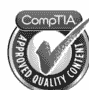

# 简介

您是否正在考虑 `CompTIA Strata` 证书对您的职业——甚至对您个人的益处？今天已有数千人获得了 `Strata` 认证，证明了他们具备了安装、使用和维护计算机硬件和软件所需的技能和知识。本书将帮助您准备通过 `Strata` 考试。

## 什么是 Strata 认证？

`CompTIA` 对 `Strata` 的官方描述是“一种入门级证书，确保掌握 `PC` 组件、功能、兼容性以及相关技术主题的知识”。考试涵盖了计算机硬件技术、兼容性问题和常见错误、软件安装与功能，以及安全风险和预防。考试还评估候选人对绿色 `IT` 和计算机预防性维护的知识。职位包括网络和系统管理员、销售工程师、客户经理和业务发展经理。`Strata` 适用于准备进入 `IT` 劳动力市场的个人和学生，或转向 `IT` 或技术相关领域的专业人士。该证书可以作为更高级认证的基石，例如 `CompTIA A+`、`CompTIA Network+` 和 `CompTIA Security+`。

`CompTIA` 是一家非营利信息技术贸易协会。`CompTIA` 认证由来自 `IT` 行业各领域的领域专家设计。每项 `CompTIA` 认证都是厂商中立的，涵盖多种技术，并要求展示 `IT` 行业广泛寻求的技能和知识。

## 英国和美国考试的差异

在美国，`Strata` 由单场考试组成：

- `FC0-U41 CompTIA Strata IT Fundamentals`

在英国，`Strata` 认证由两场考试组成：

- `FC0-U21 CompTIA Strata Fundamentals of Technology`（仅限英国）
- `FC0-U11 CompTIA Strata Fundamentals of PC Functionality`（仅限英国）

考试目标非常相似，美国考试涵盖了英国两场考试的大部分目标。两国的目标集之间存在细微差异，我们在书中适当指出了这些差异。

# Introduction

# 考试形式是怎样的？

美国/国际版考试（`FCO-U41`）有 70 道题，您有 120 分钟完成。及格分为 70%，提供英语、西班牙语、葡萄牙语、日语、德语、希腊语、阿拉伯语和韩语。

英国版由两场每场 35 道题的考试组成：`FCO-U11` 和 `FCO-U21`，每场考试有 60 分钟时间。及格分为 70%。考试仅提供英语版。

要查找最近的考试中心，请访问：

```
http://certification.comptia.com/Training/testingcenters.aspx
```

# 本书的特点

每个章节开头都会列出目标列表（请参见下一节“考试内容”查看所有目标）。在章节内部，信息按逻辑安排，而不是严格按照目标顺序，因为这样有利于学习。

在学习了特定技术或技巧后，您可以通过动手练习进行实践。练习将逐步完成某个过程，例如更新驱动程序或安装驱动。大多数练习使用 `Windows 7`；`Windows` 是最流行的操作系统，`7` 是当时的最新版本。许多情况下，旧版本的 `Windows` 也有类似的步骤。在适用的情况下，我们也列出了 `Mac` 和 `Linux` 产品。例如，在学习命令行提示符的命令时，我们包含了 `Windows`、`Mac` 和 `Linux` 的可用命令。

每个章节还包含注释，提供了可能需要的额外信息。例如，注释可能会说明特定操作系统的局限性，或者作为主步骤的快捷命令。

每个章节末尾都有快速总结部分，回顾所学内容。还有一个“考试要点”部分，指出了通过阅读本章应准备的重要考试目标。

每个章节的最后一个元素是一组 20 道复习题，测试您对章节内容的理解。答案在每组题目之后提供，您可以快速检查结果。

# 考试内容

以下是您在 `Strata` 考试中需要负责的目标。在下表中，我们在左侧列出了美国/国际考试目标，并在右侧匹配了英国考试对应的目标，并标出了英国各部分的考试编号。

# 简介

# FCO-U41 Strata IT 基础 英国考试等效章节

## 1.0 技术与计算机硬件基础

## 1.0 技术 (FCO-U11)

### 1.1 识别基础 IT 词汇。

- 处理器主频/核心数
  - 单核/双核/四核
  - `Intel` 架构 / `Cell` 架构 / `AMD` 架构
  - `GHz` vs. `MHz`
  - 处理器缓存大小
  - 总线速度（与主板、内存等相关）

- 内存（运行内存）
  - `DDR`, `DDR2`, `DDR3`
  - `DIMM` 与 `SODIMM`
  - 单数据速率、双倍数据速率、三倍数据速率
  - `DIMM` 与 `SODIMM`

- 硬盘
  - 转速（每分钟转数）
  - 缓存大小
  - 闪存硬盘 vs 传统硬盘
  - `SATA`, `SCSI`, `IDE`
  - 内部 vs. 外部
  - 本地 vs. 网络共享

- 网络
  - 无线网络术语
  - `802.11a/b/g`
  - 蓝牙
  - `RF`（射频）
  - 干扰
  - `WAP`（无线接入点）
  - `SSID`
  - 无线路由器

## 简介（续上）

| FCO-U41 Strata IT 基础 | 英国考试等效 | 章节 |
| --- | --- | --- |
| 以太网技术 | 以太网技术 | 3 |
| `CAT5` 连接和电缆 | `CAT5`, `CAT5e` 连接和电缆 | 3 |
| 家用宽（电力线以太网） | 家用宽（电力线以太网） | 3 |
| 宽带路由器 | 宽带路由器 | 3 |
| `DSL` 和电缆调制器 | `DSL` 和电缆调制器 | 3 |


## 1.0 直线型 vs 交叉跳线 与 自动协商（速度和双工）

| 直线型 vs 交叉跳线 | 直线型 vs 交叉跳线 | 3 |
| :--- | :--- | :--- |
| 自动协商（速度和双工） | 自动协商（速度和双工） | 3 |
| 互联网 | 互联网 | 3 |
| 协议 | 协议 | 3 |

### 相关协议

- `HTTP` vs `HTTPS`
- `FTP`
- `SSL`
- `POP3`
- `SMTP`
- `IMAP`
- `DNS`
- `DHCP`
- `TCP/IP` (`IPv4` 地址, `IPv6` 地址)

### 浏览器功能

- 插件
- 个性化（字体大小、样式等）
- 反钓鱼功能
- `ActiveX` 和 `Java`
- `Cookies`
- 浏览器缓存

**FCO-U41 Strata IT 基础 英国考试等效 章节**

## 1.2 演示以下设备的正确用法

**1.1 演示以下设备的正确用法：(FTO-U21)**

| 章节 | 章节 |
| :--- | :--- |
| 3 | 4 |

### 显示器
- 调整显示器设置（亮度、对比度等）

### 台式电脑

### 服务器

### 便携式
- 笔记本电脑
- `PDA`（个人数字辅助器）
- 智能手机
- 掌上电脑

## 1.3 解释内部和外部存储设备的特性和功能

**1.2 解释内部和外部存储设备的特性和功能 (FTO-U21)**

| 章节 | 章节 |
| :--- | :--- |
| 2 | 2 |

- `CD`/`CD-RW` 驱器
- `DVD`/`DVD-RW` 驱器
- 蓝光光驱器
- `USB` 存储（固态 vs 磁性磁盘）
- 多功能读读写器
- 硬盘
- 移动媒体设备（例如 `MP3` 播放器或 `PDA`）

## 1.4 解释外围设备的特性和功能

**1.3 解释外围设备的特性和功能 (FTO-U21)**

| 章节 | 章节 |
| :--- | :--- |
| 3 | 3 |

- 数码相机
- 摄像头
- 扬声器
- 调谐器
- 麦风
- 打印机 / 扫描仪

## 1.5 解释核心输入设备的特性和功能

**1.4 解释核心输入设备的特性和功能 (FTO-U21)**

- 键盘
- 鼠标
- 触摸屏
- 数字键盘
- 游戏面板

## 通用技术考量

- 数据丢失
- 存储能力
- 兼容性问题
- 总线差异
- 硬件故障

## 应用层考量

- 应用
- 需求
- 兼容性问题
- 带宽竞争

## 网络与服务

- `VoIP`
- 流媒体
- `Web` 服务

## 1.6 识别升级以下技术的风险

**1.2 识别升级以下技术的风险 (FTO-U21)**

| 章节 | 章节 |
| :--- | :--- |
| 6 | 7 |

### 操作系统（开源和商业）
- 兼容性问题
- 升级问题
- 数据丢失
- 存储能力
- 兼容性问题
- 升级问题
- 总线差异
- 硬件故障

### 应用
- 需求
- 兼容性问题
- 带宽竞争

### 服务
- `VoIP`
- 流媒体
- `Web` 服务

### 更新策略
- 自动操作系统更新
- 自动更新
- 不使用自动更新
- 不使用厂商网站

## 1.7 演示设置基础 PC 工作站的能力

**1.3 演示设置基础 PC 工作站的能力 (FTO-U21)**

| 章节 | 章节 |
| :--- | :--- |
| 2, 4 | 2, 4 |

### 识别连接类型差异

| 连接类型 | 章节 |
| :--- | :--- |
| `DVI`, `VGA`, `HDMI` | 3 |
| `USB`, `PS/2` | 3 |
| `FireWire` | 3 |
| 蓝牙和无线 | 3 |
| 串口 | 3 |
| 网络连接器 | 3 |
| `PCMCIA` | 4 |
| `ExpressCard` | 4 |
| 3.5mm 接口 | 3 |
| 电源连接器 | 3 |

### 设备类型

| 设备 | 章节 |
| :--- | :--- |
| 显示器类型 | 3 |
| 电脑（台式电脑、塔式、笔记本电脑） | 4 |
| 键盘（键盘布局：区域化） | 2 |
| 鼠标（触摸板、光学、轨迹球） | 2 |
| 打印机（`USB`、无线、网络） | 3, 4 |

# 2.0 兼容性问题与常见错误 (FTO-U221)

## 2.1 识别以下之间的基本兼容性问题：(FTO-U221)

- 处理器性能
- `RAM` 内存
- `USB` (1.1, 2.0)
- 火线接口 (`FireWire`)
- `PS/2`
- 以太网
- 无线网络

## 2.2 识别硬件引起的常见操作问题 (FTO-U221)

- 关键错误消息或崩溃
- 系统死机（冻结）
- 应用程序无法启动或加载
- 无法登录网络
- 驱动程序 / 硬件兼容性
- 输入设备无法工作

## 2.3 证明最小化风险的能力 (FTO-U221)

- 数据丢失
- 服务中断
- 设备损坏

# 绪言

（续）

## 3.0 软件安装与功能

**2.0 软件安装与功能 (FCO-U11)**

| 章节 | 章节 |
| :--- | :--- |
| | |

## 3.1 执行基础软件安装、删除和/或升级。

**2.1 执行基础软件安装、删除和/或升级。(FCO-U11)**

| 章节 | 章节 |
| :--- | :--- |
| 6, 10 | 6 |

- 遵循基础安装/升级程序
- 检查 PC 是否符合最低要求
- 管理权限
- 防火墙访问（开放端口以确保功能正常）
- 配置操作系统
- 调整基础设置（例如音量、日期、时区）
- 用户账户


| 电源设置（节能、睡眠模式等） | 电源设置（节能、睡眠模式等） | 10 |
| 屏幕分辨率 | 屏幕分辨率 | 6 |
| 文档 | 文档 | 6 |
| 许可（商业软件、免费软件、共享软件） | 许可（商业软件、免费软件、共享软件） | 6 |
| 软件注册 | 软件注册 | 6 |
| 数字权利管理 | 数字权利管理 | 6 |
| 卸载软件（清洁安装） | 卸载软件（清洁安装） | 6 |
| 重新安装（清洁安装） | 重新安装（清洁安装） | 6 |
| 识别与文件夹和文件管理的问题 | 识别与文件夹和文件管理的问题 (FCO-U21) | 5 |
| 创建、删除、重命名和移动文件夹 | 创建、删除、重命名和移动文件夹 | 5 |
| 安装期间分配文件夹结构 | 安装期间分配文件夹结构 | 5 |
| 创建、删除、重命名、移动和打印文件 | 创建、删除、重命名、移动和打印文件 | 5 |
| 遵循备份指南和程序的重要性 | 遵循备份指南和程序的重要性 | 5 |

### 解释软件工具的功能和目的

解释软件工具的功能和目的 (FCO-U21)

- 性能和错误修复工具
- 活动或事件日志记录
- 备份工具
- 磁盘清理工具
- 文件压缩工具

## 安全

安全 (FCO-U11)

### 识别基础安全风险及预防风险的程序

识别基础安全风险及预防风险的程序。(FCO-U11)

- 识别风险
- 社会工程学
- 病毒
- 蠕虫
- 特洛马
- 未经授权的访问
- 黑客
- 钓鱼攻击
- 间谍软件
- 广告软件
- 恶意软件
- 身份欺骗
- 文件和文件夹共享
- 网页浏览器风险

# 绪言

（续）

| FCO-U41 Strata IT 基础 | 英国考试对应项目 | 章节 |
|---|---|---|
| 操作系统漏洞 | 操作系统漏洞 | 9 |
| 服务包 | 服务包 | 9 |
| 安全更新 | 安全更新 | 9 |
| 盗窃 | 盗窃 | 9 |
| 开放或网络 | 开放或网络 | 9 |
| 识别预防方法 | 识别预防方法 | 3, 9 |
| 用户意识/教育 | 用户意识/教育 | 9 |
| 杀病毒软件 | 杀病毒软件 | 9 |
| 确保使用正确的安全证书 (`SSL`) | 确保使用正确的安全证书 (`SSL`) | 9 |
| 无线加密 (`WPA`/`WEP`) | 无线加密 (`WPA`/`WEP`) | 3, 9 |
| 反间谍软件 | 反间谍软件 | 9 |
| 文件加密 | 文件加密 | 9 |
| 防火墙 | 防火墙 | 9 |
| 反垃圾邮件软件 | 反垃圾邮件软件 | 9 |
| 密码最佳实践 | 密码最佳实践 | 9 |
| 复杂性（密码构造） | 复杂性（密码构造） | 9 |
| 密码机密性 | 密码机密性 | 9 |
| 更改频率 | 更改频率 | 9 |
| 重用 | 重用 | 9 |
| 利用率 | 利用率 | 9 |
| 识别访问方法 | 识别访问控制方法 | 9 |
| 密码和用户 `ID` | 密码和用户 `ID` | 9 |
| 屏幕窥视 (`Screavers`) | 屏幕窥视 (`Screavers`) | 9 |
| 硬件物理安全 | 硬件物理安全 | 9 |
| 锁 | 锁 | 9 |
| 家长控制 | 家长控制 | 9 |
| 智能卡 | 智能卡 | 9 |
| 指纹识别器 | 指纹识别器 | 9 |
| 动态密码 | 动态密码 | 9 |

# 绪言

# x

| FCO-U41 Strata IT 基础 | 英国考试对应项目 | 章节 |
|---|---|---|
| 识别以下安全威胁： | 识别以下安全威胁： | 9 |
| 用于备份的介质（盗窃或丢失） | 用于备份的介质（盗窃或丢失） | 9 |
| 屏幕可见性（屏幕窥视） | 屏幕可见性（屏幕窥视） | 9 |
| `Cookie`（可能被盗取、密码、浏览器跟踪） | `Cookie`（可能被盗取、密码、浏览器跟踪） | 9 |
| 弹出窗口（自动安装、点击恶意软件链接） | 弹出窗口（自动安装、点击恶意软件链接） | 9 |
| 意外误配置 | 意外误配置 | 9 |

### 识别安全违规行为及解决办法

识别安全违规行为及解决办法。(FCO-U11)

- 识别感染病毒后的正确诊断程序
- 运行杀病毒扫描
- 尽可能隔离病毒
- 需要时向上上报给 `IT` 专业人员
- 识别维护安全环境的正确程序
- 定期进行杀病毒和恶意软件扫描
- 应用程序 / 操作系统更新

# 简介

（续）

| FCO-U441 Strata IT Fundamentals | 英国考试等效 | 章节 |
|---|---|---|
| 环境有害物质处置 | | 10 |
| 电池处置 | | 10 |
| `CRT` 显示器处置（用 `LCD` 替换） | | 10 |
| 电脑回收以供重复使用或拆解 | | 10 |
| 墨盒处置 | | 10 |
| 清洁用品处置 | | 10 |
| 符合 `RoHS` 指南的材料 | | 10 |
| 电源管理（节能功能） | | 10 |
| 每日结束工作时的关机/断电程序/策略 | | 10 |
| 使用 15 分钟后自动关机（英国不适用） | | 10 |
| 关机脚本 | | 10 |
| 电源管理 `PC` 和低功耗服务器，用能效笔记本电脑和瘦客户替换大型台式机 | | 10 |
| 5.2 识别绿色技术、设备和程序。 | | 1, 3, 10 |
| 定义云计算（英国版不包含） | | 10 |
| 定义虚拟化（在单台硬件上运行多个服务器） | | 10 |
| 减少功率消耗和冷却消耗 | | 10 |
| 定义 `VoIP` 及其与绿色 `IT` 的关系（英国版不包含） | | 10 |
| 双面打印并使用单页成本较低的网络打印机 | | 10 |

- 终端服务器 10
- 能源之星认证 10
- 使用低功耗 `NAS`（网络附属存储）代替文件服务器 10
- 固态硬盘 3
- 绿色建筑基础设施 10
- 消除服务器机房的冷空气泄漏 10
- `IT` 设备散热的合理间距 10
- 高能效散热风扇-`BIOS` 可调（英国版不适用） 1
- 员工远程办公 10
- 减少排放 10
- 减少办公室空间的加热、照明等 10
- 危害 5
- 火灾 5
- 洪水 5
- 浪涌 5
- 极端风暴 5
- 环境危害 5
- 准则 5
- `ESD`（防静电）设备的使用 5
- 工具和设备的使用 5
- 电与安全 5

# 简介

（续）

| FCO-U41 Strata IT Fundamentals | 英国考试等效 | 章节 |
|---|---|---|
| | 有害物质 | 5, 10 |
| | 布线位置与安全 | 5 |
| | 环境法律和法规（例如材料处置） | 5, 10 |

### 识别预防性维护产品、技术及使用方法

识别预防性维护产品、程序及使用方法 (`FTO-U21`)

| 液体清洁剂 | 液体清洁剂 |
|---|---|
| 清洁接触点和连接处的材料类型 | 清洁接触点和连接处的材料类型 |
| 压缩空气 | 压缩空气 |
| 清洁显示器 | 清洁显示器 |
| 清洁可移动媒体设备 | 清洁可移动媒体设备 |
| `PC` 硬件内部的通风、防尘和湿度控制 | `PC` 硬件内部的通风、防尘和湿度控制 |
| 浪涌保护器 | 浪涌保护器 |
| `ESD` 设备的使用 | |
| 布线位置与安全 | |
| | 更换打印机耗材 |

# 评估测试

1. 大多数笔记本电脑使用的 `RAM` 是什么类型？

   A. `SODIMM`
   B. `DIMM`
   C. `RIMM`
   D. `SIMM`

3. 电脑内部的大电路板称为什么？

   A. 扩展板
   B. 主板
   C. 内存
   D. `CPU`

4. 一个兆字节（`megabyte`）大约等于多少字节（`bytes`）？

   A. 10
   B. 10,000
   C. 1,000,000

5. `QWERTY` 是什么 `PC` 输入设备的布局方式？

   A. 鼠标
   B. 扫描仪
   C. 键盘
   D. 显示器

6. 哪种是较新的硬盘技术：`PATA` `SATA`？

   A. `PATA`
   B. `SATA`
   C. 两者一样新

7. 一个单面单层 `DVD` 可以存储多少数据？

   A. 700 `MB`
   B. 1.4 `GB`
   C. 4.7 `GB`
   D. 9.4 `GB`

8. 打印机分辨率是如何衡量的？

   A. `ppm`
   B. `dpi`
   C. `cps`
   D. `bps`

9. 哪种打印机使用粉末墨水和旋转的鼓组件？

   A. 激光
   B. 喷墨
   C. 针式打印
   D. 热蜡

10. `LCD` 代表什么？

   A. 液体载体双工模式
   B. 长程数据


C. 液晶显示器

D. 长度数据

- 11. 在什么环境下 P2P 网络比较合适？

  A. 有多个地点的大型企业

  B. 单地点的大型企业

  C. 家庭办公

  D. 互联网

- 12. Cat5 线使用的是什么类型的连接器？

  A. RJ-23

  B. RJ-11

  C. RJ-

  D. RJ-45

- 13. 大多数设备使用什么接口连接 PC？

  A. 遗留

  B. VGA

  C. PATA

  D. USB

- 14. 在美国，如果电源是 哪种电压，应该是哪种？

  A. 120v

  B. 220v

  C. 两者

  D. 无

- 15. 哪种接口可以用于显示器？

  A. HDMI

  B. DVI

  C. USB

  D. FireWire

- 16. ________________ 是什么的常用名称？

  A. 静电

  B. 磁干扰

  C. 串扰

  D. 刷新率

- 17. 在 Windows 中，如何打开命令提示符？

  A. 点击开始

  B. 输入 `cmd` 并回车

  C. 右键点击桌面

  D. 停止

- 18. 哪种工具可以列出正在运行的应用程序和进程？

  A. 系统管理器

  B. 系统编辑器

  C. 设备管理器

  D. 任务管理器

- 19. 在 Windows 上可以创建哪种类型的账户？

  A. 访客

  B. 管理员

  C. 完全

  D. 系统

- 20. ________________ 软件是鼓励用户修改代码的？

  A. 免费软件

  B. 共享软件

  C. 开源

  D. 商业软件

- 21. ________________ 和注册是一回事。

  A. 真

  B. 假

- 22. 什么类型的文件帮助操作系统与硬件交互？

  A. 驱动程序

  B. 可执行文件

  C. 服务器

  D. 客户端

- 23. 在 Vista 及更高版本中，________________ 提供了性能数值评分。

  A. 设备管理器

  B. 系统配置

  C. Windows 体验

  D. 中心

- 24. SATA 线支持多少种驱动？

  A. 1

  B. 2

  C. 7

  D. 25

- 25. 当遇到 Windows ________________（即蓝屏）时该怎么办？

  A. 重启崩溃的应用程序

  B. 拔掉键盘和鼠标

  C. 关闭电脑并重启

  D. 格式化磁盘

- 26. 如果旧应用程序无法在新版本的 Windows 中运行，可以使用 ________________ 模式来运行。

  A. 辅助功能

  B. 标准

  C. 遗留

  D. 兼容性

- 27. 在命令提示符输入什么命令可以获取网络设备的 IP 地址？

  A. `PING`

  B. `TRACERT`

  C. `CMD`

  D. `IPCONFIG`

- 28. 笔记本电脑上的 K 槽是干什么用的？

  A. 内存卡

  B. USB 设备

  C. 锁

  D. 外部键盘

- 29. 哪个是强密码的示例？

  A. 58WRXry%42

  B. Password

  C. QWERTY

  D. 098765423

- 30. ________________ 是网页存储在硬盘上的用于跟踪目的纯文本文件。

  A. 弹出窗口

  B. 钓鱼

  C. Cookie

  D. 蠕虫

- 31. ________________ 是一种看似有用但实际上损害系统或损害隐私的恶意软件。

  A. 病毒

  B. 木马

  C. 蠕虫

  D. 机器人

- 32. 在哪种低功率模式下，电脑会关闭 RAM 以外的所有组件的电源？

  A. 休眠

  B. 杀死

  C. RAM 模式

  D. 睡眠

- 33. 双面打印（duplex）是指什么？

  A. 重复 CD 或 DVD

  B. 回收废墨水

  C. 在纸的两面打印

  D. 建立虚拟服务器

- 34. VoIP 是什么？

  A. 通过互联网为数据通信创建安全通道

  B. 使用互联网提供电话服务

  C. 远程办公

  D. 建立虚拟服务器

- 35. 为什么你不应该将墨盒丢在普通垃圾里？

  A. 它有价值可以出售

  B. 它是易燃的

  C. 它是致癌的

  D. 它遇湿时会爆炸

# 评估测试答案

- 1. A. 台式机内存大多是 DIMM，笔记本内存大多是 SODIMM。SODIMM 较小的尺寸使其更适合用于较小的计算设备中。第1章，“处理器与内存”。

- 2. D. 人类使用十进制计数（0 到 9），而计算机使用二进制（0 和 1）和十六进制（0 到 9 加上 A 到 F）的组合。第1章。

- 3. C. 主板是 PC 中的主电路板，所有设备都连接在上面。它包含 CPU、内存以及连接所有驱动器的接口。参见第1章。

- 4. D. 兆字节，缩写为 MB，是一百万字节。兆字节是计算机存储以及内存容量的常用测量单位。一千兆字节（或十亿字节）为一个千字节。参见第1章。

- 5. C. QWERTY 术语源于键盘布局第一行的六个字母。参见第2章，“输入和存储设备”。

- 6. B. 串行 ATA（SATA）是硬盘连接到 PC 的新型接口。它比并行 ATA（PATA，使用排线的旧技术）速度更快，且电缆更细。参见第2章。

- 7. C. DVD 每侧存储 4.7 GB。双层 DVD 每侧存储几乎是两倍：8.5 GB。参见第2章。

- 8. B. 打印机质量用每英寸点数（dpi）衡量；dpi 越高，组成图像的点越小且越密集。参见第3章，“外围设备与网络”。

- 9. A. 激光打印机的工作原理类似于复印机。它用电荷在硒筒上写入图像，粉末碳墨附在硒筒上并熔合到纸上。参见第3章。

- 10. C. 在液晶显示器中，有偏振滤光片，之间是液晶。当电流通过晶体时，它们会发生扭曲，让光通过。这会点亮屏幕的区域。参见第3章。

- 11. C. P2P 代表点对点。这种网络没有服务器；客户端 PC 分担维护网络的负担。P2P 在少于 10 台电脑的网络中效果最好。参见第3章。

- 12. D. 大多数以太线（包括 Cat5、Cat5e 和 Cat6）两端都使用 RJ45 接口。这看起来像电话接口，但更宽且有八根线（绞线）。参见第3章。

# 评估测试答案

- 13. D. USB 接口是一种用于各种设备的通用接口，包括键盘、鼠标、打印机、扫描仪、调制调器等。参见第4章，“设置计算机”。

- 14. A. 美国使用 120V 电源。欧洲使用 220V 或 230V 电源。参见第4章。

- 15. B. 数字视频接口（DVI）是更现代的数字接口。视频图形阵（VGA）是旧的模拟接口。参见第4章。

- 16. A. 静电放电或 ESD 也称为静电。它是计算机组件的威胁，因为静电电压会损坏它们。参见第5章。

- 17. B. 命令提示界面允许你发布图形界面中无法使用的某些命令。输入 `CMD` 命令即可打开它。参见第5章。

- 18. D. 任务管理器允许关闭无响应的应用程序。要显示任务管理器，右键点击任务栏并选择“开始”。参见第5章。

- 19. B. 标准账户不应能够做出影响其他用户的更改。为应具有完全控制权的用户激活管理员账户。参见第6章。

- 20. C. 开源软件对所有人免费，每个人都可以修改它。`Linux` 是此类软件的一个示例。参见第6章。

- 21. B. 产品注册通常是可选的；它向制造商提供你的联系信息。激活产品会将其锁定在你的计算机上，使其无法安装在其他地方。不会发送任何个人信息，且该过程不是可选的。参见第6章。

- 22. A. 设备驱动在设备和操作系统之间翻译指令。如果有更新版本，你可以更新设备驱动程序。参见第7章，“硬件更新与升级”。

- 23. C. `Windows` 索引体验在五个领域对你的计算机进行排名并给出数字分。总分是这五个分中最低的一个。参见第7章。

- 24. A. 与可以连接两个驱动器的 PATA 线缆不同，每根 SATA 线缆只连接到一个驱动器。参见第7章。

- 25. C. STOP 错误会冻结计算机；你必须重启才能恢复。参见第8章，“排除操作故障”。

- 26. D. 可以为单个应用程序设置兼容模式，以模拟早期版本的 `Windows`。参见第8章。

- 27. D. `IPCONFIG` 告诉你每个网络适配器的状态和 IP 地址。它仅在命令提示符中可用。参见第8章。

- 28. C. 它用于安装锁将笔记本电脑物理固定在位置（如桌子上）。K 是锁制造商 Kensington 的缩写。参见第9章，“安全与访问控制”。

- 29. A. 强密码长、多样化且异常，不易预测。参见第9章。

- 30. C. `Cookie` 帮助网站记住你之前的偏好或状态。它们通常是无害的，但有些人为了隐私偏于禁用它们。没有它们，某些网站将无法正常工作。参见第9章。

- 31. B. 木马程序可能会告诉你它们正在扫描错误或改进你的系统，而实际上它们可能在记录你的击键或监视你的浏览习惯。参见第9章。


- 32. D. 睡眠模式保持内存供电，因此计算机耗极低。休眠模式不保存任何内容，因此计算机不消耗能量。参见第10章，“安全、合法且绿色计算机使用”。

- 33. C. 通过在打印机双面打印，你可以降低打印成本并保护环境。参见第10章。

- 34. B. VoIP 通过减少每个办公室所需的布线量来降低建筑成本，因为它不需要独立的电话线和互联网线。参见第10章。

- 35. C. 碳墨不仅脏乱，还对健康造成危害。

## RISC

精简指令集计算（RISC）基于这样一个原则：为处理器配备简单的指令集可以提高性能。其逻辑是，你对复杂处理器的要求越高，它的运行速度就越慢。因此，能够处理较小任务集的处理器可以更快地完成这些任务。高级 RISC 机器（ARM）是一种许多移动计算设备中常见的处理器，包括手机和手持游戏机。相比之下，大多数个人电脑处理器被认为是复杂指令集计算（CISC），具有相对较大的指令集以获得更大的灵活性。

处理器仅与二进制位工作，因此操作系统会将所有数字转换为二进制计数系统（数字 0 到 9）。人类最常用十进制计数系统（10 个数字，0 到 9）或二进制计数（2 个数字，0 和 1）。在与处理器交互时使用二进制，而在操作系统引用内存地址时使用十六进制。练习 1.1 演示了如何在二进制和其他计数制之间进行转换。

## 练习 1.1

### 在二进制与其他计数制之间进行转换

- 1. 在 Windows 7 中，打开计算器应用程序。

- 2. 选择“查看” ➤ “程序员”以切换到程序员视图，如下所示。注意“Dec”（十进制）单选按钮已选中，表示十进制计数。

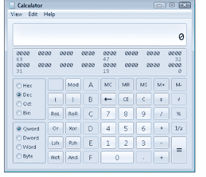

- 3. 输入数字 335。

- 4. 点击“Bin”（二进制）单选按钮。数字被转换为二进制（`10100111`）。注意除 1 和 0 之外，所有数字键均已禁用。

- 5. 点击“Hex”（十六进制）单选按钮。数字被转换为十六进制（`14F`）。注意所有数字键再次变为激活，A 到 F 键也是如此。

- 6. 再次点击“Dec”单选按钮返回十进制计数。

- 7. 自己尝试用更多数字进行实验。完成后关闭计算器应用。

## 处理器品牌

各种制造商生产用于家电和其他非计算机设备内部的处理器。然而，对于个人电脑，市场竞争几乎已被 `Intel` 和 `AMD` 两家制造商消除了。


`Apple Macintosh` 电脑多年一直使用 `Motorola` 处理器，但在 2006 年年中切换到了 `Intel` 处理器。

## Intel 处理器

`Intel` 是个人电脑最受欢迎的处理器品牌。自公司于 1968 年成立以来，它已经制造了 50 多种不同的处理器，外显卡、主板和各种外围设备。

原始的 `IBM PC` 和 `PC-XT` 电脑运行在 `Intel` 处理器上（分别为 `8088` 和 `8086`）。后来的 `IBM` 模型也使用了 `Intel` 处理器，例如 `PS/2` 和 `i7` 16 位 `8026` 处理器。1993 年，`Intel` 发布了奔腾处理器，这是第一个具有商业可行性的 32 位 `CPU`。随后是 1997 年的 `Pentium 2`、1999 年的 `Pentium 3` 以及 2000 年的 `Pentium 4`。

`Intel` 提供了一个名为 `Core` 的 64 位系列，包括 `Core i3`、`i5` 和 `i7`。`Core i3` 是入门级 `CPU`，`Core i5` 是中端，而 `i7` 是高端产品。正如你可能从名称中的 `Core`（核心）一词所预期的那样，这些都是多核心处理器（根据型号包含二到六个核心，它们本身就可以作为一个处理器运行）。

在 `Intel Core` 产品线中，有许多版本的 `i3`、`i5` 和 `i7`，分别用于桌面电脑和笔记本电脑，每个版本都有不同的代号以及核心数量、`L3` 缓存大小和插槽的组合。例如，品牌名称 `Core-5xx`（每个 `x` 代表一个数字），代号为 `Clarkdale`，有两个核心和 `4 MB L3` 缓存，并适用于 `LGA 1156` 插槽。其他一些代号包括 `Arandale`、`Lynnfield`、`Gletown` 以及其中最近的 `Sandy Bridge`。

## AMD 处理器

自 20 世纪 90 年代以来，`AMD Devices`（`AMD`）一直是 `PC` 处理器市场中 `Intel` 最有力的竞争对手。从历史上看，`AMD` 处理器的价格通常比 `Intel` 便宜，同时提供等效性能。由于 `AMD` 处理器使用与 `Intel` 不同的指令集，它们需要专门为它们设计的主板。主板是 `PC` 内部连接所有设备的大型电路板。`AMD` 早期的 `CPU` 产品包括 `K5`、`K6`、`K7`、`K8` 和 `K9` 处理器，每一个都与 `Intel` 处理器直接竞争。`AMD` 目前的产品线包括 `Phenom II`、`Athlon II` 和 `Turion II` 系列。

## 处理器插槽

处理器在安装它们的主板上需要正确类型的插槽。在购买主板时，请确保处理器插槽适用于你计划使用的 `CPU`。

插槽使用各种代号和编号。编号通常基于芯片上引脚（或触点）的数量。例如，`LGA 1356` 包含 1,356 个引脚。在早时期，引脚阵列（`PGA`）是处理器的首选样式。图 1.1 显示 `LGA 1356` 包含 1,356 个引脚。

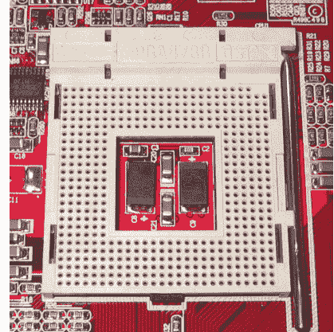

在早时期，引脚阵列（`PGA`）是处理器的首选样式。图 1.1 显示 `LGA 1356` 包含 1,356 个引脚。

## 处理与内存

然而，对于个人电脑，市场竞争几乎已被 `Intel` 和 `AMD` 两家制造商消除了。

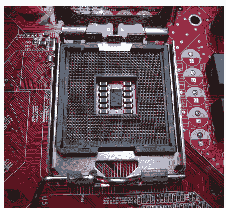

## 处理器速度

处理器的速度与其每秒指令数有关，但速度之外的其他因素也会影响它可以处理的指令数。例如，多核 `CPU` 比单核，缓存使用等其他技术增强进一步增强了处理器的能力。

| 速度 | 数字 | 示例 | 发布年份 |
|---|---|---|---|
| 50 MHz | 50,000,000 | Intel 486 | 1993–1995 |
| 500 MHz | 500,000,000 | 奔腾 3 | 1999–2001 |
| 1.5 GHz | 1,500,000,000 | 奔腾 4 | 2000–2003 |
| 3 GHz | 3,000,000,000 | 奔腾 4 | 2005–2008 |

不要将每秒周期数与每秒指令数（`IPS`）混淆，处理器执行的许多指令需要多个内部周期。许多系统以每秒百万指令数（`MIPS`）进行计算。作为参考，`Core i7 Extreme`（四核）运行频率为 `3.3 GHz`。

## 处理器性能

任何处理器的另一个贡献因素是支持处理器的主板质量和速度。主板的系统总线（称为前端总线）是向处理器传递数据的路径。该路径的运行速度由主板的前端总线决定。主板上的系统定时器决定了这个速度。大多数主板可以根据安装的处理器自动调整定时器的速度；或者，在旧型号中，需要手动在主板上设置跳线来指示安装了什么类型的处理器和速度。

## 处理器缓存

有时，处理器会空闲一个或多个时周期，因为主板没有向它传递任何需要处理的数据。这种情况发生由于多种原因。其中一个原因是，某些数据必须从内存一直传输到处理器，即使主板的前端总线很快，也仍然快不足以跟上数据传输的速度。虽然系统内存距离处理器大约小于 50 毫米，但在性能方面，这相当于越了 1,000 英里。

因此，为了增加每秒处理的指令数，计算机制造商一直在寻找方法，将频繁使用的数据放在处理器附近，这样在调用时，数据传输的距离就更短。这就是缓存的目的。缓存是位于处理器附近，并通过极高速路径与之连接的临时存储区域。它保存了最近使用的数据，这样数据就不需要每次从 `RAM` 重新检索。

现代处理器包含多级缓存。一级缓存（`L1`）最小，并且位于处理器本身上。换句话说，它是制造图案中的一个集成部分，用于将处理器压制在硅片上。你无法找到比这更接近处理器的地方了。二级缓存（`L2`）更大且也很近——它在处理器芯片中，但并不一定是内核的一部分（见图 1.3）。某些处理器还使用三级缓存（`L3`）。当处理器需要某些数据时，它首先检查 `L1` 缓存，如果可能则从那里检索数据。如果不是，处理器会检查 `L2` 缓存，然后从 `L3` 缓存检索。如果未找到数据，处理器将从 `RAM` 获取。

**图 1.3** `L1` 缓存在内核上；`L2` 缓存在芯片上。

原始 `Pentium` 处理器具有 `16 KB` 的 `L1` 缓存。（`L2` 缓存在主板上，因此容量取决于主板。）相比之下，`Intel` 的 `Core i7` 处理器可以拥有 `12 MB` 的缓存。（兆字节，缩写为 `MB`，大约是一百万字节，或八位。位是一个二进制数字，可以是 0 或 1。）你会发现，当处理器制造商在营销材料中列出缓存大一时，他们通常只列出最大的缓存（即编号最高的缓存）。在多核系统中，最大的缓存由所有核心共享。

## 多核处理器

为了每年不断制造更好、更快的处理器，制造商必须不断找到增加每秒指令数的方法。他们采用的一种方法是增加处理器设计的复杂性。另一种方法是将多个处理器组合在一起，让它们协同工作。


多年来，市面上出现了带有多个独立处理器的主板，每个处理器在主板上都有自己的插槽。这种技术是有限制的，因为处理器之间的距离以及它们之间总线路径的速度限制。正如前面提到的，制造商发现了一种解决方案，即创建多核处理器，将多个处理器集成到一个封装中。这些处理器从外面看起来像单块芯片，但实际上有几个独立的处理器核心。

## Cell 微处理器

Cell 微处理器是多核处理器和特种系统（如高端显卡）之间的混合体，由索尼、东芝和 IBM 合作创建。结果是一个更适用于仿真、成像和游戏解决方案的系统。索尼在其 `PlayStation 3` 主机使用了 Cell 处理器，带有八个单元（或处理器）。`Xbox 360` 的不同在于它使用了三核技术 `Xenon`。

> 注意：仍然有可以容多个处理器的主板。通过在系统中组合多核处理器，你可以倍倍提高处理能力。例如，如果你有一个运行频率为 `3 GHz` 的单核处理器，四核处理器可以激发 `12 GHz` 的处理潜力，而带有八个核心的板载理论上可以等同于 `24 GHz` 的处理潜力。然而，在多个处理器之间的事务，存在不可避免的性能损失。

## 练习 1.2 比较处理器

Intel 和 AMD 列出了他们的处理器及其规格，包括缓存大小、时钟频率和核心数量。访问 `http://ark.intel.com/Default.aspx` 和 `http://products.amd.com/en-us/CPUs`

## 散热风扇和散热片

由于晶管近距离工作，处理器会产生热量。这是涉及电能简单物理定律之一的结果。当晶管限制电流流动时，就会产生热。能量必须去某个地方，因此它以热量的形式释放。当处理器忙时，发热最高，例如当它同时运行许多应用程序时。

如果没有外部冷却，处理器将在系统启动后立即过热并关闭。因此，所有现代计算机都有某种类型的散热系统。冷却系统可以是被动的或主动的。被动散热系统不包含移动部件；主动散热系统通过循环水或空气来排出量。散热片是一块导热金属，它接触处理器并将热量带走。一些较小、功率较低的处理器（例如手机或手持游戏设备中的）可以保持足够低温以使用被动散热片工作。图 1.4 显示了可能用于控制主板操作的主板芯片组的被动散热片。

**图 1.4** 被动散热片

在今天的 PC 中，被动散热通常不足以让处理器保持低温；散热片与风扇结合，风扇吹过它，在热量被带走时进一步帮助散热。图 1.5 显示了主动散热片的示例。

**图 1.5** 主动散热片

主动冷却系统需要电运行，这增加了 PC 对功率的需求。某些计算机具有节能散热风扇，只有当处理器温度（由内部温度计评估）超过某个特定值时，才能在 BIOS 设置中进行调整。

> `BIOS` 代表基本输入/输出系统。它是主板上芯片上的软件，用于控制引导过程和低级硬件访问。它有自己的设置程序，你可以在计算机启动时通过按特定键来访问它。因为它存储在只读存储器（`ROM`）芯片上，所以它有时被称为 `ROM-BIOS`。你将在本章中学习 `ROM`。

水也可以作为冷却剂，而不是风扇的空气。在水冷系统中，泵通过穿过产生热量组件之间的管道循环水。管道穿过固定在芯片上的散热片（通常使用导热粘合复合材料），将热量从芯片带走。涉及的芯片不仅包括主板上的主处理器，还包括显卡上的主处理芯片，可能还包括主板上一些较大的芯片。水冷系统如果泄漏，可能会损坏组件。

## 我可以升级处理器吗？

处理器与主板之间的关系非常密切，因为它们必须无缝工作。处理器不仅必须物理上与主板兼容，主板还需要了解处理器的指令集以及它接受数据的速度。由于大多数主板只支持少数处理器，在不更换主板的情况下无法升级处理器。

## 内存

广义地说，内存是使用芯片上的开启/关闭状态记录二进制数据的存储（也就是说，数据由 1 和 0 组成）。内存内部是开启/关闭开关。开启代表 1，关闭代表 0。

内存可以是静态或动态的。`静态内存（a.k.a 非易失性内存）`不需要刷新即可保持内容。`动态内存（易失性内存）`必须持续供电以保留内容。

动态随机存存储器（`DRAM`），因此当人们提到计算机内存或 `RAM` 时，通常可以认为他们指的是主板上的 `DRAM`。动态随机存存储器是易失性的；当你关闭电脑时，其内容就会消失。

当电脑运行时，主板的 `RAM` 作为工作区域。操作系统被加载到其中，你打开的任何应用程序以及与这些应用程序关联的数据也是如此。计算机中的空闲 `RAM` 越多，可用工作空间就越大，因此你同时运行的应用程序和数据文件就越多。

## 虚拟内存

包括 `Microsoft Windows` 在内的许多操作系统在运行时都会使用大量的 `RAM`，以至于即使是配置良好的 PC 也可能没有足够的 `RAM` 来完成用户想要的所有操作。为了防止用户因缺少可用内存而无法执行某些活动，这些操作系统利用虚拟内存来补补。

通过虚拟内存，硬盘的一个部分被设置为 `RAM` 内容的存放区域。当 `RAM` 中没有足够的空间来存放需要放置的数据时，操作系统的虚拟内存管理程序会将 `RAM` 中一些最久未使用的数据临时移动到硬盘上，为新进入的数据腾出空间。然后，如果应用程序调用了被移出的数据，虚拟内存管理器会将其他数据移出，并将数据换回。由于所有这些交换操作，硬盘上为虚拟内存保留的区域有时交换文件（`swap file`）。

虚拟内存的主要缺点是它的速度，它受限于硬盘存储和检索数据的速度。与处理器和内存的速度相比，硬盘非常慢。因此，系统中可用的物理 `RAM` 越少，系统对虚拟内存的依赖就越多，应用程序运行得就越慢。这就是为什么向系统添加 `RAM` 通常是一项值得的升级。

## 练习 1.3

### 评估你计算机的 RAM 和虚拟内存

1. 在 `Windows Vista` 或 `Windows 7` 中，点击“开始”，右键点击“计算机”并点击“属性”。（或者，打开控制面板，进入“系统和安全”，然后进入“系统”。）
2. 在页面的“系统”部分，注意安装内存（`RAM`）的大小。这是 `RAM` 的物理总量。

### 练习 1.3（续）

| 系统 | |
|---|---|
| 制造商 | 戴尔 |
| 型号 | `Studio XPS 1647` |
| 评分 | `Windows` 体验指数 |
| 处理器 | `Intel(Core)TM i3 CPU M 540 @ 2.33GHz 2.33 GHz` |
| 安装内存 (RAM) | `8.00 GB` |
| 系统类型 | 64 位操作系统 |
| 手笔和触摸 | 此显示器不支持手笔或触摸输入 |

3. 在左侧侧边栏中，点击“高级系统设置”。打开“系统属性”对话框。
4. 在“高级”选项卡上，在“性能”部分，点击“设置”。打开“性能选项”对话框。
5. 点击“高级”选项卡，在“虚拟内存”部分，注意所有驱动器的分页文件大小。这是为系统使用保留的虚拟内存量。
6. 点击“更改”按钮。打开“虚拟内存”对话框。
7. 点击“取消”在进行任何更改关闭对话框。（通常最好让此设置由系统自动管理。）
8. 点击“取消”关闭“性能选项”对话框。
9. 点击“取消”关闭“系统属性”对话框。
10. 在“系统”标题下，找到“评分”行，点击“`Windows` 体验指数”。打开控制面板的“管理和维护工具”部分。
11. 注意内存（`RAM`）旁边的子分。如果这个数字明显低于其他子分，则通过添加更多 `RAM` 可能会提高计算机性能。如下所示，`RAM` 的得分是所有组件中最高的（`6.8`），因此此系统的 `RAM` 足够。
12. 关闭控制面板窗口。

## 内存总线速度

从内存传递数据的路径被称为内存总线。内存具有总线宽度，该宽度决定了存储单元格中每行有多少列。单行中的所有位都作为一个作为一个单一值被一起读取，因此内存总线宽度越宽，一次可以读取的数据就越多。例如，在 8 位宽的内存中，你有一个像 `01001100` 这样的数字。在 32 位宽的内存中，你可以有一个多达 32 位的数字。

内存总线还有速度，它决定了数据在其路径上传输的快慢。现代 PC 上的内存与系统总线同步（即同步），而系统总线又由主板上的系统计时器控制。系统决定了数据进入处理器的速度。与前端总线相同速度运行的内存被称为（`SDR`）同步动态只读存储器（`SDRAM`）。

`SDR SDRAM` 的继任者是双倍速率（`DDR`）`SDRAM`，也称为 `DDR1`。双倍数据速率是指数据在时钟的上升沿和下降沿上均传输（见图 1.6）。`DDR1` 之后是 `DDR2 SDRAM`，它通过以半的速度运行内部时钟来实现更高的吞吐量，因此每个内部周期总共有四次传输。`DDR3` 进一步提高，由于使用了更深层次的预取缓冲区（`prefetch buffer`），总共有八次传输。预取缓冲区是 `RAM` 中的一个额外缓冲区，它允许快速访问位于公共行的数据。

通常情况下，大多数主板只接受一种类型的 `RAM`：`SDR`、`DDR`、`DDR2` 或 `DDR3`。即使主板在物理上兼容其他类型，它也被编程为特定速度的 `RAM` 工作。

## RAM 的物理特性

多年来，PC 中的 `RAM` 模块有各种尺寸和形状。但今天主要有两种基本类型：双直插内存模块（`DIMM`，用于台式 PC）和小外形双直插内存模块（`SODIMM`，用于便携式 PC）。这两种类型都由安装有 `RAM` 芯片的小型电路板组成，并在边缘有一排金属触（称为引脚）。


DIMM 中的“双”是指该模块在电路板的两侧使用引脚。如果你计算 `DIMM` 一侧的引脚，你会得到规定引脚数的一半。相比之下，早期的 `RAM` 类型——单直插内存模块（`SIMM`）在模块的两侧都有可见的金属触。然而，那些触点包裹在边缘底部，因此在两侧实际上是同一个触点。`SIMM` 已经过时多年；它们有 30 个或 72 个引脚，用于 `486` 和早期 `Pentium` 处理器的主板。

图 1.7 和图 1.8 分别显示了一个 `DIMM` 和一个 `SODIMM`。`RAM` 模块插入主板上的插槽中，引脚与插槽中相应的引脚连接。表 1.2 和表 1.3 列出了这些 `RAM` 模块的引脚。

### 图 1.8 一个 SODIMM

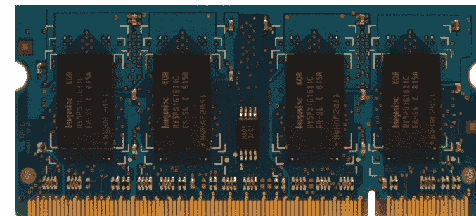

归属：Mathieu Riegler, Wikimedia Commons

### 表 1.2 DIMM 引脚

| DIMM 引脚 | 数据传输 | 备注 |
|---|---|--|
| 168 | 64 位 | 单倍数据速率 (SDR) |
| 184 | 64 位 | 双倍数据速率 (DDR) |
| 240 | 64 位 | DDR2, DDR3 和 FB-DIMM |

### 表 1.3 SODIMM 引脚

| SODIMM 引脚 | 数据传输 | 备注 |
|---|---|--|
| 72 | 32 位 | FPM 和 EDO |
| 100 | 32 位 | 用于打印机 |
| 144 | 64 位 | SDR |
| 200 | 64 位 | DDR 和 DDR2 |
| 204 | 64 位 | DDR3 |
| 214 | 64 位 | MicroDIMM，用于 DDR2 |

在表 1.3 中，`FPM` 和 `EDO` 内存类型是过时的 `RAM` 类型。快速页模式内存 (`FPM`) 是一种非同步 `RAM` 类型，其速度独立于系统总线，以纳秒延迟（等待时间）表示，例如 `70 ns`。`EDO` 是一种 `RAM`，其电刷新频率比该时代的其他 `RAM` 更低，因此它提供了比标准 `RAM` 略优的性能。

不同类型的 `DDR`、`DIMM` 以及 `SODIMMs` 在尺寸和形状上可能相似甚至完全相同，甚至可能具有相同的引脚数量。（例如，`DDR2` 和 `DDR3 DIMM` 都有 240 个引脚。）为了确保人们不会安装错误的 `RAM` 类型，每种 `RAM` 在包含引脚的边缘都有一个位置独特的缺口。这个缺口使 `RAM` 能够插入具有相应间距间隔片的插槽中。图 1.9 比较了 `DDR2` 和 `DDR3 DIMM`；请注意缺口位置的差异。

### 图 1.9 DDR2 和 DDR3 内存模块

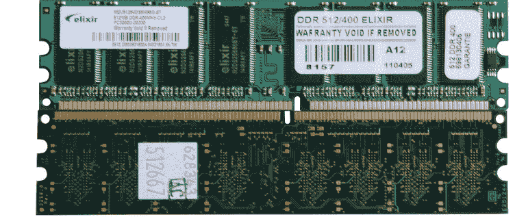

照片来源：Jérôme BLUM。

## 练习 1.4

### 确定安装的 RAM 类型

- 1. 查看电脑随附的文档，确认是否有任何关于 `RAM` 规格的内容。
- 2. 在文档中，找到关于安装 `RAM` 升级的信息。这将告诉你在系统的什么位置找到 `RAM`。

### 练习 1.4（续）

- 3. 打开电脑机箱，找到 `RAM`。识别它是 `DIMM` 还是 `SODIMM`。（大多数笔记本电脑使用 `SODIMM`，而大多数桌面式电脑使用 `DIMM`。）为了避免用静电损坏它，请避免触碰它。如果你需要触摸，请先触碰电脑机箱的金属框架。你将在第 4 章“设置计算机”中学习更多防止静电损坏的知识。
- 4. 检查 `DIMM` 或 `SODIMM` 上的数字或代码（如果有），寻找型号、速度或任何其他相关信息。
- 5. 查看你在网上收集的数据，看看是否能根据这些笔记判断出内存的任何信息。
- 6. 如果你无法通过这些方法确定 `RAM` 类型，请找到主板的品牌和型号（寻找打印在主板上的这些信息）。然后在网上查找该主板，查看是否有关于其 `RAM` 要求的信息。

## 总结

在本章中，你学习了计算机处理器及其在个人电脑中的功能。你学习了处理器的指令集如何决定它能够执行的计算，以及处理器内部如何使用二进制计数系统进行处理。你学习了 `Intel` 和 `AMD` 这两个主要的处理器制造商，以及 `PGA` 和 `LGA` 这两种插槽类型。我们讨论了性能速度和每秒操作次数，并查看了多处理器如何提高系统性能。

接下来，我们查看了内存。我们学习了静态内存和动态内存、`RAM` 和 `ROM` 之间的区别。你学习了数据如何存储在内存芯片内部，以及虚拟内存如何将数据在物理内存中进行交换。你学习了内存总线速度以及像 `DDR` 这样能够在每个时钟周期内执行多次操作的高性能内存。最后，我们比较了 `PC` 可以接受的各种物理内存内存模块，包括 `DIMMs` 和 `SODIMMs`。

## 考试要点

*   知道 `Intel` 和 `AMD` 处理器最流行的型号名称。`Intel` 的 `CPU` 包括 `Pentium 4` 以及 `Intel Core i3`、`i5` 和 `i7`。在这些系列中，代码名称区分了子类型，例如 `Arrandale`、`Gulftown` 和 `Sandy Bridge`。`AMD` 的处理器包括 `Phenom II`、`Athlon II` 和 `Turion` 系列。
*   理解 `CPU` 速度测量。现代 `CPU` 的核心速度以吉赫兹 (`GHz`) 测量；旧 `CPU` 速度以兆赫兹 (`MHz`) 测量。`CPU` 的核心速度与其每秒操作次数相关但不相等，后者以每秒百万次操作 (`MIPS`) 计算。
*   了解处理器缓存。缓存通过存储最近使用过或可能需要的数据来提高性能，以便在处理器请求时触手可用。`L1` 缓存是 `CPU` 内部的缓存；它是最小且最快的缓存。紧邻的是 `L2` 缓存，它在 `CPU` 芯片上但在处理器本身之外。某些 `CPU` 还有 `L3` 缓存。
*   理解升级处理器所涉及的问题。新处理器不仅在物理上要与插槽兼容，主板还必须识别指令集以及它接受数据的速度。因此，大多数主板仅支持少数处理器。
*   理解 `RAM` 频率。`RAM` 可以与主板总线同步（单倍数据速率，或 `SDR`），或者通过在时钟周期的顶部和底部执行操作具有双倍数据速率 (`DDR`)。这被称为双泵。`DDR2` 和 `DDR3 RAM` 可以更进一步，有效地将数据速率翻倍并再次倍。
*   理解升级 `RAM` 涉及的兼容性问题。大多数主板在特定数据速率下仅接受一种类型的 `RAM`。这部分由于物理兼容性（因为不同 `RAM` 类型的引脚数量不同），部分由于主板上内存总线的工作方式。
*   识别 `RAM` 的物理特征。现在的大多数桌面系统接受双直列内存模块 (`DIMMs`)。大多数笔记本电脑接受小外形直列内存模块 (`SODIMMs`)。取决于类型，`DIMMs` 可能具有168 到 240 个引脚；`SODIMMs` 可能具有不同数量。

## 复习题

- 1. 处理器的功能是什么？
    A. 显示图形
    B. 管理输入
    C. 与操作系统通信
    D. 数

- 2. 哪种设备最可能使用 `RISC`？
    A. 手机
    B. 笔记本电脑
    C. 桌面电脑
    D. 游戏机

- 3. 哪种数字是二进制？
    A. 15
    B. FF
    C. 0101
    D. 以上

- 4. 哪些公司是处理器的主要制造商？
    A. `Intel` 和 `IBM`
    B. `Apple` 和 `AMD`
    C. `Motorola` 和 `Apple`
    D. `Intel` 和 `AMD`

- 5. 现代系统使用哪种插槽？
    A. `PGA`
    B. `LGA`
    C. `DIMM`
    D. `SODIMM`

- 6. 如何测量处理器的速度？
    A. 吉赫兹 (`GHz`)
    B. 每秒百万次操作 (`MIPS`)
    C. 吉字节 (`GB`)
    D. 每秒

- 7. 主板向处理器发送接收数据的速度由什么决定。
    A. 内存
    B. 系统
    C. 处理器
    D. 硬盘

- 8. 缓存首先检索数据？
    A. `L4`
    B. `L3`
    C. `L2`
    D. `L1`

- 9. 多核处理器可能具有多少个核心？
    A. 1
    B. 4
    C. 32
    D. 256

- 10. 在哪种设备中你会发现单核处理器？
    A. 游戏机
    B. 笔记本电脑
    C. 手机
    D. 桌面电脑

- 11. 一种被动式系统是。
    A. 风扇
    B. 水冷系统
    C. 散热
    D. 空调压缩机

- 12. `BIOS` 代表什么？
    A. 基本信息标准
    B. 布尔输入操作系统
    C. 构建者信息概述系统
    D. 基本输入输出系统

- 13. 哪种内存是易失的，因此如果不持续供电就会丢失内容？
    A. `SRAM`
    B. `DRAM`
    C. `ROM`
    D. `CPU`

- 14. 当硬盘空间用于临时存储从物理 `RAM` 交换的数据时，被称为
    A. `SRAM`
    B. 虚拟内存
    C. `DRAM`
    D. `ROM`

- 15. 在 `SDRAM` 缩写中，S 代表什么？
    A. 单
    B. 静态
    C. 同步
    D. 简单

- 16. 与 `SDR SDRAM` 相比，`DDR2 SDRAM` 的数据传输速率是？
    A. 相同
    B. 2x
    C. 4x
    D. 8x

- 17. 哪种 `RAM` 最常用于笔记本电脑？
    A. `SODIMM`
    B. `SODRAM`
    C. `DIMM`
    D. `ROM`

- 18. 如果你发现一个 184 引脚的 `DIMM`，你可以假设它是哪种 `RAM`？
    A. `SDR`
    B. `DDR`
    C. `DDR2`
    D. `DDR3`


19. (空) `__________` 是 RAM 中的一个额外缓冲区，允许快速访问内存中公共物理行中的数据。

- A. BIOS
- B. L1 缓存
- C. L2 缓存
- D. 预取缓冲区 (Prefetch buffer)

20. 当说某种类型的 RAM 是同步的时，它是与什么同步的？

- A. 处理器的内部核心频率
- B. 主板的系统总线速度
- C. 硬盘的数据线
- D. 安装在同一台 PC 中的其他内存模块

## 复习题答案

1. 处理器可以在软件的帮助下间接完成所有其他任务，但它的核心功能是进行数学运算。数字输入处理并输出。软件选择如何处理这些数据并不是处理器关心的问题。

2. 精简指令集计算 (RISC) 是一种简单的处理器，具有较小的指令集，并可以使用该小指令集高效地运行。RISC 处理器通常用于手机等手持设备。

3. 二进制数仅由 1 和 0 数字组成。处理器和内存使用二进制计数通过一系列的开/关转换来存储数据。

4. `Intel` 和 `AMD` 是 PC 处理器的两个主要制造商。

5. 栅格阵列 (LGA) 是今天处理器最流行的插槽。`PGA` 是上一代的插槽，使用处理器上的引脚插入插槽上的孔中。`DIMM` 和 `SODIMM` 是内存的类型，而不是处理器。

6. 处理器的速度以吉赫兹 (GHz) 计算。核心频率与处理器每秒能处理的数据量不同；后者用 `MIPS` 衡量。千兆字节 (GB) 是磁盘存储空间或内存容量的单位。每秒千兆比特 (Gbps) 是数据吞吐量的单位，例如网络速度。

7. 主板总线（或前侧总线）以主板上系统计时器设定的速率在 `CPU` 之间传输数据。内存、处理器和硬盘都有可靠运行的最大速度，但速度并不决定系统运行的实际速率。

8. L1 缓存内置在处理器中，因此它是所有缓存中距离最近的。L2 缓存位于处理器上但不在芯片内部。如果存在 L3 缓存，它在芯片上但不在内核内部。

9. 多核心处理器是双核或四核；有些具有六核或八核。单核处理器不会被视为多内核。目前没有拥有 32 核或 256 核心的处理器。

10. `Cell` 微处理器是多核处理器与专用系统的混合体，非常适合成像和游戏应用。索尼在其 `PlayStation 3` 游戏系统使用了 `Cell` 微处理器，由 `Cell` 单元运行代码。

11. 被动冷却系统没有运动部件，也没有运行电源。列出的选项中唯一符合此标准的是散热器。

12. `BIOS` 代表基本输入/输出系统。主板上的 `BIOS` 芯片包含启动电脑和加载操作系统到内存所需的本质信息。

13. 静态随机存储器 (SRAM) 根据定义是易失的；例如，它被用于闪存。动态随机存储器 (DRAM) 是易失类型，用于大多数计算机系统的主内存。只读存储器 (ROM) 不仅是易失性的，而且在没有特殊工具的情况下不可重写。中央处理单元 (CPU) 不是一种内存类型。

14. B. 虚拟内存，也称为交换文件，由一个硬盘文件组成，用于存放交换出 RAM 的数据，直到再次需要它们并将其换回。SRAM、DRAM 和 ROM 都是物理类型的内存。

15. C. SDRAM 是同步动态随机存取存储器。同步是指其速度与前侧总线的速度同步。不要将其与 SRAM（静态内存）或 SDR（单数据速率）混淆。

16. C. 如果 SDR 是基准，那么 DDR（也称为 DDR1）的速度是 SDR 的 2 倍，DDR2 是 SDR 的 4 倍，DDR3 是 SDR 的 8 倍。

17. A. 小外形 DIMM (SODIMM) 通常用于笔记本电脑。没有所谓的 SODRAM 这种东西。普通的 DIMM 通常用于台式机电脑。ROM 不是 RAM 的类型；它是只读存储器。

18. B. 根据表 1-2，184 针 DIMM 是双倍数据速率 (DDR) DIMM。

19. D. 更深的预取缓冲区是 DDR3 比 DDR2 RAM 更快的主要原因。BIOS 芯片是 ROM。L1 和 L2 缓存在处理器上，而不是 RAM 上。

20. B. 同步 RAM 与系统总线速度同步，而总线速度反过来由主板的系统计时器控制。

# 第二章

## 输入和存储设备

PC 功能基础

PC 技术基础

本章涵盖的目标：

- 1.1 识别基础 IT 词汇
  - 硬盘
- `1.2 U.K.` / `1.3 U.K.` / `1.4 U.K.` / `1.5 U.K.` / `1.6 U.K.` / `1.7 U.K.` / `1.8 U.K.`
- `1.9 U.K.` / `1.10 U.K.` / `1.11 U.K.` / `1.12 U.K.` / `1.13 U.K.` / `1.14 U.K.` / `1.15 U.K.` / `1.16 U.K.` / `1.17 U.K.` / `1.18 U.K.` / `1.19 U.K.` / `1.20 U.K.` / `1.21 U.K.` / `1.22 U.K.` / `1.23 U.K.` / `1.24 U.K.` / `1.25 U.K.` / `1.26 U.K.` / `1.27 U.K.` / `1.28 U.K.` / `1.29 U.K.` / `1.30 U.K.` / `1.31 U.K.` / `1.32 U.K.` / `1.33 U.K.` / `1.34 U.K.` / `1.35 U.K.` / `1.36 U.K.` / `1.37 U.K.` / `1.38 U.K.` / `1.39 U.K.` / `1.40 U.K.` / `1.41 U.K.` / `1.42 U.K.` / `1.43 U.K.` / `1.44 U.K.` / `1.45 U.K.` / `1.46 U.K.` / `1.47 U.K.` / `1.48 U.K.` / `1.49 U.K.` / `1.50 U.K.` / `1.51 U.K.` / `1.52 U.K.` / `1.53 U.K.` / `1.54 U.K.` / `1.55 U.K.` / `1.56 U.K.` / `1.57 U.K.` / `1.58 U.K.` / `1.59 U.K.` / `1.60 U.K.` / `1.61 U.K.` / `1.62 U.K.` / `1.63 U.K.` / `1.64 U.K.` / `1.65 U.K.` / `1.66 U.K.` / `1.67 U.K.` / `1.68 U.K.` / `1.69 U.K.` / `1.70 U.K.` / `1.71 U.K.` / `1.72 U.K.` / `1.73 U.K.` / `1.74 U.K.` / `1.75 U.K.` / `1.76 U.K.` / `1.77 U.K.` / `1.78 U.K.` / `1.79 U.K.` / `1.80 U.K.` / `1.81 U.K.` / `1.82 U.K.` / `1.83 U.K.` / `1.84 U.K.` / `1.85 U.K.` / `1.86 U.K.` / `1.87 U.K.` / `1.88 U.K.` / `1.89 U.K.` / `1.90 U.K.` / `1.91 U.K.` / `1.92 U.K.` / `1.93 U.K.` / `1.94 U.K.` / `1.95 U.K.` / `1.96 U.K.` / `1.97 U.K.` / `1.98 U.K.` / `1.99 U.K.`

- `1.2 U.K.` / `1.3 U.K.` / `1.4 U.K.` / `1.5 U.K.` / `1.6 U.K.` / `1.7 U.K.` / `1.8 U.K.`
- `1.9 U.K.` / `1.10 U.K.` / `1.11 U.K.` / `1.12 U.K.` / `1.13 U.K.` / `1.14 U.K.` / `1.15 U.K.` / `1.16 U.K.` / `1.17 U.K.` / `1.18 U.K.` / `1.19 U.K.` / `1.20 U.K.` / `1.21 U.K.` / `1.22 U.K.` / `1.23 U.K.` / `1.24 U.K.` / `1.25 U.K.` / `1.26 U.K.` / `1.27 U.K.` / `1.28 U.K.` / `1.29 U.K.` / `1.30 U.K.` / `1.31 U.K.` / `1.32 U.K.` / `1.33 U.K.` / `1.34 U.K.` / `1.35 U.K.` / `1.36 U.K.` / `1.37 U.K.` / `1.38 U.K.` / `1.39 U.K.` / `1.40 U.K.` / `1.41 U.K.` / `1.42 U.K.` / `1.43 U.K.` / `1.44 U.K.` / `1.45 U.K.` / `1.46 U.K.` / `1.47 U.K.` / `1.48 U.K.` / `1.49 U.K.`


- `1.2` U.K. / `1.3` U.K. / `1.4` U.K. / `1.5` U.K. / `1.6` U.K. / `1.7` U.K. / `1.8` U.K.  
  - `1.9` U.K. / `1.10` U.K. / `1.11` U.K. / `1.12` U.K. / `1.13` U.K. / `1.14` U.K. / `1.15` U.K. / `1.16` U.K. / `1.17` U.K. / `1.18` U.K. / `1.19` U.K. / `1.20` U.K. / `1.21` U.K. / `1.22` U.K. / `1.23` U.K. / `1.24` U.K. / `1.25` U.K. / `1.26` U.K. / `1.27` U.K. / `1.28` U.K. / `1.29` U.K. / `1.30` U.K. / `1.31` U.K. / `1.32` U.K. / `1.33` U.K. / `1.34` U.K. / `1.35` U.K. / `1.36` U.K. / `1.37` U.K. / `1.38` U.K. / `1.39` U.K. / `1.40` U.K. / `1.41` U.K. / `1.42` U.K. / `1.43` U.K. / `1.44` U.K. / `1.45` U.K. / `1.46` U.K. / `1.47` U.K. / `1.48` U.K. / `1.49` U.K.
- `1.2` U.K. / `1.3` U.K. / `1.4` U.K. / `1.5` U.K. / `1.6` U.K. / `1.7` U.K. / `1.8` U.K.  
  - `1.9` U.K. / `1.10` U.K. / `1.11` U.K. / `1.12` U.K. / `1.13` U.K. / `1.14` U.K. / `1.15` U.K. / `1.16` U.K. / `1.17` U.K. / `1.18` U.K. / `1.19` U.K. / `1.20` U.K. / `1.21` U.K. / `1.22` U.K. / `1.23` U.K. / `1.24` U.K. / `1.25` U.K. / `1.26` U.K. / `1.27` U.K. / `1.28` U.K. / `1.29` U.K. / `1.30` U.K. / `1.31` U.K. / `1.32` U.K. / `1.33` U.K. / `1.34` U.K. / `1.35` U.K. / `1.36` U.K. / `1.37` U.K. / `1.38` U.K. / `1.39` U.K. / `1.40` U.K. / `1.41` U.K. / `1.42` U.K. / `1.43` U.K. / `1.44` U.K. / `1.45` U.K. / `1.46` U.K. / `1.47` U.K. / `1.48` U.K. / `1.49` U.K.
- `1.2` U.K. / `1.3` U.K. / `1.4` U.K. / `1.5` U.K. / `1.6` U.K. / `1.7` U.K. / `1.8` U.K.  
  - `1.9` U.K. / `1.10` U.K. / `1.11` U.K. / `1.12` U.K. / `1.13` U.K. / `1.14` U.K. / `1.15` U.K. / `1.16` U.K. / `1.17` U.K. / `1.18` U.K. / `1.19` U.K. / `1.20` U.K. / `1.21` U.K. / `1.22` U.K. / `1.23` U.K. / `1.24` U.K. / `1.25` U.K. / `1.26` U.K. / `1.27` U.K. / `1.28` U.K. / `1.29` U.K. / `1.30` U.K. / `1.31` U.K. / `1.32` U.K. / `1.33` U.K. / `1.34` U.K. / `1.35` U.K. / `1.36` U.K. / `1.37` U.K. / `1.38` U.K. / `1.39` U.K. / `1.40` U.K. / `1.41` U.K. / `1.42` U.K. / `1.43` U.K. / `1.44` U.K. / `1.45` U.K. / `1.46` U.K. / `1.47` U.K. / `1.48` U.K. / `1.49` U.K.
- `1.2` U.K. / `1.3` U.K. / `1.4` U.K. / `1.5` U.K. / `1.6` U.K. / `1.7` U.K. / `1.8` U.K.  
  - `1.9` U.K. / `1.10` U.K. / `1.11` U.K. / `1.12` U.K. / `1.13` U.K. / `1.14` U.K. / `1.15` U.K. / `1.16` U.K. / `1.17` U.K. / `1.18` U.K. / `1.19` U.K. / `1.20` U.K. / `1.21` U.K. / `1.22` U.K. / `1.23` U.K. / `1.24` U.K. / `1.25` U.K. / `1.26` U.K. / `1.27` U.K. / `1.28` U.K. / `1.29` U.K. / `1.30` U.K. / `1.31` U.K. / `1.32` U.K. / `1.33` U.K. / `1.34` U.K. / `1.35` U.K. / `1.36` U.K. / `1.37` U.K. / `1.38` U.K. / `1.39` U.K. / `1.40` U.K. / `1.41` U.K. / `1.42` U.K. / `1.43` U.K. / `1.44` U.K. / `1.45` U.K. / `1.46` U.K. / `1.47` U.K. / `1.48` U.K. / `1.49` U.K.
- `1.2` U.K. / `1.3` U.K. / `1.4` U.K. / `1.5` U.K. / `1.6` U.K. / `1.7` U.K. / `1.8` U.K.  
  - `1.9` U.K. / `1.10` U.K. / `1.11` U.K. / `1.12` U.K. / `1.13` U.K. / `1.14` U.K. / `1.15` U.K. / `1.16` U.K. / `1.17` U.K. / `1.18` U.K. / `1.19` U.K. / `1.20` U.K. / `1.21` U.K. / `1.22` U.K. / `1.23` U.K. / `1.24` U.K. / `1.25` U.K. / `1.26` U.K. / `1.27` U.K. / `1.28` U.K. / `1.29` U.K. / `1.30` U.K. / `1.31` U.K. / `1.32` U.K. / `1.33` U.K. / `1.34` U.K. / `1.35` U.K. / `1.36` U.K. / `1.37` U.K. / `1.38` U.K. / `1.39` U.K. / `1.40` U.K. / `1.41` U.K. / `1.42` U.K. / `1.43` U.K. / `1.44` U.K. / `1.45` U.K. / `1.46` U.K. / `1.47` U.K. / `1.48` U.K. / `1.49` U.K.
- `1.2` U.K. / `1.3` U.K. / `1.4` U.K. / `1.5` U.K. / `1.6` U.K. / `1.7` U.K. / `1.8` U.K.  
  - `1.9` U.K. / `1.10` U.K. / `1.11` U.K. / `1.12` U.K. / `1.13` U.K. / `1.14` U.K. / `1.15` U.K. / `1.16` U.K. / `1.17` U.K. / `1.18` U.K. / `1.19` U.K. / `1.20` U.K. / `1.21` U.K. / `1.22` U.K. / `1.23` U.K. / `1.24` U.K. / `1.25` U.K. / `1.26` U.K. / `1.27` U.K. / `1.28` U.K. / `1.29` U.K. / `1.30` U.K. / `1.31` U.K. / `1.32` U.K. / `1.33` U.K. / `1.34` U.K. / `1.35` U.K. / `1.36` U.K. / `1.37` U.K. / `1.38` U.K. / `1.39` U.K. / `1.40` U.K. / `1.41` U.K. / `1.42` U.K. / `1.43` U.K. / `1.44` U.K. / `1.45` U.K. / `1.46` U.K. / `1.47` U.K. / `1.48` U.K. / `1.49` U.K.
- `1.2` U.K. / `1.3` U.K. / `1.4` U.K. / `1.5` U.K. / `1.6` U.K. / `1.7` U.K. / `1.8` U.K.  
  - `1.9` U.K. / `1.10` U.K. / `1.11` U.K. / `1.12` U.K. / `1.13` U.K. / `1.14` U.K. / `1.15` U.K. / `1.16` U.K. / `1.17` U.K. / `1.18` U.K. / `1.19` U.K. / `1.20` U.K. / `1.21` U.K. / `1.22` U.K. / `1.23` U.K. / `1.24` U.K. / `1.25` U.K. / `1.26` U.K. / `1.27` U.K. / `1.28` U.K. / `1.29` U.K. / `1.30` U.K. / `1.31` U.K. / `1.32` U.K. / `1.33` U.K. / `1.34` U.K. / `1.35` U.K. / `1.36` U.K. / `1.37` U.K. / `1.38` U.K. / `1.39` U.K. / `1.40` U.K. / `1.41` U.K. / `1.42` U.K. / `1.43` U.K. / `1.44` U.K. / `1.45` U.K. / `1.46` U.K. / `1.47` U.K. / `1.48` U.K. / `1.49` U.K.


- `1.2` U.K. / `1.3` U.K. / `1.4` U.K. / `1.5` U.K. / `1.6` U.K. / `1.7` U.K. / `1.8` U.K. - `1.9` U.K. / `1.10` U.K. / `1.11` U.K. / `1.12` U.K. / `1.13` U.K. / `1.14` U.K. / `1.15` U.K. / `1.16` U.K. / `1.17` U.K. / `1.18` U.K. / `1.19` U.K. / `1.20` U.K. / `1.21` U.K. / `1.22` U.K. / `1.23` U.K. / `1.24` U.K. / `1.25` U.K. / `1.26` U.K. / `1.27` U.K. / `1.28` U.K. / `1.29` U.K. / `1.30` U.K. / `1.31` U.K. / `1.32` U.K. / `1.33` U.K. / `1.34` U.K. / `1.35` U.K. / `1.36` U.K. / `1.37` U.K. / `1.38` U.K. / `1.39` U.K. / `1.40` U.K. / `1.41` U.K. / `1.42` U.K. / `1.43` U.K. / `1.44` U.K. / `1.45` U.K. / `1.46` U.K. / `1.47` U.K. / `1.48` U.K. / `1.49` U.K.
- `1.2` U.K. / `1.3` U.K. / `1.4` U.K. / `1.5` U.K. / `1.6` U.K. / `1.7` U.K. / `1.8` U.K. - `1.9` U.K. / `1.10` U.K. / `1.11` U.K. / `1.12` U.K. / `1.13` U.K. / `1.14` U.K. / `1.15` U.K. / `1.16` U.K. / `1.17` U.K. / `1.18` U.K. / `1.19` U.K. / `1.20` U.K. / `1.21` U.K. / `1.22` U.K. / `1.23` U.K. / `1.24` U.K. / `1.25` U.K. / `1.26` U.K. / `1.27` U.K. / `1.28` U.K. / `1.29` U.K. / `1.30` U.K. / `1.31` U.K. / `1.32` U.K. / `1.33` U.K. / `1.34` U.K. / `1.35` U.K. / `1.36` U.K. / `1.37` U.K. / `1.38` U.K. / `1.39` U.K. / `1.40` U.K. / `1.41` U.K. / `1.42` U.K. / `1.43` U.K. / `1.44` U.K. / `1.45` U.K. / `1.46` U.K. / `1.47` U.K. / `1.48` U.K. / `1.49` U.K.
- `1.2` U.K. / `1.3` U.K. / `1.4` U.K. / `1.5` U.K. / `1.6` U.K. / `1.7` U.K. / `1.8` U.K. - `1.9` U.K. / `1.10` U.K. / `1.11` U.K. / `1.12` U.K. / `1.13` U.K. / `1.14` U.K. / `1.15` U.K. / `1.16` U.K. / `1.17` U.K. / `1.18` U.K. / `1.19` U.K. / `1.20` U.K. / `1.21` U.K. / `1.22` U.K. / `1.23` U.K. / `1.24` U.K. / `1.25` U.K. / `1.26` U.K. / `1.27` U.K. / `1.28` U.K. / `1.29` U.K. / `1.30` U.K. / `1.31` U.K. / `1.32` U.K. / `1.33` U.K. / `1.34` U.K. / `1.35` U.K. / `1.36` U.K. / `1.37` U.K. / `1.38` U.K. / `1.39` U.K. / `1.40` U.K. / `1.41` U.K. / `1.42` U.K. / `1.43` U.K. / `1.44` U.K. / `1.45` U.K. / `1.46` U.K. / `1.47` U.K. / `1.48` U.K. / `1.49` U.K.
- `1.2` U.K. / `1.3` U.K. / `1.4` U.K. / `1.5` U.K. / `1.6` U.K. / `1.7` U.K. / `1.8` U.K. - `1.9` U.K. / `1.10` U.K. / `1.11` U.K. / `1.12` U.K. / `1.13` U.K. / `1.14` U.K. / `1.15` U.K. / `1.16` U.K. / `1.17` U.K. / `1.18` U.K. / `1.19` U.K. / `1.20` U.K. / `1.21` U.K. / `1.22` U.K. / `1.23` U.K. / `1.24` U.K. / `1.25` U.K. / `1.26` U.K. / `1.27` U.K. / `1.28` U.K. / `1.29` U.K. / `1.30` U.K. / `1.31` U.K. / `1.32` U.K. / `1.33` U.K. / `1.34` U.K. / `1.35` U.K. / `1.36` U.K. / `1.37` U.K. / `1.38` U.K. / `1.39` U.K. / `1.40` U.K. / `1.41` U.K. / `1.42` U.K. / `1.43` U.K. / `1.44` U.K. / `1.45` U.K. / `1.46` U.K. / `1.47` U.K. / `1.48` U.K. / `1.49` U.K.
- `1.2` U.K. / `1.3` U.K. / `1.4` U.K. / `1.5` U.K. / `1.6` U.K. / `1.7` U.K. / `1.8` U.K. - `1.9` U.K. / `1.10` U.K. / `1.11` U.K. / `1.12` U.K. / `1.13` U.K. / `1.14` U.K. / `1.15` U.K. / `1.16` U.K. / `1.17` U.K. / `1.18` U.K. / `1.19` U.K. / `1.20` U.K. / `1.21` U.K. / `1.22` U.K. / `1.23` U.K. / `1.24` U.K. / `1.25` U.K. / `1.26` U.K. / `1.27` U.K. / `1.28` U.K. / `1.29` U.K. / `1.30` U.K. / `1.31` U.K. / `1.32` U.K. / `1.33` U.K. / `1.34` U.K. / `1.35` U.K. / `1.36` U.K. / `1.37` U.K. / `1.38` U.K. / `1.39` U.K. / `1.40` U.K. / `1.41` U.K. / `1.42` U.K. / `1.43` U.K. / `1.44` U.K. / `1.45` U.K. / `1.46` U.K. / `1.47` U.K. / `1.48` U.K. / `1.49` U.K.
- `1.2` U.K. / `1.3` U.K. / `1.4` U.K. / `1.5` U.K. / `1.6` U.K. / `1.7` U.K. / `1.8` U.K. - `1.9` U.K. / `1.10` U.K. / `1.11` U.K. / `1.12` U.K. / `1.13` U.K. / `1.14` U.K. / `1.15` U.K. / `1.16` U.K. / `1.17` U.K. / `1.18` U.K. / `1.19` U.K. / `1.20` U.K. / `1.21` U.K. / `1.22` U.K. / `1.23` U.K. / `1.24` U.K. / `1.25` U.K. / `1.26` U.K. / `1.27` U.K. / `1.28` U.K. / `1.29` U.K. / `1.30` U.K. / `1.31` U.K. / `1.32` U.K. / `1.33` U.K. / `1.34` U.K. / `1.35` U.K. / `1.36` U.K. / `1.37` U.K. / `1.38` U.K. / `1.39` U.K. / `1.40` U.K. / `1.41` U.K. / `1.42` U.K. / `1.43` U.K. / `1.44` U.K. / `1.45` U.K. / `1.46` U.K. / `1.47` U.K. / `1.48` U.K. / `1.49` U.K.
- `1.2` U.K. / `1.3` U.K. / `1.4` U.K. / `1.5` U.K. / `1.6` U.K. / `1.7` U.K. / `1.8` U.K. - `1.9` U.K. / `1.10` U.K. / `1.11` U.K. / `1.12` U.K. / `1.13` U.K. / `1.14` U.K. / `1.15` U.K. / `1.16` U.K. / `1.17` U.K. / `1.18` U.K. / `1.19` U.K. / `1.20` U.K. / `1.21` U.K. / `1.22` U.K. / `1.23` U.K. / `1.24` U.K. / `1.25` U.K. / `1.26` U.K. / `1.27` U.K. / `1.28` U.K. / `1.29` U.K. / `1.30` U.K. / `1.31` U.K. / `1.32` U.K. / `1.33` U.K. / `1.34` U.K. / `1.35` U.K. / `1.36` U.K. / `1.37` U.K. / `1.38` U.K. / `1.39` U.K. / `1.40` U.K. / `1.41` U.K. / `1.42` U.K. / `1.43` U.K. / `1.44` U.K. / `1.45` U.K. / `1.46` U.K. / `1.47` U.K. / `1.48` U.K. / `1.49` U.K.


- `1.2 U.K.` / `1.3 U.K.` / `1.4 U.K.` / `1.5 U.K.` / `1.6 U.K.` / `1.7 U.K.` / `1.8 U.K.` - `1.9 U.K.` / `1.10 U.K.` / `1.11 U.K.` / `1.12 U.K.` / `1.13 U.K.` / `1.14 U.K.` / `1.15 U.K.` / `1.16 U.K.` / `1.17 U.K.` / `1.18 U.K.` / `1.19 U.K.` / `1.20 U.K.` / `1.21 U.K.` / `1.22 U.K.` / `1.23 U.K.` / `1.24 U.K.` / `1.25 U.K.` / `1.26 U.K.` / `1.27 U.K.` / `1.28 U.K.` / `1.29 U.K.` / `1.30 U.K.` / `1.31 U.K.` / `1.32 U.K.` / `1.33 U.K.` / `1.34 U.K.` / `1.35 U.K.` / `1.36 U.K.` / `1.37 U.K.` / `1.38 U.K.` / `1.39 U.K.` / `1.40 U.K.` / `1.41 U.K.` / `1.42 U.K.` / `1.43 U.K.` / `1.44 U.K.` / `1.45 U.K.` / `1.46 U.K.` / `1.47 U.K.` / `1.48 U.K.` / `1.49 U.K.`
- `1.2 U.K.` / `1.3 U.K.` / `1.4 U.K.` / `1.5 U.K.` / `1.6 U.K.` / `1.7 U.K.` / `1.8 U.K.` - `1.9 U.K.` / `1.10 U.K.` / `1.11 U.K.` / `1.12 U.K.` / `1.13 U.K.` / `1.14 U.K.` / `1.15 U.K.` / `1.16 U.K.` / `1.17 U.K.` / `1.18 U.K.` / `1.19 U.K.` / `1.20 U.K.` / `1.21 U.K.` / `1.22 U.K.` / `1.23 U.K.` / `1.24 U.K.` / `1.25 U.K.` / `1.26 U.K.` / `1.27 U.K.` / `1.28 U.K.` / `1.29 U.K.` / `1.30 U.K.` / `1.31 U.K.` / `1.32 U.K.` / `1.33 U.K.` / `1.34 U.K.` / `1.35 U.K.` / `1.36 U.K.` / `1.37 U.K.` / `1.38 U.K.` / `1.39 U.K.` / `1.40 U.K.` / `1.41 U.K.` / `1.42 U.K.` / `1.43 U.K.` / `1.44 U.K.` / `1.45 U.K.` / `1.46 U.K.` / `1.47 U.K.` / `1.48 U.K.` / `1.49 U.K.`
- `1.2 U.K.` / `1.3 U.K.` / `1.4 U.K.` / `1.5 U.K.` / `1.6 U.K.` / `1.7 U.K.` / `1.8 U.K.` - `1.9 U.K.` / `1.10 U.K.` / `1.11 U.K.` / `1.12 U.K.` / `1.13 U.K.` / `1.14 U.K.` / `1.15 U.K.` / `1.16 U.K.` / `1.17 U.K.` / `1.18 U.K.` / `1.19 U.K.` / `1.20 U.K.` / `1.21 U.K.` / `1.22 U.K.` / `1.23 U.K.` / `1.24 U.K.` / `1.25 U.K.` / `1.26 U.K.` / `1.27 U.K.` / `1.28 U.K.` / `1.29 U.K.` / `1.30 U.K.` / `1.31 U.K.` / `1.32 U.K.` / `1.33 U.K.` / `1.34 U.K.` / `1.35 U.K.` / `1.36 U.K.` / `1.37 U.K.` / `1.38 U.K.` / `1.39 U.K.` / `1.40 U.K.` / `1.41 U.K.` / `1.42 U.K.` / `1.43 U.K.` / `1.44 U.K.` / `1.45 U.K.` / `1.46 U.K.` / `1.47 U.K.` / `1.48 U.K.` / `1.49 U.K.`
- `1.2 U.K.` / `1.3 U.K.` / `1.4 U.K.` / `1.5 U.K.` / `1.6 U.K.` / `1.7 U.K.` / `1.8 U.K.` - `1.9 U.K.` / `1.10 U.K.` / `1.11 U.K.` / `1.12 U.K.` / `1.13 U.K.` / `1.14 U.K.` / `1.15 U.K.` / `1.16 U.K.` / `1.17 U.K.` / `1.18 U.K.` / `1.19 U.K.` / `1.20 U.K.` / `1.21 U.K.` / `1.22 U.K.` / `1.23 U.K.` / `1.24 U.K.` / `1.25 U.K.` / `1.26 U.K.` / `1.27 U.K.` / `1.28 U.K.` / `1.29 U.K.` / `1.30 U.K.` / `1.31 U.K.` / `1.32 U.K.` / `1.33 U.K.` / `1.34 U.K.` / `1.35 U.K.` / `1.36 U.K.` / `1.37 U.K.` / `1.38 U.K.` / `1.39 U.K.` / `1.40 U.K.` / `1.41 U.K.` / `1.42 U.K.` / `1.43 U.K.` / `1.44 U.K.` / `1.45 U.K.` / `1.46 U.K.` / `1.47 U.K.` / `1.48 U.K.` / `1.49 U.K.`
- `1.2 U.K.` / `1.3 U.K.` / `1.4 U.K.` / `1.5 U.K.` / `1.6 U.K.` / `1.7 U.K.` / `1.8 U.K.` - `1.9 U.K.` / `1.10 U.K.` / `1.11 U.K.` / `1.12 U.K.` / `1.13 U.K.` / `1.14 U.K.` / `1.15 U.K.` / `1.16 U.K.` / `1.17 U.K.` / `1.18 U.K.` / `1.19 U.K.` / `1.20 U.K.` / `1.21 U.K.` / `1.22 U.K.` / `1.23 U.K.` / `1.24 U.K.` / `1.25 U.K.` / `1.26 U.K.` / `1.27 U.K.` / `1.28 U.K.` / `1.29 U.K.` / `1.30 U.K.` / `1.31 U.K.` / `1.32 U.K.` / `1.33 U.K.` / `1.34 U.K.` / `1.35 U.K.` / `1.36 U.K.` / `1.37 U.K.` / `1.38 U.K.` / `1.39 U.K.` / `1.40 U.K.` / `1.41 U.K.` / `1.42 U.K.` / `1.43 U.K.` / `1.44 U.K.` / `1.45 U.K.` / `1.46 U.K.` / `1.47 U.K.` / `1.48 U.K.` / `1.49 U.K.`
- `1.2 U.K.` / `1.3 U.K.` / `1.4 U.K.` / `1.5 U.K.` / `1.6 U.K.` / `1.7 U.K.` / `1.8 U.K.` - `1.9 U.K.` / `1.10 U.K.` / `1.11 U.K.` / `1.12 U.K.` / `1.13 U.K.` / `1.14 U.K.` / `1.15 U.K.` / `1.16 U.K.` / `1.17 U.K.` / `1.18 U.K.` / `1.19 U.K.` / `1.20 U.K.` / `1.21 U.K.` / `1.22 U.K.` / `1.23 U.K.` / `1.24 U.K.` / `1.25 U.K.` / `1.26 U.K.` / `1.27 U.K.` / `1.28 U.K.` / `1.29 U.K.` / `1.30 U.K.` / `1.31 U.K.` / `1.32 U.K.` / `1.33 U.K.` / `1.34 U.K.` / `1.35 U.K.` / `1.36 U.K.` / `1.37 U.K.` / `1.38 U.K.` / `1.39 U.K.` / `1.40 U.K.` / `1.41 U.K.` / `1.42 U.K.` / `1.43 U.K.` / `1.44 U.K.` / `1.45 U.K.` / `1.46 U.K.` / `1.47 U.K.` / `1.48 U.K.` / `1.49 U.K.`
- `1.2 U.K.` / `1.3 U.K.` / `1.4 U.K.` / `1.5 U.K.` / `1.6 U.K.` / `1.7 U.K.` / `1.8 U.K.` - `1.9 U.K.` / `1.10 U.K.` / `1.11 U.K.` / `1.12 U.K.` / `1.13 U.K.` / `1.14 U.K.` / `1.15 U.K.` / `1.16 U.K.` / `1.17 U.K.` / `1.18 U.K.` / `1.19 U.K.` / `1.20 U.K.` / `1.21 U.K.` / `1.22 U.K.` / `1.23 U.K.` / `1.24 U.K.` / `1.25 U.K.` / `1.26 U.K.` / `1.27 U.K.` / `1.28 U.K.` / `1.29 U.K.` / `1.30 U.K.` / `1.31 U.K.` / `1.32 U.K.` / `1.33 U.K.` / `1.34 U.K.` / `1.35 U.K.` / `1.36 U.K.` / `1.37 U.K.` / `1.38 U.K.` / `1.39 U.K.` / `1.40 U.K.` / `1.41 U.K.` / `1.42 U.K.` / `1.43 U.K.` / `1.44 U.K.` / `1.45 U.K.` / `1.46 U.K.` / `1.47 U.K.` / `1.48 U.K.` / `1.49 U.K.`


- 1.2 U.K. / 1.3 U.K. / 1.4 U.K. / 1.5 U.K. / 1.6 U.K. / 1.7 U.K. / 1.8 U.K. - 1.9 U.K. / 1.10 U.K. / 1.11 U.K. / 1.12 U.K. / 1.13 U.K. / 1.14 U.K. / 1.15 U.K. / 1.16 U.K. / 1.17 U.K. / 1.18 U.K. / 1.19 U.K. / 1.20 U.K. / 1.21 U.K. / 1.22 U.K. / 1.23 U.K. / 1.24 U.K. / 1.25 U.K. / 1.26 U.K. / 1.27 U.K. / 1.28 U.K. / 1.29 U.K. / 1.30 U.K. / 1.31 U.K. / 1.32 U.K. / 1.33 U.K. / 1.34 U.K. / 1.35 U.K. / 1.36 U.K. / 1.37 U.K. / 1.38 U.K. / 1.39 U.K. / 1.40 U.K. / 1.41 U.K. / 1.42 U.K. / 1.43 U.K. / 1.44 U.K. / 1.45 U.K. / 1.46 U.K. / 1.47 U.K. / 1.48 U.K. / 1.49 U.K.

- 1.2 U.K. / 1.3 U.K. / 1.4 U.K. / 1.5 U.K. / 1.6 U.K. / 1.7 U.K. / 1.8 U.K. - 1.9 U.K. / 1.10 U.K. / 1.11 U.K. / 1.12 U.K. / 1.13 U.K. / 1.14 U.K. / 1.15 U.K. / 1.16 U.K. / 1.17 U.K. / 1.18 U.K. / 1.19 U.K. / 1.20 U.K. / 1.21 U.K. / 1.22 U.K. / 1.23 U.K. / 1.24 U.K. / 1.25 U.K. / 1.26 U.K. / 1.27 U.K. / 1.28 U.K. / 1.29 U.K. / 1.30 U.K. / 1.31 U.K. / 1.32 U.K. / 1.33 U.K. / 1.34 U.K. / 1.35 U.K. / 1.36 U.K. / 1.37 U.K. / 1.38 U... / 1.39..... 1.40..K.. 1..1 U... / 1.42 U.K. / 1.43 U.K. / 1.44 U.K. / 1.45 U.K. / 1.46 U.K. / 1.47 U.K. / 1.48 U.K. / 1.49 U.K.

- 1.2 U.K. / 1.3 U.K. / 1.4 U.K. / 1.5 U.K. / 1.6 U.K. / 1.7 U.K. / 1.8 U.K. - 1.9 U.K. / 1.10 U.K. / 1.11 U.K. / 1.12 U.K. / 1.13 U.K. / 1.14 U.K. / 1.15 U.K. / 1.16 U.K. / 1.17 U.K. / 1.18 U.K. / 1.19 U.K. / 1.20 U.K. / 1.21 U.K. / 1.22 U.K. / 1.23 U.K. / 1.24 U.K. / 1.25 U.K. / 1.26 U.K. / 1.27 U.K. / 1.28 U.K. / 1.29 U.K. / 1.30 U.K. / 1.31 U.K. / 1.32 U.K. / 1.33 U.K. / 1.34 U.K. / 1.35 U.K. / 1.36 U.K. / 1.37 U.K. / 1.38 U.K. / 1.39 U.K. / 1.40 U.K. / 1.41 U.K. / 1.42 U.K. / 1.43 U.K. / 1.44 U.K. / 1.45 U.K. / 1.46 U.K. / 1.47 U.K. / 1.48 U.K. / 1.49 U.K.

- 1.2 U.K. / 1.3 U.K. / 1.4 U.K. / 1.5 U.K. / 1.6 U.K. / 1.7 U.K. / 1.8 U.K. - 1.9 U.K. / 1.10 U.K. / 1.11 U.K. / 1.12 U.K. / 1.13 U.K. / 1.14 U.K. / 1.15 U.K. / 1.16 U.K. / 1.17 U.K. / 1.18 U.K. / 1.19 U.K. / 1.20 U.K. / 1.21 U.K. / 1.22 U.K. / 1.23 U.K. / 1.24 U.K. / 1.25 U.K. / 1.26 U.K. / 1.27 U.K. / 1.28 U.K. / 1.29 U.K. / 1.30 U.K. / 1.31 U.K. / 1.32 U.K. / 1.33 U.K. / 1.34 U.K. / 1.35 U.K. / 1.36 U.K. / 1.37 U.K. / 1.38 U.K. / 1.39 U.K. / 1.40 U.K. / 1.41 U.K. / 1.42 U.K. / 1.43 U.K. / 1.44 U.K. / 1.45 U.K. / 1.46 U.K. / 1.47 U.K. / 1.48 U.K. / 1.49 U.K.

- 1.2 U.K. / 1.3 U.K. / 1.4 U.K. / 1.5 U.K. / 1.6 U.K. / 1.7 U.K. / 1.8 U.K. - 1.9 U.K. / 1.10 U.K. / 1.11 U.K. / 1.12 U.K. / 1.13 U.K. / 1.14 U.K. / 1.15 U.K. / 1.16 U.K. / 1.17 U.K. / 1.18 U.K. / 1.19 U.K. / 1.20 U.K. / 1.21 U.K. / 1.22 U.K. / 1.23 U.K. / 1.24 U.K. / 1.25 U.K. / 1.26 U.K. / 1.27 U.K. / 1.28 U.K. / 1.29 U.K. / 1.30 U.K. / 1.31 U.K. / 1.32 U.K. / 1.33 U.K. / 1.34 U.K. / 1.35 U.K. / 1.36 U.K. / 1.37 U.K. / 1.38 U.K. / 1.39 U.K. / 1.40 U.K. / 1.41 U.K. / 1.42 U.K. / 1.43 U.K. / 1.44 U.K. / 1.45 U.K. / 1.46 U.K. / 1.47 U.K. / 1.48 U.K. / 1.49 U.K.

- 1.2 U.K. / 1.3 U.K. / 1.4 U.K. / 1.5 U.K. / 1.6 U.K. / 1.7 U.K. / 1.8 U.K. - 1.9 U.K. / 1.10 U.K. / 1.11 U.K. / 1.12 U.K. / 1.13 U.K. / 1.14 U.K. / 1.15 U.K. / 1.16 U.K. / 1.17 U.K. / 1.18 U.K. / 1.19 U.K. / 1.20 U.K. / 1.21 U.K. / 1.22 U.K. / 1.23 U.K. / 1.24 U.K. / 1.25 U.K. / 1.26 U.K. / 1.27 U.K. / 1.28 U.K. / 1.29 U.K. / 1.30 U.K. / 1.31 U.K. / 1.32 U.K. / 1.33 U.K. / 1.34 U.K. / 1.35 U.K. / 1.36 U.K. / 1.37 U.K. / 1.38 U.K. / 1.39 U.K. / 1.40 U.K. / 1.41 U.K. / 1.42 U.K. / 1.43 U.K. / 1.44 U.K. / 1.45 U.K. / 1.46 U.K. / 1.47 U.K. / 1.48 U.K. / 1.49 U.K.

- 1.2 U.K. / 1.3 U.K. / 1.4 U.K. / 1.5 U.K. / 1.6 U.K. / 1.7 U.K. / 1.8 U.K. - 1.9 U.K. / 1.10 U.K. / 1.11 U.K. / 1.12 U.K. / 1.13 U.K. / 1.14 U.K. / 1.15 U.K. / 1.16 U.K. / 1.17 U.K. / 1.18 U.K. / 1.19 U.K. / 1.20 U.K. / 1.21 U.K. / 1.22 U.K. / 1.23 U.K. / 1.24 U.K. / 1.25 U.K. / 1.26 U.K. / 1.27 U.K. / 1.28 U.K. / 1.29 U.K. / 1.30 U.K. / 1.31 U.K. / 1.32 U.K. / 1.33 U.K. / 1.34 U.K. / 1.35 U.K. / 1.36 U.K. / 1.37 U.K. / 1.38 U.K. / 1.39 U.K. / 1.40 U.K. / 1.41 U.K. / 1.42 U.K. / 1.43 U.K. / 1.44 U.K. / 1.45 U.K. / 1.46 U.K. / 1.47 U.K. / 1.48 U.K. / 1.49 U.K.


- 1.2 U.K. / 1.3 U.K. / 1.4 U.K. / 1.5 U.K. / 1.6 U.K. / 1.7 U.K. / 1.8 U.K.
- 1.9 U.K. / 1.10 U.K. / 1.11 U.K. / 1.12 U.K. / 1.13 U.K. / 1.14 U.K. / 1.15 U.K. / 1.16 U.K. / 1.17 U.K. / 1.18 U.K. / 1.19 U.K. / 1.20 U.K. / 1.21 U.K. / 1.22 U.K. / 1.23 U.K. / 1.24 U.K. / 1.25 U.K. / 1.26 U.K. / 1.27 U.K. / 1.28 U.K. / 1.29 U.K. / 1.30 U.K. / 1.31 U.K. / 1.32 U.K. / 1.33 U.K. / 1.34 U.K. / 1.35 U.K. / 1.36 U.K. / 1.37 U.K. / 1.38 U.K. / 1.39 U.K. / 1.40 U.K. / 1.41 U.K. / 1.42 U.K. / 1.43 U.K. / 1.44 U.K. / 1.45 U.K. / 1.46 U.K. / 1.47 U.K. / 1.48 U.K. / 1.49 U.K.

- 1.2 U.K. / 1.3 U.K. / 1.4 U.K. / 1.5 U.K. / 1.6 U.K. / 1.7 U.K. / 1.8 U.K.
- 1.9 U.K. / 1.10 U.K. / 1.11 U.K. / 1.12 U.K. / 1.13 U.K. / 1.14 U.K. / 1.15 U.K. / 1.16 U.K. / 1.17 U.K. / 1.18 U.K. / 1.19 U.K. / 1.20 U.K. / 1.21 U.K. / 1.22 U.K. / 1.23 U.K. / 1.24 U.K. / 1.25 U.K. / 1.26 U.K. / 1.27 U.K. / 1.28 U.K. / 1.29 U.K. / 1.30 U.K. / 1.31 U.K. / 1.32 U.K. / 1.33 U.K. / 1.34 U.K. / 1.35 U.K. / 1.36 U.K. / 1.37 U.K. / 1.38 U.K. / 1.39 U.K. / 1.40 U.K. / 1.41 U.K. / 1.42 U.K. / 1.43 U.K. / 1.44 U.K. / 1.45 U.K. / 1.46 U.K. / 1.47 U.K. / 1.48 U.K. / 1.49 U.K.

- 1.2 U.K. / 1.3 U.K. / 1.4 U.K. / 1.5 U.K. / 1.6 U.K. / 1.7 U.K. / 1.8 U.K.
- 1.9 U.K. / 1.10 U.K. / 1.11 U.K. / 1.12 U.K. / 1.13 U.K. / 1.14 U.K. / 1.15 U.K. / 1.16 U.K. / 1.17 U.K. / 1.18 U.K. / 1.19 U.K. / 1.20 U.K. / 1.21 U.K. / 1.22 U.K. / 1.23 U.K. / 1.24 U.K. / 1.25 U.K. / 1.26 U.K. / 1.27 U.K. / 1.28 U.K. / 1.29 U.K. / 1.30 U.K. / 1.31 U.K. / 1.32 U.K. / 1.33 U.K. / 1.34 U.K. / 1.35 U.K. / 1.36 U.K. / 1.37 U.K. / 1.38 U.K. / 1.39 U.K. / 1.40 U.K. / 1.41 U.K. / 1.42 U.K. / 1.43 U.K. / 1.44 U.K. / 1.45 U.K. / 1.46 U.K. / 1.47 U.K. / 1.48 U.K. / 1.49 U.K.

- 1.2 U.K. / 1.3 U.K. / 1.4 U.K. / 1.5 U.K. / 1.6 U.K. / 1.7 U.K. / 1.8 U.K.
- 1.9 U.K. / 1.10 U.K. / 1.11 U.K. / 1.12 U.K. / 1.13 U.K. / 1.14 U.K. / 1.15 U.K. / 1.16 U.K. / 1.17 U.K. / 1.18 U.K. / 1.19 U.K. / 1.20 U.K. / 1.21 U.K. / 1.22 U.K. / 1.23 U.K. / 1.24 U.K. / 1.25 U.K. / 1.26 U.K. / 1.27 U.K. / 1.28 U.K. / 1.29 U.K. / 1.30 U.K. / 1.31 U.K. / 1.32 U.K. / 1.33 U.K. / 1.34 U.K. / 1.35 U.K. / 1.36 U.K. / 1.37 U.K. / 1.38 U.K. / 1.39 U.K. / 1.40 U.K. / 1.41 U.K. / 1.42 U.K. / 1.43 U.K. / 1.44 U.K. / 1.45 U.K. / 1.46 U.K. / 1.47 U.K. / 1.48 U.K. / 1.49 U.K.

- 1.2 U.K. / 1.3 U.K. / 1.4 U.K. / 1.5 U.K. / 1.6 U.K. / 1.7 U.K. / 1.8 U.K.
- 1.9 U.K. / 1.10 U.K. / 1.11 U.K. / 1.12 U.K. / 1.13 U.K. / 1.14 U.K. / 1.15 U.K. / 1.16 U.K. / 1.17 U.K. / 1.18 U.K. / 1.19 U.K. / 1.20 U.K. / 1.21 U.K. / 1.22 U.K. / 1.23 U.K. / 1.24 U.K. / 1.25 U.K. / 1.26 U.K. / 1.27 U.K. / 1.28 U.K. / 1.29 U.K. / 1.30 U.K. / 1.31 U.K. / 1.32 U.K. / 1.33 U.K. / 1.34 U.K. / 1.35 U.K. / 1.36 U.K. / 1.37 U.K. / 1.38 U.K. / 1.39 U.K. / 1.40 U.K. / 1.41 U.K. / 1.42 U.K. / 1.43 U.K. / 1.44 U.K. / 1.45 U.K. / 1.46 U.K. / 1.47 U.K. / 1.48 U.K. / 1.49 U.K.

- 1.2 U.K. / 1.3 U.K. / 1.4 U.K. / 1.5 U.K. / 1.6 U.K. / 1.7 U.K. / 1.8 U.K.
- 1.9 U.K. / 1.10 U.K. / 1.11 U.K. / 1.12 U.K. / 1.13 U.K. / 1.14 U.K. / 1.15 U.K. / 1.16 U.K. / 1.17 U.K. / 1.18 U.K. / 1.19 U.K. / 1.20 U.K. / 1.21 U.K. / 1.22 U.K. / 1.23 U.K. / 1.24 U.K. / 1.25 U.K. / 1.26 U.K. / 1.27 U.K. / 1.28 U.K. / 1.29 U.K. / 1.30 U.K. / 1.31 U.K. / 1.32 U.K. / 1.33 U.K. / 1.34 U.K. / 1.35 U.K. / 1.36 U.K. / 1.37 U.K. / 1.38 U.K. / 1.39 U.K. / 1.40 U.K. / 1.41 U.K. / 1.42 U.K. / 1.43 U.K. / 1.44 U.K. / 1.45 U.K. / 1.46 U.K. / 1.47 U.K. / 1.48 U.K. / 1.49 U.K.
- 1.2 U.K. / 1.3 U... 1..4.... / 1.5 U... / 1.. U... / 1.7.... / 1.8.....
- 1.9...... / 1.10..... / 1.11..... / 1.12..... / 1.13..... / 1.14..... / 1.15..... / 1.16..... / 1.17..... / 1.18..... / 1.19..... / 1.20..... / 1.21..... / 1.22..... / 1.23..... / 1.24..... / 1.25..... / 1.26..... / 1.27..... / 1.28..... / 1.29..... / 1.30..... / 1.31..... / 1.32..... / 1.33..... / 1.34..... / 1.35..... / 1.36..... / 1.37..... / 1.38..... / 1.39..... / 1.40..... / 1.41..... / 1.42..... / 1.43..... / 1.44..... / 1.45..... / 1.46..... / 1.47..... / 1.48..... / 1.49.....


- 1.2 U.K. / 1.3 U.K. / 1.4 U.K. / 1.5 U.K. / 1.6 U.K. / 1.7 U.K. / 1.8 U.K.
- 1.9 U.K. / 1.10 U.K. / 1.11 U.K. / 1.12 U.K. / 1.13 U.K. / 1.14 U.K. / 1.15 U.K. / 1.16 U.K. / 1.17 U.K. / 1.18 U.K. / 1.19 U.K. / 1.20 U.K. / 1.21 U.K. / 1.22 U.K. / 1.23 U.K. / 1.24 U.K. / 1.25 U.K. / 1.26 U.K. / 1.27 U.K. / 1.28 U.K. / 1.29 U.K. / 1.30 U.K. / 1.31 U.K. / 1.32 U.K. / 1.33 U.K. / 1.34 U.K. / 1.35 U.K. / 1.36 U.K. / 1.37 U.K. / 1.38 U.K. / 1.39 U.K. / 1.40 U.K. / 1.41 U.K. / 1.42 U.K. / 1.43 U.K. / 1.44 U.K. / 1.45 U.K. / 1.46 U.K. / 1.47 U.K. / 1.48 U.K. / 1.49 U.K.

不同的键盘有不同的键位。`QWERTY` 是最常见的类型。打字机键盘上的 `QWERTY` 布局（名称源于顶行前六个键）的设计初衷是为了减慢打字速度，以防止打字机的金属杆卡住，这些金属杆会撞击色带并将打印字符传输到纸上。尽管金属杆早已消失，但这种布局今天在计算机上仍然在使用。人们已经开发了其他布局，一旦用户记住了键位，就能更快地打字，但 `QWERTY` 布局在我们的文化中根深蒂固，以至于其他布局从未流行。

大多数桌面键盘使用 `USB` 连接到计算机上，如图 2.2 所示。与其他 `USB` 设备一样，`USB` 键盘是热插拔的，这意味着你可以在不关闭计算机的情况下连接或断开它的连接。

**图 2.2** `USB` 接口

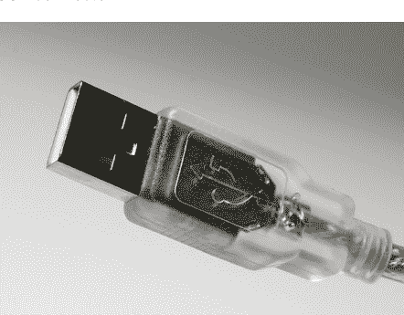

图片来源：`Andreas Frank`

较旧的键盘可能使用 `PS/2` 接口，这是一个小型圆形插头。图 2-3 显示了一个 `PS/2` 接口。`PS/2` 接口不支持热插拔，因此在连接或断开 `PS/2` 键盘之前，你必须关闭计算机。

**图 2.3** `PS/2` 接口

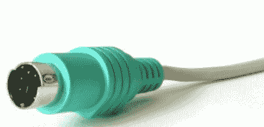

无线无线键盘，它们使用蓝牙或其他距离无线技术将键盘连接到插入 `PC` 一个 `USB` 端口的小型接收器/发射器设备。

如果你使用非英语的语言在 `PC` 上工作，你可能有一个特定于该语言的键盘。操作系统可能会自动识别正确的键盘布局，或者你可能需要在操作系统中指定键盘布局或“区域”或“国家”设置，以告诉它你正在使用的语言。接下来的练习将探索 `Windows 7` 中的键盘布局和区域选项。

## 练习 2.1

- 1. 在 `Windows 7` 中，选择开始 > 控制面板 > 时间、语言和区域（或语言和区域，取决于你的版本） > 更改键盘或其他输入方法。打开“区域和语言”对话框，并显示“键盘和语言”选项卡。
- 2. 点击“更改键盘”。打开“文本和服务输入语言”对话框。
- 3. 在“常规”选项卡上，打开“默认输入语言”下拉列表并检查其他选项。不要更改当前选择。除了“英语（美国）”之外，你可能没有其他选项。

如果你没有任何键盘布局选项，但又想使用不同国家的键盘布局，你需要从微软安装一个语言包。

- 4. 点击“键盘”下“已安装的服务”区域中的“英语”。“属性”按钮变为可用，如下所示。

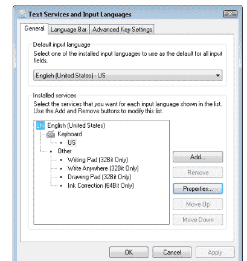

- 5. 点击“属性”按钮。打开“键盘布局预览”对话框，显示当前的键盘布局。
- 6. 点击“取消”关闭对话框。
- 7. 点击“高级键设置”选项卡，并注意这些设置，如示例所示。注意，大写键目前用于开启/关闭大写，但如果你愿意，也可以将其改为 `Shift` 键执行的功能。同样注意，切换输入语言的快捷键当前设置为“左 `Alt` + `Shift`”。如果你安装了多种语言，可以使用该快捷键在语言之间切换。

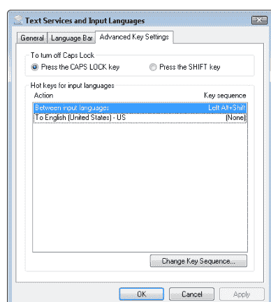

- 8. 点击“取消”关闭“文本和服务输入语言”对话框。
- 9. 点击“取消”关闭“区域和语言”对话框。
- 10. 关闭所有剩余的打开窗口。

## 数字键盘

在某些业务领域（如金融、会计和银业），计算机用户花费大量时间输入数字数据。在这种情况下，数字键盘可以大有帮助。受过所谓“十指数字”键盘使用训练的用户，使用数字键盘输入数字的速度比使用标准键盘上字母键方的数字键更快。

数字键盘内置在大多数 `PC` 的全尺寸键盘中，也可以作为独立的输入设备购买。

## 指针设备

指针设备是你用手移动以控制屏幕上指针（或光标）的物体。你通过移动光标与操作系统或应用程序通信。今天大多数指针设备使用 `USB` 接口；旧的老鼠可能使用如图 2.3 所示的 `PS/2` 接口。

作为设备，它们通常是即插即用的，这意味着操作系统立即识别它们，无需任何特殊软件。要使用设备的高级功能（如自定义编程按钮），可能需要驱动软件。

## 老鼠

最古老且仍然受欢迎的指针设备是鼠标。鼠标因其大小和形状而命名；它大约相当于小型啮齿动物的大小（或者如果你喜欢的话，一块肥皂的大小），传统上有一根连接到计算机的线（看起来有点像尾巴）。

鼠标使用两种主要技术：机械式和光学式。使用机械鼠标时，鼠标底部有一个橡胶球。球在鼠标垫或桌面上滚动，随着它的滚动，它会经过鼠标内部的传感器，告诉屏幕上的指针在屏幕上的相应方向移动相应的距离。

使用光学鼠标时，底部没有球；相反有一个发光二极管（`LED`）和光电极管（光敏传感器）来检测移动。激光鼠标类似于光学鼠标，它使用红外激光代替 `LED`。无论使用光学鼠标还是激光鼠标，运动信号的变化率都会告诉操作系统鼠标移动的位置。图 2.4 显示了一个去掉了顶盖的机械鼠标，你可以看到内部发生的情况。图 2.5 显示了光学鼠标的底部；光学鼠标内部没有活动部件。

**图 2.4** 机械鼠标的内部结构

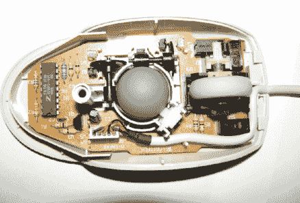

图片来源：`Gregory Badon`

### 图 2.5 光学鼠标的底部

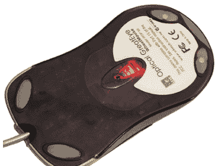

图片来源：`www.dansdata.com`

鼠标有按钮，你可以按下并释放它们以对你在屏幕上指向的任何内容进行操作。苹果 `Macintosh` 计算机可以使用单键或双键鼠标；`Windows` 系统需要双键变型。某些型号上可能有第三个（中间）按钮，或者用于滚动窗口的滚轮。在 `Windows` 中，左鼠标键是主按钮，用于选择；右鼠标键通常打开上下文相关菜单。

> 考虑你正在使用的表面很重要。抛光的桌面可能看起来很好，但可能会阻碍你的光学鼠标向操作系统发送信号。
> 要清洁机械鼠标，取下球。要清洁光学鼠标，用棉签擦拭周围。

## 练习 2.2：探索鼠标功能

- 1. 翻转鼠标，判断它是机械式的（带球）还是光式的（带 `LED`）。如果是机械式的，旋转固定球的环，取出球，检查空腔，然后重新装好。
- 2. 在 `Windows 7` 中，选择开始 > 控制面板 > 硬件和声音 > 设备和打印机 > 鼠标。打开属性对话框。
- 3. 点击对话框中的每个选项卡，探索鼠标的可配置选项。这是鼠标属性的示例，你的可能会根据鼠标类型而不同。

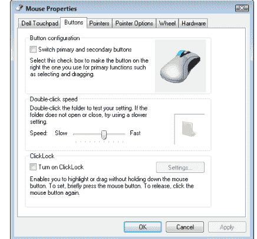

- 4. 拖动按钮选项卡中的双击速度，然后点击右侧的文件夹图标设置新设置。完成后，将滑块拖回原始位置。
- 5. 在选项选项卡上，打开下拉列表并检查可用的指针方案。选择一个并应用它（应用按钮）。然后改回原始使用的指针方案。
- 6. 点击指针选项选项卡，并拖动移动部分的滑块以尝试不同的指针速度。点击应用，并移动鼠标指针查看结果。然后将指针速度设回原始设置。
- 7. 点击取消关闭对话框，并关闭所有打开的窗口。

## 触摸板

触摸板（有时称为轨迹板）是一个压力敏感的表面，你可以在上面运行手指来移动屏幕上的指针。基于 `Windows` 的 `PC` 触摸板通常下方有按钮，即左右鼠标键；某些型号还允许你触摸触摸板表面来单击或双击。图 2.6 显示的 `MacBook` 触摸板没有包含按钮，因为在 `Mac` 上不需要右键点击；`Mac` 使用单键指针设备，因此只需点击即可。

### 图 2.6 麦电脑上的触控板

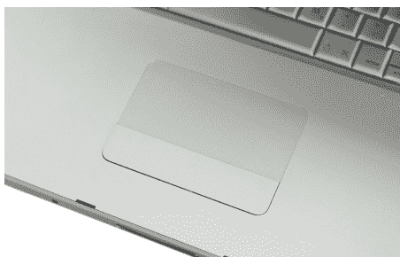

图片来源：`Highway of Life, 维基`

触控板的操作空间比鼠标更小，因此常见于笔记本电脑上。

## 轨迹球


轨迹球就像一个倒置的机械式鼠标。它的底座保持固定，你用手指滚动球体来移动屏幕上的光标。图 2.7 显示了轨迹球的示例。操作轨迹球比鼠标所需的空间更小，有些人也发现它们用起来更舒适。在需要精确指向时（例如使用图形处理软件），轨迹球的指向也更加有效。

## 图 2.7 轨迹球

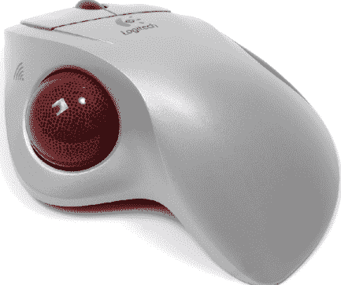

## 触摸屏和手笔输入

`屏幕`是一种压力敏感的视频显示器。触摸屏常见银行 `ATM` 机、机场值机台、商场自助终端以及许多其他消费者需要在没有键盘或鼠标的情况下与视频显示器交互的场所。

平板电脑是使用触摸技术的笔记本电脑，作为主要或次要的用户输入形式。某些平板电脑（如 `Apple iPad`）使用触摸屏功能进行所有输入，包括键盘输入（键盘显示在视频显示器上，你只需触摸字母即可）。其他设备则内置键盘和/或通过 `USB` 端口连接鼠标。

大多数现代屏幕都是通过手指触摸激活的，但早期的型号（特别是基于 `Windows` 的平板电脑）使用一种名为“手笔式计算”的技术。只有用设备附带的特殊手写笔触摸时才会激活。手写笔向显示器表面的传感器发送信号以建立连接；普通手指触摸则没有任何反应。某些游戏机（如任天堂 `3DS`）也使用了这种技术。

## 游戏控制器

游戏主机拥有专为游戏而设计的输入控制器，这也是游戏机在游戏爱好者中如此受欢迎的原因之一。个人电脑也有类似的控制器，让玩游戏变得更简单更有趣。例如，`PC` 可以配备与流行游戏主机相同的游戏控制器，如能让飞行模拟游戏操作更简单的摇杆。

## 内部和外部存储设备

数据通过输入设备进入电脑后，接下来会怎样？输入的数据临时存储在 `RAM`（随机内存）中，但最终必须保存到存储设备中以保留。个人电脑有多种存储设备，每种设备在速度、成本、便携性和便利性方面都有独特的优缺点。在本节中，你将学习一些最常用的存储设备。

存储空间以千字节（`KB`，数千字节）、兆字节（`MB`，百万字节）和吉字节（`GB`，十亿字节）为单位。个人电脑最初的存储设备是软盘，容量在 `360 KB` 到 `1.44 MB` 之间，这在现在看来小得可笑。但在那时，整个应用程序都可以存储在一个磁盘上。表 2.1 总结了存储容量的各种计量单位，并提供了注释和示例。注意，这些倍数不是 1000，而是 1024 的倍数。这是由于计算机数字的二进制特性。例如，一个千字节是 `1,024` 字节，而不是精确的 `1,000` 字节。十进制值 `1024` 转换为二进制时是 `10000000000`。

## 表 2.1 存储计量单位

| 大小 | 等于 | 示例 |
| --- | --- | --- |
| 字节 (`Byte`) | `8` 位 | 文本的一个字符。 |
| 千字节 (`KB`) | `1,024` 字节 | 一个 `1,000` 字符的纯文本文件，或一个小图形（`18x18` 像素），例如图标。 |
| 兆字节 (`MB`) | `1,024 KB` | 一张 `600x600` 像素的照片，或一分钟的音乐片段。 |
| 吉字节 (`GB`) | `1,024 MB` | 一张完整的音频 `CD` 约为 `800 MB`（4/5 个 `GB`）；一部两小时的 `DVD` 电影约为 `4 GB`。 |
| 太字节 (`TB`) | `1,024 GB` | 记录所有财务交易的大型企业数据库。 |
| 拍字节 (`PB`) | `1,024 TB` | 大型税务机关（如美国国税局）存储的所有数据。 |

你将在本章其余部分学习的各种存储类型都有各自的容量限制。表 2.2 总结了这些限制。

## 表 2.2 最大存储容量

| 媒介格式 | 最大（截至 2011 年） |
| --- | --- |
| 标准（机械式）硬盘 | `3 TB` |
| 固态硬盘 | `2 TB` |
| `USB` 闪存盘 | `256 GB` |
| 紧型存储卡 (`Compact flash`) | `128 GB` |
| `CD` | `900 MB` |
| 蓝光光 (`Blu-ray`) | `50 GB` |
| 双面双密度 `DVD` | `17.08 GB` |

## `ASCII` 和 `Unicode`

磁盘以二进制数字的形式存储数据。每个字符都可以由 `1` 和 `0` 的特定组合唯一描述。这代码集定义了哪个字符对应哪个代码，称为美国信息交换标准代码（`ASCII`）。

## 硬盘

硬盘（或磁盘）是一个密封的盒子。电脑最初的磁盘——软盘是可拆卸的。软盘驱动器固定安装在电脑内，而软盘可以插拔。后来出现了集成式硬盘。由于无法将它们分开，硬盘（外壳内的盘片）和驱动（访问盘片的读写头）不再被分开称为。整个设备被称为硬盘。

硬盘通常是内部设备，安装在电脑箱内。然而，也有外部硬盘，通过 `USB` 或火线（`IEEE 1394`）连接电脑。与其他存储选项相比，硬盘的每兆字节成本低、读写速度快且可靠性高。它们的主要缺点是体积较大且不便携。硬盘的容量以百吉字节或太字节为单位；笔记本电脑典型的硬盘可能有 `500 GB` 的存储，操作系统占用了一些 `GB`，其余空间可供应用程序和数据文件。旧电脑的磁盘空间少得多——可能只有 `10` 或 `20 GB`。

图 2.8 显示了硬盘的内部。盘片高速旋转，读写头悬浮在表面上方。桌面硬盘直径通常为 `3.5` 英寸，而笔记本硬盘更小。

## 图 2.8 硬盘内部

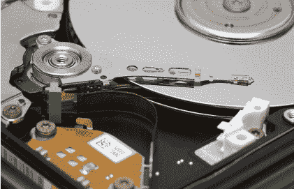

图片来源：`Mfield, Matthew Field`, `http://www.mattfield.com`

## 练习 2.3

### 获取硬盘信息

1. 在 `Windows 7` 中，点击“开始” ➤ “计算机”。出现电脑上驱动器的列表。
2. 点击硬盘 (`C:`) 选中它，并查看窗口底部的状态栏。将显示硬盘的总大小、已用空间、可用空间和文件系统信息。这是一个示例，但你的硬盘规格会有不同。
3. 右键点击硬盘，并点击“属性”。会打开该驱动器的属性对话框，如示例所示。
4. 检查有关可用空间、空闲空间和容量的信息。这与你之前看到的相同，但现在你有了精确的计数，还有一个图表。
   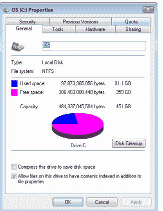
5. 点击“硬件”选项卡。将出现关于所有磁盘驱动器的信息，包括如果你有一个 `DVD/CD` 驱动器。在这里你可以看到每个驱动器的品牌名称和型号。
   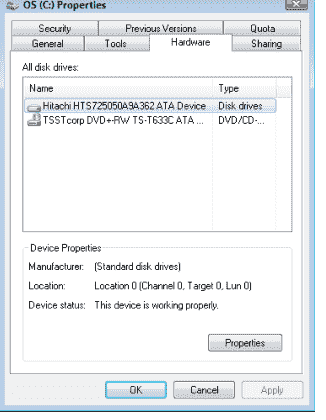
6. 点击“取消”关闭对话框，并关闭“此电脑”窗口。

# 磁磁盘如何存储数据

磁存储（如传统硬盘使用的存储方式）通过对磁盘区域进行正极或负极磁化处理来产生转换。然后，它将正负区域之间的转换读取为 `1`，将转换的最后部分读取为 `0`。

读写头虽然是一个单元，但实际上执行两个不同的功能：它使磁盘区域磁化，并读取极性后将其传输到驱动器控制器。

磁盘表面涂有一层薄薄的氧化铁颗粒。读写头周围绕着一个线圈，电流流过该线圈。磁场将磁盘表面极化为正极或负极。通过导线的电流发生反转，改变极化状态并产生转换点。

外部硬盘通过 `USB` 或 `FireWire (IEEE 1394)` 连接器连接到电脑。它们易于使用，你只需插入即可。然而，外部硬盘通常需要来自 `AC` 适配器的独立电源。

可以从外部硬盘设置系统，因此你可以将操作系统放在该驱动器上。然而，这样做会损失性能，因为由于外部电缆和连接器的瓶颈，外部硬盘通常比内部硬盘慢。此外，如果没有外部硬盘，计算机将无法使用，因此如果外部硬盘丢失或放置错误，计算机将无法工作。外部硬盘还比内部硬盘更容易受到热冲击。


通用串行总线 (`USB`) `2.0` 的速率高达 `480` 兆比特秒 (`Mbps`)。`FireWire` 的速率为 `400 Mbps`。相比之下，用于内部驱动器的串行 `ATA` 技术 (`SATA`) 数据传输速度在 `1.5` 到 `6 Gbps` 之间。

# 决定硬盘速度的因素

硬盘访问速度是系统性能的一个重要考虑因素，因为硬盘作为机械设备，可能会成为瓶颈。处理器和内存的运行速度比最快的硬盘快得多，因此它们最终一直在等待硬盘提供所需的数据。

如上一节所述，内部硬盘比外部硬盘快得多。影响硬盘速度的其他一些因素如下：

- **每分钟转数 (`RPM`)**：盘片旋转得越快，读写头读取的速度就越快。硬盘的 `RPM` 范围在 `5,400` 到 `15,000` 之间。显然，这在固态硬盘上不是问题，固态硬盘使用静态 `RAM` 存储数据而不是磁盘，因为没有盘片。
- **缓存大小**：就像处理器一样，硬盘有一个小型集成 `RAM` 缓存，用于存储最近使用过或可能被请求的数据。驱动器的缓存越大，它就越能预测操作系统的请求。机械硬盘和固态硬盘都有缓存。

# 硬盘连接器类型

内部硬盘通过电缆连接到主板，电缆使用三种连接器类型之一：

- **并行 `ATA` 技术 (`PATA`)**：一种旧技术的连接器类型，使用带有 `40` 根线的宽排线线（见图 2.9）。直到几年前，几乎所有硬盘都使用这种类型的连接器；现在它已几乎过时了。电缆中的多根线并行（即同时）发送数据位。

图 2.9 `PATA` 硬盘电缆

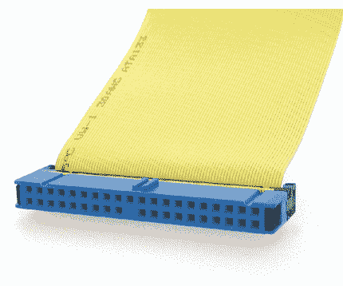


- **小型计算机系统接口 (SCSI)**：像 `PATA` 一样，`SCSI` 是并行接口；它使用与图 2.9 所示 `PATA` 电缆非常类似的排线线，但稍宽（50 或 68 根线）。`SCSI` 曾在高端系统中非常流行，一度你可以在单个接口上级联多个 `SCSI` 设备。

- **串行 ATA 技术 (SATA)**：一种较新的技术，使用更细的电缆。数据串行发送（即一次一个）。`SATA` 具有优势，因为它更便宜，并用于主流系统。

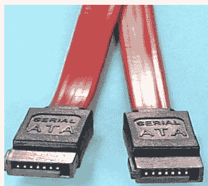

外部硬盘需要来自 `AC` 适配器的独立电源。可以从外部硬盘设置系统，因此你可以将操作系统放在该驱动器上。然而，这样做会损失性能，因为由于外部电缆和连接器的瓶颈，外部硬盘通常比内部硬盘慢。此外，如果没有外部硬盘，计算机将无法使用，因此如果外部硬盘丢失或放置错误，计算机将无法工作。外部硬盘还比内部硬盘更容易受到热冲击。

## 主/从跳线

`PATA` 接口使用跳线帽来指示哪个驱动器是主设备或从设备。如果只有一个驱动器，你将跳线设置为主设备。如果有两个驱动器，你必须将一个设置为主设备，另一个设置为从设备。这告诉主板哪个是哪个。当新安装的 `PATA` 驱动器无法工作时，通常是因为跳线设置不正确。

`PATA` 还支持线缆选择 (`CS`) 配置。如果你只有一个驱动器，你将跳线设置为 `CS`。如果有两个，你将一个设置为 `CS`，另一个设置为主设备。这允许两个驱动器共享一根电缆。

`RAID` 系统中使用基于校验的错误恢复技术。简而言之，基于校验的恢复原理是这样工作的：假设你有一个二进制数字 `101` 需要存储，你的 `RAID` 中有四块物理硬盘。每个位都存储在不同的物理磁盘上，一个校验位存储在另一个物理磁盘上。校验位被设置为 `1`（如果其他数字相加的总和为奇数）或 `0`（如果总和为偶数）。在这种情况下，总和 (`1+1`) 是偶数，因此校验位将将设置为 `0`。

## RAID 系统

对于磁盘持续运行至关重要的 PC 场景（例如许多人赖以生存的服务器），实施 `RAID`（独立磁盘冗余阵列）将非常有用。`RAID` 系统将多个物理磁盘组合在一起工作，以提高性能、可靠性或两者兼顾。

- `RAID 0` 将多个驱动器合并为一个。它提供比单个卷更快的访问速度，因为有更多的读写头同时进行读取或写入。

- `RAID 1` 将多个驱动器组合，但每个都是其他驱动器的精确副本。如果一个驱动器发生物理故障，数据在其他驱动器上依然安全无恙。

- `RAID` 版本 2 到 6（其中 `RAID 5` 最流行）基本上都在做相同的事情，只有细微差异。它们通过使用至少三块硬盘并使用基于校验的错误恢复方法在所有硬盘上条带化数据来提高性能和可靠性，以确保如果一个硬盘故障，其包含的内容可以从剩余硬盘的数据中重建。


## 第 2 章 · 输入与存储设备

现在假设集合中的第 `#2` 个数据失败了。观察你拥有的其他数据，你知道第一个数字是 `1`，第三个数字是 `1`，奇偶位是 `0`（偶数）。根据这些信息，你可以推断出缺失的数字是 `0`。漂亮，你刚刚重构了它。当 `RAID` 在多个设备上条化数据时，它会交替存储奇偶位，以确保数据均匀分布在所有驱动器上。这样，如果需要更换其中一个驱动器，程序可以重建旧驱动器包含的每一个位。这就是基本概念，但除了 `RAID 2` 之外，数据是按 `64KB` 块进行条化的，而不是单个位。处理更大的数据块使操作速度更快。

## 低级格式化

当磁盘制造时，它的表面是一个巨大的区域。在磁盘接受任何数据之前，必须实施一种组织结构，以使磁盘上的每个物理位置具有唯一性。这样，驱动器控制器就可以指定特定数据位写入或检索的精确物理位置。

以下是磁盘划分的组织单元：

- **磁头 (Heads)**：几乎所有的磁盘都是双面的。每个面都有独立的读/写磁头。在硬盘上，通常有堆叠的盘片，每个盘片都有顶部和底部磁头。

- **磁道 (Tracks)**：每个磁盘被分成同心圆环`磁道`，就像树横截面上的年环一样。高容量硬盘可以有数万条磁道。

- **柱面 (Cylinders)**：读/写磁头在单个执行器内进出，使得所有磁头在任何时候处于相同的位置。在给定的臂位置可以访问的磁道堆与单个磁盘侧面的磁道数相同。

- **扇区 (Sectors)**：磁盘表面通过交叉的线被进一步划分为饼形切片。这些线与磁道相交，创建了称为`扇区`的小段。扇区有唯一的编号，在需要数据时可以通过它们的编号进行引用。大多数扇区每个 `512` 字节。

这种将磁盘划分为逻辑单元的操作通过称为低级格式化的程序完成。`低级格式化`决定了磁道的数量和间距，以及每个磁道扇区的数量和间距。这些因素共同决定了磁盘上的扇区总数，并决定了其存储容量。

硬盘在工厂进行低级格式化。硬盘外壳上的标签报告柱面、磁头和扇区的数量，有时缩写为 `CHS`。驱动器组织特征的另一个名称是`几何结构 (geometry)`。`BIOS` 设置需要这些信息来与驱动器通信。

> 在硬盘早期，`CHS` 值反映的是磁盘低级格式化的物理真实情况。然而，现在已经不再如此了。驱动器的 `CHS` 值并不一定指的是驱动器的精确物理布局，而是驱动器控制器在与驱动器通信时所看待的逻辑方式。例如，一个驱动器的标签报告它有 `16` 个磁头（`8` 个盘片），而实际上它只有 `3` 个或 `4` 个。

## 内部和外部存储设备

## 磁盘分区与创建逻辑驱动器

操作系统（`OS`）并不直接处理物理硬盘。它处理的是逻辑驱动器。逻辑驱动器是分配给物理磁盘一部分的驱动器号。单个物理磁盘可以有多个逻辑驱动器。例如，操作系统可能会看到 `C` 盘、`D` 盘和 `E` 盘，它们都都是单个物理磁盘的一部分。

要创建这些逻辑驱动器，你必须首先创建分区。你至少需要创建一个一个主分区。你可以分配整个驱动器的所有空间，也可以为另一个分区留出空间。如果你确实留出了空间，可以创建一个扩展分区，然后在该分区上创建额外的逻辑驱动器。当你对物理驱动器进行分区时，它会创建一个主引导记录 (`MBR`)，操作系统会使用它。

### 内部和外部存储设备

第二个分区名为 `RECOVERY`，由于是隐藏分区，系统恢复文件存储在该分区上。此分区是系统分区（`System partition`），意味着它包含磁盘的引导扇区（存储启动数据的扇区）。它还是活动分区（`Active partition`），意味着它是系统查找启动文件的第一个分区。一次只能有一个分区设为活动状态。

第三个分区名为 `OS`，由于它被分配了 `C:` 盘器号；它是这三个分区中唯一一个通常对计算机用户可见的。。此分区是启动分区（`Boot partition`），意味着它包含 `Windows` 启动文件。它还是页面分区（`Page partition`），意味着它是为虚拟内存存储分页文件的地方（如第 1 节“计算机硬件”所解释的），以及崩溃转储分区（`Crash Dump partition`），意味着它是存储系统崩溃信息的地方。

示例中的每个分区都是“良好的”（`Healthy`），这意味着 `OS` 和 `RECOVERY` 分区共享 `NTFS` 文件系统，即它们已经过格式化。`OEM` 分区可能包含专有文件系统中的文件，只有 `BIOS` 才能理解这些文件；在 `Windows` 中无法读取的。

- `3.` 检查你的分区和逻辑驱动器。不要进行任何更改。

- `4.` 关闭“计算机管理”窗口。

## 创建网络共享

当许多人需要访问相同的数据时，系统管理员可能会选择将数据放在网络上的一个集中访问的文件服务器上。然后，将包含数据的文件夹对需要它的人开放——即共享——给这些人的人。这被称为网络共享。你还可以将本地硬盘上的文件夹与网络上的其他人共享。

网络共享可以被设置为映射驱动器，这样该文件夹在用户的 PC 上就会显示为一个单独的驱动器。例如，你可能从网络访问你公司的人员文件夹，就像它是你系统上的 `P:` 盘一样。

公司为其网络配备专用存储时使用文件服务器，但虽然无线接入点现在配备了网络附属存储（`NAS`），而且独立的 `NAS` 设备也是可用的。`NAS` 是一个被配置为作为网络共享运行的硬盘，独立于任何单个个人电脑。例如，你可以使用 `NAS` 设备在家里存储音乐或视频片段，或者在小型企业中存储重要的客户文件。

网络共享虽然方便，但它也存在风险。你在本地网络上提供的任何文件夹都可以被任何访问该网络的人访问。如果你有一个不安全的无线网络，任何开着笔记本电脑开车经过你家的人都可能监视你的文件和信息。第 9 章“安全与访问控制”指出了减少风险的一些方法。

许多文件下载服务（如 `BitTorrent`）使用本地共享来实现许多不同文件的大量分发和下载。这种基于点的系统在原理上是非常强大的，无论对于你这个文件共享者，还是对于寻求利用你系统的不法黑客来说都是如此。除非你掌握了熟练的网络安全和系统管理技能，否则最好的建议是确保不要本地系统之间对硬盘开放任何文件共享。

## 练习 2.5

### 在网络上共享文件夹

- `1.` 在 `Windows 7` 中，点击“开始”按钮并点击“计算机”。双击 `C:` 盘打开它。

- `2.` 点击“新建文件夹”。出现一个新文件夹。输入名称为 `Test Share` 并按回车键。

- `3.` 右键点击新文件夹，点击“属性”。打开 `Test Share` 属性对话框。

- `4.` 点击“共享”选项卡。

- `5.` 点击“共享”按钮。打开“文件共享”对话框。


- 6. 在名称列表上方的框中，如示例所示输入`Everyone`。`Everyone`是一个系统定义的组，包含所有用户。
- 7. 点击“添加”按钮。`Everyone`组被添加到名称列表中。
- 8. 如下所示，点击`Everyone`行`Read`旁边的向下箭头，打开菜单并点击“读取/写入”。
- 9. 如下所示，点击`共享`。
- 10. 点击`共享`。该文件夹已共享。
- 11. 点击`完成`。关闭对话框。

## CD 和 DVD 驱动器接口

CD 和 DVD 驱动器使用与硬盘连接主板相同的连接器。根据型号的不同，它们可能使用 `PATA`、`SATA` 或 `SCSI`，这些在本章的之前已经描述过。

## CD 刻录技术

`CD-ROM` 是只读的，但有两种技术可以创建你自己的 CD：`CD-R` 和 `CD-RW`。

`CD-R` 全称为紧凑记录（Compact Recordable），只能写入一次（多会话刻录除外，在这种情况下，之前的内容并未被完全擦除，而是被忽略，磁盘文件列表显示的是新内容）。`CD-RW` 或紧凑可重写（Compact Rewritable）可以多次写入、擦除和重复使用，功能类似于闪存驱动器。当你需要随时间存储少量数据（如几个文件的备份）时，`CD-RW` 是一个很好的选择。`CD-R` 与立体声系统和其他播放光学 CD 的非设备兼容性更好，因此当你想要刻录 CD 但不想进行任何更改时，它是更好的选择。

在当今的 PC 中，所有可写 CD 驱动器都能同时读写 `CD-R` 和 `CD-RW` 光盘。`CD-R` 空盘比 `CD-RW` 空盘更便宜，因此你可能想手留一些以备不同用途。

PC 并没有制造批量生产 CD 上那种凹槽铝层的制造设备。`CD-R` 的录制过程之所以可行，是因为 CD 读器并不接触磁盘表面——它们只是观察它。也就是说，它的染料和金属涂层在自然状态下非常光亮。激光照射磁盘的某些区域使其变得光亮，从而降低反射率。

CD 传感器会将低反射区域解释为凹槽，无论该区域实际上是否为凹槽。相比之下，`CD-RW` 不使用染料和金属涂层。相反，它涂有一层具有反射性的金属合金，其反射性质根据加热的温度而变化。它使用了三种设置。高写入设置将合金加热到 1,112 华氏度，在该温度下它会液化。然后它会固化并失去其反射特性。可以通过低写入设置将同一位置重新加热到较低的温度（约 392 华氏度），使其恢复原始状态。这就是重写区域的方法。最低功率设置则在不改变数据的情况下读取数据。

## DVD 驱动器

`DVD` 代表数字多功能光（Digital Versatile Disc）或数字视频光（Digital Video Disc）。`DVD` 看起来与 CD 相似，但从技术上讲，它们更先进，存储的数据更多。`DVD` 驱动器还可以读取 CD，因此现在很少找到仅支持 CD 的驱动器；大多数驱动器都能同时读写 CD 和 DVD。

单面单层 DVD 容量为 4.7 GB；当层数翻倍时，容量也大约翻倍；当磁盘可以写入的双面翻倍时，容量再次翻倍。表 2.4 提供了快速摘要。

双层光盘在顶部堆叠了两层光学介质。上层是半透明的；也就是说，它允许特定程度的光通过而不改变数据，因此两组数据可以在同一表面区域共存。双层盘在批量生产的视频 DVD 中很常见，因为允许在一个视频中录制更长的电影。许多 PC 驱动器也可以读写双层盘。

### 表 2.4 DVD 容量

| 单面 | 双面 | 单层 | 双层 | 容量（千字节） |
|---|---|---|---|---|
| | | | | 4.7 |
| | | | | 8.54 |
| | | | | 9.4 |
| | | | | 17.08 |

除了存储更多数据外，`DVD` 的数据传输率比 CD 高。每旋转一次，驱动器从 `DVD` 读取的数据量大约是从 CD 读取数据量的九倍。表 2.5 展示了 `DVD` 转速如何转换为数据传输率。

### 表 2.5 DVD 速度

| 速度 | 最大数据速率（兆比特每秒） |
|---|---|
| 1x | 10.8 |
| 2x | 21.6 |
| 4x | 43.2 |
| 10x | 108 |
| 20x | 216 |
| 24x | 259.2 |

`DVD` 可写和可重写空盘有两种格式：`DVD+` 和 `DVD-`。一次写入的版本是 `DVD+R` 和 `DVD-R`；可重写版本是 `DVD+RW` 和 `DVD-RW`。这些是数据如何写入磁盘的两种不同且竞争的技术。大多数驱动器都可以以任何一种格式写入。

某些非电脑 DVD 播放器（尤其是旧型号）可能会拒绝其中一种格式，因此你可能想先测试你的 DVD 播放器，以确保在购买大量空盘之前它可以读取写入特定类型 DVD 光盘的介质。

## 蓝光驱动器

蓝光盘（`BD`）物理上与 `DVD` 相似，但存储的数据更多，因此适用于高清电影和海量数据存储。每个 `BD` 每层可以容 25 GB，且最多有两层，总计 50 GB。表 2.6 总结了蓝光存储容量。

### 表 2.6 蓝光存储容量

| 尺寸 | 层数 | 容量（千字节） |
|---|---|---|
| 8 cm | 1 | 7.8 |
| 8 cm | 2 | 15.6 |
| 12 cm | 1 | 25 |
| 12 cm | 2 | 50 |

### 2.7 蓝光速度

| 速度 | 最大数据速率（兆比特每秒） |
|---|---|
| 1x | 36 |
| 2x | 72 |
| 4x | 144 |
| 8x | 288 |
| 10x | 432 |

## 闪存存储设备

许多电脑设备使用闪存卡存储数据以便最终传输到电脑。例如，数字相机、数字视频录像机和某些医疗设备（如血压计和血糖计）将输出显示在闪存卡上。

由于闪存卡没有内置接口，它必须放置在读卡器中，读卡器类似于磁盘驱动器除。有些电脑内置了读卡器，你也可以购买连接到 PC `USB` 接口的外部读卡器。内置读卡器通常与硬盘使用相同的总线，因此数据传输很快。外部读卡器受限于 `USB` 总线速度，`USB` 闪存驱动器也是如此。

## USB 闪存驱动器

闪存驱动器（也称为 U 盘）是一种存储在内存芯片而非磁性或光学介质上的设备。`USB 2.0` 总线的传输速度为 480 Mbps。相比之下，`SATA` 总线的最大速度为 1.5 Gbps 和 3 Gbps。

## 闪存卡与读卡器

多种不同尺寸和形状的闪存卡可用，每种都有自己的规格和功能。某些读卡器只能接受一种类型的卡；另一些可以读写多种类型的卡。常见的卡类型包括紧凑存（`CF`）、智能媒体（`SM`）、多媒体卡（`MMC`）、数字存储（`SD`）、`Memory Stick` 和 `xD`。图 2.13 显示了一张数字存储卡。

## 图 2.13 一种安全的数字内存卡

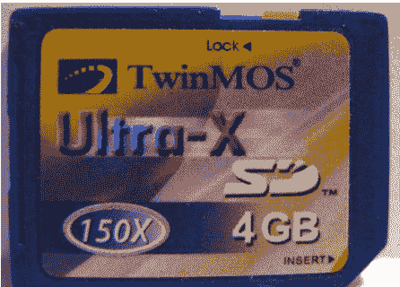

图片来源：Wirepath, Wikimedia Commons

> 有关闪存存储卡的各种类型和子类型的详细比较（包括其精确尺寸和特性），请参阅 `http://en.wikipedia.org/wiki/Comparison_of_memory_cards`。

存储卡的差异不仅在于尺寸、形状和容量，还在于它们是否实现了以下功能：

`写保护` 某些类型的卡带有写保护开关，允许您将其设置为只读。

`数字版权管理`（`DRM`）某些类型支持安全加密功能，允许您在卡上设备上制作文件。

## 移动媒体设备

各种移动设备使用 `RAM` 作为其主要存储手段。如今的移动设备包括智能手机、手持游戏机、音乐播放器等。它们运行自己的专有操作系统和应用程序，但它们都依赖于与闪存 `RAM` 或固态硬盘相同的相同非失性 `RAM` 技术来存储数据。

许多设备是多功能的。例如，一部典型的智能手机不仅可以作为手机，还可以作为日程安排器、音乐播放器，甚至是全球定位系统（`GPS`）设备。

## 固态硬盘

`固态硬盘` 并不是驱动器，但为了与机械硬盘术语保持一致而被称为硬盘。它的核心存储组件是闪存 `RAM`，与其他闪存 `RAM` 设备相同。它与其他闪存 `RAM` 设备的主要在于使用它的数据总线。

## 内部和外部存储设备

固态硬盘使用与机械硬盘相同的快速 `SATA` 或 `PATA` 接口，并具有与机械硬盘类似的缓存和控制器。与机械硬盘相比，固态硬盘具有许多优点且缺点很少。主要的缺点是价格；对于等效存储容量，机械硬盘更便宜。表 2.8 总结了每种技术的优缺点。

## 表 2.8 固态硬盘与机械硬盘对比

| 固态优点 | 机械硬盘 | 固态缺点 | 机械硬盘缺点 |
|---|---|---|---|
| 启动时间更快 | 每兆字节成本较低 | 每兆字节成本较高 | 启动时间慢 |
| 访问速度更快，因为读写头不需要寻道时间 | 介质写入次数理论上无限 | 根据写入次数，寿命有限 | 寻道时间是一个因素，通过磁盘转速得到缓解 |
| 静音运行，无移动部件 | 存储容量更大 | | 抗冲击和损坏能力较差 |
| 发热量低、功耗低 | | | |


| 机械可靠性高（无移动部件） | | | |

| 抗冲击和损坏能力强 | | | |

| 数据密度大（每平方厘米） | | | |

## 练习 2.6

## 选购硬盘

访问一些硬盘制造商的网站，比较它们最便宜和最贵的机械硬盘及固态硬盘。以下是可以尝试的一些网站：

- 西部数据（Western Digital）：`www.wdc.com/en/products/catalog/`

- 捷科（Seagate）：`www.seagate.com/www/en-us/products/internal-storage/`

通过这项研究得出什么结论？硬盘之间的主要区别因素是什么？

## 总结

在本章中，你学习了键盘和指针设备，这是个人电脑最常用的两种输入设备。你学习了键盘上用于功能和其他快捷键的特殊键，以及鼠标、轨迹球和触控板。

你还学习了存储设备，包括机械和固态种类。你学习了机械硬盘的工作原理，以及如何对硬盘进行分区和格式化以使其可寻址。然后，你学习了各种 `CD` 和 `DVD` 技术之间的差异，以及从固态硬盘到便携式音乐播放器的各种闪存 `RAM` 存储类型。

## 重点

- 识别标准键盘上的按键。除了字母和符号键外，键盘还有 `Windows` 键、`Ctrl` 等修饰键、功能键、方向键，在某些情况下还有 `Fn` 键或数字键盘。

- 列出存储测量单位。一个字节（`byte`）是 8 位（`bits`）；一个千字节（`KB`）是 `1,024` 字节。一个兆字节（`MB`）是 `1,024 KB`，一个吉字节（`GB`）是 `1,024 MB`，一个太字节（`TB`）是 `1,024 GB`。

- 解释机械硬盘如何存储数据。硬盘将数据存储在金属盘片上，盘片带有正负极性的模式。硬盘在工厂处进行低级格式化以创建磁道、磁头和扇区（`CHS`），并由最终用户进行分区和高级格式化。

- 理解影响硬盘性能的因素。硬盘性能受所用接口速度（内部硬盘使用 `PATA`、`SCSI` 或 `SATA`；外部硬盘使用 `USB` 或 `FireWire`）以及每分钟转数和缓存大小的影响。

- 了解低级格式化、分区和高级格式化之间的区别。低级格式化在工厂完成。分区将磁盘划分为多个部分，每个部分都可以是具有自己独立驱动器号的逻辑驱动器。格式化是在逻辑驱动器上放置与当前使用的操作系统兼容的文件系统。

- 区分不同类型的光介质。了解 `CD` 格式（`CD-ROM`, `CD-R`, `CD-RW`）、`DVD` 格式（`DVD-ROM`, `DVD-R`, `DVD+R`, `DVD-RW`, `DVD+RW`）和蓝光（`Blu-ray`）在容量和功能上的差异。

- 识别闪存 `RAM` 存储类型。闪存 `RAM` 将数据存储在静态固态设备中。闪存设备包括固态硬盘、便携式音乐播放器

## 复习题

1. 哪些是键盘上的修饰键？A. `Shift` B. `F1` C. `Esc` D. `Tab`

2. `Fn` 键出现在哪种电脑上？A. `Server` B. `Notebook` C. `Desktop` D. `Cell phone`

3. 鼠标像什么？A. 圆形 B. 硬币形 C. 宽带 D. 矩形

4. 鼠标通过什么方式触摸屏幕？A. 点击 B. 滚 C. 指 D. 指

5. 字符是以什么二进制格式存储的？A. `RTF` B. `TXT` C. `GB` D. `ASCII` 输入与存储设备

7. 现代硬盘的常见容量是？A. `500 GB` B. `500 MB` C. `500 KB` D. `500 TB`

8. 外部硬盘最常用的接口是？A. `PS/2` B. `SATA` C. `PATA` D. `USB`

9. 硬盘盘片的速度以什么单位衡量？A. 兆字节 B. `RPM` C. 毫秒 D. 以上都不是

10. 哪些硬盘接口是串行的？A. `PATA` B. `SCSI` C. `SATA` D. 以上都是

11. 哪种硬盘接口使用 40 宽带状电缆？A. `PATA` B. `SCSI` C. `SATA` D. `USB`

12. 哪种磁盘准备会创建磁道、磁头和扇区（`CHS`）？A. 低级 B. 分区 C. 高级格式化 D. 写入

13. 你可以使用哪种 `Windows` 工具对硬盘进行分区？A. 磁盘格式化 B. 检查磁盘 C. 磁盘管理 D. 分分区

14. 要让文件夹或驱动器在网络上可用，在“计算机”窗口中右键点击驱动器图标并点击。A. 服务 B. 共享 C. 组 D. 读取/写

15. 标准单面 `CD-ROM` 可存储多少数据？A. `100 MB` B. `800 GB` C. `4.7 GB` D. `9 GB`

16. 蓝光驱动器使用波长比 `CD` 或 `DVD` 播放器短的。A. 高频 B. 蓝色 C. 高 `RPM` D. 紫色

17. 以下不是闪存 `RAM` 存储设备？A. 固态硬盘 B. 内存卡 C. 便携式数字音乐播放器 D. `CD-ROM`

18. 以下哪种是内存卡的类型？A. `VGA` B. `SD` C. `DDR` D. `PATA`

19. 与机械硬盘相比，固态硬盘的缺点是哪个？

- A. 噪音更大

- B. 价格更高

- C. 耐用性较差

- D. 耗电更多

20. `DRM` 支持为闪存 `RAM` 设备或卡增加了什么功能？

- A. 速度

- B. 重新格式的能力

- C. 安全性

- D. 低功耗

## 复习题答案

- 1. `A` 修饰键本身没有任何作用，但在按住它并按下另一个按键时，它会导致该按键产生不同的值。

- 2. `B` `Fn` 键位于笔记本电脑上。它是 `Ctrl` 键的变体；与其他按键组合按下时，它可以执行某些特殊命令，通常与硬件相关。

- 3. `A` `PS/2` 接口是一种用于键盘的光学连接器，外形小呈圆形。

- 4. `D` 蓝牙和 `RF` 是用于无线鼠标的两种技术，但它们与光学鼠标的移动没有关系。机械鼠标使用滚轮球。光学鼠标使用 `LED`。

- 5. `B` 笔形电写笔用于与笔式计算设备上的屏幕交互。它不是真正的笔，里面没有墨。

- 6. `D` `ASCII` 编码为每个字符分配一个唯一的 7 位或 8 位二进制数。`RTF` 是一种文字处理文件格式。`TXT` 是文本文件格式。`GB` 是千字节的缩写。

- 7. `A` 硬盘存储数百千字节（`GB`）。一个非常老的硬盘存储 `500 MB`。`500 TB` 比现在的硬盘存储的容量还要大。`500 KB` 是一个非常小的量——小于一张软磁盘的数据量。

- 8. `D` `USB` 接口用于外部设备，包括硬盘驱动器。`PS/2` 是键盘和鼠标的老式连接器。`PATA` 和 `SATA` 是内部硬盘驱动器的连接器。

- 9. `B` 盘片旋转速度以每分钟转数（`RPM`）测量。兆字节是存储空间的单位。毫秒是时间单位。

- 10. `C`。`SATA` 是串行 `ATA`，是一种串行技术。并行 `ATA` (`Parallel ATA`) 和小型计算机接口 (`SCSI`) 并行的。

- 11. `A`。并行 `ATA` 使用 40 线电缆。`SATA` 使用细电缆（不是带状线）。`SCSI` 使用 50 线或 68 线带状线。`USB` 使用细电缆（不是带状线）。

- 12. `A`。驱动器的 `CHS` 值由其低级格式化决定，这是在制造驱动器的工厂完成的。

- 13. `C`。从“计算机管理”窗口访问“磁盘管理”工具，可以更改和分区驱动器信息。

- 14. `B`。右键点击驱动器并点击“共享”，弹出驱动器属性对话框并显示“共享”选项卡。从那里你可以选择共享驱动器（或文件夹）。

- 15. `B`。`CD` 可以存储 `650`、`800` 或 `900 MB` 的数据，取决于类型。

- 16. `B`。蓝光的名字源于它使用蓝色激光。

- 17. `D`。`CD-ROM` 是光学且数字化的，但不是基于闪存 `RAM` 的。它在反射面上以凹槽和凸地相互交替的模式存储数据。

- 18. `B`。安全数字 (`SD`) 是内存卡的一种。`VGA` 是一种视频标准。`DDR` 指一种动态 `RAM` 的类型。`PATA` 是机械硬盘的接口。

- 19. `B`。固态硬盘比机械硬盘更安静、容量更大且更省电。但它们更贵。

- 20. `C`。`DRM` 代表数字权利管理，指的是安全性。不同品牌和类型的 `RAM` 设备具有不同的技术（或没有）。

## 外围设备与网络

### 功能基础

本章涵盖的目标：

- 1.1 识别基础词汇

- 1.3 展示设置基础工作站的能力；识别连接器类型之间的差异：`DVI`、`HDMI`、蓝牙和无线；音频接口；显示器；打印机（`USB`、网络化）

- 3.1 识别基本安全风险及防止这些风险的方法：加密 (`WPA`/`WEP`)

## 技术基础

本章涵盖的目标：

- 1.1 识别之间的基本兼容性

- 1.2 演示以下设备的正确用法

- 1.3 解释外围设备的特性和功能：数字相机；摄像头；扬声器；麦克风；打印机/扫描仪

### 外围设备

在个人电脑的语文中，“*外围设备* (`peripheral device`)”有两种可能的定义。一种是指计算机机体外部的设备。根据这种定义，打印机、显示器、键盘和外部驱动器都是外围设备。另一种定义是指对于计算机运行并非必需的设备，无论其内部还是外部状态。根据这种定义，显示器、键盘和指针设备（如鼠标）不是外围设备，因为它们是必需的，但安装在计算机内部的卡的外围设备，因为计算机没有它可以运行。考试目标使用的是第一种定义。然而，包含的两个项目——扬声器和麦克风需要声卡（或主板支持）才能工作，因此在本章中我们将声卡视为外围设备。

## 打印机

所有打印机都执行相同的基本功能：将图像放在页面上。为了实现这一点，它们都必须拥有执行这些任务的子系统，多或少如下：


- 1. 从 PC 接收数据。每台打印机至少有一个输入接口。对于大多数打印机来说，这是 `USB` 或网络连接。旧打印机可能使用并行端口或串口。

- 2. 存储数据。打印机包含少量 `RAM`，用于等待输出。逐行打印的打印机（如喷墨机）比在传输前组合整页的打印机（如激光）内存少。

- 3. 将数据转换为打印指令。打印机内部有主板和处理器接受数据并将其转换为机械部件的指令。

- 4. 让纸张进出。每台打印机都由齿轮、滚子等组成，让纸张通过打印机。

- 5. 存储墨水或碳粉。打印机需要某种彩色材料在页面上创建图像。喷墨使用墨水；打印机使用碳粉。

- 6. 将图像传输到纸上。液体墨水从喷嘴（喷射）喷到页面上。干燥喷射可能是热或电。对于碳粉，碳粉中的磁性粒子被吸引到带电的鼓上，然后到纸张上。

- **成本**：包括打印机的初始成本以及墨水或碳粉的日常维护成本。

- **质量**：质量的主要衡量标准是每英寸点数（`dpi`），或分辨率。`dpi` 较高的打印机产生的文本边缘更锐利，图像更真实。

- **照片打印**：某些打印机专门设计用于在光亮的相片纸上复制照片。除了高 `dpi` 之外，它们可能还使用照片墨水。

- **速度**：速度以每分钟页数（`ppm`）测量。黑白或彩色的打印机通常有两个独立的 `ppm` 级。打印机的 `ppm` 是理论最大值，在现实生活中很少达到。

- **纸盒**：某些打印机一次放置的纸张比其他多。某些打印机有多个纸盒，因此可以放置不同的纸张，例如信头纸和平纸，或者信纸尺寸和法律尺寸。

- **接口**：某些打印机只有本地接口，如 `USB`；其他可选支持有线或无线网络接口。

- **其他功能**：某些打印机是多功能的，意味着它们还可以扫描和复制。其中一些还可以作为传真机使用。

消费者打印机有两种主要技术：喷墨和激光。以下章节将详细介绍这些技术。

> 本章涵盖了打印机类型及其通用特性。要了解如何配置和使用打印机，包括如何为其安装驱动程序，请参见第 4 章“设置计算机”。

## 喷墨打印机

喷墨打印机是将墨水喷在纸上的打印机。打印头中每种颜色（青、黄、洋红和黑色）有 21 到 256 个喷嘴，取决于品牌和型号；打印机引擎带动喷嘴根据所需的任何颜色以不同的组合和比例喷出。某些照片打印机拥有六或八个墨盒，因为某些打印任务使用不同类型的墨水。

将墨水强制挤出喷嘴有两种技术：热敏和压电式。热敏打印机将墨水加热到 400 华氏度，产生气泡从而将墨水挤出。这在墨盒中形成一个真空，从而将墨水吸入喷嘴。这种技术也被称为泡沫式打印。由于热会随着时间的推移损坏打印头，这些机型的更换墨盒通常也包含打印打印头。这些墨盒不应通过简单的加墨来在家里自行加墨，你已经使用了它，你需要一个新的打印头。

相比之下，压电喷墨（或简称 `piezo`）通过电而不是喷头来移动墨水。喷嘴包含压电晶体，当施加电时它们会改变形状并强制排出墨水。压电技术对打印机的损伤较小，因为不需要加热元件，而且输出效果更好，因为墨水较不容易烧焦。

喷墨打印机是打印机；它们在打印头垂直移动打印头时，通过一系列水平扫描来打印文档。因此，喷墨打印机需要的 `RAM` 内存有限——仅足够容几个字体和几行数据。大多数喷墨打印机甚至不会宣传它们所包含的 `RAM` 容量，尽管这非常重要。

## 激光打印机

激光打印机的工作原理类似于复印机。主要区别在于，复印机扫描文档以产生图像，而激光打印机从计算机接收数字化数据。

激光打印机包含一个大型圆柱作为鼓筒，它带有高负电荷。打印机引导激光束部分中和鼓筒区域的电荷。当鼓筒通过碳粉盒时，碳粉附着在电荷较小的区域，页面图像在鼓筒上形成。然后鼓筒旋转通过带正电的纸张，碳粉跳到纸上。随后纸张通过定影组件，熔化碳粉的塑料颗粒，使其粘附在纸上。

激光打印机有彩色或单色型号。要打印彩色，激光打印机必须在同一页纸上进行四次扫描，每次覆盖一种颜色。打印机有四个独立的碳粉盒：青色、品红、黄色和黑色。

虽然你不太可能这样做，但如果你洒出了任何碳粉，请让它静置后再清理。碳粉是细粉末，具有致癌性。致癌物是在长期持续接触下可能导致癌症的物质。最稳妥的做法始终是参考制造商提供的健康和安全指南。

## 设置打印机

现在的大多数打印机使用 `USB` 连接。任何全尺寸 `USB` 线和端口都可以工作，但最快的性能将来自 `USB 2.0` 或更高的电缆。

`USB` 是即插即用接口。因此当你将打印机连接到计算机时，计算机可能会自动识别打印机并为你完成设置。然而，让打印机自动设置并不总是件好事！某些打印机有自己的特殊软件，使其更易使用，而带有特殊软件的多功能打印机则可以启用传真、扫描和复制等功能。如果你允许 `Windows` 通过即插即用自动安装打印机，可能会错过其中的一些功能。因此，某些打印机附带的说明指定你应该先运行设置程序，仅在设置过程中被明确指示时才连接打印机。

旧的打印机使用并行打印接口。并行打印线连接到 PC 上的 25 针并行连接器，也称为 `LPT` 端口。（大多数 PC 现在没有这种连接器。）并行打印线的另一端是 36 针 `Centronics` 连接器，连接到打印机。（`Centronics` 是一种带有塑料封装和金属片的连接器品牌和类型。图 3.1 显示了 `Centronics` 连接器。）这种连接器不是即插即用的，在连接或断开时必须关闭计算机。

**图 3.1 旧式并行打印接口上的 Centronics 连接器**

### 在网络上共享打印机

在本地 PC 上设置好打印机后，你可能还会决定让网络上的其他用户可以使用。这被称为共享打印机。当打印机被共享时，只要执行共享的 PC 保持开启，其他人就可以使用。如果你关闭 PC，没有人可以使用该共享打印机。（如果这不可接受，请考虑带有网络功能的打印机，它在网络上有自己的地址，独立于任何 PC。）要共享打印机，打开打印机的属性，在“共享”选项卡上，勾选“共享打印机”复选框。

### 练习 3.1

#### 在网络上共享打印机

1. 在 `Windows 7` 中，点击“开始 ▷ 打印机和设备”。

2. 右键点击你想共享的打印机。这应该是本地打印机，而不是你通过网络访问的打印机。

3. 点击“打印机属性”。

4. 点击“共享”选项卡。

5. 勾选“共享打印机”复选框。

6. 点击“确定”。

三原色中一种颜色与相邻三原色中相同颜色之间的距离就是显示器的点间距（`dot pitch`）。点间距是衡量 `CRT` 显示器质量的主要指标。数值越小，点越越密，图像质量就越好。

## 显示器接口类型

显示器可以使用模拟或数字连接到计算机。`CRT` 显示器从本质上只支持模拟信号。`LCD` 显示器使用模拟或数字接口，它们通常同时配有两种类型的插头（某些低端 `LCD` 显示器仅有模拟接口）。

视频图形适配器（`VGA`）是模拟式显示器接口（见图 3.3）。多年来，`VGA` 一直是个人电脑最流行的显示器接口类型。`VGA` 接口是一个 `D-sub` 接口（即在一组引脚周围带有一个 D 形金属环的连接器），具有三行（分别为 4、5、6 个）共 15 个引脚。使用 `VGA` 接口时，计算机在数据发送到显示器之前将其转换为模拟信号；显示器被动地接收信号并显示信息。

图 3.3 VGA 接口

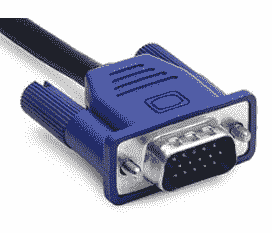

数字视觉接口（`DVI`）是 `VGA` 的现代替代方案（及继任者）。它是一个矩形插头，由 24 个用于数字传输的引脚（每行 8 个）以及一个排列在十字形隔器周围的额外 4 脚块用于发送模拟信号（为了向后兼容）。见图 3.4。

图 3.4 DVI 接口 

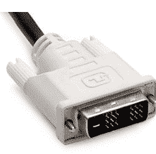

高清多媒体接口（`HDMI`）是一种新的数字视频接口。`DVI` 和 `HDMI` 共享一些规范，但 `HDMI` 没有用于兼容 `VGA` 的四个模拟引脚（见图 3.5）。`HDMI` 还同时传输数字音频和视频。`HDMI` 常用于电视和家庭影院组件；在本文编写时，它并不常用于个人电脑。

## 图 3.5 HDMI 接口

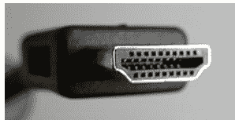

摄影：Alexey Goral

## 调整显示器

当你更改显示器分辨率时（例如，通过 `Windows` 控制面板中的显示驱动程序属性），屏幕图像可能会向一个方向偏移，或者变得比原来大或略小。大多数显示器都有屏幕控制按钮，可用于调整图像大小、图像位置（涉及左右定位时称为“相位”）、对比度、亮度和其他因素。检查显示器说明书以了解这些控件的工作原理；每个型号的都不同。

廉价或旧的 `CRT` 可能只有几个调调节轮或旋钮用于调整显示器；较新且更复杂的显示器将有一套完整的控制菜单系统，当按下某个按钮时它会弹出。然后，你可以通过按下显示器上的按钮或移动显示器正面或背面的轮子或摇杆在菜单系统中切换。

> 可能有一个去磁按钮（`Degauss`）。按下此按钮可以释放显示器内部积累的磁场，该磁场可能会导致图像失真。`LCD` 没有这个问题，因此没有去磁功能。该功能以研究磁性的研究员卡尔·弗里德里希·高斯（Carl Friedrich Gauss）命名。


在笔记本电脑的内置显示器上，调整控件可能更加基础。你可能会在键盘上发现某些带有对比颜色额外符号的按键。将这些键与 `Fn` 键组合可激活该特殊功能。例如，可能有一个带有太阳图片和箭头的按键，用于增加显示亮度。参考笔记本电脑说明书以了解 `Fn` 功能键的各种含义。

## 调整显示器

- 找到显示器上控制其图像的按钮。
- 尝试使用这些按钮看看是否能确定它们的功能。或者，在显示器的文档或制造商网站上查找这些按钮。

## 音频系统

计算机的音频子系统由所有涉及音频输入输出的组件组成。该操作的核心是声卡。在某些系统中，声卡是独立的扩展板；在另一些系统中，声卡功能集成在主板中。音频子系统的其他主要组件是扬声器（输出）和麦克风（输入）。你还可以连接一个输出立体声系统作为输入设备，将 `LP` 音乐录制到音频 `CD` 上。

> `PC` 上的声卡和音频支持完全依赖适配 3.5 mm 插头的小音频插孔。如果你需要连接没有那种插头的设备，你需要购买一个适配器。

> `Strata` 目标的缩写列表包含 `MPEG`、`MP3` 和 `MP4`。`MPEG` 代表运动图像专家小组（`Moving Pictures Experts Group`），这是一个管理某些视频和音频格式标准的组织。`MP3` 代表运动图像专家小组第三层（`Moving Pictures Experts Group Layer 3`），是一种音频标准。`MP3` 剪通常是音乐文件。`MP4` 代表运动图像专家小组第四层（`Moving Pictures Experts Group Layer 4`），是一种视频标准。

## 扬声器

扬声器让你听到来自 `PC` 的音频输出。扬声器可以是内部（如笔记本电脑），也可以是外部（如台式电脑）。

取决于 `PC` 音频支持的质量（内置或插件），可能会有表 3.1 所示的颜色编码插孔。

### 表 3.1 音频输出颜色编码

| 颜色 | 功能 |
| :--- | :--- |
| 绿色 | 主输出 |
| 深棕 | 环绕声 |
| 黑色 | 中心环绕声 |
| 橙色 | 低音器 |

**放大** 大多数扬声器提供放大功能，使声音变大。如果没有放大，声音可能不够大。放大以瓦特为单位。

> 有三种描述扬声器最大功率的方法。`均方根 (RMS)` 是扬声器可以持续承受的标准功率。`峰值功率 (PMPO)` 是在过载前可以承受的绝对最大功率。

**屏蔽** 设计在电脑附近的扬声器具有屏蔽功能，防止扬声器的磁铁干扰计算机的任何组件。相比之下，家庭音响系统的扬声器没有屏蔽。

**频率范围** 频率范围宽扬声器能更准确地产生声音。寻找至少 50 到 10000 `Hz` 的频率范围。

**模拟与数字** 大多数扬声器是模拟的。声卡上的声器接口向扬声器发送模拟数据。然而也有数字扬声器，发烧友声称在高音量下背景杂声和噪音更少。要使用数字扬声器，你需要数字输出端口。

## 练习 3.4：在 Windows 中配置声器选项

- 选择 `开始` > `控制面板` > `硬件和` > `声音`。`声音` 对话框打开并位于 `播放` 选项卡。（进入此对话框的另一种方法是右键点击通知区域的声器图标并点击 `播放设备`。）
- 在 `播放` 选项卡上，点击 `扬声器/耳机`。
- 点击 `属性`。`扬声器/耳机属性` 对话框打开。
- 点击对话框中的每个选项卡，查看你的扬声器的可用选项。
- 点击 `取消`，再次点击 `取消` 关闭对话框。
- 在 `控制面板` 窗口中，在 `声音` 标题下点击 `调整系统音量`。`音量混合器` 框打开。
- 浏览控制不同类型声音相对音量的可用选项。完成后关闭窗口。

## 麦克风

大多数计算机系统至少有一个内置麦克风输入。粉色插座用于未供电的音频输入作为麦克风，而蓝色的 `line-in` 插座则用于声音来自 `MP3` 播放器等有电源设备的情况。数字相机插入 `USB` 端口而不是麦克风端口。

许多笔记本电脑都有内置麦克风。对于台式电脑系统，你可以购买独立的台式麦克风或组合式耳机麦克风。如果电脑支持蓝牙设备，你还可以使用蓝牙耳机作为麦克风。也有带有内置麦克风的立体声耳机。这些耳机在游戏期间中使用通话式技术进行通信和互动的在线玩家中非常流行。

以下是影响麦克风的关键因素：

**频率响应（Frequency Response）** 麦克风的频率范围应至少为 100 `Hz` 到 8,000 `Hz`。

**立体声与单声道（Stereo vs. Mono）** 如果你选择耳机/麦克风组合套装，请确保耳机是立体声的。

**单向性（Unidirectional）** 确保你选择的是 `单向性` 麦克风，而不是 `全向性`。`全向性` 麦克风会采集所有方向的声音；除了捕捉你的声音外，它还会捕捉背景音。这通常是不希望的。

**耳机式与台式（Headset vs. Desktop）** 台式麦克风有自己的支架支撑在你的桌面上。最好让嘴靠近它并保持在正确的位置，以确保录音电平的性。如果可能，请选择耳机麦克风。

**模拟与数字（Analog vs. Digital）** 模拟麦克风插入声卡上的麦克风端口。耳机式的带有两个插头：一个插入电脑的麦克风插孔，另一个插入电脑的耳机插孔。数字麦克风插入 `USB` 端口。数字麦克风往往具有更好的频率响应。然而，你可能需要一个空闲的 `USB` 端口才能使用。

麦克风在技术上非常简单。只需将其插入计算机，即可开始工作。你可能需要的任何配置都在声卡的属性中，而不是在麦克风本身。

## 练习 3.5

### 在 Windows 中配置麦克风选项

- 右键点击通知区域（时钟旁边）的扬声器图标，并点击“`录制设备`”（`Recording Devices`）。打开 `声音` 对话框并显示“`录制`”选项卡。
- 点击“`麦克风阵列`”（`Microphone Array`）。
- 点击“`属性`”。打开“`麦克风阵列属性`”对话框。
- 点击对话框中的每个标签，查看你的麦克风有哪些可用选项。
- 双击“`取消`”关闭对话框。

## 扫描仪

扫描仪将纸质页面数字化，将其转换为 `PC` 上的图形文件。大多数扫描仪都是平板式的，类似于复印机。图 3.6 显示了平板扫描仪的示例。

### 图 3.6 平板扫描仪

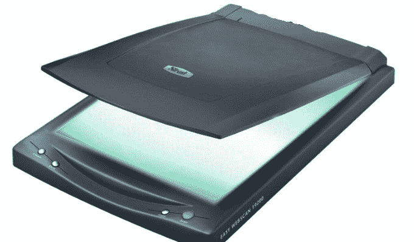

你将原作朝放在玻璃上并关闭盖子，然后按下扫描仪上的按钮或在扫描程序中发出命令启动扫描仪。扫描仪可以作为独立单元购买，也可以作为多功能打印-扫描-复印一体的一部分。扫描仪可以使用并行、网络或 `USB` 接口，但大多数使用 `USB`。

扫描仪内部有一个固定的线性阵列，称为电荷耦合器件（`CCD`）。它由光敏元件阵列组成，类似于虫的眼睛，将光反射到透镜，然后通过 `CCD`。光条在扫描物体上移动。镜镜系统将光反射到透镜，然后进入 `CCD`。镜镜略有弯曲，以便在反射时使图像紧凑。每个光敏元件产生一个与其接收到的反射光强度成正比的电信号，并转换为二进制数字发送到计算机。黑暗区域的数字较小；亮区域的数字较大。

`CCD` 每次接收图像的一行数据，将其发送并告诉步进电机移动到下一行。`CCD` 并不是一次接收整页图像的数据。对于 8.5 × 11 英寸的纸张，具有 300 `dpi` 的扫描仪，水平分辨率（也称为 `x` 方向采样率）是每英寸的像素数。具有更高 `dpi` 的扫描仪有更多元件，例如 600 `dpi` 的，垂直分辨率（也称为 `y` 方向采样率）是每英寸的像素数。有些扫描仪也使用插值法在实际扫描像素之间插入额外的像素，以确定其值。

在彩色扫描仪中，图像的每个像素有三种评估：红色量、蓝色量和绿色。原始扫描仪是 1 位系统；它们只有黑白，并为 `CCD` 中的每个单元传输一个比特的数据。位数是表示每个像素值的二进制数字个数。在 1 位系统中，每个像素是 0 或 1（开启或关闭）。然后 4 位扫描仪（16 种灰色阶阶）和 8 位扫描仪（256 种灰色阶阶）存在。

如今摄像头已成为笔记本电脑的标配，并作为台式机系统的低成本附加组件可用。随着 `Skype`、`Google Talk` 和 `Windows Live Messenger` 等即时消息服务的普及，以及如 `Cisco WebEx` 等网络会议系统（见图 3.7）出现，摄像头让居家办公的专业人士能够通过与同事面对面的交流，在全国甚至国际范围内进行协作。

### 3.7 正在进行的视频会议

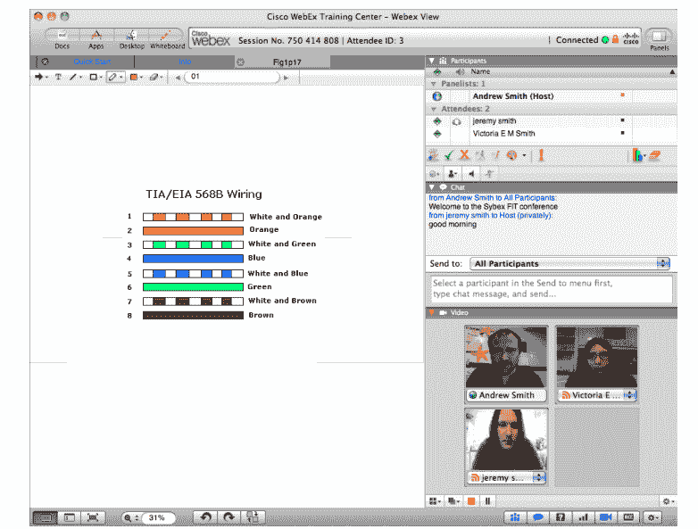

## 电视调谐器

调谐器使 `PC` 能够接收广播电视信号（配合兼容天线），或通过电缆或卫星输入显示电视节目。有了调谐器，你可以将电脑显示器当作电视机使用，并将电脑硬盘用作数字视频录制机。调谐器以内部扩展卡的形式（如图 3.8 所示）或外部 `USB` 设备的形式提供。

图 3.8 扩展卡电视调谐器

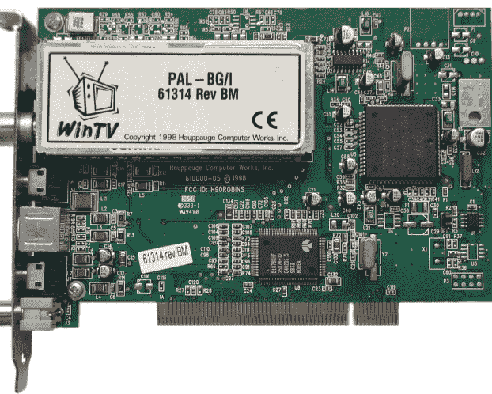

来源：`Wikipedia`，© `Darkone`

> 警告 尽管你可以使用电视调谐器录制电视节目以供以后观看，但你必须意识到在采集电视信号的国家这样做可能具有法律影响。某些国家对这种行为有法律限制，在许多国家，共享此类录制内容可能是违法的。

## 网络


网络是由两或多台连接在一起的计算机，用于共享数据和资源。网络可以连接物理位置靠近的计算机（局域网，或 `LAN`），也可以连接相隔半球的计算机（广域网，或 `WAN`）。互联网是最大的广域网，连接了数百万局域网和个人 `PC`。

网络上常见的共享资源是硬盘空间。一台 `PC` 可以通过网络访问另一台 `PC` 硬盘。互联网的主要功能还涉及文件共享；当你访问网站时，你正在从服务器的硬盘上读取一个文件。另一个常见的共享网络资源是打印机访问。用户可以将打印作业发送到他人的 `PC` 或直接连接到网络本身的打印机上。

网络还可以作为通往其他资源的通道，例如访问互联网。在接下来的章节中，你将学习一些与家庭、商业和互联网网络相关的术语和概念。

> 网络吞吐量以每秒比特（`bps`）衡量，使用的与字节相同的倍数词汇（如第 2 章所示：1000 位是一个千位比特 (`Kbps`)，1000 兆比特是一个兆位比特 (`Mbps`)，1000 兆比特是一个千兆比特 (`Gbps`)）。请注意，在测量每秒比特时，倍数是整千，而不是像内存那样的 `1024`。当 `b` 是小写时，如千字节 (`Gb`)，它表示比特；当它是大写时，它表示字节，如千字节 (`GB`)。

## 客户端与服务器

网络运行有两种基本模型：客户端/服务器（`client/server`）和对等（`peer-to-peer`）。服务器是仅用于路由网络流量并提供共享文件和打印机访问的 `PC`。它管理客户端 `PC` 之间的连接，并作为用户想要提供给其他人的存储库。客户端是用户使用的普通 `PC`。服务器在物理上可以只是一台普通 `PC`，但它安装了特殊的服务器操作系统（如 `Windows Server`），使其能够提供网络服务。客户端/服务器（见图 3.9）是几乎所有业务网络使用的网络模型，因为服务器的存在减轻了客户端的网络负担。客户端/服务器网络的主要缺点是必须有一台专用的 `PC` 作为服务器运行，而并不是每家公司或家庭都能腾出这台额外的 `PC`。

图 3.9 客户端/服务器网络包含一个或多个用于管理网络的服务器。

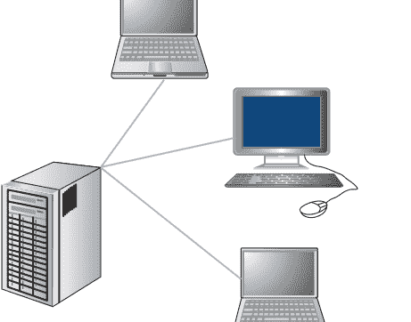

小型网络（如家庭网络）通常被设置为对等网络（`P2P`）网络（见图 3.10）。例如，`Windows 7` 中的家庭组（`HomeGroup`）网络功能就是建立 `P2P` 网络。在 `P2P` 网络中，没有服务器；每台客户端 `PC` 都承担了部分维护网络的负担。不是由服务器管理流量，网络中的所有 `PC` 都会监听流量并获取任何发送给它们的消息。不是由服务器存储共享文件，共享文件保留在各个客户端的硬盘上。`P2P` 网络的另一个名称是工作组（`workgroup`）。

**图 3.10** 对等网络在没有服务器的情况下运行。

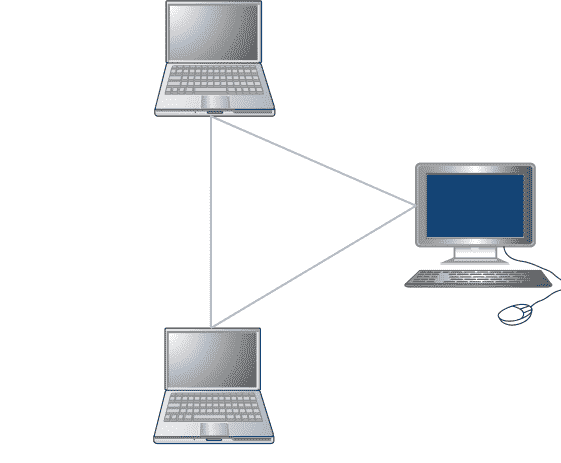

大型网络通常有许多服务器，每个服务器都有特定的功能。例如，一个可以是文件服务器，一个可以是打印机服务器，另一个可以提供互联网服务。在大型组织中，服务器可能比普通桌面 `PC` 强大得多，并包含许多处理器和大量的 `RAM`。

拥有服务器并不排除单个客户端 `PC` 与其他客户端共享可用资源。例如，你可能有一个中央文件服务器，但用户也可以共享硬盘上的文件夹。

## 以太网

`以太网`是目前最流行的网络技术。在过去，曾有许多竞争技术，如环形网络（`Ring`）和令牌环网（`Token Ring`），但现在`以太网`已占据主导地位。`以太网`是一种物理层协议，定义了数据如何在物理介质（如`以太网`、光纤或无线电波）上传输。`以太网`标准工作在 `OSI` 模型的前两层：数据链路层和物理层。

`以太网`使用`以太网控制器`（`Ethernet controller`），这非常廉价且灵活。`以太网控制器`可以有多种形式，如集成在主板上、作为扩展卡、或作为 `USB` 设备。`以太网控制器`通过`以太网端口`（`Ethernet port`）连接到`以太网`电缆。

`以太网`电缆有多种类型，包括双绞线（`twisted-pair cable`）、光纤（`fiber optic`）和无线电波（`radio waves`）。最常见的是双绞线，使用 `RJ-45` 连接器。双绞线有不同的类别，如 `5e` 类、`6` 类等，这决定了它们支持的传输速率。

`以太网`以帧（`frame`）为单位传输数据。一个`以太网`帧包含帧头（`header`）、数据负载（`payload`）和帧尾（`trailer`）。帧头包含目的 `MAC` 地址和源 `MAC` 地址。数据负载是要传输的 `IP` 包等。帧尾包含帧校验序列（`FCS`），用于检测错误。

为了处理冲突，`以太网`使用 `CSMA/CD`（载波监听多冲突检测）协议。当 `PC` 想要发送数据时，它会监听总线是否空闲。如果空闲，它就开始发送数据帧。如果检测到冲突，它会停止发送并发送一个冲突信号，然后等待随机时间后重试。

在全双工`以太网`中，由于使用了交换机，`CSMA/CD` 不再是必要的。

`MAC` 地址是硬件地址，也称为物理地址。每个`以太网控制器`都有一个唯一的 `MAC` 地址，由 `48` 位组成，通常以十六进制表示。`MAC` 地址由制造商分配。

`以太网交换机`（`Ethernet switch`）用于在局域网内连接设备。它通过学习 `MAC` 地址表来跟踪哪些设备连接在哪些端口。当它接收到一个帧时，它只将其发送到目的 `MAC` 地址所在的端口，从而减少了冲突并提高了网络效率。

`路由器`（`Router`）用于连接不同的网络，例如局域网和广域网。`路由器`根据 `IP` 地址来路由数据包。它维护一个`路由表`（`routing table`），用于决定数据包从源到目的的最佳路径。

`以太网`是现代网络的基础。从简单的家庭局域网到大型企业数据中心，`以太网`无处不在，连接着世界。随着技术的不断进步，`以太网`的速率不断提高，支持着更广阔的通信可能。

## 网络

## 95

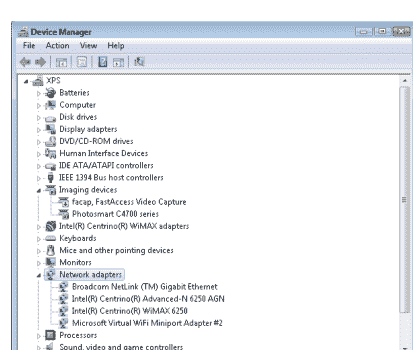

- 4. 双击列表中的第一个适配器，并检查其属性。注意“常规”选项卡上的“设备状态”。
- 5. 关闭“设备管理器”。在控制窗口中，在顶部的地址栏中点击“控制面板”以返回控制面板的顶层。
- 6. 点击“网络和 Internet”。
- 7. 点击“网络和共享中心”。将出现你当前连接的网络信息。
- 8. 关闭“网络和共享中心”窗口。

## 路由器和交换机

路由器和交换机带有多个插口的连接盒，你可以在上面连接设备。交换机处理来自连接它的各种电缆的入流量，并将数据引导到适当的出口线路。

`路由器`是交换机的更智能版本，不仅能够在你的局域网内引导流量，还可以将其引导到其他连接的网络（包括互联网）。`路由器`尝试寻找从 A 点到 B 点的最优，即使这些点在地球的另一端。

互联网充满了`路由器`，`路由器`将你发送的消息直接定向到收件人地址。当你向朋友发送电子邮件时，你不需要指定路径中经过的所有服务器名称——`路由器`会处理该任务。你只需指定终点地址，`路由器`就会规划并执行旅程。

`路由器`可以是有线的、无线的或两者兼具的。无线路由器有一个天线，帮助它与无线设备通信，如笔记本电脑、无线打印机和像 `TiVo` 这样的娱乐设备（见图 3.11）。要在家庭或办公室中与多计算机共享互联网连接，你需要一个基础路由器。更大、更复杂的路由器用于高流量的商业应用。

## 第 3 章 • 外围设备与网络

图 3.11 无线路由器

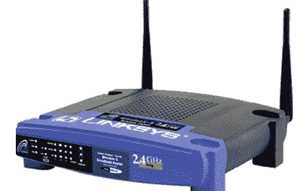

## 练习 3.7

### 探索你的路由器或交换机配置

- 1. 查看随路由器、交换机或无线访问点附带的文档，查找访问它的 `IP` 地址。（如果需要，请在制造商网站上搜索用户文档中的型号数字。）
- 2. 打开浏览器，输入 `http://` 后跟设备的 `IP` 地址。将出现一个页面，显示设备的配置信息（如果为设备设置了密码，你可能需要输入密码）。
- 3. 浏览设备的信息和设置。此处的图形显示了一个 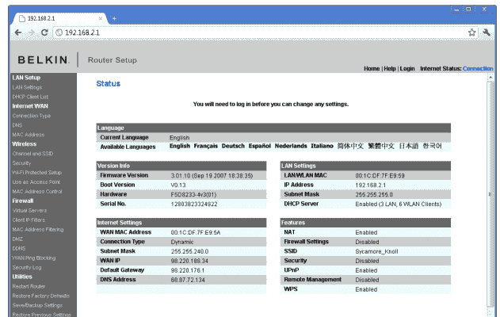
- 4. 保持浏览器窗口打开以供练习 3.9 使用，或者如果你不计划很快进行练习 3.9，则将其关闭。

## 电缆

用于`以太网`网络最常见的布线类型是非屏蔽双绞线（`UTP`）电缆，每端各有一个 `RJ-45` 连接器。`RJ` 代表 `Registered Jack`（注册插口）。电话系统也使用 `RJ` 连接器，因此你可能已经熟悉那种连接类型了。不过，`RJ-45` 连接器比普通的电话插头（`RJ-11` 或 `RJ-14`）宽一点，它无法插入电话插座。图 3.12 显示了一个 `RJ-45` 连接器。

图 3.12 带有 `RJ-45` 连接器的`以太网`电缆

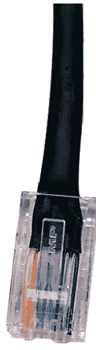

`UTP` 电缆通过成对线传输数据。用于`以太网`的 `UTP` 电缆有四对（共八根线）。线对被扭绞在一起，是为了尽量减少电信号穿过电缆时可能产生的任何磁干扰。每对共享一种颜色方案。例如，第一对是橙色和橙白间的。其他颜色是绿色、蓝色和棕色，每对有一根实色线和一根白色条纹线。

电缆被认为是非屏蔽的，因为它们没有对于来自电缆外部的磁干扰的任何特殊内置保护。`以太网`也可以使用屏蔽双绞线（`STP`），但它们的价格贵得多，且仅在磁干扰成为问题的情况下使用。

## 第 3 章 • 外围设备与网络


UTP 电缆有不同的类别。类别编号越高，电缆高速传输数据的能力就越强。例如，第 5 类（`Cat5`）电缆可以传输高达 `100 Mbps` 的数据。`Cat5e` 电缆可以传输高达 `1 Gbps` 的数据，`Cat6` 电缆可以传输高达 `10 Gbps` 的数据。（这些是电缆在足够准确性水平下支持的最大传输速率；电缆是被动的，不控制数据传输速率。）

## 标准线和交叉线

电缆中单根线连接到两端连接器的方式被称为电缆的引脚（pin out）。在标准网络电缆中，它是直通引脚，因此线色在电缆两端的顺序相同。如果你查看任何 UTP 以太网电缆（例如），你会看到橙色线在两端相同的位置。

## 练习 3.8

## 比较以太网线和电话线

- 1. 找到一根以太网线和一根电话线。
- 2. 观察末端的插头，数数每个线的线数量。对于以太网线，有。

## 电线 (HomePlug)

在大型家庭或办公室中，计算机分布在多个楼层和房间，运行以太网并不是完美的。一种解决方案是使用无线网络（本章稍后讨论）。然而，由于某些原因无线网络不可行，那么电力线（即 `HomePlug`）可能是一个极具吸引力的替代方案。

电力线使用家庭或办公室中的电线来携带网络流量，与传输的电力共享线路。你购买插入任何电源插座的电力适配器（见图 3.13），适配器在设备与类似连接的设备之间创建有线连接。

图 3.13 这些 `HomePlug` 适配器插入电源插座


## 无线网络

无线网络使用无线波传输数据，就像无线电话一样。无线以太网从用户角度来看，几乎与有线以太网完全相同，不同之处使用的是无线信号。

## Wi-Fi: 802.11 标准

有很多网络技术，但其中最流行的是无线保真，也称为 `Wi-Fi`。`Wi-Fi` 是 `IEEE 802.11` 标准集的昵称。

一个名为电气与电子工程师学会（`IEEE`）的组织控制着（以及其他）各种网络标准。规范网络标准的编号包含在 `802` 范围内，而规范网络标准的标准位于 `802.11` 范围内。表 3.3 列出了你可能会遇到的 `802.11` 标准。

你今天购买的大多数无线网络设备都与早期的标准后兼容。例如，如果你购买了一个 `802.1n` 路由器，一台安装了 `802.11b` 无线适配器的电脑将能够与该路由器通信。然而，连接速度将限制在两个设备能够共同协商达到的最高速度（`11 Mbps`，或者可能更低，取决于环境因素，如两个设备之间的距离以及任何干扰，如墙壁或来自无线电话和其他设备对带宽的争抢）。

虽然无线网络对于在无需布线开支和复杂性线的情况下创建网络来说是理想的，但并非所有环境都适合无线网络。你可能会发现无线网络在以下环境中的表现不佳：

- 在金属框架（带覆盖）的工业单元内。
- 使用混凝土作为墙壁和地板的地方。这会吸收无线信号（以及其他辐射因素）。
- 如果无线网络附近有大型、运行中的电源，例如发电机组或配电室。
- 如果你的家庭无线系统在微波炉工作时离它很近。
- 当区域内有电器商店。

## Wi-Fi 硬件

无线网络使用的硬件与有线网络类似。每台连接到网络的计算机上都必须有一个无线网络适配器，并且你必须有一个交换机或路由器将计算机连接成一个相互连接的网络。

无线交换机或路由器看起来与有线设备相似，但它们带有天线。无线交换机被称为无线接入点 (`WAP`)。就像有线交换机一样，`WAP` 为网络上设备之间的数据发送和接收提供了一个中央交换站。路由器仍然被称为路由器，并执行它们在有线网络上执行相同的功能。

> `WAP` 缩写还有另一个含义：无线应用协议（Wireless Application Protocol）。这是一种用于 `Web` 应用的标准，供手机等小型移动设备使用。

在设置无线网络时，为路由器或 `WAP` 找到一个良好的位置非常重要。中心位置最佳，以确保其信号能够尽可能覆盖整个家庭或办公室。例如，如果房子有三层楼，将路由器放在二楼。如果你发现想使用互联网的地方无法访问，你可能需要移动它的位置。

如果你正在使用无线路由器共享互联网访问，可能会受限于互联网服务进入建筑的地方。例如，如果你通过电缆电视获取互联网服务，你必须将路由器放置在电缆插座附近；如果你通过电话线获取互联网服务，如 `DSL` 服务（本章稍后介绍），你必须将路由器放置在电话接口附近。

## 自动协商速度和双工

以下是关于物理层（Strata stratum）你需要了解的内容，但在现实生活中你不需要担心太多：网络自动协商。

网络传输速度以每秒兆比特 (`Mbps`) 或每秒比特 (`Gbps`) 为单位。有线和以太网组件都会通过寻找通信双方两个设备都能支持的最大值来自动协商理想速度。例如，如果你有一个 `802.11n` 路由器，它正在与一个 `802.11b` 设备通信，通信将协商为不超过 `11 Mbps`，因为那是 `802.11b` 设备能处理的最大值。有线网络也是如此。不同年代和能力的组件之间会协商出一个相互接受的传输速率。

同样，双工设置也是自动协商的。双工是设备同时能够说话和听话的能力：

- 单工（Simplex）意味着通信是单向的。例如，汽车收音机是单工设备；它不发送。它只需要一个通信通道。
- 半双工（Half-duplex）意味着有双向通信，但一次只能一个方向。在设备完成发送后，它必须发送一个“全空”信号表示它已说完；只有这样，其他设备才会响应。
- 全双工（Full-duplex）意味着设备可以同时说话和听话。

当你设置无线网络时，为路由器或 `WAP` 找到一个良好的位置至关重要。中心位置最佳，以确保其信号能够覆盖尽可能多的家庭或办公室。例如，如果房子有三层楼，将路由器放在二楼。如果你发现想使用互联网的地方无法访问，你可能需要移动它的位置。

如果你正在使用无线路由器共享互联网访问，可能会受限于互联网进入建筑的地点。例如，如果你通过电缆电视获取互联网服务，你必须将路由器放置在电缆插座附近；如果你通过电话线获取互联网服务，如 `DSL` 服务（本章稍后介绍），你必须将路由器放置在电话接口附近。

## 自动协商速度和双工

以下是关于物理层你需要了解的内容，但在现实生活中你不需要担心太多：网络自动协商。

网络传输速度以每秒兆比特 (`Mbps`) 或每秒比特 (`Gbps`) 为单位。有线和以太网组件都会通过寻找通信双方两个设备都能支持的最大值来自动协商理想速度。例如，如果你有一个 `802.11n` 路由器，它正在与一个 `802.11b` 设备通信，通信将协商为不超过 `11 Mbps`，因为那是 `802.11b` 设备能处理的最大值。有线网络也是如此。不同年代和能力的组件之间会协商出一个相互接受的传输速率。

同样，双工设置也是自动协商的。双工是设备同时能够说话和听话的能力：

- 单工（Simplex）意味着通信是单向的。例如，汽车收音机是单工设备；它不发送。它只需要一个通信通道。
- 半双工（Half-duplex）意味着有双向通信，但一次只能一个方向。在设备完成发送后，它必须发送一个“全空”信号表示它已说完；只有这样，其他设备才会响应。
- 全双工（Full-duplex）意味着设备可以同时说话和听话。

在在设置无线网络时，为路由器或 `WAP` 找到一个良好的位置至关重要。中心位置最佳，以确保其信号能够尽可能覆盖整个家庭或办公室。例如，如果房子有三层楼，将路由器放在二楼。如果你发现想使用互联网的地方无法访问，你可能需要移动它的位置。

如果你正在使用无线路由器共享互联网访问，可能会受限于互联网进入建筑的地点。例如，如果你通过电缆电视获取互联网服务，你必须将路由器放置在电缆插座附近；如果你通过电话线获取互联网服务，如 `DSL` 服务（本章稍后介绍），你必须将路由器放置在电话接口附近。

## Wi-Fi 硬件

无线网络使用的硬件与有线网络类似。在每台连接到网络的计算机上，都必须有一个无线网络适配器，并且你必须有一个交换机或路由器将计算机连接成一个相互连接的网络。

无线交换机或路由器看起来与有线设备相似，但它们带有天线。无线交换机被称为无线接入点 (`WAP`)。就像有线交换机一样，`WAP` 为网络上设备之间的数据发送和接收提供了一个中央交换站。路由器仍然被称为路由器，并执行它们在有线网络上执行相同的功能。

> `WAP` 缩写还有另一个含义：无线应用协议（Wireless Application Protocol）。这是一种用于 `Web` 应用的标准，供手机等小型移动设备使用。

在设置无线网络时，为路由器或 `WAP` 找到一个良好的位置至关重要。中心位置最佳，以确保其信号能够尽可能覆盖整个家庭或办公室。例如，如果房子有三层楼，将路由器放在二楼。如果你发现想使用互联网的地方无法访问，你可能需要移动它的位置。

如果你正在使用无线路由器共享互联网访问，可能会受限于互联网进入建筑的地点。例如，如果你通过电缆电视获取互联网服务，你必须将路由器放置在电缆插座附近；如果你通过电话线获取互联网服务，如 `DSL` 服务（本章稍后介绍），你必须将路由器放置在电话接口附近。

## 自动协商速度和双工

以下是关于物理层你需要了解的内容，但在现实生活中你不需要担心太多：网络自动协商。


## 自动协商速度和双工

网络传输速度以 `Mbps`（每秒兆比特）或 `Gbps`（每秒千兆比特）为单位。有线和以太网组件都会通过寻找通信双方两个设备都能支持的最大值来自动协商理想速度。例如，如果你有一个 `802.11n` 路由器，它正在与一个 `802.11b` 设备通信，通信将协商为不超过 `11 Mbps`，因为那是 `802.11b` 设备能处理的最大值。有线网络也是如此。不同年代和能力的组件之间会协商出一个相互接受的传输速率。

同样，双工设置也是自动协商的。双工是设备同时能够说话和听话的能力：

- **单工**（`Simplex`）意味着通信是单向的。例如，汽车收音机是单工设备；它不发送。它只需要一个通信通道。
- **半双工**（`Half-duplex`）意味着有双向通信，但一次只能一个方向。在设备完成发送后，它必须发送一个“全空”信号表示它已说完；只有这样，其他设备才会响应。
- **全双工**（`Full-duplex`）意味着设备可以同时说话和听话。

在设置无线网络时，为路由器或 `WAP` 找到一个良好的位置至关重要。中心位置最佳，以确保其信号能够尽可能覆盖整个家庭或办公室。例如，如果房子有三层楼，将路由器放在二楼。如果你发现想使用互联网的地方无法访问，你可能需要移动它的位置。

如果你正在使用无线路由器共享互联网访问，可能会受限于互联网进入建筑的地点。例如，如果你通过电缆电视获取互联网服务，你必须将路由器放置在电缆插座附近；如果你通过电话线获取互联网服务，如 `DSL` 服务（本章稍后介绍），你必须将路由器放置在电话接口附近。

## Wi-Fi 硬件

无线网络使用的硬件与有线网络类似。在每台连接到网络的计算机上，都必须有一个无线网络适配器，并且你必须有一个交换机或路由器将计算机连接成一个相互连接的网络。

无线交换机或路由器看起来与有线设备相似，但它们带有天线。无线交换机被称为无线接入点（`WAP`）。就像有线交换机一样，`WAP` 为网络上设备之间的数据发送和接收提供了一个中央交换站。路由器仍然被称为路由器，并执行它们在有线网络上执行相同的功能。

> `WAP` 缩写还有另一个含义：无线应用协议（`Wireless Application Protocol`）。这是一种用于 `Web` 应用的标准，供手机等小型移动设备使用。

## 自动协商速度和双工

以下是关于物理层你需要了解的内容，但在现实生活中你不需要担心太多：网络自动协商。

网络传输速度以 `Mbps`（每秒兆比特）或 `Gbps`（每秒千兆比特）为单位。有线和以太网组件都会通过寻找通信双方两个设备都能支持的最大值来自动协商理想速度。例如，如果你有一个 `802.11n` 路由器，它正在与一个 `802.11b` 设备通信，通信将协商为不超过 `11 Mbps`，因为那是 `802.11b` 设备能处理的最大值。有线网络也是如此。不同年代和能力的组件之间会协商出一个相互接受的传输速率。

同样，双工设置也是自动协商的。双工是设备同时能够说话和听话的能力：

- **单工**（`Simplex`）意味着通信是单向的。例如，汽车收音机是单工设备；它不发送。它只需要一个通信通道。
- **半双工**（`Half-duplex`）意味着有双向通信，但一次只能一个方向。在设备完成发送后，它必须发送一个“全空”信号表示它已说完；只有这样，其他设备才会响应。
- **全双工**（`Full-duplex`）意味着设备可以同时说话和听话。

在设置无线网络时，为路由器或 `WAP` 找到一个良好的位置至关重要。中心位置最佳，以确保其信号能够尽可能覆盖整个家庭或办公室。例如，如果房子有三层楼，将路由器放在二楼。如果你发现想使用互联网的地方无法访问，你可能需要移动它的位置。

如果你正在使用无线路由器共享互联网访问，可能会受限于互联网进入建筑的地点。例如，如果你通过电缆电视获取互联网服务，你必须将路由器放置在电缆插座附近；如果你通过电话线获取互联网服务，如 `DSL` 服务（本章稍后介绍），你必须将路由器放置在电话接口附近。

---

## 后兼容性与环境限制

你今天购买的大多数无线网络设备都与早期的标准后兼容。例如，如果你购买了一个 `802.11n` 路由器，一台安装了 `802.11b` 无线适配器的电脑将能够与该路由器通信。然而，连接速度将限制在两个设备能够共同协商达到的最高速度（`11 Mbps`，或者可能更低，取决于环境因素，如两个设备之间的距离以及任何干扰，如墙壁或来自无线电话和其他设备对带宽的争抢）。

虽然无线网络对于在无需布线开支和复杂性的情况下创建网络来说是理想的，但并非所有环境都适合无线网络。你可能会发现无线网络在以下环境中的表现不佳：

- 在金属框架（带覆盖）的工业单元内。
- 使用混凝土作为墙壁和地板的地方。这会吸收无线信号（以及其他辐射因素）。
- 如果无线网络附近有大型、运行中的电源，例如发电机组或配电室。
- 如果你的家庭无线系统在微波炉工作时离它很近。
- 当区域内有电器商店。

## Wi-Fi 硬件

无线网络使用的硬件与有线网络类似。在每台连接到网络的计算机上，都必须有一个无线网络适配器，并且你必须有一个交换机或路由器将计算机连接成一个相互连接的网络。

无线交换机或路由器看起来与有线设备相似，但它们带有天线。无线交换机被称为无线接入点（`WAP`）。就像有线交换机一样，`WAP` 为网络上设备之间的数据发送和接收提供了一个中央交换站。路由器仍然被称为路由器，并执行它们在有线网络上执行相同的功能。

> `WAP` 缩写还有另一个含义：无线应用协议（`Wireless Application Protocol`）。这是一种用于 `Web` 应用的标准，供手机等小型移动设备使用。

在设置无线网络时，为路由器或 `WAP` 找到一个良好的位置至关重要。中心位置最佳，以确保其信号能够尽可能覆盖整个家庭或办公室。例如，如果房子有三层楼，将路由器放在二楼。如果你发现想使用互联网的地方无法访问，你可能需要移动它的位置。

如果你正在使用无线路由器共享互联网访问，可能会受限于互联网进入建筑的地点。例如，如果你通过电缆电视获取互联网服务，你必须将路由器放置在电缆插座附近；如果你通过电话线获取互联网服务，如 `DSL` 服务（本章稍后介绍），你必须将路由器放置在电话接口附近。

## 自动协商速度和双工

以下是关于物理层你需要了解的内容，但在现实生活中你不需要担心太多：网络自动协商。

网络传输速度以 `Mbps`（每秒兆比特）或 `Gbps`（每秒千兆比特）为单位。有线和以太网组件都会通过寻找通信双方两个设备都能支持的最大值来自动协商理想速度。例如，如果你有一个 `802.11n` 路由器，它正在与一个 `802.11b` 设备通信，通信将协商为不超过 `11 Mbps`，因为那是 `802.11b` 设备能处理的最大值。有线网络也是如此。不同年代和能力的组件之间会协商出一个相互接受的传输速率。

同样，双工设置也是自动协商的。双工是设备同时能够说话和听话的能力：

- **单工**（`Simplex`）意味着通信是单向的。例如，汽车收音机是单工设备；它不发送。它只需要一个通信通道。
- **半双工**（`Half-duplex`）意味着有双向通信，但一次只能一个方向。在设备完成发送后，它必须发送一个“全空”信号表示它已说完；只有这样，其他设备才会响应。
- **全双工**（`Full-duplex`）意味着设备可以同时说话和听话。

在设置无线网络时，为路由器或 `WAP` 找到一个良好的位置至关重要。中心位置最佳，以确保其信号能够尽可能覆盖整个家庭或办公室。例如，如果房子有三层楼，将路由器放在二楼。如果你发现想使用互联网的地方无法访问，你可能需要移动它的位置。

如果你正在使用无线路由器共享互联网访问，可能会受限于互联网进入建筑的地点。例如，如果你通过电缆电视获取互联网服务，你必须将路由器放置在电缆插座附近；如果你通过电话线获取互联网服务，如 `DSL` 服务（本章稍后介绍），你必须将路由器放置在电话接口附近。

---

## 后兼容性与环境限制

你今天购买的大多数无线网络设备都与早期的标准后兼容。例如，如果你购买了一个 `802.11n` 路由器，一台安装了 `802.11b` 无线适配器的电脑将能够与该路由器通信。然而，连接速度将限制在两个设备能够共同协商达到的最高速度（`11 Mbps`，或者可能更低，取决于环境因素，如两个设备之间的距离以及任何干扰，如墙壁或来自无线电话和其他设备对带宽的争抢）。

虽然无线网络对于在无需布线开支和复杂性的情况下创建网络来说是理想的，但并非所有环境都适合无线网络。你可能会发现无线网络在以下环境中的表现不佳：

- 在金属框架（带覆盖）的工业单元内。
- 使用混凝土作为墙壁和地板的地方。这会吸收无线信号（以及其他辐射因素）。
- 如果无线网络附近有大型、运行中的电源，例如发电机组或配电室。
- 如果你的家庭无线系统在微波炉工作时离它很近。
- 当区域内有电器商店。

## Wi-Fi 硬件

无线网络使用的硬件与有线网络类似。在每台连接到网络的计算机上，都必须有一个无线网络适配器，并且你必须有一个交换机或路由器将计算机连接成一个相互连接的网络。

无线交换机或路由器看起来与有线设备相似，但它们带有天线。无线交换机被称为无线接入点（`WAP`）。就像有线交换机一样，`WAP` 为网络上设备之间的数据发送和接收提供了一个中央交换站。路由器仍然被称为路由器，并执行它们在有线网络上执行相同的功能。

> `WAP` 缩写还有另一个含义：无线应用协议（`Wireless Application Protocol`）。这是一种用于 `Web` 应用的标准，供手机等小型移动设备使用。

在设置无线网络时，为路由器或 `WAP` 找到一个良好的位置至关重要。中心位置最佳，以确保其信号能够尽可能覆盖整个家庭或办公室。例如，如果房子有三层楼，将路由器放在二楼。如果你发现想使用互联网的地方无法访问，你可能需要移动它的位置。

如果你正在使用无线路由器共享互联网访问，可能会受限于互联网进入建筑的地点。例如，如果你通过电缆电视获取互联网服务，你必须将路由器放置在电缆插座附近；如果你通过电话线获取互联网服务，如 `DSL` 服务（本章稍后介绍），你必须将路由器放置在电话接口附近。

## 自动协商速度和双工

以下是关于物理层你需要了解的内容，但在现实生活中你不需要担心太多：网络自动协商。

网络传输速度以 `Mbps`（每秒兆比特）或 `Gbps`（每秒千兆比特）为单位。有线和以太网组件都会通过寻找通信双方两个设备都能支持的最大值来自动协商理想速度。例如，如果你有一个 `802.11n` 路由器，它正在与一个 `802.11b` 设备通信，通信将协商为不超过 `11 Mbps`，因为那是 `802.11b` 设备能处理的最大值。有线网络也是如此。不同年代和能力的组件之间会协商出一个相互接受的传输速率。

同样，双工设置也是自动协商的。双工是设备同时能够说话和听话的能力：

- **单工**（`Simplex`）意味着通信是单向的。例如，汽车收音机是单工设备；它不发送。它只需要一个通信通道。
- **半双工**（`Half-duplex`）意味着有双向通信，但一次只能一个方向。在设备完成发送后，它必须发送一个“全空”信号表示它已说完；只有这样，其他设备才会响应。
- **全双工**（`Full-duplex`）意味着设备可以同时说话和听话。

在设置无线网络时，为路由器或 `WAP` 找到一个良好的位置至关重要。中心位置最佳，以确保其信号能够尽可能覆盖整个家庭或办公室。例如，如果房子有三层楼，将路由器放在二楼。如果你发现想使用互联网的地方无法访问，你可能需要移动它的位置。

如果你正在使用无线路由器共享互联网访问，可能会受限于互联网进入建筑的地点。例如，如果你通过电缆电视获取互联网服务，你必须将路由器放置在电缆插座附近；如果你通过电话线获取互联网服务，如 `DSL` 服务（本章稍后介绍），你必须将路由器放置在电话接口附近。

---


你今天购买的大大多数无线网络设备都与早期的标准后兼容。例如，如果你购买了一个 `802.11n` 路由器，一台安装了 `802.11b` 无线适配器的电脑将能够与该路由器通信。然而，连接速度将限制在两个设备能够共同协商达到的最高速度（`11 Mbps`，或者可能更低，取决于环境因素，如两个设备之间的距离以及任何干扰，如墙壁或来自无线电话和其他设备对带宽的争抢）。

虽然无线网络对于在无需布线开支和复杂性的情况下创建网络来说是理想的，但并非所有环境都适合无线网络。你可能会发现无线网络在以下环境中的表现不佳：

- 在金属框架（带覆盖）的工业单元内。
- 使用混凝土作为墙壁和地板的地方。这会吸收无线信号（以及其他辐射因素）。
- 如果无线网络附近有大型、运行中的电源，例如发电机组或配电室。
- 如果你的家庭无线系统在微波炉工作时离它很近。
- 当区域内有电器商店。

## Wi-Fi 硬件

无线网络使用的硬件与有线网络类似。在每台连接到网络的计算机上，都必须有一个无线网络适配器，并且你必须有一个交换机或路由器将计算机连接成一个相互连接的网络。

无线交换机或路由器看起来与有线设备相似，但它们带有天线。无线交换机被称为无线接入点（`WAP`）。就像有线交换机一样，`WAP` 为网络上设备之间的数据发送和接收提供了一个中央交换站。路由器仍然被称为路由器，并执行它们在有线网络上执行相同的功能。

> `WAP` 缩写还有另一个含义：无线应用协议（`Wireless Application Protocol`）。这是一种用于 Web 应用的标准，供手机等小型移动设备使用。

在设置无线网络时，为路由器或 `WAP` 找到一个良好的位置至关重要。中心位置最佳，以确保其信号能够尽可能覆盖整个家庭或办公室。例如，如果房子有三层楼，将路由器放在二楼。如果你发现想使用互联网的地方无法访问，你可能需要移动它的位置。

如果你正在使用无线路由器共享互联网访问，可能会受限于互联网进入建筑的地点。例如，如果你通过电缆电视获取互联网服务，你必须将路由器放置在电缆插座附近；如果你通过电话线获取互联网服务，如 `DSL` 服务（本章稍后介绍），你必须将路由器放置在电话接口附近。

## 自动协商速度和双工

以下是关于物理层你需要了解的内容，但在现实生活中你不需要担心太多：网络自动协商。

网络传输速度以每秒兆比特（`Mbps`）或每秒吉比特（`Gbps`）为单位。有线和以太网组件都会通过寻找通信双方两个设备都能支持的最大值来自动协商理想速度。例如，如果你有一个 `802.11n` 路由器，它正在与一个 `802.11b` 设备通信，通信将协商为不超过 `11 Mbps`，因为那是 `802.11b` 设备能处理的最大值。有线网络也是如此。不同年代和能力的组件之间会协商出一个相互接受的传输速率。

同样，双工设置也是自动协商的。双工是设备同时能够说话和听话的能力：

- 单工（`Simplex`）意味着通信是单向的。例如，汽车收音机是单工设备；它不发送。它只需要一个通信通道。
- 半双工（`Half-duplex`）意味着有双向通信，但一次只能一个方向。在设备完成发送后，它必须发送一个“全空”信号表示它已说完；只有这样，其他设备才会响应。
- 全双工（`Full-duplex`）意味着设备可以同时说话和听话。

## 图 3.15 USB 蓝牙适配器

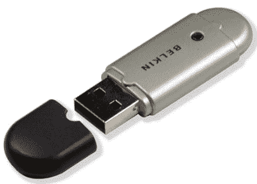

`Wi-Fi` 技术旨在帮助设备参与组网络，而蓝牙是一对点的连接。例如，一个手机耳机一次只能与一台手机进行通信，而一台支持蓝牙的笔记本电脑每个适配器只能连接一个蓝牙外设设备。


对于蓝牙连接性，两端设备都必须支持它并配备蓝牙发射器/接收器。当今的大多数笔记本电脑都内置了蓝牙适配器；而台式电脑没有。你可以通过 USB 适配器为几乎任何计算机添加蓝牙支持。蓝牙适配器和其他网络适配器一样具有 `MAC` 地址。蓝牙设备分为三类。每类的最大范围不同，从 1 到 100 米不等，数据传输速率也在 1 `Mbps` 到 24 `Mbps` 之间，如表 3.4 所示。

## 表 3.4 蓝牙分类

| 类别 | 最大数据速率 | 最大距离（米） |
| :--- | :--- | :--- |
| 1 | 1 `Mbps` | 1 |
| 2 | 3 `Mbps` | 10 |
| 3 | 24 `Mbps` | 100 |

> 十多年前，红外（IR）连接常用于设备之间极短距离的无线通信，例如在 PDA 或笔记本电脑之间交换数据。但在范围和可靠性方面，红外劣于蓝牙，而且它要求两台设备之间必须有清晰的视线。因此它现在已很少被使用。

## 网络协议

协议是两个设备或过程中两个点之间使用的一组语言规则。网络涉及在传输不同层运行的许多不同协议。

开放系统互体系（OSI）模型定义了网络通信的七个层，每层都有自己的协议。从低到高层级分别是：1：物理层、2：数据链路层、3：网络层、4：传输层、5：会话层、6：表示层和 7：应用层。参加 `Strata` 考试你不需要了解这些，但了解各种协议发生在哪些层级可能有助于你对网络通信的整体理解。`CompTIA A+` 考试确实要求你了解这些。在本章的其余部分，我们将提及特定协议在哪个 `OSI` 层上运行以供参考。更多信息请参阅 `http://en.wikipedia.org/wiki/OSI_model`。

## TCP/IP

传输控制/网协议（`TCP/IP`）是世界上最广泛使用的协议。它实际上是一组互连的协议，而不是单一协议；`IP` 部分运行在网络层，而 `TCP` 端口运行在传输层。`TCP/IP` 之所以最流行，不仅是因为局域网（LAN）内部将其作为主要通信手段，而且它是互联网上使用的协议，因此所有具有联网能力的设备也采用 `TCP/IP`。

## IP 地址

网络上的每个设备都有唯一的 `IP` 地址。

尽管这些数字是以十进制表示的，但为了方便阅读，实际上一个 `IPv4` 地址是一个 32 位数字。四个字节中的每个都是 8 位，用点分隔。例如，一个 `IPv4` 地址看起来像 `192.168.1.1`。在二进制中，它将是 `11000000.10101000.00000001.00000001`。

`IPv6` 地址是 128 位数字，写成八组四位十六进制数字，用冒号分隔。例如，一个 `IPv6` 地址可能是 `2001:0db8:85a3:0000:0000:8a2e:0370:7334`。为了方便阅读，可以省略前导零，并将连续的零组替换为双冒号。例如，地址可以写为 `2001:db8:85a3::8a2e:370:7334`。

有几种类型的 `IPv6` 地址：

- 单播（`Unicast`）：用于识别网络上的单个接口。
- 组播（`Multicast`）：用于向一组接口发送数据包。
- 任任播（`Anycast`）：用于将数据包发送到一组接口中最的接口。
- 链路本地（`Link-local`）：用于同一本地链路设备之间的通信。
- 全局单播（`Global unicast`）：用于通过互联网通信。

## 网络协议

有几种类型的 `IPv4` 地址：
- 静态：手动配置且不更改。
- 动态：由使用 `DHCP` 服务器的网络进行分配。
- 私有：用于局域网内部，且在互联网上不可路由。
- 公共：用于通过互联网通信。

`IPv4` 地址分为两部分：网络部分和主机部分。网络部分的大小由子网掩码决定。子网掩码是一个 32 位数字，用于标识 `IP` 地址的哪部分代表网络，哪部分代表主机。例如，子网掩码 `255.255.255.0` 意味着前 24 位是网络部分，后 8 位是主机部分。

子网划分用于将大网络划分为更小的子网，这有助于提高网络性能安全性。要对网络进行子网划分，更改子网掩码使网络部分包含更多位。例如，将子网掩码从 `255.255.255.0` 更改为 `255.255.255.128` 将网络划分为子网。

动态主机配置协议（`DHCP`）用于为网络上的设备分配 `IP` 地址。当设备连接到网络时，它会发送 `IP` 地址请求。`DHCP` 服务器响应 `IP` 地址以及子网掩码、默认网关和 `DNS` 服务器等信息。

域名系统（`DNS`）用于将人类可读的域名解析为 `IP` 地址。当你在浏览器中输入 `www.google.com` 等域名时，`DNS` 服务查找对应的 `IP` 地址并返回给浏览器以建立连接。

默认网关作为局域网接入点的路由器。当设备要向本地网络外的 `IP` 地址发送数据包时，它会将数据包发送到默认网关，由网关将数据包路由到目标。

## 静态与动态地址

当你设置网络时，处理 `IP` 地址有两种方法。一种是静态，手动配置且不更改。对于需要一致 `IP` 地址的服务器、打印机和其他设备设备。另一种是动态，由 `DHCP` 服务器分配。这是工作站和移动设备常用的方法，因为它简化了 `IP` 地址的管理。

## 自动 IP 地址

由于小型网络没有 `DHCP` 服务器，它需要一种替代方案。这被称为自动 `IP` 地址（`APIPA`）。当 `Windows` 无法找到 `DHCP` 服务器时，会自动分配范围内的 `IP` 地址。此区块的地址以 `169.254` 开头。

## 练习 3.10

### 探索 IP 地址

1. 在 `Windows` 中，点击开始 > 控制面板 > 网络和 Internet > 网络和共享中心。
2. 在“连接”旁边，点击网络连接的超链接。如果是无线网络，会打开“无线网络状态”对话框；如果是有线网络，则打开等效对话框。
3. 点击“详细信息”（`Details`）。打开“网络连接详细信息”对话框。它列出了当前网络连接的 `IPv4` 和 `IPv6` 地址、子网掩码和网关等信息。它还在“物理地址”（`Physical Address`）下列出了 `MAC` 地址。

   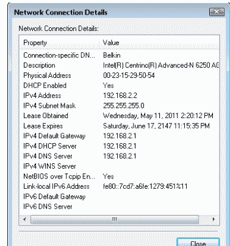

4. 双击关闭两个对话框。
5. 选择 开始 > 所有程序 > 杂项 > 命令提示符。打开一个命令行窗口。
6. 输入 `IPCONFIG` 并按回车。屏幕将显示电脑上安装的每个网络适配器的信息，包括当前未连接的适配器。
7. 关闭命令行窗口。

## TCP 端口

`TCP/IP` 的 `TCP` 部分负责数据传输。作为其一部分，不同的高层协议被分配了端口号，这些端口类似于无线电或电视电台或通道。为不同类型的数据分配不同的端口使得操作系统能够区分来自网络或互联网的传入数据，并将其传递给相应的应用程序。表 3.5 总结了分配给各种互联网协议的一些常用端口号。你已经学习了其中一种：`DHCP`。其他的你将在本章学习。

### 表 3.5 常见协议的 TCP 端口

| 协议 | 端口 |
| :--- | :--- |
| `FTP` | 20 和 21 |
| `HTTP` | 80 |
| `HTTPS` | 443 |
| `POP3` | 110 |
| `SMTP` | 25 |
| `IMAP` | 143 |
| `DHCP` | 546 和 547(`IPv6`); 67 和 68 (`IPv4`) (也是 `BOOTP`) |
| `DNS` | 53 |

你通常不需要担心端口分配。一种可能需要的情况是：负责你互联网体验某些部分（例如邮件服务器）的网络管理员决定为某项服务使用非标准端口。在这种情况下，你可能需要进入使用该服务的应用程序的连接或账户属性，并指定正在使用的端口。

## 互联网连接

将互联网引入计算机网络为你的计算机知识引入了新类型的硬件和一组新的通信协议。在本节中，你将学习涉及互联网连接的硬件和软件，以及采用其他协议和技术的浏览器功能。

## 互联网连接的硬件

十年前或更早，大多数人通过拨号调制调器连接到互联网服务提供商（ISP）。`modem` 是调制-解调器的缩写，是一种模拟转数字和数字转模拟的转换器，可以将数字数据转换为可以通过电话线传输的声音。然后另一端的另一个调制调器会将模拟信号转换回数字信号。

不确定你的电脑是否内置了拨号调制调器吗？在台式 PC 上，内置调制调器由两个并排的电话接口指示。在笔记本电脑上，通常只有一个调制器的电话接口。仔细观察，比正常宽、看起来像用于电话线的接口实际上是用于以太网的 `RJ-45` 连接器。

现在，大多数人使用始终在线的宽带连接上网。宽带字面意思是宽阔的通道，能够以高速传输数据。宽带互联网服务市场有两种主要技术：

- `DSL`（数字用户线路）：通过电话线传输互联网信号。
- `Cable`（电缆）：通过提供电缆电视服务的相同通道传输互联网信号。

此外，宽带互联网市场还有其他参与者，包括卫星互联网、`Wi-Max` 和全小区宽带（`3G`、`4G` 等）。每种技术都需要一个终端适配器（例如电缆调制调器或 `DSL` 调制调器）。这些设备在实际使用中是松散耦合的，但它们不像传统调制调器那样在模拟和数字之间进行调制解调。宽带或 `DSL` 网络理论上可以以非常快的运行——某些情况下超过 100 `Mbps`。然而，你的实际上网速度取决于许多因素，包括你购买的服务方案（速度越快价格越高）、你所在地区有多少其他用户同时使用该连接（电缆比 `DSL` 更常见的问题）、你访问的网站以及当时互联网的整体流量。

## DSL


# 宽带路由器与 DNS 基础

DSL 依赖于现有的电话网络，其中本地中继（通常是电话交换机）已升级以支持 DSL 通信。DSL 服务的速度取决于电话交换机实现的技术以及电话线的质量和密度。你从 DSL 连接获得的实际速度取决于你的位置到局局（你电话公司的 DSL 管理交换站）的距离等因素。

> 互联网早期曾提供过一种早期的宽带集成交换数字网络 (ISDN)，速度大约是拨号服务的两倍（56 Kbps，按今天的标准来说其实非常慢）。

DSL 服务分为非对称 DSL (ADSL) 或对称 DSL (SDSL)。在网络流量的语境下，“对称”意味着相等。对称 DSL 连接无论上传还是下载，都以相同的速度传输数据。2 Mbps 的 ADSL 连接在两个方向上都以该速度传输数据。

另一方面，“非对称”意味着不相等。在非对称连接中，上传速度低于下载速度。例如，ADSL 连接的下载速度可达 12 Mbps，但上传速度仅为 1.8 Mbps。

## 宽带路由器

通过宽带路由器，几乎所有的宽带互联网技术都可以在局域网（LAN）上共享。宽带路由器基本上是一个普通的消费级路由器，但它可能带有软件、说明书或额外功能，让普通人能够轻松设置宽带互联网连接。

要共享互联网连接，请用以太网线从来源（例如调制解器）连接到路由器背部的 `Internet` 或输入插口。然后通过以太网线或无线方式（如果是无线路由器）将网络中的所有计算机连接到路由器。路由器会处理每台计算机使用单一互联网连接所需的网络地址转换（NAT）。

## DNS 服务器

在章的较早部分，你已经学过 IP 地址是 32 位二进制数，表示为四组十进制数字，例如：`208.215.179.220`。所有的互联网服务器必须拥有 IP 地址才能进行通信。为了方便起见，使用了像 `Microsoft` 这样的域名而不是数字，因为它们更容易记忆。

域名系统（DNS）服务器将域名转换为数字地址和更友好的域名。这些服务器根据从域名注册公司获取的信息，存储并提供翻译表的访问。

> 存在一种误解，认为所有网页地址都必须以 `www` 开头。这只是习惯，而非强制。像 `Microsoft` 这样的大型网站会将网站分为多个服务器，并确保每个服务器都有不同的前缀，例如 `support.microsoft.com` 和 `office.microsoft.com`。

DNS 从右向左工作，每个地址之间用点隔开。查找网页地址（统一资源定位符，或 URL）的 IP 地址被称为解析地址。

一个名为 `InterNIC` 的组织控制互联网地址的发行。它管理着一组注册商，这些注册商管理一系列域名，并确保全球范围内都能提供它们的 DNS 查找信息。

例如，解析 `www.university.ac.uk` 时，浏览器首先查询顶级 DNS 服务器，该服务器包含有关如何为各种顶级代码存储其他 DNS 服务器的信息。这台第一个 DNS 服务器由 `InterNIC` 自己拥有，它将请求引导到由 `Nominet` 管理的 DNS 服务器，该服务器仅处理以 `.uk` 结尾的域名。该服务器转将请求发送到由 `JANET`（联合学术网络）管理的另一台 DNS 服务器，该服务器管理 `.ac` 和 `.gov` 地址。最后，请求被发送到大学的 DNS 服务器，它管理着自己的域名和任何子域名。

## 域名管理示例

`InterNIC` 控制域名右侧的所有地址命名规范。（在本例中，即 `biguniversity` 及其右侧的所有内容）。然而，左侧由拥有并托管该域名的组织控制。例如，`Big University` 的网络管理员可能会设置几台服务器，每台服务器都有自己的 IP 地址：

- `www.biguniversity.ac.uk` 用于 Web 服务器

- `mail.biguniversity.ac.uk` 用于邮件服务器

- `technology.biguniversity.ac.uk` 用于技术校区

`Big University` 运行自己的服务器并维护自己的 DNS 服务器以提供有关它们的信息。例如：

- `www.biguniversity.ac.uk` 可能映射到 `80.10.55.1`

- `mail.biguniversity.ac.uk` 可能映射到 `80.10.55.2`

- `technology.biguniversity.ac.uk` 可能映射到 `80.10.55.3`

如果你将网站托管在别人的服务器上，该公司会维护其自己的 DNS 服务器，而你与之共享。当你托管一个网站时，你会输入主 DNS 和备 DNS 地址，这些信息会在整个互联网中填充，从服务器复制，直到适当的 DNS 服务器收到通知并更新其数据库包含你的信息。

## 练习 3.11

### DNS 和 IP 地址

1. 像练习 3.10 那样打开一个命令行窗口。

2. 输入 `ping http://www.speedtest.net/` 然后跟上任何网站的地址。例如，尝试 `ping speedtest.net`。

   注意该站的 IP 地址在检查状态时显示出来。

3. 打开浏览器窗口，输入你在第 2 步中获得的 IP 地址。页面加载了吗？某些服务器会根据 IP 地址正确地加载页面，而某些则不会。这取决于在未指定页面时是否设置了加载默认（索引）页，以及其他安全设置。

4. 对几个不同的网站重复第 2–3 步，并比较结果。你可能找不到直接以原始形式的 IP 地址显示的网站。

# HTTP 和 HTTPS

接下来，让我们从更高层级查看互联网连接性。现在你已经建立了连接，你可以用它做什么呢？你可以做的一件事是请求和接收网页。计算机上使用多种协议来请求和接收网页。

协议运行在章中前面提到的 OSI 模型会话层（第 5 层）。

网络流量的基本不安全协议是超文本传输协议（HTTP）。以 `http://` 开头的地址产生的结果将以不安全、未加密的方式发送到你的计算机，很容易用数据包嗅探软件监视。数据包嗅探软件允许即使非技术用户也能查看在线传输的数据。

超文本传输安全协议（HTTPS）是超文本传输协议（HTTP）的一个版本，它将普通 HTTP 与传输层安全协议（TLS）或安全套接层（SSL）安全加密相结合，以便在浏览器和服务器之间私密地交换数据。HTTPS 连接通常用于涉及价值信息的情况，例如信用卡号。以 `https://` 开头的地址是安全地址。

HTTPS 有两个部分：确保网站确实如其看起来所示，以及确保数据在传输过程中不被窃听。

对于第一部分，即确保网站的身份，HTTPS 依赖于证书颁发机构：即收取费用发行和管理数字证书的公司。如 `VeriSign` 或 `Microsoft` 的证书颁发机构向网站发放证书，然后接收该信息的网页浏览器会向证书颁发机构确认以确保证书有效。

对于第二部分，即确保数据不被窃听，使用 TLS 或 SSL 对发送的数据进行加密，然后在接收端进行解密。TLS 和 SSL 是同种基础技术的两个版本，TLS 是较新版本。对于 Strata 考试，你不需要知道其工作的技术细节。

> 需要 Web 端通信始终保持安全的公司会创建一个虚拟专用网络（VPN）。VPN 是一个跨越互联网从一个点到另一个点的安全隧道。它使用公共互联网路由，但由于它们处于加密的安全路径中，交易过程免受了窃听的骚扰。

## 练习 3.12

### 安全与不安全的网页交易

1. 打开网页浏览器，访问 `www.amazon.com`。注意地址栏中的地址：`http://www.amazon.com`。

2. 向你的购物车中添加一个物品。（可以是任何物品；你并不会真的购买它。）然后查看购物车。注意地址栏以 `https://` 开头。

3. 点击“去结算”（Proceed To Checkout）按钮。如果提示登录，如果你已经有账户，请登录；否则创建一个。

### 练习 3.12（继续）

4. 在“检查您的订单”（Review Your Order）页面，查看地址栏。注意地址现在以 `https://` 开头了。这表明你已被移动到一个安全服务器以完成交易。

5. 在不完成交易的情况下关闭浏览器窗口。

# POP、SMTP 和 IMAP

邮件处理涉及其自己的协议。这些也运行在会话层（OSI 模型的第 5 层），但使用不同的应用程序：邮件处理程序。（某些电子邮件通过 HTTP 通过网页浏览器递送，但这不是我们正在讨论的那种邮件）

最流行的邮件处理类型是“存储并转发”系统，它使用邮局协议 3（POP3，简称 POP）接收邮件，并使用简单邮件传输协议（SMTP）发送邮件。在这种类型的邮件系统中，邮件会在服务器上堆积（存储部分），直到你使用 `Outlook` 或 `Windows Mail` 等邮件客户端登录并取回（转发部分），此时邮件将从服务器上删除。这种类型的系统通常被称为 POP，尽管技术上讲 POP 只是等式的一半——接收部分。

POP3 是最常用的邮件系统类型，因为从服务器的角度来看它很方便，且对 ISP 来说成本最低。一旦你检索邮件，服务器就不对其承担任何责任，因此服务器不会被存储或多年的邮件搞崩溃。

当用户始终从同一台计算机使用相同的邮件存储登录时，POP 的效果良好。那是因为这种类型的系统将入站邮件存储在当前正在使用的计算机上，如果你使用了许多不同的计算机，你的邮件就会分散在所有这些计算机上。


当你从几个不同的位置登录时，有时会使用互联网邮件访问协议（IMAP）。`IMAP`邮件系统使用`Outlook`或`Windows Mail`等邮件程序的界面，但邮件本身存储在服务器上并从服务器访问；无论你从何处登录，你的邮件都在那里。`IMAP`的缺点是它对服务器需要更多的管理开销，而且界面运行较慢，因为每条消息在在你查看时都必须从服务器检索。

当你在邮件处理程序中设置邮件账户时，你会告诉它你连接的是什么类型的邮件服务器：`POP3`或`IMAP`。你还会填写入站和出站邮件服务器名称、用户名和密码。根据提供商的不同，你可能还需要对某些邮件设置进行微调以匹配服务器

要求。图 3.16 显示了`Outlook 2010`的邮件帐户配置屏幕，说明了邮件类型的选择。

## 图 3.16 Outlook 2010 中的邮件设置

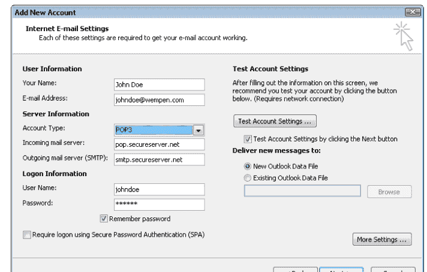

## FTP

你可以从网站下载文件，但为了批量上传和下载文件，许多个人和公司更倾向于使用一种专门为传输设计的不同系统：文件传输协议（`FTP`）。

`FTP`是一种非常老的协议，使用在网页访问流行之前的互联网早期。`FTP`服务器充当“投箱”的作用，你可以从中提取文件，也可以向其存放文件。`FTP`服务器是公开的；另一些则受密码保护。

大多数人使用`FTP`客户端进行`FTP`传输。然而，你也可以使用网络浏览器进行`FTP`下载，在某些情况下（如此（取决于浏览器和`FTP`服务器）。一个免费的`FTP`客户端是`FileZilla (www.filezilla-project.org)`。

`FTP`地址以`ftp://`开头，就像网页地址以`http://`开头一样。这个前缀告诉应用程序使用哪种协议。在`FTP`客户端中，协议是默认的。然而，当使用网络浏览器进行`FTP`时，你必须确保为`FTP`地址添加前缀。

## 第 3 章 • 外围与网络

## 图 3.17 FileZilla 是一款流行的 FTP 应用

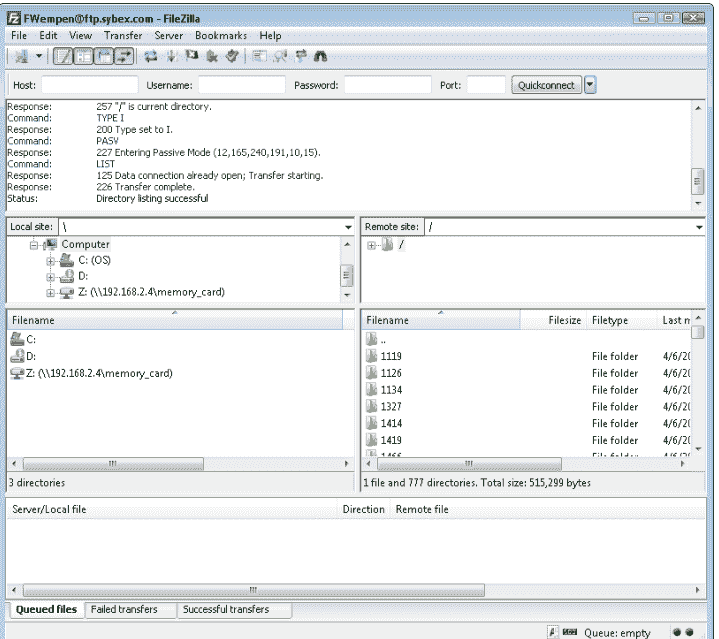

和普通`HTTP`一样，`FTP`协议是不安全的。如果你需要安全文件传输，请使用启用安全的传输方法代替`FTP`，例如安全外壳（`SSH`）`FTP`，有时称为安全`FTP (SFTP)`。

## VoIP

IP协议语音（`VoIP`）是一系列提供基于IP的电话服务的应用程序、技术和协议。换句话说，它让你可以使用互联网拨打和接听“电话”。从终端用户的角度来看，这只是他们一直以来享有的另一种服务，但通话都是全数字化的。人语音的模拟数据被数字化，并作为数据发送到互联网，然后在另一端重新创建为模拟声音。

许多公司为消费者提供廉价的`VoIP`服务，包括`Skype`。此外，像`Comcast`这样的有线公司通过其电缆结合互联网服务提供数字文件服务。

> 在点击安装插件的链接时要谨慎。一些声誉不佳的网站会试图骗你点击链接来安装插件，并使用该插件在你的计算机上显示广告、监视你，或接管你的计算机来发送垃圾邮件或病毒浪。

## 第 3 章 • 外围与网络

你可以查看和管理为浏览器安装的插件。具体步骤取决于浏览器，但在大多数情况下，你可以启用或禁用某个插件，或完全将其删除。这很重要，因为这让你拥有控制权，可以停止可能发生故障或对你的系统有害（从而导致浏览器崩溃）的插件。

## 练习练习 3.13

### 在 Firefox 中查看已安装的插件

1. 如果计算机上尚未安装`Firefox`，请从`www.mozilla.org`下载并安装。

2. 选择`工具 (Tools) ➤ 插件 (Add-ons)`。打开插件对话框。

3. 点击插件图标。出现已安装插件的列表。

4. 点击列表上的任何一个插件。它旁边会出现一个“`禁用 (Disable)`”按钮。

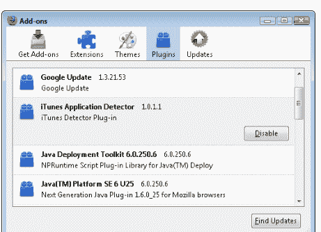

5. 点击“`禁用`”按钮。按钮变为“`启用 (Enable)`”。

6. 点击“`启用`”按钮重新启用该插件。

7. 点击`扩展 (Extensions)`图标。出现其他插件。

8. 点击其中一个插件，注意它可用的按钮。除了“`禁用`”按钮，还有“`选项 (Options)`”和“`卸载 (Uninstall)`”按钮。

9. 点击“`选项`”按钮。检查可用选项，然后点击“`取消 (Cancel)`”关闭对话框且不进行任何更改。

10. 关闭插件窗口，并关闭浏览器。

## 浏览器自定义

某些网页的编写方式使得它们在显示网页的每台计算机上都使用相同的字体和字号，无论浏览器设置如何。然而，其他页面允许浏览器对文本大小和文本样式进行某些控制。

通过增加网页网页使用的默认字体大小，你可以让视力障碍人士更容易阅读文本。你还可以选择不同的字体和颜色，这些字体可能比其他的更容易阅读。这完全取决于你的喜好。

增加网页可读性的另一种方法是更改浏览器中的`缩放 (Zoom)`设置。放大页面不仅会放大文本，还会放大页面上的其他内容，包括图形。

## 练习 3.14

### 在 Firefox 中自定义外观设置

1. 如果计算机上尚未安装`Firefox`，请从`www.mozilla.org`下载并安装。

2. 在`Firefox`中，显示此网站：`http://news.google.com`。如果该网站不可用，查看其他包含大量文本的网站，以便你可以看到对文本的影响。

3. 选择`工具 (Tools) ➤ 选项 (Options)`。对话框打开多个框。

4. 显示此网站：`http://news.google.com`。如果该网站不可用，查看其他包含大量文本的网站，以便你可以看到对文本的影响。

5. 在浏览器中，显示此网站：`http://news.google.com`。如果该网站不可用，查看其他包含大量文本的网站，以便你可以看到对文本的影响。

6. 在浏览器中，显示此网站：`http://news.google.com`。如果该网站不可用，查看其他包含大量文本的网站，以便你可以看到对文本的影响。

7. 在浏览器中，显示此网站：`http://news.google.com`。如果该网站不可用，查看其他包含大量文本的网站，以便你可以看到对文本的影响。

8. 在浏览器中，显示此网站：`http://news.google.com`。如果该网站不可用，查看其他包含大量文本的网站，以便你可以看到对文本的影响。

9. 在浏览器中，显示此网站：`http://news.google.com`。如果该网站不可用，查看其他包含大量文本的网站，以便你可以看到对文本的影响。

10. 在浏览器中，显示此网站：`http://news.google.com`。如果该网站不可用，查看其他包含大量文本的网站，以便你可以看到对文本的影响。（注：OCR 文本包含重复步骤，已根据逻辑清理。）

11. 在浏览器中，显示此网站：`http://news.google.com`。如果该网站不可用，查看其他包含大量文本的网站，以便你可以看到对文本的影响。

12. 在浏览器中，显示此网站：`http://news.google.com`。如果该网站不可用，查看其他包含大量文本的网站，以便你可以看到对文本的影响。

13. 在浏览器中，显示此网站：`http://news.google.com`。如果该网站不可用，查看其他包含大量文本的网站，以便你可以看到对文本的影响。

14. 在浏览器中，显示此网站：`http://news.google.com`。如果该网站不可用，查看其他包含大量文本的网站，以便你可以看到对文本的影响。

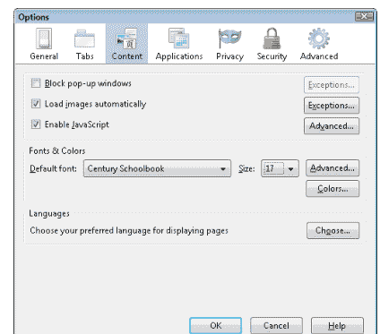

页面的图形是从存储的缓存中读取的，而不是从`Web`重新获取。这使得你的`Internet`连接看起来速度更快。

一些人认为这种数据缓存是一个隐私问题，因为其他人可以在硬盘上嗅探以前查看过的某些网页内容的缓存副本。对于这一点，浏览器提供了一项功能，允许你清除缓存并选择在未来不再进行缓存。

浏览器的历史也提供了最近访问页面的记录，但原因不同。例如，当你忘记某个网站的地址并需要找到并返回该网站时，历史记录非常有用。历史记录并不保留任何内容的副本——只保留访问页面的地址。历史记录也可以清除，你可以选择阻止它在未来存储信息。

## 练习 3.15

## 在 Firefox 中调整安全和隐私设置

- 1. 如果电脑上尚未安装`Firefox`，请从`www.mozilla.org`下载并安装。

- 2. 在`Firefox`中，选择`工具(Tools) ▷ 选项(Options)`。打开对话框。

- 3. 点击顶部的`安全(Security)`图标。

- 4. 确保勾选了`阻止已报告的网络欺造(Block Reported Web Forgeries)`复选框。（这就是钓鱼过滤器。）

- 5. 点击顶部的`内容(Content)`图标。

- 6. 确保勾选了`启用 JavaScript(Enable JavaScript)`和`阻止弹出窗口(Block Pop-Up Windows)`复选框。

- 7. 点击顶部的`隐私(Privacy)`图标。


8. 取消勾选接受第三方 Cookie（`Accept Third-Party Cookies`）复选框。
9. 点击显示 Cookie（`Show Cookies`），打开对话框，并出现按网站排序的所有 Cookie 详细列表。
10. 双击其中一个文件夹打开其 Cookie 列表，点击一个 Cookie 文件。其内容将出现在列表下方的灰色影面板中。
11. 点击删除 Cookie（`Remove Cookie`）。该 Cookie 文件将被删除。
12. 点击关闭 Cookies 对话框。
13. 点击确定（`OK`）关闭选项对话框。
14. 选择 `工具`▷`最近历史记录`。打开清除最近历史记录（`Clear Recent History`）对话框。
15. 打开要清除的时间范围（`Time Range To Clear`）下拉列表，并点击今天（`Today`）。
16. 点击立即清除（`Clear Now`）。
17. 关闭浏览器窗口。

## 总结

在本章中，你学习了若干类型的外围设备，包括打印机、显示器、音系统、扫描仪和数字相机。输入和输出设备对计算机的运行可能不是关键，但它们极大增强了它的功能。

你还学习了一些关于网络的基础知识。你学习了有线和无线以太网硬件、标准和协议，并学习了 `IP` 地址是如何工作的。你还学习了几种类型的 `Internet` 连接以及 `Internet` 技术和协议，包括 `DNS`、`HTTP`、`FTP`、`POP3` 和 `IMAP`。最后，你学习了一些浏览器设置，这些设置允许你自定义和控制浏览体验。

## 考试要点

- 识别常见的输入输出外围设备。打印机、显示器扬声器接收来自计算机的输出；扫描仪和数字相机提供输入。你应该了解这些设备的设备基础。
- 理解打印机技术。两种主要的打印机技术是喷墨打印和激光打印。它们在初始成本、运行成本和打印质量方面各有优缺点。
- 理解扫描仪和数字相机如何捕捉图像。扫描仪和数字相机照亮它们正在捕捉的图像，并测量返回传感器的量。基于这些值，你将图像数字化。
- 识别涉及网络的硬件。每个网络设备都有一个网络接口卡（`NIC`）和一种连接到中央汇点的方法，可以是交换机、路由器或无线访问点。对于有线技术，了解 `Cat5e` 和其他电缆类型。对于无线，了解 `802.11` 标准。
- 理解 `IP` 地址和 `DNS` 服务器。`IPv4` 地址由四个 0 到 255 之间的数字组成，用点隔开。`IPv6` 地址由八个 4 位十六进制数组成。在 `Internet` 上，域名通过域名系统（`DNS`）服务器从 `IP` 地址翻译过来。
- 理解 `Internet` 连接技术和协议。电缆和 `DSL` 是最流行的宽带连接类型。要在位置内共享宽带连接，请使用路由器。`Internet` 上常用的协议包括 `HTTP`、`POP3`、`IMAP` 和 `FTP`。
- 了解如何自定义网络浏览器。网络浏览器有很多控制网络浏览体验的选项，包括启用/禁用插件、更改字体/大小、管理 `Cookie` 以及允许或禁止某些技术（如 `ActiveX` 和 `Java`）。

## 复习题

1. 哪种类型的打印机使用喷在纸上的液体墨水？
   - A. 激光
   - B. 喷墨
   - C. 链字轮
   - D. 针式

2. 哪种类型的打印机包含一个用电荷写入页面图像的鼓组件？
   - A. 激光
   - B. 喷墨
   - C. 链字轮
   - D. 针式

3. 大多数现代打印机使用哪种接口？
   - A. 并行
   - B. 喷墨
   - C. 链字轮
   - D. 针式

4. 显示器使用什么种连接器？
   - A. `VGA`
   - B. `DVI`
   - C. `HDMI`
   - D. `HTTP`

5. 扫描仪和数字相机都捕捉一个(n)
   - A. `DVI`
   - B. 笔
   - C. `OCD`
   - D. `CCD`

6. 在数字相机上，哪种结果质量更好？
   - A. 数字变放
   - B. 光学变放
   - C. 垂直缩放
   - D. 水平缩放

7. 哪种网络是同位置的？
   - A. `MAN`
   - B. `WAN`
   - C. `SAN`
   - D. `LAN`

8. 哪种网络有服务器？
   - A. `P2P`
   - B. 客户端/服务器
   - C. `Internet`
   - D. 以太网

9. `NIC` 是计算机中的(n)
   - A. 适配器
   - B. 交换机
   - C. 路由器
   - D. 访问点

10. 要在一个位置内共享 `Internet` 连接，请使用(n)
    - A. 交换机
    - B. 路由器
    - C. 集线器
    - D. 无线

11. 并行 `Cat5` 是一种(n) 类型的
    - A. 光纤
    - B. 同轴
    - C. `SCSI`
    - D. 双绞

12. `RJ-45` 用于以太网
    - A. `RJ-11`
    - B. `RJ-14`
    - C. `RJ-50`
    - D. 电话

13. `HomePlug` 也称为电力线以太网，使用
    - A. 无线信号
    - B. 电线
    - C. 电话线
    - D. 红外

14. 哪种标准是最新且最快的？
    - A. `802.11n`
    - B. `802.11g`
    - C. `802.11b`
    - D. `802.11a`

15. 在通信中，双向但一次仅一个方向是
    - A. 单工
    - B. 复杂
    - C. 半双工
    - D. 全双工

16. 服务标识符（`SSID`）显示为网络
    - A. 名称
    - B. 通道
    - C. 加密
    - D. 频率

17. `WEP` 和 `WPA` 是两种类型的
    - A. 无线加密
    - B. 网络
    - C. 适配器
    - D. 安全加密

18. 哪种是用于发送电子邮件的协议？
    - A. `POP3`
    - B. `SMTP`
    - C. `FTP`
    - D. `HTTPS`

答案：

18. B. `IPv4` 地址是四个用点隔开的 0 到 255 之间的数字。
19. C. 域名系统（`DNS`）服务器在数字地址和域名之间进行翻译转换。
20. B. `SMTP` 是一种邮件发送协议。`POP3` 是它的对应协议，但用于接收邮件而不是发送邮件。`FTP` 是一种文件传输协议。`HTTPS` 是 `HTTP` 的安全版本，用于显示安全的网页。

# 安装、维护与升级

# 第二部分


## 第 4 章

### 设置计算机

本章涵盖的 `PC` 技术基础知识目标：

1.1 `U.K.` / 演示以下设备的正确用法：

- 台式机
- 服务器
- 携携式电脑

本章涵盖的 `PC` 功能基础知识目标：

1.3 `U.K.` / 1.7 `U.S.` 演示设置基础 `PC` 工作站的能力：

- 识别连接器类型之间的差异
- 计算机（台式机、塔式机、笔记本、定制机箱）
- 电压和功率要求
- 开启并使用 `PC` 及外围设备


选择和设置计算机是计算机人员的基本技能。这包括理解可用系统之间的物理差异，并知道在连接各种外部组件和外围设备时“什么该放在哪里”。

## 选择计算机类型

不同类型的个人电脑适用于不同的情况，能够识别适合你或他人的需求的计算机至关重要。计算机根据以下因素而异：

- `尺寸和便携性` 计算机越小，越容易携带。然而，较小的尺寸意味着你可能需要在某些其他功能上做出妥协，例如输入便利性或处理能力。
- `处理速度和多任务处理` 正如你在第 1 章“计算机硬件基础”中学到的，`CPU` 越快，计算机整体运行速度就越快。大量的内存（`RAM`）以及具备多任务能力的操作系统使计算机具有同时处理许多任务的能力。
- `输入和输出的便利性` 使用全尺寸键盘和鼠标更容易向设备输入数据和提取数据。
- `多功能性` 某些计算机兼具书籍阅读器、手机、互联网设备、全球定位系统（`GPS`）等功能。严格作为个人电脑使用。

`台式机 PC` 是传统的矩形盒子型号，带有独立的键盘、视频显示器和鼠标（有时被称为 `KVM`）。台式 `PC` 提供了最佳的用户体验，因为它具有全尺寸键盘、鼠标和大型显示器——在这些任何领域都不需要妥协。与其他类型的 `PC` 相比，台式 `PC` 以更高的性价比提供了更高的处理能力。台式机 `PC` 主要缺点是缺乏便携性（见图 4.1）。

## 图 4.1 台式机 PC


联想提供

台式机 `PC` 广泛用于 `SOHO` 环境。`SOHO` 代表小型办公/家庭办公室。


## 服务器与台式 PC
服务器在尺寸和组件上与台式 PC 类似。服务器与台式 PC 的主要区别在于操作系统：服务器使用操作系统（例如 `Windows Server`），它内置了用于管理网络的特殊程序。服务器还可能拥有多个 CPU 和大量内存，以便高效处理服务器工作任务所包含的繁重需求。正如你在第 2 章“输入和存储设备”中学到的，家庭网络通常没有服务器；对于连接 10 台或更少计算机的网络来说，不需要服务器。

## 便携式电脑
便携式电脑的特点是内置了 LCD 显示器和键盘（或其他数据输入机制，如触摸屏）。不同类型的笔记本包括：

### 笔记本 (Notebook or Laptop)
笔记本电脑是一种尺寸约为纸质笔记本大小的计算机，屏幕对角线在 12 英寸到 16 英寸之间。笔记本 PC 通常是全功能计算机，运行正版本的 `Windows`，并处理台式 PC 可以处理的所有任务。例如，笔记本可能适合每晚上需要将计算机从办公室带家的商务专业人士，但他们需要计算机足够强大，以运行标准的业务应用程序（见图 4.2）。

#### 图 4.2 笔记本 PC
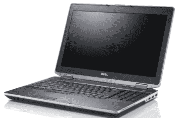

戴尔提供

这些是笔记本 PC 的较小版本，屏幕对角线在 9 英寸到 11 英寸之间。由于尺寸更小、重量更轻，笔记本在完成任务时的性能可能较弱，事实也如此。

### 平板电脑
平板电脑有两种类型。较大的类型看起来像笔记本，但带有触摸屏。你可以使用手写笔与屏幕交互（见图 4.3）。另一种类型薄得多且没有键盘，如图 4.4 所示的 `iPad`。平板电脑适合无论在何地都需要频繁访问互联网的人。

#### 图 4.3 无键盘的平板电脑
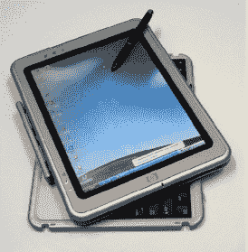

#### 图 4.4 Apple iPad 是平板电脑的示例
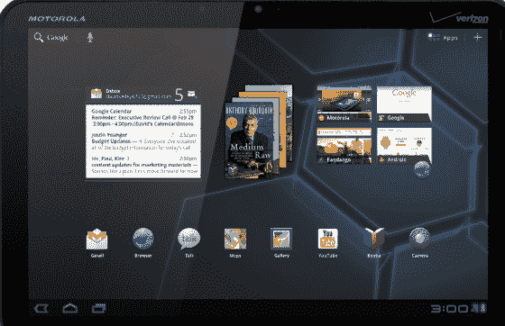

来源：苹果提供

### 智能手机
`智能手机` 是一种手持设备，不仅作为手机使用，还作为基础计算机，包括运行应用程序（如联系人管理器和邮件阅读器）以及通过浏览器访问互联网。某些智能手机带有键盘，如黑色；其他如 `iPhone`、`Droid`（见图 4.5）或 `Windows` 手机带有触摸屏，需要时弹出虚拟键盘。智能手机可以为需要频繁访问互联网的人。

#### 图 4.5 罗拉 Droid 是智能手机的示例
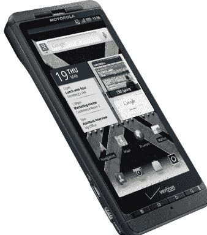

图片来源：罗拉提供

### 个人数字助理
个人数字助理 (PDA) 现在大部分已过时，它们曾被商务人士广泛用于跟踪预约和联系信息。`Palm` 是 20 世纪 90 年代和 21 年代这些设备流行的制造商之一。当智能手机开始提供相同或更好的计算能力时，PDA 逐渐失去了流行。

### 练习 4.1
比较便携式电脑

访问几家主要便携式电脑制造商的网站，并比较其平板或超笔记本（上网本）系列的规格。选择一个品牌的一两个型号并记录以下内容：

- 价格
- 屏幕尺寸
- 内存容量
- 处理器类型和型号
- 端口
- 操作系统
- 特殊功能（如有）

## 台式计算机外形
台式计算机机箱是连接其他所有设备的大矩形盒子。机箱有不同的尺寸和形状。机箱的尺寸和方向被称为外形。

几乎所有的计算机都是塔式的，这意味着它们比宽度或深度高。全塔式具有许多用于驱动器（如 `CD` 或 `DVD` 驱动器）的扩展槽。

要被视为全塔式（`full tower`），四个是一个大致的估算值。大多数服务器都采用全塔式机箱。小型塔式（`mini-tower`）更小，驱动器槽较少，可能只有两个或三个。所有由大矩形盒子带有独立显示器和键盘组成的电脑都是台式 PC。但还有一种特殊风格的机箱称为桌面式机箱（`desktop case`），它以最大面朝下放在桌面上。图 4.6 显示了桌面式机箱，图 4.7 显示了全塔式机箱。

#### 图 4.6 桌面式机箱
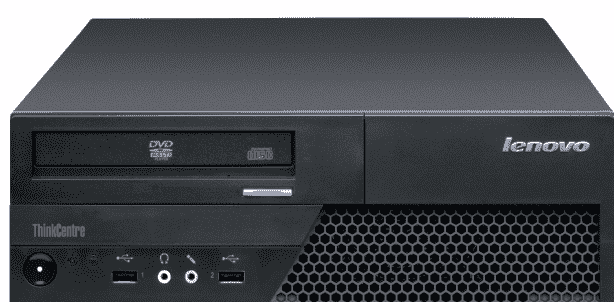

感谢 Lenovo

#### 图 4.7 全塔式机箱
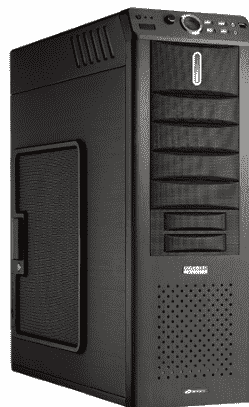

一些 PC 制造商为特殊用途定制机箱。例如，设计作为家庭娱乐系统一部分的 PC 可能比普通 PC 机箱更小，并像桌面式机箱一样平放，以便于放入娱乐中心。另一种常见的定制机箱是薄型机（`slimline`），它比普通的更薄，可以像桌面型号一样平放，也可以像塔式机箱一样直立。

某些机箱的设计旨在优化内部气流，通过通风口和风扇的战略性布局来散热并保持设备冷却。此类机箱被称为散热优势机箱（`thermally advantaged chassis`）。

### 练习 4.2
#### 调查机箱规格
1. 使用搜索引擎找到一家制造电脑机箱的公司。
2. 在该公司的网站上找到以下内容的示例：
    - 全塔式机箱
    - 中塔式机箱（`mid-tower`）
    - 小型塔式机箱
    - 水平放置的桌面式机箱
3. 对于每种机箱，确定其内部和外部可访问的驱动器槽数量。
4. 另外两个销售机箱的网站并重复此练习。评估这些网站在机箱拥有多少驱动器槽才能被视为全塔式、中塔式或小型塔式方面是否一致。这些术语的使用似乎有明显的标准化吗？

## 拆箱新电脑
当你拆箱新电脑时，请小心打开箱子。如果你使用锋利的刀切开固定箱子的胶带，请确保不要切入箱体和组件内部。

当你从箱中取出组件时，要意识到如果电脑出现故障，你需要重新包装。如果有泡沫支撑物，请确保它们没有损坏。保存所有包装材料，包括包含组件的塑料袋，并保存电脑随附的所有说明书和光盘。将说明书和光盘存在安全的地方，因为你明天、下周或明年可能需要它们。

## 设置电脑
某些组件表面覆盖有保护性塑料膜，例如显示器屏幕或机箱的角或标志。将这些撕掉并丢弃。

将机箱放在稳固的桌子上（而不是摇晃的卡纸桌或托盘）或地板上，这样就没有机箱被撞倒或掉落的危险。如果机箱放在气流受限的隔间、抽屉或柜子里，请考虑如何增加该区域的气流，以防电脑过热。

在插入所有其他组件之前，不要插入电脑电源；电源应该是最后连接的电缆。（你将在下一节学习其他组件的插头。）

在放置桌子和电脑时，思考你想把它们放在哪里，并注意电缆是否能够到机箱，以及这些电缆是否会跨越可能被意外拉拽或拖动的区域。

## 验证电压和功率需求
PC 中的电源供应有两个作用：首先，它将电压从交流（`AC`）插座降至 PC 组件所需的更低电压。其次，它将交流电（`AC`）转换为直流（`DC`），这是 PC 所需的。

个人电脑电源插头插入标准的家庭插座中。取决于你居住的地方，这可能是 `230v`（例如欧洲大部分地区）或 `120v`（例如美国）。当你购买电脑时，销售给你的公司会根据你的位置为 PC 配置正确的电压。如果你搬到一个使用不同电压的国家，必须对电脑进行改装或使用电源电压转换器。许多台式 PC 的电源盒上有一个电压开关，你可以翻转它来切换电压。（当然，你需要新的电源线，因为旧的电源线无法连接到形状不同的 `AC` 插座上。）笔记本电脑在更换地区时通常需要更换电源线。

> 查看 `http://electricaloutlet.org/`，并将你国家的电压和插座与你所在或其他国家或国际水平进行比较。

在美国和其他使用 `120v` 电源的地方，台式 PC（嗯，至少是非 `Macintosh` 的电脑）使用图 4.8 所示的三脚 B 型电源线。图 4.9 显示了电源供应背部用于连接电源线的连接器。还要注意此图中的电压开关。在英国，使用三脚 G 型电源连接器。在欧洲其他大部分地区地区，使用 C 型或 F 型电源连接器。

### 第 4 章：设置电脑

#### 图 4.8 电源线


#### 图 4.9 连接器


#### 图 4.10 电源适配器


#### 图 4.11 PC 上的接口


## 显示器
每台电脑都至少有一个视频端口——即连接显示器的端口。根据电脑的不同，这可能是 `VGA`、`DVI` 或 `HDMI` 端口。（大多数电脑有 `VGA` 和/或 `DVI`；`HDMI` 对于消费级电脑来说相当罕见。）回到第三章“外围与网络”中的“显示器”部分，讨论每个连接器的优缺点。`HDMI` 质量最高，其次是 `DVI`，`VGA` 质量最低。如果有选择，请选择质量最高的选项。

图 4.12 显示电脑背部的 `DVI` 连接器，图 4.13 显示 `VGA` 型（`DB15F`）。注意这些连接器两侧都有螺丝孔。连接连接，将其牢固地插入插座，然后拧紧手指螺丝。螺丝可以防止有人绊到电线或撞倒机箱时，连接器被意外拉出并损坏。

#### 图 4.12 电脑上的 DVI 端口
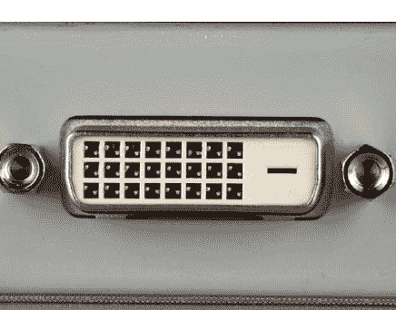


## 图 4.13 计算机上的 VGA 端口

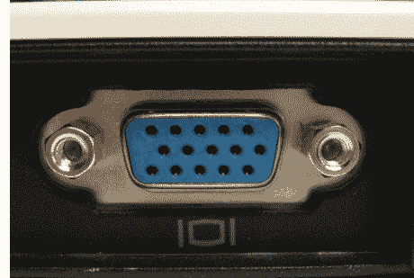

## 通用串行总线 (USB)

`USB` 是一个全能型端口，用于将许多不同类型的输入输出设备连接到计算机。大多数键盘和鼠标都使用这种接口，闪存驱动器、数码相机、打印机、扫描仪以及你可能拥有的任何其他设备也是如此。`USB` 端口由 `USB` 符号表示，如图 4.14 所示。

### 图 4.14 显示 USB 符号的 USB 端口

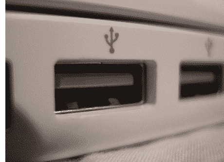

*照片来源：Aidan C. Siegel*

`USB` 连接器有几种不同的尺寸和形状。最常见的类型是 `USB` 标准 `A`/`B` 线。标准 `A` 端连接到计算机，形状宽而扁平（见图 4.15）。标准 `B` 端连接到设备（如打印机），形状更接近方形（见图 4.16）。

### 图 4.15 连接到计算机的 USB A 连接器

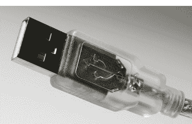

*照片来源：Andreas Frank*

### 图 4.16 连接到大型外设（如打印机）的 USB B 连接器

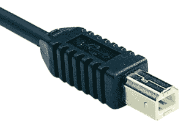

*照片来源：www.chochoteeta.com*

还有 mini（小型）和 micro（更小）版本的 `USB` 连接器，用于连接手机和相机等较小的设备。例如，图 4.17 显示了一个 `USB Micro B` 连接器，它可用于连接手机。

### 图 4.17 连接到非常小外设（如手机）的 USB Micro B 连接器


*照片来源：Copyright 2002 coolgear.com*

## 配置计算机

`USB` 标准也有多个不同的版本，每个版本都有其自身的最高速度。（物理连接器与所使用的 `USB` 标准之间没有直接关系。）目前，大多数计算机上的 `USB` 端口都是兼容 `USB 2.0` 的，但 `USB 3.0` 已经推出，并将很快在更多的 `PC` 和设备上提供。表 4.1 总结了 `USB` 版本及其速度。它们都使用相同的连接器，因此高版本与为低版本设计的设备具有向后兼容性；当并非所有组件都具备高速能力时，它们将以较低的速度运行。

### 表 4.1 USB 版本

| USB 版本 | 速度 |
|---|---|
| 1.0 | 1.5 Mbps |
| 1.1 (全速) | 12 Mbps |
| 2.0 (高速) | 480 Mbps |
| 3.0 (超速) | 4800 Mbps |

## 练习 4.3

### 获取 USB 端口信息

`USB` 设备的优点之一是，单个 `USB` 控制器可以在只需要少量额外系统资源的情况下管理多个设备。每个控制器管理一个或多个集线器（hub）。集线器可以是计算机外部的一个物理盒，但更常见的是内置的主板控制器，它将计算机上多个 `USB` 端口的信号路由到一个 `USB` 控制器之一。在下面的练习中，你将使用设备管理器探索基于 `Windows` 的计算机上的 `USB` 设备，以查看控制器和集线器之间的关系。

1. 在 `Windows` 中，点击“开始”，输入“设备”，并在开始菜单顶部程序列表中点击“设备管理器”。
2. 双击“通用串行总线控制器”以展开该类别。会出现集线器和控制器的列表。集线器是内部的，可能与系统上的实际 `USB` 端口之间没有一一对应的关系。
   
3. 双击列表中包含“controller”（控制器）一词的条目之一。大多数系统列出了两个控制器。会出现控制器的对话框。
4. 点击对话框中的每个标签，注意 `USB` 控制器的可用信息。特别是查看“高级”选项卡，查看哪些设备正在占用带宽。每个控制器都会显示“`System 20%`”，即使该控制器没有列出任何设备。下方将显示它支持的任何 `USB` 设备。
   
5. 点击“取消”关闭对话框。
6. 对任何其他包含“controller”一词的条目重复步骤 3–5。
7. 使用相同的过程，浏览列表上包含“hub”（集线器）一词的每个 `USB` 项目的属性。
8. 关闭设备管理器窗口。

## 火线 (FireWire)

`FireWire` 是 `USB` 的竞争性技术。它的正式名称是 `IEEE 1394`，以定义它的 `IEEE` 标准命名，但 `FireWire` 是更友好、更常用的别名。然而，它通常被标记为 `IEEE-1394`。


*照片来源：Copyright 2001 Cybernet Manufacturing.*

`FireWire` 通常被标记为 `IEEE-1394`，如图 4.18 所示。

### 图 4.18 计算机上的 FireWire 端口


*照片来源：Copyright 2001 Cybernet Manufacturing.*

`FireWire` 线缆如图 4.19 所示。

### 图 4.19 FireWire 线缆


## PS/2 接口

`PS/2` 端口如图 4.20 所示。

### 图 4.20 计算机上的 PS/2 端口


`PS/2` 线缆如图 4.21 所示。

### 图 4.21 PS/2 线缆


## 3.5 mm 音频接口

`3.5 mm` 音频接口是所有便携式耳机和耳机的标准技术，它用于各种音频输入和输出设备，正如你在第 3 章中所学的那样。在某些系统中，插口通过颜色区分；在其他系统中，端口旁微小的文字或符号标识了其用途。图 4.25 显示了一个带有 `3.5 mm` 连接器的麦克风。

### 图 4.25 麦克风上的 3.5 mm 连接器


*图片：©2010 Soundwise–苏格兰边缘*

## ExpressCard 和 CardBus/PC Card

某些笔记本电脑有一个多功能插槽，用于插入尺寸与信用卡宽高相似（仅更厚）的适配器。插入这些插槽的适配器可以为系统添加各种功能，包括以太网、存储、外接显卡、无线网络和电视调谐器。最初的插槽类型是 `PCMCIA`，以创建它的协会命名（个人电脑内存卡国际协会）。该协会仍然存在，并继续维护当前标准。多年来发布了更新版本，它们具有不同的尺寸和形状，连接计算机内部不同的总线并以不同的速率传输数据。

`ExpressCard` 是一项标准，最早于 2005 年左右引入。它适用于带有 26 针连接器的 `34 mm` 插槽。它有两种类型：`ExpressCard34` 和 `ExpressCard38`。后者是 `L` 型的，因此其连接器部分与 `ExpressCard34` 相同。它可以使用计算机内部的 `PCI Express` 或 `USB` 总线。`ExpressCard` 设备通过 `PCI Express` 的吞吐量高达 `2.5 Gbps`，或通过 `USB 2.0` 总线达到 `480 Mbps`。

> `PCI` 用于外围组件互连。它是主板上一种更快的总线，用于在扩展卡和系统总线之间传输数据。原始版本仅是 `PCI`，但后来发布了称为 `PCI-Extended` (`PCI-X`) 和 `PCI Express` (`PCIe`) 的更新版本，速度更快。确保你在 `Strata` 考试中熟悉这些缩写。`PCI-X` 是 `PCI` 的双倍版本，主要用于 2000 年初的服务器。`PCIe` 是当前标准，它比前代产品更快、更小、更高效。

## 设置计算机


在此之前，`CardBus` 是 20 世纪 90 年代后期到 2005 年左右的标准。它宽 54 mm，带有 68 针连接器。`CardBus` 插槽与主板上的 32 位 `PCI` 总线通信，所有 `CardBus` 卡共享 1.06 Gbps 的带宽。图 4.26 比较了两种 `ExpressCard` 与 `CardBus` 的物理尺寸。在 `CardBus` 出现之前，`PC Card` 是一种 16 位类型的卡。`PC Card` 一术语通常泛指较旧的 16 位类型和 32 位 `CardBus` 类型。

## 图 4.26 ExpressCard 与 CardBus 尺寸对比


`PC Card` 曾有时过三种厚度：`Type I`、`Type II` 和 `Type III`。`Type I` 卡（厚度为 3.3 mm）很罕见；它们主要用于增加内存，且仅为 16 位。`Type II` 卡（厚度为 5.0 mm）是最流行的类型，广泛用于调制解器卡和网卡等用途。

`PC Card` 和 `CardBus` 在 `USB` 时代之前处于流行巅峰，那时将外设连接到笔记本电脑的唯一方法是通过非常慢的并行和串口端口。现在 `USB 2.0` 已经普及。

## 打开计算机和外设

正如你所见到的，现在将外设连接到笔记本电脑的唯一方法是使用 `USB` 接口。在某些设备上，你可能会看到图 4.27 所示的符号。

## 图 4.27 电源符号


根据型号，电源开关可能位于机箱正面，或者在背部。

（注：此处原文内容似乎存在部分重复或断裂的句，已根据语境完成翻译并修正了逻辑连贯性）

如果这是你第一次启动此计算机，可能会提示你注册 `Windows` 副本。

## 总结

在本章中，我们学习了各种接口和连接器。我们还介绍了 3.5 mm 音频接口、`ExpressCard`、`CardBus` 和 `PC Card`。我们还学习了如何打开计算机及其外设。

## 要点

- 3.5 mm 音频接口用于各种音频输入输出设备。
- `ExpressCard` 是现代适配器的标准。
- `CardBus` 和 `PC Card` 是旧笔记本适配器标准。
- 打开计算机时，先启动显示器，然后是计算机，最后是外设。
- 键盘和鼠标从计算机供电。
- `USB 2.0` 是外设的主流标准。

## 复习题

1. 使用哪种连接器连接显示器？
2. 将计算机连接到打印机时，可能使用哪种插头？
3. 哪种 `USB` 类型（也称为高速）传输速率为 480 Mbps？
4. 哪种设备最可能使用 `FireWire` 连接？
5. 什么种设备应该连接到旧台式电脑背部的紫色 `PS/2` 接口上？
6. 如果设备需要 `DB9M` 连接器，你会寻找哪种连接器？
7. 如果你在计算机背部看到 `DB25F` 端口，你可以连接什么？
8. 哪种适配器最适合现代笔记本电脑？
9. 20 世纪 90 年代后期到 2005 年左右笔记本适配器的标准是什么？
10. 电源按钮的标准符号是什么？
14. 如果你在电脑后面看到一个 `DB15F` 端口，你可以在上面连接什么？

- A. 鼠标
- B. 键盘
- C. 打印机
- D. 显示器

15. 拨号调制解器使用哪种端口？

- A. `DB15F`
- B. `RJ-11`
- C. `RJ-45`
- D. `PS/2`

16. 下列哪项是笔记本电脑上最新、最现代的卡扩展槽？

- A. `CardBus`
- B. `PC Card Type I`
- C. `ExpressCard`
- D. `PC Card Type III`

17. 垂直线穿过圆形的符号代表什么？

- A. `USB`
- B. 麦克风
- C. 以太网
- D. 电源

18. `ExpressCard54` 和 `ExpressCard34` 可以使用笔记本电脑上的同一个卡槽吗？

- A. 可以
- B. 不

19. 蓝牙连接使用哪种端口？

- A. `USB`
- B. `RJ-45`
- C. `FireWire`
- D. 以上均不是

20. `FireWire` 的另一个名称是

- A. `IEEE1394`
- B. 蓝牙
- C. `LPT`
- D. `RS232`

## 复习题答案

- 1. A. 笔记本电脑是微型笔记本，最便携。服务器和台式电脑的便携性不好，需要断开并移动显示器、键盘和鼠标在内的多个组件。
- 2. B. 服务器非常像台式电脑，既有显示器也有鼠标；主要区别在于它运行的是服务器版本的操作系统。服务器的内存通常比台式电脑多，但这并不是硬性规定。
- 3. C. 智能手机具有具有互联网功能的手机的易便携性。服务器和台式电脑不易便携。笔记本电脑虽然便携，但并不总是能访问互联网。
- 4. B. 全塔式机箱在任何类型的机箱中提供了最多的驱动器位。
- 5. D. 热散热先进型机箱是一种旨在通过风口和风扇系统，让空气高效流过机箱来保持系统冷却的箱。
- 6. B. `230v` 是欧盟（`EU`）国家的标准。`120v` 适用于美国。没有国家使用 `150v` 或 `350v`。
- 7. A. 数字视频接口（`DVI`）是一种显示器连接器。`PCI` 是一种主板总线。`CPU` 是中央处理单元（处理器）。`ATA` 是硬盘的标准。
- 8. B. `USB` 标准 B 是插入打印机的类型。`USB` 标准 A 插入电脑。Mini 和 micro 连接器用于较小的设备，如手机和数字数码相机。
- 9. C. `USB 2.0` 也称为高速传输（`High Speed`），其数据传输速度高达 480 Mbps。其他类型的 `USB` 连接器及其速度请参阅表 4.1。
- 10. D. `FireWire` 是一种非常快的连接，因此经常被需要传输大量数据的设备（如摄像机）采用。打印机、鼠标和键盘大多数情况下使用 `USB` 连接。
- 11. C. 紫色 `PS/2` 接口用于键盘。绿色的用于鼠标。打印机和摄像机不使用 `PS/2` 接口。
- 12. A. `DB9` 连接器是一个 9 针母头。`M` 代表公头（`male`），意味着它有插针而不是孔。
- 13. C. 电脑上的 `DB25` 母头设计用于旧式打印机连接。鼠标（键盘）会使用 `USB` 或 `PS/2` 连接。显示器可能使用 `VGA`、`DVI` 或 `HDMI` 连接。
- 14. D. 电脑上的 `DB15` 母头设计用于 `VGA` 显示器连接。`VGA` 连接器在 `D` 型连接器上有一三排孔。
- 15. B. `RJ-11` 接口（一种普通的电话插座连接器）用于拨号调制解器。`DB15F` 连接器是显示器的 `VGA` 连接器。`RJ-45` 用于以太网网络。`PS/2` 用于旧款键盘或鼠标。
- 16. C. `ExpressCard` 是笔记本扩展卡的现代标准。`PC Card` 是更早期的标准，支持 16 位或 32 位连接。`CardBus` 出于 `PC Card` 之后、`ExpressCard` 之前。
- 17. D. 该符号出现在大多数电源按钮上。`USB` 符号看起来像分支状的箭头树。以太网通常用三个连接的框表示。麦克风接口上可能有一个麦克风的图片。
- 18. A. `ExpressCard54` 和 `ExpressCard34` 都使用笔记本电脑上的同一个卡槽。
- 19. D. 蓝牙是一种无线技术，因此不需要电缆。
- 20. A. `IEEE1394` 就是 `FireWire`。

# 清洁显示器

在清洁显示器之前请先关闭电源。如果有任何液体进入内部，显示器可以自然风干而无需担心短路。此外，在光线较暗的情况下更容易看到屏幕上的污垢和斑点。

首先，使用喷雾型清洁剂溶液清洁外壳。将清洁剂喷在布上，而不是直接喷在外壳上，以防清洁剂剂喷入通风孔。

接下来，使用专为显示器设计的清洁剂清洁玻璃。清洁剂可以是喷雾形式，也可以是湿巾。不要在显示器上使用普通的清洁产品，因为它们会留下条纹，有时还会损坏防光涂层。也不要使用普通的玻璃清洁剂，因为它含有氨，这也会损害表面。不要直接喷洒屏幕，因为液体可能会滴到边框下方；将清洁剂喷在布上，然后擦拭屏幕。

# 清洁外部表面

使用电脑清洁喷雾产品清洁 `PC`、打印机、扫描仪及类似设备的外壳。温和的通用喷雾型清洁剂同样有效。你还可以使用温和的肥皂水和湿布（不要拧干）来清洁外部表面——只要不是内部或带有通向内部的通风孔或缝隙即可。

# 清洁键盘

由于键盘始终处于活动的最前端，可能会变得非常脏。尽管技术人员提醒终端用户保持计算区域整洁，但大多数时候人们需要这样做。他们用没洗过的手打字，或者在工作时吃东西、喝水甚至和宠物玩耍。

要清洁键盘，首先关闭 `PC`。键盘不需要从 `PC` 上拔掉。然后，将键盘倒过来并抖动以去除任何松散的碎屑，或将其悬放在垃圾桶上方，用压缩空气喷射按键下方（见图 5.1）。掉出来的东西——以及数量——往往令人惊讶！

> 图 5.1 使用压缩空气清理按键下方的碎屑。


图片来源：`CNET`

# 清洁电脑


使用浸了 PC 专用喷雾型清洁溶液的布，或含有 PC 清洁产品的湿巾，来清洁所有可见表面。用棉签或折叠的纸巾伸入缝隙中。不建议拆卸按键，因为很难将它们装回去。如果你有专为电子设备设计的小型手持吸尘器，它可以吸出按键下方的碎屑非常有用。

如果液体洒在键盘上，请将键盘倒过来并从 PC 上拔掉（如果可能），或关闭 PC。再次将键盘倒过来以除去大部分液体，让其至少干燥 48 小时。如果液体是纯水，键盘在干燥后就没有问题；只需尽可能地清洁外部即可。如果液体含有糖，键盘可能再也无法干净。有些人曾成功地在洗碗机中清洁过粘粘的键盘（独立键盘，不是笔记本电脑那种）。如果想尝试这种方法（对于一个快要进垃圾桶的键盘来说，这样做没什么损失），将键盘放在上层架子上，使用热烘干功能清洗，并使用极少或不用清洁剂，干燥后取出，冲洗并将其放在沥水架上干燥数天。

# 清洁鼠标

鼠标和键盘一样，因为经常被操作而变得非常脏。此外，机械鼠标还有一个额外的特征底部有一个球，它在桌面上滚动时收集污垢和纤维并将其带入鼠标内部。结果是机械鼠标上的滚轮和传感器很快就会结满污垢，导致鼠标故障。光学鼠标内部污垢问题较少，但光线透过的开口处可能会积聚灰尘和头发。

当鼠标脏时，屏幕上的光标可能会跳动或停顿，或者向一个方向移动鼠标可能没有任何反应。此外，鼠标可能会变得更难以控制。

要清洁鼠标，首先用温和的肥皂水或专为电脑设计的清洁产品擦拭外部。将鼠标翻过来。如果内部有任何碎屑，用浸有变性酒精的棉签清洁光线透过的空心区域。（酒精干得快，因此在清洁电子设备的任何内部区域时，都用它代替水。）

如果是机械鼠标，旋转固定球的塑料板。再次将鼠标翻过来，球和底板应该掉进你手中。用棉签蘸酒精清洁球体腔的内部。用温和的肥皂水清洁球本身，并彻底干燥（见图 5.2）。（不要在橡胶球上使用酒精，因为它会使橡胶干燥并变脆。）

> 图 5.2 清洁机械鼠标时，取出球并清洁鼠标腔内部。


# 清洁 PC 内部

台式 PC 应定期清洁——至少每年一次。它的冷却和通风风扇吸入大量空气，空气污染物会随时间积聚。即使是电路板上一层灰尘也会让其温度更高，缩短其寿命；污垢和头发的结块会阻止空气通过机箱自由流动。

拆下机箱盖板（按照随附的说明进行操作）。台式 PC 内部可能有需要清除的灰尘。使用专为电子设备设计的手持吸尘器或用压缩空气吹出碎屑。注意将灰尘吹进机箱内部。

其他容易积聚的部位包括电源风扇、处理器风扇和通风口。用湿纸巾擦拭机箱。笔记本电脑和一体机也需要定期清洁，但频率比台式机低，因为气流较小且通风口小，碎屑较少。非桌面型号更难拆；你可能需要获取服务手册以知道拆卸哪些螺丝来打开并进入内部空间。

> PC 内部潮在潮湿环境中是一个问题，因为水导电，会导致短路。许多服务器房有除湿机来控制大气湿度。如果你所在的地区容易潮湿，你可能需要使用房间除湿机。


## 练习 5.1

# 清洁台式电脑

1. 关闭 PC 并拔掉电源。

2. 使用专为电子设计的喷雾清洁剂和纸巾或软布清洁所有外部可接触塑料表面。

3. 清洁鼠标，使用适合该型号的方法。

4. 清洁键盘，将其倒过来并抖动以去除按键下方的碎屑。用清洁剂和纸巾或布清洁单个按键。

5. 使用显示器清洁喷雾或湿巾清洁显示器。不要将清洁剂直接喷在屏幕表面。

6. 拆下机箱盖。用手指清除结块的头发或污垢。

7. 如果内部还有灰尘，使用专为电子设备设计的吸尘器吸出，或用压缩空气吹出。

8. 等待所有潮湿区域干燥后，重新插上电源并重启电脑。

## 清洁打印机和更换耗材

所有类型的打印机都可以用浸有电脑专用清洁剂的抹布进行外部清洁。这不会提高打印机的性能，但会让环境变得更整洁。

喷墨打印机内部唯一需要清洁的部件是喷头，而这些部件不是手动清洗的——而是通过内置的实用程序来清洁喷嘴。喷墨打印机中的墨水是液体；如果打印机长时间未使用，墨水就会干涸，干燥的墨水颗粒沉积在喷嘴中。清洁程序会冲掉任何干燥的墨水。这会消耗一些墨水，因此除非打印质量下降，否则不要清洁喷头。

在大多数喷墨打印机上，有两种方法可以激活清洁程序：在打印机本身上按下一系列按钮，或者使用打印机软件中的清洁程序。例如，图 5.3 显示了 `HP` 打印机的工具箱程序；其中包含清洁和对齐墨盒以及测试打印页的命令。

### 图 5.3 用于喷墨打印机清洁打印头的软件工具


激光打印机使用的是碳粉而不是墨水。因为碳粉是干燥物质（塑料树脂和氧化铁的混合物），它不会像液体墨水那样堵塞通道。然而，碳粉是松散的粉末，如果处理墨盒时不小心，它可能会散落在衣服和工作区域。使用专为电子设备设计的吸尘器或湿纸巾清理任何溢出的碳粉。如果碳粉沾到衣服上，你可以用磁铁将其取出，因为碳粉含有一半铁元素。不要使用普通的吸尘器：普通吸尘器的过滤器不够精密，因此碳粉颗粒可能会穿过过滤器进入空气，从而对呼吸造成健康危害。激光打印机的几个特定部件可能会积聚碳粉，导致它们随着时间的推移而效率降低。不过，取决于打印机的年龄和型号，这些部件可能无法触及。请咨询打印机随附的说明书，了解如何清洁你的激光打印机。

`耗材`是打印机墨盒或碳粉盒的名称，以及任何其他需要定期更换的部件，例如某些激光打印机型号上的毛毡清洁组件。

> 注意：在考虑购买哪种打印机时，考虑 `TCO`（总拥有成本）是明智的。这不仅包括打印机的初始成本，还包括耗材的成本。

每台打印机都有特定的耗材更换程序；请遵循你型号的说明书。不过，这里有一些通用技巧：

## 喷墨技巧

- 在喷墨打印机上，打印机会在墨水不足或完全用尽时提示你。你可能还会注意到图像质量下降，或者某些打印件出现颜色缺失、褪色或条纹。

- 打印机可能有一系列需要按下的按钮，以便将墨盒移动到触及的位置，或者当你打开盖子时墨盒会自动移动到触及的位置。

- 通常有一个拨杆或按钮用于释放旧墨盒。然后它会从槽或插座中滑出。

- 包装新墨盒，并取出覆盖墨盒金属触点的胶带。以与取出的相同的方向将其插入插座中。然后关闭打印机。

- 打印机可能会要求你测试打印页，或检查或对齐打印头。按照它的建议操作。根据需要查阅说明书。

## 激光技巧

- 在激光打印机上，打印机会指示碳粉快用尽了。此时，你可以通过取出墨盒并左右轻轻抖动来稍微延长墨盒的额外寿命。不要将其倒置或倾斜，否则碳粉可能会掉出来。操作时要非常小心。

- 新碳粉盒上可能有多个胶带或塑料罩以防止碳粉泄漏。在插入墨盒之前，确保已将其移除。

- 打印机可能会立即识别新碳粉盒，或者你可能需要使用打印机的菜单系统让它知道新已更换。

## 第 5 章 • 维护计算机

墨盒和碳粉盒都是回收的。回收公司通常提供免费的邮袋，你可以用它们寄回旧墨盒。有些公司会对你的空碳粉盒支付（小额费用）。


使用旧墨盒或碳粉盒会导致你的打印机保修失效。不要尝试自己自己加墨盒，尽管这看起来很有吸引力。这很脏，如果你操作不当，可能会损坏打印机。此外，某些墨盒内置了打印头或鼓，这些部分的更换频率与你更换墨或碳粉的频率相同。重复使用它们会导致打印质量下降。

## 清洁可移动介质

读取 `CD` 和 `DVD` 等可移动介质的光驱器通常不需要清洁。然而，光盘本身可能会变脏或损坏，导致在不经过修复的情况下无法正常播放。要去除指纹，用软布擦拭。如果表面油腻或有粘性，使用浸过酒精的湿巾或布，在使用前让光盘彻底风干。

问题不仅仅是几个指纹吗？光盘上的某些划痕可以使用划痕修复工具来减轻，直到光盘变得可读。这种套装可以在家里买到。

## 练习 5.2

问题不仅仅是几个指纹吗？光盘上的某些划痕可以使用划痕修复工具来减轻，直到光盘变得可读。这种套装可以在家里买到。

# 第 5 章 • 维护计算机

- 工作台也会产生影响。尽量不要在铺有地毯的地方工作；优先选择地板或亚胶地板。地毯，尤其是长毛毯，产生静电（`ESD`）的方式与尼龙衣服相似。

`图 5.4` 防静电腕带可以帮助防止静电损坏。


照片来源：`Kms`

减少静电风险的另一种方法是在工作时经常接触 `PC` 的金属框架或电源供应器。这样做并不会让你本身实现“接地”，但它确实能平衡你与 `PC` 之间的电荷，使你与所用组件之间没有电位差。每隔几分钟这样做一次，以确保不会产生电荷积聚。

防防静垫可用。它们放置在工作台上，对你正在处理的部件起到与腕带相同的作用；防静垫带有一根电线，连接到插座的接地孔。


## 防止设备受损

大多数新的电路板（如备用显卡或声卡）都装在防静电袋中。这些袋有一层涂层，可以收集袋外的静电，使其远离袋内的物品。昂贵的电路板在不使用时应始终储存在防静电袋中。计算机会存储额外的袋子，但大多数人仅仅是因为购买和安装新硬件而积累了一堆它们。

最后，你可以使用防静电喷雾来减少环境中的静电荷。这通常是一种装在泵瓶中的无色无味液体，可以喷洒在地毯和衣服上。

## 电磁干扰

当通过附近的电流产生磁场并干扰了电缆或设备的运行时，就会产生电磁干扰（EMI）。它的另一个名称是串扰（crosstalk）。它只在 PC 开启时发生，并在 PC 关闭时消失。它（通常）不会造成永久性，但如果受影响的电缆正在传输数据，可能会导致数据丢失。


> `Strata` 目标列表中包含缩写词 `EMP`，代表电磁脉冲（`electromagnetic pulse`）。该术语最常用的用法与核爆炸引起的电磁干扰有关，这与计算机无关。确保你知道 `EMP` 代表什么，但你可能不需要深入了解它。

`EMI` 可能来自未屏蔽的电缆、高压电源线、无线电发射器或其他源。通过导线的电流产生磁场，而磁场产生电。大多数计算机通过电脉冲移动数据，因此它们周围会建立起变化的磁场。当一根电缆在另一根电缆旁边运行时，每根电缆变化的磁场都会干扰沿另一根电缆发送的数据。因为变化的磁场产生电，而通过电缆的电流模式形成了所发送的数据。当这种模式被改变时，数据可能会损坏。

当数据电缆无法可靠地将数据传输到目的地时，`EMI` 可能会成为问题。例如，打印机打印出的字符中夹杂乱码，或者网络连接由于传输错误不断超时。电源线也可能受到 `EMI` 的影响；这表现为功率波动。功率波动反过来可能会对设备造成持久损坏，从这个意义上说，`EMI` 会导致永久性损坏。

减少 `EMI` 的另一种方法是从一开始就选择合适的电缆。短电缆比长电缆更容易受到 `EMI` 的影响，因此请使用完成任务的最短电缆。

如今的许多电缆都是屏蔽的，这意味着它们有特殊的封装层，可以减少 `EMI` 干扰。购买屏蔽电缆虽然更贵，但对解决 `EMI` 问题非常有帮助。

由外部源（如电源线）引起的 `EMI` 问题可能很难解决；有时将设备移动到房间或建筑的另一个区域会有帮助。

## 浪涌抑制器

电气设备依赖来自墙壁的电源来维持一个特定定义的电压范围。然而，由于当地电力供应商、家庭或办公室或环境条件的问题，实际范围可能会有所不同。有时会出现停电、电压浪涌或尖峰（`spike`）或电压降（`sag`），这些都会对 PC 的电源器造成重大损坏。

浪涌（`surge`）和尖峰（`spike`）基本上是同一件事：电压过高。尖峰用于描述更剧烈的浪涌。电压降（`sag`）有时被称为欠电（`brownout`），是指电压不足。偶尔的电源浪涌可能来自雷电服务，但真正破坏性的电压尖峰几乎总是来自极端风暴期间的雷击。外部设备可以帮助补偿家庭和办公室电力的各种故障。其中最基础的是浪涌抑制器，基本上是一根扩展线，但内部有一个金属氧化物变阻器（压敏器，有时缩写为 `MOV`），它可以吸收浪涌或尖峰期间任何多余功率，防止其到达插入的设备中。压敏器通过耗尽自身的电阻能力来工作；随着时间的推移，浪涌抑制器保护 PC 免受电压过载的效能会降低。对于廉价型号，无法判断抑制器承受了多少冲击或剩余效能如何。一些较好的型号带有指示灯，显示浪涌抑制器的“就绪”状态，如图 5.5 所示。

图 5.5 浪涌抑制器


鸣谢来自 `APC`

### 防止设备受损 1

某些抑制器还包括电话线的直通通道，为其添加了浪涌保护。如果你使用 `DSL`，这非常有价值，因为雷击可能通过电话线进入并损坏调制解调器。调制解调器受浪涌损坏的组件之一。

## 不间断电源

浪涌抑制器对停电没有帮助。对于这一点，你需要不间断电源（`UPS`）：浪涌抑制器和电池备份的结合。它的工作方式与浪涌抑制器相同，但额外的好处是在停电时可以为 PC 提供几分钟的电源。这很有用，因为可以避免 PC 关机时出现的问题，例如磁盘错误。

大多数 `UPS` 设备具有某种功能（并非所有 `UPS` 都具有）。在某些情况下，`UPS` 还包含功率调节功能，因此它能防止电压异常（欠电），也能防止完全断电。`UPS` 有两种类型。在线式 `UPS`（`online`）始终通过电池运行 PC。电源连接到电池并持续充电，PC 从电池获取电源。如果插座停止供电，PC 将通过电池运行。这种类型的 `UPS` 相当昂贵，有些人称其为“真 `UPS`”。

另一种类型是备用式 `UPS`（`standby`）。它在大多数时候作为浪涌抑制器工作，将插座电流传递给插入的设备。电池保持充电但不在主回路中。如果插座停止供电，`UPS` 会迅速切换设备到电池。电源切换时会有瞬间的跳变，但非常短暂，以至于大多数设备不会中断。这种类型的 `UPS` 是计算机商店通常销售的型号，价格要便宜得多。

`UPS` 比浪涌抑制器大得多也重得多，主要是因为那块大电池。电池可以使用很多年，但如果坏了是可以更换的。`UPS` 具有自检程序和显示电池状态的指示灯，并在是时候更换电池时通知你。图 5.6 显示了典型的消费级 `UPS` 背部。注意，只有调制解调器有浪涌保护插座，而三个提供电池备份和浪涌保护的插座。

图 5.6 UPS（背视图）


由 `APC` 提供

## 防止其他类型的损坏

除了电力之外，还有其他几种威胁到 PC 运行健康和安全的因素。以下章节总结了你应该注意的最常见威胁。

### 液体

水和电子产品互是不相容的。尽一切努力让水远离电脑。这包括：不要在电脑附近放置饮料以防被翻倒在电脑上；不要将冷物品放在通风口上，因为可能会导致冷凝产生水滴滴入 PC；以及不要直接向 PC 喷洒液体清洁剂，特别是在通风口附近的区域。

受洪水或浸泡在水中损坏的电脑可能无法修复，但为了最大限度地增加恢复数据的概率，你应该拆解电脑并彻底干燥各个部件，然后在尝试开机之前重新组装。缝隙中留下的任何水都会导致短路，无论电脑的功能还剩。

### 温度

当 PC 运行时，某些组件会变热；正如你在第 1 章“理解计算机硬件”中所学的，冷却风扇和散热片有助于引导热量散发。PC 所在的房间越凉快，这些组件越容易保持低温。不要让房间太冷，因为在极低温度下（冰点以下），结霜可能会变成一个问题。PC 的热量会融化冰霜产生水，而水可能会导致短路风险。

过去，电脑对温度的敏感度比现在高。曾几何时，公司总部的电脑房很常见：地板有冷空气循环，空调开到最大，员工全年都穿得很暖。这些日子大多已被不需要任何特殊处理的普通外观 PC 所取代。现代 PC 的平均冷却要求并不比以前更严格；`CPU` 的运行电压要低得多。尽管如此，记住这种寒冷可能比人们记忆的要多要好。如果人们觉得冷，PC 可能很舒服。如果人们觉得热，PC 就非常热。

PC 组件的存储温度不如工作温度那么关键，但必须避免极端情况。不要在整个冬天将 PC 存放在寒冷气候未供暖的棚屋里，也不要在夏季月份将其留在汽车后箱里。

当你将一个非常冷或非常热的 PC 带到室内时，让它静置直到其温度与周围房间温度一致。这在从寒处带入时尤为重要，因为冷凝会在 PC 内部产生潮湿。

遭受极高温（如建筑火灾）的电脑可能无法再次工作；塑料部件已经熔化。然而，硬盘可能仍有可恢复的数据。将硬盘连接到另一台电脑上查看其是否可读。如果它包含重要数据且可以正常读取，数据恢复服务可能会有所帮助（尽管并不廉价）。

### 物理冲击

电脑非常容易受到物理冲击，但最好要倍心地对待它们。日常的轻微碰撞（如无意中踢到放在地板上的 PC）可能不会引起任何问题，但在运行时将 PC 撞下桌子可能会导致损坏。

物理冲击对 PC 有害的原因有两个。其一是部件可能会松动。如果有人掉落电路板并撞击地板，电路板上的电线连接或电阻可能会松脱，或者某些元件可能会被撞掉。大多数人没有修理电路板的技能，因此连接损坏的板子基本上就废了。PC 内部的连接器也可能松动。例如，连接到主板的电缆可能会松动，如连接驱动器的电源插头。电路板也可能从扩展插槽弹出，芯片可能从插座中弹出。

另一个避免物理冲击的原因涉及磁性硬盘。硬盘有读写头，在驱动器表面上方掠过。当驱动器受到物理冲击时，头可能会跳动，划伤驱动器表面并导致磁盘错误。电脑关闭时，这种损坏的风险较低，因为读写头会移动到存放位置，远离驱动器关闭时的任何数据。

“小心”是避免物理冲击的最佳建议。检查你的工作区域是否存在危险，例如横跨人员活动路径的电线，或放在桌子边缘的设备。进行任何修正以确保工作区域更安全。如果你不小心震动 PC 导致其停止工作，请拆盖子检查所有连接是否稳固。

对于笔记本电脑，在每次运输时，请投资一个缓冲良好的保护包。

### 磁铁

磁铁和电脑互是不相容的。你在讨论电磁干扰（EMI）时已经学过变化的磁场会产生电。磁铁可以通过靠近组件来在组件中产生电荷，这可能会损坏或损坏硬盘等磁性存储设备。出于这个原因，你不应该在 PC 内部使用磁性驱动器或其他磁性工具。为电子设备设计的工具箱是非磁性的

## 练习 5.3

### 检查 PC 工作站风险

- 1. 检查确保没有电缆横跨人员走动的区域。


- 2. 检查 `PC` 插在哪里。是否有浪涌保护器或 `UPS`？如果有，它是否有指示其运行状况良好的指示灯？

- 3. 检查 `PC` 是否在桌子边缘，或者是否面临被被撞落的危险。

- 4. 评估房间的温度和湿度。计算环境的理想湿度约为 `50%`；加湿器或除湿器会有用吗？

- 5. 检查你的穿着。你是否穿着产生静电的人造纤维衣物？

- 6. 寻找工作站的食物或饮料危险。是否有食物或饮料可能接触到电脑部位？

## 防止数据或服务丢失

通常存储在电脑中的数据或使用电脑的能力（例如访问互联网服务发送和接收重要信息）比电脑硬件更有价值。在本节中，你将学习一些减少数据丢失和业务中断的方法。

## 电池保护

在笔记本电脑上，电池没电会毁掉整个会话。对于经常在没有电源的地方旅行的人来说，电力不足是服务丢失的大风险。

防止电力服务丢失的一种方法是随身携带一个或多个备用电池。笔记本电池可以从各种供应商处购买，通常针对特定型号或窄范围型号。某些笔记本（如 `Mac`）的电池不可用户更换，因此如果故障，必须由服务中心更换电池。

你还可以调整笔记本 `PC` 的电源设置来延长电池寿命。`Windows` 控制面板中有电源选项组可以让你进行调整。在 `Mac` 上，这些设置位于系统偏好设置中的节能窗。你可以通过以下技巧进一步延长电池寿命：

- 除非正在使用，否则关闭网络适配器。
- 将屏幕显示亮度调低。
- 在不使用时将电脑设置为睡眠模式。
- 设置屏幕保护程序在一段时间后清空屏幕。
- 静音。
- 减少从笔记本取电的外部设备的使用。
- 移除任何不使用的 `ExpressCard` 或其他外围卡。

### 练习 5.4

#### 在 Windows 中调整电源选项

- 1. 选择 `开始` > `控制面板` > `系统和安全` > `电源选项`。
- 2. 点击“平衡”计划。如果你没看到，点击“显示其他计划”旁边的箭头。
- 3. 点击“更改计划为‘平衡’”。

#### 练习 5.4（续）

- 4. 在“调低显示器亮度 (`Dim the Display`)”旁边，打开下拉列表并选择 `10` 分钟。如果你正在使用笔记本电脑，会有两个独立的设置：一个针对“电池 (`Battery`)”，另一个针对“已接电源 (`Plugged In`)”。请调整“已接电源”的设置。在台式电脑上，只有一个设置。


- 5. 点击“保存更改 (`Save Changes`)”。
- 6. 关闭“控制面板”窗口。

## 备份解决方案

计算机用户往往认为数据是理所当然的，忘记了多年来收集的大量重要且不可替代的文档、图像和音乐文件。硬盘故障或病毒可能会抹除存储的记忆，更不用说对业务具有重大价值的文件了。

有许多方法可以确保系统故障不会导致数据丢失。例如，在第 2 章（“计算机核心硬件”）中，你学习了多任务 `RAID` 系统如何通过镜像驱动器（`RAID 1`）或在多个驱动器上进行数据分带（`RAID 5`）来防止物理硬盘故障导致的数据丢失。

### 防止数据或服务丢失 183

你不需要像 `RAID` 系统那样复杂的工具来保护数据安全。这里是一些其他方法：

- 使用本地备份应用程序：备份程序（如 `Windows 7` 自带的“备份和恢复”实用程序）允许你选择要备份的文件、备份的介质以及备份的时间间隔。
- 使用在线备份服务：网上有很多价格低廉的服务，它们会根据你指定的间隔自动备份你选择的文件。此类服务与本地应用程序非常相似，只是文件被安全地存储在异地。
- 手动将文件复制到另一个驱动器：你可以将文件复制到次硬盘或可移动磁盘，例如可写的 `CD`、`DVD` 或闪存盘。缺点是你必须记住去执行这一操作。
- 创建系统映像：某些备份实用程序（包括 `Windows 7` 自带的）可以创建系统映像，即每个硬盘的精确副本。你可以以此创建一个系统的时间快照，如果原始系统发生任何故障，就可以对其进行恢复。缺点是制作整个硬盘的映像需要很长时间，因此你不想经常这么做。

表 5.1 总结了可用的备份解决方案及其特征。

| 本地备份 | 在线备份 | 手动复制 | 系统映像 |
| --- | --- | --- | --- |
| **自动的？** | 是 | 是 | 否 | 否 |
| **快速？** | 是 | 是 | 是 | 否 |
| **病毒感染后可恢复吗？** | 仅备份驱动器未被感染 | 是 | 仅备份驱动器未被感染 | 是 |
| **硬盘崩溃后可恢复吗？** | 是 | 是 | 是 | 是 |
| **防止盗窃或自然灾害？** | 仅备份存储在异地 | 是 | 仅备份存储在异地 | 仅备份存储在异地 |
| **免费吗？** | 使用 `Windows` 备份则免费 | 否 | 是 | 使用 `Windows` 备份则免费 |

### 第 5 章 • 维护计算机


> `Windows` 包含一项“系统还原”功能，可以备份重要的系统文件，例如构成 `Windows` 注册表的文件。这些文件对于 `Windows` 的运行至关重要，但它们不包含你的数据。因此，保存还原点并不能替代数据备份。

在考虑备份解决方案时，以下问题是相关的：

- 你计划多久备份一次？对于业务关键数据，每天备份是合适的。对于普通用户及其个人文件，每周或每月一次可能足够了。
- 数据有多大？
- 哪些备份方法是有效的？许多应用程序可以提供不同的功能。

根据需要，你可以选择以下备份类型：

- `Full`（全备份）：备份所有文件。
- `Differential`（差分备份）：备份自上次全备份以来所有更改的文件。
- `Incremental`（增量备份）：备份自上次任何备份以来更改的文件。

## 查看和更改位置

驱动器上的文件夹结构是基于层级的。最顶层是根文件夹（或根目录）。那里存储的内容很少；它就像大楼的大堂。根文件夹内部是第一级文件夹，例如 `Windows`、`Program Files` 和 `Users`。在这些文件夹内部还有其他文件夹（是它们的下级文件夹，有时被称为子文件夹）。在这些文件夹中的每一个还可以有其他文件夹，依此类推。参见图 5.7 以了解一个极其简化的示例。实际的硬盘可能有数百甚至数千个文件夹。

### 图 5.7 磁盘驱动器上的文件夹层级


文件的路径是你到达该地经过的文件夹列表，从驱动器号开始。在 `Windows` 系统上使用反斜杠（`\`）分隔，在 `Mac OS` 或 `Linux` 系统上使用正斜杠（`/`）分隔。例如，在 `Windows 7` `PC` 上，`John` 的 `Internet Explorer` 收藏可能存储在 `C:\Users\John\Favorites`。在每个文件管理界面中，一次只有一个位置处于激活状态。激活位置的内容显示在文件管理界面的主窗格中。在图形界面中，当你导航到该位置时，该位置的文件和文件夹列表会自动出现。在命令提示符中，你必须输入一个命令来显示列表。表 5.3 总结了每个操作系统在命令提示符处显示文件列表所需的命令。

### 表 5.3 查看命令提示符的内容

| 操作系统 | 命令（在命令提示符处输入） |
| --- | --- |
| `Windows` | `dir` |
| `Mac OS` 和 `Linux` | `ls` |

你通过界面中的导航栏导航到特定位置。这个过程在每个操作系统上略有不同。在 `Windows Vista` 和 `Windows 7` 中，文件管理窗口顶部会出现箭头，并用三角形箭头分隔路径中的每一级。你可以点击三角形打开不同层级的文件夹，然后点击文件夹切换到它。你还使用左侧收藏夹中常用位置的快捷方式。左下角还有所有文件夹的层级树状视图（参见图 5.8）。

### 图 5.8 Windows 7 文件夹管理窗口


### 第 5 章 • 维护计算机

在命令行界面中，你输入命令来切换到不同的位置。例如，在 `Windows` 命令行中，输入驱动器号后加冒号以切换到驱动器（例如 `C:`）。表 5.4 总结了切换不同位置的命令。

### 表 5.4 更改位置

| 操作系统 | 命令/步骤 | 示例 |
|---|---|---|
| `Windows`, `Mac OS`, 或 `Linux`（图形界面） | 点击不同的文件夹或驱动器。 | |
| `Windows`（命令提示符） | 驱动器：输入驱动器号后加冒号，并按回车。 | `C:` |
| | 文件夹：输入 `cd` 后加空格、反斜杠和文件夹名称。然后按回车。用反斜杠分隔多个层级。 | `cd \Books` `cd \\MyRecentBook` |
| `Mac OS` 和 `Linux`（命令提示符） | 驱动器：输入 `cd` 后加空格、`/Volumes/`，然后是驱动器名称。 | `cd /Volumes/Macintosh\ HD` |
| | 文件夹：输入 `cd` 后加空格，然后是文件夹的路径。 | `cd /Joe/Applications` |

### 练习 5.5

#### 在 Windows 7 中导航文件系统

- 1. 选择 `开始` ➤ `计算机`。


2. 双击 `C:` 驱动器以显示其文件夹。

3. 双击 `Users` 文件夹。

4. 点击后退按钮（左向箭头按钮）返回 `C:` 驱动器的内容。

5. 双击 `Program Files` 文件夹。

6. 在地址栏中，点击 `C:` 驱动器右侧的三角形。出现 `C:` 驱动器顶层的所有文件夹列表。


7. 在菜单上选择 `Users`（如有必要向下滚动以找到它），返回 `Users` 文件夹。

8. 在左侧的收藏夹列表中，点击桌面。出现桌面上所有物品的图标。

9. 在库列表中，选择 `Documents`。出现你 `Documents` 库中的文件夹和文件。

10. 如需，在左窗格中向下滚动，找到“计算机”部分。在“计算机”下，点击 `C:` 驱动器返回此处。

11. 指向左窗格中的 `C:`，使其左侧出现一个三角形。点击三角形展开文件夹列表，然后向下滚动窗格以浏览文件夹。

## 练习 5.5（续）


- 12. 点击 `C` 旁边的三角形重新折叠文件夹列表。

- 13. 点击地址栏，输入 `C:\Program Files\Internet Explorer` 并按回车。列表跳转到该文件夹。

- 14. 关闭窗口。

## 创建文件夹

文件夹存放文件，因此它们是文件系统中的重要单元。如果没有文件夹，你每次需要查找文件时都必须浏览硬盘上的数千个文件夹。`Windows` 创建了许多文件夹，每个应用程序也会创建它自己的文件夹。你也可以创建自己的文件夹。这样做最常见的目的是为特定类型的数据创建单独存储空间。例如，你可以创建一个名为 `Brown` 的文件夹来存放所有文件。在大多数图形化操作系统（包括 `Windows`）中，你可以右键点击文件管理窗口并选择“新建文件夹”（或某些类似命令）来创建新文件夹。为新文件夹输入名称并按回车。表 5.5 总结了创建文件夹的命令。

### 表 5.5 创建文件夹

| 操作系统 | 命令/步骤 | 示例 |
|---|---|---|
| `Windows`（图形界面） | 右键点击空白区域选择“新建文件夹”，或点击“新建文件夹”按钮。输入新文件夹名称并按回车。 | |
| `Mac OS`（图形界面） | 右键点击空白区域选择“新建文件夹”。输入新文件夹名称并按回车。 | |
| `Linux`（图形界面） | 右键点击空白区域选择“创建文件夹”。然后输入新文件夹名称并按回车。 | |
| `Windows`（命令提示符） | `md` 或 `mkdir` | `md newfolder` |
| `Mac OS` 或 `Linux`（命令提示符） | `mkdir` | `mkdir newfolder` |

# 删除文件和文件夹

不再需要某个文件或文件夹时，你可以删除它。删除文件夹会删除其中的所有文件，因此不要删除包含你想要保留的文件文件夹。你可以选择文件或文件夹并按键盘上的 `Delete` 键，或将文件或文件夹拖到回收站（`Windows`）或垃圾箱（`Mac`）。在提示下，你可以使用 `rmdir`（`Windows`, `Mac`, `Linux`）或 `rd`（`Windows`）。在 `Windows` 中，`rd` 或 `rmdir` 仅在文件夹为空时有效。如果不为空，请使用 `delete` 命令（或某些 `Windows` 版本中的 `de`），以避免删除所有文件和子文件夹。表 5.6 总结了删除文件和文件夹的命令。

### 表 5.6 删除文件夹和文件

| 操作系统 | 命令/步骤 | 示例 |
|---|---|---|
| `Windows`（图形界面） | 选择文件或文件夹并按 `Delete` 键，或将文件或文件夹拖到回收站。 | |
| `Mac OS`（图形界面） | 选择文件或文件夹并按 `Delete` 键，或将文件或文件夹拖到垃圾箱。 | |
| `Linux`（图形界面） | 选择文件或文件夹并按 `Delete` 键，或将文件或文件夹拖到垃圾箱。 | |

## 管理文件和文件夹

### 表格 5.7 重命名文件夹或文件

| 操作系统 | 命令/程序 | 示例 |
| --- | --- | --- |
| `Windows`、`Mac OS` 或 `Linux`（图形界面） | 点击名称将光标点移动到那里，然后输入新名称。 | |
| `Windows`（命令提示符） | `ren` 先输入旧名称，一个空格，再输入新名称。 | `ren myoldfile.txt newname.txt` |
| `Mac OS` 或 `Linux`（命令提示符） | `mv` 先输入旧名称，一个空格，再输入新名称。 | `mv myoldfile.txt newname.txt` |

## 练习 5.6 在 Windows 中创建、重命名和删除文件夹

- 1. 选择“开始” ➢ “计算机”。

- 2. 双击 `C` 盘显示其内容。

- 3. 点击“新建文件夹”。出现一个新文件夹。

- 4. 输入 `Strata` 并按回车键。出现一个以你输入的命名的文件夹。


## 练习 5.6（续）

- 5. 双击 `Strata` 文件夹。显示其内容。（它是空的。）

- 6. 点击“后退”按钮返回 `C` 盘内容。

- 7. 点击一次 `Strata` 文件夹，停顿，然后再次点击它以将光标移入其中。（如果第二次点击太快，`Windows` 会将其解释为双击。）如果你在使用此方法有困难，请选择文件夹并按 `F2` 键进入可编辑状态。

- 8. 将文件夹名称编辑为 `DeleteMe`。按回车键接受新名称。

- 9. 选择 `DeleteMe` 文件夹，按键盘上的 `Delete` 键。文件夹被移动到回收站。

- 10. 关闭窗口。

## 练习 5.7 在命令提示符下重命名和删除文件夹

- 1. 点击“开始”，输入 `cmd` 并按回车键。打开一个命令提示符窗口。

- 2. 输入 `cd \` 并按回车键。提示符变为 `C:\`，表示你处于顶层（根）文件夹。


- 3. 输入 `dir` 并按回车键。出现根文件夹内容的列表。

- 4. 输入 `cls` 并按回车键。屏幕清除。

- 5. 输入 `dir /w` 并按回车键。出现宽格式、多列的内容的内容`/w` 是一个开关；开关用于为文本命令指定选项。

## 管理文件和文件夹 195


- 6. 输入 `Strata`，按回车键。

- 7. 输入 `dir /w`，按回车键。列表再次出现，这次包含了 `[Strata]`。方括号表示这是一个文件夹。

- 8. 输入 `ren Strata Deletes`，按回车键。文件夹已重命名。

- 9. 输入 `rd Deletion`，按回车键。文件夹已被删除。

- 10. 关闭命令提示符窗口。

## 打印文件

在大多数情况下，你会通过在原生应用程序中打开文件并使用其中的打印命令来打印文件。（文件的原生应用程序是与其扩展名关联的程序，通常是创建该文件的应用程序。）打印命令通常位于应用程序的“文件”菜单中，如图 5.9 所示。这种方法的优点是，你可以在打印之前检查并编辑文件。

**图 5.9** 在应用程序内打印


## 第 5 章 • 维护计算机

如果你需要打印一个数据文件，且不想花时间在应用程序中打开它，你可能可以直接从操作系统打印。在 `Windows` 中，你可以右键点击数据文件，如果出现的快捷菜单菜单上有“打印”命令（如图 5.10 所示），点击“打印”即可在不打开文件的情况下打印。当你使用这种方法时，无法选择任何打印选项，例如份数或页码范围。

图 5.10 在不打开文件的情况下打印文件


## 练习 5.8

### 不打开文件打印文件

- 1. 在 `Windows` 中，选择“开始” ➢ “文档”，并找到一个文档文件。

- 2. 右键点击文档文件并点击“打印”。文档将打印到你的默认打印机上。

- 3. 关闭“文档”窗口。

## 移动和复制文件和文件夹

移动和复制是非常相似的操作。对于“移动”，原始文件会从原始位置删除，并复制到新位置；对于“复制”，原始文件留在原地，并复制到新位置。当你移动或复制文件夹时，

[此处由于原文存在大量重复和断句，已根据逻辑进行翻译和整合]

### 表格 5.8 移动和复制的命令

| 操作系统 | 命令/程序 | 示例 |
| --- | --- | --- |
| `Windows`（图形界面） | 拖动文件或文件夹到新位置。 | |
| `Mac OS`（图形界面） | 拖动文件或文件夹到新位置。 | |
| `Linux`（图形界面） | 拖动文件或文件夹到新位置。 | |


| Windows（命令提示符） | 移动源文件 | `move file.txt C:\` |
| --- | --- | --- |
| Mac OS 或 Linux（命令提示符） | 移动源文件 | `mv file.txt /tmp` |
| Windows（命令提示符） | 复制源文件 | `copy file.txt C:\` |
| Mac OS 或 Linux（命令提示符） | 复制源文件 | `cp file.txt /tmp` |

## 通配符和多文件选择

在图形界面中，你可以在操作之前选择多个文件和文件夹，无需逐个操作。

项目可以是连续的（列表中相邻）或非连续的（不相邻）。要进行连续选择，点击组中的第一个文件或文件夹，然后按住`Shift`再点击最后一个。要进行非连续选择，按住`Ctrl`（PC）或`Command`（Mac）并逐个点击。

在命令提示符处，你可以使用通配符根据名称指定一组文件。使用问号`?`表示单个字符，使用星号`*`表示多个字符。例如，要选择所有以`W`开头并带有`.doc`扩展的文件，使用`W*`。要选择所有长度为五个且前两个字符为`Wi`的文档，使用`Wi???`

## 快捷方式

快捷方式是文件的指针。快捷是Windows的术语。在Mac OS中，它们被称为别名（alias），而在Linux中被称为链接或符号链接。你可以将快捷方式放置在任何想要快速访问文件、文件夹或应用程序的地方，例如桌面。原始文件保留在原始位置。大多数快捷方式都可以与普通文件区分开来，因为它们左下角有一个箭头，如图 5.11 所示。

你可以在Windows中通过按住`Alt`键拖动文件或文件夹来创建快捷方式，或者右键拖动并在出现的菜单中选择“在此创建快捷方式”。在Mac OS X中，右键点击或`Ctrl`点击文件或文件夹，然后选择“制作别名”。

# 管理文件和文件夹

1. 在左侧的“收藏”列表中，点击“桌面”。
2. 点击`Ctrl+V`将复制的内容粘贴到桌面。
3. 选择该复制内容，按`Delete`键将其删除。

```
练习 5.10
```

# 在命令提示符下复制文件

1. 点击“开始”。输入`cmd`并按回车。打开命令提示符窗口。
2. 输入`cd documents`并按回车。出现“文档”文件夹中的所有文件列表。
3. 选取其中一个文件。（例如，我将使用`chart.ppt`，你也可以使用任何文件。）
4. 在命令提示符处，输入`copy chart.ppt backup.ppt`，将你选择的文件替换`chart.ppt`。按回车。在相同文件夹中将创建一个该文件的备份副本。
5. 输入`del backup.ppt`来删除它。
6. 输入`copy chart.ppt C:\Users\backup.ppt`，将之前选择的文件替换`chart.ppt`。按回车。在`C:\Users`中创建该文件的备份副本。
7. 输入`dir \users`并按回车。
8. 输入`dir backup.ppt *`并按回车。显示此文件夹中备份的所有文件。通配符`*`包含所有文件扩展名。
9. 输入`del backup.ppt`并按回车。之前在此处放置的文件已被删除。
10. 关闭命令提示符窗口。

# 在安装期间分配文件夹结构

安装应用程序时，通常有一个选项可以指定应用程序文件放置在哪个文件夹中。你可能需要在设置期间点击“自定义”（Custom）或“选项”（Options）链接或按钮来访问该设置。指定位置是一次性机会；设置后你无法重命名或移动应用程序文件，否则它们将无法工作。在大多数情况下，如果你没有其他偏好，安装程序建议的默认位置即可。

在Windows PC上，大多数应用程序将其文件放置在顶层`C:\Program Files`文件夹的子文件夹中。在文件夹结构的顶层为每个应用程序创建一个单独文件夹是不理想的，因为这会让根文件夹变得混乱。

许多Windows应用程序是 32 位的，因此它们可以在 32 位或 64 位的Windows版本上运行。如果你运行 64 位的Windows，可能会有两个独立的文件夹：用于 64 位应用程序的`Program Files`和用于 32 位应用程序的`Program Files (x86)`。

# 使用软件工具进行 PC 维护

你的操作系统包含许多应用程序和实用程序，可以帮助你管理和维护计算机。你可能会发现不需要下载/安装任何额外的应用程序，因为操作系统已经包含了你需要的一切。

在接下来的章节中，你将学习Windows（最流行的操作系统）自带的几种维护实用程序。在大多数情况下，Mac OS X和Linux也提供类似的实用程序。其中某些工具将在后面的章节中进行详细介绍。

# 管理磁盘和数据存储的工具

快速可靠地访问存储在硬盘上的数据和应用程序至关重要，任何遇到过无法访问这些内容的人都能证明这一点。表 5.9 总结了Windows 7 用于处理磁盘的可用工具。较早版本的Windows具有相似（但不完全相同）的工具。Mac OS X有一个名为“磁盘工具”的实用程序可以执行其中某些功能。

**表 5.9 磁盘和数据管理工具**

| 实用程序 | 说明 | 访问路径 |
| --- | --- | --- |
| 磁盘碎片整理 | 将碎片化文件的碎片移动到硬盘上的连续位置，以便在需要时更快地检索文件，从而略微提高性能。 | 开始 > 计算机，右键点击驱动器并选择“属性”。在属性对话框中，点击“工具”选项卡，点击“立即整理”。 |
| 检查磁盘 (`chkdsk`) | 识别并修复硬盘文件系统的逻辑问题，并查找硬盘上的物理错误，如果可能，会将数据移出损坏区域。 | 开始 > 计算机，右键点击驱动器并选择“属性”。在属性窗口中，点击“工具”选项卡，点击“立即检查”。 |
| 磁盘管理 | 允许对磁盘驱动器进行分区和格式化，并查看驱动器状态。 | 开始 > 控制面板 > 系统安全 > 管理工具 > 计算机管理，然后在左侧导航面板中点击“磁盘管理”。 |
| 备份 | 保存包含你选择备份的重要文件的备份集，并在需要时从备份中恢复它们。 | 开始 > 控制面板 > 系统安全 > 备份和恢复。 |

# 使用软件工具进行 PC 维护（续表）

| 实用程序 | 说明 | 访问路径 |
| --- | --- | --- |
| 磁盘清理 | 删除可能不需要的文件，包括临时文件、回收站内容和缓存的网页，以释放硬盘空间。 | 开始 ➤ 计算机。右键点击驱动器并点击“属性”。在“常规”选项卡上，点击“磁盘清理”。 |
| 文件夹/磁盘压缩 | 压缩存储在特定位置的文件以节省少量磁盘空间 | 开始 ➤ 计算机。右键点击驱动器或选择“属性”。在“常规”选项卡上，勾选“压缩此内容以节省磁盘空间”。 |
| 压缩存档（压缩包/Zip） | 将多个文件合并为一个具有`.zip`扩展名的文件（Zip 文件），用于存档或传输给他人。 | 选择并右键点击文件或文件夹 |

## 练习 5.10

（注由于原文存在大量 OCR 识别重复和碎片化，此处已根据逻辑整合为上述工具操作说明。）

第 5 章 • 维护计算机

## 练习 5.12

## 评估与排除 Windows 性能

1. 选择开始 > 控制面板 > 系统和安全，在“系统”标题下，点击“检查 Windows 索引体验”。检查每个子系统的评分。识别得分最低的项。这就是提高你系统性能的瓶颈。


2. 点击后退按钮（向左指的蓝色箭头按钮）返回控制面板的“系统安全”页面，并点击“操作中心”。

3. 检查操作中心识别出的任何问题。每个问题旁边的按钮都会建议操作方法。

4. 如果出现“检查未报告问题的解决方案”，请点击旁边的“检查解决方案”按钮。等待性能报告工具检查解决方案，并按照建议解决任何找到解决方案的问题。

5. 点击返回控制面板窗口。点击“后退”按钮返回“系统和安全”页面。选择“管理工具 > 事件查看器”。

6. 在事件查看器窗口中，检查“概述和摘要”信息。点击左侧的每个类别并查看其信息。然后关闭事件查看器。

## 使用软件工具进行 PC 维护


- 在控制面板地址栏中，点击“系统和安全”返回该页面。（这是使用“后退”按钮的另一种方法。）
- 点击“Windows 更新”。
- 如果有可用更新，点击可用更新的超链接。措辞取决于可用更新的数量；例如，如果没有待处理的更新，左侧会显示绿色条（有可用更新时显示黄色），你可以直接跳到第 13 步。
- 检查可用更新列表。如果有任何你需要的的项目未标记，请勾选它们的复选框。如果任何项目已勾选但你不需要，请取消勾选。


## 练习 5.12（继续）

1. 点击“确定”返回Windows 更新主页。
2. 点击“安装更新”。
3. 关闭控制面板。

## 自定义用户体验工具


Windows 用户体验的几乎每个方面都是可以自定义的，从屏幕颜色到鼠标移动。这些设置中的大多数可以在控制面板的“外观和个性化”区域进行调整。表 5.11 总结了 Windows 7 中的这些设置和工具。

## 表 5.11 Windows 中的外观和个性化实用程序

| 工具 | 描述 | 路径 |
| --- | --- | --- |
| 个性化 | 更改外观主题、颜色、背景和音效 | `开始 > 控制面板 > 外观和个性化 > 个性化` |
| 显示 | 使字体变大变小，调整屏幕分辨率并连接外部显示器 | `开始 > 控制面板 > 外观和个性化 > 显示` |
| 桌面小部件 | 在桌面添加或删除微应用程序，如时钟、日历和照片查看器 | `开始 > 控制面板 > 外观和个性化 > 小部件` |
| 任务栏和开始菜单 | 自定义开始菜单和任务栏 | `开始 > 控制面板 > 外观和个性化 > 任务栏和开始菜单` |
| 轻松访问中心 | 应用帮助视力、听力或活动受限人员的设置 | `开始 > 控制面板 > 外观和个性化 > 轻松访问中心` |
| 文件夹选项 | 更改影响文件夹和文件管理的设置 | `开始 > 控制面板 > 外观和个性化 > 文件夹选项` |

## 考试要点 207

| 工具 | 描述 | 路径 |
| --- | --- | --- |
| 字体 | 显示已安装的字体，并提供添加和删除字体的界面 | `开始 > 控制面板 > 外观和个性化 > 字体` |
| 鼠标 | 调整指针外观、速度和双击速度 | `开始 > 控制面板 > 硬件和声音`；在“设备和打印机”标题下点击鼠标 |
| 声音 | 调整系统音量和系统声音，并管理音频设备 | `开始 > 控制面板 > 硬件和声音 > 声音` |
| 电源选项 | 更改电池设置，并控制按下电源按钮或关闭笔记本电脑盖时发生的情况 | `开始 > 控制面板 > 硬件和声音 > 电源选项` |

## 总结

在本章中，你学习了如何对计算机进行内外清洁，以及如何通过避免电、温度、磁性和物理损坏来防止计算机设备受损。我们讨论了防止数据或服务丢失的方法，包括电池保护、备份解决方案和驱动器恢复。

接下来，你复习了管理文件和文件夹的过程，但在命令行提示符和图形环境中操作，并使用了包括 `Windows`、`Mac OS` 和 `Linux` 在内的多种操作系统。最后，你学习了 `Windows` 自带的许多维护实用程序，以及如何在 `Windows` 中找到它们。

## 考试要点

- 能够处理文件和文件夹。你可以从图形用户界面（如 `Windows` 资源管理器）或从命令行提示符创建、删除、重命名和移动文件夹和文件。确保你了解这两种方法的基础知识，以及操作系统之间的主要区别。
- 理解大多数操作系统（包括 `Windows`、`Mac OS` 和 `Linux`）的功能和目的。

## 复习题

1. 不要使用含有 ____ 的清洁剂。
    A. 水
    B. 酒精
    C. 氨
    D. 以上所有

2. 使用压缩空气的副作用是产生 ____。
    A. 静电
    B. 冷气
    C. 热量
    D. 火

3. 如何清除键盘键下的杂质？
    A. 用螺丝刀挖出来
    B. 用压缩空气吹出
    C. 加热直到杂质烧焦
    D. 使用磁铁

4. 清洁光学鼠标时，使用哪种液体最好？
    A. 油
    B. 酒精
    C. 水
    D. 醋

5. 如何清洁喷墨打印机的喷墨喷头？
    A. 实用程序
    B. 软布
    C. 压缩空气
    D. 砂纸

6. 如何清洁 `DVD` 上的指纹？
    A. 实用程序
    B. 软布
    C. 压缩空气
    D. 砂纸

7. `ESD` 更常见的名称是 ____。
    A. 静电
    B. 射频干扰
    C. 磁干扰
    D. 熔融

8. 考虑到静电是高电压电击，为什么它不会杀死你？
    A. 持续时间短
    B. 电流小
    C. 是直流电压
    D. 电阻低

9. ____ 可以消除设备损坏的风险。
    A. 水
    B. 电极
    C. 金属
    D. 接地

10. ____ 会通过相邻电缆之间的串扰导致数据丢失。
    A. `ESD`
    B. `RFD`
    C. `EMI`
    D. `VGA`

11. 浪涌抑制器内部的压阻有助于防止由于 ____ 造成的损坏。
    A. 压
    B. 浪涌
    C. 跳变
    D. 断电

12. `PC` 备份系统的另一个名称是 ____。
    A. `API`
    B. `RFI`
    C. `UPS`
    D. `CGI`

13. 桌面计算机系统在什么温度范围内运行最好？
    A. 比人类舒适的温度高
    B. 与人类舒适温度相同
    C. 比人类舒适的冷，但不结冰
    D. 冰点以下

14. 创建系统镜像作为数据备份的主要缺点是什么？
    A. 耗时长时间
    B. 非常昂贵
    C. 必须不断监控
    D. 不备份数据文件

15. 在 `Windows` 中，文件管理界面被称为 `Windows` 资源管理器；在 `Mac` 上，它被称为
    A. `Chooser`
    B. `Finder`
    C. `Browser`
    D. `Legacy`

16. 文件夹结构的最高层级被称为
    A. `Windows` 文件夹
    B. 系统文件夹
    C. 根文件夹 (`Root folder`)
    D. `Lobby`

17. 在 `Windows` 命令行提示符中，重命名文件夹的命令行命令是什么？
    A. `ren`
    B. `mv`
    C. `mov`
    D. `name`

18. 当你在 `Windows` 中同一驱动器的两个位置之间拖放文件时，文件会被移动。如果你想创建副本，请在拖动时按住 `Alt` 键
    A. `Shift`
    B. `Alt`
    C. `Tab`
    D. `Ctrl`

19. 哪个实用程序列出了 `Windows` 中正在运行的应用程序和进程，并允许你关闭任何无响应的程序？
    A. 资源监控器
    B. 任务管理器
    C. `Windows` 资源管理器
    D. 磁盘管理

20. 在控制面板中，你在哪里调整屏幕分辨率？
    A. 任务栏和开始菜单
    B. 文件夹选项
    C. 个性化
    D. 显示

## 复习题答案

1. C. 氨会破坏显示器上的防光涂层。
2. B. 压缩空气从罐中喷出时会产生热量。由于这个原因，它有时被冷却过热的芯片。
3. B. 压缩空气是这些解决方案中最好的，因为它损坏键盘的可能性最小。
4. B. 酒精干燥快且不留残留物。
5. A. 使用打印机自带的实用程序或操作系统中的打印机驱动程序来清洁喷墨头。
6. B. 使用软布擦掉 `DVD` 上的指纹。
7. A. `ESD` 代表静电放电——换句话说，就是静电。
8. B. 静电是低平均冲击，因此它不会伤害人体。然而，它会伤害敏感的电子设备。
9. D. 在触摸电子设备之前进行接地处理可以防止你因静电（`ESD`）不小心损坏它们。
10. C. 电磁干扰（或 `EMI`）是由于传输数据的相邻电缆周围积累的磁场引起的数据干扰。
11. B. 压敏器吸收过剩电压，防止其在浪涌或尖峰发生时到达接入浪涌保护器的设备。
12. C. 不间断电源（`UPS`）是 `PC` 的电池备份系统，通常结合浪涌保护功能。
13. C. 低温有助于计算机，因为它使其更容易保持运行过程中发热的芯片。可能会产生结冰、霜冻和冷凝，这些可能会导致短路。
14. A. 系统映像是整个硬盘的完整复制。作为备份它非常有效，但制作需要很长时间。大多数人不会频繁创建系统映像。
15. B. `Finder` 是 `Mac OS` 中的文件管理工具。
16. C. 根文件夹或根目录是磁盘上文件结构的最顶层。
17. A. `ren` 是 `rename` 的缩写，是在 `Windows` 命令行提示符中重命名文件夹或文件的命令。语法为 `ren oldname newname`。
18. D. 按住 `Ctrl` 键执行拖放操作以创建副本。
19. B. 任务管理器显示正在运行的任务，并在需要时允许关闭它们。要访问它，右键点击任务并选择“启动任务管理器”。
20. D. 显示选项可以让文字变大或变小，调整屏幕分辨率，并帮助你连接到外部显示器。

## 第 6 章

## 安装和配置软件

本章涵盖的 PC 功能基础目标：

1. `1.2 U.K.` / `1.6 U.S.` 识别升级以下技术和设备相关的风险：
    - 操作系统（开源和商用）
    - 应用程序
    - 自动应用程序和操作系统更新
2. `2.1 U.K.` / `3.1 U.S.` 执行基础软件安装、卸载和/或升级：
    - 遵循基础安装/升级程序
    - 配置操作系统
    - 文档工作
    - 数字权利管理


*   软件卸载
*   重新安装

你使用计算机进行的大多数有效活动都涉及安装操作系统以外的软件。在本章中，你将学习如何安装新软件、如何升级现有应用程序以及如何删除不需要的软件。你将学习如何访问软件文档，以及如何注册和激活需要它的应用程序。你还将学习一些配置操作的基本技能，包括创建用户账户、调整电源设置和更改显示分辨率。

# 配置操作系统

无论你使用什么操作系统，你可能都希望调整其配置设置以符合你的需求。这包括为不同的用户创建单独的用户配置文件。

## 使用用户账户

用户账户是识别你的身份标识。大多数操作系统允许你创建多个用户，每个用户具有不同的权限。在 `Windows 7` 中配置用户，你可以将其设置为标准用户或管理员。一个例外是 `Windows` 内置的来宾账户。

13. 点击“删除密码”。出现确认信息。
14. 点击“删除密码”。该账户不再拥有密码。
15. 点击“删除账户”。出现确认信息。
16. 点击“删除文件”（这会删除该用户的所有文件，但目前没有文件）。
17. 点击“删除账户”。出现账户列表，且没有该账户。
18. 关闭所有打开的窗口。

### 调整音量

某些键盘带有音量控制按钮，可以增大、缩小音量或完全静音。你也可以在操作系统中调整音量。在 `Windows` 中，点击通知区域（屏幕右下角，时旁边）中的声器图标，然后向上或向下拖动滑块，或者点击滑块下方的静音按钮来静音或取消静音。你还可以右键点击音量图标并选择“音量混合器”，以单独控制不同类型声音音量。

图 6.4 在 `Windows` 中调整音量


在 `Mac` 上，过程是类似的。在屏幕顶部 `Finder` 栏的右侧，点击音量图标（看起来像扬声器）。然后向上或向下拖动滑块。许多 `PC` 和 `Mac` 键盘都有音量调节按钮。

### 更改日期和时间

电脑跟踪当前的日期和时间，以便准确显示时钟和日历。此时钟/日历由主板上的一个芯片保持更新。你可以从操作系统或 `BIOS` 设置中手动更改日期和时间，也可以允许操作系统定期检查日期时间并使用 `Internet` 时间服务器根据需要进行更新。

### 配置操作系统

在 `PC` 上，当前日期和时间是存储在主板的 `BIOS` 数据的一部分。除了 `ROM BIOS` 信息（即 `BIOS` 中不更改的部分）外，你还可以通过 `BIOS` 设置程序更改其他设置。你指定的任何非易失性设置都存储在主板上的芯片上。在早几年，这通常存储在 `CMOS` 芯片上。`CMOS` 代表互补金属氧化物半导体，是一种需要极少功率即可保持激活的动态内存。当电脑断电时，主板的电池会保持 `CMOS` 芯片上的信息有效。如果电池没电，则必须让电脑的日期和时间重置回 1900 年 1 月 1 日。如今，随着静态 `RAM` 的可用，`BIOS` 设置存储在主板上的闪存 上。

在 `Windows PC` 上，点击屏幕右下角打开显示日历和时钟的窗口，然后点击“日期和时间设置”。然后使用“日期和时间”对话框更改日期/或时间，更改时区，并选择一个时间服务器来自动更新。

在 `Mac` 上，点击 `Dock` 上的“偏好设置”图标，然后点击“日期与时间”图标。在系统偏好设置窗口中调整日期、时间和区域（图 6.5）。

### 图 6.5 在 `Mac OS X` 中调整日期和时间


### 练习 6.2

#### 更改 `Windows 7` 中的时间

1. 在 `Windows 7` 中，点击屏幕右下角的数字时钟。
2. 点击“日期和时间设置”。打开“日期和时间”对话框。
3. 点击“更改日期和时间”。打开“日期和时间”对话框。
4. 点击分钟处将光标移动到那里。（例如，如果时间是下午 6:44:01，点击 44。）


5. 点击向上增大箭头五次，将时间提前 5 分钟。点击“确定”。查看屏幕右下角的时钟；它显示了更新后的时间。
6. 点击“更改时区”。打开“时区设置”对话框。
7. 确认为您所在的地点选择了正确的时区；然后点击“确定”。
8. 点击“Internet”选项卡。
9. 点击“更改设置”。打开“Internet 时间设置”对话框。
10. 点击“立即更新”。
11. 点击“确定”关闭 `Internet` 时间对话框。
12. 查看屏幕右下角的时钟；显示重置为实际时间。
13. 点击“确定”关闭“日期和时间”对话框。

### 更改屏幕分辨率

像素（元素）是显示器上颜色和亮度方面可以单独控制的最小点。屏幕分辨率是形成显示器的像素数量。例如，`1600 × 900` 是宽屏笔记本电脑显示器的常见分辨率。第一个数字是以像素为单位的宽度，第二个数字是以像素为单位的高度。图 6.6 显示了两种不同分辨率的相同 `Windows` 桌面——一个是宽屏，另一个是标准的 `4:3` 宽高比。

在 `CRT` 显示器上，这种差异是可见的。但在 `LCD` 显示器上，分辨率越高，所有内容（图标、文本等）看起来就越小。

图 6.6 两种不同的分辨率：`1600 × 900`（顶部）和 `1024 × 768`（底部）


在 `CRT` 显示器上，这种差异是可见的。但在 `LCD` 显示器上，分辨率越高，所有内容（图标、文本等）看起来就越小。

### 自定义用户体验的其他方法

在 `Mac` 和 `PC` 上，用户体验的几乎每个方面都是自定义的，从屏幕颜色到鼠标移动都是。

在 `Windows` 中，大多数这些设置可以在“控制面板”的“外观和个性化”区域进行调整。表 6.1 总结了 `Windows 7` 中的这些设置和工具，表 6.2 为 `Mac OS X` 提供了相同信息。

### 表 6.1 `Windows 7` 中的外观和个性化实用程序

| 工具 | 描述 | 访问路径 |
|---|---|---|
| 个性化 | 更改外观主题、颜色、背景和音效 | 开始 ➤ 控制面板 ➤ 外观和个性化 |
| 显示 | 增大或缩小字体，调整屏幕分辨率并连接到外部显示器 | 开始 ➤ 控制面板 ➤ 外观和个性化 |
| | 在桌面上添加或删除应用程序，如时钟、日历和照片查看器 | 开始 ➤ 控制面板 ➤ 外观和个性化 ➤ 桌面道具 |
| 任务栏和开始菜单 | 自定义开始菜单和任务栏 | 开始 ➤ 控制面板 ➤ 外观和个性化 ➤ 任务栏和开始菜单 |
| 辅助中心 | 应用帮助视觉、听力或活动受限人士设置 | 开始 ➤ 控制面板 ➤ 外观和个性化 ➤ 辅助中心 |
| 文件夹选项 | 更改影响文件夹和文件管理的设置 | 开始 ➤ 控制面板 ➤ 外观和个性化 ➤ 文件夹选项 |
| 字体 | 显示已安装字体，并提供添加和删除字体的界面 | 开始 ➤ 控制面板 ➤ 外观和个性化 ➤ 字体 |
| 鼠标 | 调整指针外观、指针速度和双击速度 | 开始 ➤ 控制面板 ➤ 硬件；在“设备和打印机”标题下点击“鼠标” |
| 音效 | 调整系统音量和系统声音并管理音频设备 | 开始 ➤ 控制面板 ➤ 硬件 ➤ 音效 |
| 电源选项 | 更改电池设置；控制按下电源按钮或关闭笔记本电脑盖时发生的情况 | 开始 ➤ 控制面板 ➤ 硬件 ➤ 电源选项 |

### 表 6.2 `Mac OS X` 中的外观和个性化实用程序

| 工具 | 描述 | 访问路径 |
| --- | --- | --- |
| 外观 | 更改按钮和高亮的颜色、设置滚动箭头是否出现在滚动条的顶部或底部、“最近项目”中显示的项目数量以及字体平滑的最小尺寸。 | 系统偏好设置 外观。 |
| 桌面与屏幕保护程序 | 选择桌面背景图像并设置屏幕保护程序。 | 系统偏好设置 桌面与节能；右键点击桌面并选择“桌面背景”。 |
| 语言与文本 | 选择操作系统使用的语言；智能引号、引号和分数的显示方式；日期和数字的格式以及国际键盘的格式。 | 系统偏好设置 语言与文本。 |
| Dock | 设置 Dock 在屏幕上的显示位置（顶部、侧边或底部）；控制 Dock 的大小以及悬停时可能显示的图标；窗口最小化时使用的效果；以及 Dock 在不使用时是否隐藏。 | 系统偏好设置 Dock；或右键点击 Dock 分隔线并选择“Dock 偏好”。 |
| 显示 | 控制分辨率；管理包括外部显示器和投影仪在内的所有显示；控制亮度并允许您校准显示器颜色。 | 系统偏好设置 显示 |
| 通用访问 | 应用帮助视觉、听力或活动受限人士设置。 | 系统偏好设置 通用访问。 |
| 鼠标和触控板 | 这两项都控制跟踪、滚动、双击速度、按钮分配，以及无线输入设备上的电池电量。鼠标面板控制多触控 Magic 鼠标的手势。触控板面板控制多触控手势，且仅出现在笔记本电脑或带有 Magic 触控板的 Mac Pro 上。 | 系统偏好设置 鼠标；系统偏好设置 触控板。 |

### 配置操作系统

| 工具 | 描述 | 访问路径 |
| --- | --- | --- |


| 节能 | 控制显示器何时变黑、空闲后多久进入睡眠状态、在睡眠或闪烁前屏幕是否变暗、在电池供电下是否变暗以及菜单栏中是否显示电池状态。 | 系统偏好设置 > 节能。 |
| 音效 | 调整系统音量和系统声音并管理音频设备。 | 系统偏好设置 > 音效。 |
| Finder 偏好 | 控制桌面上显示哪些对象（如驱动器和控制）；控制 Finder 窗口左侧栏显示的内容；并允许文件使用颜色标签。 | 点击 Dock 上的 Finder 图标，然后选择 Finder > 偏好。 |
| 字体 | 提供一个类似 Finder 的界面用于添加、删除和管理字体。 | 应用程序 > 字体簿 |
| 调度中心 | 提供一个组件界面，提供专业信息，如天气、航班跟踪器、黄页电话、股票、新闻标题等。 | 点击 Dock 上的调度中心图标。在您的 Macintosh 键盘上，按 `F4` 键。在旧款 Mac 键盘上寻找燃料表图标。 |

## 练习 6.4：自定义 Windows

1. 选择 `开始 > 控制面板 > 外观和个性化 > 个性化`。

2. 在 `Aero` 主题部分中，点击“风景”。等待主题更改。

3. 点击对话框底部的“桌面背景”。浏览可用的图片，点击您喜欢的一张，并点击“保存更改”。

4. 点击“窗口颜色”。点击您喜欢的颜色之一。勾选“透明”复选框。向左或右拖动“颜色强度”创建您喜欢的样式。然后点击“保存更改”。

5. 在个性化页面的左下角，点击“任务栏和开始菜单”。打开“任务栏和属性”对话框。

6. 如果勾选了“锁定任务栏”，请取消勾选。如果尚未勾选“自动隐藏任务栏”，请勾选它。

7. 在通知区域下，点击“自定义”。会出现一个项目列表。（注：根据练习上下文）

# 更新和升级操作系统

### 图 6.8 Mac 的自动更新


在 Windows 中，你可以通过控制面板中的“Windows 更新”部分来控制自动更新。（它位于“系统和安全”区域。）你可以开启/关闭更新、手动检查更新、查看更新历史等等。如果有可用的更新，你可以选择安装它们，或者隐藏通知而不进行安装（见图 6.9）。

### 图 6.9 Windows 7 中的 Windows 更新


# 第 6 节 • 软件的安装与配置

当你在安装更新时，请注意，某些更新在安装完成后需要你重启电脑。如果你正在进行某项重要项目，或者打开了许多窗口和应用程序，这可能会带来不便。当更新需要重启时，你可以拒绝重启，直到方便的时间为止。如果是非常重要的更新，操作系统会一直提醒你，直到你执行操作，并让你推迟下一次提醒，时间范围从几分钟到几小时不等。

尽管通过重启来规避自动更新看起来很方便，但忽略可用的更新存在相关风险。某些更新修复了关键的安全漏洞。如果你不及时安装更新来保护你的系统，你的 PC 可能会受到来自互联网的攻击。

`Windows 更新`（或 Mac 上的“软件更新”）还可以推荐并安装某些应用程序的更新，特别是由操作系统同一公司开发的程序。此外，取决于你的硬件，它还可能提供硬件驱动程序的更新，例如新版本的显示适配器驱动程序或网络适配器驱动程序。

系统的重大更新通常以服务包（`service pack`）的形式发布给消费者。服务包与其他任何更新相似，区别在于其范围；它通常比普通更新更深层地改变操作系统的工作方式。

# 练习 6.5

## 配置 Windows 更新

1. 选择 `开始 > 控制面板 > 系统和安全 > Windows 更新`。检查是否有任何需要安装的更新。（例如，在图 6.9 中，显示有一个更新。）

2. 点击“更改设置”。将出现配置 `Windows 更新` 的选项。

3. 在“重要更新”部分，打开下拉列表并选择“接收更新但由我决定下载和安装”。


## 更新和升级操作系统

4. 确保除最后一个之外的所有其他复选框都已选中（当有可用 `Microsoft` 软件时向我显示详细通知）。

5. 点击“确定”返回 `Windows 更新` 主窗口。

6. 点击“查看更新历史”，将出现之前安装的更新列表。查看这些信息，注意它们是否成功、其重要性以及安装日期。


7. 点击列表顶部的“已安装更新”标题。将出现更新列表。从此界面，你可以删除已安装的更新。

8. 点击此更新。列表顶部会出现一个“卸载”按钮。如果你想删除此更新，将点击“卸载”开始该过程。

9. 点击后退按钮（左向箭头）返回“查看更新历史”列表，然后点击后退返回 `Windows 更新`。

10. 如果有任何尚未安装的可用更新，点击超链接查看它们。历史的排序取决于可用更新的数量；如果有一个，它会显示`有可用重要更新`。查看有关更新的信息。如果你需要它，就勾选复选框并点击“确定”。

# 练习 6.5（继续）


11. 关闭控制面板窗口。

# 升级操作系统

如前所述，升级（`upgrading`）与更新（`updating`）不同。更新仅仅是维持你已有的内容，而升级通过安装新版本或安装功能更强大的版本来改进你已有的。

你可能认为对于操作系统来说，越新总是越好，但事实并非如此。最新的操作系统版本是为在最新的硬件上运行而设计的。如果你有一台旧 PC（一两年前的），你可能会发现安装新操作系统实际上会让 PC 的性能比以前更差。

## 查看可用版本和版本

在考虑升级时，了解有哪些可用的操作系统版本以及升级后将获得哪些新功能和能力是非常重要的。

`版本`（version）是操作系统的重大发布版本，例如 `Windows 7`。`发行版`（edition）是操作系统的可用软件包之一，例如 `Windows 7` 家庭高级版。

## 更新和升级操作系统

`Microsoft Windows` 版本每两到三年发布一次，通常伴随着大规模的宣传。每个版本包含几个发行版，每个版本具有不同的功能子集、不同的价格，并为不同类型的用户设计。32 位和 64 位版本自 `Windows XP` 以来一直存在。32 位版本可以在 32 位或 64 位系统上运行；而 64 位版本仅在 64 位系统上运行。表 6.3 总结了这些 `Windows` 版本及其系统要求。

## 表 6.3 Windows 版本（Windows XP 及更高）

| 版本 | 发布年份 | 发行版 | 系统要求 |
| :--- | :--- | :--- | :--- |
| XP | 2001 | 家庭版 | 处理器：233 MHz 或更高（300 MHz 推荐） |
| | | 专业版 | 内存：64 MB（128 MB 推荐） |
| | | 媒体中心版 | 显示：800 × 600 或更高分辨率 |
| | | 启动版（地区不支持） | 硬盘空间：1.5 GB |
| | | | CD 或 DVD 驱动器（用于安装） |
| Vista | 2007 | 基本版 | 处理器：800 MHz 或更高（1 GHz 推荐） |
| | | 家庭版 | 内存：512 MB（1 GB 推荐） |
| | | 专业版 | 显卡：DirectX 9.0，32 MB 显存（128 MB 显存 推荐） |
| | | 启动版（地区不支持） | |
| 7 | 2009 | 家庭版 | 处理器：1 GHz |
| | | 专业版 | 内存：1 GB（32 位）、2 GB（64 位） |
| | | 终极版 | 显卡：DirectX 9.0 |
| | | 启动版（地区不支持） | 硬盘空间：16 GB（32 位）、20 GB（64 位） |

在过去的十年里，操作系统被称为 `Mac OS X`，其中 `X` 是罗马数字 10。那是总版本号，但多年来推出了新版本，每个版本以动物命名。表 6.4 总结了这些版本。

## 表 6.4 Mac OS 版本

| 版本 | 名称 | 发布年份 | 系统要求 |
| :--- | :--- | :--- | :--- |
| 10.0 | 猎豹 | 2001 | 支持的电脑：PowerMac G3, G4, iMac, PowerBook G3, G4, iBook<br>内存：128 MB<br>硬盘空间：1.5 GB |
| 10.1 | 猎鼠 | 2001 | 同上 |
| 10.2 | 美洲 | 2002 | 支持的电脑：PowerMac G3, G4, 早期 PowerMac G5, iMac, PowerBook G3 或 G4, iBook<br>内存：128 MB（256–512 MB 推荐）<br>处理器类型：PowerPC, G3, G4, 或 G5 在 233 MHz 或更高<br>硬盘空间：1.5 GB |


| 10.3 | 豹子 | 2003 | 处理器类型：`PowerPC G`、`G4`、或 `G5` 在 `233 MHz` 或更高<br>内置 `USB`<br>内存：`128 MB`（`256–512 MB` 推荐）<br>硬盘空间：`1.5 GB` |

| 10.4 | 虎虎 | 2005 | 处理器类型：`PowerPC G3`、`G4`、或 `G5` 在 `300 MHz` 或更高<br>内置 `FireWire`<br>内存：`256 MB`（`512 MB` 到 `1 GB` 推荐）<br>硬盘空间：`3 GB`<br>`DVD-R` 驱动器 |

# 更新和升级操作系统

| 版本 | 名称 | 发布年份 | 系统要求 |
|---|---|---|---|
| 10.5 | Leopard (猎豹版) | 2007 | 处理器类型：`PowerPC G4` 或 `G5`，或任何 `867 MHz` 或更高的 `Intel` 处理器<br>`DVD` 驱动器（用于安装）<br>内存：`512 MB`（建议 `1 GB`）<br>硬盘空间：`9 GB`<br>某些应用程序仅在 `Intel` 处理器上运行。 |
| 10.6 | Snow Leopard (雪猎豹版) | 2009 | 处理器类型：`Intel (IA-32)`<br>内存：`1 GB`<br>硬盘空间：`5 GB`<br>`DVD` 驱动器或外部 `USB` 或 `FireWire DVD` 驱动器（用于安装） |
| 10.7 | Lion (狮子版) | 2011 | 处理器类型：`Intel Core 2 Duo` 或更高 `CPU`<br>内存：`1 GB`<br>显存：至少 `64 MB`（建议 `128 MB`）<br>硬盘空间：`5 GB`<br>`DVD` 驱动器或外部 `USB` 或 `FireWire DVD` 驱动器（用于安装） |

# 评估兼容性

在考虑升级操作系统时，你不仅必须查看最低系统要求（见前面的表格），还必须考虑单个硬件和软件的兼容性。例如，你不仅应该确保你有足够的显示显存来满足系统要求，还应该检查你的硬件和显示适配器型号在新版本下是否受到支持。如果操作系统版本非常新，并不是所有的硬件制造商都可能为其发布驱动程序。如果硬件较旧，制造商可能永远不会为该操作系统版本发布驱动程序。有时，旧版本的操作系统可以正常工作，但你不能完全依靠它们。

如果你是从操作系统的 `32` 位版本升级到 `64` 位版本，那么在升级之前检查兼容性尤为重要，你需要 `64` 版本的硬件驱动程序。`Windows` 带有了一组用于通用用途的基本驱动程序，如果它找不到精确的驱动程序，它会尝试使用其中之一，但如果你有硬件制造商提供的特定驱动程序会更好。

# 第 6 章 • 软件的安装与配置

在升级之前你应该研究兼容性的某些组件包括以下：

- 拨号调制解调器

- 网络适配器

- 显示适配器

- 声卡（或内置支持）

在升级之前，务必确保你的网络适配器有一个可用的驱动程序，因为你需要连接互联网来寻找你可能缺失的其他驱动程序。当你需要互联网来寻找网络驱动程序，但你又需要网络驱动程序来上网时，那将非常棘手。

硬盘、处理器和内存等组件只要符合最低系统要求，通常可以被认为是兼容的。升级时，键盘和鼠标也可以被认为功能正常，尽管如果你有任何带有额外功能和按钮的特殊型号，你可能需要更新驱动程序来继续使用这些额外功能。

> 研究 `Windows 7` 硬件和软件兼容性的良好方法是通过微软 `Windows 7` 兼容性中心，地址为：`www.microsoft.com/windows/compatibility/windows-7/en-us/default.aspx`。

> 如果你无法从硬件制造商或操作系统制造商的官方渠道找到设备的驱动程序，你可能会尝试第三方驱动程序网站。在某些情况下，你可能可以在这些网站上找到满足你需求的驱动程序；但要非常小心，因为有很多第三方网站试图窃取你的个人信息或向你的电脑下载有害的软件恶意。

# 评估升级路径

升级路径是从一个操作系统版本到另一个版本的方法。根据所涉及的版本，你可能可以进行升级安装，即将新版本安装在旧版本之上，并保留所有的应用程序和数据文件；或者你可能必须进行全新安装，这会清除所有内容并从头开始。

`微软` 已经提供了某些操作系统版本的廉价升级版本；这些版本与非升级版本完全相同，区别在于在安装过程中需要检查以确保你已经安装了符合要求的先决版本。人们的一个常见误解是，除非你拥有升级版本，否则你就无法升级操作系统，但事实并非如此。只要旧操作系统之间存在有效的升级路径，升级版本和非升级版本都可以用于升级操作系统。

# 更新和升级操作系统

以下是提供 `Windows` 系统升级路径信息的一些网页：

- 从 `Windows XP` 升级到 `Windows Vista`：

  `http://windows.microsoft.com/en-US/windows-vista/Upgrading-from-Windows-XP-to-Windows-Vista`

- 从 `Windows XP` 或升级到 `Windows 7`：

  `http://windows.microsoft.com/en-us/windows7/products/upgrade`

你也可以从系统的一个版本升级到另一个版本。`Windows 7` 通过其“随时升级”功能使这变得特别简单。选择“开始 ➤ 所有程序 ➤ Windows 升级”，并按照提示进行升级。对于 `Windows`，如果你正在安装的是升级版，你可能需要购买不同的版本并安装它。这在 `Mac` 上不是问题，因为苹果不提供不同版本的 `Mac OS`。

# 获取管理权限和防火墙访问权限

为了对操作系统进行系统层面的更改（以及升级操作），你必须确保你拥有 `PC` 的管理员权限。这意味着你登录的用户 `ID` 必须是管理员。如果你需要联系网络管理员来提高你用户 `ID` 的安全级别，请在开始之前完成。

防火墙有两种：硬件防火墙和软件防火墙（内置在操作系统中的）。所有类型的防火墙都能防止未经授权的。

# 安装新操作系统时防止数据丢失

在完成所有准备工作后，安装新的操作系统版本非常简单。要进行升级，从当前操作系统启动计算机，然后插入光盘。设置程序会自动启动并引导你完成每一步。在设置过程中，你可能会被询问以下内容：

**分区和格式化** 除非

> 如果被提示要重新分区和格式化，请仔细考虑。只有当当前的分区不可接受时，才重新分区。只有当你想要清空驱动器上的所有内容时，才格式化驱动器。

**产品密钥** 作为一种反策略措施，`Windows` 自带产品密钥，它是该副本唯一的字符串。你可能需要输入有效的产品密钥来完成设置。产品密钥通常位于光盘的套子里，或者可能在包装盒或卡片上。`Mac OS` 不使用产品密钥，所以这不是问题。

**用户名** 你以后可以设置更多用户，但可能会被要求输入用户名作为开始。

**要连接的网络** 如果设置程序发现了无线网络，它可能会询问你想连接到哪一个。设置程序会自动识别并使用有线网络，无需提示。

如果你进行全新安装，从 `CD`/`DVD` 启动 `PC`。要这样做，插入设置光盘并重启计算机。如果它从光盘启动——太棒了。如果不是，你需要进入 `PC` 的 `BIOS` 设置并更改启动顺序，使 `CD`/`DVD` 驱动器优于硬盘。要这样做，在 `PC` 启动时观察屏幕上显示按哪个键可以进入 `BIOS` 设置的消息。

在全新安装的过程中，你可能会被询问以下内容：

**分区和格式化** 如果你被提示要重新分区和格式化，请仔细考虑。只有当当前的分区不可接受时，才重新分区。只有当你想要清空驱动器上的所有内容时，才格式化驱动器。

## 安装应用程序

### 系统文件夹

可能会询问你想要将系统文件放在哪个文件夹。除非你有特定理由将它们放在其他地方，否则请接受默认（例如 `Windows`），因为如果其他人在为你的电脑进行故障排除，他们会预期系统文件位于默认位置。

### 安装操作系统的驱动器

如果你有多个硬盘，可以将操作系统（`OS`）放在其中任何一个硬盘上。然而，将主操作系统放在内置硬盘上是一个好主意。不要将主操作系统放在外部驱动器上（例如 `USB` 驱动器），因为其接口速度较慢，性能会受到影响。如果你将新操作系统安装在与当前不同的驱动器上，你将实现双系统。每次启动 `PC` 时，都会出现一个菜单，询问你想要启动哪种操作系统。

### 管理员密码

`Windows` 拥有一个名为 `Administrator` 的特殊用户账户；它用于故障排除（这与具有管理员权限的具名用户账户是不同的）。如果你愿意，可以为账户设置密码。这样做更安全，但如果你忘记了密码，你将无法进入如 `Windows` 恢复控制台（`Windows Recovery Console`）之类的故障排除工具。

## 安装应用程序

当然，`PC` 的存在并不是为了运行操作系统——它们是为了运行应用程序，让使用户能够执行实用的任务，如写信、计算预算和创建艺术品。

在本节中，你将学习安装应用程序。安装应用程序的实际过程可能非常简单，但在准备阶段通常会有其他需要考虑的事项。

## 评估兼容性和最低要求

在你购买的每个零售应用程序的包装盒上，以及每个可下载应用程序的文档中，你都会找到“最低系统要求”部分。这通常包含兼容的操作系统版本列表、最低处理器速度、最小内存（`RAM`）容量以及最小可用硬盘空间。可能还有额外的要求，例如特定的显示适配器或特定的显示适配器内存容量。


除了通用的最低要求外，你还可以在为某个应用程序花费大量金钱之前研究兼容性问题。例如，某些应用程序（特定游戏）与某些显示适配器存在已知问题。

> 当你有足够的硬盘空间时，请记住至少应留出 `15%` 到 `20%` 的硬盘空间以确保最佳性能。不要假设如果你的硬盘还剩余 `1 GB` 空间，你就可以安装需要 `1 GB` 空间的应用程序。


## 第 6 章 • 安装和配置软件

如果你的系统在某或多个方面勉强满足要求，应用程序可能会安装，但性能可能会受到影响。例如，应用程序可能会频繁崩溃、运行缓慢；或者图形或音频性能不佳。

如果你想运行为旧版本 `Windows` 设计的旧版应用程序，你可能会发现 `Windows` 中的“兼容模式”功能非常有用。此功能允许较新版本的 `Windows` 在处理旧版应用程序时选择性地模拟旧版本。例如，某个应用程序要求的显示分辨率可能比 `Windows 7` 或 `Windows Vista` 提供的低；兼容模式功能可以临时限制分辨率。

## 保护管理权限和防火墙访问

如果你使用标准用户账户而非管理员账户使用操作系统，你可能没有权限安装新软件。标准用户没有权限进行影响其他用户的更改，而安装或卸载软件就是此类活动。

作为补救，你可以选择临时将你的用户账户升级为管理员状态（如果根据网络管理员的限制你可以做到话），或者你可以以具有管理员权限的不同用户登录并选择“以管理员身份运行”。这样做允许你使用管理员账户来授予安装权限，而无需注销当前登录的账户。

> `Administrator` 是 `Windows` 和 `Macintosh` 的术语；在其他操作系统中，具有完全管理员权限的账户可能被称为 `supervisor`（管理员）或 `superuser`（超级用户）。

某些应用程序需要互联网或网络地址才能安装。取决于你的防火墙设置（例如 `Windows` 防火墙），当安装程序尝试访问互联网时，可能会出现警告。在大多数情况下，你可以点击一个按钮让防火墙知道可以继续。

你有时需要手动在防火墙软件中解锁端口号，以允许应用程序访问互联网。正如你在第 3 章“外围设备与网络”中所学的，端口是编号的路径，帮助操作系统将流量路由到正确的应用程序。阻止和取消端口以及允许应用程序访问的确切步骤取决于操作系统和防火墙软件。接下来的练习将向如何在 `Windows 7` 中进行操作。（注意，你将在安装新软件之后进行此过程；否则新软件将出现在列表中。）


## 练习 6.6

### 配置 Windows 防火墙

1. 选择“开始” > “控制面板” > “系统和安全”，并在“`Windows` 防火墙”标题下，点击“允许程序通过 `Windows` 防火墙”。

2. 滚动到底部，点击“`Windows` 远程管理”。选择其左侧的方框。此条目会自动勾选“家庭/工作（私用）”。这是启用程序的基本方法。


3. 取消“`Windows` 远程管理”的复选框。接下来，你将学习如何通过创建新规则打开特定端口。

4. 回控制面板的“系统和安全”页面，点击“`Windows` 防火墙”。

5. 在左侧面板中，点击“高级设置”。

6. 滑到“防火墙规则”部分，点击“出站规则”。

7. 选择“操作” > “新建规则”。

8. 选择“端口”按钮。

9. 选择“TCP”按钮。

10. 选择“特定端口”，并在文本框中输入 `80`。

11. 选择“允许连接”，并点击“下一步”。

12. 保留所有三个复选框（域、私用和公用）并点击“下一步”。

13. 在“名称”框中，输入 `Open Port 80`

14. 点击“完成”。规则已创建。

15. 浏览“出站规则”列表，选择该新规则。

16. 选择“操作” > “删除”。在确认对话框中，点击“是”。

17. 关闭“带高级安全的 `Windows` 防火墙”。

## 第 6 章 • 安装和配置软件

### 练习 6.6（继续）


### 安装应用程序

#### 245


## 接入访问问题

当你安装一个将接入互联网作为其功能组成部分的应用程序时，你还有一些额外的考虑因素。

首先，你的互联网连接是否有足够的带宽来处理该应用程序的需求？在此背景下，带宽指的是连接快速、大量发送数据的能力。例如，如果你想玩在线游戏（如《魔兽世界》），你游戏角色的生死可能取决于你的互联网连接。瞬间发送你的挥剑指令；缓慢或不可靠的互联网服务带来的两秒延迟可能是胜负之间的差异。

**竞争** 也是一个问题——即与其他互联网用户竞争带宽。可能有其他用户也在同时尝试使用互联网，流量就会拥堵。如果你使用的是宽带上网服务，竞争的对象是你整个社区的其他用户，而不仅仅是你大楼的人。

> 宽带互联网连接的速度很少是互联网延迟的根本原因。因此，升级到速度更高的互联网服务并不是表面上看起来的灵丹妙药。你连接的标称速度是在没有其他流量时理论上可以实现的速度，如果你的连接一直以该速度运行，那太棒了。但在高峰时段，竞争会导致严重的延迟，就像高速公路上的早高峰拥堵一样。


严重依赖快速且可靠互联网连接的应用程序包括以下。

## 第 6 章 软件的安装与配置

* `IP` 语音（`VoIP`）应用程序允许你在互联网上使用电话或视频电话功能（如 `Skype`），这些程序非常消耗带宽，要求始终提供最佳服务。传输和接收的延迟可能会导致沮丧的通信体验。这些延迟可能不是由你的互联网连接引起的，而是由你的计算机处理语音数据（在模拟和数字之间进行转换）的能力引起的。
* 音乐和视频流为了通过互联网接收音乐和视频内容，你的连接必须具有足够的带宽来容纳没有停顿或中断的稳定流。否则，当音乐或视频开始和停止时，你将面临沮丧的体验。
* 流媒体服务通常会进行缓存，以克服传输过程中的微小服务中断。换句话说，系统会预下载即将出现的视频片段，并将其临时存储在你的硬盘或内存中，以备在调用时使用。如果互联网传输出现轻微延迟，视频可以继续播放而不受干扰。
* 网络交付应用程序在某些情况下，你不需要购买应用程序并安装在自己的 `PC` 上，而是可以许可在线使用应用程序。例如，与其购买一个功能全的文字处理程序，你可以注册某项服务，让你无限访问在线文字处理程序。此类服务正变得越来越流行，尤其是对于预算敏感型消费者，而且它们有很多优点。当然，主要的缺点是，如果你没有快速可靠的互联网连接，你对服务的访问可能会受到影响。
* 远程桌面服务通过远程桌面服务，你可以远程连接到物理上并不附近的计算机，并访问其桌面、应用程序、文件和其他资源，就像你在那里一样。某些 `Windows` 版本包含免费的远程桌面应用程序，而 `pcanywhere` 等第三方服务也提供这种功能。在 `Mac OS X` 中，`Finder` 内置的屏幕共享工具提供了相当的功能。除非网络/互联网连接足够稳定，否则服务可能可能如人意。

### 安装应用程序

从光盘安装应用程序非常简单。只需将光盘放入驱动器，`Setup` 程序就会自动启动。如果没有启动，双击该驱动器的图标。如果这仍然没有启动 `Setup` 程序，它将打开该光盘上的文件列表；找到并双击名为 `Setup`（或类似名称）的文件。

你也可以下载并安装应用程序。如果你下载了一个可执行文件（扩展名为 `.exe` 或 `.com` 的文件），你可以双击该文件来启动安装程序。

有时，你下载的应用程序可能在一个压缩包中，例如 `Zip` 文件（即扩展名为 `.zip` 的文件）。在这种情况下，你必须将压缩包的内容提取到硬盘上的新文件夹中，并从该新文件夹运行设置。

应用程序在 `Mac` 上有多种安装方式。有些带有安装程序，类似于 `Windows`。在其他情况下，你将程序拖入 `Applications` 文件夹。无论哪种情况，应用程序通常都以 `.zip` 文件或磁盘镜像（指定为 `.dmg` 扩展）的形式交付。双击这两种文件类型的任意一种即可访问程序或安装程序。

## 练习 6.7

### 安装应用程序

1. 访问 `www.download.com`，找到你感兴趣的免费软件（`freeway`）或共享软件（`shareware`）。

2. 下载程序的 `Setup` 文件。

3. 运行 `Setup` 文件安装应用程序。如果出现任何问题（如系统权限或防火墙问题），请进行故障排除并解决它们。

## 理解许可和使用权限

如今，应用程序附带厚厚的纸质说明书已经很罕见，但这并不意味着没有文档。每个应用程序通常都内置了一个系统，以及若干特殊用途文档，用于向用户授予许可权并鼓励用户注册。

## 理解许可协议


当你购买一个应用程序时，你实际上并没有购买应用程序本身。相反，你购买的是根据随附的许可协议以规定的受限方式使用它的权利。大多数人不会仔细阅读这些许可协议，但只要知道它们非常倾向于软件制造商就足够了。你不喜欢？很遗憾。不允许协商。如果你不接受许可协议，你唯一的解决办法就是退回软件以退款。（而且能找到一个愿意退回开封包装的供应商很幸运。尽管如此，如果你拒绝许可，软件制造商仍被要求接受并退还你的款项。）

尽管你获得的大多数应用程序可能是商业产品，但商业软件销售之外还有许多替代方案。以下是你可能会遇到的一些的一些许可类型：

- **`免费软件（Freeware）`**：完全免费的软件。在小范围内，你可以从如 `www.download.com` 等下载网站获取软件，或从创建者的个人网站获取。像 `Google` 和 `微软` 这样的大公司有时会提供免费优惠，因为让许多人使用该软件符合公司的利益。`免费软件` 不包括源代码，用户不允许修改应用程序。
- **`开源（Open Source）`**：比免费更自由：不仅应用程序是免费的，源代码（由程序员编写）也是共享的，以鼓励他人为应用程序的未来开发做出贡献。`Linux` 等操作系统和 `OpenOffice.org` 等应用程序属于此类。`开源软件` 不能出售，但它可以与正在出售的商业产品捆绑。
- **`共享软件（Shareware）`**：这种软件提供免费试用，并希望在你喜欢并决定保留它时对其进行付费。在某些情况下，`共享软件` 版本不是完整产品；在另一些情况下，它会在一定时间后过期。某些 `共享软件` 提供完整且无限制的版本，并根据信誉要求付费。
- **`多用户（Multiuser）`**：这种商业软件允许你在多台计算机上安装。例如，某些版本的 `Microsoft Office` 允许你在两或三台 `PC` 上安装。
- **`单用户（Single User）`**：这种商业软件将安装限制在一台 `PC` 上。一个常见的误解是，`单用户` 许可允许你在多台计算机上安装，只要一次运行一个，但这并不准确。商业产品具有激活系统会将软件锁定到特定的 `PC`。
- **`并发（Concurrent）`**：这种许可允许软件在许多 `PC` 上安装，但由较少人数的用户同时使用。例如，你可能有 `1000` 台计算机安装了该应用程序，但只有 `100` 用户可以同时使用。这在每个人都需要应用程序但应用程序使用频繁的情况下非常有用。
- **`企业、校园或站点（Corporate, Campus, or Site）`**：这种许可允许组织在约定数量的 `PC` 上安装应用程序。例如，学校可以购买杀病毒软件的站点许可，允许所有学生免费下载和安装以确保网络没有病毒。

## 注册软件

`注册软件`——即向软件制造商提供你的联系信息——通常是强制要求的，但软件让你认为这样做对你有利。实际上，这是一种权衡。是的，公司想要收集你的个人信息用于营销目的，是的，他们可能会将其出售给第三方。然而，如果你注册，你可能会获得新版本的折扣、免费更新和其他奖励。

## 激活软件

某些产品（特别是经常付费的高级产品）包含将安装副本（通过安装密钥）锁定到特定 `PC` 的功能，因此你无法在多台 `PC` 上使用。

简而言之，工作原理如下。软件公司维护一个所有安装密钥的在线数据库。当你安装软件时，会被提示进行激活。（通常你有 `30` 天时间来操作，或者在一定数量的用户之后它将停止工作。）激活程序检查你系统中的硬件（处理器、主板型号等）并生成一个描述硬件总体状态的代码。然后它将该代码发送到在线激活服务器。如果你尝试在另一台上激活软件

## 修复或重新安装应用程序

在不同的 `PC` 上，激活服务器会将其拥有的硬件代码与新传回的代码进行对比，如果两者差异太大，它会认为你正在另一台 `PC` 上安装软件，并拒绝让你激活该软件。

这些代码是如何生成的？制造商对此非常谨慎，因为发布过多的信息可能会为黑客提供破解系统所需的信息。通常情况下，`PC` 的微小硬件变化（例如更换网卡或显示适配器）不会产生问题。然而，如果你更换了主板，软件可能无法通过自动化系统重新激活。

大多数制造商都允许你拨打电话请求重置激活，在最初几次尝试中，他们不会为你你制造任何烦扰。但如果你反复打电话请求额外的激活更改，他们可能会认为你正试图绕过许可协议，从而不再让你激活该软件。

## 数字版权管理

数字内容被盗版的频率比应用程序更高，因此多年来，数字内容供应商（书籍、音乐、视频等）开发了各种防止内容未经授权共享的方案。通俗地说，这些方案被称为*`数字权利管理`*（`DRM`）。

`DRM` 并不是新事物。电缆电视加密已使用了多年：你的服务提供商发放一张带有识别标识的卡，该卡可以远程激活，以便你访问一系列版权保护内容。

对于音乐文件，`DRM` 被证明是有争议的，因为为自己下载的音乐付费的人并不总是能够将文件传输到他们合法使用的其他介质上（如 `CD`）。现有的可以破解 `DRM` 保护文件（尤其是音乐和视频）加密的应用程序声称，合法所有者为了个人使用制作备份副本是合法的；但在实践中，大多数“备份副本”最终都会以非法形式与他人共享。

## 修复或重新安装应用程序

如果某个应用程序无法工作，你可能可以修复它。某些应用程序具有内置的修复功能，可以将已安装的文件与原始文件进行对比，并修复任何不当之处。例如，它可能会检查所有辅助文件的文件和大小，如果发现某个文件与预期的不符，它假设该文件已损坏，并复制原始版本覆盖它。修复过程还可以检查 `Windows` 注册表（或其他操作系统的等效项），以确保存在正确的条目以允许应用程序正常运行。

## 安装和配置软件

要修复应用程序，请查看已安装应用程序列表；当列表中选中某个应用程序时，寻找“修复”按钮或选项。或者，重新运行该应用程序的 `Setup` 程序；你看到的可能不是“常规”对话框，而是一个提供修复或卸载的框。在某些应用程序中，你还可以在“帮助”菜单中找到“修复”选项。

### 练习 6.8 在 Windows 中修复应用程序

- 1. 在 `Windows` 中，选择开始 > 控制面板 > 程序和功能。查看已安装应用程序列表。
- 2. 点击列表上的第一个应用程序，查看列表上方蓝色条中出现的选项：卸载、更改等。找到一个具有“修复”选项的应用程序并选择它。
- 3. 点击“修复”按钮，并按照提示修复应用程序。无论它之前是否运行正常关系；修复它没有坏处。不过，你可能需要一些自定义设置，如果应用程序在修复后仍无法工作，下一步是重新安装它。你可以在旧安装之上覆盖安装，这可以节省时间，但解决问题的概率较小；而且某些应用程序不支持。更好的做法是卸载该应用程序（见下一节），重启，然后进行清洁安装。

## 移除应用程序

移除不再需要的应用程序可以释放磁盘空间。此外，如果该应用程序具有在后台持续运行的组件，移除该应用程序可以释放之前占用的内存。

注意 你不需要完全移除应用程序来防止其在后台运行。大多数此类程序都有关闭自动运行进程的选项。尝试右键点击通知区域的应用程序图标，寻找如“选项”或“属性”命令，你可以在其中控制自动启动或后台设置。

对于 `Mac` 用户，除非应用程序指定了“移除”文件夹，否则你可以通过将应用程序拖入垃圾桶来删除与其相关的任何文件夹或文件。某些文件可能存储在其他位置，例如 `Library/Application Support` 文件夹。这样做会删除所有文件和相关的系统资源。

对于 `Windows` 系统，卸载要复杂一些。卸载应用程序最好且最干净的方法是通过控制面板“程序”部分对应应用程序的“卸载”命令。（如果应用程序所在的文件夹中有卸载命令，它将带你去相同的地方。）在控制面板中找到并选择该应用程序，寻找“卸载”按钮或图标。图 6.10 显示了一个示例。点击“卸载”，并按照提示操作。这种方法被称为清洁卸载。

图 6.10 从控制面板卸载应用程序

| 名称 | 发布者 | 安装日期 | 大小 |
| :--- | :--- | :--- | :--- |
| Adobe Acrobat Pro - English, French, Deutsch... | Adobe Systems | 2012/6/25 | 6.8 M |
| Adobe Media Player 10 | Adobe Systems Incorporated | 2012/6/15 | 140 M |
| Adobe Reader 9.5 | Adobe Systems Incorporated | | |
| Adobe Technologies | | | |
| Avivirus 206 English Runtime | Vertex Technologies | 2012/6/15 | |
| Apple Mobile Desktop Support | Apple Inc. | | |
| Apple Mobile Center | Apple Inc. | 2012/5/14 | 50.9 M |
| At Catalyst | Apple Inc. | 2012/5/14 | 22.3 M |
| BlueBox | Apple Inc. | 2012/6/25 | 1.7 M |
| Build-a-cell | Onion Media | 2012/11/15 | |
| Candy Crush | King | 2012/6/27 | |
| Catan | Catan | 2012/6/24 | |


| DellSafe | Dell | 2012/6/27 | |

| DellStore | Dell, Inc. | | |

## 安装和配置软件

在卸载过程中，系统可能会询问你是否要保留某些数据或配置文件。这取决于你。如果你计划重新安装同一个应用程序（例如，为了解决问题而不是为了删除它），你可能想保存配置文件。尽管这是一把双刃剑，因为问题可能正是由这些配置文件之一引起的。

如果你使用 `Linux`，取决于版本，你可能会发现不同的资源。常见版本如 `Ubuntu` 有软件中心，如图 6.11 所示，可以在其中查看并移除应用程序。

图 6.11 在 `Ubuntu` 软件中心卸载程序


卸载并不是理想的想法，因为这种做法很容易不小心删除其他应用程序至关的文件，或修改注册表导致其他问题。然而，有时不彻底卸载也会发生。例如，你可能会不小心删除包含程序文件的文件夹，或者中止了卸载工具本身，导致应用程序半损坏、无法使用且无法通过工具再次移除。这种情况被称为 `不彻底卸载`。

如果你出于某些原因需要执行不彻底卸载，以下是操作的基本步骤：

1.  确保应用程序没有运行。如果它有后台组件，请将其关闭。
2.  删除包含程序文件的文件夹。它可能在 `C:\Program Files` 文件夹。如果是 64 位 `Windows` 上的 32 位应用程序，它可能在 `C:\Program Files (x86)` 文件夹。
3.  从开始菜单删除程序的图标或文件夹。操作方法：打开开始菜单，右键点击图标或文件夹并选择删除。
4.  如果你有足够的信息知道要在注册表中删除哪些内容，请启动注册表编辑器（点击开始，输入 `regedit` 并按回车）并进行所需的更改。

## 考试要点

尽管如此，请注意此步骤。如果你不确定要删除哪些内容，最好将应用程序中不需要的引用留在注册表（`Registry`）中。你可以在软件制造商的网站或在线支持论坛找到此类信息。

通常情况下，你可以在损坏的卸载程序上重新安装应用程序；安装程序将为你完成必要的工作以修复它。然后，在安装修复后，你可以再次尝试使用卸载程序。

## 练习 6.9

### 在 Windows 中删除应用程序

1.  在 `Windows` 中，选择“开始” > “控制面板” > “程序” > “程序和功能”。会出现一个已安装程序的列表，如图 6.10 所示。
2.  找到你在练习 6.7 中安装的应用程序，或其他你不再需要的其他应用程序，并选择它。
3.  点击“卸载”。
4.  按照提示卸载该应用程序。

## 总结

在本章中，你学习了一些操作系统配置的基础知识，包括如何管理用户账户、控制日期以及更改屏幕分辨率。你的操作系统还有许多其他配置选项，如果时间允许，你可能想自己去探索。接下来，你学习了如何更新和升级操作系统。你了解了安装厂商提供的更新的风险与收益，以及如何选择新的操作系统版本和发行版。

最后，我们查看了应用程序的安装、修复和删除。你学习了如何评估一个应用程序是否可能在你的系统上运行良好，并学习了重要的安装前活动，如获取管理权限和检查 `Internet` 访问问题。你还学习了应用程序软件通常是如何授权的。

## 考试要点

了解如何对操作系统设置进行基本更改。在 `Windows` 中，你可以通过控制面板更改大多数设置。在 `Mac` 上，更改系统设置的命令可以在“系统偏好设置”面板中找到。

能够创建和管理用户账户。你可以创建新的用户账户并设置它们的权限，以控制谁可以访问系统以及在什么级别访问。在 `Windows` 和 `Mac OS` 中，你可以创建标准账户或管理员账户。

理解操作系统更新的风险与收益。操作系统更新（例如通过 `Windows Update` 提供的更新）可以使你的系统免受来自互联网漏洞的外部攻击。然而，更新可能会导致系统出现问题。

理解操作系统升级选项。确保你理解服务包（`service pack`）、新操作系统版本和操作系统发行版（仅适用于 `Windows`）之间的区别。你应该能够解释什么是升级路径，并在网上或操作系统的文档中找到相关信息。

评估升级兼容性。并非所有的操作系统版本对所有 `PC` 都有益；对于不符合最低要求的系统，使用新的操作系统版本实际上会导致性能下降。你应该知道如何将新操作系统的系统要求与当前系统的规格进行比较，以及如何获取硬件驱动兼容性的信息。

能够安装和删除应用程序。要安装大多数应用程序，请插入 `CD` 或 `DVD` 并按照提示操作。在此之前，请确保你的系统符合应用程序的最低要求。在 `Mac OS X` 中，你可以将文件夹拖到垃圾桶来删除它；在 `Windows` 中，你应该通过控制面板来确保应用程序被干净地删除。

## 复习题

1.  A(n) 是你登录 `PC` 以使用它的身份标识。
    *   A. 主题 (`Theme`)
    *   B. 方案 (`Scheme`)
    *   C. 人格 (`Persona`)
    *   D. 用户账户 (`User account`)

2.  在 `Windows` 和 `Mac OS` 中，用户的基本级别是标准用户和
    *   A. 有限的 (`Limited`)
    *   B. 公共 (`Public`)
    *   C. 管理员 (`Administrator`)
    *   D. 提升的 (`Elevated`)

3.  ________ 是组成显示器的像素数量。
    *   A. 颜色深 (`Color depth`)
    *   B. 屏幕分辨率 (`Screen resolution`)
    *   C. 刷新率 (`Refresh rate`)
    *   D. DOS 模式 (`DOS mode`)

4.  当一个免费的错误修复自动下载并安装在你的 `PC` 上时，这是一个 a(n) 的例子
    *   A. 更新 (`Update`)
    *   B. 升级 (`Upgrade`)
    *   C. 发行版更改 (`Edition change`)
    *   D. 版本更改 (`Version change`)

5.  下列哪种操作系统是开源的？
    *   A. MS-DOS
    *   B. Windows
    *   C. Mac OS
    *   D. Linux

6.  64 位 `Windows 7` 需要的最小 `RAM` 容量是多少？
    *   A. 256 MB
    *   B. 512 MB
    *   C. 1 GB
    *   D. 2 GB

## 第 6 章 • 安装和配置软件

7.  以下哪一个不是 `Mac OS X` 的版本？
    *   A. Tiger (`虎`)
    *   B. Snow Leopard (`雪豹`)
    *   C. Lion (`狮子`)
    *   D. Drake

8.  下列哪些设备在从 32 位升级到 64 位 `Windows` 后，最可能需要你为其寻找驱动程序？
    *   A. 拨号调制调器 (`Dial-up modem`)
    *   B. 键盘 (`Keyboard`)
    *   C. 鼠标 (`Mouse`)
    *   D. 处理器 (`Processor`)

9.  在升级操作系统之前，确保你是以 a(n) 的身份登录的
    *   A. 客客用户 (`Guest user`)
    *   B. 标准用户 (`Standard user`)
    *   C. 管理员 (`Administrator`)
    *   D. 有限用户 (`Limited user`)

10. 在 a(n) 安装期间，你可能会被问及是否重新分区并重新格式化你的驱动器。
    *   A. 升级 (`Upgrade`)
    *   B. 纯净 (`Clean`)
    *   C. 脏 (`Dirty`)
    *   D. 更新 (`Update`)

11. 为了防止软件盗版，每个版本的 `Windows` 都带有一个唯一的 ________
    *   A. 激活器 (`Activator`)
    *   B. 注册员 (`Registrar`)
    *   C. 产品密钥 (`Product key`)
    *   D. 密码 (`Password`)

12. 为了评估你的计算机是否可以运行新应用程序，请在软件的 ________ 上查找。
    *   A. 产品密钥 (`Product key`)
    *   B. 系统要求 (`System requirements`)
    *   C. 激活码 (`Activation code`)
    *   D. 过期日期 (`Expiration date`)

13. 系统的 ________ 可能会在未经你许可的情况下阻止应用程序访问 `Internet`。
    *   A. 病毒扫描 (`Virus checker`)
    *   B. 显示适配器 (`Display adapter`)
    *   C. 宽带调制调器 (`Cable modem`)
    *   D. 防火墙 (`Firewall`)

14. 如果你的 ________ 不足，可能会导致视频播放出现卡顿。
    *   A. 竞争 (`Contention`)
    *   B. 带宽 (`Bandwidth`)
    *   C. VoIP (`VoIP`)
    *   D. 视频内存 (`Video memory`)

15. ________ 允许应用程序在未经你许可的情况下访问 `Internet`。
    *   A. 开源 (`Open source`)
    *   B. 免费软件 (`Freeware`)
    *   C. 共享软件 (`Shareware`)
    *   D. 站点许可 (`Site license`)

16. ________ 允许用户在有限的时间内试用软件。
    *   A. 开源 (`Open source`)
    *   B. 免费软件 (`Freeware`)
    *   C. 共享软件 (`Shareware`)
    *   D. 站点许可 (`Site license`)


# 练习题

- 17. ________ 允许一定数量的并发用户。
  A. 并发许可 (Concurrent license)
  B. 多用户许可 (Multiuser)
  C. 单用户许可 (Single user)
  D. 站点许可 (Site license)

- 18. a(n) 允许以固定费用向其员工提供。
  A. 注册 (Registration)
  B. 授权 (Licensing)
  C. 并发性 (Concurrency)
  D. 激活 (Activation)

- 19. ________ 是一种常见的防盗措施，将副本锁定到特定的 PC。
  A. 注册 (Registration)
  B. 授权 (Licensing)
  C. 并发性 (Concurrency)
  D. 激活 (Activation)

- 20. 当你通过控制面板干净地删除一个应用程序时，这是一个 a(n)
  A. 脏 (Dirty)
  B. 纯净 (Clean)
  C. 部分 (Partial)
  D. 有限 (Limited)

# 复习题答案

1. D. 用户账户是用户登录 PC 以使用它的身份标识。
2. C. 标准用户和管理员是 Windows 和 Mac OS 中的两种用户级别。管理员有权进行影响系统的更改，而标准用户没有。
3. B. 屏幕分辨率是组成显示器的像素数量。
4. A. 自动下载并安装在 PC 上的免费修复是一个更新。升级涉及更改版本或顺序。
5. D. Linux 是一种开源操作系统。列出的都是商业产品。
6. D. 如表 6.3 所示，64 位版本的 Windows 7 需要 2 GB RAM。
7. D. Mac OS 设备都以免费的猫命名。
8. A. 像拨号调制调器等附加设备在更改操作系统版本后最可能需要第三方驱动程序。处理器等内置组件不需要，基础键盘和鼠标功能是内置的。
9. 影响整个系统的更改需要以管理员身份登录。
10. B. 纯净安装是指安装新版本的操作系统，放弃所有旧版本。使用此选项将重新分区并格式化。
11. C. 产品密钥通常打印在安装光盘的封面上，是该 Windows 副本的唯一标识符。
12. B. 每个应用程序的系统要求都在包装盒或规格书中，当你购买或在线下载时。
13. D. 防火墙软件监控进入和出的网络流量，并在看到新应用程序的活动时询问用户。
14. B. 带宽是连接快速大量发送数据的能力。在线视频播放的中断通常由于带宽不足导致的网络延迟。
15. B. 免费软件是免费的，但用户未授权修改它。相比之下，开源软件不仅免费，还可以由任何人自由修改，并提供源代码。
16. C. 共享软件允许用户在有限的时间内试用。想要继续使用的用户预计付费。
17. A. 并发许可允许一定数量的并发用户使用。
- 17. A. 并发许可（Concurrent license）规定了最大并发用户数，而不是最大安装数。
- 18. D. 站点许可（Site license）允许组织以单一价格向所有员工分发软件。
- 19. D. 激活（Activation）是一个独立于安装或注册的过程，它将软件副本锁定在安装它的 PC 上。
- 20. B. 清洁安装（Clean install）是指删除所有已安装的应用程序，包括文件、开始菜单快捷方式、文件夹和注册表项。

# 第7章

## 硬件的更新与升级

本章涵盖的目标：

### PC 功能基础

- 1.2 U.K. / 1.6 U.S. 识别与升级以下技术和设备相关的风险：
  - PC 速度/存储能力
  - 兼容性问题
  - 升级问题
  - 总线差异
  - 硬件故障

### 技术基础

- 2.1 U.K. / 2.1 U.S. 识别以下设备之间的基本兼容性问题：
  - 处理器性能
  - RAM 内存
  - USB (1.1, 2.0)
  - 火线 (FireWire)
  - PS/2


随着时间的推移，你可能会发现计算机的硬件无法满足你想要执行的任务。根据系统的类型和年龄，你可能升级一个或多个组件来使计算机达到所需的水平，而无需完全更换计算机。在本章中，你将学习如何评估系统进行可能的升级、如何选择兼容的升级组件以及如何安全地安装这些组件。

## 评估计算机升级

升级的第一步是了解你现有的设备：

- 哪些组件目前状态良好？
- 哪些组件已过时、故障或性能弱于其他组件？
- 哪些组件可能受益于新的驱动程序？
- 哪些组件完全无法更换？

在电脑商店掏钱包之前回答这些问题可以为你节省大量的时间和金。

## 更新设备驱动程序

有时，通过应用制造商提供的免费驱动程序，你可以提高设备的性能、添加新功能和/或解决问题。如果你因为某些原因设备工作异常而考虑更换设备，请尝试更新其驱动程序，看看问题是否解决。

使用操作系统查找驱动程序的当前版本和日期。（具体取决于操作系统；在 Windows 中，你可以使用练习 7-1 所示的设备管理器。）然后访问设备制造商的网站，搜索适用于你系统的最新驱动程序。如果你发现比当前版本新的程序，请安装它。某些设备还有自己的 BIOS，可以通过下载的可执行文件进行更新。

```
EXERCISE 7.1
```

### 更新设备驱动程序

- 1. 在 Windows 中，显示“设备管理器”。在 Windows 7 中，你可以按照以下步骤操作：

#### 评估计算机升级

- a. 选择“开始”，右键点击“计算机”，并选择“管理”。打开计算机管理窗口。
  b. 在左侧的工具列表中，点击“设备管理器”。

- 2. 选择一个特定的设备（例如调制解调器、网络适配器或声卡），并显示其属性。操作方法如下：
  a. 双击类别以展开其内部设备列表。
  b. 双击设备以打开其“属性”框。

- 3. 点击“驱动程序”选项卡，并记录制造商、型号、驱动程序日期以及驱动程序版本。


- 4. 点击“更新驱动程序”按钮。
- 5. 点击“自动搜索驱动程序”，等待 Windows 搜索新驱动程序。如果找到了，请安装它。如果出现“已安装最佳驱动”，点击“关闭”。
- 6. 打开网络浏览器，访问设备制造商的网站。在“支持”部分搜索是否有更新的驱动程序。如果有，下载并安装。
- 7. 关闭所有窗口。

## 分析当前系统性能

是什么限制了性能？有时很难知道是什么限制了系统达到最佳性能。在 Windows Vista 和 Windows 7 中，你可以使用控制面板中的“Windows 索引”来检查关键组件，每个组件都会分配一个分数（分数越高越好）。基础分是最低分。得分最低的组件最可能通过升级来受益。

Mac 没有内置性能检查程序，但你可以下载一些免费软件。对用户易用的是 `ibench` (`www.sourceforge.net/projects/ibench/`)，它运行一系列测试并为 Mac 生成分数。对于详细结果，尝试 `Xbench` (`www.xbench.com`)，它允许将测试上传到中央服务器，以便你与其他型号进行对比。还有其他评估系统性能的方法，例如：

- 如果系统不满足你要安装的应用程序的最低要求，考虑升级性能不足的组件。如果超过一个组件需要升级，这种升级可能没有意义；你可能需要购买新电脑。
- 如果在运行照片编辑器等图形密集型程序时屏幕缓慢，或者视频播放卡顿，你可能受益于更好的显示适配器（即显卡）或更新显示适配器的驱动程序。
- 如果提示磁盘已满，你可能需要添加另一个硬盘、更换容量更大的硬盘，或卸载系统中不需要的应用程序。你也可以在硬盘属性的“工具”选项卡中运行清理。
- 如果同时运行多个程序时电脑变慢，或者即使在没有打开或保存大文件时硬盘也在频繁读写，你可能受益于安装更多 `RAM`。
- 如果你使用 `Windows` 操作系统，可以使用 `Windows 任务管理器`中的“性能”选项卡确定可用和已安装的 `RAM` 量。练习 7.2 显示这些进程如何工作并帮助你解释信息。
- 如果你使用 `Mac OS X`，使用应用程序/实用工具文件夹中的“活动监视器”检查性能。

## 练习 7.2

### 在 Windows 7 中评估系统性能

- 1. 在 `Windows 7` 中，选择开始 ➤ 控制面板 ➤ 系统和安全。在“系统”下，点击“`Windows 索引`”。

#### 评估计算机升级

2. 检查显示的信息。基础分是最低分。得分最低的组件限制了系统的性能。然而，4.0 或更高被认为适用于大多数用途，如果所有分数都高于此值，则升级可能没有价值。


3. 点击“这些数字含义含义？”打开解释分数的 `Windows` 帮助支持页面。阅读完成后关闭。
4. 关闭控制面板。
5. 右键点击任务栏，选择“任务管理器”。
6. 点击“性能”选项卡。


### 7. 在“物理内存 (MB)”标题下检查“可用”内存量

检查那里的“可用”内存量。将可用内存除以总量，确定内存的使用百分比。例如，在下面的插图中，57% 是空闲的（3513/6132）。如果可用量小得多，例如 20–30%，系统可能受益于更多 `RAM`。

## 第7 章 • 更新与升级硬件

### 练习 7.2（继续）


#### 8. 点击“进程”选项卡，并勾选“内存”列按使用量排序

检查内存密集型进程。“描述”列会告诉你进程的来源。如果你同时运行多个内存密集型程序，这会人为推高内存占用。退出这些程序，然后在“性能”选项卡上再次检查内存使用情况。

#### 9. 关闭任务管理器窗口

关闭任务管理器窗口。

## 选择升级路径

现在你已经对想要升级的组件有了了解，是时候考虑实际问题了。这些组件可以升级吗？如果是，你需要什么类型的零件？与购买新电脑相比，这些升级在经济上合理吗？

## 处理器

升级处理器很少是一个好主意。大多数主板只接受很窄的处理器类型，因此你获得的任何与主板兼容的处理器可能无法提供比你现有处理器更显著的性能提升。此外，特别是在便携电脑上，处理器通常难以访问和更换。

如果你决定升级处理器，请仔细考虑电脑文档以确保获取的处理器是兼容的。如果电脑文档没有帮助，尝试联系电脑制造商的技术支持，看看他们是否能提供任何信息。作为最后手段，找到主板的名称和型号（通常印在某处），并尝试主板制造商的技术支持网站。

## 内存 (RAM)

升级内存是一项相当容易的操作。主要的考虑因素是你是否有可用的插槽来放置内存。在某些系统中，内存槽已经填满。这意味着如果你想增加内存容量，必须移除已安装的任何低容量内存，并将其替换为新的、更高容量的内存。

32 位版本的操作系统可以支持超过 4 GB 的内存，因此除非你正在使用 64 位操作系统，否则不要浪费钱将内存升级到 4 GB 以上。`Windows XP` 及更高版本均同时提供 32 位和 64 位两个版本。`Mac OS` 则没有像那样的独立版本；最新版本都是 64 位的。

在台式 `PC` 中，在购买内存之前请检查 `PC` 附带的文档，以确保没有特殊要求。例如，如果主板使用双通道内存，则内存必须成对安装在特定的内存槽中。例如，在图 7.1 所示，有两个全满的内存槽（末端为白色卡扣）和两个空闲内存槽（末端为黑色卡扣）。不同颜色的插槽具有重要意义；相同颜色卡扣的内存槽必须安装相同的 `DIMM`。在某些主板上，插槽颜色是不同的。

### 图 7.1 台式 PC 主板上的内存槽


一些笔记本电脑将其部分内存永久固在主板上，因此你无法更换它（至少不能轻易更换）。例如，你可能拥有一台总共 4 GB 内存的笔记本 `PC`——2 GB 内置，2 GB 在扩展槽的 `SODIMM` 上。如果你想将这台 `PC` 的内存升级到 6 GB，例如，你对主板上的 2 GB 无法做任何处理，而且唯一的内存扩展槽已经是满的，因此你需要移除扩展槽中的 2 GB 并将其替换为 4 GB 的 `SODIMM`。你可以打开电脑机箱检查内存槽，或者使用软件工具来查看状态。

购买正确类型的内存非常重要。正如你在第 1 章中所学到的，内存有很多区分因素，包括速度、物理尺寸、容量和纠错功能。你的主板可能只支持一种或两种类型，咨询你的 `PC` 手册或可靠参考资料（如本练习中使用的 `Crucial` 工具）以决定购买什么。

### 练习 7.3 检查内存

#### 1. 打开浏览器，并访问 `www.crucial.com/store/drammemory.aspx`

点击 `My System`。按照提示下载扫描工具。网站会自动检测你的操作系统；如果你安装的是 `Mac` 版本，下载后将其拖入“应用程序”文件夹。

#### 2. 运行扫描工具

它会报告你安装的内存以及哪些插槽可用。这是一个示例：一个插槽是 4 GB，另一个是 2 GB，没有空闲插槽。报告列出了与系统兼容的内存类型——`DDR3-8500` 或 `DDR3-10600`。


#### 3. 关闭浏览器

#### 4. （可选）如果你不想保留此扫描工具，请从控制面板（`Windows`）或应用程序文件夹（`Mac`）中将其删除

正如你在第 6 章“安装和配置软件”中所学到的那样。

## 硬盘驱动器

在笔记本或其他便携电脑中更换主硬盘并不容易，但如果只有一个硬盘空间，这可能是唯一的选择。更换硬盘意味着备份所有数据、安装新硬盘、格式化硬盘，然后恢复数据。

添加另一个硬盘并保留旧硬盘更容易，但安装内部硬盘需要一个可用的驱动位（即可以安装硬盘的腔）。在台式 `PC` 中，总有一个额外的硬盘空间（尽管在购买前查看机箱内部并没有坏处）。但在笔记本电脑中，几乎没有空驱动位。如果没有空位，你可以使用外部 `USB` 或 `FireWire` 硬盘来增加存储容量。

除了额外硬盘的驱动位外，你还需要一个可用的电源接口。并行 `ATA (PATA)` 硬盘使用如图 7.2 所示的标准 4 针 `Molex` 接口。大多数串 `ATA (SATA)` 硬盘使用专门为它们设计的电源接口，如图 7.3 所示。（有些使用传统的 `Molex` 接口，这是另一个需要考虑的购物因素）。确保你的硬盘类型在 `PC` 内部有可用的电源接口。

### 图 7.2 PATA 硬盘的 Molex 电源接口


### 图 7.3 SATA 硬盘的电源接口


你还需要将硬盘连接到主板。如果你更换现有硬盘，可以使用旧的相同接口。但如果你正在添加新硬盘，你需要一个可用的 `PATA` 或 `SATA` 接口。

如果你正在添加 `PATA` 硬盘，你的系统主板可能有两个 `PATA` 接口（见图 7.4），每个接口都可以支持连接多两个硬盘的电缆。因此，你需要计算已有的 `PATA` 设备数量，并确保少于四个。否则，你需要移除现有的硬盘之一，安装一个支持更多 `PATA` 硬盘的扩展卡，或者选择 `SATA` 硬盘。

### 图 7.4 并行 ATA 主板接口


图片来源：`Wikimedia Commons`

如果你正在添加 `SATA` 设备，请在主板上寻找可用的 `SATA` 接口（见图 7.5）。使用 `SATA` 时，每个硬盘都有独立的电缆连接到主板上。在某些主板上，可能有不同速度的 `SATA` 接口，例如 `SATA 6.0 Gb/s` 和 `SATA 3.0 Gb/s`。如果是这样，它们的颜色不同以便于区分。将最快的接口分配给主硬盘，或者分配给新的且足够快能从更高速度中受益的硬盘。

### 图 7.5 串行 ATA 主板接口


无论选择哪种硬盘接口，你都需要在这领域做出选择：

- **容量**：硬盘存储多少数据？越大越好，但也越贵。
- **转速**：这仅适用于机械硬盘，不适用于固态硬盘。

## 评估电脑升级

每分钟转数 (`RPM`)：转速越高，存储和检索速度越快。例如，`7200 RPM` 比 `5400 RPM` 好。

机械式 vs 固态：正如你在第 2 章（输入和存储设备）中所学到的，固态硬盘安静、快速且可靠，但价格更贵。

## 显示适配器

在笔记本电脑上，你只能使用自带显示适配器。也就是说，它们通常集成在主板上。

在台式 `PC` 上，显示适配器可能是集成在主板上的，也可能是独立的电路板（扩展卡）。无论何种情况，你都可以安装另一个显示适配器，或者在现有基础上增加。如果你不想使用主板自带的，可以根据系统的兼容插槽添加多个显示适配器。然后你可以为每个接口连接不同的显示器。

目前销售大多数显示适配器使用 `PCI Express (PCIe) 16x` 插槽（高端）或 `4x` 插槽（低端）。大多数用途两者都适用；高端游戏玩家和图形专业人士青睐提供额外图形性能的 `16x` 版本。

你的主板是否有想要安装的显示适配器的正确插槽？入门级主板可能只有一个 `16x` 槽或两个 `x1` 槽（没有 `4x` 槽），但高端主板可能有一个或多个类型。

## 第 7 章 • 硬件的更新与升级

在选择使用的接口之外，购买显示适配器（额外或更换）时，你还应该考虑以下因素：

**内存 容量** 显示适配器可用的 `RAM` 越大，它所能显示的分辨率就越高，`3D` 支持也越好。

**散热** 功率更高的显示适配器通常在一个或多个芯片上配有主动或被动散热设备。正如你在第 1 章中学习到的，主动散热更有效，但需要更多功率来运行。

**输出端口** 某些显示适配器支持 `VGA` 或 `DVI` 输出，但大多数显卡至少各有一个此类类型的端口，或者有两个 `DVI` 端口。

**最大分辨率** 正如你在第 3 章（“外设与网络”）中所学习的，显示器的分辨率以水平像素 × 垂直像素表示，例如：`1920 × 1200`。越高越好，但仅限于你的显示器能够跟得上。


**核心频率**显示适配器有有自己的处理器，其时钟频率以 `MHz` 为单位测量。越高越好。

**内存速度**拥有自带 `RAM` 的显示适配器也有时钟频率（`MHz`）和内存带宽（`GB/sec`）。

## 设备使用外部端口

如果你正在添加或升级外部设备，你将把它插入什么端口呢？你的电脑有正确的端口吗？我们在第 4 章（“设置计算机”）中详细地查看了端口，所以如果你需要复习各种端口及其标准（`USB`、`FireWire` 等），请现在回去查阅。

大多数设备使用 `USB` 端口。根据系统的年代久远，这可能是 `USB 1.1`、`2.0` 或 `3.0` 端口。这些端口各有一个最大速度，但它们与较早版本兼容。例如，如果电脑有一个 `USB 2.0` 端口，而你正在使用的设备需要 `USB 1.1` 端口，那么就没问题。该设备将以其最大速度运行。然而，如果情况反过来，电脑的 `USB` 端口标准低于设备，而设备又需要高速连接，那么你可能会遇到问题。（外部硬盘是最常见的例子。）

对于 `FireWire`（火线），原始规范见第 4 章图 4.19。还有较新型的 `FireWire` 标准，称为 `FireWire 800` 和 `FireWire S800`，它们在数据上与 `FireWire 400` 兼容，但需要特殊的适配器使端口在物理上兼容。

在旧 `PC` 上 更换适配器时，请记住原设备中使用的端口类型可能不再广泛提供。例如，如果你正在更换一个旧的并行打印机，今天已不再销售并行接口端口了；你需要使用 `USB` 型号。大多数 `PC` 至少有一个 `USB` 端口，即使是那些老到足以支持并行端口的电脑，但在购买之前检查一下也无坏处。

键盘和鼠标使用的 `PS/2` 连接可以很容易被 `USB` 型号替换；只需将系统的 `PS/2` 端口空空并将新设备连接到 `USB` 端口即可。如果系统没有 `USB` 端口，或者你没有，你可以购买 `PS/2` 转 `USB` 适配器（反之亦然），以便在这两个接口之间切换键盘和鼠标。

-   较新的 `Mac` 电脑（包括 `MacBook Pro` 和 `iMac`）拥有一种新型高性能多功能连接器，称为雷电（`Thunderbolt`）。它可以用于从硬盘到输入设备再到显示器的所有设备。


## 硬件升级涉及的风险评估

每当你购买并尝试安装硬件时，都会涉及风险。与你坚持升级带来的收益相比，这些风险大部分是微不足道的。通过适当的审慎，可以将此类风险降至最低。

购买升级组件最大的风险之一是它与你的系统不兼容，导致你手持一个无法工作的零件由于某些原因无法退货。从具有宽松退货政策的零售商处购买是一种规避风险的方法，但在掏钱包之前，仔细考虑兼容性更好。正如我们在前面的章节中详细概述的那样，兼容性涉及以下内容：

**物理兼容性** 组件能够完美地装入你的系统或其端口吗？例如，如果你正在购买一个 `FireWire` 外部硬盘，请确保你有一个 `FireWire` 端口。

**系统兼容性** 你的系统会识别并接受该组件吗？例如，如果你正在购买 `RAM`，请确保购买的是正确的速度。

**操作系统兼容性** 你的操作系统是否有适用于该设备的驱动程序？例如，如果你正在购买一个为 `Mac` 设计的设备，它可能无法在 `PC` 上运行，反之亦然。

这些兼容性问题通常在设备包装盒上会有说明。

升级某个硬件也可能导致应用程序故障。例如，你可能某些软件仅与特定型号运行，而你的新相机可能与它不兼容。请联系软件制造商，确认是否有支持新型号的更新版本。

在本章前面，你学习了在选择硬盘和扩展卡（如显示适配器）时，可用的 `PATA` 或 `SATA` 连接器的重要性。数据总线的差异也可能是硬件不兼容的根源，例如尝试在 `USB 1.0` 端口中使用 `USB 2.0` 设备。第 7 章 • 硬件的更新与升级

## 安装升级

接下来，让我们进入细节，谈论物理安装组件的程序。

## 安全注意事项

计算机并不危险；在处理它时，你通常得费很大劲才会让自己受伤。以下是一些安全提示：

-   穿短袖上衫或卷起袖子，以防袖子被挂在锐利的角上。

-   取下饰品，尤其是垂坠耳环和项链，以免它们挂在任何东西上。

-   不要打开计算机的电源，也不要通过通风孔在内部拨弄，因为电容器存储着电，可能会电到你。

另一方面，计算机的内部构造非常容易损坏，更紧迫的安全考虑是针对计算机本身的。

在第 5 章（“维护计算机”）中，你学习了静电放电（`ESD`）以及它是如何轻易损坏电路板或 `DIMM` 等敏感组件的。在开始 `PC` 内部之前，请阅读第 5 章中的“静电放电”部分，特别注意建议的措施，如穿着天然纤维衣服、不在有地毯的区域工作，以及使用防静手带（如果可用，还有防静垫）来让自己接地。图 7.7 显示了手带和防静垫。

**图 7.7** 防静手带和接地的防静垫可以防止静电放电损坏。


在打开机箱之前，断开 `PC` 的电源。电到自己的风险相当低，但在插电时计算机本身受到电损坏的风险更高。小心处理组件也很重要。手持电路板边缘，避免触碰板面的任何部分。在准备好安装之前，将电路板和 `DIMM` 留在防静袋中，并在触摸它们之前（通过触摸 `PC` 的金属框架）接地。图 7.8 显示了防静袋中的电路板。注意袋子上的线条；它们是袋子为组件创建的防静“笼”的一部分。

# 第 7 章 硬件的更新与升级

图 7.8 防电袋保护组件免受静电（`ESD`）的影响。


在处理电缆时尽可能轻柔，确保不要松动电线与连接器插头的连接。不要无必要地弯曲或挤压电缆，因为可能会导致内部电线断裂。

## 安装内存

安装内存时，首先确定内存应该放置的位置。如果是笔记本电脑/便携式电脑，可能有一个可以从电脑底部拆卸的面板，可能需要用一把小号螺丝刀（见图 7.9）。

图 7.9 笔记本电脑上的 `RAM` 经常位于一个可拆卸面板的后面。


如果是台式电脑，打开机箱并找到主板上的 `RAM` 插槽。接下来，确定你是否需要移除任何现有的 `RAM`。正如本章前面提到的，你可能需要移除一些低容量的 `RAM`，以便更高容量的 `RAM` 能插入其插槽中。要移除 `RAM`，释放所有固定它的卡扣，紧紧抓住 `RAM` 的边缘并将其拉出。要插入 `RAM`，调整其方向使其进入插槽，并确保其边缘上的任何凸起或缺口与 `RAM` 插槽相应的凹槽对齐。然后将 `RAM` 垂直于主板的方向用力按压，只按 `RAM` 的边缘，直到它卡入到位（见图 7.10）。

## 图 7.10 通过边缘将 `RAM` 牢固地插入插槽中。


插入 `RAM` 后，再次推按以双重确认它已牢固到位且卡扣已固定就位；然后关闭机箱并尝试启动电脑。如果一切顺利，新 `RAM` 将被识别。如果电脑正常启动但未识别到 `RAM`，你可能安装了错误的类型，或者它没有牢固到位，或者插在了错误的插槽中。如果电脑发出蜂鸣声且不启动，则新 `RAM` 可能存在缺陷。

## 练习 7.4

### 移除并安装 `RAM`

1.  拔掉电脑电源，打开机箱。如果是笔记本电脑，打开包含 `RAM` 的面板。
2.  从系统中移除 `RAM`。
3.  重新安装 `RAM`。
4.  重启电脑，并确认一切运行正常。

## 安装内部磁盘驱动器

在笔记本电脑中安装内部磁盘驱动器可能是一个困难的过程，因为部件非常小；此外，在大多数笔记本电脑中，你必须移除许多层才能找到硬盘。例如，你可能需要移除键盘才能访问存储硬盘的腔室。由于许多不同的笔记本电脑设计，且每种设计的拆卸方式都不同，这增加了难度。因此，如果可以，去网上获取你机型的维修手册是一个好主意。维修手册将提供关于需要按什么顺序移除哪些螺丝和组件逐步说明。如果没有维修手册，你可能想在电脑维修店让专业人士为你进行升级。图 7.11 显示了笔记本电脑中的 `PATA` 硬盘，位于触摸板下方。注意，电缆是一种带有极细导线的薄塑料排带，并且有一个塑料环可以拉动以从驱动器上取出连接器。

图 7.11 笔记本电脑中的硬盘


另一方面，大多数用户可以很轻松地在台式电脑上安装新的硬盘驱动器。以下章节涵盖了你所需的set信息。

## 设置 `PATA` 驱动器上的跳线

如果你正在安装并行 `PATA` 驱动器，必须在驱动器上设置跳线，以告诉它它是主（`master`）、从（`slave`）还是仅电缆（`only on cable`），或者告诉你正在使用电缆选择（`Cable Select`）来确定驱动器的主/从状态。正如你在第 2 章中学到的，每根电缆可以安装两个 `PATA` 驱动器，但只有一个可以负责。负责的驱动器为主设备。它接收来自主板的所有数据，并根据需要将其传递给另一个驱动器——从设备。`SATA` 驱动器上没有跳线，因为每根电缆上只有一个 `SATA` 驱动器。

驱动器标签上或跳线上方应该有一张图，告知你这些设置的含义（见图 7.12）。如果你没有设置好跳线，驱动器可能无法工作，且该电缆上的其他驱动器也将停止工作，直到你修复设置。


## 图 7.12 设置 PATA 驱动器上的跳线


## 选择驱动位并安装驱动器

打开机箱，找到一个可用的驱动器位。`驱动器位`是 PC 内部一个设计用于放置磁盘的腔室。硬盘不需要从外部访问，因此你不需要移除机箱的任何部分；寻找一个驱动器位。硬盘不需要从外部访问，所以你不需要移除机箱。查看固定在主板上的机丝。硬盘不需要从外部访问，所以你不需要移除机箱。查看固定在主板上的机丝。。。。。。。，，，，，，。。的机。。那些固定在主板上的驱动器。硬盘不需要从外部访问，所以你不需要移除驱动器。如果是 CD 或 DVD 驱动器。

在 7.14 图中，一个夹具或杆固定了它们。在其他系统中，每个电路板都通过其连接到机箱金属背板的螺丝固定。

接下来，如果你要更换旧电路板，请将其移除。释放固定它的卡扣或螺丝，然后抓住电路板边缘将其直接从插槽中拔出。

282 第 7 章 • 硬件更新与升级

## 图 7.14 某些情况下使用单个固定杆固定所有电路板。


如果你正在一个之前未使用的插槽中安装电路板，可能需要移除一个将插槽暴露在外部的金属垫板。移除后，将电路板直向下压入插槽，仅按边缘按压。如果配合很密，你可能需要沿着长度方向稍微“翘动”它。在卡卡牢固地插入插槽后，根据情况使用卡扣或螺丝将其固定。

接下来，关闭机箱，重新连接 PC 电源并启动。如果设备被自动检测——太好了。你可以选择性安装随附的软件，或者直接使用。如果设备没有被自动检测，请运行设备自带的 `Setup` 程序。

## 练习 7.6

### 拆和安装电路板

1. 拔掉台式 PC 的电源，并打开机箱。
2. 从主板上拆下一个电路板。
3. 重新安装电路板。
4. 重启电脑，并确认一切运行正常。

## 总结

在本章中，你学习了如何评估系统以判断硬件升级是否有利。你学习了如何选择多种类型的兼容组件，包括内存（`RAM`）、磁盘驱动器和显示适配器。你还学习了如何安全地安装它们。

## 考试要点

- 理解如何评估系统进行可能的升级。你可以物理检查组件以查找其规格，但通常使用`System Information`或`Windows 体验索引`等实用程序来确定哪些组件可能限制了最佳性能更容易。
- 识别与升级组件相关的风险。在升级运行良好的系统时，升级完成后系统始终可能无法正常运行。这可能是由于硬件、`BIOS` 或软件不兼容；硬件故障；或安装不当导致的。
- 识别基础的兼容性问题。你必须在考虑兼容性的情况下仔细选择升级组件，考虑物理总线差异、总线速度和驱动程序的可用性。理解在处理器和内存领域，以及`USB`、`FireWire` 和`PS/2` 等外部端口寻找兼容组件的挑战尤为重要。

## 复习题

1. 在系统中无法工作的设备有时可以通过更新其 ________ 来改进。
    - A. IRQ
    - B. 驱动程序
    - C. CPU
    - D. 寄存器
2. 在 Windows 的何处检查设备驱动程序版本并安装新版本？
    - A. 设备管理器
    - B. 系统配置工具
    - C. 系统信息
    - D. 系统还原
3. Windows 体验索引的基础分是如何确定的？
    - A. 关键组件得分的最小值
    - B. 关键组件得分的最大值
    - C. 关键组件得分的中位数
    - D. 关键组件得分的平均值
4. 如果视频播放卡顿，或在加载大图形时屏幕重绘缓慢，哪个组件可能需要升级？
    - A. CPU
    - B. RAM
    - C. 显示适配器
    - D. 硬盘
5. 如果当你同时运行许多程序时电脑变慢，或者即使你没有打开或保存大文件也能听到硬盘在进行大量读写，你的系统可能需要更多
    - A. CPU 速度
    - B. RAM
    - C. 显示适配器内存
    - D. 硬盘空间
6. 哪种 Windows 实用程序可以显示哪些进程消耗了最多的 `RAM`？
    - A. 系统信息
    - B. 系统配置工具
    - C. 磁盘碎片
    - D. 任务管理器
7. 为什么很少升级处理器？
    - A. 这样做非常困难且耗时。
    - B. 大多数主板只接受窄范围的处理器。
    - C. 处理器非常脆弱，在安装时经常损坏。
    - D. 操作系统锁定在特定的处理器上。
8. `Molex` 电源连接连接到哪种类型的组件上？
    - A. SATA
    - B. PATA
    - C. 显示适配器
    - D. RAM
9. 每根线可以连接多少个 `SATA` 驱动器？
    - A. 1
    - B. 2
    - C. 4
    - D. 无限
10. 如果你的台式机系统内置了显示适配器且你想替换它，你可以做什么？
    - A. 什么也做不了；你只能受限于它。
    - B. 安装 `PCIe` 显示适配器，并在 `BIOS Setup` 中禁用旧适配器。
    - C. 安装新的 `VGA` 显示适配器。旧适配器将自动禁用。
    - D. 安装新的 `ExpressCard` 显示适配器，并在 `BIOS Setup` 中禁用旧适配器。
11. 哪种类型的 `PCIe` 插槽最适合显示适配器？
    - A. 1x
    - B. 2x
    - C. 16x
    - D. 32x
12. 如果将 `USB 1.1` 设备连接到 PC 的 `USB 2.0` 端口会怎样？
    - A. 设备将正常工作。
    - B. 设备将工作，但处于功能降低模式。
    - C. 设备将工作，但速度会降低。
    - D. 设备无法工作。
13. 你可以同时使用 `FireWire 400` 和 `FireWire 800` 吗？
    - A. 可以，使用适配器。
    - B. 可以，但在最高速度下。
    - C. 可以，但需要适配器。
    - D. 不可以。
14. 电路板应通过 ________ Handle。
    - A. 边缘
    - B. 晶体
    - C. 平面
    - D. 芯片
15. 静电释放，或 ________ 电荷，会损坏电路板。
    - A. VGA
    - B. 处理
    - C. ESD
    - D. 静电
16. `DIMM` 垂直于 ________ 插入。
    - A. 主板
    - B. 平面
    - C. 端口
    - D. 角度
17. 并行 `ATA` 驱动器有一个可以使用线线的 ________。
    - A. SATA
    - B. 主板
    - C. SCSI
    - D. 状态
18. 新硬盘需要一个 ________ 来安装它。
    - A. PCIe 插槽
    - B. 驱动槽
    - C. 芯片组
    - D. DVI
19. 除了磁盘管理工具外，Windows 在硬盘 ________ 之前无法看到新硬盘。
    - A. 分区
    - B. 格式化
    - C. 加密
    - D. 删除
20. ________ 在大多数情况下是最好的系统。
    - A. CDFS
    - B. NTFS
    - C. FAT16
    - D. FAT12

## 复习题答案

1. B
2. A
3. A
4. C
5. B
6. D
7. B
8. C
9. B
10. B
11. C
12. B
13. C
14. A
15. D
16. A
17. A
18. B
19. A
20. B

## 故障排除与安全

## 第三部分

## 第 8 章

## 运行问题故障排除

本章涵盖目标：

- 技术基础（英国）
- IT 基础（美国）
- 2.2 识别由硬件引起的常见运行问题
    - 关键错误消息或崩溃
    - 系统锁定（冻结）
    - 应用程序无法启动或加载
    - 无法登录网络
    - 驱动程序/硬件兼容性
    - 输入设备无法工作

当计算机无法正常工作时，会给依赖它的用户带来巨大的麻烦。在本章中，你将学习如何排除个人电脑的一些常见运行问题，包括崩溃、错误消息、死机和硬件故障。

## 启动失败

（注：原文此处为“The following sections present some general guidance and introduce some troubleshooting tools that may be useful.” 翻译如下）

操作系统提供了你运行计算机上执行的所有活动的平台，因此当它无法启动时，在修复它之前无法进行任何生产性工作。根据操作系统和版本，涉及故障排除的步骤会有不同。以下章节将提供一些通用指导，并介绍一些可能实故障排除工具。

## 显示器无显示

如果你打开电脑但没有任何反应——风扇不转，什么都没有——你可能遇到了某种电源问题。检查计算机是否已插电。主板或 `CPU` 损坏也可能导致计算机看起来像死了一样。然而，如果计算机过去运行良好，那么出现此类故障的可能性比从零开始组装一台新电脑要低得多。

如果你听到风扇在转动，但屏幕上没有显示任何内容，可能是显示器、显示适配器、内存或主板出了问题。在没有错误消息引导的情况下，很难确定其中哪一个设备可能出现故障。如果你有备用的显示适配器或 `DIMM`（内存条），可以尝试更换，但此时将计算机送送到维修店通常更简单。


如果你执意要在开机时检进行故障排除，一种名为 `POST` 卡（开机自检卡）的设备可以很有帮助。`POST` 测试是一块电路板，你将其插入主板上的空闲插槽中。该卡会在其 `LED` 上显示一个两位数字代码，告诉你系统处于启动过程的哪一阶段。随 `POST` 卡附带的启动盘会告诉你每个数字代表的含义。当启动过程停滞时，读取 `POST` 卡上的代码并进行查询，以确定启动过程在何处断掉了，这可能会告诉你是哪个组件发生了故障。

## 黑屏或蓝屏错误消息

纯文本错误消息（黑色背景上的灰色文字）通常是操作系统加载之前的 `BIOS` 发出的消息。硬盘故障或即将故障的硬盘最常触发此类消息。`BIOS` 抛出的错误消息的具体字辞取决于 `BIOS` 公司和版本；你可能会看到“Disk Drive Failure”（驱动器故障）或“No Boot Disk Found”（未找到启动磁盘）的消息。

虽然硬盘错误是操作系统加载前最常见的错误，但它们并不是唯一的错误。例如，你可能会看到键盘按键卡住或涉及 `RAM` 的错误消息。

如果错误以亮蓝色背景上的灰色或白色文字显示，那就是 `STOP` 错误。之所以被称为 `STOP`，是因为屏幕上的第一个单词通常是 `STOP`，而且发生时 `PC` 会冻结，需要你关闭电脑并重新启动。有些人称之为蓝屏（`BSOD`）。这种类型的错误通常意味着某个硬件（如网络适配器、声卡或调制解调器）缺陷或与你的 `Windows` 版本不兼容，但 `STOP` 错误也有特定的错误代码显示对应的特定原因。

要诊断 `STOP` 错误，请在提供此类错误目录的网站上查询代码。这里是几个很好的入门来源：

```
http://www.aumha.org/windows-xp/xp-stop-errors/
```

```
http://pscoupport.about.com/findbyerrormessage/tp/stop_error_list.htm
```

根据你的发现的结果，你可能需要移除或更换硬件组件或重新安装操作系统。

`Windows` 需要某些文件存在才能启动。这些文件大多存储在 `C:\Windows\System32` 或 `C:\Windows\Sys64` 中，包括 `Winload.exe`、`Ntoskrnl.exe`、`Hal.dll`、`Winlog.exe` 等。如果任何这些文件不可用，`Windows` 将无法加载，错误消息将告诉你缺少了什么内容。你可能需要修复或重新安装 `Windows` 来解决问题。如果你有对应版本 `Windows` 的安装光盘，你可能进入恢复环境（`Windows Vista` 或 `7`）或恢复控制台（`Windows XP`）进行修复。（详情请参见本章稍后的“恢复”章节。）

在具备了加载所需的所有关键文件后，`Windows` 在启动时会从注册表中读取信息。注册表告知它设置、应该驱动哪些设备以及哪些程序在后台自动启动。

## Windows 无法加载

## 使用安全模式

当 `Windows` 无法启动时，你通常可以进入安全模式以访问桌面。`安全模式` 是一种低功能模式，它跳过可选组件，仅加载显示所需的最小内容。你不应在安全模式下使用计算机执行正常任务，它仅应持续足够实施修复所需的时间。

要进入安全模式，重启计算机，一旦看到文字，立即开始按 `F8` 键。这将显示高级选项菜单。使用方向键从菜单中选择安全模式（或带网络的安全模式），然后按回车键在安全模式下启动计算机。

在安全模式下，显示适配器使用通用的驱动程序，因此屏幕分辨率较低且使用的色彩有限。非实际意义的硬件无法工作，例如声卡和调制解调器；除非你在高级选项菜单中选择了“带网络的安全模式”。

如果计算机在安全模式下启动正常，但无法正常启动，你可以假设启动问题位于安全模式阻止启动的硬件驱动程序或软件应用程序。在进入安全模式后，可以尝试以下操作：

- 断开所有外部硬件驱动程序，如设备、外部硬盘、摄像头等。尝试正常启动。如果可以，一个一个接上设备，每次连接后重启，直到找到有问题的设备。

- 如果你最近安装了新硬件，将其移除并查看问题是否消失。

- 如果你最近安装了新应用程序，使用控制面板（参见第 6 章“软件的安装与配置”）移除并重启查看问题是否消失。

- 使用系统还原（见下一节），将你的计算机恢复到问题发生之前的早早配置。

- 运行系统配置工具（`MSCONFIG`）（本章稍后介绍），防止所有非关键应用程序在启动时加载。逐个重新启用它们，每次重启一次，直到找到问题。

## 练习 8.1

### 进入安全模式

1. 重启你的 `PC`，一旦听到单声蜂鸣并在屏幕上看到文字，立即开始按 `F8` 键。高级选项菜单打开。

2. 按向下方向键选中“带网络的安全模式”，然后按回车键。系统在安全模式下启动。

3. 进入安全模式，寻找与正常运行不同的之处。

4. 正常重启电脑。

## 使用系统还原

`Windows` 中的系统还原功能每天（默认情况下）会为重要的系统配置文件创建一个备份副本。你也可以在任何时候创建额外的副本，例如在安装新的未经测试的硬件或软件之前。这样，如果你在安装了新项目后系统不再正常工作，你可以将系统文件还原到较早的版本，从而移除可能随新项目带入的所有痕迹。

如果 `Windows` 无法正常启动，或者之前运行良好的系统突然变得运行糟糕，与其花费大量时间尝试确定发生了什么，往往还原到系统还原点更为简单。可以从“开始”菜单（辅助工具 > 系统工具文件夹）运行“系统还原”。然后按照提示选择一个以前保存的还原点并进行还原。练习 8.2 提供了此操作。

## 练习 8.2

### 使用系统还原

1. 在 `Windows 7` 中，打开控制面板并选择系统和安全 > 系统。

2. 在左侧的导航窗中，点击“系统保护”。打开“系统属性”窗口并显示“系统保护”选项卡。


### 练习 8.2（续）

3. 点击“创建”按钮。打开“系统保护”对话框。

4. 在文本框中输入 `Test 1`。

5. 点击“创建”创建还原点，并等待还原点创建。

6. 在提示还原点已创建的消息框中点击“关闭”。

7. 关闭所有打开的窗口和对话框。

8. 右键点击桌面，点击“个性化”。

9. 选择一个不同的桌面背景，然后关闭控制面板。

10. 选择“开始” > 所有程序 > 辅助工具 > 系统工具 > 系统还原。打开系统还原操作。

11. 点击“下一步”继续。

12. 在还原点列表中，点击 `Test 1`。


13. 点击“下一步”，然后点击“警告”。出现警告，提示系统还原一旦启动将无法中断。点击“是”。

14. 等待系统重启。重启后，点击“关闭”关闭提示系统还原操作已完成的对话框。

15. 选择“开始” > 所有程序 > 辅助工具 > 系统工具 > 系统还原。打开系统还原操作。

16. 点击“下一步”继续。

17. 在还原点列表中，点击“还原”。注意其类型为“撤销”，你将撤销刚刚执行的系统还原。

### 启动失败

18. 点击“下一步”，然后点击“完成”。出现警告，提示系统还原一旦启动将无法中断。点击“是”。

19. 等待系统重启。重启后，点击“关闭”关闭确认框。

## 使用系统配置工具

系统配置工具（其可执行文件名为 `MSCONFIG`）允许 `Windows` 用户选择性地禁用某些启动时自动加载的应用程序和服务。当你相当确定是某个启动程序导致了启动问题，但又不知道是哪一个时，这将非常有帮助。

此工具未在 `Windows` 菜单中，因此你必须通过名称运行它。点击“开始”按钮，输入 `MSCONFIG` 并按回车键打开所示的系统配置窗口。它在安全模式下也可用。

### 8.1：系统配置工具


注意，默认选择了“常规启动”。这意味着注册表指定了要加载的内容。其他备选是“诊断启动”（它会关闭所有无关紧要的项目，有助于判断启动时加载是否导致了问题）和“选择性启动”（它仅启动你已排除的特定项目）。

“启动”选项卡是该工具的主要功能。点击“启动”查看所有启动时加载的程序列表。列表的长度可能会让你感到惊讶。你可以拖动列宽，以便更清楚地看到其中的文本。名称、制造商和命令可以提供关于每个程序来源和目的的线索。你还可以使用在线资源，例如在 `www.answersthatwork.com` 找到的任务列表参考。

## 练习 8.3

### 使用系统配置工具

1. 在 `Windows 7` 中，点击“开始”，输入 `MSCONFIG` 并按回车键。打开系统配置窗口。

2. 点击“启动”选项卡。

3. 通过拖动列标题之间的分隔线来宽“启动”项目列，直到可以看到列中的所有名称。


4. 取消一个项目旁的勾选。如果你喜欢某一个，你实际上不会应用更改。

5. 点击“常规”选项卡。

6. 点击“服务”选项卡。

7. 点击“工具”选项卡。

8. 点击“确定”。

9. 点击“不重启并退出”。


## 启动失败


### 使用系统配置工具

（注：此部分的 OCR 文本是碎片化的，根据逻辑流进行了重构：）

## 使用系统还原

`Windows` 中的系统还原功能每天（默认情况下）会为重要的系统配置文件创建一个备份副本。你也可以在任何时候创建额外的副本，例如在安装新的未经测试的硬件或软件之前。这样，如果你在安装了新项目后系统不再正常工作，你可以将系统文件还原到较早的版本，从而移除可能随新项目带入的所有痕迹。

如果 `Windows` 无法正常启动，或者之前运行良好的系统突然变得运行糟糕，与其花费大量时间尝试确定发生了什么，往往还原到系统还原点更为简单。可以从“开始”菜单（`辅助工具` > `系统工具` 文件夹）运行“系统还原”。然后按照提示选择一个以前保存的还原点并进行还原。练习 `8.2` 提供了此操作。

## 练习 8.2

### 使用系统还原

- 1. 在 `Windows 7` 中，打开控制面板并选择 `系统和安全` > `系统`。
- 2. 在左侧的导航窗中，点击“系统保护”。打开“系统属性”窗口并显示“系统保护”选项卡。


### 练习 8.2（续）

- 3. 点击“创建”按钮。打开“系统保护”对话框。
- 4. 在文本框中输入 `Test 1`。
- 5. 点击“创建”创建还原点，并等待还原点创建。
- 6. 在提示还原点已创建的消息框中点击“关闭”。
- 7. 关闭所有打开的窗口和对话框。
- 8. 右键点击桌面，点击“个性化”。
- 9. 选择一个不同的桌面背景，然后关闭控制面板。
- 10. 选择“开始” > `所有程序` > `辅助工具` > `系统工具` > `系统还原`。打开系统还原操作。
- 11. 点击“下一步”继续。
- 12. 在还原点列表中，点击 `Test 1`。


- 13. 点击“下一步”，然后点击“警告”。出现警告，提示系统还原一旦启动将无法中断。点击“是”。
- 14. 等待系统重启。重启后，点击“关闭”关闭提示系统还原操作已完成的对话框。
- 15. 选择“开始” > `所有程序` > `辅助工具` > `系统工具` > `系统还原`。打开系统还原操作。
- 16. 点击“下一步”继续。
- 17. 在还原点列表中，点击“还原”。注意其类型为“撤销”，你将撤销刚刚执行的系统还原。

### 启动失败

- 18. 点击“下一步”，然后点击“完成”。出现警告，提示系统还原一旦启动将无法中断。点击“是”。
- 19. 等待系统重启。重启后，点击“关闭”关闭确认框。

## 使用系统配置工具

系统配置工具（其可执行文件名为 `MSCONFIG`）允许 `Windows` 用户选择性地禁用某些启动时自动加载的应用程序和服务。当你相当确定是某个启动程序导致了启动问题，但又不知道是哪一个时，这将非常有帮助。

此工具未在 `Windows` 菜单中，因此你必须通过名称运行它。点击“开始”按钮，输入 `MSCONFIG` 并按回车键打开打开所示的系统配置窗口。它在安全模式下也可用。

### 8.1：系统配置工具


注意，默认选择了“常规启动”。这意味着注册表指定了要加载的内容。其他备选是“诊断启动”（它会关闭所有无关紧要的项目，有助于判断启动时加载是否导致了问题）和“选择性启动”（它仅启动你已排除的特定项目）。

“启动”选项卡是该工具的主要功能。点击“启动”查看所有启动时加载的程序列表。列表的长度可能会让你感到惊讶。你可以拖动列宽，以便更清楚地看到其中的文本。名称、制造商和命令可以提供关于每个程序来源和目的的线索。你还可以使用在线资源，例如在 `www.answersthatwork.com` 找到的任务列表参考。

## 练习 8.3

### 使用系统配置工具

- 1. 在 `Windows 7` 中，点击“开始”，输入 `MSCONFIG` 并按回车键。打开系统配置窗口。
- 2. 点击“启动”选项卡。
- 3. 通过拖动列标题之间的分隔线来宽“启动”项目列，直到可以看到列中的所有名称。


- 4. 取消一个项目旁的勾选。如果你喜欢某一个，你实际上不会应用更改。
- 5. 点击“常规”选项卡。
- 6. 点击“服务”选项卡。
- 7. 点击“工具”选项卡。
- 8. 点击“确定”。
- 9. 点击“不重启并退出”。

## 常见错误消息

以下是你可能会遇到的一些常见 `Windows` 错误消息及其含义：

- `Windows 已从严重错误中恢复` 此消息表示发生了某些重大崩溃，`Windows` 随之重启了。如果你只看到一次此错误，它可能只是个意外；但如果你频繁看到它，你可能需要修复 `Windows`，或者仔细检查启动时加载的可能导致错误的程序。
- `系统虚拟内存不足。Windows 正在增大内存分页文件的大小` 此消息描述了当系统内存耗尽时发生的情况。对于安装的内存来说，运行的应用程序是否过多？结果是 `Windows` 增加了分页文件的大小，以防止这种情况（可能）再次发生。如果 `PC` 运行缓慢，请尝试重启。
- `读取/写入驱动器时发生错误` 此消息意味着 `Windows` 在读取或写入错误消息中列出的位置时遇到困难。运行 `CHKDSK`（在驱动器属性对话框的“工具”选项卡中），并勾选“扫描并尝试恢复坏扇区”框以评估设备。
- `发生运行时错误。你是否要调试？` 这是一个 `Internet Explorer` 错误消息，通常是由网站提供的编写糟糕的代码引起的。如果这不是你电脑的问题，而你觉得这个消息很烦，可以更改 `Internet Explorer` 中的设置防止其出现。从控制面板中，选择“网络和 Internet”，以及“Internet 选项”。在“高级”选项卡中的“浏览”部分，勾选“禁用脚本调试 (Internet Explorer)”复选框。

> `Windows` 中的事件查看器程序有时提供有关发生错误事件的信息，帮助你缩小可能导致范围范围。你可以从管理工具部分中的面板访问事件查看器。

# 操作系统运行变慢或死机

有时你可能正在使用操作系统工作，但突然之间，一切都慢得像爬一样。打开应用程序和关闭窗口等简单操作花费的时间比通常长得多。

出现这种现象有两个基本原因。一个是物理内存大部分被占用，因此系统对分页文件的依赖比通常更频繁。由于分页文件在硬盘上，而硬盘速度比实际 `RAM` 慢，因此涉及大量使用分页文件的操作耗时更长。另一个原因是 `CPU` 被高强度使用，因此每个需要 `CPU` 注意的操作都必须排队。

这引出了一个问题：是什么导致 `RAM` 和/或 `CPU` 被大量使用的？如果你同时运行许多应用程序，特别是那些需要大量处理能力的程序，它们可能会被应用程序正当使用。像 `Photoshop` 这样的大型图形编辑程序属于此类；`RAM` 和 `CPU` 也可能被故障程序、病毒或其他恶意软件程序错误地劫持。

> 注意 当你启动操作系统时，应用程序相关的活动比平时耗时是正常的，因为操作系统在随后仍在后台继续完成 `OS` 界面的加载。如果你在启动电脑后立即启动几个应用程序，而它们启动得不够快以满足你的需求，请耐心等待。几分钟后，你的电脑应该就会恢复正常运行。

要检查 `Windows` 中的内存和 `CPU` 使用情况，请使用任务管理器。你在练习 `7.2` 中练习过此操作。右键点击任务栏，并选择“启动任务管理器”。然后，在“进程”选项卡上，使用“内存”列查找使用异常内存的进程。如有必要，将其终止以恢复对电脑的正常控制。你也可以查看“性能”选项卡以查看 `RAM` 和 `CPU` 使用统计数据。

如果操作系统完全锁定（通常包括鼠标指针），最常见的原因是过热。如果 `CPU` 或主板上的另一个芯片过热，系统就会死机。操作系统可能由于过热以外的其他原因而锁定，例如系统文件损坏（修复操作系统即可解决），但这种情况较少。通过停止运行而非在过热状态下继续操作，主板保护了贵的 `CPU` 芯片，如果继续运行，它可能会损坏。显示器可能会变为空，或继续显示接收到的最后信息，因此屏幕上的图像看起来冻结了一样。

如果你的操作系统已锁定，如果 `PC` 没有关闭，请关闭电源。打开机箱，让 `PC` 放置 `10` 到 `15` 分钟直到冷却。然后，打开电脑并查看是否有风扇在旋转。问题可能只是风扇故障。电源旁边有一个侧风扇，`CPU` 处（或附近）有一个风扇，可能还有其他通过机箱循环空气的风扇。没有故障风扇？让 `PC` 重新启动操作系统并让它运行。不要运行任何应用程序。如果它正常启动，但在几分钟后在没有进行任何操作的情况下再次锁定，那么一定是过热了；请咨询当地维修店的 `PC` 技术人员寻求帮助。

# 应用程序故障

应用程序比操作系统更容易引发问题，因为有许多不同的应用程序，它们由不同的制造商制造，并且都被预期相互之间、你的硬件以及不同版本的操作系统“良好共处”。

# 应用程序无法安装或无法运行


通常，当应用程序安装失败或运行失败时，是由于它与你的系统某种不兼容。可能是你的操作系统版本不受支持，或者该应用程序不支持你安装的某部分硬件（可能是声音或显示适配器）。硬件可能不足（检查应用程序的最低要求）或简单地不兼容。如果你的系统符合所有要求但仍然不行，请检查应用程序制造商的网站。可能有一个你可以下载的补丁，在某些情况下，更新显示适配器或声卡的驱动程序可以使应用程序运行。

安装应用程序时的另一个可能问题源是过度的安全。操作系统本身可能会阻止你安装应用程序。如果你是以标准用户登录的，你可能需要注销并以管理员身份登录。如果安装的应用程序需要访问以完成安装，你可能需要告诉防火墙允许该应用程序。

# 以兼容模式运行应用程序

1. 在 Windows 中，选择开始 > 所有程序，右键点击任何应用程序并选择“属性”。打开快捷方式的属性框。

2. 点击“兼容性”选项卡。

3. 勾选“以兼容模式运行此程序”复选框。

4. 打开复选框下方的下拉列表，查看可用操作系统。点击 Windows 98 / Windows Me。

5. 在设置区域，勾选“以 256 色运行”框。

# 练习 8.5（续）

6. 点击“确定”。

7. 再次选择开始 > 所有程序，并点击该程序运行。它可能会运行，也可能不会。这不要；你只是在测试。

8. 关闭应用程序（如果运行了）。

9. 再次选择开始 > 所有程序，再次右键点击同一个应用程序并选择“属性”。

10. 点击“兼容性”选项卡，取消勾选“以兼容模式运行此程序”复选框。

11. 取消勾选“以 256 色运行”框。

12. 点击“确定”关闭属性框。

# 以前可以良好的应用程序现在无法

如果一个以前可以良好的应用程序现在无法工作，你的系统发生了变化——显然如此。但变化是什么？

如果属于应用程序的任何文件被删除，你可能需要重新安装该应用程序。不过，为了节省时间，请先检查回收站。

## 设备故障 305

并且你可能可以从那里恢复被删除的文件。如果你将所有文件都放回它们所在的位置，应用程序可能会重新开始工作。

病毒感染可能导致程序运行缓慢、性能不佳或无法运行。然而，许多病毒会影响整个系统，而不仅仅是一个程序。如果你发现只是某个应用程序感染了病毒，那么病毒不太可能是问题所在。这其中有一个例外：病毒专门针对杀毒软件进行攻击，所以如果除了你的杀毒软件外，其他一切都运行正常，那么你可能被感染了。有关病毒以及如何删除它们的更多详细信息，请参见第 9 章“安全与访问控制”。

某些程序具有限时许可证，因此以前可以使用的应用程序可能会因为许可证过期而停止工作。尽管如此，通常会弹出一个非常有用的对话框，告诉你是如何支付软件费用，或者你对发生了了什么也不用怀疑了。

如果你最近安装了操作系统或应用程序更新，然后某个熟悉的应用程序突然无法工作了，那很可能是更新的错。你可以尝试删除更新（如果可能的话），或者联系应用程序制造商的售后部门寻求帮助。

## 应用程序崩溃

“崩溃”（Crash）是描述应用程序停止工作的情况的术语。它可能因为代码中的编程错误，或者因为与设备驱动程序、操作系统或其他应用程序发生冲突或兼容性问题而停止工作。

当应用程序停止时，它可能会终止，或者你可能需要手动终止它。在 Windows 中，右键点击任务栏并选择“任务管理器”。然后，在任务管理器中，点击“应用程序”选项卡，点击“结束任务”。该任务在状态列中可能没有显示为“无响应”。点击“结束任务”。

在 Mac 上，要强制退出应用程序，请从菜单中选择“强制退出”，或按下 `Command+Option+Esc`，在“强制退出”窗口中选择无响应的应用程序，然后点击“强制退出”。

如果应用程序只崩溃了一次，那可能是一个偶然；如果同一个应用程序不断崩溃，那么是时候该做一些“侦探工作”来找出可能出在什么问题上了了。如果出现错误消息，请记录下来。尝试关闭所有其他应用程序（包括任何你不需要的后台应用程序），并重新运行应用程序看看是否有帮助。如果有帮助，说明问题源于与某些其他程序的冲突。你可能需要卸载并重新安装崩溃的应用程序，或者检查制造商网站以获取故障排除提示。

## 设备故障

任何硬件组件都可能故障，你使用电脑越久，越可能遇到至少一次硬件故障。硬件故障排除可能很复杂，但本书仅限于与硬件故障排除相关的几个主题。以下章节针对 Strata 指定的主题。

### 硬件/驱动程序兼容性

驱动程序是一个文件（或一组文件），包含了操作系统与硬件设备通信所需的信息。考虑驱动程序的一种方式是，它是操作系统（使用某种语言说话）和硬件（使用另一种完全不同的语言）之间的语言翻译员。

在任何通信中，翻译员的水平都决定了一切，而一个能够在操作系统和硬件之间准确翻译的驱动程序对于实现满意的硬件功能至关重要。因此，选择最好的驱动程序非常重要。如果安装了不满意的驱动程序（可能不是专门为正在使用的操作系统或设备设计的），设备可能会表现异常或完全无法工作。

最好的驱动程序是：(1) 专门为该设备设计的（最重要的），(2) 专门为该操作系统设计的（中等重要），以及 (3) 可用的最新版本（最不）。当你安装硬件设备时，你有驱动程序可以选择，你的挑战是找出哪个最合适。你的选择可能包括：

- 操作系统可能会为设备提供驱动程序并通过“即插即用”自动安装。

- 设备可能附带一张安装 CD 或 DVD，其中包含适当的驱动程序。

- 设备制造商网站上可能提供驱动程序，其版本比设备附带的程序还要新。

请参见第 7 章（“升级与更新硬件”）中的“更新设备驱动程序”章节以及练习 7.1，以获取有关替换你正在使用的驱动程序的信息。

### 输入设备功能异常

输入设备（如键盘或鼠标）可能由于各种原因发生故障。例如，可能为它安装了错误的驱动程序（见上一节），或者它与你的操作系统不兼容。例如，某些鼠标和触控板是专为 Macintosh 设计的，如果你将它们插入 Windows PC，它们将无法工作。

在排除兼容性和不良驱动程序作为输入设备故障的原因之后，下一步是检查设备本身。它在物理上是否有任何问题？如果是鼠标，滚轮可以自由旋转吗？如果是键盘，所有按键都能按下吗？电线或连接器是否损坏？设备上洒了了东西吗？它掉落或被撞击过吗？

如果设备物理上有问题，尝试将其插入另一台计算机。如果它可以正常工作，那么问题出在设备与原始计算机之间的关系，而不是设备本身。调查驱动程序问题、不兼容以及连接设备的 PC 接口等问题。如果它在另一台计算机上无法工作，则设备可能存在缺陷。

随着时间推移逐渐停止工作或仅以特定方式发生故障（例如键盘上的某个键无效，或鼠标只能向一个方向移动）的输入设备可能是脏了。尝试清洁设备，就像你在第 5 章（维护计算机”中的“清洁计算机”节中学学会过的那样。

## 故障排除网络连接

当用户无法连接到本地网络或互联网时，硬件通常（但不是总是）是原因。以下是一些通故障排除提示：

- 1. 如果无法访问资源：

    - 确认网络适配器已安装并正常工作。在 Windows 中，查看“设备管理器”以确保它是否存在且报错。

    - 确认网络适配器与路由器、交换机或无线访问点之间建立了连接。如果是有线连接，追踪从 PC 到路由器或交换机的电缆。检查操作系统是否识别了该连接。

    - 确保了正确的网络协议（TCP/IP 是最常见的）。练习 8.6 显示了如何在 Windows 中进行此操作。

- 2. 如果你的公司网络连接一直被拒绝：

    - 检查大写锁定是否开启，以及你的用户名和密码是否准确。

    - 与网络管理员确认，确认网络是否存在导致所有人无法登录的问题（而不仅仅是你）。

- 3. 如果问题是互联网连接：

    - 你可能需要重置或重启你的 DSL 调制调器（等，重启你的 DSL 调制调器）。

    - 你的互联网服务提供商（ISP）可能暂时不可用。有时最可靠的服务也会出现停机。在联系 ISP 之前，请等待几小时。

## 练习 8.6

### 检查 TCP/IP 连接

- 1. 在 Windows 中，打开命令提示符窗口。只需点击“开始”，输入 `cmd` 并按回车。

你也可以按照第 5 章的方法在 Linux 或 Mac 系统上打开命令提示符完成此练习。

- 2. 在命令提示符处输入 `ping 127.0.0.1` 并按回车。

`127.0.0.1` 是环回地址：这指的是，指向发布命令的机器的 IP 地址。如果你从此命令收到响应，则说明你的网络适配器工作正常。这在故障排除过程中排除了 PC 内部的所有问题。

## 第 8 章 排除操作故障

## 练习题 8.6 (续)


## 网络诊断与系统维护

### 1. 验证本地回环地址

执行以下命令以测试本地协议栈：

```
C:\>ping 127.0.0.1
Pinging 127.0.0.1 with 32 bytes of data:
Reply from 127.0.0.1: bytes=32 time=1ms TTL=128
Reply from 127.0.0.1: bytes=32 time=1ms TTL=128
Reply from 127.0.0.1: bytes=32 time=1ms TTL=128
Reply from 127.0.0.1: bytes=32 time=1ms TTL=128
Statistics for 127.0.0.1:
Approximate round trip times in milliseconds:
Minimum = 1ms, Maximum = 1ms, Average = 1ms
C:\>
```

### 2. 查看网络适配器配置

3. 在命令提示符中，输入 `ipconfig` 并按回车。系统中所有网络适配器的 IP 地址将会出现。其中某些可能显示“Media Disconnected”（媒体断开连接），这意味着该适配器未连接。

4. 找到你用于连接网络的网络适配器，例如，在下图所示，它是 `192.168.2.2`。在小型家庭网络中，IP 地址通常以 `192.168` 开头。

```
C:\>ipconfig
Windows IP Configuration
net adapter Local Area Connection 2:
Media State : disconnected
Connection-specific DNS Suffix :
Wireless LAN adapter Wireless Network Connection 3:
Media State : disconnected
Connection-specific DNS Suffix :
Wireless LAN adapter Wireless Network Connection:
Connection-specific DNS Suffix : Berlin
IPv4 Address. . . . : 192.168.2.2(Preferred)
IPv6 Address. . . . : fe80:ffdf:3a7e:1279:5c1x1
Subnet Mask . . . . : 255.255.255.0
Default Gateway . . . . : 192.168.2.1
Ethernet adapter Local Area Connection 1:
Media State : disconnected
Connection-specific DNS Suffix :
tunnel adapter Local Area Connection = 1:
Connection-specific DNS Suffix : Berlin
Link-local IPv6 Address . . . : 0000:0000:0000:0000:fe80:4177:72e6:28c:i002
fe80:03c1:36ff:c2d8:i002
Media State : disconnected
Connection-specific DNS Suffix :
C:\>ping 192.168.2.2
```

### 3. 测试网关连通性

5. 对于该网络适配器，记下默认网关（Default Gateway）。它是提供本地网络出口并连接你到更大型网络（例如互联网）的路由器。在上图中，它是 `192.168.2.1`。

*   **Ping 默认网关**以确保它是可达的。要执行此，输入 `ping`、一个空格，然后输入你在第5 步中记录的默认网关地址——例如，`ping 192.168.2.1`。如果网关可达，你将收到多条 Reply 行。如果不可，你将收到 Timed Out（超时）行。
*   **Ping 一个网站**以查看你是否具有连接性。要执行此，输入 `ping`、一个空格，然后输入一个 IP 地址或网站的 URL。输入 `ping www.google.com` 并按回车。


如果你尝试的第一个网站没有收到回复，请尝试其他地址。某些网站出于公司政策阻止 `ping` 请求。

### 4. 追踪路由

如果你无法访问特定网站，输入 `traceert google.com` 并按回车。系统会返回信息通过的每个路由器的信息，最多经过 30 跳（hops）。你的地址将与此地显示的地址不同。


关闭命令提示符窗口。

## 总结

在本章中，你学习了许多类型的计算机操作问题及其修复方法，包括启动失败、错误消息、死机、应用程序崩溃和硬件故障。你还学习了如何使用命令行界面排查网络连接问题。

## 考试要点

*   **理解应用程序崩溃的原因以及如何恢复。** 应用程序崩溃是因为编程中的错误、与其他应用程序的冲突、与操作系统以及设备驱动程序发生冲突。你可以在 Windows 任务管理器（Task Manager）中终止无响应的程序。
*   **识别操作系统可能死机的常见原因。** 编程错误和不兼容有时会导致操作系统死机，但系统完全死机最常见的是过热。
*   **确定应用程序无法启动的原因。** 无法启动的可能包含编程错误，或与你的操作系统版本或安装的某个硬件不兼容。也可能是因为未满足程序的最低系统要求，或者应用程序安装已损坏。尝试卸载并重新安装应用程序，并检查制造商网站寻求帮助。你也可以尝试更新你的系统。
*   **排查网络连接问题。**

## 复习题

12. 如果操作系统运行极缓慢，哪些组件过载了？
    - A) 硬盘或 RAM
    - B) RAM 或显示适配器
    - C) RAM 或 CPU
    - D) CPU 或网络适配器

13. 如果操作系统死机且鼠标无法工作，最常见的原因是什么？
    - A) 显示适配器故障
    - B) 损坏的鼠标驱动
    - C) 过热
    - D) 损坏的硬盘

14. 在 Windows 中，你有时可以使用 模式运行为早期版本设计的应用程序。
    - A) 功能
    - B) 兼容性
    - C) 高级
    - D) 管理员

15. 如果你以标准用户登录但操作系统不允许你安装应用程序，请尝试以 ___用户登录。
    - A) 标准, 管理员
    - B) 管理员, 标准
    - C) 标准, 访客
    - D) 电源, 标准

16. ___ 是一种应用程序停止工作的情况。
    - A) 设备
    - B) 崩溃
    - C) 超时
    - D) 配置错误

17. 设备 ___ 在设备与操作系统之间进行通信。
    - A) 管理器
    - B) 驱动
    - C) 查询

18. 以下哪项不是鼠标可能发生故障的原因？
    - A) 它变脏了。
    - B) 鼠标损坏了。
    - C) 为其安装了错误的驱动程序。
    - D) 静电放电。

19. 如果网络拒绝你的登录密码，请检查确保——
    - A) 鼠标运行正常
    - B) 大写锁定（Caps Lock）未开启
    - C) 显示适配器正在正常工作
    - D) 网络接口卡已连接

20. 要确定你的网络适配器的 IP 地址，你应该使用哪种命令行程序？
    - A) `ping`
    - B) `cmd`
    - C) `tracert`
    - D) `ipconfig`

## 复习题答案

1. B. 电源故障会导致屏幕无显示且风扇不转。显示器坏了不会导致风扇不转。风扇损坏不会导致屏幕空白。网络适配器类型错误不会导致上述任何一种症状。
2. A. POST 卡是插入主板空闲插槽的电路板。它会显示一个两位数字代码，告诉系统正在启动过程中。这在没有任何内容显示时非常有用。
3. C. 黑屏错误通常来自 BIOS，例如指示硬盘不可引导的消息信息。
4. D. 蓝屏 STOP 错误表示 Windows 出现严重的、无法恢复的错误。系统需要重启。
5. B. 恢复环境（Recovery Environment）通过 Vista 及更高版本的 Windows 安装光盘进行访问。恢复控制台（Recovery Console）是 Windows XP 中用于系统恢复的命令行界面。
6. C. 按 F8 显示高级选项菜单。进入 BIOS 设置的按键取决于具体的 BIOS，但访问 Windows 高级选项菜单的按键是统一的。
7. B. 系统还原会将当前的系统配置文件（包括注册表文件）替换为它们最近的备份。
8. C. 运行 `MSCONFIG` 以访问系统配置实用。


### 答案解析

- **9. D.** 在“启动”选项卡上设置为在启动时加载的应用程序。
- **10. B.** 如果 Mac 找不到硬盘或无法在硬盘上找到系统文件夹，启动时会出现问号图标。
- **11. D.** 安全模式加载最精简驱动程序集，因此它有时可以启动通常无法启动的计算机。要访问它，在启动时按 `F8` 并在高级选项中选择它。
- **12. C.** 计算机运行速度极慢通常意味着 `RAM` 或 `CPU` 正在被大量使用。
- **13. C.** 过热是导致系统完全锁死（包括输入设备[键盘和鼠标]无响应）的最常见原因。
- **14. B.** 兼容模式允许你在与特定应用程序通信时，让系统模拟较早版本的 `Windows`。
- **15. A.** 管理员账户可以安装新应用程序；标准用户可能无法进行操作。访客账户无法安装应用程序。
- **16. B.** 当应用程序停止响应你的命令时，该程序就会崩溃。
- **17. C.** 设备驱动程序在操作系统和设备之间翻译指令和状态消息。
- **18. D.** 静电放电（`ESD`）是静电。鼠标对这种影响并不特别敏感。列出的其他三项都是鼠标问题的常见原因。
- **19. B.** 大写锁定开启会导致区分大小写的密码无效。鼠标功能与网络登录无关。如果你能看到网络登录界面，可以假设显示适配器正在正常工作。如果你没有网络连接，它根本不会要求你登录。
- **20. D.** `ipconfig` 命令报告系统中每个网络适配器的 `IP` 地址和其他其他信息。

# 第 9 章 安全与访问控制

**本章目标：**

*   **功能性基础**
    *   `3.1` / `4.1` 识别风险并解决它们
        *   识别风险
        *   识别访问方法
    *   `3.2` / `4.2` 识别威胁并解决它们
        *   识别感染时的正确程序
        *   识别安全方法
        *   识别配置不当

在理想的情况下，安全系统并不总是有效的。安全与便利之间存在着平衡。在本章中，你将了解黑客如何攻击以及你如何保护自己。

## 理解黑客

黑客是指涉及未经授权访问计算机或数据的各种犯罪。黑客也有良性含义，指对计算机内部原理非常熟悉的专家。

黑客行为示例包括：

*   远程访问服务器
*   控制操作系统
*   本地登录并窃取数据
*   修改网站内容
*   访问数据库
*   监控网络流量
*   引入导致损害的软件
*   创建网络无法运行的状态
*   修改现有软件
*   窃取密码
*   窃取个人信息

本章大部分内容致力于帮助你理解黑客攻击系统以及你如何防御。黑客获取访问的一些方式包括：

*   从包含读取文件的磁盘启动系统，而不通过操作系统。例如，如果黑客可以访问某些系统文件，他们可能会检索管理员密码。为了防止此类攻击，可以使用 `BIOS` 级安全防止从硬盘以外磁盘启动。
*   连接无线网络并寻找未保护的计算机或数据。为了防止此类攻击，你可以采用之前以及在本章之后介绍的网络安全技术，例如不广播服务标识符（`SSID`）以及使用 `Wi-Fi` 安全访问（`WPA`）加密。
*   利用开放的网络端口远程访问计算机。为了帮助防止此类攻击，可以使用防火墙。
*   在 `PC` 上引入导致受损或安全被破解的软件。此类程序有许多形式。你将在稍后部分了解其详细信息。为了防止感染，可以使用反病毒。

组织每年因盗窃损失数百万美元的设备，并因数据损失数百万美元。因此，在放置计算机的任何环境中确保其物理安全至关重要。

## 防止硬件盗窃

当然，硬件盗窃的风险因环境而异。将笔记本电脑遗留在机场与午餐时将其遗留在自己的办公室是完全不同的码事。

在携带笔记本电脑或其他便携设备旅行时，重点应放在设备的物理安全上。以下是一些建议：

*   随时确认设备所在的位置——最好在你的视线范围内。
*   不要让设备处于无人监管状态，即使是一分钟。
*   使用不显眼的包携带设备，而不是昂贵的电脑包。
*   安装一个报警器，当你的设备与你随身携带的传输器（如挂在钥匙扣或皮带上）距离超过几英尺时，它会发出响声。

在公司办公室内，保护计算机和外围设备的解决方案主要侧重于整体环境的安全，而不是保护单个硬件设备。例如，一些可能的措施包括：

*   要求进入办公区域时使用安全键盘
*   在大型组织中配备专业的安保人员
*   保持门窗锁闭状态
*   准备好质询任何不属于你工作环境常客的人

如果无法从物理上保护该区域，那么使用锁或其他设备将硬件物理地固定在桌子或其他固定物体上可能是合适的，以防止其“溜走”。有多种类型的锁、防盗笼和安全锁，旨在让人们难以将计算机从其位置移除。

许多笔记本电脑都有一个 `K` 槽，这是 `Kensington` 安全槽（`Kensington security slot`）的缩写。`Kensington` 公司制造一种适用于该槽的锁。然后将锁连接到安全锁上，另一端则螺固在墙壁或家具上。锁通过钥匙或组合锁固定。图 9.1 显示了连接在笔记本电脑 `K` 槽上的安全锁示例。

> 市场上提供如 `LoJack` 服务，它可以通过安装在设备内部的小型无线电设备跟踪被盗的硬件，并远程禁用被盗的计算机，以确保存储在其中的数据不被破解。`LoJack` 功能预装在许多主流品牌笔记本电脑的 `BIOS` 中，包括戴尔、联想、惠普、东芝和富士。无线跟踪单元随计算机免费赠，但你必须支付费用来安装和启用该功能的软件。你可以在 `http://store.lojackforlaptops.com` 了解更多信息。

### 图 9.1 计算机机箱上的锁


图片来源：Yetzt. 共享维

## 防止数据盗窃

虽然物理盗窃是每个人首先想到的，但还有数据盗窃的问题，从长远来看，给公司带来的损失可能比硬件盗窃更大。对于任何机构，数据丢失等同于：

*   当客户发现他人拥有他们的个人信息时，失去你的客户/顾客的信任
*   如果公共媒体报道你的公司失去了对数据的控制权，将面临严重的尴尬
*   来自监管机构或数据被泄露的愤怒客户的法律责任
*   当商业敏感数据落入竞争对手手中时，失去竞争优势

小偷不需要偷走计算机就能窃取数据；有人可以坐在你的电脑前，插入 `USB` 闪存盘，几分钟内就能获取重要数据文件。出于因此，某些组织制定了 `OS` 策略，禁用包含敏感数据的 `PC` 上的 `USB` 端口。

防止他人从硬盘以外的设备启动的一种方法是修改 `BIOS` 设置，使得保存 `BIOS` 设置更改时需要密码。这样，没有人能够更改系统的启动顺序，将 `USB` 端口设置为优于主硬盘的优先级。

在离开座位时锁定你的计算机（通过 `OS` 的锁定命令），以及将屏幕保护程序设置为在一段时间后需要密码继续，将有助于减少他人在你离开时使用你计算机的风险。

## 练习 9.1

### 保护 Windows PC 免受未经授权的本地使用

1. 在 `Windows 7` 中，右键点击桌面并选择“个性化”。
2. 点击“屏幕保护程序”。打开屏幕保护程序对话框。
3. 打开屏幕保护程序下拉列表，并选择任何屏幕保护程序（例如，“泡泡”）。
4. 勾选“恢复时显示登录屏幕”复选框。
5. 在“等待”框中，将值更改 2 分钟。


6. 点击“确定”。
7. 等待 2 分钟让屏幕保护程序启动。
8. 移动鼠标唤醒计算机。出现登录屏幕。
9. 点击你的用户账户，重新输入密码以继续。
10. 重复步骤 1–7，回到你之前的屏幕保护程序。
11. 选择“开始” > “锁定”。出现登录屏幕。
12. 点击你的用户账户，重新输入密码以继续。

## 保护备份介质

大公司通常使用网络备份数据，备份存储在与数据本身相同的类型服务器设备上。然而，较小的公司有时依靠外部硬盘、光光介质，甚至是内存盘和磁带驱动器进行数据备份。数据的安全性并不取决于这些备份介质的物理安全性。

请记住，从备份介质上窃取数据与原始存储位置一样容易。物理上确保所有备份设备和介质的安全，防止意外意外。数据应存储在场外的防火箱内。

## 访问控制

访问控制描述了用于控制谁或什么可以访问你的系统的技术。访问控制有许多形式，从存放你计算机系统的房间门钥匙到登录时使用的用户名和密码，以及你通过该登录获得的权限。访问控制措施的示例包括密码、指纹识别器和智能卡。

## 用户 ID 和密码

用户 `ID` 和密码是大多数计算机访问系统的基石。你使用 `ID` 和密码组合登录各种站点。访问控制在 `OS` 层面通常是本地的。尽管在多个系统或网站使用相同的密码可能诱人，但每个网站使用不同的密码更安全。

另一种方案是，某些公司通过存储在独立服务器上的独立目录服务来管理用户登录。对于 `Windows` 服务器，该服务被称为 `Active Directory`。当用户在网络上登录时，他们可以使用自己的凭据在任何 `PC` 上登录。`Active Directory` 服务会检索信息。

## 创建密码

强密码具有以下特征：

*   长度：越长越好。至少 8 个字符为佳。
*   多样：密码包含至少一个大写字母、小写字母、数字和符号。
*   不寻：密码不在字典中。

易于猜测的密码被认为是弱密码。最糟糕的都是人名、宠物名和地点。这里是一些创建易记密码的其他技巧：

*   在单词中替换字母：例如，`5tOrAge`。


- 用数字替换字母：使用代表字母顺序的数字（例如 `b=2`），或使用代表单词中位置的数字（例如取单词 `teacher` 并替换第二和第四位，如 `t2acher`）。

- 结合两个不相关的单词：例如，`GroceryCandle`。

- 用与其相似的符号替换字母：例如，`$` 看起来像 `S`，如 `Salary`；`!` 看起来像大写 `I`，如 `Tiized`。

如果你无法在脑中记住所有密码，一种可能的解决方案是将它们存储在硬盘上受密码保护的文件中。有人可以从你的硬盘上窃取该文件并进行解密，但这种情况发生的概率与存储特定网站密码的服务器被黑的概率相比非常小。

另一种可能的解决方案是对不存储财务信息的网站重复相同的密码。例如，你可能会使用同一个密码登录各种网站的留言板和聊天室，因为如果密码在这些站点被发现，后果通常很轻微。相反，你应该为每个重要的银行或股票交易账户使用不同的密码。

# 访问控制

即使系统没有要求你按照特定时间更改密码，你可能也想主动更改它，特别是在管理财务事务的网站上。

为了帮助你在频繁使用的环境中记住密码，你可能想建立一套结构化的更改系统。例如，假设你的密码是 `video$05Furrier`。当你更改它时，可以加上更改月份的两位数字。例如，如果你在二月更改，可以将其设置为 `video$05Furrier2`。然后，当你在五月更改时，可以改为 `video$05FurrierMay`。

# 一次密码

某些系统会向用户发放临时密码。这些密码要么有时间限制（例如，必须在 24 小时内使用），要么有次数限制（例如，你可以选择只登录一次，此时你将被强制创建一个新密码）。

某些系统具有基于时间的令牌，用户可以按下按钮并获取一个随机生成的密码。该令牌使用服务器认可的算法（一种数学方法），并使用当前时间作为密钥的一部分，因为知道服务将在同一时间运行。

一次性密码可以防止键盘记录器被窃取，或防止他人窥视你输入密码并记住它。当某人窃取它时，它已经失效了。一次性密码还可以用于在重置忘记的密码时验证用户身份。例如，如果你被锁在手机运营商网站的登录之外，运营商可能会向你的手机发送一个临时密码，以确保你在重置网站密码之前确实拥有该手机。

# 智能卡

智能卡是一种塑料卡片，尺寸与信用卡相似，内部包含一个卡片读器可以扫描的微芯片，例如在安全系统中。智能卡通常还兼作工牌使用，允许员工进入建筑的员工专属区域或使用电梯进入受限区域，或者被用作信用卡使用。智能卡也被用于某些国家（如法国）来存储和传输医疗保险信息。

智能卡还可以用于允许或阻止访问计算机。例如，`PC` 可能配有一个卡片读器，员工必须在上面刷卡，读卡器会在卡片进入其范围时读取芯片。

智能卡有时被用作用户 `ID` 和密码的替代品。在其他应用程序中，它们与 `PIN` 码结合，或作为标准登录系统的扩展，提供额外的安全验证级别。若要获得未经授权的访问，他们不仅需要知道用户的 `ID` 和密码（或 `PIN` 码），还需要盗取他们的智能卡。这使得偷窃变得困难得多！

# 生物识别设备

生物识别设备通过扫描一个或多个物理特征来识别用户。常见类型包括指纹识别、面部识别和视网膜扫描。

执法机构使用指纹识别已超过 100 年，而且在基因完全相同的双胞胎中，也没有发现两个指纹是相同的。这是因为指纹是在子宫内发育的，而不是在受精时预设的。最近，计算机化的指纹扫描仪已经取代了手工墨迹打印，读取指纹的技术已变得非常廉价，并内置于许多计算机系统中，包括消费级笔记本电脑。

某些指纹扫描仪使用快速激光来检测手指上的纹路；另一些则具有静电敏感垫，通过检测指纹中微量水的电流来工作。面部识别与摄像头（如某些笔记本电脑内置的摄像头）结合工作，扫描登录人员的面部。面部扫描将与计算机中存储的该用户的现有扫描结果进行匹配。一些消费级笔记本电脑现在提供了通过面部识别登录操作系统的选项，作为输入登录密码的替代方案。

# 数据和使用权限

我们将查看允许授权用户查看某些数据或使用某些应用程序，同时防止未经授权用户执行操作的安全措施。

# 控制屏幕可见性

未经授权的人不仅可以通过主动窃取数据获取机密信息，还可以通过随意查看屏幕来实现，例如作为路人或相邻工作站旁不经意的窥探者。

防止他人在你离开时看视你屏幕的一种方法是像你在练习 9.1 中做的那样设置屏幕保护程序。在活动一段时间后，屏幕会变得模糊。并不是所有屏幕都选择相同的屏幕隐藏级别，因此在选择屏幕时，要选择一个能提供尽可能隐私的屏幕。

为了防止他人在你工作时看视你的屏幕，你可能考虑调整显示器的方向，使其难以被他人阅读。例如，你可以背对墙或窗户坐着，让显示器的背面朝外。

如果能够防止未经授权的旁观者看到显示器，且屏幕上的数据高度机密，你可能会找到屏幕滤镜。屏幕过滤器（也称为隐私屏）以受限的角度引导显示器的光，使得任何不是直视屏幕的人都无法清晰阅读。

# 管理用户类型

正如你在第 6 章（“安装和配置软件”）中的“处理用户账户”部分学到的那样，你可以在操作系统中设置不同权限级别的用户账户。在 `Windows` 和 `Mac OS X` 中，标准用户账户无法做出影响其他用户的更改，而管理员账户可以进行所有类型的更改。这防止了人们卸载他们不需要但他人需要的应用程序。

为了防止对计算机进行未经授权的更改，让每个人使用标准账户是一个良好的做法。

# 控制文件和文件夹共享

除了使用文件服务器，计算机用户还可以共享文件。文件共享在不同操作系统之间有所不同，取决于权限分配的方式。你可以为单个文件分配权限，但在大多数情况下，一次性为文件夹设置权限更好。这避免了当每个文件都有独特设置时可能出现的难以排除的问题。

## 图 9.3 在 Mac OS X 中共享特定文件夹


## 配置 Mac 与与其他类型的计算机共享

默认共享协议是 `Apple 文件协议 (AFP)`，用于与其它 `Mac` 共享文件。如果其他电脑也需要访问权限，请点击“共享”窗口右侧的“选项”按钮（参见图 9.2），然后启用其他一种或两种协议之一：

- 使用 `FTP` 或 `Apple 文件协议` 共享文件和文件夹：用于与 `Unix` 和 `Linux` 系统共享。`FTP` 代表文件传输协议。
- 使用 `SMB` 共享文件和文件夹：用于与基于 `Windows` 的 `PC` 共享。`SMB` 代表服务器消息块。

如果您正在与基于 `Windows` 的 `PC` 共享文件，您需要加入相应的 `Windows` 工作组：

1. 选择“系统偏好设置” > “网络偏好设置”，并确保锁头已解锁。如果是锁定状态，请点击它，并在提示时输入管理员名称和密码。点击“确定”。
2. 点击“网络”，选择一个接口，点击“高级”，然后点击“`WINS`”。
3. 在“`NetBIOS` 名称”字段中为您的 `Mac` 输入名称，并在“工作组”字段中输入您想要加入的工作组名称。
4. 点击“确定”，然后点击“应用”。

## Windows 7 共享

在 `Windows 7` 中，有两种方法可以管理文件和文件夹共享。一种是创建“家庭组”（`HomeGroup`），这是一个较小且受严格控制的工作组，并为该组内的共享设置权限。这是大多数家庭网络和小型办公室的理想解决方案。其主要的缺点是所有电脑都必须运行 `Windows 7`，并且每台电脑都必须单独配置（在大型网络上设置此配置的前景可能令人望畏）。练习 9.2 将引导您完成在运行 `Windows 7` 的至少两台 `PC` 的网络上创建家庭组的步骤。

## 练习 9.2

### 创建 Windows 7 家庭组

1. 在您想要连接的任何一台 `PC` 上，打开“控制面板”，并到“网络和 `Internet`” ➢ “网络和共享中心”。
2. 点击“选择家庭组共享选项”。
3. 点击“创建家庭组”。打开“创建家庭组”对话框。


4. 选择或取消勾选您想要与家庭组其他成员共享的文件类型复选框。
5. 点击“下一步”。会出现一个网络密码。它是一串随机数字和字母，类似于：`6dH2EB7kK4`。记下该密码，并点击“完成”。
6. 前往您想要连接的每台其他 `PC`，打开“控制面板”，并到“网络和 `Internet`” ➢ “网络和共享中心”。
7. 点击“选择家庭组和共享选项”。
8. 点击“立即加入”。
9. 选择或取消勾选您想要与家庭组其他成员共享的文件类型复选框。
10. 点击“下一步”。
11. 输入您之前记下的密码，并点击“下一步”。
12. 点击“完成”。现在 `PC` 已配置好共享您在设置每台 `PC` 时指定的类型的文件。

在创建家庭组并连接到它后，您可以根据需要共享其他文件和文件夹；您并不局限于家庭组向导选择的内容。要共享任何文件或文件夹，请右键点击它，选择“共享给”，然后选择以下选项之一：

- 家庭组（只读）
- 家庭组（读取/写权限）
- 特定人员


如果您选择“特定人员”，您将获得与不使用家庭组时相同的高级共享选项。（您将在练习 9.3 中看到。）另一种共享方法是使用 Windows 网络工具而不通过家庭组。这种类型的共享不仅适用于不同的 Windows 版本，也适用于非 Windows 计算机。系统管理员还可以对这种类型的连接进行管理，因此不需要对每台 PC 都进行单独操作。练习 9.3 显示了如何配置非家庭组共享设置以及如何共享文件夹。

> 您不需要在家庭组网络共享和非家庭组网络共享之间进行选择；您可以兼者拥有。当您启用家庭组时，您可以对参与该家庭组的电脑使用家庭组共享选项，并对参与您网络中所有其他电脑使用标准文件夹共享。

## 练习 9.3

### 在 Windows 7 中共享文件夹

1. 选择“开始” > “控制面板” > “网络和 Internet” > “网络和共享中心”。
2. 在左窗格中，点击“更改高级设置”。
3. 在“文件和打印机共享”部分，确保选择了“打开文件和打印机共享”。
4. 在“公共文件夹共享”部分，确保选择了“打开共享，以便任何具有网络访问权限的人可以在公共文件夹中读取和写入文件”。

## 练习 9.3（继续）

5. 在“密码保护的共享”部分，确保选择了“关闭受保护的共享”。
6. 如果您进行了任何更改，点击“保存更改”。然后关闭“控制面板”。
7. 选择“开始” ➤ “文档”。
8. 点击“新建文件夹”。输入`Class Sharing`，并按回车键为文件夹命名。
9. 右键点击`Class Sharing`文件夹，指向“共享给”，然后选择“特定人员”。
10. 在对话框中，输入`Everyone`并点击“添加”。Windows 7 预定义了`Everyone`组。（
11. 点击“共享”。
12. 点击“完成”。
13. 将一个文档复制到`Class Sharing`文件夹。
14. 在另一台电脑上，验证您可以访问。

## 本地安全和加密文件文件夹

您在上一节中学习的文件共享仅适用于通过网络连接时。但在不同用户登录同一台电脑时，您需要采用其他方法将他们的数据分开。

## 数据和使用权限

一种方法设置文件夹对其他用户不可用。使用文件夹属性的“安全”选项卡。您还可以加密文件夹，这样如果有人尝试浏览，内容将乱码。

当您加密时，只要您是以加密的用户身份登录，文件就可以正常使用。然而，如果您登录其他用户，文件将无法访问。加密基于存储在硬盘上的安全证书。但这存在风险，如果安全证书损坏或删除，您将能够访问文件。在开始依赖加密保护本地文件之前，备份您的证书是非常重要的。丢失或损坏的证书可以恢复，但并不容易。练习 9.4 练习加密文件和设置安全权限，练习 9.5 提供备份安全证书。

## 练习 9.4

### 在 Windows 7 中安全加密本地文件夹

1. 如果您的 PC 上没有至少两个用户账户，请创建一个。要执行此操作：
   a. 选择“开始” > “控制面板” > “用户帐户”（取决于您的 Windows 版本可能是“用户帐户和家庭安全”） > “添加或删除帐户”。
   b. 点击“新建账户”。
   c. 输入新账户名称。
   d. 点击“创建帐户”。
2. 打开“文档”文件夹。点击“新建文件夹”，输入`Private`作为名称，并按回车键接受该名称。
3. 右键点击`Private`文件夹，选择“属性”。
4. 在“安全”选项卡上，点击“编辑”。打开“权限”对话框。
5. 点击“添加”。打开“选择用户或组”对话框。
6. 在“要选择的对象名称”框中，输入您想要用于练习的此台 PC 上另一个用户的用户名。
7. 点击“检查名称”。用户名将出现，并带有计算机名称。

## 第9章 • 安全与访问控制

## 练习 9.4（续）

8. 点击确定。现在你的用户名已出现在“权限”对话框的“组或用户名”列表中。
9. 使用你的用户名，注意下方窗格中的权限。“完全控制”和“修改”复选框未勾选。
10. 点击确定。
11. 点击确定关闭“私有属性”对话框。
12. 将一个文档文件复制到`Private`（私有）文件夹中。
13. 注销当前用户账户，并以另一个用户的身份登录。
14. 尝试打开文档。注意发生了什么。
15. 尝试保存文档的更改。注意发生了什么。
16. 注销，并使用原始用户名重新登录。

打开“文档”文件夹。右键点击`Private`文件夹，并选择“属性”。

在“常规”选项卡上，点击“高级”。

在“高级属性”对话框中，如果可用，勾选“加密内容以便保护数据”复选框。

注意：你必须拥有 Windows 7 专业版、旗舰版或企业版才能按照步骤 19 的详细说明加密文件夹内容。在任何其他 Windows 7 版本上，该复选框将呈灰色。

点击确定。

点击确定关闭“私有属性”对话框。

注销你的用户账户，并以另一个用户的身份登录。

尝试访问`Private`文件夹，注意发生了什么。如果你在第 19 步选择了加密内容，则将无法访问。

注销，并使用原始用户名重新登录。删除`Private`文件夹。

## 练习 9.5

## 备份 Windows 安全证书

1. 在 Windows 中，点击“开始”，输入`certmgr.msc`并按回车。打开证书管理器程序。
2. 点击“个人”文件夹以展开它。
3. 点击“预期用途”列中显示为“加密文件系统”的证书。

## 练习 9.5（续）

5. 选择 操作 > 所有任务 > 导出。运行证书导出向导。
6. 点击下一步。
7. 点击“是”，导出私钥，然后点击下一步。
8. 确保勾选了“交换个人信息”，点击下一步。
9. 在“密码”框中输入你选择的密码。在“确认密码”框中再次输入。然后点击下一步。
10. 在“名称”框中，输入你想保存备份文件的名称。例如，如果你的用户名是`jsmith`，你可以使用`jsmith-backup`。
11. 备份的默认存储位置是你的“文档”文件夹。如果你想将其放在其他地方，请点击“浏览”，更改位置，然后点击“保存”。
12. 点击下一步。出现“完成证书导出向导”屏幕。
13. 点击完成。
14. 在确认框中，点击确定。
15. 关闭证书管理器窗口。

在 Mac 上，本地加密无法应用于单个文件夹和文件；你必须加密整个磁盘。你可以通过“磁盘工具”进行加密（如图 9.4 所示），或者如图 9.5 所示使用`FileVault`加密主文件夹。

### 图 9.4 在 Mac OS X 中加密磁盘

## 图 9.5 Mac FileVault

在 Linux 系统上加密文件和文件夹的最简单方法是通过类似这样的命令行界面：

```
openssl des3 -salt -in originalfile.txt -out encryptedfile.txt
```

要解密，使用类似下面的命令：

```
openssl des3 -d -salt -in encryptedfile.txt -out unencryptedfile.txt
```

## 家长控制

家长控制限制了某些活动或防止显示某些内容。负责儿童电脑使用的成人通常使用这些限制来防止儿童接触成人内容。

每个操作系统都有自己的家长控制版本，你也可以购买具有家长控制功能的第三方程序。通过 Windows 7 家长控制，你可以处理以下内容：

**时间限制** 你可以控制儿童何时登录计算机。你可以设置儿童何时可以和不能登录，并为每周的每天设置不同的登录时间。如果他们在分配的时间结束时仍登录状态，他们将被自动注销。

**游戏** 你可以控制对游戏的访问，选择年龄分级，选择你想要拦截的内容类型，并决定允许或阻止特定的未分级游戏。

## 数据与使用权限

## 防火墙

防火墙可以防止特定端口上的未经授权活动。端口是用于传输网络流量的 TCP 通道。有很多 TCP 端口，其中某些被预留给 FTP、HTTP、电子邮件等常用服务。大多数防火墙根据规则过滤流量，这些规则基于端口和受信任区域。这些规则可能成为黑客滥用的路径。大多数操作系统默认都启用了软件防火墙。市面上也有硬件防火墙设备，但它们通常用于服务器，而不是个人电脑。

当你连接到一个可能与你不相识的人共享的网络时，你应该确保防火墙正在运行。无论何如何，每当你连接到互联网时，防火墙也至关重要，因为互联网本质上只是一个公共网络。某些防火墙会阻止端口上的所有入站流量，除非你的系统已与外部服务（例如你访问过的网站）发起了网络连接。你可以配置防火墙以允许某些应用程序进入，并阻止其他程序。请参考第 6 章中的练习 6.6，“配置 Windows 防火墙”来练习防火墙的配置。

## 互联网隐私与安全

建立互联网连接后，一系列全新的安全和隐私问题会随之而来。威胁来自许多方向，包括弹出窗口、Cookie、网络钓鱼等，以及更多人为的威胁，例如试图让你透露你不该提供的信息的各种。

## 身份欺诈与社会工程学


在网上，冒充别人很容易。你甚至不需要看起来或听起来像他们。你只需要足够的关于他们的个人信息，就可以欺骗网站或服务提供商。每天都有数百万消费者因此被骗。身份欺诈在网络上是一个非常现实且危险的问题。

防止他人盗取你身份最重要的办法是使用本章前面介绍过的强强度密码，并频繁更改它们。获取某人的用户名和密码是犯罪分子最常用的手段之一。如果你将密码写在某个地方，请像保护贵重物品一样严守那张纸（或电子文件）。

讽刺的是，许多人出于天真会免费提供小偷者冒充他们身份所需的信息。诱骗他人分享个人信息或让他们放松警惕以便犯罪分子进行利用的行为被称为社会工程学。这并不新鲜——自历史开始以来，人们就一直通过欺骗而受骗。以下是一些例子：

- 某人（面对面）获得你的信任，以此让你泄露个人信息

- 旨在欺骗你泄露个人信息的电子邮件或弹出窗口消息

- 电话或即时信息，同样旨在欺骗你泄露个人信息

人人化的接触往往是最难抵挡的，因为相关的个人通常非常擅长鼓励你泄露个人信息——当你不确定他们是否真实时，难度会更大——不信任每个人是一件不愉快的事。

本书无法教给你判断力，也无法为你提供辨别谁诚实、谁不诚实的阅阅经验。然而，你可能需要仔细考虑任何询问以下问题的人：

- 你的偏好电子邮件地址

- 你的出生地

- 你的娘姓（如果有的话）

- 你母亲的娘姓

- 你上过的学校

- 你目前居住的地方

- 你的出生日期

- 你喜欢的运动队

- 你听的音乐类型

如你所见，此类询问可能会提供足够的信息来破解“忘记密码”安全问题的答案，并实施身份欺诈。包含提问的意外电话也可能是一个问题。他们可能会让你该电话可能是真实的，来自你的银行或公司的网络管理团队。

## 浏览器风险

网络浏览器通过下载和显示网页来工作，而网页本质上是编程脚本。脚本由你本地 PC 上的浏览器渲染为网页。

问题在于，在页面下载的瞬间，黑客有许多机会以各种方式利用连接。例如，你对页面的请求在发往服务器的过程中可能会被拦截。这可能会损害你的隐私，因为别人可以看到你正在请求哪些页面。更重要的是，它可能会危害你发送到财务或商业网站的任何登录信息。脚本还可能包含影响你系统的恶意代码，使其执行不受希望的活动，如将你的私有信息发送给第三方或显示无数广告。网页还可以包含嵌入的 Flash 或 Java 应用程序，在某些情况下可能会有害。

## 配置安全设置

使用浏览器的安全设置可能会导致各种安全风险。幸运的是，在大多数浏览器中，你都可以通过接受默认设置来设置常用的安全设置。

在 Internet Explorer 中，在“Internet ”对话框的“安全”选项卡上，你可以拖动滑块在“中等”、“中等偏”和“高”预设之间选择。在大多数情况下，“中等偏”是功能与安全性之间的最佳平衡（见图 9.9）。

用于浏览的 Internet 区域使用“中等偏”设置

图 9.9


另一种产品安全措施是在“Internet ”对话框的“安全”选项卡上为 Internet 和受限区域启用“保护模式”（默认就是开启的）。保护模式通过以低权限模式显示内容来防止许多不同的安全漏洞。

你可能还想启用 ActiveX 过滤。某些网站使用 ActiveX 控制显示内容，但 ActiveX 也是一种安全威胁。选择工具 ➤ ActiveX 过滤来切换过滤器的开启/关闭。当它关闭时，ActiveX 控制将被抑制。

## 控制 Cookie

Cookie 是网页（或页面上的广告）为了跟踪目的而存储在你硬盘上的一个文本文件。Cookie 可以告诉广告商你之前查看过某些广告，或者跟踪电子商务网站购物车中的物品。Cookie 在 99.99% 的情况下是无害的，并且可以执行你需要的有用。然而，Cookie 涉及两种风险。一个是隐私威胁：Cookie 可以将个人身份信息传递给网站。另一个是安全威胁：病毒或木马感染可能会复制 Cookie 中存储的密码并将其交给他人，以窃取你的网站登录信息并实施身份欺诈。

Cookie 可以分多种方式划分。第一方 Cookie 是你访问的网站放在你电脑上的。例如，当你访问 `www.amazon.com` 时，Cookie 提供了你的网站信息，以便网站称呼你的名字。第三方 Cookie 是由广告相关的母公司放在你电脑上的，例如当你浏览 Facebook 时，第三方 Cookie 可能会记录你点击过的广告，识别你对某些产品的兴趣。

会话 Cookie 持续到浏览器关闭。结束浏览会话后，会话 Cookie 会删除。持久性 Cookie 在关闭浏览器后留在硬盘上，无限期或特定的天数。

所有浏览器都可以配置控制你的系统如何存储所有类型的 Cookie。你可以为 Cookie 处理创建规则，设置允许或拒绝的特定站点，并删除现有的 Cookie。每个浏览器的方法不同。练习 9.6

### 练习 9.6

### 在 Internet Explorer 中查看和删除 Cookie

1. 打开 Internet Explorer，选择工具 ➤ Internet 选项。

2. 在“隐私”选项卡上，如果尚未设置为“中等”，请将滑块拖到“中等”。查看描述中等设置的信息。


3. 点击“站点”（Sites）按钮。打开“隐私操作”（Privacy Actions）对话框。

4. 在“网站地址”（Address Of Website）框中，输入 `www.emcp.com`，然后点击“允许”（Allow）。

5. 点击“确定”（OK）。

6. 点击“高级”（Advanced）按钮。打开“高级隐私设置”（Advanced Privacy Settings）对话框。

7. 选中“覆盖自动 Cookie 处理”（Override Automatic Cookie Handling）复框。

8. 在“第三方 Cookie”（Third-Party Cookies）下，点击“提示”（Prompt）。

9. 选中“始终允许会话期间”（Always Allow Session Sessions）复框。


10. 点击“确定”（OK）。

11. 选中“不允许请求你的物理位置”（Never Allows To Request Your Physical Location）复框。

12. 点击“清除站点”（Clear Sites）。

13. 点击“常规”（General）标签页。

14. 点击“删除”（Delete）按钮。打开“删除浏览历史”（Delete Browsing History）对话框。

15. 如果尚未勾选，请选中“Cookies”复框。

16. 如果尚未勾选，请选中“保留收藏网站”（Preserve Favorites Website）复框。

17. 清除所有其他复框，然后点击“删除”（Delete）。

## 练习 9.6（续）


18. 点击“确定”（OK）关闭“Internet 选项”框。

19. 点击浏览器窗口底部出现的状态消息上的“X”，该消息提示你 Internet Explorer 已完成对所选历史的删除。

20. 访问几个热门网站，直到你找到一个会触发“隐私警报”（Privacy Alert）框的网站，该框会提示你是否保存某个 cookie。


21. 点击“阻止 Cookie”（Block Cookie）。

22. 按照步骤 6-8 中所做的操作，将第三方 cookie 的设置改回“允许”（Allow）。

## 控制弹出窗口

弹出窗口是一个额外的、通常较小的浏览器窗口，当你显示特定网页或点击页面上的按钮时会自动出现。弹出窗口可以提供有用的功能，例如显示你在按分钟计费的公共 Wi-Fi 处已登录的时间。然而，弹出窗口更多地用于显示广告或虚假对话框，诱导你做一些实际上不想做的事，并跳转到另一个公司的网站。

大多数网络浏览器都内置了弹出窗口拦截器。你可以启用或禁用它，在某些情况下，你还可以配置它在拦截弹出窗口时更加激进或宽松。不过，并非所有浏览器的弹出窗口拦截器都非常有效；有时它们可能会漏掉某些类型的弹出窗口。这些第三方弹出窗口拦截器通常比浏览器自带更有效。

## 练习 9.7

### 在 Internet Explorer 9 中配置弹出窗口拦截器

1. 打开 Internet Explorer，选择“工具”（Tools） > “弹出窗口拦截器”（Pop-Up Blocker） > “关闭弹出窗口拦截器”（Turn Off Pop-Up Blocker）。


## 安全与安全

### 在 Internet 中配置弹出窗口拦截器

1. 选择“工具”（`Tools`） > “弹出窗口拦截器”（`Pop-Up Blocker`） > “弹出窗口拦截器设置”（`Pop-Up Blocker Settings`）。打开“弹出窗口拦截器设置”对话框。
2. 打开“阻止级别”（`Blocking Level`）下拉菜单，选择“高”（`High`）。


3. 在“网站地址”（`Address Of`）框中，输入 `*.emcp.com`，点击“添加”（`Add`）。
4. 点击“关闭”（`Close`）。

### 在 Internet Explorer 中配置弹出窗口拦截器

1. 打开 `Internet Explorer`，选择“工具”（`Tools`） > “弹出窗口拦截器”（`Pop-Up Blocker`） > “关闭弹出窗口拦截器”（`Turn Off Pop-Up Blocker`）。
2. 选择“工具”（`Tools`） > “弹出窗口拦截器”（`Pop-Up Blocker`） > “弹出窗口拦截器设置”（`Pop-Up Blocker Settings`）。打开“弹出窗口拦截器设置”对话框。
3. 打开“阻止级别”（`Blocking Level`）下拉菜单，选择“高”（`High`）。


4. 在“网站地址”（`Address Of`）框中，输入 `*.emcp.com`，点击“添加”（`Add`）。
5. 点击“关闭”（`Close`）。

## 与安全站点工作

为了防止数据在传输过程中被窃听，网站使用证书。安全连接通常以 `https://` 而不是 `http://` 开始。安全连接使用 `443` 端口，而不是 `80`。在 `Internet Explorer` 的地址栏中，锁图标表示该站点是安全的。安全套接层（`SSL`）是一项技术，通过它可以确保数据是加密的。


在 `Internet Explorer` 中，安全证书可以告诉你该站点是合法的。证书由授权机构颁发，并包含有效期、证书号等详细信息。你可以通过双击证书来查看这些信息以及是谁颁发的证书。

## 练习 9.8

### 查看安全性

1. 打开 `Internet Explorer`，选择“工具”（`Tools`） > “Internet 选项”（`Internet Options`）。
2. 在“内容”（`Content`）标签页下，点击“证书”（`Cert`）按钮。打开“受信任的根证书机构”（`Trusted Root`）标签。


3. 双击证书查看其信息。
4. 点击“确定”关闭该框。
5. 点击“确定”关闭“Internet 选项”框。

## 使用网络钓鱼

创建一个伪装成合法网站但实际上窃取信息的网站被称为网络钓鱼（或欺骗）。网络钓鱼采用了许多手段，并且不断演变。例如，你可能会收到一封自称来自你的银行或 `ISP` 的电子邮件，要求你点击链接访问其网站。大多数浏览器都内置了一些保护措施。

## 练习 9.9

### 在 Internet Explorer 9 中使用 SmartScreen 过滤器

1. 选择“工具”（`Tools`） > “SmartScreen 过滤器”（`SmartScreen Filter`） > “关闭 SmartScreen 过滤器”（`Turn Off SmartScreen Filter`）。打开对话框，已勾选“关闭 SmartScreen 过滤器”。
2. 点击“确定”（`OK`）。
3. 选择“工具”（`Tools`） > “Internet 选项”（`Internet Options`）。
4. 显示 `www.paypal.com`。
5. 选择“工具”（`Tools`） > “SmartScreen 过滤器”（`SmartScreen Filter`） > “检查此网站”（`Check Website`）。出现一个框，提示 `SmartScreen` 过滤器已检查了该网站且未报告任何威胁。
6. 点击“确定”（`OK`）。
7. 选择“工具”（`Tools`） > “SmartScreen 过滤器”（`SmartScreen Filter`） > “开启 SmartScreen 过滤器”（`Turn On SmartScreen Filter`）。打开对话框，已勾选“开启 SmartScreen 过滤器”。
8. 点击“确定”（`OK`）。

## 理解并防止恶意软件攻击

要在 `Internet Explorer` 中开启 `InPrivate` 浏览，请选择 ➤ `InPrivate` 浏览。系统会打开一个新的 `Internet Explorer` 窗口，并显示一条消息告知你已启用 `InPrivate` 浏览，同时地址栏上会出现一个指示器。完成后请关闭浏览器窗口。

## 理解并防止恶意软件攻击

恶意软件（`Malware`）是一个广义术语，用于对计算机系统的许多攻击。它是恶意软件的缩写，涵盖了未经用户同意便安装在任何人计算机上并用于作恶的任何程序。在考虑恶意软件时，你应该考虑以下几：

- 漏洞（`Exploits`）：利用操作系统或应用程序中的缺陷。
- 病毒（`Viruses`）：用于造成破坏和/或干扰。
- 蠕虫（`Worms`）：用于传输恶意软件。
- 特洛马（`Trojan Horses`）：隐藏其真实意图的应用程序。
- 广告软件（`Adware`）：用于显示不想要的广告。
- 间谍软件（`Spyware`）：用于报告你的计算机信息并可能窃取数据。
- `Rootkit` 工具（`Rootkits`）：在主机操作系统上隐藏自己。
- 后门（`Backdoors`）：在系统中打开端口或其他路由。
- 击键记录器（`Keyloggers`）：用于记录每次击键并利用这些数据进行身份盗窃。
- 僵尸网络（`Botnets`）：用于收集许多连接互联网的计算机的资源，通常用于非法的目的。

在接下来的章节中，你将学习几种类型的恶意软件，并发现防病毒软件、间谍软件和反垃圾邮件应用程序如何帮助你对抗这些威胁。

> `Mac` 和 `Linux` 系统并非完全免疫于恶意软件攻击，但 `Windows` 系统的感染风险更大。这在某种程度上是因为计算机黑客犯罪分子对微软有仇，另一部分是因为 `Windows` 是最广泛使用的操作系统，因此犯罪分子通过针对 `Windows` 系统从恶意软件中获得的财务收益将最大化。

## 操作系统和应用程序漏洞

所有的操作系统和应用程序都存在犯罪分子可以利用的潜在漏洞。当编程中的缺陷导致了滥用的可能、攻击者知道该缺陷，并且攻击者可以随时用于利用该漏洞实现恶意目的的工具或技术时，漏洞就存在。当犯罪分子利用漏洞攻击系统时，这被称为利用（`exploit`）。

某些操作系统被认为比其他操作系统更安全，事实情况是所有操作系统都有缺陷，一旦被发现就会被利用。针对漏洞，`Windows`、`Linux` 和 `Mac OS` 都有相应的机制，在程序员意识到漏洞时自动更新并修补其操作系统。这就是为什么及时下载并安装你操作系统的所有可用更新和服务包至关重要的原因。详情请参阅第 5 章“维护计算机”和第 6 章有关 `Windows` 更新的介绍。

应用程序也可以被利用，尽管这种情况发生频率较低，因为应用程序规模较小，对犯罪分子来说没那么有吸引力。像 `Microsoft Office` 这样常用的应用程序通常是应用程序利用尝试的目标。

随着应用程序或操作系统的老旧，会有越来越多的安全补丁出现，但要逐个向用户推出所有补丁将变得混乱无章。此时，操作系统或应用程序通常会提供一个服务包（`service pack`）。服务包是一组同时发布的关键更新（以及微小改进）的集合。服务包是一种定期更新，下载和安装所需的时间较长，且安装后无法删除。

## 病毒

病毒是一种将自己插入到可执行文件中的计算机代码。当该文件运行时，病毒代码会随应用程序代码一起执行。病毒把自己隐藏在文件内部，因此它的存在并不明显。病毒代码可以引起各种作剧，从显示消息这种烦人但无害的事情，到删除所有特定类型的文件或导致你的操作系统停止工作等真正破坏性的事情。大多数病毒具有自我复制的组件，导致它们从一个可执行文件传播到另一个。这是通过 `RAM` 实现的。当感染文件执行时，病毒代码被复制到 `RAM` 中，然后它就可以附加到其他可执行文件中。

许多其他类型的恶意软件被松散地归类在“病毒”术语下，并被防病毒软件（在本章后后介绍）检测和删除，但它们实际上并不是病毒，因为它们没有把自己隐藏在可执行文件中。相反，它们可能是蠕虫或特洛马，将在接下来的章节中解释。

## 特洛马木


特洛马木（通常被称为`Trojans`）是流氓应用程序，它们看起来可能在做某些有用的事情（事实上可能会做一些微小的有用事情），但也会秘密执行恶意行为，例如破坏你的系统或安装损害隐私的应用程序。

例如，一种极其阴险的特洛马程序是声称扫描你的系统以检测恶意软件，但实际上却更改系统属性（它正试图消除这些属性）或安装自己的恶意软件，例如击键记录器。击键记录器记录所有击键并将信息发送到文件或远程位置。黑客可以通过这种方式获取你的用户名和密码，并利用它们冒充你的身份。（参见本章前面的“身份欺诈与社交工程”部分。）

特洛马程序不进行自我复制，从技术上讲，它们不是病毒。特洛马程序最常见的传播方式是通过蠕虫。（见下一节。）大多数防病毒软件都能检测并删除特洛马木。

## 蠕虫

蠕虫是携带活动载荷（如特洛马或病毒）的自我传输应用程序。蠕虫可以是主动的或被动的：主动蠕虫在没有人工干预的情况下自我传输，而被动蠕虫则依赖用户的无备来将它们从一个位置传输到另一个位置，通常通过电子邮件或社交工程。

主动蠕虫利用你的操作系统、网络和`DNS`服务器中的漏洞在网络中移动其载荷。多病毒杀毒程序可以检测并删除蠕虫。

## 广告软件

广告软件是一类会在你的计算机上显示未经请求内容的应用程序。最常见的广告软件形式是为网络浏览器提供的工具栏，它声称提供“高级”或“有用”的搜索服务，但副作用是你每次使用浏览器时都会弹出广告。广告软件在人们点击它们显示的广告时获利。

严格来说，并非所有广告软件都是非法的，所有广告软件都涉及犯罪活动。如果你被诱导下载了特定的工具栏或应用程序，然后你对它的功能不满意，或者广告太多，不值得你从从中获得的价值，你可以自由将其删除。删除可能并不容易；工具栏的卸载选项出现在`Windows`的控制面板中，也可能不会，你可能需要连接网站或执行额外的步骤来完成删除。

某些广告软件是纯粹的广告软件，没有任何对其他形式的伪装。此类程序通常很难删除，就像病毒感染一样。你的防病毒软件可能会提供一些帮助；你可能还需要在网上搜索删除过程，以获取注册表编辑指令来帮助。

## 间谍软件

间谍软件是（通常秘密）记录你的计算机使用情况的软件。击键记录器是间谍软件的一种；即跟踪你访问的网站和点击的广告并将信息发回其所有者的程序。间谍软件制造商通过收集消费者营销数据获取收入，无论是针对你个人的数据，还是针对所有用户的通用数据。大多数间谍软件是非法的，隐秘运行，并且可能很难删除。

间谍软件不是自我复制的，它依赖低级的社交工程来传播。感染间谍软件最常见的方法是安装免费应用程序从一个网站。在使用下载可执行文件的网站时请务必小心！获取间谍软件的另一种方法是在你访问的网站上运行`ActiveX`或`Java`组件。某些网站看起来很划算，因为它是免费的，但有很多不择手段的网站主，特别是在成人娱乐行业，他们通过向访问者感染间谍软件或广告软件来利用这些网站。

某些杀毒软件可以检测并移除间谍软件。还有专门用于从你的系统中移除间谍软件和广告软件的应用，例如`Windows Defender`（在本章稍后将讨论）。

## 防御恶意软件的软件

有三类应用程序保护你的系统免受恶意软件侵害。杀毒软件防御病毒、蠕虫和木马；反间谍软件防御广告软件和间谍软件；反垃圾邮件软件减少你收到的垃圾邮件数量。

还有结合了多种安全功能的套件；例如，`Norton Security`包含了杀毒、反恶意软件和反垃圾邮件功能，以及身份保护功能、防火墙和`PC`优化工具。此外，每种应用程序防御的威胁类型之间存在重叠；例如，杀毒程序可能也针对某些类型的恶意软件。

## 杀毒软件

杀毒软件尝试通过扫描硬盘上的所有文件（或最可能包含病毒的文件子集）来识别病毒。流行的杀毒程序包括`Norton`病毒和`McAfee VirusScan`。

> 网站`www.av-comparatives.org`针对当前的杀毒软件提供了全面的比较和评论。花时间查看这些内容，并就哪种杀毒软件可能最适合你得出结论。

病毒通常通过简单的欺骗来隐藏。它们将自己嵌入杀毒软件内部，在作为独立任务运行时，将杀毒软件的命令和代码重定向到自己周围。某些杀毒程序通过打开文件并扫描代码来检测病毒，寻找这种重定向。某些编程语言（如`C++`和`Java`）生成的代码有时会被杀毒程序误认为已受感染。

另一种杀毒程序的工作是扫描每个可执行文件的代码以寻找病毒特征。病毒特征是一段识别性代码片段，有时被称为病毒定义。杀毒程序维护一个已知病毒定义的数据库；当它发现数据库与在文件中找到的某些代码之间存在匹配时，它会发出警告，提示可能存在感染。当发现新病毒和其他威胁时，公司会更新其杀毒程序的病毒定义文件，并将其作为更新下载给用户。拥有最新的定义对于有效的病毒保护至关重要，你必须定期更新你的杀毒软件（或者更好，将其设置为自动更新）。

此外，许多杀毒程序会为每个应用程序创建一个`MD5`。`MD5`代表消息摘要算法 5（`Message Digest Version 5`），这是一种数学计算，产生一个唯一值用于反映被检查的数据。如果`MD5`发生变化，这可能被视为病毒攻击。

杀毒应用通常是驻留的，这意味着它们在后台持续运行，并监控任何打开/关闭的程序以及任何打开/关闭的文件。某些杀毒程序还会检查传入和传出的电子邮件，以及你访问的网页。你也可以随时告诉你的杀毒程序对所有文件进行完整扫描。（在安装杀毒软件后立即进行效果更好）。

当你的杀毒软件发现可疑之处时，会出现一条消息，让你选择删除或隔离被感染的文件。删除文件将将其从你的系统中移除。隔离则将其放置在一个限制区域，使其无法运行，但将其保留在你的系统中。例如，你可能会隔离一个你想与追踪你网络中病毒感染的`IT`专业人员分享的文件。

## 练习 9.10

### 安装并使用杀毒应用

1. 如果你没有杀毒应用，请下载并安装一个。对于`Windows`系统，微软的`Home Security Essentials`程序是免费的，它对本次练习效果良好。你可以在`www.microsoft.com/en-us/security_essentials/default.aspx`下载它。或者，如果你已经有了杀毒应用，请打开它。
2. 使用你已安装的任何杀毒软件执行以下操作：
   - 更新病毒定义。
   - 运行完整系统扫描。
3. 如果发现任何病毒，隔离或删除包含病毒的文件。

## 反间谍软件

反间谍应用寻找已知的间谍软件和广告软件，并提供禁用或从你的系统中移除它们的服务。与杀毒应用一样，反恶意程序寻找定义——即识别间谍软件或广告软件组件的代码片段。大多数反间谍应用还会移除较小的安全和隐私威胁，例如跟踪`Cookie`。许多杀毒应用也包含反间谍保护，因此你可能不需要麻烦专门的反间谍应用。

某些反间谍应用像杀毒应用一样在后台一直运行。其他一些仅在你专门打开它们并启动扫描时运行。

`Windows Defender`是带`Windows`自的免费反间谍工具。还有许多免费和商业反间谍程序，例如`Spybot Search & Destroy` (`www.safer-networking.org`)。

作为杀毒应用，反间谍应用在定义最新时最有效。

## 练习 9.11

### 安装并使用反间谍应用

1. 如果你没有反间谍应用，请下载并安装一个。`Windows Defender`是带`Windows`自的免费反间谍工具。还有许多免费和商业反间谍程序，例如`Spybot Search & Destroy` (`www.safer-networking.org`)。
2. 使用你已安装的任何杀毒软件执行以下操作。
3. 更新病毒定义，运行完整扫描。打开相关应用。

## 练习 9.12

### 安装并使用杀毒应用

1. 如果你没有杀毒应用，请下载并安装一个。对于`Windows`系统，微软的`Home Security Essentials`程序是免费的，它对本次练习效果良好。
2. 如果你已经有了杀毒应用，请打开它。
3. 如果发现任何病毒，隔离或删除包含病毒的文件。

## 总结

### 诊断与修复恶意软件感染

### 垃圾邮件软件

## 练习 9.13

### 安装并使用反间谍应用

1. 如果你没有杀毒应用，请下载并安装一个。对于`Windows`系统，微软的`Home Security Essentials`程序是免费的，它对本次练习效果良好。
2. 如果你已经有了杀毒应用，请打开它。
3. 如果发现任何病毒，隔离或删除包含病毒的文件。

## 总结

### 练习并使用反间谍应用

1. 如果你没有杀毒应用，请下载并安装一个。对于`Windows`系统，微软的`Home Security Essentials`程序是免费的，它对本次练习效果良好。
2. 如果你已经有了杀毒应用，请打开它。
3. 如果发现任何病毒，隔离或删除包含病毒的文件。

## 练习 9.14

### 安装并使用反间谍应用

1. 如果你没有杀毒应用，请下载并安装一个。对于`Windows`系统，微软的`Home Security Essentials`程序是免费的，它对本次练习效果良好。
2. 如果你已经有了杀毒应用，请打开它。
3. 如果发现任何病毒，隔离或删除包含病毒的文件。

## 总结

### 诊断与修复恶意软件感染

### 垃圾邮件软件


## 练习 9.15

## 安装并使用反间谍应用

1. 如果你没有杀毒应用，请下载并安装一个。对于 `Windows` 系统，微软的 `Home Security Essentials` 程序是免费的，它对本次练习效果良好。
2. 如果你已经有了杀毒应用，请打开它。
3. 如果发现任何病毒，隔离或删除包含病毒的文件。

## 总结

## 诊断与修复恶意软件感染

一个网站。在使用下载可执行文件的网站时请务必小心！获取间谍软件的另一种方法是在你访问的网站上运行 `ActiveX` 或 `Java` 组件。某些网站看起来很划算，因为它是免费的，但有很多不择手段的网站主，特别是在成人娱乐行业，他们通过向访问者感染间谍软件或广告软件来利用这些网站。

某些杀毒软件可以检测并移除间谍软件。还有专门用于从你的系统中移除间谍软件和广告软件的应用，例如 `Windows Defender`（在本章稍后将讨论）。

## 防御恶意软件的软件

有三类应用程序保护你的系统免受恶意软件侵害。杀毒软件防御病毒、蠕虫和木马；反间谍软件防御广告软件和间谍软件；反垃圾邮件软件减少你收到的垃圾邮件数量。

还有结合了多种安全功能的套件；例如，`Norton Security` 包含了杀毒、反恶意软件和反垃圾邮件功能，以及身份保护功能、防火墙和 PC 优化工具。此外，每种应用程序防御的威胁类型之间存在重叠；例如，杀毒程序可能也针对某些类型的恶意软件。

## 杀毒软件

杀毒软件尝试通过扫描硬盘上的所有文件（或最可能包含病毒的文件子集）来识别病毒。流行的杀毒程序包括 `Norton` 和 `McAfee VirusScan`。

> 网站 `www.avcomparatives.org/` 针对当前的杀毒软件提供了全面的比较和评论。花时间查看这些内容，并就哪种杀毒软件可能最适合你得出结论。

病毒通常通过简单的欺骗来隐藏。它们将自己嵌入杀毒软件内部，在作为独立任务运行时，将杀毒软件的命令和代码重定向到自己周围。某些杀毒程序通过打开文件并扫描代码来检测病毒，寻找这种重定向。某些编程语言（如 `C++` 和 `Java`）生成的代码有时会被杀毒程序误认为已受感染。

另一种杀毒程序的工作是扫描每个可执行文件的代码以寻找病毒特征。病毒特征是一段识别性代码片段，有时被称为病毒定义。杀毒程序维护一个已知病毒定义的数据库；当它发现数据库与在文件中找到的某些代码之间存在匹配时，它会发出警告，提示可能存在感染。当发现新病毒和其他威胁时，公司会更新其杀毒程序的病毒定义文件，并将其作为更新下载给用户。拥有最新的定义对于有效的病毒保护至关重要，你必须定期更新你的杀毒软件（或者更好，将其设置为自动更新）。

此外，许多杀毒程序会为每个应用程序创建一个 `MD5`。`MD5` 代表消息摘要算法 5，这是一种数学计算，产生一个唯一值用于反映被检查的数据。如果 `MD5` 发生变化，这可能被视为病毒攻击。

杀毒应用通常是驻留的，这意味着它们在后台持续运行，并监控任何打开/关闭的程序以及任何打开/关闭的文件。某些杀毒程序还会检查传入和传出的电子邮件，以及你访问的网页。你也可以随时告诉你的杀毒程序对所有文件进行完整扫描。（在安装杀毒软件后立即进行效果更好）。

当你的杀毒软件发现可疑之处时，会出现一条消息，让你选择删除或隔离被感染的文件。删除文件将将其从你的系统中移除。隔离则将其放置在一个限制区域，使其无法运行，但将其保留在你的系统中。例如，你可能会隔离一个你想与追踪你网络中病毒感染的 IT 专业人员分享的文件。

## 练习 9.10

## 安装并使用杀毒应用

1. 如果你没有杀毒应用，请下载并安装一个。对于 `Windows` 系统，微软的 `Home Security Essentials` 程序是免费的，它对本次练习效果良好。你可以在 `www.microsoft.com/en-us/security_essentials/default.aspx` 下载它。或者，如果你已经有了杀毒应用，请打开它。
2. 使用你已安装的任何杀毒软件，执行以下操作：
    a. 更新病毒定义。
    b. 运行完整系统扫描。
3. 如果发现任何病毒，隔离或删除包含病毒的文件。

## 反间谍软件

反间谍应用寻找已知的间谍软件和广告软件，并提供禁用或从你的系统中移除它们的服务。与杀毒应用一样，反恶意程序寻找定义——即识别间谍软件或广告软件组件的代码片段。大多数反间谍应用还会移除较小的安全和隐私威胁，例如跟踪 `Cookie`。许多杀毒应用也包含反间谍保护，因此你可能不需要麻烦专门的反间谍应用。

某些反间谍应用像杀毒应用一样在后台一直运行。其他一些仅在你专门打开它们并启动扫描时运行。

`Windows Defender` 是带 `Windows` 自的免费反间谍工具。还有许多免费和商业反间谍程序，例如 `Spybot Search & Destroy` (`www.saferetworkworking.org`)。

作为杀毒应用，反间谍应用在定义最新时最有效。

## 练习 9.11

## 安装并使用反间谍应用

1. 如果你没有杀毒应用，请下载并安装一个。`Windows Defender` 是带 `Windows` 自的免费反间谍工具。
2. 使用你已安装的任何杀毒软件，执行以下操作：
3. 如果发现任何病毒，隔离或删除包含病毒的文件。

## 垃圾邮件软件

## 总结

## 诊断与修复恶意软件感染

## 垃圾邮件软件

## 考试要点

共享、加密和家长控制。你还学习了使用不安全无线网络的风险，以及使用防火墙阻止对未用端口进行攻击的重要性。最后，我们讨论了浏览器安全，你学习了许多类型的恶意软件攻击以及如何防御它们。

`识别基础安全风险及防止这些风险的程序。` 安全风险有多种形式，包括物理安全、社会工程学、恶意软件和身份欺诈。你应该理解这些每种威胁类型，并知道如何通过常识以及特定的工具和程序来应对它们。

`识别预防泄露的方法。` 用户意识和教育是最重要的预防方法之一。其他方法包括无线加密、浏览器安全设置、反恶意软件软件、防火墙以及经常更改的强密码。

`识别访问控制方法。` 密码和用户 `ID` 是最常用的访问控制方法。确保你理解如何创建一个有效的密码。其他访问控制方法还包括锁、家长控制、智能卡、指纹识别器和屏幕保护程序。

`理解浏览器安全配置。` 通过控制如 `Cookie`、弹出窗口、安全浏览 (`SSL`) 和 `ActiveX` 下载等功能，可以使浏览器变得更安全。

`诊断恶意软件感染。` 恶意软件感染的症状包括应用程序和操作系统运行缓慢、反病毒软件被禁用以及异常信息。如果可能，请运行全盘病毒扫描，或者如果你的反病毒软件无法工作，请使用反病毒故障排除器。隔离或删除任何感染的文件，并在适当的情况下将问题提交给组织内的 `IT` 专业人员。

## 复习题

1. 以下哪项不是访问控制的类型？
    A. 指纹识别器
    B. 密码
    C. 生物识别设备
    D. 弹出窗口

2. 在某些 `Windows` 服务器上，使用 `Active Directory`（活动目录）管理用户名和密码。
    A. `BIOS`
    B. `Active Directory`（活动目录）
    C. 视网膜扫描器
    D. `POST`

3. 以下密码中哪一个最强？
    A. `password`
    B. `123456789`
    C. `(1776)Independence!`
    D. `MikeSmith`

4. 智能卡是一种包含 `微芯片` 的塑料卡。
    A. 条形码
    B. 微芯片
    C. 序列号
    D. 磁条

5. 下列哪项不是生物识别验证方法？
    A. 指纹识别器
    B. 视网膜扫描器
    C. 人脸识别软件
    D. 智能卡

6. 当你在机场连接无线互联网连接时，为了网络共享目的，哪种分类对该连接最合适？
    A. 家庭
    B. 工作
    C. 公共
    D. 私有

7. 以下哪项是无线加密的形式？
    A. `WPA`
    B. `WTO`
    C. `WAP`
    D. `WSS`

8. 防火墙拦截 `端口` 上的未经授权活动。
    A. 密码
    B. 网站
    C. 驱动程序
    D. 端口

9. 一个犯罪分子给你打电话，假装来自你的银行并向你索要社会安全号，正在使用 `社会工程学`
    A. 社会工程学
    B. 病毒
    C. 蠕虫
    D. 特洛马

10. 以下哪些信息你不应该提供给网上的陌生人？
    A. 你的出生地
    B. 你的社会安全号
    C. 你的出生日期


D. 以上所有

11. `____________________` 是网页存储在你硬盘上用于跟踪目的的纯文本文件。

+ A. Fish
+ B. ActiveX 控制
+ C. 弹出窗口
+ D. Cookie

12. 安全网站的 URL 前缀是什么？

+ A. `https://`
+ B. `http://`
+ C. `ssl://`
+ D. `secure://`

# 复习题 361

13. 你的浏览器如何判断一个安全证书是否有效？

+ A. 它对证书进行数学计算。
+ B. 它向证书颁发机构核实。
+ C. 没有办法判断它是否有效。
+ D. 它确保发布日期在过去。

14. 看起来像 PayPal 这样的安全网站但试图窃取你登录信息的网站是（n）

+ A. 特洛马
+ B. Cookie
+ C. 黑客
+ D. 钓鱼攻击

15. 你可以如何减少黑客利用操作系统漏洞的威胁？

+ A. 使用弹出窗口拦截器。
+ B. 在所有操作系统更新可用时立即安装。
+ C. 定期整理磁盘。
+ D. 以上所有。

16. Internet Explorer 中的 SmartScreen 过滤器防止哪种类型的攻击？

+ A. 钓鱼攻击
+ B. 弹出窗口
+ C. ActiveX
+ D. 第三方 Cookie

17. 一种 `________________` 程序假装是有用的，但实际上对你的系统进行某些恶意操作，例如破坏你的隐私。

+ A. 蠕虫
+ B. 病毒
+ C. 特洛马
+ D. 拒绝服务

18. 当你关闭浏览器时自动删除的 Cookie 是（n） `________________` Cookie。

+ A. 第三方
+ B. 第一方
+ C. 会话
+ D. 持久性

19. `___________` 是一种自我传输的应用程序，带有活跃的载负载，例如病毒或特洛马。

+ A. 蠕虫
+ B. Cookie
+ C. 漏洞利用
+ D. 僵尸网络

20. 反病毒程序检测病毒的一种方法是通过它维护的数据库。

+ A. 蠕虫
+ B. Cookie
+ C. 漏洞利用
+ D. 僵尸网络

## 复习题答案

+ 1. D. Pop-up
+ 2. B. Active Directory
+ 3. C. (1776)Independence!
+ 4. B. Microchip
+ 5. D. Smart card
+ 6. C. Public
+ 7. A. WPA
+ 8. D. Ports
+ 9. A. Social engineering
+ 10. D. All of the above
+ 11. D. Cookie
+ 12. A. `https://`
+ 13. B. It checks with a certificate-issuing authority.
+ 14. D. Phishing
+ 15. B. Install all OS updates as they become available.
+ 16. A. Phishing
+ 17. C. Trojan horse
+ 18. C. Session
+ 19. A. Worm
+ 20. B. Cookie

- 使用双面打印和使用单页成本更低的网络打印机
- 终端服务器
- 能源之
- 使用低功耗 NAS 代替文件服务器
- 绿色建筑基础设施
- 员工远程办公

成为一名负责任的计算机用户意味着要理解并遵守相关指南，以确保安全、合法且具有环保意识的计算体验。在您所在的地区，您将学习需要遵循的程序，以确保您在使用计算机时不会污染环境或违反法律。您还将学习许多公司正在采用的一些绿色 IT 实践，这些做法旨在节省成本，并防止对环境造成不必要的负担。

## 有害物质的安全与合规处置

某些计算机组件和耗品物品如果与您的日常垃圾一起丢弃，可能会污染环境。这就是为什么在某些国家，法律或指南要求对某些物品采用特殊的处置技术。法律取决于您居住的国家和州，因此熟悉您所在地区的要求至关重要。此外，如果您所在的地区没有要求某些环保处置技术，您可能也希望多出一份努力帮助环境，并实践那种处置方法。

## 限制有害物质方向 (RoHS)

2003 年，欧盟通过了《限制有害物质指令》(RoHS)，并于 2003 年开始生效。该指令限制了在各种类型电子设备制造中使用六种有害物质。这些物质是：铅、汞、镉、六价铬、聚溴联苯和聚溴二苯基醚（后两者是用于某些塑料中使用的阻燃剂）。它与《废弃电气和电子设备指令》(WEEE) 紧密相关，该指令为电气产品设定了收集、回收和恢复目标。

可能受 RoHS 影响的消费组件包括任何带有电路板的物品、计算机、手机、路由器和打印机。RoHS 主要是设备制造商关注的问题；法律并未要求消费者做任何事情。然而，强烈鼓励消费者通过回收电子组件或将其递至危险物质处理设施来处置含有一一种或多种六种限制物质的物品，而不是将它们扔进垃圾桶。

RoHS 并不要求特定的产品标签，但许多制造商已采用了自己的合规标志。视觉指示器可能包括“RoHS 合规”标签、绿叶、打钩标记和“PB-Free”（无铅）标记。带有 X 号的 WEEE 垃圾桶标志也是产品可能合规的指示（见图 10.1）。

## 图 10.1 WEEE 指令标志

## 电池处置

所有电池都含有毒物质（如金属），并可能污染环境。湿电池（铅酸电池如汽车和船只使用的电池）对环境的危害最大，且具有最严格的处置指南。然而，干电池（如 PC 和其他电子设备使用的电池）也具有环境危害性。它们含有汞、铅、镉和镍等重金属，如果处置不当，所有这些都会污染环境，并在焚烧时向空气中释放有毒化学品。

PC 使用电池的一些地方包括：

- 便携式计算设备（笔记本电脑、手机等）
- 无线输入设备，如无线鼠标和键盘
- 主板
- 不间断电源 (UPS)

大多数地区都有法律，要求销售某些类型电池的零售商收集这些电池进行回收。具体规则取决于电池类型和地区。例如，欧盟的《电池指令》(2006) 规定了欧盟境内电池的制造和处置。这些规定并不要求消费者进行回收，只需要求零售商提供这一选择。美国也是如此。消费者并不需要回收大多数电池，但如果消费者想带回，供应商则必须接收。

## 369

减少电池对环境影响的一种方法是使用充电电池。美国环保署估计，今天在美国购买的五节干电池中有一节是可以充电的。在整个寿命期间，每节充电电池可以替代数百节一次性电池。

运行良好的个人电脑通常可以捐给慈善组织进行回收和修复，以便让您家乡或世界另一端的人重复使用。即使是不工作的计算机也可以修复到工作状态。出于考虑并为了保护您的隐私，在处置计算机之前，您应该擦除硬盘上的数据。

不工作的计算机部件应在当地的回收中心或危险废物处置中心丢弃，而不是垃圾桶，因为它们可能包含可以回收的组件。例如，电路板含有铅焊，某些电路板还有纽扣电池。

## 显示器处置

正如在第 2 章“输入和存储设备”中所学到的，CRT 代表阴极射线管；即较旧的、箱状的显示器。LCD 显示器已在很大程度上取代了 CRT，但仍有一些在使用中的 CRT 正处于使用寿命的终点。出于考虑并为了保护您的隐私，在处置计算机之前，您应该擦除硬盘上的数据。

不工作的计算机部件应在当地的回收中心或危险废物处置中心丢弃，而不是垃圾桶，因为它们可能包含可以回收的组件。例如，电路板含有铅焊，某些电路板还有纽扣电池。

较旧的箱状显示器。LCD 显示器已在很大程度上取代了 CRT，但仍有一些在使用中的 CRT 正处于使用寿命的终点。出于考虑并为了保护您的隐私，在处置计算机之前，您应该擦除硬盘上的数据。

不工作的计算机部件应在当地的回收中心或危险废物处置中心丢弃，而不是垃圾桶，因为它们可能包含可以回收的组件。例如，电路板含有铅焊，某些电路板还有纽扣电池。

正如在第 2 章“输入和存储设备”中所学到的，CRT 代表阴极射线管；即较旧的、箱状的显示器。LCD 显示器已在很大程度上取代了 CRT，但仍有一些在使用中的 CRT 正处于使用寿命的终点。

某些用于 IT 设备的清洁用品对环境有害。大多数有害物质与电子产品的制造有关，而非与其使用有关，但谨慎是有好处的。

你应该能够在任何清洁化学剂的容器上找到处置说明。

## 练习 10.1

### 探索您的回收选择

1. 使用互联网或当地电话簿查找接受旧部件的组织。
2. 联系公司或机构，了解其服务是否收费、他们接收哪些类型的设备以及他们如何处理。

## IT 相关法律

讨论法律具有挑战性，因为根据居住地的不同差异巨大。不仅不同国家处理 IT 法律的方式不同，同一个国家的不同州和省也是如此。

对于英国版的 Strata 考试，您需要了解适用于欧盟和英国的特定立法。该主题不在美国版的考试中。

## 数据保护指令

《数据保护指令》是一项监管欧盟内部个人数据处理的指令。其目的是通过限制个人信息的共享方式来保护公民的隐私和权利。例如，它确保了医疗专业人员无法向保险公司共享数据。

## IT 相关法律

- 在大多数情况下，未经你的许可，可能无法收集个人信息。
- 在许多国家，你有权访问存储的关于你的信息，但同样受某些例外情况的限制。
- 个人信息的存储时间不得超过其需要的时间。例如，如果你不再是客户，公司就不再需要你的数据。你的数据必须保持最新状态。
- 个人信息可能被发送到相关国家（或国家群体）之外。（这部分包含一些复杂的例外情况。）


- 在大多数国家和大多数情况下，持有个人数据的组织必须向相关的政府部门注册。（在英国，这是信息专员办公室 [Information Commissioner's office]。）

- 任何持有个人信息的组织都被要求采取适当的安全措施，例如防火墙和员工培训。

- 你有权查看与你有关的数据，并对其准确性提出异议，并在需要时进行修改（除非该数据涉及个人观点）。

## 计算机滥用法

“计算机滥用”（Computer misuse）是黑客行为的委婉说法。任何人在未经许可的情况下尝试访问系统的行为都属于计算机滥用。事实上，法律涵盖了试图获取信息以准备进行黑客攻击（社会工程学）的行为以及行为本身。

1990 年英国《计算机滥用法》第 1 至 3 节引入了三种犯罪行为：

**第 1 条：未经授权访问计算机材料** 这可能包括未经许可使用他人的登录名和密码来使用数据或应用程序。这还包括对应用程序或数据进行更改、删除、复制或移动，或仅仅打印应用程序的源代码或打印/发布发现的数据。

**第 2 条：为了实施或协助实施进一步犯罪而未经授权访问** 这可能包括访问系统记录和数据库以准备实施犯罪，或设置陷阱以获取某人的登录信息或私有数据。

**第 3 条：未经授权修改计算机材料** 这包括破坏另一个用户的文件、修改系统文件、创建病毒、在网络本地引入恶意软件、拒绝服务攻击，或任何可能导致整个系统（部分系统）发生故障的行为。

该法案一直存在一些争议，有人投诉其准备过于仓促、考虑不周，并且包含重大的漏洞，并可能导致意外之外的后果。通过 2006 年《警察与司法法》第 5 部分对该法案进行了多次修订，这有助于澄清该法案的意图。

## 信息自由法

通常而言，关于信息自由的法律定义了个人访问政府及相关公共机构就各种多样化问题所持有数据的权利。

在英国，2000 年《信息自由法》针对公共机构引入了公共“知情权”。该法案规定了访问公共机构所持信息的通用权利，包括立法机构、武装部队、地方政府、法院、医疗服务部门和公立学校，以及私有公司。完整法案中包含许多细节和例外情况。请参阅 `http://en.wikipedia.org/wiki/Freedom_of_Information_Act_2000` 以获取更全面的描述。在欧盟层面，一项类似的规定允许任何欧盟国家的公民向欧洲议会、理事会和委员会请求信息。

在美国，《信息自由法案》于 1967 年生效，并于 1996 年增加了《电子信息自由法案》修正案。该法案仅适用于联邦机构，但所有州都有类似的法律，要求州政府和地方政府进行信息披露。

## 版权法

1988 年英国《版权、设计与专利法》(CDPA) 涵盖了当前的版权法。在 IT 背景下，其意义在于互联网使得信息共享变得非常容易。其中一些内容受版权保护，未经许可使用可能会导致严厉的法律处罚。受版权保护的作品包括以下：

- 文学、戏剧和音乐作品

- 艺术作品

- 音频录制和电影

- 广播

- 有线电视节目

- 出版物

1988 年法案及其修正案规定，版权有效期为创作者去世（如果已知）后 70 年，否则为作品创作或出版后 70 年。对于计算机生成的作品，局限期为 50 年。有关此法律的完整详细信息，请参阅 `http://en.wikipedia.org/wiki/Copyright,_Designs_and_Patents_Act_1988`。

### 练习 10.2

## 研究 IT 法律

利用互联网或通过联系你所在的州或地方政府，了解作为个人消费者，适用于你的哪些 IT 相关的州或地方法律。

## 节能个人计算

节约不仅对环境有利，对你的钱包也有好处。在接下来的章节中，你将学习如何在对生产力影响尽可能小的情况下，减少计算机使用的电量。

## 电源管理计划

大多数系统内置了电源管理功能，允许你在空闲一段时间后关闭计算机或将其处于低功耗模式以节省能量。操作系统通常控制电源管理，但某些系统还提供了通过 `BIOS` 设置使用的电源管理功能。

## 低功耗模式

不同的操作系统对各种模式有不同的名称，但这里是基本模式。你可以设置操作系统在空闲一段时间后自动将 `PC` 置于这些模式之一：

**`Sleep/Standby` (睡眠/待机)** 除了 `RAM` 以外的所有组件保持通电。从这种模式唤醒几乎是瞬间完成的。在 `Windows` 和 `Mac OS` 中，这被称为 `Sleep`；在 `Linux` 中被称为 `Suspend`。

**`Hibernate` (休眠)** 将 `RAM` 的内容复制到硬盘中，然后关闭电源。从这种模式唤醒需要较长时间（最多 1 分钟），但比启动要短。在 `Windows` 中，此功能被称为 `Hibernate`。在 `Linux` 上被称为 `Suspend to Disk`。

此外，某些操作系统允许你指定空闲时间，之后显示器变暗或关闭，硬盘停止旋转（如果是机械硬盘）。

### 练习 10.3

**让计算机进入睡眠**

1. 在 `Windows 7` 中，点击“开始”，点击关机旁边的箭头。打开一个菜单。
2. 选择“睡眠”。计算机进入睡眠状态。
3. 按任意键。某些计算机被配置为按键唤醒。如果你的电脑没有唤醒，请按电源键。
4. 点击“开始”，点击关机旁边的三角形，选择“休眠”。等待计算机进入休眠模式。
5. 按电源键从休眠中唤醒计算机。

## 选择电源管理设置

某些公司拥有节能政策，规定员工在工作日结束时将计算机处于低功耗模式或完全关闭。即使你的公司没有官方政策，你可能也为自己制定一个。你可以在操作系统中通过设置电源计划来实现这一点。电源计划告诉计算机在空闲一段时间后关机或进入某种节电模式。如果是笔记本电脑，你可以为电池供电状态和插电状态选择不同的设置。`Windows`、`Mac OS X` 和 `Ubuntu Linux` 都有类似的电源管理功能。

在 `Windows` 中，你可以选择一个标准的电源计划，该计划包含显示器、硬盘以及进入睡眠前持续的设置。选择计划后，你可以以多种方式对其进行自定义，正如你在练习 10.4 中看到的。`Mac OS X` 拥有一个额外的电源管理功能：它允许你设置计算机每天在特定时间启动和关机（见图 10.2）。

## 节能个人计算机 375

在偏好设置中，点击形状像灯泡的节能器图标。然后，在节能器屏幕上，点击“计划”按钮。

**图 10.2** 你可以设置 `Mac` 在特定时间关机或启动。


## 练习 10.4

### 自定义电源方案

1. 在 `Windows 7` 中，选择开始 ➤ 控制面板 ➤ 硬件和声音 ➤ 电源选项。
2. 如果尚未选择，请选择“平衡”电源计划。


## 练习 10.4（续）

3. 点击电脑“更改计划设置”超链接，你将拥有“使用电池”和“接电源”的独立选项。否则，如果你使用的是笔记本电脑，每行将只有一个选项。


4. 打开“关闭显示器”下拉列表（如果是接电源状态且有选项），选择 20 分钟。
5. 点击“更改高级电源设置”。打开电源选项对话框。
6. 点击“硬盘”旁边的加号，展开该类别。
7. 在“硬盘”下，点击“在此硬盘”旁边的加号，展开该类别。
8. 在“接电源”旁将值改为 30 分钟。（如果你使用的是台式电脑，则没有“电池”和“接电源”的独立行。）


9. 点击“电源按钮和盖子”旁边的加号展开该类别。
10. 点击“电源按钮操作”旁边的加号展开该类别。
11. 将“使用电池”和“接电源”的值设置为“休眠”。如果你使用的是台式电脑，则只有一个设置。
12. 点击“确定”。
13. 点击“保存更改”。
14. 再次点击“平衡”选项，并点击“更改计划设置”。
15. 点击“还原此计划的默认设置”。
16. 点击“是”确认。
17. 关闭控制面板。

## 关机脚本

在网络系统中，管理员可以通过关机和启动脚本管理任何连接到网络的计算机的远程启动和关机。例如，在 `Windows` 系统上，如果你知道设备的 `IP` 地址，可以在命令提示符中使用 `shutdown` 命令来关闭任何设备。

```
shutdown -s -m a.b.c.d
```

其中：

- `-s` 是关机选项。你也可以使用 `-r` 进行重启。
- `-m` 告诉本地机器这是一个远程设备。
- `-a.b.c.d` 是远程计算机的 `IP` 地址。每个字母代表 `IP` 地址四段式数字中的一个数字，例如：`241.55.22.67`。

其他选项包括：

- `-t` 指定时间（以秒为单位）延迟关机
- `-f` 强制关机，如果由于紧急原因需要这样做

## 节能设备

除了用于节电的操作系统设置外，某些硬件设备也有自己的节能功能。例如，笔记本电脑的功耗比台式电脑低，因为尽可能将台式电脑替换为笔记本电脑可以为公司节省大量电力。在后续章节中，我们将介绍你可以实现的其他组件节能。

## 显示器与节能


计算机显示器（无论是内置在笔记本电脑中，还是连接到台式电脑的独立显示器）是平均系统中任何组件中耗电最大的部分。`CRT` 消耗的电比 `LCD` 多，因此节约的一种方法是尽可能将更多的计算机切换到 `LCD`。

另一种节电的方法是降低显示器的亮度。特别是在 `LCD` 上，这样做可以产生巨大差异；显示器越亮，产生的光就越多，而光越多意味着耗电越多。

你可以通过几种方法更改屏幕亮度。一种是通过操作系统中的电源计划。回看练习 `10.4` 中所示图表，注意“屏幕亮度”和“调整计划亮度”滑块。你可以使用这些在某些电源计划下降低显示器亮度。

你也可以手动调整显示器的亮度。在独立显示器上，通常有按钮可以打开屏幕上的菜单，通过菜单你可以控制亮度以及许多其他因素。在笔记本显示上，通常有一个亮度控制与一个或多个键盘键相关联，按下 `Fn` 键。按住 `Fn`，然后按下与“增加亮度”或“降低亮度”相关的按键。

## 硬盘与节能

某些硬盘的运行比其他硬盘更节能。例如，固态硬盘（`SSD`）的功耗需求低得多，因为没有机械部件。除非进行读写操作，否则它们不耗电。在机械硬盘中，转速的硬盘有时比其高性能型号更省电，尽管后者的性能更高。（注：此处由于原文中存在大量重复段落，翻译时已根据要求去重。）

多功能打印机通过将其功能整合到单一设备中，减少了对其他办公外的需求。例如，某些多功能打印机还是扫描仪、复印机和传真机。

## 节能服务器的使用

服务器是强大的计算机，消耗大量的电力。即使略微减少服务器的功耗，从长远来看也可能回报，因为服务器是 `24x7` 全天运行的。

## 高效服务器硬件

为了让服务器实现节能，它应该尽可能减少耗能组件的数量。例如，如果它只需要一个硬盘，那么就只配备一个；如果可以接受固态硬盘，那就好了。服务器不需要像华丽的声卡或强大的显示适配器之类的用户组件；这些组件在消耗电量的同时并不能为服务器提供益处。它不需要大显示器，而且当没有人坐在服务器工作站时，可以关闭显示器。

你还可以通过将服务器放在冷房间里来提高其节能效率并延长寿命。计算机比人类更喜欢凉爽，因此如果你将服务器房的温度降低到华氏 `60` 度或 `50` 度，它们的性能会更好，消耗的电也更少。

## 合并服务器功能

减少公司服务器功耗的另一种方法是将服务器合并到更少的 `PC` 中。通常，一台 `PC` 可以同时充当多种类型的服务器。通过 `VMwareXi` 和 `Citrix` 等服务器平台，管理员可以在同一台 `PC` 上运行多个不同角色的开源软件（`OSS`），其限制仅取决于 `PC` 的 `CPU`、内存和存储容量。存储可以放在另一个系统上，虚拟服务器仅负责执行特定任务的指令。

## 终端服务器

在早期的计算时代，公司会拥有一台大型主机作为终端服务器。所有用户都通过终端连接到它，终端是使用服务器提供的 `CPU` 和内存池的显示器和键盘。终端通过遗留接口连接到终端服务器。

当桌面 `PC` 变得足够便宜，让所有用户都能拥有自己的设备时，人们感到欢喜，终端服务器变得不再流行。它们仍然偶尔用于连接基于串口的应用程序或设备，以便在局域网中传输数据。

## 远程桌面

如今，网络和互联网带宽足够高，某些 `IT` 部门正在重新考虑提供远程计算机服务。这在远程桌面中最为常见，用户利用网络或互联网连接到另一台 `PC`，并像物理坐在它面前一样使用它。远程桌面允许多个用户在不同的时间从不同的地点访问同一台 `PC`，这节省了为共享工作的人员维护独立 `PC` 的能量和费用。安全管理和文件备份成本也随之减少。

带有远程桌面应用程序的 `Windows` 版本。还有第三方远程桌面应用程序，以及如 `GotoMyPC` 等由互联网提供的桌面服务。

## 网络附属存储

网络附属存储（`NAS`）是一种感知网络能力的硬盘或其他存储单元，网络用户可以使用它共享文件。`NAS` 设备比文件服务器便宜，而且运行起来更节能。

廉价的 `NAS` 设备可以通过以太网连接到路由器上。此外，某些路由器自带了用于 `NAS` 功能的内置硬盘。例如，`Apple Time Capsule` 是一个带有大容量驱动器的无线路由器和以太网交换机。`Time Capsule` 与 `Mac OS X` 自带的 `Time Machine` 软件配合，为网络上的所有用户维护持续备份。

## 业务中的节能

本章目前讨论的节能方法都是微小的个人行为，从长远来看会累积成巨大的节省。但如果你是参与公司长期计划的决策者，你可以针对公司的大局做出节能决策，这可以立即产生重大影响。以下章节解释了企业通过“绿色环保”来节省能源和开支的一些方法。

## 绿色建筑基础设施

绿色建筑是设计和建造房屋或场所的过程，使其尽可能节能和可持续，从选址、建造建筑到日常的运行和维护。其目标是通过高效地利用能源和水资源、保护居住者健康以及减少废物、污染和环境退化，来减少建筑对人类健康和自然环境的整体影响。绿色 `IT` 指对环境负责的计算，这可以作为公司整体绿色建筑计划的一部分。

## 业务 IT 中的节能

`Strata` 的美国版和英国版似乎包含两个特定的绿色建筑基础设施主题：

- `消除服务器房的冷空气泄漏`：如果服务器存放在一个比设施其他部分明显更凉的房间里（如前所述，这是一个延长服务器寿命的好主意），请确保该房间隔热良好，门窗处有紧密的密封条。
- `对 IT 设备进行适当的冷却扩展`：当你使用风扇或空调为 `IT` 设备散热时，为设备之间留出流通空间可以使冷却过程更简单、更高效。不建议将服务器紧密地放在机架中，因为它们需要相互散热空间。

`Strata` 的美国版在“绿色建筑基础设施”标题下还包含第三个主题。它并不是真正的基础设施问题，而是针对个人 `PC` 的问题：

- `节能冷却风扇（BIOS 可调）`：某些 `PC` 内部包含温度传感器，使 `BIOS` 可以根据温度寄存器调整风扇速度。这使得风扇在不需要保持系统处于安全运行温度时能够减速，从而消耗更少的能量。

了解计算机及其外围设备的节电技术。操作系统具有节电功能，例如 `Windows` 中的“电源计划”（`power plans`），它可以在计算机闲置一段时间后将电脑置于低功耗模式。许多外围设备（如打印机）也具有低功耗模式。

识别绿色设备、技术和程序。公司可以通过制定 `IT` 节约策略来节省能源和金钱。例如，将台式电脑更换为笔记本电脑、从服务器中移除非必要的组件、将服务器替换为 `NAS`（网络存储设备）以及设置 `PC` 在闲置一段时间后进入睡眠，都是绿色技术。使用通过能源之（`Energy Star`）认证的硬件也有帮助。

了解业务基础设施如何影响能源消耗。通过允许员工远程办公、以节能为理念设计建筑，以及采用云计算和 `VoIP` 技术，企业可以大幅降低运营和能源成本。

## 复习习题

- 1. `RoHS` 代表什么？

  A. 硬件/软件的重用

  B. 有害结构的重建

  C. 危险再利用标准

  D. 有害物质限制

- 2. `RoHS` 限制什么？

  A. 每年可以制造和销售的新 `PC` 数量

  B. 电子制造中六种有害物质的使用

  C. 扔在普通垃圾中的重金属（未回收）

  D. 建筑扩建中使用的有害物质

- 3. 笔记本电脑电池应该回收，因为它们含有

  A. 可能会伤害他人的电荷

  B. 有毒化学品

  C. `EMI`（电磁干扰）

  D. 电路板

- 4. `CRT` 显示器除了是一个占用垃圾填埋场的大塑料箱外，对环境也有危害，因为其玻璃内部涂有：

  A. 磷

  B. 铅

  C. 镉

  D. 铬

- 5. 墨盒可能是如此的，因此妥善处置墨盒关乎公共安全。

  A. 易燃的

  B. 腐蚀性的

  C. 毒性的

  D. 爆炸性的

- 6. 墨盒的妥善处置关乎公共安全，因为墨盒是____

  A. 易燃

  B. 腐蚀性的

  C. 毒性的

  D. 爆炸性的

- 7. 这种设备是____

  A. 能源之

  B. 网络安全

  C. 数据保护

  D. 限制

- 8. 这种模式可以____

  A. 睡眠

  B. 节能

  C. 休眠

  D. 关机

- 9. 这种模式可以让电脑____

  A. 睡眠

  B. 节能

  C. 休眠

  D. `RAM`

- 10. 哪种显示器最节能？

  A. `LCD`

  B. `CRT`

  C. `CPU`

  D. `RAM`

- 11. 在笔记本电脑上，通过组合____ 键可以调节亮度。

  A. `Ctrl`

  B. `Shift`

  C. `Fn`

  D. `Alt`

- 12. 通过某些认证的硬件具有标志。

  A. `MSDS`

  B. `RoHS`

  C. 多启动

  D. 能源

- 13. ____允许你在单台 `PC` 上运行多个操作系统。

  A. 远程桌面

  B. 远程办公

  C. `NAS`

  D. 虚拟化

- 14. 通过网络连接从另一个地方控制 `PC`。

  A. 虚拟化

  B. 远程桌面

  C. 远程办公

  D. 云计算

- 15. ____是网络用户可以用来共享文件的硬盘或其他存储单元。

  A. 虚拟化

  B. `RoHS`

  C. `MSDS`

  D. `NAS`

- 16. 消除服务器房的漏风是____的例子。

  A. 绿色建筑

  B. 虚拟化

  C. `NAS`

  D. `VoIP`


17. `____`使用远程网络位置（如互联网）上的应用程序和数据，而不是使用计算机上的应用程序和数据。

A. `NAS`

B. `云计算`

C. `VoIP`

D. `RoHS`

18. `____`利用互联网而非公共交换电话网络提供电话服务。

A. `NAS`

B. `云计算`

C. `VoIP`

D. `远程办公`

19. `____`是指在家里上班而不是去办公楼。

A. `NAS`

B. `云计算`

C. `VoIP`

D. `远程办公`

20. `____`指的是打印。

A. `双面`

B. `本地`

C. `VoIP`

### 复习习题答案

1. `D`
2. `B`
3. `B`
4. `B`
5. `C`
6. `C`
7. `A`
8. `B`
9. `A`
10. `A`
11. `C`
12. `D`
13. `D`
14. `B`
15. `D`
16. `A`
17. `B`
18. `C`
19. `D`
20. `A`

## 使用 CD

要将 `CD` 中的项目安装到硬盘上，请按照以下步骤操作：

1. 将 `CD` 插入计算机的 `CD-ROM` 驱动器。出现许可协议。


> `Windows` 用户：如果你禁用了它们，界面将不会启动。在这种情况下，点击“开始” > “运行”（对于 `Windows Vista` 或 `Windows 7`，点击“开始” > 所有程序 > “运行”）。在出现的对话框中，输入 `D:\Start.exe`（如果你的 `CD` 驱动器使用不同的盘符，请将 `D` 替换为相应的字母。如果你不知道盘符，请查看“我的电脑”如何列出 `CD` 驱动器）。点击“确定”。

2. 阅读许可协议，如果你想使用该 `CD`，请点击“接受”按钮。出现 `CD` 界面。该界面允许您只需一次或两次点击即可访问内容。

## 故障排除

`Sybas` 尝试提供可以在大多数计算机上运行且系统要求最低的程序。遗憾的是，您的计算机可能有所不同，某些程序可能由于某些原因无法正常工作。

两种可能的问题是：您为使用的程序没有足够的内存（`RAM`），或者您有其他程序正在运行，影响了程序的安装或运行。如果您收到“内存不足”或“安装无法继续”的错误消息，请尝试以下一个或多个建议，然后尝试使用软件：

**关闭计算机上运行的防病毒软件** 安装程序有时会模拟病毒活动，可能会让您的计算机错误地认为自己被病毒感染。

**关闭所有运行的程序** 您运行的程序越多，提供给其他程序的内存就越少。安装程序通常更新文件和程序；如果您保持其他程序运行，安装可能无法正常工作。

**让您的本地电脑商店为计算机增加更多 `RAM`** 诚然，这是一项激进且昂贵的支出。然而，增加更多内存确实有助于提高计算机速度，并允许更多程序同时运行。

## 客户服务

如果您在使用书籍配套 `CD-ROM` 时遇到问题，请拨打 `Sytex` 技术支持电话 `(800) 762-2974`。

## 术语表


### A

**访问控制 (`access control`)** 用于控制谁或什么可以访问系统或网络的技术。

**访问时间 (`access time`)** 从 `PC` 请求 `CD` 中的数据到驱动器交付该数据的第一部分之间的时间。

**主动冷却系统 (`active cooling system`)** 具有运动部件（如风扇）的冷却系统。

**`Active Directory`** `Windows` 服务器中的一种用户和身份管理系统，用于控制用户登录。

**`ActiveX`** 使用使用 `Microsoft .NET` 编程框架的微软技术。它允许网络浏览器与操作系统交互以运行微应用程序。

**`ActiveX` 控件 (`ActiveX controls`)** 运行微应用程序的 `ActiveX` 程序。

**插件 (`add-on`)** 浏览器扩展，为您的浏览器增加处理新内容类型的能力。也称为 `plug-in`。

**`ADSL`** 见非对称数字 `DSL`。

**广告软件 (`adware`)** 一类在您的计算机上显示未请求广告的应用程序。

**分配单元 (`allocation units`)** 见簇（`clusters`）。

**放大 (`amplification`)** 一种让声音从 `PC` 或或其他设备出来时变大的方法。

**反垃圾邮件 (`antispam`)** 检测并删除或隔离垃圾邮件的软件。

**反间谍软件 (`antispyware`)** 检测并删除间谍软件的软件。

**防静电垫垫 (`antistatic mat`)** 放置组件的垫子，用于释放任何积聚的静电，这种静电可能会导致 `ESD`（静电放电）损坏。

**防静电腕带 (`antistatic wrist strap`)** 让您与组件保持连接的腕带，不断平衡您与组件之间的电位，使 `ESD` 不成为问题。

**防病毒软件 (`antivirus software`)** 帮助保护系统免受病毒、蠕虫和木马等恶意软件侵害的软件。

**`APIPA`** 见自动私有 `IP` 地址。

**非对称 `DSL` (`ADSL`)** 上传速度慢于下载速度的 `DSL` 服务。

**自动私有 `IP` 地址 (`APIPA`)** 在特定地址范围的网络内，在没有 `DHCP` 服务器的情况下分配 `IP` 地址的方法。

### B

**带宽 (`bandwidth`)** 网络连接快速且大量发送数据的能力。

**`BD`** 见蓝光光盘。

**二进制 (`binary`)** 一种只有两种状态的计数系统：`0` 或 `1`（开启或关闭）。

**生物识别设备 (`biometric devices`)** 通过扫描一个或多个物理特征（如指纹或视网膜）来识别用户的设备。

**位 (`bit`)** 二进制数字，即 `0` 或 `1`。

**每秒比特 (`bits per second`)** 数据传输吞吐量的测量单位。

**蓝屏 (`BSOD`)** 一种独立于 `Wi-Fi` 的短距离网络协议，也称为 `IEEE 802.15`。它用于手机、家庭影院设备和游戏机。

**蓝光光盘 (`BD`)** 使用蓝光技术并用蓝激光读取的光学光盘。

**`bps`** 每秒比特数。

**宽带 (`broadband`)** 一种能够以高速度传输数据的宽阔路径，例如通过互联网。

**宽带路由器 (`broadband router`)** 用于帮助共享互联网连接的路由器。它可能带有软件、说明书或其他额外物品。

**电压骤降 (`brownout`)** 见跌落 (`sag`)。

**浏览器缓存 (`browser cache`)** 磁盘上的一个存储区域，维护内容的副本。

**缓冲区 (`buffer`)** 数据的临时存储区。

**总线 (`bus`)** 组件之间的通信系统。

**字节 (`byte`)** 八个位。

### C

**缓存 (`cache`)** 数据的临时存储区域。

**簇 (`clusters`)** 操作系统用于寻址的扇区。也称为分配单元。

**`CLV`** 见恒定线速度。

**`CMOS`** 见互补氧化半导体。

**商业操作系统 (`commercial operating system`)** 预先出售的操作系统，而不是免费提供或基于信誉共享。`Windows` 和 `Mac OS` 都是例子。

**光盘 (`CD`)** 以高反射和低反射区域模式存储数据的光学光盘。

**只读光盘 (`CD-ROM`)** 只读的 `CD`。

**可刻录光盘 (`CD-R` 或 `CD+R`)** 可以写入一次的 `CD`。

**可重写光盘 (`CD-RW` 或 `CD+RW`)** 可以写入、擦除和重写的 `CD`。

**兼容模式 (`Compatibility Mode`)** `Windows` 中用于运行早期 `Windows` 版本的模式。

**互补氧化半导体 (`CMOS`)** 主板上的一个芯片，用于存储 `BIOS` 设置；虽然每个是易失的，但功耗极低并由主板电池供电。较新的主板使用闪存代替。

**恒定角速度 (`CAV`)** 无论光盘上的位置在哪里都以恒定速度旋转的 `CD` 驱动器。数据速率根据需要变化。可写 `CD` 驱动器使用 `CAV`。

**恒定线速度 (`CLV`)** 无论光盘上的位置在哪里都以恒定速率读取数据的 `CD` 驱动器。旋转根据需要变化。

**云计算 (`cloud computing`)** 通过访问网络或互联网执行计算活动，而不是使用存储在个人计算机上的应用程序和数据。

**冲突 (`collision`)** 当数据包同时发送时。

**消耗品 (`consumables`)** 随着消耗需要更换的用品，如打印纸和墨水。

**竞争 (`contention`)** 与网络用户竞争带宽。

**`Cookie` (`cookie`)** 纯文本文件，存储之前的浏览器活动数据以供未来的网页浏览会话重用。

**核心 (`core`)** 多核 `CPU` 中的处理器，在单个芯片中有多个处理器在运行。

**`CPU`** 见中央处理单元。

**崩溃 (`crash`)** 应用程序停止工作的情况。

交叉线（`crossover cable`）一种连接两个相似设备的电缆，其一端的线缆顺序与通常顺序相反。也称为跳线线。


# 术语表

串扰（`crosstalk`）参见电磁干扰。

`CRT`（显示器）参见阴极射线管。

电流（`current`）电流的测量单位。

光标（`cursor`）屏幕上的鼠标指针。

圆柱（`cylinder`）硬盘上在给定磁头臂位置上可访问的所有磁道。

圆柱、磁头和扇区（`CHS, cylinders, heads, and sectors`）一种硬盘容量的测量方法，通过圆柱数乘以磁头数乘以扇区数得出。也称为几何结构。

## D

`D-sub` 接口（`D-sub connector`）一种在针脚周围带有 D 形金属环的接口。

`DDR` 参见双倍速率 `SDRAM`。

十进制（`decimal`）一种具有 10 个数字（0 到 9）的计数系统。

默认网关（`default gateway`）计算机访问互联网或另一个较大网络段时通过的路由器。

去磁（`degauss`）释放 `CRT` 内部积累的磁场，该磁场可能导致图像失真。

桌面级机箱（`desktop case`）以最大尺寸放置的台式 `PC`。

台式 `PC`（`desktop PC`）一种带有独立键盘、视频显示器和鼠标的传统矩形 `PC`。

`DHCP` 参见动态主机配置协议。

数字版权管理（`DRM, digital rights management`）一种防止未经授权共享书籍、电影和视频等数字内容的系统。

数字用户线路（`DSL, digital subscriber line`）一种通过电话线提供互联网连接的宽带互联网服务。

通用光光/视频光（`DVD, Digital Versatile Disc/Video Disc`）一种光盘，像 `CD` 一样通过高低反射率区域的图案存储数据，但存储的数据量比 `CD` 大。

数字视觉接口（`DVI, Digital Visual Interface`）用于连接 `VGA` 显示器的接口。它是一个矩形插头，由 24 个用于数字传输的针脚和一个用于向下兼容模拟信号的额外 4 针块组成。

## 术语表

数字变焦（`digital zoom`）数码相机上通过插值模拟缩放的变焦。与光学变焦（`optical zoom`）相比。

`DIMM` 参见内插内存模块。

发行包（`distribution package`）一个由免费操作系统（如 `Linux`）加上其商业扩展（如 `Ubuntu` 或 `Red Hat` 等外壳）组成的包。

发行版（`distro`） 参见发行包。

`DNS` 参见域名系统。

域名系统（`DNS, domain name system`） 一种服务器，可在 `IPv4` 的数字地址和互联网更易友好的名称之间进行转换。

点距（`dot pitch`） `CRT` 显示器上三色点中一种颜色与相邻三色点中相同颜色之间的距离。数值越低，显示器质量越高。

每英寸点数（`dpi, dots per inch`）打印输出分辨率的测量单位。较高的 `dpi` 产生的文本边缘更锐利，图形更真实。

双倍速率 `SD`（`DDR, double data rate SD`）内存 与系统总线同步且运行速度为系统总线两倍的 `RAM`。

双泵（`double-pumped`） 在内部系统时钟每个滴答的上升和下降沿上都注入数据的 `RAM`。

`dpi` 参见每英寸点数。

驱动器（`drive`）一种读写磁盘（如硬盘或软盘）的设备。在硬盘上，磁盘和驱动器是一个单一单元。

驱动器槽（`drive bay`）计算机机箱中可以安装驱动器的空腔。

驱动程序（`driver`）一个包含操作系统与硬件设备通信所需信息的文件或一组文件。

鼓筒（`drum`） 激光打印机中，通过改变鼓筒上涂有碳粉部分的电荷，将页面图像写在鼓筒上的圆柱体。

`DSL` 参见数字用户线路。

双内插内存模块（`DIMM, dual inline memory module`）一种在电路板两侧都使用针脚的 `RAM` 模块。

双系统（`dual-boot`） 在同一台 `PC` 上拥有两个或多个操作系统的能力，并在启动时能够选择加载哪一个。也称为多启动（`multiboot`）。

双面打印（`duplexing`）在纸张的两面打印。

## 术语表

`DVD` 参见通用光盘。

`DVI` 参见数字视觉接口。

动态主机配置协议（`DHCP, Dynamic Host Configuration Protocol`）一种允许服务器自动为计算机分配动态 `IP` 地址的协议。

动态 `IP` 地址（`dynamic IP address`） 一种临时分配给设备的 `IP` 地址，而非永久分配。与静态 `IP` 地址（`static IP address`）相比。

动态随机存储（`DRAM, dynamic RAM`）需要不断刷新以保留内容的 `RAM`。`PC` 上的大部分 `RAM` 都是这种类型。

## E

版本（`edition`） 应用程序或操作系统的特定封装，包含一组独特的功能。例如，`Windows 7` 有家庭高级版和专业版等多个版本。

`EEPROM` 电学擦除可编程只读存储器。

电学擦除可编程只读存储器（`EEPROM, electrically erasable programmable read-only memory`）一种可以通过电冲进行擦除和重写的 `ROM` 内存。

电磁干扰（`EMI, electromagnetic interference`） 当通过附近的电流产生的磁场干扰了电缆或设备时，就会发生串扰。

静电释放（`ESD, electrostatic discharge`） 可能会损坏电子设备的静电。当两个电压电位不等的物体相互接触时发生。

`EMI` 参见电磁干扰。

加密（`encrypt`） 乱文件内容，使其在解密（通常通过密码）之前无法浏览。

`ESD` 参见静电释放。

以太网（`Ethernet`） 一种用于大多数家庭和商业网络的网络技术。也可以特指这些网络内部的有线网络连接。

利用（`exploit`） 恶意软件利用操作系统或应用程序中的漏洞。

`ExpressCard` 当前扩展槽和卡类型的标准。它有两种类型：`ExpressCard | 34` 和 `ExpressCard | 54`。后者是 L 形的，前者是矩形的（此处原文有误）。

扩展分区（`extended partition`） 硬盘上用于存放其他分区（逻辑分区）的分区。

扩展分区（`extended partition`） 硬盘上用于存放其他分区（逻辑分区）的分区。

## F

面部识别（`facial recognition`） 一种通过扫描验证用户的技术。

母头（`female`） 带有用于插入针脚的接口。

文件传输协议（`FTP, File Transfer Protocol`）一种用于在位置之间移动文件的协议。

`Finder` `Mac OS` 中的文件管理界面。

指纹识别（`fingerprint recognition`） 一种验证用户的技术。

防火墙（`firewall`） 一种防止未经授权活动的实用程序或硬件设备。

第一方 `Cookie`（`first-party cookie`） 放置在你网站上的 `Cookie`。

标记（`flag`） 文件上的标记，指示其状态或权限。

优存盘（`flash drive`） 一种使用闪存的驱动器。

闪存卡（`flash memory card`） 包含闪存 `RAM` 的卡片。

闪存内存（`flash RAM`） 一种在重写之前的非易失性 `RAM`。

外形（`form factor`） 计算机机箱的尺寸、形状和朝向。

前端总线（`front-side bus`） 参见系统总线。

全双工（`full duplex`）可以在两个方向发生的双向通信。与单工（`simplex`）和半双工（`half-duplex`）相比。

全塔式（`full tower`） 一种大型塔式机箱。参见塔式机箱（`tower case`）。

## G

`Gb` 参见十兆比特。

几何结构 参见圆柱、磁头和扇区。

`GHz` 参见千赫兹。

十兆比特（`Gb`） 大约十亿比特。通常作为数据传输吞吐量的测量单位。

## 术语表

千赫兹（`GHz`） 十亿赫兹，`CPU` 速度的测量单位。

绿色建筑（`green building`） 设计和建造房屋或场所使其节能且可持续的过程。

绿色 `IT`（`green IT`） 环境责任计算，可以是公司整体绿色计划的一部分。

## H

黑客行为（`hacking`） 涉及未经授权访问计算机系统或数据的各种犯罪。

半双工（`half-duplex`） 只能向一个方向流的双向通信。与单工（`simplex`）和全双工（`full duplex`）相比。

硬盘（`hard drive`） 一个由堆叠金属盘组成的单元，每个盘片上有一个带有伸缩手臂的读写头，通过磁化氧化铁颗粒的正负极图案来读取数据和写入盘片。

`HDMI` 参见高清多接口。

散热器（`heat sink`） 一种从处理器或其他芯片中导出热量的导热材料块。


## Glossary

### H

**赫兹（hertz）** 每秒周期的测量单位。一个赫兹是一个周期。处理器速度以兆赫兹（`MHz`，百万赫兹）或千赫兹（`kHz`，十亿赫兹）测量。

**十六进制（hexadecimal）** 一种具有 16 个数字的计数系统：`0` 到 `9` 加上 `A` 到 `F`。

**高清多接口（HDMI, High-Definition Multimedia Interface）** 一种用于将高清显示器连接数据源（包括电脑、电视盒和蓝光播放机）的高速高清接口。

**历史（history）** 你在浏览器中最近访问的页面记录。

**HomePlug** 参见电力以太网。

**水平 DPI（horizontal dpi）** 扫描仪从左到右记录页面的每英寸点数。也称为水平分辨率或 x 方向采样率。

**水平分辨率** 参见水平 DPI。

**HTTP** 参见超文本传输协议。

**HTTPS** 参见安全超文本传输协议。

**超文本传输协议（HTTP）** 一种用于网络流量的基础不安全协议。

超文本传输安全协议 (HTTPS) HTTP 的安全版本，用于在 Web 上传输敏感数据。它将普通 HTTP 与传输层安全（TLS，较新）或套接层安全（SSL，较旧）相结合。

### I

**IEEE** 参见电气电子工程师学会。

**IMAP** 参见互联网邮件访问协议。

**喷墨打印机** 一种通过喷嘴喷射墨水到纸张上，从而在页面上生成图像的打印机。

**电气电子工程师学会 (IEEE)** 控制无线网络标准等其他内容的组织。

**指令集** CPU 可以执行的一组数学计算集合。

**每秒指令数** 处理器每秒可以完成的指令数量。

**综合交换数字网络 (ISDN)** 一种通过电话线路提供的早期数字网络类型。

**互联网邮件访问协议 (IMAP)** 一种邮件系统，介于 `Outlook` 等邮件程序的界面之间，但将邮件存储在服务器上并从服务器访问，而不是在本地。

**网协议 (IP)** `TCP/IP` 协议的一部分，通常在 IP 地址的语文中被提到。

**互联网服务提供商 (ISP)** 你与之签订合同以提供互联网服务的公司。

**插值分辨率** 通过数学公式在实际扫描像素之间发明额外像素的解析。

**IP** 参见互联网协议。

**IP 地址** 一种用于唯一标识该网络上具有网络能力的设备的数字地址。`IPv4` 地址目前用于互联网上；`IPv6` 是下一代。

**IP 版本 4 (IPv4)** 一种由四个数字组成的 IP 地址，数字范围在 `0` 到 `255` 之间，用点分隔。当前的 IP 体系标准。

**IP 版本 6 (IPv6)** 一种由十六进制表示的 128 位数字组成的 IP 地址。该数字被分为四位一组，并用冒号分隔：未来的 IP 体系标准。

### J

**Java** 一种跨越多个程序的编程语言。常用于编写微型 Web 应用程序。

**JavaScript** `Java` 的变体，设计用于在网页上插入代码（脚本）。

### K

**Kb** 参见千比特。

**键盘记录器** 一种记录所有击键次数并将信息发送到文件或远程用户的恶意软件。

**千比特 (Kb)** 一千位。常作为数据传输吞吐量的测量单位。

### L

**LAN** 参见局域网。

**激光鼠标** 一种使用红外激光检测移动位移的鼠标。

**激光打印机** 一种利用激光在鼓筒上写入图像的打印机，激光中和鼓筒上涂粉位置的电荷，并将图像传输到纸上。

**LCD** 参见液晶显示器。

**LED** 参见发光二极管。

**遗留 (legacy)** 一种在很大程度上已被新技术取代的技术或设备。

**遗留并行端口** 参见 `PPT` 端口。

**发光二极管 (LED)** 由发光二极管创建的显示或指示灯。

**行打印机** 一次打印一行的打印机。与页打印机相比。

术语表 407

**液晶显示器 (LCD)** 一种显示器类型，具有平板屏幕，其中封装在偏振滤光片之间的液晶扭转以允许光通过，从而创建屏幕图像。

**局域网 (LAN)** 一种计算机物理上相互靠近的网络。

**逻辑驱动器** 分配给驱动器物理分区的字母。

**低级格式化** 在工厂完成的格式化，用于建立驱动器的 `CHS` 值。

**LPT 端口** 一种旧式的打印机与计算机连接方式，使用 25 针并行连接器。也称为遗留并行端口或并行端口。

### M

**MAC** 参见介质访问控制。

**公头插头** 带有向外突出插针的连接器，而不是插入插针的孔。与母头插头相比。

**恶意软件** 用于描述计算机系统许多攻击的泛指术语，例如病毒、利用程序和蠕虫。

**主引导记录 (MBR)** 分区后的物理驱动器上的扇区，包含有关每个分区和逻辑驱动器的信息。

**主文件表 (MFT)** 一种索引，包含指向存储在逻辑驱动器上的文件和文件夹起始点的指针。

**Mb** 参见兆比特。

**MB** 参见兆字节。

**MBR** 参见主引导记录。

**MD5** 参见消息摘要算法 5。

**介质访问控制 (MAC)** 一种描述网络适配器的唯一地址。世界上没有两个网络适配器具有相同的 MAC 地址。它通常写为六组每两个十六进制数字，用连字符或冒号分隔。

**兆比特 (Mb)** 约一百万位。常作为传输吞吐量的测量单位。

**兆字节 (MB)** 约一百万字节。

**兆赫** 一百万赫兹，常用于测量 CPU 速度。

**内存** 使用芯片上的开启/关闭状态来记录二进制数据模式的数据存储。

**内存总线** 用于在主板上的 `DRAM` 内存之间传输数据的总线。

**消息摘要算法 5 (MD5)** 防病毒软件程序的一种数学计算，结果产生一个唯一值以反映被检查的数据。如果 `MD5` 变化，可能表明受到病毒攻击。

**MFT** 参见主文件表。

**MHz** 参见兆赫。

**小型塔式** 一个小型塔式机箱。参见塔式机箱。

**MIPS** 参见每秒百万次指令。

**调制解调器** 一种模拟转数字和数字转模拟的转换器，用于通过电话线发送数字数据。

**Molex 连接** 用于标准 `PATA` 设备（如硬盘和光驱）的四针电源连接器。

**显示器** 视频显示屏幕。

**主板** PC 上的主电路板，所有组件都连接在上面。

**鼠标** 一个约肥皂大小的手持单元，在硬表面上移动以移动屏幕光标。

**MSCONFIG** 参见系统配置工具。

**多启动** 参见双启动。

**多功能打印机** 包含扫描、复印和传真等功能的打印机。

### N

**NAS** 参见网络存储。

**NAT** 参见网络转换。

**网络** 一组为了共享数据和资源而连接在一起的计算机。

**网络地址转换 (NAT)** 路由器的一种技术，将你网络中请求 PC 的独立地址转换为可以在单个互联网连接上发送和接收。

**网络存储 (NAS)** 一种网络可寻的硬盘或其他存储设备。

**网络接口卡 (NIC)** 一种扩展卡或集成在主板上的接口，提供有线或无线网络连接。

**网络共享** 向网络用户开放的网络位置。

**NIC** 参见网络接口卡。

**非易失性内存** 不需要电力即可维持其内容的内存。

### O

**全向麦克风** 一种在所有方向上采集声音的麦克风。与单向麦克风相比。

**在线 UPS** 一直由电池运行的 `UPS`，电源持续输入充电。与备用电源相比。

**开放系统体系 (OSI) 模型** 一种描述网络通信级别及其每层协议的七层概念模型。

**开源操作系统** 一种免费且代码对公众修改和共享的操作系统。`Linux` 是开源操作系统的示例。

**操作系统 (OS)** 维护计算机界面、管理文件、与设备通信并运行应用程序的软件。

**光学鼠标** 使用发光二极管 (`LED`) 或光电二极管检测移动的鼠标。

**光学变焦** 数码相机使用真实的多焦距镜头长度。与数字变焦相比。

**OS** 参见操作系统。

**OSI 模型** 参见开放系统体系模型。

### P

**P2P** 参见点对点网络。

**页打印机** 一次打印一整页的打印机。与行打印机相比。

**每分钟字 (ppm)** 打印机速度的测量单位。

**并行端口** 参见 `LPT` 端口。

**并行打印机** 一种通过并行打印机线接收数据的打印机，可同时传输多个位的数据。

**家长控制** 允许父母监控和限制儿童计算机活动情况的控制功能。

**分区** 物理硬盘上的某个区域，可以为其分配一个或多个逻辑驱动器号。

**被动冷却系统** 一种不包含移动部分的冷却系统，例如散热器。

**跳线线** 参见交叉网线 (`crossover cable`)。

**路径** 磁盘上文件的完整地址，例如 `C:\myfile.txt`。

**PC** 参见个人电脑。

**PC Card** 笔记本电脑的一种旧式扩展插槽和设备类型。`PC Card` 已被 `CardBus` 取代，而 `CardBus` 又被 `ExpressCard` 取代。

**PCI** 参见外围组件互连 (`peripheral component interconnect`)。

**PCI Express (PCIe)** 外围组件互连 (`PCI`) 的更新更快速版本，可同时在 1 到 16 个通道上串行传输数据。

**PCI-Extended (PCI-X)** `PCI` 的双倍宽版本，主要用于 2000 年代的服务器。参见外围组件互连 (`PCI`)。

**PCI-X** 参见 `PCI-Extended`。


PCIe 参见 PCI Express。

点对点 (P2P) 网络 一种不包含服务器的网络，每个客户端都承担了部分维护网络的负担。也称为工作组 (workgroup)。

笔式计算 一种通过设备随附的特殊手写笔激活触摸屏的技术。

外围组件互连 (PCI) 主板上的快速总线，用于在扩展卡和系统总线之间传输数据。更新版本为 PCI-Extended (PCI-X) 和 PCI Express (PCIe)。

外围设备 位于计算机主体外部的设备，或对计算机运行并非必关重要的设备。

持久性 Cookie 在你关闭浏览器后仍保留在硬盘上的 Cookie。与会话 Cookie (session cookie) 比较。

## 术语表

个人电脑 (PC) 设计供个人使用的计算机。

钓鱼攻击 创建一个伪装成合法安全网站但实际上会窃取你登录信息的站点。也称为欺骗 (spoofing)。

压电喷墨 一种通过压电晶体利用电移动墨水的喷墨打印机，压电晶体在通电时会改变形状。

引脚图 图显示电缆中每根电线或引脚代表含义的图表。

像素 显示器屏幕上的单个点。

平台 计算机的硬件类型，决定了其兼容的操作系统。例如，IBM 兼容平台运行 Windows 和 Linux。

即插即用 (PnP) 一种允许计算机自动检测新设备、为其分配系统资源并为其安装驱动程序的技术。

插件 参见附加 (add-on)。

PnP 参见即插即用。

PoE 参见以太网供电 (Power over Ethernet)。

指针设备 你用手移动以控制屏幕上指针的对象。鼠标是最常见的类型。

POP 参见邮局协议 (Post Office Protocol)。

POP3 参见邮局协议 (Post Office Protocol)。

弹出窗口 在显示网页或点击页面上特定按钮时自动出现的额外的（通常较小）的浏览器窗口。

端口 用于传输网络流量的 TCP 通道。

POST 卡 插入主板空插槽的电路板，用于显示数字代码，告知你系统正处于启动过程。

邮局协议 (POP) 一种用于接收电子邮件的存储并转发系统。当前版本是 3 (POP3)。

POST 参见上电自检 (Power On System Test)。

电源调节 纠正来自欠压/跌落以及浪涌/尖峰电压流量的能力。

以太网供电 (PoE) 一种利用以太网线导电的技术。

电源计划 在操作系统或 BIOS 中设置的规则，用于控制计算机何时以及如何进入低功耗模式。

电力线以太网 一种通过家庭电力线传输以太网网络数据的技术。一个品牌是 HomePlug。

上电自检 (POST) 在操作系统加载之前在计算机硬件上运行的一系列启动诊断。

预取缓冲区 RAM 上的额外缓冲区，允许快速访问位于内存公共物理行上的数据。

主分区 硬盘上的可启动分区。你可以将所有空间分配给单个主分区，或将其进一步划分为附加分区。

打印机端口 参见 LPT 端口。也可以指你连接打印机的任何端口。

隐私屏 参见屏幕滤光器 (screen filter)。

处理器 计算机上的主数学计算器，接收数据和指令并输出这些指令的结果。

禁止图标 一个带有对斜线的红色圆圈，表示禁止某事。

协议 两个设备或过程中两个点之间使用的语言规则集。

## R

RAID 参见独立磁盘冗余阵 (redundant array of independent disks)。

RAM 参见随机访问存储器。

随机访问存储器 (RAM) 在安装的设备上可以写入和重写的内存。

只读存储器 (ROM) 写入后无法更改的内存。

恢复控制台 用于诊断 `Windows XP` 无法启动的严重问题的命令行界面。在 `Windows Vista` 和 `Windows 7` 被 `Windows` 恢复环境取代。

精简指令集计算 (RISC) 一种使用比标准更指令集的 `CPU` 以提高性能。

独立磁盘冗余阵 (RAID) 一种将多个物理硬盘组合在一起作为一个团队工作的系统，以提高性能、可靠性或两者兼顾。

远程桌面 通过网络或 `Internet` 到远程计算机的连接，允许你像物理坐在它面前一样使用那台计算机。

驻留 在后台持续运行。例如是杀病毒程序。

解析 将网络地址翻译为 `IP`。

RISC 参见精简指令集计算。

RJ-45 以太网上的包含四对双绞线的塑料连接器。

ROM 参见只读存储器。

根目录 驱动器上的顶层目录。

根文件夹 参见根目录。

路由器 在网络内部智能引导流量的交换机。

## S

安全模式 仅加载基本驱动程序和应用程序的功能减少模式。

跌压 电压下降。

扫描仪 将硬拷贝图像数字化并转换为计算机文件的设备。

屏幕滤光器 覆盖在屏幕上。

SDR 参见单数据速率。

SDRAM 参见同步随机存储器。

SDSL 参见对称 DSL。

扇 格式化磁盘的区域，轨道与盘片交叉处。每个扇持有 512 字节的数据。

安全文件传输 (SFTP) 参见安全外 (Secure Shell)。

SFTP 参见 FTP。

壳 操作系统用于用户输入输出的接口。例如，许多 `Linux` 用户使用图形壳。在某些操作系统（如 `Windows`）中，壳本身不可分割。

快捷方式 文件的指针。

简单邮件传输协议 (SMTP) 一种用于发送电子邮件的协议。通常与接收邮件的邮局协议 (POP) 配对。

单向。与半双工和全双工比较。

单数据速率 (SDR) 运行速度与前端相同的 `RAM`。它可以像`桌面`机箱一样平放，也可以像`塔式`机箱一样直立。

小型办公/家庭办公 (SOHO) 一种类似于家庭环境的工作环境，或包含少量电脑和人员的环境。

小外形 DIMM 一种比普通 DIMM 模块更小的 DIMM，设计用于笔记本电脑。

智能卡 尺寸与信用卡类似的塑料卡，包含一个读卡器可以扫描的微芯片。

SmartScreen `Internet Explorer` 的钓鱼过滤器。

SMTP 参见简单邮件传输协议。

`社会工程学` 通过欺骗他人透露个人信息。

`SODIMM` 参见 `small-outline DIMM`（小外形内存模块）。

`SOHO` 参见 `small office/home office`（小型办公/家庭）。

`固态硬盘` 一种在闪存 `RAM` 中存储数据的设备，但像机械硬盘一样与计算机连接接口。

`声卡` 安装在 `PC` 中用于控制音频输入和输出的电路板。

`垃圾邮件 (spam)` 不需要的垃圾邮件。

`尖峰 (spike)` 剧烈且突然的功率激增，导致高电压瞬间爆发。

`欺骗 (spoofing)` 参见 `phishing`（网络钓鱼）。

`SPS` 参见 `standby power source`（备用电源）。

`间谍软件` 记录你电脑使用的软件。键盘记录器就是其中的例子。

`SRAM` 参见 `static RAM`（静态内存）。

`SSH` 参见 `Secure Shell`（安全壳）。

`SSID` 参见 `set identifier`（`set`标识符）。

`SSL` 参见 `Secure Sockets Layer`（安全套接层）。

`备用电源 (UPS)` 一种 `UPS`，设备在插座可用时通过交流电运行，不可用时切换到电池。与`在线式 (online)` `UPS` 比较。

`无状态 (stateless)` 指每次交换都重新开始，不记忆之前的交换内容。`HTTP` 是一种无状态协议，因此使用 `cookie` 来记录之前交换的设置。

`静态 IP 地址` 永久分配给设备的 `IP` 地址。与`动态 (dynamic)` `IP` 地址比较。

`静态内存` 不需要恒持续刷新即可维持其内容的内存。

`静态 RAM` 参见 `flash RAM`（闪存内存）。

`停止错误 (STOP ERROR)` `Windows` 错误显示在亮蓝色背景上并带有“STOP”字样，报告导致系统关闭的严重错误。也称为`蓝屏 (blue screen of death)` 或 `BSOD`。

`强密码` 难以猜测的密码。

`子文件夹` 文件夹内部的文件夹。

`子网掩码` `IPv4` `IP` 体系中的一种代码，用于指示 `IP` 地址的哪部分用作前缀，哪部分用作唯一标识。

`浪涌 (surge)` 电力传输系统中电压突然变得过高的状态。

`浪涌保护器` 参见 `surge suppressor`（浪涌抑制器）。

`浪涌抑制器` 一种包含压敏电阻的扩展线，可以吸收浪涌或尖峰期间的任何多余功率。

`交换文件 (switch file)` 用于虚拟内存的文件。

`switch (1)` 一种用于有线以太网的连接盒，接收传入流量并将数据导向适当的输出-输入道道。(2) 命令行命令的选项，前面带有正斜杠 (`/`)，例如 `/w`。

`对称数字用户线 (DSL)` 上传和下载速度同步的 `DSL` 服务。

`同步的 (synchronous)` 指代 `RAM` 时指与系统总线同步；指代 `DSL` 网络服务时，指上传速度和下载速度相同。

`同步动态随机存存储器 (SDRAM)` `RAM` 的速度与系统总线同步。可以是单数据速率 (SDR) 或双数据速率 (DDR)。

`系统总线` 将数据传输到处理器的路径。也称为前侧总线 (front-side bus)。


`系统配置工具` 一种实用，也称为 `MSCONFIG`，允许你禁用启动程序。

`系统映像` 整个磁盘的精确副本。

`系统还原` 一种将 Windows 配置恢复到较早状态的实用程序。

`系统定时器` 主板上决定系统总线速度的定时器。

`平板电脑` 一种带有触摸屏的笔记本电脑。

`远程办公` 员工在家里而非办公室工作。

`TCO` 参见 `total cost of ownership`（总拥有成本）。

`TCP/IP` 参见 `Transmission Control Protocol/Internet Protocol`（传输控制协议/网协议）。

`终端` 提供访问计算机系统所需的设备。

`终端服务器` 控制多个终端的主机。

`热喷墨打印机` 使用热量产生图像的喷墨打印机。

`热设计型` 设计用于散热的机箱。

`第三方 cookie` 由所访问网站之外的其他网站放置的 `cookie`。

`优盘盘` 参见 `flash drive`（闪存驱动）。

`TLS` 参见 `Secure Sockets Layer`（安全套接层）。

`总拥有成本` 拥有设备的成本，包括维护和更新。

`触摸屏` 压力敏感表面。

`触控板` 参见 `touchpad`。

`塔式机` 一种高且宽的电脑机箱。

`轨迹` 鼠标在屏幕上遵循的路径。

`轨迹球` 一种使用球体的指针设备。

`晶体管` 允许电流通过的电子门。

`传输控制协议/网际协议` 在互联网上使用的一组协议。

`传输层安全协议` 一种使交易更安全的加密技术。

`三元组` 由三个元素组成的组。

`特木马` 看起来有用但实际上具有恶意的流氓程序。

`单向的` 仅向一个方向采集声音的麦克风。

`统一资源定位符` 网络地址，例如 `www.google.com`。

`不间断电源` 与浪涌抑制器结合的电池备份。

`非屏蔽双绞线` 不包含屏蔽保护的电缆。

`更新` 对当前版本应用补丁或修复。

`升级` 将当前版本替换为更新、功能更丰富的版本。

`升级路径` 从一个版本到另一个版本的方法。

`UPS` 参见 `uninterruptible power supply`。

`URL` 参见 `uniform resource locator`。

`UTP` 参见 `unshielded twisted pair`。

`压敏电阻` 能够吸收浪涌或尖峰期间任何多余功率的变阻器。

`版本` 程序或操作系统的主要发布。例如，`Windows 7` 是一个版本。

`垂直 DPI` 扫描仪垂直方向记录的每英寸点。

`垂直分辨率` 图像或显示从顶部到底部的分辨率。

`VGA` 参见 `Video Graphics Adapter`（视频适配器）。

`视频图形适配器` 一种使用 15 针 D-sub 连接的模拟显示器接口。

`虚拟机` 设计用于隔离环境中运行应用程序的模拟处理环境。

`虚拟内存` 硬盘的一部分，作为在 RAM 之间交换交换数据的存放区域。

`虚拟专用网络` 运行在互联网各点之间的安全隧道，利用公共互联网路由创建安全的通信通道。

`病毒` 附着于可执行文件并在文件运行时修改行为的恶意软件。

`病毒定义` 参见 `virus signature`（病毒特征）。

`病毒特征` 用于识别病毒的代片段。

`IP 语音` 一套用于提供基于 IP 的电话服务的应用程序、技术和协议。

`VoIP` 参见 `over Internet Protocol`。

`易失性内存` 参见 `dynamic RAM`（动态内存）。

`卷引导记录` 通过高级格式化创建的文件，存储了从驱动器引导所需的信息。

`VPN` 参见 `virtual private network`。

`漏洞` 应用程序编程中的缺陷，导致滥用的可能；加上允许攻击者利用该漏洞的工具或技术。

`广域网` 一种计算机位置互不靠近的网络，例如互联网。

`Wi-Fi` 无线保真（`wireless fidelity`）的缩写。官方称为 `IEEE 802.11` 的无线网络标准集合别称。

`通配符` 代表一个或多个字符的字符，例如 `?` 代表单个字符，`*` 代表多个字符。

`Windows Explorer` `Microsoft Windows` 中的文件管理界面。

`Windows RE` 参见 `Windows 恢复环境`。

`Windows 恢复环境` 用于从 `Windows Vista` 或 `Windows 7` 的严重问题（导致操作系统无法正常启动）的界面。

`无线接入点` 一种无线网络交换机。

`字长` 单次操作中同时进入处理器的数据量。

`工作组` 参见对等网络。

`蠕虫` 一种自我传输的恶意程序，带有活动负载，如特木马或病毒。

## X

`x方向采样率` 参见 `水平 dpi`。

## Y

`y方向采样率` 参见 `垂直 dpi`。

# 索引

**读者的注意：** 在本索引中，粗体页码表示对某个主题的主要讨论。斜体页码表示插图。

# 符号

`+` . (点)，文件扩展名，192

`\` (反斜杠)，`Windows` 文件夹路径，186

`?` (问号)，`Mac OS X`, 315

`/` (斜杠)，`Mac OS X` 文件夹路径，186

## A

`AC` 参见 `交流电`

`AC 适配器`，`笔记本电脑`，145

`访问控制`

`生物识别设备`,326

`密码`,323–325

`安全`,323–326

`智能卡`,325

`用户 ID`,323

`访问时间`,56

`操作中心` (Action Center),203

`激活`,248–249, 260

`主动冷却系统`,12, 13

`活动目录` (Active Directory),323, 363

`ActiveX`,122–129

`安全`, 343

`间谍软件`,354

`活动监视器` (Activity Monitor), `Mac OS X`,264

`附加组件`

`Firefox`,120

`扬声器`,82

`网络浏览器`,119–121

`网页`,119

`网络摄像头`,89

`管理权限`

`应用程序`,242

`OS`,239

`管理员账户`

`应用程序安装`,315

`密码`,241

`ADSL` 参见 `不对称 DSL`

`AMD` 微处理器 (`AMD`),7, 28

`高级选项`,313

`广告软件软件`,353

`AFP` 参见 `Apple` 文件协议

`酒精`,38, 165, 212

`别名`, `Mac OS X`,198

`分配单元`,52

`Alt` 键,33

`交流电` (AC),143

`AMD` 参见 `AMD` 微处理器

`美国标准信息交换代码` (ASCII),42, 69

`氨气`,165, 212

`放大`,83

`安`,173

`模拟对比数字`

`麦克风`,85

`扬声器`,83

`反网络钓鱼`,122

`反垃圾邮件软件`,356

`反间谍软件`,355–356

`抗生素袋`,275, 276

`抗生素垫`,174

`防静电手环`,174, 174, 275

`防病毒软件`,354–355

`APIPA` 参见 `自动私有 IP 地址分配`

`外观`,226

`外观与个性化`,206–207

`Mac OS X`,226–227

`Windows 7`,225

`Apple` 文件协议 (`AFP`),329

`应用程序`

`激活`,248–249, 260

`管理权限`,242

## 应用程序 – 磁盘通道选择 (`CS`)

`应用程序`（续）

`兼容性`,241–242

`崩溃`,305, 316

`利用`,351–352

`失败`

`故障排除`,302–305

`更新`,305

`防火墙`,242–245, 259

`安装`,241–250

`管理员账户`,315

`的失败`,303–304

`互联网`,245–246

`注册`,248

`移除`,251–253

`修复/重装`,249–250

`服务包`,352

`网络交付`,246

`箭头键`,33

`ASCII` 参见 `美国标准代码信息交换`

`不对称 DSL` (ADSL),111–112

`音频插孔`,154, 154

`自动私有 IP 地址分配` (APIPA),107

`电池`

`笔记本电脑保护`,181–182

`处置`,368–390

`电池指令`,368

`BD` 参见 `蓝光光片`

`BGA` 参见 `球栅阵列`

`二进制计数`,5, 28

`生物识别设备`，`访问控制`,326

`BIOS` 参见 `基础输入/输出系统`

`BIOS` 设置,281

`密码`,321

`电源管理`,373

`位`,4, 10

`BitTorrent`,54

`黑屏错误`,292–393

`BIOS`,315

`蓝屏` (BSOD),293

`蓝屏错误`,292–293

`停止错误`,315

`蓝牙`,69, 105, 162

`键盘`,35

`无线网络`,104–105

`蓝光光片` (BD),59, 70

`亮度`,81, 220

`宽带`,111


## B

路由器, 113

速度, 245

欠压, 176

浏览器。参见网络浏览器

`+ 备份`, 200

备份与恢复, 183

备份, 182–184

安全, 322

球栅阵列 (`BGA`), 1

带宽, 245, 259

显示适配器, 272

`Base Score`, 264, 288

基础输入/输出系统 (`BIOS`), 13, 28。参见 `BIOS` 设置

黑屏错误, 315

冷却风扇, 383

框架, 218–219

硬盘, 50

安全, 319

启动失败, 292–293

更新, 262

`+ BSOD`. 参见蓝屏

喷墨, 75

缓冲区, 18

`CD`, 56

总线。参见通用总线

前侧, 110

内存速度, 18–19

系统, 10

宽度, 18

字节, 10, 42

## C

互联网, 111, 112

磁盘通道选择 (`CS`), 49

## 线缆 – 可重写光盘 (`CD-RW`) 423

线缆。参见硬盘, 280, 网络, 97–98, `SATA`, 228

`+ CD`, 56

硬盘, 47

处理器, 10

网络浏览器, 123–125

校园许可证, 248

`Caps Lock`, 316

致癌物, 75, 390

`CardBus`, 154–155

台式电脑, 140–141, 141

大小写敏感, 316

类别 5 (`Cat5`), 类别 6 (`Cat6`)

阴射线管 (`CRT`), 79–80

处置, 390

节能, 378

屏幕分辨率, 221

`CAV`. 参见恒角速度。`CCD`. 参见电荷耦合器件。`CCMP`. 参见链式认证协议。

`CD`. 参见光驱

`CDPA`. 参见 1988年版权、设计与专利法

`CD-R`. 参见可记录光盘

`CD-RW`. 参见可重写光盘。

微处理器, 11

中央办公室, 111

中央处理器 (`CPU`), `OS`, 301–302

喷特伦, 76, 77

证书机构, 115

证书管理器, `Windows`, 335, 335–336

`CF`. 参见闪存

电荷耦合器件 (`CCD`), 86, 131

数字相机, 87

`ehkdsk`, 200, 301

块链式消息认证协议 (`CCMP`), 102

- 电路板。参见主板

处理, 288

硬盘, 48

安装, 281–282, 282

`CISC`. 参见复杂指令集

清洁安装, 238, 259, 260

分区, 240

清洁卸载, 251

`DVD`, 172, 212

喷墨打印机, 170–171

键盘, 166–167

激光打印机, 170–171

显示器, 166

鼠标, 168

`PC`, 165–172

内部, 168–169

打印机, 170–172

显示供应, 370

客户端, 91, 91–92

时钟速度, 显示适配器, 272

云计算, 383, 390

簇, 52

`CLV`. 参见恒定线性速度

`CMOS`. 参见互补氧化物电缆

互联网, 112

色彩深度, 222

激光打印机, 75

显示器, 220

扫描仪, 87

真彩, 87, 222

命令提示符, 187, 194–195

文件复制, 199

通配符, 198

命令行界面, 188

光驱 (`CD`), 55–57

清洁, 172

设备驱动器, 280

速度, 36

写入技术, 57

可记录光盘 (`CD-R`), 57

可重写光盘 (`CD-RW`), 57

## 424 闪存 (`CF`) – `DB15`

`+ 闪存 (CF)`, 61

应用程序, 241–242

`FireWire`, 228

处理器, 267

内存, 273

升级

硬盘, 273–274

`OS`, 237–238

兼容性模式, 303–304, 315

`PCMC`, 27

互补氧化物半导体 (`CMOS`), 219

复杂指令集计算 (`CISC`), 5

压缩空气, 165, 212

压缩存档, 201

并发许可证, 248

计算机鼠标, 199

可记录光盘, 372

数据保护, 370–371

日期, 123, 363

`Internet Explorer`, 344–345, 346

网络浏览器, 343–346

冷却风扇, 12–14

`BIOS`, 383

显示适配器, 272

1988年版权、设计与专利法 (`CDPA`), 372

核心速度, 23, 28

企业许可证, 248

有害物质，健康安全 (`COSHH`), 370

控制面板, 224

显示器, 81

电源选项, 181

`Cookie`, 123, 363

蓝屏 (`BSOD`), 293

蓝屏错误, 292–293

停止错误, 315

蓝牙, 69, 105, 162

键盘, 35

无线网络, 104–105

蓝光光片 (`BD`), 59, 70

亮度, 81, 220

宽带, 111

路由器, 113

速度, 245

欠压, 176

浏览器。参见网络浏览器

数据, 10, 42

## D

`+ 损坏预防`

电气, 173–178

液体, 178–179

磁性, 180

`PC`, 172–180

物理损伤, 179–180

温度, 179, 212

数据错误读写驱动器, 301

数据丢失防护

`OS`升级, 239–240

`PC`, 181–185

防盗窃, 321–322

数据保护, 370–371

日期/时间

`Mac OS X`, 219, 219

`OS`, 218–220

`Windows`, 219

`Windows`, 720

`DB`. 参见`D-sub`连接器

`DB9`, 161

`DB15`, 161

## `DB25` — `EDO` 425

- `DB25`, 161
- `DC`. 参见 直流
- `DDR`. 参见 双倍数据速率
- 十进制计数法, 5
- 默认网关, 108, 308–309
- 消磁按钮, 81
- `de1`, 191
- `delTree`, 191
- 桌面与屏幕保护程序, 226
- 桌面式电脑, 136, 137
    - 外形, 140–142
    - `RAM`, 267
- 桌面小部件, 206, 225
- 设备. 参见硬件；特定设备
- 驱动器程序
    - `CD`, 280
    - 崩溃, 305
    - `DVD`, 280
    - `OS`, 316
    - 即插即, 306
    - 故障排除, 306
    - 更新, 262–263, 264, 278, 286, 306
- 设备管理器, 93, 288
- `DHCP`. 参见动态主机配置协议
- 诊断启动, 297
- 差异备份, 184
- 数码相机, 87–89
- 数字版权管理 (`DRM`), 62, 70, 249
- 数字用户线路调制 (`DSL`), 111–112, 177
- 数字多功能光盘 (`DVD`), 57–59
    - 容量, 58
    - 清洁, 172, 212
    - 设备驱动程序, 280
    - 速度, 58
- 数字视觉接口 (`DVI`), 80, 80, 161
    - 端口, 146
- 数字变焦, 88
- `DIMMs`. 参见双内直插内存模块
- 直流 (`DC`), 143
- 磁盘清理, 201
- 磁盘碎片整理, 200
- 磁盘管理, 51, 52, 69, 200
    - 硬盘, 288
    - 分区, 281
- `Mac OS X` 磁盘实用程序, 200
- `DISKPART`, 51
- 显示, 206, 212, 225
    - 适配适配器, 288
    - `PCI`, 271, 271
    - 升级, 271–272
- 显示器, 226
- `DNS`. 参见域名系统
- 坞, 226
- 域名系统 (`DNS`), 113–114, 132
- 点间距, 280
- 每英寸点 (`dpi`), 74
- 双倍数据速率 (`DDR`), 18, 18, 21, 29
    - 双泵, 18
- `dpi`. 参见每英寸点
- `DRAM`. 参见动态随机存储器
- 驱动器, 268, 279–280
- `DRM`. 参见数字版权管理；数字版权管理
- 打印机鼓鼓, 75
- `DSL`. 参见数字用户线路
- `D-sub` 接口 (`DB`), 146, 161
- 双内直插内存模块 (`DIMMs`), 19–20, 288
- 双工
    - 打印机, 380
    - 无线网络, 101
- `DVD`. 参见数字多功能光盘
- `DVI`. 参见数字视觉接口
- 动态主机配置协议 (`DHCP`), 107
- 动态 IP 地址, 107
- 动态内存, 14
- 动态随机存储器 (`DRAM`), 15

## E

- 辅助功能中心, 206, 225
- 版本, `OS`, 234
- `EDO`. 参见扩展数据输出

## 电学擦除可编程只读存储器 – 防火墙

- 电学擦除可编程只读存储器 (`EEPROM`), 60
- 电磁干扰 (`EMI`), 175–176, 212
    - 磁铁, 180
- 电子信息自由法, 372
- 静电放电 (`ESD`), 173–175, 212, 275, 288, 316
- 电子邮件
    - 端口, 341
    - 垃圾邮件, 336–357
    - 蠕虫, 353
- `EMI`. 参见电磁干扰
- 加密
    - 文件, 332–337
    - `Linux`, 337


- 文件夹, 332–337
- `Linux`, 337
- `Windows 7`, 333–335, 334
- 硬盘, `Mac OS X`, 336
- `USB` 闪盘, 61
- 无线网络, 101–104, 340

- 节能器, 227
- 能源之星, 378–379, 370
- 能效
  - `PC`, 373–381
  - 服务器, 381–382
- 环境保护署, 369, 378–379
- `Esc` 键, 301
- `ESD`. 参见静电放电
- 以太网
  - 网络, 92–93
  - 端口, 153, 301
  - 电力以太网, 98–99, 131
  - `RJ-45`, 153
  - 查看器, 301
  - 扩展卡, `TV` 调谐器, 90
  - 漏洞, 351–352
  - `ExpressCard`, 154–155, 162
  - 扩展数据输出 (`EDO`), 215
  - 扩展分区, 51
  - 外部硬盘, 46
  - 外部端口, 272–273

## F

- 面部识别, 326
- 快速页模式 (`FPM`), 21
- `FAT32`, 51, 281
- 母母接口, 146
- 文件
  - 复制, 196–197
  - 命令提示符, 199
  - 删除, 191–192
  - 加密
    - `Linux`, 337
    - `Windows 7`, 333–335, 334
    - 硬盘, `Mac OS X`, 336
    - `USB` 闪盘, 61
    - 无线网络, 101–104, 340
  - 扩展, 192
  - 打开接口, 185
  - 打印机, 195–196
  - 重命名, 192–195
  - `Mac OS X`, 327–329
  - 网络, 90–91
  - 权限, 327–332
  - `Windows`, 330
  - `Windows 7`, 330–332
  - 安装中的结构分配, 199
  - 系统, 241, 300
- 文件夹选项, 206, 225
- 文件夹/磁盘压缩, 201
- 字体, 207, 225, 227
- `Mac OS X` 强制退出, 305
- 外形, 140–142
- `FPM`. 参见快速页模式
- 信息自由法, 372
- 免费软件, 247, 259
- 频率范围, 83
- 频率响应, 麦克风, 85
- `FTP`. 参见文件传输协议
- 全备份, 184
- 全塔式, 140, 141, 161
- 全双工, 101
- 功能键, 33

## G

- 游戏控制器, 41
- `GB`. 参见千字节
- `Gbps`. 参见千兆秒
- 硬盘几何结构, 50
- `GHz`. 参见千赫兹
- 吉比特秒 (`Gbps`), 91
- 吉字节 (`GB`), 41, 42, 69
- 千赫兹 (`GHz`), 9
- 全球定位系统 (`GPS`), 62
- `Google Docs`, 383
- `Google Talk`, 89
- `GPS`. 参见全球定位系统

## H

- 黑客. 参见恶意软件
- 安全, 318–319
- 无线网络, 340
- 半双工, 101, 131
- 硬盘, 43, 43–55, 69. 参见并行技术附件；串口附件
  - 需求, 241
  - 线缆, 280
  - 缓存, 47
- 硬盘 – 内部硬盘
- 内部硬盘, 43–45–59 (续)
  - 电路板, 48
  - 接口, 47–49
  - 磁盘管理, 288
  - 加密, `Mac OS X`, 336, 337
  - 节能, 378
  - 外部, 46
  - `FireWire`, 44
- 硬盘头, 50
- 散热器, 12, 12–13
- 十六计数, 5
- 休眠模式, 373, 390
- 高色, 222
- 高定义视觉接口 (`HDMI`), 81, 81
- 高级格式, 硬盘, 51–53
- 历史记录, 浏览器, 124
- 家庭组, `Windows 7`, 730–331
- `HomePlug`, 参见电力以太网
- 水平分辨率, 扫描仪, 86–87
- `HTTP`. 参见传输传输协议
- `HTTPS`. 参见文件传输协议
- `https`, 348, 363
- 集线器, 274
- 安全文本传输协议 (`HTTP`), 114–116
- 超文本传输协议 (`HTTP`), 端口, 341
- `IEEE`. 参见电气电子工程师
- `IMAP`. 参见邮件访问协议
- 增量备份, 184
- 红外线 (`IR`), 105
- 喷墨打印机, 74–75, 131
- 清洁, 170–171
- 隐私浏览, 浏览器, 350–351
- 电气电子工程师 (`IEEE`), 99
- 每秒指令数 (`IPS`), 10
- 集成交换数字网络 (`ISDN`), 111
- 英特, 6, 28
- 内部硬盘, 46

## Internet — Linux 429

- `Internet` 应用, 245–246
- `Internet` 硬件, 110–111
- `Internet` 网络, 110–125
- `Internet` 安全, 341–351
- 蓝牙, 35
- 清洁, 166, 166–167
- 语言, 35
- `OS`, 33
- 音量控制, 218
- 无线, 35
- 键盘记录器, 325, 352, 353
- 千字节 (`KB`), 41, 42
- `K` 槽, 320
- `Internet Explorer`
  - 内容性顾问, 339
  - `Cookie`, 344–346, 345, 346
  - 隐私浏览, 350–351
- `Internet` 选项, 343
- 钓鱼攻击, 349–350
- 弹出窗口, 347
- 安全站点, 348
- `Internet` 邮件访问协议 (`IMAP`), 116–117

## L

- `Internet` 选项, 343
- 互联网协议第6 (`IPv6`), 107
- `Internet` 服务提供商 (`ISP`), 110, 307
- 插值分辨率, 扫描仪, 87
- 中断请求行 (`IRQs`), 274
- `IP` 地址, 105–109, 113, 114
- `IP` 版本 4 (`IPv4`), 106, 132
- `iPad`, 138
- `ipconfig`, 316
- `IPS`. 参见每秒指令数
- `IPv4`. 参见 `IP` 版本4
- `IPv6`. 参见互联网协议第6
- `IR`. 参见红外线
- `IRQs`. 参见中断请求行
- `ISDN`. 参见集成交换数字网络
- `ISP`. 参见 `Internet` 服务提供商/机构, 348
- `L1`. 参见一级缓存
- `L2`. 参见二级缓存
- `L3`. 参见三级缓存
- `LAN`. 参见局域网
- 陆地网阵列 (`LGA`), 8, 8, 28
- 扇子, 55
- 语言与文本, 226
- 笔记本电脑. 参见便携式
- 激光打印机, 75–170
- 法律, 370–372
- `LCD`. 参见液晶显示
- `LED`. 参见发光二极管
- 遗留并行, 153, 153, 162
- 遗留秘密, 152, 152
- 一级缓存 (`L1`), 10, 28
- 二级缓存 (`L2`), 10, 10
- 三级缓存 (`L3`), 10
- `LGA`. 参见陆地网阵列
- 许可证
  - 应用, 305
  - 软件, 247–248
- 发光二极管 (`LED`), 37, 69
- 线式打印机, 75, 153
- `Linux`
  - 应用卸载, 252
  - 文件加密, 337
  - 文件夹, 191
  - 加密, 337
  - 移动/复制文件, 197
  - 开源软件, 259
  - 电源管理, 373
  - 用户账户, 214, 216

## 液体 – 移动设备

液体， 178–179

- 液晶显示器 (`LCD`), 78–79, 221, 369, 378
- 局域网 (`LAN`), 90, 131
- 本地共享, 54
- 锁命令, 321
- 锁，笔记本式电脑, 320, 320
- 逻辑驱动器, 321
- `Lofjack`, 320
- 低级格式化, 50
- `LPT` 端口, 76
- 启动失败, 300
- 系统文件夹 (`System Folder`), 300
- 故障排除, 300
- 用户账户, 214, 214
- 版本, 236–237
- 磁铁, 180
- 公头连接器, 146
- 恶意软件。另见见特定的恶意软件类型
  - 诊断/修复, 357
  - 安全, 351–357


*   软件, 354–356

*   主设备 (`MA`), 49, 288

*   主引导扇记录 (`MBR`), 51

*   主文件表 (`MFT`), 51, 184

*   材料安全数据表 (`MSDS`), 370, 390

字节 (`abytes`)

## M

*   `-m`, 377

*   `MA`. 另见

*   `Mac`. 另见介质访问控制 (`MAC`)

*   `Mac OS X`

    *   `?` (问号), 315
    *   活动监视器, 264
    *   别名, 198
    *   外观与个性化, 226–227
    *   卸载应用程序, 251
    *   日期/时间, 219, 219
    *   磁盘 `Utility`, 200
    *   文件
        *   重命名, 193
        *   共享, 327–329
    *   `FileVault`, 336–337
    *   `Finder`, 182
    *   文件夹, 193
    *   路径, 186
    *   共享, 327–329, 328, 329
    *   强制退出, 305
    *   硬盘, 300
        *   加密, 336, 336–337
        *   移动/拷贝文件, 197
        *   `OS` 更新, 230, 231
    *   父母级控制, 338–339
    *   电源管理, 373, 374–375, 375
    *   屏幕分辨率, 222, 222
    *   屏幕共享, 246
    *   音量控制, 218

*   `MB`. 另见兆字节

*   `MBPs`. 另见兆字节

*   `MBR`. 另见主引导扇记录

*   `McAfee` 病毒扫描, 354

*   `MD5`. 另见消息摘要算法 5

*   机械鼠标, 37, 37

*   介质访问控制 (`MAC`), 94

*   千兆位比特 (`MBPS`), 19

*   兆字节 (`MB`), 10, 42, 69

*   兆赫兹 (`MHz`), 9

*   万像素, 87–88

*   内存, 14–22. 另见特定的内存类型

    *   带宽，显示适配器, 272
    *   总线速度, 18–19
    *   磁盘适配器, 272
    *   主板, 14–15
    *   内存内存条, 61, 321

*   消息摘要算法 5 (`MD5`), 355

*   金属氧化物变阻器 (`MOV`), 176

*   `MFT`. 另见主文件表

*   `MHz`. 另见兆赫兹

*   麦克风, 885

*   每秒百万指令数 (`MIPS`), 110

*   系统最低要求, 241–242

*   小型塔式, 141

*   `MIPS`. 另见每秒百万指令数

*   `MMC`. 另见多媒体卡 (`MultiMediaCard`)

*   移动设备, 62

*   调制调器, 110–111

*   多核处理器, 11, 28

*   端口, 153, 153

*   多功能打印机, 381

*   修键, 33, 69

*   多媒体卡 (`MMC`), 61

*   `Molex` 连接器, 266, 269, 280, 288

*   多用户许可许可, 248

*   显示器, 78–82. 另见阴极极射线管:

*   音乐，互联网速度要求, 246

    *   显示适配器；液晶显示器

        *   调整, 81–82
        *   亮度, 81, 220, 378

## N

*   连接器, 80–81, 146–147

*   `NAS`. 另网络网络存储

*   节能, 378

*   `NAT`. 另见网络地址转换

*   屏幕过滤器, 328

*   笔记本电脑, 138, 161

*   屏幕分辨率, 220–244

*   网络, 90–105. 另见特定类型

    *   启动失败, 21
    *   主板, 5, 28
    *   线缆, 97–98
    *   电池废弃, 368
    *   客户端, 91–92
    *   硬盘, 269–270, 280
    *   以太网, 92–93
    *   内存, 14–15
    *   硬盘, 90
    *   `POST` 卡, 315
    *   互联网, 110–125
    *   处理器, 288
    *   `OS` 安装, 240
    *   `RAM`, 15, 18, 267, 268
    *   端口, 153
    *   升级, 266
    *   协议, 106–110
    *   `Motorola Droid`, 139
    *   路由器, 95–96
    *   `Motorola Zoom`, 138, 139
    *   安全, 339–351

*   `Mouse`, 207, 225

    *   鼠标, 37–39
    *   清洁, 161–168
    *   功能性, 38–39
    *   故障排除, 307–309

*   鼠标触控板, 226

*   网络地址转换 (`NAT`), 53, 382

*   网络存储 (`NAS`), 53, 382, 390

*   `Moving Picture Experts Layer 3`, 4

*   网络接口卡 (`NIC`), 93–95, 131

*   网络共享, 53–55

*   `NIC`. 另见网络接口卡

*   `Moving Picture Experts Layer 4`

    *   非连续条目, 198
    *   笔记本电脑, 138, 338
    *   `AC` 适配器, 145
    *   保护, 181–182
    *   废弃, 368
    *   `MSCONFIG`, 297, 298, 315
    *   `Fn` 键, 81
    *   物理损伤, 180
    *   笔记本电脑 (继续), 319–320
    *   路径, 186
    *   `NTFS`, 51, 281, 288
    *   数字数字键, 33, 36
    *   快捷键, 299

*   病毒毒软件 (`Norton Antivirus`), 354

## O

*   全向麦克风, 85

*   在线源, 247–258

*   在线无线网络, 339–340

*   操作系统 (`OS`), 4

    *   配置, 214–229
    *   崩溃, 205
    *   版本, 234
    *   错误消息, 300–301
    *   火火墙, 239
    *   硬盘, 44
    *   锁命令, 321
    *   键盘, 33
    *   备份, 301–302
    *   故障, 300–302
    *   更新, 230–234
    *   230, 231, 352
    *   升级, 234–241
    *   兼容性, 237–238
    *   日期/时间, 218–220
    *   驱动程序, 316
    *   节能, 379–380
    *   硬盘, 51, 52, 280–281
    *   安装, 240
    *   被动冷却系统, 12, 28
    *   访问控制, 323–325
    *   `BIOS` 设置, 321
    *   更改, 324–325
    *   一次, 325
    *   创建技术, 324
    *   木马程序, 353

*   电源选项 (`Power Options`), 181–302

## P

*   `PB`. 另见兆字节

*   `PCI`. 另见外围接口

*   `PCI Express` (`PCIe`), 271, 271, 288

*   `PCIe`. 另见 `PCI Express`

*   `PCMCIA`. 另见个人电脑卡

*   个人电脑卡协会 (`PCMIA`), 154–155

*   个人电脑 (`PCs`), 4. 另见特定类型

    *   选择, 135–140
    *   清洁, 165–172
    *   内部, 168–169
    *   连接器, 145–155
    *   损坏预防, 172–180
    *   数据丢失预防, 181–185
    *   数字相机接口, 88
    *   废弃, 369
    *   能源效率, 373–381
    *   维护, 163–212
    *   软件工具, 200–207
    *   端口, 145

*   `PDA`. 另见个人数字助理

*   峰值音乐功率输出 (`PMPO`), 83

*   对等 (`P2P`), 92, 92, 131

*   计算, 41, 69

*   性能

    *   分析, 264–266
    *   处理器, 8–99
    *   `RAM`, 288
    *   软件工具, 203–206
    *   `Windows`, 204–206
    *   `Windows 7`, 264–265, 265, 266

*   外围设备, 73–90. 另见显示器;

*   打印机

    *   数字相机, 87–89
    *   扫描仪, 86–87

*   外围组件接口 (`PCI`), 154, 271, 271

*   权限

    *   文件/文件夹, 327–332
    *   父母级控制, 337–339, 338, 339
    *   安全, 326–339


# 用户账户
* 327

# 持久 Cookie
* 344

# 每分钟页数 (ppm)
* 74

# 并行高级技术 (PATA)
* 47–48
    * 连接器: 269–270
    * 跳线帽: 278–279
    * 主/从: 49
    * `Molex` 连接器: 288
    * 固态硬盘: 63

# 并行打印机
* 76

# 基于校验的错误恢复
* 49–50

# 分区
* 洁净安装: 240
* 硬盘: 51, 52, 280–281
* `OS` 安装: 240
* 被动冷却系统: 12, 28
* 访问控制: 323–325
* `BIOS` 设置: 321
* 更改: 324–325
* 一次: 325
* 创建技术: 324
* 木马程序: 353

# PATA
* 另见: 并行高级技术
    * 补线线: 98
    * 路径: 186
    * 升级: 238–239

# RE — SD
* 435

# 操作系统 (OS)
* 301–302

# 性能
* 288

# 物理特性
* 19–22

# 电源管理
* 73

# 打印机
* 73

# 屏幕分辨率
* 222

# 64位操作系统
* 267

# 启动失败
* 293

# 任务管理器 (`Task Manager`)
* 288

# 32位操作系统
* 267

# 位定义
* 21–22

# 升级
* 15, 267–268

# 病毒
* 352

# Windows
* 729

# RE
* 见: 恢复环境 (`Recovery Environment`)

# 读与写
* 328

# 只读
* 328

# 只读存储器 (ROM)
* 13, 14, 28, 55
    * 硬盘读/写头: 45

# 恢复
* 184–185

# 恢复环境 (RE)
* 293, 299–300, 315

# 回收站 (`Recycle Bin`)
* 191, 304–305

# 精简指令集 (RISC)
* 5, 28

# 独立磁盘冗余阵 (RAID)
* 49–50, 182

# regedit
* 252

# 注册表 (Registry)
* 252, 293

# 注册表编辑器 (`Registry Editor`)
* 252–253

# 远程桌面
* 246, 382, 390
    * `Windows` 远程桌面: 246

# ren
* 212

# 分辨率
* 见: 数字分辨率
    * 数码相机: 87–88
    * 扫描仪: 86–203

# 资源监视器 (`Resource Monitor`)
* 210

# 有害物质限制 (RoHS)
* 367–368, 390

# 每分钟转数 (RPM)
* CD: 56
* 硬盘: 46, 271
* 存储设备: 69
* 知情权: 372

# RISC
* 见: 简化指令集计算

# RJ-11
* 161

# RJ-45
* 97, 97, 131
    * 电缆上网: 112
    * 以太网: 153

# rmdir
* 191

# RMS
* 见: 均方根

# RoHS
* 见: 有害物质限制

# ROM
* 见: 只读存储器

# 根目录
* 51, 186, 212

# 均方根 (RMS)
* 83
    * 转速: 270

# 路由器
* 113
    * 宽带: 95–96
    * 无线网络: 96

# RPM
* 见: 每分钟转数

# 发生了一个运行时错误。你想要调试吗？
* 301

# S

# -s
* 377

# 安全模式 (`Safe Mode`)
* 294–295, 315, 357

# SATA
* 见: 串高级技术附件

# 卫星上网
* 112

# 扫描仪
* 86, 86–87

# 屏幕滤镜
* 326

# 屏幕分辨率
* 色深: 272
* 显示适配器: 272
* `Mac OS X`: 222, 222
* 显示器: 220–224
* 像素: 259
* `Windows`: 221
* `Windows 7`: 24, 223–224

# 屏幕共享
* 246

# 滚动键
* 33

# SCSI
* 见: 小型型计算机系统接口

# SD
* 见: 安全数字 (`Secure Digital`)

## SDR — 软件

# SDR
* 见: 单数据传输率

# SDRAM
* 见: 同步只读存储器

# SDLS
* 见: 对称 `DSL`

# 扇区
* 50

# 安全数字 (SDI)
* 61, 62, 70

# 安全文件传输 (SFTP)
* 118

# 安全外壳 (SSH)
* 118

# 安全网站
* 348–349

# 安全套接层 (SSL)
* 115, 348

# 安全
* 317–364
    * 访问: 323–326
    * `ActiveX`: 34
    * 备份媒体: 332
    * 证书: 348–349
    * 黑客: 318–319
    * 互联网: 341–351
    * 恶意软件: 351–357
    * 网络: 339–351
    * 权限: 326–339
    * 物理: 319–322
    * 网络浏览器: 342–351
    * 无线网络: 101–104, 339–432

# 选择性上气流
* 297

# 串高级技术附件 (SATA)
* 46, 47–48, 48, 69
    * 电缆: 228
    * `CD`: 57
    * 连接器: 269, 269, 270, 280
    * 固态硬盘: 63

# 服务器消息块 (SMB)
* 329

# 服务器
* 161
    * 能效: 381–382
    * 网络: 91–92
    * 操作系统: 138

# 服务包
* 应用程序: 352

# 服务集标识符 (SSD)
* 101, 102, 131, 319, 340

# 会话 Cookie
* 123, 364

# 设置
* 246

# SFTP
* 见: 安全文件传输

# 共享软件
* 248, 259

# 共享偏好
* 328

# 屏蔽双绞 (STP)
* 97
    * 屏蔽: 83

# Shift 键
* 33

# 快捷方式
* 198, 198, 299
    * 关脚本: 377, 390

# SIMMs
* 见: 单入内存模块

# 简单邮件传输协议 (SMTP)
* 116–137

# 单工
* 101

# 单数据传输率 (SDR)
* 18

# 单入内存模块 (SIMMs)
* 19

# 用户许可
* 248
    * 站点许可: 248, 260

# 64位应用程序
* 199

# 64位操作系统

# Skype
* 89

# 从机 (SL)
* 49, 288

# 睡眠模式
* 373

# SM
* 见: 存储媒体

# 小型计算机系统接口 (SCSI)
* 47–48
    * `CD`: 57

# 家庭/办公室 (SOHO)
* 137

# 小尺寸双入内存模块 (SIMMs)
* 19–20, 29

# 智能卡
* 325, 363

# 智能手机
* 139, 399
    * 屏幕滤镜: 349–350

# 存储媒体 (SM)
* 61

# 社会工程
* 341–342, 353, 363

# 插座
* 7–8

# SMB
* 见: 服务器消息块

# SMTP
* 见: 邮件传输协议

# SSL
* 115, 348

# SODIMMs
* 见: 小尺寸双入内存模块

# 软件
* 见: 应用程序; 操作系统
    * 许可: 247–248
    * 恶意软件: 354–356
    * `PC` 维护: 200–207
    * 性能: 203–206

# SOHO – 协议 (TKIP)
* `SOHO` 见 家庭/办公室

# 固态硬盘
* 70, 227

# 声音
* 207, 225, 227
    * 声卡: 82
    * 声音控制, `Mac OS X`: 218
    * 声音系统: 82–85

# 垃圾邮件
* 356–357

# 扬声器
* 82–84

# 尖峰
* 176

# 子文件夹
* 186, 199

# 子网掩码
* 108

# 笔记本
* 138

# 浪涌位置
* 176, 177

# 挂起模式
* 373

# 交换文件
* 128

# 交换机
* 95–96

# 对称的 (DSL)
* 111–112

# 同步只读存储器 (SDRAM)
* 18, 29

# 系统配置
* 见: `MSCONFIG`

# 系统文件夹
* 241, 300

# 系统映像
* 183, 212

# Spybot 搜索
* 356

# 间谍软件
* 353–354

# SSH
* 见: 安全外壳

# SSID
* 见: 服务标识符

# 待机 UPS
* 177

# Mac OS X 启动失败
* 300

# Windows 启动失败
* 293

# 无状态协议
* 123

# 静态 IP 地址
* 107

# 静态 RAM (SRAM)
* 14

# 立体与单声道
* 麦克风: 85
    * 虚拟内存分页: 301

# 系统保护
* 295–296

# 系统还原
* 184, 203, 293–297, 315

# T

# -t
* 377

# 台式电脑
* 41

# 平板电脑
* 138, 138

# TaskManager
* 202, 212
    * `CPU`: 302
    * `RAM`: 288, 302

# 任务栏和开始菜单
* 206, 225

# TB
* 见: 千字节

# TCO
* 见: 总拥有成本

# TCP 端口
* 109–110, 341
    * 远程办公: 384, 390

# TCP/IP
* 见: 传输控制协议/网协议

# 温度损坏预防
* 179, 212

# 临时完整性协议 (TKIP)
* 102

# 蓝屏错误
* 315

# 存储数码相机
* 87, 88

# 测量
* 41–42

# 存储设备
* 41–63
    * 见: 硬盘; 内存
    * `BD`: 59
    * `CD`: 55–47
    * `DVD`: 57–59
    * `USB`: 69

# STP
* 见: 屏蔽双绞

# 条分制
* 50, 182

# 强密码
* 323, 341, 363

# 笔式输入
* 41, 69

## 千字节 – 升级

# 千字节 (TB)
* 42

# 终端服务器
* 381

# 热喷射打印机
* 75

# 热增强型机箱
* 142, 161

# 第三方 Cookie
* 344

# 32位

# U

# 卸载
* 252

# Unicode
* 43


## 索引条目

单向性麦克风, 85

统一资源定位符 (`URL`), 113

不间断电源 (`UPS`), 177, 178, 212

应用程序, 199

操作系统, 267

`3.5 mm` 音频接口, 154

吞吐量, 91

优存盘, 使用 `USB` 闪盘

雷电, 273

通用访问, 226

通用串行总线 (`USB`)

连接器, 148, 161

外部设备, 272–273

闪存驱动, 60–61

硬盘, 44

`TKIP`. 见 临时完整性协议

`TLS`. 见 传输层安全

粉, 75, 171, 390

总拥有成本 (`TCO`), 171

触摸屏, 41

触摸板, 39–40

鼠标, 40

硬盘, 50

晶体管, 4

麦克风, 85

指向性设备, 37

端口, 147–149

打印机, 76, 131

速度, 288

存储设备, 69

非屏蔽双绞 (`UTP`), 97, 131

更新, 259

应用程序失败, 305

木木马, 352–353

故障排除, 203–206, 288–316

应用程序, 305

设备驱动程序, 305

硬件, 69

输入设备, 306

`Mac OS X`, 300

网络, 307

操作系统, 300

启动失败, 292

`Windows 7`, 300

真色彩, 87, 222

真 `UPS`, 171

真区域, 341

## `UPS` – 虚拟内存

+ 变阻, 176, 212

`VeriSign`, 115, 348

版本

`Mac OS X`, 236–237

操作系统, 234

安装, 240–241

`Windows`, 235, 315

垂直分辨率, 87

`VGA`. 见 视频适配器

视频采集, 88

视频适配器 (`VGA`), 80, 131, 147

视频流传输, 246

虚拟机, 123, 380

虚拟内存, 29, 301

评估, 15–17

虚拟专用网络 (`VPN`), 115

漏洞, 351–352

# W

+ `WAN`. 见 广域网

`WAP`. 见 无线接入点

电子电气设备 (`WEEE`), 367, 368

水冷, 13–14

弱密码, 323

网络浏览器, 342–351

摄像头, 88–89

网络交付的应用程序, 246

`WEEE`. 见 电子电气设备

`WEP`. 见 有线等效加密

广域网 (`WAN`), 90, 383

`Linux`, 214, 216

`Mac OS X`, 214

操作系统, 214–218

权限, 327

`Windows 7`, 214–218, 215

用户体验, 206–207, 224–229

用户 `ID`, 323

用户名, 240, 353

`UTF-8`, 43

`UTP`. 见 非屏蔽双绞

## Wi-Fi – 工作组

- `Wi-Fi`。参见无线保真 (Wireless Fidelity)
- `Wi-Fi` 安全访问 (`WPA`), 102, 131, 319, 340, 363
- 通配符, 198
- + `Windows`, 184
- -修复, 250
- 卸载, 251
- 证书管理器, 335–336
- 兼容模式, 303–304
- 自定义, 227
- 数据窃取, 321–322
- 日期/时间, 219
- 错误信息, 301
- 文件
  - 复制, 198–199
  - 重命名, 193
  - 共享, 330
- 防墙, 243, 244–245
- 文件夹, 186, 191
  - 管理, 187
  - 重命名, 193
  - 共享, 330
  - 移动/复制文件, 197
- `MSCONFIG`, 294, 297–299
- 性能, 204–206
- 电源管理, 373, 374
- 恢复, 293
- 远程桌面, 246
- 安全模式, 294–295
- 屏幕分辨率, 221
- 快捷方式, 198
- 启动失败, 293–300
- 子文件夹, 199
- 更新, 231, 232–234
- 用户体验, 206–207
- 版本, 235, 315
- 音量控制, 218
- `Windows` 恢复控制台, 293
- `Windows 7`
  - 外观和个性化, 225
  - 日期/时间, 220
  - 文件共享, 330–332
  - 文件系统, 188–190
  - 文件夹
    - 加密, 333–335
    - 共享, 330–332
  - 家庭组 (`HomeGroup`), 330–331
  - 父母控制, 337–338
  - 性能分析, 264–266
  - `RAM`, 259
  - 屏幕分辨率, 223–224
  - 故障排除, 300
  - 更新, 231
  - 用户账户, 214–218
  - 用户体验, 206–207
- `Windows Defender`, 356
- `Windows` 体验指数, 203, 264
- `Windows` 资源管理器, 185
- `Windows` 可从严重错误中恢复, 301
- `Windows` 键, 33
- `Windows Live Messenger`, 89
- `Windows` 恢复控制台, 251, 293, 299
- `Windows` 注册表, 252
- `Windows` 远程管理, 243
- `Windows` 更新, 203
- 有线等加密 (`WEP`), 102, 131, 340
- 无线接入点 (`WAP`), 100
- 无线应用协议 (`WAP`), 100
- 无线保真 (`Wi`), 99
- 无线键盘, 35
- 无线网络, 99–105
  - 蓝牙, 104–105
  - 双工模式, 101
  - 加密, 101–104, 340
  - 防墙, 341, 363
  - 硬件, 100–101
  - 安全, 101–104, 339–341
  - 无线路由器, 96
- 字体大小, 4
- 工作组, 92
- 蠕虫, 353, 364
- `WPA`。参见 `Wi-Fi` 安全访问
- 只写写, 328
- 写保护, 62

## Y

- `y` 轴采样率。参见垂直分辨率

## X

- `Xbench`, 264
- `x` 轴采样率。参见水平分辨率

## Z

- `Zip` 文件, 201
  - 应用程序安装, 246
- `Zoho`, 383
- 缩放 (`zoom`), 88, 131

## John Wiley & Sons 用户终端许可协议

**请阅读。** 在打开随本书籍（“本书籍”）随附的软件包之前，请务必仔细阅读这些条款和条件，本协议是您与 `John Wiley & Sons, Ltd.` 之间的许可协议（“本协议”）。打开随附的软件包即表示您同意已阅读并接受以下条款和条件。如果您不同意此类条款的约束，请将书籍和软件包退回购买处以获得全额退款。

1. 许可授予。`Wiley` 授予您（个人或非排他性许可）使用随本书附带的一份软件，仅供您在单台计算机（或具有多用户网络的共享计算机）上出于个人或业务目的之用。
2. 所有权。`Wiley` 是随附软件包中记录的软件的所有权利、所有权和利益的所有者，包括版权。
3. 使用限制
   - 您仅可以复制随本书附带的一份软件，仅供您在单台计算机（或具有多用户网络的共享计算机）上出于个人或业务目的之用。
   - 您不得对软件进行反向工程、反编译或反汇。
   - 某些司法管辖区不允许排除间接损害。
4. 性能。`Wiley` 不保证软件将不中断或无错误。
5. 有限保修。`Wiley` 保证软件在购买之日起 90 天内不存在材料和工艺上的缺陷。如果发现缺陷，`Wiley` 将更换软件。
6. 通知。根据本协议要求的任何通知均应采用书面形式并发送至上述列出的地址。
7. 政府权利。美国政府为或代表政府使用、传输或披露软件受限制。
8. 通用。本协议构成了双方的理解，并撤销了您与 `Wiley` 之间之前所有的口头或书面协议。如果本协议中的一个或多个条款被任何法院或法庭判定为无效、非法或其他不可执行，本协议中的其他条款应保持完全有效。

# `CompTIA Strata` 学习指南

# `CompTIA Strata` 目标

| 目标 | 章节 |
| :--- | :--- |
| 1.0 技术与计算机硬件基础 | |
| 1.1 美国 (1.1 `FC0-U01` 英国) 识别基础 `IT` 词汇 | |
| - 处理器速度/核心数 | |
| - `RAM`（随机存储器） | |
| - 硬盘 | |
| - 网络 | |
| 1.2 美国 (1.1 `FC0-U21` 英国) 演示以下设备的正确用法： | |
| - 显示器 | |
| - 台式机 | |
| - 服务器 | |
| 1.3 美国 (1.2 `FC0-U21` 英国) 解释内部存储设备和外部存储设备的特征和功能 | |
| - `CD`/`CD-RW` 驱动器 | |


### 1.4 美国 (1.3 FC0-U21 英国) 解释外围设备的特征和功能
- DVD/DVD-RW 驱动器
- 蓝光光驱驱动器
- USB 存储
- 多功能读卡器写器
- 硬盘
- 移动媒体设备
- 数字相机
- 摄像头
- 扬声器
- 调谐器
- 克风
- 打印机/扫描仪

### 1.5 美国 (1.4 FC0-U21 英国) 解释输入设备的特征和功能
- 键盘
- 鼠标
- 平板
- 数字键盘
- 游戏手

### 1.6 美国 (1.2 FC0-U11 英国) 识别与升级以下技术和设备相关的风险
- 操作系统（开源和商业）
- PC 速度/存储能力
- 应用程序
- 带宽和竞争
- 应用程序和操作系统自动更新

### 1.7 美国 (1.3 FC0-U11 英国) 演示搭建基础 PC 工作站的能力
- 识别连接器类型之间的差异
- 显示器类型
- 计算机（台式机、塔式机、笔记本、定制机箱）
- 键盘（键盘布局、区域化）
- 鼠标（触摸板、光学、滚鼠）
- 打印机（USB、无线、网络化）
- 电压和功率要求
- 开启并使用 PC 和外围设备

## 2.0 兼容性和常见错误

### 2.1 美国 (2.1 FC0-U21 英国) 识别之间的基础兼容性问题
- 处理器性能
- RAM 内存
- USB (1.1, 2.0)
- 火线 (Firewire)
- PS/2
- 以太网
- 无线网络

### 2.2 美国 (2.2 FC0-U21 英国) 识别硬件引起的常见操作问题
- 严重错误消息或崩溃
- 系统死机（冻结）
- 应用程序无法启动或加载
- 无法登录网络
- 驱动程序/硬件兼容性
- 输入设备无法工作

### 2.3 美国 (2.3 FC0-U21 英国) 演示最小化风险的能力
- 数据丢失
- 服务中断
- 设备损坏

## 3.0 软件安装与功能

### 3.1 美国 (2.1 FC0-U11 英国) 执行基础软件安装、卸载和/或升级
- 遵循基础安装/升级程序
- 配置操作系统

### 3.2 美国 (2.2 FC0-U11 英国) 识别与文件夹和文件管理的问题
- 创建、删除、重命名和移动文件夹
- 在安装期间分配文件夹结构
- 创建、删除、重命名、移动和打印文件
- 遵循备份指南和程序的的重要性

### 3.3 美国 (2.3 FC0-U11 英国) 解释软件工具的功能和目的
- 性能和错误纠正工具
- 活动或事件日志
- 备份工具
- 磁盘清理工具
- 文件压缩工具

## 4.0 安全

### 4.1 美国 (3.1 FC0-U21 英国) 识别基础安全风险及预防它们的程序
- 识别风险
- 识别预防方法
- 识别与以下相关的安全威胁：用于备份的媒体、屏幕可见性、Cookies、弹出窗口、意外配置错误

### 4.2 美国 (3.2 FC0-U21 英国) 识别安全违露及其解决方法
- 识别感染病毒后的正确诊断程序
- 识别维护安全环境的正确程序

## 5.0 绿色 IT 与预防性维护

### 5.1 美国 (无英国) 识别保护电源和处置材料的环境技术
- 环境有害物质处置
- 电源管理（节电功能）
- 将大型台式机替换为能效笔记本电脑

### 5.2 美国 (无英国) 识别绿色技术、设备和程序
- 定义云计算
- 定义 VoIP 及其与绿色 IT 的关系
- 双面打印和使用低成本网络打印机
- 终端服务器
- 能源认证
- 使用低功耗 NAS 代替文件服务器

### 5.3 英国 (3.2 FC0-U21) 识别预防性维护产品、程序及使用方法
- 液体清洁剂
- 用于清洁接口和连接的材料
- 压缩空气
- 清洁显示器
- 清洁移动媒体设备
- PC 硬件的通风、防尘和湿度控制
- 浪涌保护器
- 更换打印机耗材（仅限英国）
- 使用 ESD 设备（仅限美国）
- 布线放置与安全（仅限美国）

### 3.1 FC0-U21 英国（无美国）识别安全危害并识别相应的指南
- 危害
- 火灾
- 洪水
- 电涌
- 极端天气
- 环境危害
- 指南
- 使用 ESD 设备
- 使用工具和设备
- 电与安全
- 有害物质
- 布线放置与安全

### 3.3 FC0-U11 英国（无美国）识别 IT 相关的法律和指南
- 数据保护法
- 版权法
- 计算机滥用法
- 信息自由法
