# 计算机编程：4合1：数据科学、使用 Kali Linux 进行黑客攻击、网络入门、Python 编程。机器学习与人工智能编程语言

## 第一卷：Python 数据科学

从零开始掌握数据分析，配备商业分析工具，面向初学者的分步技术指南。机器学习与应用人工智能的未来

## 免费下载本书的有声版

如果你喜欢在移动中聆听有声书，我有个好消息要告诉你。只需注册免费的 30 天 `Audible` 试用服务，你就可以免费下载本书的有声版本！更多详情见下文！


#### `Audible` 试用权益

作为 `Audible` 用户，在您 30 天的免费试用期内，将获得以下权益：

- 本书的免费有声书副本
- 试用期结束后，您每月将获得 1 个积分，可用于兑换任何有声书
- 如果您未使用积分，它们会自动累积到下个月
- 可从 `Audible` 的 20 万+ 本藏书中进行选择
- 通过 `Audible` 应用跨多设备随时随地收听
- 轻松、无忧地交换您不喜欢的任何有声书
- 即使您取消会员资格，也可以永久保留您的有声书
- 还有更多权益

点击以下链接开始体验！

- >> 适用于 `Audible` 美国区
- >> 适用于 `Audible` 英国区
- >> 适用于 `Audible` 法国区
- >> 适用于 `Audible` 德国区

### 引言

`Python` 和数据科学是你将在随处可见听到的两个最热门的技术术语。这两个术语的结合将在当前科技时代为你带来额外的优势。正如每年所证明的那样，`Python` 的应用范围和重要性每天都在扩大，尤其是在数据科学社区和数据分析领域。

在本书中，我们将指导你如何起步：

为什么继续读下去？你将学习如何应用数据分析，这比使用 `Microsoft Excel` 更酷、更高级。其次，你还将学习如何实施 `Python` 数据分析，并培养专家级数据分析师的思维模式。

最重要的是，你将学习机器学习和 `Python`，以及它们如何解决现实世界中的问题。你将看到多个示例，展示数据分析师的现代方法如何适用于解决现代问题。

这一点至关重要，因为大量数据为我们提供了无数获取洞察并在任何领域产生有益影响的机会。这一现象也带来了新的挑战，需要新技术和方法。此外，这还需要新的技能和心态，才能成功应对这些问题，并充分挖掘现有机会的最大潜力。

本书将为你奠定坚实基础，助你进阶至使用 `Python` 进行复杂数据分析。

`Python` 是数据分析中最常用的工具之一。根据 `Analytics India Magazine` 进行的一项调查，44% 的数据科学家更倾向于使用 `Python`，而非 `SQL`、`SAS` 或 `R`。不仅如此，`Python` 还是唯一一种你可以依赖的最佳通用编程语言。

既然你正在学习完成数据科学项目所需的 `Python` 重要技术技能，你应该专注于实践。开始从各种来源寻找数据，并着手进行尝试。强烈建议你尽可能应用多种操作，以便熟悉不同的方法。

`Python` 编程语言是任何数据科学家的好工具，因为它提供了有效的库，这些库包含了分析所必需的算法和模型工具。

## 第 1 章：数据分析简介


检查、清理、转换和建模数据，以发现相关信息并达成结论从而提升决策过程的行为被称为数据分析。

数据分析具有不同的侧面和技术。统计学中的数据分析分为探索性数据分析、确认性数据分析和描述性统计。数据需要清洗。数据清洗是修复异常值及其他不准确和 `unwanted` 信息的过程。根据要清洗的数据类型，有不同类型的数据清洗过程可用。商业智能探讨了侧重于聚合、切片、分解、细分以及关注业务信息的数据分析。预测分析指的是使用统计模型进行预测性预测。文本分析描述了统计、结构模型和语言学模型的应用，以从文本中提取和分类信息。这些描述了不同种类的数据分析。

## `Python` 数据科学

### 为什么选择 `Python`

`Python` 是一种简单、清晰且详尽的编程语言。这就是为什么许多科学家和工程师选择 `Python` 来实现众多应用程序的原因。也许他们更喜欢快速处理主要任务，而不是花费数百小时去掌握一种“复杂”编程语言的细微差别。

这使得科学家、工程师、研究人员和分析师能够更快地深入项目。结果，他们能以最少的时间资源获得重要洞察。这并不意味着 `Python` 是完成数据分析和机器学习的完美适配语言。像 `R` 这样的语言可能具有 `Python` 不具备的优势和特性。然而，`Python` 是一个良好的起点，如果你在后续项目中使用它，可以获得关于数据分析的正确知识。

### `Python` 与 `R` 的比较

你可能已经在 `Reddit`、`Stack Overflow` 以及其他论坛和网站上见过这种比较。你也可能搜索过其他编程语言，因为即使学习 `Python` 或 `R` 也需要几周或几个月的时间。这是一笔巨大的时间投资，你不想犯任何错误。

为了避免混淆，只需从 `Python` 开始，因为通常的技能和概念很容易迁移到其他语言。在某些情况下，你可能需要采用全新的思维方式。但总而言之，理解如何在数据分析中应用 `Python` 将为你提供一个解决许多复杂问题的途径。

有些人可能认为 `R` 是为统计学家设计的，尤其是在易于使用和更好的数据可视化特性方面。它也容易学习，特别是如果你计划将其用于数据分析。另一方面，`Python` 稍微灵活一些，因为它的用途超出了数据分析。大多数数据科学家和机器学习实践者可能选择了 `Python`，因为他们编写的代码可以集成到动态和实时的 Web 应用程序中。虽然这仍有争议，但对于初学者或任何想要开始进行数据分析和机器学习的人来说，`Python` 仍然是一个很好的选择。它很容易学习，如果你觉得它很适合你，你可以深入全职编程。

### 数据分析的广泛应用

有许多软件包和工具支持 `Python` 在数据分析和机器学习中的使用。这些软件包包括 `Numpy`、`scikit-learn` 和 `Pandas`。这些工具简化了数据分析过程。

此外，大学毕业生可以投身数据科学领域，因为如今大多数大学都提供以 `Python` 为主要编程语言的计算机科学入门课程。从计算机编程和软件开发到数据科学的转变可以发生得如此之快，因为许多人已经具备了正确的起点，开始学习和使用编程来解决现实世界的数据问题。

`Python` 受欢迎应用的另一个原因是，有无数资源向你展示如何完成任何事情。如果你有任何问题，那一定是因为别人也曾提出过该问题，而另一个人已经为你解决了。在线资源的存在使得 `Python` 更加流行。

### 清晰度

由于学习的容易程度和 `Python` 语法的清晰度，专家可以专注于其项目和问题的关键特性。例如，他们可以应用 `Numpy`、`TensorFlow` 和 `scikit-learn` 来获取洞察，而不是从头构建所有内容。这产生了另一层清晰度，因为专业人士可以专注于问题的性质及其影响。他们还可以想出有效的方法来应对问题，而不是被特定编程语言带来的众多挑战所淹没。

主要目标应始终集中在挑战及其可能带来的机会上。只需要一个突破就能改变对给定问题的整个思考方式，而 `Python` 因其易用性和清晰度可以实现这一点。

### 数据分析的类型

#### 描述性分析

数据科学与旨在重构过去事件以确定模式和识别有助于确定“发生了什么”以及“是什么导致发生的”洞察的信息检索和数据收集方法相关。例如，查看各地区的销售数据以识别客户偏好。这部分要求你熟悉统计方法和数据可视化方法。

#### 预测性分析

数据科学是一种确定某些事件目前正在发生或将在未来发生的概率的方法。在这种情况下，数据科学家考虑过去的数据来确定解释变量，并创建可用于其他数据点的统计模型。例如，尝试实时预测特定信用卡交易欺诈的概率。这部分通常与机器学习领域相关。

#### 规范性分析

在这种情况下，数据分析被视为一种做出知情决策，或可能是数据驱动决策的方式。重点应放在搜索多个选项并应用模拟方法以及优化结果上。例如，通过旨在降低运营成本来最大化供应链。通常，描述性数据科学旨在回答数据告诉我什么的问题。另一方面，预测性分析回答的是数据为何表现如此的问题

方，而规范性分析则回答如何朝着既定目标优化数据的问题。

## 为什么数据分析正在兴起？

导致数据科学兴起的因素有以下几点：

首先，数据收集量正以指数级速度增长。根据某项 `IBM Marketing Cloud` 的研究，每天产生的数据量约为 2.5 千万亿字节。虽然这相当于 25 亿字节（注：此处原文逻辑可能存在单位换算上的笔误，此处保留原文数值表述但调整了语境使其更通顺，原文 "2.5 billion bytes" 与 "2.5 quintillion" 数值差异巨大，通常 2.5 quintillion bytes 约为 2.5 exabytes。鉴于翻译原则，我将直译数值，但请注意原文可能存在的科学计数法混淆。为了忠实原文，我将直译其表述）：这大约是 25 亿字节，但这部分数据中只有极少一部分真正被分析过，导致大量机遇被搁置在一旁。


其次，我们正在经历一场始于数年前的认知革命。几乎每个行业都在追求`人工智能`技术，其中包括`自然语言处理`（`NLP`）和`机器学习`。虽然这些领域存在已久，但最近它们重新受到了广泛关注，以至于如今已成为大学里的热门课程。如今很明显，如果公司想要生存，就需要变得更加敏捷、行动更快，并转型为`数字业务`；随着决策可用时间的减少，它们必须完全以`数据`为驱动。

如果你还考虑到`人工智能`算法需要`高质量的数据`，你就不难理解`数据科学家`所扮演的`关键角色`了。

另一个原因是，随着`云计算`技术的发展以及`平台即服务`（`PaaS`）的兴起，`访问计算引擎`和`存储`变得前所未有地容易。如今，较小的组织甚至任何持有`信用卡`的人都可以运行`大数据`工作负载。反过来，这也推动了全方位的创新增长。

基于上述原因，毫无疑问，`数据科学`已经伴随我们而来，并且其发展将在很长一段时间内持续下去。然而，我们不能忽视这样一个事实：`数据科学`尚未发挥其全部潜力，也未能产生应有的结果，尤其是在推动公司转型为`数据驱动型组织`方面。在大多数情况下，问题在于未能实现下一步，即将`数据科学`和`分析`转化为`一项关键的商业活动`，从而提供`洞察力`和`智能的商业决策`。

## 数据科学流程概述

在`数据科学`中遵循`结构化的方法`，有助于你在`成本最低`的情况下提高`数据科学项目`的成功率。它还使得`团队`能够协作处理项目，每位团队成员专注于自己最擅长的领域。然而，这种`程序`可能并非适用于所有类型的项目，也不一定是实施正确`数据科学`的唯一手段。

典型的`数据科学流程`由`六个步骤`组成，你需要在这些步骤之间进行`迭代`。

以下是每个步骤的简要介绍。

1.  第一步是`设定研究目标`。这里的重点在于确保所有`利益相关者`都了解项目的`“什么”`、`“如何”`以及`“为什么”`。

2.  下一步是`数据获取`。你需要为`分析`准备好`数据`，因此接下来的步骤涉及寻找`最佳数据`并从`数据所有者`那里获得`访问权限`。结果是，`原始数据`在可用之前通常需要经过`打磨`和`转换`。

3.  一旦你拥有了`原始数据`，下一步就是`准备这些数据`。这涉及将`数据`从`原始类型`转换为可以直接用于`模型`的数据。为了实现这一目标，你需要`识别并纠正数据中的各种类型的错误`，`整合来自不同来源的数据`，并对其进行`转换`。如果你成功完成了这一步，就可以进入`数据可视化`和`建模`阶段。

4.  第四步是`数据探索`。此步骤的目的是`深入理解数据`。你将借助`可视化`和`描述性技术`来寻找`模式`、`偏差`和`相关性`。从这一步中获得的`洞察力`将使你能够开始`建模`。

5.  最后，你将进入最有趣的部分，即`数据建模`。此时你尝试实现`项目章程`中概述的`洞察力`或`预测`。现在是时候祭出`“重兵”`了，但请记住，研究表明，`简单模型的组合`往往能胜过`复杂模型`。如果你完成了这个阶段，你就快做完了。

6.  `数据科学模型`的最后一步是`结果展示`和`分析自动化`。项目的重点之一是`改变流程`或`做出更好的决策`。你可能仍然需要`说服业务方`，你的`发现`确实会`改变业务流程`。这是你发挥`影响力角色`的时刻。这一步骤在`战略`和`战术`层面的重要性显而易见。一些项目要求你`反复完成业务流程`。因此，`自动化项目`可以节省时间。

现实情况是，这不会是一个`直接的过程`。在大多数情况下，你会在各个`阶段`之间`回归`和`迭代`。

遵循上述`六个步骤`会有所回报，表现为更高的`项目成功率`以及`研究结果影响力`的增加。这个过程帮助你在开始`查看数据`之前，获得`明确定义的研究计划`、`对业务问题的深刻理解`以及`清晰的交付物`。最初的步骤让你能够专注于为`模型`提供`高质量的输入数据`。这样，你的`模型`在`后续阶段`表现会更好。

坚持`结构化方法`的另一个优势是，在`寻找最佳模型`时，你会更多地工作在`原型模型`上。在`创建原型`时，你可能会尝试多种`模型`，而不会过分关注`程序速度`或`代码编写标准`等问题。这使得你能够专注于`产生商业价值`。

并非每个`项目`都由`业务部门`自行创建。在`分析`过程中获得的`洞察`或`新数据`的到来都可能催生`新项目`。当`数据科学团队`提出一个`想法`时，通常已经完成了`展示提案`和`确定业务赞助人`的工作。

将`项目`划分为`较小的阶段`将使`员工`能够作为`团队`协作工作。不可能成为`所有领域专家`。你不需要学习如何`将所有数据上传到所有不同的数据库`，`确定不仅适用于你的应用程序也适用于公司内其他项目最优数据方案`，以及`监控所有的统计和数据挖掘技术`。

## 先决条件与提醒

至此，你需要熟悉`Python`语法以及其他`Python`基础知识。你需要掌握的一些`基础知识`包括`函数`、`变量`、`循环`和`列表`。你不需要成为`专家`，但具备正确的`知识`很重要，这样`后续工作`会更加顺畅。

你不必让`这件事`变得复杂，因为`编程`的核心在于`告诉计算机应该做什么`。然后，`计算机`应该能够`理解`并成功`执行你的指令`。你可能只需要编写`几行代码`来`适应你的应用程序`。

此外，你在`Python`中实现`数据分析`的许多`功能`已经是`预构建`好的。因此，你可能只需要`复制并运行代码`。但请记住，`精通Python`编程仍然很重要。这也会给你`信心`，因为你`了解某事物是如何运作的`。

## 你需要具备数学专业知识吗？

`数据分析`意味着`处理数字`并从中挖掘`有用的洞察力`。但你真的需要在`数字`和`数学`方面成为`专家`吗？

使用`Python`进行成功的`数据分析`始终需要在`数学`、`编程`和`你所工作的领域`具备`出色的技能和知识`。这意味着你不必在任何其中一项上成为`专家`。

不要让许多所谓的`专家`迷惑了你，因为他们中的许多是`虚假的`或仅仅是`缺乏经验`。你真正需要知道的是`下一步该做什么`，以便你能够成功完成`项目`。即使你读完了`这里的所有章节`，你也不会成为任何领域的`专家`。但这足以让你对`Python`和`数据分析`有更好的`了解`。

就`数学专业知识`而言，熟悉`均值`、`标准差`以及其他`统计学术语`可能是正确的。在进一步`深入数据分析`时，你可能会遇到`微积分`和`线性代数`。如果你`有时间`并`有兴趣探索它们`，你可以`随时或稍后去做`。这可能`有助于`也可能`无助于`你当前正在进行的`具体数据分析项目`。

再次，请记住，关键在于`解决问题`。主要`关注点`应放在`如何处理挑战`并`成功克服它`上。这一点应适用于`商业`和`科学`的所有领域。不要让`神话`分散你的`注意力`。专注于`核心概念`，你就会没事的。

## 第 2 章：Python 复习

在本章中，我们将回顾`Python`编程语言的`基础内容`。本章试图`简要地教你Python`。它更像是一个`速查表`，因此只会提醒你一些`基本特性`，以便你`开始上手`。通常来说，如果你真的想`掌握一门语言`，你需要`投入时间`并进行一段时间的`编程实践`。本章假设你已经`熟悉Python编程`，因此将`跳过大部分非语言特有的内容`。重要的`关键字`会被指出来，以便你`轻松识别它们`。我们将专注于`Python 3`，因为这是你需要使用的`版本`。我们提供的`所有示例`都是用`Python 3`编写的。

### 特性

首先，`Python`是一种`强类型语言`。

### 获取帮助

在`Python`中，通常可以在`解释器`内`获取帮助`。如果你想了解某个`对象`如何`操作`，只需调用`help(<object>)`即可！此外，最重要的是`dir()`，它`显示对象的所有方法`，以及`<object>.__doc__`，它`显示所有文档字符串`。

让我们在这里`设定一些预期`，以便你知道`接下来的方向`。这也是为了`介绍Python、数据分析、数据科学和机器学习的局限性`（以及它们之间的`关键差异`）。让我们开始吧。

### 数据分析 vs. 数据科学 vs. 机器学习

`数据分析`和`数据科学`几乎是一样的，因为它们`共享同一个目标`，即`从数据中得出洞察`，并`利用它进行更好的决策`。

通常，`数据分析`与使用`Microsoft Excel`及其他`工具`来`总结数据`和`发现模式`相关联。另一方面，`数据科学`通常与使用`编程语言`处理`海量数据集`相关联。事实上，`数据科学`的`流行`是源于来自`在线来源`和`活动`（`搜索引擎`、`社交媒体`）产生的`千兆字节数据`。成为一名`数据科学家`听起来比成为一名`数据分析师`要`酷得多`。虽然`工作职能`可能`相似`或`重叠`，但它们都致力于`从数据中发现模式`并`生成洞察`。这也包括`提出关于数据本质的智能问题`（例如，`数据点是否形成有机簇`？`年龄和癌症之间真的存在联系`吗？）。那`机器学习`呢？通常，`数据科学`和`机器学习`这两个`术语`可以`互换使用`。这是因为`后者`关于`“从数据中学习”`。当`应用机器学习算法`时，`计算机``检测模式`并将`“学到的东西”`应用于`新数据`。例如，我们`想知道一个人是否会偿还债务`。幸运的是，我们有一个关于`不同人是否偿还债务`的`相当大的数据集`。我们还`收集了其他数据`（`创建客户画像`），如`年龄`、`收入范围`、`地点`和`职业`。当我们`应用合适的机器学习算法`时，`计算机`将从`数据`中`学习`。然后我们可以`输入新数据`（`来自新申请人的新信息`），`计算机学到的模型`将`应用于这些新数据`。我们可能会`创建一个简单的程序`，根据`一个人的信息`（`年龄`、`收入范围`、`地点`和`职业`）`立即评估这个人是否会偿还债务`。这是`使用数据预测某人可能行为`的一个`例子`。

#### 可能性

`从数据中学习`开启了許多`可能性`，尤其是在`预测`和`优化`方面。得益于`海量数据集的可用性`和`卓越的计算机处理能力`，这已成为`现实`。我们现在可以`使用计算机`或`云能力`在`一天内`处理`千兆字节的数据`。虽然`数据科学`和`机器学习算法`还`远未完美`，但它们在许多`应用`中已经`非常有用`，如`图像识别`、`产品推荐`、`搜索引擎排名`和`医疗诊断`。直到此刻，全球各地的`科学家`和`工程师`仍在`继续提高`其`工具`、`模型`和`分析`的`准确性和性能`。

#### 数据分析与机器学习的缺点

你可能从`新闻`和`在线文章`中`读到`，`机器学习`和`高级数据分析`可以`改变社会的结构`（`自动化`、`工作流失`、`全民基本收入`、`人工智能接管`）。事实上，`社会`正在被`改变`。在`幕后`，`机器学习`和`持续的数据分析`正在`发挥作用`，尤其是在`搜索引擎`、`社交媒体`和`电子商务`中。`机器学习`现在使以下`操作`变得`更容易`、`更快速`：

- `图片中有人脸吗`？

- `用户会点击广告吗`？（`它是否个性化且具有吸引力`？）


# 高级数据分析挑战

- 如何为 YouTube 视频创建准确的字幕？（识别语音并转换为文本）
- 发动机或部件会故障吗？（制造业中的预防性维护）
- 交易是否欺诈？
- 邮件是垃圾邮件还是非垃圾邮件？

这些之所以成为可能，归功于海量数据集和强大处理能力的可用性。然而，使用 Python（以及机器学习）进行的高级数据分析不是魔法。它不是所有问题的解决方案。这是因为我们的工具和模型的准确性和性能严重依赖于数据的完整性以及我们自己的技能和判断。是的，计算机和算法在提供答案方面非常出色。但这同样取决于提出正确的问题。这些智能问题将来自我们人类。我们还取决于是否使用计算机提供的答案。

## 准确性与性能

数据分析最常见的用途是成功的预测（预测）和优化。我们的产品需求在未来五年内会增加吗？哪些最优交付路线能带来最低运营成本？这就是为什么即使只是 1% 的准确性提高也能转化为数百万美元的额外收入。例如，如果分析结果预测需求增加，大型商店可以提前囤积某些产品。航运和物流也可以更好地规划路线和日程，以减少燃料使用并加快交付。除了提高准确性，另一个优先事项是确保持续的可靠性能。我们的分析在新数据集上的表现如何？在分析数据和做出预测时，我们是否应考虑其他因素？我们的工作应始终产生一致准确的结果。否则，这根本不是科学的，因为结果不可重复。我们最好蒙头乱猜，而不是在复杂的数据分析中让自己筋疲力尽。除了成功的预测和优化外，适当的数据分析还可以帮助我们发现机会。稍后，我们会意识到我们所做的也适用于其他项目和领域。如果我们挖掘得足够深，我们还可以检测异常值和有趣的模式。例如，也许客户聚集在足够大的簇中，供我们探索和挖掘。也许某些收入范围或消费水平的客户浓度异常高。这些只是适当数据分析应用的典型例子。在下一章，让我们讨论展示数据分析和机器学习巨大潜力最常用的例子之一。我们还将讨论其影响及其带来的机会。

# 第 3 章：重要的 Python 库

你可以在 `xmind.net` 获取描述用于分析数据的软件的思维导图。然而，本章无法安装所有这些软件。本章将探讨如何在不同平台上安装 `SciPy`、`matplotlib`、`NumPy` 和 `IPython`。你还将看到一些使用 `NumPy` 的示例代码。

`NumPy` 是一个功能强大的 Python 库，具有数值数组和功能。

`SciPy` 是一个功能强大的 Python 库，与 `NumPy` 略有重叠。`NumPy` 和 `SciPy` 历史上共享代码，但后来被分开了。

`Matplotlib` 提供基于 `NumPy` 的绘图库。你将在数据可视化期间了解更多关于 `matplotlib` 的内容。

`IPython` 包含一种用于交互式计算的架构。以下项目中最关键的部分是 `IPython` shell。你将在下一章中了解更多关于 `IPython` shell 的内容。

其余软件的安装说明将在书的其余部分提供。读完本章后，如果你遇到困难或不确定解决问题的正确方法，你将能够识别如何在线查找额外信息的指针。

本书使用基于 Python 的应用程序，因此你需要在计算机上安装 Python。某些操作系统已预装 Python，但你需要检查 Python 版本是否与你想要安装的软件版本兼容。有不同的 Python 实现。在随后的书中，我们将坚持使用标准的 `CPython` 实现，该实现被认为与 `NumPy` 兼容。

我们将在本章安装的应用程序软件功能包括针对 Windows、Mac OS X 和 Linux 发行版的二进制安装程序。如果你偏好源码包，仍然有源码发行版可用。

## 安装软件与设置

你将学习如何在 Linux、Windows 和 Mac OS X 上安装和设置 `NumPy`、`matplotlib` 和 `IPython`。让我们详细探索这一过程。

## 针对 Windows

如果您想在 Windows 操作系统上安装上述 Python 库，这是一个简单的过程，我们将详细介绍。您只需下载一个安装程序，向导会引导您完成安装步骤。我们将提供安装 `Numpy` 的步骤。安装其余库的步骤是相同的。使用说明如下：

1. 从 `SourceForge` 网站或其他合法网站获取 Windows 安装程序。当前版本可能会变化，因此请选择最适合您配置的一个。
2. 从可用列表中选择正确的版本。
3. 接下来，双击打开 `EXE` 安装程序。
4. 接下来，您将看到 `Numpy` 及其特性的描述。现在，单击“下一步”按钮。

### Numpy 数组

当您完成 `Numpy` 的安装后，现在是时候探索 `Numpy` 数组了。在数值运算方面，`Numpy` 数组比 Python 列表更高效。`Numpy` 数组是经过广泛优化的专门对象。与等价的 Python 代码相比，`Numpy` 代码需要更少的显式循环。

如果我们回顾一下您在高中学过的一些数学主题，我相信您能记得标量和向量。例如，数字 2 是一个标量。当您向 2 加上 3 时，您进行的是标量加法。我们可以由一组标量组成一个向量。在 Python 编程中，您将有一个一维数组。这个概念还可以扩展到更高的维度。在两个数组上执行操作，如加法，可以归结为一组标量计算。

总之，`Numpy` 比纯 Python 代码更快。有一点很清楚，无论您是否使用 `NumPy`，都可以获得相同的结果。但是，显示的结果在呈现方式上有所不同。请记住，`Numpy` 的 `sum()` 函数的结果没有很多逗号。这是因为您处理的不是 Python 列表，而是 `NumPy` 数组。

### 使用 IPython 作为 Shell

数据分析师、工程师和科学家喜欢实验。`IPython` 是由科学家构建的，其目标是实验。`IPython` 提供的交互式环境被许多人视为 `MATLAB` 的直接替代方案。

以下是 `IPython` shell 的特性列表：

- 历史记录机制
- `pylab` 开关
- `Tab` 补全，帮助您识别命令
- 访问 Python 调试器和性能分析器

## 使用 Python 库进行网络抓取

在本节中，您将抓取“Rate My Professor”网站。简要描述一下 `Rate My Professor` 网站，它是一个包含学校、教授和大学评分的网站。在这个网站上，您可以搜索任何教授或学校，并在注册他们的课程之前查看他们的评分。这是一个很好的功能，帮助您更多地了解您希望加入的教授或大学。在本节中，您将学习如何抓取和提取重要的教授标签。虽然这不是非法过程，但从该网站大规模抓取数据可能会导致您的 `IP` 地址被列入黑名单。因此，您应该只尝试一次或两次，但不要盲目地做。

### 网络抓取

也称为抓取、数据收集或数据提取，是一种从网站挖掘数据的机制。在某些情况下，当您直接从网页上获取所需的数据时，网络抓取可能至关重要，但有时，这是一种糟糕的处理方式，因为它就像在未获得许可的情况下从网站窃取昂贵数据一样。然而，您应该将抓取过程减少到只有一次或两次，以免惹上麻烦。

最重要的网络抓取库包括：

1. `Beautiful Soup`
2. `Requests`

以下是我们将遵循的步骤。

1. 首先，我们导入相关的库
2. 找到 URL 并将其存储在变量中
3. 使用 `requests` 库向网站发送请求
4. 应用 `Beautiful Soup` 库从网站查找 `HTML` 数据。
5. 使用 `soup` 识别所有方法来获取我们搜索的必要标签。
6. 移除所有 `HTML` 标签并将其转换为纯文本格式。

您可能想知道要提取哪种类型的标签，好吧，在 `Rate My Professor` 网站上，每位教授都有他们受尊敬的标签。我们将尝试提取这些标签。

在开始之前，确保您以较低的速度抓取数据，您可以使用 `VPN` 服务更改您的 `IP` 地址。这可以防止您的 `IP` 地址被阻止。希望您能遵循说明。

有一件事您应该注意，没有必要解释每一行代码，因为 Python 代码是自解释的。但是您不会感到困惑，因为所有内容都会以简单的格式阐明。因此，本指南的编写方式使得无论您的编程水平如何，每个人都能理解。

您可能会找到许多在线教程，但本指南易于理解，因为代码都有解释。然而，某些部分是机械化的过程，您需要遵循它们。

让我们深入其中！

#### 1. 首先，导入必要的库

让我们导入几个库，如 `Beautiful Soup` 和 `Requests`。

```python
import requests
from bs4 import BeautifulSoup
```

#### 2. 找到 URL 并将其存储在变量中

让我们教授的 `URL` 存储在名为 `url` 的变量中。网站 `URL` 是 `Rate_My_Professor`。

#### 3. 使用 requests 库向网站发送请求

在以下案例中，我们通过传递 `url` 作为参数来应用 `requests` 库。请注意不要多次运行此操作。如果您收到类似 `Response 200` 的响应，那么它是成功的。如果您发现其他情况，那么可能是代码或您的浏览器出现了问题。

#### 4. 应用 Beautiful Soup 库从网站获取原始 HTML 数据。

在这里，我们应用 `BeautifulSoup`，通过传递 `page.text` 作为参数并应用 `HTML` 解析器。您可以尝试输出 `soup`，但显示 `soup` 不会为您提供响应。相反，它包含了大量的 `HTML` 数据。

这是一个代码片段。


#### 5. 应用`soup.findAll`方法查找您正在搜索的特定标签。

在这里，您将添加您正在搜索的标签。要找到标签名称，您需要做的是在网页上的相关标签上右键单击，或点击标签内的`Ctrl-Shift-I`。接下来，一个包含所需标签的网页将在您的右侧打开。

接下来，您可以复制`HTML`标签和类（如果可用），然后将其放置在`soup.findAll`方法中。在以下案例中，`HTML`标签是`span`，类是`tag-box-choosetags`。

```python
proftags = soup.findAll("span", {"class": "tag-box-choosetags" })
proftags
```

#### 6. 消除所有`HTML`标签并将其更改为纯文本格式

在以下步骤中，您需要移除所有`HTML`标签并将其更改为文本格式。这可以通过使用`for`循环中的`get_text`方法来完成。这将`HTML`更改为文本格式。

```python
for mytag in proftags:
    print(mytag.get_text())
```

**Hilarious (11)**

1. **Caring (9)**
2. **Accessible outside class (8)**
3. **Amazing lectures (5)**
4. **Clear grading criteria (4)**
5. **Inspirational (4)**
6. **Group projects (3)**
7. **Respected (3)**
8. **Gives good feedback (2)**
9. **EXTRA CREDIT (2)**
10. **Participation matters (1)**
11. **Lecture heavy (1)**
12. **Test heavy (1)**
13. **So many papers (1)**

因此，您得到了上述您正在寻找的信息。您获得了教授的所有标签。这就是如何使用`Requests`和`Beautiful Soup`库从互联网抓取数据。

总之，`Python`有三个核心数据科学库，许多其他库都是基于它们构建的：

- `Numpy`
- `SciPy`
- `Matplotlib`

为了简化理解，你可以将`Numpy`视为处理数组的一站式解决方案。`Numpy`数组在许多方面都不同于典型的`Python`列表，但值得注意的是，它们速度更快、占用空间更少，且功能更加丰富。不过，重要的是要记住，这些数组的大小和类型是固定的，你需要在创建时进行定义。不能像列表那样无限地追加新值。

`SciPy`构建在`Numpy`之上，提供了你所需的许多优化、线性代数和统计功能。尽管有时`Numpy`也有类似的功能，但`SciPy`的功能更为出色。如果你需要计算相关系数或生成正态分布数据，那么`SciPy`就是适合你的库。

## Matplotlib

这可能不会赢得任何美观奖，但它是`Python`中主要绑库库。它拥有大量功能，并在需要时允许你进行高度控制。

## 第二代库

主要库非常出色，你会发现自己经常使用它们。有三个第二代库，它们基于主要库进行了高度开发，以提供更少的代码附加功能。

`Pandas`旨在使`Python`中的数据更简单。`Pandas`使得加载结构化数据、计算统计数据以及按任意方式切片和数据变得容易。它是数据探索和分析阶段最不可或缺的工具之一。然而，在生产环境中使用它并不是一个很好的选择，因为它无法很好地扩展到大规模数据集。将`Pandas`代码转换为原始`Numpy`可以在生产环境中带来巨大的性能提升。

尽管`Matplotlib`开箱即用时不是最佳的，但`Seaborn`使得定义美观的可视化变得容易。它以`Matplotlib`为中心，因此你仍然可以应用`Matplotlib`的功能来增强`Seaborn`图表。它还使得定义复杂类型的图表更容易。

## 第 4 章：数据操作

`Python Pandas`库是一个开源项目，拥有易于使用的数据操作和分析工具。在任何机器学习项目中，在创建模型之前，都需要花费大量时间来准备数据并分析基本趋势和模式。

`Pandas`库之所以成为`Python`中数据操作任务的`powerhouse`，是因为它创建于`2008`年。凭借其复杂的语法和灵活的数据结构，它易于学习并支持更快的数据计算。`Numpy`和`Pandas`库的发展将`Python`的多用途特性延伸到了计算机器学习挑战。自那以后，`Python`语言在机器学习中的接受度变得至关重要。这是你需要精通这些库的原因之一。

在下一章中，你将学习如何从零开始使用`Numpy`和`Pandas`库进行数据操作。我们将结合理论和实践方面。

首先，我们将回顾各自库的语法和常用功能。然后在后续工作中处理实际生活数据集。

因此，你需要精通`Python`基础。不需要进一步的知识。此外，请确保你的机器上已安装`Python`。

### 关于 Numpy 和 Pandas 你需要知道的 6 件主要事情

- `Pandas`的数据属性设计在`Numpy`库之上。从某种程度上说，`Numpy`是`Pandas`库的依赖项。

- `Pandas`非常擅长处理由唯一变量组成的表格数据集。除此之外，`Pandas`库仍可用于执行最基础的任务，例如加载数据或对时间序列数据执行特征工程。

- `Numpy`适合执行基本的数值计算，如中位数、范围、平均值等。除此之外，它还支持多维数组的开发。

- `Numpy`库也可用于混合`C/C++`和`Fortran`代码。

- 请记住，`Python`是零索引语言，这与`R`语言不同，在`R`语言中索引从`1`开始。

- 学习`Pandas`和`Numpy`最棒的一点是你能从世界范围内获得的强大、活跃的社区支持。

为了让你掌握`Numpy`库，我们将快速回顾其语法结构以及一些关键命令，如索引、切片、连接等。所有这些命令在使用`Pandas`时都非常有用。让我们开始吧。

## 入门 Numpy

首先，加载库并确认其版本，以确保我们没有使用旧版本。

```python
import numpy as np
np.__version__
'1.12.1'
```

接下来，构建一个从`0`到`9`的数字列表。

```python
L = list(range(10))
```

然后将整数转换为字符串。这种处理列表的方法称为列表推导式。

列表推导式提供了一种灵活的方式来轻松处理列表操作任务。

## 数组索引

需要记住的重要一点是，`Python`中的索引从零开始。

```python
x1 = np.array([4, 3, 4, 4, 8, 4])
x1
array([4, 3, 4, 4, 8, 4])
```

```python
#评估索引零处的值
x1[0]
4
```

```python
#评估第五个值
x1[4]
8
```

```python
#获取最后一个值
x1[-1]
4
```

```python
#获取倒数第二个值
x1[-2]
```

```python
#在多维数组中，我们需要指定行和列索引
x2
array([[[3, 7, 5, 5],
        [0, 1, 5, 9],
        [3, 0, 5, 0]])
```

```python
#第 1 行和第 2 列的值
x2[2,3]
0
```

```python
#第 3 行和第 3 列的最后一个值
x2[2,-1]
0
```

```python
#替换索引 0,0 处的值
x2[0,0] = 12
x2
array([[12, 7, 5, 5],
        [ 0, 1, 5, 9],
        [ 3, 0, 5, 0]])
```

## 数组切片

现在，我们将学习如何从数组中访问多个元素或元素范围。

```python
y = np.arange(10)
y
array([0, 1, 2, 3, 4, 5, 6, 7, 8, 9])
```

```python
#从起始位置到第 4 个位置
y[:5]
array([0, 1, 2, 3, 4])
```

```python
#从第 4 个位置到末尾
y[4:]
```

```python
array([4, 5, 6, 7, 8, 9])
```

```python
#从第 4 个位置到第 6 个位置
y[4:7]
array([4, 5, 6])
```

```python
#返回偶数位置的元素
y[::2]
array([0, 2, 4, 6, 8])
```

```python
#从第一个位置开始，步长为 2 返回元素
y[1::2]
array([1, 3, 5, 7, 9])
```

```python
#反转数组
y[::-1]
array([9, 8, 7, 6, 5, 4, 3, 2, 1, 0])
```

## 数组连接


在许多情况下，我们需要组合不同的数组。因此，代替手动输入它们的每个元素，你可以使用数组连接轻松处理此类任务。

```python
#使用其 axis 参数，你可以定义按行或按列的矩阵
np.concatenate([grid,grid],axis=1)
array([[1, 2, 3, 1, 2, 3],
       [4, 5, 6, 4, 5, 6]])
```

到目前为止，我们使用了相等维度数组的连接功能。但是，如果你需要结合 2D 数组和 1D 数组怎么办？在这种情况下，`np.concatenate` 可能不是最佳选项。相反，你可以使用 `np.vstack` 或 `np.hstack` 来完成任务。让我们看看如何操作！

```python
x = np.array([3,4,5])
grid = np.array([[1,2,3],[17,18,19]])
np.vstack([x,grid])
array([
    [3, 4, 5],
    [1, 2, 3],
    [17, 18, 19]
])
```

```python
#同样，你可以使用 np.hstack 添加数组
z = np.array([[9],[9]])
np.hstack([grid,z])
array([[ 1, 2, 3, 9],
       [ 4, 5, 6, 9],
       [17, 18, 19, 9]])
```

除了上面学到的函数外，`Numpy` 库中还有其他数学函数可用，例如除法、乘法、取模、`sin`、`cos`、`var`、`min`、`max`、`abs` 等，你可以应用这些函数来完成基本的算术计算。请随意回到 `Numpy` 文档以获取更多关于这些函数的信息。

让我们继续讲 `Pandas`。请确保你遵循下面的每一行，因为这将使你能够使用 `Pandas` 进行计算。

## 入门 Pandas

加载库 - `pd` 只是一个别名。使用 `pd` 是因为它很短，并且是 `Pandas` 的字面缩写。当然，你可以使用任何名称作为别名。

```python
import pandas as pd
```

接下来，创建一个数据框。这里使用了字典，其中键转换为列名，值转换为行值。

```python
data = pd.DataFrame({'Country': ['Russia','Columbia','Chile','Ecuador','Nigeria'],
'Rank':[121,40,100,130,11]})
data
```

| | Country | Rank |
|---|---|---|
| 0 | Russia | 121 |
| 1 | Columbia | 40 |
| 2 | Chile | 100 |
| 3 | Ecuador | 130 |
| 4 | Nigeria | 11 |

我们可以使用以下方法对任何数据集进行快速分析：`data.describe()`

| 排名 | 值 |
| :--- | :--- |
| 计数 (count) | 5.000000 |
| 平均值 (mean) | 80.400000 |
| 标准差 (std) | 52.300096 |
| 最小值 (min) | 11.000000 |
| 25% | 40.000000 |
| 50% | 100.000000 |
| 75% | 121.000000 |
| 最大值 (max) | 130.000000 |

请记住，`describe()` 方法会对整数/双精度变量执行描述性统计。要查找数据集的完整信息，我们可以应用 `info()` 函数。

除此之外，它还会显示数据集包含 5 行和 2 列，以及它们各自的名称。

```python
## 让我们创建另一个数据框。
data = pd.DataFrame({'group':['a', 'a', 'a', 'b', 'b', 'b', 'c', 'c','c'],'ounces':[4, 3, 12, 6, 7.5, 8, 3, 5, 6]})
data
```

```python
## 让我们按 ounces 排序数据框 - inplace = True 将直接修改原始数据
data.sort_values(by=['ounces'], ascending=True, inplace=False)
```

| | group | ounces |
| :--- | :--- | :--- |
| 1 | a | 3.0 |
| 6 | c | 3.0 |
| 0 | a | 4.0 |
| 7 | c | 5.0 |
| 3 | b | 6.0 |
| 8 | c | 6.0 |
| 4 | b | 7.5 |
| 5 | b | 8.0 |
| 2 | a | 12.0 |

当然，你不仅可以根据一列排序，也可以根据多列进行排序。

```python
data.sort_values(by=['group','ounces'], ascending=[True, False], inplace=False)
```

| | group | ounces |
|---|---|---|
| 2 | a | 12.0 |
| 0 | a | 4.0 |
| 1 | a | 3.0 |
| 5 | b | 8.0 |
| 4 | b | 7.5 |
| 3 | b | 6.0 |
| 8 | c | 6.0 |
| 7 | c | 5.0 |
| 6 | c | 3.0 |

通常，我们会遇到包含重复行的数据集，这些仅仅是噪音。因此，在训练模型之前，我们需要确保消除数据集内的此类不一致性。以下是如何删除重复行的方法。

```python
## 排序数值
data.sort_values(by='K2')
```

| | K1 | K2 |
|---|---|---|
| 2 | one | 3 |
| 1 | one | 2 |
| 0 | one | 1 |
| 3 | two | 3 |
| 4 | two | 3 |
| 5 | two | 4 |
| 6 | two | 4 |

```python
## 删除重复项 - 瞧！
data.drop_duplicates()
```

| | K1 | K2 |
|---|---|---|
| 2 | one | 3 |
| 1 | one | 2 |
| 0 | one | 1 |
| 3 | two | 3 |
| 5 | two | 4 |

在这里，我们基于所有列中匹配的行值删除了重复项。或者，我们也可以基于特定列删除重复项。让我们从 `K1` 列中删除重复值。

```python
data.drop_duplicates(subset='K1')
```

| | K1 | K2 |
|---|---|---|
| 0 | one | 1 |
| 3 | two | 3 |

现在，我们将学习如何基于预定义标准对行进行分类。在数据处理过程中，你需要对变量进行分类的情况很常见。例如，假设我们有一个包含国家名称的列，并希望基于这些国家名称创建一个新变量 `continent`（大洲）。

在这种情况下，我们将遵循以下步骤：

```python
data = pd.DataFrame({'food': ['bacon', 'pulled pork', 'bacon',
                    'Pastrami', 'corned beef', 'Bacon', 'pastrami', 'honey ham', 'nova lox'],
                     'ounces': [4, 3, 12, 6, 7.5, 8, 3, 5, 6]})
data
```

现在，我们要创建一个新变量，指示作为食物来源的动物类型。为此，首先，我们将创建一个字典将食物映射到动物。然后，我们将使用 `map` 函数将字典的值映射到键。让我们看看它是如何做到的。

```python
meat_to_animal = {
'bacon': 'pig',
'pulled pork': 'pig',
'pastrami': 'cow',
'corned beef': 'cow',
'honey ham': 'pig',
'nova lox': 'salmon'
}

def meat_2_animal(series):
    if series['food'] == 'bacon':
        return 'pig'
    elif series['food'] == 'pulled pork':
        return 'pig'
    elif series['food'] == 'pastrami':
        return 'cow'
    elif series['food'] == 'corned beef':
        return 'cow'
    elif series['food'] == 'honey ham':
        return 'pig'
    else:
        return 'salmon'
```


创建新变量的另一种方法是使用`assign`函数。通过以下教程，你可以继续发现新的函数，并了解`Pandas`的强大之处。

```python
data.assign(new_variable = data['ounces']*10)
```

我们在数据集中不断发现缺失值。输入缺失值的一种快速方法是使用任何随机数填充缺失值。不仅缺失值，你可能会发现数据集中有很多离群值，这些也需要替换。

让我们继续，学习在`Pandas`中如何对数据进行分组和创建透视表。这是一种极其重要的数据分析方法，你在处理每个数据集时可能都需要用到它。

### 导入数据

`Pandas`拥有工具帮助从广泛的数据源读取数据。由于使用的数据集是`csv`文件，你需要访问`read_csv`函数。这个函数有许多解析数据的选项。在许多文件中，默认选择效果很好。

```python
import pandas as pd
train_values = pd.read_csv('train_values.csv')
train_labels = pd.read_csv('train_labels.csv')
```

对于要分析的数据，将值和标签合并到一个数据框中很重要。`Pandas`提供一个`merge`函数，可以根据索引或列整合数据框。

### 缺失数据

`Pandas`有多个函数用于处理缺失数据。首先，`isna()`函数对于了解数据中缺失值的数量非常重要。

该函数的基本行为作用于每一行和每一列中的每个值，如果缺失则显示`True`，如果存在则显示`False`。因此，可以创建一个函数来显示每一列中缺失值的比例。

在我们的数据集中，没有缺失值。但如果存在，我们可以应用一个函数来替换为其他值，或者应用一个函数来删除包含缺失值的行。

每次应用`fillna()`时，你有几个选项。你可以决定用静态值（可以是字符串或数字）进行替换。此外，你也可以用计算结果进行替换。确实，你需要根据数据类型和缺失值的特点，为不同的列应用不同的技术。

以下代码说明了如何应用`pandas`函数使用均值填充数值。

```python
train[train.select_dtypes(include=['int64', 'float64']).columns] = 
train[train.select_dtypes(include=['int64', 'float64']).columns].apply(lambda x:x.fillna(x.mean()))
```

#### 可视化数据

当你在`Pandas`中绘制值时，它看起来并不美观。然而，如果你想突出数据中的趋势，这始终是达成此目的的最有效手段。

通常使用的基本绘图函数是`plt.plot()`。每当你在`Pandas`中绘图时，你都需要参考`matplotlib` API。因此，至关重要的是你首先使用`matplotlib`。

此函数支持不同的可视化类型，包括直方图、箱线图和散点图。`Pandas`中的绘图函数在使用其他数据聚合函数时变得至关重要。

结合使用`value_counts()`和条形图选项，可以为特定特征提供快速的可视化。在下面的代码中，我们使用这种方法探索分布。

```python
import matplotlib.pyplot as plt
%matplotlib inline
train['thal'].value_counts().plot.bar()
```

当你应用`groupby`函数时，你需要绘制均值。

```python
train.groupby('slopo_of_peak_exercise_st_segment')['resting_blood_pressure'].mean().plot(kind='bar')
```

`Pandas`透视表仍然可以用于创建汇总数据的可视化。在这个例子中，进行了比较，并展示了与心脏病的关系。

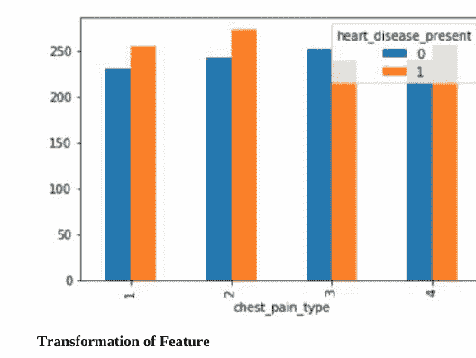

### 特征转换

`Pandas`确实有不同的函数可用于特征转换。

例如，最流行的机器学习库期望数据以数值形式存在。因此，更改任何非数值属性很重要。实现这一点的正确方法是热编码。`Pandas`有一个用于此目的的函数，称为`get_dummies`。一旦将此方法应用于数据列，它会将其每个唯一值转换为一个新的二元列。

特征可能需要转换以进行机器学习的另一种风格称为分箱。这个数据集中年龄特征就是一个很好的例子。将年龄收集到范围内对于模型学习来说可能很重要。`Pandas`确实有一个可以应用的函数`pd.cut`。

```python
bins = [0, 30, 40, 50, 60, 70, 100]
train['age_group'] = pd.cut(train['age'], bins)
train['age_group'].value_counts().plot(kind='bar')
```

## 第 4 章：`Pandas`属性

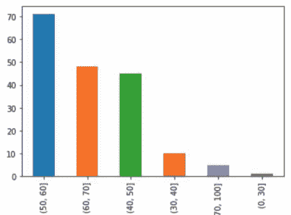

这只是针对`Pandas`中不同属性在机器学习项目早期阶段应用的一个简要介绍。数据分析、操作以及`Pandas`库本身具有许多功能。这可能是一个耗时的阶段，而`Pandas`提供了不同的工具和函数，可以使该过程更高效。

## 第 5 章：数据聚合

这代表了使用`Pharoe DataFrame`进行聚合和聚类的第一部分。这里将只处理基本功能，例如使用对应大小的独立系列值对数据序列进行聚类，以及在分组数据结构上使用聚合函数。

后续迭代将处理基于目标场景扩展的功能。实现方式可能会变为某种优化形式。

### 数据帧的定义

这表示了一种类似于电子表格的数据结构，它提供了用于清洗、切片和分析数据的API。

如果你想更多地了解`DataFrame`项目，你需要参考文档。

### 分割-应用-合并

分割-应用-合并是一种技术，它将特定任务分为可管理的部分，然后将所有部分整合在一起。

数据聚合和分组促进了摘要的生成，用于分析和展示。例如，当你计算平均值或创建计数表时。这是遵循分割-应用-合并步骤的一个环节。

1. 根据给定程序将数据分为若干部分。
2. 在每个聚类上独立使用函数。
3. 使用数据结构合并结果。

### 实现

在这一部分，你将发现分组和聚合函数是如何实现的。如果你不想要这些细节，可以跳过下一部分。

例如，向`firstSeries`对象发送的消息如下：

`firstSeries groupBy: secondSeries.`

一旦发送此消息，`firstSeries`将定义一个`DataSeriesGrouped`对象，该对象根据`secondSeries`的值将`firstSeries`划分为不同的子序列。

子序列的集合随后保存为一个`DataSeries`对象，其键等同于`secondSeries`的唯一值，值存储匹配这些唯一值之一的`firstSeries`子序列。

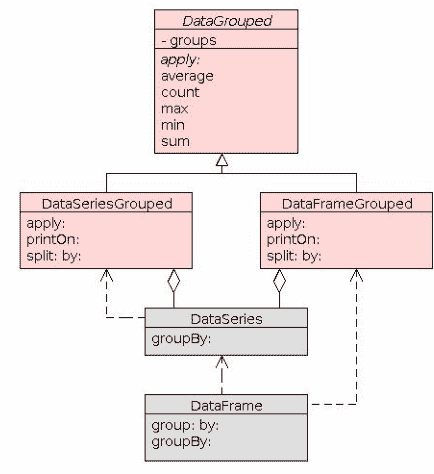

当`groupBy:`消息的接收者是`DataFrame`时，它会创建`DataFrameGrouped`的实例，该实例类似于`DataSeriesGrouped`拆分数据的方式，不同之处在于组系列中的值是子数据帧，而不是子序列。

这意味着组代表持有键的`DataSeries`，这些键匹配数据帧所识别的系列中包含的唯一值。当数据帧按单列分类时，会在分组之前将该列从数据帧中移除。因此，这消除了数据重复，因为相同的值将作为键保留。

对于`DataSeriesGrouped`的情况，每个子序列都将附加到一个标量，所有生成的标量将被合并到一个`DataSeries`中。对于`DataFrameGrouped`，它将每个子数据帧的每一列附加到一个块，并将最终的标量矩阵显示为一个新的`DataFrame`。

聚合通过消息进行。它需要一个块作为参数，并将其应用于组系列的每个值，然后整合到新的数据结构中。

最常见的聚合函数，如平均值、最小值和最大值，提供更简短的消息。在以下迭代中，这些消息是有用的，并作为快捷方式发挥作用。

```
average
^\ self apply: [:each | each average].
```

然而，由于必须确保这些函数在时间和内存上高效，这些消息将携带相关聚合的优化实现。

让我们检查一下分组序列。

使用此`groupBy`运算符最简单的例子是使用相同大小的值对序列值进行分类。

```
bill := tips column: #total_bill.
sex := tips column: #sex.
bill groupBy: sex.
```

上述查询的结果将是一个对象。该对象将账单分为两个序列。

由于很多时候，你需要对类似于单个数据帧列的组序列进行分类，有一个有用的快捷方式。

### 如何对数据帧进行分组？

除了分类列的快捷方式外，`DataFrame`还有一种方法来分类其列之一。


上述查询的响应将是一个 `DataFrameGrouped` 对象，保持吸烟者和非吸烟者的两个不同数据帧。

吸烟者列将从上述数据帧中移除，因为其值将作为键保存在 `DataFrameGrouped` 对象中。此外，吸烟者和非吸烟者的不同分组将在需要时启用吸烟者列的完整重建。

聚合函数表示那些接受不同输入并显示标量值以汇总特定系列值的函数。这些指的是统计函数，如 `min`、`max`、`stdev` 等。

一旦数据被合并，接下来你可以使用聚合函数来获取集成数据结构，以汇总原始数据。

```
grouped := tips group: #total_bill by: #day.
grouped apply: [ :each | each average round: 2 ].
```

由于分组是通过对 `DataFrame` 的列由另一列进行，结果将是一个 `DataSeries` 对象。

如前所述，`DataFrameGrouped` 提供了针对常用聚合函数（如 `count`、`sum`、`min` 和 `max`）的快捷方式。目前，这些是快捷方式，但未来它们将执行优化的聚合，速度更快。

一旦数据帧被分组为 `DataFrameGrouped` 的对象，我们也可以将此对象应用于聚合函数。`DataFrameGrouped` 实现 `apply:` 消息的方式是函数应用于每个子数据帧的每一列，产生标量值。这些标量值随后组合成新的数据帧。

此查询的结果将是一个数据帧，包含每个列的非空单元格数量，对应于 `Male` 和 `Female` 行。

| | total_bill | tip | smoker | day | time | size |
| :--- | :--- | :--- | :--- | :--- | :--- | :--- |
| Female | 87 | 87 | 87 | 87 | 87 | 87 |
| Male | 157 | 157 | 157 | 157 | 157 | 157 |

## 第 6 章：数据可视化

数据可视化是每个数据科学家的重要元素。在项目的早期阶段，你需要进行探索性数据分析，以识别数据的见解。创建可视化允许你简化事物，特别是对于高维数据集。在项目的后期，你需要以透明且令人信服的方式交付最终结果，以便你的受众能够理解。

### 面向最终用户的数据可视化

通常，数据科学家在向最终用户提交他们的见解方面发挥作用。结果可以通过不同的方式传达：

- 单次演示。在这种情况下，研究问题属于一次性交易，因为从中提取的业务决策将在未来几年指导组织的方向。例如，公司投资决策。

- 你是从两个配送中心分配货物，还是仅从一个？为了最佳效率，它们应该位于哪里？当决策做出时，在你退休之前可能不会重复这一练习。在这种情况下，结果作为报告生成，演示作为锦上添花。

- 数据的新观点。这个最常见的是客户细分。

当然，细分本身将通过报告和演示发送，但本质上，它们包括工具，而不是最终结果本身。

一旦确定了清晰且重要的客户细分，它可以作为新渠道回填到提取该数据的数据库中。

从这一点开始，人们可以创建自己的报告。例如，每个客户细分销售了多少产品？

- 对于实时仪表板：你的数据科学家角色并不因为你获得了新信息而结束。你可以将信息发回数据库并完成任务。然而，当其他人开始在发现的金块上创建报告时，他们可能会错误地解释并生成没有意义的报告。

既然你是发现这些新信息的数据科学家，你需要树立榜样。在这种情况下，你需要创建第一个可刷新的报告，以便其他人可以从中学习并使用你的足迹。创建第一个仪表板仍然是减少将你的见解交付给希望每日使用它的最终用户的交付时间的手段。通过这样做，他们已经

在报告部门找到时间建立关于公司报告软件的正式报告之前，我们可以先有基础可以进行构建。

你可能会发现有一些重要的因素在起作用：

- 首先，你支持的是哪种类型的决策？是战略性的还是运营性的？战略性决策需要你进行分析并生成报告。但即便如此，运营决策也要求报告经常更新。

- `你的组织规模有多大？` 对于较小的组织，你将处理一般周期。这个周期从数据收集到报告生成。对于较大的团队，可能有报告人员为你创建仪表板。尽管如此，在最后一部分，创建原型仪表板仍然是相关的，因为它提供了示例并缩短了交付时间。

`Matplotlib` 是一个强大的 Python 库，可用于构建你的数据可视化。然而，设计数据、参数和图表在定期执行时可能会变得杂乱且令人厌烦。

本节将指导你进行数据可视化，并在 Python 的 `matplotlib` 的帮助下创建一些快速且简单的函数。你将学习如何使用 `Seaborn`、`Matplotlib` 和 `Pandas` 可视化来创建基本图表。

Python 提供了许多功能丰富的图形库。无论你想描述交互式还是复杂的 Python 图表，它都提供了一个强大的库。

为了提供一些概览，流行的绘图库包括：

- `Seaborn`。它具有高级界面和重要的默认样式。

- `Plotly`。这对于开发重要图表非常重要。

- 使用 `Pandas` 进行可视化。这是一个易于应用的接口，并基于 `Matplotlib` 构建。

- `Ggplot`。这个依赖于 R 的 `ggplot2` 并应用了图形语法。

## `Matplotlib`

这是最常见的 Python 库。它是一种低级库类型，具有 Matlab 接口，提供了更多的自由度。

`Matplotlib` 对于创建基本图形（如条形图、折线图和直方图）非常重要。你可以使用以下代码行导入该库：

```python
import matplotlib.pyplot as plt
```

## 折线图

`Matplotlib` 库通过应用 `plot` 方法允许开发折线图。不过，通过在同一轴上绘制并循环每一列，可以在单个图表中创建多个列。

## 直方图

使用 `Matplotlib`，你可以使用 `hist` 方法设计直方图。如果你依赖分类数据（如列点），它将有助于确定每个类别发生的可能性。

## 条形图

如果你想在条形图中展示数据，那么 `bar` 函数很有用。条形图不会自动使用类别的频率创建，因此你需要使用 `Pandas` 来实现这一点。条形图对于分组数据很有用，因为它可以避免类别分散时变得杂乱。

## 使用 `Pandas` 进行可视化

`Pandas` 代表高级开源库。它是一个简单的库，表示数据结构和数据分析工具。

借助 `Pandas` 的可视化功能，创建数据框和序列变得很容易。不过，它比 `Matplotlib` 具有更高级的 API。结果是，产生类似效果所需的代码最少。

如果你想安装 `Pandas`，则需要运行 `pip` 命令。

## 可视化的目标

数据沟通和探索是数据可视化的主要重点。一旦数据被可视化，模式就会变得可见。你会立即看出是否存在增长趋势或某事物相对于其他因素的相对大小。与其告诉人们长长的数字列表，不如展示给他们以获得更好的清晰度？

例如，让我们考虑全球对“比特币”一词的趋势搜索。


你应该看到对比特币的兴趣出现了暂时的上升，但在达到顶峰后开始下降。总的来说，在峰值期间，与比特币的技术和社会影响相关的巨大炒作是存在的。再次，随后的炒作减少，因为人们理解了它，或者它是与炒作相关的常见现象。

无论情况如何，数据可视化帮助我们以非常清晰的方式确定模式。请记住，数据可视化的重要性在于探索数据。在下面的案例中，你可以快速选择模式以及发送给我们的数据。

当你将其提交给公众时，这一点至关重要。其他人可能会决定快速浏览数据，而不急于深入细节。你不需要用文字和数字打扰他们。产生广泛影响的是你使用数字和文字构建的方式。产生巨大差异的是你如何定义数据，以便个人可以快速回忆其重要性。

这就是数据可视化变得有用的地方，它允许人们挖掘数据并传达你试图表达的内容。

有多种数据可视化方法。其中一些方法已经讨论过了。

## 从简单到复杂的数据可视化

要创建优秀的数据，可视化是每个数据科学家都需要了解的强大技能。

它不仅仅是创建美丽的图表，而是以易于个人学习的方式表示数据集的信息。当你拥有正确的可视化时，个人可以快速了解数据背后的模式和信息。

在项目早期，你会进行探索性数据分析以生成关于数据的洞察。创建可视化将增加你的分析。

在项目结束时，至关重要的是以简洁且引人入胜的方式提交最终结果，以便任何观众都能阅读。

毫无疑问，将你的可视化提升到下一个阶段将让你在下一次演示中胜出。

本节将探索你可以定义吸引人、复杂数据可视化的方法。你将应用 `Plotly` Python 库，它在创建交互式可视化方面非常出色。

## `Plotly` 概览

`Plotly` 代表一个交互式、基于浏览器的图形 Python 库。它是一个库，允许你与标准 `Matplotlib` 相比改进可视化能力。

使用 `Plotly` 而不是其他 Python 库（如 `Matplotlib`、`Pandas` 和 `Seaborn`）有两个好处。即：

1. 应用的便利性。这将定义交互式图表和其他复杂图形。使用其他库执行相同操作需要大量工作。

2. 它提供额外功能。

由于 `Plotly` 是从 `D3.js` 设计的，其绘图能力比其他绘图库更强大。

使用 `Plotly` 可以创建旭日图（Sunburst charts）和更多其他内容。

## 使用 `Plotly` 构建吸引人的图表


Plotly 对于构建花式图表很有用。

首先，让我们导入`plotly`及其内部图形对象组件。你还将导入`Pandas`以加载数据集。

```python
import plotly
import plotly.graph_objs as go
import Pandas as pd
```

要读取数据集，基本上你只需在`Pandas`中写一行代码。

## 散点图

对于本节，我们将绘制销售价格相对于建造年份的散点图。为了实现这一点，你需要定义一个散点图对象并将其存储在一个`trace`中。

```python
trace = go.Scatter(
    x = data['YearBuilt'],
    y = data['SalePrice'],
    mode = 'markers',
    showlegend = True
)
plot_data = [trace]
```

然后，为了绘制，你只需写一行代码。

```python
plotly.offline.plot(plot_data, filename='basic-scatter')
```

以下命令将在浏览器中创建一个新的标签页显示图表。

图形交互性是`Plotly`自动内置的。

## 箱线图

这次，我们将查看箱线图。

过程非常相似。因此，我们将定义一个图形对象，将其存储到`trace`中，然后在浏览器中显示。

## 热力图

热力图是数据科学家的关键工具。它们有效地在单一图表中展示多个特征变量之间的关联，以及每个关系的相对重要性。

为了展示如何通过`Plotly`改进你的热力图。我们将把房屋价格数据集的相关矩阵制作为热力图。

```python
import plotly
import plotly.graph_objs as go

import pandas as pd

data = pd.read_csv('train.csv')
corpmat = data.corr()

trace = go.Heatmap(z=corpmat, x=corpmat.columns.tolist(), y=corpmat.columns.tolist())
plot_data = [trace]
plotly.offline.plot(plot_data, filename='basic-heatmap')
```

`Matplotlib`中的热力图可能有些困难，因为你无法识别每个单元格的确切值；你只能从颜色中判断。你可以编写代码使其具有交互性，但这在`Matplotlib`中可能比较麻烦。

`Plotly`提供了超越基础功能的交互性，因此当你绘制热力图时，你会获得一个吸引人的概览视图，并能在需要时确认确切值的选项。

`Plotly`的平移和缩放功能非常简洁，提供了一种从视觉角度进行综合探索的便捷方式。

这些仅仅是为了表明应用`Plotly`的重要性和可能性。请记住，你可以使用高质量的数据可视化来制作出版物。此外，你可以根据你的目标修改示例代码。没有必要发明什么独特的东西。你可以复制正确的部分并将其应用到你的数据中。

也许在未来，会有更简单且有效的方法来构建数据可视化，特别是在处理海量数据集时。你仍然可以构建随时间变化的动画演示。无论采用哪种方式，数据可视化的主要目标都是传达数据。你可以选择其他方法，但目标通常保持不变。

在下一章中，你学习了数据可视化的通用方面。你了解到，数据可视化是通过以图形风格表示数据来理解数据的过程，这样趋势就不会被遗漏。`Python`提供了许多不同的图形库，其中包含大量不同的属性。

在本节中，我们研究了`Matplotlib`、`Pandas`可视化和`Seaborn`。在随后的章节中，我们将探讨与机器学习和复杂数据分析相关的复杂主题。原始目标是确保你了解数据科学中应用的一般特征和术语。

## 第 7 章：机器学习

机器学习是人工智能的一个分支，它提供了能够从过去的情景中学习的科技，无需任何编程。机器学习的缩写是`ML`。该领域致力于创建能够处理数据并从中学习的计算机应用程序。

学习过程始于观察、直接经验或示例，从数据中构建模式，并使用这些模式预测未来。机器学习的主要目标是让计算机能够自动学习，无需人类干预。

借助机器学习（`ML`），分析大量数据成为可能。机器学习能产生有用的结果，但我们可能仍需不同的资源来达到这一状态。训练机器学习模型可能需要额外的时间。

### 机器学习算法分类

让我们从监督学习开始。

### 监督学习

在监督学习的情况下，人类需要提供输入和所需的输出，并在训练期间根据预测的准确性提供反馈。训练完成后，算法必须将所学应用于下一组数据。

监督学习的理念可以类比为在老师监督下的学习。老师向学生提供示例，学生根据这些示例得出新的规则和知识，以便将其应用于其他地方。

了解回归问题和分类问题之间的区别对你来说也很重要。就回归问题而言，目标是数值；而在分类中，目标是类别。回归任务可以帮助计算伦敦所有房屋的平均成本。另一方面，分类任务将允许你根据花瓣和萼片的长度来确定花卉的类型。

### 无监督学习

就无监督学习而言，算法并不期望被提供输出数据。采用一种称为深度学习的技术，这是一种迭代方法，用于修订数据并得出结论。这使得它们非常适合处理比监督学习算法更复杂的任务。换言之，无监督学习算法在没有响应示例的情况下从示例中学习。算法自行从示例中发现模式。

监督学习算法的工作方式与人类确定两个或多个对象之间的相似性相同。大多数你在网上购物时遇到的推荐系统都是基于无监督学习算法工作的。在这种情况下，算法根据你以前购买过什么来寻找推荐什么。算法必须近似出你相似的顾客类型，并从中推导出建议。

这似乎是真正人工智能的精髓，即计算机可以在没有人类干预的情况下学习。这是关于从数据本身中学习，并尝试寻找不同输入之间的关系（请注意，与之前讨论的回归和分类不同，这里没有预期输出）。重点是输入，并尝试发现其中的模式和关系。可能存在自然簇，或者输入之间存在明确的关联。也有可能根本不存在有用的关系。

### 强化学习

当算法被提供没有标签的示例时，就会发生这种类型的学习，这与无监督学习的情况类似。但是，可以根据算法提出的解决方案，通过正面或负面反馈来实现示例。它与那些算法必须做出决策且这些决策与后果相关的应用程序挂钩。这就像人类学习中的试错法。

当错误与诸如成本、时间损失和痛苦等惩罚相关联时，它们在学习中变得必要。就强化学习而言，某些行动比其他行动更有可能成功。

机器学习处理过程类似于数据挖掘和预测建模。在这两种情况下，都必须在数据中进行搜索以绘制模式，然后相应地调整程序的行为。推荐系统是机器学习的一个绝佳例子。如果你在网上购买物品，你会看到与该物品相关的广告，这是机器学习的绝佳例子。

### 如何接近问题

许多数据科学家以二元方式接近问题。该任务属于监督学习还是无监督学习？

弄清楚的最快方法是确定预期输出。我们是试图根据新的`x`值预测`y`值（监督学习，回归）？基于以前标记的数据，新输入属于类别`A`还是类别`B`（监督学习，分类）？我们是否试图发现并揭示数据点如何聚集以及是否存在自然簇。

（无监督学习、聚类）？输入数据之间是否存在有趣的关系（它们共现的概率是否很高）？

许多高级数据分析问题都归属于这些一般性问题。毕竟，目标始终是预测某些内容（基于先前的示例）或探索数据（发现是否存在模式）。

## 什么是深度学习

深度学习指的是机器学习的一个子分支，它涉及受大脑功能和结构启发而设计的算法，即`人工神经网络`。这使得机器能够完成对人类而言自然的事情，即从过去中学习。无人驾驶汽车的概念背后的系统正是基于此。

借助深度学习，计算机可以执行分类任务。深度学习模型能够达到高精度，有时甚至超越人类水平的表现。

## 使用 Scikit-Learn 的神经网络

神经网络是指一种试图复制自然界生物神经网络运作方式的机器学习技术。人类有能力以极高的准确度识别模式。每次你看到一头奶牛时，你都能立即认出那是奶牛。当你看到山羊时也是如此。原因在于，经过一段时间的学习，你已经知道奶牛或山羊长什么样，以及它们之间的区别。

人工神经网络是指试图通过模仿人类神经系统结构的复杂架构来模拟人类学习能力的那些系统。人工神经网络的概念其实由来已久。但最近它经历了大规模的复兴，以至于许多人（无论他们是否理解其原理）都在谈论它。

它为何再次流行起来？原因在于数据可用性的提升和技术的发展（尤其是计算能力的巨大增长）。在以前，创建和实现一个`ANN`（人工神经网络）在时间和其他资源方面可能不切实际。但由于数据量的增加和计算能力的提升，一切都改变了。你很可能可以在自己的台式机或笔记本电脑上直接实现一个人工神经网络。此外，在幕后，`ANN`已经在发挥作用，为你提供最相关的搜索结果、你最可能购买的产品或你最可能点击的广告。`ANN`还常用于识别音频、图像和视频的内容。

许多专家表示，我们才刚刚触及表面，人工神经网络仍具有巨大的潜力。这就像迈克尔·法拉第（Michael Faraday）关于电的实验一样，当时没人知道它会带来什么用途。据故事流传，法拉第表示，英国首相很快就能对电征税。今天，我们生活的方方面面都直接或间接地依赖于电力。人工神经网络和令人兴奋的`深度学习`领域（机器学习的一个更专注于`ANN`的子领域）可能也会如此。

## 神经元的结构


神经元由`cellBody`组成，并拥有从其延伸出的多个突起。其中大多数呈分支状，通常被称为“树突”。

存在一个长的突起或分支，这被称为“轴突”。信号的传递始于轴突上的一个区域，该区域被称为“隆起”。

神经元有一个边界，称为“细胞膜”。细胞膜内外之间存在电位差，这被称为“膜电位”。

如果输入信号足够大，就会产生某种动作电位。这个动作电位随后会沿轴突传播并远离细胞体。神经元通过突触与其他神经元相连。信息通过轴突离开神经元，然后传递到突触，并传递给接收它的神经元。请注意，神经元只有在阈值超过一定量时才会触发。信号非常重要，因为它们被其他神经元接收。神经元利用信号或尖峰进行交流。尖峰还负责编码正在传输的信息。

突触可以是抑制性的或兴奋性的。当尖峰到达兴奋性突触时，接收神经元会被触发放电。如果信号在抑制性突触处被接收，则接收神经元会被抑制而不会放电。突触和细胞体通常计算传入的抑制性输入与兴奋性输入之间的差异。如果发现该差异过大，神经元就会放电。

### 反向传播

为了确保神经网络完成某个问题，必须调整单元，以限制原始输出与所需输出之间的误差。换句话说，网络必须计算权重的差异。为了简化一切，网络必须跟进误差的变化。`backpropagation`算法常被用于误差计算。

如果你的网络单元是线性的，那么掌握这个特定算法将相对容易。为了使算法计算权重的误差差异，首先需要理解误差随活动水平变化的速率。

对于输出单元，误差差异是通过计算实际输出与目标输出之间的差异找到的。为了计算未知测量的误差变化率，请确保计算了隐藏单元与输出单元之间所有的权重。

我们可以使用误差的导数乘以权重，然后汇总乘积。你得到的总和将等价于隐藏单元的误差变化率。一旦你获得了输出层之前那层隐藏层中权重的误差变化率，我们就能计算其他层的这些误差变化。

此计算将从一层到下一层进行，方向与通过网络传输的方向相反。

这表明了“反向传播”名称的由来。在确定某个单元的误差变化率后，可以轻松计算该权重所有连接的权重的误差差异。可以通过将误差变化率乘以传入连接上的活动度来计算权重的误差差异。

### Scikit-Learn

`scikit-learn`通过`python`接口为用户提供多种算法。该库本身是用`python`设计的，其中部分算法用`cython`构建以提供更好的性能。`scikit-learn`是创建机器学习模型的更优库。该库是开源的，并由`bsd`许可证支持。

### 使用 TensorFlow 的神经网络

`tensorflow`是谷歌开发的一个用于构建深度学习模型的框架。`tensorflow`依赖于数据流图进行数值计算。`tensorflow`使机器学习变得更加简单。它简化了获取数据、创建预测和调整未来结果的过程。

### TensorFlow

人工神经网络具有简单的结构，需要矩阵乘法。输入首先与随机权重相乘，然后通过激活函数传递。接下来，提取输出值以进行预测。

这表明该网络远非真理。使用损失度量指标。较高的损失函数意味着模型更“笨”。为了增强网络知识，必须通过调节权重来进行优化。应用随机梯度来以正确方向改变权重的值。一旦权重被修改，网络就可以应用新一批数据来测试新知识。

误差可能低于初始值，但还不够小。优化过程应迭代执行，直到误差降低到无法再提取额外知识的程度。

尽管如此，该特定模型的挑战在于它没有记忆。这意味着输入和输出是独立的。

这表明该模型不在乎之前发生了什么。这需要引发一些疑问，因为当你需要预测时间序列时，网络将需要关于过去单词或历史数据的信息。为了解决这个问题，创建了一种名为循环神经网络（`RNN`）的新架构。

### 准备环境

在你进入机器学习和深度学习的实践环节之前，你需要在计算机上运行两个库。这些库包括：

- `scikit-learn`
- `tensorflow`

### 安装 Scikit-Learn

`scikit-learn`适用于`python` 2.7及以上版本。在安装`scikit-learn`之前，请确保你已经安装了`numpy`和`scipy`库。

此外，请确保你拥有上述库的最新版本。安装上述库后，你可以继续在计算机上安装`scikit-learn`。安装过程可以通过`pip`的帮助来实现。这是`python`自带的一个工具。如果你想安装`scikit-learn`，首先在你的终端运行以下命令。

```
pip install scikit-learn
```

此安装过程应持续到完成。同样，你可以使用`conda`来安装`scikit-learn`。你可以通过运行以下命令来完成：

```
conda install scikit-learn
```

完成`scikit-learn`的安装后，你需要将其导入`python`程序中以应用算法。这可以通过导入语句实现，如下所示：

### 导入 Scikit-learn

如果命令运行没有错误，说明`scikit-learn`安装成功。然而，如果命令报错，则表示安装未成功。现在，你可以使用`scikit-learn`构建自己的机器学习模型。

### 安装 TensorFlow

`tensorflow`为`cpp`、`java`等编程语言提供了`api`，并附带用于`r`语言的第三方软件包。你将学习如何在`windows`上安装`tensorflow`。对于`windows`系统，可以使用`pip`安装`tensorflow`。

原生`pip`会在无需通过虚拟环境的情况下将`tensorflow`安装到你的系统中。请记住，使用`pip`安装`tensorflow`会与系统上的其他`python`安装产生交互。但最好的一点是，你只需运行一条命令即可在计算机上安装`tensorflow`。此外，通过`pip`安装`tensorflow`后，用户即可在任意目录中运行`tensorflow`程序。

如果你希望使用`anaconda`安装`tensorflow`，可能需要建立一个虚拟环境。但在`anaconda`内部，建议使用`pip install`命令而不是`conda install`命令来安装`tensorflow`。

请确保已安装`python` 3.5或更高版本。`python` 3附带了可用于安装`tensorflow`的`pip3`程序。因此，我们需要使用`pip3 install`命令来促进安装。

此相同的命令将把`tensorflow`安装到`windows`系统上。不过，也可以使用`anaconda`包管理器安装`tensorflow`。`pip`通常随`python`一起安装，但`anaconda`不默认包含它。换句话说，若要使用`anaconda`安装`tensorflow`，你需要先安装`anaconda`。因此，请访问`anaconda`网站，在那里你可以找到指导你完成安装的所有说明。

安装好`anaconda`后，你可以查找一个名为`conda`的包，它在管理虚拟环境和安装软件包方面表现更好。要使用上述包，你需要启动`anaconda`。

转到`windows`，选择“开始”，点击“所有程序”，展开“Anaconda…”文件夹。这将启动你系统上的`anaconda`。如果你想查看`conda`包的详细信息，请在终端运行以下命令。

```
conda info
```

这将返回有关包管理器的更多详细信息。

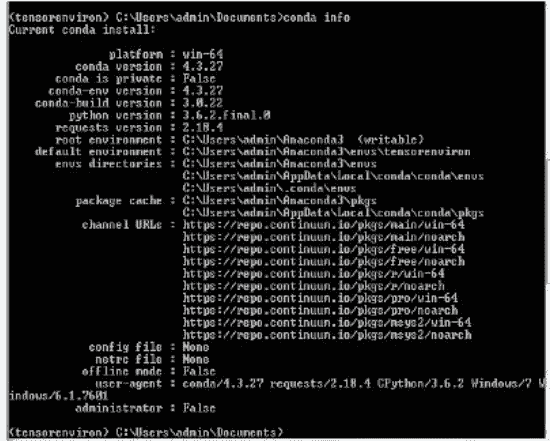

`anaconda`有一个特别之处。它允许我们借助`conda`包开发虚拟`python`环境。这种特定的虚拟环境是`python`的一个独立副本，能够维护其自身的文件、目录和路径，从而让使用者可以使用特定版本的`python`或影响`python`项目的其他库。

虚拟环境提供了一种分离项目并消除因不同组件中版本要求和依赖项差异而可能引发的问题的手段。请记住，上述虚拟环境将与普通的`python`环境不同，这意味着在虚拟环境中运行的软件包不会影响你普通`python`环境中的软件包。

你需要为`tensorflow`包构建一个虚拟环境。这可以通过`conda create`命令来实现。该命令使用以下语法：

```
conda create -n [environment-name]
```

在上面的示例中，你需要为上述环境指定名称`tensoenviron`。你可以通过运行以下命令来创建它：

```
conda create -n tensoenviron
```

系统会询问是否继续构建环境的过程。输入“`y`”接受并按下键盘上的回车键。安装将成功进行。

创建环境后，你需要激活它才能使用。可以通过`activate`命令后跟环境名称来激活环境。既然你已经激活了`tensorflow`环境，就可以继续在其中安装`tensorflow`包。你可以通过运行下面的命令来实现。

```
conda install tensorflow
```

你将获得将随`tensorflow`包一起安装的完整软件包列表。系统会询问你是否允许安装此包。只需输入“`y`”并按下计算机键盘上的回车键。上述软件包的安装将立即开始。请记住，安装过程可能需要较长时间，因此你需要耐心等待。尽管如此，你的互联网连接速度将决定这个过程需要多长时间。


安装过程的步骤也会显示在提示窗口中。几分钟后，安装过程将结束，届时你需要确认安装是否成功。你可以通过导航到 `Python` 的 `import` 语句来完成此操作。该语句应从 `Python` 终端执行。在仍位于 `Anaconda` 提示符下时，输入 `Python` 并按下回车键。这应该会引导你进入 `Python` 终端。现在执行以下命令。

```
import tensorflow as tf
```

如果包未成功安装，你将收到错误信息；否则，说明包安装成功。

## 第 8 章：人工神经网络

对我们人类来说，识别物体和数字很容易。理解句子或一段文本的含义对我们来说也很简单。然而，对于计算机来说则完全不同。对我们来说微不足道且自动化的任务，对于算法和计算机可能是一项艰巨的工作。

相反，计算机可以完成漫长而复杂的数学计算，而我们人类在这方面很差。有趣的是，人类和计算机的能力是互补的。然而，自然的步骤是在人类擅长的领域取代人类。

在未来，我们可能无法分辨与之交谈的对象是人类还是非人类。

### 大脑的工作原理

最受欢迎且最有前景的范式是应用人工神经网络；这些网络在某种程度上受我们大脑和神经元工作方式启发。关于大脑如何运作的主流模型是神经元处理和发送信号。

尽管关于大脑和神经元的这一模型并非 `100%` 准确，但它对大多数应用很重要。

这是人工神经网络面临的问题，其中神经元分布在少数几层中，负责接收和发送信号。以下是来自 `TensorFlow playground` 的一个基本演示：

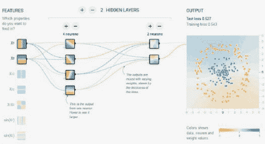

请记住，它从输入开始，然后它们与两个“隐藏层”的神经元相连。

最后，有一个结果，其中的数据已通过迭代计算来定义重要模型或泛化。在大多数情况下，人工神经网络的工作方式类似于监督学习。对于 `ANN`（人工神经网络），我们喜欢接受大量的训练示例，然后创建一个支持从上述示例中学习的系统。

在学习期间，`ANN` 会自动推导识别图像、音频、文本或其他类型数据的规则。

你可能已经注意到，识别的准确性在很大程度上依赖于数据的质量和数量。归根结底，就是“垃圾进，垃圾出”。人工神经网络倾向于从输入的数据中学习。

除了提高数据的质量和数量外，我们还可以通过其他方式提升准确性和性能。

### 约束与机遇

`ANN` 的概念历史悠久。然而，近年来它经历了巨大的复兴，大多数人都在讨论它。

为什么它变得流行起来？原因是数据的可用性和技术的发展。很久以前，基于资源和时间的限制，构建和运行 `ANN` 是不切实际的。

然而，由于计算和数据的加速，一切都发生了变化。你现在很可能可以在笔记本电脑上运行人工神经网络。

此外，`ANN` 已经在幕后工作，以呈现最重要的搜索结果。`ANN` 也用于识别图像、视频和音频的内容。

大多数专业人士认为，我们仅仅在 `ANN` 的表面轻触。这就像进行电力实验时，没人知道从中会出现什么功能。

### 来看一个例子

借助 `TensorFlow Playground` 的存在，可以了解其工作原理的一个快速思路。你可以访问他们的网站并记录诸如激活、学习率和正则化等不同的术语。

点击“播放”按钮，然后等待观看一个酷炫的动画。请注意最右侧的输出。经过一段时间后，会出现如下内容：


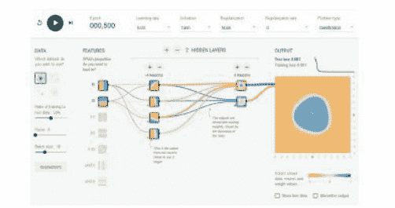

连接线的清晰度以及其他特征都在增加。请记住，输出中有一个清晰的蓝色区域。

这可能是一个分类问题，其中蓝色点属于 `A` 类，而橙色点属于 `B` 类。

当 `ANN`（人工神经网络）运行时，请记住 `A` 类和 `B` 类之间的界限变得更加清晰。这是因为该技术不断从训练样本中学习。随着学习的增强，分类变得更加准确。

通过更多地了解 `TensorFlow` 游乐场，它为理解神经网络如何工作提供了最简单的方式。即使它不是 `100%` 准确的表示，它也是一种快速的可视化。

因此，我们可以理解隐藏层、特征和输出。

我们仍然可以引入一些变化，例如学习率、训练数据和测试数据的比例以及隐藏层的数量。例如，我们可以将隐藏层的数量设置为 `3`，并将学习率调整为 `1`。你会看到类似这样的结果：


如果你按下播放按钮并让它运行一段时间，图像将保持如下所示：

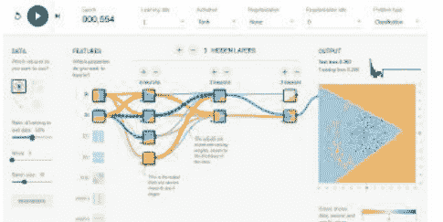

密切观察输出。你应该会看到分类变得更差。然而，在黄色区域下的大多数黄色点周围，似乎有很多错误。这是由于参数更改导致的。

例如，学习率对准确度和达到正确的收敛性有很大影响。如果你使学习率变得很低，收敛可能需要很长时间。然而，如果学习率非常高，我们可能无法达到收敛，因为我们已经超过了它并错过了它。

有不同的方法可以在适当的时间达到收敛。学习率仅仅只是正确的方向，许多隐藏层，也许应用更少或更多的特征。然而，过度优化一切可能没有经济意义。在开始时设定一个明确的目标并坚持下去是正确的。

如果出现巨大的机会，你可能希望增强参数以提高模型的性能。

但是，如果你想要了解 `Python` 中 `ANN` 的外观，可以查看以下代码：

```python
X = np.array([[0,0,1],[0,1,1],[1,0,1],[1,1,1]])
y = np.array([[0,1,1,0]]).T
syn0 = 2*np.random.random((3,4)) - 1
syn1 = 2*np.random.random((4,1)) - 1
for j in xrange(60000):
    l1 = 1/(1+np.exp(-(np.dot(X,syn0))))
    l2 = 1/(1+np.exp(-(np.dot(l1,syn1))))
    l2_delta = (y - l2)*(l2*(1-l2))
    l1_delta = l2_delta.dot(syn1.T) * (l1 * (1-l1))
    syn1 += l1.T.dot(l2_delta)
    syn0 += X.T.dot(l1_delta)
```

这是一个简单的例子。当涉及到现实世界时，如果从头开始设计，`ANN` 会变得冗长且复杂。幸运的是，你与它们合作的方式正在变得更加“民主化”，这意味着技术背景有限的人也能利用它们。

## 第 9 章：如何使用 Scikit-Learn

现在你已完成安装，你可以开始使用这些库。我们将以 `Scikit-Learn` 库开始。

为了能够在代码中使用 `scikit-learn`，你应该首先通过运行以下语句来导入它：

`import sklearn`

### 加载数据集

机器学习完全在于分析数据集合。在此之前，我们首先应将数据集加载到我们的工作区中。该库自带许多我们可以加载并处理的数据集。我们将通过使用一个名为 `Iris` 的数据集来演示这一点。这是一个花卉数据集。以下代码展示了如何使用 `scikit-learn` 加载数据集：

```python
## Import scikit-learn library
from sklearn import datasets
## Load iris dataset
iris = datasets.load_iris()
## Confirm by printing the shape of the data
print(iris.data.shape)
```

### 简单线性回归

我们需要使用我们之前的示例，即根据学生为考试学习的时长来预测学生在考试中会获得的分数。由于我们只有两个变量，这是一个简单的线性回归任务。

### 导入库

运行以下 `Python` 语句以导入所有必要的库：

```python
import numpy as np
import pandas as pd

import matplotlib.pyplot as plt
```

该文件保存在一个名为 `student_marks.csv` 的 MS Excel 文件中。它位于存放我 `Python` 脚本的目录中，因此无需提供指向该文件的路径。文件名中的 `.csv` 扩展名表明它是一个逗号分隔值文件。

以下语句将帮助我们导入数据集到工作区。我们使用 `Pandas` 库（我们将其导入为 `pd`）来执行此操作：

```python
dataset = pd.read_csv('student_marks.csv')
```

我们现在可以探索数据集以了解更多信息，看看它有什么。直接转到 `Python` 终端并输入以下内容：

```python
dataset.shape
```

这意味着数据集有 `25` 行和 `2` 列。要查看数据的前五行，调用 `head()` 函数。

然而，当你尝试打印数据时可能会遇到错误。错误的原因可能是 `Pandas` 正在寻找要显示的信息量，因此你应该提供 `sys` 输出信息。可以通过修改代码为以下内容来解决该错误：


```python
import numpy as np
import pandas as pd
import matplotlib.pyplot as plt
import sys
sys.stdout = sys.stdout
dataset = pd.read_csv('student_marks.csv')
print(dataset.head())
```

我们只是向`sys`库提供了信息。要查看数据集的统计详情，我们按如下方式调用`describe()`函数：

```python
dataset.describe()
```

我们现在可以将数据点绘制在2-D图上，看看它们的分布情况。你可能现在已经意识到为什么我们要导入`Matplotlib`库。以下代码将帮助你绘制数据点：

```python
dataset.plot(x='Hours', y='Marks', style='o')
plt.title('Hours vs Marks(%)')
plt.xlabel('Hours')
plt.ylabel('Marks (%)')
plt.show()
```

代码返回如下绘图：

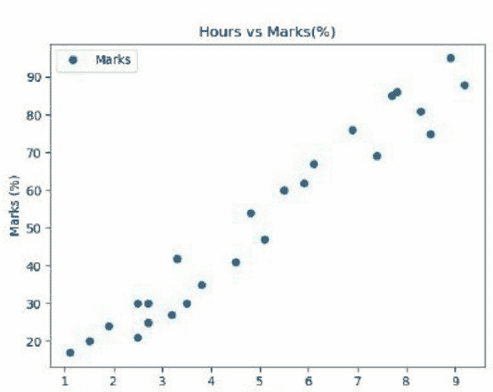

我们调用了`Pandas`库提供的`plot()`函数。我们将列名传递给该函数，它能够创建并显示绘图。`show()`函数帮助我们显示绘图。

##### 数据准备

数据准备应涉及将其划分为标签和`attributes`（属性）。属性应创建自变量，而标签创建因变量。

我们的数据集只有两列。我们基于`Hours`（时间）预测`Marks`（分数）。这意味着`Hours`将形成属性，而`Marks`将形成标签。可以通过运行以下代码提取属性和标签：

```python
X = dataset.iloc[:, :-1].values
y = dataset.iloc[:, 1].values
```

`X`变量将存储属性。注意，我们使用了`-1`，因为我们需要将所有列分配给属性，除了最后一列，即`Marks`。`y`变量将存储标签。这里，我们使用了`1`，因为`Marks`列的索引为`1`。请记住，列索引从`0`开始。此时，我们拥有了数据集的属性和标签。我们需要将数据划分为两个集合，即`training`（训练）和`test`（测试）集合。`Scikit-Learn`库提供了一种名为`train_test_split()`的方法，可用于此目的。

#### 训练算法

我们将使用`LinearRegression`类来训练算法，该类必须从`Scikit-Learn`中导入。导入可以按如下方式进行：

```python
from sklearn.linear_model import LinearRegression
```

现在我们已导入该类，我们需要实例化它并给实例命名为`linear_regressor`。演示如下：

```python
linear_regressor = LinearRegression()
```

让我们现在调用`fit()`方法并将训练数据传递给它：

```python
linear_regressor.fit(X_train, y_train)
```

正如我们之前所述，线性回归通过找到斜率和截距的最佳值来工作。我们在上面做的就是这件事。这两个值已经被计算出来，所以我们只需要查看它们的值。

要查看截距，运行以下命令：

```python
print(linear_regressor.intercept_)
```

## 预测

在上面的训练中，我们创建了一个线性回归模型，即该方程。斜率和截距的值是已知的。我们可以基于我们保留的训练集数据进行预测。以下语句有助于我们根据测试数据进行预测：

```python
pred_y = linear_regressor.predict(X_test)
```

我们简单地创建了一个名为`pred_y`的`numpy`数组。这将包含`X_test`序列中所有输入值对应的`y`的预测值。我们现在有了`X_test`的实际值以及预测值。我们需要比较这两者，查看它们之间的相似程度或差异。只需运行以下代码：

```python
df = pd.DataFrame({'Actual': y_test, 'Predicted': pred_y})
print(df)
```

该模型并不准确，但数值彼此接近。

## 评估准确性

我们现在需要评估我们算法的准确性。我们需要确定该算法在数据集上的表现如何。对于回归算法，使用三种评估指标。这些包括以下各项：

- 1. 平均绝对误差。

- 2. 均方误差。

- 3. 均方根误差。

## 多元线性回归

你现在已经知道了当有两个变量时如何进行线性回归。然而，这并不是现实世界的真实反映。世界上面临的大多数问题都涉及两个以上的变量。这就解释了为什么你需要学习多元线性回归。两者之间的步骤几乎相同。然而，差异在于评估。在评估多元线性回归模型时，我们需要知道对输出变量影响最大的因素。我们还需要确定各个变量之间的关系。

我们需要通过预测美国各州的燃料消耗来演示这一点。我们将考虑人均收入、汽油税、铺装公路以及持有驾照人员比例等因素。

让我们先导入我们需要使用的库：

```python
import numpy as np
import pandas as pd
import matplotlib.pyplot as plt
```

同样，尝试打印数据集内容时可能会遇到错误。使用我们之前使用的方法来解决这个问题。你应该有以下代码：

```python
import numpy as np
import pandas as pd
import matplotlib.pyplot as plt
import sys
sys.stdout = sys.stdout
dataset = pd.read_csv('fuel_consumption.csv')
print(dataset.head())
```

##### 数据准备

在简单线性回归的示例中，我们将数据细分为属性和标签。在这种情况下，我们将直接使用该列名来为此目的。运行下面给出的代码：

```python
X = dataset[['Tax', 'Income', 'Highways', 'Licence']]
y = dataset['Consumption']
```

我们有四列属性（自变量）和一列标签（因变量）。

让我们现在将数据细分为训练集和测试集。80%的数据将用作训练集，而剩余的20%将用作测试集：首先，让我们从`Scikit-Learn`导入`train_test_split()`方法：

```python
from sklearn.model_selection import train_test_split
```

运行以下命令对数据进行划分：

```python
X_train, X_test, y_train, y_test = train_test_split(X, y, test_size=0.2, random_state=0)
```

#### 训练算法

我们现在需要训练该算法。这可以通过调用`fit()`方法来完成，正如我们之前所做的那样。让我们首先从`Scikit-Learn`库导入`LinearRegression`类：

```python
from sklearn.linear_model import LinearRegression
```

接下来，创建上述类的一个实例，然后使用它来调用`fit()`方法：

```python
linear_regressor = LinearRegression()
linear_regressor.fit(X_train, y_train)
```

注意，这是一个多元线性回归，并且我们有许多变量。线性回归模型必须为每个属性找到最佳系数。你可以通过运行以下命令来查看选定的系数：

```python
coeff = pd.DataFrame(linear_regressor.coef_, X.columns, columns=['Coefficient'])
print(coeff)
```

| | 系数 |

|---|---|

| `Tax` | -40.016660 |

| `Income` | -0.065413 |

| `Highways` | -0.004741 |

| `Licence` | 1341.862121 |

这意味着燃料税每增加一个单位，汽油消耗量将减少40.02百万加仑。此外，拥有驾照的人口比例每增加一个单位，汽油消耗量将增加13.42亿加仑。结果还表明，平均收入和公路对汽油消耗量的影响非常小。

## 预测

我们将使用测试数据进行预测。以下脚本可以帮助我们要做到这一点：

```python
pred_y = linear_regressor.predict(X_test)
```

此时，你有了`X_test`的实际值以及预测值。我们需要对这两者进行比较，以确定它们的相似之处和差异。这可以通过运行以下脚本来完成：


```python
df = pd.DataFrame({'Actual': y_test, 'Predicted': pred_y})
print(df)
```

## 评估准确性

我们现在需要根据性能来评估算法。这可以通过确定各种误差类型的数值来实现。这些包括`MAE`、`RMSE`和`MSE`。这需要我们从`Scikit-Learn`导入`metrics`类：

```python
from sklearn import metrics
```

然后可以使用以下脚本计算误差值：

```python
print('MAE:', metrics.mean_absolute_error(y_test, pred_y))
print('MSE:', metrics.mean_squared_error(y_test, pred_y))
print('RMSE:', np.sqrt(metrics.mean_squared_error(y_test, pred_y)))
```

如上图所示，均方根误差的值为`68.31`。这略高于所有州汽油消耗量均值的`10%`。确实，我们的算法并不非常准确，但我们仍然可以使用它进行预测。较大的误差可能是由许多因素引起的。也许需要更多的数据。我们只使用了一年的数据。使用多年收集的数据可能有助于提高模型的准确性。此外，我们假设我们的数据具有线性关系。这可能并非如此，因此导致较大的误差。我建议可视化数据，以查看这种情况是否属实。此外，我们使用的特征可能不相关。

## 第 10 章：K 近邻算法

`KNN`算法在构建更复杂的分类器方面使用非常广泛。它是一个简单的算法，但它的性能优于许多强大的分类器。这就是为什么它被用于数据压缩、经济预测和遗传学等众多应用中。`KNN`是一个监督学习算法，这意味着我们获得一个由训练观测值`(x, y)`组成的标记数据集，我们的目标是确定`x`和`y`之间的关系。这意味着我们应该找到一个从`x`到`y`的函数，这样当我们给定`x`的输入值时，我们就能预测相应的`y`值。`KNN`算法背后的概念非常简单。我们将使用一个名为`Iris`的数据集。我们之前已经探索过它。我们将使用它来演示如何实现`KNN`算法。

首先，导入所有需要的库：

```python
import numpy as np
import pandas as pd
import matplotlib.pyplot as plt
```

### 划分数据集

我们需要能够了解我们的算法表现如何。这将在测试阶段完成。这意味着我们需要有训练数据和测试数据。数据集应分为两部分。我们需要将数据分为两部分。`80%`的数据将用作训练集，而`20%`将用作测试集。让我们首先从`Scikit-Learn`导入`train_test_split`方法。

## 特征缩放

在做出实际预测之前，缩放特征是个好主意。在那之后，所有特征将被统一评估。`Scikit-Learn`提供了一个名为`StandardScaler`的类，可以帮助我们执行特征缩放。让我们先导入这个类。

然后我们实例化该类，然后使用它来拟合基于它的模型：

#### 训练算法

借助`Scikit-Learn`库，我们很容易训练`KNN`算法。首先，让我们从`Scikit-Learn`库中导入`KNeighboursClassifier`：

```python
from sklearn.neighbors import KNeighboursClassifier
```

以下代码将帮助我们训练该算法：

```python
knn_classifier = KNeighboursClassifier(n_neighbors=5)
knn_classifier.fit(X_train, y_train)
```

请注意，我们创建了该类的一个实例，并将该实例命名为`knn_classifier`。我们在实例化过程中使用了一个参数，即`n_neighbors`。我们将该参数的值设为`5`，这基本上代表`K`的值。需要注意的是，`K`没有特定的固定值，它是在测试和评估之后选择的。不过，作为起步，`5`是大多数`KNN`应用中最常用的值。

然后，我们可以使用测试数据来进行预测。这可以通过运行下面的脚本来实现：

```python
pred_y = knn_classifier.predict(X_test)
```

#### 评估准确率

`KNN`算法的评估方式与线性回归算法准确度的评估方式不同。之前我们使用过诸如`RMSE`、`MAE`等指标。在这种情况下，我们将使用混淆矩阵、精确率、召回率和`f1`分数等指标。我们可以使用`classification_report`和`confusion_matrix`方法来计算这些指标。让我们首先从`Scikit-Learn`库中导入这些方法：

```python
from sklearn.metrics import confusion_matrix, classification_report
```

运行以下脚本：

```python
print(confusion_matrix(y_test, pred_y))
print(classification_report(y_test, pred_y))
```

上述结果表明，`KNN`算法在分类我们测试数据集中的`30`条记录时表现良好。结果显示，该算法在数据集上的平均准确率约为`90%`。这并不是一个糟糕的比例。

#### K-Means 聚类

让我们在`Scikit-Learn`中实现该算法之前，先手动演示一下该算法是如何工作的：

假设我们有一个名为`D`的二维数据实例，如下所示：

```python
D = ((2,3), (10,12), (12,13), (5,8), (30,42), (82,30), (1,80), (80,3), (2,25), (80,81))
```

我们的目标是根据数据点之间的相似度对数据进行分类。

我们应该首先初始化两个簇的质心值，并且这应该是随机进行的。簇`C1`和`C2`的质心分别命名为`c1`和`c2`，我们将用前两个数据点的值进行初始化，即`(5,3)`和`(10,15)`。在这之后，你应该开始迭代。每当计算欧几里得距离时，应将该数据点分配给欧几里得距离最短的簇。

让我们以数据点`(5,3)`为例：

```text
与簇质心 c1 = (5,3) 的欧几里得距离 = 0
与簇质心 c2 = (10,15) 的欧几里得距离 = 13
```

该数据点相对于质心`c1`的欧几里得距离比相对于质心`c2`的距离更短。这意味着该数据点将被分配到簇`C1`。

如果数据点相对于质心`c2`的距离更短，那么它将被分配到簇`C2`。

现在数据点已经被分配到正确的簇中，下一步应该涉及计算新的质心值。这些值应通过确定属于某个簇的数据点坐标的均值来计算。

例如，假设对于`C1`，我们向该簇分配了以下两个数据点：

`(5, 3)`和`(24, 10)`。

新的`x`坐标值将是这两个值的均值：

`x = (5 + 24) / 2`

`x = 14.5`

新的`y`值将是：

`y = (3 + 10) / 2`

`y = 13/2`

`y = 6.5`

`c1`的新质心值将是`(14.5, 6.5)`。

对`c2`也应执行相同操作，并重复整个流程。迭代应重复进行，直到质心值不再更新为止。这意味着，例如，如果你进行了三次迭代，你可能会发现第四次迭代中质心`c1`和`c2`的更新值与第三次迭代中的值相等。这意味着你的数据无法进一步聚类。

你现在已经熟悉`K-Means`算法的工作方式了。让我们讨论一下如何在`Scikit-Learn`库中实现它。让我们首先导入我们需要使用的所有库：

```python
import matplotlib.pyplot as plt
import numpy as np
from sklearn.cluster import KMeans
```

##### 数据准备

我们现在需要准备要使用的数据。我们将创建一个总共包含`10`行和`2`列的`numpy`数组。那么，我们为什么选择使用`numpy`数组呢？这是因为`Scikit-Learn`库可以直接处理`numpy`数组数据输入，而无需预处理。

##### 可视化数据

现在我们有数据了，我们可以创建一个图表，查看数据点的分布情况。这样我们就能知道目前是否存在任何簇：

```python
plt.scatter(X[:,0], X[:,1], label="True Position")
plt.show()
```

该代码生成了以下图表：

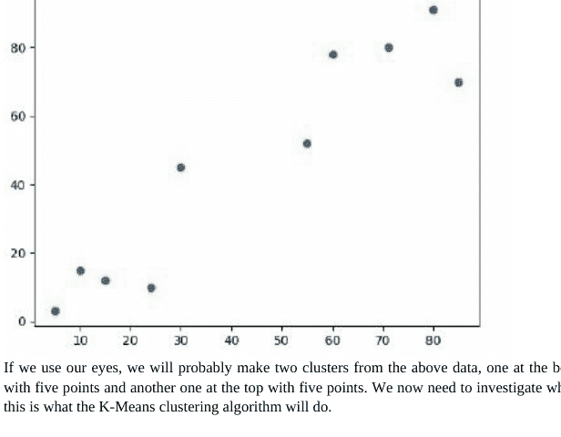

如果我们用肉眼观察，我们可能会从上述数据中划分出两个簇，一个在底部包含五个点，另一个在顶部包含五个点。现在我们需要调查`K-Means`聚类算法是否也会这样做。

##### 创建簇

我们已经看到可以从数据点中形成两个簇，因此`K`的值现在为`2`。可以通过运行以下代码创建这两个簇：

```python
kmeans_clusters = KMeans(n_clusters=2)
kmeans_clusters.fit(X)
```


我们创建了一个名为`kmeans_clusters`的对象，并将`2`用作参数`n_clusters`的值。然后，我们对该对象调用了`fit()`方法，并将我们在`numpy`数组中拥有的数据作为参数传递给该方法。

现在我们可以查看算法为最终簇创建的质心值：

```python
print(kmeans_clusters.cluster_centers_)
```

这返回以下内容：

上面的第一行给出了第一个质心的坐标，即`(16.8, 17)`。第二行给出了第二个质心的坐标，即`(70.2, 74.2)`。如果你遵循了手动计算这些值的过程，它们应该是相同的。这表明`K-Means`算法运行良好。

以下脚本将帮助我们查看数据点标签：

```python
print(kmeans_clusters.labels_)
```

这返回以下内容：

上述输出显示了一个包含`10`个元素的一维数组，这些元素对应分配给`10`个数据点的簇。你可以清楚地看到，我们首先有一系列零，这表明前`5`个点被聚为一类，而后`5`个点也被聚为一类。请注意，`0`和`1`没有数学意义，它们只是用来表示簇`ID`。如果我们有三个簇，那么最后一个簇将用`2`来表示。

现在我们可以绘制数据点，查看它们是如何被聚类的。我们需要将数据点及其分配标签一起绘制，以便能够区分簇。只需执行下面给出的脚本：

```python
plt.scatter(X[:, 0], X[:, 1], c=kmeans_clusters.labels_, cmap='rainbow')
plt.show()
```

该脚本返回以下图表：

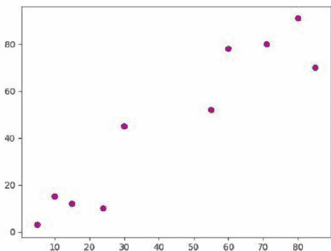

我们仅仅将名为`X`的数组的第一列与第二列进行了绘制。同时，我们将`kmeans_clusters.labels_`作为参数`c`的值传入，该参数对应于标签。请注意参数`cmap='rainbow'`的使用。该参数帮助我们选择不同数据点的颜色类型。

## 第 11 章：分类

是垃圾邮件还是非垃圾邮件？这是分类的一个流行应用和示例。与回归类似，分类也属于监督学习。模型从带标签的数据中学习。然后，系统将该学习应用于新的数据集。

例如，有一个包含各种电子邮件信息的数据集，每条信息都被分类为垃圾邮件或非垃圾邮件。模型随后可能识别出电子邮件信息中被标记为垃圾邮件的特征。

在进行预测时，模型可能会尝试在新的电子邮件信息中识别出这些特征。

实现成功分类的方法有多种。让我们看看其中几种：

### 逻辑回归

在大多数分类问题中，目标是通过使用两个独立变量来确认结果是`0`还是`1`。例如，假设年龄和估计薪资决定了一个结果（如是否购买），我们如何构建一个代表它们之间关系的模型并用于预测？

这可能听起来有些令人困惑，因此你需要通过一个例子来理解。

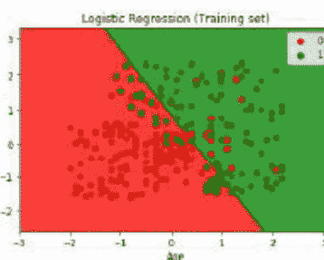

在上面的例子中，有两个变量：年龄和估计薪资。每个数据点随后被归类为`0`或`1`。有一条线将两者分开。这种方法基于概率。

与回归一样，由于存在“黑箱”，逻辑回归背后的机制可能很难理解。好处是，当你应用`scikit-learn`和`Python`时，其执行过程非常直接。

常规步骤是先从训练集中学习，然后将该学习应用于测试集。归根结底，这是监督学习的目的。首先，你会发现有训练和监督。接下来，这些经验将被用于新的情况。

当你在测试集的可视化中发现，大多数绿色点落在绿色区域内时，因此，该模型最适合预测具有特定年龄和估计薪资的人是否可能购买。

```python
## 特征缩放
from sklearn.preprocessing import StandardScaler
sc = StandardScaler()
X_train = sc.fit_transform(X_train)
X_test = sc.transform(X_test)
```

首先，我们将数据转换为相同的范围或比例，以避免对给定变量的偏斜或过度依赖。在数据集中，近似薪资以千为单位表示，而年龄则以较小的比例表示。我们需要将它们设置为相同的范围，以便我们可以期望得到一个合理的模型。

除了逻辑回归，还有其他任务分组方法。让我们来讨论一下：

### K 近邻算法

该算法在创建高级分类器时非常流行。它是一个简单的算法，但表现优于其他分类器。这就是它在遗传学、预测和数据压缩领域受欢迎的原因。

`KNN`属于一种监督学习算法。换句话说，我们被提供了一个由训练观测值`(x, y)`组成的数据集，主要目标是识别`x`和`y`之间的关联。因此，我们需要定义一个`x-y`函数，使得当提供`x`的输入值时，我们可以预测`y`的对应值。

`KNN`算法背后的思想非常简单。它计算新数据点到所有其他训练数据点的距离。距离可以是不同类型的，包括欧几里得距离、曼哈顿距离等。选择`K`个最近的数据点，其中`K`可以是整数。最后，该数据点被分配给与大多数`K`数据点所属的类别。

请记住，逻辑回归似乎在`0`和`1`之间有一个线性边界。因此，它遗漏了一些需要位于另一侧的数据点。幸运的是，存在一些非线性模型，能够以更精确的方式处理大量数据点。其中之一就是`K`近邻算法的应用。它通过引入一个新的数据点，然后计算属于任一类别的邻居数量来运行。如果大多数邻居属于类别`A`而不是类别`B`，那么新点应该属于类别`A`。

因此，给定点的分类取决于其最近邻的多数。这可以通过以下代码行实现：

```python
from sklearn.neighbors import KNeighborsClassifier
classifier = KNeighborsClassifier(n_neighbors = 5, metric = 'minkowski', p = 2)
classifier.fit(X_train, y_train)
```

此外，我们不必从零开始，而是导入预先构建的代码来简化我们的任务。背后的机制可以学习和研究。但出于多种原因，预先构建的模型更容易制作出合理且有用的模型。

别忘了，由于`K-NN`算法的各种方法，边界是非线性的。也要记住，仍然存在遗漏。为了捕获所有遗漏，你需要使用更大的数据集或不同的方法。

### 决策树分类

许多数据科学家也在分类中应用决策树。构建决策树涉及将数据集划分为较小的子集并将其分离出来。请查看下面的示例：

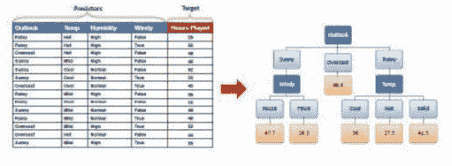

你能看到分支和叶源自数据集的划分吗？同样的原理也适用于分类。

当你运行整个代码时，你将看到以下内容：

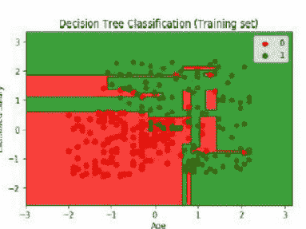

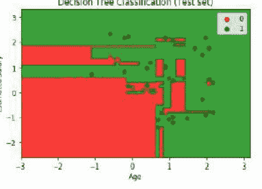

与逻辑回归和`K`近邻算法（`K-NN`）相比，可以看到巨大的差异。在这两个例子中，只有两个边界。在上述决策树分类中，你可以识别出主要红色区域之外、但在“迷你红色区域”内的两个点。在这种情况下，模型保留了在其他情况下不可能保留的数据点。

### 随机森林分类

记得在上一章关于回归中，随机森林被描述为决策树的集合。这也适用于分类，其中应用了大量的决策树，并对结果取平均值。

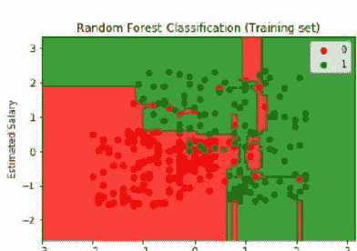

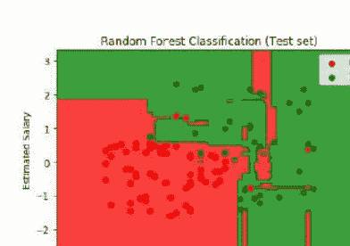

请注意随机森林和决策树之间的相似性。归根结底，它们采用类似的策略，将数据集划分为较小的子集。区别在于随机森林应用随机性并对决策树取平均值，以开发准确的模型。

### 聚类

前面的章节探讨了监督学习。我们已经掌握了从“带标签”数据中学习的方法。之前已经有正确答案，而我们的角色是学习如何获得这些答案并将它们用于学习新数据。

在下一章中，情况将有所不同。原因是它将从无监督学习开始，其中没有提供确切的标签。

这意味着只有输入数据，但没有输出数据。此外，从数据中学习时不会发生监督。

事实上，无监督学习被认为包含人工智能的本质。这是因为没有太多的人工监督或干预。结果是，算法被留下从数据中发现事物。聚类的情况就是这样，其最终目标是在数据中揭示天然的聚合或“簇”。

### 聚类的目标和功能

这是一种无监督学习的形式，其中没有标签，或者在许多情况下，没有真正正确的答案。这是因为一开始就没有正确答案。我们只有一个数据集，我们的目标是查看自然形成的分组。我们在这里并不是试图预测结果。目标是在数据中寻找结构。换句话说，我们将数据集“划分”成组，其中成员具有某些相似性或接近性。例如，每个电子商务客户可能属于特定的组（例如，根据其收入和消费水平）。如果我们收集了足够的数据点，很可能存在聚合。


起初，数据点看起来是分散的（完全没有模式）。但一旦我们应用聚类算法，数据在某种程度上会变得有意义，因为我们将能够轻松可视化组或簇。除了发现自然分组外，聚类算法还可以揭示用于异常检测的离群值（我们稍后也会讨论这一点）。聚类定期应用于市场营销、生物学、地震研究、制造业、传感器输出、产品分类以及其他科学和商业领域。然而，在确定簇的数量以及哪个数据点应该属于某个簇时，没有固定的规则。这取决于我们的目标（或结果是否足够有用）。这也是我们在特定领域专业知识发挥作用的地方。与其他数据分析和机器学习算法及工具一样，这仍然关乎我们的领域知识。这样，我们才能在适当的背景下查看和分析数据。即使使用最先进的工具和技术，在理解数据方面，背景和目的仍然是至关重要的。

### K 均值聚类

通过聚类理解数据的一种方法是 K 均值。由于其简单性，它是最受欢迎的聚类算法之一。它通过将对象划分为 `k` 个簇（我们指定的簇数）来工作，基于特征相似性。注意，簇的数量是任意的。我们可以将其设置为我们喜欢的任何数字。然而，最好使簇的数量刚好足够使我们的工作有意义且有用。让我们讨论一个例子来说明这一点。这里有一份关于商场顾客（`Mall_Customers.csv`）的数据，其中包含了他们的性别、年龄、年收入和消费得分的信息。消费得分（满分 100）越高，表明他们在商场的消费就越多。首先，我们导入所需的库：

```python
import numpy as np
import matplotlib.pyplot as plt
import pandas as pd
%matplotlib inline
```

然后我们导入数据并进行初步查看：

|   | 顾客 ID | 性别 | 年龄 | 年收入（千美元） | 消费得分 (1:100) |
|---|------------|-------|-----|--------------------|------------------------|
| 0 | 1          | 男    | 19  | 15                 | 39                     |
| 1 | 2          | 男    | 21  | 15                 | 81                     |
| 2 | 3          | 女    | 20  | 16                 | 6                      |
| 3 | 4          | 女    | 23  | 18                 | 77                     |
| 4 | 5          | 女    | 31  | 17                 | 40                     |
| 5 | 6          | 女    | 22  | 17                 | 76                     |
| 6 | 7          | 女    | 35  | 18                 | 6                      |
| 7 | 8          | 女    | 23  | 18                 | 94                     |
| 8 | 9          | 男    | 64  | 19                 | 3                      |
| 9 | 10         | 女    | 30  | 19                 | 72                     |

在这个例子中，我们更关注根据年收入和消费得分对顾客进行分组。

```python
X = dataset.iloc[:, [3, 4]].values
```

我们这里的目的是揭示这些簇（聚类），并帮助营销部门制定策略。例如，我们可能会将顾客细分为 5 个不同的组：

- 中等年收入，中等消费得分
- 高年收入，低消费得分
- 低收入，低消费得分
- 低收入，高消费得分
- 高收入，高消费得分

关注第 2 组（高年收入，低消费得分）是值得的。如果大量顾客属于这一组，这可能意味着商场面临着一个巨大的机会。这些顾客年收入很高，但却将大部分资金花在别处（而非商场）。如果我们能确定他们数量可观，营销部门就可以制定特定的策略来吸引第 2 组顾客更多地从商场购物。

虽然簇的数量通常是任意的，但确实有方法可以找到最优数量。其中一种方法是通过肘部法则（Elbow Method）和 `WCSS`（簇内平方和）。

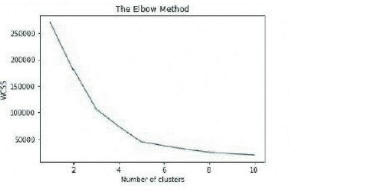

请注意，“肘部”指向 5（簇的数量）。巧合的是，这个数字也是根据年收入和消费得分将数据集划分的“理想”组数。在确定最优簇数量后，我们可以继续对数据集应用 K-Means 算法，然后进行数据可视化：

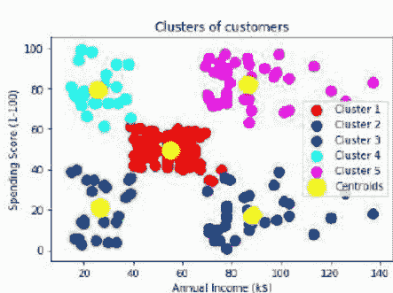

就是这样。我们有 5 个簇，且第 2 组（蓝色点，高年收入和低消费得分）足够显著。营销部门可能值得专注于该组。此外，请注意质心（黄色点）。这是 K-Means 聚类工作方式的一部分。这是一种迭代方法，最初放置随机点，直到它们收敛到一个最小值（例如，距离总和最小化）。如前所述，一切都是任意的，且可能严重依赖我们的判断和可能的应用场景。我们可以将 `n_clusters` 设置为除 5 以外的任何值。我们仅使用肘部法则，以便为簇的数量提供更合理、更一致的依据。但使用什么以及结果是否足以满足我们的应用，仍然取决于我们的判断。

### 异常检测

除了揭示自然的簇之外，检查是否存在明显不属于这些簇的点也是一种常见情况。这是检测数据中的异常值或离群点的核心。这是一项至关重要的任务，因为任何对正常值的重大偏离都可能导致灾难。信用卡交易是否存在欺诈行为？登录活动是否可疑（你可能正从完全不同的位置或设备登录）？罐体中的温度和压力水平是否保持一致（任何异常值都可能导致爆炸和操作停滞）？某个数据点是否由错误的输入或测量引起（例如，也许误用了英寸而不是厘米）？通过直观的数据可视化，我们可以立即看到离群点。然后我们可以评估这些离群点是否构成重大威胁。我们也可以通过参考均值和标准差来查看和评估这些离群点。如果一个数据点偏离均值一个标准差，它可能就是一个异常值。这里也需要我们的领域专业知识。如果存在异常值，后果有多严重？例如，在线商店每天可能有成千上万的购买交易。如果我们的异常检测过于严格，许多这些交易将被拒绝（这将导致销售额和利润的损失）。另一方面，如果我们在异常检测中给予过多自由度，我们的系统将批准更多的交易。然而，这可能会导致随后的投诉，并可能在长期内导致客户流失。请注意，在处理业务案例时，关键不仅仅在于算法。每个领域可能需要不同的敏感度级别。总是存在权衡，两种选择都可能代价高昂。关键在于测试，并了解我们检测异常的机制对于我们的应用是否足够。

## 第 12 章：关联规则学习

这是非监督学习的延续。在前几章中，我们发现了自然的模式和聚合。关于“正确答案”应该是什么样子，并没有太多的监督和指导。我们让算法去发现和研究数据。结果，我们能够从数据中获取可用的见解。在本章中，我们将重点讨论关联规则学习。这里的目的是发现物品之间如何“相关”或关联。这在确定哪些产品应该放在一起陈列在杂货店中非常有用。例如，许多顾客可能总是同时购买面包和牛奶。然后我们可以重新排列某些货架和产品，使面包和牛奶靠近彼此。这也是一种向顾客推荐相关产品的好方法。例如，许多顾客可能在线购买尿布，随后又购买育儿书籍。这两种产品具有强关联性，因为它们标志着顾客的生活转变（有了孩子）。此外，如果我们注意到尿布的需求激增，我们可能也应为育儿书籍做好准备。这是一种通过提前购买物资来在一定程度上预测和准备未来需求的好方法。在杂货购物或涉及零售和批发交易的任何业务中，关联规则学习在优化（鼓励顾客购买更多产品）和供需匹配（例如，一种产品的销售增长也预示着另一种相关产品的相同情况）方面都非常有用。

### 解释

那么，我们如何确定物品之间的“相关程度”并据此创建有用的组呢？一种直接的方法是统计涉及特定商品集合的交易数量。

| 交易编号 | 购买商品       |
|--------------|-----------------|
| 1            | 鸡蛋, 火腿, 热狗 |
| 2            | 鸡蛋, 火腿, 牛奶  |
| 3            | 鸡蛋, 苹果, 洋葱 |
| 4            | 啤酒, 牛奶, 果汁 |

我们的目标集合是 `{鸡蛋, 火腿}`。注意，这种购买组合出现在 2 笔交易中（交易 1 和 2）。换句话说，这种组合发生的时间占 50%。这是一个简单的例子，但如果我们研究 10,000 笔交易，且 50% 的情况依然存在，那么鸡蛋和火腿之间显然存在强关联。我们可能会意识到将鸡蛋和火腿放在一起（或作为捆绑销售提供）是值得的，这样既可以让顾客的生活更轻松（同时我们也增加了销售额）。目标集合占比越高


总交易次数，效果越好。或者，如果百分比仍然低于我们任意设定的阈值（例如 30%、20%），我们仍然可以关注特定的集合，并对我们的产品和报价进行调整。除了计算实际百分比外，另一种了解项集（`itemset`）“受欢迎程度”的方法是基于概率进行计算。例如，产品 `X` 和产品 `Y` 一起出现的概率有多大？如果概率很高，我们可以在某种程度上说这两种产品密切相关。这些是估计两种产品之间“相关性”或关联水平的方法。对于某些应用而言，单独使用其中一种方法或组合使用多种方法可能已经足够了。也许基于概率的方法会得出更好的结果。或者，优先处理非常热门的项集（出现百分比高）会带来更多的交易。归根结底，这可能在于测试不同的方法（以及产品组合），然后查看哪一种能产生最佳结果。甚至有可能，两种相关性极低的产品组合反而能促进更多的购买行为。

### 先验算法（Apriori）

无论情况如何，让我们来探索这一切在现实世界中是如何应用的。我们将这个问题称为“市场购物篮优化”（`Market Basket Optimization`）。我们在这里的目标是生成一个集合列表（产品集合）及其相互之间的相关程度或支持度（`support`）。以下是数据集的一瞥，以帮助你更好地理解：

```
shrimp,almonds,avocado,vegetables mix,green grapes,whole wheat flour,yams,cottage cheese,energy drink,tomato juice,low fat yogurt,green tea,honey,salad,mineral water,salmon,antioxidant juice,frozen smoothie,spinach,olive oil
burgers,meatballs,eggs
chutney
turkey,avocado
mineral water,milk,energy bar,whole wheat rice,green tea
low-fat yogurt
whole-wheat pasta,french fries
soup,light cream,shallot
frozen vegetables,spaghetti,green tea
french fries
```

这些是根据它们出现的交易列出的。例如，在第一笔交易中，客户购买了不同的物品（从虾到橄榄油）。在第二笔交易中，客户购买了汉堡、肉丸和鸡蛋。

和以前一样，让我们导入必要的库，以便我们可以处理数据：

```python
import pandas as pd
```

```python
dataset = pd.read_csv('Market_Basket_Optimisation.csv', header=None)
```

接下来，我们将物品添加到列表中，这样我们可以更容易地处理它们。我们可以通过初始化一个空列表，然后运行一个 for 循环来完成这一步（还记得怎么做这些吗？）：

```python
transactions = []
for i in range(0, 7501):
    transactions.append([str(dataset.values[i, j]) for j in range(0, 20)])
```

完成上述步骤后，我们接下来应该生成一个“相关产品”列表及其对应的支持度或相关水平。实现这一点的一种方法是使用先验算法（`Apriori algorithm`）（用于关联规则学习）。幸运的是，我们不需要从头编写任何内容。

我们可以使用 `apyori`，这是先验算法的一个简单实现。它是预先构建好的，几乎可以直接供我们使用。这与我们使用 `scikit-learn`、`Pandas` 和 `numpy` 的方式类似。我们不必从头开始，已经有现成的代码块可以直接实现。请注意，从头编写所有代码既耗时又具有技术挑战性。要实现 `apyori`，我们可以像导入其他库一样导入它：

```python
from apyori import apriori
```

接下来，我们设置规则（最低相关水平的阈值），以便我们能够生成有用的相关物品列表。这是因为几乎任何两个物品之间都可能存在某种程度的相关性。这里的目的是只包含对我们有用的列表。

```python
rules = apriori(transactions, min_support=0.003, min_confidence=0.2, min_lift=3, min_length=2)
```

这就是使用 `apyori` 实现先验算法的过程。下一步是生成并查看结果。我们可以使用以下代码块来实现：

```python
results = list(rules)
results_list = []
for i in range(0, len(results)):
    results_list.append('RULE:\t' + str(results[i][0][0]) + '\nSUPPORT:\t' + str(results[i][1]))
print(results_list)
```

当你在 `Jupyter Notebook` 中运行所有代码时，输出会很混乱且几乎难以理解。但如果你是在 `Spyder` 中运行（`Anaconda` 安装中附带的另一个有用的数据科学软件包），结果会整洁一些：请注意，有不同的项集及其对应的“支持度（`Support`）”。支持度越高，我们可以在某种程度上说相关性越高。例如，淡奶油和鸡肉经常一起出现，因为人们可能会用这两种食材来烹饪某道菜。另一个例子是索引为 `5` 的项集（番茄酱和碎牛肉）。这两种商品在购物袋中总是形影不离，因为它们也用于准备饭菜或食谱。

这只是关联规则学习的入门介绍。这里的目的是探索其在现实世界场景（如市场购物篮优化）中的潜在应用。还有其他更复杂的方法来做这件事。但归根结底，这是关于确定物品之间的相关水平，然后评估其是否有用或足够好。

## 第 13 章：强化学习

请注意，在前几章中，重点在于处理过去的信息并从中得出见解。换句话说，我们更关注过去，而非现在和未来。但要使数据科学和机器学习真正变得有用，算法和系统必须能够处理实时情况。例如，我们需要系统能够实时学习并相应地调整，以最大化奖励。

### 什么是强化学习？

这就是强化学习（`RL`）发挥作用的地方。简而言之，强化学习是随着时间的推移强化正确或期望的行为。每个正确行为都给予奖励，否则就给予惩罚。最近，强化学习被用于在围棋游戏中击败世界冠军，并成功玩各种 `Atari` 电子游戏（尽管那里的强化学习更加复杂，并融合了深度学习）。随着系统通过强化学习，它能够实现目标或最大化奖励。

一个简单例子是在在线广告的点击率（`CTR`）优化中的应用。也许你有 `10` 个本质上说同一件事的广告（可能只是文字和设计略有不同）。起初，你想知道哪个广告表现最好，能产生最高的点击率。毕竟，更多的点击意味着你的业务拥有更多的潜在客户和顾客。但是，如果你想要最大化点击率，为什么不在广告运行过程中进行调整呢？换句话说，不要等到你的整个广告预算耗尽后才去知道哪个表现最好。相反，在广告运行期间找出哪些广告表现最好。尽早进行调整，这样以后只向潜在客户展示表现最佳的广告。

这与概率论中一个著名的问题——多臂老虎机问题（`multi-armed bandit problem`）非常相似。假设你有一种有限资源（例如，广告预算）和一些选择（`10` 个广告变体）。你将如何在这些选择中分配资源，以便最大化你的收益（例如，最佳点击率）？

首先，你必须“探索”并逐个尝试这些广告。当然，如果你发现广告 `1` 表现异常好，你会“开发”（`exploit`）它，并在剩余的活动中一直运行它。你不需要把钱浪费在表现不佳的广告上。坚持使用获胜者并持续开发其表现。不过有一个陷阱。起初，广告 `1` 可能表现很好，所以我们倾向于反复使用它。但如果广告 `2` 后来居上，并且如果我们顺其自然，广告 `2` 会产生更高的收益，该怎么办？

我们永远不会知道，因为广告 `1` 的表现已经被开发过了。在许多数据分析和机器学习项目中，总会存在权衡。这就是为什么总是建议事先设定性能目标，而不是事后去猜测如果当初那样做会怎样。即使在最复杂的技术和算法中，权衡和约束始终存在。

### 与监督学习与无监督学习的比较

请注意，强化学习的定义并不完全属于监督学习或无监督学习。请记住，监督学习是通过监督和训练来学习的。另一方面，无监督学习实际上是从非结构化数据中发现或揭示见解（没有监督，没有标签）。

与强化学习的一个关键区别在于最大化预设奖励、从用户交互中学习以及实时更新自身的能力。记住，强化学习首先是关于探索和开发。相比之下，监督学习和无监督学习更多是关于被动地从历史数据中学习（不是实时的）。三者之间有着微妙的界限，因为它们都以这样或那样的方式关注优化。无论如何，这三者在科学和商业环境中都有有用的应用。

### 应用强化学习

强化学习在许多商业场景中特别有用，例如优化点击率。我们如何最大化标题的点击次数？请注意，新闻故事在相关性和受欢迎程度上通常有有限的生命周期。给定这种有限资源（时间），我们如何立即展示表现最好的标题？


在线广告点击率（`CTR`）最大化的情况也是如此。我们有一个有限的广告预算，我们希望从中获得最大收益。让我们探索一个例子（使用 `Ads_CTR_Optimisation.csv` 中的数据）来更好地说明这个想法：像往常一样，我们首先导入必要的库，以便我们可以处理我们的数据（同时也用于数据可视化）。

```python
import matplotlib.pyplot as plt
import pandas as pd
%matplotlib inline # 以便图表可以在我们的 Jupyter Notebook 中显示

## 然后我们导入数据集并查看一下
dataset = pd.read_csv('Ads_CTR_Optimisation.csv')
dataset.head(10)
```

在每一轮中，广告都会展示，并指示哪一个/哪些被点击了（未点击为 0，已点击为 1）。正如前文所述，目标是先进行探索，选出优胜者，然后对其利用。实现这一目标的一种流行方法是汤普森采样（Thompson Sampling）。简单来说，它通过采样或尝试有前景的动作，同时忽略或放弃那些表现不佳的动作，来解决探索与利用的困境（试图在两者之间取得平衡）。该算法基于概率运作，这可以通过代码表达出来。

当我们运行代码并进行可视化时：

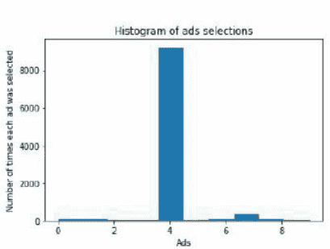

请注意，汤普森采样的实现可能非常复杂。它是一种有趣的算法，在在线广告优化、新闻文章推荐、产品组合以及其他商业应用中非常流行。

还有其他有趣的算法和启发式方法，例如置信上限（Upper Confidence Bound）。其目标是在学习的同时获得收益。与事后的分析不同，我们的算法可以实时执行并调整。我们希望通过平衡探索与利用之间的权衡（最大化即时表现或“学习更多”）来最大化奖励，从而改进未来的表现。这是一个本身就很有趣的话题，如果你想深入了解，可以阅读更多在线资源。

## 第 14 章：集成方法

本章将讨论集成方法。每当你在做实时决策时感到不确定，你会寻找朋友来帮助你吗？事实是，我们根据从朋友那里获得的集体知识来做决定。集成（Ensemble）在机器学习中使用了同样的概念。

其背后的想法是开发更多的数据模型，并根据所有单个模型的预测生成最终预测。对于回归问题，最终结果可以是所有模型的平均预测值。在分类环境中，通常会选择得票最多的结果来确定输出类别。

流行的想法是拥有众多模型，每个模型在训练数据集上呈现略有不同的输出。一些模型与其他模型相比，能更好地学习数据的属性。人们相信这些模型得出的最终结果应该比其中任何一个单独模型生成的结果更好。

如前所述，集成背后的理念是将不同的模型整合在一起。这些模型可以是同类型的，也可以是不同类型的。例如，你可以通过应用贝叶斯模型来合并一个神经网络模型的输出。本章将仅限于同类型模型的集成。

合并同类型的模型通常通过袋装（Bagging）和提升（Boosting）技术在数据科学界很常见。

自助聚合（Bootstrap aggregation，简称 Bagging）是创建大量模型并组合它们的输出以生成最终预测的绝佳方法。袋装集成中的每个模型仅使用训练数据的一个部分。袋装背后的想法是减少数据过拟合。正如之前所说，你希望每个模型都与众不同。因此，你需要使用有放回抽样（sampling with replacement）来训练每个模型，从而引入变异性。另一种用于在模型中引入变异性的方法是抽样特征属性。你不需要将所有的特征都提交给模型，而是让不同的模型获取特定的属性。

袋装可以轻松地并行化。根据可用的并行处理框架，可以使用训练数据集的不同样本并行生成模型。袋装方法不适用于像线性回归这样的线性预测器。

提升（Boosting）是一种产生各种复杂模型的集成技术。它通过基于原始模型的错误顺序地训练新模型来工作。每个经过训练的模型都关联一个权重，该权重根据模型在给定数据上的表现程度计算得出。

当进行最终预测时，上述权重定义了某个模型对最终结果的影响百分比。与袋装不同，提升不会导致并行化。这是因为模型是顺序构建的。因此，无法并行化。

分类器在序列中呈现的错误被视为难以分类的硬实例。

该框架的创建方式使得序列中较后的模型，或者由第一个预测器产生的错误预测，试图对其进行改进。

通常，弱分类器被用于提升，例如决策桩（decision stump），它描述了一个使用单个分裂节点和两个叶子的决策树。

### 掌握袋装方法

集成方法属于基于委员会的学习家族。如果我们能成功在数据集中引入变异性，将导致产生略有不同的模型。

你利用自举（Bootstrapping）来为这些模型提供数据集内的变异性。

自举是随机抽样特定数据集特定数量案例的手段，可有放回或无放回。对于袋装，你需要利用自举来生成模型。例如，假设我们有 `m` 个不同的数据集，我们为每个数据集创建一个模型。最后，在回归问题的情况下，你利用所有模型的输出来产生最终预测。

例如，你自举数据 `m` 次；你将得到 `m` 个模型，即 `m` 个 `y` 值，最终预测将包括：

```
$$Y_{\text{final}}(x) = \frac{1}{m} \sum_{i=1}^{m} y_m(x)$$
```

对于分类问题的情况，最终结果取决于投票确定。因此，假设你的集成中有一百个模型，并且你有一个使用类标签 `{+1, -}` 的二分类问题。如果超过 50 个模型预测输出为 `+1`，你需要将预测声明为 `+1`。

随机化是一种独特的方法，可以在模型创建过程中应用变异性。一个例子是为集成中的每个模型随机定义一组属性。

一个例子是为集成中的每个模型选择一个随机的属性子集。这样，不同的模型将由不同的属性集组成。这种方法被称为随机子空间方法。

当你应用稳定模型时，袋装可能无法获得巨大的结果。如果底层分类器对数据的微小变化高度敏感，袋装就很重要。例如，决策树，它们是不稳定的。剪枝决策树是袋装的最佳选择。然而，你需要考虑最近邻分类器。`K` 最近邻是一个稳定模型。但你仍然可以利用随机子空间，并为最近邻方法引入一些不稳定性。

在下面的实例中，你将了解如何利用袋装和随机子空间应用于 `K` 最近邻算法。你将获得一个分类问题，最终预测将依赖于多数投票。

### 如何做

导入相关的库，并编写一个 `get_data()` 函数来生成要操作的数据集。

然后继续定义三个函数：

- 函数 `build_single_model`，用于使用提供的数据构建一个简单的 K 最近邻模型。
- 函数 `build_bagging_model`，此函数实现了袋装例程。
- 函数 `view_model`，用于检查你开发的模型。

最后，你将编写主函数，该函数将调用其余的函数。

## 结论

好吧，你不需要精通 `Python` 才能在 `Python` 中进行数据分析。你需要做的只是掌握五个 `Python` 库，以有效地找到广泛数据分析问题的解决方案。所以，你需要开始逐一学习这些库。请记住，你不必是构建优秀 `Python` 软件的专家，才能有效地进行数据分析。

在你继续之前，确保你设置了你的编程环境，并学习了如何使用 `IPython` notebook。

然后你可以开始学习 `Pandas` profiling。这个工具将帮助你为你的项目实现不同的动画效果。

使用这个工具相当简单，就像安装和导入 `Pandas` profiling 包一样。

接下来，你需要学习如何借助 `Plotly` 和 `Cufflinks` 绘制 `Pandas` 数据。有经验的数据科学家可能熟悉 `matplotlib` 和 `pandas` 的使用。因此，熟悉上述工具很重要。

除此之外，你还需要掌握 `IPython` 魔命令。这些是 `IPython` 在标准 `Python` 语法之上提供的改进。魔命令有两种形式：行魔（line magics），使用单个 `%` 前缀定义，作用于单行输入；以及工作于多行输入的块魔（block magics），由双 `%%` 前缀表示。此外，你还需要学习如何使用 `Jupyter` 创建花哨的功能。这是一个很好的工具，它支持在 `markdown` 单元格中使用一些 `HTML` / `CSS` 格式化。

别忘了 `Numpy`。这是另一个用于科学计算的强大 `Python` 包。正确理解 `Numpy` 将允许你使用 `Pandas` 等工具。记住，`Pandas` 提供了高级数据结构，并提供了简化工具来处理数据，以简化数据分析。

话虽如此，有一件事你应该避免：试图同时学习 `Python` 中的每个工具和库。当你试图一次性学习所有东西时，你会花费大量时间在不同的概念、属性之间切换，感到沮丧，然后转向其他事情。

所以，你应该尝试专注于以下基本步骤：

- 掌握 `Python` 基础
- 掌握 `Numpy`
- 学习 `Pandas`
- 理解 `Matplotlib`

从这里开始，你可以继续拓展更多主题。

## 第二卷：使用 Kali Linux 进行渗透测试

《面向初学者的计算机网络黑客、加密、网络安全与渗透测试实用指南。VPN 服务、防火墙及 Linux 命令行的秘密》

### 免费下载本书的有声书版本

如果你喜欢在移动中听有声书，我有个好消息要告诉你。只需注册 30 天免费的 `Audible` 试用服务，你就可以免费下载本书的有声书版本！更多详情请见下文！


#### Audible 试用福利

作为 Audible 用户，在您的 30 天免费试用期内，您将享受以下福利：

- 本书的免费 Audible 有声书副本

- 试用结束后，您每月将获得 1 个积分，可用于兑换任意有声书

- 如果您未使用积分，它们会自动累积到下一月

- 可从 Audible 的 200,000 多本图书中任选

- 通过 Audible 应用，在多台设备上随时随地收听

- 轻松、无忧地更换您不喜欢的任何有声书

- 即使取消会员资格，您的有声书也将永久保留

- 以及更多福利

点击以下链接开始体验！

- 适用于美国区 Audible
- 适用于英国区 Audible
- 适用于法国区 Audible
- 适用于德国区 Audible

### 引言

非常高兴看到大家对学习 Kali Linux 的基础知识及其实用性表现出如此浓厚的兴趣。Kali Linux 是当今最有效的软件之一。它也可以被视为所有计算和网络从业者的福音。

Kali Linux 承担安全审计软件的功能，并在网络和黑客技术的多个方面提供辅助。Kali Linux 附带各种信息和安全相关任务，如逆向工程、渗透测试和安全研究。计算机取证也是 Kali Linux 的一部分。Kali Linux 提供的每一项服务均经过认证，并具备全面的管理控制及更广泛的资质认证。

Kali Linux 属于 Linux 发行版家族。网络安全是该 Linux 发行版的首要关注点。如今，许多公司借助 Kali Linux 来检查和追踪其漏洞，以确保其基础设施达到 100% 的安全。它是一个开源程序，因此完全免费。不仅如此，它完全合法，可用于企业或组织中的各种场景。

### 第 1 章：黑客技术基础


黑客行为不过是未授权侵入网络或计算机的行为，由被称为黑客的攻击者执行。攻击者试图攻击那些易受威胁的系统。他们时刻保持警惕，四处搜寻漏洞。他们可以作为个人行动，也可以作为团队工作。不仅如此，黑客还可能作为组织的一部分进行运作，其目的是破坏其他组织的功能。大多数时候，他们试图改变组织的系统，并以破坏信息安全基础设施、获取信息访问权限为目标。然而，黑客不仅作为攻击者工作，还利用其技能发现系统中的薄弱环节和各种漏洞。这也是为了查找并修复弱点，以防止所有形式的恶意攻击进入系统。

#### 不同种类的黑客

在黑客世界中，存在各种类型的黑客，他们执行不同类型的功能。黑客的类型有助于定义系统与被攻击的黑客之间的关系。最常见的黑客类型包括：

- **黑帽黑客（Black Hat Hackers）**：“黑帽”一词源于旧的西部电影，其中的反派角色通常戴黑帽子。黑帽黑客作为个人，试图未经授权访问组织或网络的系统，以利用安全基础设施进行各种恶意目的。这类黑客没有任何权限或许可来侵犯目标。他们试图通过破坏安全系统的基础设施、关闭系统或更改网站或网络的主要功能来造成损害。黑帽黑客的主要意图是获取全面访问权限、窃取财务信息、访问各种密码或获取其他形式个人数据的洞察。

- **白帽黑客（White Hat Hackers）**：白帽黑客是第二类黑客，但他们扮演的是“好人”的角色。白帽黑客与各种组织合作，旨在加强任何系统的安全性。白帽黑客拥有各种许可，可以接触目标并在规定的规则边界内对目标进行合规性测试。白帽黑客也被称为道德黑客。道德黑客专门从事该领域，使用各种形式的道德工具和技术进行黑客行为。他们使用特殊的方法来保护组织的信息系统。与黑帽黑客相反，道德黑客在获得合法许可后，利用网络的安全系统，然后检查后门。道德黑客总是指出从组织系统中挖掘出的所有形式的漏洞，以确保这些缺口得到修复，从而防止恶意攻击者利用。

- **灰帽黑客（Grey Hat Hackers）**：灰帽黑客以与黑帽黑客相同的方式获取组织和网络的安全系统访问权限。但灰帽黑客在进行此类操作时没有任何恶意意图，并将漏洞和缺陷披露给执法机构或各种情报机构。灰帽黑客通常浏览互联网并入侵计算机系统，以通知包含各种需要立即修复的漏洞的网络或系统的拥有者或管理员。灰帽黑客也可能通过收取费用来向被黑系统提供缺陷通知服务。

### 常见的黑客工具

为了实现黑客行为，黑客实施各种类型的技术。让我们看看其中的一些。

- **Rootkit**：Rootkit 就像一个程序或庞大的软件集合，允许攻击者获得对直接连接或交互互联网系统的系统或网络的完全访问或控制权。Rootkit 最初是作为后门进程系统引入的，用于修复软件方面的各种问题。然而，如今该软件被黑客广泛使用，用于从实际所有者或管理员处破坏系统的功能和控制。将 Rootkit 安装到受害者系统中有很多方法。安装 Rootkit 最常见的方法是通过实施网络钓鱼攻击结合社会工程学。一旦 Rootkit 安装到受害者系统中，攻击者秘密获得系统访问权限，并控制整体功能，从而可以轻松窃取机密数据信息，甚至可以完全关闭系统。

- **键盘记录器（Keyloggers）**：这是一种非常特殊的工具，专为记录和记录受害者系统上按下的每个按键而设计。键盘记录器通过附加到应用程序编程接口（API）来记录按键动作。当在系统中使用键盘输入任何内容时，它都会跟踪按键动作。记录的文件随后保存，其中包含各种形式的信息，如网站访问详情、用户名、打开的应用程序记录、截图、银行详情以及更多内容。键盘记录器还能够捕获个人消息、信用卡详情、密码、手机号码以及各种通常输入到系统中的其他详情。键盘记录器通常以恶意软件的形式出现，允许网络犯罪分子突破所有形式的敏感数据。

- **漏洞扫描器（Vulnerability scanner）**：漏洞扫描器用于分类并检测系统、网络、通信系统、计算机等中的各种形式的弱点。这是道德黑客用来发现潜在漏洞和缺陷并紧急修复的最常见工具形式之一。然而，黑帽黑客也可以使用漏洞扫描器来检查系统内的漏洞和薄弱环节，然后找到合适的工具来利用它们。

### 黑客攻击技术

黑客利用各种技术来利用系统漏洞。

- **SQL 注入**：SQL 或结构化查询语言旨在用于利用受害者数据库中的各种形式的数据。这种攻击形式属于针对数据库的网络攻击，通过 SQL 语句来欺骗系统。这种攻击通常通过使用网站界面来实施，试图通过数据库发出 SQL 命令以窃取密码、用户名以及与数据库相关的其他信息。所有编码不良的网站和 Web 应用程序都非常容易受到 SQL 注入攻击。这是因为基于 Web 的应用程序包含各种用户输入字段，如登录页面、搜索页面、与支持和产品相关的请求表单、评论区等，这些字段非常容易受到攻击，并且可以通过简单地操纵代码轻易被黑客入侵。

- **DDoS 或分布式拒绝服务**：这是一种黑客攻击形式，服务器正常的流量被扭曲无法进入服务器，并淹没了网络流量。这最终导致服务中断，就像交通堵塞堵住了道路，也阻止了常规流量到达目的地。如今所有连接网络的设备，如 IoT 设备、计算机、移动电话等，都非常容易受到 DDoS 攻击。

- **MAC 欺骗**：人们今天使用的每种设备都配有网络接口控制器（NIC）。它帮助用户直接连接网络，例如互联网。每个设备的 NIC 都附带一个 MAC 地址，这是在经过各种硬编码过程后分配的。MAC 欺骗攻击是一种非常致命的攻击形式，黑客通过定制的虚假 MAC 地址隐藏自己及其系统。这降低了黑客被抓的风险。因此，你可能会误以为这是一个完全合法的访问而给新系统权限，但事实可能是黑客隐藏在你就无法意识到的虚假 MAC 地址后面。

通过这项技术，黑客可以轻松入侵 Wi-Fi 互联网连接，并访问所有通过局域网互连的设备。MAC 欺骗技术还导致其他几种严重犯罪，黑客窃取他人的身份并实施严重的数据泄露，某人在不知道实际黑客身份的情况下被判定为有罪。然而，目前市场上有各种操作系统，如 Mac 和 Windows，可以轻松连接局域网而无需使用 MAC 地址。

### 第 2 章：什么是道德黑客？


道德黑客也被称为入侵测试、渗透测试以及红队测试，简单来说，它是一种具有争议的技术，通过模仿恶意黑客的行为和意图来发现系统的漏洞和弱点。道德黑客是指使用其技能为信息系统管理员实施各种防御措施的个人或安全专业人员。道德黑客也被称为白帽子或白帽黑客。通过各种测试，道德黑客试图找出以下问题的答案：

- 攻击者可以访问哪些位置、系统或信息？

- 攻击者在设定目标之前会看到什么？

- 攻击者将如何利用系统中可用的信息？

- 是否有人能注意到攻击者为获取权限所做的各种尝试？

被指派进行渗透测试工作的道德黑客是在获得授权并了解其负责防御的组织的知识的情况下进行操作的。在很多情况下，组织不会告知安全信息团队道德黑客将进行的测试活动的所有细节，仅仅是为了测试安全信息团队的有效性和简洁性。整个过程也被称为双盲环境。为了进行有效且合法的运作，组织需要告知道德黑客所有旨在保护的资产和信息、潜在威胁来源以及组织支持道德黑客努力的程度。

#### 道德黑客流程


所有道德黑客都遵循严格的过程，以获得最佳、实用且切中要害的合法结果。让我们看看道德黑客遵循的流程。

### 计划

无论项目类型如何，规划对于每个成功的项目都至关重要。它为道德黑客提供了思考需要做什么、设定要达到的目标以及评估风险以评估如何执行完整项目的机会。道德黑客在执行道德黑客项目之前会考虑各种因素。因素列表包括文化、安全策略、法律、法规、行业要求和最佳实践。在启动道德黑客时，所有这些因素在决策过程中都起着重要作用。

道德黑客中的计划阶段将对黑客执行方式、收集和共享的信息产生整体影响，并直接影响结果向安全项目整合和交付。计划阶段是第一步，将描述有关受控黑客攻击的大多数细节。它还将回答有关黑客的所有形式的问题，例如道德黑客过程将如何被控制和支持，需要执行哪些基本操作，以及过程将持续多久。

### 侦察

这是搜索所有免费可用信息以协助攻击过程的过程。整个过程可以简单到仅使用 `ping` 或浏览互联网上可用的各种新闻组以搜索员工泄露的信息，也可以复杂繁琐到挖掘大量信件或收据垃圾。该过程还可以包括电话窃听、社会工程、网络窃听和数据盗窃等其他过程。信息搜索过程仅限于组织和道德黑客希望恢复所需信息所走的程度。

侦察阶段引入了待完成任务与保护组织和资产所需方法之间的深层关系。

### 枚举

这也称为漏洞或网络发现。枚举是从目标系统、网络和目标使用的应用程序中获取所有现成可用信息的过程。也要注意，枚举阶段通常是恶意攻击与道德黑客之间模糊细线经常被混淆的实际点，因为很容易简单地超出原始攻击计划中划定的专用边界。为了创建组织环境的清晰图像，使用了各种现成的技术和工具。这些可用工具包括 `NMap` 和端口扫描。虽然收集所有所需信息非常容易，但确保黑客手中可用信息的价值却非常困难。

乍一看，枚举过程似乎非常简单，收集数据然后集体评估以建立适当的计划进行更多搜索，或为分析或漏洞阶段建立详细的矩阵。然而，这个阶段是道德黑客做出逻辑决策能力发挥重要作用的实际阶段。

### 漏洞分析

为了有效分析所有数据，道德黑客需要采用务实且本质的逻辑方法。在漏洞分析阶段，所有收集的信息都与实际过程中所有已知形式的漏洞进行比较。无论信息源自何处或来源是什么，任何形式的信息在过程中都是有用的。少量信息也可能有助于发现系统中的某些新类型漏洞，并可能导致其他尚未发现的漏洞。已知的漏洞形式、服务包、事件、更新以及各种黑客工具有助于正确识别攻击点。互联网为道德黑客提供了大量信息，这些信息可以轻松地与系统架构以及系统中的弱点和强点相关联。

### 利用

花费大量时间来评估和计划道德黑客。显然，所有这些计划都会导致某种形式的攻击。系统利用的程度可以简单到在系统中运行非常小的工具，也可以复杂到需要以适当的方式执行许多复杂步骤的集合才能获得系统访问权限。利用过程可以分解为一系列子任务，这些子任务可以是单一步骤或一系列步骤的集合。随着每个步骤的执行，都会发生评估过程，确保达到预期结果。偏离攻击计划的情况可分为两部分：

- `期望值`：利用的预期结果是否已达成，或者结果是否与组织的假设相冲突？
- `技术层面`：目标系统的行为是否完全不符合预期，并且实际上是否对系统的利用和系统参与产生了总体影响？

### 最终分析

尽管利用阶段伴随着大量的验证和检查，以确保黑客攻击的成功，但仍需进行一次最终分析，以便根据暴露程度对系统漏洞进行分类，并协助制定缓解计划。最终分析阶段将利用阶段与交付物创建联系起来。为了构建组织当前安全环境态势的更宏观图景，并清晰地表达漏洞，需要对完整的攻击过程有一个全面的了解。

### 交付物

交付物以多种方式传达测试结果。一些交付物简短，仅提供漏洞列表及其修复方法；而其他形式的交付物则详细冗长，将提供系统中潜在漏洞的列表，并附带关于如何发现这些漏洞、如何利用这些漏洞、系统内存在这些漏洞会导致什么结果以及如何修复状况的描述。这一阶段实际上被白帽黑客用于向组织传达其黑客测试结果。如果交付物未能真正使管理员感到担忧，测试也可被视为失败。

### 第 3 章：网络安全


在当今技术日新月异的世界里，网络攻击的潜在威胁也在以同样的速度增加。在当今充满漏洞的世界中，网络安全在保护系统和网络的信息与数据方面发挥着重要作用。网络安全就是利用各种工具和技术来保护网络、程序、系统数据和网络免受潜在攻击、破坏以及各种形式的未授权访问。网络安全也被称为信息技术安全。

#### 网络安全及其重要性

大多数组织和机构，如军事、政府、医疗以及金融机构，都会在计算机系统以及在线数据库上存储大量负责的数据。在大多数情况下，存储在服务器和数据库中的信息性质高度敏感，泄露这些信息的后果对相关组织来说可能是灾难性的。对组织系统和数据库的未授权访问可能导致数据泄露以及组织安全基础设施被利用。

遭受攻击的组织可能会失去所有形式的敏感数据，并完全丧失对系统的访问权限。随着网络攻击量逐日增加，组织，特别是那些涉及国家健康和安全领域的组织，需要采取一些严肃的措施来保护所有形式的敏感数据。网络安全是保护组织所有数据和服务器的最终解决方案。

### 网络安全与加密

加密是一种编码通信的过程，其方式使得只有授权方才能解码通信消息。这是通过使用 `SSL/TLS` 和 `PKI` 协议实现的。它之所以如此重要，根源在于使用 `HTTP` 协议构建互联网的过程。超文本传输协议（`HTTP`）与互联网同龄。`HTTP` 是一种通信协议，允许 Web 服务器和 Web 浏览器进行通信，并以预期的正确方式显示信息。当用户访问网站时，它实际上并非在浏览器中看到的样子。网站由一堆代码组成，这些代码被发送到 Web 浏览器，然后由浏览器按照网页设计师意图的方式在视觉上排列。

`HTTP` 的主要问题是它并不安全。因此，任何了解该过程的人都可以轻松窃听互联网上的 `HTTP` 连接。简单来说，第三方可以轻松读取并操纵客户端和服务器之间通过 `HTTP` 进行的通信。加密技术实际上通过通过 `HTTPS` 协议提供网站服务来处理通信。`HTTPS` 是 `HTTP` 的安全版本。通过 `HTTPS` 建立的所有连接都是加密的。简而言之，通过 `HTTPS` 协议进行的任何形式的通信都是高度安全的。加密防止第三方窃听通信。如果您从事在线业务，并且需要获取客户的财务和个人详细信息，请确保您的网站已加密，以便在交换详细信息时您的客户不会面临风险。

### 加密过程是如何工作的？

当 Web 浏览器访问一个带有 `SSL` 证书的网站时，加密过程开始。Web 服务器和浏览器将进行所谓的 `SSL` 握手。在初步阶段，Web 浏览器验证安装在网站上的 `SSL` 证书是合法的，并由可信的认证机构颁发。在 Web 浏览器确认证书合法后，它开始与服务器协商加密连接的条款。

就加密而言，主要有两组密钥。第一组是非对称密钥对，由私钥和公钥组成。这些密钥对批量加密没有功能，但用于身份验证。当 Web 浏览器测试网站 `SSL` 证书的真实性时，它会确保被询问的 `SSL` 证书确实是公钥的所有者。它通过使用公钥加密一个小数据包来执行此操作。如果 Web 服务器能够使用相应的私钥解密数据包并将数据包发回，则证明该服务器是公钥的所有者，一切都被声明为已验证。如果 Web 服务器无法解密数据包，则服务器的证书被视为“不可信”。

另一组密钥是会话密钥。这种形式的密钥是在验证 `SSL` 证书的真实性并协商完所有加密条款后生成的。虽然公钥仅用于加密，私钥仅用于解密，但会话密钥可用于加密和解密两种功能。与会密钥的非对称对应物相比，会话密钥尺寸较小，安全性也较低。然而，会话密钥足以执行这两项功能。服务器和 Web 浏览器使用会话密钥进行其余的通信。离开网站后，正在使用的会话密钥会被丢弃，并为新的访问生成全新的会话密钥。

### 常见的网络攻击类型

随着技术的创新，网络攻击每天都在增加。如今存在各种类型的网络攻击，其中一些最常见，例如网络钓鱼、恶意软件、`XSS` 等等。让我们来看看一些最常见的网络攻击类型。

## 恶意软件

恶意软件是一种有害软件，用于获取受害者系统的访问权限。恶意软件也可以被称为病毒。一旦恶意软件进入受害者系统，它可能会引发灾难，从获取对系统的完全控制，到监控各种行为，静默窃取敏感数据，甚至导致系统完全关闭。攻击者使用各种方式将恶意软件插入目标系统。但也有许多情况是系统用户被欺骗安装恶意软件。

### 网络钓鱼

收到包含各种不相关链接和附件的电子邮件在当今非常普遍。通过电子邮件发送有害链接和附件的行为被称为网络钓鱼。在网络钓鱼攻击中，攻击者向目标发送看似可信的电子邮件。大多数电子邮件都带有链接和附件，点击后会导致恶意软件在系统中安装，而系统用户甚至一无所知。一些网络钓鱼链接还会将用户引导至一个新网站，该网站可能会要求提供机密数据，如银行和信用卡详细信息。这些网站实际上是攻击者用于在目标系统中安装恶意软件的陷阱。

### XSS

跨站脚本攻击（`XSS`）旨在直接针对网站用户。它与 `SQL` 注入攻击有些相似，都涉及在网站中注入有害代码。但在 `XSS` 攻击的情况下，网站本身并没有被攻击。在 `XSS` 攻击中，已注入网站的恶意代码仅在用户浏览器中运行，可被用于窃取敏感数据，如用户名、密码、银行详情以及许多其他数据。

### 恶意软件及其类型


恶意软件是一种恶意软件形式，被用于获取受害者系统的访问权限。网络犯罪分子设计恶意软件的方式，可用于窃取数据、破坏计算机功能、绕过访问控制以及许多其他目的。

#### 恶意软件类型

如今可以见到各种类型的恶意软件。让我们来看一下它们。

- **`Adware`**（广告软件）：广告软件是用于在网站上显示广告的这类程序，当点击时，会重定向到被广告的网站，同时收集关于用户的所有形式的市场数据。还有各种形式的弹出式广告软件，通常包含可能导致系统损坏的恶意链接。

- **`Spyware`**（间谍软件）：这是一种用于监视目标用户的软件。它旨在捕获和监控用户在网站上的活动。广告软件也是一种间谍软件形式，它将用户的浏览活动发送给广告商。

- **`Worm`**（蠕虫）：蠕虫是一种病毒形式，被网络犯罪分子用于自我复制。蠕虫利用计算机网络进行传播，并可能导致数据被盗取或删除。许多蠕虫也被设计为仅通过系统传播，而不会对系统造成任何形式的危害。

### 第 4 章：Linux 架构


Linux 是当今最出色的操作系统之一。它本质上是开源的，并基于 UNIX。它就像 Windows XP、Windows 10 和 MAC OS 等商业操作系统一样简单。操作系统不过是计算机系统的用户界面的一种图形形式。它负责管理计算机系统中所有与硬件相关的资源，并有助于在硬件和软件之间建立通信。

### 开源软件

开源软件是一种其源代码可用的软件，其许可证允许版权持有人有权研究该软件、修改设置，并且可以将该软件分发给任何他想发给的人，用于任何形式目的。

### Linux 操作系统及其组件

Linux 操作系统由三个不同的组件组成。

- 内核
- 系统库
- 系统实用程序

#### 内核

内核作为任何形式操作系统的核心部分发挥作用。它负责处理与计算机系统硬件相关的任务。CPU 时间和内存是由内核管理的两个实体示例。操作系统内核有两种类型：

- **微内核**：微内核是一种操作系统内核。顾名思义，它只提供非常基础的功能形式。它是能够提供运行操作系统所需环境的最少软件量。此内核环境涵盖线程管理、低级地址空间管理以及进程间通信形式。

- **单片内核**：单片内核是一种附带各种驱动程序的内核形式。这是一种操作系统架构，其中系统的操作系统在内核空间内运行。这种形式内核能够在运行时动态加载或卸载所有可执行模块。单片形式内核保持在超级用户模式。微内核与单片内核之间的主要区别在于，单片形式内核可以单独定义在计算机系统硬件之上的一个非常高的接口级别。

#### 超级用户模式

单片内核的超级用户模式是一个由系统硬件中介的标志。可以通过在软件系统级别运行代码来轻松修改它。所有形式的系统级任务在操作或运行期间都带有此标志。然而，用户空间的应用程序不带有此标志设置。该标志确保机器代码操作的执行是否可能，例如执行各种操作，如禁用中断或修改各种形式描述符表的寄存器。拥有两种不同类型操作的主要想法源于“控制权越大，责任也越大”的理念。

超级用户模式中的任何程序都如此可信，以至于它永远不会失败，因为任何形式的失败都会导致计算机系统崩溃。简单来说，内核是负责操作系统所有形式活动的组件。它由各种类型的模块组成，并直接与底层硬件交互。内核带有所有必要的抽象，用于向系统或应用程序隐藏所有底层硬件细节。

#### 系统库

系统库由一组非易失性资源组成，这些资源被计算机系统使用，主要用于开发软件。这包括数据配置、帮助数据、文档、消息模板以及许多其他内容。通常，术语“库”用于描述以计算机语言编写的大量关于行为的实现集合。它具有完美定义的接口形式，有助于调用行为。因此，这意味着任何想要创建高级程序的人都可以使用系统库来持续进行系统调用。

系统库可以同时被各种独立形式的程序请求，以确保库以这种方式编码，使得多个程序可以使用库，即使相关程序之间完全没有链接或连接。简单来说，系统库是唯一的程序或函数形式，由系统实用程序或应用程序构建，拥有对内核所有功能的访问权限。这种库实现了与计算机操作系统相关的大部分函数，并且不需要拥有对内核模块的代码访问权限。

#### 系统实用程序

系统实用程序负责执行所有形式的独立和专业级任务。实用软件是一种系统软件。它旨在运行计算机系统的应用程序和硬件。系统软件也可以被视为用户应用程序和硬件之间的接口。简单来说，系统实用软件是旨在配置、分析、优化和维护计算机系统的系统软件。实用软件与操作系统并肩工作以支持系统的基础架构，这使其区别于旨在直接执行各种任务以造福普通用户的应用软件。

### Linux 架构的特性

Linux 带有许多功能，可以很好地帮助普通用户。

#### 多用户能力

这是 Linux 操作系统最独特的特性，其中计算机的资源，如内存、硬盘等，可以同时被多个用户访问。然而，用户不是从单个终端访问资源。每个用户都被赋予一个独立的终端来访问和操作资源。终端至少包含一个 VDU、鼠标和键盘作为输入设备。所有终端都链接或连接到主服务器或 Linux 或主机，其资源和打印机等其他外设设备可被用户使用。

### 多任务处理

Linux 操作系统具备同时轻松处理多项任务的能力。例如，用户可以执行一条命令以运行一个庞大的任务列表，同时使用记事本输入文本。系统通过实现调度策略并结合上下文切换的概念，智能地通过划分 CPU 时间来进行管理。

### 可移植性

可移植性是 Linux 操作系统在用户中广受欢迎的一个重要特性。可移植性绝不意味着它可以存放在 CD、U 盘或存储卡中随身携带，也不指文件体积小。可移植性指的是 Linux 操作系统及其所有应用程序能够在各种类型的硬件上以完全相同的方式运行。Linux 内核和操作系统的应用程序支持在硬件配置最低的系统上安装相同的软件。

### 安全性

安全性被视为任何操作系统中最基本且最重要的部分。对于使用该系统执行各种机密任务的用户和组织来说，这一点至关重要。Linux 操作系统具备多种安全概念，旨在保护用户免受任何形式的未授权访问对其系统及其数据的威胁。

#### Linux 安全的主要概念

Linux 提供了三种主要的类型的安全概念。

- **身份认证**：这通过为每个用户提供登录名和密码，帮助用户在系统中进行身份认证，从而确保其工作不会被任何第三方访问。

- **授权**：在 Linux 操作系统的文件级别，它为用户设置了授权限制。每个文件都有写入、读取和执行权限，这些权限决定了谁可以访问文件，谁可以修改文件，以及谁可以执行文件。

- **加密**：Linux 操作系统的这一功能有助于将用户文件编码为一种不可读的格式，称为密文。这确保了即使有人成功打开了系统，文件仍然是安全的。

### 通信

Linux 操作系统具备出色的通信功能。无论是单台计算机内部的网络，还是两台或多台计算机之间的网络，用户都可以无缝地通过网络交换数据、邮件和程序。

### 第 5 章：Linux 操作系统基础

Linux 是一个简单的操作系统，就像 Windows 等其他操作系统一样。作为操作系统，Linux 有助于管理系统硬件，并为运行其他软件提供所需的服务。它被认为是一个需要动手操作的操作系统。例如，如果运行 Windows 等操作系统就像驾驶自动挡汽车，那么运行 Linux 操作系统则像驾驶手动挡汽车。它可能需要付出更多的工作，但一旦用户熟练掌握了 Linux 的运作机制，使用命令行以及安装软件包将变得超级简单。

#### Linux 的历史

Linux 与 MAC OS X 类似，后者也是基于 Unix 的。Unix 于 20 世纪 70 年代初开发，其主要目标是创建一个对各类用户而言既易于访问又安全的操作系统。1991 年，Linux 被开发出来，目标是分发 Unix 的特性。它作为开源软件发布，直到今天，它仍然是开源的。开源软件是指其代码对用户完全可见，可以根据需求进行修改和再分发的软件。Linux 仅指内核，并不是一个完整的操作系统。内核提供了硬件与用户应用程序请求之间的接口。操作系统的其他部分包括实用工具、GNU 库和各种其他软件。作为一个完整单位的操作系统被称为 GNU/Linux。

#### 关于服务器

用户所拥有的 Linode 是一种服务器。服务器不过是一种主控计算机，它帮助在整个网络或连接的计算机网络中提供各种形式服务。服务器通常具有以下特点：

- 始终开机运行。
- 通常连接互联网或一组计算机网络。
- 包含用于网站托管或互联网其他内容的文件和程序。

由于服务器就像计算机一样运作，Linode 和家用计算机之间有许多相似之处。一些相似之处如下：

- Linode 通常托管在物理机器上。它位于现有的数据中心池中。
- Linodes 使用像 Linux 这样的操作系统。它是类似于 Mac 或 Windows 的另一种操作系统。
- 就像用户可以轻松地在个人电脑上安装各种应用程序一样，也可以在 Linode 上安装应用程序。安装在 Linode 上的所有这些应用程序都有助于执行各种任务，例如托管网站。
- 用户可以轻松创建、编辑和删除文件，就像在个人电脑上操作一样。用户还可以像使用个人电脑一样浏览目录。
- 就像个人电脑一样，Linodes 也连接互联网。

### 安装 Linux 前需要考虑的事项


在安装 Linux 之前，你需要确定想要安装哪个 Linux 发行版。Linux 操作系统有多种版本，被称为发行版。这些发行版类似于 `Windows 7` 或 `Windows XP` 等操作系统版本。像 `Windows` 这样的操作系统的新版本是升级版本。但对于 Linux 而言，发行版并不是升级版本，而是具有不同风味（flavors）的版本。多个 Linux 发行版安装了各种不同的软件包集合。

### Linux 发行版

Linux 发行版之间的主要差异在于发行版的目标和宗旨，以及安装了哪些软件包集合，而不是 Linux 内核代码本身的差异。包含 `CentOS` 和 `Fedora` 的 `RedHat Linux` 以及包含 `Ubuntu` 的 `Debian Linux` 彼此共享大量代码。内核基本上相同，GNU 项目的应用程序和用户实用工具也类似。一些 Linux 发行版被设计得尽可能简约，而另一些则被设计为包含当前时代最佳软件的版本。所有 Linux 发行版都旨在为用户提供最佳稳定性和可靠性。

除了各个发行版的独特个性外，你在选择所需的发行版时还需要考虑各种因素，这些因素将为你提供帮助。

-   **发布周期**：不同的 Linux 发行版以不同的时间表发布其操作系统的更新。像 `Arch Linux` 和 `Gentoo` 这样的发行版使用滚动发布模型，每个软件包在开发者宣布其完成或准备好时发布。像 `Slackware`、`Debian` 和 `CentOS` 这样的发行版旨在为用户提供最稳定形式的操作系统，该形式是可以获得的，并且也会非常频繁地发布新版本。像 `Ubuntu` 和 `Fedora` 这样的 Linux 发行版每六个月发布一个新版本。选择适合你的发布周期也取决于各种因素。这些因素包括你需要运行的软件、你需要多少可靠性和稳定性，以及你寻求的舒适度水平。

-   **组织结构**：虽然这可能不会直接影响发行版的性能，但它仍然是 Linux 发行版之间最具区分性的因素之一。像 `Gentoo`、`Debian`、`Slackware` 和 `Arch` 这样的一些 Linux 发行版由独立开发者社区开发，而像 `Ubuntu`、`Fedora` 和 `OpenSUSE` 这样的一些其他发行版则由受不同公司赞助的社区开发。像发行版

    `CentOS` 是衍生自商业发行版的发行版。

-   **通用工具集**：各种 Linux 发行版使用不同类型的工具来执行诸如系统配置或软件包管理等常见任务。`Ubuntu` 和 `Debian` 等发行版使用 `APT` 管理 `.deb` 软件包，`OpenSUSE` 使用 `.rpm` 软件包，而 `CentOS` 和 `Fedora` 也使用 `.rpm` 软件包，但通过一个名为 `yum` 的工具来管理所有软件包。在大多数情况下，你选择的发行版将附带你所需要且使用习惯的所有工具。

这些发行版旨在适应不同的场景。你需要开始尝试各种发行版，以找到最适合你需求的那一个。

### Linux 安全性

当你开始使用基于 Linux 操作系统的系统时，你就成为系统安全性的拥有者。互联网上充斥着等待利用你的系统算力来满足其自身目标的人。Linux 为用户提供了多种安全选项，帮助用户保护自己的系统并根据需求进行调优。

### 查找你的文件夹和文件

在 Linux 系统中，一切均以目录的形式存在。在 Linux 中，文件夹被称为目录。Linux 操作系统使用一个平衡的嵌套目录树，以有组织的方式存放所有文件。最高级别的目录称为根目录。它仅由一个斜杠（`/`）指定。在 `Windows` 操作系统中，你会遇到各种驱动器（drive）和磁盘。但在 Linux 操作系统中并非如此。根目录下有若干其他子目录。大多数基于 Linux 的系统在根目录树中都带有名为 `var` 和 `lib` 的目录以及许多其他目录。`lib` 目录包含系统库，而 `var` 目录包含系统中所有最有可能变化的文件，如邮件消息和日志。Linux 操作系统的目录也可以嵌套在其他目录内部。

### 用户和权限

Linux 操作系统使用一个非常强大的系统来管理用户及其权限，以确保只有正确的人才能访问系统文件。作为你的 Linux 系统的拥有者，你可以为每个目录设置用户和权限。Linux 中的文件访问系统由三个类别组成。

-   **用户**：通常将一个用户账户分配给一个人，或者分配给一个需要访问系统文件的应用程序。你可以授予任意数量的用户系统访问权限。

-   **组**：组是一个或多个用户的集合。组是向多个用户同时授予相同类型访问权限的好方法，无需为每个用户单独设置权限。当你创建用户账户时，它会被分配到一个默认组，该组与用户同名。用户可以加入任意数量的组。属于某个组的用户将获得授予该特定组的所有权限。

-   **所有人**：此类别适用于除组和用户之外的所有人。当某人甚至没有作为特定用户登录系统就访问系统文件时，他们属于“所有人”类别。

紧随用户之后的另一个重要概念是权限。Linux 系统中的每个目录和文件都具有三个可能的访问级别。

-   **读取**：所有具有读取权限的文件都可以被查看。

-   **写入**：所有具有写入权限的文件都可以被编辑。

-   **执行**：所有具有执行权限的文件都可以像应用程序一样被执行或运行。当你启动一个新的脚本或程序时，你就开始执行它。

### Linux 中的软件安装

像 Linux 系统中的其他所有内容一样，软件安装也是通过输入并执行特定形式的文本命令来完成的。大多数 Linux 发行版都带有软件包管理器，这使得在系统中安装或卸载任何软件变得更加容易。`Ubuntu` 和 `Debian` 等发行版使用 `APT`（Advanced Packaging Tool，高级打包工具）软件包管理器，而 `CentOS` 和 `Fedora` 使用 `YUM`（Yellowdog Updater Modified，Yellowdog 更新器修改版）软件包管理器。

### 第 6 章：基本 Linux 命令

Linux 是当今最著名的操作系统之一。然而，Linux 并不是一个完整的操作系统，它是操作系统的内核。Linux 也被视为 `UNIX` 的克隆。一些最常见的 Linux 发行版包括 `Linux Mint`、`Ubuntu Linux`、`Red Hat Enterprise Linux`、`Fedora` 和 `Debian`。Linux 主要用作服务器。可以说，几乎 90% 的互联网是由 Linux 服务器驱动的。这主要是因为 Linux 作为一个内核是安全的、快速的且免费的。`Windows` 服务器也可以用于互联网，但基于 `Windows` 的主要问题是其成本。这个成本问题可以通过 Linux 服务器轻松解决。事实上，运行在当今大多数智能手机上的操作系统 `Android` 也是基于 Linux 内核制作的。

#### Linux Shell

`Linux Shell` 是一种程序形式，它接收系统用户的命令，将其传输给操作系统进行处理，并显示结果。`Linux Shell` 是 Linux 操作系统的主要部分。其发行版通常带有图形用户界面（GUI），但 Linux 基本上带有命令行界面（CLI）。要打开 `Linux Shell` 的终端，你需要在 `Ubuntu` 发行版中按下 `Ctrl+Alt+T`，或者按下 `Alt+F2`，输入 `gnome terminal` 然后按回车键。

#### Linux 命令

让我们从一些最基本的 Linux 命令开始。

##### pwd

当你首次打开终端时，你将处于用户的家庭目录中。要知道你确切在哪个目录中，可以使用 `pwd` 命令。它有助于提供确切的路径，该路径正是从根开始的。根就是 Linux 文件系统的基底。通常使用正斜杠（`/`）表示。用户目录通常看起来像 `/home/username`。

##### ls

通过使用 `ls` 命令，你可以轻松知道当前所在目录内的文件有哪些。你还可以使用 `ls -a` 命令查看所有隐藏文件。

##### cd

你可以使用 `cd` 命令进入某个目录。例如，如果你在家目录（home folder）中并希望进入下载目录（downloads folder），你需要输入 `cd Downloads`，然后你就处于 `downloads` 目录中。请注意，这个命令对大小写非常敏感。你还必须以完全一致的方式输入文件夹名称。然而，这种类型的命令存在某些问题。例如，你有一个名为 `Raspberry Pi` 的文件夹。在这种情况下，当你输入命令 `cd Raspberry Pi` 时，`Linux Shell` 会将命令中出现的第二个参数视为一个完全不同的实体，因此你只会收到一个错误消息，说明不存在该目录。

在这种情况下，你可以使用反斜杠，即将命令用作 `cd Raspberry\Pi`。空格在 Linux 中通常作为转义字符处理（注：原文意指需用反斜杠转义空格）。如果你只输入 `cd` 命令并按回车，你将再次进入家庭目录。如果你想从特定文件夹返回到前一个文件夹，你需要使用 `cd ..`。命令中的两个点代表返回上一级的请求。

##### mkdir & rmdir


`mkdir` 命令用于创建新文件夹或目录。例如，当你需要创建一个名为 `DIY` 的新目录时，你需要输入类似 `mkdir DIY` 的命令。务必记住，如果你想要一个名为 `DIY Hacking` 的目录，你需要输入 `mkdir DIY\Hacking`。你可以使用 `rmdir` 命令删除不再需要的目录。然而，请始终牢记，`rmdir` 只能用于删除本质上为空的目录。如果你想删除包含文件的目录，你需要使用 `rm` 命令。

### rm

你可以使用 `rm` 命令来删除目录和文件。如果你只想删除目录，你需要使用 `rm -r` 命令。当你使用 `rm` 命令时，它将删除该文件夹及其中的所有文件。

### touch

此命令用于创建新文件。它可以是任何东西，从空的 `txt` 文件到空的 `zip` 文件形式。你可以像 `touch new.txt` 这样使用命令。

### man & --help

如果你想详细了解一个命令以及如何使用该命令，可以使用 `man` 命令。它通过显示所有命令的手册页形式来提供帮助。例如，如果你输入 `man cd`，它将显示命令 `cd` 的所有手册页。当你在命令名称后加上参数 `--help` 并输入时，它将显示如何使用该命令的方式。

### cp

`cp` 命令用于在命令行中复制文件。它接受两个参数，第一个参数是要复制的源文件位置，第二个参数是复制目标位置。

### mv

`mv` 命令用于通过命令行移动文件。你还可以使用该命令重命名文件。例如，如果需要将文件 “text” 重命名为 “old”，可以输入 `mv text old`。它也和 `cp` 命令一样接受两个参数。

### locate

`locate` 命令用于在 Linux 系统中定位任何文件。它类似于 Windows 系统中的搜索功能。当你不知道特定文件的位置、保存路径或实际文件名时，该命令可能会非常有用。在使用该命令时添加参数 `-i`，可以帮助忽略大小写。因此，例如，如果需要查找包含单词 “bye” 的文件，使用 `locate -i bye` 时，它将列出所有包含单词 “bye” 的 Linux 系统文件。如果你记得文件名的两个词，可以通过插入一个星号 `*` 轻松分隔这两个词。例如，为了定位一个包含单词 “bye” 和 “this” 的文件名，你需要使用 `locate -i *bye*this`。

### 中级命令

#### echo

此命令有助于将部分数据（大多数情况下是文本）写入文件。例如，如果需要创建一个全新的文本文件或追加到现有文本文件，可以使用类似 `echo hello, my name is sunny>>new.txt` 的命令。在这种情况下，你不需要使用 `\` 来分隔句子中的空格，因为你在写完内容后需要添加两个尖括号 `>>` 来指示追加操作。

#### cat

你可以使用 `cat` 命令来显示文件中的所有内容包括。它通常用于轻松查看程序文件。

#### nano 与 vi

`nano` 和 `vi` 是已安装在 Linux 命令行中的文本编辑器。`nano` 命令是一种优秀的文本编辑器形式，它通过颜色标记关键字来帮助编辑，并且可以轻松识别大多数编程语言。`vi` 命令的形式比 `nano` 更简单。通过使用 `vi` 命令，你可以创建任何新文件，甚至可以使用这种编辑器修改现有文件。例如，你需要创建一个名为 `check.txt` 的新文件。你可以轻松地使用命令 `nano check.txt` 来创建该文件。编辑完成后，你可以通过按下 `Ctrl+X`，然后输入 `Y` 表示是或 `N` 表示否来保存文件。

#### sudo

它是 Linux 系统中使用非常广泛的命令。`sudo` 命令代表 SuperUser Do（超级用户执行）。如果你希望以 root 或管理员权限执行某个命令，可以使用 `sudo` 命令。例如，如果你需要编辑像 `alba-base.conf` 这样需要 root 权限的文件，可以输入 `sudo nano alba-base.conf`。你可以使用 `sudo bash` 进入 root 命令行，然后输入用户密码。你也可以使用 `su` 命令来执行相同操作，但你需要先设置一个 root 密码。要设置密码，你需要输入 `sudo passwd`，然后输入新的 root 密码。

#### df

你可以使用 `df` 命令来查看系统中每个分区可用的磁盘空间。你只需在命令行输入 `df`，然后就可以轻松查看每个挂载分区的可用和已用空间，以百分比和 KB 为单位显示。如果你想以 MB 为单位查看，请输入 `df -m`。

#### du

此命令用于了解文件中磁盘使用情况。如果你需要知道 Linux 系统中某个特定文件或文件夹的磁盘使用情况，请输入 `du` 后跟文件夹或文件名。例如，如果你需要知道 Linux 系统中 `Documents` 文件夹所占用的磁盘空间，请输入 `du Documents`。你也可以使用 `ls -lah` 命令查看文件夹内文件的大小。

#### zip 与 unzip

你可以使用 `zip` 命令将文件压缩为 zip 归档。要从 zip 归档中提取文件，请使用 `unzip` 命令。

#### uname

你可以使用此命令来显示运行你的 Linux 发行版所在系统的所有信息。你可以输入 `uname -a` 来打印关于系统的大部分信息。

## 第 7 章：Kali Linux 的特点及其在黑客世界中的重要性

Kali Linux 是一个基于 Debian 的 Linux 发行版。它被精心设计，旨在满足网络分析师和渗透测试人员的需求。Kali Linux 附带的大量工具使其成为所有道德黑客的主要武器。Kali Linux 以前被称为 Backtrack。Kali Linux 是 Backtrack 的继任者，拥有比 Backtrack 更完善的工具版本。Backtrack 曾通过广泛的工具集服务于相同目的，并使操作系统塞满了许多并不必要的实用程序。因此，道德黑客转向了 Kali Linux，它以更简化的形式提供了渗透测试所需的工具，便于使用。

### 为什么选择这个操作系统？

Kali Linux 附带了许多功能。还有许多理由证明为何应该开始使用 Kali Linux。

- **免费使用：** Linux 是免费软件，因此所有 Linux 发行版也都是免费的。Kali Linux 以前是免费的，并且未来也将始终免费。

- **广泛的工具阵列：** Kali Linux 可以为渗透测试提供 600 多种不同类型的工具，以及各种与安全性分析相关的工具。

- **开源软件：** Linux 是开源软件。因此，作为 Linux 家族一部分的 Kali Linux 也遵循广受赞赏的开源模式。该操作系统的发展树可以在 Git 上公开查看，并且 Kali Linux 提供的所有代码都可以用于自定义调整。

- **多语言支持：** 尽管渗透工具是用英语编写的，但显然 Kali Linux 也支持多语言使用。这是为了确保更多用户可以使用其母语操作该操作系统，并找到他们工作所需的工具。

- **完全可定制：** 攻击性安全工具的开发者知道，并非每个用户都会同意模型设计。因此，Kali Linux 的开发方式使其可以根据用户的需求和喜好进行完全定制。

### 系统要求

为渗透测试目的安装 Kali Linux 非常简单。你只需要确保拥有所需的硬件配置。Kali Linux 支持 `amd64`、`i386` 和 `ARM`。你需要：

- 安装软件至少需要 20 GB 的磁盘空间
- 最少 1 GB 内存
- 一个 CD/DVD 驱动器或虚拟机

### 工具列表

Kali Linux 预装了大量工具。让我们来看看一些最常用的工具。

- **Aircrack-ng**：它是一个工具套件，用于评估 Wi-Fi 网络安全性。它针对与 Wi-Fi 相关的某些主要安全领域。

    - **监控**：它有助于捕获数据包，并将数据导出到文本文件，以便后期由第三方工具进行处理。
    - **攻击**：它通过数据包注入过程帮助进行重放攻击、伪造访问点、去认证以及其他多种操作。
    - **测试**：它有助于检查 Wi-Fi 网卡和其他驱动程序功能。
    - **破解**：它有助于破解 WPA PSK 和 WEP。

- **Nmap**：Nmap，也称为网络映射器（Network Mapper），是一种用于网络发现和审计安全性的开源且免费的实用工具。Nmap 使用 IP 原始数据包来确定目标网络上哪些主机可用，这些主机提供哪些服务，使用哪些操作系统，使用哪种类型的防火墙或数据包过滤器，以及各种其他特性。许多网络和系统管理员也使用它来：

    - 网络清单
    - 管理服务升级计划
    - 监控服务或主机正常运行时间

- **THC Hydra**：当你需要破解远程身份验证服务时，可以使用 THC Hydra。它能够针对 50 多种协议（包括 HTTP、FTP、SMB 和 HTTPS）执行超级快速的字典攻击。它可以轻松用于破解无线网络、Web 扫描器、数据包生成器等多种用途。


- `Nessus`：它是一种远程扫描工具，用于检查计算机的安全漏洞。它无法阻止计算机系统的任何形式漏洞，但它可以轻松识别出所有漏洞，通过运行 1200 多项漏洞检查并在需要时发出警报。

- `WireShark`：这是一款任何人都可以免费使用的开源数据包分析器。借助此工具，用户可以轻松查看网络活动，并可自定义报告、警报、触发器等。

## Kali Linux 的功能

Kali Linux 是一种附带多种预安装工具的 Linux 发行版。它是为特定用户设计的，以便于使用。Kali Linux 与其他 Linux 发行版大致相似，但也具有一些附加功能，使其与众不同。让我们来看看 Kali Linux 的一些最独特的功能。

- `Live` 系统：与其他 Linux 发行版不同，您下载的主 `ISO` 镜像不仅有助于安装操作系统，还可以像 `Live` 系统的可引导形式一样使用。简单来说，Kali Linux 可以通过引导 `ISO` 镜像在系统中使用，甚至无需安装。该发行版的 `Live` 系统包含渗透测试人员所需的所有工具。因此，如果您的当前系统没有运行 Kali Linux 操作系统，您可以通过插入 `USB` 设备并重启来轻松使用它在系统上运行 Kali Linux。

- 取证模式：在系统上执行任何类型的取证相关工作时，用户通常希望避免任何可能导致被分析系统数据更改的活动。不幸的是，大多数现代桌面环境往往干扰这一目标，并试图自动挂载它检测到的任何磁盘。为了避免这种行为，Kali Linux 带有取证模式，该模式可以从重启菜单中启用，这将禁用此类功能。Kali Linux 的 `Live` 系统对于取证目的非常有用，因为可以方便地将任何计算机系统重启到 Kali Linux 系统中，而无需访问或修改硬盘。

- 定制 Linux 内核：Kali Linux 以其提供基于 Debian Unstable 最新版本的定制版最新 Linux 内核而闻名。这有助于确保对硬件的坚实支持，特别是针对广泛的无线设备集合。Linux 内核打补丁以支持无线注入，因为一些有关无线安全性的评估工具依赖于此类功能。由于大多数硬件设备需要更新的固件文件，Kali Linux 默认附带安装这些文件的功能，并包含 Debian 非自由部分中可用的所有固件更新。

- 可信赖的操作系统：这种安全发行版的用户希望了解它是否值得信任，由于它是在公开视线下开发的，它允许任何人轻松检查源代码。Kali Linux 由一个非常小的开发团队开发，他们始终遵循所需的安全实践。开发者还以签名格式上传源代码包。

- 可定制性：每个渗透测试人员都有自己的工作方式，可能不同意操作系统的默认配置。Kali Linux 完全可定制，允许用户根据自己的需求进行定制。在线还有各种 `Live-build` 技术，有助于修改操作系统、安装若干其他补充文件、运行任意命令、安装其他所需的包等。用户还可以定制发行版的功能方式。

## 第 8 章：Kali Linux 的安装

如果您考虑将信息安全作为职业，您需要的主要事物是一个仅专注于系统安全的操作系统。借助合适的操作系统，您可以轻松、高效地执行各种繁琐且耗时的任务。在当前情况下，有各种基于 Linux 的操作系统可供选择。在当今可用的众多发行版中，Kali Linux 被认为信息安全和渗透测试的最佳选择。它被专业的渗透测试人员和道德黑客广泛使用，用于执行与其领域相关的各种活动，以及网络安全评估。

Kali Linux 被认为是 Linux 旗下领先的发行版，也用于安全审计。Kali Linux 是唯一的与道德黑客和网络安全相关的操作系统，它预装了多种与命令行黑客攻击相关的不同工具，这些工具是信息安全相关任务所必需的。Kali Linux 最常使用的任务包括应用安全、渗透测试、计算机系统取证和网络安全。简而言之，Kali Linux 是唯一且最终的为道德黑客设计的操作系统。

与道德黑客和渗透测试世界相关的人使用 Kali Linux 有一些具体原因。Kali Linux 附带超过 600 个渗透测试工具。最好的一点是 Kali Linux 是 100% 可定制的。因此，如果您不喜欢当前的 Kali Linux 配置，您可以轻松地按自己想要的方式定制它。关于 Kali Linux 的另一个有趣之处是它支持多语言。尽管工具是用英语编写的，但这允许来自不同地区的人使用自己的母语使用该操作系统。它支持广泛的无线设备集合。Kali Linux 是在安全环境中开发的操作系统。使 Kali Linux 如此流行的因素是其软件是开源且免费的特性。它还带有可定制的内核，也可以打补丁用于注入目的。

### 如何安装 Kali Linux？

在您的系统中安装 Kali Linux 的过程相当简单。用户还可以享受安装软件的各种选项。最首选的安装选项是：

- 使用硬盘安装 Kali Linux
- 通过创建可引导的 Kali Linux `USB` 驱动器安装 Kali Linux
- 使用虚拟化软件（如 `VirtualBox` 和 `VMware`）安装 Kali Linux
- 通过双启动过程与操作系统一起安装 Kali Linux

安装 Kali Linux 最广泛使用的选项是使用 `USB` 驱动器和使用 `VirtualBox` 或 `VMware` 进行安装。如果您使用 `VirtualBox` 或 `VMware`，您的系统硬盘中至少需要 20 GB 的空闲空间和 4 GB 的 `RAM`。您还需要 `USB` 以及 `CD/DVD` 支持。

#### 使用 VMware 帮助安装 Kali Linux

- 在您希望在系统中运行 Kali Linux 之前，首先需要虚拟化软件。当今在选择虚拟化软件时，有多种选择可供选择。您可以从 Oracle 的 `VMware` 或 `VirtualBox` 开始安装。安装虚拟化软件后，您需要从应用程序文件夹中启动该软件。

- 现在，您需要下载 Kali Linux 的安装文件，您可以在 Kali Linux 官方网站的下载页面轻松找到。您可以选择认为满足您需求的那一个。除了下载页面上的下载文件，您还会遇到各种用于安全相关工作的十六进制数字。您需要检查您要下载的文件镜像完整性。您需要检查文件的 `SHA-256` 指纹，然后将其与 Kali Linux 下载页面上提供的指纹进行比较。

- 下载 Kali Linux 安装文件后，您需要启动虚拟机。为此，您需要打开 `VMware Workstation Pro` 的主页，然后选择创建新的虚拟机。创建新的虚拟机后，您需要选择 Kali Linux 的 `iso` 文件，然后选择来宾操作系统。您还需要配置虚拟机的所有详细信息，在本例中是 Kali Linux。现在，只需选择 Kali Linux 的 `VM`，然后点击绿色的电源按钮，即可启动 Kali Linux 虚拟机。

- 虚拟机启动后，将提示一个弹出菜单，您需要选择 `GRUB` 菜单中首选的安装模式。您需要选择图形化安装选项。点击继续。

- 接下来的几个屏幕将要求您选择您的区域信息，如您希望 Kali Linux 安装的首选语言、您的国家/地区以及键盘布局。

- 完成所有必需的区域信息后，安装程序将自动开始安装软件的一些必需附加组件，然后还会配置网络相关设置。组件安装完成后，安装程序将要求您输入用于安装目的的主机名和域名。您需要提供所有适当的信息，以便正确安装软件并继续安装。

### 安装后续步骤

- 完成上述所有步骤后，你需要为 Kali Linux 机器设置密码，然后单击“继续”按钮。请务必记住你为 Kali Linux 机器设置的密码。

- 当你为 Kali Linux 机器设置密码时，安装程序会提示你设置时区，然后在定义磁盘分区时暂停设置。该机的安装程序将提供四种不同的磁盘分区选项。如果你不确定如何分区磁盘，最简单的可用选项是选择“引导 - 使用整个磁盘”，这将使用整个磁盘空间并省略磁盘分区过程。如果你是经验丰富的用户，可以选择手动分区选项以获取更精细的配置选项。

- 现在你需要选择分区磁盘。然而，最推荐的选项是为所有新用户选择将所有文件放在一个分区中。选择分区磁盘后，选择“继续”。

- 现在你需要确认对主机磁盘所做的所有更改。请确保不要继续该过程，因为它将擦除磁盘上所有可用的数据。一旦你确认分区中的所有更改，Kali Linux 安装程序将开始运行文件安装过程。这可能需要一段时间，请勿中断该过程，因为系统将自动安装所有内容。

- 安装完所有必需文件后，系统将询问你是否想要设置网络以获取未来的更新和软件组件。如果你将来计划使用 Kali Linux 存储库，请务必启用此功能。系统将配置相关文件的包管理器。
  - 在此步骤之后，系统将询问你是否要安装 `GRUB` 引导加载器。点击“是”，然后选择写入引导加载器所需信息的设备，以便在硬盘上启动 Kali Linux。
  - 安装程序完成将 `GRUB` 引导加载器安装到磁盘后，选择“继续”以完成安装过程。然后它将安装一些文件作为最后阶段。

完成所有这些步骤后，Kali Linux 将安装在你的系统中，你可以开始使用它进行渗透测试和网络安全工作。你也可以通过创建一个 `USB` 可引导驱动器在系统中使用 Kali Linux，甚至无需安装软件。

## 第 9 章：Kali Linux 的应用与用途


# Kali Linux 概述

Kali Linux 是道德黑客领域中一个广为人知的操作系统。虽然众所周知 Kali Linux 的主要重点是渗透测试和安全审计的概括性使用，但 Kali Linux 还可以执行这两项之外的许多其他任务。Kali Linux 被设计成一个框架形式，因为它包含各种形式的工具，可以覆盖各种使用场景。Kali Linux 的一些工具也可以在执行渗透测试时组合使用。

例如，可以在各种类型的计算机上使用 Kali Linux，例如在渗透测试人员的系统上、在希望监控自己网络的系统管理员服务器上、在系统取证相关分析人员的工作站或系统上，以及通常带有 `ARM` CPU 的嵌入式设备形式，这些设备可以轻松放置在无线网络范围内，也可以插入目标用户的系统中。许多与 `ARM` 相关的设备由于其较小的外形系数和非常低的功耗要求，也是攻击目的的强大机器。

你还可以直接在云中部署 Kali Linux，以快速构建能够破解密码的大型机器农场，以及在手机和平板电脑上部署，以便进行高效的便携式渗透测试。但这并不止于此；渗透测试人员还需要服务器。需要服务器来在大型渗透测试团队内部使用协作软件，设置用于钓鱼活动的 Web 服务器，用于运行漏洞扫描相关工具以及各种其他互连任务。

完成 Kali Linux 的启动后，你会发现 Kali Linux 的主菜单已根据不同的主题进行了组织，这些主题涵盖了与渗透测试人员和其他信息安全专业人员相关的各种活动和任务形式。

## 使用 Kali Linux 可以执行的任务

Kali Linux 有助于执行广泛的任务。让我们来看看其中的一些。

- **信息收集：** 可以使用 Kali Linux 收集与目标网络及其结构相关的各种形式的数据。它还有助于识别计算机系统、此类计算机的操作系统以及计算机系统运行的所有服务。Kali Linux 可用于识别信息系统中的各种潜在敏感部分，以及从运行目录服务中提取所有形式的列表。
- **漏洞分析：** 你可以使用 Kali Linux 快速测试远程或本地系统是否受到任何已知漏洞或性质完全不安全的配置的影响。漏洞扫描仪使用包含多个签名的数据库，以识别潜在的威胁和漏洞。
- **Web 应用程序分析：** 它有助于识别 Web 应用程序安全系统中的任何形式的配置错误以及弱点。鉴于此类应用的公共可用性使其成为所有攻击者的理想目标，识别并缓解此类问题是一项非常关键的任务。
- **数据库评估：** 数据库攻击是攻击者最常见的攻击媒介形式，包括 `SQL` 注入攻击到凭据攻击等。Kali Linux 提供了各种工具，可用于测试从数据提取到 `SQL` 注入及其分析的广泛攻击媒介。
- **密码攻击：** 与身份验证连接的系统始终容易受到攻击者的攻击。在 Kali Linux 中可以看到大量的工具，范围从在线密码攻击工具到针对哈希或加密系统的离线工具。

## 无线攻击形式

无线网络具有普遍性。这意味着它们始终是攻击者常用的攻击向量。Kali Linux 提供了对多种网卡支持的广泛支持，这使得 Kali Linux 成为针对多种无线网络类型进行攻击的显而易见选择。

## 逆向工程

逆向工程是一种非常重要的活动形式，被用于各种目的。在支持各种进攻性活动时，逆向工程是识别漏洞以及追踪漏洞利用开发的主要方法之一。在防御方面，它也被用于分析用于定向攻击的恶意软件。在此能力范围内，目标是识别一组特定技术手段的主要功能。

## 漏洞利用工具

漏洞利用是利用系统中任何形式的现有漏洞的行为，从而使攻击者能够完全控制远程设备或机器。攻击者还可以利用这种访问权限来进一步提权，进而攻击本地网络中可访问的任何机器或已被攻陷的机器。Kali Linux 的此功能类别包含各种工具和实用程序，有助于简化编写自定义漏洞利用脚本的整体过程。

## 欺骗与嗅探

获取通过任何网络传输的数据包的整体访问权限对攻击者总是有利的。Kali Linux 可以提供各种欺骗工具，允许你模仿任何合法用户，以及嗅探工具，允许你直接从网络线路上分析和捕获可用的数据池。当欺骗和嗅探工具一起使用时，可能会变得非常强大。

## 后渗透

一旦你成功获得目标系统的全面访问权限，你可能希望通过在网络上横向移动来维持对系统的同等访问级别并扩展控制权限。你可以在 Kali Linux 中找到各种工具，以协助你实现后渗透目标。

## 取证

近年来，取证 Linux 的现场启动环境非常有名。Kali Linux 附带了许多基于 Linux 的非常流行的取证工具，允许你执行从初始分诊到数据镜像、系统完整分析以及最后案件管理的所有操作。

## 报告工具

渗透测试只有在测试结果的所有发现都被妥善报告后才能宣布成功。Kali Linux 的这一类工具有助于整理通过信息收集工具收集的数据，发现各种非显见的关系，并将所有内容整合到多份报告中。

## 社会工程学工具

当系统的技术方面得到妥善保护时，利用人类行为作为攻击向量的可能性就存在了。在完美的影响下，人类经常会被诱导采取各种行动，最终导致系统环境安全受到损害。刚刚由秘书插入的 `U` 盘是否包含任何形式的有害 `PDF`？或者该 `U` 盘是否刚刚安装了一种特洛伊木马后门？刚刚由会计师使用的银行网站是正常的预期网站，还是用于钓鱼攻击的网站副本？Kali Linux 附带了各种工具，可以帮助你辅助所有这些形式的攻击。

## 系统服务

Kali Linux 可以提供允许你启动和停止作为系统服务在后台运行的各种应用程序的工具。

# 协调 Kali Linux 任务

Kali Linux 有助于协调多项任务，并帮助平衡系统软件和硬件之间的协调。

Kali Linux 的首要任务是控制计算机系统的硬件组件。它在计算机开机或安装任何新设备时，有助于检测并识别各种硬件组件。它通过简化的程序接口帮助使硬件组件对较高级别的软件可用，以便应用程序可以全面利用连接的设备，而无需关注任何细节，例如选项板插在哪个扩展插槽中。编程接口还包含一层抽象层，允许各种软件与硬件无缝协作。

# 是什么使 Kali Linux 与众不同？

Kali Linux 专门为支持渗透测试人员的工作以及安全审计目的而设计。为了实现这一目标，Kali Linux 还实施了许多核心更改，反映了所有这些需求：

- **设计上具备 root 权限，单用户模式：** 由于系统审计的性质通常如此，Kali Linux 被设计为可用于单 `root` 访问的场景。大多数用于渗透测试的工具需要提升权限，由于在需要时启用 `root` 权限通常是一项合理的策略，在 Kali Linux 旨在使用的用例中，这种整体方法可能会成为沉重的负担。
- **默认禁用网络服务：** Kali Linux 带有系统钩子，默认禁用网络服务。这些钩子允许用户安装多个 Kali Linux 服务，同时确保无论安装了哪种类型的软件包，发行版在默认状态下都保持完全安全。诸如蓝牙等其他附加服务在默认设置中也保持被禁用。
- **自定义 Linux 内核：** Kali Linux 使用上游形式的内核，并针对无线注入目的进行了补丁更新。
- **受信任且最小化的软件仓库集：** 鉴于 Kali Linux 的所有目标和宗旨，维持给定系统的完整性是 Kali Linux 的绝对关键。怀着这一主要目标，Kali Linux 使用的上游软件源完整集合被保持在尽可能小的程度。许多 Kali Linux 的新用户会受诱添加额外的仓库到 `sources.list`。但是，这样做会导致破坏 Kali Linux 安装的风险。

建议所有人都使用 Kali Linux 是不正确的。Kali Linux 特别为安全专家设计。由于其独特的性质，Kali Linux 并不推荐给那些对 Linux 运作完全不熟悉或正在寻找用于桌面、游戏、网站设计等许多其他用途的通用 Linux 发行版的人。即使对于经验丰富的 Linux 用户，Kali Linux 也可能伴随着某些挑战，这些挑战通常由维持系统安全所致。

# 第 10 章：Kali Linux 的不同工具

正如我们所知，Kali Linux 是一种完全基于 Debian 的开源发行版，它有助于提供各种用于安全审计和渗透测试的工具。它由 `Offensive Security` 开发，也是最著名的发行版之一，被白帽黑客广泛使用。Kali Linux 最棒的一点是，它不需要作为操作系统安装在你的系统中。相反，你可以简单地运行 `iso` 文件，该文件可以轻松加载到 `RAM` 内存中，用于借助大约 600 种工具测试系统安全。

Kali Linux 向用户提供各种形式的工具，如信息收集工具、漏洞分析工具、Web 应用程序工具、无线攻击工具、取证工具、嗅探和欺骗工具、硬件黑客工具等等。让我们看看 Kali Linux 中一些最流行的工具。

# 来自 Kali Linux 的工具

- **Nmap：** Nmap 可以被视为最流行的网络映射工具。它允许用户找出网络中可用的活动主机，并收集与渗透测试相关的信息。Nmap 的一些主要功能包括：
    1. 它具备主机发现功能，有助于识别可用的网络主机。
    2. Nmap 具备端口扫描功能，允许用户计算远程或本地主机的开放端口总数。
    3. 它有助于获取网络操作系统并查找有关连接设备的各种信息。
    4. 它允许用户检测应用程序版本并确定应用程序名称。


5. 它通过 NSE（Nmap 脚本引擎）的使用有助于扩展 Nmap 的默认功能。

- **Netcat**：顾名思义，Netcat 的功能就像 `cat`（Unix 中的 `cat` 命令，常用于连接和拼接文件，此处比喻其数据流动特性）一样，帮助获取关于网络的详细信息。它作为网络探索应用程序，不仅用于安全行业，也在网络管理和安全管理领域很有名。它通常用于检查出向和入向网络以及端口探索。它还可以与 C 或 Perl 等各种编程语言或 bash 脚本结合使用。Netcat 的主要功能包括：
    1. UDP 和 TCP 的端口分析
    2. 入向和出向网络的嗅探
    3. DNS 的正向和反向分析

### 4. 远程和本端端口扫描

### 5. 与终端标准输入的集成

### 6. TCP 和 UDP 隧道模式

**Unicornscan**：这是 inforec 最出色的工具之一，主要用于数据校正和数据收集。它还为用户提供 UDP 和 TCP 扫描以及超级有益的发现模式，有助于查找远程主机。它还可以帮助查明每个主机上正在运行的软件。Unicornscan 的主要功能包括：
- 1. TCP 异步扫描
- 2. UDP 异步扫描
- 3. TCP 异步横幅检测
- 4. 应用程序、操作系统和系统服务检测
- 5. 使用自定义数据集合的能力
- 6. 支持 SQL 的关系型输出

**Fierce**：Fierce 是 Kali Linux 中的一个工具，用于端口扫描和网络映射。它还可以用于在任何网络中发现主机名和非连续的 IP 空间。其功能与 Unicornscan 和 Nmap 有些相似，但与前两者不同，Fierce 专门用于企业网络。在渗透测试员定义了目标网络后，Fierce 针对选定的域运行各种测试，以检索可用于进一步分析和后期利用的重要信息。Fierce 的功能包括：
- 1. 扫描内部和外部 IP 范围
- 2. 更改 DNS 服务器以用于反向查找的能力
- 3. 扫描 IP 范围和完整的 C 类地址块
- 4. 协助将日志记录到文件系统中
- 5. 发现名称服务器并进行区域传输攻击
- 6. 使用自定义文本列表进行暴力破解的能力

**OpenVAS**：也称为开放漏洞评估系统（Open Vulnerability Assessment System），是一款任何人可以使用的免费软件，用于探索网络的远程或本地漏洞。这款安全工具有助于编写并将自定义安全插件集成到 OpenVAS 平台中。OpenVAS 的主要功能包括：
- 1. 它作为端口扫描器和网络映射器工作
- 2. 它有助于发现同时存在的主机
- 3. 它支持 OpenVAS 传输协议
- 4. 它与 `SQLite` 等 SQL 数据库集成
- 5. 它执行每周或每日扫描
- 6. 它有助于将结果导出为 HTML、XML 或 LaTeX 格式的文件
- 7. 它具有恢复、暂停和停止扫描的功能
- 8. 它完全支持 Linux 和 Windows

**Nikto**：Nikto 是用 Perl 编写的，是包含在 Kali Linux 中的一个工具，它作为 OpenVAS 和其他漏洞扫描工具的补充工具发挥作用。它允许渗透测试员和道德黑客对完整的 Web 服务器进行扫描，以发现漏洞和安全缺陷。该工具通过查找不安全的文件和应用程序模式、过时的服务器软件以及默认名称以及软件和服务器配置错误来收集所有安全扫描结果。它还支持 SSL 加密的各种代理、基于主机的身份验证等。Nikto 的主要功能包括：
- 1. 它有助于扫描服务器上可用的多个端口
- 2. 它具备 IDS 规避技术
- 3. 它以 `XML`、`TXT`、`NBE`、`HTML` 和 `CSV` 格式提供输出结果
- 4. 它具备 `Apache` 和 `cgiwrap` 用户名枚举功能
- 5. 它执行针对指定 CGI 目录的扫描
- 6. 它可以通过文件、favicons 和标头识别系统中安装的软件
- 7. 它使用自定义配置文件
- 8. 它有助于调试并提供详细输出

**WPScan**：WPScan 用于审计 `WordPress` 的安装安全性。借助 WPScan，您可以轻松查明您的 `WordPress` 设置是否容易受到任何形式的攻击，或者它是否正在核心、主题文件或插件中泄露过多信息。该工具还允许用户查找每个注册用户的弱密码，并可以运行暴力破解攻击以找出哪些密码可以被破解。WPScan 的功能包括：
- 1. `WordPress` 用户名枚举
- 2. 非侵入性安全扫描
- 3. `WordPress` 插件漏洞枚举
- 4. 弱密码破解和 `WordPress` 暴力破解攻击
- 5. 安排 `WordPress` 安全扫描

**CMSMap**：CMSMap 是用 Python 编写的开源项目。它有助于自动化 `Joomla`、`WordPress`、`Moodle` 和 `Drupal` 中的漏洞扫描和检测任务。一旦发现漏洞，该工具还可用于运行暴力破解攻击以及启动各种利用方式。CMSMap 的主要功能包括：
- 1. 它支持多种威胁扫描
- 2. 它具备设置自定义标头和用户代理的能力
- 3. 它支持 SSL 加密
- 4. 它以文本文件的形式保存输出文件

**Fluxion**：该工具作为 Wi-Fi 分析器发挥作用，专门用于 WPA MITM 攻击。它允许用户轻松扫描无线形式的网络，搜索个人或企业网络中任何形式的安全漏洞。与其他用于 Wi-Fi 破解的工具不同，该工具不执行任何形式的暴力破解攻击尝试，因为这通常需要大量时间。相反，该工具生成一个 `MDK3` 进程，确保所有连接到目标网络的客户端都已去认证。完成此操作后，用户会看到一个提示屏幕，用于连接到一个伪接入点，他们需要在那里输入 Wi-Fi 密码。然后，该工具将 Wi-Fi 密码发送给您，以便您轻松获得相同的访问权限。

除了所有这些工具之外，Kali Linux 还有其他许多工具，例如 `Aircrack-ng`、`Kismet Wireless`、`Wireshark`、`John the Ripper` 等。

## 第 11 章：如何使用 Kali Linux 进行黑客活动？


如我们现在所知，Kali Linux 是专门为渗透测试和安全审计目的设计的，它也可以用于执行渗透测试和其他安全检查所需的道德黑客活动。Kali Linux 集成了大量工具，有助于开展安全基础设施测试以及其他形式的测试，以保护组织或公司。

### 谁使用 Kali Linux 以及为什么？

Kali Linux 可以被视为当今最独特的操作系统形式之一，因为它作为一个平台，可以被“好人”和“坏人”共同使用。安全管理员和黑帽黑客都使用这个平台来满足他们的需求。一方使用该系统来防止和检测安全基础设施中的漏洞，而另一方则使用该操作系统来识别并利用安全漏洞。Kali Linux 中打包的大量工具可以被视为安全专业人员工具箱中的瑞士军刀。广泛使用 Kali Linux 的专业人员包括：

- **安全管理员**：安全管理员负责保护相关机构的信息和数据。安全管理员广泛使用 Kali Linux 以确保安全基础设施环境中不存在任何形式的漏洞。
- **网络管理员**：网络管理员负责维护一个安全且高效的网络。网络管理员使用 Kali Linux 进行网络审计。例如，Kali Linux 可以轻松检测到流氓接入点。
- **网络架构师**：这类人员负责为网络设计安全环境。他们使用 Kali Linux 审计内部网络设计，并确保没有配置错误或疏忽。
- **渗透测试员**：渗透测试员使用 Kali Linux 审计安全环境，并对他们负责的企业环境进行侦察。
- **CISO**：首席信息安全官借助 Kali Linux 对基础设施环境进行内部审计，并查明是否已安装任何新形式的应用程序或流氓配置。
- **取证工程师**：Kali Linux 附带取证模式，允许取证工程师在各种情况下执行数据发现和恢复。
- **白帽黑客**：白帽黑客或道德黑客与渗透测试员类似，他们使用 Kali Linux 进行审计，并找出可能存在的安全环境中的漏洞。
- **黑帽黑客**：黑帽黑客使用 Kali Linux 找出系统中的漏洞，然后加以利用。Kali Linux 附带各种社会工程学应用程序，黑帽黑客可以轻易使用这些应用程序来入侵个人或组织。
- **灰帽黑客**：灰帽黑客也像黑帽和白帽黑客一样使用 Kali Linux。
- **计算机爱好者**：这是一个非常通用的术语，但任何对深入了解计算机和网络感兴趣的人都可以使用 Kali Linux 系统来更多地了解网络、信息技术和常见的漏洞形式。

### 黑客过程

Kali Linux 作为黑客平台非常流行。“黑客”一词并不总是负面的，因为它也被用于除利用之外的各种其他工作。通过积累关于使用 Kali Linux 进行黑客过程的大量知识，您可以学习如何执行漏洞检查以及如何在您选择道德黑客作为职业选项时修复它们。使用 Kali Linux 进行黑客的过程与一般的黑客过程类似，在这过程中，黑客试图进入组织或公司的服务器，从而获得存储在服务器中的数据的所有形式的访问权限。黑客过程可以分为五个不同的步骤。


### 侦察

- **侦察**：这被认为是启动过程的第 1 步

### 枚举

在渗透测试的这个阶段，测试人员倾向于利用所有可用手段来收集关于目标系统的所有形式信息。其中包括目标识别、确定目标 IP 地址范围、可用网络、DNS 记录等多个阶段。简单来说，测试人员会收集网站或服务器的所有联系信息。测试人员可以通过使用如 `Maltego` 等各种形式的搜索引擎，研究目标系统（例如服务器或网站），或利用如 `HTTPTrack` 等各种其他形式的工具来下载完整网站，以便在后续阶段进行枚举，从而实现这一目的。完成这些步骤后，测试人员可以查明员工姓名、员工职位以及指定的员工电子邮件地址。

- **扫描：** 在收集了有关目标的所有信息后，测试人员开始进入第二个阶段，即扫描。测试人员在此阶段使用多种形式的工具，如拨号器、端口扫描器、网络映射器、漏洞扫描器以及其他许多工具。由于 `Kali Linux` 预装了大量工具，测试人员在此阶段不会面临任何困难。测试人员试图获取目标系统的信息，这些信息实际上有助于推进测试，如 IP 地址、用户账户和计算机名称。当测试人员完成基本信息收集后，他们开始在目标系统内寻找其他可能的测试途径。测试人员可以选择 `Kali Linux` 中的各种工具进行网络映射，例如 `Nmap`。测试人员试图通过找出自动电子邮件回复系统，或基于已收集的信息，来移动至下一步。这一步包括就各种查询事项向公司员工发送电子邮件，例如就职位空缺问题向公司 HR 发送详细询问邮件。

- **获取整体访问权限：** 当谈到渗透测试时，这一阶段被认为是最重要的。在此阶段，测试人员试图创建针对目标网络的设计蓝图。它利用测试人员收集的所有相关信息创建而成。在测试人员完成枚举和扫描阶段后，接下来的步骤是基于收集的信息获取目标网络的访问权限。测试人员可能想要使用钓鱼测试。他们可能会选择保守策略，仅使用非常简单的钓鱼测试形式来获取访问权限。测试人员可以决定从组织的 IT 部门进入目标系统。

测试人员还可能得知公司最近进行了招聘，这有助于加快流程。对于钓鱼测试，测试人员可能会使用公司 CTO 的实际电子邮件地址，利用独特的程序形式向外发送钓鱼邮件给所有技术人员。用于钓鱼目的的电子邮件将包含一个网站，该网站有助于收集所有必要的用户 ID 和密码，以便登录。测试人员还可以使用其他选择，如手机应用、网络邮件或其他平台，向用户发送钓鱼邮件，并要求个人使用提供的凭据登录新的 `Google` 门户。

当测试人员决定使用这种技术时，他们拥有一个在后台运行的特殊程序，称为社会工程工具包（`Social Engineering Toolkit`）。测试人员使用它通过 `bit.ly` 或 `tinyurl` 帮助掩盖服务器地址，直接将带有服务器地址的邮件发送给用户。测试人员也可以使用其他方法获取系统访问权限，例如创建 `PDF` 格式文件中的反向 `TCP/IP` shell，该文件可以通过使用 `Metasploit` 创建。测试人员还可以使用基于堆栈溢出或会话劫持的缓冲区溢出测试，最终导致获得目标服务器的整体访问权限。

- **维持对服务器的访问：** 在测试人员获得目标服务器的访问权限后，他们会尝试保持对服务器的访问权限，并确保其安全，以便未来利用和测试。当测试人员获得整个系统的访问权限时，他们可以将被渗透的系统作为自己的个人基地，并利用它向其他系统发起多次测试。当测试人员获得目标系统的访问权限并最终拥有该系统时，被渗透的系统被称为僵尸系统。测试人员获得了一整套新的电子邮件地址和账户，并开始使用它们从同一域名测试其他形式的攻击。为了在系统中隐藏，测试人员还尝试创建新的管理员账户，并试图融入系统。

为了安全起见，测试人员开始查找并识别那些组织长期未使用的账户。当测试人员发现此类账户后，他们会更改旧账户的所有登录密码，并将所有权限提升至系统管理员级别，例如作为次要账户，目的是安全地访问目标网络。测试人员还可以开始向组织内的其他用户发送各种电子邮件，这些电子邮件可能包含带有反向 shell 方案的已利用 `PDF` 格式文件，以扩展其在系统中的全方位访问权限。完成所有操作后，测试人员会等待一段时间，确保系统中没有检测到任何干扰，在确认无误后，开始复制现有的用户数据池，如联系人、文件、消息、电子邮件和各种其他形式的数据，以便在后续阶段使用。

- **清除痕迹：** 在开始系统测试之前，测试人员规划好其测试的整个路径以及身份计划，以便如果出现任何差异，没有人能追踪到他们。测试人员通过更改其 `MAC` 地址，然后让相同的系统通过 `VPN` 运行，以便轻松掩盖身份，从而开始执行此操作。当测试人员达成目标后，他们开始清除其路径和痕迹。这个完整的阶段包括各种事项，如清除临时文件、已发送的邮件、服务器日志以及其他各种事项。测试人员还试图确保电子邮件提供商没有发出任何形式警报消息，以免引起目标组织关于系统中任何形式未授权或不认识登录的警觉。

渗透测试员遵循所有这些步骤，以测试系统的漏洞，并确保系统中存在的漏洞得到适当修复。

## 第 12 章：使用 `Kali Linux` 的端口扫描技术


识别目标系统上的开放端口对于定义目标的攻击面至关重要。目标的开放端口与系统中正在运行的网络服务相对应。编程错误或实现缺陷可能导致所有这些服务极易受到攻击，并可能导致整个系统被妥协。为了确定最可能的攻击向量，您需要枚举项目范围内所有远程系统上处于开放状态的所有端口。开放端口的数量也对应于可以通过 `TCP` 或 `UDP` 流量轻松访问的服务。

`TCP` 和 `UDP` 都是传输层协议。`TCP`（传输控制协议）比 `UDP` 更常用，并且提供面向连接的通信。`UDP`（用户数据报协议）是一种非面向连接的协议，有时也用于传输速度比数据完整性更重要的服务中。用于枚举此类服务的这种渗透测试形式被称为端口扫描。这种技术有助于提供足够的信息，以确定服务是否与服务器或设备上的任何端口相关联。

### `UDP` 端口扫描

由于 `TCP` 比 `UDP` 更常用作传输层协议，由 `UDP` 运行的服务往往被遗忘。尽管通常有忽视 `UDP` 服务的倾向，但为了获得目标任何形式攻击面的整体了解，枚举这些服务也是关键的。`UDP` 扫描形式

结果往往可能变得繁琐、具有挑战性且耗时。为了对这些工具的运行机制获得整体洞察，理解所使用的两种截然不同的 `UDP` 扫描方法至关重要。

首先使用的技术是专门依赖 `ICMP` 端口不可达响应。这种扫描形式依赖于这样的假设：未链接到活跃服务的 `UDP` 端口将返回 `ICMP` 端口不可达响应。缺乏此响应被视为活跃服务的指示。尽管这种接近方法在某些情况下可能非常有效，但在主机无法生成端口不可达响应，或者端口不可达响应被某种形式的防火墙过滤或受到速率限制的情况下，该方法也有可能返回不准确的结果。

它还附带一种替代方法，即使用服务特定探针来尝试诱发响应，以表明预期服务正在目标端口上运行。尽管这种接近方法可能非常有效，但同样也非常耗时。

### `TCP` 端口扫描

`TCP` 端口扫描包括多种方法，如连接扫描、隐蔽扫描以及僵尸扫描。为了理解所有这些扫描技术的工作原理，你需要理解 `TCP` 连接是如何建立和维持的。`TCP` 是一种面向连接的协议协议。只有当两个系统之间成功建立连接后，数据才会通过 `TCP` 传输。与创建 `TCP` 连接相关的过程通常被称为三次握手。这个术语源自连接过程中涉及的三个不同步骤。`TCP SYN` 数据包由希望建立连接的设备发送，并附带其希望连接的设备端口。如果与该设备想要连接的端口相关联的服务接受连接，该端口将向请求连接的系统回复一个 `TCP` 数据包，其中 `ACK` 和 `SYN` 位均被激活。当请求系统向端口回复 `TCP ACK` 响应时，连接成功。这三个步骤总共构成了在两个系统之间建立 `TCP` 会话所需的三步过程。所有 `TCP` 端口扫描技术都会执行该完整过程的某种变体，以识别远程主机上处于开放状态的服务。

隐蔽扫描和连接扫描的过程都很容易理解。连接扫描过程用于为每个正在扫描的端口建立完整的 `TCP` 连接。这是通过完成三次握手来实现的。当连接成功建立时，端口被判定为处于开放状态。然而，在隐蔽扫描的情况下，不会建立完整连接。隐蔽扫描通常被称为 `SYN` 扫描或半开放扫描。

对于每个正在扫描的端口，都会向目标端口发送单个 `SYN` 数据包，所有回复 `SYN+ACK` 数据包的端口都被视为运行着活跃服务。由于发起连接的系统没有发送最终的 `ACK`，连接保持为半开放状态。这就是为什么它被称为隐蔽扫描，因为仅记录已建立连接的日志解决方案不会记录执行扫描的任何形式证据。

`TCP` 扫描的最后一种方法是僵尸扫描。僵尸扫描的主要目标是映射远程系统上所有开放状态的端口，而不产生任何你已与该系统互动的证据。僵尸扫描运行所依赖的原理本质上很复杂。你可以遵循以下步骤执行僵尸扫描。

- 首先识别作为僵尸的远程系统。你需要识别的系统需具备以下特征：

  1. 它处于空闲状态，并且不主动与网络上其他可用系统通信。

  2. 它需要使用增量形式的 `IPID` 序列。

- 然后你需要向僵尸发送一个 `SYN+ACK` 数据包，并记录 `IPID` 的初始值。

- 使用僵尸系统的欺骗 `IP` 地址作为源地址，向扫描目标系统发送 `SYN` 数据包。

- 根据扫描目标上的端口状态，将发生以下情况之一：


1. 如果端口处于开放状态，扫描目标将向它认为发送了原始 SYN 请求的僵尸主机返回 SYN+ACK 数据包。在这种情况下，僵尸主机将针对未经请求的 SYN+ACK 数据包回复 RST 数据包，并将 IPID 值递增 1。
2. 如果端口处于关闭状态，扫描目标将向它认为发送了原始 SYN 请求的僵尸主机返回 RST 响应。RST 数据包不会引诱僵尸主机产生任何形式响应，因此 IPID 值不会增加。

- 向僵尸主机发送另一个 SYN+ACK 数据包，然后评估返回的 RST 响应中 IPID 的最终值。如果值增加了 1，则扫描目标上的端口处于关闭状态；如果值增加了 2，则扫描目标上的端口处于开放状态。

要执行僵尸扫描，首先必须向僵尸系统发送初始 SYN/ACK 请求，以确定返回的 RST 数据包中 IPID 的当前值。然后，使用僵尸系统形式的源 IP 地址向扫描目标发送欺骗 SYN 数据包。由于僵尸实际上并未发送初始 SYN 请求，它将把 SYN/ACK 响应解释为未经请求的，并向目标系统发送 RST 数据包，从而将 IPID 值递增 1。在最后阶段，需要向僵尸系统发送另一个 SYN/ACK 数据包，该数据包将返回 RST 数据包并将 IPID 值递增 1。

## 第 13 章：渗透测试


每一个 IT 基础设施都包含一些弱点，这些弱点最终可能导致严重攻击，并可被用于窃取和操纵数据。在这种情况下，只有一件事是可以做的，有助于防止黑客进入系统。你需要定期安全检查你的基础设施，并确保结构中不存在任何形式的漏洞。渗透测试有助于发现系统中的漏洞以及多个弱点。作为网络的所有者或管理员，他们总是比黑客具有某些优势，因为他们必定了解网络拓扑、基础设施组件、服务、可能的攻击点、已执行的服务以及更多。

渗透测试在真实且安全的环境中进行，以便一旦发现任何漏洞，你可以修复相同问题并保护系统。

### 深入探讨渗透测试

顾名思义，渗透测试是一个测试系统的过程，以确定第三方是否有可能渗透该系统。渗透测试常与道德黑客混淆，因为两者在特征和功能上有些相似。动机也是相同的，但一条非常细微的线区分了两者。在渗透测试中，测试人员扫描

## 渗透测试

渗透测试针对系统中的任何形式漏洞、恶意内容、风险及缺陷进行执行。渗透测试可以在在线网络、服务器或计算机系统中进行。渗透测试的目标是加强组织的安全系统，以妥善保护系统安全。与黑客攻击不同，渗透测试在法律上是合法的，且基于所有形式的官方工作流程进行。如果正确使用，它可以带来意想不到的效果。渗透测试可被视为道德黑客的重要组成部分。

渗透测试需要定期进行，因为它具有提升系统能力和改进网络安全策略的能力。会创建各种类型的恶意内容，目的是挖掘程序、应用或系统中存在的弱点。为了进行有效测试，创建的恶意内容会被分发到整个网络中进行漏洞测试。渗透测试过程可能无法解决所有与安全相关的问题；然而，它有助于降低任何形式攻击的可能性。它有助于确保公司免受所有形式漏洞的威胁，从而保护其免受网络攻击。它还有助于检查组织现有的防御措施是否足够，以及哪些安全措施需要更改以减少系统漏洞。

渗透测试在指出组织结构在某一时间点的优势和弱点方面非常有帮助。需要注意的是，整个过程绝非随意性质。它包括严格的规划、获得相关管理层的必要许可，然后启动该过程。

### 安全扫描器

渗透测试过程是在收集了整个组织的概况之后开始的，随后开始搜索特定弱点。为了执行所有这些操作，您需要使用安全扫描器。根据安全扫描器的类型和性质，这些工具实际上可以帮助检查整个系统或网络中已知的弱点。`OpenVAS` 是安全扫描工具中最全面的形式之一。该工具基于大量漏洞的理念，还可以检查防御措施。在 `OpenVAS` 工具识别出所有开放形式的漏洞后，您可以轻松地使用 `Nmap` 来发现详细信息。像 `Wireshark` 这样的工具可以让您找出任何关键性质的内容以及任何关键的网络安全活动，这些活动可能指出某些攻击模式。

经典形式的 `Wireshark` 工具也有助于识别可能指示黑客攻击的瓶颈，并且需要持续检查。在企业组织中，基于 Web 的应用程序通常依赖于 `MySQL`、`Apache` 和 `PHP` 技术栈。所有这些平台主导了整个领域。此类平台是黑客最喜欢的目标，因为它们通常伴随着巨大的攻击机会。`Kali Linux` 拥有大约二十种专门用于 Web 应用测试的工具。此类扫描器可以很容易地在 Web 应用分析菜单中找到。`w3af` 和 `Burp Suite` 被认为是最优秀的工具。

`Burp Suite` 有助于识别和测试漏洞，并且相当易于使用。暴力破解攻击可以从 `intruder` 模块发起，该模块利用在代理拦截标签中分组的请求记录，以向 Web 系统注入所需的负载。它还帮助检测安全性较差的配置。应用栈的任何一层都可能出现性质错误的安全设置配置。为了检测这些漏洞，`Burp Suite` 从识别目标开始，然后从上下文菜单中执行 `Spider` 命令。扫描中发现的输出可以帮助您找到系统中的错误配置。

一般来说，在使用未设计为可由新手操作的安全扫描器对产品系统进行分析时，需要极大的谨慎。虽然各种操作有助于识别攻击点，但您应该预期正在测试的相关系统可能会受到影响。因此，您需要在镜像形式的系统内执行所有这些测试。通常，系统镜像由生产系统的防火墙和 IDS 保护，因此您也可以检查现有保护机制的整体有效性。几种形式的工具可以以各种模式运行，这可能会使 IDS 难以正确检测扫描。在以智能模式运行时，它们通常无法被检测到。

## 探测弱点

在找出系统在哪里存在差距后，您需要执行的下一步是探测它们。渗透测试的一个重要部分是使用有助于刺激尽可能多攻击模式的工具。`Metasploit` 可被视为最广泛使用的渗透测试工具形式，也是渗透测试人员出色的工具。

## 第 14 章：VPN


`VPN` 或虚拟专用网络，是一种连接方法，用于为公共或私有形式的网络（如互联网或 `Wi-Fi` 热点）添加隐私和安全性。企业最广泛地使用 `VPN` 来保护各种形式的私密和敏感数据。然而，近年来，使用私人 `VPN` 的热潮每天都在增加。这主要是由于最初面对面的互动现在已转变为互联网形式的通信。使用 `VPN` 会增加隐私，因为初始系统的 IP 地址会被虚拟专用网络提供商提供的 IP 地址替换。订阅者可以从 `VPN` 服务提供商那里获得他们想要从任何城市获取的 IP 地址。例如，您住在旧金山，但借助虚拟专用网络提供的服务，您可以让自己看起来像是住在阿姆斯特丹、伦敦或其他任何城市。

### 安全性

安全性是企业多年来使用 `VPN` 服务的主要原因。数据传送到网络时存在多种简单的截获方式。`Firesheep` 和 `Wi-Fi` 欺骗是信息被黑客攻击的两种最简单方式。为了更好地理解 `VPN` 的概念，防火墙有助于保护计算机上的系统及其数据，而 `VPN` 有助于保护互联网或 Web 上的所有形式的数据。`VPN` 通过利用各种高级加密协议和隧道安全技术来封装所有在线数据传输。

最懂电脑的用户也不会在没有合适的防火墙和更新后的杀毒系统的情况下连接互联网。随着安全威胁数量的演变以及对互联网依赖性的增加，虚拟专用网络已成为设计良好的安全基础设施中非常重要的一部分。完整性检查确保没有形式的数据丢失，并确保已建立的连接未被劫持。由于所有流量都得到保护，`VPN` 总比代理更受欢迎。

### 设置 VPN

设置 `VPN` 是一项相当简单的工作。通常，只需输入用户名和密码即可。智能手机的主导性质可以轻松配置使用 `L2TP/IPsec` 和 `PPTP` 协议的 `VPN`。所有主要形式的操作系统都可以配置 `VPN PPTP` 连接。`L2TP/IPsec` 和 `OpenVPN` 协议需要一个小型应用程序，它是开源性质的，并且需要单独下载证书。

### VPN 协议

可用的协议池及其安全特性随着时间推移而增长。最常见的是：

- `PPTP`：这种形式的协议自 `Windows 95` 早期就存在于 `VPN` 领域。`PPTP` 的主要优势在于它可以轻松地在任何主要操作系统上设置。简单来说，`PPTP` 有助于通过 `GRE` 协议隧道点对点连接。然而，关于 `PPTP` 的安全性最近被提出了几个问题，尽管它足够强大，但并非最安全的一个。

- `L2TP/IPsec`：与 `PPTP` 相比，`L2TP/IPsec` 更安全，它还包含其他几项功能。`L2TP/IPsec` 是将两种不同协议的类型按正确顺序合并实施的方法，以获得整体功能。例如，`L2TP` 协议被广泛用于创建隧道，而 `IPsec` 协议通过提供安全形式的通道来提供辅助。这些协议的功能使它们成为高度安全的软件包形式。

- `OpenVPN`：`OpenVPN` 是基于 `SSL` 的虚拟专用网络，其 popularity 逐日增加。用于此协议的软件是开源性质的，且可用性极高。`SSL` 是一种成熟的与加密相关的协议。`OpenVPN` 可以轻松地运行在任何单个 `TCP` 或 `UDP` 端口上，因此使其具有极高的灵活性。

### VPN 如何提供帮助？

`VPN` 工作原理背后的概念相当简单。它有助于连接 `PC`、`智能手机`

### VPN 及其用途


或者任何其他设备通过互联网平台直接连接到另一台计算机或服务器。它还允许用户使用与电脑相同的互联网连接浏览互联网上可用的内容。因此，当您连接用于上网的计算机系统来自其他国家或地区时，它会显示连接用户也来自与服务器相同的国家。所以，`VPN` 实际上可以帮助您连接那些您通常无法访问的网站。您可以使用 `VPN` 完成多项任务，例如：

- 绕过对地理位置受限网站（主要为了流媒体音频和视频）的所有限制。

- 在连接任何形式的未知 `Wi-Fi` 热点时，它可以帮助用户保护自身安全。

- 借助 `VPN`，您可以直接观看 `Netflix` 和 `Hulu` 等媒体的在线流媒体。

- 由于 `VPN` 有助于隐藏系统的实际位置，您因此可以在网上获得大量的隐私保护。

- 在使用 `torrent`（种子下载）时，它可以保护您的系统免受扫描。

如今，`VPN` 的主要用途在于绕过地理限制，以便通过利用其他 `torrent` 或国家的网络来观看各种受限内容。这在访问公共形式的 `Wi-Fi`（如咖啡店中常见的那种）时非常有用。

### 如何为您自己获取 `VPN`？

获取 `VPN` 并不困难，您可以根据需求为自己获取。您可以开始为自己创建一个 `VPN` 服务器，或者也可以购买 `VPN` 服务器。如果您想为工作场所创建 `VPN`，也可以这样做。然而，在大多数情况下，使用 `VPN` 是为了浏览那些根据地区地理而受限的内容，例如针对许多地区和国家被禁用的 `torrent`。如果您仅需要绕过限制，可以在线下载 `VPN`。

### `VPN` 是如何工作的？

当您将平板电脑、智能手机或 `PC` 等任何设备连接到 `VPN` 时，您的设备系统将开始模仿 `VPN` 的本地网络。网络流量将通过安全的连接形式直接发送到 `VPN`。由于用户系统开始表现得好像它来自同一网络，当用户位于世界其他地方时，可以轻易访问本地网络中的所有资源。您也可以使用 `VPN` 来模拟您处于与 `VPN` 网络相同的位置。这种功能在访问受地理限制的网站时发挥了作用。

当您开始通过所需的 `VPN` 连接上网后，您的设备将通过 `VPN` 连接与网站建立连接，该连接在整个连接过程中保持加密状态。`VPN` 会将您的请求转发到网站服务器，并通过相同通道带回响应。

### `VPN` 及其用途

近年来，`VPN` 已成为一个热门话题，特别是在根据地区地理对各种网站和内容进行限制之后。`VPN` 可用于各种任务。让我们来看看 `VPN` 的一些最基本用途。

- 在移动过程中，您可以随时访问业务网络。所有需要因业务目的四处旅行的旅行者都在使用 `VPN`。这些人需要访问其业务网络资源。`VPN` 可用于在旅行时访问业务网络以及本地网络资源。本地网络资源无需直接暴露在互联网上，因此有助于提高连接的整体安全性。

- 在旅行时，您也可以使用 `VPN` 访问基于家庭的网络。为此，您需要创建一个用于在旅行时访问个人网络的 `VPN`。这将允许您通过直接使用 `VPN` 在互联网上实现一种远程桌面访问。用户可以使用此功能共享局域网文件，或者通过模拟您的设备也在与 `VPN` 类似的网络上，来玩在线游戏。

- 您可以使用 `VPN` 向 `ISP`（互联网服务提供商）隐藏您的浏览活动。假设您正在使用公共性质的 `Wi-Fi` 网络。当使用此类网络浏览任何内容时，非 `HTTPS` 性质的网站对于所有同样使用该网络且知道如何开展此类活动的用户来说都是容易获取的。在使用公共 `Wi-Fi` 时，隐藏所有浏览活动总是安全的，因为这也为网络提供了大量的隐私保护。`VPN` 可用于此类目的。您在互联网上请求的任何内容都将通过 `VPN` 连接传输，从而为您提供大量的隐私保护。这种技术也有助于绕过 `ISP` 的连接监控。

- 如今，`VPN` 广泛用于绕过在互联网上普遍存在的审查。使用 `VPN`，您可以使用局域网的防火墙，然后通过 `VPN` 网络的防火墙访问互联网。

- 您可以借助 `VPN` 浏览所有受地理封锁的网站。`VPN` 有助于轻松访问那些对多个地区和国家受限的网站。当您不在本国时，还可以使用 `VPN` 观看如 `Hulu`、`Netflix` 等媒体的在线流媒体。`VPN` 也用于文件传输。

### 第 15 章：防火墙

随着网络犯罪率逐日上升，这对全球大多数企业都构成了威胁，防火墙安全是保护您的组织的终极手段。防火墙这个术语实际上可以与物理墙壁相比，它有助于阻止所有形式的未经授权的人员穿越。在计算机世界中，防火墙安全就像一个网络设备，有助于阻挡各种形式的网络流量，从而在不可信网络和可信网络之间创建巨大的屏障。它也可以与物理墙壁联系起来，因为它试图阻止计算机攻击的传播。

#### 防火墙及其类型

随着网络攻击百分比的增加，防火墙的类型也随着时间的推移而演变。今天可以发现有几种类型和形式的防火墙。让我们来看看其中的一些。

#### 有状态防火墙

有状态防火墙是一种在本质上具有一定智能性的防火墙类型。它有助于详细跟踪所有处于活动状态的连接，以确保用户可以轻松自定义防火墙管理规则，从而允许那些实际上是已建立连接部分的返回数据包。然而，这种形式的防火墙无法区分不良网络流量和良好网络流量。它伴随着入侵预防措施，以及对有害网络攻击的完全阻挡。

#### 数据包过滤防火墙

这种形式的防火墙在有状态防火墙方面有些相似。它包含各种防火墙安全规则，并且具有根据端口号、`IP` 地址和 `IP` 协议阻止互联网流量的能力。这种类型防火墙唯一的缺点是它允许所有形式的网络流量，包括那些实际上可能引发攻击的流量。在这种情况下，此类防火墙的用户需要配备具有防火墙安全的入侵防御。通过这种方法，它将能够过滤出不良和良性的网络流量。数据包过滤防火墙也无法区分真实形式的返回数据包和模拟合法数据报包行为的数据包。因此，显然数据包过滤形式的防火墙将允许您网络内的所有形式的返回数据包。

#### 应用感知防火墙

这种类型的防火墙能够理解不同形式的协议，并为此目的由签名者或规则定义相同的协议部分。它通过为计算机系统提供灵活的防火墙保护形式来提供帮助。它同时允许规则既具有特定性又具有全面性。它有助于改进深度包检查的整体功能，然而，由于定义防火墙的例程不足以管理实际的流量变化，某些类型的攻击可能不会被此防火墙注意到。

### 深度包检查

这是一种帮助实时检查数据包类型的防火墙。它还监控应用层上的攻击类型。这种类型的防火墙具备执行各种与入侵预防相关功能的能力。这种形式的防火墙伴随着三种不同的警告形式。首先，深度检查的定义可能扩展到某些供应商的数据包中的特定深度，因此不会检查整个数据包。这也可能导致漏掉一些最危险形式的攻击。

其次，这种类型的防火墙很大程度上依赖于硬件形式。因此，系统中涉及的硬件可能不具备处理数据包深度检查所需的处理能力。您需要确保防火墙在检查数据包时能够轻松管理的带宽容量。最后，与防火墙管理相关的技术可能不具备管理所有攻击所需的灵活性百分比。

### 应用代理防火墙

这种形式的防火墙可能充当各种应用程序（如 `HTTP` 或 `Web` 流量）的中介，拦截每一个请求。它还在校验允许它们进入之前对每个请求进行验证。这种形式的防火墙具有一些主要的入侵预防功能。然而，很难以完整状态应用这种类型的防火墙。每个代理只能处理一种协议，就像传入的 `Web` 或电子邮件形式一样。为了获得这种防火墙的终极保护，需要接受所有协议，以应对协议违规阻塞。

### 防火墙安全性及其重要性

在当今这个世界中，网络攻击随时可能发生，防火墙安全性对于所有服务器和计算机系统都至关重要。那些窥探的目光总是在寻找与互联网连接的易受攻击设备。连接到互联网的设备很容易被黑客通过互联网网关向设备实施任何形式的恶意代码或恶意软件进行攻击。恶意软件攻击可能导致数据泄露和滥用。在这些情况下，防火墙真的非常重要，因为：

- 它有助于保护计算机系统免受所有形式的未授权访问。

- 它有助于识别有害内容并阻止其通过。

- 它有助于为被多人同时使用的网络建立安全的工作环境。

- 它有助于保护所有类型的机密和个人数据。

### 第 16 章：密码学


随着网络攻击比例的突然增加，尽可能最大程度地保护所有敏感数据变得非常重要。在当今这个世界中，数据泄露可能会导致许多企业遭受严重损失，也可能对某个个人构成威胁，例如窃取银行详细信息、信用卡详细信息、登录 `ID` 和密码等更多信息。密码学是一个将简单且明文转换为不可理解形式过程的技术。这项技术使得机密数据的存储和传输任务变得极其容易。密码学文本只能由预期接收该消息并阅读该消息的人阅读。它有助于数据保护以及数据认证。

密码学通常与所有类型信息的安全性相关联，其中包括通信技术和从数学概念中派生的技术。该技术使用一组特定的规则以及也称为算法的计算。它们用于将消息转换为一种极难破译的形式。算法还用于密码学密钥生成以及数字签名，目的是实现数据隐私、保护网站浏览以及敏感形式的通信，如信用卡交易、银行详细信息和电子邮件。

#### 加密货币及其技术

这种过程的技术也与密码学和密码分析功能相关联。该技术使用其他各种技术，包括文字与图片的合并、微点的使用以及其他有助于隐藏要在网络上传输或存储在其中的信息的步骤。明文形式被转换为编码形式的文本，通常称为密文。这是通过加密过程完成的。在接收端可以通过解密过程进行破译。

### 密码学及其目标

密码学具有各种目标。让我们来看看它们。


- 密码学具有维护数据完整性的目标。要在发送者和接收者之间传输或旨在存储在网络中的信息或数据部分不能被以任何方式更改或修改。无论如何，如果发生此类情况，通信双方的双方都会得到通知。

- 它还具有保护所有形式的敏感和个人数据的目标。其主要目的是为所有相关个人保护数据。要在网络中传输或存储在其中的数据或信息不能被网络外的任何第三方分析。

- 消息的创建者和发送者将不被允许在数据传输或创建数据的稍后阶段撤销其意图。这种行为称为不可否认性。

- 发送者和接收者都能够在发送信息和接收信息之前确认彼此的身份。

### 密码学及其算法

密码学系统通过一组程序运行，这些程序也称为密码算法或密码。这些用于消息加密和解密的目的，以保护和安全各种设备、计算机系统以及应用之间的通信过程。一个密码套件使用三种形式的算法。它使用一种算法用于数据加密过程。第二种算法用于消息认证的目的。第三种算法用于密钥交换过程。整个过程嵌入在协议中，并写在用于操作系统以及基于网络性质的计算机系统的软件编程语言中。它包括公共密钥生成以及私有密钥生成。私有密钥需要用于信息的加密和解密、消息认证以及使用密钥交换计划的数字签名形式。简而言之，算法可以被视为密码学的核心。

## 结论

随着你学完整本书的内容，你现在可以轻松地对与黑客攻击相关的流程形成清晰的认知。你也将能够深入了解 `Kali Linux` 的工作原理。到此时，你应当已经对所有必要的工具和组件形成了清晰的认知，这些工具和组件对于创建安全、可靠的网络服务器至关重要，既适用于商业用途，也适用于个人使用。一切责任在于你。只有你能够保护整个系统并加强安全基础设施。

借助 `Kali Linux` 及其所有工具，你可以轻松地对与商业及个人网络相关的安全性控制接口进行完全掌控。这本书并不只关于 `Kali Linux`，因为你还学到了很多关于基本网络组件及其安全性的知识。你可以使用 `Kali Linux` 中的所有工具来保护你的系统。使用 `Kali Linux` 的主要好处之一是，你还可以执行广泛的与系统安全性相关的测试。这最终将有助于消除信息技术基础设施中各种各样的漏洞和安全隐患。

你能为系统和网络安全做什么完全取决于你自己。你是那个能够成就或破坏安全的人。请确保开始使用你在本书中学到的所有步骤来保护你的系统。

## 第三册：初学者计算机网络

*网络系统、无线技术、IP 子网划分的完整指南，包含人工智能基础网络安全与物联网*

### 免费获取本书有声书版

如果你喜欢在外出途中收听有声书，我有个好消息。你只需注册一个免费的 30 天 `Audible` 试用期，即可免费下载本书的有声书版本！详情请见下文！


#### Audible 试用权益

- 作为 `Audible` 用户，你将在 30 天免费试用期内获得以下权益：

  - 本书的免费有声书副本

  - 试用期结束后，你每月将获得 1 个积分，可用于兑换任意有声书

  - 如果未使用，积分将自动累积到下个月

  - 从 `Audible` 的 200,000+ 本著作中任选

  - 通过 `Audible` 应用在多台设备上随时随地收听

  - 轻松无忧地交换你不喜欢的任意有声书

  - 即使取消会员资格，也可永久保留你的有声书

  - 等等

点击下方链接开始使用！

- `Audible` 美国版

- `Audible` 英国版

- `Audible` 法国版

- `Audible` 德国版

### 简介

理解计算机的概念对于希望善用网络资源和服务的人来说是一项强有力的尝试；在当今世界，人类互动的各个方面都与计算机的使用紧密相关，从社交网络到数字媒体和商业网络。确实，多亏了价值数万亿美元的 `PC` 网络创意，世界已经变成了一个地球村。在我们所做的事情中，提及作为 `PC` 网络最大成果的互联网是不可避免的。随着计算机网络取得了许多进展，通信系统日复一日地变得更加高效。

在计算机网络领域，读者可以从最基础的网络细微之处开始熟悉计算机网络的各个方面，这些基础主要旨在为更先进的计算机网络概念奠定基础。虽然只是简要解释，但每个主题提供的信息都足以满足网络初学者的基本需求。

第一章向读者介绍了计算机的基本概念，包括计算机网络的简单描述、网络拓扑和网络类型。此外，还简要概述了无线网络，并深入讨论了网络安全。

在后续章节中，其他重要的网络主题也应运而生，包括无线技术、点对点网络、路由器和服务器基础以及 `IP` 地址。互联网基础和功能也涵盖在内，特别关注万维网。此外，本书还探索了 `CCNA` 课程覆盖范围概览以及机器学习的基础知识。

本书向读者介绍了令人兴奋的网络体验：它通过提供 `PC` 网络更大领域的坚实基础，激发读者的好奇心，促使他们进一步探索更高级的计算机网络覆盖范围。

## 第 1 章：计算机网络：简介


### 网络基础知识

#### 什么是计算机网络？

计算机网络是指任何一组相互连接的计算机，允许它们之间进行通信。网络还允许成员计算机共享应用程序、数据和其他网络资源（文件服务器、打印机和许多其他资源）。

计算机网络可以根据大小、功能甚至位置进行分类。然而，大小是分类计算机网络的主要标准。因此，有许多独特的计算机网络，我们将在子主题`计算机网络类型`下逐一讨论。

#### 网络拓扑

网络拓扑指的是网络组件的连接方式和布局。有两种形式的计算机网络拓扑：

##### 逻辑拓扑

逻辑拓扑定义了连接的网络设备在网络上是如何呈现的。它是不同设备之间网络通信机制的架构设计。

##### 物理拓扑

可以说，物理拓扑是所有网络节点在几何上的表示方式。以下是各种物理拓扑类型：

##### 总线型拓扑

在这种拓扑中，网络上的所有主机都通过单根电缆连接。网络设备要么直接连接到主干电缆，要么通过分支电缆连接。

当某个节点想要转发消息时，它会将其转发到整个网络。无论是否包含地址，所有网络节点都会接收该消息。

这种拓扑主要适用于 `802.4` 和 `802.3`（以太网）标准网络。

与其他拓扑相比，总线型拓扑配置更简单。

主干电缆是一条“单车道”，消息通过它转发到网络上的所有节点。

总线型拓扑普遍依赖 `CSMA` 作为主要访问方法。`CSMA` 是一种介质访问控制，旨在调节数据流以保持网络上的数据完整性。

##### 总线型拓扑的优点

- 安装成本低，因为节点直接使用电缆互连，无需集线器或交换机。

- 支持中等数据速度，使用同轴电缆和双绞线仅允许高达 `10 Mbps`。

- 使用熟悉的技术，使其安装和故障排除变得轻而易举，因为工具和材料随处可见。

- 可靠性极高，因为单个节点的故障不会影响网络中的其他节点。

##### 总线型拓扑的缺点

- 布线范围相当广泛。这可能使过程变得相当繁琐。

- 对于大多数网络管理员来说，电缆故障的故障排除通常是件痛苦的事。

- 如果不同节点同时发送消息，消息碰撞的可能性很高。

- 添加新节点会减慢整个网络的速度。

- 网络扩展会导致信号强度衰减损失。这可以通过使用中继器（重新生成信号）来纠正。

##### 环形拓扑

环形拓扑与总线型拓扑之间的唯一区别在于，前者的端部是连接的，而后者是开放的。

当一个节点从发送者那里接收到消息时，该节点会将消息转发到下一个节点。

因此，通信是单向的——单向性。

网络上的每个节点都连接到另一个节点，没有终止点。

数据在一个循环中连续流动——无限循环。

数据流总是顺时针方向。

环形拓扑通常使用`令牌传递`作为主要访问方法。

`令牌传递`：一种访问方法，令牌从一个站点传递到另一个站点。

`令牌`：一个在网络中移动的数据帧。

`令牌传递的操作过程`

- 令牌在网络中移动——从一个节点到另一个节点，直到到达目的地。

- 发送者将地址和数据放入令牌中。

- 令牌从一个节点传递到下一个节点——将令牌地址与网络上每个节点的独立地址进行比对，直到找到匹配项。

- 令牌用作载体——用于数据（和目的地地址）。

### 环形拓扑的优点

- 由于故障组件可以在不影响其他组件的情况下移除，因此网络管理相对容易。

### 环形拓扑的优点

- 这种网络拓扑所需的大部分硬件和软件要求都很容易获取。

- 由于所需的常见双绞线电缆数量庞大且价格低廉，因此安装成本相当低。

- 由于不依赖单台主机，该网络具有高度的可靠性。

### 环形拓扑的缺点

- 在缺乏专用测试设备的情况下，故障排查可能是一项艰巨的任务。检测电缆故障通常是一个严重的挑战。

- 由于令牌必须经过每个节点才能完成从发送端到目的地的完整通信周期，因此单个节点的故障会导致整个网络故障。

- 添加新的网络设备会使整个网络速度变慢。

- 随着节点/网络组件数量的增加，通信延迟也会增加。

### 星型拓扑

在这种拓扑结构中，中心计算机、交换机或集线器连接网络上的所有节点。中心设备是服务器，而外围设备是客户端。连接网络节点与服务器时，通常首选同轴电缆或以太网 `RJ-45`。在此拓扑结构中，交换机或集线器是首选的主要连接设备。这是迄今为止在网络实现中最广泛使用的拓扑结构。

### 星型拓扑的优点

- 由于问题是在各个站点单独处理的，因此故障排除很容易。


- 复杂的网络控制功能可以轻松地通过服务器端实现，这也允许自动化某些任务。
- 故障范围有限，因为一根电缆的问题不会演变成整个网络的问题。由于节点之间不是通过电缆互连的，电缆故障可能只影响网络上的单个节点。
- 交换机或集线器上的开放端口允许轻松扩展网络。
- 使用廉价同轴电缆使得星型拓扑结构的实施具有很高的成本效益。
- 它有能力处理高达 `100Mbps` 的数据速度。因此，它支持非常高的数据传输速度。

### 星型拓扑的缺点

- 如果中心连接设备发生故障或工作异常，则整个网络都会瘫痪。
- 有时电缆的使用使路由变得非常吃力——电缆布路通常很困难。

### 树型拓扑

这种拓扑结构将总线和星型拓扑的特点汇集在一起。在这种拓扑结构中，所有计算机都是互连的，但方式具有层次性。该拓扑结构中最顶层的节点被称为`根节点`，而其他所有节点都是根节点的后代。两个节点之间存在且仅存在一条数据传输路径——形成父子层次结构。

### 树型拓扑的优点

- 它支持长距离宽带数据传输，且没有衰减问题。
- 星型拓扑允许轻松扩展网络，因为新设备可以很容易地添加到现有网络中。
- 易于管理——网络被分段为星型网络，使其相对容易管理。
- 错误可以轻易检测和纠正。
- 单个节点的故障或停机不影响网络上的其他节点。因此，树型拓扑网络中的故障范围有限。
- 它支持每个网络段的点对点布线。

### 树型拓扑的缺点

- 处理节点故障相关的问题总是很困难的。
- 这是一种高成本的网络拓扑结构，因为宽带传输可能非常昂贵。
- 主干总线电缆的故障或损坏会影响整个网络。
- 当向网络添加新设备时，重新配置网络比较困难。

### 网状拓扑

在这种拓扑结构中，所有计算机通过冗余连接互连。它提供从一个节点到另一个节点的不同（多条）路径。

在网状拓扑中，没有像交换机或集线器这样的连接设备。例如，互联网。

`WAN`（广域网）通常采用网状拓扑实现，因为通信故障是严重的问题。它在无线网络中也得到广泛实施。

形成网状拓扑的公式如下：

`电缆数量 = (z * (z - 1)) / 2`

其中；

`z` = 网络中的节点数量

这种拓扑结构有 `2` 个类别：

### 部分连接的网状网络

在这种拓扑结构中，并非所有网络设备都与其频繁通信的设备相连。这些设备仅与其通常保持持续通信的部分设备相连。

### 全网状拓扑

在全网状拓扑中，每个网络设备都与网络中的其他每个设备有一个链接。简单来说，所有计算机都通过冗余连接彼此相连。

### 网状拓扑的优点

- 网状拓扑结构具有高度的可靠性，因为单个连接的故障不会影响网络中节点的工作。
- 通信速度快，因为每台计算机都与网络上的所有其他计算机有连接。
- 添加新设备不会影响网络上的其他设备，使得重新配置非常容易。

### 网状拓扑的缺点

- 网状拓扑网络比其他任何网络拓扑结构都有能力容纳更多的设备和传输介质。这意味着建立网状网络的成本比其他所有网络都高。
- 网状拓扑网络通常规模太大，难以有效地管理和维护。
- 网络上的大量冗余会显著降低网络效率。

### 混合型拓扑

不同网络拓扑结构（至少两种）的结合会产生另一种拓扑结构，通常称为混合型拓扑。它是用于数据传输的不同链路和计算机之间的连接。

混合拓扑只能由不同拓扑结构的组合形成。例如，总线和星型拓扑结构的组合。然而，相似拓扑结构的组合不会形成混合拓扑结构。

#### 混合型拓扑的优点

- 网络某一部分的问题不会干扰整个网络。
- 混合拓扑结构允许通过添加更多设备来进一步扩展网络，而不干扰现有网络。
- 这种网络拓扑结构非常灵活。组织可以根据其具体的网络需求和利益定制其网络的性质。
- 该网络拓扑结构非常有效，因为它可以以最大化网络强度并最小化网络限制的方式进行设计。

#### 混合型拓扑的缺点

- 该网络拓扑结构相当复杂。因此，制定合适的网络架构设计非常困难。
- 成本高昂，因为这种计算机网络中使用的集线器与普通集线器不同。该拓扑结构中使用的集线器价格更贵。此外，由于需要大量的布线以及许多其他网络设备，整体基础设施成本也非常高。

### 网络类型

以下是基于尺寸的计算机网络的四个主要分类：

#### 局域网（或简称为 `LAN`）

`LAN` 指的是在小范围（如办公室或小建筑）内相互连接的一组计算机。在 `LAN` 中，两台或更多计算机通过同轴电缆、双绞线电缆或光纤电缆等通信介质连接。

建立 `LAN` 很容易且成本较低，因为它可以使用廉价的网络硬件（如交换机、以太网电缆和网络适配器）就运行良好。有限的流量允许在 `LAN` 上进行更快的数据传输。

此外，`LAN` 易于管理，因为它们在很小的空间内设置。因此，通过更密切地监控网络地理位置内的活动，安全管理也得到了加强。

#### 个人区域网络（`PAN`）

该网络是在用户（们）的空间内布置和管理的——通常范围不超过 `10` 米。它通常用于连接个人使用的计算机设备。

个人区域网络的组件包括笔记本电脑、移动电话、媒体播放设备以及游戏机。这些组件位于一个人空间约 `30` 英尺的区域内。

`PAN` 的概念诞生于托马斯·齐默曼（Thomas Zimmerman）——他是第一个构想出个人区域网络概念的首席研究科学家。

`PAN` 有 `2` 个类别：

- **有线 PAN**：当一个人使用 `USB` 电缆连接两个不同的硬件设备时，就创建了一个有线个人区域网络。例如，现在通过 `USB` 电缆将电话连接到计算机以共享文件、访问互联网和进行其他许多操作是很常见的做法。
- **无线 PAN**：通过使用现有无线技术（如蓝牙和 `Wi-Fi`）设置无线 `PAN`。这基本上是一种短程技术网络类型。

#### PAN 的示例

有 `3` 种常见的个人区域网络类型：

1. **体域网**：它随个人移动。一个好的例子是移动网络——当一个人建立网络连接，然后与其范围内的不同设备建立连接时。
2. **离线网络**：也称为家庭网络。它可以在家庭连接的计算机、电视、打印机和电话上设置，但不连接到互联网。
3. **小型家庭办公网络**：不同的设备连接到互联网和公司网络通过 `VPN` 连接。

### 城域网（或简称 `MAN`）

`MAN` 是一种网络类型，它通过将不同的局域网互连起来形成一个更大的计算机网络，从而覆盖更大的地理区域。因此，它比 `LAN` 覆盖更广泛的地区。`MAN` 通常理想地部署在和大城市。因此，它被称为城域网。它常用于政府机构与公民及大型机构的连接；在特定城市内银行机构之间的通信；位于大都市的大型高等学府中；甚至也用于城市/城镇内军事基地的通信。

常用的城域网协议包括帧中继、`ISDN`、`RS-232`、`ADSL`、`ATM` 和 `OC-3` 等。

### 广域网（或简称 `WAN`）

这是一种跨越广大地理区域——城市、州甚至国家——的网络。它比 `LAN` 或 `MAN` 更大。它不受特定地理位置的限制。它通过使用电话线、卫星链路或光纤电缆跨越广阔的地理区域。互联网是全球现有 `WAN` 的一个完美例子。

`WAN` 被广泛应用于教育、政府和商业活动。

### WAN 示例

- **移动宽带：** `3G` 或 `4G` 网络广泛服务于广大地区、州甚至国家的人们。
- **专有网络：** 银行创建专有网络，通过从电信公司租用的电话线路连接设立在不同地点的不同办公室。
- **最后一公里：** 电信公司通过将家庭、办公室和商业场所与光纤简单连接，向不同城市的成千上万客户提供互联网服务。

### WAN 的优势

- `WAN` 覆盖广阔的地理位置，触及大量人口。互联网在全球人们生活中的影响概括了广域网的优势。
- 数据集中化：`WAN` 支持数据/信息的集中化。这消除了个人为电子邮件和文件购买备份服务器的需求。
- 获取更新文件：由于软件在实时服务器上运行，程序员可以在几秒钟内获取更新文件。
- 快速消息交换：`WAN` 使用技术和精密工具，使消息交换比大多数其他网络更快。
- 通过 `Skype` 和 `Facebook` 进行通信是快速消息交换的两个良好例子，这得益于互联网——世界上流行的 `WAN` 之一。
- `WAN` 允许共享资源和软件。可以通过广域网共享硬盘、`RAM` 和其他资源。
- 无边界的商业：目前，即使是被太平洋分隔的人们，由于互联网的存在，仍可在不移动半步的情况下从当前地点开展繁荣的商业。世界确实是一个地球村。
- 高带宽：公司使用租赁线路可增加带宽。这反过来提高了数据传输率，从而提高了公司的生产力。

### WAN 的劣势

- 随着网络规模增大，安全问题加剧。因此，与 `LAN` 或 `MAN` 相比，`WAN` 上的不安全性问题更令人担忧。
- 高昂的安装成本：建立 `WAN` 需要购买许多昂贵的设备以及用于管理和维护网络的应用软件。网络所需的路由器、交换机和大型机都非常昂贵。
- 网络故障排除通常是一个大问题，因为网络跨越广阔的地理位置。

### 神经网络

神经网络指的是一组用于模式识别的算法。这些算法是模仿人脑松散构建的。

神经网络在通过机器感知、聚类和标记原始数据来解释感官数据方面最为关键。

神经网络识别向量中发现的数字模式。所有数据——时间序列、图像、文本和声音——都被转换为向量。

### 神经网络的功能

以下是神经网络可以执行的三个最重要角色：


### 分类
标记的数据集是任何分类中的关键因素。人类必须将自己的知识转移到标记的数据集中，以便使神经网络在称为监督学习的过程中获取相关数据和标签。

神经网络可以实现以下分类任务：
- 人脸检测、图像中的人员识别以及面部表情识别。
- 图像中的物体识别。
- 语音识别、将语音转录为文本、语音中的情感识别以及说话者识别（在对话中）。
- 文本分类——保险索赔中的欺诈文本和电子邮件中的垃圾邮件。

### 聚类
也称为分组。它涉及相似性的检测。这可以在称为无监督学习的过程中完成，无需标记。该过程包括以下内容：
- 搜索：比较图像、文档或声音以获得相关项目。
- 异常检测：聚类还旨在检测分组数据中的异常行为。这在检测和防止某些不良项目（如欺诈）和行为中至关重要。

### 预测分析
通常被称为回归。

深度学习依赖于数据分类来建立对象之间的相关性。这可以简单地称为静态预测。

深度学习具有建立当前事件和未来事件之间相关性的能力。

预测分析在以下方面最为关键：
- 健康恶化。
- 客户流失。
- 硬件故障。
- 员工离职。

### 神经网络的元素
深度学习是“堆叠神经网络”的另一个术语。

堆叠神经网络由多个层组成的网络。

每个网络层由不同的节点组成——节点是模仿人脑神经元的计算点模式。

节点将所有数据输入与权重（系数集合）结合在一起。权重可以抑制或放大输入。这反过来赋予了与特定算法试图识别的任务相关的输入以重要性。

总而言之，以下是神经网络的关键元素：
- 层
- 节点
- 系数集合（权重）

### OSI 模型
`OSI` 是开放系统互连（`Open System Interconnection`）的缩写。该模型描述了一个软件应用程序的信息和数据如何通过物理介质传输到另一台完全无关的计算机上的另一个软件应用程序。

这个参考模型由七层组成。每一层都有特定的角色。

`OSI` 参考模型诞生于 `1984` 年，由国际标准化组织（`ISO`）制定。在现代，这被视为不同网络主机之间通信的基本架构模型。

在 `OSI` 模型中，整个任务被分解为 `7` 个更小且易于管理的部分。层被分配了不同的角色——每层都被分配了一个具体的任务来处理。此外，每层都具备独立处理其任务的能力。

### OSI 模型的特征
`OSI` 模型大致分为两层：上层和下层。

该模型的上层主要处理与应用相关的问题。这些问题在软件中执行。距离用户最近（或最上层）的层是应用层。最终用户与软件应用程序的交互方式与应用程序软件本身相同。

当说某一层是上层时，这是相对于另一层而言的。上层是位于另一层正上方的层。

该模型的下层处理数据传输问题。数据链路层和物理层的实现发生在软件和硬件中。在该模型中，物理层作为最低层。它也是最接近物理介质的层。主要地，物理层向物理介质提供必要的信息。

### OSI 模型七层的作用
我们将关注从最低层到最顶层的 `OSI` 参考模型中各独特层的功能。

### 物理层
- **数据传输**：它定义了两个网络设备之间的传输模式——是全双工、半双工还是单工模式。
- **线路配置**：它明确定义了两个或更多网络设备物理连接的方式。
- **信号**：物理层确定用于传输信息的信号性质。
- **拓扑**：物理层提供了网络设备排列的综合定义。

### 数据链路层
该层负责确保数据帧在网络上传输时无误。它还定义了网络上的数据格式。

数据链路层确保网络间设备之间通信的可靠性和高效性。它负责唯一标识网络中的每个设备。

数据链路层由以下两层组成：
- **逻辑链路控制子层 (`Logical Link Control Sublayer`)**：它将数据包传输到目标设备的网络层。此外，它从数据包头中识别出接收方网络层的具体地址。同时，流量控制也在此层实现。
- **媒体访问控制子层 (`Media Access Control Sublayer`)**：这指的是物理层和链路控制层之间存在的链路。正是它负责通过网络传输数据包。

#### 数据链路层的实际功能
- **帧定界 (`Framing`)**：数据链路层将物理层的原始比特流转换为称为帧的数据包。它为数据帧添加了头部和尾部。头部包含目的地址和源地址。
- **物理寻址 (`Physical Addressing`)**：物理寻址层在帧中加入一个头部。该头部包含接收方的地址。帧会被中继传输到头部指示的地址对应的接收方。
- **数据流量控制 (`Data Flow Control`)**：这是数据链路层的主要职责。它维持恒定的数据传输速率，以防止数据在传输过程中损坏。
- **差错控制 (`Error Control`)**：通过在传输到物理层之前给数据包的尾部添加循环冗余检查 (`CRC`) 来实现。如果发生任何错误，接收方可以请求重传损坏的帧。
- **访问控制 (`Access Control`)**：该层决定在特定时刻哪个可用的网络设备在链路上拥有最高优先级。

### 网络层
在 `7` 层 `OSI` 参考模型中，这是第 `3` 层。它处理设备寻址并跟踪设备在网络中的位置。根据网络状况，该层确定从发送方到接收方数据传输的最佳路径。另一个考虑因素是服务优先级等。

该层负责路由和转发数据包。路由器是第 `3` 层的一些设备。路由器在网络层中定义，用于在计算机互联网中提供路由服务。

用于网络流量路由的协议包括 `IPv6` 和 `IP`。

#### 网络层功能
- **寻址 (`Addressing`)**：该层确保将目的地址和源地址添加到帧的头部。寻址有助于识别网络中的设备。
- **互连网络 (`Internetworking`)**：网络层在网络设备之间提供逻辑链路。
- **分组 (`Packetizing`)**：网络层从上层接收帧，并通过一个通常称为分组的过程将它们转换为数据包。这是由互联网协议 (`IP`) 实现的。

### 传输层
这是模型中的第 `4` 层。

该层确保数据按照发送顺序进行传递。它确保数据不会发生重复。该层的核心业务是确保数据完整传输。

物理层从上层接收数据，并进一步将其分割成称为段 (`segments`) 的更小块。*注：原文此处可能存在逻辑表述错误，通常传输层接收网络层的数据包并分段，且物理层处理比特流而非分段。但根据指示保留原意进行翻译。*

该层在源端和目标端之间提供端到端通信，以确保数据可靠性。它也被称为端到端层。

在此层实现了两种协议：

#### 传输控制协议
这是一种标准协议，允许系统通过互联网共享消息/信息。该协议建立并维护主机之间的链接。

`TCP` 将数据分割为称为段 (`segments`) 的更小单元。这些生成的段不会通过互联网上的同一路径传输。它们到达目的地时没有特定的顺序。然而，`TCP` 会在目的地重新排序各个段，以重构原始消息。

#### 用户数据报协议（或简称为 UDP）
这也是一种传输层协议。与 `TCP` 不同，当目的地接收到数据时，源端不会收到任何确认。这使得该协议相当不可靠。

#### 传输层功能
- **服务点寻址 (`Service-point Addressing`)**：服务点寻址使计算机能够同时运行多个应用程序。它还允许数据传输不仅是从一台机器到另一台机器，也是从一个进程到下一个进程。传输层在数据包中添加端口地址或服务点地址。
  - 网络负责数据从一台机器到另一台机器的传输，而传输层则确保数据传输到正确的进程。
- **分段与重组 (`Segmentation and Reassembly`)**：该层从上层接收消息。然后它将整个消息分割成若干个小块。该层为每个段分配序列号以便识别。
  - 在接收端，传输层根据序列号重组这些段，以形成原始消息。
- **连接控制 (`Connection Control`)**：传输层提供两种服务：无连接服务和面向连接服务。
  - 无连接服务将每个段视为一个独立的数据包。数据包通过不同的路径传输到目的地。另一方面，面向连接的服务在发送数据包之前，先与目标机器的传输层建立连接。在面向连接的服务中，所有数据包通过单一路径移动。
- **差错控制 (`Error Control`)**：就像在数据链路层一样，这是基于端到端的方式实现的，而不是跨越单个链路。源端的传输层确保消息无差错地到达其目的地。
- **流量控制 (`Flow Control`)**：该层还确保数据控制。数据控制是从端到端进行的，而不是跨越某一条专用链路。

### 会话层
该层用于建立、维护和同步通信网络设备之间的交互。

#### 会话层功能
- **对话控制 (`Dialog Control`)**：该层充当对话控制器。该层通过初始化两个进程之间的对话来实现这一点。或者可以说，该层授权一个进程与另一个进程之间的通信。这可能是半双工或全双工的。
- **同步 (`Synchronization`)**：会话层在数据传输序列中添加检查点。如果在途中发生错误，数据将从特定的检查点开始重传。整个过程称为同步和恢复。

### 表示层
该层主要处理在两个网络设备之间传输的信息的语言和格式。它是网络的“翻译者”。

表示层是操作系统的一部分。它是操作系统中负责将数据从一种表示格式转换为另一种表示格式的部分。

该层也被称为语法层。

#### 表示层的作用


## 表示层

### 翻译 (Translation)

不同系统中的进程以字符编号、字符串等交换信息。不同的编码技术应用于不同的计算机。正是表示层处理这些不同编码技术之间的互操作性。

该层将数据从基于发送方的格式转换为通用格式，再转换为基于接收方的格式，在目标计算机上进行。

### 加密 (Encryption)

表示层执行加密以确保数据隐私。

加密是一个将发送方传输的信息转换为另一种唯一形式，然后通过网络传输的过程。

### 压缩 (Compression)

表示层在传输前压缩数据。压缩涉及减少位数。这个过程对于多媒体的传输（如视频和音频文件）尤为关键。

### 应用层

该层为用户提供访问网络资源的界面。它处理网络问题，如资源分配、透明性等。这不是一个应用程序。它只是履行其应用层角色。它为最终用户提供网络服务。

#### 应用层功能

- **文件的访问、传输和管理 (Access, transfer, and management of files)**：该层允许用户远程访问文件、检索它们，并远程管理它们。

- **邮件服务 (Mail services)**：该层提供电子邮件存储和转发设施。

- **目录服务 (Directory services)**：该层提供分布式数据库。这对于提供关于不同对象的重要信息至关重要。

### 计算机网络组件

这些组件由网络硬件和软件部件构成，共同组成计算机网络。在本节中，我们主要关注对计算机网络安装至关重要的主要硬件组件。计算机网络组件包括计算机、电缆、网卡（NIC）、交换机、调制解调器、集线器和路由器。

#### 计算机

计算机可以是台式计算机、笔记本电脑以及便携设备（如智能手机和平板电脑），外加它们的附加配件，如便携硬盘、CD 播放器、键盘和鼠标。它们是任何计算机网络的主要硬件组件。

计算机是基础组件，没有它，网络就只是一场空梦。计算机为用户在网络上执行各种任务提供了平台。在集中式系统中，计算机充当用户与专用网络服务器之间的桥梁。

#### 网卡

网卡（通常简称为 NIC）是一种将网络中一台计算机与另一台计算机连接起来的硬件组件。

网卡支持的传输速率范围从 10Mbps 到 1000Mbps。

所有网卡都被分配了由 IEEE 指定的唯一地址。这些唯一地址被称为物理地址/MAC 地址，用于识别网络中的每台计算机。

网卡有两种主要形式：无线网卡和有线网卡。

#### 集线器

集线器将网络连接分发到多个设备。集线器通过电缆连接网络上的所有计算机。每台计算机通过集线器向网络发送请求。

当集线器收到来自某台特定计算机的请求时，它会广播该请求到网络上的所有网络设备。

每个网络设备都会检查该请求，以确定该请求是否属于自己。如果不属于，该请求随后会被丢弃。

这种过程的缺点是消耗更多的带宽，且通信受到高度限制。目前，由于路由器和交换机的普及，集线器已近乎过时。

#### 交换机

交换机在计算机网络中连接多台设备。这种重要的连接设备在技术上比集线器更先进。

交换机拥有一个更新的[地址表]，用于确定传输数据的目的地。交换机会根据每个传入请求上的物理地址将消息传输到期望的目的地。

与集线器不同，它不会将数据传输到网络中的所有设备。因此，由于单台计算机直接与交换机通信，数据传输速度有所提高。

#### 路由器

路由器为局域网提供互联网连接。它接收、分析并转发传入的数据包到另一个计算机网络。

它在 OSI 参考模型的第三层运行，通常被称为网络层。

数据包的转发基于路由表中的信息。路由器足够智能，能够从所有可用路径中选择或决定数据传输的最优路径。

#### 调制解调器

调制解调器（Modem）是“调制器/解调器”的缩写。它将数字数据转换为电话线上的模拟信号。

调制解调器使计算机能够通过现有的电话线与互联网建立连接。它安装在主板的 PCI 插槽上，而不是直接安装在主板上。

#### 连接器和电缆

电缆是一种物理传输介质，用于传输信号。

用于传输的电缆包括同轴电缆、双绞线和光纤电缆。

#### 测试网络布线

测试网络布线的第一个步骤是制作一张图表，以帮助跟踪测试进度。一份显示电线位置的建筑平面图或按房间列出的清单都可以发挥作用。当测试合格时，勾选每一项。

图表完成后，找个人协助你，让那个人待在电缆远端。在大楼中，使用双向对讲机或手机进行沟通；这将加快测试项目的进度。

要测试电缆，请使用电缆测试仪，或者如果没有电缆测试仪，请使用万用表（伏特-欧姆表）。如果你要测试大量的端点插座，请借用或购买一台电缆测试仪。当连接良好且电缆中所有四对电线都正常传导时，测试仪两端的指示灯会亮起。有了这个测试仪，检查大量电缆就容易多了。

如果你选择使用万用表，你需要制作一根跳线，以便整理电缆一端的相应线对，从而可以在另一端检查连通性。在电缆远端用于短路的跳线将 RJ-11 或 RJ-12 或以太网连接器上的适当线对连接起来。

如果你选择使用这种比电缆测试仪更原始的方法，你需要三条短路跳线；一个 4 针插头适用于 RJ-11 和 12。如果你有 RJ-25，你需要用 6P6C 插头进行测试；要测试以太网电缆，你需要使用 8P8C 插头并将适当的线对短路。然后，你需要制作另一个插头和跳线，电线剥线 1/2 英寸用于连接欧姆表的引线。每对线在连通性检查时都应触发警报或仅读出几欧姆的电阻，该值会随距离变化。在 100 米长的电缆上，电阻读数不应超过 19.7 欧姆。

### 基本网络故障排除

网络故障排除是指用于识别、诊断和解决网络问题的所有措施和技术的集合。该过程是系统化的，主要旨在恢复计算机网络功能的正常状态。

网络管理员肩负着识别网络问题并修复问题的责任，以确保网络运行的顺畅。他们还采取一切必要措施确保网络在最佳水平上运行。

以下属于计算机网络故障排除过程中的几项：

- 配置和重新配置交换机、路由器或其他网络组件。

- 识别网络问题并找到解决的方法。

- 安装和修复网络电缆以及 Wi-Fi 设备。

- 清除网络中的恶意软件。

- 保持固件设备更新到最新状态。

- 根据需要安装或卸载软件。

网络故障排除可以手动进行，也可以作为自动任务进行——特别是当涉及网络软件应用程序时。网络诊断软件在识别不易被肉眼发现的网络问题时是非常有价值的工具。

网络故障排除包括硬件故障排除和软件故障排除。

#### 硬件故障排除

这是一种针对硬件组件问题的故障排除形式。它可能包括：

- 移除故障或损坏的内存、硬盘或网卡。

- 清洁计算机和其他网络设备——灰尘积聚有时会导致设备故障。

- 紧固连接不同网络组件的电缆。

- 更新或安装重要的硬件驱动程序。

硬件故障排除从发现特定的硬件问题、查找原因开始，最后采取必要的补救措施。

#### 软件故障排除

软件故障排除涉及一套用于扫描、识别、诊断并提供网络中软件问题解决方案的措施。它包括网络操作系统、诊断软件以及安装在单个网络计算机上的软件应用程序的问题。

## 第 2 章：网络管理


有效的网络管理必须解决以下所有相关问题：

- 硬件

- 管理和最终用户支持

- 软件

- 数据管理

## 硬件管理与维护

硬件维护可以遵循以下例行程序和注意事项进行：

### 清洁

每两周清洁一次所有网络设备。这样做有助于保持设备散热，并简化其他维护任务。清洁时，应清扫设备、货架及附近区域的灰尘。使用小型吸尘器清洁键盘、计算机通风口和风扇开口。此外，还应使用吸尘器轻柔地吸除可拆卸介质驱动器中的灰尘。在灰尘较多的环境中，未使用的墙壁插孔和空的设备插孔也可以偶尔用吸尘器清理。

对于打印机和绘图仪，请按照说明书中的指示清洁喷墨打印头，并清理激光打印机中的纸张灰尘。显示器可以用眼镜清洁液和擦镜布擦拭。

### 执行检查

密切关注所有硬件的状况至关重要。因此，您应至少每月检查一次所有硬件。此检查应包括以下内容：

- 确保散热通风口没有被堵塞或积满灰尘。

- 倾听并触摸通风口，以确认冷却风扇正在运行。

- 嗅探该区域的气味。当电源和其他部件即将故障时，它们可能因过热而散发异常气味。烧焦的味道意味着故障即将发生或已经发生。

- 检查所有电源电缆、外围设备电缆和网络电缆在插座中是否连接紧密。

- 检查所有电源电缆、外围设备电缆和网络电缆是否有磨损或其他损坏。

- 检查服务器区域的加热、通风和冷却系统是否正常运行，以确保它们可操作——即使这些系统在检查时并非必需。

### 升级固件

“固件”指驻留在芯片中的任何程序。例如，计算机的 `BIOS` 即为固件。有时，制造商会发布固件更新，以修复缺陷或使设备能够与某些新发布的硬件设备或操作系统升级兼容。您应至少每季度检查所有网络设备的制造商网站或帮助台，以确定是否有适用于您设备的固件升级。

如果有，请务必严格遵循制造商关于加载新固件和固件更新的说明。固件加载通常需要从 `DOS` 或维护磁盘进行低级启动，尽管某些固件与计算机操作系统兼容。

### 升级硬件

两个因素驱动着硬件升级：

- 由于应用程序的变化或新应用程序的添加而导致的性能问题，可能需要硬件升级或添加与硬件能力或容量相关联的新功能。例如，增加内存和安装额外的硬盘以获取更多的文件空间，是支持这些变化的典型升级。


您可能出于纯可选的原因升级硬件——例如，添加更大的显示器、更高质量的声卡、电视卡或类似的设备。

### 维修硬件

作为网络负责人，您必须评估您在硬件组件停止工作之前执行硬件维修的意愿和能力。为此，您应遍历整个硬件清单并确定以下事项：

- 设备是否仍在保修期内？如果是，在设备停止工作时利用该保修。
- 如果硬件损坏，直接更换是否更具成本效益？鉴于技术人工成本高昂，修复低成本物品（例如可以 50 美元更换的打印机）可能并不划算。如果您使用了超过 10 个月，对于购买价格低于 600 美元的 PC，更换而非维修可能也是最好的选择。别误会，我并不是提倡缩短设备生命周期或无谓地增加报废堆。
- 对于大额项目，您可能希望通过安排服务和支持合同将维修风险转移给他人——假设您的预算能够支持这一点。

### 行政管理

大型网络通常拥有一个或多个专门负责执行网络管理任务的员工。对于较小的网络，经理必须身兼数职并履行多种角色以支持网络。随着时间推移，他或她必须成长为熟练工——或至少是有经验的学徒——才能取得成功。主要或常规的网络管理任务属于以下类别之一：

- 管理和支持最终用户
- 添加工作站和外围设备
- 维护系统范围文档

### 维护系统范围文档

维护系统范围文档似乎是一项可以跳过的任务，但您不应该跳过它。如果没有完整的文档，当出现问题，或当您试图向服务器添加硬件或向网络主机或工作站添加应用程序时，会浪费大量人工小时。遗憾的是，对于一些技术人员和网络经理来说，在进行系统更改之前查看文档并非像它本应那样是第一优先级。良好的文档实践并非因为耗时而成为弊端；它们是网络经理受益之处，因为他们没有时间浪费。网络文档应包括所有操作和维护手册以及所有硬件的说明书。

### 管理和支持最终用户

作为网络管理员，您可能负责管理和支持最终用户。您需要执行的任务示例可能包括以下内容：

- 出于安全目的审核新用户
- 添加、删除和修改最终用户账户
- 创建和管理基于组、角色的以及个人的访问控制
- 提供技术支持
- 添加工作站和外围设备

### 添加工作站和外围设备

可能会有某些基于软件的管理任务需要完成，以便向网络添加新的工作站和外围设备。例如，将 IP 地址硬编码到新工作站或打印机中，或将新打印机附加到打印服务器队列中。此外，可能需要将权限分配给用户以访问新设备（如打印机），以及为新工作站提供访问密码。有关更多信息，请查阅随新设备提供的文档以及您自己关于之前更改所需步骤的文档。

## 云计算中的虚拟化

### 什么是云计算？

云计算是指根据需求通过互联网交付 IT 资源。通常基于随用随付的定价模式实施。云计算的概念旨在为用户提供低成本的 IT 基础设施解决方案。

### 为什么选择云计算？

无论是小型还是大型 IT 公司，如果仍然依赖传统方法来运营，主要需要服务器来执行不同的任务。建立服务器机房需要熟练的人员、不同的服务器、调制解调器、交换机以及大量其他网络资源——加上许多有助于完善办公环境的非 IT 需求。

传统方法需要大量的人力投入、昂贵的设备以及许多其他后勤必需品。这些事情需要巨额资金。为了建立一个功能齐全的服务器，组织或个人必须愿意耗尽银行。然而，多亏了云计算的概念，这种情况已不再如此。云计算通过消除购买昂贵设备的需要，以及减少在雇用人员管理和 IT 资源上的大量资金支出，帮助个人削减基础设施成本。

### 云计算的特点

- 云计算在分布式计算环境中运行。这使得资源共享能够迅速发生。
- 由于存在大量服务器，云计算降低了基础设施故障的可能性。这使其成为更可靠的 IT 操作基础设施。
- 云计算允许大规模按需提供 IT 资源，无需工程师和其他许多其他在此类场景中通常有用的专业人员。
- 云计算使多个用户可以通过共享相同的基础设施来共享资源并更有效地工作。
- 由于用户可以不顾地理位置访问系统和资源，云计算消除了物理位置或距离的顾虑。
- 维护云计算应用程序更容易，因为它们无需安装在每个用户的计算机上。
- 云计算降低了组织的运营成本，因为它消除了组织建立自身基础设施的需要——这对大多数组织来说是一项非常昂贵的工程。此外，它允许组织仅在需要时支付服务或资源费用。

## 云计算的优势

云计算允许对不同服务采用按使用付费的模式。这是一种便捷的使用方式，尤其当用户只需要使用一次资源时。

以下是云计算的主要优势：

- 个人可以使用低成本计算机方便地执行复杂的计算机任务，而这些任务通常需要功能强大的机器——在市场中价格高昂的机器。应用程序运行在云上，而不是用户的机器上。
- 低成本IT基础设施可以充分满足组织的需求。无需投资高成本的IT基础设施来处理大型服务器。
- 由于硬件和软件两方面基础设施需求减少，因此维护成本低。
- 基于Web的应用程序可即时更新软件——无需担心过时的应用程序和高昂的升级成本。
- 云服务器的执行能力非常高。这增加了计算能力，由于高速的数据处理和消息传递，导致了高效的任务执行。
- 云以非常低的成本为用户提供非常大的存储容量。

## 云计算的劣势

云计算一些最明显的局限性列举如下：

- 在没有互联网连接的情况下，无法访问云上的资源。为了访问云提供的资源（或使用IT基础设施），用户必须连接到互联网是强制性的。
- 在尝试在云上执行重要任务时，低互联网连接可能会非常令人沮丧。大多数基于Web的应用程序在大量带宽下运行有效。低带宽有时可能会破坏某些任务的执行。
- 没有保证存储在云上的数据和信息的保密性和机密性。未授权的用户可以访问您存储在云上的数据/信息。

## 什么是虚拟化？

虚拟化是创建某些实际事物的虚拟版本的过程。在计算中，这可能涉及操作系统的虚拟化、网络资源、服务器、存储设备，甚至桌面。

从技术上讲，我们可以将虚拟化定义为一种允许在多个用户或组之间共享物理资源或应用程序的一个实例的技术。

该技术涉及为给定资源或应用程序的物理存储分配逻辑名称，并按需提供指向特定资源或应用程序的指针。

## 虚拟化的概念

在现有硬件和操作系统上创建虚拟机的过程被称为硬件虚拟化。

硬件虚拟化创建一个在逻辑上与真实机器隔离的环境。

发生虚拟机创建的机器被称为宿主机。

另一方面，创建的虚拟机在技术上被称为客户机。

## 虚拟化的类型

以下是不同类型的虚拟化：

- 服务器虚拟化
- 存储虚拟化
- 操作系统虚拟化
- 硬件虚拟化

## 服务器虚拟化

当虚拟机管理器（`VMM`）——虚拟机软件——直接安装在服务器上时，该过程被称为服务器虚拟化。

`为什么需要服务器虚拟化？`

服务器虚拟化是必不可少的，因为可以将物理服务器按需划分为多个服务器，并且也可以用于负载均衡。

## 存储虚拟化

这是将网络中多个物理存储设备分组的过程，使它们看起来像单个存储设备。软件应用程序也用于实施存储虚拟化。

`为什么需要存储虚拟化？`

这对于恢复和备份原因至关重要。

## 操作系统虚拟化

在这种情况下，虚拟机软件（`VMM`）直接安装在宿主机的操作系统上。与硬件虚拟化不同，`VMM` 不是安装在硬件上。

`为什么需要操作系统虚拟化？`

当需要在一个不同的操作系统平台上测试应用程序时，操作系统虚拟化会很有用。

## 硬件虚拟化

在硬件虚拟化中，虚拟机软件直接安装在硬件系统上。

`Hypervisor`（虚拟机管理程序）负责控制、监视内存、处理器和硬件资源。

我们可以安装不同的操作系统，并在虚拟化硬件系统后用它来运行许多其他应用程序。

`为什么需要硬件虚拟化？`

硬件虚拟化对服务器平台非常重要，因为虚拟机的控制不像物理服务器的控制那么困难。

## 虚拟化如何在云计算中工作

虚拟化是云计算中一个非常强大的概念。通常，在云计算中，用户需要共享云中的可用资源。例如，应用程序和文件是一些可共享的资源，可以存储在云中。借助虚拟化，用户被提供了一个平台，使此类资源的共享成为一种实用的体验。

虚拟化的主要目标是在云中向用户提供应用程序的标准版本。当发布新的应用程序版本时，用户会指望软件开发者发布新版本。这是可能的，但如果所有用户都必须从中央服务器下载新版本，这可能是一件非常麻烦的事。为了解决这个问题，由第三方以收费方式维护虚拟化的服务器和软件，但云用户可以有效地访问新的软件版本。

总之，虚拟化主要意味着在一台机器上运行多个操作系统，共享所有硬件资源。

这项技术非常有帮助，因为它使得汇集网络资源并方便地共享给不同用户成为可能，且成本更低。

## 第3章：计算机网络通信技术


### 计算机如何在网络中通信

当数据从一台机器传输到另一台机器时，网络中不同计算机之间的通信就会发生。

传输计算机被称为发送方（源）。数据被传输到的机器被称为接收方（目的地）。

为了进行通信，数据以数据包的形式传输。为了使数据到达预期目的地，数据包被分配源地址和目的地址。源地址识别发送方。另一方面，目的地址识别接收方（目的地）。

数据从一台机器传输到另一台机器有不同的方式。值得注意的是，数据传输发生的方式不止一种。

数据从一台计算机传输到另一台计算机的方式被称为数据传输模式。传输模式也被称为通信模式。

不同的数据传输模式包括：

- 单工模式：通信沿一个方向进行。也就是说，通信是单向的。设备只能接收数据而不能发送，反之亦然。


### 通信模式

- 半双工模式：通信是双向的。也就是说，设备可以发送和接收数据。然而，它不能同时发送和接收。
- 全双工模式：通信是双向的。与半双工模式不同，通信设备可以同时传输和接收。

### 寻址

信息需要来自已知的发送方，并明确地发送给已知的接收方。

例如，传统邮局要求发送方通过姓名和位置来识别自己。发送方还必须指明接收方的姓名和确切位置（地址）。

类似地，网络中的计算机通过它们的 `MAC` 地址和 `IP` 地址进行识别。`MAC` 地址嵌入在计算机的 `NIC`（网络接口卡）中，而 `IP` 地址在配置过程中手动分配；或者通过在每台机器上启用动态主机配置协议（`DHCP`）动态分配 `IP` 地址。每个网络主机都有唯一的 `MAC` 地址和唯一的 `IP` 地址，用于标识给定的机器。

### 理解以太网

以太网网络架构是当今全球最普及的网络架构。我们将深入探讨这一架构，并很可能弄清楚为何它如此受欢迎。

大多数网络外围组件都内置了网卡（`NIC`）。因此，它们可以轻松插入以太网墙壁接口。需要注意的是，即使对于配备网卡的打印服务器和打印机，从集线器或交换机出发的标准预定以太网线缆长度 `100` 米的规定依然不变；这与工作站的情况相同。

没有内置网卡的打印机仍可通过并行端口、串行端口、`USB` 端口或板载网卡与网络打印服务器连接，从而在网络上使用。

#### 以太网网络访问策略

简而言之，以太网是一种被动网络架构，采用等待并监听（`wait-and-listen`）的方式。由于网络上所有计算机都必须竞争在给定网络介质上的传输时间，因此它也被称为基于竞争的架构。

访问以太网网络是通过 `CSMA/CD`（带冲突检测的载波监听多路访问）实现的。这简单地意味着网络主机必须监听网络，直到传输介质空闲，以便它们也能进行传输。基本上，它们必须“感知”并确定线路确实空闲，然后才能发起自己的数据传输过程。只有当网络主机“感觉”传输空闲时，它才会发送其数据。如果存在多个传输，传输介质上会发生一个或多个冲突。机器会感知到冲突，并立即停止其传输过程。

其中一台机器开始重传，而其他机器则等待线路空闲后重传它们的数据。这一过程持续进行，直到所有网络主机完成传输。

类似地，主机在线路上等待并监听发给它们的数据。当某个主机感知到传入的数据是发给它们的时，它打开接收之门并实际接收数据到其网卡接口。以太网的特征是频繁发生冲突。因此，一些设备具有冲突[计数器]，以便在发生冲突时提醒用户。事实上，冲突是以太网架构的主要限制之一。另一方面，以太网是所有其他网络架构中最经济实惠的。

**注意：**

- 冲突会减慢网络速度。
- 过多的冲突可能导致网络完全瘫痪。

#### 快速以太网

传统以太网的速度为 `10Mbps`。快速以太网提供比原始 `10Mbps` 更高的速度。它拥有 `100Mbps` 的传输速率。由于通过网络介质传输数据所需的时间减少了[整整] `10` 倍，其吞吐量高于传统以太网标准。因此，快速以太网的运行速度是传统 `10Mbps` 速度的 `10` 倍。传统上，集线器和其他连接设备是为适应 `10 Mbps` 传输速率而设计的。对于此类设备，不支持快速以太网。幸运的是，许多连接设备都配备了能够轻松处理 `10Mbps` 和 `100Mbps` 传输速率的网卡。这意味着这些设备既能适应原始的 `10Mbps` 以太网，也能适应[快速]以太网。

#### 千兆以太网

这是比快速以太网更快的另一个以太网版本。它使用与其他以太网——`10Mbps` 和快速以太网——相同的数据格式和 `IEEE` 以太网规范。借助千兆以太网，用户可以在网络上享受 `1000Mbps` 的传输。与快速以太网既适用于双绞线也适用于光纤电缆不同，千兆以太网最初仅限于光纤布线。这要求局域网配备专用服务器和高速交换机。千兆以太网曾被视为需要高传输速度的大型局域网的主干。目前，由于千兆以太网已集成在可方便地安装到网络服务器和网络客户端中的网络卡中，任何人都可以实际享受千兆以太网惊人的高速。

#### 以太网 IEEE 线缆规范

以下列表展示了一些以太网规范：

- `802.3` 用于以太网局域网
- `802.5` 用于令牌环局域网
- `802.7` 用于宽带 `TAG`
- `802.8` 用于光纤 `TAG`
- `802.9` 用于数据网络和集成语音
- `802.10` 用于网络安全
- `802.11` 用于无线网络

注：`TAG` 代表 `Technical Advisory Group`（技术顾问组）

必须考虑以下几点：

- 以太网由 `IEEE` 规范 `802.3` 明确定义。
- 它工作在 `OSI` 模型的数据链路层。
- 根据给定计算机网络中首选的布线性质，有多种不同类型的 `IEEE` 以太网可用。

这些以太网类型——千兆以太网和快速以太网——由三部分组成命名来标识，例如 `10BASE-T`。名称的第一部分描述传输速度。例如，`10` 指定 `10Mbps` 以太网。

名称的第二部分，对于所有不同形式的以太网而言都是 `"base"`，表明以太网信号是*基带*的。这意味着数据作为单一信号流传输。这种数据传输方式不允许像另一种——*宽带*那样传输多路数据或信息。

以太网类型名称的最后一部分指定所使用的电缆类型。例如，在 `10BASE-T` 中，`T` 表示双绞线，并且通常指非屏蔽双绞线。

`10BASE-T`：这种类型的以太网使用双绞线（非屏蔽双绞线）。最大电缆长度（无信号放大）为 `100` 米。`10BASE-T` 适用于星型拓扑。

`10BASE-2`：这种类型的以太网使用相当灵活的同轴电缆（`RG-58A/U`）或*细缆*，最大电缆长度为 `185` 米（这被四舍五入为 `200` 米，因此 `10BASE-2` 中的 `2`）。通过使用 `T` 型连接器将布线连接到网络主机的网卡，`10BASE-2` 使用总线拓扑。尽管 `10BASE-2` 一直是以太网实施中最经济实惠的选择，但目前 `10BASE-T` 设置是最为普及的。

`10BASE-5`：这是一种使用粗口径同轴电缆（也称为*粗缆*）的以太网类型，网络上的主机连接到主干线。来自主机的电缆通过穿透主干电缆的吸血接头（`vampire tabs`）连接到主干电缆。

`100BASE-TX`：这是依赖与 `10BASE-T` 以太网中可用的相同 `5` 类 `UTP` 布线的快速以太网类型。此[标准]也可以使用 `100` 欧姆屏蔽双绞线。在无中继器的情况下，最大电缆长度为 `100` 米。

`100BASE-T4`：这是运行在 `5` 类布线上的快速以太网类型，就像 `100BASE-TX` 一样。然而，它也可以运行在较低等级的双绞线布线上，如 `3` 类和 `4` 类。在这种以太网类型中，最大电缆布线长度为标准的 `100` 米。

`100BASE-FX`：这是跨越光纤电缆的快速以太网类型，最大长度为 `412` 米。

`1000BASE-T`：这种千兆以太网在 `5` 类双绞线上提供 `1000Mbps` 的传输。

`10` 千兆以太网：这种以太网通过光纤电缆提供每秒 `100` 亿位的传输。

### 点对点通信

点对点网络设置提供了一种简单且经济实惠的网络解决方案，适用于只需基本网络功能的情况。当需要文件共享及其他基本资源（如打印机[共享]时，点对点是理想的选择。在这种网络布置中，不需要专用服务器。从预算中剔除网络[服务器]使得这种网络方式极具成本效益。必须理解的是，网络服务器相当昂贵。它们对网络的整体成本有显著贡献。因此，从购物清单中省略它是降低网络安装成本以及整体管理网络的好方法。它是实施小型网络的最理想选项。

#### 点对点网络的功能

以下是点对点网络的主要功能：

- 所有网络计算机具有平等的权限。它们像对等体一样行为。
- 每个网络主机既充当客户端又充当服务器。本质上，网络主机可以向其他网络主机发出请求。同样，每个主机都可以接收来自网络上其他[主机]的请求。
- 没有[集中式]资源管理。这是由于设置中省略了专用服务器。这也构成了将点对点网络称为工作组的具体基础。对等体自由协作，没有任何集中控制或监管。
- 你只需在每个对等体上安装操作系统，然后通过网卡（在与 `Macintosh` 计算机配合使用时甚至不需要网卡）物理连接这些对等体。

#### 点对点通信的优点

以下是点对点网络实施的主要优点：

- 点对点网络实施易于[安装]，因为它们只涉及在对等计算机上安装操作系统并物理连接它们。
- 它们更便宜，因为不需要昂贵的服务器计算机。此外，也不需要网络操作系统（`NOS`）。
- 所需的所有[工具]都触手可及，其中大多数随操作系统一起包装。
- 网络实施是可靠的，因为单个对等体的故障或故障不会导致另一个对等体故障，或整个网络故障。

#### 点对点通信的缺点

以下是点对点网络的主要限制：

- 如果多名用户访问连接到您计算机的打印机，当该打印机为同僚提供服务时，将消耗您计算机的处理资源。
- 由于没有集中位置用于存放共享文件，因此在进行数据备份时存在挑战。
- 资源管理困难，因为资源必须逐一进行管理。
- 由于资源分散在网络的各个角落，因此管理资源非常困难。
- 网络安全可能容易受到威胁。此外，用户可能还需要跟踪多个网络访问凭据（用户名和密码）。

## 第 4 章：互联网


### 互联网基础知识


本节介绍了使互联网得以运行的一些基本技术概念，并探讨了各种连接信息高速公路的选项，以便您的网络中的每个人都能浏览互联网、通过电子邮件通信、与他人分享数码照片、利用无数在线资源进行研究、在线购物、下载电影和音乐、进行视频会议等。

### 互联网技术术语

就像开车并不一定需要了解内燃机内部构造一样，要想充分利用互联网所提供的一切，也并非必须了解互联网运作机制的方方面面。话虽如此，哪怕只是简要地了解与互联网相关的各种术语和概念，总归是有益无害的。

### TCP/IP

`TCP/IP`（传输控制协议/互联网协议）是称为“协议”的一组规则，它们定义了设备（无论相似还是各异，例如计算机、路由器和调制解调器）如何相互连接和通信。（在此语境下，“协议”描述的是任何两个通信设备如何互动并协同工作以将一个设备上的数字数据传输到另一个设备的技术细节。）

`TCP/IP` 通过确定数据传输的最佳可用路径来工作。然而，协议并不会将所有数据作为一个大块发送，而是将数据拆分成小的数据包。这些数据包可以通过任意多条不同路径到达目的地；当它们到达时，会按顺序重新组装。

为了确保数据包到达正确的目的地，每个数据包都包含目的地址和源地址。这些信息存储在每个数据包的“信封”或“报头”中。

协议的 `TCP` 部分控制发送端的数据拆分以及接收端的数据重组，而 `IP` 部分则负责数据包的传输路由。

可以这样理解：通过 `TCP/IP` 发送数据与通过美国邮政服务寄信颇为相似。您寄出的每封信都包含寄信人地址（即源地址）和收信人地址（即目的地址）。区别在于，使用蜗牛邮件（普通邮寄）时，您会在一封信（一个包裹或信封/数据包）中发送整封信。如果您通过互联网发送同一封信，它会被拆分成数百甚至数千个数据包（信封）发送到目的地，之后会被电子地重新组装。

在 `TCP/IP` 框架下使用的互联网协议包括 `UDP`、`PPP`、`SLIP`、`VoIP` 和 `FTP`。

### 子网掩码

子网掩码是应用于主机配置文件中的一个数字，它允许将一个 `C` 类 `IP` 网络划分为各自可路由的独立网络。在 `ISP` 较大网络中的家庭网络上，子网掩码通常为 `255.255.255.0`，因为家庭网络通常不会通过内部路由器划分为物理上独立的网段。在办公楼和商业环境中，使用子网将流量引导至物理隔离的网络，以保留数据流量并增强对周边设备和本地服务器的访问性能。发往另一个子网或广域网（`WAN`）的数据流量必须通过路由器。

### 域名系统

就像记住某人的名字比记住她的电话号码容易，记住一个网站的域名也比记住其 `IP` 地址更容易。例如，假设您经常访问福特汽车公司的网站。您很可能记得该网站的域名——即 `Ford.com`——而不是它的 `IP` 地址。然而，您计算机的 Web 浏览器恰恰相反。它需要知道 `Ford.com` 的 `IP` 地址才能与该网站建立连接。

这就是域名系统（`DNS`）发挥作用的地方。当您输入想要访问的网站域名（例如 `Ford.com`）时，您的 Web 浏览器会与本地或互联网上的 `DNS` 服务器建立会话，以查找与该域名关联的 `IP` 地址。`DNS` 服务器利用注册域名的域名关联来执行分层查找，以定位您想要访问的网站 `IP` 地址。如果您的计算机连接的 `DNS` 服务器无法确定与您输入的域名关联的 `IP` 地址，该 `DNS` 服务器将继续在更高级别的 `DNS` 服务器上查找，直到找到该条目（或返回错误）。

一旦找到 `IP` 地址，您的计算机就可以定位并与托管 `Ford.com` 网站的计算机进行通信。首个 `DNS` 服务器会在内存中存储该关联一段时间，以便您或其他其服务的用户再次访问该网站时使用。`DNS` 服务器只存储常用关联，因为它可以在更高级别的 `DNS` 服务器上查找它不了解的关联。

### 评估互联网服务套餐

建立家庭互联网接入需要两样东西：网络中至少一台具备互联网连接能力的计算机，以及从互联网服务提供商（`ISP`）购买互联网服务套餐。可用的套餐因地而异（城市和农村地区通常比城市地区的选项少），取决于您想要使用的通信介质，以及您 `ISP` 提供的选项。

一些关键的套餐特性包括：

- 价格
- 互联网速度
- `ISP` 提供的设备
- 客户服务支持
- 提供的 `IP` 地址类型——静态或动态
- 使用的传输介质
- 电子邮件地址
- 网页托管
- 免费 `Wi-Fi` 接入

### 建立连接

要将您的计算机连接到互联网，您必须选择所在地区可用的服务套餐选项。一旦您评估了所在地区的连接套餐和介质选项并选择了 `ISP`，请参考以下考虑事项，作为设置互联网接入的指导方针。

### 通过拨号连接

从速度角度看，拨号在大多数情况下已经过时，但在一些农村地区，它是唯一可用的低成本互联网连接选项。使用普通旧式电话服务（`POTS`）线路通过拨号连接您的计算机时，有三种常见情况：

- 连接带有内置调制解调器的计算机或笔记本电脑
- 使用通过 `USB` 端口连接的外部拨号调制解调器
- 使用可连接到 9 针串行端口的调制解调器

### 通过有线连接

在许多地区，有线连接是一种受欢迎的互联网连接选择。事实上，您的家庭或小型办公室可能已经拥有用于电视服务的有线连接，这就使得添加有线调制解调器变得相当简单。有线互联网服务速度很快——比拨号提供的速度快得多。此外，许多基于有线的套餐还捆绑了更多电视频道以及互联网电话服务。

### 通过无线（Wi-Fi）连接

通过无线方式连接互联网相当简单，但您的网络必须包含专为无线连接设计的路由器或网关。此外，您网络中的任何计算机都必须内置 `Wi-Fi` 功能，或者在笔记本电脑或笔记本计算机的情况下，有一个用于无线 `Wi-Fi` 卡的插槽。

如果您的计算机或工作站未配置 `Wi-Fi`，请不要担心。存在大量制造支持无线连接的设备——本质上，这些是可插入以太网端口或 `USB` 端口的便携式无线网卡。

### 通过 DSL 连接

使用 `DSL` 通过标准电话线连接互联网具有访问互联网的优势：速度比拨号选项更快（假设你居住在提供 `DSL` 服务的地区）。此外，拨号连接依赖于电话线上的音频/模拟频段，而 `DSL` 互联网连接上的数据则以较高的频率通过线对传输——这意味着用户在使用互联网的同时仍然可以使用电话线（并且，由此延伸，保持互联网连接 24/7 在线）。

### 网络地址转换

网络地址转换（`NAT`）是互联网连接设备和网关的一项重要功能，它允许计算机拥有一个在互联网上不可见的 `IP` 地址，同时仍能通过互联网接收和发送数据包。这些地址是隐藏的，并从一组不同的 `IP` 地址——称为私有 `IP` 地址——中分配，而不是在互联网上可见或暴露的地址。这些私有地址被分配给防火墙内部的计算机，使它们能够使用 `TCP/IP` 协议与内部设备以及互联网上的主机进行通信而不被发现——从而使入侵内部计算机变得更加困难。使用 `NAT` 是防火墙化或保护你的网络计算机免受互联网上任何位置的不速之客的第一层防线。

私有 `IP` 地址还扩展了互联网的连通性，使其能够连接比可用 `IP` 地址更多的计算机，因为相同的私有、内部网络 `IP` 地址可以在数百、数千甚至数百万个位置使用。

其工作原理如下：当你打开浏览器访问，例如，`Yahoo.com` 时，数据包会到达你的互联网网关/防火墙，随后它会启动一个会话来跟踪你的 `MAC` 地址和 `IP` 地址。然后，它将数据包中的你的私有 `IP` 地址替换为自身可见的 `IP` 地址，并将请求发送到 `Yahoo.com`。当 Yahoo 返回你会话的信息时，过程是反向的；互联网网关/防火墙去除其自身的 `IP` 地址，将你的计算机的私有 `IP` 地址和 `MAC` 地址重新插入数据包头部，并将数据包通过网线传递给你的计算机。

当这种情况发生时，你的内部 `IP` 地址就被称为已被“网络地址转换”——尽管“网络地址替换”可能是一个更好的术语。默认情况下，大多数家庭网络网关使用 `NAT`，并为家庭网络上的所有计算机分配私有 `IP` 地址。

### 私有网络

私有网络是那些主机计算机隐藏在提供 `NAT` 的设备后面的 `IP` 网络。这些网络上的计算机被分配了互联网上不使用的数字池之外的 `IP` 地址。本质上，私有地址范围内的任何数字都可以本地分配给计算机或主机。

私有网络 `IP` 地址以以下数字之一开头：

- `10`
- `172.16`~`172.31`
- `192.168`

一个完整的示例可能是 `192.168.11.4` 或 `10.101.101.1`。

## 万维网：通向世界的窗口

像生物体一样，随着网络的添加或更改，`Web` 不断变化。互联网在地理覆盖范围和受众方面的增长，为每个相连的实体提供了前所未有的历史沟通机会。如果你使用 `Web` 仅限于简单地下载信息和接收电子邮件，那么你几乎还没有触及 `Web` 所能实现内容的表面。利用 `Web` 向全球受众传达信息、教育以及交换思想、商品和服务的方式，仅受限于一个人的想象力和创造力。本章仅略述了你在 `Web` 上可以做到的表面。

## 利用你对 Web 的连接

将你的网络——或你的网络的一个子网络——连接到互联网，将你的家庭或办公室网络的范围延伸到地球的偏远角落。在大多数全国各地的市场，每月不到 $120，你就可以获得一个运行速度尚可且包含多达五个静态 `IP` 地址的互联网连接。


这些地址可以显著增强你从互联网连接中获益的能力。这是因为，为了使 `Web` 服务器、网络摄像头和其他资源在 `Web` 上可用，你需要至少一个在互联网上可见的静态 `IP` 地址。此外，静态 `IP` 地址可用于启用 `VPN` 客户端连接到你的网络资源。如果没有静态 `IP` 地址，你与外界的大部分通信将受到限制。然而，有了静态 `IP` 地址，你的网络可以成为一个网站、客户服务提供商、电台、电视台或博客——举几个例子。

`Web` 真的是世界的一个窗口。不仅你可以向外看，从 `Web` 获取大量数据，世界上任何地方的其他人也可以向内看，使你能与全球受众分享你选择的信息。将你自己的资源添加到 `Web`——这个终极的无束缚的双向言论自由论坛——既可以为你的组织和你的组织提供价值，也可以增加 `Web` 对他人的效用。

## Web 的常见用途

以下是 Web 的主要用途：

### 查找或发布信息

大多数人使用互联网获取信息——这就是为什么一些人称其为世界上最大的图书馆。在线获取信息的最佳方法是输入关键词或短语到像 `Yahoo`、`Google` 和 `Ask` 这样的搜索引擎中。当你在这些网站中的任何一个的搜索字段中输入关键词或短语时，它会返回任何数量的与输入词或短语相关的网页链接。问问你自己或你的组织管理层：关于你、你的家庭或你的公司，应该将哪些信息发布到 `Web` 服务器上？

要在互联网上让你的信息被找到或让你的声音被听到，仅仅获取一个域名（如 `thisismywebsite.com`）是不够的。为了确保当有人执行相关搜索时你网站上的信息可以被找到，你将关键搜索词输入到你的文档标题中，并可能需要付费将你的网站注册到各种搜索引擎。学习关键搜索词并相应地调整你的文档标题和标签本身是一门科学。即使你掌握了它，你的商务网站可能有一天在搜索结果中排在顶部，第二天就滑落至第 `100` 或第 `1,000` 名。就像狂野西部一样，互联网上很少有规则，在引起注意方面，什么都是允许的。

### 通信

这通过以下方式实现：

#### 电子邮件

最受欢迎的互联网通信工具是电子邮件——即，消息从发送者电子地发送到互联网上的主机，可能被转发到其他主机，并最终在收件人方便时下载。

获取电子邮件账户的一种方式是从你的互联网服务提供商（`ISP`）获取；大多数计划包括至少一个电子邮件地址的使用。或者，你可以在你拥有的域名下运行你自己的家庭或办公室电子邮件服务器。你通过称为电子邮件客户端的特殊软件访问通过这些账户接收的消息。

另一个选择是使用几种可通过 `Web` 浏览器访问的免费电子邮件服务之一，例如：

- `Yahoo! Mail` (`http://mail.yahoo.com`)

- `Gmail` (`http://www.gmail.com`)

#### 即时消息（IM）

通过互联网通信的另一种方式是即时消息（`IM`）。`IM` 提供即时通信；没有中间人存储或转发消息。两个终端用户都必须在线才能 `IM`；当他们这样做时，他们输入的文字在点击发送按钮（或类似）的下一秒即通过一对一的方式从一个传输到另一个。你可以使用桌面上的 `IM` 客户端进行 `IM`，在某些情况下，也可以使用 `Web` 浏览器。流行的即时消息应用程序包括：

- `Yahoo! Messenger`

- `Windows Live Messenger`

#### 视频 conferencing

视频 `conferencing` 给了用户进行虚拟会议的罕见机会，从而节省大量的差旅费用。要通过互联网进行视频 `conferencing`，至少一个参与者应该拥有对互联网可见的静态 `IP` 地址。此外，每个参与者应该有至少 `400Kbps` 的上传速度以保持高质量的通信，特别是如果你正在使用视频组件。要进行视频 `conferencing`，你必须拥有某种类型的网络摄像头。

#### 博客

博客，`Weblogs` 的缩写，是人们可以与其他感兴趣或志趣相投的人分享信息的网站。将博客想象成一种可以被世界各地的人阅读的数字日记。

#### 娱乐和媒体

互联网拥有丰富的娱乐选择，包括：

- 交互式游戏

- 音乐

- 视频

- 新闻

- 互联网广播

- 互联网电视

#### 从事商业

商业是互联网最常见的用途之一。与商业相关的活动包括（但不限于）：

- 银行

- 广告

- 零售销售和市场

## 下载软件

许多主要的软件出版商——包括 `Microsoft`、`Corel` 和 `Sun`——为用户提供下载原本需要盒装的商业现成软件（`COTS`）的能力。你只需要一个好的互联网连接以及一个 `PayPal` 账户、信用卡，或者在某些情况下支票簿来支付费用。还可以在线下载各种各样的试用软件、免费软件、共享软件以及开源软件。

## 监控

设置通过 `Web` 查看的监控摄像头几乎是一个即插即用的操作，前提是你拥有支持摄像头或 `Web` 服务器所需的 `IP` 地址。这项技术允许，例如，在你离开时监控你的家或办公室，或者在你在家时检查你的夏日别墅。

企业主可以在其工作场所设置摄像头，以监控办公室内的事件或在其离开时保持关注。

## 第 5 章：路由器与服务器基础

路由器和服务器是非常重要的网络设备。本节旨在概述路由的一些基本概念以及客户端/服务器架构。我们还将检查 `VLAN` 以及如何配置它。

### 路由器：它是什么，起什么作用？

路由器只是另一种主要连接不同网络的网络设备。路由器扮演着根据数据包头中包含的信息转发数据报文的角色。

这是一个在 `OSI` 模型的网络层运行的设备。在 `TCP/IP` 模型中，路由器在因特网层运行。

路由是指确定数据传输（从源到目的地）最佳路径的过程。路由由路由器执行，如上所述。

路由算法负责实现路由过程。路由算法指的是在幕后运行的一段软件，以确保选择最合适的路径来传输数据从发送到接收。

路由算法还负责初始化路由表。它们还负责维护路由表。

路由度量用于路由协议中确定数据传输的最佳路径。路由度量包括跳数、延迟、带宽和当前负载等。

### 路由度量与成本

度量值和成本在确定最佳路径方面起着关键作用。度量值是指在确定最佳路径时考虑的网络变量。路由度量包括以下内容：

- 延迟：这指的是路由器在给定的接口上排队、处理和传输数据所花费的时间。具有最低延迟值的路径无疑被认为是最佳路径。

- 跳数：这指的是一个提供通过连接设备（如路由器）次数规格的度量值。如果路由协议将跳数视为主要变量，那么具有最低跳数的路径优先于任何其他可用路径。

- 带宽：这指的是链路容量。它以每秒位数给出。比较所有链路的传输速率。具有最高传输速率的链路被选为最佳路径。

- 可靠性：可靠性值是动态确定的。有些链路比其他链路更容易出现故障。此外，有些链路比其他链路更容易修复。无论哪种情况，更可靠的链路都优先于不太可靠的链路。系统管理员负责分配数值性质的可靠性值。

- 负载：这是网络链路在任意给定时刻繁忙程度的度量。它可能是以单位时间内处理的分组数、处理器利用率或内存使用量等形式出现。随着流量的增加，负载也会增加。在路由中，负载较轻的链路被认为是数据传输的最佳路径。

### 路由类型

路由出现在以下分类中：

#### 静态路由

这也被称为非自适应路由。管理员必须手动在路由表中添加路由。数据包沿着由管理员定义的路径从源发送到目的地。路由不依赖于网络拓扑或网络状态。由管理员决定数据传输从源到目的地的路径。

##### 静态路由的优点

- 路由器 `CPU` 使用率没有开销。

- 安全性更高，因为管理员只控制特定的网络。

- 不同路由器之间没有带宽使用。

##### 静态路由的局限性

- 为大型网络创建路由表相当繁琐。

- 管理员必须在网络方面，特别是他所处理的网络拓扑方面具备高度知识。

#### 默认路由

在这种技术中，路由器配置的方式是路由器将所有数据包发送到单个跳。跳所在的网络无关紧要。数据包简单地中继到默认配置的主机。

当给定网络必须处理单个出口点时，这种技术最理想。然而，路由器会选择路由表中指定的另一条路径，并忽略默认设置的那条路径。

#### 动态路由

这也被称为自适应路由。在这种方法中，路由器根据网络中的当前状况确定路由路径。

动态协议在发现新路由时承担了繁重的工作。这些协议是 `RIP` 和 `OSPF`。当特定路由未能按预期工作时，意味着自动调整。

##### 动态协议的特性

以下是动态协议的功能：

- 路由器必须拥有相同的协议以交换路由。

- 每当路由器发现拓扑或网络状态中的问题或问题时，它向所有连接的路由器广播信息。

##### 动态路由的优点

- 它们很容易配置。

- 由于网络状态和拓扑的变化，它们是确定最佳路径的最佳选择。

##### 动态路由的局限性

- 在带宽和 `CPU` 使用方面成本更高。

- 它不像默认路由和静态路由那样安全。

#### 重要注意事项！

- 路由器不仅按数据包地址过滤网络流量，还按特定协议过滤。

- 路由器不会物理上分割网络。它是逻辑上进行的。

- `IP` 路由器将网络划分为若干子网，以确保针对特定 `IP` 地址的特定网络流量允许在指定的网络段之间传递。然而，这种智能数据转发会导致速度降低。

- 在复杂网络中使用路由器可以提高网络效率。

## 网络服务器

网络服务器是指运行在远程网络机器上的软件应用程序，用于向给定网络上的其他机器提供服务。

网络中的客户端计算机在需要某些服务时向服务器发出请求。

服务器为客户端请求提供一个开放窗口，但在给定时刻并不发起服务。


服务器是无限程序，一旦启动，除非出现问题，否则无限运行。服务器始终等待来自给定网络上客户端机器的请求。服务器适当地响应所有传入的客户端请求。

一些网络没有专用服务器来控制网络上的通信。在这样安排下，网络设备直接相互通信。然而，服务器在网络操作中有许多优点和缺点。

### 服务器的优点

以下是使用服务器处理网络中客户端请求的优点：

- 集中管理确保在资源共享方面具有更高的安全性。
- 使用服务器提供集中的备份系统，因为重要数据存储在服务器计算机中。
- 在资源共享方面网络速度提高。
- 可扩展性级别更高，因为可以分别就客户端和服务器扩展网络。

### 使用服务器的局限性

- 当许多客户端必须同时发送请求时，交通拥塞始终是一个大问题。
- 网络缺乏稳健性，因为服务器的故障或失效会使网络的所有请求处理功能脱轨。
- 由于客户端/服务器网络具有极大的决定性，服务器端可能需要特定的硬件。
- 服务器计算机中可能存在某些资源，但客户端计算机中不存在。

服务器存在于不同的形式中。以下是不同服务器的列表，它们在计算机网络中发挥极其重要的作用：

### 接入服务器

远程（LAN）访问为远程用户提供网络连接，这些用户可能受到 LAN 地理限制的限制。访问服务器利用电话线将办公室或用户与办公室网络连接起来。

### 网络时间服务器

网络时间服务器是处理来自不同来源（包括无线电广播和卫星）的所有网络时间信息的服务器。这些服务器随后将收集到的信息（来自不同来源）提供给指定网络。

时间服务器依赖 `NTP` 和 `UDP/Time` 协议与其他节点通信。通过这样做，网络中的协同活动得以正确同步。

### 设备服务器

设备服务器是指一种专用的、基于网络的设备，旨在执行一项或多项服务器功能。设备具有三个主要特征，包括客户端访问和最小化操作系统架构。

最小化操作系统架构中没有按席位计费的操作系统许可证。此外，客户端访问不依赖于任何专有协议或操作系统。

除了上述两个特征外，设备服务器是一种“封闭式”服务器。这意味着它需要最少的维护，易于安装，并且可以通过浏览器进行远程管理。

设备的示例包括网络时间服务器、终端服务器和打印服务器。这些设备服务器旨在处理和执行特定任务。每个设备服务器都有一套独特的软件与硬件配置特征。这些独特特征有助于服务器以最佳状态运行。

### 多口设备服务器

这些服务器允许在本地及指定网络的全网范围内共享设备。一个终端可以连接到多个主机，并且可以在不同的主机之间方便地切换。多口设备服务器也可用于仅有串行端口的设备。

多口设备服务器可以在 `TCP/IP` 和 `LAT` 等已知协议之间进行转换。这在很大程度上归功于多口设备服务器固有的转换能力。

### 打印服务器

打印服务器使不同的网络用户能够共享网络打印机。打印服务器可能支持串行或并行接口。因此，打印服务器接受所有网络用户通过适当协议发出的请求。打印服务器还管理每个网络打印机上的打印任务。

### 理解 VLAN

`VLAN` 是虚拟局域网（通常称为虚拟 `LAN`）的缩写。它指的是使用项目团队、应用程序或功能在逻辑上划分的交换网络。逻辑划分不考虑用户的物理位置。`VLAN` 基本上类似于物理局域网。唯一的区别在于，`VLAN` 允许将终端分组，而不管它们是否位于同一物理段上。`VLAN` 可以容纳任何形式的交换机模块端口。组播、广播和单播数据包仅可以在指定的 `VLAN` 内转发和泛洪到终端。每个 `VLAN` 被视为一个逻辑网络。发往 `VLAN` 外部站点的数据包必须通过路由器转发才能到达目的地。值得注意的是，`VLAN` 可以与 `IP` 子网相关联。

#### 支持的 VLAN

传统上，我们使用 1 到 4094 之间的数字来标识 `VLAN`。

必须注意以下几点：

- `1002`-`1005` `VLAN` ID 预留给 `FDDI` 和令牌环 `VLAN`。
- 由于它们是扩展范围，`VLAN` ID > 1005 未出现在 `VLAN` 数据库中。
- 交换机模块支持扩展范围和正常范围 `VLAN`（1005）。
- 配置的功能、`SVI` 和路由端口的数量会影响交换机模块硬件的功能。

#### VLAN 配置指南

理解以下事实很重要：

- 交换机模块支持 1005 个 `VLAN`。
- 1 到 1001 之间的数字用于标识正常范围 `VLAN`。
- `1002` - `1005` 预留给 `FDDI` 和令牌环 `VLAN`。
- 交换机模块不支持 `FDDI` 和令牌环。
- `1`-`1005` `VLAN` ID 通常存储在与交换机模块配置信息文件中的 `VLAN` 数据库里。
- `1006`-`4094`（扩展范围）`VLAN` ID 仅限于私有 `LAN`、`RSPAN` `VLAN`、`MTU` 和 `UNI-ENI` `VLAN`。这些 `VLAN` ID 不会保存在 `VLAN` 数据库中。

以下步骤有助于创建或修改 `VLAN`：

1. 使用 `configure terminal` 命令进入全局配置模式。
2. 输入 `vlan <vlan-id>` 命令进入 `VLAN` 配置模式。
    - 使用现有的 `VLAN` ID 来修改现有的 `VLAN`
    - 选择一个新的 ID 来创建新的 `VLAN`
3. 使用 `name <vlan-name>` 命令为您的 `VLAN` 命名。
    - 尽管这对于正常范围 `VLAN` 是可选的。
4. 使用 `mtu <mtu-size>` 命令设置 `MTU` 大小。
    - 这也是可选的。
5. 使用 `end` 命令返回到特权 `EXEC` 模式。
6. 使用 `show vlan {name vlan-name | id vlan-id}` 命令。
7. 使用 `copy running-config startup-config` 命令保存配置。
8. 要删除 `VLAN`，请使用 `no vlan vlan-id` 命令

请注意，`VLAN` 1 和 `VLAN` 1002-1005 不能删除。

## 第 6 章：IP 寻址和 IP 子网划分


## IP 地址

### 什么是 IP 地址？

互联网协议（`IP`）地址是一个四八位组、每八位组八位的数字地址（总共 32 位），写出来看起来像这样：`10.156.158.12`。显然，`IP` 是一组由点分隔的唯一数字。这组数字用于识别使用互联网协议（`IP`）进行网络通信的计算机（或网络设备）。在 `IP` 地址中，任何八位组的值——即句号之间的数字——可以是 0 到 255。

`IP` 地址与电话号码并不完全相同。如果你知道某人的电话号码——比如你的麦克叔叔——你可以拨号呼叫他。然后，你的电话公司的计算机和交换设备会开始工作，通过音频通信通道将你的手机与麦克叔叔的电话连接起来。一旦连接成功，你甚至可以与远在一英里之外的伙伴布拉德利通话。当你这样做时，携带你声音的音频信号通常会通过一对铜线从你家传送到当地电话公司的交换机。

然后，信号可能会转换为光波，以便通过光纤电缆传送到另一个交换机。从这个第二个交换机，音频信号可能会转换为无线电波信号，以便从一个微波塔传送到另一个微波塔。最终，当信号接近其目的地——麦克叔叔的家——它将被转换回音频模拟信号，通过一对铜线从麦克叔叔的电话公司传送到他的房子。（此场景假设使用固定电话线。如果涉及手机，过程在细节上会有所不同，但在概念上不会改变。）

### IP 地址的功能是什么？

类似于电话使用号码在本地、区域、国家或国际层面上建立连接，`IP` 地址促进了计算机主机以及路由设备之间的连接。换句话说，如果互联网上的两台计算机拥有彼此的 `IP` 地址，它们就可以通信。但与使用交换设备进行连接的电话不同，计算机通过使用路由设备在互联网上相互连接，这些设备与成千上万的其他计算机共享通信路径。

当数据从计算机发送到路由器时，路由器的工作是找到一条短而开放的通信路径，通向另一台既靠近又连接到目标计算机的路由器。

路由器通过使用默认路由，或者通过动态学习和记录被称为“路由表”的表格来完成任务，这些表格跟踪任意一个路由器众多开放且正在运行的通信端口上存在哪些 `IP` 地址。由于所有在互联网上连接在一起的路由器都像是蜘蛛网一样，数据如有必要可以通过许多不同的路线或路径传播，以到达其预期目的地。如果其中一个路由器或其他连接链接离线，尝试移动数据的其他路由器会寻找通往目的地的替代路线。

为了促进这种动态通信方式，路由器也被分配了 `IP` 地址，以便它们能够找到彼此。

### IP 子网划分

路由型 `IP` 环境要求将 `IP` 地址池进行子网划分。这使得每个子网都能将自己视为更大互联网的一个独立网段。路由器随后将这些不同的子网整合为一个网络。路由器知道如何将流量路由到正确的网段，因为它会构建路由表。路由表基本上就是网络的路线图。

`IP` 子网划分相当复杂，因此为了使讨论既有信息量又易于初学者理解，我们将对子网划分的探索限制在一类 `IP` 地址上；我们将查看一个 B 类 `IP` 地址范围子网划分的示例。我们用于对 B 类网络进行子网划分的数学技巧也可以用于对 A 类或 C 类网络进行子网划分（虽然对 C 类网络进行子网划分会极大地限制你最终可用的 `IP` 地址数量）。

子网划分是一个两步过程。


首先，你必须确定网络子网掩码（它将不同于默认的子网掩码；例如，B 类的默认值是 `255.255.0.0`）。在确定了网络的新子网掩码之后，你必须计算每个子网中 IP 地址的范围。

### IPv4 与 IPv6

目前，IP 版本 4（`IPv4`）地址是互联网首选的 IP 地址。如前所述，这些地址由四个八位字节组成。在未来，我们很可能会采用 IP 版本 6（`IPv6`）地址方案。`IPv6` 在形式和本质上以两种方式与 `IPv4` 不同：

- `IPv6` 地址有八个 16 位数字（总共 128 位），通常以四位十六进制数表示。单个 16 位数字的范围大于八位数字，范围从零到 65,535。

- `IPv6` 地址中的 16 位数字之间用冒号分隔，而不是用句点。

为什么要进行切换？因为在 `IPv4` 下，可用的数字不足以给互联网上需要地址的每台计算机或设备分配一个。`IPv6` 解决了这个问题，提供 $2^{128}$ 个地址；相比之下，`IPv4` 仅提供 $2^{32}$ 个地址——尽管掩码和私有地址策略已被用于扩展互联网上可用的 `IPv4` 地址数量。


### 什么是 CCNA？

`CCNA` 代表思科认证网络专业人员（Cisco Certified Network Associate）。这是计算机网络爱好者中广泛持有的认证。该认证适用于任何计算机网络工程师，从低层网络工程师、网络支持工程师和网络管理员到网络专家。

该认证计划成立于 1998 年。自那以来，估计已有 100 万张证书颁发给合格人员。

`CCNA` 计划涵盖众多关键的组网概念。对于希望备考当前及新兴网络技术的人员来说，这是一门必不可少的基础课程。

### CCNA 范围

以下是 `CCNA` 认证计划中涉及的主要主题：

- 组网基础——包括网络定义；网络组件描述；以及基本的网络设置和配置要求。

- IP 寻址

- OSI 参考模型

- IP 路由

- 路由器——路由协议（`OSPF`、`EIGRP` 和 `RIP`）

- `WLAN` 和 `VLAN`

- 网络设备安全

- 网络安全与管理

- 网络故障排除

### 为什么选择 CCNA？

- `CCNA` 证书是对网络专业人员管理和管理中型路由网络的可靠验证。它验证了个人对网络的理解以及操作和配置网络的能力。它还认证了个人排除网络故障的能力。

- 该课程提供关于如何通过正确确定网络拓扑来满足网络用户需求的课程。

- 考生学习如何创建点对点网络。

- 连接网络所需的协议路由也可以通过 `CCNA` 认证实现。

- `CCNA` 认证课程对网络地址构建进行了充分的解释。

- 该课程提供了关于建立与远程网络连接的综合说明。

- `CCNA` 认证使用易于理解的学习材料提供。

- 该课程是其他重要思科认证计划（如 `CCNA` 无线、`CCNA` 安全和 `CCNA` 语音等）的先决条件。

- `CCNA` 认证计划使学习者掌握安装、配置和管理小型局域网和广域服务网络所需的知识和技能。

### CCNA 认证的不同形式

完成 `CCNA` 认证课程主要有两种方法：

1. 组合式 `CCNA` 考试

2. `ICND1` 考试和 `ICND2`

请注意，每个 `CCNA` 证书仅有效 3 年。每个持有 `CCNA` 证书的人预计每 3 年需要参加一次新的考试。

## 第 8 章：网络安全基础

网络安全是整体计算机[安全]中最重要的方面之一。如今，比以往任何时候都更需要拥有一种能够结合功能性和保护性的适当安全协议，这对所有类型的用户都至关重要。

在众多威胁中，用户必须拥有一个在日常业务中可依赖的系统。在这方面，整合这些方面的需求促使用户寻找满足其个人需求的理想解决方案。

在本章中，我们将查看网络安全的基础、指南和最佳实践，以及当今潜伏的最常见威胁。此外，我们将讨论普通用户如何更好地自我保护，以避免成为无良人员受害目标。

### 唯一可畏的，就是恐惧本身

普通用户害怕黑客是很自然的。这可能导致普通用户在安全措施上花费大量金钱，而这些措施不一定能提供用户所需的安全性和功能性的结合。事实上，顶级安全措施最常见的副作用是系统变慢。例如，一个坚固的在线安全系统基本上会扫描通过其系统的每一个比特信息。然而，这可能会导致整体互联网连接速度变慢。

因此，用户可能会觉得他们的安全系统表现不佳，使他们受到损失。其他系统可能会牺牲某些安全功能以换取更快的性能和互联网速度。然而，这些权衡可能使关键信息和交易容易受到不良分子的攻击。

这就是为什么首先要记住的一件事是：出于对易受攻击的恐惧而倾家荡产，可能会导致你过度花费在一个系统上，该系统虽然使你的系统保持安全，但最终可能会让你付出更多代价。这就是为什么找到正确的平衡至关重要；在功能和性能之间取得平衡是所有用户的最终目标。因此，我们将客观地查看外面的威胁，你最可能容易受到哪些威胁的攻击，以及你可以采取什么措施来保护自己。

请记住一件事：在所有恐怖故事中，有些不一定适用于[你]，只要你没有参与吸引黑客和诈骗犯的行为，例如每天处理大量的金融交易。因此，采取适当的措施保护你进行的交易，将大大有助于保护你的信息和资金安全。

### 应该警惕什么

威胁存在，且是真实的。然而，最重要的事情是记住黑客和诈骗犯喜欢易如反掌的目标。

这是什么意思？

这意味着骗子在寻找不知情的脆弱人员。因此，他们

针对这些个人下手。这就是老年人容易成为电话诈骗目标的原因。因此，在线骗子正在寻找那些留门未锁或未能确保个人信息安全的人。

此外，请记住，许多骗子和技术人员基本上都会进行“网络钓鱼”行动。没错，我们指的是“钓鱼（`phishing`）”而不是“捕鱼（`fishing`）”，因为技术攻击者往往会撒大网，寻找毫无防备的受害者。

事实上，钓鱼是受害者最常见的受害方式之一。黑客会竭尽全力制作看似官方来源的电子邮件，冒充某些组织（如银行）的成员，而该组织正是你注册过的机构。由于他们无法得知你是否真的是该银行的客户，因此邮件必须尽可能显得自然，以便你在确实是客户的情况下，相信这是一次官方通信。骗子随后会以银行正在进行安全升级等借口，诱骗用户提供用户名和密码。当毫无防备的受害者上当后，极有可能发生的是，诈骗者会继续抽空受害者的银行账户。

这种骗局曾经非常普遍，以至于几乎每一家公司都采取了必要措施，以确保其客户不会受到此类攻击。最终，钓鱼攻击基本上已经被遏制住了。尽管如此，仍有一两个黑客还在进行这种“老派大学时代式的尝试”。

话虽如此，本章概述的以下威胁是你需要警惕的例子。

## 网络入侵者

入侵者就在附近潜伏。这一点毋庸置疑。需要注意的是，大多数入侵事件发生在内部。这意味着入侵者通常是那些拥有网络访问权限，并试图获得对其他网络部分未授权访问的人。因此，清楚地了解谁拥有什么访问权限以及敏感信息应如何受到保护至关重要。例如，如果一家公司处理其客户的个人信息，就必须格外小心，以确保此类信息不会落入错误的人手中。如果此类信息可能带来利润，这一点尤为关键。

在这方面，良好的做法是更新拥有你网络或你个人计算机访问权限的人员名单。这样，如果发生入侵，更容易定位谁拥有什么权限以及入侵可能源自何处。

外部入侵者可能会尝试某种远程访问你的网络，但他们至少需要对用户名和密码有一定的了解。不过，值得一提的是，黑客只需要一份相当健康（数量充足）的用户名列表，因为我们稍后就会看到，他们可以使用其他手段突破密码。

## 社会工程学

钓鱼是社会工程学的例子。因此，社会工程学试图使用巧妙的手段，以尽可能多地从潜在受害者那里套取信息。这就是为什么所有用户在所有在线交互中都需要小心对待敏感信息的原因。例如，黑客可能会在社交媒体上“在浅水区徘徊”，寻找毫无防备的猎物扑击。如果你脑海中浮现出鲨鱼在水中游动的画面，那你完全正确。事实是，黑客经常伪装成客户服务人员，假装帮助客户恢复对账户的访问权限或开设新账户。即使客户没有透露所有信息，黑客也可能获得足够破坏账户的信息。

“如果某事好得令人难以置信，那它很可能确实不是真的”这句谚语在社会工程学方面依然适用。因此，始终留意那里的任何可疑活动。如果你有任何疑虑，只需远离可疑用户和网站即可。

## 密码破解

几乎所有类型的网络都需要两样东西才能访问：用户名和密码。即使黑客碰巧拿到了你的用户名，他们仍然必须破解你的密码。这可能相当复杂。然而，如果你不密切关注所使用的密码类型，就会让黑客的工作变得轻而易举。

目前，大多数网站和网络协议要求密码包含字母、数字和特殊字符（`@`, `#`, `&` 或 `*`）的组合。简而言之，你的密码越长越好。事实上，最好的密码利用随机字符和数字。这使得密码破解软件几乎不可能获取你的密码。

例如，`"happy"` 并不是最安全的密码。密码破解软件可能只需几分钟就能破解它。然而，像 `"H@\#py"` 这样的密码要复杂得多，密码破解软件可能需要几天甚至几周才能取得进展。到那时，黑客可能已经放弃并转向下一个目标了。

如果你恰好使用密码生成软件，请记住，你会得到一个由随机字母、数字和特殊字符组成的约 16 个字符的密码。这里最好的建议是确保你的密码与你没有任何逻辑联系。它们需要尽可能随机。这样，你可以确保你的账户尽可能安全。

## 数据包嗅探


这是一项复杂的任务，但如果成功，黑客可以访问潜在无限的数据。这需要黑客安装能够读取通过你的网络传输的信息流量的软件。如果你的信息未加密，那你只是坐以待毙。这就是为什么大多数网络路由器都带有内置加密。此外，免费网络邮件服务也使用自己的加密。这样，如果黑客碰巧拦截了你的数据包，他们能得到的只是无意义的乱码。可能需要花费他们数周甚至数月才能接近破解加密。虽然并非不可能，但这肯定会阻止黑客在你的数据上浪费时间。

## 利用漏洞

没有什么是完美的；软件也不例外。这就是为什么在谈到黑客时，鲨鱼的比喻如此贴切。他们一直在四周游弋，寻找后门、漏洞和其他编码错误，这些错误可能允许他们访问网络。事实上，整个行业都是建立在攻击大型企业并向其勒索大笔金钱之上的。如果你使用的软件恰好存在这样一个错误，你可能很容易受到入侵。这些问题通常由软件制造商解决，并尽可能快地加以修复。然而，软件制造商通常只有在某个网络被突破后才会意识到问题。尽管如此，始终留意软件更新和安全补丁。这样，你可以提高网络的整体防护水平。

## 恶意软件

这必然是赋予不良行为者未授权访问的最常见手段。恶意软件是一种附着在你的计算机文件上并为黑客打开一扇大门的程序。安装后，可能很难检测到它的存在。大多数情况下，你直到为时已晚才能察觉到它。恶意软件最常见的形式通常被称为病毒的程序。

现在，除非发生一件事，否则恶意软件完全无效：用户需要允许恶意软件包进入其计算机。这可以通过下载、插入闪存盘或安装软件来完成。通常，恶意软件会伪装成其他类型的软件，从而诱骗用户打开文件、安装程序或下载病毒。在这种情况下，你仍然可以阻止该程序破坏你的计算机，尽管你必须立即将其终止。一个好的反病毒程序将有助于保护你的安全，尤其是如果你通常在线下载信息。

在这种情况下，保护你自己最好的方法是避免打开任何电子邮件附件，下载软件或安装任何来自不可信来源或看起来可疑的东西。

## 拒绝服务（勒索软件）

勒索软件的作用方式与恶意软件相同，但有一个特定的变化：恶意软件通常旨在窥探你的活动并窃取账户号码、密码和用户名等信息，而勒索软件将锁定你的计算机并拒绝你访问你的网络。在这种情况下，黑客寻求的是一笔付款，以释放你的系统和/或文件。然而，一旦你付款，没有保证他们不会再次尝试。如果你不幸遭受勒索软件攻击，你需要彻底改造你的安全设置。否则，黑客再次玩同样的把戏只是时间问题。

针对这些威胁，我们可以采取哪些应对措施？

幸运的是，我们可以采取许多措施来确保网络安全。我们已经指出了一些你可以作为日常活动的一部分来实施的最佳实践。此外，你还可以采取其他措施，以避免成为`unwanted`攻击的目标。

## 网络安全领域或区域

在一个理想的世界里，应该存在一种能够解决我们概述的所有威胁的单一解决方案。然而，工程师们尚未能产生一种放之四海而皆准的方案。主要原因是黑客喜欢与时俱进，也就是说，一旦实施了安全措施，黑客就会寻找绕过的方法。话虽如此，让我们来看看构成典型网络设备的各个网络区域，即区域。

## 逻辑安全区域

最常见的网络类型是基于家庭的小型网络。通常，这些网络由来自`ISP`的互联网接入组成，并连接到安装在客户家中的路由器。然后，各种设备连接到该网络以访问互联网。

一般来说，鉴于普通用户购买的设备预装的安全措施类型，大多数家庭网络相对安全。除非用户试图访问暗网或经常从不可信来源下载软件，否则风险应该是很小的。

在这种设置中，你会找到两种类型的流量：内网流量和互联网流量。内网流量是指在该网络内部发生的所有流量。任何没有网络访问权限的人都无法访问此流量。除非网络以某种方式被破坏，否则其中包含的数据相当防弹。

互联网流量是指进入或离开网络的数据。这就是事情变得复杂的地方。如果不注意加密数据或限制访问，网络可能会被入侵。一个入侵的简单例子可能是删除路由器的密码，从而使其成为一个开放网络。这意味着任何人都可以访问你的网络，甚至操纵你的路由器。这可能导致数据包嗅探和数据截获。因此，需要非常小心地限制对无线数据点的访问。如果你不通过用户名和密码的使用来小心限制网络访问，你就会给`unwanted`入侵者开门。

## 数据安全领域或区域

下一级别的安全措施是保护数据本身。因此，即使网络被入侵并被`unwanted`入侵者突破，如果他们无法破解加密，数据包对他们来说将毫无用处。高级加密几乎不可能破解。这只能通过使用最初用于加密数据的算法来实现。因此，除非黑客实际拥有访问算法的权限，否则他们能破解它的可能性不大。

需要注意的是，如果数据使用低级算法加密，那么一个非常聪明的黑客有可能破解代码并进而入侵你的数据。然而，使用`128`位加密的网站和网络基本上是防弹的，因为破解如此复杂的加密可能需要永恒的时间。除非黑客以某种方式异常坚决地试图突破，否则当他们看到突破可能需要数年才能实现时，他们会放弃。

## 物理访问领域或区域

这是网络安全的下一道防线。它也被认为是最重要的，因为网络物理安全的漏洞可能导致灾难性的后果。这就是为什么你看到武装保安站在服务器房间的门口，或保护物理设备所在的建筑物入口处。

虽然物理安全并不总是需要达到如此极端的程度，但保护对物理设备的访问权限至关重要。通常，最大的安全漏洞并不是由黑客攻击造成的，而是由获得物理计算机访问权限的个体造成的，他们能够将信息下载到`U`盘或`CD`上。许多公司实施的一些标准做法包括禁用`USB`端口或磁盘驱动器。此外，还可以设置数据传输限制，例如复制文件和访问共享文件夹时需要管理员密码。

对于普通用户来说，为计算机添加密码保护通常足以将窥探者拒之门外。此外，在共享计算机上注销会话是避免`unwanted`文件文件夹访问的好方法。一个常见的错误是允许`Web`浏览器在共享计算机上保存你账户的密码。如果有人发现你的用户名，他们只需输入它，浏览器就会处理其余部分。

## 理解数据访问

一种常见的做法是分配数据访问级别。这意味着某些数据集可能具有“开放数据”的含义，即组织内的任何人或具有网络访问权限的人都可以查看它。在其他情况下，“开放访问”的定义可能指的是某些信息属于公共领域。这种类型的信息可以从网站下载或通过请求访问。这种类型的信息可能缺乏加密以便于访问。

“受限数据”指的是并非对所有用户自由可用的数据。现在，“受限”的定义相当广泛，因为它可能仅适用于具有网络访问权限的用户，或者可能限制为具有密码访问权限的用户。这在共享文件夹和基于云的存储应用程序中很常见。这些数据集可能还附带某种加密，从而限制`unwanted`用户读取信息的能力。

最后，“机密数据”是包含组织敏感信息的类型。在这种类型的数据中，附带有极端的保护措施，包括高级加密和密码访问。这种类型的数据也可能存储在只有有限数量的用户可以访问的“机密”驱动器和文件夹中。通过理解附加在数据上的敏感级别，你可以采取适当的措施来保护你的文件和敏感信息。“机密数据”的一个例子可能是属于客户的个人信息，而“开放数据”可能是公司向其客户提供产品和服务的信息。

## 网络安全最佳实践

以下是你在寻求保护数据时可以实施的最佳实践。

- 控制物理访问点，如`USB`和磁盘驱动器

- 不要忽视对敏感信息、文件夹和驱动器的密码限制

- 确保无线网络的访问受到密码保护，而有线连接仅允许有权使用它们的用户访问

- 避免使用未经过预先扫描或清除的外部`U`盘、磁盘和其他媒体

- 使用高级加密将确保你的数据是防弹的

- 避免在开放网络或热点上交换信息；这些可能容易受到数据包嗅探

- 如果怀疑网络入侵，关闭网络访问

- 定期更新密码（每月一次是一个很好的经验法则）

- 不鼓励同事之间共享密码

- 为了更好的加密，花费多一点额外成本，以确保即使被截获，机密数据也是安全的

- 总的来说，网络安全在于确保你拥有适当的程序。此外，在发生数据或安全漏洞时，清楚地知道该做什么也很重要。大多数防火墙和防病毒程序将提供功能，以警报来自未知来源的威胁。一般来说，这些警报是实时发生的。因此，你将有机会及时关闭对网络的任何潜在攻击

## 第9章：无线技术与安全


十年前，功能完善的无线网络和设备似乎还只是一个梦想。事实上，许多领域内的专家认为，整个计算机网络不可能完全依靠无线连接来运行。然而，在过去几年里，对有线连接的依赖已经大幅减少。如今，大量网络都运行在无线连接上。例如，手机通信完全基于无线通信运行。从通话到互联网接入，完全不需要任何有线连接。

简而言之，无线网络是设备之间的一种连接，它不需要使用电缆将设备连接到网络或相互连接。从这个意义上说，无线网络提供了高度的灵活性和简洁性，因为无需安装大量电线和电缆的物理限制。此外，无线网络可以覆盖更长的距离，并且不要求用户在特定位置物理存在即可访问网络。

目前，无线网络简化了访问和移动性。用户可以不断移动而不会错过任何重要信息。这使得许多用户能够体验新的沟通方式，尤其是在远离时也是如此。确实，无线技术彻底改变了我们与周围世界互动的方式。

然而，无线连接的使用也带来了一系列新的威胁和考量，需要予以重视。总体而言，无线接入要求提供商和用户都采取更高的安全实践。这与传统的有线连接形成了鲜明对比。


对于有线连接，未经授权的`用户`需要同时拥有物理终端和端口才能连接。这意味着闯入网络本身是一项相当复杂的任务。当然，授权用户可以通过使用`用户名`和`密码`进行远程攻击。但大多数情况下，必须有人物理在场才能访问网络本身。这一有线网络的特点在无线通信中消失了。任何处于`Wi-Fi`信号范围内的用户都可能访问网络。这就是为什么免费`Wi-Fi`热点对普通用户来说可能非常不安全。事实是，任何人都可以访问网络，特别是如果网络缺乏加密或认证机制的话。

因此，安全专家建议通过`用户名`和`密码`或热点的`强制门户`进行认证。此外，为了防止因数据包拦截而导致的信息潜在丢失，强烈建议进行`加密`。基于此，大多数家庭网络是相当安全的，也就是说，典型住宅网络向一组设备提供无线互联网访问时，不太容易被非预期用户侵入。然而，始终存在风险，即有人可能在四处游荡，寻找脆弱的网络。

在商业网络方面，无线接入需要提供更高程度的安全性。在许多情况下，企业处理的是敏感和机密信息。这意味着`网络管理员`需要确保非预期用户尽可能远离。尽管如此，`员工`仍需访问网络以执行日常职能。因此，意识到保护此类连接访问的需求变得至关重要。

### 设置无线连接时的考虑因素

首先，安全是无线网络最大的关切。在一个信息即权力的世界里，获取信息是一种有价值的商品。因此，安全问题归结为对信息的访问，而不是对网络本身的访问。这意味着`网络管理员`最大的担忧并非非预期用户登录网络；他们的最大担忧是，通过登录网络，非预期用户可能会接触到潜在的敏感信息。

在这方面，限制非预期用户的访问是`网络管理员`的首要任务。简单的措施，如确保所有用户都有`用户名`和`密码`，通常就足以遏制普通的黑客。

`网络管理员`在设置无线网络时关注的下一个方面是简洁性。简洁性意味着用户可以轻松登录网络并使用其完成目标。基于此，管理员需要考虑所需的`带宽`，以便容纳该特定网络上的用户数量。通常，人们容易低估所需的`带宽`。事实上，管理员估算给定`带宽`后，发现不足以处理满载的情况并不罕见。有时，管理员可能对当前用户负载所需的`带宽`做出适当评估，但未考虑未来的用户。因此，管理员必须同时考虑当前和未来的`带宽`需求。

另一个需要考虑的重要方面是产生无线网络或向用户提供`Wi-Fi`访问所需的实际物理基础设施。这种物理基础设施表现为`路由器`和`信号扩展器`。物理基础设施中最具挑战性的部分是将信号引导到用户所在的地方。当房屋和建筑物以自由流动风格设计时，这可能会成为一个潜在的头疼问题。`Wi-Fi`信号常常在拐角处或楼梯上下受阻。即使是混凝土建筑也可能吸收信号，而不是将其反射到将连接的设备上。

设置无线网络时的另一个关键考量是理解将连接的设备。例如，如果网络主要由`智能手机`和`平板电脑`组成，则网络上可以容纳更多的设备。相反，如果大量`PC`（通常对`带宽`需求更大）连接到网络，则需要做出安排以容纳更多的设备。

总体而言，设置无线网络比标准有线连接容易得多。`软件配置`不太复杂，而且在资金方面有明显的节省；需要购买的组件和安装的布线都少得多。

因此，如果您正在寻找一个不会花费太多资金且允许多个用户轻松登录的网络，那么无线网络确实可以满足这些需求。

### 无线网络的缺点

尽管无线网络有许多优点，但也存在一系列需要考量的缺点。首先，`Wi-Fi`访问远不如有线访问可靠。主要原因是无线网络的`信号强度`比有线连接波动大得多。事实上，有许多因素可能影响无线连接的`信号质量`。`天气`或来自其他设备（`电话`、`电视`和`收音机`）的`干扰`等因素可能会降低无线信号的质量。因此，密切监控`信号质量`对于确保网络正常运行至关重要。

另一个缺点是连接速度。通常来说，有线连接总是比无线连接快得多。这是因为`Wi-Fi`信号可以在其所在的环境中扩散。对于有线连接，信号只能沿着传输的`电缆`传播。这就是为什么有线连接比无线连接更可靠且速度更快的原因。

此外，无线连接依赖于连接网络设备所使用的`无线适配器`。因此，即使网络可靠且无遮挡，没有稳固且功能正常的`无线适配器`的设备可能出现`性能下降`。因此，确保连接网络的设备拥有最佳的可用`无线硬件`非常重要。

如您所见，无线网络即使存在缺点，也为几乎所有章节用户和大多数企业提供了可用的解决方案。最终，`网络管理员`或家庭用户需要确定无线网络的特性是否满足其需求，或者有线网络是否更合适。然而，无线网络在各个领域都提供了一个良好的解决方案。

## 无线网络的类型和连接

到目前为止，我们一直假设网络旨在连接`互联网`，并专注于无线网络。由于绝大多数网络在某个阶段都需要某种形式的`互联网`访问，这一假设是合理的。大多数时候，建立网络的原因就是为了让其能够连接`互联网`。

然而，设备可以使用其他类型的无线连接来相互通信。

首先，`蓝牙`是一种用于将少量设备连接在一起的常用工具。通常，它由两个`配对的设备`组成。一个常见的例子是连接到`智能手机`的`无线耳机`。此外，`打印机`可以连接到`计算机`，或者`手机`可以与`计算机`同步，等等。

`蓝牙`比其他类型的无线通信慢得多。然而，对于连接距离不太远的设备非常有用。也许最大的缺点是`安全性`，因为`蓝牙`连接在`加密`方面几乎没有什么可说的。因此，技术高超的黑客可能能够连接到恰好启用了`蓝牙`的设备。

除了普通的`蓝牙`连接外，无线网络可以非常简单直接，也可以变得相当复杂。

可以设置`无线局域网` (`WLAN`)，以便让少量`计算机`之间进行通信，无论是否拥有`互联网`访问权限。在大多数情况下，`WLAN`会以某种形式访问`互联网`。尽管，非常机密的连接可能会限制在一个小型`工作组`内，使用`WLAN`而不一定提供`互联网`访问权限。实际上，可能存在一个单独的具有`互联网`访问权限的`WLAN`。这样，`安全风险`就可以被限制住。这种类型的连接可以限制在一个`家庭`、单个`办公室`，甚至可能是一整栋`建筑`内。

下一个级别是`无线广域网` (`WWAN`)。在这种类型的网络中，需要覆盖的面积要大得多。如果`物理区域`超出了无线网络的常规范围，可能需要`互联网`访问才能加入多个连接。这种连接可用于连接较大的`地理区域`，例如几个`街区`。

一种更大规模的类型称为`无线城域网` (`WMAN`)。这种网络可用于连接整个`城市`。除非有几个`中继点`可以`分发`信号以覆盖大的`物理区域`，否则在较大区域内连接设备最有效的方式是通过`互联网`将它们连接起来。在这种情况下，任何数量的用户都可以根据需要登录网络。

`WMAN`用于连接整个`城市`。这些是大型组织使用的网络类型。例如，在多个`城市`设有分支机构的公司可能依赖这种配置来帮助管理其所有用户之间的通信。这些网络也常用于商业用途，例如`广告`和`信息广播`。

所有这些连接都有一个重要的共同点，即存在一个`中心枢纽`，信号由此产生。然后，该`枢纽`将信号发送到将连接的各种`设备`。此外，可能会使用`中继器`和`信号扩展器`，以确保信号覆盖管理员希望授予访问权限的整个`物理空间`。基于此逻辑，`临时`（`ad-hoc`）连接是指没有任何计划而设置的连接。例如，`笔记本电脑`使用`蓝牙`连接`无线打印机`和`智能手机`。然后，一旦任务完成，网络就会解散。另一个很好的例子是当`智能手机`被用作`无线热点`时。在这种情况下，`手机`允许各种`设备`连接到它，从而访问`互联网`。一旦不再需要`互联网`访问，网络就会解散。

如你所见，临时网络服务于非常特定的目的，当不再需要时，它就会消失。经验丰富的用户擅长从头开始构建临时网络，以帮助他们处于困境，或者作为简化工作的方法。

最后，`混合连接`是一种结合有线和无线访问的类型。这种网络在`企业环境`中很常见。这种类型的网络满足了公司的所有需求，通常有线连接用于台式`PC`，而无线连接用于`笔记本电脑`和`移动设备`。此外，`混合网络`提供了`移动性`和`安全性`的组合。可以在有线连接上实现`安全连接`，而无线网络可以为用户提供`移动性`。由于无线连接往往比有线连接可靠性低，最敏感的任务和信息通过有线连接进行，而较不复杂和敏感的任务则留给无线网络。

## 无线技术的其他用途

过去，更基础的无线技术，如`短波电台`，提供了在一定距离内连接的机会，尤其是在传统广播不可用时。直到今天，`短波电台`基本上由`紧急广播系统`和`爱好者`使用。然而，这种技术仍然在`执法部门`和`紧急响应团队`中可见。虽然短波技术范围有限，但通常足以覆盖较大的区域，例如中等规模的城市。

此外，传统`无线电通信`是一个很好的替代方案，因为它们允许用户在没有昂贵设置的情况下连接。鉴于此，用户不必依赖`互联网`甚至`电力`来进行通信。

事实上，`军用级无线电`使用`太阳能电池板`来重新充电`电池`。这使得`军事单位`能够长时间保持运作状态，特别是在部署作战时。这些类型的无线电也用于`海洋通信`以及`空中监视`。

此外，拥有许多`移动部件`的公司使用`无线电`在其各个部分之间进行通信。`卡车运输公司`、`工厂`和`仓库`都使用某种类型的`无线电通信`以保持在信息同步状态。`医院`和`紧急服务`利用`无线电通信`作为一种确保能力的手段。

`无线电`技术也被应用于现在被称为`射频识别` (`RFID`) 的技术。这种技术主要用作无线网络，用于识别和跟踪单元，如`人员`、`动物`和`车辆`。`卡车`和`出租车`公司常用它来监控其`车辆`。此外，研究人员使用`RFID`在野外跟踪`动物`。

`RFID`系统由两部分组成：`发射器`和`接收器`。`发射器`或`发射机`发出`无线电频率`，由`接收器`接收。`接收器`随后可以将该信号转换为`数字信号`，可用于在地图上跟踪移动或定位单元的位置。该系统已部署在`搜救行动`中以及`科学研究`中。

一些`RFID`的批评者声称它被用于非法监视个人。然而，没有确凿证据表明其被用于合法跟踪`人员`和`物体`以外的用途。例如，必须佩戴`脚踝手环`的家监人员身上装有`RFID`系统。这允许`执法部门`确定其位置，以防他们选择逃跑。


无线技术的另一个有趣应用可以在卫星通信中看到。传统蜂窝电话利用全球移动通信系统 (GSM) 网络。该网络使用带有唯一 ID 的 SIM 卡来识别手机号码。这使得移动电话能够拨打电话并访问互联网。

然而，在卫星通信的情况下，移动接收机和发射机不一定使用传统的 GSM 网络。事实上，它们可能完全绕过该系统，连接到地球轨道上的其他通信卫星。这些所谓的卫星电话在地球的几乎所有角落都有覆盖。

这种通信的一个绝佳例子是军用卫星通信。例如，`Harris` 电台使用 `UHF` 和 `VHF` 频率在飞机和海船之间进行通信。特高频 (`UHF`) 和甚高频 (`VHF`) 可用于三角测量空中船只和地面机组人员之间的通信。鉴于此类技术的进步，空中机组人员可以将 `HD` 实时视频发送到地面机组人员，后者可以评估从飞机上看到的状况。

这种技术已被广泛用于空中侦察，例如在边境保护、搜救和灾害救济中。还有通过无人机 (`UAV`) 使用该技术进行天气应用。这些类型的车辆可以跟踪天气模式，达到有人机组永远无法到达的程度。所有通信都从飞机中继到卫星，然后广播回地面机组人员。同样，地面机组人员也可以与飞行中的飞机通信。

这些例子都表明，无线通信有许多应用。它们确保通信不会中断，并可以在广阔的物理空间范围内维持。虽然此类无线通信更强大的功能保留在军事和执法领域，但民用应用已经导致了...

地球的偏远地区以及地球先前未知特征的发现。

在讨论超高频（`UHF`）和甚高频（`VHF`）通信时，最常出现的问题之一是加密。值得注意的是，这类网络使用军用级加密，这意味着它们使用了迄今为止已知最 robust（稳健）的算法。这些算法基本上是无法破解的，因为破解它们需要巨大的计算能力，而普通黑客永远无法获得这种能力。

如果你对使用这类通信网络感兴趣，市面上可以自由购买民用版本的卫星电话。它们附带订阅服务，可获得访问环绕地球运行的卫星网络的权限。它们本质上与军队使用的卫星是相同的。然而，你将无法访问军队所使用的那些相同的信道和频率。

## 全球定位系统

全球定位系统（`GPS`）本质上是一个被用作导航辅助的无线网络。它用于各种类型的交通运输。事实上，如今它已经非常普及，大多数智能手机都配备了`GPS`应用程序，使用户能够定位地球上的任何位置。

此类应用程序的一个绝佳例子是谷歌地图（`Google Maps`）。该应用能够帮助驾驶员以惊人的准确度导航世界上的几乎任何城市。从技术上讲，该应用实际上不需要互联网接入，因为它使用的是卫星链路而不是互联网信号。然而，由于它使用互联网连接来下载当前位置的地图，所以该应用无法正常工作。这意味着你的手机通过`GPS`网络确定你的位置，但需要互联网接入来下载该位置的地图。

谷歌街景（`Google Street View`）展示了卫星映射可以有多精确。环绕地球运行的卫星甚至可以在数百英里高空拍摄普通街道的照片。这绝对是一项令人难以置信且非常有用的功能。

`GPS`系统使用与卫星通信（`satcom`）或`GSM`技术相同的系统。它本质上工作在三角测量系统中，即卫星、接收器和塔台。这种三角测量使得精确定位成为可能。

在海洋应用中，由于大洋中没有塔台，`GPS`可以通过使用轨道上的其他卫星来保持三角测量。这就是为什么`GPS`系统的军用应用使得部队能够导航到世界的任何角落。但对于普通用户而言，`GPS`在驾驶进入新城市或穿过未知路径时是救命稻草。

## 将一切融会贯通

无线网络将长期存在。与传统的有线连接相比，它们使设备之间（进而用户之间）的连接变得更加容易。尽管使用起来方便且具备移动性，但关于无线网络整体可靠性的疑问仍然很多。事实是，这项技术尚未完善。这意味着仍有 `bug`（漏洞）需要解决。

就普通用户而言，无线技术已经取得了长足的进步。大多数蜂窝运营商拥有不错的可靠性记录。因此，除非有自然灾害干扰覆盖，否则无线网络通常是可靠的。

无线网络的另一个方面是安全性。高级加密在过去几年里极大地提高了信息安全性。事实上，免费基于网络的电子邮件服务器提供的标准加密就足以将普通入侵者挡在你的信息之外。市面上还有更强大的订阅服务，提供接近军用级的加密。这些服务通常被处理大量敏感信息的公司和个人使用。总体而言，无线技术易于使用且非常灵活。它肯定能满足普通用户的需求，同时也能让更高级的用户完成他们的工作。通过遵循我们在本书前面概述的安全指南，你可以放心你的信息不会受到无良之人的攻击。毕竟，黑客喜欢摘取低垂的果实。他们通常会避开严肃的挑战。因此，通过加强你的安全措施，你可以让他们更难得逞。

## 第10章：机器学习简介：计算机网络视角


## 什么是机器学习？

上述类比仅仅是为了引起我们对本次研究主题主要问题的关注：机器学习。

计算机真的能学习吗？更进一步说，它们能从日常处理的各种不同任务的经验中学习吗？机器学习这一学科能够充分回答上述问题。

用通俗的语言来说，机器学习可以被描述为通过观察随时间积累技能的过程。我们可以从这个简单的描述中推断出，机器学习始于观察。这种观察持续一段时间。

在观察过程中，技能被习得，而其他技能则被进一步磨练——从经验中学习。这是普通人自来到地球以来学习的一个例子。

关于机器更具体的定义确实存在。可以说，机器是一个涉及从数据中计算/积累专业技能的过程，这一过程持续了一段时间。不过，听起来我们似乎还是在谈论人类。

但我们需要从机器“行为”的角度来谈论机器学习，更具体地说，就是关于计算机。

## 在计算术语中

机器学习被归类为人工智能的一个子集。作为人工智能的子集，机器学习涉及开发算法，使计算机能够从积累的数据和过去执行的功能中学习。这一概念由亚瑟·塞缪尔（Arthur Samuel）于1959年提出。

样本历史数据（训练数据）为机器学习算法提供了基础，以交付有助于决策和预测的模型。这是在没有显式编程的情况下完成的。

富有创造力的预测模型是统计学与计算机科学结合的产物。

## 机器学习如何工作

机器学习系统通过以下步骤实现其使命：

- 对给定时期内积累的历史数据进行彻底检查（或从中学习）。

- 构建预测模型。

- 预测输出（在接收新数据时）。

数据的数量在很大程度上决定了预测输出的准确性。大量的历史数据样本对于创建保证高预测输出准确率的更好预测模型是必要的。

## 机器学习的特征

以下是机器学习的主要特征：

- 在数据集中使用数据进行模式检测。

- 从历史数据学习后自动改进。

- 机器学习在技术上是数据驱动的。

- 它与数据挖掘有显著的相似之处——处理海量数据。

## 为什么需要机器学习？

对机器学习的需求日益增加。拥抱机器学习并以前所未有的严肃态度对待它的一个关键因素，显然是机器处理高度复杂任务的能力；这比人类做得更好。我们可以阅读、理解和解释数据，但我们仅限于处理几兆字节的数据。机器可以准确地处理太字节级别的数据，甚至更多。

凭借机器学习，世界现在可以自豪地拥有自动驾驶汽车。社交媒体平台上的好友推荐也是真实的，这也要归功于机器学习。此外，面部识别等巨大进步也是机器学习取得长足发展的成果。

总之，对机器学习的需求基于以下关键观察：

- 随着信息系统的广泛采用，数据的增长和生产速度加快。

- 处理对人类而言几乎不可能的高度复杂任务。

- 针对大型且复杂数据或信息的重大决策需求。例如，在金融和经济预测中，针对个人企业、公司甚至政府的需求。

- 提取不易被肉眼察觉的模式和信息

## 机器学习的分类

机器学习分类如下：

`强化学习`：这是一种基于反馈的学习模式。学习代理（机器）因每个错误的模式预测和 undesirable（不良）的结果而受到惩罚。另一方面，同样的学习代理（机器）因工作做得好而受到奖励。

`无监督学习`：机器在没有监督的情况下对结果预测进行训练。给定的数据集未标记，但机器必须学习并最终预测结果。无监督机器学习被归类为聚类和关联。

## 机器学习

### 监督学习

向机器提供带有标签的数据。机器基于此进行模式预测的训练，并最终在此基础上给出预测。

监督学习有两个类别：分类和回归。

## 机器学习的应用

机器学习对经济、社会或行政等每一个领域都至关重要。因此，机器学习的应用可以归纳为以下三个关键领域：

### 分析中的机器学习

统计学渗透在生活的方方面面。有时我们在不知不觉中就在使用它。例如，一个对糟糕经历感到疑惑的人，通常会从中吸取教训，并在类似情况下采取完全不同的行动路线。无论是有意识还是无意识，这个人都会评估导致某起特别可怕事件的不同事件，并对比如果事件走向不同结果会如何。这个过程看起来可能很直接，但事实是受害者的忙碌脑海中正在进行大量的分析工作。

在正常生活中，政治投入大量资源利用统计学来衡量政治候选人的受欢迎程度，并帮助做出关键的政治决策。同样，所有部门都基于历史数据的统计结果来预测未来的各种事件。

机器学习通过让算法分析数据并基于累积数据提供模式预测和可能的结果，极大地减少了人力投入，从而将这一领域提升到了全新的高度。

### 管理中的机器学习


管理在决策过程中严重依赖统计数据。在商业中，管理层负责就员工招聘和解雇、员工薪酬、预算预测以及特定组织或机构的领导层结构做出决策。在正式场合，此类决策并非草率作出，也绝非不经深思熟虑。在大多数情况下，需要数月甚至数年的时间来分析相关的大量数据，才能决定什么对组织或机构有利。有了机器学习，此类数据的分析更加高效，因为机器具备处理海量数据的能力，而这些数据若由人类处理可能需要数年之久。事实上，某些分析工作甚至超出了地球上最聪明人的能力范围。

### 安全中的机器学习

随着机器学习系统的采用，安全性得到了极大增强。闭路电视摄像机、金属探测器、安全警报器和其他安全设备是机器学习应用的完美范例。例如，面部识别服务在自动取款机（ATM）中尤为重要，因为它们极大地增强了 `ATM` 中心的安全性。

总之，机器学习是人工智能的一个重要子集；特别是在当前时代，由于信息系统狂热导致我们需要处理大量数据与信息。医疗、金融、教育行业以及政府都需要统计数据来为可持续运营做出关键决策。借助机器学习，可以更高效地满足这些需求。

## 结论

计算机网络可以由两台计算机组成。只要计算机连接在一起，能够通信并共享资源，网络便是完整的。然而，联网计算机的数量没有上限。互联网是网络可以有多大规模的一个完美例子。

资源共享和通信是网络最重要的两个功能。但这并不意味着在计算机上的资源共享和通信之外没有其他重要事项。事实上，许多人连接互联网仅仅是为了娱乐。其他人则连接到网络进行协作工作、研究以及许多其他任务。

值得注意的是，网络不仅仅由计算机组成。还有许多其他网络组件使计算机变得更加有趣。打印机、电缆、路由器以及许多其他硬件设备增加了计算机网络重要硬件需求清单。此外，软件应用程序和网络协议共同作用，才构成了计算机网络真正的本质。

尽管计算机网络非常重要，但运行和管理它们绝非易事。网络安全是令关心网络的用户和管理人员夜不能寐的一大担忧。网络攻击是真实存在的，它们对用户信息的安全以及网络资源的安全构成严重威胁。能够有效应对网络威胁是维持网络完整性的关键。

总之，计算机网络是无价的资产，必须严加守护。它们不仅使沟通更有效，还为许多其他重要功能提供了平台。在这个以信息技术为主导的时代，计算机网络是实现有效沟通、研究和协作的关键。

# 第四本书：Python 编程

快速学习 Python 的终极速成课程，包含实用的示例和适合初学者的编程语言技巧。

用于数据科学和机器学习的计算机编程。

## 简介

接下来的章节将讨论许多当你开始学习如何使用 `Python` 编程语言时需要了解的各类主题。有很多公司和个人希望学习如何编码，而 `Python` 语言将是您最佳的选择之一。本指南将确保您能够掌握这一过程的一些基础知识，以便无论您希望将其用于何种目的，都能迅速编写出自己的代码。

首先，本指南将探讨 `Python` 的一些基础知识。我们将花一些时间了解使用 `Python` 的好处以及它为何是一门优秀的语言，然后我们将花时间探索如何在各种现有的不同操作系统上安装此语言。在此基础上，我们可以查看该代码附带的一些基本部分，包括对象、注释、关键字、函数等等。

既然这些基础知识已经解决了，是时候看看我们在处理这门语言时可以执行的一些编码了。学习任何关于编码以及如何实现编码的最佳方式，是我们首先需要查看一些代码并对这些代码进行练习。在这里，我们将学习如何处理不同的数据类型，如何使用函数，类在 `Python` 语言中的重要性，以及如何编写我们自己的一些条件语句。所有这些都将为我们提供一些非常棒的代码，我们可以借助 `Python` 语言编写出来。

在我们花了一些时间学习编码世界的这些不同部分之后，是时候看看在学习如何编码时我们能够使用的一些技巧和窍门了。无论我们如何准备，总有些事情不会像您期望的那样起作用。这些技巧将展示当您的代码没有按预期表现时，您可以采取的一些措施。

本指南的结尾部分将花一些时间探讨数据分析的基础知识以及它为何是该过程中重要的一部分。许多公司正在加入这一行列，探索如何比以往更容易地处理数据科学和数据分析。您将很快能够跟上使用这一技术的好处，了解为了在您自己的项目中处理数据分析所需采取的不同步骤，以及当涉及 `Python` 语言和数据分析时，我们将能够处理的一些最佳算法。有很多我们可以着手的工作以开始学习 `Python` 语言，本指南将花一些时间讨论该过程中最重要的部分，以便

您能够让它满足您所有的业务需求。当您准备好进一步了解 `Python` 编程，以及如何将其应用于数据科学或数据分析项目时，请务必查阅本指南以入门！我们已竭尽全力确保其中包含尽可能多的有用信息；祝您阅读愉快！

## 第一章：什么是 Python 语言，以及我为什么要使用它？


市面上有很多种不同的编程语言可供我们使用。我们发现，其中一些在帮助创建网页和在线工作时表现最好。另一些则能够处理工作中更具技术性的方面，无论是涉及数学还是科学，它们都能让我们了解世界、周围的趋势以及更多信息。还有一些则能够在那里帮助初学者进入编程世界。

如果您刚刚接触编程的概念，那么选择学习如何编码的最佳选项就是 `Python` 语言。这种语言易于学习，同时具备您完成编码工作所需的所有功能和强大功能。该语言将附带标准库和大量扩展功能，以完成工作。随着我们阅读这本指南，您会很快发现，即使作为初学者，学习这种语言其实也很容易。

那里有很多程序员喜欢使用 `Python` 语言，并且不会选择其他任何东西来满足他们的编码需求。只要具备少量的知识和实践，您也很容易成为其中一员。当您准备好进一步了解 `Python` 语言及其工作原理时，请务必查看这本指南的其余部分，看看我们在谈论什么！

### 如何使用 Python

既然我们在这里，我们需要花些时间看看 `Python` 语言的一些主要用途。许多公司都乐于学习如何使用 `Python` 语言来完成一些大型计算机任务。您将发现，`Python` 已经在使用方面为公司的工作方式带来了一些不同的改变，并确保在过程中不会出现赤字。以下是我们能够使用 `Python` 语言的一些不同方式，以了解这种语言所具备的所有功能。

- 我们使用 `Python` 的第一种方式是帮助我们开发一些应用程序。这可能包括软件开发应用程序、网络编程、游戏、`Web` 应用程序、基于 `GUI` 的应用程序等。这是因为 `Python` 能够创建交互式界面，并且易于开发应用程序。

- `Python` 还能帮助处理多种编程范式。`Python` 将为我们提供处理这些范式所需的一些支持。由于 `Python` 支持 `OOP`（面向对象编程），也支持结构化编程，因此 `Python` 将具备大量功能，使其能够支持函数式编程语言的概念等更多内容。我们可以使用这种语言来帮助处理动态系统，甚至自动管理内存。

- 我们还会看到，`Python` 拥有一个强大且相当庞大的库，这对开发您喜欢的任何应用程序都非常有用。它还将使开发者更容易依赖 `Python`，而不是其他语言。`Python` 标准库将帮助我们使用可用的不同模块范围，以便完成我们希望完成的任何任务。

- 接下来要提到的是，`Python` 语言将兼容许多主要系统和平台。这将使完成更多项目变得更加容易，因为无论我们使用什么平台或系统，都能完成工作。`Python` 之所以如此兼容，主要是因为它被广泛用于开发一些新的应用程序。

在解释器的帮助下，代码将在正确的平台上运行，并且它具备支持大多数主要操作系统所需的工具。这使得调出 `Python` 附带程序（及其他内容）并让它们在任何计划或需要工作的地方运行变得更加容易。

如果您计划在编码时进行一些数据库工作，那么 `Python` 将是帮助完成此工作的良好选择。您会发现，`Python` 语言使我们更容易访问我们想要访问的数据库。`Python` 将帮助我们自定义大多数常见数据库的界面，使我们在过程中更容易完成希望完成的工作。

当然，这些只是您能够使用 `Python` 语言并获得一些结果的方式中的几个。当您准备好处理一些编码时，无论您希望处理哪种类型的编码，您都会发现 `Python` 语言将是最佳选择之一。`Python` 将具备您所寻找的所有工具和功能，而且使用起来也很简单。这一切结合起来，确保了您能够在该编程语言的支持下完成任何希望完成的项目。

### Python 的优势

当开始使用编程语言时，您会发现没有比 `Python` 编程语言更好的选择。当您开始使用 `Python` 时，您将能够收到如此多的好处，以至于很快您就会明白为什么它是大多数程序员为满足需求而选择的那个。让我们看看使用这种编程语言时您将能够获得的一些好处。

- 第一个好处是该语言的设计旨在易于阅读和编写。与一些存在已久且更为传统的编程语言不同，`Python` 希望即使对初学者来说也易于学习如何使用。无论您过去是否是程序员并具备使这一切发挥作用的经验，还是这是您第一次接触编程，您都会发现 `Python` 语言是最佳选择。

- 尽管在使用 `Python` 语言时有一个不错的学习曲线，但您会发现这不会剥夺您将在此语言中看到的功能或能力。`Python` 是一种拥有力量的语言，它往往比初次探索者认为的拥有更多的力量。除了完成您可能希望完成的一些基本编码（我们将在本指南中进一步探索）之外，`Python` 还附带了扩展功能等，将帮助您处理数据分析、数据科学、机器学习等。


- Python 附带的大型社区是另一个您可能也会喜欢的额外福利。这是一个遍布世界各地的各种程序员组成的社区。您将能够与从初学者到高级用户一起工作，包括那些第一次开始从事编程工作的人，以及那些已经长期从事此工作的专业人员。

这对第一次开始使用 Python 的人来说是一件好事。这使您能够找到许多其他程序员，其中许多在编程方面有一些经验，他们可以回答您的问题，向您展示如何尝试您想做的编码中的新事物等。任何时候，当您遇到瓶颈或希望用 Python 学习新事物时，这个社区都能帮助您。

- Python 还被称为 OOP 或面向对象编程语言。这对刚开始的人来说是个好消息，因为它提供了一种很好的逻辑方式，使您能够整理代码。您会发现，这将使您更容易将所有对象（或代码部分）存储到正确的类中，然后当所有工作完成后，一切都将原封不动。当我们稍后进一步探索时，这会更清晰明了，但它基本上会在编写代码时使事情变得更加简单。

所有内置于此种语言的库都将非常好用。Python 附带的传统或标准库能够处理许多不同的任务，并有助于完成你想要进行的一些基础编码工作。但如果你想做一些更复杂的事情，例如我们在数据分析和机器学习中看到的情况，你可能需要在 Python 之上添加一些东西才能使这些工作得以实现。

好消息是，Python 具备你需要的所有能力和扩展，以实现所有这些功能。市面上有海量的数据科学和机器学习库与 Python 编程语言完美契合。这使得无论你的代码多么简单或复杂，你都更容易使用 Python 编写所需的代码。

正如我们所见，Python 语言包含许多不同的组成部分，理解这些部分是什么以及它们如何协同工作，在你开始处理代码时至关重要。鉴于此，让我们回顾一些基础知识，并探索一下使用 Python 语言能够完成的一些巧妙操作。

## 第 2 章：我如何在电脑上安装 Python？


既然我们已经稍微讨论了 Python 以及选择这种编程语言而非其他可用语言的一些原因，现在是开始工作的时候了。在我们能够着手进行所需的编码之前，我们首先需要花时间了解在系统上安装 Python 所需的正确步骤。

正如我们在上一章中稍微提到的那样，好消息是，Python 可以运行在任何你想关注的操作系统或平台上。这是个好消息，因为它确保我们无需更换系统即可使用此语言，无论我们当前使用的是什么系统，或打算在这个项目中与哪个系统配合使用。

这里我们需要考虑的第一件事是我们希望使用哪个版本的 Python。这里有一些不同的选项，这将确保我们能够挑选出适合你的版本。Python 是一种开源语言，这意味着它可以免费安装和使用，并且可以根据你的需求进行修改。仍然有一个开发团队负责修复错误并进行必要的更新。这对你是好消息，但这也意味着你必须弄清楚哪个版本适合你。

目前存在 Python 2 和 Python 3，每个版本都有若干更新。它们很相似，但通常取决于你想使用的功能类型。如果你的电脑已经提供了 Python 2 版本，那么这是一个很好的选择，如果不想在这个过程中更新它，你也可以不更新。它会与 Python 3 以及本指南书中我们将要编写的一些代码非常相似。

然而，大多数程序员将使用 Python 3。这是当前最新版本的 Python 语言，它将拥有一些最佳的特性以及编码所需的其他功能。而且很有可能，在某个时间点，负责 Python 2 的开发者将停止支持该版本，因此选择更新的选项是最好的选择。

你可以在网上找到这两者的下载以进行整体操作，因此你必须选择哪一个最适合你。你还可以找到在这些主要操作系统上都能运行的版本，所以将这些添加到任何你正在使用的系统上应该都不难。

这里要留意的另一件事是，根据我们稍后要查看的代码步骤，以及我们在主要三大操作系统上安装 Python 所要遵循的步骤，我们需要从`www.python.org`获取文件。Python 将附带编译器、文本编辑器和 IDE，以及其他一些文件。这些对于确保程序正常运行至关重要，如果缺少其中任何一项，你就无法运行想要处理的任何代码。

可能还有一些其他第三方网站你可以浏览并从中下载替代版本。这是一个选项，取决于你在使用 Python 语言完成后打算做什么，你可能希望这样做。但并非所有网站都会提供所需的所有额外组件。你必须逐一下载每个部分，以确保没有遗漏任何东西。

另一方面，当你从`www.python.org`提供的链接下载时，你可以确定所有需要的文件和组件都在那里。你只需访问该链接，点击你正在使用的操作系统，然后让它顺利下载到你的系统，过程中不会有任何问题。

既然我们已经花了一些时间查看在电脑上安装 Python 的一些事项，无论你将使用哪种操作系统，现在是时候看看实现这一目标所需的具体步骤了。

### 在 Mac OS X 上安装 Python

当我们准备在电脑上安装 Python 时，首先要看的第一种选项是 Mac OS X。如果你正在使用依赖 Mac 操作系统的电脑，你应会注意到电脑上已经预装了某种版本的 Python 2。具体版本会根据你拥有电脑的时间长短而变化，但我们可以通过打开终端应用并使用以下提示符轻松检查版本：

```
python -V
```

这将显示你获得的版本，所以会出现一个数字。你也可以选择在此系统上安装 Python 3，如果没有必要，不必卸载电脑上的 2.X 版本。要检查 3.X 的安装，你只需打开终端应用并输入以下提示符：

```
python3 -V
```

OS X 的默认设置是不安装任何版本的 Python 3。如果你想使用 Python 3，可以使用 Python.org 上的一些安装程序进行安装。这是一个很好的去处，因为它将安装你使用 Python 编写和运行代码所需的一切。它将包含 Python shell、IDLE 开发工具和解释器。与 Python 2.X 不同，这些工具作为标准应用程序安装在“应用程序”文件夹中。

你必须确保能够在正在使用的任何计算机上运行 Python IDLE 和 Python shell。能够运行这些工具也取决于你为系统选择的版本。在继续之前，你需要检查系统中存在的是哪个版本的 Python，然后据此确定需要使用的 IDLE 和 shell。

### 在 Windows 系统上安装 Python

当我们准备在操作系统上使用 Python 语言时，要看的第二种选项是在 Windows 电脑上。许多人依赖 Windows 操作系统，因此了解如何执行此过程以及如何设置 Python 非常重要。这个过程将比另外两个稍微长一些，主要是因为 Windows 已经预装了其自身的编程语言，因此我们需要采取一些额外的步骤来完成此任务。

好消息是，即使 Python 不是电脑上的默认选项，这并不意味着它不会表现出色。你会发现这种编程语言在 Windows 上运行良好，并且你可以在这些系统上用它做很多事情。这只是提醒你，必须采取几个额外的步骤。

既然这一点已经说明了，为确保 Python 语言设置完毕并准备就绪，你需要遵循的步骤包括以下内容：

- 为了设置好它，你需要访问官方的 Python 下载页面并获取 Windows 安装程序。你可以选择最新版本的 Python 3，或者选择其他选项。默认情况下，安装程序将提供 Python 的 32 位版本，但你可以选择将其切换为 64 位版本。为了确保与旧软件包没有兼容性问题，32 位通常最佳，但如果愿意，你也可以尝试其他选项。

- 现在右键点击安装程序并选择“以管理员身份运行”。会有两个选项供你选择。你想选择“自定义安装”。

- 在下一个屏幕上，确保勾选“可选功能”下的所有方框，然后点击继续。

- 当你仍在“高级选项”部分时，你需要花几分钟时间确定你希望 Python 文件安装在哪里。然后你可以点击“安装”按钮。这需要几分钟时间完成，所以请耐心等待。安装完成后，你可以关闭安装程序。

- 完成此部分后，该轮到我们创建系统所需的 PATH 变量了。我们希望设置好它，以便包含目录以及后续所需的所有软件包和其他组件。我们需要采取以下步骤来使所有这些协调一致：
  - 首先，我们需要打开“控制面板”。我们将通过点击任务栏然后输入“控制面板”来完成。然后我们将点击该图标。
  - 在同一个“控制面板”中，搜索“环境”表格。然后我们可以点击“编辑系统环境变量”按钮。在那部分，我们可以点击标有“环境变量”的部分。
  - 在“环境变量”中，我们将找到“用户变量”选项卡。这里有两个选择，要么编辑那里找到的 PATH 变量，要么创建一个全新的变量。
  - 如果你使用的系统上已经存在 PATH 变量；

然后，是时候开始着手创建我们自己的变量了。你可以通过点击“新建”按钮来完成这一步骤，为那个 PATH 变量命名，并添加你希望包含的目录。

接下来，点击或关闭所有从控制面板中弹出的对话框，然后进入下一步。

- 当你到达这一步时，你应该能够打开命令提示符。操作很简单，只需前往开始菜单。然后点击“Windows 系统”，再选择“命令提示符”。输入单词`python`。这将帮助我们启动并运行 Python 解释器，使其准备就绪。


完成上述步骤后（整个过程实际上只需几分钟，尽管刚开始时可能看起来有些复杂，但远没有想象中那么糟糕），你就可以在 `Windows` 系统上使用 `Python` 程序了。然后，你可以选择打开 `Python` 解释器以及你需要的其他任何工具，并迅速编写出所有你需要的代码。

## 在 Linux 操作系统上安装 Python

最后，我们需要花点时间了解一下确保能在我们的 `Linux` 操作系统上正确安装 `Python` 语言所需的步骤。与其他两个我们在本指南中详细介绍的操作系统相比，`Linux` 的普及程度稍逊一筹。但它的用途非常广泛，能够为我们提供许多实用功能及更多特性。许多程序员已经在使用的这种语言，未来很可能会有更多人加入使用行列，因此，当我们在该系统中安装 `Python` 编程语言时，多了解一些相关知识是有好处的。

我们需要采取的第一步是检查我们的操作系统中是否已经存在 `Python 3` 版本，或者甚至是任何版本的 `Python`。完成此任务的最佳方式是打开 `Linux` 命令提示符，然后编写以下代码以查看我们能获取到哪些信息：

```bash
$ python3 --version
```

如果你使用的是 `Ubuntu 16.10` 或更高版本，安装 `Python 3.6` 的过程非常简单。你只需使用以下命令：

```bash
$ sudo apt-get update
$ sudo apt-get install python3.6
```

如果你依赖的是较旧版本的 `Ubuntu` 或其他版本，你可能需要借助 `deadsnakes PPA` 或其他工具来帮助你下载 `Python 3.6` 版本。执行此操作所需的代码包括：

```bash
$ sudo apt-get install software-properties-common
$ sudo add-apt-repository ppa:deadsnakes/ppa
# sudo apt-get update
$ sudo apt-get install python3.6
```

这里的好消息是，如果你使用的是其他 `Linux` 发行版，那么你的系统中很可能已经安装了 `Python 3`。如果没有，你可以使用该发行版的包管理器。如果 `Python 3` 的软件包版本不够新，或者不适合你，你可以按照相同的步骤操作，根据需要帮助在计算机上安装更新版本的 `Python`。

就这样！我们已经浏览并完成了在三大主要操作系统上下载 `Python` 的过程。当你准备好处理一些编码工作时，这会变得更加轻松。如果你使用了我们描述中的代码，并遵循了我们讨论过的其他步骤，你会发现使用 `Python` 语言非常简便。现在，你只需打开正确的文件和所有需要的组件，一切就会运转良好！

## 第 3 章：Python 代码基础


至此，我们将对 `Python` 代码有一定了解，并明白为什么它在帮助你完成众多项目方面如此重要。我们还知道了在计算机上下载和安装此代码及其所有必要文件所需的步骤。现在，是时候进入 `Python` 代码的一些基本部分，了解我们如何利用这些部分来应对后续所需的更高级代码。

### 关键字

我们需要首先审视的是 `Python` 关键字。这些基本上是我们需要保留的单词。这些是你希望编译器执行某些操作时需要发给它的命令。我们需要确保以正确的方式使用关键字，并确保不在错误的地方使用它们，否则编译器会感到非常困惑并引发错误。

`Python` 代码中已经包含了一些关键字，在处理我们希望用该程序执行的某些代码时，在正确位置使用它们非常重要。请记住，编译器将这些作为指令，告知其要执行的操作。因此，请将它们视为特别的东西。

### 查看注释

开始编写 `Python` 语言代码时，我们需要查看的第二件事是关于注释。当你需要在代码中留下笔记或消息时，这些注释将变得很重要。当你希望留下此类消息，并希望确保它不会干扰或破坏你正在编写的其他代码部分时，这非常有帮助。

要在 `Python` 中实现这一点，我们只需在希望使用的任何消息前添加 `#` 符号。你可以添加任意数量的此类符号，但需要确保尽可能保持精简。这将帮助我们保持代码的整洁有序，使你正在尝试完成的代码更不易出现问题。

这些注释是与代码一起使用并留下你所寻找的消息及更多内容的便捷方式。这将使你更容易写出你需要记住的内容，或希望其他程序员在开始工作前了解的内容，你只需在你编写的内容前面添加正确的符号即可。

### 变量的重要性

`Python` 变量在处理我们的代码时同样重要。具体来说，我们需要花点时间学习如何为正在使用的变量分配值。如果我们不确保向其分配某种值，变量在内存中只是一块空白空间。这意味着当我们试图提取代码的那部分时，无法显示任何内容。如果变量分配了某个值，那么当你运行代码时，它能够以这种方式响应。

在处理代码中的这些变量时，你可能会发现你有三个主要选项可供使用。每个选项都将很有用，这取决于你计划使用的代码类型以及你想分配给该变量的值类型。你可以处理的主要变量包括：

- 浮点数：这包括像 `3.14` 等数字。
- 字符串：这类似于一个语句，你可以写出诸如“感谢访问我的页面！”或类似短语。
- 整数：这是你使用的任何不带小数点的其他数字。

在使用这些变量进行一些工作时，我们必须记住，我们不必花时间创建声明来保留内存中的这个特定位置。在你使用的其他一些编码选项中需要这样做，但在 `Python` 中工作时会发生自动处理，就在你使用等号将值分配给变量时。如果你希望确保这会发生，你可以查看该等号是否存在，然后你就知道它将按你希望的方式工作。

这里的好消息是，为变量分配值相当容易。一些实现这一目标的方式包括以下几种：

```python
x = 12  #这是整数赋值的例子
pi = 3.14  #这是浮点数赋值的例子
customer name = John Doe  #这是字符串赋值的例子
```

另一种你可以在此处使用的选项，也是我们在本章中已经稍作提及的，是允许一个变量被赋予两个或更多的值。在编写代码时，有些情况下你需要将两个值关联到同一个变量。

要做到这一点，你只需要使用上面提到的相同步骤。请务必在每个部分添加等号，以提示编译器这些值都与同一个变量相关联。因此，你希望写出类似 `a = b = c = 1` 的代码，以向编译器表明每个变量都等于 `1`。或者，你可以写 `1 = b = 2` 来表明该变量有两个值。

这里最需要记住的是，变量必须被赋予一个值才能在代码中工作，而这些变量仅仅是内存中为这些值预留的空间。然后，当编译器需要调用这些值时，它只需调用变量即可提取所有内容。

### 引入 Python 字符串

在我们即将用 `Python` 编写的一些代码中，会有一种被称为字符串的数据类型。这些字符串只是代码中找到的一系列字符，并且也能帮助你在这个过程中完成不同的任务。

我们还能够看到，当我们希望确保字符串与 `Python` 代码配合工作时，可以使用多种运算符。运算符只是一个符号，能够在你编写的代码中执行特定的操作。在这种情况下，该操作仅仅针对字符串执行，不涉及其他内容。有助于我们完成这一目标并确保代码行为的某些运算符包括：

- 1. 连接运算符：当你希望连接一些字符串时，会使用此运算符。
- 2. 重复运算符：当需要创建同一字符串的多个副本时，这是最佳运算符。你可以决定重复该字符串的不同次数以及所需的副本数量。
- 3. 切片运算符：当程序员希望遍历特定字符串并提取想要某个字符时，这是最佳的运算符。每当使用此选项时，我们必须记住 `0` 将是字符串的第一个字符，然后你可以从此处继续操作。
- 4. 范围切片运算符：当我们希望从索引中获取字符范围，而不是仅提取单个字符时，这是一个很好的运算符。如果你想展示一个单词、句子的一部分或整个句子，这将非常有效。
- 5. `in` 运算符：该运算符将在目标字符串中搜索指定的字符。如果该字符存在于字符串中的某处，则你会得到 `True` 的返回结果。如果该字符不在字符串中，则你会得到 `False` 的返回结果。
- 6. `not in` 运算符：该运算符的操作方式与 `in` 运算符相反。它会在你的字符串中搜索指定的字符。但如果运算符无法在字符串中找到该字符，则会返回 `True` 的结果。如果该字符在字符串中找到，则会返回 `False`。

### Python 函数

我们需要审视的基本概念的另一部分是 `Python` 函数。这些函数只是一组表达式，我们也称之为语句。它们将是适合放入类的一些首批对象，这意味着你不需要关注大量的限制。你将拥有在使用方面很大的自由度。你可以按自己喜欢的方式使用这些函数，它们将以类似于字符串、数字等对象的方式工作。此外，只要我们在函数中使用 `dir` 前缀，就可以提取出一些属性。

你会发现，这些函数具有极大的多样性。还有很多属性可供你使用来创建和调用这些函数。在这些函数中你可以看到的一些不同选择包括：

- `__doc__`：这将返回你所请求函数的文档字符串（`docstring`）。
- `Func._default`：这将返回默认参数值的元组。
- `Func._globals`：这将返回一个引用，指向包含该函数全局变量的字典。
- `Func._dict`：这负责返回支持所有任意函数属性的命名空间。
- `Func_closure`：这将返回一个元组，其中包含函数内部自由变量绑定所在的单元。


你可以对函数做很多事情，例如如果需要，将其作为参数传递给你的其他函数。任何能够接受新参数作为其参数的函数都将被视为代码中的高阶函数。学习这些函数很重要，因为它们随着你的代码发展变得越来越重要。

### 运算符

我们也可以花一点时间研究一下出现在 Python 语言中的运算符。这些运算符将帮助我们加强代码，并确保我们在代码中看到出色的结果。我们还会发现，基于你想使用的运算符，有许多类型的运算符可以配合使用。

例如，有算术运算符。这些运算符允许你添加、减去、乘以和除以代码的部分。有比较运算符，允许我们以某种方式比较代码中的一个或多个部分。我们还可以使用赋值运算符来帮助我们为变量赋值。你必须选择哪种选项最适合你的编码。

在处理 Python 代码的一些基础知识时，你可以操作很多不同的部分。了解如何使这些部分满足你的需求和你想要编写的代码将非常重要。即使是你稍后将要处理的更复杂的代码，你会发现处理这些基础知识有助于我们度过代码的那部分。

## 第 4 章：Python 中的不同数据类型


数据将是 Python 语言中非常重要的一部分。无论你当时正在尝试处理哪种类型的编码，你会发现 Python 能够掌控它，并确保你长期来看能够看到一些惊人的结果。因此，基于这一点，我们需要花一些时间更多地了解 Python 中发现的不同数据类型，以及我们如何能够根据我们的需求使用它们。

在大多数情况下，数据类型将有助于定义格式，并设置数据的上限和下限，以帮助程序适当且更有效地使用数据。但我们会发现，我们在 Python 中使用的数据类型要略多于这些。在 Python 中，我们甚至不需要花时间通过明确提及数据类型来声明变量。这被称为动态类型，可以在过程中真正为我们节省大量的时间和精力。

Python 仅通过查看运行时找到的语法就能确定字面量的类型。例如，引号将用于标记字符串值中的声明，方括号将显示列表，而花括号将用于字典。

另一个例子是，当那些不是数字的小数被分配给整数类型时，而包含小数的那些值则被视为浮点数。

包括模块、函数和变量在内的一切，都将是 Python 对象。这里还有一个有趣的事实：变量不像其他语言中的那样拥有固定的类型。相反，我们会发现它们只是被标记。与我们变量关联的值才具有类型。这就是为什么同一个变量可以涉及不同的 Python 数据类型。

基于此，我们在 Python 语言中可以使用相当多种类的数据。我们将查看其中最常见的一些：

#### 布尔值

首先，我们有布尔值。这是一种几乎在所有我们可使用的编程语言中都能找到的数据类型。我们在 Python 中使用的布尔值包含两个值：`True` 和 `False`。这些值将是常量，我们可以使用它们来进行比较或分配布尔值。

#### 数字

我们能够处理的另一种数据类型是数字。它们实际上是 Python 中最突出的数据类型之一。与我们在其他一些语言中看到的仅依赖浮点数和整数的不同，Python 引入了几个不同的部分，例如复数（`complex`），以帮助我们处理这些数字。当在这个语言中处理数字时，我们需要记住的事项包括：

1. 我们在 Python 中看到的数字将通过一些你可能已经见过的关键字进行分类，包括 `complex`（复数）、`float`（浮点数）和 `int`（整数）。

2. Python 将拥有一个名为 `type()` 的内置函数，它用于确定变量或我们正在使用的值所携带的数据类型。

3. 另一个内置函数 `instance()` 将帮助我们测试对象所属的类型。

4. 在 Python 中处理时，我们也能处理虚数和复数。我们只需要加上 "j" 或 "J" 来辅助实现这一点。

5. 为了帮助我们形成复数，如果我们愿意，可以使用该类型作为构造函数。

6. 该语言中的整数将完全没有大小限制，只要我们已具备所需的内存即可。

7. 浮点数类型的数字能够具备一定的精度。不过，这种精度不能无限延续。但如果我们愿意，可以看到它高达 15 位小数。

#### 字符串

另一种数据类型是我们之前简要提到的字符串。这将是一个由一个或多个字符组成的序列，我们可以将其封闭在单引号或双引号内。我们可以将任何类型的数字、字母或符号放入我们想要处理的字符串中。你会发现 Python 语言还支持多行字符串。你只需要确保在该字符串的开头有一个三引号，然后在末尾也放一个即可。

#### 字节

接下来列表中的是字节。这将被认为是一种不可变的数据类型。它能够存储一个字节序列，每个字节为 8 位，范围从 0 到 255。类似于我们在数组中看到的情况，当我们使用索引时，它能够获取一个字节的值。但我们无法修改我们正在处理的值。

现在我们将字节与字符串进行了一些比较，我们需要确保知道它们之间的区别。这些的主要区别包括：

1. 字节对象将保持一个字节序列。但字符串将负责存储一个字符序列。

2. 字节将是机器可读的对象。但字符串将以人类可读的形式呈现。

3. 由于字节是机器可读的，它可以直接存储到磁盘上而无需额外工作。但字符串在写入磁盘之前必须经过编码处理。

我们发现字节真正重要的情况之一是执行启用缓冲的 `I/O` 操作时。例如，我们可能有一个程序始终接收通过网络传输的所有数据。该程序将在等待消息报头终止符出现在消息中后解析数据。它将不断将传入的字节追加到缓冲区。

#### 列表

现在我们可以继续介绍列表了。Python 列表将是一个类似于数组的结构，它能够在有序序列中存储任意类型的对象。在处理数据类型时，它是一个非常有弹性的选择，且无需保持固定大小。在 Python 中，索引从 0 开始。

当我们在这个语言中处理列表时，另一个我们将看到的定义是，这些将是我们可以处理的各种数据类型的异构项目集合。例如，当我们有一个列表对象时，我们可以将文件存储到文件夹中，或者将公司员工数据存储起来，以便之后知道它们在哪里。这些列表及其包含的对象将是可变的。Python 允许我们对列表及其任何元素进行修改，通过赋值即可，我们也可以使用 Python 附带的一些列表方法。

#### 元组

在这个语言中，我们还将花一些时间了解元组（`Tuples`）。元组有点不同，但我们需要关注一些相似之处。在 Python 中，元组基本上是一个由逗号分隔的异构对象集合。这意味着不同数据类型的对象可以在一起形成一个元组。元组和列表将非常相似，因为它们有许多共同特征，包括以下方面：

1. 两种对象都处于有序序列中。

2. 它们能够存储不同类型的值。

3. 嵌套是我们可以在其中执行的操作。

4. 它们将允许我们进行索引和重复操作，次数不限。

然而，元组和列表将有所不同。它们如此不同的最大原因是元组被视为不可变。一旦创建，Python 不允许我们修改元组。这意味着我们稍后不能移除或添加任何元素。如果我们需要在这里进行一些更改，我们将需要创建一个具有更新后元素序列的全新元组来完成此操作。

#### 集合

在某个时候，你可能会发现你需要处理 Python 中称为集合（`set`）的东西。这是唯一一个支持你可能需要执行的某些数学运算的选项，如对称差、交集和并集。如果你计划使用 Python 进行一些数学工作，那么这是你想要的数据类型。

简而言之，集合将是一个无序的、不可变且唯一的对象集合。它的定义将包含一些大括号，允许我们将内部的项目用逗号分隔。由于集合将从数学中的集合获取一些实现，它也将能够在一个元素内出现多次。

你会发现许多需要集合的代码。集合类型将比你可能想要编写的一些列表具有巨大优势。它能够实现一种高度优化的方法，该方法负责检查容器是否包含特定元素。这里的机制基于一种我们可以称为哈希表的数据结构。

#### 字典

在本章中，我们将花一些时间介绍的最后一个数据类型是字典。这将是一个在 Python 中无序的、包含键值对的集合。我们可以称之为 Python 中的内置映射类型，其中键将为我们提供映射到值的方式。

这些对（键值对）存在于这种语言中，因为它们能帮助我们以更直观的方法来存储数据。

字典之所以如此重要，是因为它将帮助我们解决高效存储大量数据时出现的问题。

稍后，我们将在这本指南中花一些时间讨论数据分析以及如果允许它发挥作用，它能为你的业务做什么。但事实是，大多数公司已经在收集大量数据以满足他们自身的一些需求。而字典正是实现这一切的完美工具。Python 已经设置好，使字典对象能够尽可能地进行优化，以便在过程中获取你想要的数据。

正如我们在这里看到的，在使用 Python 语言时，我们可以使用许多不同类型的数据。这些数据类型对于你想要通过这种流程实现的目标都非常重要，你会发现你可以根据当时代码中的情况选择使用它们。

花点时间了解一下不同类型的数据以及它们能为你做什么，然后看看它们对你的需求有多大的价值。

## 第 5 章：Python 函数

关于 Python 语言，我们需要花点时间研究的另一个主题是函数。能够执行特定操作的代码块或代码中的某些逻辑在 Python 中被称为函数。我们在前面的章节中已经花了一点时间了解这些函数是什么以及我们如何让它们为我们需求服务。但现在我们需要更仔细地看看这些函数能做什么，以及它们如何能帮助我们迅速获得最佳结果。

### 函数的不同类型


在 Python 语言中，我们会发现两种主要类型的函数。了解这些类型以及如何让它们工作，对于使用这种语言来说非常重要。这里出现的两种主要函数类型包括：

- **库函数**：这些是出现在 Python 语言中的一些内置函数。我们不需要太担心库函数中的一些逻辑，因为 Python 能够独自处理这些。你会发现，代码中常见的一些库函数可能包括 `round()` 和 `print()` 这样的例子。

- **用户自定义函数**：除了依赖某些内置函数外，这种语言还允许用户创建自己的函数。因此，如果你想执行诸如在这些代码中进行数学计算之类的操作，你可以将它们放入一个具有正确名称的独立函数中，然后多次调用该函数。

### Python 函数的优势

在具备这种理解的基础上，我们需要查看在使用 Python 函数时所能看到的一些优势。优势有很多，这就是为什么你将在许多工作中和这种语言所需的许多代码中看到这些函数的原因。

我们将看到的第一优势是，这些函数能够处理你编写的一些较大程序，然后将它们划分为更小的组。这可能听起来是个坏主意，但这样做是为了让我们能够更快地更好地理解代码，并且会迅速使调试程序的过程变得更容易、更好。

另一个好处是，一些 Python 函数将阻止我们多次编写相同类型的逻辑。这是好消息，因为它帮助我们用一个函数封装逻辑，然后我们可以多次调用它。

然后，当我们能够使用一些 Python 函数时，还有两个好处会出现。首先，我们发现这些函数允许多个人同时在完全相同的程序上工作。这是因为我们可以为团队中的每个人分配不同的函数，让他们着手处理该部分。它还能帮助我们，因为我们可以反复调用具有不同输入的相同函数，次数不限，并在过程中节省大量时间和麻烦。

### 函数的语法

我们还需要花点时间看看这在某些我们编写的代码中是如何呈现的。首先，我们需要查看 Python 函数所带有的语法，然后我们可以继续解释其中的一些不同部分，以便更多地了解它是如何工作的。

```python
def Function_Name (Parameters):
    Local Variable Declaration
    Programming Logic
    Executable Statement
    1....., return
```

- **Def**：这将引入我们正在处理的函数定义的关键字。请记住，`def` 关键字后面必须紧跟 `Function_Name`。

- **Function_Name**：这将是你愿意给予的任何名称，除了我们之前提到的保留关键字。

- **Parameters**：Python 的每个函数都将接受你愿意提供的任意数量的参数。你可以没有，也可以有很多。这将取决于用户的需求。

- **局部变量声明**：有时我们可能需要使用临时变量。这些变量仅在该函数中需要，因此我们可以在正在处理的函数内部声明它们。这里不是强制性的，将取决于你想为工作提出的需求类型。记住，这些变量仅在一个特定函数中可用，当你处于该函数外部时无法访问它们。

- **逻辑**：这将是你想要在该类型函数上实施的任何数学运算或任何类型的代码或计算。

- **可执行语句**：这将是任何打印语句，告诉代码打印你想要从函数中输出的数据。

- **Return**：这是我们可以关注的另一个关键字，因为如果我们想从函数中返回一些东西，就需要它。例如，我们可以使用它来帮助我们返回两个整数的和以及更多内容。

在展示函数并让它们按我们想要的方式工作时，我们还有很多事情可以做。当我们能够展示这些函数并在代码中正确使用它们时，它们将确保我们获得最佳可能结果，并且我们的代码保持强大和安全。

## 第 6 章：如何编写你自己的条件语句

我们接下来要研究的是条件语句。这些条件语句将使系统更容易响应用户能够给出的任何类型的答案，而无需程序员提前知道这是什么。对于程序员来说，在所有情况下遍历并知道用户将提供什么答案几乎是不可能的，因此使用这些条件语句将帮助程序根据用户将提供的信息以适当的方式运行。

许多不同的程序将依赖这些条件语句。这些通常被视为处理起来稍微简单一些的东西，但这始终是我们能够添加到代码中并看到极佳结果的东西。你在这里可能会看到的三个条件语句是 `if` 语句、`if else` 语句和 `elif` 语句。让我们看看每一个及其工作原理。

### 从 If 语句开始

我们需要查看的第一个条件语句是 `if` 语句。你会很快发现，这是三个条件语句中最基本的，因为它只允许你编写的程序在用户提供基于你条件的正确答案时继续前进。对于这种情况，如果用户最终输入的答案基于你放入代码中的条件被视为假，那么代码将停止，什么都不会发生。然而，如果答案在你的条件下被视为真，那么你的代码将在屏幕上显示某种消息，或者有其他你指定的任务。

正如我们已经看到的，有时 `if` 语句会在你编写的代码中引发问题，但它仍然是初学者学习如何使用这些语句的重要事项。能够编写出来以处理一些这些条件语句的良好语法示例包括：

```python
age = int(input("Enter your age:"))
if (age <=18):
    print("You are not eligible for voting, try next election!")
print("Program ends")
```

这段代码会出现一些事情。如果用户进入程序并声明他们的年龄小于 18 岁，那么程序将运行并显示列出的消息。用户可以阅读这条消息，然后直接结束程序。

但是，如果用户输入其年龄大于 18 岁，事情可能会出错。这对于用户来说是真实的，但由于它不符合你写出的条件，程序会将其视为假。按照目前的代码写法，什么也不会发生，因为它没有设置来处理这种情况。每次用户输入一个超过 18 岁的年龄时，屏幕都会显示空白。

### 转向 If Else 语句

我们需要研究的第二种条件语句是 `if else` 语句。我们已经看到，虽然 `if` 语句是很好的练习对象，但在程序中，你可能很少能用到这种类型的语句。你试图编写的代码更有可能在用户能够处理他们输入的任何答案时受益，无论他们的年龄是多少。而且，你也不太希望代码保持那种什么也不显示的状态。

更好的选择是使用 `if else` 语句。无论用户提供的输入是什么，这些语句都会向用户提供一个输出。以上面的例子为例，如果用户陈述他们的年龄是 16 岁，他们可能会得到之前的消息，但如果用户说他们的年龄是 32 岁，代码也会做出响应。它会对给出的任何答案做出响应，帮助代码在程序中继续运行，并确保没有任何地方停滞不前。

在上述投票的例子中，你可以实现以下代码来创建一个 `if else` 语句：

```python
age = int(input("Enter your age:"))
if (age <= 18):
    print("You are not eligible for voting, try next election!")
else:
    print("Congratulations! You are eligible to vote. Check out your local polling station to find out more information!")
print("Program ends")
```

在这种选项中，你添加了 `else` 语句，它将覆盖所有不属于 18 岁以下的年龄。这样，如果用户确实将这是作为他们的年龄列出来，屏幕上仍会弹出某些内容。这可以在编写代码时给你更多的自由度，你甚至可以为此增加更多的层次。如果你想将其分成四个或五个年龄段，并且让每个人得到不同的响应，你只需要添加更多的 `if` 语句来实现。`else` 语句放在最后以捕获所有内容。我们有很多选项可以使用于此。例如，你可以使用我们之前的代码语法，然后询问用户他们最喜欢的颜色。然后，你可以使用 `if else` 语句来帮助你覆盖你想包含的一些基本颜色。如果用户能够输入这些颜色之一，那么你放入该分支的语句就会显示在屏幕上。`else` 语句将是我们可以添加的部分，用于保留你没有计划在内的其他颜色，并为我们提供一个合适的语句与之配合。

正如我们所看到的，使用 `if else` 语句会带来大量的不同好处。这些将帮助我们真正获得一些结果，无论我们从用户那里得到什么输入。有很多程序，你可以使用 `if else` 语句并获得最佳结果。

### 以 Elif 语句收尾

我们要处理的第三种条件语句是 `elif` 语句。这些 `elif` 语句将添加另一个层级，但它们也会很容易操作。你可以向代码中添加任意数量的 `elif` 语句来辅助代码编写，这可以帮助我们覆盖代码中想要涵盖的各种不同条件或语句。请以类似于我们玩的一些老式游戏的方式去思考这个 `elif` 语句，在那种游戏中，玩家能够从菜单中选择选项来决定他们要采取什么行动。`elif` 语句将以类似的方式工作。

通过这种方式，我们可以使用很少或很多选项的 `elif` 语句。你可以只使用其中两或三个，如果你愿意，你也可以扩展并拥有三十个。不过，这里有一个好的规则是，在许多情况下，少即是多。你不希望放置太多的这些语句，否则最终会陷入混乱，而且在这个过程中需要编写的代码也很多。

现在我们花了一点时间来讨论这些 `elif` 语句是关于什么的，以及它们与 `if` 语句和 `if else` 语句略有不同的地方，让我们来看看在编程这些语句时我们可以使用的一些语法：


```python
print("Let's enjoy a Pizza! Ok, let's go inside Pizzardul")
print("Waiter, Please select Pizza of your choice from the menu")
pizzachoice = int(input("Please enter your choice of Pizza:"))
if pizzachoice == 1:
    print('I want to enjoy a pizza napoletana')
elif pizzachoice == 2:
    print('I want to enjoy a pizza rustica')
elif pizzachoice == 3:
    print('I want to enjoy a pizza capricciosa')
else:
    print("Sorry, I do not want any of the listed pizza's, please bring a Coca Cola for me.")
```

在这种选项中，用户可以选择他们想享受的披萨类型，但你可以在代码中的任何需要处使用相同的语法。如果用户在代码中推入数字 2，他们将得到 rustica 披萨。如果他们不喜欢任何选项，那么他们告诉程序他们只想喝点东西，在这种情况下，是一瓶可口可乐。

这是使用 `elif` 语句向用户提供一组选择的一种简单方式。在其他选项中，用户可以添加任何他们想要的选择，但在 `elif` 语句中，他们只能选择你提供的选项之一，或者必须选择最后面的默认选项。这对于你可能想挑选的许多游戏、一些在线测试以及你想限制用户在代码中可以选择范围的程序都很有效。

这就是条件语句将如何为你的需求工作。你可以设置任何你希望处理的条件，以确保程序按照你的意愿工作。

你可以使用像 `if` 语句那样的一个真实条件进行设置，你可以设置成能够处理用户给出的所有答案并仍从过程中获得某种响应的形式，或者你可以使用 `elif` 语句，做类似游戏菜单工作方式的事情。这些中的每一个都很重要，并且很容易将这些条件添加到我们的代码中以增加一些功能。

## 第 7 章：Python 类以及如何编写自己的类

使用 Python 编程语言真正棒的一点是处理伴随该语言的一些类。这些类将是语言中的容器，能够保存伴随你编写的一些代码的所有对象或不同部分。能够编写这些类并将正确类型的代码放入其中，是在这种语言中保持代码尽可能有序和易用的重要部分。

这就是为什么我们将在本章中花一些时间研究如何创建新类的原因。这是组织代码的最佳方式之一，这将确保在你要编写的代码执行时，没有任何东西丢失或以错误的方式移动。不过，要开始制作这些类之一，我们需要确保我们使用正确的关键字。

在类方面，你在命名方面有一些自由，可以命名任何你想要的名称。我们只需要确保不使用关键字作为名称，并且类名将显示在我们使用的关键字之后。通常，选择一个你后来能够记住并调用的类名是个好主意。

在你花时间给类命名后，我们还需要花一些时间给子类命名。这是括号内找到的部分。然后在该行末尾添加一个冒号，以便与 Python 中可用的一些良好编码协议相匹配，使事情变得更加容易。

当你脑海中想着所有这一切时，这个过程以及创建自己类的想法可能会显得非常复杂。这就是为什么我们需要停下来几分钟，看看我们希望在 Python 中写出所有这些内容的例子。我们将用于帮助我们编写 Python 语言类的代码将包括：

```python
class Vehicle(object):
    #constructor
    def __init__(self, steering, wheels, clutch, breaks, gears):
        self._steering = steering
        self.__wheels = wheels
        self.__clutch = clutch
        self._breaks = breaks
        self._gears = gears
    #destructor
```

### 代码示例：Vehicle 类

```python
    def _del_(self):
        print("This is destructor....")

#member functions or methods
def Display_Vehicle(self):
    print('Steering:', self.__steering)
    print('Wheels:', self.__wheels)
    print('Clutch:', self.__clutch)
    print('Breaks:', self.__breaks)
    print('Gears:', self.__gears)

#instantiate a vehicle option
myGenericVehicle = Vehicle('Power Steering', 4, 'Super Clutch', 'Disk Breaks', 5)

myGenericVehicle.Display_Vehicle()
```

如果您愿意，可以尝试运行这段代码。只需打开您的文本编辑器并输入代码即可。当您着手编写时，您会发现本指南中已经讨论过的一些主题也体现在这段代码中。一旦您有机会编写并执行这段代码，让我们将其分解，看看上述发生了什么。

现在，这里的第一部分是类定义。这是我们需要实例化对象的部分，最终得到类的定义。这将有助于了解代码的正确语法。在此期间，请注意代码，因为它是告诉编译器您希望它做什么的部分，并且它将突出显示您认为最重要的命令。如果您愿意花点时间引入一种新的类定义到代码中，那么您将能够使用 `object_method` 或 `object_attribute` 的功能来提供帮助。

然后，我们可以着手处理一些特殊属性。这些属性存在于您想要编写的许多代码中，包括上面的代码。这些属性很好，因为它们会给程序员带来一些安心感，确保该属性以正确的方式使用，而不会搞砸它。我们在之前编写的代码中发现了一些关于这些的选项，但还有其他一些特殊属性，您可以在想要包含的代码中考虑：

*   `__bases__`：这被视为一个包含任何超类的元组

*   `__module__`：这是您找到模块名称的地方，它还将容纳您的类。

*   `__name__`：这将保存类名。

*   `__doc__`：这是您在文档中找到类引用字符串的地方。

*   `__dict__`：这将是类的变量字典。在类名内部。

最后，我们需要花几分钟时间查看访问您的类中成员所需的步骤。在编写代码时，您希望确保文本编辑器和编译器都设置为能够识别您编写的任何类。这将确保您的代码以正确的方式执行。

但是，为了让编译器以正确的方式执行代码，代码必须编写得当。程序员可以选择几种不同的方法来实现这一点，所有这些方法都能帮助您完成工作。然而，我们将重点关注使用访问器方法，因为它是常见的操作选项，并且通常是最有效率的完成工作的方式。

为了帮助我们理解访问创建类的不同成员所需的过程，我们需要做的第一件事是查看下面的代码：

```python
class Cat(object):
    itsAge = None
    itsWeight = None
    itsName = None
    
    #set accessor function use to assign values to the fields or member vars
    def setItsAge(self, itsAge):
        self.itsAge = itsAge

    def setItsWeight(self, itsWeight):
        self.itsWeight = itsWeight

    def setItsName(self, itsName):
        self.itsName = itsName

    #get accessor function use to return the values from a field
    def getItsAge(self):
        return self.itsAge

    def getItsWeight(self):
        return self.itsWeight

    def getItsName(self):
        return self.itsName

objFrisky = Cat()
objFrisky.setItsAge(5)
objFrisky.setItsWeight(10)
objFrisky.setItsName("Frisky")
print("Cats Name is:", objFrisky.getItsName())
print("Its age is:", objFrisky.getItsAge())
print("Its weight is:", objFrisky.getItsWeight())
```


在我们继续之前，请将此输入到您的编译器中。如果您的编译器运行了这段代码，您会立即在屏幕上看到一些结果。这将包括猫的名字是`Frisky`（如果您愿意，也可以将名字改为其他内容），年龄是`5`，体重是`10`。这是放入代码中的信息，因此编译器将调出这些信息以提供您想要的结果。您可以花点时间在代码中添加不同的选项，并查看它是如何随时间变化的。

在这个过程中，请记住，在您的`Python`代码内部，通常有很多您可以处理的类，它们的目的是让编码生活更轻松，而不是更困难。当您希望找到更好的方法来处理您的信息并确保其井然有序，使其更有意义时，这些类就可以派上用场了。您可以创建您想要的类，并添加最匹配的对象。

但请记住，当其他人来看您编写的一些代码时，他们应该能够查看类并理解为什么某些对象出现在那里。对象不必与此完全相同，但它们需要让人明白为什么它们会出现在同一个类中。

很多时候，类在您的代码中都是有用的。花时间查看它们并学习如何使用它们绝对是值得的。您将要处理和编写的大多数`Python`代码都将依赖于这些类，所以花点时间浏览这段代码，看看您如何能够编写您想要的一些类。

## 第 8 章：Python 中的文件处理

处理文件将是`Python`语言中会出现的一个话题。当您在`Python`中工作时，有时我们希望将正在处理的一些数据存储起来，使您以后需要数据时可以使用。您可以选择以稍后能找到并看到它在您正在处理的任何代码中在正确时间出现的方式保存这些数据。

您可以像磁盘上的文件一样保存这些数据。或者，您也可以决定像继承那样频繁地重用数据，只要您确保沿途执行正确的步骤即可。虽然继承是我们想要编写的大量代码的重要组成部分，但现在我们需要更多地关注如何创建和处理`Python`代码中的一些文件。

现在，当我们要处理`Python`中的文件时，有一些事情我们可以处理。为了确保尽可能容易理解，我们可以将这些文件想象成类似于您在`Word`文档中写的内容，然后在某个时刻想要保存它们。这些文件将以类似的方式工作，但您需要保存的不是页面，而是您正在编写的一些代码。

在本章中，我们将查看在`Python`中处理这些文件时能够处理的几种不同情况。我们将查看如何在我们之前创建的文件上写出新的代码。我们将查看如何寻找或将文件移动到一个全新的位置。我们将查看如何创建文件。然后，我们可以以关于关闭和保存我们处理过的文件的信息来结束本章。

### 创建我们自己的新文件

在处理这些文件时，我们需要关注的第一个事情之一是当您希望创建新文件时如何创建，以便您可以向该文件中添加一些代码。如果您想制作自己的文件并创建带有代码的文件，那么重要的是我们在`IDLE`内部打开它。然后您需要选择在编写新代码时要使用的模式。在处理这些时，代码主要有三个选项，您可以根据代码执行的内容选择正确的选项。存在的三种模式包括追加(`a`)、写(`w`)和模式(`x`)。

任何时候，只要你想对当前打开的文件进行一些更改，都可以使用`w`或写入选项，因为这通常是最容易操作的方式。任何时候，当你试图打开一个文件并写入一个新的字符串时，你都会处理二进制文件，并且需要`write()`方法。这将非常有效，因为它确保你最终会得到正确的字符。

`write()`函数使用起来非常简单，允许你对文件进行任意数量的更改。你可以向文件中添加一些新信息，或者对你已打开的文件进行一些修改。如果你对通过代码进行写入感兴趣，可以使用以下示例来简化操作：

```python
## file handling operations
#writing to a new file hello.txt
f = open('hello.txt', 'w', encoding = 'utf-8')
f.write("Hello Python Developers!")
f.write("Welcome to Python World")
f.flush()
f.close()
```

在我们花时间深入学习之前，我们需要将上述代码输入到编译器中并执行它。这里的代码很有帮助，因为它可以确保你能创建一个新的文件，并将你想要的所有信息放入正确的目录中。请记住，默认目录始终被称为当前目录。随时都可以切换你想要用来存储信息的目录，但这应该在你写入任何代码之前完成，因为这样更容易实现。

无论你在开始工作处于哪个目录，当需要查找该文件时，你都需要回到那里。如果你想在一个新的目录中找到该文件，那么你需要在保存之前将其移动过去。通过我们在上面写出的选项，当你进入正确的目录并打开它时，你将看到那里显示的消息。

此时，我们花了一些时间来编写这个程序，并且可能对结果感到满意。但有时我们会希望对程序进行一些覆盖写入。这将改变内容，使得当我们打开该文件时，屏幕上显示的是一个新的语句，而不是上面提到的那个。这是可以改变的；即使是在之前创建的文件上，我们也只需要对正在使用的语法做一些修改。关于我们需要编写什么来覆盖之前的代码的一个好例子包括：

```python
## file handling operations
## writing to a new file hello.txt
f = open('hello.txt', 'w', encoding = 'utf-8')
f.write("Hello Python Developers!")
f.write("Welcome to Python World")
mylist = ["Apple,", "Orange,", "Banana"]
## writelines() is used to write multiple lines into the file
f.writelines(mylist)
f.flush()
f.close()
```

上述示例是一个很好的选择，当你希望对以前处理过的文件进行一些修改时，因为它只需要添加一行新内容。这个示例不需要使用第三行，因为它只包含一些简单的词语，但你可以根据需要使用上述语法添加任何内容到程序中，并做相应的调整。

## 我能创建一个二进制文件吗？

这里我们要稍微绕个弯，花一分钟探索一下我们在`Python`中能够对二进制文件做什么。这会有所不同，但很简单，并且可以对我们编写的一些代码产生影响。你可以在`Python`中完成这个过程，因为你只需要获取正在处理的数据，然后确保它变成声音或图像文件，而不是像以前那样作为文本文件写出。

如果你认为这样最简单，你可以将此语言中写出的任何文本文件转换为二进制文件。事实上，无论你在处理什么类型的文件——图片、声音还是文本文件，都无关紧要。当我们把东西变成二进制文件时，最重要的一点是，我们需要在对象内部提供数据，以便稍后更容易暴露出来。然后我们可以使用下面的语法来帮助我们将文件转换为二进制文件：

```python
## write binary data to a file
## writing the file hello.dat write binary mode
f = open('hello.dat', 'wb')
## writing as byte strings
f.write(b"I am writing data in binary file!\n")
f.write(b"Let's write another list!\n")
f.close()
```

## 如何打开文件

我们已经查看了如何创建文件以及如何将任何文件转换为二进制文件。在探索`Python`中文件可以做的事情时，这两个都是非常重要的主题。但现在我们需要花一些时间来看看打开文件的过程。

在某个时候，你会需要关闭一个文件并转向其他事情。然后在稍后的时候，你会再次打开其中一个文件，查看其中的内容或让程序执行。一旦你花时间打开了那个文件，再次处理它就会更容易。这里我们可以使用的代码包括：

```python
## read binary data from a file
## opening the file hello.dat in read binary mode
with open('hello.dat', 'rb') as f:
    data = f.read()
    text = data.decode('utf-8')
print(text)
```

将此放入系统后得到的输出将类似于以下内容：

```
Hello, world!
This is a demo using with
This file contains three lines
Hello world
This is a demo using with

This file contains three lines.
```

正如我们在这里看到的，这将是一种非常简单的方法，让我们能够打开正在处理的文件，然后按照我们之前讨论的那样进行覆盖，或者仅仅写入一些全新的内容作为之前讨论内容的延续。

## 如何查找其中一个文件

在本章中，你会发现这些文件是与`Python`脚本一起使用的绝佳方式，并且可以尽可能保持脚本整洁和有序。我们花了一些时间真正探索了当使用这些文件查看结果时能够处理的几件事情。所有这些事情都有用，以确保文件在过程中以我们希望的方式打开、写入和保存。


我们花时间编写了新文件，如何覆盖已经写入的一些数据，甚至如何打开文件。可能有时你会想要将文件移动到一个新位置。例如，如果你正在处理你的文件，发现事情正如你希望的那样匹配，比如错误地拼写了标识符的名称，或者将其放在了错误的目录中，你可能想要使用 `seek` 选项来帮助你找到该文件并进行修改。

你将能够更改文件的位置，以便它去往正确的地方，或者让查找变得更容易。你只需要告诉代码你希望在哪里找到代码，然后进行所需的修改。

在 `Python` 语言中处理文件将在你试图整理代码内部事物、修改所写内容以及更多方面时为你提供很大帮助。尝试一下本指南手册内的一些代码，看看创建新文件、进行更改以及让文件按你希望的方式工作是多么容易。

## 第 9 章：充分发挥 `Python` 效用的技巧和诀窍


既然我们花了一些时间讨论 `Python` 代码以及我们能用这种代码做的各种事情，现在该是我们致力于如何充分利用这些代码的时候了。在本章中，我们将真正关注当你的代码不按你想要的方式工作时你可以做的一些事情，或者帮助让编码总体上变得稍微容易一些。作为初学者，在这种方式使用 `Python` 时你可以遵循的一些提示包括：

### 注释掉代码

你将处理的每种编程语言都会有注释，这基本上是一种你可以离开在代码中的笔记的方法，而编译器不会将其作为程序的一部分尝试执行。这对你是有利的，因为你可以选择注释掉当前不想运行但不希望失去追踪的代码。你只需要在你想要注释掉的那一行前面加上 `#`。

如果你的脚本很长，你可以注释掉与你想要处理的那些更改相关的部分。这有时能让程序运行得更快，同时也便于搜索其余部分的代码以帮助你找到那个错误。不过，在进行此操作时需要格外小心，因为注释掉那些为程序后续所需变量赋值的部分对你没有帮助。如果你这样做了，代码将无法正常运行。

当你完成代码测试，并且已经将所有内容整理好并准备就绪后，你必须回过头去移除这些注释符。这有助于你将整个程序恢复运行，以便查看其是否按预期正常工作。

### 打印输出内容

当你无法弄清楚正在处理的代码出了什么问题时，可以花些时间打印输出许多内容，以查看哪些部分是有效的。如果你不确定某个变量何时会被赋予特定值，就将其打印出来。如果你对正在编写的代码中的任何情况感到不确定，那就是时候将其打印出来了。然后，当你实际运行程序时，你可以查看屏幕，观察数值的变化，或者观察因该变量值的不同而产生的差异。

你可能会发现，在打印变量之前先打印一些字符串会很有帮助。这是一种确保你的打印语句能够帮助你了解如何让程序满足自身需求的好方法。

### 使用你知道行为正常的代码

当你感到困惑时，你可能需要花些时间练习现有的代码，即那些你已知能够正常工作的代码，你不必担心它们是否会按你期望的那样运作。这将帮助你理解这些代码所需的语法和结构，然后你可以以此为基础，以获得最佳结果。对于初学者来说，熟悉这些内容是有好处的，这样他们日后在编写自己的代码或处理更复杂的问题时就能运用这些知识。

如果你决定处理自己的项目，可以到处搜索找到一个包含许多你所需要内容的脚本。它不必完美，但有时预先具备这些背景知识和部分语法可以产生巨大差异。确保在实施任何更改之前花些时间运行代码。这确保了你在进行更改之前代码是可用的。然后你可以为该代码添加一些小的更改，并经常停下来测试，以查看你实施的任何更改是否引发了错误。

### 阅读所有错误信息

对于初学者来说，这一点有时很难，因为你可能会认为一开始根本无法理解错误信息的含义，那么为什么还要花时间学习并实际阅读它们呢？但实际上，花时间仔细阅读并学习它们的工作机制以及它们告诉你的内容，当事情不顺利时，可以更容易地修复你的部分代码。

你会很快发现，你的许多错误信息是准确的，而且对你来说相当具有描述性。语言运行时尝试执行程序，但遇到了问题。这意味着你跳过了一个步骤、出现了拼写错误，或者你的代码中缺少了某些内容。

有时你可能无法理解出现错误时的提示信息，但它确实试图告诉你代码出了什么问题。至少，它会提供错误所在的行号信息，你可以前往代码的该部分查找错误可能的位置。

### 经常运行代码

在处理 `Python` 代码时，你需要考虑的另一个做法是定期运行它。没有比作为初学者时，坐在那里连续几个小时的编写代码更糟糕的事了。你可能感觉很有成就感，但当你试图运行那部分代码时，你会受到惊吓。会有大量的错误需要你逐一检查并修复，在这个过程中你会感到极度沮丧。

与其面对数小时的代码去梳理并试图解决一堆错误，最好尽可能频繁地运行代码。如果你能在每几分钟或完成正在处理的每个小部分之后运行一次，那通常效果最好。这能确保你在早期发现一些错误和问题，从而更容易让你真正弄清楚代码中发生了什么，并修复错误。

在一小段代码中查找错误和疏漏，比在花费数小时编写的大块代码中查找要容易得多。频繁运行代码可能看起来是浪费时间，甚至让你感到进度变慢。但从长远来看，它将为你节省大量的时间和精力，并确保你能够找到正在寻找的解决方案。它还使得修复出现的任何错误变得容易得多，因为你确切知道它们将在过程中的哪个位置出现。

### 需要时休息一下

有时，编码工作会非常顺利。一切都会正如你所需要的那样契合，你可以花几个小时处理这部分内容，使所有东西都像你期望的那样匹配起来。而在其他时候，事情不会那么顺利，也不会取得很好的结果。当后者开始发生时，就是休息的时候了。

通常，我们在代码上花费的时间太久了。我们想要完成任务或解决某些问题，所以我们会花上数小时甚至更久。然后我们就会感到沮丧。代码中的某些部分没有按我们的预期工作，我们似乎无法修复并让它再次良好运行。无论我们多么努力，投入多少工作，最终在过程中只是让情况变得更糟。

虽然有时很难放手我们正在做的编码工作并休息一下，但有时这正是我们需要的。当我们疲劳且长时间盯着某样东西时，如果继续盯着它并尝试太多东西，情况只会更糟。当我们休息一下并学会远离我们在电脑上做的事情时，事情会变得容易得多。

你可能需要强迫自己休息一会儿。当我们感到沮丧时，通常是我们最想深入挖掘、不愿离开当前正在做的工作的时候。但即使是一个小时或更长时间的休息，也能让我们离开并重新思考事情。当我们回来时，我们就能发现之前无法找到的错误、疏漏或问题，并着手解决它。

### 寻求帮助

作为初学者，在某些时候你可能需要帮助来处理正在进行的编码工作。对于一些人来说，寻求帮助很困难，因为他们希望独自完成所有事情。但学习编程需要时间和耐心，而且总会有那些我们需要帮助的时刻，因为我们不确定下一步该采取什么措施。

当你寻求帮助时，应考虑采取几个步骤以使其更容易。这些步骤有助于确保对方知道你已经尝试了什么，并且不会浪费时间再次重复那些步骤。你可以考虑向帮助你解决代码问题的人解释或让其知晓的一些事项包括：

1. 解释你希望程序为你做什么，以及错误发生的位置。
2. 向对方展示正在报错的代码，以便他们自己查看。
3. 向对方展示完整的堆栈跟踪信息，包括你收到的报错消息该错误。
4. 解释你针对该错误已经尝试过的所有操作。这有助于对方大致了解你试过了什么，以及他们应该尝试什么才能使代码正常工作。

你可能会发现，分析的流程需要处理数据和测量值。在我们通常收集此数据时，其原始形式将证明信息真的很有用。但与此同时，数据量过大也是一个问题。

在数据分析过程中，我们需要处理所有原始数据，无论其数量多少，并以最能发挥作用的方式对其进行排序。例如，你可能会统计之后发送给客户的调查结果，这会帮助你更好地了解有多少人实际完成了问卷，并查看人们对不同问题的回答情况。

在组织数据的一般过程中，通常会显现出一些趋势。有时，我们会发现这些趋势在你看到的数据报告中被突出显示。这样做是为了让读者注意到。在关于某事的因果调查中，值得注意的是男性可能更喜欢某事物，或者女性对某事物比男性更青睐。这对于营销人员来说有时很重要，也有助于学习如何营销并触达每一位受众。

此外，借助数学和其他工具对数据进行建模将有助于我们。这些工具可以确保重点突出我们最感兴趣的点，使研究人员在处理过程中更容易看到并关注它们。

需要添加到任何数据分析中的另一个要点是：图表、文本报告和图形都是重要的数据分析形式。这些方法之所以重要，是因为它们旨在以读者能够从中获取信息中最有趣部分的方式提炼和细化数据，而无需读者自行逐一梳理数据。

总结数据及分析过程中发生的所有情况，当你希望用数据支持你的论点时往往很重要，并且以清晰易懂的方式呈现数据也是如此。原始数据在某些情况下可以选择放入附录中，因为这样可以让需要这些信息并可能据此做出重要决策的人，如果愿意，可以查看数据和分析的具体细节。

考虑到这一点，是时候来看看我们在进行数据分析时会遇到的一些步骤了。无论我们在数据分析中执行或参与什么类型的项目，这些步骤都大致相似，我们将看到 `Python` 语言如何帮助我们完成所有工作。成功完成数据分析可以采取的一些不同步骤包括：

### 定义问题

在你正在进行的商业或组织数据分析中，我们需要确保关注的是正确类型的问题。一开始就想着只需梳理数据并希望会有好的洞察出现，这绝不是一个好主意。现在要处理的数据太多了。这样做会浪费大量的时间和精力。如果你这样做，就会陷入困境，无法完成任何任务。

你依赖来完成这项工作的具体问题需要是可衡量的、清晰的和简洁的。你还应确保这些问题将有助于界定或排除我们当前处理的机会或问题的一些潜在解决方案。


例如，一个好的开始方式是提前清楚地定义你的问题。假设你目前作为承包商为政府工作，你发现许多成本在上升。这使得你提交有竞争力的合同变得更加困难，你可能会失去工作。你可以用来解决这个商业问题的诸多问题中，其中之一可以是：你是否能够在不牺牲质量的情况下减少员工数量。

### 选出重要的测量选项

一旦我们知道了想要关注哪种商业问题，是时候退后一步，着手创建我们想要的清晰测量指标及与之相关的优先级了。这是一个我们可以分解为两个部分的步骤，从而更容易处理。这些步骤将包括决定需要测量什么，然后决定我们需要采取哪些步骤来进行测量。

因此，在第一步中，我们必须首先决定到底要测量什么。回顾我们之前提到的政府承包商，我们需要关注需要什么类型的数据来帮助回答这些关键问题。对于这种情况，了解你有多少员工、他们的成本是多少，以及他们目前将百分之多少的时间花在那些对业务相当必要的职能上，是一个好主意。

在回答这些问题时，你还会想出一些子问题。例如，你是否发现你的员工没有充分发挥他们的潜力？是否有改进流程的方法可以帮助解决这一问题并降低成本？在这个问题上，总是有很多选项和问题供你参考，你越专注于这些问题，并深入探究，你就越能做出更好的决策。

当我们决定在流程中测量什么时，最后需要关注的一点是，确保你考虑到了如果你选择一种行动而不是另一种时可能出现的任何合理反对意见。例如，如果你决定裁减几名员工，如果你的服务需求突然激增，你将如何应对？

然后，你需要进入此流程的第二个步骤。思考如何测量这些数据将与其他所有步骤同样重要，尤其是在你进入数据收集阶段之前。之所以这样，是因为你正在使用的测量过程要么能支持你稍后所做的分析，要么会使你的分析失去可信度。在这里，你可以使用几个关键的差异性问题，它们包括：

- 1. 你想遵循的时间框架是什么？考虑一下你想花多长时间搜索信息，你想使用多少历史数据，以及你预计这些变化会持续多久。如果你只是在处理暂时的下降（如季节性下降），那么寻找另一种降低成本的方式可能比裁员更好。

- 2. 你要使用的度量单位是什么？例如，这可能是欧元和美元的对比。

- 3. 你认为哪些因素应该包含在这个流程中？你可以通过仅查看员工的年度薪水来检查他们的成本。然而，这不会为你提供完整的图景，因为如果你结合年度薪水来看，你可能会了解到更多信息，而且你提供给员工的福利成本累积起来也相当可观。

在尝试对数据做任何事情之前，有一个良好的计划是很重要的。即使收集数据也可以在你就位测量标准并确定接下来要采取哪些步骤之后进行。

### 收集数据

此时，我们已经花了一些时间来明确我们想要为业务解决的问题。然后，我们也花了一些时间来学习我们需要设定哪些测量优先级，以确保我们获得正确类型的数据等。现在是时候收集数据了。当我们整理和收集数据时，有几点我们可以牢记在心，这将使我们更容易真正看到我们想要的一些结果。

首先，在我们收集新数据之前，我们需要查看我们已有的信息。如果你已经有一些自己的来源和一直在收集数据的数据库，那么你需要先查看那些。这可以帮助你真正审视这些数据，并在此过程中为你节省大量时间和金钱。根据收集的数据量，你可能不需要去其他地方查看就已经拥有了你需要的所有数据。

然后我们需要继续确定我们将如何处理引入的数据。如果我们查看自己的资源并发现我们需要更多信息，那么我们随后就需要提前思考一个好的命名和文件存储系统。这将使团队中的人员更容易协同工作。这个过程将节省团队一些时间，并防止成员多次收集相同的信息。

如果你最终需要进行收集数据的过程，并使用访谈和观察来完成这项工作，那么你需要确保有一个良好的访谈模板供每个人使用。这将确保你看到的内容具有一定的`consistency`（一致性），并节省一些时间。

最后，我们要确保通过此过程收集的所有数据尽可能有序。你使用的方法将取决于你使用的数据以及你计划如何根据你的需求使用它。你可以做这样的事情，比如维护一份带有收集日期的日志，然后添加你需要保留的任何来源备注，以保持这一切的一致性。花些时间在这一实践上是很重要的，因为它将有助于验证你稍后得出的一些结论。

收集完成此过程所需的数据将帮助我们真正完成数据分析。你需要确保在收集这些数据时，沿途从一些可靠和优质的来源中挑选。你收集的数据质量越高，后续的效果就越好。当你执行分析时，这些数据将为你提供一些结果和预测，你将基于此做出决策，因此在这方面稍微挑剔一些会有帮助。

### 浏览并分析数据

这把我们带到了第四步，在这一步中，我们将收集到现在为止的所有数据并进行分析。在我们收集了能够帮助回答我们在第一步中提出的问题的数据之后，现在是时候对数据进行更深入的分析了。有几种选择和方法我们可以遵循来实现这一点，我们将花一些时间讨论这些内容。

首先从操作数据开始，例如绘制数据并查看其中存在何种相关性。或者你甚至可以创建自己的透视图表（`pivot table`）在`Excel`中工作。这个透视图表对你有用，因为它允许你根据不同变量对数据进行一些排序和筛选。它还将更容易让你确定数据的最大值、平均值、标准差和最小值。

在你操作数据时，有时你会发现你从一开始就拥有了确切的所需数据。但在大多数情况下，你仍然需要收集更多数据来提供帮助，或者对你最初提出的问题做一些修改。无论哪种方式，对相关性、异常值、变化和趋势的初步分析将确保你能够将分析集中在回答你最初提出的问题上。这也是我们处理他人可能对你提出的某些反对意见的好方法。

在此特定步骤中，与数据分析相关的工具软件将非常有帮助。你可以从几种不同的先进过程中进行选择，这些过程将帮助我们处理我们希望完成的这些高级统计数据。然而，在大多数情况下，你可以保持简单，因为你可以使用`Microsoft Excel`来获得你需要的大部分决策工具。`Excel`有很多功能和函数，你会发现你可以使用它来帮助你获得最佳结果。

我们在这一阶段进行的分析将花费一些时间。挑选我们想要使用的工具和正确的算法将使其变得容易得多。我们将讨论一些可用于帮助我们完成此分析的算法，通常这取决于你想处理多少数据以及你希望从中获得什么答案。我们还需要通过几种方式来分离我们的数据。

这两种方法将是训练集和测试集。在我们能够实际着手进行分析之前，我们需要使用正确的方法训练和测试我们要使用的算法，并确定它总体需要做什么。算法不会预先准备就绪并随时可用。相反，我们必须展示给它该如何行为并对其进行一些操作，然后我们可以输入我们想要的数据并获取预测。

首先，我们需要将数据分成两组：训练集和测试集。训练集需要远大于测试集。这是因为我们基本上是在用这种方式来教导程序我们希望它如何表现，并确保它有足够的时间来观察其中存在的各种关系并理清头绪。我们还需要确保我们正在处理的数据是高质量的，这样它才能帮助我们更快地学习，并在后续环节中发挥作用。

在我们有机会将训练数据输入算法之后，然后就该我们着手处理测试集了。我们将测试集送入算法，以查看算法在保留最后一个数据集中收集到的信息方面表现得如何。第一次的准确率不可能完美，但由于算法将反复学习这个过程，而这并非什么大问题。它会变得更好。

你所能达到的准确率越高越好。但如果你最终得到的准确率水平低于 50%，那么这意味着出了问题。你的算法应当能够对测试数据进行随机猜测，并达到 50% 或更高的正确率。因此，如果你的结果低于这个数值，这是一个迹象，表明算法没有配置好，或者你使用的数据质量不佳，你需要用其他方法重新开始。

如果你能做到，你需要多次进行训练和测试阶段。这将有助于我们发现训练算法的最佳方式，并确保其配置正确。你向算法输入的信息和数据越多，事情就越容易，整体准确率也会越高。当你进行几轮操作后，你会注意到，每完成一次测试，准确率都在上升。

我们的算法不需要达到 100% 的准确率，但我们能达到的准确率越高越好。当我们达到一个我们满意的准确率水平时，我们就可以开始实际使用该算法来处理我们需要的某些信息。随后它就可以准备好让我们将想要的数据输入其中，并学会如何做决策，在这个过程中做出一些良好的预测。

### 解读结果

我们需要在此关注的最后一件事是解读我们从分析中得到的结果。在我们花了一些时间分析数据，并可能根据需要进行更多研究之后，现在是我们回过头来解读我们从这里得到的结果的时候了。当你花时间解读分析时，请记住，你需要检查你最初形成的假设是否正确。有时假设是对的，有时是错的。当假设错误时，你需要进行调整，以查明如何让事情重回正轨。

在我们解读能够从数据中获得的某些结果时，有少数几个问题我们需要针对数据提出。我们需要首先提出数据是否能够回答我们的原始问题的问题。回想一下本指南第一部分中我们提到的那个问题，然后确定我们刚刚完成的分析是否能够回答原始问题，以及它是如何在这方面起到帮助作用的。接下来我们需要查看的是，数据是否足够强大和可靠，以帮助我们抵挡之前提到的任何异议。回想一下我们在项目开始时听到过的所有异议，并思考你能做些什么来消除可能随之而来的担忧和恐惧。我们还需要确保这是我们得出的正确结论，并且这是适合我们使用的结论。例如，我们需要仔细查看是否存在任何对我们结论的限制，或者我们尚未考虑到的关于此问题的其他角度。我们在这方面挖掘得越深入，当我们最终得出想要使用的结论时，对我们就越有利。

如果你发现在完成分析后，你能够解读该数据的方式经得起我们刚才提出的那些问题以及其他问题的考验，并且符合我们刚才考量的标准，那么你很可能得出了一个有生产力的结论，并且可以使用它。对于这一步，剩下的唯一步骤是利用分析结果来确定最佳行动方案。


这个过程需要花一些时间才能完成，并且并不总是像我们喜欢的那样简单明了。它本就该如此。不过，算法的引入旨在加速这一过程，这比我们试图以手动方式走完全程要快得多。

当我们花时间遵循上述列出的五个步骤，以协助进行数据分析及该过程的所有相关环节时，我们可以很容易地看到如何为你们的业务或你们合作的任何公司做出更好的决策。你的决策之所以会比以往任何时候都更强大、更明智，是因为它们是由经过稳健收集和深入分析的数据支持的，因此你知道你可以信任这些决策。

通过一些练习，并仔细考量你正在查看的数据中所发现的内容，你会发现你对数据的分析只会变得更快、更准确。这对你的业务意味着许多好事，因为这意味着你能够做出更好、更明智的决策，从而帮助你的业务以最有效的方式运营。

## 第 11 章：一些最佳的 Python 数据分析算法

在本指南中，我们花了一些时间查看 Python 语言的一些基础知识，以及数据分析的基础和我们能用自己的需求能做什么。现在是时候把这两个想法结合起来。

首先，为了完成一个好的数据分析，我们需要能够将通过我们收集的数据运行一系列算法，通常只需要几个，但在某些情况下，一个就足够了。这些算法将帮助我们学习数据中发现的模式和洞见，并最终为我们提供一些良好的预测。

在过程中，我们可以处理许多不同的 Python 数据分析算法，这通常取决于我们最初想要用该数据做什么，以及我们如何从中受益。基于此，让我们直接深入这些算法的一些基础知识，并进一步了解为什么 Python 算法是数据分析的最佳选择。

### 神经网络

我们可以用于数据分析的第一种 Python 算法被称为神经网络。首先，这是一种相当复杂的算法，但它将为你提供完成部分工作所需的许多强大功能。

神经网络将以与大脑运作方式相似的方式工作。它将与它做对的事情形成连接，并且可以记住这些信息供将来使用。这有助于它随时间推移而学习，使其在执行需要完成的一些工作时变得更加容易、快速和高效。一旦它能够通过学习获得新知识，你会发现它会在未来记住它。

此外，神经网络在帮助识别图像内容等方面表现非常出色。它通过逐层处理图片的不同图层，然后对该图像中发现的内容做出良好预测来实现这一点。它能通过的处理层数越多，对猜测图片内容的准确率就越高。这使它成为你正在处理的许多项目中的一种有效工具。

然而，我们必须记住，使用此算法的计算成本会稍高一些。因为我们正在处理一个能够有条不紊地穿过许多层并做出准确预测的算法，我们可以看到为什么它的成本会更高。你必须提前确定这是否是你适合操作的过程。

或者使用其他某种更适合的算法。

### 聚类

在数据处理时，你可以使用多种不同的聚类技术。然而，所有这些技术都会将数据收集起来，放入不同的簇中，以便你能够更多地观察数据点的分布情况。使用聚类的方式多种多样，数据聚类的方法也各不相同，但它是一种将信息分组并立即获得有价值见解的好方法。

工作中簇的数量取决于你的关注点。例如，如果你要将人群分为男性和女性，那么你只需要两个簇。但如果你想根据客户的年龄或他们居住的国家或世界地区来划分，那么你可能需要两个以上的簇，以便最准确地了解情况。

利用这些簇，你可以将它们绘制在散点图之类的图表上，然后确定所有内容将会落在哪里。这是确定最佳行动方案的好方法，例如是否存在需要处理的新人口统计群体等。你只需将这些簇放在散点图上，就可以在很短的时间内学到大量信息。

这些簇的理念相当简单。当一些数据点落入同一个簇时，我们可以安全地假设这些点彼此之间具有某些相似性。但如果数据点不在同一个簇中，则意味着它们彼此之间存在差异。如果我们记住这一点，理解这类算法就容易得多。

### 支持向量机

支持向量机（SVM）是你可以用来确定正确行动方向的算法。当你看到线条和超平面结合在一起时，这是一个很好的信号，表明那里的信息将引导你获得所需的结果。只要你知道有助于获得最佳结果的适当步骤，这就可以让你更容易做出正确的决策。

有时，这个领域最大的难点在于确定我们应该选择并处理哪些线条和超平面。有时，根据你处理的数据类型及其内容，你可能会得到不止一个超平面。有时这可能不是大问题，因为你可以看出哪一个最适合你的需求。其他时候，可能会显得不止一个答案最适合你的需求。

有许多选项可供我们选择，以便为想要执行的任务挑选合适的 SVM。随着经验的积累，你会更多地了解如何做到这一点，你也会通过学习了解你的数据并找出解决方案。有时，尝试这些选项中的几个以查看哪一个是最好的，也是我们能够选择的另一个良好选择。

### 朴素贝叶斯

当你希望最初对数据进行一些探索时，朴素贝叶斯算法是一个很好的选择。也许你想看看拆分现有数据的最佳方式，或者你还不确定哪种算法最适合你集中注意力。在某些情况下，你可能需要在收集数据后，提前向希望了解情况但可能无法理解所有技术性方面的人展示部分数据和信息。

这时，朴素贝叶斯算法将发挥其作用，并真正帮助我们。借助此选项，我们可以对现有数据进行良好的探索，然后确定后续的最佳步骤。有时，这有助于我们选择其他算法中哪些最适合我们。在其他时候，这也是一种创建初学者模型的好方法，以便我们可以在完成最终项目的所有工作之前展示成果。

在需要处理部分数据时，朴素贝叶斯算法通常不是我们的首选，我们通常会对流程做一些其他调整，并以另一种算法收尾。但它确实是一个很好的算法，因为它添加了许多不同的部分，有助于你对数据包含的内容以及其他我们在此过程中可以执行的操作有一个良好的了解。

### 决策树

在这里我们可以选择的另一个选项是决策树。这些树将帮助我们做出一些明智的决定，并比较我们所做决策的可能结果。如果你不确定采取哪些步骤，尤其是当你有几个选择时，决策树将是你可以从众多算法中选择的最佳之一。

首先，你可以提出你的问题，并将其应用于你拥有的信息或数据中。当然，我们首先需要清理和组织数据，但我们假设这部分工作已经完成。当你准备好时，数据可以告诉我们哪些步骤是最好的，以及你在过程中尝试做出的每个选择的可能结果。通过以更清晰、更有条理的方式查看数据，你知道这实际上很有道理，而不仅仅是在过程中依赖直觉，这可以帮助你做出更好的决定。

此外，你可以将许多决策树组合在一起，形成一个随机森林。随机森林只是将许多决策树组合在一起，以便比较不止一个选项。也许你想看看哪个对你最好。如果你想比较不止一个想法或观点，那么使用随机森林，甚至一个简单的决策树，都可以完成这项任务。你只需添加你要处理的信息，然后在开始之前比较决策及其潜在结果。

我们可以看到，在处理数据并确保其尽可能合乎逻辑时，我们可以使用许多不同类型的算法。数据分析的一个重要方面是帮助我们整理所有这些数据。否则，这些数据只会闲置在那里，对我们毫无价值，只是占据空间。

我们在上面介绍的每种算法旨在帮助我们找出不同方法来组织我们的数据，找出不同的方式来更好地理解数据内部的内容，以及如何使用这些内容。

无论你是希望为你的业务做出更明智的决策，还是在寻找发现新客户或击败竞争对手的方法，借助 Python 代码的帮助，上述算法都能帮助你达成目标。

## 结语

感谢你坚持阅读完*Python 编程*的结尾，希望本文信息丰富，并能为你提供实现目标（无论目标是什么）所需的所有工具。

下一步是开始学习 Python 编程的基础。你会发现，即使是初学者或过去从未进行任何形式的编码的人，学习 Python 语言也足够简单。我们在这本指南中花了一些时间更多地了解其工作原理，以及我们如何能快速进行编码。

人们和企业希望学习如何使用 Python 语言的原因有很多，而我们在本指南中查看的一些代码等示例将展示使用此类语言总体上有多容易。它是从基础编码一直到数据分析和机器学习的最佳编程语言之一，因此始终有很多事情你可以用它来做。

这本指南花了一些时间更多地探索 Python 能为我们做什么。我们查看了一些基础知识，例如如何在你自己的计算机上安装此语言，然后继续介绍借助此语言你可以编写的一些不同代码。接着，我们继续探讨如何借助良好的数据分析以更实际的方式使用 Python，以推动其发展，实际上帮助你的业务从数据中学习，并利用数据一直以来所能做的一切。

当我们准备探索更多关于 Python 编程以及我们在过程中可以使用简单编码做什么时，请务必阅读这本指南，了解如何入门。
