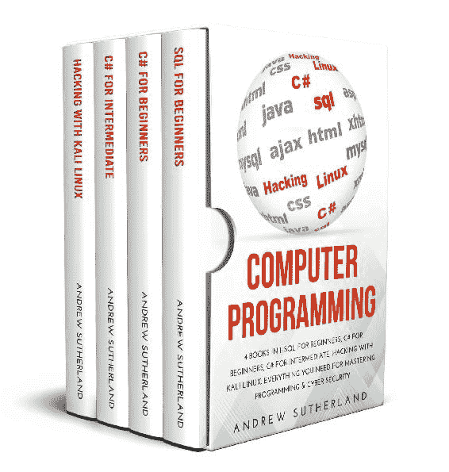

# 计算机编程：四合一：SQL 入门指南、C# 入门指南、C# 中级指南、Kali Linux 攻击实战：掌握编程与网络安全所需的一切





本书的提供唯一目的是针对特定主题提供相关信息，对于这些主题，我们已尽一切合理努力确保其准确性和合理性。尽管如此，购买本书即表示您同意：作者以及出版者无论书中可能做出任何此类声明，对于此处所包含的主题均非专家。因此，书中提出的任何建议或推荐纯粹出于娱乐价值。建议您在采取书中讨论的任何建议或技术之前，始终务必咨询专业人士。

这是一份具有约束力的声明，出版者协会委员会（Committee of Publishers Association）和美国律师协会（American Bar Association）均认为其有效且公平，并且在美国具有法律约束力。

无论信息最终以何种形式呈现，此处内容的任何内容（包括任何特定或扩展信息）的复制、传输和复制都属于非法行为。这包括在未获得出版者事先明确许可的情况下，作品的物理、数字和音频复制版本。保留所有其他权利。

此外，下文所述页面中找到的信息在叙述事实时应被认为是准确且真实的。因此，对提供信息的任何使用（无论正确否）都将使出版者免于对其直接范围之外行为承担的责任。无论如何，在任何情况下，原作者或出版者都不应对因此处讨论的任何信息可能导致的任何损害承担任何形式的责任。此外，后续页面中的信息仅供参考，因此应被视为通用的。根据其性质，这些信息的呈现不对其长期质量提供任何保证。文中提到的商标是在未经书面许可的情况下使用的，绝不视为商标持有者的背书。

## 转义序列
## 指令
## 空格
## 空指令
## 复合语句
## 表达式
## 运算符
## 赋值运算符
## 数学运算符
## 取余运算符
## 增减运算符
## 括号分级
## 比较运算符

# 第 4 章 - C# 风格规范与嵌套
## 条件运算符

# 第 5 章 - 输入/输出
## 字符串与 I/O
## 使用转义序列格式化
## 数字
## 数字的标准格式化
## 浮点数格式化
## 货币格式
## 特殊格式化
## 自定义格式化
## 0 格式化
## 交叉格式化
## 分组
## 百比格式化
## 字面量格式化
## 大小格式格式
## 格式化日期时间值
## 枚举的输出
## 比较字符串
## 插入、删除与替换
## 准备字符串

# 第 6 章 - 流控制
## 分支
## Switch 语句
## 循环
## 循环之祖先 - `goto`
## Continue 语句

# 第 7 章 - 方法、参数与变量的有效性
## 定义与调用
## 方法参数
## 定义参数
## 参数类型

# 第 8 章 - 数组
## 使用数组进行数据管理
## 排序数组
## 在排序数组中搜索
## 数组作为参数
## 复合数组
## 多维数组


## 没有多维性
## 数组数组

# 第 9 章 - 字段
### 初始化
### 作为字段的对象变量
### 常量字段

## 第 10 章 - 继承
### 继承原理
### 基本机制
### 继承的意义
### 一些重要事实
### 继承元素形成子对象
### 为什么继承元素会形成子对象？
### 三种访问级别
### 三种访问级别
### 访问隐藏元素
### 继承与嵌入
### 嵌套类

# 第 11 章 - 项目
### 代码决策
### 可选练习
### 重复代码块
### 深入了解 While
### 练习

## 类与对象
### 组织对象代码
### 通过方法提取行为
### 在方法内部返回值
### 类属性的标准值
### 命名规范
### 练习
### 类组合

## 封装与访问修饰符
### 通过自实现属性简化属性语句
### 属性的命名规范
### 练习
## 结论

# 目录

# 使用 Kali Linux 进行黑客
### 引言
### 第 1 章：Kali Linux 简介
### Kali Linux 概述
### 渗透测试简介
### 第 2 章：漏洞评估
### 漏洞评估简介
### 第 3 章：无线网络黑客
### 网络黑客简介
### 基础无线命令
### 使用 `airrack-ng` 进行 Wi-Fi 侦测
### 检测并连接蓝牙
### 无线测试实现
### 第 4 章：网络分析与管理
### 网络分析管理简介
### 第 5 章：渗透测试与 Web 安全
### 渗透测试简介
### 第 6 章：文本处理与 Bash 脚本
### 文本处理
### Bash 脚本
### 第 7 章：破解加密与网络攻击
### 破解加密
### 第 8 章：文件系统与存储设备管理
### 文件系统
###存储设备管理
### 第 9 章：变得安全与匿名
### 安全与匿名简介
### `Tor` 如何工作
### 第 10 章：高级社会工程与物理安全
### 高级社会工程与物理安全简介
### 第 11 章：黑客必备的 Python 脚本基础
### 什么是 `Python`？
### Python 基础
### Python 标准库所有
## 结论

# SQL
通过这本面向初者的全面分步指南，快速学习 SQL 编程和编码
Andrew Sutherland
© 2019 Andrew Sutherland - 版权所有。

本书的提供的唯一目的是就特定主题提供相关信息，对于该主题，我们已尽一切合理努力确保其准确性和合理性。尽管如此，购买本书即表示您同意：作者及出版者对于书中包含的主题绝非专家，无论书中是否做出了任何此类声明。因此，书中提出的任何建议或推荐纯供娱乐之用。建议您在采纳书中讨论的任何建议或技术之前，务必咨询专业人士。

这是一份具有法律约束力的声明，出版者协会委员会和美国律师协会均认为有效且公平，并在美国境内被视为具有法律约束力。

无论信息最终以何种形式呈现，此处包含的任何内容（包括任何特定或扩展信息）的复制、传输和克隆均属于非法行为。


接下来的章节将讨论 SQL 编程，它是现有的众多编程语言之一。由于学习基础知识对于每门课程都至关重要，本书将重点介绍 SQL 编程的基础要素组件。因此，你将学习到关于入门的介绍，包括主要定义以及其至关重要的原因。SQL 编程还涉及你将学习的各种优势和类型。此外，章节还提供了服务器和客户端技术的快速概述，这在学习 SQL 编程时也是至关重要的。

话虽如此，学习介绍部分将让你在学习 SQL 编程课程时处于实现目标的前沿。因此，这些章节还将讨论常用的基础命令。与其他编程语言一样，SQL 编程包含了不同的命令，但在本例中，本书将仅关注基础命令，以阐述通用概念。在做好必要的准备后，你还将学习如何创建初始数据库以及表。学习如何将所学知识付诸实践以确定其在计算机行业中的适用性，也是至关重要的。

# 第 1 章：SQL 入门介绍

结构化查询语言或 `SQL` 主要处理开发人员、分析师和管理员至关重要的数据库，这些数据库对于提供如何以组织的方式存储数据的技能至关重要。学习 `SQL` 有时可能具有挑战性，特别是当你未能投入足够的时间或采取不适当的方法时。然而，学习 `SQL` 编程将显著促进 `SQL` 领域的职业发展，因为它是目前全球最需要的技能之一。你应该理解，没有实践的 `SQL` 编程学习通常是一个失败的课程。

`SQL` 由 Ted Code 引入，后来由 Donald D. Chamberlin 和 Raymond F. Boyce 在 20 世纪 70 年代增强。最初的语言名称被称为 `SEQUEL`（结构化英语查询语言），用于帮助信息检索。该名称后来改为 `SQL`，并于 1979 年及后的几年首次投入商业。多年来，它的持续发展导致引入了更高级的 `SQL` 命令。到 1990 年，已经存在带有标准数据库语言 `SQL` 的新版本，最新版本于 2016 年发布。然而，随着时间的推移，见证了各种发展和进步，使 `SQL` 编程变得更加灵活和可靠，特别是在需要存储和快速检索信息时。

## 结构化查询语言 (SQL)

结构化查询语言或 `SQL` 是一种标准的编程工具，通常被开发人员、分析师和管理员优用于设计、创建和监督逻辑数据库。这些数据库由不同的表组成，其中包含填充数据的行或列。在每一列上，数据库或表都填充了给定一组相同数据的信息，如名称、地址、成本或其他值。另一方面，行通常包含每列信息交叉的数据值。通常，数据库大部分充满了包含对特定组织至关的数据集的表，包括用于快速检索的数据存储。由于它是计算机编程语言之一，`SQL` 是一种通用的编码编程工具，被认为是学习其他编程语言（如 `Python`）的大门。它首次引入 20 世纪 70 年代，学习者并不一定需要编程知识即可尝试学习 `SQL` 编程。当你准备好学习 `SQL` 时，始终建议从简单查询开始理解基础知识，然后再进入复杂流程。从不同的来源（包括教程）中阅读和学习，每天进步。此外，参与创建和设计不同的数据库，以在更复杂的编程实践中不断进步。

## 使用数据库的优势

### 访问方便

数据库通常容纳海量数据，可能包含数百万条特定数据。例如，当你使用其他形式的数据存储单元时，由于系统负载，检索此类信息可能会变得有些复杂。然而，`SQL` 与大多数数据库一样，提供了对特定信息的直观访问。这意味着你可以轻松地从数百万个文件中搜索所需数据，并在几秒内访问它。此外，如果某个组织的员工需要访问来自不同地区或区域的数据，他们只需要一个可靠的互联网连接并能随时访问这些信息。因此，员工在旅行或在家时可以继续处理数据工作。

### 访问限制

数据库是存储数据的本质工具，特别是当你需要创建一个平台来保护公司或其他敏感信息时。这是因为现在的数据库已变得更加安全，使得未经授权的人难以访问数据。然而，这种限制通过两种方式提供；用户可以访问数据但只能读取而不进行更改，而其他人可能可以读取并进行必要的更改。这对于员工和管理层在共享组织运行至关重要的数据时尤为关键。

### 自描述能力

数据库系统通常配备了足够的空间来创建和设计表，并对存储的每个数据提供完整的描述。例如，当将一段给信息输入系统时，数据库将提供每个组的摘要。每个数据集都将有一个描述，提供符合特定区域的数据划分。通过这种方式，数据库系统被认为是自描述的，因为它们包含了元数据描述，这对于识别特定系统中不同表中的数据和关系至关重要。

### 提供数据冗余控制

数据库通常将每个数据集存储在一个地方，作为促进数据存储的方法，特别是当需要创建有效的数据库系统时。然而，可能会出现某些数据冗余的情况以增强系统性能。数据库主要提供对数据冗余的控制，但完全由应用程序控制。通用理念是在创建和设计数据库时引入尽可能少的冗余。

### 允许数据独立性

数据库管理系统还具有数据独立性的优势，这使得元数据和其他数据描述与程序分离。这一过程之所以成为，是因为数据结构由系统单独处理，而不包含在程序中。此外，数据库允许数据事务处理，这涉及并发控制子系统。因此，这确保了数据在事务处理过程中保持有效且一致。

## 结构化查询语言命令类型

### 数据定义语言 (DDL)

这是一种允许用户开发和重构物理数据库结构的命令类型，执行时会立即生效更改。该类型中最常用的命令包括 `CREATE`、`ALTER` 和 `DROP TABLE`、`CREATE INDEX` 以及 `CREATE VIEW` 等。这些命令通常关注表的定义，尤其是在设计或对整个数据库系统进行其他更改时。

### 数据操纵语言 (DML)


这是一条对表格内值、对象和图形进行更改的命令，主要用于关注数据集中的错误时。DML（数据操作语言）通常在创建表格并通过 DDL 命令设计数据库后执行。使用的命令包括 `INSERT`、`UPDATE` 和 `DELETE`。此外，这些命令是其中最有益的命令之一，特别是在数据库管理系统中进行更改时。

### 数据控制语言 (DCL)

数据控制命令是一种 SQL 语句，允许用户快速访问存储在数据库系统中的信息。`ALTER PASSWORD`、`GRANT`、`REVOKE` 和 `CREATE SYNONYM` 是数据管理中至关重要的常用命令。此外，DCL 在处理与数据控制相关的事务也至关重要，包括控制用户相应地访问数据库系统。

### 数据查询语言 (DQL)

这是一种 SQL 查询，虽然仅包含一个命令，但在今天被广泛使用，因为它与其他 SQL 函数结合，在给定的参数下从特定表中检索和收集数据。`SELECT` 命令与 SQL 的其他选项和子句配合良好，可以处理所有简单或复杂的查询。此外，数据查询语言命令也适用于模糊和特定的数据集。

### 事务控制命令

顾如名称，此命令允许管理任何数据库系统中涉及数据事务的问题和查询。事务控制语言通常用于在需要的地方进行更改，并使用“撤销（undo）”和“应用（apply）”选项进行更改。使用的命令包括 `COMMIT`、`ROLLBACK`、`SAVEPOINT` 和 `SET TRANSACTION`。因此，在 SQL 编程中使用命令时，进行更改和修改不会出现任何显著的。

### 服务器与客户端技术

服务器和客户端技术是将程序或应用程序的特定功能分离到两个或多个部分的能力，提供了计算机之间的关系。换句话说，一个程序（客户端）向两个或多个处理器（服务器）发送请求，并且它们遵循该应用程序。在这种情况下，客户端可以从主桌面计算机访问、展示并修改这些数据。另一方面，服务器作为存储单元，为客户端提供受保护的数据。因此，服务器和客户端技术创建了一种网络结构，数据可以以最小压力检索，特别是在需要提供所需信息时。

然而，当客户端严重依赖服务器供应或相关组件（如文件和设备）以及处理能力时，就产生了相互连接。因此，服务器是强大的计算机系统，适用于以磁盘驱动器、打印和网络服务器的形式处理文件服务器。客户端通常是运行应用程序的工作站或 PC。该模型通常通过计算机网络实现，在分离的硬件上运行活动且分区的负载系统。尽管如此，客户端并不共享资源，而是与服务器通信以获取内容或其他服务功能。

# 第 2 章：基础 SQL 命令

如前所述，SQL 使用特定的命令来控制数据库系统中的表，特别是在处理带有大数据的多个表时。每个表通常由给名称定义，例如 customers（客户）或 orders（订单）。应该知道，所有的函数或命令都是通过 SQL 语句完成的。此外，SQL 语句以及关键字对大小不敏感，某些数据库可能要求将分号作为语句的标准格式。因此，SQL 语句包括 `SELECT`、`UPDATE`、`DELETE`、`INSERT INTO` 等。

## SELECT

像大多数计算机命令一样，`SELECT` 主要用于查询数据库以及检索匹配指定参数的预期数据。例如，`SELECT column1 [, column2, …], FROM (table name), WHERE (condition)`。在编写 `SELECT` 命令时，您可以使用条件子句，如等于 (`=`)、大于 (`>`)、小于 (`<`)、大于或等于 (`>=`)、小于或等于 (`<=`)、不等于 (`<>`) 和 `LIKE`。当您写 `SELECT * FROM (table_name)` 时，它会立即返回表中的所有数据，有时会在文本周围加上引号。然而，不要用引号括住数学对象。使用 `LIKE` 时，确保它匹配模式，特别是在涉及使用 (`%`) 时，它在 SQL 编程中表示 0。例如，`'A%'` 类似于所有以 A 为首字母的字符串，而 `'%a'` 匹配以 a 结尾的数据。同样，`'%a%'` 匹配给定表或数据库值或信息之间包含 'a' 的字符串或数据。

## UPDATE

当表中存在预存值且需要更改它们时，就会使用 `UPDATE` 命令。该命令使用函数 `UPDATE (table_name), SET colX=valX [, colY=valY,…], WHERE (condition)`。当需要更改、修改或编辑给定表中的行时，适用于此类 SQL 命令，从而创建了数据库系统管理更重要的过程。在某些情况下，可以修改特定行，而不会对相似列中的数据产生任何影响。

## DELETE

顾如名称，这是计算中用于从系统中删除不需要的、重复或未使用的数据的术语。同样，SQL 也利用类似的函数作为命令，从系统中的给定表中删除不需要的记录。在这种情况下，它使用 `DELETE FROM (table_name), WHERE (conditions)` 特性，文件将被成功删除。您还可以使用函数 `DELETE * FROM (table_name)` 在不删除表的情况下清除整个信息。因此，在删除记录时，设置的指定范围或条件决定了您要删除的内容范围。然而，如果由于错误和未指定的参数而删除了重要数据，某些条件可能会损害数据。

## INSERT

当表创建后（即已按要求指定列和行），数据就会被输入系统。然而，在每个列和行中逐个输入信息通常是挑战性的，特别是当数据量很大时。这可能会导致未被察觉的错误，从而影响未来。因此，SQL 使用 `INSERT VALUE`（也称为 `INSERT INTO` 命令）将数据输入表以及所需的列和行中。编程语言使用函数 `INSERT INTO (table_name), (col1,…….., coln), VALUES (val1,….,valn)` 来插入值。`'n'` 表示表中最后一列的数量，之前的值将添加到此处。在这种情况下，向表中插入值变得简单、快速，并防止了由于稀疏数据输入格式出现的情况。

## CREATE TABLE

`CREATE TABLE` 子句是 SQL 的另一个基础命令，用于开发插入所需信息的表。使用的函数是 `CREATE TABLE (table_name), (column1 data type, column2 data type, column3 data type,...)`。在创建表时，还有其他考虑因素，包括用于固定长度字符的 char、带大小的 varchar、具有最大列值的 number 以及数据值。由于数据库系统由多个表组成，您可以在特定数据库中添加更多表并插入您的值。

## ALTER TABLE


在某些情况下，你可能创建了一个列数较多或较少的表格，因此需要删除或添加。因此，SQL 提供了一句查询，允许你快速从现有表中删除列或添加列，只需指定数据类型以及要添加或删除的列数。这种情况下使用的格式为 `ALTER TABLE (table_name), DROP COLUMN colname`。即：指定要添加或删除列的表名，然后设置你想要修改的数据类型和目标列的参数。

## DROP TABLE

SQL 中另一个必要的命令是用于在不再需要表或需要创建新表时，从数据库中删除整个表。也就是说，SQL 允许你使用 `DELETE * FROM (table_name)` 命令并删除指定的表。作为 SQL 的基础命令，`DROP TABLE` 是至关重要的，尤其是当你想要另一个与之前的表有显著差异且具有最新信息的表时。

## CREATE INDEX and DROP INDEX

SQL 中的另一个典型命令是创建索引，这对于数据库来说也是至关重要的。当你想要创建一个索引时，它涉及开发一个搜索键，以便快速搜索和检索数据的过程。与 `DROP TABLE` 命令一样，`DROP INDEX` 意味着从数据库中删除现有索引并开发新索引。

## CREATE VIEW

作为 SQL `SELECT` 的结果，`CREATE VIEW` 是另一个命令或查询，它包含一个虚拟表，但字段来自数据库系统中的多个表。由于其值与原始表相似，视图表旨在提供数据库中一个或多个表中存储信息的预览。因此，视图或虚拟表可以被视为一张真实的表。使用的函数是 `CREATE TABLE view_name AS, SELECT col_name(s), FROM table_name, WHERE (condition)`。视图表可以在命令、存储过程和其他类似的命令中使用。如是，这有助于添加更多功能并将其链接起来的过程，从而向用户呈现必要的数据。

## GROUP BY

`GROUP BY` 是一个较新的命令，用于方便按列值对搜索聚合结果进行分组。换句话说，`GROUP BY` 允许数据库根据用户强调的相似性，将数据分组到给定的列中。使用的格式包括：`SELECT col_name, function (col_name) FROM table_name GROUP BY col_name`。然而，在该命令中，`WHERE` 关键字被 `HAVING` 取替，后者引出了条件。因此，使用的函数是 `SELECT col_name, function (col_name) FROM table_name, GROUP BY col_name, HAVING function (col_name) conditions data`。在这种情况下，用户能够根据其需求对列分组。

## JOIN

数据可能分布在单个数据库的不同表中；因此，你可能希望将这些数据汇总到一个表中。单个数据库下的表通常通过键键建立连接，因此关联不同表之间的数据变得容易。因此，表可以通过 SQL 编程中的连接（join）过程链接在一起。例如，如果你有三个相互连接的表，如客户、订单和产品供应，那么你可以使用 `JOIN` 命令将它们连接起来。如是，使用命令 `SELECT customer_name, product name, FROM customer_name, order, product supply, WHERE customer = orders = product supply`。此外，该命令还允许使用 `INNER JOIN` 选择两个表，以及 `LEFT JOIN` 返回初始表的所有行。

## CREATE DATABASE and ALTER DATABASE

在使用 SQL 编程工具时，你可以使用必要的命令 `CREATE DATABASE` 选择创建多个数据库。该命令可以快速整合一个新数据库，个人可以在其内部开发和设计多个表。通常情况下，你可能会创建一个数据库，然后继续对表进行更改和修改。要修改 SQL 数据库，你可以使用 `ALTER DATABASE` 语句，它可以随时修改系统。

## 其他基础 SQL 命令

`ORDER BY` 是另一个根据用户需要对列名排序的子句，使用命令 `ORDER BY col_name ASC` 表示升序，`DESC` 表示降序。还有 `IN`、`AND/OR`、`BETWEEN`。所有这些函数对于操作表中的值都至关重要。例如，`IN` 对于返回已知值至关重要，格式为 `SELECT * FROM table_name WHERE col_name IN (val1, val2、……)`。`BETWEEN` 和 `AND` 对于提供两个值之间的范围至关重要，使用函数 `SELECT * FROM table_name WHERE col_name BETWEEN val1 AND val2`。`AND/OR` 可用于连接两个或多个值或条件，使用 `WHERE`、`AND` 和 `OR` 格式来确定其可行性。

# 第 3 章：创建你的第一个数据库和表

在 SQL 编程中拥有具有实用表的成功数据库之前，需要先创建数据库，然后创建表。尽管市上有许多种 SQL 数据应用程序软件，但它们在创建新数据库和表的步骤上几乎完全相同。当你创建第一个数据库系统时，你必须设计一个表，并在其中输入数据并更安全、更有效地存储它们。SQL 提供了一个免费的图形用户界面，并且易于创建。以下是在考虑输入数据之前，如何创建第一个 SQL 数据库和表的逐步操作指南。

## 步骤

### 步骤 1：安装 SQL Server Management Studio 软件

创建第一个数据库和表的第一步是从微软在线免费获取 SQL 软件。该软件功能完备，允许你通过有限的命令行指令与 SQL 服务器进行交互和管理。此外，当在偏远地区使用数据库时，这至关重要。然而，Mac 用户可以使用开源程序，例如 `SQuirrel SQL` 来操作数据库系统。

### 步骤 2：启动 SQL 工作室

当你启动 SQL 工作室时，软件最初会偶尔请求一个你希望一直使用的服务器或你目前正在使用的服务器。如果你已经有一个现有的服务器，可以选择输入权限、进行身份验证并连接。有些人可能倾向于通过设置新名称并使用首选名称或地址使用本地数据库系统。启动 SQL Server Management Studio 就开始了与软件交互的过程并通了创建你第一个数据库和表的路径。

### 步骤 3：识别数据库文件夹

在本地或远程连接建立后，屏幕左侧会打开一个窗口。在顶部将有一个它要连接的服务器。如果没有，你可以点击图标 `+`，它将显示多个元素，包括创建新数据库的选项。在某些版本中，你可能会直接在左侧的下拉窗口中看到创建新数据库的图标。然后你就可以点击 `Create New Database`。

### 步骤 4：创建一个新数据库

如步骤 3 所示，下拉菜单将完整显示多个选项，包括创建新数据库的选项。首先，你将根据你的参数配置数据库，并提供名称以便识别。大多数用户倾向于保持默认设置，但如果你熟悉它们如何影响你在系统中的数据存储过程，也可以更改它们。注意，当你创建数据库名称时，将自动生成数据文件和日志文件。数据文件负责存储数据，而日志文件则跟踪数据库中进行的所有更改、修改和其他变动。

### 步骤 5：创建你的表


数据库通常不会存储数据，除非为行和表格的形式创建结构以保持数据组织整齐。表格是存储数据的主要存储单元，但在插入信息之前，你必须先创建表。与创建新数据库类似，创建表也非常直观。在 `Databases` 文件夹中，展开 `Window`，然后右键点击 `Tables` 并选择‘New Table’。窗口将打开，显示出一个表格，你可以根据行数、列数、标题以及你想要组织工作的方式轻松地对其进行操作。在这一步中，你将成功创建数据库和表，从而推进你的任务组织工作。

### 第 6 步：开发主键
主键在数据库中起着重要作用，因为它充当记录编号或 ID，方便在稍后查看页面时进行识别和记忆。因此，强烈建议在第一列创建这些键值。有很多方法可以实现这一点，包括在列字段中输入 `int` 并取消勾选“Allow Nulls”。选择工具栏上的键值图标并将其标记为 `Primary key`。

### 第 7 步：构建表结构
表格通常有多个列（也称为字段），每一列代表数据条目的一个元素。在创建表时，你最初对其进行结构以适应数据条目的数量，因此对于每个数据集与其他主键一样至关重要。因此，结构化过程将涉及根据给定的数据集识别每一列。例如，`FirstName` 列、`Last name` 列和 `address` 列等。

### 第 8 步：创建其他列
在你创建完主键列后，你会发现下方出现了更多的列。这些列不是用于主键的，但对于插入其他信息至关重要。因此，确保为每列输入正确的数据，以避免向表中填入错误信息。在列中，你将输入 `'nchar,'`（文本数据类型）、`'int'`（用于整数）以及 `'decimal'`（用于小数）。

### 第 9 步：保存表格
在完成每个字段内容的创建后，你会发现你的表格由行和列组成。然而，在输入信息之前，你需要先保存表格。这可以通过选择工具栏上的保存图标并为你的表命名来实现。在命名表时，确保你创建一个可以与内容轻松关联或识别的名称。此外，具有不同表的数据库应该有不同的名称，以便于识别。

### 第 10 步：添加数据
表格保存后，你现在可以将数据添加到系统中，为每个字段馈送相关信息。不过，你可以通过展开 `Tables Folder` 并尝试查看我们的表名是否在列表中来确认表已保存。如果没有，使用 `Table Folder` 刷新表格，你就能看到你的表。回到表格，右键点击表，将出现下拉对话框，并选择‘Edit Top 200 Rows’。窗口将显示字段供你添加数据，但请忽略主键，因为它们将自动填充。继续相同的过程，直到你在表中输入了最后一条数据。

### 第 11 步：运行表格
在完成表格操作后，你需要保存内容以防丢失工作。由于表格已经保存，当你完成数据输入后，点击工具栏上的‘Execute SQL’，它将执行执行将你输入的每条数据填充到列的过程。解析过程可能需要几秒钟，取决于数据量。如果在填充过程中出现任何错误，系统将向你显示输入数据错误的地方。此外，你可以使用'ctrl'和'R'组合键来执行所有数据的程序解析。

### 第 12 步：数据查询
在这一步中，你创建了第一个数据库和表，并通过 SQL 语言编程成功保存了信息。数据库现在已完全功能化，从以后你可以在单个数据库中创建更多表。然而，每个数据库的表数量有限制，但许多用户并不担心这个规则。因此，你可以创建你想要的新数据库系统并创建更多表。在最后，你可以查询数据以用于报告或任何相关目的，例如组织或管理目的。通常情况下，对 SQL 编程有一个通用的了解，特别是在创建数据库和表的实践中，这可以让你提升自己的学习技能。

## 使用命令行创建你的第一个数据库和表
正如上一章所讨论的，你也可以使用 SQL 命令和语句来创建数据库和表。这适用于 SQL Server Management Studio，类似于上述指南，但命令和语句用于向系统发出指令以执行特定功能。要构建你的第一个数据库，你使用命令 `SELECT DATABASE (database_name)` 并点击执行按钮来创建程序。因此，屏幕上的消息应为‘Command(s) completed successfully’，表示你的数据库已创建。

关于使用数据库，运行命令 `USE (database_name),`，这告诉查询窗口运行新的数据库程序。另一方面，创建新表涉及运行命令 `CREATE TABLE (table_name).`。输入数据遵循命令 `INSERT DATA INTO (table_name), VALUES (table_name),` 并对你拥的所有数据集重复相同的过程。同样的方法允许你查看保存的数据，并包括命令格式 `SELECT * FROM (table_name).`。上述所有命令在操作不同的 SQL 数据库时都是关键的。因此，学习每个 SQL 基础命令以随时执行程序是至关重要的。

# 第 4 章：在 SQL 编程中插入、更新和删除数据
技术世界关于数据的炒作太多了。然而，原始数据本身并没有那么有用。SQL 的读音为 "sequel"。它代表结构化查询语言（Structured Query Language）。它通常是一种允许通过数据库进行通信的语言。这样做是为了轻松管理数据库中包含的所有数据。

在现代，大多数企业（无论大小公司）在运营过程中都会使用数据。所有使用的数据都通过数据库进行管理。由于这个原因，对数据库管理专家的需求非常高。基本上，熟练数据库开发证明 SQL 开发是至关重要的。

数据仍然是许多移动应用程序和 Web 应用程序的核心。例如，Facebook 应用程序持有用户资料信息以及其帖子和朋友的数据。为了维护此类数据，应用了数据库系统。因此，结构化查询语言是允许程序员处理可用数据的编程语言之一。

通常，数据库的设计并不是为了理解其他编程语言的。它们只认识 SQL 编程语言。对于那些打算应用开发和 Web 开发的人来说，学习 SQL 编程语言是必须的。像所有编程语言一样，SQL 有其典型的标记。由于由于，程序员在应用程序中有效使用它之前，有必要熟悉 SQL 标记。

此外，SQL 编程由于其表格概念具有另一个独特特征。每个数据库可以表示为一定数量的表。每个表通常有几行几列，作为数据集的表示。表允许程序员存储他们所需的所有信息。


有几个 SQL 命令被频繁使用。程序员必须熟悉这些用于数据库工作的命令。程序员需要编写的某些命令包括：

- `CREATE DATABASE`: 允许创建数据库
- `CREATE TABLE`: 允许创建表
- `SELECT`: 程序员在从数据库中查找并提取数据时使用。
- `UPDATE`: 帮助对数据进行调整和编辑。
- `DELETE`: 在删除数据时编写。

除了上述最常用的命令外，其他复杂的命令取决于数据库的复杂性。这意味着数据库越复杂，程序员预计需要使用的命令数量也随之增加。这些命令在编写查询时随时都会用到。它们被称为查询，允许程序员操作数据库中存在的数据。

通俗地说，当在数据库系统内输入命令时，系统会对其进行解释和处理。结果例如，在数据库中产生新记录，或者创建了新数据库。在大多数情况下，初始查询负责创建一个新数据库。

SQL 编程语言分为几个语言元素；它们包括：

- `Clauses` (子句): 它们是查询和语句的组成元素。在某些情况下，规定是可选的。
- `Expressions` (表达式): 它们产生标量值或由包含数据的行和列组成的表。
- `Predicates` (谓词): 它们作为经过评估的 SQL 3VL（三值逻辑）的条件的规范。它们也可以以布尔真值的形式存在。它们用于限制查询和语句带来的影响。它们还用于改变程序的执行流。
- `Queries` (查询): 在根据指定标准检索数据时使用。查询是 SQL 的核心元素。
- `Statements` (语句): 它们对数据和模式产生一致的影响。它们还控制程序流、诊断、事务、会话和连接。SQL 编程中的所有语句都包含分号，它是语句结束的符号。然而，在每个平台上分号并不是必须的。它是 SQL 语言的标准部分之一。
- `Insignificant Whitespace` (无关空白): 在大多数情况下，它在 SQL 查询和语句会被忽略。这使得 SQL 的格式化更加简单并增强了语言的可读性。

## 插入、更新和删除数据

在本节中，主题将是如何向数据库中添加新记录、如何更新现有文件，以及如何删除不再需要或使用的数据。插入数据是最简单的任务之一。这是因为它从插入单行的简单问题开始的。在许多情况下，创建新行时，使用基于集合的方法是高效的。在这种情况下，作为程序员，你会发现许多技术可以帮助你同时插入多行。

与插入类似，更新和删除也是从简单任务开始的。程序员可以更新单条记录并删除单条记录。可以使用一些复杂的方法同时更新多个文件。同样，在 SQL 编程中有许多方法可以删除数据。例如，可以根据某些行在另一个表中是否存在，来删除表中的整行。

SQL 还有新的额外方法，允许程序员同时进行插入、更新和删除操作。这是 SQL 编程语言提供的最佳功能之一。

### 插入新数据

问题：在此处，程序员想要向给定的表添加一条新记录。在这种情况下，程序员在向表中插入数据时使用 `INSERT` 语句。`INSERT` 语句也称为 `INSERT INTO` 语句。它用于向表中插入单行或多行。

SQL `INSERT` 语句用于向表中插入单行。下面是一个用于向已存在的表插入一行的 `INSERT` 语句示例。

```sql
INSERT INTO table (column1, column2…)
VALUES (value1, value1,...)
```

向表中插入行时，程序员需要提供三个规范。首先是他们想要插入新行的表，位于 `INSERT`, `INTO` 子句中。其次是表中由逗号分隔并用括号括起来列列表。第三是值代码内部用括号括起来由命令分隔的值列表。用于列的列表元素数量应与值列表中的元素相似。如果不匹配，SQL 数据库引擎通常会发出错误。

一个示例是使用 `INSERT` 语句向发货商表插入新行。

```sql
INSERT INTO shippers (company name, phone.)
VALUES (Alliance Shippers’, 1-680-199-6)
```

两个常量 `Alliance Shippers` 和 `1-680-199-6` 在 `VALUE` 子句中被标识出来。SQL 引擎分别将它们插入到 `company name` 和 `phone` 列中。语句执行后，数据库中的服务器会返回一条消息。该消息有助于指示受影响的行数。在这种情况下，程序员会收到“1 row affected”（影响 1 行）的消息。这条消息告诉程序员已成功插入了一条新行。

列列表中没有指定发货商 ID 列。这是因为用于发货商 ID 的列是 `AUTOINCREMENT` 列。每当向现有表插入新行时，数据库引擎都会自动生成下一个序列。

SQL 编程为程序员提供了一种更短的 `INSERT` 语句形式，以便编写更代码。

```sql
INSERT INTO table
VALUES (value1, value2,...)
```

当应用此形式时，用于值的列表顺序应该与表中列的列表顺序相似。当程序员使用 `INSERT INTO` 语句时，除了 `AUTOINCREMENT` 列外，他们为所有列提供值。在 `INSERT` 语句中使用列名的最佳用处是，它有助于提高代码的可维护性。

SQL `INSERT` 语句还允许程序员向现有表插入多行。可以使用一个语句添加这些行。

```sql
INSERT INTO table- name (column 1,column2,...)
VALUES (value1, value2 …)
```

在这种形式下，程序员需要提供多个值列表，每个列表之间用逗号分隔。下面是一个用于向发货商表插入两行的 `INSERT` 语句示例。

```sql
INSERT INTO shippers (company name, phone number)
VALUES (ALL, 1-400-670-7569’), (DHL’, 1-400-522-5435’)
```

SQL `INSERT` 语句还可以用于复制数据表。除了提供值列表规范外，程序员还可以利用 `SELECT` 语句从其他表中选择值并将其提供给 `INSERT` 语句。在这种情况下，程序员可以轻松将数据从一个特定表复制到另一个表。

程序员还可以阻止用户或违规软件应用程序向表中的特定列插入新值。在这种情况下，程序员会在特定表上创建一个视图，仅暴露他们想要挖掘的列。所有插入操作都将强制通过该视图进行。仅允许合格的用户和软件访问。

### 在 SQL 编程中更新数据

SQL `UPDATE` 语句用于更新 SQL 表中的现有数据。它用于更改表中存在的单行或多行中的现有数据。下面是一个 `UPDATE` 语句的插图。

```sql
UPDATE table
SET
    Column1= new_value1,
    Column2= new_value2,
WHERE
    Condition;
```


在更新表中的数据时，要求程序员首先必须在 `UPDATE` 子句中指定他们想要更改数据的表名规范。其次，为要更新的列分配新值。当程序员想要更新多个列中存在的数据时，使用每一个 `column= value` 键值对并用逗号分隔这两个值对。第三，程序员应该考虑在 `WHERE` 子句中指定要更新的行。`WHERE` 子句是可选的，如果省略，则表中的所有现有行都将被更新。

SQL 引擎在语句执行后会发布消息，指定受影响的行数。以下是 SQL `UPDATE` 语句的一些示例。我们可以以一个 ID 为 3 的员工 Juliet 为例，她结婚了。雇主需要更改她在表中的姓氏。Juliet 的现有记录名称可能如下：

```
SELECT Employed, Lastname, first name
FROM Alliance-ph. Employees
WHERE EMPLOYEE ID = 3 Jolie Juliet
```

`UPDATE` 语句将帮助把 Juliet 的姓氏从 Jolie 改为 Francis：

```sql
UPDATE employees
SET Lastname = Francis
WHERE EmployeeID = 3
```

执行 `SELECT` 语句是为了帮助验证将发生的更改，如下：

```
Employee id last name first name
3 Francis Juliet
```

## SQL 更新多个列

在某些情况下，程序员需要更新存在于各个列中的数据。例如，在上述 Juliet 的案例中，她在结婚后搬新家。这意味着原始记录中填充的地址将发生变化。`UPDATE` 语句用法如下：

```sql
UPDATE employees
SET Address = ‘1200 Carter St’,
    City = New York,
    Postalcode = 4093,
    Region = CA
WHERE EmployeeID = 3
```

## 从 SQL 表中删除数据

当程序员想要删除表中的现有数据时，使用 SQL `DELETE` 语句。要成功使用 SQL `DELETE` 语句，人们首先需要在 `DELETE FROM` 子句中提出要移除数据的表。然后应该在 `WHERE` 子句中设置条件，以指定要删除的行。如果省略 `WHERE` 子句，表中的每一行都将被删除。程序员也可以删除表中现有的所有行，而不一定需要删除该表本身。

# 第 5 章：SQL 编程中的表修改与控制

## 修改表

在许多情况下，新创建的 SQL 数据库表需要进行微调。例如，当程序员为他人工作时，客户可能在数据库表创建后来找他们要求跟踪其他数据项。这意味着程序员将不得不回到起点。当人们为自己使用构建数据库时，在结构创建后，结构中的某些缺陷可能会非常明显。例如，人们可能会收到来自不同国家的建议，并被要求添加县级列。这时程序员需要对他们的表进行一些修改了。

### SQL 表结构的简单修改

SQL 数据库用于存储表中的关系和数据。表内部的更改可能会经常发生。这些更改是为了满足新需求或遗漏的需求。所有 SQL 表的结构化方式都是可以被修改的。SQL 表结构的修改取决于其复杂性；这意味着某些可能比其他一些更容易。以下是对 SQL 表结构更改的精确分析。

所有 SQL 数据库都使用称为“表”（tables）的容器作为数据以及这些数据之间关系的存储。每个表中都存在几行。它们也被称为元组（tuples），所有相关数据都存储其中。SQL 数据库表中的每一行通常由列（columns）组成。这些列也被称为字段（fields）。每一列存储原始数据内容。随着时间的推移，表的结构可能会发生变化。对于公司来说，由于业务扩展，供应商 ID 可能需要增加。因此，供应商的数量可能需要提高，这要求对 SQL 数据库表结构进行一些更改。

对表进行进行的一些标准通用修改包括：

- 对表中的列进行更改——这可能涉及更改、添加或删除列的类型或大小。
- 对约束以及适用于表或表之间关系的规则进行更改。
- 更改存储在表中的数据值。这可能涉及添加新记录、删除新文件或更改已存在文档的值。然而，这不包括 SQL 数据库表结构的修改。

许多 SQL 实现提供了两种可用于在 SQL 表内修改的选项。其中一种替代方案要求人们使用 SQL 语句。第二种方案要求人们使用 SQL 实现提供的 GUI 工具。

以下是人们可以遵循以成功添加新行并增强更改容纳能力的某些步骤。程序员应该打开他们的初始表并妥善地遵循每一步。

在显示表创建的窗口中，应该在 `City` 字段左侧的小型彩色方块内点击右键。这有助于选择行。然后从弹出的菜单中选择 `Insert Rows`（插入行）。光标位置上方将出现一个空行并将现有的每一行向下推。

其次，要求人们输入他们想要添加到现有表中的字段。例如，可以在 `Country` 和 `County` 字段上方添加一个 `Address3` 区域。

最后一步是确保修改完成后保存表。这是关闭表之前至关重要的一步。它有助于确保所进行的所有更改都按要求得到了保护。

`SQL ALTER TABLE` 语句用于 SQL 编程中添加、删除或修改现有表。它还用于向 SQL 现有表中删除和添加某些约束。

`ALTER TABLE- ADD Column` 用于向现有表添加列。在此过程中使用了以下语法：它是对当前表可以进行的的最简单直接的修改之一。该操作被认为是没有潜在风险的。这是因为它不依赖于现有数据库中的其他元素。

```sql
ALTER TABLE table_name
ADD column_name datatype;
```

当向 `customers` 表中添加 `Email` 列时，使用以下 SQL：

```sql
ALTER TABLE Customers
ADD Email varchar (255)
```

`ALTER TABLE- DROP COLUMN` 用于删除表中的列。某些数据库不允许删除列。对于允许此类操作的数据库，使用以下语法：

```sql
ALTER TABLE table_name
DROP COLUMN column_name;
```

当从现有 `customers` 表中删除 `Email` 列时，使用以下 SQL：

```sql
ALTER TABLE Customers
DROP COLUMN Email;
```

`ALTER TABLE- ALTER/ MODIFY COLUMN` 用于更改列中存在的数据类型。SQL Server/MS Access 是此类情况下使用的语法。它们以以下方式应用：

```sql
ALTER TABLE table_name
ALTER COLUMN column_ name datatype
```


对字段结构进行某些更改需要充分的准备。这是因为在特定字段需要收缩的情况下，必须遵循基本的预防措施。这些预防措施有助于确保字段中已存在的数据不会因为更改而被篡改。当更改数值字段格式时，可能会出现不准确或精度丢失。在大多数情况下，如果发生任何篡改，`SQL` 系统会发送警告，如果更改影响了数据类型，更改可能不会发生。

## 修改和删除约束

在某些数据库中，主要为表定义了约束或规则。因此，这意味着要成功进行修改，需要充分的准备并制定大量的计划和付出努力。这是因为在大多数情况下，所做的调整可能会影响到其他表。

从现有表中删除列会对数据库的完整性产生某些不利影响。这主要发生在被删除的字段是其他表引用的外键或主键时。删除该区域的过程可能具有挑战性。要克服这一点，程序员需要充分的准备并遵循所有必要的步骤。人们还应该考虑熟通 `SQL` 编程语言，以确保他们能够处理所需的各项任务。

# 第 6 章：使用子查询

在 `SQL` 编程中，子查询也被称为嵌套查询或内部查询。子查询被定义为其他 `SQL` 查询中的查询。它们通常嵌入在 `WHERE` 子句中。

子查询目的是返回数据，这些数据将用于主查询中作为进一步限制所检索数据的条件。子查询可以与 `SELECT`、`INSERT`、`UPDATE` 和 `DELETE` 语句配合使用。它们还可以与 `IN`、`=`、`>=` 和 `BETWEEN` 等运算符一起使用。

子查询遵循某些规则，包括：

- 所有子查询都应该封装在括号内
- 每个子查询在 `SELECT` 子句中只能包含一列。除非主查询中存在许多列供子查询比较其所选列，否则这是不可能的。
- 返回多行的子查询只能与多个值运算符一起联用。此类运算符包括 `IN` 运算符。
- `SELECT` 列表不能包含任何评估为 `CLOB`、`ARRAY`、`NCLOB` 或 `BLOB` 的引用。
- 子查询无法封装在函数中。
- `BETWEEN` 运算符不适用于子查询。然而，`BETWEEN` 运算符可以在子查询中使用。
- 在最常见的情况下，子查询与 `SELECT` 语句配合使用。也有情况子查询与 `INSERT` 语句一起使用。`INSERT` 语句利用从子查询返回的数据。这些数据用于插入到其他表中。子查询中选择的数据使用不同的字符、日期和数字函数进行修改。

子查询也与 `UPDATE` 语句配合使用。表中的一个或多个列通过子查询连同 `UPDATE` 语句进行更新。子查询也适用于 `DELETE` 语句。在这种情况下，它们被用于删除现有表中不再有价值的记录。当两者一起使用时，它们会对现有表的列和行产生一些变化。

子查询的使用没有指定的语法。然而，在大多数情况下，子查询如下所示与 `SELECT` 语句一起使用。

```sql
SELECT column_name
FROM table_name
WHERE column_name
    Expression operator
        (SELECT COLUMN_ NAME from TABLE NAME WHERE…)
```

## SQL Server 子查询

程序员理解 `SQL Server` 子查询以及如何使用子查询查询数据是关重要的。`SQL` 服务器有助于执行整个查询。在客户表的情况下，它首先列出客户 ID 列表。然后，它通过 `IN` 运算符内的子查询返回的标识码进行替换。然后，它执行外部查询以帮助获取最终结果集。

使用子查询可以帮助程序员将两个或多个步骤连接在一起。这是因为它们消除了选择客户 ID 并将其插入外部查询的需求。此外，每当客户数据发生变化时，查询本身会自动调整。

子查询也可以嵌套在其他子查询中。`SQL` 编程服务器支持超过 30 层的嵌套。`SQL server` 子查询被用于表达式。当子查询返回单个值时，它们可以用任何使用表达式的地方。`SQL server` 子查询与 `IN` 运算符配合使用。与此运算符使用的子查询通常返回零或多个值集。外部查询利用中心子查询回答的值。

`SQL server` 子查询也与 `ANY` 运算符一起。使用 `ANY` 运算符的子查询通常具有以下语法：

```sql
Scalar_expression
Comparison_operator ANY
(subquery)
```

当子查询返回如 `v1`、`v2`、`v3` 等值列表时，如果有一对比较成功，`ANY` 运算符语句通常返回 `TRUE`，否则返回 `FALSE`。另一方面，`ALL` 运算符在所有比较配对时返回 `TRUE`，在不时不返回 `FALSE`。`EXISTS` 运算符在子查询返回结果时返回 `TRUE`，不在时不返回 `FALSE`。

## 在 SQL 编程中创建新数据库

在 `SQL` 编程中创建数据库时，初始查询负责创建新数据库。最好的例子之一是 Facebook 应用。该应用程序包含以下所有组件的数据库：

- **用户 (Users)**：这是 Facebook 上的数据库，用于存储用户资料上的所有信息。它在用户将其信息上传到账户时存储所有细节。
- **兴趣 (Interests)**：Facebook 上的数据库有助于持有用户的各种兴趣。这些兴趣在追踪用户的爱好和才华时被应用。
- **地理位置 (Geographic Locations)**：这是一个存储宇宙中任何用户居住的每个城市的数据库。

创建数据库时的第二个查询负责在特定数据库内创建新表。

## 使用 SQL 编程的行业

`SQL` 编程数据库被广泛应用于使用大量数据的技术领域。一些最常见的部门是金融、音乐应用程序和社交媒体平台行业。

在金融行业中，`SQL` 主要用于支付处理器和银行应用程序。它们包括 `Stripe`，其运营并存储涉及重大财务交易以及用户的数据。所有这些过程都有复杂数据库的支持。银行数据库系统通常需要最高的安全性。因此，这就是所应用的 `SQL` 代码具有最高水平和风险合规能力的原因之一。

如 `Pandora` 和 `Spotify` 等音乐应用程序也需要使用密集数据库。这些数据库起着重要作用，因为它们帮助应用程序存储由音乐专辑和文件组成的大库。存储在其中的音乐来自不同的艺术家。因此，这些数据库被用于查找用户试图寻找的内容，存储关于特定用户及其偏好和兴趣的数据。


社交媒体平台是常用 `SQL` 编程的其它行业。这是因为它们需要多次数据处理。一些如 Snapchat、Facebook 和 Instagram 等社交媒体应用正在使用 `SQL` 来增强其用户个人信息的存储。这些信息包括个人简介、位置和兴趣。`SQL` 也应用于这些应用程序中，以便在用户发布新帖子或分享照片时，随时高效地更新应用程序数据库。它还可以记录通常从一个用户发送到另一个用户的消息。通过这种方式，它可以帮助用户检索并在将来重新阅读发布的消息。

## 常见的 SQL 数据库系统

`SQL` 数据库系统通常根据 DB-Engines 的流行度评分进行排名。以下是排名时考虑的一些变量。

- 系统在网站上被提到的次数。这通过搜索引擎查询结果来衡量。
- 对该系统的总体关注度。这考虑了它在 `Google Trends` 中被搜索的频率。
- 对特定数据库系统技术讨论的频率。
- 提到该数据库系统的职位招聘数量。
- 在专业网络中提到该系统的个人资料数量。

## 数据库系统与社交网络的相关性

### 1. Oracle 数据库
这是目前全球最常用的 `SQL` 数据库系统。许多行业在运营中使用了它。然而，它通常用于在线交易处理和数据仓库。

### 2. MYSQL 数据库
它是 `SQL` 中的开源数据库系统之一。它对企业和个人免费提供。它被小型企业和初创公司广泛使用。它们通常使用它是因为它没有许可费用。它也被用于多个本质上开源的应用程序和软件程序。

### 3. Microsoft SQL Server
`SQL Server` 是微软修改的数据库管理系统。它运行在所有版本的 Windows 操作系统上。它也被用于运行在 Windows 消费软件和 Web 服务器。这意味着 `Microsoft SQL server` 拥有广泛的用户群。

### 4. POSTGRESQL
它也是一个免费开源数据库系统。由于免费许可模型，它被用于多个行业。

# 第 7 章：在 SQL 中合并查询

`SQL` 设计用于管理关系型数据库；同样，`SQL` 也用于从客户端程序向数据库创建查询。你可能需要从多个表中进行查询以开发出一组记录。你可以通过联合查询（union query）来实现这一点。

然而，要理解联合查询，需要了解查询设计的基础，可能是在 `Access` 或其他数据库中。在 Microsoft Office 中，有一个随 `Ms. Office` 套件自带的数据库。你可以寻找 `Northwind Access` 模板来帮助理解查询设计的基础。

打开 `Northwind` 数据库后，系统会提示你登录、关闭对话框并展开导航窗格。为了能够根据类型组织数据库，请继续选择 `Object` 类型。接下来，你必须展开 `Queries` 组，在其中你会注意到一个名为 `Product Transaction` 的查询。

为了识别联合查询，请检查是否有两个交织圆圈的特殊图标。该符号表示两个集合的并。然而，`Access` 图形查询无法合并，因为表没有与联合查询关联。当你从导航窗格打开联合查询时，这一点是显而易见的，因为 `Ms Access` 会以数据表视图打开它。在普通的 `Ms. Access` 界面中，在首页选项卡上有两个主要功能：设计视图和数据视图。然而，在处理联合查询时，数据视图不可用。因此，你只能在 `SQL view` 和 `Datasheet view`（数据视图）之间切换。

要进一步学习查询的基本设计，并最终如何处理联合查询，请点击 `Ms. Access` 界面中的 `Home` 功能，然后点击 views，最后点击 `SQL view` 查看定义该特定联合查询的 `SQL` 语法。以下是 `Northwind` 数据库中联合查询的 `SQL` 语法示例：

```sql
SELECT [Product ID], [Order Date], [Company Name], [Transaction], [Quantity]
FROM [Product Orders]
UNION
SELECT [Product ID], [Creation Date], [Company Name], [Transaction], [Quantity]
FROM [Product Purchases]
ORDER BY [Order Date] DESC;
```

第一个和第二个语句字面上是两个不同的查询。这些查询检索了不同的记录集，一个来自产品购买表，另一个来自产品订单表。两个语句之间的 `UNION` 单词显示这两个查询将合并成一个联合查询。在语法的最后部分，`ORDER BY` 术决定了合并记录的顺序。例如，在此语法中，缩写 `DESC` 所有记录将按 `Order Field` 字段降序排列。

## 如何通过创建和合并选择查询来创建联合查询

可以通过在 `SQL view` 中编写联合语法的语法来创建联合查询。然而，通过选择查询分部分开发要容易得多。在开发完独立的选择查询后，稍后可以将 `SQL` 部分复制并粘贴到连接的联合查询中。以下是通过合并选择查询创建联合查询的步骤。

1. 在 `file` 菜单栏中，选择 `create> quires group> query design`。
2. 在显示表中双击包含要包含字段的表。选中的字段将添加到窗口查询设计窗口。
3. 现在，关闭 `Show Table` 对话框。
4. 在查询设计窗口中，双击要包含的各个字段。然而，确保为每个选择查询添加相同数量的字段。其次，确保相应字段的数据类型与要合并的选择查询字段兼容。
5. 虽然这是一个可选步骤，但你可以通过在特定字段的 `Criteria` 行中输入合适的表达式来添加条件。
6. 在检查所有字段属性并可能添加字段条件后，点击 `Design> Results> Run`。这将帮助你预览输出。将查询切换到 `Design view`。
7. 如果预览结果符合预期，保存 `PostgreSQL select query`。
8. 在不关闭上一个查询窗口的情况下，对要合并的每个选择查询重复上述步骤。

当你完成选择查询的创建后，现在必须合并它们来制作联合查询。以下是合并选择查询以形成联合查询的步骤。

1. 在 `file` 菜单栏中，选择 `create> quires group> query design`。
2. 关闭 `Show Table` 对话框。
3. 点击 `Design> query group> union`。这将隐藏查询设计窗口并显示 `SQL view` 对象选项。然而，你应该注意，此时视图对象页是空的。
4. 选择假设联合查询的第一个组成查询标签页。
5. 点击 `home> view> SQL view`。
6. 复制选择查询的 `SQL` 语法并将其粘贴到步骤 3 中打开的联合查询标签页中。
7. 每个选择查询的末尾都有分号，你应该删除它们。
8. 按键盘上的 `Enter` 键新起一行并输入 `UNION` 单词。
9. 重复步骤 4 到 8，直到包含所有想要合并的选择查询。然而，不要删除最后一个选择查询语法的分号。


10. 点击 `Design> Results> Run`。这会在数据表视图显示联合查询的输出结果。

## 你可以重建的 Northwind 示例数据库

在这个示例中，联合查询将收集 `Client` 表中人员名称和 `Distributors` 表中人员名称的组合。以下是完成此任务的步骤。

1. 首先，创建两个选择查询，即 `Query 1` 和 `Query 2`，并将它们分别命名为 `client` 和 `distributor` 作为数据源。使用 `First name`（名）和 `Surname`（姓）字段来显示值。

2. 其次，创建另一个没有数据源的查询 `Query3`。

3. 点击 `Design> Union`，将后一个查询 `Query three` 转换为 `Union`（联合）查询。

4. 最后，将选择查询 `Qyery1` 和 `Query2` 的语句复制并粘贴到 `Query 3` 中。记得只在语法的末尾添加分号，并在语句之间添加 `UNION` 单词。此时，你可以检查数据表视图中的预览。

5. 在其中一个查询中添加排序子，然后将 `ORDER BY` 语句粘贴到联合查询的 SQL 视图中。注意，在 `Query3` 中，当追加排序时，联合查询首先移除分号，然后从字段名中移除表名。

6. 你的最终合并查询结果如下：

```sql
SELECT Clients.company, Clients.[Last Name], Clients.[First Name]
FROM Clients
UNION
SELECT Suppliers.The company, Distributors.[Last Name], Distributors.[First Name]
FROM Distributors
ORDER BY [Last Name], [First Name];
```

如果你非常熟悉 SQL 语法，可以直接在联合查询的 SQL 视图中编写自己的 SQL 语句。尽管如此，使用从其他数据库对象复制粘贴 SQL 的方法可能会让你觉得非常有用且更容易。这种请求可能比这里用于选择查询的简单示例复杂得多。在将查询合并到联合查询之前，仔细地创建和测试每个查询会对你有利。如果联合查询无法运行，你可以逐个修改查询，直到它们高效，然后使用更后的语法恢复你的联合查询。

# 第 8 章节：基础 SQL 数学与统计学

数据科学和机器学习的基础实体是数学和统计学。大多数知名且高产的数据科学家都来自这些领域之一——信息学、应用数学、统计学或经济学。如果你想在数据科学领域颖而出，你需要对基础数学和统计学有清晰的理解。

然而，对于对数学感兴趣的人来说，学习数学可能是令人畏惧的。接下来，你需要决定学习什么以及测试什么。线性代数、微积分、概率、统计、离散数学、回归、优化等许多主题都可以包含列表中。

如果你从未进入过这个领域，不必担心，这些文献将带你了解其中的每一个方面。以下是 Coursera、edX、Udemy 和 Udacity 上著名的数据科学数学开放课程列表。该列表经过精心策划，旨在为你提供一条标准的路径，教你数据科学中所需的数学概念。

将原始和定量数据转化为结构化且富有洞察力的知识需要大量的脑力和理解。事实上，并不是每个人都能像最早的数学家阿里耶伯达（Aryabhatta）那样；但你应该坚强、专注并投入。只要对数学和统计学保持专注、投入和热情，现在你只需要努力就能开始学习了。

数学和统计学是学习数据科学必不可缺的学科。数据科学中的大多数类比和概念都源自这两个学科。以下是对该领域创建数据科学及其实际用途的不同概念的简要讨论。

## 数据科学的数学与统计学

在当今世界，数据科学已成为工程领域的一个现象。你需要加强在数学和统计学方面的知识来学习数据科学。

### 数据科学的数学

在大多数学习科目中，数学占据了主导地位。数学的使用程度取决于具体的学科。基本上，数学可以被归为两个部分，即 `Linear Algebra`（线性代数）和 `Calculus`（微积分）；这些部分是数据科学中不可或缺的（part and parcel）组成。以下是对这两个领域的的简要回顾。在这一节中，你将学习数学如何贡献于数据科学的研究。

#### 1. 线性代数

线性代数是数据科学中的领先课题。线性代数广泛用于图像识别、文本分析以及降维。例如，你能区分出狗和猫吗？是的，你当然应该！这是因为我们的大脑从出生起就被训练要区分狗和猫。结果就是我们利用直觉来获得对信息的洞察。

但如果你需要设计一个可以用于分类猫狗的算法呢？这项任务被称为分类，是最流行的机器学习应用。事实上，通过线性代数，机器可以识别猫狗的图像。

使用矩阵是存储图像的主要方法。因此，作为矩阵最重要的部分，线性代数备受重视。线性代数旨在解决线性方程问题。这些方程可能包含高维变量。想象或操作这些高维变量是不可能的。因此，我们应用矩阵幂来帮助处理 n 维数据。矩阵存在三种形式——

- `Vectors`（向量）——单维矩阵。
- `2-Dimensional Matrix`（二维矩阵）——二维矩阵；n 行 n 列。
- `Scalars`（标量）——它们的阶数远大于二。

**数据科学中使用线性代数的技术**

需要注意的是，还有其他类型的矩阵，它们的重要性不容忽视，例如逆矩阵以及进行矩阵转置等操作的矩阵。以下是使用数据科学中使用线性代数创建解决方案的关键技术。

- `Single Value Decomposition`（奇异值分解）——奇异值分解有助于你通过将矩阵分离为三个独立的矩阵来操作矩阵。对这些矩阵进行缩放、旋转和剪切。
- `Eigenvalue Decomposition`（特征值分解）——原始值的分解有助于你简化矩阵操作。这项技术有助于生成与原有向量相同方向的新向量。此外，矩阵被分解为特征值和特征向量。
- `Principal Component Analysis`（主成分分析）——它们使用主成分分析来减少高维。它最常用于降维，字面上的意思是在不消除相关标签的情况下减少变量或测量值的数量。

#### 2. 微积分

微积分是数据科学中一个非常重要的元素。微积分主要用于优化技术。不可否认的是，如果没有代数的基础知识，学习数据科学几乎是不可能的。微积分使诸如执行人工神经网络、数学建模以及提高它们的准确性和效率成为可能。测量可以分为

##### 2.1. 微微分

这是对数量变化率的研究。导数最广泛用于确定函数的极大值和最小值。导数应用于优化技术中，在其中我们需要通过最小化误差函数来找到最小值。


每个学习者都应该了解的关键导数定义是偏导数，它被用于神经网络中模拟反向传播。另一个用于衡量反向传播的重要概念是链式法则。除了减少函数和反向传播误差外，生成对抗网络微分博弈论也得到了应用。

#### 2.2 积分计算

这指的是对数量累积和曲线下方围面积的数学分析。因此，积分被分为定积分和不定积分。积分运算通常用于计算概率密度函数和随机变量方差。另一个利用积分计算的重要实体是贝叶斯推断。

在认识了核心数学科目后，学习一些重要的数据科学统计学概念同样重要——

### 统计学在数据科学中的应用

统计学是指收集、评估、可视化和解释信息的操作。这利用统计学将原始数据转换为构成数据资产的观测。对原始数据进行管理，使公司能够做出数据驱动的明智选择。统计学提供了各种资源和特征，可以帮助你发现海量数据。

此外，通过对数据进行总结和推理，你可以通过统计学对数据产生深度理解。关于这两个术语，统计学分为两类：

- 描述性统计
- 推断性统计

### 1. 描述性统计

为了解释结果，使用了描述性统计或汇总统计。这涉及数值信息分析。该分析通过图表和图形表示来实现。若要对描述性统计有合理的理解，理解以下概念至关重要：

#### 1.1 正态分布

在这里，大量的数据样本在图中表示。同样，使用正态分布（也称为 `Gaussian Curve`）在钟形曲线中描述变量的大值。钟形曲线在本质上是对称的，表示值在远离均值的左右两个方向上相似地递减。为了准确地进行推断性统计，数据必须是正态分布的。

#### 1.2 中心趋势

在这里，你使用中心趋势识别数据的中心点。平均值、中位数众数是中心趋势的三个主要组成部分。平均值所有样本数据值的算术平均值。另一方面，中位数数据（按升序排列）的中值。最后，众数是样本中出现频率最高点。

#### 1.3 偏度和峰度

可能存在数据分布不对称的情况。例如，`Gaussian curve` 的偏度为零。每当数据在左侧累积时，结果被称为正偏，而反之则意味着负偏。

峰度测试图的“尾部性”。从尾部我们可以得出，在图的任何一个尾部，峰度测试极端值。本质上，大峰度分布的尾部比正态分布大；另一方面，负峰度的尾部比正态分布小。

#### 1.4 变异性

顾如名，它是衡量数据点距离分布中心均值的距离。然而，变异性的衡量方法有很多，例如范围、方差、标准差和分位距。

### 2. 推断性统计

数据推断或得出结论的过程。通过对较小样本进行多次测试和推论，我们通过推断性统计对大群体得出结论。例如，人们可能想知道调查中支持某个政党的近似人数。其目标是收集人们的观点，对吧？然而，这种方法简单并不适用，因为在一个数十亿人口的国家，调查每位公民是一项艰巨的任务。因此，将采取较小的样本，并根据该样本得出结论；随后将发现归属于更大的群体。

推断性统计有种适用于数据科学的不同方法。其中一些方法是——

#### 2.1 中心极限定理

在中心极限定理中，无论数据大小如何，平均值相等；较小样本的平均值等于大体的平均值。因此，实际标准差等于总体标准差。计算总体均值是中心极限定理的重要技术。同样，误差等于平均标准误差与置信水平百分比 `z-score` 的乘积。

#### 2.2 假设检验

假设检验是指假设计算。我们使用假设检验将较小样本的发现分配给更大的群体。我们需要对两个假设进行相互检验——零假设和备择假设。理想情况由零假设表示；相反，备择假设通常是我们试图证明正确的它的对立面。

#### 2.3 方差分析

使用 `ANOVA` 对多组进行假设检验。这是另一种类型推断 t 检验技术的改进。`ANOVA` 以最小的误差率进行测试。`f-ratio` 被称为衡量 `ANOVA` 的指标。`F-ratio` 是组间均方比或组间均方。

#### 2.4 定性数据分析

这类分析由两个主要方法组成——相关性和回归。根据定义，相关性是涉及寻找随机变量与双变量数据之间相关性的测试。另一方面，回归是分析定性数据的另一种形式。在回归中，估计变量之间的关系。有简单回归和多变量回归。此外，如果函数本质上是非线性的，我们还有非线性回归。

简之，上述讨论是关于各种数据科学和机器学习的计算和数值标准。因此，已经讨论了线性代数在计算密集任务中的广泛应用。同样，微积分及其减少数学模型损失函数的使用也已讨论。此外，简要研究了描述性统计和推断性统计在数据科学中的重要性。最终，我们得出结论，数学和统计学是数据科学的强制性要求，例如在 `SQL` 编程中。

# 第 9 章：通过视图、函数和触发器节省时间

可以说，对于所有的业务需求，一种策略并非唯一的最佳解决方案。因此，在接下来的几部分中将对在选择一种解决方案而非另一种解决方案时需要考虑的关键问题进行解释。通常你会发现，即使在单个应用中，方法的组合效果也是最好的。

## 实现目标的最佳实践和方法


在选择一种方法而不是另一种方法之前，有必要弄清楚你想实现什么，然后决定使用某一种方法如何符合你设定的目标。这种概念的缺点是，它给人一种感觉，因为它是总是正确的，所以没有必要怀疑某种方法。只需要遵循专家在该主题中列出的最佳实践，事情最终会到位。我建议你不要仅仅关注最佳实践，而是要思考它们正试图实现什么，以及为什么一种方法比另一种方法更适合实现该目标。因此，在考虑时，请根据目标设定优先级。在本节中，我们将讨论功能层面的基础性考虑因素，而不是宏观应用层面。可以认为，逐个查看应用程序的每个操作任务，比假设应用程序的整体更为重要。例如，可能会出现应用程序的某个组件需要与主机服务器通信或运行计划任务；然而，根据这一个临时功能的需求来驱动整个应用程序结构是没有意义的。因此，在进行考虑时，请回答以下问题：

*   此功能必须在不同的数据库类型中运行吗？
*   此功能是否在多个系统部分或应用程序中使用？
*   此功能是否需要多个参数，并将一组值作为单表或标量值返回？
*   此功能是否允许少量参数传输到服务器，但它是否需要大量的数据库信息来获取结果？
*   它是信息密集型还是极简处理器函数？例如，它是加密函数还是复杂查询的结果，或者它是更偏向 SQL 密集型还是更偏向过程密集型？
*   函数参数是否始终一致，还是会有所变化？例如，复杂的搜索表单并不总是需要传递相同的标准，但简单的搜索表单将只有一个搜索字段并总是传递它。
*   函数页面是需要长 SQL 语句批处理，还是单行 SQL 语句？
*   结果字段是总是相同的，还是需要发生变化？例如，你是否总是连接同一组表，而这些表会根据不同字段或数据子集的需求而略有不同？

## 数据库对象

非常有趣的是，当人们谈论数据库逻辑时，他们非常关注存储过程，而实际上，那里几乎没有其他东西了。这些这些人是否曾经与现代系统交互过还尚不清楚。封装数据库逻辑的最老方法之一是存储过程，但它们并不是唯一的方法。如今，大多数关系型数据库都有视图、约束、具有级联更新/删除的引用完整性、存储函数、触发器等。当使用得当，这些都是极其强大的设备。

下文将在接下来的几个章节中涵盖存储过程和其他类型的数据库对象，同时描述封装逻辑的每个优缺点。对于每个特性‘0’，我们将分配 0-5 分，0 分意味着该特性不存在，5 分意味着该对象是执行此类任务最合适的对象之一。

### 存储过程

在数据库中封装数据库逻辑的可用方法之一是通过存储过程。这些过程类似于常规编程语言过程，通过参数执行某些操作，并有时返回结果。然而，当参数被声明为输出参数时，它们有时甚至修改它们接收的参数值。考虑到它们可以返回数据，很容易得出相似性；尽管如此，存储过程不能在查询中使用。因为存储过程通过获取参数的过程被声明为 `OUTPUT`；因此它们可以返回多个输出。

### 存储函数

除了下面讨论的三大区别外，存储函数具有与存储过程相似的属性。

1.  它们可以用于视图、存储过程以及其他存储函数，而存储过程则不行。
2.  在许多服务器上禁止更改数据或具有 DDL / DML 限制。对于像 `PostgreSQL` 这样的数据库来说，这并不有效，因为存储函数和存储过程之间的区别是非常模糊的。
3.  通常情况下，它们不能接受输出参数（占位符），然后将修改后的值传回。

### 视图

在技术领域中受到欢呼接受的功能之一是视图。视图 Key 要优势在于，在大多数情况下，它可以被当作表使用；但与表不同，它可以封装非常复杂的计算和广泛使用的连接。除了存储过程外，它实际上几乎可以使用数据库中的任何对象。当你总是需要输入相同的表集以获取概览计算字段时（例如带有订单描述的订单），视图是最有用的。

### 触发器和规则

触发器是通常链接到表或视图的实体，它们会根据某些事件运行代码，例如在数据添加、更新/删除之前的初始化以及事件发生之前。

触发器可以是很好的东西，但同时也非常危险。危险之处在于，触发器很难调试，但强大之处在于设备可以通过点击轻松地逃避对表的无更改。

这些对于确保在添加或修改数据时经常发生某些事件很有用——例如设置复杂字段的默认值、将记录日志插入到其他表中。

触发器对于特定情况特别有用，即应用于逻辑而非过程。正如我们之前说的，例如，大多数包含多个表的视图是修改的。

尽管如此，在如 `PostgreSQL` 这样的数据库管理系统中，你可以在视图上建立一个规则，当有人尝试修改或将其插入视图时，该规则会触发，并且执行操作而不是插入。规则可以非常复杂，并可以规定在这种情况下应该如何修改表。通过 `INSTEAD OF` 触发器、`MS SQL Server` 和 `SQLite`，你可以执行类似的操作。

注意，DBMS 中的“规则”这一术语有些困惑，因为它意味着完全不同的事物。

例如，`Microsoft SQL Server` 中的 rule 是一个过时的概念，用于定义表约束。rule 与 `PostgreSQL` 中的触发器相似，但它不是按行事件触发的，且不需要处理函数即可指定。

# 第 10 章: SQL EMBEDDED JAVA PROGRAM


计算机通过利用来自人类的指令来工作。计算机处理的不同形式的指令被称为编程。编程包含两个核心部分：数据和指令说明。计算机指令由程序员应用计算机语言编写。计算机语言有多种类型，例如，`Java`、`Ruby` 和 `HTML`。`SQL` 的缩写代表结构化查询语言，有助于数据库管理。本文评估了 `SQL` 语言的各个方面，包括它的简要历史、核心元素，以及为什么 `SQL` 被嵌入到 `Java` 程序中。此外，文章还强调并解释了 `SQL` 编程中的十个常见错误以及避免它们的方法。最后，文章讨论了 `SQL` 的内置函数和计算。

## SQL 概述与简史

`SQL` 的主要作用是管理不同的关系型数据库，并协助对信息进行不同的计算。IBM 在 20 世纪 70 年创建了 `SQL` 程序，将其称为 `SEQUEL`。一段时间后，微软和甲骨开始申请 `SEQUEL` 程序。在使用该语言一段时间后，行业参与者改变了 `SEQUEL` 术语的使用，开始使用 `SQL`。`SQL` 程序的卓越特性之一是它是一种国际标准语言，促进了不同数据库之间的通信。这意味着该程序允许实现任何语言（如 `PHP`）连接到特定的数据库，包括 `MS Access`、`MySQL` 等。

`SQL` 编程具有不同的特性。这些特性包括：

1. 高性能 - `SQL` 编程为处理高频海量数据库提供了独特且强大的能力。该编程提供了数据分析和解释的不同方法。
2. 可用性 - `SQL` 编程对各种数据库友好，包括 `HANA`、`MS Access`、`Microsoft SQL` 等。由于大多数数据库都支持 `SQL` 编程，因此在使用该语言时创建额外的过程函数非常简单。这一特性使 `SQL` 成为强大的编程语言。
3. 可扩展性 - `SQL` 具有灵活性，意味着可以在任何数据库中应用或删除之前创建的表。
4. 强力的事务支持 - `SQL` 编程使你能够处理大量记录和大型事务。
5. 数据安全 - `SQL` 编程允许访问表、过程和视图。这意味着你的数据安全性得到了增强。
6. 灵活的应用 - `SQL` 允许程序员访问数据库。它既用于小型组织也用于大型组织。
7. 数据管理命令 - `SQL` 编程应用于不同的数据管理系统。该程序使用标准命令，包括 `select`、`create`、`insert`、`delete` 等。这些标准数据管理命令使得该程序在处理海量数据时成为最佳。

## Java 语言

`Java` 是不同设备上受欢迎的编程语言之一。该语言快速、安全且可靠。`java` 语言是面向对象的。`java` 语言“编写一次，随处运行”。这意味着 `Java` 代码适用于任何操作系统。

`Java` 语言是面向对象编程，它通过形成对象将复杂的问题分解为更小的、易于管理的问题。`Java` 具有不同的特性，包括：

1. 快速 - 虽然早期版本的 `java` 缓慢，但现在的版本非常快。如果你正在寻找一种快速的面向对象程序，你需要考虑 `java`。
2. 安全 - 该语言具有多种使其安全的特性。这些包括自动内存管理、通过提供信息的隐私和安全性来提供安全的通信，并且 `java` 平台在创建和运行应用程序方面是安全的。
3. 大型标准库 - `Java` 是一种流行的程序，因为它拥有丰富的标准库。该程序拥有对任何开发者都至重要的不同方法和类。
4. 卓越的性能 - `Java` 设计用于高性能。该语言利用由编译器编译的字节码。在经过上述过程后，它会通过 `java virtual machine` 并随后转换为机器级代码。所有这些过程使得这种语言变得非常优秀。
5. 面向对象 - `Java` 语言完全是面向对象的。它具有各种使其成为纯面向对象程序的特性。这些包括多态和抽象。
6. 易于使用 - 由于语法简单，`Java` 语言易于学习和理解。这使得它成为任何学习者的最佳语言。

## Java 编程的优势

`Java` 编程具有以下优势：

1. 易于理解 - `Java` 语言没有任何复杂之处，且于学习。如果你是计算机编程的新手，这是适合入门的语言。
2. 任何网络上的性能 - `Java` 编程适用于如 `Linux` 等任何操作系统。该语言在应用于任何操作系统时都不会发生变化。
3. 安全性 - `Java` 有一个高度安全的环境，病毒、蠕虫和钓鱼攻击无法容忍。
4. 可靠性 - 可靠性是任何计算机编程的一个重要方面。`Java` 是一个信赖的程序，因为它可以在安装之前检测任何问题。这使你能够及时收集它们。
5. 多任务性能 - `Java` 允许你同时执行许多任务。这是因为它是多线程计算机编程。你可以将其应用于图形编程和网络编程。
6. 动态性 - `Java` 类存储在不同的文件中，并在需要时馈给 `java interpreter`。该程序可以通过选择它需要的类来扩展其功能。
7. 经济实惠 - `Java` 是一个开源程序。这意味着你不需要每年支付许可费用。如果你想尽可能降低业务运营的成本，这是最佳选择的编程语言。

### SQL 嵌入 Java 程序

嵌入数据库意味着数据库是混合的，无法与计算机程序分离。嵌入有助于不同设备的开发，包括手机和车辆的特定部分。`SQLJ` 是一种允许将 `SQL` 语句集成到 `java` 程序中的程序。`SQLJ` 是至关重要的，因为它允许在转换期间确认 `SQL` 语句的语法。

在通常情况下，与 `Java` 信息交互时，你使用 `JDBC`。`JDBC` 是与灵活查询交互的一种极方法。然而，在与静态语句交互时，`SQLJ` 是最佳方法。

## SQL 的优势

嵌入 `SQL` 和 `java` 编程具有多种优势。这些包括：

1. 程序更紧凑 - 这是因为与 `JDBC` 程序相比，它提供了更短的语法。
2. 错误检查 - `SQLJ` 编程能够在开始阶段检测并阻止问题。相比之下，`JDBC` 在运行时不检查任何错误。在开始时检查错误至关重要，因为可以帮助程序员避免它们。
3. 全面性 - `SQLJ` 程序的设计是为了能够方便地访问许多类型的设施。这些设施的示例包括查询、事务管理等。
4. 数据独立性 - `SQLJ` 编程有三种方式确保数据独立性。这些包括 `SQLJ` 是数据中立的、计算机编程使得联盟成员能够共享熟悉的翻译器，以及 `SQLJ` 代码是标准的。这些特性使得 `SQLJ` 能够访问任何应用 `SQLJ` 的数据库。


## 5. 厂商特定定制
`SQLJ` 编程允许应用厂商自定义的规范。该程序具有用于解释 SQL 运行情况的配置（profiles）。这些配置可以用于自定义的厂商特定应用程序。定制有两种类型：配置定制和用于访问特定功能的定制。

## 6. 灵活部署
`SQLJ` 生成 Java 代码，该代码可以应用于任何标准的 Java 虚拟机。这使得在不改变代码的情况下，可以将 `SQLJ` 程序在不同的不同的层级中进行自然划分。

## 7. SQLJ 生产力
任何参与程序开发的专业人士都可以使用 `SQLJ`。该程序用于处理静态编程活动。因此，由于 SQL 任务本质上是静态的，该程序与 SQL 任务非常相关。`SQLJ` 允许 Java 用户通过应用 SQL 编程并避免数据编程来提高效率。

## 8. 命令的简洁性
与 `JDBC` 相比，`SQLJ` 命令非常简短。

## SQLJ 编程的缺点

1. 需要预处理步骤——这浪费了编程开发人员的时间。
2. 某些 IDE 缺乏对 `SQLJ` 的支持——对于想要应用该程序的编程人员来说，这可能是一个阻碍。
3. Oracle 12.2——其数据库中不支持 `SQLJ`。

## LQLJ 的要求

在应用 `SQLJ` 之前，你需要以下条件：

1. `SQLJ` 翻译器——它将 `SQLJ` 文件转换为 java。
2. Java 编译器——Java 编译器应该与 `JDK` 兼容。
3. `SQLJ` 运行时类——`SQLJ` 有不同的包，如 `sqlj.runtime`。

## SQLJ 的开发目标

`SQLJ` 计算机编程是由 Oracle 开发的。程序目标如下：

1. 静态数据的访问性——SQL 是静态数据。因此，`SQLJ` 的开发者想要构建允许访问静态数据的程序。
2. 语义和语法位置的独立性——这是因为这两个特性不依赖程序运行的配置。
3. 厂商组——这种 `SQLJ` 编程支持特定的厂商组。这些厂商乐于采用支持。

# 第 11 章：常见的新手错误

尽管 SQL 是一种简单的计算机编程语言，但在处理海量数据时，你可能会发现它很困难。在开始处理中型和大型表之前，确保你编写了高质量的语句是非常关重要的。当你为各种站点编写语句时，需要避免以下错误：

1. 主键——在处理每个 SQL 表时，主键是至关重要的。主键用于识别表中的行。如果没有键，你将无法产出令人印象深刻的工作。这些键的主要作用是加速查询。在处理关系型数据库时，拥有主键应该是第一步。确保你在所创建的所有表中都应用主键是至关重要的。
2. 数据重复——在不同的表中重复同一组数据被称为数据冗余。确保每个表都具有不同类型的数据集并避免重复它是至关重要的。为了确保你不会在不同的表中重复相同的数据，遵守规范一化规则至关重要。如果你重复了，就会造成混乱。例如，你可能有一个存储客户手机号的表。由于手机号属于客户，它可以快速识别出他们。创建一个订单表并再次添加客户的手机号是错误的。为了避免这一错误，将数据存储在单一位置，并在处理数据时应用主键和外键之间存在的关系是至关重要的。
3. 使用 Join——许多程序员犯了应用优化较差语句的错误。停止使用如 `NOT IN` 和 `IN` 等语句是至关重要的。虽然这些语句很方便，但你可以轻松避免它们并改用 `JOIN`。使用 `JOIN` 可以确保你的数据得到优化。
4. 忘记 NULL 与空字符串值——你可以选择使用 `NULL` 或应用实际值（如 nil）。然而，确保数据库中的统一性是至关重要的。
5. `SELECT` 语句中的星号——为了确保标准的性能和安全性；你必须在查询时定义并识别你需要返回的部分。
6. 避免使用过多光标——在执行 SQL 时使用过多的光标很麻烦。在执行 SQL 过程时，停止应用过多的循环是至关重要的。虽然循环是编程中的常见特性，但在 SQL 中是无效的。与其使用循环，不如应用高效的 SQL 语句。如果偶尔使用光标，将其减少到最低很重要。
7. 数据不匹配——在建立表列时，为所有列提供数据类型至关重要。数据类型必须包含你需要保留在那里的所有信息。你对每个表列定义的应该引导你确定需要存储在其中的信息。例如，用于存储小数信息的表列不应用于存储整数。如果你在列中存储了另一组数据而不是定义的数据，可能会搞乱你的数据库。在开始，确定你想在每个表列中存储什么并确保你确实按照定义保留它是至关重要的。
8. `AND` 和 `OR` 操作的使用——有时，你在编写查询时可能未能遵循逻辑顺序。应用 `AND` 和 `OR` 语句的方式可能会改变你的信息。应用正确的括号结构或按正确的预定顺序排列语句是至关重要的。
9. 选择错误的数据库——在建立 SQL 时，从窗口中选择正确的数据库至关重要。为了避免这种错误，你必须始终检查你所拥有的数据库。
10. 拼写错误——SQL 是一种机器语言，如果你拼错单词，可能会非常严厉。例如，你没有输入 `SELECT` 而写了 `SELCT`。你需要通过确保使用大写字母正确输入单词来避免这种错误。你还需要创建边界，将你的主词与其他单词以及表列隔离开。
11. 缺少括号和单引号——这些语法结构在 SQL 编程中被多次使用。它们成对出现。许多人犯的错误是他们要么忘记使用这些结构，要么没有正确应用。例如，你可能使用了一个左括号 `{` 但忘记了右括号 `}`。SQL 还要求将文本数字括在单引号中。如果你没有引号，SQL 可能无法理解你的文本从哪里开始结束。为了停止犯这些错误，记住括号和引号是成对的并在处理它们时始终遵守这一规则是至关重要的。
12. 逗号和分号——这些标点符号在 SQL 中的用途不同。逗号用于分隔列表，分号用于指示表达式结束。为了避免这些错误，确保你在前面放置逗号。分号是可选的，可以使用也可以不使用。
13. 未能审查你的数据模型——你构建的数据模型决定了用户访问你信息的方式。考虑所需的模型类型以及用户访问它的简单程度是至关重要的。随着工作的进行，未能确定所需的模型会引入复杂的查询和复杂的代码。为了避免这些错误，拥有一份你想要模型打印件是至关重要的。你还可以投资可以帮助你的数据建模工具。当你使用打印件或建模工具时，你就能确定你的数据库中可能不需要的内容，并及时避免它。


14. **未能确定正确的逻辑** - 在执行 SQL 时，你有两种逻辑：`cursor`（游标）和 `set-based logic`（基于集合逻辑）。你需要确定满足你需求的最佳逻辑形式。

15. **抛弃旧技术** - 一些程序员避免使用旧技术，是因为他们认为它们不再有帮助。如果你想避免任何不必要的错误，应用经过测试和验证的旧技术是非常关重要的。避免急于采用你对其了解极其少的新策略。

16. **避免同行评审** - 在部署查询计划之前，咨询知识丰富的人士进行评审评审是至关重要的。评审人员可能会发现一些你忽略的细节。你也将从评审者的建议和意见中获益。

17. **未能测试查询** - 许多开发者由于各种原因避免测试查询。例如，他们声称测试已经很彻底了，或者没有时间做。然而，必须承认测试是编码过程中一个至关重要的过程。你需要确保对代码进行了严格测试，并且模拟了最终的生产环境。

18. **不注重语法** - 语法是指词汇组合成短语和句子的方式。如果你不能良好地安排词汇，就无法做出合理的陈述。同样，如果你不应用正确的语法，数据库可能无法理解你在表达什么。这可能导致性能低下。

19. **假设客户了解他们需要什么** - 当客户给你打电话时，不要假设他们完全理解自己的数据库问题。至关重要的是让他们知道你是该领域的专业人士，并将将协助他们发现并修复问题。

20. **项目范围** - 一些初级 SQL 程序员未能要求客户提供记录完备的项目范围。由于这一错误，客户会不断在第一批任务的基础上增加更多任务，导致工作量巨大但报酬低廉。在开始任何 SQL 项目之前，务必确保签署了一份合同，涵盖了你要求提供的所有任务。任何未包含在合同内的额外任务都必须获得额外的费用。

21. **项目的非技术因素** - 在开始任何 SQL 编写项目之前，考虑可能影响项目交付的其他非技术因素至关重要。政治和商业环境等因素可能对 SQL 项目的交付方式产生任何影响。在开始交付之前，你需要对这些因素有所了解。

22. **避免反馈** - 虽然你倾向于多听取提供工作的经理的话，但听取程序最终用户的意见也同样重要。因此，除了听经理的，听取像文员这样的程序用户的意见也很重要。

23. **评审** - 一些初级程序员可能避免选择专业的评审人员来为程序设计提供核心建议。在开始项目之前，你需要识别一个可以提供如何改进程序有用提示的评审者。

# 第 12 章：内置函数与计算

对于 SQL 而言，内置函数可以定义为接受零或任何其他输入并返回答案的程序部分。内置函数有不同的角色。这些包括执行计算、获取系统值以及在文本数据处理中的应用。本部分旨在检查各种 SQL 内置函数、函数类别、函数的优缺点以及内置函数的类型。

## SQL 函数的类型

SQL 函数分为分为大类：聚合函数（aggregate function）和标量函数（scalar function）。在处理 `Group by` 时，聚合函数在不同的记录上运行并交付摘要。而标量函数则独立地在不同的记录上运行。

这些如下：

1. **单行函数** - 它们为任何查询表提供单行返回。它们出现在 select 列表、`START WITH`、`WHERE CLAUSE` 等中。单行函数的示例包括 `numeric_`、`data_mining`、`Datetime_`、`conversion_` 和 `XML_functions`。

2. **聚合函数** - 当你应用此类函数时，你会基于不同的行看到单行返回。聚合存在于 `Select lists`、`ORDER BY` 和 `HAVING CLAUSE` 中。它们与 `Group By Clause` 和 `SELECT` 语句配合使用。其中许多不关注空值。通常使用的包括 `AVG`、`EANK`、`MIN`、`SUM` 等。

3. **分析函数** - 它们用于计算特定行组的聚合值。当你运行此函数时，它为每个组交付多行。分析函数是查询中最后运行的函数。分析函数的示例包括 `analytic-_clause` 和 `Order-by-Clause`。

4. **模型函数** - 它们出现在 `SELECT` 语句中。模型函数的示例包括 `CV`、`presentv` 和 `previous`。

5. **用户定义函数** - 它们用于 `PL/SQL` 提供 SQL 中不存在的函数。它们主要用于出现表达式的部分。例如，你可以在 `Select` 语句的选择器列表中找到它们。

6. **SQL COUNT 函数** - 它用于提供表中的行数。

## 函数分类

函数根据它们在 SQL 数据库中扮演的角色进行分类。以下是一些可用的函数类别：

1. **聚合函数** - 它们对特定的值集进行计算并交付单个值。聚合值用于 `SELECT LIST` 和 `HAVING` 子句。聚合函数被认为是确定性的（deterministic）。这意味着当在相同的输入值上运行时，它们返回相同的值。

2. **分析函数** - 它们根据行组计算聚合值。它们为不同的组返回多行。分析函数可以执行不同的计算，如运行总计、百分比等。

3. **排序函数** - 它们为每个分区行提供排名值。这类函数被认为是非确定性的（nondeterministic）。

4. **行集函数** - 它们用于返回可以应用的的对象。

5. **标量函数** - 它们作用于单个值并返回相同的结果。有多种标量值。包括配置函数、转换函数等。

    a) **配置函数** - 它们提供有关当前配置的信息。

    b) **转换函数** - 它们支持数据更改。

    c) **游标函数** - 它们提供有关游标的信息。

    d) **日期和时间数据类型** - 它们涉及日期和时间的操作。

6. **函数确定性** - SQL 服务器中的函数是确定性的是非确定性的。确定性函数在使用时提供相同的答案。相反，非确定性函数在应用时会产生不同的结果。

## SQL 计算

SQL 服务器内置了各种数学函数。这些函数可以分为 4 大类，包括科学和三角函数、舍入函数、符号和随机数。虽然每个类中都有许多数学函数，但并不是所有的都被经常使用。下面重点介绍并解释了各个类别：


# 1. 科学与三角函数
在此类别下，有许多不同的子类。这些类包括 `P1`、`SQRT` 和 `SQUARE`。`P1` 函数用于计算圆的周长和面积。其工作原理为：`SELECT 2 *10.`。`SQRT` 表示平方根。该函数被频繁使用。它可以识别任何可以转换为浮点数据类型的数字。示例：`SELECT SQET (36)` 返回 6。`SQUARE` 意味着将任何数字乘以自身。毕哥拉斯定理在这里非常有用。这意味着 `Asquared+Bsquared=Csquared`。这可以通过 `SELECT SQRT (SQUARE (A) + SQUARE(B)) as C` 来实现。

# 2. 舍入函数
此类下包含多个子分类，包括 `CEILING`（向上取整）和 `FLOOR`（向下取整）。地板函数在处理浮点数或小数时非常有用。你想寻找最高或最低整数。`CEILING` 是最高整数，而 `floor` 代表最低整数。当你想要将数字四舍五入到特定的小数位数时，可以使用 `ROUND` 函数。这表示为 `ROUND (value, number of decimal places)`。

# 3. 符号
有时你需要获取一个数字的绝对值。例如，-7 的绝对值是 7。绝对值不包含任何符号。为了帮助你完成此任务，使用 `ABS` 函数是关重要的。

# 4. COS (X)
该函数将弧度表示的角度作为参数。经过操作后，你会得到一个余弦值。

# 5. SIN (X)
该函数识别弧度角。计算后，它返回正弦值。

# 6. Sign
当你需要负值、正值或零值时，可以使用符号函数。

## SQL 内置函数与数学应用的重要性
内置函数是帮助用户在处理 SQL 数据库时实现不同结果的程序。当你想要操作或处理数据时，这些应用会被多次使用。SQL 函数提供了创建、处理和操作数据时所需的工具。SQL 内置函数和数学函数的优势如下：

1. **数据操作**：内置工具和数学函数在数据操作中起着重要作用。如果手动操作海量数据可能会非常困难，尤其是当数据量巨大时。因此，这些函数在确保根据你的需求快速操作数据方面发挥着重要作用。
2. **辅助数据处理**：为了从数据中获益，你必须处理它。你可能永远无法手动处理大数据。因此，SQL 内置函数和数学应用可以帮助你处理数据库。
3. **简化任务**：如果你是一名程序员，你可以证实这些函数和公式让你的工作变得轻松。当你应用这些内置函数和公式时，工作会很快。得益于这些工具，你可以在短时间内完成许多项目。
4. **提高生产力**：使用内置函数可以提高程序员的生产力。这是因为这些函数让你能够快速处理不同的项目。如果你手动处理数据，在完成任务之前可能花费大量时间，最终损害你的生产力。然而，内置函数和计算允许任务的快速执行。
5. **节省时间**：因为函数编写一次即可可以使用多次，它们节省了大量时间。除了节省时间外，函数还为模块化编程提供了支持。
6. **增强性能**：当你应用函数时，你增强了数据库的性能。这是因为函数在使用之前已经准备就并插入。
7. **增强对复杂逻辑的理解**：处理 SQL 数据库是一项复杂的任务。因此，函数让你能够将数据分解为流畅且易于管理的函数。通过这种方式，你会发现维护数据库变得容易。
8. **成本效益**：因为函数内置在 SQL 数据库中，你可以多次使用它们，而无需投资新的函数。因此，它们降低了运行和维护你的 SQL 数据库的成本。

## 内置函数的缺点
SQL 内置函数有各种局限性，包括：

1. **可测试性**：使用内置函数时，测试其业务逻辑具有挑战性。这是一个巨大的挑战，尤其是当你希望函数支持你的业务逻辑时。你可能无法判断这些函数是否符合你的业务愿景和使命。
2. **版本控制**：建立 SQL 内置函数使用的版本类型具有挑战性。你需要了解是否存在任何新版本可能提供最佳服务。
3. **错误**：如果内置函数内部存在你未知的错误，可能会中断程序。这可能被证明是昂贵且浪费时间的。
4. **对变化的恐惧**：如果发生变化，你可能无法它将如何影响你的 SQL 内置函数。技术世界不断变化，这种变化可能会影响内置函数。

SQL 内置函数和计算是至关重要的，因为它们使程序员能够以最小的错误快速执行任务。内置数据库中的计算使得处理和操作数据成为可能。

# 第 13 章：连接（JOINS）简介
本章旨在向你介绍 SQL 连接及其基础知识，以及如何处理它们的快速预览。当你在 SQL 平台上分析数据时，有时需要处理多张表并合并它们以实现设定的目标。连接或合并表的技能对于数据科学家来说至关重要，尽管一些科学家并不重视它。本章将让你了解各种表格连接类型以及你如何将它们应用到 SQL。

我们将从讨论 SQL 连接的基本概念开始，然后查看现有的各种连接类型。本章以快速查看在使用多个表时应用的不同查询类型结束。要理解这个主题，你应该具备 SQL 基础知识，并在 PostgreSQL 中编写简单的查询。

## 如何在 SQL 中设置数据库环境
在学习连接基础之前，你需要为你的分析创建几张表。最推荐的类型是至少包含一列。不过，你可以在相似的表上实现连接查询，而不一定创建新表。

安装 PostgreSQL 时出现的名为 `pgAdmin` 的工具可以帮助你执行几乎所有的 SQL 操作。这是一个可以在数据库上创建的工具，用于在不存在数据库的情况下创建表。以下规范可以帮助你创建表，请查看：

`name_student` (姓名或 ID) `student_stream` (学生 ID)

你应该注意这两张表共享一个公共列。要构建表，你可以应用 create 语句创建这些表。如果你遵循了建表指令，表条目应该有一个清晰的轮廓。最后，你应该至少有两个简单的表供讨论。学习了这些之后，我们接下来讨论 SQL 连接的基础知识。

## 连接将允许你使用主标识符来汇总或合并多张表。为了理解这一点，让我们看看之前创建的两个表：它们都共享一个 `id` 列。你可能在想 SQL 连接的目的是什么？很好，我们接下来讨论这个问题。


鉴于归一化相关的限制，你可能会遗漏表中的某些关键信息。归一化过程不仅是建议的，更是必须的，以确保一致性、降低冗余水平，并防止各种插入和更新问题。让我们再次回到那两个表，假设你想找到一个名为 Sayak 的学生所就读的专业。为此，你必须合并这些表并进行相应的操作。

要让你连接两个表，这两张表之间必须存在某种关联。这如何实现呢？通过让两个表共享一个同名的列吗？或者这个说法到底是什么意思？我们将在接下文中讨论！

应该连接的表可能没有共享同名的列，但从本质上说，这两个表应该有一个共同的名称。例如，每组数据都应该有一些共同点。在这种情况下，你不能合并具有相似列名但数据类型完全不同的两个或多个表。

为了进一步说明，我们接下来讨论 SQL 中的各种连接类型。

# SQL 连接类型

本章的这部分讨论了 SQL 连接中不同的类型。我们将讨论每个参与部分，以便有一个清晰的理解。建议你先直观地学习连接，然后执行 SQL 中突出显示的集合连接查询。

## 内连接 (Inner Join)

这是 SQL 中最流行的连接类型之一。为了让你更好地理解，请再次查看我们之前创建的两个表。在这些表中，我们考虑的列是带有 ID 详情的列。在两个表中值都不常见的列中，内连接会忽略该列的其余部分。下面是一个在两个表之间执行内连接的查询示例。这些是学生姓名和学生专业。一旦你完成了下方所示的问题，你将获得与表中所示完全相同的结果。

自连接（self-join）选项允许你在同一张表上执行连接过程，节省了你组织最终表的时间。然而，在某些情况下，这是一个很好的选择。想象你之前创建的图表包含国家和洲的列。

当面临列出位于同一洲陆的国家的任务时，下面清晰列出的集合应该让你看到预期的结果。

## 外连接 (Outer Join)

这种 SQL 连接可以进一步细分为三个类型：左连接 (left join)、右连接 (right join) 以及全外连接 (full outer join)。外连接的主要作用是返回单个表中的所有识别行，一旦连接目标达成，它将包含来自另一个表的列。外连接与内连接的本质区别在于，内连接不会包含最终结果集中的不匹配行。

例如，在使用订单输入时，你可能会面临不可避免的情况，无论员工位于客户订单的位置，都要列出他们。在这种情况下，这种连接是有益的。当你选择使用这种连接时，所有员工（包括已收到指令的员工）将被包含在最终结果中。

让我们讨论一下之前提到的三种外连接。

- **左外连接 (The Left Outer Join)**：这是外连接的一种，负责返回表左侧的每一行以及与表右侧匹配的行。如果右侧没有匹配项，左连接将为这些列返回一个空值 (null)。
- **右外连接 (The Right Outer Join)**：这种外连接的任务是返回表右侧的每一行以及从另一侧（左侧）合并的行。同样，如果这些列中没有值，连接将为它们返回 null 值。
- **全外连接 (the full outer join)**：它的任务是返回内连接初始位置的行，在未找到匹配的情况下，该连接将为这些表返回 null 结果。

## 交叉连接 (Cross Join)

它是连接的一种，本质上是 SQL 设置中笛卡尔元素的积。想象一下：你需要在两个表之间甚至仅在单张表中获得一组完整的组合。你必须使用交叉连接来实现该技术。为了帮助你更好地理解这种连接，你可以回到文章开头创建的两个表。查看这两个列，并尝试比较每一列对最终结果的影响。交叉连接在确保合并期间准确性方面起着至关重要的作用。你应该注意，交叉连接和外连接之间存在明显的区别，尽管描述让它们看起来几乎相似。我们希望在本章中也讨论这一点。

一些科学家对使用 SQL 连接合并数据的必要性表示怀疑。嗯，这引发了关于这样做是否必不可少的激烈辩论。我们将简要查看为什么通过 SQL 连接合并数据是至关重要的。为了更好地理解这一点，让我们看看 SQL 的其他形式以及它们是如何运作的。SQLite 和各种数据库（如 Microsoft SQL Server）在某些方面相关。这些数据库让你更容易构建数据表，并提供了将数据更紧密连接的功能。

鉴于实现一系列指定目标所需，连接与基本实践对齐，以减少数据质量问题。这是通过被称为归一化（normalization）的过程实现的，使得每个表都能获得特定的含义和目标。想象一下，你有一个包含各种列的表，每列都含有关键信息，而你想更改其中某部分；如果你没有建议的恢复机制，这可能会非常困难。

# 第 14 章：轻松检索的十个技巧

在本章中，我们将讨论一些在检索 SQL 时可以采用的最佳技巧。首先，我们需要了解 SQL select 是什么：这指的是一种工具，可以帮助你挖掘特定数据库中的隐藏信息。无论你是否知道想要检索什么，将该想法翻译成 SQL 都可能是一项困难的任务。你需要对其非常小心，因为即使是极微小的错误也会导致错误的结果。为了帮助你保持正轨，我们重点强调了以下避免错误的十个技巧。

### 1. 验证数据库结构

当你成功从数据库中检索数据，但结果不符合逻辑时，你应该检查数据库的设计。这可能是因为许多数据库设计得不当；如果是这样，你必须在尝试其他解决方案之前先修复该设计。你应该记住，良好的设计对于数据完整性至关重要。

大多数数据库管理员以及开发者，通常在具有特定数值数据的列上分配字符数据类型。数字数据列包含任何数据，使用全能类型 (catch-all) 更好。

### 2. 在测试数据库上进行查询

此技巧可以通过创建一个与生产数据库结构相似的测试数据库来实现，但这次仅在表中使用少数几个元素来代表它。选择数据，以便你可以预测查询将描绘出的结果类型。此外，你应该在你的数据上部署每个查询测试，并确定结果是否符合你的预期。如果不符合，你将被迫重构你的查询。同样，当你重新构思问题后仍然得到错误的结果时，你可能被迫检查整个数据库。


创建各种数据集，为了准确起见，你应该包含一些罕见的情况，例如空表以及远超允许成本的荒谱值。想象一些可能发生的场景，并检查在这些情况发生时是否会产生完全的行为变化。在此过程中，你更有可能设想出可能会出现什么问题，从而让你准备得更充分。

## 3. 确认包含连接（Joins）的查询

连接（Joins）通常被认为是反直觉的。如果你正在处理的查询包含上述连接之一，在将其添加到其他子句之前，你必须确保它是按照你之前的指令进行执行的。另一点你需要做的是避免分配过多的内存。

你应该知道，作为 `SQL` 管理和安装工作的一部分，它允许指定分配给 SQL 服务器的内存水平。然而，你应该知道，为 SQL 服务器分配过多的内存会增加通用服务器的负担，防止其获得用于执行操作系统和应用程序等其他任务的基础内存资源。

这个技巧也非常合适，特别是对于已经不活跃一段时间的数据库。其他检索技术可能也有用，但没有这种方法准确。请仔细遵循我们强调的步骤，观察你的数据集如何被检索。

## 4. 确认包含子查询（Subselects）的查询

包含子查询的查询可以从表中获取数据，并根据检索到的数据类型，它可能会以不同的计划干扰集合数据。从此我们可以知道，恢复此类数据可能是困难的。你应该确保内部连接（inner join）检索的数据类型与外部选择（outer select）输出所需结果的数据类型相同。在你有多个级别子查询的情况下，你需要更加小心。

你还应该避免使用高度重复的电报（telexes）。这是因为高度重复索引的唯一值集合非常有限。为了更好地理解这一点，让我们来看下面的例子。假设你在一个列上高亮了一个索引，该列包含略少于三个值，这意味着该索引是一个高重复值。大多数人不知道的是，与完全没有索引相比，拥有高重复索引集并不好。这是因为当索引高度重复时，它将强制数据库引擎在更新或删除数据等非常关键的操作期间更努力地处理它。

## 5. 使用 GROUP BY 汇总你的数据

想象一下：你正在处理一个包含国家棒球联盟数据的表。它可能包含诸如球员姓名、参加联盟的球队以及联盟中每位棒球球员获得的首场得分等信息。你可以通过以下查询检索主队的总分。`Select team, Add (the home team from nation league group by team)`：此查询将显示主队总数、进球数以及进球球员的列表。在大多数已识别的实现中，此类查询可能会导致空结果或错误。在之前的数据检索方法中，我们看到使用列对齐的数据集多于使用行对齐的数据集。你有不同的方法通过使用特定的公式集来应用该集合。本节讨论了两种方法，当适当使用时可以产生所需的结果。

## 6. 分析 GROUP BY 的限制

假设你需要一个由联盟顶尖进球员构成的表。以下查询将帮助你得出目标结果。

```
SELECT Player, Team they play for, Home Country they come from >= 25 GROUP BY Players:
```

在标准设置下，此查询会导致错误。然而，这并不意味着它不是一种有效的检索方法。通常，在这种方法中，应用于分组的选择列或涉及用户查询的列更有可能出现在特定的列表中。在你倾向于查看该组数据的情况下，请使用以下函数集合。

```
SELECT Player, Team they play for, Home Country they come from >= 25 GROUP BY Players:
```

因为你想要在子句中显示的列似乎命名为 `GROUP BY`，它成功交付了你反对并所需的结果。这是通过列出团队名称、球员，最后是每个球员的进球总数实现的。

## 7. 在 NOT、OR 和 AND 子句中使用括号

在某些情况下，当科学家混合 `AND` 和 `OR` 子句时，`SQL` 通常不会按照你预期的或计划的方式执行表达式。因此，建议在这些复杂的表达式中包含这些括号，以确保你获得所需的结果。输入额外一组关键笔画将确保你对犯的错误减少修复，作为回报，获得更准确的结果。

这组括号将确保子句的每个部分都按照你指示的关键字或术语应用。这不仅确保了更准确的信息集，还确保了一致性。

从我们之前谈到的检索方法来说，这可以认为是所有方法中最廉价的。它不需要复杂的步骤或技术人员来完成；相反，你只需要基础知识就能完成。大多数科学家因为它带来的效率和准确性而推荐它。尝试使用它并观察改进、高效且更准确的结果！

## 8. 调节检索权限

我们大多数人没有利用 `DBMS` 中提供的安全装置。他们还没有准备好参与其中，因为他们通常认为误用和误解数据是只发生在缺乏经验的人身上的。

然而，事实并非如此；我建议你在系统中建立一个重大的安全设备并维护它，这样你就可以拥有更安全的信息。换句话说，本节鼓励你确保系统可用安全装置最大化。

此外，不要犹豫汇总你的数据集识别的所有指令。尽管许多人没有批准这种检索方法，但它是最高效之一，我建议你尝试！

芝加哥一家领先公司进行的一项研究显示，这种检索方法更安全，不会将你的数据暴露在任何盗窃或漏洞之中。正如我们之前说的，这种方法既安全又廉价。

## 9. 定期备份你的数据库

大多数人认为，当火灾、地震或任何可能破坏硬盘的自然灾害停电时，数据很难检索。你还应该记住，有时电脑会自己损坏，没有任何警告且带有你的重要信息。建议频繁备份数据以避免这些不便，并将备份介质存储在安全的地方。

我们说的安全的地方是什么意思？嗯，这取决于你的数据的关键程度及其重要性。它可以是任何地方：你房子里的防火区域，可以是离你电脑几个街区之遥，也可以是山下挖掘并经过加固处理以防止核攻击等恐怖场景的混凝土地堡。因此，决定为你的数据集提供哪种安全性由你决定。无论有多弱都没关系；底线是确保你的数据备份在某个安全的地方。

## 10. 有效处理错误条件


无论你是在工作站周围开发一组查询，还是将问题应用于特定的应用程序，很多时候 SQL 会返回错误反馈或你未预到的内容。在这种情况下，根据返回的消息类型，决定下一步要采取的操作至关重要。

然而，在应用程序中，情况通常略有不同。用户通常不知道应该采取什么适当的操作。为了处理此类不确定性，建议你在系统中安装一套完善的错误处理软件。它能有效处理可能发生的任何错误。然而，你应该注意，创建错误管理代码需要大量的精力。这是最复杂的程序之一，需要你更加小心。但结果是值得的。尝试一下，见证你的数据安全吧！

# 第 15 章：变量与存储过程

本章将讨论存储过程中的变量以及你如何声明和使用它们。此外，我们还将讨论变量包含的各种范围。

让我们从定义变量开始。变量是指命名的数据对象，其值不是常量，并在存储过程执行过程中可能会发生。在这种情况下，你可以使用已保存的存储来维护即时结果。这类结果或变量对于你存储的方法至关重要。你应该意识到，在使用任何变量之前，必须先对其进行声明。

## 声明变量

为了声明变量，建议你使用以下 `declare` 语句。声明 `variable_user`，数据方法（度量）[`Default default_type]`：

在此，你必须首先在宣布关键字后立即指定每个变量的名称。你必须确保变量名符合 `MySQL` 列名的命名规范。

其次，你需要确保已经指定了计划使用的变量的长度长度和类型。变量可以包含不同的数据类型集合，例如 `Datetime`、`INT` 和 `VARCHAR`。我们中的一些人可能会好奇它们意味着什么。为了进一步拆解，你应该知道这些变量指的是你在填充表格时所使用的基本规则集。到此，我们已经讨论了在实现你的预期目标时必须考虑的一系列规定。

第三，你负责通过默认选项为一组变量分配初值。当声明一个变量而没有指定默认值时，该变量会被标记为 `null`（空值）。`MySQL` 数据集允许你使用之前识别的语句指定多组具有标准数据集合的变量。你可以使用以下数据集合来声明一个包含相似数据集的变量。

同样，`MySQL` 系统有一个槽位允许你宣布多一组具有标准数据类型的变量。再次，大多数技术人员在遇到此命令如何向相关数据库传递信息时遇到过问题。在存储差异和变量的各种方法中，这种被证明比其他的更安全。因此，它是其中最受欢迎的。

变量可以应用于数学表达式，例如将值相加或合并并持有文本。它可以作为通用信息的一部分。供你参考，变量用于存储信息，以便人们参与某种计算。此外，变量可以是参数的一部分，并用于过程评估。这是一种二合一的方法，不仅让你声明变量，还为其设置具有相似数据类型的值。回到我们之前提供的示例，我们可以确认 `varchar` 是一种允许你在单个字符串中维持多种字符的数据类型。

到此时，你应该能够理解存在的数据集种类和各种类型。这些知识不仅能让你在错误发生时处于良好的位置来处理它们，还能防止它们的发生。当著名的数据科学家、牛津大学毕业生 Hillary Bladiwn 第一次使用 `varchar` 时，他是因为其高效和准确而推荐它的。他将其评为当今市场上最佳的数据集类型。它没有为可能发生的错误留出空间。很难干预这种高度安全的数据类型。

自变量（self-variable）选项允许你在同一张表上执行连接过程，节省你组织最终表格的时间。然而，在某些情况下，这是一个很好的选择。想象你之前创建的图表由国家和大陆的列组成。

当面临列出位于相同大陆的国家的任务时，下面清晰列出的集合应该让你看到预期的结果。

这种 SQL 变量可以进一步细分为三种不同的类型：`left join`（左连接）、`right join`（右连接）以及 `full outer join`（全外连接）。`outer join` 的主要作用是返回单表中的所有识别出的行，一旦实现了连接目标，它就包含了另一张表的列。`outer joins` 与 `inner joins`（内连接）的本质在于，`inner join` 不会涉及最终结果集中不匹配的行。

例如，当使用订单输入时，你可能会面临不可避免地列出每个员工的情况，无论他们放置客户订单的位置何处。在这种情况下，这种连接是有益的。当你选择使用这种连接时，所有员工（包括那些有订单的员工）都将包含在最终结果中。

让我们讨论之前强调的三种类型的变量。

这是一种外连接，负责返回表格初始左侧的每一行以及从右侧匹配的行。如果右侧没有匹配项，`left join` 会为这些列中的每一列返回一个 `null` 值。外连接的任务是将表格右侧的每一行合并到另一侧（左侧）。再次，如果这些列中的那些数字没有任何值，连接将为它们返回 `null` 值。

它的任务是返回 `inner join` 中来自初始位置的行，如果没有找到匹配项，该连接将为这些表返回 `null` 结果。

它是一种变量，本质上是 SQL 设置中表示的笛卡尔元素的乘积。想象一下；你需要两张表之间甚至单张表内可用的完整组合。你必须使用 `cross join`（交叉连接）来实现该技术。为了帮助你更好地理解这种连接，你可以回到文章开头创建的两张表。查看两个列并尝试比较每一列对最终结果的影响。`cross join` 在合并过程中确保准确性方面起着至关重要的作用。你应该注意 `cross joins` 和 `outer joins` 之间存在明显的差异，尽管描述让它们看起来相似。我们希望在本章中也讨论这一点。

# 第 16 章：SQL 编程项目与练习

SQL 的全称是结构化查询语言（Structured Query Language），是一种 ANSI 计算机语言，专门用于访问、操作和更新数据库系统。SQL 有不同的用途；其中最重要的是管理以表格形式存储数据的数据库系统中的数据。此外，SQL 语句经常被用于从数据库中更新和检索数据。


我们从小就认为，学习新概念最好的方法就是通过实践来实现。这一点也不例外；你必须通过执行各种与 `SQL` 相关的方程式（语句）来学习它们。本节旨在为你提供一系列练习题或语句，当你解决这些问题时，你将能够处理与此主题相关的问题。去看看它们吧！

## SQL 练习示例

以下是你可以在 `SQL` 中完成的一些随机练习。假设你是某特定研究公司的员工，你的任务是查找某个特定业务机构的客户数据。以下是你最可能遇到的一些查询。

-   你被要求构建一个查询，显示所有在酒店消费金额超过 100 美元的客户。这项练习将帮助你掌握 `SQL` 中的数学计算能力。
-   编写查询，列出所有居住在纽约市且在该业务机构消费金额超过 200 美元的客户。
-   编写查询，显示所有居住在纽约市 **或**（OR）在该业务机构消费金额超过 200 美元的客户。
-   编写查询，列出所有居住在纽约市 **或 并没有**在该业务机构消费金额超过 200 美元的客户。
-   编写查询，列出所有 **既不**居住在纽约市 **又没有**在该业务机构消费金额超过 200 美元的客户。
-   编写查询，列出识别号为 505 及以下的销售员在周末一天**未**发布的订单，且其消费金额在 1000 美元及以下。
-   编写一个 `SQL` 方程或语句，显示销售员的识别号、姓名以及所属城市。此外，确保涉及的佣金范围在大于 0.20% 但低于 0.15% 之间。
-   编写一个 `SQL` 查询，显示客户消费金额不超过 200 美元的所有订单，不包括在 2 月 10 日之后创建的订单，以及由识别号低于 5009 的客户购买的订单。
-   编写 `SQL` 语句，筛选出在 8 月 1 日之前创建且消费金额低于 1000 美元的订单行。其次，让它包含大于 1000 的客户识别号。
-   列出一系列 `SQL` 查询列表，显示订单号、消费金额、达成的目标数量以及未创建的订单。同时注明负责这些订单的销售员姓名及其成功率。

## SQL 编程项目

以下是你在 `SQL` 编程中可能会遇到的随机项目。它们是随机挑选的，我相信如果你练习了它们，你将能够更好地应对此类情况。在列出项目之前，我们应该先理解练习和项目之间的区别。从逻辑上讲，任务更像是一个不需要复杂就能完成的快速测试：与项目相比，它简单得多。另一方面，项目要复杂且高级。执行它需要高级技能以及数据研究。

了解这些后，让我们讨论一下 SQL 编程中可能遇到的潜在项目。

### i) 访谈
为特定公司开发软件时，你需要了解该公司的现有系统。为了这些目的，你必须对公司的某些员工进行访谈并收集关键信息。这些人可能是宿舍管理员或培训师。

### ii) 讨论（小组）
这些可以是你所工作的公司员工之间进行的某种小组讨论。作为一个开始，可能会出现许多想法聚集在一起，或者被已有的概念填满。这些思想可能会由程序员引入。

此外，也可以通过在线观察完成。这是一种从网上获取有关现有软件或 Web 应用程序更多细节的程序。该项目的主要目标是尽可能接近系统。`SQL` 编程在确保系统按建议运行方面起着关键作用。

## SQL 的应用

自变量（self-variable）选项允许你在同一张表上执行连接过程，节省你组织最终表格的时间。然而，在某些情况下这是一个很好的选择。想象你之前创建的图表包含国家和大陆的列。

当面临列出位于同一大陆的国家的任务时，下面清晰定义的集合应该让你对预期结果了如指。`SQL` 可以进一步分为三个类型：`left join`（左连接）、`right join`（右连接）以及 `full outer join`（全连接）。外连接的主要作用是返回单个表中的所有识别行，一旦实现了连接目标，它就会包含另一张表的列。外连接与内连接的本质在于，`inner join` 无法在最终结果集中包含不匹配的行。

例如，在使用订单输入时，你可能会面临这种情况：无论客户提交订单的位置在哪里，都必须列出每个员工。在这种情况下，这种类型的连接是有益的。当你选择使用这种连接时，所有员工（包括那些被下指令的员工）都将包含在最终结果中。

这是一种外连接，负责返回表左侧的每一行以及与表右侧匹配的行。如果右侧没有匹配项，`left join` 将为这些列中的每一列返回 `null` 值。另一种外连接的任务是返回表右侧的每一行并与表的另一侧（左侧）合并。再次，如果这些列中没有值，连接将返回 `null` 值。


变量可以应用于数学表达式中，例如将值相加，或者合并并持有文本。这可以作为通用信息的一个部分。供你参考，变量也应用于存储信息，以便人们参与某种计算。此外，变量可以是参数的一部分，并用于程序化评估。这是一种二合一的方法，不仅让你声明一个变量，还可以为它设置具有相似数据类型的值。回到我们之前给出的例子，我们可以肯定 `varchar` 是一种数据类型，它允许你在单个字符串中维持多种类型的字符。

到为止，你应该能够理解各种 `SQL` 练习和程序，以及存在的各种类型了。这能让你在错误发生时处于一个良好的处理状态，并能防止它们的发生。当著名数据科学家、哈佛大学毕业生 Mark Suaman 首次使用 `varchar` 时，他由于其高效和准确而推荐了它。他将其评为当今市场上最佳的数据集类型之一。它没有为可能发生的错误分配空间。很难干预这种高度安全性的数据类型。

## SQL 的应用

自 `SQL` 引入计算世界以来，它在系统化地彻底新数据存储以及直接检索方面发挥了重要作用。随着数字世界的稳步增长，存储的数据量迅速增加，导致组织和个人数据不断堆积。因此，`SQL` 作为一个存储这些数据的平台，同时提供了不产生限制的直接访问。因此，`SQL` 被用于不同的部门，包括电信、金融、贸易、制造业、机构和运输。它的存在主要处理数据，但在应用中也带来了其他显著益处。

### 数据集成

在上述部门中，`SQL` 的主要应用之一是创建由管理员和人员通常完成的数据集成脚本。`SQL` 数据库由多个表组成，这些表可能包含不同的数据。当这些数据被整合时，它们会创建一个对于提供意义信息至关重要的新体验，从而提高生产力。数据集成脚本对于任何组织（包括政府）都是至关重要的，因为它提供了可靠的数据，这些数据可用于促进设定目标的实现。

### 分析性查询

数据分析师经常利用结构化查询语言来简化他们的操作，特别是在建立和执行查询时。正如之前讨论的，`SQL` 包含由不同数据集组成的多个表。当这些数据结合时，它会带来对任何个人或组织都关重要的更全面的信息。这对于数据分析师同样适用，因为他们使用类似的方面。当他们使用分析查询结构时，来自 `SQL` 的查询和表被输入到结构中，以从不同的来源交付关键结果。在这种情况下，数据分析师可以轻松获取不同的查询并对其进行自定义，以获得更全面的数据作为解决方案。

### 数据检索

这是 `SQL` 的另一个重要应用，即从大数据数据库的不同子集中检索数据。这在金融领域和分析中至关重要，因为数值的使用通常包含混合的统计数据。最常用的 `SQL` 元素是 `create`、`select`、`delete` 和 `update` 等。当用户可以快速搜索数据库并所需数据时，这种技术变得可行，因为 `SQL` 会筛选信息以提取所需的数据。在某些情况下，当所需数据缺失时，语言可能会提供相似或相关的数据。这非常重要，因为人们可以比较结果并在需要时进行更改。

## 结论

如上述所示，`SQL` 用于全球不同的部门，并应用于不同的领域以帮助数据管理。其中之一包括索引结构的修改，这创建了有助于收集数据并快速追踪感兴趣信息的路径。`SQL` 也可以作为修改和更改数据库表的技术。也就是说，它有助于保持存储的数据为最新状态，从而消除了往往具有误导性的过时数据。

## C#

学习 C# 的新分步指南

在一周内。

包括项目和练习以

精通 C#。

初学者

Andrew Sutherland

© Copyright 2019 by Andrew Sutherland - 保留所有权利。

提供本电子书的唯一目的是针对特定主题提供相关信息，对于该主题，我们已付出的合理努力确保其既准确又合理。尽管如此，通过购买本电子书，你同意以下事实：无论书中可能做出任何此类声明，作者以及出版商在任何方面都不是此处所包含的主题的专家。因此，书中提出的任何建议或推荐纯粹是为了出于娱乐价值。建议您在采取文中讨论的任何建议或技术之前，务必咨询专业人士。

这是一份具有法律约束力的声明，出版商协会委员会和美国律师协会均认为其有效且公平，并且在美国境内内应被视为具有法律约束力。

无论信息最终以任何形式呈现，此处发现的任何内容（包括任何特定或扩展信息）的复制、传输和复制都属于非法行为。这包括在未获得出版者明确同意的情况下，对作品进行物理、数字和音频的复制版本。保留任何额外权利。

此外，在下文所述页面中可以找到的信息在叙述事实时应被认为是准确和真实的。因此，对提供信息的任何使用（无论正确或错误）都将使出版者对其直接管辖范围之外所采取的行为不负责。无论如何，在任何情况下，原作者或出版者都无需对此处讨论的任何信息可能导致的任何损害或困境承担任何形式的责任。

此外，后续页面中的信息仅供参考之用，因此应被视为通用的。根据其性质，这些信息的呈现方式不对其长期有效性或中间质量提供保证。提到的商标是在未获得书面许可的情况下提到的，绝不能被视为商标持有者的背书。

### 引言

祝喜购买 C#，感谢您的支持。

接下来的章节将讨论学习编写 C# 代码时我们需要的所有不同部分。在学习如何处理你想要进行的某些编码和编程时，有很多选择。但我们可以选择的最佳选项之一是 C#，本指南将花费一些时间研究我们用 C# 语言能做什么，以及我们如何让它满足我们所有的编码需求。


本指南的开头将花费一些时间来介绍我们如何使用 C# 语言，以及在将此程序部署到计算机上时需要采取的步骤，以确保它能够以正确的方式运行。虽然 C# 是一种用于 Windows 系统上的语言，但也可以将其扩展到 Linux 和 Mac 系统中，这使得我们在执行某些代码编写时拥有更多的自由。在学习本指南的过程中，我们将讨论这一点以及更多内容。

一旦我们的程序准备好在计算机上运行，就可以开始阶段到我们想要执行的实际编码工作了。我们将查看如何下载并安装 `Visual Studio Community`，如何用 C# 语言编写我们自己的程序，以及为了开始在该语言中编程而需要了解的一些基础部分。我们甚至还会查看如何处理该语言中的关键字，以及它们在为代码提供指令时意味着什么。

从那里开始，我们可以继续学习该语言中的其他其他内容。我们可以花一些时间处理代码的文件输入和输出（File Input and Output），如何编写我们自己的条件语句以便程序能够根据你设置的条件做出决策，以及如何使用该语言中的许多运算符。

这仅仅是我们使用 C# 语言可以做的事情的开始。当我们掌握了这些基础知识后，就是时候去查看在 C# 中工作时需要的一些更复杂的话题了。我们将花时间研究多态（polymorphism）是什么、如何使用枚举数据类型（enumeration）、如何处理多线程（multithreading）以及为什么这很重要，并深入了解变量的工作原理，以便我们知道为什么要使用这些。

为了完成本指南，我们将花时间查看几个你可以引入的项目，以确保你在这个过程中获得最佳结果。在本指南内部，我们尝试查看了许多不同的部分，而掌握所有内容并确保它们按照你想要的方式运行的最佳方法就是进行实践。最后一章将帮助我们巩固这些知识，并确保我们已经准备好开始。

在处理 C# 语言工作时，有很多事情是可以享受的。虽然可能还有其他我们可以关注的编码语言，但你会发现 C# 语言能够很快处理你所有的编码需求。当你准备好开始用 C# 语言编码，并想学习如何让这一切为你的编码和编程需求中良好运行时，请务必查阅本指南以获得帮助！

市上有许多关于这个主题的书，再次感谢你选择这一本！我们尽了努力确保它包含尽可能有用的信息，请尽情阅读！

# 第 1 章：C# 简介

学习编码将在你的旅程中带来很多好处。它将让创建你喜欢的某些程序和应用程序变得更容易。它将通过许多易于操作的选择帮助你提升职业生涯，让我们从这些新技能中获得最大收益并赚更多收入。而且在某些时候，学习如何使用 C# 是重要的，因为它能让我们更多地了解我们的计算机以及它们是如何工作的。

在开始进行编程工作时，有很多很好的选择。许多语言被开发用于不同的项目，有时它们也会用于不同类型的进程和应用程序。虽然这些语言中的许多一种根据你最初想通过该语言实现的目标来说可能很有用，但我们将查看如何使用 C# 语言，以及这种语言对于我们的需求是有多棒。让我们深入研究 C# 语言，以及如何让它满足我们的编程需求。

## 什么是 C# 语言？

我们在这里首先需要查看的是 C# 语言。C# 是一种优雅且面向对象的语言，它非常有帮助，因为它允许程序员编写并构建各种健壮且安全的应用程序，所有这些程序都将在 `.NET Framework` 上运行。你可以在多个项目中使用 C#，包括 Windows 客户端应用程序、Web 服务、客户端/服务器应用程序、XML 数据库应用程序等更多内容。

当我们使用 C# 时，我们会发现它在视觉上为我们提供了一个高级代码编辑器，以及一些更方便使用的用户界面设计器、一个集成的调试器以及其他一些工具，确保基于此语言开发我们的应用程序变得更容易。

C# 语言的巧妙之处在于，它不仅具有很高的表达力并帮助我们处理想要处理的许多复杂代码，而且易于学习且简单。C# 语法中的大括号 `{ }` 看起来会很熟悉，特别是如果你以前用过 `Java`、`C++` 和 `C`。精通这些语言的开发者会发现，由于相似性，学习 C# 并不需要很长时间。

C# 语言的巧妙之处在于，它不仅具有很高的表达力并帮助我们处理想要处理的许多复杂代码，而且易于学习且简单。C# 很有用，因为它能够简化 `C++` 语言中发生的某些问题，并为我们提供了一些强大的功能，包括可空值类型、委托（delegates）、枚举（enumerations）、lambda 表达式（lambda expressions），甚至是直接的内存访问。这些功能在 `Java` 等语言中是不具备的。

此外，你会发现 C# 语言能够支持泛型方法和类型（generic methods and types），这将帮助我们提供提高类型安全性和性能，它还带有迭代器（iterators），使得集合类的实现者能够定义易于客户端使用的自定义迭代行为。

由于这种语言属于面向对象，它能够支持许多该类别的话题和选项，我们将在以后详细探讨，包括多态继承（polymorphism inheritances）和封装（encapsulation）。我们使用的所有方法和变量都封装在这些类（classes）的定义中。类（class）可以直接继承自一个父类，但它可以实现任意数量的接口（interfaces）。

该语言中的方法可以重写（override）意外的重定义。

在我们刚刚查看的基础原则之外，你会发现 C# 通过一些构造结构可以更轻松地开发软件的某些组件，这些结构包括：

1. 它能够通过使用委托（`delegates`）封装我们的一些方法签名。这些将启用我们需要的类型安全事件通知。
2. 属性（`Properties`）将作为私有成员变量的访问器。


### 3. 属性 (Attributes)
属性将帮助在程序运行时为某些不同类型提供声明式元数据。

## 4. LINQ
LINQ 代表集成语言查询（Language Integrated Query）。这非常有用，因为无论我们处理的是哪种数据源，它都能为我们提供一些内置的查询能力。

当我们使用 `C#` 语言并使其满足我们的某些需求时，我们可以看到许多优势。它是一种面向对象的语言，使得组织内容和将它们保持在一起变得更容易。当我们能够利用合适的 IDE 以及我们稍后将讨论的 `.NET` 平台时，我们就能利用它们创建出我们想要的强大程序，而无需面对其他相似语言中由于功能缺失而带来的复杂性。

## .Net 框架

在使用 `C#` 语言时，我们需要关注的另一方面是 `.NET` 框架。这是微软开发的一个用于在 Windows 上良好运行的框架。它包含一个非常大的类库，被称为 `FCL` 或 `框架类库`（Framework Class Library），它为我们提供了语言互操作性，这意味着每种语言都可以使用用其他语言编写的代码，并且跨越多种语言。

在这种类框架下编写的程序能够在软件环境而非硬件环境中自执行，该环境被称为 `CLR` 或 `通用语言运行时`（Common Language Runtime）。`CLR` 是一个应用程序虚拟机，帮助我们提供一些不同的服务，包括安全性、异常处理和内存管理。正因为如此，用此框架编写的代码被称为托管代码（managed code）。我们说过的 `CLR` 和 `FCL` 共同成了我们所讨论的 `.NET` 框架。

首先，`FCL` 非常重要。它为我们提供了一些用户界面、数据库连接、数据访问、Web 应用程序开发、算法、网络通信等。当程序员将他们正在编写源代码与 `.NET` 框架以及其他可用的库结合时，他们就能生产出软件。

这个框架旨在与我们在 Windows 平台上想要创建的大多数新应用程序良好协作。此外，微软还将产出一个专门用于 `.NET` 软件的 IDE，被称为 `Visual Studio`。

`.NET Framework` 最初是作为专有软件的，尽管从那以后它已经标准化，以帮助在其他选项上运行。尽管已经进行了一些标准化工作，但大多数开发者表示对某些术语以及开源和免费实现带来的前景感到不安。因此，微软公司改变了 `.NET` 开发模式，以紧密遵循社区开发的软件项目现代模型，包括发布了专利更新以帮助解决这些疑虑。

在涉及到 `.NET Framework` 时，有很多工作可以完成。已经开发出许多方法，不仅可以在 Windows 系统上运行，也可以在 Linux 和 Mac 在内的其他操作系统上运行。它能够帮助我们使用各种语言，特别是 `C#`，同时保持了可移植性、安全性、高性能，并在我们编写特定代码时能够很好地管理我们所需的内存。

## C# IDE

在我们详细介绍如何编写代码以及我们使用 `C#` 语言可以做什么之前，我们需要更好地了解 IDE 是什么，以及为什么它对于我们想要进行的任何编码工作都是如此重要的组成部分。从开始，IDE 是一个集成开发环境（Integrated Development Environment），基本上是我们可以使用的来帮助应用程序开发的程序。通常情况下，这是一个 `GUI` 或图形用户界面，旨在让任何开发者都能更容易构建软件应用程序。很多时候，这些工具包含了你所需的更多工具。

大多数常用功能，如数据结构浏览、版本控制甚至调试，都在那里，帮助开发者执行操作，而无需在正在工作的不同应用程序之间来回切换。这使得最大化生产力变得更容易，因为我们能够为相关的组件提供相似的用户界面，并减少学习新语言的时间。此外，取决于你选择的 IDE 类型，它有时只支持一种语言，而另一些则会支持多种语言。

IDE 背后的概念演变自一些简单的基于命令的软件，在当时，这些软件并不像菜单驱动软件那样有用。一些现代 IDE 将更多地用于我们的视觉化编程背景，而这些应用程序将通过移动代码节点或编程构建区块（这些区块会生成流程图和结构图）来快速高效地创建。然后，根据你希望从过程中获得的结果，这些可以被编译，也可以被解释。

花时间挑选一个良好的 IDE 是重要的，在完成这一过程中，我们正在考虑许多因素。例如，我们需要花时间查看语言支持、操作系统需求以及某些成本。有时我们想要使用的 IDE 是免费的，但有时这些工具的功能是有限的。这通常取决于你想用该语言设计什么，以及哪些功能对你的编码需求很重要。

市面上有很多适用于 `C#` 语言的良好 IDE。进行研究并更多地了解它们是如何运作的，以及哪些 具有你想要的功能以获得最佳结果，是非常重要的。当你能够做到这一点时，编写你想要的代码将变得无限简单。

## 在 Linux 和 Mac 上使用 C#

虽然 `C#` 被认为是一种 Windows 语言，但我们可以在 Linux 和 Mac 计算机上对其进行处理和工作。我们可能需要几个额外的步骤，有时我们习惯在 Windows 上看到的某些功能将会消失，但在其他操作系统上使用此选项仍然会看到很多优势。

对于 Linux 系统，作为 `Mono Project` 一部分的 `MonoDevelop` IDE 应该就是你在 Linux 计算机上开发某些 `C#` 代码所需要的工具。你安装它最简单的方法是使用为 `Ubuntu` 开发的 `MonoDevelop` 软件包。有时建议使用 `WinForms` 工具包，但这个工具包操作起来没有那么高效、那么方便。

我们还可以设置这种语言在 Mac 计算机上运行。第一步是下载一个 IDE，`Visual Studio Code` 通常是这里的最佳选择，因为它与 Mac 配合良好，在保持使用简单性的同时，仍提供你所需的功能。只需访问 `Visual Studio` 网站（我们将在下一章详细介绍如何使用 `Visual Studio`），然后确保点击按钮下载 Mac 版。这应该以 zip 文件的格式下载你需要的内容。


一旦你完成了此设置，就可以解压文件并将其拖动到“应用程序”（Applications）文件夹中。你应该能够从那里下载它。下一步是浏览并下载 C# 扩展。你可以进入 Visual Studio Code 并打开运行此功能所需的扩展程序。

现在，在你执行此过程时，你会注意到扩展视图的顶部有一个搜索栏。你需要在那儿输入“C#”。你需要的是由微软（Microsoft）提供的那个一个，所以请确保点击这一个。点击安装，就可以开始工作了。

但请记住这个过程，C# 语言是一种为了在 Windows 系统上运行得最好而开发的语言。因此，如果你使用的是 Windows 系统，你更有可能发现这种语言易于使用，而且你在编码中寻找的所有功能和特性也更有可能出现在你预期的地方。

这并不意味着你完全无法在 Mac 计算机上运行它。这仅仅意味着你需要额外花几个步骤来完成设置，而且实现你想要的某些功能可能没有那么简单。花些时间在 Linux 或 Mac 计算机上熟悉 C# 语言，对于帮助你在过程中获得最佳结果至关重要。

# 第 2 章：准备学习 C#

现在我们已经对 C# 语言及其本质有了进一步的了解，是时候让我们深入研究，看看这种语言的一些要点，以及我们如何让这一切迎合我们的需求。在本章中，我们将把 C# 环境全部配置好并准备就绪，然后我们将转向使用 C# 编写代码的方法以及帮助我们充分利用这一切的基础知识。让我们从 C# 语言以及我们如何利用它满足我们的需求开始。

## 如何安装 Visual Studio Community

这里要考虑的第一点是确保我们的计算机准备就绪。在安装 Visual Studio 程序之前，有几个步骤需要执行，包括：

1. 花点时间检查一下系统要求。这将让我们了解计算机是否已配置以支持 `Visual Studio 2019`。我们将专注于这个版本的 Visual Studio，但其他某些版本的步骤也会相似。
2. 应用所有用的 Windows 更新。这些更新非常重要，因为它们将确保计算机拥有所有的系统组件和正确的安全更新，以处理 Visual Studio。
3. 更新完成后，是时候重启系统。这将有助于我们确保待处理的更新或安装不会阻碍安装 Visual Studio 的工作。
4. 你可能还需要检查并清理计算机上的某些空间。花点时间删除系统中不再需要的任何应用程序和文件。你可以使用`磁盘清理应用`（Disk Cleanup App）快速高效地完成。

计算机设置完成后，就可以下载 Visual Studio 程序了。你可以通过 Visual Studio 引导程序（bootstrapper）下载它。但要执行此，你需要访问微软 Visual Studio 网站并点击“下载”按钮。你可以选择安装，然后在打开文件夹之前保存。

在进行这一部分时，我们需要安装 Visual Studio 安装程序。运行我们之前提到的文件，以安装 Visual Studio 所需的所有内容。这是一个全新的轻量级安装程序，它将包含我们安装并随后自定义所需的 Visual Studio 文件所需的所有部分。

要启动此操作，我们需要进入`下载`（Downloads）文件夹，双击与下方文件匹配或外观相似的引导程序：

1. `Vs_community.exe`：如果你下载的是 Visual Studio Community，就是这一个。
2. `Vs_professional.exe`：如果你下载的是 Visual Studio Professional，就是这一个。
3. `Vs_enterprise.exe`：如果你下载的是 Visual Studio Enterprise，就是这一个。

如果你执行这样做，将会弹出一个用户帐户控制提示。请确保为此提示点击“是”。然后你需要浏览并确认你已看到“许可条款”和“隐私声明”。仔细阅读这些内容然后点击“继续”。

然后是我们需要查看选择“工作负载”（workloads）时需要采取的一些步骤。安装程序设置完成后，你可以通过浏览并选择你想要处理的功能集或工作负载，来帮助对你的安装进行一些自定义。你现在可以查看所有这些内容，看看它们是什么样的，以及你想使用哪些内容。如果你以后决定需要更多功能，可以随时进入 Visual Studio 并进入`工具`（Tools）来添加更多功能。

如果你愿意，接下来你还可以处理许多可选可选部分，这取决于你想要如何使用它。例如，你可以更改它支持的语言。在处理这些选项时，花些时间查看它们，并判断它们是否适合你的需求。

完成这些后，就可以运行 Visual Studio 程序并开始你想要的开发工作了。我们可以使用以下几个步骤来实现这一点，包括：

1. 安装完成后，你可以点击“启动”（Launch）按钮以开始你想要的开发工作。
2. 在启动窗口上，你可以选择“创建新项目”。
3. 当搜索框出现时，你可以输入想要创建的应用程序类型，以查看可用模板列表。显示的模板取决于你在安装期间选择了哪些工作负载。如果你想要更多或不同的选项，则需要去选择不同的工作负载。
    - 你也可以通过`语言（Language）下拉列表对特定语言进行筛选。我们还可以通过`平台（Platform）列表或`项目类型（Project Type）列表进行筛选。
4. 做出这些决定后，你会发现 Visual Studio 将打开新项目，你可以开始工作了。

## 在 C# 中编写你的第一个程序

我们接下来需要查看如何在 C# 中编写你的第一个程序。通过观察如何用 C# 或你正在学习的任何语言编写程序是非常重要的，而且当我们能够实际编写一些代码时，会让过程中的处理变得容易得多。

为了帮助我们开始，我们需要打开文本编辑器（如`记事本`，Notepad）以及 `Visual Studio`，以便准备编写我们需要的一些代码。一旦你把这些都打开并准备就绪，请确保输入以下代码以查看更多关于这种语言如何运作的信息：

```csharp
class FirstProgram
{
static void Main()
{
Console.WriteLine("UsingC# is fun.");
}
}
```

现在你可以访问提示符并输入：

`csc FirstProgram.cs`

执行此命令后，C# 编译器将处理此文件，并在代码所在相同位置创建一个 `.exe` 文件。例如，如果你将原始文件保存在桌面上，你应该会在同一个位置看到一个名为 `FirstProgram.exe` 的新程序。如果你编写的代码中有错误，你将看到错误消息。


现在你可以通过在命令提示符中输入 `FirstProgram.exe` 来运行此应用程序。如果一切操作正确，你应该看到命令提示符显示消息：“Using C# is fun.”

## 你的代码基础

有了上面关于如何编写代码的信息，现在是时候进一步深入一下，并学习每个部分对于我们所做的工作有多么重要。这将使我们在过程中更容易编写我们正在寻找的一些代码，并能真正确保我们以后能够编写出更复杂的代码。C# 代码的不同部分包括：

首先，我们需要看第一行。这一行将包含我们的标识符以及关键字。关键字是代码中的任何单词，它具有某些特殊功能，可以引导编译器工作。通过这个关键字，就像我们在上面的示例中所做的那样，我们正尝试在该程序中创建一个新的 `class`。标识符在代码中使用得当时，将负责列列出类、方法和变量。特别是这一个，被称为 `FirstProgram`。

然后我们将移动到上面代码的第三行。我们在这里花时间定义 `Main()` 方法。它是我们在计算机上看到的任何应用程序的启动点。无论该方法位于我们代码中的哪个位置，程序都通过执行此方法来启动。这里有两个适合的单词，`static` 和 `void`，就像你在上面看到的那样。这将帮助我们确定要在代码中看到的对象。

现在我们可以跳到代码的第五行。这是我们目前需要查看的最后部分，因为它包含了当整个内容执行完毕后，我们希望在计算机上显示的消息。这将依赖于 `WriteLine()` 方法，以便你能够让它在屏幕上实际显示出来。借助这部分的帮助，你可以更进一步，添加尽可能多你想要的消息。

除了我们刚刚介绍过的话题外，你可能注意到代码中出现了许多大括号。这些括号很重要，因为它们会将代码划分为块，以便你更容易分离各个部分。记住，当你编写想要在 C# 中使用的某些代码时，分号也很重要，就像我们在 Java 和 C 中看到的那样。

# 第 3 章：C# 关键字

我们需要花一些时间过的另一个主题是 C# 关键字。这些是经过保留和预定义的标识符。它们被设定为对编译器具有特殊含义，并且基本上是编译器应该遵循的命令。你不应该在程序中使用这些词作为标识符，除非它们带有 `@` 符号作为前缀。例如，`@if` 将是一个有效的标识符，但因为它是一个关键字，所以它将不会有效。

我们将看到的第一个表格将包含你在编写 C# 程序时作为保留标识符的所有关键字。然后，我们将暂时离开这个话题，查看一些可用的上下文关键字。

普通关键字和上下文关键字之间存在区别。例如，上下文关键字具有某些特殊含义，但仅限于有限的程序上下文，我们可以在该上下文之外将它们作为标识符。这使得它们与对某些普通关键字所做的操作有所不同。

通常情况下，随着未来我们向 C# 中添加更多此类关键字，我们会发现它们将作为上下文关键字添加到库中。这样做的原因是为了确保我们不会破坏或损坏程序员在早期版本中能够编写的某些程序。

我们可以利用许多关键字来让 C# 程序按照我们想要的方式运行。我们能够使用的最常用关键字包括：

| `While` | `Volatile` | `Void` | `Virtual` | `Using static` |
| `Using` | `Ushort` | `Unsafe` | `Unchecked` | `Ulong` |
| `Uint` | `Typeof` | `Try` | `True` | `Throw` |
| `This` | `Switch` | `Struct` | `String` | `Static` |
| `Stackalloc` | `Sizeof` | `Short` | `Sealed` |

除了我们刚刚介绍过的话题外，你可能注意到代码中出现了许多大括号。这些括号很重要，因为它们会将代码划分为块，以便你更容易分离各个部分。记住，当你编写想要在 C# 中使用的某些代码时，分号也很重要，就像我们在 Java 和 C 中看到的那样。

| `While` | `Volatile` | `Void` | `Virtual` | `Using static` |
| `Using` | `Ushort` | `Unsafe` | `Unchecked` | `Ulong` |
| `Uint` | `Typeof` | `Try` | `True` | `Throw` |
| `This` | `Switch` | `Struct` | `String` | `Static` |
| `Stackalloc` | `Sizeof` | `Short` | `Sealed` | `Ubyte` |

| `Return` | `Ref` | `Readonly` | `Public` | `Protected` |
| `Object` | `Null` | `New` | `Namespace` | `Long` |
| `Lock` | `Is` | `Internal` | `Int` | `Implicit` |
| `Event` | `If` | `Else` | `Double` | `Float` |
| `Continue` | `Fixed` | `Finally` | `False` | `Decimal` |
| `Explicit` | `Class` | `Char` | `Bool` | `Byte` |
| `Catch` | `Case` | `Base` | `Enum` | `Continue` |

| `Yield` | `Where` (查询句) | `Where` (泛约束) | `When` (过滤条件) |
| `Var` | `Value` | `Unmanaged` (泛约束) | `Set` |
| `Select` | `Remove` | `Partial` (方法) | `Partial` (类型) |
| `Orderby` | `On` | `Nameof` | `Let` |
| `Join` | `Into` | `Group` | `Global` |
| `Descending` | `By` | `Await` | `Async` |
| `Ascending` | `Alias` | `add` | |

# 第 4 章：文件输入与输出

我们在 C# 语言中需要花费时间的一个另一个主题是文件概念。这些文件很重要，因为它们确保了我们能够在代码中看到想要的结果，并且能够根据我们希望实现的目标提取不同的部分。

这些文件处理起来很简单，但我们需要对每个文件执行不同的操作，以确保它们按照我们想要的方式工作。我们可以设置文件来保存我们想要的工作，并组织我们想要处理的代码不同部分。需要一些编码和工作才能让这一切结合在一起并按照你喜欢的方式运行。

考虑到这些，让我们来看看文件在这类语言中是如何工作的，并看看我们如何在 C# 语言中处理文件输入和文件输出。

## 实现文件输入输出操作符


我们首先需要查看的是如何实现这些操作。能够接受用户某种类型输入的程序也能够处理这些输入并产生某种输出。所有的编程语言都将支持这一点以使其运行。文件将作为存储在我们磁盘上的具有特定名称的数据集合，以及一个需要遵循的目录路径来提供帮助。供我们读写数据的文件被称为 `stream`（流）。

进一步来说，`stream` 将是一系列从源头到目的地、通过我们设置的通信路径传送的字节序列。当然，两个基本的流是 `input`（输入）和 `output`（输出）。这些流中的每一个都将关联某种函数。`input` 流用于帮助执行 `read`（读取）操作，而 `output` 流则用于我们的 `write`（写入）操作。

`System` 输入和输出命名空间通常与许多类一起工作，这些类旨在帮助完成代码中需要执行的任务。其中一些将包括读取操作、删除文件、创建文件以及写入操作。为了更好地了解如何描述此类命名空间的某些类，我们可以查看以下信息：

1. `FileStream`：这将用于帮助我们从文件中的任何位置进行读取和写入。
2. `BinaryReader`：这将用于帮助我们从 `binary stream`（二进制流）中读取一些更原始的数据类型。
3. `BinaryWriter`：当我们想要将之前的原始数据类型写入二进制格式以便其进入 `binary stream` 时，将使用它。
4. `StreamReader`：这是一个非常值得学习的类，因为它能够从 `byte stream`（字节流）中读取所需的字符。
5. `StreamWriter`：这将帮助我们将所需的字符写入 `stream` 中。
6. `StringReader`：这与我们讨论过的其他类相似，但它将用于帮助我们从 `string buffer`（字符串缓冲区）中读取。
7. `stringWriter`：再次，这个也是类似的，但这次我们将内容写入我们正在使用的 `string buffer` 中。
8. `DirectoryInfo`：这将用于对目录等等执行某些操作。
9. `FileInfo`：这个非常重要，因为它将帮助我们对文件执行某些操作。

## `FileStream` 类

现在我们已经讨论了这里的一些不同部分，我们仍然需要查看这个类，特别是稍微了解一下。文件输入输出操作将在我们之前提到的 `System IO` 命名空间中实现。用户可以使用该类来读取、写入和关闭文件。

从那里开始，我们已经过的类都继承自一个抽象类。这个抽象类被称为 `Stream`。下面是创建在此特定 `FileStream` 类中的某个对象时，我们可以使用的语法的一个示例：

```
FileStream <objectname> = new FileStream ( <file name>, <file Mode Enumerator>, <File Access Enumerator>, <FileShare Enumerator> );
```

## `FileMode` 枚举

我们只需要查看的下一个内容是 `FileMode` 枚举。它非常重要，因为它将帮助我们定义打开所需文件的方法。它还将用于限制文件可以打开的模式或用户打开文件的方法。此枚举的参数非常重要，因为它们将检查该特定文件是否可以被覆盖、创建或打开。你在这里将使用的枚举成员如下：

1. `Append`：我们使用此成员来在文件已创建时时帮助我们打开它，然后它会将光标置于末尾，以便我们可以添加想要的某些部分。如果文件不存在，它将为我们创建一个新文件。
2. `Create`：这是帮助我们创建新文件的成员。
3. `CreateNew`：当我们想要指定新文件需要在哪个操作系统中创建时，我们将使用此成员。
4. `Open`：这将通过打开一个已经存在的文件来帮助我们。
5. `OpenOrCreate`：可以使用此成员，因为它有助于指定系统：如果文件存在则打开它，否则也创建一个新文件。
6. `Truncate`：这个很重要，因为它将为我们打开一个新文件。当它被打开时，文件将经历被截断的过程，该文件的大小初始将为 0 字节。

然后我们需要查看一些可以使用的 `FileAccess` 枚举。对于这种枚举，文件将被打开以便我们对其进行操作。这里的枚举将帮助我们确定用户是想要读取数据还是写入数据。用户可以两者都做。我们能够使用的枚举成员包括 `ReadWrite`、`Write` 和 `Read`。

然后是我们需要花费一些时间研究 `FileShare` 枚举。这里的枚举将包含几个 `FileStream` 构造函数在该文件上拥有的常量。在这里使用此枚举是为了帮助我们定义是否两个应用程序可以同时从同一个文件中读取信息。该枚举的某些成员包括：

1. `Inheritable`：这将允许我们的一个文件句柄将继承关系传递给子进程。
2. `None`：这将拒绝对当前文件的共享。
3. `Read`：这将允许用户打开文件。不过，用户只能读取文件，而不能进行任何更改或添加。
4. `ReadWrite`：这允许用户在文件中执行他们想做的一切。它帮助他们打开文件并对其进行读取、写入或两者的结合。
5. `Write`：这将允许我们打开文件并对该文件进行更改。

## 如何在我们的文件中实现读取和写入

我们需要查看的下一个内容是如何设置文件，以便我们能够读取和写入其中的文本。对于这一点，`Stream` 类将非常重要。例如，该类将用于在文本文件中写入和读取我们想要的任何数据。`StreamWriter` 和 `StreamReader` 类将帮助我们完成这项工作。

我们需要查看的第一个选项是 `StreamReader` 类。这是一个继承自 `TextReader` 类的类，后者在程度上是抽象的但仍然。该类在这里将很有帮助，因为它代表了读取器能够读取那里存在的字符。

我们可以使用一些方法来帮助处理该类。其中一些包括：


1. `Close`: 此方法将关闭 `StreamReader` 类的对象和流，然后释放与该读取器相关的系统资源。

2. `Peek`: 此方法将通过返回下一个可用字符来帮助我们，但不会对其进行消耗。

3. `Read`: 此方法将读取下一个到达的字符，也可以是流中的一组字符。

4. `ReadLine`: 此方法将帮助我们从当前系统中读取一行字符，然后帮助我们将其以数据字符串的形式返回。

5. `Seek`: 此方法将允许我们处于读取和写入位置，并允许我们移动到文件内部的任何位置。

为了更好地了解如何使用这个特定类，并让我们能够轻松从这种语言从我们需要的任何文件中读取数据，我们可以查看以下代码：

```csharp
class Program
{
    public void ReadData()
    {
        FileStream fs = new FileStream("E:\\data.txt", FileMode.Open, FileAccess.Read);
        StreamReader sr = new StreamReader(fs);
        sr.BaseStream.Seek(0, SeekOrigin.Begin);
        string str = sr.ReadLine();
        while (str != null)
        {
            Console.WriteLine("{0}", str);
            str = sr.ReadLine();
        }
        sr.Close();
        fr.Close();
    }
    static void Main(string[] args)
    {
        Program p = new Program();
        p.ReadData();
        Console.Read();
    }
}
```

现在，我们可以更深入地查看并处理它。我们可以看到，有一个 `FileMode` 属性值将用于打开我们的文件，然后有一个 `FileAccess` 属性值允许我们读取文件。文件 `data.txt` 将处于打开模式，并为读取操作准备流。从那里开始，我们将看到读取器语句是为了创建该类的一个新实例，以便文本文件能够使用它。

这里需要注意的最后一点是 `Seek()` 方法。这是一个重要的方法，因为它允许我们有机会将读取位置移动到文件的开头。这将允许我们能够一直读取，直到到达该文件的末尾。

列表中的下一个是 `StreamWriter` 类。这与我们讨论过的其他选项相似，但这个类允许我们进一步地向文本文件中写入内容，而不仅仅是读取。它继承自名为 `TextWriter` 的抽象类。该类代表一个写入器，它能够进入并在文件中写入它们所需的数量的字符。在我们使用此类时，可以依赖的一些方法包括：

1. `Close`: 此方法将帮助我们关闭当前操作的对象和流。

2. `Flush`: 此方法将帮助我们清除当前写入器的所有缓冲区，并将任何缓冲中的数据写入流中。

3. `Write`: 此方法将我们想要的内容写入流。

4. `WriteLine`: 这将帮助我们写入重载参数指定的数据，随后紧跟行尾。

下面的代码是一个很好的工作示例，因为它帮助我们实现此类，使其能够接受用户的数据，然后将所有这些数据写入我们选择的文件。

```csharp
class Program
{
    public void WriteData()
    {
        FileStream fs = new FileStream("E://data.txt", FileMode.Append, FileAccess.Write);
        StreamWriter w = new StreamWriter(fs);
        Console.WriteLine("Enter the string");
        string str = Console.ReadLine();
        w.Write(str);
        w.Flush();
        fs.Close();
    }
    static void Main(string[] args)
    {
        Program p = new Program();
        p.WriteData();
        Console.Read();
    }
}
```

现在我们可以更仔细地观察这里正在处理的代码。在代码中，我们将找到 `FileMode` 属性值，这里将是 `Append` 值。在这种情况下，带有 `FileAccess` 的属性值将是 `Write`。我们在这里打开名为 `data.txt` 的文件，它将处于追加模式，这允许我们在过程中添加更多我们想要的信息。

当我们处于追加模式并使用上面的代码时，流将是我们用于和依赖写入操作的对象。完成这一切后，我们就知道为我们创建了一个 `StreamWriter` 类的新实例供我们使用。

你可能注意到的此另一个点是存在 `Flush()` 方法，它负责清除流缓冲区。同时，`Close()` 方法也会存在，它可以在关闭流的同时释放与当时流关联的资源。这有助于保持其完整性并按照我们的需求运行。

在 C# 中能够读取和写入你想要使用的某些文件是非常重要的。它将确保我们能够组合许多不同的部分，可以查看我们文件之一中的内容，并且能够更好地在其中一个文件中写入一些新信息。使用我们提供的某些代码将产生巨大的差异。


当你处理这个 `if` 语句时，你会发现当它运行时，只有当用户提供的输入符合代码中设置的条件时，代码才会向我们提供响应。当这种情况发生时，代码就可以执行，并且通常会输出某种消息，这取决于程序员在代码中放入了什么。有时，你还会设置它来执行其他操作。

然而，如果用户输入的内容与我们设置的条件不匹配，那么屏幕上什么都不会显示。这可能会导致一些问题，这就是为什么 `if` 语句可能不像其他选项那样被频繁使用。

这一切中的好消息是，你会发现即使是初学者，这些 `if` 语句也是易于设置和使用的。让我们来看下下面的代码，看看我们如何在 `C#` 语言中为自己的需求创建一个此类的 `if` 语句：

```csharp
If (x > 0)
{
    Console.Write("The value is positive.");
}
```

通过我们上面列出的示例，某些事情需要发生。如果用户输入的值大于零，程序将被设置为打印“The value is positive”。但是，如果表达式结果为假，或者输入小于零，程序将忽略 `Console.Write` 之后的整个语句并继续运行。

## 深入了解 If Else 语句

当我们处理 `if` 语句时，可以很快发现，在很多情况下，这些语句无法帮助我们按照想要的方式完成任务。你不想编写一些健壮性不足以处理你想要的工作的代码。编写一个用户可以输入内容但程序直接结束或冻死的代码绝不是一个好主意。这就是我们将来看一种新的条件语句，被称为 `if else` 语句。

`if else` 语句将是一个非常好用的工具，因为它在我们正在执行和编写的代码中增加了大量功能，同时仍然允许我们添加多个选项，并处理用户添加到程序中的几乎任何内容。有时我们只只添加一个或两个选项，但有时我们也可以使用 `if else` 语句在处理过程中处理大量的选项。

直奔主题，我们需要查看一下 `if else` 语句的语法，以便更好地理解它在 `C#` 语言中是如何运作的。下面是该语句语法的一个良好示例：

```csharp
If (the Boolean expression)
{
    The statement/s you want to run if the result is true;
}
Else
{
    The statement/s you want to run if the result is false;
}
```

正如你在这个示例中看到的，`if else` 语句带来了更多的功能。这是 `if else` 语句的一个基础选项，但你可以添加更多行来使其变得更强大。通过这些 `if else` 语句，如果答案为假，你的代码将继续执行语句的下一个部分以检查该部分是否为真。如果有两个选项，它将继续向下检查 `if else` 语句直到答案变为真，然后它将显示出现的消息。

现在我们已经花了一些时间来讨论它，是时候看看它是如何工作的示例了，以便将其用于你自己的代码中：

```csharp
If (x > 0)
{
    Console.Write("This value will be positive.");
}
Else
{
    Console.Write("The value is less than or equal to zero.");
}
```

你会发现，当我们处理上面的示例时，`else` 子句是非常重要的，或者至少在布尔表达式结果为假之前它是隐藏的。只有当过程实际上需要 `else` 语句时，它才在那里。但如果我们最终得到了一个真值，那么第一个语句将是显示的那个，这样我们根本不需要 `else` 语句。

## 嵌套条件语句到底是什么

每当我们查看 `C#` 自带的一些新代码时，你会发现处理我们上面那两个语句会更容易，或者你也可以将它们结合起来，为某些代码创建一个嵌套条件语句。通过嵌套条件语句，我们将上述的某种条件语句类型放置放在另一个语句内部。这样做的目的是为我们想要看到的代码工作增加一些复杂性，并在需要时真正为我们提供条件链。

处理任何嵌套条件语句时，我们必须关注重点是：如果你在编写语句时发生任何错误，会导致整个部分出现错误，并且需要一些时间来修复。这使得它们在处理和操作过程中变得有些困难，所以要小心。

然而，它们的优点以及让它们具有吸引力的一点是，它们允许我们根据需要添加尽可能多或少的层级。尽管如此，该语言的大多数专业人士仍建议嵌套语句保持在三层或以内，以免它们在过程中变得太混乱。

如果你在处理这些语句时最终超过了第三层，你可能会得到一个不受控且不按你预期运行且可能无法运行的结果。

```csharp
Double r = 60;
Double s = 70;

If (r == s)
{
    Console.WriteLine("These numbers are equal.");
}
Else
{
    If (r > s)
    {
        Console.WriteLine("The value of the first is greater than that of the second.");
    }
    Else
    {
        Console.WriteLine("The value of the second is greater than that of the first.");
    }
}
```


在本章中，我们将花费一些时间回顾 C# 运算符的基础知识，以便了解有哪些类型的运算符、在何时需要使用每种类型以及更多内容。

## 什么是算术运算符？

我们需要查看的第一种运算符是算术运算符。这些是非常基础的，你所熟悉的任何数学符号（如加、减、乘等）都属于这一类。你很可能识别出这里出现的大多数运算符。因此，每当我们想要使用这些算术运算符时，请记住它们的作用是帮助我们告诉编译器现在是时候进行一些数学计算了。

使用这些运算符时，只要代码中出现了正确的数学符号，并将数字放在了正确的位置（这取决于你最终想要得到的答案），算术选项就能完美地满足你的需求。基于此，你可以使用的一些最佳算术运算符包括：

- `+` 这是加法运算符。它将将两个操作数相加。因此你会得到 `x+y=25`。
- `-` 这是减法运算符。它允许你从左侧操作数的值中减去右侧操作数的值。因此你会得到 `y-x=-5`。
- `*` 这个运算符会告诉计算机将两个操作数相乘。因此你可以执行 `x*y=150`。
- `/` 这个运算符会告诉计算机将左侧操作数除以右侧操作数。例如，`y/x`。
- `%` 通常被称为取模运算符的余数。它会将左侧操作数除以右侧操作数，然后返回余数。
- `++` 是自增运算符。它会将操作数的值加一。因此你会得到 `++x=16`。
- `--` 程序员通常称其为自减运算符。它会将操作数的值减一。这意味着你会有 `x=14`。

在很多时候，你都会需要使用这些算术运算符，这通常取决于你的程序在过程中是否需要加法、减法或进行其他类型的数学计算。如果你尝试将代码的两个部分结合（即使它们不是数字），这也会很有帮助。当你查看本指南中我们将编写的一些代码时，你可能会看到其中一些运算符出现。

## 什么是赋值运算符？

在编写某些代码时，你可能会使用算术运算符。但这些并不是你可能想要使用的唯一运算符类型。现在我们已经对它们以及它们的工作原理有了初步了解，是时候处理 C# 中我们可以使用的第二种运算符了，即赋值运算符。

在接下来的某些章节中，我们将更深入地讨论变量。但这些变量基本上是我们代码的一部分，能够帮助我们在内存中为我们选择的值留出一个位置。这对于我们想要做的某些工作非常有用。但我们需要确保能够为变量赋值。如果没有这一点，我们将会面临问题，因为我们只是在计算机的内存中预留了一个空位置。

在所有可选的赋值运算符中，最常见非常简单，因为它就是一个等号。这意味着我们可以在代码中定义变量，然后只需要在变量和想要赋值给变量的值之间放一个等号。编译器会注意到这个等号并确切地知道你正在尝试做什么。

虽然等号是最常用的选项，但还有其他一些属于赋值运算符这一术语的运算符我们可以使用。其中一些包括以下这些：

- `=` 此运算符允许你执行简单的赋值操作。它将值分配给你当前正在操作的变量。例如，编写 `int sample = 100` 将告诉程序你想将 `100` 赋值给名为 `sample` 的变量。它不会对该变量或涉及的值执行任何额外的处理。
- `+=` 这是累加赋值运算符。它会相加两个操作数的值，然后将和赋值给你的左侧操作数。
- `-=` 程序员通常称其为减减赋值运算符。它会从左侧操作数中减去右侧操作数的值，然后将差赋值给左侧操作数。
- `*=` 此运算符将把每个操作数的值相乘，然后将积赋值给左侧操作数。
- `/=` 这是你对两个变量进行除法，然后将结果赋值给左侧的变量。

当你决定在代码中添加赋值运算符时，你必须确保两个操作数都属于同一种数据类型。在某些情况下，编写代码时，你选择的操作数最终可能并不兼容，使用这些运算符将导致程序难以按照你想要的方式运行。因此，如果你在这一步遇到了错误，可以检查并修改该部分，确保数据点符合我们的预期，然后从那里继续操作。

## 什么是关系运算符？

到为止，我们已经查看了算术运算符。这些是帮助我们在代码中执行所需的数学计算的，可以相加数字和代码片段，同时在过程中处理其他数学公式。接着我们学习了赋值运算符。这种运算符最常见的选项是等号，它帮助为你想要操作的其中一个变量赋值。现在是时候转向关系运算符，看看它们到底是什么。

这些关系运算符在许多代码中都非常重要，因为它们确保我们有一种简单的方法来同时比较两个操作数的值。因为我们可以进行这种比较，这些运算符通常出现在我们之前讨论过的条件语句内部。

考虑到这一点，我们需要花一些时间更仔细地查看 C# 语言中提供的某些关系运算符，因为有很多供你选择。为了帮助我们确保这些能够良好良好并充分理解它们的工作原理，假设现在 `d = 100` 且 `e = 150`。基于此，C# 语言中的某些关系运算符包括：

- `==` 这是你用来检查两个值是否相等的运算符。如果两个值最终相等，运算符将告诉你它是真的。否则，运算符将告诉你它是假的。例如，认为 `d == e` 将显示为假。
- `!=` 此运算符允许你测试两个值是否不等等。如果值最终不相等，它将告诉你这是真的。例如，`e != d` 的结果为真。
- `>` 此运算符用于检查左侧操作数是否大于右侧操作数。如果是，那么运算符将告诉你它是真的。例如，认为 `e > d` 将是真的。
- `<` 这是小于运算符，它允许你检查左侧操作数是否小于右侧操作数。如果是，你将得到真的的结果，例如公式 `d < e`。


*   `>=` 这是一个运算符，当左侧的操作数的值大于或等于右侧的操作数时，它将为真。否则，它会告诉你该语句为假。例如，`e >=d` 的结果为真。
*   `<=` 使用此运算符，如果左侧的操作数小于或等于右侧的操作数，你将得到真。例如，`d <= e` 为真。

现在，关于这一点，我们并不想让它变得过于复杂。但我们必须记住，当涉及到这些运算符时，最终得到的结果始终是 `Boolean`。这并不复杂。它意味着我们通过这些关系运算符得到的任何答案要么是假，要么是真，这取决于你添加到代码中的条件。

伴随着这一构想，当我们使用关系运算符进行工作时，我们必须检查所使用的等号数量是否正确。例如，如果你尝试使用上面展示的相等运算符，那么需要两个等号而不是一个。如果你混淆了这些运算符，最终得到的是赋值运算符而不是关系运算符，代码将无法按照你想要的方式运行，或者会显示错误信息。

## 什么是逻辑运算符？

我们已经愉快地学习了这种语言中可以处理的一些不同运算符，现在是时候转向我们工作中也可以用的一些逻辑运算符了。这些逻辑运算符也将依赖于 `Boolean` 表达式，因为它们接受一个 `Boolean` 值，并在处理完成后为我们提供一个新的 `Boolean` 值。这一个运算符与其它一些运算符一样，当你将它们添加到代码中时，它们会接受并依赖于真或假的答案。

现在，当该开始处理这些可以添加到 `C#` 代码中的逻辑运算符时，你会发现有四个主要的运算符是可以花精力关注的。我们将在下面查看一些这些运算符如何工作的示例。但请记住，在这里我们将假设 `c` 为真，`d` 为真，而 `e` 为假。在这些考虑的基础上，我们可以查看可能出现在我们代码中的以下逻辑运算符：

*   `&&` 这个运算符称为逻辑与（AND）。只有当两个操作数都为真时，它的结果才为真。例如，`d && c` 的求值为为真。
*   `||` 这是逻辑或（OR）。只要你的操作数中至少有一个为真，该运算符就会给你一个真。例如，`c || e` 的结果为真。
*   `^` 这个运算符是逻辑异或（Exclusive OR），当其中一个操作数为真时，它的结果为真。如果两个操作数都为假或都为真，该运算符将给你一个假。
*   `!` 使用这一个，你将能够反转 `Boolean` 变量的值。例如，如果你输入 `!d`，你将得到一个假。

## 什么是位运算符？

现在我们已经花了一些时间过了几类运算符，特别是那些你在其他情况下可能使用的编程语言中常见的运算符，现在是时候让我们查看一种新运算符了，这种运算符可能没有那么常见，你可能也不会经常使用，但它对于帮助你完成代码中的工作至关重要。这些被称为位运算符（Bitwise operators）。

位运算符与逻辑运算符非常相似，在开始时，看起来就像你正在处理完全相同的东西。这种位运算符与逻辑运算符之间的主要区别在于，前者将取一个二进制值然后将其转换为 `Boolean` 值。

为了简单起见，二进制值由 `0` 和 `1` 组成，看起来不像我们习惯在计算机输出看到的单词。让我们来看看这里我们可以处理的不同类型的位运算符。

为此，让我们假设 `I = 0`，`h = 1`，`j = 0` 且 `g = 1`

*   `&` 这是被称为位与（Bitwise AND）的运算符。它会在两个操作数都为 `1` 的位置赋值 `1`。例如，`g & h` 将给你 `1`。
*   `|` 这是位或（bitwise OR）。它会在操作数中至少有一个 `1` 的位置赋值 `1`。例如，执行 `h | 1` 将给你 `1` 的结果。
*   `^` 这是异或，它非常适用于二进制数据。就像处理逻辑值一样，这种运算符只会在操作数具有 `1` 的区域给你 `1`。例如，如果你执行 `g^j`，你将得到 `1` 的结果。

你会发现，与我们讨论的其他运算符相比，位运算符完成任务时需要更多工作。确实，你可能不会在初代码中花费大量时间查看和操作这个运算符。但它仍然是一个值得学习的重要运算符，值得花时间学习如何让它运行。

## 第 7 章：展望多态

当我们处理 `C#` 语言时，我们需要关注的重点是多态（polymorphism）的概念。在很多情况下，它与继承和封装并列被视为面向对象编程的三大支柱之一。这是一个重要主题，出现在我们将重点关注的一些更高级的部分中，因此现在查看它们是很有重要的。

首先，多态源于希腊语中表示“多种形状”的词。有两个主要方面使其成为一个我们需要关注的独特的事物，这些方面包括：

1.  在运行时，我们派生类中的对象在某些地方（包括数组、集合和方法参数）将被视为我们基类的对象。当这种情况发生时，声明的类型与其在运行时的类型将是不完全等同的。
2.  我们看到的基类将定义并实现一些虚拟方法（virtual methods），然后派生类可以对其进行重写（override）。这意味着在我们的推演过程中，它们能够提供自己的实现和定义。当在运行时，当客户端代码调用我们正在处理的方法时，`CLR` 将查找对象的类型。这将会是重写我们虚拟方法的部分。

虚拟方法是为了让我们能够以统一的方法处理一组相关但又各不相同的对象。例如，也许你正在编写一种绘图应用程序，允许用户在绘制画布上创建各种形状。当你开始时，你无法在编译时知道用户想要创建哪些形状，因为预测人类行为总是困难的。


然而，即使面对这种挑战，此程序仍然需要关注并保留我们能够处理的形状信息，以及用户创建的形状，然后它必须能够根据用户对鼠标的操作对它们进行相应的更新。这里的巧妙之处在于，我们可以利用多态（polymorphism）通过两个基本步骤来解决这个问题。这些步骤包括：

1. 我们能做的第一步是创建自己的类层次结构，其中所有的形状类都派生自某些公共基类。
2. 我们可以采用的另一种方案是引入虚方法（virtual method），这将确保当我们仅通过基类方法进行一次回调时，能够调用到派生类中正确的方法。

考虑到这些，我们需要首先创建一个名为 `Shape` 的基类，然后我们需要过一遍并创建一些必需的派生类，例如 `Circle`、`Triangle` 和 `Rectangle`。我们可以给形状类提供一个名为 `Draw` 的虚方法，然后在所有派生自原始基类的类中对其进行重写（override），这样我们就可以真正画出该类本应代表的且用户正在寻找的形状。

从那里开始，我们将通过创建自己的 `List<Shape>` 对象，并向其中添加一个 `Circle`、一个 `Rectangle` 和一个 `Triangle`。如果我们想要更新应用程序内部的绘制表面，我们将希望使用 `foreach` 循环来遍历列表，并调用列表中每个 `Shape` 对象的 `Draw` 方法。

尽管列表中的所有对象都声明了它们是 `Shape` 类型，但现在是时候查看运行时（run time）调用的类型了。如果我们愿意，这将是我们在过程中派生的每个类中找到的方法的重写版本。

在处理这种过程时我们需要记住的一点是，在当前语言中，每个类型都是多态的，因为所有类型（甚至是用户自定义类型）都会继承自 `object`。这与我们将在其他选项中看到的稍有不同，因此我们需要跟踪这一点并确保我们以正确的方式使用它，因为这在我们想要关注的其他语言中并不存在。

我们需要关注的另一个事情是随此过程而来的虚成员（virtual members）。当我们查看其中一个派生类以及它如何继承自基类时，它将获得基类的所有字段、方法、事件和属性。设计其中一个新类的人可以在几种操作之间进行选择，以使类按照他们想要运行。其中一些选项包括：

1. 他们可以重写基类中找到的一些虚成员。
2. 他们可以遍历并继承我们基类的某些方法，而无需重写该基类。
3. 他们可以遍历并定义一些不被视为虚的新的实现，这些成员将帮助我们在某些时候隐藏基类的实现。

但我们必须记住，在某些情况下，派生类能够进入并重写基类成员，但只有当基类成员被声明为 `abstract`（抽象）或 `virtual`（虚）时才。派生成员需要配合 `override` 关键字，以指示我们正在处理的特定方法应该参与我们在此处花费时间的调用。

此外，字段（fields）并不是我们能够转换为虚对象。只有属性（properties）、索引（indexes）、事件和方法可以变成虚的。当派生类能够遍历并重写一个虚成员时，即使我们在类实例被访问为正在使用的基类实例的情况下，该成员也会被调用。

虚方法以及随之而来的属性将使派生类能够进行操作，并使扩展基类更容易，而无需实际执行该方法通常需要的某些实现。当我们想要定义正在处理的方法，或者当我们想要处理一组将实现留给派生类的方法时，接口（interface）也是一个很好的方法。

在多态性概念上，我们可能想要处理的另一个事情是如何用我们想要处理的一些新成员来隐藏某些基类成员。如果你想处理某些派生成员，并让它们与基类成员完全相同的名称出现，但我们不会处理某些虚调用，你可以使用 `new` 关键字。这是一个放在类成员之前的关键字，该成员将成为我们尝试用它替换的返回类型。以下代码将向我们展示如何实现：

```cs
public class BaseClass
{
    public void DoWork() { WorkField++; }

    public int WorkField;

    public int WorkProperty
    {
        get { return 0; }
    }
}

public class DerivedClass : BaseClass
{
    public new void DoWork() { WorkField++; }

    public new int WorkField;

    public new int WorkProperty
    {
        get { return 0; }
    }
}
```

当你有一个隐藏的基类成员时，如果我们愿意，通过将派生类的实例强制转换为基类实例，仍然可以从客户端代码中访问它。

列表上的下一个关注重点是学习如何防止派生类遍历并重写虚成员。这些虚成员将无限期保持为虚的，无论你经过了多少类，无论在我们的虚成员和最初应该声明它的类之间声明了什么。

对于这，如果我们想取出原始类 `A`，并让该类成为声明我们虚成员的类，然后让 `class B` 进入并从 `class A` 获取该成员。可以向下让 `class C` 从前一个类（即 `class B`）获取，那么它也可以继承该虚成员，并且无论 `class B` 最初是否执行了执行重写的声明，它都会执行重写过程。它们在此过程中也将具有一定的独立性。是这种工作方式的一个良好示例：

```cs
public class A
{
    public virtual void DoWork() { }
}

public class B : A
{
    public override void DoWork() { }
}
```

最后，我们将查看如何从派生类访问这些成员的基类。然后这个派生部分将能够替换或重写该属性或方法，并且仍然具有访问原始基类属性的权限。但它必须能够配合 `base` 关键字工作。我们为了需要实现此操作而使用的代码包括：

```cs
public class Base
{
    public virtual void DoWork() {/*...*/ }
}

public class Derived : Base
{
```


```csharp
public override void DoWork()
{
    //在此处执行派类的工作
    //...
    // 调用基类上的 DoWork
    base.DoWork();
}
```

关于这个主题，我们还需要关注的最后一点是：通常建议我们花些时间来处理一些虚拟成员，并使用 `base` 关键字，这可以帮助我们在在需要该成员提供它们自己的实现时，调用我们基类的所有实现方法。允许基类的行为显示出来，将使派生类专注于实现某些针对你刚刚创建的类的特定必要行为。但如果如果基类的实现完全没有发生，且我们从未调用它，那么派生类将承担起唯一责任，即双重检查它正在使用的行为将与我们在基类中看到的行为保持兼容。

# 第 8 章：枚举

在 C# 语言中，我们还可以处理被称为枚举（enumerations）的部分。如果我们需要，这将是我们能够处理的主要数据类型之一，但它们比我们在其他选项中看到的要专门一些。例如，`enum` 类型（或枚举类型）是由底层整型数值类型的一组命名常量定义的数值类型之一。为了方便我们定义正在处理的枚举，我们只需要引出 `enum` 关键字，然后指定我们想要为该类型的成员提供的名称。一个符合此要求的、能帮助我们定义枚举器的良好代码示例包含：

```csharp
enum Season
{
    Spring,
    Summer,
    Autumn,
    Winter
}
```

我们在这里应该知道，默认情况下，与这些成员关联的常量值将属于整数类型。这意味着它们将是某种数字，并且将从零开始，按照我们在这一部分想要处理的文本顺序定义逐递增加一。

此外，如果其他整型数值可以作为此类的底层类型，我们也可以显式地遍历并指定任何其他其他类型。我们还可以遍历此并指定关联的常量值，如下方的代码所示：

```csharp
enum ErrorCode : ushort
{
    None = 0,
    Unknown = 1,
    ConnectionLost = 100,
    OutlierReading = 200
}
```

你不能在枚举类型的定义内部定义方法，所以尽量不要掉入这个陷阱。要为该类型添加一些你想要的功能，我们需要创建一个所谓的扩展方法（extension method）。好消息是，这实际上比它看起来要容易处理得多。

我们通过枚举类型 `E` 得到的默认值将是我们在处理表达式 `(E) 0` 时得到的值，即使你那里放了一个零，它也完全不会对应于我们枚举类型的成员。

我们也可以遍历并处理枚举类型，以帮助表示一组互斥值中的选择，或者我们也可以通过组合选择来做同样的事情。如果需要，为了方便我们遍历并执行组合选择的过程，那么我们需要采用一种稍微有不同的方法，让枚举类型转换为位标志（bit flags）。

那么枚举是这种语言中的一种数据类型值，主要用于帮助我们为某些整型约束分配字符串值或名称。这样做是为了确保我们正在编写的程序随着时间的推移易于阅读和维护。

例如，我们在扑克牌中看到的四种花色可以是我们想要处理的四个枚举器，我们知道它们命名为 `Club`（梅花）、`Diamond`（方片）、`Heart`（红桃）和 `Spade`（黑桃），但它们将属于我们可以列出的 `suit` 枚举类型。

另一个示例是一些更自然的枚举类型，例如方向、颜色、星期甚至行星。这些内容的主要目标，无论其要点是什么，都是为了帮助我们为为自己的数据类型提供良好的定义。枚举的声明非常简单，因为我们只需要使用 `enum` 关键字，并确保它位于结构、类或命名空间内部即可。

## 如何将枚举类型转换为位标志

我们刚刚查看了如何处理某些枚举类型，甚至讨论了有时我们想要将这种类型转换为位标志（bit flag）。现在我们需要查看我们如何能够完成这种过程。

如果你想使用枚举类型来帮助我们表示选择的组合，我们需要为这些选择定义枚举成员，使得我们正在处理的单个选择也变成位字段。这意味着这些成员的关联值需要是 2 的幂。这样我们就可以使用位逻辑运算符，例如 `|` 或 `&` 运算符，以便根据我们使用的类型组合选择或取交选择组合。

```csharp
[Flags]
public enum Days
{
    None     = 0b_0000_0000,  // 0
    Monday   = 0b_0000_0001,  // 1
    Tuesday  = 0b_0000_0010,  // 2
    Wednesday = 0b_0000_0100,  // 4
    Thursday = 0b_0000_1000,  // 8
    Friday   = 0b_0001_0000,  // 16
    Saturday = 0b_0010_0000,  // 32
    Sunday   = 0b_0100_0000,  // 64
    Weekend  = Saturday | Sunday
}

public class FlagsExample
{
    public static void Main()
    {
        Days meetingDays = Days.Monday | Days.Wednesday | Days.Friday;
        Console.WriteLine(meetingDays);
        // 输出:
        // Monday, Wednesday, Friday

        Days workingHomeDays = Days.Thursday | Days.Friday;
        Console.WriteLine($"Join a meeting by phone {meetingDays & workingHomeDays}");
        // 输出:
        // Join a meeting by phone Friday

        bool isMeetingOnTuesday = (meetingDays & Days.Tuesday) == Days.Tuesday;
        Console.WriteLine($"Is there a meeting on Tuesday: {isMeetingOnTuesday}");
        // 输出:
        // Is there a meeting on Tuesday: False

        var a = (Days)37;
        Console.WriteLine(a);
        // 输出:
        // Monday, Wednesday, Saturday
    }
}
```

这只是我们在处理这些枚举时将看到的开头，进一步探索更多关于标志（flags）以及它们如何与此过程一起工作是非常重要的。如果你想处理这项工作，将这些想法进一步推进并看看它们将如何满足你的需求将是一个好主意。


我们还可以查看另一个内容是 `System.Enum` 类型。这是过程中的一个重要部分，并将确保我们能够为 C# 语言编写的某些代码添加更多功能。首先，`System.Enum` 类型将作为我们处理的所有枚举类型的抽象基类。它将为我们提供许多方法，我们在过程中可以利用这些方法来获取有关枚举的更多信息、它的类型以及其中包含哪些值。

从 C# 语言的 7.3 版本开始，你已经可以在基类约束中使用 `System.Enum` 了。这通常会被称为枚举约束（enum constraint）。当你想要指定一个类型参数实际上是枚举类型时，这种约束将非常有用。虽然它不会总是被使用，但在某些情况下，学习更多关于它也是很有帮助的。

## 处理某些转换

我们还可以利用这些枚举来帮助我们处理需要执行的某些转换。对于我们想要添加到代码中的任何种类的枚举，在我们关注的枚举类型与其底层的整数类型之间，都会存在某种显式转换。

如果你决定进行转换，并将 `enum` 的值转换为其底层的类型，结果将是该成员对应的关联整数值。下面是一个关于如何利用枚举处理转换概念的良好示例：

```csharp
public enum Season
{
    Spring,
    Summer,
    Autumn,
    Winter
}

public class EnumConversionExample
{
    public static void Main()
    {
        Season a = Season.Autumn;
        Console.WriteLine($"Integral value of {a} is {(int)a}");  // output: Integral value of Autumn is 2

        var b = (Season)1;
        Console.WriteLine(b);  // output: Summer

        var c = (Season)4;
        Console.WriteLine(c);  // output: 4
    }
}
```

我们可以使用 `Enum.IsDefined` 方法，来帮助我们判断我们关注的枚举类型之一是否包含我们正在寻找的值的枚举成员。如果存在，它将帮助我们看到存在的内容；但如果我们想要关注的关联值不在我们的代码中，它将返回一个空值答案。

对于我们正在处理的任何不同类型的枚举器，会有几种转换。这主要是我们可以处理的装箱（boxing）和拆箱（unboxing）转换，这些转换允许我们分别在 `System.Enum` 类型之间往返。

# 第 9 章：多线程

多线程是一个我们在许多面向对象的编程语言中都会发现的独特主题，包括 C# 语言。它稍微复杂一些，但对我们来说，学习更多它是如何工作的，以及我们总体上可以用它做什么是有好处的。

首先，`thread` 基本上是程序的程序的执行路径。存在的每个线程都为我们定义了独特的控制流。如果你正在开发一个涉及某些复杂操作或耗时较长的应用程序，你可能会发现，通过确保有不同的执行线程或路径，并让所有线程都能单独执行它们想要完成的工作，会有很多帮助。

线程是一个相当轻量级的进程。我们在编程中使用这些线程的一个例子是，当我们想要在正在使用的现代操作系统中实现并发编程时。当我们选择使用线程来进行这一过程时，它将帮助我们节省 CPU 周期中发生的某些浪费，并确保正在使用的应用程序尽可能高效。

我们在其他章节中没有花很多时间讨论线程，但通常当提到线程时，它指的是多线程，因为这允许整体上发生更多的过程。这是因为单线程只允许我们一次运行一个应用程序，而每个应用程序仅通过简单的线程一次只能承担一项工作。

正如我们想象的，我们开始时的一些简单项目可能通过其他选项中常见的简单线程就足够了。但很多时候，我们处理的应用程序能够同时处理多个任务。当这种情况也适用于你自己的进程时，就是时候将它们分成一些更小的线程了，而这就是多线程大显身手的地方。

## 线程的生命周期

在这里我们需要查看的是线程生命周期的概念。这是一个当 `System Threading` 对象存在时就可以开始的过程。这允许我们启动自己的线程类，并确保当线程有机会完成其所有执行或者我们手动终止它时，进程能够结束。

当我们处理一个线程的生命周期时，会看到几种不同的状态。其中一些状态或阶段包括：

1. 未启动状态（un-started state）：这是线程实例可以创建，但我们还没有调用 `Start` 方法的情况。
2. 就绪状态（Ready State）：这是线程已准备就绪并准备好其操作，它在等待 CPU 周期就绪。
3. 不可运行状态（Not Runnable State）：这是一个我们无法执行的线程。这种情况有几个原因，包括：
    1. 取之调用的是 `sleep` 方法。
    2. I/O 操作存在阻塞。
    3. 取之调用的是 `wait` 方法。
4. 死亡状态（Dead State）：这是线程必须完整完成整个执行过程，或者在过程中被中止的情况。

## 查看主线程

我们还可以花些时间查看所谓的主线程（main thread）。当我们编写 C# 中需要的某些代码时，我们会发现 `System.Threading.Thread` 类被用于处理你代码中找到的所有不同线程。这允许我们不仅可以创建，而且在需要处理一个需要多个线程的应用程序时，访问我们需要的单个线程。不过，我们在进程中设置的要执行的第一个线程是非常重要的，这通常被称为主线程。

当 C# 程序开始执行时，主线程将以自动方式创建。线程是在我们名为 `Thread` 的类的帮助下创建的，然后它可以作为我们主线程的一个子线程（child thread）。如果你愿意，可以通过该类中的 `CurrentThread` 属性访问此线程。

## Thread 类的属性

既然我们在这里，我们需要花一些时间过一遍在使用 `Thread` 类时在本章到目前为止最常用、最常见的的一些属性。其中一些主要的方法和属性包括：

1. `CurrentContext`：这将帮助我们查看此时执行的线程，并为我们提供当前的上下文。


2. `CurrentCulture`: 这将帮助我们获取或设置当前正在使用的线程中想要查找的文化设置。

3. `CurrentPrinciple`: 这将帮助我们获取或设置当前线程中的当前主单元（principal）。这很重要，因为它经常被用于该线程的安全性检查。

4. `CurrentThread`: 这将列出当前运行的线程。

5. `CurrrentUICulture`: 这允许我们通过资源管理器（Resource Manager）来获取或设置当前的文化设置。这可以帮助我们在运行程序时确定某些特定于文化的资源。

6. `ExecutionContext`: 这为我们提供所需的对象，以便查看我们正在工作的线程中找到的不同上下文的所有信息。

7. `IsAlive`: 这为我们提供一个值，指示当前线程的执行状态。

8. `IsBackground`: 这将帮助我们获取或设置一个值，用于指示线程是否为后台线程。

9. `IsThreadPoolThread`: 这为我们提供一个值，帮助我们了解特定的特定线程是否属于管理的线程池。

10. `ManagedThreadid`: 这将为我们正在工作的托管线程提供一个唯一标识符。

11. `Name`: 当我们准备好进行设置时，这可以帮助我们获取或设置线程名称。

12. `Priority`: 这将帮助我们获取甚至设置一个值，帮助我们知道该线程在调度任务时的优先级。

13. `ThreadState`: 这是我们要查看的属性的最后部分，在查看当前线程状态时，它将为我们提供所需的某些值。

## 创建线程

我们可以在代码运行过程中创建我们需要的任何线程。代码需要多少个线程也取决于我们。对于我们来说，遍历和创建线程是容易的，我们只需要确保能够遍历并扩展我们讨论过的 `Thread` 类即可。扩展后的 `Thread` 类将处理调用 `Start()` 方法的过程，以便我们可以开始执行并然后转向子线程的执行。

在处理许多不同部分时，我们可以享受到很多益处。如果你想在所选的操作系统上运行程序，或者如果你想同时处理多个应用程序而无必让它们相互等待，那么多线程将确保我们能够一次性完成所有工作。

我们需要确保完全理解线程和多线程的流程，特别是当我们使用 C# 语言时。刚开始时，这似乎可能没什么大不了，但它确实会影响代码的行为表现，以及我们是否能够一次完成多项任务。

如果我们在一个不支持多线程的系统上工作，将会有大量的停机和等待时间。如果计算机或系统中已经有一个进程在运行，那么所有其他进程都必须停止并轮候才能执行任何操作。一旦第一个进程完成，我们就可以处理第二个，然后是第三个，以此类推，直到全部完成。

我们可以很快发现为什么总的来说这样做是一件非常痛苦的事情。以这种方式工作从不高效，因为它迫使我们等待一个接一个进程完成，而且既缓慢又耗时。多线程将介入其中并让情况变得更好。它帮助我们实际上一次同时处理多个进程。

例如，你可以在计算机上运行防病毒软件，让它进行扫描，同时在网上进行搜索。你可以在计算机上下载一个新游戏或其他程序，在下载过程中，你可以打开一个 Word 文档做一些工作或在社交媒体上搜索。如果没有多线程，你只能坐在那里等待下载完成。有了多线程，你能够一次处理多个任务。

需要记住的一点是，计算机的性能也会决定其中的一些因素。如果你的计算机性能或内存不足，那么这种多线程的效率就不会像我们希望的那样。但如果有一台强大的计算机，多线程将无缝地工作，帮助我们在过程中完成更多工作。

我们很多时候都会处理多线程，花时间学习这方面绝对是值得的。考虑到 C# 语言的所有用途，使用多线程也是合乎逻辑的。

# 第 10 章：变量

当我们使用 C# 语言时，需要查看的下一个主题是类型和变量。在这类语言中，我们可以看到两种类型，它们被称为引用类型（reference types）和值类型（value types）。被被视为值类型的变量能够更直接地包含数据，而引用类型将存储指向其数据的引用。后者就是我们以前熟悉的对象。

但是对于引用类型，我们会发现两个变量可以回溯并引用同一个对象，同样，我们在一个变量上看到的操作也可以反过来影响另一个变量。但当我们处理值类型时，我们会注意到每个变量都持有其自己的数据拷贝，我们无法让其中一个变量的操作影响到其他一个。这里有一个例外，即当我们在代码中使用 `out` 和 `ref` 参数变量时，它不会以此方式运行。

所以，现在我们需要更深入地了解变量。首先，变量只是我们为程序中找到的存储区域指定的名称，程序在过程中也可以对其进行操作。我们在这种语言中找到的每个变量都有其特定的类型，类型将决定变量内存的布局和大小。这还可以告诉我们更多关于在该内存位置中可以存储的值和值范围的信息。它还告诉了我们可以应用回该变量的操作。

C# 语言中的基础值类型如下：

1. 整数类型（Integral types）：这些包括 `char`、`ulong`、`long`、`uint`、`short`、`byte` 等。
2. 浮点类型（Floating-point types）：这些包括我们目前看到的 `double` 和 `float` 类型。
3. 布尔类型（Boolean types）：这些基于值或结果为真（true）或假（false）的概念。
4. 小数类型（Decimal types）：这些是任何小数形式的值。
5. 可空类型（Nullable types）：这些包括在当时被视为可空的任何数据类型。


随着这一理念，`C#` 语言将允许我们使用其他几种定义类型的值。我们已经查看了其中一些，包括引用类型和我们变量的枚举器。这甚至可以算作我们讨论过的类。

这些变量处理起来比听起来要容易得多。它们的设计初衷是帮助我们在过程中完成大量工作，它们基本上会占用我们系统或计算机的一部分内存并将其保留。然后，我们就可以在将不同的数据类型分配给已有的变量之前，对它们进行回溯和查看。

我们必须确保为想要操作的变量分配了某种值。这将是一件糟糕的事情，因为如果我们有一个变量没有被分配任何值，那么我们只是在计算机的内存中预留了一些空空间。当我们尝试调用这个变量时，代码将无法提取任何内容。尽早分配这个值始终是一个好主意，这样就可以确保程序以正确的方式运行。

回想我们之前讨论过的一些运算符。我们可以使用赋值运算符来控制我们在处理这些变量时进行的一些工作。基本上，我们将使用赋值运算符（特别是等号），让编译器知道我们想将哪个值附加到该变量。

如果我们愿意，我们还可以给变量添加多个值。这需要多花一点工作来完成，但你只需要继续使用赋值运算符（或等号），让编译器知道如果你需要，可以为同一个变量分配两个或多个值。

## 如何定义变量

我们在这里需要查看的下一步是如何定义我们的变量。我们将看到的语法如下：

```
<data_type> <variable_list>;
```

当然，这只是我们将要看到的内容的一个简单示例，但它让我们对能够做什么以及如何在我们自己的代码中让其运行起来有一个直观的认识。

使用上面的语法，我们需要确保数据类型部分是 `C#` 支持的有效数据类型之一。这包括 `double`、`float`、`int` 和 `char`。如果你定义了自己的某种数据类型，它也适用。此外，`variable_list` 需要包含至少一个（如果更多）标识符名称，并且它们之间应该用逗号隔开。

## 初始化变量

我们能够处理的另一件事是初始化变量。当我们使用等号时，这些变量将被初始化或分配一个值，随后其后的是一个常量表达式。我们将看到的这种通用形式如下：

```
Variable_name = value;
```

变量的独特之处在于，它们可以在使用的声明中进行初始化。这意味着我们可以获取上面的代码，并实际上添加我们想要操作的数据类型。就如此简单。

以正确的方式处理变量并确保你能够以适当的方式初始化变量始终是一个好主意。如果你不以正确的方式执行，程序可能会产生你起初并非预期的结果。

现在我们已经有机会讨论了这一点，是时候让我们查看一些我们可以编写的代码示例，以及我们如何让这些变量满足我们的需求了。

## Lvalue 和 Rvalue 表达式

在这里我们还需要查看的其他事情在 `C#` 中被称为 `Rvalue` 和 `Lvalue`。在我们尝试编写的许多代码中将出现几种表达式，这些包括：

1.  `lvalue`：这是一种出现在你正在操作的赋值左侧或右侧的表达式。
2.  `Rvalue`：这是一个可能出现在我们赋值右侧的表达式，但它完全不会出现在表的左侧。

变量可以作为 `lvalues`，这就是为什么如果我们在赋值左侧需要找到它们，它们经常会出现在那里的。相反，数字字面量在这种情况下被视为 `rvalues`，在这种情况下它们可能永远不会被赋值，而且它们绝对不会出现在左侧部分。这就是为什么我们需要学习这里的区别，以及在我们执行想要的工作时，所有部分将落在什么位置。

正如我们所见，在处理变量以及学习它们如何造于我们的工作时，有许多需要考虑的事情。我们经常会利用这些变量，因此值得花时间学习它们并使用它们编写一些代码，以便我们从中获得最大的收益。

# 第 11 章：封装

在我们继续学习这种语言中可以编写的不同代码之前，我们将查看的最后一个章节是封装的概念。这是我们用来将一个（有时是多个）项目封装在一个逻辑或物理包中的过程。从像 `C#` 这样的面向对象的编程语言来看封装时，它将防止对某些实现细节的访问。

封装和抽象是这类语言相关的特征。抽象略有不同，因为它允许我们将某些相关信息对需要它的部分可见，而封装过程将允许程序员决定存在什么程度的抽象。它允许我们根据希望隐藏这些部分的方式，将代码的一部分设置为可见或隐藏。

当我们使用访问修饰符时将实现封装。这是我们要处理的代码中的特殊之处，因为它负责帮助我们定义类成员的可见性和作用域。在 `C#` 语言中我们会找到许多访问修饰符，其中一些包括 `protected internal`、`internal`、`protected`、`private` 和 `public`。

## 公共访问

虽然我们可以花时间查看所有这些，但我们将查看最常见的类型，以及与你想要在 `C#` 中编写的大量代码相关的类型。我们将查看的第一个选项被称为 `public` 访问修饰符。

这种特别将帮助我们想要编写的代码，因为它允许我们的某个类暴露其成员变量，甚至一些成员函数到代码的其他部分，包括我们正在处理的一些对象和函数。任何公共成员都可以从类外部轻松访问。如果你希望在代码的这一部分这种情况，那么你想要使用 `public` 访问修饰符。如果不是，我们就希望使用其他选项之一。


在我们的某些 C# 代码中实现这一点非常简单，但我们需要查看可以使用此功能完成的某些实际代码，以获得最佳结果。我们可以在下面看到 C# 中处理这些内容的代码：

```csharp
using System;

namespace RectangleApplication {

class Rectangle {
    //member variables
    public double length;
    public double width;

    public double GetArea() {
        return length * width;
    }

    public void Display() {
        Console.WriteLine("Length: {0}", length);
        Console.WriteLine("Width: {0}", width);
        Console.WriteLine("Area: {0}", GetArea());
    }
}//end class Rectangle

class ExecuteRectangle {
    static void Main(string[] args) {
        Rectangle r = new Rectangle();
        r.length = 4.5;
        r.width = 3.5;
        r.Display();
        Console.ReadLine();
    }
}
}
```

花些时间将这些代码输入你的编译器中，看看通过这个过程你可以得到什么样的答案。当我们观察这里时，会注意到这里的变量长度和宽度将被声明为 `public`（公共）。这意味着，如果我们愿意，就可以使用命名为 `r` 的 `Rectangle` 类从 `Main()` 函数中访问它们。

`GetArea()` 和 `Display()` 的成员函数也可以帮助我们以更直接的方式访问这些某些变量，我们可以在无需处理任何类实例的情况下实现这一点。然后还有我们调用的 `Display()` 成员函数，我们也也将它们声明为 `public`。因此，我们也可以从这个类中访问这些内容。

我们刚刚编写的这种代码包含了很多内容。但关键点在于，我们能够对其进行处理，使我们可以操作的不同函数和变量变为 `public`。这允许主函数访问该部分，并将帮助某些代码按照你想要的方式运行。

## 私有访问 (Private Access)

除了处理我们刚刚完成的 `public` 访问之外，现在是时候让我们检查并处理 `private`（私有）访问修饰符了。这与我们在讨论 `public` 选项时看到的情况相反。这将允许程序员隐藏某些成员变量和函数，防止代码中的其他对象和函数访问。

只有留在同一个类中的函数才能在过程中对私有成员具有任何访问权限。在此修饰符中，你会发现即使是类的实例也无法访问任何私有成员。这一点的一个很好的例子在下面的代码：

```csharp
using System;

namespace RectangleApplication {

class Rectangle {
    //member variables
    private double length;
    private double width;

    public void Acceptdetails() {
        Console.WriteLine("Enter Length: ");
        length = Convert.ToDouble(Console.ReadLine());
        Console.WriteLine("Enter Width: ");
        width = Convert.ToDouble(Console.ReadLine());
    }

    public double GetArea() {
        return length * width;
    }

    public void Display() {
        Console.WriteLine("Length: {0}", length);
        Console.WriteLine("Width: {0}", width);
        Console.WriteLine("Area: {0}", GetArea());
    }
}//end class Rectangle

class ExecuteRectangle {
    static void Main(string[] args) {
        Rectangle r = new Rectangle();
        r.Acceptdetails();
        r.Display();
        Console.ReadLine();
    }
}
}
```

你可以花点时间输入代码，看看这一切的输出是什么。在这个例中，我们花时间隐藏了将出现在你代码中的不同属性。在这个例中，`width` 和 `length` 成员变量将被视为 `private`。这意味着 `Main()` 函数将完全无法访问这些内容。

位于代码相同部分（或同一个类）的函数可以访问这些变量。但这些函数，`Display()` 和 `AcceptDetails()` 将是 `public` 的，所以只要它们与名为 `r` 的实例或我们正在工作的 `Rectangle` 类配合，`Main()` 函数就可以调用并使用它们。

## 受保护访问 (Protected Access)

我们可以处理的修饰符中的另一个选项是 `protected`（受保护）访问选项。这些允许新类（或子类）有机会访问与其关联的原始类的变量和函数。这将有助于实现我们想要处理的某些继承。这确实是当我们想要处理继承概念时预留的，但更多地了解和理解我们在这里讨论的封装过程的一部分，仍然是一件很好的事情。

## 内部访问 (Internal Access)

我们可以花时间考虑的最后一个选项是 `internal`（内部）访问修饰符。这允许类将某些成员变量和函数暴露给其他函数和对象，但前提是它们必须在当前程序集（assembly）中。这意味着任何带有此类修饰符的成员都可以从定义该成员的应用程序内定义的任何方法或类进行访问。

一个可以观察此项如何工作的良好代码示例如下：

```csharp
using System;

namespace RectangleApplication {

class Rectangle {
    //member variables
    internal double length;
    internal double width;

    double GetArea() {
        return length * width;
    }

    public void Display() {
        Console.WriteLine("Length: {0}", length);
        Console.WriteLine("Width: {0}", width);
        Console.WriteLine("Area: {0}", GetArea());
    }
}//end class Rectangle

class ExecuteRectangle {
    static void Main(string[] args) {
        Rectangle r = new Rectangle();
        r.length = 4.5;
        r.width = 3.5;
        r.Display();
        Console.ReadLine();
    }
}
}
```

花些时间将此输入你的编译器中，看看你可以得到什么结果。在这个例中，你应该注意到我们能够标记为 `GetArea()` 的成员函数没有使用我们之前看到的任何访问修饰符进行声明。如果这是真的，那么在我们没有说明我们想要的修饰符时，该部分将被视为我们的默认值？在所有情况下，它都应该是 `private`。

这意味着，如果我们没有说明我们想要的哪种修饰符，编译器将自动认为它是 `private` 的，并且我们也应该保持这种方式。如果你不在意它是否是私有的，就保持原样。但如果你希望其他部分访问它，你就需要添加你想要使用的修饰符。

最后我们还有一个与此项相关的、需要查看的选项，这就是 `protected internal`（受保护内部）访问修饰符，它允许类以某种方式向代码中的其他类和函数隐藏所有的成员函数和变量，但它仍然对相同应用程序中的子类开放。这也是我们在处理之前的继承功能时将要使用的方法之一。


正如我们所看到的，我们很多时候都会涉及到封装的概念，而确保我们为代码授予了正确的权限通常非常有帮助。在某些情况下，我们希望拥有开放的公共访问，而在另一些情况下，我们倾向于不进行这种访问，并将不同的部分保持私有并相互隔离。这正是封装过程为我们所做的。

# 第 12 章：用于练习的简单项目

在本指南中，我们花费了大量时间查看我们可以用 `C#` 编写的许多代码，以及如何将所有这些部分结合在一起以满足我们自己的需求。要确保我们对在该语言中想要进行的某些编码变得非常精通，并确保它按照我们预想的方式运行，最好的方法就是在此过程中进行一些练习。

你想要编写的每个程序都会略有不同，因此在学习过程中，检查并了解我们想要编写的任何代码中不同方面是如何运作的是至关重要的。

这就是为什么本章将再次通过一些练习代码来帮助我们，这些代码将产生一个让我们也能自己的游戏。这段代码将帮助我们更多地学习在此过程中已经收集和学习的不同部分，并确保我们能够真正将所有内容整合以满足我们的需求。

在代码中，你会注意到它将把许多部分结合在一起，确保我们看到一些循环和条件语句，甚至可以用更实用的方式展示许多注释、关键字、操作符等，与我们之前所做的相比，将它们全部整合在代码的一个部分中。

考虑到这一点，让我们看看如何创建一个我们自己的吊字游戏（Hangman Games），并让它不仅通过对 `C#` 语言的练习来运行，而且确保我们能够通过运行一个带有我们自己代码的游戏来获得最大的收益：

## 在 C# 中创建吊字游戏

这是我们在本章中将花费一些时间的程序。当你第一次查看源码时，它会非常长。你可能会认为对于初学者来说学习如何这样做太难了。但实际上，考虑到它需要实现的所有部分，程序只是很长，并不复杂。

想想一个简单的吊字游戏包含哪些内容。你需要让它为你随机选择一个单词，然后你需要确保它能够根据上面显示的单词知道哪些字母是正确的，哪些是错误的。通常在游戏结束或用户获胜之前，用户会有一定次数的尝试。所有这一切都必须出现在我们在下面需要创建的代码中。

在下面的代码中，我们将设置一段代码，在窗口顶部显示一些空框，这样你猜对的字母就会显示在那里。用户必须猜测字母并看他们能否猜对。当然，每当用户（或你）进入并做出错误猜测时，程序就会显示被吊人的另一个部分。如果你在这里犯了 5 次错误，你就输了。但如果你猜出了所有的字母，你就赢了。

现在源码已经就绪，是时候让我们对它的工作原理进行更详细的解释了。事件处理器首先会运行并帮助禁用被点击的按钮，确保用户无法再次进入点击所有内容。从那里，它将花费时间获取按钮的 `tag` 属性，将其转换为按钮字母，然后花时间确定该字母是否实际上出现在我们正在处理的单词中。

我们在这里不会讲解整个代码，因为这看起来我们要处理的内容非常多，但少量的代码也值得我们花时间查看。看看我们下面的代码，看看你是否能够识别出其中的某些部分，以及你对我们程序的其他部分还记得多少内容：

```c
/// <summary>
/// 读取文本文件并随机化单词
/// </summary>
private void SelectWord() {
  string filePath = Path.Combine(Path.GetDirectoryName (System.Reflection.Assembly.GetExecutingAssembly().Location), "Words.txt");
  using (TextReader tr = new StreamReader(filePath, Encoding.ASCII)) {
    Random r = new Random();
    var allWords = tr.ReadToEnd().Split(new[] { '\n', '\r' }, StringSplitOptions.RemoveEmptyEntries);
    currentWord = allWords[r.Next(0, allWords.Length - 1)];
    // currentWord 是公共变量
  }
}
```

如果程序确定该字母在所选单词中，则程序将被设定为循环字母标签。如果标签能够对应回该字母，那么这个字母将显示在页面顶部单词空缺的正确位置。如果那里有任何标签是空的，说明用户还没有猜出所有的字母，游戏将继续。

然而，如果用户已经能够猜出所有的字母，那么程序将显示“你赢了”的消息，并禁用该部分键盘上的所有按钮。

现在，用户也可能进行此操作并猜一个实际上不在于单词中的字母。当发生这种情况时，程序将隐藏正在显示的骨架图像，对 `CurrentPictureIndex` 进行必要的递增以显示下一张骨架图像，然后帮助显示该图像。

通过这种方式，如果当前图像是最后一张，说明用户输了游戏，程序将在屏幕上显示“你输了”的消息。通过我们上面处理的代码，这将禁用键盘上的所有按钮，并让每个标签显示它们的字母，以便我们可以查看它们并看到单词是什么。

当然，我们也可以在此基础上添加一些更多功能。如果我们愿意，很容易为这个游戏发明一种评分系统，甚至可以针对该程序保存一些你需要的统计数据，包括高分、胜负次数等，并在程序的设置中进行相应。上面的代码已经足够复杂了，使用了许多 `C#` 语言附带的各种组件，所以如果你只想停留在此并享受你创建的游戏，那也是可以的。

在我们完成这部分之前，我们还有一个最后的说明要结束。我们需要注意到，我们基于此程序建立字典将为我们提供运行游戏所需的单词，它还会导致使用在多个字典中常见的单词。在这种格式下，单词有时会是不常用词，这会让游戏玩起来变得稍微困难一些。

你有权尝试让这个游戏变得更容易操作一点，并选择你希望在该过程中使用的字典。使用一个特定于某个主题或行业的字典甚至可能有所帮助，以满足你的需求。


这个程序就此结束。当你能够将在本指南中学习过的许多主题结合在一起时，就可以创建属于我们自己的游戏了。当我们处理这类想法时，我们能够处理和创建许多其他部分，并发挥出我们目前为止所学习的所有主题。猜人单词游戏是练习这些主题的一种趣味方式，并确保你能够让它满足你的需求并运行。

## 结论

感谢你读完 `C#` 的最后，希望它能为你提供启发，并能为你提供实现目标所需的所有工具，无论你的目标是什么。

下一步是开始学习本指南中的一些不同部分，以帮助我们更多地了解 `C#` 语言，并学习如何使用这种语言，以便在过程中处理你想要编写的任何程序。

在开始编码时，我们有很多不同的选项可以尝试，而 `C#` 语言将是实现你理想应用的绝佳工具。它与 `Windows` 系统配合并与该系统自动关联，但我们也可以让它在其他选项上运行。这意味着我们同样可以在 `Linux` 和 `Mac` 等操作系统上运行。

本指南花了一些时间来研究使用 `C#` 语言可以做的不同事情。当我们使用这种语言时，可以处理许多不同的方面。我们将查看如何使用条件语句、循环、多态、枚举等。所有这些内容都可以结合在一起，帮助我们在创建自己的代码时创建我们想要的各种不同事物。

在选择一种编程语言来工作时，总会有许多我们尝试的不同选项。每种语言都带有许多我们可以享受的各种选项，而且每种语言似乎都能带给我们许多好处。有些非常适合帮助我们处理想要创建的网页和网站，有些非常擅长帮助我们处理想要创建的各种游戏，有些则有助于我们进行我们感兴趣的某些通用编程。这完全取决于你希望在这个过程中获得什么，以及你希望实现什么。

使用 `C#` 语言有很多益处，我们花了大量时间研究本指南，并学习如何让这种语言按照我们的意愿运行。完成后，我们可以编写自己的代码，并创建我们想要真正能够运行的程序。当你准备好根据你的需求使用 `C#` 时，请确保查阅本指南以获得帮助。

最后，如果你觉得这本书在任何方面都有用，我们将非常感谢你在亚马逊上的好评！

C#

一周内学会 `C #` 的新步骤指南。

包含通过项目和练习精通 `C#`。

中级用户

Andrew Sutherland

© Copyright 2019 by Andrew Sutherland - 版权所有。

本电子书提供的唯一目的是针对特定主题提供相关信息，对于该主题，我们已尽一切合理努力确保其准确且合理。尽管如此，通过购买本电子书，你同意：作者以及出版者在本文包含的主题方面绝非专家，无论书中是否对此做出了任何此类声明。因此，书中提出的任何建议或推荐纯粹是为了娱乐价值。建议您在采纳书中讨论的任何建议或技术之前，务必咨询专业人士。

这是一份法律声明，被出版者协会委员会和美国律师协会认为均有效且公平，并且在美国应被视为具有法律约束力。

对此处发现的任何内容（包括任何特定或扩展信息）的复制、传输和复制都属于非法行为，无论这些信息最终以何种形式呈现。这包括作品的物理、数字和音频的复制版本，除非事先获得出版者的明确同意。保留所有其他权利。

此外，下文所述页面中可以找到的信息在叙述事实时应被认为是准确且真实的。因此，对所提供信息的任何使用（无论正确或错误），将使出版者对其直接管辖范围之外的行为不承担责任。无论如何，在任何情况下，原作者或出版者都不会对书中讨论的任何信息可能导致的任何损害或困难承担任何形式的责任。

此外，后续页面中的信息仅供参考之用，因此应被视为通用的。根据其性质，它的呈现时不对其长期有效性或中期质量提供保证。文中提到的商标是在未获得书面许可的情况下提到的，绝不能被视为商标持有者的背书。

### 引言

恭喜你购买 `C#`，感谢你的支持。

市场上有很多许多关于这个主题的书，再次感谢你选择这一本！我们已尽努力确保它包含尽可能有用的信息，请尽情享受！

在不知道运行环境的情况下编写程序就像在没有地图的城市里开车。

## 为什么选择 C#

`C#` 基本上不是一种新语言，至少从语法上来说如此。`C#` 的语法与 `C++` 语言族相似。`C#` 的概念是从零开始开发的，并 100%符合新的 `.NET` 技术。

`C++` 是一种非常复杂的语言，因此难以学习。`C#` 是一种易懂的语言。由于这种语言是新开发的，不像 `C++`，它不包含旧版本中烦人的遗留问题。

对于 `.NET` 有 20 多种编程语言。但为什么 `C#` 在新技术中占据了特殊角色呢？

`C#` 是 `.NET` 技术的主要语言，专门为用于 `.NET` 而开发。`.NET` 框架的许多部分是用 `C#` 编写的。

此外，`C#` 完全支持基于的编程。组件是构建块，一旦开发完成就可以反复使用，即使不知道其内部工作方法，组件也必须存在。组件可以独立于项目和编程语言使用，这至少节省了开发时间。

`C#` 将 `C++` 的高性能与 `Visual Basic` 的简单性结合在一起。

## .NET Framework

为了能够用 `C#` 进行有效编程，需要一些理论背景知识，这涉及到所谓的 `.NET Framework`。这就是为什么 `.NET Framework` 是本书不可或缺的一部分。在我们深入接触 `.NET Framework` 之前，你应该知道它是 `.NET` 技术的不可或缺部分。

## 什么是 .NET Framework？

主要，它包含一个概念平台，使得编写程序和服务成为可能。在此基础上，迄目前为止已为不同的平台技术提供了不同的框架。


C# 以及所有其他过去和现在为 `.NET` 开发的编程语言都需要 `.NET Framework` 作为运行环境。更具体地说，`.NET Framework` 的运行环境由通用语言运行时（Common Language Runtime，简称 `CLR`）组成。正如名称“通用语言运行时”所示，它是一个跨编程语言的运行环境。

运行环境的任务本质上是执行用相应编程语言开发的代码。然而在过去，通常必须为每种编程语言（在某种程度上也为每个版本）提供单独的运行时库（runtime library），以便执行相应的程序。例如，C++ 使用的是 `MSVCRT.DLL` 文件，而 Visual Basic 6 使用的是 `MSVBVM60.DLL` 文件。所提供的运行时环境概念在过去是、现在从根本上也是不同的。跨语言支持提供了 `.NET Framework` 的核心优势：

*   只需要一个框架。
*   可以根据知识水平和个人偏好使用不同的（甚至是差异非常大的）编程语言。
*   所有编程语言仅对应有一个运行时环境。

从这些优势中，可以推导出进一步的结论：

*   跨语言集成
*   跨语言异常处理（异常处理是指当发生非正常预期事件（如错误）时程序应如何反应。）
*   改进的安全性（安全性可以控制到方法级）
*   简化的版本控制（多个版本可以并存）

由于 `.NET Framework` 提供了一个跨语言运行环境，它确保了不同编程语言组件之间的交互和最佳协作。

你现在已经知道 `.NET Framework` 是 `.NET` 技术的一部分，以及它的职责。`.NET Framework` 再次由三个主要组件组成：

1. 通用语言运行时 - 跨语言运行环境
2. 类库（稍后将学习更多关于类和类库的知识）
3. `ASP.NET` - 用于万维网的服务器端应用程序

在书中，我们将详细介绍这三个组件。通用语言运行时和类库将在书中反复出现，`ASP.NET` 在 Web 服务环境下也会反复出现。`.NET Framework` 的这两个组件——通用语言运行时和类库也被称为基础框架（Base Framework）。

# 第 1 章 - 创建类型

## 通用语言运行时 - CLR

通用语言运行时（简称 `CLR`）的任务是管理代码的执行，并提供简化在 `.NET Framework` 上开发及使用该框架进行的服务。

通过通用语言运行时，开发者减轻了大量工作。其中一个大优势是简化的内存管理，即主内存的管理。作为程序员，他们可以更多地专注于实际任务，而较少地面对主内存组织方面的内部问题。此外，每种编程语言中都存在相同的数据类型，这在使用不同编程语言时非常有用，因为你不再需要不断考虑相应编程语言的特殊性。（数据类型决定了存储什么类型的数据，以及在适用时——数值数据——其取值范围和精度。）

大部分或所有的内存管理以及许多其他任务都由通用语言运行时负责。

`managed code`（托管代码）指运行时控制的代码。它被不允许自己执行某些操作，例如直接访问工作内存；这就是为什么 `CLR` 作为中间机构和整体主体来负责这些工作。只有当你使用`managed code`时，才能从某些优势中受益，例如自动内存管理或跨语言集成。

通用语言运行时了自己的内存管理机制，所谓的垃圾回收器（字面意思是“对内存中无效数据进行清理”），简称 `GC`。

如果不使用垃圾回收器，你就必须自己负责内存管理和释放，这非常耗时且容易出错，甚至可能导致系统崩溃。垃圾回收器自动管理内存，也就是说它控制运行你程序的系统的所有内存需求，并从内存中移除不再被引用的数据，使得引用不再存在，或者简单地说——不再被使用的数据。

## 中间语言

想象一下，全世界都说同一种语言，这个星球上的每个居民都能理解它。这听起来很有哲学意味，在人类交流中很难想象。然而，转化到 `.NET Framework`，却创建了这样的东西：一种全局的、中介语言，称为中间语言（Intermediate Language）。

`.NET` 技术的概念之一是独立于操作系统。另一个优势是提供了大量的可用编程语言，可以根据知识水平和个人偏好进行选择，而不受任何限制，因为可以使用用特定编程语言编写的来自另一种语言的组件。

但是用 `C#` 开发的代码部分与用 `Visual Basic.NET` 或另一种编程语言编写的代码部分是如何结合的？至少在这里，你必须告别那些具有不同运行时环境的传统编程模式，并重新思考。

我们从前面的章节中了解到，`.NET Framework` 只有一个运行时环境，并且所有编程语言都可以被 `.NET Framework` 使用和理解。这里出现的问题是程序（用任何 .NET 编程语言编写）与最终执行文件之间的中间步骤。这个中间步骤在 `.NET` 中通过中间代码解决。这种中间代码被称为中间语言代码（Intermediate Language Code），简称 `IL code`。

这种 `IL code` 被 `.NET Framework` 理解并可以被翻译成可执行文件。由于 `.NET Framework` 处于程序和操作系统之间，操作系统通常在编程中不起作用，因为 `.NET Framework` 充当了操作系统和程序之间的中间人。

对于在 `.NET` 平台上编程的开发者来说，这意味着最初生成的不是机器码（针对特定处理器），而是 `IL code`。`IL code` 可以被看作虚拟处理器的代码，这种处理器在物理上并不存在，而是“想”出来的，仅以软件形式存在。这种与平台无关的代码并不是完全新的事物；在其他技术中，它通常被称为 `P-code`（伪代码）或字节码（bytecode）。与 `IL code` 不同，`P-code` 通常只由一种特定的编程语言生成；因此，你是平台无关的，但被强制使用某种特定的编程语言。

`IL code` 的概念清楚地解释了为什么程序可以用广泛的编程语言来实现。无论使用哪种编程语言，可读的源代码（例如 `C#` 语句）都会转换为通用的 `IL code`。执行这种转换的程序被称为编译器，转换过程被称为编译。

除了 `IL code` 之外，编译器还会生成额外的信息文件，即元数据（metadata）。这些元数据包含了……例如，关于你程序中的类型、成员和引用的信息。通用语言运行时需要元数据来加载类。元数据如下所示所示，与 `IL code` 存储在一起。`IL code` 是各种编译器的产物，是 `JIT compiler` 执行所需的执行代码。

```
JIT Compiler
```


`.NET Framework` 也基于通用的 `IL` 代码。为了生成 `z`。例如，如果 `C#` 编译器使用 `IL` 代码，这些代码无法被计算机的物理处理器理解。每种处理器类型都有其自己的机器语言。最终，计算机只能使用物理处理器的机器语言。这种代码被称为 `Native Code`（在德语中称为 "native code"），大致意为“天生的、原始的”。

这意味着在某个时刻，`IL` 代码仍然必须被翻译成原生代码（native code）。通常，会使用一种解释器来实现类似的目的（`P-code interpreter`），但这是是以执行速度为代价的，因为即使程序没有发生任何变化，相同的指令也总是会被重新编译。或者，你也可以使用生成 `native code` 的编译器来转换代码。这将提供更高的速度，但程序员在进行任何更改后都必须手动进行转换，并且会有其他损害 .NET 平台无关性的缺点。

因此，为了结合编译器和解释器的优点，使用了所谓的即时编译编译器或 `jitter` 这种两种方法的混合体。`JIT` 编译器会自动将 `IL` 代码转换为 `machine code`。这种转换只在需要时发生，特别是在程序被调用时。这种转换非常彻底，以至于未使用的程序模块不会被 `JIT` 编译器翻译。只有当用户或程序中的其他函数调用程序模块时，翻译才会发生。其优点是速度损失微乎其微；一旦程序模块完成了过编译，它就会以 `native code` 的全执行速度运行。

同时，`.NET` 保持不受限制的平台无关性，因此 `IL` 代码不依赖于特定的环境。

## 执行

使用 `C#` 编译器 `csc.exe` 将现有代码编译为 `IL` 代码。我们稍后会详细查看 `C#` 编译器。

假设你已经开发了一个可以执行各种非常复杂的计算的程序，并将这些计算实现为单独的模块并汇总在一个 `calculation class` 中。

现在，当你执行某个特定的计算时，`JIT` 编译器会在 `IL` 代码中寻找入口点，并将受影响的计算模块翻译成 `native code`。剩余的计算模块仍然以 `IL` 代码的形式存在。如果第二次执行同一个模块，`JIT` 编译器就不需要再次翻译代码，它只需重新执行已经翻译并存在的 `machine code`。只有当调用进一步的、尚未翻译的模块时，`JIT-Com-Piler` 才会这些模块转换为 `machine code`。通过这种方式，执行速度大大加快。这种加速在大型程序中尤为明显，因为调用只翻译真正需要的模块。`JIT` 编译器甚至能够响应计算机硬件的变化，并为此目的优化 `machine code`。

## 类自成一类

在我们开始实际编程之前，我们应该处理面向对象编程的基础知识，特别是 `classes`。`C#` 是一门面向对象的编程语言。在程序意义上什么构成一个 `class` 将在稍后详细描述。但现在通过一个抽象的案例研究来传达 `class` 和 `class design` 的基本概念。

通常来说，`class` 是对（编程）日常生活中现实问题的抽象插图，它本身提供解决方案和/或向其环境通信，或完成任务。为了这个目的，`classes` 具有 `methods` 和 `properties`，它们必须相互结合以解决所提出的问题。（`method` 执行具体的动作——`property` 更像是一个特征，因此它返回关于其组成部分的信息。）`methods` 和 `properties` 的意义将在稍后详细描述。

同样有趣的是，你不能在程序中直接使用 `class`。现在，如果你有点困惑，疑惑为什么要在 `C#` 中将问题封装在 `classes` 中，以及什么让所有的面向对象编程变得意义，我可以为你解答。当我第一次听到 `classes` 和面向对象编程时并没有这种感觉。

想象一位教授在第一节课上分发他的讲义。数百名学生正热切地等待接收自己的讲义。显然，教授没有写几百次这份讲义，而是制作了副本。原件只有教授拥有，他根据讲义在讲座中教授材料，并指出什么是重要的，什么是不重要的。学生使用自己的讲义，例如用荧光笔标记关键文本段，并在讲义中写笔记。

这个小讲座示例类似于一个 `class`。计算机的工作内存可以被相当远程地想象成教授的教室，学生们坐在那里。当教授将第一份原件副本发给学生进行操作时，一个与原件不同的讲义存在了。这个学生的讲义在 `object-oriented programming` 中被称为实例（instance）。

你现在会好奇这些差异在哪里。为了明年能给新学生提供一份讲义副本，你让原件保持不变——对比学生使用的、可能标记了段落并添加了笔记的副本。

`class` 类似于讲义的原件。所以，如果你想处理讲义的内容，你就获得了一个原件的副本；学生在教室的座位类似于内存中分配给 `class` 副本的空间。

在编程中，这个过程被称为 `classes` 的 `instancing` 或 `instantiation`（实例化）。从这个实例化过程（即创建教授讲义的副本）中，产生了一个对象（object）。可以将对象想象为“工作副本”，实际上，一个对象是 `class` 抽象描述的具体表示。

现在，你不是在与 `classes` 工作，而是通过形成 `class` 的实例与该 `class` 的对象工作，这个想法对你来说应该不难。

## 布尔类型

`boolean`（也称为 `boolean data type`）数据可以取两个值之一：`true` 或 `false`。这种数据类型与两个值的位：`0` 和 `1` 有很大关系。人们可能认为对于 `boolean` 类型的变量，工作内存中只占据了 1 位然而，由于主内存的特殊管理，实际上预留了一个完整的字节，即与数据类型 `byte` 一样的内存。

`boolean` 数据类型在程序中主要用于条件判断。`boolean` 类型基于正逻辑工作：逻辑 `1` 意味着 `true`——`true`，逻辑 `0` 为 `false`。

## 这是正确的类型吗？

通常，决定什么类型的数据取决于程序员。然而，在选择正确的数据类型时，你应该考虑未来，即即使存储的数据量随着时间推移而增加，程序仍然应该能够正常运行。在这里，使用在某点不再足够的数据类型将很尴尬。（你很清楚 `Y2K` 问题，这在很大程度上是因为相关程序中为年份预留的内存太少，因此随后的调整代价很大。）


如今，我们通常有足够的内存和快速的硬件，因此在不确定时，你应该选择值范围相应较大的数据类型。然而，在任何情况下都不应该使用过度浪费的数据类型。例如，如果绝对确定循环只会遍历 10 次，那么对受影响的变量使用 `int` 数据类型就太夸张了。值得考虑的是使用 `short` 类型甚至 `byte` 类型是否足够。另一个方面是程序的性能（性能和速度）。由于性能不仅取决于运行程序的处理器，还取决于计算机所用和可用的内存，你还必须担心你在使用什么类型的数据。`long` 数据类型比 `int` 数据类型慢，因为它在第一次运行时处理的信息更多。这意味着 `long` 数据类型比 `int` 类型需要更多内存。

## 隐式转换

隐式转换出现在很多场景中。它们通常是程序员在无意识的情况下使用的，而没有过多思考。这有时会导致一些不太理想的副作用。

隐式转换是自动发生的，例如，可能会导致浮点类型精度的降低到没有小数部分的绝对表示。

## 类型转换

与隐式转换形成严格对比的是，显式转换需要指定将变量转换为什么数据类型。C# 语言中的转换类型直接取决于各种数据类型的值范围。如果你尝试存储一个数据类型值范围大于目标变量的内容的内容，编译器将发出错误信息。

```
int iNumber = 0;
short sNumber = 0;
sNumber = iNumber;
```

由此生成的错误信息是：

Implicit conversion of type 'int' to 'short' not possible.

在这里，必须对变量 `iNumber` 进行类型转换。变量 `iZahl` 必须通过显式转换指令（方法被称为 `cast`）转换为正确的数据类型。要生成的数据类型写在变量前的括号中。

显式转换或类型转换的语句如下：

```
sNumber = (short) iNumber;
```

## 显式转换期间的错误

我们知道所有数据类型都使用一定量的内存。因此很清楚，将值范围较大的数据类型转换为值范围较小的数据类型会导致错误。

`int` 数据类型在内存中占用 4 字节，而 `short` 数据类型占用 2 字节。如果你想将一个 `int` 类型变量的值转换为 `short` 类型变量并丢弃，会发生什么？下面的列表展示了涉及的问题。

## 避免转换错误

由于转换问题和溢出在编程中很常见，C# 赋予了你监控此类问题的能力。正如我们在上面看到的，如果显式转换触发了超出范围的情况，编译器不会发出错误信息。我们必须告诉编译器程序中的某个区域需要被监控。

转换错误通常在运行时才会被注意到，对于缺乏经验的程序员来说并不总是显而易见的。如果你想保险起见，可以将所有包含转换的语句放在 `checked` 块中。随着时间的推移，你对转换会变得熟悉，并只在需要的地方使用 `checked` 块。下一个列表显示了如何使用 `checked` 块。

# 第 2 章 - Linq

在开始学习一种编程语言时，写的第一个程序除了向控制台打印欢迎文本“Hello world!”之外什么都不做是一种传统。对我来说也是。期间发生了很多变化；所以我允许在互联网和 .NET 时代让这个问候语发生一点变化。

只需输入之后将打印的代码，例如使用 Windows 编辑器之一的 `WordPad` 或 `Notepad`（后者仅在 Windows 中被称为编辑器）。要这样做，点击“开始”按钮，然后点击“所有程序”。在“ZUBEHÖR”文件夹下，你应该找到这两个编辑器。

如果你在那里没有找到任何一个编辑器（这不应该发生），在“开始 / 所有程序 / ZOBEHÖR”下点击 `USER` 条目并打开同名对话框。在其中输入 `notepad` 命令并点击“确定”确认输入。

起初，我不想让你面对 Visual C# 开发环境，因为这使得掌握核心内容变得困难。我们稍后会更多讨论 Visual C# 开发环境。

对于我们将在书中创建的练习，请创建一个文件夹，最好位于 `C:` 盘的顶层示例目录下。对于书中的每一天，建议创建一个带有相应章节的单独子文件夹。例如使用 `Windows 资源管理器` 来创建文件夹。现在的文件夹结构看起来如下：

```
C:\Examples\Chapter01
C:\Examples\Chapter02
```

## 创建你的库项目

下一步是测试该类。然而，这需要一个使用该库类的应用程序，因为库本身不能直接执行。不过这并不是难性的，因为我们最初计划在应用程序中使用库类作为基类。

## 程序中的派生

要在程序中切换到动态库 (DLL) 的类

为了能够访问，你必须：

1. 在程序的源代码中包含库类的命名空间（或者，你可以使用以名称开头的完全限定标识符来访问类及其元素），
2. 设置对库的引用。

当你使用 Visual C# 编译器工作时，开发环境帮助你设置和管理引用。如果你遵循 `csc` 编译器的示例，只需创建一个名为 `Program.cs` 的文件，传输下面的源代码，并使用选项 `/r:CKmerkasten.dll` 编译文件，这将创建对库的引用：

```
csc /r:CKmerkasten.dll Program.cs
```

如果 DLL 与生成的 EXE 文件不在同一目录下，你必须指定 DLL 的路径。

如果库的位置没有显示为库的位置，你可能之前关闭了库。

在从库类派生之前，你应该检查该类是否正常工作。

在 `Main()` 方法中实例化库类 `ummerBox`。

在构建和运行项目之前，你仍然需要连接包含 `CKmerkasten` 代码的库。

# 第 3 章 - 方法

基本上，你需要一个合适的 C# 编译器来构建 C# 程序（例如微软的 `csc.exe`，你昨天已经见过了），以及一个安装了 .NET Framework 的操作系统。然而，随着程序随时间变得越来越大越复杂，当它们需要包含具有不同编译设置多个源文件或配备图形用户界面时，使用纯 C# 编译器编程将变得更加困难且乏味。在这种情况下，使用一个积极支持开发者编程的强大开发环境是值得的。此类开发环境之一是 Microsoft Visual Studio 2008，它同时支持多种编程语言，并在安装期间指定指定的语言（例如 Visual Basic、Visual C++ 或 Visual C#）。对于单个编程语言，还有免费版本，所谓的 Express 版，可以从互联网下载。这些免费版本与 Visual Studio 完整版相比，功能略少。


然而，大多数代码示例的选择是为了易于使用简单的代码编辑器设置，并且通常包含了单独的编译器命令（包括任何选项）。当然，这些示例都可以在 Visual C# Express 版的支持下轻松创建。在存在显著差异的地方，会明确指出相应的版本。在其他情况下，泛指 Visual C# 即可。完整版主要用于 Express 版不支持的更进阶主题（例如本章内容）。

今天的内容是专为那些希望从一开始就使用 Visual C# 工作的读者准备的。我们将介绍开发环境中最重要的组件。你将学习如何使用 Visual C# 重新编写本书中的程序。你还将学习许多让 Visual C# 编程变得如此愉快和舒适的各种大小不一的功能。

倾向于手动书写代码并使用纯 `csc` 编译器的读者，可以简单地跳过本章，并在以后想要迁移到 Visual C#（或类似的开发环境）时再回来。

## 常量 (Constants)

在原则上，常量的行为与变量完全相同。唯一的区别是在初始化后你无法更改常量。编程中分为两种常量：字面量常量（也称为实数常量、自然常量）和符号常量。

## 字面量常量 (Literals Constants)

这种常量通过其值来表示。字面量常量本身是固定的，因此很容易被识别，因为可以直接在源文本中以类型化的形式找到该值。字面量常量的示例如下：

```csharp
int i = 1;
double d = 3.14;
char c = 'a';
string s = "Hello.NET";
```

在上面的示例中，你可以看到除了变量外，字面量和符号常量也属于特定的类型。`1` 是 `int` 类型的值，`3.14` 是 `double` 类型。但它们不仅是作为常量的数值，还是字符或字符串，你称之为字符串常量。因此，单个字母 `'a'` 是 `char` 类型，`"Hello.NET"` 是 `string` 类型。

那么如果常量像变量一样被管理，你如何给字面量常量分配数据类型呢？我们已经知道变量的声明：

```csharp
long iNumber = 50;
```

此声明显示了变量 `iNumber` 包含什么的数据类型，即 `long`。`50` 位于数据类型 `long` 的数值范围内。对我们来说，这意味着变量 `iNumber` 存储值为 `50`。值 `50` 默认代表 `int` 类型，但由于稍后看到的自动隐式转换，这并不是问题。

字面量常量在不使用指定后缀的情况下分配给标准类型。默认情况下，范围在 -2,147,483,648 到 2,147,483,647 之间的数字被声明为 `int`，因此上述示例中的值 `50`。浮点值声明为 `double`。

## 转义序列 (Escape Sequences)

最后，提一下所谓的转义序列，它们在实践中非常实用。转义序列将在字符串格式化的部分详细介绍。转义序列是在字符串常量内部使用的特殊字符。你可以用它来实现换行或通用的文本输出格式。此外，转义序列有助于解决源码中的显示或格式问题。例如，假设你想在字符串常量中使用双引号。在源码中，这意味着字符串在此处结束，从而导致错误消息：

```csharp
string sName = "Hello, my name is" Strasser ""
```

为了避免错误消息，你必须使用特殊的转义序列。编译器识别这个特殊字符并插入一个双引号：

```csharp
string sName = "Hello, my name is \" Strasser \ ""
```

转义序列的语法如下：一个反斜杠（`\`）后跟一个描述格式的字母。下表列出了一些重要的转义序列：

| 转义序列 | 说明 |
| :--- | :--- |
| `\n` | 换行 |
| `\t` | 制表符 |
| `\b` | 退格符 |
| `\"` | 双引号 |
| `\'` | 单引号 |
| `\\` | 反斜杠 |

下面的代码显示了如何使用这些转义序列。

```csharp
using system;

namespace Kap3
{
    class CDemo
    {
        static void Main (string [] args)
        {
            Console.WriteLine ("First Row\nSecond Row");
        }
    }
}
```

## 指令 (Instructions)

指令在实践中非常有用。转义序列将在字符串格式化时进行详细处理。转义序列是在字符串常量内部使用的特殊字符。你可以用它来实现换行或通用的文本输出格式。此外，转义序列有助于解决源码中的显示或格式问题。例如，假设你想在字符串常量中使用双引号。在源码中，这意味着字符串在此处结束，从而导致错误消息：

```csharp
string sName = "Hello, my name is" Strasser ""
```

为了避免错误消息，你必须使用特殊的转义序列。编译器识别这个特殊字符并插入一个双引号：

```csharp
string sName = "Hello, my name is \" Strasser \ ""
```

转义序列的语法如下：一个反斜杠（`\`）后跟一个描述格式的字母。下表列出了一些重要的转义序列：

| 转义序列 | 说明 |
| :--- | :--- |
| `\n` | 换行 |
| `\t` | 制表符 |
| `\b` | 退格符 |
| `\"` | 双引号 |
| `\'` | 单引号 |
| `\\` | 反斜杠 |

## 空格 (Whpaces)

除了语句外，在表达式、操作符和注释中，源码中还有额外的字符。这些字符被称为空格。它们主要用于源码的整洁设计。每当你通过 Tab 键缩进或通过 Enter 键换行时，就会产生空格。通常，这些字符在屏幕上是不可见的，但大多数编辑器也可以显示它们（通常用点表示）。

空格包括空格、制表符和换行。以下示例显示了如何使用空格来格式化语句：

```csharp
a=b+c;
a = b+c;
a = b+c;
a = b + c;
```

所有指令都是相同的。在第一行中，所有字符都写在一起，这没有产生非常可读的代码。在随后的两行中，变量和操作符被空格隔开，代码变得清晰得多。在第四个示例中，空格的使用被过度（额外的换行），这破坏了语句的可读性。

你应该大量利用空格进行缩进，并在视觉上分离语句、块和其他代码元素，以保持代码清晰易读。

然而，空格并不总是被编译器忽略。如果你在字符串（数据类型 `string`）或字符（`char`）内部使用空格和制表符，这些字符将成为存储在字符串或字符中的数据。例如，字符串 `"Hello.NET"` 在单词 "Hello" 和 ".NET" 之间存储了一个空格。

以下两个语句具有相同的结果，尽管第二个语句在方法名 `Console.WriteLine` 中插入了换行（此方法向控制台输出文本）。换行仅改变了源码的格式。只有在字符串 `"Hello.NET"` 中，空格会被输出：

```csharp
Console.WriteLine("Hello.NET");
Console.WriteLine("Hello.NET");
```

顺便说，你只能在字符串或字符中使用空格和制表符：

```csharp
Console.WriteLine ("Hello →.NET");
```

在示例中，两个单词被制表符分开（这里用符号箭头 → 表示），与普通空格相比，这实现了更大的水平距离。

然而，换行符不允许在字符串或字符中使用：

```csharp
Console.WriteLine ("Hello.NET ");
```

在这里，字符串内部的后续行被截断了，导致了以下错误消息。

常量中预期换行符


如你所见，并不是所有的空白字符都会忽略。然而，随着时间的推移，你将逐渐学会如何以及在何种地方可以使用空白字符。

## 空指令 (Empty Instructions)

随着时间的推移，当你看到其他 C# 程序时，你会发现这里或那里有一行孤立的分号。这样的指令被称为空指令。你可以在 `for` 循环中看到此类空语句。这些指令不执行任何操作。此时，只需提到它们的存在以及它们在 C# 编程语言中是允许的即可。这里有一个允许的空指令的小示例：

```csharp
for (a = 0; a <10; Console.WriteLine (a ++));
```

## 复合语句与块 (Composite Statement And Blocks)

我们已经描述了使用块来提高程序清晰度的性。块也被称为复合语句，它将一组语句组合在大括号中。一个块始终以左大括号 `{` 开始，以右大括号 `}` 结束。下面的示例展示了这样一个块。

```csharp
{
WriteLine ("{");
WriteLine ("Hello");
Console.WriteLine (". NET");
WriteLine ("}");
}
```

你可以通过不同的方式在编程中看到块：

```csharp
{Instruction; instruction;
}

{
instruction;
instruction;
}
```

所有这些类型的块都是允许的并在实践中使用的。它们的区别仅在于源代码的格式化，即在缩进和换行方面。

我不想限制你的创造力，但请习惯上述块结构图中的一种，不要发明你自己的。这些图示块语句在大多数程序中都能找到。

如果你在某处扩展或修改了第三方程序，请继续使用该程序开发者引入的格式。在源代码中，几乎没有什么比格式不一致更糟糕的了。

## 表达式 (Expressions)

表达式可以是指令的一部分。根结底，表达式也可以被看作指令。在 C# 中，任何返回值并由一个或多个元素（如数值或变量）组成的内容都是表达式。简而言之，任何返回值的都是表达式，而且 C# 中的可能性几乎是无限。

因此，符号常量、字面量常量以及变量返回表达式。

以下语句包含四个表达式。

```csharp
a = b + c;
```

当然，这三个变量也是表达式，每个变量在指令执行之前都包含自己的值——例如 `B.` 可以在调试器中求值。但第四个表达式在哪里呢？语句本身就是一个表达式，因为它给出了 `b` 和 `c` 相加的值。不要让它困扰你；下一个示例将给你清晰的解释。

如果 `a = b + c` 既是指令又是表达式（因为 `a = b + c` 返回一个值），那么以下语句也应该是有效的。

```csharp
z = a = b + c;
```

确实，这条语句也是有效的，因为 `a = b + c` 也是一个表达式。

如果 `b` 包含整数值 5，`c` 包含整数值 4，在所有数据类型为 `int` 的变量都已声明的情况下，显然 `a` 代表整数值 9。表达式 `a = b + c` 包含包含整数值 9。因此，变量 `z` 也代表值 9。

在此示例中，包含了变量 `b` 和 `c` 的加法。`a` 的值始终是变量 `b` 和 `c` 的和，因此也是变量 `z` 代表的值。

关于表达式求值的顺序，“点先于行”（point before line）的优先级起着主要作用；这你在学校里应该已经很熟悉了。人们称之为运算符优先级。因此并不是所有的表达式都求值相等，而是首先求乘法（运算符 `*`）和除法（`/`），然后求加法（`+`）和减法（`-`）。

```csharp
z = a * b + c;
```

表达式 `a * b` 在这里返回一个值，然后该值被加上变量 `c` 的值，使得整个语句再次成为表达式。

## 运算符 (Operators)

运算符使得表达式、指令或多个表达式和指令能够相互连接。在之前的章节中，你已经遇到了各种运算符。由运算符连接的表达式或语句称为操作数。下面的示例展示了一个基于加法的简单连接。

```csharp
a = b + c;
```

加号（加法符号）在这里是运算符；两个变量 `b` 和 `c`（连接的元素）代表操作数。在 C# 中有许多此类运算符：

- 赋值运算符
- 数学运算符
- 取余数运算符
- 递减和递增运算符
- 复合运算符
- 比较运算符
- 逻辑运算符
- 条件运算符
- 逗号运算符

## 赋值运算符 (Assignment Operator)

我们经常使用赋值运算符。赋值运算符的符号是等号 `=`。但不要将 C# 中的赋值运算符与等号 `==` 混淆，后者可以在公式集中找到，用于等同或比较两个变量。对于值的比较，C# 中还有另一个运算符，我们稍后会介绍。

如果你想在 C# 中将一个变量的值写入另一个变量，可以将一个变量赋值给另一个。它看起来如下：

```csharp
a = b;
```

但 `b` 并不意味着两个变量的值相同，而是变量 `b` 的值被写入变量 `a` 中。只有在执行赋值后，两个变量才具有相同的值。

## 数学运算符 (Mathematical Operators)

我们都认识基本的运算类型及其运算符。包括：

- 加法
- 减法
- 乘法
- 除法

数学连接的通用表示法如下。

```csharp
a = boc;
```

让我们使用运算符 `+` 和 `-` 写一个小应用程序。程序通过控制台从用户处获取两个数值。在输入这些值后，进行计算并输出结果。

## 取余数运算符 (Remainder Operator)

取余数运算符返回整数除法的余数。例如，5 模 4 的结果是 1，因为 5 除以 4 剩余值 1。取余数运算符在 C# 中用字符 `%` 表示。

取余数运算符有许多应用。例如，假设你想按行输出数据集，并在每 10 行后创建一个空行以实现更好的视觉分离。在这种情况下，你可以对行号进行模 10 的计算。如果行号除以 10，那么该除法在每 10 行处将没有余数——你会得到 0 并可以得到 0。每当返回 0 时，就创建一个空行。

取余数运算符只对整数有效，因此不接受浮点数。这可以用于整数除法，以便在除法的实际结果和余数之外，进行进一步处理。以下程序读取两个整数，并将第一个数除以第二个数。除法的余数使用取余数运算符 `%` 计算。

## 递增和递减运算符 (Increment and Decrement Operators)

在循环或条件迭代中，变量通常被用作计数变量，所谓的计数器。它的任务是每次将其值增加或减少 1。这种增加的过程被称为递增，而递减相反，即将值减少 1。C# 包含了此类操作的特殊运算符。

有多种方法可以将变量的值增加 1 或减少减少 1。

```csharp
a = a + 1;
b = b - 1;
a ++;
b--;
++ a;
--b;
```

我们已经知道改变变量值之一的第一种方法。如果 `a = a + 1`，变量 `a` 的当前值增加 1 并写回变量 `a`。在 `b = b - 1` 处使用了相同的过程，只是这里是减少了 1。


另外四个例子 `a ++`、`b--`、`++ a` 和 `--a` 主要执行相同的递增和递减操作。这种表示类型或这些运算符的类型被称为一元运算符。一元运算符只影响一个操作数。

但 `a ++` 和 `++ a` 或 `b--` 和 `- b` 之间有什么区别呢？如果它们一行中作为单独语句出现，起初看不出区别。只有当与扩展指令结合时才会产生差异，而且不仅如此。

## 优先级与括号

如果你想在 C# 中进行计算，你应该了解运算符的优先级。按照规律，可以参考学校数学课的知识。

```csharp
a = 5 + 4 * 2;
```

C# 中运算符的优先级又是怎样的呢？是先处理项 `5`，然后乘以因子 `2` 吗？

```csharp
a = 9 * 2;
```

或者采用的是我们在学校时代所知道的规则——即按行逐行计算？

```csharp
a = 5 + 8;
```

正如之前的章节所示，在 C# 的基础算术运算中，规则是按行计算的，因此结果是 `4 * 2 + 5 = 8 + 5 = 13`。因此，运算符 `*` 的优先级高于 `+` 运算符。C# 中还有其他运算符，所以不能仅依靠“点在行前”的规则。在这里，使用了定义良好的运算符优先级，并根据该优先级进行计算。

乘法运算符排第二。不要让“乘法”这个词误导你。任何除法也可以表示为乘法。所以：

```csharp
z = a / b;
```

等于

```csharp
z = a * 1 / b;
```

加法运算符位于优先级的最后。上述优先级顺序同样适用于此处。你可以将压力（减法）

```csharp
z = a - b;
```

也写为：

```csharp
z = a + -b;
```

再次考虑上面的例子。

```csharp
z = a * 1 / b;
```

这个表达式包含多个相同优先级的运算符。这里有一个简单的规则：如果像这个例子一样，表达式中有多个乘法运算符，则结果从左到右求值。这意味着首先计算乘法 `a * 1` 的结果，然后除以变量 `b` 的值。

对以下列表的分析说明了运算符优先级的影响。

```csharp
using system;

namespace Kap3
{
    class CDemo
    {
        static void Main (string [] args)
        {
            int a = 10;
            int b = 5;
            int c = 2;
            int z = 0;
            z = a * 1 / b;
            z = a + -b;
            z = b / c * a;
            z = a * b% 20;
            z = a ++ * b - a;
            z = ++ a * b - a;
            Console.ReadLine ();
        }
    }
}
```

让我们从第 14 行开始。这些优先级相同的乘法运算符。首先计算 `a * 1` 的结果，然后除以变量 `b` 的值。因此，变量 `z` 的内容是 `2`。

在第 15 行，我们看到了一个加法运算符和一个一元运算符。一元运算符的优先级高于加法运算符，因此先计算。一元符号反转了变量 `b` 内容的内容。如果这里有一个负数，值就会变成正数，反之亦然。然后将变量 `b` 的值加上变量 `a`。因此，变量 `z` 的内容是 `10 + -5 = 5`。

第 17 行和 18 行遵循第 14 行的规则。第 17 行：变量 `z` 的值为 `20`。应该是 `2.5` 吗？请注意，这里使用的是整数类型，所以忽略了小数；因此，结果不是 `2.5` 而是 `2`（结果为 `2 * 10 = 20`）。第 18 行：变量 `z` 的结果是 `5 * 10 = 50`。在这里你可以很好地看到相同优先级的运算符是从左到右链接的。

第 20 行和 21 行稍微复杂一些。这里存在一元、乘法加法运算符。首先看第 20 行：

```csharp
z = a ++ * b - a;
```

一元运算符具有最高优先级。`a ++` 只在读取第 20 行的值后才增加值。这是后置符号。在这种情况下，变量 `a` 的值为 `10`（而不是 `11`），并与变量 `b` 相乘（`10 * 5 = 50`）。只有在这次操作之后，`a` 才增加 1。现在结果是 `50`，变量 `a` 现在值为 `11`，因为 `a` 在读取后递增。这导致了 `50 - 11 = 39`。

现在看第 21 行：

```csharp
z = ++ a * b - a;
```

在这里，变量 `a` 值仍然是 `11`。由于现在使用了前置符号（`++ a`），值在读取之前已经增加，所以它的值是 `12`。这导致了 `12 * 5 - 12 = 48`。

C# 中的表达式计算是通过运算符优先级来控制的。但如果你想自己控制计算呢？可以将所需的表达式放在括号中。无论使用哪种运算符，括号都会覆盖变量链接的顺序。让我们尝试在下面的示例中改变优先级以有利于加法。

```csharp
z = a ++ * b - a;
```

如果变量 `a` 的值为 `10` 且 `b` 为 `5`，我们从之前的列表已知 `z` 是 `39`。如果我们现在想改变优先级以有利于加法，必须给表达式 `b - a` 加上括号。

```csharp
z = a ++ * (b - a);
```

你认为变量 `z` 的结果会怎样？让我们回到我们的知识。C# 通常从左到右求值表达式。变量 `b` 与变量 `a ++` 的乘法链接被括号取消了，因此整个表达式 `b - a` 被乘法链接。变量 `a` 的值为 `10`，它被乘以表达式 `b - a`。然而，表达式 `b - a` 包含变量 `a`，而它显然之前已经被增加了 1。因此表达式遵循如下：

```csharp
z = 10 * (5 - 11);
```

在进行乘法之前，括号中的表达式会被求值。

```csharp
z = 10 * -6;
```

因此变量 `z` 的内容是值 `-60`。

## 比较运算符

比较运算符的任务是相互比较表达式并回答查询。然而，每个查询都有一个严重的局限性，因此它只返回“是”或“否”。所以无法询问诸如“名为 `xyz.txt` 的文件在哪个目录下？”的问题。但你可以写一个程序来回答以下问题——“名为 `xyz.txt` 的文件在这个目录下吗？”。

可以使用比较运算符来编写此类表达式。C# 使用正逻辑。因此，回答为是的查询返回 `true`（真）；没有结果的返回 `false`（假）。

不要将赋值运算符 `=` 与比较运算符 `==` 混淆！

如果将一个值赋值给变量（例如为了计算），请使用赋值运算符。在这里，变量的内容被修改了。这里变量 `a` 的值为 `5`：

```csharp
a = 5;
```

反，如果你比较变量与值或另一个变量以便做出决策（例如），则使用比较运算符。在这种情况下，变量的内容不会被修改。

```csharp
a == 10;
```

变量的值是 `5` 而不是 `10`。在这里，整个表达式返回 `false`。


序列控制中的状态源于正逻辑。如果条件的值为 `true`，则执行分支块中的语句。然而，如果条件的值为 `false` 或 `false`，则分支块中的语句将被忽略。

在程序中做出决策最简单的方法是使用 `if` 语句。该分支的语法如下：

```
if (condition)
instruction;
```

或者

```
if (condition)
{
Instructions;
...;
...;
}
```

如果一个分支块中有多个语句，则这被称为复合语句。如果满足条件，则复合语句中包含的所有指令都将被执行。

`if` 语句末尾不需要分号结尾。

通常情况下，`if` 语句与相互比较的 `expressions`（表达式结合使用。下面的列表显示了 `if` 语句的使用。

### Else 子句

我们现在了解了 `if` 语句，它可以帮助我们根据特定标准在程序中做出决策。如果发生条件，则处理指令块中的指令。

如果 `if` 语句的条件不满足，则执行 `else` 子句中的语句。`else` 子句也被称为备选分支。一方面，`else` 子句增加了 `if` 语句的可读性；另一方面，在较大的程序中，人们不想也不考虑所有的条件情况。

`if-else` 语句的语法如下：

```
if (condition)
statement1;
else
statement2;
```

或者

```
if (condition)
{
Instructions;
...;
...;
}
else
{
Instructions;
...;
...;
}
```

下面的列表显示了如何使用 `if-else` 语句。程序的流程是：如果订单金额小于 100 欧元，则订单金额将增加 5 欧元的运费。订单金额达到 100 欧元后，运费由发件人承担。此外，减去订单金额分之一的折扣。

# 第 4 章 - C# 风格规范与嵌套

原则上，如何格式化源代码取决于每个程序员。但如果你编写的源代码在几个月后你仍然想要阅读和理解，或者在开发开发团队中工作，那么你就应该遵循一些规则。在之前的示例中结合 `if` 语句和 `if-else` 语句所示的编写规范以及它们的嵌套能力适用于所有程序块。这包括 `while`、`do while`、`for` 等循环，以及类和命名空间的构建。

源代码的结构化是编程的一个重要方面。

这种类型的块节省空间且具有良好的读性。某些程序员对省略大括号（正如我们一直以来使用的，在下面的源代码中也可以看到）感到恼恼；因此他们选择了这种写法。但你应该已经对此有了练习。

```csharp
using system;

namespace NsX
{
class Class1
{
static void Main (string [] args)
{
}
}
}
```

在这种情况下，包含后续指令的块被分出。这种结构的缺点是行数显著增加。然而，在这种表示类型中，指令的所属关系非常容易识别。

```csharp
using system;

namespace NsX
{
class Class1
{
static void Main (string [] args)
{
}
}
}
```

这种表示与之前的区别仅在于块的缩进。这种方法的缺点是行长度增加。如果你在源代码中有大量层级分离的块，你通常需要水平滚动才能获取整行，这会影响可读性。

如果你发现源代码的重要部分太靠右，以至于必须水平滚动，你也可以将一个块移出——从右移到左边缘。通常会在该块中插入一个内容为 `<-` 的注释，它象征着被推出的后续块实际上属于这里的层级结构，相应地，释放的结束处再次用注释 `<-` 标记。下面的示例展示了这样的情况。

```csharp
namespace NsX
{
class Class1
{
static void Main (string [] args)
{
if (condition)
{// <-
if (condition)
{
...
}
...
} // <-
}
}
}
}
```

通常，一个指令块在一种条件下只执行一条指令。在这种特殊情况下，你可以自由选择是否使用大括号省略该块。

```csharp
if (condition)
{
statement1;
}
statement2;
```

等同于：

```csharp
if (condition)
statement1;
statement2;
```

在两种情况下，当满足条件时都会执行 `statement1`。`statement2` 总是会被执行，因为它不属于条件语句块。

分支也可以任意嵌套。

```csharp
if (condition 1)
statement1;
else
if (condition2)
statement2;
statement3;
```

在上面的示例中，`else` 子句包含另一个分支，如果满足 `condition 2` 则执行 `statement2`。`Instruction3` 总是会被执行。

条件也是可以与单个表达式组合的表达式。逻辑运算符用于在一个条件中同时执行多次比较。

想象一个登录系统，你只能在工作日登录。这里必须满足三个标准：今天是否是工作日 AND 用户是否存在于系统中 AND 密码是否匹配？为了评估此类表达式，我们有三个逻辑运算符可以使用。

## 条件运算符

简单的 `if-else` 语句也可以使用条件运算符来实现。仅将其用于简单的表达式；否则源源代码的可读性会受到影响。条件运算符 `? :` 属于三元运算符组。问号 `?` 启动在满足条件时执行的表达式。冒号 `:` 标记当条件不满足时要处理的表达式的开始。`if-else` 语句：

```csharp
if (condition 1)
statement1;
else
statement2;
```

因此也可以写为：

```
Condition1? Expression1: expression2;
```

# 第 5 章 - 输入/输出与字符串

在之前的章节中，我们为使用 C# 编程语言奠定了基础。接下来我们将查看输入输出以及字符串。

在这里你将学习：
* 如何格式化数字
* 如何创建自定义样式，如何格式化日期和时间
* 用于处理字符串的类和方法，如何正确使用转义序列

## 字符串与输入

在 C# 语言中，所有字符串都是通用语言运行时 `System.String` 类的实例。该类有很多方法可以帮助我们处理字符串。

我们已经遇到过字符串。在之前的示例中，都是关于字符串常量的。

`"I am a string constant"`

字符串常量始终带有双引号。如果字符串常量仅包含字母数字，输出将没有问题。字符串常量将以源代码中的形式输出。

```csharp
Console.WriteLine ("I am a string constant");
```


`Console.ReadLine` 向程序传递一个类型为 `string` 的数据流。由于从数据类型 `string` 到数据类型 `double` 的隐式转换不可行，如果不进行转换将会发生错误。原则上，所有从控制台传输到程序的数据流都必须经过转换，`string` 数据类型除外。然而，`Convert` 类并不能防止你输入错误的内容。如果你尝试将字母转换为 `double` 数据类型，你将收到一条错误消息。

```
An unhandled exception of type `System.FormatException` occurred in `mscorlib.dll`.
```

此错误消息向你展示了控制台数据流的工作原理。例如，字母 `x` 并不对应于 `double` 数据类型的格式。因此，数据类型取决于输入的格式。这并不意味着例如。例如，小数点/点的格式标记会被显示（如 `5.5` 或 `5.5`）。决定性因素是待处理数值的数据类型。只有这样，你才能通过输入权重来进行算术运算。

## 使用[转义序列](https://translate.googleusercontent.com/translate_f#page114) 进行格式化


程序不仅应该正常运行，还应该易于使用。呈现给用户的输入掩码应该在很大程度上自成一体且简洁。因此，我们需要对控制台输出进行相应的格式化。这就是转义序列发挥的地方。我们将详细讨论。转义序列允许你输出某些特殊字符以及对 C# 编译器具有特殊含义的字符。一个经典问题是双引号 `""`。直接将这些内容写入字符串常量：

```
Console.WriteLine ("I am a string constant");
```

你会收到 C# 编译器的错误消息。对于 C# 编译器来说，双引号意味着两个引号之间的文本被解释为字符串常量，在示例中，为 `"I am a"`。之后，编译器期望一个表达式或语句的结束。字符串常量实际属于要输出文本的剩余部分被忽略了。因此 C# 编译器将上述行的形式视为：

```
Console.WriteLine ("I am one"
```

当然，这里缺少了右括号和分号。这正是 C# 编译器输出的错误消息之一。

如果你想在输出中输出一个或多个双引号该怎么办。在这种情况下，你使用相应的转义序列。

`\"`

转义序列始终以反斜杠开头，后跟一个宽字符。转义序列 `\"` 打印双引号（`"`），这轻松地解决了之前的问题。

```
Console.WriteLine ("I am a \" string constant \ \"");
```

在控制台中的输出将是：

```
I am a "string constant"```

## 格式化数字

C# 编程语言不仅提供了格式化输出的转义序列，还提供了格式化数字的特殊字符。这些格式化字符在 C# 中有自己的语法。

## 数字的标准格式化

当你格式化数字时，通常会使用 C# 编程语言提供的标准格式。根据你想要表示数字的方式，有多种可能性。

你想 z。例如，为了输出一个整数（即 `int` 类型的值）具有特定位数的小数，使用格式化字符 `d`。使用此字符指定所需的位数。B. `d5` 表示 5 位数。

...

```
int iNumber = 200;
```

...

```
Console.WriteLine ("Number: {0: d5}", iNumber);
```

...

`iNumber` 的值通过前导两个零的格式化给出。

```
Number: 00200
```

`d` 格式化程序指定的位数是最小位数。相反使用数字 `200000`，它不会还原为 5 位。

在数学应用或科学结果中，人们经常使用指数表示法。C# 编程语言同样提供了方便的格式化选项——字符 `e`，你可以用它来设置所需的输出位数：

```
Console.WriteLine ("Number: {0: e3}", iNumber);
```

值 `200` 的输出现在形式为：

```
2,000e + 002
```

`2,000e + 002` 意味着 `2,000 * 10² = 2,000 * 100 = 200`。

另一个示例：值 123456789 通过格式化符号 `e10` 输出：

```
1,2345678900e + 008
```

## 格式化浮点数

结合浮点数，C# 提供了两个可以影响小数位数的格式化字符：`f` 和 `n`。为此，请在其中一个字符后面写入所需的位数。这两个格式化标记之间的区别在于千位的表示法。首先是一个示例。

...

```
double dNumber = 12345.54321;
```

...

```
Console.WriteLine ("number: {0: f}", dzahl);
```

...

如果你在不带位置的情况下使用格式化字符 `f`，则会输出默认的两位小数：

```
Number: 12345.54
```

使用五位小数格式化值的示例：

```
Console.WriteLine ("number: {0: f5}", dzahl);
```

为了提高大浮点数的可读性，C# 编程语言提供了使用分隔符（千位点）标记千位数字的能力。对于这一点，使用格式化标记 `n`。因此，格式化

```
Console.WriteLine ("number: {0: n5}", dzahl);
```

得到数字：

```
Number: 12.345,54321
```

带有千位分隔符且小数点后有五位。

如果你限制浮点数，C# 编译器会处理舍入；你不需要担心小数位数。

## 货币格式

C# 轻松地将数字格式化为货币。在指定货币时，将使用计算机的区域设置。因此：

```
double dBetrag = 199.99;
```

...

```
Console.WriteLine ("Amount: {0: c}", dBetrag);
```

...

输出带有两位小数和货币信息的金额。

```
Amount: 199.99
```

再次，输出的自动舍入依然有效。

```
Console.WriteLine ("Amount: {0: c1}", dBetrag);
```

```
Amount: 200.0
```

## 特殊格式化

C# 编程语言提供了两种格式化类型：

### 十六进制系统的通用格式化

通过十六进制数，渲染内存地址的内容可以比十进制值更优雅高效。例如，十进制 10 对应十六进制表示中的字母 `A` 或 `a`。对于十六进制值，提供了格式化字符 `x` 和 `X`。首先是 `x`：

...

```
int iNumber = 10;
```

...

```
Console.WriteLine ("Hex: {0: x}", iNumber);
```

输出中出现：

```
Hex: a
```

因此输出小写字母。然而，如果你喜欢大写字母，请使用格式化字符 `X`：

```
Console.WriteLine ("Hex: {0: X}", iNumber);
```

输出现在像这样：

```
Hex: A
```

格式化字符相同的大小写敏感性也适用于指数表示。

对于所谓的通用格式化，提供了格式化标记 `g` 和 `G`（通用）。这种数字表示类型是最廉价的，如果输出空间有限但需要原样复制数值信息就有意义。

## 自定义格式化

尽管 C# 有全系列格式化选项，但在实践中远未涵盖所有情况。例如，默认没有提供体积单位升。然而，可以创建自定义格式。

## 0 格式化

如果你需要数字输出有前导零，可以通过自定义 0 格式化来实现。自定义 0 格式化也支持浮点数的表示。

...

```
int i = 54321;
```


```
double d = 12345.54321;
```

...

```
WriteLine ("{0: 00000000}", i);
```

对于`0`格式化，为每个要显示的数位写入一个 `0`（数字）。在示例中，每个值都以 8 位数字输出。格式化中的 0 会被显示的数字所覆盖。因此，值 `54321`（类型为 `int` 的变量 `i`）将用三个前导零表示：

00054321

对于浮点数，你必须在格式化中显式指定小数位数。如果你想输出变量 `d` 的值并保留三位小数，格式化将如下：

```csharp
WriteLine ("{0: 00000000,000}", d);
```

使用这种格式化，小数位数将像标准格式化一样自动四舍五入。因此我们得到了结果：

00012345.543

同样有三个前导零以及额外的三位小数。

## 交叉格式化

在所谓的交叉格式化中，`#` 字符用作通用占位符，本身没有特殊的填充字符。例如，如果我们使用上一节中的变量，那么该语句表示：

```csharp
WriteLine ("{0: #}", i);
```

没有特殊的格式化策略，输出不带特殊格式：

54321

交叉格式化的优势在于，你可以在数字的指定位置插入任意字符作为分隔符，这种方法可以与前导零和位数良好地结合。格式：

```csharp
WriteLine ("{0: 0 ## - ###}", i);
```

返回一个带有前导零和连字符（-）的特殊数字组合。

054-321

当然，交叉格式化也可以用于表示浮点数。因此执行指令：

```csharp
WriteLine ("{. 0: # 00}", d);
```

变量 `d` 的值 `12345.54321` 留有两位小数：

12345.54

## 数字分组


数字分组是经常需要的。我们已经知道一种分组方式——千分位分隔符。但在实践中，会发生各种其他分组，例如：ISBN 码、条形码等。

这种表示可以在 C# 中结合格式化字符 `0` 和 `#` 轻松实现。以下示例包含了一些如何分组数字的示例。但有两个异常可能会导致通用分组出现错误，因为它们是被保留的。

## 百分比格式化

在输出要以百分比格式显示的值时，不需要额外手动乘以 100。在格式化字符 `%` 的帮助下，值将自动转换为百分比值并进行相应的格式化。

这是一个示例：首先，类型为 `double` 的变量 `dMwSt` 被赋值为 `0.16`：

...

```csharp
double dMwSt = 0.16;
```

...

使用百分比格式化输出结果。

```csharp
Console.WriteLine ("{0: #%}", dMwSt);
```

我们得到结果 `16%`。

## 字面量格式化

让我们记住各种测量单位，例如：C# 默认不支持升。这个问题可以通过字面量格式化来解决，通过字面量，可以将升（liter）单位进行映射。

在这里我们需要在程序中使用特殊的格式化，其中也包含升。

假设例如，目前牛奶炉的容量应该以升为单位表示。为此，我们只需要在我们的格式化中包含 `liter` 单词。

...

```csharp
int iFuel = 100000;
```

...

```csharp
Console.WriteLine ("{0: #, # liter}", iFuel);
```

这给我们输出

100,000 liters

## 情况格式化

在特殊情况下，你需要根据数字是负、正还是空来进行不同的格式化。情况格式化使这种依赖性的格式化变得简单方便。三种情况（负、正和零）在格式化字符串中并排编写，并用分号（`;）分隔。

## 格式化日期时间值

当然，在我们开始格式化日期时间之前，我们需要知道如何在 C# 中创建日期和时间。为此，提供了 `DateTime` 类。我们使用该类的属性来进一步使用日期和时间值：

现在和今天

`Now` 属性返回当前 `datetime` 类型的日期和时间。

```csharp
WriteLine (DateTime.Now);
```

交付我们

06.06.2002 17:22:03

`Today` 属性返回当前日期。由于再次使用了 `datetime` 类型，在日期旁边返回了虚拟时间 `00:00:00`。

```csharp
WriteLine (DateTime.Today);
```

返回：

06.06.2002 00:00:00

`DateTime` 类的 `Now` 和 `Today` 属性不仅可以返回完整的日期时间值，还可以返回各个组件。

## 枚举的输出

你知道这些是通过 `enum` 数据类型实现的。在输出枚举时，也有可用的格式化字符，它们并不减少值的值，而是决定显示什么——是存储的值（字符串）本身，还是分配给它的数值。

## 字符串比较

你可能知道那些烦人的输入掩码，你必须其中输入用户名和密码。这里通常发生的情况是，用户输入的字符串与存储在程序中或存储在数据库中的值进行比较。为了此类及其他目的，C# 提供了不同的方法和属性。

## 插入、删除和替换

C# 编程语言在字符串内提供了方便的插入、复制、替换和删除选项。为此我们有以下方法。

`Insert(Start Pos, String2)` 从当前字符串的 `Startpos` 位置插入字符串 `String2`。

`Remove(Startpos, Number)` 从 `Startpos` 位置删除指定数量的字符。

`Replace(search string, new string)` 将子字符串 `search string` 替换为字符串 `NewString`。替换是全局进行的，即如果子字符串出现多次，所有出现处都会被替换。

## 准备字符串

通常用户输入或通过其他方式（如数据库）读取的数据不是预期格式。例如，在实践中，通常需要删除前导空格。对于此类任务，C# 提供了以下方法：

`Trim()` 移除所有的前导空格。

`ToUpper()` 将字符串的所有字符转换为大写。

`ToLower()` 将字符串的所有字符转换为小写。

`PadLeft` 在字符串开头插入空格，使字符串扩展到 `new_string_length`。

`PadRight` 在字符串末尾添加空格，使字符串扩展到 `new_string_length`。

`Substring(Pos, number)` 从 `Pos` 返回长度为 `number` 的子字符串。

# 6 - 控制流

顺序控制系统是控制程序执行（控制）的特殊指令。仅使用指令时，程序按顺序运行。各种调度变体及其各种控制结构允许程序员对某些条件做出反应或重复指令。

## 分支

在 C# 编程语言中，三种方法可以分支。它们是关键字 `if`、`else` 和 `switch`。创建分支简单的方法是 `if` 语句。如果表达式的比较匹配条件，则执行指令。也可以控制条件并在不满足时采取备选分支。为此我们需要 `if-else` 语句。`switch` 语句允许我们在更多的选择中进行选择。同样存在备选分支。

### If 语句 - 回顾

`if` 语句控制语句块，仅在条件满足时执行其包含的代码。`if` 语句的语法取决于其表述，看起来如下：

```csharp
if (condition)
instruction;
```

或者：

```csharp
if (condition)
{
instruction;
}
```

或者：

```csharp
if (condition)
{
instruction;
instruction;

...
}
```

`if` 语句的行为取决于条件的表达式。


如果 `if` 语句只执行一条语句，可以使用大括号。可以省略括号。但保留大括号集合并无大碍，相反，代码会更清晰。

接接的示例显示，如果你不设置语句块，可能会导致不想要的结果。假设你需要一个 `if` 语句来检查两个数字是否相等。为此，我们使用变量 `i` 和 `j`。这两个变量的值都为 `5`。应该输出变量 `i`，然后将变量 `j` 的值减去 `1`。然而，在下面的形式中，`if` 语句变为：

```
if (i == j)
WriteLine (i);
J--;
```

这无法实现预期的目的。`if` 语句
```
if (i == j)
```
仅取决于指令
```
WriteLine (i);
```。指令
```
J--;
```
在任何情况下都会执行。如果有多个语句依赖于 `if` 语句的同一个条件，它们必须写在大括号中。完成该任务的正确源代码所示：

```
if (i == j)
{
    WriteLine (i);
    J--;
}
```

在日常编程中，经常会出现无法仅通过一个 `if` 语句解决的问题。日常生活中的问题通常是复杂的过程，无法通过单个 `if` 或 `if-else` 语句解决。如果存在选择的可能性，这可能包括进一步的选项。在这种情况下，就会嵌套多个 `if` 语句和 `if-else` 语句。这种嵌套被称为 `嵌套条件语句`。

## Switch 语句

如果你使用的条件有两个以上的备选方案，可以使用多个 `if` 或 `if-else` 结构，但这并不会导致代码非常清晰。此种替代方案是 `switch` 语句。它允许在层次结构中选择任意数量的备选方案，因此对应于多个连续的 `if`-语句。`switch` 语句也被多多分支分类。`switch` 语句的语法如下：

```
switch (expression)
{
    case constant_expression1:
        [Instructions)
        break, goto case N;
    case constant_expression2:
        [Instructions)
        break, goto case N;
    ...
    ...
    ...
    case constant_expression...:
        [Instructions)
        break, goto case N;
    default:
        [Instructions)
        break, goto case N;
}
```

`switch` 语句的表达式包含要评估的条件，该条件用于决定执行哪个语句块。语句块以 `case` 关键字开头，用一致的表达式定义要检查的值。如果 `case` 分支中的常量表达式与 `switch` 语句的表达式一致，则执行相关 `case` 分支的语句或多个语句。如果不适用于任何常量表达式，则执行 `switch` 语句的 `default` 分支（如果存在）。

如果 `switch` 语句的表达式与常量表达式之间没有匹配，且缺少 `default` 分支，则整个 `switch` 语句将被忽略。

在 `switch` 语句中，如果存在任何指令，每个 `case` 分支都有一个终止机制，可以通过使用关键字
`break;`
退出 `switch` 语句，或者通过
`goto case N;`
激活同一个 `switch` 语句内的另一个 `case` 分支。

## 循环处理

循环在编程中被用于重复执行指令。在术语中，重复也被称为迭代。迭代的功能对应物是递归。在递归中，重复的不是语句和语句块，而是完整的函数或方法。

## 循环的祖先 - Goto 指令

在计算机科学早期，重复是通过 `goto` 语句实现的。可以说，`goto` 语句跳转到某一行并继续执行那里的语句。此前的这种结构是非结构化的，可读性和清晰度相应较差。源代码中可以跳转到的位置被称为跳转标签。跳转标签是一个固定的名称后跟冒号。

`goto` 语句的语法为：

```
goto jump label;
...
Label: instructions
```

正如你上面注意到的，我对 `goto` 语句给出了负面形象，而且这是正确的。因为允许它跳转到程序的任何一点，这不利于形成具有逻辑且易于理解的轨迹的结构化结构。在一个只有一个或两个跳转的程序中这可能并不重要，但一旦你在整个程序中到处跳转，很快就会迷失方向。

你现在会奇怪为什么 C# 编程语言保留了 `goto` 语句。这是因为在某些情况下，解决某个问题是必须的，或者至少可以极大地简化解决方案。因此，对于深度嵌套的循环，可能有必要通过一次跳转离开某些特定的程序状态。但你应该非常谨慎地使用 `goto` 语句，并尽可能求助于更优雅的替代方案。

## Continue 语句

`continue` 语句是 `break` 语句的对应物。如果你在循环中使用 `continue` 语句，它会在 `continue` 语句所在的位置中断。这将继续下一次循环。

# 第 7 章 - 方法、参数与变量的有效性

程序变得越大越复杂，设计就应该越清晰。程序的规模和复杂性会随着你的技能提高而增加。因此，将程序结构分解为逻辑模块和物理模块以便程序易于管理和维护是非常关重要的。这种过程的优势是，这些模块在程序中只被实现和优化一次。对于后续使用，你不需要担心它们是如何工作的——模块变成了一个黑盒。

## 定义与调用

我们已经知道 C# 编程语言将一切映射到类中。函数因为它们是类的元素，因此被称为元素函数。随着时间的推移，元素函数的 `method`（方法）一词已成为主流。因此，方法是类内部的函数，并属于类的集合。然而，许多程序员在日常语言使用中并不区分精确的命名规则。我们只需要记住类内部的函数是元素函数或方法即可。

定义方法有多种。

- **Public (公共)** - 这种方法用于与环境通信。它们对外部可见并执行环境要求的任务。
- **Private (私有)** - 这种方法用于执行类内部的重复语句和任务，这些任务无法被环境直接调用。

在本章中，我们将专门处理第二种。

方法体包含了在调用方法后执行的声明和语句。

## 方法的参数

方法始终完成任务并可能需要数据。你可以使用要在方法处理的参数将数据传递给方法。方法获取数据的方式取决于任务。原则上，区分值参数和引用参数。

## 定义参数

如果方法需要处理参数，则必须在方法头中定义它们。多个参数用逗号分隔。每个参数都需要其数据类型和参数名称。

```
private static int add (int parameter1, int parameter2)
{
    Instructions;
}
```

当你如上面所示调用 `Add()` 方法时，它需要两个整数类型的参数。注意，参数的数据类型与方法定义中指定的相同。

从方法的角度来看，我们总是称其为参数。参数来自方法定义。

在调用方法时，我们称其为实参。实参传递给方法定义。


C# 编程语言本质上区分了两种类型的参数。第一种是值参数，如上面的示例所示。对于值参数，传递的是值的一个拷贝。被调的方法可以处理这些值，但对父级函数没有直接影响。

第二种是引用参数。如果一个方法是引用参数，则通过保留字 `ref` 来定义。

# 第 8 章 - 数组

## 使用数组进行数据管理

到目前为止你看到的程序的数据量一直较小且易于管理。但当你需要在程序中处理更多数据时（例如大量的读取数据或从文件或数据库读取的数百个地址），会发生什么呢？你需要定义数百个独立的变量吗？

`int iMeasured1, iMeasured2, iMeasured3, iMeasured4...`

不，当然，这个问题有一个更优雅的解决方案：数组。

在程序中高效地管理大量数据是一个老问题，计算机科学在早期就开始处理这个问题。由于这些努力，我们现在知道了几种用于存储数据的基本模型：列表、哈希表、栈、队列甚至数组。数组与其他数据结构的区别在于，可以对数组中存储的值进行索引访问。

在 C# 中，我们可以使用 `System.Array` 类来创建数组。为了简单起见，我们也把引用数组对象的变量称为数组。

## 排序数组

数字或字符串数组可以使用 `array.Sort()` 静态 `array` 方法方便地进行排序。你所做的只是调用该方法并传入你想要排序的数组实例。包含的元素（数字或字符串）将按升序排列。

## 在已排序数组中搜索

数组可以管理更大规模的数据。然而，如果不能有效地操作数组中的元素，那么在数组中存储值或对象将是非常无趣的。这些包括：

- 对单个元素的索引访问
- 在循环中遍历数组元素并找到数组中的特定元素。

搜索名称的一种简单但低效的方法是遍历数组，并测试每个元素是否包含你要查找的名称。这种搜索可能非常快（如果第一个元素包含你要找的名字），但也可能花费很长时间（如果最后一个元素才包含你要找的名字，或者该名称未存储在数组中）。

更高效的搜索方法是二分查找（Binary Search），它假设数组是已排序的。二分查找从数组中选取中间元素，并检查它比你要查找的值小还是大。根据比较的结果，然后在数组的下半部分或上半部分继续搜索相同的模式。通过这种方式，搜索空间每一步都会减半。二分查找非常高效；对于一个拥有 `n` 个元素的数组，搜索最多在 `log 2 (n + 1)` 次比较后结束。

幸运的是，`System.Array` 类已经有一个现成的执行二分查找的静态方法：`BinarySearch()`。调用时，你向方法传递要搜索的 `array` 和要查找的值。结果，你将得到包含你要查找的值的项索引（如果没有找到该值，则返回小于 0 的值）。

## 数组作为参数

当然，数组也可以作为参数传递给方法。方法定义了一个对应数组类型的参数：

```
static void values output (int [] param)
{
    foreach (int elem in param)
    {
        WriteLine (elem);
    }
}
```

调用时，要被编辑的数组直接传递给参数：

```cs
static void Main ()
{
    int [] anArray = {1, 2, 3, 4, 5, 6, 7, 8, 9, 10};
    Output values (anArray);
}
```

## 复合数组

数组并不一定由线性序列组成。数组可以是多维的，并且可以包含其他数组作为元素。

## 多维数组

一维数组可以被看作值的线性序列：
`12345`

二维数组可以被看作类似于行列排列的表格的值：

`11 12 13 14 15`
`21 22 23 24 25`
`31 32 33 34 35`

三维数组就像立方体一样（宽、高、深），而四维数组则变得更加复杂。定义多维数组时，用逗号指定尺寸：

```cs
int[,] pay = new int[10,20];
```

在多维数组中，你使用多个索引访问元素：
```cs
pay[0,1] = 10;
```

## 并没有多维性

事实上，在某种意义上并没有多维数组，而是元素本身也是数组的数组。

## 数组的数组

在实践中，通常必须处理排列得并不规则的数据。这类情况通过交错数组（jagged arrays）来。

# 第 9 章 - 字段

字段是类的数据成员。它们通过指定访问修饰符、数据类型和字段名来定义：

```cs
class CDemo
{
    int field1; // 私有字段
    internal double field2;
}
```

它的作用域是类本身，这意味着该类的所有方法（包括构造函数、属性）都可以访问这些字段。在创建实例时，生成的对象获得每个字段的自己的拷贝。因此，字段的生命周期与其所属对象的生命周期相等。

### 初始化

初始化字段的通常地方是构造函数：

```cs
class CDemo
{
    int field1;
    internal CDemo ()
    {
        field1 = 12;
    }
}
```

然而，从技术角度来看，这并不是初始化，而仅仅是初始值的赋值。字段在创建时已经用其默认值进行了初始化。如果你想让一个字段用不同的值初始化，必须在字段定义中指定它：

```cs
class CDemo
{
    int field1 = 122;
    internal CDemo ()
    {
        WriteLine (field1); // 返回 122
    }
}
```

真正的初始化比在构造函数中分配初始值更快，但它的灵活性较低，因为本质上只能分配字面量。

## 对象变量作为字段

字段也可以是类的类型。这些字段的对待方式与其他所有字段一样。但是，在通过字段访问该类的元素之前，确保已经给字段分配了一个对象是非常关重要的。

```cs
class CEclass
{
    int worth;
}

class CDemo
{
    CEclass field;
}
```


```csharp
field = new CEineClass (); // assignment of an object
```

### 常量字段

常量字段是在赋值初始值后不能更改其值的字段。在 C# 中有两种定义常量字段的方法：

1. `const` 声明
2. `read-only` 声明

### const 声明

```csharp
class CDemo
{
    public const int field = 3;
}
```

在定义中，`const` 字段必须用常量值初始化，即字面量或另一个 `const` 字段的值。此后，可以查询该字段的值，但不能更改。

## 第 10 章 - 继承

面向对象意义上的继承意味着一个类将其内部定义的元素传递给另一个类。因此，将继承仅仅视为一种方便的代码重用手段是错误的，也对它不公平，因为继承涉及许多其他重要的面向对象概念，例如方法重写、多态、抽象类以及类层次结构的构建。得如此，我们面对的是一个基于继承的、相互依赖且相互关联的复杂网络。尽管如此，继承本身只是一个更大的主题复合体中的方面——即哪些类可以相互关联的问题。

接下来的两天将向你介绍面向对象编程的高级内容。今天从继承的基本语法及其在简单程序中的实现开始。明天将专门介绍多态、类层次结构和接口。

考虑到各种语法形式和替代技术，如果你的大脑最终无无从，请不要沮丧。对于今天和明天介绍的大多数技术，在实践中你会逐渐接触到它们，而且非常自然（也是如此认为的）你会回到相关的章节和子章节再次阅读。但这不应该成为现在跳过这一章的借口。请仔细学习章节，最重要的是尝试理解技术背后的概念和思想。务必阅读章节末尾的总结，它们将为你提供所介绍概念的集中概述。

### 继承原理

通过继承，新类从现有类派生。派生类继承其基类的元素。

基类和派生类都是普通类。“基类”和“派生类”术语仅指类在继承中所扮演的角色：

- 基类传递（继承）它的元素。
- 派生类接收（继承）这些元素。

从派生类的角度来看继承，也称为派生（derivation）。

### 基本机制

考虑以下简单的类：

```csharp
class CBasis
{
    public int value;
    public void output ()
    {
        Console.WriteLine ("value = {0}", value);
    }
}
```

如果你想将此类作为新类的基类，只需在定义新类时，在新类名后用冒号加上基类名。

```csharp
class CAdirected: CBasis
{
    public void Increases ()
    {
        Value += 10;
    }
}
```

现在，派生类 `CAb` 除了其自定义方法 `Increases()` 之外，还自动拥有基类的元素。你发现，从基类继承的成员很早就可以使用了（在我们的示例中，`increases()` 方法修改了 `CAbgeleitet` 类从 `CBasis` 类继承的字段 `value`）。

### 继承的意义

在你程序员的职业生涯中，你将编写各种类来表示各种对象并解决各种任务。在某个时刻，你会发现实现你想要创建的类可以很好地利用你很久以前写过的一个类的功能。这引出了一个问题：代表类的功能如何在新类的实现中有意义地重用。面向对象编程针对这个问题提供了两个不同的、互补的概念：继承和嵌入。

虽然继承将现有类的元素传递给新类，但嵌入仅仅是在新类中定义一个现有类类型的字段。


尽管你可能并没有完全意识到，但你一直在勤奋地使用嵌入的概念，因为每当你在其中一个类中声明一个 `class string` 类型的字段时，你就使用了嵌入的概念。

### 一些重要事实

继承问题非常复杂，复杂到无法用几句话在这里总结。因此，本节旨在引起你对某些点和技术细节的注意，这些在处理更重要的概念时会被很快跳过、被作者忘记或被认为理所当然。

- 基类继承其内部定义的所有元素，构造函数和析构函数除外。
- 没有办法影响继承元素的选择。（也就是说，你不能选择继承特定的构造函数，也不能从继承中排除某个字段或方法。）
- 基类不会因为继承而改变。（继承的元素在稍后的基类中缺失，派生类中的定义也不会返回到基类。）

### 继承元素形成子对象

当元素通过继承从基类传递到派生类时，它们在派生类中形成一个独立的子集，一个基类部分。一方面，继承使得这些元素成为派生类的一部分，另一方面，它们永远是基类元素。

一个小比比可以说明这一点。想象你是一个汽车设计师和建造者。对于有足够资金的人，你设计并建造精美的单型号。例如，一位富有的埃米尔最近向你订购了“蓝鹰”模型。作为该模型的基础，你使用了捷豹 E 的底盘和发动机，自己制作底盘和内饰。你将成品以 120,000 欧元卖给埃米尔，他现在是“蓝鹰”的自豪主人。“蓝鹰”并没有指示它是基于捷豹 E 构建的。捷豹的组件变成了“蓝鹰”的一部分。然而，仍然存在捷豹元素，如果底盘或发动机出现问题，埃米尔必须联系捷豹经销商进行维修。

同样，继承的元素变成了派生类的一部分，但没有放弃它们对基类的起源。这对于使用继承元素进行编程具有影响。

原则上，你可以使用继承元素以及直接在派生类中定义的元素进行编程（参见示例：`inheritance.cs`）。但在某些情况下，继承元素的基类起源会凸出来并且必须考虑在内。

## 为什么继承元素形成子对象？

这个问题的简单答案是：继承仅仅是一个面向对象的概念，而不是一个自助商店，你可以在那里把一个字段和一个方法装进购物篮。毕竟，基类的作者对类的定义进行了一些考虑：他他写了用于控制访问字段的方法，并将字段声明为 `private`，以便它们只能通过相关方法进行读取或更改。他还将子问题丢在类中被其他方法广泛使用的辅助方法中。最后，他他写了一个构造函数来正确地初始化类的字段。


继承是否会允许你挑选出基类中的单个元素，或者直接访问继承的私有元素（而基类的作者已在派生类的方法为这些元素提供了适当的访问方法，参见介绍示例）？这将破坏基类的复杂结构，并销毁基类作者设置的保护措施，而这些措施本应确保基类元素的正确使用。另一方面，真正的面向对象继承机制确保了这种复杂的影响结构（包括提供的保护措施）仅作为一个整体、子单元被继承。因此，基类免受误用，而派生类的作者也避免了在使用继承元素时出现不必要的错误。

继承具有面向对象性的另一个原因是，在继承的基础上，建立了其他重要的面向对象概念，即类层次结构的构建和多态。

### 三种访问级别

你现在知道派生类中继承的元素保留了它们的自给性和访问保护。因此，在派生类中定义的方法无法访问继承的 `private` 元素。本节将澄清访问限定符在继承中仍然起什么作用。对于理解来说，三个核心限定符 `public`、`protected` 和 `private` 特别重要。

在接下来的讨论中，我们将访问限定符 `internal` 排除在 `public` 访问的一种（受限）特殊情况。

### Public, protected and private

提醒一下，访问限定符目的是保护单个元素免受外部访问，目标是使类对象的使用是安全的并保护对象的完整性。

仅考虑 `public` 和 `private` 访问限定符，这些限定符的使用和意义很容易理解：只有两个访问级别，内部（即在类定义内部，最终意味着“在类方法的代码中”）和外部（即在类定义之外的代码中，这意味着通过类的对象进行访问）。类的作者将要在可以从外部访问的元素声明为 `public`，而将仅供类方法内部使用的元素标记为 `private`。

### 三种访问级别

当你从派生类创建一个对象时，该对象中被继承的元素形成了一个子对象。

从这个子对象的角度来看，这三个访问级别如下：子对象本身是其内部世界，在其中没有访问限制（子对象的方法可以直接访问子对象的所有其他元素）。外部世界由两层组成。第一层是派生对象。从这一层——即在派生类中定义的方法中——允许访问子对象的 `public` 和 `protected` 元素，但不是 `private` 元素。第二层是任何创建派生类对象并使用其访问子元素的外部代码。从这一层只能访问 `public` 元素。

从派生对象的角度来看，也有三个级别。第一层是对象本身及其在类中定义的元素。在这个级别内，适用直接、无限制的访问。第二层是继承的基类子对象。它的元素可以被派生类定义的方法直接访问，但受访问限定符的限制。第三层是外部世界，它只能访问对象变量以及对象的 `public` 元素（包括自己的和继承的）。

从外部世界的角度来看，只有一个对象（子对象不被视为子对象）和一种访问方式：通过对象变量仅访问 `public` 或 `internal` 元素（公共接口）。

## 访问隐藏元素的访问

隐藏元素——这不仅适用于派生类中的隐藏，而且通用的——在遮蔽后仍然存在，但不再可以访问，因为它们的名称在相关的有效区域内（在继承的情况下，例如派生类）已连接到另一个元素。

```cpp
class CBasis
{
    protected double value;
}

class CAdirected: CBasis
{
    new public int value;
    public void value setting (int p)
    {
        Value = p; // access to the newly defined element
    }
}
```

在这里，元素 `value` 遮蔽了同名的继承元素。因此，`valueSetting()` 方法访问了在 `CAdirected` 类中定义的 `value` 元素。

在派生类中被遮蔽的继承元素仍然存在并且可以访问。程序员只需元素名前加上关键字 `base`，它代表基类。这显式地告诉编译器它指的不是当前类中定义的元素，而是来自基类的同名元素。

```cpp
public void value setting (int p)
{
    base.value = p; // Access to the hidden base class member
}
```

`base` 关键字主要用于在隐藏（或覆盖）的方法中调用同名的基类版本——例如上面示例中 `C number box` 方法的 `Insert()`：

```cpp
class CEigenerKK: CKummerasten
{
    new public void insert (string letter)
    {
        DateTime today = DateTime.Now;
        letter = today.ToString() + ":" + letter;
        base.Einwerfen (brief);
    }
}
```

### new 警告

每当你在派生类中遮蔽继承元素时，编译器都会生成一个警告，提醒你遮蔽行为，并提示你避免这样做或使用关键字 `new` 将其标记为有意为。

也许某个读者现在会认为这个关键字其实完全没有必要，毕竟作为一个程序员，你应该能够确保自己不会无意中覆盖任何继承元素。嗯，只要程序员自己实现基类和派生类，并且代码保持非常清晰，这可能是真的。然而，类变得越复杂，情况就越困难，程序员想要从他不知道源代码的类进行派生几乎是不可能的。

考虑以下场景：你获得了一个类库来实现一个库存系统。该库还包含一个 `CLieferauftrag` 类，它并不完全符合你的预期。由于你只能使用编译后的库，而无法直接调整 `CLorder` 订单类的定义，你决定为你的类分配一个 `CMasselivery` 订单并提供相应的功能（添加一些额外的字段和方法）。在此过程中，你忽略了你添加的方法之一的签名与从 `CLieferauftrag` 继承的方法之一相同这一事实。在没有意识到也没有主意的情况下，你覆盖了该继承的方法。只有编译器的警告让你意识到了这一点。

警告还有助于由于基类版本更改导致的命名冲突。让我们以 `CMeinLieferauftrag` 类为例。与基类 `CLorder` 订单相比，这些类额外扩展了一个 `Discount()` 方法。现在库存库的作者交付了最新版本，在该版本中 `CLjob order` 订单类也被修订并补充了 `discount()` 方法。你安装了新的库版本并重新编译了代码。编译器检测到你的 `discount()` 方法遮蔽了现在存在的 `discount()` 基类方法，并警告了你。

所以，如果你收到编译器的警告说隐藏了一个继承的方法，请检查该方法是否真的应该被遮蔽。如果是，请在重新定义方法之前设置关键字 `new`，编译器将不再质疑该遮蔽行为。

## 继承 vs. 嵌入


继承的等价物是嵌入（embedding）。嵌入意味着一个类定义了来自另一个类数据类型的字段。继承的特征是“是一个”（is-a）关系，而嵌入对应于“拥有一个”（has-a）关系。

例如，假设有三个类 `CMotor`、`CAuto` 和 `CSportwagen`。这些类之间存在什么关系？

`CAuto` 和 `CMotor` 之间存在关系，因为汽车有引擎。在 `CMotor` 类的定义中，这种关系表示如下：

```csharp
class CMotor...

class CAuto
{
    CMotor myMotor;
    ...
}
```

另一方面，`CAuto` 和 `CSportwagen` 类之间存在“是是”的关系。`CSportwagen` 类派生自 `CAuto`（并自动继承 `CMotor` 元素）。

### 嵌套类

由于在类内部允许定义类型，可以推导出一个类可以定义另一个类内部。除了继承和嵌入，这种所谓的嵌套是类之间关系的第三种形式。

```csharp
class CAussen
{
    public class Cin
    {
        ...
    }
    // CAussen 的其他元素
}
```

# 第 11 章 - 项目

### 代码决策

以银行应用程序为例，我们希望仅在取款金额小于或等于账户余额时才允许取款，即如果账户余额大于或等于取款金额，我们必须允许交易，否则不允许取款。我们需要对代码进行条件执行。

在 C# 中，我们可以使用 `if` 结构来执行条件代码：

```csharp
if (condition)
{
    // 这段代码只有在条件为真时执行
}
```

在我们的示例中，我们只想在余额大于或等于取款金额时执行取款逻辑：

```csharp
double balance = 100.0;
double valueBag = 10.0;
if (balance >= valueBag)
{
    // 取款代码
}
```

取款代码应该减少账户余额并向用户显示一条指示取款成功的消息：

```csharp
double balance = 100.0;
double valueBag = 10.0;
if (balance >= valueBag)
{
    balance = balance - valueSac;
    MessageBox.Show("Withdrawal Successful");
}
```

注意，如果账户没有足够的余额进行取款，用户将不会收到警告。因此我们处于以下情况：“如果账户余额充足，我想取款，否则我想向用户显示‘余额不足’的消息。”为了实现这一点，我们可以使用 C# 的 `else`：

```csharp
if (balance >= valueBag)
{
    // 取款代码
}
else
{
    MessageBox.Show("Insufficient Balance");
}
```

### 关于条件的更多内容

注意我们传递给 `if` 的表达式：`balance >= valueSak`。在其中我们使用了“大于或等于”运算符。此外，还有其他可以使用的比较运算符：大于 (`>`)、小于 (`<`)、小于或等于 (`<=`)、相等 (`==`) 和不等于 (`!=`)。我们还可以通过在要被否定的条件前面使用 `!` 来否决一个 `if` 条件。

在上一章中，我们看到 C# 中的值有一个关联的类型：`10` 是一个 `int`，`"message"` 是一个 `string`。同样，表达式 `balance >= valueSak` 也有一个关联的类型：`bool` 类型，它可以取值为 `true` 或 `false`。我们甚至可以将这样的值存储在变量中：

```csharp
bool canSacchar = (balance >= valueSac);
```

我们还可以对 `bool` 值执行一些操作。例如，我们可以使用 `&&`（与）运算符通过逻辑与来同时验证两个条件是否为真：

```csharp
bool reallyCanSaccount = (balance >= valueSac) && (valueSac > 0);
```

当我们需要逻辑或（OR）时，我们使用 `||` 运算符：

```csharp
// 如果 (balance >= valueBag) 为真，或者 (valueBag > 0) 为真，则此条件为真
bool reallyCanSacc = (balance >= valueSac) || (valueBag > 0);
```

因此，我们可以为 `if` 构建更复杂的条件。例如，我们使用在 `if` 中声明的变量 `realmentePodeSacar` 来检查客户是否可以取款：

```csharp
if (reallyCanSac)
{
    // 取款代码
}
else
{
    MessageBox.Show("Insufficient Balance");
}
```

## 可选练习题

1. 执行以下代码后，`balance` 变量的消息和值是什么？

```csharp
double balance = 100.0;
double valueBag = 10.0;
if (balance >= valueBag)
{
    balance -= valueBag;
    MessageBox.Show("Withdrawal Successful");
}
else
{
    MessageBox.Show("Insufficient Balance");
}
```
- message: Withdrawal successful; balance: 90.0
- message: Insufficient Balance; balance: 90.0
- message: Withdrawal successful; balance: 100.0
- message: Insufficient Balance; balance: 100.0
- message: Withdrawal successful; balance: 10.0

2. 执行以下代码后，`balance` 变量的消息和值是什么？

```csharp
double balance = 5.0;
double valueBag = 10.0;
if (balance >= valueBag)
{
    balance -= valueBag;
    MessageBox.Show("Withdrawal Successful");
}
else
{
    MessageBox.Show("Insufficient Balance");
}
```
- message: Withdrawal successful; balance: -5.0
- message: Insufficient Balance; balance: -5.0
- message: Withdrawal successful; balance: 5.0
- message: Insufficient Balance; balance: 5.0
- message: Withdrawal successful; balance: 10.0

3. 在某些情况下，我们可能有两个以上的决策。例如，银行可能会决定，余额小于 $1000 的账户支付 1% 的维护费，余额在 $1000 到 $5000 之间的账户支付 5%，余额为 $5000 或以上的账户支付 10%。

为了表示这种情况，我们可以使用 C# 的 `else if`，它与我们已经知道的 `if` 配合工作。之前描述的情况如下：

```csharp
double rate;
if (balance < 1000)
{
    rate = 0.01;
}
else if (balance <= 5000)
{
    rate = 0.05;
}
else
{
    rate = 0.1;
}
```

C# 将按顺序处理条件，直到找到一个满足的条件。也就是说，在代码的第二个条件中，我们只需要检查 `balance` 是否小于或等于 $5000，因为如果 C# 到达这个条件，是因为它没有进入第一个 `if`，也就是说，我们此时知道 `balance` 大于或等于 $1000。

基于此，以下代码将显示什么消息？

```csharp
double balance = 500.0;
if (balance < 0.0)
{
    MessageBox.Show("You are in the negative!");
}
else if (balance < 1000000.0)
{
    MessageBox.Show("You are a good customer");
}
else
{
    MessageBox.Show("You are a millionaire!");
}
```
- "You are in the negative!"
- "You are a good customer"
- 无任何消息
- "You're a millionaire!"
- "You're a good customer," 随后是 "You're a millionaire!"

4. 一个人只有在超过 16 岁且是巴西公民时才能在巴西选举中投票。创建一个带有两个变量 `int age` 和 `bool isBrazilian` 的程序，让程序根据变量中的数据告诉该人员是否能够投票。

5. 创建一个带有 `double fiscalDateValue` 变量的程序，并根据该值计算税额。计算规则如下：
- 如果值小于或等于 999，税必须为 2%。
- 如果值在 1000 到 2999 之间，税率应为 2.5%。
- 如果值在 3000 到 6999 之间，税率应为 2.8%。
- 如果大于或等于 7000，税率为 3%。
在 `MessageBox` 中打印税额。

6. （挑战性）给定以下代码：

```csharp
int value = 15;
string message = "";
if (value > 10)
{
    message = "Greater than ten";
}
else
{
    message = "Less than ten";
}
MessageBox.Show(message);
```

有一种方法可以在不使用 `if` 和 `else` 单词的情况下将这段代码写为单行。研究一下并尝试这样做。

`for`

### 重复代码块

回到上一个类中的示例，假设现在同一个银行客户想知道，如果他投资一笔金额，一年后会赚多少。投资每月支付投资金额的 1%。


例如，如果客户在 12 个月后投资了 1000 美元，金额将约为 1126.82 美元：第一个月， `$ 1000 + $ 1000 1% = $ 1010, 00`；第二个月， `$ 1010 + $ 1010 1% = $ 1020.10`；以此此类推。也就是说，计算年底有多少钱，我们可以将投资金额乘以 12 次 1%。

为了解决这个问题，我们需要使用一种控制结构，它可以重复执行特定的代码块直到满足条件。这种结构被称为循环（loop）。在 C# 中进行循环，我们最初将使用 `for` 语句。`for` 是一个包含三个部分的指令：

- 第一部分是初始化，我们可以在这里声明并初始化一个变量，该变量将用于第二部分的循环条件。只要循环条件为真，循环就会继续执行；
- 第三部分是更新，我们可以在这里更新 `for` 使用的变量。

`for` 的每个部分都由一个 `;` 分隔。

```cpp
for (initialization; condition; update)
{
    // 只要条件为真，此代码就会执行
}
```

以以下代码为例，我们使用 `for` 将计算重复执行 12 次：

```cpp
double valueInvested = 1000.0;

for (int i = 1; i <= 12; i += 1)
{
    AmountInvested = AmountInvested * 1.01;
}

MessageBox.Show ("Amount invested now is" + AmountInvested);
```

可以看到我们的 `for` 首先将变量 `i` 初始化为 1，只要 `i` 的值小于或等于 12，就会重复其内部的代码，也就是说它只在 `i` 大于 12 时停止。请注意，随着此循环的每次迭代，`i` 的值都会增加（`i += 1`）。最后，`for` 内部的代码将按照我们的需要重复 12 次。

同样的程序可以使用 `while` 代替 `for` 来编写：

```cpp
double valueInvested = 1000.0;

int i = 1;

while (i <= 12)
{
    AmountInvested = AmountInvested * 1.01;
    i += 1;
}

MessageBox.Show ("Amount invested now is" + AmountInvested);
```

### 了解更多 While

在 C# 中，使用 `while` 时，循环条件会在每次循环开始前进行检查，但如果我们想确保循环体至少执行一次怎么办？在这种情况下，我们可以使用另一种 C# 循环类型——`do-while`：

```cpp
do
{
    // 循环体
}
while (condition);
```

使用 `do-while`，循环条件只在循环结束时检查，即执行循环体然后检查条件，因此循环体至少会被执行一次。

### 了解更多递增和递减

当我们想要将整数变量的值增加一个单位时，我们有两个选择：

```cpp
int value = 1;
value = value + 1;
// 或者使用 value += 1;
```

然而，由于增加变量的值是常见的编程活动，C# 给了我们 `++` 运算符来完成这项工作：

```cpp
int value = 1;
++value;
```

我们还有一个 `-` 运算符可以执行变量的递减。

### 练习题

1. 下列代码显示的值是多少：
```cpp
int total = 2;
for (int i = 0; i < 5; i += 1)
{
    total = total * 2;
}
MessageBox.Show ("Total is:" + total);
```
2. 编写一个 C# 程序，打印 1 到 1000 之间数字的和。
3. 编写一个 C# 程序，打印 1 到 100 之间所有 3 的倍数。要判断一个数字是否为 3 的倍数，可以使用 `if (number % 3 == 0)`。
4. （可选）编写一个 C# 程序，求 1 到 100 之间所有数字的和，但跳过 3 的倍数。程序应该在 MessageBox 中打印最终结果。结果是多少？
5. （可选）编写一个 C# 程序，打印 0 到 30 之间所有能被 3 或 4 整除的数字。
6. （可选）编写一个 C# 程序，打印 1 到 10 的阶乘。数字 `n` 的阶乘是 `n * (n-1) * (n-2) * ... 到 n = 1`。
   - 0 的阶乘是 1
   - 1 的阶乘是 `(0!) * 1 = 1`
   - 2 的阶乘是 `(1!) * 2 = 2`
   - 3 的阶乘是 `(2!) * 3 = 6`
   - 4 的阶乘是 `(3!) * 4 = 24`
编写一个循环，将变量 `n`（数字）初始化为 1，`factorial`（结果）初始化为 1，`n` 的范围为 1 到 10：
```cpp
int factorial = 1;
for (int n = 1; n <= 10; n++)
{
}
```
7. （可选）编写一个 C# 程序，打印斐波那契数列直到超过 100。斐波那契数列如下：0, 1, 1, 2, 3, 5, 8, 13, 21 等。计算方法为：第一个元素为 0，第二个为 1，从后第 `n` 个元素等于第 `(n-1)` 个元素与第 `(n-2)` 个元素之和（例如 `8 = 5 + 3`）。
8. （可选）编写一个程序使用嵌套 `for` 循环打印以下表格：
   1
   2 4
   3 6


通过这段代码，我们正在导航到变量 `c` 中存储的引用，并访问位于内存中的 `Account` 对象的 `Number` 字段。在这个字段中，我们设置值为 `1`。我们可以对 `Account` 的其他字段执行相同的操作：

```java
private void button1_Click ( object sender, EventArgs e)
{
Account c = new Account ();
c.number = 1;
holder = "victor" ;
c.saldo = 100;
}
```

### 通过方法提取行为

现在我们已经创建第一个应用程序账户，让我们尝试一些操作。我们想要实现的第一个操作是取款操作。为了实现这一点，正如我们在上一章看到的，我们可以使用 `- =` 运算符：

```java
Account c = new Account ();
c.number = 1;
holder = "victor" ;
c.saldo = 100;
// 账户余额结束为 50.0 c.saldo - = 50.0;    
```

但如果我们尝试从这个账户中再取出 100.0 会发生什么呢？

```java
c.saldo - = 100.0;
```

当我们执行此第二次操作时，账户的余额将变为 `-50.0`，但在该系统中，账户不能有负余额！因此，在从账户中取款之前，我们需要检查它是否有足够的余额。

```java
if (c.saldo> = 100.0)
{
c.saldo - = 100.0;
}
```

注意，我们会在应用程序中每个想要取款的节点都复制并粘贴这个检查，但如果需要收取手续费会发生什么呢？我们必须修改所有复制代码的地方。将这段代码隔离在 `Account` 行为内部会更有趣。

除了属性之外，对象还可以拥有方法。方法是将业务逻辑从对象中隔离开的代码块。这样我们就可以在一个方法内隔离取款的逻辑。

`Account` 类的 `Saca`。

在 `Account` 类中声明一个名为 `Saca` 的方法，我们使用以下语法：

```java
class Account
{
// 属性声明
public void Bag ()
{
// 方法实现
}
}
```

在这个 `Saca` 方法中，我们将放置服务逻辑的代码。

```java
public void Bag ()
{
if (c.saldo> = 100.0)
{
c.saldo - = 100.0;
}
}
```

然而，在这段代码中有两个问题：我们无法使用变量 `c`，因为它是在表单中声明的而不是方法内部，而且取款金额是固定的。

在 `Saca` 方法中，我们想要检查调用该方法的账户余额。为了访问调用特定方法的引用，我们使用单词 `this`。因此，若要访问账户余额，我们可以使用 `this.saldo`：

```java
public void Bag ()
{
if ( this .saldo> = 100.0)
{
this .saldo - = 100.0;
}
}
```

我们可以在表单中使用以下代码调用 `Saca`：

```java
Account c = new Account ();
// 初始化账户信息 c.saldo = 100.0;    
// 现在调用类 c 中定义的 Saca 方法 c.Saca ();    
```

现在让我们来解决取款金额固定的问题。当我们想向方法传递值时，我们需要在方法调用的括号内传递该值：

```java
Account c = new Account ();
// 初始化账户信息 c.saldo = 100.0;    
// 现在调用类 c 中定义的 Saca 方法 c.Saca (10.0);    
```

为了接收 `Saca` 调用中传递的值，我们需要在方法中声明一个参数。参数是在方法括号内声明的变量：

```java
public void Bag ( double value)
{
if ( this .saldo> = value)
{
this .saldo - = value;
}
}
```

方法可以有任意数量的参数。我们只需要用逗号分隔变量的声明即可。

### 在方法内部返回值

现在我们已经将 `Sack` 方法放入 `Account` 类中，我们就不需要在代码的每个地方重复取款验证代码了，我们可以直接使用创建的方法，如果我们需要修改取款逻辑，只需更新该方法的代码，即系统中的单点即可。

但按照目前的实现，该方法的用户不知道取款是否成功。我们需要让方法返回一个 `Boolean` 值，表示操作是否成功。如果操作成功，我们返回 `true`，否则返回 `false`。

当方法返回一个值时，返回值的类型必须在声明的方法名之前。当方法不返回值时，我们使用 `void` 类型。

```java
// 我们声明该方法返回一个 bool 类型的值 public bool Sack ( double value)    
{
// 方法实现  
}
```

在方法的实现内部，我们使用单词 `return` 后面跟着要返回的值来返回值。因此，`Saca` 的实现如下：

```java
public bool Bag ( double value)
{
if ( this .saldo> = value)
{
this .saldo - = value;
return true ;
}
else
{
return false ;
}
}
```

当 `C` 执行 `return` 时，它会立即返回值并退出方法，因此我们可以简化 `Saca` 的实现为：

```java
public bool Bag ( double value)
{
if ( this .saldo> = value)
{
this .saldo - = value;
return true ;
}
return false ;
}
```

在表单中，我们可以获取方法返回的值。

```java
Account c = new Account ();
// 初始化属性  
// 如果账户余额充足，它将与值 true 工作  
// 否则，它将包含 false
bool yielded Right = c.Saca (100.0);
if (it worked)
{
MessageBox.Show ( "取款成功" );
}
else
{
MessageBox.Show ( "余额不足" );
}
```

或者我们可以直接在 `if` 中使用方法的返回值：

```java
Account c = new Account ();
// 初始化属性
if(c.Saca (100.0))
{
MessageBox.Show ( "取款成功" );
}
else
{
MessageBox.Show ( "余额不足" );
}
```

### 类属性的标准值

现在我们已经完成了账户取款逻辑的实现，让我们也实现存款方法。此方法不会返回任何值，且具有双参数：

```java
public void Deposits ( double value)
{
this .saldo + = value;
}
```

在主应用程序中，我们可以使用 `Deposits` 方法初始化开户余额：

```java
Account c = new Account ();
c.Deposit (100.0);
```

在这段代码中，我们正尝试向新创建的账户存入 100 雷尔，`Deposit` 方法尝试将 100 加到账户余额的初始值。但属性的初始值是什么呢？

当我们在 `C #` 中声明变量时，它以未定义值开始，因此在值初始化之前我们无法使用它，但语言处理类属性的方式不同。当我们实例化一个类时，它的所有属性都会初始化为默认值。数值值初始化为 0，`bool` 初始化为 `false`，持有引用的属性初始化为空引用（`C #` 的 `null` 值）。

因此，在示例中，当我们向新创建的账户存入 100 雷尔时，我们是在向初始账户余额（为 0）加上 100，然后将结果保存回账户余额。

我们可以通过在声明中放置一个初始值来更改给定属性的默认值。为了将账户初始化为 100 雷尔的初始余额而不是零，可以使用以下代码：

```java
class Account
{
public double balance = 100.0;
// 类的其他属性和方法
}
```

现在，每个创建的账户都将从 100.0 的初始余额开始。

## 示例：下载

现在让我们尝试实现两个账户之间的转账操作。在 `Account` 类中，我们将再创建一个名为 `Transfer` 的方法，该方法将接收转账金额以及参与操作的账户：

```java
public void Transfers ( double amount, Source Account, Destination Account)
{
// 转账实现
}
```

但我们真的需要获取两个账户作为方法参数吗？你需要转账吗？让我们这个方法在表单代码中是如何使用的：

```java
Victor Account = new Account ();
// 账户初始化 victor.saldo = 1000;    
Account guilherme = new Account ();
```


// account initialization

// 现在让我们将钱从 victor 的账户转到 guilherme 的账户：`victor.Transfer (10.0, victor, guilherme);`

注意，使用该方法时我们重复了两次 `victor` 变量，但这是并不是必要的。我们可以利用它在方法内部访问源账户，因此实际上 `Transfer` 方法只需要接收目标账户：

```csharp
public void Transfer ( double amount, Destination Account)
{
    // implementation of the transfer
}
```

在从源账户（`this`）中提取资金之前，我们需要检查其余额是否足够，在在本例中，我们想要从源账户提取资金并将其存入目标账户：

```csharp
public void Transfer ( double amount, Destination Account)
{
    if ( this .saldo >= value)
    {
        this .saldo - = value;
        destination.saldo + = value;
    }
}
```

但这种在取款前检查账户余额是否足够是之前实现的 `Saca` 方法的行为，而给余额增加值是 `Account Deposits`（账户存款）操作。因此，我们可以使用现有的 `Saca` 和 `Deposit` 方法来实现实现 `Transfer`：

```csharp
public void Transfer ( double amount, Destination Account)
{
    if ( this .Bag (value))
    {
        destination.Deposit (value);
    }
}
```

### 命名规范

当我们创建一个类时，重要的是记住你的代码将由团队中的其他开发者阅读，因此建议你遵循命名标准。

当我们创建一个类时，建议使用 `Pascal Casing`（帕斯卡命名法）来为类命名：

- 如果类名由单个单词组成，则将首字母大写（`account` 变为 `Account`）；
- 如果名称由多个单词组成，则将每个单词的首字母大写并将它们连接（`life insurance` 变为 `SeguroDeVida`）。

对于方法名，惯例也是使用 `Pascal Casing`（例如 `Draw` 和 `Deposit`）。

对于方法参数，建议使用 `Pascal Casing` 但首字母用小写（例如 `Bag value`），这种约定被称为 `Camel Casing`（驼峰命名法）。

你可以在此链接中找到微软的建议：`http://msdn.microsoft.com/en-us/library/ms229040 (v = vs.110).aspx`

### 练习

1. **类包含什么？**
   - 只有系统实体的属性；
   - 只有系统实体的属性或只有方法；
   - 只有系统实体的方法；
   - 系统实体的属性和方法。

2. **使用 Visual Studio 在初始项目中创建 `Account` 类。**

在 Visual Studio 中，右键点击项目名称并选择 `Add > Class ...`

在 Visual Studio 打开的窗口中，我们需要定义想要创建的类的名称。选择 `Account Name`：

输入类名后，点击 `Add` 按钮。此时，Visual Studio 将在项目内创建一个新文件 `Conta.cs`。`Account` 类中的所有代码都将在此文件中：

```csharp
class Account
{
    // The class code is in here!
}
```

现在在 `Account` 中声明以下属性：`balance (double)`、`holder (string)` 和 `number (int)`。

3. **以下哪个命令实例化了一个新的 `Account`？**
   - `Account Account = Account ();`
   - `Account Account = new Account ();`
   - `Account Account = Account.new ();`

4. **考虑到代码：**
```csharp
Account c = new Account ();
c.saldo = 1000.0;
```
以下哪一行向此余额增加了 200 雷亚尔？
- `balance + = 200;`
- `c.saldo + = 200;`
- `Account c.saldo + = 200;`
- `Balance Account + = 200;`

5. **现在让我们测试我们刚刚创建的 `Account` 类。** 在应用程序表单上放置一个新按钮。双击此按钮以定义点击按钮时执行哪些代码。

```csharp
private void button1_Click ( object sender, EventArgs e)
{
    // button action here.
}
```

在该按钮的代码中，实例化一个新的 `Account`，并通过填充和通过 `MessageBox.Show` 显示其属性来尝试一些测试。例如：

```csharp
private void button1_Click ( object sender, EventArgs e)
{
    AccountVictor = new Account ();
    accountVictor.titular = "victor";
    accountVictor.number = 1;
    accountVictor.saldo = 100.0;
    MessageBox.Show (accountVictor.titular);
}
```

尝试测试多个账户，并观察每个账户实例都有自己的属性。

6. **现在让我们在 `Account` 类中实现方法。** 我们从 `Deposit` 方法开始，该方法没有返回值，并且应该接收一个 `double` 参数，即要存入账户的金额。你的 `Account.cs` 看起来应该是这样的：

```csharp
class Account
{
    // declaration of attributes
    public void Deposit (double value)
    {
        // what to put here
    }
}
```

实现 `Deposit` 方法后，同样实现 `Saca` 方法。它同样没有返回值，并接收一个 `double`，即要从账户中取的金额。

7. **现在让我们测试我们刚刚创建的方法。** 在用于测试账户的按钮操作中，我们将使用：

```csharp
private void button1_Click ( object sender, EventArgs e)
{
    AccountVictor = new Account ();
    accountVictor.titular = "victor";
    accountVictor.number = 1;
    accountVictor.Deposit(100);
    MessageBox.Show("Balance:" + accountVictor.saldo);
    accountVictor.Saca(50);
    MessageBox.Show("Balance:" + accountVictor.saldo);
}
```

8. **以下代码的输出是：**
```csharp
Account matticio = new Account ();
matticio.saldo = 2000.0;
Account guilherme = new Account ();
guilherme.saldo = 5000.0;
matticio.saldo - = 200;
guilherme.saldo + = 200;
MessageBox.Show("matticio =" + matticio.saldo);
MessageBox.Show("guilherme =" + guilherme.saldo);
```

9. **以下代码的输出是什么？**
```csharp
Account matticio = new Account ();
matticio.number = 1;
matticio.titular = "Mattitius";
matticio.saldo = 100.0;
Account matticio2 = new Account ();
matticio2.number = 1;
matticio2.titular = "Mattitius";
matticio2.saldo = 100.0;
if (matticio == matticio2)
{
    MessageBox.Show("Accounts are the same");
}
else
{
    MessageBox.Show("Accounts are different");
}
```

10. **以下代码的输出是：**
```csharp
Account matticio = new Account ();
matticio.saldo = 2000.0;
Account copy = matticio;
copy.saldo = 3000.0;
MessageBox.Show("matticio =" + matticio.saldo);
MessageBox.Show("copy =" + copy.saldo);
```


记住，你仍然需要验证取款金额是否小于或等于客户的当前余额，并且大于 $0.00。

## 类组合 (Class Composition)

当我们开银行账户时，必须提供大量信息：姓名、社会安全号码、身份证号和地址。

我们已经看到，当我们想要在类中存储信息时，我们必须创建属性。但这些新属性应该放在哪个类中？显然，这些信息不属于 `Account`。这些数据属于账户持有人，即这些信息属于银行客户。

那么，我们必须将它们存储在 `Customer` 类中。

```csharp
class Customer
{
    public string name;
    public string cpf;
    public string rg;
    public string address;
}
```

我们 fact 知道每个账户都与一个客户关联，也就是说，账户持有对关联客户的引用。

```csharp
class Account
{
    // public Account Holder Customer 的其他属性;   
    // 账户行为  
}
```

现在，当我们创建一个账户时，我们也可以放置它的持有人。

```csharp
Customer victor = new Customer ();
victor.name = "victor" ;
Account oneAccount = new Account ();
Account AccountAccount = victor;
```

我们还看到 `holder` 属性持有指向 `Client` 实例（内存中的对象）的引用（箭头）。因此，赋值 `AccountAccount = victor` 是将引用从 `victor` 变量复制到 `holder` 属性。

我们可以通过存储在 `holder` 属性中的引用来修改 `Customer` 的属性。

```csharp
Customer victor = new Customer ();
victor.name = "victor" ;
Account oneAccount = new Account ();
Account AccountAccount = victor;
HeadAccount.rg = "12345678-9" ;

// 显示名字 victor MessageBox.Show (a.Account.name);   
// 显示文本 12345678-9 MessageBox.Show (victor.rg);   
```

## 6.9 练习 (EXERCISES)

1. 创建 `Client` 类，包含属性 `name` (string)、`rg` (string)、`cpf` (string) 和 `address` (string)。修改 `Account` 类，将其 `holder` 属性的类型从 `string` 改为 `Client`。

注意。在此修改之后，我们将无法直接将客户姓名赋值给 `Account` 的 `holder` 属性。要定义持有人的姓名，我们需要编写类似下面的代码：

```csharp
Account Account = new Account ();
Client Client = new Client ();
holder.account = customer;
account.titular.name = "Victor" ;
```

2. 执行以下代码段时将打印什么输出？

```csharp
Account oneAccount = new Account ();
Customer guilherme = new Customer ();
guilherme.name = "Guilherme Silveira" ;
oneAccount.table = guilherme;
MessageBox.Show (an account.holder.name);
```
- `Guilherme Silveira`
- 会弹出一个没有任何消息的消息框（Message box）
- 代码无法编译

3. 执行以下代码段时将打印什么输出？

```csharp
Account oneAccount = new Account ();
Customer guilherme = new Customer ();
guilherme.rg = "12345678-9" ;
oneAccount.table = guilherme;
HeadAccount.rg = "98765432-1" ;
MessageBox.Show (guilherme.rg);
```
- `98765432-1`
- `12345678-9`
- `rg`
- 什么都不打印

4. （可选）在 `Customer` 类中再创建一个属性来保存人的年龄。在我们的用例中，`age` 是一个整数。

同时，在 `Client` 类中创建一个名为 `EhMajorDeath` 的行为（方法），该方法不接受参数，并返回一个布尔值，表示客户是否已成年。在巴西，一个人什么时候才算成年？

## 封装与访问修饰符 (ENCAPSSULATION AND ACCESS MODIFIERS)

此时，我们的 `Account` 类拥有 `number`、`balance`（余额）和一个持有的客户，以及允许你取款和存款的行为：

```csharp
class Account
{
    public int number;
    public double balance;
    public Owner;
    public void Bag ( double value) {
        this .saldo - = value;
    }
    public void Deposits ( double value) {
        this .saldo + = value;
    }
}
```

如果我们想对任何 `Account` 进行取款或存款，我们将：

```csharp
account.Saca (100.0);
deposit account (250.0);
```

但如果团队成员执行了以下操作：

```csharp
account.saldo = 100.0;
```

没有任何阻止我们直接访问属性。在软件的三个不同部分，我们都有这样的代码：

```csharp
// 在一个文件中 account.saldo - = 100.0;   
// 在另一个文件中 account.saldo - = 250.0;   
// 在另一个文件中 account.saldo - = 371.0;   
```

现在想象一下银行改变了取款规则：现在每次取款，银行都会收取 0.10 分。也就是说，如果用户提取 10.0 雷亚尔，则需要从其账户中扣除 10.10 雷亚尔。我们必须更改应用程序中所有访问该属性点！但我们的代码库可能非常大，而且经常忘记在哪里以及谁在访问这个属性，导致每次忘记修改某处时都会产生 Bug。如果这行代码在我们的系统中分布了 300 次，我们需要找到所有 300 行并进行更改。非常复杂且成本高昂！

当我们使用 `Saca()` 方法时会发生什么：

```csharp
// 在账户文件中. Bag (100.0);   
// 在另一个文件中 account.Saca (250.0);   
// 在另一个文件中 account.Saca (371.0);   
```

我们该如何反映 10 分钱取款规则的改变？我们只需要修改一次 `Saca()` 方法，而不是修改所有直接访问属性的行！

### 封装 (Encapsulation)

通过释放对 `Account` 类属性的访问，我们允许任何程序员以他们想要的方式对资金逻辑进行他们不安全的实现。如果对属性的修改限制在声明它的类中，那么每个想要在账户中取款或存款的人都必须通过类方法来进行。在这种情况下，如果未来取款规则发生变化，我们只需要修改 `Sack` 方法。

在面向对象编程中，隐藏类的实现细节是一个被称为“封装”的概念。因为类的实现细节被隐藏了，所以所有访问必须通过其公共方法进行。我们不让别人知道类**如何**完成它的工作，只展示它**做了什么**。

看行 `Conta.Saca (100.0);`。我们从它的名字知道这个方法是做什么的。但它是如何工作的，只有在我们进入它的实现内部时才知道。因此，行为被封装在这个方法中。

但我们还没有解决防止程序员直接使用属性的问题。任何人仍然可以执行以下代码：

```csharp
account.saldo - = 371.0;
```

为了这一点，我们需要隐藏属性。我们希望将其保持为 `private`，以便只有 `Account` 类本身可以使用它。在这种情况下，我们希望修改属性的访问权限使其成为 `private`：

```csharp
class Account
{
    // 此处其他属性
    private double balance;
    public void Bag ( double value) {
        this .saldo - = value;
    }
    public void Deposits ( double value) {
        this .saldo + = value;
    }
}
```

`Private` 属性和方法只由类本身访问。也就是说，例如 `Saca()` 方法可以对其进行更改。但其他类不能直接访问它！编译器不允许这样做！

类的属性是实现细节，所以我们将所有的账户属性都标记为 `private` 关键字：

```csharp
class Account
{
    private int number;
    private double balance;
    private Customer holder;
    public void Bag ( double value) {
        this .saldo - = value;
    }
    public void Deposits ( double value) {
        this .saldo + = value;
    }
}
```

太棒了。现在程序员被迫通过方法来操作余额。如果我们尝试（例如）从表单代码中输入 Account 余额，我们将遇到编译错误：

```csharp
Account c = new Account ();
// 下面行产生编译错误 c.saldo = 100.0;
```

但现在我们又遇到了另一个问题。如果我们想显示余额，我们将无法做到。`private` 同时阻止了写入和读取！

### 控制属性的访问 (Controlling Access To Properties)

我们看到可以使用 C# 的 `private` 禁止外部对属性的访问，但 `private` 也阻止了属性的读取，因此为了获取其值，我们需要在类内部创建一个新方法来返回属性的当前值：


```csharp
private double balance;

private int number;

// 其他账户属性和方法

public double PegaSaldo ()

{

return this .saldo;

}

}
```

现在为了向用户显示余额，我们将使用以下代码：

```csharp
Account Account = new Account ();
// 初始化账户

MessageBox.Show ( "balance:" + account. HandleSaldo ());
```

此外，账户需要一个编号，但由于它被声明为 `private`，我们无法直接访问它。我们需要一个新方法来完成这项工作：

```csharp
class Account

{

private int number;

// 账户的其他属性和方法 public void PutsNumber ( int number)  

{

this .number = number;

}

}
```

要给账户设置编号，我们需要执行此代码：

```csharp
Account Account = new Account ();

account.Place Number (1100);

// 在代码中使用账户
```

请注意，这允许我们控制对 `Account` 类的所有访问，但为了写入或读取属性的值，我们需要使用方法。在理想情况下，我们应该使用类似于属性访问的语法，但同时拥有方法带给我们的控制。为了解决这个问题，C# 为我们提供了属性（properties）。

属性的声明与属性的声明类似，但我们需要讨论在读取（`get`）和写入（`set`）属性时应该执行的操作

```csharp
class Account

{

private int number;

public int Number

{

get

{

// 读取属性的代码

}

set

{

// 写入属性的代码

}

}

}
```

在读取属性时，我们想要返回 `Account` `number` 属性的值：

```csharp
class Account

{

private int number;

public int Number

{

get

{

return this .number;

}

}

}
```

通过这种方式，我们可以使用以下代码读取 `Number` 属性：

```csharp
Account c = new Account ();

MessageBox.Show ( "number:" + c.Number);
```

注意，访问方式与属性访问相同，但当我们尝试读取属性的值时，我们实际上是在执行 `Account` 类的一个代码块（`get` 属性）。要设置账户编号，我们将使用代码：

```csharp
Account c = new Account ();

c.Number = 1;
```

当我们尝试写入属性时，C# 使用 `set` 块来存储其值。在 `set` 块内部，分配给属性的值存储在一个名为 `value` 的变量中，因此我们可以如下所示实现 `set`：

```csharp
class Account

{

private int number;

public int Number

{

// get 语句  

set

{

this .number = value ;

}

}

}
```

我们还可以声明一个只有 `get` 而没有 `set` 的属性。在这种情况下，我们声明的是一个可读但不可写的属性。通过属性，我们可以使用属性访问语法来完全控制对类属性的访问。

## 使用自实现属性简化属性语句

使用属性，我们可以控制对类信息的访问，但正如我们看到的，声明一个属性是非常繁琐的。我们需要一个属性来存储它的值，并且我们需要声明 `get` 和 `set`。

为了让声明属性更容易，从 C# 3.0 开始，我们有了由编译器自动实现的属性，即自动实现属性（auto-implemented properties）。为了声明一个暴露账户编号的自动实现属性，我们使用以下代码：

```csharp
class Account

{

public int Number { get ; set ; }

}
```

这段代码导致编译器声明一个类型为 `int` 的属性（其名称仅对编译器已知），并生成 `Number` 属性的代码，其中包含 `get` 和 `set` 用于读取和写入所声明的属性。注意，通过使用自动实现属性，我们只能通过该属性访问所声明属性的值。

每当我们声明一个自动实现属性时，总是需要为该属性声明一个 `get` 和 `set`，但我们可以控制 `get` 和 `set` 的可见性。

例如，在 `balance` 的情况下，我们希望允许任何人读取账户余额，但只有账户本身可以更改它。在这种情况下，我们使用以下代码：

```csharp
class Account

{

// 其他属性  

// get 是公共的，可以被任何类访问  

// set 是私有的，因此只能由账户使用 public double Balance { get ; private set ; }  

// 类的其余代码。  

}
```

现在让我们看看尝试在我们声明的属性中进行读取和写入的代码：

```csharp
Account c = new Account ();

c.Number = 1; // 正常，因为 number set 是公共的

MessageBox.Show ( "number:" + c.Number); // 正常，因为 Number get 是公共的

c.Saldo = 100.0; // Balance set 是私有的，所以会报错 MessageBox.Show ( "balance" + c.Saldo); // 正常，因为 Balance get 是公共的。
```

注意，无论是显式声明属性还是使用自动实现属性，我们对类将暴露哪些信息都有完全控制。

因此，每当我们想要暴露类信息时都应该使用属性。我们永远不应该暴露类属性（使用 `public`），因为我们永远不想暴露类的实现细节。

### 属性的命名规范

C# 属性定义的命名约定与类使用的命名约定相同，即使用帕斯卡命名法（Pascal Casing）（名称中的所有单词拼接在一起且每个单词的首字母大写，例如：`bank number` => `BankNumber`）

### 练习

1. 下述属性的行为是：

`public int Number { get ; private set ; }`

 数字 数字可以被读取，但不能被其他类更改。
- 数字 无法被读取，但可以被其他类更改。
- 数字既不能被其他类读取，也不能被更改。
- 数字可以被其他类读取和更改。

2. 关于下面的代码，说……是有效的：

```csharp
Account c = new Account ();

double valueDispose = 200.0;

c.Salde + = valueDispose;
```

- 存款操作实现得正确。
- 存款操作没有封装，可能会导致未来的维护问题。
- 存款操作没有封装，使得未来的代码维护变得更容易。

3. 什么是封装？

- 对所有人来说，类是如何工作的非常清晰。
- 它是任何形式的属性的使用。
- 直接操作和修改属性，而不通过特定方法。
- 隐藏类/方法如何执行任务。如果规则改变，我们只需要更改一处。

4. 下述属性的问题在于：

`public double Balance { get ; set ; }`

- 没有问题。毕竟我们使用了属性。
- 与其使用 `public`，我们应该使用 `private`。
- `Balance` 属性可以被其他类操作。这违反了封装规则。创建属性并允许所有属性被其他类修改是没有意义的。

5. 将 `Account` 类的属性转换为属性。允许账户余额被读取但不能在外部更改，同时修改使用账户的代码以属性直接访问属性。

## 结

感谢你读到 C# 的最后，希望它是有启发性的，并能够为你提供实现目标所需的所有工具。

所有的 C# 类，无论是 .NET 框架的一部分还是你定义的，都追溯到一个共同的基类：`System.Object`。

没有定义基类的类会自动分配 `System.Object` 为其直接基类；派生类通过其最后一个基类继承 `System.Object`。

但如果所有 C# 类都直接或间接得源自 `System.Object`，这意味着它们都继承了 `System.Object` 的方法和字段。这有理由查看 `System.Object` 的公共和保护元素。


派生类可以隐藏或重载继承的项。被覆盖的元素在派生类中继续存在，并可以使用关键字 `base` 进行调用。

在 C# 中，所有类自动继承 `System.Object` 类的元素。这为所有 C# 对象提供了常用的基本功能（支持复制、比较和转换为字符串）。

类可以实现任意数量的接口，只要它们通过适当的语句提供了继承自接口的方法即可。

最后，如果您在任何方面觉得此书有用，我们将非常感谢您在 Amazon 上的评价！

# 使用 KALI LINUX 进行黑客

学习 Kali Linux 以理解无线网络与渗透测试的终极初学者指南。

包括如何开始学习脚本和安全。

Andrew Sutherland

版权所有 2019，Andrew Sutherland - 保留所有权利。

本电子书提供的唯一目的是针对某一特定主题提供相关信息，对于该主题，我们已尽一切合理努力确保其准确性和合理性。尽管如此，购买本电子书即表示您同意：作者以及出版者无论书中可能做出任何此类声明，对其中包含的主题均非专家。因此，书中提出的任何建议或推荐纯粹出于娱乐价值。建议您在采取书中讨论的任何建议或技术之前，始终咨询专业人士。

这是一份具有约束力的声明，出版者协会委员会和美国律师协会均认为有效且公平，并在美国境内被认为具有法律约束力。

复制、传输和复制此处发现的任何内容（包括任何特定或扩展信息），无论信息最终以何种形式呈现，都属于非法行为。这包括在没有出版者事先明确许可的情况下，对作品进行物理、数字和音频复制的版本。保留所有额外权利。

此外，下文所述页面中可以找到的信息在叙述事实时应被视为是准确且真实的。因此，对提供信息的任何使用（无论正确否）都将使出版者对其直接范围之外所采取的行动免责任。无论如何，在任何情况下，原作者或出版者都不会对由于此处讨论的任何信息可能导致的任何损害或困难承担任何形式的责任。

此外，后续页面中的信息仅供参考，因此应被视为通用的。根据其性质，这些信息的呈现不对其长期有效性或中间质量提供任何保证。书中提到的商标均为未经书面许可的使用，绝不能被视为商标持有者的背书。

### 引言

恭喜您下载《使用 Kali Linux 进行黑客：学习 Kali Linux 以理解无线网络与渗透测试的终极初学者指南，包括如何开始学习脚本和安全》，感谢您的支持。本书涵盖了 Kali Linux 中许多可用于执行渗透测试的工具。您还将学习此 Debian 发行版中各种工具的操作。为了有效使用本书，您至少需要具备基础 Linux 管理、计算机网络和命令行实用程序的先验知识。这将有助于您理解书中书中涵盖的各个主题。

您将了解黑客如何获取您系统的访问权限以及他们窃取信息的方法。此外，您还将学习保护自己免受众多黑客技术所需的防御措施。本书涵盖的主题包括 Kali Linux、进行漏洞评估、破解无线网络、渗透测试、网络安全、文本处理、加密、文件系统，以及作为一名有抱负的黑客需要的 Python 脚本基础知识。

当您翻到本书最后一页时，您已经掌握了成为黑客所需的的基础技术在理论和实践方面的概念。您将拥有渗透计算机网络、计算机应用程序以及计算机系统所需的技巧。让我说一下，我们有许多关于该主题的著作，但您选择了这本。非常感谢。我们付出了巨大的努力确保书中的内容对您来说是相关且新鲜的。阅读愉快！

### 第 1 章：Kali Linux 简介

### Kali Linux 概述

Kali 是 Linux 家族的一个发行版，基于 Debian 架构构建，专为安全审计和执行高级渗透测试而设计和制造。该发行版包含数百种工具，面向许多与安全相关的任务，例如取证任务、安全研究、对各种安全系统的渗透测试以及逆向工程等。Kali 由 Offensive Security 开发和管理，这是一家专门从事安全解决方案的信息安全公司。Kali 演自 BackTrack。BackTrack 同样是 Linux 发行版家族的软件，也用于渗透测试。

### 黑客偏爱 Linux 的原因

作为我们介绍的一部分，我们将讨论 Linux 操作系统成为黑客首选的五个原因。

a) 它是开源软件

与 Windows 操作系统软件不同，Linux 发行版是开源的。Linux 用户可以访问系统的源代码。这意味着人们可以根据需要随意操纵和更改 Linux 操作系统。假设用户想让特定系统以原始设计之外的方式运行，那么操纵和更改源代码的能力至关重要。

b) 操作系统是透明的

为了有效地执行黑客攻击，需要对用户的操作系统有深入了解。此外，还需要了解您想要攻击的操作系统。与 Windows 不同，我们可以看到并操纵 Linux 的所有工作部分。也就是说，Linux 是完全透明的。透明性意味着使用 Linux 更高效。

c) Linux 发行版为用户提供了粒度控制

Linux 用户对系统拥有无限控制权；换句话说，它是粒度的。与 Windows 操作系统相比，用户只能控制微软允许他们控制的内容。Linux 中的一切无论是微观还是宏观层面，都通过终端控制。此外，在 Linux 中使用任何脚本语言都是简单且有效的。

d) 黑客资源是为 Linux 设计的

大多数黑客工具都是专门为 Linux 编写的某些工具（如 `nmap` 或 `Metasploit`）可以在 Windows 平台上可用，但并非其所有功能都能迁移到 Windows。与在 Linux 平台上运行时相比，它们提供的功能有限。

e) 未来属于 Linux/Unix


多年来，你可能已经注意到 Windows 正在变慢，甚至在某些部门陷入停滞。自从互联网出现以来，`Linux/Unix` 一直并且一直是 Web 服务器的首选操作系统，这主要是因为其可靠性、健壮性和稳定性。截至目前，几乎三分之二的 Web 服务器使用 `Linux` 操作系统。`Linux` 内核的使用示例包括 Citrix 应用、`Vmware`、交换机和路由器中的嵌入式系统、移动设备等。人们说计算的未来在于手机和平板电脑等移动设备。大多数手机使用的 `Android` 是 `Linux`，而 `iOS` 是 `Unix` 内核。因此，很难想象未来会不是 `Linux/Unix`。微软 Windows 仅占约 7% 的微小份额。市场的其余部分是 `Linux` 或 `Unix`。总而言之，未来属于 `Linux/Unix`。

# 使用 Kali Linux

这个操作系统 `Kali Linux` 专门设计用于测试计算机基础设施的安全性，以发掘需要解决的漏洞。以下是在计算机网络上进行渗透测试的主要步骤。文中还包含了在相应步骤中使用的工具。

## 1) 侦察 (Reconnaissance)

首先，任何渗透测试都始于情报搜集。在这个阶段，会收集有关特定目标的初步信息。这些信息将用于实际攻击的规划。

`Kali Linux` 中侦察工具的示例包括 `Nmap`、`DNSRecon`、`Hping3`、`Recon-ng` 等。

## 2) 扫描 (Scanning)

第二步是对所考虑的目标扫描更多情报。在此步骤使用漏洞扫描器来帮助渗透测试人员发现目标网络中可能存在的安全漏洞。

用于此目的的工具包括 `Nikto`、`Cisco-auditing-tool`、`WebSploit`、`jSQL Injection`、`Arp-scan` 和 `Oscanner`。

## 3) 获取访问 (Gaining access)

获取目标网络的是第三步。在这里，道德黑客将尝试渗透网络。目的是让黑客提取关键数据，并利用这些数据破坏系统或将其作为发起更多攻击的平台。所需的工具包括 `John the Ripper`、`Browser Exploitation Framework (BeEF)`、`Metasploit Framework`、`Aircrack-ng` 和 `Wireshark`。

## 4) 维持访问 (Maintaining access)

测试人员需要维持其已进入系统的访问权限。这是为了能够尽可能长时间地造成更多破坏。为了完成任务，需要能够进行地下工作的隐藏工具。某些工具包括 `Dns2tcp`、`Webhells`、`Powersploit`、`Cryptcat` 和 `Weevely`。

## 5) 掩盖踪迹 (Covering tracks)

在这里，渗透测试人员将尝试清除过去在目标网络上进行的任何恶意活动迹象或足迹。一个很好的例子是将已提升或更改的访问权限恢复原始状态。`Kali Linux` 具有以下掩盖踪迹的工具：`Smbexec`、`Meterpreter` 和 `Veil`。

### 渗透测试简介

继续介绍 `Kali Linux`，我们将介绍渗透测试。这将为我们提供必要的背景，使我们理解其在安全分析方面的重要性。渗透测试是一项价值工具，可以帮助安全规划人员理解并改进他们所管理的计算机或网络的安全性。尽管如此，黑客可以使用渗透测试利用系统中的漏洞，然后进行攻击并盗取宝贵信息。当安全专业人员理解最初为什么需要渗透测试，并且良好地理解周围的过程和问题时，他们能够更好地使用渗透测试。我们将研究其使用术语、应用以及涉及的各种过程。本书并非提供关于如何进行渗透测试的逐步指南。这是一项需要通过大量实践练习才能掌握的技能。如果操作不当，实际上可能会损害目标，或者在某些情况下结果可能被认为是无效。

## 什么是渗透测试？

我们将其定义为一组约定的程序和过程，用于绕过预定或已知系统或组织的既定安全控制，其目的是为了测试该系统或组织对此类攻击的防御能力。渗透测试通常是为了发掘系统安全中的弱点，并发现潜在攻击者可以破解系统安全架构的方法。通常，一次渗透测试包含针对特定目标的一系列攻击。渗透测试的结果（无论成功与否）取决于目标对攻击的反应。

确定目标抵抗或承受由敌意入侵者发起攻击的能力是执行此测试的总体意图。

因此，渗透测试人员将利用实际攻击者可能使用的技术和技巧。换句话说，测试人员将对其目标模拟一次真实世界的攻击。通过这种方式，测试人员可以在恶意攻击者发现弱点之前发现弱点并改进其安全性。机构正转向渗透测试，以帮助他们确定其为保护安全而采取的措施的有效性。在测试过程中，可能会发现有关组织安全的问题。尽管如此，渗透测试人员需要详细说明导致测试成功的“促因素”。测试人员仅仅声称他们能够获取组织的敏感数据是不够的。测试人员的责任给出理由，说明为什么会出现疏忽使他们能够完成预定任务。

渗透测试具有以下基本要求：

1) 与任何其他任务一样，渗透测试需要有一个明确定义的目标或目的，并被清楚地记录。更具体的目标更容易判断测试是成功还是失败。例如：

- 目标 1：获取 ABC 公司网络的访问权限
- 目标 2：通过互联网获取 ABC 公司网络的访问权限并访问销售部门的文件服务器。

目标 1 不够精确，尽管它是可实现的。目标 2 是精确且具体的。这才是我们要讨论的。

每项进行的测试都需要其单独的目标。如果渗透测试人员打算对组织的多个方面的多个一个方面进行测试，则需要执行多个其他测试。这使得测试人员能够轻松区分成功的尝试和失败的尝试。

2) 渗透测试是有时间限制的。它应该在有限的时间内执行，就像在现实世界中发生的一样。任何现实世界的攻击者在尝试渗透网站失败后都会放弃。此外，所寻求的保护信息具有有限的有效寿命。任何渗透测试都需要承认这一点。因此，测试目标必须包含执行测试的基于所考虑的目标类型、有用信息的寿命以及预期的威胁水平的时间限制。

3) 组织的管理层应该批准渗透测试。由于这项活动涉及访问组织的网络和信息系统，因此必须获得管理层的授权。

## 渗透测试使用的术语

让我们看看与渗透测试相关的常用术语。

在本书中，我们将经常使用它们。它们是：


- **测试员 (Tester)**：执行渗透测试的实体。它可以是一个个人，也可以是一个群体。它是计划并执行渗透测试的测试人员。
- **攻击者 (Attacker)**：这是渗透测试者的原始版本。区别在于，测试员意意是在帮助提高公司的安全性，而攻击者的意图是恶意的，即窃取公司的资源或信息。
- **攻击 (Attack)**：我们可以认为这些是黑客或渗透测试员为了绕过目标的安全控制而进行的尝试。在大多数情况下，攻击的序列包含电子、物理或程序上的方法。
- **管理层 (Management)**：这是组织的领导层。测试过程可能涉及多个层级的管理，特别是控制特定区域的管理层。涉及的管理层级将对测试范围产生影响。
- **测试主体 (The Test Subject)**：这可以是公司内部的一个小型组织单元，也可以是进行渗透测试的整个公司。
- **目标 (The target)**：目标是遭受攻击的组织或系统。它可能意识到正对其进行测试，也可能没有。无论何种，大多数目标都有自己的保护机制来防御自己。

## 渗透测试有必要吗？

首先，渗透测试帮助特定组织确定其既定安全协议的有效性。这些协议可以是操作性的、技术性的或物理性质的。测试员的工作是通过尝试克服这些控制措施，来判断这些措施是否能够胜任。渗透测试员还将评估组织对特定威胁的脆弱性。作为测试员，最关键的角色是发现组织的防御措施在多程度上有效，并告知他们需要改进的区域。此外，组织可以识别针对自身的威胁，而验证或否定这些威胁的真伪则取决于测试员。

通常，公司会利用渗透测试来增强其在目标市场中的形象。在这里，公司可以表明其能够能够抵御攻击，因此是安全的且拥有稳健的基础设施。这种测试还可以警示组织的管理层，其运营或系统中可能存在潜在的安全威胁。执行良好的渗透测试可以系统地发现漏洞。管理层可能并不知道这些漏洞的存在。

## 渗透测试的类型

第一种类型检查主体的物理基础设施。测试员可以利用组织的物理安全漏洞。在大多数情况下，问题不在于数据库和其他配置，而是在于已采取的物理防御措施。这里需要问的问题包括：是否有足够的访问控制？安置组织的建筑是否有安保人员？他们受过良好培训吗？员工离开大楼时是否检查敏感材料？电子设备在进出大楼时是否注册并验证？为了回答这些问题，测试员将尝试在人们上班的时间段（例如早晨）进入大楼。假设入侵者可以在未经过检查的情况下进入公司大楼，他们将处于获取其所求信息的有利地中。

第二种渗透测试类型涉及组织的运营方面。运营测试通过绕过这些操作程序，来确定组织内既定操作流程的有效性。这与物理测试不同，物理测试只检查对网络、设施或公司电脑的物理访问。

第三种也是最后一种类型是处理电子测试。在这种测试机制中，测试员将攻击公司的网络、通信设施或计算机系统。电子测试可以通过自动化工具完成，也可以手动完成。在这里，主要目标是破解由于所考虑主体所使用的通信设施和数据网络而导致遭受攻击的漏洞。

### 第 2 章：漏洞评估

### 漏洞评估简介

首先，让我们问自己这些问题：你的计算资产是如何免受攻击的？它们能够抵御攻击吗？能在多大程度上？为了满意地回答这些问题，我们需要确定组织安全链中的薄弱环节，以便我们能够准备充分的防御措施。漏洞评估有助于描述、识别和分类给定通信基础设施或网络内的安全漏洞或缺陷。

`Kali Linux` 在涉及漏洞评估的问题时非常有用。这得益于它自带的一系列令人深刻目的分析工具。通过这些工具，渗透测试员能够发现目标网络中的任何漏洞。这意味着我们执行安全测试可能需要的所有工具都存在于 `Kali Linux` 中。唯一的问题是，由于所有这些功能，这个发行版可能会让不熟悉的用户无所适从。通过本书，初级和中级安全工程师以及专家和分析师将学习如何利用 `Kali Linux` 来识别操作系统、组织网站以及托管数据库的基础设施中的漏洞。

我们执行漏洞映射来帮助发现可能导致系统被破坏的安全缺陷。“漏洞映射”一术有时与“漏洞评估”通用。这是渗透测试员或恶意黑客在完成充分的信息收集和枚举后所采取的下一步步骤。我们将查看 `Kali Linux` 操作系统提供的许多工具，这些工具可以帮助我们发现计算环境中的漏洞。正如我们之前指出的，漏洞可能会导致系统被破坏，从而导致真实的黑客或测试员违反系统的完整性、可用性和机密性。

### 漏洞的类型

我们可以将漏洞分为三个截然不同的类别。这些类别包括：

1. **设计漏洞**：这类漏洞是由于在给定系统中使用的软件规范中产生的弱点而导致的。它们最难解决，因为通常需要根据渗透测试员建议的安全要求应用软件补丁。
2. **实现漏洞**：这些漏洞通常源于运行软件代码中的缺陷。一旦发现软件缺陷，就会被归类此类类。
3. **运营漏洞**：属于这一类的漏洞通常是由于各种应用程序的部署和配置不当导致的。

上述漏洞在目标环境范围内可能是本地或远程发生。本地性质的漏洞需要测试员拥有目标系统的物理访问权限才能利用。另一方面，远程发生的漏洞不需要物理访问目标系统即可进行利用。


随着技术的日益发展，漏洞的数量也随之增加。为了跟踪所有漏洞，我们需要一套系统对它们进行分类。目前人们已经投入大量精力构建一套分类法，以帮助我们分类常见的漏洞。正如你所见，这是一项艰巨的任务，国际组织已同意以下标准。我将提供下方每个漏洞数据库的链接：

a) Google 黑客数据库 (Google hacking database) – https://www.exploit-db.com/google-hacking-database/

b) 常见弱枚举 (Enumeration of common weakness) - 可在此找到：http://cwe.mitre.org/data/index.html

c) 国家漏洞数据库 (National vulnerability Database) – [`nvd.nist.gov/vuln`](https://nvd.nist.gov/vuln)

d) WASC 威胁分类 – http://projects.webappsec.org/w/page/13246978/Threat%20Classification

e) OWASP – https://www.owasp.org/index.php/

任何黑爱好者都应该访问上述网站，以获取有关漏洞的更多见解。

## 使用 Kali Linux 进行漏洞扫描

Kali Linux 是渗透测试人员喜爱的工具包之一，因为它预装了可以用于许多任务的工具。在这些工具中，我们有一些可以用于执行漏洞映射练习的工具。

### 扫描 Web 漏洞

每天都有新的 Web 应用程序层颖而出。这些程序中的大多数在编码时没有考虑任何正当流程。忽视安全编码原则会导致应用程序在许多方面存在漏洞。通过以下工具，渗透测试人员能够暴露列在上述文档中的漏洞。

1. Nikto2
基于 LibWhisker2 设计，这是一个非常简单的 Web 应用程序漏洞扫描器。它具有许多增强功能，例如：它可以支持 SSL；它还可以部署在多个平台上；我们还可以用它来管理主机的身份验证并管理 IDS 规避。

2. OWASP ZAP
全称为 OWASP 零攻击代理（Zed Attack Proxy）。该代理工具是一个开源 Web 应用程序，为用户提供关键功能，包括 Web 应用漏洞扫描。

3. Nessus
如果你想要一个自动化的 Web 漏洞扫描工具，Nessus 是首选。它运行快速且易于使用，在需要在短时间内进行快速漏洞评估时非常有用。

### 扫描网络漏洞

我们还有 Kali Linux 内置的用于扫描网络设备的工具。这些工具可以扫描交换机、数据库、路由器和如 SMB 等协议。这些工具数不胜尽，但我们只描述常用的。

1. CISCO 分析
我们有许多带有漏洞的 CIS 设备，可以使用一些工具来揭示它们。Kali Linux 了 Cisco 审计工具（Cisco Auditing Tool），可以帮助我们对路由器进行审计。此实用帮助渗透测试人员或攻击者映射从 SNMP 团体字符串、默认凭据到旧版 Cisco Bug 的各种漏洞。

2. SNMP 分析
为了准备针对特定主机的攻击，渗透测试人员和攻击者通常使用简单网络管理协议（SNMP）从主机获取信息。

### Kali Linux 中的数据库评估

Kali Linux 使测试人员或黑客能够对微软 MSSQL、MySQL 和 Oracle 数据库进行漏洞评估。在这里，可以关注的漏洞包括 SQL 注入、默认密码检查和密码策略测试。

#### SQLMap
可以使用 SQLMap 工具对数据库进行 SQL 注入测试。适用数据库示例包括 MySQL、PostgreSQL、MSSQL 和 Oracle。除了检测已发现的漏洞，SQLMap 还能利用这些漏洞，因此测试人员和黑客都更青睐它的全面性。如果没有这个工具，诸如 UNION 查询、堆叠查询、推断盲注 SQL 注入和基于时间的盲注 SQL 注入等攻击将是极其耗时且费力的。

#### 总结
你现在可以进入下一个阶段，在使用上述工具发掘漏洞后，该阶段通常是漏洞利用阶段。在某些情况下，只需要对漏洞进行枚举；上述工具能够充分完成此任务。

### 第 3 章：无线网络黑客

## 无线网络黑客简介

无线网络如今是随处可见的常见特征。它们为家庭用户、工作场所以及公共场所提供了连接互联网的方法，使用户能够访问资源并开展业务。

总的来说，它们简化了业务并让生活变得更加容易。然而，这也带来了一些安全相关的风险。黑客已经通过他们的 Wi-Fi 网络入侵了公司、政府机构和银行。近期攻击数量显著增加，这迫使网络安全管理员使无线网络变得更加安全、可靠和健壮。Kali Linux 可用于破解无线网络，因此是测试无线网络抗攻击能力的重要工具。

### 理解和检查无线网络

从你的设备扫描并连接到其他网络设备的能力是成为成功黑客的关键。发现和操控 Wi-Fi 和蓝牙连接是一项基本技能。如果黑客能够访问无线连接，他们就可以进入设备并访问机密。然而然而第一步是学习如何找到这些设备。

### Wi-Fi 网络

我们将从 Wi-Fi 开始。首先，让我们书中遇到的基础 Wi-Fi 术语。

- 扩展 SSID - 这与服务集标识符 (SSID) 相似，但用于无线局域网中的多个 AP。
- 基本服务集标识符 (BSSID) - 这是识别每个 AP 的特定工具，相当于设备的 MAC 地址。
- 服务集标识符 (SSID) - 这就是网络的正式名称。
- 功率 - 距离 Wi-Fi 接入点越近，功率越高，连接越容易破解。
- 接入点 (AP) - 无线用户访问互联网时连接到接入点。
- 安全 - 这是所读取的 Wi-Fi 接入点使用的安全协议。Wi-Fi 有三种主要的安全协议：有线等隐私 (WEP)、Wi-Fi 保护访问 (WPA) 和 WPA2PSK。
- 模式 - Wi-Fi 有三种运行模式：管理模式（managed）、主模式（master）或监听模式（monitor）。

### 基础无线命令

### ifconfig

要在类 Unix 操作系统执行网络接口配置，需要 `ifconfig`。它是系统中的一种管理实用程序。具体来说，`ifconfig` 是一个接口工具，用于让许多操作系统的系统脚本变得可用。

该实用程序拥有用于配置、查询和控制 TCP/IP 接口参数的工具。它是 BSD TCP/IP 协议族的一部分，出现于 4.2BSD。`ifconfig` 常用于许多原因，包括为每个网络接口分配 IP 地址和子网掩码，以及在适当的情况下启用和禁用接口。许多与 Unix 类似的操作系统都使用需要 `ifconfig` 的 shell 脚本来初始化其独特的网络接口。总而言之，`ifconfig` 是一个交互式工具，对系统管理员特别有用，因为他们经常可以使用它来分析网络接口参数。


此外，`ifconfig` 通常用于更改网络接口的介质访问控制（MAC）地址。要执行此过程，必须首先使用 `ifconfig` 命令禁用接口（设置为 down）。接下来，必须输入以下 MAC 命令来更改它：

```
ifconfig wlan0 down
ifconfig wlan0 hw ether 13:11:20:33:49:66
ifconfig wlan0 up
```

总结来说，`ifconfig` 具有如下：
* 启用查看所有网络设置
* 显示任意网络接口的信息
* 查看特定网络接口的设置
* 禁用和启用网络网络接口
* 为接口分配 IP 地址
* 为网络接口分配子网掩码
* 为网络接口分配广播地址
* 修改接口的 MTU
* 启用和禁用混杂模式
* 添加和删除别名
* 更改网络接口的 MAC 地址

### iwevent
该命令显示无线事件（Wireless Events），这些事件被名为 `RTNetlink` 的套接接收。每行显示一个特定的无线事件。这些事件解释了指定无线接口上发生的情况。它不接受任何参数。

### iwspy
`iwspy` 是一个基础无线命令，可以监控特定的节点列表并评估每个单独节点的链路质量。`iwspy` 提供的信息与 `/proc/net/无线` 提供的信息相同。该命令还收集噪声电平和信号强度。因此，列表中的每个单独地址都会为驱动程序增加开销。需要注意的是，此功能仅适用于你所关联的无线小区中的节点；你无法监控任何当前未关联的接入点（你可以仅使用扫描来实现此目的），以及任何其他小区的节点列表。在大多数情况下，当使用管理模式时，数据包将由接入点中继。在这种情况下，你会收到接入点的信号强度。这些原因解释了为什么此功能几乎总是用于点点模式（ad hoc）和主模式（master mode）。

### iwlist
该命令可扫描可用的无线网络，并显示 `iwconfig` 无法提供的任何关于无线网络的其他信息。这个基础命令非常有用，因为它能提供一份精心筛选的附近无线接入点列表，以及它们的 MAC 地址和 SSID。

### ifrename
该命令用于根据多个静态标准重命名无线网络接口，以便为每个接口一致地分配名称。

每个网络适配器都会接收第一个可名称（`eth0`、`eth1`……）。这是因为网络接口名称本质上是不断变化的。然而，网络接口呈现的顺序可能会有所不同。最近，`ifrename` 已更新，赋予了用户选择他们想要的网络接口名称的权限。此外，它还包含一个工具，可以选择与系统当前网络接口协调的接口名称。接口的 MAC 地址通常是 `ifrename` 使用的选择器。注意，`ifrename` 需要在接口生效之前运行，这解释了为什么它主要用于不同的脚本（`init`、`hotplug`），但很少由用户自己手动操作。`ifrename` 使用 `/etc/iftab` 中的可用映射为网络适配器赋予新名称。

### iwgetid
这用于报告当前正在使用的无线网络的 NWID、ESSID 或接入点地址。`iwgetid` 会自动显示每个设备的 ESSID。当出现 ESSID 不可用时，它将输出 NWID 代之。提供的信息与 `iwconfig` 报告的信息相同。相比之下，在各种脚本中完成集成更加简单且高效。

## 使用 Aircrack-ng 进行 Wi-Fi 侦察
黑客总是想要尝试的新事物之一是破解 Wi-Fi 接入点。如所述，在攻击 Wi-Fi AP 之前，你需要目标 AP 的 MAC 地址、客户端以及 AP 运行的通道。我们可以使用 `airrack-ng` 工具套件获取所有这些以及更多信息。要有效使用这些工具，你首先需要将你的无线网卡设置为监控模式（monitor mode），以便网卡能够查看通过它的百分之百流量。网络网卡只捕获针对其正常情况的流量。在有线网卡上，监控模式类似于混杂模式。使用 `aircrack-ng` 工具套件中的 `airmon-ng` 命令可以将你的无线网卡设置为监控模式。

## 检测和连接蓝牙
在最近时期，几乎所有的小巧设备、系统和设备都内置了蓝牙。这些设备可以是电脑、iPod、智能手机、扬声器、游戏控制器、键盘、平板电脑等。破解蓝牙网络可能会导致设备上信息的泄露，前提是控制了设备并获取了从设备向和向设备传输权限信息的平台等。因此，如果我们想要利用这项技术，就需要了解蓝牙是如何运作的。通过这本书，你将获得一些基础知识，这些知识将在扫描和连接蓝牙设备以准备对其进行破解的过程中非常有用。

### 蓝牙的工作原理
首先，我们可以将蓝牙定义为一种无线通信技术，它允许设备在较短距离内无线地发送语音或数据。这项技术旨在取代连接设备的无处不在的电缆，同时确保跨设备通信的安全。连接两个蓝牙设备的过程被称为配对（pairing）。只要两个设备设置为可发现模式，几乎任何两个设备都可以配对。在可发现模式下，特定的蓝牙设备将广播关于自身的以下信息：
* 技术信息
* 名称
* 服务列表
* 类别

配对后，两个蓝牙设备将交换链路密钥（link key）。设备将存储该密钥，以便在未来的配对中识别另一个设备。每个设备都有一个唯一的标识符，通常有一个由制造商分配的名称。当我们想要识别和访问设备时，这些是很有用的数据。

### 蓝牙扫描和侦察
Linux 有一种名为 `BlueZ` 的蓝牙协议栈实现，我们将它来扫描蓝牙信号。大多数 Linux 发行版（包括 Kali Linux）默认都将其作为内置功能。`BlueZ` 拥有帮助我们扫描和管理支持蓝牙设备的工具。上述工具的示例列在下方：
* `hciconfig`：这是 Linux 中 `ifconfig` 的等效工具，但是为支持蓝牙的设备设计的。
* `hcitool`：这是我们执行查询的工具。查询可以是设备 ID、名称、类别，甚至是时钟信息。这有助于设备同步工作。
* `hcidump`：蓝牙通信的嗅探由此工具执行；因此让我们有机会捕获通过蓝牙信号发送的数据。

蓝牙扫描和侦察的第一步是检查我们正在使用的系统蓝牙适配器是否被识别并启用，以便我们可以用它扫描其他设备。

## 无线测试方法论的实现

### 无线渗透测试方法
让我们来看一些对无线网络执行渗透测试的方法。未安全的无线网络可以通过嗅探和密码组合技术来破解。为了能够轻松做到这一点，可以将设置设置为全自动或半自动。这里有三点需要注意：


-   无线渗透测试用于评估访问无线网络相关的风险。
-   无线接入点为黑客渗透内部网络提供了便捷的入口。
-   在进行渗透测试或无线扫描后，可以对网络中的漏洞进行修复和加固。

我们将在书中介绍无线渗透测试测试特征的重要步骤：

### 渗透测试流程

#### 1. 实验环境搭建：

首先，我们需要以下设备：

一台安装了 `Kali Linux` 的笔记本电脑/电脑：操作系统可以从 [`www.kali.org/downloads/`](https://www.kali.org/downloads/) 免费下载。请确保获取与你的电脑兼容的版本。

无线网卡：在进行无线测试时，这是最重要的一方面。该网卡必须被你电脑上安装的操作系统支持。如果你的网卡不支持，可以使用外部无线网卡。在这里，需要一个具有数据包嗅探和数据包注入能力的 `USB Wireless card`。

密码列表：密码列表可以定义为黑客和渗透测试人员在破解无线网络时使用的密钥。`Passphrase`（口令）是网络用于加密的内容。有时，`Passphrase` 也称为网络安全密钥，亦称为预共享密钥（PSK）。当我们拥有一个全面的密码库时，访问无线网络的概率就会增加。这是一个非常重要需要注意的点。

我们有许多选择，包括：
-   我们可以从仓库中利用密码列表文件。
-   从 Google 下载密码列表文件。在这里我们可以获得更新的列表。
-   我们还可以使用简单或复杂的密码列表和字典。

在分析无线加密强度之前，我们需要了解不同类型的加密协议、无线渗透测试工具、如何更改 `MAC addresses` 以及 WLAN 发现的流程。

#### 2. 无线渗透测试所需的工具：

用于半自动攻击的无线工具包。

发现无线网络的工具：`ministumbler`、`Wi-Fi hopper`、`airfart`、`karma`、`wirelessmon`、`wellenreiter`、`aprador`、`aerosol`、`kismet`、`netstumbler`、`aphopper` 等。

数据包捕获工具：包括 `Cain`、`Wireshark`、`airtraf`、`Airopeek` 和 `apsniff`。

WPA/WEP 密码工具：`wzcook`、`airsnort`、`wep attack`、`Aircrack-ng`、`Airbase`、`Aircrack-ptw`、`cowpatty`、`wep crack`。

帧生成工具：`Commview`、`fake AP`、`Airgobbler`、`airsnarf`、`airpwn`。

用于全自动无线攻击的无线工具包

在自动攻击中，我们可以使用 `Fern`、`Wi-Fi honey` 以及一个用于审计无线网络的工具 `Wifite`。

#### 3. 无线网络加密协议

以下是用于无线网络信息保护三个协议。保护从接入点到系统。

a) **WEP**: 这是 `Wired Equivalent Privacy`（相当于隐私）的缩写。在无线网络中，这是第一个开发的加密协议。`WEP` 旨在提高 `WLANs` 的安全性。其目的是使无线网络的安全性达到有线网络。无线网络的一个关键问题是隐私。该加密协议的一个致命缺点是对密钥没有进行哈希处理。密钥还与 `Initialization Vector`（初始化向量）相关。这是一个非常大的缺陷。参考 OSI 模型的底层（数据链路层和物理层）使用这种加密。`WEP` 没有给用户提供端到端安全。这种加密协议有很多漏洞，在技术上已经过时。`WEP` 创建的密码由于加密逻辑上很弱，很容易被破解。

b) **WPA**: 这是 `Wi-Fi protected Access`（Wi-Fi 保护）的缩写。这种加密协议是对 `WEP` 的改进。它利用了 `TKIP`，全 `Temporal Key Integrity Protocol`（临时密钥完整性协议）。`TKIP` 在每次完整性检查和数据包都会更改密钥。它还用于保护数据包的捕获、修改和重发，以确定数据包是否被修改。它使用 `EAP`（扩展认证协议）进行用户验证。这是因为 `WEP` 中的验证是通过易被嗅探的 `MAC address` 执行的。`WPA` 被认为容易受到 `计时攻击或字典攻击`。

c) **WPA2**: 它是带有增强能力的 `WPA`。目前，它是常用的加密安全协议之一。这种加密协议使用了我们说的 `advanced encryption standard`（高级加密标准），通常缩写为 `AES`。与 `temporal key integrity protocol` 相比，它是非常安全的。它能够支持自形成网络（ad-hoc networks）。其前身 `WPA` 仅限于基础设施网络。通常，人们错误地认为 `AES` 是不可破解的。事实并非如此。只要密码简单，任何加密协议都可以破解。也就是说，加密协议的好坏取决于所使用的密码。`WPA2` 可以进一步分为两类：

-   **WPA2-PSK**: 该协议专门为小型网络设计。例如，为单个家庭服务的网络。
-   **WPA2-ENT**: 这种加密协议是为了为企业实体设计的。与 `WPA2-PSK` 相比，我们可以说它是更安全的网络，因为加密中使用的口令不存储在本地。

#### 4. 客户端与接入点简述

在考虑破解无线网络之前，我们需要知道客户端如何与接入点交互。正如你将在书中看到的，我们应该的第一件事是开启带有无线网卡的设备。这是为了能够对通信进行嗅探。`Wireshark` 用于此任务。要做到这一点，应将其设置为 `promiscuous mode`（混杂模式）。这样，每个传输的数据包都会被捕获。

#### 5. 无线攻击

我们将学习两种破解无线网络的技术。这些方法是全自动和半自动的。让我们从后一种开始，好吗？

### 半自动技术

1. **启动接口**：开启无线接口是破解任何无线网络的第一步。
2. **更改 MAC 地址**：此操作有助于黑客或恶意用户在破解无线网络的过程中隐藏其身份。黑客可以使用名为 `MAC changer` 的命令来修改其设备的 `MAC Addresses`。
3. **创建监控 (mon0) 接口**：你必须将无线网卡放入监控模式。
4. **检测可用的无线网络**：为了搜索可用的无线网络，黑客可以执行 `airodump-ng` 命令以发现潜在的受害者。
5. **选择目标网络**：从可用的无线网络中选择一个受害者。记住你选择的无线网络运行的具体信道。同样，记录它的 `MAC address`。
6. **从目标捕获数据包**：一旦黑客决定了攻击哪个无线网络，他们将启动数据包捕获。
7. **去认证攻击 (De-authentication attack)**：这是通过攻击者发送去认证数据包，使目标与接入点的连接终止。这将强制目标重新连接，从而能够捕获 ARP 数据包。
8. **绕过无线密钥**：通过使用 `aircrack-ng`，可以将捕获的密码文件对黑客手中的密码文件进行比对。`captureddata` 是从目标捕获的密码文件的名称。


# 9. 访问和破坏关键信息
黑客/恶意用户能够嗅探对组织至关重要的信息。这在获取口令后是可以实现的。可以访问的关键信息示例包括密码、用户名和会话 ID。这些凭据可用于在整个无线网络中进行进一步的破坏攻击。

## 全自动技术
在破解无线网络时，全自动技术无疑是最佳方法。该方法使用 `Fern` Wi-Fi 破解器，它可以破解 `WPA2`、`WPA` 和 `WEP` 等多种加密协议。这种无线黑客工具利用命令行来进入这些网络。`Fern` 有一个直观的图形界面，攻击者可以通过它选择各种参数，以及输出显示的位置。整个过程是自动的。会话劫持和基于 MAC 地址的计算机地理定位是 `Fern` 的附加功能。

一旦运行了 `python` 脚本，`Fern` 将打开其图形界面。此时，黑客只需要选择一个无线接口，然后点击扫描按钮获取访问点。在扫描并选择一个网络进行攻击后，点击攻击按钮开始。剩余的程序将由软件处理。在 `Fern` 捕获握手包后，将开始暴力破解。简单且直接。如果发现的 `WPA` 密钥位于正在使用的密码列表中，它将以红色显示。

# 6. 无线网络威胁
目前，我们有许多针对无线网络的攻击，能够影响任何组织 IT 基础设施的可用性、完整性和机性。

- **AD-HOC 网络**：恶意用户能够连接到你的自组网络，从而访问敏感文件。这是到目前为止黑客可以实施的最直接的攻击。
- **镜像访问点**：顾如名义，恶意用户可以与合法访问点类似的伪访问点。通过这个访问点，他们能够在受害者连接时获取受害的信息。伪访问点广播的信号比真实访问点强。任何无线网络用户无疑会连接到强信号。
- **无线嗅探**：我们可以说嗅探攻击是无线网络中执行危险的攻击之一。通过嗅探，恶意用户能够在传输过程中获取数据包。这将为他们查看所选网络的详细细节提供途径。假设发送流量未加密，攻击者将能够访问数据包的所有细节。
- **缓冲区溢出**：在这种攻击策略中，恶意用户能够利用特定软件代码中存在的漏洞，以在目标机器上获得提升权限。
- **病毒/蠕虫/间谍软件**：利用系统漏洞获取特权访问或操纵数据的恶意代码。
- **远程控制软件**：使用此类软件，恶意用户能够接管并控制远程目标机器，从而破坏网络。
- **欺骗/ARP 重定向**：恶意用户可以通过对你的系统实施欺骗攻击，将你的无线网络流量重路由到他们的系统。有时，我们将这种攻击称为 MAC 欺骗。
- **拒绝服务攻击**：这是一种去身份验证攻击。攻击通常会断开目标客户端与 AP 的连接，直到发送去身份验证包。这种攻击的作用是断开特定的无线服务，其预期效果是使资源不可用。

# 7. 无线网络安全
无线网络管理员可以采取以下措施，以防御网络免受恶意攻击。

- **更改默认设置**：需要更改基础设施自带的默认设置；这些设置包括默认密码、弱算法算法和加密密钥。
- **使用强加密算法**：利用强力算法进行加密符合你的最佳利益。例如，它可以是至少八个字母，加上至少两个大小写字母和一个特殊字符。
- **将访问点设备放置在安全位置**：在决定访问点设备的位置时，你需要将其放置在大多数用户可以访问的地方。它应该给他们提供强信号。从安全角度考虑，它不应“泄漏”或超出其预期使用点范围。
- **身份验证**：建议在授予用户访问权限之前验证任何用户的合法性或真实性。被证明最好的解决方案之一是实现远程拨号用户认证服务 (`RADIUS`) 服务器来验证用户。
- **SSID 安全**：广播 SSID 会让潜在的无线网络攻击者工作变得简单。
- **日志记录**：通过使用日志，组织能够轻松追踪攻击模式。
- **访问点更新**：为了缓解给定软件旧版本中存在的漏洞，建议对访问点软件进行定期更新。这将将降低攻击的可能性。
- **无线审计**：这是一种检查给定无线网络安全强性的评估。审计结果可能包括安全策略漏洞、网络上存在未经授权的设备等。
- **访客访问安全**：如果可能，组织可以为访客提供独立的访问点，或在允许他们使用主网络之前对其进行身份验证。
- **安全意识**：这是加固无线网络时需要考虑的重要方面。告知、教育和提高组织员工警锐性的责任在于组织本身。员工应该理解无线网络安全的影响，以便安全工作从他们自己开始。
- **无线 IDS/IPS**：可以使用安全的配置来实现对流量的监控。一旦出现任何可疑行为，就可以生成警报。该系统还可用于管理无线设备，如果其中任何设备丢失，它能够提供报告。

## 最优无线黑客资源
以下无线黑客工具可用于测试我们个人无线网络是否存在潜在的安全威胁。让我们立即开始。

### Aircrack-ng
这是用于 WEP/WPA/WPA2 破解最常用的工具之一。`Aircrack-ng` 资源用于识别和捕获握手包及数据包。它还用于断开连接到网络的客户端，并获取执行暴力破解和字典攻击所需材料。`aircrack-ng` 套件包含以下列出的工具：

- `Airodump-ng` 用于捕获数据包
- `Airbase-ng` 用于配置伪造访问点的工具
- `Aircrack-ng` 用于无线密码破解
- `Aireplay-ng` 用于生成流量和客户端去身份验证

`Aicrack-ng` 套件是 `Kali Linux` 的标准。为了使用此工具，你的 Wi-Fi 卡需要具备包注入能力。

### PixieWPS
这是一个针对已知 WPS 漏洞的新工具。该工具使用 `C` 语言编写，通过利用漏洞访问点极低（有时甚至不存在）的熵来离线暴力破解 WPS PIN。这被称为 pixie dust 攻击。为了使其工作，它需要修改版的 `Wifite` 或 `Reaver` 配合工作。

### Wifite


这是一个自动化 Wi-Fi 攻击工具，用于攻击加密了 WEP/WPA/WPA2 和 WPS 的无线网络。

### Wireshark
在我看来，这是目前最好的网络协议分析工具。通过 Wireshark，人们能够对网络进行全面分析。它可以执行实时数据包捕获、仔细检查协议以及跨平台浏览和过滤数据包。

### Reaver
该工具针对 Wi-Fi 安全设置（WPS）注册器的 PIN 码并对其进行攻击以获取密码。由于许多路由器制造商和运营商默认开启 WPS，许多路由器在出箱状态下就受到这种攻击的威胁。为了正确使用 Reaver，你需要确保到无线路由器的信号强度足够，并进行正确的配置。

### oclHashcat
oclHashcat 未包含在 Kali Linux 中，也不是专用的 Wi-Fi 破解工具；然而，它能够利用 GPU 快速地对捕获的握包进行暴力破解和字典攻击。在你利用 `Aircrack-ng` 套件或其他任何工具捕获 WPA 握包后，可以使用 `oclHashcat` 利用你的 GPU 成功破解它。

### Crunch
Crunch 可用于基于字典的攻击。它还可以直接与其他工具链接，如 `Aircrack-ng`。这种能力节省了大量时间，因为你不需要等待它生成详尽密码列表就可以使用它们。

### Macchanger
Macchanger 是一个重要的工具，可以将你的 MAC 地址伪装为随机 MAC 地址。在 Wi-Fi 攻击中，伪装 MAC 地址可能是为了避免 MAC 过滤或在无线网络上隐藏身份。

### Fern Wi-Fi Cracker
这是一个用 Python 编写的无线安全审计和攻击工具。Fern 可以破解和恢复 WEP、WPA 和 WPS 密钥，并包含成功完成中间人攻击（MiTM）的工具。Fern Wi-Fi Cracker 运行在任何 Linux 发行版上，并包含了所有前提条件。Kali Linux 包含了 Fern Wi-Fi Cracker。

### Wash
我们可以使用此工具检查特定的访问点是否启用了 WPS。它还可以检查访问点在 Reaver 尝试后是否锁定了 WPS 机制。因为许多 AP 在遭受暴力攻击后通常会锁定。该工具与 Reaver 软件包一起提供，正如我们所说的，它是 Kali Linux 的标准工具。

### 第 4 章：网络分析与管理

## 网络分析与管理简介
理解网络对于任何有志的黑客来说至关重要。在许多情况下，你将通过网络对目标进行攻击，一名优秀的黑客需要知道如何连接并与该网络交互。例如，你可能需要在隐藏 IP 地址的情况下连接到计算机，或者你可能需要将目标的域名系统（DNS）查询重定向到你的系统。这些任务相对简单，但需要一些 Linux 网络知识。本章将向你展示在网络黑客之旅中用于分析和管理网络的本质 Linux 工具。

### 使用 IFCONFIG 分析网络
`ifconfig` 命令是检查和交互活动网络接口最基础的工具之一。你只需在终端中输入 `ifconfig` 即可查询活跃的网络连接。

### 使用 IWCONFIG 检查无线网络设备
如果你有一个无线适配器，可以使用 `iwconfig` 命令收集无线黑客的关键信息，例如适配器的 IP 地址、MAC 地址、它所处的模式模式等。当你使用 `aircrack-ng` 等无线黑客工具时，从此命令中获得的信息尤为重要。

### 修改你的网络信息
能够更改 IP 地址和其他网络信息是一项实用的技能，因为这可以帮助你在伪装成这些网络上的受信设备的同时访问其他网络。例如，在拒绝服务（DoS）攻击中，你可以伪造自己的 IP，使攻击看起来来自另一个源，从而帮助你在取证分析期间规避 IP 。这在 Linux 中是一项简单的任务，通过 `ifconfig` 命令即可完成。

### 更改 IP 地址
要更改 IP 地址，输入 `ifconfig` 后跟你想要重新分配的接口，以及想要分配给该接口的新 IP 地址。例如，如果你想为接口 `eth0` 分配 IP 地址 `192.168.181.115`，你应该输入以下内容：

```
kali >ifconfig eth0 192.168.181.115
kali >
```

如果你操作正确，Linux 将返回命令提示符而不报错。然后，当你再次用 `ifconfig` 检查网络连接时，你应该看到 IP 地址已更改为你刚刚分配的新 IP 地址。

### 更改网络掩码和广播地址
你也可以通过 `ifconfig` 命令更改网络掩码和广播地址。例如，如果你想为 `eth0` 接口（假设为 `101.172.101.14`）分配掩码为 `14.14.0.0` 广播地址为 `191.152.10.189` 的配置，你应该输入以下内容：

```
kali >ifconfig eth0 101.172.101.14 netmask 14.14.0.0 broadcast 191.152.10.189
kali >
```

如果所有操作都正确，Linux 会响应一个新的命令提示符。现在再次输入 `ifconfig` 以验证每个参数是否都已相应更改。

### MAC 地址伪装
可以使用 `ifconfig` 更改 MAC 地址（或 `hwaddr`）。MAC 地址是全球唯一的，通常被用作安全措施以防止黑客进入网络，或用于追踪他们。将 MAC 地址伪装成不同的 MAC 地址几乎是轻而易举的，并且消除了这些安全措施。因此，这是绕过网络访问控制的一种非常有用的技术。

要伪装 MAC 地址，只需使用 `ifconfig` 命令的 `down` 选项关闭接口（在本例中为 `eth0`）。然后输入 `ifconfig` 命令，后跟接口名称（硬件用 `hw`，以太网用 `ether`）和新的伪装 MAC 地址。最后使用 `up` 选项启用接口使更改生效。

### 从 DHCP 服务器分配新 IP 地址
Linux 有一个动态主机配置协议服务器，运行着一个守护进程（后台运行的进程），称为 `dhcpd` 或 `dhcp` 守护进程。DHCP 服务器为子网上的所有系统分配 IP 地址，并记录任何时刻哪个 IP 地址分配给了哪台机器。这为取证分析师在攻击后追踪黑客提供了绝佳资源。因此，理解 DHCP 服务器的工作原理很有用。通常，从局域网连接到互联网必须拥有 DHCP 分配的 IP。因此，在设置静态 IP 地址后，必须返回并获取一个新的 DHCP 分配的 IP。要这样做，你总是重启系统，但我将向你展示如何在不关闭重启系统的情况下获取新的 DHCP。要向 DHCP 请求 IP 地址，只需调用命令 `dhclient` 后跟想要分配地址的接口。不同的 Linux 发行版使用不同的 DHCP 客户端，但 Kali 基于 Debian 构建，而 Debian 使用 `dhclient`。因此，你可以这样分配新地址：

```
kali >dhclient eth0
```

### 操纵域名系统
黑客可以在目标的域名系统（DNS）中发现大量的宝藏信息。尽管 DNS 的设计是将是将域名翻译为 IP 地址，但黑客可以利用它来获取关于目标的信息。

### 使用 Dig 检查 DNS


DNS 是将像 `Google.com` 这样的域名转换为相应 IP 地址的服务。通过这种方式，你的系统知道如何访问它。如果没有 DNS，我们就被迫记住许多常用网站的多个 IP 地址。对于有志的黑客来说，最有用的命令之一是 `dig`，它提供了一种收集目标域名 DNS 信息的方法。这些信息可能包括目标的名称服务器 IP 地址、邮件服务器以及任何 IP 地址和子域名。

### 更改你的 DNS 服务器

在某些情况下，你可能想使用另一个 DNS 服务器。为此，你需要编辑系统上一个名为 `/etc/resolv.conf` 的文本文件。用文本编辑器打开该文件——我正在使用 `Leafpad`。然后，在命令行中输入你编辑器的准确名称，随后是文件的路径和文件名。

### 映射你自己的 IP 地址

你系统中一个名为 `hosts` 的特殊文件也执行域名到 IP 地址的翻译。`hosts` 文件位于 `/etc/hosts`，与 DNS 类似，你可以用它来指定自己的 IP 地址与域名的映射。换句话说，你可以决定当你在浏览器中输入 `www.microsoft.com`（或任何其他域名）时，浏览器访问哪个 IP 地址，而不是让 DNS 服务器做决定。作为一个黑客，这可以使用诸如 `dnsspoof` 等工具劫持局域网上的 TCP 连接，将流量重定向到恶意 Web 服务器。默认情况下，`hosts` 文件仅包含到你的 `localhost`（位于 `127.0.0.1`）和你的系统主机名（在此例中为 `Kali`，位于 `127.0.1.1`）的映射。但你可以添加映射到任何域任何 IP 地址。

# 第 5 章：渗透测试与网络安全

## 渗透测试

随着组织对安全的日益重视，以及安全漏洞导致的成本呈指数级增长，许多大型组织开始外包安全服务。这些关键安全服务之一就是渗透测试。渗透测试本质上是一种合法的、委托的黑客攻击，旨在演示公司网络和系统的漏洞。通常，组织会先进行漏洞评估，以发现其网络、操作系统和服务的中的潜在漏洞。我强调“潜在”二词，是因为这种漏洞扫描包含了大量的误报（即被识别为漏洞但实际上并非漏洞的内容）。渗透测试人员的角色是尝试破解或渗透这些漏洞。只有这样，组织才能知道漏洞是否真实，并决定投入时间和金钱来修复该漏洞。

### 执行渗透测试的重要性

渗透测试作为一种主动的安全措施，将使你能够以下操作：

1.  在恶意用户之前发现漏洞

通过对你的系统进行黑客攻击是了解你安全水平优劣的一种良好方法。让我们用一种易于理解的方式来描述：源自外部的黑客尝试使你能够以安全的方式测试系统的抗性。这是因为该过程模拟了潜在恶意之所会的行为。这可能涉及利用由于设置错误、操作弱点、软件漏洞、代码错误甚至服务配置错误而导致的漏洞。与真实的黑客体验不同，渗透测试是在受控且安全的情况下进行的。它是对真实黑客攻击的精确模拟。

通过这种测试，恶意黑客活动可能造成的危害可以公之于众。打算进行此类测试的公司会事先设定游戏规则。通常，组织会在应用程序和基础设施部署后，或有时在对关键基础设施进行更改后立即执行渗透测试。因此，渗透测试有助于在黑客利用它们之前，识别并验证网络中可能的安全相关漏洞。

2.  减少网络停机时间节省修复成本

从安全漏洞中恢复并不是易事。这是一个昂贵且混乱的过程，可能会产生惊人的成本影响。这些成本源于监管罚款、保护客户计划的投入，在极端情况下甚至是业务的完全损失。因此，这意味着必须投入大量资金并采取旨在恢复安全的全面措施，以让一切恢复正常运行。用于恢复的安全程序可能花费大量时间。因此，使用渗透测试来识别对系统的威胁以及如何防止它们将是一个主动的解决方案。这是因为网络攻击造成的损失不仅是财务上的，还有声誉上的。鉴于此，在基础水平上每年进行一或两次渗透测试是明智的。处理专业安全的分析师可以就对你的 IT 基础设施和业务领域执行渗透测试的频率为你提供可靠建议。他们还可以就使你的 IT 基础设施具备无攻击能力所需的投资和必要程序为你提供建议。

3.  制定高效的安全措施

渗透测试报告提供了全面的结果，你可以利用这些结果对组织的安全水平进行评估。通过报告，高层管理将获得有关 IT 安全的深刻信息，甚至理解其对基础设施性能和整体运行的潜在影响。报告附带有建议和修复措施，这些措施可用于开发可靠且网络安全的系统。

4.  促进符合安全法规政策

正如我们所注意到的，在保护宝贵的 IT 资产免受潜在攻击时，渗透测试至关重要。渗透测试的收益不仅限于安全方面。领先标准如 `ISO 27001` 和 `PCI` 要求符合安全标准。通常，不合规会导致巨额罚款。没有任何组织会希望因不遵守而受到惩罚。

这些标准中的要求组织定期进行渗透测试。安全审计也是常规工作。专业安全分析师可以对此提供帮助。政策法规还规定，处理大量交易的组织需要进行年度和定期渗透测试，特别是在系统重新配置之后。一份全面的渗透测试报告能够促组织升级安全布局，这最终将用于向评估人员证明尽职调查。

5.  维护公司形象和客户忠诚度

公司在进行渗透测试后可以自豪于拥有抵御黑客攻击的系统。这可以作为目标客户的一个营销点，告诉他们与公司的交易以及所有其他互动都是不受任何形式侵害的安全的。这有助于公司的声誉。此类测试还有防止昂贵安全漏洞发生的作用。声誉和客户忠诚度是密不可相的。

这意味着只有渗透测试才能评估公司对网络攻击的抵抗力。它可以让经理了解恶意攻击对其 IT 基础设施的影响。除了帮助他们理清优先级之外，渗透测试还帮助组织符合相关的标准和政策框架。一旦发现了某些漏洞，公司将能够在相关部门进行投资。

### 渗透测试的阶段

1.  侦察与规划


在渗透测试中，我们首先开始规划并执行侦察。在这里，需要完成以下工作：

*   定义测试目标和范围。明确说明将测试的系统以及将采用的测试方法。
*   进行情报收集，以便测试人员能够更好地理解所考虑目标的工作原理，并发现任何固有的漏洞。

## 2. 扫描

在收集情报后，测试人员希望了解目标如何响应多次入侵尝试。为了做到这一点，测试人员可以使用：

*   动态分析 – 指在应用程序处于运行状态时对其代码进行检查。我们可以看到，这是一种更实用的扫描方法，因为可以对应用程序的性能进行实时检查。
*   静态分析 – 渗透测试人员将对应用程序的代码进行检查，以模拟其运行时的行为。使用这些工具，可以在单次扫描中遍历整个代码。

## 3. 获取访问

在了解目标的缺陷和弱点后，就是利用它们的时候了。漏洞利用可以包括拦截流量、提升权限，甚至是窃取数据。这一切都是为了了解可能造成的损害后果。

## 4. 维持访问

测试人员的目标是确定他们发现的漏洞是否能帮助他们在被攻击的系统中实现持久存在。通过维持对系统的访问，攻击者能够获得深度访问。这里的理念是模拟高级持续性威胁（APT）。这类威胁通常会在组织系统中停留很长时间，以便从组织中窃取敏感数据。

## 5. 分析结果

在完成渗透测试活动后，测试人员需要提交一份报告，详细说明测试的以下几个方面：

*   被特定利用的漏洞
*   能够访问的任何关键信息
*   系统中检测到渗透测试人员所需的时间。

高层管理层将根据此报告为组织制定安全策略，并配置针对此类入侵的防御措施。根据此报告，将开发用于缓解漏洞的补丁和安全解决方案。

## 渗透测试方法

### 内部测试

在这里，拥有应用程序访问权限的渗透测试人员将尝试模拟一次由组织内部恶意用户发起的攻击。这种模拟可能代表恶意用户通过钓鱼攻击窃取合法凭据的攻击。

### 外部测试

这种渗透测试用于针对互联网上的公司资源；例如公司网站、Web 应用程序本身、电子邮件以及域名服务器。正如你现在所知的，其目标是访问上述系统并提取价值数据。

### 目标测试

在这里，安全人员和测试人员共同工作。他们还会互相更新自己的行动和动向。这种方法让安全经理能够从黑客的角度获得实时的宝贵见解。

### 盲测试

在这种情况下，测试人员仅被目标组织的名称。这为安全管理人员提供了一个窥视即将发生的攻击的机会。

### 双盲测试

与上述盲测试一样，组织中负责安全的人员对将模拟的攻击不会预先知。这类攻击最接近真实世界的攻击，在这种情况下，在发生发生之前他们不会获得时间来加强其保护机制。

## Web 安全

就像物理实体商店、家庭、政府场所一样，Web 应用程序以及网站也受到其安全安排和协议被绕过的威胁。应对网络犯罪和 Web 应用程序破解需要稳健且可靠的安全措施。

Web 安全正是此的。对我们来说，Web 安全的功能性定义可以是：为了保护你的网站及 Web 应用程序免受黑客攻击以及未经授权的人员非法访问而采用的一系列协议和保护措施。Web 服务、网站和 Web 应用程序可以通过信息安全的完整划分来保护。这为在互联网上执行的任何操作提供了关键的安全保障。

通常，我们在处理 Web 防护和/或 Web 安全时涉及多个考虑因素。一个 Web 上的应用程序或网站要被认为是安全的，它必须有各种技术和检查点的支持来保证其安全性。我们有需要始终遵守的安全标准。`OWASP` 负责强调和实施这些标准。拥有丰富经验 Web 开发人员通常遵循 `OWASP` 标准，并密切研究 Web 黑客攻击事件数据库，以便了解导致网站被黑客攻击的漏洞以及它们是如何被攻破的。

### 常见的网站安全威胁

网站可以受到多种方式的攻击。在继续之前，我们需要了解一些常见的网站安全威胁。这些是我们在规划安全措施时需要寻求避免并防范的威胁。其中一些包括垃圾邮件、病毒和恶意软件、WHOIS 域名注册以及 DDoS 攻击等，许多威胁。

### 如何保护你的网站

在了解常见的安全威胁后，让我们现在关注如何防止它们。认为你的网站是安全的这种假设是不正确的。只要你没有建立任何保护机制，它就有很大可能被攻击。以下是你需要执行的若干步骤，以提高你网站的安全性：

*   限制文件上传：让网站的访问者上传文件是有风险的。上传的文件可能包含旨在利用你网站漏洞的脚本。所有上传都需要被视为对网站安全的威胁。
*   使用 `HTTPS` 协议：这告诉特定网站的访问者，他们实际上正在与一个正确的服务器交互。这意味着“没有人可以拦截他们的交互或他们正在查看的内容”。
*   保护你的个人电脑：安全从你开始！照顾好设备安全是非常重要的。黑客可以利用你的 PC 作为访问你网站的网关。确保你拥有更新了最新定义的防病毒软件。这将保护你免受许多恶意攻击，包括文件下载。还可能通过窃取的 `FTP` 登录凭据向网站注入恶意软件。定期扫描设备以发现恶意软件和病毒很重要。
*   更改默认 CMS 设置：我们看到现在许多攻击通常是自动化的。恶意用户会编写机器人帮助他们找到仍使用默认设置的站点。让他们这变得困难。在安装你拥有的 `CMS` 后，修改仍处于默认模式的设置：
    *   注释所需的设置
    *   用户需要的控制
    *   信息的可见性
    *   文件权限
    以上是你可以立即更改的设置。
*   软件更新：所有软件都必须保持更新。这包括 `CMS`、插件、`Word Press` 软件等许多其他。更新带来了改进的功能、覆盖漏洞的安全补丁、Bug 修复和软件故障修复等。


## 选择安全的网络托管计划
共享网络托管计划更有被破解的风险。虽然它们由于潜在的成本节省对用户很有吸引力，但保护水平也降低了。因此，它们并不是一个安全的选择。记住，廉价意味着昂贵！

## 限制用户访问
大多数网络安全攻击是由人为失误造成的。减少或限制人为操作可以极大减少错误。并非每位员工都需要访问您的网站。访客、网页设计师和顾问同样不应该获得自动访问权限。为了确保网站安全，需要实施“最小权限原则”。

## 修改密码
更改密码是网络安全的重要助力。所以，请更改你的密码。仅仅更改密码是不够的，要养成经常更改的习惯。

## 监控您的安全
你可以获取一些帮助在线监控网站安全的工具。此类工具可以帮助你进行安全审计，从而暴露潜在的漏洞。通过这种方式，你可以在攻击发生之前采取反制措施。

 为您的网站制作备份
俗话说“未雨绸缪”。为最坏的情况做好准备总是好的。在这种情况下，最坏的情况就是你的网站被破解。备份可以确保你安心心，因为在发生破解时不会丢失数据。

# 第 6 章：文本操作与 Bash 脚本

## 文本操作
正如我们之前看到的，Linux 中的几乎一切都是文件，确切地说是文本文件。一个很好的例子是 Linux 中所有的配置文件都是文本文件。如果要在 Linux 中重新配置一个应用程序，只需要打开配置文件、修改文本、重新保存，然后重启应用程序，重新配置就会生效。由于存在大量的文本文件，文本操作在管理 Linux 中变得至关重要。让我们来看一些用于 Linux 中处理文本的命令和技术。我将使用 Snort 的文件进行演示。

### 第 1 步：Cat 命令
`cat` 是基本的文本显示命令。让我们 `cat` 通常位于 `/etc/snort` 的 Snort 配置文件。

```bash
kali > cat /etc/snort/snort.conf
```

从上面可以看到，`snort.conf` 显示在我们的屏幕上，直到文件结束。这显然不是处理该文件的方便方法。

### 第 2 步：使用 Head 命令
假设我们只想查看文件的开头，可以使用 `head` 命令。默认情况下，该命令显示文件开头的 10 行。

```bash
kali > head /etc/snort/snort.conf
```

在我们需要查看更多或更少行的情况下，可以在命令和文件名之间使用 `-` 选项。

```bash
kali > head -15 /etc/snort/snort.conf
```

在这里，只会显示 `snort.conf` 的前 15 行。

### 第 3 步：Tail 命令
就像 `head` 命令一样，我们可以使用此命令查看文件的最后几行。命令的语法如下：

```bash
kali > tail -20 /etc/snort/snort.conf
```

### 第 4 步：显示行号
对于长文件，带行号显示它们可能是很有帮助的。例如，`snort.conf` 有超过 600 行。编号使得引用更改变得容易得多，而且也容易回到文件的相同位置。要显示带行号的文件，我们输入：

```bash
kali > nl /etc/snort/snort.conf
```

现在每行都有一个数字，使得引用变得容易得多。

### 第 5 步：Grep 命令
`grep` 是一个过滤命令；也就是说，它给了我们一个过滤文件内容进行显示的机会。

`grep` 是 Linux 工作中一项基本且强大的命令，因为可以尽可能减少搜索每个单词或命令出现处时花费的时间。

### 第 6 步：Sed 命令
此命令允许我们查找单词或文本模式的出现并对其进行处理。它的名字是两个词（stream editor，流编辑器）的缩写。简单来说，`sed` 的工作方式与 Windows 中的查找和替换功能相同。

### 第 7 步：Less 和 More 命令
正如我们之前说的，`cat` 是一个很好的工具命令。然而，它在涉及大文件显示时有很多缺点。还记得我们说 `cat` 不太方便吗？

`more` 先出现，是手册页使用的工具。让我们用 `more` 命令打开 `snort.conf`。

```bash
kali > more /etc/snort/snort.conf
```

你会发现 `more` 只显示第一页，并在左下角显示我们显示了文件的比例。`less` 与 `more` 类似，尽管它具有一些额外的功能。要用 `less` 打开 `snort.conf`，请输入：

```bash
kali > less /etc/snort/snort.conf
```

你会在屏幕左下方看到 `less` 高亮了文件的路径。

### Bash 脚本
Bash 脚本可以被描述为一个由纯文本组成的文件，包含一系列命令。这些命令包括我们可以正常输入到命令行中的命令，以及我们通常不会输入的命令。请注意：任何可以在 Kali Linux 终端中正常执行的命令都可以放在 bash 脚本中。反之亦然。不需要做任何更改。只需要正常输入命令，它们就会按照预期的方式运行。让我这样比方吧，假设你熟悉 Kali 命令行，你就能进行 bash 脚本编写，因为它们几乎相似。通常，Bash 中所有的脚本都带有 `.sh` 扩展名。然而，这并不是必要的，因为 Linux 系统没有扩展名。脚本没有这个功能也可以良好地运行。

### 这些脚本是如何工作的？
如果你经常与计算机打交道，你就会理解我们将某些东西称为“程序”，另一些称为“进程”。我们都同意，程序由一组为计算机中央处理器制作的指令组成，组合成包并通常存储在计算机的硬盘上。

当程序运行时，实际运行的是它的副本。这个副本被称为进程。这里正在执行的是是将指令和其他相关资源从硬盘复制到 RAM（即工作内存）。此外，在 RAM 中分配了一个临时存储空间，用于临时数据和标记，操作系统用它们跟踪和管理执行过程中的进程。

在正常情况下，我们有多个进程代表同时在计算机内存中运行的程序。在它们完成后，系统将销毁它们，这样该程序就不会有更多的进程了。在终端，我们将有一个运行的 Bash 进程为我们提供 Bash shell。

### Bash 脚本是如何运行的？
这非常简单。首先，运行脚本被称为执行脚本。

我们必须设置执行脚本的权限。出于安全考虑，这些权限默认未设置。跳过此步只会显示错误信息，但代码仍然可以运行。让我们下面的示例脚本。

```bash
1. #!/bin/bash
2. # This is an example of a Bash script, by Sutherland
3.
4. echo Welcome to Kali Linux!
```

我们将对下面的内容进行进一步解释：

* 第 1 行 – 那就是我们所说的 shebang（行符）。
* 第 2 行 - 这是一个注释。`#` 之后的任何内容都不会执行。
* 第 4 行 – 这是一个名为 `echo` 的命令。它将在屏幕上打印一条消息。在第 2 行，你会看到它是被高亮的。语法的高亮只是为了便于阅读。你自己的自己的文件中可能不需要它。

### `./` 的作用是什么？


对于普通命令，我们只需要输入名称，搞定！它就会开始执行。要运行一个 bash 脚本，我们要在它前面加上 `./`。Bash 会尝试在名为 `$PATH` 的变量的目录中查找你在命令行中输入（不带 `./`）的名称。目录之间的分隔使用 `" : "` 完成。此脚本将在这些特定目录中进行搜索，而不会查看你的当前目录或其他子目录。

Bash 将在搜索上述目录后，运行它找到的第一个脚本或程序。需要注意的是，`$PATH` 变量随每个单独的用户而异，他们可以根据自己的喜好进行设置。

以下是这样做的原因：

1. 通过这种方式，我们可以安装多个不同版本的特定程序。我们还可以根据它们在 `$PATH` 中的位置来决定执行哪一个。

2. 它提供了前所未有的便利性。从上述详细的解释可以发现，`bin` 目录位于主目录下。用户可以将自己的程序和已安装的脚本放在那里。无论这些程序位于系统中的什么位置，用户只需简单地输入名称即可使用它们。如果你希望获得略有不同的行为，也可以创建一个与程序名称相似的脚本。

3. 整体安全性提高了——看这个，恶意用户可能会制作一个旨在删除主目录下所有内容的脚本。不执行该脚本对你来说是最有利的。只要脚本不在你的 `$PATH` 中，就不会出现任何问题。

你还可以告诉 bash 在哪里找到程序脚本，假设它不在你 `$PATH` 中的的任何一个目录中。这可以通过在脚本名称或程序前面包含相对路径或绝对路径来实现。不要忘记点（`.`）指的是你所所在的当前目录。假设脚本位于主目录下，你可以通过使用绝对路径来执行它。

### Shebang (`#!`)

从上面的脚本中，我们可以看到它位于第一行。

哈希号和感叹号的字符序列（`#!`）被称为 Shebang。Shebang 后面跟着的是程序或解释器的路径，它负责执行文本文件剩余部分的解析。在这里，我们确保格式正确至关重要。Shebang 必须放置在文件的最第一行。让我重复一遍，`#!` 必须插入到文件的第 1 行。另一个需要注意的事点是，符号 `#`、标记 `!` 和解释器路径之间不应该有空格。省略 Shebang 也是不明智的，因为 Bash shell 会假设它是一个 Bash 脚本。这意味着它将仅在脚本正在 Bash shell 中运行的假设下工作，而事实并非完全。这是一个非常危险的情况。

### Bash 脚本格式

格式是 bash 脚本中的一个重要领域。在许多领域，都需要格式来确保脚本的正常运行。命令之间存在或不存在空格都可能使其能够工作或拒绝工作。在你的编码练习中，熟悉这个问题是至关重要的。这种类型的脚本被专门设计为一种接口，用户可以通过它与系统进行交互。后来，bash 作为脚本工具的能力不断增强。改进最初是根据用户需求提出的，然后脚本功能围绕各种用户需求进行了开发。我知道，对于一段编写良好的代码来说，失败可能是恼恼的。另一个格式要求是代码的缩进。你现在可能已经知道，对于代码的运行并不是必须的，但它的作用是确保代码的可读性。它也更容易避免出现级错误。

# 第 7 章：破解加密与使用帧网络攻击

### 破解加密

Kali Linux 专为设计为黑客或安全专业人员的最佳工具。我们已经看到 Kali 自带许多工具和其他程序，这些工具在其他操作系统上并不可用。Kali Linux 变得如此受欢迎的原因之一是它能够破解用于保护无线设备的无线加密标准。无线设备的一个示例是路由器。攻击者可以使用 Kali 破解无线系统，从而获得对网络的完全访问权限。在专业环境中，被黑的后果比在任何其他环境中都更有破坏性。让我们逐步查看如何利用 Kali Linux 破解 WPA 和 WPA2。

#### 所需物品

在开始之前，确保你准备了以下物品：

* 一台安装了 Kali Linux 的计算机
* 一个配置为使用 WPA2 的无线路由器
* 一块能够在监控模式下流畅运行的无线网卡
* `aircrack-ng` 软件

### 攻击过程

注意，在你执行攻击时使用的 Kali 用户账户拥有 root 权限对你是有有利的。否则，你可能不得不使用 `sudo` 命令，这通常非常繁琐。

#### 第 1 步

使用 `ifconfig` 命令确保你的网卡在 Kali 中可见。如果你通过 USB 使用无线网卡，请确保它已插入。

#### 第 2 步

确保你的计算机没有连接到无线网络。然后，你需要从终端运行 `airmon-ng` 命令。此命令将显示所有可以在监控模式下运行的无线接口。

#### 第 3 步

现在你需要在你的无线接口上开始开始 `airmon-ng`。完成此步后，终端右下角的输出应该显示监听的无线接口，该接口可能命名为 `mon0`。

#### 第 4 步

接下来，你需要运行 `dump` 命令并将监听的无线接口作为参数。这将向你显示从无线网卡范围内的无线网络获得的任何信息，例如加密类型、无线设备的 MAC 地址（`BSSID`）以及无线设备的通道和型号号等其他信息。

#### 第 5 步

找到你想要破解的无线网络并复制其 `BSSID`。随后，需要将从 `airodump-ng` 命令获得的信息插入到命令中，用于启动攻击程序。我们需要使用的命令如下：

```
airodump-ng -c [wireless channel] –bssid [BSSID] -w /root/Desktop/ [monitor interface]
```

记住，正如我们之前说的，监控接口很可能是 `mon0`。

#### 第 6 步

在这一步中，你的无线接口将收集并存储有关无线网络的信息，但为了让攻击成功，我们需要一个主机连接到无线网络。当设备成功连接到无线路由器时，我们的 Kali 软件将介入并获取有关四次握手的数据，该握手被识别为协议中的弱点。或者，你可以使用取消命令。此命令将策划几个取消包发送到目标无线路由器，以强制其他设备进行重连过程。我们将通过命令中使用客户端的 `BSSID` 来针对一个设备强制其重连。唯一的要求是你已经能够在上一个命令的输出中看到已连接客户端的 `BSSID`。

#### 第 7 步

确保你没有关闭运行 `airodump-ng` 命令的终端。然后启动第二个终端并使用此命令：

```
aireplay-ng –0 2 –a [Router-BSSID] –c [Client-BSSID] mon0
```

#### 第 8 步


现在你应该可以看到显示握手成功的输出了。然而，如果你没有看到，可能有许多因素导致了失败。一个常见问题是无线信号太弱，在这种情况下，你只需要将电脑移动到靠近无线路由器。此外，连接的设备可能没有配置为自动重新连接到网络。如果是这样，你就必须等待它们重新连接。

## 步骤 9

在成功重新连接握手后，我们需要破解该协议。输入以下命令，并根据你的配置插入相应的参数：

```
aircrack-ng -a2 -b [Router-BSSID] -w [Wordlist-File] /root/Desktop/*.cap
```

此命令中唯一的新参数是一个我们尚未讨论过的字典列表（wordlist）。本质上，字典列表被认为由许多字符组合组成的文件，这些组合将用于完成攻击。你可以在网上免费找到它们，只需记住你将数据存储在计算机的哪个位置，并将该文件的路径作为前一个命令的参数即可。一旦正确输入命令，软件将启动破解无线加密的进程。

## 步骤 10

现在只需要等待软件破解密钥。请注意，为了成功破解加密，Wi-Fi 密码必须包含在字典列表中。这被称为基于字典的攻击（dictionary-based attack），它与暴力破解（brute force attack）不同。基于字典的攻击只需尝试列表或数据库中的所有密码，而暴力攻击将尝试利用所有可能的字符组合。如果你的字典未能找到正确密码，你可以尝试使用额外的字典列表。还要注意，实际上破解密码可能需要长时间，这取决于密码的强度和复杂性以及你计算机硬件的速度。

## 步骤 11

一旦软件成功破解密码，它将在终端中间附近显示密钥，内容如下行所示：

```
KEY FOUND! [ wireless key ]
```

去尝试用该密钥登录玩玩吧。

## 最后……

从安全攻击的角度来说，破解 WPA 和 WPA2 加密非常简单。但请记住负责任地使用这些信息，因为后果可能会非常严重。

### 使用帧网络进行攻击

这种攻击类型也被称为去认证 DoS 攻击（de-authentication DoS Attack）。在这里，攻击者向网络中发送大量执行去认证的帧。目标在收到去认证帧时将从无线网络中断开连接。如果攻击持续，网络用户将无法维持连接。攻击者有多种不同的方式启动去认证 DoS 攻击。常用的方法包括：

* 攻击者可以创建伪造的去认证帧，并将源 MAC 地址设置为受害者。这是通过将 MAC 地址和目标 MAC 地址设置为 AP 的 MAC 地址来实现。因此，AP 认为有一个真实用户想要退出网络，随之的是该特定用户的断开连接。
* 攻击者可以创建伪造的去认证帧，并将源 MAC 地址设置为 AP 的 MAC 地址，目标 MAC 地址设置为受害者的 MAC 地址。然后，攻击者可以继续将这些伪造帧注入目标网络。这些伪造帧在到达用户终端后，将使用户从网络中断开。
* 攻击者可以创建一个源 MAC 地址为 AP、目标地为广播 MAC 地址的数据包。所有连接到特定接入点的用户都将断开连接。广播去认证 DoS 攻击的影响非常严重，以至于网络中连接到目标接入点的所有用户都可以被去认证。

攻击者可以使用诸如 `scapy`、`aircrack-ng` 套件、`file2air` 等工具来启动拒绝服务类的去认证攻击。攻击者只需要网络的 SSID、接入点的 BSSID、目标的 MAC 地址即可开始。`TCPdump`、`airodump-ng`、`Wireshark` 和 `kismet` 是攻击者可以用来获取这些信息的工具。无线网络攻击者可能会选择在传输去认证帧之间插入沉默期，以规避检测并使攻击更具隐蔽性。

### 第 8 章：文件系统与存储设备管理

### 文件系统

### 什么是文件系统？

我们将文件系统描述为特定操作系统利用的机制或数据结构，用于跟踪存储在分区或磁盘上的文件。即磁盘上文件的组织方式。它也被用来表示用于存储文件的分区或文件系统的类型。磁盘或分区与其包含的文件系统之间的区别至关重要。少数程序直接在磁盘或分区的原始扇区上运行；如果那里已存在文件系统，它将被破坏或严重损坏。大多数程序在文件系统上运行，因此无法在不包含文件系统或类型错误的分区上运行。在分区或磁盘被用作文件系统之前，需要对其进行初始化，并将记账所需的数据结构写入磁盘。这个过程被称为创建文件系统。

大多数 UNIX 文件系统类型具有相似的通用结构。该结构包含超级块（superblock）、一个 `inode`、数据块、目录块和间接块。目录存储名称以及 inode 编号。目录中的条目由一个表示文件的 inode 编号和文件名组成。inode 拥有多个数据块的编号，所有这些数据块都用于存储特定文件内的数据/信息。inode 中仅留有一小部分空间来存储数据块的编号。在需要更多空间的情况下，空间分配是动态进行的。动态分配的块被称为间接块。这意味着如果你想获取数据块，将需要首先定位位于间接块中的数据块编号。

在 UNIX 文件系统中，用户可以在文件中创建一个“空洞”（hole）。这是文件中的一个字节大小为 0 的地方。该地方没有分配实际的磁盘扇区。这通常用于某些数据库、小型二进制文件和 Linux 共享库等其他特殊情况。Linux 支持多种类型的文件系统。最重要的文件系统包括：

* **Minix**: 这是最旧的，无疑是最可靠的。然而，它在功能上非常有限，能力受限；例如，每个文件系统最多只允许 64 MB。
* **ext2**: 这个文件系统专门设计用于向上兼容。
* **Ext**: `ext` 不向上兼容，是 `ext2` 的较旧变体。它在目前的安装中很少使用。
* **ReiserFS**: 这个文件系统非常健壮。它利用日志记录（journaling），使得数据丢失的可能性极低。我们多次提到的日志记录通常是一种记录机制。通过存储这些记录，文件系统能够在发生某些损坏后（例如系统非正常关机导致的损坏）轻松快速地自我重建。
* **Xia**: 这只是一个改进后的 minix 文件系统。它不再对文件名和文件系统的大小有限制。这是它与 minix 的唯一区别。没有添加新功能。尽管它运行良好，但它并不受欢迎。


`ext3` – 就像 `ext2` 一样，这种文件系统拥有 `ext2` 的所有特性，并增加了一项功能：即日志功能。因此，恢复时间和性能得到了极大提高。

`jfs` – 是一种日志文件系统，由 IBM 创建，用于对高性能有要求的环境。

`NFS` – 这是一个网络文件系统，允许在多台计算机之间共享文件系统，从而允许访问其中的文件。

`smbfs` - 一种兼容 Windows 文件共享协议的网络文件系统，允许 MS Windows 计算机共享文件系统。

`umsdos` – 简单来说，`umsdos` 允许像使用 Linux 文件系统一样使用普通的 msdos 文件系统。这消除了为 Linux 准备单独分区的需求。

`xfs` – 灵图形（Silicon Graphics）设计了这种文件系统，使其功能类似于 64 位日志文件系统。同样，它在处理大文件和大文件系统时能够保持高性能。

`MS-DOS` – 该系统设计目的是提供与 MS-DOS 和 FAT 文件系统的兼容性。

`vfat` – 这是 FAT 文件系统的扩展，被称为 `FAT32`。它之所以主要有用，是因为它支持比 FAT 更大的磁盘。大多数 MS Windows 磁盘都是 `vfat`。

`iso9660` – 这是一个标准的 CD-ROM 文件系统。

`hpfs` – 这是一个用于 OS/2 的文件系统。

`sysv` – 这是一个用于 SystemV/386、Coherent 和 Xenix 的文件系统。

`NTFS` – 这是微软最先进的日志文件系统，比之前的微软文件系统提供了更快的访问速度和稳定性。

## 选择使用哪种文件系统

截至今天，日志 `Ext3` 系统是最受欢迎的。选择这种文件系统无疑是一个明智的选择。与 `ext3` 类似的还有 `Reiserfs`。记得我们说过它也是一种日志文件系统。使用哪种文件系统可以根据用户的具体需求逐案决定。他们可能考虑兼容性、速度、可靠性或账记录所需的结构开销。虽然还有许多其他因素，但这些是常见的。我们使用“日志文件系统”一词来指代在文件存储机制中使用日志记录机制的文件系统。日志的主要功能是记录文件系统内部发生的情况，即日志。在系统崩溃的不幸情况下，日志文件系统将利用日志来重建未保存或丢失的数据。然而，对此感到着迷并不明智。没有什么是是完美的；错误在某些时刻不可避免。每当紧急情况发生时，备份重要信息是唯一可靠的方法。

## 创建文件系统

文件系统是使用 `mkfs` 命令创建的；也就是说是对它们进行初始化。每种文件系统类型都有自己独立的程序。`mkfs` 可以被认为是用于根据首选文件系统类型执行相应程序的前端。可以使用 `-t fstype` 选择文件系统类型，这是该命令提供的选项之一。大多数通过 `mkfs` 命令调用的程序在命令行界面上略有不同，但相似。以下是常用的：

* `-t fstype`: 此用于选择文件系统类型。
* `-c`: 搜索坏块。它还会相应地初始化坏块列表。
* `-l filename`: 允许从名称文件中读取初始坏块列表。

## 文件系统块大小

块大小被用于指定文件系统在读写数据时应利用的大小。随后，这意味着在使用大文件的位置或系统中，较大的块大小有助于提高磁盘输入/输出的性能。数据库就是一个例子。这是由于数据读取或写入操作可能需要更多时间来寻找下一个块。然而，在拥有许多小文件的文件系统情况下，可能会浪费大量的磁盘空间。

以 `/etc` 为例。某些文件系统支持的最大文件大小由块大小决定。在大多数情况下，现代文件系统受限于块的数量，而不是文件大小或块大小。

## 挂载与卸载

在使用文件系统之前，必须对其进行挂载操作。为了确保一切按预期工作，操作系统随后将执行一系列账记录任务。在 UNIX 中，单一目录树包含了所有的文件。挂载文件系统的操作通常会导致新文件系统的内容类似于位于已挂载文件系统的现有子目录的内容。`mount` 命令仅接受两个参数。第一个接受的参数是与包含文件系统的分区或磁盘相对应的设备文件。第二个参数是将被挂载的目录。正如我们之前提到的，在执行这些命令后，两个文件系统的内容将分别类似于 `/home` 目录和 `/usr` 目录的内容。

设备文件提供了对磁盘原始内容的访问权限，而挂载目录则提供了磁盘上的文件。挂载目录被称为挂载点。挂载目录不需要为空，但它必须存在。请注意，在文件系统挂载期间，其中包含的任何文件都无法通过名称访问。如果文件系统不需要挂载，可以使用 `umount` 命令将其卸载。该命令 `umount` 仅接受一个参数。可以是挂载点或设备文件。卸载和挂载都需要用户具有超级用户权限。这意味着只有 root 可以执行此操作。这是因为如果允许任何用户执行这些任务，恶意人员将很容易利用软盘制作伪装成 `/bin/sh` 的木洛马。这不是我们想要的。

在用户可能需要使用软盘的情况下，我们有方法可以授予他们权限。例如，可以给用户 root 密码。这虽然是自然的解决方案，但并不是良好的安全做法。尽管如此，在不需要安全性的情况下它可以运行得很好。例如在联网的个人系统上。或者，使用 `sudo` 对于想要挂载或卸载的用户来说可能非常方便。和第一种方法一样，这种安全性很差。它并没有给所有人直接的超级用户权限。管理员需要代表用户进行深思。`sudo` 可以配置为允许用户执行特定命令。最后，用户可以使用该工具的实用程序，它旨在可以在不一定挂载的情况下操作 MS-DOS 文件系统。这在只需要 MS-DOS 软盘的情况下很有用。


在启动时，许多系统会自动运行 `fsck`，以便在系统在使用之前检测并纠正任何错误。这是一件好事，因为它防止了对损坏文件系统的使用。你不希望使用损坏的文件系统。在数据结构混乱的情况下，损坏的文件系统只会使情况恶化，从而导致数据丢失变得不可避免。尽管如此，在大容量文件系统上运行 `fsck` 需要花费相当的时间。在大多数情况下，正确关闭的文件系统不会发生错误。为了避免这些耗时的检查，可以使用本文此处介绍的选项。首先，如果存在 `/etc/fastboot` 文件，则不进行任何检查。第二种方法是 `ext2` 文件系统超级块中存在的唯一标记，这些标记用于告知文件系统在最后一次挂载操作后是否已正确卸载。这意味着 `e2fsck`（`ext2` 文件系统中的 `fsck` 版本）如果看到标志显示卸载已正常执行，将避免进行检查。

请注意，只有当文件系统在启动时自动挂载时，才对其进行自动检查。此外，你也可以使用 `fsck` 手动检查其他文件系统，这些包括软盘等许多设备。最后一点，仅在未挂载的文件系统上运行 `fsck` 命令。绝对不要在已挂载的文件系统上执行。访问原始磁盘可能会在操作系统不知情的情况下修改文件系统，其后果可能是灾难性的。

## 使用块检查磁盘错误

定期检查磁盘是否存在坏块是一个高尚的想法。为了实现这一点，我们可以利用 `bad blocks` 命令。该命令将为我们列出磁盘中发现的所有坏块列表。我们可以将该列表传递给 `fsck`，使其记录在文件系统的数据结构中。这将防止操作系统使用坏块进行数据存储。

## 存储设备管理

### 存储模型

通过观察负责位数据留存的设备如何与上层交互，就可以区分不同的存储模型。我们有以下存储模型：

### 1. 直接连接存储 (DAS)

让我们考虑硬盘通过总线适配器直接连接到服务器的场景。通过这种连接，操作系统能够检测到设备，并在上面维护文件系统。这提供了访问能力，尽管其间接层级最低。台式机、笔记本电脑以及大多数服务器系统都使用这种机制。所有共享接口的组件都由单一操作系统服务器控制。此外，每台服务器都有自己的存储系统。在硬件层面，与存储介质的连接是通过存在的任何几种技术实现的。

这种存储模型的一个简单应用是拥有单个硬盘的服务器。服务器拥有多个直接连接到其上的设备也是常见的。这里的配置完全取决于后续高一层存储的策略。在文件系统层次结构中的不同位置挂载单个磁盘是容易的。结合许多挂载磁盘的另一种方法是使用 `RAID`；这全称为“独立磁盘冗余阵列”，或者称为“逻辑卷管理器”。它们分别被著名的缩写为 `RAID` 和 `LVM`。这里的想法是提高系统性能、增加冗余性，并增加存储容量。这种类型的存储不需要与使用它的服务器位于同一个物理位置。直接连接存储的优势包括：

- 消消了故障的可能性，因为硬件和操作系统之间没有其他额外的层或网络。
- 也不存在由网络延迟导致的性能惩罚。

现在暂谈优势，让我们来看看该模型的一个主要缺点：

- 存储设备的直接连接意味着网络上某台机器使用的数据无法立即提供给其他系统。

上述缺点通过使用存储区域网络 (SAN) 或网络附属存储 (NAS) 克服，这两者是接下来讨论的对象。

### 2. 网络附属存储 (NAS)

在这里，用户的数据存储在共享磁盘上，供特定网络内的所有客户端使用。这意味着无论用户使用何种设备，都可以在完全相同的位置访问他们的数据。实现这一功能需要以下两个因素：

1. 必须有让主机文件系统能够检索中央位置数据的方法。
2. 需要通过整个网络访问中央存储。

这种存储模型带有许多复杂问题，例如性能问题。

### 3. 存储区域网络 (SAN)

已经讨论的网络附属存储要求所有用户使用文件系统。随着对网络附属存储硬件的数据可用性、性能、冗余性和存储大小要求的增加，允许用户访问大块存储变得非常必要。为此，构建了专用的高性能网络来管理数据存储。这些包括 `fiber channel`（光纤通道）以及我们称为 `iSCSI` 的技术。`SAN` 因其分布式特性和显著的性能优势被称为“企业解决方案”。这是事实，特别是在使用交换织架构的情况下。存储区域网络通过协议封装，可以克服局域网的限制。例如，`iSCSI` 允许在广域网上连接存储区域网络组件。系统管理员负责提供所有这些模型中的物理存储设备。

### 4. 云存储

在存储模型的每一步中，都引入了额外的间接层。这导致了用户、磁盘空间、冗余等等的增加。敏锐的读者应该注意到，我们已经从直接连接存储中的块级访问转变为分布式文件系统中跨专用存储网络的块级访问。

然而，这一切确保了用户被限制在特定的网络。许多组织正在从维护自己的基础设施转向我们称为 `IaaS` 的模型。女士们先生们，这就是基础设施即服务。

云存储属于云计算。它可以表示为用户提供文件存储和托管服务的商业服务。示例包括 `Google Drive` 和 `Dropbox`。需要灵活解决方案的公司使用云存储。为了满足这些需求，存储单元从跨越整个数据中心的大型存储区域网络快速分配。在这种存储模型中，我们有三个类别：

- 为用户提供块级访问的服务。这意味着用户可以随心所欲创建分区和文件系统，例如 OpenStack 提供的 `Cinder` 服务。
- 提供对象级访问的服务，例如 Windows Azure 提供的 `Blob Storage`。
- 提供文件系统级访问的服务。文件托管服务的示例是 `Amazon simple storage`。


上述所有类别都依赖于特定的 API 来提供以编程方式访问存储单元的能力。许多分布式存储资源通常被组合在一起，创建一个大型存储池。单元的分配和释放都是从该池中进行的，单元也可以被重新分配或迁移，最后，单元还可以被复制。这是通过在高层使用程序，并通过针对低层存储系统的定义接口来实现的。云存储解决方案具有以下优势：

a) 整个 OS 镜像和应用程序可以轻松地导入、导出或部署为虚拟设备。

b) 消除单个存储组件简化了云存储基础设施。

c) 存储单元可以根据需要立即可用。其可用性是动态的；即它可以根据使用模式增长或缩小。

然而，云存储并非免于故障。这是由于增加了多层抽象导致的。此外，对第三方提供的抽象存储容器的依赖，阻止了对系统进行端到端的故障排除。这意味着当我们外包数据存储时，我们将面临许多安全忧虑。这些担忧范围涵盖了数据安全和隐私。当我们通过互联网访问文件时，极有可能会增加延迟，从而降低吞吐量。云服务提供商可能是一个完全在我们领域之外的单点故障（SPOF）。

## 存储模型考量

随着对存储需求的增加，存储模型的架构变得更加复杂。这是一个需要注意的关键考虑。间接性和额外的抽象层带来了指数级的成本和复杂性。具有更多活动系统的可能会发生严重的故障。更换一个坏硬盘很容易，但要重建数百个客户端使用的存储数组并不容易。随着用户数量的不断增加，为用户提供弹性、可靠性和冗变的存储解决方案将非常有用。我们过的存储模型是相互交织的。所有存储解决方案之下都是直接连接存储（DAS），因为位最终必须存储在某个。

网络附属存储的概念在任何基础设施中都是显而易见的。这跨越了多个工作站和存储区域网络。云存储使用这两个模型为复杂网络提供存储。尽管如此，我们每添加一层就会产生安全风险。隐私和完整性至关重要。尽管如此，在安全性方面，云存储经常通过不可信的网络传输并提供用户数据的访问。这需要使用安全套接层（SSL）或传输层安全（TLS）协议来保护数据。与复杂的模型相比，简单的数据存储模型更安全且更具扩展性。请注意。

## 磁盘设备与接口

我们一直在讨论的不同存储模型，是它们作为访问存储设备的手段，以便我们可以存储数据。以下工具被用于数据存储：磁带、基于 DRAM 的存储、硬盘驱动器、固态硬盘和像 DVD 这样的光介质。最常用的存储设备是硬盘，它在通常旋转的磁片上存储数据。系统管理员需要对硬盘的物理结构有深入的理解。这些驱动通过几种方式提供给服务器。

主机队列适配器通过单根数据电缆和独立的电源线直接连接到单个磁盘。`SATA`、`PATA`、`Fiber Channel`（光纤）和 `SCSI` 都是传统接口的示例。`SCSI` 已存在了分之一世纪，但已被高级技术附件（ATA）标准淘汰。集成设备电子（`IDE`，也称为并行高级技术附件）利用由带状制成的 80 或 40 芯电缆。该接口允许最多两个设备，通常是主设备和从设备。串行 ATA（`SATA`）接口允许热插拔、更小的电缆和更快的吞吐量。我们在此提到的所有接口可以是内部的，也可以是外部的。

### 第 9 章：变得安全与匿名

## 变得安全与匿名简介

我们今天在互联网上所做的几乎一切都在被追踪。无论是谁在进行追踪，无论是 Google 跟踪我们的在线搜索、网站访问和电子邮件，还是安全机构对我们的活动进行分类目录，我们在线上的每一步都在被记录、索引，然后被挖掘以为某人获益。特别是黑客，需要了解如何限制这种追踪并在网络上保持相对匿名，以限制这种监控。在本章中，我们将学习如何使用这四种方法在浏览网页时保持匿名：

*   洋葱网络（The Onion Network）
*   代理服务器
*   虚拟专用网络（VPN）
*   私加密电子邮件

没有一种方法可以确保你的活动免受窥探之眼，在足够的时间和资源面前，任何事情都可以被追踪。然而，这些方法可能会让追踪者的工作变得困难得多。

### 互联网是如何暴露我们身份的？

让我们从高层次讨论我们在互联网上的活动被追踪的一些方式。我们不会涉及所有的追踪方法，也不会对任何一个过程进行过详细描述，因为那超出了本书的范围。首先，你的 `IP` 地址在穿过互联网时识别了你的身份。从你的机器发送的数据总是标记有你的 `IP` 地址，使得你的活动易于追踪。其次，Google 以及其他电子邮件服务会“读取”你的电子邮件，寻找关键词以更有效地向你投放广告。虽然有更复杂、更耗费时间和资源的方法，但这些是我们在书中将尝试去防止的。

### IP 地址如何在互联网上暴露我们的身份

当你当你跨越互联网发送一个数据包时，它包含了数据源地和目的地的 `IP` 地址。通过这种方式，数据包知道它要去向哪里以及向哪里返回响应。每个数据包都会跳过多个互联网路由器，直到找到目的地，然后跳回发送者。对于一般的网络漫游，每一次跳跃都是数据包为到达目的地而经过的路由器。发送者和目的地之间可能有多达 30 次跳跃，但通常，任何数据包都会少于 15 次跳跃到达目的地。当数据包穿过互联网时，拦截数据包的任何人都可以看到是谁发送的、它去过哪里以及它正前往哪里。这就是为什么单向网站可以在你到达时识别你的身份并自动登录，这也是某人追踪你在互联网上去过的地方的方法。

#### 1. 洋葱路由系统 (The Onion Router System)

美国海军研究办公室在 20 世纪 90 年代开发了一种用于间谍目的匿名浏览互联网的方法。该计划是建立一个与互联网路由器独立的路由器网络。这些路由器可以加密流量，仅存储上一个路由器的未加密 `IP` 地址，这意味着路径上的所有其他路由器地址都是加密的。该想法是，任何监控流量的人都无法确定数据的源或终。这项研究在 2002 年被称为“洋葱路由项目”（The Onion Router Project），现在任何人都可以使用它在网络上进行相对安全和匿名的浏览。

## Tor 如何工作


通过 `Tor` 发送的数据包不是通过受许多人严密监控的普通路由器发送的，而是发送到全球 7,000 多个路由器组成的网络中。除了使用独立的路由器网络外，`Tor` 还会对每个包的数据、目标地和发送者 IP 地址进行加密。在每个跳点处，信息都会被加密，并在被下一跳接收时进行解密。通过这种方式，每个数据包仅包含路径上上一个跳点的信息，而不包含源 IP 地址。如果有人截获了流量，他们只能看到上一个跳点的 IP 地址，而网站所有者只能看到发送流量的最后一个路由器的 IP 地址。这确保了互联网上的相对匿名性。

遗憾的是，这种代价是使用 `Tor` 浏览器上网速度会慢得多；因为路由器数量远没有那么多，该网络的带宽是有限的。除了能够访问传统互联网上的几乎任何网站外，`Tor` 浏览器还能访问暗网。构成暗网的网站需要匿名性，因此它们仅允许通过 `Tor` 浏览器访问，并且它们的顶级域名以 `.onion` 结尾。暗网因非法活动闻名，但那里也有一些合法的服务。

### TOR 的安全忧虑

几个情报机构认为 `Tor` 网络是对国家安全的威胁，认为这种匿名网络让外国政府和恐怖分子能够在不受监视的情况下进行通信。因此，有几个强大且雄心勃勃的研究项目致力于破解 `Tor` 的匿名性。`Tor` 的匿名性曾被这些当局破解，并且可能再次被破解。例如，美国的 `NSA`（国家安全局）运行着自己的 `Tor` 路由器，这意味着当你使用 `Tor` 时，你的流量可能正在经过 `NSA` 的路由器。

如果你的流量从 `NSA` 的路由器出口，情况就更糟了，因为出口路由器始终知道你的目的地。`NSA` 还有一种被称为“流量分析”的方法，涉及寻找入站和出站流量中的模式，这种方法能够破解 `Tor` 的匿名性。破解 `Tor` 的尝试不会影响它在商业服务面前隐藏你身份的效性。我们以 `Google` 为例。然而，他们可能会限制浏览器阻止间谍机构监控的效性。

## 2. 代理服务器

实现匿名性的另一种方法是使用代理。代理是充当流量中间人的中间系统：用户连接到代理，流量在转发之前会被赋予代理的 IP 地址。当流量从目的地返回时，代理会将流量发回源地址。通过这种方式，流量看起来来自代理而不是原始源 IP 地址。代理可能会记录你的流量，但调查人员必须获得搜查令才能获取这些日志。为了让你的流量更难追踪，你可以使用多个代理，这种策略被称为“代理链”。链链可以是动态的，也可以是随机的。

### 使用代理服务器的安全忧虑

如果你打算保持匿名，请不要使用免费代理。黑客使用可以信赖的付费代理。免费代理可能会出售你的 IP 地址和浏览历史。虽然你离开代理的流量 IP 地址是匿名的，但监视机构还有其他方法可以识别你的身份。例如，代理所有者将知道你的身份，如果受到执法部门的足够压力，他们可能会交出你的身份以保护他们的业务。

### 3. 虚拟专用网络

使用虚拟专用网络可以是保持你的网络流量相对匿名和安全的有效方法。`VPN` 用于连接到中间互联网设备（如路由器），该设备会将带有路由器 IP 地址标记的你的流量发送到终极目的地。使用 `VPN` 确实可以增强你的安全和隐私，但它并不是匿名性的保证。你连接的互联网设备必须记录或记录你的 IP 地址以便准确地将数据发给你，因此任何能够访问这些记录的人都可以发现关于你的信息。

`VPN` 的优之处在于它们简单且易于操作。你可以在一个 `VPN` 商处开设账户，然后在每次登录计算机时无缝地连接到 `VPN`。你可以像照常一样使用浏览器浏览，但在任何观察者看来，你的流量似乎来自互联网 `VPN` 设备的 IP 地址和位置，而不是你自己的。此外，你与 `VPN` 设备之间的所有流量都经过加密，所以即使你的互联网服务供应商也无法看到你的流量。

此外，`VPN` 在规避政府控制的内容和信息审查方面非常有用。例如，如果你的国家政府限制你访问带有特定政治信息的网站，你可能可以使用位于你国家以外的 `VPN` 来访问该内容。一些媒体公司（如 `Netflix`）限制源自本国的 IP 地址访问其内容。使用位于这些服务允许国家的 `VPN` 通常可以让你绕过这些访问限制。一些 `VPN` 服务包括 `IPVanish`、`NordVPN`、`ExpressVPN`、`CyberGhost`、`Golden Frog VPN`、`Hide My Ass`、`Private Internet Access`、`PureVPN`、`TorGuard` 和 `Buffered VPN`。

`VPN` 的优势是你所有的流量在离开计算机时都经过加密，从而保护你免受窥探，并且当你访问网站时，你的 IP 地址会被 `VPN` IP 地址掩盖。与代理服务器一样，`VPN` 所有者拥有你的原始 IP 地址。

### 4. 加密邮件

`Gmail`、`Yahoo` 等免费商业电子邮件服务的免费是有原因的。如果一个服务是免费的，那么你就是产品，而不是客户。此外，即使你使用 `HTTPS`，电子邮件提供者的服务器也可以访问你的未加密邮件内容。防止窃听邮件的一种方法是使用如 `ProtonMail` 等加密邮件。这意味着你的邮件在 `ProtonMail` 服务器上被加密，即使是 `ProtonMail` 管理员也无法读取你的邮件。`ProtonMail` 由瑞士 `CERN` 粒子对撞机设施的一群年轻科学家创立。`ProtonMail` 的服务器位于欧盟，欧盟在个人数据共享方面的法律规定比美国严格得多。`ProtonMail` 不对基础账户收费，但提供低廉费用的高级账户。需要注意的是，在与非 `ProtonMail` 用户交换邮件时，存在部分或全部邮件未被加密的可能性。

# 第 10 章：高级社会工程学与物理安全

## 高级社会工程学与物理安全简介

社会工程学正日益成为虚拟实体的主要威胁，并成为成为攻击信息系统的有效手段。

当今使用的多数服务都为复杂的社会工程学攻击奠定了良好的基础。在全球的每家主要机构中，趋势都是在工作场所、学校和社交场所自带设备（BYOD）。这似乎是私有或商业性质环境中实现通信与协作的一种有效方法。这项政策在极其可怕的范围内加剧了这一问题。


全球组织不再根据地理位置进行人员配置，而是采用即时（just-in-time）策略来满足其用人需求。因此，随着大量弥补沟通鸿沟工具的出现，我们看到面对面的互动正在减少。这些工具包括电子邮件、`Skype` 等。所有这些工具都为社交工程攻击提供了新的攻击向量。当社交工程攻击与零日漏洞利用结合使用时，它们具有成为致命武器的潜力。这种机制是 `APTs`（即高级持续性威胁）常用的使用的手段。

### 什么是社交工程？

我们将社交工程定义为一系列通过人与人互动完成的、本质上具有恶意的广泛活动。这类攻击利用心理操纵，目的是诱骗用户交出敏感信息或做出安全相关的错误。通常，社会工程攻击是分步骤执行的。

如往常一样，犯罪实施者最初会对目标受害者进行侦察，以便收集其背景的必要信息。这些背景信息可能包括潜在切入点的识别和薄弱的安全协议。这一步至关重要，因为它决定了攻击将如何进行。随后，攻击者会迅速赢得受害者的信任，并为违反既定安全规范的后续行为提供诱人的激励，例如暴露敏感信息或授予对关键资源的访问权限。这些攻击之所以是致命的是因为它们依赖于人类犯下的错误，而不是操作系统或软件的漏洞。人为错误具有不可预测性较强的特点，因此与与基于恶意软件的入侵相比，它们更难定位和防范。

### 社交工程使用的攻击技术

这类攻击可以以多种不同的形式存在。只要涉及人与人的互动，就可以实施社交工程攻击。让我们来看以下五种常见的社交工程攻击。

1. **借口欺骗 (Pretexting)**
   攻击者将试图通过一系列精心设计的谎言来获取信息。在大多数情况下，借口欺骗是从犯罪者假装他们需要从毫无防备的受害者那里获取某些关键信息以完成某项关键任务开始的。攻击者通过冒充警察、银行官员、税务人员、同事或任何具有知情权的权威人士来建立或赢得受害者的信任。然后，借口者会提出需要用户确认其身份的问题。通过这种方式，攻击者能够收集到关键的个人数据。

2. **钓鱼攻击 (Phishing)**
   流行的钓鱼诈骗形式为短信和电子邮件活动，旨在营造好奇心、强制紧迫感，甚至在潜在受害者心中植入恐惧。随后，受害者会被诱导披露被认为敏感的信息，或者通过点击链接进入恶意网站，或通过下载并打开包含恶意软件的未知附件。例如，特定在线服务的用户可能会收到一封电子邮件，提醒他们违反了某项政策，需要立即采取行动。此类操作的一个示例是更改密码。点击链接后，用户将被重定向到一个非法网站，该网站在各个方面与合法网站几乎完全相同，促使毫无防备的用户在网站上输入其凭据。一旦提交表单，这些信息就会发送给攻击者。

3. **诱饵攻击 (Baiting)**
   这类攻击利用误导性的承诺来利用受害者的好奇心或贪婪（主要是贪婪）。用户被诱入陷阱，导致其个人信息被盗取。此外，恶意软件也可以以此方式发送到他们的系统中。最招人讨厌的诱饵形式是使用物理媒介传播恶意软件。例如，攻击者将诱饵（通常是感染了恶意软件的优 盘）留在潜在受害者可能看到的地方。诱饵故意看起来是真的。毫无防备的受害者由于好奇心会采取诱饵。之后，他们可能会将设备插入工作或家中的电脑中。这将导致系统自动安装恶意软件。这类攻击可以在物理世界或在线世界进行。

4. **恐吓软件 (Scareware)**
   这种攻击策略涉及向受害者发送大量的虚假警报或虚构威胁。轻信的用户会被欺骗认为他们的系统已被恶意软件感染。这将导致他们安装没有实际作用的软件，甚至安装恶意软件本身。恐吓软件的一个例子是“您的电脑已被有害程序感染”横幅。此外，恐吓软件可以通过垃圾邮件发布虚假警告或为用户提供购买无价值且有害服务的机会来传播。

5. **鱼叉式攻击 (Spear phishing)**
   既然我们现在知道了什么是钓鱼，让我们来看鱼叉式钓鱼。在这里，攻击者针对特定的企业或个人。在确定目标后，他们将根据职位、联系人和归属于其目标的特征等问题，定制信息，以使攻击不那么显眼。这类钓鱼攻击需要攻击者投入大量精力，通常需要很长时间才能成功实施。此类攻击在执行熟练时具有惊人的成功率。它们也更难被检测。

### 社交工程防护

当涉及到社交工程时，犯罪实施者对人类情感（包括恐惧或好奇心）进行操纵，以便影响他们的恶意计划，从而将受害者引入陷阱。如果我们想将社交工程攻击拒在外，时刻保持警惕至关重要。让我们来看下面可以帮助我们应对这类攻击的提示。

- **更新您的防病毒软件** – 在您的设备上开启自动更新。确保您频繁下载防护软件的最新签名，例如每天一次。进行定期检查以确保您下载的更新已应用。不言说，您需要扫描系统是否存在可能的感染。
- **采用多因素身份验证** – 这意味着在系统不幸被破解的情况下，您的账户仍将受到保护。用户凭据对攻击者来说价值巨大，他们更有可能试图获取它们。
- **停止接受可疑报价** – 在接受一个听起来好得不可真实的报价之前考虑两次。对该主题进行简单的 `google` 搜索可以帮助您判断是否正被引入陷阱，或者您所拥有的是否是合法报价。
- **不要打开可疑邮件/附件** – 当您收到来自看起来可疑的未知发送者的邮件时，不要打开它。如果发送者已知，在是公司邮件的情况下，您可能想向他们或其他来源进行交叉检查。您可以使用电话进行验证。或者，您可以选择直接从服务提供商获取详细信息。正如您现在可能学到的，伪造电子邮件地址是可能的。这意味着攻击者能够冒充真实的电子邮件。永远不要冒险。

# 第 11 章：黑客的 Python 脚本基础

## 什么是 Python？


Python 是一种开源且高级的语言，自 20 世纪 80 年代末以来就一直存在。今天，它被用于 Web 应用程序、创建图形用户界面、游戏，最重要的是用于入侵缓解和黑客攻击利用。大多数 Python 命令都由典型的英语语句组成，这意味着你能够更易地理解它们的功能。与 Java 等其他高级语言相比，Python 的代码相对更加直观且简短。此外，Python 自带了库和功能，并可以访问第三方模块和库。这 是一种深受黑客青睐的编程语言，因为它拥有健壮的集成库，以及由其他用户编译好的共享资源可用。如果你是初次程序员，你会发现 Python 使用的代码和语法更加直观。如果你对直接进入黑客攻击感兴趣，你将喜欢发现可以用你的程序操纵哪些内容。

## 与 Python 语言交互

如果你想查看整个文件或应用程序是如何被解释的，可以使用脚本模式使用 Python。要与 Python 交互，你可以使用集成开发环境来调出 Python Shell 窗口，或者使用 Windows 中的命令行。

### 使用命令提示符进行交互

Linux 和 Mac OS X 中的终端（Terminal）或 Windows 命令行是开始使用 Python 最简单、直接的方法。请注意，这可能不是黑客最偏的交互方式。然而，这种方法将允许你快速探索 Python 的功能。

### 使用 IDLE 进行交互

当你使用像 Python 这样的编程语言时，你需要使用集成开发环境（IDE）来开发你的代码。IDE 是一个提供开发软件所需所有工具的应用程序。安装包中附带的 IDLE 工具作为一个平台，你可以在其中高效地输入代码并与 Python 交互。你可以通过点击桌面上的图标、开始菜单或或在安装文件夹中找到它来轻松调出 IDLE。IDLE 允许你使用以下功能：

- Python Shell 窗口：允许你使用带有颜色标记的代码输入和输出，并在你输入错误语句时获取错误信息。
- 调试器：带有单步执行、本地和全局命名空间查看以及持久性断点功能。
- 浏览器和配置。
- 文本编辑器：允许你使用多个窗口、针对 Python 的颜色高亮、自动补全、撤销等其他功能。

使用 IDLE 将允许你同时使用两个窗口，即 Shell（外壳）和编辑器（Editor）。

### 你可以使用其他工具

根据你的需求，你可以在 IDLE 之外 IDE 或文本编辑器中编写代码。以下是你可以使用的其他编辑器及其功能：PyCharm 教育版、Sublime Text、VIM 和 Coda。

### Python 基础

你需要学习 Python 脚本中至关重要的其他概念。你还会希望创建一个将来便于你理解和回顾的脚本，以防万一你想改进它并将其转换为黑客攻击的可用工具。让我们看看 Python 中的变量和常量是如何工作的。

### 注释

这些是跟在 `#` 符号后面的语句。这些文本片段允许你：

1. 解释你试图在程序中克服或解决的问题。
2. 记录你想在代码中执行的重要假设、细节和决策。
3. 在代码中做标记不仅能提醒你想要在代码中实现的目标，还能帮助使用你程序的读者理解每行代码的预期意图。

### 字面量常量（Literal Constants）

字面量常量之所以这样命名，是因为你取这些文本是为了直接取它们的字面值。这些常量可以是数字、字符串、变量、对象、列表和字典。

### 编写 Python 程序

现在你已经了解了 Python 中需要掌握的一些基本概念，是时候学习在编写 Python 程序时需要记住的一些指南了。

### 物理行与逻辑行

当你输入程序时看到的内容被称为物理行。当你输入一个语句时，Python 获取的是逻辑行。当你编写程序时看到的内容被称为物理行，而当你输入一个语句时，Python 获取的是逻辑行。在 Python 中，你可以通过使用分号（`;`）来让物理行对应于逻辑行。

### 缩进（Indentation）

在 Python 中，缩进非常重要。当你编写代码时，Python 要求使用缩进来组织代码块。通过使用缩进，你可以将语句分组在一起。此外，请记住，错误的缩进会导致代码出现问题。

### 运算符与表达式

你在代码中编写的大多数语句将包含表达式。表达式被分为运算符和操作数。运算符本质上是代码中执行某些操作的符号，通常需要信息。例如，如果你有表达式 `1 + 3`，`+` 号是运算符，`1` 和 `3` 是操作数。

## 表达式

表达式是代码中运算符和值的组合。你可以将其理解为任何“表达”某种内容的内容。例如，如果你使用函数 `eval(2 + 2)`，你将得到这两个数字相加的结果。

### 函数

函数允许你创建一个可以执行操作的代码块。它们也是可重用的，这意味着你可以为该代码块命名，然后在程序的任何地方使用该名称来运行它。在 Python 术语中，这被称为“调用函数”。函数可能是编程语言中最重要的组件之一。

### 函数参数

函数可以接收它们使用的值，这些被称为参数。参数的作用与变量类似，不同在于你在调用函数时定义它们的值，并在运行函数时已经为它们赋值了值。参数在定义函数时指定在一对括号内，并用逗号分隔。如果你需要在代码中调用函数，你需要以类似的方式提供值。


### DocStrings（文档字符串）

这是一个你可以用于记录你所创建的代码并使其更容易理解的工具。你也可以在代码运行期间从函数中获取 docstring。

### 迭代（Iteration）

在某些情况下，你可能会发现多次编写相同的代码来执行相似的功能非常困扰，例如检查不同的 IP 地址或分析不同的端口。因此，你可能希望使用 `for-loop` 代替，以对不同的元素迭代相同的代码。

### 异常处理（Exception Handling）

即使你已经能够编写出语法正确的程序，在执行或运行时仍可能会遇到一些错误。例如，当你将任何数字除以 0 时，你可能会遇到运行时错误，因为 Python 知道这样做是不可能的。如果你想在运行代码的同时修复错误，Python 的异常处理能力将派上用场。使用上面的示例，你可以使用 `try` 或 `except` 语句利用异常处理，这样当错误发生时，异常处理功能将捕获错误并在屏幕上打印信息。

### 模块（Modules）

如果你想将从另一个程序中创建的函数用于另一个程序，而不是重写整个代码，就可以使用模块。创建模块简单的方法是创建一个包含你未来程序可能需要的所有变量和函数的文件，然后将其保存为 `.py` 文件。

#### `Sys` 模块

`Sys` 模块是一个内置模块，它提供了对编程语言解释器维护或使用的所有对象的访问。该模块包括命令行参数、可以使用整数的最大尺寸、标志、路径钩子以及其他可用模块。能够与 `sys` 模块进行交互将允许你创建用于不同黑客攻击目的的脚本。

#### `OS` 模块

Python 的 `OS` 模块为不同的操作系统（如 Mac 和 NT）提供了大量的例程。使用该模块，你可以允许编程语言自主地与文件系统、权限、用户数据库和不同的 OS 环境进行交互。

## Python 标准库（The Python Standard Library）

Python 库几乎涵盖了该编程语言中存在的几乎每一个元素。这个广泛的集合包含几个内置模块，允许你访问系统中的不同功能。它还负责提供对模块的访问权限，这些模块旨在增强 Python 原生的可移植性。

到此时，你已经了解了 Python 的基础知识。当你编写用于黑客攻击的代码或从库导入模块时，你将能够发现更多功能并学会它们的用途。由于你正在学习通过编码进行黑客攻击，加快学习的最佳办法是在创建你可以用于黑客攻击的工具的同时进行学习。

### 准备黑客攻击（Setting Up for Hacking）

学习黑客攻击意味着能够建立正确的工作环境以便开发自己的漏洞工具。由于你已经安装了 Python 及其附带的标准库，你基本上已经为黑客攻击做好了准备。你现在需要做的就是安装其他可用于下面详细介绍的漏洞的工具和库。

### 安装第三方库（Installing Third-Party Libraries）

第三方库本质上不是随你的 Python 安装程序自带的库。获取它们只需要从目标源下载它们，并对刚下载的包进行解压。

### 密码破解器 - 你的第一个程序（Password Cracker - Your First Program）

编写一个密码破解器，你需要 `crypt`。当你启动解释器时，你会发现 `crypt` 是可用的。

```python
import crypt
```


然而，端口扫描也是任何黑客发现新受害者并寻找入侵其系统最佳方法。同时，重复的端口扫描可能会导致拒绝服务（DoS），这意味着合法用户可能因为端口耗尽其资源而无法使用特定的网络服务。端口扫描器允许你查看主机以及连接在其上面的服务。正如你可能已经知道，任何涉及网络通信的背后都是套接字（sockets）。当你打开浏览器时，你的计算机会打开一个套接字与网络服务器进行通信。当你在线与其他计算机通信，或通过 Wi-Fi 向打印机发送请求时，情况也是类似的。

## 使用 Mechanize 库进行匿名侦察

大多数计算机用户使用浏览器浏览网站并在互联网上查看内容。每个网站都有不同的功能，但通常会读取特定的文本文档，对其进行分析，然后将其显示给用户，就像源代码与 `Python` 解释器交互的方式一样。使用 `Python`，你可以通过获取并解析网站的 HTML 源代码来浏览互联网。这种语言带有许多可以处理 Web 内容的库，但在本次攻击中，你将使用 `Mechanize`，它包含一个名为 `Browser` 的主类。

## 在浏览时确保匿名性

现在你已经知道如何获取网页了，你将想要创建一个脚本，允许你匿名从网站检索信息。正如你可能已经知道的，Web 服务器会记录查看其网站的不同用户的 IP 地址以识别他们。这通常可以通过使用虚拟专用网络（VPN）或使用 `Tor` 来防止。当你使用 `VPN` 时，所有流量都会自动路由到私有网络。有了这个概念，你就会明白你可以使用 `Python` 连接到代理服务器，这将为你的程序增加一层匿名性。

## 无线攻击：Dnspwn 攻击

这种攻击是通过使用 `airpwn` 工具创建的，它是一个针对无线 802.11 的数据包注入框架。该工具设计用于监听传入的数据包，当传入的数据匹配 `config` 文件中指定的模式时，向访问点注入内容。对于你的目标来说，你的 `airpwn` 看起来和行为都就像他正尝试通信的服务器。该工具最初是为针对 `HTTP` 创建的，但也用于利用 `DNS`。本质上，使用 `dnspwn` 攻击意味着诱导你的目标访问恶意网页，通过下载向你的目标安装恶意软件，或者通过伪造特定网站来窃取目标的凭据。

## 最后的说明

要超越“脚本小子”的阶段，黑客必须掌握一种脚本语言，而 `Python` 因其通用性和相对较小的学习曲线通常是正确的首选。大多数攻击工具都是用 `Python` 编写的，包括 `sqlmap`、`scapy` 等许多其他。在这里，你学习了一些 `Python` 基础知识，可以用它们构建一些有用但简单的黑客工具，包括横幅获取器（banner grabber）和 FTP 密码破解器。

## 结论

让我借此机会感谢你一路坚持《Kali Linux 黑客》。希望它对你大有益处，通过它，你已经积累了必要的知识，让你能够开启黑客职业，或者如果你已经是黑客，则提高你的技能。我衷心希望你喜欢从第一个话题 Kali Linux 简介开始，经过漏洞评估、无线网络攻击、渗透测试、网络安全、文本处理、加密破解、高级社会工程学，到黑客的 `Python` 脚本基础的整个阅读过程。我也希望通过学习这本书，你已经学习了成为黑客专家所需的许多实用概念。

到目前，你应该能够获取关于可以在你的系统上发起的各种攻击类型的大量理论知识、攻击的原因以及你如何保护你的基础设施免受此类攻击。这些是你迈向专业黑客的第一步。本书涵盖了无线网络攻击、网络攻击和渗透测试等话题。因此，这意味着你现在处于一个良好的位置，可以识别现实世界中发生的网络攻击机制并建议适当的补救措施。

我还为你提供了可以实施的各种安全措施，以确保你的网络安全并受保护。格式设计使得语言通俗易懂，让你能够理解安全网络的重要性。展望未来，下一步是将你从书中学到的概念付诸实践。俗话说熟能生巧，正是在通过实践，一个人才能成为黑客领域的大师，尤其是使用 Kali Linux 的时候。让你从书中学学到的知识为你效力吧。

最后，如果你发现这本书在任何方面对你有帮助，我们将感谢你在 Amazon 上给出评价！
