# 计算机编程：循序学习 SQL、Linux 和 Python 编程指南

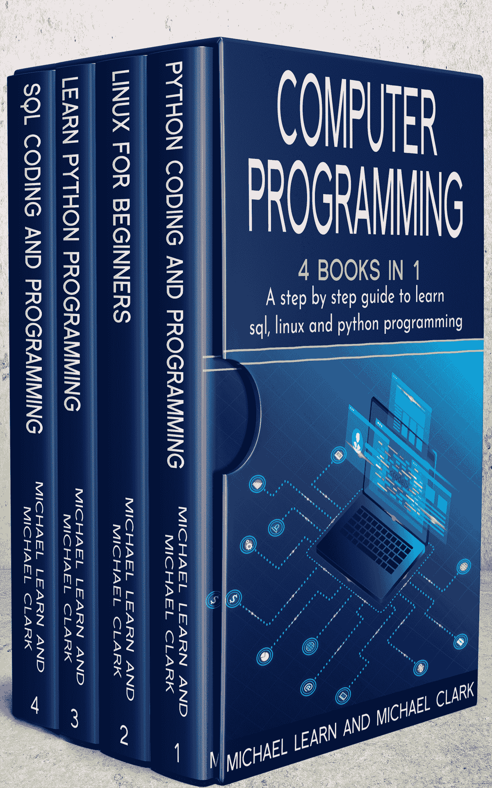


## 核心内容

- `PYTHON` 编码与编程
- 入门 `Linux`
- 学习 `Python` 编程
- `SQL` 编码与编程

## 法律与免责声明

## 引言

在很多情况下，我们听到人们谈论编程，以及在程序中使用不同的编程语言是多么困难。编程并没有许多人想象的那么困难。有不同类型的编程语言，你可以在编写程序时进行选择。这些语言包括 `JavaScript`、`C++` 和 `Python`。当我们开始学习 `Python` 编程语言时，你将理解 `Python` 的所有层次及其概念，以及如何轻松使用它进行编程。阅读这本书还将赋予你必要的编码技能。

编码并没有大多数人认为的那么严重。它对初学者来说只是困难。有很多编码语言，最流行的编码语言包括 `C++` 和 `Java`，大多数人在听到这些语言时会感到害怕。页面有时充满了符号和字母，你作为初学者是无法理解这些内容的。虽然编程因为感觉对他们来说太难学而吓跑了很多人，但 `Python` 编程语言是个人学习编码甚至作为专业人士进行研究的最原始的编程语言之一。

在书中，你将获得 `Python` 编程的基础知识。为了更好地理解如何开始 `Python` 编程，本书将从介绍 `python` 编程、如果你的电脑上没有该程序，下载该程序的步骤，以及学习 `python` 编程的重要性开始。它将定义一些基本关键词，以便个人理解程序，并最后讨论在编码和编程中使用 `Python` 的效果。

## 第 10 章：结论

## 异常处理

### Finally

这是你可以用于执行清理操作的动作，无论是否发生异常。

### Assert 断言

此条件将触发代码内部的异常。

### Raise 抛出异常

`raise` 命令可以在代码内部手动触发异常。

### Try/except

当你想要尝试一段代码，然后由于你或 `Python` 代码抛出的异常使得代码得以恢复时，就是这种情况下。

#### 如何抛出异常

我们已经花了大量时间来讨论这些异常以及它们的含义，但现在是时候让你看看如何在你想要编写的代码中使用这些异常了。如果你在编写代码时发现出现了一些某种问题，或者你想要看看为什么你的程序会执行一些某些看起来不正确的操作，编译器会进行检查并抛出一个新异常。这是因为程序也检查了代码，并且在尝试确定你具体想让它执行什么操作时遇到了困难。

通常，你会遇到的问题足够简单，可以自己修复，例如当你尝试打开一个文件，但输入了错误的名称。或者也可能是你或用户尝试让程序执行除以零的操作。理解这些异常如何工作的一种良好方法是看一个示例，并让编译器针对你在代码中想要完成的任务抛出异常。

通过我们上面提到的示例，程序将显示一个错误，因为在这段代码中你正在尝试除以零，而 `Python` 代码是不允许你这么做的。现在，如果你真的想尝试通过以便按原样运行程序，你可能不希望看到那个杂乱的错误信息。这不会让你的代码看起来很专业，用户也不会真正理解那个错误信息包含什么。好消息是，你可以在这里进行一些必要的更改，让信息看起来略有不同。你有几种不同的选项可以使用，这些选项将帮助你将此新更改添加到代码中，同时允许你选择抛出异常时会发生什么。你不希望得到上面那个丑的异常消息，但你可以轻松地通过修改它来让消息听起来好得多，或者至少解释错误到底发生了什么。

现在，我们刚刚写的代码看起来和上面写的非常相似，但它将改变用户抛出异常时出现的消息。通过这段代码，丑陋的错误信息被删除了，取而代之的是更易理解的错误信息：“你正在尝试除以零”，它将显示在屏幕上。你可以对消息进行几乎任何类型的更改，这将为你提供一个学习语法的良好起点。

#### 如何定义你自己的异常

到目前为止，我们只是回顾并查看了如果这些是程序识别的异常，你该如何处理它们。但仍然会有某些你想要抛出自己的异常的时候。例如，你可能正在编写代码，并希望确保用户只能访问和使用某些数字，而其他的将不被接受。如果你计划创建一个游戏，并在游戏中想要抛出一个异常，即如果用户尝试猜测的次数超过允许范围，他们将受到限制，那么这种方法会很好。一旦用户超过了你允许他们进行的猜测次数限制（例如限制为两次或三次），编译器就可以被程序设置为抛出一个异常，告诉用户他们不再允许再次猜测，因为他们已经用完了可以猜测的次数。

编译器并不会识别出用户猜测次数是否有任何问题。对于编译器来说，用户可以无限次地猜测。但当涉及到你正在创建的游戏或其他程序时，你不希望用户被卡住并永远无法进展，这就是为什么你必须为他们可以猜测的次数设置一个异常。

这些异常是你的代码所特有的，如果你不将它们作为异常写进代码中，编译器永远不会将它们识别为异常。你可以添加任何你喜欢的异常，也可以添加一条消息，类似于我们上面所做的那样。

在这段代码中，你已经成功地设置了你自己的异常，每当用户抛出这些异常之一时，“捕获：这是一个自定义错误！”的这条消息就会出现在屏幕上。这是向你的用户展示你已经在程序中添加了自定义异常的最佳方式，特别是如果这只是你为这段代码个人创建的一个异常，而不是编译器能够自动识别的异常。

就像我们讨论的其他示例一样，我们使用了一些通用的措辞，以便准确地展示异常应该是如何工作的。你可以根据需要随时去更改它，以便获得一个与你正在编写的代码所唯一的程序，并且当错误消息出现在他们的屏幕上时，可以向用户准确解释到底发生了什么。

当你开始编写更多更高级的 `Python` 代码时，异常处理将是你经常会的内容。在很多时候，你将处理程序识别的异常，或者你为了你正在编写的代码而想要引入的异常。处理一些代码将帮助你应对这些异常，还可以确保你让它们对用户看起来良好。确保尝试在你的编译器中编写几段代码，以对这些异常进行练习，这样你就能很好地了解这些异常基本上是如何工作的。

# 第 5 章：代码是如何工作的


既然你已经学习了 `Python` 中的计数、交换、求和、标志位变量、最大值和最小值，以及简单的调试，现在是开始运行一些代码的时候了。我相信到此时，你已经在你的电脑上安装了 `Python`。如果你还没有，请按照之前的步骤现在安装到你的电脑上。

程序员有许多方法可以告诉 `Python` 执行他/她输入的代码。在本章中，我们将讨论今天用于启动程序的所有技术。除了学习如何交互式地输入代码外，你将能够通过系统命令行、`exec` 调用、图标点击等帮助了解将代码保存到文件中以你想要的方式运行的不同方法。

然而，如果你有其他编程语言的经验并想开始接触 `Python`，那么仔细阅读本章是非常重要的。它是调试技术的概述，并将帮助你理解导入和保存文件的的方法。

## 交互式提示

在本节中，你将学习一些交互式编码基础，并在运行代码之前查看一些设置系统路径和目录的准备工作。

### 1. 在 Windows 上

如果你正在使用 Windows，启动命令提示符（`cmd.exe`）并在控制窗口中输入“python”单词。

### 2. 在 macOS 上

可以通过从 Spotlight 启动终端，或双击位于 `Applications > Utilities` 文件夹中的终端图标来启动 Python 交互式解释器。在 `Terminal` 窗口中，输入单词“python”。

### 3. 在 Linux 和其他 Unix 操作系统上

作为程序员，你可以在终端窗口甚至在 `shell` 中输入此命令来运行你的程序。或者，某些平台允许你通过不同或额外的方式启动交互式提示符，而不需要你输入命令。此类平台包括 Windows 7 和 Windows 8。

#### Windows 7

除了在 `shell` 窗口中输入 `python` 之外，程序员可以通过选择 `python` 菜单选项启动相同的交互会话。这可以在 `Python` 的“开始”按钮菜单中找到。

#### Windows 8

使用 Windows 8 时，不需要“开始”按钮，因为你有许多方法可以访问搜索和文件资源管理器等工具。

#### 其他平台

如果你使用的是 Windows 7 和 Windows 8 以外的其他平台，请担心。使用上述的相同方法启动 `Python` 交互会话。不需要输入命令，因为这些平台非常特殊，因此让你能够轻松进入。你计算机上提示符的出现表明你已经进入了 `Python` 交互式解释器会话，因此，你可以自由地在那里输入任何 `Python` 表达式或语句并立即运行。

## 如何在 Windows 上找到命令提示符

对于我们大多数人来说，启动命令行界面并不容易，特别是如果你是初学者。虽然某些 Windows 用户知道它，但 Unix 开发者和初学者并不理解它，因为它不像控制台或终端窗口那样显著。以下步骤将帮助你轻松找到命令提示符。如果你使用 Windows 7，可以在“开始”菜单下的“所有程序”中的“辅助工具”部分找到它。或者，你可以在“开始→运行”框中输入 `cmd` 并允许程序运行。如果你使用 Windows 10，可以直接在任务栏上的 Windows 搜索栏中直接输入 `cmd` 来启动命令提示符。

### 系统路径

通常，正如你之前所看到的，在最后部分输入 `python` 后，系统将在其系统路径上定位你的 `python` 程序。取决于你使用的 `Python` 版本和平台，如果你没有设置系统的 `PATH` 环境变量来包含安装目录，那么将“python”单词替换为你所需的完整路径是重要的。你必须确保 `PATH` 环境简单到允许程序正常运行。

### 运行代码的目录

由于我们已经开始讨论如何在你的计算机上运行代码，因此知道在哪里运行代码至关重要，以确保程序运行时不产生错误。你将在名为 `folder` 的目录中运行代码，该目录在你 Windows 上创建位于主驱动器顶部的 `C:/code`。你大多数交互会话将从那里开始。此外，确保从那里保存并运行你所有的脚本文件。然而，如果你一直使用 `Java` 和 `C++` 等其他编程语言，并想使用 `Python` 编写程序，请遵循以下指令。这些指令将帮助你理解如何在计算机上使用 `Python` 编程开始工作目录。

#### 基于 Unix 的系统

这些包括 Linux 和 MacOS。对于这些系统，工作目录可以在 `/usr/home` 中找到，或者有时通过 `mkdir` 命令创建。有了工作目录，你将能够确定或看到代码是如何运行的。

#### Windows

Windows 系统允许程序员在命令提示符窗口或文件资源管理器中轻松创建他们的工作代码目录。在文件资源管理器中搜索“新建文件夹”，你会看到“文件”菜单。或者，在命令提示符中输入 `amdir` 命令并运行。你可以随时定位和找回你的工作目录。此外，离开一个目录有助于程序员轻松跟踪他的工作。

## 如何交互式地运行代码

由于你已经学习了所有这些基础知识，现在是时候输入一些实际代码并在你的 `python` 程序上交互地运行它们了。注意，你已经通过输入两行信息文本开始在 `python` 交互会话中输入，这不仅提供了 `Python` 版本号，还提供了我们早期讨论所示的一些提示。通常，当我们进行交互操作时，代码的结果将显示在输入行下方，并在按下回车键后。例如，当你在提示符输入 `print` 语句时，`Python` 字符串（也称为输出）会立即返回。因此，如果你不使用 `Python` 语言，无需创建源代码文件或使用编译器运行代码。稍后你将学习如何运行多行语句，此类语句在输入到行中并双击回车键后就会运行。

## 交互式提示符的原因

尽管交互式提示符在你运行时会回显结果，但它不会将代码保存到文件中。这表明你不能像想象的那样在交互会话中处理大部分编码工作。交互式提示符证明是一个测试程序文件或即时实验语言的好地方。

### 1. 实验

由于其能够立即执行代码，交互式提示符已成为实验语言的最佳场所。它将在本书后后被用于说明一些较小的实验。如果你不确定 `python` 代码的工作原理，你可以查看在启动交互式命令行时会发生什么。例如，当你在 `Python` 程序中阅读代码时，可能会看到一个你不理解其含义的表达式。此类表达式的示例可以是 `'Spam!'*8`。你将花费大量时间阅读手册、书籍，甚至在互联网上搜索其含义。

通过在交互式提示符中收到的即时响应，你可以用它快速确定代码的工作原理。从这里，例如，很明显代码是在进行字符串重复。`*` 符号在 `Python` 中用于数字相乘以及字符串的重复。这就像反复将字符串连接到自身一样。通过这个实验你不会破坏任何东西。通常，`Python` 代码是最适合运行的，因为它不会导致文件的删除。

此外，在 `Python` 编程中，使用未赋值的变量是一个错误。如果你用默认值填充名称，某些错误可能无法被检测到。因此，为了消除此类错误，在向它们添加任何内容之前，从零开始初始计数器，并确保你有初始列表来帮助正确地扩展它们。有了初始列表并从零计数，你将能够运行程序而不会产生任何错误。

### 2. 测试

除了作为工具或进行实验外，交互式解释器还用于在学习 `Python` 语言时测试你在文件中编写的代码。事实上，我们将向你展示如何交互式地导入模块文件。此外，我们还将展示如何在交互式提示符下通过输入调用来对定义的工具运行测试。此外，许多程序员会在交互式提示符下测试编程组件。作为一名程序员，你可以导入、测试并运行 `Python` 文件中的函数和类，无论它们的来源如何。这是通过输入链接到 `C` 函数的调用以及在 `Python` 中练习 `Java` 类来实现。最后，由于 `Python` 的交互特性，它能够支持实验性编程风格，从而方便你上手。这使得 `Python` 编程变得简单、容易，并且适合初学者在程序中运行代码。

## 有效使用交互式提示符的指南

尽管交互式提示符很容易使用，但作为初学者，在使用它时有很多你需要考虑的地方，以确保你的代码运行而不产生错误。以下指南将帮助你避免其他初学者常见的错误。请花时间阅读它们：

- **确保你只输入 `Python` 命令。** 在很多情况下，初学者会犯一个大错误，在交互式提示符中输入系统命令。这导致他们的计算机在尝试运行程序时显示错误。尽管有许多方法可以在 `Python` 代码中运行系统命令，但这些方法并不涉及输入命令本身，正如你将在书中看到的那样。

- **仅在文件中使用 `print` 语句。** 在看到交互式解释器自动打印表达式的结果后，没有必要在交互式 `Python` 中完成 `print` 语句的输入。虽然交互式解释器是一个特性，但它有时会困扰许多程序员，特别是在文件中编写代码的初学者，因为他们必须使用 `print` 语句来确保他们的结果不会被自动回显。

- **避免在交互式提示符下进行缩进。** 无论你是在文本文件中输入还是交互式地输入，确保所有未测试的语句都从左侧的第 1 列开始是重要的。如果你不遵守上述指令，`Python` 将打印语法错误，因为你代码中的空格将被视为用于分组嵌套语句的缩进。记住，如果你在交互式提示符下以制表符或空格开头，始终会生成错误。

- **确保你注意所有的提示符变化。** 这些变化对于复合语句至关重要。虽然我们目前不会处理复合/多行语句，但知道在交互式地输入复合语句的第 2 行时会导致提示符自动变化是有重要的。确保复合语句在具有空行的交互式提示符处结束。空行在 `Python` 编程中起着至关重要的作用，因为它告诉交互式 `Python` 程序员已完成多行语句的输入，你只需要按两次 `Enter` 键。然而，在文件中并不是必须使用它。如果存在它们，你可以忽略它们。

## 输入多行语句

大多数初学者并不清楚如何在 `Python` 程序中输入多行语句。例如，上周，我们收到了许多来自世界各地学生的邮件和信息，他们寻求关于输入复合语句的澄清。尽管这听起来是一件难事，但它是 `Python` 编程语言中最容易处理的事情。为了帮助你理解，我们将介绍复合语句并详细讨论它们的语法。

由于它们的行为不同，或者在交互式提示符和文件中的行为不同，以下步骤对于任何输入多行语句的人来说都是至关重要的。终止所有复合语句（包括 `for` 循环），测试交互式提示符下是否有空行。同样，你可以通过双击 `Enter` 键在运行之前终止所有复合语句。

## 系统命令行

尽管你可以使用交互式提示符对你的 `Python` 代码进行测试和实验，但与之相关的问题之一是你的程序一旦被 `Python` 解释器执行就会消失。我们无法在不重新输入的情况下运行已经输入的代码，因为它没有存储在文件中。我们只需要从头重新输入，或者可以复制粘贴。然而，为了有效地执行此过程，我们必须编辑掉 `Python` 提示符和程序输出。

此外，我们可以通过将代码写入文件（通常称为模块）来永久地保存我们的程序。模块是指包含 `Python` 语句的简单文本文件。编码后，我们能够要求 `Python` 解释器以各种方式执行语句，例如系统命令行、文件图标点击和 `IDLE` 用户界面。每当我们运行文件时，它都会从模块文件的底部开始执行我们的代码。在该领域使用了许多术语。例如，在 `Python` 中，模块文件被称为程序。换句话说，程序被视为文件中系列重复执行的预编码语句。有时，直接运行的模块文件被称为脚本，这个术语以前指 `Python` 中的顶层程序文件。此外，一些程序员使用模块一词来指代从另一个文件导入的文件。

无论你如何称呼它们，在接下来的几个章节中，我们将探索输入模块文件中代码的不同运行方法。我们将集中在运行文件的基本方法。这将涉及在计算机系统提示符输入的 `Python` 命令行中列出名称。虽然可以使用像 `IDLE` 这样的 `GUI` 来避免这一点（正如我们稍后看到的），但系统 `shell` 和文本编辑器窗口构成了更集成的开发环境，从而为程序员提供了对程序的直接控制。

### 1. 第一个脚本

请确保你处于一个良好的环境，也就是说在我们开始第一个项目之前，没有干扰。要开始之前，让我们打开你最喜欢的文本编辑器，无论是 `IDLE` 编辑器还是 `Notepad`，在名为 `scrpt1.spy` 的新文本文件中输入以下单词，然后将它们保存到我们之前设置的工作代码目录中。

### 解释

由于这是我们的第一个正式 `Python` 脚本，因此不需要担心。在本节结束时，你将能够理解此文件代码是如何运作的。简而言之，我们在运行三个 `print` 函数调用之前，导入了一个 `Python` 模块来获取平台名称，从而在项目结束时显示脚本的结果。此外，确保你使用一个名为 `x` 的变量，该变量被创建并赋值以存储字符串对象，以确保项目运行时不产生错误。上面的 `sys.platform` 指的是一个用于识别我们正在工作的计算机类型的字符串。


我们添加了一些正式的 Python 注释，包括 `#` 字符之后的文本。这在 Python 中是必要的，因为这使得这些行本身变得正式化。此外，你应该知道`#`之后的文本始终被视为人类可读的注释，因此不被视为语法语句的一部分。因此，如果你复制代码，忽略这些注释不会产生影响，因为它们是信息性的。

## 如何使用命令行运行文件

保存文本文件后，现在是让 Python 运行该文件了。这通过列出其文件名来实现，我们将将其作为 Python 命令的第一个参数，就像在系统 shell 提示符中执行一样。记住，你可以在你喜欢的系统（如`xterm`窗口或窗口命令提示符）中输入系统 shell 命令来提供命令行输入。但是，请确保在系统提示符处运行它。此外，确保将项`python`替换为完整的目录路径，就像我们没有配置`PATH`设置时做的那样。通过替换它，系统将成功运行你的程序。

此外，作为初学者，你不应该在上一节创建的`script1.py`源文件中输入任何后续文本。这些文本包含了系统命令以及程序输出。除了该行必须是运行源文件的 shell 命令外，还有其他。

## 运行命令行和文件的步骤

大多数人认为从系统命令行运行程序文件很困难。然而，一旦你熟悉了 Python 编程，这就会变得非常简单。这是运行 Python 程序最简单且可移植的方法，因为每台计算机都有命令行和目录结构。如果你是初学者，以下步骤将帮助你在执行项目时运行命令行和文件而不会产生错误：

- 在文件中使用`print`语句
- 在系统提示符处使用文件扩展名
- 注意`IDLE`和窗口上的自动扩展

## Unix 环境查找技巧 (LookupTrick)

某些 Unix 系统为用户提供了一个机会，避免在脚本文件中硬编码 Python 解释器的路径。这可以通过唯一地编写第一行注释来实现。此类注释的一个良好示例是`#!/usr/bin/env python`。通过这样编码，`env`程序将使用你的系统搜索路径设置来定位 Python 解释器。然而，在大多数 Unix shell 中，这是通过搜索用户`PATH`环境变量中显示的所有目录来实现的。

如果他们的 Python 移动到新位置，或者他们的脚本移动到新机器，他们必须始终更新`PATH`来控制移动。此外，由于用户可以随地访问`env`，他们的脚本无论 Python 在系统中的什么位置都可以运行。

## Python 3.3

在我们深入探讨这个主题之前，我想提醒你，本节描述的方法是一个 Unix 技巧，如果你使用的是 Windows，它可能在你的平台上运行得不好。然而，这对我们来说并不是一个大问题；我们将使用之前讨论的基本命令行技术来理解此背景。第一步是在显式的 Python 命令行列出文件名，如下：

```
C:\code> python brian
```

## 生活光亮的一面...

根据我们的经验，在这种情况下没有必要在顶部使用特殊的`#comment`。即使你决定使用它，Python 也会自动忽略它。此外，知道文件不应赋予任何执行权限是。最后，当你使用这种方法时，在 Microsoft 窗口和 Unix 之间运行文件比使用 Unix 风格脚本要容易。然而，在使用`Python3.3`时（其 Windows 启动器是单独安装的），Unix 风格的`#`行可能有其他含义，因为除了提供`py`可执行文件外，Windows 启动器还会尝试在运行我们的脚本代码之前解析`#`行以确定要启动的 Python 版本。它还允许我们以部分或完整的形式给出版本号，因为它识别了最常见的 Unix 模式。你在处理命令行时应该小心，以避免可能影响程序运行的某些错误。

## 点击文件图标

对于那些不擅长使用命令行的人来说，这是最佳替代方案。通常，你可以通过使用开发 GUI 和文件图标点击来启动 Python 脚本，以及根据你的平台类型变化的其他方案来避免使用命令行。下面讨论了其中一些替代方案。

### a) 图标点击的基础

许多平台对图标点击的支持方式不同。以下显示了图标点击在我们的计算机中是如何构建的。花时间仔细阅读。

#### 窗口图标点击

通常，Python 会使用 Windows 文件名关联将自己自动注册为一个程序，在点击时打开 python 脚本文件。这在你的计算机上安装 Python 后发生。得于此，我们可以很容易通过点击文件图标来启动我们编写的 Python 程序。在编码中，这些异常要复杂得多，但准确地学习如何处理这些异常是非常重要的，这样你的代码才会按照你想要的方式运行。某些异常可以在 Python 库中找到，这些是程序自动抛出的异常。还有一些是由你手动抛出的异常，因为那是你希望程序运行的方式。我们只需要使用鼠标光标点击这些文件图标。之后发生的情况取决于图标的扩展名以及我们运行的 Python 类型。注意，Python 3.2 中的`.py`文件是由`python.exe`配合控制台窗口运行的，而`pythonw.exe`文件运行`pyw`文件。

## 其他图标点击的局限性

尽管有了前一段的输入技巧，但也要意识到文件图标可能伴随着危险。一个人可能无法理解 Python 错误信息。如果他的脚本创建了错误，记录下的错误信息文本可能会突然出现在窗口中，然后可能立即消失。在人的图标文件中添加输入调用可能没有帮助，因为他可能无法确定哪里出了问题。当在在这本精彩的书中以后讨论异常时，人们将获得记录代码以停止、处理和从错误中恢复的知识，以防止程序终止。还将学习`try`语句替代方法，用于在出错时保持控制台窗口关闭。

由于上述缺点，最好将点击图标视为在修正或调试后启动项目的手段，并记录它们返回到文档记录的过程以捕获任何关键错误。开始时，建议使用 IDLE 和系统命令行等其他方法，以便可以看到创建的错误文本并感知其返回，而无需转向额外的编码。

# 第 6 章：数据分析中的特殊函数和异常处理

有时一段代码需要多次使用。例如，我们想要计算一批学生的累积 GPA。现在如果一批有两百名学生，那么为整批学生反复编写相同的代码将极其繁琐且无用。这就是函数概念出现的地方。在函数中，我们编写一段执行特定任务的代码。每当我们需要执行该任务时，我们就调用相同的代码。我们给这段代码起一个特殊的名称称为函数名，因此每当我们需要执行该特定功能时，我们就通过其函数名调用相同的代码。

Python 中已经写了许多函数并保存在库中。我们可以使用它们来方便自己，避免编写新代码，而是复用已经编写并测试过 bug 的代码。函数可以接受值作为输入并返回某些输出，该输出是计算的结果或函数执行的功能。首先我们给出一些内置函数的示例，然后我们将转向如何编写自己的函数。为了我们的特定目的，总是需要编写新函数，一旦你开始规范的编码，你就会发现自己一直在编写函数。

### 内置函数

内置函数最常见的示例之一是`type`函数，它会告诉我们使用的变量或值的类型。例如：

```
type(32)
<type 'int'>
```

任何变量也可以进行相同的操作。例如：

```python
var = 32
type(var)
<type 'int'>
```

在这里函数的名称是`type`，因此函数调用将是`type`。在括号内，函数接收变量或值的输入。这被称为参数。许多函数接受参数，但并非所有函数都是。可能存在函数不接受任何参数。在这里，`type`函数不仅接收一个参数，还给出一个结果或返回值。它告诉我们变量的类型。就像参数一样，并不是每个函数都必须返回一个值。函数可能返回值也可能不返回。

使用`type`函数还可以使用类型转换函数。转换将一个变量的类型更改为另一个变量。有时用户输入值作为输入。我们不知道用户输入的是什么类型的数据，因此我们根据需要显式地进行类型转换，以便我们将其存储在数据库中并在以后适当使用。

### 类型转换函数

类型转换函数以变量名命名。它们接受一个参数作为需要转换的值。`int`函数接收任何值并将其转换为整数。

```
int(3.4556)
3
int(4.980)
4
```

在这里，浮点数被转换为整数，但并没有逻辑上假设的那种四舍五入。小数部分被简单截断，剩余数字存储为整数。如果我们尝试将无效值转换为整数，将无法运行。

```python
int('Hello')
ValueError: invalid literal for int(): Hello
```

`float`函数将传递的参数转换为浮点数格式。

```
float(3)
3.0
float('3.234')
3.234
```

在这里，如果向函数传递无效参数，将再次抛出错误。`str`函数将将传递的值转换为字符串。这非常有帮助，因为我们可以在参数中应用字符串拼接操作。

### max, min 和 len 函数

现在让我们列出一些非常常用的函数，它们的定义由 Python 内部提供，因此我们可以在需要时自由使用它们，而无需定义它们。

`max`函数用于从一组给值中找到最大值。而`min`函数用于从一组值中定义最小值。

```
max(34, 45, 54, 20, 13)
54
min(34, 45, 54, 20, 13)
13
```

`max`和`min`函数也可以用于字符串值。在字符串函数中，字母顺序越靠后的函数，其值越大，所以对于`max`函数：

```
max('Hello World')
W
min('Good')
d
```

在这里需要注意的一点是，如果提供的字符串中有空格，最小值将是空格。

```
min('Hello World')
' '
```

另一个常用的字符串常用的函数是`len`函数，它告诉我们字符串的长度。

```
len('HELLO WORLD')
11
```

空格也被视为字符，所以它也被包含在长度内。`len`函数只能用于查找字符串的长度。所以即使是整数，也将其转换为字符串然后找到它的长度

```
len('345')
3
```

有时，为了访问内置函数，我们需要将它的模块导入程序中。例如，为了导入一个随机数生成函数，我们必须导入`random`库。当我们从此库调用函数时，我们使用点符号表示，首先是函数所在的库名，然后是函数名，最后在括号中是参数（如果有的话），否则为空括号。

```python
import random
x=random.random()
print(x)
```

任何随机数都会打印在屏幕上。我们得到一个 0.0 到 1.0 之间的浮点数值。如果我们想要，可以将其转换为整数。由于我们在这里讨论随机数函数，必须提到另一个概念：确定性函数和非确定性函数。

计算机科学中的大多数函数在给定相同输入时总是给出相同的值。例如，`sum`函数、`min`、`max`和`len`函数。这些被称为确定性函数，因为一旦我们看到了答案，每次输入相同的值时，结果都是相同的。这些被称为确定性函数。另一方面，即使在输入相同时也不给出相同值的函数被称为非确定性，因为它们的输出不是以后确定的。由于所有程序都基于算法，所以生成的数字并不是真正的随机，但工作原理是这样。这样的算法被称为伪随机算法。

### 数学函数

一组基础数学函数常用的函数如`log`、`sin`、`cos`、`sqrt`。这些都可以通过向程序导入`math`库来使用。一旦`math`库被导入程序，使用复杂的数学运算和求解复杂的方程就会变得非常容易。这里使用点符号演示了一些基础数学函数。

```python
import math
math.sqrt(2)/2
0.70710678
```

`sin`、`cos`、`tan`等三角函数可以使用三角数学运算执行。这些函数接受弧度作为参数并给出结果。

```python
degrees = 45
radians= degrees/360 *2*math.pi
math.sin(radians)
0.70710678
```

`math`库中还有许多其他函数。我们可以通过 learnPython.com 和其他网络资源探索它。内置函数的名称也是保留的，在为变量命名时我们应该避免使用它们作为变量名。

### 编写自己的函数

在我们继续学习如何编写函数之前，让我们先讨论编写函数的益处。可能会争论为什么要用不连续的语句序列分解程序并扰乱执行流。以下是编写函数的主要益处列表：

- 它让程序更具可读性和易于理解。如果我们为一组执行特定功能的语句命名，我们就可以在函数名中相应地指定它们的用途。现在我们知道，每当我们调用该函数时，它执行的都是我们调用的相同功能。
- 函数让程序变得小得多。我们不再需要反复编写重复的代码。我们只需要在函数中写一次，然后反复进行调用即可。
- 如果一个程序被明智地划分为若干部分，调试它并找到错误就会变得容易得多。当我们知道程序的哪个部分负责什么时，只需在需要时跳转到该部分进行更新即可。
- 如果一个程序编写良好并经过了适当的调试，就可以被保存并导入到其他程序中使用。

函数定义非常重要。它应该传达出函数的功能。它应该是简洁且具有实际含义的。例如，如果有一个计算某些数字之和的函数，将其命名为`sum`或`calcSum`。另一个重要点是决定何时将程序拆分为函数。理想情况下，一个函数是程序的一个单元，因此它应该执行单一任务。当你生成学生成绩单时，应该有一个函数来计算单门课程的成绩，然后有一个函数来计算学期`GPAs`，至少还要另一个函数来计算累计`GPAs`。编写函数是一项机智的任务，人们通过经验来学习何时将程序拆分为函数并使其正常工作。

## 定义函数

现在让我们来看定义函数的主体。函数定义由函数名、它接收的参数以及函数执行的语句序列组成。函数的第一行被称为头部（header），函数的其余部分称为函数体（body）。

此函数每次被调用时，都会打印童歌《不倒的小亨蒂蒂》。函数的第一行`def print_poem():`是函数的头部。头部必须以分号结束。函数名是`print_poem`。函数名的规则与变量名相同，仅限大小写字母、数字或下划线。名称不能与数字开头，并要避免使用保留字作为名称。当你为函数使用一个名称时，避免对变量使用相同的名称。

在这里你看到前两个`print`语句使用了单引号，而最后两行使用了双引号。虽然单引号和双引号都可以使用，由我们来选择哪一种，但如果句子内部有一个单引号或撇号，那么我们应该在外部使用双引号。

当函数结束时，留一个空行。函数中的语句被缩进以分组在一起。在开始代码行之前有四个空格。解释器会一直输出`…`省略号，直到接收到空行。

当我们定义一个函数时，会创建一个带有我们给出的名称的函数对象。如果我们打印该对象，它将向我们提供关于函数的以下信息：

```python
>>> print print_poem
<function print_poem at 0xb7e99e9c>
>>> print type(print_poem)
<type 'function'>
```

`function`类型用于识别`print_poem`的类型，正如其所示，它是函数对象的一种。函数定义中的空括号表示此函数不接受任何参数。现在让我们来看一个接受参数并返回值的函数。

### 空函数、参数和返回值

如前所述，某些函数会产生结果或输出。输出被称为返回值。但并不是所有函数都返回值，例如`print_poem`函数。所以`print_poem`函数是一个空函数。不返回值的函数被称为空函数。

现在让我们来看参数的情况。考虑一个接受整数作为参数并返回平均值的函数：

```python
def calc_average(val1, val2, val3):
    Sum = val1+val2+val3
    Avg=Sum/3
    print Avg
    return Avg
```

在此函数中，传递了参数并在函数内部赋值给变量`val1`、`val2`和`val3`。在这里首先打印`average`，然后返回到主流程。

```python
>>> average = calc_average(34,45,35)
```

函数的结果或返回值赋值给变量`average`，可以用于计算结果。

### 在函数内部编写函数

我们也可以在函数内部进行函数调用。考虑以下函数：`print_humpty`、`print_twinkle`、`print_oldkingcole`。这些打印不同的诗。现在如果我们想一起打印这些诗，我们写：

```python
def print_poems():
    print_humpty()
    print_twinkle()
    print_oldkingcole()
```

这个`print_poems`函数包含了三个函数调用。

## 执行流

在编写不同的函数和进行函数调用时，必须保持控制流。控制流是语句执行的顺序。执行始终从程序开始。语句从上到部逐一执行。函数定义必须在调用之前编写。函数定义不会改变执行流，但函数定义内部的语句直到调用发生才会执行。每当解释器遇到函数调用时，就会跳转到函数定义并执行内部语句。然后返回到停止的地方完成执行。

这足够简单，但当函数调用内部有很多嵌套调用时，控制流可能会让程序员感到困惑。然而，对于解释器来说，它是很容易记忆的且不会混淆，它会记录停止的地方，一旦完成了函数定义内部的语句，就会返回到之前的位置。无论是在另一个函数中还是主程序中，如果函数定义没有在函数调用之前编写，就会发生错误，因为程序将不知道该去何处。

## 调试和异常处理

调试和异常处理都涉及发现和定位错误，并尝试以整洁的方式修复它们。主要目的是程序不能挂起或停止工作。相反，会给出一个礼貌的消息告诉用户哪里错了以及应该如何做。为了进行异常处理，我们编写`try`和`catch`语句。常见的错误发生在从用户获取输入时。当程序期望某种输入却被给了其他内容。这会导致程序崩溃，换句话说就是错误。

在这种情况下，首先执行`try`块中的语句，如果一切顺利，则忽略`catch`块。如果用户输入的是字符串值，就会发生异常，但程序不会挂起或崩溃，而是向用户传递一个信息要求输入数字而不是其他内容。这个过程被称为捕获异常。错误信息不仅帮助用户理解正在发生的问题，还能让程序员知道错误具体发生在哪里以及处理。具有适当异常处理的程序很容易调试和更新。与没有程序员错误处理的程序相比，我们可以更容易对这类程序进行更改。


调试提供了一种发现逻辑错误的简单方法。解释器无法捕捉这些错误，但它们导致了程序出现错误并使程序无法给出正确的结果。调试是发现此类错误的方法。在 Python 中，此类错误可以通过使用错误的比较运算符发生，例如用`<=`代替`<`或用`>=`代替`>`。有时程序员可能会不小心写成`=`代替`+`或混淆运算符，这可能会导致问题。语法对于解释器来说是可以的，它不会抛出错误信息，但实际上由于类型错误结果是错误的。

在 Python 中，缩进和空格也是错误的主要原因，在留空时应小心，特别是嵌套代码块。

## Python 中的面向对象编程

面向对象编程（OOP）是一种编程范式，以模拟现实实体的对象形式实现应用。对象可以具有属性、方法和特性。任何包含信息并能执行功能的内容都是 OOP 中实现为对象的候选。考虑一种你必须使用面向对象编程开发第一人称射击游戏的场景。你必须考虑在第一人称射击游戏中具有某些信息并能执行某些功能的现实对象。射击者本身就是一个对象，因为他拥有身高、体重、国籍等信息，并可以执行`run`、`sit`等函数。枪也是一个实体，它可以`shoot`、`load`、`reload`。

## 类

类是面向对象编程的基石。简单来说，类充当对象的蓝图。类和对象之间的类比就像地图和房屋。你可以通过地图了解房屋的结构、房间在哪里、有多少房间等。可以使用类创建类似的房屋。

```python
class Person:
    def __init__(self, name, age, role):
        self.name = name
        self.age = age
        self.role = role

    def stand(self):
        print("Person standing")

    def sit(self):
        print("Person is sitting")
```

## 对象

在 Python 中，一切都被视为对象。Python 对象大致分为两类：

1. **内置对象**：属于原始数据类型。例如，将整数赋值给变量时：

```python
age = 28
type(age)
```

2. **自定义对象**：这些是实现类的对象。在前一节中我们创建了类`Person`。为了创建自定义对象，只需编写命名的类后跟一对括号并赋值：

```python
person1 = Person("John", 28, "Male")
```

现在可以使用对象`person1`来访问`Person`类的属性和方法。要访问属性或方法，可以使用对象后加点运算符：

```python
print(person1.name)
person1.stand()
```

在上述脚本中，`Person`类的`name`属性通过`person1`对象访问，然后打印出变量。

## 属性（Properties）

封装是 OOP 的主要基石之一。封装指的是对内部数据的受控访问。访问通过特殊方法进行控制。特殊方法通过属性与属性绑定。

### 为什么我们需要属性？

在本节中我们将学习属性。但首先让我们看看为什么我们需要属性。创建一个名为`Medicine`的类，带有三个属性：`name`、`expiration_year`和`expiration_month`。

```python
class Medicine:
    def __init__(self, name, expiry_year, expiry_month):
        self.name = name
        self.expiry_year = expiry_year
        self.expiry_month = expiry_month

    def getExpiryDate(self):
        print ('The expiration date is : '+str(self.expiry_month)+'/'+str(self.expiry_year))
```

现在创建一个`Medicine`对象：

```python
medicine1 = Medicine("xyz", 2020, 15)
```

在上述脚本中，`Medicine`类的构造函数将 15 赋值为`expiry_month`数字。要查看过期日期，使用`medicine1`对象调用`getExpiryDate`方法：

```python
medicine1.getExpiryDate()
```

技术上，任何数字都可以赋值给月份。但逻辑上，一年只有 12 个月。所以数字应该在 1 到 12 之间。这就是属性大显用场的地方。使用属性你可以控制从类成员中赋值和检索的值。查看以下脚本了解如何创建属性：

```python
class Medicine:
    def __init__(self, name, expiry_year, expiry_month):
        self.name = name
        self.expiry_year = expiry_year
        self.__expiry_month = expiry_month

    @property
    def expiry_month(self):
        return self.__expiry_month

    @expiry_month.setter
    def expiry_month(self, expiry_month):
        if expiry_month < 1:
            self.__expiry_month = 1
        elif expiry_month > 12:
            self.__expiry_month = 12
        else:
            self.__expiry_month = expiry_month

    def getExpiryDate(self):
        print ('The expiration date is : '+str(self.__expiry_month)+'/'+str(self.expiry_year))
```

为了为属性创建一个属性，你需要创建一个与属性同名的方法。在上述脚本中，我们使用`@property`装饰器创建了`expiry_month`属性。我们还使用`@expiry_month.setter`创建了属性设置。上述脚本实现的逻辑很简单：如果赋值给`expiry_month`的值小于 1，则赋值 1；如果大于 12，则赋值 12；最后，如果值在 1 到 12 之间，则赋值该值。

```python
medicine1 = Medicine("xyz", 2020, 15)
medicine1.getExpiryDate()
```

## 静态方法

静态方法与函数相似，有两个主要区别。类方法定义在类体内部。实例方法接收`self`作为第一个参数。静态方法不需要`self`作为第一个参数，并且必须用`@staticmethod`装饰器装饰。

```python
class Person:
    @staticmethod
    def run():
        print("Person is running")

    def stand(self):
        print("Person is standing")
```

上述脚本中，我们创建了一个`Person`类，包含一个静态方法`run`和一个非静态方法`stand`。

- 如果你正在使用 Mac 或 Windows，你可能没有通过桌面上的图标启动 shell；
- 你已经在 Windows 菜单中打开了 Python 接口或 IDLE；
- 或者 IDLE 在你的系统中没有安装正确。

你应该退出 shell，或者使用桌面图标重启它。如果这样做不起作用，你应该尝试使用 Python 控制台而不是 shell。

- 如果你正在使用 Windows，你应该选择“开始 -> All Programs”并打开 Python 3.2 组。在打开的窗口中，选择`Python (command line)`。
- 如果你正在使用 Mac OS X，你应该选择屏幕顶部的 Spotlight（聚焦搜索）图标。弹出一个输入框，你应该在框内输入`Terminal`。现在，在终端打开后输入单词`Python`。
- 如果你正在使用 Ubuntu，你应该直接从应用程序菜单打开终端并输入`Python`。

# 移动乌龟

你可以通过在你创建的变量上使用不同的函数来指导乌龟应该执行的操作。这与使用`turtle`模块中提供的`pen`函数类似。例如，你可以使用`forward`命令让乌龟向前移动。如果你想让乌龟向前移动 50 像素，请使用以下代码行：

```python
t.forward(50)
```

如果你现在看屏幕，你会发现乌龟已经向前移动了 50 像素。像素是屏幕上的一个点，是一个可以表示的最小元素。记住，你在屏幕上看到的所有内容都是由像素组成的。像素是屏幕上的一个微小点，如果你放大画布，你会发现乌龟或箭头仅仅是点的集合。这是非常简单的计算机图形。

现在我们将使用以下命令告诉乌龟它应该左转 90 度：

```python
t.left(90)
```

如果你还对角度不了解太多，让我们来看一个简单的例子来帮助你理解这一点。站在圆的中心：

- 你正对着圆圈中的 0 度刻度。
- 如果你伸出右臂，你指向的是右侧的 90 度。
- 如果你伸出左臂，你指向的是左侧的 90 度。

如果你向圆圈的右侧移动——也就是你的右手指向你的的方向——那么 180 度处就在你正身后，270 度处在你的左侧，而 360 度处就是你开始的地方。度数从 0 到 360。当乌龟向左转弯时，它会改变方向并面向一个新的方向。这看起来就像是你转动身体，面向指向 90 度的左臂。`t.left(90)`命令将确保箭头指向上方。

现在让我们来画一个正方形。你应该在最初输入的代码基础上添加以下几行代码。

```
t.forward(50)
t.left(90)
t.forward(50)
t.left(90)
t.forward(50)
t.left(90)
```

乌龟现在已经在你的画布上画了一个正方形，并面向了它最初开始时的方向。如果你想完全擦除画布，可以使用`reset`函数。这将清除画布并将乌龟移回起始位置。

```
t.reset()
```

如果你想清除屏幕并让乌龟留在原地，请输入以下代码：

```
t.clear()
```

要记住，我们可以指令乌龟向后移动或向右移动。`up`命令将允许你抬笔离开画布，这意味着乌龟将停止画图。如果你使用`down`命令，乌龟将重新开始画图。你需要像我们编写其他函数一样来编写这些函数。让我们尝试使用这些命令画另一个形状，并指令乌龟在画布上画两条线。

```
t.reset()
t.backward(100)
t.up()
t.right(90)
t.forward(20)
t.left(90)
t.down()
t.forward(100)
```

我们首先重置打开的画布，并指令乌龟移动到起始位置。这是通过使用`t.reset()`命令实现的。然后，我们将使用`t.backward(100)`命令让乌龟后退 100 像素，并使用`t.up()`命令让乌龟向上。通过使用`t.right(90)`命令，我们将乌龟向右移动并旋转 90 度，使其指向下方。使用第三行代码时，屏幕上没有任何图画，因为你只是改变了乌龟的角度。然后我们使用`t.left(90)`命令指令乌龟面向右侧，并使用`t.down()`命令指令它再次画图。接着我们使用`t.forward(100)`命令画出与第一条画线平行的线。

## 你学到了什么

本章阐明了如何在 Python 中使用`turtle`模块。我们学习了如何使用右转、左转以及前进和后退命令来画一些形状。你还学习了如何使用`down`开始画图，以及使用`up`停止画图。最后，你理解了乌龟使用度来识别向哪个方向转。

# 第 8 章：提出正确的问题


在编程中，我们通常倾向于问“是”或“否”的问题，而执行的操作是基于给出的答案的。这些问题被称为条件。一个条件和一个响应组合成`if`语句。条件总是可以比单个问题更复杂；`if`语句也可以与许多问题和对这些问题的响应结合。记住，一个问题可以有多个响应，这是重要的。

本章将帮助你学习更多如何使用`if`语句来构建程序。

## If 语句

`if`语句包含`if`关键字、一个条件和一个冒号。冒号后面的代码行应该始终在一个块内；如果答案是肯定的，那么代码块中的命令将执行。现在让我们看看我们如何编写命令和块。

### 语句块

块是编程语句的集合，代码块也是编程语句的集合。

在上面的代码块中有三个`print`语句，如果条件成立，这些语句就会运行。在`if`语句之后的每一行代码的开始前，始终总会有四个空格（用`▯▯▯▯`表示）。

在 Python 中，你可以通过按下空格键或制表键输入空白字符。这些空格是有意义的，可以帮助你区分代码的不同部分。当你不进行任何缩进就输入代码时，你永远无法识别特定代码块何时开始。如果你使用了缩进，将更易于理解你编写的程序。

重要的是，只有当语句相关时，我们才将它们分组为块。这是因为这些语句都需要一起运行。如果你更改了缩进，你就会创建一个新块。同样，当你在第一行使用四个空格开始块而在第二行使用六个空格时，会抛出缩进错误，因为 Python 要求你在块中的所有代码行中使用相同的缩进。当你用四个空格开始一个块时，整个块中应该一直使用四个空格。

此代码中的空格是可见的，帮助你理解区别。如果你看代码的第三行，你会发现有六个空格而不是四个。当你在 Python 中运行此代码时，IDLE 将高亮第三行，并显示`SyntaxError`（语法错误），因为 Python 不允许`print`语句的开头有额外的空格。

### 条件帮助我们比较

条件是程序中的一个语句，允许你根据提供的条件是否成立来比较变量。例如，如果条件是`age>10`，我们正在尝试验证变量`age`是否大于 10。Python 中使用了许多运算符，这些被称为运算符。如果条件成立，`Hair_color = 'Black'`也是一个条件，尝试验证`hair_color`的值是否为黑色。如果你的，`age==0`将成立，否则将返回`False`。同样，如果`age`大于 10，返回值将为真。让我们现在尝试看一些例子。在这个例子中，我们将`age`赋值为 10，并写一个条件语句。

```
age = 10
if age > 10:
    print('You are too old for jokes!')
```

那么，当你将这段代码输入 IDLE 时会发生什么？什么都没有发生。因为变量`age`返回的值不符合条件。Python 不打印语句。如果你将变量`age`的值设置为 20，将在屏幕上打印。让我们现在更改条件并使用大于等于符号。

```
age = 10
if age >= 10:
    print('You are too old for jokes!')
```

屏幕上打印出“You are too old for jokes!”因为变量`age`的值等于 10。我们现在尝试在条件中使用等号。

```
age = 10
if age == 10:
    print('What's brown and sticky? A stick!!')
```

屏幕上打印出以下消息：“What’s brown and sticky? A stick!!”

### If-Then-Else 语句

除了使用`if`语句在条件成立时执行特定操作外，我们还可以使用这些语句在条件不成立时执行特定操作。例如，如果输入的 age 是 12，可以在屏幕上打印消息，如果 age 不是 12，则是另一个语句。在这种情况下，你应该使用`if-then-else`语句。它规定如果条件成立，Python 应执行特定函数；如果条件为假，Python 应执行其他函数。

```
age = 12
if age == 12:
    print("A pig fell in the mud!")
else:
    print("Shh. It's secret.")
```

由于变量`age`的值为 12，你会看到第一个消息。我们现在应该尝试将`age`的值改为 12 以外的任何数字。

```
age = 8
if age == 12:
    print("A pig fell in the mud!")
else:
    print("Shh. It's secret.")
```

你现在会看到第二个消息。

### If 和 Elif 语句

你可以使用`elif`语句扩展`if`语句。`elif`是`else-if`的缩写。例如，你可以检查一个人的年龄是 10 还是 12。你还可以根据答案让系统执行不同的操作。记住，`if`和`elif`语句与`if-then-else`语句不同，因为你可以在代码中包含多个`elif`。

```
age = 12
if age == 10:
    print("What do you call an unhappy?")
elif age == 11:
    print("A blueberry!")
elif age == 12:
    print("Breathe!-Hi guys!")
elif age == 13:
    print("Why wasn't 10 afraid of 7?")
else:
    print("Because rather than 9, 7?")
```

在上面的示例中，代码第一行的`if`语句将检查变量`age`的值是否等于 10。如果该条件成立，后续语句将运行。如果是假，代码将移动到下一个`elif`语句。

### 组合条件


可以使用逻辑关键字 `AND` 和 `OR` 组合多个条件。这将帮助你产生更短、更简单的代码。

```python
if age == 10 or age == 12 or age == 13:
    print('A pig fell in the mud!')
else:
    print('Huh?')
```

如果上面的条件为真，下方的语句将运行。如果 `age` 在 10 到 13 之间，下面的块将运行。如果不是，`else` 块将执行。如果你想减小程序尺寸，可以使用 `AND` 关键字确保顶部只有一个条件。

```python
if age >= 10 and age <= 13:
    print('You are too old for jokes!')
else:
    print('Huh?')
```

- 查看下面的代码：

```python
money = 2000
if money > 1000:
    print("I'm rich!!")
else:
    print("I'm not rich!!")
print("But I might be later...")
```

你认为这段代码会做什么？

- 你现在应该编写一个程序，测试用户输入的特定数量的 twinkies（点心）是小于 100 还是大于 500。该程序还应该根据条件的真假打印“Too many”（太多了）或“Too few”（太少了）。
- 编写一个程序，检查存储在变量 `money` 中的某笔金额是在 100 到 500 之间，还是在 1000 到 5000 之间。
- 编写一个程序，如果赋值给变量 `ninja` 的值小于 50，则打印字符串“There are too many”；如果小于 30，则打印语句“I will need to be smart, but I can take over these ninjas”；如果忍者数量小于 10，Python 应该打印语句“I can fight those ninjas!”。你可以尝试使用以下语句运行代码：

# 第 9 章：Python 编程的秘密与黑科技

在创建程序时，你仅仅是在编写代码。你必须对它进行测试。此时，你测试代码的唯一方法是运行脚本、等待错误（如果有）并使用解释器进行测试。尽管如此，还有另一种方法可以测试你的代码，那就是使用 `unittest` 模块。在该模块内部，有多个你可以用来测试代码的函数。

顺便说一下，你可能会问——既然你可以通过运行代码或在解释器中逐个检查来测试代码，为什么还需要“`unittest`”呢？

1. 首先，使用单元测试对于混乱的代码是理想的。如果其他人无法读懂你的代码，那么通过单元测试可以发现可能出错的地方。比起手动测试一行“意大利条面”代码，单元测试简单得多。
2. 第二，单元测试的执行速度快得多。使用解释器和运行脚本进行测试很容易，但如果你有几百条语句，单元测试是最佳选择。

## 测试函数

建议在代码几乎完成时进行单元测试。单元测试最大的问题是，如果在错误的时间反复执行，将会浪费时间。然而，这仍有争议。无论如何，在模块中创建一个单元测试。你可以在解释器中完成，但它可能不方便，因为运行测试会自动关闭窗口。

创建单元测试代码的第一步是导入 `unittest` 框架。然后，你需要使用 `unittest` 中的 `TestCase` 定义一个单元测试子类。例如：

```python
import unittest
class Test1(unittest.TestCase):
```

要执行测试，你需要为你想要测试的用例创建方法。注意，你从 `TestCase` 超类中继承的大多数方法都是断言方法（例如 `assertEqual()`、`assertNotEqual()`、`assertIs()` 等）。这些方法通常有两个参数，而 `assertTrue()`、`assertFalse()`、`assertIsNone()` 和 `assertIsNotNone()` 只有一个参数。大多数断言方法的这两个参数是根据所使用的断言方法进行测试的。例如，`assertEqual()` 检查参数 `a` 是否等于参数 `b`。如果相等，它将返回一个通过的标记；如果不相等，它将返回一个失败的标记。例如：

```python
import unittest
class Test(unittest.TestCase):
    def test1(self):
        self.assertEqual(1, 1)
unittest.main()
```

要运行测试，你必须执行 `unittest` 框架的 `main()` 可调用对象。一旦执行，它将执行你创建的所有测试。之后，它将在控制台上打印出有关测试的信息。这些信息包括错误、得分和消耗的时间。

为了对测试执行有一点控制权，可以在脚本开头添加一个 `input()` 函数。例如：

```python
import unittest
input("Press enter to start the test.")
class Test(unittest.TestCase):
    def test1(self):
        self.assertEqual(1, 1)
unittest.main()
```

如果你运行这个测试，它将显示以下信息：

```text
Press enter to start the test.
----------------------------------------------------------------------
Ran 1 test in 0.000s
OK
```

该信息告诉开发者它运行了脚本中的单个测试方法，并且耗了不到 0.0001 秒。由于它立即显示了测试结果和 `OK` 行，这意味着它没有发现错误。由于 `1` 等于 `1`，因此 `test1()` 方法通过了。

这是一个会导致错误的示例：

```python
import unittest
input("Press enter to start the test.")
class Test(unittest.TestCase):
    def test1(self):
        self.assertEqual(1, 0)
unittest.main()
```

```text
Press enter to start the test.
F======================================================================
FAIL: test1 (__main__.test)
----------------------------------------------------------------------
Traceback (most recent call last):
File "C:\P37\test.py", line 6, in test1
  self.assertEqual(1, 0)
AssertionError: 1 != 0
----------------------------------------------------------------------
Ran 1 test in 0.000s
FAILED (failures=1)
```

测试函数的方法取决于函数的功能。但通常，你所做的就是在你的 `TestCase` 类中包含其中方法之一。例如：

```python
import unittest
input("Press enter to start the test.")
def onlyReturn1():
    return 1
def onlyReturn2():
    return "2"
class Test(unittest.TestCase):
    def test1(self):
        self.assertIsInstance(onlyReturn1(), int)
        self.assertIsInstance(onlyReturn2(), int)
unittest.main()
```

```text
Press enter to start the test.
F======================================================================
FAIL: test1 (__main__.test)
----------------------------------------------------------------------
Traceback (most recent call last):
File "C:\P37\test.py", line 11, in test1
  self.assertIsInstance(onlyReturn2(), int)
AssertionError: '2' is not an instance of class 'int'
----------------------------------------------------------------------
Ran 1 test in 0.000s
FAILED (failures=1)
```

测试函数的方法取决于函数的功能。但通常，你所做的就是在你的 `TestCase` 类中包含其中方法之一。

## 测试类

测试类与测试函数类似。记住，`unittest` 用于确保函数和类是正确的且符合预期数据的。

## 练习题

对于本章，你的练习是创建至少十个方法并检查它们。如果你还没有创建这些程序，你应该现在尝试这样做，因为你已经准备好使用 Python 编程了，而且，你一定能写出不错的程序版本。

## 循环的价值

现在是时候看看如何编写循环了。早些时候谈到了条件语句以及你如何使用这些语句帮助程序与用户进行更多交互。但涉及到 `if` 语句时，还有一些尚未讨论过的局限性，这正是使用循环可以帮助你的地方。这些循环非常有用，因为每当你编写一个希望在代码内部重复的程序时，你不想花所有时间反复重写同一行代码。那太耗费精力了。假设你想让代码列出从一到十的所有数字。你不想一遍一遍地写出所有内容，这会占用大量时间并让你的代码看起来很乱。但在循环的帮助下，你只需要一行代码就能完成这项任务。你可以在循环中放入很多信息，无论如何它们仍然易于处理。这些循环能够告诉你的编译器，它需要再次读取同一行代码，直到你设定的条件满足。如果你要求编译器写出所有数字，你只需要告诉代码继续计数即可。这很容易实现，有了循环，你就能做到。在使用循环时，重要的是记住你需要在决定运行程序之前设置条件。如果你不设置条件或忘记了设置，你最终会把代码置于死循环中，导致电脑崩溃。始终检查你使用循环的代码部分，以便确保你已经提前设置了这些内容。当你编写 Python 代码时，你最终可能会发现，在循环方面你并不局限于一种类型，因为你有广泛的选项可以选择。我们将讨论你可以选择的一些最常见的循环类型，并解释在什么情况下需要使用每一种。

### `while` 循环

你可以处理不同种的循环，但我们首先看的是被称为 `while` 的循环。如果你确定想让代码通过循环的频率，那么你随时都可以使用这种循环。所以，如果你想让代码在移动到其他部分之前执行几轮，那么 `while` 循环是你的最佳选择。如果你想确保它不会无限次地通过这个循环，那么你必须确保在代码开头编写一些条件来避免这个问题。如果你喜欢确保程序至少通过一次循环以查看结果真假，那么 `while` 循环就适合你。为了查看 `while` 循环如何工作，让我们看看下面的循环示例：

```python
counter = 0
while counter < 3:
    print(counter)
    counter += 1
```

在这个例子中，`counter` 从 0 开始。只要 `counter` 小于 3，循环就会继续。每次执行，它都会打印 `counter` 的值并将其加 1。当 `counter` 变为 3 时，循环停止。

### `for` 循环

另一种你可能使用的循环类型是 `for` 循环。它通常用于迭代序列（如列表、元组或字符串）。

```python
fruits = ["apple", "banana", "cherry"]
for fruit in fruits:
    print(fruit)
```

在这个例子中，`for` 循环遍历列表中的每一个元素。也可以使用 `range()` 函数来控制循环的次数：

```python
for i in range(1, 6):
    print(i)
```

在这个例子中，`range(1, 6)` 生成一个从 1 到 5 的序列。`for` 循环遍历该序列中的每个数字并将其打印。

### 嵌套循环

我们在指南书中最后查看的循环类型是嵌套循环。这是指在一个循环内部嵌套另一个循环。

```python
for i in range(1, 4):
    for j in range(1, 4):
        print(f"{i} x {j}")
```

在这个例子中，外层循环 `i` 运行 3 次。对于每一个 `i` 的值，内层循环 `j` 都会运行 3 次。这总共会打印 $3 \times 3 = 9$ 次结果。

正如前面提到的，模型是易于分配以操作特定工具的角色。技术上，它们与工具关联并附加，这些工具倾向于提及可执行的任务，这些任务通常包含一个使用的主体。在深入的细节中，函数是代码的集合，而模型则是同时调用两个组合过程。属性收集了一个调用：它获取一个对象类型的表达式。简单来说，特征指的是将关联项的值带入项中。另一方面，调用表达式是指函数类型的解释，这意味着该函数将调用代码，并传递零个或多个用逗号分隔的对象以转换为函数的输出值。将这两者结合，就允许我们调用某个项的模型，该模型调用表达式：`itemt.model(arguments)`。此操作从左到右进行衡量，其中 `Python` 原本会收集该项然后调用它，通过 `item` 和 `arguments` 共同传递它。换句话说，我们可以说模型将调用表达式 `call model` 来带参数操作项。如果模型计算出一个结果，它也将作为整个模型调用断言的结果返回。例如：

```python
S = 'spam'
result = S.find('pa') # 调用 find 模型在字符串 S 中查找 'pa'
```

上述图示映射涵盖了内置形式和用户定义类的准确模型。正如我们将在本章中发现的，大多数项都包含可调用的模型，并且它们都使用类似的模型-调用语法进行访问。正如本章稍后详细描述，调用项模型将引导人们遍历可用项；这里的模型在没有主体的情况下无法操作。

## 原始 `string` 模块的角色（在 3.X 中已移除）

`Python` 字符串模型的历史在某种程度上是巴洛克式的。它认为，在它存在的第一个十年里，`Python` 提供了一个名为 `string` 的常用库模块，其角色在长度上反映了当时同时的一对字符串项策略。根据典型的调用，在 `Python 2.0` 中演示，这些角色作为字符串对象的模型变得可用。鉴于大多数人已经记录了这么多依赖第一个字符串模块的代码，尽管如此，为了向后兼容，它被保留了下来。

在今天，人们应该只应用字符串模型，而不是使用第一个字符串模块。原始模块要求的现代字符串模型类型已从 `Python 3.X` 中分离，因此人们不应在新的 `2.X` 或 `3.X` `Python` 代码编码系统中使用它们。然而，由于人们可能仍在过去的 `Python 2.X` 代码形式中看到该模块，而此脚本涉及 `Python 2.X` 和 `3.X`，因此是对旧版本 `Python` 的总结。

这种继承权的后续是，在 `Python 2.X` 中，技术上仍然有两种调用现代化字符串过程的方法：通过调用项策略，或者通过调用字符串模块角色并将项作为参数传递。例如，给定分配给字符串项的变量 `X`，调用项方法：`X.model(arguments)` 通常等于通过提供的 `string` 模块调用类似的过程（假设个人可能已经导入了该模块）：`string.model(X, arguments)`。

这里有一个进行中的模型方案示例：

```python
S = 'a+b+c+'
x = S.replace('+', 'spam')
x'aspambspamcspam'
```

若要在 `Python 2.X` 中通过 `string` 模块访问类似的过程，人们可能需要在其操作中导入一次模块并传入项：

```python
import string
y = string.replace(S, '+', 'spam')
y'aspambspamcspam'
```

由于模块模型存在了很长时间，且考虑到字符串仍然是大多数程序的基础元素，人们可能会在遇到的 `Python 2.X` 代码中看到这两种调用序列。此外，在今天，人们应该始终应用新的模型调用来替换旧的模块调用。这背后有合理的逻辑，因为模块调用计划需要人们分发字符串模块（而模型不需要导入）。另一个逻辑是，模块调用中的某些字符输入起来更长，当人们使用 `import` 加载他们未在使用的模块时，会使工作变得乏味。最后，模块的运行速度比模型慢（模块可能会将大多数调用映射回模型，从而在过程中涉及新的调用）。

不带字符串模型的第一个 `string` 模块在 `Python 3.X` 中被维护，因为它包含了额外的设备，集成了预定义的字符串遵循，如 `string.digits` 以及一种格式化相对可疑的模板项方法。在字符串方法模型之前的对象在讨论主题中大多被忽视了（关于此主题的更多详细信息，你可以阅读与该论题以及 `Python` 库指南中与其他类型格式工具相关的简短说明）。除非人们打算将其 `2.X` 代码更改为使用 `3.X`，否则他们应该考虑任何主要的字符串过程。

## 字符串格式表达式

虽然人们可以通过字符串模型和序列过程完成许多工作，但 `Python` 也可能提供更现代的方法来组合字符串操作活动，允许在单个步骤中对字符串执行许多特定于类型的替换。这并非严格需要，但在编写展示给程序用户使用的格式化脚本时是合适的。由于 `Python` 世界新思想的丰富，字符串格式化在今天可以以两种形式呈现：


# 字符串格式化

## 字符串格式表达式与模型调用

1. **字符串格式表达式**：`'...%s...' % (values)`：第一个可用策略，因为 `Python` 这种形式的起源基于 C 语言的“printf”方法，并在许多可用代码中广泛应用。

2. **字符串格式模型调用**：`'...{}...'.format(values)`：在 `Python 2.6` 和 `3.0` 中添加的新策略，该结构源自 `C#/.NET` 中一个标识相似的对象。

上述两种方法中的一种极可能会随着时间的推移而被废弃和驱逐，因为模型风格更新。当 `3.0` 在 2008 年被发明时，这种断言似乎可能在即将引入的 `Python` 模型中被冷落。事实上，`3.0` 的填充威胁到了在 `3.1` 中的废弃并在其后被移除。截至 2013 年 3.3 版本，这种情况尚未发生，现在看起来也不可能实现其完全应用，即使在今天 `Python` 的自定义库中，仍有数千次取决于 `Python` 用户的未来操作。

另一方面，由于模型和表达式在今天都是有效的，且都可能出现在人们遇到的代码中，因此本书完整解释了这两种方法。正如我们将看到的，二者广义上是同一个主题的变体，尽管模型有一些额外的特征，而断言通常更简洁，并且对大多数 `Python` 程序员来说是第二种选择。

本书在随后的示例中应用了两种策略以作说明。如果作者有偏好，他会将它们广泛分组，排除此格言中对 `Python` 导入的引用：“应该只有一种唯一的方法来做这件事。”

除非当前的字符串格式化策略确实比广泛应用的第一个表达式更好，否则在该领域增加 `Python` 程序员的认识论基础需求似乎是不正当且不符合 `Python` 风格的（根据该术语最初且公认的含义）。`Python` 程序员不应在两个对象相交的情况下主要学习两个复杂的对象。人们必须为自己衡量，为语言增加格式化优势是否具有公平的益处。

## 格式表达式基础

由于字符串格式化断言是这一部分的原始内容，我们将从它们开始这个主题。`Python` 通过检查 `%` 二进制处理器来处理字符串。当用于字符串时，`%` 运算符提供了一种自然的方法，根据格式定义将值格式化为字符串。

- 在 `%` 运算符的左侧，提供一个格式字符串，该字符串包含一个或多个固定转换目标，每个目标都以 `%` 开头（例如 `%d`）。

- 在 `%` 处理器的右侧，提供一个项（或嵌入元组的多个项），用户可能需要 `Python` 将其插入到左侧格式字符串的初始转换目标区域。例如，在本章之前的格式化示例中可以注意到，整数 `1` 替换了左侧格式字符串中的 `%d`，而字符串 `'deceased'` 替换了 `%s`。结果以新字符串的形式呈现，反映了这两个替换，该字符串可以在其他角色中打印或保存供其他使用。

```
'That is %d %pigeon!' % (1, 'deceased') # Format expression and 1 is deceased pigeon!
```

参考所展示的技巧，格式化断言通常是非强制性的。用户通常经常可以通过许多转换和拼接来完成相同的工作。然而，格式化允许人们将多个步骤合并到一个单一过程中。它足够健壮，可以再允许几个示例：

```
Exclamation = 'Ni''The kings who say %s!' % exclamation # String replacement
The kings who say Ni!'>> '%d %s %g you' % (1, 'spam', 4.0) # Type-actually substitution
>> '%s -- %s -- %s' % (42, 3.14159, [1, 2, 3]) # All types match a %s target''42 -- 3.14159 -- [1, 2, 3]'
```

第一个示例将字符串 `'Ni'` 注入左侧所需的区域/目标中，替换了 `%s` 标记。在第二个示例中，三个值被引入到目标字符串中。用户可能需要，当插入多个值时，需要用括号将右侧的值分组，例如将它们放入元组中。`%` 格式化断言处理器要求其右侧是一个对象或包含一个或多个对象的元组。

第三个示例插入了三个值：一个整数、一个浮点项和一个列表项（但用户需要注意，左侧的所有目标都是 `%s`，它表示转换为字符串）。由于项的每个类别在打印时都可以转换为所使用的字符串，因此每个项的类别都与 `%s` 转换代码配合工作。因此，除非用户要执行某些特殊的格式化，否则 `%s` 通常是用户为了格式化表达式唯一需要记忆的代码。

除了讨论的内容外，我们必须记住，格式化通常创建一个新字符串，而不是转换左侧的字符串；由于字符串是不可变的，因此必须以这种方式处理。与之前一样，如果用户需要保留结果，请将结果赋值给变量标识。

## 高级格式化表达式语法

对于更现代/高级的特定类型格式化，用户可以在格式化断言/表达式中应用表 7-4 中列出的任何转换类别代码；它们出现在替换目标中 `%` 字符之后。C 语言程序员会熟悉其中许多许多代码，因为 `Python` 字符串格式化辅助了所有常见的 `printf` 格式代码，但它返回结果而不是像 `printf` 那样显示结果。表 7-4 中列出的少数格式代码提供了格式化相似类型的额外方法；例如，`%e`、`%f` 和 `%g` 提供了格式化浮点数字的替代方法。

| Codes | 代码含义 |
| :--- | :--- |
| `S` | 字符串（或任何项的 `str(X)` 字符串） |
| `R` | 与 `s` 相似，但应用 `repr` 而非 `str` |
| `C` | 字符（整数或字符串） |
| `D` | 十进制（10 进制整数） |
| `I` | 整数 |
| `U` | 与 `d` 相似（已弃：不再表示无符号） |
| `O` | 八进制整数（8 进制） |
| `x` | 十六进制整数（16 进制） |
| `X` | 与 `x` 相似，包含大写字母 |
| `e` | 小写浮点指数 |
| `E` | 与 `e` 相似，但使用大写字母 |
| `f` | 浮点小数 |
| `F` | 与 `f` 相似，但应用大写字母 |
| `g` | 浮点 e 或 f |
| `G` | 浮点 E 或 F |
| `%` | 字面量 `%`（编码为 `%%`） |

断言左侧格式字符串中的转换旨在为那些具有相当复杂语法的各种转换过程提供帮助。转换的一般形式如下所示：`%[(keyname)][flags][width][.precision]typecode`。表 7-4 第一列的类别代码性质说明了此目标字符串格式的最终形态。在 `%` 和类别代码结构之间，可以执行以下任何操作：

* 为应用于断言右侧的字典提供一个基本的标识名称以进行索引。
* 列出引用对象的标志位，例如左对齐（`−`）、正负号（`+`）、正数位前的空格以及用于负数的 `–`（空格），以及前零填充（`0`）。
* 为被替换的脚本提供总最小字段宽度。
* 对于浮点型数值，指定在小数点后显示的数字位数（精度）。

精度和宽度部分都可以被编码为 `*`，以表示它们应该从断言右侧输入值中的后续对象中提取其值，这在运行时还无法确定这些值时非常有用。如果不需要任何额外项目，格式字符串中简单的 `%s` 将通过关联数值的默认打印字符串进行替换，无论其格式如何。更详细的格式断言示例在 `Python` 标准指南和参考脚本中完整地说明了格式化目标语法，但为了详述常用用法，我们必须举几个例子。

### 基于字典的格式化表达式

作为更高级的扩展，字符串格式化还允许左侧的转换目标引用右侧编码字典中的键，并收集关联的值。这为应用格式化作为一种模板工具开启了新方法。

```python
'%(qty)d more %(water)s' % {'qty': 1, 'food': 'spam'}
'1 more spam'
```

在这种情况下，左侧格式字符串中的 `(qty)` 和 `(waters)` 引用右侧字典字面量中的键并收集它们相关的值。创建类似 HTML 或 XML 脚本的程序经常应用这种策略。用户可以构造一个值字典并用一个应用基于键引用的格式断言一次性替换它们（注意，第一个注释在三引号上方，所以它不会被添加到字符串中，我在 IDLE 中输入这些内容时没有 `...` 延续行提示符）。

### 格式化方法调用

如前所述，`Python 2.6` 和 `3.0` 启动了一种现代格式化方法，一些人认为这种方法更具 `Python` 特色。与格式断言不同，格式化策略调用并非基于 C 语言的 `printf` 方法紧密结构，并且在目标上通常更粗直接。当前的策略仍然依赖于基本的 `printf` 思想，例如格式代码和格式规范。此外，它与格式断言广泛重叠，有时比格式断言需要更多的代码，并且在练习中许多函数中显式地执行复杂操作。仅对这些方案进行粗略解释将无法很好服务。幸运的是，这两个概念是相同的，某些项目可能会重叠。

### 格式化方法基础

字符串项的格式模型出现在 `Python 2.6`、`2.7` 和 `3.X` 中，它是基于标准方法调用语法的，而不是断言语法。更准确地说，它利用主题字符串作为模板，并拥有任意数量的参数，代表模板中要被替换的值。它的应用需要理解方法和调用的知识，但主要面向任务。在主题字符串内部，大花括号 `{}` 将替换目标和待处理的参数分配给位置（例如 `{1}`）、关键字（例如 `{water}`）或 `2.7`、`3.1` 及以后版本中的关联位置（`{}`）。指向方法和模型的参数可以通过位置或关键字标识传递，`Python` 从多个位置参数和关键字参数中任意获取的能力允许了这种常见的方法调用结构的存在。

与 `%` 断言和其他字符串策略一样，`format` 生成并恢复了一个现代的字符串项，该项可以同时被打印，也可以存储起来供后续工作（记住字符串是固定的，在这种情况下意味着格式必须构造一个新项）。

与 `%` 格式断言一样，`format` 调用可以变得更复杂以辅助更高级的应用。例如，格式字符串可以识别标准 `Python` 语法中呈现的项属性和字典键，方括号 `[]` 识别字典键，点 `.` 表示通过位置或关键字引用对象的项属性。第一个示例通过键 `"spam"` 索引字典，然后从已经加载的 `sys` 模块项中收集属性 `"platform"`。

格式字符串中的方括号 `[]` 可以识别列表和其他序列偏移以进行索引，但在格式字符串内部，语法上只允许一个正向偏移量是起作用的，`[]` 的这一特性并不如人们认为的那样通用。与 `%` 表达式一样，为了识别负向切片或通常应用任意断言结果，用户将有权在格式字符串本身的外部操作表达式。

### 高级格式化模型语法

`%` 表达式暴露的另一个相似之处是，用户可以通过在格式字符串中附加额外的语法来实现更特定的排列。对于可以使用的格式化模型，他们可以在可能的替换目标识别之后应用一个冒号，随后跟一个格式规范，该规范有权/能力识别对齐方式、字段大小和特定类别代码。这里详述的在格式字符串中可以作为替换目标的格式结构包含四个部分，这些都由用户决定且必须在没有插入空格的情况下存在：

`{fieldname element !conversion flag :formatspec}`

在此替换目标语法中：

* **Fieldname (字段名)**：用于识别参数的可选数字或关键字，有时可以排除以便在 `2.7`、`3.1` 及以后版本中使用关联编号。
* **Index (索引)**：字符串中的零个或多个 `[index]` 引用元素，用于收集参数的标记和索引值，可以省略以使用整个参数。
* **Format spec (格式规范)**：如果存在，则以 `:` 开头，随后是一个指定如何分发值的脚本，包括对齐方式、小数精度、字段宽度等。
* **Typecode (类型代码)**：冒号后的 `format spec` 元素本身具有丰富的格式，并正式记述如下：`[[fill][align][#][width][.precision][typecode]]`。

在此实例中，`fill` 可以是任何不同于 `{}` 的性质；`align` 可以是 `<`、`=` 或 `^`，用于左对齐或右对齐，如上所述，符号后的文字可能出现在对齐方式周围。符号可以是 `+` 或空格；而 `,` 在 `2.7` 和 `3.1` 中请求使用逗号作为多个分隔符。宽度和精度与 `%` 断言非常相似，`format` 规范还可以包含只有部分区域的嵌套 `{}` 格式字符串，以便从参数索引处动态地获取优势，非常类似于格式断言中的 `*`。

`format` 模型的类型代码选择几乎完全与表 7-4 中索引的 `%` 断言/表达式相交。`format` 模型还允许使用 `b` 类型代码用二进制显示整数；这等同于应用 `bin` 调用。为了允许 `%d` 类别代码出现并仅应用基 10 整数（此处不使用 `i` 或 `u`），用户需要注意，与断言的 `%s` 不同，这里的类别代码需要字符串参数；回想类别代码通用地接受任何类别。您需要查看 `Python` 库指南以获取关于替换语法的更详细信息，我们将在本主题中排除。

### 与 % 格式表达式的比较

事实上，通常情况下，格式断言的应用案例在编码上可能格式化方法调用更简单，特别是当用户使用包含性的 `%s` 打印字符串替换目标时，即使在 `2.7` 和 `3.1` 中附加了区域自动编号也是如此。

`Python 2.6` 和 `3.0` 启动了一种现代格式化方法，一些人认为这种方法更具 `Python` 特色。与格式断言不同，格式化策略调用并非基于 C 语言的 `printf` 方法紧密结构，并且在目标上通常更直接。当前的策略仍然依赖于基本的 `printf` 思想，例如格式代码和格式规范。此外，它与格式断言广泛重叠，有时比格式断言需要更多的代码，并且在练习中许多函数中显式地执行复杂操作。仅对这些方案进行粗略解释将无法很好服务。幸运的是，这两个概念是相同的，某些项目可能会重叠。

# Linux 备份技术

## 备份工具列表

* Bacula
* Fwbackups
* Mondorescue
* Rsync
* Amanda
* 简单备份方案
* Back in time
* Box backup
* Arkeia
* Kbackup
* Areca backup
* Afbackup
* Tar
* Dump
* Cedar backup
* Duplicity
* Rsnapshot
* PING
* Partimage
* Clonezilla
* Zmanda
* Timevault
* Flyback
* AMANDA

以下是关于 Linux 备份技术你需要了解的一些点：

* 创建、查询和解压文件存档
* 创建 Java 归档
* 加密你的重要数据
* 刻光盘
* 寻找重要数据以使用其他备份

在为 Linux 操作系统选择备份方案时，考虑自动更改、备份介质、开源软件、数据格式、跨平台支持、卷影子复制、报告和告警、商业支持、去重、跨卷备份、数据流流加密等因素非常重要。

## 选择合适的备份工具

选择合适的备份方案是一个重要问题。有很多选项可供选择。你应该找到最适合你需求的方案。为了帮助你选择，我们将查看一些流行的备份选项及其优缺点。

### Amanda

缺点包括 `Amanda` 备份系统的中心化。如果你的备份需求不包含磁带或介质，`Amanda` 并不是正确的选择，因为它涉及持续的填充和更换；此外，你必须依赖一个中央服务器来管理一切。选择更简单的方案更好，因为你的需求可能超出 `Amanda` 的范围。如果你的工作需要介质和中央系统，你会发现 `Amanda` 是最佳选择，因为它具有高效的备份以及同时写入磁带和磁盘的能力。

### Bacula

`Bacula` 被认为是 `Amanda` 的良好替代方案，但同样取决于你的需求。和 `Amanda` 一样，`Bacula` 是开源免费的。为了使用 `Bacula`，你需要在每个想要备份的机器上安装客户端程序。它通过中央服务器进行控制。`Bacula` 使用自己的文件格式而不是标准的 Unix 工具进行备份。

当你使用带有不同磁带驱动器的多个服务器时，`Bacula` 是更好的替代方案，因为它支持增量和全量备份。`Amanda` 支持加密和 RAIT，而 `Bacula` 拥有用于自定义的脚本语言。你可以寻求这种语言的帮助来创建加密。

在决定这两种备份系统哪一个最适用时，取决于你的需求和架构。员工的偏好也应该被考虑在内。如果你正在使用带有一个磁带驱动器的中央备份服务器，`Amanda` 将最适合你；如果你使用分布在网络中的磁带驱动器，`Bacula` 将是正确的选择。

### BackupPC

`BackupPC` 用于将 Linux 或 WinXX 笔记本电脑和桌面电脑备份到文件服务器；它也是免费开源的。它以高性能著称，在小规模操作中运行效率良好。

提供的功能包括长时间存储和保留小公司桌面电脑快照的能力。用户可以恢复自己的备份，可以检测到特定计算机（漫游笔记本电脑）是否存在。如果你一段时间没有进行备份，系统会自动发出提醒。

用户和管理员可以使用可用的 Web 界面来启动备份。每个文件都存储在指定的独立存档中，这允许易于访问并快速恢复单个文件或一组文件。

使用 `BackupPC` 的缺点是在执行大容量恢复时性能缓慢。如果你有大量数据，它对于远程使用来说并不是可行方案。你压缩的存档只能通过 `BackupPC` 的工具读取，这使得你完全依赖于它。好的一面是，由于它是开源的，你可以始终保留源代码，以便持续访问该程序。

### Rsync

不同的 Linux 备份方案在后端都有 `rsync`。它是一个很好的工具，可以结合脚本来创建远程镜像和其他备份方案。那些认为自己个人或商业上不需要特殊备份工具的人会更倾向于这种方法。

`rsync` 可以作为服务器守护进程运行。它允许远程用户将文件副本同步到你的系统，同时保持整个目录并仅传输更改的文件。你可以在不下载完整版本的情况下更新文件，镜像和软件 FTP 站点也可以作为 `rsync` 服务器运行。

`rsync` 可从一个主机远程复制文件或目录到另一个主机，从而实现智能且特定的备份。`rsync` 设计为仅复制那些被修改过的文件，而不是整个目录。存档模式保存了所有者权限，允许相关用户通过主机系统获得访问。

该工具的简单设置使其在进行临时备份时成为良好的选择。当你需要以复制的形式进行更多备份时，`rsync` 效果最好（这可以包括将文件、目录和网站内容复制到不同的站点）。


### 商业 Linux 备份产品

如果你正在寻找商业 Linux 备份产品，赛信克公司的 Vertias NetBackup Enterprise 是一个很好的选择。它是一个企业级服务器，支持 Windows、许多 Unix 变体和 Linux。它还为 VMware 等各种虚拟环境提供特殊支持。

`NetBackup` 维护一个仪表板，提供容量、趋势、恢复和备份服务的费用与成本、合规性等信息。如果你不想维护自己的报告，或者发现使用的其他解决方案不令人满意，这就是你的最佳选择。

赛信克的 Backup Exec 配合 Linux 代理以及 BakBone 软件的 NetVault 是其他流行的商业备份方案。

在寻找 Linux 备份工具时，一个稳健的备份和恢复计划是不可少的。在你测试恢复数据的能力之前，该方案无法发挥作用。在选择备份软件时，你需要从大局来看待。这将确保你在真正意义上受到保护。

### 什么是 Linux 发行版？

当你为电脑获取 Linux 时，你本质上获得的是一个 Linux 发行版。和其他流行的操作系统一样，你会获得一个安装程序，该程序由内核、图形用户界面、桌面以及许多一旦在电脑上安装 Linux 后即可直接使用的应用程序组成。好处是，你还有机会获得内核以及所获取应用程序的源代码，这允许你按照未来希望其运行的方式对其进行调整。

目前有多种可用的 Linux 发行版，你可以在 `distrowatch.com` 查看。在该网站上，你可以阅读更多关于特定发行版的信息，并找到可以获取安装磁盘或下载文件的网站链接。

虽然你可以添加发行版未附的桌面环境、应用程序和驱动程序，但你需要找到一个能够提供你脑海中理想设置的发行版。这样做可以节省你在寻找与你已安装的 Linux 兼容性最好的应用程序和其他程序上可能需要花费的时间，而这些程序可能会阻碍按照你想要的方式设置系统。

### 发行版包含什么？

#### 1. GNU 软件

你使用 Linux 执行的大多数任务都涉及 GNU 软件。这些是你可以通过文本终端访问的工具，或者是一个类似于 Windows 命令提示符的界面，你可以在其中输入命令。你将使用的一些 GNU 软件包括命令解释器（也称为 `bash` 壳）和 `GNOME GUI`。如果你是一名开发者，你将能够使用 `C++` 编译器（这已经包含在 Linux 发行版提供的 GNU 软件中）和 `Gnu C` 修改内核或为 Linux 创建自己的软件。如果你使用 `emacs` 或 `ed` 编辑器编辑代码或文本文件，也会使用 GNU 软件。以下是你探索 Linux 工具时可能会遇到的一些最流行的 GNU 软件包：

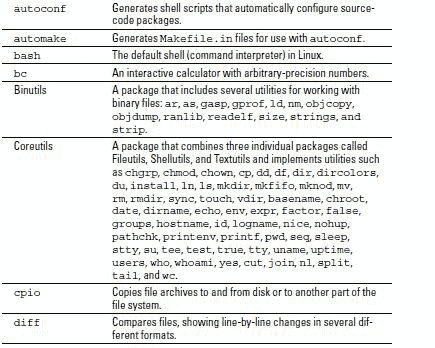

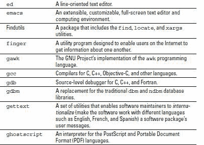

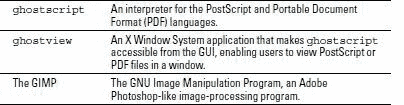

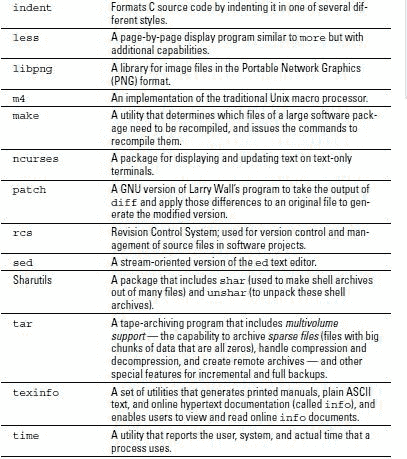

#### 2. 应用程序与 GUI

由于你不想为了让电脑执行某些操作就在命令终端上输入一接又一串命令，你会希望使用 `GUI` 或图形用户界面来导航和使用电脑中的程序。`GUI` 允许你点击图标并弹出窗口，帮助你更容易地使用程序。大多数发行版使用 `KDE 桌面环境 (KDE)` 或 `GNU 对象模型环境 (GNOME)`。如果你在电脑上同时安装了这两个环境，你可以选择哪一个桌面作为默认，或者随时在它们之间进行切换。这两个桌面的体验都与 Mac OS 和 Windows 桌面相似。值得注意的是，`GNOME` 附带了一个名为 `Nautilus` 的图形化壳，它使得 Linux 配置、文件搜索和应用程序加载变得更加简单。如果你需要使用命令提示符，你只需要在两个桌面环境中点击终端窗口的图标即可。

除了 `GUIs` 之外，任何普通电脑用户都需要使用应用程序，即你可以使用它们来满足基本的计算需求的程序。虽然你可能无法访问在 Mac 或 Windows 电脑中使用过的那些流行的程序，但 Linux 可以提供开源替代方案供你尝试。例如，你无需购买 Adobe Photoshop，可以尝试 `The GIMP`，它在处理图像方面的表现同样出色。Linux 还提供了满足普通电脑用户大部分需求的生产力软件包。你可以从 `Libreoffice.org` 或 `OpenOffice.org` 获取办公生产力应用，允许你进行文字处理、创建数据库或制作表格。

提示：如果你想在 Linux 上安装 MS 应用（例如 Microsoft office），可以使用 `CrossOver Office`。你可以从 [www.codeweavers.com/products/crossover-linux/download](http://www.codeweavers.com/products/crossover-linux/download) 下载此应用。

#### 3. 网络

Linux 允许你通过网络与其他电脑交换信息来找到你需要的一切。Linux 通过允许使用 `TCP/IP`（传输控制协议/网协议）来实现这一点，这让你能够上网并与任何服务器或电脑通信。

#### 4. 互联网服务器

Linux 支持互联网服务，例如：

- 电子邮件
- 新闻服务
- 文件传输工具
- 万维网
- 远程登录

任何 Linux 发行版只要有互联网连接，并且电脑配置了互联网服务器（允许 Linux 电脑向另一台电脑发送信息的特殊服务器软件），就可以提供这些服务。以下是在 Linux 中你会遇到的常见服务器：

- `in.telnetd` – 借助名为 `TELNET` 的协议允许你通过互联网登录不同的系统。
- `sendmail` – 作为邮件服务器，允许使用简单邮件传输协议 (`SMTP`) 在两个系统之间交换电子邮件。
- `innd` – 允许你使用网络新闻传输协议 (`NNTP`) 查看新闻，这让你能够以存储转发的方式访问新闻服务器。
- `Apache httpd` – 允许你使用超文本传输协议 (`HTTP`) 将文档发送到另一个系统。
- `vsftpd` – 允许你使用文件传输协议 (`FTP`) 将文件发送到另一台电脑。
- `sshd` – 允许你使用安全 shell (`SSH`) 协议通过互联网安全登录登录。

#### 5. 软件开发

Linux 是开发者的操作系统，这意味着它是一个适合开发软件的环境。该操作系统开箱即用拥有丰富的软件开发工具，例如用于构建程序的代码库和编译器。如果你有 C 语言和 Unix 的背景，Linux 应该让你感觉如家。Linux 提供了你可能在 Sun Microsystems、HP (Hewlett-Packard) 和 IBM 等 Unix 工作站上体验过的基本工具。

#### 6. 在线文档

一段时间后，你可能想要查找更多关于 Linux 的信息而无需翻阅。幸运的是，Linux 有足够的在线信息可以帮助你解决命令语法等问题。为了快速获取这些信息，你只需要在命令行中输入 `man` 来获取 Linux 命令的手册页。你也可以从桌面获取帮助，使用帮助选项或图标。

### 选择发行版时的考虑事项

什么是最适合你的 Linux 发行版（distribution 的缩写）？以下是你可能需要记住的一些事情：

#### 1. 软件包管理器

区分不同发行版的主要因素之一是它们自带的包管理器。正如你所预期的那样，某些发行版具有某些功能，让你在安装其自带功能时更容易从命令行进行操作。除了易用性，你还需要考虑的另一个问题是发行版提供的软件包可用性。例如，某些发行版不像其他那样流行，这意味着针对某些特定发行版开发的应用程序较少。如果你刚开始学习 Linux，安装一个不仅承诺从一开始就容易导航，而且提供你未来可能想要安装的广泛应用程序的发行版可能是一个好主意。

#### 2. 桌面环境

你希望拥有一个让你能够享受且良好配合你计算需求的桌面发行版——你绝对想要一个具有良好自定义选项且易于查找窗口和菜单的桌面。你还希望确保你的桌面资源利用高效，并且与你计划使用的应用程序有良好的集成。虽然你未来可能安装另一个桌面环境，但你仍然希望发行版自带的桌面看起来像你真正想要的桌面。

#### 3. 硬件兼容性

不同的发行版在其安装包中包含不同的驱动程序，这意味着它们有一套推荐的硬件可以无缝运行。当然，你可以寻找其他与你现有硬件完美匹配的驱动源，但这会在你尝试从安装开始立即运行所有程序时增加额外工作。为了避免这种麻烦，请检查发行版的兼容性页面，看看你的电脑外设在你的 Linux 发行版上是否都能正常工作。

#### 4. 稳定性与前沿性

不同的发行版在稳定性和获取应用程序及软件包的最新版本之间有不同的侧重点。例如，Debian 发行版倾向于延迟某些应用程序的更新，以确保你的操作系统保持稳定。这对于某些倾向于始终获取最新版本应用程序和最新功能的用户来说可能并不适用。另一方面，Fedora 则采取了完全相反策略——它专注于让你所有程序和功能保持到最新状态，并确保你的 Linux 始终拥有最强大、最新的产品。然而，这可能会以应用程序的稳定性为代价，从而导致你回滚到之前的版本。

#### 5. 社区支持

Linux 的核心在于不断为该操作系统提供支持的社区，从文档到故障排除。。这意味着，如果一个发行版拥有庞大的社区，你在管理它时很可能会获得你所需的资源。

### 值得尝试的优秀发行版

现在你已经了解了优秀的 Linux 发行版之所以优秀，并且正准备挑选你将安装的发行版，你可能想检查这些可能非常适合你的发行版：

#### 1. Ubuntu

Ubuntu 的设计很大是为了让普通电脑用户能够易于使用 Linux，这使其成为每个初者的良好发行版。该发行版非常简单，每六个月更新一次，并拥有 Unity 界面，允许你使用诸如 Dock 栏、软件包管理器的商店式界面以及可以让你轻松在操作系统中找到任何内容的仪表板等功能。此外，它还带有一套适用于大多数用户的标准应用程序，例如 Torrent 下载器、Firefox 网页浏览器以及一个即时消息应用程序。你还可以期待获得来自其庞大社区的强大支持。

#### 2. Linux Mint

该发行版基于 Ubuntu，但设计旨在为任何过去没有使用过 Linux 的用户让一切变得更简单——它具有熟悉的菜单，并且不局限于让你只使用开源程序。这意味着你可以获得流行操作系统中的标准程序，例如 `.mp3` 支持和 Adobe Flash，以及许多专源驱动程序。

#### 3. Debian

如果你想谨慎一点，并希望确保始终运行的是一台无 Bug 且稳定的计算机，那么这可能是适合你的发行版。它的主要目标是让 Linux 成为一个完全可靠的系统，但这可能存在缺点——Debian 不会优先获取你所拥应用程序的最新更新，这意味着你可能需要手动搜索你所拥有的大多数软件的最新版本。优点是，你可以在许多处理器架构上运行 Debian，并且它极可能在旧设备上运行。然而，这并不意味着选择 Debian 就必须一直保持过时——在网上和 Linux 仓库中有许多程序可供。

#### 4. OpenSUSE

OpenSUSE 是一个非常不错的发行版，你可以考虑尝试，因为它允许你在无需处理命令行的情况下配置操作系统。它通常带有默认的 KDE 桌面，但也会让你在安装发行版包时在 LXDE、`KDE`、`XFCE` 和 `GNOME` 之间进行选择。它还提供了良好的文档、`YaST` 软件包管理器以及来自社区的强大支持。使用该发行版时可能遇到的缺点之一是它可以消耗大量资源，这意味着它在旧型号处理器和上网笔记本电脑上使用并不理想。

#### 5. Arch Linux

Arch Linux 是为那些想要从零开始构建操作系统的用户设计的发行版。从安装包开始，你所获得的只有命令行，你将使用它来获取应用程序、桌面环境、驱动程序等。这意味着你可以根据自己的需求，目标让系统变得尽可能精简或功能尽可能强大。如果你想完全了解操作系统内部的每一个细节，那么 Arch Linux 可能是你最好的入门发行版。你将被迫处理可能遇到的任何错误，这是学习操作 Linux 的极佳方法。

另一个让这个发行版与众不同的点是，它使用了 `Pacman`，它以强大的软件包管理器而闻名。`Pacman` 采用滚动更新模式（rolling release），这意味着你必须安装包含的每个包的最新版本——这确保了你能够为你的 Linux 获取最前端的应用程序和功能。除了这个软件包管理器，你还可以享受 `AUR`（Arch 用户仓库），它允许你创建可用程序的可安装版本。这意味着，如果你想要一个 Arch 仓库中没有提供的程序，你可以使用 `AUR` 助手像安装普通包一样来安装应用程序和其他功能。

# 第 3 章：命令行的用法

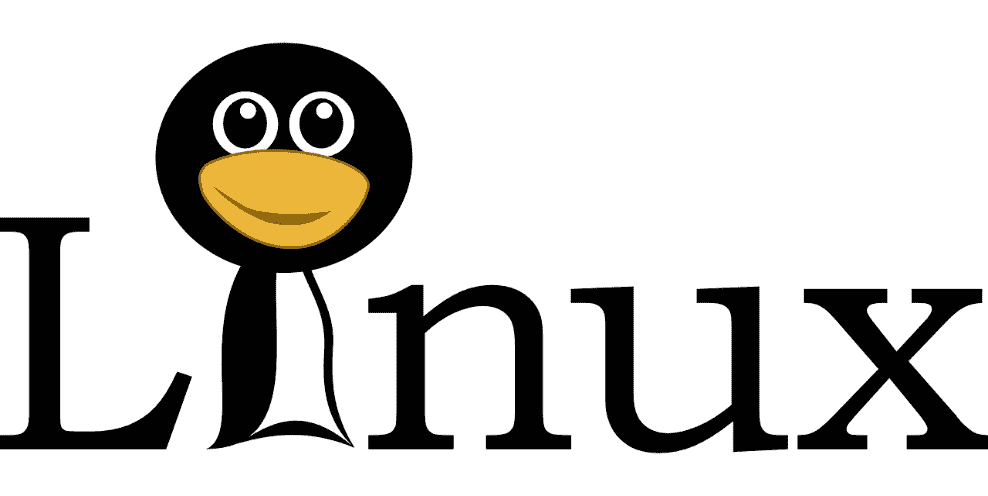

当你按下键盘上的回车键运行命令时，你会获得文本形式的反馈。通过命令行，系统向我们展示提示符（prompt）。这意味着当你输入命令时，它将显示在提示符之后。在大多数情况下，由你来发布命令。例如：

```bash
user@bash:ls -l /home/Gary
total 3drwxr-xr-x  2 Gary users 4096 Mar 23 13:34 bind
drwxr-xr-x 18 Gary users 4096 Feb 17 09:12 Documents
drwxr-xr-x  2 Gary users 4096 May 05 17:25 public html
user@bash:
```

将这些内容拆解：

- **第 1 行**：这向我们展示了名为 `user bash` 的提示符。一旦有了提示符，我们就应该输入一个命令，在本例中是 `ls`。这意味着通常情况下，命令是我们要必须输入的第一个内容。之后，我们应该在命令行中输入参数（`-l/home/Gary`）。在这种情况下，你需要记住的第一点是这些内容是用空格分隔的。也就是说，在输入命令后，在输入参数之前要输入一个空格。在本例中使用的第一个参数 `-l` 也称为选项（option）。选项在修改命令的行为方面起着重要作用。它们通常列在其他参数之前，并以连字符（`-`）开头。

- **第 2-5 行**：这些代表了我们在运行输入的命令后获得的输出。你在终端中输入的大多数命令都会产生紧接在命令之后列出的输出。然而，还有其他命令在运行时运行时，除非发生错误，否则它们不会显示结果或任何信息。

- **第 6 行**：这再次显示了提示符。一旦你运行了在终端输入的命令并在运行后获得了结果，就会得到一个提示符。这意味着，如果运行某个命令后没有显示提示符，则说明该命令仍在运行。我想让你知道的一点重要事情是，在终端中，每行可能没有编号。这只是我为了解释说明每一行代表什么。

## 那么我们如何打开终端呢？

在处理 Linux 工作时，你必须学会的第一件事就是如何打开终端。这相当容易。由于每个系统都不同，很难直接告诉你该怎么做。不过，你可以从以下几个地方开始：

- **如果你使用的是 Mac**，你做的第一件事是进入“应用程序”，然后点击“实用工具”。在“实用工具”下，有一个“终端”选项供你选择，在那里你就有可以输入命令的运行终端。或者，打开 Linux 终端最好且最方便的快捷键组合是 `command + space`。这个组合会调出聚焦（Spotlight），你在其中输入 `terminal`，它很快就会出现在屏幕上。你也可以下载 `MobaXterm` 并在 Mac 上作为终端使用 ([`macdownload.informer.com/macterm/download/`](http://macdownload.informer.com/macterm/download/))。

- **如果你在 Linux 上工作**，你可以点击“系统”然后“应用程序”来访问终端。在“应用程序”下，选择“实用工具”并选择“终端”选项。或者，你也可以简单地在桌面空白处点击右键，会出现一个下拉菜单。选择“在终端中打开”选项，你就搞定！！

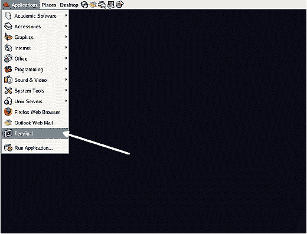

- **如果你使用的是 Windows**，有一些方法可以使用终端。最好的方法是使用 `SSH` 客户端访问 Linux 终端，你可以在那里运行命令。允许你执行此操作的软件示例包括 `MobaXterm` ([`download.cnet.com/MobaXterm/3000-7240_4-10890137.html`](http://download.cnet.com/MobaXterm/3000-7240_4-10890137.html)) 和 `Putty` ([`www.putty.org/`](http://www.putty.org/))。使用这些软件的第一件事是从网上下载并安装到你的电脑上。在桌面上，你有一个可以点击的快捷方式。

在大多数情况下，使用 `root` 账户执行普通任务并不是一个好主意。也就是说，`root` 账户在用户运行特权命令以及维护系统时经常起着重要作用。因此，要创建一个账户，重要的步骤是登录 `root` 并使用 `useradd` 或 `adduser` 命令。

# 快捷键

最重要的快捷键之一是使用键盘上的向上和向下箭头键。当你在 Linux 上输入命令时，这些命令会被保存在历史记录中。遍历这些历史记录最简单的方法就是使用这两个键。这意味着你以前使用过的命令不需要重新输入。你只需按几次向上箭头即可找到你正在寻找的命令。此外，为了编辑以前使用过的命令，你可以使用左、右箭头键将光标移动到你需要执行编辑的地方。

有时，当你处于 GUI 桌面环境中时，你会发现某些功能运行不正常——有时程序会崩溃，导致整个系统拒绝响应鼠标点击。甚至会出现 GUI 根本无法启动的情况。当你遇到麻烦时，你仍然可以告诉你的操作系统应该该做什么，但你必须通过文本屏幕或 shell（外壳）来完成，shell 是 Linux 的命令解释器。由于 Linux 本质上是一个 Unix 程序，你将通过使用文本终端完成很多任务。虽然桌面的工作是提供通过点击鼠标即可访问任何内容的便利性，但在某些情况下，你需要访问终端。


# 快捷键

最重要的快捷键之一是使用键盘上的向上和向下箭头键。当你在 Linux 上输入命令时，这些命令会被保存在历史记录中。遍历这些历史记录最简单的方法就是使用这两个键。这意味着你以前使用过的命令不需要重新输入。你只需按几次向上箭头即可找到你正在寻找的命令。此外，为了编辑以前使用过的命令，你可以使用左、右箭头键将光标移动到你需要执行编辑的地方。

有时，当你处于 GUI 桌面环境中时，你会发现某些功能运行不正常——有时程序会崩溃，导致整个系统拒绝响应鼠标点击。甚至会出现 GUI 根本无法启动的情况。当你遇到麻烦时，你仍然可以告诉你的操作系统应该该做什么，但你必须通过文本屏幕或 shell（外壳）来完成，`shell` 是 Linux 的命令解释器。由于 Linux 本质上是一个 Unix 程序，你将通过使用文本终端完成很多任务。虽然桌面的工作是提供通过点击鼠标即可访问任何内容的便利性，但在某些情况下，你需要访问终端。

学习如何输入命令将会在你遇到 X Window 系统错误时为你节省很多麻烦，X Window 系统是控制你在桌面 GUI 中看到的所有菜单和窗口的程序。要修复此错误，或者防止它阻止你访问所需的程序或文件，你可以调出终端并改而输入命令。在将来，你可能想在桌面上保持一个终端，因为它可以让你比指向和点击更快地控制你的计算机。

# Bash Shell

如果你过去用过 MS-DOS 操作系统，那么你熟悉 `command.com`，它作为 DOS 的命令解释器。在 Linux 中，这被称为 `shell`。所有不同发行版的默认 `shell` 都称为 `bash`。Bourne-Again Shell（再次 Bourne 外壳）或 `bash` 能够运行你存储在计算机中作为可执行文件的任何程序。它还可以运行 `shell` 脚本，或者说是由 Linux 命令组成的文本文件。简而言之，这个 `shell` 充当命令解释器，或者说将你输入的任何内容解释为命令并执行该输入应执行的操作的程序。

调出终端窗口只需点击桌面上的一个像显示器的图标即可——点击它将带你进入一个提示符。如果你找不到该图标，只需在主菜单中搜索并选择带有 Terminal（终端）或 Console（控制台）标签的项目。

**提示**：你有选择使用 `bash` 以外的其他 `shell`，就像你有选择桌面的选择一样。你始终可以通过在终端中输入 `chsh` 命令来更改你发行版正在使用的 `shell`。

# Shell 命令

每个 `shell` 命令都遵循此格式：


命令行（例如遵循上述格式的命令）后面通常跟着参数（也称为参数）。在输入命令行时，你需要输入一个空格来将主命令与选项分开，并将一个选项与另一个选项分开。然而，如果你想使用一个在语法中包含空格的选项，你需要将该选项包含在引号中。看看这个例子：

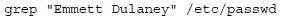

`grep` 命令允许你在文件中查找特定的文本，在本例中该文本是 Emmett Dulaney。一旦你按下回车，你将得到以下结果：

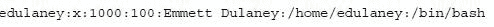

如果你想读取特定的文件，可以使用 `more` 命令。尝试输入此命令：

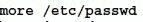

你将得到类似这样的结果：

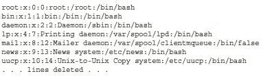

要查看计算机上运行的所有程序，请使用 `ps` 命令。尝试在终端上输入此命令：

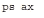

选项 `ax`（选项 `a` 列出所有运行中的进程，而选项 `x` 显示其余进程）允许你看到系统中所有用的进程，看起来像这样：

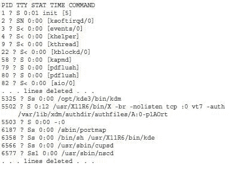

命令行选项的数量及其相应的格式取决于具体的命令。这些选项呈现为 `-X` 的形式，其中 `X` 代表一个字符。例如，你可以选择为 `ls` 命令使用 `-l` 选项，它将列出目录的内容。看看当你在用户主目录下输入 `ls -l` 命令会发生什么：

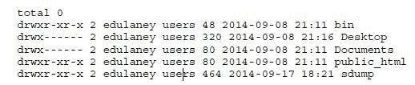

如果你输入的命令太长无法包含在单行，请按下 `\`（反斜杠）键然后按回车。随后，在下一行继续命令的剩余部分。尝试输入以下命令并在输入一行后按回车：

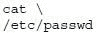

这将显示 `/etc/passwd` 文件中的所有内容。

你还可以通过 `;`（分号）符号分隔这些命令，在一行将不同的短命令串联起来（也称为连接）。看看这个命令：

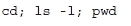

该命令将带你跳转到用户的主目录，显示你进入的目录的内容，然后显示当前目录的名字。

# 组合你的 Shell 命令

如果你目标是创建一个更复杂的命令，例如查找 `/dev` 目录中是否有一个名为 `sbpcd` 的文件，因为你的 CD 驱动器需要该文件，你可以选择组合不同的命令来使整个过程变短。你可以做的是你可以 `ls /dev` 命令来显示 `/dev` 目录的内容，并查看它是否包含你需要的文件。然而，当命令返回结果时，你可能在 `/dev` 目录中获得太多条目。但是，你可以将之前学过的 `grep` 命令与 `ls` 命令结合起来，搜索你正在寻找的精确文件。现在，输入以下命令：

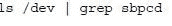

这将为你显示目录列表（`ls` 命令的结果），同时 `grep` 命令将搜索字符串“sbpcd”。管道 `|` 了你使用的两个独立命令之间的连接，其中第一个命令的输出将作为第二个命令的输入。

# 命令替换

命令标准的输出可以被封装，几乎与一个值可以存储在一个值中的方式一样，然后由 `shell` 扩展。这个概念被称为命令替换。

根据 `bash` 文档，命令替换基本上允许命令的输出替换命令本身。在 `bash` 中，扩展是通过执行命令并让命令替换代替命令的标准输出完成的，并擦除所有末尾的换行符。嵌入的换行符不会被删除，但在单词分割期间，它们可能会被删除。

让我们来看一个例子：

考虑命令 `seq`。它将打印一个从第一个参数到第二个参数的数字序列，如下：


# 快捷键

最重要的快捷键之一是使用键盘上的向上和向下箭头键。当你在 Linux 上输入命令时，这些命令会被保存在历史记录中。遍历这些历史记录最简单的方法就是使用这两个键。这意味着你以前使用过的命令不需要重新输入。你只需按几次向上箭头即可找到你正在寻找的命令。此外，为了编辑以前使用过的命令，你可以使用左、右箭头键将光标移动到你需要执行编辑的地方。

有时，当你处于 GUI 桌面环境中时，你会发现某些功能运行不正常——有时程序会崩溃，导致整个系统拒绝响应鼠标点击。甚至会出现 GUI 根本无法启动的情况。当你遇到麻烦时，你仍然可以告诉你的操作系统应该做什么，但你必须通过文本屏幕或 shell（外壳）来完成。shell 是 Linux 的命令解释器。

由于 Linux 本质上是一个 Unix 程序，你将通过使用文本终端完成很多任务。虽然桌面的工作是提供通过点击鼠标即可访问任何内容的便利性，但在某些情况下，你需要访问终端。

学习如何输入命令将会在你遇到 X Window 系统错误时为你节省很多麻烦。X Window 系统是控制你在桌面 GUI 中看到的所有菜单和窗口的程序。要修复此错误，或者防止它阻止你访问所需的程序或文件，你可以调出终端并改而输入命令。在将来，你可能想在桌面上保持一个终端，因为它可以让你比指向和点击更快地控制你的计算机。

## Bash Shell

如果你过去用过 MS-DOS 操作系统，那么你熟悉 `command.com`，它作为 DOS 的命令解释器。在 Linux 中，这被称为 shell。所有不同发行版的默认 shell 都称为 `bash`。

Bourne-Again Shell（再次 Bourne 外壳）或 `bash` 能够运行你存储在计算机中作为可执行文件的任何程序。它还可以运行 shell 脚本，也就是由 Linux 命令组成的文本文件。简而言之，这个 shell 充当命令解释器，将你输入的任何内容解释为命令，并执行该输入应执行的操作。

调出终端窗口只需点击桌面上的一个像显示器的图标即可——点击它将带你进入一个提示符。如果你找不到该图标，只需在主菜单中搜索并选择带有 Terminal（终端）或 Console（控制台）标签的项目。

> **提示**：你可以选择使用 `bash` 以外的其他 shell，就像你可以选择不同的桌面一样。你始终可以通过在终端中输入 `chsh` 命令来更改你的发行版正在使用的 shell。

## Shell 命令

每个 shell 命令都遵循以下格式：


命令行（例如遵循上述格式的命令）后面通常跟着参数。在输入命令行时，你需要输入一个空格来将主命令与选项分开，并将一个选项与另一个选项分开。然而，如果你想使用一个在语法中包含空格的选项，你需要将该选项包含在引号中。请看下面的例子：


`grep` 命令允许你在文件中查找特定的文本，在本例中该文本是 Emmett Dulaney。一旦你按下回车，就会得到以下结果：


如果你想读取特定的文件，可以使用 `more` 命令。尝试输入以下命令：


你将得到类似这样的结果：


要查看计算机上运行的所有程序，请使用 `ps` 命令。尝试在终端上输入以下命令：


选项 `ax`（选项 `a` 列出所有运行中的进程，而选项 `x` 显示其余进程）允许你看到系统中的所有进程，看起来像这样：


命令行选项的数量及其相应的格式取决于具体的命令。这些选项呈现为 `-X` 的形式，其中 `X` 代表一个字符。例如，你可以选择为 `ls` 命令使用 `-l` 选项，它将列出目录的内容。看看当你在用户主目录下输入 `ls -l` 命令会发生什么：


如果你输入的命令太长，无法包含在单行中，请按下 `\`（反斜杠）键，然后按回车。随后，在下一行继续命令的剩余部分。尝试输入以下命令，并在输入一行后按回车：


这将显示 `/etc/passwd` 文件中的所有内容。

你还可以通过 `;`（分号）符号分隔这些命令，在一行中将不同的短命令串联起来（也称为连接）。请看下面的命令：


该命令将带你跳转到用户的主目录，显示你进入的目录的内容，然后显示当前目录的名字。

## 组合你的 Shell 命令

如果你的目标是创建一个更复杂的命令，例如查找 `/dev` 目录中是否有一个名为 `sbpcd` 的文件，因为你的 CD 驱动器需要该文件，你可以选择组合不同的命令来使整个过程变短。

你可以输入 `ls /dev` 命令来显示 `/dev` 目录的内容，并查看它是否包含你需要的文件。然而，当命令返回结果时，你可能会在 `/dev` 目录中获得太多条目。但是，你可以将之前学过的 `grep` 命令与 `ls` 命令结合起来，搜索你正在寻找的精确文件。现在，输入以下命令：


这将为你显示目录列表（`ls` 命令的结果），同时 `grep` 命令将搜索字符串“sbpcd”。管道符号 `|` 连接了你使用的两个独立命令，其中第一个命令的输出将作为第二个命令的输入。

## 命令替换

命令的标准输出可以被封装，几乎与一个值可以存储在变量中的方式一样，然后由 shell 扩展。这个概念被称为命令替换。

根据 bash 文档，命令替换基本上允许命令的输出替换命令本身。在 bash 中，扩展是通过执行命令，并让命令替换命令的标准输出完成的，同时擦除所有末尾的换行符。嵌入的换行符不会被删除，但在单词分割期间，它们可能会被删除。

让我们来看一个例子。

考虑命令 `seq`。它将打印一个从第一个参数到第二个参数的数字序列，如下：


## Shell 脚本的功能

Shell 脚本具有以下功能：

- 变量（Variables），或存储值的对象。这包括可以通过命令行参数访问的内置变量。
- 使用控制结构，允许你对命令进行循环。
- 使用条件命令的能力。
- 评估表达式的能力。
- 使用函数并在脚本的不同位置调用它们的能力。

## 使用变量存储

在 `bash` 中，你可以按照以下方式定义变量：


当你已经定义了一个变量的值时，可以使用前缀 `$`。例如，变量 `PATH` 的值为 `$PATH`。现在，如果你想显示变量 `count` 的值，请输入：


在处理命令行参数时，`bash` 使用了几个特殊变量。例如，变量 `$*` 将命令行中的所有参数存储在一个单一变量中，而 `$?` 则作为 shell 执行脚本中最后一条命令的退出状态的容器。

在 `bash` 脚本中，你可以要求用户输入所需的值，然后使用 `read` 命令将其转换为变量的值。请看下面的示例脚本：

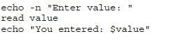

当你运行此脚本时，`read value` 命令将提示 `bash` 读取用户输入的所有内容，并将该输入存储到名为 `value` 的变量中。注意，此示例脚本中的 `-n` 选项是为了防止 `echo` 命令在字符串末尾自动添加换行。

## 调用函数

你可以将一组命令组合成一个带有指定名称的函数，然后在脚本的不同区域使用它们。一旦你将命令分组到函数中，你只需输入函数的名称即可执行所有分配给它的命令。请看下面的示例脚本：

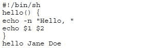

运行此脚本将得到以下输出：


## 控制脚本流

你可以通过使用特殊命令来控制脚本如何执行你指定的命令。诸如 `if`、`while`、`case` 和 `for` 这样的命令允许你使用命令的退出状态并执行下一步操作。

当命令被执行时，它会给出一个退出状态，或者一个指示执行是否成功的数值。根据编程惯例，退出状态为零意味着命令已完成。

例如，你想在调出 `vi` 编辑器对文件进行更改之前先对文件进行备份。同时，你还希望确保在没有创建备份文件的情况下不对文件进行任何更改。为了处理所有这些任务，你可以使用以下脚本：

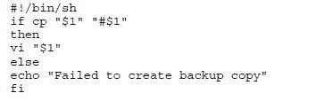

该脚本显示了 `if-then-else` 结构的语法，并展示了如何通过 `if` 命令显示 `cp` 命令的退出状态来决定下一步的操作。

如果 `cp` 显示退出状态为零，你将可以使用 `vi` 来编辑文件。如果不是如此，脚本将向你显示错误消息并退出。另外注意，脚本将使用你请求的相同保存备份文件，但在备份文件名的开头带有一个井号。

另外注意，你需要输入命令 `fi`，让脚本知道你已经结束了 `if` 命令。否则，你将在脚本中遇到错误。


如果你想评估任何表达式，并将该表达式的值作为命令的退出状态，`test` 命令将对该任务非常有用。例如，如果你想创建一个只编辑现有文件的脚本，你可以按如下方式使用 `test` 命令：

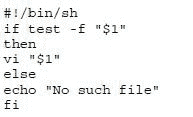

注意，你也可以使用方括号 `[ ]` 包含表达式来使用更短的 `test` 命令。你可以将上面的示例脚本修改为如下：

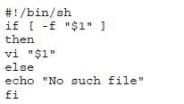

你可以使用的另一种控制结构是 `for` 循环。看看这个控制结构在用于累加 1 到 10 数字的脚本中是如何使用的：

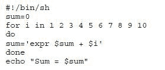

注意，上面的脚本还展示了如何使用 `expr` 命令评估表达式。

如果你想根据变量值执行命令组，`case` 语句将非常有用。看看这个示例脚本：

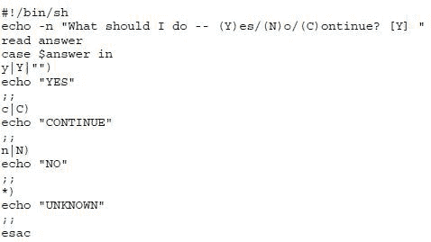

现在，将此脚本保存为 `confirm`，然后输入此命令将其转换为执行文件：

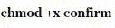

当脚本提示你请求的操作时，按下这些键中的任意一个：`Y`、`N` 或 `C`。输出如下：

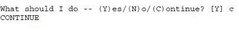

脚本将你的输入存储在变量 `answer` 中，`case` 语句根据你的输入值运行代码。例如，如果你按下 `C` 键，将运行此代码：

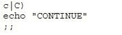

你会发现 `case` 命令以单词 `case` 开头，并以单词 `esac` 结束。变量中还包含代码块，其后面跟着一个右括号。

# 第 5 章：熟悉 Linux 文件系统和进程


Linux 的文件系统在灵活性方面非常出色。它的设计使其能够支持普通文件以及特殊类型的文件。它可以支持文本、程序、图像、服务、输出和输入设备。因此，由于它支持多种文件格式，它可以与另一个操作系统共存。此外，在系统中，文件和目录之间几乎没有区别的因素。因此，目录仅仅是文件堆的位置。

## 文件分类

为了更好地理解 Linux 文件系统，对文件进行了分类。虽然可以合理假设，但了解更多特定文件的信息可以让程序人员和系统管理员在使用 Linux 时避免复杂性。这还防止了他们执行冗长的列表操作。

文件类别：

*   `d` – 一个作为文件堆列表的文件
*   `l` – 允许在文件树的多个部分显示特定文件的系统
*   `p` – 允许进程间通信的系统
*   `-` – 正常文件
*   `s` – 提供进程间网络连接的特殊文件
*   `c` – 用于输出和输入的机制

## 分区的艺术

Linux 分区始于电源故障威胁到大多数用户的时期。曾出现过停电意味着系统遭受损害的日子。此外，分区的一个主要原因是实现更高水平的数据安全。硬盘的划分允许进行安全的分组和保护。由于成功的分区，你可以优先考虑重要数据组。当硬盘的一部分受到损坏时，只有该部分会受到影响。存储在其他分区中的其余部分不受影响。

Linux 系统中的两个主要分区：

1.  `Swap` – 指额外的内存或扩展
2.  `Data` – 指普通数据；指启动和运行系统的必要条件

推荐的分区：

*   一个必要数据的分区
*   一个用于服务器程序和配置数据的分区
*   一个用于应用程序的分区
*   至少一个用于用户邮件、存档和数据库表的分区
*   至少有一个用于特定文件的分区
*   至少有一个用于虚拟内存的分区

### 常见分区：

*   包含个人数据的分区
*   存储临时文件的分区
*   存储第三方数据的分区
*   专门用于程序的分区

### 目录：根目录与子目录

在 Linux 中，有一个名为“根目录”（The Root Directory）的目录。它充当主目录，正如程序员和系统管理员所称的，它是所有目录的目录。伴随根目录而产生的是子目录。这些子目录根据其分配的任务来管理文件。

#### 子目录及其内容：

*   `/home` – 用户家目录
*   `/boot` – 内核和启动文件；尝试消除不必要的启动加载程序的文件
*   `/initrd` – 关于启动信息的数据
*   `/dev` – 包含所有 CPU 硬件外围的引用
*   `/bin` – 常见的共享系统程序
*   `/etc` – 重要的系统配置数据
*   `/lib` – 库文件
*   `/lost+found` – 从失败中恢复的数据
*   `/opt` – 来自第三方源的文件
*   `/net` – 远程文件系统的标准挂载点
*   `/misc` – 杂项数据
*   `/proc` – 关于系统资源的信息
*   `/mnt` – 外部文件系统的标准挂载点

### Inode 的作用

在 Linux 文件系统中，inode 代表一个文件。inode 是一种包含重要信息的序列号类型。它的主要作用围绕着定义分区中的文件数量展开。在整个 Linux 文件系统中，特别是具有多个分区的系统，存在具有相似 inode 的文件。为了避免复杂性，每个分区都分配了自己的 inode。此外，分配的 inode 提供了硬盘数据结构的描述。一旦硬盘初始化完成，它可以在两个时间点接受数据存储：第一，在安装过程中允许数据存储；第二，在向现有系统添加存储空间时允许数据存储。

#### Inode 中包含的信息：

*   文件类型
*   文件大小
*   文件的所有者或组所有者
*   创建日期时间
*   最后修改日期时间
*   权限
*   链接数
*   数据地址

### 什么是超级块（Superblock）？

在 Linux 文件系统中，关于基本文件大小和形状的信息被称为超级块（The Superblock）。它允许文件管理器浏览并维护文件系统的质量。

#### 超级块中的信息：

*   空闲块 – 显示系统空闲块的数量
*   空闲 inode – 显示原始 inode 分配
*   空闲 inodes – 显示系统空闲 inode 的数量
*   块组编号 – 指分配给超级块的数字
*   每组块数 – 显示一组的块数量
*   块大小 – 指系统的块大小；信息以字节为显示
*   魔数（Magic number） – 指授予挂载软件进行评估的权限
*   挂载计数 – 指系统对评估的额度
*   版本级别 – 指系统对版本级别确认的额度

### 什么是组描述符（Group Descriptor）？

组描述符负责标记文件的数据结构。它包含了避免数据重复的细节。由于它的作用，系统发生损坏的概率极低。

#### 组描述符中的信息：

*   块位图
*   空闲块计数
*   空闲 inode 计数
*   inode 位图
*   inode 表格
*   已用目录计数

### 文件修改：查找、挂载与更改大小

Linux 文件通常很容易定位。只需搜索目录，紧跟在 `/` 或正斜杠之后的名称可能就是你偏好的文件。你可以开始挂载。在挂载文件时，需要 Linux 内核的可用性来检查标准。它的存在允许验证所有通过的系统参数。如示例所示，你正在挂载三种类型的信息：“iso898”、`/dev/rom` 和 `/dev/cdrom`。除了查找和挂载文件外，你还可以更改文件的大小。这是由于文件碎片化的发生。由于文件在碎片化期间变得效率低下，更改文件大小允许重新分配文件。因此，系统变得更加稳定。你将接触 `truncate` 和 `fallocate` 命令。这两个命令都允许你创建一个指定大小的文件。

### 进程（Processes）

尽管非常公平，但 Linux 偶尔也会遇到错误。系统管理员对此非常清楚。特别是当他们根据自己的偏好设计修改并管理程序时，他们对意外故障不再陌生。Linux 系统的程序管理被称为进程。

#### 什么是进程？

如前所述，进程是 Linux 的程序管理。它指的是程序的运行实例。由于 Linux 能够处理多个任务，因此许多进程同时运行是典型现象。在当前运行的启动进程之外，操作系统被设计为运行另一批进程进行通用管理。

#### 进程的元素：

*   标识符：系统中的每个进程都被分配了数字。有时，它们被误认为是任务向量的索引，但它们仅仅是数字。它们的目的是让用户轻松地识别特定进程。
*   进程间通信：对 Linux 经典的信号量、信号和管道的支持被称为进程间通信。
*   链接：链接代表进程之间的相互依赖关系。除了初始进程外，Linux 系统中的每个进程都有一个父进程。
*   调度信息：调度信息指的是关于进程优先级公平决策的信息。
*   状态：状态指的是进程执行状态的变化。

#### 进程的不同状态：

*   等待状态
*   运行状态
*   僵尸状态
*   停止状态

### 什么是信号（Signals）？

在 Linux 中，某些进程需要处理。处理进程的机制被称为信号。信号作为传递给进程的特殊消息。它们是异步的。一旦进程接收到信号，信号几乎立即被解释。对于运行中的进程，它们具有优先级。存在信号未指定特定行为的情况。它们被赋予三个值之一，这些值决定了响应。在给信号赋值时要小心，因为当另一个信号被送达时，这些值可能会被损坏。

#### 值：

*   `SIG_IGN` – 表示应该忽略这些信号
*   `SIG_DFL` – 定义默认处理方式
*   信号指针（指向信号处理函数的指针） – 接收参数，获取信号号并返回 void

# 进程的创建

在 Linux 中，创建进程是可能的。内核是必要的，并被分配“1”作为进程标识符。它始于选择旧进程，并对该旧进程进行克隆。由于进程创建需要内核，克隆是在内核模式下进行的。它允许两个进程合并或使用相似的资源，而不是让进程呈现为两个相似的副本。

## 所有运行进程：查看它们需要什么？

在 Linux 中，所有运行中的进程都是可见的。要这样做，请学习进程状态命令或 `ps` 命令。`ps` 命令显示所有运行进程的信息。它作为信息的重复更新工具。它提供有关所选内容的详细信息。更重要的是，它显示了 `PIDs`（进程标识符）。`PIDs` 是自动分配的数字。要查看运行中的进程，只需先输入 `ps` 命令。

### 查看进程的选项：

-   `-A` 或 `-e` – 查看所有进程。

    输入：`ps -A`

-   `-u` (用户名) – 查看由特定 `userInput` 运行的所有进程（针对用户名“mikael307”）：

    输入：`ps -u (mikael307)`

-   `top` – 查看顶层程序。

    输入：`ps top`

如输出所示，初始进程是 `pid`。下方是 `apache`，它有一个子进程 `gnome`。`apache` 下方是 `tree` 和 `devkit`。`devkit` 有名为 `sys` 和 `dev` 的子进程。`dev` 下是进程 `run` 和 `ceno`。然后，初始 `pid` 进程之后是 `ff` 和 `log`。

## 杀死进程

杀死进程是一个选项。你可以杀死进程以消除系统的大负载。如果你拒绝等待进程完成执行，就可以这样做。当使用非 Linux 系统时，需要注销或重启电脑才能杀死运行中的进程。在 Linux 中，只需输入特定命令，你偏好的运行进程就会终止。

`#kill` 是一个 Linux 命令，用于发送信号杀死特定进程。它可以是内部或外部的。如果命令没有发送信号，则 `term` 信号是替代方案。

### Term 信号：

-   `Sigkill` – 杀死进程而不保存数据；通常作为最后的手段
-   `Sigterm` – 最安全且实用的 term 信号
-   `Sighup` - 重新加载配置文件；打开或关闭系统日志文件

杀死运行中的进程首先要知道 `PIDs`。回顾来看（第 3 章，III 节），`PIDs` 在进程创建期间自动分配。要确定进程的 `PID`，只需输入 `#pidof` 后跟进程名。此外，在杀死进程时，记住一些规则。虽然你可以杀死自己所有的进程，但你不能入侵其他用户的进程。只有 root 用户被允许杀死系统级进程。

### 杀死运行进程的步骤：

1.  确定进程的 `PID`。
2.  使用 `#kill` 命令。
3.  输入进程的 `PID`。

还有一个 `#killall` 命令。如果你想杀死特定进程及其所有子进程，它是很有用的。

## Fork & Exec 函数的作用

`fork` 是用于复制进程的术语。它是父进程的副本。它的作用是模拟一个进程，但在不同的程序上运行。

`exec` 是一个函数，将进程中运行的程序替换为其他程序。当进程调用 `exec` 时，程序立即终止。在原始程序终止后，将启动替换程序。鉴于 `exec` 没有遇到错误，替换程序将继续运行。

### 使用 exec 的注意事项：

-   名称中包含“p”的函数（例如 `execlp` 和 `execvp`）设计用于在当前路径中搜索其他程序
-   名称中包含“e”的函数（例如 `execle` 和 `execve`）设计用于接受额外的参数
-   名称中包含“v”的函数（例如 `execlv` 和 `execvp`）设计用于接受新程序的参数列表

当 `fork` 和 `exec` 配合使用时，可以支持长时间进程。首先，执行一个进程。然后，子程序继续运行。这意味着执行可以持续，而不是终止一个进程并转而使用新进程。

# 第 6 章：大多数 Linux 发行版的通用语法

你必须做的下一件事是选择你自己的 Linux 发行版。基本上，这些只是你可以选择的 Linux 不同版本。是的，在作为操作系统方面，它们都是相同的，但在美学和它们“工作”的方式方面，它们有所不同。

基本上，有各种发行版可供选择，但有七种是最受信赖的，它们是：

### Ubuntu

Ubuntu

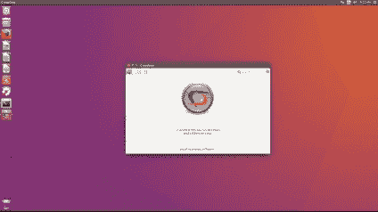

Ubuntu 可能是 Linux 最流行的发行版之一，如果你是 Linux 新手或以前没有尝试过，它被认为是最佳选择。Ubuntu 拥有极其易于安装的仓库，并且具有很高的定制性——非常适合艺术和媒体从业者，或者那些对屏幕显示内容极其谨慎的人士。Ubuntu 的问题在于，与其他发行版相比，它在移动设备上的运行并不理想——这可能会是一个问题，尤其是如果你是那种整天使用移动设备的人。

### Souls

Souls


Souls 具有现代感，事实上，它相当新，因为它只在 2012 年发布——那时 Ubuntu 大多用于学校和企业。有人说 Souls 最棒的特点是它的美学感官，因为它确实具有那种优雅、悦眼的感觉。但有一点是，目前还没有太多的“Soul 社区”，所以如果你在这个发行版上遇到问题，你可能需要自己寻找解决方案。

### Mint Cinnamon

Mint Cinnamon

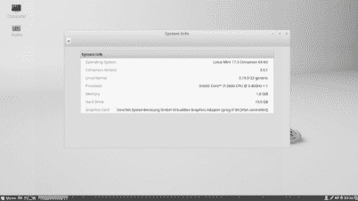

这个名字听起来很清新，不是吗？嗯，Mint Cinnamon 实际上具有那种清新、轻盈的感觉，因为它主要使用白色和灰色作为美学。它是一个极简主义的 Linux 发行版——非常适合不喜欢在屏幕上看到太多花哨或艳色彩的人。最棒的一点是它的仓库与 Ubuntu 相同，所以你在尝试理解它们时不会困难，而且它的 UI 需求较低——所以它对你的电脑以及使用它的人来说都不会有太大负担。Mint Cinnamon 也被认为非常适合初学者，因为前面提到的，它没什么需要理解的——而且你真的不必为它为难自己。

### Ubuntu Studio

Ubuntu Studio


正如名称所示，这个 Linux 版本非常适合制片人、音乐家、音响工程师、设计师和艺术家，他们需要处理各种多媒体工作，并且需要为该目的定制的计算机或设备——Ubuntu Studio 绝对让这一切变得简单。这个版本自 2007 年以来一直存在，名为“Ardour”的多轨道数字录音器和序列器，全球许多艺术家都在使用它。该录音器最棒的地方是它可以合成已使用的吉他和和其他乐器，确保你的最终输出非常悦耳，而且完全不难处理。因此，你可以创建专业质量的项目——而不需要花费大量费用。

### Arch Linux

Arch Linux

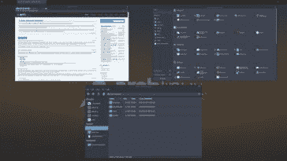

这个被认为非常适合专业人士，因为你必须自己进行操作和定制。事实上，它自带的应用程序并没有其他发行版那么多，这意味着你必须清楚自己在做什么。对于此，你必须应用“保持简单直接”的哲学，因为下载太多可能只会让你感到困惑。找到你真正需要的，然后修剪或丢弃你觉得对你不重要的东西，这样你的屏幕就不会太拥挤，你就可以充分利用这个发行版。然而，它的好处在于你可以学到很多东西，所以即使刚开始可能会遇到困难，请放心，你会度过这一关，并体验 Arch Linux 的真正所在！

### Chrome OS

Chrome OS


据说这是早期 Linux GNU 内核主要且最接近的实现之一，但它实际上已经超过了预期，并被证明是最可靠的 Linux 发行版之一。从那以后，它被重新定位为一个独立的工作环境，主要因为它用于制作某些 Google 应用，并且即使使用 Photoshop 这样占用大量空间的应用程序也能运行得很快。这会让你的工作更容易管理，但问题是，该发行版中没有某些应用程序。它也是一种在离线状态下运行更好的发行版，如果你一直连接网络，这可能会很麻烦，但无论你可以以极低的成本进行某些更新或升级。

### Elementary OS

Elementary OS

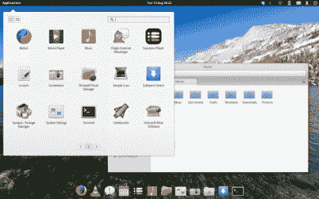


最后是 `Elementary` 发行版。它不仅是美学上最漂亮的 Linux 版本之一，而且功能强大，一些人说它与 Mac 有相似之处——非常适合多媒体艺术家和处理高端应用程序的人。事实上，如果你在寻找某种可以良好依赖的新事物，它也可以是你完美的 Windows 或 Mac 替代品。它还有非常棒的预装应用，甚至有一个自定义浏览器，可以个性化你使用 Linux 的方式。

## 如何创建脚本

正如我们在学习命令行界面时看到的，通常是以交互方式探索它的。这意味着你一次输入一个命令，以便看到每个命令的结果。

在我们开始这一节之前，你可以先看看这个 [gif](https://www.compciv.org/files/images/cli/cli-grep-lear-murder.gif) ([bit.ly/2linux3](https://bit.ly/2linux3)) 使用命令行探索莎士比亚剧目录；它统计“murder”一词在所有莎士比亚剧中出现的次数和频率。

在尝试事物时，以这种交互方式使用命令行界面完全可以，但正如你可能注意到的，输入是容易出错的活动之一。对于更复杂的任务，即你想重复的任务，你不想从头重新输入代码，而是创建一个可以作为单行运行的独立 shell 脚本。

### 第一个 shell 脚本

我们将从简单的开始。在某处创建一个临时目录，例如 `/tmp/my-playground`。你的实际工作区不需要充斥代码。shell 脚本简单来说是有意义的文本文件。要创建一个，我们将使用 `nano` 编辑器。

`nano` 是一个文本编辑器。它在几乎所有的发行版中预装。新用户喜欢它主要是因为它的简单，这与 `emacs` 和 `vim` 等其他命令行编辑器相比非常突出。它包含许多其他有用功能，如行号、语法高亮和方便搜索等。

让我们继续。我们将创建一个名为 `hello.sh` 的 shell 脚本。按照步骤操作：

```bash
nano hello.sh
```

`nano` 将打开并给你一个空白文件进行工作。现在输入以下 shell 命令。

```bash
echo "hello world"
```

在键盘上，按 `ctrl + x` 退出编辑器。当询问是否要保存文件时，按 `y`。`nano` 将会确认你是否要保存文件。按回车确认操作。现在运行脚本：

```bash
bash hello.sh
```

当你看它时，步骤像[这样](https://www.compciv.org/files/images/cli/cli-bash-script-hello-world.gif) ([bit.ly/2piclinux](https://bit.ly/2piclinux))。因此，`hello.sh` 并不特别有趣，但它至少到了你想要的本质，即将一系列命令封装到一个文件中，这样你可以反复运行脚本。这有助于你避免重新输入命令时出现类型错误。

### 在可重复 shell 脚本中使用参数

现在让我们尝试让 `hello.sh` 变得复杂一点。现在重复 hello world，而是创建一个脚本，让它对某个值——例如一个人的名字。这会让脚本看起来好一点。你可以这样使用：


这个 gif [如下所示](https://www.compciv.org/files/images/cli/bash-excitedly.gif) [bit.ly/2linux5](https://bit.ly/2linux5)。首先，通过在 `world` 的位置添加一个变量来自定义 hello world。尝试从命令行交互这样做：


输出是：Hello Dan

因此，这里的问题是，如何让脚本 `hello.sh` 读取传递给它的参数（在这种情况下是一个人的名字）？


你通过特殊变量来实现。你从命令行传递给脚本的第一个、第二个和第三个参数由变量 `$1`、`$2`、`$3` 表示。在上面的示例中，名字 George 将保存在变量 `$1` 中。

只需重新打开 `hello.sh` 并将你的代码更改如下：


保存更改后，现在运行以下命令查看输出。


```bash
bash hello.sh
```

如果你希望输出以全大写返回，只需按照以下方式修改 `hello.sh`，确保将输出通过 `tr` 管道将所有小写字母替换为大写。

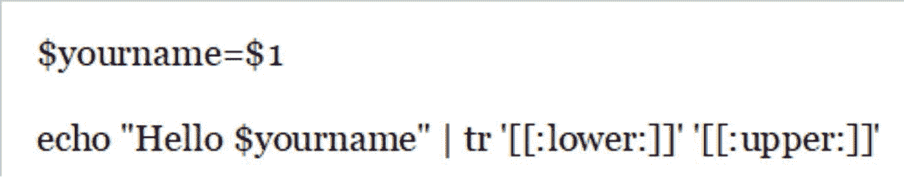

现在如果你有简洁的愿望，你可能会发现 `$yourname` 变量并不是真的。代码将简化如下：


现在慢一点，我的朋友。如果你能创建一个脚本，你就可以这样执行：


……那么，你就学了一个重要的概念。你刚刚学会了程序员如何将复杂的内容装进一个可以单行运行的容器中。

### Bash 变量与命令替换

变量是内存块的符号名称，可以对其赋值并读取和处理内容。至少，这些符号名称有助于代码更具可读性。

然而，在更高级的编程中，你会发现实际值是未知的——在程序执行之前。因此，变量更像是在实际执行时解决的占位符。

让我们来看一个例子：假设 `websites.txt` 有一个网站地址列表。下面的程序读取每一行（通过 `cat`，这实际上不是最佳实践——但目前可以）进入 `for` 循环，反过来下载所有 URL（请在下一章节查看关于 for 循环的详情）。

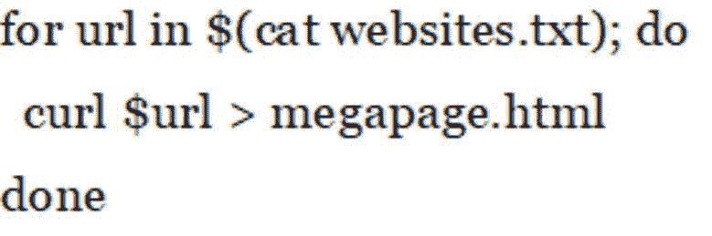

在你开始感到困惑之前，让我带你简单介绍一下变量的基本用法语法。

#### 设置变量

下面的命令将‘Hello world’ 赋值给变量 `var_a`，并将 `42` 赋值给 `another_var`。


与你现在发现大多数语言不同，bash 对变量设置非常挑剔。具体来说，它不允许变量名、等号和值之间有任何空格。这三个示例很容易触发 Bash 错误：

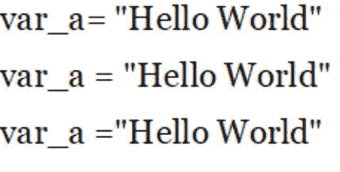

#### 引用变量的值

有时，它被称为参数替换或扩展。

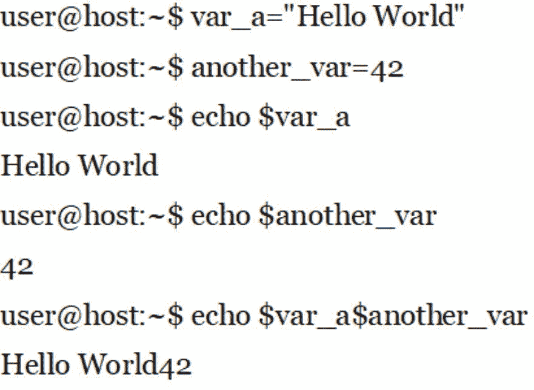

### 安装 Ubuntu 后的步骤

1. 立即安装并更新 Ubuntu 版本（尽管如果你是第一次使用该系统，这听起来没必要）。如果在版本发布后开发者发布了补丁以修复任何问题，则应执行此操作。

2. 根据你的需求调整设置、外观和行为。

3. 确保调整任何隐私设置以提高安全性。

4. 根据你的喜好调整主题、壁纸和菜单。微调工具（Tweak Tool）可能会帮助提供更多选项。

5. 安装 `AppGrid` 和 `Synaptic Package Manager` 以帮助快速查找和安装内容。

6. 安装 `GetDeb` 和 `PlayDeb` 存储库以及软件个人包存档（PPAs）更新源，并确保启用伙伴存储库（Partner Repositories）以访问授权软件。

7. 关闭广告。

8. 现在安装任何媒体解码器、音频播放器和驱动程序。

9. 安装免费应用和程序，如 `Google Chrome`、`Skype`、`GIMP`、`Spotify` 等。

10. 设置消息传递、社交媒体账号和云连接。

### 为桌面创建多个工作区

你还可以使用工作区来充分利用你的 Ubuntu 桌面，获得更多收益，并为了乐趣或享受进行多任务处理。某些版本不会显著显示这些选项，但它们可以在不同的发行版中以不同的方式启用。你应该检查你的发行版，并在网上搜索如何激活你版本的工作区。这通常只需要点击几次。例如，取决于 Ubuntu 的版本，在每个环境中你可能需要点击：启用或管理工作区、添加小组件（Applets）或添加分页器组件（Pager Widget）来使用这些功能。很快，你将拥有多个工作区，这有助于组织和分离你的活动；假设你任何时候都有多个工作区，这将非常有用。你应该尝试激活并测试它们。

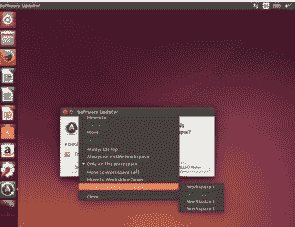

### Ubuntu Linux 中的多个工作区

CLI

你可能还需要学习一些可以在提示符（`Prompts`）中使用的基础 `Commands`，以备万一（是的，这已经被建议过几次了！）。本指南的最后一章有 `Commands` 列表。你会发现，如果进入应用程序（Applications）、附件（Accessories），然后到达终端（`Terminal`），你就可以访问 `CLI` 并看到提示符。这就是 `Commands` 发挥作用的地方。有些用户非常喜欢这种额外的方式来定制他们想要系统执行的操作、实现自动化以及使用快捷键。

此外，如果你在以后某个时候切换到服务器版本，你已经对 `Commands` 有了一些体会和了解，并对系统文件的结构和位置有更好的理解。正如你稍后将读到的，Linux 中的一切都是文件。例如，它们的结构与 Windows 的不同。通过使用 `GUI`，你将从一个角度看到这一点。当你使用 `CLI` 时，你将真正更好地理解文件树和目录如何与硬件和软件协同工作，构成所谓的你的操作系统。这也是 Linux 爱好者获得自由感的地方，这种自由不仅源于应用程序和其他系统资源的开源，还源于真正让你的计算机主动为你服务的服务的自由和灵活性。

### 在服务器版本中导航

有时你需要花些时间研究服务器版本（Server version）。它不像桌面版本那么直观，在以这种方式探索 Linux 之前和期间，有些细节非常有用。如果你熟悉 DOS，这只需要学习命令（Commands）和代码的问题。如果你不熟悉，将面临一条相当长的学习曲线。

首先，你将使用你提供的信息登录到新的服务器版本。你只会看到一个带有 Shell（终端）提示符的 DOS 界面。你不会看到像桌面版本（Desktop Version）那样的图形用户界面（GUI）。现在，你需要使用命令在这个新的操作系统中移动到任何地方。你应该设置一个非常安全的密码和 root `(user)` 名称。确保原样记录这些信息。在 Linux 中，标点符号非常重要。不同的拼写意味着完全不同的含义。你会再次看到这个提示。

### 万物根 (Root)

在 Linux 中，`Root` 一词有几个含义。`Root User`（根用户）是计算机的管理员（用户名 `root`），它是权限最低的用户，拥有全权限。`Root` 也是 Linux 中任何事物的最高层或核心。它还是软件安装的位置，相当于 Windows 中的 `C:/Home`。可以说，它是文件系统的最高层。Linux 中的所有内容要么是目录，要么是目录内部的文件，这一切都在 `Root` 目录之下。

命令 `sudo` 表示 `Super User Do`（以超级用户执行）。这意味着你，即 `Root User`（即管理员），拥有访问文件和程序的完全权限。在某些发行版（distros）中，你需要在某些命令前加上这个词。

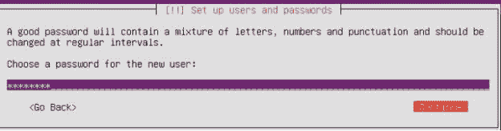

www.ubuntuserverguide.com

### 掌握你的命令

和现在的大多数事情一样，你可以在 Google 上进行一些研究，以获取大量的 Linux 命令目录。通过这些命令，你可以在 Linux 中导航到任何地方。本书的最后一章包含了一个详尽（但不完整）的 Linux 命令词汇表。你不应该期望记住这个列表，但你应该开始熟悉 Linux 的语言。

一些最重要且实用的命令将让你进入、退出和环绕。为了强调并扩展之前的观点，你在命令中使用字母的大小写非常重要。命令的拼写非常精确，因此请注意使用正确的大小写。空格和词序也很重要。你可能无法到达任何地方，或者最终到达了一个你无意去的地方。

在 Linux 长长的命令和命令组合列表中，还有一些 `builtin`（内置）命令。正如其名，内置命令已经包含在 `Bash` shell 中。当一个简单命令的第一个单词是 `builtin` 时，shell 会直接执行该命令，而不需要另一个程序。

正如之前说的，每个发行版都有其自身的优势和挑战。需要注意的是，每个发行版的命令可能相同，也可能不同。鉴于命令是导航此版本 Linux 的唯一方式，这一点至关重要。你绝对应该不仅对你选择的发行版在兼容性和用法上进行研究，现在你还需要研究该特定发行版的特定命令。

你会发现许多命令都有共同的根源，你可以利用其他命令、关键词、文件或程序名称在某些命令的基础上进行构建。有几个初学者需要立即使用的命令。请跟着操作并尝试一下。

### 需要时获取帮助

这里有几点上手就能知道的简单常识。这些可能是你的救生衣。`man` 页面是手册（即说明）页面。你也会像使用 `sudo` 命令一样，在另一个命令前加上这个命令。使用 `man` 会打开一个包含你所需所有知识的屏幕，作为一个数字手册页。在需要时尝试这些变体。知道如何去某处、如何退出以及如何寻求帮助似乎非常基础，但在学习系统时，这些可能会让你感到沮丧。

- `man –k`: 搜索包含某个术语的所有命令。你也可以使用 `apropos`。
- `man`: 显示帮助信息。
- `info`: 显示帮助信息（显示方式不同）。
- `whatis`: 显示 man 页的描述。
- `whereis`: 显示 man 页的位置。

要退出 man 页，输入 `Q` (Quit) 退出。这是退出手册页的唯一方法。要退出大多数其他地方，只需输入 `Exit`。

命令 `more` 和 `less` 也常用于显示超出当前屏幕的文件。你可能需要在帮助页面上阅读比一个屏幕显示更多的信息。这对于系统的初学者来说尤为重要。只需在输入命令后使用空格键向下滚动即可。要退出，输入 `q` 退出。

### 移动

你很快就会学到 Linux 中有很多目录，你应该熟悉它们。虽然 Linux 中一切都是文件，但目录是一种特殊类型的文件。目录出现在列表中，并以树形结构呈现。与使用 GUI 的操作系统不同，你不会看到文件扩展名。因此，你需要知道如何导航、查找和更改它们。你应该在 Google 上搜索它们的列表，以便正确导航你的系统。

和命令一样，目录的拼写和符号也很重要。另外注意，当你在字母和斜杠之间或其他单词字母之间需要合法的空格时，空格键非常好用。它能节省时间和击键次数。忽略这些小细节也可能导致你出现在不需要或不想去的地方。它们还可能导致错误信息死胡同。在最糟糕的情况下，Linux 中的错误可能会造成严重损害，例如删除文件。在设置新文件名时，你应该用下划线代替空格。这些小细节会产生影响。初学者应该熟悉的几个目录和功能包括：

- `/home/`: 这是你的根，用于文档和设置的文件存储
- `/dev/`: 存放设备文件
- `cd`: 切换目录
- `/etc/`: 类似于控制面板

#### 使用目录

命令 `pwd` 会打印当前的工作目录。这也是查看你从哪里开始的好地方。

要查看目录中的内容（从你的家目录开始以及随后的任何目录），你可以输入 `ls` 列出目录中的内容。注意，当配置服务器账户时，你的家目录会带有隐藏文件。要列出它们，你必须使用点字符。例如，你不能只输入 `ls`，而是要输入 `ls –b` 来查看隐藏文件。

你还会学习像之前的命令一样组合多个命令。例如，要移动到名为 `xyz` 的子文件夹，你需要在 xyz 前加上如下前缀：`cd xyz`。

使用 `cd` 命令导航到桌面目录的示例：输入 `cd ~/Desktop`。

要返回根目录，输入 `cd~`。相同命令用于导航到根目录的示例是输入 `cd /`。要回到上级目录（当前目录的上一级），你应该输入 `cd..`。在继续操作之前，你可能想探索一些目录并尝试移动以熟悉方向。

### 如何安装程序

命令 `apt-get` 用于获取和安装单个视觉软件软件包。这就是你创建服务器的方式。你将使用特定的命令手动拉取任何你个性化你的 Linux 服务器所需的内容。仓库（Repositories）存放了许多你可以随时调用的 Linux 程序。这些程序也是开源的。如果你现在不知道自己需要什么，可以在 Google 上搜索最适合你需求的软件。

要访问仓库，例如，你可以输入 `sudo apt-get install (program name)` 来获取副本并自动安装。

命令 `tasksel` 表示 Ubuntu 的任务选择。如果你运行此命令，会出现一个屏幕，列出常见的服务器类型软件包和任务。你可以从中选择并安装你需要的内容。例如，你会使用 `sudo apt-get install tasksel` 来获取 tasksel 功能，然后根据需要使用它（如果你想安装 LAMP 服务器，你会输入命令 `sudo apt-get install lamp-server` 来实现此操作。

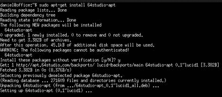

www.ubuntuserguide.com

如果你在任何时候需要帮助，现在你已经知道了 man 命令，你可以输入：`man task`。你会看到手册页出现以解决问题。

### 如何卸载

要卸载，你只需输入 `apt-get remove (在此例中为服务器名称)`。使用此命令获取你的大部分软件，并选择免费的开源软件。


安装软件后，可以使用升级命令`sudo apt-get upgrade`。通过仓库进行简单的更新。由于 Linux 的效率，你不需要频繁更新。手动更新也比自动更新更安全。

任务管理器：`top`提示命令类似于`任务管理器`，用于查看进程及其占用的空间，或停止运行。使用命令`h`获取你随时可能需要的命令列表。输入`sudo top`（访问任务管理器或 top），然后按命令`K`（杀死），然后输入你想杀死的进程旁边的进程 ID 数字（PID）。

## 停止/启动/重启服务

Linux 服务器不需要重启，但有时你可能需要重启软件或服务。要启动/停止或重启，你将输入命令：`sudo/etc/init.d/(程序名称) start`（或 stop 或 restart），以便进行更改，并在处理更改时离线，例如在崩溃或重新配置文件时。

既然你已经掌握了关于身处何地、要去哪里以及获取、安装或删除东西的一些基础知识，请花些时间测试这些操作。后面是一份常用命令列表，以及一份更详尽（但并非全部）的列表。这并不是穷尽的，但它展示了一些你现在就可以完成的任务，或者你可能期待学习的任务。Linux 是一个不断演变的操作系统，考虑到发行版和环境的多样性，情况将持续变化。随着我们技术的进步，改进和利用 Linux 系统的机会将越来越多。

# 初学者必背的 35 个常用命令列表——如果你必须记住它们的话

1. `apt-get`: 搜索软件包并安装

2. `bzip2`: 压缩/解压文件

3. `cd`: 更改目录

4. `chmod`: 更改文件的访问权限

5. `cp`: 复制一个或多个文件或目录到指定位置

6. `date`: 显示或设置日期与时间

7. `df`: 显示可用和已磁盘空间

8. `emacs`: 文本编辑器

9. `exit`: 退出 shell

10. `find`: 搜索符合特定模式的文件

11. `hostname`: 打印或更改系统名称

12. `install`: 复制文件，设置/更改属性

13. `locate`: 搜索并查找文件

14. `ls`: 列出目录信息

15. `man`: 显示特定命令的帮助信息

16. `mkdir`: 创建新文件夹/目录

17. `mv`: 移动或重命名目录和文件

18. `nano`: 带有菜单快捷键文本编辑器

19. `open`: 在原始应用程序中打开文件

20. `ps`: 显示当前进程状态

21. `pwd`: 显示/打印工作目录

22. `quota`: 显示磁盘使用情况、限制

23. `reboot`: 重启系统

24. `rm`: 删除目录或文件

25. `rmdir`: 删除（移除）空目录或文件夹

26. `shutdown`: 关机或重启

27. `sftp`: 安全文件传输程序

28. `sudo`: 以具有所有权限的用户身份执行命令

29. `tar`: 存储、列出或从 tar 文件或 tar 包/归档中提取文件

30. `top`: 列出当前运行的资源和进程

31. `uptime`: 显示系统运行时间

32. `wget`: 获取文件或网页（HTTP, HTTPS 或 FTP）

33. `yum`: 从仓库安装的包管理器

34. `zip`: 归档文件

35. `zip / unzip` – 创建 .zip 归档或从 .zip 归档中提取

# 第 7 章：从外部驱动运行 Linux Live 以及更多技巧

运行 Kali Linux 最简单的方法是从 USB 盘以“Live”模式运行它。这种方法也有很多优点。

## 可启动 USB 驱动器的优势

- **非破坏性**：因为它直接从 USB 盘运行，不会对你的机器或机器上现有的操作系统进行任何更改。要回到没有 Kali Linux 的现有设置，你只需拔掉 USB 盘并重启系统即可。

- **便携性**：你可以将 Kali Linux 操作系统放在口袋里的任何 USB 盘中，并在任何你可用的机器上运行它。

- **可定制**：如上一节所述，你可以使用 Kali Linux GitHub 仓库中的脚本构建自定义的 Kali Linux 安装 ISO 镜像并将其加载到 USB 盘中。

- **持久性**：通过一些自定义，你可以让你的 Kali Linux Live USB 盘存储持久性数据，这些数据将在重启后仍保留。

## 创建 Kali Linux USB 的要求

1. 一个经过验证的、适用于你要运行或安装它的系统的 Kali Linux ISO 副本。

2. 如果你使用 Windows，你需要 Win32 Disk Imager 来创建 Kali Linux USB 盘。在 Linux 或 OS X 上，你可以使用终端上的`dd`命令，该命令已预装，用于创建可启动 USB 盘。

3. 一个容量为 4GB 或更大的 USB 盘。如果你的系统支持 SD 卡槽，你也可以通过类似的过程使用 SD 卡。

## 安装

让我们来看为 Kali Linux 制作 USB 盘的过程。该过程将根据你创建 USB 的宿主系统而异。

### Windows

1. 将 USB 插入机器的 USB 插槽，并记录分配给它的驱动器号。启动你之前下载的 Win32 Disk Imager 应用程序。

2. 选择 Kali Linux 安装的 ISO 文件，并确保已选择正确的 USB 盘进行写入。点击“写入（Write）”。

3. 一旦向 USB 盘写入完成，你就可以弹出驱动器并将其作为可启动 USB 驱动器来启动 Kali Linux Live 或在你的机器上安装 Kali Linux。

# Linux

在 Linux 操作系统中创建一个可启动的 USB 驱动器非常简单。一旦你下载并验证了 Kali Linux ISO 文件，就可以在终端上使用`dd`命令将文件写入 USB 驱动器。运行`dd`命令需要 root 或 sudo 权限。**警告**：如果你不确定如何使用`dd`命令，可能会无意中将 Kali Linux 镜像写入到你并非想要写入的磁盘驱动器中。因此，在使用`dd`命令时保持警惕性非常重要。

### 第一步

你需要知道用于将 Kali Linux 镜像写入 USB 盘的设备路径。在不将 USB 盘插入 USB 插槽的情况下，在终端窗口的命令行提示符（command prompt）中执行以下命令：

```bash
sudo fdisk -l
```

你将得到一个显示系统上挂载的所有设备的输出，其中分区将显示为`/dev/sda1`/`/dev/sda2`。

### 第二步

现在，插入 USB 盘并再次运行相同的命令`sudo fdisk -l`。这次你会看到一个额外的设备，那就是你的 USB 盘。它将显示为类似`/dev/sdb`的内容。你的 USB 盘的容量会列在其旁边。

### 第三步

使用下方所示的命令小心地将镜像写入 USB 盘。在上面的示例中，我们假设你的 Kali Linux ISO 文件文件名为`kali-linux-2019.1-amd64.iso`且它位于当前工作目录中。块大小参数`bs`可以增大，但理想值是`bs=512k`。

写入 USB 盘需要几分钟时间，完成写入所需的时间稍超过 10 分钟并不属于异常现象。`dd`命令在过程完成之前不会显示任何输出。如果你的 USB 盘配有 LED 指示灯，你会看到它在闪烁，这表示正在写入磁盘。一旦`dd`命令完成，输出将如所示：

```
5823+1 records in
5823+1 records out
3053371392 bytes (3.1 GB) copied, 746.211 s, 4.1 MB/s
```

这将结束处理过程。你现在可以使用 USB 盘启动进入 Kali Linux Live，或者在机器上启动并安装 Kali Linux。

# 在 OS X 上创建可启动 Kali USB 驱动器

Apple OS X 是一个基于 UNIX 的操作系统。因此，在 OS X 上创建 Kali Linux 可启动 USB 盘与在 Linux 上创建类似。下载并验证 Kali Linux ISO 副本后，只需使用`dd`命令将 ISO 写入 USB 驱动器。**警告**：如果你不确定如何使用`dd`命令，可能会无意中将 Kali Linux 镜像写入到你并非想要写入的磁盘驱动器中。因此，在使用`dd`命令时保持警惕性极其重要。你可以使用以下步骤将 ISO 写入 USB 驱动器。

### 第一步

在将 USB 盘插入你的 Mac 桌面电脑或笔记本电脑之前，在终端窗口的命令行提示符中输入以下命令：

```bash
diskutil list
```

### 第二步

将显示系统上挂载的所有磁盘的设备路径列表，以及分区数据。

`/dev/disk1`/`/dev/disk2`

### 第三步

现在插入 USB 盘并再次运行`diskutil list`命令。你会发现列表现在显示了你的 USB 盘。它将是第一次没有出现的那个。假设它是`/dev/disk6`。

### 第四步

你可以使用以下命令从系统中卸载 USB 磁盘：

```bash
diskutil unmount /dev/disk6
```

### 第五步

继续使用以下命令小心地将 Kali Linux ISO 写入你的 USB 盘。假设你的当前工作目录与保存 ISO 文件的目录相同。块大小参数`bs`可以增大，但理想值是`bs=1m`。

写入 USB 盘需要几分钟时间，完成写入所需的时间稍超过 10 分钟并不属于异常现象。`dd`命令在过程完成之前不会显示任何输出。如果你的 USB 盘配有 LED 指示灯，你会看到它在闪烁，这表示正在写入磁盘。一旦`dd`命令完成，输出将如所示。这将结束处理过程。你现在可以使用 USB 盘启动进入 Kali Linux Live，或者在机器上启动并安装 Kali Linux。要在 OS X 机器上从目标驱动器启动，在电脑电源后立即按下“Option”键并选择你想要使用的驱动器。

# 安装与设置

一旦你选择了喜好的发行版，就可以下载安装包或获取 Live CD 发行版来让 Linux 运行在你的计算机上。

### 为硬盘留出空间。

如果你要在 PC 电脑上安装 Linux，你可能需要缩小 Windows OS 占据的分以为 Linux 留出空间。要做到这一点，你需要创建一个在设置后计算机可以启动的分区。这适用于需要安装在硬盘上的发行版，例如 Debian 和 Fedora。

你可以使用 Windows 创建分区，也可以简单地启动你已有的发行版，然后使用分区编辑器`GParted`。该程序能够对 NTFS 磁盘进行重新分区，NTFS 通常被较新版本的 Windows 使用。

**提示**：如果你打算使用使用 Live CD 的发行版（如 Ubuntu），你将不需要为 Linux 创建分区。你只需从 CD 启动，然后安装程序将对你的 Windows 分区执行收缩操作。

**警告**：对硬盘分区时存在丢失所有数据的风险。在尝试调整任何驱动器分区之前，请确保你已经备份了所有文件。

# 使用 Live CD 和可启动 USB 发行版

许多 Linux 发行版都能够从优盘或 Live CD 运行，不需要你承诺将它们安装到驱动器中。这意味着你可以先尝试它们的功能，甚至在这些介质中保存程序。然而，你可能会发现自己需要更多空间，或者希望在下次启动计算机进入 Linux 环境时运行得更快。如果你认为你已经有了想要的发行版，双击显示“Install”的图标并按照安装向导操作即可。

安装向导通常会引导你完成以下过程：

1. **准备**：这确保你正在一台符合硬件要求的机器上安装 Linux 发行版。在安装的此阶段，你还可能被询问是否包含某些第三方软件，例如 MP3 播放插件。

2. **无线设置**：如果你想下载更新或任何第三方软件，此部分将引导你设置无线连接。

3. **硬盘分配**：此步骤将允许你选择希望如何安装 Linux。你可以选择重新安装 Linux、使用双启动并在你的计算机中留有另一个操作系统的同时安装 Linux、用 Linux 替换现有的操作系统，或者升级之前安装的 Linux 发行版。

4. **地理位置**：这在地图上设置了你计算机的地理位置。这对于与其它 Linux 用户之间进行交流以及与 Linux 社区进行互动本质上非常有帮助。

5. **键盘布局**：这允许你选择想要为操作系统使用的键盘。

6. **用户设置**

这允许你选择用户名和密码。

# 第 8 章：Kali Linux 无线渗透测试

为了搭建无线实验室，我们需要以下硬件：两台带有内置 Wi-Fi 网卡的笔记本电脑：其中一台将作为实验室中的客户端，另一台将作为渗透测试员的笔记本。虽然几乎任何笔记本电脑都符合这一要求，但拥有至少 3 GB 内存的电脑是理想的。这是因为在我们的实验中，可能会运行许多内存密集型软件。一个无线适配器（可选）：我们需要一个支持数据包注入和包嗅探的 USB Wi-Fi 卡，这取决于笔记本电脑的无线芯片，Kali 支持它。Alfa Networks 的`Alfa AWUS036H`卡似乎是完美选择，因为 Kali 开箱即支持它。在本书时，该产品可以在`www.amazon.com`上买到，零售价为 18 英镑。另一种选择是较小且稍便宜的 Edimax EW-7711UAN。一个接入点：任何支持 WEP / WPA / WPA2 加密标准的接入点都符合要求。为了演示目的，我将在本文中使用`TP-LINK TL-WR841N`无线路由器。在发布时，你可以从`Amazon.com`购买，售价约为 20 英镑。一个互联网连接：这对于学习结果、程序上传以及我们的一些实验非常有用。

## 软件要求

为了搭建无线实验室，我们需要以下软件：

* **Kali**: 你可以从其官方网站`http:/www.kali.org`下载此软件。该程序是开源的，你可以直接从网站下载。

* **Windows XP / Vista/7**: 需要在一台笔记本电脑上安装任何 Windows XP、Windows Vista 或 Windows 7。这台笔记本将在本书剩余部分作为受害者主机。请记住，所学的策略可以扩展到任何支持 Wi-Fi 的设备，如智能手机和平板，即使我们在实验中使用基于 Windows 的操作系统。

## 安装 Kali

现在让我们如何快速上手并运行 Kali。在书的剩余部分，Kali 将安装在笔记本电脑上，作为渗透测试机。是时候练习了，安装 Kali 非常简单。我们可以通过启动 Live DVD 模式运行 Kali，然后将其挂载到硬盘上。请按照以下步骤操作：

1. 将下载的 Kali ISO（我们使用 Kali 32 位 ISO）刻录到可启动 DVD 中。

2. 使用此 DVD 启动笔记本电脑，并在`Boot`菜单选项中选择`install`：``

3. 如果启动成功，你应该看到以下非常人的复古风格界面：``

4. 此安装程序与大多数 Linux 系统的 GUI 安装程序类似，应该易于遵循。在任何屏幕上，选择正确的选项并开始安装过程。安装完成后，按照要求重启电脑并删除 DVD。

5. 在系统重启之前，将显示登录界面。在安装过程中，将用户名输入为`root`，密码输入为你设置的任意内容。现在你可以登录你启用的 Kali 版本了。恭喜你，总统。我们将更改这本书的桌面主题和一些设置。尽管使用颜色设置和你自己的主题！

## 刚才发生了什么？

我们成功地将 Kali 挂载到了笔记本电脑上！对于书中的所有其他实验，我们将使用这台机器作为渗透测试员的设备。试一下吧，英雄——使用`VirtualBox`添加 Kali，然后我们也可以在`VirtualBox`等虚拟化应用上使用 Kali。如果你不想专门拿出一台笔记本电脑给 Kali，最佳选择是使用`VirtualBox`。在`VirtualBox`中安装 Kali 的过程是完全相同的，唯一的区别是`VirtualBox`中的预设。你可以从`http:/www.virtualbox.org`下载 VirtualBox。另一种方法是通过 USB 驱动器安装 Kali，这对于你不想在硬盘上安装 Kali 但仍然想存储持久化数据（如脚本）的情况特别有用。鼓励你尝试一下！

## 设置接入点

现在我们要设置接入点。我们将使用`TP-LINK TL-WR841N`无线路由器来完成书中包含的所有实验。正如上面提到的，你可以自由使用其他接入点。不过，基本操作原理保持不变——我们必须设置接入点。请遵循以下逐步步骤说明：

1. 使用以太网线将笔记本电脑连接到接入点的以太口。

2. 在浏览器中输入 IP 地址。对于 TP-Link，默认值是`192.168.1.1`。如果没有接入点手册，可以通过运行`route -n`命令找到 IP 地址。网关通常是接入点的 IP。当你登录后，你会看到如下列表：``

3. 登录后，探索不同的接入点配置。

4. 切换`SSID`到`Wireless Lab`。你可能需要重启以更改：``

5. 同样，找到接入点设置并切换到`Disable Security`。`Disable Security`表示开放模式。

6. 保存接入点更改，必要时重启。接入点现在应该在`Wireless Lab` SSID 下运行。在 Windows 上使用软件来发现可用网络是种方便的方法：``

## 刚才发生了什么？

我们成功地设置了 SSID`Wireless Lab`的接入点。它广播的存在被 Windows 笔记本捕获在接入点的频率 (RF) 范围内。注意的是，在开放模式下，接入点是最安全的。为了连接这个接入点，我们可能访问互联网。尝试使用如 WEP 和 WPA 等加密方案。在随后的章节中，我们将使用这些模式进行攻击。

## 设置无线卡

设置无线卡比设置接入点容易得多。Kali 自带了允许数据包注入和嗅探的必要系统驱动。

### 设置你的无线卡

要设置无线卡，我们将使用渗透测试笔记本。请遵循以下逐步步骤说明：


1. 将卡插入 Kali 笔记本的 USB 端口，打开终端并输入`iwconfig`。你的屏幕应该如下：`Wlan0`是创建的无线接口。

2. 然后在`ifconfig`中输入`wlan0`查看接口当前状态：MAC 地址`00:c0:ca:3e:bd:93`应与下方的 Alfa 卡 MAC 地址匹配（我使用的是 Edimax，之前的 MAC 地址是`80:1f:02:8f:34:d5`）。这是检查接口是否启用的快速检查。

## 刚才发生了什么？

Kali 自带了适配器所需的所有驱动，一启动，适配器就被识别并分配了网络接口`wlan0`。我们的无线适配器现在已工作！

## 连接接入点

现在我们将查看如何使用无线适配器连接接入点。我们的接入点配备了 SSID `Wireless Lab`且不需要认证。

### 设置你的无线卡

要将你的无线卡连接到接入点，请遵循以下步骤：

1. 首先看看我们的适配器当前在无线网络上检测到了什么。发布扫描命令`iwlist wlan0`，你会发现附近的网络列表：``继续向下滚动，此列表应该包含 Wireless Lab 网络。在我的设置中它被识别为`Cell 05`；你的设置可能不同。`ESSID`字段包含网络名称。

2. 由于多个接入点可能有相同的 SSID，请验证前一个字段中的 MAC 地址与你接入点的 MAC 地址匹配。可以在接入点下或使用 Web 设置。

3. 现在发布`iwconfig`命令，然后运行`iwconfig`检查状态。如果你成功连接到接入点，你应该看到接入点的 MAC 地址：

4. 我们从手册中知道接入点的 IP 地址为`192.168.0.1`。或者，当我们运行`route -n`时，这与默认路由器 IP 相同。`ifconfig wlan0 192.168.0.2 netmask 255.255.255.255`允许我们在同一子网内设置 IP 地址。

5. 现在通过发布`ping 192.168.0.1`来`ping`接入点。如果连接设置正确，你应该看到接入点的响应。你也可以发布`arp`命令来验证答案来自接入点：``

## 刚才发生了什么？

我们已成功通过无线适配器从 Kali 链接到我们的接入点。我们还学习了如何让客户端和接入点建立连接。在接入点配置选项中尝试使用 WEP 和 WPA 等加密方案。在随后的章节中，我们将使用这些模式来演示攻击。

# 第 9 章：Linux 任务与命令

在本章中，我们将概述可以在 Linux 中执行的基本任务。我们将向你展示如何安装应用程序、更新应用程序、查看任务管理器并在必要时终止进程。这些是在 Linux 中执行任何操作之前需要理解的基本任务。即使你使用的是桌面版本，也要使用命令行而不是图形界面。这可能看起来有些枯燥，但请记住在 Linux 中，所有的管理都要通过命令行完成。

### Sudo

在开始任何其他命令之前，我们需要说的第一个命令是`sudo`。`sudo`意味着“超级用户”。正如之前的章节所述，不同发行版的处理方式不同，每个 Linux 发行版都有自己的独特之处；`sudo`在 Windows 中相当于“以管理员身份运行”选项。当你想要以管理权限运行程序时，使用`sudo`。它临时给你 root 权限。如果你无法以用户登录，怎么办？`sudo`永远允许登录。

### Man Pages（手册页）

我们需要考虑的下一个问题是`man`。关于手册页，你需要记住的是，如果你不理解某个命令如何工作或你应该运行什么命令，手册页就是你查找信息的地方。如今，使用 Google 搜索比使用手册页要简单。然而，在没有网络时，有手册页是好的。Windows 中的帮助页基本上是问号`?`命令。Linux 手册页的缺点是它们解释得不多，并不一定让事情变得简单。所以当你去手册页查找任何命令时，你会看到如下的页面。你可以按`Escape`键退出，也可以尝试按空格键，但它们都不会起作用。你需要输入字母`Q`来退出手册页。

### apt-get

现在让我们说你想知道关于`apt-get`命令的。输入下面的指令：

```bash
man ping
```

输入并按回车后，你会看到如下的`ping`命令页：``

查看`ping`命令页，你可以看到命令的概述以及与之相关的不同选项。选项基本上是`ping`命令的后缀，增强了基本命令可以做的。一个例子是在`ping`命令后使用`-t`后缀持续 ping 特定主机。现在假设你想知道`apt-get`命令。输入下面的命令：

```bash
man apt-get
```

输入并按回车，你会得到如下的`apt-get`命令页：``

现在，这个`apt-get`命令页将告诉你关于`apt-get`命令的所有知识。正如我们之前提到的，这些命令的手册页贯穿整本书。如果你出于任何原因退出手册页，只需按键盘上的`Q`。

### Tasksel

我们将下一个讨论的是`tasksel`。这是“任务选择”。Ubuntu 现在正寻求顶尖的 Linux 服务。他们做了很多工作来让你尽可能用户友好。他们提出的项目之一是`tasksel`。例如，当你尝试设置 Web 服务器、邮件服务器或虚拟化服务器时，请注意这些服务器都需要许多不同的程序运行。如果你想安装`Apache`、`MySQL`或`PHP`，你必须输入下面的语法：

```bash
sudo tasksel
```

输入上述命令并按回车，你会得到如下屏幕：``

现在你处于`tasksel`浏览器中。你会看到许多可以选择的选项。一旦你的选项被选中，只需按下空格键，会在框左侧放置一个星号`*`，然后按回车。发生的情况是系统现在加载完成过程所需的所有包。

### apt-get

现在我们将讨论如何安装单个程序。关于`apt-get`，你需要记住的是它是开源世界。大多数软件是免费的，或者你以奇怪的方式为它们付钱。如果你想安装一个程序，只需输入以下语法：

```bash
sudo apt-get install program_name
```

如果你想移除你不喜欢的程序，使用以下命令：

```bash
sudo apt-get remove program_name
```

如果你想更新软件，使用`upgrade`命令。语法见下方：

```bash
sudo apt-get upgrade
```

上述命令的作用是查看仓库中的软件是否比你拥有的旧。如果你拥有的程序版本比仓库版本旧，它会下载该信息并询问你是否要更新软件。如果你说`Yes`，它会自动更新你电脑上的所有软件。这基本上就是目前你在软件安装和维护方面需要理解的所有。

### Services

正如我们之前描述的，Linux 最适合服务器。当你启动 Linux 服务器时，它会一直运行直到设备烧毁。一旦启动 Linux 系统，你只需要重启极几次。当我们说极少数时，是指一年一次，这已经过头了。然而，当你进入并更改运行中的软件的配置文件时，你可能需要重启该软件或服务。让我们假设你在 Linux 服务器上构建了`Apache2`，并修改了某些配置文件。我们将看到服务如何启动、停止和重启。输入以下语法：

```bash
sudo /etc/init.d/start apache
sudo /etc/init.d/stop apache
sudo /etc/init.d/restart apache
```

- **易于学习** – `Python`的语法简单而优。此外，与其他语言相比，Python 程序员更喜欢编写它的语法。`Python`简化编程艺术，让开发者能够专注于解决方案而不是语法。对于新手来说，这是开启`Python`职业的绝佳选择。

- **可移植性** – 说到`Python`的可移植性，它允许你在不同的平台上运行`Python`而无需进行任何更改。

- **高级语言** – 换句话说，你不需要担心内存管理等繁琐的任务。相反，每当执行 Python 代码时，它会自动将代码转换为你的计算机能够理解的语言。无需担心任何底层操作。

- **面向对象** – 由于它是一门面向对象的语言，它将允许你为最困难的问题计算解决方案。面向对象编程使得通过构建对象将大问题拆分为较小部分成为可能。

- **拥有巨大的标准库来处理常见任务** – `Python`提供了供程序员使用的不同标准库。因此，你不需要自己编写所有的代码行，只需要导入相关代码的库即可。

Python 是一种由 Guido van Rossum 创建的多用途编程语言。该语言以语法简单著称，让初学者易于理解和使用。本章将介绍 Python 语言的基础知识。敬请期待。Python 被描述为一种通用语言。它有许多应用，因此你可以用它完成不同的功能。Python 语言的语法简洁，代码长度短。在人生某个阶段使用过 Python 的开发者都会表示用 Python 编写代码有多有趣。Python 给了你一个机会，让你更多地思考任务而不是语言本身。

## Python 的历史

Python 语言的设计始于 20 世纪 80 年代，并于 1991 年首次发布

## Web 应用

你可以使用基于 Python 创建的框架开发可扩展的 Web 应用。开发 Web 应用的热门环境包括`Pyramid`、`Django`。其他热门网站如`Instagram`和`Reddit`都是用 Python 编写。

## 科学数值计算

有不同的为科学和计算设计的库。如`Numpy`和`Scipy`等库使用 Python 进行通用计算。此外，还有专门为天文学设计的库，如`Astropy`等。此外，Python 语言在数据挖掘、机器学习和深度学习中被广泛应用。

## 程序员的语言

Python 语言是向新手演示编程的重要工具。这是一门具有重要能力和特性的优秀语言。然而，由于语法简单，它是最容易学习的语言之一。

## 构建软件原型

与`Java`和`C++`相比，Python 稍微慢一些。在资源受限且强制要求效率时，它可能不是最佳选择。但 Python 是一种构建型的强大语言。例如：你可以应用`Pygame`开发你的游戏原型。如果你喜欢这个原型，可以决定使用`C++`开发实际游戏。

## 简单、美丽的语法

在 Python 中编程是有趣的。理解代码行和编写代码更加容易。语法看起来很自然。例如：

```python
b = 4
c = 3
sum = b + c
print(sum)
```

即使是第一次编程，你也能猜出这段代码的功能。

## 不是一种非常严格的语言

在 Python 语言中不需要定义变量类型。而且你不需要在行末尾加分号。然而，Python 要求你遵循良好的实践。这些小细节简化了初学者的学习。

## 表现力语言

Python 让你能够用更少的代码编写具有许多功能的强大程序。

## 社区与支持

有一个庞大的 Python 开发者社区。在学习 Python 编程时，你会遇到不同的在线论坛，它们对你很有帮助。

## 你应该考虑使用 Python 的原因

### 易读易维护

在创建应用程序时，你需要关注源代码的本质，使更新过程变得简单。Python 语法允许你在不编写额外代码的情况下演示概念。此外，Python 提供了使用术语而不是标点符号的机会。它简化了更新过程。

### 关键平台和系统

如前所述，Python 可以在不同的操作系统上运行。你甚至可以使用 Python 解释器在定义的平台上运行代码。此外，Python 是一种解释型语言。换句话说，你可以在不同平台上运行相同的代码而无需重新编译。因此，一旦你做了任何更改，就不需要重新编译代码。事实上，你可以在不重新编译的情况下运行修改后的代码，并立即确认更改的效果。这一特性允许开发者在不增加时间内更改代码。

### 许多开源技术和框架

由于 Python 是开源语言，它有助于节省软件成本。你可以包含不同的开源框架、开发工具和库来减少开发时间。

### 分解复杂的软件开发

你可以使用 Python 构建 Web 和桌面应用程序。尽管如此，你仍然可以使用它来开发复杂的程序。Python 的设计具有支持数据分析和可视化的属性。你可以使用 Python 的数据分析属性构建大型解决方案，而无需花费额外的精力和时间。或者，Python 语言提供的数据库允许你以友好且有效的方式展示数据。

### 应用测试驱动开发 (TDD)

使用 Python 可以非常快速地开发软件原型。此外，可以通过重构 Python 代码直接从原型开发软件应用程序。尽管如此，Python 通过使用 TDD 方法论简化了编码和测试。你可以在编写代码之前快速编写相关测试，并采用这些测试来检查应用程序代码。此外，测试可以帮助根据源代码确认应用程序是否满足预定义需求。

### Python 的缺点

然而，Python 也有自己的缺点。例如，它不具备其他现代编程语言中内置的功能。因此，你只需要使用 Python 库和框架来增强软件开发。此外，Python 比`Java`和`C++`等其他语言慢。这意味着你需要通过对应用程序代码进行更改来提升 Python 应用。但你仍然可以使用 Python 来简化软件维护并加速软件开发过程。

## 第一章：什么是 Python 编程

学习一种新编程语言可以是一次很棒的体验。你可能学习它是为了了解更多关于计算机的知识并理解它是如何工作的、网站是如何工作的，也许你想学习它是为了创建自己的应用程序和程序。但如果你以前从未以这种方式操作过电脑或从未写过代码，那么很难确定如何开始。通过少量的搜索，你会发现除了 Python 之外，还有许多可以使用的编码语言。从`Java`到`C++`等，很难确定哪种编码语言对你来说是。

作为一个初学者以及以前从未做过任何编码的人，Python 是最适合使用的编码语言之一。框架的使用加速了开发，因此开发变得更快、更快捷、更高效。大多数 Web 框架的成本很低。框架具有强大的安全实现。使用框架最大的好处实际上归于它们背后的社区。

Python 长期以来被认为是初学者语言，因为它非常容易学习，你从一开始就能理解它。这只是你为什么应该选择使用 Python 的众多原因之一。你也会喜欢有一个致力于这种编程语言的大型活跃社区，更棒的是它是开源的，所以你不需要字面上支付任何费用就可以开始。这种语言可以在任何操作系统上运行，所以你想在什么种计算机上使用这种语言并不重要。

如果你正在预览或类似的地方浏览这本书的介绍页面，对于是否想学习 Python 犹豫不决，那么，我可以告诉你你可能应该学。嗯，Python 基本上是一种极其有用且强大的语言。它无处不在。从视频游戏的脚本端（或视频游戏本身）到用它构建的密集服务器端 Web 应用，无所不。

## 你什么时候应该使用 Python？

答案取决于你具体要做什么。但由于你是一个初学者，我觉得你应该学习。在你读完这本书之后作为程序员继续成长后，你将根据直觉判断什么时候该用和不该用 Python。Python 是一门绝对奇妙的语言，但它失败的地方是你必须极其接近计算机硬件或编写极其程序时。然而，这并不意味着它没有优点。事实上，它弥补了其他领域的不足。例如，与其他语言相比，Python 的开发时间通常较低。这很容易说明。比较以下代码片段：第一个来自`C++`，第二个来自`Java`，最后一个来自 Python。

### 为什么你应该考虑使用 Python

框架的使用加速了开发，因此开发变得更快、更快捷、更高效。大多数 Web 框架的成本很低。框架具有强大的安全实现。使用框架最大的好处实际上归于它们背后的社区。

### 易读易维护

在创建应用程序时，你需要关注源代码的本质，使更新过程变得简单。Python 语法允许你在不编写额外代码的情况下演示概念。此外，Python 提供了使用术语而不是标点符号的机会。它简化了更新过程。可以使用 Python 在不编写额外代码的情况下构建。

### 兼容关键平台和系统

如前所述，Python 可以在不同的操作系统上运行。你甚至可以使用 Python 解释器在定义的平台上运行代码。此外，Python 是一种解释型语言。换句话说，你可以在不同平台上运行相同的代码而无需重新编译。因此，一旦你做了任何更改，就不需要重新编译代码。事实上，你可以在不重新编译的情况下运行修改后的代码，并立即确认更改的效果。这一特性允许开发者在不增加时间内更改代码。

### 许多开源技术和框架

由于 Python 是开源语言，它有助于节省软件成本。你可以包含不同的开源框架、开发工具和库来减少开发时间。

### 分解复杂的软件开发

你可以使用 Python 构建 Web 和桌面应用程序。尽管如此，你仍然可以使用它来开发复杂的程序。Python 的设计具有支持数据分析和可视化的属性。你可以使用 Python 的数据分析属性构建大型解决方案，而无需花费额外的精力和时间。或者，Python 语言提供的数据库允许你以友好且有效的方式展示数据。

### 应用测试驱动开发 (TDD)

使用 Python 可以非常快速地开发软件原型。此外，可以通过重构 Python 代码直接从原型开发软件应用程序。尽管如此，Python 通过使用 TDD 方法论简化了编码和测试。你可以在编写代码之前快速编写相关测试，并采用这些测试来检查应用程序代码。此外，测试可以帮助根据源代码确认应用程序是否满足预定义需求。

## 关键字

首先，我们需要查看 Python 中的这些关键字。与你在其他语言中找到类似的，Python 中有一组关键字用于告诉文本编辑器要做什么。这些关键字是保留的，你应该只将它们用于预期。

### 如何命名

当你准备好在 Python 中编写自己的代码时，你会遇到一些代码部分，它们被称为标识符。这些标识符会有很多名称，可能会让人混乱，但它们会帮助你的代码按你想要运行。命名标识符时有一些规则要遵循。你可以任何时候使用小写字母和大写字母。下划线`_`符号也是允许的。

### Python 程序

标识符不能以数字开头。在整个名称中使用`_`是可以的，但你不应该把它放在开头。这在你将其输入编译器时会导致错误，所以请务必检查这一点。

## 语句


在编写 Python 代码时，你会使用很多语句。这些语句对你的代码很有用，因为它们只是你发送给编译器的执行代码段。你可以在代码中编写任何类型的语句，例如让它变短或让它变长，有许多规则规定了你应该如何做它。

### 兼容平台

如前所述，Python 可以在不同的操作系统上运行。你甚至可以使用 Python 解释器在定义的平台上运行代码。此外，Python 是一种解释型语言。换句话说，你可以在不同平台上运行相同的代码而无需重新编译。因此，一旦你做了任何更改，就不需要重新编译代码。事实上，你可以在不重新编译的情况下运行修改后的代码，并立即确认更改的效果。这一特性允许开发者在不增加时间内更改代码。

### 许多开源技术和框架

由于 Python 是开源语言，它有助于节省软件成本。你可以包含不同的开源框架、开发工具和库来减少开发时间。

### 分解复杂的软件开发

你可以使用 Python 构建 Web 和桌面应用程序。尽管如此，你仍然可以使用它来开发复杂的程序。Python 的设计具有支持数据分析和可视化的属性。你可以使用 Python 的数据分析属性构建大型解决方案，而无需花费额外的精力和时间。或者，Python 语言提供的数据库允许你以友好且有效的方式展示数据。

### 注释

你在编写自己的代码时使用的下一个组件是注释。这些注释非常有帮助，因为别人在查看你写的代码时需要了解你具体在说什么。你可以编写注释，以便那些想要阅读或使用代码的人知道发生了什么。它们基本上是代码中的笔记，帮助你和其他程序员了解情况。你只需要在你想要添加的注释前面使用 `#` 符号。所以

```
# 这是我的 Python 代码
```

注释完成后，只需按回车开始编写代码的剩余。只要在注释前面有该符号，编译器就可以跳过它，而不读取你写的内容。你可以自由选择在代码中编写多少注释，有时代码只需要几个注释，而其他时候可能需要很多。将注释保持在真正需要的范围内。

### 函数

`函数` 是 Python 编程语言的另一个重要部分。这基本上是你可以重复的代码部分，通常用于完成代码中的某个操作。函数非常棒，因为它们比其他选项更有效，这意味着你可以在处理代码时不浪费大量时间。Python 语言中有很多函数可以从中受益，此外你也可以编写自己的函数。

在编写代码时，你必须确保定义了函数。一旦定义了函数，就可以在代码中执行它了。你可以选择从 Python 提示符调用它，也可以从另一个函数调用它。当将其放入编译器时，你会看到我们在代码中写的语句像消息一样出现。你可以调用一个函数，并随时更改代码中的语句以确定以后如何执行它们。

### 处理变量

最后，花时间关注`变量` 是重要的。变量很重要，因为它们会在计算机内存中保存代码部分。创建一个新变量时，实际上你是在确保计算机空间被保留。在某些情况下，例如处理数据类型时，你的解释器将决定这些信息存储在哪里，这有助于加速过程。

在处理变量时，你的工作只需让正确的变量与正确的值对应。这将确保正确的部分在正确的时间出现在代码中。

### 下载 Python

你准备好开始用 Python 编写自己的代码了。你想下载该程序以便学习如何制作自己的惊人代码。在此之前，你需要确保所有正确的组件都已下载到电脑上。好消息是，由于 Python 兼容目前使用的所有操作系统，你只需要开启个人电脑然后进入下一步即可。

由于这种编码语言是开源且完全免费的，你所做的就是访问 `www.python.com` 网站开始。有几个不同的版本可供选择，所以你应该挑选一个你认为可以使用的。每个操作系统都有可用版本，在选择你想要工作的版本之前，确保查看这一点。一旦你决定了哪个版本最适合你的电脑，你只需要点击出现的提示并按照指示下载到你的电脑上。

在等待 Python 程序下载完成期间，你还需要其他几个工具来帮助编写这些代码。这个文本编辑器是你用于编写想要制作的代码的工具。你还需要一个 `IDE` 或 `集成开发环境`，你可以用它来读取和执行所需的代码。

让我们从文本编辑器开始。没有必要选择一个太复杂的程序来实现它。Windows 电脑上的记事本文本编辑器或其他程序都可以很好。这里有很多选项供你选择，但`记事本`或类似的程序是免费的，所以它是你工作的一个良好选择。

## Python 安装与使用

1. 访问官方网站的 Python 下载页面并点击“Download Python”（末尾会有版本名称）。

2. 下载完成后，打开软件包并开始按照指示操作。当 Python 成功完成安装后，你将看到“The installation was successful”（安装成功）的通知。

3. 建议在开始安装过程之前下载一个优秀的文本编辑器。对于初学者，你应该下载 `Sublime Text`。它是免费的。

4. `Sublime text` 的安装过程非常简单。

5. 编写代码并保存。对于新手，这里有一段可以使用的代码：

```python
Print (“Hello, World!”)
```

这个简单的程序会打印“Hello, World!”。

6. 导航到 `Tool > Build`。在这里，你可以移动到底部查看程序的运行结果。

### 在 Linux 中安装并运行 Python

1. 首先，你需要安装下面的依赖项。

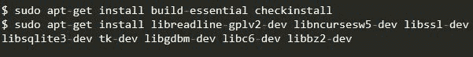

2. 访问官方网站上的 Python 下载页面，并点击“Download Python 3.6.0”。如果你看到不同的版本，尽管下载它即可。

3. 进入终端，找到文件下载的路径，并执行以下命令：

```bash
tar -xvf Python-3.6.0.tgz
```

这一行将解压你的压缩文件。只需知道如果你下载了不同的版本，文件名会不同。因此，你应该确保使用正确的文件名。

4. 现在切换到解压后的目录。

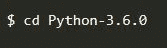

5. 使用这些命令在你的操作系统上编译 Python 源代码。

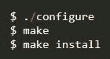

6. 如果你是初学者，建议安装 `Sublime Text`。如果你使用的是 Ubuntu，则应该运行以下命令来安装 `Sublime Text`：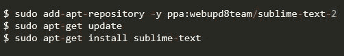

7. 现在打开 Sublime text。要创建一个新文件，导航到 `File>New File`。

8. 使用 `.py` 文件扩展保存文件，例如 `beginner.py`。

9. 编写代码并保存。对于初学者，可以使用以下代码：

```python
Print (“Where are you?”)
```

此程序将显示“Where are you?”。

10. 导航到 `Tool > Build`。你可以在 `Sublime Text` 的底部查看输出。

### 在 Windows 中安装 Python

1. 访问官方网站上的 Python 下载页面，并点击 Download Python 3.6.0。

2. 下载完成后，打开文件并开始安装过程。一旦 Python 安装完成，`IDLE` 也会随之安装。

3. 打开 `IDLE`，粘贴下面的代码并按回车。

```python
Print (“Hello, World!”)
```

4. 要在 `IDLE` 中开发文件，导航到 `File > New Window`。

5. 编写 Python 代码并使用 `.py` 文件扩展保存。

6. 导航到 `Run > Run module` 并查看输出。

## Python 交互

正如第一章所述，Python 语言之所以流行，是因为开发者可以利用其灵活性和动态特性来实现不同的功能。例如，当你想要逐行测试语句或当你正尝试学习新属性时，可以使用交互方式使用 Python。当你有一整份文件的语句需要解释时，也可以在脚本模式下使用它。Python 拥有 `Command Line Window` 或 `IDLE`，允许程序员进行交互式使用。

### 让我们来看看命令行交互

命令行是与 Python 交互最简单的方法。通过这个工具，人们可以直观地看到 Python 如何工作，因为它会对每一个完成的输入命令做出响应。它可能不是与 Python 交互的最佳工具，但仍然是学习 Python 如何工作的最简单手段。

### 如何启动 Python

根据你电脑上运行的操作系统类型，有不同的方法可以访问 Python 命令行：

* 此外，Windows 用户可以导航到带有快捷方式的文件夹并点击 Python 命令行。

* 对于使用 Linux 和 Mac OS 系统的用户，你需要运行 `Terminal Tool` 并输入 `Python` 命令来启动会话。

计算机命令用于指示机器执行操作。因此，如果你想让 Python 执行给定的任务，你必须输入它能够解释的命令。接下来，Python 将这些命令翻译为机器熟悉的指令并执行。为了理解 Python 如何工作，你将使用 `print` 命令来打印一条简单的消息：Welcome to Python。

1. 首先，打开你的 Python 命令行工具。

2. 然后在 `>>>` 提示符处输入以下代码：

```python
Print (“Welcome to Python!”)
```

3. 现在按回车告知 Python 你已完成命令的编写。

4. 接下来，你将在命令行窗口上看到消息 Welcome to Python!。

在上面的示例中，Python 给出了正确的响应，是因为你以正确的格式输入了正确的命令。假设你错误地输入了命令；那么 Python 将返回以下消息：`Syntax error: Invalid syntax.`。当你遇到语法错误消息时，就说明你在代码中输入了一个不完整的语句。例如，输入大写字母关键字 `print` 将导致语法错误。在用 Python 编程时，它提供了一个足够的余地，让你只需通过在引号内输入语句，就可以完全跳过 `print` 命令。例如：“Welcome to Python!”

## 如何退出 Python

一旦完成 Python 的使用，你可以输入以下命令来退出：

- `Quit()`

- `Exit()`

- `Control-Z` 然后按回车键

## IDLE：Python 的集成开发环境

当你第一次打开 `IDLE` 时，它会在 `Shell` 中启动。shell 是一个交互式窗口，你可以在其中输入 Python 代码并在同一窗口中监控输出。

注意：在 Windows 系统上，当你点击桌面上的 Python 文件时，Windows 系统将运行该程序。但是，如果你右键点击文件，会有 `Edit with IDLE` 选项。要修改现有的 Python 文件，请打开 `IDLE`，然后通过 `File` 菜单打开文件。

## 第一个 Python 程序

到为止，你已经编写了第一个 Python 程序。“Hello World 程序”是任何编程语言中编写的第一个程序。在接下来的示例中，我们将观察不同类型的程序。首先，打开 `IDLE` 并创建一个新窗口。如果你不知道如何创建新窗口，只需点击 `File` 菜单下的“New Window”。然后你就可以输入以下程序：

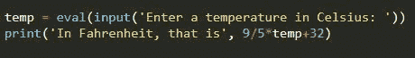

导航到 `IDLE` 的 `Run` 菜单并选择 `Run Module`。如果你不想这样做，只需按 `F5` 即可。`IDLE` 会要求你保存文件，你应该继续操作。确保在文件名后添加 `.py`，因为 `IDLE` 不会自动这样做。`.py` 扩展名会告诉 `IDLE` 文件类型为 Python，从而包含颜色以使程序更于阅读。

一旦保存了程序，它将在 shell 窗口中执行。程序会要求你输入温度。输入值 `20` 并点击回车键。程序的输出如下：

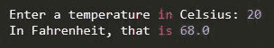

让我们看看程序是如何工作的。第一行请求用户输入温度。`input` 函数的作用是提示用户输入内容并存储用户输入的内容。引号中的部分是用户看到的内容。这被称为“字符串”（string），它将完全按照代码本身中的样貌显示给程序用户。`eval` 是一个函数，但在我们学习 Python 函数之前，你不会理解它。所以现在，只需知道它在我们想要获取数值输入时使用。

你将学习的下一个程序是计算用户输入的两个数字的平均值。

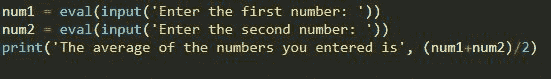

Python 语言有一个名为“行缩进”（line indentation）的强大特性。Python 将此特性应用于你很快将学习的内容。相反，其他地方的空格并不重要。例如，这些行具有相同的效果：

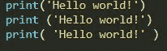

通常情况下，计算机只会根据你输入的命令来运行，并且它们总是字面上地解释内容。另一方面，Python 根据逗号和括号的位置来操作，这样它就能知道什么是什么。它并不是一个能预测你任何意图的优秀语言，因此你需要保持准确。起初，将所有逗号和括号放在正确的位置可能会令人沮丧，但过一段时间后，这会变得更加自然。即使你编程了很久，仍然会忘记某些东西。幸运的是，Python 解释器会帮助显示你犯错的地方。

## 接收输入

`input` 函数是程序通过程序从用户接收信息的简单方法。例如：

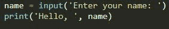

标准语法为：`Variable name = input(message to user)`

当你想要从用户处获取文本时使用这种结构。然而，如果你想从用户处获取数字并进行计算，你需要额外一步。查看此示例：

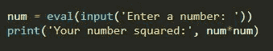

`eval` 函数会将用户输入的文本转换为数字。它的一个巨大特性是，你可以输入诸如 `2*4+ 9` 等表达式，`eval` 会为你确定结果。

注意：当你运行程序但似乎没有发生任何事情时，按回车键。有时，`IDLE` 中一直存在输入语句中频繁发生的小故障。

## 打印

考虑以下示例：

`print('Hello there')`

`print` 函数的参数周围应该包含括号。在接的程序中，参数是字符串‘Hello there.’。任何在引号内的内容将完全按照其出现的方式显示。在下方所示第一个程序中，它将打印‘4+2’，而第二个程序将打印 8。

```python
print ('4+2')
print (4+ 4)
```

要同时显示不同的内容，你需要使用逗号来分隔这些项目。然而，Python 会自动在项目之间插入空格。例如：

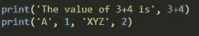

## 输出

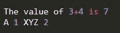

## 第 3 章 python 中使用的数据类型

编程涉及处理不同类型的数据。Python 程序利用表示不同数据类型的对象。对象可以是内置的、由程序员定义的，或从库或模块导入的。

Python 提供了以下常见数据类型：

- 数字 (numbers)

- 字符串 (strings)

- 布尔值 (Boolean values)

- 列表 (lists)

- 元组 (tuples)

- 字典 (dictionaries)

### 数字

Python 3 中有 3 种数值数据类型：

- 整数 (integers)

- 浮点数 (floating point numbers)

- 复数 (complex numbers)

#### 整数 (int)

`Integers`（整数）是指没有小数点或小数部分的整数数字。这种数值类型在 `Python 3` 中可以有无限的大小，包括零、正数或负数。Python 支持普通整数、二进制、八进制和十六进制字面量。

##### 普通整数

示例：`0`, `25`, `-50`, `56732164987123`

##### 二进制字面量（底 2）

你可以通过 `0`（零）后跟一个大写的 `B` 或小写的 `b` 来识别二进制字面量。

示例：

```python
>>> 0b101010
>>> bin_lit = 0b1010
>>> print(bin_lit)
10
```

##### 八进制字面量（底 8）

八进制字面量是以零和大写的 `O` 或小写的 `o` 为前缀的数字。

示例：

```python
>>> 0O24
>>> 0o24
>>> oct_lit = 0O24
>>> print(oct_lit)
20
```

##### 十六进制字面量（底 16）

十六进制字面量以零和大写的 `X` 或小写的 `x`开头。

示例：

```python
>>> 0XA0F
>>> 0xa0f
>>> hex_litreral = 0xa0f
>>> print(hex_literal)
2575
```

##### 将整数转换为字符串

可以使用 `oct()`、`bin()` 和 `hex()` 函数将整数转换为所需的字符串等效值。

例如，这里是将整数 `50` 转换为八进制、二进制和十六进制字面量的方法：

- 整数转八进制：`>>> oct(50)` `'062'`

- 整数转二进制：`>>> bin(50)` `'0b110010'`

- 整数转十六进制：`>>> hex(50)` `'0x32'`

#### 浮点数 (Floats)

`Floats`（浮点数）是带有小数点和小部分的实数。

示例：`10.75`, `987345`, `6.24`, `1.0`, `18.9829750582`

#### 复数

复数是实部和虚部的组合。它的写法格式为 `a + bj` 或 `a + b`，其中 `a` 和 `b` 是浮点数，`j` 是虚数。`J` 或 `j` 代表 `-1` 的平方根。

例如：

```python
>>> x = 4 + 5j
>>> y = 2 - 2j
>>> xy = x + y
>>> print(xy)
(6+3j)
```

虽然 Python 可以直观地处理混合类型到共同类型的转换，但语法可能需要对数值类型进行显式转换。

- 整数转浮点数：`>>> float(x)`

  示例：`>>> float(5)` `5.0`

- 浮点数转整数：`>>> int(x)`

  示例：`>>> int(5.5)` `5`

- 整数转复数：`>>> complex(x)`

  示例：`>>> complex(50)` `(50+0j)`

- 浮点数转复数：`>>> complex(x)`

  示例：`>>> complex(20.5)` `(20.5+0j)`

- 数值对转复数：`>>> complex(x, y)`


示例：`>>> complex(4, 2)` `(4+2j)`

## 字符串

`string`（字符串）是字符的有序序列，可以由字母、数字、特殊符号或这些类型的组合组成。字符串是不可变的数据类型，这意味着一旦通过赋值创建，你将无法再修改它。字符串定义在赋值语句中，并包含在一对单引号或双引号内。

示例：

```python
>>> string_1 = 'A string is immutable.'
>>> string_2 = "A string is sequence."
```

如果包含单引号的字符串内部使用了单引号，你必须在单引号前放置一个反斜杠来转义该单引号。

例如：

```python
>>> string_negative = 'I\'t have any idea.'
>>> print(string_negative)
I't have any idea.
```

同样，当整个字符串被包含在双引号中时，你需要使用反斜杠转义字符串内部的双引号。

例如：

```python
>>> double_quote = "She reminded everyone: \"You are supposed to use a backslash to escape double quote inside quotes.\""
>>> print(double_quote)
She reminded everyone: "You are supposed to use a backslash to escape double quote inside quotes."
```

当你需要在字符串内使用字符时，适用相同的原理。

### 访问字符串值

可以使用方括号或索引运算符`[]`访问字符串。初始字符的索引为`0`，其余按顺序编号。为了说明字符串索引，首先通过赋值字符串`"Program’s Handbook"`定义变量`new_string`：

```python
>>> new_string = "Program’s Handbook"
```

- 访问第一个字符：`>>> new_string[0]` `'P'`
- 访问第 7 个字符：`>>> new_string[6]` `'m'`
- 访问索引 12 处的子字符串：`>>> new_string[12]` `' '`
- 要访问字符串中的最后一个字符，你可以使用`len()`函数或负索引。`len()`函数用于确定字符串中有多少个字符。一旦获取此信息，只需减 1 即可得到最后一个字符的索引。

语法为：`new_string[len(new_string)-1]`

访问最后一个字符更简单的方法是使用负索引，最后一个字符的索引为`-1`，倒数第二个字符为`-2`，依此类推。

```python
>>> new_string[-1] 'k'
>>> new_string[-4] 'b'
```

### 获取字符串长度

字符串的长度或大小是指组成它的字符数量。内置函数`len()`用于确定字符串的长度。

示例：

```python
>>> string_a = 'Programming'
11
```

### 字符串切片

切片运算符`[:]`用于从给定字符串创建子字符串。方括号内的冒号用于分隔两个索引。第一个数字表示子字符串起始字符的索引。第二个数字指的是从原字符串中删除的第一个字符。

例如，这是原始字符串：

```python
>>> string_1 = "Philosophy"
```

- 要显示新的子字符串`sop`，在方括号内提供索引`5`和`8`：`>>> string_1[5:8]` `'sop'`
- 如果你想让子字符串从与字符串相同的字符开始，可以省略第一个索引：`>>> string_1[0:5]` `'Philo'`
- 如果你想让子字符串在与字符串相同的字符结束：`>>> string_1[5:]` `'sophy'`

注意，由于字符串是不可变的，对它进行的任何操作都不会改变字符串。一旦打印`string_1`，Python 将显示原始值。

```python
>>> print(string_1)
Philosophy
```

### 字符串拼接

`+`运算符用于合并多个字符串。

示例：

```python
>>> string_1 = "Stephen King"
>>> string_2 = "author"
>>> string_3 = "supernatural"
>>> string_4 = "fantasy"
>>> string_1 + " is " + string_2 + " of " + string_3 + " and " + string_4 + " books."
'Stephen King is an author of supernatural and fantasy books.'
```

### 重复字符串

字符串或字符串拼接可以使用运算符`*`和一个数字来表示重复次数。

例如，将字符串`<><>`重复 3 次，需要这样输入：

```python
>>> my_string = "apple"
>>> my_string * 3
'appleappleapple'
```

## 元组 (`tuple`)

`tuple`（元组）是包含有序项目集合的可变序列。元组可以持有任何类型：字母、数字、特殊符号或这些类型的组合。

创建元组使用方括号`()`。

示例：

```python
>>> list_1 = ('apple', 'pear', 'banana', 5, 6, 7, 8, 9, 10)
```

由于元组是不可变的，这意味着一旦通过赋值创建，你将无法再修改它。

示例：

```python
>>> list_1 = ('apple', 'pear', 'banana', 5, 6, 7, 8, 9, 10)
```

要创建一个空元组：

```python
>>> list_2 = ()
```

### 访问元组项

元组像字符串一样有索引，从 0 开始。

示例：

```python
>>> list_1 = ('apple', 'pear', 'banana', 5, 6, 7, 8, 9, 10)
```

- 访问第一个项：`>>> list_1[0]` `'apple'`
- 访问第三个项：`>>> list_1[2]` `'banana'`
- 访问最后一个项：`>>> list_1[-1]`

示例：

```python
>>> list_1[-1]
10
```

访问最后一个字符更简单的方法是使用负索引，最后一个字符的索引为`-1`，倒数第二个字符为`-2`，依此类推。

```python
>>> list_1[-1]
10
>>> list_1[-4]
7
```

### `upper()`和`lower()`函数

`upper()`和`lower()`函数用于以大写或小写显示整个字符串。

例如，通过赋值字符串`elephant`创建变量`animal`：

```python
>>> animal = "elephant"
```

以大写显示整个字符串：

```python
>>> print(animal.upper())
ELEPHANT
如果你想以小写显示整个字符串：
```

```python
>>> print(animal.lower())
elephant
```

`upper()`和`lower()`函数的使用不会改变变量中的字符串值。你可以通过打印变量来证明：

```python
>>> print(animal)
elephant
```

### `str()`函数

在某些情况下，你可能需要将非字符串字符（如整数或浮点数）转换为字符串。Python 提供了`str()`函数来实现这种转换。

例如，假设变量`my_num`持有整数`85`，当你需要打印存储的值时可以使用它。

因此，要打印字符串`employee number is 85`，可以输入以下语句：

```python
>>> print("employee number is " + str(my_num))
```

输出将是：`employee number is 85`。

## 索引

索引运算符`[]`用于指定你想要访问的项的相应索引。与其他有序数据类型一样，索引从零开始。例如，创建一个包含字符串对象的元组`tuple_new`：

```python
tuple_new = ('m', 'u', 's', 'i', 'c', 'a', 'l')
```

访问`tuple_new`的第一个项：

```python
tuple_new[0]
'm'
```

访问第四个项：

```python
my_tuple[3]
'i'
```

访问最后一个项：

```python
tuple_new[-1]
'l'
```

## 切片

切片运算符用于访问元组中范围内的项。例如，创建一个名为`my_tuple`的元组：

```python
my_tuple = ("p", "r", "o", "g", "r", "a", "m")
```

访问索引从 2 到 4 的元素：

```python
my_tuple[2:5]
('o', 'g', 'r')
```

访问从元组开始到第四个元素的项：

```python
my_tuple[:4]
('p', 'r', 'o', 'g')
```

访问从第四个项到元组末尾项：

```python
my_tuple[3:]
('g', 'r', 'a', 'm')
```

## 修改元组的元素

如前所述，元组是不可变的，因此你不能更改它的元素。唯一可以更改元组项的情况是该项是嵌套列表的元素时。例如，创建一个名为`my_tuple`的新元组：

```python
my_tuple = (5, 1, 3, [5, 10])
```

将索引为`3`的项`5`替换为`15`：

```python
my_tuple[3][0] = 15
```

查看更新后的`my_tuple`元素：

```python
my_tuple
(5, 1, 3, [15, 10])
```

## 删除元组

要删除包含其存储的所有所有元素的元组，可以使用语法：`del tuple_name`。例如，你可以通过以下方式删除`my_tuple`：

```python
del my_tuple
```

## 字典

字典是无序键值对的容器。键和值之间用冒号分隔，并包含在大括号`{}`中。键是不可变的，只能是数字、元组或字符串。值是可变的，可以包含任何数据类型。字典的值只能通过访问其键来获取。字典的键值结构类似于电话簿、目录、菜单和其他注册表中所使用的结构。

## 创建字典

要创建一个空字典，语法是：`dict_name = {}`。创建一个带有键值对的字典：`dict_name = {key_1:value1, key_2:value2, key_3:value3, key_4:value4}`。

## 访问字典的元素

要访问字典中的值，你必须使用其键。这里有两种方法：提供特定的键或应用`get()`方法。为了说明这一点，这里有一个字典：

```python
student_1 = {'Name':'Meryll Brooks', 'Age':16, 'Average Grade.':90.5}
```

访问`student_1`中包含的值：

```python
student_1['Name']
'Meryll Brooks'
student_1['Age']
16
student_1['Average Grade.']
90.5
```

使用`get()`方法访问值：

```python
student_1.get('Name')
'Meryll Brooks'
student_1.get('Age')
16
student_1.get('Average Grade.')
90.5
```

## 添加字典条目

赋值运算符`=`用于向字典添加新的键值对。每当通过赋值添加键值对时，Python 都会评估现有的字典对中是否存在相似的键。如果没有，则追加新的键值对。如果键已存在，它将直接用给定的新值更新现有值。语法：`dict_name[key] = b`。例如，如果你想为上面的`student_1`字典添加一个新的键值对，可以输入语句：

```python
student_1['sex'] = 'female'
```

要显示更新后的字典，请在`>>>`提示符上输入字典名：

```python
student_1
{'Name': 'Meryll Brooks', 'Age': 16, 'sex': 'female', 'Average Grade.': 90.5}
```

## 修改字典值

要修改当前值，请使用赋值运算符来指定与键关联的新值。例如，替换平均分的值：

```python
student_1['Average Grade'] = 85.0
```

现在，输入`student_1`显示更新后的字典：

```python
student_1
{'Name': 'Meryll Brooks', 'Age': 16, 'sex': 'female', 'Average Grade.': 90.5, 'Average Grade': 85.0}
```

## 从字典中移除条目

你可以从字典中删除指定的键值对，并返回被删除键的值。例如：要从`student_1`字典中删除键项‘sex’：

```python
>>> student_1.pop('sex')
'female'
```

现在，查看更新后的字典：

```python
>>> student_1
{'Name': 'Meryll Brooks', 'Age': 16, 'Average Grade.': 90.5, 'Average Grade': 85.0}
```

# 第 4 章 Python 的方法和函数

函数用于执行特定的操作。它是一种结构化工具，允许代码在程序的不同部分被重用。它通过减少代码重复和将复杂程序分解为可管理的片段来提高效率。函数有时也被称为方法、过程或例程。Python 中的函数分为两类：内置函数和用户定义函数。

### 内置函数

Python 提供了几个内置函数。以下是一些常用的内置函数：
- `abs()`：返回数字的绝对值
- `dict()`：创建一个新字典
- `float()`：将字符串或数字转换为浮点数
- `id()`：返回对象的标识符
- `type()`：返回对象的类型
- `input()`：读取用户输入，将其转换为字符串并返回
- `print()`：将值打印到屏幕
- `int()`：将其他数值类型或字符串转换为整数
- `len()`：返回对象的长度或大小
- `list()`：返回列表
- `tuple()`：返回元组
- `max()`：返回最大的项
- `min()`：返回最小的项
- `range()`：返回一个可迭代序列
- `round()`：返回浮点数的四舍五入值
- `str()`：返回对象的字符串版本

## 用户定义函数

### 语句(s)

函数体必须至少有一个有效的语句。多个语句必须使用相似的缩进以形成代码块。

### return 语句

`return`语句从函数返回一个值。没有返回语句的函数返回`None`。

## 模块

这是一个简单的函数，用于向指定的人问候，且没有返回语句：

```python
def greeter(name):
    """此函数向参数提供的名称进行问候."""
    print ("Hello, " + name + ", Have a nice day!")
print (greeter ('Marthy'))
print(greeter ('Shane'))
print(greeter ('Jamille'))
```

输出如下：

```
Hello, Marthy, Have a nice day!
None
Hello, Shane, Have a nice day!
None
Hello, Jamille, Have a nice day!
None
```

下面是一个带有返回语句的函数：

```python
def multiplier(x, y):
    """获取两个数字乘积的函数."""
    return x * y
```

要使用`multiplier`函数，你可以在`>>>`提示符下通过`print()`函数并提供两个数字作为参数来调用它，例如：

```python
>>> print(multiplier(5,7))
35
>>> print(multiplier(9,7))
63
```

模块包含语句、定义和代码，用于将大型程序组织成更小且易于管理的文件。模块提高了代码的可重用性，使编程更高效。通过将函数定义组合在一个模块中，并在程序中只需导入它，而不是每次需要时都复制它们的定义，你可以节省大量的时间和空间。

为了说明这一概念，创建一个包含`adder`和`multiplier`函数定义的模块，并将其保存为`calculator.py`：

```python
def adder(x, y):
    """此函数相加给定的值并返回结果 """
    total = x + y
    return total

def multiplier(x,y):
    """此函数乘以给定的值并返回结果 """
    product = x * y
    return product
```

### 导入模块

要导入模块，你将使用`import`关键字。要访问模块中的定义，可以在模块名和你想访问的函数之间使用点操作符。例如，导入`calculator.py`模块并使用存储的定义：

```python
>>> import calculator
>>> calculator.adder(5, 9)
14
>>> calculator.multiplier(2,4)
8
```


## Python 的内置模块

Python 有几个内置模块，你可以将其导入并在程序中使用。最常用的模块包括`math`模块、`random`模块、`time`模块和`calendar`模块。

### math 模块

导入 Python 的`math`模块允许用户访问其属性、常量和数学函数，例如`pi`、平方根、`sine`、`cosine`和`gcd`。导入`math`模块后，你可以对`math`使用点操作，并在点之后指定方法或属性。例如：

```python
>>> import math
>>> math.sqrt(64)
8.0
>>> math.gcd(14, 7)
7
>>> math.pi
3.141592653589793
```

### 显示模块内容

导入模块后，你可以使用内置函数`dir()`并提供模块名作为参数来查看其方法和属性。例如，显示`math`模块的内容：

```python
>>> import math
>>> dir(math)
```

### 管理外部文件

到目前为止，你已经使用`import`关键字来访问外部文件供当前程序使用。你会发现`import`语句是简单的语句，它们没有指定从哪个目录导入外部文件。

考虑上一个示例中的这个导入语句：
`import calculator`

在 Python 中工作时，内存中总有一个当前工作目录。当你输入导入语句时，解释器将在该目录中查找文件。

Python 使用其`os`模块处理文件和目录。如果你想要访问的文件存储在当前工作目录以外的文件夹中，将必须使用`chdir()`方法更改当前目录。例如，假设你想导入名为`collection.txt`的文件，它存储在名为`Python/Personal`的文件夹中（该文件夹不是当前目录），你需要使用这些语句：

```python
# 导入 OS 模块
import os

# 目录到 "/Python/Personal"
os.chdir("/Python/Personal")

import collection.txt
```

使用`getcwd()`方法
语法：`os.getcwd()`
示例：

```python
import os

# 显示当前工作目录的位置
os.getcwd()
```

## 条件编程

如果不能根据条件处理数据，那么处理数据和变量的能力将无用武处。幸运的是，和所有编程语言一样，Python 有许多方法来实现这一点。

### 如果...那么条件

基本思想是如果某些条件为真，我们就执行一组特定的指令，否则不执行。最简单的形式如下：`if (x==1): do something`。在这个示例中，我们简单地表示如果`x`等于 1 则执行某些操作，这里的`do something`代表一个可以放在单行上的简短操作。在这种格式下，下一行将缩进到与`if`语句相同的列，这表示无论`if`语句的结果如何都会执行该代码。在更复杂的情况下，冒号之后将返回，下一行将缩进。随后的所有非空行都是`if`条件的一部分，并保持相同的缩进级别。输入一个空行将缩进退出条件语句。

```python
if (x==1):
    Do thing 1
    Do thing 2
    Do thing 3
```

### 下一步执行的代码

括号中的条件测试的是简单的等性。条件可以比这更复杂。本质上，括号内定义的任何条件都将被评估为真或假。如果整体上评估为真，则执行条件语句，否则不执行。下面是一个稍微复杂的示例：

```python
>>> x,y=0,10
>>> if (x==0 and y==10):
```

```python
print(True)
```

## If...then 条件语句

基础的`if...then`条件语句仅允许我们在条件为真时执行特定的代码。这并不意味着我们不能执行逻辑相反情况下的代码，只是该相反的情况必须为真。换句话说，如果我们想在`x`不等于 0 时执行代码，我们设置的条件是使得当`x`不等于`0`为真时，按如下方式执行代码：

```python
if (x<>0): Do something
```

为了在条件为假时（在上面的例子中为`x==0`时）专门运行代码，我们需要使用`if...then...else`语句。

```python
if (x<>0):
    do something # 条件为真时执行
else:
    do something else # 条件为假时执行
```

`else`之后的缩进/格式规则与初始的`if`语句相同，因此所有后续非空行都经过了块缩进，并被视为`else`块的一部分。如果条件为假，这些代码都将会被执行。

## If...elif...else

`If … elif... else`增加了一层的复杂性。在这种情况下，`elif`代表`else if`。`else if`将`else`和一个额外的`if`结合，因此它只有在之前的`if`语句为假且其设置的测试条件为真时才会被执行。

```python
if (x<0):
    do something # 当 x<0 时
elif (x==0):
    do something else # 当 x 为 0 时
elif (x==1):
    do something else # 当 x 为 1 时
else:
    do something when all the above are false # 当以上皆假时
```

## 条件嵌套

这些语句也是可以嵌套的。在嵌套`if`语句时，可能会很难追踪自己的代码，因此必须小心保持适当的逻辑。

```python
if (x==1):
    do something
    if (y==1):
        do something
else:
    do something else if x<>1
```

注意，`(y==1)`的结果与此无关，但与`else`有关。

## Switch/Case 切换语句

许多语言包含了另一种条件类型：`switch/case`，它允许你测试多个值而不仅仅是假值。遗憾的是，Python 并没有这样的语句。可以使用字典或`elif`语句实现类似的功能。

## 循环

是重复任务的能力。Python 提供了两种类型的循环：`for`和`while`。

### For 循环

`for`循环用于遍历范围。例如：

```python
for x in range(3):
    print(x)
```

输出：

```text
0
1
2
```

语法与我们之前涵盖的内容相似。在`for`循环中，我们使用`range()`函数来生成用于迭代的数字。

Range 命令

`range`方法包含一个步长（step）值属性，它允许我们以除 1 以外的间隔遍历列表。例如，为了获取列表中的每隔一项，我们会使用：

```python
for y in range(0, len(x), 2):
    print(x[y])
```

或者，反向获取列表：

```python
for y in range(len(x)-1, -1, -1):
    print(x[y])
```

在这种情况下需要注意的是，我们实际上是在按顺序遍历列表值并将`y`设置为这些值。我们并不是将`y`设置为从 0 到 4 的位置值。

虽然我们在`for`循环中使用`range()`来生成用于迭代的数字，但这绝不是唯一的选择。我们实际上可以从任何可迭代的源中提取值并迭代该源。例如，列表、元组或字符串的长度。

```python
x=['apples', 'oranges', 'bananas', 'peaches', 'plums']
for y in x:
    print(y)
```

### While 循环

`while`循环在指定的条件为真时会持续执行。例如：

```python
y=1
while y<=10:
    print(y)
    y+=1
```

输出：

```text
1
2
3
4
5
6
7
8
9
```


在这种情况下，只要 `y` 小于或等于 10，循环就会继续。与 `for` 循环（指定在预定义范围内执行并退出）不同，`while` 循环只要指定的条件为真就会持续执行。因此，`while` 循环很容易变成死循环——即永远循环的代码。为了防止这种情况，必须在循环内部包含一段能在某一点使条件变为假的代码。在这种情况下，`y+=1` 在每次循环执行时都会将 `y` 递加 1。当 `y` 变为 11 时，条件变为假，循环结束。

## Break 命令

还有一种优雅退出 `for` 或 `while` 循环的额外方法。`break` 命令强制循环提前终止。与 `if` 语句结合使用时，`break` 可用于根据条件且优雅地提前退出循环。在大多数情况下，选择使用哪种循环结构并妥善设计循环内部的代码将消除对 `break` 语句的需求，因此如果可以避免使用它通常被认为是更好的。然而，在某些情况下，这可能是必要的。

## 第 5 章：处理数据分析与算法

涉及到数据分析时，它并不像看起来那么简单。困难性的原因之一是只有少数人掌握了数据分析的艺术。这意味着只有少数人能够解释它是如何实现的。令人惊讶的是，很多人每天都尝试分析数据，但大多数人的努力都告失败了。这是因为该领域的专家还没有花时间解释他们在分析数据时是如何思考的。

数据科学是一门艺术。它不是一个可以教给计算机的概念。数据分析师使用不同的工具来完成任务，从线性回归到分类树应有。尽管计算机知道所有这些工具，但数据分析师的角色是找到一种方法，收集所有工具并将它们整合到数据中，从而对问题开发出正确的答案。然而，数据分析的过程尚未被妥善记录。虽然有很多关于 `Statistics`（统计学）的书籍，但没有一本书试图解决如何创建一个真实世界的数据分析解决方案。框架的使用加速了开发，因此，开发变得更快、更快捷、更高效。大多数 Web 框架的成本都很低。一个框架具有强大的安全实现。使用框架最大的好处实际上源于其背后的社区。

另一方面，开发一个重要的框架涉及使用抽象语言对数据分析的元素进行分类。在某些情况下，这种语言可能是数学。相反，分析的相同细节正是每项分析变得复杂且有趣之处。

## 分析的循环

你可能会观察数据分析并认为它遵循一个线性的、逐步步进的过程，并有良好的结果。然而，数据分析是一种迭代的非线性的方法，由一系列本周来描述。在这种方法中，在每一步都会学习信息，然后决定是重新执行并完善已经执行的下一步，还是进入下一步。

在涉及到分析数据时，迭代过程被用于数据分析的所有步骤中。此外，由于不同软件中封装的 `algorithms`（算法），某些数据分析可能看起来是固定且线性的。

因此，理解“数据分析”这一术语的含义至关重要。虽然数据研究涉及创建和实施收集数据的计划，但数据分析假设数据已经收集完毕。最重要的是，一项研究将涉及假设的创建、数据收集程序的设计、数据的收集以及对数据的解释。然而，由于数据分析假设数据应该已经收集好，它涉及到问题的开发和完善，以及分析和解释数据的过程。

### 数据分析的五大主要活动

1. 陈述并完善问题
2. 探索数据
3. 创建正式的统计模型
4. 解释结果
5. 结果结果沟通

上述所有活动发生在不同的场合。例如，你可能一天内完成所有活动，但在超过一个月的时间里详细处理每项活动。因此，让我们看看应用于这些活动中每一项的框架。虽然在执行数据分析时可以参与许多不同类型的活动，但整个过程的每个方面都可以通过交互过程完成。最重要的是，对于上述五项活动活动，建议你包含以下步骤：

1. 定义或设定预期
2. 收集信息并将数据与你的预期进行比较
3. 如果数据不符合你的预期，则修改或修复数据，使你的预期和数据相匹配

---

# 项目概述

- 制作 RSS 阅读器
- MySQL
- 在 HTML 中创建日历
- 文件操作
- 用于在线应用程序、CGI 编程

此外，它还是一个被软件开发者广泛用于测试、检查构建控制以及管理 get 知名工具。更重要的是，对于任务集成，`Python` 是公司经常使用的语言。我们可以以 3D 软件 Maya 为例，它利用 `Python` 进行复杂的集成，并用于自动化处理小型用户任务。

## Python 的应用

像 `Python` 这样的语言并不总是被用来创造独特的产品，但诚然，它被用于驱动负责创建此类产品的工具。例如，看看那些运行着智能内部系统的公司。它们不需要编译型语言。此外，这种语言在开发软件和游戏、语言开发、Web 框架等许多领域都有广泛的应用。这使得 `Python` 较于其他编程语言具有优势，这也是它在行业中取得成功的原因。让我们深入探讨 `Python` 在行业中的一些优势：

- 提供对大型标准库的支持，这些库配备了网络服务工具、互联网、协议和操作系统接口等许多操作。
- 它还用于集成 `EAI 企业级应用集成`，这使得通过调用它们来开发 `COBRA` 或 `COM` 组件等 Web 服务变得可行且便利。它的控制能力非常强大，可以通过 `Jython` 直接通过 `C++`、`C` 和 `Javascript` 进行调用。
- 它仍然处理 `XML` 和其他语言，因为它可以使用相同的字节在现代操作系统上轻松运行和操作。
- 它具有提高编程生产率的能力。在利用 `Perl`、`Java`、`C` 和 `C++` 等语言时，清晰且面向对象的设计将程序生产率提高了两十倍。
- 其集成功能非常强大，其单元测试和增强的控制能力使得大多数使用 `Python` 的应用程序效率提高，而重要的是可扩展性，这使得这种语言成为协议网络应用的极佳选择。
- 在当今时代，大数据对于大型企业变得极其重要，尤其是在业务领域。因此，涉及到数据处理时，数据科学家倾向于使用 `Python` 作为操作工具。这是 `Python` 成为大数据领域最好用编程语言的唯一原因。
- 所以对于构建分析工具，数据科学家发现 `Python` 是最合适的。此外，由于在当今数据是能够为你赚钱的资产，`Python` 的使用不容忽视，并应该被纳入你的执行计划。
- 它在机器学习领域尤其受到青睐，而这是目前全球领先的业务之一。先进的机器学习可以进一步用于业务中的大量任务。
- 最后，我们应该谈谈网络安全，在如今货币交易数字化的数字时代，拥有强大的网络安全来防御哈客攻击非常重要。根据对 `Python` 网络安全性能的调查，它是目前行业中的冠军。

除了上述所有内容，该编程语言的另一个伟大特点是 `Python` 是完全免费的。此外，这意味着扩展支持的模块、工具和库都是免费的。许多集成开发环境都是免费的，如 `Eclips`、`Pydev`、`PTVS` 和 `Spyder Python` 等。

这些就是让 `Python` 成为企业和行业最佳选择的一些原因。我认为，没有 `Python`，这些科技巨头在影响力和财力方面将不会如此强大。它将在未来几天引发下一轮物联网热潮，最重要的是机器学习领域。

## 开始学习 Python

`Python` 编码语言是你在进行编程时时可以选择的最佳选项之一，尤其是当你想要从事机器学习时。`Python` 是一种非常容易学习的语言，由于它的简单性，它通常是初学者关注第一个语言。但不要被骗了。仅仅因为 `Python` 容易学习并不意味着它不具备你在编程语言中寻找的力量和强度。

从 `www.python.com` 安装 `Python` 程序后，你想做的第一件事就是下载合适的 IDE。这是一个使用 `Python` 的良好环境，将为你提供所需的所有帮助。它还包含了 `Python` 安装区域、你的编辑器和调试工具。这个 IDE 易于安装、轻量，并且拥有许多你会喜欢的很棒的开发工具。它还有自己的命令行实用，因此你可以根据需要安装一些第三方软件。有了这个 IDE，你就不需要单独安装 `Python` 环境了。

## 安装 Anaconda IDE

为了下载 `Anaconda IDE`，需要完成几个步骤。我们将介绍在 Windows 计算机上安装时可以使用使用的步骤，但在 Linux 或 Mac 计算机上安装的步骤也大体相同：

1. 开始，访问 `https://www.anaconda.com/download/`
2. 从这里你将跳转到主页。你需要选择 `Python 3.6`，因为它是最新版本。点击“Download”获取可执行文件。下载需要几分钟，但取决于你的网络速度。
3. 一旦下载可执行文件，你可以进入下载文件夹并运行它。当你运行此文件时，你应该会看到安装向导出现。点击“Next”按钮。
4. 然后将出现许可协议对话框。在点击“I Agree”按钮之前，花一分钟阅读一下内容。
5. 在“Select Installation Type”框中，勾选“Just Me”单选按钮，然后点击“Next”。
6. 在继续之前，你可能想要选择你想要使用的安装目录。你应该确保安装目录中有大约 3 GB 的空闲空间。
7. 现在你将处于“Advanced Installation Options”对话框。你需要选择“Register Anaconda as my default Python 3.6”，然后点击 Install。
8. 之后你的程序将通过几个后续步骤，IDE 将安装在你的程序中。

---

# 如何开始学习 Python

如你所示，设置 Python 环境可以非常简单，并不一定非要复杂。你也可以选择其他形式的 IDE，如果你已经在电脑上安装好了一个，直接使用它完全可以。

我给初学者的建议是尽管尝试，不要被小事困扰。万一你从未做过任何与机器学习相关的事情，可以尝试一下 `scikit-learn`。你将了解到标记、准备和测试循环是如何运作的，以及模型是如何创建的。

另一种你可以尝试的机器学习替代方案是从 `Keras` 开始的——它通常被认为是最直观的结构——看看它能带你走向何方。当你深入参与后，你将开始感知对结构的需求：更突出的速度、备选的 `API`，或者其他不同的东西，并能够做出更明智的选择。

至重要的是要考虑到，每一个工具都有广泛的帮助并且不断改进，这使得它们之间的关联变得困难。几个月前的基准测试可能已经过时，一年前结构 `X` 不支持活动 `Y` 的案例可能再也不具有参考价值。

如果你正从事与 NLP 特定的机器学习工作，请看看 `MonkeyLearn`！我们的平台提供了一个有趣的 `UX`，让制造、准备和增强 NLP 模型变得轻而易举。你可以使用预模型用于常规场景（如情感分析、主题定位或关键词提取），也可以利用你的特定数据准备自定义计算。无论是基础框架还是发送你的模型，我们多功能的云都能为你完成。你可以从零开始，并通过我们优秀的 `API` 立即集成。

Python 是一种主流且易于使用的语言。Python 是一个完整的语言和框架，可以用于创新工作，也可以创建基础框架。还有大量的模块和库可以学习，为完成每个任务提供了广泛的方法。这可能会让人感到压力。

## 初学者的最佳方法

开始使用 Python 进行机器学习的最理想方法是理解该语言的一些基本原理。

- 它将迫使你引入并开始使用 `Python 解释器。
- 它将让你对如何完成一个小任务有一个宏观的视角。
- 它将给你信心去完成你自己的特定小任务。

初学者需要从一个从头到尾的小项目开始。书籍甚至许多现有的 Python 课程可能让人困惑。它们大部分会给你大量的公式和代码；然而，你很少有机会观察到拼图的所有部分是如何组合在一起的。当应用你所学的内容并学习其他特定的 `Datasets` 的时候，你正在获得一个成长的机会。

让 Python 如此易于使用的常见任务包括：

- 确定问题
- 收集数据
- 分析算法
- 增加积极结果
- 定义结果并展示它们

面对陌生的平台或语言时，最简单的方法就是永不放弃，坚持完成一个机器学习案例研究直到结束。只需务必记录在此过程中教授的所有关键点和技术。特别要关注数据加载、数据摘要、如何评估不同的算法，以及如何得出特定的预测。如果你无法做到这些，在每个 `Datasets` 中都有一个供你使用的模板。

## 开始使用鸢花数据集 (Iris Dataset)

尝试一种名为 `Iris Dataset` 的新工具；对于刚开始学习机器学习的人来说它是它是简单的。这是一个很棒的项目，因为它的界面易用。属性通常是数值型的，这意味着你必须弄如何加载和管理所有数据。由于其计算性质，用户可以使用更简单的 Python 公式或代码进行练习。

这是一个多级分类问题（表面上是），可能需要详细的方法。它只有四个属性和 150 行，这意味着它非常小，并且可以有效地放入内存中。大多数数值属性具有相似的单位和比例，在开始时不需要进行任何独特的缩放或更改。

## 你的第一个项目

我们应该从一个简单的 Python “你好世界”机器学习程序开始。在这一部分中，我们将从头到尾完成一个简单且有趣的代码示例。以下是本节中将发现的一些常见的 Python 特性：

- 引入 `Python` 和 `i`’s 库
- 堆叠数据集
- 压缩数据集
- 可视化数据集
- 评估一些计算
- 进行一些预测

根据需要花费任何时间。完成每一个步骤。尝试自己输入这些命令，或者为了节省时间尝试调整它们的顺序。

### 第 1 步：下载与安装

通过下载将 `Python` 和 `SciPy` 阶段获取到你的计算机上。这假设你的机器上还没有安装这些它们。我倾向于不进行极其详细的说明，因为 Google 上有许多文章解释了如何操作。

### 第 2 步：教学练习

此教学练习适用于 `Python` 2.7 或 3.5。我对这个主题进行了一些研究，以下是完成完成此特定案例研究/练习需要安装的库列表：

- `matplotlib`
- `pandas`
- `scipy`
- `sklearn`
- `numpy`

请记住，引入 Python 库有许多方法。对于新手，我最好的建议是在起始阶段选择一种技术并保持一致性。我发现 `SciPy` 页面为在许多不同平台（例如 Linux、`OS X`，当然还有 Windows）上的安装和库介绍提供了极佳的指南。该指南非常流行、详尽，并在范围内广泛使用。

如果你使用的是 Windows 环境，或者你不确定，我强烈建议你安装一个干净且免费的 `Anaconda3`。它是一个免费的开源管理系统，可以在 Windows、Linux 甚至 OS 上运行。它可以帮助你打包和分发代码。

**免责声明**：我们下方查看的示例是基于你至少在使用 `01.8` 或更高版本的 `Scikit-learn` 的假设。

确保 `Python` 环境已正确下载、设置并为此示例编程项目正常运行是一个明智的想法。下面的代码脚本将帮助你测试工作环境，并自动导入此示例所需的每个不同库。

在你的解释器中打开一个全新的命令行并输入以下一个单词。我绝对建议专门在解释器中工作，或者预先编写你的程序，然后在命令行中运行所有程序，而不是使用大型编辑器和环境。始终保持事情极其简单，专注于代码本身而不是工具。

界面变化不会非常快；因此，如果你输出的是旧版本，请不要惊慌。所有这些对你来说仍然应该是正确的；但是，如果你遇到任何类型的错误，请不要尝试继续。你不想在刚开始时就学习修复代码。由于某种原因，如果你无法在没有错误的情况下执行脚本，其余步骤将无法运行。网络上有许多针对初者的论坛。尝试用引号搜索你的准确错误代码，以查看常见的修复方法。如果该修复方法对你来说足够容易，请务必这样做，然后回来完成其余步骤。

### Python 运行基础知识

在我们开始学习更多机器学习之前，我们需要了解 `Python` 编程语言自带的一些基础部分。这是一门非常棒的编程语言，因为它简单且易用。然而，它背后仍然蕴含着巨大的力量。`Python` 自带的所有优秀特性，使得它在处理机器学习时是完美的选择。

#### Python 关键字

首先，我们需要查看 `Python` 语言中这些重要的关键字。就就像你在其他编程语言中发现的一样，`Python` 中也有一组关键字列表，用于告诉你的文本编辑器做什么。这些关键字是保留的，如果你想避免编写代码时出现问题，就应该只按照它们的预期用途使用它们。它们基本上是告诉编译器如何行为的命令，并且它们保持保留状态，以便你在执行代码时不会在此过程中遇到很多问题。

#### 代码中标识符的命名

当你使用 `Python` 时，为代码的不同部分命名时遵循正确的规则是非常重要的。这些部分中的几个被称为标识符（identifiers）。它们可以有各种名称，如变量、类、实体和函数。在命名这些标识符时，必须遵循一些规则，但无论你处理的是哪个标识符，规则都是相同的。标识符在命名时需要遵循的一些规则包括：

- 你可以在标识符名称中同时使用大写字母和小写字母。你还可以使用下划线符号和数字。上述字符的任何组合都是有效的，只需确保名称内部没有空格即可。所以，不要写像 `My first program` 这样的内容。你应该写成 `Myfirstprogram`。

- 你的标识符不能以数字开头。你可以在名称的任何地方使用数字，但它不能是程序的第一个字符。如果你将数字作为第一个字符，当编译器尝试执行时，你将得到一个错误信号。你可以写类似 `one program` 的内容，但不能将标识符命名为 `1program`。

- 标识符名称不能包含 `Python` 关键字之一。如果你在名称中加入关键字，将导致编译器的困惑，你的程序将无法运行。

标识符的命名规则并不一定复杂。如果你确实忘记了标识符命名的规则之一，编译器会注意到，你最终会得到一个语法错误。你只需要回去修复它，这个错误就会消失。

## Python 注释

你还可以在 Python 中使用注释。这些注释对于解释你的代码非常有用，特别是当你正试图向另一位程序员或查看你代码的人解释代码时。当代码的任何部分需要一点说明时，你都可以添加注释。编译器不会识别注释，而是直接跳过它，完全不会读取。一旦你告知编译器注释已结束，它就会重新读取代码。执行代码的人完全不知道你写了多少条注释，甚至不知道你把它们放在了程序的哪个位置。

编写你想添加到代码中的注释其实非常简单。你只需要在想要编写的注释前面使用 `(#)` 符号即可。因此，你可以写出像 `#this is my Python code` 这样的内容。注释完成后，你只需按回车并在下一行开始编写其余代码。只要你在注释前面加上那个符号，你的编译器就能跳过它，而不会读取你在注释中输入的内容。

你可以根据需要决定在代码中编写多少注释。有时代码只需要几条注释，而另一些时候可能需要大量注释。请将注释保持在你真正需要的范围内，不要浪费时间或空间编写更多不必要的注释。

## Python 语句

你还可以在 Python 代码中使用语句。然后你可以将这些语句发送到你选择的编译器中，以便执行代码。你可以编写任何你语句，但必须以编译器能够理解的方式来编写。语句的长度可以随你的意愿长短不一。有些语句可能只有一个字符长，而有些则会有很多行长。

## 作为面向对象语言的 Python

当你查看指南中为这种学习而提供的某些不同代码时，你会发现它非常像一种面向对象编程语言或 `OOP`。这是一种比较新的编程形式，但你会发现它在编写程序时效果好得多，并且让初学者的编码（尤其是机器学习）变得更容易。

`OOP` 语言的设计初衷基本上是为了更容易用，并消除以前编程时出现的一些问题。一些旧的编程语言并不是这样设计的，这让初学者很难起步。`OOP` 的设计是为了消除这些问题，因为它将以更有结构化的方式使用最好的编程特性。基本上，这种结构将帮助你作为一名程序员更快地完成工作。如果你尝试过一些旧的编程语言并感到沮丧，你会发现 Python 消除了其中的一些问题，现在编码比以前要容易得多。

与 Python 不同，一些最早的编程语言发布时采用的是一种被称为过程化（procedural approach）开发方法。这种方法完成了任务，并帮助程序员完成了工作，并在多年里编写了很多优秀的代码，然而它存在许多缺陷。这些缺陷是某些程序员可以克服的，但它们往往足够麻烦，以至于初学者感到沮丧并完全放弃工作。

由于过程化方法在编程中非常难以使用，`OOP` 的理念被开发出来。当你使用 `OOP` 时，你会发现代码中的数据将被视为代码的一个重要发展。在过程化开发中，数据被允许在系统中随意流动。`OOP` 能更好地将数据保持在原地，以便操作它的函数将紧邻数据存在。这确保了你所有数据的安全，并确保程序员或外部来源不会意外进行修改。

对于不理解编程中涉及的所有技术问题的初学者来说，`OOP` 基本上会在你创建新代码时提供你想要的所有功能。它让使用变得简单得多。`OOP` 带有许多有助于使其变得更好用的特性，包括：

- `OOP` 能够将某些重点从代码的过程中转移出来，并将更多重点放在代码的数据上。
- 你编写的所有程序现在都将划分为对象。
- 数据经过结构化，以便通过其内部的对象来表征。数据将是持有对象的 `classes`（类），而 `class` 内部的所有对象需要以一种合理的方式匹配。
- 当你处理数据结构时，操作你对象数据的重要函数将聚集在一起。
- 代码中的数据是被隐藏的，因此外部函数将无法访问这些数据。在过去的旧编程语言中这有时会导致一些问题，因为信息很容易被混淆。
- 得益于它们拥有公共函数，你使用的对象具有相互通信的能力。
- 新数据以及你拥有的函数可以在你任何时候添加到代码中。
- 每当你开始设计自己的程序时，你必须记住要遵循自底向上的方法（bottom-up approach）。

使用 Python 编程语言有很多乐趣之处。它的设计初衷考虑了初学者编码员，这就是为什么它是你的最佳选择之一，也是为什么你会发现它被用于机器学习甚至黑客攻击等一些其他复杂的话题。

# 第 8 章 重要的 Python 框架

尽管它已用于执行从数据科学、机器学习到机器人技术（尤其是人工智能）以及硬件编程的各种任务，但也可以 Python 进行 Web 编程。如今，程序员在 Web 编程中优先使用 Python 语言，以更高效地构建应用程序。

一些基本的 Web 框架被用于构建应用程序。然而，对于新程序员来说，理解哪个框架更适合自己的项目也是问题。

## 什么是 Web 框架？

Web 框架实际上是使用工具和资源来构建和管理网站、Web 应用程序和 Web 服务。框架作为一种抽象工具，允许代码复用并使开发应用程序变得更容易。

## 为什么我们需要 Web 开发框架？

框架让开发者开发软件和网站变得更容易。框架的使用加速了开发，因此开发变得更快、更快捷、更高效。大多数 Web 框架的成本很低。框架具有强大的安全实现。使用框架最大的好处实际上源于其背后的社区。

如果你正在预览或浏览此本书的介绍页面，对于是否想学习 Python 犹豫不决，那么，我可以告诉你你可能应该学一下。Python 基本上是一门极其有用且功能强大的语言。它几乎无处不在。从视频游戏的脚本端（或视频游戏本身）到密集的服务器端 Web 应用，再到用它构建的大量深度且响应式的桌面应用程序，无所不在。

`Tornado` 框架有助于同时向你的应用程序建立数千个并发连接。`Dash` 也是一个 Web 框架，被认为是分析类应用程序的最佳选择之一。

## Django

`Django` 是最流行的 Web 开发框架，简单定义为“为有截止期限的完美主义者提供的高级功能 Web 框架”。它内置的功能允许广泛的 Web 应用，如聊天机器人、数据库应用程序、GPS 解决方案等。

`Django` 拥有一种名为 `DRY`（不要重复自己）的哲学，允许并促进代码复用，并将代码编写时间减半。它的模块化架构允许通过启用根据需要添加或删除组件的选项来修改代码组件。

此外，`Django` 框架拥有 `ORM`（对象关系映射）。`ORM` 使它与大多数流行的数据库（包括 `SQL` 和 `Oracle`）高度兼容。它具有同时与多个数据库工作的能力。

`Django` 还是一个 SEO 友好框架，通过压缩 JavaScript 和缓存模板等不同技术和功能缩短页面加载时间。

## Pyramid

`Pyramid` 是另一个用于 Web 应用的框架，它定义自己为“不不大也不小，恰恰好”。`Pyramid` 具有从小开始的能力。它允许程序员为特定的问题解决项目编写坚实的基础，然后根据需要进行扩展。与 `Django` 相比，`Pyramid` 对小型和大型应用程序具有相同的兼容性，但在复杂度上，它与 `Django` 不同。

`Pyramid` 是一个出色的框架，带有插件系统，允许程序员执行任何需要。更具体地说，这些插件有助于针对给定问题实现多种解决方案/结果。

`Pyramid` 是单文件应用程序、授权导向型应用以及灵活身份验证的理想选择。

对于服务器端编程，Python 由于其动态创建网站的能力被广泛使用。像 `NASA` 和 `Google` 这样的科技巨头使用 Python 编程语言是因为它用于快速原型设计和高度可扩展 Web 应用的开发。

Python 框架使 Web 开发变得无缝并减少了开发工作。程序员面临的唯一挑战是识别他们针对特定任务或更好的结果需要哪个框架。专业程序员（也称为专家）解释说，根据需求、优势、用途、高级特性和功能，程序员在长远来看可能只会使用少数框架。以下是史上最优秀的框架，也是未来使用的喜选：

- `CherryPy`
- `Tornado`
- `Bottle`
- `Flask`
- `CubicWeb`

### CherryPy

`CherryPy` 是最老的 Python 框架之一，但由于增加了功能并更新了版本，它仍然是最可能被使用的框架。与其他框架相比，`CherryPy` 非常稳定且快速。程序员可以在此框架的帮助下，以类似于构建其他面向对象应用程序的方式构建 Web 应用程序。这导致在更短的时间内开发更小的源代码。自发布以来，`CherryPy` 已证明足够快速且高效。

#### 特性

以下是 `CherryPy` Python 框架的主要特性：

- `CherryPy` 运行在版本 `2.7+` 和 `3.5+` 的 Python、`Android`、`PyPy` 和 `Jython` 上
- 它具有灵活且专门的插件系统
- 它强大的配置系统是开发者的另一个特性
- 它超级简单易于同时运行多个 HTTP 服务器
- `CherryPy` 在其功能中还提供了测试支持、分析支持和内置的覆盖率
- 它的功能还包括编码、缓存、身份验证、会、静态内容等内置工具

### Tornado

`Tornado` 也是最流行的 Python 框架之一。它拥有异步网络库，可以同时处理并发连接。

#### 特性

以下是列出的 `Tornado` 框架的主要特性：

- 它的性能很高
- 允许开发者随时读取源代码
- 由于它是一个小型框架，它最适合 `HTTP+JSON` 服务
- 非阻塞 HTTP 客户端

### Bottle

`Bottle` 是另一个用于 Python 编程语言的 Web 框架。具体来说，它是一个 `WSGI`（Web 服务器网关接口）微框架，其设计使其使用非常简单，性能极快且轻量（`50-60 kb`）。这个 Web 框架最有趣的地方在于它除了 Python 标准库外没有任何依赖项。它允许高效、快速地开发 Web 应用程序。

#### 特性

`Bottle` Web 框架具有以下主要特性：

- 它帮助路由，程序员必须为 URL 参数使用简化语法或表达式
- 该框架提供了访问表单数据、文件上传、头部、cookie 和其他 HTTP 元数据的便利性
- 它通过测试快速静态路由和频繁使用的路由帮助开发者优化速度
- 它同时运行在 Python `2.5` 和 `3.5` 上

### Flask

#### 特性

`Flask` Web 框架具有以下特性：

- 它包含开发服务器和调试器
- 可以进行详尽的文档
- 提供安全 Cookie 支持
- 提供集成单元测试支持
- Unicode 特性

### CubicWeb

`CubicWeb` 是另一个用于 Python 的 Web 框架，它是语义化的、开源的 Web 结构且免费。它鼓励工程师通过复用 3D 形状等高效构建 Web 应用程序。

#### 特性

`CubicWeb` 具有以下主要特性：

- 对于常见需求，提供了可用的数据和视图组件库
- 它具有完善的工作流
- 它支持 `OWL`（本体论语言）和 `RDF`（资源描述框架）

| 操作数 | 值 | 逻辑表达式 | 值 |
| :--- | :--- | :--- | :--- |
| `x < 10` | True | `not x < 10` | False |
| `Callable (x)` | False | `not callable (x)` | True |

## 在布尔上下文中非布尔值值的计算

大多数表达式和对象并不等于 `True` 或 `False`。尽管如此，它们在布尔上下文中仍然可以被确定为“假（falsy）”或“真（truthy）”。

那么，什么是真的，什么是假的呢？在 `python` 中，以下内容在布尔上下文中计算时被认为为假：

- 布尔值 `False`。
- 空字符串。
- 由 Python `None` 关键字表示的唯一值。
- 数值上为零的任何值。

在 Python 中定义的几乎所有其他对象都被视为真。你可以使用内置的 `bool()` 函数来判断表达式或对象的“真值”（truthiness）。如果参数为真，则 `bool()` 返回 `True`；当参数为假（`Falsy`）时，返回 `False`。

## 组合“或”表达式

看这个表达式：`xi`，如果 `xi` 中的其中一个为真，则该表达式为真。在这个表达式中，Python 采用了一种被称为**短路求值**的方法。`xi` 操作数从左到右顺序计算。一旦被验证为真，整个表达式就会被视为真。在此阶段，Python 会停止执行，不再确定后续项。整个表达式的值就是完成评估的那个 `xi`。

例如：`f()` 将返回传递给它的参数，因此通过定义 `arg` 的真或假值，可以使表达式变为真或假。此外，`f()` 会将其参数输出到控制台，这证明了它是否被调用。

现在，看下面这个组合逻辑表达式：`f(0)`，Python 解释器将首先确定 `f(0)`；结果为 `0`。数值 `0` 是假的。这个表达式尚未为真，因此计算从左到右开始。下一个操作数 `f(False)` 将返回 `False`。这这也是假的，评估继续。

## 第 11 章：Python 技巧

### 理解 Python 技巧

快速 Python 编码支持指令说明：一个 Python 技巧可以教你一些东西，或者作为一个激励性示例，帮助你探索并更深地培养内在意识。Python 技巧并不是逐条演示 Python 的内容。这并不重要。如果你处于语言学习的早期，仅凭文本并不能让你成为 Python 专家。学习总是对你有益的，但你还需要掌握一些其他技能来提高 Python 的核心技能。

### 断言（Assertions）的恰当使用

一个非常有价值的语言特性往往很少关注；它值得如此。无论对于 Python 中出于什么借口，都发生了这种情况。在本节中，我们将引导你如何在 Python 中使用断言。你必须理解何时动态地使用它来支持在 Python 中可能发现的错误。它能让软件调试器更准确、更简单。在那个阶段你你可能会：“什么是断言？它们在哪里？”让我们给你提供一些细节。Python 的断言声明是一种检查条件的编程辅助工具。当语句（`Statement`）有效时，什么都不会发生。软件现在按计划运行。尽管如此，如果状态评估结果为错误，则会抛出一个 `AssertionError` 异常，作为可选的不准确性语句。

#### 简单示例

下面是一个观察语句在何处可以实用的完美示例。假设你创建了一个 Python 在线商店。你想在程序中应用一个储蓄券，最后写了相应的应用程序折扣函数：`apply_discount`。

注意那个断言语句了吗？这意味着它并不重要。所以，这个函数的折后价格可能低于 0 元，也不可能高于初始售价。让我们确保在该功能被调用时它按预期运行。一个清晰的减价声明。在整个用例中，我们商店的物品被描述为简单的字典。这可能不是实际案例中想要的，但它能很好地展示断言。让我们构建一个产品实例——一组折扣价的鞋子，149.00 美元：我们已经看到我们如何通过使用整数以分为单位显示数值来避免美元舍入的问题了吗？不，假的。这通常是一个明智决定，但我们不同意。那么，如果我们给予 25% 的折扣，我们只希望这些运动鞋的购买成本为 111.75 美元。好的，运行得很好。然后让我们开始声称不合法的促销。首先，一个 200% 的“折扣”导致我们向消费者送钱：如你所看到的，如果我们尝试声称这种退款，我们的优惠券程序就会因 `AssertionError` 停止。这是因为 200% 的减价违反了我们声明的断状态。

##### apply_discount 函数

用户可以看到异常堆栈追踪到具体的 `Statement`。代码中通常包含失败的那个 `Statement`。无论你（或其他编码员）在数字测试商店期间是否总是遇到此类错误，通过搜索 `Traceback` 异常来确定到底发生了什么。这极大地加速了编码尝试，并能让你实现更多未来的可管理服务。这就是了——断言的力量。

#### 常规断言的使用

现在，你可能质疑为什么我们没有使用 `if` 语句，但在上述给出的异常情况下，语句的正确用法是通知开发者无法修复的应用程序缺陷。确认不是计划内的失败状态，例如文件未找到 bug，这表明人可以考虑纠正措施或重新尝试。断言旨在作为程序的内部准则。它们通过标记程序中的这些约束为不太发生而起作用。如果有，它就不应该保持这些条件，这意味着软件中仍有缺陷。除非软件没有错误，否则这种情况永远不会发生。但如果发生了，发生这种情况的人，系统会通过你引起的 `Statement` 中的 bug 崩溃，导致那个“不可能”的情况。这有助于让追踪和修复系统中的 bug 变得简单得多。所以我喜欢这一点。一切促进生活的事物——难道不是吗？现在注意，Python 的 `Statement` 是一个调试器参数辅助，而不是运行时错误处理机制。编码员声明的意图是更进一步地考虑问题的潜在根本原因。在软件中出现 bug 之前，绝不能创建语句错误。现在看看我们使用断言正在做的其他事情，因为我们在现实生活中确实会使用它们。

###### assert 的语法

在继续使用 Python 编写的函数之前，考虑一个函数到底是什么样的也是一种明智的做法。现在让我们来看一眼 Python `assert` 参数的语法：在这种情况下，`Expression-1` 是我们检查的变量和备选条件。`Expression-2` 是断言失败时发生的 bug 标记。Python 解析器在处理时会转换每个声明。

关于这所有代码有两点是令人兴奋的：在声明之前似乎有一个额外的测试。这在调试断言问题时很有用。这是一个内置的布尔标记。如果需要改进，在通常且为假的情况下，你甚至可以使用 `expression-2` 来提供备选的 bug 提示。`AssertionError` 应该显示在日志文件中。这是可以实现的。大大改进了调试。例如，我看到这样的脚本。

###### 逗号的位置

嗯，这对于从 Python 列表、字典插入和删除对象是一个非常有用的方法：只需使用简单的逗号即可完成所有行。你确切知道我们在说什么了吗？让我们快速给你演示一下。假设你有这样的列表：每当你更改目标列表时，通过查看 Git diff 来了解变化将很困难。例如，最重要的系统通常是基于行的，或者难以识别单行的修改。一种快速解决方案是遵循一种编码标准，将列表分布在许多行中，`Dict` 或位置常量，像这样：而且每个部分有一个对象，这在显示 diff 时可以绝对清晰地看到被调整、省略或更改的内容。在列表底部时，你引入了一个新对象，或者删除最后一个对象，手动更改逗号的位置以获得连贯的布局。

让我们假设你想向这个集合中引入任何其他名词（Jane）。当你插入 Jane 时，必须纠正 Dilbert 行之后逗号的位置，以停止一个坏错误：当你检查列表时，做好面对冲击！

---

- 实施访问控制和验证

# 持续与调制工作

- 持续与调制工作
- 价格限制
- 缓存，等

尽管如此，你为什么要了解 Python 装饰器（decorators）的用处呢？之后，我列出的所有内容似乎都非常模糊，可能很难看出你在日常工作中能从装饰器中获得什么益处。给你举一个非常实用的例子：假设报告生成有 30 个业务流程的程序。你的经理在一个周一的早晨匆忙地来到办公室，似乎说：“周一快乐！还记得那些 TPS 报告吗？我必须在文档源码的每个阶段都尝试记录输入-输出日志。为了审计，XYZ 公司要求这样做。是的，我们应该在周四之前交付。你要么对 Python 装饰器有深入的了解，否则，整个请求很可能会让你心跳加速，或者让你感到非常冷静，然后让你离开。你可能会花费接下来的三天时间，在不使用装饰器的情况下，修改并弄乱这三十个调用中的每一个，以进行手动记录。有趣的时代，对吧？”

尽管如此，如果你认出了装饰器，你就可以自信地对着主管微笑并假设：“Mike 别担心，我下午 2 点前就能完成。” 接着，你将编写一个通用的 `@audit log` 装饰器代码（只有十行），并立即将其添加到每个调用之前。功能描述。之后，你投入你的脚本工作，然后去处理另一个一个。喝杯咖啡。接下来，我们有些夸大其词了，但也有一点。装饰器可以是非常棒的。我们甚至会建议，具备意识的装饰器是任何优秀 Python 程序员的里程碑。

## 装饰器基础

那么，装饰器究竟是什么？你“装饰”或“覆盖”匹配项，并帮助你编写在包装移动之前和之后执行的代码。装饰器帮助我们识别可以用于调整或扩展其他功能行为的重用部分。而且它们让你在不永久更改被封装函数本身的情况下完成。设备的操作仅在被装饰后发生变化。

### 如何实现一个简单的装饰器？

装饰器是一个使用可调用对象（callable）作为引用并返回另一个可调用对象的装饰器。下面的函数具有属性，可以被视为你可能编写的最简单装饰器。如你所见，这是一个可调用对象 `null_decorator`（函数），它包含另一个可调用对象，并在不更改它的情况下返回原始的可调用数据。让我们用它来装饰某些函数（或将其密封）。在功能描述旁边放置一个 `@null` 装饰器行，就像在这里描述函数然后通过装饰器处理一样。`@` 符号仅仅是语法上的甜点，也是这种频繁使用结构的快捷方式。请注意，`@` 表示可能在函数定义时就立即装饰了该函数。它使得定位未装饰的初始版本变得困难，而不是使用补丁结构。因此，你可以选择顺序装饰其他角色，以确保也能标记未装饰任务的正确权限。

### 使用装饰器更改行为

既然你已经知道了装饰器的序列，让我们开始做吧。再写一个装饰器，它只需执行相同的事情并改进被装饰的功能行为。这里有一个更细致的装饰器，它将被装饰的功能输出装饰器结果转换为大写（uppercase）。作为输入的 null Decorator 函数没有被移动。这样的装饰器是否描述了一个新的内部函数（闭包），该闭包可以封装输入以调整输入请求时间行为？闭包包装暴露了未装饰的输入，而额外的代码独立于在输入之前和之后强制调用函数。（从功能上讲，输入函数并不真的需要被调用）。注意被装饰的函数到为止从未执行过。现在，尝试调用输入将没有任何意义。也许你希望它能运行几分钟。这听起来可能很难，我们会解决它的，现在是看到装饰器发挥作用的时候。如果你这样做呢？用它的初始问候函数来装饰它？

与 `null_decorator` 相反，大写版本的装饰器在每次函数被装饰时都会返回一个不同的对象函数。正如你之前看到的，当装饰器最终被调用时，需要更改装饰器函数的行为。大写装饰器确实是一个函数。而我们影响它所装饰的“未来行为”信息的唯一方法，就是替换（或包装）内部函数。这是因为大写字符表化并返回了一个不同的函数（闭包），以便你稍后调用它，执行初始反馈函数，并更改其结果。装饰器通过封装袋来改变可调用对象的行为。你不需要永远更改初始值。初始可调用对象没有被永远更改——它只是在装饰后修改了它的行为。它帮助你处理持久性的基础组件，如日志和其他编排功能及部分。这使得装饰器成为 Python 传统类别和第三方包中有时使用的重要功能。

## 生产力技术

我们可以直接通过 Python 解释器动态访问框架和项目。这是一个被低估的、容易忽视的功能，特别是对于那些从其他平台转向 Python 的人来说。大多数语言混淆了产品或类的审查，如果没有在线教程或背诵接口讨论，Python 是独特的，一个强大的程序员花大量时间在 REPL 练习中与 Python 程序协作工作。例如，我们有时只是为了创建小的程序代码，然后将概念复制/粘贴到我们操作这些方法的 Python 脚本中，这些方法将在带有命令行的 Python 设置解释器上运行并输出。然后发送。这对于平台调试非常棒。在其中，例如你真的没有华丽编辑器或 IDE 的完全权限，因为你正在通过通道操作。

### 你准备好了吗？

假设你正尝试编写一个使用 Python 标准库日期配置的包。你为什么能这样做？弄清楚这个模块函数或组的输出是什么，在它的类中可以寻找哪些方法和特征？寻找网络浏览器或官方 Python 支持文档；另一个地方是在互联网上。但 Python 构建在 `dir()` 函数中，允许我们轻松地从 REPL Python 获取数据。根据上面的情况，我们首先偷运了日期的单位、主库，现在 `dir()` 函数检查了它。引用 `dir()` 为你提供了关于设备提供的节点单词和特征的注释列表。由于 "all" 是一个 Python 项目，`dir()` 不仅适用于模块本身，还适用于组和数据结构。你可以通过在单个对象上调用 `dir()` 来进一步深入。如你所见，`dir()`提供了各种信息的概述。模块或组。即使你不知道类的确切发音，也许这就是你想要的所有内容。所以这里有一个技巧，可以将特征缩小到你感兴趣的内容。我们在这里使用列表对 `dir(DateTime)` 的输出进行排序，仅保留名称，并进行不区分大小的排序。这不仅仅是一个特征的清单。即使你不知道类的确切发音，也许这就是你想要的所有内容。所以这里有一个技巧，可以将特征缩小到你感兴趣的内容。如果在 Python 过程中你执行上面的示例，`dir()` 和 `help()` 不会被整齐地覆盖。`help()` 的实现应该是查阅 Python 自动生成的系统。该元素看起来有点像那样。你可以通过箭头控制向下向上导航。但是，你可以碰空格键一次向下导航几行。你还需要点击 `Q` 键来退出这种沉浸式支持。它将你带回翻译模板。很棒的主意？即使对于随机对象，你也可以与内置功能和 Python 类一起请求 `help()`。

## 来自虚拟环境的帮助

另一种方法是将 Python 框架与现实区分。你应该根据任务区分 Python 依赖并可以在不同的 Python 解析器版本之间选择。模拟框架是一个独立的 Python 环境。从物理上说，它位于一个目录中，包含所有项目和其他要求，包括代码库。最初，你不需要管理器来进一步执行此指令。其次，安装或安装现有的虚拟机意味着只有文件夹可能会出现在模拟环境文件夹的子目录下。人的任务约束在大多数其他设置（以及全局的，人的框架）上保持隔离。你只是有一个 Python 运行时版本专用于一个任务。每当用户下载 pips 并实现 Web 脚本时，这些通常不需要来实现新包。让我们希望脚本是可靠的，但话回来，谁理解到底在做什么呢？

### 使用 virtualenv 的依赖

Virtualenv 具有一个健壮的模块控制，用于依赖项。

---

版权版权所有。未经出版者书面许可，本指南的任何部分不得以任何形式复制，但批判性文章或评论中的简短引言除外。

## 法律信息与免责声明

本书中包含的信息及其内容并非旨在取代或替代任何形式的医疗或专业建议；也不旨在取代可能需要的对独立医疗、财务、法律或其他专业建议或服务的需求。书中的内容和信息仅供教育和娱乐之用。

书中的内容和信息根据被认为可靠的来源汇编而成，根据作者所知的知识、信息和信念，它们是准确的。然而，作者无法保证其准确性和有效性，且对任何错误和/或遗漏不承担责任。此外，根据需要，本书会定期对内容进行更改。在适当和/或必要的情况下，在使用本书中的任何建议的治疗方法、技术或信息之前，您必须咨询专业人士（包括但不限于您的医生、律师、财务顾问或其他此类专业顾问）。

在使用本书中包含的内容和信息时，您同意使作者免受任何损害、成本和费用，包括因应用本书提供的任何信息而可能导致的任何法律费用。此免责声明适用于由于直接或间接使用和应用任何建议或信息而导致的任何损失、损害或伤害，无论是由于违约、侵权、疏忽、人身伤害、刑事故意还是任何其他诉讼理由。您同意接受使用书中呈现的信息的所有风险。您同意通过继续阅读本书，在适当和/或必要的情况下，在使用本书中任何建议的治疗方法、技术或信息之前，您将咨询专业人士（包括但不限于您的医生、律师或财务顾问或所需的其他顾问）。

## 引言

如果您对学习新的编程语言感兴趣，有很多不同的选项供您选择，这实际上取决于您在寻找什么以及您想用它们做什么。其中一些语言有助于帮助您创建一个良好的网站。有些语言则用于创建手机应用程序，或者用于开发自己的游戏并与他人分享。

传统上，许多公司会选择使用“数据库管理系统”或 `DBMS` 来帮助他们保持组织有序，并跟踪他们的客户和产品。这是此类组织在市场上的第一个选择，而且运行良好。一些较新的方法改变了公司分类和存放信息的方式。即使是在您可以选择的最基础的数据管理系统中，您也会发现它比过去发现得多许多功能和安全性。

大公司将负责持有大量数据，其中一些数据将包括客户的个人信息，如地址、姓名和信用卡信息。由于这些企业需要存储的信息更为复杂，一种新的“关系型数据库管理系统”被创建出来，以一种 `DBMS` 无法的方式保持这些信息安全。

现在，作为一个所有主，当您想要获得一个良好的数据库管理系统时，有一些不同的选项供您选择。大多数所有主倾向于使用 `SQL`，因为它是目前最好的选项之一。`SQL` 语言易于使用，设计用于与业务良好协作，并且它将为您提供确保信息安全所需的所有工具。让我们花更多时间研究一下 `SQL` 并学习如何让它为您的业务服务。

从头开始是最好的。`SQL` 是一种编程语言，全称为“结构化查询语言”，考虑到它允许同一系统中不同数据库之间进行交互，因此是一种简单易学的语言。这种数据库系统最早出现于 20 世纪 70 代，但当 `IBM` 推出这种编程语言的原型时，它的流行程度才开始增长，商业世界也开始关注。

`IBM` 最初使用的 `SQL` 版本在当时被称为 `ORACLE`，它是如此成功，以至于其背后的团队最终离开了 `IBM` 并成立了自己的公司。`ORACLE` 得益于它与 `SQL` 的工作方式，仍然是编程语言的领导者之一，并且它不断变化，以跟上编程和数据库管理世界所需的所有内容。

`SQL` 是一组您可以使用与您的关系型数据库交互的指令。虽然有很多语言可以实现此，但 `SQL` 是大多数数据库都能理解的唯一语言。每当您准备好与这些数据库之一交互时，软件就会进入并翻译您提供的命令，无论您是以表单输入还是鼠标点击的形式提供这些。这些将被翻译成数据库已经能够解释的 `SQL` 语句。

如果您曾经工作过由数据库驱动的软件程序，那么您过去很可能使用过某种形式的 `SQL`。不过，您可能甚至不知道自己正在这样做。例如，有很多动态网页是由数据库驱动的。这些网页将从您进行的表单输入和点击中获取一些用户输入，然后使用这些信息来组成 `SQL` 查询。该查询将通过从数据库中检索信息来执行操作，例如切换到新页面。

为了说明这是如何工作的，请想一个允许您搜索的简单在线目录。搜索页面通常包含一个只有一个文本框的表单。可以使用表单输入您想要搜索的物品名称，然后您只需要点击搜索按钮。只要您一点击搜索按钮，Web 服务器就会遍历数据库，查找与该搜索词相关的任何内容。它将带回这些内容，创建一个符合您特定请求的新网页。

对于那些完全没有花太多时间学习编程语言、且不认为自己是程序员的人来说，您在 `SQL` 中使用的命令并不太难学习。`SQL` 中的命令设计都采用了符合英语语言的语法。

起初，这看起来将非常复杂，您可能担心设置它需要多少工作。但当您开始编写一些代码时，您会发现与它工作实际上并不困难。通常，只需读出 `SQL` 语句就能帮助您确定命令将做什么。

## 它是如何与您的数据库协同工作的

如果您决定 `SQL` 是您将用于管理数据库的语言，您可以查看数据库。您会注意到，当您查看这个时，您基本上是在看一组信息。一些人会认为这些是组织机制，用于存储您作为用户稍后可以查看的信息，而且它可以尽可能有效地做到这一点。在管理您的数据库方面，`SQL` 可以帮助您的很多事情，您将看到一些很棒的结果。

当您与公司合作某个项目时，您可能在使用某种与 `SQL` 非常相似的数据库，您可能甚至没有意识到自己正在这样做。例如，您经常使用的一个数据库是电话簿。它将包含许多关于您所在地区的人的信息，包括他们的姓名、所属行业、地址和电话号码。所有这些信息都可以在一个地方找到，所以您不需要到处寻找。

`SQL` 数据库的工作方式也是这样的。它将通过查看您通过公司数据库提供的可用信息来实现。它将对这些信息进行排序，以便您能够更好地找到最需要的内容，而不会造成混乱或浪费时间。

## 客户端

如果您决定 `SQL` 是您将用于管理数据库的语言，您可以查看数据库。您会注意到，当您查看这个时，您基本上是在看一组信息。一些人会认为这些是组织机制，用于存储您作为用户稍后可以查看的信息，而且它可以尽可能有效地做到这一点。在管理您的数据库方面，`SQL` 可以帮助您的很多事情，您将看到一些很棒的结果。

当您与公司合作某个项目时，您可能在使用某种与 `SQL` 非常相似的数据库，您可能甚至没有意识到自己正在这样做。例如，您经常使用的一个数据库是电话簿。它将包含许多关于您所在地区的人的信息包括他们的姓名、所属行业、地址和电话号码。所有这些信息都可以在一个地方找到，所以您不需要到处寻找。

`SQL` 数据库的工作方式也是这样的。它将通过查看您通过公司数据库提供的可用信息来实现。它将对这些信息进行排序，以便您能够更好地找到最需要的内容，而不会造成混乱或浪费时间。

## 客户端

如果您决定 `SQL` 是您将用于管理数据库的语言，您可以查看数据库。您会注意到，当您查看这个时，您基本上是在看一组信息。一些人会认为这些是组织机制，用于存储您作为用户稍后可以查看的信息，而且它可以尽可能有效地做到这一点。在管理您的数据库方面，`SQL` 可以帮助您的很多事情，您将看到一些很棒的结果。

- **个人数据库** – 由单个人概念化并设计，此类数据库实现在独立计算机上。它的结构简单，规模相对较小。例如，你的电子个人通讯录。
- **工作组/部门数据库** – 由组织内特定工作组或部门的个人开发，与个人类型相比，这种数据库规模更大、更复杂。它还可以被多个用户同时访问。
- **企业数据库** – 此类型的数据库能够处理大型组织所需的的海量信息系统的整个流程。因此，它的设计涉及复杂得多的结构。

# SQL 程序组件

在开始编写 SQL 代码之前，必须先理解它的编程组件。这些组件包含了在执行各种数据库功能时使用的基本命令。

## 数据操纵语言 (DML)

该组件由处理数据操纵和维护功能的 SQL 命令组成。这意味着用户能够选择、输入、更改或删除表中的数据。这些是四个主要的 DML 命令：

- `SELECT` – 该命令从特定表中选择数据行。
- `INSERT` – 该命令向特定表中插入新的数据值或数据行。
- `UPDATE` – 该命令修改或更改表中预存的数据值或数据行。在数据库中更新一个表或特定表的多个行/列。
- `DELETE` – 该命令用于从表中删除某些记录或数据行（甚至删除整个表）。

## 数据控制语言 (DCL)

此 SQL 组件由允许用户通过用户权限管理数据库内数据访问的命令组成。同时，还能防止数据库用户意外或故意地误用信息。所有执行任何数据库操作的 SQL 语句都会捕获并保存到日志文件中。这些是主要的 DCL 命令：

- `GRANT` – 该命令通过赋予用户访问数据库的权限为其提供某些权限。
- `REVOKE` – 该命令移除用户访问数据库的权限或许可。

现在你已经熟悉了常用的 SQL 命令，下一步是如何将该软件语言成功地安装到你的 PC 或笔记本电脑上。首先，在设置适用于你设备的 SQL 版本之前，你必须确定目的，即你为什么需要数据库。过多的设计细节会导致数据库变得非常复杂，可能只会浪费时间和精力，特别是你设备的存储空间。另一方面，细节规范不足会导致数据库性能低劣且运行效率不。。一旦你确定了数据库设计阶段，就可以决定下载哪些编程软件来开始你的 SQL 之旅。

# SQLite 安装

通过本电子书的讨论，你将获得使用 `SQLite` 的一手实践知识。这是一个简单的软件库，推荐作为处于设计、构建和部署应用初级阶段者的数据库引擎入门工具。由 Richard Hipp 和他的程序员团队开发，`SQLite` 是一种免费且独立的数据库软件，下载快速且易于管理。以下是 `SQLite` 数据库编程语言的一些显著特性：

- **无服务器且零配置** - `SQLite` 不需要在配置文件中任何特殊的设置程序，也不需要单独的服务器进程。
- **源代码可读易于编译** - `SQLite` 源代码设计得简单易于访问，即使对于普通用户也是如此。
- **紧凑** - `SQLite` 库的大小不超过 500KiB，其代码占用非常小。此外，任何不需要的功能在编译时被禁用，以进一步减小库的。
- **稳定的跨平台数据库移植性** - 在一台设备上编写的 `SQLite` 文件格式可以在具有不同架构或平台的另一台机器上。它被设计为始终保持稳定和兼容，新版本的 `SQLite` 可以读写旧的数据库文件。

---

如果你对学习新的编程语言感兴趣，有很多不同的选项供你选择，这实际上取决于你的需求以及你想要用这些语言做什么。有些语言非常适合帮助你创建一个良好的网站。有些语言更适合初学者，而另一些则适合更进阶的人员。有些语言适合创建智能手机应用程序，或者用于开发你自己的游戏并与他人分享。

传统上，许多公司会选择使用“数据库管理系统”，或 `DBMS` 来帮助他们保持条理，并跟踪他们的客户和产品。这是市场上针对此类机构提供的第一种选择，而且它的运行效果良好。但多年来，出现了一些新方法，改变了公司排序和存储信息的方式。即使是在你所选择的最基础的数据管理系统中，你也会发现它比过去发现的强大得多，安全得多。

大公司负责持有大量数据，其中一些数据将包括客户的个人信息，如地址、姓名和信用卡信息。由于这些业务需要存储的信息类型更为复杂，人们创建了一种新的“关系型数据库管理系统”，以一种 `DBMS` 无法做到的方式确保这些信息的安全。现在作为业务所有者，当你想要获取一个良好的数据库管理系统时，有一些不同的选项可供选择。大多数业务所有者喜欢选择 `SQL`，因为它是目前最好的选择之一。`SQL` 语言易于使用，设计用于与业务良好地工作，并且它将为你提供所需工具来确保你的信息安全。让我们花更多时间来看看这种 `SQL`，并学习如何让它为你的业务服务。

## 什么是 SQL？

最初由 IBM 使用的 `SQL` 版本（当时被称为 `ORACLE`）是如此成功，以至于其后的团队最终离开了 IBM 并成立了自己的公司。`ORACLE` 得益于它与 `SQL` 的工作方式，仍然是编程语言的领导者之一，并且它不断变化，以跟上编程和数据库管理领域的所有需求。

`SQL` 是一组你可以用来与你的关系型数据库进行交互的指令。虽然有很多语言可以用来实现这一点，但 `SQL` 是大多数数据库都能理解的唯一语言。每当你准备好与这些数据库之一进行交互时，软件就可以进入翻译你给出的命令，无论你是通过表单输入还是鼠标点击提供的命令。这些命令将被翻译数据库已经能够解释的 `SQL` 语句。

它包含三个主要部分，我们将在下一章中详细讨论。但这些主要部分将是“数据控制语言”（DCL）、“数据定义语言”（DDL）和“数据操作语言”（DML）。如果你工作过由数据库驱动的软件程序，那么你过去可能使用过某种形式的 `SQL`。不过，你可能甚至不知道自己正在这样做。例如，有很多动态网页是数据库驱动的。这些网页会从你制作表单和点击中获取用户输入，然后使用这些信息来构造 `SQL` 查询。该查询将通过从数据库中检索信息来执行操作，例如切换到新页面。

为了说明这是如何工作的，请想象一个允许你搜索的简单在线目录。搜索页面通常包含一个只有一个文本框的表单。你可以使用表单输入你想要搜索的项目名称，然后只需点击搜索按钮即可。只要你一点击搜索按钮，Web 服务器就会搜索数据库以寻找与该搜索词相关的任何内容。它将把这些内容带回来，创建一个新的网页，以匹配你的特定请求。

对于那些没有花太多时间学习编程语言、且不认为自己是程序员的人来说，你在 `SQL` 中使用的命令并不太难学习。`SQL` 中的命令设计都采用了符合英语的语法。起初，这看起来可能非常复杂，你可能还会担心设置它需要多少工作。但当你开始编写一些代码时，你会发现操作起来实际上并没有那么困难。通常，只需读出 `SQL` 语句就能帮助你理解命令将做什么。


```sql
DELETE FROM students WHERE graduation_year = 2014
```


大声读出这段代码，你可能可以猜当你决定执行代码时会发生什么。`SQL` 中展示的大部分代码都是这样工作的，所以你不需要成为专家程序员也能让 `SQL` 语言为你工作服务。考虑到这是一门允许授权用户查看数据库并找到他们想要信息的语言，`SQL` 语言非常易用是有道理的。

`SQL` 听起来可能是一个对你来说很复杂的语言，但它实际上非常容易掌握。我们将花时间看看当你决定使用 `SQL` 语言来帮助控制公司使用的数据库时，可以做的所有不同事情。它的设计初衷是简单化，并在你处理数据库时或当你尝试让用户更容易找到信息时简化流程，而 `SQL` 确实做到了这一点。

## 它如何与你的数据库协同工作

如果你决定 `SQL` 是你将用于管理数据库的语言，你可以查看一下数据库。你会注意到，当你看它时，你基本上只是在看一组信息。有些人会认为这些是组织机制，用于存储你作为用户以后可以查看的信息，而且它可以尽可能有效地做到这一点。在管理你的数据库方面，`SQL` 有很多可以帮助到你的的事情，你将看到一些非常棒的结果。

有时当你与公司一起做某项项目时，你可能正在使用某种与 `SQL` 非常相似的数据库，你可能甚至没有意识到自己正在这样做。例如，你常用的一个数据库是电话簿。它将包含大量关于你所在地区的人的信息，包括他们的姓名、从事行业、地址和电话号码。所有这些信息都可以在一个地方找到，所以你不必四处寻找。

`SQL` 数据库的工作方式也是类似的。它将通过查看你从公司数据库中提供的可用信息来实现这一点。它会对这些信息进行排序，以便你能够更好地找到最需要的内容，而不会造成混乱或浪费时间。

## 关系型数据库

首先，我们需要看一眼关系型数据库。当你想要处理聚合为逻辑单元或其他类型表格的数据库时，你想要使用这种数据库，然后这些表有能够在你的数据库内部进行相互连接，这种连接方式将根据你当时正在寻找的内容而变得意义。如果你想引入一些复杂信息，并让程序将其拆分为一些更小的部分以便你更好地管理它们，那么这些数据库也很好用。关系型数据库是很好的工作工具，因为它们允许你获取为业务存储的所有信息，并以一种更易使用的方式对其进行操作。你可以获取那些复杂信息，然后将其拆分为你和他人更有可能理解的方式。虽然你可能会对所有信息以及如何拆分所有信息感到困惑，但系统能够迅速处理这些并按你需要的方式进行排序。你还可以获得更多的安全保障，即使你将客户的个人信息放入该数据库中。

## 客户端与技术

如果你决定 `SQL` 是你将用于管理数据库的语言，你可以查看一下数据库。你会注意到，当你看它时，你基本上只是在看一组信息。有些人会认为这些是组织机制，用于存储你作为用户以后可以查看的信息，而且它可以尽可能有效地做到这一点。在管理你的数据库方面，`SQL` 有很多可以帮助到你的事情，你将看到一些非常棒的结果。

有时当你与公司一起做某项项目时，你可能正在使用某种与 `SQL` 非常相似的数据库，你可能甚至没有意识到自己正在这样做。例如，你常用的一个数据库是电话簿。它将包含大量关于你所在地区的人的信息，包括他们的姓名、从事行业、地址和电话号码。所有这些信息都可以在一个地方找到，所以你不必四处寻找。`SQL` 数据库的工作方式也是类似的。它将通过查看你从公司数据库中提供的可用信息来实现这一点。它会对这些信息进行排序，以便你能够更好地找到最需要的内容，而不会造成混乱或浪费时间。

## 关系型数据库

首先，我们需要看看关系型数据库。当你想要处理聚合为逻辑单元或其他类型表格的数据库时，你想要使用这种数据库，然后这些表有能够在你的数据库内部进行相互连接，这种连接方式将根据你当时正在寻找的内容而变得意义。如果你想引入一些复杂信息，并让程序将其拆分为一些更小的部分以便你更好地管理它们，那么这些数据库也很好用。

## 客户端与技术

如果你决定 `SQL` 是你将用于管理数据库的语言，你可以查看一下数据库。你会注意到，当你看它时，你基本上只是在看一组信息。有些人会认为这些是组织机制，用于存储你作为用户以后可以查看的信息，而且它可以尽可能有效地做到这一点。在管理你的数据库方面，`SQL` 有很多可以帮助到你的事情，你将看到一些非常棒的结果。

有时当你与公司一起做某项项目时，你可能正在使用某种与 `SQL` 非常相似的数据库，你可能甚至没有意识到自己正在这样做。例如，你常用的一个数据库是电话簿。它将包含大量关于你所在地区的人的信息，包括他们的姓名、从事行业、地址和电话号码。所有这些信息都可以在一个地方找到，所以你不必四处寻找。`SQL` 数据库的工作方式也是类似的。它将通过查看你从公司数据库中提供的可用信息来实现这一点。它会对这些信息进行排序，以便你能够更好地找到最需要的内容，而不会造成混乱或浪费时间。

## 如何与在线数据库工作

现在我们已经花了一些时间讨论了你可以使用的各种类型的数据库管理系统，现在是讨论为什么你想要选择 `SQL` 而不是其他可用选项了。你不仅拥有与其他数据库一起工作的选择，还可以与其他编程语言工作，而且选择每一种都有其好处。那么，为什么你特别想使用 `SQL` 呢？使用 `SQL` 作为你的数据库管理系统可以获得的一些巨大益处包括：

- **速度极快**

如果你想选择一个能够快速筛选信息并即时返回结果的管理系统，那么 `SQL` 是用于此类任务的最优秀程序之一。只需尝试一下，你就会对它能获取的信息量之大以及信息返回给你的速度之快感到惊讶。事实上，在所有选项中，这是你可以选择的最高效的一个。

## 定义良好的标准

`SQL` 自带的数据库已经运行了良好很久。此外，它已经制定出了一些良好的标准，以确保数据库足够健壮并按照你想要的方式运行。你可能想要使用的其他数据库可能缺少这些标准，当你使用它们时，这可能会让你感到非常沮丧。

## 你不需要编写大量的代码

如果你正在研究 `SQL` 数据库，你不需要成为编程专家就能完成工作。我们将查看一些可以帮助代码，但即使是初学者，在 `SQL` 中工作时也能掌握这些内容并良好运行。

## 保持你的数据井井有条

在经营业务时，保持信息的安全、可靠以及井井有条至关重要。虽然有很多优秀的数据库可以选择，但没有哪一个能像 `SQL` 语言那样出色地完成所有这些工作。

## 对象型 DBMS

`SQL` 的数据库依赖于我们之前讨论过的 `DBMS` 系统，因为这将让你更容易找到你正在搜索的信息、存储正确的项目，并在数据库中执行更多操作。这些只是当你选择使用 `SQL` 程序工作时可以获得的若干项益处。虽然有些人在开始阶段会对这个界面感到挣扎，但总的来说，`SQL` 有很多很好的功能可以操作，你将非常喜欢使用这种语言及其数据库是多么快速和简单。

# 第 2 章 数据定义语言

数据是 `SQL` 的核心。毕竟，`SQL` 的创建是为了更方便地操作存储在数据库内部的数据。它确保你不需要手动筛选大块数据来寻找你想要的内容。现在，根据所使用的平台，数据库中可以存储各种类型的数据。因此，你现在需要学习 `SQL` 中可用的数据类型。

## 数据类型：简介

数据类型指定了可以存储在数据库表列中的数据种类。在创建表时，决定用于定义列的数据类型是非常重要的。数据类型还可以用于定义变量，以及存储过程的输出和输入参数。数据类型将指示 `SQL` 在每列中期望特定类型的数据。

必须为每个变量或列选择适合在该列或变量中存储的数据类型的数据类型。此外，必须考虑存储需求。你需要选择能够确保存储效率的数据类型。

为变量、表和存储过程选择正确的数据类型将极大地提高性能，因为它确保了执行计划是正确的。同时，它对数据完整性也将是一个巨大的改进，因为它确保了正确的数据已存储在数据库中。

## 数据类型列表

`SQL` 中使用了几种数据类型。下表列出了所有类型以及对它们定义的简短描述。请标记此表，因为在学习甚至以后的使用中，它将证明是数据类型极无法价值的参考指南。在开始之前，你应该花一点时间理解什么是精度（Precision）和标度（Scale）。精度是数字中出现的数字总数。标度是数字小数点右侧数字的总数。对于像 `123.4567` 这样的数字，精度为 `7` 而标度为 `4`。


## 数据库平台之间的差异

上述数据类型是所有数据库平台通用的。然而，某些类型在不同的数据库平台中有不同的名称。这可能是困惑的来源。因此，请查看下表中的差异。


## 不同数据库的数据类型

每个数据库平台倾向于有自己的一系列数据类型。因此，你需要知道这些数据类型是什么，以便有效地使用这些平台。在这里，我们将关注最流行的数据库平台：`MySQL`、`SQL Server` 和 `Microsoft Access`。每个数据类型都提供了简短描述。

### Microsoft Access 中的数据类型


### MySQL 中的数据类型

在 `MySQL` 中，可用的数据类型可以广泛地分为 3 类：文本、日期/时间数字数字。我们将在接下来的表中查看每个类别中可用的数据类型。

#### MySQL 数据类型


#### 整数

在 `MySQL` 中，整数数据类型将有一个名为 `UNSIGNED`（无符号）的额外选项。通常，整数会从负值变为正值。然而，添加 `UNSIGNED` 属性将扩大该范围。结果是整数将从零开始，而不是负数。


#### 日期/时间

在 `MySQL` 中，两个数据类型 `TIMESTAMP` 和 `DATETIME` 返回相同的格式。然而，它们的工作方式不同。`TIMESTAMP` 设置当前时间。不同的格式适用于 `INSERT`。


### SQL Server 中的数据类型

像 `MySQL` 一样，`SQL Server` 的数据类型倾向于有不同的分类。我们将查看：

字符串：
数字：
日期/时间：


上述表将被证明非常有帮助。你应该多次查看它们，以确保你对它们有透彻的。事实上，将它们记录下来是一个好主意。

## SQL 中使用的不同数据类型

- 时间和日期值
- 数值字符串
- 字符字符串

# 固定长度字符

现在是时候来看一下你在 SQL 内部可以处理的一些数据类型了。你可能想要使用的第一个类型是固定长度字符。如果你想处理常量字符甚至是始终保持不变的字符串，你需要确保以正确的方式将它们保存到系统中。选择这些字符时，你通常会使用的典型数据类型如下：`CHARACTER(n)`

仔细观察上面的示例，我们放在括号内的 `n` 是你允许该特定字段的最大长度或分配长度。例如，你可以将此用于电话号码字段。你可能只想将其限制在十个字符上，这样客户只会输入电话号码而不会包含其他任何内容。你也可以对代码的其他部分执行此操作，但你需要非常小心。例如，如果你对客户姓名设置了这些限制，当他们的名字超过你允许的字符数时，他们可能会遇到一些问题。

根据 SQL 版本的不同，你可能会可以使用 `CHAR` 数据类型来存储你需要的固定长度信息。当你想要处理任何字母数字信息时，使用这种数据类型是一个好主意。因此，如果你想设置一个允许用户输入姓名或所在州的字段，但你希望确保他们使用的是州缩写而不是全名，你就可以使用字符限制并将其设置为 2，这样大家都知道它应该如何工作。当你使用字符数据类型时，用户将无法添加比你设置的字符限制长的信息。假设你住在南达科他州，但你想确保用户只能输入缩写，你需要将字符数设置为 2。如果用户此时尝试输入超过两个字符，对他们来说将无法运行。

在操作数据库时，很多时候你都想对你和用户使用的字符设置限制。但当你处理用户被允许使用的密码和用户名时，最好不要为这些内容使用固定字符长度。让用户自己选择最合适的。有时你可能想设置一个最小长度来帮助安全，但永远不要设置最大长度，以便用户有足够的自由创建良好的用户名和密码。

# 变长字符

你也可以处理变长字符，而不是我们上面提到的固定长度字符。与其告诉用户允许拥有多少字符，不如允许用户自己选择长度应该是多长。当你处理诸如姓名（长度会根据人的不同很容易变化）以及用户希望使用的以确保唯一性的用户名或密码时，这是一个很好的选择。如果你有一个想以这种方式使用的字段，你将使用的符号如下：`CHARACTER VARYING (n)`

使用我们上面使用的选项，你会发现 `n` 将是标识最大或分配值的数字。然后你就可以从几种不同的类型中选择你想放入此处处理的变长字符，例如 `ANSI`、`VARCHAR` 或 `VARCHAR2`。对于这种特定的数据类型，在为用户填充空间时，没有你必须满足的要求。如果你分配了 15 个字符的长度，用户可以根据需要添加较少的内容，你不会遇到像我们上面提到的固定长度字符时可能出现的问题。

每当你感兴趣处理在你的语言中可能被视为变量的字符字符串时，你应该确保尽可能使用变长数据类型。这是因为这允许你最大限度地利用数据库中的空间，并让用户更容易输入他们的信息，而不会在此过程中干扰数据库。

# 数值

现在我们来看这些这些值如何在你的 SQL 代码中发挥作用。在 SQL 系统中，你任何时候都可以处理数值。这些值是你直接使用数字存储在字段中的中的值，而不是使用字母。根据你想要在代码中使用的数值类型，这些值会有一些不同的名称。然而，有一些是比较常用的，包括：

- `Bit varying(n)`
- `Double precision`
- `Integer`
- `Float`
- `Bit`
- `Real`
- `Decimal`

# 字面量字符串

在处理 `SQL` 时，另一个你可以观察并处理的内容是“字面量字符串”（literal strings）。这些字符串由一系列字符组成，例如名称列表和电话号码，由用户或数据库指定。大多数情况下，你会发现这些字符串包含许多具有相似特征的数据。每当你处理字面量字符串时，有时会在指定你想要使用的数据类型时遇到困难。因此，你将花费时间来指定你想要使用的字符串类型，以确保一切运行正常。在创建这些字符串时，了解这一点很有帮助，特别是当字符串最终是字母和数字的组合时，你需要确保使用引号将它们包裹起来。你可以选择单引号或双引号，只需确保在单词的两侧都使用相同的符号，以帮助编译器识别即可。

# 布尔值

你还能够对所谓的布尔值（Boolean values）进行操作。这些布尔值非常重要，因为它们在 `SQL` 系统内部会执行许多不同的功能，这可以让你想要执行的某些搜索工作变得更加简单。当你处理布尔值时，会出现三个选项。这三个选项分别是 `true`、`false` 和 `null`。

在使用布尔值时，你还会发现当你想比较表格中的多个数据单元时，使用这些值会很有帮助。你可以使用这些单元判断它们是否匹配，然后根据布尔值获得正确的答案。例如，你可以在 `SQL` 中使用它来指定搜索参数，返回给你的所有条件将根据你尝试比较的内容变为 `true`、`false` 或 `null`。

在使用这类值时，你应该注意，只有当答案为 `true` 时，它才会给你结果。如果这些值的答案结果是 `null` 或 `false`，则数据不会从数据库中为你或用户检索出来。然而，如果你最终得到的是 `true`，你会发现所有信息都是正确的，并且会显示出来。

观察这一点很好的方法是：当用户在数据库中想要搜索某些内容时。如果产品关键词与用户在搜索栏中输入的内容匹配，那么正确的答案就会显示，而其他所有内容都将被排除。

如果你有自己的网站并在网上销售商品，你会发现自己花费大量时间处理这些布尔值。这些值将确保你可以在程序中显示正确的结果。因此，如果用户浏览并输入了他们想在代码中找到的关键词，布尔值将检查该关键词并找到匹配的结果。

如果这听起来很复杂，请担心，`SQL` 系统能够简单地帮助你完成工作，让你的客户能够找到他们想要的东西，而无需担心或与网站作斗。在许多不同的应用程序中，你可以使用 `SQL` 中的布尔表达式，但作为初学者，这可能是你最经常使用的方法。当你想要查看数据库并为问题寻找特定答案，或者当你正在浏览商店或程序并想要寻找特定信息时，也可以使用它。当你将其中一些信息添加到 `SQL` 表格中，你可以比以前任何时候都更快地加速过程。

记住这些布尔结果将如何工作非常重要。它们负责决定某些内容是否与你搜索的内容匹配。如果某些东西（原文应为 something 的翻译笔误，此处应为 something，意为某项内容）与你放入系统中的关键词匹配，它们就会显示。但如果其他对象或项目与此不匹配，它们将显示为 `false` 或 `null`并且不会显示。

假设你正在使用网站销售你的某些产品，例如服装。某人进入你的网站，想要寻找可以在特殊场合穿的连衣裙。如果他们在搜索栏中输入“dress”（连衣裙）一词，你希望确保他们看到的是他们想要的产品，而不是其他东西。这意味着搜索完成后，屏幕上应该显示连衣裙，而不是鞋子或配件。

通过布尔值，这种情况将会发生。如果用户在系统中输入“dress”，布尔值将遍历每个项目并检查它们是否符合该陈述。如果项目中包含“dress”一词，这些项目就会显示在你的屏幕上。如果项目没有该关键词，布尔值将将其视为 `false` 语句并不会将其列在屏幕上。只要布尔值按照预期方式工作，你的用户就能获得他们想要的项目，并且只有这些项目会显示在屏幕上。

这对于任何在线销售商品的人来说都可能极其有用，特别是当他们有大量的库存供选择，并且需要如 `SQL` 之类的程序筛选大量数据来解决时。布尔值将为你完成所有工作，帮助防止问题的产生。

正如你在这一章看到的，在 `SQL` 内部你可以处理许多数据类型，以让你的搜索和程序变得更简单直接。每种数据类型的工作方式都不同，以便为你提供正确的结果并获得比你需要的更多的内容。

# 第 3 章 什么是数据定义语言

现在我们已经花了一些时间了解 `SQL` 是什么，以及所有者将使用的数据库基础知识，现在是时候深入研究这个系统了。这一章将花一些时间学习你需要的一些命令，以确保让系统按照你的意愿运行。如果起初听起来很可怕，不要担心。这是一种很容易学习的语言，命令操作起来非常直观。它远没有你可能想要处理的一些其他语言复杂。本章将通过将这些命令分为六类来帮助你，以便你理解它们是如何工作的。你在处理 `SQL` 时将使用的六类命令包括：

## 数据定义语言

这一类被称为 `DDL`，它是你需要学习的 `SQL` 内部方面之一。它负责允许你在按照最适合你的方式安排对象之前，在数据库中生成对象。例如，每你想对表格进行某些更改（例如添加或删除对象）时，都应该使用 `SQL` 系统的这个部分。你可以使用一些命令来帮助查看这些更改。这些包括：

- 创建表
- 修改表
- 删除表
- 创建索引
- 修改索引
- 删除视图
- 删除索引

# 数据操作语言

在 SQL 语言中，你可以操作的下一个内容是数据操作语言。在处理 `SQL` 时，这部分被称为 `DML`，当你尝试修改数据库内部的对象时，就会使用这部分。这将让用户以及你自己在查看数据库信息时拥有更多的自由度，并允许你添加新内容以帮助数据库运行得更好。

# 数据查询语言

当你使用数据查询语言或 `DQL` 时，你将处理许多专家认为的 SQL 系统所能实现的功能中最强大的方面。如果你想在该程序中使用 DQL，你只需要一个命令即可实现它。你需要使用的以完成此操作的命令是 `Select`。这是一个易于操作的命令，它为你提供多种处理事务的方式，包括在关系型数据库内部运行查询。如果你有兴趣查看更详细的结果，你需要确保你正在通过 `DQL` 使用此 `select` 命令进行工作。

# 数据控制语言

数据控制语言是 SQL 的另一个部分，当你想要为正在编写的代码增加更多功能时，应该学习如何使用它。当你希望进一步控制谁可以访问数据库时，这种方法非常有效。如果你的公司处理客户的个人信息（例如信用卡信息），使用数据控制语言是一个好主意，这样你就可以对谁可以使用这些数据库以及访问信息设置限制。

`DCL` 命令将用于帮助生成控制谁访问数据库信息的对象，以确保只有正确的人进入数据库。你可以控制谁可以进入数据库、谁可以分发数据库中的信息以及更多内容。你可以在 DCL 内部使用的一些命令包括：

- `Revoke`
- `Alter password`
- `Grand`
- `Create synonym`

# 数据管理命令

当你处理一些在 SQL 系统内运行良好的的命令时，你还可以发现一些可以分析和审计数据库内部操作的命令。有时，你也可以通过这些相同的命令访问数据库的整体性能。如果你想修复数据库内部不按你预期工作的内容，或者想确保消除影响系统的漏洞，你可以使用这些命令。虽然有不同的选项可以选择，但你最可能常用的两个选项是：

- `Start audit`
- `Stop audit`

在操作 SQL 系统时，需要考虑的一点是，当在该系统中工作时，数据库管理员和数据管理员是两个不同的概念。因此，数据库管理员是负责管理数据库所有部分的代码，例如你在 SQL 内部设置的命令，而这些命令在 SQL 的具体实现上会更加特殊。

# 事务控制命令

很多时候，你希望管理并跟踪数据库内部的事务。如果你尝试在数据库内执行此操作，应该使用事务控制命令来实现。如果你是一家拥有自己的网站销售产品的公司，你会发现这些命令将帮助你保持一切井井有条。你可以使用这些事务控制命令处理很多事情，包括：

- `Commit`
当你想要保存与数据库中出现的不同事务相关的信息时，可以使用此命令。

- `Savepoint`
每当你想要在事务组内部生成不同的点时，都将使用此命令。你还需要配合我们稍后将到的 `rollback` 命令一起使用此命令。

- `Rollback command`
`rollback` 命令是你想要查看数据库并查看可以撤销哪些内容时使用的命令。

- `Set transactions`

此命令可以在你任何尝试为数据库中的事务进行命名时使用。如果你想对内容进行标记以以便更好地组织，可以使用 `set transaction` 命令。在 SQL 内部进行操作时，学习如何处理这六类类别都至关重要。它们将帮助你从搜索中获得更多结果，让数据库提供你正在寻找的信息。在在本指南的过程中，我们将花时间进一步探索这些内容，以便你更好地使用它们。了解 SQL 系统自带的一些基础知识将帮助你在使用该系统时获得最佳结果。

# 第 4 章 深入了解如何添加、删除和更新数据

## 创建数据库

在 SQL 中，我们使用 `CREATE DATABASE` 命令来创建一个新数据库。该命令采用如下语法：


# 创建数据库

`CREATE DATABASE DatabaseName;`

假设我们需要创建一个名为`Company1`的数据库。我们可以执行以下命令：

```
CREATE DATABASE Company1;
```

数据库应该已成功创建。


现在数据库已经创建，你可以通过运行`SHOW DATABASES`命令来检查过程是否成功：

```
SHOW DATABASES;
```


你可以看到`Company1`在我们拥有的数据库列表中，这意味着数据库已成功创建。

## IF NOT EXISTS

你可以在SQL服务器中拥有多个数据库。你可能不是访问SQL服务器的唯一人员。在这种情况下，你可能会尝试创建一个已经存在的数据库。`IF NOT EXISTS`子句允许你在创建数据库之前检查是否存在具有相似名称的数据库。

只有当指定的数据库不存在时，才会创建数据库。如果数据库已存在，则不会发生任何变化。如果你尝试在没有`IF NOT EXISTS`子句的情况下重新创建一个已存在的数据库，MySQL将抛出错误。让我们尝试重新创建`Company1`数据库：

```
CREATE DATABASE Company1;
```

命令返回了如所示的错误。让我们演示`IF NOT EXISTS`子句的使用：

```
CREATE DATABASE IF NOT EXISTS Company1;
```


如上所示，这没有返回错误。然而，对现有数据库不会产生任何更改。

# 创建表

创建表涉及定义表名及其列。每列的数据类型也必须经过定义。通过运行`CREATE TABLE`命令来创建表。

语法显示，`CREATE TABLE`命令之后是要创建的表名，然后是列。你可以使用`PRIMARY KEY`关键字指定某列为主键。

然而，在创建表之前，你必须选择需要创建表的数据库。注意，表是在数据库中创建的。使用`USE`命令选择数据库。在我们的情况下，我们需要在`Company1`数据库中创建表。我们可以通过运行以下命令来选择数据库：

```
USE Company1;
```


数据库已选择。现在让我们来创建表：


表已成功创建。`NOT NULL`参数意味着该列必须有值，因此对于表中输入的每个条目，`ID`列都必须有值。

要查看表的详情，我们可以使用`DESC`命令。它代表`DESCRIBE`，后面跟着表名：


```
DESC EMPLOYEES;
```

上述内容显示表已成功创建。

## IF NOT EXISTS

该子句帮助我们在表不存在时创建它。如果表已经在数据库中存在，则不会再创建。让我们尝试重新创建一个已经存在的表。我们已经有了`EMPLOYEES`表。让我们尝试在没有此子句的情况下重新创建它：

```
CREATE TABLE EMPLOYEES(ID INT NOT NULL,NAME VARCHAR (15) NOT NULL,ADDRESS CHAR (20) ,AGE INT NOT NULL,SALARY DECIMAL (16, 2), PRIMARY KEY (ID));
```


命令返回一个错误，说明表已存在。为了避免在表存在时获取错误，我们可以如下所示使用`IF NOT EXISTS`子句：

```
CREATE TABLE IF NOT EXISTS EMPLOYEES(ID INT NOT NULL,NAME VARCHAR (15) NOT NULL,ADDRESS CHAR (20) ,AGE INT NOT NULL,SALARY DECIMAL (16, 2), PRIMARY KEY (ID));
```


命令将返回如下内容：这次命令没有返回错误。然而，对现有数据库不会产生任何更改。

# 插入数据

数据库系统的目的是存储数据。系统的目的是存储数据。数据库存储数据。存储数据。

命令，如所示：


```
INSERT INTO EMPLOYEES (ID, NAME, ADDRESS, AGE, SALARY) VALUES (1, 'John', '123 Main St', 30, 50000.00);
```

```
INSERT INTO EMPLOYEES (ID, NAME, ADDRESS, AGE, SALARY) VALUES (2, 'Jane', '456 Oak Ave', 25, 60000.00);
```

```
INSERT INTO EMPLOYEES (ID, NAME, ADDRESS, AGE, SALARY) VALUES (3, 'Bob', '789 Pine Rd', 35, 55000.00);
```

```
INSERT INTO EMPLOYEES (ID, NAME, ADDRESS, AGE, SALARY) VALUES (4, 'Alice', '321 Maple St', 28, 65000.00);
```

```
INSERT INTO EMPLOYEES (ID, NAME, ADDRESS, AGE, SALARY) VALUES (5, 'Charlie', '654 Elm St', 42, 80000.00);
```

```
INSERT INTO EMPLOYEES (ID, NAME, ADDRESS, AGE, SALARY) VALUES (6, 'David', '987 Cedar Ln', 31, 52000.00);
```

```
INSERT INTO EMPLOYEES (ID, NAME, ADDRESS, AGE, SALARY) VALUES (7, 'Eve', '159 Willow Dr', 27, 70000.00);
```

```
INSERT INTO EMPLOYEES (ID, NAME, ADDRESS, AGE, SALARY) VALUES (8, 'Frank', '258 Birch Blvd', 45, 85000.00);
```

```
INSERT INTO EMPLOYEES (ID, NAME, ADDRESS, AGE, SALARY) VALUES (9, 'Grace', '369 Aspen Ct', 33, 62000.00);
```

```
INSERT INTO EMPLOYEES (ID, NAME, ADDRESS, AGE, SALARY) VALUES (10, 'Henry', '458 Walnut Ln', 39, 75000.00);
```

```
INSERT INTO EMPLOYEES (ID, NAME, ADDRESS, AGE, SALARY) VALUES (11, 'Ivy', '579 Cherry St', 24, 58000.00);
```

```
INSERT INTO EMPLOYEES (ID, NAME, ADDRESS, AGE, SALARY) VALUES (12, 'Jack', '680 Spruce Dr', 37, 68000.00);
```

```
INSERT INTO EMPLOYEES (ID, NAME, ADDRESS, AGE, SALARY) VALUES (13, 'Kelly', '791 Poplar Way', 30, 54000.00);
```

```
INSERT INTO EMPLOYEES (ID, NAME, ADDRESS, AGE, SALARY) VALUES (14, 'Laura', '802 Juniper', 32, 72000.00);
```

```
INSERT INTO EMPLOYEES (ID, NAME, ADDRESS, AGE, SALARY) VALUES (15, 'Mike', '913 Redwood St', 29, 63000.00);
```

```
INSERT INTO EMPLOYEES (ID, NAME, ADDRESS, AGE, SALARY) VALUES (16, 'Nathan', '104 Hawthorne Ln', 41, 77000.00);
```

```
INSERT INTO EMPLOYEES (ID, NAME, ADDRESS, AGE, SALARY) VALUES (17, 'Oscar', '215 Cypress Dr', 34, 69000.00);
```

```
INSERT INTO EMPLOYEES (ID, NAME, ADDRESS, AGE, SALARY) VALUES (18, 'Paul', '326 Magnolia St', 38, 81000.00);
```

```
INSERT INTO EMPLOYEES (ID, NAME, ADDRESS, AGE, SALARY) VALUES (19, 'Quinn', '437 Alder Ct', 26, 59000.00);
```

```
INSERT INTO EMPLOYEES (ID, NAME, ADDRESS, AGE, SALARY) VALUES (20, 'Rose', '548 Sycamore Dr', 43, 74000.00);
```

```
INSERT INTO EMPLOYEES (ID, NAME, ADDRESS, AGE, SALARY) VALUES (21, 'Steve', '659 Ash St', 32, 56000.00);
```

# 查看表数据

数据库工作的目的是存储数据。数据的检索通过运行`SELECT`命令完成。

这里是该命令的语法：

```
SELECT column_1, column_2, …, column_N FROM tableName;
```

`column_1`, `column_2`, …, `column_N`表示需要查看的列名。

如果你需要查看表的所有列/字段，请使用以下语法：

```
SELECT * FROM tableName;
```

到目前为止，我们的`EMPLOYEES`表数据所示：


假设我们需要查看`ID`、`NAME`和`SALARY`列。我们可以运行以下命令：

```
SELECT ID, NAME, SALARY FROM EMPLOYEES;
```


该命令仅返回三个指定列的数据。

如果我们查询表中所有列/字段，运行以下命令：

```
SELECT * FROM EMPLOYEES;
```


## WHERE 子句

该子句帮助我们在从单个表或多个表获取数据时指定一个条件。使用该子句时，只返回符合指定条件的数据。当你需要过滤记录并仅获取所需的记录时，应该使用该子句。

注意`WHERE`子句不仅用于`SELECT`语句，还可以用于其他SQL语句。当你需要配合`SELECT`语句使用它时，遵循如下语法：

```
SELECT column_1, column_2, column_N
FROM tableName
WHERE [condition]
```

你可以使用几种比较运算符来指定条件。示例如包括`>`、`<`、`=`、`NOT`、`LIKE`等。

假设我们需要从`EMPLOYEES`表中选择所有`AGE`为指定条件的行。

```
SELECT column_1, column_2, column_N
FROM tableName
WHERE [condition]
```

| 国家 | 搜索词 | 时间（分钟） | 帖子 |

| :--- | :--- | :--- | :--- |

| 美国 | perfect | 5 | Matchmaker |

| 意大利 | partner | 2 | NatureTripping |

| 瑞典 | mate | 10 | Fiction |

| 西班牙 | couple | 3 | News |

| 马来西亚 | team | 6 | Health |

| 菲律宾 | island | 5 | Entertainment |

| 非洲 | lover | 4 | Opinion |

根据上表，请根据以下实例构建或创建`SQL`语句、语法或查询。

1. 仅检索国家、时间和帖子。

2. 检索国家、搜索词和帖子。

3. 获取所有时间小于5分钟的国家列数据。

4. 获取所有时间大于6分钟的国家列数据。

5. 获取所有包含‘America（美国）’的国家列数据。

6. 检索所有文件（所有记录）。

7. 获取所有国家不是‘America（美国）’的列数据。

8. 仅检索搜索词和帖子。

9. 仅检索国家和帖子。

10. 获取所有名称等于‘Italy（意大利）’的国家列数据。

在查看答案之前，请尝试在计算机上回答上述练习题。你也可以使用纸笔，如果你觉得这种方法更舒服，可以调整答案。记住你的`SQL`命令或关键词（`SELECT`、`DELETE`、`DROP TABLE`以及类似的语句）是不区分大小写的，因此你可以使用小写或大写。在Microsoft中列名和表名不区分大小写，但在UNIX中表名是区分大小写的。你必须注意你正在使用的数据库软件。当你检索数据时，你的`SQL`查询结果应该显示在你的显示器上。以下是答案；`SQL`语句和结果表（输出）。

### 1. SQL 语句：

```sql
SELECT country, time, post FROM traffic_hs2064;
```

结果表`Traffic_hs2064`

| Country | Time(minutes) | Post |

| :--- | :--- | :--- |

| America | 5 | Matchmaker |

| Italy | 2 | NatureTripping |

| Sweden | 10 | Fiction |

| Spain | 3 | News |

| Malaysia | 6 | Health |

| Philippines | 5 | Entertainment |

| Africa | 4 | Opinion |

### 2. SQL 语句：

```sql
SELECT country, searchword, post FROM traffic_hs2064;
```

结果表`Traffic_hs2064`

| Country | Searchword | Post |

| :--- | :--- | :--- |

| America | perfect | Matchmaker |

| Italy | partner | NatureTripping |

| Sweden | mate | Fiction |

| Spain | couple | News |

| Malaysia | team | Health |

| Philippines | island | Entertainment |

| Africa | lover | Opinion |

### 3. SQL 语句：

```sql
SELECT country, searchword, time, post FROM traffic_hs2064 WHERE time < 5;
```

或者你也可以写：

```sql
SELECT * FROM traffic_hs2064 WHERE time < 5;
```

结果表`Traffic_hs2064`

| Country | Searchword | Time(minutes) | Post |

| :--- | :--- | :--- | :--- |

| Italy | partner | 2 | NatureTripping |

| Spain | couple | 3 | News |

| Africa | lover | 4 | Opinion |


### 4. SQL 语句：

```sql
SELECT country, searchword, time, post FROM traffic_hs2064 WHERE time > 6;
```

或者你也可以这样表达：

```sql
SELECT * FROM traffic_hs2064 WHERE time > 6;
```

结果表 `Traffic_hs2064`

| Country | Searchword | Time(minutes) | Post |
| :--- | :--- | :--- | :--- |
| Sweden | mate | 10 | Fiction |

### 5. SQL 语句：

```sql
SELECT * FROM traffic_hs2064 WHERE country = 'America';
```

结果表 `Traffic_hs2064`

| Country | Searchword | Time(minutes) | Post |
| :--- | :--- | :--- | :--- |
| America | perfect | 5 | Matchmaker |

### 6. SQL 语句：

```sql
SELECT * FROM traffic_hs2064;
```

结果表 `Traffic_hs2064`

| Country | Searchword | Time(minutes) | Post |
| :--- | :--- | :--- | :--- |
| America | perfect | 5 | Matchmaker |
| Italy | partner | 2 | NatureTripping |
| Sweden | mate | 10 | Fiction |
| Spain | couple | 3 | News |
| Malaysia | team | 6 | Health |
| Philippines | island | 5 | Entertainment |
| Africa | lover | 4 | Opinion |

### 7. SQL 语句：

```sql
SELECT * FROM traffic_hs2064 WHERE country <> 'America';
```

结果表 `Traffic_hs2064`

| Country | Searchword | Time(minutes) | Post |
| :--- | :--- | :--- | :--- |
| Italy | partner | 2 | NatureTripping |
| Sweden | mate | 10 | Fiction |
| Spain | couple | 3 | News |
| Malaysia | team | 6 | Health |
| Philippines | island | 5 | Entertainment |
| Africa | lover | 4 | Opinion |

### 8. SQL 语句：

```sql
SELECT searchword, post FROM traffic_hs2064;
```

结果表 `Traffic_hs2064`

| Searchword | Post |
| :--- | :--- |
| perfect | Matchmaker |
| partner | NatureTripping |
| mate | Fiction |
| couple | News |
| team | Health |
| island | Entertainment |
| lover | Opinion |

### 9. SQL 语句：

```sql
SELECT country, post FROM traffic_hs2064;
```

结果表 `Traffic_hs2064`

| Country | Post |
| :--- | :--- |
| America | Matchmaker |
| Italy | NatureTripping |
| Sweden | Fiction |
| Spain | News |
| Malaysia | Health |
| Philippines | Entertainment |
| Africa | Opinion |

### 10. SQL 语句：

```sql
SELECT * FROM traffic_hs2064 WHERE country = 'Italy';
```

结果表 `Traffic_hs2064`

| Country | Searchword | Time(minutes) | Post |
| :--- | :--- | :--- | :--- |
| Italy | partner | 2 | NatureTripping |

这些是在你学习更复杂的形式之前必须掌握的基础`SQL`语句或查询。用你自己的`SQL`软件进行更多练习。当然，到此时你应该已经在计算机上下载了`SQL`程序。Windows 的`MySQL`程序和 Microsoft SQL Server 对初学者来说更合适。

## 合并和连接表

有时你必须合并表。这项任务可能比简单地创建表要更复杂。但就像你所做的一切事情一样，难度完全取决于你的想法。如果你觉得可以，那么你就可以。那么，开始吧。

合并表格的步骤如下：

### 步骤 #1 – 选择你想要合并的列

你可以使用`SQL`关键词`SELECT`来指示这一点。这将显示你想要合并的列。

示例：

```sql
SELECT "column_name", "column_name" FROM "table_name"
```

### 步骤 #2 – 添加关键词 UNION

添加关键词`UNION`来表示你合并表的意图。

示例：

```sql
SELECT "column_name", "column_name" FROM "table_name" UNION
```

### 步骤 #3 – 选择其他列

现在，`SELECT`你想要与第一组选择列合并的其他列。

示例：

```sql
SELECT "column_name", "column_name" FROM "table_name" UNION SELECT "column_name", "column_name" FROM "table_name";
```

### 步骤 #4 – 在某些情况下使用 UNION ALL

如果你想包含重复数据，可以继续到这一步。在没有“ALL”关键词的情况下，重复数据会被自动删除。

示例：

```sql
SELECT "column_name", "column_name" FROM "table_name" UNION ALL SELECT "column_name", "column_name" FROM "table_name";
```

## 使用 SQL 语句 SELECT 和 JOIN 合并表

当你的数据库服务器无法处理`SELECT UNION`查询的沉重负载时，你也可以使用关键词`JOIN`。这些语句同样适用。你只需要添加相应的`JOIN`关键词。

有许多类型的`JOIN` SQL 查询。这些是：

*   `INNER JOIN`（简单连接）——它将检索所有连接表的数据。但是，当其中一个连接表没有数据时，列将不会显示。

示例：

```sql
SELECT "column1", "column2" FROM "table_name1" INNER JOIN "table_name2" ON "table_name1".column = "table_name2".column;
```

假设你有两个表：

**A 表 Students**

| StudentNo | LastName | FirstName | Age | Address | City |
| :--- | :--- | :--- | :--- | :--- | :--- |
| 1 | Potter | Michael | 17 | 130 Reed Ave. | Cheyenne |
| 2 | Walker | Jean | 18 | 110 Westlake | Cody |
| 3 | Anderson | Ted | 18 | 22 Staten Sq. | Laramie |
| 4 | Dixon | Allan | 18 | 12 Glenn Rd. | Casper |
| 5 | Cruise | Timothy | 19 | 20 Reed Ave. | Cheyenne |

**B 表 StudentInformation**

| StudentNo | Year | Average |
| :--- | :--- | :--- |
| 1 | 1st | 90 |
| 2 | 1st | 87 |
| 3 | 3rd | 88 |
| 4 | 5th | 77 |
| 5 | 2nd | 93 |

你可能想从两个表中提取特定数据。假设从 A 表中你想显示`LastName`、`FirstName`和`City`，而从 B 表中你想显示`Average`。你可以这样构建你的`SQL`语句：

示例：

```sql
SELECT Students.LastName, Students.FirstName, StudentInformation.Average FROM Students INNER JOIN StudentInformation ON Students.StudentNo = StudentInformation.StudentNo;
```

这个`SQL`查询将这些数据显示在你的结果表中：

| LastName | FirstName | Average |
| :--- | :--- | :--- |
| Potter | Michael | 90 |
| Walker | Jean | 87 |
| Anderson | Ted | 88 |
| Dixon | Allan | 77 |
| Cruise | Timothy | 93 |

### LEFT OUTER JOIN (LEFT JOIN)

`LEFT OUTER JOIN` – 此 SQL 语句将显示左表（表 1）中的所有行，即使这些行与右表（表 2）不匹配。

使用`ON`关键字，它将只显示指定的行。只有当另一个表的数据与第一个选定表相交时，对方的数据才会显示。让我们使用上面的两个基础表，并创建一个`LEFT JOIN`来显示`LastName`和`Year`。你可以通过这种方式创建你的 SQL 语句：

```sql
SELECT students.LastName, StudentInformation.Year FROM students LEFT JOIN StudentInformation ON Students.StudentNo = StudentInformation.StudentNo;
```

你生成的表格将如下所示：

| LastName | Year |
| :--- | :--- |
| Potter | 1st |
| Walker | 1st |
| Anderson | 3rd |
| Dixon | 5th |
| Cruise | 2nd |

### RIGHT OUTER JOIN (RIGHT JOIN)

此查询将显示右表（表 2）中的所有行。添加`ON`关键字后，与`LEFT JOIN`类似，它只显示指定的行。

此 SQL 语句将显示表 2 中的所有数据，即使表 1（左表）没有匹配项。请注意，只有表 1 中与表 2 相交的数据会被显示。

示例：

```sql
SELECT "column1", "column2" FROM "table_name1" RIGHT (OUTER) JOIN "table_name2" ON "table_name1".column = "table_name2".column;
```

让我们使用上面相同的基础表，为了方便查看，本页面再次显示这两个基础表。

#### Table A：Students（学生表）

| StudentNo | LastName | FirstName | Age | Address | City |
| :--- | :--- | :--- | :--- | :--- | :--- |
| 1 | Potter | Michael | 17 | 130 Reed Ave. | Cheyenne |
| 2 | Walker | Jean | 18 | 110 Westlake | Cody |
| 3 | Anderson | Ted | 18 | 22 Staten Sq. | Laramie |
| 4 | Dixon | Allan | 18 | 12 Glenn Rd. | Casper |
| 5 | Cruise | Timothy | 19 | 20 Reed Ave. | Cheyenne |

#### Table B：StudentInformation（学生信息表）

| StudentNo | Year | Average |
| :--- | :--- | :--- |
| 1 | 1st | 90 |
| 2 | 1st | 87 |
| 3 | 3rd | 88 |
| 4 | 5th | 77 |
| 5 | 2nd | 93 |

你想执行`RIGHT OUTER JOIN`或`RIGHT JOIN`。以下是你可以如何编写 SQL 查询的方法。

示例：

```sql
SELECT Students.City, StudentInformation.Average FROM Students RIGHT JOIN StudentInformation ON students.StudentNo = StudentInformation.StudentNo ORDER BY Students.City;
```

你的结果表格将如下所示：

| City | Average |
| :--- | :--- |
| Cheyenne | 90 |
| Casper | 77 |
| Cheyenne | 93 |
| Cody | 87 |
| Laramie | 88 |

### FULL OUTER JOIN (FULL JOIN)

此 SQL 关键字将显示来自左右两个表的所有行。

使用这些关键字的查询本应显示所有数据。请注意，当连接表中的条件不满足时，你应该插入空值（null）。

示例：

```sql
SELECT "column1", "column2" FROM "table_name1" FULL (OUTER) JOIN "table_name2" ON "table_name1".column = "table_name2".column;
```

使用上面的两个基础表，你可以通过这种方式创建 SQL`FULL JOIN`语句：

示例：

```sql
SELECT Students.LastName, StudentInformation.Average FROM Students FULL JOIN StudentInformation ON students.StudentNo = StudentInformation.StudentNo ORDER BY Students.LastName;
```

这将是你的表格输出：

| LastName | Average |
| :--- | :--- |
| Potter | 90 |
| Anderson | 93 |
| Cruise | 88 |
| Dixon | 87 |
| Walker | 77 |

任何列中都没有空值（NULL VALUES），因为两个表中的列都匹配了。

### CROSS JOIN

此 SQL 关键字将显示表 1 中的每一行与表 2 中的每一行结合的结果。

这也被称为`CARTESIAN JOIN`。

示例：

```sql
SELECT * FROM ["table_name1"] CROSS JOIN ["table_name2"];
```

使用上述两个基础表，我们可以这样创建一个 SQL 语句：

示例：

```sql
SELECT * FROM Students CROSS JOIN StudentInformation;
```

妥善利用这种 JOIN 的 SQL 语法可以节省时间和金钱。充分利用它的优势。请注意，当使用`WHERE`子句时，`CROSS JOIN`会变成一个`INNER JOIN`。

还有一种表达你的`CROSS JOIN`的方法。SQL 可以以此方式创建：

示例：

```sql
SELECT LastName, FirstName, Age, Address, City FROM Students CROSS JOIN StudentInformation;
```

其他 SQL 服务器的 SQL 语句可能会略有差异，但主语法通常是基本的。

# 第 6 章：SQL 连接（Joins）与合并（Union）

到目前为止，我们主要处理分离数据点的子句。`UNIQUE`、`DISTINCT`甚至作为概念的约束，都是为了将数据点彼此分离。`JOIN`s 和`UNION`则是相反的。它们不是将数据分成不同的集合，而是将它们统一在一个旗帜下。

如果你还记得的话，我们在书的开头稍微接触了 JOIN，现在我们将从一个不那么理论化、更实用的角度来深入研究。

## 连接 (Joins)

JOIN 是 SQL 组合来自 N 张表的多个数据点并将其全部放入数据库中的方式。`JOIN`是一种通过利用它们共有的值来组合至少两个表中的字段的方法。

关于 JOIN 功能的一个极佳示例是：


# 表一

```text
+--+----------+-----+-----------+----------+
| ID | NAME     | AGE | ADDRESS   | SALARY   |
+--+----------+-----+-----------+----------+
|  1 | Ilija         |  19 | Uruguay      |  1500.00 |
|  2 | Frank    |  52 | Tom_St       |  200.00 |
|  3 | Jim      |  53 | Serbia       |  8040.00 |
|  4 | Martinia| 54 | Amsterdam|  9410.00 |
|  5 | Jaffar  |  66 | Podgorica   |  55200.00 |
|  6 | Tim      |  33 | Prune         |  1200.00 |
|  7 | Kit      |  24 | England     | 700.00 |
+--+----------+-----+-----------+----------+
```

# 表二

```text
+-----+---------------------+-------------+--------+
|OID  | TIME                | CUSTOMER_ID | NUMBER|
+-----+---------------------+-------------+--------+
| 102 | 2004-20-08 00:00:00 |             3 |   3000 |
| 100 | 2004-20-08 00:00:00 |           3 |   1500 |
| 101 | 2004-21-08 00:00:00 |           2 |   1560 |
| 103 | 2004-19-1 00:00:00 |           4 |   2060 |
+-----+---------------------+-------------+--------+
```

你可以通过以下语法将这两个表连接在一起：

```sql
SELECT IDS, NAMES, AGES, AMOUNTS FROM CUSTOMER, BUYS WHERE CUSTOMER.ID=BUYS.CUSTOMER_ID;
```

这产生了如下输出：

```text
+----+----------+-----+--------+
| ID | NAME     | AGE | AMOUNT |
+----+----------+-----+--------+
|  1 | Ilija    |  23 |   3000 |
|  1 | Ilija    |  23 |   1500 |
|  2 | Jaffar  |  25 |   1560 |
|  4 | Jaffar  |  25 |   2060 |
+----+----------+-----+--------+
```

这非常简单，SQL 中的 `JOIN` 可以以许多方式执行。你可以使用多种运算符，从 `=` 到 `!=` 再到大于小于符号。你也可以使用一些如 `BETWEEN` 和 `NOT` 的 SQL 关键字来实现此。尽管如此，你最常用的运算符是 `=`。

现在，让我们看看 SQL 中的多种 `JOIN` 吧？让我们从最常用的 `JOIN` 开始，即 `INNER JOIN`。它在几乎每个 SQL 数据库中都被使用，通常被称为连接，因为它平等地对待被连接的两个表。这种 `JOIN` 通过简单地合并表中找到行和列来创建一个新表。`JOIN` 将取表 1 的每一行与表 2 的每一行进行对比。它将找到所有可以连接的行，一旦完成，`JOIN` 的输出就是这些值的乘积。

`INNER JOIN` 的语法是：

```sql
SELECT column01, column02...FROM table1 INNER JOIN table2 ON table01.common_field = table2.common_field;
```

如果你对它是如何工作的以及会输出什么感兴趣，试一下！创建两个表并检查输出。

现在让我们看看你将学习的第二个 `JOIN`——`LEFT JOIN`。`LEFT JOIN` 正如其名……左。它的作用是输出左表的每一行。这意味着如果左表有，即使右表中没有 `ON` 子句匹配项，它仍然输出。这意味着你本质上可以将左表与空表合并，并获得有效的输出。

由于缺乏安全机制，这是最难调试的 `JOIN` 之一。SQL 标准将 `LEFT JOIN` 描述如下：

```sql
SELECT column01, column02...table0N FROM table1 LEFT JOIN table2 ON table01.common_field = table2.common_field;
```

在这里，`ON` 条件将根据你需要的操作来填充。

SQL 中的 `RIGHT JOIN` 是 `LEFT JOIN` 的完全相反。它将输出右表的所有行，无论左表中是否存在匹配。这使得它的调试和 `LEFT JOIN` 一样困难，因为即使 `ON` 子句有 0 个匹配，你仍然会获得输出。这将为你左表中的每一列提供 `NULL` 值。这意味着 `RIGHT JOIN` 的返回是右侧的值，加上与左表的匹配。

它的语法是：

```sql
SELECT column01, column02...table0N FROM table1 RIGHT JOIN table2 ON table01.common_field = table2.common_field;
```

SQL 中的 `FULL JOIN` 仅仅是这两者的结合。它将给你来自左表和右表的所有记录。这是最难调试的 `JOIN`，因为任何一个表都不需要实际填充。你可以字面上连接两个没有任何元素的表，你唯一暗示错误的迹象就是它返回了 `NULL` 值。这种 `JOIN` 的语法是：

```sql
SELECT column01, column02...table0N FROM table1 FULL JOIN table2 ON table01.common_field = table2.common_field;
```

现在，有一些像 MySQL 这样的数据库实际上不支持 `FULL JOIN`。如果你发现自己正在使用其中一种，可以使用 `UNION ALL` 子句将 `LEFT JOIN` 和 `RIGHT JOIN` 绑定在一起获得 `FULL JOIN` 的效果。这种语法是：

```sql
SELECT A, B FROM A LEFT JOIN B.ID = B
UNION ALL
SELECT A, B, C, D FROM A RIGHT JOIN A.ID
```

`SELF JOIN` 旨在将给定表连接到自身，假装它是两个表。它的作用是在单个 SQL 语句中更改 1 张到 N 张表的名称。`SELF JOIN` 将表 a 连接到自身的的基本语法是：

```sql
SELECT a.name_of_column, b.name_of_column...FROM table01 a, table01 b WHERE a.common_field = b.common_field;
```

在这种情况下，`WHERE` 子句可以分配任何类型的 SQL 表达式。它是你想要基于连接的任何内容，将其视为对值的临时限制。

```sql
SELECT a.A, b.B FROM A, A WHERE a.B < b.B;
```

接下来，让我们检查 `CARTESIAN` 或 `CROSS JOIN`。这种 `JOIN` 输出两个集合的数据点的笛卡尔积。必须从至少 2 张表中获取。这使其等同于 `INNER JOIN` 类型，其连接条件始终为真。它的语法非常简单：

```sql
SELECT column01,column02...column0N FROM table01,table02;
```

就这样！`CARTESIAN JOIN` 听起来比实际上复杂得多。

## 合并 (Unions)

SQL 中的 `UNION` 是合并至少两个 `SELECT` 语句输出的子句，同时忽略重复行。现在你为每个 `SELECT` 语句使用 `UNION` 子句需要满足以下条件：

- `SELECT`s 必须具有相同的列数

- `SELECT` 语句中的每一列必须具有相同的数值

- `SELECT` 语句中的所有列必须包含相同的数据类型

- `SELECT` 语句中的每一列必须具有相同的顺序

注意它们不需要具有相同的长度。这意味着你可以 `UNION` 两个 `float` 类型的结果。

`UNION` 操作的通用语法如下：

```sql
SELECT column01, column02 FROM table01 WHERE condition;
```

这里的 `your_condition` 指的是你为了合并这两个 `SELECT` 语句而设置的条件。

```sql
SELECT column01, column02 FROM table02 WHERE condition;
```

现在让我们看看其中一个在实践中是什么样的，将列和表替换为 `A` 等。

接下来让我们看看 `UNION ALL` 子句。该运算符用于合并两个 `SELECT` 语句的输出，与之前的不同的是它也包含了重复行。`UNION ALL` 子句的规则与 `UNION` 子句相同：

- `SELECT`s 必须具有相同的列数

- `SELECT` 语句中的每一列必须具有相同的数值

- `SELECT` 语句中的所有列必须包含相同的数据类型

- `SELECT` 语句中的每一列必须具有相同的顺序

注意它们不需要具有相同的长度。这意味着你可以 `UNION ALL` 两个 `float` 类型结果。

`UNION ALL` 的基本语法以及示例是：

```sql
SELECT column01, column02 FROM table01 WHERE condition;
UNION ALL
SELECT column01, column02 FROM table02 WHERE condition;
```

```sql
SELECT A, B, C, D FROM A LEFT JOIN B ON A.ID = B
UNION ALL
SELECT A, B, C, D FROM A RIGHT JOIN B ON A.ID
```

还有两个行为像 SQL `UNION` 子句的运算符，它们是 `INTERSECT` 和 `EXCEPT`。考虑这些最简单的方法是从集合论的角度。`UNION` 是集合论中的并，而 `INTERSECT` 和 `EXCEPT` 则完全按照它们在集合论中的运行。`INTERSECT` 运算符返回第 1 个和第 2 个 `SELECT` 语句中相同的元素。将其看作显示两个表共同的内容。`INTERSECT` 语句的通用语法是：

```sql
SELECT column01, column02 FROM table01 WHERE condition;
```

这里的 `your_condition` 指的是你为了合并这两个 `SELECT` 语句而设置的条件。

```sql
INTERSECT
SELECT column01, column02 FROM table02 WHERE condition;
```

现在让我们看看其中一个在实践中是什么样的，将列和表替换为 `A` 等。

```sql
SELECT A, B, C, D FROM A LEFT JOIN B ON A.ID = B
INTERSECT
SELECT A, B, C, D FROM A LEFT JOIN B ON A.ID
```

`EXCEPT` 运算符是 `INTERSECT` 的完全相反。当 `INTERSECT` 运算符输出两个 `SELECT` 语句共同的内容时，`EXCEPT` 运算符输出它们的差异。它同样遵循 `UNION` 运算符的规则，并且 MySQL 不支持。它的语法是：

```sql
SELECT column01, column02 FROM table01 WHERE condition;
```

这里的 `your_condition` 指的是你为了合并这两个 `SELECT` 语句而设置的条件。

```sql
EXCEPT
SELECT column01, column02 FROM table02 WHERE condition;
```

现在让我们看看其中一个在实践中是什么样的，将列和表替换为 `A` 等。

```sql
SELECT A, B, C, D FROM A LEFT JOIN B ON A.ID = B
EXCEPT
SELECT A, B, C, D FROM A LEFT JOIN B ON A.ID
```

- `UNION` 中的 `SELECT` 语句应该具有相同数量的列。

- 每一列应具有相似的数据类型。

- 每个语句中的列顺序应该保持一致。

# 第 7 章：如何编写存储过程和函数

在本章中，你将学习一些高级 SQL 主题的概述，这些主题可以扩展你的数据库操作，例如设计数据库结构、查询数据和操作值。这些高级功能在大多数 SQL 平台中都很常见，用于为你的数据库提供增强。

## 游标 (Cursors)

通常情况下，SQL 命令使用基于集合的操作来处理或处理数据库对象，这意味着事务是在数据块或组上执行的。相比之下，游标每次一次地从数据库中检索并处理数据的子集。它实际上类似于指向特定表行的指针。当游标被激活时，用户可以选择、更新或删除它所指向的行。它还允许 SQL 程序逐行检索表行并将其发送到过程化代码中处理。通过这种方式，整个表就可以逐行进行处理。

要使用游标功能，首先需要使用复合语句声明其存在，该语句也可以在退出时销毁。以下是声明游标的标准语法（但在不同的 SQL 实现中可能有所不同）：

语法：

```sql
DECLARE CURSOR CURSOR_NAME IS {SELECT_STATEMENT }
```

在声明或定义游标后，现在可以执行以下操作：

### 打开游标

一旦完成声明，就可以执行 `OPEN` 操作来访问游标，随后执行指定的 `SELECT` 语句。数据库查询的结果将保存在内存中的某个区域。以下是打开游标时语法的标准格式：

```sql
OPEN CURSOR_NAME ;
```

### 从游标抓取数据

如果在打开游标后需要检索查询结果，则执行 `FETCH` 语句。以下是从游标抓取数据的标准语法：

```sql
FETCH NEXT FROM CURSOR_NAME [INTO FETCH_LIST ]
```

括号中的语句是可选的，它允许你将抓取到的数据分配到特定的变量中。

### 关闭游标

当你打开了特定的游标后，可以执行相应的 `CLOSE` 语句。一旦游标关闭，所有使用的名称和资源都将释放。因此，它在程序中将不再可用或无法使用。以下是关闭游标时的标准语法：

```sql
CLOSE CURSOR_NAME
```

## 触发器 (Triggers)

某些情况下，在执行某些特定操作后，需要发生某些 SQL 操作或事务。这种情况描述了一个 SQL 语句触发另一个语句发生。触发器简单来说是编译在数据库中的 SQL 过程，根据之前发生的事务执行某些事务。此类触发器可以在执行 DML 语句（`INSERT`、`DELETE` 和 `UPDATE`）之前或之后执行。此外，触发器可以验证数据的完整性、维护信息的一致性、撤销某些事务、记录操作、读取和修改不同数据库中的数据值。

### 创建触发器

一旦创建了触发器，就无法再次对其更改或修改（你只能重新创建或替换它）。触发器如何工作取决于指定的条件——是在执行 DML 语句时一次性执行，还是针对受给定的 DML 语句影响的每个表行运行多次。还可以包含阈值值或布尔条件，当满足指定条件时，它将触发一系列操作。

创建触发器的标准语法为：

```sql
CREATE TRIGGER TRIGGER_NAME TRIGGER_ACTION_TIME TRIGGER_EVENT ON TABLE_NAME [REFERENCING OLD_OR_NEW_VALUE_ALIAS_LIST ] TRIGGERED_ACTION
```

- `TRIGGER_NAME` - 触发器的唯一标识名称。

- `TRIGGER_ACTION_TIME` - 设置触发动作发生的指定时间或持续时间（在触发事件之前或之后）。

- `TABLE_NAME` – 指定 DML 语句的数据库表。

- `TRIGGERED_ACTION` - 指明一旦触发事件发生将执行的动作。

### 删除触发器

删除或销毁触发器的基本语法与删除表相同：

```sql
DROP TRIGGER TRIGGER_NAME ;
```

## 错误 (Errors)

实现或设计中无错误的，被认为是处理任何编程语言的终极目标之一。数据库用户可能会通过执行不当的命名规范、编写不正确的编程语法（如缺少单引号/括号等拼写错误），甚至当输入的数据值与定义的数据类型不匹配时来提交错误。

为了简化问题，SQL 创建了一种返回错误消息的方法，以便用户或程序员能够意识到数据库系统中正在发生什么。这将进一步导致采取纠正措施来改善局面。一些常见的错误处理功能包括 `WHENEVER` 子句和 `SQLSTATE` 状态参数。

### SQLSTATE

主机变量或状态参数 `SQLSTATE` 是 SQL 错误处理工具之一，包含了多种异常编程条件。它是一个五字符的字符串，由 A 到 Z 的大写字母和 0 到 9 的数字组成。前两个字符指代类代码，而后三个字符表示子类代码。指示的类代码负责识别 SQL 语句完成后的状态——无论是否成功。如果 SQL 语句的执行未成功，则将返回主要的错误类型之一。子类代码中还指示了关于 SQL 语句执行的额外信息。


`SQLSTATE` 在每次操作后都会进行更新。如果其值被设置为 `00000`，则意味着执行成功，你可以继续后续操作。如果它包含五个零以外的字符串，则用户必须检查其编程代码以纠正提交的错误。处理特定 SQL 错误有多种方法，通常取决于 `SQLSTATE` 指示的类代码和子类代码。

### WHENEVER 子句

另一个错误处理机制工具 `WHENEVER` 子句侧重于执行异常。通过它，错误会被确认，并为程序员提供纠正它的选项。这比发生错误时什么都不做要好得多。如果你无法纠正或撤销提交的错误，那么应用程序就可以优雅地终止。

`WHENEVER` 子句应该写在 SQL 代码的可执行部分，准确地说是在声明部分。该子句的标准语法为：

```sql
WHENEVER CONDITION ACTION;
```

- `CONDITION` – 值可以被设置为 `SQLERROR`（如果类代码值不等于 00、01 或 02，则返回 TRUE）或 `NOT FOUND`（如果 `SQLSTATE` 值等于 02000，则返回 TRUE）。
- `ACTION` – 值可以被设置为 `CONTINUE`（程序按正常继续执行）或 `GOTO address`（执行指定的程序地址）。

# 第 8 章：SQL 事务 (TRANSACTIONS)

在本章中，你将学习如何使用 SQLiteStudio 使用三种常用的 SQL 事务命令：`COMMIT`、`ROLLBACK` 和 `SAVEPOINT`。控制此类事务需要用户管理通常由 DML 命令（插入、更新和删除）引起的某些数据库更改。当数据库事务成功执行后，表的数据或结构将会被更改。在事务期间，信息将存储在临时数据库空间或所谓的回滚区域（rollback area）。要完成这些事务并永久保存对数据库所做的更改，请执行相应的事务命令。只有在此过程之后，回滚区域才会被清空。

### COMMIT

`COMMIT` 语句负责将所有事务保存到数据库中。你已经在第 6 章通过 `COMMIT` 按钮遇到过此命令（创建 `Customer_TBL` 副本时）。现在，使用 SQLiteStudio，你将在 GRID VIEW 模式下添加新记录来操作 `Customer_TBL` 结构。要结束数据库中当前运行的所有事务：

```sql
COMMIT;
```

### ROLLBACK

`ROLLBACK` 语句用于撤销未提交的更改。如果你在事务过程中发现错误，可以使用此命令将更改回滚到事务开始前的状态。

```sql
ROLLBACK;
```

### SAVEPOINT

`SAVEPOINT` 命令允许你在事务中设置保存点，这样你就可以回滚到该特定的点，而不是回滚整个事务。

```sql
SAVEPOINT savepoint_name;
```

# 第 9 章：修改表 (MODIFYING TABLES)

你的表用于存储数据库中的数据或信息。特定的名称被分配给表，以便识别它们。

### 创建表

以下是创建表的步骤：

步骤 1 – 输入 `CREATE TABLE` 关键字。这些关键字将表达你的意图并引导操作。

步骤 2 – 输入表名。在 `CREATE TABLE` 关键字之后，添加表名。表名应该是具体的且唯一的，以便后续访问。表名不应让任何人猜到。你可以通过包含首字母和出生日期来实现。如果你名字是 Henry Sheldon，出生日期是 1964 年 10 月 20 日，你可以将这些信息添加到表名。假设你想让表关于网站的流量来源，可以将表命名为 `traffic_hs264`。注意，所有 SQL 语句必须以分号（`;`）结束。所有数据变量也包含引号。

```sql
CREATE TABLE traffic_hs264
```

步骤 3 – 在下一行添加左括号。括号将指示你想创建的列。

```sql
CREATE TABLE traffic_hs264(
```

在某些情况下，不使用括号。

步骤 4 – 添加第一列名。你想给第一列起什么名字？这应该与你想为表收集的数据或信息相关。始终用逗号分隔你的列定义。在示例中，表的重点是网站的流量来源。因此，你可以将第一列命名为 `country`。

```sql
CREATE TABLE traffic_hs264(country
```

步骤 4 – 根据你的数据添加更多列。如果你需要更多关于表的数据，可以添加更多列。这取决于你。所以，如果你想再添加四列，你的 SQL 语句如下：

```sql
CREATE TABLE "table_name"(
"column_name1" "data type",
"column_name2" "data type",
"column_name3" "data type",
"column_name4" "data type"
);
```

- 表格或列名必须以字母开头，随后可以跟随数字、下划线或另一个字母。建议字符长度不要超过 30 个字符。
- 你也可以使用 `VARCHAR`（变长字符）数据类型来帮助创建列。
- 常见的数据类型有：
    * `date` – 指定日期或值。
    * `number (size)` – 你应该在括号内指定列数字的最大位数字。
    * `char (size)` – 你应该在括号内指定固定长度的大小。
    * `varchar (size)` – 你应该在括号内指定最大大小。这用于条目的变长长度。
    * `Number (size, d)` – 这与 `number (size)` 类似，区别在于 ‘d’ 代表右侧（从小数点开始）的最大位数。

因此，如果你想让你的列显示 10.21，那么你的数据类型应为：`number (2,2)`。

示例：

```sql
CREATE TABLE traffic_hs2064(country varchar (40),keywords varchar (30),time number (3),post varchar (40) );
```

### 步骤 #5 – 添加约束（CONSTRAINTS），如果有

`CONSTRAINTS` 是应用于特定列的规则。如果你愿意，可以添加 `CONSTRAINTS`。最常见的 `CONSTRAINTS` 有：

- `NOT NULL` – 表示列不不包含空值。
- `UNIQUE` – 表示添加的所有条目必须是唯一的，不能与该特定列中的任何项目重复。

总结来说，使用 SQL 语句创建表将从 `CREATE TABLE` 开始，然后是“表名”，接着是左括号，然后是“列名”、“数据类型”（在每列后添加逗号），最后添加任何“约束”。

## 删除表格（DELETING TABLES）

使用适当的 SQL 语句从你的数据库中删除表、行或列是非常简单的。这是你为了优化 SQL 入门课程必须掌握的命令之一。以下是删除表的步骤：

### 步骤 #1– 选择 DELETE 命令

在你的显示器上，选择 `DELETE` 命令并按下按键。下载 Windows 版 MySQL 数据库、MySQL Connectors 和 MySQL Workbench 可以方便你的操作。高级 SQL 用户可能会笑笑并说这些步骤不应该包含在书中。但对于初学者来说，明确说明应该执行哪些步骤至关重要。想象你正在学习一种完全全新的语言；例如俄语；你就会明白我的意思了。

### 步骤 #2– 指明从哪个表删除

你可以通过添加单词 `FROM` 和表名来实现此。

`DELETE FROM 'table_name'`

确保你已经选择了正确的 `table_name`。使用我们上一章中的第一个示例，你的 SQL 语句将如下所示：

示例：

```sql
DELETE from traffic_hs2064
```

### 步骤 #3– 通过添加 `where` 指明特定列或行

如果你不指定 `where`，所有的文件都将被删除，因此请确保你的语句是完整的。

示例：

```sql
DELETE FROM 'table_name' WHERE "column_name"
```

因此，如果你想删除整个表，只需选择：`DELETE FROM "table_name"`；

使用我们第 1 章之前的示例，你的 SQL 语句将如下所示：

示例：

```sql
DELETE FROM traffic_hs2064 where time = (10)
DELETE from traffic_hs2064 where time = (5);
```

### 步骤 #4– 添加必要的变量以完成你的 DELETE 语句

示例：

```sql
DELETE FROM "table_name" WHERE "column_name" OPERATOR "value" [AND/OR "column" OPERATOR "value"];
```

从数据库中删除错误的表会导致问题，所以请确保你已经输入了正确的 SQL 语句。

## 向表插入数据（INSERTING DATA INTO A TABLE）

你可以通过以下步骤向现有表插入新数据。

### 步骤 #1– 输入关键字 INSERT INTO

选择关键字 `INSERT INTO`。与 SQL 兼容的程序是 windows MySQL。你可以用它向你的表中插入数据。

### 步骤 #2 - 添加表名

现在，你可以添加表名。确保它是正确的表。

示例：`INSERT INTO "table_name"`

使用我们自己的表：

示例：`INSERT INTO traffic_hs2064`

### 步骤 #3– 添加左括号

你现在可以在表名之后、`column_names` 之前添加左括号。记住在每列后添加逗号。

示例：`INSERT INTO "table_name" (`

使用我们自己的表：

示例：`INSERT INTO traffic_hs2064 (`

### 步骤 #4– 指明列

指明你打算插入数据的列。

示例：`INSERT INTO "table_name" ("column_name", . . . "column_name"`

### 步骤 #5– 用右括号关闭列

不要忘记添加右括号。这将表示你已经相应识别了列。

示例：`INSERT INTO "table_name" ("first_columnname", . . . "last_columnname")`

### 步骤 #6– 添加关键字 values

关键字 `values` 将帮助你的选择更具体。后面紧跟值的列表。这些值也必须包含在括号内。

示例：`INSERT INTO "table_name" ("first_columnname", . . . "last_columnname") values (first_value, . . . last_value)`

### 步骤 #7– 添加右括号

记住在你的 SQL 语句中添加右括号。这将表示列不再继续延伸。

示例：`INSERT INTO "table_name" ("first_columnname", . . . "last_columnname") values (first_value, . . . last_value)`

### 步骤 #8– 添加分号

所有的 SQL 语句都以分号结尾，少数除外。

示例：`INSERT INTO "table_name" ("first_columnname", . . . "last_columnname") values (first_value, . . . last_value);`

注意，字符串必须包含在单引号中，而数字不是。

使用我们的示例表，你可以写出这条 SQL 语句：

示例：

```sql
INSERT INTO "traffic_hs2064" (country, keyword. time) values ('America', 'marketing', 10);
```

你可以安全地插入更多数据，而不会影响其他表。只需确保你正在使用正确的 SQL 命令或语句。

## 删除表（DROPPING A TABLE）

你只需在键盘上几下即可删除或丢弃一个表。但在决定删除一个表之前，请考虑一下如果你以后需要它，可能需要花费额外的时间来恢复它。所以，请谨慎使用此命令。

### 删除一个表

删除表与删除表中的记录/数据不同。当你删除一个表时，你删除的是表的定义以及该表中的记录/数据。

示例：`DROP TABLE "table_name"`

使用我们的表，SQL 语句将如下：

示例：

```sql
DROP TABLE traffic_hs2064;
```

### 删除表中的数据

如前面的章节所述，此操作将删除你表中的所有记录/数据，但不会删除表本身。因此，如果表结构没有被删除，你以后可以插入数据。

删除表中数据或记录的完整步骤将在另一个章节中讨论。

只要你能创建正确的 SQL，删除你的表是非常简单的。

## 使用 ALTER TABLE 查询（USING THE ALTER TABLE QUERY）

你会有多次需要使用 `ALTER TABLE` 命令。这是在你需要编辑、删除或修改表和约束时。

此查询的基本 SQL 语句为：

示例：`ALTER TABLE "table_name" ADD "column_name" data type;`

你可以使用此基础表作为你的演示表：`Traffic_hs2064`

| Country | Searchword | Time | Post |
| :--- | :--- | :--- | :--- |
| America | perfect | 5 | Matchmaker |
| Italy | partner | 2 | NatureTripping |
| Sweden | mate | 10 | Fiction |
| Spain | couple | 3 | News |
| Malaysia | team | 6 | Health |
| Philippines | island | 5 | Entertainment |
| Africa | lover | 4 | Opinion |

如果你的基础表是上面的表，并且你想添加另一个标记为 City 的列，你可以这样创建你的 SQL 查询：

示例：`ALTER TABLE Traffic_hs2064 ADD City char(30);`

输出表将如下所示：`Traffic_hs2064`

| Country | Searchword | Time | Post | City |
| :--- | :--- | :--- | :--- | :--- |
| America | perfect | 5 | Matchmaker | NULL |
| Italy | partner | 2 | NatureTripping | NULL |
| Sweden | mate | 10 | Fiction | NULL |
| Spain | couple | 3 | News | NULL |
| Malaysia | team | 6 | Health | NULL |
| Philippines | island | 5 | Entertainment | NULL |
| Africa | lover | 4 | Opinion | NULL |
| Philippines | island | 5 | Entertainment | NULL |
| Africa | lover | 4 | Opinion | NULL |

你也可以 `ALTER` 一个表来 `ADD` 一个约束，例如，`NOT NULL`。

示例：

```sql
ALTER TABLE Traffic_hs2064 MODIFY City datatype NOT NULL;
```

这将修改所有为 `NOT NULL` 的条目。你也可以使用 `ALTER TABLE` 来 `DROP COLUMNS`，如下例所示：

示例：

```sql
ALTER TABLE Traffic_hs2064 DROP COLUMN Time;
```

使用此 SQL 查询处理第二个表，生成的表将是：`Traffic_hs2064`

| Country | Searchword | Post | City |
| :--- | :--- | :--- | :--- |
| America | perfect | Matchmaker | NULL |
| Italy | partner | NatureTripping | NULL |
| Sweden | mate | Fiction | NULL |
| Spain | couple | News | NULL |
| Malaysia | team | Health | NULL |
| Philippines | island | Entertainment | NULL |
| Africa | lover | Opinion | NULL |

你可以通过添加一个 `UNIQUE CONSTRAINT` 来执行 `ALTER TABLE`。你可以以这种方式构建你的 SQL 查询：

示例：

```sql
ALTER TABLE Traffic_hs2064 ADD CONSTRAINT uc_Country UNIQUE (Country, SearchWord);
```

除了这些用法外，`ALTER TABLE` 还可以配合 `DROP CONSTRAINT` 使用，如下例所示。

示例：

```sql
ALTER TABLE Traffic_hs2064 DROP CONSTRAINT uc_City;
```

以下是 `CONSTRAINTS` 的示例。

*   `NOT NULL`：此约束表示存储表的列中不应存在 `NULL` 值。
*   `CHECK`：这将确保所有参数的值都符合标准。
*   `UNIQUE`：这确保列中的所有值都是彼此不同或唯一的。
*   `PRIMARY KEY`：这表示两个或多个列中的值既是 `NOT NULL` 又是 `UNIQUE` 的。
*   `FOREIGN KEY`：这将确保来自不同表的列值是匹配的。
*   `DEFAULT`：列有一个指定的 `DEFAULT` 值。这可能表现为空或显示为 `NULL`。

请确保妥善使用这些约束，以充分利用你的 SQL 查询的作用。

# 第 10 章：数据库安全


用户本身是对数据完整性的主要威胁。有些用户永远不应该拥有数据访问权限，而另一些用户只能拥有数据的受限访问权限。你应该识别一种方法将用户分为不同的类别，以确保不是每个用户都能访问机密或特权信息。

如果你创建了模式（schema），你可以指定所有者是谁。如果你是模式的所有者，你可以决定想向谁授予访问权限。如果你不授予某些权限，`SQL` 将收回这些权限。作为模式的所有者，你还可以决定是否撤销某人对你数据库的访问权限。每个用户在访问所需数据之前都必须通过身份验证过程。该过程应该帮助你识别用户。该程序取决于具体的实现方式。

你可以使用 `SQL` 保护以下数据库对象：

- 视图（Views）
- 列（Columns）
- 表（Tables）
- 字符集（Character Sets）
- 域（Domains）
- 翻译（Translations）
- 排序规则（Collations）

你可以在 `SQL` 中使用不同类型的保护，这些包括添加、查看、删除、修改、使用和引用数据库。你还可以使用与保护查询相关的不同工具。

你可以使用 `GRANT` 语句赋予人们访问权限，并使用 `REVOKE` 语句移除访问权限。当你控制 `SELECT` 语句的使用时，数据库工具将控制谁可以查看特定的数据库对象（如列、视图或表）。当你控制 `INSERT` 命令的使用时，你可以决定谁可以向表中插入行。当你限制 `UPDATE` 命令的使用时，你只允许某些人修改表中的数据。`DELETE` 语句也是如此。

## 引用完整性

人们认为，如果你能控制谁可以查看、创建、修改或删除数据，他们的信息就得到了保护。虽然你的数据库确实免受大多数威胁，但黑客仍然可以使用某些间接方法访问机密信息。

如果数据库设计得当，它就具有引用完整性。这意味着一个表中的数据始终与另一个表的数据保持一致。数据库开发者和设计人员总是对表应用约束，以限制可以输入数据库的数据。如果你使用具有引用完整性的数据库，用户可以创建使用机密表中 `foreign key` 的新表。这将允许他们从该表中获取信息。该列将作为任何人都可以访问机密信息的链接。

假设你是一个华尔街的股票分析师，许多人信任你对哪只股票将带他们最佳回报的评估。当你推荐某只股票时，人们总是会购买，这会增加股票的价值。你维护着名为 `FOUR_STAR` 的数据库，其中包含所有信息和你的分析。顶级推荐在你的通讯报中，你会限制用户对该表的访问权限。只有你的订阅者才能访问这些信息。

当你之外的任何人都创建一个表，并在股票字段中使用与 `foreign key` 相同的名称时，你就处于脆弱的境地。

如果你知道他们会滥用权限，就永远不要授予他们权限。人们并不会自带信任证书，但你绝不会把车借给你不信任的人。给予某人重要数据库的 `REFERENCE` 权限也是如此。

上一个例子解释了为什么维护 `REFERENCES` 权限控制很重要。以下原因解释了为什么谨慎使用 `REFERENCES` 非常重要：

- 如果另一个用户在 `HOT STOCKS` 中通过 `RESTRICT` 选项指定了约束，`DBMS` 将不允许你从该表中删除某行。这是因为违反了引用约束。
- 如果你想使用 `DROP` 命令删除你的表，第一个人需要删除或移除表上的约束。

简单来说，让别人为你的数据库定义限制永远不是一个好主意，因为这将引入安全漏洞。这意味着用户有时可能会阻碍你的工作。

### 委派责任

如果你想维持一个安全的系统，就应该限制授予不同用户的访问权限。你还应该决定哪些用户可以访问数据。某些人需要访问数据库中的数据来完成工作。如果你不给他们必要的访问，他们会不断向你催促并要求你提供某些信息。因此，你应该决定如何维护数据库的安全性。你可以使用 `WITH GRANT OPTION` 子句来管理数据库安全。让我们考虑以下示例：

```sql
GRANT UPDATE ON RETAIL_PRICE_LIST TO SALES_MANAGER WITH GRANT OPTION
```

该语句与 `GRANT UPDATE` 语句相似，它允许销售经理更新零售价格列表。该语句还赋予了经理向她信任的人授予任何更新权限的权利。如果你使用此版本的 `GRANT` 语句，你应该相信被授予者会明智地使用该权限。你还应该相信被授予者只会将权限授予必要的人。

```sql
GRANT ALL PRIVILEGES ON FOUR_STAR TO BENEDICT_ARNOLD WITH GRANT OPTION;
```

在使用类似上述的语句时必须小心。如果你拼写错了名称或给了错误的人访问权限，你就无法保证数据库的安全。

## 第 11 章：如何通过 SQL 处理搜索结果

一旦你花时间为你的业务创建了一个全新的数据库，就会会有很多时候你需要进行搜索来找到你想要使用的信息。你可以使用 `SQL` 语言来找到你需要的任何结果，但你需要确保数据库以正确的方式设置，以便你的搜索能够找到信息。可以这样想：有时人们会进入你创建的网站，寻找你正在销售的产品。你是更倾向于建立一个返回错误结果且缓慢的数据库，还是想创建一个易于操作并返回最佳结果的数据库？在本章中，我们将花时间讨论如何正确设置查询，以便你的数据库能够返回最佳结果。

### 创建新查询

当你准备好开始新查询时，你基本上是在向设置好的数据库发送信息。你需要调用正确的命令，即 `SELECT` 命令，以便你可以发送你想要使用的查询。一个很好的例子是查看数据库中存储你所有产品的表格；你只需调用 `SELECT` 命令来查找表中所有的产品。用户（或你自己）可以输入他们想要查找的内容，例如畅销商品、特定品牌的产品等。你可以使用任何类型的查询来从数据库中找到正确的产品。

### 使用 SELECT 命令

当你觉得要在数据库内部创建一个查询时，你再次需要使用 `SELECT` 命令来实现。该命令基本上将接管启动和执行你想要发送到数据库的查询。在许多情况下，你只需要在语句中添加一些内容，而不仅仅发送 `SELECT`，例如你想要的商品品牌，然后使用该命令。

每当你在 `SQL` 语言中使用 `SELECT` 命令时，会有四个关键词（也称为四个子句）是必须存在的。这些包括：

- `SELECT`：此命令将与 `FROM` 命令结合，以便以可读且组织良好的格式获取必要的数据。你将用它来帮助确定将显示的数据。`SELECT` 子句将引入你想从搜索结果看到的列，然后你可以使用 `FROM` 来找到你所需的确切位置。
- `FROM`：`SELECT` 和 `FROM` 命令通常一起使用。它是强制性的，因为它将你的搜索范围从数据库中的所有内容缩小到仅你想要的内容。你需要至少有一个 `FROM` 子句才能使其工作。正确同时使用 `SELECT` 和 `FROM` 的一种良好语法包括：

```sql
SELECT [ * | ALL | DISTINCT COLUMN1, COLUMN2 ]
FROM TABLE1 [ , TABLE2];
```

- `WHERE`：当子句中有多个条件时，你将使用它。例如，它是查询中在用户输入想要查找的信息后显示选择性数据的元素。如果你在使用此功能，与之配套的正确条件是 `AND` 和 `OR` 运算符。`WHERE` 命令应该使用的语法包括：

```sql
SELECT [ * | ALL | DISTINCT COLUMN1, COLUMN2 ]
FROM TABLE1 [ , TABLE2 ];
WHERE [ CONDITION1 | EXPRESSION 1 ][ AND CONDITION2 | EXPRESSION 2 ]
```

- `ORDER BY`：你可以使用此子句来排列查询的输出。服务器将能够在用户完成基础查询后，决定不同信息呈现给用户的顺序和格式。该查询的默认值是从 A 到 Z 组织输出，但你可以根据需要进行更改。你可以使用的此语法与上面相同，但在最后添加以下行：

```sql
ORDER BY COLUMN 1 | INTEGER [ ASC/DESC ]
```

如果你希望看到 `SELECT` 命令正常工作，并从数据库查询中提取出你正在搜索的正确信息，所有这些内容都需要到位。

### 示例

#### 示例 1：理解大小写敏感的工作原理

在 `SQL` 内部工作时，不需要过于担心大小写敏感，这与你处理的一些其他编程语言有所不同。你可以选择使用该单词的任何版本（大写或小写），它们在你的搜索中都能运行。如果你想引入这些，甚至可以选择查找语句和子句。

尽管如此，在某些情况下大小写敏感是非常重要的。其中之一就是数据对象。大部分情况下，你处理的数据将使用大写字母。这有助于其他用户看到代码内部的一致性。如果用户输入 `JOHN` 而另一个用户选择 `John`，人们可能会疑惑是否相同，因此我们将使用大写来保持一切整洁。

使用大写是实现此目的最好的方法之一因为它因为它于阅读，而且你从处理过的其他数据库选项中学了这一点。如果你在写作时没有使用大写，你需要找到至少一种其他方法来保持一致性。如果你以“Name”的格式写名称，那么所有名称都应该是这样。这有助于他人了解你如何在不同选项上工作。

你正在处理的事务以及与之相关的查询将是你系统中不可或缺的一部分，并让它为你良好运行。你可能觉得这些信息并不重要，无论是否有设置良好的查询，用户都能找到所有信息，但如果你不正确地使用大小写敏感，或者不确保表格按应的方式设置，你最终会导致错误结果的出现并让每个人感到沮丧。
