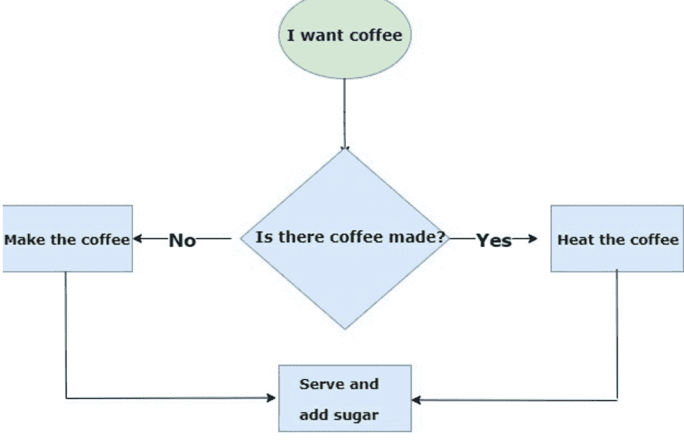
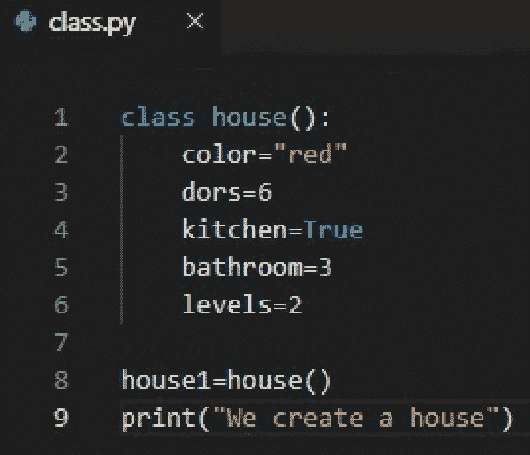
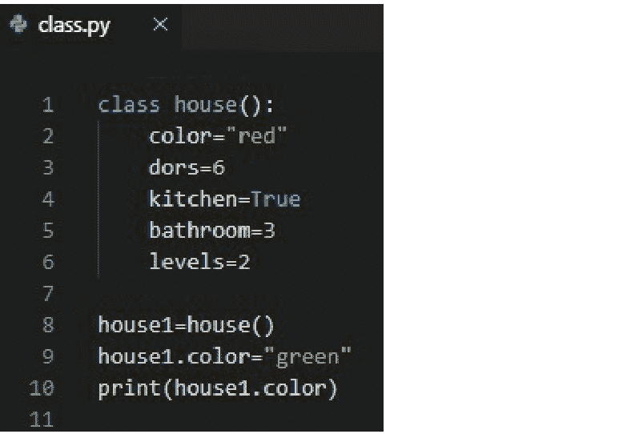

# 初学者计算机编程指南：四合一。LINUX 命令行 + Python 编程 + 网络 + KALI LINUX 黑客攻击。网络安全、无线、LTE、网络与渗透测试


请注意，本文档中包含的信息仅供教育和娱乐目的。我们已尽力提供准确、最新、可靠且完整的信息。不声明或暗示任何形式的保证。读者承认作者并未提供法律、财务、医疗或专业建议。本书的内容来源于多种渠道。在尝试书中书中概述的任何技术之前，请咨询获得许可的专业人士。

通过阅读本文，读者同意在任何情况下，作者对因使用本文包含的信息而导致的任何直接或间接损失概负责，包括但不限于——错误、遗漏或不准确。


请注意，本文档中包含的信息仅供教育和娱乐目的。我们已尽力提供准确、最新、可靠且完整的信息。不声明或暗示任何形式的保证。读者承认作者并未提供法律、财务、医疗或专业建议。本书的内容来源于多种渠道。在尝试书中书中概述的任何技术之前，请咨询获得许可的专业人士。

通过阅读本文，读者同意在任何情况下，作者对因使用本文包含的信息而导致的任何直接或间接损失概负责，包括但不限于——错误、遗漏或不准确。


## 引言

感谢购买《初学者 LINUX 命令行指南：从零基础 Linux 到 Bash 脚本和 Shell 编程的全面逐步入门指南》。由于 Linux 支持了从手机、服务器到电脑的几乎所有设备，它是一种常用的操作系统。确实，在全球范围内，人们在你可以想象的所有领域使用 Linux。Linux 自 90 年代以来一直存在。从你的电视棒到冰箱，Linux 运行着一切。而且互联网很大程度上得到了 Linux 的支持。由于计算机操作系统驱动了许多创新，许多科学突破归功于 Linux。尽管几十年来 Linux 一直提供安全的操作系统功能，但普通大众对“Linux”一词并不熟悉。

但 Linux 操作系统无处不在，从企业服务器到家庭桌面、家用电器、超级计算机、汽车和智能手机。你随处都能找到 Linux，它就在你的电视、Roku 设备、冰箱和温度器上。作为最无压力、最安全且可靠的操作系统之一，Linux 自认为是嵌入式系统、服务器和桌面的首选平台。

什么是 Linux OS？

首先，什么是什么是 OS 或操作系统？在物理计算机中，硬件的管理是由操作系统代码完成的。在硬件和软件之间，操作系统作为一个层存在。此外，在汇编语言中，与显卡通信或寻址 CPU 不是大多数人想知道的。而作为中间人的是 Windows 或 Linux 等操作系统。

因此，Linux 就像 Mac OS、iOS 和 Windows 一样是一种操作系统。从本质上说，Linux 操作系统运行着全球最流行的 Android。没有操作系统可能无法运行，因为作为操作系统，Linux 管理着硬件和软件之间的通信。

Linux 操作系统由许多不同的部分组成，它们是：


-   应用程序 – 并非桌面环境提供的全部完整应用程序。因此，你可以通过 Linux 快速发现并安装数千种高质量的软件，这在 macOS 和 Windows 中是很典型的。大多数现代 Linux 发行版在应用程序安装方面具有简单和集中的特点。例如，作为典型的 GNOME 软件，由 Ubuntu Linux 提供的 Ubuntu 软件中心从一个集中的平台，为用户加速了发现和安装应用。
-   桌面环境 – 用户可以与此部分进行交互。你可以从多个桌面环境中进行选择，如 Xfce、KDE、Enlightenment、Pantheon、Mate、Cinnamon、GNOME 等。每个桌面环境都有内置应用程序，包括游戏、网络浏览器、配置工具和文件管理器。
-   图形服务器 – 通过此子系统，你将在显示器上获得一个图形显示。它被许多人称为 X 或 X-server。
-   守护进程 (Daemons) – 登录桌面或启动引导后，这些是后台服务，如调度、声音、打印等。
-   初始化系统 (Init system) – 该子系统引导了空间，守护进程的控制由它负责。因此，systemd 作为争议性最大的，是使用最广泛的初始化系统。当引导加载程序（如 Unified Bootloader 或 GRUB）处理初始引导时，初始化系统管理引导过程。
-   操作系统内核 (OS Kernel) – 内核可以被称为用于管理外围设备、内存、CPU 的 Linux 部分，而系统的核心就是内核。
-   引导加载程序 (Bootloader) – 该软件管理计算机的启动过程。它是在操作系统中弹出的启动屏幕，对于大多数用户来说，它很快就会并启动。
-   操作系统 Shell (OS Shell) – Shell 是我们用来告诉操作系统我们想要它做的事情的东西。许多人将其视为命令行，我们使用文本来指示操作系统。然而，极少数人知道命令行的代码。因此，这导致了人们避开使用 Linux。现代 Linux 发行版改变了这一点，就像 Windows 一样，Linux 也会使用桌面。

## 为什么要使用 Linux？

大多数人几乎都会问这个问题。当操作系统几乎所有的服务器、笔记本电脑和台式机都能正常运行时，还会有人费精力学习一个完全不同的计算环境吗？问题的答案将引发另一个问题而不是回答：你习惯当前操作系统的运行方式吗？或者你正苦于许可费用、昂贵的维修费用、崩溃、减慢、恶意软件和病毒的困扰？如果你发现自己深受上述问题的影响，Linux 可能是你的完美平台。目前，地球上最可靠的计算机生态系统是 Linux。对于桌面平台，当你将入门的零成本与可靠性相结合时，你将获得完美的解决方案。由于服务器许可或软件不需要任何费用，你可以根据意愿在任意数量的计算机上安装 Linux。此外，你不需要访问 Linux 支付任何费用。

此外，如果你不在意零成本的影响，那么拥有一个随你想要多久、无压力且稳定的操作系统又如何？在过去的二十多年里，许多使用 Linux 的人（无论服务器平台还是桌面平台）没有遇到过病毒、恶意软件或勒索软件的问题。问题在于，此类攻击对 Linux 无能为力。如果只更新内核，对于服务器重启来说是必要的。而 Linux 服务器几年不重启可能并不完全不寻常。当你严格遵守建议更新时，你一定会享受到可靠性和稳定性。

此外，我们的电脑已经安装了我们使用的大多数桌面操作系统，而更改操作系统是我们很少尝试的事情。更此外，学习一个新的操作系统并不是大多数人倾向于做的事。然而，这里有你你尝试 Linux 的一些原因：

## 众多不同的发行版

Linux 的不同发行版或版本之间存在差异。有些用于服务器软件，而另一些专为桌面使用设计。虽然是考虑到初学者设计的，但另一些则侧重于高级用户。


在你的 PC 硬盘上安装 Linux 发行版之前，你可以先在实时 DVD 或驱动器上运行。你需要在一个运行 Linux 发行版的 U 盘或 DVD 上制作好一个可启动系统。然后，将你的系统配置为从该设备而不是你的硬盘启动。整个过程非常简单，因为你可以快速测试一些 Linux 操作系统，而且你的主存储驱动器是安全的，因为它没有触及它。

## Linux 可以在过时的系统上运行

不久前，Windows XP 已经被抛弃到了荒野，而 Windows Vista 也迅速走向了终结的边缘。然而，一些老旧电脑和许多人仍然在使用它们。如果你选择一个专为老旧电脑设计的轻量级发行版，它将为你的电脑注入新生命，并在你的系统上运行更新的操作系统。对于旧电脑，你可以选择 Lubuntu 或 Puppy Linux。你还会发现，过渡过程完全没有压力。由于它们是为 Windows XP 的难民设计的，因此在访问 Linux 替代方案方面有非常多的选择。为了模仿人们备受推崇的微软操作系统的视觉和操作感受，这些发行版提供了专门的“Windows XP 模式”。

## 比以前更高级

桌面的基本价值是大多数主流 Linux 发行版遵循的原则。因此，PC 经典的界面得到了 Linux Mint 和 Fedora 等发行版的精雕细琢，而在 Windows 8 灾难期间，微软激怒了全世界。如果人们偏好 Windows 7 和 Windows XP，他们可以接受一些 Linux 发行版。对于他们来说，由于使用 Windows 8 或 Windows 10 需要面对学习曲线，切换到 Linux 是很典型的做法。此外，长期运行的 Windows 开始菜单与 Linux Mint 的开始菜单也有相似之处。从根本上说，通过与 PC 硬件配合使用，它消除了 Linux 广泛存在的不兼容问题，特别是音频组件和网络问题。尽管在你的系统上可能启用了 Intel 的安全启动（Secure Boot）来安装 Linux，但仍有广泛的 PC 硬件和现代电脑可以兼容大多数 Linux 操作系统。最好的办法是，在进行任何安装之前，为了确认它是否可行，你可以在你的系统上测试 Linux 以确保符合你的喜好。

有几个非常有吸引力的理由，你可能想要考虑在电脑上尝试 Linux，或者至少进行一次无忧的试运行。如果你决定要尝试，让我们在下一章中讨论 Linux 发行版以及你如何推进并完成适当的 Linux 安装。

# 第2 章：Linux 发行版与安装类型

如果你问及最好的 Linux 发行版，你可能没有明确的答案，因为从某种意义上说，Linux 发行版数量很多，给出一个精确的数量也非常棘手。有些看起来是独一无二，而另一些仅仅彼此的克隆。好吧，这就是 Linux 的魅力所在，即使它看起来很混乱。不过你不必担心，在下方，即使有成千上万个，你也能找到最好的 Linux 发行版列表。由于总有每个人，我们必须对这些发行版进行分类。

## 多用途 Linux 发行版

对于服务器和桌面，作为一种高级/新手友好的操作系统，你都可以利用 Linux 发行版。因此，你将在下方阅读关于其中一部分发行版的介绍，它们是：

### Debian:

作为一种优秀的发行版，Debian 基于 Ubuntu。Debian 倾向于不仅在桌面端，而且在服务器上都能良好运行。虽然通过浏览官方文档你可以快速上手，但它可能不是初者的理想操作系统。最近发布的 Debian 10 Buster 引入了一些必要的增强和多处更改。所以，亲自测试一下吧！

### Manjaro:

Arch Linux 为 Manjaro 提供了源码。对于新手来说，Manjaro 让 Arch Linux 变得易于使用，尽管它是为高级用户定制的。所以不用担心。这个 Linux 发行版确实对新手友好且直观。它有一系列实用的内置 GUI 应用程序以及极佳的用户界面。在下载 Manjaro 时，有一个选择桌面环境的。对于 Manjaro，大多数人偏于 KDE 桌面。

### Fedora:

Fedora 提供的两个版本是独立的。它为服务器提供，也为笔记本电脑/桌面提供。它们分别是 Fedora Server 和 Fedora Workstation。

如果你希望选择一个用户友好且可能具有学习曲线的快速桌面操作系统，那么 Fedora 可能是你的之选。无论如何，如果你正在寻找一个 Linux 操作系统，那么当你选择 Fedora 时，你的服务器可以获得新的生机。

## 高级用户的最佳 Linux 发行版

首先，在你开始探索仅为高级用户设计的 Linux 发行版之前，你需要熟练掌握故障排除法，通过不同的软件包命令和管理器来解决问题。确实，如果你是专业人士，将需要收集特定的需求。然而，如果你作为一个标准用户已经使用 Linux 了一段时间，那么查看这些发行版将是值得的。

Slackware:

尽管 Slack 仍然受到许多人的青睐，它是最古老的 Linux 发行版之一。如果你打算开发或编译软件，你可能考虑使用 Slack 为自己建立一个理想的环境。Slackware 对于高级用户来说通常是一个极佳的选择，尽管使用它的开发者和用户数量大幅减少。此外，根据关于其获得 Patreon 页面的最新消息，认为 Slack 将继续保持其作为世界上最佳 Linux 发行版之一的旗舰地位。

Gentoo:

Gentoo Linux 对于任何知道如何编译源代码的人来说都是必不可少的。虽然让它运行需要一些必要的专业知识，但 Gentoo 是一个轻量级发行版。如果你需要了解关于它的某些信息，可以通过官方手册获取。然而，要发挥它的最大作用，可能需要你花费大量时间来搞清楚你并不确定自己在做什么。

Arch Linux:

这个发行版伴随着巨大的学习曲线，尽管它是一个强大且简单的发行版。与其他发行版不同，你需要的一切并不一次性安装。你将需要在配置系统时添加所需的软件包。此外，在没有 GUI 的情况下，在安装 Arch Linux 时你需要遵循一套命令。此外，如果你想继续进行安装，对于安装 Arch Linux 后需要做的一些关键事情有清晰的理解可能是非常重要的。除了所有的简单性和多功能性，说 Arch Linux 背后有一个活跃的社区也是非常有用的。因此，当你遇到问题时，将无需担心。

## 旧电脑的最佳 Linux 发行版

如果你不想升级系统，或者手里有一台旧电脑，你可以可以使用可用的一些最佳 Linux 发行版。以下是一些你可以用于旧电脑的最佳发行版。

Sparky Linux:

对于低端系统，基于 Debian 的 Sparky Linux 倾向于是一个完美的 Linux 发行版。不同的用户可以享受 Sparky Linux 提供的几个特殊版本或种类，以及快速的流体验。例如，它为特定群体发布版本，同时提供一个稳定版本。对于游戏玩家，他们一个熟悉的类型是 Sparky Linux GameOver，因为它包含了许多预装游戏。

antiX:

作为一种轻量级 Linux 发行版且 MX Linux 的一部分，新旧电脑都可以使用 antiX。尽管运行良好，但 antiX 的界面并不令人印象深刻。在不需要安装的情况下，antiX 可以作为实时光盘发行版使用，它是基于 Debian 的。为了让你每次重启时都不会丢失设置，你可以保存设置，而其他发行版则不然。不仅如此，使用它的“实时持久化”功能，你的根目录也可以保存你的一些更改。因此，如果你打算通过实时 U 盘发行版在旧硬件上提供快速的用户体验，antiX 可以是你的选择。

Bodhi:

尽管它在所有配置上运行良好，但与 Ubuntu 不同，它是基于 Ubuntu 设计并构建的 Bodhi Linux。作为 Enlightenment 17 桌面面的延续，Bodhi Linux 的 Moksha Desktop 是它的主要亮点。快速且直观的体验是用户使用它的典型体验。在你的旧系统上，你也可以尝试一下，尽管人们对它的看法并不是为了个人使用。


## Solus Budgie:

这是一个令人印象深刻的轻量级桌面操作系统，Solus 4 Fortitude 是其最近的重大版本。当你想要使用这些系统时，MATE 或 GNOME 等桌面环境是自然选择。然而，尽管它占用系统资源很少，作为一个面向新手的全功能 Linux发行版，Solus Budgie 恰恰深受许多人的。

## Puppy Linux:

Puppy Linux 是你能看到的最小的发行版之一。如果你想让你的过旧系统能够快速运行，可以尝试一下。随着几个新实用用功能的加入，用户体验多年来得到了改进。

至于某些轻量级 Linux 发行版，该类别中你可以尝试的其他选项还有 Peppermint、Lubuntu 和 Linux Lite。

## 最佳 Linux 服务器发行版：

在选择服务器 Linux 发行版时，企业支持、性能和稳定性都是至关重要的。然而，在安装时，你需要关注其中的一些建议，无论目的是用于关键任务还是作为 Web 服务器。

## CentOS:

对于 RHEL，你需要订阅。尽管如此，由于 Red Hat Linux 的源码源自此，RHEL 的社区版与 CentOS 非常相似。此外，它也是免费且开源的。目前，它往往是一个极佳的选择。它与使用它的托管提供商数量相当相当。然而，人们对 CentOS 的评价是一个可靠的 Linux 发行版，因为它的软件包是最新的。在多个云平台上，可以找到 CentOS 镜像。你也可以决定使用自托管的 CentOS 镜像，如果没有的话，它也提供。

## SUSE Linux enterprise server:

有必要将此发行版与 OpenSUSE 区分开来，因此无需担心。OpenSUSE 由社区维护，即使所有内容都属于“SUSE”这一标准品牌，它仍然是一个开源发行版。对于云服务器，最受欢迎的解决方案之一是 SUSE Linux enterprise server（LES）。为了管理你的开源解决方案并获得优先支持，你可能需要选择订阅。

## Linux Red Hat:

对于机构和企业来说，顶尖平台是 Linux Red Hat。对于服务器，如果按照数字计算，最盛行的范围可能不是 Red 版。然而，例如，联想等依赖 RHEL 作为企业用户首选方案的企业之一。从技术上讲，Red Hat 和 Fedora 之间存在相关性。为了让 RHEL 在任何东西上都可靠，Red Hat 支持的内容都会在 Fedora 上进行测试。为了确保它符合你的需求，该发行版的官方文档值得查看。

## Ubuntu 服务器:

根据你放置服务器的位置，你的服务器可以获得独特的选项。Ubuntu Cloud 可能是运行 Google Cloud Platform、Azure、AWS 等优化解决方案的完美理想选择。无论哪种，如果你选择 Ubuntu Server 软件包，就可以将其安装在服务器上。然而，从数量来看，在云端部署方面，最受欢迎的 Linux 发行版是 Ubuntu。除非你有特殊要求，否则建议使用 LTS 版本。

作为上述提到的几个发行版的选项，Debian 和 Fedora 是值得探索的发行版。

## 新手的最佳 Linux 发行版：

这一部分涉及了一个非常易用的发行版列表。不需要了解任何技巧或命令，你就可以立即开始使用，无需深入挖掘。

## Pop!_OS:

计算机科学专业人士或开发者会发现 System76 提供的 Pop!_OS 是优秀的选择。如果你开始使用 Linux，它也是一个很棒的选择，并不限于程序员。虽然 UI 感觉很流畅且直观得多，但它是基于 Ubuntu 的。此外，除了 UI 之外，它还开箱强制执行全磁盘加密。

## Zorin OS:

桌面系统中最直观、美观的操作系统之一是另一个基于 Ubuntu 的发行版，Zorin OS。值得注意的是，在 Zorin OS 15 发布后，对于没有任何 Linux 背景的用户，该发行版将是推荐的选择。它还内置了许多基于 GUI 的应用程序。但请确保选择“Lite”版本，因为你也可以将其安装在旧款 PC 上。它还有“Ultimate”、“Education”和“Core”版本。然而，如果你打算帮助改进 Zorin 并支持开发者，请考虑购买 Ultimate 版。否则，选择免费的 Core 版。

## MX Linux:

MX Linux 已经在该领域活跃了一段时间了。在 Distrowatch.com 上，MX Linux 目前是一个非常受推崇的 Linux 发行版。如果你没用过，你会对熟悉它的速度感到惊讶。以 Xfce 作为桌面环境并基于 Debian，MX Linux 是一个日益受欢迎的 Linux 发行版，与 Ubuntu 不同。此外，任何 Mac/Windows 用户都可以轻松使用它，因为它除了卓越的稳定性外还内置了多个 GUI 工具。此外，为了方便一键安装，包管理器为此量身定制的。作为包管理器中已有的源之一，你会在那里看到 Flathub，只需搜索 Flatpak 软件包即可在短时间内安装。

## elementary OS:

elementary OS 是一种优雅的 Linux 发行版。如果你已经使用过 Mac 驱动的系统，很容易适应它，因为它的 UI 与 MacOS 相似。在考虑性能的同时尽可能保持漂亮，提供一个用户友好的 Linux 环境是这个基于 Ubuntu 的发行版的重点。

## Linux Mint:

在新手中，另一个流行的 Linux 是 Linux Mint。当 Windows XP 停止支持后，许多用户选择了它，因此它与 Windows XP 桌面非常相似。它基于 Ubuntu，拥有许多可用应用程序。因为易用和简单，它成为了热门选择。

## Ubuntu:

Ubuntu 是无疑最受欢迎的发行版之一，在某些笔记本电脑上你甚至可以找到预装。你会习惯它的用户界面。根据你的需求，如果你愿意玩玩，可以轻松自定义它的外观。主要，主题安装也是你的选择。当你开始使用 Ubuntu 时，你需要了解更多信息。此外，Ubuntu 用户拥有一个巨大的社区，除了它提供的之外。因此，如果遇到问题，可以去 subreddit 或论坛。

最终，你可以尝试上述推荐的某些发行版。坦率地说，选择取决于个人的喜好，尽管有许多 Linux 发行版值得考虑。


- 硬盘
- 光驱 (CD-ROM)

# 在操作系统内部作为虚拟机运行 Linux

如果你更倾向于使用喜欢的开源软件，或者希望在喜欢当前的非 Linux 桌面操作系统的同时，能够轻松访问 Linux 桌面，你可能想要考虑将 Linux 作为一个虚拟机（VM）。你需要下载并安装一个虚拟机服务器应用程序作为基础步骤，尽管有多种方法可以实现。然后，在宿主机软件下，安装你的 Linux 发行版。这样，你可以在 Linux 上执行你在其他操作系统上可以进行的所有操作。即使你的其他操作系统没有提供某些功能，Linux 也能提供许多其他功能。

## 通过 Live DVD/CD 启动 Linux

当你想要保留主操作系统并查看你是否喜欢它时，当你想尝试 Linux 时，你可以选择从 Live DVD/CD 尝试 Linux。作为 Live CD，某些 Linux 安装程序提供了这种运行或下载方式。因此，通过 DVD/CD，Linux 将作为一个整个操作系统运行，这与在硬盘上运行一样，你可以将文件加载到计算机内存中。这意味着，从 DVD/CD 运行 Linux 且不会产生任何变化，当你重启电脑并移除 DVD/CD 时，系统会回到原来的旧操作系统。在你发现心仪的选择之前，你可以轻松尝试一些 Linux 发行版。

## 双启动

当你想要安装 Linux 的同时保留现有的操作系统时，你就拥有了一个双启动系统。这时，你需要在启动过程中决定想要启动哪一个系统，因为你拥有一台可以使用两个不同操作系统的电脑。

到目前，你应该对 Linux 有了了解，以及一些你可以使用的发行版。现在，是时候进一步，并向你介绍 Linux 内核以及操作系统了。

# 第 3 章：Linux 内核与操作系统简介

计算机如何以如此准确的效率管理最复杂的任务？嗯，简单直接的答案是，计算机在操作系统的帮助下完成一切。操作系统通过高效利用硬件资源让生活变得更简单，并执行不同的任务。在高级层次，我们可以将操作系统分为两个部分。第一部分是实用程序，另一部分是内核。内核根据各种用户空间进程的服务某些系统资源请求，如网络连接、内存、存储、CPU 等。在 Linux/GNU 中，本栏将探索可加载内核模块。由于整个操作系统仅在监控器模式下运行，这使得 Linux 成为单内核内核。每个子系统负责执行特定任务，它由多个子系统组成，广义上，以下任务由任何内核执行。

## 动态加载内核模块

为了确保我们的系统是最新的，大多数时候我们会安装安全补丁和内核更新。在 MS Windows 的情况下，通常需要重启。然而，这远不理想。例如，当在生产服务器上时，机器不能重启。那么，如果不需要系统重启就能动态地删除或添加内核功能，难道不是理想的吗？对于内核模块，Linux 内核以动态卸载和加载的方式工作。在运行时，任何代码段都是你可以添加到内核的内核模块。在系统运行期间，你可以在不产生任何中断的情况下卸载和加载模块。你可以使用 `insmod` 命令将内核模块作为对象代码动态链接到正在运行的内核，并使用 `rmmod` 命令将其取消链接。

## 网络

操作系统的关键部分之一是网络，因为它负责处理主机之间的数据传输并允许通信。随着路由功能通过它启用，网络数据包也是通过它进行传输、识别和收集的。

## 设备控制

任何计算机系统都需要几种设备。然而，在提供功能的层面上，需要设备驱动程序来使设备可用。视频/音频驱动程序、蓝牙驱动程序、显卡驱动程序等都是常见的驱动程序类型。

## 文件系统

文件系统对 Linux/GNU 系统有很大影响。在 Linux/GNU 中，几乎一切都是文件。此外，数据的层级组织、日志记录和压缩、文件的删除和创建等，都是该子系统控制的存储关系需求。所有主要的文件系统都受到 Linux内核的支持，例如 MS Windows NTFS。

# 内存管理

该子系统处理每一个请求。页面是从可用内存划分的固定大小块，可以根据任何需求分配或从进程。由于它创建了从连续充足地址空间到物理地址空间的幻象，它还通过内存管理单元 MMU 映射进程的虚拟地址。

# 进程管理

该子系统处理进程的生命周期。通过进程间通信，它允许进程之间的数据共享和连接，同时也销毁和创建进程。此外，它通过进程调度器实现资源共享并调度进程。

# 一些实用的工具

为了提供关于内核模块的有用信息，Linux/GNU 提供了几个用户空间实用工具。现在，让我们深入了解它们。dmesg：关于内核模块的有用信息，它显示在内核缓冲区。

modinfo：作为命令行参数，它显示模块的每个属性。

：当你想从内核中卸载模块时，可以使用这个命令。此外，当你想强制卸载模块时，可以使用 -f。然而，使用这种选项的风险是巨大的，卸载模块时你仍然可以使用更安全的方法。它等待模块不再被使用，rmmod 会这样做做，或者使用 -w。


初始化函数是 `init_module()`，而清理函数是 `cleanup_module()`。一旦你加载了模块并在卸载之前，会调用初始化函数，然后调用清理函数。其他宏以及 `MODULE_LICENSE` 都非常容易理解。与 `printf()` 类似，用户空间的语法类似于 `printk()`。然而，在常规输出流中，它不像 `printf()` 那样打印消息。相反，它是内核的环形缓冲区（ring buffer）接收并追加这些消息。每个 `printk()` 声明都有一个优先级。在示例中，使用了 `KERN_INFO` 优先级。在格式字符串和 `KERN_INFO` 之间，你不会看到逗号（,)）。在没有无优先级的情况下，你可以利用 `DEFAULT_MESSAGE_LOGLEVEL` 优先级。作为成功的指示，`init_module()` 最后的声明中返回了 `0`。

`cleanup_module()` 和 `init_modules()` 是清理和初始化函数的名称。然而，在新的内核（>= 2.3.13）中，我们可以使用任何名称来代替清理和初始化函数。为了向后兼容，内核仍然支持这些旧名称。在注册清理和初始化函数的地方，内核提供的宏是 `module_exit` 和 `module_init`。现在，有了我们为清理和初始化函数偏好的名称，让我们重写同一个模块：

```c
#include <linux/kernel.h>
#include <linux/module.h>
static int init_hello_init(void)
{
    printk(KERN_INFO "Hello, World !!!\n");

    return 0;
}

static void hello_exit(void)
{
    printk(KERN_INFO "Exiting ...\n");

    return 0;
}
```

```c
}
static void hello_exit(void)
{
    printk(KERN_INFO "Exiting ...\n");
}
```

module_init(hello);
module_exit(hello_exit);
MODULE_LICENSE(GPL);
MODULE_AUTHOR(Narendra Kangralkar);
MODULE_DESCRIPTION(Hello world module);
MODULE_VERSION("1.0");

```

我们在这里使用的清理和初始化函数暗示了 `_exit` 和 `_init` 关键字。

## 模块的加载与编译

现在，需要理解模块编译的步骤。我们将利用内核的构建系统来编译内核模块。在你将其保存为 `Makefile` 之前，你可能想把收集过程记录下来，再次打开你喜喜欢的文本编辑器。在这里，你需要注意，因为你必须为内核 `Makefile` 模块和 `hello.c` 准备一个类似的目录。

为了构建模块，我们需要内核头文件。从内核源码中，内核构建系统由上述 `Makefile` 符号，最后为了完成模块，内核主可能会调用你的 `Makefile`。你可以将你开发的内核模块命名为 `hello.ko`，以构建该模块，现在我们已经拥有了所有要求。

内核第一个模块的首次编译成功了。现在，是时候检查内核内部卸载和加载此模块的方法。你必须注意，要卸载或加载内核模块，我们需要获取 root 用户权限。当你切换到超级用户模式时，需要执行 `insmod` 命令来加载模块，如下：

```bash
[root]# insmod hello.ko
```

`insmod` 已完成成功任务。然而，我们需要查看输出。输出被追加到内核的环形缓冲区中。嗯，通过执行 `dmesg` 命令，我们也可以发现：

```bash
[root]# dmesg
```

Hello, World !!!

此外，我们还可以使用 `lsmod` 命令验证模块是否已加载：

```bash
[root]# lsmod | grep hello
hello 859 0
```

你只需要在执行 `rmmod` 命令后检查 `dmesg` 命令的输出即可。如下所示，为了从内核中卸载模块。现在，通过清理函数的功能，你将看到来自 `dmesg` 的消息。模块中的某些宏为我们提供了模块信息。在下面这种简洁的配置样式下，显示信息的命令是 `modinfo`。

## 如何识别进程的 PID

为了识别进程 ID（Process ID），即现有进程的 PID，我们可能需要再编写一个内核模块。在头文件 `<linux/sched.h>` 中，在 `task_struct` 结构体中，内核存储了所有进程的相关信息。作为现有进程的指示，它提供了一个现有变量。你只需要打印 `current->pid` 值即可识别当前进程的 PID。（pid.c) 这是一个完整的工作代码，稍后给出。

在对象文件名中进行细微修改，类似于原始 `makefile` 的 `Makefile`。使用 `dmesg` 命令，在插入模块后查看输出并进行编译。

## 使用模块连接多个文件

已经探索了从单个文件进行模块编译。然而，将模块划分为多个文件非常方便，对于单个模块，我们在大型项目中会有多个源文件。对于构建跨越两个文件的模块，我们必须理解这个过程。从 `file.c`，我们可以将清理和初始化函数划分为独立的文件，如 `cleanup.c` 和 `startup.c`。现在，通过 `cleanup.o` 和 `startup.o` 开发内核。现在是模块的编译和测试了。当我们使用 `modinfo` 时，可以显示模块信息。每个模块都会显示作者信息、描述和版本。学习模块的最佳地方是内核源码。当你访问在线时，可以下载最新的源码。现在，我们将详细讨论如何在虚拟机上安装 Linux。让我们开始吧！

 第 4 章：在虚拟机上安装 Linux


通过此功能。以防万一，你会发现即使你起初可能不需要，安装它也是值得的。在出现提示时，请通过安装向导继续重启 Windows。

## 选择理想的 Linux 操作系统

对于你想尝试的 Linux 类型，你可能已经了解了。在虚拟机中，虽然你会发现某些 Linux 发行版并不适用，但其他的则可以。通常在 VMware 中，对于像树莓派这样的 ARM 架构，运行 Linux 发行版是不可能的。因此，对于 x64 和 x86，你可能无法虚拟化 ARM。然而，是时候检查 QEMU 了。

## 虚拟机配置

你可以在下载 Linux 操作系统的同时继续设置虚拟机。在提示时，在启动 VMware Workstation Player 时输入你的电子邮件地址。这一步的核心就是免费获取软件，而 VMware 的邮件列表将让你加入。当你完成这一步后，VMware Workstation Player 主程序将加载。要继续操作，你的虚拟机需要创建一个账户。ISO、安装程序盘镜像是你选择的默认选项。请注意，还有一个选项是通过创建一个空白磁盘创建虚拟系统来安装操作系统。在安装好你偏好的操作系统后，你将点击“下一步”。由于有关 VMware Easy Install 的消息，你选择的客户 OS将自动安装。

## 账户创建

在你命名虚拟机时，密码、用户名和自定义名称都是你在屏幕上输入的信息并点击“下一步”按钮。对于你正在安装的操作系统，大多数情况下其名称为默认，对于你的虚拟机，你也可以选择一个位置。再次点击“下一步”按钮，你将为虚拟机选择磁盘容量。作为计算机物理磁盘的一个文件或文件，这是一个保存的虚拟磁盘硬盘。这两个选项供你选择。同时，你可以修改或接受用于虚拟 HDD 的推荐大小。这可能更突出，因为增加容量往往是一个更安全的选择。再次点击“下一步”按钮，无论你的选择如何，都会来到“准备好创建虚拟机”的界面。点击“完成”按钮，虚拟机将启动。到目前为止，创建完成后运行你的虚拟机。很快，你会通过弹窗收到 VMware Linux 软件包工具的建议。作为快速安装过程的一种，这可能并非必须。但如果你接受它也可以。

## 虚拟硬件自定义

“自定义硬件”是“准备好创建...”屏幕上的另一个选项。现在，除了 HDD 之外，你可能通过另一种方式调整虚拟机的硬件。你有许多选项可以选择，包括网络适配器配置、处理器和内存。你可能想查看“处理器”界面。你可能会在右侧面板看到虚拟化引擎的引用。此过程默认已是“自动”。因此，对于 Linux，你可能不需要担心任何事情。但是，如果你遇到任何问题，可以将其设置为 Intel VT-x或其他替代方案。然后，在“内存”界面，你可以处理特定的性能问题。在这里，作为虚拟机的推荐最大值最小值，你可以看到建议 RAM 大小的图。遵循这些建议，因为它们通常是理想的。如果你将 RAM 设置得太高，运行虚拟机软件到标准系统任务可能会影响你 PC 的性能，如果设置得太小，你仍然会面临问题。

最终，你的显示设置将花费你一些时间。在这里，你可以决定在虚拟机中设置多个显示器，或利用宿主机的显示器设置，因为你有切换 3D 加速的能力。系统将显示适用于客户操作系统的推荐内存，你也可以调整显存。

## 安装后在 VMware Workstation Player 中使用 Linux

在物理桌面类型上，虚拟机中安装的操作系统通常是引导 ISO 的。你可以通过 Easy Install 方法实现整个过程自动化，对于客户端（虚拟 OS）的设置，你可以使用你的 Windows 宿主机 OS 配置。这里这里很有用，因为如果你选择稍后安装操作系统，你对操作系统的安装拥有整体控制权。然后，你就可以使用客户 OS 了，因为在使用 Easy Install 完成后，你将能够登录虚拟机。简单如此！随后，通过可以打开虚拟机的菜单，你也可以启动虚拟机。

## 虚拟机的重要性

对于 Linux 来说，硬件在 2005 年曾是一个重大挑战。人们在 USB 设备、图形、蓝牙甚至无线网络方面面临着各种问题。为了让它们工作，每当新发明出现时，你可能需要不断寻找封装器和驱动程序。由于虚拟机当时并不是一个选项，对于任何 Linux 用户要找到解决方案，他们必须与“真实”硬件交互。然而，已经发生了许多变化。在 Linux 上，某些硬件的工作并不按计划进行。重心已经转向了发行版的独特特性，而对硬件的支持在减少。如果你可以轻松地玩多个发行版，并且是虚拟机的重度用户，你可以在类似的机器上关于它们的内容。

现在，对于 Linux 新手以及他们如何利用它们，让我们来讨论一下虚拟的一些优势，尽管在企业领域，虚拟机被广泛使用。

## 谁需要使用虚拟机？

由于没有特定的专有服务可用，某些 Linux 需要进行双启动。而且对于 Windows 的支持，在许多国家也有相关工作。为了运行 Windows 软件，你可以轻松地使用虚拟机，而不是忍受双启动的痛苦和复杂性。只有在游戏方面，虚拟机可能无法运行。特别是当你玩像《孤岛》这样资源密集型的游戏时，你可能需要关注 RAM、GPU 和 CPU。在硬件和应用程序之间，你可能不喜欢虚拟层、视频和音频编辑。虚拟机在这些之外运行良好，甚至还有其他一些功能。

此外，对于那些尝试改变或使用习惯操作系统的非 Linux 用户来说，虚拟机可能很有用。当他们准备好时，他们将有信心进行转换，虚拟机让这些人熟悉 Linux。如此，在 Windows 10 或 macOS 内部，你可以运行 Linux。最重要的是，无需重启相同的硬件即可切换发行版，你可以在虚拟机上运行多个 Linux。


Windows、Linux 以及对跨平台的支持是其显著的优势。

# 第 5 章：Linux 用户管理与系统管理

在计算技术领域，Linux 是核心力量。Linux 驱动了许多云服务器、超级计算机、移动手机和 Web 服务器。除了使用命令行界面工具和 Linux 工具进行备份、创建、增强和维护用户报告或账户外，管理计算机系统的运行是 Linux 系统管理员的工作。由于 Linux 具有开源环境、高安全性和高稳定性，它 驱动了绝大多数计算设备。了解和理解 Linux 系统管理员的特定素质至关重要：

- 处理用户、目录和文件
- 基础 bash 命令
- 管理超级用户或根 (root)
- 文件系统层次结构
- Linux 文件系统

## Linux 管理员的职责
在需要优秀 IT 基础的机构或组织中，系统管理员是一个可靠的标准。因此，对高效的 Linux 管理员的需求是长期存在的。由于该角色可能承担额外的职责和责任，每个组织的职位描述可能会有所不同。以下是 Linux 管理员的若干职责：

- 在服务器出现问题时，由管理员负责故障排除。
- 核心安全工具和系统安装。在分析硬件需求后做出必要的建议，管理员需要与数据网络工程师或其他部门或人员协作。
- 从登录问题到灾难恢复，Linux 管理员负责检测并解决服务问题。
- 为 Linux 环境及其用户创建、维护和增强所需的工具。
- Linux 管理员的特点之一是始终以专业、修养良好的方式与客户、供应商和员工沟通。
- 除了为 ISP、网络托管和局域网客户提供卓越的客户支持以解决所有各种故障外，Linux 管理员还修复并分析所有错误日志。
- 部分职责包括列出备份、创建新的存储过程以及对数据进行定期备份。
- 互联网请求维护，如 PHP、MySQL、Apache、RADIUS 和 DNS。

## Linux 系统管理员职业发展流程

- 学习如何安装和使用 Linux 环境
- 获得 Linux 管理认证
- 成为文档专家
- 通过加入社区或本地 Linux 用户组寻求帮助和支持

必要时，进行备份和管理操作（例如检查硬件和软件系统）是 Linux 系统管理员的职责之一。此外，管理员必须能够深刻地描述对技术知识的理解。

## 如何作为 Linux 管理员管理用户和组

同时，由于 Linux 是多用户操作系统，一个系统多个用户可以使用 Linux。为了管理系统中的用户，Linux 提供了一种优良的机制。因此，与系统中的组和用户相处是系统管理员最重要的功能。我们将使用 CentOS Linux 发行版来讨论下面使用的所有命令。

## Linux 用户

唯一标识符 UID 是一个二进制数字，用于唯一标识一个用户账户。普通用户和超级根 (root) 是两类用户。普通用户对文件的访问权限受限，而超级根用户对所有数据具有完全访问权限。超级用户可以修改、删除或添加用户账户。完整的账户信息存储在 /etc/passwd 文件中，哈希密码也存储在 /etc/shadow 文件中。

## 使用默认设置创建用户

在命令提示符下，通过运行 `useradd` 命令可以添加用户。创建用户后，使用 `passwd` 工具设置密码，如下所示：

```
[root@localhost handy32]# useradd erinban
[root@localhost handy32]# passwd anirban
正在更改用户 anirban 的密码。
新密码：
重新输入密码：
密码: 所有身份验证令牌已更新。
```

系统会自动将默认 shell 设置为 `/bin/bash`，创建家目录 (`/home/<username>`) 并由系统分配 UID。每当系统添加新用户并使用用户名作为组时，`useradd` 命令会创建一个用户私有组。在创建用户时，作为系统管理员指定用户的全名，使用 `-c` 选项运行 `useradd`：

```
[root@localhost handy32]# useradd -c -c "Anban Choudhury" handy32
```

## 使用 UID 创建用户

使用 `-u` 选项和自定义 UID，可以这样创建用户：

```
root@localhost handy32# useradd -u 1036 handy32
```

## 使用非默认家目录创建用户

通过以下操作，你可以设置一个非默认的家目录：

```
root@localhost handy32# useradd -d /home/test handy32
```

## 将用户添加到附加组和主组

通过指定 `-G` 和 `-g` 选项，管理员可以指定互补组和主组。

```
root@localhost handy32# useradd -g “head” -G “faculty” handy32
```

## 用户锁定与解锁

超级用户可以锁定或解锁用户账户。使用 `/` 选项，只需调用 `passwd` 即可锁定账户。

```
root@localhost handy32# passwd - handy32
```
对于用户 handy32，锁定密码
passwd: 成功

要解锁账户，请使用 `passwd`：

```
root@localhost handy32# passwd - handy32
```
对于用户 handy32，解锁密码
passwd: 成功

## 更改用户名

如需更改用户名，使用带有选项的 `usermod`：

```
root@localhost handy32# usermod -n handy32
```

## 用户删除

使用家目录选项删除用户：

```
root@localhost handy32]# userdel -r handy32
```

## Linux 组

用于收集用户的机制是组。组 ID (GID) 是每个组关联的唯一 ID。我们有附加组和主组。组的信息存储在 /etc/group 中。

## 使用默认设置创建组

作为 root 用户，使用默认设置运行 `groupadd` 添加新组：

```
root@localhost handy32]# groupadd employee
```
使用组名，如果想添加密码可以使用 `passwd`：

```
root@localhost handy32]# passwd employee
```
对于组 employee，更改密码
新密码：
重新输入密码：

## 使用指定的 GID 创建组

通过 `-g` 执行 `groupadd` 命令指定组的 GID：

```
root@localhost handy32]# groupadd -g 1200 manager
```

## 组密码

使用正确的组名运行 `passwd -r` 来移除组密码：

```
[root@localhost handy32]# passwd -r employee
```

## 更改组名

作为超级用户，使用 `-n` 选项运行 `groupmod` 命令更改组名：

```
[root@localhost handy32]# groupmod -n hrsupervisor employee
```


## 删除组

在删除主组之前，需要先删除该主组的用户。使用组名运行 `groupdel` 命令删除组：

```
[root@localhost handy32]# groupdel employee
```

## Linux 文件系统

在硬盘上存储文件的技术是文件系统。Linux 支持多种类型的文件系统，包括：

- 特殊用途文件系统：debugfs、tmpfs、sysfs、procs 等
- 闪存存储文件系统：YAFFS、JFFS2、ubifs 等
- 传统磁盘文件系统：NTFS、JFS、Btrfs、XFS、ext4、ext3、ext2 等

### 文件系统层次结构

文件系统层次结构是用于 Linux 系统文件的标准布局。以下是一些常见的 Linux 目录结构：

### Linux 在线帮助页

Linux 的每一个命令都有帮助或支持，这就是


## 目录创建：

要创建一个目录，你可以使用 `mkdir` 命令如下：

```bash
handy32@localhost~]$mkdir directory
```

在 /home/sandra/ 下，该目录将被创建。

## 目录删除：

要删除一个空目录，你可以使用 `rmdir` 命令如下：

```bash
handy32@localhost~]$rmdir directory
```

如果目录不是空的，你必须使用带有递归标志的 `rm` 命令

```bash
handy32@localhost~]$rm -r directory
```


现代文件系统在提供的位置中实现了安全模型。作为用户，由于 Linux 文件系统安全模型，你可能会获得访问他人文件或系统的权限。为了实现这些目的，所需的软件是终极构建模块。作为一种增强程序员效率和系统特性的技术，Linux 使用的是两部分软件的应用。Linux 的虚拟文件系统（VFS）是该实现两个部分的第一部分。虚拟文件系统负责对所有类型的文件系统的访问，并为开发者和内核提供单一的命令集。特定所需设备的接口驱动程序会接收来自虚拟文件系统软件对多种类型文件系统的调用。执行的第二部分是文件系统专用设备的驱动程序。设备驱动程序在逻辑卷或分区卷上以及特定于文件系统类型的卷上解释文件系统命令的标准集。

如果你是来自 Windows 类型的用户，Linux 的文件系统结构可能会看起来非常陌生。现在，大多数目录使用三个字母的命名，听起来神秘的目录和 `a/` 选项已经取代了被遗忘的盘器器以及 `C:\` 目录。定义某些其他 Unix 相关操作系统和 Linux 文件系统结构的是 FHS，即文件系统层级标准。然而，Linux 文件系统中也包含一些尚未被标准定义的目录。

## Linux 目录结构

### /var – 可变数据文件

由于它在通常操作中是只读的，因此它是 `/usr` 目录的可写对应项。在正常运行期间，我们可以向 `/var` 目录写入日志文件以及其他通常写入 `/usr` 的所有内容。例如，在 `/var/log` 中可以找到日志文件。

### /usr – 只读数据与用户二进制

与系统使用的文件和应用程序不同，用户使用的是包含 `/usr` 目录的文件和应用程序。例如，而不是 `/sbin` 目录（系统管理非必需二进制文件所在位置），非必需应用程序的所在地位于 `/usr/bin` 目录内。`/usr` 目录中还包含其他目录，包括与架构无关的文件夹（如图形目录 `graphics`），这些文件夹在 `/usr/` 中共享位置。这一过程防止了它们破坏系统的其余部分，因为本地目录 `usr/` 默认安装在本地组装的应用程序中。

### /tmp – 临时文件

每当你的系统重启时，由于应用程序存储临时文件在 `/tmp` 目录，像 `tmpwatch` 这样的工具会随时删除这些文件。

### /srv – 服务数据

系统提供的服务的“数据”包含在 `/srv` 目录中。如果你使用 Apache HTTP 服务器来提供网站，你可能会将你的网站文件存储在 `/srv` 目录内部的目录中。

### /selinux SELinux 虚拟文件系统

出于安全考虑，如果你的 Red Hat 或 Fedora 等 Linux 发行版使用了 SELinux，那么 `/selinux` 目录包含特殊文件。它与 `/proc` 相同。在 Ubuntu 上，此文件夹的出现是一个错误，因为 Ubuntu 不使用 SELinux。

### /bin – 系统管理二进制文件

`/bin` 目录与 `/sbin` 目录并行。对于系统管理，它通常旨在由 root 用户运行，因为它包含了基本的二进制文件。

### /run – 应用程序状态文件

对于进程 ID 和套接字等需要临时存储的需求，`/run` 目录为应用程序提供了一个标准位置，因为它相当新。由于 `/tmp` 中的文件可能被删除，`/tmp` 无法存储这些文件。

### /root – Root 的主目录

root 操作员的主目录是 `/root` 目录。作为系统根目录，它的位置是在 `/root` 而不是 `/home/root`。

### /proc – 内核与进程文件

由于它不包含标准文件，`/dev` 目录与 `/proc` 目录相同。它包含的所有都是处理和表示信息的特殊文件。

### /opt – 可选软件包

对于可选软件包，`/opt` 目录包含了这些文件。在文件系统层级标准中，这些程序的所在地位于 `/opt`。

### /mnt – 临时挂载点

对于需要挂载的需求，`/mnt` 目录提供了一个标准位置。例如，在系统挂载文件系统时，你可以将命令的输出重定向到 `/mnt`。

### /media – 可移动介质

`/media` 目录包含了插入到系统中的设备。然而，在系统中，这些介质的临时位置位于 `/media`。

### /lost+found – 恢复的文件

`/lost+found` 目录位于 Linux 文件系统中。当文件系统崩溃时，文件系统检查会在该目录进行恢复操作。

### /lib – 必需共享库

在 `/sbin` 和 `/bin` 目录中，`/lib` 目录包含了必需的二进制文件库。系统所需的库位于 `/usr/lib`。

### /home – 用户主目录

对于每个用户，`/home` 目录包含了主目录。例如，`/home/user` 将是用户的所在地。用户特定的数据包含在主文件夹中。

### /etc – 配置文件

虽然可以通过文本编辑器手动编辑，`/etc` 目录包含了配置文件。请注意，系统级配置文件位于 `/etc` 目录，而用户特定的配置文件位于用户主目录。

### /dev – 设备文件

作为文件，设备由 Linux 暴露。此类如此，表示某些特殊文件的目录是 `/dev`。尽管它们看起来像文件，我们并不能称之为原始文件。例如，在系统中，主 SATA 驱动器由 `/dev/sda` 表示。如果你想编辑 `/dev/sda`，你可以启动一个分区编辑器。此外，该目录中还包含伪设备。例如，`/dev/random` 产生随机数。由于它不产生输出，`/dev/null` 是一个特殊的设备，当输出被传到 `/dev/null` 时，所有输入都会被丢弃。

### /cdrom – ROM 历史挂载点

`/cdrom` 是一个不属于 FHS 标准的目录。然而，当你访问 Ubuntu 等操作系统时，你会发现它。对于插入到系统的 CD-ROM，这是一个临时位置。然而，临时介质的标准位置位于 `/media` 内部。

### /boot – 静态启动文件

`/boot` 目录包含了启动系统所需的文件。例如，存储在这里的是你的 Linux 内核和 GRUB 引导加载程序的文件。它们与其他文件的所在地位于 `/etc` 目录，引导加载器的配置文件并不在此。

### /bin – 必需用户二进制文件

当系统以单用户模式挂载时，`/bin` 目录包含了必需的二进制文件（即必须存在的程序）。Firefox 等应用程序存储在 `/usr/bin` 中，而 bash 等关键实用程序和系统程序的所在地位于 `/bin` 目录。你也可以在另一个分区存储 `/usr` 目录。然而，如果没有挂载其他文件系统，只有当你将这些文件放置在 `/bin` 目录时，才能拥有这些必需工具。它包含了系统管理的关键二进制文件，类似于


它是 `/sbin` 目录。

## 根目录

它被称为根目录，位于 `/` 目录下，你可以在这里找到 Linux 系统上的所有内容。在 Windows 上，C:\ 目录与 `/` 目录非常相似。然而，由于 Linux 没有驱动器器，这并不准确。在 Windows 上，虽然 D:\ 是另一个分区的位置，但在 Linux 上，其他分区会出现在 `/` 目录下的另一个文件夹中。

# 第 7 章：磁盘、介质和数据文件的工作处理 (gzip – tar)

在使用它们之前，你必须对 USB 驱动器硬盘等存储设备进行结构化，因为 Linux 的常规做法是删除和创建分区。分区在划分后通常具有具有相当存储容量的设备独立区域。此外，你还可以使用分区将硬盘划分为孤立的部分，作为一个独立的硬盘，每个部分的行为都像一个独立的硬盘。如果你管理多个操作系统，分区将变得特别有用。在 Linux 中（也称为磁盘分区操作），你可以使用几个强大的工具来删除或创建分区。因此，拥有大磁盘的设备以及多个磁盘分区都能从中受益，我们将深入探讨如何使用 `parted` 命令。这里有一些常用命令，如 `cfdisk` 和 `fdisk`，以及 `parted` 的区别。

- 可靠性：在 DOS 分区中，只存储一个分区表副本。在磁盘的结尾和开头，GPT 保留了两个分区表副本。此外，对于完成 DOS 分区的分区表完整性检查，GPT 使用了 CRC 校验和。
- 更多分区：DOS 分区通过扩展分区和主分区仅允许 16 个分区。你可以选择更多分区，默认情况下，GPT 允许多达 128 个分区。
- 更大的磁盘：在某些情况下，甚至可以达到 16TB，尽管 DOS 表的分区倾向于格式化高达 2TB 的磁盘空间。然而，GPT 分区表可以访问高达 8ZiB 的空间。
- GPT 格式：虽然 `cfdisk` 和 `fdisk` 对 DOS 分区表有局限，但可以通过 `parted` 命令创建全局唯一标识符分区表（GPT）。

建议使用 `parted` 来处理磁盘分区，因为在如今更大的磁盘上，处理它们需要更多的灵活性。大多数情况下，操作系统安装过程的一部分就是创建磁盘分区。当现有系统添加存储设备时，直接使用 `parted` 命令是最用的。

## 使用这些命令在 Linux 上分析磁盘空间和硬盘分区

为了让你检查系统上的分区，可以使用一些命令。这些命令的作用之一是检查每个软盘上存在哪些分区，以及其他额外细节，如文件系统、已空间、总大小等。尽管它们也可以修改分区，但还有一些分区工具可以显示分区信息，包括 `cfdisk`、`fdisk` 和 `fdisk`（注：原文重复）。

### hwinfo

你可以使用 `hwinfo` 作为一个通用硬件信息工具来打印分区和磁盘列表。然而，与其他命令一样，它的输出不会打印每个分区的详细信息。

### blkid

虽然它不报告分区上的空间，但 `blkid` 会打印块设备、存储和分区介质，以及 uuid 和文件系统类型等属性。

### lsblk

`lsblk` 列出光驱器和磁盘分区以及所有的存储块。如果有的话，它会列出挂载点，最重要的是块/分区的总大小。分区上不报告空闲/已空间。如果没有 `MOUNTPOINT`，则表示文件系统未挂载。此外，这意味着没有 DVD/CD 磁盘。通过设备型号和标签等信息，`lsblk` 能够显示更多信息。

### pydf

`pydf` 是用 Python 编写的改进版本，以易读的方式打印所有硬盘分区。此外，`pydf` 仅限于显示挂载的文件系统。

### df

此命令虽然不是分区工具，但它只打印挂载文件系统的详细信息。即使不是真实磁盘分区的文件系统也会出现在 `df` 生成的列表中。当你使用它时，你会发现实际分区或设备只是以 `/dev` 开头的文件系统，为了过滤硬盘分区或文件系统，可以使用 `grep`。然后，使用 `df` 显示特定类型的实际磁盘分区。

### parted

如果需要，这是另一个命令行实用程序，它可以修改列表，因为它还会列出分区。

### cfdisk

`cfdisk` 是一个基于 ncurses 并具有交互式用户界面的 Linux 分区编辑器。除了列出分区外，还可以使用它修改或创建当前分区。`cfdisk` 一次只能运行一个分区，因此，如果需要特定磁盘的详细信息，请将设备名称传递给 `cfdisk`。

### sfdsk

`sfdsk` 是另一个具有类似于 `fdisk` 目标但带有额外功能的实用程序。每个分区的大小可以用 MB为显示。

### fdisk

用于检查磁盘上的分区

## Linux 数据操作

如果你是习惯了 Windows 的类型，Linux 世界可能会让你感到困惑。没有图像、链接或任何可以点击的内容，很少提示，没有向导等等。而且，任何事情都可以完成，你只需要知道你想做什么。假设由于某种违背你意愿的原因，你别无使用 Linux 的命令行提示符。


鼠标点击进入。此外，你可能想忽略前缀 `bash>`。另外，在加州大学欧文分校（UC Irvine）以及交互式集群节点上，这里是所有定义的实用程序。DDDUC。对于任何 Linux 发行版，你都可以免费获取它们，除非另有说明。

## 文件大小

我们将使用名为 `redblueall.txt.gz` 文件，这是一个 25MB 的制表符分隔数据文件。通过右键点击该链接，你可以在 Firefox 中下载并点击“保存”。对于本次练习，请使用目录 `~/DDIRIR/` 来保存它。然后，使用 `gunzip blue+red_all.txt.gz` 进行解压。之后，通过 `ls -l` 即可获得条目的字节结果。

## 使用 Linux 挂载和卸载介质

通过 Linux 操作系统，你可以按照此过程进行介质的挂载和卸载。你必须意识到，此过程使用的是默认的红帽安装方法，因此，使用其他类型的 Linux 操作系统时，命令、结构和文件名可能不同。现在，让我们进入正题吧！

如果你正在挂载 CD，请遵循以下步骤：

- 1. 确保你的服务器上存在 `/mnt/cdrom` 目录。如果没有该目录，你可以输入 `mkdir /mnt/cdrom`。然后按下“回车”键。

- 2. 然后，输入 `mount /dev/scd0 -t iso9660 -o ro /mnt/cdrom` 来挂载 CD。再次按下“回车”键。

如果磁盘是你想要挂载的，可以遵循以下命令：

- 1. 确保服务器上上有 `/mnt/floppy` 目录。如果该目录不存在，你可能需要输入命令：

```bash
mkdir /mnt/disk
```

再次按下“回车”键。

- 2. 你可以输入以下命令挂载磁盘：

```bash
mount /dev/sda -o auto /mnt/disk
```

然后，按下“回车”键。

要卸载介质，你可以遵循以下命令：

- 1. 插入 CD 并按回车。

- 2. 遵循以下命令：

- 如果你想卸载的是 CD，可以输入以下命令：

```bash
umount /mnt/cdrom
```

然后，按下“回车”键。

- 如果你想卸载的是磁盘，可以输入以下命令：

```bash
umount /mnt/floppy
```

再次按下“回车”键。

## 从命令行创建 Tar GZip 文件

如果你在脱离 Time Machine 的管理备份，或者想要传输文件组，那么制作 zip 文件可能是你可能会的操作。如果你倾向于更好的压缩率，并希望使用易用且可访问的 GUI zip 工具进行额外的高级选项，命令行将是你制作 gzip 和 tar 存档的极佳选择。作为 Linux 元素的典型，即使在 Mac OS X 中，语法也是相似的。

## 创建 tar gzip 归包

你可以利用 (terminal/applications/) 命令行的语法。例如，你可以通过输入某些特定命令来压缩 jpg 文件目录。

在这里，通配符是 `*`，这意味着你可以压缩任何具有 `.jpg` 扩展名的 .jpg 文件，仅此而已。虽然 tar 本身提供压缩功能，但 tar 包将一组文件打包成单个文件的包，这两个截然不同的产物共同成了生成的 `.tar.gz` 文件。因此，gzip 压缩对于你补充 tar 压缩非常有价值。如果你需要，可以在运行时将它们作为不同的命令执行。然而，由于 tar 命令提供了 `-z` 标志自动对 tar 文件进行 gzip 处理，因此没有必要单独这样做。

## # 第 8 章：文件、目录管理器、权限、网络和 SSH

作为一种通用层，处理你的数据在存储器上定位的操作系统是 Linux 上的任何文件系统。即使你发现了任何不支持的文件系统类型，若没有它，你也将不知道文件从哪里开始，在何处结束。对于可以处理它的软件，你甚至可以下载它。如此，Linux 文件系统的类型有哪些？当你尝试安装它时，你会发现 Linux 提供了如下几种文件系统：swap, btrfs, jfs, ext4, ext3, ext2。

那么，Linux 提供的这些文件系统是什么？

### Btrfs

由 Oracle 开发，在某些发行版中，它不像 Ext 那样完全稳定。但是，如果你有需要，可以将其视为 Ext 的替代品，它具有卓越的性能。

### XFS

在小文件上使用它由于它是一个旧的文件系统，运行速度较慢。

### JFS

由 IBM 开发的这种旧文件系统，无论是大文件还是小文件，它的运行情况都很好。然而，正如报告所示，长时间运行后，它会失效并导致文件损坏。

### Ext4

具有显著的速度，为大文件预留了空间。如果你在为 SSD 磁盘寻找选项，你可能想要它，它是你安装 Linux 时看到的建议默认文件系统。

### Ext3

具有向后兼容性和升级性，它随 Ext2 一而来。由于这种文件系统不支持磁盘快照或文件恢复，服务器已不再使用这种类型的文件系统。

### Ext2

它为数据预留了空间，作为 Linux 的第一个文件系统。

### Ext

由于局限性，人们不再使用这种旧系统了。

## 高级解释

现在是时候了解高层

## Linux 目录管理命令

为了在 IP 地址和域名之间进行转换，域名系统（DNS）是我们使用的工具。例如，在 Linux 系统中，对于 DNS 查询你可以使用 host 命令或 dig 命令。同样，根据你的用法，你倾向于在 /etc 目录下进行文件分组。

## 目录

子目录包含在另一个目录内部。目录形成树状结构。要查看目录结构，使用 tree 命令：

```bash
$ tree /etc | less
```

与文件类似，目录也有 inode。它将每个名称与 inode 关联起来，是一个包含记录格式的文件。在 ext2/3 文件系统下，非常有必要注意以下目录的限制：

- Ext4 和其他 Linux 文件系统允许无限数量的子目录
- 在单个目录中，软限制约为 10k-15k 文件
- 在单个目录中，子目录上限为 32768

然而，在没有问题的情况下，使用哈希目录索引（开发中），根据 ext2/3 文件系统的官方文档，单个目录允许 100k-1M+ 文件。与目录相关的，以下是一些 bash 别名命令：

```bash
alias ..='cd..'
alias d='ls -l | grep "^d"'
```

## Linux 目录管理命令

为了让你处理文件和目录，这里是标准 Linux 命令列表：

| | 说明 | 示例(s) |
| --- | --- | --- |
| diff 命令 | 任意两个文件的内容 | diff old.c new |
| egrep 命令 | 虽然支持扩展正则表达式，但它与 grep 相同 | egrep -l 'err|cri*' /var/log/messages |
| grep 命令 | 在特定文件中查找特定的搜索字符串 | grep "nameserver" /etc/resolv.conf |
| more 命令 | 一次通过一个文本屏，它作为分页过滤器 | more /etc/hosts |


| less command | 查看指定文件的内容。 | less resume.txt |
| cat command | 显示文件的内容 | cat data.txt |
| file command | 检测指定文件的内容类型。 | file /etc/resolv.conf |
| find command | 在指定的目录下搜索文件 | find $HOME -name "hello.c" |
| locate command | 查找指定文件位于哪个目录 | locate file! |
| chmod command | 更改访问权限 | chmod 0444 dir1 |
| chgrp command | 使用指定的组名，此命令将给定文件的所有权转移给该组。 | chgrp dir1 |
| chown command | 使用指定的用户名，转移文件的所有权。 | chown username file |
| ln command | 从源到目标创建内部链接 | ln -s /etc/hosts/tmp/link |
| rm command | 从文件系统中，此命令删除指定的文件，除非使用 -r 选项，否则 rm 不删除目录 | rm files! <br> rm -r dir1 |
| cp command | 将源复制到目标 | cp -r dir1 /path/to/dir2 |
| mv command | 复制到目标后删除源 | mv dir dir2 |
| cd command | 不带任何参数时，cd 会切换到用户目录 | cd |
| pwd command | 此命令显示工作或当前目录的名称。 | pwd |
| cd .. command | 返回上一个目录。 | cd .. |
| cd command | 更改当前目录 | cd /etc/ |
| rmdir command | 如果目录为空，则删除指定的目录。 | rmdir dir1 |
| mkdir command | 通过此命令创建一个新目录。 | mkdir dir1 |

## 管理目录

由于在 Nautilus（文件管理器）中你可以复制、移动、删除或创建目录，因此你必须学会像处理文件一样处理目录，并使用 shell 提示符命令将文件与目录相关起来。

## 创建目录

为了创建一个新构的子目录，你必须学习编写权限。通常在 /temp/ 目录和主目录，以及大多数用户拥有这些权限的子目录下。你必须导航到你的新目录才能使用 Nautilus 创建原始目录。在窗口的空白处，右键点击并选择创建文件夹。然后，使用带有高亮文本的未命名文件夹，将出现一个新的文件夹图标。在按下“回车”键之前，记住给这个新文件夹命名。当你尝试使用 shell 提示符来创建一个原始目录时，你只需要使用 `mkdir` 命令。你可以通过输入：`mkdir <directory-name>` 将 `<directory-name>` 替换为新目录的目标标题。

## 删除目录

在桌面上，你可以点击并点击垃圾桶图标，或者右键点击后将其移到垃圾桶来从 Nautilus 删除目录。你需要在 shell 提示符中输入 `rmdir` 命令来删除空目录。你需要使用 `rm -rf <directory>` 命令来删除非空目录以及该目录中的所有内容。

## 点目录 (Dot directories)

点文件也是由“点”目录创建应用程序的一部分。此外，应用程序所需的其他文件——隐藏配置目录——也是点目录，这些文件是单一的隐藏配置文件。通常，这些目录是用户特定的非配置文件，其访问权限属于安装它们的用户。

## Linux 文件权限

由于多个用户可以同时访问，并且作为一个多用户操作系统，Linux 是 UNIX 的克隆。此外，在不进行任何修改的情况下，任何人可以在服务器和主机上使用 Linux。然而，由于重要数据可能会被恶意或未经授权的个人删除、更改或损坏，这种情况引发了安全担忧。因此，Linux 划分了两个级别的授权以确保足够的安全，它们是：

### 1. 权限

### 2. 所有权

在 Linux 中，一个关键概念是所有权权限。我们将从所有权开始讨论，因为两者都将进行检查。

## Linux 文件所有权

你的 Linux 系统中的每个目录和文件分配了 3 种所有者。

### 组 (Group):

一个用户组包含多个用户。此外，属于该组的用户将获得类似的访问访问权限。如果你有一个项目，多个个人需要访问某个文件。你可以将所有用户添加到组中，而不是手动为每个用户分配权限。然后，当你为文件分配组权限时，其他人无法修改或读取这些文件。

### 用户 (User):

文件的所有者是一个用户，默认情况下，如果你创建一个文件，你就是所有者。因此，作为所有者，你也可以被称为用户。

### 其他 (Other):

这种情况指向任何其他用户访问文件。这类用户不属于拥有该文件或创建文件的用户组。大多数情况下，这可以是任何人。因此，当你为其他人设置权限时，也被称为为“世界”（world）设置权限。

最终，产生了区分问题。你如何在不向另一组泄露某组重要信息的情况下，分离开这三种用户类型？这就像在你工作的 Linux 电脑的同事面前隐藏你的图片一样是典型操作。现在，这是权限的问题，你可以通过用户行为来定义它。为了你创建一个原始目录，你只需要使用 `mkdir` 命令。你可以通过输入：`mkdir <directory-name>` 将 `<directory-name>` 替换为新目录的目标标题。

# 第 9 章：终端、编辑器和 Shell

无论你是使用 Linux 了一段时间还是新用户，你都可以找到帮助来开始使用终端。无疑，终端是一个功能强大的工具，它并不是什么令你害怕的东西。实际上并不是通过读一本书或文章就能学会关于终端的一切。首先，玩转终端需要经验。

### 终端的基本用法

当你启动终端时，会在桌面的应用程序菜单看到 bash shell。默认情况下，bash 是大多数 Linux 发行版使用的，尽管还有其他的 shell。在提示符处，通过输入名称，你可以启动程序。然后，从命令行工具到像 Firefox 这样的图形化应用程序，所有的程序都在这里启动。这些功能是程序的典型特征，对于基本的文件管理，bash 有一些内置命令。要运行它，你可能不需要程序的完整路径，不像在 Windows 上。例如，当你在 Windows 上尝试打开 Firefox 时，必须输入 Firefox.exe 文件的完整路径。你可以输入以下命令

```
firefox
```


command。由于你可以在其他发行版中看到包管理系统，当你打算在 Ubuntu 上安装新的软件包时，可以遵循以下命令：

sudo apt-get install packagename

尽管它的用法与上面的 Firefox 命令相似，但看起来可能有点复杂。在具有 root（管理员）权限的情况下，在启动 `apt-get` 和 `sudo` 之前，你可以运行上述行。安装软件包 `packagename` 是 `apt-get` 程序通过读取参数来安装 `packagename`。然而，你也可以通过参数指定多个包。例如，你可以执行下面的命令来安装 Pidgin 即时通讯工具和 Chromium 浏览器：

sudo apt-get install chromium-browser pidgin

此外，如果你想在安装 Ubuntu 之后安装所有喜爱的软件，也可以像上面那样使用单条命令完成。由于你可以快速地猜出它们，你只需要知道你常用程序的包名即可。此外，在 Tab 补全技巧的帮助下，你的猜测可以更加精确。

## Linux 桌面文本编辑器

对于某些文本编辑器来说，兼任 IDE（集成开发环境）非常有用。此外，它们还是默认编辑器。在 Linux 环境以及为开发应用程序的 Linux 桌面环境中，这些编辑器非常有帮助。尽管市面上有很多文本编辑器，但重点将放在几个编辑器上。因此，让我们直接进入：

## GNU Emacs

对于 Linux 环境，最老的文本编辑器之一是 GNU Emacs，它已经存在了很长时间。GNU 项目创始人理查德·斯托尔曼（Richard Stallman）是它的开发者。全球成千上万的 Linux 程序员都使用它并将其作为首选文本编辑器。通过使用 C 和 LISP，他们能够开发出它。要在 Linux Mint 或 Ubuntu 上安装 emacs，可以使用下面的命令：

```
linuxtechi@linuxtechi:~/Downloads$ sudo apt-get update
```

```
linuxutchi@linuxutchi:~/Downloads$ sudo apt-get install emacs
```

GNU Emacs 包含一些独特的功能，如下：

- 支持的支持和文档
- 调试器接口扩展
- 新闻和邮件选项

对于 Linux 桌面，除了这些编辑器外，Atom 和 notepadqq 也可以作为 IDE 和文本编辑器。

## Nano

在 UNIX 操作系统，另一个流行的文本编辑器是 Nano。它发布于 2000 年，与 Pico 文本编辑器相同。此外，为了使其成为一个先进且强大的文本编辑器，它配备了一些额外的功能。它只是在界面上才可以在命令行中运行。以下是 Nano 的一些独特功能：

- Autoconf 支持
- Tab 补全
- 自动缩进
- 大写敏感搜索

## Kwrite

Kwrite 是在 2000 年首次向公众发布的，由 KDE 开发了这款文本编辑器。KDE 结合 KParts 技术，它完全基于 Kate 的文本编辑器开发。这使其成为一个更强大的开发环境，在很大程度上，你可以通过安装额外的插件来扩展 Kwrite 的功能。此外，在对文件进行编码的同时，它还可以用于编辑远程文件。在 Linux Mint 或 Ubuntu 上，使用下面的命令安装 kwrite：

```
linuxutchi@linuxutchi:~/Downloads$ sudo apt-get install kwrite
```

Kwrite 的一些独特功能有如下：

- vi 输入模式
- 语法高亮
- 自动缩进
- 单词完成

## Eclipse

Eclipse 编辑器可以作为前端设计师和开发者高级且健壮的代码/文本编辑器的选择。由于它包含了许多支持方便开发和编写 Java 应用程序的功能，因此它完全是用 JAVA 开发的。此外，它在 Java 开发者中非常流行。对于任何需要额外语言支持的人，如果他们需要，可能需要额外的插件。由于在借助额外插件插入时，编辑器可以具有多种高级功能，Eclipse IDE 变得更加强大。对于 COBOL、Ruby on Rails、C++、C、Python 和 PHP 的程序开发，你也可以使用它。要在 Linux Mint Ubuntu 上安装 eclipse，请使用下面的命令：

```
linuxtechi@linuxtechi:~$ sudo apt update
linuxtechi@linuxtechi:~$ sudo apt install eclipse
```

Eclipse 的一些独特功能是：

- 插件支持
- 对于 Java 开发者，包含了 Java 开发工具
- 开源且免费的文本编辑器

## Kate

Kate 预装在 Kub 环境中，作为默认编辑器，如果你熟悉 Ubuntu 桌面环境，你可能需要了解 Kate 文本编辑器。鉴于你可以将其作为一个强大的 IDE，你还有机会同时处理多个文件，因为它是一个易用的文本编辑器，而且也是轻量级的。使用下面的命令在 Linux Mint 或 Ubuntu 上安装 Kate：

```
linuxtech@linuxtech:~$ sudo apt-get install kate
```

Kate 有一些卓越的功能，它们是：

- 自动为文档设置缩进
- 自动检测语言
- 支持多种语言
- 强大的 IDE

## Gedit

Gedit 默认作为 GNOME 桌面环境中的文本编辑器加载。Gedit 遵循类似的目标，因为它具有简单整洁的用户界面，并且是轻量级的，这正如 GNOME 的目标是始终提供直接且整洁的功能。在 GNOME 桌面环境中，直到 2000 年之后公众才能接触它。Gedit 拥有几个功能，它们是：

- 支持多种语言
- 纯洁
- 语法高亮

## Brackets

对于 Linux 环境，Brackets 在 2014 年由 Adobe 作为文本编辑器发布。它具有一些让工作变得有趣的特性。由于其整洁的界面，它也是轻量级的。要在 Linux Mint 或 Ubuntu 上安装 brackets，可以使用下面的命令：

```
linuxutchi@linuxutchi:~$ sudo add-apt-repository ppa:webup/brackets
linuxutchi@linuxutchi:~$ sudo apt-get update
linuxutchi@linuxutchi:~$ apt-get install brackets
```

Brackets 有一些独特的功能，如下：

- 专注工具
- 行内编辑
- 实时预览

## Sublime 编辑器

对于 Linux 环境，一种备受推崇的文本编辑器是 Sublime。它包含了许多功能和各种语言。通过在很大程度上扩展其功能，许多可用插件使得该编辑器更加复杂。你可以通过 Anything 功能导航到系统中的任何文件。它的功能包括：

- 项目特定偏好
- 代码并行编辑
- Python API
- 优秀的命令面板

## Geany

对于 Linux 环境，一种集成了 GTK 工具包的相当著名的文本编辑器是 Geany。对于开发者和程序员，Geany 也可以作为一个卓越的开发环境。如果你想要开发环境也是文本编辑器，Geany 可能是一个不错的选择，因为它支持几乎所有语言并且是轻量级的。要在 Linux Mint 或 Ubuntu 上安装 Geany，只需参考下面的命令。Geany 有一些卓越的功能：

- 于插件化的界面
- 便于跟踪代码的行号
- 许多自定义选项
- 方便开发的语法高亮
- 纯洁且易用的界面

## VIM

如果你喜欢在高级文本编辑器中使用许多选项和强大的性能来编辑文本，那么 Vim 将是你的最佳选择，因为 Linux 中默认的“vi”编辑器可能让你觉得并不好用。作为 Linux 默认文本编辑器的高级版本，vim 的含义是“改进的 vi”，正如其名称暗示的那样。他们在设计它时考虑了开发者的特定需求。此外，它可以作为独立的 GUI 应用程序运行，也可以作为命令行工具使用，这与 Vi 编辑器相同。以下是 VIM 的一些功能：

- 自动命令
- 双字字符输入
- 分屏
- 会话屏幕
- 制表符扩展


-   标签系统
-   语法着亮

# Linux Shell 简介

如果你正在使用任何主流操作系统，你都在间接地与 shell 交互。每当你使用终端时，如果你正在运行 Linux Mint、Ubuntu 或任何其他 Linux 发行版，你就在与 shell 交互。在我们继续之前，有几个非常重要的术语，我们将在后面的章节中深入讨论。

# 第 10 章：基础 Linux Shell 命令

在 Linux 上，用于分析的命令是 shell。在终端仿真窗口中，用户交互的程序就是 shell。在 Linux 上，工作站的 mate-terminal GUI 就是仿真窗口。此外，它类似于 PuTTY 或安全外壳客户端；在带有 Windows 系统上或通过网络使用 SSH 安全连接，你可以登录 Linux。在某些业务或组织设置中，你可能会使用 Bourne Again Shell（bash）。如果你愿意，可以从一些可用的 shell 中选择，如 TC-Shell、C-Shell 以及 Bourne Shell。由于每个 shell 都有特定的功能，但它们都拥有相同的特性。以下功能属于 bash：

-   由于 shell 会记住最后几条命令，其历史记录机制确实非常实用。除了引用编号外，你还可以使用 `history` 命令来列出之前的几条命令。

为了重新运行命令，你可以从工作站的历史终端仿真窗口中剪切并粘贴。此外，要从历史记录中重新运行任何命令，可以使用符号 "!"。

-   shell 还具有“作业控制”功能，你可以在后台运行任何不需要终端交互的程序。

其他命令如 shell 和 `sort` 程序可以立即可用并于后台运行。在这种情况下，shell 将作业控制号“1”打印为“3470”，这是进程标识符（PID）。由于它在前台运行，你还可以使用特殊字符 `Ctrl + z` 挂起程序。你可以使用 `fg` 使其在前台继续运行，甚至可以使用 `bg` 命令将程序放入后台。如果后台有多个正在运行或已挂起的程序，你可以通过它们的作业号来引用它们。例如，使用 `jobs` 命令列出所有停止或后台作业的状态，以查看你的作业及其作业号。

-   你可以编写 shell 命令脚本，类似于编译后的程序，你只需为它们命名即可像那样调用它们。例如，我们可以先在 `~/bin` 中创建一个文件，其中包含特定的命令，用于创建一个脚本来统计当前目录下 C 程序文件的数量。

在像正常一样运行之前，我们可以使用 `chmod` 命令使文件变为可执行。

-   通过 `if-then-else` 语句、`for` 循环和 `while` 循环，bash 是一种解释型编程语言。当你输入下面的命令时，你将获得关于 Linux 在线文档的更多细节：
-   shell 拥有数值和字符串值变量。

主目录 HOME 已预设为某些变量，要查看已赋值变量的列表，输入 `set` 命令。

-   你会发现输入或频繁执行特定命令或命令组很繁琐；你可能想要分配别名（aliases）。例如，在最近目录下，为了统计 C 程序的行数，你可以分配一个别名 "count"，来使用 `wc` 输出行数进行行计数，并使用 `ls` 列出文件。
-   shell 拥有这种将一个程序的输出通过管道到另一个程序的输入的功能。`|` 是管道的符号。例如，在 `wc` 程序中，我们可以让输出通过管道，在我们可能有一个文件来统计文件 A 中的单词数。

-   标准输出和标准输入是大多数 Linux 程序和命令遵循的概念。程序编写的一系列输出是标准输出，程序读取的大量数据是标准输入。大多数时候，终端伴随着这些大部分内容，这样你的屏幕就可以获得这些输出，而你的输入是通过键盘获取的。你可以通过 shell 将标准重定向到输出和输入。

-   在你的最近目录中，为了匹配文件名，shell 会扩展通配符。例如，你可以使用特定命令来对名为“anything.c”的文件进行目录列出。

-   文件名由命令拥有的参数字符串表示。例如，在你的主目录中，命令可以将当前目录更改为 `bin`，波浪号（tilde）的含义是 shell 是你的主目录。

-   为了识别它，过程涉及验证以发现内置元素是否连接到命令，然后可以通过输入命令名来搜索一系列目录。*搜索路径*（search path）就是它的意思，包含在内的搜索路径有当前目录、它的子目录“bin”以及你的主目录。通过输入它们的名称，你可以在写好程序后调用它们。无论你的当前目录何处，只要在该目录中放置了这样的程序，当你运行它时它就会被找到。

-   通过命名，你可以调用命令。大多数 Linux 命令只是由 shell 执行的程序。例如，`ls` 命令可以列出文件的名称并读取最近目录，当你运行它时会得到一个特定的结果。

-   shell 也有一个关联的当前目录，与其他程序类似。在查找文件时，运行在 Linux 上的程序会使用当前目录作为起始点。在 Linux 的文件系统中，可以使用 shell 的 `cd` 命令通过更改最近目录来获取不同的位置。

-   用户可以配置此命令提示符。以“bash, ”开头的美元符号以及 bash 程序的版本号是默认提示符。

使用向上箭头键，你可以查看之前的命令。在 bash 终端中，你可以查看并编辑历史命令，按回车执行。你也可以使用 `Ctrl + r` 搜索历史记录中的命令。


| f95 | GNU Fortran 95 编译器 |

# JAVA

| Command | Description |
| --- | --- |
| eclipse | Linux 上的 Java 集成开发环境 |
| javac | JAVA 编译器 |
| appletviewer | JAVA applet 查看器 |

# C++

| Command | Description |
| --- | --- |
| g++ | GNU C++ 编译器 |

# C

| Command | Description |
| --- | --- |
| cxref | 生成 C 程序交叉引用 |
| indent | 缩进并格式化 C 源 |
| ctrace | C 程序调试器 |
| gcc | GNU ANSI C 编译器 |
| cb | C 程序美化器 |

# 通用

| Command | Description |
| --- | --- |
| strip | 移除符号表和重定位位 |
| nm | 打印程序的名称列表 |
| Size | 打印程序的大小 |
| make | 维护程序组 |

# 其他语言（并非在所有系统中都可用）

| Command | Description |
| --- | --- |
| asp | 网页嵌入语言 |
| mathematica | 符号数学包 |
| php | 网页嵌入语言 |
| squeak | Smalltalk |
| python | 面向对象的编程语言 |
| gcl | GNU Common Lisp |
| mattab | 数学包 |
| bc | 交互式术语言处理器 |

## 网络

| Command | Description |
| --- | --- |
| google-chrome | 网页浏览器 |
| firefox | 网页浏览器 |
| curl | 从 URL 传输数据 |
| rsh | 远程 shell |
| rlogin | 访问 Linux 主机 |
| ssh | 安全 shell 终端或命令连接 |
| telnet | 通过终端连接另一个主机 |
| wget | 非交互式网络下载器 |
| scp | 用于安全 shell 的远程文件复制 |
| rcp | 远程文件复制 |
| sftp | 安全 shell 中的文件传输程序 |
| ftp | 简单文件传输程序 |
| ftp | 文件传输程序 |

## 用户间的消息

Linux 系统支持向其他用户发送屏幕消息和发送全球电子邮件。

| Command | Description |
| --- | --- |
| thunderbird | Linux 上的 GUI 邮件处理工具 |
| Mail | 易读取或发送的邮件程序 |
| pine | 基于 VDU 的邮件实用 |
| wall | 向所有本地用户发送消息 |

## 打印

大多数可打印文件的命令期望在 `-p` 参数后提供打印机名称。作为简单的文本文件，文件可以发送到打印机或激光打印机；它们可以以各种方式进行处理。

| Command | Description |
| a2ps-Pprinter | 将文本文件格式化为 PostScript 并在激光打印机上打印 |
| dvips-Pprinter | 将 TeX 文件后处理为 PostScript 并在激光打印机上打印 |
| LPR-Pprinter | 将文件发送到打印机 |

| Printer Name | Location |
| --- | --- |
| tl4_lw | 教学实验室 4 (C/2.10) 激光打印机 |
| tl2_lw | 教学实验室 2 (C/2.05) 激光打印机 |
| tl3_lw | 教学实验室 3 (C/2.08) 激光打印机 |
| tl1_lw | 教学实验室 1 (C/2.04) 激光打印机 |

## 状态

这些命令更改或列出有关系统的信息。

| Command | Description |
| --- | --- |
| printenv | 显示 shell 变量的值 |
| who | 列出登录用户 |
| w | 显示登录用户正在做什么 |
| netstat | 显示网络状态 |
| vmstat | 报告虚拟内存统计 |
| lun | 列出用户名或登录 ID |
| users | 打印登录用户的名称 |
| last | 显示用户的最后登录情况 |

| Command | Description |
| --- | --- |
| uptime | 显示系统状态 |
| kill | 向进程发送信号 |
| Tty | 打印当前终端名称 |
| iostat | 报告 I/O 统计数据 |
| homequota | 显示配额和文件使用情况 |
| time | 为命令计时 |
| groups | 显示用户组身份关系 |
| stty | 设置终端选项 |
| script | 保留终端会话脚本 |
| du | 打印磁盘使用量 |
| reset | 重置终端模式 |
| quota -V | 显示磁盘使用情况和限制 |
| date | 打印日期 |
| ps | 打印进程状态统计 |

## 信息

这里是一些可以提供信息的 shell 命令。

| Command | Description |
| --- | --- |
| yelp | GNOME 帮助查看器 |
| info | 在线显示命令信息页 |
| man | 在线显示手册页 |
| apropos | 通过关键字查找命令 |

## 压缩文件

为了节省空间，你可能需要压缩文件。你可以使用以下工具检查和创建压缩文件。

| Command | Description |
| --- | --- |
| zcmp, zdiff | 比较压缩文件 |
| gunzip | 解压缩 zip 文件 |
| zcat | 查看压缩文件内容 |
| uncompress | 解压缩文件 |
| zmore | 用于 CRT 查看的压缩文本分页 |

## 使用数据操作

你可以使用以下命令来更改或比较文件内容。

| Command | Description |
| --- | --- |
| wc | 统计字符、行和单词 |
| look | 在排序后的数据中查找行 |
| join | 根据某些共同字段合并文件 |
| uniq | 报告文件中的重复行 |
| awk | 模式处理和扫描语言 |
| tr | 翻译字符 |
| expand, unexpand | 将制表符转换为空格及反之 |
| split | 将文件分成较小文件 |
| diff | 差异文件比较器 |
| sort | 排序文件数据 |
| cut | 提取文件中每行的选定字段 |
| sed | 流文本编辑器 |
| comm | 比较排序后的数据 |
| paste | 合并文件数据 |
| cmp | 比较两个文件的内容 |
| perl | 数据处理语言 |

## 文件编辑器

你可以通过编辑器修改和创建文件。

| Command | Description |
| --- | --- |
| vi, vim | 标准文本编辑器 |
| gedit | GNOME 文本编辑器 |
| pluma | Mate GUI 文本编辑器 |
| pico | 用于 vdu 的简单文本编辑器 |
| ex, edit | 行编辑器 |
| xemacs | 带鼠标操作 emacs |
| emacs | GNU 项目 Emacs |

## 文件目录

你可以通过这些命令处理文件并创建文件目录。

| Command | Description |
| --- | --- |
| lpq | 打印队列检查程序 |
| touch | 更新文件的修改和访问时间 |
| just | 文本对齐 |
| tail | 获取文件的最后几行 |
| head | 获取文件的前几行 |
| rm, rmd | 删除（取消链接）目录或文件 |
| grep | 在文件中搜索 |
| pwd | 打印工作目录 |
| find | 查找文件 |
| mv | 重命名或移动文件 |
| file | 确定文件类型 |
| more | 在终端显示文件数据 |
| cp | 复制文件 |
| mkdir | 创建新目录 |
| chmod | 修改权限 |
| ls | 列出文件统计信息 |
| chgrp | 修改文件组 |
| lprm | 从打印队列取消作业 |
| cd | 切换目录 |
| lpr | 打印文件 |

## 注销

| Command | Description |
| --- | --- |
| logout | 注销 Linux 终端 |

你必须退出桌面环境。

# 第11 章：shell 脚本

shell 脚本是一个包含命令的 Linux 文件。shell 的命令序列需要一个一个输入。作为你与系统通信的命令解释器，shell 是 CLI，命令行界面。

## shell 脚本如何工作

赋予 shell 执行权限、使脚本对 shell 可用以及编写脚本是涉及 shell 脚本的一些基本步骤。你可以使用图形用户界面 GUI、文字处理器或文本编辑器编写包含 ASCII 的 shell 脚本。快捷方式、if/then/else 语句、变量和循环是脚本脚本支持的一些功能。在 shell 可以访问的位置，你可以使用 .sh 或 .txt 扩展名来保存完成的文件。

## shell 的背景知识

在 20 世纪 70 年代，肯·汤姆（Ken Thomson）开发了 V6 Shell，这是随 Unix 开始的 shell 程序。它的脚本能力相当匮乏，即使它是一个具有


交互式功能。1977 年，Bourne Shell 问世并作为 root 账户的默认 shell 一直使用至今。多年来，它通过脚本能力变得非常有用。20 世纪 80 年，Korn Shell 和 C-Shell 作为非常受欢迎的 shell 变体成为了人们讨论的话题。它们与原始 shell 相比有巨大差异，因为每种 shell 都引入了特定的语法。因此，Bash 是今天一个非常突出的 shell。作为 Bourne Shell 的独特极大增强变体，它代表 Bourne-Again-Shell（再次 Bourne Shell）。

## Shell 脚本应用示例

在使用 shell 脚本时，通过一次输入一行命令，你可以节省大量执行某些重复性任务的时间。以下是你可以使用 shell 脚本执行的一些示例：

- 监控系统
- 执行例行备份
- 将现有程序连接在一起
- 操作文件
- 完成批处理
- 创建程序或运行编程环境
- 自动化代码编译过程

## Shell 脚本执行

作为 shell 的参数，如果你想执行 shell 脚本，只需传递脚本路径即可。你需要注意的是，shell 需要 LF 字符（换行符）来结束行。在 Linux 系统上，如果你尝试立即执行 shell 脚本或在 Windows 上编写它，很容易遇到错误。对于行结束符，Windows 使用的是 CR-LF（回车-换行）组合，而你需要将其转换为仅限 LF 的格式。为了实现这一目标，你可以检查你的 Windows 编辑器。

作为命令，可以使用另一种方式直接执行 shell 脚本。在你的 shell 脚本的第一行，你可以插入下方的 hashbang 声明：

```bash
#!/bin/bash
```

然后，你可以执行一些命令使你的脚本文件具有可执行权限。现在，无需显式引用 shell，就可以直接执行脚本文件。

## Shell 脚本的优点

使用 shell 脚本时，事情意味着高效和简单。它消除了任何解释问题，因为它使用的语法与 shell 命令行中使用的语法相似。此外，与其他编程语言相比，它的学习曲线更短，而且在编写 shell 脚本代码时也更快。然而，如果忽视这一点，存在不同的语法，往往会被证明成本极高。此外，shell 脚本与不同平台之间可能没有兼容性，而且与单个命令相比，shell 脚本的执行速度可能更慢。尽管如此，这里是 shell 脚本的更多优势。

### 可移植性：

当 shell 本存在时，你可以将 shell 脚本传输到另一个 Unix 及 Unix 相关的操作系统。此外，当你从 Sparc、MIPS、x86 等不同架构传输 shell 脚本时，shell 脚本比 C/C++ 程序具有得多的移植性。你必须尝试运行 C/C++、构建程序，并复制源代码来传输和使用 C/C++ 程序。然后，如果它使用了特定于架构的代码，它可能无法按预期工作。

### 透明性：

由于它是文本文件，你可以轻松地通过查看它来 shell 脚本正在执行的操作类型。相比之下，如果你有访问源代码的权限或者源代码想通知你，你可以在 C/C++ 等语言中知道程序的类型。例如，可以发现 shell 脚本是否删除了任何文件，如果你需要这些文件，则可以将这些文件复制到另一个地方。此外，由于你可能获得查看源代码的权限，shell 脚本比普通程序容易诊断得多。尽管为了避免此类错误，创建和检查程序是符合标准的 shell 脚本的一些职责。你还可以在查看脚本代码时创建目录。

### 更易开发：

在用 C/C++ 编写的普通程序内部，你可以高效地执行与 shell 脚本类似的操作。然而，shell 脚本的调试和编写比 C/C++ 等程序要容易得多。通过重定向输出、删除目录和文件，以及执行外部命令，shell 非常适合所有这些特定的系统管理任务及更多。对于更低层的操作，包括操作数据结构、调用系统调用等，C/C++ 程序往往更适合它们。

### 多条命令组合：

shell 脚本的优点之一是你可以拥有多个不同的命令序列，并自动化频繁的任务。对于你来说，要记住执行多条命令的方向比执行单条命令更具挑战性。Linux 操作系统系统的启动序列就是一个完美的例子。为了让系统进入正确的状态，操作系统作为启动过程的一个方面执行了一系列命令。存在于 /etc 目录下的 shell 脚本就是这些命令。在没有 shell 脚本的情况下，你可能需要手动执行该过程，如果你查看这些 shell 脚本类型，就会意识到系统启动过程的复杂性。etc/profile 是一个 shell 脚本示例，当用户访问系统时，它可以被执行。

### 任务自动化：

使用 shell 脚本时，你执行的任务可以经常被自动化，这是它的第一个优点。假设你每天需要执行一组任务。当你每天在 Linux 上需要执行多条命令时，可以在将它们存储在文件中后在脚本上运行这些命令：

- 对于低或过高价格，当满足特定条件时，当你解析获取的数据或获取股票价格时触发短信或电子邮件。
- 由于某些日志文件似乎每天都在，你可以对它们进行压缩。
- 你可以将文件夹或文件上传到云存储设施，如 S3。

## Shell 脚本的特性

## Shell 脚本非常强大

对于每一个，通过配合 sed、grep 和 awk 等标准可用工具， shell 语言你可以获得帮助，且非常方便。

## 可读性：

编写任何内容都要简单得多。通过 shell，你当然可以发现别人不知道的独特特性。

## 定期可访问：

在 Linux 和其他系统中，它们对于任务是非常理想的。对于 Unix 操作系统，它提供了纯文本。

## 重复：

在 shell 脚本中，可以使用语言。

# 结论

要创建 shell 脚本，shell 脚本语言或 shell 编程语言是 bash 特性，其他 Unix 相关的操作系统使用带有内置特性的 shell。你可以轻松地创建 shell 脚本，当你上网时，在几本书中有无论或无通知的全面选择。这些因素是使用 shell 脚本的一些优点。此外，在 Unix 相关的默认安装中，shell 脚本被广泛使用。

## 第12 章：构建脚本

使用编程语言，即人工语言，它可以被编译或解释为系统 CPU（中央处理器）完全理解的语言形式。

## 第一个脚本

在这里，你通过下面的示例看到 shell 脚本处理和创建的有用介绍。脚本会清除你显示器屏幕上之前的所有行，并在上面写上 Good morning, world。你可能不需要文字处理器，只需要打开一个文本编辑器即可创建此脚本。

此外，通过标准键盘使用的复制和粘贴功能，你可以复制代码、打开文本编辑器并粘贴到其中。然后，脚本就完成了，在运行它之前你为文件命名了名并保存了该纯文本。通过在正斜杠和点（它们之间没有空格）后输入文件名并按下“回车”键，你就准备好运行脚本了。例如，如果你将上面的脚本保存为 morning，你可以在尝试运行它运行以下命令：

```bash
./morning
```

你可以看到错误信息。在这种情况下，脚本将不会运行。对于新文件，默认情况下它们仅具有读写权限。通过 `755` 选项，你可以使用 `chmod` 命令轻松地解决这个问题。然而，在与下方相同的目录下，你不仅将拥有读取和写入该文件的权限，你还可以执行它：

```bash
chmod 755 morning
```

然后，在同一目录下通过输入下面的命令，你可以准备运行该脚本。要继续，请按“回车”键：

./morning

## 操作流程

用于解释脚本和定位 shell 的 shell 类型由前三行告知操作系统。由于目录 `/bin` 是其所在位置，shell 是 `bash`，因此该行包含的内容为 `/bin/bash`。为了让操作系统接收到它正在提供 shell 的位置和名称或其他脚本语言的信号，此条指令前总是有一个感叹号和一个井号。

对于你执行的 `clear` 命令，是 shell 在第二行中告知的。通过这个简单的命令，你可以在命令释放时删除终端或控制窗口中之前的所有输出和命令。在屏幕上，shell 从第三行获取了 `Good morning, world` 短语。对于任何后续需要从 shell 指令重复的内容，请使用 `echo` 命令。在更高级的脚本中，引号的使用可能会产生很大影响，可以作为一种有用的编程练习，尽管它们可能并非必要。输入数据是命令 `echo` 接收到的 `Good morning, world`，在技术术语中这称为参数。此外，人们自由使用的脚本也会 `echo` 和 `clear`，就像其他命令一样。例如，当你在屏幕上输入 `clear` 并按“回车”键时，你会获得输入下一个命令的提示，并且之前所有的输出和命令会被删除。

## 无法运行！

`Good morning, world` 短语没有出现在屏幕顶部可能有些原因，其中：

- 1. 对于文件所有者，他们忘记将权限更改为执行权限。
- 2. 命令没有在文件所在的目录下发布。
- 3. 使用文字处理器而非文本编辑器来创建它，因此该文件不是纯文本文件。
- 4. 在斜杠或点之后插入了空格。
- 5. 在命令中，遗漏或反转了正斜杠或点。
- 6. 文件名与命令中使用的名称之间存在差异。例如，大小写、拼写甚至额外的微小空格都可能不同。
- 7. 你遗漏了 `echo` 单词，导致你在尝试复制代码时出现错误。

对于管理员用户或 root 来说，练习执行和编写脚本至关重要。编写不当的脚本可能会损坏操作系统。此外，它可能导致必须重新安装整个操作系统，并在最坏的情况下导致宝贵数据的丢失。由于这个原因，如果计算机上还没有普通用户账户，你可以轻松地使用 `adduser` 等命令快速创建一个。

## 实验

在转向更复杂的示例之前，如果你是一个好奇心强的用户，可以进行各种具有启发意义的简单实验。根据下面的建议，这些实验由代码修订、使用不同的文件名或相似的文件名来保存更改，然后根据上面的说明执行它们。

- 1. 尝试修改几处措辞。例如，将行更改为 `echo "Good morning, people!"`。
- 2. 对于你将在屏幕上写的行，你可以添加一行或更多额外的行，在任何情况下它们后面都跟一个水平空格，每行都以 `echo` 单词开头。
- 3. 关于两行 `echo`，你也可以留一个空行，尽管输入了 `echo`。


如果名为 $some_directory 的目录不存在，会发生什么？那么，在当前操作的目录上，脚本将执行 `rm` 命令，而 `cd` 命令将失败。事实上，这可不是计划中的操作！

## 退出状态类别检查

为了让你做出响应并获取程序的退出状态，你可以使用几种方法。首先，环境变量 $ 及其内容的替代方案需要充分的观察，而最后一条命令执行后的退出位置就是 `$?` 选项所包含的内容。因此，$? 将包含这些内容。

除了分别返回 0 和 1 的退出状态外，`false` 和 `true` 命令是保持休眠状态的程序。对于上一个程序，退出位置是 $ 选项所包含的内容。检查退出类别是非常关重要的。

在这种类型中，检查了 `cd` 命令的退出级别，在标准错误上，如果它不是 0，我们可以在其上打印错误信息，并以 1 作为退出状态终止脚本。然而，尽管这是一种有效的危机解决方法，我们仍然可以使用一些更聪明的技巧来节省一些打字工作。由于它评估的是给定命令的退出状态，我们可以将 `if` 语句作为下一个尝试的方法。

如果 `cd` 命令执行成功，我们可以在这里检查它。对于发生错误的指示，代码 1 是程序退出。至于输出的错误信息，你就可以执行 `rm`。

# 第 13 章：基础 Bash Shell 命令

在目录倾向于由于没有父目录或位于单个其他目录中的情况下，它是被称为“父目录”的子目录。因此，现代文件系统拥有文件夹或目录树。你始终可以通过从子目录到父目录来到达根目录，这是通过文件树进行反向遍历的典型特写。虽然 Unix 和类 Unix 系统具有单个根目录（符号为 `\`），类似于 Windows 的驱动器（A:、C\）等，但某些文件系统拥有多个根目录。

```
pwd / ls / cd
```

当我们引用工作目录或当前目录时，它始终位于用户在文件系统内工作时始终使用的某些目录之中。使用 `pwd` 打印用户的工作目录。使用 `ls` 列出文件和子目录等的列表，即该目录的内容。在这里，你需要注意以下几点：

- 有时不是使用 `ls -a`，而是链式使用标志，如 `ls -la`
- 多个标志的组合，例如 `ls -l`
- 使用 `ls -l` 显示文件详情
- 使用 `ls -a` 显示隐藏（“点开头”）文件

使用 `cd`（切换目录）切换到不同的目录，`cd` 的简写是 `cd`。回到主目录通常是 `/home/username` 或类似的目录，`cd` 的简写是 `cd ~` 或简单的 `cd`。对于这个目录，`cd` 可能不会产生太大影响，因为有快捷方式。使用 `cd ..`回到最近的目录。通过使用 `cd ...` 等，你可以跳转多个目录层级。回到用户主目录，`cd ~user` 意味着 `cd`。

```
; / & & &
```

命令是你输入到命令行并存储在计算机内部某处的内容；它们执行某些机器码。有时，一个内置的 Linux 命令就是这些机器码，而有时，它也是你自己编写的一些代码，可能是一个应用程序。偶尔，在另一个命令之后，我们想要运行一个命令，我们也可以使用分号 `;` 来这样做：

命令 `$l first (ls)` 的含义是列出工作目录的内容，然后 `$l (pwd)` 打印它的位置。然后，可以使用 `&&` 来链接命令，这是另一个实用的工具。如果左侧的命令失败，右侧的命令将不会运行。在同一行，你可以多次使用 `&&` 和 `;`。

即使第一个失败，第二个也会通过 `;` 运行。`&` 执行了完全不同的功能，尽管它看起来和 `&&` 相似。通常，当你执行一个长时间运行的命令时，命令行会在等待该命令完成之前允许你进入另一个。当一个旧命令仍在运行时，你可以执行新命令，而当你把命令放在 `&` 之后就可以防止这种情况发生。

至关重要的是，由于我们假设进程或作业被“后台化”以隐藏它，我们在命令后使用 `&`。然后，使用 `job` 命令查看当前运行哪些后台作业。

## 获取帮助

man

为了获取该命令的手器手册（使用 `q` 退出 man），在几乎任何命令之前输入 `man`。

-h

为了为你调出该命令的帮助菜单，请输入 `--help` 或 `-h`。

## 查看和编辑文件

nano / nedit

对于想要学习百万种快捷键的人或初学者来说，作为一个具有极简特征的命令行编辑器，nano 是一个很棒的编辑器。在编码生涯的前几年里，它对于任何开发者或程序员来说都是足够的。因为它允许语法高亮、拖放、点点编辑，nedit 则打开 X Window 作为一个小型图形化编辑器。当你计划对脚本进行某些更改并重新运行它时，你可能想用 nedit。Atom、Notepad++、edit、vi、emacs 以及其他都是常见的编辑器，如图形用户界面 GUI 或命令行界面 CLI。其他还有 VS Code、Light Table 和 Micro。它们具有语法高亮、搜索和替换以及其他功能。

其他是 VS Code、Light Table 和 Micro。语法高亮、搜索和替换以及其他功能。

其他是 VS Code、Light Table 和 Micro。语法高亮、搜索和替换以及其他功能。

其他是 VS Code、Light Table 和 Micro。语法高亮、搜索和替换以及其他功能。

其他是 VS Code、Light Table 和 Micro。语法高亮、搜索和替换以及其他功能。

其他是 VS Code、Light Table 和 Micro。语法高亮、搜索和替换以及其他功能。

其他是 VS Code、Light Table 和 Micro。语法高亮、搜索和替换以及其他功能。

其他是 VS Code、Light Table 和 Micro。语法高亮、搜索和替换以及其他功能。

其他是 VS Code、Light Table 和 Micro。语法高亮、搜索和替换以及其他功能。

其他是 VS Code、Light Table 和 Micro。语法高亮、搜索和替换以及其他功能。

其他是 VS Code、Light Table 和 Micro。语法高亮、搜索和替换以及其他功能。

其他是 VS Code、Light Table 和 Micro。语法高亮、搜索和替换以及其他功能。

其他是 VS Code、Light Table 和 Micro。语法高亮、搜索和替换以及其他功能。

其他是 VS Code、Light Table 和 Micro。语法高亮、搜索和替换以及其他功能。

其他是 VS Code、Light Table 和 Micro。语法高亮、搜索和替换以及其他功能。

其他是 VS Code、Light Table 和 Micro。语法高亮、搜索和替换以及其他功能。

其他是 VS Code、Light Table 和 Micro。语法高亮、搜索和替换以及其他功能。

其他是 VS Code、Light Table 和 Micro。语法高亮、搜索和替换以及其他功能。

其他是 VS Code、Light Table 和 Micro。语法高亮、搜索和替换以及其他功能。

其他是 VS Code、Light Table 和 Micro。语法高亮、搜索和替换以及其他功能。

其他是 VS Code、Light Table 和 Micro。语法高亮、搜索和替换以及其他功能。

其他是 VS Code、Light Table 和 Micro。语法高亮、搜索和替换以及其他功能。

其他是 VS Code、Light Table 和 Micro。语法高亮、搜索和替换以及其他功能。

其他是 VS Code、Light Table 和 Micro。语法高亮、搜索和替换以及其他功能。

其他是 VS Code、Light Table 和 Micro。语法高亮、搜索和替换以及其他功能。

其他是 VS Code、Light Table 和 Micro。语法高亮、搜索和替换以及其他功能。

其他是 VS Code、Light Table 和 Micro。语法高亮、搜索和替换以及其他功能。

其他是 VS Code、Light Table 和 Micro。语法高亮、搜索和替换以及其他功能。

其他是 VS Code、Light Table 和 Micro。语法高亮、搜索和替换以及其他功能。

其他是 VS Code、Light Table 和 Micro。语法高亮、搜索和替换以及其他功能。

其他是 VS Code、Light Table 和 Micro。语法高亮、搜索和替换以及其他功能。

其他是 VS Code、Light Table 和 Micro。语法高亮、搜索和替换以及其他功能。

其他是 VS Code、Light Table 和 Micro。语法高亮、搜索和替换以及其他功能。

其他是 VS Code、Light Table 和 Micro。语法高亮、搜索和替换以及其他功能。

其他是 VS Code、Light Table 和 Micro CLI

## 创建和删除文件

mkdir / rm / f

为了让你创建、删除，使用 mkdir。

-r

-f

对于系统的硬盘驱动或磁盘，如果你想知道文件占用了多少空间，df 会向你显示。如果你查看这个命令，你会注意到 -h 的含义是“人类可读的”，而不是“帮助”。

而且而不是写出整数、巨大的


字节数，用于显示磁盘或文件大小，某些用法命令中 G 代表千字节（GB），k 代表千字节（KB）。对于特定目录的子目录，`du` 显示文件空间使用情况。你可以使用 `df` 来发现特定硬盘的剩余空间。此外，使用 `du` 还可以让你了解目录的空间质量。从指定的目录开始，标志 `--max-depth=N` 允许目录限制在 N 层以内或更少，这取决于具体参数。对于用户运行的当前进程，由 `ps` 显示。

## tree/ mkdir -p

`mkdir` 默认只创建一个单一目录。因此，仅使用 `mkdir` 可能对你来说无法创建 `d/f`，因为该目录不存在。此外，如果不存在此类目录，当我们通过 `-p` 选项向 `mkdir` 传递路径时，该路径中的所有目录都可以被创建。此外，当我们打印出一个格式良好的目录时，我们可以通过 `tree` 的帮助更好地直视化目录的结构。在开头指定一个目录，它会打印整个树的结构。然而，使用该标志，你有将其限制在特定数量级的权限。然后，使用 `-prune`，可以在 `tree` 的输出中隐藏空目录。你必须知道目录不是空的，否则“递归空”也将由此命令移除，而这些目录内部包含递归的空目录或其他空目录。

## 杂杂

## exit/ logout / passwd

你可以使用 `passwd` 来更改你的账户密码。为了验证它，你可能需要提供当前正在使用的密码。然后，为了防止任何输入错误的情况，它会要求你输入两次新密码。在只有一个用户账户的情况下，你所登录的 shell 将通过 `logout` 退出。若要退出任何 shell，请使用 `exit`。

## clear / *

为了让你的终端行移动到屏幕顶部，请运行 `clear`。在你的当前提示符行下方，该命令将向其添加空行。因此，你可以借此清除你的工作区域。在寻找特定文件的情况下，通配符（也称为**克莱尼星**，Kleene Star）`*` 是它的完美选择。由于它在命令中等同于多个字符或零，你可以多次利用 glob。

## 处理器使用率、内存和磁盘

```
htop / top
```

通过 `top` 可以显示最近运行的进程及其内存占用、所有者等许多信息。`top` 的交互式增强变体是 `htop`。你需要知道，通过仅传递 `-u username` 标志，可以将显示的进程限制为仅属于那些所有者。

```
ncdu
```

这是增强版 `du` 的典型工具，它是文件空间使用的概述，`ncdu` 提供了可导航的功能。此外，它还是一个与 `vim` 相关的、具有只读功能的窗口。当你想要退出时，按 `q`。

## REPLs

尽管它们用于特定的编程语言，但典型的命令行是读取-求值打印打印（Read-Evaluate-Print Loop），即 REPL。虽然你可以使用函数 `quit()` 来退出，但 `python` 命令是你用来打开 Python REPL 的。此外，使用命令 `R`，你也可以打开 R REPL，并使用函数 `q()` 退出。使用命令 `scala`，你也可以打开 Scala REPL，并在需要时使用 `quit` 命令。对于 Java REPL，你可以使用命令 `shell` 打开它，并使用 `/exit` 命令退出。可选地，通过使用 `^(Ctrl+d)`，你可以退出任何 REPL。由于 `^D` 在 Unix 上表示输入结束，它是文件结束（EOF）的标记。

```
-v / --version / -version
```

大多数程序和命令为了获取软件版本，都拥有 `--version` 或 `-version` 标志。这些信息对于大多数应用程序来说通常很容易获取，尽管对大多数程序来说直观的因素较少。你需要注意某些程序使用 `-v` 作为版本标志，而对于其他程序，使用 `-v` 意味着“详细”（verbose），运行应用程序以获取调试信息或打印几条诊断信息。

## 环境变量

在你的 bash shell 中，你可以使用和创建环境变量的持久变量，“env vars”是它们的缩写。你可以使用美元符号 (`$`) 来使用它们，对于它们的定义，它们使用等号 (`=`)。当你使用 `printenv` 时，可以看到所有最近定义的环境变量。使用等号 `=`，你可以设置一个新的环境变量。你必须仔细注意你的 `=` 前后不能有空格。使用带有前置符号 `$` 的 `echo`，可以将特定的环境变量打印到终端。尝试将环境变量周围的其他空白或所有空格包裹在引号（`..."`）中。此外，要小心，因为你不会收到任何警告，并且可能会通过给其重新赋值来覆盖环境变量。除了上述这些，你还可以使用 `export` 命令来定义环境变量。此外，当你通过这种方式提供含义时，它们对于你从此 shell 调用的子进程是有效的。当你使用 `unset` 命令或让 `=` 的右侧留空，你可以取消环境变量。

# 第 14 章：高级 Bash Shell 命令

作为一个单一目录，`mkdir` 默认创建它。因此，仅使用 `mkdir`，它可能对你来说无法创建 `d/f`，因为该目录不存在。此外，如果不存在此类目录，当我们通过 `-p` 选项向 `mkdir` 传递路径时，该路径中的所有目录都可以被创建。此外，当我们打印出一个格式良好的目录时，我们可以通过 `tree` 的帮助更好地直视化目录的结构。在开头指定一个目录，它会打印整个树的结构。然而，使用该标志，你有将其限制在特定数量级的权限。然后，使用 `-prune`，可以在 `tree` 的输出中隐藏空目录。你必须知道目录不是空的，否则“递归空”也将由此命令移除，而这些目录内部包含递归的空目录或其他空目录。

## 正则表达式简介

字符序列是一个表达式。元字符是那些指定模式的字符。这里是正则表达式所包含的一些组件：

- **修饰符。** 通过修改来匹配或扩展。反斜杠、括号和星号是一些修饰符。
- **锚点。** 对于匹配文本行，它是指定位置的锚点。例如，锚点有 `$` 和 `^`。
- **字符集。** 这些字符保留其字面意思。而且在没有元字符的情况下，字符集是正则表达式最简单的类型。字符串处理和文本搜索是针对正则表达式的重要应用，它是匹配字符集或单个字符的序列的一部分。

- **转义反斜杠 `\`** 被解释为转义唯一字符。
- **括号 `[...]`** 用于单个正则表达式的匹配，括起一组字符。

常见的单词模式通过括号字符序列的组合来匹配。“这里在 yes, Yes, YES, yEs 等之间的匹配是 `[Yy][Ee][Ss]`。”另一个匹配任何社会安全号码的是 `[0-9][0-9][0-9][0-9][0-9][0-9][0-9]`。

除了那些在 b 到 d 范围内的，所有字符匹配 `[^b-d]`。反转或否定 `^` 是在不同上下文中表达式含义的典型实例，带有类似于 `!` 的角色。

- **转义角括号 `\<...\>`** -- 标记单词边界。

由于它们仅拥有字符和含义，角括号需要被转义。

“the”这个单词 `\<>` 而不是“others”、“there”等单词。确保正则表达式有效的唯一方法是测试：


在行末尾，XXX 匹配 “XXX$”。

- 行首匹配脱字符符号 --^，在某些上下文中，它会反转正则表达式中一组字符的含义。
- 除了换行符外，任何单个字符都匹配点号 --.，

尽管缺失了 13 个额外的字符，“13” 匹配 13 + 至少一个任意字符，包括空格：1133, 11333。

- 同样作为实例，任何具有正则表达式或字符字符串重复的数字都匹配星号 --*。

“1133*” 匹配 11 + 一个或多个 3：113, 1133, 113333 等，以此此类推。

- 扩展正则表达式。基础集合所具有的额外字符。它们在 Perl、awk 和 egrep 中被使用。

- 前一个正则表达式的一次或多次匹配匹配加号 --+。虽然它不匹配零次出现，但它的作用与 * 所在的作用相同。

- 前一个正则表达式的零次或一次匹配问号 --?.它通常用于匹配字符。

- 转义“花括号” ---\} – 前一个匹配的正则表达式是次数的指示。

因为它们具有字面字符含义，只有在这种情况下如此，所以转义花括号非常重要。从技术上讲，基本的正则表达式结构与此用法并不相关。

对于 0 到 9 范围内的字符，“[0-9]{5}” 精确匹配五个数字。

注意：作为非 POSIX 兼容的、带有正则表达式的经典 awk 版本，不支持花括号。然而，如果不进行转义，它们拥有 gawk 的选项 -re-interval 权限。某些没有强制转义花括号的版本是 egrep 和 perl。

- 括号 — () 在其内部包含了一组正则表达式。在子字符串提取中使用 `expr`，配合以下运算符“| ”，它们通常非常有用。
- 正则表达式或 --| 备选集会匹配它。

作为 GNU 程序，ex、ed 和 sed 的某些版本支持上述描述中的冗长正则表达式转义版本。

- POSIX 字符类。[: class:]

对于识别范围的匹配，这是一种替代方法。

- [: xdigit:] 匹配十六进制数字。这与 0-9A-Fa-f 相同。
- [: upper:] 匹配字母表中的大写字母。因此，A-Z 通常相同。
- [: space:] 匹配空白字符（水平和垂直空格）。
- [: print:]（可打印字符）在 ASCII 32 – 126 范围内匹配字符。虽然它包含了空格字符，但它通常与下方的 [: graph:] 相似。
- [: lower:] 匹配字母表中的小写字母。a-z 与此非常相似。
- [: graph:]（图形字符）。虽然排除了空格字符，但在 ASCII 33 – 126 范围内匹配字符。这与上述的 [: print:] 相似。
- [: digit:] 匹配（十进制）数字。这等同于 0-9。
- [: ctrl:] 匹配控制字符。
- [: blank:] 匹配制表符或空格。
- [: alpha:] 匹配字母字符。这等同于 A-Za-z。
- [: alphanum:] 匹配数字或字母字符。这等同于 A-Za-z0-9。

# 结论

感谢你阅读《Linux 命令行入门：从零开始学习 Linux 到 Bash 脚本和 Shell 编程全面步骤指南》，希望它对你有所帮助，并为你提供了实现目标所需的所有工具，无论你的目标为何。

如果你读到了这里，说明你想知道可以如何在 Linux 操作系统中导航。


# 第一章：Python 序言

我们将编程定义为设计、编码、调试和维护计算机程序源代码的过程，这意味着我们所说的是创建计算机程序源代码时需要遵循的步骤。

编程语言是指所有用于创建程序运行规则或规定、符号和特定词汇，它为特定问题提供了解决方案。众所周知的编程语言有：Basic (1964)、C++ (1983)、Python (1991)、Java (1995)、C# (2000) 等。

编程是软件开发阶段之一；编程规定了程序的结构和行为，并验证其运行是否正常。编程包含了对算法的规范，算法被定义为程序解决问题时必须执行的步骤和操作序列；为了让算法运行，程序必须用一种兼容且正确的语言进行实现。

我们认为编程比学习一门新语言更加简单，因为编程语言受一组规则的约束，而这些规则通常总是相似的，所以你可以说它可能被视为一种自然语言。

为了更好地理解编程这一主题，以及我们今天所知的这个由语言和程序的宇宙是如何开始的，我们可以从编程的开端说起。我们可以说，编程始于 15 世纪第一台计算机的诞生，当时出现了一种能够进行基本运算和开平方的机器（哥特弗德·威廉·冯·莱尼茨），尽管实际上对第一台计算机创建产生巨大影响的是在阿达·爵夫人夫人（Lady Ada Countess，1815-1852）支持下用于计算多项式的微分机，她被认为是第一个进入编程领域的人，而编程语言 ADA 的名字也源于她，该语言是由美国国防部（DoD）在 70 年代开发的。

最初，它是用二进制代码（bi=2）编写的，换句话说，它由 0 和 1 的字符串组成，这是计算机直接理解的语言，或被称为机器语言，这种语言被认为是计算机能够解释所提供信息的基础。后来高层语言出现了，它们使用英语单词来下达待执行指令，并在语言和计算机之间使用中间过程，这个过程可以是编译器或解释器。

这些编程语言的语法比我们的语言简单得多，它们使用的词汇和规则集要小得多。总而言之，我们可以说编程是使用编程语言编写的一系列句子，通过一系列详尽描述过程的指令，告诉计算机执行哪些任务以及按什么顺序执行。

在编程语言的世界中，我们发现了解释型语言，例如 javascript，其中名为解释器的程序在读取编写所在的文件的同时执行这些句子，这就是为什么这些程序通常也被称为脚本（scripts）。

另一方面，我们也有编译型语言，例如 Java，在这种情况下，我们必须先通过一个名为编译器的程序将文本文件转换为 `translation`（译文），生成的文件将是最终在计算机上运行的文件。

在本书中，我们将专门介绍 Python 编程语言，它是一种解释型语言，其主要且最重要的特征是应用了有利于编写可读代码的语法。我们可以说解释器是一种直接执行代码的程序，也就是说，它不需要编译，而我们的目标语言正是如此情况。

## 什么是 Python？

Python 是目前最重要的编程语言之一，作为一种通用语言，在本书中你将学习该语言的基础，以便开始使用它。通过这门语言，你可以创建大量且多样的应用程序，因为它没有定义的用途，所以允许你创建不同类型的应用程序。

## Python 的历史

这种语言由吉多·范·罗姆（Guido Van Rossum）于 20 世纪 90 年代初在荷兰数学和信息学中心（CWI）创建，具体是在 1989 年，正如范罗姆本人在一次采访中解释的那样：

> “1989 年 12 月，我正在寻找一个业余编程项目来打过圣诞周。我的办公室会关门，我在家里除了电脑外一无所有。我决定为我最近接触的一种新脚本语言写一个解释器：一个 Unix/c 黑客会喜欢的 ABC 后代语言。我为这个项目选择了 Python 这个名字，当时我正处于一种略带叛逆的心态（而且还是《蒙提派 Python Python戏团》的大粉丝）。”

它于 1989 年 12 月开始实现，并于 1990 年 2 月发布了第一个公共版本 0.9.0。1.0 版本于 1994 年 1 月发布，2.0 版本于 2000 年 10 月发布，3.0 版本于 2008 年 12 月发布。

这种编程语言的哲学哲学是拥有一种有利于可读代码的语法，它是一种可以用 C 或 C++ 扩展的高级语言，它有多种编程环境，允许编辑程序、与解释器交互、开发项目、调试等，并且目前受到了一个大型社区的支持，这促进了它的学习，并在其已知的新版本中产生了新的进展。

开源免费技术的主要优势在于可以使用它而无需支付许可费用。自由软件是 21 世纪最流行的技术运动之一。

这种语言可以从任何环境执行并根据用户的意愿进行分发，在需要时进行修改，从而拥有了一个构建程序的快速且方便的基础工具。

要理解我们为什么必须学习 Python，有必要理解这种语言的主要特征，这就是为什么我们将开始介绍它的主要特征：

- 它是一门多范式编程语言，这意味着我们不需要关注单一的编程方式，我们可以面向对象编程、迭代编程和函数式编程，所以我们不会被强制关注单一范式，因此名为多范式。
- 它是一门多平台语言，这意味着可以在不同的环境或操作系统（如 Windows、Linux 等）上编程。
- 它是一门非常容易学习的语言，因为它简单且简约，这也是大多数人决定将 Python 作为第一门编程语言的主要原因之一，因为它的语法最简单；它是一种解释型语言，按此意思是，在执行程序时，它将能够逐条指令地进行执行。
- 它使用动态类型，可以像这样解释：当我们创建一个变量并为其存储一个初始类型的数据时，动态类型意味着在整个程序过程中，这个变量可以改变并存储另一个类型的数据值，稍后我们将详细介绍。
- 目前，我们还可以指出这种语言在 TIOBE 指数中位第四，该指数是一个根据当前流行程度对语言进行分类的索引，Java 位居第一，第二是 C 语言，第三是 C++ 语言，第四是 Python，这表明它是一种非常受欢迎且广泛使用的语言。


……处理事物。这种语言也被用于人工智能或机器人领域，在这些领域它目前最常用于大数据，因为它是一种能够处理大量数据和复杂操作的语言。

## 在视频游戏领域：

视频游戏领域有其优缺点，由于 Python 是一门解释型语言，它的速度比 Java、C++ 或 C# 等编译语言慢两倍（或更多）；你可以使用 Pygame、SDL2（绑定）、OpenGL（绑定）等库在 Python 中制作出出色的游戏，只是你的游戏将不会像用 C++ 制作的可执行文件那样运行，而是将通过 Python 解释器运行。但你将拥有一门有很多支持和文档的优秀语言，而且代码量非常少。

最后，我们可以提到科学领域，这是 Python 发光异彩的地方。Python 的语法以及提供的默认库使其非常适合科学编程，此外，在 Python 社区中，还有用于数学及所有相关内容的庞大库。

## 为什么我们应该使用 Python 作为编程语言？

主要我们认为，我们应该使用它是因为它是一种多功能且通用的语言，这意味着如果你的范围尚未被定义，你可以使用这种语言创建大量的应用程序。假设你的主要目标是创建一个 Web 应用程序，使用 Python 你可以做到，但可能明天你的兴趣会转向科学应用，因为使用 Python 你也可以做到。事实上，该语言的主要开发领域是科学领域；如果反之，你想开发一个低级应用程序，或者想在硬件中使用它，因为使用这种编程语言也是可能的，这是完全可能的。这就是为什么我们谈论它是一门多功能的语言，因为它没有严格定义的范围。

## 今天谁在用 Python？

目前，这门编程语言非常常用，此外，它有广泛的用途，从数据的编译和处理到计算机学习，这就是为什么许多重要公司目前都在使用这门多功能的编程语言。我们将提到其中一些公司：

- 1. Google（谷歌）；它是一家从实际上从开始就开始处理这种语言的公司，事实上，它的创始人曾在一次采访中提到，“在能用的地方用 Python，在必须用的地方用 C++”。这让我们认为，当对内存控制是至关重要时，Google 会使用 C++。因此，它目前是该公司的官方语言之一，C++、Java 和 Go 是另外三种使用的语言。值得一提的是，Guido van Rossum 本人曾在 2005 年到 2012 年间工作于 Google，这表明 Python 对 Google 有多么重要。

- 2. Facebook（脸书）；在该公司，Python 也是这个重要社交网络的一部分，在最常用语言中排名仅次于 C++，例如；这家公司处理着超过五千次的服务确认和工具，如基础设施管理、二进制分发、硬件镜像和操作自动化。正如我们之前提到的，Python 库的易用性有助于工程师避免维护这么多代码，使其更容易专注于品牌优化。

- 3. Spotify（来自 Spotify）；作为当今最重要的音乐公司之一，它是一个大型 Python 运营商，由于其在上面编写和编码的速度非常快。为了向所有用户提供建议和推荐，Spotify 高度依赖大量的分析，并使用了 Luigi，这是一个与 Hadoop 同步的 Python 模块。

- 4. Netflix（奈飞飞）；这家公司使用 Python 的方式与 Spotify ，因为它依赖这种语言来增强其服务器端分析。在该公司工作的大多数工程师都可以自由选择用于工作的语言，并且他们大多数人选择这种语言进行编码。

- 5. Dropbox；这个基于云的存储系统在客户端桌面端使用了这种语言。2012 年，Rossum 加入了这家公司，条件是他们允许他只做一个工程师，而不是领导或经理，在公司期间，他帮助生成了与 Dropbox 社区内其他用户共享数据仓库的能力。

- 6. Industrial Light and Magic (ILM，光魔）是一个特效中心，由乔治·卢卡斯本人于 1975 年创立，为著名的电影《星际大战》制作特效。ILM 选择了 Python 1.4，因为它集成到现有基础设施中要快得多，此外，Python 与 C 和 C++ 简单的互操作性使得 ILM 能够轻松将 Python 导入到他们的专利照明软件中。通过这种方式，我们可以看到 Python 出现在越来越多的地方，使用这种语言封装软件组件、扩展图形应用程序等技能，它拥有广泛的代码库，并且在开发领域更加敏感。

## 我如何知道我应该使用哪个 Python 版本？

在 Python 中，目前有两个互不兼容的版本，这给任何开始编程的用户、甚至是任何开始学习同一种语言的用户造成了很多困惑。这些版本被称为 Python 2.x，它发布于 2000 年并更新到 2010 年；然而，3.x 版本于 2008 年发布，目前处于新版本和命令改进的全面开发中。

## 但是，这些版本包含相同的工具吗？

嗯，Python 的每个版本之间存在巨大差异，其中突出显示的是在 Python 3.x 中，print 语句被视为一个函数，因此有必要调用它并用括号包裹你想要打印的内容。这与 Python 2.x 不同，后者不需要括号。当你要在 Python 2.x 中迭代字典时，该操作是通过 `items()` 和 `iteritems()` 完成的。在当前的 Python 3.x 版本中，这是通过 `items()` 完成的，当使用 `iteritems()` 方法时会得到 `AttributeError`。

input 函数也有变化，在 Python 2.x 中它接收的数据是整数，如果我们想将其视为字符串，则必须调用 `raw_input` 函数。在 Python 3.x 版本中，任何转换都可以通过 `input()` 函数轻松完成。

## 现在我知道应该用哪个 Python 版本了，我如何根据我的操作系统安装 Python？

Python 语言默认包含在 Mac OS 和 Linux 中，你所做的就是根据你的版本进行更新；然而，对于 Windows 用户，必须安装程序，因为它没有包含在系统内。

## 在 Windows 上安装 Python

访问 https://www.python.org/downloads/

选择你喜好的版本进行安装：2.x 和 3.x。始终建议新用户使用最新版本的 Python (3.x)，这有助于通过简化的工具来理解。然而，如果你在使用回收代码，建议使用编写该代码时的版本。

下载完成后，运行程序。

如果你是新用户，建议使用默认设置安装 Python。如果你是经验丰富的用户，可以进行自定义安装。

验证程序和其解释器是否正常工作。


在几乎所有的 Linux 发行版中，Python 默认都已安装，因此并不一定需要安装，而是需要更新。唯一的细节是，由于安装策略问题，绝大多数系统自带的是 Python 2.x 而不是 Python 3.x，但按理应当如此，特别是当我们考虑到大多数现代应用程序需要或推荐使用 3.x 版本编译时。

要升级 Python，请按照以下步骤操作：

检查你已有的 Python 版本，因为 Linux 操作系统包含了该程序，但其版本可能有所不同。

在 Linux 终端输入 `sudo apt-get install Python`。

然后在同一终端中输入 `sudo yum install Python`。

通过输入 `pacman-S Python` 以 root 用户身份进入。

最后，启动程序并检查运行正常，这样你就可以开始编程了。

## 学习使用 Python

一旦下载了 Python，你需要一个允许你解释和编写程序代码的编辑器。编辑器种类很多，这取决于用户对编程的偏好和经验水平，因为这将是你的编程伙伴。

最知名的编辑器包括：

-   **Visual Studio Code:** 这是一个具有深色界面的多平台源码编辑器；它拥有优化的用户界面。该编辑器具有多种工具，甚至允许在编译时实时更新我们的代码。你不需要一个完整的 IDE，并且可以通过自带的主题更改界面的外观。

Visual Studio Code 支持广泛的语言，包括 Python, Php, Java, C++, Ruby, Go, C, SQL, JavaScript, Batch 和 Objective-C。

-   **Sublime text:** 这是一个具有深色界面的多平台编辑器，允许在多个标签页中执行各种文档，并提供全屏模式，从而扩展了用户在计算机上的视觉空间。它有一个面板，允许你快速、方便地移动代码。Sublime text 能够解释多种编程语言，如 Python, CSS, C++, HTML, Matlab, R, SQL, C, Php）并具有自动保存功能。该编辑器的另一个事实和优势是允许仅通过键盘快捷键 Ctrl+B 即可运行 Python 文件。

-   **Geany:** 这是 Linux 操作系统中的一个多平台代码编辑器，非常适合应用程序开发，甚至是该操作系统的软件开发，而且它可以在 Windows、Mac OS 或任何支持 GTK 库的系统上运行。此外，该编辑器以快速和轻量化著称，完全独立，并支持 HTML, C++, JAVA, PHP, PYTHON 和 C 等语言。

-   **Wing:** 这是另一个用于 Python 的付费集成开发环境，由 Wingware 公司拥有。它主要为专业开发人员创建，提供了一系列 Python 编程所需的工具和功能，兼容 Windows、OS X 和 Linux，并支持 Python 3.x 版本。Wing 有免费的基础版、个人版和专业版，专业版在创建程序时被认为非常强大。

-   **Komodo Edit:** 这是一个面向动态语言的开源编辑器，包括 Python, JavaScript, HTML, CSS, Perl, NodeJS。Komodo 被认为是当今最流行的代码编辑器之一，还有一个高级包，其中包含许多实用工具，例如允许编写代码并实时协作开发其他代码、探索数据库、删除错误。它主要侧重于小型项目开发者。

-   **Ninja IDE:** 这是一个用于开发的文本编辑器，它仅允许我们创建 Python 项目，并同时运行它们，以纠正可能可能发生的任何错误。

# Python 关键字：

众所周知，每种编程语言中都有一系列单词和命令，它们以保留的方式存在，除了实现其功能外不能用于其他用途。在 Python 中也有一组词，这些被称为：保留字或关键字，它们仅仅是一组单词，每个元素都包含特殊含义，是该语言语法中正确开发代码的不可或缺的部分。

这些单词必须按照下表所示完全编写，表中将包含该语言的一些保留字。如果没有这样做，程序将无法识别它们并可能产生一种名为 `NameError` 的异常，这是因为 Python 不区分大小写，正式名称为：大小写敏感（case sensitive）。

如果我们写 `false`，Python 解释器将无法理解我们指的是 `False` 操作符，并会抛出一个错误，因为这未定义。

下表将显示 Python 3.x 版本的关键字集（我们将在后续程序使用的版本），它定义了大约 33 个保留字；这些字构成了该编程语言语法的核心。

| "and" | "def" | "finally" | "in" | "or" | "while" |
|---|---|---|---|---|---|
| "as" | "del" | "for" | "is" | "pass" | "with" |
| "assert" | "elif" | "from" | "lambda" | "raise" | "yield" |
| "break" | "else" | "global" | "None" | "return" | |
| "class" | "except" | "if" | "nonlocal" | "True" | |
| "continue" | "False" | "import" | "not" | "try" | |

在这组词中，有若干单词的……（其余文本根据提供的逻辑继续）


阅读它的人，甚至包括我们自己，因为我们能够有效地、快速地定位错误。

需要强调的是，代码的第一行永远不应该缩进，缩进始终会跟在它之后，并带有 4 个空格的距离。

物理行与逻辑行：Python 程序由一组逻辑行组成，它们由一定数量的物理行形成。

但是……什么是物理行？

物理行是指用于列出我们代码编辑器的行，或者正式可以描述为一段字符序列，该序列在输入换行符 "\n" 时结束。

那么什么是逻辑行呢？

逻辑行是指那些与 Python 语法逻辑组件相结合的行，它们的结束由 `NEWLINE` 令牌决定，该令牌决定了每一行的结束和另一行的开始。

这些物理行能够通过一种被称为“隐式式合并”（implicit union of lines）的操作合并成单个逻辑行，使用了如圆括号 `()`、方括号 `[]` 和大括号 `{}` 等字符。

如果我们以 `(`、`[` 或 `{` 等字符开始一个逻辑行，它将延伸通过所有必要的逻辑行，直到其闭合符号 `)`、`]` 或 `}` 结束。

Python 中有两种语句：

简单语句（Simple statements）：这类语句必须在单行逻辑行中完成。例如：

- 打印程序中的对象：`print()`
- 产生异常：`raise EndSearch (location)`
- 访问属性：`from sys import stdin`
- 访问模块：`import sys`
- 通过表达式执行函数：`log.write()`

复合语句（Compound statements）：这类语句必须以复合语句子开头，随后在下一行包含包含的语句。这必须正确缩进，因为它是代码体的一部分。它始终以关键字开始，并以冒号 `:` 结束。

复合语句的示例包括序列和迭代 `for`、`else`、`if`、`while` 循环以及 `else`。

在代码中编写注释：Python 中的注释是指一组不可执行的字符，这些字符位于我们程序的文本行中。注释用用数字字符（`#`）表示。在编程时，注释非常有用，能够向代码之外的人详细解释程序代码中执行的每一个操作，甚至是为了我们我们自己。

## 我们的第一个程序：Hello world

一旦我们安装了偏好的代码编辑器，并且已经对 Python 编程语言语法有了了介绍，我们就可以编写我们的第一个程序：Hello world。

如果你已经有编程经验，很可能会问自己：“为什么 'Hello World' 总是任何编程语言中第一个输入的程序？”嗯，`Hello World` 这个简单的短语的特点是是一个极其简单的代码，特别是在运行时，并可以作为测试，以确保我们很好地安装了程序及其解释器。通过这种方式，当我们处理大型程序时，我们就能确保一切都能正常运行。

从现在起，所有的示例将基于版本 3.x 以便更好地理解。

我们在此代码中使用的语法将是：`print("Hello World");`

# 在 Linux 上运行程序

1. 在你的主用户桌面上创建一个名为 `projects` 的目录
2. 创建一个名为 `Helloworld.py` 的纯文本文件
3. 输入你的代码语法
4. 运行以下命令：`Home/projects/Helloworld.py`。
5. 完成后，你的代码应该按指示显示出来。

## 在 windows 中运行：

1. 在单元符 `C:\` 下创建一个名为 `projects` 的目录
2. 在此目录内，我们需要创建一个纯文本文件
3. 编写代码语法
4. 将文件保存为 `Helloworld.py`（名称可以根据你的喜好更改）
5. 从 MS-DOS 控制台运行：`C:\Python27\Python C:\Projects\Helloworld.py`，也可以从同一个程序 Visual Studio 运行，你可以按 F5。
6. 完成后，你的代码应该在屏幕上指示显示。

# 在 Mac OSX 上运行程序

1. 在新浏览器窗口中点击 `File`。
2. 创建一个你喜欢的命名的文件夹，在其中保存未来的项目。
3. 在此文件夹内，我们需要创建一个名为 `Projects` 的新文件夹（所有程序将存储在这里）。
4. 点击 `Applications` 然后点击 `TextEdit`。
5. 选择 `Plain Text`（纯文本）。
6. 输入程序的语法。
7. 从 TextEdit 的文件菜单中点击“save as”。
8. 将文件保存为：`Helloworld.py`（或你喜欢的名称）并选择之前提到的文件夹。
9. 选择 `Applications`，然后是 `utilities` 和 `terminal`。
10. 选择你保存程序的文件夹。
11. 运行文件夹的 `cd`。
12. 执行 `ls`，它应该在屏幕上显示文件 `Helloworld.py`。
13. 输入以下命令：`Helloworld.py`

完成后，你的代码应该按指示显示

# 第 2 章：变量

## 流程控制

什么是流程图？

它们是用于任何编程语言的工具，用于表示或创建程序或算法的结构。

流程图（也称为 flowchart）是一种以图化方式表示算法（程序中执行的步骤）的方法，便于人们对其进行解释。

算法或程序结构的创建可以被认为是算法开发的第一部分，并为最重要的步骤——编码——做准备。

在编写程序时，建议制作流程图，以便任何人都能以简单的方式理解算法的功能。目前，有多种软件和在线工具可以帮助这些图表的制作。

主要形状和含义：

| | 开始 / 结束：表示图的开始或结束 |
| | 数据输入 / 输出：这些是在我们代码开始和结束时赋值给输入输出变量的数据。 |


过程：这是执行操作顺序的部分


决策：表示流程图中的位置，这用于逻辑表达式。在这种情况下，序列将分为两种情况，一个正面的和一个负面的。这也被用于应用条件判断


文档：通常用于制作一份文档


检查：用于某些需要检查的情况


流线：用于指示图表的方向

例如：



## 变量

什么是 Python 中的变量？

我们非常确定在数学中听过变量这个概念，因为它们被定义为由字母表示未知符号（x, y, z, i, n），它们（大多）存储一个数值。

在这种情况下，当我们谈论编程中的变量时，它们代表程序或计算机内存中预留的空间，该空间可以被修改和多次使用。这些变量的表示和含义非常相似；因为它们代表能够存储值的箱。与数学变量不同，这些可以存储复杂的单词，如城市、名称、通行证、简单的字母和年龄。


能够解释它。

例如：

```
variable.py
variable.py
1 变量名= 值
2
3
4
```

正如我们所见，Python 使用符号 "=" 将值赋值给变量，一旦完成此操作，变量就会以该值开始，因为无法在没有任何初始值的情况下声明变量。

```
variable.py
...
variable.py ...
1 x= 2
2 X= 4
3
4
5
```

我们在这个例子中可以观察到两个名为 x 但值不同的变量声明，正如我们观察到的，这是完全有效的，一个变量用小写字母写，另一个变量用大写字母写。

需要记住，在 Python 中，某些操作在定义后是不允许在不兼容的类型（类）之间进行的，所以：

当每份数据被识别时，它就成为其所属数据类型的继承对象。

要声明一个变量，必须从左到右，否则将导致语法错误。

```
variable.py
  variable.py
1 2 = x
2 4 = X
3 SyntaxError: can't assign to literal
```

变量名必须以字母或下划线开头（名称其余部分可以是字母、数字和下划线）。

```
variable.py
  variable.py ...
1 X = 2 # 有效 #
2 _X = 4 # 有效 #
3 2x = 4 # 错误，以数字开头 #
SyntaxError: invalid syntax
!x = False # 错误，以符号开头 #
SyntaxError: invalid syntax
```

也可以在同一行为多个变量赋值多个值，只要左右两侧的参数数量相同即可。

```
variable.py
1 a, b, c= 2, 4, 6
2
```

## 数据类型

-   **整数 (Integers)**：Python 中的整数数据可以识别十进制、二进制、十六进制或八进制类型的整数。

声明变量为整数的方法有两种：将 `int` 放在变量名之前，如下所示：

```
variable.py
1 int Number = 4
2
```

另一种方法是最常见的，即我们只编写要声明的变量名。

```
variable.py
1 variable.py ...
2 Number = 4
```

-   **浮点数 (Float)**：float 类型的数据负责覆盖实数集，例如：3.14, 21, -85.6。当我们对浮点数类型的数据进行操作时，它并不总是给出一个精确的数字，很多时候它可以是一个近似值，其声明方式与整数类型变量的声明非常相似。

```
variable.py
> variable.py
1 Number = 4.6
2
```

-   **复数 (Complex)**：复数类型的数据涉及复数的操作集合，这些数据表示为由操作符分隔的 float 类型数据，第一个数字表示实部，其虚部将由字母 j 标识标识。在声明复数类型变量时，必须按照以下方式声明：

```
variable.py
> variable.py ...
1 vari = complex(4+14j)
2 print(vari)
```

-   **字符串 (String)**：字符串类型的数据指的是包含在单引号或双引号内的字符字符串序列。

字符串类型：
-   `\"`：双引号。
-   `'`：单引号。
-   `\n`：换行符。
-   `\t`：水平制表符。

示例：

```
variable.py
string= "Hello world"
string2= "This is my String example"
print(string)
print(string2)
```

-   **布尔值 (Bool)**：布尔数据只有两个（2）数字，用于评估逻辑表达式。这对于未来的章节非常重要，因为它将允许我们理解条件或循环。如果一个逻辑表达式为真，它的数值将为 1。

如果一个逻辑表达式为假，它的数值将为 0。

-   **列表 (Lists)**：列表类型数据允许程序在其内部存储某些不同数据类型的项目，并且可以有重复的项目。这些项目使用方括号（注：原文此处为 curly brackets，但 Python 列表实际使用 []）编写。

```
a = 2
b = 4
string = "Hello people"
bool = True

list=[a, b, string, bool, 3, False, "good luck"]
print(list)
```

-   **元组 (Tuples)**：元组类型数据能够在内部存储多个项目，这种数据类型与列表相似，但在以下方面有所不同：它们的声明使用圆括号 `()`，而不是使用方括号 `[]` 声明的列表；当我们声明元组时，它们是不可变的，而我们声明列表时它们是可以更改的，最后因为它们是不可变的，它们搜索数据的效率比列表高得多。

他的陈述如下：

```
a = 2
b = 4
string = "Tuple"
bool = True

Tup=(a, b, string, bool)
print(Tup)
```

-   **集合 (Set)**：Python 中的这种数据基于一种数据结构。

-   **字典 (Dictionaries)**：这种数据是一种存储键值对的结构。每个键都是唯一的。


```
variable.py
1 a=4
2 print(a)
3 a=8
4 print(a)
5 a=True
6 print(a)
7 a = "Julia"
8 print(a)
```

在最后一个示例中，我们可以观察到变量 "a" 的第一次声明被赋值为值 4，这是一个整数；然后该变量被重新声明为值 8，此时该变量是整数类型；接着我们再次声明了该变量并将其转换为了布尔值（Boolean），因为我们为它赋值了值 True。最后，我们为变量赋值了一个字符串，我们可以看到名为 "Julia" 的名字，因此此时该变量是字符串类型。

## 字符串拼接

为了拼接字符字符串，我们只需要使用加法操作符 (+)。需要注意的是，你必须特别且显式地标记我们想要留空空格的地方。

```
variable.py
  variable.py ...
1  a="Hello world"
2  b="this is an example"
3  c=a + b
4  print(c)
```

正如我们在最后一个示例所示，创建了变量 "a"，它包含值 "Hello world"；然后创建了变量 "b"，包含值 "this is an example"；最后创建了最终变量 "c"，它负责执行 "a" 和 "b" 的拼接。

变量的拼接也可以通过整数和布尔值完成，但要这样做，你必须先将这些变量转换为字符串。如何做到这一点呢？非常简单，我们通过调用 `str()` 函数来实现。例如：

```
variable.py
  variable.py ...
1  string="class of"
2  date=2019
3  date=str(date)
4  final=string + date
5  print(final)
```

如示例所示，我们创建一个包含值 "class of " 的字符串变量，然后创建了整数类型的变量 date 并包含值 "2019"。然后我们通过 `str()` 函数重新声明了变量 date。

另一个非常典型的例子是拼接列表，我们通过 `extend()` 函数来实现，例如：

```
variable.py
  variable.py ...
lunch = ["Sanwich", "pizza", "Burger", "meat"]
snack = ["ice cream", "cookie", "brownie", "cake"]
lunch.extend(snack)
print(lunch)
```

正如上一个示例所示，创建了一个包含午餐选项的列表；创建了另一个包含零食选项的列表；最后通过命令 `lunch.extend(snack)` 将第 1 个列表与第 2 个列表拼接。

## 全局变量

全局变量是那些贯穿程序使用的变量；一旦声明，它们就可以作为主函数或任何类型的函数使用。

这种类型的变量可以在程序的任何部分进行修改，这看起来可能是一个优势，但也可能给程序员或阅读程序的其他外部人员带来困扰。全局变量的另一个被认为是负面的点是，它们占的空间比普通变量大，因为它们在函数运行结束时不会被销毁；另一方面，这不利于代码复用；这使得 Python 编程语言成为最有吸引力的语言之一。

总的来说，使用全局变量被认为是一种坏习惯，但完全了解它们永远不过时。接下来，我们将看到如何声明全局变量。

这需要使用 `global` 命令：

```
variable.py
  variable.py ...
1 global var
2 var = 2019
3 print(var)
```

正如我们在最后一个示例所示，调用或声明全局变量并不复杂。我们可以说它与我们看到的声明变量相似；唯一的区别在于从现在起变量 "var" 将具有全局属性，这样任何函数都能以简单的方式访问它。

## 局部变量

局部变量是那些仅在一个函数使用的变量，并在执行完成后完成后从内存中删除。与全局变量不同，局部变量允许我们节省大量的代码，使得模块化编程更加敏捷容易，从而允许代码复用，这使得 Python 成为最引目的编程语言之一。

在 Python 程序中使用局部变量的主要优势是便于阅读代码，使其易于理解；全局变量允许更有效、更容易地修复任何错误。减少了代码行，在解释时极不可能产生困惑。

在编程时使用局部变量被认为是一种良好的实践，因为现在的目标是获得让没有编程经验的用户更容易解释的简单代码。

为了更好地理解这一点，我们将做一个示例，清晰地解释在编程时这些变量的使用。

示例：我们将创建一个问题，该问题负责从某那里获取以下数据：

- 1. 名字和姓氏
- 2. 年龄
- 3. 出生国家

```
variable.py
full_name = input("Full name:")
age = input("Age:")
country_origin = input("country of origin:")
print(full_name + "\n" + Age + "\n"+"Country of origin" + country_origin)
```

我们可以观察到，语法允许用户在输入 "full_name"、age" 和 "country_origin" 时赋予值。

```
Full name: programmer
Age: 100
Country of origin: Worldwide
```

# 第 3 章：运算符

运算符是在操作操作数之间执行特定操作的数学符号。因此我们可以得出，运算符是那些能够执行函数的符号。

运算符的类型：

- 逻辑操作符。
- 算术操作符。
- 比较操作符。
- 赋值操作符。
- 特殊操作符。

- 逻辑操作符：这类操作符通常用于分组、否定某些表达式。

- 1. `not` 操作符：这种操作符负责否定或返回与布尔值相反的值。
  - not True=False
  - not False=True

- 2. `Or` 操作符：这种操作符按顺序评估右侧的值和左侧的值，如果至少满足一个条件，则最终返回真值。
  - False or True = True
  - True or false = True
  - True or True = True
  - False or False = False

- 3. `And` 操作符：这种操作符负责评估左侧值与右侧值之间的条件是否满足。
  - True and False = False
  - True and True = True
  - False and True = False
  - False and False = False

- 比较操作符：这些类型的操作符用于比较（正如其名所示）程序中的某些值，以便稍后编译时返回 True/False 类型的值。

- 1. `!=` 操作符：这种操作符负责评估这些存储的值是否不同，根据分析结果，它将返回 True/False。
  - 20!=20 结果将是 False
  - 14!=15 结果为 True

- 2. `==` 操作符：这种操作符负责评估不同数据类型的值是否相同，根据得到的分析结果，其结果将交付我们 True/False。
  - 19 == 19 结果为 True
  - 10 == 5 结果为 False

- 3. `>` 操作符：这种操作符负责评估左侧输入的值是否大于右侧的值。
  - 30>25 结果为 True
  - 9>28 结果为 False

- 4. `<` 操作符：这种操作符负责评估左侧的值的值是否低于右侧的值。
  - 26<9 结果为 False
  - 14 < 22 结果为 True


大于或等于右侧位置的值。
例如：

20 > 14 结果为 True

10 > 26 结果为 False

10 >= 10 结果为 True

- 6. 运算符 <=: 这种运算符用于评估左侧输入的值是否小于或等于右侧位置的值。例如：

20 < 11 结果为 False

16 < 25 结果为 True

15 <= 15 结果为 True

- 赋值运算符：这些运算符在程序中用于为变量赋值（正如其名称所示），在这种情况下，这些运算符后面后面会跟一个等号 (=)

- 1. 运算符 等于 (=): 这种运算符被认为是主要的运算符，将始终位于变量的左侧。例如：
A=10 → A 的值将为 10

- 2. 运算符 加法赋值 ( += ) 这种运算符负责将右侧的值加到左侧变量上。例如：
A=10; A+= 8 → A=18

等同于表示：A=10; A + 8 → A=18

- 3. 运算符 减法赋值 ( -= ) 这种运算符负责从左侧变量中减去右侧的值。例如：
A= 10; A -=8 → A=2

等同于表示：A=10; A - 8 → A=2

- 4. 运算符 取模赋值 ( %= ) 这种运算符负责将左侧的除法余数返回给右侧的值。

A= 10; A %=8 → A=2

等同于表示：A= 10; A % 8 → A=2

- 5. 运算符 整数除赋值 ( // ) 这种运算符负责计算左侧变量与右侧值之间的整数除法。

A= 10; A //8 → A=1

等同于表示 A= 10; A // 8 → A=1

- 6. 运算符 乘法赋值 ( *= ) 这种运算符负责将左侧变量乘以右侧的值。例如：
A= 10; A *=8 → A= 80

等同于表示：A=10; A * 8 → A=80

- 7. 运算符 除法赋值 ( /= ) 这种运算符负责将左侧变量除以右侧的值。

例如：
A= 10; A /=8 → A=1,25

等同于表示 A=10; A /= 8 → A=1,25

- 8. 运算符 幂赋值 ( ** ) 这种运算符负责计算左侧变量的右侧值的幂。例如：
A= 10; A **= 8 → A = 100000000

等同于表示 A=10; A ** 8 → A=100000000

- - 特殊运算符：这些运算符通常用于程序循环，用于检查重复变量，甚至判断一个元素是否存储在其他元素中。

- 1. 运算符 In: 如果一个元素存储另一个元素内部，此运算符将返回 'True'。例如：
A=[80, 40] 80 in A

返回的结果将是 True 类型，因为值 80 位于 A 中

- 2. 运算符 Is: 如果变量中存储的值相同，这种运算符将返回 True。例如：
X=80; Y=80 → X is Y

返回的结果将是 True 类型，因为两个变量包含相同的存储值。

- 3. 运算符 Not in: 如果一个元素没有存储在另一个元素内部，这种运算符将返回 True。例如：
A=[80, 40] 40 not in A.

返回的结果将是 False 类型，因为值 40 位于 A 中。

- 4. 运算符 Not is: 如果变量中存储的值不相等，这种运算符将返回 True。例如：
X=80; Y=40 → X not is Y

返回的结果将是 True 类型，因为两个变量包含不同的存储值，因此它们是不同的。

- * 算术运算符：这些运算符用于执行简单的数学运算。

- 1. 加法运算符 ( + ): 这种运算符将加数值类型的值。例如：
40 + 40 = 80

- 2. 减法运算符 ( - ): 这种运算符将从数值类型中减去值。例如：
40 – 40 = 0

- 3. 乘法运算符 ( * ): 这种运算符将相乘值。例如：
40 * 40 = 1600

- 4. 除法运算符 ( / ): 这种运算符负责除法值。例如：
10 / 2 = 5

- 5. 幂运算符 ( ** ): 这种运算符负责计算幂。例如：
10 ** 2 = 100

- 6. 整数除法运算符 ( // ) 这种运算符负责计算整数除法。例如：
10 // 3 = 3

- 7. 取模运算符 ( % ): 这种运算符负责返回除法的余数。例如：
10 % 3 = 1


```python
password="12345"
passuer=input("Please enter the password here: ")
print("User "+str(password==passuer))
```

第一步是将 `password` 变量定义为字符串 "12345"，然后声明了 `passuer` 变量，它与 `input` 函数相关，会在屏幕上显示 "Please enter the password here: "，输入的 `passuer` 也是一个字符串。

最后，如果密码正确，屏幕上将打印结果。为此，屏幕会打印 "User"，并将其与 `password` 是否严格等于 `passuer` 的比较结果拼接。但为了进行这种拼接，必须将结果转换为字符串，因为在进行某些比较时返回的是布尔值，除非经过转换，否则无法与字符串拼接。因此，我们使用了 `str()` 函数。

## 条件语句 (Conditionals)

在逻辑运算符以及广义逻辑的帮助下，我们将建立基础以便能够使用这些指令，因为它们允许我们编写更复杂的程序，由于它们允许我们设置条件。例如：

如果今天下雨了，我就带上毛衣；如果没下雨，我不带。

条件语句的工作原理也是如此，如果满足特定情况，就会执行某项操作；如果预期没有发生，就会发生其他事情。

在条件语句中，我们会找到 `if`、`else` 和 `elif`；还有我们使用异常的情况，异常用于防止程序崩溃。

- if 语句：这是一种简单的条件，如果发生了某种情况，将采取行动，否则什么也不会发生，程序将按照通常或预期的流程继续。这可以用于简单的程序，例如按年龄访问。如何操作？例如，如果客户年龄不够，就不会允许他进入。

`if` 条件的流程图如下：


现在，Python 中 `If` 的语法如下：

- If + 条件：那么在这个块内部，按照要求的缩进，如果满足条件，显然将执行后续命令。

现在在编写 `if` 块时，语法方面需要记住的一些重要点：
- 第一行始终是 `if + 条件`，后面跟着一个冒号（ : ）），因为这样可以清楚地表示开始了一个代码块。
- 后续行表示将执行的指令，但当然，它们只会在条件为真时发生。

最后，指令块必须具有缩进，因为如果位置不正确，程序将无法理解你具体想要什么，并导致它不会按照你的要求执行，或者直接关闭程序。

一个更清晰的语法例子是这个，它将显示学生是否通过了考试：

```python
## if.py
1 note=input("Put your note here: ")
2 if(int(note)<5):
3     print("You didn't pass, try again")
```

我们可以这里看到，创建了一个 `note` 变量，它与 `input` 函数相关，等待用户输入的成绩，该变量是字符串类型。

随后，我们进入条件部分，具体说是 `if`，比较的条件是：如果用户获得的成绩低于 5，则屏幕将打印用户未通过并需要重试。

如你所见，在 `if` 条件部分使用了 `int()` 函数，这是必须的，因为 `note` 变量是字符串，数字与字符串之间无法进行比较，因此必须将字符串变量类型转换为整数，以便进行相应的比较。

但如果条件为假呢？你可以执行另一个操作吗？可以的，因为还有另一个语句，即 `else`，它用于 `if` 条件为假且你需要执行另一个操作时，然后回到常规流程。如果你想看到对该语句更详细的解释，请阅读下文的段落。

- else + 条件：`else` 用于当 `if` 条件为假且你需要执行另一个操作时，然后回到常规流程。如果你想看到对该语句更详细的解释，请阅读下文的段落。


变量 `den`，但在代码的这部分执行此操作目的是什么？嗯，为了能够进行数学运算，`num` 和 `den` 都必须是整数，但它是在 `else` 部分完成的，作为代码优化的一部分，因为在分母为零的情况下，时间将浪费在不必要的指令上，因为正如你所知的，除以零是不允许的，所以将不会执行任何操作。此时，你可能会说在这里做或不在这里做没有区别，但其实是有，想象一下你必须执行这一百万次，那将在不会被使用的内容上产生巨大的计算开销，这就是为什么进行这种推理始终很重要，以便尽可能让程序保持优化。

下一个操作是进行分子和分母之间的除法，此值将存储在 `result` 变量中，最后在屏幕上打印获得的结果。

如果你稍微懂程序员，或者已经知道如何用 C 或 Arduino（即某些语言）编程，你会在这些条件句的解释中，等待关于 `switch` 在这里如何使用的解释，因为在 Python 中没有找到这些结构，Python 使用的是 `elif`，其解释可以见下文。

-   *elif + condition*: 我们使用 `elif` 条件作为一种更快速、更有效的方法，将 `else` 与 `elif` 结合起来，用于存在多个条件的情况。例如：在其他编程语言中，使用 `switch()` 条件处理多个条件非常常见。在 Python 中，这被 `elif()` 取代了，这无非在 `else` 上放置一个额外的条件以获取多种情况。

当你有多个具有许多不同执行方式的条件时，这非常常用。

现在，我们将看到一个示例以便非常清晰地理解它是如何运作的，通过这种方式，我们将进入条件判断。

```python
elf.py
option=input("Please enter your option, for your message: \n1)Español \n2)English \n3)Deutsch \n")
if option=="1":
    print("Hola")
elif option=="2":
    print("Hello")
elif option=="3":
    print("Hello")
else:
    print("Bad option")
```

在示例中，我们可以看到创建了 `option` 变量，它与用户想要输入程序中的选项相关，如代码所示，选项 1 代表回答使用西班牙语，2 代表回答使用英语，最后 3 代表程序的回答使用德语。

进入条件块后，我们首先看到的是 `if`，它的条件是变量 `option` 严格等于字符串 "1"，如果为真，屏幕上将显示字符串 "Hello"；如果此选项未满足，它将进入第一个 `elif`，它有一个不同的条件，在这种情况下是变量 `option` 严格等于字符串 "2"，如果此选项为真，它将在屏幕上显示名为 "Hello" 的消息；最后一个 `elif` 的条件指示变量 `option` 必须严格等于字符串 "3"，如果为真，将将发送一条德语消息，内容如下：

"Halo"。但如果没有一个条件满足，它将进入 `else` 块，这表示它将在控制台打印一条 "Bad option" 的消息。

因此，我们可以看到程序有三个选项，每个选项都是将显示给用户的消息，用不同的语言（如西班牙语、德语和英语）问候。

正如我们看到的条件句示例，我们可以看到它们在编程中的巨大用途，因为它们允许我们在程序中放置选项的累积，并根据情况做出不同的响应。

但这些条件句并不是我们用于特殊情况的唯一工具，另一个在编程中非常实用的工具是异常，因为异常可以捕获任何错误，使程序能够正确运行；此外，在除以零的示例中，你可以使用这个工具，但不仅是为了除以零，还有很多时候，你只需要在下文中看到的工具。

# 异常处理：

当我们编写程序时，在程序执行过程中遇到错误是非常频繁的。我们在过程中可能遇到的两种非常常见的错误是语法错误和异常。正如我们已经看到的，语法错误是我们在错误输入代码时发生的错误。

在异常的情况下，呈现的语法错误是不同的。这是怎么的？嗯，它们发生在程序执行期间发生了意料之外的事情。例如，假设有一个程序要求用户输入一个数字来满足某项需求。现在想象用户要输入数据，他写了一个字符串而不是数字，程序将自动显示 `TypeError` 错误。

当我们不妥善处理异常时，我们的程序会立即关闭，因为解释器不知道在这种特殊情况下该怎么做。

回到上面的示例，我们知道只要我们输入整数值作为输入，我们的程序就能正常工作。然而，如果我们输入字符串，另一种类型的错误将是 `ValueError` 类型的异常。

一些常见的异常：
-   NameError: `NameError` 异常类型是在程序无法定位全局或局部名称时发生的异常。当程序向我们显示无法定位时，它将包含错误的名称。
-   TypeError: `TypeError` 异常类型是当不适当的对象作为参数传递函数时发生的。当程序向我们显示呈现的错误类型时，它将包含处理参数的正确方法。
-   ValueError: `ValueError` 异常类型是在函数参数的类型正确但值不恰当时发生的。
-   NotImplementedError: `NotImplementedError` 异常类型是当支持操作的对象未实现时发生的。这些类型的错误被认为在函数支持输入参数时，合适的是使用 `TypeError` 异常。
-   ZeroDivisionError: `ZeroDivisionError` 异常类型是当除法操作或模块操作中提供了零类型的数据（如分母）时发生的。
-   FileNotFoundError: `FileNotFoundError` 异常类型是在请求的字典或文件不存在时发生的。

异常处理：当我们编程时，遇到错误是非常频繁的。众所周知，每种编程语言中都有某些数量的反转词汇，这使得我们能够处理编程时可能出现的任何异常。在 Python 中，当我们处理异常时执行的操作被称为“块”，这些块通常与 `try`、`except` 和 `finally` 语句一起使用。
重要性。
什么是 `finally` 块？它有什么用？它基于什么？

假设我们在 `try` 块中编写了一段代码，它将处理某些任务并使用大量的资源，这些资源在停止使用后必须被释放。这些资源将通过 `finally` 子句消除或释放，且代码的执行将不考虑 `try` 块是否能够抛出异常。

正如我们所知，除以零是不可能的，因此我们将使用一个类似的示例来向你展示处理异常是有多用。

```python
num=input("Please enter the numerator: ")
den=input("Please enter the denominator: ")
de=int(den)
un=int(num)
try:
    result=num/den
    print("The result is: " + str(result))
except:
    print("Invalid values")
```

第一步是声明变量 `num`，它与 `input` 函数相关，将等待用户输入数据，预期在 `num` 中存储一个小数值；同样，变量 `den` 也是这样处理，它被设计为除数。

在所有这些操作之后，是改变每个变量的格式类型，这里使用了 `int()` 函数来将变量 `num` 转换为整数，因为它们与输入相关，它们将以字符串形式存储，无法对它们进行算术运算，因此，它们被转换为 `int` 类型的变量。

现在我们将进入异常处理，因为我们首先进入了 `try` 块，正如其名所示，它负责尝试执行某些操作，只要没有发生异常；我们的意思是，在这种情况下，如果不等于零，就不应该发生异常，因此，`num` 和 `den` 之间的除法结果将存储在变量 `result` 中，然后该值将打印在屏幕上。

但在发生某些错误（特别是某些异常）的情况下，将进入异常处理部分并在屏幕上打印输入的值无效。

我们必须展示的另一个示例是带有 `finally` 块的，这样我们就可以看到它的功能。为此我们将继续使用除法示例，但现在我们将设置两个异常：一个是在输入的值不是小数时出现的，此时将无法将这些数据转换为整数，因此，将触发第一个异常。然后将检查分母是否为零，如果是，则必须抛出另一个异常。

```python
num=input("Please enter the numerator: ")
den=input("Please enter the denominator: ")
try:
    den=int(den)
    num_int=int(num)
except:
    print("Error, you put a ASCII data, please try again")
    num_int=input("Please enter the numerator: ")
    den=int(input("Please enter the denominator: "))
try:
    result=num_int/den
    print("The result is "+str(result))
except:
    print("Error, the den has a value equal to zero")
finally:
    print("Thanks for use this program")
```

在这里我们可以看到示例，我们首先看到并应该预期的的是，变量 `num` 和变量 `den` 都使用了 `input()` 函数，它将负责接收用户想要的值，在这种情况下，分别为分子和分母的值。

然后我们进入第一个指令块。我们在这一部分尝试尝试做些什么？第一步是将 `num` 和 `den` 字符串转换为整数变量，以便继续进行相关的数学运算。因此，进行类型转换很重要，因为正如你所知，一个字母不能除以另一个字母，因为这在数学上没有意义。第一个是 `try` 块，正如其名所示，它将尝试执行操作，如果没有产生任何错误，它将无问题地执行；如果无法这样做，它将进入 `except` 块，该块负责处理异常。该块在发现错误的情况下会采取行动，将尝试修复发现的错误，它做的第一件事是在屏幕上显示错误，通知你放置了错误的 ASCII 数据，请重试。然后 `num` 变量将被重新声明，类型为输入类型，因为它将等待用户输入的值，然后被转换为整数类型变量，`den` 变量也将同样处理。

随后将进入另一个异常块，我们在其中找到的第一条指令是声明 `result` 变量，它将是num` 和 `den` 之间的除法；在屏幕上显示除法的结果。正如你应该知道的，这个块将尝试这样做，但存在错误的可能，可能是什么呢？嗯，主要的可能是除以零，与其说是编程错误，不如说是数学错误，因此，此块无法执行，并将进入异常部分。同样将尝试通知用户存在错误，此消息将告诉他分母的值等于零。`finally` 块无论是否发生异常都会始终执行，这对于清理任务非常有用。

下部分是 `for` 内部的块，这是一个简单的 `print`，它将向我们展示 `x` 在 `for` 每个部分的值，直到数值变为4，此时它会自动退出循环。

## 第4章：循环

## 什么是循环？

循环（或周期）是一种控制结构，负责在满足特定条件时重复执行块指令。在循环内部我们还有所谓的无限循环。与大多数编程语言一样，Python 拥有 `while` 和 `for`。

- `For` 循环：Python 的 `for` 语句遍历任何序列。其中代码被称为“循环体”，其执行被称为“迭代”。迭代定义为执行一定数量的操作。`for` 的语法如下：

```python
for variable in iterable element (list, string, range, etc.) :
    loop body
```

有必要指定保存元素项的变量，然后写我们的 `for` 语句，并带上一个存储项的变量。只要满足条件，循环就会执行，因此一旦迭代完成，循环就会停止。

示例：

```python
x=0
for x in range(4):
    print(x)
    print("End")
```

我们首先看到的是定义了变量 `x`，它从零开始，这是因为它将进行迭代且必须从零开始。然后我们完全进入 `for` 循环，正如你所看到的，指定了变量 `x`，它将在 4 的范围内迭代。这意味着什么？嗯，`x` 将迭代四次，并取0、1、2和3的值。下一部分是 `for` 内部的块，这是一个简单的 `print`，它将向我们展示 `x` 在 `for` 每个部分的值，直到数值变为4，此时它会自动退出循环。最后将写入 "End"，表示程序结束且循环已退出。

## `for` 循环的类型：

- 列表 `for` 循环：你可以对列表制作 `for` 循环，在这种情况下，它遍历列表中的每个值。

为了更好地理解我们在说什么，我们将为这些使用 `for` 的方法制作一些示例。

- 结合列表和 `range` 函数的 `for` 循环；在此循环中介绍了列表数据类型，并借助 `len()` 函数


以及 `range()`，可以创建一个 `for` 循环，这些对于打印数据非常有用。

- `range()` 是一个函数，如上所述，它返回一个整数列表，接受参数作为列表的开始、结束以及一个元素与下一个元素之间的增量。我们也可以省略其中一个或两个参数，如下所示：

- `range(n)`；这种类型的函数负责返回一个从 0 开始到 `n-1` 结束的整数列表。
- `range(beginning, end)`；这种类型的函数负责返回位于 `beginning` 和 `end` 之间的整数列表，但不包括后者。
- `range(beginning, end, step)`；这种类型的函数负责返回整数列表，与上一种情况相同，仅在 `beginning` 和下一个元素之间存在 `step` 那么差值，以此类推。

让我们来看两个例子，一个不使用 `range` 函数，另一个使用它。

+- 1) 使用 `for` 和列表，不使用 `range`：

```python
for.py 
sports=['soccer', 'baseball', 'tennis', 'polo']
for x in sports:
    print(x)
    print("End")
```

正如示例所示，首先创建了一个名为 `sports` 的列表，它包含不同的运动项目项目，如足球、棒球、网球和马球。

随后，定义了循环。那么，这次变量 `x` 起到了什么作用呢？它的作用是在 `sports` 列表中迭代，因此 `x` 将取列表内每个项目的值。

然后，最后，将在屏幕上打印 "End"，以显示程序已完成并正确退出了循环。

+- 2) 使用 `for` 和列表，使用 `range`：

```python
for.py
sports=['soccer', 'baseball', 'tennis', 'polo']
for x in range(len(sports)):
    print("The sport "+str(x+1) + " "+sports[x])
    print("End")
```

在示例中，我们可以看到一个变化；第一个变化是在我们使用 `range` 的情况下，我们将一步逐步解释代码并使其变得非常简单。

第一步，正如我们已经看到的，是创建一个列表，在这种情况下是与上一个例子相同的列表，并伴随着随之而来的结果，这意味着上一个例子中的项目将与当前的相同。

然后，我们定义了 `for`，在这种情况下我们放置了 `range`，这意味着 `x` 从零迭代到 `len` 函数返回给我们的数字范围，但是，这意味着什么呢？嗯，`x` 将在一个 `len` 函数告诉我们的长度的列表中迭代，因此，如果 `len` 返回值为四，那么变量 `x` 将从零迭代到三，取值为零、一、二、三，正如你所看到的，它将迭代四次，当然，如果 `len` 给我们的是四的值。

随后，我们编写了 `for` 块，这是一个 `print`，但这种情况下打印了 "The sport"，然后与函数 `str(x+1)` 返回的字符串拼接，但为什么要用 `x+1` 呢？因为 `x` 从零变化到 `range` 函数给我们的数字，项目的第一个位置将是零，因此我们加了一，这样在屏幕上就会显示第一个项目位于位置一。之后，它与 " is " 拼接，并与 `sport[x]` 拼接，在这种情况下，由于它是列表，它与列表中位置为 `x` 的项目拼接，这些位置从零到 `range` 的值 `n-1`。

最后，屏幕上打印了 "End"，表示程序已结束，循环也正确结束。

重要的是记住，为了让变量 `x` 变化，它必须在一个列表中迭代，正如之前提到的，`range` 函数返回一个包含 `m` 个数字的列表，因此，如果我们说 `a = range(10)`，我们可以得到 `a` 等于 `[0, 1, 2, 3, 4, 5, 6, 7, 8, 9]`，因此，变量 `x` 将从零变化到九。

+- 使用元组（Tuples）的 "for"循环：元组是序列对象，具体来说，它是一种不可变的列表数据类型，因此在创建后无法进行修改。这种类型的程序设计并不困难，因为对元组和循环进行编程的方法与列表类似，唯一的细节是记住列表和元组之间存在的区别。

将以相同的方式展示两个例子，第一个将使用 `range`，另一个将跳过该函数。

+- 1) 元组和 `range` 的 `for` 循环：

```python
foods=("pizza", "hot dog", "sushi")
x=0
for food in range(len(foods)):
    print("The x value is: "+str(x))
    print("The food value is: "+str(food))
    print("The foods item is: "+foods[food])
    x+=1
print("End")
```

我们首先看到的是创建了元组 `foods`，它内部包含一些项目，其中包括字符串 "pizza"、"hot dog" 和 "sushi"，正如你所知道的，创建元组后，无法对其进行修改或更改或任何类似的操作。

然后声明了一个变量 `x`，其赋值为零。

下一步是声明 `for`，正如你所看到的，在这种情况下我们使用了 `range(len(foods))`，这意味着 `food` 在 `len` 函数返回给我们的范围内迭代（注：此处原文逻辑似乎有误），但是，这意味着什么呢？嗯，`food` 将在一个 `len` 函数告诉我们的长度的列表中迭代，因此，如果 `len` 返回值为三，那么变量 `food` 将从零迭代到二，取值为零、一、二，正如你所看到的，它将迭代三次，正如 `len` 函数所说，当然，如果它给我们的是三的值。

随后，我们编写了 `for` 块，这是一个 `print`，但这种情况下打印了 "The x value is: "，然后与 `str(x)` 返回的字符串拼接；接着打印了 "The food value is: " 并与 `str(food)` 返回的字符串拼接；然后打印 "The foods item is: " 并与 `foods[food]` 拼接；`x+=1`。
最后打印 "End"。

+- 2) 不使用 `range` 的元组 `for` 循环：

```python
for.py
messages=("Hello","my","Marco")
for message in messages:
    print(message)
```

我们首先看到的是创建了元组 `messages`，它包含一些项目，其中包括字符串 "Hello""my" 和 "Marco"，正如你所知道的，创建元组后，无法对其进行修改或更改或任何类似的操作。

然后声明了一个变量 `x`，其赋值为零。

下一步是声明 `for`，正如你所看到的，在这种情况下我们使用了 `range`，这意味着 `x` 在 `range` 函数返回的数字范围内迭代，但是，这意味着什么呢？嗯，`x` 将在一个 `len` 函数告诉我们的长度的列表中迭代，因此，如果 `len` 返回值为四，那么变量 `x` 将从零迭代到三，取值为零、一、二、三，正如你所看到的，它将迭代四次，当然，如果 `len` 给我们的是四的值。

（注：原文提供的待翻译文本在代码与描述之间存在明显的逻辑混乱，译文已尽可能还原原文的表达方式。）


“shoes”（鞋），它与“black”相关，最后是“pant”（裤），它与“blue”相关。

之后，我们创建了 `for` 循环，它告诉我们变量 `key` 将遍历 `clothes` 字典中的所有值。如果你在你喜欢的文本编辑器中运行这段代码，你会注意到变量 `key` 只关联了“shirt”（衬衫）、“shoes”（鞋）和“pant”（裤）的值，这是可以观察到的，因为 `for` 循环内部的操作是打印字典中的键值对。

然后，我们创建了 `clothe` 变量，这是一个将接收输入的变量，它取决于用户。当接收到用户的值时，会进行一个 `if` 判断，如果变量 `clothe` 在 `clothes` 内部（正如你在 `if` 条件中中看到的），它将进入该分支，并打印“Your clothe is” + 用户选择的选项 + “of color ” + `clothes[cloth]`；但 `clothes[cloth]` 是什么呢？它是用户选择的 `clothe` 所关联的值，更准确地说，如果用户选择了“pant”，那么 `clothes[cloth]` 将抛出“blue”的值。

最后，`else` 条件意味着如果在 `clothes` 内部没有找到衣服，则将打印“Error”（错误），这在数据库中没有找到值时非常有用，它会抛出是否找到了请求的值。

- 2. “While”循环；它允许我们执行循环或周期性序列，让我们能够连续多次执行某些操作。这种循环允许只要 `while` 条件为真（True），就持续执行一个代码块，这里我们指的是“真”。这个循环负责评估条件，如果条件正确，则执行循环，并在最后再次检查条件，如果它仍然为真（True），程序将再次执行；如果此条件不正确（False，即为假），它将被跳过并执行程序的常规后续部分。

有几种类型的 "while" 循环；例如由计数控制的 "while" 循环、无限 "while" 循环以及其他的；它们在特定条件下都非常有用。

它的语法非常简单，如下：

```
While (condition):
    Block of instructions within the cycle
```

现在让我们来做一个简单的示例，它将由循环打印数字，次数取决于用户的想要。

```
cycles=input("Put the number of cycles here: ")
count=0
while(count<int(cycles)):
    count+=1
    print("Cycle number "+str(count))
print("End")
```

在这个示例中，我们可以观察到几点：首先我们创建了一个变量 `cycles`，这是一个输入，它允许我们作为用户输入想要在该程序中执行的循环次数，当然，你永远不要忘记这种类型的输入是字符串，因此为了进行数学运算，必须对这种类型的输入进行转换。

然后会创建另一个变量，名为 `count`，它具有基本功能，即作为我们程序的循环计数器，我们定义它从 0 开始，以便开始计数。

下一步操作是开始 `while` 循环，正如我们之前解释的语法所示，首先声明我们要写一个 `while`，然后在括号中我们有条件。

- 由计数控制的 "while" 循环；在这个循环中，有一个计数器，这个计数器会随着循环的执行而增加，这个过程将重复所需的次数，直到达到预期的数字。通过接下来的示例我们将更好地理解循环。

虽然我们已经见过一个计数控制的 `while` 示例，但多看一个例子永远不过分，同样通过计数方法，在这种情况下，我们将让计数器从高到低，正如我们在下面所示。

```
cycles=input("Put the number of cycles here: ")
a=int(cycles)
while(a):
    a-=1
    print("Cycles to end "+str(a))
print("End")
```

在这个示例中，我们转了一个 180 度弯，因为计数器不需要达到最大值，而是从最大值开始并递减。

首先创建了一个名为 `cycles` 的变量，它与用户将写的输入相关，用户输入他想要执行的循环次数。下一步是创建一个变量 `a`，它需要 `int()` 函数，因为它将变量 `cycles` 转换为整数，因为你所知，变量 `cycles` 是字符串，因为输入是这样保存的，而字符串无法进行算术运算。

在下一行中，我们声明了 `while` 循环，由于 0 严格小于 `a`，因此当 `a` 等于 0 时，循环将退出并进入其他指令。

然后，在循环内部的指令块中，变量 `a` 必须减少，这是通过指令 `a-=1` 完成的，等同于说 `a = a - 1`，很容易观察到变量 `a` 减少了一个单位。

下一条指令是在屏幕上打印以下消息“Cycles to end”，连接到退出循环所需的剩余循环次数。

最后，在屏幕上放置“End”字符串，表示程序已结束且 `while` 循环已正确退出。

这种计数循环非常有用，我们首先将其用于那些需要计数器增长的循环用途，我们脑海中想到的第一个用途是让计数器增加，这种第一个用途是做一个计时器，我们之后会看到这些循环的用途，，器器器器，，，，，，，，，，，，，，，，，这种 `while` 循环是持续执行的。

- b. 无限 "while" 循环：这种类型非常有用，我们将其用于那些不需要确定次数的循环，这种 `while` 结果是 `True`，这种方式会强制让代码块无限循环。

让我们来看两个例子：

- 1) 带有 True 条件的：

```python
import time
x=1
while(True):
    print(x)
    x+=1
    time.sleep(1)
```

我们首先观察到的不同之处是导入了 `time` 模块，这些我们之后会看到。现在我们真正感兴趣的是变量 `x` 的声明为 1，因为它将作为一个计数器工作，这样会逐渐增加。

下一步是创建，更准确地说，声明 `while`，正如你看到的，`while` 内部的条件是 `True`，因此它将一直满足，除非有某些指令，我们之后会看到。

在 `while` 块内部，变量 `x` 将打印在屏幕上，这就是将 `x` 作为计数器的意义所在，因为它允许我们看到自程序开始以来特定秒数。然后它增加 `x` 的值，正如我们已经所说的，它具有计数功能，并且一个一个地增加。

最后，我们使用 `time` 库，以便产生产生一秒的延迟，这就是为什么我们的程序作为一个计时器工作，它将在运行代码后在屏幕上显示，并且每秒更新一次。

# 循环中使用的语句：

- 1. break 语句：`break` 单词用于中断循环或放弃循环，即使它们还没有完成，这意味着 `while` 的评估表达式处于真位置。为了能够评估和理解这个语句，让我们来看下面的示例。

```
while.py
while True:
    x=input("Put one to break of the while cycle: ")
    if(x=="1"):
        break
    print("You dont put the one, please try again")
print("End")
```

在这个示例中，我们看到了如何实现无限 `while` 循环，正如你在第一行所示，`while` 内部的条件将始终为真，因此我们面对的是一个无限循环。


如你在第三行所示，你有一个 `if` 语句，它询问 `x` 是否等于字符串 `"1"`。为什么要和字符串进行比较呢？因为正如我们所知，`x` 是一个字符串，因为它在声明该变量时与输入函数相关。如果条件为真，将使用 `break` 语句，它会指定我们退出无限循环。

如果条件不为真，则屏幕上将打印出字符串 "You don't put the one, please try again"你没有输入1，请重试）。

最后，在退出循环时，会打印通常的 "End"，以显示循环执行正确，程序已结束。

我们从 `break` 示例中可以学习到什么？或者说从中获得什么好处？嗯，第一点是 `break` 语句对于跳循环非常有用，它不必严格是无限循环，因为它可以用于通过计数或其他方法运行的循环，因此，记住这一点很重要。另一个基本点是，这种类型的语句不仅可以运行一段时间，还可以用于 `for` 循环，因此它们是编程时必不可少的工具。

在什么情况下应该使用这种语句？嗯，首先想到的情况是处理循环中可能发生的某些异常，万一发生了意外情况，它会退出并通知错误，或者执行你程序想要的操作。另一种情况可能是访问系统，因为请求了特定的密钥，在未输入正确密钥的情况下，将不允许用户进入程序的其他部分。

2. Continue 语句：这种语句变得非常有用

下一个示例将展示一个 `while` 循环，它将跳过五的倍数，如果这些值是倍数，它们将不会打印在屏幕上，并将自动进行下一次迭代。

```python
while.py
cycles=input("Please put the numer of cycles: ")
count=1
while(count-1<int(cycles)):
    a=count
    count+=1
    if(a%5 == 0):
        print("Error, continue")
        continue
    else:
        print("Not is multiple of 5")
    print(a)
print("End")
```

首先，创建变量 `cycles`，这是一个输入，要求用户输入想要执行的循环次数，而且众所周知，`cycles` 是一个字符串。

接下来，创建整数类型的变量 `count`，它具有计数器的功能，以便知道我们处于哪个循环，直到达到用户想要的最大级别。

现在我们将创建 `while` 循环，指定 `count-1` 必须小于 `cycles`。为什么要用 `count -1`？嗯，为了满足用户的要求；因为如果条件是小于或等于 `cycles`，代码将不再最优，出于原因，只设置了更严格的级别，由于计数器从1开始，因此需要减去单位以满足相应的循环次数。

在接下来的行中，声明了变量 `a`，它具有相同的值，以便知道当前循环的值，而且显而易见，通过第五行的指令 `count += 1`，计数器增加了一个单位。

随后，进入条件块，在这种情况下，条件是 `a% 5 ==0`，但这意味着什么呢？嗯，`a` 与 5 除除余数必须严格等于 0，才能进入 `if` 分支。如果条件为真，将执行 `if` 块中的指令；第一件事是在屏幕上打印发生了错误，然后将使用 `continue` 语句。如果此条件为假，将跳到包含 `else` 块的指令，其基于通知该循环是五的倍数。

在条件块结束时，在屏幕上打印循环次数，以便知道我们在程序中的位置。

最后，放置了一个屏幕打印，显示程序已完成且循环已正确退出。

现在，我们从这个程序中可以学习到什么？第一点是 `continue` 的使用，它的具体功能是直接跳转到下一个循环，跳过块中的其他行。嗯，在这种情况下也是是一样的，因为当到达 `continue` 时我们进入了另一个循环，但如果没有找到这句语句，`a` 的值将被打印出来，如你看到它是条件块之后的下一条指令，但这种语句中断了程序的自然流，对于处理循环内部发生的某些异常非常有用。

- Pass 语句（空语句）：这是一个空表达式，换句话说，这条语句什么都不做，但它允许我们创建一个循环而不不在体中放置代码，以便以后添加并以这种方式作为临时填充符使用，我们指的是为程序添加某种类型的延迟；或者在你使用汇编语言或处理器进行编程时，这是一种实现 `nop`（无操作）的方法。这是一条不会影响代码任何行为的语句，应该注意到，它不仅可以在循环中使用，也可以无问题地使用在代码的任何地方，用这些话说，意味着该语句也可以在普通函数中使用而没有任何麻烦，但现在还不值得提，因为我们还没有看到。

```python
cycles=input("Please put the numer of cycles: ")
count=1
while(count-1<int(cycles)):
    a=count
    count+=1
    if(a%5 == 0):
        print("Error, continue")
        continue
    else:
        print("Not is multiple of 5")
    print(a)
print("End")
```

通过查看上一个示例，我们可以看到是如何声明变量 `cycles` 的，它是字符串类型。然后创建 `count`，为了方便起见它从1开始，但记住 `count-1` 是严格小于而不是等于，否则我们会多运行一个循环。


最后，当退出 while 循环时，屏幕上将打印出“End”字符串，这意味着 while 循环已正确退出，程序已完成。

现在，当尝试寻找一个工具来传递句子时，你目前并不会发现很多你没见过这些函数的工具，因为现在这只是一个延迟，但这种延迟用户来说是无法察觉的，因为计算机的时钟频率是以 GHz 为单位的，因此它快到无法察觉的程度。但当你看到这些函数时，会有某些时候正在开发复杂的程序，有些部分尚未创建，但为了让程序运行已经必须创建了函数，只是函数的体尚未被开发，这就是为什么使用这些语句很重要，这样我们的软件才不会崩溃，正如我所说。

# 第 5 章：函数

函数基本上是一个执行给定任务的可重用代码部分或块。它是一个带有关联名称的代码块，接收参数作为输入，此外，遵循一系列语句，执行所需的操作，然后返回一个值并执行任务，此块可以在我们需要时调用，这可以被视为一个巨大的优势。Python 语言在创建这些函数时为我们提供了很多灵活性。

这些函数的使用是被称为“结构化”的编程范式中一个非常重要的组件，因此具有几个优势：

- 它允许在不同的程序中重用同一个函数，因此，在执行函数时，没有重复多次代码。
- 它允许将复杂程序分成更简单的模块，通过这种方式，我们的编程将变得更容易，调试也更方便，正如俗话说的，“分而治之”，因此这是一种非常常用的技术。

Python 编程语言将我们所谓的函数集成到了语言中，这允许我们创建由用户自己定义的函数，以便以后在自己的程序中使用。这些函数所示：

| 函数 | 用途 | 示例 | 结果 |
| --- | --- | --- | --- |
| Print () | 此函数允许程序在屏幕上打印所需的参数 | Print("Hello") | "Hello" |
| Len() | 此函数允许你确定字符串所包含的字符长度 | Len("Hello world") | 11 |
| Join() | 此函数允许你通过 "." 将字符串转换为另一种 | List=['Python', 'is']; Join(List) | 'Python-is' |
| Split() | 此函数将允许你将字符串转换为列表 | A=("This will be a list") List2=a.split() | A='This', 'will', 'be', 'a', 'list' |
| Replace() | 此函数正如其名称所示，允许你将一个字符串替换为另一个 | Text="The house is green" Text.replace("green", "yellow") | "The house is yellow" |
| Upper() | 此函数允许我们将字符串中的字母转换为大写或小写 | Text="The house is green" Text.upper() | "THE HOUSE IS GREEN" |
| | 或小写 | Text.lower() Print(Text) | "the house is green" |
| Ord() | 此函数允许你使用 ASCII 类型 | Print(ord('A')) | 65 |
| Tuple() | 此函数将字符串转换为元组 | Words=tuple('I am old') | ('I', 'a', 'm', 'o', 'l') |
| Type() | 此函数返回元素的类型 | X=5 Print(type(X)) | <class 'int'> |
| List () | 此函数允许从元素创建列表 | Word=list('Hello') Print(Word) | ['H', 'e', 'l', 'l', 'o'] |
| Round () | 此函数将数字的小数部分舍入到最近的整数 | Print(round(15.746)) | 16 |
| Str() | 此函数将数值转换为字符串 | X=5 A=str(X) Print(A) | "5" |
| Range() | 此函数创建一个包含元素的列表，主要用于 for 循环 | X=range(3) | {0, 1, 2} |
| Float () | 此函数允许我们将任何值转换为小数类型 | A=float("5.55") Print(A) | 5.55 |
| Max() & Min() | 这些函数确定一组数中的最大值最小值 | X=[2, 6, 3, 8, 0] Print(max(X)) Print(min(X)) | 8 0 |
| Sum() | 此函数将一组数字相加 | X=[3, 1, 6] Print(sum(X)) | 10 |
| Int() | 此函数将任何值转换为整数 | A=("35") Print(int(A)) | 35 |

## 我遵循的规则

- 为了实现我们的目标，我们首先声明 e 为空列表，然后使用 for，它将根据 a 中元素的数量进行迭代，因为我们想要创建另一个列表，该列表包含
- 定义函数时，绝不能缺少 def 语句，它是指定一个函数将被创建的，或者更准确地说，表示一个函数正在被定义。

## 我如何调用函数？

为了能够调用函数，我们只需要在代码开始时对其声明它即可。这是至关重要的，因为无法调用预先创建的函数。例如：

```python
function.py
1 def funct(a, b):
```

...是用来给我们的函数起一个名字，然后你可以看到一个括号，里面有两个字母 a 和 b，这意味着这些将是我们的函数接收以进行操作的参数。

## 如何定义参数和关键字？

正如我们所知道的，我们将函数在定义时接收的值称为参数（parameters）。当函数被调用时，这些值被称为关键字（arguments），并根据它们的类型进行划分。

这些关键字分为几种类型：

### 按名称参数：

当我们调用一个函数时，我们必须指定参数，从其名称开始每个参数将包含的值。

```python
function.py
def funct(a, b):
    return a+b
funct(b=5, a=3)
print(c)
```

正如我们可以看到的，我们继续该函数，在这种情况下，我们仍然有相同的参数 a 和 b，我们也看到定义是完全相同的，唯一的区别在于第二行，因为它指示了将返回 a 与 b 之和。return 语句稍后会解释，但它并不复杂，相同的名字告诉我们它是做什么的，返回一个值。

然后在接下来的几行中，创建了变量 c，它将等于我们创建的函数的返回值，正如我们之前提到的，它将等于它的参数 a 和 b 之和。正如你看到的，当你在第四行调用函数时，首先写函数的名称（在这种情况下是 funct），以及将传递的参数，之前已经通过名称指定了，正如你看到的，值为 5 的参数被指定为将是 funct 函数的参数 b，类似地对参数 a 也是这样做的。

最后，c 的值被打印在屏幕上，这样你就可以可视化结果是正确的。

### 按位置参数：

当我们向函数发送参数时，它们将按照顺序接收定义的参数。

```python
def hello(name, color):
    print("Hello "+name+" your favorite color is "+color)
    a=input("What is your name?")
    b=input("What is your favorite color?")
    hello(a,b)
```

在这个例中中，将创建另一个函数，称为 hello，它具有 name 和 color 两个。这个函数的创建是为了在屏幕上显示一条消息，其中将用用户的名字欢迎他，还会告诉他最喜欢的颜色是什么。

要调用此函数，首先需要两个变量，第一个是变量 a，负责存储与用户姓名相关的字符串值，而 b 负责存储与用户最喜欢的颜色相关的字符串，这些变量与输入函数相关，这意味着它们将等待用户输入想要的值。

最后，调用了 hello 函数，使用了它的名称，但这次参数是按顺序传递而不是按名称传递，所以你必须注意正确的顺序，因为如果在这里出现错误，程序很容易崩溃或无法执行所需的操作。

正如你看到的，传递参数的方法是不同的，你可以使用你偏好的，这取决于你的偏好；如果你觉得按位置这种方式更容易或更快，就用那种，但要注意你必须意识到参数在正确的参数位置，但如果你更喜欢按名称，就那样做，当然你也必须意识到你写的参数名称是正确的。

## 不带参数调用

当我们调用一个具有某些定义参数的函数时，如果没有正确传递这些，将产生错误。

```python
function.py
def hello():
    print("Hello")

hello()
```

在这个例中，创建了 hello 函数，它将没有参数，这只会在屏幕上打印一条消息 "Hello"。

## return 语句

正如我们之前看到的，大多数 Python 函数将包含一个返回值，该返回值可以是显式的或隐式的。

我们知道 return 是一个保留字，其目的是结束某些函数的执行，然后返回作为结果获得的值。如果你想查看这个例子，可以看“按位置参数”中的那个，因为可以观察到函数有 return 语句，它将返回 a 加 b 之和的值；而且，正如你在这个例中观察到的，该值存储在变量 c 中，以便打印。

## Lambda 函数

我们将 lambda 函数定义为一种特殊类型的函数，它是 Python 中预定义函数的一部分。这是什么意思？这种类型的函数主要以其“排他性”而闻名，因为它允许我们快速创建“匿名”函数，因为它有一种某种独有的语法。

lambda 函数能够执行一个表达式并返回其结果，它可以在结构中包含可选参数，但尽管如此，该函数也有自己的限制。

### lambda 函数的语法

Python 中 lambda 函数的语法非常简单，因为它仅基于编写保留字 lambda。

```python
function.py
sum=lambda x,y: x+y
a=sum(3,10)
print(a)
```

在这个例中，我们使用 lambda 赋值给变量 sum，它接收两个参数 x 和 y，冒号后面是 x+y。正如你可以看到，我们调用了 sum 函数，传递了 3 和 10，然后打印 a。

## filter() 函数

filter() 函数是负责过滤（正如其名称所示）的函数。这指的是什么意思？该函数接收一个序列作为参数，可以是列表或迭代器，然后它将返回一个过滤后的元素。

```python
function.py
def pair(n):
    if n>0 and n%2==0:
        return True
    else:
        return False

numbers=[]
for x in range(25):
    numbers.append(x)

pairs=filter(pair, numbers)

for x in pairs:
    print("The number "+str(x)+" is pair")
```

## map() 函数

map() 函数负责对列表或元组中的每个元素执行操作，以便返回一个操作结果的元素序列。


```python
def sum(a, b):
    return a + b

list1=[1, 0, 1, 0, 1]
list2=[0, 2, 0, 2, 0]
c=map(sum, list1, list2)
print(list(c))

string1=["Hello, ", "are "]
string2=["how ", "you"]
c=map(sum, string1, string2)
print(list(c))
```

在这个示例中，我们可以在前几行看到一个名为 `sum` 的函数定义，它的参数变量 `a` 和 `b` [它们] 不一定必须是整数，也可以是字符串或任何其他数据类型。它将返回 `a+b`，无论是字符串拼接还是数值相加。

随后，我们创建了两个列表，“List1” 和 “List2”，它们是相同的，都包含了 0 到 1 之间的数字迭代，这是对于 List1 而言；而第二种情况类似的，但情况下是 0 到 2 之间的迭代。

然后，我们声明了一个变量 `c`，它将使用 `map` 函数，并接收函数 `sum`、`list1` 和 `list2` 作为参数。这样做是为了创建一个位于特定内存地址的列表，其项为 `list1` 和 `list2` 之和。为了打印 `c` 中的内容，使用 `list()` 语句非常重要，因为如果我们想显示所需的数据，必须告诉程序我们要查看该内存地址中的列表。

之后，定义了两个变量，第一个是 `string1`，第二个是 `string2`，它们包含一条消息。声明之后，使用了 `map` 变量，并接收参数 `sum`、`string1` 和 `string2`。在这种情况下，我们正在拼接作为每个列表项的字符串。最后，我们将在屏幕上打印地址 `c` 处列表的值。

## lambda 函数与使用 "def" 语句定义的函数之间有什么区别？

我们知道，使用 lambda 函数创建的函数也可以通过 "def" 语句创建。这意味着什么呢？这仅仅意味着使用这两种语句中的任何一种来创建函数被认为是正确的操作。这是因为这两种方法都可以获得相同的结果，而且选项更简单。

我们可以将其理解为：一种更长、更重，而另一种则简单得多，这正是 lambda 函数的用途——为了让在代码中使用函数变得更方便。

当我们创建一个 lambda 类型的函数时，它将只关注使用单行代码，从而减少代码中使用的行数，这与 `def` 语句不同，后者通常占据比一行多得多的代码。

使用 `lambda` 关键字时，我们创建的对象或函数不需要定义名称，这与 `def` 语句不同，后者必须在程序开始时定义以便程序进行解释。

虽然使用 lambda 函数对代码来说简单得多，但很多时候，对于初学编程的用户，甚至对于那些有编程知识但缺乏经验的用户来说，`def` 语句更易于理解。

在操作 lambda 函数时，基本需求将其赋值给一个变量，因为如果不这样做，它将仅在定义它的那一行中生效。

# 第 6 章：面向对象编程-OOP

在这个层次上，我们已经能够基于函数设计程序了，以便可以使用操作数据的语句。在这一编程语言中，我们可以找到面向过程的和面向对象的编程，后者使用程序员定义的类型来组织代码和数据。

## 什么是 OOP 以及它的优势是什么？

它是使用现代语言进行的一种编程形式，由将对象在现实生活中的行为转移到编程代码组成。它通过将数据和功能封装在所谓的“对象”中来组织程序的方法。使用这种面向对象范式的编程语言包括 Python、C++、Java 等。

我们可以提到以下优势：

- 我们可以将程序分成若干部分、模块或类，这种概念在编程中被称为“模块化”。
- 它是可以复用的代码，这与面向过程编程的情况不同，因此如果我们用这个面向对象的程序创建了一个应用程序，稍后想制作另一个类似的应用程序，我们可以复用这些代码。现在，为了将一个应用程序的代码复用到另一个中，我们必须知道并理解“继承”的概念。
- 如果某行代码出现错误，程序将继续运行；产生错误的行代码可能不会执行预定任务，但程序的其余部分将继续运行。
- 封装。

面向对象编程负责应用如下编程技术：

- a. **抽象（Abstraction）**：抽象指的是设计和解释的过程，重点在于识别对象的重要特征；因此过滤掉并忽略那些被认为不重要的特性。

抽象的作用是定义对象的特征，将其与其他类型区分开来。它关注的是它是什么，而不是它做什么，然后指定它应该在何处实现。

例如：我们将对花应用抽象。

对象：花
特征：
- 颜色
- 叶子
- 花蜜
- 根

功能：
- 产生种子
- 授粉
- 繁殖

- b. **继承（Inheritance）**：某些对象与其他共享相同的属性和方法，并添加了新的属性和方法。我们称之为继承，一个类继承另一个类，就像现实生活中家庭群体中的一个孩子继承了父母之一的肤色，编程中也是如此。

简单来说当我们创建一个新类时，可以实现基类的相同数据。这个新类将比原始类更具体的数据，而原始类包含了更通用的视图。

在 Python 中，当一个类不继承其他类时，它必须继承一个对象，即定义对象的 Python 主类。

一旦创建了对象或完成了类的实例化，就可以访问它的方法和属性，为此 Python 使用了非常简单的语法，即：对象名，后面跟着一个点，然后是想要访问的属性或方法。

Python 还支持有限形式的多继承。

## 继承的类型：

- **基本继承（Basic Inheritance）**：当一个类只继承一个基类时发生。
- **多重继承（Multiple inheritance）**：当一个类继承两个或多个基类时发生。
- **多态（Polymorphism）**：指的是与不同对象相关的不同行为，但这些对象可能有相同的名称。当你通过名称调用对象（该名称有多个对象）时，其行为基于你正在使用的对象。

## 多态的类型：

- **参数多态（Parametric polymorphism）**：参数多态允许函数和类以通用的方式编写，这样可以在不考虑其类型的情况下操作相同的数据。
- **子类型多态（Polymorphism of subtypes）**：子类型多态是指类型（类）的子类型允许用自己的实现替换原始类型函数的行为。
- **特设多态（Ad Hoc Polymorphism）**：特设多态指的是那些根据接收到的参数类型改变行为的函数。

我们在 OOP 中将使用哪些术语或词汇？

我们将提到最常用的词汇以便更好地理解这段代码：


-   类（Class）：类是构建对象的模型，也就是说，是描述了一组对象共同特征的模型。为了更好地理解这个术语，我们将通过类比来解释，例如，如果我们有一辆汽车，那么类就是底盘和轮子，因为它们是汽车这一组对象的共同特征。如果我们想创建一个创建一个制造汽车的 Python 应用程序，我们想要做的第一件事就是创建一个类，用于定义我们想要制造的汽车具有哪些共同特征，并且这个类必须在内部定义底盘的构造和四个轮子的构造。

在这种情况下，为了看到另一种抽象，让我们展示一个类的示例，但在这种情况下，类将是一个房子。



正如我们在示例中看到的，要做的第一件事是使用关键字 `class` 声明房子是一个类。在类内部，它有一些属性，例如颜色是红色的、它有六扇门、确实有一个厨房、有三个浴室浴室和两层楼。

下一步是创建一个变量并将其转换为类，对于它，放置任何名称，然后输入类的名称和括号。正如你在示例中看到的，`house1` 是一个对象，它拥有一个 `house` 类并具有之前说明的所有属性。

最后，为了知道类是否创建成功，在控制台中进行打印，以验证程序的正常运行。

-   类的范例（Exemplar）：这与谈论类的实例（instance）以及属于类的对象（object）是同一个意思，这意味着范例、实例和类对象是同义词；实例将属于某个类的对象或范例。例如，继续汽车的例子，我们已经谈过类定义了它所共有的特征，这些特征定义了我们将要使用的对象，我们看到在我们的示例中，类是由底盘和轮子组成的，但属于该类的对象可以是不同型号的汽车，它们共享共同特征，即具有相同的底盘（需要注意的是，有些汽车尽管属于其他品牌，但也是使用相同底盘组装的）和四个轮子，因此我们可以拥有两辆具有对象内部（汽车）定义的自身特征的汽车，例如颜色、型号、重量、座椅、方向盘，然后我们可以说某辆特定的汽车是属于该类的对象、类的范例或类的实例；另一个品牌的汽车将是属于同一类的另一个不同对象，是同一类的不同实例，或者是同一类的不同范例。

-   模块化（Modularization）：当我们创建一个像 Python 这样应用于对象的复杂应用程序时，最正常的情况是该应用程序由多个类组成，而不是单个类（虽然也可能发生，但正常情况下如果应用程序很复杂，它将由多个类组成）。模块化的概念源于应用程序可以由多个类组成，例如，将其应用于真实对象上，如果我们想象一个旧音响系统，它们是由几个模块组成的，分别对应于磁带、均衡器、收音机和光盘，这意味着该对象是由多个模块组成的。这些模块的优势是可以独立地工作，也就是说，当收音机损坏时，我们可以使用磁带模块。在编程中，这导致了优势，如果你有一个用 Python 编写并分为模块程序，其中一个类由于任何原因失败了，最可能的结果是程序将继续运行，只是出现问题的类将无法执行其任务，就像音响设备的类比一样。

-   封装（Encapsulation）：我们面向对象程序中一个完整类的运行是被封装的，这意味着其他类不处理彼此的任何信息；回到之前的音响设备类比，如果我们取音响设备的均衡器模块，均衡器的内部运行仅对应均衡器，这意味着磁带模块的运行对均衡器一无所知或不理解，这就是所谓的封装。在某种程度上，所有类都连接在一起以便它们像设备一样工作，但同时，每个类都是封装的，使得该类的内部运行从外部无法访问。程序的不同部分连接在一起，形成一个具有所谓“访问方法”（access methods）的团队。创建访问方法来连接一个类和另一个类，以便它们作为一个单元或团队工作，但这些访问方法将只访问每个类中的某些特征。你可以从一个类访问到另一个类以便它们相互连接，但每个类中某些特征是被封装的，它们是无法访问的。

我们如何在 Python 中构建类、对象，以及如何访问对象的属性和特征？

要访问对象的属性和特征，我们使用所谓的“点符号命名法”（nomenclature of the point），这在面向对象编程中很常用。为了解释它，我们将基于一个示例进行。

假设我们给自己的对象起了一个名称，称其为 `myCar`，所有对象、实例或范例都必须有一个名称，为了访问程序中汽车的属性，我们使用点符号命名法：例如，语法：对象名.属性 = 新值

```
myCar.color="red"
```

这是我们想要访问对象属性时的语法，我们使用点符号命名法。例如，语法：对象.行为

```
myCar.starts()
myCar.stops()
```

我们如何访问对象的属性和特征，我们使用点符号命名法。

```
class house():
    color="red"
    doors=6
    kitchen=True
    bathroom=3
    levels=2

house1=house()
print("The house color is "+house1.color+", have "+str(house1.doors)+" doors")
print("The house have "+str(house1.levels)+" levels, and "+str(house1.bathroom)+" bathrooms")
```

这并不是示例，而是关于类声明语法的解释，因为尽管听起来很重复，但它是至关重要的。因此，第一步是编写 `class nameobject:` 语句；通过这一点，我们创建了一个名为 `nameobject` 的类。然后，在类内部有一组语句，它们负责为实例赋值值并与方法工作，方法将在稍后解释。

```python
class obj():
    <statement 1>
    .
    .
    .
    .
    <statement n>

a=obj()
```

现在我们将谈论如何构建类的代码；作为类的基础，以便以后创建属于该类的对象、范例或实例。

有些情况下你会问，但是
在本章之前我们已经处理过它们，现在我们将正式地对它们进行解释。

属性（Attribute）：

我们将属性定义为变量在每个对象内部所拥有的值。这意味着什么呢？让我们想象学校里教室的情况；每间教室可能拥有的一个属性是学生所在的年级或年龄。

“属性”一词可以用于点之后的任何内容，例如，如果我们有表达式 `z.real`，`real` 就是对象 `z` 的属性，这就是我们之前所说的命名法。

属性可以是只读的，也可以是只写的。在最后的情况下，可以对属性进行赋值。模块的属性可以写入：`module.the_answer = 42`，这些属性也可以根据需要使用 `del` 指令删除。例如：`del module.the_answer` 将消除名为 `module` 的对象的 `the_answer` 属性。



在这个例子中，我们的第一步是定义类 `house()`，并在其中定义了它的每个属性，如颜色、浴室、厨房等。

下一步是创建 `house1` 实例，它是 `house` 类型，正如你所预期的那样，但如果你想给房子刷漆，我们将通过指令 `house1.color = "green"` 来访问属性，通过这种方式，`house1` 的颜色已被更改为"green"。

为了确保颜色已正确更改，我们使用点命名法对 `house1` 实例的颜色属性进行了屏幕打印。

## 方法（Methods）：

由于我们已经看到每个对象都具有某些特定行为的属性；现在我们将为每个类创建的每个函数调用方法。这是如何运作的？回到教室的上一个例子，它有两个方法或动作，即学习和上课。

要创建一个方法，我们使用已经知道的 `def` 单词，但当我们写它时，有一个我们不能忘记的关键字，那就是方法的参数，这个单词是 `self`，它被用于访问类的属性。我们可以观察到方法和函数之间的区别在于，方法是属于正在创建的类的特殊函数，而函数不属于任何类。

方法的特征是保留字 `def`、函数名、以及一个名为 `self` 的默认参数。

通常，方法的第一个参数被称为 `self`。这仅仅是一个约定；`self` 这个名字对 Python 来说没有意义，从这个意义上说，放在第一个或最后一个参数都是无关的（因为位置不重要，但它必须是 `self` 这个单词），但如果你不遵循这个约定，你的代码对其他 Python 程序员来说可读性可能会较低。

如果已经理解了属性的概念，我们就能观察到处理方法非常简单，只有在处理它们时，我们必须考虑到这意味着为对象添加行为，以便你可以在访问方法时更改属性或返回某些值。

```python
class.py
class house():
    color="red"
    dors=6
    kitchen=True
    bathroom=3
    levels=2

    def open(self):
        print("The door is open")
house1=house()
house1.color="White"
print(house1.color)
house1.open()
```

在这个例子中，我们再次看到了如何创建 `house` 类，但它与其他不同之处在于它创建了一个不同的方法，名为 `open`，正如你所看到的，它使用了 `def` 语句，然后放入方法名，接着在括号内放置参数，始终、始终必须将 `self` 作为参数，你也可以添加其他的，但 `self` 不能缺失。此后，它被视为一个普通函数，正如你看到的，该方法负责发送一条消息，告知门是打开的。

随后你可以看到如何创建实例 `house1`，它是 `class house`，在 `house1` 上执行的操作之一是更改它的颜色，新颜色是白色的，另一个重要操作是访问方法，正如你看到的，它也是通过点命名法实现的。

## 构造函数（Constructors）：

现在你已经有了关于类的基础知识，你应该问自己，同一个类的所有实例都都彼此相同吗？如果真的是这样，一切将变得非常单调，面向对象编程（OOP）也就不会像实际上那样强大了。正由于这个原因，创建了构造函数，它们用程序员想要的值来初始化类。

构造函数是创建或为实例的初始属性赋值的，为了这一点，必须使用方法，而且，构造函数是类的方法，要使用它，我们使用保留字 `__init__(self, a, b, c, ...)`，其中 `a, b, c` 是我们想要初始化的参数，因为它们是我们作为用户引入的值，从而能够将值分配给属性，实现对象的多样性。

```python
class house():
    def __init__(self, color, dors, kitchen, bathroom, levels):
        self.color=color
        self.dors=dors
        self.kitchen=kitchen
        self.bathroom=bathroom
        self.levels=levels

    def open(self):
        print("The door is open")

    def paint(self, c):
        self.color=c
```

等待，第 241-243 页代码块的 OCR 是碎片化的。让我根据后面 OCR 后面提供的文本修复代码逻辑。

第 241 页显示：`def __init__(self, color, dors, kitchen, bathroom, levels): self.color=color self.dors=dors self.kitchen=kitchen self.bathroom=bathroom self.levels=levels`
第 242 页显示：`def open(self): print("The door is open") def paint(self, c): self.color=c`
第 243 页显示：`class apartment(house):` 和 `houseinitinit__(self,,,,):`

让我们根据文本流重新构造代码：

```python
class house():
    def __init__(self, color, dors, kitchen, bathroom, levels):
        self.color=color
        self.dors=dors
        self.kitchen=kitchen
        self.bathroom=bathroom
        self.levels=levels

    def open(self):
        print("The door is open")

    def paint(self, c):
        self.color=c

class apartment(house):
    def __init__(self, color, dors, kitchen, bathroom, levels, stairs, elevator):
        house.__init__(self, color, dors, kitchen, bathroom, levels)
        self.stairs=stairs
        self.elevator=elevator

    def elevatoron(self):
        if(self.elevator==True):
            print("The elevator is in PB")
        else:
            print("You do not have elevator")
```


将参数传入父类，在本例中为 house。然后我们开始构造函数，它应该包含保留字 `__init__`，并放入 `self` 以及所有缺失的参数，这里指的是进入类 `house` 类的入口参数，加上 `apartment` 类的额外参数，可以是诸如楼梯和电梯，因为公寓可以有楼梯也可以没有，电梯的情况也是类似的处理方式。它们也必须被初始化。稍后，正如我们看到的，我们将调用父类的构造函数，以便对它们进行初始化，使用点 `.` 的命名法，然后就是初始化 `house` 中未包含的其他属性，如楼梯或电梯。在 `apartment` 类中创建的一个方法是 `elevator()`，它取决于创建的实例是否拥有公寓，当调用此方法时，屏幕上会显示电梯在负层。

在创建了所有类之后，我们继续创建实例，以验证类是否创建正确。类似于创建对象 `house1` 的方式，这个对象也被创建了，具有与之前示例相同的值，打印对象的颜色，然后使用 `paint()` 函数将颜色改为黑色，最后打开门。然后是创建 `apartment1` 的另一个对象，它的参数是橙色、两扇门、厨房为 `True`、两个浴室、一层楼、楼梯以及电梯。在程序中有函数 `elevator()` 来调用电梯并到达负层，并向用户显示在 PB（负层），然后通过 `open` 方法打开公寓的门。

正如我们所看到的，面向对象的编程非常有用，因为它允许我们将编程问题视为现实生活中的问题，并将解决方案处理成我们在日常生活中会遇到的对象。出于这个原因，我们强烈推荐这种编程方式，因为它减少了使用的代码行，并使代码具有可用性，而且更易理解。

# 第 7 章：模块 (Modules)

模块是以 `.py` 结尾的文件（这是我们一直以来使用的），此外，模块除了有 `.py` 扩展名外，还有 `.pyc` 扩展名（即编译后的 Python 文件）；模块也可以是完全用 C 语言编写的文件，供那些使用 CPython 的用户。

模块有自己的命名空间，此外，它们可以包含变量、函数、类，甚至包含其他模块，即嵌套在另一个模块内部或子模块。

## 模块有多用？

模块主要用于组织和重用代码，这引出了 OOP 中两个基础的术语：模块化 (modularization) 和重用 (reuse)。

当我们想要创建一个复杂的应用程序并且需要某些代码来重用时（因为它之前在另一个应用程序中编写过），这就是模块具有的优势之一，它们允许我们在不同的应用程序中重用代码。

模块化，在这种情况下，我们将模块拆分成较小的代码。当我们实现一个复杂的应用程序时，可以将其写在一个包含数千行代码的单文件中，也可以将其分成若干个代码较少的小文件，因为这样对我们来说总是更容易处理。

## 如何在 Python 中创建模块？

我们可以通过 `.py` 文件扩展名轻松地创建一个模块，文件创建后，我们可以将其保存到任何地方，这就是我们所知的导入 (import)。

Python 在其标准库为我们提供了大量的模块，在 Python 官方文档中，可以通过以下链接找到该库：http://docs.python.org/modindex.html。

在模块内部，它的名称可以通过全局变量 `__name__` 的值获取。

## 导入语句 (Import Sentence)

模块可以包含可执行语句和函数定义；通过这些语句，我们能够初始化模块。它们只在模块第一次出现在导入语句时被执行。

模块可以导入其他模块。实际上，通常将所有导入语句放在模块的开头（或者说是脚本）。被导入模块的名称将被放在导入模块的全局命名空间中。

导入语句的语法如下
一旦解释器找到导入语句，如果该模块存在于搜索路径，它将导入该模块。搜索路径无非是解释器在导入模块之前搜索的目录列表。

# 第 8 章：文件处理 (File handling)

Python 编程语言允许我们在涉及文件系统和目录时在两个不同的层面上工作。其中一个是通过 `os` 模块，它便于我们在操作系统本身的层面上对整个文件和目录系统进行工作。

第二个层面是允许我们处理文件，这是通过在应用程序级别操纵文件的读取和写入来实现的，并将每个文件视为一个对象。

在 Python 以及任何其他语言中，对文件的处理都分为三个步骤：首先打开它们，然后对其进行操作或编辑，最后关闭它们。

## 什么是文件？

Python 文件是一组字节，它们由一个结构组成，我们在文件头（header）中找到文件的所有数据，例如我们正在处理的文件名、大小和类型；数据是文件体（body）的一部分，其中编写的内容由编辑器处理，最后是文件尾（end of file），我们通过这条语句通知代码已到达文件末尾。通过这种方式，我们可以描述文件的结构。

文件的结构由以下部分组成：

- 文件头：（名称，大小，类型）
- 文件体：（数据）
- 文件尾

## 如何访问文件？

访问文件有两种非常基本的方法：一种是将其作为文本文件使用，按行处理；另一种是将其视为二进制文件处理，按字节处理。

现在，为了给变量赋值文件类型值，我们需要使用 `open()` 函数，它将允许我们打开一个文件。

## open() 函数

在 Python 中打开文件，我们必须使用 `open()` 函数，因为它将接收文件名和打开方式作为参数。如果没有输入文件打开模式，它将以默认的只读方式打开。

我们必须记住，打开文件的操作是有限的，因为无法读取一个只为写入打开的文件，也无法向一个只为读取打开的文件写入。

`open()` 函数包含两个参数：

- 它是我们要打开的文件路径。
- 它是我们可以打开它的模式。

其语法如下：

```python
function = open("file.txt", "w")
function.write()
function.close()
```

其中参数为：

**File**: 这是一个提供我们通过 `open()` 函数想要访问的文件名的参数，这就是文件的路径。文件参数被认为是基本参数，因为它是主要的参数（允许我们打开文件），而其他参数是可选的，并且具有预定义的值。

**Mode**: 访问模式是负责定义打开文件的方式（可以是读取、写入、编辑）。

有多种访问模式，这些是：

| 模式 | 说明 |
| :--- | :--- |
| r | 默认打开模式。以只读模式打开文件 |
| r+ | 此模式以读写混合模式打开文件 |


| rb | 此模式以二进制格式以只读模式打开文件 |
| w | 此模式以只写模式打开文件。如果文件不存在，此模式将创建它 |
| w+ | 此模式与 w 模式类似，但它允许读取文件 |
| wb | 此模式与 w 模式类似，但它以二进制格式打开文件 |
| wb+ | 此模式与 wb 模式类似，但它允许读取文件 |
| a | 此模式打开文件进行追加。文件将从末尾开始写入 |
| ab | 此模式与 a 模式类似，但以二进制格式打开文件 |
| a+ | 此模式几乎和 a 模式一样，但允许我们读取文件 |

总结来说，我们有三个字母，或者说三个主模式：r、w 和 a。以及两个子模式：+ 和 b。

在 Python 中，文件有两种类型：文本文件和普通文件。指定以什么格式打开文件非常重要，以避免我们的代码中出现任何错误。

## 读取文件：

读取有三种方法：
1. read([n])
2. readlines()
3. readline([n])

显然，这里我们会产生一个疑问：括号和方括号中的字母是什么意思？这非常简单，字母 n 将通知文件将读取和解释的字节数。

## Read 方法 ([ ] )

```
1 myfile = open("D:\pythonfile\pythonfile.txt","r")
2 myfile.read(9)
```

我们可以看到在 read() 内部有一个数字 9，它将告诉 Python 只需要读取文件的前九个字符。

## Readline(n) 方法

readline 方法是从文件中读取一行，这样字节就可以以字符串的形式返回。readline 方法无法读取超过一行代码，即使字节数 n 超过了行的数量。

它的语法与 read() 方法的语法非常相似。

```
1 myfile = open("D:\pythonfile\pythonfile.txt","r")
2 myfile.readline()
```

## Readlines(n) 方法

read-only 方法是读取文件中所有的行，这样读取的字节就可以再次以字符串的形式获取。与 readline 方法不同，这个方法用于读取所有行。

它的语法与 read() 方法和 readline() 方法非常相似：

```
1 myfile = open("D:\pythonfile\pythonfile.txt","r")
2 myfile.readlines()
```

一旦我们打开了文件，就可以获取许多类型的信息（属性）来了解更多关于文件的信息。这些属性是：

File.name: 这是一个返回文件名的属性。

File.mode: 这是一个返回打开文件时的访问模式的属性。

file.closed: 如果我们操作的文件已关闭，此属性将返回 "True"；如果正在操作的文件仍然打开，它将返回 "False"。

## Close() 函数

close 函数是消除程序内存中写入的任何类型信息的方法，以便关闭文件。但这不是关闭文件的唯一方法；当我们把对象从一个文件重新赋值给另一个文件时也可以这样做。

close 函数的语法如下：

```
mvfile.close()
```

## 什么是缓冲区（buffer）？

我们将缓冲区定义为在 RAM 内存中临时使用的文件；它将包含组成我们操作系统中文件序列的数据片段。当我们处理未知存储大小的文件时，经常会使用缓冲区。

重要的是记住，如果文件的大小超过了我们设备的 RAM 内存，其处理单元将无法执行程序并正常工作。

缓冲区的大小的作用是什么呢？缓冲区的大小将指示我们在使用文件时可用的存储空间。通过函数：io.DEFAULT_BUFFER_SIZE，程序将以预定的方式向我们显示文件的大小。

我们可以通过更清晰的方式观察到这一点：

```
import io
print("Default buffer size:io.DEFAULT_BUFFER_SIZE")
file=open("Myfile.txt", mode="r", buffering=6)
print(file.line_buff)
file_contents=file.buffer
for line in file_contents
print(line)
```

## 错误

在我们的文件中，我们将找到一个字符串（可选类型），用于指定我们处理程序中编码错误的方式。

错误只能在 txt 模式的文件中使用。

这些是对应的：

| Ignore_errors() | 这将避免格式错误或未知格式的注释 |
| Strict_errors() | 如果我们的代码文件中出现任何错误或失败，它将生成一个子类或 UnicodeError |

## 编码（Encoding）

在处理数据存储时，字符串编码被频繁使用，这仅仅是字符编码的表示，其系统基于位和字节来表示相同的字符。其表达方式如下：

```
nstring.encode()
```

## 换行符（Newline）

在处理数据存储时，字符串编码被频繁使用，这仅仅是字符编码的表示，其系统基于位和字节来表示相同的字符。其表达方式如下：

```
nstring.encode()
```


这是我们管理 xlsx 类型文件的第一步，我们可以看到，首先我们导入了 `openpyxl` 模块中的 `Workbook` 函数来创建文件；接着，我们将 `Workbook()` 函数赋值给该变量，通过这种方式，我们声明了这将是我们处理的文档（以该格式以工作表的形式创建一个对象）。完成完成后，我们激活名为 `wb` 的对象以给它分配一个名称，并最后保存文件。

## 使用模块向文件中添加信息：

为了向我们的文件中添加信息，我们需要使用该对象附带的另一种类型的函数，其中之一是 `append` 函数。

```python
from openpyxl import Workbook
def xlsxdoc():
    wb = Workbook()
    sheet = wb.active
    sheet["B4"] = "Goodnight"
    name = "test.xlsx"
    wb.save(name)
xlsxdoc()
```

我们可以观察到这与上一个创建文档的示例相似，因为它执行了同样的步骤：我们在 `xlsxdoc()` 函数中创建了对象 `wb`，激活了该对象并添加了信息。在这个空间中，我们需要知道要写入的具体位置，在这种情况下，我们会在第二行的第四个单元格 "B4" 写入，并与一个显示 "goodnight" 的字符串匹配。最后步骤与上一个示例完全相同，因此我们将放置名称并使用 `save` 命令保存。

有一种更简单的方法来写入和输入数据，可以通过 `append()` 函数来实现

```python
from openpyxl import Workbook
def xlsxdoc():
    wb = Workbook()
    sheet = wb.active
    messages = ("Hello", "good morning", "goodnight")
    sheet.append(messages)
    name = "test.xlsx"
    wb.save(name)
xlsxdoc()
```

我们可以观察到我们按照之前说明的步骤创建了 "test.xlsx" 文档，我们可以看到我们创建了一个名为 `messages` 的元组，该元组包含三个项目：

- "Hello", "good morning", "goodnight"。

一旦创建了元组，我们就使用 `append` 函数，它允许我们附加元组 `messages` 中包含的所有信息，最后用 `save` 函数保存文档。

`append()` 函数只接受可迭代数据，这意味着什么呢？这指的是列表、元组等类型的数据，因为如果不以这种方式输入，我们的程序将返回错误。

## 读取 xlsx 文档

```python
from openpyxl import Workbook, load_workbook

name = "test.xlsx"
def xlsxdoc():
    wb = load_workbook(name)
    sheet = wb.active
    file1 = sheet["C1"].value
    file2 = sheet["C2"].value
    file3 = sheet["C3"].value
    print(file1)
    print(file2)
    print(file3)

xlsxdoc()
```

让我们回到第一个示例从 xlsx 文件中获取信息，我们可以看到，为此，我们导入了 `load_workbook` 类。我们首先需要知道想要打开的文件名，为此，我们创建了名为名的变量。

重要的一点是，文件必须位于与程序存储相同的文件夹中，否则程序将向我们抛错误。在 `xlsxdoc()` 函数内部，我们将创建用于处理的对象 `wb`，接着创建名为 "sheet" 的对象，它将代表我们将要使用的工作表。

一旦完成这一切，我们将在 `value` 函数旁边请求特定单元格 "C1", "C2", "C3" 的信息，以验证我们获取的信息是真实的，我们打印所有请求的信息。

## 处理 PDF 文件

众所周知，这种文件的初始化是：“Portable Document Format”（可携式文档格式），多年年来增长显著，主要用于商业和教育领域。这是因为它们提供了许多优势，其中安全性尤为突出，允许添加访问密钥来控制谁可以编辑文档，甚至可以添加水印以防止信息被抄袭。

其他突出数据是，这些文档可以在任何设备上查看，因为不需要特定的程序；此外，由于这些文本经过了压缩，文件权重比 Word 文档得多。

PDF 文件的一个缺点可能是一旦创建后就不容易编辑。

在本章，我们将只学习如何创建 PDF 文件。要创建 PDF 文件，我们要做的第一件事是通过命令 `pip install fpdf` 下载库，接着我们可以开始创建我们的文档：

```python
from fpdf import FPDF

pdf = FPDF()
pdf.set_font('Times New Roman', 'B', 12)
pdf.add_page()
pdf.cell(12, 10, "First PDF program", 5, 6, "C")
pdf.output('first PDF')
```

这是一个初级示例，但同时，它比其他类型的文件困难得多。要启动文档需要很多命令，为此我们将从 `fpdf` 库中导入 `FPDF` 类，接着我们创建 `pdfdoc` 对象，这将是 pdf 文档。一旦创建了这个文档，我们必须自定义将要使用的字体格式、大小和样式。为了做到这一点，我们使用 `set_font`。在这种情况下，我们将使用的字体类型是 Times New Roman，**加粗**样式，大小为 12。

通过 `add_page()` 命令添加一个页面，因为 fpdf 默认不会创建页面。然后我们将通过 `cell()` 函数插入信息，该函数包含了非常重要的参数。

如果你想让单元格右对中，我们需要放置 0，否则放置 1。最后，我们将通过 `output()` 保存文档，其参数将是文件名（".pdf"）。

## 管理二进制文件

正如我们之前看到的，并不是所有文件都是文本文件。这些文件可以用二进制方式处理；处理这种类型的文件只需在模式中添加 'b'。例如：

```python
with open("pythonfile", "rb") as f:
    byte = f.read(4)
    while byte:
        byte = f.read(4)
```

当我们处理二进制文件时，知道我们需要修改的数据的当前位置非常重要。如果你不知道当前位置，`file.tell()` 函数将指示自我们开始处理文件以来已流逝的字节数。

如果你想修改文件的当前位置，我们使用 `file.seek(offset, from)` 函数，它允许我们从开始到结束移动一定量的字节。

## 总结

感谢你读完《初 编程：更快更简单学习 Python 语言的终极速成课程》，我们真的希望你发现它很有启发性，并且能够利用这里实现 Python 编程目标的所有工具。

现在你已经读完了这本书，你应该能够针对不同的情况编写很多程序。下一步是大量练习，以成为 Python 大师。在编程过程中，你有时可能会认为某些事情是不可能代码化的，或者你不够优秀无法完成它们。但事实并非如此；你只需要大量思考来实现它。只需继续尝试。

正如你所知，如今技术无处不在，编程也是如此，我们的建议是你尝试通过编程来解决日常生活中的问题，以开阔你的视野，因为所有的电子设备上都运行着成百上千行的代码。

祝你编程顺利！

```python
if you_have_doubts:
    print("Read_The_Book_Again")
else:
    print("GOODBYE")
```


## 初学者网络入门

基础/高级计算机网络、硬件、无线及布线易学指南。LTE、互联网与网络安全

作者：Dylan Mach


© 版权所有 2019 Dylan Mach - 版权所有

未经作者或出版者的直接书面许可，书中包含的内容不得被复制、复制或传输。

在任何情况下，对于由于书中包含的信息导致的任何损害、赔偿或金损失，出版者或作者均不承担任何责任，无论是直接还是间接。

## 法律声明：

本书受版权保护。本书仅供个人使用。未经作者或出版者的同意，您不能修改、分发、销售、使用、引用或转述本书的任何部分或内容。

## 免责声明：

请注意，本文档中包含的信息仅供教育和娱乐目的。我们已尽力提供准确、最新、可靠且完整的信息。不声明或暗示任何形式的保证。读者承认，作者并未提供法律、财务、医疗或专业建议。书中内容源自多种来源。在尝试书中概述的任何技术之前，请咨询获得许可的专业人士。

通过阅读本文，读者同意在任何情况下作者均对因使用本文档包含的信息而导致的任何直接或间接损失不负责，包括但不限于——错误、遗漏或不准确。

## 目录

- 引言
- 第一章：机器学习与计算机网络简介
    - 计算机网络
    - 计算机网络历史
    - 计算机网络组成部分
    - 路由器
    - 网络接口卡
    - 协议
    - 计算机网络类型
    - 局域网 (LAN)
    - 个人局域网 (PAN)
    -城域网 (MAN)
    - 广域网 (WAN)
    - 机器学习
    - 机器学习 VS 计算机编程
    - 机器学习的通用步骤
    - 数据收集与准备
    - 指导模型的选择
    - 模型评估
    - 机器学习算法类型
    - 监督算法
    - 无监督算法
    - 强化算法
    - 机器学习的应用
- 第二章：计算机网络的属性
    - 计算机网络属性
    - 计算机网络的用途
    - 业务应用中的用途
    - 计算机网络：移动用户
    - 关于计算机网络类型的更多信息
    - 计算机网络的基础要素
    - 选择合适的计算机网络
- 第三章：基础计算机网络学习指南
    - 计算机网络的重要组件

## 计算机网络的分类

- 根据地理位置
- 根据接入类型
- 根据终端设备之间的关系
- 互联网络

## 第四章：什么是网络安全基础知识？

- 什么是网络安全？
- 僵尸网络攻击
- 加密劫持
- 勒索软件
- 钓鱼攻击
- 社会工程攻击
- 网络安全历史
- 网络安全的重要性
- 什么是网络安全基础？

## 第五章：网络概念有哪些？

- 网络组件
- 基于接入类型的分类
- 基于相关设备间关系的分类
- 网络规划
- 网络类型与结构
- 网络布局与拓扑结构
- 网络拓扑 – 逻辑 VS 物理
- 计算机网络分类
- 根据地理位置的分类
- 网络层与协议
- 传输控制协议

## 第六章：信息技术指南

- 理解信息技术
- 硬件
    1. CPU
    2. 外围设备
- 无线与 LTE
    - LTE（长期演进）
    - LTE 概述
    - LTE 要求
    - 无线与 LTE 标准定义
- 布线
- 线缆网络类型
- 选择线缆网络
- 布线网络的优势
- 网络安全
- 网络安全的意义
- 如何管理网络安全
- 网络地址
- IP 协议的功能
- 私有和 IP 地址
- IP 地址分配
- 数据传输
- 网络的重要性
- 其他相似之处

## 第七章：最好的网络监控工具是什么？

- 计算机网络基础
- 互联网协议
- 理解网络安全

## 第八章：防火墙的类型

- 防火墙是如何工作的？
- 防火墙的类型
- 类防火墙的应用
- 状态多层防火墙
- 代理防火墙
- 软件防火墙
- 硬件防火墙
- 应用防火墙
- 下一代防火墙
- 状态检测防火墙
- 相关的防火墙

## 第九章：理解网络安全

- 网络安全的重要性
- 数据安全措施及其重要性
- 数据安全意味着什么
- 数据安全技术
- 数据安全类型
- 数据保护

## 数据安全的重要性

## 第十章：网络攻击的类型及预防方法

- 网络攻击类型
    - 恶意软件攻击
    - 窃听攻击
    - 跨站脚本攻击
    - 密码攻击
    - 落地攻击
    - 钓鱼攻击
    - 中人攻击
    - SQL 注入攻击
- 如何防止网络攻击

## 引言

感谢下载《初学者网络入门》，感谢您的支持。世界正在变得数字化，每个人都必须跟不断出现的技术。然而，在了解基础知识之前，你无法参与任何类型的技术。也就是说，你必须首先学习基础知识。

机器学习和计算机网络都是非常重要的领域，但涉及的概念不同。也就是说，它们代表了相似的研究领域，但涵盖计算机系统的不同部分。在这种情况下，机器学习涉及计算机算法和统计模型，用于处理数据、识别模式并选择最佳结果。另一方面，计算机网络处理全球不同计算机之间的连接和互连，从而实现数据共享、资源管理和用户应用。


X.25 使用了不断扩展的 IP 网络范围和主机创建。从 1969 年提供的 50kb/s 电路到现在的 10mb/s 到 100mb/s，网络行业经历了巨大的变化。然而，预计未来改进还将增加，看到最快的网络模式出现，从而构建了计算机网络领域。此外，2018 年已经体验到了系统更高的速度。这是通过使用以太网光纤引入了高达 400 GB/s 的速率。

## 计算机网络组件

### 路由器

路由器是计算机网络中最常见的网络设备，用于转发数据包，其主要功能是引导互联网上的流量。像网页这样的数据包从互联网络中的一个路由器传输到另一个路由器，等待到达理想的目标节点。路由器通常用于家庭和小型网络，使用网络电缆工作，而不是安装驱动程序，并通过 USB 或特定电线连接到计算机。

路由器可以是无线的，也可以由通过端口连接的电缆组成，允许设备连接到互联网。它们通常通过网络电缆连接到调制解调器（例如光纤和 DSL）或广域网（WAN）以方便连接。根据你理想的网络链路，你的网络速度将有所不同，某些路由器会调节你每个路由器接收的速率。此外，路由器根据互联网连接遵循特定的 IP 地址，其中私有地址是网络中不同设备的默认网关。连接到路由器的多个链路（包括无线和有线设备）使每个设备都能自由通信，例如共享打印机。

### 网络接口卡

网卡是一种将计算机连接到网络的电子设备，通常是连接到局域网（LAN）。大多数现代计算机在主板上都嵌入了网络接口卡，而不是使用外部芯片连接到网络。这些网卡对于计算机使用如 CSMA/CD 等给定协议与计算机网络交换数据至关重要。以前版本的网卡使用过 1977 年引入的 ARCN 等协议，但现在大多数计算机使用以太网。随着每年见证计算机网络革命，以太网网卡的使用已成为最常见。

互联网速度通常根据网络接口卡支持的协议标准而异。之前的以太网网卡支持高达 10mb/s，而现在的适配器支持从 100mb/s 到 1000mb/s。网卡并不一定支持无线连接，但路由器包含这些网卡，决定了特定计算机网络的速度。预计在不久后，通过使用以太网网卡速度也将增加。在这种情况下，速度将在未来几年内增长，速率是当前数字的三倍。这归功于多年来计算机网络在不同平台上的使用扩大，从小型企业到商业用途。

### 协议

网络还包括连接协议，这些协议由两个或多个系统交换数据的规则组成。除了规定外，协议还包括语法、通信同步和语义，以及错误恢复技术，应用于计算机连接的硬件和软件中。换句话说，协议是一组规则，无论基础设施、设计和标准如何变化，都能将服务器连接到路由器。在交换信息方面，双方必须遵守并接受构建在硬件、软件或两者中的协议。

网络协议通常伴随着类似的语言，以促进两台计算机在交换信息时的交互。网络协议通常利用开放系统互结（OSI）模型，用于将复杂的过程分解为定义定义的函数和操作。计算机网络中使用了多种协议，包括传输控制协议 (TCP)、用户数据agram协议 (UDP)、网协议 (IP)、超文本传输协议 (HTTP) 和文件传输协议 (FTP) 等。

## 计算机网络类型

## 局域网 (LAN)

局域网，通常简写为 LAN，是在给定较小区域（如办公室或住宅楼）内使用和共享特定互联网连接的计算机系统组。局域网连接通常通过通信介质，例如两台或多台个人电脑使用的同轴电缆。这种计算机网络通常比其他类型便宜，由区域内的人员访问，并使用适配器和以太网电缆等硬件。数据传输通常很快，且安全性更高。连接仅支持区域内的人员，区域外的任何人往往缺乏信息传输。

### 个人局域网 (PAN)

这是一种在 10 米范围内设置的私有网络，通常用于给定范围内的个人设备。个人局域网最早由托马斯·齐尔曼（Thomas Zimmerman）研究并引入，他确认为个人可以与 30 英尺内的设备社区建立连接。这种类型可以使用有线和无线 PAN 来连接到源周围的设备。源可能产生于媒体播放器、笔记本电脑和手机。无线连接通常使用热点、蓝牙和 Wi-Fi 连接到给定范围内的设备。有线 PAN 通过 USB 线连接，以方便特定网络的连接。个人局域网始终随身移动，可以包含离线系统并在小型网络中使用 VPN 连接设备。

## 城域网 (MAN)

城域网是种通过互连多个局域网连接来覆盖较大地理区域的计算机网络。这种计算机网络通常供政府机构用于连接到不同的联邦设施以及其公民和私立组织。城域网中的某些协议包括 ISDN、帧中继（Frame Relay）和 OC-3 等，它们通过交换线连接到不同的局域网。这种计算机网络使用的区域比局域网更大，例如航空公司预订、军事通信、大学以及银行之间。

## 广域网 (WAN)

广域网是在大型地理区域（如州或国家）上的扩展网络覆盖。它比局域网广泛得多，不限于单一领域，通过卫星连接或光纤电缆覆盖更大的区域。广域网是世界上最大的网络，用于业务、政府运营教育目的。广域网的一些优点包括数据集中、快速消息传输、全地理覆盖、高带宽以及支持全球业务。另一方面，广域网在发生安全漏洞时可能会产生劣势；它需要防火墙和严格的防病毒软件，且由于其覆盖范围全面，故障排除困难。

## 机器学习

如所述，机器学习是计算机分析数据的方法，其中算法和统计模型起了作用，让机器从数据和模式中学习并在没有人工交互的情况下做出决策。它是人工智能的一个分支，使计算机能够在有限的人工交互提供未来的分析信息。因此，机器学习可以根据选择的部分以不同的方式学习。

机器学习的思想采用了人类脑的形式，包括神经元以及它们如何促进信息的吸收、思考和决策。


大脑，而计算机利用了类似的模式。因此，机器通过相同的技术工作，可以在没有任何人类干预的情况下做出决策和结论。然而，计算机做出的决策广泛基于数学和算法，这些算法已经扩展到使它们能够预测尚未发生之事的结果。目前，已经使用了不同的方法，使计算机能够学习特定信息；因此，能够根据特定的数据集提供预测、结论和决策。

## 机器学习 VS 计算机编程

机器学习经常与计算机语言编程被混淆，但在这种情况下，两者具有显著的差异。根据定义，机器学习的核心是让机器接收特定的数据集，选择最可靠的算法，在没有任何人类干预的情况下学习并确定结果。因此，它的交互是有限的，特别是在分析信息、学习和产生积极结果时。相反，计算机编程需要人类的交互，由人类首先选择要使用的数据集并将其写入机器。然后执行这些代码以创建一个特定的程序，因此该程序就是结果。在编程中，机器很少进行学习，而是根据人类提供的指令生成结果。

## 机器学习的通用步骤

### 数据的收集与预处理
如果没有交互或对基础知识的理解，人类永远无法学习并掌握某事的知识。同样，机器面临着类似的挑战，它们在详细学习某事之前，必须获取有关某事的相关信息。由于机器学习的第一步是收集必要的数据并以符合给定标准的方式进行准备。收集包括获取有关给定元素的特定细节并开始对其产生理解。然后，计算机准备系统，在提供所需的知识之前对信息进行内化。

### 指导模型的选择
人类也会通过试错来为手头的问题找到有效的解决方案。机器学习也根据馈的指令创建多个模型，以提供能够解决给定问题的最合适模型。在这种情况下，计算机使用了自整合以来已经过不同修改的算法。多年来，开发了更多模型，目标是使某些专业领域变得更加具体。因此，在这一步中，计算机会选择最适合给定数据集的理想模型，并通过学习更多有关手头信息来训练自己。这确保了输入的信息和结果更有可能产生益处，并提供预期的解决方案。

## 模型评估
最后一步是将所选模型投入实践，尝试确定该模型是否让机器能够在没有人类干预的情况下进行学习和做出决策。机器从输入的信息中快速学习并创建模式，其工作方式就像我们在脑海中对新知识做出反应一样。也就是说，当提供经过充分测试的细节时，机器将提供卓越的结果，而测试不足会导致过风且有害的结果。在这一步中，你需要为计算机提供相关的模型和数据，提供一种机器将遵循并交付有效结果的算法。因此，测试数据和模型可以提供交付卓越结果的确定性。

## 机器学习算法的类型

## 监督算法
如所述，机器学习取决于数据如何输入以产生结果，包含多种类型。其中一种模型是监督算法，数据集经过一组给定的参数，这些参数反过来决定结果。机器最初将数据指定为标签并包含训练数据。在这种情况下，最初对数据进行测试以确定其结果，从而控制结果。这种类型的算法通常是可控的，因为结果通常是符合预期的。监督算法进一步细分为分类算法和回归算法。

分类算法使用 K 近邻分类算法，负责将数据排序到各个标签中。数据根据变量之间的相似性或输入机器的信息进行分类。另一方面，回归算法侧重于数学关系和变量的依赖性。也就是说，它对数值数据集进行即时分析，而这种相似性对于预测未来至关重要。回归算法根据输入的信息包括两种形式：线性回归模型和逻辑回归模型。

## 无监督算法
这是监督算法的相反，由未标记的数据集组成，在大多数情况下，结果是不确定的。无监督算法分为 K 均值聚类、循环和人工神经网络。神经网络类似于大脑神经元，这些神经元连接并相互互连，以增强在没有任何干预的情况下学习、思考和决策的能力。而循环神经网络使用计算机神经元节点中的内存来分析顺序信息，以促进设备做出决策。

## 强化算法
强化算法是指机器在特定语文中确定数据集中的特定信息。作为机器学习算法的类型之一，强化模型是最有利的，因为对特定数据集的学习会导致结果的最大化。然而，如果向机器输入错误的数据集，可能会导致广泛的惩罚或其他危险。但当使用正确的参数时，设备将进行必要的修正并产生积极的结果。此外，这种机器学习算法允许您在认为未来结果可能变得不可接受时，快速进行纠正、修改或更改结果。

## 机器学习的应用
自从机器学习引入计算行业以来，不同部门在很大运营中都获益良浅。此外，它在开发者和其他用户之间也非常受欢迎，使其适用于不同的领域。在这种情况下，机器学习的应用范围从小型技术业务到商业用途。常见领域之一包括社交媒体，如 Facebook 和 Twitter，用于情感分析、垃圾邮件过滤、人脸识别等。它还被应用于电子商务领域，显示特定客户搜索最多的物品。机器学习还用于运输、健康、交易、视觉辅助和金融服务等领域。

## 第2章：计算机的属性

## 网络
计算机网络被定义为一种数字电信网络，允许节点之间共享资源。电信网络由许多终端节点组成，具有连接的链路，使得某些终端之间能够通信。网络中的传输链路充当节点之间的连接。电信网络允许远距离的信息交互和传输。计算机涉及通过通信通道实现计算机系统和计算机硬件设备之间的连接。通信通道实现了许多用户之间的通信和资源共享。节点之间的连接被称为数据链路。数据链路的建立通常通过电缆介质（包括光缆或电线）和无线介质（包括 Wi-Fi）。网络节点是产生、路由和终止数据的网络计算机设备。通常，节点通过网络地址进行标识，通常包括电话、个人电脑、网络硬件和服务器等元素。只要其中一个工具具有与其他设备交换信息的能力，设备就可以很容易地连接在一起。设备之间可以有直接连接，也可以没有。

计算机网络支持广泛的服务和应用程序。其中一些包括访问数字音频、数字视频、万维网、存储服务器的通用使用以及应用程序、传真机和打印机。它还可能包括即时消息和电子邮件应用程序的使用。计算机网络与其他电信网络的区别在于它们用于携带信号的传输介质、用于组织网络流量的协议、网络规模、控制流量的机制、组织意图和拓扑结构。常见的计算机网络之一是互联网。


后来在 1959 年进行了规划。它基于 OGAS 网络，即计算中心网络。MOS 晶体管也于 1959 年在贝尔实验室由姜道彦（Dawon Kahng）和穆哈末·阿塔拉（Mohamed Atalla）发明。导体是迈向计算机通信基础设施的重要步骤之一。它包含了基站模块、路由器、内存芯片、电信电路、微处理器、收发器和射频功率放大器。

商业航空公司订票系统中的 SRE 系统于 1960 年通过两台连接的主机成功上线。跨星系计算机网络随后于 1963 年发明。它允许许多计算机用户之间进行通用通信。1964 年，一些研究人员提出了一种操作，使用计算机来路由和管理电话之间的连接。

分组交换的概念在整个 20 世纪 60 年得到了发展。它允许通过网络在计算机之间传输信息。电话用于实现计算机原理控制。后来发表了一篇关于《广域网》的论文，允许计算机共享时间。

法国的 CYCLADES 主机于 1973 年开发完成。主机负责可靠地交付数据，而不是将服务集中在网络上。同年写了一份关于以太网的正式备忘录。以太网是今天世界上最常用的网络系统之一。罗伯特·梅特卡菲（Robert Metcalfe）自 1979 年起致力于使以太网成为开放标准。以太网在 20 世纪 80 年继续升级为 10Mbps 。

到 1995 年，以太网已支持千兆速率。根据 2018 年记录，它具有高达 400Gbit 的传输能力。以太网的持续使用源于其轻松适应和扩展的能力。

# 计算机网络的属性

计算机网络被认为是电子工程、计算机工程、计算机科学、电气工程、信息技术或电信的分支。这是因为实践和理论计算机网络与这些领域有着密切的关系。计算机网络允许用户之间进行高效的人际通信。他们可以通过视频电话、电话、在线聊天、即时消息、视频会议电子邮件电子邮件有效通信。它还允许用户之间共享网络和计算资源。通过网络上的设备访问和使用资源变得更加容易。例如，用户可以共享打印机和存储设备。数据、文件和其他形式的信息也可以通过计算机网络进行有效共享。

# 计算机网络的用途

如果没有益处，人们就不会考虑通过网络建立计算机之间的连接。今天世界上有大量的计算机网络用户。从长期来看，它们对个人和公司都有益。

# 业务应用中的用途

- 资源共享

计算机网络的主要目标是确保业务的所有内容对所有参与者都可用。计算机网络通过让任何使用网络的人都能使用所有设备、数据和程序，实现了这种访问。无论物理位置如何，任何用户都可以访问和使用计算机网络。

- 服务器-客户端模型

在这样的模型中，业务信息存储在服务器上，服务器是强大的计算机。服务器被集中放置，并由系统管理员进行维护。业务员工通常拥有客户端，即他们办公桌子上的简易机器。服务器-客户端模型允许这些员工更方便地访问远程数据和信息。

- 通信介质

业务环境中的员工需要定期就影响业务运营的各种问题进行通信。因此，计算机网络为员工之间的通信提供了强大的媒介。几乎所有公司都有几台登录了电子邮件的计算机。员工在日常工作中使用这些计算机，进行大量的通信。雇主可以发送消息，所有参与业务运营的人都可以轻松收到。

- 电子商务

每家业务最重要的目标之一是通过互联网与潜在客户开展业务。在现代世界中，大多数客户倾向于在家里购物。音乐供应商、书店和食品店等许多企业已经考虑使用计算机网络来满足客户的需求。

- 由于备用数据源的高可靠性

计算机网络通过提供多种数据源提供了更高的可靠性。这意味着通用文件可以复制到许多机器上。当其中一台机器不可用时，可以使用另一台机器访问相同的信息。可靠性概念在银行、军事、核反应堆安全和军事领域非常重要。这是因为这些部门在硬件和软件故障时也需要持续运行。

- 节省资金

计算机网络是许多公司和企业财务方面的一个重要概念。因为它可以节省大量的资金。计算机网络为使用个人电脑而非昂贵的主机提供了选择。公司通过将所有个人电脑连接在一起，有效地使用点对点模型。组织中的每个人都可以为了许多目的访问网络，例如通信。计算机网络提供的域模型可以帮助为组织的运行提供安全性。参与组织的客户端可以通过服务器访问数据并与组织进行通信。

- 计算机网络：

## 家庭应用

家庭用户也出于各种原因考虑使用计算机网络。其中包括：
- 访问远程信息：人们连接设备以便更方便地访问有用信息。
- 人与人的通信：这种通信包括发送电子邮件或其他形式的通信。远程用户能够轻松与其他人通信。他们能够看到并听到远离他们的人而没有延迟。
- 视频会议是最流行的人与人的通信之一，用于……
- 互动式娱乐：计算机网络允许按点播放视频、多人游戏和参与现场电视节目。通过这些网络，人们可以轻松感受到家的舒适。

## 计算机网络：移动用户

移动计算机包括个人数字助理和笔记本电脑。它们是计算机行业中增长非常快的领域之一。移动计算机所有者通常在办公室拥有台式计算机，并倾向于在家里连接它们。计算机网络允许对这些设备进行无线连接，即使在飞机或汽车上。人们连接移动计算机的主要原因之一是为了能够接收电话和信息、发送传真、电子邮件、访问远程文件以及浏览网页。人们可以在办公室外的任何地点完成这一切。

# 计算机网络类型的更多信息

计算机网络基本上用于当今世界的许多任务。一些任务包括下载附件和打印文档。这是通过参考房间内的几台设备并将它们扩展到全世界来实现的。这可以根据其用途或规模来定义。以下是一些常见的计算机网络类型。

- 个人区域网络 (PAN)
个人区域网络是最基本、最小的计算机网络类型。它由一台或多个计算机、手机、平板电脑、打印机和一个无线调制调器组成。PAN 围绕建筑内的单个人。这些网络通常用于住宅和小型办公室。其管理由一个组织或一个人通过设备控制。

- 局域网 (LAN)
局域网在今天被人们广泛讨论。它是最原始、最简单且常见的计算机网络类型之一。它们用于连接多个低电压计算机和设备。这些设备通常位于短距离内，例如建筑内的不同房间或彼此靠近的几栋建筑。它们有助于连接设备之间共享资源和信息。局域网通常由企业使用。它们易于管理和维护。

- 无线局域网 (WLAN)
WLAN 网络的功能方式与 LAN 网络相似。网络使用无线网络技术。其中一些包括 Wi-Fi。当 WLAN 网络不需要设备连接物理电缆时


连接到它。

- 校园域网

## 校园域网

校园域网的规模大于局域网，但小于广域网。校园域网通常用于小型企业、大学、学院和大型校区。校园域网分布在若干相互距离较的建筑中。它们允许不同建筑中的任何用户进行连接并共享资源。

- 城域网

## 城域网

城域网的规模大于局域网，但小于广域网。它们包含了两种类型计算机网络的元素。城域网（MAN）计算机网络可以覆盖整个地理区域，如城市或城镇。计算机网络的所有权和管理通常归属于一家公司，例如地方委员会，或由个人所有（如特定公司的所有）。

- 广域网

## 广域网

与局域网相比，广域网要复杂得多。广域网计算机网络可以轻松地与远处的计算机建立连接。低电压设备以及计算机之间可以建立远程连接。它们通过单一网络实现这一点，允许更远距离的通信。广域网网络有不同的类别，互联网是最基本的类型。互联网允许全球范围内的计算机进行连接。许多公共和行政实体通常拥有广域网网络。这由于其覆盖范围更广而成为。

- 存储区域网 (SAN)

存储区域网计算机网络具有高速和高度专用的特点。它们在共享存储设备源与各种服务器之间建立连接。存储区域网不依赖广域网和局域网。计算机网络通常将存储设备从计算机网络中移除，并将其放在高性能网络中。计算机网络的访问方式类似于连接到服务器的驱动器。存储区域网的某些类型包括统一 SAN 和收敛虚拟 SAN。

- 系统域网

这种类型的计算机网络非常新，也缩写为 SANs。这种计算机网络主要用于定义相关的局域网。这些网络旨在为涉及服务器、处理器以及存储区域网的应用提供高速连接。计算机连接到这种类型的网络时，是作为单系统运行的，并提供极快的速度。

- 无源化光纤局域网 (POLAN)

POLAN 计算机网络被用于替代基于交换机的以太网局域网。POLAN 计算机网络使用的技术被添加到结构化布线中。集成的背后的原因是消除对传统网络应用和以太协议支持的担忧。POLAN 使用光分路器来增强从单根光纤分光信号的能力。单模光纤被转换为许多为设备和用户服务的信号。

- 企业私有网 (EPN)

企业私有网由通常构建它们的业务所有。企业更倾向于这种计算机网络，作为确保共享网络的各个位置之间连接安全的方法。

- 虚拟专用网络 (VPN)

通过使用虚拟专用网络，在整个范围内扩展私有网络成为可能。VPN 计算机网络使得连接设备之间发送和接收信息及数据成为可能。当用户使用未直接连接的设备时，过程也是可能的。通过被称为点对点的连接，访问远程私有网络也成为可能。

## 计算机网络的基本元素

计算机网络由许多节点之间建立连接的系统组成。链路帮助它们共享资源和信息。计算机网络元素是计算机网络中使用的基本元素。基本上，计算机网络有四个重要元素。这些包括计算机、传输介质、协议和网络软件。为了让计算机网络成功运行，所有元素必须协调工作。

- 计算机

计算机是数字设备，可以接受数据形式的输入，通过数据结构和预定义算法进行处理，并以输出的形式执行任务。这一过程可以定义为将原始数据转换为有用信息。提供的输出包括执行若干项物理任务，以及存储数据并在需要时对其进行转换和检索。网络是由计算机创建的，以便利用分布式编程模型和交换数据以允许等效处理。

- 传输介质

传输介质是用户从一个地方发送数据到新地点的路径。在表示数据时，计算机和电信设备利用信号。信号从一个设备到另一个设备的传输通常通过电磁能量。它们通过空气、真空和发送端到接收端的不同模式进行传输。传输介质有两种类型。引导式或有线传输介质包括光纤电、双绞电缆和同轴电缆。非引导式或无线传输介质包括红外、无线电和微波。

### 协议

协议是引导计算机网络设备之间通信的定义的约定和规则。计算机网络协议由用于相互识别和建立连接的设备机制组成。形式化规则用于指定以接收和发送消息的形式的形式对数据进行封装的方法。协议有三种类型：互联网协议、无线网络协议和网络路由协议。

互联网协议是管理通过互联网或其他网络发送数据格式的规则。它们是用于在互联网上对数据进行寻址和路由的标准。互联网协议完全根据包头上的地址将数据包从主机递送到目标主机。无线网络协议涉及一组通过无线电波通信的无线设备和笔记本电脑。另一方面，计算机网络路由协议用于指定路由器之间相互通信的方法。它们通过分发信息来实现，使其能够在计算机网络内的节点之间选择路由。在确定特定路由时使用路由算法。路由协议能够动态调整不断变化的情况，包括禁用的计算机数据线路。

## 网络软件

计算机网络使用网络软件作为所有网络的基础元素。网络软件协助管理员部署、管理和监控任何网络。许多传统网络由集成网络软件的特殊硬件（包括交换机和路由器）组成。网络软件由应用于实施、操作和监控计算机网络的各种软件。大多数传统的计算机网络基于硬件但嵌入在软件中。软件定义网络的出现导致了软件与硬件的分离。这种分离使得网络软件能够更适应计算机网络的演变本质。

## 选择合适的计算机网络

在为组织选择计算机网络类型时，应考虑某些因素。这些因素包括：

- 组织：应该考虑了解组织所属的经济部门、组织提供的内容、组织的人数以及他们正在的工作。

- 现有系统：必须检查现有的计算机网络组件、网络操作系统、网络架构、传输介质和拓扑结构。

- 用户数量：在为组织选择计算机网络之前，检查数量是关重要的。因为组织倾向于在独立或共享的工作站上工作。

- 功能性：考虑网络用户的任务以及执行这些任务时使用的软件应用程序。

- 预算：考虑选择预算内的计算机网络运营商。


## 第3章：计算机网络学习入门指南

本文讨论了计算机网络的基础组件以及你学习这些组件的简单方法。它还广泛讨论了计算机网络的高级功能，以及你如何学习和应用它们。继续阅读以获取答案！

计算机网络已经存在一段时间了，随着时间的推移，技术变得更快且更加廉价。这些网络由各种设备和组件组成，包括计算机、路由器和交换机，它们通过无线信号或电缆连接在一起。学习这些网络和连接是如何组装的，对于创建一个可以用于多种用途的网络非常重要。

在拆解这一巨型主题的过程中，让我们先从讨论任何计算机网络的要素组件开始。

## 计算机网络的重要组件

这是你在学习计算机网络时首先需要关注的内容。任何计算机网络由四个非常重要的组件组成：介质（Media）、网络设备、协议（Protocols）和终端设备。让我们来讨论这些每一个核心组件。

### ### 终端设备

这是一种特定网络内发送或接收一组数据或信息的设备。终端设备可以是笔记本电脑、智能手机、个人电脑或任何具有在连接网络内接收或发送数据集能力的机器。供你参考，构建一个网络至少需要两个设备。

终端设备有两种类型：客户端终端设备和服务器终端设备。服务器终端设备负责提供服务或数据。另一方面，客户端终端设备负责接收来自前者（服务器设备）提供的数据。

### ### 介质

这是计算机网络中一个非常重要的组件，为终端设备提供连接和链路。除非通过任何类型的介质进行连接，否则终端设备无法交换服务或数据。到今天，介质主要分为两类或类型：有线介质和无线介质。

在使用无线介质时，无线信号主要应用于终端设备之间的数据和信息传输。然而，在有线介质中，使用的是电缆。

上述介质类型根据数据传输速度、长度、频带等等因素进一步细分为不同的子类型。这些子类型通常被称为介质标准。流行且广泛应用的介质标准是 IEEE802.11（也称为 Wi-Fi 标准）和以太网（Ethernet）。

这两种介质标准发挥着不同的关键作用。以太网负责定义有线介质的标准，而 IEEE802.11 则在定义无线介质的标准方面发挥作用（注：原文此处可能笔误，应为无线 media）。

### ### 协议

与前两个一样，这也是计算机网络中一个非常重要的组件。协议负责涉及的终端设备之间的通信；它们可能是两个或多个。协议被定义为一组规则，这些规则强调并规定了特定或所有通信阶段的标准。

以下是协议扮演的一些已知角色。

- 开始和结束通信过程。
- 在传输数据之前进行加密和压缩。
- 将数据封装成可以在网络中传输的格式。
- 建立并提供逻辑地址。
- 执行纠错过程。
- 执行介质认证。

两种流行的网络模型描述了大多数常用协议的功能：TCP/IP 模型和 OSI 参考模型。这些模型将整个通信过程分为逻辑层。它们进一步解释了每个协议在每一层中是如何工作的，从而实现了通信过程。

### ### 网络设备

这是计算机网络中的一个核心组件，工作在终端设备中。它负责控制数据的流流动。根据其功能，网络设备分为三种不同的类型：转发设备、连接设备，最后是安全设备。下面，我们讨论上述每个设备的功能。

- **连接设备：** 负责连接两种或更多类型的协议和介质。当两个终端设备位于不同的地理网络中或通过不同类型的介质连接时，它们需要一个连接设备来执行数据交换。这种功能可以通过多层交换和路由器交换机提供。
- **安全设备：** 该设备负责保护数据免受未经授权的访问。安全设备每当接收到数据包时都会根据预定义的规则进行安全检查。然后根据所做的决定进行转发或拒绝它。一些执行这些功能的常用设备包括 NAT 和防火墙。
- **转发设备：** 这是一种负责转发数据的设备。它有多个部分和端口，主要用于连接同一个网络中的两个或多个终端设备。执行这些功能的两种常用设备是集线器（Hub）、以太网交换机和桥交换机。

在学习了计算机网络的四个基本组件后，我们接下来讨论在计算机网络中非常重要的其他特性。路由器、交换机和无线接入点在计算机网络中起着非常重要的作用。下面讨论这是如何实现的。

### 交换机

这些是大多数业务网络的基础。正如我们大多数人所知，交换机作为控制器，连接计算机网络内的打印机、计算机和服务器。它们使网络内的设备能够相互建立通信，并构建一个通常共享资源的网络。交换机通过资源分配和共享节省了大量资金。它们还提高了生产率。计算机网络中存在两种常见的交换机类型：管理交换机和非管理交换机。非管理型交换机是可以开箱即用且无法配置的类型。家庭建立的网络设备专门提供非管理交换机。另一方面，管理交换机是可以配置的。它赋予你调整和监控流量进展的能力。

### 路由器

这些是负责连接多个网络组的核心组件。它们还负责将给定网络内的计算机连接到功能良好的互联网。它们让所有网络设备共享一个互联网连接成为可能，从长远来看这节省了你的钱。路由器充当调度员。它们分析跨给定网络的数据，找到最快的路径并发送。它们能够将你的业务连接到外部世界，保护重要信息免受威胁，并决定哪些计算机获得关注。除了它们扮演的角色之外，路由器还配备了一些让网络过程更加简单安全的功能。根据你的需求，例如你可以购买带有虚拟专用网络（VPN）、防火墙或网协议（IP）的路由器。

### 接入点

这是计算机网络的另一个重要方面，允许设备在不使用电缆的情况下连接到网络。无线网络让新设备加入网络变得更容易，并为远程工作者提供灵活的支持。它们充当计算机网络的放大器。虽然路由器提供带宽，但接入点以网络能够支持大量设备的方式提供了提供的带宽。这些设备可以在距离路由器远的地方访问互联网。不仅扩展了 Wi-Fi 范围，它还提供有关连接到网络的设备信息；它还提供了主动的安全措施并发挥其他关键功能。此外，接入点支持多种 IEEE 标准。

## 无线网络

在创建无线网络时，你有四种不同部署类型可以供选择。每种部署形式在不同的解决方案搜索任务中都具有更好的特性。

- Cisco Mobility Express: Cisco mobility 是简单的，最好的


执行一种旨在帮助中小型企业的无线解决方案。它配备了 Cisco 的完整功能，这些功能通常预配置了 Cisco 高级最佳实践。创建的默认设置将实现快速且轻松的 Wi-Fi 部署，可以在几分钟内运行。这是最推荐的模块，特别是对于小型计算机网络业务。

- **集中式部署**：计算机网络系统的常用类型是集中式部署。它们基本上用于结构上位置较近的教育机构。这种部署涉及无线网络，它便于升级并确保无线网络的高级功能。这些设备的控制器安装在本地，并大多设置在中心位置。

- **融合式部署**：这种部署主要在小型邻近设施中完成，如小型校园或分支机构。它为有线和无线连接提供了一套的一致性。融合式部署将有线和无线连接重定向到单个网络上，然后承担交换机和无线控制器的双重角色。

- **云端部署**：这种部署方法将设备放入云端，以运行部署在不同地点的设备。这种解决方案需要 Cisco Meraki 云管理设备，通过可见的仪表板提供计算机网络的全视图。

## 计算机网络的分类

在学习了计算机网络的本质细节后，是时候讨论计算机网络的分类了。对于任何寻求学习计算机网络的人来说，这是一个非常重要的话题。计算机网络根据各种因素分类，即：地理位置、设备之间的关系以及接入类型。让我们详细查看每条标准并找出凭据。

## 基于地理位置

当使用地理覆盖标准时，网络设备被细分为三种类型：MAN、WAN 和 LAN。在小型、中型和更广泛的地理区域传播的网络按顺序被称为 WAN、LAN 和 MAN 工作网络。

## 基于接入类型

根据允许不同用户访问网络资源的标准，网络可以组分为三种不同的类型：内网（Intranet）、外网（Extranet）以及最后是互联网（Internet）。
内网（Intranet）指任何私有网络。在这种网络中，外部用户无法访问提供的网络资源。
外网（Extranet）与内网非常，因为它因为它私有网络。然而，在这个网络中，外部用户在经过适当审查和授权后被允许访问小部分互联网资源。
另一方面，互联网是一个公共网络。任何个人或用户只要有可以访问它的设备，就可以访问它。

## 基于终端设备之间的关系

在此标准中，互联网被分为两组：客户端/服务器网络和点对点网络。在点对点网络中，所有可用终端设备都拥有公平、等的权利。然而，在客户端/服务器网络中，哪个客户端将获得什么权利的决定权在服务器手中。
接下来我们来看各种类型的计算机网络。这也是你作为一个学习计算机网络的人需要了解的一个非常重要的领域。

计算机网络根据其大小分类。计算机网络主要有四类，即：WAN（广域网）、MAN（城域网）、PAN（个人局域网）和 LAN（局域网）。让我们详细讨论这些每种网络并找出它们包含的内容。

## 局域网 (LAN)

LAN 指在房屋或办公室等小空间内相互链接和连接的若干计算机。局域网主要用于通过同轴电缆和双绞线等通信通道连接两个或多个计算机。LAN 比较便宜，因为它使用价格低廉的硬件构建，包括以太网线、网络适配器以及集线器。LAN 中的数据传输比任何其他网络都快。局域网提供了更网络选项。

## 个人局域网 (PAN)

这是一种围绕个人建立的网络，具体来说，是在十米范围内。PAN 主要用于连接主要个人使用的计算机设备。研究科学家 Thomas Zimmerman 首次提出了个人局域网的概念。这种网络可以覆盖长达 30 英尺的。你可以使用个人电脑来开发这种网络。此类计算机包括手机、笔记本电脑、台式机、游戏机和媒体播放器。
到今天，个人局域网分为两类：有线个人局域网和无线个人局域网。无线的是通过蓝牙和 Wi-Fi 等无线创新开发的。这通常是一个短距离网络。
另一方面，有线网络是使用 USB 线构建的。

## PAN 示例

**体域网 (The Body Area Network)**：这是一种随人移动的网络。例如，移动网络随个人移动。现在假设拥有移动网络的个人建立了一个连接并邀请其他设备共享信息和连接。
**离线网络 (Offline Networks)**：这种网络可以在家里直接构建。它专门设计用于连接和链接不同的设备，即计算机、打印机和收音机。然而，你需要注意这些设备没有连接到互联网。

**小型家庭办公室 (The Small Home Office)**：这种网络主要用于将多个元素连接到互联网连接以及通过 VPN 连接到企业链路。

## 城域网 (MAN)

MAN 是一种通过连接不同类型的局域网来创建一个更大的网络，从而覆盖大地理区域的网络。城域网主要用于政府机构以及私营公司以连接公民。在这种网络中，有多个通过电话线连接的局域网。城域网中一些常用协议有 ATM、Frame Relay、ADSL 等。与陆网相比，MAN 具有更广泛的覆盖范围。

## MAN 的用途

它用于银行等金融机构之间的通信。
MAN 可应用于航空公司预订。
此外，城域网用于位于城市内的教育机构。它还用于军事通信模块的。

## 广域网 (WAN)

WAN 是一种覆盖非常大的地理位置和区域（如国家或州）的网络。WAN 比局域网大得多。它不是固定在单一位置，而是通过光电缆或卫星链路在很大范围内分布。供参考，互联网是 WAN 的最佳形式之一。

## WAN 示例

**移动宽带 (The mobile broadband)**：在这种网络中，4G 网络在全国范围内流行。
**最后一公里互联网 (Last Mile Internet)**：这是电信公司通过将住宅连接到光纤互联网，为不同位置的用户提供互联网服务的情况。

**私有网络 (The Private Network)**：银行提供一组连接多达四个办公室的私有网络。私有网络使用通常由电信公司提供的电话线构建。


广域网（WAN）提供了信息交换，使信息能够快速传输。你可以通过 Facebook 和 Skype 等网络应用看到这在现实中的应用，这些应用允许你与爱的人交流。
WAN 实现了资源和软件共享：在使用广域网时，你允许共享软件以及 RAM 等许多其他资源。

此外，WAN 允许你在大型、全球性的范围内开展业务。

最后，广域网具有更高的带宽。当你决定使用为公司租用的线路时，WAN 为你提供的最高带宽能够提高数据传输速率，从而反过来提高你组织的生产力。

## 计算机互联网 (The Internetwork)

这可以定义为多个通过设备连接并由基础地址机器配置的计算机网络，如广域网（WAN）或局域网（LAN）。执行所有这些过程被称为互连。在商业、公共和私有计算机网络之间建立互连也称为互联网。互联网主要使用互联网协议。开放系统互连模型（OSI）是互联网中使用的参考模型。

## 第 4 章：什么是网络安全基础知识？

网络安全是互联网和其他技术进步领域的一个热门术语。由于由于网络威胁和攻击的增加，它最近引起了许多关注。简单来说，是因为在攻击中使用了更复杂的策略来针对更多的系统。这是一种影响中小型和大型企业、个人、组织、学校、工作场所等的威胁。这是我们必须理解网络安全，以及我们能发明什么措施来解决任何威胁和攻击。
最近，个人、企业、组织或公司对移动银行、社交网络和在线购物的使用日益增长。尽管这是一种获取服务的便利方式，但它可能带来许多危险。简单是因为所有这些服务都可以获取，而这是网络犯罪分者的绝佳港湾，他们等待在你的系统上下陷阱。为了起见，你可能需要具备网络安全的基础知识。

## 什么是网络安全？

它是保护程序、计算机系统、网络、敏感信息和软件应用程序的过程。它涉及使用多种技术、实践和程序来防止网络攻击、破坏或未经授权的访问。
网络安全是任何组织至关重要的资产，因为它保证了其数据的安全。然而，在某些情况下，由于系统不足、高级威胁和攻击者，解决网络攻击威胁是困难的。尽管如此，这并不意味着无法任何代价让系统运行并保护你的信息。让我们来看看某些影响信息的攻击和威胁：

### 僵尸网络攻击 (Botnets Attacks)

最初，僵尸网络指的是连接到同一个网络协同工作的设备或组。然而，这种运作是错误的。黑客和其他网络犯罪分子的目标将其主要功能转变为制造混乱。他们通过注入恶意软件或其他恶意代码来破坏其正常运行来实现这一点。这通过窃取敏感和机密数据或电子邮件，以及传播垃圾邮件发生。在大多数情况下，这些攻击往往针对拥有大量数据的大型组织。这些黑客利用机会并操纵系统以有利于他们，并在组织内部制造混乱。

### 加密货币劫持 (Crypto-currency Hijacking)

最近，出现了数字货币和挖矿的使用。这在商业世界非常流行，犯罪分子领域也是如此。他们正在发明新的方法利用加密货币挖矿，以破坏和有害的方式方便他们自己。他们使用加密攻击，一种注入到挖矿系统中的程序。它静静地访问受影响系统的 CPU、GPU 和电源资源，挖掘门罗（Monero）币形式的加密货币。这是一种高级威胁，让黑客利用你的互联网和电力资源。该过程本身是复杂的，会舒服地耗尽你的系统，随后影响其功能。在大多数情况下，加密货币交易者及其投资者面临着巨大的风险。

### 勒索软件 (Ransomware)

这是一个软件加密程序文件，使用独特、健壮的加密算法加密目标系统上的数据。这种威胁使得难以查看任何应用程序上的任何文件。这种威胁的作者对受影响的系统拥有唯一的解密密钥，可以使用远程服务器将其。在这种情况下，参与创建的黑客将受影响的人索要赎金，以解密数据并拯救他们的系统。然而，这并不能保证支付赎金后能找回所有数据。

噬网络钓鱼 (Phishing)

这是一种典型的攻击类型，通过模仿合法来源向个人或组织发送垃圾邮件。通过这种欺诈方式发送的大多数邮件往往带有安全附件，以误导你认为它们来自真实的人。例如，他们有来自信誉公司或组织的活跃工作机会、发票、报价和促销，或者可能是来自组织高官和政府官员的电子邮件。

然而，这些邮件的主要目标是窃取敏感高价值的数据，如银行账户详情、信用卡号、登录凭据、公司财务审计等。为了排除它们，你需要关于网络钓鱼邮件活动及其解决方案的知识。你也可以考虑使用电子邮件过滤选项来拦截攻击。

### 社会工程学攻击 (Social Engineering Attacks)

这是网络攻击者用于收集有关个人或组织的所有敏感信息的新攻击。它以吸引人的奖品、巨大的优惠和促销、广告的形式出现。你会立即落入圈。你提供了银行账户详情。你提供的所有细节都将被克隆并用于欺诈性财务交易、身份欺诈、犯罪等。

自2007年以来，ZEUS 病毒作为一种社交攻击，用于从毫无防备的人那里窃取银行账户详情和其他相关细节。它们不仅带来了财务问题，还导致你的系统下载极具破坏性的威胁，这可能会影响其功能和能力。

## 网络安全历史

这是一种侵略性的威胁。之后，电子邮件的发明者和创建者 Ray Tomlinson 创建了一个名为“收割者”（The Reaper）的类似程序。它是为了删除和清理蠕虫的杀病毒软件。

在20世纪80年代后期，另一个另一个名为罗伯特·莫里斯（Robert Morris）的人的创作，他的想法是测试互联网的大小。他编写了一个入侵网络、UNIX 终端并复制自身的程序。该计划被称为莫里斯虫（Morris worm）。它是一种如此侵略性的虫，以至于禁用并降低了计算机的功能，使其无法使用。他是第一个根据《计算机欺诈和滥用法》被定罪的人。

从那时起，出现了入侵性、侵略性且致命的计算机病毒，这些病毒难以治愈且难以控制和检测。这就是引入网络安全理念以保护数据受这些致命攻击侵害的主要原因。

## 网络安全的重要性

以下是为什么范围内实施网络安全的原因：


- 威胁和网络攻击正急剧上升。因此，大多数组织发现有必要升级其网络安全防护，以免成为这些攻击的受害者。这是一个普遍问题，正对个人、组织、银行、业务信息造成损害，随后导致损失和破坏。这在多个国家已屡见不鲜，给予应有的关注将为您节省大量资金。已有案例显示网络犯罪和攻击每年给人们带来高达数十亿比林的损失，这非常令人警觉。

- 网络攻击者在接触目标人物时所使用的技术和策略日益增加。他们正在使用更先进的方法进行攻击，事实证明证明这些方法更具破坏性。他们学习了现代技术以及如何创建恶意威胁来影响数据以获取利润。这就是为什么你需要学习网络安全及其实施方案，以跟上技术的发展。要掌握所有的防护措施并非易事，但学习如何更好地保护你的数据免受攻击者的侵害，可以让你更持久地安全。

- GDPR 在数据保护方面有了新规定，它要求每个组织都保护其所掌握的数据。由于威胁的增加，确保你的敏感数据得到保护和妥善至关重要。近期，由于许多威胁案例，法院在数据盗窃方面有了新进展。为了稳妥起见，保护你的信息比在法院上浪费大量时间更重要。

- 网络攻击是非常严苛的。一旦你受到威胁或攻击的影响，它将对你的资源和组织造成损害。在某些情况下，你需要支付赎金来消除风险，但无法保证你的信息完好无损。取决于谁获取了你的数据，你可能会面临声誉损害、业务陷入财务危机等。你可以通过采取正确的预防措施来防止所有场景的发生，确保你的数据得到保护。

# 什么是网络安全基础知识？

为了对网络安全进行彻底分析，它遵循三个基本概念，被称为“CIA 三要素模型”，包括机密性、完整性和可用性。该模型旨在为组织、机构或公司制定有效的安全策略提供指导。这些要素至关重要，因为它们的共同作用确保你在解决信息安全网络安全问题时获得最佳结果。这些包括：

- 机密性 (Confidentiality)

这一概念对于限制对任何信息的访问非常有益。它的作用是限制黑客和网络攻击者等第三方访问敏感和脆弱信息。例如，在任何组织中，都有需要保护个人信息以便访问的需求，因为一旦泄露可能会导致问题。因此，组织和机构避免共享信息，并教育其员工或同事关于信息的影响，以及如何使用安全稳健的密码来保护他们所持的数据。

你可以通过不同的处理方式轻松地保护你的数据。你不必让任务变得如此复杂。让组织中的人员意识到将信息暴露在外供他人访问是多么危险，将会有极大帮助。然而，在某些情况下，起初这可能是一项艰巨的任务，但通过与受影响的人分享经验可以得到极大改进。

为了确保机密性，你可以使用数据分类、数据加密、生物识别验证、双因子认证以及安全令牌。

- 完整性 (Integrity)

完整性保证了数据是准确、可信、正确且一致的，并且不随时间的推移而发生改变。为了保护数据在传输过程中免受第三用户的侵害，请确保它是原始的，意味着：数据没有被更改、修改、删除或被允许非法访问。数据的安全从你开始。让其他人进入你的信息是非常有风险的。在你的工作场所、机构或组织中采取适当的数据保护和安全措施将保证你的数据安全。为了实现这一目标，需要用户访问规则和控制以及文件权限，以避免数据泄露和共享。确保由信任的系统或人员处理数据文件。并不是所有人都能相同地处理你的信息；某些人可能有隐藏意图。

有必要监控你的数据以防威胁、攻击和泄露。所有这些都需要先进的工具和设备。这些工具确保你的信息始终保持完好，如果检测到任何风险，组织将获知并创建解决办法。在大多数情况下，组织倾向于使用密码学校验和和校验和等工具来验证你的数据和信息的完整性。

此外，某些攻击或威胁可能导致数据丢失或破坏。为此，需要一个有效且可靠的备份计划。在大多数情况下，云备份是目前最受信任的解决方案。

## 可用性 (Availability)

在这种情况下，你需要确保你的系统处于正确的状态。这包括软件、硬件、设备、网络和安全设备。为了获得最佳结果，它们应该保持更新并经过良好维护。这将确保你拥有正常的功能，并可以无任何障碍地访问所有所需的数据。它还将保证系统内部健康的通信，拥有可靠的带宽。

你还需要寻找对灾难管理有效的设备类型。在发生灾难、系统攻击或威胁时，需要工具和实用程序帮助你解决问题。在这种情况下，灾难恢复计划、防火墙、有效的备份计划和代理服务器是你可以考虑的攻击解决方案的最佳服务。

为了让这些实用程序正常工作，它们将经过多层安全检测，以确定网络安全组成要素的安全性。在大多数情况下，这种特性涉及网络、计算机、硬件系统或通过它们共享数据的软件程序。

为了让一个组织获得安全可靠的存储和保护成果，必须有两端的支持。例如，在一个组织中，一种实用的网络方法需要人员、计算机、网络、流程以及技术在大规模、小规模或个人层面的参与。要实现一个网络攻击和威胁更少的未来，需要更好的组织和支持系统协同工作。你可能对自己可以提出多少解决方案来检测并解决威胁感到惊讶。


网络使我们更加高效，计算机网络也是如此。在商业领域，网络至关重要。所有的业务运营都取决于各种形式的网络连接。网络有助于组织节省时间和金钱。它还帮助组织和个人创造新的收入来源。有些概念构成了网络的基础。初看之下，这些概念可能看起来复杂。但如果你熟悉了计算机网络的原理，它就会变得简单。

现实是，网络无处不在，我们都在网络中工作。你对它们的熟悉程度甚至让你毫无察觉。在本文中，我们将重点关注网络概念。我们的主要目标是帮助你更好地掌握网络。

网络是由若干以某种方式连接的实体组成的。这些实体可以是物体或人。它允许相关实体之间的信息流动。然而，这必须在一系列明确的指南下进行。

本文将关注计算机网络。单台计算机可以帮助你完成特定任务，这无疑提高了你的生产力。但当你使用许多连接的计算机时，你的生产力会更高。
计算机使用数据来处理和共享重要信息。十名员工可以同时访问重要信息，而无需共享一台计算机。网络让他们能够在不同的计算机上做到。这是通过一组互连的计算机实现的。它无疑增强并促进了为了共同目标工作的团队内部的协作。

想象一下如果没有网络会发生什么。团队将完全依靠一台计算机来完成工作。这可能会大大损害团队的生产力。团队需要大量时间来完成简单任务。

因此，计算机网络最好被描述为一组连接在一起的计算机。连接可以通过物理线路完成。最终目标是在速度和便利性方面实现高效的信息交换。

当一台计算机连接到另一台计算机时，输出就会增加。当几个网络连接在一起时，它们就形成了一个强大的网络。
这有助于员工访问更大的信息池。有了这些资源可供使用，你可以放心地让他们完成更多工作。

## 网络组成

计算机网络有四个基本组成部分。这些是网络设备、终端设备、协议和介质。

- 终端设备 (End Devices)
网络发生在设备之间。终端设备充当数据传输的角色。它们发送或接收各种类型的数据。这些是笔记本电脑、PC、手机或平板电脑。网络运行至少需要两个设备。有负责提供数据的服务器设备和依赖于所提供数据的客户端设备。

- 介质 (Media)
设备必须通过特殊的介质连接。这种介质被称为媒体。介质有两种形式：有线介质和无线介质。无线介质使用信号，而有线介质使用电缆。

- 协议 (Protocols)
协议是网络中的重要规则。它们辅助设备之间的通信，并设定了通信标准。通常，协议可以启动也可以终止设备之间的任何形式的通信。此外，它们在发送数据之前对数据进行加密。数据被封装成可以在相关通道内传输的形式。

- 网络设备 (Networking Devices)
在设备之间有一个网络设备。网络设备的主要作用是控制终端设备之间的数据流。它还转发数据。这种设备分为三类：连接设备、安全设备和转发设备。

## 基于访问类型的分类

根据访问类型进行的分类包括内网（Intranet）、外网（Extranet）和互联网（Internet）。

- 内网 (Intranet)
内网是一个私有网络。外部用户完全无法访问这个网络，除非他们使用某些不法手段来行之。。

- 外网 (Extranet)
外网也是一个私有网络。该网络内的资源不向公众开放。外部用户只有通过严格的授权程序才能获得访问权限。不授予外部用户完全访问权限。他们获得的任何访问都是部分的。

- 互联网 (Internet)
互联网是一个开放网络，任何拥有计算机的人都可以访问。它拥有公众可以利用的巨大资源。

## 基于相关设备之间关系的分类

这种分类基于终端设备之间的关系。网络被分为两种：点对点网络（peer to peer network）和客户端-服务器网络（client-server network），将在稍后进行详细介绍。

## 网络计划

在创建计算机网络时，你应该有一个网络计划。这是因为使用了许多计算机，因此需要对它们进行管理。此外，你希望确保信息留在特定的范围内。

连接应该经过计划，以控制信息的流动。员工应该能够访问与其职责相关的信息。计算机网络并不意味着组织中的每个人都被允许访问所有信息。
计划应该就各种类型信息的存储何处给出明确的指南。计划还定义了员工在特定时间内将访问哪些信息。

## 网络类型和结构

网络类型的结构不同。它们是有线的或无线的。也可以是两者的结合。大约年前，大多数网络是有线的。从那时起计算机网络的格局发生了变化。现代网络混合了有线和无线连接。有线网络使用以太网技术。

## 有线网络的优势

- 有线网络不仅可靠，而且快速且安全。
- 大多数计算设备（包括笔记本电脑和桌面电脑）都有以太网端口。

## 有线网络的缺点

- 有线网络必须使用电缆。布电缆的成本很高。
- 在建筑内使用有线网络具有挑战性。这是由于复杂的设施。建筑之间需要铺设多条电缆。
- 有线网络不支持手机等设备。

## 无线网络

无线网络不依赖电缆。这些网络使用 Wi-Fi 协议传输数据。

## 无线网络的优势

- 易于设置。此外，你不需要在点之间运行多条电缆。
- 无线网络提供了极大的灵活性和便利。它们适用于公共场所、办公室和家庭。移动设备使用无线网络。因此，你可以方便地使用所有的网络支持设备。

## 无线网络的缺点

- 无线网络绝对没有有线网络安全。
- 无线网络通常受范围限制。一旦超出规定范围，你就无法使用。
- 无线网络慢得多。连接性没有有线网络那么快。

## 网络布局与拓扑结构

网络类型结构不同。它们可以是有线的或无线的。也可以是两者的结合。大约十年前，大多数网络是有线的。计算机网络的格局从那时发生了变化。现代网络混合了有线和无线连接。有线网络使用以太网技术。

## 网络拓扑结构 – 逻辑与物理

网络节点的物理连接并不一定决定它们通信的方式。通常，小型办公室和家庭网络使用物理总线拓扑结构。

### 点对点网络 (Peer to Peer Networking)
在点对点网络中，所有参与的节点都被认为是等的。所有节点都可以自由地通信。


在这种网络中，没有具有特殊职责的优越节点。

### 点对点网络的优势
- 点对点网络不依赖于单一节点。因此，单个节点的故障不太可能破坏整个网络。
- 此外，点对点网络并不复杂，易于搭建。
- 点对点网络非常可靠且具有恢复能力。在没有特殊情况下，它不会崩溃。
- 这种网络具有极佳流量分布。这使其极其高效。
- 点对点网络使用的硬件廉价。因此，运行该网络的初始成本是可以负担的。
- 大多数网络需要一个强大的中央管理员。然而，点对点网络并不依赖于中央管理员。

### 缺点
- 点对点网络的安全性具有挑战性。这使其容易受到威胁。
- 每个网络都需要备份。尽管如此，点对点网络很难备份。
- 在点对点网络上定位信息并不简单。

### 客户端-服务器
客户端服务器网络基于一个优越服务器。服务器承担着特殊角色。例如，它可以是控制服务器或 Web 服务器。客户端必须连接到服务器才能使用某些服务。这种类型的网络示例是互联网网页。

### 优点
- 客户端-服务器网络管理非常方便。
- 它有一个专门的节点，使得信息定位变得极其简单。
- 客户端-服务器具有卓越的安全水平。
- 这种网络容易管理。

### 缺点
- 服务器会故障。当它们故障时，网络就会受到威胁。这些是单点故障，严重破坏了整个网络。
- 客户端-服务器硬件并不廉价。它需要大量的投资，对于家庭和小型办公室主来说可能是无法负担的。
- 这种网络可能会在某集中。这可能会导致网络内部的停机。
- 客户端服务器网络的最佳现代示例包括 Twitter、Facebook 和 Google 搜索。

## 计算机网络分类

计算机网络分为不同的类别。分类基于地理位置、所用设备之间的关系以及访问类型。

## 基于地理位置的分类

- **LAN-局域网 (Local Area Network):** 它连接一个或多个办公室内的设备。以太网（Ethernet）和令牌环网（Token Ring）属于这一类。
- **MAN-城域网 (Metropolitan Area Network):** 这是一个稍大的网络，具有跨建筑连接设备的能力。
- **WAN-广域网 (Wide Area Network):** 这是一个庞大的网络，连接跨越国家的多个设备。WAN 网络的良好示例包括异步传输模式（ATM）和综合业务数字网络（ISDN）。
- **PAN-个人局域网 (Personal Area Network):** 这种网络用于个人区域内的设备连接。它是你将笔记本电脑连接到打印机的那种网络。

## 网络层与协议

协议是一组预定义的指南，规定了计算机之间应该如何通信。HTTP 是常用的协议之一，你在与计算机交互时可能会遇到。该协议支持特定网络浏览器与其服务器之间的通信。
数据链路协议的良好示例包括 Wi-Fi 和以太网。这些协议规定了数据在介质上出现的形式。两者都使用称为 MAC 地址的物理地址。它的容量为 48 位。

其他流行的 MAC 地址包括 64 位的 EUI 64。
网络可以分为许多层或层级。
有一个使用七层模型的 OSI 网络。还有一个常见的 TCP/IP 网络，它使用四层模型。以下是 TCP/IP 网络的四层及其相应的示例：

- 数据链路层：以太网或 Wi-Fi。
- 传输层：UDP 或 TCP。
- 网络层：IP
- 应用层：HTTP

随着发送过程进行，这些层会为数据添加一个不同的头部。当数据向目的地移动时，这些头部会被系统地消除。

## 传输控制协议

TCP 提供了一种安全的数据传输模式。传输通过 IP 数据包进行。数据包具有精确的错误检测能力。在包中传输的所有数据都会按发送时的到达到达。数据不会以任何方式被意外更改。你可以放心数据按原始顺序到达目的地。
在启动数据传输过程之前，相关的计算机之间必须建立安全连接。

- TCP 的作用是将数据转换为。

### 网络中的其他应用协议
- **FTP (文件传输协议):** 文件传输协议辅助两台计算机之间各种文件的传输。计算机需要活跃的互联网连接。
- **Telnet (终端协议):** 有时，用户需要连接到终端模式。终端协议允许用户这样做。
- **SMTP (简单邮件传输协议):** SMTP 是一种简单处理电子邮件服务的协议。

# 第 6 章：信息技术指南

计算机技术以许多方式协助并连接现代世界的人们。笔记本电脑、台式电脑和手机全部连接在一起，同时执行多项操作。政府、个人和组织依赖这些设备处理基本事务，如娱乐、食品生产、通信、教育、护理和交通。

## 理解信息技术

信息技术——它是将计算机、网络、存储和其他设备用于安全处理、创建、存储电子数据并交换各种电子数据。计算机技术是对计算机网络的研究以及多个软件程序的开发。它包含了计算机数据库设计、编程和网络。所有这些程序相互相关以确保计算机正常工作。

计算机机器是一种可编程设备，旨在根据用户提供的算术和逻辑操作，并提供理想的输出。计算机分为两大类：硬件和软件。硬件由计算机的所有物理和实体组件组成，例如 CPU（中央处理器）、键盘、显示器鼠标和主板。而软件是存储在计算机中运行硬件的指令，这些指令命令计算机执行特定任务，此类软件是操作系统应用程序。

计算机技术是任何接收命令并相应计算指令的机器；操作可以是记录、保释、计划和交易。所有这些操作都发生在根据其功能进行定制的商用机器中。此类机器在我们的日常过程中很常见，如加油站泵、ATM、条形码扫描器和 GPS 设备。然而，这些机器都依赖于电路板和数字数据来满足客户的需求。

大多数客户通过互联网在服务方面获得改进，通过订购产品、发送电子邮件、通过手机扫描条形码以及在网站购买任何东西之前阅读评论。电视中的大多数节目在制作时使用了音频、视觉、动画和特效。视听游戏采用计算机创建的图形，并接入笔记本电脑或家庭娱乐设备，玩家可以使用互联网独自或一起玩。

在手机上使用应用程序可以通过以下方式获益：
- 在餐厅点餐、在酒店预订、预约医生、购买电影票，通常可以节省原本在排队等待的时间。


## 硬件

计算机硬件是物理的、实体的计算机组件，它们包括：
显示器、控制单元（CU）、键盘、鼠标、主板、中央处理器（CPU）、硬盘、随机存储器（RAM）和电源。

### 1. CPU

它被认为是计算机的大脑，执行数据处理、数据存储和指令等各种操作。CPU 控制组成计算机的所有活动。CPU 包含三个部分：

- ALU（算术逻辑单元）

它是计算机中 CPU 的逻辑部分。当你需要在计算机中执行数学或逻辑决策时，信息是由 ALU 执行的。ALU 以位（bits）为单位考虑信息。位是二进制逻辑 0 和 1。它们由位于 CPU 内部的内存寄存器组成，用于存储数据，此时的数据被分类为二进制信息。它们根据指令进行相应的处理。

- CU（控制单元）

它是计算机 CPU 的组成部分，引导处理器的运行。它与计算机内存、输出、输入设备以及 ALU 通信，指示如何响应数据库指令而不处理任何数据。

- 内存

内存是计算机的一部分，用于存储运行所需的数据和信息。内存有两种类型：

- RAM – 随机存储器是 CPU 的内部内存，负责存储数据、程序和应用程序的结果。内存是可读可写的，因此具有易失性，意味着在计算机工作时存储数据。当机器关闭时，数据将丢失或被擦除。RAM 的示例是动态随机存储器（DRAM）——它是个人电脑中使用的物理内存。这种内存必须不断刷新，否则就会丢失内容，而且它具有经济效益。静态随机存储器（SRAM）——这种内存比 DRAM 更快且不易易失性；因此需要更多功率，价格昂贵，且不需要刷新。同步动态随机存储器（SDRAM）这种内存具有更高的处理速度。

- 只读存储器（ROM） – 这种内存你只能读取而不能写入。这种内存是非易失性的。存储在内存中的信息是永久的，内存存储了启动计算机或引导所需的指令。ROM 有许多类型。例如 MROM（掩膜 ROM）、可编程只读存储器、可擦除可编程只读存储器（EEPROM）和 EPROM。

### 2. 外围设备

这些外部连接到计算机的设备。当这些设备与计算机断开时，它们仍然可以工作，但外围设备执行的功能将无法使用。外围设备的示例包括：

- 显示器

显示器是一个视觉显示单元，是计算机的主要输出设备。它们将图像显示为称为像素的小点，这些点在计算机中以矩形形式排列，使图像变得清晰。图像的大小取决于所使用的像素数量。

- 键盘

是一种有助于向计算机输入数据的输入设备。它由按键组成，负责向计算机输入字母、数字和特殊字符。它们还可以使用键盘进行导航，以执行计算机中特定的快捷键。

- 鼠标

它是一种使用光标的指针设备。它是一种控制设备，底部有一个带有大球的小盒子，可以感知鼠标的移动并将信号发送到 CPU 处理数据。

- 打印机

是一种将处理后的数据打印到纸上的输出设备。打印机的示例有：击打打印机 – 它们通过撞击丝带来写入数据，丝带通常压在文档上打印。非击打打印机 – 这种打印机不使用丝带打印字符。它们一次打印整页纸。它们是激光打印机、针式打印机或喷墨打印机。

- 摇杆

这种外围设备可以将光标移动到显示器中的某个位置，用于计算机辅助设计（CAD）。

- 扫描仪

这种设备允许用户扫描打印过的纸张，并将其转换为计算机设备使用的文件。

## 无线与 LTE

这些是将电信号转换为波信号的设备；它们通过 Wi-Fi 连接有线网络。无线设备主要三种类型：WAN、PAN 和 LAN。无线广域网（WAN）通过使用手机信号建立。它们由手机服务供应商创建和维护。无线局域网（LAN）使用无线电，但这些网络的骨干通过连接网络的无线接入点的电缆来维持。这种无线网络可用于整个大学或医院的房间。无线个人区域网（WPAN）——它们是一种短距离网络的形式。它们使用蓝牙技术，通常连接中心位置附近的兼容设备。WPAN 的范围在三十英尺内不等。

网络使用的设备是计算机、平板电脑、手机和笔记本电脑，称为客户端。当通过热点或办公室或家用路由器访问网络时，该设备被称为客户端。某些路由器可以作为客户端运行；当计算机中有网卡并连接到其他接入点或连接到更远的 AP 时，就会发生这种情况。AP 可以是独立设备，在无线网络与以太网或路由器之间建立桥接。根据计算机的功率和设备使用的天线类型，AP 使用无线网络覆盖广泛区域。

某些手机、笔记本电脑或无线路由器支持名为 Ad-Hoc 的模式，允许设备直接连接而无需控制它们的接入点。某些手机、笔记本电脑或无线路由器支持名为 Ad-Hoc 的模式，允许设备直接连接。

## LTE（长期演进）

这是一个主要被用作 4G 的术语，是标准的无线数据传输。4G 无线通信由 3GPP 开发，在手机上提供比 3G 快十倍的速度。

### LTE 概述

这是 3GPP 演进的、用于处理不断增长数据的标准。该小组从 2004 年底开始与 3GPP 合作制定 LTE 标准，到 2017 年，所有与其功能相关的 LTE 特性已完成。并在2018 年初，大多数性能规范和协议已完成并发布。

### LTE 要求

要求是从范围、绝对方式以及与 UTRA 术语相关的方面编写定义的。以下是 LTE 设计参数：

- 移动速度高达 350km/h
- 频谱灵活性，与先前的技术无缝共存，从而降低灵活性和成本
- 所有系统应在 20MHz 带宽内支持下行 100 Mbps、上行 50 Mbps 的数据速率，频谱效率分别为 5bps/Hz 和 2.4bps/Hz。
- CDF 5% 点的下行和上行每 MHz 吞吐量


LTE-A 是目前可用的最快选项。

# 无线与 LTE 标准定义

**天线（Antenna）** – 将电信号转换为无线波，通常连接到将信息传输到无线接收器的无线设备，以及无线电信号与飞行中指示移动之间的接口。

**自组网络（Ad-Hoc Network）** 这种在笔记本电脑或机器连接中可用的设备网络，显示为计算机计算机网络。自组网络可以是无计划或去中心化的网络连接。

**AP（访问点）** – 这些设备允许其他无线设备通过 Wi-Fi 连接到有线网络。

**以太网（Ethernet）** 这是一种网络协议，定义了用于连接设备的某些电缆和连接。在大多数情况下，以太网布线分为五或六类，例如手机、电脑或平板电脑。

**节点（Node）** – 这是网格网络中的单个设备。

**网路供电（Power over the internet）** 这描述了一种沿以太网电缆传输电控制和数据的系统。

## 布线

电缆网络是一种服务交付，为用户订阅的计算机、电视或笔记本程序等设备提供服务。此类可用性取决于特许区域。可用通道和网络的数量将取决于某些因素。平均电缆观众可以通过电缆订阅查看超过 150 个网络的选项。电缆系统经理决定在特定地点传输通道和网络。通道和网络选择基于观众分析以及与观众的特许协议。

## 电缆网络类型

有三种不同的电缆网络：基础型、付费和按需付费。基础网络以最低价格可用，对于预算有限的人非常受欢迎。至少有 60 个电缆频道可以被定义为电缆网络。

付费电缆网络是指收取固定月费费的网络。由于网络不播放任何电视广告，因此需要固定费用支付，他们需要每月订阅来为公司盈利。电影电视站是此类网络的良好示例。

按需付费电缆网络是指对观看的每个节目收取费用的电视通道。按需付费节目是一个显示可以租赁和观看电影的网络。其他节目允许客户去其他地方观看，如电影院。

## 选择电缆网络

你只能选择一种电缆网络；每个电缆供应商倾向于提供交付大量程序的电缆包。例如，基础电缆网络可能提供 60 个频道，而高级方案提供超过 100 个应用程序。只有你才能选择最适合你预算的包。

## 布线网络的优势

在安装之前评估电缆网络至关重要。使用物理布线的网络比无线网络技术更稳定、更安全。

**安全性（Security）** – 这是最重要的优势，因为电缆网络提供的安全性比无线网络更高级。然而，保护措施将包括保护的 WI-FI 网络和密码，这些有助于提高无线网络的安全性。因此，它们永远没有电缆网络安全。

**速度（Speed）** –并非所有的电缆网络都提供快速连接，但较新的双绞数据电缆运行速度高达 10 Gb比特。例如，光纤布线传输光而非标准数据信息，使其成为高速和远的理想选择。

**减少干扰（Reduced interference）** – 通过适当安装布线网络将减少由电干扰引起的干扰，即电磁、机械障碍和射频干扰。相反，无线网络更容易受到射频干扰的影响。

**连接稳定性（Consistence connections）** – 与无线连接相比，布线连接更稳定。当数据传输到无线连接时，由于电干扰会造成网络连接中断。

**可扩展性（Expandability）** – 每个路由器或集线器将提供多达 255 个设备的支持。

## 网络安全

网络安全是一种设计用于过程或实践，旨在保护网络程序、设备和数据免受攻击、授权访问或损坏。

## 网络安全的重要性

大多数合作企业和组织在存储设备中收集并存储大量数据，大量数据包含大量敏感信息。组织和政府机构在经营业务时通过某些网络和其他设备传输大量原始数据。网络安全致力于保护信息、程序员以及用于存储数据的系统。监控这些数据是国家不安全的，并可能导致恐怖主义。

为了让组织有效运行和协调，需要有效的网络安全。卓越的网络安全有几个要素。它们是：

- 强大的数据安全
- 应用安全
- 网络安全云安全
- 终端安全
- 移动安全
- 灾难恢复连续性计划
- 以及针对终端用户的安全教育

建议组织采取主动措施并采用更多网络安全方法。NIST（美国国家标准与技术研究院）发布了关于风险的必要指南和框架，建议转向持续监控和以数据为中心的方法来进行布线网络安全。

## 如何管理网络安全

NCSA（国家网络安全联盟）对网络安全的自上而下方法给出建议，由组织管理层领导并优先考虑网络安全管理。NCSA 建议所有组织都为任何意外情况做好准备。发生任何影响组织运行的行为时，应建立网络风险评估。组织应该有一份关于在发生网络攻击时可能遭受的损害概述。网络风险评估应考虑影响组织收集、存储和保护数据方法的任何法规。

结论，信息技术帮助组织、个人企业和政府提高效率并在有效处理信息方面进行改进。它帮助消费者买卖新的技术设备，从而创造了一个充满商业头脑的人的世界。此外，技术通过购买和安装 CCTV 摄像头创造了一个安全环境。无论如何，对创新技术解决方案的需求持续存在，留下了进步的空间。

## 网络地址

网络带有 IP 地址。连接到网络的所有设备都有 IP 地址。你可以使用其 IP 地址定位设备。

IP 地址（互联网协议地址）以数字表示的形式分配给每个设备。适用于每个参与计算活动的设备。然而，该设备必须依赖于互联网协议。

IPv6 和 IPv4 是互联网协议的两个常用版本。IPv4 自互联网诞生以来一直在使用。它既用于企业网络也用于互联网。网络专家预测它未来将被 IPv6 取代。这归因于 IPv6 更大的容量。IPv4 仅为 32 位，而 IPv6 是 128 位。这意味着它可以轻松容纳更多设备。

## IP 协议的功能


在发送数据过程中，初始数据被分解为数据报文。每个数据报文都有头部。头部包含目的端口号和 IP 地址。数据报文被发送到特定的网关。过程是连续的，报文从一个网关发送到另一个网关，直到报文到达预期的网关。

## 私有和公共 IP 地址

你可能听说过私有 IP 地址。此类地址不可路由的。它们可以用于商业和家庭网络。另一方面，公共 IP 地址是可路由的，它们在互联网上传输。

## IP 地址的分配

如果你好奇 IP 地址是如何分配的，我们将告诉你。对于现代网络，IP 地址是自动分配的。这是在 DHCP 下实现的。这并不意味着它们不能手动分配。这是可能的，但仅发生在少数情况下。

## 域名与 IP 地址

人们更倾向于使用数字作为地址的形式。名称更容易记忆。但计算机使用数字。如果你在网页浏览器中输入域名，系统会将其转换为 IP 地址。互联网上的 DNS 服务器负责这一翻译过程。

## 数据传输

网络内部发生了大量的数据传输。它是如何实现的呢？数据传输通过分组交换完成。消息首先被分成称为数据包的段。这些数据包从一台计算机传输到另一台计算机。交付后，数据从每个数据包中提取出来。然后重构原始消息。

数据包经过了编码。它们有一个数据区域和一个头部。头部由两个地址组成，即源地址和目的地址。此外，头部还载有序列信息，有助于重构原始消息。

## 网络的重要性

计算机设备的设计唯一目的是处理数据。当计算机连接在一起时，就能实现伟大的成就。网络在人们之间共享信息和其他资源方面起着性作用。这些资源包括互联网、文件共享和应用程序。

网络让同事之间通过电子邮件或互联网上提供的其他平台进行通信变得简单。工业计算机也是如此，因为信息必须不断共享。

网络使企业能够节省资金。例如，无需为所有员工购买打印机，而是可以使用网络将一台打印机连接到多台计算机上。这允许所有员工有效地共享单台打印机。

## 不同类型网络之间的相似之处

尽管有各种网络，但它们之间存在相似之处。例如，网络共享服务器。这些是在特定网络内被赋予可共享资源的计算机。

## 其他相似之处

服务器为客户端提供服务。客户端访问取决于服务器上持有的信息字段。它们都访问网络服务器提供的信息池。

一种增强网络内几台计算机连接的介质

另一个相似之处是计算机外围。打印机和文件也被用于不同的网络。

如你所示，计算机网络是一个结构良好的过程，使工作变得简单。政府机构和商业组织依靠网络来简化其功能。网络每年为此类组织节省数百万美元。

除了网络简化的复杂职责外，还有其他微小但同样重要的功能。例如，网络有助于办公室内各种计算机的配置。这允许员工通过网络共享传真机或打印机。不仅是大型组织从网络中受益。在这个数字领域，所有类型的业务都依赖网络。因此，熟悉网络概念非常重要。

网络有助于组织更高效地工作。团队建立网络时可以轻松处理各种项目。网络有助于相关方之间共享重要信息。组织存储着海信息，手动存储、管理和处理数据非常困难。此外，组织规模很大，所有收集和使用的数据可能会让人应于交。

# 第 7 章：什么是最好的网络监控工具？

网络也被称为计算机网络。这个术语用于指信息系统中通过通用介质在节点之间传输和交换数据。网络涉及使用网络、设计构建、管理、维护和运行网络软件、基础设施和策略。

网络允许在局域网或更大的网络上将设备和终端连接在一起。全球所有主都可以从中受益。计算机网络为组织或企业提供了有效且可靠的信息共享方式。它帮助人们从其信息技术设备和系统中受益。网络的显著优势包括：

- **文件共享** – 数据可以在不同用户之间轻松共享。当数据存储在其他连接的设备上时，也可以远程访问。

- **资源共享** – 计算机网络有助于共享连接到网络的不同外围设备之间的资源。它们包括复印机、扫描仪和打印机。资源共享有助于节省资金，因为软件可以在不同用户之间共享。

- **共享同一个互联网连接** – 使用单一互联网连接是成本效益的，并且当网络得到充分保护时，可以增强系统的安全性。

- **增加存储容量** – 网络允许在多媒体和重要文件远程存储在其他连接到网络的存储设备和机器时对其进行访问。

计算机网络还改进了通信，让客户、员工和供应商能够轻松共享信息并保持联系。它允许对业务感兴趣的人访问公共数据库，避免数据重复、防止错误并节省时间。网络还让组织员工更容易处理查询，从而提供更好的服务标准。这些改进之所以可能，是因为通过网络共享客户数据。

计算机网络在成本方面也有惊人的优势。信息存储在一个标准数据库中，从而提高了驱动器的效率并降低了成本。员工能够在短时间内处理许多客户，因为他们都在访问产品和客户数据库。还需要最少的 IT 支持，因为网络管理可以高效地集中化。互联网访问的共享和外围共享也有助于降低成本。


通过多种 IP 协议套件实现。最常用的协议包括 IP 和 TCP。IP 是 Internet Protocols（互联网协议）的缩写。每种协议都有独特的架构和多种功能。

## 互联网协议

互联网协议定义了网络通信协议的原则。它有助于跨越网络边界传输许多数据报文。互联网协议的首要目的是提供路由功能，帮助建立互联连接，从而实现互联网。其主要功能是根据现有的 IP 地址将数据包从一个主机递送到另一个主机。IP 地址位于数据包头中。

互联网协议分为四层，每层都有其要执行的指令集。这四层包括应用层、数据链路层、网络层和传输层。

### 1. 网络层的基础要素 – 应用层

应用层位于网络中 IP 和 TCP 协议的最顶端。该层的主要目的是通过计算机将数据从一个端传输到另一个端。应用层与使用传输层的的进程应用程序协同工作。进程和应用程序传输显式指令，有助于任务的执行并增强与第二层的通信。应用层协议具有以下元素：

- 超文本传输协议，常用于现代网页。它为万维网的建立奠定了基础。该协议以请求和响应的形式运行。为客户端参与多种活动。

- 文件传输协议涉及向多个网络传输数据。其主要任务涉及使用客户端/服务器架构模型在计算机之间进行传输和控制数据。在许多情况下，该协议可以使用密码进行身份验证，也可以匿名并自动连接。

- 简单邮件传输协议用于发送电子邮件。该协议基于文本。它由三个元素组成：确定返回地址的 MAIL、允许与接收者建立连接的 RCPT（注）以及作为消息正文的 DATA。

**简单网络管理协议基于 IP 地址。** 它的主要功能是持续从不同机器收集 IP 地址的信息。许多设备都支持使用简单网络管理协议。该协议也有许多不同的版本。

### 2. 网络的基础要素 – 表示层

表示层负责数据的翻译或转换，例如在软件应用程序和网络设备之间进行字符编码和数据压缩。在处理资金转账和银行业务等安全交易时，它被认为是高效的。它的用处在于允许对此类可靠数据进行加密和解密。表示层还帮助格式转换。

### 3. 网络会话层

作为网络中的基础要素，网络会话层负责开启、关闭和管理端用户应用程序的会话。会话可能包括软件内部发生的许多请求和响应。该层还促进数据包的组合以及按适当顺序排序。

### 4. 传输层

传输层的任务是与应用层通信，将数据传输到必要的主机。在执行职责时，传输层大多数情况下使用传输控制协议，因为其具有可靠。控制协议有助于将数据从应用层传输为较小尺寸的数据，随后将其逐一传输到网络。当人们想要下载和上传大文件时，通常使用它。它确保数据包不会丢失，否则可能导致下载和上传的数据损坏。

### 5. 网络网络层

网络层也被称为互联网层。其主要目的是在上方网络中路由数据。在区分地址时使用互联网协议。互联网控制消息协议通常用于发送 ping 命令检查主机是否活动。它还通过网络发送错误消息，描述主机是否未响应或已离机。

### 6. 网络数据链路层

也被称为网络接口层。其主要功能是为操作系统中的各种设备提供驱动程序。驱动程序与网络进行通信并传输数据。网络网卡促进了设备之间的通信。数据传输通过电缆完成，或通过路由器和 Wi-Fi 无线完成。传输数据时的重要协议是地址解析协议和点点协议。

### 7. 网络物理层

物理网络层是 OSI 计算机网络模型中的一个关键层。由于可用网络设备的各种性，它被认为是功能上最复杂的层。它的主要功能是通过用于连接的节点通过物理硬件传输原始比特。它由硬件组成，包括 Wi-Fi 无线硬件、连接器、电缆和网络网卡。

# 理解网络安全

网络安全也被称为计算机安全或信息技术安全。保护计算机系统的软件、硬件和电子数据免受损坏或盗窃。它意味着防止计算机系统对其负责提供的服务产生误导和干扰。

对计算机系统、无线网络和互联网依赖性的增加导致了网络安全领域的普及。由于大量的网络攻击和威胁案例，它是当代世界最关注的问题之一。由于其复杂性，网络安全也成为今天技术领域面临的挑战之一。

网络攻击者正在利用更精的技术来针对和攻击计算机系统。中小型组织以及个人正受到这些网络威胁和攻击的影响。他们将网络安全视为日常运营的优先事项。重点是想出控制和消除网络威胁和攻击的最佳措施。组织中的员工正在接受应对网络攻击的最佳措施培训。我们今天所做的几乎一切都与互联网有关，因此增加了漏洞、缺陷和泄露的机会。

网络安全被定义为保护敏感数据、网络、计算机系统和软件应用程序免受潜在网络攻击的过程和技术。网络攻击是一个涵盖多个主题的术语。网络攻击引发的常见问题包括资源利用、干扰业务的正常运行、篡改系统及其存储的数据、未经授权访问敏感信息和目标系统，以及使用勒索软件进行数据加密和向受害者索要。

网络攻击已经非常有创新性，攻击者可以破坏安全和计算机系统。因此，理解网络安全的重要性需要识别常见的攻击和威胁。

**勒索软件** 是一种涉及文件加密的程序。它使用卓越算法对目标系统内的文件进行强加密。勒索软件作者为每个目标应用唯一的密钥并保存。因此，用户无法通过任何应用程序访问这些文件。攻击者利用这种情况向受害者索要资金以提供解密代码。

**机器人网络攻击** 设计机器人网络的主要目的是为了让它们小组执行特定任务。然而，网络攻击者正将它们用于所有错误目的。他们通过访问和注入恶意软件或恶意代码来使用它们，破坏网络功能。常见的机器人网络包括传播垃圾邮件、窃个人数据和分布式拒绝服务。大型组织和企业是机器人网络攻击的主要受害者。

**社会工程学攻击** 网络犯罪分子利用社会工程攻击来获取计算机用户的敏感数据。这些策略涉及通过诱人的奖品、广告、巨大的优惠欺骗用户，并要求用户提供机密银行账户信息。用户提供的信息会被克隆并用于身份欺诈和财务诈骗。

**加密货币劫持** 是一种新的加入


现代网络世界。数字挖矿和货币的进步导致了网络犯罪的增加。网络犯罪分子正在寻找各种方法从加密货币中获利。关注加密货币的交易者和投资者正成为这种攻击的主要目标。劫持过程涉及在计算机系统中静默地设计并注入挖掘代码。加密货币劫持利用目标系统的功率资源、GPU 和 CPU 来挖掘加密货币。门罗币（Monero）特别青睐利用这种技术。目标受害者通常会产生巨额的网络费用和电费。受害者设备的寿命也会缩短。

**钓鱼攻击 –** 这是一种常见的网络攻击，攻击者发送垃圾邮件并试图模仿任何合法来源。通过钓鱼攻击发送的邮件通常带有非常有诱惑力的信息，并附带附件，如高薪工作机会或发票。攻击者的目的是窃取机密敏感数据。他们能够收集信用卡号、登录凭据和银行账户等信息。邮件过滤技术可以帮助避免此类攻击。在当今，网络攻击在大多数组织和企业中变得非常普遍。研究正在应用的技术以及避免这些攻击的措施至关重要。学习网络安全的基础知识及其用途，可以有效降低被攻击的风险。网络安全是一个基于三个主要概念的广泛术语。这些概念被称为“CIA 三要素”。这意味着它由机密性、完整性和可用性组成。该模型旨在为企业和组织提供信息技术网络安全关键政策的指南。

### 1. 机密性

这些是对访问信息提供限制的规则。机密性包括采取适当措施，消除网络黑客和攻击者访问机密敏感信息的风险。在大多数组织和大型企业中，根据信息的分类，人们被拒绝或允许访问信息。每个部门的正确人员都有权访问相关信息。对这些人员还会进行有关使用密码保护账户和共享信息的适当培训。通过改变数据处理方式增强数据保护。

### 2. 完整性

完整性保证数据在一段时间内的准确性、可信度和一致性。它确保传输过程中的数据不被修改、删除、更改或非法访问。通过采取适当措施确保数据安全。通过用户访问和文件权限控制措施来控制数据泄露。使用适当的技术和工具可以检测到特定数据的更改或泄露。定期备份有助于应对潜在的数据丢失、无意删除或网络攻击。

### 3. 可用性

可用性意味着所有基本组件（如设备、网络、软件、硬件和安全工具）应得到充分维护和持续升级。这有助于确保在不受中断的情况下正常运行和访问数据。它意味着通过提供足够的带宽来提供多个组件之间的一致通信。可用性还意味着提供多样化的安全设备以防任何网络攻击。灾难恢复计划、合理的备份方案、防火墙和代理服务器是应对网络攻击的高效工具。

## 第8章：防火墙的类型

防火墙是一种网络安全工具，可保护计算机网络免受篡改或破坏：防止试图从外部破解系统的黑客的攻击。防火墙可以有多种形式；可以是计算机上的软件或硬件形式。为了让防火墙高效工作，它必须连接到至少两个网络接口，一个受保护，另一个暴露在攻击或威胁之下。因此，你可以防火墙视为安装在两个网络之间的网关形式。

## 防火墙是如何工作的？

了解了防火墙是什么及其作用之后，是时候学习它们如何工作了！防火墙通过检查通过它们的所有可用数据包，来评估它们是否符合由网络管理员创建的访问控制列表 (ACL) 提出的准则和规定。如果数据包符合 ACL 设置的规则，则将允许在连接内部移动。此外，防火墙在记录网络内发生的关键程序和活动日志方面起着关键作用。再次，必要的操作仅由管理员识别。然后他根据重要性水平配置相关的防火墙以保留日志。日志过滤过程可以根据几点进行，包括数据包属性、地址、状态和协议。然而，防火墙只在屏幕上显示数据包头。在了解防火墙的工作原理后，我们接下来讨论防火墙的类型。继续阅读以获取答案！

## 防火墙的类型

防火墙分为不同的类型。这是根据它们提供的安全水平和技术先进程度划分的。下面，我们将详细讨论现有的防火墙类型。

- **包过滤防火墙**

  这种防火墙通常安装在连接内部网络与互联网的路由器上。包过滤防火墙仅实现在网络层面的 OSI 模型的网络层。它根据访问控制列表定义的规则运行工作。包过滤防火墙通过检查所提供的整组数据包，并根据管理员通过 ACL 提供的指令集对其进行验证。在数据包不符合管理员定义的设置规则的情况下，数据包将立即被丢弃，并相应通知和更新日志。使用包过滤防火墙时，管理员有权根据协议、地址和数据包属性构建其 ACL。

- **包过滤防火墙的优势**
  - 包过滤防火墙的一个显著优点是它们非常廉价。
  - 包过滤防火墙还需要较低的资源消耗，使其具有成本效益。
  - 此外，它们最适合我们这些网络较小的人。
- **包过滤防火墙的缺点**
  - 如前所述，包过滤防火墙只在网络层工作，不能在基于复杂指令的模型上工作。
  - 此外，包过滤防火墙非常易受到攻击，特别是在大多数情况下会被欺骗。

这种防火墙安装在 OSI 模型的会话层。它们用于监控事件和会话（例如 TCP 多次握手），以判断请求的连接是否合法。在会话级防火墙中，重要的筛选发生在链路建立之前。通过会话网关传输到网络另一侧设备的信息似乎来自门户。此功能为私有网络建立隐蔽性起至关重要的作用。

- **会话防火墙的优势**
  - 正如包过滤防火墙一样，会话级防火墙也非常廉价且友好。
  - 会话级防火墙还为私有网络提供匿名性，使其免受威胁和黑客的侵害。
- **会话防火墙的缺点**
  - 会话级防火墙的一个主要缺点是它们无法过滤单个数据包。这使得一旦连接建立，它们就非常脆弱，黑客可以利用。

## 这类防火墙的应用

网关防火墙层级应用于当今世界的许多技术领域。例如，应用层网关用于 OSI 工具的应用层中，并可以提供安全性并保护相关协议的特定应用层。应用层防火墙的一个很好的例子是代理服务器。然而，这种防火墙仅对突出显示的协议有效。一个很好的例子是，如果你在防火墙上安装了 Web，它将能够理解安装在应用层的特定应用程序命令，如 HTTP: POST 和 HTTP: GET。

此外，应用层防火墙还可以作为缓存服务器，在提高网络性能方面发挥着至关重要的作用，更容易记录流量水平。

## 状态检测多层防火墙


这种防火墙是由我们目前讨论过的所有防火墙组合而成的。它们是非常先进的防火墙，且同样极其复杂。状态多层检测防火墙可以使用 ACL（访问控制列表）过滤网络层中的数据包。

此外，状态多层检测防火墙还会检查会话层提供的单个会话，并在 ALG（应用层网关）上评估数据包。这种类型的防火墙兼容透明模式，能够实现服务器与客户端之间的直接链接和连接，这在几年前是不可能的。状态多层检测防火墙实现了协议中指定的算法和关键安全模型；因此，从长远来看，它使得数据传输和连接更加安全、可靠。

## 代理防火墙

这类防火墙工作在应用层，主要目的是过滤当前网络与流量源之间的入站流量；这就是“代理防火墙”名称的由来。代理防火墙通过云工具或不同的代理元素进行传输。它不是允许流量直接链接和连接，而是识别与流量源头的关系或连接，并验证入入的数据包。

这种检查可以与状态多层检测防火墙进行比较，因为两者都关注 TCP 多次握手协议和数据包。然而，代理防火墙还可以执行深层数据包检查和检测，验证信息载包的真实内容以确保其没有恶意软件。在完成数据检查后，数据包将获得“绿灯”前往目的地；由代理防火墙将其传出。这一过程在运行您网络上的各个设备与客户端之间建立了另一层间隙或隔离。这使得它们能够提供额外的匿名性，从而保护您的网络。

代理防火墙的主要优势是由于创建了额外的匿名层，它们更加安全。它们还对代理友好且价格亲民。

如果使用代理防火墙遇到任何困难，那就是它们可能会减慢整个互联网的速度，因为在数据包传输过程中需要更多的步骤。

## 软件防火墙

这指的是任何安装在本地设备上而非独立硬件的防火墙。软件防火墙的一个显著优势是，当通过隔离各个网络端点采取防御措施时，它们至关重要。

然而，软件防火墙的一个主要缺点是，在不同的设备上维护它们可能耗时且极其困难。此外，网络连接上的某些工具可能与任何软件防火墙兼容。在这种情况下，您必须为每种资产使用各种软件防火墙。

## 硬件防火墙

这是世界上最流行的防火墙类型之一。硬件防火墙最常应用于现代网络，作为局域网（LAN）网络或边界设备（用于保护从互联网或其他任何不需要的网络获取的内部局域网），或者保护更大型企业的内部系统。硬件防火墙通常具有许多物理网络属性，可以创建不同于第3层元素的各种安全区域。每个物理工具都可以进一步分类为子接口，当这些接口良好扩展时，可以帮助扩展安全区域。

当硬件防火墙在其独立的硬件应用上运行时，它可以处理海量数据包以及数百万个网络连接。硬件线防火墙通常在高性能机器上运行效果最好。使硬件防火墙成为最佳防火墙之一的特性是具有将黑客和威胁隔之外的能力。与其他防火墙相比，它们非常先进，能够提醒管理员任何潜在风险以及他们如何处理这些风险。

使用硬件防火墙的一些最知名品牌包括 FortiGate、Checkpoint、Sonic Wall 和 Palo Alto。

## 应用防火墙

顾如其名，应用防火墙是一种运行在操作系统模型七层的防火墙。其首要功能是在每个应用程序层级上控制和检查数据包。这种防火墙拥有关于典型应用程序应该具备的内容以及恶意程序可能使用的内容的信息。因此，它完全能够过滤任何未经授权的访问。

例如，保护网站服务器的应用防火墙了解 Web HTTP 攻击（如跨站脚本），并通过检查 HTTP 流量来确保应用程序免受此类威胁。应用防火墙的一些流行元素是 Web 应用防火墙。网站应用防火墙保护来自互联网用户并进入计算机网络的流量。应用防火墙因其亲民的价格而迅速流行。它也是最高效的防火墙之一，有助于将威胁和黑客隔之脑外。

## 下一代防火墙

“下一代防火墙”是一个主要由制造商使用的术语，用于指代一种先进并使用高技术标准的防火墙品牌。这意味着下一代防火墙结合了我们上面讨论过的几乎所有防火墙。它是提供应用级检查和保护的防火墙状态。

下一代防火墙提供全面的分析和检查，并定位 OSI 模型中所有层以及任何与之相关的层中的损坏流量。它包含许多高级功能，包括防病毒功能、入侵检测和预防等。然而，这些功能是单独授权的，这迫使任何感兴趣的买家额外花费一些资金来激活所有保护。许多下一代防火墙使用制造商的云安全服务建立通信，从安全云中获取威胁等级信息。

让下一代防火墙非常高效的原因是，它们结合了其他先进功能，并能够处理潜在威胁，包括黑客检测。使下一代防火墙成为最佳防火墙之一的特性是即使在检测到极微的恶意活动时也能检测到安全威胁。与其他防火墙相比，它们非常先进，能够提醒管理员任何潜在风险以及他们如何处理这些风险。然而，下一代防火墙的费用更高。这背后的原因是它们比其他防火墙都更先进、更复杂。

## 状态检测防火墙

大多数现代防火墙都使用了状态检测功能。这可能很难理解，下面的示例将帮助你理解。

在服务器和客户端之间的通信介质中（例如，使用浏览器浏览器的人与服务器进行对话），指定的客户端浏览器将与 80 端口的服务器发起 HTTP 通信。现在假设该防火墙（状态检测防火墙）允许 HTTP 流量通过它，因此数据包能够到达服务器。

状态检测防火墙会将客户端与服务器之间建立的连接存储在所谓的状态表中。该表包含目标 IP、源 IP、TCP 标志和目标端口等信息。这意味着任何来自外部 Web 服务器的、与之前建立的类似的回复都必须通过防火墙才能到达指定的服务器，而无需额外配置。上述过程使得操作变得简单，因为用户不需要在防火墙上应用任何规则来响应入站数据包。

使状态检测防火墙成为最佳防火墙之一的特性是即使在检测到极微的恶意活动时也能检测到安全威胁。它们非常先进，能够提醒管理员任何系统故障以及他们如何处理这些故障。


电话相关防火墙的功能是在每个应用层级对数据包进行控制和检查。这种防火墙了解普通应用程序应该包含的内容，以及恶意使用可能包含的内容。因此，它非常适合过滤任何未经授权的访问。例如，保护网站服务器的应用程序防火墙了解与网络相关的 HTTP 攻击（如跨站脚本），并通过检查 HTTP 应用程序流量来确保应用程序免受此类威胁。使用应用防火墙的一些流行元素包括 Web 应用程序防火墙。

网站应用程序防火墙保护来自互联网用户并流向计算机网络的流量。得益于其价格亲民，应用层防火墙正在迅速普及。它也是帮助防御威胁和黑客攻击最高效的防火墙之一。

## 第 9 章：理解网络安全

网络安全是保护计算机移动设备、服务器、网络、数据和电子系统免受网络攻击和恶意病毒的侵害。网络安全也被称为信息技术安全。网络安全旨在保护和维护存储在连接网络系统中的数据的机密性。组织应该对网络攻击做出安全且有效的响应。安装此类安全措施的目的是防止数据泄露和身份盗窃。网络安全分为以下几类：

- 信息安全
  保护数据免受未经授权的人员侵害。保护数据的目标是保护数据的机密性，并维护存储或传输过程中信息的的完整性。

- 应用安全
  在应用程序中开发、添加和测试安全功能的程序，以防止针对机会性恶意软件的安全攻击。一个加固的应用程序可能会提供用于保护设备的信息的访问。充分的安全始终始于应用程序的设计，甚至在应用程序安装之前。

- 网络安全
  这些是实施的策略和实践，旨在破坏和监控未经授权的计算机或移动网络访问、修改和滥用行为。网络安全主要涉及授权授权人员访问信息，并通常由管理员控制。网络用户被分配密码和权限信息，以访问其安全许可范围内的数据和程序。

- 运营安全
  运营安全包括识别和确定关键信息的流程，还确定这些信息如果被恶意人员访问，对他们是否有用处。运营安全还执行并选择措施，以消除对有用信息的任何利用。

- 灾难恢复与业务连续性
  这是一种规划策略，能够在系统在灾难期间被黑客入侵或破坏时恢复数据和关键信息。在保护您的数据时，理解和计划是良好的。当灾难发生后，信息的应用和使用计划便随之产生。业务连续性包括确保业务在灾难后持续的策略和行动。

- 终端用户教育
  网络安全始于您的员工。终端用户是在机器安装后使用硬件设备或软件程序的特定人员。确保您对员工或自己进行有关软件程序或设备的教育。终端用户教育在维护组织信息安全方面起着至关重要的作用。终端用户是防御网络攻击的第一防线。

## 网络安全的重要性

网络安全被认为是对组织、政府、机构和个人最重要的部分。保护家人和亲爱免受网络欺骗和身份盗窃至关重要。大多数网络攻击发生是因为缺乏意识。自从计算机发现以来，网络安全一直在演变。现代，网络攻击者改进了破解系统的战术，同时互联网的普及也使得攻击企业变得更容易。

攻击者开发了旨在利用计算机或移动设备漏洞的工具。大多数黑客并不攻击网络，而是攻击组织或个人的网站或服务器。黑客发现破解网络很困难，因为大多数组织网络都安装了防火墙，因此对他们来说访问困难。

以下是网络安全的要求：

- 防火墙
- Web 过滤软件
- 终端保护
- 入侵防御系统
- Radius 服务器
- 日志软件
- 加密

组织和企业未能有效保护和处理机密数据时，可能会遭受大量资金。有许多方法可以确保您的数据安全。

一个例子是加固（hardening），这意味着将机密数据存储在结构的角落，意味着信息存储在无法破解的硬壳内部。放置日志软件后，任何尝试访问加固网络信息的黑客都会被记录和追踪。安装和使用 VPN 和加密链接使得黑客更难访问您的数据。大多数黑客不会投入太多精力来破解一个新的安全系统。破解系统需要时间，这增加了被捕获的几率。

蜜罐（Honeypot）是另一种网络安全方法。在系统中放置正确的软件，任何进出网络的连接都可以被快速追踪。网络中的这一区域是故意设置的，使网络看起来很脆弱。当黑客攻击系统时，他们会直接进入网络的脆弱区域。当他们到达那里时，他们会窃取文件，随后发现数据是空的，并留下他们正在攻击系统的痕迹。

当网络安全得到保障时，攻击者将使用社会工程方法。社会工程是发送电子邮件告诉他们“点击这里”的方法。社会工程已从被告知点击这里，演变为发生在网页浏览过程中。黑客应用以下战术：网络钓鱼（phishing）、语音钓鱼（vishing）、短信诈骗（smashing）和大鱼钓鱼（whaling）。丢失的信息很难追踪，因为数据看起来像是心心情愿提供的。在社会工程中，即使是向用户账户提供密码的最微错误，也足以让黑客获得访问权限，破解组织的数据和机密信息。

碎片网络攻击（Salami cyber-attack）黑客从几家银行窃取少量金钱，导致巨额损失。由于此类网络犯罪的性质，这些攻击不会被检测到。


因此，数据安全是一种旨在帮助保护数据安全并防止任何未经授权访问的防御性措施。正如我们在下文所讨论的，有很多方法可以让你保护数据。

任何数据安全系统的基本概念都是机密性、完整性和可用性。这三个概念通常缩写为 CIA。它是底层的安全模型，引导组织和公司保护其宝贵数据免受未经授权的人和黑客的侵害。现在，让我们分解每个概念并找出它们的含义。

- **机密性**是一个确保只有获得授权访问的个人可以使用数据，且数据不会落入别法之手的概念。
- **完整性**确保数据是准确且可靠的。
- 另一方面，**可用性**是一项确保数据可以随时访问以满足客户需求的特质。

那么，在建立数据安全体系时，你应该考虑什么呢？下文讨论了在制定安全模型时应当考虑的一些基本要素。

宝贵的数据被放置或位于何处？如果你不知道这些东西被放在哪里，你就不能说你正在保护它们。

你应该考虑的问题是谁可以访问你的敏感数据？如果被未经授权的个人访问，你将面临高风险。了解谁有权访问你的数据，因为这让你了解你正在处理的是什么类型的人，并让你更容易定位任何未经授权的访问。

你是否注意到对数据进行的持续检查和即时警报？激活实时警报并建立持续监控流程将确保安全覆盖所有高警区域。实时警报在检测任何恶意活动、不当访问方面起着作用，并在为时太晚之前提醒用户。

下面我们查看数据安全的类型，让我们讨论一些用在数据安全中的技术。

## 数据安全技术

下文讨论了今天应用于数据安全中的某些技术。它们被用于降低相关风险并防止安全泄露。

### 数据审计

在发生安全泄露时对数据进行审计对于防止再次发生起着至关重要的作用。数据审计有助于发现可能导致违规的关键细节。它揭示了在安全泄露期间谁访问了数据、事件是如何发生的，以及访问文件时遵循的路径。因此，这种技术在调查过程中起着至关重要的作用。

此外，当实施高级的数据审计解决方案时，信息技术管理员可以获得防止未经授权访问所需的关键可视性。

### 实时数据警报

在当今世界的通常，公司可能需要几个月才能注意到他们遭到了入侵。一个悲哀的事实是，大多数公司是从客户或其他来源意识到发生了安全泄露，而不是从自己的信息技术部门获取信息。

实时数据警报技术和对数据活动的持续监控让你更容易检测到安全泄露、意外破坏以及对关键个人数据的不当访问。

### 数据风险评估技术

根据我们早些讨论的内容，数据风险评估技术在帮助组织了解其最脆弱的数据类型并提供有关如何修复的信息方面起着至关重要的作用。这一过程从识别非常重要且脆弱且易于访问的数据开始。风险评估技术提供了所有发现细节的摘要，对脆弱性水平提供反馈，并提醒你哪里需要优先开展工作。

## 最小化数据

在信息技术发展的过去十年里，人们对数据的感知发生了巨大变化。过去，人们倾向于拥有更多数据而不是更少。你拥有的数据越多，你就越超前。然而，在当今世界中，数据更像是一种负债。数十亿资金的潜在损失、可能破坏整个公司声誉的安全泄露，以及收集超过建议数据量而带来的巨额罚款，使得数据成为一种极具风险的资产。

与此联系，建议只保留你需要的数据。当你只需要他们的身份编号时，不要询问他们的电话号码和家庭地址。

学习了数据保护技术后，我们进入数据保护类型。继续阅读以发现！

## 数据安全类型

正如我们之前学到的，数据安全保护敏感和脆弱的数据免受未经授权的访问。今天世界的几乎一切都围绕着计算机和互联网转。音乐和娱乐传输与基础设施、医疗保健、购物和其他社会方面都已数字化。银行也在在线平台上运行交易。

这种对互联网的高度依赖应该让我们质疑我们所分享的信息和数据的脆弱性。在没有授权的情况下，关键数据可以多容易地被访问？这样的问题会自动导致安全措施的实施。

下文讨论了某些可以帮助保护你敏感数据的数据安全类型。

### 关键安全基础设施

这类数据涉及我们现代社会所赖的先进网络安全系统。让我们进一步拆解并列举几个关键基础设施的例子：红绿灯、购物中心以及电网。拥有任何这些至关的基础都会使其成为未经授权访问和网络攻击的容易目标。例如，电网可以很容易成为网络攻击的目标。

因此，数据涉及关键基础设施的公司和组织应该采取措施，防止其落入他人之手。他们需要理解他们正在处理信息的敏感性，因为这是社会福祉的关键因素。

此外，那些不直接处理关键基础设施的公司应该采取防御措施来保护它，因为对云的攻击可能会对包括在内的所有人产生重大影响。

## 应用安全

这是你应该考虑的必须具备的数据安全措施之一。它利用硬件和软件技术来处理可能出现在任何敏感数据安全威胁。

在应用程序中保留实际信息是高风险的，因为它们在互联网上很容易被访问，黑客会访问它们。只有在有足够的安全措施确保数据免受未经授权访问时，才这样做。

杀病毒程序是应用安全的类型之一。此类保护措施有助于确保数据没有未经授权的访问。此外，这些措施还可以帮助公司检测任何可疑活动并采取防御反击。

## 网络安全

已知数据安全更多关注来自外部的威胁，网络安全保护你的数据免受具有恶意的人的未经授权访问。网络安全系统通过规定谁有权访问以及设置安全措施来保持数据安全；它还能检测谁有未经的访问。

随着目前的技术进步，由于机器学习的引入，安全措施变得越来越复杂，以调节任何异常流量并尽早检测威胁。这种保护持续实施程序，有助于防止未经授权的访问和对数据的利用。

网络安全的实施示例包括监控的互联网


访问权限、强密码以及软件加密防火墙。

### 云安全

云安全是能力的安全措施的结果。这是一种基于软件的数据安全类型。它监控并保护云资源中的数据。云安全公司不断实施和开发新的云安全工具，这些工具在保障数据安全方面发挥着关键作用。

关于云计算有一种特别的误，即认为与其他数据安全措施相比，它是不安全的。人们认为手动存储数据更安全，因为你可以控制它。研究表明，将数据存储在云端比物理存储在硬盘上更安全。控制存储在云端的数据也更容易。

2018年，Alert 进行的一项研究显示，本地存储的数据平均受到 62 次攻击，而存储在云端的数据平均遭受 25 次攻击。

在云端存储数据更安全，可以省去你定期检查的压力，而且价格非常廉。。强烈建议将云端作为你的数据存储平台。得益于技术的不断进步，云安全的未来更加光亮。

### 物联网（IoT）安全

物联网指的是各种关键的网络物理要素，包括打印机、Wi-Fi 路由器和监控摄像头。物联网是一种数据安全类型，侧重于网络、连接设备和其他存储数据的地方。存在许多容易受到安全漏洞攻击的物联网设备。因此，需要所有相关用户采取严厉的保护措施。

根据研究，安全性是企业犹豫购买物联网设备的主要原因。他们担心将其引入自己的业务中，因为敏感数据可能会被未经授权的人员访问。因此，需要每个人的努力，想出如何通过物联网确保数据和信息的措施。如果不这样做，我们将把关键信息和数据丢失给未经授权的人，他们会毁掉它。

如果你的业务运行在在线平台上，例如，某人可以黑入你的系统并免费获取你的产品。他们还可以夺取你的资金，让你陷入财务危机。这描绘了数据安全的重要性。

接下来，我们将讨论在保护数据时你应该采取的一些步骤。准备好去发现吧！

## 保护数据

数据安全不仅对企业至关重要，对普通电脑用户也是如此。我们已经讨论了数据对我们至关重要的各种方式，以及为什么我们需要保护它。丢失银行账户详情、支付信息以及客户信息等贵价值信息是非常替换的。你可以想象，如果此类信息落入别法之手，会发生什么程度的损害。

由于火灾或洪水等自然灾害导致数据丢失是令人崩溃且大多不可控的，但由于恶意软件感染或黑客攻击丢失敏感数据可能会导致如此严重的后果。好消息是，你可以控制并防止网络安全攻击。下面讨论了你为保护数据需要采取的措施。

### 评估风险

任何数据安全措施都从评估可用的风险水平开始。这有助于识别可能的风险，以及如果你由于系统崩溃或恶意软件感染丢失敏感数据时可能会发生的情况。

以下是你在风险评估期间可能识别出的其他威胁：

- 在自然灾害期间，如火灾、洪水和恶意破坏。
- 有权访问数据的人员。
- 识别经常使用互联网和电子邮件系统（人们允许访问敏感数据）的人员以及不使用的人。
- 密码的使用以及你将如何维护它们。
- 你将使用哪种防火墙和恶意软件解决方案？
- 教育并提高与你工作的人的意识，让他们在面临安全漏洞时应该怎么做。

在仔细分析了高潜在的安全威胁后，继续识别更严重的风险并对其进行优先排序。还建议概述一份业务连续性计划，以便你的团队在系统崩溃时使用。你同样需要经常检查安全实施情况，以确保它们符合你不断发展的业务的标准。

# 保护你的数据

在仔细评估你的数据所面临的安全威胁后，下一步应该是制定防御措施以防止其发生。鉴于现代世界敏感信息面临的威胁的严重性，你可以采取的阻止入侵者的最佳步骤应该涉及先进技术、物理预防工具以及经过培训的员工。你在定义良好的政策上运行，并确保你的员工了解这些政策。下面强调了你可以为保护数据采取的一些步骤。

数据安全不仅对企业至关重要，对普通电脑用户也是如此。我们已经讨论了数据对我们至关重要的各种方式，以及为什么我们需要保护它。丢失银行账户详情、支付信息以及客户信息等价值信息是非常替换的。你可以想象，如果此类信息落入别法之手，会发生什么程度的损害。

- 在你的数据中心或办公室安装报警器和监控摄像头。
- 不要允许公共访问包含敏感数据的计算机。
- 制定主动的安全措施来限制访问访问。
- 始终更新防恶意软件系统。过时的系统等同于用。
- 此外，确保操作系统配备了最新功能。
- 通过安装入侵检测软件防止黑客攻击。
- 确保你的系统有可靠的电源。

## 确保移动数据安全

在当今世界，手持设备已成为存储数据和通信的流行方式。然而，通过此类设备丢失数据令人担忧的。手持设备非常容易因损坏或被盗丢失数据。因此，你需要采取措施确保数据受到保护。以下是你可以做的一些事情：

- 始终在可移动设备上备份你的数据。
- 每当设备留在某处时，始终激活密码保护。
- 当你在公共场所时，始终确保不要离开设备。
- 移动设备非常脆弱；始终确保它们免受损坏。

保护数据免受攻击需要巨大的努力。在某些情况下可能成本很高，但非常值得。由于黑客丢失敏感数据可能是你无法恢复的。

## 数据安全的重要性

从文章开始到这里，你已经意识到数据携带的重要意义以及我们为什么应该保护它。我相信这个问题已经得到了解决。接下来，我们讨论数据的重要性以及为什么应该防止它落入别法之手。

我们业务行业的人都会理解数据对我们很重要，以及称其资产的含义。关于提供的产品和服务类型的信息至关重要。在业务中，例如，你不能与竞争对手共享战略计划和财务目标；他们会利用这一点对付你，让你处于劣势。其他形式的重要数据，如客户信息，也是宝贵的东西。当此类信息被破解并进入黑客手中时，你将付出巨大代价。客户不仅会起诉你，还会严重影响公司的形象。因此，建议你使用我们之前讨论的方法保持信息和数据安全，否则将面临失去一切的风险。因此需要每个人的努力，想出如何通过物联网确保数据和信息的措施。这样做，我们将把关键信息和数据丢失给未经授权的人，他们会毁掉它。

### 数据责任

几乎所有类型的业务都向其客户提供产品和服务。当客户进入你的业务场所并使用信用卡购买产品或服务时，他们信任你提供的敏感信息。因此，你有保持此类敏感数据安全并防止其接触未经授权的人员。任何种的漏洞，无论多小会导致信息泄露，都会对你的业务声誉造成严重损害。泄露数据的客户可能会对你的业务采取法律行动，相信我；你不会喜欢结果的。所有公司和企业都建议认真对待数据安全。这不仅会通过损害你的声誉对你的业务产生负面影响，还会让你在处理针对你业务的诉讼程序和其他法律行动时产生额外成本。


## 第 10 章：网络攻击的类型及其预防方法

在计算领域，某些敏感信息可能面临被未授权人员访问的威胁。计算机和计算机网络是这些数据可能被剥削并用于各种目的的关键点。获取这些信息的人通常试图进行盗取、获利、破坏、泄露、修改、禁用或控制。这种访问通常是未经授权的，且目标是计算机基础设施、网络、信息系统和代码。因此，网络攻击可以被称为由个人、团体、组织或社会实施的网络恐怖主义或网络战争。

因此，网络攻击是指通过恶意数据集或代码，未经授权地访问计算机网络、系统和其他技术设备信息的故意行为。其结果通常是导致中断以及信息泄露，从而导致重要数据丢失和身份盗窃等。网络攻击也被称为计算机网络攻击，始于 20 世纪 80 年代，并逐年上升。然而，人们已经实施了一些措施，特别是在政府和机构数据方面，以确保此类信息的安全性。在这种情况下，攻击者是指个人、团体或访问受限信息的数据过程。网络攻击的泛滥在全球不同地区变得日益猖獗，2017 年，被盗数据增加到 20 亿条，勒索软件支付金额达到 20 亿美元。某些网络攻击针对私人设备和信用卡。另一些则关注用户的敏感细节以访问中央数据库。另一方面，世界还经历了全球网络攻击，病毒被植入计算机中。此类攻击背后的个人通常强调他们的需求，并在条件满足后提供防病毒软件。因此，根据攻击者和受威胁的具体数据，网络攻击有多种。

## 网络攻击类型

拒绝服务攻击包括分布式拒绝攻击，攻击者针对计算机的资源系统并使其对服务请求无响应。然而，分布式拒绝攻击源于攻击者的恶意软件损坏的不同主机。这种类型的网络攻击并不一定为攻击者提供直接利益。它停止了整个过程，如果该系统是商业对手，这可能会产生益处。此外，当攻击者想要发起攻击并停止资源系统（包括安全设备和防火墙）时，拒绝服务攻击可能有用。

拒绝服务攻击还有不同的形式：TCP SYN 洪水攻击、僵尸网络、死亡之灵（ping-of-death）、小鼠攻击（smurf）和水滴攻击（teardrop）。TCP SYN 洪水攻击是攻击者在系统等待队列中的连接请求时针对传输控制协议，并在连接初始化期间变得无响应。水滴攻击通过使顺序 IP 数据包重叠来针对目标，从而混淆系统并导致其崩溃。小鼠攻击使用 IP 欺骗，而死亡之灵也发生在 IP 数据包上。另一方面，僵尸网络非常不同，因为它们涉及数百万受恶意软件影响的计算机，黑客可以选择攻击，因为他或她控制了所有系统。

## 恶意软件攻击

这是另一种网络攻击，由在所有者不知情的情况下将不受欢迎软件安装到计算机系统中组成。在大多数情况下，当个人在线或拥有黑客可以访问其计算机的连接时，该软件就会被建立。此外，恶意软件攻击根据其意图破坏的位置有不同的形式。它们中的大多数攻击原始代码并传播以模拟应用程序或互联网。常见的恶意软件攻击类型包括宏病毒、文件和系统感染病毒、隐形病毒和多态病毒、逻辑炸弹、特洛伊、勒索软件、蠕虫和释放器（droppers）。

根据其感染给定系统的方式，病毒是最常见的恶意软件攻击。宏病毒专门用于影响计算机应用程序（例如 Microsoft Word 和 Excel）的初始化。多态病毒专注于加密和解密，特别是在使用解密程序时，而隐形病毒负责破坏恶意软件检测应用程序并隐藏受感染文件的范围。文件和系统感染病毒包括使用病毒感染计算机内特定区域（如文件的可执行代码和硬盘中的记录）的网络攻击。特洛伊是隐藏在基本系统应用程序中但伴随恶意功能的程序。在这种情况下，特洛伊允许黑客在不与已安装的安全设备进行交互的情况下打开并访问必要的文件。蠕虫也是一种恶意软件攻击，通常通过电子邮件附件传输，并在邮件打开后激活。释放器是另一种形式的恶意软件，用于传播和隐藏病毒，使扫描过程难以识别恶意软件。勒索软件是最危险的恶意软件类型，因为它阻止用户访问信息；因此，它可能被用作满足特定要求的威胁。

## 窃听攻击

这些是攻击者截获网络流量并访问通过连接传输的密码和其他机密等关键数据时的网络攻击。研究人员将窃听分为两类：主动窃听和被动窃听。被动窃听意味着攻击者监控和监听正在传输的消息并获取其相关信息。主动窃听涉及黑客物理上伪装成用户的受益方，向发送器请求消息，这一过程被称为探测或扫描。被动窃听是最危险的类型，因为与主动窃听相比，它们通常不会被察觉。避免窃听攻击的最佳技术是使用数据加密。

## 跨站脚本攻击

在某些情况下，攻击者可能使用跨站脚本通过第三方网络资源访问敏感数据。也就是说，攻击者首先建立目标信息或系统，并在网站数据库中引入包含恶意 JavaScript 的内容。该恶意程序将留在数据库中，直到受害者选择请求网页。网站会将嵌入在 HTML 主体内的页面内容发送到受害者的浏览器。当页面加载完成时，恶意脚本将执行，允许攻击者访问计算机。

在某些实例，黑客可能选择利用其他漏洞来访问计算机的不同区域。然后黑客将能够收集所需的所有信息，包括控制机器。跨站脚本可以采取多种形式，因为 JavaScript 是目前网络上最支持和最的标准。然而，为了避免这种网络攻击，应确保所有网络信息首先经过过滤和验证，并防止客户端脚本，使用户对通过网络资源共享的信息拥有控制权。

## 密码攻击

密码是受害者经历的最常见的攻击，因为它们是访问特定区域用户数据的唯一身份验证机制。获取他人的密码最好是窥视他们的设备或 ATM。然而，这不是网络攻击，因为黑客通常访问计算机并收集这些密码以通过计算机连接打开私人账户。和大多数网络攻击一样，密码攻击有不同的形式，包括密码解密、访问数据库、直接猜测以及通过社会工程学。

最常见的是暴力破解密码访问，即尝试访问连接和计算机，并复制加密文件与具有相似且可能的密码格式的字典进行比较。某些可能会解密密码并获得访问。避免密码攻击的主要措施之一是引入账户锁定策略，在特定的密码尝试后自动锁定。

## 驱动旁攻击


这是另一种常见的网络攻击类型，攻击者可以轻易通过不安全的网站传播恶意软件。也就是说，他们会针对访问这些网站的受害者，在一个或多个网页的 HTTP 或 PHP 代码中快速安装恶意脚本。路经式脚本（Drive-by scripts）可以直接将恶意软件安装到受害者的计算机中，也可以将他们重定向到黑客的网站。在这种情况下，当加载网页或访问特定网站或弹出页面时，恶意软件会立即下载。这种网络攻击不依赖用户点击任何内容或接受任何下载。这将使攻击者能够在未经你同意的情况下感染你的计算机。当安装到你的系统时，路经式攻击会感染程序、整个操作系统或存在安全问题的浏览器。此类网络攻击的主要解决方案是保持你的计算机浏览器、操作系统和应用程序更新到最新版本。你也可以避免访问可疑或带有恶意代码的网站以防止感染。然而，要理解任何网站都可能被黑，并危及你计算机的安全。此外，删除任何不必要或多余的应用程序程序，因为它们会让你的设备受到威胁。换句话之，插件越多，你就越容易受到路经式网络攻击的影响。

## 钓鱼攻击

网络钓鱼和叉式钓鱼（Spear-phishing）是指向受害者发送电子邮件，旨在获取其个人信息或说服他们做某些事情。这些邮件通常是伪造，但看起来是真实的，并带有恶意软件，当你打开附件时，恶意软件会迅速加载到你的系统中。某些特定网站的有用链接会引导你按照给定的指令操作并向攻击者提交私人数据。这种欺诈通常结合了社会工程学和相关技术，以确保受害者受到足够的影响而接受强调的条款。攻击者通常对受害者有更深入的了解，因此创建符合其性格和相关性的内容。识别这些形式的网络攻击对受害者来说通常是困难的，因此很难防御或抵制交出关键数据，特别是当黑客使用电子邮件伪造时。其他人则使用网站克隆，这通常会欺骗受害者认为电子邮件是合法的且来自信任源。有几种方法可以减少并保护自己免受钓鱼攻击，其中一种是通过使用批判性思维，花时间阅读并了解发送者。另一种形式是悬停在链接上，解析 URL 并理解它，但起初不要点击。你还可以通过学习域名和沙箱技术来分析邮件头，以尝试确定邮件的合法性。

## 中间人攻击

中间人网络攻击发生在攻击者获取受害者与服务器之间连接时。这种攻击也以不同的形式出现，如会话劫持、IP 欺骗和重放。IP 欺骗是攻击者说服你的计算机它正在与真实实体通信，从而允许访问。同样，攻击者发送 IP 源恢复为主机而非原始 IP 地址的数据包，使其被接受并执行。重放攻击是攻击者通过保存旧消息并在拦截后尽快发送这些消息来冒充受害者。然而，重放对黑客来说是无效的，因为受害者可以通过随机数（nonce）和时间戳轻易防止它们。

会话劫持是攻击者在替换主 IP 地址时干预信任客户端的会话，而服务器继续会话。客户端首先连接到服务器，当劫持发生时，攻击者通过断开服务器客户端获得控制权。然后它替换 IP 地址并继续与服务器以及客户端会话。由于针对中间人攻击的防御措施有限，数据加密和数字证书的使用在防止这些威胁方面可能发挥重要作用。你应该知道，当攻击者处于特定服务内部时，要理解他们总是具有挑战性的；因此，永远保持防范中间人攻击至关重要。

## SQL 注入攻击

这是一种基于驱动的网站攻击，发生在攻击者通过客户端的数据输入在特定数据库中运行 SQL 查询时。命令被注入到数据平面中以执行预定义的 SQL 指令。当成功注入时，SQL 查询将从数据库中访问机密和其他敏感信息，使攻击者能够实现其预期目的。在这种情况下，数据对攻击者开放，他们可以在操作系统中进行读取、更改、执行操作、复制、恢复和下发命令。

例如，网站表单可能要求用户的用户名或密码，这些信息可以很容易地从数据库中提取。当此类人员成功使用 SQL 注入时，允许信息从数据库中提取并即时传递给攻击者，因为他们已经拥有了受害者的细节。漏洞通常源于 SQL 缺乏区分控制平面和数据面的能力，因此对于动态 SQL、PHP 和 ASP 来说至关重要。为了保护自己免受此类网络攻击，请使用最小权限模型，这有助于管理数据库中的权限。该模型允许稳定代码，仅通过存储过程和预处理语句验证应用程序的输入数据。

## 如何防止网络攻击

- 限制个人访问你的系统

如前，网络攻击的主要原因之一是计算机网络的公共使用和通信设备的共享。这被发现是导致如今常见的网络威胁和攻击的原因。对此，你可以从限制访问系统的人数开始，特别是陌生人和未邀请的人员。你可以通过更新软件和更新操作系统来保护你的计算机来实现这一点。你可以使用公司批准的程序和应用程序，而不是从第三方购买。这种预防方法非常有用，特别是当你对人员和来源产生怀疑时，这些来源倾向于对你的文件造成威胁。

- 学习网络攻击

你无法从你完全不知道的事物开始保护自己。做到此点的最好方法是通过学习并意识到它们是如何运作的。这将产生卓越的结果，特别是当你收到不了解内容的邮件时。要搜索事实并随着时间推移增加知识。

- 御系统渗透

恶意软件很常见，有时避免它们可能成为挑战；因此，持续防止恶意软件的系统渗透。要实现这一点，请确保插入计算机的设备没有恶意软件。你可以在离线状态下检查，以避免在网络中传播。此外，确保没有第三方访问你的计算机并进入未知数据，因为某些数据允许他们远程控制你的系统。

- 增强物理保护

除了关注在线、计算机程序和应用程序安全，你还应该考虑物理计算机本身的保护。从拥有长于八个字符的强力密码开始，混合大小写字母以及数字和符号。在需要确认数据提供敏感信息安全时使用身份卡认证。始终保持这些安全措施，不要出现可能危及你网络攻击安全措施的漏洞。

- 网络隔离

网络攻击的另一个主要来源是通过网络，网络连接不同的设备到服务器。主机通常对你的系统威胁有限，但在这种情况下，第三方黑客可能会利用你的连接作为切入点来访问你的数据。你必须隐藏这些漏洞，因为它们会导致网络攻击威胁。你可以做的做法之一是通过保护文件共享的工作站来防止他人的设备访问私有网络。另一种形式是变得非常谨慎，特别是你在网上分享的内容，因为你分享的一些信息可能会被用来对付你。

- 持续更新你的安全

通常，防止网络攻击的最佳方法是确保你的系统充满了所有提供所需保护的应用程序、软件和程序。可能无法理解的是，网络攻击尤其是恶意软件会随时间变化，如果你未能进行更新，


您的安全措施可能无法保护系统。在这种情况下，处理这些威胁的最佳方法是确保防病毒软件、反间谍软件、防火墙以及操作系统中的软件均已更新。请定期进行这些更新，以确保您拥有最新版本的安全防护工具。您应该意识到，黑客也了解这一点，任何更新延迟都可能让您付出代价。因此，请确保在更新发布后尽快进行更新。

## 使用 Kali Linux 进行黑客攻击

*面向初学者学习基础黑客、网络安全、无线网络和渗透测试的全面指南*

由 Dylan Mach 编写


© 版权所有2019 Dylan Mach - 保留所有。

未经作者或出版者的直接书面许可，不得复制、重复复制或传输书中所包含的内容。

在任何情况下，对于由于书中包含的信息导致的任何损害、赔偿或资金损失，出版者或作者均不承担任何责任或法律责任。无论是直接还是间接。

## 法律声明：

本书受版权保护。本书仅供个人使用。未经作者或出版者的同意，您不得修改、分发、销售、引用或转述本书的任何部分或内容。

## 免责声明：

请注意，本文包含的信息仅供教育和娱乐目的。我们已尽力提供准确、最新、可靠且完整的信息。不声明或不暗示任何形式的保证。读者承认，作者并未提供法律、财务、医疗或专业建议。书中的内容源自各种来源。在尝试书中概述的任何技术之前，请咨询执业专业人士。

通过阅读本文，读者同意在任何情况下，作者对因使用本文包含的信息而导致的任何直接或间接损失均不负责，包括但不限于——错误、遗漏或不准确之处。

## 目录

- 第一章：黑客攻击的定义与黑客类型
    - 黑客攻击的目的
    - 黑客类型
    - 黑客行动主义 (Hacktivist)
    - 灰帽
    - 伦理黑客
    - 破解者 (Cracker)
    - 黑客攻击类型
    - DNS 欺骗
    - Cookie 窃取
    - UI 欺骗 (UI Redress)
    - 病毒
    - 钓鱼
    - 黑客如何进入计算机系统
    - 防御黑客攻击
- 第二章：网络安全
    - 网络威胁规模
    - 网络安全的发展
    - 保护终端用户
- 第三章：网络攻击类型
    - 生日攻击
    - 窃听攻击
    - XSS，跨站脚本攻击
    - SQL 注入攻击
    - 密码攻击
    - 旁路驱动攻击 (Drive-By Attack)
    - 钓鱼与鱼叉式钓鱼攻击
    - MitM，中间人攻击
    - 重放攻击
    - IP 欺骗
    - 会话劫持
    - DoS（拒绝服务攻击）与 DDoS 分布式拒绝服务攻击
    - 僵尸网络
    - 死亡之信攻击
    - Smurf 攻击
    - 泪滴型攻击 (Teardrop Attack)
    - TCP SYN 洪水攻击
- 第四章：恶意软件类型
    - 间谍软件
    - 广告软件
    - 勒索软件
    - 释放器 (Droppers)
    - 蠕虫
    - 逻辑炸弹
    - 特木马
    - 隐形病毒
    - 多态病毒
    - 系统或启动根节点感染
    - 文件感染器
    - 宏病毒
- 第五章：黑客过程的工作原理
    - 准备阶段
- 第六章：为什么黑客使用 Linux
    - 为什么黑客偏好 Linux 操作系统
    - 易于使用
    - 内存消耗较少
    - Linux 是未来
    - 无需驱动
    - 对隐私的严肃对待
    - 黑客工具通常为 Linux 编写
    - 许多编程语言都支持 Linux
    - 漏洞较少
    - 成本低
    - 灵活性
    - 维护
    - 便携且轻量
    - 命令行界面
    - 多任务处理
    - 网络友好
    - 稳定性
- 第七章：Kali Linux 的安装与更新
    - Kali Linux 安装
    - 安装要求
    - 安装过程
    - 更新 Kali Linux
- 第八章：在虚拟机上安装 Kali Linux
- 第九章：如何组织 Kali Linux
    - 桌面概览
    - Apache Web 服务器
    - 屏幕共享
    - 位置菜单
    - 工作空间
    - 窗口自动最小化
    - 命令行工具
    - 应用程序菜单
    - 收藏栏
- 第十章：扫描 (nmap, masscan, hping3) 与网络管理 (Wireshark)
    - nmap 的有效使用
    - 使用 Masscan 枚举大量主机
    - Masscan 特性
    - Masscan 的用途
    - Hping3 作为数据包生成器和网络扫描工具
    - hping 网络扫描工具的一些用途
    - 使用 Wireshark 安全并监控您的网络
    - Wireshark 安装
- 第十一章：防火墙
    - 防火墙的功能
    - 个人防火墙的定义
    - 个人防火墙的需求
    - 使用个人防火墙进行防御
    - 防火墙类型
    - SMII，状态多层检测防火墙
    - NAT，网络地址转换防火墙
    - 代理防火墙
    - NGFW，下一代防火墙
- 第十二章：扫描 (nmap, masscan, hping3) 与网络管理 (Wireshark)
    - nmap 的有效使用
    - 使用 Masscan 枚举大量主机
    - Masscan 特性
    - Masscan 的用途
    - Hping3 作为数据包生成器和网络扫描工具
    - hping 网络扫描工具的一些用途
    - 使用 Wireshark 安全并监控您的网络
    - Wireshark 安装
- 第十一章：防火墙
    - 防火墙的功能
    - 个人防火墙的定义
    - 个人防火墙的需求
    - 使用个人防火墙进行防御
    - 防火墙类型
    - SMII，状态多层检测防火墙
    - NAT，网络地址转换防火墙
    - 代理防火墙
    - NGFW，下一代防火墙
- 第十二章：扫描 (nmap, masscan, hping3) 与网络管理 (Wireshark)
    - nmap 的有效使用
    - 使用 Masscan 枚举大量主机
    - Masscan 特性
    - Masscan 的用途
    - Hping3 作为数据包生成器和网络扫描工具
    - hping 网络扫描工具的一些用途
    - 使用 Wireshark 安全并监控您的网络
    - Wireshark 安装
- 第十一章：防火墙
    - 防火墙的功能
    - 个人防火墙的定义
    - 个人防火墙的需求
    - 使用个人防火墙进行防御
    - 防火墙类型
    - SMII，状态多层检测防火墙
    - NAT，网络地址转换防火墙
    - 代理防火墙
    - NGFW，下一代防火墙
- 第十二章：扫描 (nmap, masscan, hping3) 与网络管理 (Wireshark)
    - nmap 的有效使用
    - 使用 Masscan 枚举大量主机
    - Masscan 特性
    - Masscan 的用途
    - Hping3 作为数据包生成器和网络扫描工具
    - hping 网络扫描工具的一些用途
    - 使用 Wireshark 安全并监控您的网络
    - Wireshark 安装
- 第十一章：防火墙
    - 防火墙的功能
    - 个人防火墙的定义
    - 个人防火墙的需求
    - 使用个人防火墙进行防御
    - 防火墙类型
    - SMII，状态多层检测防火墙
    - NAT，网络地址转换防火墙
    - 代理防火墙
    - NGFW，下一代防火墙
- 第十二章：扫描 (nmap, masscan, hping3) 与网络管理 (Wireshark)
    - nmap 的有效使用
    - 使用 Masscan 枚举大量主机
    - Masscan 特性
    - Masscan 的用途
    - Hping3 作为数据包生成器和网络扫描工具
    - hping 网络扫描工具的一些用途
    - 使用 Wireshark 安全并监控您的网络
    - Wireshark 安装
（注：由于原文文本中部分章节重复，译文已按原文结构完整对应翻译，确保不遗漏）

您的安全措施可能无法保护系统。在这种情况下，处理这些威胁的最佳方法是确保防病毒软件、反间谍软件、防火墙以及操作系统中的软件均已更新。请定期进行这些更新，以确保您拥有最新版本的安全防护工具。您应该意识到，黑客也了解这一点，任何更新延迟都可能让您付出代价。因此，请确保在更新发布后尽快进行更新。

## 使用 Kali Linux 进行黑客攻击

*面向初学者学习基础黑客、网络安全、无线网络和渗透测试的全面指南*

由 Dylan Mach 编写


© 版权所有2019 Dylan Mach - 保留所有。

未经作者或出版者的直接书面许可，不得复制、重复复制或传输书中所包含的内容。

在任何情况下，对于由于书中包含的信息导致的任何损害、赔偿或资金损失，出版者或作者均不承担任何责任或法律责任。无论是直接还是间接。

## 法律声明：

本书受版权保护。本书仅供个人使用。未经作者或出版者的同意，您不得修改、分发、销售、引用或转述本书的任何部分或内容。

## 免责声明：

请注意，本文包含的信息仅供教育和娱乐目的。我们已尽力提供准确、最新、可靠且完整的信息。不声明或不暗示任何形式的保证。读者承认，作者并未提供法律、财务、医疗或专业建议。书中的内容源自各种来源。在尝试书中概述的任何技术之前，请咨询执业专业人士。

通过阅读本文，读者同意在任何情况下，作者对因使用本文包含的信息而导致的任何直接或间接损失均不负责，包括但不限于——错误、遗漏或不准确之处。

## 目录

- 第一章：黑客攻击的定义与黑客类型
    - 黑客攻击的目的
    - 黑客类型
    - 黑客行动主义 (Hacktivist)
    - 灰帽
    - 伦理黑客
    - 破解者 (Cracker)
    - 黑客攻击类型
    - DNS 欺骗
    - Cookie 窃取
    - UI 欺骗 (UI Redress)
    - 病毒
    - 钓鱼
    - 黑客如何进入计算机系统
    - 防御黑客攻击
- 第二章：网络安全
    - 网络威胁规模
    - 网络安全的发展
    - 保护终端用户
- 第三章：网络攻击类型
    - 生日攻击
    - 窃听攻击
    - XSS，跨站脚本攻击
    - SQL 注入攻击
    - 密码攻击
    - 旁路驱动攻击 (Drive-By Attack)
    - 钓鱼与鱼叉式钓鱼攻击
    - MitM，中间人攻击
    - 重放攻击
    - IP 欺骗
    - 会话劫持
    - DoS（拒绝服务攻击）与 DDoS 分布式拒绝服务攻击
    - 僵尸网络
    - 死亡之信攻击
    - Smurf 攻击
    - 泪滴型攻击 (Teardrop Attack)
    - TCP SYN 洪水攻击
- 第四章：恶意软件类型
    - 间谍软件
    - 广告软件
    - 勒索软件
    - 释放器 (Droppers)
    - 蠕虫
    - 逻辑炸弹
    - 特木马
    - 隐形病毒
    - 多态病毒
    - 系统或启动根节点感染
    - 文件感染器
    - 宏病毒
- 第五章：黑客过程的工作原理
    - 准备阶段
- 第六章：为什么黑客使用 Linux
    - 为什么黑客偏好 Linux 操作系统
    - 易于使用
    - 内存消耗较少
    - Linux 是未来
    - 无需驱动
    - 对隐私的严肃对待
    - 黑客工具通常为 Linux 编写
    - 许多编程语言都支持 Linux
    - 漏洞较少
    - 成本低
    - 灵活性
    - 维护
    - 便携且轻量
    - 命令行界面
    - 多任务处理
    - 网络友好
    - 稳定性
- 第七章：Kali Linux 的安装与更新
    - Kali Linux 安装
    - 安装要求
    - 安装过程
    - 更新 Kali Linux
- 第八章：在虚拟机上安装 Kali Linux
- 第九章：如何组织 Kali Linux
    - 桌面概览
    - Apache Web 服务器
    - 屏幕共享
    - 位置菜单
    - 工作空间
    - 窗口自动最小化
    - 命令行工具
    - 应用程序菜单
    - 收藏栏
- 第十章：扫描 (nmap, masscan, hping3) 与网络管理 (Wireshark)
    - nmap 的有效使用
    - 使用 Masscan 枚举大量主机
    - Masscan 特性
    - Masscan 的用途
    - Hping3 作为数据包生成器和网络扫描工具
    - hping 网络扫描工具的一些用途
    - 使用 Wireshark 安全并监控您的网络
    - Wireshark 安装
- 第十一章：防火墙
    - 防火墙的功能
    - 个人防火墙的定义
    - 个人防火墙的需求
    - 使用个人防火墙进行防御
    - 防火墙类型
    - SMII，状态多层检测防火墙
    - NAT，网络地址转换防火墙
    - 代理防火墙
    - NGFW，下一代防火墙
- 第十二章：扫描 (nmap, masscan, hping3) 与网络管理 (Wireshark)
    - nmap 的有效使用
    - 使用 Masscan 枚举大量主机
    - Masscan 特性
    - Masscan 的用途
    - Hping3 作为数据包生成器和网络扫描工具
    - hping 网络扫描工具的一些用途
    - 使用 Wireshark 安全并监控您的网络
    - Wireshark 安装
（注：由于原文文本中部分章节重复，译文已按原文结构完整对应翻译，确保不遗漏）

##结论

## 引言

恭喜购买。后续章节将讨论我们需要的所有部分。本指南的开头将介绍黑客攻击的一些基础知识、我们为什么想要花时间研究黑客并将其用于网络，以及对伦理黑客和不伦理黑客的很好的介绍。从这里开始我们将讨论网络安全。在现代世界，许多人在线并不断分享和查看信息，黑客试图寻找进入计算机和网络的方法也就不为奇。这就是为什么我们需要花时间研究如何通过网络安全来保护自己的网络，同时也了解哪些类型的攻击最常见。

对我们来说最好的选择，甚至是如何组织 Kali Linux，使其准备好应对我们想要进行的一些攻击。

这仅仅是我们在黑客攻击方面所能做的事情的开始。现在我们已经搭建好了舞台，并且已经准备好开始其中的某些内容，是时候更进一步，看看一些我们可以利用 Kali Linux 来帮助我们的一些精妙功能了。我们将学习如何扫描和管理我们的网络、防火墙的重要性、在我们想要获取用户信息时如何操作、在我们想要的某些便携式设备上使用 Kali Linux，甚至如何与 MalDuino 和 Kismet 协作。

然而，这并不是全部。我们将查看在攻击我们选择的网络并收集我们所需的信息时，可以操作的几个步骤。为了完成本指南，我们还将花时间研究如何绕过隐藏的 SSH、如何破解 WPA 和 WPA2 无线系统、如何使用现有的不同工具来确保你处于隐藏状态，让无人能将攻击追溯到你身上，以及我们如何使用 Metasploit 来帮助完成自己的渗透测试。

正如本指南所示，有许多不同的部分需要参与，这样我们才能真正完成想要执行的攻击。这些都是黑客（无论是新手还是在该领域活跃多年的专家）都能够执行的不同方法。当你想要保护自己的网络或他人的网络，或者你想要入侵另一个网络时，你会为拥有所有这些帮助你完成这项工作的工具而感到高兴。在处理黑客攻击的过程中，我们有很多酷的事情可以做，而将这一切准备就绪并随时待命可以是你选择的保护自己网络的最佳方法之一。当你准备好学习更多关于黑客攻击以及在使用 Kali Linux 系统进行攻击时可以使用的所有工具和技术时，请务必查看本指南以开始。

市场上有许多关于这个主题的书，再次感谢你选择这一本！我们已尽力确保它包含尽可能有用的信息；请尽情享受！

# 第一章：黑客攻击的定义与黑客类型

黑客攻击的过程涉及对计算机系统或一组计算机系统的未经授权的访问。黑客通过破解代码或密码获取系统的访问权限。黑客获取代码或密码的技术是“破解”，而黑客就是执行黑客攻击过程的人。黑客可以攻击电子邮件账户、社交媒体网站、网站、整个局域网（LAN）或一组系统。最终，黑客是通过密码算法程序获取密码的。为了满足日常需求，人们和企业都会使用笔记本电脑或计算机。为了使业务应用程序和信息的顺畅流动，许多组织拥有广域网（WAN）、网站或域名或计算机网络。结果是这些网络对黑客以及外部黑客世界面临着高风险暴露。

某些黑客的目标是通过其恶意或犯罪意图，对实体、团体或个人造成特定的声誉或财务损害。他们通过在侵吞资金或盗取机密数据后，传播恶意或错误的传言来实现这一目标。公司可能会因为这些误导性信息而陷入对社会不利的境地。此外，根据法律的惩处，黑客攻击是互联网或网络犯罪的形式。然而，政府执法机构和特定的认证机构在专业层从事着黑客攻击的另一面。在这种情况下，他们的意图是防止个人造成伤害或反击黑客的错误意图。此外，这种黑客攻击是为了保护和维护公民整个社会。

# 黑客类型

通过了解他们的类型来区分黑客的目标和角色，对于我们获取上述目标的详细信息来说非常重要。

## 骇客主义 (Hacktivist)

这类黑客的重点是在他们攻击的网站上留下争议性信息。他们这样做是为了传播宗教、社会和政治信息。此外，其他国家也可能是这些黑客的目标。

## 灰帽 (Grey hat)

这类黑客在未经授权的情况下访问系统时没有欺诈意图。他们处于黑帽和白帽黑客之间。这些黑客的目标向系统的利益者展示其脆弱之处和漏洞。

## 伦理黑客 (Ethical Hacker)

这类黑客的目标是消除和识别怀疑的弱点。他们通过作为官方认可和认证的黑客身份获取访问来评估系统，他们被称为白帽。他们做的一些事情包括检索安全目的所需的关键信息、破解反社会或非法设置的代码，以及漏洞评估。他们是有薪的、经过认证并接受训练的专家。

伦理黑客是唯一被允许合法进行此类黑客攻击的人。他们遵守着与黑帽客相同的规则，并在过程中使用一些相同的思想。但他们通常是获得许可后执行这些操作的，而不是为了个人利益而这样做。

对于伦理黑客来说，目标是在整个过程中尽可能保持系统安全。。他们想要保护自己的网络，或者他们知道的另一个人的网络。这将他们更容易在不采取非法手段进入网络。正如我们在其他某些类型中看到的，这些黑客在攻击将使用许多相同的方法。这意味着他们将依靠渗透测试、规划攻击路径等，以此帮助他们发现系统中的漏洞，而不是寻找利用它们的方法。

## 破解者 (Cracker)

这些是黑帽。他们通过未经授权的方式以及恶意意图进入网站或计算机网络。他们的意图是通过隐私侵犯获取个人利益，例如从在线银行账户盗取资金、盗取机密信息等。如今，这些黑客以秘密的方式进行活动，并属于这一类。

# 黑客攻击类型

网站需要处理的威胁是最常见的黑客攻击威胁。黑客通过未经授权的访问将网站内容公开或更改。反对社会或政治组织的个人或团体通常会将他们作为目标。此外，他们攻击国家或政府信息网站，这非常常见。以下是他们在网站使用的常用黑客方法：

- DNS 欺骗：有时用户可能会忘记域名或网站的缓存数据，这种黑客方法利用了这些数据。然后将数据指向另一个恶意网站。
- Cookie 窃取：Cookie 包含登录密码、机密信息等，黑客利用恶意代码获取网站访问以窃取 Cookie。当合法公司使用这些 Cookie 时，它们有助于为你提供更好的服务。但它会在你和你的系统中存储了多的额外信息，如果黑客能够窃取这些 Cookie，他们将以他们想要的方式使用它们。这可能是危险的，这也是为什么最好从一开始就关闭并禁用 Cookie 使用的一个大原因。
- UI 欺骗：黑客通过创建虚假的用户界面使用这种方法。因此，当用户出于进入特定网站的意点击时，他们会被引导到完全另一个网站。


# 病毒

当黑客访问特定网站时，他们会向该网站的文件中释放病毒。他们的目标是破坏此类网站上的不同资源或信息。我们可能会遇到许多不同类型的病毒，它们可以通过邮件附件、被攻破的网站等进行传播。这些病毒可以接管计算机、关闭文件、窃取信息，甚至传播到你系统中的某些联系人，以获取黑客想要的信息。这就是为什么仔细审视你打开的网站类型并对它们保持警惕的原因，以及确保你不会访问可能损害你计算机的网站是至关重要的。

# 钓鱼攻击

他们使用这种方法复制原始网站，这样，黑客就能轻易地夺取并误用毫无防备的用户信息，如信用卡详情、账户密码等许多信息。很多时候，这些信息会通过电子邮件发送。这些邮件看起来像是来自合法来源（例如你的银行或你花费过时间的其他网站），要求你查看消息或更改你的用户名和密码。

由于黑客非常擅长伪装并让其看起来很正式，人们很快就会上上当。甚至网站本身看起来也是合法的，因此很容易点击不同的项目并输入信息。如果有人真的上了当，黑客就能获取所有这些信息，并利用它们实际上进入他们想要的你的账户。

# 黑客是如何进入计算机系统的

我们可以通过计算机世界中创建网络的一些优秀人士，与他人合作和交流来获取信息。然后，由于各种原因，我们有一些不太好的人利用他们的计算机像虫一样钻入这些网络来制造麻烦。这些人被称为黑客，他们从事的活动包括：

- 通过向网站产生巨大的流量来关闭网站服务
- 获取信用卡信息
- 获取密码
- 窃取秘密

无论是扰乱正常业务还是为了个人利益窃取信息，黑客始终在工作。每隔一段时间，总会有关于他们的新闻，在某个时刻，你可能会在想黑客究竟在做什么。他们总是通过窃取密码来进入系统。对于他们来说，破解网络安全的第一步就是找到密码。因此，为了让你的密码难以被他人破解，定期更改密码非常有用。为了让你在别人讨论黑客时知道他们在做什么，这里有一些你可能会听到的关键术语：

- **木洛马 (Trojan horse)**：这种技术看起来像是一个实用的程序，用户被骗点击并打开它。但此类用户的计算机可能会遭受意料之外的攻击，这些攻击可能是在后台或不被察觉的情况下。由于由于是通过秘密方法（例如位于看似合法的程序中）溜入计算机的，因此很难检测。但当木洛马进入系统后，它可以打开后门等其他，帮助黑客获取他们想要的信息。

- **会话劫持 (Session hijacking)**：这种技术涉及在通过互联网连接的实际数据传输中插入恶意数据包。

- **脚本小子 (Script kiddie)**：指那些不成熟或年轻的黑客，他们在使用黑客工具时表现得像真正的黑客。这些人并不怎么关心学习黑客。他们想要完成攻击，但他们并不在意相关的基础知识或他们需要使用的代码。相反，他们只会直接获取一些现有的工具和程序，并利用这些来帮助自己。他们只想完成黑入并获取信息，而无需担心在过程中学习任何技术。

- **根根工具包 (Root kit)**：入侵者可以使用这组工具伪装并扩大他们对你系统的控制。

- **Root权限 (Root access)**：对于任何黑客想要获得对系统的完全控制来说，Root权限是最高级别的访问。Root权限是严肃黑客对计算机系统最渴望的权限。

- **邮件蠕虫 (Email worm)**：黑客使用看起来自然的邮件向毫无防备的受害者发送小型程序或带有病毒的脚本。

- **拒绝服务攻击 (Denial-of-service attack)**：黑客使用这种方法用虚假流量淹没网站，从而防止受害者系统运行或瘫痪处理正常流量的能力。这将关闭特定公司的服务器，并让合法用户无法进入系统。这让黑客有机会在网络上留下木洛马后门或其他东西。

    - **分布式拒绝服务攻击 (Distributed Denial of Service)**：这会有所不同，因为它利用了多台计算机来进行攻击。在 DoS 中，黑客只使用一台计算机，防火墙通常能看到该 IP 地址并停止允许来自该地址的服务。而在 DDoS 中，黑客使用许多不同的计算机来执行该过程，这使得防火墙难以停止攻击。

- **缓冲区溢出 (Buffer overflow)**：黑客使用这种方法通过覆盖应用程序缓冲区来向系统传递恶意命令。

- **后门 (Back door)**：黑客使用这条秘密通道访问计算机系统。木洛马、病毒和其他类型的恶意软件能够进入并利用此选项帮助他们进入系统，并根据意愿来回进入多次。如果你正尝试保护自己的计算机或其他系统，请确保在完成所有操作后修复好一切，确保没有后门。

# 防范黑客攻击

黑客攻击是一个持续影响国家及其公民安全的持久威胁。在个人层面，当黑客抹去整个辛苦积累的积蓄时，可能会导致无法估量的财务损失。同样，在组织层面，数据泄露可能导致长期的后果和巨大的财务损失。阻止并防御这种恶性威胁是至关重要的。

你可以做很多事情来确保你的网络不受其他黑客的侵害。良好的设置以及对网络行为保持警惕对于将黑客排除非常重要。为了防御想要进入你网络的黑客，你可以采取的一些不同步骤包括：

- 小心使用的电子邮件。在本指南中我们将探索的许多攻击将在电子邮件的帮助下激活。这并非总是如此。但如果你对打开的某些邮件（尤其是附件）保持小心，就可以避免黑客的许多攻击。

- 选择一些难以猜想或难以通过暴力攻击破解的强密码。选择长的、组合了字母、数字和符号的密码，且与你无关或完全难以猜的密码。许多黑客将从尝试攻击你的密码开始，因为这是你安全性的弱点。你可以通过强密码的帮助来修复这一点。

- 进行渗透测试以寻找系统中的某些漏洞。我们稍后会查看如何进行渗透测试，但这是发现黑客可能尝试用来进入你网络的场所绝佳方法。自己进行测试将有助于保护它。

- 定期更改密码。当你定期更改密码时，黑客想要猜其内容或使用其他破解密码的方法将变得困难得多。


通过密码的帮助来破解。

- 5. 不要与其他人共享有关你网络的信息。关于你网络的任何重要和敏感信息都需要保持保密和隐藏。知道你网络的人越多，信息泄露的可能性就越大，黑客就能利用这一点。

- 6. 考虑对你在通信中发送给他人的信息进行加密。这使得任何没有正确密钥的人都难以读取你发送的任何信息，即使这些信息被截获了也是如此。

- 7. 选择一个强效的安全协议来保护你的网络。确保你使用的不是过时的，WEP 选项通常更容易让黑客破解，虽然 WPA 和 WPA2 仍然是易受攻击的选项，但它们要强大得多，并在此过程中提供更安全保障。

- 8. 使用反恶意软件和杀病毒软件。这些将使黑客试图向你的任何攻击更难以实施。

- 9. 确保根据需要频繁更新你的软件和操作系统。这些更新将帮助消除你所使用的操作系统和其他软件中发现的漏洞，因此进行更新将使黑客更难进入你的系统。

正如你所看到的，当需要保护电脑时，与你面临的一些攻击手段相比，你有很多选项可以操作。确保使用这些选项中的一些，你会发现黑客进入你的系统并在此过程中利用其为自己利益要困难得多。

# 第二2章：网络安全

防御数据、网络、电子系统、移动设备、服务器和计算机免受恶意攻击的实践被称为网络安全。它也被称为电子信息安全或信息技术安全。常见的类别也适用于这些术语，涵盖了从移动计算到业务计算的各种语境。

- 最不可预测的网络安全因素是终端用户教育。当人们未能遵循健康安全实践措施时，他们可能会无意中将病毒引入原本安全的系统中。因此，对于任何组织的安全来说，教育其员工不要插入未识别的 USB 盘并删除可疑附件是至关重要的。
- 对于任何数据丢失或业务中断的原因，组织应对网络安全事件的方式被称为业务连续性和灾难恢复。为了让组织恢复到事件发生前的相同运行能力，规定组织如何恢复信息和业务的流程就是灾难恢复策略。当组织试图在缺乏特定资源的情况下运营时，组织拥有一份可以依靠的计划，即业务连续计划。
- 保护和处理数据资产的决策和程序是运营安全。这一过程涵盖了数据可能共享或存储之处和方式，以及用户访问网络的权限。
- 当数据在传输或存储时，数据的隐私和完整性由信息安全提供保护。
- 使设备和软件免受威胁是应用安全的焦点。尽管应用程序的设计旨在保护数据，但受侵害的应用程序可能会提供访问数据的途径。在部署设备或程序之前，设计阶段是成功安全的起点。
- 无论攻击是来自机会性恶意软件还是针对性攻击者，保护计算机网络免受入侵者的实践就是网络安全。

# 网络威胁规模

美国政府每年在网络安全上花费约 190 亿美元。然而，网络攻击的演变速度非常快。根据美国国家标准与技术研究院 NIST，建议对所有电子资源进行实时监控，以帮助早期检测并对抗恶意代码的扩散。网络安全面临三重威胁，它们是：

1. 引起恐惧或恐慌，网络恐怖的意图是破坏电子系统。
2. 大多数时候，网络攻击涉及政治动机的信息收集。
3. 为了财务利益或造成破坏，团体或个人可以通过网络犯罪针对特定系统。

勒索软件、木马、间谍软件、蠕虫和病毒是攻击者利用控制网络或计算机的一些常用技术。为了秘密收集数据，他们利用木马和间谍软件来破坏或自我复制系统或文件。他们使用蠕虫或病毒。用户的所有信息都会被勒索软件加密，勒索软件等待机会进行加密，并且为了让用户访问其加密信息，将提出支付要求。看似合法的下载文件可能包含恶意软件载荷，他们利用它和不自请求的邮件附件来传播恶意代码。

无论规模大小，所有行业都面临着各自的网络安全问题。近年来，政府、金融、制造业和医疗保健是报告网络攻击最多的几个行业。由于这些行业收集医疗和财务数据，这些领域中的几个对网络犯罪分子来说更有吸引力。然而，他们也可以针对所有使用网络进行客户攻击、企业间谍活动和客户数据的企业。比以前，世界更加依赖技术。因此，数字数据的产生量激增。今天，计算机被用于存储政府和企业的大量数据，并且它们通过网络将其传输到其他计算机。设备及其底层系统中存在漏洞，一旦被利用就会损害组织的目标和健康。对于任何企业来说，数据泄露都可能导致一系列毁灭性的后果。通过失去合作伙伴和消费者的信任，数据泄露会破坏公司的声誉。由于丢失知识产权或源代码等数据，公司可能会失去其竞争优势。此外，由于不符合数据保护法规，企业收入可能会因数据泄露而受到影响。数据泄露给组织带来的平均成本约为 360 万美元。随着重大数据泄露成为媒体头条，组织实施和采用强大的安全方法是至关重要的。

# 网络安全的演进

传统网络安全的重点是在定义的边界内实施防御措施。BYOD（自带设备）和远程办公是近期的启用倡议，它们扩大了攻击面，降低了可见性并消除了边界。今天，尽管安全支出创新高，但泄露事件仍在快速增加。现在的焦点是以人为中心的网络安全。这是一种新方法，它关注的不是指数增长的威胁，而是用户行为的变化。数据所在的地方，以人为中心的网络安全将安全控制扩展到所有系统，并在组织并非完全控制的情况下提供用户与数据交互的洞察。最终，为了缩短威胁检测和调查时间，并优先处理最严重的威胁，这种方法旨在识别行为异常。

# 保护终端用户

那么，网络安全为系统和用户提供了哪些安全措施？首先，为了加密文件、电子邮件和其他关键数据，网络安全依赖于加密协议。这种技术不仅能防止盗取或丢失，还能保护传输中的信息。此外，终端用户安全软件会扫描计算机以检测恶意代码。


隔离此代码，然后将其从系统中删除。对于隐藏在 MBR（主引导记录）中的恶意代码——MBR 具有特定的设计，用于擦除或加密计算机硬盘的数据——安全程序在检测到它们后也可以将其移除。安全程序还关注程序及其代码的实时行为，以防御在每次执行时都会改变外壳的木马和病毒，即变态型恶意软件和多态型恶意软件，它们利用了行为分析和启发式算法。从用户的网络角度来看，安全程序可以将潜在的恶意程序限制在一个虚拟泡泡中，以学习如何更好地检测新感染并分析其行为。随着网络安全专家识别对抗新威胁的新方法，安全程序不断进化出新的防御。

## 第3 章：网络攻击类型

通过使用多种技术来破坏、更改或窃取信息或数据系统，任何针对个人、计算机设备、基础设施或计算机信息系统的针对性攻击行动都是网络攻击。废话不多说，以下是当今一些常见的网络攻击：

## 生日攻击 (Birthday Attack)

生日攻击的产生是为了针对哈希算法，人们使用这些算法来确认数字签名、软件或消息的完整性。通过处理的哈希函数消息产生一个与输入消息长度无关的固定长度 MD（消息摘要）。消息具有该 MD 的唯一性特征。找到两个随机消息的概率是生日攻击的参考，这两个随机消息在通过哈希函数处理时会生成相同的 MD。如果攻击者为消息计算出与用户所使用的相似的 MD，那么攻击者就可以安全地替换用户的消息。即使他们比较了 MD，接收者也无法检测到这种替换。

## 窃听攻击 (Eavesdropping Attack)

攻击者截获网络流量以使窃听攻击发生。对于用户可能正在通过网络发送的一些机密信息（如信用卡号和密码），攻击者可以通过窃听获取这些数据。窃听攻击者分为两种，主动式和被动式：

- 主动窃听：通过向发射器发送查询，攻击者将伪装成友好单位并主动抓取信息。他们将这一过程称为篡改、扫描或探测。
- 被动窃听：当攻击者监听网络中的消息传输时，他们就能检测到信息。

此外，由于在进行主动攻击之前进行被动窃听需要攻击者获得友好单位的知识，这比发现检测主动窃听攻击的被动攻击更为关键。为了防止窃听，最好的防御措施是数据加密。

## XSS，跨站脚本攻击 (Cross-Site Scripting Attack)

为了在受害者的网络浏览器中运行脚本应用程序或脚本，XSS 攻击利用的是第三方网络资源。本质上，攻击者通过向网站数据库注入载荷来使用恶意 JavaScript。网站将攻击者的载荷作为 HTML 主体的一部分，当受害者请求网站页面时，网站会将载荷传输到受害者的浏览器并执行恶意脚本。例如，当服务器发送受害者的此 cookie 时，攻击者可以从其攻击者服务器提取该 cookie 以进行会话劫持。当他们使用 XSS 利用更多漏洞时，可能会导致最危险的后果。攻击者可以控制并访问受害者的机器，除了通过这些漏洞窃取 cookie，他们还可以发现网络信息、捕捉截图或记录击。由于 Web 对 JavaScript 有广泛支持，它是最被滥用的漏洞，而通过使用 Flash、ActiveX 和 VBScript，他们也可以利用 XSS。

开发者可以在用户在 HTTP 请求中将数据反射回用户之前对数据输入进行清理，确保所有数据都经过了转义、过滤和验证至关重要，包括搜索期间查询参数的值。特殊字符如 `>`、`<`、`/`、`&`、空格可以转换为相应的 URL 编码 HTML。用户拥有禁用客户端脚本的选项。

## SQL 注入攻击 (SQL Injection Attack)

对于由数据库驱动的网站，一个常见问题是 SQL 注入。该过程发生在从客户端到服务器的过程中，恶意者通过输入数据对数据库执行 SQL 查询时。为了运行预定义的 SQL 命令，可以将 SQL 命令插入到数据平面输入中，例如，在密码或登录处。通过成功的 SQL 注入，可以从数据库中利用敏感数据。此外，它还可以向操作系统下发命令，恢复给定文件的内容，在数据库上执行关闭等管理操作，并修改（删除、更新或插入）数据库数据。例如，网站上的 Web 表单可以请求用户账户，然后使用动态 SQL 调出连接的账户信息并发送到数据库。即使这对于拥有正确账号密码的用户有效，该过程也可能为攻击者留留漏洞。

在这种类型的网络安全攻击漏洞中，数据平面和控制平面之间没有特定的区别。因此，如果网站利用动态 SQL，SQL 注入大部分都能生效。此外，由于旧版功能接口的流行，SQL 注入在 ASP 和 PHP 中很常见。由于编程特性的可用，较不易利用的 SQL 注入是 ASP.NET 和 J2EE。在您的数据库中，应用最小权限模型来保护自己免受 SQL 注入攻击。在遵守过程和参数化查询预处理语句时，不包含任何动态 SQL 是至关重要的。您执行的代码需要一个强大的数据库。此外，在应用程序级别，根据白名单验证输入数据是至关重要的。

## 密码攻击 (Password Attack)

获取密码往往是有效且常见的攻击方法，因为在信息系统中身份验证用户时，密码是最常用的机制。通过直接猜测、通过嗅探连接获取未加密密码或在办公桌周围寻找，攻击者可以获取某人的密码。这种攻击利用了技术技巧和社交工程。

- 使用字典攻击，通过使用常用密码获取网络或计算机的访问。这种过程被称为暴力破解。
- 攻击者可能在尝试随机方法猜测密码后希望其中一个密码有效。当他们使用爱好、头衔、职位等术语时，这种逻辑成立。

密码尝试无效后锁定账户的策略是保护免受暴力破解和字典攻击所需的全部。

## 旁路攻击 (Drive-By Attack)

传播恶意软件的流行技术是旁路下载攻击。在页面上，攻击者会将恶意脚本注入到 HTTP 代码中。注入后，脚本可以将受害者重定向到黑客控制的站点，或直接安装到访问者的计算机上。当您查看弹出窗口或电子邮件消息或访问网站时，旁路下载就会发生。当打开恶意邮件附件或点击下载按钮时，您可能会被旁路攻击感染。

或者通过指向非法网站的链接下载恶意软件。非常有针对性的网络钓鱼活动是**鱼叉式钓鱼**（spear phishing）。攻击者会对目标进行一些研究，然后创建相关的个性化信息。鱼叉式钓鱼看起来很难被识别，防范它也更加困难。电子邮件欺骗是黑客进行鱼叉式钓鱼攻击的最简单方法之一。他们通过伪造邮件中“发件人”部分的信息，使邮件看起来像是来自已知人士（例如你的伴侣或管理层）。此外，网站克隆是诈骗者用来增加其故事可信度的另一种方法。他们会欺骗你输入凭据或个人身份信息（PII）。

以下是一些你可以用来降低钓鱼风险的方法：

- 沙箱化：你可以使用沙箱环境来测试邮件内容、点击邮件中的链接，或记录打开附件时的活动。
- 邮件头分析：邮件头的作用是说明邮件是如何到达你的地址的。正如域名部分所示，“Return-Path”和“Reply-to”参数的域名必须具有相似性。
- 悬停鼠标链接：当你将鼠标移动到链接上时，不要尝试点击它。当你悬停在链接上时，你会知道它实际上将带你去哪里，为了解析URL，你需要运用批判性思维。
- 批判性思维：仅仅因为你的收件箱里有200封其他未读邮件，或者你正压力大或忙碌，就会认为某封邮件是真的。你应该花一分钟分析这封邮件。

## MitM，中间人攻击

在黑客植入于服务器和通信之间的情况下，就会发生中间人攻击（MitM）。一些中间人攻击的类型包括：

## 重放攻击

攻击者可以通过拦截并保存旧消息，尝试稍后发送它们来冒充其中一个参与者；因此发生了重放攻击。你可以使用随后变化的字符串或随机数来应对重放（nonce）或会话时间戳，从而轻松防御。

## IP 欺骗

IP 欺骗发生在系统向攻击者提供访问时，误认为正在与一个受信的已知实体通信。目标主机从攻击者处获得一个受信已知主机，攻击者没有发送自己的 IP 地址，而是发送带有此类源 IP 的数据包。目标主机在接受数据包后可能会对其采取行动。

## 会话劫持

1. 客户端与服务器之间存在连接。
2. 攻击者的计算机获取了客户端的控制。
3. 攻击者的计算机断开了客户端与服务器的连接。
4. 攻击者使用其 IP 地址替换客户端的 IP 地址，从而伪造了客户端的序列号。
5. 攻击者的计算机与服务器进行持续对话，服务器认为通信仍在与客户端进行。

目前，没有任何一种配置或单一技术可以像魔法般地防止所有的中间人攻击。总而言之，防止中间人攻击的有效保护措施是数字认证和加密，这两者都能确保通信的完整性和机密性。然而，这种加密可能无法帮助攻击者注入中间人攻击。例如，一个名为 Greg 的人的公钥可能被攻击者拦截，从而将该密钥替换为自己的密钥。然后，任何人都可能在不知情的情况下使用攻击者替换的公钥，以为他们正在向 Greg 发送加密消息。因此，发给 Greg 的预期消息可以被攻击者读取，然后使用 Greg 真实的加密密钥将消息发送给 Greg，Greg 永远不会发现消息被破解了。此外，在向 Greg 发送消息之前，攻击者可以修改消息。最终，由于中间人攻击，Greg 会认为他的信息是保护的，因为他正在使用加密。

现在，你如何区分他们之间公钥的所有权呢？解决此类问题涉及对哈希函数和证书权威的发展的研究。当某人想要确保攻击者看不到他们想要给 Greg 的消息，并且该消息确实来自该消息且没有经过攻击者的任何修改时，可以使用以下技术：

1. 该人在创建对称密钥后，使用自己的公钥对其进行加密。
2. 然后，该人将加密后的对称密钥转发给 Greg。
3. 之后，该人对其计算出的消息哈希函数进行数字签名。
4. 然后，使用对称密钥，该人对签名的哈希消息和原始消息进行加密，然后将整个内容发送给 Greg。
5. 因为只有 Greg 有私钥可以解密该人的对称密钥。
6. 由于他拥有对称密钥，唯一可以解密对称签名哈希消息和加密消息的人是 Greg。
7. 因为 Greg 可以将接收到的消息的哈希与数字签名哈希进行比较，并可以计算接收消息的哈希，Greg 可以确认消息没有被更改过。
8. 因为只有该人可以对哈希进行签名以便用其公钥验证，Greg 也可以向自己证明该人是发送者。

## DoS，拒绝服务和 DDoS 分布拒绝服务攻击

当系统资源无法响应服务请求时，意味着拒绝服务攻击已经压垮了系统。尽管攻击者控制着恶意软件，它也可以压垮系统。以下是一些 DDoS 的类型：

## 僵尸网络

目前，没有任何一种配置或单一技术可以像魔法般地防止所有中间人攻击。总而言之，防止中间人攻击的有效保护措施是数字认证和加密，这两者都能确保通信的完整性和机密性。然而，这种加密可能无法帮助攻击者注入中间人攻击。例如，一个名为 Greg 的人的公钥可能被攻击者拦截，从而将该密钥替换为自己的密钥。然后，任何人都可能在不知情的情况下使用攻击者替换的公钥，以为他们正在向 Greg 发送加密消息。因此，发给 Greg 的预期消息可以被攻击者读取，然后使用 Greg 真实的加密密钥将消息发送给 Greg，Greg 永远不会发现消息被破解了。此外，在向 Greg 发送消息之前，攻击者可以修改消息。最终，由于中间人攻击，Greg 会认为他的信息是保护的，因为他正在使用加密。

现在，你如何区分他们之间公钥的所有权呢？解决此类问题涉及对哈希函数和证书权威的发展的研究。当某人想要确保攻击者看不到他们想要给 Greg 的消息，并且该消息确实来自该消息且没有经过攻击者的任何修改时，可以使用以下技术：

1. 该人在创建对称密钥后，使用自己的公钥对其进行加密。
2. 然后，该人将加密后的对称密钥转发给 Greg。
3. 之后，该人对其计算出的消息哈希函数进行数字签名。
4. 然后，使用对称密钥，该人对签名的哈希消息和原始消息进行加密，然后将整个内容发送给 Greg。
5. 因为只有 Greg 有私钥可以解密该人的对称密钥。
6. 由于他拥有对称密钥，唯一可以解密对称签名哈希消息和加密消息的人是 Greg。
7. 因为 Greg 可以将接收到的消息的哈希与数字签名哈希进行比较，并可以计算接收消息的哈希，Greg 可以确认消息没有被更改过。
8. 因为只有该人可以对哈希进行签名以便用其公钥验证，Greg 也可以向自己证明该人是发送者。

## DoS，拒绝服务和 DDoS 分布拒绝服务攻击

当系统资源无法响应服务请求时，意味着拒绝服务攻击已经压垮了系统。尽管攻击者控制着恶意软件，它也可以压垮系统。以下是一些 DDoS 的类型：

## 僵尸网络

目前，没有任何一种配置或单一技术可以像魔法般地防止所有中间人攻击。总而言之，防止中间人攻击的有效保护措施是数字认证和加密，这两者都能确保通信的完整性和机密性。然而，这种加密可能无法帮助攻击者注入中间人攻击。例如，一个名为 Greg 的人的公钥可能被攻击者拦截，从而将该密钥替换为自己的密钥。然后，任何人都可能在不知情的情况下使用攻击者替换的公钥，以为他们正在向 Greg 发送加密消息。因此，发给 Greg 的预期消息可以被攻击者读取，然后使用 Greg 真实的加密密钥将消息发送给 Greg，Greg 永远不会发现消息被破解了。此外，在向 Greg 发送消息之前，攻击者可以修改消息。最终，由于中间人攻击，Greg 会认为他的信息是保护的，因为他正在使用加密。

## 死亡 Ping 攻击

死亡 Ping 攻击利用超过 65535 字节最大 IP 大小的 ping 目标系统。尽管这会失败，但在过程中，被攻击系统会尝试重组数据包。最终，系统将由于混乱而崩溃。

## Smurf 攻击

攻击者通过使用 ICMP 结合 IP 欺骗用流量淹没目标网络。攻击者使用 ICMP 回显请求目标广播 IP 地址。因此，这些 ICMP 请求的源地址是伪造受害者的地址。

## 滴答攻击

攻击者使用这种方法，通过导致连续 IP 协议数据包中的偏移字段使得分片和长度相互在被攻击主机上重叠。尽管这会失败，但在过程中，被攻击系统会尝试重组数据包。最终，系统将由于混乱而崩溃。


攻击者是在 TCP 会话初始化握手期间利用缓冲区空间进行这种攻击的。目标系统较小的进程内队列会被来自攻击者设备的连接请求淹没。然而，当目标系统响应这些请求时，它不会做出回应。在等待攻击者设备的响应期间，该进程将导致目标系统超时。最终，当连接队列满时，会导致系统变得无法使用或崩溃。为了应对 TCP SYN 洪水攻击，这里是一些预防措施：

- 对于已建立的连接，缩短超时时间并增加连接队列的大小
- 为了停止入站 SYN 数据包，请将服务器放置在配置了的防火墙之后

## 第 4 章：恶意软件类型

未经许可由某人安装在你的系统中的不受愿软件是恶意软件的准确定义。这种软件可能带有合法的附件进行传播和代码，这意味着在互联网上，它可以自我复制或潜伏在有用应用程序中。常见的恶意软件类型包括：

### 间谍软件

它们使用间谍软件收集用户的浏览习惯、计算机以及信息。在您不知情的情况下，间谍软件会跟踪您所的一切，远程用户会获取这些数据。此外，间谍软件可能从互联网安装或下载恶意程序。当您安装另一个免费软件应用时，间谍软件通常是一个在不知的情况下安装的独立程序，其工作原理与广告软件非常相似。

### 广告软件

公司使用广告软件作为营销目的的软件应用程序。当任何程序运行时，将会显示广告横幅。当您浏览任何网站时，广告软件会自动下载到您的计算机上。您可以通过计算机屏幕上的条栏或弹出窗口查看到它。

### 勒索软件

这类恶意软件威胁在锁定数据后删除或发布受害者的数据，除非受害者支付赎金。更高级的恶意软件利用加密货币勒索技术。这将加密受害者的文件，在没有解密密钥的情况下几乎无法恢复。对于有知识的人员来说，使用某些简单的计算机勒索软件来逆转系统锁定是非常困难的。

### 释放器 (Droppers)

为了在计算机上安装病毒，他们使用一种名为释放器的程序。病毒扫描软件无法检测到释放器，因为在某些情况下，它不受恶意代码的影响。此外，对于驻留在受感染系统上的病毒软件，释放器可以连接互联网并下载更新。

### 蠕虫

蠕虫作为自包含程序在计算机和网络之间传播，由于它们没有寄宿文件附件，因此它们与病毒不同。它们使用邮件附件传播蠕虫，并在您打开程序时被激活。除了进行恶意活动外，蠕虫还可以向受感染计算机的邮箱地址的所有联系人发送自身的副本。然后，当蠕虫在互联网上传播并过载电子邮件服务器时，可能会发生针对网络节点拒绝服务攻击的事件。

### 逻辑炸弹

附加在应用程序中的恶意软件类型是逻辑炸弹。特定的发生情况会触发它，例如特定的时间和日期或逻辑条件。

### 木马

通常情况下，木马具有恶意功能并隐藏在有用的程序中。由于木马不复制，这一主要特征将其与病毒区分开来。此外，攻击者可以利用木马建立的后门对系统发起攻击。例如，黑客可以使用它进行监听攻击，他们可以编写木马来打开一个高位端口。

### 隐形病毒

为了隐藏自己，隐形病毒会接管系统的功能。软件的报告显示为未受感染，因为它们已经破坏了恶意软件检测。它们会更改文件最后修改的时间日期，并隐藏受感染文件大小的任何增加。

### 多态病毒

当病毒的解密和加密周期变化时，它们使用此过程来隐藏自己。因此，最初由解密程序解密的是连接的变异引擎和加密病毒。代码区域将因此被加密病毒感染。变异引擎产生解密程序。使用对应解密程序的算法，病毒的副本和变异引擎将产生加密包和变异引擎。该过程继续自我复制。然而，由于源代码的多次修改，检测此类病毒是非常困难的。为了快速检测，你可以使用 Process Hacker。

### 引导记录感染 (System or Boot-Record Infections)

磁盘将获得病毒附加的引导记录记录。它可以传播到其他计算机和磁盘，它查看引导区并在系统启动时将病毒加载到内存中。

### 文件感染器 (File Infectors)

这些类型的恶意软件与可执行文件关联。当代码加载时，病毒将安装。对于具有相似名称的 .exe 扩展名文件，另一个版本的文件感染器将自我连接。因此，病毒在文件打开时将执行。

### 宏病毒

那些受感染的应用程序如 Excel 或 Microsoft Word。宏病毒附加到应用程序的初始化序列。在应用程序打开时，它会将控制权转移到应用程序。在计算机系统中，病毒在执行之前会附加到其他代码。

## 第 5 章：黑客原理 (How the Hacking Process Works)

信息泄露是黑客的主要用途之前。合法的软件附件传播和代码，这意味着在互联网上，它可以自我复制或潜伏在有用应用程序中。一些常见的类型包括：

- 对于已建立的连接，缩短超时时间并增加连接队列的大小
- 为了停止入站 SYN 数据包，请将服务器放置在配置了的防火墙之后

（注：原文后续存在大量重复段落，根据“不要重复输出原文”的原则，此处仅翻译核心差异内容部分）

以及游戏和 Telnet。

在破解密码之后，下一个步骤是身份验证。暴力破解（Brute force）是你可以用于破解密码的多种技术之一。你可以尝试暴力破解软件预定义字典包含的每一个潜在密码。

- 大多数时候，即使不破解密码，进入系统的方法往往要容易得多。
- 为了让你将其上传到安全站点，你可以选择 TCP 扫描安装或获取一个已 root 的平板电脑。然后，当 IP 地址提供时，密码就会出现在你的代理中。
- 使用所有可能的密码尝试登录远程机器可能不是一个好主意。虽然完成这可能需要一些时间，但它可能会污染系统日志，入侵检测系统可以轻易检测到。
- 为了快速破解密码，你可能会使用彩虹表（Rainbow Tables）。你需要理解，只有在你拥有密码的哈希值时，密码破解才是一种有效的方法。
- 由于其速度快数千倍，另一种处理器是使用显卡的新型技术。
- 通过削减 MD5 算法并利用大多数哈希算法的漏洞，你可以获得巨大的速度提升，由于这些算法通常很薄弱，这可以显著提高破解速度。
- 由于你使用了强密码，暴力破解可能花费大量时间。然而，暴力破解技术已经有了几项重大改进。

你现在需要的是超级用户（super-user）特权。如果你尝试破解的是 Windows 系统，将需要管理员权限；如果你的目标是 *ix 机器*，root 权限就是你所需要的。

- 你可能无法访问所获得连接的所有功能。但是，如果你拥有 root、管理员或超级用户账户，你可以事做任何事情，除非该账户被修改过。路由器默认带有 admin 账户，而 Windows 默认是 administrator 账户。你可能需要特定层级的认证才能获取最多的信息，因为它们都受到了保护。你需要超级用户特权来查看计算机上的所有文件。在 BSD 和 Linux 操作系统中，root 用户获得的权限与普通用户账户类似。

你可能想要尝试一些不同的技巧。大多数时候，你可能想通过导致内存转储来提高授权级别，以便你可以注入代码，或者通过创建缓冲区溢出在更高级别执行任务以获得超级用户状态。

- 你可以通过寻找或编写一个可以在他们的机器上执行的不安全程序来实现这一点。如果该漏洞软件设置了 setuid 位，这在 Unix 类系统中将会发生，因此程序将以超级用户的身份执行。

你可能想在这个阶段开发一个后门。在获得系统的完全访问权限后能够再次回来是非常理想的。你可以对某些基本系统服务（如 SSH 服务器）设置后门。尽管在系统的下一次升级期间，你的后门可能会被移除。这时，解决方案是对编译器本身设置后门，这样你就有可能通过每个编译后的软件回来。你必须掩盖自己的足迹。系统管理员对系统被入侵的情况不知这一点至关重要。永远不要创建不的文件或对网站进行任何更改。你，你不需要创建更多用户。行动迅速。确保在补丁 SSHD 等服务器时，你的秘密密码是硬编码的。尽管它不包含任何关键信息，但如果有人尝试用此密码登录，服务器必须让他们进入。

## 第 6 章：为什么黑客使用 Linux

Linux 操作系统具有几个特殊功能，使其比任何其他操作系统都更具主导地位。以 Unix 为其旧版本，Linux 操作系统是开源的。随着时间的推移，Linux 的使用正在快速发展。黑客比起使用 Mac 或 Windows 等其他系统，更喜欢使用 Linux，因为 Linux 操作系统相比其他系统具有额外的优势。Linux 操作系统拥有卓越的特殊功能，尽管其他操作系统的界面更用户友好，但使其比其他系统更具主导地位。

## 为什么黑客喜欢 Linux 操作系统

出于挑战，并且他们想通过自然的黑客能力获利，黑客入侵计算机网络或独立的个人电脑系统。为了测试自己的技能，黑客需要提供最高安全性的操作系统。因此，Linux 似乎是黑客的最佳选择，因为它让他们在所有的活动中都更加安全。对于库和 Linux 应用，他们今天已经编写了数百万行代码。这个过程使其能够以极其模块化的方式集成到广泛的项目中。例如，你可以将库的一部分作为网络劫持代码使用，甚至允许你对网络进行嗅探以进行主动性能监控。此外，网络安全可以被轻易地破解。由于其灵活性，黑客有机会利用 Linux 这个游乐场进行他们的整个时尚活动。此外，对于黑客来说，理解、学习和使用 Linux 非常简单，因为他们可以使用他们的渗透测试方法来了解是否存在不安全。当问题出现时，Linux 是非常安全的，黑客可以对其进行修复，因为他们有查看每一行 Linux 代码的能力。任何在上面工作的用户都可以随时使用它，而不仅仅是某些公司组织中的程序员。以下是 Linux 优于其他系统的优点：

## 易于使用

普遍认为 Linux 仅供黑客和程序员使用，这往往是一个广泛的神话。然而，这种类比与事实不符。如果你使用一段时间，很快就会对 Linux 有基础的理解。它与 Windows 不同。

## 内存消耗少

Linux 消耗的实用程序和 RAM 以及磁盘空间较少，因为它非常轻。因此，你可以安装 Windows 等操作系统。

## Linux 是未来

首先，Android 是基于 Linux 的，而且由于其稳健性、灵活性稳定性，Linux 是网络 服务器的选择。

## 无需驱动程序

在使用 Linux 之前不需要单独的驱动程序。在 Linux 内核中，你会找到安装时所需的所有驱动程序。结果是，你不需要硬件 CD。

## 对隐私的严肃对待

整个互联网，很多人都在讨论 Windows 10 和隐私问题。通常，你的数据会被 Windows 10 收集。然而，当你使用 Linux 时，没有人为了利益收集信息和数据。

## 黑客工具通常为 Linux 编写

Nmap 和 Metasploit 等流行的黑客工具被移植到了 Windows。然而，Linux 拥有一些更好的工具，并且以更好的方式管理内存，并不是所有功能都是来自 Linux 的。

## 许多编程语言都支持 Linux

大多数编程语言都有丰富的 Linux 支持。在 Linux 上，Perl、Python、Ruby、PHP、Java 和 C/C++ 运行完美。当你想要在 Linux 上使用脚本语言时，它是高效且简单的。

## 漏洞少

除了 Linux 之外，几乎所有可用操作系统都有许多漏洞。Linux 漏洞较少，它自誉为最安全的操作系统。

## 低成本

众周知 Linux 是一个开源操作系统，因此你可以从网上免费获取，并可以免费安装和使用应用程序。

## 灵活性

你可以将 Linux 用于高性能桌面和服务器应用程序，以及嵌入式系统。

## 维护

维护 Linux 操作系统非常简单。你可以轻松安装软件。由于每个 Linux 变体都有中央软件库，搜索软件也变得更容易。

## 便携且轻量

从他们想要的几乎任何发行版中，都有定制的实时启动盘和磁盘供黑客开发。由于它消耗的资源较少，安装速度很快。消耗资源少的特性使得 Linux 变得轻量化。

## 命令行界面

Windows 和 Mac 没有经过专门设计、高度集成的


Linux 引以为傲拥有强大的命令行界面。其他 Linux 用户和黑客将获得更高的访问权限来控制他们的系统。

## 多任务处理

你可以同时利用 Linux，因为这正是它的设计初衷。例如，当后台有一项大型打印任务时，你的其他工作不会经历任何形式的减速。此外，即使在同时完成几项工作，你的主进程也不会受到干扰。

## 网络友好型

Linux 在管理网络方面非常有效，因为它提供了黑客用于进行渗透测试的多种命令和库。因此，作为一个开源操作系统，对其做出贡献的团队是通过互联网网络进行的。此外，比任何其他操作系统，Linux 作为一个可靠的操作系统，使网络备份速度更快。

## 稳定性

当你想要保持性能水平时，Linux 是唯一不需要定期重启的操作系统。此外，内存泄漏也不会导致它变慢或死机。多年来，你可以一直使用这个操作系统。

由于黑客可以在此操作系统上增加他们的黑客能力并测试技能，这使得 Linux 成为他们的最佳选择。设置程序和安装过程非常友好，某些 Linux 发行版提供的工具也使得安装更多软件变得非常方便。

## 第 7 章：Kali Linux 的安装与更新

当你寻求信息安全职业时，专注于安全的操作系统是最核心的要素之一。在合适的操作系统的帮助下，你可以高效地完成枯燥且耗时的任务。目前，Linux 操作系统数不胜数。然而，最好的选择之一是 Kali Linux，网络安全专业人员使用它进行网络安全评估、道德黑客和渗透测试。

提到攻击性 Linux 发行版、黑客和渗透测试时，Kali Linux 将是第一个被提到的名称之一。Linux 预装了各种命令行黑客工具等多种信息安全任务，如应用安全、计算机取证、网络安全和渗透测试。根本上，当你尝试参与道德黑客时，Linux 操作系统是一个终极解决方案。

## Kali Linux 安装

安装 Kali Linux 的过程非常简单，安装选项有很多。大多数人喜欢的方法是：

- 1. 使用操作系统双启动 Kali Linux
- 2. 使用 VirtualBox 或 VMware 等虚拟化软件
- 3. 为 Kali Linux 安装硬盘
- 4. 在安装 Kali Linux 时制作 Kali Linux 启动 USB 盘

尽管有多种选择，但重点将是通过虚拟化软件安装 Kali Linux。为了让你使用所需的所有工具进行全面的渗透测试，你可以按照以下步骤设置你的机器。

## 安装要求

- USB 支持 / DVD-CD 驱动器
- 使用 VirtualBox 或 VMware 时，建议内存约为 4 GB
- 建议你的硬盘硬盘最小可用空间为 20 GB

## 安装过程

### 步骤 1：VMware 安装：

首先，一种虚拟化软件对于运行 Kali Linux 是关重要的。对于很多人来说，即使可以使用 Oracle 的 VirtualBox 作为可选选项之一，他们也倾向于使用 VMware。安装完成后，从应用程序文件夹启动 VMware。

当你去官方下载页面下载 Kali Linux 时，可以选择适合你需求的版本。此外，下载页面上有一些十六进制数字。这些数字并不重要。此外，Kali Linux 的初衷是用于与安全相关的任务。因此，对下载的镜像进行完整性检查是高度要求的。需要检查文件的 SHA-256 指纹，并与你下载网站上看到的数字进行比较。

### 步骤 3：启动新虚拟机：

当你进入 VMware Workstation Pro 的主页时，你会点击“创建新虚拟机”按钮。在配置虚拟机细节之前，你必须在选择 Kali Linux 的 iso 文件后选择客体操作系统。选择 Kali Linux VM 来启动虚拟机，然后点击标有“电源开启”字样的绿色按钮。你会看到机器正在启动！

### 安装过程

在机器启动时，GRUB 菜单会提示你选择首选的安装模式。在继续之前，选择图形化安装。你将被引导到另一个页面，并在提示你选择键盘布局、所在国家以及你喜欢的语言。在你完成本地信息设置并安装额外组件后，加载程序将配置你的网络相关设置。然后，对于此安装，安装程序会提示域名和主机名。在继续安装之前，你必须为环境提供适当的信息。当你为 Kali Linux 设置密码后，按继续。这里有一个重要的提示：务必妥善保存你的密码！设置完密码后，安装程序会提示你设置时区。在磁盘分区处，它会暂停。安装程序将为你提供四个磁盘分区的选择。“引导式 – 使用整个磁盘”（guided – use entire disk）选项是最简单的一个。对于更详细的粒度配置选项，“手动”分区方法只能由经验用户使用。如果你是新用户，建议在选择分区磁盘时选择所有文件，并点击“继续”。然后，在主机机器上，可以确认你想要进行的所有更改。在这里你必须小心，因为如果你继续，磁盘上的数据将被擦除。因此，当你确认分区的更改后，安装程序将运行文件安装过程。由于此过程可能需要几分钟，安装将自动完成。如果你喜欢获取未来的更新和软件，系统在安装必要文件后会询问网络镜像的设置。确保你已启用了此功能。然后，将配置包器的相关文件。接下来，GRUB 引导加载程序是你被要求安装的下一个内容。选择“是”，由于启动 Kali 需要它，你将选择硬盘作为设备，为引导加载程序写入重要信息。当 GRUB 安装到磁盘完成后，点击“继续”按钮完成安装。然后，将安装最后阶段的特定文件。此时，准备好，你探索 Kali Linux 的之旅刚刚开始，因为你已经成功安装了 Kali。

## 更新 Kali Linux

软件包索引列表是你的 Kali Linux 系统更新的第一步。当你打开终端时，输入以下命令；
$ sudo apt update

作为一种选项，你可以显示所有计划更新的包。

你有机会使用 `apt install PACKAGE-NAME` 一次升级所有包，也可以进行单独升级。

现在，你已经完全升级了 Kali Linux。

## 第 8 章：在虚拟机上安装 Kali Linux

在目前类似的硬件上，你可以通过多种方式运行不同的操作系统。你可用的选项包括硬盘、USB 和 DVD。在本章中，假设为了运行 Kali Linux，你没有专用计算机，因此我们将使用虚拟环境。你必须已经安装了 VirtualBox。对于我们将使用的硬件，该软件将进行模拟。众周知，除非你有软件，否则下载将困难。因此，你从官方页面下载 Linux ISO。为了跟随操作，我们将使用 Kali Linux KDE 64-bit。下载大小为 3.2 GB，下载可能需要一段时间。然后你会将 .ISO 镜像挂载到虚拟机中。如果你打算在其他机器上使用它，可以将其刻入 USB 或启动 DVD。然而，你可能需要考虑一些因素。镜像下载后，你可以打开 VirtualBox。现在，你将点击“新建”按钮创建一个新虚拟机，这是你要做的第一件事。然后，在自然操作系统中，你必须在选择 Kali Linux 服务文件后指定该机器的存在。你可以选择 Kali Linux 类型，因为它是基于 Linux 构建的。对于版本，你的选择将 Ubuntu 64-bit。尽管为了在 VirtualBox 上运行 Kali，这是我们理想的默认设置。通过指定版本和类型并不能保证它能完美工作。然后，内存数量的提示是下一步。你可以选择 2GB，因为 1GB 仍然有效。或者，如果你有足够的内存，可以给它分配越多。硬盘设置是下一步，VirtualBox 将询问你。你可以选择使用现有的或创建一个。例如，如果你使用的是 VMware，


一个更合适的选项是 VHD。之后，物理硬盘上的存储分配是下一个要选择的选项。然后，你可以选择动态分配。接下来，你将要选择这台机器的分配数量。在继续操作之前，你必须考虑检查你有多少可用内存。你可以在 VirtualBox 内部指定你想存放虚拟磁盘的位置。然后你就可以继续点击“创建（create）”按钮了。但是，这并不是流程结束。为了确保我们能够理解它们，我们可能想要尝试一下主设置。为了以后的参考，你将拥有处理虚拟环境的自由，这是非常关重要的。你可能想阅读更多关于虚拟机设置的主题内容，因为这是一个广泛的话题。

你可以很好地进入系统设置了，因为在创建过程中，你已经涵盖了某些项目。如果你没有软驱器，可以在“系统（system）”下删除软驱。你可以提示 VirtualBox 在启动顺序中首先检查 DVD 驱动器中的媒体。需要知道的是在初始安装中，那是你 Kali 镜像的基础。如果有必要，你稍后也可以检查它，但你可以为基础内存保留 2MB。如上图所示，确保你镜像了扩展功能。当你移动到“显示（Display）”时，你可以将镜像内存增加到大约 128 MB。另外，如果你想对特定的图形进行一些花样，可以启用 3D 加速。如果你在旧硬件上运行，可能会有烧毁电路的风险且没有为你提供视频内存。之后，你可以进行最的设置之一，即检查存储。确保你从 Kali Linux 官方页面下载的镜像文件指向空的 CD-ROM 驱动器。此外，为了让你有选择 .ISO 文件的选项，你可以通过点击属性（attributes）下的磁盘来实现。

现在，可以认为你已经挂载了 CD-ROM 镜像，因为该驱动器代表了 .ISO 镜像。你可以将“活动 DVD/CD”复选框保持默认值且不勾选。你必须通过检查网络设置来关注主配置。其中一些：

- 通用网络 (Generic networking)
- 仅主机主机网络 (Host-only networking)
- 内部网络 (Internal networking)
- 桥接网络 (Bridged networking)
- NAT 网络 (NAT networking)
- 网络地址翻译，NAT (Network Address Translation, NAT)
- 未连接 (Not attached)

你可以访问 VirtualBox 的官方页面以了解更多关于每个模式的信息。如果你的互联网连接是有线连接，且你只是想在虚拟机内部查看电子邮件、下载文件和浏览网页，这种默认模式可能足够了。对于初学者来说，你现在可以使用 NAT。当你启动机器时，如果你通过以太网连接，一切都应该运行良好。如果没有网卡，在没有有线连接的情况下，你可能无法访问网络。那么，如果你打算在虚拟环境中运行 Kali，你只需要点击“启动（start）”来启动操作系统。

# 第 9 章：如何组织 Kali Linux

Kali 2.0 是 Offensive Security 在经过十年的进化后发布的。在所有的 Kali/Backtrack 版本中，目前为止最易用的是 Kali 2.0。如果你习惯了原始 Kali，新 Kali 有一些新功能。然而，没有比这更好的了！他们完全简化并重新组织了菜单，并用实用的图标代表了许多工具。以下是关于 Kali 2.0 的一些新特性：

- 内置录屏 (Screencasting)
- 桌面通知
- 对于 Metasploit 加载，有一个原生的 Ruby 到
- 新的分类和菜单
- 新用户界面

他们很好地简化了 Kali 2.0，与早期的 Backtrack/Kali 版本相比；布局非常顺畅。由于它是以简洁清晰的方式布局的，感觉是一切都触手可及。为了组织你的 Kali，你可以遵循以下方法，我们将检查它的其中一些组件。

# 桌面概览

再次，你需要的一切都在桌面的指尖上，感觉和看起来都很棒。

# Apache Web 服务器

目前，他们似乎从 Kali 2.0 中删除了 Apache Web 服务器的重启、启动和停止服务的图标。嗯，你可能想想从终端提示符处使用命令来启动它们：

- 重启——你可以使用 `/etc/init.d/apache2 restart` 或 “service apache2 restart”
- 停止——你可以使用 "/etc/init.d/apache2 stop" 或 "service apache2 stop"
- 启动——你可以使用 "/etc/init.d/apache2 start" 或 "service apache2 start”

你会注意到与 Kali 1 相比的默认网页变化，因为你现在可以浏览 Kali 的 Web 服务器。现在，位于一个名为 HTTP 的文件夹中，根网站也有更深一的目录。当你使用 Apache 服务器时，不再是旧目录 "/var/www/"，你现在可以将你网站的文件夹或页面放入目录 "/var/www/html/" 中。

# 录屏 (Screencasting)

你现在可以使用录屏了，因为 Kali 2.0 内置了录屏功能。你有能力实时记录你的安全测试之旅。

# 位置菜单 (Places Menu)

在你的 Kali 中，你有指向“位置”菜单中各种位置的链接。

# 工作空间 (Workspaces)

在早期的 Backtrack/Linux 版本中也有工作空间。如果你不知道，工作空间是你可以使用的额外屏幕。对于你打开的所有窗口，你可以使用“super 键（super key）”获取它们的概览。此外，你还可以获得拖放功能。

# 自动最小化窗口 (Auto-Minimizing Windows)

有时某些窗口会消失或自动最小化，这是新 Kali 的另一个特性。在收藏栏上，关联图标左侧，当窗口最小化时你会看到一个白圈。点击一次图标会出现第一个终端窗口，点击两次两个最小化的窗口都会出现。另外，要查看最小化的窗口，你可以按“Alt-tab”。然后，当你按下“alt-tab”时，你可以查看额外的窗口。

# 命令行工具 (Command-Line Tools)

在 /usr/share 目录下他们安装了大部分工具。当你在终端输入这些工具的名称时，你可以运行这些工具也可以通过菜单运行其他工具。为了让你熟悉共享目录和菜单系统，你可能需要花点时间。

# 应用程序菜单 (Application Menu)

在“应用程序”菜单下，你会看到常用程序列表的位置。通过分类和类型，工具具有逻辑布局。例如，如果你想查看最常见的 Web 应用测试工具，你只需点击“Web 应用分析”项目。你会看到特定类别下的所有工具列表。这是由于菜单系统显示了顶部工具，而在 Kali 中，并不是所有工具都是可用的。基本上，Kali 菜单系统中仅提供了已安装工具的一部分，只有通过命令行可以使用大部分工具。

# 收藏栏 (Favorites Bar)

在桌面的左侧，你会在新 Kali 中看到自定义的“收藏栏”。通过它，你可以快速进入操作，通过此列表获取你最常用的应用程序。通过所需的依赖项，只需点击一下即可启动相应的工具。例如，在启动 Metasploit 之前，如果你想确保已创建了默认数据库，可以通过点击 Metasploit 按钮来预启动数据库软件。然后，你可以点击底部的“显示应用程序”来查看各种应用程序。


在文件夹中，你可以按类型排列程序。如果你没有看到要找的应用，可以通过输入你想要的内容来使用搜索栏。

## 第10 章：扫描 (nmap, masssscan, hping3) 与网络管理 (Wireshark)

在渗透测试课程中，nmap 是一种非常实用的主机检测和网络扫描工具。主要来说，他们将 nmap 用作安全扫描器和漏洞检测器，这使其成为一个强大的工具，同时也用于进行信息枚举和信息收集。由于它可以运行在 Mac、BSD、Linux 和 Windows 等多种不同的操作系统上，这使得 nmap 成为了一项多功能工具。他们将 nmap 用于以下几个强大的用途，包括：

- 加固漏洞和检测漏洞，例如 nmap 脚本
- 操作系统检测、软件版本和硬件地址
- 用于服务发现，即检测相应端口的版本和软件
- 端口枚举和发现；检测主机上开放的端口
- 主机发现；检测网络上的存活主机

作为一种常用工具，nmap 既提供图形用户界面，也提供命令行界面。为了执行扫描，nmap 利用了多种方法，其中包括 FTP 弹回扫描、TCP 反向标识扫描、TCP connect() 扫描等等。

## nmap 的有效使用

由于高级扫描与基础简单扫描之间存在差异，目标机器对 nmap 的使用有很大依赖。为了让我们通过绕过入侵防护/检测软件和防火墙获得正确的结果，有必要利用高级技术。你将在下面看到一些基本命令及其用法示例：

在目标系统上，如果你打算扫描特定端口（例如仅扫描目标计算机上的 Telnet、FTP 和 HTTP），那么你可能需要相关参数来使用 nmap 命令。此外，如果你想要排除的 IP 地址列表包含在你拥有的某个文件中，你完全可以在 `exclude` 参数中调用该文件。另一种场景是，由于这对你来说可能危险，如果你想扫描整个子网，可能想要排除特定的 IP 地址。同样，在使用 nmap 命令时，请使用排除参数。如果你打算查看正在扫描的主机完整列表，需要在命令中添加 `-sL` 参数。

## 使用 Massscan 枚举大量主机

Massscan 已经存在了一段时间，世界各地的渗透人员都在使用它。在数秒内，massscan 作为一个侦察工具可以传输多达1000 万个数据包。Massscan 利用了自定义的 IP/TCP 栈和异步传输，使用不同的线程进行不同的包接收和传输。

你可以使用 massscan 快速枚举大量主机。根据该工具作者的说法，本质 massscan 可以在 6 分钟内扫描整个互联网。由于其传输速率高，他们还使用 massscan 进行压力测试。任何想要实现这些高速率的人，都需要像 NIC 和 PF_RING 这样的特殊驱动程序。由于它的用法与 nmap 类似，这部分使其成为一个方便的工具。

## Massscan 特性

- 自定义 IP/TCP 栈
- 基础漏洞扫描（如 Heartbleed）
- 标志头抓取 (Banner grabbing)
- Nmap 风格的目标选项和规范
- Nmap 风格输出
- 极速端口扫描：传输速率每秒高达 10M 数据包（需要 PF_RING 驱动和具备能力的网卡）

## Masscan 的用途

- 为了知识或趣味随机扫描
- 互联网枚举
- 组织内多个子网的枚举
- 大主机枚举
- 用于网络映射，massscan 可以作为第一个侦察工具

## Hping3 作为数据包生成器和网络扫描工具

作为 Antirez 分发的用于 IP/TCP 协议的免费分析器和数据包生成器，hping 是一种网络扫描工具。对于网络安全，hping3 是一种测试器，对于网络和防火墙的安全测试和审计，它是事实上的工具之一。他们还用它利用空闲扫描（idle scan）方法，该方法现在 nmap 安全扫描器中已有实现。作为 IP/TCP 数据包的分析器/组装器，hping 是一种面向命令的网络扫描工具。即使 hping 可以执行比发送 ICMP Echo 请求更多的操作，其界面深受 Unix `ping(8)` 命令的启发。这些功能包括通过覆盖通道发送文件的能力、拥有追踪路由（traceroute）模式，以及对 RAW-IP、ICMP、UDP 和 TCP 协议的支持。过去，他们使用 hping 作为网络扫描工具。然而，有些人以多种方式使用它测试主机和网络。

## hping 网络扫描工具的一些用途

- 网络扫描工具
- 使用 Tk 界面，简单地使用网络实用程序
- IDS 系统原型
- 在模拟复杂 IP/TCP 行为时的安全和网络研究
- 概念漏洞证明
- 自动化防火墙测试
- 编写与 IP/TCP 安全和测试相关的应用程序
- 学习 IP/TCP
- 网络研究
- 识别出的 IP/TCP 栈漏洞的利用
- 测试 IDS
- 测试防火墙规则
- 执行空闲扫描（带有易于实现的界面以便在 nmap 中实现）
- 使用标准实用程序网络扫描工具对拦截尝试的防火墙后的主机进行探测/ping/traceroute
- 学习 IP/TCP 的学生也可以通过 hping 获得足够的知识
- 审计 IP/TCP 栈

## 使用 Wireshark 加固和监控网络

作为一种在到达时检查每个单独数据包的分析器，防火墙是已知最强大的工具之一（被称为 Ethereal）。简单来说，作为访问控制策略执行点，防火墙是一种保护计算机的系统。通过使用检查每个单独数据包的代码墙，防火墙在出站和入站两侧完全将你的计算机与互联网隔离。

当它能够对访问资源的系统进程和功能进行细粒度控制时，你可以通过防火墙进一步增强安全性。为了拒绝或允许流量，这些防火墙使用了多种主机条件和签名。

## 第11 章：防火墙

基于一组安全规则，当你打算阻止或允许数据包时，你可以使用的网络设备是防火墙。为了防火墙阻止黑客和病毒等恶意流量，你需要在入站流量和内部网络之间建立屏障。当你使用防火墙时，可以提高互联网或局域网连接安全性。防火墙是你网络综合安全框架不可或缺的一部分。

## Wireshark 安装

作为一种在到达时检查每个单独数据包的分析器，防火墙是已知最强大的工具之一（被称为 Ethereal）。简单来说，作为访问控制策略执行点，防火墙是一种保护计算机的系统。

安装 Wireshark，作为一种在到达时检查每个单独数据包的分析器，防火墙是已知最强大的工具之一（被称为 Ethereal）。简单来说，作为访问控制策略执行点，防火墙是一种保护计算机的系统。

安装 Wireshark，作为一种在到达时检查每个单独数据包的分析器，防火墙是已知最强大的工具之一（被称为 Ethereal）。简单来说，作为访问控制策略执行点，防火墙是一种保护计算机的系统。

安装 Wireshark，作为一种在到达时检查每个单独数据包的分析器，防火墙是是已知最强大的工具之一（被称为 Ethereal）。简单来说，作为访问控制策略执行点，防火墙是一种保护计算机的系统。


- • 防护资源

# 个人防火墙的定义

在安全计算的世界中，理解你对防火墙的需求是非常关重要的。由于防火墙有助于我们理解它可能如何满足这些需求，因此我们需要理解信息安全的目标。

# 个人防火墙的需求

在高速互联网接入的时代，你将在电子上将你的计算机连接到广域网络。除非你安装了个人防火墙，否则你将受到有限的保护或控制。任何高速连接都有其缺点，与其他任何事物都是如此。讽刺的是，让高速连接变得脆弱的相同特性也是使其具有吸引力的相同原因。在某些方面，当你连接到高速互联网时，可能就像是你家的大门处于未锁且敞开的状态。高速互联网连接的一些特性包括：

- 持续活动连接——这意味着你的计算机每次都连接到互联网，因此它是脆弱的。
- 高速访问——这意味着入侵者侵入你计算机的速度可能会快得多。
- 固定的 IP——在入侵者发现你之后，他们将更容易反复地找到你的计算机。

# 使用个人防火墙进行防御

与普通的 56Kbps 连接相比，你现在很清楚地，当你通过高速互联网连接在线时，你是脆弱的。现在，你已经对这种连接带来的威胁了有所了，而你如何防御这种威胁是你需要知道的。以下是使用个人防火墙的一些重要原因：

- 由于大多数个人防火墙都是高度可配置的，因此你可以轻松制定适合你个人需求的安全策略。
- 当你计算机的程序尝试连接到互联网时，你希望被通知。
- 你运行的家庭网络需要你将其与互联网隔离开。
- 当你在机场、咖啡馆或公园连接互联网时，你使用的是公共 WiFi 网络。
- 凭借着“始终开启”的宽带连接，你可以在家里上网。

## ## 防火墙类型

虽然这两种都很适用，但你可以拥有硬件或软件形式的防火墙。通过端口应用和数字，你可以在计算机上安装软件防火墙程序来调节流量，而你可以在网关和网络之间安装硬件防火墙类型。最常见的防火墙类型是包过滤防火墙，如果它们不符合已建立的安全规则集，它们会在检查数据包后阻止其通过。这类防火墙的目的是分析数据包的源地址和目的 IP 地址。因此，如果数据包匹配防火墙上的“允许”规则，它们将被信任进入网络。

无状态和有状态是包过滤防火墙的两个类别。黑客容易攻击的类型是无状态防火墙，因为它们在独立检查数据包时缺乏上下文。相反，有状态的防火墙往往要安全得多，因为它们会记住有关之前通过的的数据包的信息。虽然包过滤防火墙最终提供的保护是非常基础的，且往往不足，但它们确实是有效的。例如，对于它们来说，要确定请求内容到达的应用程序产生的负面影响是非常困难的。因此，如果防火墙允许恶意请求，那么它将无法得知何时会从一个误认为的可信源删除数据库。那些具备检测此类威胁能力的设备是代理防火墙和下一代防火墙。

# SMEI，有状态多层检测防火墙

虽然这些防火墙与可信数据包进行比较，但它们在应用层、传输层和网络层过滤数据包。此外，如果它们逐层通过，SMEI 仅在它们检查完整个数据包后才允许它们通过，这是 NGFW 防火墙的典型特征。它们通过确定通信状态并检查数据包，确保所有发起的通信仅与可信源发生。

# NAT，网络地址转换防火墙

这些防火墙在允许多个具有独立网络地址的设备连接到互联网时，隐藏了单个 IP 地址。因此，它们对攻击提供了更强的安全性，因为攻击者在扫描网络以寻找 IP 地址时无法捕获特定的细节。这些防火墙在外部流量和一组具有代理防火墙的计算机之间进行路由，与 NAT 防火墙具有相似之处。

## 代理防火墙

在应用层，这些防火墙对网络进行了过滤。它们被部署在两个终端系统之间，这与基础防火墙不同。防火墙必须接收客户端的请求，并使用一组安全规则进行评估，之后对其进行拦截或给予许可。本质上，FTP 和 HTTP 等第 7 层协议由代理防火墙监控，为了检测恶意流量，它们利用了深度数据包检测和状态检测。

# NGFW，下一代防火墙

这些防火墙将附加功能与传统防火墙技术相结合，如反病毒、入侵防御系统、加密流量检查等许多。本质上，它包含了 DPI，即深度数据包检测。深度数据包检测是在数据包内部检查数据，而基础防火墙只查看数据包头。通过这个过程，用户可以有效地停止、分类和识别带有恶意数据的数据包。

# # 第 12 章：获取用户信息：Maltego，爬虫，Shodan/Censys.io

Maltego 揭示了信息是如何相互关联的，用于取证和开源应用。多种信息类型之间的关系可以帮助识别未知关系，并对它们的链接提供更好的整体图景。当你使用 Maltego 时，你将能够发现关系，以及人、网站和公司。

## ## Maltego 架构

种子服务器接收 XML 格式的请求。为了让任何人启动 Maltego，你可能需要考虑服务器。然后，基础版和专业版是两者之间的主要区别。在 Maltego 内部，你可以执行多个任务，包括渗透测试、端口扫描等。可以访问数据库。Postgres、Oracle、DB2、MSSQL、MySQL 是支持的一些类型。


那些在收集电子邮件后使用电子邮件营销发送批量邮件的组织。

- * 价格比较：为了对产品价格进行比较，ParseHub 等服务使用网络爬虫从在线购物网站获取信息。

从网站上提取大量信息是一项网络爬取技术。网站的数据是非结构化的，为了让其具有结构化的形式，这些非结构化数据通过网络爬取被收集起来以完成工作。编写代码、API 和在线服务是爬取网站的一些不同方式。某些网站允许网络爬取，而如果我们想转到合法层面，其他网站则是不允许的。你可能需要查看网站的“robots.txt”文件，以了解该网站是否允许爬取。

# Shodan 和 Censys

我们现在生活在物联网时代。从街道安防摄像头、交通信号灯管理系统到家庭 WiFi 路由器，连接到互联网的设备总是出现在我们身边。由于它们存在连接，我们可以在网页和现实世界中找到它们的所有。在 Google 帮助你发现网络上所需要的数据的同时，你也可以通过一些特殊的搜索引擎找到这些连接的设备。

让我们欢迎 Shodan 和 Censys 临临！
由于 Shodan 已经存在了约 7 年，它是物联网领域最领先、也是第一个搜索引擎。这个名字的灵感来自一个名为 Shodan 的极度邪恶的人工智能，它是《系统冲击》（System Shock）电脑游戏系列中的主要反派。尽管它具有破坏伤害的能力，但现实世界的 Shodan 并不那么无情。不过，在我们进入坏消息之前，你可能想知道这个搜索引擎是如何工作的。

Shodan 通常就像一个在社区里漫步时敲响他所看到的每一扇门的人。然而，这里面对的是整个世界，而不是某个城市，或者是敲击每一个 IPv4 地址。这个人会拥有一些信息，如果你询问他关于社区的特定区域或特定类型的门，他会将信息提供给你。这个人会告诉你门牌号、回答这些门的人员以及他们的言论。关于那些物联网设备，你可以从 Shodan 上获取它们的信息，包括是否有你可以使用的 Web 界面、它们的类型以及如何称呼它们。通过相对廉的价格，你需要订阅才能使用 Shodan，因为它不是完全免费的。

除非某些门上没有锁，否则你可能发现敲开某些门没什么奇怪的。而对于坏人来说，闯入可能对任何人都是可能的。一些使用默认密码和登录的系统，包括 IP 摄像头和不受保护的路由器，就是物联网世界中这些门的代表。当你成功进入它们的 Web 界面并弄出它们后，你会发现自己获得了密码和登录的完全访问权限。你可以轻松地在制造商网站上找到这些关于密码和登录的默认信息，一切不再是高科技了。如果有 IP 摄像头的支持，只要是 IP 摄像头，你就可以控制甚至看到一切。此外，如果是路由器，你还可以更改设置。如果是婴儿监视器，你甚至可以使用可怕的声音与那个可怜的小宝宝说话。这一切取决于你的道德标准。

# 第 13 章：在树莓派等便携设备上运行 Kali Linux

尽管这对于测试网络、伪造账户或破解 WiFi 密码已经足够了，但如果你打算将它带到，你可能需要一个易于便携的设备。因此，树莓派和 Kali Linux 诞生了。他们将 Kali Linux 设计为用于网络渗透测试的操作系统。为了测试蓝牙漏洞、伪造网络、WiFi 密码破解以及许多其他，你有机会在笔记本电脑上运行它。你需要知道，如果你利用这些知识入侵受保护的网络，可能会因违反《计算机安全法》而被指控为重罪并被捕。你只能将这些知识用于你控制的网络、用于你的学习，或简单地将其用于善意。现在，既然我们已经详细讨论了 Kali Linux，为了不重复你读过的所有内容，我们的重点将放在如何构建我们的树莓派以及我们将使用的版本。所以，让我们开始吧！
为了使用树莓派，它们不需要很多功率即可作为信用卡大小的小电脑使用。通过 Kali Linux 和树莓派的结合，你将拥有超便携的系统测试设备，可以轻松带到任何地方。

## 必备设备

- 为了进行初始安装，你需要一台台式电脑
- 获取一个便携的小型带触摸板无线键盘，可以放入一个小包内
- 如果你随身携带树莓派，这通常非常有用。所以保护壳可以，但是的
- 对于树莓派 2 或更新版本，新版本的屏幕适配器是必不可少的；它无法完全对齐
- 一张 8 GB SD 卡
- 一个 Wi-Fi 卡
- 使用带有手机 USB 接口的几个外部 5V 电池就可以了。所以你需要一组树莓派型号 2 或 B/B+ 的电池。虽然安装树莓派 2，但你需要一些额外的步骤；如果你不想经历那些步骤，可能想使用 B+ own。

# 第 1 步：在树莓派上安装 Kali

对于树莓派，下载并安装触摸屏版本是你需要的第一件事。安装过程非常树莓派化。这里有一个快速处理的方法：

## 在 Windows SD 卡上安装 Kali

- 1. 为了运行它，你首先需要下载 Kali Linux。如果你使用的是屏幕，Kali Linux 的标准版本是必不可少的。
- 2. 对于你安装的 Windows 版本，拥有你下载的应用程序。
- 3. 使用读卡器，将你的 SD 卡插入电脑。
- 4. 然后，你可以打开 Win32Imager。
- 5. 如果应用程序没有检测到你的 SD 卡，你需要在右上角的下拉菜单中选择。
- 6. 点击应用程序的文件夹图标，可以找到你下载的 img 文件。
- 7. 当你点击“写入”按钮时，Win32Imager 将发挥作用。完成后，你可以安全地弹出卡。

## 在 OS X SD 上安装 Kali

- 1. 为了运行它，你首先需要下载 Kali Linux。Kali Linux 的标准版本是必不可少的。
- 2. 对于你安装的 OS X 版本，拥有你下载的应用程序。
- 3. 使用读卡器，将你的 SD 卡插入你的 Mac。
- 4. 然后，你可以打开 RPi-sd 卡构建工具。
- 5. 另一个提示会询问关于 SD 卡的连接。你只需要点击“继续”，因为它在你之前插入时已经连接了。然后，将向你展示 SD 卡的选项。它会被选中，如果你只插入了一个，列表中就不会有别的。如果不是，在你想使用的卡卡上点击确定。
- 6. 然后，你将输入管理密码并回车。
- 7. 如果有弹出 SD 卡，你会看到另一个提示。由于应用程序要执行直接复制，需要卸载；这没什么奇怪。在 Finder 中，为了让你的 SD 卡不再可用，你需要双击它。这里有一个警告：永远不要从 USB 端口拔掉它。当你确定时可以点击继续。
- 8. 你可以将其插入到你的树莓派单元中之后


已安全地弹出。

## 步骤 2：显示器连接

触摸屏与树莓派拥有的通用输入/输出配合得完美。你将看到它是如何理想工作的，因为在角上，它是树莓派的一组引脚。点击树莓派的显示器。

## 步骤 3：连接所有设备并启动

在此阶段，你需要通过连接的显示器插入所有设备。将你的 Wi-Fi 适配器插入 USB 端口。然后，将派连接到你的电池组。在这里，你可以体验到一个笨拙且缓慢的启动过程。如果需要一些时间，请不要慌。首先，在启动进程之前，你会看到一会儿白屏。最后，登录界面将欢迎你的到来。如果你使用的是 Raspberry Pi 2，你可能需要完成某种形式的设置。如果你使用的是 B+ 版本，你只需跳到下一步即可。主要，为了让屏幕运行，当前的 Raspberry Pi 2 可能需要一些步骤。在初始启动时，一个白色而忧伤的屏幕会欢迎你。然而，屏幕运行并不困难。遗憾的是，Pi 的连接可能不需要 HDMI 监控器，或者通过此部分，你可能需要访问 SSH。然后，要启动你的派，只需连接其中任一即可。

## 步骤 4：登录时启用 Wi-Fi

为了使用 Kali Linux 内的工具，你需要在登录时启用 Wi-Fi 卡。树莓派会自动识别你的 Wi-Fi 卡。然而，进入网络是至关重要的。Kali Linux 的用户界面首先需要启动。最后，在进行任何操作之前，你必须更改设备密码。如果不这样做，你的设备可能会被具有黑客技巧的人控制。

# 第14 章：MalDuino

MalDuino 作为一个 Arduino 驱动的 USB 设备，具有键盘注入的能力。当你通电时，MalDuino 将以超人的速度模拟输入字键盘命令。有了 MalDuino，一切皆有可能，因为你可以更改桌面壁纸或获取反向 shell。此外，MalDuino 非常适合恶作剧者、爱好者和渗透测试。最好的 BadUSB 体验正是 MalDuino 旨在提供的。通过开源库，在软件方面是通过 Arduino IDE 对 MalDuino 进行编程。你可以将 DuckyScript 编写的脚本转换为 MalDuino 能理解的代码。为了方便他们进行编程，他们需要一个 Arduino；这使得 Arduino 极客能够对其进行编程，同时也对新手友好。MalDuino 的两个版本是 Lite 和 Elite。

## Elite

你可以从卡中选择想要运行的脚本，因为这个版本有四个 DIP 开关和一个 Micro-SD 读卡器，而且尺寸大得多。此外，你可以编写存储在 Micro-SD 卡中的按键注入脚本，而只需要烧录一次固件。这个过程与 Lite 版本相反，当你想要运行不同的脚本时，Lite 需要重新闪存。你可以丢弃、重用或重新编写所有这些功能，它们是直接从 Arduino 编写的两个 MalDuino。虽然你可能有几个引脚可以玩玩，但你可以购买一个并简单地将其作为普通的 Arduino 一样使用。你会被提示参加众筹活动，特别是它所提供的自由。

## Lite

Lite 版本除了 USB 连接器外还包含一个开关，这个版本非常小。你可以通过开关的功能在编程和运行模式之间切换，并通过 LED 指示脚本已运行完毕。由于 32KB 的板载内存对于大多数脚本来说空间足够，Lite 可以存储一个脚本。你可以使用脚本转换器将脚本转换为 malduino 友好的代码，因为你可以使用文本编辑器编写脚本。然后，通过 Arduino IDE，你可以很好地上传脚本。使用背部的开关，在你拔掉 MalDuino Lite 后，你可以将 Lite 切换到就绪模式。然后，你可以开始使用它！

## 硬件

Elite 版本的板尺寸约为 4.6 cm x 1.1 cm（约 1.8 in x 0.43 in），你可以用旧外壳它。对于 Micro-SD 卡和 DIP 开关，你可能需要为它们切割一些孔。在你阅读了操作手册（RTFM）并玩了开关后，你可能会意识到出带的固件可能是对开关的某种 QC 测试。取决于开启了哪些开关，这些功能使得 MalDuino 的输出变为 1 到 4。

## 设置

当你想要设置 Malduino 时，你的 Arduino IDE 不仅必须安装，而且必须更新。因为你将 Elite 程序为运行在 8 MHz 和 3.3 V 下的‘Sparkfun Pro Micro’，你需要安装 Sparkfun 板并更新开发板管理器。然后，MalDuino 脚本转换器的在线门户是你的下一个去处，因为它有许多用途，如：

- 供你导入 IDE，它会自动生成 Arduino 项目
- 你可以自由选择键盘布局的语言
- 在 Elite 和 Lite 版本之间，你可以通过它转换脚本

你只需要对 MalDuino 进行闪ino，然后使用 Micro-SD 卡存储新脚本。

## 软件

为了运行命令，由于你运行的是 Linux，快速快捷键是 ALT-F2 组合键。这样，完成后红色 LED 会快速闪烁。可能只有 ALT-F2 组合键功能运行准确，而几乎所有命令都能工作。因此，没有 ALT-F2 你将无法获得窗口。

# 保护自己免受 MalDuino 的伤害

作为键盘注入工具，被称为 BadUSB 的 USB 设备包含了 MalDuino。它们利用键盘输入作为与计算机交互的信任方法，具有做许多恶毒事情的能力。然而，你可以采取哪些措施来保护自己免受 MalDuino 的伤害？你可以通过以下 3 种方法缓解防止 Bad 攻击的危险：

 管理权限锁定

无论你是否担心 BadUSB 攻击，这样做都非常有用。如果你想在 Windows 10 上进行管理员级别的更改，你只需提供“是”或“否”的提示来执行需要管理员权限的更改。即使对方是管理员，你会发现给予他人这种级别的控制是错误且愚蠢的。在掌握城堡钥匙之前，你可以通过编辑注册表更改此设置，让操作系统要求你的管理员密码。

## Duckhunt

这种技术适用于 Windows。GitHub 上有一个小型应用程序可以作为后门进程运行。它持续监控你打字的速度。当它检测到异常的打字速度时，它会阻止所有 HID。然而，攻击的前几个字符可能会穿透，这是它唯一的缺点。

## 物理保护

这简单是一个万能解决方案，防止未经授权的设备插入系统至关重要。你可以购买一些端口阻塞设备来物理上阻止对 USB 端口的访问。在关键基础设施的情况下，你可能需要深入研究。尽管如此，在公共场所使用它可以防止任何攻击。


# 第 15 章：Kismet

作为一个无线入侵检测框架，kismet 是一种无线漫游工具、嗅探器、设备检测器和无线网络工具。虽然 kismet 的运行符合 RTLSDR 等硬件以及特殊硬件，但也可以与某些软件定义无线电、蓝牙接口和 Wi-Fi 接口配合。在某种程度上，在 WSL 框架下，kismet 可以在 Windows 上运行，但在 OS X 和 Linux 上运行良好。Kismet 可以在 Linux 上与蓝牙、Wi-Fi 接口以及其他硬件设备配合。内置的 Wi-Fi 接口使其能够在 OS X 上运行，并可在 Windows 10 上进行远程捕获。

## 使用 Kismet 监控 Wi-Fi 用户活动

通过直接视线和定向 Wi-Fi 天线，可以检测到穿过家墙壁的 Wi-Fi 信号，即使保护隐私。人们可以从这些信息中学习大量数据，例如附近的设备制造商、居民的活动，以及他们在特定时间使用的网络。对于固定目标，在固定情况下使用 kismet 可以获得更细致的信息。因此，它非常适合显示随时间变化的设备关系，而不仅仅是寻找接入点。当我们使用 kismet 监视他人时，其吸引力在于信号情报方法，即通过它传输的信号，我们希望了解我们看不见的东西。在这里，Wi-Fi 是我们处理的对象，而某人拥有的设备、人类活动、连接设备和路由器就是我们试图看到的内容。这样做将极大地激发你的想象力。

如果你发现某人可以判断你是在使用笔记本电脑还是在玩 PlayStation，以及你是否在家里，你可能会更倾向于关闭未使用设备上的 Wi-Fi 并切换到有线网络。使用无线网络时，使用 kismet 将其设置为监听模式，静静地扫描所有可用的 Wi-Fi 通道，让其大显身手。你可以看到信标帧（beacon frames），这些数据由无线 AP 每秒广播多次。此外，还有尚未连接的探测帧（probe frames）和从连接设备交换的数据包。Kismet能够将与特定网络相关的活动以及网络本身可视化。

## 我们能从 Wi-Fi 中获得什么

那么，我们如何应对这种情况呢？当你识别出想要监控的网络时，你可以去探索其完全细致的细节。你可能想查看某些细节，例如某人或组织的硬件和电子设备的网络连接情况。你将能够了解某些设备的类型，以及对各种设置类型的指纹识别。不仅笔记本电脑和手机对你来说一目了然，你还能通过这种设置看到连接的水培系统和 3D 打印机。

现在，你是什么样的人在很大程度上取决于这些信息的有用性。对于想要在无线范围内搜寻房屋以发现昂贵物品的窃偷来说，这是非常有用的。使用干扰攻击，你可能会针对某个目标，或完全避开，因为无线安全摄像头可以被 kismet 检测到。当家里没人时，我们可以很容易推断出客户设备使用数据、消失和出现。此外，通过使用 Wi-Fi 信号数据，黑客可以在社区周围漫游并将 GPS 数据结合。通过这样做，黑客在构建地图时，无线网络的每个地址都将成为可能。本质上，由于 Google 和 Wiggle Wifi 已经映射了网络，这些数据可能存在。在社区中，为了检测可疑无线活动，人们也可以将其作为邻里守卫。

## 核心工具

有些事情需要遵循本指南。你需要一个 Linux 系统来运行 kismet，对于扫描，你还需要一个兼容 Kali 的无线网络适配器。在这里，我们将讨论较旧的稳定版本，尽管像 macOS 等不同的无线卡可以在当前类型的芯片上运行。如果你希望它在树莓派上运行，kismet 在 Kali-Pi 安装以及虚拟机上都能完美运行。

### 步骤 1：安装 kismet：

在 Kali Linux 上安装 kismet 之前，必须对 git 仓库进行克隆过程。你可能不需要担心任何

### 步骤 2：监控你的无线卡：

通过 USB 设置，你会将无线网卡连接到虚拟机或你的电脑上。使用 `ifconfig` 或 `ip a` 命令找到你的网卡。你可以使用 "wlan0" 或 "wlan1" 为你的网卡命名。命名后，你可以将其放入监听模式。在网卡名称末尾，你会看到 "mon"，因为它在该过程中被重命名了。启动 kismet 时将使用这个名称。

### 步骤 3：启动 kismet：

开始使用 kismet 非常简单。对于你已进入无线监听模式的网卡，确保在 -c 之后加上术语以指定其捕获的源，kismet 使用 `-c`。然后，kismet 在启动后将开始捕获数据包。接着，你可以返回菜单进行一些自定义。

在你启动 kismet 之前，会出现你附近检测到的几个 Wi-Fi 设备。根据你使用的是的是 5 GHz、2.4 GHz 还是两者，你能够检测到的设备数量会有差异。

# 第 16 章：绕过隐藏的 SSH

现在我们需要花些时间查看如何连接并绕过其中一个 SSH。我们将通过向远程服务器添加我们自己的密钥来获取访问权限。所以，如果我们想设置 SSH 密钥以便快速高效地无密码登录，可以通过单个命令来实现。SSH 被称为安全外，它是一种帮助我们操作加密网络的加密协议。我们通过它看到的典型应用包括命令行登录和远程执行。

此过程的第一步是确保我们能够运行 keygen 命令来生成密钥。如果你已经生成了这些密钥，就可以跳过这些步骤。我们使用的代码如下：

- ssh-keygen -t rsa

然后我们可以使用此特定的命令将密钥推送到服务器，使其建立连接。这需要根据服务器的用户名和你的服务器主机名进行修改。我们将使用以下代码来实现这一点：

- cat ~/.ssh/id_rsa.pub | ssh user@hostname cat >> .ssh/authorized_keys

当我们第一次复制这些密钥时，我们需要输入密码以帮助程序设置并准备就绪。但在第一次之后，我们应该能够无密码登录，甚至在使用 rsync 或 scp 时都不需要输入密码。你可以通过以下命令进行测试：

- ssh user@hostname


## 第 17 章：绕过 MAC 地址认证和开放认证

在黑客攻击方面，我们能够做的另一件事是绕过 MAC 地址认证，以进入我们想要使用的网络。这将是我们通过 MAC 地址发现的一个功能，它允许我们进入系统并按照我们想要的方式使用它。这将确保我们能够在网络运行不佳时进入我们的网络，或者进入我们我们想要使用的其他选项，例如黑入另一台计算机。让我们来看看它是如何运作的。

介质访问控制地址（Media Access Control address），或 MAC 地址非常有趣，因为它能够唯一地标识网络中出现的每一个节点。它的形式是六对十六进制数字，可以包括 0 到 9 以及所有 A 到 F 的字母，这些数字之间用破折号或冒号分隔。

此 MAC 地址通常与网络适配器或具有某些网络功能的设备关联。由于这个原因，在很多情况下它被称为物理地址。地址中的前三对数字被称为“组织唯一标识符”（Organizational Unique Identifier），我们需要花些时间查看它们，因为它们可以帮助我们识别销售或制造该设备的公司。最后出现的三对数字是属于该设备的特定数字，可以类似于整个过程的序列号。

考虑到这一点，我们将花一些时间检查并查看在某些我们的无线网络上绕过 MAC 地址过滤时需要使用的一些步骤。我们需要处理的第一步是考虑我们首先正在处理一个配置了 MAC 过滤的路由器。我们可以说我们的 MAC 地址是 AA-BB-OO-11-22。当在我们自己的无线网络上使用 MAC 过滤时，这是一个允许显示的地址。

然后是时候继续了。我们可以登录到用于运行 Kali Linux 的机器，并将该 Wi-Fi 适配器设置为允许其监控周围情况的模式。这将通过 `airmon-ng` 完成，并可以在下面的终端中输入简单的命令来实现：

```bash
airmon-ng start wlan0
```

现在，当你执行此操作时，Kali Linux 的某些进程可能会向我们显示一些错误。如果你在这里遇到了一些问题或错误消息，你需要杀死该程序中似乎出现问题的进程。你可以通过下面的命令来实现：

```bash
# kill [pid]
```

现在是时候检查并启动该过程的另一部分，即 Airodum-ng。这可以帮助我们定位想要工作的无线网络，甚至可以帮助我们看到在整个过程中哪些客户端已连接。我们可以使用的命令是：

```bash
airodump-ng -c [channel] -bssid [target MAC Address] -i wlan0mon
```

这应该在我们的终端底部显示连接到该设备的客户端完整列表。第二列将列出我们此时可以伪造的所有客户端的 MAC 地址，以便让该无线网络通过认证，我们可以在上面进行想要的操作。

此时需要注意的一点是，只有当实际上有人连接到我们查看的无线网络时，你才能通过此步骤获取列表。如果你目前没有人员连接到设备，你现在将无法获得列表。

现在是时候进入下一步了。在能够找到你想要使用的 MAC 地址之后，是时候通过使用 Macchanger 的过程来伪造我们想要工作的 MAC 地址。我们将花时间伪造你的无线适配器的 MAC 地址，但在开始之前，我们需要做的第一件事是关闭名为 `wlan0mon` 和 `wlan0` 的监控接口。这将允许我们对 MAC 地址进行一些更改。我们可以通过以下命令让事情变得简单一点：

```bash
airmon-ng stop wlan0mon
```

当该过程完成后，我们可以通过以下命令关闭我们想要伪造 MAC 地址的无线接口：

```bash
ifconfig wlan0 down
```

然后这将带我们来到 Macchanger。我们可以使用此工具来更改 MAC 地址。我们可以执行的代码是：

```bash
macchanger -m [New MAC Address] wlan0
```

然后我们想要将所有内容都恢复。。记住，在上面的几个步骤中，我们关闭了系统以便更改我们的地址并进入此选项。但现在我们想要将它们全部恢复回来。我们在这里可以运行的代码包括：

```bash
ifconfig wlan0 up
```

现在我们已经能够将无线适配器上的 MAC 地址更改为其他网络允许的白名单 MAC 地址，我们可以尝试与网络进行认证并看看这是否有效。

## 第 18 章：破解 WPA 和 WPA2

无线网络世界为过去的网络添加了很多保护，并且对于帮助我们在移动中且不一直连接的情况下使用我们的网络至关重要。WPA 和 WPA2 选项在保护你的信息方面是最好的选择之一，但如果你耐心并准备好承担工作，黑客仍然可能获取它们。这就是为什么我们在本章中将花一些时间查看破解这些网络所需的步骤。

我们需要查看的第一件事是准备我们的攻击。我们需要先更好地了解什么是可以合法破解的 Wi-Fi 网络。在许多地区，你能够合法破解某些网络唯一的情况是该网络属于你，或者它属于许可你破解网络的人，以便你可以检查它并确保它对黑客是安全的。对于不符合上述标准的网络，破解过程是违法的，如果你被抓获，可能会被视为联邦犯罪。

现在这些问题都解决了，是时候让你检查并下载 Kali Linux 的磁盘映像了。这将是我们破解这些网络时的首选工具之一。你可以通过以下步骤下载安装镜像（即 ISO）：

- 我们处理的第一步是在你需要的网络浏览器中访问 https://www.kali.org/downloads/。
- 点击你想要使用的任何版本旁边的 HTTP。
- 等待文件完成下载。

从这里开始，我们想要将 U 盘插入到我们正在工作的计算机上。我们使用的 U 盘需要具有 4GB 或更大的空间以完成此过程。


然后我们可以让 U 盘变为可启动状态。完成其余步骤，以便让 Kali Linux 系统在你的电脑上安装完成并准备就绪。

当 Kali Linux 系统安装并准备就绪后，是时候开始我们想要完成的实际攻击了。我们可以通过打开电脑上 Kali Linux 的终端来实现这一点。你可以找到并点击这个“终端（Terminal）”应用程序图标，它看起来像一个带有白色“>_”的黑盒子。你也可以直接点击 `Alt` + `Ctrl` + `T` 来打开这个终端。

现在是你安装 Aircrack 以帮助攻击的时间了。你可以输入下面的命令来帮助启动它：

```
sudo apt-get install aircrack-ng
```

当提示符出现时，你需要输入密码。你可以输入最初登录那台电脑时使用的密码。然后按回车键（Enter）。这将确保对于你想要在终端中执行的任何其他命令都启用 root 权限。如果你现在决定再打开一个终端窗口（这是可以的），请记住你可能需要通过带有 `sudo` 前缀的命令来运行，或者选择再次向系统输入密码以获得最佳效果。

这里是我们要安装之前提到的 Aircrack-ng 程序的地方。当它提示你时，你应该按下 `Y`，然后等待程序时间完成整体安装。当安装完成后，是时候开启 `airmon-ng` 了：输入执行此操作的命令然后按回车键继续。

现在是时候让我们开始监控我们网络的过程了。你可以使用下面的命令来实现这一点，完成后按回车键：

Airmon-ng start wlan0.

确保你按的是你想要监控的网络正确名称。如果你是在操作自己的设备，那么你需要添加 `wlan0`。但如果你尝试监控另一台电脑的无线网络，那么你需要进行一些更改来处理此问题，并确保你正在管理你想要的不同网络。

然后，我们需要通过此启用监控模式接口。当我们找到它时，可以输入以下命令来帮助我们设置：

```
iwconfig
```

现在，可能会出现几个不同的进程，其中某些进程可能会向我们返回错误。如果发生这种情况，我们希望杀死任何向我们返回错误的进程。这通常发生在 Wi-Fi 卡与你电脑上运行的一些服务发生冲突时。你可以在使用下面的命令时杀死这些进程：

Airmon-ng check kill

在此期间，我们想要查看监控接口的名称。大多数情况下，名称会是非常简单的，比如 `mon0` 或 `wlan0`。我们还想确保告诉电脑是时候监听一些附近的路由器了。要获取与你同一范围内的路由器列表，你可以输入下面的命令：

Airodump-ng mon0

请确保将 `mon0` 替换为正确的部分。我们希望将其填写上一步中使用的监控接口名称，否则它将无法按照我们的预期运行。

在你进行搜索时，我们需要确保我们正在进行搜索。我们需要找到我们最想要攻击的路由器。在出现在你的每一行文本的末尾，你都会看到一个名称。你需要通过这些内容，在过程中找到属于你最想要入侵的那个网络。

在此过程中，我们需要确保我们正在与正确的路由器工作，并且我们选择一个带有 WPA 或 WPA2 安全性的路由器。如果你在网络名称的左侧看到其中之一，那么就可以继续了。否则，这将不是一个你在此过程中攻击的网络。

在这里我们将记录想要操作的路由器的 MAC 地址和通道号。这些是我们应该在网络左侧注意的信息。MAC 地址将是在路由器所在行的最左侧找到的一串数字。另一方面，通道是在 WPA 或 WPA2 标签左侧的某种数字。

在这一部分，我们将能够监控选定的网络直到我们看到握手（handshake）。这会在项目连接到网络时，或者电脑能够连接到路由器时发生。输入下面的代码以确保我们正在用网络上的信息替换命令中必要的组件：

```
Airodump-ng -c channel --bssid MAC -w /root/Desktop/mon0
```

在这一步中，将发生几件事。首先，我们将找到的通道号替换为 channel。然后，我们将路由器的 MAC 地址替换为 MAC。我们还可以将 `mon0` 替换为想要的文件名。

## 第 19 章：使用 Tor、代理链和 VPN 实现安全与匿名

在某些情况下，你可能希望进入网络并执行你想做的工作，而不被其他人追踪。在线保持安全和匿名是许多人的目标，但有时很难确保你能做到这一点并保持秘密。这就是为什么我们将花时间查看我们使用的不同方法来保持隐藏和安全。

### 什么是 Tor

Tor 是一种网络协议，旨在对其跨传输的数据进行匿名处理。该软件将至少变得困难甚至不可能让监视者进入网络并看到你的社交媒体帖子、搜索历史、网邮箱以及你做的其他在线活动。他们还会发现通过分析你的 IP 地址来确定你来自哪个国家是非常困难的。当你运行此服务时，一些大型数据收集器（如 Google Ads 等其他）将无法执行它们想要的流量分析，也无法收集你在线习惯的一些数据。这使得黑客收集这些信息也变得更加困难。

Tor 网络的有趣之处在于它通过遍布全球的数千志愿者服务器运行。你使用的数据在进入此网络时会被封装在加密包中。与我们传统的互联网连接不同，Tor 能够剥离数据包的一部分，这部分是用于帮助我们了解发送者某些信息的地址，例如发送此消息的操作系统。

最后， Tor 将能够加密剩余的我们。


用于寻址，被称为数据包封装器。我们通常连接互联网时使用的普通连接不会使用这种东西。然而，我们经过加密和修改的数据包将通过许多此类志愿者服务器作为中继进行路由，直到到达最终目的地。这些数据包在网络中经过的这种“绕路”将使得追踪变得更加困难。

每个中继节点只会解密该封装器的足够部分，以知道数据最初来自哪个中继，以及它需要将数据包发送到网络中的哪个中继。然后，中继可以在再次发送之前将其封装在一个新的封装中。虽然这种方法并非总是 100% 准确，但它能够比我们普通的互联网连接让你的信息要安全得多。我们对使用的数据进行加密，并且能够以依赖中继而非一次发送到一个地方的方式进行工作，这使得工作变得更容易且更安全。

## 使用代理链 (Using Proxy Chains)

另一种我们可以利用来确保信息在旅途中保持安全、可靠的选项是使用这些代理链。这会让黑客更难找到我们以及我们正在做什么。它将利用一台中间机器，该机器的 IP 地址将留在另一个系统上，而不是我们自己的。代理系统的设置就是为了实现这一切的运行。

代理链将用于帮助我们接收自己的流量，然后我们将将其转发到应该接收它的目标。代理将花费时间记录我们想要向任何方向发送的所有流量，但好消息是，如果有人想查看此日志，他们需要获得搜查令才能在不被任何人发现的情况下进入另一个网络。

如果我们能够利用一些编码技能，将多个一个代理连接成一条链，那么另一台计算机想要检测到我们想要使用的原始 IP 地址将变得变得更加困难。另一方面，如果发现其中一个代理不在受害者的管辖范围内，那么任何流量实际上返回到我们自己的 IP 地址的可能性将非常低。

好消息是，如果你想在代理的帮助下保持隐藏，BackTrack 和带有 Linux 的 Kali 都有一些很好的工具可以帮助这个过程，这被称为代理链。这是否是保持网络机密和隐藏的正确选项，取决于你自己的决定。

## VPN (VPNs)

在需要保护网络安全时，我们可以利用的另一种工具是 VPN。它代表虚拟专用网络（Virtual Private Network），它允许你通过互联网创建到到另一个网络的安全连接。当我们想要访问所在地区限制的网站时、帮助防止他人看到你的浏览活动等，这些都是极佳的选择。

尽管这些 VPN 非常流行，但在许多情况下，它们并不会被用于设计时的初衷。它们最初被制造是为了帮助通过互联网将业务网络连接起来，或者允许我们在家里时有一种访问业务网络的方法。

为了尽可能简单，VPN 能够将你的电脑、平板电脑或手机连接到互联网上某处的另一台计算机或另一个服务器，你可以通过该连接浏览互联网以保持安全。所以，如果你发现该服务器位于另一个国家，看起来就像你实际上在那家公司一样，并允许我们调取通常无法获得的信息和服务。

在运行 VPN 方面，我们有很多很好的益处。这些包括：

- 1. 将帮助我们绕过网站或播放我们想要获取的某些视频和音频时的位置限制。
- 2. 它可以更容易在 Hulu 和 Netflix 上流媒体我们想要的内容。
- 3. 将更容易保护自己免受窥探或 Wi-Fi 热点问题的影响，让黑客难以获得他们想要的访问。
- 4. 将帮助我们在在线时获得至少一点的匿名性，并能够真正向他人隐藏我们的真实位置。
- 5. 让你在下载种子（torrenting）时更容易保护自己不被记录。

人们在想要绕过地理限制来观看不同国家想看的节目和电影，甚至为了帮助下载种子时，使用 VPN 和其他服务是常见现象。然而，当你想要进行黑客攻击时，这可能特别有用，因为它让其他人更难找到你并弄清楚攻击源自哪里。

## 第 20 章：IP 欺骗 (IP Spoofing)

我们在这里需要花一点时间说的下一个主题是 IP 欺骗的概念。这是一个过程，我们可以在此创建互联网协议数据包，其中包含修改过的源地址，以帮助我们隐藏发送信息的人的身份，帮助我们伪装成另一台计算机系统，有时两者都有。这通常是黑客在发动攻击时会使用的技术。

我们修改源 IP 的能力 TCP/IP 协议设计中的很大一部分，这意味着我们总是会担心这里发生。

与我们之前讨论的 DDoS 攻击相关，欺骗的完全目的是隐藏并伪装成另一台设备。这允许黑客进入并绕过身份验证，获取访问或劫持另一个用户的会话。然后，黑客就可以在这个网络上进行他们任何想要的操作，这允许他们造成某些损害并攻击网络，而不会有人将其追溯到他们身上。


## 第 21 章：使用 Metasploit 进行渗透测试

我们将最后介绍的是如何进行渗透测试，以及我们如何利用 Metasploit 系统来帮助我们完成所有的工作。渗透测试（或简称 pen test）是一个过程，涉及以类似于攻击者攻击系统的方式对某些信息系统进行攻击。这有助于我们发现系统中的一些漏洞，并在黑客利用它们之前将其修复。

我们在渗透测试中发现的独特特征是，它不会对系统造成任何伤害，而且系统所有者在你开始之前会提供必要的许可。我们看到的漏洞被定义为系统某某部分的安全弱点，该部分将为黑客启动攻击提供切入点。这些漏洞会出现在很多地方，例如设计错误、程序错误（bugs）等。

这些攻击常见的切入点以及我们在黑客利用之前需要检查的地方包括：浏览器、SQL 注入、Flash、ActiveX 和社会工程学。

由于导致攻击的场景不同，需要不同类型的渗透测试。我们可以查看的三种测试类型包括白盒测试、黑盒测试和灰盒测试。当我们开始某些黑盒测试时，测试人员不会获得有关该系统的任何信息。测试人员的责任是收集他们应该攻击的系统所需的正确信息。

然后我们可以转向白盒测试。这很有帮助，因为从从开始就会提供目标系统的完整信息。这非常有用，因为它帮助我们理解对网络内部攻击可能产生的影响。

最后，我们有了灰盒攻击。在这种情况下，测试人员将获得有关该系统的一些信息，但不是全部。这些测试对于帮助我们更好地了解此类外部攻击可能发生的情况以及主要影响最有帮助。

因此，我们需要梳理在进行渗透测试和 Metasploit 过程中会发生的四个阶段。我们要关注的第一个阶段是规划我们想要使用的测试。此目标是帮助我们确定执行此测试所需的范围和策略。该测试的范围将根据现行的策略和标准来确定。

我们可以操作的第二个阶段被称为发现（discovery）。在这里我们可以做三件事。第一件是收集有关系统及其所含数据的信息，这被称为指纹识别（fingerprinting）。然后我们进入第二个活动，即扫描甚至探测系统端口。最后，第三个活动将帮助我们识别系统可能拥有的任何漏洞。

这项测试的第三阶段完全关于攻击。这一阶段可以帮助我们识别针对漏洞的利用程序（exploits）。利用程序是一种计算机程序，其目标是利用漏洞来获取对系统所需的访问权限。在黑客获得这种访问后，有效负载（payload）将帮助他们获得对受害系统必要的控制权的软件。执行利用程序是为了交付我们在这里处理的有效负载。

然后我们进入第四个阶段。这是一个经常被遗忘的阶段，但如果你是在为他人执行这个过程，你将会关注它以帮助他们。这一阶段被称为报告（reporting）。此阶段的目标是帮助我们创建一份关于系统漏洞的详细报告、它们对我们业务的影响以及一些必要的解决方案。

尽管有很多不同的工具可以帮助这一过程，但 Metasploit 是最常用的工具之一。这就是为什么我们要在这它上花时间的原因。

首先，我们需要意识到 Metasploit 是一个由不同模块组成的框架。这些是我们用于与该程序配合的命令行模块。模块有以下类型：

- Exploits（利用程序）：这些是用来利用弱点的模块。
- Auxiliary（辅助模块）：这些是执行扫描和拒绝等操作的模块。
- Post-exploitation（后渗透）：这些是我们在利用程序成功后使用的模块。
- Payload（有效负载）：这些是为我们提供系统控制权的模块。

如果你想查看并启动 Metasploit 提供的控制台，你需要使用 `msfconsole` 命令。你就可以访问 msf 控制台，这是我们可以使用的工具。

为了执行此过程并收集有关发生利用利用的信息，我们需要传递该利用程序的名称并确保它在 `info` 命令中。我们可以操作的利用程序代码包括：

`exploit/multi/browser/java_jre17_exec`

当我们查看列表并找到一个想要使用的有趣利用程序后，是时候使用我们上面提到的命令了。当我们使用处理该特定利用程序的命令后，我们可以使用 `set` 命令设置我们想要使用的某些选项。这可以是设置本地端口和本地主机。我们可以用来实现这一点的命令包括：

```bash
set SRVHOST 0.0.0.0
set SRVPORT 8080
```

如果你想通过查看并检查我们正在的


能够设置，我们希望使用该命令，显示选项以完成任务。当我们正在处理的漏洞利用有多个目标时，我们可以通过向 `set target` 命令指定一个 ID 来设置特定目标。我们想要操作的一些可用目标将通过 `show targets` 命令的帮助信息列出来。

使用 Metasploit 程序将使我们执行和完成自己的渗透测试变得容易得多。这将有助于我们更深入地了解自己的系统，找出最常见的漏洞出现在何处，以及我们如何修复它们并将黑客隔之门外。

# 结论

感谢你阅读《使用 Kali Linux 进行黑客攻击》最后，希望这本书对你有所帮助，并能为你提供实现目标（无论目标为何）所需的所有工具。

下一步是花一点时间更多地了解黑客世界，以及我们如何利用它来满足自己的需求。无论你是想保护自己的网络并确保黑客无法进入系统，还是更倾向于入侵其他网络并获取信息（正如我们所讨论过的，这是非法的），你都可以利用本指南中发现的许多技术和其他方法。

当我们尝试进行黑客攻击时，有很多不同的部分汇在一起，而 Kali Linux 将是帮助我们完成这些黑客活动的佳资源，并确保我们能够完成所有工作。我们花时间查看了如何设置 Kali Linux 系统，以便在整个过程中帮助我们想要进行的所有黑客操作。

除了能够使用 Kali Linux 系统完成一些黑客工作外，我们还需要花时间查看一些我们可以使用的其他黑客技术。我们将花时间研究如何进行渗透测试、一些中间人攻击、拒绝服务攻击、如何进入无线网络，以及渗透测试的重要性。

然后，我们花时间查看了能够帮助我们保持网络安全的不同部分。例如，通过良好的防火墙的帮助、使用渗透测试，甚至使用 VPN 以及其他在在线时保持匿名性的选项，你将能够让黑客发现你变得困难，这让你尽可能安全地保护所有信息变得容易得多。

黑客世界有很多部分，学习随之而来的方法和技术至关重要，以便保持井井有条并将黑客隔之门外。当你准备好学习更多关于黑客攻击以及它如何满足我们的需求时，请务必查看本指南以帮助你入门。
