# Linux 内核架构实战

获取地址：`http://plg.uwaterloo.ca/~bowman/CS746G/a2`

## 摘要

本文的目的是描述 Linux 内核的具体（即已构建的）架构。Linux 内核的具体架构描述可以作为开发者修改和扩展现有内核源码的高层级规范。

我们使用了一种逆向工程工具（`Portable Bookshelf`）从 Linux 内核源码中提取了详细信息。我们面临的最大挑战是克服海量提取信息到子系统中的分类。我们根据对现代操作系统的领域知识对提取的信息进行了聚类；并使用了 `Software Landscape` 可视化工具通过迭代过程来完善和优化这种聚类。

尽管 `Portable Bookshelf` 工具提供了详细的设计信息和一些基于文件名的初始聚类，但我们发现这不足以形成一个具体的架构描述。提取工具未能准确地提取依赖关系。它遗漏了一些依赖关系，并断言某些依赖关系不存在。该工具没有自动提供有助于理解系统的结构。我们验证了提取的设计事实，并利用我们对 Linux 内核的概念模型完善了聚类。

我们得出结论：仅靠 `Portable Bookshelf` 工具本身无法准确描述 Linux 内核的具体架构。我们通过使用领域知识来描述具体架构，弥补了这一局限性。

## 图表

## 1 引言

### 1.1 目的

本报告的目的是描述 Linux 内核的具体架构。具体架构指的是系统被构建时的实际架构。我们打算开发具体架构，以为现有的 Linux 内核提供高层文档。

### 1.2 Linux 简介

`Lin Torvalds` 在 1991 年编写了第一个 Linux 内核。Linux 之所以流行是因为它一直作为免费软件分发。由于源码易于获取，用户可以自由地根据需要更改内核。在编写新的系统程序之前，理解 Linux 内核是如何演化的以及目前是如何运作的是非常重要的。

基于 Linux 内核源码的具体架构可以为 Linux 黑客和开发者提供可靠且最新的参考。自 1991 年以来，Linux 由一小组通过互联网上的 `USENET` 新闻组通信的志愿者经过了多次修订。在此期间，`Torvalds` 一直担任主要的内核开发人员。如果 `Lin Torvalds` 不再参与 Linux 项目，我们完全可以预期，只要维护一个准确且最新的架构，Linux 内核就可以得到增强和修改。

Linux 是一个兼容 Unix 的系统。大多数常用的 Unix 工具和程序现在都运行在 Linux 上。Linux 最初是为运行在 Intel `8038` 微处理器上而开发的。原始版本并不容易移植到其他平台，因为它使用了 Intel 特定的中断处理例程。当 Linux 移植到 `DEC Alpha` 和 `Sun SPARC` 等其他硬件平台时，依赖平台的代码被移动到了特定平台的模块中。

### 1.3 架构背景

软件架构的研究在工业和学术界都变得流行。软件架构涉及对系统的研究。最近的研究表明，软件架构很重要，因为它增强了利益相关者之间的通信。系统的状态可以在从文档完备到设计糟糕的光谱上进行描述。在许多情况下，原始架构师的部分或全部成员可能不再参与该系统。这种架构知识的缺乏极大地复杂了维护任务。为了更改、扩展或恢复现有系统的功能，需要理解其实现细节。

逆向工程学科有两个主要领域 [`Bass 1998`]：

1. 技术方法：这些提取方法基于现有构件获取有关系统的信息。特别是经常会提取源码、注释、用户文档、可执行模块和系统设计。

2. 人类推理：这些方法关注人类如何理解软件。通常，人类调查者使用以下策略：

- 自顶向下的策略：从架构的最高层开始，递归地填充子部分。
- 自底向上的策略：理解组件的最低层级及其工作原理。
- 基于模型的策略：理解系统运作的心理模型。
- 机会性策略：使用上述策略的某种组合。

在本报告中，我们同时使用了技术和人类方法来描述具体架构。机会策略遵循与混合方法 [`Tzerpos 1996`] 相同的策略。我们没有使用 Linux 内核开发者的“实时”信息，而是使用我们对现代操作系统的领域知识（即作业1中的概念架构）来反复完善具体架构。

### 1.4 方法论/方法

在本报告中，我们使用了机会性策略来开发 Linux 内核的具体架构。我们使用了改进的 [`Tzerpos 1996`] 混合方法来确定 Linux 内核的结构。这些步骤不一定按顺序排列：

- 定义概念架构。由于我们无法获取开发者的“实时”信息，我们使用现代操作系统领域知识创建了 Linux 内核的概念架构。这一步在作业1中完成（[`Bowman 1998`], [`Siddiqi 1998`], 和 [`Tamian 1998`]）。
- 从源码中提取事实。我们使用 `Portable Bookshelf` C事实提取器 (`cf`) 和事实生成器 (`figer`)（在 [`Holt 1997`] 中描述）从源码中提取依赖事实。
- 聚类到子系统。我们使用事实操作器（即 `grok` 和脚本）将因素聚类到这些子系统中。这种聚类部分由工具完成。
- （使用名称和依赖关系），并部分使用了我们 Linux 内核的概念模型。
- 审查生成的软件架构。我们使用了 `Landscape Layouter`、`Adjuster`、编辑器和查看器（[`Holt 1997`]）来将提取的设计信息可视化。基于这些设计，我们可以看到子系统之间的依赖关系。景观图确认了我们对具体架构的理解。在提取的架构与具体架构不一致的情况下，我们手动检查了源码和文档。
- 使用概念架构进行细化。我们使用 Linux 内核的具体架构来验证组件的聚类情况以及这些组件的依赖关系。
- 使用概念架构进行细化。结合上一步，我们使用 `Visio` 制图工具手动绘制了 Linux 内核结构的布局。

Linux 内核有多种视图，取决于动机和观点。在本报告中，我们使用软件结构（[`Mancoridis Slides`]）描述了具体架构。我们使用软件结构执行了以下操作：

- 规定 Linux 内核划分为五个子系统
- 描述组件的接口（即子系统和模块）
- 描述组件之间的依赖关系

我们描述了资源之间的依赖关系，其中资源可以是子系统、模块、过程或变量。依赖关系相当广泛；通常，我们不区分函数调用、变量引用和类型使用。

软件结构对 Linux 内核的运行时结构描述较少。然而，我们认为软件架构结合详细的规范，为潜在的 Linux 开发者提供了足够的修改或扩展内核的信息，而无需审阅所有源码。我们并不主要关注 Linux 内核的进程视图 [`Kruchten 1995`]，因为我们将 Linux 内核视为一个单一的执行进程。

### 1.5 读者画像

我们假设读者在计算机科学和操作系统方面足够的背景，能够彻底理解报告中关于 Linux 内核主要组件及其交互的讨论。我们不假设读者对 Linux 操作系统有了解。

### 1.6 报告结构

本报告的其余部分结构如下：

- 第 2 节描述了整体系统架构。它使用五个主要子系统及其相互依赖关系描述了软件架构。
- 第 3 节描述了主要子系统的软件架构：进程调度器、内存管理器、虚拟文件系统、进程间通信、网络接口。每个子系统的描述都将由一张图支持，以显示上下文中的子系统，并用线条表示依赖关系。它还包含了对从 Linux 内核源码中提取的系统抽象和设计信息的解释。
- 第 4 节描述了我们在报告中遇到的问题，并描述了我们得到的发现和结论。

Linux 内核本身是无用的；它作为整个系统中的一个层参与其中（[`Bowman 1998`]）。

在内核层内部，Linux 由五个主要子系统组成：进程调度器 (`sched`)、内存管理器 (`mm`)、虚拟文件系统 (`vfs`)、网络接口 (`net`) 和进程间通信 (`ipc`)。实际构建的架构划分与 [`Siddiqui 1998`, `Tanuan 1998`] 以及 [`Bowman 1998`] 的概念架构划分相似。考虑到概念架构是从实际构建架构推导出的，这种对应关系并不令人意外。我们的划分并没有完全遵循源码的目录结构，因为我们认为这不能完美匹配子系统的分组；然而，我们的聚类与该目录结构非常接近。

在可视化提取的设计细节后，变得清晰的一个区别是，子系统的依赖关系与概念依赖关系存在巨大差异。概念架构建议的系统间依赖非常少，如图 1(a) 所示（源自 [`Bowman 1998`]）。

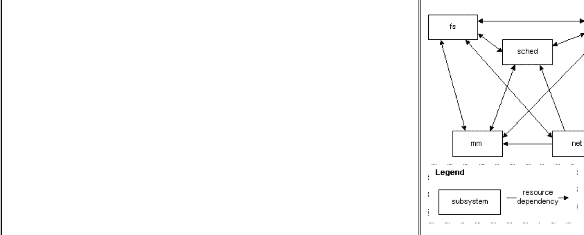

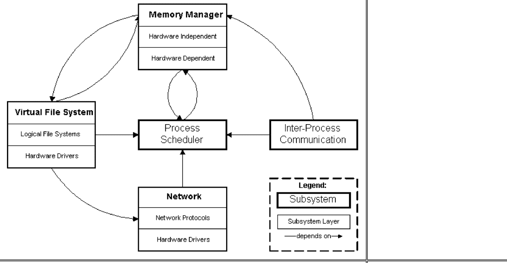

(a): 概念划分 (b): 具体划分

图 1：概念划分与具体划分

尽管概念架构依赖很少，但具体架构显示 Linux 内核的五个主要子系统是相互依赖的。图 1(b) 显示连接距离完全图仅缺少两条边（[PBS] 提供了哪些模块跨子系统交互的细节）。这种相互依赖性与概念架构形成了显著对比。似乎任何基于连接特性的反向工程技术（例如 [Müller 1993] 中设计的 Rigid 系统）都无法从这样的系统中提取出任何相关结构。这验证了 Tzerpos [Tzerpos 1996] 所讨论的混合方法。

系统层面的差异是子系统层面差异的特征。子系统结构在很大程度上与概念结构对应。然而，我们在具体架构中发现了许多概念架构中没有的依赖关系（Murphy [Murphy] 意义上的分歧）。子系统结构在下文中将详细讨论这些关系。

## 3 子系统结构

### 3.1 进程调度器

#### 3.1.1 目标

进程调度是 Linux 操作系统的核心。进程调度器具有以下职责：

- 允许创建新进程
- 决定哪个进程访问 CPU
- 接收中断并进行路由
- 发送信号
- 管理定时
- 在进程结束时清理资源

进程调度器还支持动态加载的模块，通过定时器。

#### 3.1.2 外部接口

进程调度器提供了两个接口：首先，它提供了一个可以调用的限制接口；其次，它为内核提供了一个丰富的接口。

进程可以通过复制其他进程来创建。在启动时，Linux 系统只有一个运行进程：`init`。通过 `fork(k)` 系统调用产生子进程。在终止时，调用 `exit()` 系统调用。

定时器管理可以通过 `settimer()` 和 `gettimer()` 例程进行。前者设置定时器，后者获取其值。`signal()` 允许用户进程与特定的信号关联。`init_module()` 会加载模块。最后，`delete_module()` 会卸载模块。

#### 3.1.3 描述

进程调度器主要负责进程的加载、执行和适当终止。调度算法在进程执行期间的两个点被调用：首先是如 `sleep()` 等系统调用；其次，在每次系统调用和每次系统中断后（在下文中描述）。

信号可以被视为一种 IPC 机制，因此在进程间通信部分讨论。

中断允许硬件与操作系统通信。Linux 区分慢中断和快中断。慢中断是一种典型的中断。其他中断在处理期间是允许的，一旦有了慢中断，Linux 就会照常运行，例如调用调度算法。定时中断是慢中断的范例。快中断用于更复杂的任务，例如处理键盘输入。其他中断在处理期间被禁用，由快中断处理程序式启用。

Linux 使用定时器每 10ms 触发一次。因此，根据我们上面的调度描述，任务调度至少每 10ms 发生一次。

#### 3.1.4 数据结构

`task_struct` 结构代表一个 Linux 任务。有一个字段表示进程状态；该状态可能有以下值：

- 运行
- 返回系统调用
- 处理中断例程
- 处理系统调用
- 就绪
- 等待

此外，有一个字段指示进程优先级，以及一个字段持有进程可以在不强制调度的情况下继续执行的时钟周期数（10ms 间隔）。还有一个字段持有上次失败系统调用的错误号。

为了跟踪所有执行中的进程，维护了一个双向列表（通过两个指向 task struct 的字段）。由于每个进程都与其他进程相关，因此存在字段描述进程：原始父进程、父进程、最小孩子、较兄弟以及最后的兄弟。

有一个嵌套结构 `mm_struct`，包含了进程的内存管理信息（例如代码段的起始和结束地址）。

进程 ID（Process ID）信息也保存在 `task_struct` 中。其中存储了进程和组 ID（group id）。它提供了一个组 ID 数组，以便进程可以关联到多个组。

文件进程数据位于一个 `fs_struct` 子结构中。它将包含一个指向进程根目录对应的 `inode` 的指针，以及其当前的工作目录。

一个进程打开的所有文件都将通过 `task_struct` 中的 `files_struct` 子结构进行跟踪。

最后，还有一些存储计时信息的字段；例如，进程在用户模式下花费的时间。

所有正在执行的进程在进程表中（process table）中都有一个条目。进程表实现为指向 `task` 结构的指针数组。进程表中的第一个条目是特殊的 `init` 进程，它是 Linux 系统创建的第一个进程。

最后，实现了一个模块结构（module structure）来表示已加载的模块。该结构包含了用于实现模块结构列表的字段：一个一个指向模块符号表的字段，以及另一个存储模块名称的字段。模块大小（以页为单位）和指向模块起始内存的指针也是模块结构中的字段。

#### 3.1.5 子系统结构

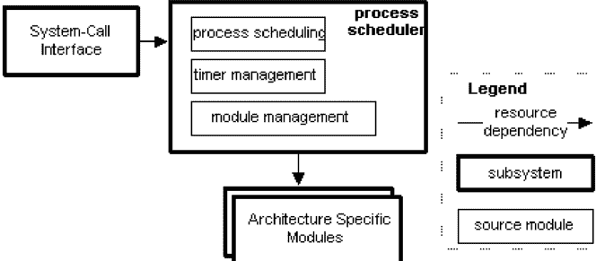

图 2 显示了进程调度器子系统。它被用于表示进程调度和管理（即加载和卸载），以及定时器管理和模块管理功能。

#### 3.1.6 子系统依赖关系

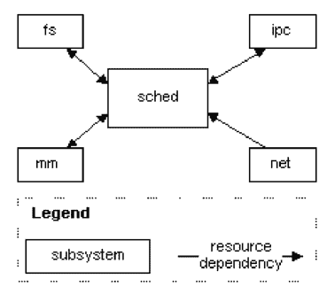

图 3 显示了进程调度器如何依赖于其他内核系统。进程调度器在调度进程时需要内存管理器来设置内存映射。此外，进程调度器依赖 IPC 子系统用于底半部处理（bottom-half-handing）的信号量队列（见 3.3 节讨论）。最后，进程调度器依赖文件系统从持久性设备上加载可加载模块。所有子系统都依赖于进程调度器，因为它们在硬件操作完成时需要挂起用户进程。有关子系统模块之间特定依赖关系的更多细节，请参阅 [PBS]。

### 3.2 内存管理器

#### 3.2.1 目标

如 [Ruling 1997] 第 13-30 页所述，内存管理器为其客户端提供了以下能力：

- 大内存地址空间 - 用户程序可以引用比物理上存在得多的内存。
- 保护 - 进程的内存是私有的，不能被另一个进程读取或修改；此外，内存管理器防止进程覆盖代码和只读数据。
- 内存映射 - 客户端可以将文件映射到虚拟内存区域，并像访问内存一样访问文件。
- 物理内存的公平访问 - 内存管理器确保进程能够公平地访问机器内存资源，确保合理的性能。
- 共享内存 - 内存管理器允许进程共享部分内存。例如，可执行代码通常在进程间共享。

#### 3.2.2 外部接口

内存管理器为其功能提供了两个接口：一个用户进程使用的系统调用接口，另一个其他内核子系统用于完成其任务的接口。

- **系统调用接口**
  - `malloc()` / `free` - 为进程的使用分配或释放内存区域
  - `mmap()` / `munmap()` / `msync()` / `mremap` - 将文件映射到虚拟内存区域
  - `mprotect` - 更改虚拟内存区域的保护
  - `mlock()` / `mlock()` / `munlock()` / `nullock()` - 超用户例程，防止内存被交换
  - `swapin()` / `swapoff()` - 超用户例程，为系统添加和删除交换文件

- **内核内部接口**
  - `kmalloc()` / `kfree()` - 为内核数据结构分配和释放内存
  - `verify_area()` - 验证用户内存区域是否具有所需的权限映射
  - `get_free_page()` / `free_page()` - 分配和释放物理内存页

除了上述之外，内存管理器在内核中访问其所有数据结构和大多数例程。许多内核模块通过访问子系统的数据结构和实现细节与内存管理器接口。

#### 3.2.3 子系统描述

由于 Linux 支持多个硬件平台，内存管理器有一个特定于平台的部分，它将所有硬件平台的细节抽象为一个通用的接口。对硬件内存的访问通过这个抽象接口实现。

内存管理器使用硬件内存将虚拟地址映射到物理地址。当用户进程访问内存位置时，硬件管理器会将此虚拟内存地址翻译为物理地址，然后使用该物理地址执行访问。由于这种映射，用户进程并不知道哪个物理地址与特定的虚拟内存地址相关。这允许内存管理器子系统移动进程。由于这种映射，内存管理器可以在内存中移动进程。映射允许进程共享物理内存，如果它们的虚拟地址空间映射到相同的物理地址。

此外，当内存不使用时，内存管理器将其交换到页文件。内存管理器包含一个守护进程（`kswapd`）。Linux 使用该守护进程引用内核线程，正如调度进程的方式。

`kswapd` 定期检查是否有未引用的物理页。这些页从物理内存中驱逐；如有必要，将存储在磁盘上。内存管理器子系统会特别注意减少磁盘活动。

当硬件内存管理器检测到用户进程访问未映射到物理页的内存时，它会通知内核内核缺页异常，由内存管理器来解决该异常。有两种可能：该页已交换出需要换回，或者用户进程正在对其映射的内存进行非法引用。内存管理器也会检测非法引用，例如写入代码。这些引用会导致报告给内存管理器的缺页异常。如果内存管理器检测到非法内存访问，将通过信号通知用户进程；如果进程未处理该信号，将终止。

#### 3.2.4 数据结构

以下数据结构结构相关：

### vm_area
内存管理器为每个进程存储一个数据结构，记录哪些虚拟内存区域映射到哪些物理页。该数据结构还存储一组指针，允许对进程虚拟内存特定区域执行操作。例如，进程的可执行区域不需要交换到系统分页文件，因为可以使用可执行文件作为备份存储。当进程的虚拟内存区域映射时（例如加载可执行文件时），会为虚拟地址空间中的每个连续区域设置 `vm_area_struct`。在查找缺页的 `vm_area_struct` 时速度至关重要，这些结构存储在 AVL 树中。该数据结构包含页的状态（例如当前是否使用）。所有页数据结构在向量（`mem_map`）可用，它在内核启动时初始化。随着页状态的变化，该数据结构中的属性会更新。

### mem_map
内存管理器为系统上的每个物理页维护一个数据结构。该数据结构包含指示页状态的标志。

### free_area
空闲区域向量用于存储未分配的物理内存页；页在分配时从 `free_area` 中移除，在释放时返回。从 `free_area` 分配页时使用伙伴系统（Buddy system）。

## 3.2.5 子系统结构

### Linux 内核的具体架构

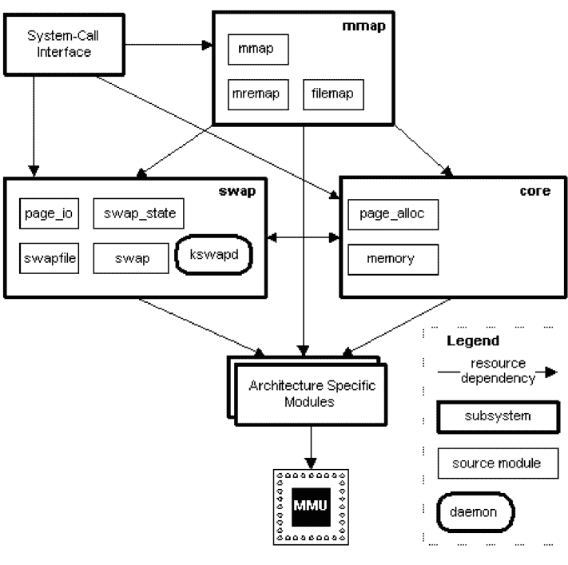

内存管理器子系统由多个源代码模块组成；根据职责范围可以将这些模块分解为以下几组（如图 4 所示）：

- 系统调用接口 (`mmmap`) - 这组模块负责通过定义良好的接口（前文讨论过）向用户进程呈现内存管理的服务。
- 内存映射文件 (`mmmap`) - 这组模块负责支持内存映射文件 I/O。
- 交换文件访问 (`swap`) - 这组模块控制内存交换。这些模块负责启动页入（page-in）和页出（page-out）操作。
- 核心内存管理器 (`core`) - 这些模块负责被其他内核子系统使用的核心内存管理功能。
- 体系结构特定模块 - 这些模块为所有支持的平台提供通用接口。这些模块执行命令以更改 MMU 的虚拟内存映射，并在发生页错误时，提供一种通用手段通知内存管理器子系统的其他部分。

内存管理器结构中一个有趣方面是使用了 `kswapd`，它是一个决定哪些内存页应该被交换出的守护进程。`kswapd` 作为内核线程执行，并定期扫描正在使用的物理页，以查看是否有页面可以作为交换候选。该守护进程与内存管理器子系统的其他部分并发执行。

## 3.2.6 子系统依赖关系

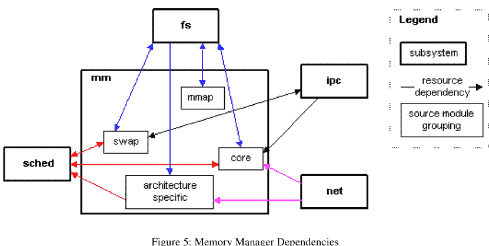

`sched`、`fs`、`ipc` 和 `net` 的每个部分直接使用（通过数据结构和实现函数）内存管理器。这种依赖关系很难简洁地描述；请参考 [PBS] 查看子系统依赖关系的详情。图 5 显示了内存管理器与其他子系统之间的层级依赖。为了清晰起见，省略了内部依赖。

## 3.3 虚拟文件系统

### 3.3.1 目标

Linux 设计用于支持许多物理设备。即使对于特定类型的设备（如硬盘），硬件供应商之间存在许多接口差异。除了 Linux 支持的物理设备外，Linux 还支持许多逻辑文件系统。通过支持许多逻辑文件系统，Linux 可以轻松与其他操作系统互操作。Linux 文件系统支持以下目标：

- 多种硬件设备 - 提供对许多硬件设备的访问
- 多种逻辑文件系统 - 支持许多不同的文件系统
- 多种可执行格式 - 支持几种不同的可执行格式（如 out, ELF, java）
- 同质性 - 为所有逻辑文件系统和所有硬件设备提供通用接口
- 性能 - 提供对文件的高访问
- 安全性 - 不丢失或损坏数据
- 安全性 - 限制对用户文件的访问；通过引号限制文件总大小

### 3.3.2 外部接口

文件系统提供两个层级的接口：供用户进程使用的系统调用接口，以及供其他内核子系统使用的内部接口。系统调用接口处理设备和操作。文件的操作包括 POSIX 兼容系统提供的 `open`/`close`/`read`/`write`/`seek`/`tell`；目录的操作包括 `reread`/

文件子系统为其他内核子系统提供的接口要丰富得多。文件子系统暴露了数据结构和实现函数，供其他内核子系统进行操作。特别是，向内核其他部分暴露了两个接口——节点（inodes）和文件（files）。文件系统的其他实现细节也会被其他内核子系统使用，但并不常见。

#### 节点接口 (Inode Interface)

- `create()`: 在目录中创建文件
- `lookup()`: 在目录内查找文件名
- `link()`/ `symlink()` / `unlink()` / `reread()` / `follow_link()`: 管理文件系统
- `mkdir()`/ `rmd()`: 创建或删除子目录
- `mknode()`: 创建目录、特殊文件或普通文件
- `readpage()`: 向后备存储读取或写入一页物理内存
- `truncate()`: 将文件长度设为 0
- `permission()`: 检查用户进程是否有有权限执行某项操作
- `smap()`: 将逻辑文件块映射到物理设备扇区
- `bmap()`: 将逻辑文件块映射到物理设备块
- `rename()`: 重命名文件或目录

除了可以通过节点调用的方法外，还提供了 `namei()` 函数，允许其他内核子系统找到与文件或目录关联的节点。

#### 文件接口 (File Interface)

- `open()` / `release()`: 打开或关闭文件
- `read()` / `write()`: 读取或向文件读写内容
- `select()`: 等待直到文件处于特定状态（可读或可写）
- `lseek()`: 如果支持，移动到文件中的特定偏移量
- `mmap()`: 将文件区域映射到用户进程的虚拟内存
- `fsync()` / `fsasync()`: 将任何内存缓冲区与物理设备同步
- `readdir()`: 读取目录文件指向的文件
- `quill()`: 设置文件属性
- `check_media_change`: 检查可移动设备是否已被移除（如软盘）
- `revalidate()`: 验证所有缓存信息是否有效

### 3.3.3 子系统描述

文件系统需要支持许多不同的文件系统和许多不同的硬件设备。它通过两个易于扩展的概念层来实现。设备驱动层用通用接口表示所有物理设备。虚拟文件系统 (`VFS`) 用通用接口表示所有物理设备。

## 设备驱动

设备驱动层负责为所有物理设备提供通用接口。Linux 内核有三种设备：字符设备、块设备和网络设备。字符设备是顺序的；块设备可以按任何顺序访问。典型示例是带驱动和调制解调器。

Linux 内核在访问所有设备时使用缓冲区来提高性能。块设备访问通过缓冲区进行。每个设备请求将其添加到队列并睡眠直到请求被满足。缓冲区使用一个独立的内核线程 `klad` 将页写入设备并从缓存中移除。

当设备驱动程序需要满足请求时，由管理控制状态寄存器 (`CSR`) 的操作驱动程序启动。从主计算机移动数据到外围设备有通用机制：轮询、直接内存访问 (`DMA`) 和中断。在轮询情况下，设备驱动程序定期检查外围设备的 `CSR` 以查看当前请求是否完成。如果是，驱动程序启动下一个请求并继续。轮询适用于键盘和鼠标等低速硬件设备。对于其他更快的设备，使用 `DMA`。在这种情况下，设备驱动程序启动与 CPU 并发运行传输，操作进行期间 CPU 可以处理其他任务。当 `DMA` 操作完成后，CPU 接收中断。中断处理在 Linux 内核中非常常见且比其他两种更复杂。

当硬件设备报告变化（鼠标移动、按下键）以报告操作完成时，它向 CPU 发送中断。如果启用中断，CPU 执行当前指令并开始 Linux 内核的中断处理代码。内核找到合适的处理器（每个设备驱动程序为其生成的设备注册处理器）。当正在处理中断时，CPU 在特殊上下执行；其他中断可能会延迟到中断处理完毕。由于这种限制，中断处理程序需要高效，以免丢失中断。某些中断处理程序无法在时间限制内完成所有工作；但中断处理程序会将剩余工作调度到下半处理器中。下半处理器是调度器在下一次系统调用完成后将执行的程序。通过将非关键工作推后到

通过半半处理器，设备驱动程序可以减少中断延迟并提高并发性。

总而言，设备驱动程序隐藏了操作外设 `CSR`（控制状态寄存器）的细节以及每个设备的数据传输机制。缓冲区缓存通过尝试从内存缓冲区满足块设备的请求，来帮助系统性能。

## 逻辑文件系统

虽然可以通过设备特殊文件访问文件类设备，但通过逻辑文件系统访问块设备是更常见的做法。逻辑文件系统可以挂载在虚拟文件系统中的挂载点上。这意味着关联块设备包含了文件和结构信息，允许逻辑文件系统访问该设备。在任何时候，一个物理设备只能支持一个逻辑文件系统；但是，设备可以重新格式化为不同的逻辑文件系统。Linux 支持 15 个逻辑文件系统；这促进了与其他操作系统的互操作性。

当文件系统作为一个子目录时，设备上的所有文件和目录都成为挂载点的子目录。虚拟文件系统的用户不需要知道是哪个逻辑文件系统实现了目录树的哪部分，以及哪些物理设备包含了逻辑文件系统。这种抽象在物理设备和逻辑文件系统的选择上都提供了极大的灵活性，而这种灵活性是 Linux 成功的关键因素之一。

为了支持虚拟文件系统，Linux 使用了 `inode`（索引节点）的概念。Linux 使用 `inode` 来表示块设备上的文件。`inode` 是虚拟的，因为它包含的操作会根据文件所在的逻辑系统和物理系统而以不同的方式实现。`inode` 接口使得所有文件在其他 Linux 子系统中看起来是相同的。`inode` 被用作磁盘上所有打开文件相关信息的存储位置。`inode` 存储了相关的缓冲区、文件的块总数，以及文件偏移量与设备块之间的映射。

## 模块

虚拟文件系统的大部分功能以动态加载模块的形式提供（在第 3.1 节描述）。这种动态配置允许 Linux 用户编译一个尽可能小的内核，同时允许它在单次会话中需要时加载设备驱动程序和文件模块。例如，Linux 系统可能可选地为其内核附加一个补丁，那么如果打印机不可用而打印机程序已经链接到内核中，就会浪费内存。通过将打印机制为可加载模块，Linux 允许用户在硬件可用时加载驱动程序。

### 3.3.4 数据结构

以下数据结构在架构上与文件系统相关：

- `super_block`：每个逻辑文件系统都有一个 `superblock`，用于向 Linux 内核的其他部分描述它。该 `superblock` 包含了关于整个文件系统的信息——哪些块、块大小是多少等。`superblock` 类似于 `inode`，因为它们表现为通往逻辑文件系统的虚拟接口。

- `inode`：一种内存中的数据结构，表示内核了解一个打开文件需要的所有信息。单个 `inode` 可能会被多个打开该文件的进程共同使用。`inode` 存储了内核与单个文件关联所需的所有信息。计数、缓冲和内存映射都存储在 `inode` 中。某些逻辑文件系统还有一个 `inode` 结构，用于以持久化方式维护这些信息，但这与内核其他部分使用的 `inode` 数据是不同的。

- `file`：文件描述符表示由特定进程打开的文件。所有打开的文件都存储在一个双链表中（由 `first_file` 指向）；在 POSIX 风格例程（`open`, `read`, `write`）中使用的文件描述符是该特定打开文件在该链表中的索引。

### 3.3.5 子系统结构

## Linux 内核的具体架构

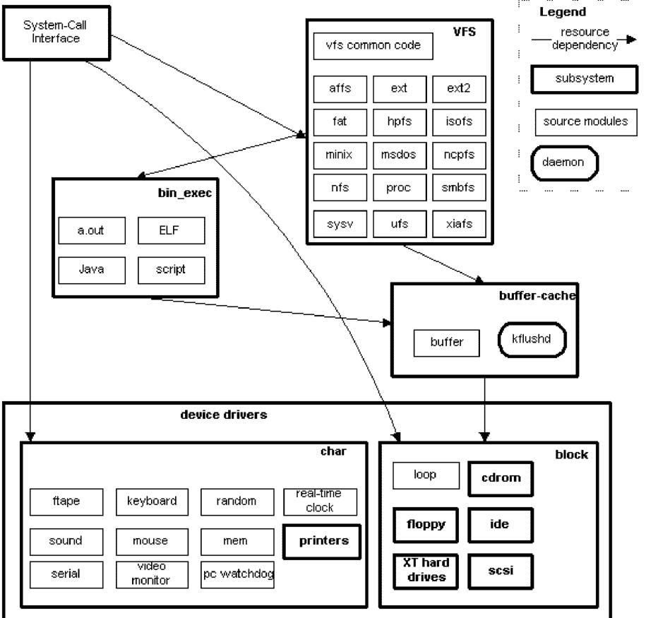

图 6：文件子系统结构

### 3.3.6 子系统依赖

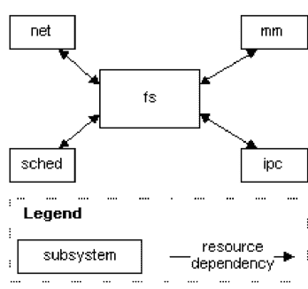

图 7：文件子系统依赖

图 7 显示了文件系统如何依赖其他内核子系统。同样，文件系统依赖于所有其他依赖文件系统的内核子系统。特别是，网络子系统依赖文件系统，因为网络套字以文件描述符的形式呈现给用户。内存管理器依赖文件系统以支持交换。IPC 子系统依赖文件系统来实现管道（pipes）和 FIFO。进程调度器依赖文件系统来加载可加载模块。

文件系统使用网络接口来支持 NFS；使用内存管理器来实现缓冲区缓存和 ramdisk 设备；使用 IPC 子系统来帮助支持可加载模块，并使用进程调度器在硬件请求完成时让用户进程休睡眠。更多细节，请参阅 [PBS]。

### 3.4 进程间通信

#### 3.4.1 目标

提供 Linux IPC 机制是为了让并发执行的进程有一种手段来共享资源、同步并相互交换数据。Linux 通过共享资源、内核数据结构和等待队列实现了在同一系统执行的进程之间所有形式的 IPC。

Linux 提供了以下形式的 IPC：

- 信号（Signals）：可能是最老的 Unix IPC 形式，信号是发送给进程的异步消息。

- 等待队列（Wait queues）：提供了一种让进程在等待操作完成时进入睡眠的机制。该机制被进程调度器用于实现第 3.3.3 节描述的半半处理。

- 文件锁（File locks）：提供了一种机制，允许进程将文件的区域或文件本身声明为除持有者之外的所有进程的只读。

- 管道和命名管道（Pipes and Named Pipes）：通过显式建立管道连接，或通过存在于系统文件文件中的命名管道进行通信，允许两个进程之间的双向数据传输。

- 系统 IPC

- 信号量（Semaphores）：经典信号量模型的实现。该模型还允许创建信号量数组。

- 消息队列（Message queues）：一种无连接的数据传输模型。消息是一段带有类型的字节序列。消息被写入消息队列，并可以通过读取消息队列获取，可能按类型限制读取。

- 共享内存（Shared memory）：多个进程访问同一内存区域的机制。

- 域套接字（Domain sockets）：另一种面向连接的数据传输机制，提供与下一节的 INET 套接字相同的通信模型。

#### 3.4.2 外部接口

信号是发送给内核或其他进程的通知。信号通过 `send_sig()` 函数发送。信号号作为参数提供，以及目标进程。进程可以使用 `signal(function)` 函数注册处理信号。

文件锁由 Linux 文件系统直接支持。要锁定项，可以使用 `open()` 系统调用，也可以使用 `sysfcntl()` 系统调用。文件内部区域的锁定通过 `sysfcntl()` 系统调用完成。

管道通过 `pipe()` 系统调用创建。然后使用文件系统的 `read()` 和 `write()` 调用在管道上传数据。命名管道通过 `open()` 系统调用打开。

V IPC 机制具有共同接口，即 `ipc()` 系统调用。各种 IPC 操作通过系统调用参数进行指定。

Unix 域套接字功能也封装在单个系统调用 `socketcall()` 中。

上述每个系统调用都有良好的文档，鼓励读者查阅相应的手册页（man-page）。

IPC 子系统向其他内核子系统暴露调用。由于等待队列不被用户进程使用，因此它们没有系统调用接口。等待队列用于信号量、管道和半半处理（参见第 3.3.3 节）。`add_wait_queue()` 过程将任务插入等待队列。`remove_wait_queue()` 过程从等待队列中移除任务。

#### 3.4.3 子系统描述

以下是对 3.4.1 中识别的每个 IPC 机制底层运行机制的简要描述。

信号（Signals）用于通知进程发生事件。根据特定信号的语义，信号具有改变接收进程状态的作用。内核可以向任何执行中的进程发送信号。用户进程只有在拥有 PID 或 GID 的情况下才能向某个进程或进程组发送信号。信号不会对休眠进程进行独立处理。在调度器再次将进程置于用户模式之前，它会检查是否向该进程发送了信号。如果是，调度器将调用 `do_signal()` 函数妥善处理该信号。

等待队列（Wait queues）使用指向任务结构的指针链表实现，这些结构控制着等待内核事件（例如 DMA 传输完成）的进程。进程可以通过调用 `sleep_on()` 或 `interruptable_sleep()` 函数进入等待队列。同样，`wakes_up()` 和 `wake_interruptable()` 将进程从等待队列中移除。中断程序也使用等待队列来避免竞态条件。

Linux 允许防止其他进程访问文件。这种排除基于整个文件或文件的某个区域。文件锁（File-locks）用于实现这种排除。文件系统实现在其结构中包含适当的数据，允许内核确定是否已对文件或其内部的区域加了锁。在一种情况下，对已锁文件的锁定尝试将失败；在后的情况下，尝试锁定已锁定的区域将失败。无论何种情况，由于内核未授予锁，请求进程都不被允许访问该文件。

管道（Pipes）和命名管道（named pipes）具有类似的实现，因为它们的功能几乎相同。它们的创建过程是不同的。然而，在任何情况下，都会返回一个文件描述符给管道。创建后，某些内存会与打开的管道关联。这些内存被视为环形缓冲区，写操作是原子的。当缓冲区满时，写入进程会被阻塞。如果请求的数据多于可用数据，读取进程会被阻塞。因此，每个管道都关联有一个等待队列。在读写操作期间，进程会被添加到队列或从中移除。

信号量（Semaphores）使用等待队列实现，并遵循经典的信号量模型。每个信号量都有关联的值。信号量上实现了两个操作（加和减）。当信号量的值为零时，执行减操作的进程将被阻塞在等待队列上。信号量数组是信号量的连续集合。每个进程还维护一个其已执行的信号量操作列表，以便在进程提前退出时可以撤销这些操作。

消息队列（The message queue）是一个线性链表，进程在其中读取或写入字节序列。消息按照写入的顺序被接收。消息队列关联有两个等待队列：一个用于等待完整消息队列的进程，另一个用于序列化消息写入者。消息的实际大小在创建消息队列时设置。

共享内存（Shared memory）是最快的 IPC 形式。这种机制允许进程共享一段内存。共享内存区域的创建由内存管理系统处理。共享页通过系统调用 `sys_shmat()` 挂载到用户虚拟内存空间。可以通过调用 `sys_shmdt()` 从进程的用户内存空间中移除共享页。

Unix 套接字（Unix sockets）的实现方式与管道类似，即它们是基于内存页的环形缓冲区。然而，套接字为每个通信方向提供了单独的缓冲区。

### 3.4.4 数据结构

在本节中，描述了实现 IPC 机制的重要数据结构。

信号通过 `task_struct` 结构中的 `signal` 字段实现。每个信号由该字段中的一个位表示。因此，一个 Linux 版本能支持的信号数量限于字字的位数。该字段块持有被进程阻塞的信号。

与等待队列仅关联一个数据结构，即 `wait_queue` 结构。这些结构包含一个指向关联的 `task_struct` 的指针，并链接成一个列表。

文件锁有一个关联的文件结构 `lock_structure`。该结构包含一个指向所有者进程的 `task_struct` 指针、被锁文件的文件描述符、一个用于等待文件锁取消的进程的等待队列，以及被锁定的文件区域。对于每个打开的文件，`file_lock_structures` 会被链接成一个列表。

管道（无论是无名的还是命名的）都由文件系统索引节点（inode）表示。该节点在 `pipe_inode_info` 结构中存储了额外的管道特定信息。该结构包含一个用于在读或写上阻塞的进程的等待队列、一个指向用作管道环形缓冲区内存的指针、管道中的数据量，以及当前从管道读取或向管道写入的进程数量。

所有 V IPC 对象都是在内核中创建的，且每个对象都有关联的访问权限。这些访问权限存在 `ipc_perm_structure` 中。信号量用信号量的值以及对该信号量执行最后操作的进程 PID 表示。信号量数组由 `semid_ds` 结构表示，它持有访问权限、最后操作时间、指向数组中第一个信号量的指针，以及进程在执行信号量操作时阻塞的队列。`sem_undo` 结构用于创建一个数组执行的信号量操作列表，以便在进程被杀死时可以全部撤销。

消息队列基于 `msgid_ds` 结构，该结构持有管理和控制信息。该结构存储了以下字段：

- 访问权限
- 实现消息队列的链接字段（指向 `msgid_ds` 的指针）
- 最后发送、接收和更改的时间
- 进程在上面阻塞的队列（如前一节所述）
- 队列中当前的字节数
- 消息数量
- 队列大小（字节）
- 上一个发送者的进程号
- 上一个接收者的进程号。

消息以 `msg` 结构存储在内核中。该结构持有一个用于实现消息列表的链接字段、消息类型、消息数据的地址以及消息长度。

共享内存实现基于 `shmid_ds` 结构，它与 `msgid_ds` 结构一样持有管理和控制信息。该结构包含访问控制权限、挂载、卸载和更改时间、共享段创建者的 PID 以及最后一次操作的 PID、挂载到共享内存区域的进程数量、组成共享内存区域的页数，以及一个页表项的字段。

Unix 域套接字（Unix domains sockets）基于网络接口部分（3.5）中描述的 `socket` 数据结构。

### 3.4.5 子系统结构

`img/4e15c97e21a8f49742cf467593ac4c6a_25_0.png`

图 8：IPC 子系统结构

图 8 显示了 IPC 子系统的资源依赖。控制流从系统调用层向下进入每个模块。System V IPC 实现在内核源码的 `ipc` 目录。内核 IPC 模块引用内核目录内实现的 IPC 设施。文件 IPC 和网络 IPC 设施遵循类似的约定。

System V IPC 模块依赖于内核 IPC 机制。特别是信号量是使用等待队列实现的。所有其他 IPC 设施都是相互独立实现的。

### 3.4.6 子系统依赖

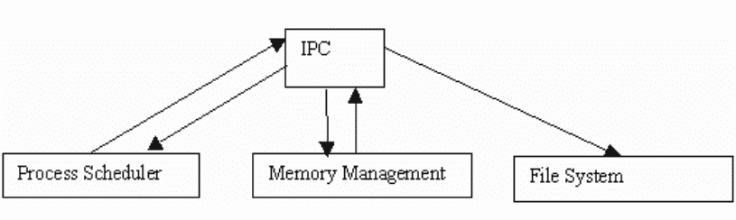

图 9：IPC 子系统依赖

图 9 显示了 IPC 子系统与其他内核子系统的资源依赖关系。

IPC 子系统依赖文件系统来实现套接字（sockets）。套接字使用文件描述符，一旦打开就会被分配到一个节点（inode）。内存管理依赖 IPC，因为页面交换程序会调用 IPC 子系统来执行共享内存的交换。IPC 依赖内存管理主要是为了缓冲区分配和共享内存的实现。

某些 IPC 机制使用定时器，这些定时器是在进程调度器子系统中实现的。进程调度依赖于信号。由于这两个原因，IPC 模块和进程调度器模块是相互依赖的。有关 IPC 子系统模块与其他内核子系统之间依赖关系的更多细节，请参阅 [PBS]。

### 3.5 网络接口

### 3.5.1 目标

Linux 网络系统提供了机器间的网络连接性以及套接字通信模型。它提供了两种类型的套接字实现：BSD 套接字和 INET 套接字。BSD 套接字是使用 INET 套接字实现的。

Linux 网络系统提供了具有不同通信模型和服务质量的两种传输协议。这些是不可靠的、基于消息的 UDP 协议和可靠的、流式的 TCP 协议。它们构建在 IP 网络协议之上。INET 套接字则构建在传输协议和 IP 协议之上。

最后，IP 协议位于底层设备驱动程序之上。系统为三种不同类型的连接提供了设备驱动程序：串行链路（SLIP）、并行线连接（PLIP）和以太网连接。地址解析协议（ARP）在 IP 和以太网驱动程序之间起到调节作用。地址解析器的作用是在逻辑 IP 地址和物理以太网地址之间进行转换。

### 3.5.2 外部接口

网络服务通过套接字接口供其他系统和用户使用。套接字通过 `socketcall()` 系统调用进行创建和操作。数据通过套接字描述符上的 `read()` 和 `write()` 调用进行发送和接收。

网络系统没有导出任何其他网络机制/功能。

### 3.5.3 子系统描述

BSD 套接字模型呈现给用户进程。该模型是一种面向连接的、流式的、缓冲通信服务。BSD 套接字实现在 INET 套接字模型之上。

BSD 套接字模型处理的任务类似于 VFS 的任务，并管理套接字连接的通用数据结构。BSD 套接字模型的目的是通过将通信抽象为通用接口来提供更好的可移植性。BSD 接口广泛用于 Unix 和 Microsoft Windows 等现代操作系统。INET 套接字模型管理用于基于 IP 协议（TCP 和 UDP）的实际通信端点。

网络 I/O 开始于对套接字的读或写。这会触发一个 `read/write` 系统调用，该调用由虚拟文件系统的一个组件处理（沿网络层层下的 `read/write` 调用链是对称的，因此从某一点开始，只考虑写操作）。从那里，确定了 BSD 套接字的 `sock_write()` 实现了实际的文件系统写调用；因此调用了它。该例程处理管理细节，并将控制传递给 `inet_write()` 函数。这变成了一个传输层写调用（通过 `tcp_write()`）。

传输层例程负责将输入的数据拆分为传输包。这些例程将控制传递给 `ip_build_header()` 例程，该例程构建一个插入数据包的 IP 头部，然后调用 `tcp_build_header()` 构建 TCP 头部。完成后，将使用设备驱动程序来实际发送数据。

网络系统提供两种传输服务，每种服务都有不同的通信模型和服务质量。UDP 提供无连接的、不可靠的数据传输服务。它负责从 IP 层接收数据包，并找到包应该发送到的终地。如果目标不存在，则报告错误。否则，如果有足够的缓冲区内存，数据包数据将进入该套接字的接收包列表。任何正在读操作的套接字都会收到通知并唤醒。

TCP 协议提供了一个得得方案。除了处理发送和接收进程之间的数据传输外，TCP 协议还执行复杂的连接管理。TCP 将数据发送到套接字层，而不是作为包序列，并保证可靠的传输。

IP 协议提供数据包传输服务。给定一个包和一个目的地，IP 通信层负责将包路由到正确的主机。对于传出的数据流，IP 负责以下操作：

- 将流划分为 IP 包
- 将包路由到目标地址
- 生成供硬件设备驱动程序使用的头部
- 选择合适的网络设备进行发送

对于传入的数据包流，IP 必须执行以下操作：

- 检查头部的有效性
- 将目的地址与本地地址进行比较，如果包不在正确的目的地，则进行转发
- 重组 IP 包
- 将包发送到 TCP 或 UDP 层进行进一步处理

ARP（地址解析协议）负责在 IP 和实际地址之间进行解析。ARP 支持以太网、FDDI 等多种硬件设备。这种功能是必要的，用于处理 IP 地址。由于使用了中性地址方案，通信协议可以在多种硬件设备上实现。

网络系统为串行连接、并行连接和以太网连接提供了自己的驱动程序。提供了指向各种设备的抽象接口，以隐藏介质之间的差异。

### 3.5.4 数据结构

BSD 套接字实现由 `socket` 结构表示。该结构包含一个标识套接字类型（流式或数据报）以及套接字状态（已连接或未连接）的字段。标志字段可以修改套接字的操作，并提供指向可以在套接字上执行的操作的结构指针。还提供了关联的 INET 套接字实现的指针，以及对 `inode` 的引用。每个 BSD 套接字都关联一个 `inode`。

`sk` 结构用于管理单个通信包。缓冲区指向它所属的套接字，包含传输时间，以及使得与给定套接字相关的包可以链接的字段（双链表）。源目的地址、头部信息和包数据也包含在缓冲区。该结构封装了网络系统使用的所有包（例如 `tcp` 包、`udp` 包、包等）。

`sock` 结构引用 INET 套接字特定信息。结构成员包括套接字所需的读写内存、`TCP` 协议所需的序列号（可以通过设置来更改套接字的行为）、缓冲区管理字段（例如维护给定套接字接收的所有包列表）以及用于阻塞例程的等待队列。还提供指向维护协议特定函数指针列表的结构指针，即 `proto` 结构。`proto` 结构相当大且复杂，但本质上为 `TCP` 和 `UDP` 协议提供了一个抽象接口。源目的地址以及更多 `TCP` 特定的数据字段。`TCP` 大量使用定时器来处理超时等，因此 `sock` 结构包含了与定时器操作的数据字段，以及作为定时器警报调用的函数指针。

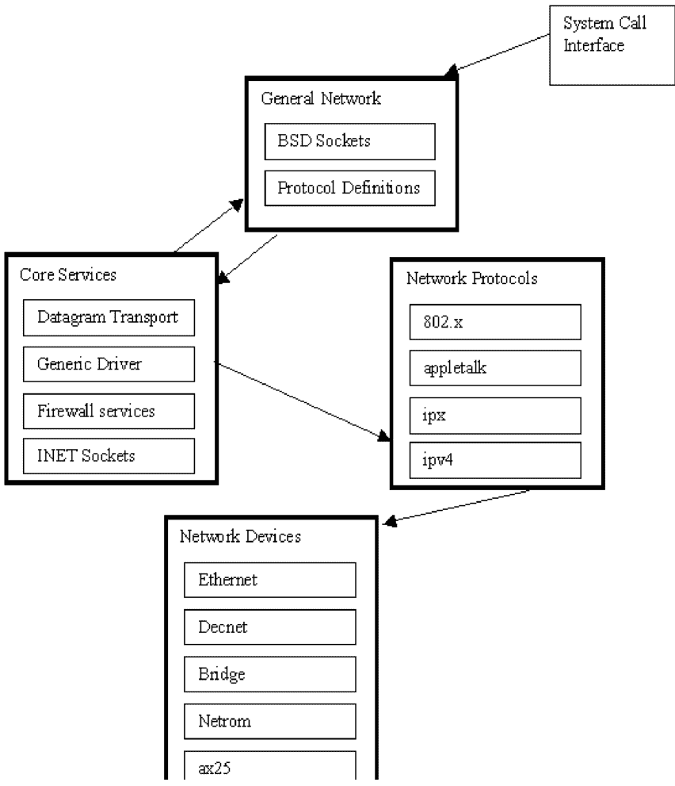

图 10：网络子系统结构

通用网络层包含为用户进程提供最高层接口的模块。这本质上是 BSD socket 接口，以及网络层支持的协议定义。这里包含了 802.x、`ip`、`ipx` 和 AppleTalk 的 MAC 协议。

核心部分对应于高层实现设施，如 INET sockets、对防火墙的支持、网络设备驱动程序接口，以及用于数据报和 TCP 传输服务的设施。

系统调用与 BSD socket 接口进行交互。BSD socket 层为 socket 通信提供了通用的抽象，该抽象是使用 INET sockets 实现的。

协议模块（Protocol modules）包含了获取用户数据并按照特定协议的要求进行格式化的代码。协议最终将数据发送到合适的硬件设备，因此网络协议模块与网络设备模块之间存在依赖关系。

网络设备模块包含特定于设备类型的常规程序。实际的设备驱动位于 `drivers/net` 目录下的普通设备驱动程序中。

### 3.5.6 子系统依赖

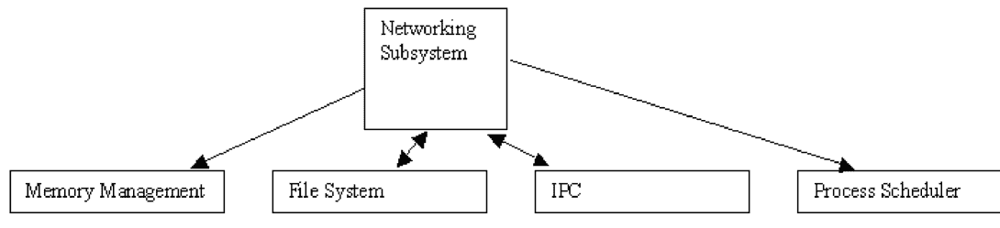

图 11：网络子系统依赖

图 11 显示了网络子系统与其他子系统的依赖关系。

网络子系统依赖内存管理系统提供缓冲区。文件系统用于为 socket 提供节点接口。文件系统使用网络系统来实现 NFS。网络子系统使用内核守护进程，因此依赖 IPC。网络子系统使用进程调度器处理定时功能并在执行网络传输时挂起进程。关于网络子系统模块与其他内核子系统之间特定依赖关系的更多细节，请参阅 [FBS]。

总结，我们审查了现有文档，提取了源文件，将模块聚类为子系统，并利用关于现代操作系统的领域知识对这些类进行了细化。我们发现内核架构与我们之前形成的概念架构不匹配。最初提取的结构由于提取工具的局限性显示出依赖缺失。在手动验证依赖关系后，我们发现所有缺失都是由这些工具造成的。另一方面，最终的内核架构显示出几个概念架构中未考虑到的依赖。这些依赖源于设计决策，例如将 IPC 系统与某些内存交换功能分离开。这些意外的依赖关系，或者如 [Murphy 1995] 中描述的差异，可能表明概念架构没有被正确呈现，或者内核架构没有使用适当的聚类机制。然而，我们认为这些差异是 Linux 开发者忽略架构考量导致的结果。

我们审查了 Linux 内核的文档。存在大量的系统文档，如 [Rushing 1997] 所示。甚至有一些随源码一起提供的文档。然而，这些文档的抽象程度太高，无法作为具体的架构使用。

我们使用 `csv` 工具从 Linux 内核中提取设计信息。`csv` 提取器生成了十万个事实，这些事实通过 `grep` 合并为一百个源模块之间的几千个依赖关系。在检查了事实提取器的输出后，我们注意到有两个同名问题。首先，某些依赖关系没有被检测到。它们在隐式调用的情况下尤为常见。在隐式调用的情况下，一个子系统向另一个子系统注册其能力；由于架构是通过函数指针注册的，`csv` 工具无法检测到这些依赖。其次，`csv` 报告了不存在的依赖关系。一个例子发生在 IPC 子系统中。IPC 子系统中的三个源模块具有同名的函数 (`findkey`)。由于 `csv` 工具使用名称等效性，它报告这三个模块相互依赖，但手动验证显示并非如此。

除了 `csv` 工具引入的产物外，我们还因为假设每个源模块 (`*.h`) 都有一个关联的头文件而遇到了一些问题。这在内核中通常是真实的，但有些头文件是在许多源模块中被实现的。例如，`mm.h` 在内存管理器子系统的多个模块中被实现。由于所有对函数的调用都抽象到声明该函数的头文件中，我们很难将模块分离到不同的子系统中。所有的源模块都依赖于 `mm.h`，而不是实现所用资源的特定源模块。这可以通过调整 `grep` 脚本来修正；也许某种能够识别如 `mm.h` 等头文件特殊性质的组合将是最好的。

由于存在问题（遗漏的、虚假的和位置错误的依赖关系），我们手动验证了提取的事实，发现它们与我们的预期不符。遗憾的是，源代码的量以及我们对 Linux 的相对经验意味着，我们提取的依赖关系不能被视为完全准确。

## 4.1.1 未来工作

应该调整 `PBS` 工具以处理 Linux 源码结构。我们提出的概念和具体架构应该通过与 Linux 开发者社区的讨论进行细化。细化后，可以使用反射模型 [Murphy 1995] 对这两个模型进行比较。

## 5 定义：

- **BSD 系统**：加州伯克利分校计算机系统研究小组开发的基于 AT&T Unix 的 版本。
- **设备文件**：文件系统中代表物理设备的文件。读取或写入此文件将直接访问物理设备。除了字符模式设备外，这些文件很少直接使用。
- **fs**：Linux 内核的文件系统子系统。
- **中断延迟**：从中断报告给 CPU 到处理之间的时间。如果中断延迟过大，高速外设将失败，因为在下一次中断触发之前没有处理（读取 CSR 数据）。随后的中断会覆盖 CSR 中的数据。
- **IPC**：进程间通信。Linux 支持信号、管道以及以它们首次出现的 Unix 版本命名的 System IPC 机制，
- **内核线程 (守护进程)**：内核线程是在内核模式下运行的进程。这些进程是内核的一部分，因为它们可以访问内核的所有数据结构和函数，但被视为可以挂起和恢复的独立进程。内核线程没有虚拟内存，而是访问内核其余部分相同的物理内存。
- **逻辑文件系统**：将数据块呈现为文件和目录的系统；这些文件和目录存储逻辑文件系统的特定属性，如权限、访问和修改以及计数信息。
- **mm**：Linux 内核的内存管理子系统。
- **挂载点**：虚拟文件系统中挂载逻辑文件系统的目录。挂载逻辑文件系统上的所有文件都显示为挂载点的子目录。根文件系统挂载在 `/`，
- **Net**：Linux 内核的网络接口子系统。
- **反向工程**：从源码中提取高层模型的过程。
- **Sched**：Linux 内核的进程调度器子系统。
- **架构**：系统的结构，由软件组件、组件的外部可见属性以及它们之间的关系组成。
- **System V**：由 AT&T 实验室开发的 Unix 版本。
- **Unix**：最初于 20 世纪 70 年代在 AT&T 实验室设计的操作系统。

## 6 参考文献：

**Balasubramanian 1993**

Balasubramanian, K. and Johnson D.; “Linux内存管理概述,” The Linux Kernel Hacker’s Guide, http://www.redhat.com:8080/HyperNews/get/memory/memory.html.

**Bass 1998**

Bass, Len, Clements Paul, Kazman, Rick, “软件架构实践,” ISBN 0-201-19930-0, Addison Wesley, 1998

**Bowman 1998**

Bowman, I.: “Linux内核的概念性架构,” http://www.grad.uwaterloo.ca/~itbowman/CS746G/a1/, 1998.

**Chi 1994**

Chi, E.; “Linux的介绍与历史,” http://jeni.med.umn.edu/~chi/technolog.html, 1994.

**CS746 参考文献**

http://plj.uwaterloo.ca/~cs/746/98/linuxbib.html

**Holt 1997**

Holt, R.: “可移植书架工具,” http://www.turing.toronto.edu/home/hots/pbs/tools.html

**Knuth 1965**

Knuth, K.C.; “一种快速存储分配器,” Communications of the ACM, vol. 8, pp. 623-625, 1965.

## Knuth 1973
Knuth, D.E.; 计算机程序设计, 第一卷: 基础算法, 第2版, Reading, MA: Addison-Wesley, 1973.

## Kruchen 1995
Kruchen, P.B., 4+1 架构模型, IEEE Software, Nov 95, 42-50.

## LDP
Linux文档项目, `http://sunite.unc.edu/mdw/linux.html`

## Manoridis 幻灯片
Manoridis, S.: MC6680 幻灯片，德雷塞尔大学（Drexel University）。

## Muller 1993
Muller, Huissi A., Mehmet, O., Tilly, S., and Uhl, J.: “子系统识别的逆工程方法,” Software Maintenance and Practice, Vol. 5, 181-204, 1993

## Murphy 1995
Murphy, G.K., Gotnick, D., and Stillman, A., 软件反射模型：弥接软件与高层模型之间的差距, ACM软件工程基础会议论文集 (FSE 95)

我们提取的图谱, `http://plj.uwaterloo.ca/~itbowman/pbs/`

## Rushing 1997
Rushing, D.A.: Linux内核, `ftp://sunite.unc.edu/pub/Linux/docs-doc-project/linux-kernel/`, 1997.

## Siddiqi 1998
Siddiqi, S.:“Linux内核的概念性架构,” `http://se.math.uwaterloo.ca/~siddiq/CS746G/L.html`, 1998.

## Tanenbaum 1992
Tanenbaum, A.S.: 现代操作系统, Englewood Cliffs, Prentice-Hall, 1992

## Tanuan 1996
Tanuan, M.: “Linux操作系统架构简介,” `http://www.grad.uwaterloo.ca/~mctuan/cs746g/LinuxCA.html`, 1998.

## Zterpos 1996
Zterpos, V., and Holt, R.: “恢复软件架构的混合方法,” `http://www.turing.toronto.edu/homes/vtzer/papers/hybrid.ps`, 1996.
