# 秘籍


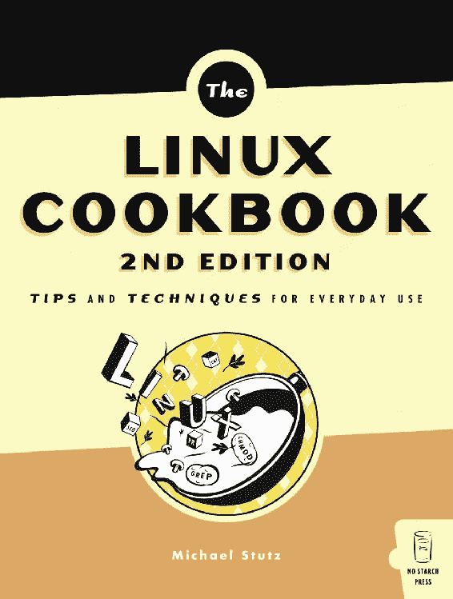


## 关于作者

Michael Stutz 是第一个将 Linux 的“开源”方法应用于非软件作品的人，也是首批在主流媒体中报道 Linux 和自由软件运动的记者之一。十多年来，他一直仅使用 Linux。

## 附录 C

## 附录 D

# 概念索引 ... 747

第二版修订版序言 ... xxxiii

## 获取虚拟控制台编号 ... 2.3.1

### 在控制台之间切换 ... 2.3.2

### 在控制台中滚动文本 ... 2.3.3

### 重置终端屏幕 ... 2.3.5

### 显示工具可用选项 ... 2.4.1

### 显示工具版本 ... 2.4.2

### 列出谁在系统中 ... 2.6.2

### 列出用户最后登录时间 ... 2.6.4

### 列出你当前的进程 ... 2.7.2

阅读系统文档和帮助文件 ... 50

### 31.2.2 接收传真 603

### 31.2.3 自动接收传真 603

### 31.2.4 格式转换 604

### 31.2.5 拨打调制解调器 606

## 31.4 使用其他通信 608

# 32. 电子邮件 611

## 32.1 发送邮件 611

### 32.1.1 在同一系统上发送邮件 612

### 32.1.2 邮件文件或输出 613

### 32.1.3 邮件目录 613

### 32.1.4 邮件网页 614

## 32.2 接收邮件 616

### 32.2.1 编写邮件 616

### 32.2.2 接收邮件 617

### 32.2.3 显示邮件头列表 618

### 32.2.4 删除邮件 619

### 32.2.5 恢复删除的邮件 619

### 32.2.6 回复邮件 620

### 32.2.7 保存邮件到文件 620

## 32.3 使用远程邮件主机 621

### 32.3.1 使用 Mozilla 收发邮件 621

### 32.3.2 获取`pop`邮件 622

## 32.4 管理邮件 622

### 32.4.1 查看邮件文件夹 622

### 32.4.2 设置新邮件通知 624

### 32.4.3 统计邮件数量 625

### 32.4.4 查看邮件自发件人 626

### 32.4.5 验证电子邮件地址 627

### 32.4.6 搜索邮件存档 627

## 32.5 使用邮件附件 628

### 32.5.1 读取邮件附件 628

### 32.5.2 发送邮件附件 629

## 32.6 使用邮件签名 631

## 32.7 使用其他邮件用户代理 631

# 33. 万维网 637

## 33.1 使用 Mozilla 638

### 33.1.1 熟悉 Mozilla 638

### 33.1.2 使用基础 Mozilla 浏览键 640

### 33.1.3 创建新的 Mozilla 窗口 642

### 33.1.4 从 Mozilla 复制链接到剪贴板 642

### 33.1.5 从 Mozilla 复制电子邮件地址到剪贴板 642

### 33.1.6 在 Mozilla 中搜索网页源代码 643

## 33.2 使用 Lynx 643

### 33.2.1 使用基础 Lynx 浏览键 643

### 33.2.2 从 Lynx 保存网页 645

### 33.2.3 列出页面中的所有链接 646

### 33.2.4 将网页文本发送到标准输出 646

### 33.2.5 查看需要授权的站点 647

### 33.2.6 查看`html`选择内容 647

### 33.2.7 在 Lynx 中指定按键绑定 648

### 33.2.8 使用鼠标使用 Lynx 648

## 33.3 在 Emacs 中访问 Web 649

## 33.4 从 Web 查看图像 651

## 33.5 从 Web 获取文件 653

### 33.5.1 下载一个`url` 654

### 33.5.2 归档整个网站 654

### 33.5.3 归档网站的一部分 655

### 33.5.4 读取网页头信息 656

## 33.6 保留浏览器历史 656

### 33.6.1 查看你的浏览器历史 657

### 33.6.2 搜索你的浏览器历史 657

## 33.7 设置起始页 658

## 33.8 在文本中列出`urls` 659

## 33.9 编写`html` 661

### 33.9.1 为图像标签添加参数 663

### 33.9.2 转换`html` 663

### 33.9.3 验证`html` 665

### 33.9.10 分析你的网络流量 666

## 33.11 使用其他浏览器 667

# 34. 其他互联网服务 671

## 34.1 连接到远程主机 671

### 34.1.1 挂起与远程主机的连接 672

### 34.1.2 终止与远程主机的连接 673

## 34.2 在远程主机之间传输文件 673

### 34.2.1 向远程主机上传文件 675

### 34.2.2 从远程主机下载文件 676

## 34.3 使用安全互联网服务 676

### 34.3.1 向远程主机建立安全 Shell 连接 677

### 34.3.2 向远程主机进行安全文件复制 678

## 34.4 阅读 Usenet 679

### 34.4.1 选择一个新闻阅读器器 681

### 34.4.2 为某个主题查找新闻组 682

## 34.5 显示用户信息 683

### 34.5.1 检查用户是否在线 683

### 34.5.2 列出已登录系统的用户 684

## 34.6 显示主机信息 684

### 34.6.1 确定主机是否在线 685

### 34.6.2 追踪通往另一个主机的路径 686

### 34.6.3 获取主机名的`ip`地址 686

### 34.6.4 获取`ip`地址的主机名 687

### 34.6.5 列出域名的所有者 688

## 34.7 与其他用户聊天 688

### 34.7.1 向另一个用户的终端发送消息 689

### 34.7.2 拒绝发送你终端的消息 690

### 34.7.3 直接与用户聊天 690

### 34.7.4 在`irc`上聊天 692

### 34.7.5 在 693 上聊天

### 34.7.6 使用服务 694

# 附录 A 697

## A.1 设置硬件 699

### A.1 确定哪些硬件是兼容 699

### A.1.2 设置日期和时间 700

### A.1.3 为设备指定挂载点 701

### A.1.4 创建引导记录 702

### A.1.5 设置打印机 702

## A.2 关闭系统 703

### A.2.1 立即关机 703

### A.2.2 在特定时间关机 704

### A.2.3 取消关机操作 704

### A.2.4 进入维护模式 705

## A.3 管理软件 705

### A.3.1 获取并安装 Linux 发行版 706

### A.3.2 为你的 Linux 发行版安装软件包 707

### A.3.3 安装源码包 707

### A.3.4 安装 Shell 脚本 708

## A.4 管理`deb`包 709

### A.4.1 列出`deb`包 710

### A.4.2 安装`deb`包 711

### A.4.3 升级`deb`包 711

### A.4.4 移除`deb`包 713

### A.4.5 获取`deb`包的状态 (713)

## A.4.6 列出`deb`包中的所有文件 (713)

## A.4.7 列出文件所属的`deb`包 (714)

## A.4.8 列出`deb`包的依赖关系 (714)

《Linux 食谱》，第 2 版

# A.5 管理`rpm`包 (714)

## A.5.1 列出`rpm`包 (715)

## A.5.2 安装`rpm`包 (715)

## A.5.3 升级`rpm`包 (715)

## A.5.4 移除`rpm`包 (716)

## A.5.5 获取`rpm`包的状态 (716)

## A.5.6 列出`rpm`包中的所有文件 (716)

## A.5.7 列出文件所属的`rpm`包 (716)

## A.5.8 列出`rpm`包的依赖关系 (717)

# A.6 管理用户 (717)

## A.6.1 创建用户账户 (717)

## A.6.2 查看系统中存在哪些用户 (717)

## A.6.3 允许用户访问硬件外设 (718)

## A.6.4 允许用户挂载驱动 (718)

# A.7 显示系统信息 (718)

## A.7.1 显示系统运行时间 (719)

## A.7.2 显示`cpu`类型 (719)

## A.7.3 显示内存使用情况 (720)

## A.7.4 显示 Linux 版本 (720)

## A.7.5 显示发行版版本 (720)

# 附录 B 普通文件扩展名 (723)

# 附录 C 设置你的主目录 (727)

## C.1 使用目录存放个人二进制文件 (727)

## C.2 使用目录存放个人列表和数据 (728)

## C.3 使用目录存放邮件 (728)

## C.4 使用目录存放项目 (729)

## C.5 使用目录存放临时文件 (729)

# 附录 D 进阶兴趣参考文献 (731)

## D.1 Linux 软件和硬件来源 (731)

### D.1.1 Linux 发行版 (731)

### D.1.2 Linux 及相关软件归档 (732)

### D.1.3 Linux 硬件 (732)

## D.2 Linux 书籍与指南 (733)

### D.2.1 通用 Linux 指南与说明 (733)

### D.2. Linux 工具与应用指南 (734)

### D.2.3 Unix 和 Linux 历史书籍 (736)

## D.3 Linux 新闻与评论 (737)

# 程序索引 (739)

# 概念索引 (747)

《Linux 食谱》，第 2 版

## 第二修订版序言

这是一本关于如何利用计算机以最佳且最高效的方式完成工作的书。就像菜谱一样，它提供了经过测试的配方，用于成功准备或完成特定的任务。

在本书第一版的序言中，我曾这样解释它：我知道 Linux 并不难用，特别是与其他软件和操作系统相比时，但需要的是一份指南，告诉人们如何使用它来完成任务：“哦，你想做那个吗？来，输入这个命令。”

这解释了本书的初衷——这是一本关于在 Linux 系统上完成任务的实战指南，专为不一定是程序员的普通用户设计。这本全新的修订版`Cookbook`保留了所有内容并更进一步。它的涵盖范围已经扩大，每一个配方都经过了精炼。

再次，这本书的出版离不开一些个人的帮助，现在我很荣幸地感谢他们——首位是 Starch Press 的同事：出版者 William Pollock；在 Karol Jurado 的编辑下完成了本书的准备；John Mark Walker 对手稿进行了技术审查；以及感谢在加速生产方面提供有用帮助的 Hillel Heinstein、Riley Hoffman 和 Leigh Sacks。我代表出版社感谢 Andy Carroll 和 Mary Johnson 提供了宝贵的纠正和建议。

我还要感谢以下个人提供的批判性意见和建议：Ralph Amissah, Jiri Baum, Simon Bellwood, Conny Brunnkvist, Ed Casas, John R. Daily, Herbert Martin Dietze, Eric Engberg, David Fabiani, Nelson Correa de Toledo Ferraz, John Gilmore, Sven Grewe, V.T. Jones, Donald E. Knuth, Rüdiger Kuhlmann, Adrian Lanning, Jonathan Nichol, Miroslaw Osys, Fernando Perez, Alex Radsky, Mark Rahner, Rinaldo Rasa, Roel Schroeven, Ken Stewart, Frank Wallingford, Rich Warren, 以及 Albert Witteveen。

最后，我很高兴感谢那些老面孔的鼓励和一直陪伴：Jack Angelotta, Bradford W. Byron, Aldo P. Magi, Steven Snedker, Walter V. Stutz 先生夫妇，以及——最重要的——Marie R. Stutz。

这本书三年前出版了第一版，而它的构思在四年前。生活在不断向前。而在它的表现上，Linux 系统也在不断变化；这个外壳随着季节的时尚而移动，老去并过时，最终消失在时间的长河中，而其内核并非如此。

《Linux 食谱》，第 2 版

## 第二修订版序言

这是一本关于如何利用计算机以最佳且最高效的方式完成工作的书。就像菜谱一样，它提供了经过测试的配方，用于成功准备或完成特定的任务。

在本书第一版的序言中，我曾这样解释它：我知道 Linux 并不难用，特别是与其他软件和操作系统相比时，但需要的是一份指南，告诉人们如何使用它来完成任务：“哦，你想做那个吗？来，输入这个命令。”

这解释了本书的初衷——这是一本关于在 Linux 系统上完成任务的实战指南，专为不一定是程序员的普通用户设计。这本全新的修订版`Cookbook`保留了所有内容并更进一步。它的涵盖范围已经扩大，每一个配方都经过了精炼。

再次，这本书的出版离不开一些个人的帮助，现在我很荣幸地感谢他们——首位是 Starch Press 的同事：出版者 William Pollock；在 Karol Jurado 的编辑下完成了本书的准备；John Mark Walker 对手稿进行了技术审查；以及感谢在加速生产方面提供有用帮助的 Hillel Heinstein、Riley Hoffman 和 Leigh Sacks。我代表出版社感谢 Andy Carroll 和 Mary Johnson 提供了宝贵的纠正和建议。

我还要感谢以下个人提供的批判性意见和建议：Ralph Amissah, Jiri Baum, Simon Bellwood, Conny Brunnkvist, Ed Casas, John R. Daily, Herbert Martin Dietze, Eric Engberg, David Fabiani, Nelson Correa de Toledo Toledo Ferraz, John Gilmore, Sven Grewe, V.T. Jones, Donald E. Knuth, Rüdiger Kuhlmann, Adrian Lanning, Jonathan Nichol, Miroslaw Osys, Fernando Perez, Alex Radsky, Mark Rahner, Rinaldo Rasa, Roel Schroeven, Ken Stewart, Frank Wallingford, Rich Warren, 以及 Albert Witteveen。

最后，我很高兴感谢那些老面孔的鼓励和一直陪伴：Jack Angelotta, Bradford W. Byron, Aldo P. Magi, Steven Snedker, Walter V. Stutz 先生夫妇，以及——最重要的——Marie R. Stutz。

这本书三年前出版了第一版，而它的构思在四年前。生活在不断向前。而在它的表现上，Linux 系统也在不断变化；这个外壳随着季节的时尚而移动，老去并过时，最终消失在时间的长河中，而其内核并非如此。

《Linux 食谱》，第 2 版

# 第一部分：使用 Linux 操作

## 第 1 章：引言

### 1. 引言

在我们开始“烹饪”之前，将在本章中完成一些准备工作，本章解释了书的组织结构以及贯穿始终的惯例。它还会告诉 Linux 新手应该从哪里开始，以及在需要时如何获取更多帮助。最后，它以对本书主题软件的简短背景介绍作为结束。

本书的其余部分全是“食谱”（recipes），它们根据其执行的任务或处理的对象进行分类——例如文本、文件、图像等。

本书的第一个部分解释了操作 Linux 的通用技术和方法——包括如何准备好系统以供使用、如何在系统上运行命令、每一位 Linux 用户都应该知道的命令，以及如何使用 Linux 自带的接口。

## 1.1 食谱

`Recipes` 是在 Linux 上完成特定任务的方法。食谱被组织成章节，每章处理一种特定类型的任务，例如查看文本或编辑图像。章节末尾通常以一个提示表结束，列出与该主题相关的更多应用程序或工具。

### 1.1.1 食谱编号

每个食谱都通过其`recipe number`进行引用，其构建方式如下：食谱编号中的第一个数字始终对应章节号，第二个数字对应食谱的节或类别。例如，如果第 3 章是 Shell，那么食谱`3.5`就是关于 Shell 的第五个食谱。

有时食谱编号会包含第三个数字。这适用于主题非常宽泛、以至于有多个食谱可以涵盖的情况。例如，第 74 页的食谱`3.4`[使用你的命令历史]是关于在 shell 中使用命令历史的主题，并进一步细分为更多食谱；第 75 页的食谱`3.4.2`[搜索你的命令历史]是关于命令历史的第二个食谱。

### 1.1.2 食谱的准备

每个食谱都描述了一种在系统上完成特定任务的方法，而这些任务至少需要一个软件程序。食谱在准备过程中所需的软件程序或文件称为其`ingredients`（配料）。

你可能没有在系统中安装所有这些程序并已准备就绪，因此食谱的开头会列出它所使用的程序以及可以找到它们的程序包或`urls`。

大多数人确信自己手头拥有的配料将从此列表中省略。例如，用于列出目录中文件的`ls`命令在所有系统中都可用，因此其列表总是被省略。


确定是否列出某种配料的衡量规则源于 Debian 发行版，它将软件包按重要性进行分类，从所有系统运行必须具备的“必需”（Required）包，到只有在你需要时才安装的“可选”（Optional）和“额外”（Extra）包。如果对于 Debian 来说是“必需”或“重要”，那么无论你使用什么发行版，它都是非常常用的程序，我不需要列出它。

## 1.1.3 食谱的格式

食谱的结构如下：

1. 食谱编号和食谱标题。
2. 食谱的总体描述，以及可选的建议准备方法数量。
3. 如果一个食谱有多种建议的方法来获得相同的结果，将在此处给出方法编号，并为每个方法重复食谱的其余元素，每个方法前都标有其方法编号。
4. 特殊配料（如果有）。在这里列出软件包名和可以获取软件的`urls`。

软件包以两种主要的 Linux 格式列出：`deb`和`rpm`；你的发行版很可能使用其中一种。`deb`格式起源于 Debian 并被其他发行版使用，而`rpm`起于 Red Hat，从那时起被其他采用。

要找到适用于你的硬件平台和发行版版本的软件包，请在你的 Linux 发行版光盘或存档中查找此软件包基础名称。

你也可以在网上搜索它们：`deb`软件包可以在 Debian 软件包网站 [http://packages.debian.org/] 获取，`rpm`软件包可以在在线 rpm 数据库 [http://rpmfind.net/] 搜索。

例如，如果`rpm`软件包列出了`XFree86`，那么适用于你特定的`rpm`系统的实际软件包可能是`XFree86-VGA16-3.3.6-29.sparc.html`，根据 rpmfind.net 上`XFree86`的页面，该包是`sparc`平台上`vga16`显卡的软件包。

这些程序的源码和二进制文件通常也以未打包的形式提供；如果有，将列出从全球网上获取它们的位置。对于不使用这两种软件包格式的发行版（Slackware 是一个典型的例子），或者对于某些程序不存在`deb`或`rpm`的特殊情况，可以使用这些源码。（有时，主页会包含一种或两种这些软件包格式的源码。）

网站是瞬息万变的；如果你找不到某个程序的源包，始终可以从 Debian 软件包网站 [http://packages.debian.org/] 获取源码，那里每个软件包都有自己的页面，其中包含指向其源码`.tar.gz`存档的链接。

5. 特殊准备或设置（如果有）。如果你必须是超级用户或需要特殊权限才能运行命令，将在此处注明。当描述可配置程序时，除非另有说明，否则假设使用 Debian 发行版提供的标准设置。
6. 正“烹饪”方法。
7. 关于结果和使用的备注。
8. 该方法在特定上下文中的至少示例，通过箭头与正文隔开。如果执行示例需要几个步骤，则对这些步骤进行编号。如果给出了多个示例，每个示例都通过项目符号与正文隔开。
9. 标准准备的变体，带有额外的示例。
10. 你可能想要执行的后续命令或操作。某些程序接受许多修改其工作方式的选项。有时，工具的各种选项列在表格中。这些列表并不总是详尽的；而是包含了流行或常用的选项，或者与当前讨论相关的选项。请特定工具的在线手册页（参见食谱`2.8.4` [阅读系统手册页]，第 46 页）。
11. 特别注意或感兴趣的说明。
12. 进一步信息的来源。

## 1.2 排版约定

计算机交互的显示在著作中呈现了一个特殊问题。在这里，描述了本书使用的约定。食谱通常会提供至少一个动手示例来演示其用法。

⇒ 引入示例的文本通过箭头与文隔开，如下。

• 如果有多个示例，则每个单独的示例使用项目符号。当需要几个离散步骤时，对其进行编号。

食谱中的文档或用户名称并不总是引用你系统上的实际文档或用户，而是演示涉及原理的示例。因此，当我展示如何打印名为`resume`的文件时，你的系统中并不一定有同名文件，但你应该通过它理解如何打印文件。

有时会显示终端屏幕以说明交互会话：$ *你实际输入的文本以斜体显示，如下。如果是要在 shell 提示符处输入的命令，则命令前有一个`$`字符。*

表示程序输出的文本以等宽字体显示，如下。当有此类输出时，还会给出一个 shell 提示符以表示程序完成。

```
$
```

在要输入的 shell 脚本和其他程序列表周围还会画一个框。

# 第一章：引言

在显示 shell 提示符的示例中，默认当前工作目录在提示符中被省略，并单独使用一个“$”符号；当一个命令输出文本并退出时，示例的最后一行包含一个“$”字符，表示返回到 shell 提示符。如果你现在觉得听起来很奇怪，请不要担心；所有关于“shell”的内容将在第 3 章 Shell；它的表示方式为：`CTRL - ALT - DEL`。

同样，需要按顺序按下的按键之间用空格分隔；空格不需要字面上输入。因此，对于如下所示按键序列：

```
RET
RET
```

你会按下一次回车键，再次按下一次回车键，但它们之间不要输入空格。文本后接按键的情况也是如此——例如，书中命令与结束命令行的最后一个`RET`之间会出现一个物理空格，它不应该被字面上输入（尽管实际上输入这个空格通常也不会产生后果）。当明确要求按下空格键时，该键在示例中被表示为`SPACEBAR`。

1 此键在某些键盘上被标记为“Enter”，而另一些键盘上只有一个向下的然后指向左侧的箭头，类似于老式打字机的回车键。

除少数特殊的三个键组合外，`CTRL`（“Control”，控制）键始终与另一个键组合使用。首先按下`CTRL`键，在保持其按下状态的同时，按下第二个键；然后释放两个按键。这是一种控制键组合。控制键在大多数程序中具有通用的特殊含义。例如，“Control-C”组合（先按下`CTRL`键再按下`C`）是“取消”（cancel）命令，它可以取消或中断正在运行的任何命令。

这些控制键组合在书写上有三种表示方法。

传统方法是使用脱字符（`^`）后跟组合中第二个键的大写字母。例如，用这种方式表示“Control-C”，应写为`^C`。这被称为帽符号（hat notation）。

第二种方法是用`C-`（表示`CTRL`键）后跟第二个键的小写字母。因此，用这种方式表示“Control-C”键组合，应写为`C-c`。这种标记被 gnu Emacs 编辑器及其相应的 gnu 文档使用（参见 Recipe 10.1 [Using Emacs] 第 232 页），因此我称之为 gnu 标记。

表示控制键组合的第三种方法是显示字面的`CTRL`键，后跟一个连字符和要按下的第二个键。因此，“Control-C”应写为`CTRL - C`。我称称为键标记（key notation），它是本书贯使用的标记。

要输入这些组合之一，按下并按住`CTRL`，按下第二个键，然后释放两个键。

*⇒* 例如，要输入“Control-D”（可以写为`^D`、`C-d`或`CTRL - D`），按下并按住`CTRL`，输入 D 键，然后释放两个键。

在某些应用程序中，`META`键用法与`CTRL`相同。

gnu 项目程序和文档将 META 键组合表示为`M-x`，其中`x`是组合中的第二个键。当然，现在的大多数键盘都没有`META`键；当你看到对该键的引用时，只需使用`ALT`键即可。在书中，我会用`ALT`代替`META`以键标记的形式编写这些组合，因为后者通常是实际使用的按键。

*⇒* 因此，要输入`M-c`，按下并按住`ALT`，按下`C`键，然后释放两个键。

你通常可以通过按下并释放`ESC`，然后按下第二个键来实现相同效果。如果你的键盘没有`ALT`键，或者你的`ALT`未被设置为`META`键，可以这样做。2

*⇒* 在不使用`ALT`的情况下输入*M-c*，按下并释放`ESC`，然后按下 C 键。

`CTRL`和`ALT`序列不区分大小写；也就是说，按下大写`C`的效果与按下小写`c`相同（假设大写锁定关闭）。在 gnu 标记中，`C-`或`M-`前缀始终以大写字母给出，随后的键始终以小写字母给出。

此外，某些程序接受按键组合和序列的命令，因此连字符和空格表示可以组合。例如，如果命令是按下并按住`CTRL`，按下`X`并释放两个键，然后输入小写字母“q”，这在文中表示为：

```
CTRL - X q
```


最后，关于引号内标点的说明。在互联网时代，出现了一种背离美国打印习惯的趋势，即将末尾标点放在引号外面。其理由是计算机无法识别标点的真实含义，并会认为它是被引用的字符的一部分。我们操作员不想困扰机器，所以将末尾标点放在引号之外。这种做法首先用于计算机编程语言（据我所知，没有一种语言接受美国习惯的文本），随后用于技术手册和计算机书籍，现在正广泛应用于其他文献中，尤其是在线出版物。

但我们人类理解标点，它是为了我们而存在的。我们应该制作为我们服务的系统，并按照我们意图的方式打印单词——而不是扭曲自己的表达来适应棘轮的齿槽。

## 1.3 本书假设你是谁

本书对你（读者）以及你的 Linux 系统有几点假设。

如果你的键盘上有 Windows 键，那么该键（而不是 `ALT`）可能被设置为 `META` 键。你需要测试一下哪种组合在你的系统中有效。

本书（*Cookbook*）假设你对计算机至少有基本的了解——你知道`hardware`是机器本身，而`software`是运行在上面的指令。你不需要知道如何拆解系统或类似的知识，但你应该知道如何操作鼠标、电脑和显示器上的电源按钮在哪里、如何给打印机装纸等。如果你在处理任何这些任务或概念时需要帮助，请咨询你的经销商或负责安装你电脑的人员。

本书还假设你已经安装并正确配置了 Linux，并且在系统中设置了自己的用户账户（创建用户账户的描述请参阅食谱 A.6.1 [创建用户账户]，第 717 页；如果你需要安装和设置方面的帮助，请参阅食谱 1.6 [如果你需要更多帮助]，第 13 页）。书中不假设使用某一个特定的 Linux 发行版，文中提到的针对任何某一个发行版的特殊之处都会予以注明。

虽然 Linux 初手可以也应该使用这本书，但我喜欢认为自己对基于 Linux 的系统涵盖了足够广泛的内容，并包含了足够有趣或冷门的内容，使得大师（gurus）、黑客（hackers）以及 Linux 组织（Linux Cabal）的成员可能会发现其中某些内容新颖且实用——而且任何这样的用户都不会觉得在自己的书桌上放这本书或将其作为收藏的一部分感到羞耻。

本书还有另一个假设，但仅对那些大师和老手们重要。正如你们这些大师所知，Bash shell 可以被认为是 Linux 的默认 shell；正因如此，书中所有的示例都假设使用它。所以，如果你有其他 shell 的经验，请注意其中的差异——你可能会发现某些示例在你喜欢的非 Bash shell 中无法正常工作（例如，命令 `locate *txt` 在 Csh 中无法按预期方式工作）。

## 1.4 本书不会向你展示的内容

本书的重点是向人们展示如何使用 Linux 处理所有的日常任务。这是一个宽泛的主题，包含了大量材料。

超出该范围的主题在书中完全没有出现；其中几个值得提前提到。

本书将不会向你展示如何：

1. **安装 Linux。** 没有任何一书能做到这一点并长期保持准确。那些声称可以教你如何安装的书籍都在撒谎。正如本章稍后描述的，Linux 有许多不同的“发行版”，每种都有自己的安装过程。发行版本身有不同的版本，并且不断变化。此外还必须考虑硬件的变数：迪克（Dick）使用 USB 在那台预装了 Windows 2000 的 Dell 电脑上安装 Linux 的步骤将与简（Jane）在她的 Apple iPod 上安装 Linux 的步骤不同。

   如果你是计算机新手，且技术水平尚不足以自己安装操作系统并进行必要的硬件调整，你最好的选择是：

   a. 购买一台预装了 Linux 的电脑。
   b. 让一个精通 Linux 的朋友为你安装。
   c. 将你的系统带到当地的 Linux 用户组（lug），让他们在你观看时为你操作。他们经常为了这个目的举办“安装活动”（Install-Fests）。

2. **使用专有软件。** 我使用 Linux 并将其推荐给他人的根本原因在于它不是专有的，而是以这种发布使得任何人都可以检查软件、与他人分享并根据需要对其进行调整。我完全不使用专有软件，对它一无所知。因此，书中不会有专有软件。

3. **使用实验性软件。** Linux 有成千上万的程序可用，我涵盖了其中大部分最流行和最重要的软件。我省略的是那些目前处于“测试版”（beta）或其他尚未面向普通公众的不稳定版本的软件包。

4. **保护你的系统。** 安全这一专门课题足够大，值得单独出一本书。

5. **成为系统管理员。** 家庭用户系统管理的基本任务描述在附录 A [管理问题]，第 699 页，这足够让你顺利上手；如果需要更详细的内容，你需要一本关于该主题的专业书籍。我推荐《Linux 系统管理员指南》（*Linux System Administrators’ Guide*），它应该就在你的系统中（关于如何访问，请参阅食谱 2.8.6 [阅读系统文档和帮助文件]，第 50 页）。

6. **管理网络。** 网络种类太多，而且这通常是一个技术性的应用而非基于用户的应用。为此目的推荐《Linux 网络管理员指南》（*Linux Network Administrators Guide*）（参见附录 D [进一步感兴趣的参考文献]，第 731 页）。

7. **在软件开发中使用 Linux。** 程序开发、编译和软件项目管理不在本书的范围内。然而，程序员会发现书中的许多材料对他的工作很有用。

8. **在其他专业领域中使用 Linux。** 书中的所有内容对你都应该有用，无论你是音乐作曲家、生物化学家、学校老师、秘书或其他身份。然而，本书将没有关于“使用 Linux 进行音乐创作”、“在生物化学研究中使用 Linux”、“在教室中使用 Linux”或“秘书的 Linux 指南”等特定章节，尽管 Linux 在这些领域取得了巨大成功。关于在无数特殊领域使用 Linux，已经有许多报告、论文、网站甚至书籍被写出。

9. **使用非 Linux 系统。** 本书中描述的大多数免费软件已经移植到其他系统。书中的食谱在这些系统中或多程度上可行。然而，这不是《UNIX 指南》（*UNIX Cookbook*），因此没有讨论非 Linux 的用法——书中假设平台为 Linux。

## 1.5 首先尝试的内容

本书的前四章包含了开始使用 Linux 所需的所有入门内容。这些是基础。Linux 初学者应该从这几章开始。一旦学会了如何启动系统并登录，你应该查看关于 shell 的章节，只需熟悉在提示符中输入即可；然后，查看名为 X Window System 的图形界面章节，这样你就可以启动 X 并在那里运行程序。

当你熟悉了 X 之后，你可能想跳跃先读关于文件和目录的章节，以了解系统的体系以及如何在其中操作。然后，继续学习如何查看文本，以及如何在编辑器中编辑它（描述在查看文本和编辑文本的章节中）。之后，根据需求和兴趣探索书中剩下的内容。

总结一下，以下是我认为为了熟悉 Linux 系统的基本用法而吸收的核心内容：

1. 第 1 章 [引言]，第 3 页（本章）。
2. 第 2 章 [每个 Linux 用户应该知道]，第 27 页。
3. 第 3 章 [Shell]，第 53 页（特别关注前三个主要部分，暂时忽略其余）。
4. 第 4 章 [X Window System]，第 95 页（暂时忽略配置部分）。
5. 第 5 章 [文件和目录]，第 125 页。
6. 第 9 章 [查看文本]，第 211 页（主要是浏览文本的第一部分）。
7. 第 10 章 [编辑文本]，第 231 页（足以选择文本编辑器并开始使用它）。

如果你对特定的程序名称、函数名称或模式名称有疑问，请查阅 `program` 索引（`Program Index`，第 739 页）。

另一个列出食谱名称、专有名词和涉及的通用概念索引被称为 `concept` 索引（`Concept Index`，第 747 页）。

## 1.6 如果你需要更多帮助

如果你需要比本书能提供的更多帮助，请记住你还有其他选择。尝试以下步骤来获取帮助：

1. 很有可能你的问题并不是你一个人有的，其他人以前问过了；因此，“常见问题解答”（FAQs）合集可能包含你需要的答案。以下是一些关于 Linux 的一些常用的常见问题解答。

   - `http://faqs.org/faqs/linux/faq/`：The Linux FAQ。
   - `http://tinyurl.com/fqe8`：Linux FAQ for Windows Users。
   - `http://debian.org/doc/FAQ/`：The Debian FAQ。
   - `http://rhlufaq.synfin.net/`：The Red Hat Linux User’s FAQ。
   - `http://faqs.org/`：The Internet FAQ Archives；包含各种主题的数百个常见问题解答。

2. Linux 文档项目 [http://linuxdoc.org/] 是目前可用的最完整、最新的 Linux 相关文档的中心；查看是否有与你需要帮助的话题相关的文档。

3. Usenet 新闻组通常是与其他 Linux 用户讨论问题和获取技术帮助的极佳场所。(Usenet 在食谱 34.4 [`Reading Usenet`，第 679 页] 中有所描述)。下表列了一些你可能感兴趣的新闻组。

   - `news:comp.os.linux.hardware`：硬件帮助与支持。
   - `news:comp.os.linux.help`：通用 Linux 帮助与支持。
   - `news:comp.os.linux.setup`：Linux 安装协助。
   - `news:alt.os.linux`：主要 Linux “备选”新闻组，用于通用协助（此分支包括针对 Red Hat、Mandrake 和其他发行版的特殊小组）。
   - `news:linux.debian.user`：为 Debian 用户的帮助。

4. 找到离你最近的 Linux 用户组 (lug)——参与 lug 的人们可以是获得实践帮助的极佳来源，而且与当地其他 Linux 和自由软件爱好者一起参与会很有趣且有回报。

   - `http://www.ssc.com:8080/glue/`：glue (“随处可见的各地的 Linux 用户组”)
   - `http://lugww.counter.li.org/`：全球 Linux 用户组
   - `http://www.linux.org/groups/`：Linux 用户组

5. 考虑聘佣顾问。如果你需要立即完成工作并愿意付费，这可能是一个不错的选择。`Linux Consultants HOWTO` 是一份全球范围内顾问的列表，他们为 Linux 以及通用的开源软件提供各种支持服务。

   你的系统中应该有一份副本（参见食谱 2.8.6 [`Reading System Documentation and Help Files`，第 50 页）。顾问们有各种兴趣和专业领域，他们被列在该文档中并附有联系信息。

6. 最后，查看附录 D [`References for Further Interest`，第 731 页] 中的建议列表，其中包含了可能有帮助的书籍和网站。

## 1.7 Linux 的背景和历史

为了理解 Linux 到底是什么，了解它是如何开始的会有帮助——Linux 的历史可以追溯到 1991 年之前，当时 Linus Torvalds 著名的开始编写他的免费操作系统。以下是历史概述，提供了本书所涉及软件的简要背景。你可以在附录 D [`References For Further Interest`，第 731 页] 列出的书籍中找到关于该主题的更多信息。

这段历史可能解释了 unix 的长寿，以及为什么它在未来可能以某种形式存在——今天作为 Linux，明天可能是其他东西。

### 1.7.1 unix 的早期

unix 是 Linux 的原始祖先，是一个 `operating system`。或者说它曾经是一个操作系统；被称为 unix 本身的原始系统并不是我们今天所认识和使用的“unix”；现在有许多“口味”的 unix，其中 Linux 已成为最受欢迎的一种。

unix 是 20 世纪 60 年代的产物，及其相关软件是由 Dennis Ritchie、Ken Thompson、Brian W. Kernighan 和其他黑客于 1969 年在贝尔实验室发明的；它的名字是 multics 的双关语，那是当时的另一种操作系统。

在 unix 早期，任何拥有运行它的硬件的感兴趣的方都可以以极低的费用从贝尔实验室获得软件磁带以及打印版的手册。（这在个人电脑时代之前，在实践中，主要是大学和研究实验室这样做。）本地站点可以使用软件的 `source code`（构成软件的指令），并根据他们的喜好扩展和定制软件。

从 20 世纪 70 年代末，加州大学伯克利分校的计算机科学家作为 unix 源代码的许可者，在研究过程中对 unix 进行了自己的改进和增强，这些改进包括了 tcp/ip 网络的发展。他们的工作被称为 bsd (“伯克利系统发行版”) 口味的 unix。

他们工作的源代码根据许可公开，允许带或不带源代码进行重新分发，只要对伯克利做出贡献。现在有许多仍在开发的 bsd 现代变体，其中一些如 netbsd、openbsd 和 Apple 的 Mac OS X——可以在个人电脑上运行。

### 1.7.2 自由软件运动的起源

随着时间的推移，unix 的流行程度增加。但在 at&t 于 1984 年剥离后，贝尔实验室提供的源代码磁带变成了一个专有商业产品的基础：at&t unix。大写的单词 unix 变成了 at&t 的商标（后转让给其他组织），用于识别其特定的操作系统。它价格昂贵，并且没有附带显示工作原理并让你能够修复、扩展或改进的源代码。即使你额外付费购买了源代码副本，你也无法与程序员同事分享你所做的任何改进、修复或发现。

20 世纪 80 年代初，营利性专有软件开发正迅速成为常规——即使在大学里也是如此。软件源代码不再被视为供受过教育的公众阅读的技术文献，但这些文字作品现在被保密和隐藏，并在它们的编译形式下被装在盒子里作为专有商业产品出售。

为了让计算机利用这些文字作品，必须通过 `compiler` 编译器运行源代码，编译器是一种使用这些文字输出新机器指令文件的程序。处于编译形式的、人类不可读的软件程序被称为 `binary` 或 `executable` 文件。二进制文件就是你在系统上运行程序时使用的文件。

但今天，当人们说“unix”时，他们通常指的是“类 unix 操作系统”，这是一个包含 Linux 的泛指概念。

1984 年，在马萨诸塞州剑桥的马萨诸塞理工学院期间，黑客理查·斯尔曼（Richard Stallman）看到他的同事们逐渐转向这种专有开发模型。但他无法接受这种专有主义所提供的文明：不与同伴分享你的发现，不允许任何人查看已发布作品的“内部结构”以理解它或在其基础上进行构建，更谈不上通用的进步。人们甚至无法改进或扩展自己拥有的此类作品副本，也无法从其他程序员的著作中获得见解。专有模型意味着计算机软件作为文学的终结。

斯尔曼并没有遵循大多数计算领域所采取的方向，而是决定启动一个项目，从零开始构建并组合一个新的类 unix 操作系统，并以书面（源代码）的形式将其发布。

这就是 `gnu` 项目，它的名称代表了它本身（`gnu’s not unix`，即“不是 unix”）。

斯尔曼必须设计一种发布这些著作的方法，以便他人可以使用它们来推进源代码文学的发展，但又不能让任何人将其作为软件“产品”的秘密指令。他不能将它们放入公有领域，因为那样他将放弃版权法赋予的所有权利，并且无法阻止其他人在保持保密的产品中使用这些源代码。

许可机制的开发是作为一种明确赋予每个人复制、分发和修改其作品副本的权利的方法，尽管须遵守某些严格的条款和条件。对于 `gnu` 项目，斯尔曼设计了通用公共许可证，或称 `gnu gpl`。它通过法律手段形式化了 unix 早期一种常见的、不言而明的惯例：通俗称为 `copyleft`（反向拷贝），它允许任何人复制、分发或修改经此类许可的作品，前提是所有副本都必须以相同的许可发布，并且所有更改都经过记录。即使在今天，它也是所有此类许可中使用最为广泛的。

这种软件被称为自由软件。斯尔曼成立了自由软件基金会（`fsf`）——一家非营利机构，以推进这一理念和他的 `gnu` 项目。`fsf` 在开发过程中还提供了 `gnu` 软件的副本供出售；个人和公司可以为自由软件作品的副本付费，但绝没有任何秘密著作——对于自由软件，任何人都可以阅读源代码。

### 1.7.3 Linux 的到来

20 世纪 90 年代初，新一代人发现了规模小但蓬勃发展的自由软件运动。芬兰计算机科学学生林纳斯·托瓦尔斯（Linus Torvalds）开始对 `Minix` 进行破解，这是一种当时在大学操作系统课程中使用的微型类 unix 操作系统。他决定通过编写自己的代码来改进 `Minix` 底层的主要软件组件，即 `kernel`（内核）。（`kernel` 是任何类 unix 操作系统的核心组件。）

1991 年底，托瓦尔斯在互联网上发布了该 `kernel` 的第一个版本，并将其命名为“Linux”，这是对 `Minix` 和他自己名字的双关。

当托瓦尔斯发布 Linux 时，他使用了自由软件基金会发布的副本软件许可证——`gnu gpl`。托瓦尔斯还邀请了其他程序员的贡献，这些贡献起初缓慢，但随着互联网的增长，来自全球的成千上万黑客和程序员为他的自由软件项目做出了贡献。

这开启了一个令人兴奋的开发时期，Linux 在整个 90 年代成为了计算世界的*焦点话题*；技术媒体最初忽视了它，而老兵们则说，自从多年前 PC 革命开始以来，从未见过这样的东西——它给了每个人一个工作的机会，一个为公共利益做出贡献的机会。换句话说，正如许多观察者所言，它让计算再次变得*有趣*了！

但尽管在此期间 Linux 的声誉不断高涨，但某些 unix 成员和其他怀疑论者并不总是认真对待它。这在某种程度上是因为 Linux 运行在带有现成组件的家用电脑上，而 unix 像任何“严肃”的操作系统一样，运行在普通人无法触及的小型计算机和强大机器上。

另一个可能是，作为一种“官方”的 unix，Linux 还没有完全到位。`posix`（一个注册商标，发音为“pahz-icks”）是 `ieee` 发布的标准，为基础 unix 操作系统应该具备的特性和功能提供了规范。

然而，这并不是原始名称。托瓦尔斯最初将其命名为 `freax`，代表“‘free’ + ‘freak’ + 强制性的‘-x’”；虽然 90 年代正迅速成为“怪异”的亚文化中心（至少在时尚方面），但更多人似乎青睐“Linux”，这个名字就留了下来。

电气与电子工程师协会（IEEE），尽管大家都只使用缩写，发音为“I triple E”。

当 Linux 开始满足这些技术规范，并且当它最终符合 `posix` 标准时，Linux 作为一种可行的 unix 版本的有效性是不容置疑的，它在曾存在明显阻力的领域获得了认可。通过这短短几年的开发，Linux 软件得到了巨大的扩展和改进，使得如今基于 Linux 的系统是一个完整的现代操作系统。

### 1.7.4 Debian、Red Hat 以及其他 Linux 发行版

有大量的发行版，尽管只有六个占据了所有 Linux 系统的大部分：`Debian gnu/Linux`、`Fedora Linux`、`Mandrakelinux`、`Red Hat Enterprise Linux`、`Slackware Linux` 和 `SuSE`。因此，当人们提到 Debian、Fedora、Mandra、Red Hat、Slackware、SuSE 等 Linux 时，他们指的是由这些公司或组织组装并封装的 Linux*发行版*。这些发行版的核心是相同的——都是 Linux 内核、`gnu` 项目软件以及许多自由软件包——但每个发行版都有自己的软件包方案、默认设置和配置方法。除非另有说明，书中的方案适用于 Linux，不依赖于特定的发行版。

今天所有主要的发行版都有良好的声誉，在使用其中任何一个都不会遇到严重问题。每个发行版都有自己的忠实者和支持者，而有些 Linux 用户喜欢在不同的发行版之间切换，尝试所有的版本。

在众多发行版中，Debian 具有值得关注的特殊品质。它是唯一一个由志愿者按照 Linux 内核及大多数其他自由软件相同的开放方式进行设计和构建的发行版。它也非常健壮（标准的 Debian cd-rom 集合包含了比其他任何版本都多的软件，多达 2500 个不同的软件包），并且在设计上完全致力于自由软件（是的，确实有些发行版并非如此）。在 Debian 早期，它被称为“黑客的发行版”，因为对于 Linux 新手来说，安装和管理它可能非常困难。然而，这种情况已经改变了。

### 1.7.5 企鹅

你一定在广告和网络各处见过“Linux 企鹅”。Larry Ewing 绘制的企鹅（使用自由软件图像编辑器 gimp 制作）已成为任何出现 Linux 的地方必不可见的标志，它是“官方”的 Linux 吉祥物。是的，它有一个名字：Tux。

现在存在许多该标准图的变体。

Linus Torvalds 最喜欢的版本现在直接随 Linux 内核源代码一起分发，所以如果你的系统安装了 Linux 源代码（它保存在 `/usr/src/linux`），你就可以在 `/usr/src/linux/Documentation/logo.gif` 看到它的副本；它看起来就像图 1-1。

*图 1-1。Tux。*

虽然它似乎一直是 Linux 的一部分，但 Tux 直到 1994 年左右才出现。在 Linux 早期，风暴燕是一个流行的吉祥物，由 Peter Williams 绘制。这幅插图展示了飞行中的风暴燕，从视角看，它的左翼似乎抬起，右翼与视角平行，因此它的身体形成了一个 L 形。

### 1.7.6 开源、自由内容与未来

`open source` 一词最早由一些自由软件支持者于 1998 年引入，作为自由软件的营销术语。他们认为，某些人不熟悉自由软件运动的人，特别是突然对该软件投入的十多年工作产生兴趣的某些大型公司高管——可能会被“free”（免费）这个词吓跑。他们担心这些行业决策者可能会将自由软件与无关的概念混淆，例如 `freeware`（免费软件，指仅以可执行形式免费提供的软件）。开源倡议（`osi`）的成立是为了促进符合其公共“开源定义”的软件，而该定义又源于“Debian 自由软件指南”（`dfsg`），该指南最初由 Bruce Perens 编写，作为 Debian 的一套软件包含准则。所有自由软件——包括根据 `gnu` 通用公共许可证条款发布的软件——都符合这一定义。

但一些自由软件支持者和组织（包括自由软件基金会）对“开源”一词表示严厉批评，认为它掩盖了这一运动中“自由”的重要性。

然而，即使是“自由软件”现在也太局限了，因为“运动”本身的范围就是一个争议和辩论的来源。早在 1994 年，我就指出创建一个完整且可运行的操作系统不仅需要计算机程序源代码（还需要非软件元素，如文档、图形图标、音频样本和数据库），随后形成了一些小组，用以推进特定类型非软件作品（如流行音乐的音频录音）的自由复制和修改。

随后，包括“开放内容”和“自由内容”在内的新术语流行起来，以区分这些新作品与自由软件。最终，甚至软件组织也开始承认非软件作品在实现其设定目标方面的作用，一些组织认可其他类型的作品（如软件文档）理获得自由许可。

今天，在网络上自出版的大量业余“自由”或“开放”作品泛滥，表明许多人显然想要分享——但结果可能并不是他们所预期的。由于有许多种许可证和冲突的“自由”发布方法，这些作品仍然互不兼容，被困在各自独立的公有地中。

其他问题和担忧也随之而来：许可证制定者的目标并不总是与使用此类许可证的出版者的目标一致；当然，“自由软件”的承诺并不意味着那种意思，“free”一直指的是用户阅读和使用软件源代码的 `freedom`（自由），而不是他获取它时支付的价格；“free”会引导普通用户和业余出版者轻率地违反许可证条款和条件；执行非常困难，甚至不可能；援助是无从的，因为这种实践发生在传统出版之外；对于不同的作品，什么构成开放“源”存在很大争议；而且，虽然互联网上作品的可用性通常是跨国的，但不清楚国际法或主权国家的法律是否适用于这些许可作品及其副本和衍生品。

### 1.7.7 unix 与工具哲学

unix 操作系统生存了三十多年这一事实应该告诉我们关于其设计考量的胆量。这些考量之一——也许是它最人喜爱的之一——是“工具”哲学。对这一哲学的简要讨论将有助于明确作为“食谱”的角色。我将向你展示如何使用工具在 Linux 上运行命令，以及为系统执行指定命令是一种什么样的语言。

大多数操作系统的设计都有文件概念，并带有一组实用程序来处理这些文件，然后将有趣的工作交给大型应用程序：文字处理器、电子表格软件、演示文稿设计器、Web 浏览器。（当其中几个应用程序识别彼此的文件格式或共享共同接口时，这组应用程序被称为“套件”。）

这些单体应用程序中的每一个可能都有一个 `open file` 命令来从磁盘读取文件并在应用程序中打开；大多数它们还带有搜索和替换文本、检查拼写、打印当前文档等命令。处理所有这些任务的程序代码必须包含在每个应用程序内部——在内存和磁盘上都占据了额外空间。这是反 unix 的方法。在专有软件的情况下，所有的实际程序源代码对公众隐藏——所以其他程序员无法使用、构建或学习其中的任何内容。这种闭源软件向世界展示就像魔术：如果你购买了程序的副本，你可以*使用*它，但你永远无法得知程序实际上是如何*工作*的。

结果是，在所有这些不同的应用程序中，处理本质上相同功能的代码必须由程序员从零开始、每次独立且独立于他人进行开发——因此，整个社会的进展都被滞后了，因为程序员为了低效地重复发明所有相同的软件功能以执行相同的任务，浪费了无数的人工时和精力。

类 Unix 操作系统并不那么看重应用程序。相反，它们配备了许多称为 `tools`（工具）的小型程序。每个工具通常都能执行一个非常简单、特定的任务，并且执行良好——一个工具只负责输出传递给它的文件或数据，一个工具将其输入缓冲到打印队列中，一个工具对其输入行进行排序，以此此类推。

围绕特定领域或概念设计的工具集，在较旧的 Unix 系统中被称为“工作台”（workbenches）——例如，用于检查文本拼写、写作风格和语法的工具是“写作者工作台”（Writer’s Workbench）软件包的一部分（参见食谱 11.3 [检查语法]，第 286 页）。虽然“工作台”的理念通常不再是今天基于 Unix 系统的术语，但工具集通常以 `toolkits`（工具包）的形式发布，且 GNU 项目仍然根据某些通用主题（如“gnu text utilities”和“gnu file utilities”）发布工具集。随着基于 Linux 的系统日益普及，为了满足新需求而发明的新工具和应用程序日益增加；在编写本文时，我的 Linux 系统中两个主要程序目录 `/bin` 和 `/usr/bin` 总共有 1,631 个工具和应用程序。

Unix 早期的一项重要进展是“管道”（pipes）的发明，这是将一个工具的输出传递给另一个工具输入的方法。通过了解单个工具的作用以及它们如何组合，用户现在可以构建出强大的命令“链”。

就像铬镍钢的拉伸强度大于其组件增加的强度一样，多个工具可以组合起来执行一个单个工具功能无法预测的任务。这就是 `synergy`（协同）的概念，它构成了 Unix 工具哲学的基础。

这里有一个使用两个工具的示例。第一个工具称为 `who` 输出当前登录到系统的所有用户列表（参见食谱 2.6.2 [列出系统中的用户]，第 39 页）。第二个工具称为 `wc`，代表“word count”（单词计数）；它输出你提供的输入的单词数（或行数或字符数）（参见食谱 12.1 [计数文本]，第 293 页）。

通过结合这两个工具，将 `who` 的输出交给 `wc` 命令，你可以构建一个新的命令来列出当前系统中的用户数量，如图 1-2 所示。

```


```bash
$ who | wc -l
```

图 1-2。列出系统中的用户数量。

`who` 的输出（当前系统中所有用户的列表）通过竖线 `|` 指定的“管道”到 `wc` 的输入，`wc` 通过使用 `-l` 选项输出输入的 `lines`（行数）。

在这个示例中，输出了数字 4，表示当前有四个用户登录到系统。

拼写检查工具出现之前的另一个著名的管道如图 1-3 所示。

```bash
$ tr -cs A-Za-z '\012' | tr A-Z a-z | sort -u | comm -23 - /usr/dict/words
```

图 1-3。一个早期的拼写检查器。

该命令（全部写在一行中）使用 `tr`、`sort` 和 `comm` 工具来制作拼写检查器——在你输入此命令后，你输入的文本行（直到你中断它）会通过两次 `tr` 调用转换为单列小写单词列表，然后按字母顺序排序并剔除所有重复项，最后生成的列表将与`/usr/dict/words`进行比较，后者是系统的“字典”，是一个按字母顺序排列的拼写正确的单词列表（参见食谱 11.1 [拼写检查]，第 275 页）。

本书的大部分内容详细介绍了你可以运行的各种工具组合，以获得各种常见任务所需的。。某些任务需要一个一个命令序列；另一些任务则需要通过大型应用程序进行精细、复杂的动作。你会发现，通常有一个工具或命令序列可以完美适用于给定任务，但有时通过不同工具的不同组合，也可以获得满意的甚至相同的结果——特别是在 Unix 专家手中。

事实上，根据克林顿总统于 1998 年 10 月 28 日签署成为法律的《数字千年版权法》（`dmca`），你即使是尝试（这种行为）也是联邦犯罪。

# 第 1 章：引言

# 第 2 章：每个 Linux 用户都知道的

## 2. 每个 Linux 用户都知道的

本章涉及每个 Linux 用户都知道的概念和命令——如何启动和停止系统、登录和注销系统、更改密码、查看系统正在发生什么以及使用系统帮助。掌握这些基本概念对于在任何程度上成功使用 Linux 至关重要。

这些食谱中的一些引用文件和目录；这些概念在第 5 章 [文件和目录]，第 125 页中进行了解释。

### 2.1 控制系统电源

这些食谱展示了如何启动和停止系统电源——如何开启和关闭。这不仅仅是按下电脑箱上的按钮；特别是，关闭系统有一个正确的方法，错误操作可能会导致丢失工作。

#### 2.1.1 启动系统

开始使用系统的第一件事是为系统供电。启动系统只需将其开启。这被称为系统引导 `booting`（有时称为 `booting up`）。

当 Linux 内核引导时，屏幕上会出现许多消息。过一会儿，系统将显示登录提示符。现在可以登录了。参见食谱 2.2.1 [登录系统]，第 29 页。

某些系统配置为启动时启动 `xdm`（参见食谱 4.1.1 [启动 X]，第 98 页）。如果你的系统是这样配置的，你看到的不是登录提示符，而是一个图形界面，中间有一个包含登录和密码提示符的框。输入 `CTRL-ALT-F1` 切换到第一个虚拟控制台，可以在那里以通常的方式登录系统（参见食谱 2.3 [使用控制台和终端]，第 32 页）。

当你用完电脑时，不能直接拨电源开关，因为 Linux 正在不断向磁盘写入数据。（它也会在内存中保留数据，即使这些数据看起来已经写入了磁盘。）简单地关闭电源可能会导致你的部分工作丢失或损坏。

系统管理员可以使用特殊的关机工具来关闭计算机，详见第 703 页的配方 A.2 关闭系统。

但你始终可以从控制台关闭系统，无论你是否登录，只需使用特殊的 `CTRL-ALT-DEL` 组合键即可（该键也称为“三指山”，是沿自 DOS 时代的习惯）。此组合键会立即启动启动程序，然后重启系统。如果你在系统重启之前切断电源，就可以以此方式关闭它。

> 即使你没有以管理员身份登录，要关闭单个用户系统，也输入 `CTRL-ALT-DEL`（同时按住这三个键）。

当你执行此操作时，系统会在关机时向屏幕显示一些消息；当你看到“Rebooting...（正在重启……）”这一行时，就可以安全地拨掉电源开关了。

**注意：** 看到这条消息后你不应该等太久；如果置之不理，系统将重启，你就会回到起点！

## 2.2 使用你的账户

Linux 是一个多用户系统，这意味着许多用户可以从不同的终端同时使用一个 Linux 系统。因此，为了避免混淆（并保持某种程度的隐私），每个用户的工作空间必须与他人保持分离。

即使特定的 Linux 系统是一台没有物理连接到它的其他终端的独立个人电脑，它也可以在不同时间由不同的人共享，因此用户工作空间的分离仍然是一个有效的问题。

这种分离通过为每个用户提供一个系统账户来实现。你需要一个账户才能使用系统；有了账户后，系统会为你分配一个供使用的个人工作空间，以及一个让系统和其他用户识别你身份的唯一用户名。用户名就是系统（以及使用该系统的人）永远用来称呼你的名字；它是一个单词，全部由小写字母。

在安装过程中，系统管理员应该已经为你创建了一个账户。（系统管理员有一个特殊的账户 1 如果你的键盘有两个 `ALT` 和 `CTRL` 键，请使用这些键的左侧一组，其名为 `root`；此账户对整个系统拥有完全访问权限，因此通常被称为超级用户。）

在 20 世纪 90 年代中期，用户名使用名字的首字母加上整个姓氏、总共最多 12 个字符是非常常见的。例如，根据这一惯例，用户 George Washington 的用户名将是 `gwashington`；然而，这不是一个硬性规定，特别是在你可能是唯一用户的家用级系统上。有时会加上中间名字的首字母（`usgrant`），有时甚至会使用昵称或缩写（`gipper` 或 `jfk.`）。但无论你为自己选择什么用户名，请确保它是你能接受的，并且你能够忍受系统和其他用户这样称呼（你的用户名也将成为你电子邮件地址的一部分，正如你将在第 32 章 电子邮件 第 611 页看到样）。

除了用户名，你还应该有一个可以自己保密的密码，这样只有你本人才能使用你的账户。良好的密码是别人可能猜不到的文本字符串（即：不是像“secret”这样明显的词，或者像“Ruski”（如果你的猫恰好叫这个）这样的标识性名称）。一个良好的密码是对你来说容易记忆，至于你不需要写下来，但在结构上又足够复杂，以至于别人永远猜不到。例如，对于一个第一次约会是看阿尔弗雷德·希区柯克导演的电影《39 步》的人来说，“t39sAH”可能是一个不错的密码。

**注意：** 用户名始终全小写，但密码是区分大小写的；密码“Secret”、“secret”、“SECReT”和“SECRET”均被视为不同的。

### 2.2.1 登录系统

要在 Linux 系统上开启会话，你需要登录。在终端的 `login:` 提示符处输入你的用户名，然后在提示时输入你的密码。一旦输入了用户名和密码，你就登录了系统。然后你可以使用该系统并运行命令。

典型的 `login:` 提示符如图 2-1 所示。

```text
Debian GNU/Linux 3.0 bardo tty1

bardo login:
```

图 2-1。典型的 Linux 登录提示符。

`login:` 提示符会在系统启动后出现在终端。如果你的系统配置为在启动时启动 X 窗口系统，你将看到 X 登录界面而不是标准的登录提示符。如果发生这种情况，按下 `CTRL-ALT-F1` 切换到文本登录界面；这在第 32 页的配方 2.3 使用控制台和终端 中有进一步解释。

登录系统时，在 `login:` 提示符处输入用户名（后按 `RET`），然后在提示时输入密码（同样按 `RET`）。出于安全起见，在你输入密码时屏幕上不会显示任何内容；要用用户名“kurt”和密码“empathy”登录系统，输入：

```text
Debian GNU/Linux 3.0 bardo tty1

bardo login: kurt

RET

Password: empathy

RET

Linux bardo 2.4.18 #1 Sat 6 16:05:52 EST 2003 i686 unknown

Last login: Tue Apr 5 12:03:47 on tty1.

No mail.

~ $
```

如果你输入错误，输入 `U`。

系统立即显示`/etc/motd`文件（今日消息）的内容。系统随后显示上次登录的时间和日期，并报告你是否有邮件待收（参见第 611 页第 32 章 电子邮件 中解释。

**注意：** 每个 Linux 系统都有自己的名称，称为系统主机名；Linux 系统有时被称为主机，它在 `login:` 提示符处用其主机名识别自己。为系统命名很重要；就像用户账户的用户名一样，主机名为你使用的系统提供一个名称（当系统接入网络时，这变得尤为重要）。系统管理员通常在初始配置时为系统命名（主机名可以随时更改；其名称存储在`/etc/hostname`文件中）。

和用户名一样，主机名（`hostname`）也是全小写的单个单词。人们通常给自己的系统起一个自己喜欢的名字，例如 `darkstar` 或 `shiva`。在前面的示例中，“bardo”是这个特定 Linux 系统的主机名，它正好运行着 Debian 发行版。

你所连接的终端名称显示在主机名之后。在这个示例中，终端是 `tty1`，这意味着这是该系统上的第一个终端。（顺便提一下，“tty”是“teletype”（电字机）的缩写，历史上大多数基于 Unix 的系统默认使用的那种终端硬件。）

### 2.2.2 退出系统

退出系统可以释放你正在使用的终端，并确保没有人从该终端访问你的账户。

要结束系统会话，请在 shell 提示符处输入 `logout`。此命令将你注销系统，终端上会出现一个新的登录提示。

与输入 `logout` 命令同样有效的方法是直接输入 `CTRL-D`（按住 `CTRL` 并按 `D`）。你甚至不需要再输入 `RET`。许多用户更喜欢这种快速快捷键。

> 要退出系统，请输入：

```bash
$ logout

RET

Debian GNU/Linux 3.0 bardo tty1

bardo login:
```

**注意：** 如果你是该系统的唯一使用者，并且刚刚通过注销结束了会话，你可能想要关闭系统。请参见本章前面的食谱 2.1.2 [关闭系统]，第 27 页。

### 2.3 使用控制台和终端

Linux `终端`（terminal）是一种用于向系统输入并从系统获取输出的设备。它可以是带有键盘和显示器的物理设备，通过网络或串口线连接到系统；也可以是运行在计算机上模拟此类终端的软件程序，称为`终端模拟器`（terminal emulator）。有许多终端模拟器可用，特别是针对图形化的 X Window 系统（参见食谱 4.5 [在 X 中获取终端窗口]，第 109 页）。

当你使用直接连接到 Linux 系统的键盘和显示器，并利用内置的 Linux 模拟文本终端设备时访问系统时，被称为正在使用`控制台`（console）终端。

Linux 系统具有`虚拟控制台`（virtual consoles），它们作为独立的控制台运行，可以同时运行自己的登录会话，但从同一个物理控制台终端访问。大多数 Linux 系统默认配置有七个虚拟控制台（目前最多可达六三个）。

当你处于控制台终端时，可以随时在虚拟控制台之间切换，并同时从多个虚拟控制台登录并使用系统。虚拟控制台有时也被称为`虚拟终端`（virtual terminals）。

下面的食谱解释了操作虚拟控制台以及普通终端的基本方法。

专为此功能构建的硬件被称为`哑终端`（dumb terminals），因为它们没有自己的计算能力，只是与连接的实际计算机进行交互的输入和输出设备。

#### 2.3.1 获取虚拟控制台编号

当你未登录时，当前虚拟控制台的编号会显示在控制台屏幕上。当你已登录并处于 shell 中，使用 `fgconsole` 来确定你处于哪个虚拟控制台。它会输出当前虚拟控制台的编号。

> 查看你处于哪个虚拟控制台，请输入：

```bash
$ fgconsole

RET

3

$
```

在这个示例中，`fgconsole` 输出了数字 3，表示用户处于第三个虚拟控制台。

**注意：** 如果你尝试从 X Window 系统中的终端模拟器运行 `fgconsole`，你会发现它不会输出数字，因为你不是在虚拟控制台上运行它的。

#### 2.3.2 在控制台之间切换

切换到不同的虚拟控制台有两种方法：一种使用特殊的组合键，另一种是命令。

**方法 #1**

要切换到不同的虚拟控制台，按住 `ALT` 加上功能键，该键的数字对应你想要切换到的控制台编号。

> 要切换到第四个虚拟控制台，按 `ALT-F4`。

此命令切换到第四个虚拟控制台，表示为“tty4”：

```text
Debian GNU/Linux 3.0 bardo tty4

bardo login:
```

你还可以用左右方向键在不同的虚拟控制台之间循环切换。要切换到下一个较小的虚拟控制台（如果在第一个虚拟控制台，则循环到最大的虚拟控制台），按 `ALT-←`。要切换到下一个较大的虚拟控制台，按 `ALT-→`。

> 从第四个虚拟控制台切换到第三个虚拟控制台，按：`ALT-<-`

此组合键切换到第三个虚拟控制台，“tty3”：

```text
Debian GNU/Linux 3.0 bardo tty3

bardo login:
```

要切换回你上次停留的控制台，按 `ALT-PrtScrn`。

第七个虚拟控制台留给 X Window 系统使用。如果安装了 X，这个虚拟终端将永远不会显示登录提示，但当你使用 X 时，这就是你的 X 会话出现的地方。如果你的系统被配置为立即启动 X，这个虚拟控制台将显示 X 登录界面。

你可以使用 `CTRL` 配合通常的 `ALT` 和功能键从 X Window 系统切换到虚拟控制台。这是在 X 中有效的唯一的控制台操作组合键。

> 从 X 切换到第一个虚拟控制台，按：`CTRL-ALT-F1`

**方法 #2**

使用 `chvt` 切换到不同的虚拟控制台。它接受一个编号作为参数。

> 切换到第七个虚拟控制台，输入：

```bash
$ chvt 7

RET
```

**注意：** 这种方法适用于脚本。

#### 2.3.3 控制台中的文本滚动

当你登录虚拟控制台时，新的文本行出现在屏幕底部，而旧的文本行会超出屏幕顶部。使用 `SHIFT` 配合 `PgUp` 或 `PgDn` 向上（向后）或向下（向前）滚动文本。

> 以下是使用此功能的两种方式：
>
> - 查看超出顶部的文本，按 `SHIFT-PgUp` 向后滚动。
> - 回滚后，按 `SHIFT-PgDn` 向前滚动。

你可以回滚的文本量取决于系统内存。

**注意：** 这种技术用于滚动 shell 会话中的文本（参见第 3 章 [Shell]，第 53 页）。它不适用于滚动控制台中工具或应用程序中的文本。也就是说，你不能使用这种技术滚动由工具显示的文本。要滚动应用程序中的文本，请使用其自身的滚动功能（如果有的话）。

#### 2.3.4 清除屏幕

清除终端屏幕有两种方法。

**方法 #1**

输入 `clear` 清除你工作的终端屏幕。屏幕将重绘，新的命令行将位于顶端，屏幕上所有其他内容都将被擦除。

> 清除终端屏幕，输入：

```bash
$ clear

RET
```

这在控制台中以及 X 中的终端模拟器中均有效。你可以将此命令放入脚本。

**方法 #2**

输入 `CTRL-L` 清除屏幕并在顶端重绘当前命令行。与在命令行输入的完整命令 `clear` 不同，你可以在可以在包含其他输入内容的命令行任何处输入 `CTRL-L`——它会在屏幕顶部重绘你当前所在的命令行，包括其中的所有内容。

> 清除屏幕并在屏幕顶部重绘当前命令行，输入：

```text
CTRL-L
```

**注意：** 此组合键在 Bash shell 中有效，它是下一章的主题。

### 2.3.5 重置终端屏幕

要将终端屏幕重置为默认设置，请使用 `reset`。当二进制文件的内容意外显示在屏幕上时，这非常有用，之后你在输入时只会打印乱码。其他情况下，终端可能会停止正常清除字符。此命令可以修复这个问题。

当发生这种情况时，输入 `reset` 然后按 `RET`，即使你无法在屏幕上看到自己输入的内容。这在控制台中以及运行在 X 中的终端均有效。

> 要重置终端，请输入：

```bash
$ reset
```

`RET`

**注意：** 你可以练习这个操作，以便在它真的发生时你知道那是什么样子。

通过将二进制文件的输出发送到终端屏幕来实现——输入 `cat /bin/ls` 观察它对终端做了什么；然后输入 `reset` 进行重置。

### 2.4 运行命令

`tool`（工具）是一个执行特定功能的软件程序——通常是专门的、简单的任务。例如，`hostname` 工具输出系统的主机名，而 `who` 工具输出当前登录用户列表。`application`（应用程序）是一个更大的、通常是交互式的程序，用于完成更广泛的任务——想想图像编辑器和文字处理器。

工具或应用程序可以接受任意数量的 `options`（选项，有时称为“标志”），用于指定其默认行为的变化。它还可以接受 `arguments`（参数），指定要操作的文件或其他文本。参数通常指定在任何选项之后。

`command`（命令）一词是指工具或应用程序的名称，以及任何指定的选项和参数。由于输入工具名称本身通常就足以完成所需任务，因此工具通常被称为命令。

命令是对大小写敏感的；工具和应用程序的名称通常全小写。

要在不提供任何选项或参数的情况下运行（或“执行”）工具或应用程序，请在 shell 提示符输入其名称，然后按 `RET`。

> 要运行 `hostname` 工具，请输入：

```bash
$ hostname
```


# 2.4 命令选项

## 系统主机名

示例中的系统主机名为`camelot`。

选项始终以连字符（`-`）开头，其后面通常跟着一个字母或数字。要在命令中包含选项，请在工具或应用程序名称后加上该选项。始终使用空格字符将工具名、每个选项和每个参数分开。

`Long-style`选项（有时称为“gnu 样式”选项）以两个连字符（`--`）开头，通常是一个英文单词。

有时选项本身可以接受一个参数。例如，`hostname`有一个`-F`选项，用于指定从哪个文件读取主机名；它接受文件名作为参数，即`hostname`应读取的文件。

要运行`hostname`并指定文件`host.info`为读取文件，请输入：

```bash
$ hostname -F host.info
```

## 2.4.1 显示工具的可用选项

要获取工具可用选项列表和其他帮助信息，请使用`--help`（长格式）或`-h`选项。它通常会输出一些关于工具用法的信息，并列出其可用选项。

要列出`hostname`工具的可用选项，请输入：

```bash
$ hostname --help
```

有时可用选项列表的内容远超过一个屏幕，因此你可能想通过`less`管道输出进行查阅（参见 Recipe 9.1 [查阅文本]，第 211 页）。按 Q 停止查阅。

要查阅`lynx`工具的可用选项，请输入：

```bash
$ lynx -? | less
```

某些工具没有任何选项，在这种情况下你应该尝试`-?`选项。

## 2.4.2 显示工具的版本

有时知道你系统上是哪个版本的命令是有用的。如果某个选项或功能没有按预期工作，可能是因为你安装的命令是旧版本。

使用`--version`（长格式）或`-v`选项输出特定工具的版本号。

要输出`hostname`工具的版本，请输入：

```bash
$ hostname --version
```

```text
hostname 2.10
```

此命令输出文本“hostname 2.10”，表示这是`hostname`工具的 2.10 版本。

# 2.5 修改密码

要更改密码，请使用`passwd`工具。它会提示你当前密码以及要替换它的新密码。出于安全考虑，在你输入时，旧密码和新密码都不会显示在屏幕上。为了确保你正确输入新密码，`passwd`会提示你输入两次新密码。你两次输入必须完全相同，否则`passwd`将不会更改你的密码。

要更改密码，请输入：

```bash
$ passwd
```

```text
Changing password for kurt

Old password: your current password

Enter the new password (至少 5 位，最多 8 位字符) 请使用大小写字母和数字的组合。

New password: your new password

Re-enter new password: your new password

Password changed.
```

**注意：**密码可以包含大写和小写字母、数字 0 到 9 以及标点符号；长度应在五到八个字符之间。参见 2.2 [使用你的账户]，第 28 页关于选择良好密码的建议。

# 2.6 列出用户活动

本节配方描述了一些查看你与谁共享系统以及他们在做什么简单命令。

## 2.6.1 显示你的用户名

使用`whoami`输出登录用户的用户名。这并没有你想象的那么简单——如果你在一个共享终端上，这有助于判断是否是你的账户；对于有多个账户的用户，这可以查看你当前登录的是哪一个。

要输出你的用户名，请输入：

```bash
$ whoami
```

```text
will
```

在示例中，登录此终端的用户名是“will”。

## 2.6.2 列出谁在系统中

使用`who`输出所有登录系统的用户列表。它输出至少三列，列出用户的用户名、终端位置和登录时间。如果用户在使用 X 系统，会显示第四列；列出用户会话的位置（参见第 4 章 [X Window 系统]，第 95 页）。

要查看谁在线，请输入：

```bash
$ who
```

```text
murky tty1 Oct 20 20:09
dave tty2 Oct 21 14:37
kurt tty3 Oct 21 15:04
kurt ttyp1 Oct 21 15:04 (:0.0)
```

示例输出显示用户`murky`登录在`tty1`（系统的第一个虚拟控制），并从 10 月 20 日 20:09 登录至今。用户`dave`登录在`tty2`（第二个虚拟控制），并从 10 月 21 日 14:37 登录至今。用户`kurt`登录了——在`tty3`（第三个虚拟控制）和`ttyp1`（后者是一个 X 会话，窗口位置为`(:0.0)`）。

**注意：**此命令用于列出本地系统的用户；要列出连接到网络远程系统的用户，或查看用户可能公开的更详细个人信息，请参见 Recipe 34.5.1 [检查用户是否在线]，第 683 页。

`w`工具类似于`who`，但它显示的细节更详细。它会输出一行表头信息，其中包含当前系统状态的信息，包括当前时间、系统运行的时间以及系统上的用户数量。然后，它会列出当前登录系统的用户列表，并为每个用户提供八列信息。这些列包括用户名、终端位置、X 会话（如果有）、登录时间、用户空闲的时间以及用户正在运行的命令。

它还提供了两列，显示系统 CPU 在用户当前所有作业上花费的时间（`jcpu`）以及在前台进程上花费的时间（`pcpu`）；关于进程的讨论请参见菜谱 2.7 [列出进程]，第 41 页，关于作业的讨论请参见菜谱 3.3 [管理作业]，第 70 页。

要查看谁当前登录系统以及他们正在做什么，输入：

```bash
$ w
```

```text
5:27pm
up 17:53, 4 users, load average: 0.12, 0.06, 0.01

USER | TTY | FROM | LOGIN | IDLE | JCPU | PCPU | WHAT
murky | tty1 | Oct 20 20:09 | 17:22m | 0.32s | 0.32s | -bash
dave | tty2 | 14:37 | 13.00s | 2:35 | 0.07s | less foo
kurt | tty3 | 15:04 | 1:00m | 0.41s | 0.09s | startx
kurt | ttyp1 | :0.0 | 15:04 | 0:00s 21.65s 20.96s | emacs
```

在这个示例中，命令的输出显示当前系统时间为下午 5:27，系统已运行了 17 小时 53 分钟，当前有四个用户登录：`murky`登录在`tty1`，空闲了 17 小时 22 分钟，处于 Bash shell 提示符下；`dave`登录在`tty2`，空闲了 13 秒，正在使用`less`查看一个名为`foo`的文件（参见菜谱 9.1 [浏览文本]，第 211 页）；而`kurt`登录了两个终端——`tty3`和`ttyp1`，后者是一个 X 会话。他在`tty3`上运行了`startx`命令来启动 X 会话，在他的 X 会话中，他目前正在使用 Emacs。

## 2.6.4 列出用户上次登录的时间

使用`last`来查找最近使用系统的人、他们使用了哪些终端，以及他们登录和退出的时间。

要输出最近系统使用的列表，输入：

```bash
$ last
```

要查找特定用户上次登录系统的时间，请将用户名作为参数提供。

要查找用户`james`上次登录的时间，输入：

```bash
$ last james
```

**注意：**`last`工具从系统文件`/var/log/wtmp`获取数据；输出的最后一行告诉该文件可以追溯多久。有时，输出会追溯到几周或更久。

# 2.7 列出进程

当你运行一个命令时，你是在系统上启动了一个*进程*，它是一个正在执行的程序。每个进程都被赋予一个唯一的数字，称为其*进程*标识，或`pid`。

你可以列出系统在任何时刻运行的进程；使用`ps`来实现。

默认情况下，`ps`输出每个进程的五列信息：进程 ID；启动进程的终端名称；进程的当前状态（包括“S”表示*睡眠*（sleeping），意味着它目前处于挂起状态，“R”表示它正在运行，“Z”表示它是一个*僵尸*（zombie）进程，即已经死亡的进程）；自进程开始以来 CPU 在该进程上花费的总时间；最后，是正在运行的命令名称。

接下来的菜谱描述了`ps`的常用用法；在下一章中会有更多关于控制你运行的进程的内容。

## 2.7.1 列出你当前的进程

不带任何参数输入`ps`以列出你在当前 shell 会话中运行的进程。

要列出你当前 shell 会话中的进程，输入：

```bash
$ ps
```

```text
PID TTY STAT TIME COMMAND
193 1 S 0:01 -bash
204 1 S 0:00 ps
```

在这个示例中，`ps`显示有两个进程正在运行：`bash`和`ps`命令。

## 2.7.2 列出某个用户的所有进程

要列出特定用户的所有进程，使用`ps`并将用户名作为`-u`选项的参数。虽然你不能监控其他用户的实际活动，但你可以列出他们在特定时刻正在运行的命令。

要列出用户`harry`在系统上运行的所有进程，输入：

```bash
$ ps -u harry
```

**注意：**该命令用于列出你跨越所有终端和 shell 会话运行的所有进程；请提供你*自己的*用户名作为参数。

## 2.7.3 列出所有进程

要列出系统中所有的进程，有两种方法。

### 方法 1

要获取所有进程列表，使用带有`ax`选项的`ps`。

列出所有进程，输入：

```bash
$ ps ax
```

**注意：**输出很多，你可能希望通过`less`进行处理。

### 方法 2

使用`top`按需显示当前进程。

查看持续更新的当前进程，输入：

```bash
$ top
```

## 2.7.4 按名称或数字列出进程

要列出匹配名称或其他文本的进程，将输出通过给`grep`。这里有两种用法：

列出命令包含`sbin`字符串的进程：

```bash
ps aux | grep sbin
```

列出进程 ID 包含`13`的进程：

```bash
ps aux | grep 13
```

要列出对应的进程（如果有），将该`pid`作为`-p`选项的参数。

列出`pid`为 344 的进程，输入：

```bash
$ ps -p 344
```

# 2.8 使用帮助设施

Linux 系统自带大量的帮助设施，包括文本格式的手册。事实上，Linux 文档的问题不在于不够，而是你需要从中筛选出寻找的精确信息！

我将在接下来的章节中介绍各种帮助设施，并说明它们对于你寻找的特定类型信息的有用性。

## 2.8.1 为任务寻找合适的工具

通过关键字查找工具有几种方法。第一种是常用方法，后两种是其他方法。

### 方法 1：`apropos`

当你知道某个工具或应用程序的作用，但不记得它的名字时，首先应该使用`apropos`。该工具接受关键字作为参数，并输出包含该关键字的安装软件列表。它在系统手册的名称和短描述中搜索给定文本，并输出匹配的工具列表。这对于查找系统中与“音频”、“声音”或“排序”或其他类似的通用概念相关的软件也非常有用。

要输出与控制台相关的程序列表，输入：

```bash
$ apropos console
```

**注意：**`apropos`工具匹配你给出的关键字完全相同的行，且位于行中的任何位置。搜索关键字“consoles”列出的程序可能没有搜索“console”列出的多。

搜索“con”会匹配到更多内容。因此，最好尝试单数形式，如果需要，再精炼你的术语。使用`apropos`获取良好结果的诀窍在于，知道哪些关键词适合出现在你正在寻找的对象的描述中。

`apropos`工具是带有`-k`选项的`man`命令的别名（参见食谱 2.8.4 [阅读系统手册中的页面]，第 46 页）。

### 方法 2：`dpkg`

DEB：`dpkg`

在 Debian 系统上，通过关键词查找已安装软件另一种方法是使用`dpkg`，即 Debian 软件包工具。使用`-l`选项列出所有已安装的软件包，每个包单独一行输出，包含其包名和简要描述。

你可以通过将输出通过到`grep`来输出匹配关键词的包列表。使用`grep`的`-i`选项可以不区分大小写地匹配关键词（`grep`在第 14 章 [搜索文本]，第 333 页中讨论）。

此外，你可以用`less`直接浏览文件`/var/lib/dpkg/available`（参见食谱 9.1 [浏览文本]，第 211 页）；此文件列出了所有可用软件包并提供了它们的描述。

这里有三种使用此方法的方法：

- 列出系统中所有已安装的 deb 包，输入：

  ```bash
  $ dpkg -l
  ```

- 列出系统中所有名称中包含文本“edit”（不区分大小写）的已安装 deb 包，输入：

  ```bash
  $ dpkg -l | grep -i edit
  ```

- 浏览当前所有可用 deb 包的描述，输入：

  ```bash
  $ less /var/lib/dpkg/available
  ```

**注意：**有关使用`dpkg`的更多信息，请参见食谱 A.4 [管理 deb 软件包]，第 709 页。

### 方法 3：`rpm`

在 Fedora 和 Red Hat Enterprise Linux 等基于`rpm`的系统上，你可以使用软件包管理工具`rpm`通过关键词查找已安装的软件。给出`-qa`选项以输出系统中所有已安装包的名称。要查找特定软件包，将输出通过到带有`-i`选项和匹配模式的`grep`（参见食谱 14.1 [在文本中搜索单词]，第 333 页）。将其通过到`less`进行浏览。

这里有一些使用此方法的方法：

- 浏览系统中已安装的所有`rpm`包的列表，输入：

  ```bash
  $ rpm -qa | less
  ```

- 列出所有名称或描述中包含单词“edit”（不区分大小写）的软件包，输入：

  ```bash
  $ rpm -qa | grep -i edit
  ```

- 列出系统中名称中包含文本“1.2”的所有`rpm`包，输入：

  ```bash
  $ rpm -qa | grep "1\.2*"
  ```

**注意：**有关使用`rpm`的更多信息，请参见食谱 A.5 [管理 rpm 软件包]，第 714 页。

## 2.8.2 获取程序的描述

使用`whatis`获取程序的单行描述。将你想要描述的工具或应用程序名称作为参数给出。

获取`who`工具的描述，输入：

```bash
$ whatis who
```

**注意：**`whatis`工具从给定程序的`manual page`获取其描述；手册页将在本节稍后部分介绍，参见食谱 2.8.4 [阅读系统手册中的页面]，第 46 页。

## 2.8.3 列出工具的用法

许多工具都有长样式选项`--help`，它输出关于工具的用法信息，包括工具所接受的选项和参数。

列出`whoami`的可能选项，输入：

```bash
$ whoami --help
```

```text
Usage: whoami [OPTION]...

打印与当前有效用户 id 关联的用户名。

同于 id -un。

--help

显示此帮助并退出

--version

输出版本信息并退出

向 <bug-sh-utils@gnu.org> 报告错误。
```


此命令输出了关于 `whoami` 工具的一些用法信息，包括简短描述和可能选项列表。

**注意：**并非所有工具都支持 `--help` 选项；某些工具改用 `-h` 或 `-?` 选项，其功能相同。

## 2.8.4 阅读系统手册中的页面

在过去，大多数 Unix 系统随附的纸质参考手册也以电子形式存在于系统本身；每个随系统自带的软件程序都有自己的描述它的 `manual page`（通常称为“man page”）。这在今天基于 Linux 的系统上仍然适用，只是它们通常不再附带纸质手册了。

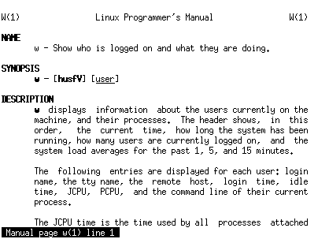

第 2 章：每个 Linux 用户都应该的知识

47

使用 `man` 工具查看系统手册中的页面。作为 `man` 的参数，给出想要查看的手册页的程序名称（因此，要查看 `man` 的手册页，输入 `man man`）。

> 查看 `w` 的手册页，输入：

```bash
$ man w
```

此命令显示 `w` 的手册页，如图 2-2 所示。

*图 2-2。阅读手册页。*

使用上下方向键浏览手册页。按 `Q` 停止查看手册页并退出。由于 `man` 使用 `less` 显示文本，请参见食谱 9.1 [浏览文本]，第 211 页。

**注意：**尽管名为手册页，手册页并不总是包含完整文档；它通常包含文档名称以及指向各个章节的 Info `menu`。

48

《Linux 烹饪指南》，第 2 版

要打印手册页，请参见食谱 25.3 [打印手册]，第 522 页。

## 2.8.5 阅读 Info 手册

GNU Info 系统是一种以 Info 格式编写的在线超文本系统。这种文档比手册页更完整，通常给定软件包的 Info 文档将是一整本书。Free Foundation 发布的所有手册都以 Info 格式发布；这些手册包含的内容与从 Free Foundation 直接购买的纸质手册相同。

有多种方法可以浏览 Info 文档：你可以使用独立的 `info` 工具、在 `Emacs` 编辑器中阅读 Info（参见食谱 10.1 [使用 Emacs]，第 232 页），或使用为此设计的其他工具。此外，还可以将 Info 文档转换为 html 的工具，可以在网页浏览器中阅读（参见食谱 5.10 [浏览文件和目录]，第 157 页）。

要用 `info` 工具读取工具或应用程序的 Info 手册，将其名称作为参数给出。无参数时，`info` 会打开系统的“Top”菜单，列出系统中安装的所有手册。

> 查看系统中所有的 Info 手册，输入：

```bash
$ info
```

此命令从系统的“Top”菜单启动 `info`，显示可用手册列表，如图 2-3 所示。

使用方向键浏览信息的“页面”，称为 Info `node`。节点是层级排列的。每个 Info 文档都有一个“Top”节点，类似于打印书籍的前言和目录；它通常包含文档名称以及指向各个章节的 Info `menu`。章节节点将包含指向其部分的菜单，以此类推。

其他节点的链接也出现在菜单项和交叉引用中，看起来相同：一个星号（`*`）、它指向的节点名称，以及一个或两个冒号（`:` 或 `::`）。要跳转到链接指向的节点，将光标移动到链接中节点名称的任何部分并按 `RET`。

按下 `H` 运行描述如何使用 `info` 的教程。按下 `Q` 停止阅读文档并退出程序。你可以在处于 `info` 的任何时候按下这些按键。

要读取特定工具或应用程序的 `Info` 文档，请将其名称作为参数传递给 `info`；如果该工具没有 `Info` 手册，`info` 将显示该工具的 man 页面（帮助页）。

> 要读取 `tar` 工具的 `Info` 文档，输入：

```bash
$ info tar
```

此命令会在 `info` 中打开 `GNU tar` 手册的副本。

要读取以 `Info` 格式编写的文件内容，请使用 `-f` 选项指定要读取的文件名。这对于读取你从其他处获取的 `Info` 文件非常有用，这些文件并不位于与其它已安装的 `Info` 文件相同的 `/usr/info` 目录中。`Info` 可以自动识别并展开压缩的且具有 `.gz` 扩展名的 `Info` 文件（参见参见食谱 8.4 [压缩文件]，第 196 页）。

> 要读取当前目录下名为 `faq.info` 的 `Info` 文件，输入：

```bash
$ info -f faq.info
```

此命令启动 `info` 并打开 `Info` 文件 `faq.info`，从文件的顶部节点开始。

50

《Linux 食谱》，第 2 版

要读取 `Info` 文件中的特定 `node`（节点），请将带引号的节点名称作为 `-n` 选项的参数。

> 要读取当前目录下的 `Info` 文件 `faq.info` 并从 `Text` 节点开始，输入：

```bash
$ info -n 'Text' -f faq.info
```

**注意：**你也可以直接从 `Emacs` 编辑器读取 `Info` 文；在 `Emacs` 中输入 `CTRL-H i` 启动 `Emacs Info` 阅读器，然后使用与独立 `info` 工具相同的命令（参见参见食谱 10.1.1 [熟悉 Emacs]，第 232 页）。

`Emacs` 的“增量”搜索命令 `CTRL-S` 在 `info` 中同样有效；这是一种在整个 `Info` 文本（如这整本书）中搜索单词或短语的非常快速、高效的方法（参见食谱 14.9.1 [在 Emacs 中增量搜索]，第 352 页）。

有些人任何事情都使用 `Info`；在 Linux 系统上，如果工具缺少 `Info` 文档，`Info` 被设置为在 `Info` 中显示该工具的 man 页面。因此，如果 `foofoo` 工具没有任何 `Info` 手册，输入 `info foofoo` 将给你它的 man 页面。

## 2.8.6 读取系统文档和帮助文件

### Linux 文档项目 HOWTO

- DEB：`doc-linux-html`
- `doc-linux-text`
- RPM：`howto`
- WWW：`http://tldp.org/`

`/usr/doc` 目录用于杂杂文档：howtos、faqs、特定发行版的文档文件以及随命令提供的文档。（要了解更多关于文件和目录的知识，请参见第 5 章 [文件和目录]，第 125 页。）要审阅这些任何一个文件，请使用 `less`，它在食谱 9.1 [审阅文本]，第 211 页中有详细描述。

当安装一个软件包时，它除了手册页和 `Info` 手册之外可能有的任何额外文档文件都会放置在此处的以该包命名的子目录中。在某些系统中，`/usr/doc` 被 `/usr/share/doc` 目录取代；另一些系统两者兼有。因此，如果文件不在它应该在的位置，请尝试查看 `/usr/share/doc/`。

例如，用户字典众名的位于 `/usr/dict/words`。在现在的某些发行版中，它已被移动到 `/usr/share/dict/words`，但如果你想将其恢复到经典位置，你（作为超级用户）可以从前者到后者创建一个符号链接（参见食谱 5.7 [给文件起多个名称]，第 152 页）。

第 2 章：每个 Linux 用户都应该知道的 51

例如，`hostname` 包的额外文档位于 `/usr/doc/hostname`，`passwd` 包的文档位于 `/usr/doc/passwd`。大多数软件包都有名为 `README` 的文件，通常包含相关信息。该文件通常被压缩为 `README.gz`，在这种情况下你可以使用 `zless` 代替 `less`。

Linux 文档项目（`ldp`）监督了超过 100 个 `howto` 文件的创建，每个文件涵盖了基于 Linux 系统安装或使用的一个方面。

`ldp` howtos 是存储在 `/usr/doc/HOWTO` 目录下的压缩文本文件；要查看它们，请使用 `zless`。

文件 `/usr/doc/HOWTO/HOWTO-Index.gz` 包含安装的所有 `howto` 文档的注释索引。5

`/usr/doc/FAQ` 目录包含许多关于各种主题的 `faq`（常见问题解答）文件。

最后，某些发行版在 `/usr/doc` 中保留了一个用于自身文档的目录；例如，Debian 使用 `/usr/doc/debian` 用于与该发行版相关的文档：组成 Debian `faq` 的文件位于 `/usr/doc/debian/FAQ` 目录，提供 html 格式（你可以在 Web 浏览器中查看（参见 5.10 [浏览文件和目录]，第 157 页））和压缩文本文件（你可以使用 `zless` 查看）。

> 这里有两种使用它的方法。

- 在 `lynx` 浏览器中查看 Debian `faq` 的 html 版本，输入：

  ```bash
  $ lynx /usr/doc/debian/FAQ/debian-faq.html
  ```

- 在 `zless` 中查看 Debian `faq` 的压缩文本版本，输入：

  ```bash
  $ zless /usr/doc/debian/FAQ/debian-faq.txt.gz
  ```

`ldp` 文档也有其他格式，包括 html。

52

《Linux 烹饪指南》，第 2 版

第 3 章：Shell

53

## 3. Shell

本章的主题是 `shell`，读取你的命令输入并运行指定命令的程序。它的名字是因为它提供了一个覆盖，保护你免受外部环境的影响，就像海洋中软体动物的硬壳一样。`shell` 是你和系统之间的中介，所有的交互都通过它完成；从你成功登录系统的时刻起直到你注销的那刻，你被认为“处于”一个 `shell` 中。

在 Recipe 3.9.5 [使用其他 Shell] 第 92 页中给出了其他推荐的 `shell` 列表。有关在本文章提供的内容之外使用 Bash 的更多信息，请参阅 `bash` 的 Info 文档（参见 Recipe 2.8.5 [阅读 Info 手册]，第 48 页）。

## 3.1 在命令行处输入

在 Recipe 2.4 [运行命令] 第 36 页中，你学习了如何通过在 `shell` 提示符处输入命令来运行命令。在 `shell` 提示符处输入命令的行称为 `command line`（命令行，也称为输入行）。在命令行上编写命令的过程被称为 `command line editing`（命令行编辑）。

接下来的章节描述了命令行编辑的一些重要功能，例如对特殊字符和字符串加引号、让 shell 全全你的输入、重新运行命令以及运行多个命令。

**注意：**有关 Bash 命令行编辑功能的更多信息，请参阅 `bash` 的 Info 文档（参见 Recipe 2.8.5 [阅读 Info 手册]，第 48 页）。

### 3.1.1 使用基础命令行编辑键

有特殊的按键可以在输入行中移动并编辑你正在输入的行；下表描述了这些键。

#### 输入命令

| 命令 | 描述 |
| :--- | :--- |
| 插入 `text` | 在光标处插入 `text`；光标右侧已有的任何文本都将向右移动以容纳新文本。 |
| `RET` | 将命令行发送给 `Bash` 执行（换句话说，它运行在 `shell` 提示符处输入的命令）。你不需要在命令行的最右端输入 `RET`；你可以在光标位于命令行任意位置时输入它。 |

#### 剪切和粘贴

| 命令 | 描述 |
| :--- | :--- |
| `BKSP` 或 `CTRL - H` | 删除光标左侧的字符。 |
| `DEL` 或 `CTRL - D` | 删除光标下方的字符。 |
| `CTRL - K` | 杀死（或“剪切”）输入行中从光标所在字符到行尾的所有文本。 |
| `CTRL - U` | 杀死输入行中光标左侧的所有内容。 |
| `CTRL - Y` | 提取（或“粘贴”）上次杀死的文本。文本插入到光标所在。 |

#### 移动

| 命令 | 描述 |
| :--- | :--- |
| `CTRL - A` | 将光标移动到输入行的开头。 |
| `CTRL - E` | 将光标移动到输入行的结尾。 |
| `CTRL - F` | 将光标向右（前）移动一个字符。 |
| `CTRL - B` | 将光标向左（后）移动一个字符。 |
| `ALT - F` | 将光标向前移动一个 `word`。 |
| `ALT - B` | 将光标向后移动一个 `word`。 |
| `CTRL - L` | 清终端屏幕，并在顶部重绘当前输入行。 |

**注意：**这些键盘命令与 `Emacs` 编辑器使用的相同（参见 Recipe 10.1 [使用 Emacs]，第 232 页）。许多其他 `Emacs` 键盘命令在命令行也有效（参见 Recipe 10.1.3 [使用基础 Emacs 编辑键]，第 237 页）。而且，对于 `Vi` 爱好者，可以配置 `Bash` 来识别 `Vi` 风格的绑定（参见 Recipe 3.7.3 [使用 Shell 启动文件]，第 86 页）。

### 3.1.2 输入控制字符

可以通过 `CTRL - V`（shell 的字面插入函数）后跟你想要的控制字符，在输入行上输入控制字符。

> 要在输入行的当前位置插入分页符（`Control-L`），请输入：

```text
CTRL - V
CTRL - L
```

### 3.1.3 为保留字符加引号

某些字符是 `保留` 的，它们对 shell 本身具有特殊含义，例如美元符号（`$`）、单引号（`'`）、双引号（`"`）、感叹号（`!`）、反斜杠（`\`）以及将你在命令行输入的内容发送给 shell 执行的换行符（`RET`）。在将这些字符作为参数传递给命令之前，你必须对其进行 `quote`（引用）。

有多种方法引用字符。每种方法适用于特定的用途，因此你应该了解它们之间的区别。有时，各种引用方法会在同一个参数中组合（参见下文方法 #3 的最后一个示例）。

为了演示引用，接下来的示例将使用 `echo`，这是一个简单的工具，用于显示传递给它的参数的任何文本（技术上，此命令将其参数回显到标准输出——参见 Recipe 3.2 [重定向输入和输出]，第 67 页）。

#### 方法 #1

要引用保留字符，在其前面加一个反斜杠（`\`）。反斜杠是 `Bash` 的 `escape character`（转义字符）；紧随其后的字符将被视为 Literal，而不具有任何保留含义。该规则的唯一例外是换行符（参见 Recipe 3.1.12 [输入长行]，第 66 页）。

> 这里是使用此方法的一些示例。

- 要显示字符串“Isn't this nice?”，输入：

  ```bash
  $ echo Isn\'t this nice?
  ```

  输出：

  ```text
  Isn't this nice?
  $
  ```

- 要显示“Isn't this nice!”，输入：

  ```bash
  $ echo "Isn\'t this nice!"
  ```

  输出：

  ```text
  Isn't this nice!
  $
  ```

- 要显示 `$HOSTNAME is nice!`，输入：

  ```bash
  $ echo \$HOSTNAME is nice!
  ```

  输出：

  ```text
  HOSTNAME is nice!
  $
  ```

- 要显示 "$HOSTNAME is nice!"，输入：

  ```bash
  $ echo \"$HOSTNAME is nice!\"
  ```

  输出：

  ```text
  HOSTNAME is nice!
  ```

最后的示例使用了 `$HOSTNAME`，其值为主机名（参见 Recipe 3.5 [使用变量]，第 77 页）。首先 `$HOSTNAME` 被显示了。

**注意：**对于单个保留字符，这是最简单的引用方法；传递短语时你需要转义所有空格。

```bash
$ echo '
```

#### 方法 #2

使用单引号（`'`）包裹字面短语。引号内的所有字符都被字面处理，而不具有保留含义——因此你甚至引用变量。单引号中无法传递的字符是单引号本身。

> 这里是使用此方法的一些示例。

- 要显示反斜杠，输入：

  ```bash
  $ echo '\'
  ```

  输出：

  ```text
  \
  $
  ```

- 要显示“! /”，输入：

  ```bash
  $ echo '! /'
  ```

  输出：

  ```text
  ! /
  $
  ```

- 要显示 `$HOSTNAME is nice!`，输入：

  ```bash
  $ echo '$HOSTNAME is nice!'
  ```

  输出：

  ```text
  HOSTNAME
  is nice!
  $
  ```

**注意：**第二种方法是较简单的引用方法之一。

#### 方法 #3

使用双引号（`"`）包裹短语，以保留某些字符的特殊含义：美元符号（`$`）、反引号（`` ` ``）、感叹号（`!`）和反斜杠（`\`）。

这意味着：变量会被展开为其值（参见 Recipe 3.5 [使用变量]，第 77 页），可以指定命令输出（参见 Recipe 3.1.11 [将命令输出作为参数]，第 65 页），可以引用命令历史（参见 Recipe 3.4 [使用你的命令历史]，第 74 页），并且可以像上述方法一样转义字符。

你可以传递单引号和换行符；要传递双引号、美元符号、反引号或反斜杠，请先用反斜杠（`\`）对其进行转义。在双引号外部转义感叹号。

> 这里是使用此方法的一些示例。

- 要显示“Isn't this nice?”，输入：

  ```bash
  $ echo "Isn't this nice?"
  ```

  输出：

  ```text
  Isn't this nice?
  $
  ```

- 要显示“Isn't $HOSTNAME it?”，输入：

  ```bash
  $ echo "Isn't \$HOSTNAME it?"
  ```

  输出：

  ```text
  Isn't $HOSTNAME it?
  $
  ```

- 要显示“Isn't this $HOSTNAME?”，其中 `$HOSTNAME` 是要展开的 shell 变量，输入：

  ```bash
  $ echo "Isn't this $HOSTNAME?"
  ```

  输出：

  ```text
  Isn't this [value]?
  ```

这不幸运吗？

```text
$
```

- 要输出“Wow!This isn't "$HOSTNAME"!”，其中第一个感叹号后有一个换行符，请输入：

  ```bash
  $ echo "Wow!" "!"
  > "This isn't $HOSTNAME!"
  ```


Wow!  
This isn't `"$HOSTNAME"`!

在倒数第二个例子中，系统的主机名是幸运的。在第二个和最后一个例子中，文本“`$HOSTNAME`”被字面量引用，没有被扩展为变量；通过省略直接位于美元符号之前的反斜杠，shell 就会扩展该变量。

**注意：** 有时你可以在双引号中引用感叹号而没问题，但因为它是预留用于引用你的 Bash 命令历史的，在错误的上下文中使用可能会导致意料之外的结果。除非你只使用单引号方法，否则，在双引号之外转义感叹号是最安全的。

## 方法 #4

要将特殊字符作为字符串传递，请将它们提供为 `$'string'`，其中 `string` 是要传递的字符字符串。这被称为“ansi-c 样式”引用。

字符串中通常包含某些字符的特殊反斜杠转义序列，如下表所示。

- `\a`：警报（响系统蜂鸣声）。
- `\b`：退格。
- `\e`：转义键（Escape）。
- `\f`：分页。
- `\n`：换行。
- `\r`：回车。
- `\t`：水平制表。
- `\v`：垂直制表。
- `\\`：反斜杠。
- `\NNN`：ASCII 码为八进制（基 8）`NNN` 的字符。

⇒ 这里是使用它的几种方法。

- 要输出字符串“Hello”后跟两个换行符，输入：

```bash
$ echo Hello$'\n\n'

RET

Hello

```

$

- 要输出段落标记字符（八进制字符代码 266），输入：

```bash
$ echo $'\266'

RET

¶

```

$

- 要向文件 `draft` 中追加一个换行符和一个段落标记字符（八进制字符代码 266），输入：

```bash
$ echo $'\n\266' >> draft

RET

```

## 3.1.4 让 shell 补全你输入的内容

*补全*（Completion）是指 Bash 尽力为你完成输入。要使用它，在输入行上按下 `TAB` 键，shell 将尽力地*补全*光标左侧的单词。补全是那种一旦你开始使用，你就会怀疑自己过去是如何在没有它的情况下过来的东西之一。

补全对文件名和命令名都有效，取决于你按下 `TAB` 键时光标的上下文。

当有多种方法可以补全一个单词时，shell 会发出蜂鸣声提醒你；再次按下 `TAB` 将显示可能的选项，然后重新绘制你的命令行。如果选项很多，shell 此时会问你是否真的想显示所有选项。

⇒ 要使用补全功能将 `/usr/lib/emacs/20.7/i386-debian-linux-gnu/` 目录作为 `ls` 命令的参数，输入：

```bash
$ ls /usr/lib/* TAB

*发出蜂鸣声*

TAB

显示所有 767 种可能性？(y 或 n) n

$ ls /usr/lib/*e TAB

*发出蜂鸣声*

TAB

elm-me+

emacs

emacsen-common

entity-map

$ ls /usr/lib/e *m* TAB

*发出蜂鸣声*

$ ls /usr/lib/emacs TAB

*发出蜂鸣声*

$ ls /usr/lib/emacs TAB

emacs

emacsen-common

$ ls /usr/lib/emacs */* TAB 20.7/ TAB i386-debian-linux-gnu/

```

注意只需输入字母“e”然后按两次 `TAB` 键就会调出一系列文件，而“em”被补全为“emacs”，因为此目录中所有以字母“em”开头的选项至少补全为该单词。

最后两个 `TAB` 补全是在没有发出蜂鸣声的情况下完成的，这意味着补全的是唯一的可能。

**注意：** 许多应用程序也支持命令和/或文件名补全；其中最著名的例子是 Emacs 编辑器（参见食谱 10.1 [使用 Emacs]，第 232 页）。

## 3.1.5 在命令行撤销错误

如果你想撤销刚刚在输入行上输入的内容，请输入 `CTRL-*`。

如果你一直在使用退格键删除内容，shell 会记住你删除了什么并将其放回输入行。你可以连续多次使用此撤销命令，使行返回到更早的状态。如果你刚刚输入了一行短命令，那么此命令将将其完全删除。

你也可以通过输入 `CTRL-*U` 来删除光标左侧的所有内容。

最后，你可以对字符进行*交换*（transpose）：使用 `CTRL-*T` 交换光标前的两个字符，使用 `ALT-*T` 交换光标前的两个单词。这对于纠正拼写错误很有用。

⇒ 要交换字母“m”和“o”：

交换光标前的两个字符，使用 `CTRL-*T`。交换光标前的两个单词，使用 `ALT-*T`。这对于纠正拼写错误很有用。

## 3.6 重复最后一个命令

输入 `!!` 重复最后一个命令。你也可以通过 `CTRL-x` 编辑最后一个命令。

⇒ 要交换字母“m”和“o”：

交换光标前的两个字符，使用 `CTRL-*T`。交换光标前的两个单词，使用 `ALT-*T`。这对于纠正拼写错误很有用。

## 3.1.7 运行命令列表

有两种方法：一种是在命令行指定命令，另一种是从文件获取。

### 方法 #1

要在输入行上运行多个命令，请按你的运行顺序输入每个命令，并用分号（`;`）分隔每个命令。这是一种运行多个非交互命令的快捷方法。

⇒ 这里是使用它的两种方法：

- 清屏然后退出系统，输入：

```bash
$ clear; logout

```

- 运行三次 `hostname` 命令，输入：

```bash
$ hostname; hostname; hostname

```

**注意：** 这种组合命令有很多用途。一种流行的用法是先运行 `sleep`，然后运行另一个命令。

### 方法 #2

你也可以通过将命令放在文件中来运行命令列表。

使用特殊的 `.` 命令，并将文件名作为参数。这将在当前 shell 中运行文件中的所有命令。

⇒ 要运行 `~/lists/nightly` 中的命令，输入：

```bash
$ . ~/lists/nightly

```

**注意：** 这种方法适用于运行带有大量参数的命令。例如，你可能想要运行一个接受 url 作为参数的工具，并且有一系列这样的 url 需要运行。使用文本编辑器将 url 复制到文件中，每行一个，然后在每行的开头插入工具名称。

内置命令 `source` 是 `.` 的同义词；使用这种方法运行文件命令通常被称为“源”（source）文件。

## 3.1.8 运行一个命令后运行另一个

正如你可以用分号将命令连接在一起并在列表中运行它们一样，你还可以指定某个命令*仅当*在前一个命令执行成功时运行。要这样做，请使用特殊的 `&&` 控制运算符分隔命令。如果第一个命令执行成功，则运行第二个命令；如果第一个命令执行失败——即命令不存在，或者它返回错误或任何非零退出状态——则不运行第二个命令。

- 运行 `foo`，并且在 `foo` 存在且成功运行后才运行 `bar`，输入：

```bash
foo && bar

```

- 不区分大小写地在 `operations` 文件中搜索“planning”一词，只有在文件中找到该词时才查看操作，输入：

```bash
grep -i planning operations && less operations

```

## 3.1.9 运行一个或另一个命令

要指定运行一个*或*另一个命令，请使用特殊的控制运算符 `||` 来分隔两个命令。如果第一个命令存在，shell 将运行它并忽略第二个命令；如果第一个命令不存在、返回错误，或者其他以非零退出状态返回，则 shell 将运行第二个命令。

⇒ 要运行 `w` 或 `who`，输入：

```bash
w || who

```

在例例中，如果 `w` 存在且运行无错误，shell 将运行它并退出；否则，它将运行 `who`。

## 3.1.10 自动回答命令提示

有时，我们希望在不直接与命令交互的情况下回答交互式命令。使用 `yes` 来实现此；默认情况下，它会输出“y”并跟一个换行符，直到被杀掉。如果你有一个命令需要多次请求确认，且你希望将回答过程自动化，可以将 `yes` 的输出管道到该命令中。

⇒ 要运行命令 `barfoo` 并对它的所有提示自动回答 `y`，输入：

```bash
yes | barfoo

```

若要输出“y”以外的内容，请将其指定为参数。若要指定输出的次数，可以将 `yes` 管道给 `head`，并将输出次数作为选项。

⇒ 这里有两种使用它的方法。

- 使用 `mv` 将当前目录下所有以 `.sample` 结尾的文件移动到名为 `live` 的目录，但在覆盖任何现有文件时回答 `no`，输入：

```bash
yes n | mv *.sample live

```

- 运行命令 `farboo` 并用你的用户名自动回答五次提示，输入：

```bash
yes `whoami` | head -5 | farboo

```

## 3.1.11 将命令的输出作为参数

你可以让 shell 用其输出替换给定的命令。这被称为*命令替换*，用于指定将某些命令的输出作为其他命令的参数。

有两种方法可以实现，如下文所示。

**注意：** 你可以嵌套替换，将一个替换放在另一个替换内部。

### 方法 #1

要替换命令的输出，将命令括在括号中并在前面加上美元符号（`$`）。

⇒ 在系统中查找任何名称中包含你的用户名的文件，输入：

```bash
locate $(whoami)

```

### 方法 #2

要替换命令的输出，将命令括在反引号（`` ` ``）中。

⇒ 在系统中查找任何名称中包含你的用户名的文件，输入：

```bash
locate `whoami`

```

**注意：** 这是旧式方法。包裹任何嵌套替换的反引号必须在每个前面都加上反斜杠字符（`\`）；同样也使用反斜杠来指定美元符号或字面反斜杠字符。

## 3.1.12 输入长行

当你输入一个长命令并希望保持屏幕上的外观整洁时，使用反斜杠（`\`）后跟换行符在该处停止当前行，并在屏幕的下一行开头继续它。

shell 会在新行前加一个特殊的“>`”提示符，这样你就知道这一行是上一行的延续。反斜杠和换行符都会被 shell 忽略，就像第一行开头的文本和随后的行是无缝衔接的一条长行一样。

在行的任何位置断行都不要紧，你可以使用这种方法扩展到任意数量的行。

⇒ 这里有两种使用它的方法。

- 在跨越两个屏幕行输入时回显字符串‘verylongword’，输入：

```bash
echo ver\

> ylongword

```

```text
verylongword
```

- 在跨越四个屏幕行输入时回显字符串‘verylongword’，输入：

```bash
ech\

> o verylo\

> ngwor\

> d

```

```text
verylongword
```

**注意：** 看起来可能并不总是那么整洁，但你可以在不使用这种技术的情况下输入长命令。

## 3.2 重定向输入和输出

shell 在指定的“流”中移动文本。*标准输出*是 shell 流传输命令文本输出的地方——默认是你的终端屏幕。*标准输入*（通常是键盘）是你为命令输入数据的地方。当命令读取标准输入时，它通常会一直读取文本，直到你在单独的一行输入 `CTRL - D` 为止。

当命令运行并带错误退出时，错误消息通常输出到你的屏幕，但它是一个独立的流，称为*标准错误*。

你通过*重定向*将这些流重定向到一个文件，甚至是另一个命令。接下来的章节描述了你可以用于重定向它们的 shell 重定向运算符。

### 3.2.1 将输入重定向到文件

要重定向标准输入（有时称为“stdin”），使用 `<` 运算符。要执行此操作，在命令后面加上 `<` 和文件名。

⇒ 将标准输入重定向到名为 `keywords` 文件：

```bash
apropos < keywords

```

### 3.2.2 重定向输出到文件

有两种运算符可以将标准输出（或“stdout”）重定向到文件。`>` 运算符会覆盖已有的文件，而 `>>` 运算符会将输出追加到文件。如果指定的文件不存在，任何一个运算符都会创建它。

要使用任何运算符，在命令后面加上运算符和应写入的文件名。

⇒ 这里有两种使用它的方法。

- 将 `apropos bash` 的输出重定向到文件 `suggestions`，如果存在则覆盖：

```bash
apropos bash > suggestions

```

- 将 `apropos shells` 的输出追加到现有文件 `suggestions`：

```bash
apropos shells >> suggestions

```

### 3.2.3 将错误消息重定向到文件

要重定向标准错误流（有时称为“stderr”），使用 `2>` 运算符。在命令后面加上该运算符和文件名。

⇒ 将 `apropos bash` 的标准错误重定向到文件 `command.error`：

```bash
apropos bash 2> command.error

```

与重定向标准输出有两个变体；`2>>` 的工作方式与 `2>` 相同，但会将标准错误追加到文件（如果文件存在）。

⇒ 将 `apropos shells` 的标准错误追加到现有文件 `command.error`：

```bash
apropos shells 2>> command.error

```

要将*所有*标准输出和标准错误重定向到同一个文件，请使用 `&>` 代替 stdout 和 stderr 运算符。

⇒ 将 `apropos shells` 的标准输出和标准错误重定向到名为 `commands` 文件：

```bash
apropos shells & > commands

```

**注意：** `&>` 运算符会覆盖预先的文件；在这种情况下没有用于追加 stdin 和 stderr 的 `&>>` 运算符。

### 3.2.4 将输出重定向到另一个命令的输入

*管道*是指将一个命令的标准输出连接到另一个命令的标准输入。你通过按顺序指定两个命令并用竖线字符（`|`，有时称为“管道”）分隔它们来实现这一点。

以这种方式构建的命令被称为*管道线*（pipelines）。

管道（Pipes）经常与 `filter`（过滤器）配合使用，过滤器是指接收输入、以某种方式对其修改并将结果发送到标准输出的工具。你可以通过流水线将过滤器和工具连接起来，将每一个工具的输出推向下一个工具的输入。管道作为应用和组合过滤器的手段非常强大，以至于我们可能专门用一章来讨论“文本过滤”；目前，更改文本格式的过滤器有自己的专门章节，而其他过滤器在书的其他地方有描述。

将显示大量文本输出的命令管道到输出较少的工具通常很有用，后者是一种用于查阅文本的工具（参见 Recipe 9.1 [查阅文本]，第 211 页）。

⇒ 要将 `apropos bash shell shells` 的输出管道到 `less`，请输入：

```bash
$ apropos bash shell shells | less

```

这会将命令 `apropos bash shells` 的标准输出重定向到命令 `less` 的标准输入，从而将其显示在屏幕上供查阅。

### 3.2.5 将输出重定向到多个地方

使用 `tee` 将标准输出重定向到多个地方。`tee` 的命名源于那些 T 型的管道接头，它们的作用与管道完全相同。

当你在流水线的末尾使用 `tee` 时，它会将输入同时重定向到标准输出和你作为参数提供的文件名。

⇒ 要将 `apropos bash shell shells` 输出的副本写入到名为 `shell.commands` 的文件，并同时用 `less` 查阅输出，请输入：

```bash
$ apropos bash shell shells | tee shell.commands | less

```

使用 `-a` 选项向文件追加（`append`）内容，而不是覆盖现有数据。

要重定向到多个文件，请将多个 `tee` 命令组合在一起。

⇒ 要将 `apropos bash shell shells` 输出的副本写入到名为 `shell.commands` 的文件，将输出的副本追加到名为 `command.suggestions` 的文件，并同时用 `less` 查阅输出，请输入（全部写在一行）：

```bash
$ apropos bash shell shells | tee shell.commands | tee -a command.suggestions | less

```

### 3.2.6 将内容重定向到无处

文件 `/dev/null` 是一个特殊的设备文件，称为“空设备”（`null device`）。它不包含任何内容；你可以把它想象成巨大的无底洞，你永远无法到达或看到它的深度。如果你尝试显示它的内容，你将一无所获，你发送到那里的内容将消失于无有，你永远无法将其找回。

这实际上非常有用！将任何不想看到的内容重定向到 `/dev/null`——例如标准错误。你也可以执行相反的操作，将 `/dev/null` 的内容写入某些东西中，这对于那些需要某些可选输入但你希望在不提供任何此类输入的情况下运行的命令来说很有处。

⇒ 要运行命令 `errant` 并将任何错误消息重定向到 `/dev/null`，请输入：

```bash
$ errant 2> /dev/null
```


**注意：**“发送到`/dev/null`”是一个常用短语。现在你知道人们这样做是什么意思了。有些人称其为“比特桶”（bit bucket）。现在你也知道那个了。

## 3.3 管理作业

你在特定 shell 中运行的进程被称为`jobs`（作业）。

你可以同时从一个 shell 运行多个作业；读取标准输入并写入标准输出的作业是前台作业（`foreground`），而任何其他作业都被认为在后台（`background`）运行。

shell 为每个作业分配一个唯一的`job number`（作业编号）。你可以将其作为参数为命令指定特定的作业。只需在作业编号前加上百分号（`%`）即可。

要找到正在运行作业的编号，请列出你的作业（参见 Recipe 3.3.4 [列出你的作业]，第 73 页）。

以下章节介绍了管理作业的各种命令。

### 3.3.1 挂起作业

输入`CTRL-Z`可挂起或停止前台作业——这对于你想在 shell 中做其他事情、稍后返回当前作业时非常有用。作业将停止，直到你将其带回前台或让它在后台运行（参见 Recipe 3.3.3 [将作业置于前台]，第 73 页，并参见 Recipe 3.3.2 [将作业放入后台]，第 72 页）。

例如，如果你正在`info`中阅读文档，输入`CTRL-Z`将挂起`info`程序并返回到 shell 提示符，你可以在那里做其他事情（参见 Recipe 2.8.5 [读取 Info 手册]，第 48 页）。shell 会输出一行，提供挂起作业的作业编号（括号内）、文本“Stopped”表示作业已停止，以及命令行本身，如下所示：

```
[1]+

Stopped

info -f manual.info
```

在此示例中，作业编号为 1，停止的命令是“info -f manual.info”。作业编号旁边的`+`字符表示最近的一个作业。

如果你在注销时有任何挂起的作业，shell 会提示你，而不是直接注销，如图 3-2 所示。

```bash
$ logout

There are stopped jobs.

$
```

*图 3-2。注销时存在挂起的作业。*

此时，你可以列出你的作业（参见 Recipe 3.3.4 [列出你的作业]，第 73 页）。

### 3.3.2 将作业放入后台

输入`fg`将后台作业移至前台。默认情况下，`fg`作用于最近的后台作业。

⇒ 要将最近的后台作业带回前台，请输入：

```bash
$ fg
```

当你有多个后台作业时，要将特定作业移至前台，请指定作业编号作为选项。

⇒ 要将作业 3 带回前台，输入：

```bash
$ fg %3
```

除非你另有指定，否则新作业都在前台运行。

若要在后台运行作业，请在输入行末尾加上符号`&`。

⇒ 例如，要在前台启动命令`apropos bash shells`，先挂起它，然后将其放入后台，你需要输入：

```bash
$ apropos bash shells

CTRL-Z

[1]+

Stopped

apropos bash shells

$ bg

[1]+ apropos shell &
```

如果你有挂起的作业，通过提供作业编号来指定要放入后台的作业。

⇒ 要在后台运行作业 4，输入：

```bash
$ bg %4
```

完成后，shell 将列出作业编号、命令以及文本“Done”，表示作业已完成。

要将作业从前台移到后台，先挂起它（参见 Recipe 3.3.1 [挂起作业]，第 71 页），然后输入`bg`（代表“background”）。

### 3.3.3 将作业放入前台

输入`fg`将后台作业移至前台。默认情况下，`fg`作用于最近的后台作业。

⇒ 要将最近的后台作业带回前台，输入：

```bash
$ fg
```

当你有多个后台作业时，要将特定作业移至前台，请指定作业编号。

⇒ 要将作业 3 带回前台，输入：

```bash
$ fg %3
```

### 3.3.4 列出你的作业

要列出当前 shell 中运行的作业，输入`jobs`。

⇒ 要列出你的作业，输入：

```bash
$ jobs

[1]-

Stopped

apropos shell

[2]+

Stopped

apropos bash

$
```

此示例显示了两个作业——`apropos shell`和`apropos bash`。作业编号旁边的`+`字符表示最近的作业，`-`字符表示最近之前的作业。如果你没有当前作业，`jobs`不返回任何内容。

要列出系统中运行的所有进程，请使用`ps`而不是`jobs`——参见 Recipe 2.7 [列出进程]，第 41 页。

### 3.3.5 停止作业

输入`CTRL-C`在作业完成前中断前台作业，退出程序。

⇒ 要运行`cat`工具并在其于前台运行时中断它，请输入：

```bash
$ cat

RET
CTRL-C
RET
$
```

使用`kill`来中断（或“杀死”）一个后台作业，并将作业号作为参数。

⇒ 要杀死作业号为 2，请输入：

```bash
$ kill %2
```

RET

## 3.4 使用你的命令历史

你的命令`history`是你在当前和之前的 shell 会话中已经输入的命令的顺序列表。此历史列表中的命令被称为`events`（事件）。

默认情况下，`Bash`记得最后的 500 个`events`，但这个数字是可以配置的（请参见 Recipe 3.7.3 [使用 Shell 启动文件]，[使用 Shell 启动文件]，第 86 页）。

你的命令`history`存储在家目录下一个名为`.bash_history`的文本文件中；你可以像处理其他文本文件一样查看或编辑此文件。

拥有命令`history`提供的两个非常实用的功能是：重复你输入的最后一个命令，以及（如本章前面的介绍）对你的历史进行增量反向搜索。

以下章节将解释如何查看历史以及如何在命令行上指定历史事件。有关命令`history`的更多信息，请查阅`bash`的 Info 文档（参见 Recipe 2.8.5 [阅读 Info 手册]，[阅读 Info 手册]，第 48 页）。

### 3.4.1 查看你的命令历史

使用`history`查看你的命令`history`。它输出`.bash_history`中所有`events`的列表，每行一个，从最旧的事件开始。`Events`前有事件编号和两个空格。

⇒ 查看你的命令`history`，输入：

```bash
$ history

RET

1 who

2 apropos shell >shell-commands

3 apropos bash >bash-commands

4 history

$
```

此命令显示了你的命令`history`文件的内容，每行列出一个命令，每个命令前都有其`event number`。使用事件编号来指定历史中的该事件（参见 Recipe 3.4.3 [从历史中指定命令]，[从历史中指定命令]，第 76 页）。

如果你的历史很长，此列表将滚出屏幕，在这种情况下，你可能希望将输出通过到`less`以便浏览。通过将输出通过到`grep`来搜索过去的命令也是常见的（参见 Recipe 3.2.4 [将输出重定向到另一个命令的输入]，将输出重定向到另一个命令的输入]，第 69 页，以及 Recipe 14.1 [在文本中搜索单词]，在文本中搜索单词]，第 333 页）。

⇒ 在你的历史中搜索文本“apropos”，输入：

```bash
$ history | grep apropos

RET
2 apropos shell >shell-commands
3 apropos bash >bash-commands
5 history | grep apropos
$
```

此命令将显示你的历史中包含文本“apropos”的`events`。（输出的最后一行是你刚刚输入的命令。）

### 3.4.2 搜索你的命令历史

搜索历史有两种方法。

#### 方法 #1

你可以使用`Bash`的反向增量搜索功能`CTRL-R`来反向（`search`）你的命令历史。如果你记得最近输入过一条包含“foo”的命令行，并且希望重复该命令而无需重新输入，你会发现这非常有用。输入`CTRL-R`后跟文本`foo`，你输入过的包含“foo”的最后一个命令就会出现在输入行上。

与同名的`Emacs`命令（参见 Recipe 14.9.1 [在 Emacs 中增量搜索]，在 Emacs 中增量搜索]，第 352 页）一样，这被称为`incremental`（增量）搜索，因为它随着你的输入逐字符增加地构建搜索字符串。输入字符串“cat”将在你输入搜索字符串的每个字符时搜索（并显示）包含“c”、“ca”，最后是“cat”的输入行。再次输入`CTRL-R`将检索下一个匹配搜索字符串的命令行。

⇒ 这里有两种使用此功能的方法。

- 将你输入的包含字符串“grep”的最后一个命令放回输入行，输入：

```bash
$ CTRL-R
(reverse-i-search)`':grep
```

- 将你输入的包含字符串“grep”的倒数第三个命令放回输入行，输入：

```bash
$ CTRL-R
(reverse-i-search)`':grep
CTRL-R
CTRL-R
```

**注意：**当命令显示在输入行上，输入`RET`运行它。你也可以像往常编辑命令行。

#### 方法 #2

你也可以将历史通过`grep`输出输出匹配模式的行（参见 Recipe 14.2 [在文本中搜索短语]，在文本中搜索短语]，第 334 页）。这不会在输入行上放置任何内容，但会一次给出所有匹配项。你可能还希望将此输出通过到`less`等文本分页器（参见 Recipe 9.1 [浏览文本]，浏览文本]，第 211 页）。

⇒ 查看你的命令历史中包含文本“newfile”的所有行，输入：

```bash
$ history | grep newfile | less
```

RET

### 3.4.3 从历史中指定命令

你可以在输入行上指定历史中的过去事件以便再次运行它。

指定历史事件最简单的方法是在 shell 提示符处使用`up`和`down`箭头键来浏览历史。`up`键带你回到之前的事件，`down`键带你移动到更近的事件。当历史事件位于输入行上时，你可以像正常一样编辑它，并输入`RET`运行它。

通过编号指定历史事件，输入感叹号（`!`）后紧跟事件编号（参见 Recipe 3.4.1 [查看命令历史]，查看命令历史]，第 74 页）。

⇒ 指定事件编号 1，输入：

```bash
$ !1
```

RET

**注意：**特殊事件编号`!!`是运行你输入的最后一个命令的另一种方式。

## 3.5 使用变量

shell`variable`（变量）是一个存储值并具有唯一名称的符号。当引用它的名称时，就会给出它包含的值。变量对大小写敏感，因此`NAME`、`Name`和`name`都是不同的变量。

你可以分配自己的变量，但也有许多对 shell 有特殊含义的内置变量。其中`HOME`包含家目录名称。变量经常被脚本和程序使用。例如，一种约定是使用`EDITOR`变量来存储首选编辑器；程序经常检查此变量是否设置，并运行该编辑器。

变量在脚本中使用非常有用，脚本将在本章后面部分介绍。

以下配方将解释如何使用变量，并展示使用某些内置变量可以做的事情。有关这些变量的完整列表，请查阅`bash`手册（参见 Recipe 2.8.4 [阅读系统手册页]，阅读手册页]，第 46 页）。

### 3.5.1 分配变量

要分配新变量，输入其名称后跟一个等号`=`和应作为变量值的引号字符串。确保不要在等号两侧输入任何空格字符。

⇒ 创建名为`NAME`的新变量并赋值为“Mary Jones”，输入：

```bash
$ NAME='Mary Jones'
```

RET

值本身可以包含变量，这些变量在变量赋值时会被展开。你可以使用任何引用方法给出值，并可以指定命令的输出（参见 Recipe 3.1.11 [将命令的输出作为参数]，将命令输出作为参数]，第 65 页）。

⇒ 这里有两种使用此功能的方法。

- 给名为`NAME`的变量赋值`FIRSTNAME`和`LASTNAME`变量的内容，中间留一个空格，输入：

```bash
$ NAME="$FIRSTNAME $LASTNAME"
```

RET

- 给名为`NAME`的变量赋值`whoami`命令的输出，输入：

```bash
$ NAME=`whoami`
```

RET

要更改现有变量的内容，只需提供其名称作为要使用的变量。

⇒ 为名为`NAME`的现有变量分配新值，输入：

```bash
$ NAME="whoami"
```

RET

此命令将值“whoami”赋值给变量`NAME`。

### 3.5.2 引用变量

在命令中，通过在变量名之前加上美元符号（`$`）来引用变量。当执行命令时，shell 将首先将变量单词（以及美元符号）替换为存储在该变量单词中的值。这个过程被称为*扩展*（expansion）。

⇒ 要将`NAME`变量的值作为命令执行，请输入：

```bash
$NAME

RET
mary
$
```

如果`NAME`变量的值为“whoami”，将其作为命令引用将运行`whoami`工具（参见 Recipe 2.6.1 [显示你的用户名]，第 39 页）。在本文示例中，发生的就是这种情况，且用户名是`mary`。

### 3.5.3 显示变量的内容

当你想要查看变量的内容时，使用`echo`并将变量作为参数引用。

⇒ 要显示变量`NAME`的内容，请输入：

```bash
echo $NAME

RET
whoami
$
```

在本示例中，显示变量`NAME`包含字符串“whoami”。

当你想在变量名之后立即输出其他字符时，将变量名括在大括号（`{}`）中，并将美元符号放在外面且紧接其前。

⇒ 要显示变量`NAME`的内容并跟上字符串“now”，请输入：

```bash
echo ${NAME}now

RET
whoaminow
$
```

如果没有大括号，在 shell 看来就像是你正在引用一个名为`NAMEnow`的变量。

### 3.5.4 移除变量

关于变量，你可以移除两个部分：它的内容，以及变量本身。要移除现有变量的*内容*，请给它赋值一个新值，但不提供任何内容。该变量仍然存在，但它将被赋值为空字符串（有时称为“空字符串”，因为它的值是无）。

⇒ 要给名为`NAME`的变量赋予空字符串的值，请输入：

```bash
NAME=

RET
```

要移除变量本身（无论它包含什么值），请使用`unset`并提供变量名。

⇒ 要移除名为`NAME`的变量，请输入：

```bash
unset NAME

RET
```

### 3.5.5 列出变量

使用不带选项的`set`来显示当前 shell 中的所有变量及它们包含的值。

⇒ 要列出当前 shell 中的所有变量，请输入：

```bash
set

RET
```

### 3.5.6 更改 shell 提示符

特殊变量`PS1`用于 shell 提示符的文本。要更改 shell 提示符的文本，请更改此变量的内容。

⇒ 要将你的 shell 提示符改为“Your wish is my command:”，请输入：

```bash
PS1="Your wish is my command:"

RET
Your wish is my command:
```

由于替换文本包含空格，我对其加上了引号（参见 Recipe 3.1.3 [引用保留字符]，第 56 页）。

你可以在提示符变量中放置特殊字符，以便输出特殊文本。例如，`PS1`值中的字符“`\w`”会在 shell 提示符文本在该处列出当前工作目录。

⇒ 要将提示符更改为默认 Bash 提示符——当前工作目录后跟一个“$”字符——请输入：

```bash
PS1='\w $'

RET
~ $
```

下表列出了一些特殊字符及其在 shell 提示符中的文本输出。

- `\a`：警告或“铃声”字符，会触发系统铃声（你可以通过输入`CTRL-G`自己触发它）。
- `\d`：当前日期。
- `\h`：系统的主机名。
- `\n`：换行符。
- `\t`：当前系统时间（24 小时制）。
- `\@`：当前系统时间（12 小时制）。
- `\w`：当前工作目录。
- `\u`：你的用户名。
- `\!`：命令历史。

你可以在创建`PS1`时将这些特殊字符与普通字符结合。

⇒ 要将提示符改为当前日期、主机名和大于字符，请输入：

```bash
PS1='\d (\h)>'

RET
14 Dec 99 (ithaca)>
```

在本示例中，系统主机名是`ithaca`。

### 3.5.7 添加路径

要向路径中添加或删除目录，请使用文本编辑器修改`PATH`变量，正如它在你家目录下的`.bashrc`文件中定义的那样（参见第 231 页的编辑文本）。

例如，假设`.bashrc`中定义`PATH`的行如下：

```bash
PATH="/usr/bin:/bin:/usr/games:/games"
```

你可以通过如下修改将`/home/nancy/bin`添加到此路径：

```bash
PATH="/usr/bin:/bin:/usr/games:/games:/home/nancy/bin"
```

**注意：**参见第 5 章 [文件和目录] 获取关于路径的完整说明。

### 3.5.8 控制 shell 提示符

使用`alias`为命令设置别名；后面跟随别名名称、等号（`=`）以及别名单词应代表的引号字符串。

⇒ 要为退出命令设置别名，请输入：

```bash
alias bye="exit"

RET
```

此命令为当前 shell 中的退出工具设置了别名“bye”，因此输入`bye`将运行`exit`。


你可以在别名中包含选项和参数。这样做时，请确保将整个别名括在双引号中。

> ⇒ 要为允许颜色显示的终端设置`ls`别名以列出目录，请输入：`alias ls="ls --color=auto"`

```
RET
```

特殊变量`SECONDS`包含了 shell 运行的秒数。

> ⇒ 要查看 shell 运行了多少秒，请输入：`SECONDS=$`

```
RET
```

**注意：** 要获取 shell 以分钟、小时或其他单位的运行时间，你可以转换输出的秒数（参见食谱 29.5.1 [单位间的转换]，第 567 页）。

### 3.6 使用别名单词

*别名*是代表其他命令的单词——可能是工具名称、长命令行或你喜欢的任何内容。别名对于为常用命令创建短命令名非常有用。

#### 3.6.1 通过其他名称调用命令

要关闭邮件，将`MAIL`设置为空。

> ⇒ 要关闭邮件，请输入：`MAIL=`

```
RET
```

指定了`color=auto`选项，当输出重定向到能够显示颜色的终端时设置颜色。

这是一个常用的别名，许多 Linux 系统在默认的`.bashrc`文件中预配置了它。将“l”设为带有`-l`选项的`ls`名也很常见（参见方案 5.3.3 [列出文件属性]，第 136 页）。

当你定义了这个别名后，你仍然可以通过指定其他选项来向`ls`传递参数；因此，在这种情况下输入`ls -l`将执行`ls --color=auto -l`作为实际命令。

别名在 shell 查找路径（path）之前始终会被展开，因此，要运行一个名称与别名相同的工具或程序，请提供要运行程序的完整路径（关于路径的更多信息请参见第 5 章 [文件和目录]，第 125 页）。

当“ls”已定义为某些内容的别名时，要带`-l`选项运行实际的`ls`工具，请输入：

```bash
$ /bin/ls -l
```

**注意：** 当你定义一个别名时，它只在当前 shell 中有效。要让别名在每次运行 shell 时都生效，请将其放入你家目录下的`.bashrc`启动文件中，它是家目录中的一个隐藏文件。

#### 3.6.2 列出别名

要列出当前 shell 中定义的别名，只需使用不带任何参数的`alias`。

要列出当前定义的所有别名，输入：

```bash
$ alias
```

#### 3.6.3 删除别名

要删除别名，请使用`unalias`并将要删除的别名名称作为参数。它在 shell 会话期间会被移除，除非你再次将该词设为别名。

删除“ls”的别名，请输入：

```bash
$ unalias ls
```

**注意：** 如果你在`.bashrc`或`.bash_profile`文件中设置了别名，这将删除它——但仅针对当前 shell。要从以后所有的会话中删除此类别名，请编辑定义它的文件并移除特定的别名行。

### 3.7 使用 shell 脚本

你已经知道 shell 拥门编程语言；构成 Bash 编程语言的命令包含我在本章中讨论的那些。shell 程序简单来说是供 shell 执行的一系列命令；*shell 脚本*是一个包含此类序列的文本文件。脚本也是可执行的，因此你可以通过输入它们的名称作为命令来运行它们（参见方案 6.3.6 [使文件变为可执行]，第 170 页）。

下面的方案展示了如何创建和运行脚本，以及你如何在启动或停止运行 shell 时自动运行特殊脚本。

#### 3.7.1 创建 shell 脚本

由于 shell 脚本是文本文件，因此你使用文本编辑器来创建一个（参见第 10 章 [编辑文本]，第 231 页）；然后将文件设为可执行以便其运行。为 Bash 编写的脚本都包含两种方式之一编写的第一行：

```bash
#!/bin/bash
```

或

```bash
#!/bin/sh
```

两个示例中的井号和感叹号（`#!`）指示 shell 该文件包含要执行的命令；随其后的完整路径告诉 shell 使用哪个程序来执行命令——这可以是 shell 的名称、`perl`、`sed`、`awk`或其他命令语言的名称。

第一个示例告诉 Bash 该文件将由`bash`程序本身（可执行文件`/bin/bash`）执行，而不是其他程序。

第二个示例告诉 Bash 该文件将由`/bin/sh`执行，在现代系统中，它是`bash`可执行文件的另一个名称。`sh`曾是旧的 Bourne shell，Bash 取代了它。Bash 可以运行任何 Bourne shell 脚本，你会发现许多人仍然在他们的 Bash 脚本中写`/bin/sh`。

要创建一个名为`hello`且仅向标准输出输出文本“Hello, world”的 Bash shell 脚本，请执行以下操作：

1. 使用文本编辑器在名为`hello`的文件中放入以下内容：

   ```bash
   #!/bin/sh
   echo Hello, world
   ```

2. 使用`chmod`使文件变为可执行：

   ```bash
   $ chmod a+x hello
   ```

#### 3.7.2 运行 shell 脚本

你通过提供文件名作为命令来运行（或“执行”）shell 脚本，就像运行任何其他程序一样。该文件必须具有执行权限。从技术上讲，`/bin/sh`是指向`/bin/bash`的符号链接，这样做是为了与旧脚本的向后兼容（参见方案 5.7 [给文件起多个名称]，第 152 页）。脚本像其他类型的程序一样接受参数。

如果脚本存储在你的路径所在的目录中（参见方案 3.5.7 [添加到你的路径]，第 81 页），只需输入脚本名称即可运行它。

否则，提供脚本的路径（完整路径或相对路径）来运行它（完整和相对路径将在第 5 章 [文件和目录]，第 125 页中讨论）。

以下是使用此方法的几种方式：

- 运行存储在路径目录中的名为`hello`的脚本，输入：

  ```bash
  $ hello
  ```

- 运行存储在非路径目录中的名为`hello`的脚本，输入：

  ```bash
  $ ./hello
  ```

- 运行存储在你家目录中的名为`hello`的脚本，输入：

  ```bash
  $ ~/hello
  ```

**注意：** 为了保持整洁并避免必须通过全路径调用脚本，你应该将它们放在自己的目录中，正如方案 C [使用目录存放二进制文件] 第 727 页所述的那样。

#### 3.7.3 使用启动文件

每当你登录、注销或启动新 shell 时，shell 都会在你的家目录查找特殊文件并执行它们包含的命令。这些被称为启动文件，因为它们在你启动（或停止）shell 时会自动运行。

当你登录时，Bash 首先检查`/etc/profile`是否存在，如果存在，则执行该文件中的命令。这是一个通用的系统级启动文件，适用于所有用户；只有系统管理员可以添加、删除或更改此文件的命令。接下来，Bash 读取并执行你家目录下的`.bashrc`文件（参见 5.3.4 [隐藏文件]，第 138 页）。因此，要让一个命令每次登录时都运行，请将命令添加到此文件中。

对于登录后启动的所有新 shell（即除登录 shell 外），Bash 都会读取并执行你家目录下的`.bashrc`文件。

这使得`Bash`在你登录时运行你主目录下的`.bashrc`文件。通过这种方式，你可以将*所有*自定义内容都放在`.bashrc`文件中，它们将在登录时以及后续的所有 shell 中*都*运行。`.bash_profile`中此行之前的任何自定义内容只会在你登录时运行。

例如，一个简单的`.bash_profile`可能看起来如图 3-3 所示，相应的，一个简单的`.bashrc`文件可能看起来如图 3-4 所示。

图 3-3 中的`.bash_profile`使用`figlet`文本字体工具打印欢迎消息（参见食谱 16.4.1 [输出水平文本字体]，第 401 页），然后运行用户的`.bashrc`文件。

图 3-4 中的`.bashrc`设置了几个实用的命令别名，并在每次运行新 shell 时使用自定义路径和 shell 提示符。

当你注销时，如果存在，`Bash`会读取并执行你主目录下的`.bash_logout`文件中的命令。

若要在注销时运行命令，请将它们放入此文件中。

> ⇒ 若要在每次注销时清除屏幕，你的`.bash_logout`应该包含以下行：

```bash
clear
```

这会执行`clear`命令，从而清除当前终端的屏幕。

**注意：** 某些发行版自带了默认 shell 启动文件，其中充满了各种有趣的内容。Debian 用户可能想查看位于`/usr/share/doc/bash/examples/startup-files`的示例启动文件。

## 3.8 创建 Shell 会话的类型记录

使用`script`创建 shell 会话的类型记录（typescript），或“捕获日志”——它会将你的会话逐字复制到文件中，包括你输入的命令及其输出。这对于你在系统上执行大型操作时非常有用——例如安装或升级某些软件，或者更改配置。正如其帮助页中所出的，编程指导老师在学生提交作业时，通常要求学生提供一份编译和运行程序的操作“脚本（script）”记录。

文件的第一行和最后一行显示了捕获会话的开始和结束时间及日期。要停止记录类型记录，在 shell 提示符处输入`exit`。默认情况下，类型记录保存到当前目录下的名为`typescript`的文件中；可以通过参数指定文件名。

> ⇒ 若要创建一个 shell 会话的类型记录并将其保存到文件`log.19990525`中，输入：

```bash
$ script log.19990525
Script started, output file is log.19990525
$ hostname
$ apropos bash > bash.commands
$ exit
exit
Script done, output file is log.19990525
```

在这个示例中，类型记录将一个包含两个命令（`hostname`和`apropos`）的 shell 会话记录到名为`log.19990525`的文件中。该类型记录看起来如图 3-5 所示。

```text
Script started on Tue May 25 14:21:52 1999
$ hostname
$ apropos bash > bash.commands
$ exit
exit
Script done on Tue May 25 14:22:30 1999
```

*图 3-5。shell 会话的类型记录。*

**注意：** 如果你用`Emacs`或`Vi`等交互式程序记录会话，你将对输出感到失望。这是因为此类程序控制显示；它们所有操作屏幕的序列都将保存到类型记录中，在人类看来它们将显示为乱码字符。

在另一个脚本会话内部运行`script`是可能的，但通常不是理想的。这通常发生在你忘记自己正在运行它，而在当前类型记录内部再次运行它时，甚至运行了多次。结果是，你可能会得到多个像俄罗斯套娃一样“嵌套”在一起的会话。

## 3.9 运行 shell

有时启动另一个 shell 是有意义的。如果你正在运行一种 shell 并想运行另一种，或者如果你想在运行命令之前更改某些 shell 设置，并在完成后恢复到之前的设置，就可以这样做。

接下来的食谱涉及了 shell 的运行。

### 3.9.1 启动 shell

启动 shell 有不同的不同的方法。一种方法是在你当前的 shell 内部运行 shell，另一种方法是用新 shell *替换*你当前的 shell。

**方法 #1**

若要启动另一个 shell 稍后返回当前的 shell，只需通过提供其命令名称（例如运行`Bash`的命令是`bash`）来运行新 shell。

这将挂起你当前的 shell 并运行新 shell；当你退出新 shell 时，你将返回旧 shell。

> ⇒ 若要运行一个新的`Bash` shell，输入：

```bash
$ bash
```

**方法 #2**

若要*替换*你当前的 shell 来运行 shell，请使用`exec`。将你想运行的新 shell 的命令名称作为参数。这会停止你当前的 shell 并用新 shell 替换它。如果你在登录 shell 中运行此命令，那么当你退出新 shell 时，你会被注销。

> ⇒ 若要替换当前的 shell 运行`Csh`，输入：

```bash
$ exec csh
```

**注意：** 你可以使用`exec`替换当前 shell 来运行任何命令，而不只是另一个 shell。

### 3.9.2 退出 shell

使用`exit`退出当前 shell。这是一个内置命令。

> ⇒ 若要退出 shell，输入：

```bash
$ exit
```

你也可以在 shell 提示符处按下`CTRL-D`。

### 3.9.3 获取当前 shell 的名称

这里有一个显示你当前 shell 名称的技巧。特殊变量`$0`总是被赋值为当前运行 shell 的名称（参见第 77 页的[使用 shell 变量]）。因此在 shell 提示符处使用`echo`查看你正在使用的 shell。

> ⇒ 若要查看你正在使用的 shell，输入：

```bash
$ echo $0
```

**注意：** 这在大多数 shell 中都有效，但也有例外。对于`tclsh`和`wish`程序，它会输出以下错误信息：“无法读取 0：没有这样的变量”。

### 3.9.4 更改默认 shell

使用`chsh`更改你的默认 shell。当你运行它时，`chsh`会出于安全考虑要求输入密码，然后询问你想替换为什么 shell。你的回答必须是系统中已存在的 shell。如果你改变主意，在询问时直接按回车——这样你的登录 shell 将不会更改。

> ⇒ 若要将默认 shell 改为`pdmenu`，输入：

```bash
$ chsh
Password: sesame
Changing login shell for suzie
Enter the new value, or press return for the default
Login Shell [/bin/bash]: pdmenu
```

在这个示例中，用户 suzie（密码为 sesame）将登录 shell 更改为`pdmenu`，该 shell 在下一个食谱中描述。

### 3.9.5 使用其他 shell

本章内容都是关于`Bash`的，如果真的存在“Linux shell”，那它它——以`Bash`作为默认的系统比任何其他 shell 都多。但有很多种 shell，就像文本编辑器和发行版一样，每个人都有自己喜欢的。你有许多选择，它们的工作方式各不相同，都有自己的魅力（和麻烦）。

大多数普通用户没有理由运行`Bash`以外的任何 shell，但如果你是程序员或从其他 Unix 背景进入 Linux，你可能已经有了自己喜欢的 shell。

下表描述了一些替代方案。

#### Ash

netbsd 的`ash`（“Almquist shell”）比`Bash`小，并且具有与原始 Bourne shell 类似的功能。适用于软磁盘运行的 Linux 和小型安装。

- DEB: `ash`
- RPM: `ash`
- WWW: `http://sources.isc.org/utils/shell/ash.txt`

#### Csh

3 列表保存在`/etc/shells`中。

“sea shell”（海壳）的界面类似于 C 语言语言，它源于 bsd 版本的 unix，因此在这些系统中非常流行。

- DEB: `csh`
- RPM: `tcsh`
- WWW: `http://tcshrc.sourceforge.net/`

#### Esh

“easy shell”（易用 shell）是一个小型 shell，它使用类 Lisp 语法作为主要的交互手段。

- DEB: `esh`
- RPM: `esh`
- WWW: `http://olympus.het.brown.edu/doc/esh/esh.html`

#### Eshell

一个完整的 Emacs 命令行 shell，使用 Emacs Lisp 作为接口。

- DEB: `eshell`
- WWW: `http://www.emacswiki.org/johnw/EmacsShell.html`

#### Lsh

受旧式 pc 命令解释器的启发，这是一个为那些有 dos 经验但新接触 unix 的学者设计的 shell。

- DEB: `lsh`

#### Psh

一个使用 perl 编程语言语法和特性的 shell。

- DEB: `psh`
- RPM: `psh`
- WWW: `http://sourceforge.net/projects/psh/`

#### Pdksh

at&t 的 Korn shell，以其作者 David Korn 命名，它结合了 Csh 和原始 shell 的特性；Pdksh 是这个老旧 unix 备品的公共领域实现。

- DEB: `pdksh`
- RPM: `pdksh`
- WWW: `http://web.cs.mun.ca/~michael/pdksh/`

#### Pdmenu

这是一个全屏彩色文本菜单系统，旨在为没有经验的用户提供选择和运行程序。

- DEB: `pdmenu`
- RPM: `pdmenu`
- WWW: `http://kitenet.net/programs/pdmenu/`

#### rc

基于 at&t Plan 9 shell，这是一个语法类似于 C 语言语言的快速 shell。

- DEB: `rc`
- WWW: `http://www.star.le.ac.uk/~tjg/rc/`

#### Tcsh

tenex C shell 是 Csh 的增强版本。

- DEB: `tcsh`
- RPM: `tsch`
- WWW: `http://www.tcsh.org/`

#### Zsh

类似于 Korn shell，但具有拼写纠错和脚本增强等功能。

- DEB: `zsh`
- RPM: `zsh`
- WWW: `http://www.zsh.org/`


# 第 4 章：X Window 系统

## 4. X Window System

### XFree86

DEB：`xserver-common`

RPM：`XFree86`

WWW：`http://www.xfree86.org/`

X Window 系统通常称为“X”，是一个所有流行的 Linux 发行版自带的图形窗口界面。X 适用于许多基于 Unix 的操作系统；运行在带有 x86 CPU 的 Linux 系统上的 X 版本被称为“XFree86”。X 的当前版本是第 11 版第 6 次修订，即“X11R6”。

你可以在 X 台中运行的所有命令行工具和大多数应用程序都可以在 X 中运行；还有许多专门为 X 编写的应用程序。

通常，你从控制台运行 X，但也有其他方法。

当你在这系统上运行 X 时，可以从远程系统运行某些图形程序并将其显示在你的屏幕上；还有专门为 X 设计并连接到主系统的特殊终端。这些终端只需要键盘、鼠标和显示器而没有处理能力，就像哑终端（参见 Recipe 2.3 [使用控制台和终端]，第 32 页），但它们是为访问 X Window 系统设计的，被称为“X 终端”。

本章将向你介绍如何在 X 中操作：如何启动和停止它、在其中运行程序、操作窗口以及根据喜好自定义 X。参见 *The Linux XFree86 HOWTO* 获取有关安装 X 的信息（参见 Recipe 2.8.6 [读取系统文档和帮助文件]，第 50 页）。

## 4.1 运行 X

当你启动 X 时，你应该能看到鼠标指针出现在屏幕上，作为一个巨大的黑色“X”。如果你的 X 配置为启动任何工具或应用程序，它们应该各自启动并出现在独立的窗口中。一个非常基础简单的 X 会话可能像图 4-1 所示。

*根窗口*（root window）是所有其他窗口后面的背景。它通常被设置为颜色，但你可以更改它（参见 Recipe 4.7.3 [更改根窗口参数]，第 118 页）。X 中的每个程序或应用程序都运行在自己的窗口中。每个窗口在部分或全部侧边都有装饰边框，被称为*窗口边框*（window border）；L 型的角称为*帧*（frames）；顶部的窗口栏称为*标题栏*（title bar），它显示窗口名称；标题栏左侧和右侧有几个标题栏按钮（见 Recipe 4.3 [操作 X 客户端窗口]，第 105 页）。取决于窗口管理器及其设置，这些元素中的任何一个可能是不可见的。

*图 4-1。一个简单的 X 会话。*

整个可见工作区域包括根窗口和任何其他窗口，被称为*桌面*（desktop）。右下角的框被称为*页管理器*（pager），它允许你在大型桌面上移动（参见 Recipe 4.4 [在桌面上移动]）。

有时你可能会听到它被称为“X Windows”，但这个术语在技术上是不准确的。

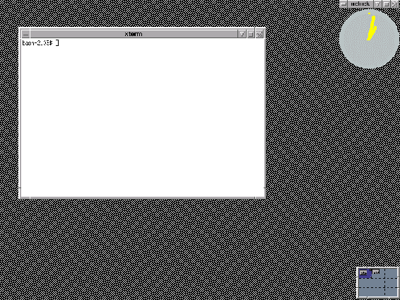

*窗口管理器*（window manager）是一个控制窗口外观和显示方式的程序。窗口管理器通常允许你自定义窗口的颜色和边框，如上图所示。有很多窗口管理器可以选择，它们各不相同；本章不是只描述一个，或浅尝地描述所有它们，而是解释 X 的*基础*，即无论配置如何，每个人使用 X 都必须知道的基础知识，而且这些知识是所有窗口管理器共有的。

近年来，*桌面环境*（desktop environments）也变得流行。这些是运行在窗口管理器之上的应用程序套件，目的是为你的 X 会话提供标准的“外观和感受”；这些套件通常带有几个工具，如时钟和文件管理器。

两个主要的桌面是 `gnome`（GNU 项目的“GNU 网络对象环境”）和 `kde`（“K 桌面环境”）。

如果你使用一个较新的 Linux 发行版并选择了默认安装，那么很有可能你已经安装了 `gnome` 或 `kde`，并分配了类似 `Window Maker` 或 `fwm2` 的作为默认窗口管理器。（虽然你可以在系统上安装多个管理器，但你一次只能运行一个。）

> 2. 桌面旨在为 X 提供一个直观且易于使用的界面，因此在书中我解释 X 本身的基础知识；从它们的网站了解更多关于这些桌面环境的信息：`http://gnome.org/` 和 `http://kde.org/`。


### 4.1.1 启动 X

有两种启动 X 的主要方法。你如何在系统上启动它取决于是否安装了 X 显示管理器。

### 方法 1：Xdm

DEB：`xdm`

RPM：`xdm`

WWW：`http://www.xfree86.org/`

如果安装了 X 显示管理器 `xdm`，请使用它来管理你的 X 会话。

安装了它的系统通常配置为系统启动时进入第七个虚拟控制台，因此你会立即看到图形化的 `xdm` 登录界面。某些发行版会自定义此登录界面——例如，Fedora 显示“Fedora Core”标志并在下方画一个用于输入用户名的框。

你可以直接从这个界面登录到 X 会话，在相应的框中输入你的用户名和密码。

当 `xdm` 运行时但系统未配置为在启动时进入第七个虚拟控制台时，请切换到该控制台，以便登录 X 会话。

⇒ 要切换到第七个虚拟控制台，请输入：

`ALT-F7`

### 方法 2

在未运行 `xdm` 的系统上，预留给 X 的虚拟控制台将是空白，直到你在另一个虚拟控制台中通过运行 `startx` 手动启动 X。来自 `startx` 的信息（包括任何错误信息）将显示在执行运行该命令的控制台中，而 X 本身将在第七个虚拟控制台中运行。

⇒ 这里有两种使用此方法的方式：

- 从另一个虚拟控制台手动启动 X，请输入：

  `$ startx`

- 运行 `startx` 并将其标准输出和标准错误都重定向到日志文件，输入：

  `$ startx & > ~/startx.log`

这两个示例无论你执行命令时处于哪个控制台，都会在第七个虚拟控制台上启动 X——你的控制台会自动切换到第七个控制台的 X。你可以在 X 会话期间随时切换到另一个控制台（参见 Recipe 2.3 [使用控制台和终端]，第 32 页）。第二个示例将 `startx` 的任何错误信息或输出写入你主目录中名为 `startx.log` 的文件中。

当你启动 X 时，可以指定使用的 `color depth`（颜色深度），它是用于渲染显示器上每个像素的可能颜色所使用的位数（bits）。

它是以 2 的幂次形式指定的；因此，8 位颜色意味着像素可以是 `2⁸` 或 256 种可能颜色中的一种；16 位颜色提供 65,536 种可能的颜色（`2^{16}`），而 24 位颜色（`2^{24}`）像素可以是 16,777,216 种颜色中的任意一种（那么 1 位颜色正好是两种颜色）。颜色深度受显示硬件限制。根据你的系统配置和显卡，X 可能会以 8 位到 24 位之间的任何默认颜色深度启动。

你可以通过带有特殊选项 `-bpp` 的 `startx` 来指定另一种颜色深度；后面跟随一个指示要使用的颜色深度的数字，并在选项前加上两个字符（`--`），这告诉 `startx` 将后面的选项传递给 X 服务器本身。

⇒ 从虚拟控制台启动 X 并指定 24 位颜色深度，输入：

`$ startx -- -bpp 24`

**注意：** 如果你的系统运行 `xdm`，你可以随时切换到第七个虚拟控制台（或 `xdm` 运行的任何控制台），然后在 `xdm` 登录界面登录。

## 4.1.2 停止 X

停止 X 有几种方法。

### 方法 1

结束 X 会话的正常方法是通过你的窗口管理器来进行。

大多数窗口管理器都有 `Exit X`（退出 X）菜单选项或类似的选项，你可以用鼠标选择；另一些带有退出 X 的快捷键命令。

⇒ 这里有一些使用此方法的方法。

- 如果你正在运行 `fvwm2` 窗口管理器，请执行以下操作：

  1. 在根窗口的任何地方点击左鼠标键弹出启动菜单。
  2. 从 `Exit Fvwm` 子菜单中选择 `Really quit?`（真的退出吗？）。

- 如果你正在运行 `AfterStep` 窗口管理器，请执行以下操作：

  1. 在根窗口的任何地方点击左鼠标键弹出启动菜单。
  2. 从 `Quit`（退出）子菜单中选择 `Exit?`（退出吗？）。
  3. 点击 `Logout`（注销）。

- 如果你正在运行 `Ion` 窗口管理器，请执行以下操作：

  1. 按 `F12`。
  2. 在 Ion 模式行回答“y”：

     `Exit Ion (y/n)? y`

如果你是用 `startx` 启动 X 会话的，这些命令将带回到输入命令的虚拟控制台中的 shell 提示符。如果你是通过在第七个虚拟控制台上登录 `xdm` 来启动 X 会话的，你将退出 X 会话并出现 `xdm` 登录界面；然后你可以切换到另一个虚拟控制台或重新登录 X。

### 方法 2

要立即退出 X 并终止所有 X 进程，请按下 `CTRL-ALT-BKSP` 组合（如果你的键盘有两个 ALT 和 CTRL 键，请使用左侧的）。你会丢失任何未保存的应用程序数据，但在无法正常退出 X 会话时（例如系统冻结或其他问题），这是很有用的。

⇒ 要立即退出 X，输入：

`CTRL-ALT-BKSP`

## 4.2 在 X 中运行程序

在 X 会话中运行的程序被称为 X `clients`（客户端）（X 窗口系统本身被称为 X `server`（服务器））。要在 X 中运行程序，你需要作为 X 客户端启动它——要么从菜单中选择它，要么在 `xterm` shell 窗口中输入运行该程序的命令（参见 Recipe 4.5 [在 X 中运行 shell]，第 109 页），如下。

### 方法 1

大多数窗口管理器都有某种类型的“启动菜单”；通常通过点击根窗口的任何地方的左鼠标键来访问。要从启动菜单运行 X 客户端，点击左鼠标键从子菜单中选择客户端名称。

⇒ 要从启动菜单启动一个方形的模拟盘钟，点击左鼠标键从子菜单中选择客户端名称：

1. 在根窗口的任何地方点击左鼠标键弹出启动菜单。
2. 在 `xclock` 子菜单中选择 `Really quit?`（真的退出吗？）。（注：此处原文示例逻辑略有重复，已按字意翻译）

*更正翻译逻辑：*

⇒ 要从启动菜单启动一个方形的模拟盘钟，点击左鼠标键选择：

1. 在根窗口的任何地方点击左鼠标键弹出启动菜单。
2. 从子菜单中选择客户端名称。

实际上，此处根据原文逻辑的翻译如下：

- 从另一个虚拟控制台手动启动 X，请输入：

  `$ startx`

- 运行 `startx` 并将其标准输出和标准错误都重定向到日志文件，输入：

  `$ startx & > ~/startx.log`

这两个示例都会在第七个虚拟控制台上启动 X，无论你在执行命令时处于哪个控制台——你的控制台会自动切换到第七个控制台的 X。你可以在 X 会话期间随时切换到另一个控制台（参见 Recipe 2.3 [使用控制台和终端]，第 32 页）。第二个示例将 `startx` 的任何错误信息或输出写入你主目录中名为 `startx.log` 的文件中。

当你启动 X 时，可以指定使用的 `color depth`（颜色深度），它是用于渲染显示器上每个像素的可能颜色所使用的位数。

它是以 2 的幂次形式指定的；因此，8 位颜色意味着像素可以是 `2⁸` 或 256 种可能颜色中的一种；16 位颜色提供 65,536 种可能的颜色（`2^{16}`），而 24 位颜色（`2^{24}`）像素可以是 16,777,216 种颜色中的任意一种（那么 1 位颜色正好是两种颜色）。颜色深度受显示硬件限制。根据你的系统配置和显卡，X 可能会以 8 位到 24 位之间的任何默认颜色深度启动。

你可以通过带有特殊选项 `-bpp` 的 `startx` 来指定另一种颜色深度；后面跟随一个指示要使用的颜色深度的数字，并在选项前加上两个字符（`--`），这告诉 `startx` 将后面的选项传递给 X 服务器本身。

⇒ 从虚拟控制台启动 X 并指定 24 位颜色深度，输入：

`$ startx -- -bpp 24`

**注意：** 如果你的系统运行 `xdm`，你可以随时切换到第七个虚拟控制台（或 `xdm` 运行的任何控制台），然后在 `xdm` 登录界面登录。

## 4.1.2 停止 X

停止 X 有几种方法。

### 方法 1

结束 X 会话的正常方法是通过你的窗口管理器来进行。

大多数窗口管理器都有 `Exit X` 菜单选项或类似的选项，你可以用鼠标选择；另一些带有退出 X 的快捷键命令。

⇒ 这里有一些使用此方法的方法。

- 如果你正在运行 `fvwm2` 窗口管理器，请执行以下操作：

  1. 在根窗口的任何地方点击左鼠标键弹出启动菜单。
  2. 从 `Exit Fvwm` 子菜单中选择 `Really quit?`（真的退出吗？）。

- 如果你正在运行 `AfterStep` 窗口管理器，请执行以下操作：

  1. 在根窗口的任何地方点击左鼠标键弹出启动菜单。
  2. 从 `Quit`（退出）子菜单中选择 `Exit?`（退出吗？）。
  3. 点击 `Logout`（注销）。

- 如果你正在运行 `Ion` 窗口管理器，请执行以下操作：

  1. 按 `F12`。
  2. 在 Ion 模式行回答“y”：

     `Exit Ion (y/n)? y`

如果你是用 `startx` 启动 X 会话的，这些命令将带回到输入命令的虚拟控制台中的 shell 提示符。如果你是通过在第七个虚拟控制台上登录 `xdm` 来启动 X 会话的，你将退出 X 会话并出现 `xdm` 登录界面；然后你可以切换到另一个虚拟控制台或重新登录 X。

### 方法 2

要立即退出 X 并终止所有 X 进程，请按下 `CTRL-ALT-BKSP` 组合（如果你的键盘有两个 ALT 和 CTRL 键，请使用左侧的）。你会丢失任何未保存的应用程序数据，但在无法正常退出 X 会话时（例如系统冻结或其他问题），这是很有用的。

⇒ 要立即退出 X，输入：

`CTRL-ALT-BKSP`

## 4.2 在 X 中运行程序

在 X 会话中运行的程序被称为 X `clients`（客户端）（X 窗口系统本身被称为 X `server`（服务器））。要在 X 中运行程序，你需要作为 X 客户端启动它——要么从菜单中选择它，要么在 `xterm` shell 窗口中输入运行该程序的命令（参见食谱 4.5 [在 X 中运行 shell]，第 109 页），如下。

### 方法 1

大多数窗口管理器都有某种类型的“启动菜单”；通常通过点击根窗口的任何地方的左鼠标键来访问。要从启动菜单运行 X 客户端，点击左鼠标键从子菜单中选择客户端名称。

⇒ 要从启动菜单启动一个方形的模拟盘钟，点击左鼠标键选择：

1. 在根窗口的任何地方点击左鼠标键弹出启动菜单。
2. 从子菜单中选择客户端名称。（注：此处原文示例逻辑略有重复，已按字意翻译）

*更正翻译逻辑：*

⇒ 要从启动菜单启动一个方形的模拟盘钟，点击左鼠标键选择：

1. 在根窗口的任何地方点击左鼠标键弹出启动菜单。
2. 从子菜单中选择客户端名称。

### 4.2.1 指定 X 窗口大小和位置

通过使用 `geometry` 选项给出 `window geometry` 来指定窗口的大小和位置。四个字段控制窗口宽度、高度以及距离屏幕边缘的距离（偏移量）。它的格式为：

```text
-geometry WIDTHxHEIGHT+XOFF+YOFF
```

这些四个字段中的值通常以像素给出，尽管某些应用程序按字符测量 `WIDTH` 和 `HEIGHT`。虽然你必须顺序给出这些值，但可以省略任何一对。例如，如果只想指定窗口的大小，给出 `WIDTH` 和 `HEIGHT` 的值。

⇒ 这里有一些使用此方法的方式。

- 启动一个小的 `xclock`，48 像素宽和 48 像素高，输入：

  `$ xclock -geometry 48x48`

- 启动一个大的 `xclock`，480 像素宽和 500 像素高，输入：

  `$ xclock -geometry 480x500`

- 启动一个宽度为 48 像素且高度默认的 `xclock`，输入：

  `$ xclock -geometry 48`

- 启动一个高度为 48 像素且宽度默认的 `xclock`，输入：

  `$ xclock -geometry x48`

你可以为 `XOFF` 和 `YOFF` 字段给出正或负数。

正 `XOFF` 值指定从屏幕左侧的位置；负值指定从右侧的位置。如果 `YOFF` 为正，则它指定从屏幕顶部的位置；如果为负，则指定从底部的位置。在给出这些偏移量时，必须同时指定 `XOFF` 和 `YOFF` 的值。

要将窗口放置在桌面的四个角之一，对相应的 `XOFF` 和 `YOFF` 值使用零，如下：

`+0+0`

左上角。

`+0-0`

左下角。

`-0+0`

右上角。

`-0-0`

右下角。

⇒ 要在左下角启动一个默认尺寸的 `xclock`，输入：

`$ xclock -geometry +0-0`

回车。

或者，为了完成所有设置，你可以用一个包含四个值的几何线条来指定窗口的大小和位置。

⇒ 要启动一个宽度为 120 像素、高度为 100 像素、距离屏幕右侧偏移 250 像素、距离屏幕顶部偏移 25 像素的 `xclock`，输入：

`$ xclock -geometry 120x100-250+25`

回车。

使用 `-iconic` 选项以图标形式启动客户端，这样它在运行后会立即以图标形式出现。客户端将启动，但在你点击它之前，它将显示为一个小图标（参见 Recipe 4.3.5 [X 窗口的去图标化]，第 107 页）。

⇒ 要以图标形式启动 `xclock`，但当最大化时它会在右上角打开，输入：

`$ xclock -geometry -0+0 -iconic`

回车。

### 4.2.2 指定 X 窗口颜色

你的 X 会话中可用的窗口颜色取决于你的显示器硬件和正在运行的 X 服务器。`xcolors` 工具将显示你的 X 服务器上所有可用颜色以及指定这些颜色的名称。（颜色名称不区分大小写。）

⇒ 要列出可用颜色，输入：

`$ xcolors`

回车。

按 `Q` 退出 `xcolors`。

要指定用于窗口背景、窗口边框以及窗口本身文本或图形的颜色，请将颜色名称作为参数传递。

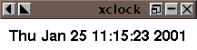

104

《Linux 食谱指南》，第 2 版


传递给相应的选项：`-bg` 用于背景颜色，`-bd` 用于窗口边框颜色，`-fg` 用于前景颜色。

> ⇒ 要启动一个具有蓝色窗口背景的 `xclock`，输入：
>
> ```bash
> xclock -bg lightblue
> ```

回车。

你可以指定这些属性的任何组合。

> ⇒ 要启动一个具有海绿色窗口背景和青色窗口前景的 `xclock`，输入：
>
> ```bash
> xclock -bg seagreen -fg turquoise
> ```

回车。

**注意：** `-bordercolor`、`-background` 和 `-foreground` 选项与 `-bd`、`-bg` 和 `-fg` 同义。

## 4.2.3 指定 X 窗口字体

要指定窗口使用的字体，使用 `-fn` 选项后跟要使用的 X 字体名称。（要获取 X 字体名称，请使用 `xfontsel`；参见 Recipe 16.1 [使用 X 字体]，第 395 页）。

> ⇒ 要启动一个带有数字显示的 `xclock`，并指定其使用 17 点 Helvetica 字体作为文本，输入：
>
> ```bash
> xclock -digital -fn -*-helvetica-*-r-*-*-17-*-*-*-*-*-*-
> ```

回车。

此命令启动了一个看起来如图 4-4 的 `xclock`。

*图 4-4。带有 Helvetica 类型的数字 `xclock`。*

**注意：** 如果你为 shell 窗口指定字体，可以在运行后对其调整大小，如 Recipe 16.1.4 [调整 Xterm 字体] 第 398 页所示。

`-font` 选项与 `-fn` 同义。

## 4.2.4 指定 X 窗口边框宽度

要指定 X 客户端边框的宽度，使用 `-bw` 后跟所需的宽度（单位为像素）。

> ⇒ 要启动一个边框宽度为 30 像素的 `xclock`，输入：
>
> ```bash
> xclock -bw 30
> ```

回车。

**注意：** `-borderwidth` 选项与 `-bw` 同义。

第 4 章：X 窗口系统

105

## 4.2.5 指定 X 窗口标题

为客户端指定自定义标题，使用 `-title` 并后跟一个带引号的字符串作为窗口标题。如果你使用长标题，可能需要指定客户端宽度以确保窗口足够长。

> ⇒ 这里有两种使用此功能的方法。
>
> - 要启动一个标题为“Time”的 `xclock`，输入：
>
>   ```bash
>   xclock -title "Time"
>   ```
>
> - 要启动一个宽度为 225 像素、标题为“As Time Goes By”的 `xclock`，输入：
>
>   ```bash
>   xclock -title "As Time Goes By" -geometry 225
>   ```

回车。

## 4.2.6 在 X 窗口中指定属性

当 X 客户端已经在窗口中运行时，你可以指定某些特殊属性。

X 应用程序通常有多达三个特殊菜单，带有更改某些属性的选项。要查看这些菜单，按住 `CTRL` 键然后点击客户端窗口内某处的三个鼠标按钮之一。（如果你的鼠标只有两个按钮，请同时点击两个按钮以模拟中键。）

> ⇒ 要显示 X 客户端的第三个菜单，按住 `CTRL`，将鼠标指针移动到 X 客户端窗口的某处，并点击第三个鼠标按钮。

## 4.3 操作 X 客户端窗口

一次时间只有一个 X 客户端可以接受键盘和鼠标输入，该客户端被称为*活动客户端*。要使客户端变为活动，点击它的窗口。当客户端处于活动状态，它被认为“具有焦点”。根据窗口管理器的不同，鼠标指针的形状可能会发生变化。每个窗口都有自己的控制方法。

106

《Linux 食谱指南》，第 2 版

### 4.3.1 移动 X 窗口

通过拖动标题栏移动客户端窗口。

> ⇒ 要移动 X 窗口，执行以下操作：
>
> 1. 点击并按住标题栏上的左键。
> 2. 将窗口拖到所需位置。
> 3. 松开鼠标。

### 4.3.2 调整 X 窗口大小

通过拖动任何框架来调整客户端窗口的大小。

> ⇒ 要调整窗口大小，执行以下操作：
>
> 1. 点击并按住任何框架上的左键。
> 2. 移动鼠标以缩小或增大窗口轮廓。
> 3. 松开鼠标。

### 4.3.3 最大化 X 窗口

有时你可能希望调整客户端窗口，使其尽可能大，通常填充整个屏幕。这被称为*最大化*窗口。

> ⇒ 最大化窗口的方法取决于窗口管理器；通常以下一种或多种方法有效：
>
> - 双击标题栏上的左键（在最大化窗口上，此操作具有返回较小尺寸的效果）。
> - 点击标题栏上的方形按钮。
> - 在根窗口任何处点击中键或右键，调出一个包含你会话中任何 X 客户端窗口选项的菜单；选择客户端名称进行最大化。

**注意：** 如果最大化所有客户端窗口的想法吸引你，我建议查看 Ion，它是一个没有真正“窗口”概念、只有全屏运行的管理器（参见 Recipe 4.7.5 [使用其他管理器]，第 120 页）。

107

### 4.3.4 最小化 X 窗口

你可以*最小化* X 客户端窗口，使其消失并将代表运行程序的图标放在桌面上，带有窗口的“_”按钮，通常位于标题栏的右上角。这也称为*图标化*窗口。

> ⇒ 要最小化 X 窗口，点击窗口“_”按钮上的左键。

**注意：** 某些窗口管理器的方法可能略有不同，但基本原理是相同的。

### 4.3.5 去图标化 X 窗口

将最小化后的窗口带回来被称为*去图标化*窗口。代表窗口的图标将消失，窗口返回之前的大小和位置。

> ⇒ 去图标化窗口的方法取决于窗口管理器，但通常以下一种或多种方法有效：
>
> - 双击图标上的左键。
> - 双击图标下方书写的图标名称上的左键。
> - 在根窗口任何处点击中键或右键，调出一个包含你会话中任何 X 客户端窗口选项的菜单；选择客户端名称进行去图标化。

### 4.3.6 获取 X 窗口信息

使用 `xwininfo` 输出客户端窗口的信息。这对于获取你想要在命令中指定的数值有用——它会列出所选窗口的几何形状、颜色、边框宽度、颜色深度以及其他值。在终端窗口中运行它（参见配方 4.5 [在 X 中获取终端窗口]，第 109 页）。

⇒ 要获取客户端窗口的信息，请执行以下操作：

1. 在终端窗口中运行 `xwininfo`：

   ```text
   $ xwininfo
   xwininfo: Please select the window about which you would like information by clicking the mouse in that window.
   ```

2. 在你想要信息的窗口内任意位置点击左鼠标键。

该命令会在你输入命令的终端窗口中输出你用鼠标选定的客户端窗口的信息列表。

### 4.3.7 销毁 X 窗口

当你退出或关闭 X 客户端时，窗口将不再显示。你也可以在 X 中 `destroy` 一个窗口，此时在该窗口中运行的客户端将被终止，窗口将不再显示。

要销毁一个窗口，点击标题栏右上角“X”按钮上的左鼠标键。这在窗口中运行的程序停止响应且你无法正常退出时非常有用。

## 4.4 在桌面上移动

许多窗口管理器（包括 AfterStep 和 `fvwm2`）允许你使用 `virtual desktop`（虚拟桌面），这让你能够使用比你的显示器一次能显示的更多的屏幕空间。虚拟桌面可以比显示器大，在这种情况下，你可以通过鼠标进行滚动。填满显示器的视图称为 `viewport`（视口）。当你将鼠标向当前（虚拟）桌面延伸的方向移出屏幕时，视图将向该方向滚动。虚拟桌面对于同时全屏运行许多客户端非常有用，每个客户端都可以在自己独立的桌面上。

某些配置不允许在桌面之间滚动；在这种情况下，请使用 `pager`（分页器）在它们之间切换，它会显示虚拟桌面的缩略视图，并允许你在桌面之间切换。它是一个 `sticky window`（它“粘附”在所有其他窗口上方），并且始终位于屏幕的右下角，即使你滚动虚拟桌面也是如此。你的当前桌面和活动 X 客户端会在分页器中被高亮显示。

默认的 `fvwm2` 虚拟桌面大小是 3x3 网格中的九个桌面，如图 4-5 所示。一个 `fvwm2` 分页器。

在之前的插图中，当前桌面是第一行中的第二个。第一个桌面包含两个 X 客户端窗口——一个较小的和一个较大的——但在任何其他桌面（包括当前桌面）中都没有窗口。

要切换到另一个桌面，请点击分页器中对应视图的左鼠标键，或者如果你的窗口管理器提供了键盘快捷键，则使用该快捷键。

⇒ 在 `fvwm2` 中，切换桌面的默认键是 `ALT` 配合方向键；在 AfterStep 中，使用 `CTRL` 键代替 `ALT`。

- 在运行 `fvwm2` 时，要切换到当前桌面左侧桌面，输入 `ALT -`。
- 在运行 `AfterStep` 时，要切换到当前桌面正左侧桌面，输入 `CTRL -`。

## 4.5 在 X 中获取终端窗口

`xterm`

DEB: `xterm`

RPM: `xterm`

WWW: `http://dickey.his.com/xterm/`

`terminal emulator`（终端模拟器）让你能够在 X 客户端窗口中运行 shell。Linux 系统上标准的终端模拟器是 `xterm`，它模拟了 dec vt102/220 和 Tektronix 4014 视频终端。

你可以在 `xterm` 窗口中运行命令，就像在虚拟控制台中一样；`xterm` 中的 shell 作用与虚拟控制中的 shell 相同（参见第 3 章 [Shell]，第 53 页）。

你可以配合 `xterm` 使用所有标准的 X 客户端选项（参见配方 4.2 [在 X 中运行程序]，第 101 页），但它也有许多自己的选项，这些将在下一个配方中描述。

⇒ 要打开一个带有 shell 的新窗口，并将文本字体设置为大小为 18 像素的 Lucida Sans Typewriter 字体，输入：

```bash
$ xterm -fn lucidasanstypewriter-18
```

此示例要求你已经运行了一个终端模拟器，并且有一个你可以从中打字的 shell 提示符。如果你没有，则必须通过从窗口管理器提供的应用程序菜单中选择它来启动 `xterm`。

⇒ 在使用 `Ion` 窗口管理器时，打开一个带有 shell 的新窗口并将文本字体设置为大小为 18 像素的 Lucida Sans Typewriter 字体，输入：

```text
F3
Run: xterm -fn lucidasanstypewriter-18
```

你可以从 `xterm` 剪切并粘贴文本到另一个 X 客户端（参见配方 10.3 [处理文本选择]，第 253 页）。

要滚动已过屏幕顶部的文本，输入 `SHIFT - PgUp`。你可以向上回滚的行数取决于 `sl` 选项；其默认值为 64。

### 4.5.1 更改默认 X 行为

有许多命令行选项可以控制 `xterm` 的特性；下表列出了其中一些。注意，这些选项有些奇特；有时 `-` 选项开启某项功能，而另此时却是 `+` 选项。表格中注明了默认行为，尽管某些 Linux 发行版可能会更改这些设置。要查看原始外观，请访问 `http://www.netktop.org/terminal/dec.html` 和 `http://www.netktop.org/terminal/various.html`。

- `-ah`：始终高亮光标，即使窗口不再处于焦点。
- `+ah`：当窗口没有焦点时，使光标变为空心（默认值）。
- `-aw`：开启自动换行，使到达右边距的文本换到下一行（默认值）。
- `+aw`：关闭自动换行；超出右边距的文本将被删除，使得每行的最后一个字符被打印为边距前的最后一个字符。
- `-b`：指定内部边框的像素大小（默认值为 2）。
- `-bdc`：关闭以颜色显示粗体字符，而不是加粗显示（默认值）。
- `+bdc`：以颜色显示粗体字符。
- `-cm`：禁用 ANSI 控制序列识别。
- `+cm`：启用 ANSI 控制序列识别（默认值）。
- `-cr`：指定用于文本光标的颜色。
- `-fb`：指定用于粗体的字体（默认是对普通字体叠加）。你提供的字体必须与普通字体具有相同的高度和宽度。
- `-hc`：设置高亮或选中文本的背景颜色（默认使用普通文本颜色的反色）。
- `-j`：开启跳转滚动，在快速流文本时一次跳过多行，而不是滚动屏幕上的每一行；对于处理大量文本时提高速度（默认值）。
- `+j`：关闭跳转滚动。
- `-leftbar`：将滚动条放在窗口的左侧（默认值），如果同时也通过 `-sb` 选项启用。
- `-ls`：为 shell 使用登录 shell（对于 Bash 用户来说，这意味着在启动时会运行 `.bash_profile`；这是默认值）。
- `+ls`：指定不使用登录 shell——而是使用普通的子 shell（对于 Bash 用户来说，这意味着不运行 `.bash_profile`）。
- `-mb`：开启边距铃，当光标接近右边距时会响铃。
- `+mb`：关闭边距铃（默认值）。
- `-mc`：指定选择文本时多次点击之间的时间（毫秒）。
- `-ms`：指定 X 鼠标指针在 `xterm` 窗口内的颜色（这有时被称为 `pointer cursor`；指针光标，值默认为前景颜色）。
- `-color`：指定从右边缘开始的字符数，如果使用了该选项，边缘铃声在该处响起（默认值为十）。
- `-nul`：启用下划线显示（默认值）。
- `+nul`：禁用下划线显示。
- `-pc`：启用 PC 样式加粗颜色（更亮的颜色值；默认值）。
- `+pc`：禁用 PC 样式加粗颜色。
- `-rightbar`：如果也启用了 `-sb` 选项，则将滚动条置于窗口的右边缘。
- `-rw`：允许反向换行，在编辑长命令行时，光标可以从当前行回退到上一行的右边缘（默认值）。
- `+rw`：不允许反向换行。
- `-sb`：启用滚动条，以便可以通过向上滚动滚动条来查看滚出窗口顶部的行。
- `+sb`：禁用滚动条（默认值）。
- `-sk`：指定当在使用滚动条查看之前的文本时按下按键，窗口显示将移动到当前输入行（默认值）。
- `+sk`：指定当在使用滚动条查看之前的文本时按下按键，窗口显示将不会移动到当前输入行。
- `-sl number`：指定应保存的滚出屏幕顶部行数，以便通过滚动条查看。
- `-ulc`：指定带下划线的字符不应以颜色显示（默认值）。
- `+ulc`：指定带下划线的字符应以颜色显示而不是显示下划线。
- `-vb`：指定使用视觉铃声（visual bell）而不是听觉铃声（窗口会快速闪烁）。
- `+vb`：禁用任何视觉铃声（默认值）。

选项比这些多得多；请参阅 `xterm` 手页以获取完整列表（参见食谱 2.8.4 [从系统手册读取页面]，第 46 页）。

# 第 4 章：X 窗口系统

113

### 4.5.2 在 X 窗口中运行命令

`xterm` 工具默认运行一个 shell，但你也可以用它来运行任何交互式终端程序；使用 `-e` 选项执行此操作，并将要运行的命令名称作为参数传递。`xterm` 将带有该命令打开，并在它自己的窗口中运行；当该命令退出时，`xterm` 窗口将关闭。这在你只想在自己的窗口中运行特定命令但不需要 shell 时非常方便。

⇒ 在它自己的 X 窗口中运行 `bc`，请输入：

```bash
xterm -e bc
```

当你退出命令时，shell 将退出，窗口也将关闭。

你也可以向命令传递参数。

⇒ 运行带有 URL `file:/usr/local/` 的 `lynx`，请输入：

```bash
xterm -e lynx file:/usr/local/
```

在此示例中，`lynx` 在它自己的窗口中打开给定的 URL，并将保持打开直到你杀死窗口或退出 `lynx`。

**注意：** 如果使用其他选项调用 `xterm`，`-e` 选项必须是命令行中指定的最后一个选项。

### 4.5.3 使用其他终端模拟器

虽然 `xterm` 是标准的 Linux 终端模拟器，但它绝对不是唯一的；有很多供选择，且都具有特殊功能。下表列出了其中一些较好的。

#### AfterStep

这种彩色 `vt102` 终端模拟器是为了配合 AfterStep 窗口管理器设计的，但也可以与其他窗口管理器一起使用；具有许多调色和阴影等特殊效果，但比 `xterm` 小——而且使用的交换空间也更少。

DEB: `aterm`

RPM: `aterm`

WWW: `http://aterm.sourceforge.net/`

#### Enlightened

这种彩色 `vt102` 终端模拟器是为了配合 Terminal Enlightenment 窗口管理器设计的，但也可以与其他模拟器一起使用；支持主题并有许多控制其外观的功能。

DEB: `eterm`

RPM: `Eterm`

WWW: `http://www.eterm.org/`

#### Konsole

用于 `kde` 的图形化终端模拟器，允许你在单个窗口中运行多个终端。

DEB: `konsole`

RPM: `konsole`

WWW: `http://konsole.kde.org/`

#### Multi Terminal

用于 `gnome` 的图形化终端模拟器具有受 `Konsole` 启发的增强功能，允许在单个窗口中运行多个终端。

DEB: `multi-gnome-terminal`

RPM: `multi-gnome-terminal`

WWW: `http://multignometerm.sourceforge.net/`

#### Multi Lingual

顾如名，该终端模拟器支持各种外国语言编码。

DEB: `mlterm`

RPM: `mlterm`

WWW: `http://mlterm.sourceforge.net/`

#### PowerShell

这种彩色终端模拟器允许在同一窗口中使用多个终端，你可以通过点击“tab”按钮在之间切换。

DEB: `powershell`

RPM: `powershell`

WWW: `http://powershell.sourceforge.net/`

#### our XVT

大家通过其命令名 `rxvt` 熟悉它，这是一个彩色 `vt102` 终端模拟器，设计用于 `xterm` 的替代品，比后者更小且内存密集程度较低，但配置选项较少。

DEB: `rxvt`

RPM: `rxvt`

WWW: `http://sourceforge.net/rxvt`


# Unicode

这是支持 Unicode 的 `xterm`

DEB: `xterm`

RPM: `xterm`

WWW: http://dickey.com/xterm/

116

《Linux 菜谱》，第 2 版

# wterm

这是基于 `XVT` 的，但针对窗口管理器进行了优化。它的功能包括透明、调色和背景图片。

DEB: `wterm`

RPM: `wterm`

WWW: http://windowmaker.org/files.php#wterm

## 4.6 放大桌面区域

使用 `xmag` 放大桌面。它将打开一个显示桌面部分的放大窗口。

有两种选择桌面区域的方法：点击左上角的鼠标按钮并拖动到右边缘。

这里有两种使用方法。

- 要放大桌面区域，请执行以下操作：
  1. 启动 `xmag`：

  ```
  xmag
  ```

  2. 点击左上角的鼠标按钮。
  3. 将指针移动到右边缘，然后释放鼠标按钮。

- 为了延迟三秒运行 `xmag`，以便在运行之前你有时间切换桌面，请输入：

  ```
  sleep 3; xmag
  ```

点击关闭或输入 Q 退出程序并关闭窗口。

**备注：** 有关视频模式的更多信息，请参见 `The XFree86 Video Timing HOWTO`（参见 Recipe 2.8.6 [读取系统文档和帮助文件]，第 50 页）。

## 4.7.2 自动运行 X 客户端

`.xsession` 文件是你主目录下的一个隐藏文件，指定了 X 会话首次启动时自动运行的客户端（“隐藏”文件见第 5 章 [文件和目录]，第 125 页）。它只是一个 shell 脚本，通常包含一个要运行的客户端列表。你可以用文本编辑器编辑 `.xsession` 文件，如果该文件不存在，你可以创建它。

客户端按照它们在列表中出现的顺序启动，最后一行应该指定要使用的窗口管理器。下面的 `.xsession` 文件示例启动了一个具有黑色背景、白色文字、棕色光标且无滚动条的 `aterm`；在左上角放置了一个 `asclock`（AfterStep 的时钟，灵感源于 nextstep 的“撕离式”日历钟）；启动了 `Emacs` 文本编辑器并将 `~/TODO` 文件打开在自己的缓冲区中；然后启动了 `AfterStep` 窗口管理器：

```sh
#! /bin/sh
#
# 一个示例 .xsession 文件.
aterm +sb -bg black -fg white -cr brown &
asclock -geometry +0+0 &
emacs ~/TODO &
exec /usr/bin/afterstep
```

所有的客户端都作为后台作业启动，最后行的窗口管理器除外，因为当此文件运行时，X 会话是在前台运行的（参见 Recipe 3.3 [管理作业]，第 70 页）。在你 `.xsession` 文件中放入的任何命令行末尾，始终加上符号`&`，但最后一行指定窗口管理器的行除外。

## 4.7.3 更改根窗口参数

默认情况下，根窗口背景被涂成带有织纹图案的灰色。为了绘制这些图案，X 使用位图（bitmap）填充根窗口，位图是一种存储在特殊文件格式中的黑白图像。X 自带了一些安装在`/usr/X11R6/include/bitmaps/`目录下的位图；默认位图文件是`root_weave`（你可以使用位图工具创建自己的图案；参见 Recipe 18.4 [使用其他图像编辑器]，第 435 页）。

使用`xsetroot`来更改根窗口的颜色和位图图案。

要更改颜色，使用`-solid`选项并将要使用的颜色名称作为参数。（使用`xcolors`获取可能的颜色名称列表，参见 Recipe 4.2.2 [指定 X 窗口颜色]，第 103 页。）

将根窗口颜色更改为蓝紫色，输入：`xsetroot -solid blueviolet`

要更改根窗口图案，使用`-bitmap`选项并提供要使用的位图文件名。

用星形图案填充根窗口，输入：`xsetroot -bitmap /usr/X11R6/include/bitmaps/star`

在指定图案时，使用`-fg`和`-bg`选项来指定前景和背景颜色。

用黑色背景的浅石板灰星形图案填充根窗口，输入（全部在一行）：

`xsetroot -fg slategray2 -bg black -bitmap /usr/X11R6/include/bitmaps/star`

使用带有特殊选项`-gray`的`xsetroot`，可以将根窗口更改为一种护眼的灰色，且无图案。

让根窗口显示为无图案的灰色，输入：`xsetroot -gray`

**备注：** 你也可以将图像放入根窗口（尽管这消耗了内存，本可以留给内存密集型的 Web 浏览器；具体方法请参见 Recipe 17.1.2 [在根窗口中放置图像]，第 410 页）。

## 4.7.4 控制 X 中的系统蜂铃

X 有一个用于控制用户偏好的工具称为`xset`，你可以用它控制系统的各个方面，例如你可以用它控制屏幕保护时间、LED 灯设置、按键点击音量等。

要关闭系统蜂铃响声，使用`xset`并向`b`选项提供`off`参数。

关闭 X 中的系统蜂铃，输入：`xset b off`

你可以使用`on`参数重新开启蜂铃。

你可以通过给`b`选项提供三个数字参数来控制蜂铃的音量、音调和持续时间：第一个是最大值的百分比，第二个是赫兹（Hz），第三个是毫秒（ms）。运行不带参数的带有`b`选项的`xset`将蜂铃恢复为默认。

这里有两种使用方法。

- 要将蜂铃设置为最大音量的 75%，以 440 Hz 响一秒钟，输入：`xset 75 440 1000`
- 将系统蜂铃恢复为默认值，输入：`xset b`

**备注：** 为了让`xset`设置永久生效并影响你运行的每一个 X 会话，你可能需要将命令放在`.xsession`文件中。

## 4.7.5 使用其他窗口管理器

是的，有很多窗口管理器可选。下表描述了一些流行的窗口管理器。

| 窗口管理器 | 描述 |
| :--- | :--- |
| **9wm** | `9wm` 是一种受 at&t Plan 9 启发的简单管理器——它不使用标题栏或图标。它应该吸引极简主义者。 |
| **AfterStep** | `AfterStep` 的灵感源于 nextstep 的外观和感受。 |
| **BlackBox** | `BlackBox` 是一种快速、轻量且具有现代感的窗口管理器。 |
| **Enlightenment** | `Enlightenment` 是一个图形密集型管理器，使用桌面“主题”来装饰 X 会话的各种控件。 |
| **Fluxbox** | `Fluxbox` 基于 BlackBox，增加了标签页、快捷键和图标栏等功能。 |
| **FVWM95** | `fvwm95` 让 X 看起来像 1995 年的某种专用桌面。 |
| **Ion** | Ion 设计用于键盘导航，将应用程序和客户端窗口保持在全屏框架中，它是那些重视速度和效率且并不在意窗口系统的人的喜爱。 |
| **TWM** | Tab Window Manager 是一种老旧且简单的窗口管理器，几乎适用于每个系统。（它有时被称为 Tom's Window Manager，以其主要作者 Tom LaStrange 命名。） |
| **WM2** | `wm2` 是一个极简的、无需配置的窗口管理器。 |
| **Window Maker** | GNU 项目的首选窗口管理器，Window Maker 可以通过简单的菜单进行配置，经常与 nextstep 比较。 |

要尝试其中一个窗口管理器，请从当前窗口管理器提供的应用程序菜单中选择它。这将退出你的窗口。

管理窗口管理器并启动一个新的。如果你发现了一个喜欢的并希望将其设置为默认值，请编辑你的 `.xsession` 文件，使其最后一行包含 `exec`，后跟要使用的窗口管理器的完整路径名（参见 Recipe 4.7.2 [自动运行 X 客户端]，第 117 页）。

要将 AfterStep 设置为默认窗口管理器，请将以下内容放在 `.xsession` 文件的最后一行：

```bash
exec /usr/bin/X11/afterstep
```

**注意：** 某些窗口管理器（如 `twm` 和 `wm2`）没有应用程序菜单，因此如果你运行了此类窗口管理器，你将无法在当前会话期间轻松切换到另一个——你必须退出 X 并重新启动。

# II. 文件

# 5. 文件与目录

本章讨论了操作文件和目录的基本工具——这些工具是 Linux 系统最重要的工具之一。

`file`（文件）是存储在磁盘上的数据集合，可以通过其名称作为单个单元进行操作。

`directory`（目录）是一个充当其他文件文件夹的文件。目录也可以包含其他目录（在此语境下称为`subdirectories`子目录）；包含另一个目录的目录被称为其包含的`child`子目录的`parent`父目录。

你可以将普通文件想象成文件柜抽屉里的文件夹。文件夹有一个名称，它保存放入其中的信息，且这些信息可以重新排列；你可以随时调回该文件，也可以销毁它。文件柜的抽屉就是目录，每个文件都必须保存在其中一个。

比喻到此为止。文件夹可以被完全相同地复制，并且可能存在“幻影文件夹”，其内容指向你某个真实文件夹的内容，因此当你查看幻影内部时，你实际上是在查看某处文件夹的内容。你可以拥有任意数量的目录，与物理文件柜不同，你可以在抽屉内部放置抽屉，而抽屉内部又有自己的抽屉，层层循环。事实上，有一个“主”抽屉，即根目录，它包含了所有其他抽屉——每个抽屉反过来都必须保存在另一个抽屉中。

将系统上的目录想象成一棵带有分支的树也有帮助，因为目录形成了一个分支层次结构——树形的比喻被频繁用于描述它们：`directory tree`（目录树）包括一个目录及其所有文件，包括所有子目录的内容。（每个目录都是“树”中的一个“分支”。）单独的斜杠字符（`/`）是目录树层次结构底部`root directory`（根目录）的名字；将其想象为根和树干，所有其他文件或目录都由此支撑，并不可避免地由此分支。

图 5-1 显示了根目录树的简化版本。

为了表示目录在文件层次结构中的位置，请指定它与根目录之间的所有目录，使用斜杠（`/`）作为分隔符来区分目录。因此，在图中显示的`dict`目录将表示为`/usr/dict`。

每个用户在`/home`目录下都有一个存放自己文件的分支，被称为他的`home directory`（家目录）。前一个图中的层次结构有两个家目录：`joe`和`jon`，它们都是`/home`的子目录。

```
(root)
  |
  ├── bin
  ├── etc
  ├── home
  |    ├── joe
  |    │    ├── bin
  |    │    ├── play
  |    │    └── work
  |    └── jon
  |         ├── bin
  |         ├── play
  |         └── work
  └── usr
```

图 5-1. 根目录树。

当你处于 shell 中时，你始终处于系统上的某个目录，该目录被称为`current working directory`（当前工作目录）。当你首次登录系统时，你的家目录就是当前工作目录。

每当将文件名作为工具或应用程序的参数时，你可以提供相对于当前工作目录的由斜杠分隔的`path name`（路径名）。例如，如果`/home/joe`是当前工作目录，你可以使用`work`来指定目录`/home/joe/work`，并使用`work/schedule`来指定`/home/joe/work`目录下的 schedule 表文件。

每个目录都有两个特殊文件，其名称由一个或两个点组成：`..`指向当前工作目录的父目录，`.`指向当前工作目录本身。如果当前工作目录是`/home/joe`，你可以使用`.//`来指定`/home/joe`，使用`..//`来指定`/home`。

此外，你可以通过`../jon`指定`/home/jon`目录。

指定文件名的另一种方法是指定从根目录（`/`）一直到你想要指定的文件的所有目录分支列表，用斜杠分隔。这种从根目录到文件的唯一的、特定的路径被称为文件的`full path name`（完整路径名）。当引用非目录的文件时，这有时被称为`absolute file name`（绝对文件名）。

你可以通过提供完整路径名来指定系统上的任何文件或目录。文件可以与系统中不同目录下的文件同名，但没有两个文件或目录可以共享同一个路径名。

例如，用户`joe`可以在他的`/home/joe/work`目录下有一个文件`schedule`，在它的`/home/joe/play`目录下也有一个文件`schedule`。虽然这两个文件的名称相同（`schedule`），但它们位于不同的目录中。然而，当你启动一个工具或应用程序时，你并不需要输入该工具或应用程序的完整路径名。shell 维护的一个目录列表被称为`path`，如果一个程序在路径中，意味着你只需输入名称即可运行它。下表描述了一些标准目录。

| 目录 | 描述 |
| :--- | :--- |
| `/` | 系统所有目录的祖先；所有其他目录直接或通过子目录位于其下。 |
| `/bin` | 必要的工具或其他二进制文件。 |
| `/dev` | 表示系统各种设备的文件。例如，你使用`/dev/cdrom`来访问光驱驱动。 |
| `/etc` | 杂项系统配置文件、启动文件等。 |
| `/home` | 系统所有用户的家目录。 |
| `/lib` | `/bin`中工具使用的系统库。 |
| `/proc` | 提供当前进程信息的文件。 |
| `/root` | 超级用户的家目录，用户名 root（过去超级用户的家目录是`/`；后来采用了`/root`用于此目的。） |
| `/sbin` | 必要的系统管理员工具或系统二进制文件。 |
| `/tmp` | 临时文件。 |
| `/usr` | 与用户工具和应用程序相关的子目录。 |
| `/usr/X11R6` | 与 X 窗口系统相关的文件，包括仅在 X 下运行的程序（位于`/usr/X11R6/bin`）。 |
| `/usr/bin` | 用户工具和应用程序。 |
| `/usr/dict` | 字典和词表（正逐渐被`/usr/share/dict`取代）。 |
| `/usr/doc` | 杂项系统文档。 |
| `/usr/games` | 游戏和娱乐。 |
| `/usr/info` | Gnu Info 超文本系统文件（参见 Recipe 2.8.5 [阅读 Info 手册]，第 48 页）。 |
| `/usr/lib` | `/usr/bin`中工具使用的库。 |
| `/usr/local` | 本地文件——系统唯一的文件，包括本地文档（位于`/usr/local/doc`）和程序（位于`/usr/local/bin`）。 |
| `/usr/man` | 在线手册，通过 man 命令读取（参见 Recipe 2.8.4 [阅读手册页]）。 |
| `/usr/share` | 已安装应用程序的数据，与架构无关且可以在系统之间共享。这里也出现了许多与`/usr`对应的子目录，包括`/usr/share/doc`、`/usr/share/info`和`/usr/share/icons`。 |
| `/usr/src` | 在系统上编译的软件源代码。 |
| `/usr/tmp` | 另一个存放临时文件的目录。 |
| `/var` | 可变数据文件，例如打印队列和日志文件。 |

有关基于 Linux 的系统的目录结构的更多信息，请参阅[文件系统层次结构标准](http://www.pathname.com/fhs/) 。

在 Debian 系统上，你也可以在`/usr/doc/debian-policy/fsstnd/`目录下的压缩文件中查看这些信息（参见 Recipe 9.1 [阅读文本]，第 211 页）。

## 5.1 命名文件和目录

文件名可以由大小写字母、数字、点（`.`）、连字符（`-`）和下划线（`_`）的任何组合组成。文件名区分区分大小——`foo`、`Foo`和`FOO`都是不同的文件名，并且它们可以同时存在于目录中（同名的文件不能）。按照惯例，文件名几乎全都是小写字母。

Linux 并不强制你使用文件扩展名，但给文件赋予适当的扩展名是非常方便实用的，因为它们可以帮助你一眼识别文件类型。

扩展名没有特殊要求；`.`只是一个旧习惯——你可以为任何文件使用你喜欢的任何后缀：`Penny_Parker-20031103.letter`

文件可以完全没有任何扩展名，例如`myfile`，你也可以拥有多个扩展名的文件，例如`long.file.with.many.extensions`。

例如，一个 jpeg 格式的图像文件不必有`.jpg`或`.jpeg`扩展名，程序文件不需要特殊的扩展名也能运行。

如果你正在向其他计算机上的用户发送文件，扩展名会变得特别有用，特别是对于需要扩展名的系统——如果向 Windows 用户发送一个 Microsoft Word 格式的文件，而不先给它加上`.doc`扩展名，你可能会收到该文件无法使用的提示。

从技术上讲，你还可以使用其他字符——但这样做可能会在以后给你带来麻烦。

130

《Linux 食谱指南》，第 2 版

任何文件扩展名之前的、但不包含路径的文件称为基文件名（base file name）。例如，`/home/lisa/house.jpeg`的文件名是`house`，不包含点或结尾的`jpeg`，也不包含路径。

有关常用文件扩展名及其含义的列表，请参阅附录 B [常规文件名扩展名]，第 723 页。

以下章节将展示如何创建新文件。要重命名现有文件，只需将其移动到一个新名称的文件——参见 Recipe 5.5 [移动文件和目录]，第 144 页。


### 5.1.1 创建空文件

你有时可能想创建一个新的空文件作为某种“占位符”。

要这样做，将你想要为文件使用的名称作为`touch`的参数。

⇒ 这里是使用该命令的一些方法。

• 在当前目录中创建名为`a_fresh_start`的文件，输入：`$ touch a_fresh_start`

RET

• 在当前目录的`work/completed`子目录中创建名为`another_empty_file`的文件，输入：

`$ touch work/completed/another_empty_file`

RET

此工具会“触摸”你提供的参数文件。如果文件不存在，它会创建它；如果文件已存在，它会将文件的修改时间更改为当前日期和时间，就像你使用过该文件一样。

**注意：** 通常你会在编辑文件时创建它，例如使用文本、图像或声音编辑器时；在这种情况下，你不需要先创建文件。

### 5.1.2 创建目录

使用`mkdir`（“make directory”）来创建一个新目录，并将新目录的路径名作为参数。目录名遵循与其他文件相同的惯例——即，不建议使用空格、斜杠或其他异常字符。

⇒ 这里是使用该命令的一些方法。

• 在当前工作目录中创建一个名为`work`的新目录，输入：

`$ mkdir work`

RET

• 在`/tmp`目录中创建一个名为`work`的新目录，输入：`$ mkdir /tmp/work`

RET

### 5.1.3 创建目录树

使用`mkdir`配合`-p`选项创建一个子目录及其任何不存在的父目录。当你想要从零开始创建一个相当复杂的目录树且不想逐个创建目录时，这非常有用。

⇒ 要创建`work/completed/2001`目录——它是`completed`目录的子目录，而`completed`又是当前目录下`work`目录的子目录，输入：

`$ mkdir -p work/completed/2001`

RET

这会在名为`completed`的目录中创建一个`2001`子目录，该子目录位于当前目录中名为`work`的目录内；如果`completed`或`work`目录不存在，它们也会被创建。如果`work`和`completed`目录已经存在，则无需`-p`即可工作。

### 5.1.4 使用带空格的文件

虽然文件名中不允许使用空格，但它会让使用变得困难。如果目录名或文件名包含空格，在命令行中有两种方法指定它。

**方法 1**

使用带空格的文件时，将其包含在单引号（`''`）中。

⇒ 列出名为`Top Secret`的目录内容，输入：`$ ls 'Top Secret'`

RET

你也可以使用双引号（`"`）；如果文件名包含一种引号，就用另一种。

⇒ 列出名为`McHale's Restaurant`的目录内容，输入：`$ ls "McHale's Restaurant"`

RET

**方法 2**

使用带空格的文件时，在每个空格字符前加上反斜杠（`\`）。

⇒ 进入名为`Newspaper Photo Archive`的目录，输入：`$ cd Newspaper\ Photo\ Archive`

RET

使用反斜杠引导其他字符，包括引号。

⇒ 删除名为`A "tough" one`的文件，输入：`$ rm -i A\ "tough"\ one`*

RET

在此示例中，调用了带有`-i`选项的`rm`，会在每次删除执行前请求确认（参见 Recipe 5.6.2 [交互式删除文件]，第 150 页）。

**注意：** 如果你不希望文件名中有空格，但希望名称中的单词隔开，可以将文件名中的空格改为下划线（`_`）。这是一个常见的 Unix 惯例。

## 5.2 切换目录

使用`cd`切换当前工作目录；将目标目录的相对路径或完整路径作为参数。

⇒ 这里是使用该命令的一些方法。

• 将工作目录切换到当前目录下的子目录`work`，输入：

`$ cd work`

RET

• 切换到当前目录的父目录，输入：`$ cd ..`

RET

• 将工作目录切换到`/usr/doc`，输入：`$ cd /usr/doc`

RET

以下配方展示了`cd`的特殊用法。

### 5.2.1 切换到主目录

不带参数时，`cd`将你的主目录变为当前工作目录。

⇒ 返回主目录，输入：`$ cd`

RET

### 5.2.2 切换到上一次访问的目录

要返回你上次所在的目录，请使用`cd`并将`-`作为目录名。例如，如果你位于`/home/mrs/work/samples`目录，并使用`cd`切换到了其他目录，那么在处于其他目录的任何时刻，你都可以输入`cd -`将当前工作目录切回`/home/mrs/work/samples`。

⇒ 要返回你上一次所在的目录，请输入：`$ cd -`

### 5.2.3 获取当前目录名称

大多数人的 shell 提示符（prompt）都设置为显示当前目录的名称；这是大多数 Linux 发行版的默认设置。

但你始终可以使用`pwd`（“打印工作目录”）获取当前目录的名称，它会列出当前工作目录的完整路径。

⇒ 要输出当前工作目录的名称，请输入：`$ pwd`

```bash
/home/mrs
$
```

在这个示例中，`pwd`输出文本`/home/mrs`，表示当前工作目录是`/home/mrs`。

## 5.3 列出目录

使用`ls`列出目录的内容。它接受要列出的目录名称作为参数。如果不带任何参数，`ls`将列出当前工作目录的内容。

⇒ 这里是使用该命令的一些方法。

- 要列出当前工作目录的内容，请输入：`$ ls`

```bash
apple
cherry
orange
$
```

- 要列出当前目录下子目录`work`的内容，请输入：`$ ls work`

- 要列出`/usr/doc`目录的内容，请输入：`$ ls /usr/doc`

第一个示例中，当前工作目录包含三个文件：`apple`、`cherry`和`orange`。

接下来的小节描述了一些用于控制`ls`列出哪些文件的常用选项，以及`ls`输出了关于这些文件的哪些信息。

你可以组合这些选项以获得组合效果；选项指定的顺序并不重要。选项甚至比这里给出的更多；`ls`的 Info 文档值得仔细细读。它是类 Unix 系统上最经常使用的文件命令之一。

**注意：** 还有其他几种列出目录内容的常用方法。

当在`X`中且你想浏览这些目录中的图像文件时，一种常用方法是使用 Mozilla 或其他 Web 浏览器作为本地文件浏览器。使用前缀`file:`来查看本地文件。单独使用它会打开根目录的目录列表；`file:/home/joe`会打开用户`joe`家目录的目录列表，`file:/usr/local/src`会打开本地源代码目录，以此类推。目录列表将在几乎所有浏览器中动态渲染为 HTML，因此你可以点击子目录跳转到它们，并点击文件在浏览器中打开它们。这种方法和其他浏览文件的方法在食谱 5.10 [浏览文件和目录] 第 157 页中描述。

### 5.3.1 以彩色列出目录

使用带有`--color`选项的`ls`以彩色列出目录内容；文件根据其内容显示不同的颜色。某些默认颜色设置包括将目录显示为蓝色、文本文件显示为白色、可执行文件显示为绿色以及链接显示为青色。

⇒ 以彩色列出根目录下的文件，请输入：`$ ls --color /*`

此命令以彩色列出根目录，如图 5-2 所示。（虽然插图是黑白的，但实际的目录列表是有颜色的。）2 被称为 URN，或“统一资源名称”。

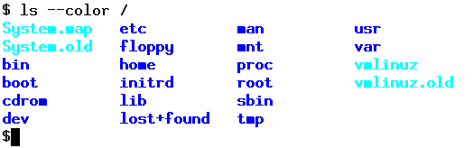

*图 5-2. 彩色目录列表。*

**注意：** 许多系统默认启用此标志，因此在使用无选项的`ls`时将彩色列出。如果你的系统不是这样设置的，而你希望如此，你始终可以在`.bashrc`启动文件中将`ls`设置为`ls --color`的 shell 别名（参见食谱 3.6.1 [通过其他名称调用命令] 第 83 页和食谱 3.7.3 [使用 shell 启动文件] 第 86 页）。

### 5.3.2 列出文件类型

使用带有`-F`选项的`ls`显示文件名的文件类型。

设置此选项后，普通文件按常显示，`ls`为其他文件附加以下类型的指示器：

- `/` 文件是目录。

- `*` 文件是可执行文件。

- `@` 文件是符号链接（参见食谱 5.7 [给文件起多个名称] 第 152 页）。

- `|` 文件是 fifo（也称为*命名管道*），是进程用于读写的特殊文件。

- `=` 文件是*套接字*（socket），是一种提供进程间通信的连接点的特殊文件。

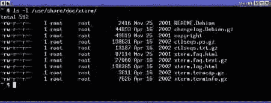

⇒ 要列出目录内容，以便目录、可执行文件和特殊文件与其他所有文件区分开，请输入：`$ ls -F`

```bash
repeat
test1
test2
words/
$
```

在这个示例中，当前目录包含一个名为`repeat`的可执行文件、一个名为`words`的目录，以及一些名为`test1`和`test2`的其他普通文件。

### 5.3.3 列出文件属性

使用带有`-l`（“长格式”）选项的`ls`输出更详尽的列表——一个包含每个文件大小、修改时间和所有权的列表（参见食谱 6.2 [所有权] 第 166 页）。

⇒ 输出`/home/mrs`目录的详细列表，请输入：`$ ls -l /home/mrs`

```bash
/home/mrs
$
```

在这个示例中，`pwd`输出文本`/home/mrs`，表示当前工作目录是`/home/mrs`。

第一行输出文件占用的总空间，以 1024 字节块为单位。后续每行显示关于一个文件的列信息。第一列显示类型；第一个字符`-`表示该文件是普通文件。目录由`d`表示，符号链接（参见食谱 5.7 [给文件起多个名称] 第 155 页）由`l`表示。其余九字符显示权限。第三列和第四列显示该文件所属的用户和组名。第五列显示文件大小（字节），第六列显示最后修改日期，最后一列显示文件名。

其他选项可以更改长格式输出的默认值。

要将修改日期从简写的月份、日期和年份输出改为显示完整的时间日期（如`date`的默认输出，参见 27.1 [显示日期和时间] 第 537 页），请使用特殊的`--full-time`选项。

⇒ 输出`/usr/share/bash`目录的详细列表并给出完整的修改时间日期，请输入：`$ ls -l --full-time /usr/share/bash`

此命令列出`/usr/share/bash`目录下的文件详细列表，显示完整的修改时间和日期，如图 5-4 所示。

要指定输出中的数字以“人类可读”的格式而不是块格式，请使用`-h`选项。当与`-l`结合时，它将总空间和每个文件的大小以字节、千字节（后跟`k`）或兆字节（后跟`M`）的形式给出。

⇒ 输出`/usr/share/bash`目录的详细列表并以人类可读的格式给出所有数字，请输入：`$ ls -lh /usr/share/bash`

*图 5-5. 具有人类可读数字的详细目录。*

人类可读的格式，如图 5-5 所示。

### 5.3.4 列出隐藏文件

默认情况下，`ls`不输出以点字符（`.`）开头的文件。

为了减少混乱，许多应用程序通过赋予以点开头的名称来“隐藏”你家目录中的配置文件；这些被称为*点文件*（dot files），或者有时被称为“隐藏”文件。如前所述，每个目录都有两个特殊的点文件：`..`（父目录）和`.`（目录本身）。

要列出目录的*所有*内容，包括这些点文件，请使用`-a`选项。

⇒ 列出当前目录下的所有文件，输入：

```bash
$ ls -a
```

RET

使用`-A`选项列出目录中*几乎*所有文件：它列出所有文件，包括点文件除了`..`和`.`目录文件。

⇒ 列出当前目录中除`..`和`.`外的所有文件，输入：

```bash
$ ls -A
```

RET

### 5.3.5 分列列出目录

使用`-1`选项以单列列出目录。文件将每行显示一个。这便于剪切粘贴。

⇒ 以单列列出`/usr/bin`的内容，输入：

```bash
$ ls -1 /usr/bin
```

RET

当`ls`的输出通过到终端以外的任何地方时，`ls`会使用这种单列格式。

通常，`ls`垂直方向列出文件——首先填充最左侧列，然后是下一列，一直到屏幕右侧。使用`-x`让列改为*水平*列出——这样第一行将先填充文件名，然后是下一行，直到所有文件都列出。

⇒ 以水平打印的列出`/usr/bin`的内容，输入：

```bash
$ ls -x /usr/bin
```

RET

使用`-m`选项不以列的形式输出文件，而是以单行水平输出，并用逗号分隔。

⇒ 以单行输出`/usr/bin`的内容，文件名用逗号分隔，输入：

```bash
$ ls -m /usr/bin
```

RET

### 5.3.6 按排序顺序列出文件

默认情况下，`ls`输出的文件列表按字母顺序（字符顺序）排序——也就是说，文件按从小到大的 ASCII 码排序（参见食谱 9.3.7 [查看字符集]，第 228 页），因此，例如大写字母开头的文件列在小写字母开头的文件之前。

有几个选项可以控制输出的排序方式；下面给出了一些。

#### 方法 #1

按大小排序文件，使用`-S`选项。文件按从大到小的顺序排序。

⇒ 按大小列出`/usr/bin`目录中的所有文件，最大的在前面，输入：

```bash
$ ls -S /usr/bin
```

RET

#### 方法 #2

在`ls`中使用`-t`选项按*时间*对目录列表进行排序，使文件根据最后修改时间列出，最近修改的排在前面。

⇒ 按修改时间列出`/usr/tmp`目录中的所有文件，最近修改的文件在前面，输入：

```bash
$ ls -t /usr/tmp
```

RET

#### 方法 #3

按扩展名排序文件，使用`-X`选项。没有扩展名的文件列在前面。

⇒ 按扩展名列出当前目录中的所有文件，输入：

```bash
$ ls -X
```

RET

#### 方法 #4

使用`-v`进行*版本排序*，其中文件名不是按字符排序，而是按数字编号的方式进行排序，这样`file-2`将位于`file-1`和`file-10`之间，而不是像普通字符排序那样排在两个文件之后。这对于文件名以某种方式编号的文件（例如版本、索引或日期）很有用。

⇒ 列出当前目录下所有以`.jpeg`结尾并按版本排序的文件，输入：

```bash
$ ls -v *.jpeg
```

RET

#### 方法 #5

使用`-r`*反转*排序输出的顺序。这适用于所有其他排序选项。

⇒ 从高 ASCII 字符值到低值列出当前目录中的文件，输入：

```bash
$ ls -r
```

RET

⇒ 按大小从小到大列出`/usr/bin`目录中的所有文件，最小的在前，输入：

```bash
$ ls -Sr /usr/bin
```

RET

⇒ 按修改日期列出当前目录中的所有文件，最近修改的文件在最后，输入：

```bash
$ ls -tr
```

RET

#### 方法 #6

使用`-U`选项关闭所有排序并按*未排序*顺序输出文件——即它们在磁盘上出现的顺序。

⇒ 按磁盘上出现的顺序输出当前目录中的所有文件，输入：

```bash
$ ls -U
```

RET

### 5.3.7 递归列出子目录

通常当你列出一个目录时，子目录只是按名称列出——其内容不会列出。要列出目录包含的所有子目录，请使用`-R`选项。

递归列出目录的内容，包括子目录。

⇒ 递归列出根目录的内容，输入：

```bash
$ ls -R
```

RET

该命令会递归地列出目录的内容，包括子目录。

## 5.4 复制文件与目录

使用`cp`（“复制”）来复制文件。它接受两个参数：*源文件*（即要复制的文件）和*目标文件*（即新文件的文件名）。`cp`命令随后为源文件创建一个相同的副本。如果目标文件名已存在文件，`cp`将覆盖它。它不会更改源文件。

⇒ 将`my-copy`复制到`neighbor-copy`，输入：

```bash
$ cp my-copy neighbor-copy
```

RET

该命令创建一个名为`neighbor-copy`的新文件，它在名称外与`my-copy`完全相同——新文件具有显示复制时间的时间戳。

使用`-v`（“详细输出”）选项在复制文件时列出它们。这对于大型拷贝很有用，因为有很多文件正在复制，你可以监控进度。

⇒ 将`~/workgroup/final`目录中的所有文件复制到`~/workgroup/backup`目录，指定详细输出以便每个文件在复制时都列出，输入：

```bash
$ cp -v ~/workgroup/final/* ~/workgroup/backup
```

RET

### 5.4.1 带有属性复制文件

当你复制文件时，时间戳和文件所有权等属性在原始文件和拷贝之间会有不同。使用带有`-p`选项的`cp`尽可能保留原始属性，包括时间戳、所有者、组和权限。

⇒ 将`my-copy`复制到`neighbor-copy`，在目标文件中保留源文件的所有属性，输入：

```bash
$ cp -p my-copy neighbor-copy
```

RET

该命令将`my-copy`复制到名为`neighbor-copy`的新文件中，它除了名称外与`my-copy`完全相同。


虽然`-p`不复制目录包含的任何子目录，但你可以改用`-a`（“归档”）选项，它尽可能保留属性，但还会复制任何子目录以及符号链接（参见食谱5.7 [给文件起多个名称]，第152页）。这有利于将一个目录树存档备份到另一个目录树。

* ⇒ 要将`/cdrom`的内容归档拷贝到当前目录，输入：

```bash
cp -a /cdrom .
```

RET

此命令将`/cdrom`拷贝（包括其可能包含的任何子目录）到当前目录。原始文件属性在副本中会被保留。

**注意**：*快照*是目录树的副本，显示了它在特定时间的状态。快照通常在软件开发项目中的每次发布时创建——“对当前版本拍摄快照”意味着对包含源代码的目录树创建一个归档副本。

## 第5章：文件与目录

143

要为目录树创建快照，请如上所示使用带有`-a`选项的`cp`命令。

### 5.4.2 复制子目录

要复制目录及其包含的文件和子目录，请使用`-R`选项——它会对指定的目录及其整个内容进行*递归*复制。

* ⇒ 要将目录`public_html`及其所有文件和子目录复制到名为`private_html`的新目录，输入：

```bash
cp -R public_html private_html
```

RET

`-R`选项不会复制符号链接文件（参见配方5.7 [给一个文件起多个名称]，第152页），并且不会保留所有原始权限。要递归复制目录（包括链接）并保留其所有权限，请使用`-a`（“归档”）选项。这对于为大型目录树创建备份副本非常有用。

* ⇒ 要将目录树`public_html`归档拷贝到目录`private_html`，输入：

```bash
cp -a public_html private_html
```

RET

### 5.4.3 通过唯一父目录复制文件

有时，我们希望复制或重命名一组具有共同名称的文件，以便新名称与每个原始文件所属的唯一父目录匹配。为了实现这一点，使用`basename`为`cp`命令获取每个唯一路径的名称。使用Bash的内置`for`结构遍历所有文件，并在每个文件上运行该命令行（有关该内置构件的更多信息，请参阅Bash Info文档）。

例如，假设你的主目录下有一个名为`photographs`的目录，其中有若干子目录，每个子目录以一个唯一的数字命名，且每个子目录都包含许多目录，如图5-6所示，其中一个名为`src`。

假设你只想复制`src`目录及其内容，但希望这些复制的目录的名称为`src`之前的唯一路径（01、02等）。使用`basename`将唯一路径传递给`cp`。

144

《Linux命令行手册》，第2版

```
~/photographs/01/
~/photographs/01/640x480
~/photographs/01/320x280
~/photographs/01/src
~/photographs/02
~/photographs/02/640x480
~/photographs/02/320x280
~/photographs/02/src
~/photographs/03
~/photographs/03/640x480
~/photographs/03/320x280
~/photographs/03/src
* ... 继续 ... *
```

图5-6. 具有唯一父目录的子目录。

* ⇒ 要将所有`src`目录复制到`/mnt`目录，并为每个文件赋予在`~/photographs`中父目录的唯一名称，输入：

```bash
for i in ~/photographs/**
{
    cp -a $i/src /mnt/`basename $i`
}
```

此命令复制`~/photographs`中所有的`src`目录，并赋予它们父目录的唯一名称——使得`~/photographs/01/src`变成`/mnt/01`，`~/photographs/02/src`变成`/mnt/02`，依此类推。

你可以使用分号（`;`）将所有内容在一行命令行中作为单个命令运行（参见配方3.1.7 [运行命令列表]，第63页）。以下命令与前面的示例等效：`for i in ~/photographs/*; { cp -a $i/src /mnt/`basename $i`; }`

**注意**：如需用此方法通过*重命名*文件，请使用`mv`代替`cp`（参见配方5.5 [移动文件和目录]，第144页）。

## 5.5 移动文件和目录

使用`mv`（“移动”）工具将文件或目录移动或重命名到不同的位置。它接受两个参数：要移动的文件或目录名称，随后是移动到的路径名。如果你将文件移动到一个包含同名文件的目录，该文件将被覆盖。

第5章：文件与目录

145

* ⇒ 要将当前工作目录下的文件`notes`移动到`../play`，输入：

```bash
mv notes ../play
```

RET

此命令将当前目录下的`notes`文件移动到`play`，它是当前工作目录父目录的一个子目录。如果`play`中已存在文件`notes`，则该文件将被覆盖。如果子目录`play`不存在，此命令将`notes`文件从当前目录移动到其父目录，并将文件重命名为`play`。

如果你将一个文件移动到一个包含同名文件的目录，该文件将被覆盖。

* ⇒ 要将文件或目录移动或重命名到不同的位置。

要移动一个文件，将其移动到不同的位置。

```bash
mv notes ../play
```

RET

此命令将当前目录下的`notes`文件移动到`play`，它是当前工作目录父目录的一个子目录。如果`play`中已存在文件`notes`，则该文件将被覆盖。如果子目录`play`不存在，此命令将`notes`文件从当前目录移动到其父目录，并将文件重命名为`play`。

如果你将一个文件移动到一个包含同名文件的目录，该文件将被覆盖。

要将文件或目录移动或重命名到不同的位置。

要移动一个文件，将其移动到不同的位置。

```bash
mv notes ../play
```

RET

此命令将当前目录下的`notes`文件移动到`play`，它是当前工作目录父目录的一个子目录。如果`play`中已存在文件`notes`，则该文件将被覆盖。如果子目录`play`不存在，此命令将`notes`文件从当前目录移动到其父目录，并将文件重命名为`play`。

要移动一个文件，将其移动到不同的位置。

要移动一个文件，将其移动到不同的位置。

```bash
mv notes ../play
```

RET

此命令将当前目录下的`notes`文件移动到`play`，它是当前工作目录父目录的一个子目录。如果`play`中已存在文件`notes`，则该文件将被覆盖。如果子目录`play`不存在，此命令将`notes`文件从当前目录移动到其父目录，并将文件重命名为`play`。

要移动一个文件，将其移动到不同的位置。

要移动一个文件，将其移动到不同的位置。

```bash
mv notes ../play
```

RET

此命令将当前目录下的`notes`文件移动到`play`，它是当前工作目录父目录的一个子目录。如果`play`中已存在文件`notes`，则该文件将被覆盖。如果子目录`play`不存在，此命令将`notes`文件从当前目录移动到其父目录，并将文件重命名为`play`。

要移动一个文件，将其移动到不同的位置。

要移动一个文件，将其移动到不同的位置。

```bash
mv notes ../play
```

RET

此命令将当前目录下的`notes`文件移动到`play`，它是当前工作目录父目录的一个子目录。如果`play`中已存在文件`notes`，则该文件将被覆盖。如果子目录`play`不存在，此命令将`notes`文件从当前目录移动到其父目录，并将文件重命名为`play`。

要移动一个文件，将其移动到不同的位置。

要移动一个文件，将其移动到不同的位置。

```bash
mv notes ../play
```

RET

此命令将当前目录下的`notes`文件移动到`play`，它是当前工作目录父目录的一个子目录。如果`play`中已存在文件`notes`，则该文件将被覆盖。如果子目录`play`不存在，此命令将`notes`文件从当前目录移动到其父目录，并将文件重命名为`play`。

要移动一个文件，将其移动到不同的位置。

要移动一个文件，将其移动到不同的位置。

```bash
mv notes ../play
```

RET

此命令将当前目录下的`notes`文件移动到`play`，它是当前工作目录父目录的一个子目录。如果`play`中已存在文件`notes`，则该文件将被覆盖。如果子目录`play`不存在，此命令将`notes`文件从当前目录移动到其父目录，并将文件重命名为`play`。

要移动一个文件，将其移动到不同的位置。

要移动一个文件，将其移动到不同的位置。

```bash
mv notes ../play
```

RET

此命令将当前目录下的`notes`文件移动到`play`，它是当前工作目录父目录的一个子目录。如果`play`中已存在文件`notes`，则该文件将被覆盖。如果子目录`play`不存在，此命令将`notes`文件从当前目录移动到其父目录，并将文件重命名为`play`。

（注：由于提供的文本中存在大量重复段落，此处展示了核心内容的翻译并保持格式）

```bash
mv notes ../play
```

RET

此命令将当前目录下的`notes`文件移动到`play`，它是当前工作目录父目录的一个子目录。如果`play`中已存在文件`notes`，则该文件将被覆盖。如果子目录`play`不存在，此命令将`notes`文件从当前目录移动到其父目录，并将文件重命名为`play`。

你可以使用分号字符（`;`）将所有内容在单行中作为单个命令运行。以下命令等同于之前的示例：

```bash
for i in *; { mv -i $i echo $i | tr '[A-Z]' '[a-z]'; }
```

在`mv`命令中使用`-i`选项是因为否则该命令可能会无意中删除文件——例如，如果你有名为`CAT`、`Cat`和`cat`的文件，在不加`-i`的情况下，该命令将删除其中两个。

此外，对于不受转换为小写转换影响的文件（例如，名为`dog`的文件），此命令将不执行任何操作，并输出一条消息指示原始文件名和新文件名相同。

⇒ 要将当前目录下所有`.JPG`扩展的文件名转换为小写，请输入：

```bash
for i in *.JPG; { mv -i $i echo $i | tr '[A-Z]' '[a-z]'; }
```

你可以使用`tr`对一组文件执行任意数量的转换，例如将所有小写字母转换为大写，或删除某些字符。

⇒ 这里是使用它的几种方法。

• 要将当前目录下所有`.jpg`扩展的文件名转换为大写，请输入（同一行）：

```bash
for i in *.jpg; { mv -i $i echo $i | tr '[a-z]' '[A-Z]'; }
```

• 要重命名当前目录下所有文件名中包含`386`的文件并删除名称中的`386`，请输入：

```bash
for i in *386*; { mv -i $i echo $i | tr -d '386'; }
```

### 5.5.2 重命名相同扩展名的多个文件

有三种可靠的方法可以将具有相同扩展名的文件组全部重命名为其他扩展名。前两种方法与之前的食谱相同。

#### 方法 #1

使用`rename`工具，它是Perl编程语言的一部分。它接受两个参数：一个描述要进行更改的引号内的Perl表达式，以及要执行更改的文件。

⇒ 要将当前目录下所有以`.JPG`结尾的文件重命名为以`.jpeg`结尾的文件，请输入：

```bash
rename 's/.JPG/.jpeg/' *.JPG
```

#### 方法 #2

使用`mv`移动文件，并用`basename`工具导出新文件名。使用Bash内置的`for`结构遍历所有文件，并在每个文件上运行此命令行（有关此内置命令的更多信息，请参见bash Info文档）。

⇒ 要将当前目录下所有以`.JPG`结尾的文件重命名为以`.jpeg`结尾的文件，请输入：

```bash
for i in *.JPG
>
    mv -i $basename $i JPG.jpeg
}
```

你可以使用分号字符（`;`）在单行中运行这些命令。以下命令等同于之前的示例：

```bash
for i in *.JPG; { mv -i $basename $i JPG.jpeg; }
```

#### 方法 #3

要将一组文件从一种扩展名重命名为另一种，可以使用`for`循环配合`mv`（如方法2），但不再使用`basename`，而是使用Bash Shell参数扩展功能指定新的扩展名。

⇒ 要重命名当前目录下所有的`.jpg`文件，使其它们都具有`.jpeg`扩展名，请输入：

```bash
for i in .jpg
>
    mv $i "${i%.jpg*}.jpeg"
}
```

**注意：** 同时重命名多个文件是一个常见请求。

### 5.6 删除文件和目录

使用`rm`（“remove”）删除文件并将其从系统中移除。将要删除的文件名作为参数提供。

⇒ 要删除当前工作目录下的`notes`文件，请输入：

```bash
rm notes
```

要删除目录及其包含的所有文件和子目录，请使用`-R`（递归）选项。

⇒ 要删除`waste`目录及其所有内容，请输入：

```bash
rm -R waste
```

要删除空目录，使用`rmdir`；它会删除你指定的空目录。如果你指定的目录包含文件或子目录，`rmdir`将报告错误。

⇒ 要删除`empty`目录，请输入：

```bash
rmdir empty
```

#### 5.6.1 删除命名特殊的文件

文件名中带有特殊字符（如空格、控制字符和开头的连字符）的文件在想要删除它们时会产生问题。这个问题有几种解决方案。

##### 方法 #1

一种方法是使用制表符补全完成文件名（参见食谱3.1.4 [让Shell自动完成你输入的内容]，第61页）。当你想要删除的文件名有足够的字符来唯一标识它以便补全功能工作时，这种方法有效。

⇒ 要删除当前目录下的`notes`文件，请输入：

```bash
rm notes
```

##### 方法 #2

当文件名以控制字符开头时，可以使用模式指定文件名（参见食谱5.8 [指定文件名]，第48页）。使用`-i`选项确认删除。

⇒ 在一个包含`dog`的目录中删除`cat`文件，请输入：

```bash
rm -i ?cat
```

##### 方法 #3

上述两种方法对于以连字符（-）开头的文件无效，因为`rm`将此类文件名解释为选项；要删除此类文件，请使用`--`选项——它指定后续内容是参数而不是选项。

⇒ 要从当前目录删除文件`-cat`，请输入：

```bash
rm -- -cat
```

#### 5.6.2 交互式删除文件

一旦文件被删除，它就会被永久删除，没有命令可以恢复它；你无法“撤销删除”。（然而，如果你能在删除文件后立即卸载包含该文件的文件系统，向导可能通过使用`grep`搜索文件系统设备来重构丢失的文件。）

删除文件的安全方法是使用带有`-i`选项的`rm`，该选项指定`rm`以*交互式*模式运行，它会询问你确认删除每个文件。

⇒ 要交互式删除`~/tmp`目录下的文件，请输入：

```bash
rm -i ~/tmp
```


如果文件受写保护，当你尝试删除它时，`rm` 总是会要求你先确认删除。当你有大量文件要删除时，这非常麻烦。在这种情况下，使用 `yes` 将自动的“y”答案传递到带有 `-R` 选项的 `rm`（参见方案 3.1.10 [自动回答命令提示]，第 65 页）。

⇒ 要删除 `scrap` 目录及其所有内容（包括任何写保护的文件），输入：

```bash
yes | rm -R scrap
```

**注意：**这是一个危险的操作！此命令将永久删除你提供的所有文件和目录，因此在运行之前，请确定你想要删除它们！

4 查看文件 `/usr/doc/FAQ/unix-faq-part3`，或者在 Web 上：<http://www.faqs.org/faqs/unix-faq/faq/>。

152

《Linux 操指南》，第 2 版

## 5.7 给文件多个名称

`链接`（Links）是指向其他文件的特殊文件；当你对链接文件进行操作时，你实际上是对它指向的文件进行操作。链接有两种类型：符号链接和硬链接。

`符号链接`（有时称为“symlink”或“软链接”）将大多数操作（如读取和写入）传递给它所指向的文件。在文件列表中，符号链接通过第一列第一个字符的“l”来识别，并且默认情况下，它们在彩色列表中被输出为青色。

如果你删除一个符号链接，你只删除了链接本身，而不是原始文件。然而，如果你删除了原始文件并将其替换为其他文件，符号链接将指向新文件的内容。你可以为目录创建符号链接，也可以跨文件系统创建符号链接（参见第 24 章 [磁盘存储]，第 501 页）。

`硬链接`是现有文件的另一个名称，它与它所链接的文件不可区分。如果你修改了一个文件，任何指向该文件的硬链接也会随之修改；反之，修改任何一个硬链接也会修改原始文件以及该文件可能拥有的任何其他硬链接。因此，如果你从文件 `foo` 到文件 `bar` 创建一个硬链接，然后修改文件 `bar`，文件 `foo` 也会被同样修改。

所以，如果说符号链接指向它所链接的文件，那么硬链接就是该文件的另一个实例。如果你更改了原始文件，所有的硬链接也会跟着改变。如果你更改了任何一个硬链接，原始文件和所有其他硬链接都会改变。但如果你删除了原始文件，任何硬链接仍然包含原始文件的内容。

与符号链接不同，你无法为目录创建硬链接，也无法跨文件系统创建硬链接。

系统上的每个文件至少有一个硬链接，即原始文件名本身。目录始终至少有两个硬链接——目录名称本身（出现在其父目录中）以及目录内部的特殊文件 `.`。同样，当你创建一个新的子目录时，父目录会为新子目录内部的特殊文件 `..` 创建一个新的硬链接。

### 方法 #1

使用 `ln`（“link”）来为文件创建链接。提供要链接的现有文件名称和用于链接的名称作为参数。默认情况下，`ln` 创建硬链接。

第 5 章：文件和目录

153

⇒ 要从 `seattle` 到 `emerald-city` 创建一个硬链接，输入：

```bash
ln seattle emerald-city
```

此命令从现有文件 `seattle` 到新文件 `emerald-city` 创建一个硬链接。你可以像处理 `seattle` 一样读取和编辑 `emerald-city` 文件；你对 `emerald-city` 做的任何更改也会写入 `seattle` 中（反之亦然）。但如果你删除了 `emerald-city` 文件，`seattle` 文件不会被删除（反之亦然）。

### 方法 #2

要创建符号链接，请使用带有 `-s` 选项的 `ln`。

⇒ 要从 `seattle` 到 `emerald-city` 创建符号链接，输入：

```bash
ln -s seattle emerald-city
```

此命令从现有文件 `seattle` 到新文件 `emerald-city` 创建一个符号链接。如果你删除了文件 `emerald-city`，文件 `seattle` 不会被删除；但另一方面，删除 `seattle` 文件将导致 `emerald-city` 变成一个失效链接，直到另一个名为 `seattle` 的文件再次出现在其位置——此时，`emerald-city` 将指向那个新文件。

**注意：**该方案也可以称为“将一个文件链接到另一个文件”。

## 5.8 使用模式指定文件名

当你在命令中指定一个或多个文件的名称时，你提供了一个文件规范（file specification），通常简写为 `filespec`。

这些 `filespecs` 不需要是特定文件的字面名称。Shell 提供了一种强大的构建模式的方法，称为文件名扩展（expansions），用于指定一组路径和文件。在 Unix 术语中，这种方式指定文件被称为通配匹配（globbing）。

在指定文件和目录名称时，可以使用这些模式作为任何工具或应用程序的参数；Shell 会将你的模式（或“通配匹配”）扩展为符合模式的文件名。给定的模式是一个通配表达式。

下表列出了各种扩展字符及其含义。

154

《Linux 操纵指南》，第 2 版

`*` 星号匹配零或多个字符，有时被称为“通配符”字符。例如，`*` 扩展为指定目录下的所有名称，`a*` 扩展为以“a”开头并跟随任意字符，`a*b` 扩展为以“a”开头并以“b”结尾的名称。

`?` 问号匹配恰好一个字符。因此，`?` 扩展为所有恰好有一个字符的名称，`??` 扩展为所有具有两个字符的名称，`a?` 扩展为以“a”开头且恰好有一个字符的名称。

`{string1,string2,...}` 大括号对逗号分隔的字符串分组，所有字符串将被匹配。因此 `{a,b}c` 扩展为“ac”和“bc”。

`[list]` 方括号匹配 `list` 中的一个字符。例如，`[ab]` 匹配两个名称：“a”和“b”。模式 `c[io]` 匹配“ci”和“co”，但不匹配其他名称。

`~` 波浪字符扩展为你的家目录（`HOME` 变量的值；参见方案 3.5 [使用变量]，第 77 页）。例如，如果你的用户名是 `mary` 且家目录是 `/home/mary`，那么 `~` 将扩展为 `/home/mary`。你可以在波浪号后加上路径以指定家目录中的文件——例如 `~/work` 将扩展为 `/home/mary/work`。

第 5 章：文件和目录

155

当与其他字符结合使用时，括号也具有特殊含义，如下表所示。

`-` 连字符作为括号列表的一部分表示要匹配的字符范围——所以 `[a-m]` 匹配从“a”到“m”的所有小写字母。要匹配字面连字符，请将其作为列表中的第一个或最后一个字符。例如，`a[-b]c` 匹配两个文件：`a-c` 和 `abc`。

`!` 在括号列表开头放置感叹号，以匹配列出字符之外的所有字符。例如，`a[!b]c` 匹配所有以“a”开头、以“c”结尾且中间有任意一个字符（除“b”之外）的文件；它匹配 `aac`、`adc` 等文件。

你可以任意组合这些特殊的扩展字符，并且可以将多个模式作为多个参数指定。

⇒ 以下示例了文件扩展的用法，使用了本章之前描述的命令。

- 要列出 `/usr/bin` 目录下名称中任何地方包含“tex”文本的文件，输入：

```bash
ls /usr/bin/*tex
```

`RET`

- 要将所有以 `.txt`、`.text`、`.doc` 或 `.info` 结尾的文件复制到 `doc` 子目录下，请输入：

```bash
cp *.txt,text,doc,info doc
```

`RET`

- 要输出所有三个字符扩展名结尾的文件详细列表，并对列表进行排序使较新的文件排在前面，请输入：

```bash
ls -lt *.???
```

`RET`

- 要将 `/usr/tmp` 目录下所有名称由“song”文本后跟 `0` 到 `9` 之间的整数以及 `.cdda` 扩展的文件移动到你家目录下的 `music` 目录中，请输入：

```bash
mv /usr/tmp/song[0-9].cdda ~ */music
```

`RET`

156

《Linux 厨房指南》，第 2 版

- 要删除当前工作目录下所有以连字符开头、且文件名中其他地方包含“out”文本的文件，请输入：

```bash
rm -- -out
```

`RET`

- 要合并所有名称由字母“a”后跟两个或更多字符的文件，请输入：

```bash
cat a??
```

`RET`

## 5.9 列出目录树图

### Tree（树）

DEB：`tree`

RPM：`tree`

WWW：`ftp://mama.indstate.edu/linux/tree/`

使用 `tree` 输出给定目录树的 ASCII 文本树图。

⇒ 要输出当前目录及其所有子目录的树图，请输入：

```bash
tree
```

`RET`

```text
.
|-- projects
|
|-- current
|
`-- old
|
|-- 1
|
`-- 2
`-- trip
-- schedule.txt
4 directories, 3 files
```

在前面的示例中，绘制了一幅树图，显示了当前目录。它包含了两个目录 `projects` 和 `trip`；`projects` 目录又包含了 `current` 和 `old` 目录。

要输出特定目录树的树图，请将该目录树的名字作为参数。

第 5 章：文件与目录

157

⇒ 要输出你的家目录及其所有子目录的树图，请输入：

```bash
tree ~
```

`RET`

要输出仅包含目录名的目录树图，请使用 `-d` 选项。这对于输出整个系统的目录树，或者获取特定目录树的结构非常有帮助。

⇒ 这里是使用该功能的一些方法。

- 要将整个系统的树图输出到文件 `tree`，请输入：

```bash
tree -d /* > tree
```

`RET`

- 要查看 `/usr/local` 目录树的树图，请输入：

```bash
tree -d /usr/local | less
```

`RET`

**注意：**另一种输出目录树的工具在食谱 24.2 [列出文件的磁盘占用] 第 502 页中介绍。

## 5.10 浏览文件与目录

有几种方法可以浏览系统上的文件。这里有我推荐的三种。

### 方法 #1：Midnight Commander（午夜司令）

DEB：`mc-common`

```bash
mc
```

RPM：`mc`

WWW：`http://www.ibiblio.org/mc/`

浏览系统上文件最简单的方法是使用一个专门为此目的设计的“文件管理器”工具。Linux 上至少有几个这样的工具，除了 `gnome5` 和 `kde` 自带的文件管理器之外；最流行的独立文件管理器可能是久负盛名的“Midnight Commander”。

输入 `mc` 运行它。提供一个要浏览的目录名称作为参数，可以是相对于当前目录的路径，也可以是完整路径。如果你没有提供任何参数，`mc` 将使用当前工作目录。

⇒ 使用 Midnight Commander 浏览 `/usr/local/` 目录，请输入：

```bash
mc /usr/local
```

`RET`

5 分别 Nautilus 和 Konqueror。

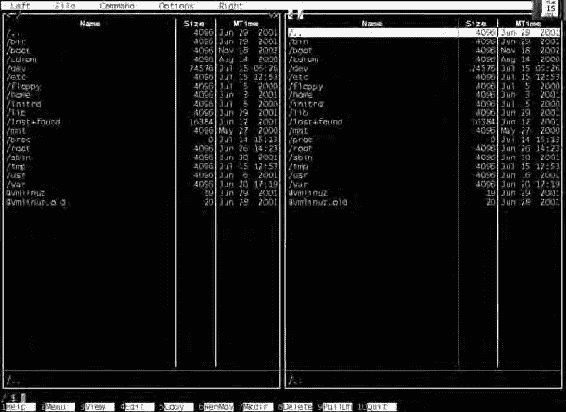

158

《Linux 厨房指南》，第 2 版

在浏览目录时，`mc` 会提供两个显示窗口，称为目录面板（directory panels）。使用鼠标访问顶部菜单栏上的下拉菜单。

功能键提供帮助和其他菜单；它们列在屏幕的最底部。上方是 Bash 命令行，你可以像平常在 shell 中一样使用它。输入 `F10` 退出 `mc` 并返回到运行它的 shell。

图 5-7 展示了在浏览典型系统的根目录时 Midnight Commander 的外观。

*图 5-7. 使用 Midnight Commander 浏览本地文件。*

### 方法 #2：Lynx

DEB：`lynx`

RPM：`lynx`

WWW：`http://lynx.browser.org/`

你可以在 Web 浏览器中查看和浏览本地文件，例如纯文本浏览器 `lynx` 或用于 X 的图形化 Mozilla 浏览器。

`lynx` 工具非常适合浏览系统上的文件——提供要浏览的目录名称作为参数，`lynx` 将显示该目录下可用文件和目录的列表。

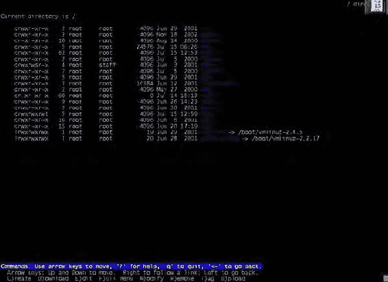

第 5 章：文件与目录

159

你可以使用光标键进行浏览，并在子目录上按 `RET` 进入该目录。6 你可以使用 `lynx` 浏览系统上的文件——提供路径名称作为参数。这对于 `/usr/doc` 和 `/share/doc` 目录非常有帮助。

⇒ 这里是使用该功能的一些方法。

- 要输出整个系统的树图到文件 `tree`，请输入：

```bash
tree -d /* > tree
```

`RET`

- 要查看 `/usr/local` 目录树的树图，请输入：

```bash
tree -d /usr/local | less
```

`RET`

在浏览典型系统的根目录时 Midnight Commander 的外观见图 5-7。

*图 5-7. 使用 Lynx 浏览本地文件。*

**注意：**另一种输出目录树的工具在食谱 24.2 [列出文件的磁盘占用] 第 502 页中介绍。

### 方法 #3：Mozilla

DEB：`mozilla-browser`

RPM：`mozilla`

WWW：`http://www.mozilla.org/`

使用 Mozilla 像方法 #2 那样浏览，提供路径名称作为参数。

第 5 章：文件与目录

161

**注意：**另一种输出目录树的工具在食谱 24.2 [列出文件的磁盘占用] 第 502 页中介绍。

162

《Linux 厨房指南》，第 2 版

# 第 6 章：共享文件

163

## 6. 共享文件

组、所有权和访问权限是允许用户之间共享文件的 Linux 特性。但即使你不计划与其他用户共享文件，了解这些主题也是重要的；这些概念将帮助你理解 Linux 如何处理文件访问和安全，并让你能够控制访问方式。

### 6.1 组工作

组是用户集合，用于共享文件并促进协作。

所有组都有唯一的名称，并被分配一个唯一的组 ID，称为 `gid`。组的每个成员都可以处理该组的文件并创建属于该组的新文件。系统管理员可以根据用户的组织需求添加新组并赋予用户不同的组身份。例如，一个供船员使用的系统可能会有特殊组，如厨房、甲板、驾驶舱和船员；船长可能是所有组的成员，但管家可能只是厨房组和船员组的成员。

在 Linux 系统上，你至少是一个组的成员：你的登录组。它的名称与你的用户名相同，你是它唯一的成员。1

以下食谱展示了如何列出组及其成员。

#### 6.1.1 列出可用组

系统上所有可用组的列表保存在文件 `/etc/group` 中，该文件被称为用户组文件。这是一个文本文件，包含一个组列表，每行一个，字段由冒号（`:`）分隔：组名、加密后的密码（现代系统使用所谓的影子密码（shadow passwords），这意味着实际的加密密码存储在其他处，这里显示一个“x”字符作为占位符）、组 ID（`gid`）以及该组所有成员用户的逗号分隔列表。

要列出系统上可用的组，请列出此文件的内容。

1 这是某些系统（包括 Debian 发行版）的默认设置，但并非所有发行版的标准；在这些问题上，本章将假设 Debian 的行为。

⇒ 要列出文件 `/etc/group` 的内容，输入：

```bash
cat /etc/group
```

此命令使用 `cat` 工具输出文件的全部内容（参见食谱 9.2 [显示文本]，第 216 页），列出所有字段。使用 `cut` 输出特定字段（参见食谱 13.7.4 [从文本中删除列]，第 324 页）。

⇒ 要输出系统上所有组名的列表，输入：

```bash
cut -d : -f1 /etc/group
```

**注意：**关于用户组文件的更多信息，请参阅 `group` 的 man 页面。

### 6.1.2 列出用户所属的组

要列出用户的组成员身份，请使用 `groups` 工具。提供任意数量的用户名作为参数，`groups` 将每个用户输出一行，包含该用户所属的所有组的列表，前面是用户名和冒号（`:`）。如果不提供任何参数，`groups` 将列出你自己的组成员身份。

⇒ 要列出你的组成员身份，输入：

```bash
groups
```

```text
steward galley crew
```

在此示例中，输出了三个组：`steward`（用户的登录组）、`galley`（厨房组）和 `crew`（船员）。

⇒ 要列出用户 `marlow` 的组成员身份，输入：

```bash
groups marlow
```

```text
marlow : marlow
```

在此示例中，命令输出了指定的用户名 `marlow`，随后是一个组名 `marlow`，表示用户 `marlow` 仅属于一个组：他的登录组。

### 6.1.3 列出组的成员

有两种方法可以列出特定组的成员。

#### 方法 #1

使用 `members` 工具列出特定组的成员。将特定组的名字作为参数。

⇒ 要输出 `galley` 组的成员列表，输入：

```bash
members galley
```

```text
captain steward pete
```

在此示例中，输出了三个用户名，表示这三个用户是 `galley` 组的成员。

**注意：**`members` 工具在 Debian 发行版之外尚未广泛可用；如果你找不到其副本，可以随时从 Debian 软件包安装源码（参见食谱 1.1.2 [食谱的准备]，第 3 页）。

#### 方法 #2

在没有方便安装 `members` 的系统上，可以通过结合使用 `grep` 和 `cut` 来列出特定组的成员。首先，使用 `grep` 输出 `/etc/group` 中第一个字段匹配特定组名的行，并将输出通过管道传给 `cut`，以仅输出最后一个字段，该字段包含属于该组的用户列表。

⇒ 要列出 `crew` 组的所有成员，输入：

```bash
grep ^crew:/etc/group | cut -d : -f 4
```


**注意：** 关于 `grep` 和 `cut` 的更多信息，请分别参考食谱 14.1 [在文中搜索单词]，第 333 页和食谱 13.7.4 [从文本中删除列]，第 324 页。

## 6.2 文件所有权

每个文件都属于一个用户和一个组——通常属于创建它的用户以及该用户当时所属的组（这几乎总是该用户的登录组）。文件所有权决定了用户对特定文件的访问类型（参见食谱 6.3 [控制文件的访问]，第 167 页）。

### 6.2.1 确定文件的所有权

要确定哪个用户和组拥有特定文件，使用带有 `-l` 选项的 `ls` 查看文件的属性（参见食谱 5.3.3 [列出文件属性]，第 136 页）。所有文件的用户名出现在输出的第三列，所有文件的组名出现在输出的第四列。

例如，假设一个名为 `cruise` 的文件的详细列表如下：

```
-rwxrw-r--
1 captain
crew
8,420 Jan 12 21:42 cruise
```

此文件的所有者是 `captain`，文件的组是 `crew`。

**注意：** 当你创建一个文件时，它通常属于你和你的登录组，但你可以按照下一个食谱中的描述更改它的所有权。你通常拥有你主目录下的所有文件。

### 6.2.2 更改文件的所有权

你不能将文件送给另一个用户，但其他用户可以创建属于你的文件的副本，前提是他们对该文件有读取权限（参见食谱 6.3 [控制文件的访问]，第 167 页）。当你复制另一个用户的文件时，你拥有该副本。

你也可以更改任何文件的所有权。要执行操作，使用 `chgrp`；它接受要设置的组名以及要操作的文件名。

*⇒* 要将 `cruise` 的组改为 `bridge`，输入：

```
$ chgrp bridge cruise
```

这将把 `cruise` 的组所有权转移给 `bridge`；组权限（如下）现在适用于该组成员。

使用 `-R` 选项递归更改目录及其所有内容的所有权。

*⇒* 要将 `maps` 目录及其所有内容的组改为 `bridge`，输入：

```
$ chgrp -R bridge maps
```

## 6.3 控制文件的访问

每个文件都有一组权限，规定了不同用户的访问类型。有三种权限：读取、写入和执行。你需要*读取*权限来读取文件内容，需要*写入*权限来写入更改或删除文件，需要*执行*权限来运行程序。

通常，用户只对自己目录下的文件具有写入权限。只有超级用户对 `/bin` 和 `/etc` 等重要目录的文件具有写入权限——因此作为普通用户，你不需要担心写入或删除重要的系统文件。

权限的工作方式与其他类型的文件不同。

目录的读取权限意味着你可以看到目录中的文件；写入权限允许你创建、移动或删除目录中的文件；执行权限允许你在路径中使用目录名（参见第 5 章 [文件和目录]，第 125 页）。

如果你对目录有读取权限但没有执行权限，你只能读取目录中的文件名——无法读取它们的其他属性、查看其内容、写入它们或执行它们。对于具有执行权限但没有读取权限的目录，只要你知道文件名并且对该文件拥有相应的权限，就可以读取、写入或执行该目录中的任何文件。

每个文件针对三类用户都有单独的权限：拥有文件的用户、该文件所属组的其他成员，以及系统上的所有其他用户。如果你是拥有该文件的组的成员，则该文件的组权限适用于你（除非你是该文件的所有者，在这种情况下用户权限适用于你）。

当你创建一个新文件时，它拥有一组默认权限——通常用户具有读取和写入权限，组和所有其他用户具有读取权限。（在某些系统上，默认权限是用户和组都具有读取和写入权限，所有其他用户具有读取权限。）

文件的访问权限统称为其*访问模式*。

以下章节描述了如何列出和更改文件访问模式，包括如何设置最常用的访问模式。

**注意：** 超级用户 `root` 始终可以访问系统上的任何文件，无论其访问权限如何。

有关文件权限和访问模式的更多信息，请参阅 `fileutils` Info 文档（参见 Recipe 2.8.5 [阅读 Info 手册]，第 48 页）。

### 6.3.1 列出文件的权限

要列出文件的访问权限，请使用带有 `-l` 选项的 `ls` 命令（参见 Recipe 5.3.3 [列出文件属性]，第 136 页）。文件访问权限出现在输出的第一列，紧跟文件类型字符之后。

例如，考虑文件 `cruise` 的详细列出：

```
-rwxrw-r-- 1 captain crew 8,420 Jan 12 21:42 cruise
```

第一个字符（`-`）是文件类型；接下来的三个字符（`rwx`）指定文件所有者的权限；接下来的三个（`rw-`）指定文件所在组所有成员的权限，但文件所有者除外。列中的最后三个字符（`r--`）指定系统中所有其他用户的权限。

所有三个权限部分具有相同的格式，从左到右分别用 `r`、`w` 和 `x` 字符表示读、写和执行权限。

用连字符（`-`）代替这些字母中的一个表示未赋予该权限。

在此示例中，列出结果表示文件所有者 `captain` 具有读、写和执行权限，文件所有组 `crew` 具有读和写权限。系统上的所有其他用户只有读权限。

### 6.3.2 更改文件的权限

要更改你拥有的任何文件的访问模式，请使用 `chmod`（更改模式）工具。它接受两个参数：一个*操作*（指定为某些用户授予或撤销的权限），以及要处理的文件名。

要构建操作，首先通过以下字符的组合指定用户类别或类别：

- `u`: 文件的所有者。

- `g`: 文件组的所有其他成员。

- `o`: 系统上的所有其他用户。

- `a`: 系统上的所有用户；这等同于 `ugo`。

随后是表示要执行操作的运算符：

- `+`: 在用户现有的权限上添加权限。

- `-`: 从用户现有的权限中删除权限。

- `=`: 使这些成为用户在该文件拥有的*唯一*权限。

最后，用特殊字符指定权限本身：

- `r`: 设置读权限。

- `w`: 设置写权限。

- `x`: 设置执行权限。

例如，使用 `u+w` 为文件所有者的现有权限添加写权限，使用 `a+rw` 为所有用户的现有权限同时添加读权限和写权限。（你也可以用 `ugo+rw` 代替 `a+rw`。）

### 6.3.3 对文件进行写保护

如果你撤销了用户对文件的写权限，他们将无法向该文件写入内容或删除文件。这有效地对文件进行了“写保护”，防止对其进行意外更改。写保护的文件有时被称为“只读”文件。

要对文件进行写保护以便除你之外的没有用户可以写入，请使用 `chmod` 并将 `go-w` 作为操作。

⇒ 对文件 `cruise` 进行写保护以使其他用户无法更改它，输入：

```bash
$ chmod go-w cruise
```

### 6.3.4 使文件私有

要使文件对系统上的所有其他用户私有，请使用 `chmod` 并将 `go=` 作为操作。这会撤销所有组权限和其他访问权限。

⇒ 使文件 `cruise` 对你以外的所有用户私有，输入：

```bash
$ chmod go= cruise
```

### 6.3.5 使文件公开

要允许系统上有账户的任何人读取并更改文件，请使用 `chmod` 并将 `a+rw` 作为操作。这授予所有用户读和写权限，使文件变为“公开”。当文件对所有用户设置了读权限时，它被称为*世界可读*（world readable），当文件对所有用户设置了写权限时，它被称为*世界可写*（world writable）。

⇒ 使文件 `cruise` 同时变为世界可读和世界可写，输入：

```bash
$ chmod a+rw cruise
```

### 6.3.6 使文件可执行

*可执行文件*是你可以作为程序运行的文件。要更改文件权限以便所有用户都能作为程序运行它，请使用 `chmod` 并将 `a+x` 作为操作。

⇒ 为所有用户赋予文件 `myscript` 执行权限，输入：

```bash
$ chmod a+x myscript
```

**注意：** 通常，你获取或自己编写的脚本没有设置执行权限，你必须手动设置。

# 7. 查找文件

有时你可能想在系统中查找匹配给定条件的文件，例如特定的名称或文件大小。本章将向你如何在只知道文件名部分时查找文件，以及如何查找名称匹配给定模式的文件。你还将学习如何列出文件和目录。

### 7.1 查找匹配模式的所有文件

查找文件的最简单方法是使用 `locate`。当你想要列出系统中匹配某种模式的文件时，可以使用它——例如路径中任何位置包含特定字符串的文件，或以某些扩展名结尾的文件。`locate` 工具输出你给出的模式所匹配的文件列表，每行显示一个路径。

在指定模式时，你可以使用任何文件名通配符（参见 Recipe 5.8 [使用通配符指定文件名]，第 153 页）。

⇒ 以下是一些用法：

- 查找系统中路径名中任何位置包含 `audio` 的文件，输入：

```bash
$ locate audio
```

- 查找系统中以 `.c` 扩展名结尾的文件，输入：

```bash
$ locate *.c
```

- 查找系统中所有的隐藏“点文件”，输入：

```bash
$ locate /.*
```

有时，`locate` 搜索会产生大量输出。将输出通过给 `less` 以进行浏览（参见 Recipe 9.1 [浏览文本]，第 211 页）。

⇒ 浏览系统中所有的 `.cfg` 文件列表，输入：

```bash
$ locate .cfg | less
```

**注意：** 搜索区分大小写。因此，搜索 `history` 会匹配 `~/.bash_history` 和 `/usr/local/history_data/README`，但不会匹配 `~/History_of_a_nation`。

### 7.2 在目录树中查找文件

使用 `find` 在特定的目录树中查找特定文件，将其完整路径输出到标准输出，每行一个。首先指定要搜索的目录树名称，然后指定匹配标准，以及要执行的操作。（与大多数其他工具不同，你必须在指定任何其他选项之前先指定目录树参数。）你可以在一个命令中指定多个搜索标准，并可以多种格式化输出。

下述食谱中描述的选项数值参数有三种形式：当数字前面有加号（`+`）时，它匹配所有大于数字的文件；当数字前面有连字符或减号（`-`）时，它匹配所有小于数字的文件；如果两种前缀都没有，它则匹配数字等于指定值的文件。

### 7.2.1 按名称在目录树中查找文件

要按名称在目录树中查找文件，请使用 `find`，首先给出要搜索的目录树名称，然后提供 `-name` 选项，最后跟上你想查找的名字。

*⇒* 列出系统中所有名为 `top` 的文件，请输入：

```bash
find / -name top
```

RET

此命令将搜索你权限访问的系统中所有目录；如果你对某个目录没有执行权限，`find` 将报告无权限搜索该目录。

`-name` 选项是区分大小写的；使用类似的 `-iname` 选项可以不区分大小写地查找名称。

*⇒* 列出系统中所有名为 `top` 的文件（不区分大小写），请输入：

```bash
find / -iname top
```

RET

此命令将匹配任何名称由字母 `top` 组成的文件，不区分大小写——包括 `Top`、`top` 和 `TOP`。

#### 第 7 章：查找文件

使用文件扩展符字符（参见食谱 5.8 使用模式指定文件名，第 153 页）来查找名称匹配模式的文件。将这些文件名模式放在单引号之间。

*⇒* 以下是使用此功能的一些方法。

*•* 列出系统中所有以字符 `top` 开头的文件，请输入：

```bash
find / -name 'top*'
```

RET

*•* 列出所有以 `top` 三个字符开头且后面恰好接三个字符的文件，请输入：

```bash
find / -name 'top???'
```

RET

*•* 列出所有以 `top` 三个字符开头且后面接五个或更多字符的文件，请输入：

```bash
find / -name 'top????*'
```

RET

*•* 列出你家目录树中所有以 `.tex` 结尾的文件（不区分大小写），请输入：

```bash
find ~ -iname '*.tex'
```

RET

*•* 列出 `/usr/share` 目录树中所有以 `.jpg` 或 `.jpeg` 结尾的文件（不区分大小写），请输入：

```bash
find /usr/share -iname '*.jp*g'
```

RET

*•* 列出 `/usr/share` 目录树中名称中包含 `farm` 文本的文件，请输入：

```bash
find /usr/share -name '*farm*'
```

RET

使用 `-regex` 代替 `-name` 来查找完整路径或相对路径匹配正则表达式（regular expression）的文件，正则表达式是一种描述字符串集合的模式（参见食谱 14.3 匹配文本模式，第 335 页）。

*⇒* 以下是使用此功能的两种方法。

*•* 列出当前目录树中所有相对路径中包含 `net` 或 `comm` 字符串的文件，请输入：

```bash
find . -regex '.*\(net\*| *comm\).*'
```

RET

*•* 列出 `/usr/share` 目录树中仅以 `.jpg` 或 `.jpeg` 结尾的文件（不区分大小写），请输入：

```bash
find /usr/share -iregex '.*\.\(jpg\*| *jpeg\)'
```

RET

该模式还匹配用任何其他字符替换“e”的文件——例如，`.jpog` 或 `.jp123g`。要匹配仅以 `.jpg` 或 `.jpeg` 结尾的文件，请使用下文描述的 `-regex` 或 `-iregex` 搜索。

`-regex` 选项相对于你指定的目录树匹配整个路径名，而不仅仅是文件名；由于这个原因，之前示例中的正则表达式以 `.*` 开头，以便首先匹配路径字符。要在搜索单词或短语时仅匹配文件名，请在搜索字符串后排除正斜杠字符（`/`），并使用 `! -type d` 排除目录（参见食谱 7.4.5 列出文件数量，第 184 页）。

*⇒* 列出当前目录树中所有文件名中包含 `net` 或 `comm` 字符串的文件，请输入：

```bash
find . -regex '.*\(net\*| *comm\).[*^ */]*' ! -type d
```

RET

### 7.2.2 按大小在目录树中查找文件

要查找特定大小的文件，请使用 `-size` 选项，后跟要匹配的文件大小。默认单位是 512 字节块；在大小后加上 `k` 表示千字节，加上 `b` 表示字节。

*⇒* 以下是使用此功能的一些方法。

*•* 列出 `/usr/local` 目录树中所有大于 10,000 千字节的文件，请输入：

```bash
find /usr/local -size +10000k
```

RET

*•* 列出你家目录树中所有小于 300 字节的文件，请输入：

```bash
find ~ -size -300b
```

RET

*•* 列出系统中所有大小恰好为 42 字节块的文件，请输入：

```bash
find / -size 42
```

RET

使用 `-empty` 选项查找空文件——大小为 0 的文件。

*⇒* 查找你目录树中的所有空文件，请输入：

```bash
find ~ -empty
```

RET

### 7.2.3 按访问时间在目录树中查找文件

要查找指定时间访问的文件，请使用 `find` 配合 `-amin`、`-anewer` 或 `-atime` 选项。在 `-amin` 后提供的参数指定访问前的分钟数或二十四小时。

*⇒* 以下是使用此功能的一些方法。

*•* 列出你家目录树中在一小时前访问的文件，请输入：

```bash
find ~ -amin 60
```

RET

*•* 列出你家目录树中在过去六十分钟内访问的文件，请输入：

```bash
find ~ -amin -60
```

RET

*•* 列出 `/usr/share` 目录树中二十四小时前访问的文件，请输入：

```bash
find /usr/share -atime 1
```

RET

*•* 列出 `/usr/share` 目录树中比 `~/template` 文件更晚访问的文件，请输入：

```bash
find /usr/share -anewer ~/template
```

RET

`-daystart` 选项从今天开始计算时间，而不是从二十四小时前。该选项必须放在时间表达式之前。

*⇒* 列出 `/usr/share` 目录树中两天前访问的文件，请输入：

```bash
find /usr/share -daystart -atime 2
```

RET

### 7.2.4 按更改时间在目录树中查找文件

要查找状态改变（即权限而非内容）的文件，请使用 `find` 配合 `-ctime`、`-cmin` 或 `-cnewer` 选项；在 `-ctime` 后参数指定二十四小时周期，在 `-cmin` 后指定分钟数。作为 `-cnewer` 参数的文件名指定了状态比该特定文件修改更晚的文件。

*⇒* 以下是使用此功能的一些方法。

*•* 列出你家目录树中在过去十分钟内状态改变的文件，请输入：

```bash
find ~ -cmin -10
```

RET

*•* 列出系统中所有状态比 `/etc/inittab` 文件修改更晚的文件，请输入：

```bash
find / -cnewer /etc/inittab
```

RET

*•* 列出当前目录树中状态恰好在二十四小时前改变的文件，请输入：

```bash
find . -ctime 1
```

RET

*•* 列出当前目录树中在过去二十四小时内状态改变的文件，请输入：

```bash
find . -ctime -1
```

RET

`-daystart` 选项从今天开始计算时间，而不是从二十四小时前。该选项必须放在时间表达式之前。

*⇒* 列出当前目录树中状态在一周前改变的文件，请输入：

```bash
find . -daystart -ctime 7
```


RET

## 7.2.5 按修改时间在目录树中查找文件

要查找在指定时间最后修改的文件，请使用`find`命令配合`-mtime`或`-mmin`选项；`-mtime`的参数指定24小时的周期数，而`-mmin`则指定分钟数。

以下是该命令的一些用法。

- 列出当前目录树中在过去10分钟内修改过内容的所有文件，输入：

```bash
find . -mmin -10
```

- 列出`/usr/local`目录树中正好24小时前修改的文件，输入：

```bash
find /usr/local -mtime 1
```

- 列出`/usr`目录树中正好5分钟前修改的文件，输入：

```bash
find /usr -mmin 5
```

- 列出`/usr/local`目录树中在过去24小时内修改的文件，输入：

```bash
find /usr/local -mtime -1
```

- 列出`/usr`目录树中在过去5分钟内修改的文件，输入：

```bash
find /usr -mmin -5
```

包含`-daystart`选项可以从今天开始计算时间，而不是从24小时前开始。该选项必须置于其作用的时间表达式之前。

以下是该命令的一些用法。

- 列出你家目录树中在昨天修改的所有文件，输入：

```bash
find ~ -daystart -mtime 1
```

- 列出`/usr`目录树中在一年前或更早修改的所有文件，输入：

```bash
find /usr -daystart -mtime +365
```

- 列出你家目录树中在2到4天前修改的所有文件，输入：

```bash
find ~ -daystart -mtime +2 -mtime -4
```

在前面的示例中，组合选项`-mtime +2`和`-mtime -4`（每个都以`-daystart`选项为前）匹配了在2到4天前修改的文件。

要查找比给定文件更新的文件，请将该文件的文件名作为`-newer`选项的参数。

- 查找`/etc`目录树中比`/etc/motd`文件更新的文件，输入：

```bash
find /etc -newer /etc/motd
```

要查找比给定日期更新的文件，使用`find` Info文档中描述的技巧：使用`touch`在`/tmp`中创建一个临时文件，并将其时间戳设置为要搜索的日期，然后将该临时文件指定为`-newer`选项的参数。

- 列出你家目录树中今年5月4日之后修改的所有文件，输入：

```bash
touch -t 05040000 /tmp/timestamp
find ~ -newer /tmp/timestamp
```

在此示例中，写入了一个名为`/tmp/timestamp`的临时文件；搜索完成后，你可以将其删除（参见食谱5.6 [删除文件和目录]，第149页）。

**注意：** 你还可以通过将该数字作为`-used`选项的参数，查找在修改后指定天数内被访问的文件。这对于查找很少使用的文件很有用——例如，匹配`-used +100`的文件是在最后修改后100天或更多被访问的。

## 7.2.6 按所有者在目录树中查找文件

要查找特定用户所有的文件，将要搜索的用户名作为`-user`选项的参数。

- 列出`/usr/local/fonts`目录树中由用户`warwick`的所有文件，输入：

```bash
find /usr/local/fonts -user warwick
```

`-group`选项类似，但它匹配组所有权而非用户所有权。

- 列出`/dev`目录树中属于`audio`组的所有文件，输入：

```bash
find /dev -group audio
```

## 7.2.7 对找到的文件执行命令

你还可以使用`find`对每个找到的文件执行你指定的命令，这只需将命令作为`-exec`选项的参数即可。如果你在命令中使用字符串`'{}'`，则该字符串在命令执行时会被替换为当前找到的文件名。用由单引号括起来的分号（`';'`）来标记命令的结束。

- 查找`~/html/`目录树中所有扩展名为`.html`的文件，然后输出这些文件中包含字符串"organic"的行，输入（全部写一行）：

```bash
find ~/html/ -name '*.html' -exec grep organic '{}' \;
```

在此示例中，对于`find`找到的每个文件都会执行命令`grep organic file`，其中`file`轮流为每个文件的文件名。

若要让`find`在找到每个文件时暂停并确认执行，请使用`-ok`代替`-exec`。

- 从你家目录树中删除在最后修改后一年多才被访问的文件，并在每次删除前暂停进行确认，输入：

```bash
find ~ -used +365 -ok rm '{}' \;
```

## 7.2.8 按多项标准查找文件

你可以组合`find`的许多选项来查找匹配多个标准的文件。

以下是使用该方法的两种方式。

- 列出你家目录树中名称以`top`开头且比`/etc/motd`文件更新的文件，输入：

```bash
find ~ -name 'top*' -newer /etc/motd
```

- 查找目录树中大于2MB且未以`.gz`压缩的文件，输入：

```bash
find ~ -size +2000 ! -name '*.gz'
```

使用特殊的`-o`选项（或运算符）来分隔两个选项，以便匹配其中任意一个。例如，你可以将其配合`-name`使用查找同一目录下不同的文件名。

- 查找`.ps`、`.pdf`或`.dvi`文件，输入：

```bash
find . -name '*.ps' -o -name '*.pdf' -o -name '*.dvi'
```

下表描述了你可以用于`find`的许多选项。第一个表列并描述了指定其行为的选项。

- `-daystart`: 时间标准使用今天开始而非24小时前。
- `-depth`: 在每个目录之前搜索子目录。
- `-maxdepth levels`: 指定进入目录的最大层数。
- `-mount`或`-xdev`: 不进入挂载了另一个磁盘的目录。

下表列并描述了`find`用于指定查找文件的选项。通过以下三种方式指定这些选项的数值参数：前加号（`+`）匹配大于或等于给定参数的值；前加减号（`-`）匹配小于或等于给定参数的值；或单独列出数字以匹配精确值。

- `-amin minutes`: 文件最后访问的分钟数。
- `-anewer file`: 文件比`file`更新访问。
- `-atime days`: 文件最后访问的天数。
- `-cmin minutes`: 文件最后更改的分钟数。
- `-cnewer file`: 文件比`file`更新更改。
- `-ctime days`: 文件最后更改的天数。
- `-empty`: 文件为空。
- `-group group`: 文件的组名。
- `-iname pattern`: 不区分大小的文件名模式（"report"可匹配`Report`、`report`、`REPORT`等文件）。
- `-ipath pattern`: 文件的完整路径匹配模式`pattern`，不区分大小（"./r*rt"匹配`./records/report`和`./Record-Labels/ART`）。
- `-iregex regexp`: 相对于指定目录树的文件路径匹配正则表达式`regexp`，不区分大小（"t?p"匹配`TIP`和`top`）。
- `-links links`: 指向该文件的链接数（参见食谱5.7 [给文件起多个名称]，第152页）。
- `-mmin minutes`: 自文件数据上次更改以来的分钟数。
- `-mtime days`: 自文件数据上次更改以来的天数。
- `-name pattern`: 文件的基名匹配模式`pattern`。
- `-newer file`: 文件修改时间比`file`更晚。
- `-path pattern`: 文件的完整路径名匹配模式`pattern`（"./r*rt"匹配`./records/report`）。
- `-perm access mode`: 文件的权限恰等于`access mode`（参见食谱6.3 [控制文件访问权限]，第167页）。
- `-regex regexp`: 文件的路径名（相对于指定的目录树）匹配正则表达式`regexp`。
- `-size size`: 文件占用了`size`大的空间，单位为512字节块。在`size`后面附加"b"表示字节，或"k"表示千字节。
- `-type type`: 文件类型为`type`，其中`type`可以是"d"（目录）、"f"（普通文件）或"l"（符号链接）。
- `-user user`: 文件属于`user`。

下表列并描述了`find`的选项，用于指定对找到的文件执行什么操作。

- `-exec commands`: 指定要在匹配的文件上执行的命令，命令之间用分号分隔。若要将当前文件名作为命令的参数，请使用`{}`。
- `-ok commands`: 与`-exec`类似，但在执行`commands`之前会提示确认。
- `-print`: 将找到的文件名输出到标准输出，每个文件名后面都跟一个换行符，以便每个文件名单独占一行显示（默认设置）。
- `-printf format`: 使用字符串`format`指定的"C风格"输出（与C语言中`printf`函数的形式相同）。

下表描述了`-printf`选项使用的`format`字符串中可能使用的变量。

- `\a`: 响外部系统铃声（在旧系统中称为"alarm"）。
- `\b`: 输出一个退格字符。
- `\f`: 输出一个分页符字符。
- `\n`: 输出一个换行符。
- `\r`: 输出一个回车符。
- `\t`: 输出一个水平表符。
- `\\`: 输出一个反斜杠字符。
- `%%`: 输出一个百分号字符。
- `%b`: 输出文件大小，按512字节块向上取整。
- `%f`: 输出文件基名。
- `%h`: 输出文件名前面的目录。
- `%k`: 输出文件大小，按1k块向上取整。
- `%s`: 输出以字节计算的文件大小。

## 7.3 查找目录

要查找特定名称目录，请使用`find`配合`-name`选项，给出匹配的glob表达式，并给出`-type`选项配合参数`d`，这指定只搜索目录。

- 要在你家目录树中查找所有名为`audio`的目录，请输入：

```bash
find ~ -name audio -type d
```

- 要在你家目录树中查找所有名称中包含"audio"字符串的目录，请输入：

```bash
find ~ -name audio -type d
```

## 7.4 在目录列表中查找文件

以下食谱展示了如何通过按大小列出，在给定目录或树中查找最大和最小的文件。它们还展示了如何查找给定目录中的文件数量。

### 7.4.1 查找目录中最大的文件

要查找给定目录中最大的文件，使用`ls`配合`-S`选项列出内容，该选项按大小降序排列文件（通常情况下，`ls`按字母顺序输出文件）。包含`-l`选项以输出大小和其他文件属性。

- 要列出当前目录下的文件及其属性，按文件从大到小排序，请输入：

```bash
ls -lS
```

**注意：** 将输出通过到`less`以进行浏览（参见食谱9.1 [浏览文本]，第211页）。

### 7.4.2 查找目录中最小的文件

要按文件最小优先列出目录内容，请使用`ls`同时配合`-S`和`-r`选项，这会反转列表的排序顺序。

- 要列出当前目录下的文件及其属性，按从小到大排序，请输入：

```bash
ls -lSr
```

### 7.4.3 查找最小的目录

要输出按大小（即其包含的所有文件的大小）排序的目录列表，请使用`du`和`sort`。`du`工具按升序输出目录，最小在前；`-S`选项将每个目录的大小以千字节为单位放在输出的第一列。将你想要输出的目录树作为选项，并将输出通过到`sort`配合`-n`选项，该选项按数字对输入进行排序。

- 要输出按大小排序的目录列表，请输入：

```bash
du -S * | sort -n
```

### 7.4.4 查找最大的目录

使用`-r`选项配合`sort`来反转排序顺序，使最大的在前。

- 这里是这种用法的几种方法：

- 要按大小降序输出当前目录树的目录列表，请输入：

```bash
du -S . | sort -nr
```

- 要按大小降序输出`/usr/local`目录树列表，请输入：

```bash
du -S /usr/local | sort -nr
```

### 7.4.5 查找文件的数量

要查找目录中的文件数量，使用`ls`并将其输出通过到`wc -l`，后者输出行数（参见食谱12.1 [计数]，第293页）。

- 要输出当前目录的文件数量，请输入：

```bash
ls | wc -l
```

在此示例中，命令输出"19"，表示有19个文件。

由于`ls`默认不列出隐藏文件（参见食谱5.3.4 [列出隐藏文件]，第138页），上述命令没有计算它们。使用`ls`的`-A`选项来包含它们。

- 要统计当前目录中包括隐藏文件在内的文件数量，请输入：

```bash
ls -A | wc -l
```

此命令输出"81"，表示有81个文件。

要查找给定目录树（而非单个目录）中的文件数量，请使用`find`代替`ls`，给出特殊的`find`谓词`! -type d`以排除目录的列出（以及计数）。

- 这里是这种用法的几种方法：

- 要查找`/usr/share`目录树中的文件数量，请输入：

```bash
find /usr/share ! -type d | wc -l
```

- 要查找`/usr/share`目录树中的文件和目录数量，请输入：

```bash
find /usr/share | wc -l
```

- 要查找`/usr/share`目录树中的目录数量，请输入：

```bash
find /usr/share ! -type f | wc -l
```

## 7.5 查找程序的位置

使用`which`从基文件名查找工具或应用程序的完整路径名；当你将基文件名作为选项时，`which`会输出如果你输入该命令时将运行的命令绝对文件名。

当你不确定特定命令是否安装在系统上，这非常有用。

- 要查找`perl`程序是否已安装在你的系统中，如果是，它位于哪里，请输入：

```bash
which perl
```

在此示例中，`which`输出"/usr/bin/perl"，表示`perl`二进制文件安装在`/usr/bin`目录。

文件管理工具包括用于拆分、比较和压缩文件、制作备份存档以及跟踪文件修订的工具。其他管理工具则用于确定文件的内容以及更改其时间戳。

## 8.1 获取有关文件的信息

下面的方案描述了获取文件信息的方法：如何确定其文件类型和格式，以及如何显示和更改其时间戳。

### 8.1.1 确定文件的类型和格式

当我们谈论文件的`type`（类型）时，指的是它包含的数据种类，这可能包括文本、可执行命令或其他数据；这些数据在文件中以特定的方式组织，而这种组织被称为它的`format`（格式）。例如，图像文件可能包含`jpeg`图像格式的数据，或者文本文件可能包含英文的未格式化文本，或者包含使用`TEX`标记语言格式化的文本。

`file`工具分析其输入文件，指明它们的类型以及（如果已知的话）它们所包含的数据的格式。将文件名作为参数提供给`file`，它会输出文件名，随后紧跟一个关于其格式和类型的描述。

- 要确定文件`/usr/doc/HOWTO/README.gz`的格式，输入：`$file /usr/doc/HOWTO/README.gz`

```bash
/usr/doc/HOWTO/README.gz: gzip compressed data, deflated, original filename, last modified: Sun Apr 26 02:51:48 1998, os: Unix $
```

该命令报告文件`/usr/doc/HOWTO/README.gz`包含用`gzip`工具压缩的数据。

要确定压缩文件中数据的原始格式，请使用`-z`选项。

- 要确定文件`/usr/doc/HOWTO/README.gz`中包含的压缩数据的格式，输入：`$file -z /usr/doc/HOWTO/README.gz`

```bash
/usr/doc/HOWTO/README.gz: English text (gzip compressed data, deflated, original filename, last modified: Sun Apr 26 02:51:48 1998, os: Unix) $
```

该命令报告`/usr/doc/HOWTO/README.gz`（一个压缩文件）中的数据是英文。

**注意：** 目前，`file`能够区分一百多种不同的数据格式，包括几十种人类语言、许多音频和图形格式，以及针对许多不同操作系统的可执行文件。


有关文件格式的更多信息，请参见附录 B [常规文件扩展名]，第 723 页。

### 8.1.2 确定程序的类型

使用`type`（`Bash` shell 的一个内置函数）来确定给定的程序是种类型的命令：是某些其他命令的别名、shell 关键字、内置函数（例如`type`本身），还是普通文件（例如存储在`/usr/bin`目录中的任何工具）。将程序名作为参数提供。

这对于判断特定命令是直接运行工具还是先运行别名非常有用。例如，`ls`命令经常被别命名为`ls --color`，以便其默认以彩色模式运行。

*⇒* 要查看你在 shell 提示符处键入`ls`是别名还是工具本身，输入：

```
$type ls
```

RET

```
ls is aliased to 'ls --color=auto'
$
```

### 8.1.3 列出文件最后修改的时间

要显示文件的时间戳，请使用带有`-r`选项的`date`，并将文件名作为参数。

*⇒* 要显示文件`/vmlinuz`的时间戳，输入：`$date -r /vmlinuz`

RET

### 8.1.4 更改文件的修改时间

使用`touch`在不修改内容的情况下更改文件的时间戳。将要更改的文件名作为参数。默认操作是将时间戳更改为当前时间。

*⇒* 要将文件`pizzicato`的时间戳更改为当前日期时间，输入：

```
$touch pizzicato
```

RET

要指定当前系统时间以外的时间戳，请使用`-d`选项，随后跟上用引号括起来应使用的日期和时间。你可以只指定日期、只指定时间或两者兼有。

*⇒* 以下是使用该选项的一些方法。

*• 要将文件`pizzicato`的时间戳更改为 1990 年 5 月 17 日下午 2:16，输入：

```
$touch -d '17 May 1990 14:16' pizzicato
```

RET

*• 要将文件`pizzicato`的时间戳更改为当年 5 月 17 日，输入：

```
$touch -d '17 May' pizzicato
```

RET

*• 要将文件`pizzicato`的时间戳更改为当天下午 2:16，输入：

```
$touch -d '14:16' pizzicato
```

RET

**注意：** 当仅给出时间时，日期被设置为当前日期；当仅给出日期时，时间被设置为“0:00”。当仅给出年份时，将使用当前的日期月份；当给出日期和月份但没有年份时，将使用当年。

有关日期输入格式的更多信息，请查阅`date`的 Info 文档。

## 8.2 拆分文件

有时需要将文件拆分成较小文件。例如，假设有一个文件大到无法放入一张软盘，这时你可以使用`split`。`split`工具将一个文件切分成指定大小的文件。它接受可选参数：输入文件名（如果没有提供则使用标准输入）以及用于输出文件的前缀（如果没有提供则使用“x”）。输出文件名将由前缀加上字母组成：aa、ab、ac 等。

指定每个文件中包含的行数使用`-l`选项，或者使用`-b`选项指定每个文件中包含的字节数。

要以字节或兆字节指定输出文件的大小，使用`-b`选项并在数值后加上“k”或“m”。如果未使用`-l`或`-b`，`split`默认每个文件 1000 行。

*⇒* 要将`large.mp3`拆分为每个兆字节的文件，以`large.mp3`开头，输入：`$split -b 1m large.mp3`

RET

```
该命令创建了五个以 large.mp3 开头的文件。前四个文件的大小为一兆字节，最后一个文件为 200 字节——即文件的剩余部分。large.mp3 本未被修改。
```

你可以将这五个文件拷贝到四张软盘上（最后一个可以放入较大的文件中），将它们全部拷贝到笔记本电脑，然后使用`cat`重建原始文件（参见方案 10.6 [合并文本]，第 256 页）。

*⇒* 从拆分的文件重建原始文件，输入：`$cat large.mp3 > large.mp3`

RET

```
$rm large.mp3
```

RET

在此示例中，重建原始文件后使用`rm`工具删除所有的拆分文件。

## 8.3 比较文件

有很多工具可以用不同的方式比较文件内容；这些方案展示了如何使用其中一些。这些工具对于比较文件中的文本特别有用，但并不是你它们的唯一方法。

### 8.3.1 确定两个文件是否存在差异

使用`cmp`来确定两个文本文件是否存在差异。它接受两个文件名作为参数，如果文件内容相同，`cmp`不输出任何内容。然而，如果文件存在差异，`cmp`将输出文件中第一个差异处的字节位置和行号。

*⇒ 要确定文件`master`和`backup`是否不同，请输入：`$ cmp master backup`

## 8.3.2 判断两个目录是否不同

有两种方法可以判断两个目录是否不同。

### 方法 #1：Midnight Commander

DEB: `mc-common`

```
mc
```

RPM: `mc`

WWW: http://www.ibiblio.org/mc/

确定两个整个目录是否不同的快速且简单的方法是使用`mc`，即 Midnight Commander。默认情况下，`mc`启动时会绘制两个目录列；在每列中各选择一个目录，然后使用目录比较命令`CTRL - X d`进行比较（按下`CTRL - X`然后输入`d`）。

你可以通过这种方式比较文件的三种方法：快速方法，它仅比较文件大小和日期（如果文件内容不同但大小相同，它们仍将显示为无差异）；仅大小比较；以及“彻底”方法，它会逐字节比较所有文件。

*⇒ 要使用`mc`比较两个目录，请执行以下操作：1. 使用光标键在当前列中选择要比较的第一个目录。

2. 输入`TAB`移动到另一列。

3. 使用光标键选择第二个目录。

4. 输入`CTRL - X d`比较两个选定的目录，并从弹出菜单中选择要使用的方法。

在差异文件的总数中，差异的字节数显示在第一列底部；两个目录中*相同*的文件字节数显示在第二列底部。

### 方法 #2

第二种方法是使用`cmp`对每个目录中的所有文件进行比较。遍历所有文件，并在每个文件上运行此命令，使用 Bash 内置结构（有关有关此内置命令的更多信息，请参考 bash Info 文档）。

*⇒ 要比较`~/site/current`目录中的所有文件与`~/development/latest`目录中的所有文件，请输入：`$ for i in ~/site/current/*; { cmp $i ~/development/latest/$i; }`

**注意：** 此`cmp`方法仅适用于包含普通文件的目录；如果目录包含子目录，此方法将失败。

## 8.3.3 查找文件之间的差异

使用`diff`比较两个文件并输出一份*差异报告*（有时称为“diff”），其中包含两个文件之间*不同*的文本。差异报告的格式使得其他工具（特别是`patch`——参见食谱 8.3.7 [使用差异报告补丁文件]，第 196 页）可以使用它使文件与与其比较的文件完全相同。

要比较两个文件并输出差异报告，请将文件名作为参数传递给`diff`。差异报告被写入标准输出；若要将其保存到文件，请重定向标准输出。

*⇒ 以下是使用该工具的一些方法。

* 要比较文件`manuscript.old`和`manuscript.new`，输入：`$ diff manuscript.old manuscript.new`

* 要比较文件`manuscript.old`和`manuscript.new`，并将差异报告写入名为`manuscript.diff`的文件，输入：`$ diff manuscript.old manuscript.new > manuscript.diff`

差异报告旨在配合`patch`等命令使用，以便将差异应用到文件中。关于`diff`及其输出格式的更多信息，请咨询其 Info 文档（参见食谱 2.8.5 [阅读 Info 手册]，第 48 页）。

为了更好地看到两个文件之间的差异，请使用`sdiff`代替`diff`；它不是输出差异报告，而是以两列并排的形式输出文件，中间用空格分隔。文件中不同的行用管道符（`|`）分隔；只出现在第一个文件中的行以小于号（`<`）结尾；只出现在第二个文件的行以大于号（`>`）开头。

*⇒ 要在屏幕上并排查看文件`laurel`和`hardy`，并在列之间标出任何差异，请输入：`$ sdiff laurel hardy | less`

要输出*三个*独立文件之间的差异，请使用`diff3`。

*⇒ 为文件`larry`、`curly`和`moe`输出差异报告，并输出到名为`stooges`的文件中，输入：`$ diff3 larry curly moe > stooges`

## 8.3.4 浏览一组文件中的差异

要查看两组文件之间的差异，可以使用 shell `for`指令来指定要用`diff`比较的文件，并将输出重定向到`less`。

*⇒ 要查看当前目录下所有`.news`文件与其在`../archive`目录中的对应文件的差异，请输入：

```bash
for i in *.news
{
  diff $i ../archive/$i | less
}
```

在此示例中，一个目录中的每个文件与其另一个目录中的对应文件的差异将依次显示；按`N`移动到下一个文件，按`P`回到上一个文件。

## 8.3.5 查找目录之间的差异

你可以使用`diff`比较两个目录及其所有内容。这对于为文本文件目录（例如计算机源代码目录或写作集）制作补丁非常有用。执行此操作，将要比较的目录名称作为参数传递给`diff`。

要检查目录树之间的差异（每个目录可能包含子目录），使用`-r`选项，并使用`-N`选项让`diff`在文件不存在时写入整个文件。由于目录`diff`输出通常很大，使用`-u`选项指定*统一*的格式，该格式消除了冗余且更加紧凑。

*⇒ 以下是两种使用方法。

* 要制作使`~/apples`目录匹配`~/oranges`目录的补丁，并将补丁写入当前目录名为`fruit-patch.diff`的文件，输入：`$ diff -N apples oranges > fruit-patch.diff`

* 要制作`~/apples`目录树匹配`~/oranges`目录树的补丁，以统一格式写入当前目录的文件，输入：`$ diff -r -u -N apples oranges > fruit-patch.diff`

要应用这些补丁，请使用带有`-p1`选项的`patch`，它可以消除文件名前的斜杠。将补丁文件放在要修复的目录中，并在该目录下运行`patch`工具。使用`-s`选项进行*静默*操作，省略任何标准输出。

*⇒ 要静默将补丁文件`fruit-patch.diff`应用到`~/apples`目录，输入：

```bash
mv fruit-patch.diff ~/apples/
cd ~/apples
patch -p1 -s < fruit-patch.diff
```

## 8.3.6 查找文件的差异百分比

Wdiff

DEB: `wdiff`

RPM: `wdiff`

WWW: http://www.gnu.org/software/wdiff/wdiff.html

`wdiff`工具是`diff`的前端。它查找并显示你作为参数提供的两个文本文件之间的单词差异。它输出第二个文件的注释版本，显示使其与第一个文件完全相同所需的更改：单词删除被标记为`[- this -]`，添加被标记为`[+ this +]`，更改被标记为`{+ this +}`。

*⇒ 要查看文件`story_draft.1`的注释副本，显示使其与文件`story_draft.2`完全相同所需的更改，请输入：`$ wdiff story_draft.2 story_draft.1 | less`

若要放弃默认注释并转而生成适合发送打印机*的注释，请使用`-p`选项；删除的文本将下划线，插入的文本将加粗输出。

⇒ 有两种使用此工具的方法。

• 要打印文件`story_draft.1`的注释版本，显示使其与文件`story_draft.2`相同所需的更改，请输入：

```
$ wdiff -p story_draft.2 story_draft.1 | lpr
```

• 要查看文件`story_draft.1`的注释版本，用下划线和粗体字显示使其与文件`story_draft.2`相同所需的更改，请输入：

```
$ wdiff -p story_draft.2 story_draft.1 | less
```

使用`wdiff`配合`-s`选项可以显示关于差异的`statistics`：单词总数；共同单词数以及占总数的百分比；删除或插入的单词数以及占总数的百分比；以及更改的单词数和占总数的百分比。这些统计数据将在第二个文件的注释之后以两行的形式输出。

196

《Linux Cookbook》，第 2 版

⇒ 有两种使用此工具的方法。

• 要输出文件`story_draft.1`和`story_draft.2`之间单词的差异，并显示关于差异的统计信息，请输入：

```
$ wdiff -s story_draft.1 story_draft.2
```

• 要输出文件`story_draft.1`和`story_draft.2`之间单词差异的两个行统计数据，请输入：

```
$ wdiff -s story_draft.1 story_draft.2 | tail -2
```

**注意：**并非所有的 Linux 发行版都包含`wdiff`命令。

## 8.3.7 使用差异报告补丁文件

要将差异报告中的差异应用到报告中比较的原始文件，请使用`patch`。它接受参数是要待修复的文件名和差异报告文件名（或“补丁文件”）。然后，它会将`patchfile`中指定的更改应用到原始文件中。这对于分发文件的不同版本特别有用——较小的`patchfile`比大型源文件更容易通过网络传输。

⇒ 要用补丁文件`manuscript.diff`更新原始文件`manuscript.old`，请输入：

```
$ patch manuscript.old manuscript.diff
```

## 8.4 使用文件压缩

文件压缩对于存储或传输大文件非常有用。当你对文件进行`compress`时，它会缩小文件体积并节省磁盘空间。文件压缩使用算法来更改文件中的数据使其更小；要使用压缩文件中的数据，你必须先对其进行`uncompress`以恢复原始数据（以及原始文件大小）。

`gzip`压缩工具多年来一直是流行标准，但最近较新的`bzip2`的使用率正在增加。它使用了更的压缩算法——在许多情况下，它可以压缩出比`gzip`更小的文件——但这是以在压缩和解压缩过程中花费更长时间为代价的。用`gzip`压缩的文件解压缩速度比用`bzip2`压缩更快（但通常在现代计算机上，我们讨论的是几十秒钟的问题）。

以下配方解释了如何使用`gzip`和`bzip2`压缩和解压缩文件，它们的工作非常相似。

第 8 章：文件管理

197

### 8.4.1 压缩文件

压缩文件有两种方法。使用`gzip`追求速度和兼容性，在压缩率最重要时使用`bzip2`。

#### 方法 #1

使用`gzip` (“gnu zip”)工具，将任何要压缩的文件名作为参数提供；它会写出指定文件的压缩版本，在文件名后添加`.gz`扩展，然后删除原始文件。

⇒ 要压缩文件`war-and-peace`，请输入：

```
$ gzip war-and-peace
```

此命令压缩了`codewar-and-peace`文件，将其放入一个名为`war-and-peace.gz`的新文件中；然后`gzip`会删除原始文件`war-and-peace`。

**注意：** 可以通过提供 1 到 9 之间的数字作为选项来指定压缩程度，其中 1 是压缩最小且速度最快，9 是最佳压缩效果，但是以花费最长时间压缩为代价的。默认行为设置为使用值 6。

解压缩时不需要指定使用的比例；无论数据的压缩率如何，文件的解压缩速度都是相同的。

特殊选项`-fast`和`-best`分别与`-1`和`-9`同义。

#### 方法 #2

Bzip2

DEB: `bzip2`

RPM: `bzip2`

WWW: http://sources.redhat.com/bzip2/

使用`bzip2`工具，将任何要压缩的文件名作为参数提供；它会写出指定文件的压缩版本，在文件名后添加`.bz2`扩展，然后删除原始文件。

⇒ 要压缩文件`war-and-peace`，请输入：

```
$ bzip2 war-and-peace
```

此命令压缩了`war-and-peace`文件，将其放入一个名为`war-and-peace.bz2`的新文件中；随后原始文件`war-and-peace`被删除。

198

《Linux Cookbook》，第 2 版

### 8.4.2 解压缩文件

解压缩文件有两种，取决于压缩文件的方法。用`gzip`压缩的文件默认会添加`.gz`扩展，而用`bzip2`压缩的文件会添加`.bz2`扩展。

#### 方法 #1

要访问用`gzip`压缩的文件，使用`gunzip`进行解压缩（或“解压”）。

与`gzip`一样，`gunzip`接受要处理的文件名作为参数。它将指定文件的输出写入不带`.gz`扩展的新文件，然后删除原始文件。

⇒ 要扩展文件`war-and-peace.gz`，请输入：

```
$ gunzip war-and-peace.gz
```

此命令压缩了`war-and-peace.gz`文件，将其放入一个名为`war-and-peace`的新文件中；`gzip`然后删除该文件。

**注意：** 使用`gunzip`解压缩时不需要指定`.gz`扩展。


你也可以在不解压缩的情况下查看`gzip`压缩的文件。可以使用`zless`查看压缩的文本文件（参见章节 9.1 [使用文本]，第 211 页），或使用`see`查看其他已压缩的文件。

#### 方法 #2

Bzip2

DEB: `bzip2`

RPM: `bzip2`

WWW: http://sources.redhat.com/bzip2/

要访问用`bzip2`压缩的文件，使用`bunzip2`进行解压缩。

与`gzip`一样，`bunzip2`接受要处理的文件名作为参数。它将指定文件的输出写入不带`.bz2`扩展的新文件，然后删除原始文件。

⇒ 要扩展文件`war-and-peace.bz2`，请输入：

```
$ bunzip2 war-and-peace.bz2
```

此命令压缩了`war-and-peace.bz2`文件，将其放入一个名为`war-and-peace`的新文件中；`bzip2`然后删除原始文件。

199

第 8 章：文件管理

### 8.4.3 查看压缩文件的内容

Run-mailcap

DEB: `mime-support`

要在不解压缩磁盘上的文件的情况下查看压缩文件的内容，请使用`see`并提供文件名作为参数。当你想要读取或查看压缩文件的内容，但在查看后想保持其压缩状态时，这非常有用。

`see`可以读取由`gzip`或`bzip2`压缩的文件；如果是文本文件，`see`使用`less`显示文件（参见章节 9.1 [使用文本]，第 211 页）；如果是 dvi 文件，`see`使用`xdvi`显示它；PostScript、eps 和 pdf 文件均在`gv`中查看（如果该程序已安装）。

⇒ 要查看`full_dossier.pdf.bz2`的内容，请输入：

```
$ see full_dossier.pdf.bz2
```

**注意：** `see`不适用于压缩图像；要在不解压缩的情况下查看其内容，请使用`display`。它可以查看压缩图像格式（参见章节 17.1 [在 X 中查看图像]，第 407 页）。

`see`命令并不包含在某些 Linux 发行版中。你可以从其 Debian 软件包页面通过源码安装一个副本（参见配方 A.4 [管理 deb 包]，第 709 页）。

# 8.5 管理文件归包

`archive`（归包）是一个包含其他文件（通常还包括目录）的单个文件。归包通常用于传输或对一组文件和目录创建备份副本——通过这样，你只需要处理一个文件而不是许多文件。正如上一节过的，这个单独的文件可以被轻松压缩，而且归包中的文件保留了原始文件的结构和权限。

使用`tar`工具可以创建、列出和提取归包中的文件。用`tar`创建的归包有时被称为“tar 文件”、“tar 归包”或——由于所有归档的文件都被合并成一个大文件——被称为“tar 包（tarballs）”。

下面的配方展示了如何使用`tar`创建归包、列出归包内容以及从归包中提取文件。这三个操作通用的两个常用选项是`-f`和`-v`：使用`-f`后跟文件名来指定归包文件的名称，使用`-v`（“详细模式”）选项让`tar`在处理文件时输出文件名。

虽然`-v`选项不是必须的，但它能让你观察`tar`操作的进度。

**注意：** 该工具的名称来源于“tape archive”（磁带归档），因为它最初被用于将归包直接写入磁带设备。虽然现在仍用于此目的，但如今，归包几乎总是被保存到磁盘上的文件中。

有关使用`tar`管理归包的更多信息，请参阅其 Info 文档（参见配方 2.8.5 [阅读 Info 手册]，第 48 页）。

## 8.5.1 创建文件归包

使用`tar`创建归包时，使用`-c`（“创建”）选项并使用`-f`选项指定要创建的归包文件名。通常的做法是使用带有`.tar`扩展名的名称，例如`my-backup.tar`。

将要归档的文件名作为参数提供；要创建一个目录及其包含的所有文件和子目录的归包，只需将目录名作为参数提供。

⇒ 要从 project 目录的内容创建一个名为`project.tar`的归包，输入：

```
tar -cvf project.tar project
```

此命令创建了一个名为`project.tar`的归包文件，包含 project 目录及其所有内容。原始 project 目录保持不变。

使用`-z`选项在写入归包的同时对其压缩。这产生的输出与先创建一个未压缩的归包然后使用`gzip`进行压缩的结果相同，但它消除了额外的步骤。

在其他操作系统上流行的`zip`归包将在配方 26.7 [管理 zip 归包]，第 533 页中讨论。

⇒ 要从 project 目录的内容创建一个名为`project.tar.gz`的压缩归包，输入：

```bash
tar -zcvf project.tar.gz project
```

此命令创建了一个压缩归包文件`project.tar.gz`，包含 project 目录及其所有内容。原始 project 目录保持不变。

**注意：** 当你使用`-z`选项时，你应该指定带有`.tar.gz`扩展名的归包名称而不是`.tar`扩展名，这样文件名就能显示该归包是压缩过的。这并不是强制要求，但它起到了提醒作用并是标准做法。

## 8.5.2 列出归包内容

要在不提取的情况下列出`tar`归包的内容，请使用带有`-t`选项的`tar`。

⇒ 要列出名为`project.tar`的归包的内容，输入：

```bash
tar -tvf project.tar
```

此命令列出了`project.tar`归包的内容。使用`-v`选项配合`-t`选项会让`tar`输出文件的权限、修改时间以及文件名——与`ls`命令配合`-l`选项格式相同（参见配方 5.3.3 [列出文件属性]，第 136 页）。

包含`-z`选项可以列出压缩归包的内容。

⇒ 要列出名为`project.tar.gz`的压缩归包的内容，输入：

```bash
tar -ztvf project.tar.gz
```

## 8.5.3 从归包中提取文件

要提取（或解压）`tar`归包的内容，使用带有`-x`（“提取”）选项的`tar`。

⇒ 要提取名为`project.tar`的归包的内容，输入：

```bash
tar -xvf project.tar
```

此命令将`project.tar`归包的内容提取到当前目录。

如果归包是压缩的（通常意味着它具有`.tar.gz`或`.tgz`扩展名），请包含`-z`选项。

⇒ 要提取名为`project.tar.gz`的压缩归包的内容，输入：

```bash
tar -zxvf project.tar.gz
```

**注意：** 如果当前目录存在与归包中任何文件同名的文件或子目录，这些文件将在提取时被覆盖。如果你不知道归包中哪些文件，可以考虑像前面的配方那样先列出归包的内容。

在提取之前列出归包内容的另一个原因是确定归包中的文件是否包含在一个目录中。

如果不是，且当前目录包含许多不相关的文件，它们可能会与从归包提取的文件混淆。要将文件提取到独立的目录中，创建一个新目录，将归包移动到该目录，然后从中提取。

# 8.6 跟踪文件的版本

版本控制系统（rcs）是一组管理单文件多个版本的工具。

为了让 rcs 能够跟踪文件的版本，你必须`check in`提交文件。这会将文件的版本存入`repository`（存储库）——一个 rcs 用于存储该文件所有更改的文件。rcs 会创建一个与提交的文件同名但带有`.v`扩展名的存储文件。例如，提交文件`foo.text`会创建一个存储文件`foo.text.v`。

每当让 rcs 记住文件的版本时，运行`check in`命令，rcs 会将文件与上次记录之间的差异写入存储文件。

要访问文件的版本，你从 rcs`check out`该版本。该版本从存储文件中获取并写入当前目录。

尽管 rcs 最常用于文本文件，你也可以用它来跟踪其他类型文件的版本，例如图像文件和声音文件。

另一个版本控制系统并发版本系统（cvs）用于跟踪多个作者同时修改的多个文件。虽然它不像 rcs 那么简单，但在管理互联网上的自由软件项目中非常流行。有关使用 cvs 的信息，请参阅其 Info 文档（参见配方 2.8.5 [阅读 Info 手册]，第 48 页）。

## 8.6.1 提交文件版本

当你有一个想要跟踪的文件版本时，使用`ci`用 rcs 提交该文件。

输入`ci`后跟文件名，将该文件存入 rcs 存储库。如果文件以前从未被提交过，ci 会提示输入一个用于该文件的描述；之后每次提交该文件时，ci 都会提示输入包含在文件版本日志中的文本（参见配方 8.6.3 [查看文件的版本日志]，第 205 页）。日志消息可以包含多行文本；单独占一行输入点（.）来结束条目。

例如，假设你有一个像图 8-1 中的`novel`文本文件。

```text
这是一个关于许多事情的故事，包括一次跨越美国的长途。
```

*图 8-1. novel 的第一个版本。*

⇒ 要使用`rcs`提交文件`novel`，请输入：

```
$ ci novel
```

RET

novel,v

<--

novel

输入描述信息，以单个点 '.' 结束或

或文件末尾：

注意：这并不是日志消息！

>> *伟大的美国小说。*

RET

>> *.*

RET

$

此命令`ci`将文件`novel`存入到一个名为`novel,v`的`rcs`存储库文件中，并且原始文件`novel`将被删除。要再次编辑或访问该文件，你必须从`rcs`中检出（check out）该文件的某个版本进行操作（有关如何操作，请参阅下一个配方）。

每当你有一个想要保存的新版本时，请再次使用`ci`提交文件。这会重新开始整个过程。

204

《Linux 菜谱》，第 2 版

例如，假设你已经检出了`novel`的第一个版本并修改了文件，使其现在看起来像图 8-2 所示。

这是一个关于许多事情的长故事，包括我横跨美国并回家的漫长旅行。

*图 8-2. `novel`的新版本。*

⇒ 要将此版本存入`rcs`，请输入：

```
$ ci novel
```

RET

novel,v

<--

novel

新版本: 1.2; 上一个版本: 1.1

输入日志消息，以单个点 '.' 结束或文件末尾：

>> *第二草稿。*

RET

>> *.*

RET

$

如果你在当前目录下创建一个名为`RCS`（全大写字母）的子目录，`rcs`会识别这个具有特殊命名的目录，而不是当前目录作为存储`.v`版本文件的位置。这有助于减少你工作目录的杂乱程度。

如果你要提交的文件是一个文本文件，你可以让`rcs`在每次检出文件时在文件中插入一行文本，该文本包含文件名、版本号、`utc`（协调世界时）的日期和时间，以及作者的用户 ID。要实现此操作，请在文件中你希望写入该文本的地方放置文本“`Id$`”。你只需要执行一次；每次你检出文件时，`rcs`都会用页眉文本替换文件中的此字符串。

例如，本章被写入一个文件`managing-files.texinfo`中，其版本通过`rcs`进行跟踪；该文件中的“`$Id$`”字符串目前显示为：

```
$Id: managing-files.texinfo,v 2.11 2004/07/03 18:54:01 m Exp m $
```

**注意：** 你应该始终让你的日志消息具有描述性，这样以后你就不会对文件做了什么感到困惑。

### 8.6.2 检出文件版本

使用`co`从`rcs`存储库中检出一个文件的版本。

第 8 章：管理文件

205

要检出你打算编辑（并稍后作为新版本提交）文件的最新版本，请使用`-l`（代表“lock”，锁定）选项。以这种方式锁定版本可以防止在该版本提交之前，不小心检出了另一个版本而导致对文件进行重叠的更改。

⇒ 要检出文件`novel`的最新版本进行编辑，请输入：

```
$ co -l novel
```

RET

此命令`co`从`novel,v`存储库中检出文件`novel`的最新版本，将其写入当前目录中名为‘novel’的文件中。（如果当前目录下已存在同名文件，`co`会询问是否覆盖该文件）。你可以对此文件进行更改，然后作为新版本提交（参见上一个配方）。

你还可以以*只读*方式检出文件版本，此时无法对其写入更改。这样做是为了检出一个仅供查看而不编辑的版本。

要检出文件的当前版本进行检查，请输入`co`后跟文件名。

⇒ 要检出文件`novel`的当前版本但不允许对其进行更改，请输入：

```
$ co novel
```

RET

此命令`co`从`rcs`存储库`novel,v`中检出文件`novel`的最新版本（从当前目录或名为`RCS`的子目录中）。

要检出除最新版本以外的版本，请使用`-r`选项指定要检出的版本号。再次使用`-l`选项允许该版本被编辑。

⇒ 要检出文件`novel`的版本 1.14，请输入：

```
$ co -l -r1.14 novel
```

RET

**注意：** 在检出文件的旧版本之前，请记住先提交最新的更改，否则它们可能会丢失。

可以创建*分支*（branching）版本；否则，你带有更改的旧版本将作为主“分支”上的最新版本被提交（请查看`rcs`手页以获取有关`rcs`中分支的信息）。

### 8.6.3 查看文件的版本日志

使用`rlog`查看文件的`rcs`版本日志——输入`rlog`后跟文件名以列出该文件的所有版本。

206

《Linux 菜谱》，第 2 版

⇒ 要查看文件‘novel’的版本日志，请输入：

```
$ rlog novel
```

RET

RCS file: novel,v

Working file: novel

head: 1.2

branch:

locks:

access:

symbolic names:

total revisions: 2

description:

The Great American Novel.

----------------------------

revision 1.2

date: 1991/06/20 15:31:44

author: leo;

state: Exp

----------------------------

revision 1.1

date: 1991/06/21 03:58

author: leo;

state: Exp

Initial revision

======================

如果你不确定文件内容是否为文本，可以使用`file`命令来查找，如食谱 8.1.1 [确定文件的类型和格式]，第 187 页所示。

一种仅允许你在屏幕上查看文本而不能进行编辑的工具被称为`pager`（分页器）。当大多数人在查看文本时不进行编辑时，他们会使用`less`，接下来的食谱中将介绍`less`。

有有许多方法可以查看或输出文本。例如，你可以在浏览文件及其内容时查看文本，如食谱 5.10 [浏览文件和目录]，第 157 页所示。当你的意图是编辑文件的文本内容时，你应该在文本编辑器中打开它，如第 10 章 [编辑文本]，第 231 页所示。`Vi`编辑器带有一个特殊的命令`view`，可以以只读模式通过`Vi`打开文件，这样它就可以被查看——如果你使用此命令，你就无法（无论无意还是有意地）对打开的文件进行任何更改。

某些类型的文件——例如 PostScript、`dvi`和`pdf`文件——通常包含文本，但它们技术上并不是文本文件。这些是图像格式文件，我在食谱 17.4 [预览打印文件]，第 413 页中描述了查看它们的方法。

# 9.1 审阅文本

使用`less`来审阅文本，每次显示一屏（或“页”）。`less`工具作用于文件或标准输出——它经常被用作管道的最后一个命令，以便你可以翻页某些命令的文本输出。示例，请参见食谱 3.2.4 [将输出重定向到另一个命令的输入]，第 69 页。以下食谱描述了使用`less`的各种方法。

另一个工具`zless`与`less`相同，但你用它来查看压缩文本文件；它允许你在无需先解压缩文件的情况下读取压缩文本的内容（参见食谱 8.4 [使用文件压缩]，第 196 页）。

例如，`/usr/doc`和`/usr/share/doc`目录下的大多数系统文档由压缩文本文件组成。

你偶尔可能会遇到一个用于文本分页的命令，称为`more`。在 20 世纪 90 年代初中期它被`less`取代之前，它是文本分页的标准工具；`less`带有更多的选项——它最显著的优势是能够反向滚动文件——但代价是其尺寸几乎是`more`的三倍。

因此，“less is more”（少即是多）这句话有两种含义。

下表总结了在`less`中翻页文本的最基本的键盘命令。它列出了按键并描述了这些命令。

### 光标移动

| 命令 | 描述 |

| :--- | :--- |

| Up | 向后滚动文本（“向上”）一行。 |

| Down | 向前滚动文本（“向下”）一行。 |

| or | 水平方向（向左或向右）滚动一个制表位；对于审阅包含长行的文件非常有用。 |

| `PgUp`或`SPACEBAR` | 向后（“向上”）滚动一屏文本。 |

| `PgDn` | 向前（“向下”）滚动一屏文本。 |

| `<` | 移动到文件开头。 |

| `>` | 移动到文件末尾。 |

### 文本搜索

| 命令 | 描述 |

| :--- | :--- |

| `/ pattern` | 在文件中正向搜索包含`pattern`的行。 |

| `? pattern` | 在文件中反向搜索包含`pattern`的行。 |

### 杂项

| 命令 | 描述 |

| :--- | :--- |

| `R`或`CTRL - L` | 重绘（或“重漆”）屏幕。 |


| `H` | 显示帮助屏幕。 |
|---|---|
| `V` | 在`Vi`编辑器中打开文件，以便对其进行编辑。（然后，当你使用`:wq`写入并保存，或直接用`:q`退出时，你将回到`less`。） |
| `Q` | 退出文件查看并退出`less`。 |

**注意：** `less`许多许多命令行选项以及运行期间使用的按键命令，你可以使用它执行各种小技巧——几乎足够写成一整个章节了。如果你对这类事情感兴趣，值得读一下`less`的手册页（man page）。

## 9.1.1 审阅文本文件

要审阅或翻页文本文件，请将文件名作为`less`的参数。

⇒ 要翻页文本文件`README`，输入：

```bash
$ less README
```

RET

此命令启动`less`并在屏幕上显示文件`README`。

你可以通过输入`,`逐行向前移动文档，通过输入`PgDn`逐屏向前移动文档。要向后移动一行，输入`,`（此处可能有误），输入`PgUp`向后移动一屏。

你还可以搜索当前正在审阅的文本——这在食谱 14.11 [搜索你正在审阅的文本]，第 354 页描述。要停止查看文件并退出`less`，请按`Q`。

## 9.1.2 带提示审阅文本

当你用`less`审阅文本文件时，它会在屏幕底部显示一个默认提示符，并用反色视频显示文件名。一旦你触碰按键，提示符就会消失。

使用`-M`选项显示长提示符行，其中包含文件名、当前行和总行数以及当前行在文件中的百分比。当你移动文本时，此提示符会保持显示。

⇒ 要带长提示符审阅文件`README`，输入：

```bash
$ less -M README
```

RET

**注意：** 你可以利用持有文件信息的变量来创建自己的提示符；查看`less`手册页了解如何操作。

## 9.1.3 从底部审阅文本

在`less`中输入`F`可移动到其正在显示的文本的底部。当文件正在被写入或你将某些命令的输出管道到`less`时这非常有用。

当你输入`F`时，`less`将尝试从输入继续读取。输入`CTRL - C`中断此命令并让`less`停止从底部读取。正常。

## 9.1.4 审阅原始文本

默认情况下，`less`以符号形式显示非打印控制字符（因此，`CTRL - L`组合显示为`^L`），但影响间距的控制字符除外，如制表符`CTRL - I`。有时希望显示*原始文本*，即未经处理且未格式化的文本。显示原始文本将显示任何非打印或控制字符，而不是它们所代表的格式。例如，当`CTRL - L`组合出现在文本中时，你希望显示字面分页，而不是`^L`。

有两种方法可以做到。

### 方法 1

要在文本中显示原始控制字符，使用`-r`选项运行`less`。这会对屏幕显示产生任何问题，因为原始字符可能会影响它。

⇒ 要审阅文件`README`并显示其中的原始控制字符，输入：

```bash
$ less -r README
```

RET

### 方法 2

要在文本中显示原始控制字符，但尝试保持屏幕外观，使用`-R`选项运行`less`。这显示原始控制字符，但尽可能控制由屏幕控制字符引起的任何差异。

⇒ 要审阅文件`README`并显示其中的原始控制字符，但尝试保持屏幕顺序，输入：

```bash
$ less -R README
```

RET

## 9.1.5 审阅多个文本文件

审阅多个文本文件有两种方法。

### 方法 1

你可以为`less`指定多个文件进行翻页，并指定文件模式以打开所有匹配模式的文件。

文件将按顺序显示——`less`依次显示每个文件，从你指定的第一个文件或匹配给定模式的第一个文件开始。要到下一个文件，按`N`；要回到上一个文件，按`P`。

⇒ 要翻阅`/usr/doc/FAQ`下所有的 unix faq 文件，请输入：

```bash
$ less /usr/doc/FAQ/unix-faq-part
```

RET

此命令启动`less`，它会打开所有匹配模式`/usr/doc/FAQ/unix-faq-part*`的文件，并开始显示第一个，如图 9-1 所示。

### 方法 2

另一种方法是使用`cat`将所有文件合并，并将该输出通过到`less`。将没有指示器来标记一个文件的结束和另一个文件的开始，但你可以流畅地滚动整个文本，而无需按键在文件之间切换。

⇒ 要一次性翻阅`/usr/doc/FAQ`下所有的 unix faq 文件，请输入：

```bash
$ cat /usr/doc/FAQ/unix-faq-part | less
```

RET

一个文件结束下一个文件开始时没有指示器，而是所有文件都按给定顺序被视为一个长文件。（在这种情况下，由于使用了通配符`*`，它们将按照 shell 扩展`*`到所有名称的顺序显示。）

## 9.2 显示文本

查看文本最简单的方法是将其发送到标准输出。这对于显示文本的部分内容，或者将文本的部分内容传递给命令行中的其他工具非常有用。

许多人仍然使用`cat`来查看文本文件，特别是当它是一个小文件时。要在屏幕上输出文件的所有内容，请使用`cat`并将文件名作为参数。

⇒ 要输出文件`notes`的内容，请输入：

```bash
$ cat notes
```

RET

如果你有一个想要查看的小文本文件，只需将其`cat`到屏幕上即可。它很快，能完成任务，你不需要费心。

但虽然它在合并文本时很有用（参见食谱第 10.6 节 [合并文本]，第 256 页），但它并不总是审阅或阅读文本的最佳方法——例如，非常大的文本会滚出屏幕顶部之外。

第 9 章：查看文本

217

有时，简单地输出文本是非常合适的，例如当你只想显示文件中的某一行，或者当你想显示文件的开头或结尾部分时。

本节描述了用于此类目的的工具。这些工具最好作为过滤器来使用，通常位于管道的末尾，从其他命令的输出中获取输入。要以某种字体显示文本，首先将其转换为 PostScript 并查看它（参见食谱第 15.2 节 [输出文本到 PostScript]，第 359 页）。

### 9.2.1 显示非打印字符

使用带有`-v`选项的`cat`输出非打印字符（如控制字符），以便看到它们。使用此选项，`cat`以*帽子表示法（hat notation）*输出这些字符，用脱符号（`^`）和与实际控制字符对应的字母或其他字符表示（例如，“Control-G”或铃声字符将输出为`^G`）。

⇒ 要输出所有非打印字符都以帽子表示法显示的翻译文件，请输入：

```bash
$ cat -v translation
```

RET

要视觉化显示每行的结束，使用`-E`选项；它指定在每行结束后输出一个`$`。这对于确定行是否包含尾空格字符很有用。（你也可以使用`grep`输出包含尾空格的行。）

同样有用的是`-T`选项，它将制表符作为其字面控制字符输出，以帽子表示法写为`^I`。

`-A`选项结合了这三个选项——它等同于指定`-vET`。

⇒ 这里是一些使用这些选项的方法。

- 要输出在每行末尾显示`$`字符的翻译文件，请输入：

  ```bash
  $ cat -E translation
  ```

  RET

- 要输出所有制表符写为`^I`而不是字面制表符的翻译文件，请输入：

  ```bash
  $ cat -T translation
  ```

  RET

- 要输出包括制表符在内的非打印字符以帽子表示法显示，且每行末尾显示`$`字符的翻译文件，请输入：

  ```bash
  $ cat -A translation
  ```

  RET

218

《Linux Cookbook》，第 2 版

### 9.2.2 显示文本的开头

使用`head`输出文本的开头。默认情况下，它输出输入的前十行。

⇒ 要输出文件`placement-list`的前十行，请输入：

```bash
$ head placement-list
```

RET

你可以指定数值选项指定输出的行数。如果你指定的行数多于文件包含的行数，`head`将输出整个文本。

⇒ 这里是使用此功能的两种方法。

- 要输出文件`placement-list`的第一行，请输入：

  ```bash
  $ head -1 placement-list
  ```

  RET

- 要输出文件`placement-list`的前 66 行，请输入：

  ```bash
  $ head -66 placement-list
  ```

  RET

要输出指定数量的*字符*（字节）而不是行，将要输出的字符数作为`-c`选项的参数。

⇒ 要输出文件`placement-list`中的第一个字符，请输入：

```bash
$ head -c1 placement-list
```

RET

**注意：** 一个名为`line`的旧 unix 工具仅输出其输入的第一行。

该工具在 Linux 中不存在，但你可以通过为`head`定义`-1`来模拟（别名请参见第 82 页）。

### 9.2.3 显示文本的结尾

`tail`的工作类似于`head`，但它输出输入的最后部分。默认情况下，它输出十行。

⇒ 这是使用它的一些方法。

- 要输出`placement-list`的最后十行，请输入：

  ```bash
  $ tail placement-list
  ```

  RET

- 要输出`placement-list`的最后 14 行，请输入：

  ```bash
  $ tail -14 placement-list
  ```

  RET

- 要输出`placement-list`的最后 100 个字符，请输入：

  ```bash
  $ tail -c100 placement-list
  ```

  RET

要相对于文本的*开头*指定要输出的部分，在数字前加加号（`+`）。

第 9 章：查看文本

219

⇒ 这是使用此功能的两种方法。

- 输出从第三行开始的`placement-list`结尾，请输入：

  ```bash
  $ tail +3 placement-list
  ```

  RET

- 输出从第百百个字符开始的`placement-list`结尾，请输入：

  ```bash
  $ tail -c +100 placement-list
  ```

  RET

有时持续查看文件的结尾很有用；这对于正在写入另一个进程的“增长型”文件有用。使用带有`-f`选项的`tail`来查看此类文件。按`CTRL-C`停止查看。

⇒ 要跟踪`access_log`的结尾，请输入：

```bash
$ tail -f access_log
```

RET

**注意：** 你可以使用`less`实现相同的结果；在审阅文本时输入`F`（第 211 页）。

### 9.2.4 显示文本的中间部分

有几种方法输出文本的中间部分。

#### 方法 1

要输出文件的某一行，使用`sed`（参见食谱第 10.5 节 [编辑流]，第 255 页）。提供要输出的行号后跟`!d`作为`sed`的参数；将要输出的文件作为第二个参数。

⇒ 输出`placement-list`的第 47 行，请输入：

```bash
$ sed '47!d' placement-list
```

RET

要输出多于一行的区域，提供起始和结束行号，用逗号分隔。

⇒ 输出`placement-list`的第 47 到 108 行，请输入：

```bash
$ sed '47,108!d' placement-list
```

RET

#### 方法 2

要输出某些文本的中间部分，你也可以在管道中组合多个`head`或`tail`命令（参见食谱第 3.2.4 节 [将输出重定向到另一个命令的输入]，第 69 页）。

220

《Linux Cookbook》，第 2 版

⇒ 这里是一些使用这种方法。

- 输出`placement-list`文件中的第十行，请输入：

  ```bash
  $ head placement-list | tail -1
  ```

  RET

- 输出`placement-list`的倒数第五行和第四行，请输入：

  ```bash
  $ tail -5 placement-list | head -2
  ```

  RET

- 输出`placement-list`中的第 500 个字符，请输入：

  ```bash
  $ head -c500 placement-list | tail -c1
  ```

  RET

```bash
$ head -5 placement-list | tail -1 | head -c1
```

RET

在前面的示例中，使用了三个命令：首先将文件`placement-list`的前五行传递给`tail`，由`tail`输出结果中的最后一行（即文件中的第五行）；然后，最后一个`head`命令输出该最后行的第一个字符，从而实现了预期的结果。

## 9.2.5 显示字符串之间的文本

使用`sed`选择字符串之间的文本行，并输出仅该部分文本，或者输出*除*该部分以外的所有文本行。这些字符串可以是单词，也可以是正则表达式（参见第 14.3 节谱 [文本模式的匹配]，第 335 页）。

运行`sed`并使用`-n`选项，后跟`'/first*/,/last*/p'`，以仅输出字符串`first`和`last`之间的文本（包含边界）。这对于输出文本文件中的某个章节或节非常有用，前提是你知道用于标记章节开始的文本。

⇒ 要输出文件`book-draft`中“Chapter 3”和“Chapter 4”之间的所有文本，输入：

```bash
$ sed -n '/Chapter 3/,/Chapter 4/p' book-draft
```

RET

要输出*除*两个模式之间之外的所有文本行，请省略`-n`选项。

⇒ 要输出文件`book-draft`中的所有文本，但“Chapter 3”和“Chapter 4”文本之间的除，输入：

```bash
$ sed '/Chapter 3/,/Chapter 4/p' book-draft
```

RET

**注意：** 有更多关于`sed`的信息，请参见第 10.5 节 [文本流编辑]，第 255 页。

第 9 章：查看文本

### 9.2.6 显示文本的字面字符

有些工具可以显示字面字符——即经过格式化的文本，让你清晰无地看到每个字符及其在文件中的位置。

以下方法展示了如何使用这些工具。

#### 方法 1

使用`od`（“八进制转储”工具）配合`-c`选项显示某些文本中的 ASCII 字符。这将每行 16 个字符一组输出，并用空格分隔，在可能的情况下为控制字符提供反斜杠转义。左侧显示一列，包含该行第一个字符的`offset`（距离文件起始的字节数）。使用`-A`选项并提供“d”作为参数，以十进制输出这些数字，而不是默认的八进制。

⇒ 以下是使用该工具的一些方法。

- 要显示文件`details`中的字面字符，每行 16 个字符一组，每行均以偏移量数字开头，输入：

  ```bash
  $ od -Ad -c details
  ```

  RET

- 要输出文件`details`最后一行的字面字符，输入：

  ```bash
  $ tail -1 details | od -Ad -c
  ```

  RET

#### 方法 2

你可以使用`hexdump`达到`od`的效果。使用`-c`选项，它将文件中的每个字节显示为其代表的字符。与方法 1 类似，每行显示输入的 16 个字符，用空格分隔，并在左侧写一列显示文件的偏移量值，在这种情况下，偏移量是以十六进制给出的。

⇒ 要显示文件`exam`中的字面字符，每行 16 个字符一组，每行均以十六进制偏移量数字开头，输入：

```bash
$ hexdump -c exam
```

RET

### 9.2.7 显示文本的十六进制值

所有文本字符在磁盘上都以数值存储（参见第 9.3.7 节 [查看字符集]，第 228 页）。有时你可能想要显示文本字符的值，而不是这些值所代表的字符。

这对于检查包含非打印字符的文本文件的字面内容，或显示构成二进制文件的字面字符很有帮助。

有几种方法可以实现，每种方法都有自己的输出格式。

它们都能以十六进制（或简称为“hex”）输出；这些输出有时被称为*十六进制储*（hex dumps）。

#### 方法 1

`hexdump`过滤器以多种格式之一转储其输入，每行显示文件的多个字符，并在一个指示该行第一个字符在文件中位置的数字。

要以十六进制显示文本，首先使用`tr`过滤器消除输入中的回车符，并将此文本通过`-c`选项传递给`hexdump`，该选项以十六进制显示输入，每个字符一个字节。每行显示输入的 16 个字符，用空格分隔，并在左侧写一列显示十六进制的文件的偏移量值。

⇒ 要以十六进制查看文件`tarpon`的内容，输入：

```bash
$ tr -d '\r' < tarpon | hexdump -c | less
```

RET

#### 方法 2

使用`od`（“八进制转储”）对某些文本进行字面且无歧的转储。

它可以作为过滤器工作，也可以接受文件名作为参数，并以八进制、十六进制或其他格式输出。

使用`-t`选项指定输出的格式类型，并提供“x1”作为参数，指定显示应为十六进制，每个整数一个字节（如果参数为“x2”，则为十六进制整数）。

⇒ 要输出文件`book-draft`中的所有文本，但“Chapter 3”和“Chapter 4”文本之间的除，输入（注：此处原文逻辑似乎有重复，已按要求翻译）：

```bash
$ sed '/Chapter 3/,/Chapter 4/p' book-draft
```

RET

（注：原文在此处可能存在逻辑重复或错误，此处严格遵循原文内容翻译。）

⇒ 这里有两种使用它的方法。

- 要查看`nroff`文件`program.1`，输入：

  ```bash
  man -l program.1
  ```

  RET

- 要将`nroff`文件`program.1`转换为文本，并将该文本写入新文件`program.txt`，输入：

  ```bash
  man -l program.1 > program.txt
  ```

  RET

在最后一个示例中，新文件`program.txt`将包含用于粗体文本的重叠字符。原始文件`program.1`保持不变。

**注意：** 所有的帮助页（man pages）都是以`nroff`编写的，因此使用该命令进行查看。

# 9.3.3 查看 C 程序源代码

查看 C 程序源代码至少有两种两种方法。

第 9 章：查看文本


# 225

## 方法 #1

`Cutils`

DEB: `cutils`

WWW: `http://www.sigala.it/sandro/software.html#cutils`

使用`chilight`过滤器（该工具作为`Cutils`软件包的一部分分发）来查看带有语言高亮的 C 程序源代码。给定文件名作为参数（如果省略文件名，则使用标准输入），`chilight`将输出以多种格式之一高亮的 C 程序源代码。

通过向`-f`选项提供以下内容之一作为参数来指定高亮格式；默认值为“tty”。

`ansi_color`

带有 ANSI 颜色的 ASCII 文本。

`ansi_bold`

带有 ANSI 粗体效果的 ASCII 文本。

`html_color`

带有颜色高亮的 HTML。

`html_font`

带有粗体和斜体高亮的单色 HTML。

`roff`

troff 输入文本。

`tty`

带有重叠显示字符的 ASCII 文本（默认值）。

由于文本中的`ansi`高亮由非打印控制序列组成，因此要查阅此类输出，请使用带有`-R`选项的`less`命令（参见食谱 9.1.4 [查阅原始文本]，第 214 页）。

⇒ 要以彩色语言高亮查看文件`myprog.c`中的 C 程序源代码，输入：

```bash
chilight -f ansi_color myprog.c | less -R
```

RET

默认情况下，`chilight`将输出发送到标准输出。若要写入文件，请将要写入的文件名作为`-o`选项的参数。

⇒ 要将文件`myprog.c`中的 C 程序源代码格式化为带高亮的 HTML，并将输出写入文件`myprog.html`，输入：

```bash
chilight -f color_html -o myprog.html myprog.c
```

RET

## 方法 #2

要查看带有高亮的 C 程序源代码，请使用`enscript`对其进行“美化打印”，如食谱 15.2.4 [输出带有语言高亮的文本]，第 365 页所示。

226

《Linux 食谱》，第 2 版

此方法以 PostScript 格式输出文本，然后对其进行查看或打印。

它也适用于许多其他语言和格式，而不只是 C 语言——参见上述食谱中的表格。

⇒ 要以带有语言高亮的 PostScript 格式显示文件`myprog.c`中的 C 程序源代码，输入：

```bash
enscript -Ec -o i myprog.c | gv -
```

RET

在此示例中，使用了`gv`命令来显示`enscript`的输出。

# 9.3.4 查看排序文本的行

使用`look`显示排序后的文本文件中的某些行。它对排序后的文件进行快速搜索，因此对于查看大型排序列表中的行特别有用。将要在行首匹配的文本以及要从哪个文件读取的文件名作为参数。

⇒ 要显示排序文件`catalog`中所有以文本“DOT”开头的行，输入：

```bash
look DOT catalog
```

RET

如果要匹配的文本包含空格，请将其括起来。

⇒ 要显示排序文件`parts-list`中所有以文本“Part No. 42”开头的行，输入：

```bash
look "Part No. 42" parts-list
```

RET

**注意：** 如果没有第二个参数，`look`使用系统字典。这在食谱 11.2.1 [列出匹配模式的单词]，第 283 页中有描述。

# 9.3.5 查看下划线文本

可以通过在每个需要下划线的字符后插入一个退格字符（“Control-H”），随后是一个下划线字符（`_`）来实现普通文本的下划线。发送到打印机时，打印机会先打印原始字符，然后退格并在下方打印一个下划线。这种下划线被称为*重叠式*下划线或*退格下划线*（参见食谱 13.9 [文本下划线]，第 327 页）。

如果你使用`cat`等工具将此类文本输出到标准输出，你将在显示器看到下划线字符，而不是它们原本要下划的字符——退格字符已经提前删除了它们。（但如果你将`cat`的标准输出通过到文件或其他命令，原始输入中的所有字符都将保留。）

第 9 章：查看文本

227

有几种方法可以用不同的方式查看包含退格下划线的文本。

## 方法 #1

使用`less`阅包含退格下划线的文本（参见食谱 9.1 [查阅文本]，第 211 页）。

⇒ 要查阅包含退格下划线的文件`term-paper`，以便查看其包含的下划线，输入：

```bash
less term-paper
```

RET

## 方法 #2

使用`ul`工具输出包含退格下划线的文本，以便这些下划线能够正确显示。

⇒ 要输出`term-paper`文件中的任何退格下划线，输入：

```bash
ul term-paper
```

RET

通过`cat`查看`ul`在`term-paper`中的输出。

⇒ 要通过`cat`查看`term-paper`中的任何输出，输入：

```bash
ul term-paper | cat
```

RET

## 方法 #3

使用`colcrt`将退格下划线转换为虚线（一系列连字符，如“------”）。

⇒ 要将`term-paper`中的退格下划线转换为虚线，输入：

```bash
colcrt term-paper
```

RET

虚线会在文本下方直接插入新行，这并不总是理想的。使用`-`选项完全抑制下划线，并纯文本显示任何下划线。

⇒ 要输出移除所有下划线的`term-paper`文件，输入：

```bash
colcrt - term-paper
```

RET

228

《Linux 食谱》，第 2 版

# 9.3.6 列出二进制文件中的文本

使用`strings`输出二进制文件中任何可打印文本。将搜索的文件名作为参数，所有非文本字符串都被发送到标准输出。有时，通过`fmt`过滤文本可以改进显示。

⇒ 这里有一些使用它的方法。

• 将`table.com`中的任何文本字符串保存到文件`table.txt`，输入：

```bash
strings table.com > table.txt
```

RET

• 查阅`table.com`中的任何文本字符串，输入：

```bash
strings table.com | less
```

RET

• 查阅`table.com`中文本字符串的格式化输出，输入：

```bash
strings table.com | fmt | less
```

RET

# 9.3.7 查看字符集

*字符集*是表示集合中每个字符的数值编码规范。`ascii`（美国标准信息交换）是一种自 1968 年以来一直使用的字符集，它仍然是计算中标准的字符集。其他字符集也可用。Linux 的默认字符集`iso 8859-1`（“Latin1”）是`ascii`的一种“变体”，包含了所有的标准`ascii`字符集以及额外的 128 个字符。这些额外字符有时被称为*扩展字符*。

多个字符集都有自己的帮助页；要查看这些字符集之一，请查看相应的帮助页（参见食谱 2.8.4 [读取系统手册页]，第 46 页）。

要查看列出`ascii`字符集中所有有效字符以及输入它们所需的字符代码的表，请查看`ascii`帮助页。

⇒ 要查看`ascii`字符集，输入：

```bash
man ascii
```

RET

这显示了每个字符的八进制、十进制和十六进制值，还显示了它们的转义码。这些值对于引用特殊字符很有用。

`iso_8859_1`手页包含了整个`iso 8859-1`字符集，包括标准 127 个 ASCII 字符以上的所有扩展字符。

# 第 9 章：查看文本

⇒ 要查看`iso_8859-1`字符集，请输入：`$ man iso_8859_1`

你可以使用此页面查看该字符集中的所有字符以及如何输入它们。

**注意：** 在 Emacs 中，有一种特殊的方法来“引用”这些字符；该技术请参见食谱 10.1.4 [在 Emacs 中插入特殊字符]，第 239 页。

`miscfiles`软件包也包含了这些字符集的图表，如食谱 11.4 [使用词汇表和参考文件] 第 289 页所阐述的那样。

# 第 10 章：编辑文本

## 10. 编辑文本

编辑文本是在基于 Linux 的系统（或者说是任何计算机）上进行计算最基础的活动之一。我们在撰写文档、发送电子邮件、制作网页、为 Usenet 发布文章、编程时都会编辑文本——此类比比少。

大多数文本编辑是在*文本编辑器*中完成的，它是一种通常打开包含某些文本的文件并允许你对该文本进行重新排列、插入、删除和其他其他编辑的应用程序。人们花费大量的计算时间使用文本编辑器应用程序来编辑文本。

在本章中，我将介绍目前最流行的两个文本编辑器。我还会涵盖不使用编辑器即可编辑文本的其他基本或方便的方法，包括合并、文件包含以及使用鼠标剪切和粘贴。

有很多文本编辑器可供选择，但人人都知道只有两个选择：Emacs 和 Vi。大多数编辑器都属于这两个主分支之一；受 Emacs 影响的程序可能比受其他任何应用程序的影响得多，而且几乎每一个 Unix 系统都安装了某个版本的 Vi。大多数用户倾向于选择其中一种；很少有人对两者都精精通。许多工具和应用程序都有特殊模式，在这些模式下可以识别 Emacs 和 Vi 的按键命令，包括`Bash`终端（见第 3 章 [Shell]，第 53 页）。

本章的章节将对这两者都要介绍。新手们，你们最好为每种编辑器都花半小时时间，留出时间尝试内置的教程。然后，选择让你产生共鸣的那一个。

Emacs 和 Vi 并不是你可能熟悉的种种程序，一些新手起初可能会感到困惑——但它们实际上并不难用，而且这种体验是极有回报的。任何具有其中一种工具经验的人都知道，在这样的编辑器中可以做的事情比其他系统上的任何“文字处理器”都要多得多，也快得多。如果你运行了 Emacs 和 Vi 的教程，你就可以感受一下它们是如何运作的，并看看哪一个可能适合你（运行它们的方法请参见食谱 10.1.2 [运行 Emacs 教程] 第 237 页和食谱 10.2.2 [运行 Vi 教程] 第 247 页）。

当然，还有其他编辑器，并且许多编辑器都有他们他们忠诚的追随者；值得看看有哪些可用工具。如果你习惯了其他系统上的某个特定编辑器，那么 Linux 上很有可能存在该编辑器的“克隆版”。例如，某些编辑器的工作方式与 dos 中的`edit`程序或旧的`WordStar`文字处理器类似（Emacs 中有一个特殊模式`wordstar-mode`，可以模拟它的按键绑定）。本章最后列出了其他推荐编辑器的列表。

## 10.1 使用 Emacs

### GNU Emacs

- `DEB`: `emacsen-common`
- `emacs21`
- `RPM`: `emacs`
- `WWW`: `http://www.emacs.org/`

```
emacsen-common
emacs21
emacs
```

将`Emacs`称为文本编辑器是对它的一种低估——它是一个能够执行许多功能的大型应用程序，包括读取电子邮件和 Usenet 新闻、浏览万维网，甚至是浅尝的心理分析（证明，请参见食谱 30.7 [接受心理分析]，第 594 页）。

Emacs 有两个主要变体，以及许多分支和替代版本。`gnu Emacs`由`fsf`作为其“gnu 系统”的一部分发布，它是原始的 Emacs。`XEmacs`（以前称为 Lucid Emacs）是一个替代版本。它提供的功能基本上与`gnu Emacs`相同，但也包含了其用于`X Window System`的自己的功能（它在某些细微方面也也与`Gnu Emacs`有不同）。

`gnu Emacs`和`XEmacs`是目前最流行的`emacsen`（人们这样称呼它们）；其他版本包括`jed`（见食谱 10.8 [使用其他文本编辑器]，第 263 页）和由凯斯西储大学的一位程序员开发的 Chet's Emacs (`ce`)。`gnu Emacs`是后续食谱中假设的 Emacs 版本，但原则上，它们应该适用于任何 Emacs 变体。

首先是对使用 Emacs 的简要介绍，其中穿插了必要的 Emacs 术语；随后是描述如何使用某些 Emacs 独有编辑功能的食谱。

### 10.1.1 熟悉 Emacs

熟悉 Emacs 的快方法是启动它并尝试进行一些编辑。

通过通常的方式启动 Emacs，要么在 X 窗口管理器中选择它，要么在 shell 提示符输入它的名称（小写）。提供任何文件名作为参数来打开它们。

⇒ 有两种这样做的方法：

* 在 shell 提示符下启动`gnu Emacs`，输入：`$ emacs`
* 在 shell 提示符下启动`XEmacs`并打开名为`journal`的文件，输入：`$xacs journal`

```
emacs
xemacs journal
```

当 Emacs 首次启动时会显示欢迎消息，它告诉我们如何运行教程（我们稍后会看）。沿窗口整个左侧运行的条被称为滚动条（scroll bar）。显示 Emacs 会话的 X 客户端窗口（或在不运行 X 时的终端屏幕）被称为框架（frame）。注意，侧面没有边框（如果你仔细看会发现即使是滚动条所在的侧也没有边框）；这是因为今天的许多窗口管理器（包括插所示）只在顶部和底部绘制边框。

顶部的条称为菜单栏（menu bar），你可以通过鼠标左键点击菜单并向下拖动来展开它的菜单。当你在终端运行 Emacs 时，无法使用鼠标展开菜单，但你可以通过 F10 在文本菜单窗口中访问并选择相同的菜单项。

在 Emacs 中打开的文件或其他文本存储在称为缓冲区（buffer）的区域中。

默认情况下，当前缓冲区出现在菜单栏下方的巨大区域。要在缓冲区中写入文本，只需输入即可。光标所在的缓冲区位置称为点（point），许多 Emacs 命令都会引用它。

Emacs 窗口底部、当前缓冲区正方的水平条称为模式行（mode line）；它提供了有关当前缓冲区的信息，包括它的名称、缓冲区占据屏幕的百分比、`point`所在的行以及缓冲区是否已保存到文件。

模式行（mode line）还会列出缓冲区中激活的模式。Emacs `modes`是控制 Emacs 行为的通用状态——例如，当设置`overwrite-mode`时，你输入的文本会“覆盖”光标处的文本；在`insert-mode`（默认模式）下，你输入的文本会被“插入”光标处。通常会列出`fundamental-mode`（默认）或`text-mode`。

模式行正下方是`echo area`（回显区），Emacs 在此编写短的状态消息，例如错误信息；它是 Emacs 窗口的最后一行。

当你输入一个需要输入的命令时，该区域会请求输入（当这种情况发生时，你在回显区输入内容的地方就被称为`minibuffer`（微缓冲区））。如果你仔细观察，会发现它也有自己的滚动条。

Emacs 广泛使用`CTRL`和`ALT`组合键。由于 Emacs 在文化上与 Microsoft Windows 和 Apple macOS 世界的编辑器方法不同，它在那些领域得了一个相当毫无根据的声誉，认为它奇怪且难以使用。事实并非如此。运行其各种功能的键盘命令设计得易于使用和易于记忆——一旦你习惯了这个概念，就可以非常快速地输入这些组合键。

在 Emacs 符号中，这些按键以特定方式写入。许多命令通过输入`CTRL - X`开始，写为“C-x”（例如，退出 Emacs 的命令是`CTRL - X CTRL - C`，写为“C-x C-c”）。

1. `F10`键在`X`中同样有效，其行为与在终端中相同。

# 第 10 章：编辑文本

235

函数以`ALT - X`为前缀，在 Emacs 中写为“M-x”。

你可以通过函数开启或关闭各种模式。

例如，你可以通过切换`menu-bar-mode`来让菜单栏出现或消失。通过输入`F10`激活菜单下拉列表无论`menu-bar-mode`是否开启都有效；如果它是关闭的，菜单选项将出现在新的缓冲区窗口中。

你可以通过输入`ALT - * X`紧接着输入函数名并按`RET`来运行任何 Emacs 函数。

⇒ 若要运行`menu-bar-mode`函数从而关闭顶部菜单栏，请输入：

`ALT - * X menu-bar-mode RET`

（如果菜单栏已经关闭，运行此函数将将其重新打开。）

在 Emacs 中输入`CTRL - * G`可以退出你正在输入的函数或命令；如果你在输入命令时出错，这对于取消和终止键盘输入非常有用。

`find-file`函数会提示文件名并在新的缓冲区中打开文件的副本；其键盘快捷键是`CTRL - X CTRL - F`（你可以在按下并释放`X`和`F`键时一直按住`CTRL`）。

⇒ 若要运行`find-file`函数，请输入：

`ALT - * X find-file RET`

此命令运行`find-file`函数，它会提示文件名并在新的缓冲区中打开文件的副本。

Emacs 可以同时打开多个缓冲区。你作为`emacs`参数提供的任何文件名都将在单独的缓冲区中打开：`$ emacs diary etc/todo etc/rolo RET`

（当然，你也可以创建新缓冲区并在之后在缓冲区中打开文件。）正如函数以`ALT - X`键为前缀一样，许多命令也以类似的`CTRL - X`键为前缀，特别是处理缓冲区、文件或与退出 Emacs 的命令。

要在缓冲区之间切换，输入`CTRL - X CTRL - B`。然后输入要切换到的缓冲区名称，后按`RET`；或者，在不输入缓冲区名称的情况下输入`RET`以切换到上次访问的缓冲区。（在 Emacs 中查看缓冲区被称为`visiting`缓冲区。）

2. 技术上，这指的是`META`键。不过你的键盘可能有一个`ALT`键而没有`META`键，在这种情况下你使用`ALT`来输入它，所以我用`ALT`来表示此键（参见第 1.2 节 [排版规范]，第 6 页）。

236

《Linux 食谱》，第 2 版


*⇒ 若要切换到名为`todo`的缓冲区，请输入：*

`CTRL - X CTRL - B todo RET`

如果缓冲区不存在，Emacs 将根据你提供的名称创建一个新缓冲区。

当你启动 Emacs 时，存在一个名为`scratch`的特殊缓冲区，你可以用它来写笔记和其他不想保存的内容；其内容不会保存，下次运行 Emacs 时`scratch`缓冲区将再次变为空。

*⇒ 若要切换到`scratch`缓冲区，请输入：*

`CTRL - X CTRL - B scratch RET`

要在当前缓冲区中写文本，直接输入即可。你输入的文本插入在光标处。

*⇒ 若要在当前缓冲区的光标处插入一行文本，请输入：*`This is how to type in Emacs.` `RET`

通过使用`CTRL - X k`命令“杀死”（killing）缓冲区来关闭缓冲区。Emacs 在微缓冲区中请求要杀死的缓冲区名称。默认是当前缓冲区；只需按`RET`即可杀死它。如果缓冲区的内容来自文件，且缓冲区中包含未保存的工作，Emacs 将要求你确认杀死缓冲区。如果它是`scratch`缓冲区或内容从未写入过的新缓冲区。

（注：此处原文存在大量乱码/重复字符，已跳过翻译）

当你在 Emacs 中并在任何时候，输入`CTRL - X CTRL - C`。

*要退出 Emacs，*

按`RET`。

---

下表列出了基础编辑按键并描述了它们的功能。

如果一个函数有两个常用的按键可用，则两个都会给出。

### 移动光标

*或* `CTRL - P`

将光标向上移动到上一行。

*或* `CTRL - N`

将光标向下移动到下一行。

*或* `CTRL - B`

将光标在缓冲区中*向后*（向左）移动一个字符。

*或* `CTRL - F`

将光标在缓冲区中*向前*（向右）移动一个字符。

`ALT - F`

将光标向前一个*单词*。

`ALT - B`

将光标向后移动一个*单词*。

`ALT - A`

将光标向后回到下一个段落开头。

`ALT - E`

将光标向前移动到下一个段落结尾。

`PgUp` *或* `CTRL - V`

将光标向前通过缓冲区移动一个屏幕。

`PgDn` *或* `ALT - V`

将光标向上移动一个屏幕的高度。

`CTRL - A`

将光标移动到当前行开头。

`CTRL - E`

将光标移动到当前行末尾。

`CTRL - L`

重新居中 Emacs 窗口中的文本，使光标所在位于位于中间。

### 插入与删除

`INS`

切换`overwrite-mode`。

`CTRL - T`

将光标处的字符与左侧字符交换。

`ALT - T`

将光标处的单词与左侧单词交换。

`BKSP` 或 `CTRL - H`

删除光标左侧的字符。

`DEL` 或 `CTRL - D`

删除光标右侧字符。

### 剪切与粘贴

`SHIFT - INS` 或 `Y`

将光标处的文本存到 kill ring 中（见食谱 10.3.2）。

`CTRL - Y`

粘贴文本。

`CTRL - SPACEBAR`

设置标记（见食谱 10.3.1 [剪切文本]，第 254 页）。

`CTRL - _`

撤销上一次操作（控制-下划线）。

`CTRL - K`

删除从光标到行尾的文本。

`CTRL - W`

删除从标记到光标的文本。

### 获取帮助

`CTRL - H t`

启动 Emacs 教程。

`CTRL - H k keystroke`

描述`keystroke`。

`CTRL - H a function`

列出所有与`function`相关的 Emacs 命令。

`CTRL - H F`

在新缓冲区中打开`Emacs FAQ`的副本。

`CTRL - H i`

启动 Info 系统。

### 命令操作

`CTRL - G`

取消当前命令。

`CTRL - U number`

重复你输入的`number`次的下一个命令或按键。

### 文件操作

`CTRL - X CTRL - C`

保存 Emacs 中打开的所有缓冲区，然后退出程序。

`CTRL - X CTRL - F`

在新缓冲区中打开`file`进行编辑。要创建一个尚不存在的`file`，按`RET`并指定你想给它的文件名即可。要浏览文件，输入`TAB`而不是文件名。

### 特殊菜单

`CTRL - left-click`

显示所有打开缓冲区的菜单，按主模式排序（仅在 X 下有效）。

`SHIFT - left-click`

显示字体选择菜单（仅在 X 下有效）。

## 10.1.4 在 Emacs 中插入特殊字符

某些字符是你无法正常输入到 Emacs 缓冲区中的。例如，在文本文件中，你可以通过插入分页符字符（formfeed character，ASCII 的`CTRL - L`或八进制代码 014），当当你打印带有分页符的文件时，当前页面会在该字符处跳出，并在新页上继续打印。

然而，`CTRL - L`作为 Emacs 命令具有含义。

要插入此类字符，请使用`quoted-insert`函数，`CTRL - Q`。它接受你想插入的字符的字面按键，或该字符的八进制代码。它会在光标处插入该字符。

⇒ 这里有两种使用它的方法。

- 通过指定其实际的按键（`CTRL - L`）在光标处插入分页符，输入：

```
CTRL - Q
CTRL - L
```

- 通过指定其八进制字符代码在光标处插入分页符，输入：

```
CTRL - Q 014 RET
```

上述示例的作用相同：它们都在光标处插入一个分页符。

`CTRL - Q`的一个有趣用法是给文本加下划线。要做到这一点，在每个想要下划线的字符后插入一个字面的`CTRL - H`字符，后面跟着下划线（`_`）。

⇒ 给光标前的字符加下划线，输入：

```
CTRL - Q
CTRL - H _
```

然后你可以使用`ul`将文本输出到屏幕（见第 327 页 [给文本加下划线]）。

另一种你可能想要插入的特殊字符是用于各种语言的带音字符和其他字符。

在缓冲区中插入它们有两种方法。

### 方法 1

要插入带音字符，使用`iso-accents-mode`。当此模式激活时，你可以输入一个特殊音字符，加上要带音的字符，相应的带音字符将插入到光标处。

下表显示了特殊音字符和使用的组合。

| 前缀 | 加上字母 | 产生结果 |
| :--- | :--- | :--- |
| " | a | ä |
| " | e | ë |
| " | i | ï |
| " | o | ö |
| " | u | ü |
| " | s | ß |
| ' | a | á |
| ' | e | é |
| ' | i | í |
| ' | o | ó |
| ' | u | ú |
| ` | a | à |
| ` | e | è |
| ` | i | ì |
| ` | o | ò |
| ` | u | ù |
| ~ | a | ã |
| ~ | c | ç |
| ~ | d | ˜ |
| ~ | n | ˜ |
| ~ | t | ˜ |
| ~ | u | ˜ |
| ~ | < | << |
| ~ | > | >> |
| ~ | ! | ¡ |
| ~ | ? | ¿ |
| ^ | a | â |
| ^ | e | ê |
| ^ | i | î |
| ^ | o | ô |
| ^ | u | û |
| / | a | ˚ |
| / | e | æ |
| / | o | ø |

⇒ 在当前缓冲区写入文本“Emacs ist spa!”，输入：

```
ALT - X iso-accents-mode RET
```

输入`Emacs spa ss!`（注意：在`iso-accents-mode`开启时，输入`ss`会生成`ß`，因此实际输入应为`Emacs spaß!`，或根据表格输入相应组合）。

如果在`iso-accents-mode`开启的情况下，你想输入组成带音字符的字面组合，请输入两次前缀。

⇒ 在`iso-accents-mode`开启时在缓冲区中输入文本“o”（而不是字符 ó），输入：

```
''o
```

### 方法 2

要在进入`iso-accents-mode`的情况下在缓冲区中插入带音字符和其他特殊语言字符，使用`CTRL - X 8`后跟特殊的按键组合。

非字母字符不需要前缀。

⇒ 在当前缓冲区写入文本‘Hasta Mañana!’，输入：

```
CTRL - X 8 Hasta Ma CTRL - X 8 ana!
```

**注意：** 当缓冲区包含带音字符时，它不再作为纯文本保存，而是作为 iso-859-1 字符集（见 9.3.7）。

最近 Emacs 增加了许多国际化函数。对这些函数的完整讨论超本书的范围；更多信息请参阅*手册*中的“国际字符支持”部分。

## 10.1.5 在 Emacs 中创建缩写

*abbrev*（缩写）是一个较长单词或短语的缩写。缩写的存在是为了方便你——你可以定义缩写来扩展难以输入的短语，或者定义你倾向的拼写错误以转换为正确的拼写。只有在开启了`abbrev-mode`时，缩写才会生效。

⇒ 开启`abbrev-mode`，输入：

```
ALT - X abbrev-mode RET
```

要定义缩写，输入你想使用的缩写，然后输入`CTRL - X`。Emacs 会会在缓冲区中提示你想让它扩展的文本；输入该文本后按`RET`。

- 将“ww”定义为“Walla Walla, Washington”的缩写，执行以下操作：

1. 首先，输入缩写本身：`ww`
2. 接下来指定该文本为缩写；输入：`CTRL - X`
3. 现在输入扩展后的文本：“ww”的全局扩展：`Walla Walla, Washington` `RET`

现在，每当你在当前缓冲区中输入文本“ww”并跟随空格或标点符号时，该文本就会扩展为“Walla Walla, Washington。”

保存你定义的缩写，使用`write-abbrev-file`函数。这会将所有当前定义的缩写保存到一个文件中，你可以在未来的 Emacs 会话中读取它（如果你喜欢，也可以在缓冲区中打开文件并编辑缩写）。

⇒ 将当前定义的缩写保存到`~/.abbrevs`，输入：

```
ALT - X write-abbrev-file RET ~/.abbrevs RET
```

然后，在未来的 Emacs 会话中，你可以使用`read-abbrev-file`函数为该会话定义这些缩写。

⇒ 从`~/.abbrevs`文件读取缩写并为当前会话定义它们，输入：

```
ALT - X read-abbrev-file RET ~/.abbrevs RET
```

注意事项：Emacs 模式命令是切换开关。因此，要关闭缓冲区中的`abbrev-mode`，只需再次输入`ALT - X abbrev-mode RET`即可。如果你在当前的 Emacs 会话稍后在该缓冲区中开启了`abbrev-mode`，缩写将被记住并再次展开。

## 10.1.6 在 Emacs 中录制和运行宏

`macro`（宏）就像按键序列的录制——当你运行宏时，Emacs 会执行该按键序列，就像是你输入过它一样。

要开始录制宏，输入`CTRL - X (`。然后，你输入的内容都会被记录为宏，直到你输入`CTRL - X )`停止录制。

录制宏后，你可以在 Emacs 会话期间任何时候通过输入`CTRL - X e`来回放它。你可以在它前面加上通用参数命令`CTRL - U`来指定回放的次数。

⇒ 以下是一些使用它的方法。

- 要录制一个将当前行首单词大写化然后移动到下一行的宏（`ALT - C`将光标右侧的单词大写），输入：

```
CTRL - X (
CTRL - A
ALT - C
CTRL - N
CTRL - X )
```

- 要回放该宏 20 次，输入：

```
CTRL - U 20 CTRL - X e
```

注意事项：宏是 Emacs 工作机制的基础——事实上，Emacs 的名字就源于“Editing MACROs”（编辑宏），因为 1976 年第一版本的 Emacs 实际上是为另一个文本编辑器编写的一此类宏的集合。

## 10.1.7 同时查看多个 Emacs 缓冲区

你可以将一个 Emacs 帧（frame）分为多个`windows`（窗口），每个窗口显示自己的缓冲区。这对于同时查看多个缓冲区的部分非常有用。当你有一个长缓冲区，并且想在编辑一部分时查看另一部分时，这也很有用——如果你将帧分成二，你可以在一个窗口中移动到想要查看的文本，并在另一个窗口中编辑它的不同部分。

使用`CTRL - X 2`将当前帧分为两个窗口（上下堆叠），使用`CTRL - X 3`将其垂直分割，形成两个并排的窗口。默认情况下，当前缓冲区在两个窗口中显示，但你可以随时更改任何窗口中显示的缓冲区。在 X 中，使用鼠标调整任何窗口的大小——左键点击窗口的状态行（mode line），并拖动它来调整该窗口的大小。

通过使用鼠标指针定位光标位置并左键点击，或者通过输入`CTRL - X o`切换到另一个窗口来切换不同的窗口。当你需要反复从长文件的一个部分到另一个部分剪切（kill）文本选择时，这非常方便：在一个窗口中剪切文本，在另一个窗口中将其粘贴（yank）到目标位置。当你有很多选择内容需要剪切和粘贴时，这种方法可以节省时间。

使用`CTRL - X 1`移除多个窗口并使帧恢复为单个窗口。

## 10.2 使用 Vi

Nvi

DEB: `nvi`

RPM: `nvi`

WWW: `http://www.bostic.com/vi/`

WWW: `http://vasc.ri.cmu.edu/old_help/Editors/Vi/`

以下配方适用于 Vi 编辑器。它的读音为“vye”，或有时读作“vee-eye”，是`visual`的缩写；当它首次发明时，它是最早可以在整个屏幕上视觉显示文本以进行交互编辑的编辑器之一（当时的其他交互式编辑器通常按行显示文件）。

与 Emacs 一样，Vi 有许多变体；今天最流行的包括`Vim`和`Elvis`，它们都是较新的实现，比原始 Vi 多出许多功能。本节假设使用`Nvi`，这是针对 bsd 的原始 Vi 的新实现，常见于今天的大多数 Linux 系统。

### 10.2.1 熟悉 Vi

与 Emacs 一样，熟悉 Vi 的方法是启动它并尝试一些基础编辑。

你可以通过从 X 窗口管理器提供的菜单中选择它，或者在 shell 提示符处输入它的名称（小写字母）来启动 Vi。

提供文件名即可开始编辑文件。

⇒ 以下是两种实现方法。

- 在 shell 提示符下启动 Vi，输入：

```
$ vi
RET
```

- 要在 Vi 中打开名为`journal`的文件进行编辑，输入：

```bash
$ vi journal
RET
```

Vi 是一个`modal`（模态）编辑器，你输入的文本含义取决于编辑器当前所处的编辑模式。当你启动时，Vi 处于命令模式（command mode），这意味着你输入的文本被解释为字面的 Vi 命令。

典型的 Vi 会话在以命令模式打开新文件启动后，看起来如图 10-2 所示。

光标位于右上角。Vi 会在文件末尾之后用波浪号（`~`）填充屏幕上的行；因此当你处于新文件时（例如当你不带参数启动 Vi 时），屏幕上充满了波浪号，因为文件中还没有任何内容。

屏幕的底部被称为`command line`（命令行），Vi 在此处显示关于你正在编辑的文件的重要消息和信息。

当 Vi 启动时，命令行会显示三条信息：首先是用于该文件的恢复文件名。其次，Vi 会显示它使用`/tmp`目录存储你编辑的所有文件的临时文件文件名；它会保存你的编辑工作，以便在程序崩溃或你在未保存的情况下意外退出 Vi 时进行恢复。在这种情况下，文件还没有名称，因此命令行上会写着“new file”。命令行上显示的第三条信息是光标所在文件的行号。

*图 10-2. Vi 启动时的界面。*

⇒ 在命令模式下输入`ZZ`退出 Vi。

- 从命令模式退出 Vi，输入：

```
ZZ
```

要开始编辑特定文件，请将其名称作为参数提供；如果你指定了一个不存在的文件，Vi 将开始编辑一个新文件，当你将其写入磁盘时，它将以你给出的名称保存。

⇒ 要启动 Vi 并打开名为`planner`的文件，输入：

```bash
$ vi planner
RET
```

在命令模式下，通过输入命令来执行操作。要取消已输入的命令，按下`ESC`。某些命令（特别是用于写文件的命令）前面有一个冒号字符（`:`）；从技术上说，按下冒号会带你进入一个新的模式，即命令行模式。

要切换到`insert mode`（插入模式，即你输入的文本会被插入到正在编辑的文件中，可以使用几个命令之一；`i`命令在光标当前位置进入插入模式，并允许你在该处插入输入的文本。要退出插入模式并返回命令模式，输入`ESC`。

⇒ 在 Vi 中插入一行文本然后返回命令模式，输入：

```
i Hello, world.
RET
ESC
```

这从命令模式移动到插入模式，在当前文件的光标所在处插入文本“Hello, world.”和一个换行符，然后让 Vi 回到命令模式。

获取帮助的命令是`:help`，要获取命令列表及其用法，运行`:viusage`命令。

⇒ 要获取 Vi 命令及其用法的列表，输入：

```
:viusage
RET
```

当你在 Vi 中打开文件时，文件内容被放在自己的缓冲区中，与 Emacs 一致。在写入之前，更改不会应用到磁盘文件。

要将缓冲区写入文件，使用`:w`并提供文件名。

使用`:wq`将文件写入磁盘并退出，使用`:q!`放弃所有未保存的编辑并退出 Vi。

⇒ 以下是两种使用方法。

- 将缓冲区的内容写入文件`my_practice_file`并退出 Vi，输入：

```
:wq my_practice_file
RET
```

- 放弃所有未保存的编辑并退出 Vi，输入：

```
:q!
RET
```


```
:wq my_practice_file
RET
```

• 放弃任何未保存的编辑并退出 `Vi`，输入：

```
:q!
RET
```

注意事项：你也可以输入 `ZZ` 将更改保存到当前文件并退出。

## 10.2.2 运行 `Vi` 教程

`Vi` 编辑器带有一个实操性的、自步进式的教程，你可以在一小时内完成。与 `Emacs` 教程一样，它仅仅是一个用 `Vi` 打开的只读文本文件。它的设计目的是通过向你展示各种命令及其对文本的影响，来教你如何使用 `Vi`。它以压缩文件的形式存储在 `/usr/doc/nvi` 目录下；将此文件复制到你的家目录，解压，然后用 `vi` 打开它即可开始教程。

《Linux 厨房指南》（The Linux Cookbook），第 2 版

⇒ 要运行 `vi` 教程，在主目录下输入以下命令：`$ cp /usr/doc/nvi/vi.beginner.gz .`

`RET`

```bash
$ gunzip vi.beginner.gz
```

`RET`

```bash
$ vi vi.beginner
```

`RET`

**注意：** `/usr/doc/nvi` 中还提供了一个高级教程。

`vim` 编辑器有一个交互式教程，你可以通过其自身的命令 `vimtutor` 来运行它。

## 10.2.3 使用基础 `Vi` 编辑键

编辑键取决于你所处的模式。在插入模式下，你输入的任何文本都会插入到文件中，直到你输入 `ESC` 切换回命令模式。

下表描述了在命令模式下可用的命令。

### 光标移动

*   `CTRL - F`: 向下滚动一整屏文本。

*   `CTRL - B`: 向上滚动一整屏文本。

*   `CTRL - D`: 向下滚动半屏文本。

*   `CTRL - U`: 向上滚动半屏文本。

*   `or j`: 向下移动一个字符。

*   `or k`: 向上移动一个字符。

*   `or h`: 向左移动一个字符。

*   `or l`: 向右移动一个字符。

*   `H`: 移动到屏幕顶部。

*   `L`: 移动到屏幕底部。

*   `w`: 向向前一个单词。

*   `b`: 向后移动一个单词。

*   `(`:向前一个句子。

第 10 章：编辑文本 249

### 光标移动（续）

*   `)`: 向后移动一个句子。

*   `number G`: 跳到第 `number` 行。（如果前面没有数字，`G` 将跳转到文件的最后一行。）

*   `0`: 跳到光标所在行的开头。

*   `$`: 跳到光标所在行的末尾。

### 剪切与粘贴

*   `x`: 删除光标所在的字符。

*   `dd`: 删除光标所在的行。

*   `D`: 删除从光标到行尾的所有内容。

*   `J`: 将光标所在的行与其后的下一行合并（即删除它们之间的换行符）。

*   `p`: 在光标后粘贴上次删除的文本。

*   `P`: 在光标前粘贴上次删除的文本。

*   `number yy`: “复制”（Yank）当前行。如果前面有数字，则复制指定数量的行。

*   `u`: 撤销上一次的编辑。

*   `.`: 重做上一次的编辑。

### 搜索

*   `/ pattern RET`: 向前搜索 `pattern`（如果未提供，则向前搜索上次搜索模式的下一次出现处）。搜索会从文件末尾绕回到开头。

*   `? pattern RET`: 向后搜索 `pattern`（如果未提供，则向后搜索上次搜索模式的下一次出现处）。搜索会从文件开头绕回到末尾。

《Linux 厨房指南》（The Linux Cookbook），第 2 版 250

### 进入插入模式

*   `a`: 在光标后紧追加文本。

*   `A`: 在光标所在行的末尾追加文本。

*   `i`: 在光标前插入文本。

*   `I`: 在光标所在行的开头插入文本。

*   `o`: 在光标所在行下方开启新行，并在那里开始插入文本。

*   `O`: 在光标所在行*上方*开启新行，并在那里开始插入文本。

*   `r`: 用你输入的字符替换光标所处的字符。

*   `R`: 用你输入的文本替换现有文本。

*   `s`: 用你输入的文本替换光标下的字符，删除该字符并在此处插入文本。

*   `S`: 用你输入的文本替换光标所在的行，删除该行并在该处插入文本。

### 退出 `Vi`

*   `:q RET`: 只有在没有未保存编辑的情况下才退出 `Vi`。

*   `:q! RET`: 不保存直接退出，即使文件已更改。

*   `:w name RET`: 将文件写入磁盘；如果指定了 `name`，则写入该文件名。

*   `:wq name RET`: 将文件写入磁盘并退出 `Vi`；如果指定了 `name`，则写入该文件名。

*   `ZZ`: 保存文件并退出 `Vi`。

第 10 章：编辑文本 251

## 10.2.4 在 `Vi` 中插入特殊字符

要在 `Vi` 中按输入的内容逐封地插入控制字符，请在输入模式下输入 `CTRL - V`，然后输入控制字符。

⇒ 这里有两种使用此功能的方法。

*   在命令模式下，要在光标前插入页符字符（“Control-L”），请输入：

    ```bash
    i
    CTRL - V
    CTRL - L
    ```

*   当你在命令模式下，要在光标前插入页符字符，输入：

    ```bash
    CTRL - V
    CTRL - L
    ```

## 10.2.5 在 `Vi` 中运行命令

要在 `Vi` 中按原样运行 shell 命令，在命令模式下输入 `!` 后接命令。

*   在命令模式下，运行 shell 命令使用 `!`：

    ```bash
    !command
    ```

*   在输入模式下，运行 shell 命令：

    ```bash
    !:command
    ```

**注意：** 运行命令后会返回编辑模式。

## 10.2.6 在 `Vi` 中插入命令输出

你可以将命令的输出插入到正在编辑的文件。使用 `:r` 后接命令。输出将插入到光标所在的位置。

⇒ 在文件中插入当前日期，输入：

```bash
:r date
```

`RET`

《Linux 厨房指南》（The Linux Cookbook），第 2 版 252

## 10.2.7 定制 `Vi`

有很多可以设置的选项；使用 `set` 命令加上选项名称进行设置。单独使用 `set` 会列出与默认值不同的选项，加上 `all` 则列出所有可用选项。

⇒ 这里有两种使用此功能的方法。

*   要显示所有与默认值不同的选项，输入：

    ```bash
    set
    ```

    `RET`

*   要显示所有可用选项，输入：

    ```bash
    set all
    ```

    `RET`

下表列出了某些 `set` 选项及其描述：

*   `autoindent`: 自动缩进。

*   `autowrite`: 切换文件时自动写入磁盘。

*   `beautify`: 不显示控制字符。

*   `columns=number`: 设置列数（默认 80，X 下更多）。

*   `flash`: 闪烁屏幕而不是蜂响。

*   `leftright`: 允许左右滚动。

*   `lines=number`: 设置显示的行数（默认 24，X 下更多）。

*   `list`: 无歧义地显示文本，制表符显示为 `^I` 而不是八个空格，每行末尾显示 `$`。

*   `nonumber`: 不显示行号（默认值）。

*   `number`: 显示行号。

*   `ruler`: 在命令行上绘制标尺，显示当前行号和列号。

*   `showmatch`: 在闭合括号或大括号时显示其匹配的左括号。

*   `showmode`: 在命令行右侧显示当前编辑模式名称，并在文件被修改时显示星号 (*)。

*   `verbose`: 提供详细的错误信息。

**注意：** 完整的选项列表请参阅 `vi` 的 man 页。

第 10 章：编辑文本 253

## 10.3 操作文本选择

你可以在 X 和终端中对文本进行“剪切粘贴”操作。

在 X 中，你可以在不同的窗口之间剪切粘贴文本，包括 `xterm` 和 `Emacs` 窗口。最近选择的文本被称为 *X 选择*。

在终端中，你可以在同一个虚拟控制台或不同的虚拟控制台之间剪切粘贴。要实现这一点，你需要安装 `gpm` 包并为鼠标进行配置（大多数系统上默认已设置）。

鼠标上的三个按钮用于剪切和粘贴。如果你有一个双键鼠标，管理员可以将其设置为模拟三键，此时你只需同时按下左键和右键来指定中间键。

点击左鼠标键并将鼠标在文本上拖动以选择它。你也可以在单词上双击左鼠标键来选择该单词，或在某行上三击左鼠标键来选择该行。此外，你可以在想要选择的文本的一端点击左鼠标键，然后在另一端点击右鼠标键以选择两点之间的所有文本。

**注意：** 在 `xterm` 窗口中，当你于 shell 中本地运行工具或应用程序（例如 `Lynx` Web 浏览器）时，仅使用左鼠标键将不起作用。发生这种情况时，请在使用鼠标选择文本时按住 `SHIFT`。

### 10.3.1 剪切文本

你不需要选择文本即可剪切。在 shell 提示符或 `Emacs` 中，输入 `CTRL -*- K` 可剪切从光标到行尾的文本。

在 `Emacs` 术语中，剪切文本被称为 `killing` 文本。

*⇒ `Emacs` 有额外的命令来杀死文本：

*• 当你按照前述通过鼠标选择了一个文本区域时，可以输入 `SHIFT -*- DEL` 将删除。

*• 你也可以在文本区域的一端点击左鼠标键，然后在区域的另一端双击右鼠标键，以杀死该文本区域。

*• 要杀死 `Emacs` 缓冲区中的大部分文本，请将光标移动到文本的一端并输入 `CTRL -*- SPACEBAR` 在此处设置 `mark`。然后，将光标移动到文本的另一端，输入 `CTRL -*- W` 杀死它。

### 10.3.2 粘贴文本

`XPaste`

DEB: `xpaste`

RPM: `xpaste`

WWW: `http://www.seindal.dk/rene/software/xpaste/`

要粘贴上次用鼠标选择的文本，请在想要粘贴的地方点击鼠标中间键。你也可以使用键盘，将光标移动到想要粘贴的地方然后输入 `SHIFT -*- INS`。

这些命令在 X 环境和终端中均有效。

在 X 中，要在单独的窗口中显示 X 选择的内容，请运行 `xpaste` X 客户端；它存在的唯一目的就是在它的窗口中显示这段文本。

在 `Emacs` 中，粘贴文本被称为 `yanking` 文本。`Emacs` 提供了一个额外的快捷键 `CTRL -*- Y`（“yank”），用于拉取上次被选择或杀死的文本。此键在 Bash shell 中同样有效，它会粘贴该 shell 会话中用 `CTRL -*- K` 杀死的文本（如果有的话）。

### 10.4 使用标记 (Token)

一种方便但很少被讨论的文本编辑方法涉及标记（token）的使用。标记无非你放置在某处的一小段文本，代表占位符或其他稍后出现的某些文本。

标记的用处在于，当你离开该文本部分时，以后可以通过搜索标记字符串快速返回那里。

你用于标记的字符串必须是唯一的，且不出现在正文中，但同时又必须是你能够识别的。使用它来标记你正在编辑的文本中的某一点，以便在你需要移动到文本的其他地方去做其他事情，但打算稍后回到这里时使用。它在你编辑文本且必须暂时留出空格时也非常方便，例如你将在以后确定后添加的某人的姓名。

当你想要回到用标记标记的地方时，只需使用编辑器的搜索功能搜索该标记。（在 `Vi` 中，你可以使用 `m` 命令在光标所在点的文件中设置一个命名的 `mark`。）

我最喜欢的标记是“tk”，即打印机的排版标记。这个双字母组合在英文文本中很少出现，而且它非常短，因此是用于此类目的的好选择。

有些人使用一个可以记住的愚蠢无意义词，另一些人则使用 `***` 或 `###` 或其他内容。

### 10.5 编辑文本流

书中某些过滤文本的配方使用了 `sed`，即“流编辑器”。

它不是通常意义上的文本编辑器——你不会在 `sed` 中打开一个文件并交互式编辑；相反，它对发送到其标准输入流的文本 `stream` 执行一组给定的编辑操作列表，并将结果写入标准输出流。这更像是一个过滤器而不是编辑器；`sed` 拥有自己的编程语言，是格式化和搜索文本的有用工具。它通常在管道中作为过滤器。

命令本身被称为 `sed`；它通常通过提供一组 `sed` 命令以及可选的文件规范作为参数来运行。

如果没有 `filespec`，标准输入将从何处读取。

使用 `sed` 最简单的方法是将其作为过滤器以某种方式编辑输入流，并将其发送到输出。

例如，使用

```
sed
```

命令来搜索输入流中某些模式的所有实例。在印刷术中（该标记的起源地），它代表“即将到来的文本”，意味着放置此标记的文本将稍后出现。

```bash
sed 's/pattern/replacement/g'
```

如果你运行的是 `cat later early` > `novels`，文件将按照相反的顺序进行合并，从 `later` 开始；因此文件 `novels` 将看起来如图 10-6 所示。

《不起盖的华传》

《夜色温柔》

《最后的大亨亨》

《天堂乐园》

《美丽而堕落》

*图 10-6. 反转后的 `novels` 文件。*

接下来的章节提供了合并文本的其他配方。

**注意：** 你也可以使用 `cat` 来合并*非*文本文件，但它最常用的用法是处理文本文件。另一种自动化方式合并文本文件的方法是使用文件*包含*——参见第 261 页的配方 10.7 [从其他文件包含文本]。

一个类似的工具 `zcat` 可以作用于压缩文件的内容。

258

《Linux 厨房指南》，第 2 版

### 10.6.1 将文本写入文件

有时候，调用文本编辑器来完成特定的任务太麻烦了——你只想写一个包含两行的文本文件，或者只是想在文本文件中追加一行。有很好的方法可以在不使用文本编辑器的情况下完成这类微编辑工作。

要在不使用文本编辑器的情况下写入文本文件，将 `cat` 的标准输出重定向到要写入的文件。你可以输入你的文本，并在单独的一行输入 `CTRL-D` 来结束文件。这在你想要快速创建一个小型文本文件时非常有用，但仅此而已；通常情况下，你会像本章前面的节描述的那样，在文本编辑器中打开或创建文本文件。

⇒⇒ 要创建一个包含某些文本的文件 `novels`，输入：`$ cat > novels`

```
RET
*天堂乐园*
RET
*美丽而堕落*
RET
*不起盖的华传*
RET
*夜色温柔*
RET
CTRL-D $
```

在这个例中，创建了文本文件 `novels`，它包含四行文本（带中带有 `CTRL-D` 的最后一行永远不是文件的一部分）。

在不使用编辑器的情况下这样输入文本，在紧急情况下有时可以应付，但如果你犯了错误，除了重新开始外没有多少补救措施——你可以输入 `CTRL-U` 删除当前行，或者输入 `CTRL-C` 终止整个操作且不将文本写入文件，但仅此而已。

### 10.6.2 向文件追加文本

要在不使用文本编辑器打开文件的情况下向文本文件添加文本，请使用带有追加运算符 `>>` 的 `cat`。（使用 `>` 则会覆盖文件。）

⇒⇒ 要向文件 `novels` 的底部添加一行文本，输入：`$ cat >> novels`

```
RET
*最后的大亨亨*
RET
CTRL-D
```

第 10 章：编辑文本

259

在这个例中，没有为 `cat` 指定输入文件，因此 `cat` 使用了标准输入；然后输入了一行文本，该文本被追加到文件 `novels` 中（上一个配方中使用的文件）。所以现在这个文件看起来如图 10-5 所示。

### 10.6.3 在文件开头插入文本

在不调用文本编辑器的情况下在文本文件的*开头*插入文本比向文件末尾追加文本要复杂一点——但它是*可能*的。有几种方法可以实现。

#### 方法 #1

图 10-7 所示提供的 shell 脚本将你提供的行插入到作为参数指定的文件中。

将其放入名为 `ins` 的文件中，并将其安装为 shell 脚本（参见第 708 页的配方 A.3.4 [安装 shell 脚本]）。

```bash
#!/bin/sh
/bin/ed $1 <<EOF
0a
cat
.
w
q
EOF
```

*图 10-7. `ins` 文件。*

要在文件开头插入一行或多行文本，请将要插入文本的文件名作为参数传递 `ins`；`ins` 将从标准输入读取文本行并将其插入文件开头。（它通过在 `ed`（一个简单的行编辑器）中打开文件来实现。）给出 `eof`——即在单独的一行上输入 `CTRL-D` 来表示要插入的文本行的结束。

260

《Linux 厨房指南》，第 2 版

⇒⇒ 要在文件 `novels` 的开头插入几行文本，输入：`$ ins novels`

```
RET
*菲茨杰德·菲杰拉德小说*
RET
---------------------------------
RET
CTRL-D $
```

此命令在 `novels` 的开头插入了两行文本（该文件是本节之前示例中使用的文件）。该文件现在看起来如图 10-8 所示。

菲茨杰德·菲茨杰拉德小说

---------------------------------

天堂乐园

美丽而堕落

不起盖的华传

夜色温柔

最后的大亨亨

*图 10-8. 带有新开头的 `novels` 文件。*

#### 方法 #2

要使用 `cat` 在文件开头插入文本，请使用 `cat` 合并标准输入和文件；将此重定向到一个新文件名，该文件将包含在开头插入了文本的文件。

⇒⇒ 要在文件 `novels` 的开头插入几行文本，输入：`$ cat - novels > novels.tmp`

```
RET
*菲茨杰德·菲茨杰拉德小说*
RET
---------------------------------
RET
CTRL-D $
```

此命令写入一个新文件 `novels.tmp`，包含了输入的行以及 `novels` 内容。

第 10 章：编辑文本

261


## 10.7 从其他文件包含文本

*包含*是指将文件的内容包含在另一个文件的特定位置，只需指定文件名即可，如下所示：

`include(file)`

当你处理此文件时，带有 `include` 语句的行将被替换为 `file` 的内容（路径相对于当前目录）。

使用 `m4` 工具（GNU 宏处理器）处理包含文件。它接受文件名作为参数并输出到标准输出。你可以使用重定向将输出到文件。

例如，假设你有三个文件：图 10-9 所示的 `soups`、图 10-10 所示的 `sandwiches` 以及图 10-11 所示的 `menu`。对于这些情况，你可以将每个部分分开，并构建一个包含你所需顺序的文件名的包含文件：

```text
include(soups)
include(sandwiches)
```

⇒ 处理该文件并写入文件 `monday.txt`，输入：`$ m4 menu > monday.txt`

262

如图 10-12 所示。

今日菜单

汤

-----

蛤蜊汤

龙虾汤

蔬菜

三明治

----------

BLT

黑麦三明治

烤牛肉

图 10-12. `monday.txt` 文件。

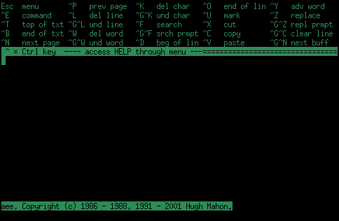

第 10 章：编辑文本

263

**注意：** 你可以编写多个使用你文件的包含文件——这些包含文件本身也可以拥有自己的包含。

## 10.8 使用其他文本编辑器

下表描述了 Linux 上可用的一些流行或有趣的文本编辑器，并包含了关于它们的特殊特性和特征的信息以及截图。

### AEE

这种高级易用编辑器具有弹出菜单界面，旨在无需预先说明即可使用；包含了用于 X、`xae` 的接口。

DEB: `aee`

RPM: `aee`

WWW: `http://mahon.cwx.net/`

图 10-13. 高级 Easy 编辑器。

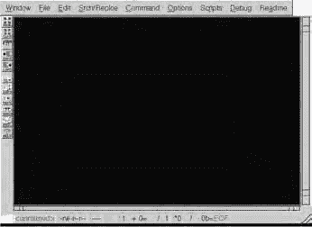

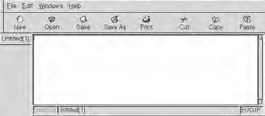

264

《Linux 食谱》，第 2 版

### Cooledit

Cooledit 是一款用于 X 环境的流行且快速的文本编辑器；其功能包括抗锯字体、Unicode 支持以及通过 Python 编程语言进行扩展。它基于 Midnight Commander 的终端编辑器，其独特之处在于，它既不像 Emacs 也不像 Vi。

DEB: `cooledit`

RPM: `cooledit`

WWW: `http://cooledit.sourceforge.net/`

图 10-14. Cooledit。

### DEdit

DEdit 是一个用于安装了 `gnome` 的 X 环境的简单编辑器。它可以读取压缩文件并显示日语文字符。

DEB: `dedit`

图 10-15. DEdit。

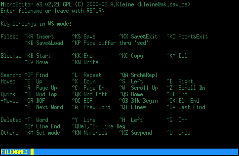

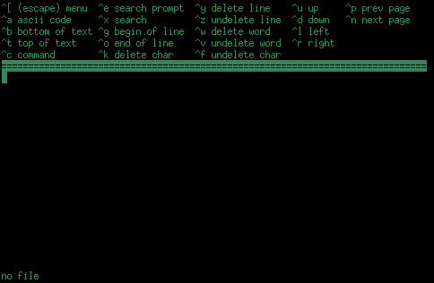

第 10 章：文本编辑

265

### E3

一个微型编辑器（大小为 10 kb），提供了可用的键盘绑定，可以模拟 Emacs、Vi、`pico`、Nedit 和 WordStar。

DEB: `e3`

RPM: `e3`

WWW: `http://www.sax.de/~adlibit/`

图 10-16. E3。

### EE

EE 旨在成为一种新手可以立即开始使用的编辑器，它具有弹出菜单，并基于前文描述的 `aee`。

DEB: `ee`

WWW: `http://mahon.cwx.net/`

图 10-17. Easy 编辑器。

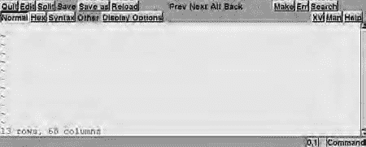

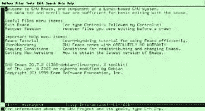

266

《Linux 食谱》，第 2 版

### Elvis

Elvis 是 Vi 的现代实现，带有很多新功能和扩展。

DEB: `elvis`

RPM: `elvis`

WWW: `http://elvis.vi-editor.org/`

图 10-18. Elvis。

### Emacs

Emacs 是两个最流行的文本编辑器之一。

一个章节

在本章较早位置有关于它的介绍（参见菜谱 10.1 [使用 Emacs]，第 232 页）。

DEB: `emacsen-common`

`emacs21`

RPM: `emacs`

WWW: `http://www.emacs.org/`

图 10-19. Emacs。

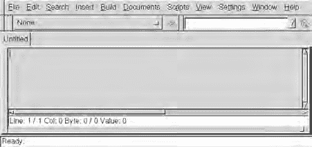

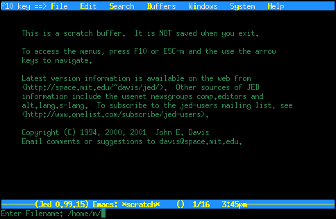

第 10 章：文本编辑

267

### Glimmer

Glimmer 旨在用于计算机编程语言使用，它具有许多吸引程序员的功能。

DEB: `glimmer`

RPM: `glimmer`

WWW: `http://glimmer.sourceforge.net/`

图 10-20. Glimmer。

### JED

John E. Davis 的编辑器提供了许多 Emacs 的便利性，并专门针对程序员设计。它特有的功能包括可以在终端中运行的下拉菜单；`jed` 加载速度快，并且在 shell 提示符下编辑文件变得简单快速。

DEB: `jed`

RPM: `jed`

WWW: `http://www.jedsoft.org/jed/`

图 10-21. JED。

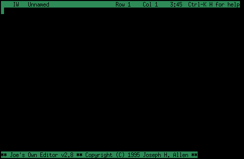

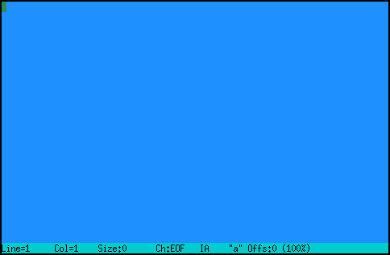

268

《Linux 食谱》，第 2 版

### JOE

Joe’s Own Editor，`joe` 是一个全屏编辑器，其外观和感觉让人想起旧的 DOS 文本编辑器，如 `edit`。

DEB: `joe`

RPM: `joe`

WWW: `http://sourceforge.net/projects/joe-editor/`

图 10-22. Joe’s Own Editor。

### Le

一种用于终端的多语言编辑器，支持操作矩形文本块。

DEB: `le`

RPM: `le`

WWW: `http://tinyurl.com/23325`

图 10-23. Le。

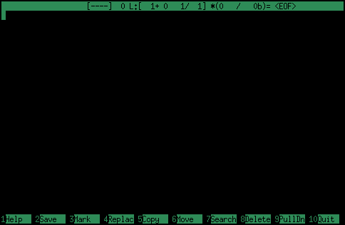

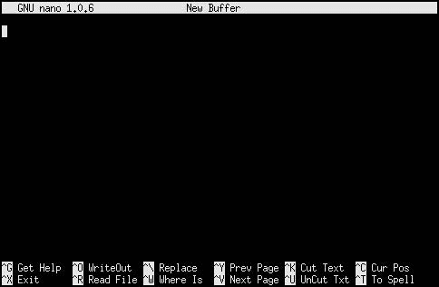

第 10 章：文本编辑

269

### MCedit

这是随 Midnight Commander 附带的全屏终端编辑器。

DEB: `mc-common`

`mc`

RPM: `mc`

WWW: `http://www.ibiblio.org/mc/`

图 10-24. Midnight Commander。

### Nano

Gnu Nano 是一款免费软件编辑器，灵感源自 `pico`，后者是华盛顿大学专有的 `pine` 邮件程序附带的编辑器。

它也比 `pico` 快，并且带有更多功能。

DEB: `nano`

RPM: `nano`

WWW: `http://www.nano-editor.org/`

图 10-25. Nano。

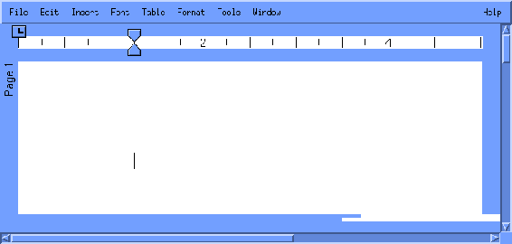

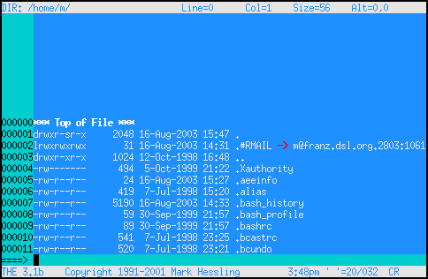

270

《Linux 食谱》，第 2 版

### Ted

Ted 是一个用于 X 环境的所见即所得、类打字机的文本编辑器。它读写 `rtf` 文件（微软的“富文本格式”）。

DEB: `ted`

RPM: `Ted`

WWW: `http://www.ted.editor/`

图 10-26. Ted。

### The

Hessling 编辑器是一种灵感源自 `vim` 的可配置编辑器，使用了宏语言。

DEB: `the`

`the`

WWW: `http://hessling-editor.net/`

图 10-27. The。（注：上下文）

第 10 章：文本编辑

### Vi

Vi 是两个最流行的文本编辑器之一，全屏的。

一个章节

在本章较早位置有关于它的介绍（参见菜谱 10.1 [使用 Emacs]，第 232 页）。

DEB: `nvi`

RPM: `nvi`

WWW: `http://vi.org/`

图 10-28. Vi。

### Vim

Vim 是 Vi 的增强实现，带有许多新功能。

DEB: `vim`

RPM: `vim`

WWW: `http://www.vim.org/`

图 10-29. Vim。

### Wily

Wily 是一种灵感源自 `Acme` 的编辑器，具有许多新功能。

DEB: `wily`

RPM: `wily`

WWW: `wily.org/`

图 10-30. Wily。

### Xedit

Xedit 是一个用于 X 环境的简单编辑器，具有插入、删除、复制和粘贴功能。

DEB: `xedit`

RPM: `xedit`

WWW: `http://xedit.org/`

图 10-31. Xedit。

### XEmacs

XEmacs 是 Emacs 的一个版本，具有高级的显示功能。

DEB: `emacsen-common`

`emacs21`

RPM: `emacs`

WWW: `http://www.emacs.org/`

图 10-32. XEmacs。

在这个示例中，`spell` 输出了单词“occurance”，这意味着该词不在系统字典中，因此它很可能是一个拼写错误。然后，输入 `CTRL -*- D` 退出 `spell`。

## 11.1.2 列出文本中的拼写错误

要输出文件中拼写错误的单词列表，请将要检查的文件名作为参数传递给 `spell`。文件中任何拼写错误的单词都会被输出，每个单词占一行，并按照它们在文件中出现的顺序排列。

⇒ 要检查文件 `fall-lecture.draft` 的拼写，输入：`$ spell fall-lecture.draft`

```text
RET
occurance
willl
occurance
$
```

在这个示例中，输出了三个单词：“occurance”、“willl”和再次出现的“occurance”，这意味着这三个单词在 `fall-lecture.draft` 中被找到，且按此顺序出现，并且它们不在系统字典中（因此可能是拼写错误）。请注意，拼写错误“occu-ance”在文件中出现了两次。

要纠正这些拼写错误，你可以用你喜欢的文本编辑器打开文件进行编辑。在本节的稍后部分，我将描述一种交互式拼写检查器，允许你在发现拼写错误时立即纠正。另一种选择是使用带有内置拼写检查功能的文本编辑器，例如 Emacs。

⇒ 要检查文件 `fall-lecture.draft` 的拼写，并将任何可能的拼写错误输出到文件 `fall-lecture.spelling`，输入：`$ spell fall-lecture.draft > fall-lecture.spelling` `RET`

## 第 11 章：语法与参考

在这个示例中，使用了标准输出重定向运算符（`>`）将输出重定向到文件（参见食谱 3.2.2 [将输出重定向到文件]，第 68 页）。

要输出拼写错误单词的字母列表，将输出通过给 `sort`；然后将排序后的输出通过给 `uniq` 过滤器以移除列表中的重复项（`uniq` 会移除输入中相邻的重复行，输出唯一的行）。

⇒ 要输出文件 `fall-lecture.draft` 中拼写错误单词的排序列表，输入：

`$ spell fall-lecture.draft | sort | uniq` `RET`

## 11.1.3 维护拼写单词列表

基于 Linux 的系统安装的标准美式英语字典包含超过 45000 个单词。然而，无论这个数字看起来有多大，总有很多词被排除——包括俚语、术语和一些专有名词。

你可以像查看其他文本文件一样查看系统字典，但用户从未编辑此文件来添加单词。相反，你将新单词添加到你自己的个人字典中，该文件与系统字典格式相同，但保存在你的主目录下，文件名为 `~/.ispell_default`。

用户可以有自己的个人字典；如果你有个人字典，本章讨论的拼写命令除了系统字典外，会自动使用你的个人字典。

你使用 `ispell` 的 `i` 和 `u` 选项来构建个人字典，这些选项会将单词插入你的个人字典中。你可以在独立工具中使用这些选项，也可以配合各种 `ispell` Emacs 函数（参见食谱 11.1.4 [交互式拼写检查]，第 278 页，以及食谱 11.1.5 [在 Emacs 中拼写检查]，第 280 页）。

⇒ 要找出你的个人字典中有多少单词，输入：`$ wc -l .ispell_default` `RET`

**注意：** 你也可以通过文本编辑器手动编辑文件来添加（或删除）单词，但要注意保持列表按字母顺序排列！

3. 如果一个单词具有相当通用性，你当然联系 `wenglish` 的全局维护人员或其他适当软件包，并尝试说服他们该单词应当被包含进去。

4. 在较新的系统中，此文件有时会被 `~/aspell_default` 替换。

随着时间的推移，个人字典开始变得非常“个性化”，反映了所有者的特征；Gregory Cosmo Haun 通过拍摄十几个用户的肖像并将其与他们的个人字典列表叠加，创作了一件概念艺术作品 [`http://www.reed.edu/~cosmo/art/DictPort.html`](http://www.reed.edu/~cosmo/art/DictPort.html)。

## 11.1.4 交互式拼写检查

### GNU Aspell

DEB: `aspell`

RPM: `aspell`

WWW: `http://aspell.net/`

或者

### Ispell

DEB: `ispell`

RPM: `ispell`

WWW: `http://fmg-www.cs.ucla.edu/geoff/ispell.html`

使用 `ispell` *交互式* 地检查文件拼写，这样每当发现拼写错误时，你都有机会立即替换它。

⇒ 要交互式检查 `fall-lecture.notes` 的拼写，输入：`$ ispell fall-lecture.notes` `RET`

当你输入此命令时，`ispell` 开始检查文件。它在发现第一个拼写错误处停止，如图 11-1 所示。

在屏幕顶部，`ispell` 显示拼写错误的单词，随后是文件名。下方是出现拼写错误的句子，其中问题单词被高亮显示。后面是建议单词列表，每个单词前都有一个数字——在本示例中，`ispell` 只有一个建议：“lectures”。

要用建议的单词替换拼写错误，输入与建议单词对应的数字（在本示例中，你将输入 `0` 来将拼写错误替换为“lectures”）。你只需要输入数字——不需要字母。`aspell` 设计为 `ispell` 的无缝替代品，具有极大改进的算法。如果你的系统有 `aspell`，请使用它。


第 11 章：语法与参考

图 11-1 被 `ispell` 捕获的拼写错误

当 `ispell` 完成文件拼写检查时，它会将更改保存到文件并退出。它还会创建一个原始文件的副本，不应用更改；该文件与原始文件名相同，但在结尾加上 `.bak`——在我们的示例中，备份文件为 `fall-lecture.notes.bak`。

如果你后悔所做的更改并想将文件恢复到原来的状态——只需删除检查后的文件，将 `.bak` 文件重命名为原始名称。

下表是 `ispell` 按键命令参考，列出了按键及其描述的操作。

| 按键 | 操作 |
| :--- | :--- |
| `SPACEBAR` | 接受拼写错误为正确，但仅针对本次。 |
| *数字* | 用对应的数字建议替换拼写错误。 |
| `?` | 显示帮助屏幕。 |
| `a` | 在本次 `ispell` 会话期间接受该拼写错误为正确。 |
| `i` | 将单词的副本插入你的个人字典。 |

接受拼写错误的单词为正确，并按照其出现的大写形式将其添加到你的私人字典中。

`l`

根据你提供的模式在系统字典中查找单词。

`q`

退出检查并将文件恢复到在此会话之前的状态。

`r`

用你输入的单词替换拼写错误的单词。

`u`

接受拼写错误的单词为正确，并以全小写的形式添加到你的私人字典中。

`x`

保存目前的所有更改，然后停止检查此文件。

## 11.1.5 Emacs 中的拼写检查

Emacs 有几个实用的拼写检查命令。正如你从名称猜的那样，`ispell-word`、`ispell-region` 和 `ispell-buffer` 函数使用 Emacs 内部的 `ispell` 命令来检查当前缓冲区的部分内容。在许多较新的系统中，使用 `aspell` 代替 `ispell`。

第一个命令 `ispell-word` 检查光标处单词的拼写；如果光标处没有单词，它会检查光标左侧第一个单词。该命令有一个快捷键 `ALT-* $`。第二个命令 `ispell-region` 检查当前选定区域内所有单词的拼写。第三个命令 `ispell-buffer` 检查整个缓冲区的拼写。

⇒ 这里是一些使用这些命令的方法。

- 检查光标处单词的拼写，输入：`ALT-* X ispell-word RET`
- 检查当前选定区域内所有单词的拼写，输入：`ALT-* X ispell-region RET`
- 检查当前缓冲区中所有单词的拼写，输入：`ALT-* X ispell-buffer RET`

另一个实用的 Emacs 拼写功能是 `flyspell-mode`。当在缓冲区设置此模式时，缓冲区中任何拼写错误的单词都会被高亮。这种模式在你写初稿时非常有用，因为它能让你在输入时就发现拼写错误。

⇒ 在缓冲区中开启 `flyspell-mode`，输入：`ALT-* X flyspell-mode RET`

**注意：** 此模式是一个切换开关；再次运行即可将其关闭。

在 `flyspell-mode` 中纠正单词，点击并释放单词上的鼠标中间键以弹出建议菜单；然后你可以使用鼠标选择替换单词或将其添加到你的个人字典中。

如果你有经常拼错的单词，可以为它们定义 `abbrevs`（参见 Recipe 10.1.5 [在 Emacs 中创建缩写]，第 242 页）。然后，当你输入拼写错误的单词时，Emacs 会自动将其替换为正确的拼写。


最后，如果你喜欢 `spell` 那稀疏、非交互式的界面，可以使用该命令对应的 Emacs 接口：`spell-word`、`spell-region` 和 `spell-buffer`。当这些函数发现任何拼写错误时，它们会在最小缓冲区中提示进行替换，但不会提供建议或 `ispell` 的其他功能。

# 11.2 使用字典

## WordNet

DEB: `wordnet`

`wordnet-base`

WWW: `http://www.cogsci.princeton.edu/~wn/`

Linux 系统上的词汇字典通常指两种东西之一：传统的 Unix 风格字典（即一个按字母排序的单词列表，不包含实际定义），以及包含词头词及其定义的新型数据库风格字典。后者是大多数人在谈论词典时所指的内容。（不过，当大多数 Unix 用户谈论词典时，他们几乎总是指的是前者。）

WordNet 是一个数据库形式的词汇参考系统，包含成千上万按同义词分组的单词。你可以使用 `wn` 工具或 `wnb` X 客户端（“WordNet 浏览器”）搜索数据库并将结果以文本输出。

使用 X 客户端非常简单——在屏幕顶部的对话框中输入单词，然后按 `RET` 获取其定义，定义将显示在对话框下方的巨大输出窗口中。

例如，当你搜索“browse”一词的定义时，WordNet 浏览器将如图 11-2 所示。

图 11-2. WordNet 浏览器。

在对话框和输出窗口之间有搜索同义词和其他词义的菜单。单词可能具有的每个词性都有一个独立的菜单；在前面的示例中，“browse”一词既可以是名词也可以是动词，因此显示了两个菜单。

要获取给定单词的所有可用词义信息列表，运行单词作为参数运行 `wn`。这会输出该单词的所有可用词义信息列表，每个可能的词义前面都有一个用于输出它的选项名称。

⇒ 输出单词“browse”的可用词义列表，输入：`$ wn browse RET`

以下章节显示了如何在命令行上使用 `wn`。

**注意：** 有关 WordNet 的更多信息，请参考 `wnintro` 手页（参见 Recipe 2.8.4 [从系统手册阅读一页]，第 46 页）。

### 11.2.1 列出匹配模式的单词

有几种方法可以从系统字典搜索并输出单词。

使用 `look` 输出系统字典中以给定字符串开头的单词列表。由于系统字典是一个普通的文本文件，你也可以使用 `grep` 在其中搜索匹配给定模式或正则表达式的单词（参见 Recipe 14.3 [匹配模式]，第 335 页）。

⇒ 输出系统字典中以“homew”开头的单词列表，输入：` look homew`

该命令会输出“homeward”和“homework”等单词。

⇒ 这里是一些使用该命令的方法。

• 列出字典中包含“dont”字符串的所有单词（忽略大小写），输入：`$ grep -i dont /words`

• 列出字典中以“ing”结尾的所有单词，输入：`$ grep ing^ /words`

• 列出所有由元音组成的单词，输入：`$ grep -i '*aeiou]*$' /words`

要找到与给定单词押韵的单词，使用 `grep` 在 `/words` 中搜索以相同字符结尾的单词（参见 Recipe 14.4.2 [匹配特定文本]，第 343 页）。

⇒ 输出与“friend”押韵的单词列表，搜索以“end”结尾的行：`$ grep 'end$' /words`

最后，要在 WordNet 字典上进行搜索，请配合以下选项之一使用 `wn`。当你提供某些文本作为参数时，该命令执行与 `look` 等效的搜索，但只搜索你指定的词性：`-grepn` 搜索名词，`-grepv` 搜索动词，`-grepa` 搜索形容词，`-grepr` 搜索副词。你可以组合选项来搜索多个词性。

⇒ 这里有两种方法。

• 搜索 WordNet 字典中以“homew”开头的名词，输入：`$ wn homew -grepn`

• 搜索 WordNet 字典中以“homew”开的名词和形容词，输入：`$ wn homew -grepn -grepa`

### 11.2.2 列出单词的定义

要列出单词的定义，将单词作为参数传递给 `wn`，加上 `-over` 选项。

⇒ 输出单词“slope”的定义，输入：`$ wn slope -over`

**注意：** 如果你频繁查询字典定义，定义一个别名为 `def=' $1 -over` 会非常方便（参见 Recipe 3.6.1 [通过其他名称调用命令]，第 83 页）。

### 11.2.3 列出单词的同义词

单词的*同义词*是意义相似的不同单词，在某些语境下可以代替第一个单词。使用 `wn` 输出单词的同义词时，将单词作为参数，加上以下选项之一：`-synsn` 表示名词、`-synsv` 表示动词、`-synsa` 表示形容词或 `-sysnr` 表示副词。

# 第 11 章：语法与参考

285

⇒ 这里有两种使用它的方法。

• 要输出名词“break”的所有同义词，输入：$ `wn break -synsn`

RET

• 要输出动词“break”的所有同义词，输入：$ `wn break -synsv`

RET

## 11.2.4 列出单词的反义词

一个单词的`antonym`（反义词）是指在某些语境下意义与该词相反的另一个词。要使用 `wn` 输出单词的反义词，请将单词作为参数提供，后接以下选项之一：`-antsv` 用于动词，`-antsa` 用于形容词，或 `-antsr` 用于副词。

⇒ 要输出形容词“sad”（忧伤）的反义词，输入：$ `wn sad -antsa`

RET

## 11.2.5 列出单词的上位词

一个单词的`hypernym`（上位词）是一个其意义比给定单词更通泛的相关术语。（例如，“哺乳动物”和“动物”就是单词“猫”的上位词。）

要使用 `wn` 输出单词的上位词，请使用以下选项之一：

`-hypen` 用于名词或 `-hypev` 用于动词。

⇒ 要输出名词“cat”（猫）的所有上位词，输入：$ `wn cat -hypen`

RET

## 11.2.6 检查在线字典

Dict

DEB: `dict`

RPM: `dict`

WWW: `http://www.dict.org/`

`dict` 开发小组在其网站 `http://www.dict.org/` 上提供了许多免费字典。在该页面上，你可以从一个包含超过 300,000 个词条的字典中查阅单词（包括使用同义词典和其他搜索），或者可以制作字典的副本以供自己的系统使用。存在一个 `dict` 客户端可用于访问 `dict` 服务器并在本地输出定义；该工具可在 `dict` 软件包中。

286

《Linux 食谱指南》，第 2 版

`dict` 开发小组还提供了一些专门字典。这些字典是纯文本文件。其中一个字典被称为 `file`，即*自由互联网词典与百科全书*。这是一项构建免费、开源的现代词、成语和术语字典集合的努力。`file` 是一项志愿者活动，取决于学者和词典编者的支持；`dict` 页面包含了有关如何帮助贡献这一价值项目的信息。

## 11.3 检查语法

Diction

DEB: `diction`

WWW: `http://www.gnu.org/software/diction/diction.html`

两款用于检查写作的古老 Unix 工具最近已用于 Linux 系统：`style` 和 `diction`。

老手们可能记得这些名字——这些原始版本在 20 世纪 70 年代末和 80 年代初作为 `at&t unix` 的一部分，包含在深受喜爱的“写作者工作台”（`wwb`）工具套件中。7

`at&t` 将“作家工作台”从其 `unix Version 7` 产品中“拆分”出来，随着多年来各种版本 `unix` 的兴起，这些工具被遗忘了——最终变成了 `unix` 传说中的故事。

1997 年，Michael Haardt 从头开始编写了这些工具的新 Linux 版本。它们同时支持英语和德语，并且现在是 `gnu` 项目的一部分。

作为“作家工作台”一部分的两个命令长期以来在 Linux 上已是标准：`look` 和 `spell`，在本章之前已描述过。

以下是使用 `diction` 或 `style` 的配方。

### 11.3.1 检查文本中的误用短语

使用 `diction` 检查文本中冗长、陈腐调、陈词滥调或误用的短语。

它会检查 William Strunk 在他的《风格要素》（*Elements of Style*）`http://www.bartleby.com/141/` 中警告过我们的所有表达。

7 还有一组用于格式化文本的工具被称为“文档者工作台”（`dwb`），并且有一个计划中的“读者工作台”；今天，我们只能猜那可能是什么。

第 11 章：语法与参考

287

根据《Unix 环境》（*The UNIX Environment*）（参见附录 D [进一步感兴趣的参考]，第 731 页），旧版“作家工作台”自带的 `diction` 工具只是*找到*了短语，一个名为 `suggest` 的独立命令会输出建议。在适用于 Linux 系统的 `gnu` 版本中，这两个功能已合并到单一的 `diction` 命令中。

在 `gnu diction` 中，单词或短语括在括号 `[like this]` 中。如果 `diction` 有任何建议的替换词，它会在前面加一个右箭头 `-> like this`。

当检查超过一屏幕内容的文本时，你可能希望将输出管道到 `less`，以便在屏幕上浏览（参见配方 9.1 [浏览文本]，第 211 页），或将输出通过到文件以备后检查。

⇒ 这里有两种使用它的方法。

• 检查文件 `dissertation` 的陈词滥调或其他误用短语，输入：

$ `diction dissertation` | `less`

RET

• 检查文件 `dissertation` 的陈词滥调或其他误用短语，并将输出写入名为 `dissertation.diction` 的文件，输入：$ `diction dissertation` > `dissertation.diction` RET

如果不指定文件名，`diction` 将从标准输入读取文本，直到你单独在一行输入 `CTRL+-D`。这在你想要检查单个句子时特别有用。

$ `diction`

RET

*我想陈述。*

$ `diction`

RET

288

《Linux 食谱指南》，第 2 版

**备注:** 要检查过度使用的单词，请使用 12.2.4 [计数文本中的出现次数]，第 299 页的方法。

## 11.3.2 检查文本中的重复单词

*•* `wstf Index`，一种德语文档的可读性指标

*•* `Wheeler-Smith Index`、`Lix formula` 以及 `smog-Grading tests`，这些都是提供学校年级阅读水平的可读性指标

## 11.3.4 检查文本中的困难句

若要仅输出文本中的“困难”句子，请使用 `style` 命令并配合 `-r` 选项，其后跟一个数字；`style` 将仅输出那些自动可读性指数 (`ari`) 大于你所给出的数字的句子。8

*⇒* 要输出文件 `dissertation` 中所有 `ari` 大于 20 的句子，输入：

```bash
$ style -r 20 dissertation
```

RET

## 11.3.5 检查文本中的长句

使用 `style` 并向 `-l` 选项提供单词数作为参数，可以输出长度特定特定长度。

*⇒* 要输出文件 `dissertation` 中所有超过 14 个单词的句子，输入：

```bash
$ style -l 14 dissertation
```

RET

## 11.4 使用参考文件

系统中可以安装一些参考性著作和其他信息性文本文件；以下配方描述了一些现成的有趣且实用的文件。

8 若要了解 `ari` 如何对文本进行排名，请查看其在各种热门网站的排名：http://www.readability.info/commonscores.shtml。

290

《Linux 菜谱》，第 2 版

### 11.4.1 查询词列表和实用文件

#### 杂类文件 (Miscfiles)

DEB: `miscfiles`

WWW: `ftp://ftp.gnu.org/pub/gnu/miscfiles/miscfiles-1.1.tar.gz` `gnu Miscfiles` 集合组包含各种事实和参考材料的文本文件，例如常用缩写、电话区号和英语连接词。

这些文件存储在 `/usr/share/misc` 目录下，并且经过了压缩；使用 `zless` 来浏览（参见配方 9.1 [浏览文本]，第 211 页）。

下表列出了 `/usr/share/misc` 中出现的文件并描述了它们的内容。

- `GNU-manifesto.gz`：`GNU 宣言`。

- `abbrevs.talk.gz`：电子通信中常用的缩写集。

- `abbrevs.gen.gz`：（这里是寻找 `ttyl` 和 `lol` 秘密的地方。）

- `airport.gz`：一些主要机场的三位城市代码列表。该城市代码用于查询国家气象局计算机以获取你所在地区的最新天气报告。

- `ascii.gz`：`ascii` 字符集表。

- `birthtoken.gz`：每个月的传统的石头和花朵令牌。

- `cities.dat.gz`：许多大城市的人口、政治坐标（`nation`, `region`）和地理坐标（`latitude`, `longitude`）。

- `inter.phone.gz`：国际国家和城市电话代码。

- `languages.gz`：来自 `iso 639` 的语言双代码。

- `latin1.gz`：扩展 `ascii` 字符集表，也称为 `iso 8859` (`Latin-1`) 字符集。

- `mailinglists.gz`：所有公共 `gnu Project` 邮件列表的描述。

- `na.phone.gz`：北美 (+1) 电话区号。

- `operator.gz`：`c` 语言中运算符的优先级表。

- `postal.codes.gz`：美国、墨西哥州和加拿大省的邮政编码。

- `us-constitution.gz`：*美利坚合宪法*及其 27 条修正案（前十条为*权利法案*）。在 Debian 系统上，该文件存放在名为 `/usr/share/state` 的目录下。

- `us-declaration.gz`：*十三殖民地独立宣言*。在 Debian 系统上，该文件存放在 `/usr/share/state` 的目录下。

- `rfc-index.txt`：互联网标准意见意见 (`rfc`) 文档索引。在 Debian 系统上，该文件存放在 `/usr/share/rfc`。

- `zipcodes.gz`：美国五位邮政编码。

但 `miscfiles` 并不是 Linux 唯一的参考包；其他相关包包括以下内容：

#### doc-iana

由互联网分配编号机构（IANA）发布的互联网协议参数注册文档。

DEB: `doc-iana`

#### Jargon File (术语文件)

“术语文件”是黑客俚语的权威字典，可以追溯到几十年前。今天可能认为有些过时；不再作为单个文件分发。

DEB: `jargon-text`

RPM: `jargon`

WWW: `http://www.jargon.org/`

#### V.E.R.A.

计算机缩写的详尽列表。

DEB: `vera`

RPM: `vera`

WWW: `ftp://ftp.gnu.org/gnu/vera/`

**注意：**官方的 `gnu miscfiles` 分发还包含 `Jargon File` 和 `/usr/dict/words` 字典文件，它们在 Debian 中作为单独包提供，并已从 Debian 的 `miscfiles` 分中移除。在 Debian 系统上，`/usr/dict/words` 是标准拼写包的一部分，而 `Jargon File` 位于可选包 `jargon` 中并安装在 `/usr/share/jargon`。

## 11.4.2 翻译常用缩写

#### Bsdgames

DEB: `bsdgames`

RPM: `bsd-games`

WWW: `ftp://ftp.gnu.org/gnu/vera/`

---

## 12. 分析文本

### 12.1 计数文本

使用“单词计数”工具 `wc` 来统计文本中的字符、单词和行数。

提供文件名作为参数；如果没有提供，则 `wc` 作用于标准输入。默认情况下，`wc` 输出三列，显示文本的行数、单词数和字符数。

*⇒* 要输出文件 `outline` 的行数、单词数字符数，输入：

```bash
$ wc outline
```

RET

*⇒* 要输出当前目录下所有 `.txt` 文件的单词数，输入：

```bash
$ wc -w *.txt
```

RET

若要仅输出多个文件的合并计数，首先使用 `cat` 合并文件，然后将输出管道给 `wc`（有关更多关于使用 `cat` 合并的信息，请参见配方 10.6 [合并文本]，第 256 页）。

*⇒* 要输出当前目录下所有 `.txt` 文件的合并行数、单词数和字符数，输入：

```bash
$ cat *.txt | wc
```

RET

使用配方 12.2.3 [仅列出文本中的唯一单词]（第 298 页）中描述的方法，并将输出通过给 `wc`。要统计单词、句子和段落的平均 `length`（长度），请使用 `style` 命令（参见配方 11.3.3 [检查文本的可读性]，第 288 页）。

294

《Linux 手册》，第 2 版

### 12.1.1 统计文本中的字符

使用 `wc` 配合 `-c` 选项，指定仅统计并输出字符数。

*⇒ 要输出文件 `classified.ad` 中的字符数，输入：`$ wc -c classified.ad`

RET

### 12.1.2 统计文本中的单词

使用 `wc` 配合 `-w` 选项，指定仅统计并输出单词数。


*⇒ 要输出文件 `story` 中的单词数，输入：`$ wc -w story`

RET

**注意：** 这统计文本中的`单词数量`；若要统计某个单词出现的`次数`，请参见配方 12.2 [列出文本中的单词]，第 297 页。

### 12.1.3 统计文本中的行

有两种方法；第一种使用 `wc` 统计整个文本的行数，第二种使用 Emacs 统计文本单个`page`（页）的行数。

#### 方法 #1

使用 `wc` 配合 `-l` 选项，指定仅统计并输出行数。

*⇒ 要输出文件 `outline` 中的行数，输入：`$ wc -l outline`

RET

#### 方法 #2

Emacs 中的 `count-lines-page` 函数会在最小缓冲区（minibuffer）中输出当前`page`的行数（由分页符分隔，如果有——参见配方 13.3 [文本分页]，第 312 页），紧接着是光标（point）之前的缓冲区行数，然后是光标之后的行数。

*⇒ 在 Emacs 中统计当前缓冲区每页行数，输入：

```
CTRL-X l
```

Emacs 会在回显区（echo area）输出当前缓冲区的每页行数。

例如，假设最小缓冲区中的输出是：`Page has 351 lines (69 + 283)`

这意味着当前页包含 351 行，光标位于第 70 行——该行之前有 69 行，之后有 283 行。

### 12.1.4 统计某内容的出现次数

要查找文件或多个文件中文本字符串或模式的出现次数，请使用 `grep` 搜索文件，并将输出通过 `-l` 选项传递给 `wc`。

*⇒ 这里有两种使用此方法的方案。

*• 要查找文件 `outline` 中包含字符串“chapter”的行数，输入：

```
$ grep chapter outline | wc -l
```

RET

*• 要查找 `/usr/share/doc/` 目录树下所有 `.txt` 扩展名文件中的包含字符串“chapter”的行数（不区分大小写），输入：

```
$ grep -r -i chapter /usr/share/doc/* | wc -l
```

RET

**注意：** 这种方法快速又简单，但它不会统计同一行中多次出现的情况，也找不到被行尾截断的出现位置。

有关更多搜索文本的配方以及更多关于 `grep` 的信息，请参见第 14 章 [搜索文本]，第 333 页。

### 12.1.5 统计选定文本

统计窗口或终端中显示的某些文本（例如在 Web 浏览器中显示）中单词数的实用技巧，是`select`该文本（参见配方 10.3 [操作文本选择]，第 253 页），然后通过 `wc` 统计。296

*⇒ 这种文本的使用方法如下：

*. 查找 `outline` 文件中包含“chapter”字符串的行数，输入：

```
$ grep chapter outline | wc -l
```

RET

*. ，，第 25 页）

在光标之前的缓冲区行数，然后光标之后的行数。

*• 查找 `/usr/share/doc/` 目录树下所有 `.txt` 扩展名文件中的包含“chapter”字符串的行数（不区分大小写），输入：

```
$ grep -r -i chapter /usr/share/doc/* | wc -l
```

RET

**注意：** 这种方法快速又简单，但它不会统计同一行中多次出现的情况，也找不到被行尾截断的出现位置。

有关更多搜索文本的配方，以及更多关于 `grep` 的信息，请参见第 14 章 [搜索文本]，第 333 页。

## 12.2.2 按字母顺序列出文本中的单词

要输出某些文本中单词的字母顺序排序列表，请使用上一个食谱中描述的方法，并将输出管道到 `sort`（参见食谱 13.6 [排序文本]，第 320 页）。

*⇒ 这里是使用此方法的两种方式。

*• 要查看包含文本文件 `book` 中所有单词的列表（已删除标点符号并按字母顺序排序），输入（全部写一行）：

```bash
tr -s '[:blank:]' '\n' < book | tr -d '[:punct:]'
```

| `sort` | `less` |

| RET

*• 要查看包含文本文件 `book` 中所有单词的列表（按数字顺序排序），输入：

```bash
tr -s '[:blank:]' '\n' < book | sort -n | less
```

| RET

此方法是区分大小写的。要忽略大小写对单词进行排序，请先在 `sort` 之前通过管道到 `tr` 将所有大写字母转换为小写（参见食谱 13.4.1 [更改文本中的字符]，第 317 页）。

*⇒ 要查看包含文本文件 `book` 中所有单词的列表（已删除标点符号且忽略大小写的按字母顺序排序），输入（全部写一行）：

```bash
tr -s '[:blank:]' '\n' < book | tr -d '[:punct:]' | tr '[:upper:]' '[:lower:]' | sort | less
```

| RET

## 12.2.3 列出文本中的唯一单词

要列出文本中的单词并忽略任何多次重复的单词，请使用上一个食谱中描述的方法，并将输出管道到 `uniq`（参见食谱 13.5 [过滤文本中的重复行]，第 319 页）。

第 12 章：分析文本

299

*⇒ 这里是使用此方法的几种方式。

*• 要查看包含文本文件 `book` 中所有单词的列表（已删除标点符号、按字母顺序排序并去重），输入（全部写一行）：

```bash
tr -s '[:blank:]' '\n' < book | tr -d '[:punct:]' | sort | uniq | less
```

| `sort` | `uniq` |

| RET

*• 要查看包含文本文件 `book` 中所有单词的列表（已删除标点符号、忽略大小写的按字母顺序排序并去重），输入（全部写一行）：

```bash
tr -s '[:blank:]' '\n' < book | tr -d '[:punct:]' | tr '[:upper:]' '[:lower:]' | sort | uniq | less
```

| RET

*• 要查看包含文本文件 `book` 中所有单词的列表（按数字顺序排序但去除了所有重复），输入（全部写一行）：

```bash
tr -s '[:blank:]' '\n' < book | sort -n | uniq | less
```

| RET

## 12.2.4 统计文本中单词的出现次数

统计文本中单词出现次数有两种方法。一种输出输入文本中每个唯一单词的计数，另一种是输出输入文本中*所有*唯一单词的总数。

### 方法 #1

要获取某些文本中单词的频率计数，请使用上一个食谱中描述的方法，但给 `uniq` 提供 `-c` 选项，它会在每行前面加上其*计数*（该单词在文本中出现的次数）。

然后将输出管道到 `sort`，并使用 `-n` 选项进行数字排序，使用 `-r` 反转顺序。

*⇒ 这里是使用此方法的几种方式。

*• 要查看文本文件 `book` 中所有单词的列表（已删除标点符号、按频率排序、列出出现次数并从频率最高的开始），输入（全部写一行）：

```bash
tr -s '[:blank:]' '\n' < book | tr -d '[:punct:]' | sort | uniq -c | sort -n -r | less
```

| RET

300

《Linux 厨房手册》，第 2 版

*• 要查看文本文件 `book` 中所有单词的列表（已删除标点符号、忽略大小写的按频率排序、列出出现次数并从频率最高的开始），输入（全部写一行）：

```bash
tr -s '[:blank:]' '\n' < book | tr -d '[:punct:]' | tr '[:upper:]' '[:lower:]' | sort | uniq -c | sort -n -r | less
```

| RET

### 方法 #2

要获取文本中不同单词的总数，请使用上一个食谱中描述的列出唯一单词的方法，并将输出管道到带有 `-l` 选项的 `wc`。这会统计输入的所有行——在这种情况下，将是每行一个唯一单词列表。

*⇒ 要输出文本文件 `book` 中唯一单词数量的总计数，输入（全部写一行）：

```bash
tr -s '[:blank:]' '\n' < book | tr -d '[:punct:]' | sort | uniq | wc -l
```

| RET

## 12.2.5 统计文本中指定单词的出现次数

要获取某些文本中仅指定单词的频率计数，请使用上一个食谱中描述的方法 #1，并将输出管道到 `grep`，搜索你想要的特定单词或单词（参见食谱 14.1 [搜索单词]，第 333 页）。

*⇒ 这里是使用此方法的方式。

*• 要查看文本文件 `book` 中所有单词的列表（已删除标点符号、按频率排序、列出出现次数并从频率最高的开始），输入（全部写一行）：

```bash
tr -s '[:blank:]' '\n' < book | tr -d '[:punct:]' | sort | uniq -c | sort -n -r | less
```

| RET

*• 要查看文本文件 `book` 中所有单词的列表（已删除标点符号、忽略大小写的按频率排序、列出出现次数并从频率最高的开始），输入（全部写一行）：

```bash
tr -s '[:blank:]' '\n' < book | tr -d '[:punct:]' | tr '[:upper:]' '[:lower:]' | sort | uniq -c | sort -n -r | less
```

| RET

*• 要查看文本文件 `book` 中所有单词的列表（已删除标点符号、按频率排序、以 "ing" 结尾），输入（全部写一行）：

```bash
tr -s '[:blank:]' '\n' < book | tr -d '[:punct:]' | sort | uniq -c | sort -n -r | grep ing$
```

| RET

第 12 章：分析文本

301

搜索出现次数，使用 `grep`（参见食谱 3.2 [输入控制字符]，第 55 页）。

*⇒ 这里是使用此方法的两种方式。

*• 列出文本文件 `book` 中出现 10 次的单词（已删除标点符号），输入：

```bash
tr -s '[:blank:]' '\n' < book | tr -d '[:punct:]' | sort | uniq -c | sort -n -r | grep '¹⁰'
```

| RET

*• 列出文本文件 `book` 中出现 80 到 85 次的单词（已删除标点符号），输入（全部写一行）：

```bash
tr -s '[:blank:]' '\n' < book | tr -d '[:punct:]' | sort | uniq -c | sort -n -r | grep '⁸[0-5]'
```

| RET

## 12.3 寻找文本的相关性

下面的食谱展示了如何分析给定文本与某些关键词或整个文件的相似性或相关性。

你也可以使用 `diff` 系列工具分析文本之间的差异；这些工具特别适用于比较同一个文件的不同版本（参见食谱 8.3 [比较文件]，第 191 页）。

### 12.3.1 寻找相似或相关的文本

比较 WWW：`http://www.english.upenn.edu/~jlynch/Computing/compare.html` 有时需要比较文本的相关性——即搜索相同或仅是相似的文本。Jack Lynch 的 `compare` 就能做到。

给定两个文件作为参数，`compare` 将显示出现在两个文件中任何相似的行，即使这些行包含样式或格式差异。十七个常用的英语单词（包括“the”、“a”和“of”）被视为*噪声词*且不进行比较。

默认情况下，`compare` 使用五十的相似性阈值，范围从 0（两个文本完全没有相似之处）到 100（文本完全由相同的行组成）。要指定阈值值，请在两个文件名之后提供一个 0 到 100 之间的数字作为选项。

要忽略完全重复，请提供第四个选项。可以是任何值或字符。

*⇒ 要输出 `invitations` 和 `addresses` 文件中任何相似行的列表，输入：

```bash
compare invitations addresses
```

| RET

*• 要输出 `weddings` 和 `parties` 文件中所有相似度达到 85% 阈值的行，请输入：`$ compare weddings parties 85`

RET

*• 要输出 `invitations` 和 `addresses` 文件中彼此相似但不是完全重复的行，请输入：`$ compare invitations addresses 50 1`

RET

**注意：** 这个工具有很多非常实用的地方。每当你需要在两个文本样本中搜索非常相似的（但不一定是完全相同的）字符串时，就可以使用它。例如：比较目录或销售列表与收藏者的愿望清单；检测抄袭和作者归属；以及比较阅读列表。其作者利用它来发现和识别文学作品中的典故。

## 12.3.2 在 Emacs 中列出相关文件

记忆代理 (Remembrance Agent)

DEB: `remembrance-agent`

RPM: `remem`

WWW: `http://www.remem.org/` 

Emacs 中特殊的 `remembrance-agent` 模式的目的是分析你输入的文本，并在后台查找你其他文件中相似或相关的文本段落。它会在较小的窗口中输出建议列表——即它找到的文件，你可以在新的缓冲区（buffer）中打开它们。

在安装 `remembrance-agent` 模式时，你会创建三个文件数据库用于提供相关性建议；当 `remembrance-agent` 模式运行时，它会并行搜索这三个数据库以寻找相关文本。例如，你可以创建一个保存邮件的数据库、一个你自己的作品数据库，以及一个保存文档的数据库。

*⇒ 要在当前缓冲区中切换 `remembrance-agent` 模式，请输入：`CTRL-C r t`

## 第 12 章：分析文本

当 `remembrance-agent` 运行时，建议的缓冲区将显示在屏幕底部的小 `Remembrance` 缓冲区中。若要在新缓冲区中打开建议，请输入 `CTRL-C r number`，其中 `number` 是建议的编号。

*⇒ 要在新缓冲区中打开第二个被建议的文件，请输入：`CTRL-C r 2`

## 第 13 章：文本格式化

### 13. 文本格式化

在为打印准备文本时，改变文本排列或呈现形式的方法和工具通常非常有用。本章讨论了更改文本间距、设置页面、下划线、排序和反转文本，以及为文本行编号的方法。

这些大部分工具都是过滤器（参见食谱 3.2.4 [将输出重定向到另一个命令的输入]，第 69 页）。

### 13.1 文本间距

这些食谱用于更改文本的`spacing`——即单词、行和段落之间的空白区域。

本节描述的过滤器默认将输出发送到标准输出；若要将其输出保存到文件，请使用 shell 重定向（参见食谱 3.2.2 [将输出重定向到文件]，第 68 页）。

#### 13.1.1 消除文本中的多余空格

有几种方法可以实现。要消除文本行内的额外空白，使用 `fmt` 过滤器；要消除文本行之间的额外空白，使用 `cat`。

**方法 #1**

使用带有 `-u` 选项的 `fmt` 输出具有“均匀间距”的文本，单词之间的空格减少为一个空格字符，句子之间的空格减少为两个空格字符。

*⇒ 要输出具有均匀间距的 `term-paper` 文件，请输入：`$ fmt -u term-paper`

RET

**方法 #2**

使用带有 `-s` 选项的 `cat` 将多个相邻的空行“压缩”为一个。

*⇒ 要输出 `term-paper` 文件，并将多个空行仅输出为单条空行，请输入：

```
$ cat -s term-paper
```

RET

**方法 #3**

你可以结合这两个命令，输出删除了多个相邻行且单词间具有均匀间距的文本。以下示例将组合命令的输出发送到 `less`，以便在屏幕上进行审阅。

*⇒ 要审阅删除了多个空行并具有均匀单词间距的 `term-paper` 文本文件，请输入：

```
$ cat -s term-paper | fmt -u | less
```

RET

注意在示例中，`fmt` 和 `less` 都作用于标准输入而不是文件——`cat` 的标准输出（压缩了多余空行的 `term-paper` 内容）被传递给 `fmt` 的标准输入；它的标准输出（经过空格压缩且现在具有均匀间距的 `term-paper`）被发送到 `less` 的标准输入，由其显示在屏幕上。

#### 13.1.2 单倍间距文本

有很多方法可以实现文本单倍间距。这些是我喜欢的。

**方法 #1**

要从文本输出中删除所有空行，使用正则表达式 `.` 的 `grep` 来匹配任何字符，因此将匹配任何非空行（参见食谱 14.3 [匹配文本模式]，第 335 页）。然后你可以将此输出重定向到文件，或将其传递到其他命令。原始文件不会被修改。

*⇒ 要输出 `term-paper` 文件中的所有非空行，请输入：`$ grep . term-paper`

RET

此命令输出所有非空行——因此仅包含不可打印字符（如空格和制表符）的行仍会被输出。

**方法 #2**

要从输出中删除所有空行以及所有由空格字符组成的行，使用带有 `[^ ].` 的 `grep`。

*⇒ 要输出 `term-paper` 文件中仅包含空格的行，请输入：

```
$ grep [^ ]. term-paper
```

RET

**方法 #3**

要从输出中删除所有空行以及仅包含制表符的行，使用带有 `[^[:space:]]` 的 `grep` 它使用了特殊的 `[:space:]` 类，匹配任何类型的空格字符。

*⇒ 要输出 `term-paper` 中包含非空格的行，请输入：

```
$ grep [^[:space:]] term-paper
```

RET

**方法 #4**


如果文件是双倍间距的（偶数行为空），你可以通过使用带有`n;d`表达式从输出中删除这些行。

⇒ 要输出`term-paper`中的奇数行，请输入：`$ sed 'n;d' term-paper`

RET

### 13.1.3 双倍间距文本

要在正行之间插入一个空行以双倍间距，使用带有`-d`选项的`pr`工具。默认情况下，`pr`对文本进行分页并在页顶部带有带有日期、时间和页码的页眉；使用`-t`选项省略此页眉。

⇒ 这里有两种使用方法。

* 要对`term-paper`进行双倍间距并将输出写入文件`term-paper.print`，请输入：

`$ pr -d -t term-paper > term-paper.print`

RET

* 要对`term-paper`进行双倍间距并将输出直接发送到打印机打印，请输入：

`$ pr -d -t term-paper | lpr`

RET

**注意：** `pr` (“打印”)工具是一个预格式化工具，通常用于分页并准备准备打印文本文件；关于该工具的更多讨论见食谱 13.3 [分页]，第 312 页。

### 13.1.4 三倍间距文本

要在正行之间插入两个空行以三倍间距，使用带有`G;G`表达式的`sed`。

要对`term-paper`进行三倍间距并将输出写入文件`term-paper.print`，请输入：

`$ sed 'G;G' term-paper > term-paper.print`

RET

`G`表达式向`sed`输出的每行追加一个空行；使用`;`你可以指定追加多个空行（但你必须对此命令加引号，因为分号（`;`）对 shell 有特殊含义——参见食谱 3.1.3 [引用保留字符]，第 56 页）。你可以使用多个`G`字符输出具有超过双倍或三倍间距的文本。

⇒ 要对`term-paper`进行四倍间距并将输出写入文件`term-paper.print`，请输入：

`$ sed 'G;G;G' term-paper > term-paper.print`

RET

**备注：** `sed`在食谱 10.5 [编辑文本流] 第 255 页中有描述。

### 13.1.5 给文本添加换行符

有时，文件的每行末尾没有换行符（这通常发生在不同操作系统之间的文件转换过程中）。为没有换行符的文件添加换行符，请使用文本格式化工具`fmt`。

它输出按指定宽度排列行的文本；如果未指定宽度，它会将文本格式化为每行 75 个字符。

⇒ 要输出行宽最多 75 个字符的`term-paper`文件，请输入：

```bash
$ fmt term-paper
```

RET

使用`-w`选项可以指定最大行宽（单位为字符）。

⇒ 要输出行宽最多 80 个字符的`term-paper`文件，请输入：

```bash
$ fmt -w 80 term-paper
```

RET

### 13.1.6 给文本添加边距

当你想打印一份副本并为其打孔以配合三环活夹使用时，给文本留出更大的左边距特别有用。

要输出具有较大左边距的文本文件，使用`pr`并将文件名作为参数；给出`-t`选项（禁用页眉和页脚），并将`-o`选项的参数设置为用于偏移文本的空格数。将空格数加到页宽（默认为 72），并将新宽度作为`-w`选项的参数。

⇒ 要将具有 5 个空格（或 5 `column`）边距的`owners-manual`文件输出到新文件`owners-manual.pr`，请输入：

```bash
$ pr -t -o 5 -w 77 owners-manual > owners-manual.pr
```

RET

此命令几乎总是用于打印，因此输出通常通过管道传递给`lpr`而不是保存到文件。许多文档的宽度为 80 列而非 72 列；如果你打印此类文档并跨页保持 80 列，请指定 85 列的新宽度。如果你的打印机只能打印 80 列文本，请指定宽度为 80；文本将在 5 列边距后重新格式化为 75 列。

⇒ 这里有两种使用此方法的方法。

* 要打印具有 5 列边距和 80 列文本的`owners-manual`文件，请输入：

```bash
$ pr -t -o 5 -w 85 owners-manual | lpr
```

RET

* 要打印具有 5 列边距和 75 列文本的`owners-manual`文件，请输入：

```bash
$ pr -t -o 5 -w 80 owners-manual | lpr
```

RET

### 13.1.7 交换制表符和空格字符

使用`expand`和`unexpand`工具分别将制表符交换为空格，以及将空格交换为制表符。

这两个工具都接受文件名作为参数并将更改写入标准输出；如果没有指定文件，它们将对标准输入操作。

要将制表符转换为空格，请使用`expand`。要只转换每行*初始*或开头的制表符，请给出`-i`选项；默认操作是转换*所有*制表符。

⇒ 这里有两种使用此方法的方法。

* 要将文件`list`中的所有制表符转换为空格，并将输出写入`list2`，请输入：

```bash
$ expand list > list2
```

RET

* 要只将文件`list`中的初始制表符转换为空格，并将输出写入标准输出，请输入：

```bash
$ expand -i list
```

RET

要将多个空格转换为制表符，请使用`unexpand`。默认情况下，它只将开头的空格转换为制表符，每个制表符计算八个空格。使用`-a`选项指定将*所有*八个空格实例转换为制表符。

⇒ 这里有两种使用此方法的方法。

* 要将文件`list2`中的每八个开头空格转换为制表符，并将输出写入`list`，请输入：

```bash
$ unexpand list2 > list
```

RET

* 要将文件`list2`中所有的八个空格实例转换为制表符，并将输出写入标准输出，请输入：

```bash
$ unexpand -a list2
```

RET

要指定将多少空格转换为制表符，将该数字作为`-t`选项的参数。

⇒ 要将`list2`中的每个开头空格字符转换为制表符，并将输出写入标准输出，请输入：

```bash
$ unexpand -t 1 list2
```

RET

**备注：** 你也可以使用`col`配合`-x`选项将输入中的所有制表符转换为空格。

### 13.1.8 删除或替换换行符

换行符在许多命令中表示为`\n`转义序列，是结束每一行的字符。使用`tr`删除它或将其替换为其他内容。

要删除换行符，使用`-d`选项并将换行符作为要删除的集合。

⇒ 取文件`many`中的文本并删除其中的任何换行符，然后将其写入文件`single`，请输入：

```bash
$ tr -d '\n' < many
```

RET

（由于后续文本存在大量重复和混乱，此处已根据核心逻辑进行整理翻译）

# 引言

文本文件中的分页符仅仅是一个换页符（`Control-L,`，或八进制代码`014`），你可以使用文本编辑器在文件中你希望一页结束而另一页开始的任意插入该字符。当你将带有换页符的文本发送到打印机时，当前正在打印的页面会被排出，并开始新的一页——因此，你可以在任何需要发生分页的地方插入换页符来对文本文件进行分页。

同样地，你可以在文本编辑器中通过手动插入换页符来对文本进行分页，但也有一些工具可以自动完成工作，它们按设定的增量在整个文本插入换页符，并可选地以其他方式处理文件以生成页面。

`pr`过滤器就是这类工具之一。它是一个通用的页面格式化和打印准备实用程序。默认情况下，它按每页 66 行的长度进行分页，并在每页上添加页眉和页脚。页眉包含包含日期、文件名和当前页码的行，其前后各有一个空行；页脚由三个空行组成，用于分隔页面。因此，默认每页有 56 行输入文本，其余行则是页眉和页脚。文本中的任何换页符都会强制在相应位置分页，除了上述的常规分页外。

⇒ 要使用默认的`pr`准备打印`duchess`文件，输入：

```bash
$ pr duchess | lpr
```

# 第 13 章：文本格式化

你可以使用许多选项来定制分页后文本的输出结果。

**注意：** 使用`pr`更改文本间距也很常见（参见第 305 页的 Recipe 13.1 文本间距）。

### 13.3.1 使用自定义页长度分页

默认情况下，`pr`输出每页 66 行的页面。你可以通过`-l`选项的参数指定页长度。如果你给出一个 10 或以下的值，则不打印页眉或页脚，且文件中的任何换页符将被忽略。

⇒ 要以 43 行页对文件列表进行分页，并将输出写入名为`listings.page`的文件，输入：

```bash
$ pr -f -h "" -l 43 listings > listings.page
```

**注意：** 如果一页行数多于打印机物理纸张能容纳的行，它将在该行以及文本中存在换页符的地方自动断行。

### 13.3.2 使用自定义页宽分页

默认情况下，`pr`输出文本每行宽度为 72 个字符。要指定不同的宽度，请使用`-w`并将新宽度作为参数。

⇒ 对文件`miscellania`中的文本进行分页并以每行 80 个字符的宽度输出，输入：

```bash
$ pr -w 80 miscellania
```

### 13.3.3 使用自定义页眉分页

你可以更改默认的`pr`页眉，也可以完全消除它们。

使用`-f`选项省略页脚，并用换页符分隔输出的页面。使用`-h`选项为页眉的中间部分提供新标题；将其作为选项的参数括起来，确保它与选项之间保留空格。要指定没有标题的页眉，请在引号间不留任何内容。

⇒ 要对文件`listings`进行分页并将输出写入名为`listings.page`的文件，输入：

```bash
$ pr -f -h "" listings > listings.page
```

使用`-t`选项完全省略每页的页眉和页脚，并使用`-T`省略页眉、页脚以及文件中的任何换页符。

⇒ 对文件`listings`中的文本进行分页，但不保留页眉或页脚，同时保留现有的换页符，输入：

```bash
$ pr -t listings
```

**注意：** 目前没有`pr`可以在第一页以外的所有页放置页眉，因此如果你需要按照这种惯例格式文本，请先使用`pr`输出不带页眉的文件，然后使用`pr`输出另一个带有剩余页所需页眉的文件。最后，使用文本编辑器将前者的第一页与后者的剩余页合并。

### 13.3.4 将文本置于分页列

你也可以使用`pr`将文本分列显示——将输出的列数作为参数。使用`-t`选项省略默认页眉和页脚的打印。

⇒ 以四列且无页眉或页脚打印文件`news.update`，输入：

```bash
$ pr -4 -t news.update | lpr
```

要对多个文件进行列分页，请使用`-m`。作为参数的文件内容将一起输出，每个文件占据一列。

⇒ 要将`col.1`、`col.2`和`col.3`中的文本以无页眉的分页列输出，并用换页符分隔页面，输出文件`comparisons`，输入：

```bash
$ pr -t -f -m col.1 col.2 col.3 > comparisons
```

列的设计是为了适应 72 字符宽的页面；除非你提供`-J`选项，否则列会被截断以适应此大小，该选项使列足够大以容纳文本，无论行宽如何。

⇒ 以六列打印文件`results.data`且不截断，输入：

```bash
$ pr -6 -J results.data | lpr
```

*(注：根据 6 列且不截断)*

根据行宽格式化：

```bash
$ fmt 36 | pr -2
```

⇒ 以行（跨行）输出：

```bash
$ pr -a -m col.1 col.2 col.3 > comparisons
```

### 13.3.5 分页部分文本

要对文本的部分进行分页，提供参数`+first:last`，其中`first`代表起始页，`last`代表结束页。如果你从`first`到文本结束，请省略`last`。

⇒ 以下是两种方法：

* 要打印`sales.feb`的第 7 到 14 页，输入：

```bash
$ pr +7:14 sales.feb | lpr
```

* 要打印`sales.feb`的内容，从第 80 页开始，页眉为“DRAFT COPY”，输入：

```bash
$ pr +80 -h "DRAFT COPY" sales.feb | lpr
```

**注意：** 你可以使用`head`或`tail`显示文本的某部分，并将其传递给`pr`进行分页（参见第 216 页的 Recipe 9.2 [显示文本]）。

### 13.3.6 带有非打印字符的分页

`pr`有两个选项控制非打印字符在输出中的表示方式。

使用`-v`将所有非打印字符以`八进制反斜杠`格式输出，即打印反斜杠，加上字符的八进制 ASCII 码。使用`-c`将控制字符以符号格式输出，而其他其他非打印字符以八进制反斜杠输出。

⇒ 以下是两种方法：

* 以八进制格式带所有非打印字符分页`figures`，输入：

```bash
$ pr -v figures
```

* 以符号格式带控制字符、八进制格式带其他非打印字符分页`figures`，输入：

```bash
$ pr -c figures
```

### 13.3.7 在文本中放置换页符

你可以在某些文本中放置自己的换页符。可以使用支持特殊字符的文本编辑器插入它们，例如 Emacs 或 Vi。你在文本中放置换页符的地方，打印时都会发生分页。

你可能需要将某些文本中的其他字符转换为换页符。要这样做，请使用`sed`将字符转换为`CTRL - L`字符。

⇒ 要将文件设计中连续的三个换行符转换为单个分页符，并将输出写入到名为`design.paged`的文件中，输入以下命令（全部在一行）：

```bash
sed -ne '/./*{ x;/./*{ s///;s/...*/* CTRL *-* V CTRL *-* L */;p;s/.*//; } }' -e 'x;p;d; }' -e H design > design.paged
```

RET

# 13.4 文本中的字符置换

使用置换过滤器`tr`来更改其输入文本中的某些字符，可以是删除它们、压缩重复字符，或将某些指定的字符转换为其他字符。它不接受文件参数；`tr`读取其标准输入，进行这些更改，然后将更改后的文本写入其标准输出——`tr`是经典的文本过滤器（参见食谱 3.2.4 [重定向输出到另一个命令的输入]，第 69 页）。

你指定一个要操作的*集合*作为参数，这只是一个带引号的字符列表。例如，当使用`tr`删除字符时，给定集合中的任何字符都会从输入中过滤掉。

在集合中使用连字符`-`来表示字符的*范围*——例如，“A-Z”意味着大写字母“A”到“Z”。要指定一个字面意义上的连字符，请将其指定在集合的末尾。

记住`tr`仅作用于字符，而不作用于字符串——因此“cat”指定的是三个字母“c”、“a”和“t”，而不是动物的名字。

使用反斜线表示法指定控制字符或保留的 shell 特殊字符——但如果你这样做了，请务必对该集合加上引号。

集合可以是一个*字符类*，它是一个预定义的字符集，如下表所示。要在集合中指定字符类，请使用`[:class:]`，其中`class`是该类的名称。

| 类名 | 说明 |
| :--- | :--- |
| alnum | 所有字母和数字。 |
| alpha | 所有字母。 |
| blank | 空格符——制表符和空格字符。 |
| cntrl | 控制字符。 |
| digit | 数字。 |
| graph | 所有打印字符（除空格外）。 |
| lower | 所有小写字母。 |
| print | 所有打印字符（包括空格）。 |
| punct | 标点符号。 |
| space | 空格。 |
| upper | 所有大写字母。 |
| xdigit | 所有十六进制数字。 |

在本章的其他地方以及全书中有很多`tr`的示例，而且`tr`有许多与其他工具结合使用的。以下食谱描述了它的基本功能。

### 13.4.1 更改文本中的字符

要将某些文本中的一组字符更改另一个给定的集合，请使用`tr`并提供这两个集合作为参数。

⇒ 这里是这种用法的一些方法。

* 输出文件`scanner-copy`的内容，将输出中的所有大写“O”转换为零 (0)，输入：

```bash
tr O 0 < scanner-copy
```

RET

* 输出文件`CAPS`的内容，将所有大写字母转换为其对应的小写字母，输入：

```bash
tr A-Z a-z < CAPS
```

RET

* 输出文件`CAPS`的内容，将所有大写字母转换为其对应的小写字母，输入：

```bash
tr [:upper:] [:lower:] < CAPS
```

RET

* 输出文件`CAPS`的内容，将从 M 到 S 的所有大写字母转换为连字符，输入：

```bash
tr M-S - < CAPS
```

RET

* 输出文件`transmission`的内容，将所有换行符转换为正斜杠字符 (`/`)并将所有“Control-G”字符转换为星号字符 (`*`)，输入：

```bash
tr " *\n\a*" " */*" < transmission
```

RET

### 13.4.2 压缩文本中的重复字符

使用带有`-s`选项`tr`来*压缩*重复字符，其中任何重复字符序列都会被替换为该字符的唯一实例。

⇒ 输出文件`moo`的内容，将所有重复的大写和小写字母压缩，输入：


# `tr` 压缩重复字符

```bash
tr -s A-Za-z < moo
```

RET

在这个示例中，只给了一个集合；该集合中任何重复的字符都会被压缩为该字符的单个实例。

使用两个集合来将一组重复字符替换为另一个集合。

⇒ 输出文件 `moo` 的内容，将所有重复的“o”和“O”字符替换为一个实例的“e”或“E”，输入：

```bash
tr -s oO eE < moo
```

RET

在上一个示例中，除了“o”和“O”之外的任何重复字符保持不变，任何*未重复*的“o”或“O”字符也如此。

### 13.4.3 删除文本中的字符

要删除某些文本中的特定字符，使用带有 `-d` 选项的 `tr` 并提供要删除的字符集合。

⇒ 输出文件 `CAPS` 的内容，删除所有小写字母，输入：

```bash
tr -d [:lower:] < CAPS
```

RET

1 此示例等同于上一个示例；一个使用范围指定文本，另一个使用字符类，但两者都产生相同的结果。

---

# 13.5 过滤文本中的行

要过滤文本中的重复行，使用 `uniq` 工具。有两种方法过滤文本行。

**方法 1**

`uniq` 只输出唯一的行——任何出现多次的行只输出一次。输入必须经过排序（参见第 320 页 [排序文本]）。

⇒ 输出过滤后的行内容，输入：

```bash
uniq
```

RET

在进行比较时使用 `-i` 选项。

⇒ 输出过滤后的行内容，不区分大小写，输入：

```bash
uniq -i
```

RET

要输出重复的行，使用 `-d` 选项。

⇒ 这里是这种用法的两种方法。

* 输出重复行但不输出唯一的行，输入：

```bash
uniq -d
```

RET

* 输出重复行并输出这些行本身，输入：

```bash
uniq -D
```

RET

要输出每行的实例计数，使用 `-c` 选项。

⇒ 输出每行前面的实例计数，输入：

```bash
uniq -c
```

RET

**方法 2**

要过滤未排序的唯一行，使用带有 `-u` 选项的 `sort`。它会对输入进行排序并运行 `uniq`。

⇒ 输出未排序文件 `points-of-interest` 中的唯一行，输入：

```bash
sort -u points-of-interest
```

RET

**注意：** `sort` 工具将在下一个食谱中描述。

# 13.6 排序文本

你可以使用 `sort` 对文件或标准输入的列表进行排序。默认情况下，它按字母顺序输出文本；使用 `-r` 选项反转排序并按字母顺序输出文本。

例如，假设你有一个文件 `provinces`，内容如图 13-1 所示。

```
Shantung
Honan
Szechwan
Hunan
Kiangsu
Kwangtung
Fukien
```

*图 13-1 省文件。*

⇒ 这里有两种用法。

* 排序 `provinces` 文件并按字母顺序输出所有行，输入：

```bash
sort provinces
```

RET

```
Fukien
Honan
Hunan
Kiangsu
Kwangtung
Shantung
Szechwan
```

* 排序 `provinces` 文件并按倒序输出所有行，输入：

```bash
sort -r provinces
```

RET

```
Szechwan
Shantung
Kwangtung
Kiangsu
Hunan
Honan
Fukien
```

要将输出写入文件，将文件名作为 `-o` 选项的参数。

⇒ 排序 `provinces` 文件并将所有行按倒序写入文件 `provinces.sorted`，输入：

```bash
sort -r -o provinces.sorted provinces
```

RET

以下食谱展示了 `sort` 的特殊用法。

### 13.6.1 忽略空格的排序文本

要排序并忽略任何行首的空格，使用带有 `-b` 选项的 `sort`。

⇒ 排序 `orders` 文件中的文本，忽略排序时的前的空格，输入：

```bash
sort -b orders
```

RET

使用 `-i` 选项忽略所有空格和所有非打印字符。

⇒ 要按文件顺序对文本排序，忽略任何前面的空格和非打印字符，请输入：

```bash
sort -i orders
```

RET

### 13.6.2 不区分大小写的文本排序

要进行不区分大小写的文本排序，请使用带有 `-f` 选项的 `sort`。该选项指定在排序时应将小写字母转换为其对应的大写字母，从而忽略大小写差异。

⇒ 要不区分大小写对文件 `playlist` 中的文本排序，请输入：

```bash
sort -f playlist
```

RET

### 13.6.3 按数字排序文本

要按数字顺序而不是每个字符的 ASCII 值进行排序，请使用带有 `-n` 选项的 `sort`。在此排序中，非数字文本被假设为零。

⇒ 以下是两种使用方法：

* 要按升序数字排序 `answers` 文件中的文本，输入：

```bash
sort -n answers
```

RET

* 要按降序数字排序 `answers` 文件中的文本，输入：

```bash
sort -rn answers
```

RET

### 13.6.4 按目录顺序排序文本

要对文本行进行排序，仅考虑字母、数字和空格，使用 `-d` 选项。这被称为“目录排序”，因为这种排序方式与电话簿中的列表方式相同。

⇒ 要按目录排序 `contacts` 文件中的行，输入：

```bash
sort -d contacts
```

RET

# 13.7 文本列化

下面的食谱展示了以列显示文本的方法。

关于在对文本分页时以列显示的方法，请参阅 13.4 [分页文本列化]，第 314 页。

### 13.7.1 合并独立文件的列

使用 `paste` 将来自独立文件的列合并在一起。给定一些文件作为参数，`paste` 将每个文件的内容列出，输出的每行由每个文件的一行组成，并以 TAB 字符分隔。使用 `-` 指定标准输入。

⇒ 要将 `causes` 和 `effects` 的内容合并并写入名为 `table` 的新文件，输入：

```bash
paste causes effects > table
```

RET

要指定不同的分隔符，请将其作为 `-d` 选项的参数。

⇒ 要以加号（`+`）分隔合并 `bases` 和 `reactants` 文件的内容，输入：

```bash
paste -d "+" bases reactants
```

RET

### 13.7.2 合并独立文件的列

根据相似列（称为*字段*）合并两个文件的排序文本，使用 `join` 并提供文件名作为输入，使用 `-` 指定标准输入。对于每一行，`join` 输出两个文件的公共字段（称为*字段*），然后输出第一个文件的剩余内容，最后输出第二个文件的剩余内容。如果没有公共字段，则该行不输出任何内容。

⇒ 要输出 `march.stats` 和 `april.stats` 文件的内容，按各自的第一列合并，输入：

```bash
join march.stats april.stats
```

RET

默认情况下，两个文件均使用第一个字段。指定第一个文件的字段，使用 `-1` 选项并将字段数字作为参数；指定第二个文件的字段，使用 `-2`。

⇒ 要输出 `march.stats` 和 `april.stats` 文件的内容，按第一个文件的第三列和第二个文件的第二列合并，输入：

```bash
join -1 3 -2 2 march.stats april.stats
```

RET

### 13.7.3 列表列化

使用 `column` 以列输出列表。这对于将列表列化并发送到打印机有时有用。默认情况下，`column` 的格式宽度为 80 个字符（以适应标准终端窗口），尽可能多列地输出输入。

⇒ 要将 `years.list` 文件的内容写入名为 `years` 的文件，每列长度不超过 80 个字符，输入：

```bash
column years.list > years
```

RET

先填充列后行。也就是说，输入行首先向下第一列，然后是下一列，依此类推。要让输入行跨行填充，请使用 `-x` 选项。2 某些版本的说明与此效果相反，但程序在实践中是这样工作的。

⇒ 要将 `years.list` 文件的内容写入名为 `years` 的文件，每列长度不超过 80 个字符，且在进入下一行之前填满每一行，输入：

```bash
column -x years.list > years
```

RET

要指定每行的字符数，请将其作为 `-c` 选项的参数。

⇒ 要将 `YearEnd.Financials` 文件中的文本列化，行长度为 120 个字符，并输出到名为 `finance` 的打印机，输入：

```bash
column -c120 < YearEnd.Financials | lpr -Pfinance
```

RET

### 13.7.4 移除列

移除列有两种方法。一种是提取列，另一种是输出文本。前者更为灵活，可能是你最常使用的方法。

**方法 #1**

使用 `cut` 从文本中输出选定的列（称为*字段*）。将要输出的字段作为 `-f` 选项的参数。你可以通过逗号分隔来指定多个字段，并可以使用连字符（`-`）指定字段范围。

⇒ 以下是该方法的几种用法：

* 要仅输出 `bank-statement` 文件的第一个字段，输入：

```bash
cut -f1 bank-statement
```

RET

* 要输出 `bank-statement` 的第二和第四字段，输入：

```bash
cut -f2,4 bank-statement
```

RET

* 要输出 `bank-statement` 的第三到第五字段，输入：

```bash
cut -f3-5 bank-statement
```

RET

字段按从低到高的顺序输出，无论你指定的顺序如何。如果你指定的字段超出范围，`cut` 将为该行输出空行。使用 `-s` 抑制不包含字段的行。

默认情况下，`cut` 以制表符分隔。要指定其他分隔符，请将其作为 `-d` 选项的参数。

⇒ 要输出空格分隔的 `bank-statement` 的第二个字段，并抑制不包含该字段的行，输入：

```bash
cut -d " " -f2 bank-statement
```

RET

输出使用输入相同的分隔符。要指定不同的输出分隔符，请将其作为长格式选项 `--output-delimiter` 的参数。

⇒ 要提取`bank-statement`的第三到第五字段，并以制表符输出它们，输入：

```bash
cut -d " " -f3-5 --output-delimiter=$ bank-statement
```

RET

使用字节或字符代替字段，分别使用 `-b` 和 `-c` 选项。

⇒ 要输出 `bank-statement` 中每行的第一、第三、第五和第七个字符，输入：

```bash
cut -c1,3,5,7 bank-statement
```

RET

**方法 #2**

使用 `colrm` 按字符位置移除文本中的列。给定一个数字作为参数，`colrm` 将从该字符位置开始删除每行的所有文本。

⇒ 要输出 `percentages` 文件中每行的前两个字符，输入：

```bash
colrm 3 < percentages
```

RET

如果你提供结束列作为第二个参数，`colrm` 将移除从第一个参数到第二个参数的所有列（包含边界）。第二个参数右侧的列将移动并与第一个参数之前的列合并。

⇒ 要输出 `amounts` 文件的内容，移除每行第 10 到第 60 个字符，并写入名为 `markdown` 的文件，输入：

```bash
colrm 10 60 < amounts > markdown
```

RET

# 13.8 文本行编号

有多种方法可以给文本行加上编号。以下是最好的两种方法。

## 方法 #1

给文本编号的一种方法是使用 `nl`（“number lines”）工具。它的默认操作是将输入（作为参数给的文件名或标准输入）写入标准输出，并带有一个缩进，且在所有非空行前面加上行号。

⇒ 要查看文件报告，并使每行前面都有行号，请输入：

```bash
nl report | less
```

RET

你可以使用 `-b` 选项后跟参数来设置编号样式。下表列出了可能的参数以及它们所选择的编号样式。

- `a`: 对所有行进行编号。

- `t`: 仅对非空行进行编号。（这是默认设置。）

- `n`: 不对行进行编号。

- `p regexp`: 仅对包含正则表达式 `regexp` 的行进行编号（参见食谱 14.3 [文本模式匹配]，第 335 页）。

默认情况下，行号从 1 开始并每次递增 1。通过给 `-v` 选项提供参数来设置初始行号，通过给 `-i` 选项提供参数来设置增量。

⇒ 以下是使用它的两种方法。

* 要输出文件审查，每行前面都有行号，从 2 开始并每次增加 4，请输入：

```bash
nl -v 2 -i 4 review
```

RET

* 要仅对以点（.）开头的 cantos 文件行进行编号，从 0 开始计数增量为 5，并将输出写入 `cantos.numbered`，请输入：

```bash
nl -i 5 -v 0 -b p' '\.' cantos > cantos.numbered
```

RET

## 方法 #2

另一种行编号的方法是使用 `cat` 配合以下两个选项之一：`-n` 选项对输入文本的每行进行编号，而 `-b` 选项仅对非空行进行编号。

⇒ 以下是使用它的两种方法。

* 要查看文本文件 citations 并对每行编号，请输入：

```bash
cat -n citations | less
```

RET

* 要查看文本文件 citations 并对每条非空行编号，请输入：

```bash
cat -b citations | less
```

RET

在前面的示例中，`cat` 的输出通过管道传给 `less` 查看；原始文件并未被修改。

要获取一个输入文件、对其行编号，然后将带编号的版本写入新文件，请将 `cat` 命令的标准输出重定向到新文件写入。

⇒ 要将文件 `report` 的带编号版本写入文件 `report.lines`，请输入：

```bash
cat -n report > report.lines
```

RET

# 13.9 文本下划线

在打字机时代，意图用斜体字体设置的文本用下划线字符标记文本来表示。今天，在纯文本中的常用做法是在文本文件的单词前后输入下划线字符（`_`）来表示斜体单词，例如“`_this_`”。我称之为 etext 风格下划线。

另一种文本下划线的方法是覆盖式或退格式下划线，其中每个需要下划线的字符后都紧跟一个退格字符（`Control-H`）和一个下划线字符（`_`）。

查看下划线文本的特殊方法见食谱 9.3.5 [查看下划线文本]，第 226 页。

3 使用这种标记打印文件的方法见食谱 25.3.5 [准备打印文本]，第 522 页。

4 另一种变体（虽然不太流行）是使用正斜杠字符，例如“`/this/`”。

以下食谱用于在文本中放置、转换或删除这些不同类型的下划线。

## 13.9.1 在文本中放置下划线

在文本中放置下划线有不同的方法，取决于它们是 etext 风格还是覆盖式的下划线。

### 方法 #1

要在文本中放置“etext 风格”下划线，只需在下划线的文本前后输入下划线字符即可。（另一种变体是在下划线文本*内部*的任何空格字符使用下划线，“`_just_like_this_`”。）

### 方法 #2

要在某些文本中放置覆盖式的下划线，你需要在想要下划线的字符后立即插入一个字面退格字符（`Control-H`），然后跟上一个下划线字符（`_`）。

⇒ 以下是使用它的两种方法。

* 在 Emacs 缓冲区写入带有覆盖式下划线的单词“END”，请输入（全一行）：

```text
E CTRL-Q CTRL-H _N CTRL-Q CTRL-H _D CTRL-Q CTRL-H _
```

* 在 Vi 的输入模式下写入带有覆盖式下划线的单词“stress”，请输入（全一行）：

```text
E CTRL-V CTRL-H _N CTRL-V CTRL-H _D CTRL-V CTRL-H _
```

**注意：** 关于在 Emacs 和 Vi 中插入控制字符的更多信息，请分别参见食谱 10.1.4 [在 Emacs 中插入特殊字符]，第 239 页和食谱 10.2.4 [在 Vi 中插入特殊字符]，第 251 页。

# 13.9.2 转换文本中的下划线

文本标记语言使用不同的方法表示斜体；例如，在 TEX 或 LaTeX 文件中，斜体文本通常用括号和 `\it` 命令表示，如“`{\it this}`”。（LaTeX 文件使用相同格式，但常用 `\emph` 代替 `\it`。）

你可以使用 Emacs 的 `replace-regular-expression` 函数并指定要替换的文本为正则表达式将一种形式转换为另一种（参见食谱 14.3 [正则表达式—匹配文本模式]，第 335 页）。

⇒ 以下是使用它的几种方法。

* 将纯文本风格的斜体转换为 TEX `\it` 命令，输入：

```text
ALT-X replace-regular-expression RET
_\([^*]*+ \)_ RET
\{\\it \1\} RET
```

* 将 TEX 风格的斜体转换为 etext 风格的下划线，输入：


`ALT-X replace-regular-expression RET`
`\{\\it \{ \([^*} *]*+ \)\\} RET`
`_\1_ RET`

这两个示例都使用了特殊的正则符号 `\1`，它匹配与上一个正则表达式中第一个 `\( ... \)` 结构匹配的文本。

**注意：** 关于 Emacs 中正则语法的更多信息，请咨询其 Info 文档（参见食谱 2.8.5 [读取 Info 手册]，第 48 页）。

## 13.9.3 移除文本下划线

移除文本下划线有两种方法——第一种移除下划线本身，第二种移除被下划线的字符，但不移除下划线本身。

### 方法 #1

要移除文本中的退格下划线，使用带有 `-` 选项的 `colcrt`，如食谱 9.3.5 [查看下划线文本]第 226 页的方法 3 所示。

⇒ 要输出名为 `zim.bibliography` 的包含退格下划线的文件，并写入名为 `zimbib.txt` 的没有任何下划线的新文件，输入：

```
$ colcrt - zim.bibliography > zimbib.txt
```

RET

### 方法 #2

要移除标记为下划线的文本但不移除下划线本身，将文本发送到带有 `-b` 选项的 `col`。这会移除所有需要下划线的字符以及紧随每个字符后的退格字符（`Control-H`）。下划线字符（`_`）被保留。

⇒ 要输出文件 `zim.bibliography`，并移除所有下划线字符但保留所有下划线，输入：

```
$ col -b < zim.bibliography
```

RET

**注意：** 这也适用于移除文本中的覆盖标记，即使用如“X”之类的字符来代替下划线。

## 13.10 反转文本

这些食谱展示了反转文本行顺序以及反转每行中字符顺序的方法。

### 13.10.1 反转文本行

`tac` 命令与 `cat` 类似，但它按倒序输出文本。也就是说，它先输出输入的最后一行，最后输出第一行。

还有另一个不同之处——`tac` 作用于_记录_（即带有分隔符字符串的文本段），而不是文本行。它的默认分隔符是换行符，因此默认情况下 `tac` 按行反转顺序输出文件。

⇒ 要按行反序输出文件内容，输入：

```
tac prizes
```

使用 `-s` 选项指定不同的分隔符。这在指定非打印字符（如换页符）时非常有用。要指定此类字符，请使用 ansi-c 引用方法（参见第 3.1.3 节 [引用保留字符]，第 56 页）。

⇒ 要按页反序输出奖项，输入：

```
tac -s $'\f' prizes
```

上一个示例使用换页符（或分页符）字符作为分隔符，因此它按页反序输出 `prizes` 文件，即先输出最后一页。

使用 `-r` 选项可以使用正则表达式作为分隔符字符串（参见第 14.3 节 [正则表达式—匹配文本模式]，第 335 页）。

你可以构建正则表达式来按逐单词和逐字符字符反序输出文本：

⇒ 这里是使用此用法的两种方法。

• 要按单词反序输出 `prizes` 内容，输入：

```
tac -r -s '[^ *a-zA-z0-9\-]' prizes
```

• 要逐字符反序输出 `prizes` 内容，输入：

```
tac -r -s '.\*|**' prizes
```

### 13.10.2 反转行字符

要反转每行 `line` 的字符顺序，请使用 `rev`。它接受要反转的文件名作为输入，并写入标准输出。在不带任何选项的情况下，它从标准输入读取。

⇒ 要反转 `prizes` 中每行的字符顺序，输入：

```
rev prizes
```

## 14. 搜索文本

在文本中搜索特定的字符序列（如单词或短语）是非常常见的，这被称为 `string`，或者甚至搜索描述此类字符串集合 `set` 的模式；本章包含了执行此类操作的配方。

### 14.1 搜索文本中的单词

搜索文本的主要工具是 `grep`，它那像青蛙一样的名字经常用作动词来描述搜索文本的过程，例如“你 grep 了列表来找他的名字吗？”。它输出输入中包含给定字符串或模式的行。

要搜索一个单词，将该单词作为第一个参数。默认情况下，`grep` 搜索标准输入；将要搜索的文件名作为第二个参数。

⇒ 要输出文件目录 `catalog` 中包含单词“CD”的行，输入：

```
grep CD catalog
```

使用 `-i` 选项在查找匹配时忽略大小写。

⇒ 要输出文件目录 `catalog` 中包含“cd”的行（忽略大小写），输入：

```
grep -i cd catalog
```

此搜索匹配 `catalog` 中任何找到模式 `cd` 的行，无论大小写如何。因此，它将匹配包含 `CD` 和 `cd` 的行，以及任何其他大小写变体，如 `Cd`。

然而，此搜索也会匹配包含例如“anecdote”单词的行，以及像“CDROM”或“CDR”这样的单词，因为 `grep` 会匹配模式出现在行中任何位置的模式。

要指定只有完整的_words_才算匹配项，请使用带有 `-w` 选项的 `grep`。这会忽略发生在单词中间的匹配。只有整个单词会被视为模式匹配，这意味着模式的位置必须符合两个标准：第一，它必须在行首，或者直接被非字母和非数字字符前跟；第二，它必须直接被非字母或非数字字符后随，或者位于行尾。

⇒ 要输出文件目录 `catalog` 中包含单词“CD”的行，输入：

```
grep -w CD catalog
```

在此示例中，只有包含单词“CD”的行会被打印；包含“CDROM”或“anecdote”等单词的行不会被打印，除非它们包含单词“CD”。

### 14.2 搜索文本中的短语

要在某些文本中搜索短语，请用引号将其指定。

⇒ 要输出文件目录 `catalog` 中包含单词“Compact Disc”的行，输入：

```
grep 'Compact Disc' catalog
```

上一个示例输出文件目录 `catalog` 中包含精确字符串“Compact Disc”的所有行；然而，它不会匹配包含“compact disc”或搜索模式中字母大小写的任何其他变体的行。使用 `-i` 选项指定不分大小写进行匹配。

⇒ 要输出文件目录 `catalog` 中包含字符串“compact disc”的行（忽略字母大小写），输入：

```
grep -i 'compact disc' catalog
```

此命令输出文件目录 `catalog` 中包含模式“compact disc”任何变体的行，包括“Compact Disc”、“COMPACT DISC”和“comPact dIsC”。

需要记住的一点是，`grep` 只匹配出现在单行中的模式，因此在上一个示例中，如果 `catalog` 中的某一行以单词“compact”结束，下一行以“disc”开始，则这两行都将无法匹配。使用 `grep` 有一种解决方法（参见第 14.4 节 [忽略间距查找短语]，第 343 页），在 Emacs 中也有一种方法（参见第 14.9 节 [搜索短语]，第 353 页）。

搜索字符串可能包含制表符和空格字符。要在引号字符串中输入制表符，请先按 `CTRL` 然后按 `TAB`（参见第 3.1.2 节 [输入控制字符]，第 55 页）。

⇒ 输出 `screenplay` 中直接前跟制表符的文本“In the”的行：

```
grep * screenplay
```

某些字符具有特殊含义，要搜索它们你必须以特殊方式指定，如下一节所示。字符字符 `-` 是单词分隔符，因此将“CD-ROM”视为两个单词。点字符 `.` 是其中一种字符。但在仅搜索字符串时，你可以使用 `-F` 选项指定你给出的模式是一个_fixed string_，其中没有特殊字符。

`fgrep` 等同于带有 `-F` 选项的 `grep`。它是被赋予特殊用途的 `grep` 版本之一（另一种下文讨论）。

⇒ 这里是使用此用法的两种方法。

• 忽略大小写搜索 `screenplay` 中的短语“the end.”：

```
grep -F 'the end.' screenplay
```

• 使用 `fgrep` 输出：

```
fgrep 'the end.' screenplay
```

上述两个示例的结果是相同的。

要搜索包含双引号字符的字符串，使用单引号将其引用，反之亦然。当你搜索的文本包含两种引号字符时，完全不要给字符串加引号，但在字符串中的每个引号和空格字符前加一个反斜字符 `\`。

⇒ 这里是使用此方法的一些方法。

• 输出 `screenplay` 中包含字符串 `"Frankly, Scarlett," he said` 的所有行：

```
grep '* " Frankly, Scarlett,* he said' screenplay
```

• 输出 `screenplay` 中包含字符串“I don’t give,”的行：

```
grep "I don’t give*" screenplay
```

• 输出 `screenplay` 中包含字符串“Don't say "Goodbye",”的行：

```
grep Don\'t say\ *" Goodbye*" screenplay
```

### 14.3 匹配文本模式

除了单词和短语搜索外，你还可以 `grep` 复杂的文本模式。这被称为_正则表达式_（或简称为“regexp”），它是一种指定要匹配模式_集合_的文本字符串。正则表达式是 unix 世界中的一个基本概念，它们也是用计算机搜索文本最强大的方法。

从技术上讲，前面食谱中描述的单词或短语模式都是正则表达式——只是非常简单的正则表达式。它们将给定的单词或短语指定为匹配的模式集。

336

《Linux 食谱》，第 2 版

在正则表达式中，大多数字符（包括字母和数字）只代表它们本身。例如，`regexp` 模式 `"1"` 匹配字符串 `"1"` 而不匹配其他内容；模式 `"bee"` 匹配字符串 `"bee"` 而不匹配其他内容。模式 `""` 不包含任何字符，被称为`空集`；它不匹配任何内容。3 这些每一个都是 `regexps`，指定了一个包含一个精确模式的集合进行匹配。

然而，有许多保留字符，被称为`元字符`（metacharacters），它们在正则表达式中并不代表自身。相反，它们具有用于构建复杂模式的特殊含义。这些元字符是：

`.` `*` `[` `]` `^` `$` `\`

为了避免与 shell 扩展带来的麻烦，你应该对包含任何一个这些元字符的 `regexps` 加引号。

要在正则表达式中指定这些字面字符之一，请在字符前加上 `\.`4

⇒ 这里是这种用用的一些方法。

• 输出文件目录中包含字面量 `$` 字符的行，输入：

```
$ grep '\$' catalog
```

RET

• 输出文件目录中包含字符串 `"$1.99,"` 的行，输入：

```
$ grep '\$1\.99' catalog
```

RET

• 输出文件目录中包含 `\` 字符的行，输入：

```
$ grep '\\' catalog
```

RET

下表描述了元字符的特殊含义并给出了它们的用法示例。

`.` — 匹配任意一个字符，换行符除外。例如，`.` 匹配 `"a"`、`"1"`、`"?"`、`"."`（普通点字符）等。

3 在任何两个字符之间的空格中都可以找到 `"nothing"`，因此空集匹配输入的每一行，这在某些场景下非常有用。

4 你也可以使用 `fgrep` 进行搜索，如参见食谱 14.2 [在文本中搜索短语] 第 334 页，但那样你的 `regexps` 必须完全不包含元字符。

`*` — 匹配前面的 `regexp` 至少零次，且尽可能多次。例如，`"-*"` 至少匹配 `""`（空集），但最好是匹配 `"-"`、`"--"`、`"---"`、`"----"`、`"-----"` 等，尽可能继续匹配。

`[` `]` — 包含一个`字符集（character set）`，并匹配集合中的任何成员——例如，`[abc]` 匹配 `"a"`、`"b"` 或 `"c"`。此外，连字符（`-`）和脱字符（`^`）在括号内部使用时具有特殊含义：

- 连字符根据其 ascii 值指定字符范围（参见食谱 9.3.7 [查看字符集] 第 228 页）。例如，`[0-9]` 等同于 `[0123456789]`；`[A-Za-z]` 匹配一个大写或小写字母。若要在列表中包含字面量 `"-"`，请将其指定为列表中的最后一个字符：因此 `[0-9-]` 匹配单个数字字符或一个 `"-"`。

`^` — 作为列表的第一个字符，脱字符意味着匹配列表之外的任何字符。例如，`[^a]` 匹配除 `"a"` 之外的任何字符，`[⁰-9]` 匹配除数字之外的任何字符。

`^` — 匹配行首。所以 `^a` 仅当 `"a"` 是行的第一个字符时才匹配 `"a"`。

`$` — 匹配行尾。所以 `a$` 仅当 `"a"` 是行的最后一个字符时才匹配 `"a"`。

`\` — 想要指定字面字符时，在元字符之前使用 `\`。因此 `\$` 匹配美元符号字符（`$`），而 `\\` 匹配单个反斜杠字符（`\`）。

此外，在许多其他字符之前使用 `\` 来构建新的扩展元字符：

`\|` — 被称为`选择运算符（alternation operator）`，匹配它之间的任意 `regexp`——使用它来连接两个独立的 `regexps` 以匹配其中任何一个。例如，`a\|b` 匹配 `"a"` 或 `"b"`。

`\+` — 尽可能多次匹配前面的 `regexp`，但至少一次。所以 `a\+` 匹配一个或多个相邻的 `"a"` 字符，如 `"aaa"`、`"aa"` 和 `"a"`。

`\?` — 匹配前面的 `regexp` 零次或一次。所以 `a\?` 匹配 `"a"` 或空集——空集匹配每一行。

`\{*number*\}` — 匹配之前的 `regexp`（在此构造的左侧指定了一个的次数）`number` 次——所以 `a\{4\}` 匹配 `"aaaa"`。使用 `\{*number,\}` 匹配前面的 `regexp` `number` 次或更多，使用 `\{,*number*\}` 匹配前面的 `regexp` 零到 `number` 次，使用 `\{*number1*, *number2*\}` 匹配前面的 `regexp` `number1` 到 `number2` 次。

`\(*regexp*\)` — 将 `regexp` 分组。

**注意：** `grep` 的名称源自 `global regular expression print`。在几乎所有的 unix 上都有 `ed` 命令。`grep` 的变体 `egrep` 不需要前面的元字符。你可以在普通的 `grep` 中通过 `-E` 选项获得相同的效果。接下来的章节描述了一些常用的 `regexps`。

339

### 14.3.1 匹配特定长度的行

匹配特定长度的行，在 `^` 和 `$` 之间使用该数量的字符——例如，为了匹配宽度为两个字符（或列），使用 `^..$` 作为搜索的 `regexp`。

⇒ 输出 `/dict/words` 中两个字符宽的行，输入：

```
$ grep '*..$' /dict/words
```

RET

对于较长的行，如果你不想去数，使用不同的构造更有用：`^{number\}$`，其中 `number` 是数字。

⇒ 输出 `/dict/words` 中恰好 17 个字符宽的行，输入：

```
$ grep '* ^.17}}$' /dict/words
```

RET

• 输出 `/dict/words` 中宽度为 25 个字符或更宽的行，输入：

```
$ grep '* ^.25,\}}$' /dict/words
```

RET

### 14.3.2 匹配包含任意内容的行

匹配包含一组 `regexps` 中任意一个行，将每个 `regexps` 指定在选择运算符（`\|`）之间作为搜索的 `regexp`。包含任何给定 `regexps` 的行将被输出。

⇒ 输出 `playlist` 中包含模式 `"the sea"` 或 `"cake"` 的行，输入：

```
$ grep 'the sea| cake' playlist
```

RET

此命令输出 `"playlist"` 中匹配模式 `"the sea"` 或 `"cake"` 的任何行，包括匹配这两种模式的行。

### 14.3.3 匹配包含所有内容的行

输出匹配_所有_ `regexps` 的行，使用 `grep` 输出要匹配的第一个 `regexp` 的行，并将输出管道到带有第二个 `regexp` 作为参数的 `grep`。继续添加管道到 `grep` 搜索你想要搜索的所有 `regexps`。

340

《Linux 食谱》，第 2 版

⇒ 输出 `playlist` 中同时包含模式 `"the sea"` 和 `"cake"` 的行（不区分大小写），输入：

```
$ grep -i 'the sea' playlist | grep -i cake
```

RET

**注意：** 若要按特定顺序匹配包含正则表达式的行，请参阅下方的食谱 14.3.6 [常用场景的流行正则表达式]。

### 14.3.4 匹配不包含正则表达式的行

要输出文本中所有_不_包含给定模式的行，请使用带有 `-v` 选项的 `grep`——该选项反转匹配含义，选择所有不匹配的行。

⇒ 这里有两种使用这种方法。

• 输出 `/usr/dict/words` 中所有长度不是三个字符的行，输入：

```
$ grep -v '^...$'
```

RET

• 输出 `access_log` 中不包含字符串“http”的行，输入：

```
$ grep -v http access_log
```

RET


## 14.3.5 匹配仅包含特定字符的行

要匹配仅包含某些字符的行，请使用正则表达式`^[characters]*$`，其中`characters`列出了要匹配的字符。

*⇒* 输出`/usr/dict/words`中仅包含元音的行，输入：

```bash
$ grep -i '^[aeiou]*$' /usr/dict/words
```

RET

`-i`选项忽略大小写地匹配字符；因此，在这个例中，所有元音字符无论大小写都会被匹配。

## 14.3.6 使用常用场景的流行正则表达式

下表列出了示例正则表达式并描述了它们匹配的行。在构建用于搜索文本的自定义正则表达式时，可以使用这些正则表达式作为模板。记住将正则表达式全部写在一行，并对其加上引号（参见第 56 页的食谱 3.1.3 [保留字符的引用]）。

第 14 章：搜索文本

341

| 匹配 . . .* | 使用此正则表达式 |

| :--- | :--- |

| 任意数字 | `[0-9]` |

| *不*包含任何数字的行 | `^[⁰-9]*$` |

| 连续至少三个大写字母 | `[A-Z][A-Z][A-Z]` |

| 行中任意位置连续九个零 | `0\{9}` |

| 长度恰好为四个字符的行 | `^....$` 或 `^.\{4\}$` |

| 长度恰好为 70 个字符的行 | `^.\{70\}$` |

| 以星号开头的行 | `^\*` |

| 以“tow”开头以“ing”结尾的行 | `^tow.*ing$` |

| 行中“.txt”或“.text” | `\.te\?xt` |

| 同一个单词中“cat”后接“gory” | `cat\.\+gory` |

| “cat”后接“gory” | `cat\.\+\?gory` |

| “cat”但后面不跟“e” | `cat[^e]` |

| 后面不跟“u”的“q” | `q[^u]` |

| “N”、“T”和“K”，每个之间有零个或多个字符 | `N.*T.*K` |

| 任意 ftp://, gopher:// 或 http:// URL | `\(ftp\|gopher\|http\|\)://.*\..*` |

| 1991 年至 1995 年间的年份 | `199[1-5]` |

| 1957 年至 1969 年间的年份 | `\(195[7-9]\)\|\(196[0-9]\)` |

| 以下格式之一：`[A-Za-z]\{3,10\}\.\?` | *月， 日 年* |

| `[0-9]\{1,2\}, \([0-9]\{4\}\)` | *月. 日, 年* |

| `[9]\{4\}\|'[0-9]\{2\}\)` | *月. 日, ’年*（使用双引号引用） |

342

《Linux Cookbook》，第二版

（续）

| 匹配 . . .* | 使用此正则表达式 |

| :--- | :--- |

| IP 地址 | `[0-9]\{1,3\}\.[0-9]\{1,3\}\.[0-9]\{1,3\}\.[0-9]\{1,3\}` |

| 社会安全号码 | `[0-9]\{3\}-\?[0-9]\{2\}-\?[0-9]\{4\}` |

| 美国电话号码 | `\(1\+\)\?\(\(\?[0-9]\{3\}\)\)\?\?\-\)\?[0-9]\{3\}\(\-\)\?[0-9]\{4\}` |

下表显示了如何使用`egrep`简化上述某些搜索。

| 匹配 . . .* | 使用此正则表达式 |

| :--- | :--- |

| 任意 ftp://, gopher:// 或 http:// URL | `(ftp|gopher|http|)://\.*.\.*` |

| 1957 年至 1969 年间的年份 | `(195[7-9])|(196[0-9])` |

| 以下格式之一：`[A-Za-z]{3,10}\.?` | *月， 日 年* |

| `[0-9]{1,2}, ([0-9]{4}|'[0-9]{2})` | *月. 日, 年* *月. 日, ’年*（使用双引号引用） |

| IP 地址 | `[0-9]{1,3}\.[0-9]{1,3}\.[0-9]{1,3}\.[0-9]{1,3}` |

| 社会安全号码 | `[0-9]{3}-?[0-9]{2}-?[0-9]{4}` |

| 美国电话号码 | `(1+)?((?[0-9]{3})\?(\-\)\?[0-9]{3}\(\-\)\?[0-9]{4})` |

* 要在`/usr/dict/words`中搜索匹配“tsch”的行，并在每行输出的前后显示两行上下文，请输入：`$grep -C tsch /usr/dict/words`

RET

* 要在`/usr/dict/words`中搜索匹配“tsch”的行，并在每行输出的前后显示六行上下文，请输入：`$grep -6 tsch /usr/dict/words`

RET

要输出匹配项及其*之前*的二行，使用`-B`；要输出匹配项及其*之后*的二行，使用`-A`。在这些任一选项后提供一个数值来指定指定的上下文行数，而不是使用默认值。

*⇒* 这里是一些这种用用法。

* 要在`/usr/dict/words`中搜索匹配“tsch”的行，并在每行输出的*之前*显示两行上下文，请输入：`$grep -B tsch /usr/dict/words`

RET

* 要在`/usr/dict/words`中搜索匹配“tsch”的行，并在每行输出的*之后*显示六行上下文，请输入：`$grep -A6 tsch /usr/dict/words`

RET

* 要在`/usr/dict/words`中搜索匹配“tsch”的行，并在每行输出之前显示十行上下文、之后显示三行上下文，请输入：

`$grep -B10 -A3 tsch /usr/dict/words`

RET

## 14.5.2 在行内高亮匹配项

在行内高亮匹配项对于学习编写自己的正则表达式（regexps）以及在突出显示匹配模式的上下文时审阅输入文本非常有帮助。有几种方法，但没有一种是使用`grep`进行搜索的

### 方法 #1

在`less`中搜索正则表达式时，所有匹配项默认都会被高亮。这对于浏览包含你正在搜索的行的文件有用，例如邮件归档或 Web 日志文件。

*⇒* 要在你用`less`正在浏览的文件中高亮所有邮件消息的主题行（subject lines），请输入：

```
/*^ *Subject:.*$
```

RET

**注意：** 要要在`vim`中高亮搜索结果，请在命令模式下输入`:set hls`。

### 方法 #2

你可以使用`sed`输出匹配正则表达式的行（参见食谱 10.5 [编辑文本流]，第 255 页）。`sed`的搜索和替换功能使得搜索正则表达式并用用于显示彩色文本的 ANSI 转义序列将其围起来成为可能。这种方法在彩色终端上有效。

*⇒* 要在文件`itinerary`中搜索模式“Paris”，并以红色输出包含该模式的文件内容，请输入（同一行）：`$sed 's/Paris/* CTRL *-* V ESC *[31m&* CTRL *-* V ESC *[37m/g' < itinerary`

 RET

高亮文本的颜色由第一个转义序列中的数字指定。在先的示例中，该数字是`31`（第二个数字使用数字`37`将匹配项之后的文本颜色重置为白色）。下表列出了可用的数字以及它们设置的颜色。

| 数字 | 颜色 |

| :--- | :--- |

| 30 | 黑色 |

| 31 | 红色 |

| 32 | 绿色 |

| 33 | 黄色 |

| 34 | 蓝色 |

| 35 | 紫色 |

| 36 | 青色 |

| 37 | 白色 |

**注意：** 如果你想将输出通过到分页器进行审阅，你应该使用带有`-R`选项的`less`或使用`more`，因为控制字符在`less`中默认不会被“转义”（参见食谱 9.1.4 [审阅原始文本]，第 214 页）。

## 14.5.3 仅显示输入中的匹配模式

仅显示匹配项而不是它们所属的整行，对于从文本中收集模式、保存到文件或管道到其他工具以及学习正则表达式非常有用。这种方法有两种方法。

### 方法 #1

使用带有`-o`选项的`grep`来*仅*显示匹配项，而不是包含匹配项的整行。

*⇒* 要输出文件`access.log`中包含的所有 IP 地址，请输入（同一行）：

`$grep -o '[0-9]\{1,3\} * \.[0-9]\{1,3\}* \.[0-9]\{1,3\}* \.[0-9]\{1,3\}*' access.log`

RET

**注意：** 该选项是`grep`的新功能，从`gnu grep`版本`2.5`开始。

### 方法 #2

你也可以使用`sed`只输出你搜索的匹配模式，而不是它们所在的行。要这样做，运行带有`-n`选项的`sed`以及表达式`"s/.*\( PATTERN \).*/\1/p"`，其中`PATTERN`是要搜索的模式。最后，提供要搜索的文件名作为参数。

*⇒* 要输出文件`dialogue`中包含的所有双引号（包括引号本身），请输入：`$sed -n 's/.*\(".*"\).*/\1/p' dialogue` RET

## 14.5.4 显示哪些文件包含匹配行

要显示哪些文件包含搜索匹配项，使用带有`-l`选项的`grep`。它不输出匹配模式的行，只列出包含它们的文件。

*⇒* 要列出当前目录下包含某些字符串的文件，请输入：`$grep -l` RET

## 14.6 保留用于搜索的模式

你可以保留一个正则表达式列表文件，并使用`grep`搜索文本。要这样做，指定包含要搜索模式的文件名。这非常有用，例如当你需要搜索给定文本中的单词时。

*⇒* 这里是一些这种用用法。

* 要输出`/usr/dict/words`中包含模式列表中任何单词的行，请输入：`$grep -f forbidden-words` RET

* 要输出`/usr/dict/words`中*不包含*模式列表中任何单词的行，不区分大小写，请输入：`$grep -v -i -f`

## 14.7 搜索文件

### 14.7.1 在多个文件中匹配行

你可以使用`grep`搜索多个文件；你指定的任何文件名将由 shell 进行通配，该文件列表将传递给`grep`（参见食谱 5.8 [使用模式指定文件名]，第 153 页）。

*⇒* 这里是一些这种用用法。

* 要搜索当前目录下所有文件中的模式“peaches”，请输入：`$grep peaches` RET

* 要搜索当前目录下所有包含“produce”或“inventory”部分的文件，请输入：`$grep peaches` RET

当你搜索多个文件时，`grep`输出的每个匹配前面都有所属的文件名；使用`-h`选项抑制此显示。

*⇒* 这里是一些这种用用法。

* 要输出当前目录下所有包含单词“CD”的文件，请输入：`$grep CD` RET

* 要输出`~/doc`目录下所有`.txt`文件中包含单词“CD”的行，抑制输出中的文件名，请输入：`$grep -h CD* ~/doc/*.txt` RET

使用`-r`选项递归搜索给定目录，搜索它包含的所有目录。

*⇒* 要输出`~/doc`目录及其所有子目录下所有`.txt`文件中包含单词“CD”的行，请输入：`$grep -r CD* ~/doc/*.txt` RET

### 14.7.2 在压缩文件中匹配行

使用`zgrep`搜索压缩文件的文本。这些文件通常具有`.gz`文件扩展，在不解压缩文件的情况下，其他工具无法对其搜索或读取（更多关于压缩文件的信息，参见食谱 8.4 [使用文件压缩]，第 196 页）。

`zgrep`工具与`grep`一样，只是它可以搜索压缩文件的文本（它也搜索未压缩的文件）。它输出给定模式的匹配项就像你搜索了普通的未压缩的文件一样。它在退出时保持文件为压缩状态。

*⇒* 这里是一些这种用用法。

* 要在压缩文件`README.gz`中搜索文本“Linux”，请输入：`$zgrep Linux README.gz`

RET

*   若要在当前目录下的所有文件（压缩或未压缩）中搜索文本“Linux”，请输入：

```bash
$ zgrep Linux
```

*   若要递归地在当前目录树的所有文件（压缩或未压缩）中搜索文本“Linux”，请输入：

```bash
$ zgrep -r Linux
```

350

《Linux 手册》，第 2 版

## 14.7.3 匹配网页中的行

根据所使用的方法，你可以匹配 Web 页面*内容*（其显示的文本）或页面的*源代码*（其内容加 html 格式代码）中的行。

### 方法 #1 ：Lynx

DEB: `lynx`

RPM: `lynx`

WWW: `http://lynx.browser.org/`

你可以通过向`lynx`提供 URL 并使用`-dump`和`-nolist`选项，将输出管道给`grep`，来`grep`网页或其他 URL 的内容。

*⇒ 若要搜索 URL `http://example.com/bingo` 内容中包含文本“bango”或“bongo”的行，请输入（全部在一行）：

```bash
$ lynx -dump -nolist http://example.com/bingo | grep b[ao]ngo
```

### 方法 #2 ：Wget

DEB: `wget`

RPM: `wget`

WWW: `http://www.gnu.org/software/wget/wget.html`

若要`grep`网页的实际 html 源代码，请使用`wget`并向`-O`选项提供参数`"-"`，将输出管道给`grep`。

*⇒ 若要搜索 URL `http://example.com/bingo` 的 html 源代码中的五个连续数字，请输入（全部在一行）：

```bash
$ wget -O- http://example.com/bingo | grep '[0-9]\{5\}'
```

## 14.7.4 匹配二进制文件中的行

`strings`工具输出二进制文件中的所有文本字符串。若要在此类文件中搜索某些文本，请将`strings`的输出管道给`grep`。

*⇒ 若要输出二进制文件`netrun`中包含字符串“http”的所有文本行，请输入：

```bash
$ strings netrun | grep http
```

351

第 14 章：搜索文本

## 14.8 搜索和替换文本

有几种方法可以将你正在搜索的文本替换为其他文本。没有一种方法使用`grep`，因为该工具只输出匹配项。

你也可以在大多数文本编辑器（包括 Emacs）中搜索并替换文本；请参见食谱 14.9.4 [在 Emacs 中搜索和替换]，第 353 页。

### 方法 #1

文件中搜索并替换某些文本的快速方法是使用以下单行`perl`命令：

```bash
perl -pi -e "s/oldstring /newstring /g;" filespec
```

在这条命令中，`oldstring`是要搜索的字符串，`newstring`是要替换它的字符串，`filespec`是要处理的文件或多个文件的名称。你可以将其用于多个文件。

*⇒ 若要在当前目录下所有以三个字符文件扩展名结尾的文件中将字符串“helpless”替换为“helpful”，请输入：

```bash
$ perl -pi -e "s/helpless/helpful/g;" .???
```

### 方法 #2

你可以使用`sed`来搜索和替换文本，如食谱 10.5 [编辑文本流]，第 255 页所述。

*⇒ 若要输出文件`marketing`的内容，将文本“television”（无论大小写）替换为“Internet”，请输入：

```bash
$ sed 's/[Tt]elevision/Internet/g' marketing
```

你也可以通过使用`“/other-text*/s/searchtext*/replacetext*/g.”`指定仅当行包含某些其他文本时才进行替换。

*⇒ 若要输出文件`marketing`的内容，将文本“television”（无论大小写）替换为“Internet”，但仅针对包含其他文本的行，请输入：

```bash
$ sed 's/[Tt]elevision/Internet/g' marketing
```

352

《Linux 手册》，第 2 版

## 14.9.1 在 Emacs 中搜索文本

以下展示了 Emacs 中搜索和替换文本的方法——增量地、针对单词或针对模式。

### 在 Emacs 中增量搜索

该命令的键盘快捷键是`CTRL-s`。要重复上一次搜索，请输入`CTRL-s`；只要你按住 CTRL 键，就可以一直输入 *s* 来移动到下一个匹配项，就像你进行增量搜索时一样。

`isearch`命令会在你输入时开始搜索。只要你输入的是匹配项，Emacs 就会移动到缓冲区的末尾。如果搜索被中断，按`CTRL-g`取消搜索。

要重复上一次搜索，请输入`CTRL-s`；然后，只要你按住 CTRL 键，就可以一直输入 *s* 来移动到下一个匹配项。你也可以对缓冲区进行*反向*增量搜索——即从光标点到缓冲区开头——这可以使用`isearch-backward`函数`CTRL-r`。

*⇒ 若要在当前缓冲区中从反向到缓冲区开始搜索文本“moon”，请输入：

```bash
CTRL-r moon
```

## 14.9.2 在 Emacs 中搜索短语

与`grep`一样，Emacs 的增量搜索只对行有效，因此它只查找单行内的短语。如果你用增量搜索“hello, world”，而文本“hello”出现在行末尾且“world”出现在下一行的开头，它将无法找到。

要查找跨行的多单词短语，请使用`word-search-forward`函数。它可以在不考虑标点符号或空格的情况下搜索。


若在当前缓冲区中向前搜索短语“join me”，请输入：

```bash
M-x word-search-forward join me
```

**注意**：`word-search-backward` 函数与`word-search-forward`相同，只是它从光标向缓冲区反向搜索。

## 14.9.3 在 Emacs 中搜索正则表达式

使用`search-forward-regexp`函数从光标到当前缓冲区末尾搜索正则表达式。

若在当前缓冲区中向前搜索正则`@.*\.org`，请输入：

```bash
M-x search-forward-regexp @.*\.org
```

该命令的键盘快捷键是`CTRL-s`。要重复上一次正则搜索，请输入`CTRL-s`；然后，只要你按住 CTRL 键，就可以一直输入`s`来移动到下一个匹配项。如果搜索结果未出现在缓冲区中，Emacs 会发出鸣声并显示失败信息。

**注意**：有一个`search-backward-regexp`函数与之完全相同，只是从光标向缓冲区顶部反向搜索。

## 14.9.4 在 Emacs 中搜索和替换

你还可以在 Emacs 缓冲区中搜索并替换文本；要执行此，请使用`replace-regexp`函数并提供要搜索的表达式以及用于替换它的表达式。`Regexps`从光标（point）到缓冲区末尾进行匹配；要搜索并替换缓冲区中的所有出现处，请在光标位于缓冲区开头时运行此函数。

要将当前缓冲区中的文本“day”替换为文本“night”，输入：

```
ALT-* X `replace-regexp` RET
替换正则: day
RET
替换正则 day 为: night
RET
已替换 7 处
```

在前面的示例中，正则表达式“day”从光标处到缓冲区末尾被找到了 7 次（并替换为正则表达式“night”）。

此函数对于将控制字符替换为文本，或将文本替换为控制字符特别有用，你可以通过`CTRL-* Q`，即引号插入函数（quoted-insert function）来指定（参见菜谱 10.1.4 `[在 Emacs 中插入特殊字符]`，第 239 页）。

要将当前缓冲区中所有的“Control-M”字符替换为普通换行符，输入：

```
ALT-* X `replace-regexp` RET
替换正则: CTRL-* Q CTRL-* M RET
替换正则 ^M 为: CTRL-* Q 012 RET
RET
已替换 101 处
```

在此示例中，从光标处到缓冲区末尾找到了 101 个“Control-M”字符（并执行了替换）。

## 14.10 在 Vi 中搜索文本

要在`Vi`中搜索文本，请使用与在`less`中搜索文本相同的方法，该方法将在下一个菜谱中。

## 14.11 搜索你正在阅读的文本

你可以在使用`less`阅读文本时进行搜索。`less`中有两个用于搜索文本的有用命令：`/`和`?`。要向后搜索文本，输入`/`后跟要搜索的正则表达式；要向前搜索文本，请使用`?`。

当你进行搜索时，你搜索的单词或其他正则表达式会在全文高亮显示。在不输入搜索字符串的情况下输入`/`或`?`将分别向前或向后搜索上一次的字符串或正则表达式。

这里是一些这种方法的使用示例：

- 在你正在阅读的文本中向后搜索单词“cat”，输入：`/cat` `RET`
- 向后搜索下一个“cat”实例，输入：`/` `RET`
- 向前搜索上一个“cat”实例，输入：`?` `RET`
- 在你正在阅读的文本中向前搜索正则表达式`[ch]at`，输入：`?[ch]at` `RET`

**注意：** 在`Vi`中（其搜索功能与`less`相同），默认不会高亮匹配项。

## 15. 排版与文字处理

如果你带有 Microsoft Windows 或 Apple Macintosh 的背景来到`Linux`，或者来自其他非 Unix 计算环境，你可能习惯了其中一种“文字处理”的方法。在这些环境中，大多数写作是在文字处理程序中完成的——这些大型程序提供了大量的格式选项，并以专有的文件格式存储输出内容。

无论预期的输出去哪里（即使只是一份购物清单或秘密日记），大多数人都会使用文字处理程序。

从`StarOffice`这样的完整套件到像`WordPerfect`这样的商业宠儿，`Linux`都有文字处理程序可用，并且多年如此。

然而，被称为“文字处理”的标准个人计算范式在`Linux`上从未真正流行起来——或者说，在一般的类 Unix 操作系统上也是如此。在`Linux`中，大多数写作是在文本编辑器中完成的，文件以纯文本形式保留。

事实证明，这种方法对用户来说有许多优势。当你以纯文本形式保留文件时，你可以使用命令行工具对页面和段落进行格式化，添加页码和页脚，检查拼写、样式和用法，统计其包含的行、单词和字符，将其转换为 html 等格式，甚至可以使用你选择的字体打印文本——所有操作在本书的菜谱中都有描述。文本可以通过大量处理文本的`Linux`命令行工具（平均每个安装中有 750 多个）进行格式化、分析、剪切、切割、切片、切丁或其他处理。

这种方法起初似乎是原始的——尤其是对于那些在规定所有写作从创建起就必须设定某种字体的计算环境中长大的人来说——但与`Linux`提供的文本功能相比，文字处理方法可能过于过度且浪费时间。如果你喜欢，可以轻松地用字体查看或打印纯文本——这本身就是 90% 的人在 90% 的时间里用文字处理程序要做的事；要通过单个命令实现这一点，请参见菜谱 15.2 `[将文本输出到 PostScript]`，第 359 页。

我认为文字处理不是处理文本的一种前瞻性方向，特别是在`Linux`系统上，特别是现在文本并不总是注定打印输出：文本可以出现在网页上、“电子书”中、电子邮件中，或者可能以纸质形式出现。这些格式的最佳通用来源是纯文本。文字处理程序及其生成的特殊文件格式，与 Unix 通用的纯文本哲学是背道而驰的，这种哲学追求在所有机器上保持自然且易于访问。

## 15.1 为任务选择排版系统

在开始一个项目时，选择要使用的排版系统可能是困难的。每个系统都有其优缺点，对于经验较少的人来说，可能不确定哪种适用于特定的文档。

如果你真的不需要对文档进行排版，那就别费劲了！将其作为纯文本文件保留，并用文本编辑器编辑它（参见第 10 章 `[编辑文本]`，第 231 页）。如果以后确实需要排版，你仍然可以这样做。而且如果你喜欢，可以使用漂亮的字体查看或打印纯文本（参见菜谱 15.2.1 `[以字体输出文本]`，第 361 页）。

有时最好的方法是用纯文本编写文档，当你为了某些目的需要对其排版时，制作文件的副本并将其导入排版系统，或者将副本转换为你想使用的排版语言。

下表可以帮助你判断哪种排版系统最适合特定任务。当然，这样做的方法有很多——这些只是我的建议。第一列列出了你想创建的输出类型，第二列给出了文档示例，第三列建议使用的排版系统。这些系统在本章的剩余部分中描述。

| 输出格式 | 示例 | 使用的系统 |
| :--- | :--- | :--- |
| 打印、排版输出 | 网页常见，白皮书，及电子版 HTML 或论文 | `Enscript`、`LaTEX`、`Texinfo`、`Linuxdoc-text file` 工具 |
| 打印、排版输出 | `man page`，命令参考 | `groff` 和文本文件 |
| 打印、排版输出 | 索引卡 | `LaTEX`、`LyX`、`TEX` |
| 打印、排版输出 | 信函或其他通信函 | `LaTEX`、`LyX`、`TEX` |
| 打印、排版输出 | 通信，报告、书稿 | `LaTEX`、`LyX`、`TEX` |
| 打印、排版输出 | 小册或时事报 | `LyX`、带多列和图片的`TEX` |
| 打印、排版输出 | 信封、邮标签 | `TEX` 或特殊文档 |
| 打印、排版输出 | 图表或表格 | `gnuplot`、`Tbl` 或文本文件 |
| 打印文本输出 | 购物列表中的保存的电子邮件 | `Enscript` 字体消息，待办事项 |
| 打印、排版输出 | 海报、告示 | `Enscript`、`html`、`LyX`、`TEX` 大字体打印输出 |
| 打印、排版输出 | 生日派横幅 | 适合显示的`Banner` |

## 15.2 将文本输出到 PostScript

`Enscript`

DEB: `enscript`

RPM: `enscript`

WWW: `http://www.iki.fi/~mtr/genscript/`

排版纯文本最简单的方法是将其转换为 PostScript。这通常是为了打印准备文本；原始源文本文件保持为未格式化的文本，但打印输出的文本将以基本方式格式化，例如设置字体。你还可以使用如`gv`或`ghostview`等 PostScript 预览器在屏幕上查看它。此外，你还可以将 PostScript 转换为`pdf`或图像格式（例如`jpeg`图像文件）。事实上，一旦你从文本输入创建了 PostScript 文件，就可以使用任何工具来格式化这个新的 PostScript 文件，包括重新排列和调整其页面大小（参见第 20 节 `[PostScript]`，第 451 页）。

将文本转换为 PostScript 输出有多种方法，但最好的方法是使用`enscript`。这是一种从纯文本生成美观输出的快速且有效的方法。它将作为参数指定的文本文件转换为 PostScript，在此期间进行任意数量的格式更改。它非常适合快速从纯文本文件中生成良好的输出——你可以用它执行诸如以你选择的字体输出文本，或在每页顶部带有图形页眉的文本进行分页。

默认情况下，`enscript`会对其输入进行分页，以 10 磅`Courier`字体输出，并在每页顶部放置一个简单的页眉，其中包含文件名、日期时间和**加粗**的页码。使用`-B`选项可以省略此页眉。

如果你的系统连接了 PostScript 打印机，可以设置`enscript`将输出直接溢存到打印机。你可以通过查看`enscript`配置文件`/etc/enscript.cfg`来检查系统是否为此设置。`DefaultOutputMethod: printer`行指定输出直接溢存到打印机。将`"printer"`更改为`"stdout"`则将输出发送到标准输出。

即使你的默认打印机原生不支持 PostScript，它仍然可能接受`enscript`的输出。如今大多数 Linux 安装都设置了打印过滤器，使得用于打印的溢存 PostScript 会自动转换为打印机可以理解的格式。如果你的系统由于某种原因没有此设置，请使用`gs`工具将 PostScript 转换为打印机识别的格式，然后打印它——参见食谱 20.3 `[转换 PostScript]`，第 459 页。

要用默认格式将文本文件`saved-mail`转换为 PostScript，并将输出直接溢存到打印机，请输入：

```bash
$ enscript saved-mail
```

若要选择特定的打印机发送，请在`-d`选项后跟上其名称。

要将文本文件`memo`转换为 PostScript 并发送到名为`salesroom`的打印机，请输入：

```bash
$ enscript -dsalesroom memo
```

要将输出写入文件而不是溢存，请将想要输出的文件名作为`-p`选项的参数。当你不具备 PostScript 打印机并需要先转换输出时，或者你只想从某些文本创建一个 PostScript 图像文件，或者在打印之前预览输出时，这非常有用。在后的情况下，你可以使用如`ghostview`等 PostScript 预览应用程序在显示屏幕上查看（参见食谱 17.4.2 `[预览 PostScript 文件]`，第 414 页）。

要将文本文件`saved-mail`写入 PostScript 文件`saved-mail.ps`并在`X`中预览它，请输入：

```bash
$ enscript -p report.ps saved-mail
$ ghostview saved-mail.ps
```

要将其发送到标准输出，请指定`"-"`为文件；这有利于将 PostScript 通过管道传递给某些其他命令，而完全不写入文件。

要在`gv`查看器中作为 PostScript 文件预览文本文件`saved-mail`，请输入：

```bash
$ enscript -p - saved-mail | gv -
```

接下面的食谱展示了如何使用`enscript`输出不同效果和属性的文本。你可以组合这些选项，某些食谱将演示这一点。

### 15.2.1 使用字体输出文本

要用特定的 PostScript 字体输出文本，使用`enscript`并将你想使用的字体名称作为`-f`选项的参数。指定字体族和大小。例如，`"Courier14"`以 14 磅的`Courier`字体输出文本，而`"Times-Roman12"`以 12 磅的`Times-Roman`字体输出文本。

前面的示例使用了`-B`选项来省略每页的头部。当使用页眉时，通常以 10 磅`Courier` Bold 输出；要为头部指定不同的字体，请将其名称作为`-F`选项的参数。

**注意**：Adobe Type 1 字体列表以及指定它们的名称可以在`/usr/share/enscript/afm/`找到。

如果你想输出文本文件的视觉图像，但字体太小，请使用小的字体大小，例如 1 到 5。

这里有两种使用这种方法：

将文本文件`saved-mail`内容打印到 PostScript 打印机，使用 12 磅的`Helvetica`字体：

```bash
$ enscript -B -f "Helvetica12" saved-mail
```

要创建一个包含文本文件`saved-mail`的 PostScript 文件`saved-mail.ps`，使用 12 磅的`Helvetica`字体：

```bash
$ enscript -B -f "Helvetica12" -p saved-mail.ps saved-mail
```

将文本文件`saved-mail`内容打印到 PostScript 打印机，使用 10 磅的`Times Roman`字体，头部使用 18 磅的`Times Bold`：

```bash
$ enscript -f "Times-Roman10" -F "Times-Bold18" saved-mail
```

要创建一个包含文本文件`saved-mail`内容的 PostScript 文件`saved-mail.ps`，文本和头部均使用 16 磅的`Palatino Roman`：

```bash
$ enscript -f "Palatino-Roman16" -F "Palatino-Roman16" -p saved-mail.ps saved-mail
```

### 15.2.2 以自定义页面输出文本

你可以通过将该数字作为`-L`选项的参数，指定`enscript`每页行数。

要将文件`maxims`内容转换为 PostScript，使用 10 行页面大小并写入文件`maxims.ps`，请输入：

```bash
$ enscript -L10 -p maxims.ps maxims
```

默认情况下，`enscript`将长行换行到下一行，这并不总是美观。给出`-c`选项可以截断长行，或以垂直切片的方式输出文本。

将文件`program.output`写入到默认打印机，并对长行截断，输入：

```bash
enscript -c program.output
```

使用`--margins=LEFT:RIGHT:TOP:BOTTOM`指定页边距，其中`LEFT`、`RIGHT`、`TOP`和`BOTTOM`是对应页边距的值。这些值以`PostScript points`为单位，1 点等于 1 英寸的`1/72`。你可以省略其中任何一个。

将文件`sci.article`打印到默认打印机，并设置底部页边距为 50 PostScript 点，输入：

```bash
enscript --margins=:::50 sci.article
```

你甚至可以在一页上打印多个页面。要指定每个输出页面打印的逻辑页数，请将数字作为`-U`选项的参数。

将文件`tipsheet`打印到默认打印机，文本使用 24 号 Times Roman 字体，并在每个打印页面写入四个逻辑页，输入：`enscript -U4 -f "Times-Roman24" tipsheet`

### 15.2.3 输出文本作为海报或标志

你可以通过省略输入文件名，将输入的任何文本直接输出到打印机（或 PostScript 文件）；`enscript`将从标准输入中读取文本，直到你在新行上输入`CTRL-D`。

这作为打印标志或海报的一种快速而粗略的方法特别有用——要实现这一点，为文本指定一个大字体，例如 72 点的 Helvetica Bold，并省略显示默认页眉。使用空行来拉开文本间距。

将 72 点 Helvetica Bold 字体的标志打印到 PostScript 打印机，输入：

```bash
enscript -B -f "Helvetica-Bold72"
```

注意

油漆未干

`CTRL-D`

使用`-j`选项在页面周围画一个边框。

将 72 点 Helvetica Bold 字体的标志打印到 PostScript 打印机，输入：

```bash
enscript -B -j -f "Helvetica-Bold72"
```

注意
油漆未干
`CTRL-D`

此示例中的文本前面留有几个空格字符，以便将其与边框隔开。


由于 72 点字体非常大，你可能希望使用 `--word-wrap` 选项配合较长的文本行在单词边界处换行。你可能需要此选项，因为在这些较大的字体尺寸下，你面临创建比页面宽度更长行的风险。你还可以使用 `-r` 选项以横向方向打印文本，正如食谱 15.2.7 [以横向方向输出文本] 第 369 页所示。

⇒ 在页面的长边上打印 63 点 Helvetica Bold 字体的标志，输入：

```bash
enscript -B -r --word-wrap -f "Helvetica-Bold63"
```

**注意：** 油漆未干

```text
CTRL - D
```

**注意：** 为了制作更酷炫或更详细的消息或标志，请在文本编辑器中创建一个文件，并根据你希望打印的效果对文件中的每行单词进行对齐，在必要的地方留空行。如果你有那么大的野心，明智的做法是使用一次 `-p` 选项输出到文件，并在打印之前预览该文件（参见食谱 17.4.2 [预览 PostScript 文件] 第 414 页）。

### 15.2.4 使用语言高亮输出文本

`enscript` 工具目前可以识别超过四十种语言和格式，从 `perl` 和 C 编程语言到 `html`、电子邮件和 Usenet 新闻文章；`enscript` 可以根据其语法高亮文本部分。在 Unix 术语中，这被称为*漂亮打印*（pretty-printing）。

下表列出了编写时可用的一些语言过滤器名称，并描述了它们所使用的格式或语言。

| 名称 | 格式或语言 |
| :--- | :--- |
| `ada` | Ada95 编程语言 |
| `asm` | 汇编列表 |
| `awk` | `awk` 编程语言 |
| `bash` | Bash shell 编程语言 |
| `c` | C 编程语言 |
| `changelog` | ChangeLog 文件 |
| `cpp` | C++ 编程语言 |
| `csh` | Csh 脚本语言 |
| `delphi` | Delphi 编程语言 |
| `diff` | `diff` 生成的普通“差异报告” |
| `diffu` | `diff` 生成的统一“差异报告” |
| `elisp` | Emacs Lisp 编程语言 |
| `fortran` | Fortran 77 编程语言 |
| `haskell` | Haskell 编程语言 |
| `html` | 超文本标记语言（`html`） |
| `idl` | `idl`（CORBA 接口定义语言） |
| `java` | Java 编程语言 |
| `javascript` | JavaScript 编程语言 |
| `ksh` | Ksh 编程语言 |
| `m4` | `m4` 宏处理器编程语言 |
| `mail` | 电子邮件和 Usenet 新闻文章 |
| `makefile` | `make` 的规则文件 |
| `nroff` | 使用 `nroff` 格式化的手册页 |
| `objc` | Objective-C 编程语言 |
| `pascal` | Pascal 编程语言 |
| `perl` | Perl 编程语言 |
| `postscript` | PostScript 编程语言 |
| `python` | Python 编程语言 |
| `scheme` | Scheme 编程语言 |
| `sh` | Bourne shell 编程语言 |
| `skill` | Cadence Design Systems Lisp 类语言 |
| `sql` | Sybase 11 SQL |
| `states` | `states` 定义 |
| `synopsys` | Synopsys 脚本语言 |
| `tcl` | Tcl 编程语言 |
| `tcsh` | Tcsh 编程语言 |
| `vba` | Microsoft Visual for Applications 语言 |
| `verilog` | Verilog 硬件描述语言 |
| `vhdl` | 硬件描述语言（VHDL） |
| `vrml` | 虚拟现实建模语言（VRML） |
| `zsh` | Zsh 编程语言 |

你可以通过省略文件名，将输入的任何文本直接输出到打印机（或 PostScript 文件）；`enscript` 将从标准输入中读取文本，直到你在新行上输入 `CTRL - D`。

这作为打印标志或海报的一种快速而粗略的方法特别有用——要实现这一点，为文本指定一个大字体，例如 72 点的 Helvetica Bold，并省略显示默认页眉。使用空行来拉开文本间距。

⇒ 将 72 点 Helvetica Bold 字体的标志打印到 PostScript 打印机，输入：

```bash
enscript -B -f "Helvetica-Bold72"
```

**注意：** 油漆未干

```text
CTRL - D
```

使用 `-j` 选项在页面周围画一个边框。

⇒ 将 72 点 Helvetica Bold 字体的标志打印到 PostScript 打印机，输入：

```bash
enscript -B -j -f "Helvetica-Bold72"
```

**注意：** 油漆未干

```text
CTRL - D
```

此示例中的文本前面留有几个空格字符，以便将其与边框隔开。

由于 72 点字体非常大，你可能希望使用 `--word-wrap` 选项配合较长的文本行在单词边界处换行。你可能需要此选项，因为在这些较大的字体尺寸下，你面临创建比页面宽度更长行的风险。你还可以使用 `-r` 选项以横向方向打印文本，正如食谱 15.2.7 [以横向方向输出文本] 第 369 页所示。

⇒ 在页面的长边上打印 63 点 Helvetica Bold 字体的标志，输入：

```bash
enscript -B -r --word-wrap -f "Helvetica-Bold63"
```

**注意：** 油漆未干

```text
CTRL - D
```

**注意：** 为了制作更酷炫或更详细的消息或标志，请在文本编辑器中创建一个文件，并根据你希望打印的效果对文件中的每行单词进行对齐，在必要的地方留空行。如果你有那么大的野心，明智的做法是使用一次 `-p` 选项输出到文件，并在打印之前预览该文件（参见食谱 17.4.2 [预览 PostScript 文件] 第 414 页）。

### 15.2.4 使用语言高亮输出文本

`enscript` 工具目前可以识别超过四十种语言和格式，从 `perl` 和 C 编程语言到 `html`、电子邮件和 Usenet 新闻文章；`enscript` 可以根据其语法高亮文本部分。在 Unix 术语中，这被称为*漂亮打印*（pretty-printing）。

下表列出了编写时可用的一些语言过滤器的名称，并描述了它们所使用的格式或语言。

| 名称 | 格式或语言 |
| :--- | :--- |
| `ada` | Ada95 编程语言 |
| `asm` | 汇编列表 |
| `awk` | `awk` 编程语言 |
| `bash` | Bash shell 编程语言 |
| `c` | C 编程语言 |
| `changelog` | ChangeLog 文件 |
| `cpp` | C++ 编程语言 |
| `csh` | Csh 脚本语言 |
| `delphi` | Delphi 编程语言 |
| `diff` | `diff` 生成的普通“差异报告” |
| `diffu` | `diff` 生成的统一“差异报告” |
| `elisp` | Emacs Lisp 编程语言 |
| `fortran` | Fortran 77 编程语言 |
| `haskell` | Haskell 编程语言 |
| `html` | 超文本标记语言（`html`） |
| `idl` | `idl`（CORBA 接口定义语言） |
| `java` | Java 编程语言 |
| `javascript` | JavaScript 编程语言 |
| `ksh` | Ksh 编程语言 |
| `m4` | `m4` 宏处理器编程语言 |
| `mail` | 电子邮件和 Usenet 新闻文章 |
| `makefile` | `make` 的规则文件 |
| `nroff` | 使用 `nroff` 格式化的手册页 |
| `objc` | Objective-C 编程语言 |
| `pascal` | Pascal 编程语言 |
| `perl` | Perl 编程语言 |
| `postscript` | PostScript 编程语言 |
| `python` | Python 编程语言 |
| `scheme` | Scheme 编程语言 |
| `sh` | Bourne shell 编程语言 |
| `skill` | Cadence Design Systems Lisp 类语言 |
| `sql` | Sybase 11 SQL |
| `states` | `states` 定义 |
| `synopsys` | Synopsys 脚本语言 |
| `tcl` | Tcl 编程语言 |
| `tcsh` | Tcsh 编程语言 |
| `vba` | Microsoft Visual for Applications 语言 |
| `verilog` | Verilog 硬件描述语言 |
| `vhdl` | 硬件描述语言（VHDL） |
| `vrml` | 虚拟现实建模语言（VRML） |
| `zsh` | Zsh 编程语言 |

你可以通过省略文件名，将输入的任何文本直接输出到打印机（或 PostScript 文件）；`enscript` 将从标准输入中读取文本，直到你在新行上输入 `CTRL - D`。

要漂亮打印文件，请将过滤器名称作为 `-E` 选项的参数，确保在选项和参数之间不留任何空格。

⇒ 这里是一些使用它的方法：

- 漂亮打印 `html.html`，输入：`enscript -Ehtml.html`
- 漂亮打印保存到文件 `important-mail` 的电子邮件，并不带页眉输出到名为 `important-mail.ps` 的文件，输入：`enscript -B -p important-mail.ps important-mail`
- 漂亮打印保存到文件 `important-mail` 的电子邮件，并带有漂亮的页眉打印到默认打印机，输入：`enscript -G important-mail`

使用特殊的 `--help-pretty-print` 选项列出你拥有的语言。

⇒ 浏览语言列表，输入：`enscript --help-pretty-print | less`

### 15.2.5 使用水印输出文本

你可以指定一种*水印*（水印），出现在文本页面上。要实现这一点，将文本作为 `-u` 选项的参数，确保不要在选项和文本之间跳过空格。如果文本超过一个单词，请将其括起来。

⇒ 使用默认的 `enscript` 格式和“TOP SECRET”水印打印文件 `intelligence.report`，输入：`enscript -u"TOP SECRET" intelligence.report`

有许多指定水印属性的选项，如下表所示。

| 选项 | 描述 |
| :--- | :--- |
| `--ul-angle=` | 指定水印的角度，以度为单位（默认是负高度与宽度的正切）。 |
| `--ul-font=` | 指定水印的字体和字号（默认 200 点的 Times Roman）。 |
| `--ul-gray=` | 指定用于填充水印的灰色值，范围在 0 到 1 之间（默认为 0.8）。 |
| `--ul-position=` | 指定水印的起始位置，使用 PostScript 位置坐标。x 位置由“+”或“-”在前给出，随后是 y 位置，以同样的方式给出（例如，左上角为“+0-0”）。 |
| `--ul-style=` | 指定文本样式，“outline”仅打印字符轮廓（默认值），或“filled”即字符填充灰色。 |

- 要在 PostScript 打印机上带有花式页眉打印文本文件 `saved-mail` 的内容，输入：

  ```bash
  enscript -G saved-mail
  ```

  RET

- 要创建一个名为 `saved-mail.ps` 的 PostScript 文件，其中包含文本文件 `saved-mail` 的内容并带有花式页眉，输入：

  ```bash
  enscript -G -p saved-mail.ps saved-mail
  ```

  RET

如果不使用 `-G` 选项，`enscript` 将以粗体文本输出带有普通头的文本，打印文件名和最后修改时间。如前文所述，`-B` 选项将省略所有页眉。

# 第 15 章：排版与文字处理

你可以通过将你想要使用的文本作为 `-b` 选项的参数并用引号括起来，来自定义页眉文本。使用特殊符号 `$%` 在页眉文本中指定当前页码。

⇒ 要带有包含当前页码的自定义页眉标签打印文本文件 `saved-mail` 的内容，输入（全部写在一行）：

```bash
enscript -b "Page $% of the saved email archive" saved-mail
```

RET

**注意：** 目前没有选项可以在除第一页以外的所有页面放置页眉，因此，如果你需要以这种常见方式格式文本，请先使用 `enscript` 输出不带页眉的文件，然后使用 `enscript` 输出另一个*带有*页眉的文件，并使用 `psselect` 将前者的第一页与后者的剩余页面合并（参见食谱 20.1.2 [从 PostScript 文件中提取页面]，第 452 页）。

你也可以创建自己的自定义花式页眉——这在 `enscript` 手册的“CUSTOMIZATION（自定义）”部分有描述。

## 15.2.7 输出横向布局的文本

要以*横向*布局输出文本（文本逆时针旋转 90 度），请使用 `-r` 选项。

⇒ 要将文本文件 `saved-mail` 的内容打印到 PostScript 打印机，文本设置为 28 点 Times Roman 字体并横向布局，输入：

```bash
enscript -f "Times-Roman28" -r saved-mail
```

RET

`-r` 选项对于通过将 `figlet` 工具的输出传递给 `enscript` 来制作水平横幅有用（参见食谱 16.4.1 [水平文本字体]，第 401 页）。

⇒ 要用 `figlet` 字体输出文本“Quite a long banner”并将其写入默认打印机，且文本设置为 18 点 Courier 字体并横向布局，输入：

```bash
figlet "Quite a long banner" | enscript -B -r -f "Courier18"
```

RET

## 15.2.8 输出垂直切片的文本

当文本超出右边距时，`enscript` 会将其换行到下一行，除非你使用 `-c` 选项指定在右边距处截断。你也可以指定输出哪个垂直区域；这些区域被称为*切片（slices）*，每个切片从页面的左边距延伸到右边距，此时页面的下一个切片开始。使用 `--slice=` 后跟一个数字来指定该切片；切片从 1 开始编号。

⇒ 要打印文件 `annual-report.txt` 的第二个切片，输入：

```bash
enscript --slice=2 annual-report.txt
```

RET

## 15.2.9 输出带缩进的文本

要对用 `enscript` 处理的文本进行缩进，将缩进的字符数作为 `-i` 的参数，注意不要在选项及其参数之间留空格。若要指定字符以外的单位，请在数字后跟以下内容之一：“i”表示英寸，“c”表示厘米，或“p”表示 PostScript 点。

⇒ 要将文件 `installment.007` 的内容打印到默认打印机，使用 `enscript` 默认设置，并将行缩进半英寸，输入：

```bash
enscript -i.5i installment.007
```

RET

## 15.2.10 输出文本的多个副本

当使用 `enscript` 将文本发送到打印机时，要输出多个副本，请将数字作为 `-#` 选项的参数。

此选项在发送到文件时不起作用，但请注意 `lpr` 采用相同的选项（参见食谱 25.1.2 [打印作业的多个副本]，第 510 页）。

⇒ 要将文本文件 `saved-mail` 的三个副本打印到 PostScript 打印机并使用默认的 `enscript` 页眉，输入：

```bash
enscript -#3 saved-mail
```

RET

## 15.2.11 分列输出文本

若要指定应分列输出文本，请将列数作为 `-columns=` 选项的参数。

⇒ 要将文件 `payroll-data` 发送到默认打印机，使用默认的 `enscript` 处理，并将每页设置四列文本，输入：

```bash
enscript -columns=4 payroll-data
```

RET

如果列数为一或二，你也可以直接将数字本身作为选项。使用 `-j` 选项在每列周围绘制边框。

⇒ 要将文件 `payroll-data` 发送到默认打印机，使用默认的 `enscript` 处理，每页设置两列文本，并在每列周围绘制边框，输入：

```bash
enscript -j -2 payroll-data
```

RET

**注意：** 你也可以通过 `pr` 将文本分列放置（参见食谱 13.3.4 [分列放置文本]，第 314 页）。

## 15.2.12 输出指定页面的文本

要指定输出文本的哪些页，将页码范围作为 `-a` 选项的参数。你可以通过数字指定特定页，通过逗号指定页列表，或通过连字符指定起始结束页范围。

⇒ 要带有默认的 `enscript` 页眉打印 `saved-mail` 的第 2 到 10 页，输入：

```bash
enscript -a2-10 saved-mail
```

RET

要打印奇偶数页，使用“odd”和“even”参数。这对于双面打印很有用：首先打印奇数页，然后将输出传回 `enscript` 并打印偶数页。

⇒ 有以下两种使用方法：

- 要带有默认的 `enscript` 页眉打印 `saved-mail` 的奇数页，输入：


```bash
enscript -a odd saved-mail
```

RET

* 要带有默认的`enscript`页眉打印`saved-mail`的偶数页，输入：

```bash
enscript -a even saved-mail
```

RET

## 15.2.13 通过过滤器输出文本

在`enscript`将其转换为 PostScript 之前，你可以将输入文本通过外部过滤器。该过滤器可以是工具或命令。将过滤器作为`-I`选项的参数，确保不要在选项及其参数之间留空格。

* 要将文件`sensitivity_training`打印到默认过滤器，使用默认的`enscript`设置，但首先通过`newspeak`过滤器传递输入文本，输入：

```bash
enscript -Innewpeak sensitivity_training
```

RET

372

《Linux 烹饪》，第二版

## 15.3 使用 TEX

teTeX

DEB: `tetex-base`

`tetex-bin`

`tetex-doc`

`tetex-extra`

RPM: `tetex`

WWW: `http://www.tug.org/teTeX/`

在 Linux 系统上最强大的排版工具是 TEX 排版系统及相关软件。它是顶尖的计算机排版系统——其输出超过或媲目前所有其他系统。它执行的高级行段落处理、断字、字间距和其他字体特性策略及算法，其精度是文字处理器无法比拟的。

TEX 系统本身并不是文字处理器或单一程序，而是大量文件和数据的集合——它以发行版的形式封装；teTeX 是为 Linux 设计的 TEX 发行版。

TEX 输入文档是用 TEX 排版语言编写的纯文本文件，TEX 工具可以处理并写入用于打印或查看的输出文件。这种方法对作者有很大好处：纯文本输入文件可以在不同的操作系统或编辑软件之间进行编写和交换，而且这些输入文件不会随着 TEX 软件版本的更新而失效或无法使用。

Donald E. Knuth 是世界算法领域的顶尖权威，他在 1984 年编写了`TEX`用来为他的书籍排版，因为他对现有系统的质量并不满意。自首次发布以来，`TEX`格式语言已经有了许多扩展——其中最著名的是 Leslie Lamport 的`LaTEX`，它是一组用`TEX`格式语言编写的复杂宏集合，旨在方便结构化文档的排版。这一年也是 Knuth 关于该主题的权威著作《TEX 书》（*The TEXbook*）出版的一年，在此之前系统在技术上已经可以运行了——版本`1.0`于 1983 年 12 月 3 日发布，该系统的最初设计于 1977 年，而第一批使用早期的`TEX`排版的书籍已在 1979 年前出版。

3  own 参阅`http://www-cs-faculty.stanford.edu/~knuth/taocp.html`。

# 第 15 章：排版与文字处理

(`LaTEX`的日常使用频率可能比纯`TEX`格式更高，但在我看来，每种在不同情况下都有用处。）

“TEX”的读音不像牛仔的名字，“LaTEX”的也不像某种油漆：字母“T”、“E”和“X”分别代表希腊字母`tau`、`epsilon`和`chi`（源自希腊语`techne`，意为“艺术与科学”）。因此，“TEX”的最后一个音类似于“Bach”的最后一个音，而“LaTEX”根据当地方言，读音为“lay-teck”或“lah-teck”。那些精通使用该系统的人被 Knuth 称为`TEXnicians`（TEX 专家）。

`TEX`及相关程序的集合家族（包括`Metafont`；见配方 16.5 [使用其他字体工具]，第 403 页）有时被称为“TEX 及其朋友”（TEX and friends），它们始终保存在名为`texmf`的目录中。例如，基础`TEX`系统自带的辅助文件存在`/usr/lib/texmf`目录树中。

以下配方描述了如何开始编写`TEX`输入，以及如何处理这些文件以便查看和打印。虽然并不是所有人都想甚至需要用`TEX`和`LaTEX`编写文档，这些格式被广泛使用——尤其是在 Linux 系统上——因此每个 Linux 用户都有可能遇到其中某一个文件，并应该知道如何处理它们。

## 15.3.1 区分 TEX 和 LaTEX 文件

处理`TEX`和`LaTEX`文件有单独的命令，它们不能互换，因此当你想要处理一个`TEX`或`LaTEX`输入文件时，应首先确定其格式。

按照习惯，`TEX`文件始终具有`.tex`文件扩展名。`LaTEX`输入文件有时使用`.latex`或`.ltx`作为文件扩展名，但并非总是如此——判断一个`.tex`文件是否实际上为`LaTEX`格式的一种方法是使用`grep`在文件中搜索文本`\document`，每个`LaTEX`文档（且*非*`TEX`文档）都会包含这个词。因此，如果搜索输出了任何匹配的行，你就拥有一个`LaTEX`文件。（在`grep`中使用的正则表达式为`\\document`，因为反斜线字符必须用两个反斜线来指定。）

要确定文件`smith.tex`是`TEX`还是`LaTEX`文件，输入：

```
$ grep '\\document' smith.tex
```

RET

`\documentclass{letter}`

在此示例中，`grep`返回了匹配项，因此可以安全假设`smith.tex`是一个`LaTEX`文件（属于“letter”文档类）而不是`TEX`文件。

**注意：** 关于正则表达式和使用`grep`搜索的更多信息，请参阅配方 14.3 [正则表达式——匹配文本模式]，第 335 页。

## 15.3.2 处理 TEX 文件

使用`tex`来处理`TEX`文件。它接受要处理的`TEX`源文件名称作为参数，并写入一个`dvi`（设备无关）格式的输出文件，该文件的基础文件名与源文件相同，但扩展名为`.dvi`。

要处理文件`gentle.tex`，输入：

```bash
$ tex gentle.tex
```

RET

一旦你通过这种方法生成了`dvi`输出文件，你就可以对其进行任何任何操作：

• 使用`xdvi`在屏幕上预览它；见配方 17.4.1 [预览 dvi 文件]，第 413 页。

• 使用`dvips`或`lpr`打印它；见配方 25.2.5 [打印 dvi 文件]，第 515 页。

• 使用`dvips`将其转换为 PostScript；见配方 25.3.2 [为打印准备 dvi 文件]，第 520 页；然后，你还可以将 PostScript 输出转换为 pdf 或纯文本。

## 15.3.3 处理 LaTEX 文件

`latex`工具的工作原理与`tex`相同，但它用于处理`LaTEX`文件。

要处理`LaTEX`文件`lshort.tex`，输入：

```bash
$ latex lshort.tex
```

RET

此命令写入一个名为`lshort.dvi`的`dvi`输出文件。

你可能需要连续对一个文件运行多次`latex`。`LaTEX`文档有时包含索引和交叉引用由于`LaTEX`的工作方式，有时需要运行`latex`两次或更多才能生成正确的结果。为了确保`lshort.tex`中的所有交叉引用已生成，再次通过`latex`文件：

```bash
$ latex lshort.tex
```

RET

`lshort.dvi`文件将带有正确的页码和索引条目。你可以查看它。

## 15.3.4 入门 TEX 和 LaTEX

要用`TEX`或`LaTEX`创建文档，你通常使用你喜欢的文本编辑器编写包含文本的*输入文件*。然后，处理该`TEX`或`LaTEX`输入文件以创建`dvi`格式的*输出文件*，你可以预览、转换或打印它。

编程界有一个传统是用一个简单的程序在屏幕上输出“Hello world”来介绍编程语言；这样的程序对于不熟悉该语言的人来说足够详细了。

我们可以用`TEX`和`LaTEX`等文档处理语言这样做。图 15-1 包含了`TEX`文档的“Hello world”。

```tex
Hello, world
```

*图 15-1. TEX Hello world。*

如果你用`tex`处理图 15-1 所示的输入文件，它将输出一个以默认`TEX`字体、默认页面大小和默认页边距显示“Hello world”的`dvi`文件。图 15-2 包含了相同的“Hello world”，但是是针对`LaTEX`的。

```latex
\documentclass{article}
\begin{document}
Hello, world
\end{document}
```

*图 15-2. LaTEX Hello world。*

尽管 15-1 中的`TEX`示例比`LaTEX`示例简单得多，但`LaTEX`通常更便于“开箱即用”地编写某些类型的结构化文档——例如信函和文章——因为它带有了预定义的*文档类*，这些类控制文档包含的结构元素的标记。相比之下，纯`TEX`更适合非正式的出版项目，包括自定义布局和特殊文档。

`TEX`和`LaTEX`标记语言各值得写一本书，介绍它们的使用方法完全超出了本文的范围。为了学习如何为它们编写输入，我建议参考两个入门教程：Michael Doob 的《TEX 快速入门》（A Gentle Introduction to TEX）和 Tobias Oetiker 的《LaTeX 简短介绍》（The Not So Short Introduction to LaTeX）。这两本书都可以在附录 D [进一步感兴趣的参考文献]，第 731 页列出的 URL 上找到。这些教程都是以它们描述的格式提供的；为了阅读它们，你必须按照之前的两个配方所述对其进行*处理*。

在许多 Linux 系统上，可以找到安装良好的 html 格式`LaTEX`文档，位于`/usr/share/texmf/doc/latex/latex2e-html/`目录；随意浏览这些文件（见配方 5.10 [浏览文件和目录]，第 157 页）。

其他一些排版系统，如 LyX、Linuxdoc-Tools 和 Texinfo（本章的其他部分均有描述），也会编写 TEX 或 LaTEX 输出——因此你可以使用这些系统来生成上述输出，而无需实际学习 TEX 和 LaTEX 输入格式。（本书使用 Texinfo 格式在 Emacs 中编写，排版输出随后由 TEX 生成。）**注意：** Oetiker 的文本由`lshort`目录中的几个单独的 LaTEX 文件组成；请下载并保存所有文件。

## 15.3.5 使用 TEX 和 LaTEX 文档模板

### TEX 和 LaTEX 模板

WWW: `http://dsl.org/comp/templates/`

在上述列出的 URL 可以找到一组用于用 TEX 和 LaTEX 排版某些类型文档的示例模板。这些模板包括创建信件和信函、文章和学期论文、信封和邮寄标签以及传真封面的模板。如果你有兴趣使用 TEX 和 LaTEX 生成排版输出，这些模板非常值得探索。

4 LyX 本质上是 LaTEX 的图形前端，它使用了这些相同的文档类。

5 此外，通常在`/usr/share/texmf/tex/latex/labels/`下安装了用于打印多种类型运输和包装标签的高级 LaTEX 样式。

第 15 章：排版与文字处理 377

使用模板编写文档，是将模板文件的内容插入到具有`.tex`或`.ltx`扩展的新文件中，并通过对该文件的修改来编写你的文档。（使用你喜欢的文本编辑器执行此操作。）为了确保你不会意外覆盖实际模板文件，可以对其进行写保护（参见 Recipe 6.3.3 [保护文件]，第 169 页）：

```
$ chmod a-w template-file-names
```

回车

在模板本身中，括号内的大写文本解释了那里应该属于什么类型的内容；用你自己的文本填充这些行，并删除不需要的行。然后，根据情况使用`latex`或`tex`处理你的新文件，你就得到了一份精美的文档！

下表列出了 TEX 模板的文件名，并描述了它们的用途。使用`tex`处理你用这些模板创建的文件（请参见前面的配方）。

`fax.tex`

发送传真信息的封面。

`envelope.tex`

10 号邮件信封。

`label.tex`

用于在标准 15 孔页纸上打印的单张邮寄标签。

下表列出了 LaTEX 模板的文件名，并描述了它们的用途。6 使用`latex`处理你用这些模板创建的文件（参见 Recipe 15.3.3 [处理 LaTEX 文件]，第 374 页）。

`letter.ltx`

信件或其他信函。

`article.ltx`

文章或研究论文或学期论文。

`manuscript.ltx`

书籍手稿。

网上还有更复杂的模板包，你可能想查看一下：

* 网上最大的 LaTEX 和 TeX 模板及样式文件（以及其他相关软件和文档）列表是可搜索的 TEX Catalogue Online [`http://www.ctan.org/tex-archive/help/Catalogue/hier.html`]。

* 6 手稿模板要求你的系统有一个名为`manuscript.sty`的 LaTEX 样式文件；大多数 TEX 分发版已将其安装在`/usr/share/texmf/tex/latex/misc/manuscript.sty`。

378

《Linux 食谱》，第 2 版

* Rob Rutten 汇集了一个非常好的 LaTEX 模板 [`http://www.astro.uu.nl/~rutten/rrtex/templates/`]。

* 用于打印小册、批量信件和大纲的纯 TEX 宏集合 Midnight Macros 值得探索， [`http://www.ctan.org/tex-archive/macros/generic/midnight/`]。

* 杜克大学数学系提供了一套用于各种文档的 TEX 模板，大部分为学术和教学用 [`http://www.math.duke.edu/computing/tex/templates.html`]。

## 15.4 使用 LyX

### LyX

DEB: `lyx`

RPM: `lyx`

WWW: `http://www.lyx.org/`

LyX 是排版和文字处理领域的新新秀，它是该领域最真正新鲜的想法之一：它是一种用于编写 LaTEX 输入的文字处理器（参见 Recipe 15.3 [使用 TEX]，第 372 页）。它适用于那些既想要 TEX 和 LaTEX 的好处，又想在类文字处理器的应用程序中编写文档的人。这意味着它是 X 的一个视觉图形编辑器，但它不会直接在显示器上模拟打印输出。与精确指定文档中每个字符的样式不同（例如，“将此词设为 Helvetica 粗体，18 字体”），你指定的是所写文本的*结构*（“将此词设为章节标题”）。而且，与所见即所得（wysiwyg）范式不同，其作者将新方法称为 wysiwym——“你所看到的即你所*意*的”。

LyX 自带许多已定义的文档*类*——例如“信件”、“文章”、“报告”和“书籍”——包含了这些文档类型可能包含的元素定义。你可以更改每个元素以及整个文档的外观，也可以更改单独文本的外观，但有了这些元素，通常没有必要这样做。

由于 LyX 使用 LaTEX 作为实际排版的后端，并且 LyX 能够导出文档到 LaTEX，你可以将 LyX 视为一种不需要了解 LaTEX 命令的编写方式。

然而，即使是那些确实使用 LaTEX 及相关语言的人也能发现 LyX 可以快速创建某些在 LaTEX 中很难实现的文档，例如带有多栏布局的简报。

第 15 章：排版与文字处理 379

你也可以将 LaTEX 文件（以及纯文本）导入 LyX 进行进一步布局或操作。

以下配方展示了如何开始使用 LyX，以及去哪里获取更多信息。

在 LyX 中编辑时，你会发现它拥有你预期文字处理器的所有命令——例如编辑菜单中的剪切、复制、粘贴、查找和替换以及拼写检查。

以下是它的主要功能：

* 自动生成目录、嵌套列表和章节编号。

* 轻松插入 PostScript 图片，图片可以旋转、缩放和添加说明。

* 所见即所得构建表格。

* 撤销和重做任何操作或操作序列的能力。

* 所有 LyX 功能可以通过键盘命令和下拉菜单使用。

* 命令的所有按键均可配置。

### 15.4.1 开始使用 LyX

LyX 在 X 下运行，你按照通常的方式启动它——要么从窗口管理器提供的应用程序菜单选择它，要么在 xterm 窗口中输入`lyx`。（有关在 X 中运行程序的更多信息，请参见 Recipe 4.2 [在 X 中运行程序]，第 101 页）。

要从头创建一个新文档，从文件菜单选择“新建”。

你也可以从 LyX 包含的许多模板之一创建文档，这些模板已经为特定类型的文档设置好了基础布局和设置——只需填写实际文档的元素即可。要从模板创建新文档，从文件菜单选择“从模板新建”，然后选择要使用的模板名称。

下表列出了包含的一些模板名称以及它们通常用于文档类型。

380

《Linux 食谱》，第 2 版

`aapaper.lyx`

适用于提交给《天文与天体物理学》期刊的论文。

`dinbrief.lyx`

根据德国习惯排版的信件格式。

`docbook_`

使用 sgml DocBook 模板编写的文档格式。

`hollywood.lyx`

按美国电影行业格式化的电影剧本。

`iletter.lyx`

根据意大利习惯排版的信件格式。

`latex8.lyx`

适用于提交给 IEEE 会议的文章。

`letter.lyx`

信件和信函的基本格式。

`linuxdoctemplate.lyx` 格式用于使用 sgml LinuxDoc dtd 编写的文档，此前 Linux 文档项目（Linux Documentation Project）曾在使用

`revtex.lyx`


适用于提交给美国物理学会 (APS)、美国物理学会 (AIP) 和美国光学学会 (OSA) 出版的文章格式。

`slides.lyx`

用于制作幻灯片和透明片的格式。

如需查看文档打印后的效果，请从 `File` 菜单选择 `View DVI`。此命令会启动 `xdvi` 工具，在屏幕上预览输出内容。（关于使用 `xdvi` 的更多信息，请参见第 413 页的 `Recipe 17.4.1 [Previewing a DVI File]`）。

如需打印文档，请从 `File` 菜单选择 `Print`。你也可以将其导出为 `LaTeX`、`PostScript`、`dvi` 或纯文本格式；要执行此操作，请从 `File` 菜单选择 `Export`，然后选择要导出的格式。

**注意：** 如果你计划在 LyX 中再次编辑该文档，请务必保存实际的 `.lyx` 文件。

## 第 15 章：排版与文字处理 381

### 15.4.2 深入了解 LyX

LyX 文档项目监督了大量 LyX 免费文档的创建，包括实用教程、用户手册和示例文档。

LyX 图形之旅 7 是一个基于 Web 的教程，向你展示如何创建和编辑简单的 LyX 文件。

LyX 拥有一套内置手册，你可以像阅读任何 LyX 文档一样在 LyX 编辑器内部阅读它们，也可以将其打印出来。所有手册均可通过 `Help` 菜单获取。

*⇒ 要运行 LyX 的内置教程，请从 `Help` 菜单选择 `Tutorial`。*

此命令将打开 LyX 教程，随后你可以在屏幕上阅读，或通过从 `File` 菜单选择 `Print` 将其打印。

下表列出了 `Help` 菜单中可用手册的名称，并描述了每个手册的内容：

**Introduction（简介）**

关于使用 LyX 手册的介绍，介绍了其内容以及如何查看和打印它们。

**Tutorial（教程）**

使用 LyX 编写文档的实用教程。

**User’s Guide（用户指南）**

主要的 LyX 使用手册，描述了所有常用的命令、选项和功能。

**Extended Features（扩展功能）**

`User’s Guide` 的“第二部分”，描述了高级功能，如书目录、索引、多文件文档以及在特殊情况下使用的技术，例如传真真支持、SGML-Tools 支持以及在 LyX 文档中使用版本控制。

**Customization（自定义）**

对可以自定义的 LyX 元素的说明以及如何进行自定义。

**Reference Manual（参考手册）**

对所有菜单条目和内部函数的描述。

**Known Bugs（已知漏洞）**

漏洞列表。LyX 处于活跃开发中，与任何大型应用程序一样，已经发现了漏洞。

7 参见 `http://www.lyx.org/about/lgt-1.0/lgt.html`。

382

《Linux 烹指南》，第 2 版

**LaTeX Configuration（LaTeX 配置）**

你的 `LaTeX` 配置清单，包括正在使用的 `LaTeX` 版本、可用字体、可用文档类以及可能安装在系统上的其他相关包。此文档由 LyX 安装在你的系统时自动生成。

最后，LyX 在 `/usr/X11R6/share/lyx/examples` 目录中包含了一些示例文档。

以下是这些文件的部分列表以及每个文件内容的描述：

`Foils.lyx`：描述如何使用 `FoilTEX` 宏制作灯片——幻灯片或投影透明片。

`ItemizeBullets.lyx`：项目列表中各种项目符号样式的示例。

`Literate.lyx`：将 LyX 作为“字面编程”组合环境的示例。

`MathLabeling.lyx`：方程编号和标记的技术。

`Math_macros.lyx`：如何在数学模式下创建宏的说明。

`Minipage.lyx`：如何编写双栏双语文档的说明。

`TableExamples.lyx`：在 LyX 中使用表格的示例。

`aa_head.lyx`, `aa_paper.lyx`：讨论并展示在文学领域使用 LyX 文件。

`aas_sample.lyx`, `amsbook-test.lyx`：使用数学学会格式编写的文档示例。

`docbook_example.lyx`：DocBook 文档示例。

`multicol.lyx`：多栏格式的示例。

`scriptone.lyx`：好莱坞剧本的示例。

第 15 章：排版与文字处理 383

### 15.5 使用 groff

**Groff**

DEB: `groff`

RPM: `groff`

WWW: `http://www.gnu.org/software/groff/groff.html`

`gnu troff`（也称为 `groff`）是多年以来在类 Unix 系统上可用的一系列照排版系统（phototypesetting systems）中的最新版本；该系列中的原始系统是 `roff`（“runoff”，意味着它允许文件输出到打印机）。`groff` 用于手册页（man pages）的排版，但也可以用它排版各种文档。它能产生非常高质量的输出，并拥有一群忠实的追随者。

像 TEX 一样，`groff` 是一种排版系统，其输入是纯文本。`groff` 文档通常具有 `.ms` 扩展名。

#### 15.5.1 处理 groff 文件

使用 `groff` 处理 groff 文件。给定源文件名作为参数，`groff` 将其生成排版输出，写入标准输出。

默认情况下，`groff` 输出到标准输出；要将其保存到文件，请重定向输出。

*⇒ 使用 PostScript 阅读器预览 groff 文件的内容，输入：*

```bash
groff -T ps .ms | gv
```

384

《Linux 烹指南》，第 2 版

`groff` 可以写入多种输出格式。要指定格式，请将其作为 `-T` 选项的参数。下表列出了参数并描述了它们：

`ps`：PostScript

`dvi`:设备无关格式

`X75`：在 X 中以 75 dpi 显示（无需输出）

`X100`：在 X 中以 100 dpi 显示（无需输出）

`ascii`：纯文本

`latin1`：iso Latin1 字符集的纯文本

`lj4`：用于 LaserJet 4 的 pcl5 打印格式

`html`：html

*⇒ 在新的 X 窗口中以 100 dpi 预览 groff 文件的内容，输入：*

```bash
groff -T X100 .ms
```

*⇒ 处理 groff 文件并将输出发送到名为 frontoffice 的 LaserJet 4 打印机，输入：*

```bash
groff -T lj4 .ms | lpr -Pfrontoffice
```

*⇒ 忽略任何错误消息，显示 groff 文件内容的前 20 行，输入：*

```bash
groff -T ascii .ms 2>/dev/null | head -20
```

*⇒ 将 groff 文件的内容作为纯文本邮件给 home@example.net，输入：*

```bash
groff -T ascii .ms | mail home@example.net
```

#### 15.5.2 确定 groff 文件的命令行选项

某些 groff 输入文件在处理时需要命令行选项。这些选项设置各种预处理标志，并在其他方面控制 `groff` 如何排版文档。

要确定特定 groff 文件应使用的命令行选项，请将文件名作为参数传递给 `grog`（“groff 选项生成器”）。该工具是 groff 局的一部分，其目的是确定并输出用于特定文件的正确 `groff` 命令行。

*⇒ 要查看在 meintro.me 文件上使用 groff 应使用哪些选项，输入：*

```bash
grog meintro.me
```

#### 15.5.3 运行 groff 教程

其发行版中包含一个使用 `groff` 的教程，位于 `/usr/doc/groff` 目录下，是一个名为 `meintro.me.gz` 的压缩 groff 文件。由于该文件本身是一个 `groff` 文件，因此必须通过 `groff` 处理才能获得输出文件。

⇒ 将 `groff` 发行版包含的教程文件输出为名为 `intro.dvi` 的 dvi 文件，请输入（全一行）：

```bash
zcat /usr/doc/groff/me-intro.me.gz | groff -me -Td > intro.dvi
```

在这个示例中，文件的未解压缩内容通过 `zcat` 发送到了标准输出（参见第 256 页的配方 10.6 [合并文本]）。你可以使用 `xdvi` 预览结果生成的 `dvi` 输出，或使用 `dvips` 将其打印出来。

用于此文件的命令选项由 `grog` 确定（如上一个配方所述）。

**注意：** 同一目录下包含的另外两个 `groff` 文档文件是完整的参考手册 `meref.me.gz`，以及使用 `pic` 扩展制作方框和箭头图的指南 `pic.ms.gz`。

更多学习 `groff` 的推荐资源可以参见第 731 页的附录 D [感兴趣的参考文献]。

#### 15.5.4 制作图表或表格

`groff` 提供了制作各种表格和图表的功能。一旦你学会了基本的格式化命令，就能很容易地排版专业的表格。

表格数据存储在纯文本文件中，并使用 `groff` 命令指定如何格式化；使用 `tbl` 来处理此类文件。它接受带有 `groff` 表格格式的文本文件作为输入，并默认输出 PostScript。

每个表格都写在自己的文件中，第一行以 `.TS` 命令（表格开始”）开头。随后是用于排版表格的格式化命令、数据本身，最后在文件的最后一行是 `.TE` 命令（表格结束”）。

例如，假设你有一个名为 `zones` 的文件，如图 15-3 所示。

```text
.TS
allbox;
c s s
c c c
n n l.
植物耐寒分区
Zone | Min. Temp. | Example Cities
1 | Below -50 F | 阿拉斯斯加州费尔银行；Resolute，西北地区（加拿大）
2a | -50 to -45 F | 阿拉斯斯加州普德霍湾；Flin Flon，曼尼托瓦（加拿大）
2b | -45 to -40 F | 阿拉斯斯加州阿拉纳基特；明尼苏达州 Pinecreek
3a | -40 to -35 F | 明尼苏达州国际瀑布；阿拉斯加州圣迈克尔
3b | -35 to -30 F | 威斯康星州托霍克；蒙大拿州西尼
4a | -30 to -25 F | 明尼苏达州明尼阿利斯/圣保罗；蒙大拿州刘斯
4b | -25 to -20 F | 爱荷华州诺伍德；内布拉斯加
5a | -20 to -15 F | 爱荷华州德梅因；伊利诺伊州
5b | -15 to -10 F | 密苏里州哥伦比亚市；宾夕法尼亚州曼斯菲尔德
6a | -10 to -5 F | 密苏里州圣路易斯；宾夕法尼亚州利巴农
6b | -5 to 0 F | 田纳西州麦米尼维尔；密苏里州布兰森
7a | 0 to 5 F | 俄克拉荷马州俄克拉荷马；弗吉尼亚州南波士顿
7b | 5 to 10 F | 阿肯色州小岩石；乔治亚州格里芬
8a | 10 to 15 F | 乔治亚州蒂夫顿；德克萨斯州达拉斯
8b | 15 to 20 F | 德克萨斯州奥斯汀；佛罗里达州盖斯维尔
9a | 20 to 25 F | 德州州休斯顿；佛罗里达州圣奥斯汀
9b | 25 to 30 F | 德克萨斯州布朗斯维尔；佛罗里达州福特皮尔斯
10a | 30 to 35 F | 佛罗里达州纳皮尔；加利福尼亚州维克维尔
10b | 35 to 40 F | 佛罗里达州迈阿密；佛罗里达州珊瑚盖布斯
11 | above 40 F | 夏威夷州檀香山；墨西哥马萨特兰
.TE
```

*图 15-3. zones 文件。*

根据这样的 `groff` 输入文件制作表格，请使用 `tbl` 并文件名作为参数。此命令输出 `groff` 用于排版表格的原始输入文本；要查看或将其保存到文件中，请将输出通过到 `groff`，并为所需的输出格式提供正确的 `-T` 参数，参见第 383 页的配方 15.5.1 [处理 groff 文件]。

⇒ 这里有两种使用它的方法。

* • 要要在 100 dpi 的新 X 窗口中预览由文件 `zones` 制作的排版表格，请输入：

```bash
tbl zones | groff -TX100
```

* • 要将由文件 `zones` 制作的排版表格输出到名为 `zones.ps` 的 PostScript 文件，请输入：

```bash
tbl zones | groff -Tps > zones.ps
```


# 第 15 章：排版与文字处理

标准通用标记语言（或 `sgml`）并不是一种实际格式，而是用于编写标记语言的规范；标记语言“格式”本身被称为 `dtd`（“文档类型定义”）。

等等，Linux 上的各种 `sgml` 软件包目前处于过渡状态，而且已经有一段时间了。原始的 `sgml-Tools` 包（在另一个生命周期被称为 `LinuxDoc-sgml`；随后变为 `sgmltools v1`）不再开发。然而，新的 `sgmltools v2`（“sgmltools Next Generation”和“sgmltools ’98”）在本书第一版时还是 Alpha 版本，`sgmltools-lite` 是另一个 `sgmltools` 的新子集。具有原始且易用的 `dtd` 的旧 `Linuxdoc-Tools` 包仍然存在，似乎仍用于个人作者编写的小文档，例如多部分文章、`faq` 或白皮书。

## 15.6 使用 sgml

如果你想深入并开始使用 `LinuxDoc dtd` 创建文档，这并不难。虽然较新的 DocBook dtd 在制作技术书籍和相关项目方面变得非常流行，但 `LinuxDoc dtd` 仍然很好用。`Linuxdoc-Tools` 包的名字来源于旧的 Linux Documentation Project，它们在文档中使用这种格式。在鼎盛时期，Linux howtos 和较大的指南是用 LinuxDoc 编写的。通过 `Linuxdoc-Tools` 包，你可以从同一个纯文本文件编写文档并生成多种格式的输出——包括 `html`、纯文本、`pdf` 和 `PostScript`。

当你使用 `sgml dtd` 编写文档时，你编写的是带有标记的纯文本输入。之前的示例文本将产生类似于图 15-4 的表格。使用 `groff` 的 `ascii` 参数将输出一个漂亮的字符表，而 `html` 参数将输出一个带有该文件标记的 `png` 格式文件。你也可以用 `LaTeX` 制作漂亮的表格。对于良好的教程，请参考 *The LaTeX Environment* 第 5 章（参见附录 D [参考]，第 731 页）。

注意：有关使用 `tbl` 的更多信息，请参见附录 D [参考]，第 731 页。这些文件是压缩的；如果你找不到副本，可以随时从 Debian 软件包安装源码（参见配方 1.1 [配方格式]，第 3 页）。如果你想打印或转换它们，必须先解压缩（参见配方 8.4 [使用文件压缩]，第 196 页）。

这里有两种使用方法：

- 要查看 `Linuxdoc-Tools` 指南的压缩文本版本，输入：

```bash
zless /usr/share/doc/linuxdoc-tools/guide.txt.gz
```

- 将 `Linuxdoc-Tools` 指南的 PostScript 版本副本打印到默认打印机，输入：

```bash
zcat /usr/share/doc/linuxdoc-tools/guide.ps.gz | lpr
```

以下配方使用了 `Linuxdoc-Tools` 包，并演示了使用 LinuxDoc dtd 编写文档。

### 15.6.1 编写 sgml 文档

使用 dtd 编写的文档看起来非常像 `html`，这并非巧合，因为 `html` 是 `sgml` 的子集。一个非常简单的“Hello, world” `LinuxDoc dtd` 示例可能如图 15-5 所示。

```sgml
<!doctype linuxdoc system>
<article>
<title>示例文档</title>
<author>Ann Author</author>
<date>2000 年 5 月 4 日</date>
<abstract>
这是一个示例 LinuxDoc 文档。
</abstract>
<sect>简介
<p>Hello, world.
</article>
```

*图 15-5. 一个 LinuxDoc “Hello, world.”*

注意：`Linuxdoc-Tools` 包还带有一个简单的示例文件 `example.sgml.gz`，它安装在 `/usr/share/doc/linuxdoc-tools/example` 目录下。

### 15.6.2 检查 sgml 文档语法

要确保 sgml 文档的语法正确，使用 `linuxdoc` 并将“check”作为 `-B` 选项的参数。这将输出在指定文档中发现的任何错误。

- 要检查 sgml 文件 `myfile.sgml`，输入：

```bash
linuxdoc -B check myfile.sgml
```

### 15.6.3 从 sgml 生成输出

使用 `linuxdoc` 从 sgml 源文件制作排版输出。将要生成的输出格式指定为 `-B` 选项的参数。

这些命令将生成与你提供的 sgml 文件相同基础的新文件，但文件扩展名为其输出格式的扩展。

下表列出了各种格式参数，并描述了它们生成的输出类型。

`html`

生成 html 文件。

`info`

生成 gnu Info 文件。

`lyx`

生成 LyX 输入文件。

`latex`

生成 LaTEX 输入文件（可用于打印；首先按照方案 15.3.3 [处理 LaTEX 文件]，第 374 页所示通过方案 1 进行处理，然后打印生成的 dvi 或 PostScript 输出文件）。

`rtf`

生成微软的“富文本格式”（Rich Text Format）文件。

`txt`

生成纯文本。

⇒ 要从 `myfile.sgml` 创建一个纯文本文件，请输入：

```bash
$ linuxdoc -B txt myfile.sgml
```

`RET`

此命令写入一个名为 `myfile.txt` 的纯文本文件。

要从 sgml 文件生成 PostScript 或 pdf 文件，首先生成一个 LaTEX 输入文件，通过 `latex` 运行生成 dvi 输出文件，然后使用 `dvips` 处理该文件以生成最终输出。

第 15 章：排版与文字处理 391

⇒ 要从 `myfile.sgml` 创建一个 PostScript 文件，请输入：

```bash
$ linuxdoc -B latex myfile.sgml
```

`RET`

```bash
$ latex myfile.latex
```

`RET`

```bash
$ dvips -t letter -o myfile.ps myfile.dvi
```

`RET`

`$`

在此示例中，`linuxdoc` 从 sgml 源文件写入一个 LaTEX 输入文件，然后通过 `latex` 工具处理该 LaTEX 文件生成 dvi 输出，再通过 `dvips` 处理以获得最终输出：一个名为 `myfile.ps` 的 PostScript 文件，纸张尺寸为“美式信纸大小”（8.5 英寸 x 11 英寸）。

要从 PostScript 文件创建 pdf 文件，你需要额外采取一步，使用 `ps2pdf`，它是 `gs`（Ghostscript）软件包的一部分；这会将 PostScript 转换为 pdf。

⇒ 要从 PostScript 文件 `myfile.ps` 创建一个 pdf 文件，请输入：

```bash
$ ps2pdf myfile.ps myfile.pdf
```

`RET`

## 15.7 使用其他文字处理器和排版系统

下表描述了 Linux 下提供的其他建议文字处理器和排版工具。

### `AbiWord`

一种适用于 Linux 系统的图形化、见即所得（wysiwyg）文字处理器。它可以读取 Microsoft Word 文件，据报道它在某些方面与那个著名的文字处理器相似。

DEB: `abiword-common`

RPM: `abiword`

WWW: `http://www.abisource.com/`

### `ImPress`

一个功能齐全的、见即所得的布局桌面出版系统。

DEB: `impress`

RPM: `impress`

WWW: `http://www.ntlug.org/~ccox/impress/index.html`

### `LilyPond`

一个用于乐谱排版的系统。

DEB: `lilypond`

RPM: `lilypond`

WWW: `http://lilypond.org/web/`

### `Maxwell`

一个用于 X 环境的图形化文字处理器。

WWW: `http://sourceforge.net/projects/maxwellwp`

### `OpenOffice.org`

一个基于窗口的图形化“办公软件套件”，其中包含一个名为 `WRITER` 的文字处理器（以及电子表格、演示文、图表和数据库应用程序）。

DEB: `openoffice`

RPM: `openoffice`

WWW: `http://www.openoffice.org/`

### `PostScript`

PostScript 语言本身。PostScript 通常被认为是由软件生成的格式，但有些人会直接编写 PostScript！方案 15.2 [将文本输出到 PostScript]，第 359 页包含了从文本创建 PostScript 输出的配方，包括以特定字体输出文本。人们还编写了 PostScript 模板文件来创建各种文档——从桌面日历到用于冥的曼荼罗。Debian 的 `cdlabelgen` 和 `cd-circleprint` 软件包包含了编写光盘标签的工具。此外，以下用于打印视频和音频磁带标签页的模板也值得关注；在文本编辑器中编辑这些文件，然后像处理任何 PostScript 文件一样查看或打印它们。

WWW: `http://www.jwz.org/hacks/audio-tape.ps`

WWW: `http://www.jwz.org/hacks/video-tape.ps`

### `Scribus`

一种使用 Type 1 字体的简单布局和桌面出版系统。

DEB: `scribus`

RPM: `scribus`

WWW: `http://web2.altmuehlnet.de/fschmid/`

### `Texinfo`

Texinfo 是 gnu 项目的文档系统，非常适合编写某些类型的技术手册。

虽然它开箱的扩展性不足以生产严肃的非技术出版物，但它允许包含内置 eps 图像，并可以产生基于 TEX、html 和 Info 输出。如果这符合你的需求，请使用它。

DEB: `tetex-base`

RPM: `texinfo`

WWW: `http://www.gnu.org/software/texinfo/`

### `Txt2tex`

一个将纯文本转换为 LaTEX 的脚本。

WWW: `http://www.tex.ac.uk/CTAN/support/txt2tex/`

# 16. 使用字体

字体是用于显示文本的字符集合，通常具有相同的字体、以及相同的尺寸、粗细和倾斜。

本章讨论了 Linux 系统上最常用的字体：用于 X Window 系统的显示字体、TEX 字体、用于终端的字体，以及在 Usenet 和邮件中常见的、完全由 ascii 字符组成的“字体”。

## 16.1 使用字体

字体是用于显示文本的字符集合，通常具有相同的字体、以及相同的尺寸、粗细和倾斜。

本章讨论了 Linux 系统上最常用的字体：用于 X Window 系统的显示字体、TEX 字体、用于终端的字体，以及在 Usenet 和邮件中常见的、完全由 ascii 字符组成的“字体”。

## 16.2 字体属性

`fndry`：数字化并提供该字体的字体工厂。

`fmly`：字体风格名称（例如，“courier”）。

`wght`：字体的重量，或其标称的黑度、粗细程度。

`slant`：字体的姿态……

`swdth`：字符的比例宽度……

`adstyl`：该特定字体任何额外的样式描述。

`pxlsz`：以像素为单位的字体。

`ptsz`：以磅为单位的字体。

`resx`：水平屏幕分辨率……

`resy`：垂直屏幕分辨率……

`spc`：字体使用的间距类型……

`avgwdth`：字符的平均宽度……

`rgstry`：国际标准组织……

`encdng`：该字符集的注册名称……

X 字体名称可能很长且难以输入；为了方便起见，可以使用 `xfontsel` 客户端，这是一个用于选择 X 字体并获取其 X 字体名称的交互式工具。

当你启动 `xfontsel` 时，它看起来如图 16-1（窗口框会根据你的窗口管理器而不同）。

*图 16-1. 启动 xfontsel。*

按钮行是拉取菜单，包含了 X 字体名称中每个字段在系统中提供的可用选项。使用鼠标从每个菜单中选择项目，你选择的 X 字体将显示在主窗口中。上方写着它的 X 字体名称。

⇒ 要将 X 字体名称设置为 X 选择项，请鼠标点击标记为 `select` 的按钮。

此示例将 X 字体名称设置为 X 选择项，这允许你将 X 字体名称粘贴到命令行或另一个窗口中（参见食谱 10.3.2 [粘贴文本]，第 254 页）。

### 16.2.1 列出可用的 X 字体

使用 `xlsfonts` 列出系统中可用的 X 字体族、大小和字重。提供带引号的模式作为参数，它将输出系统中匹配该模式的所有 X 字体名称；默认情况下，它会列出所有字体。

⇒ 这里是使用此工具的一些方法。

- 列出系统上所有的 X 字体，输入：`$ xlsfonts`
- 列出系统中名称中包含文本“rea”的所有 X 字体，输入：`$ xlsfonts '*rea*'`
- 列出系统中所有的加粗 X 字体，输入：`$ xlsfonts '*bold*'`

注意：这不是显示字体中字符的方法；要显示字符，请使用下文描述的 `xfd`。此外，为了浏览可用的 X 字体，你想要像上一个食谱那样使用 `xfontsel`。

### 16.2.2 显示 X 字体中的字符

使用 `xfd`（“X 字体显示”）工具显示给定 X 字体中的所有字符。将你想要显示的 X 字体名称以引号括起的形式作为 `-fn` 选项的参数提供。

⇒ 要显示中等 Courier X 字体的字符，输入：

```bash
$ xfd -fn '-*-courier-medium-r-normal--*-100-*-*-*-iso8859-1'
```

### 16.2.3 调整 Xterm 字体

有关为 X 客户端窗口指定字体的信息，请参见食谱 4.2.3 [指定 X 窗口字体]，第 104 页。它最实用的指定字体工具之一是 `xterm`，它通常用于在 X 中运行 shell；许多人喜欢指定用于此窗口的字体（参见食谱 4.5 [在 X 中获取终端窗口]，第 109 页）。

在 `xterm` 运行时调整当前字体，按住 `CTRL` 并在 `xterm` 窗口的任意位置点击右键。将弹出一个菜单，为你提供大小选项，从不可读（Unreadable）、极小（Tiny）到巨大（Huge）。要将字体调整为原始大小，选择默认（Default）。

## 16.3 使用 TEX 字体

以下食谱专门涉及 TEX 字体。

### 16.3.1 列出可用的 TEX 字体

新 TEX 用户的一个常见问题是如何列出系统中安装的所有 TEX 字体——大多数安装都带有许多字体，能够轻松地列出并显示它们将很有帮助。遗憾的是，没有统一且可靠的方法来实现它。你可以与 TEX 使用多种类型的字体，安装的精确字体会随系统而异。TEX 字体通常存储在 `/usr/share/texmf/fonts/` 和 `/usr/local/share/texmf/fonts/` 树中。

要获取系统的 TEX 字体列表，使用 `locate` 列出带有 `.tfm` 扩展的文件。这些是 TEX 字体度文件。并不是所有的 TEX 字体都有 `.tfm` 文件，并不是所有的 `.tfm` 文件都是可用的字体，但你可以通过这种方法对系统中安装的 TEX 字体有一个大致的了解。

⇒ 列出系统中可用的 `.tfm` 字体，输入：`$ locate .tfm`


**注意：** 你可能想将输出重定向到文件，或者在独立的终端窗口中查看它，同时使用此输出来按照下一个食谱描述的方法显示字体样本。

## 16.2.2 查看 TEX 字体的示例

TEX 附带的文件`/usr/share/texmf/tex/plain/base/testfont.tex`是一个特殊的 TEX 文件，你可以用它显示任何`.tfm`字体的样本。

当你处理此文件时，它会要求输入要显示的字体名称。提供基础文件名——即同时省略其路径和扩展。然后分别在单独的行输入`\sample`和`\end`，这些 TEX 命令会先打印样本，然后结束 TEX 文件。此命令将在当前目录下创建一个名为`textfont.dvi`的`dvi`文件，其中包含给定字体的字母集样本。

⇒ 查看`plu10`字体的示例，输入：

```bash
$ tex /usr/share/texmf/tex/plain/base/testfont.tex
```

## 16.3 使用控制台字体

*控制台字体*（Console fonts）是屏幕字体。控制台字体存储在`/usr/share/consolefonts`；安装新的控制台字体，需要`/usr/share/consolefonts`。

### 16.3.1 设置控制台字体

使用`consolechars`设置控制台字体；将控制台字体的文件名作为`-f`选项的参数。

⇒ 将控制台字体设置为`sc`，输入：

```bash
$ consolechars -f sc
```

某些字体文件包含多个高度（或大小）。如果你尝试在不指定高度的情况下指定字体，`consolechars`将输出可用大小列表。

⇒ 将控制台字体设置为 8 大，输入：

```bash
$ consolechars -H 8 -f sc
```

### 16.3.2 显示控制台字体的字符

使用`showcfont`显示控制字体中的所有字符。

⇒ 列出控制台字体中的所有字符，输入：

```bash
$ showcfont
```

## 16.4 使用文本字体

*文本字体*是通过屏幕上的 ASCII 字符创建的字体；它们通常出现在 Usenet 文章和电子邮件中，作为文本文件的装饰或标题元素，并用于在打印机上打印简单的横幅或海报。

字符制作“字体”（甚至是图片）被称为*ASCII 艺术*（ASCII art）。以下食谱描述了此类字体输出文本的方法。

### 16.4.1 输出水平文本字体

#### Figlet

- DEB：`figlet`
- RPM：`figlet`
- WWW：`http://www.figlet.org/`

`figlet`过滤器根据指定的文本字体输出文本。将要输出的文本作为参数，对任何包含 Shell 元字符的文本进行引号引用（参见食谱 3.1.3［引用保留字符］，第 56 页）。

⇒ 使用默认`figlet`字体输出文本“news alert”，输入：

```bash
$ figlet news alert
```

此命令以 ASCII 文本字体输出文本，如图 16-2 所示。

```text
_
_
_ __
_____
_____
__ | | ___ _ __| |_
| ’_ \ / _ \ \ /\ / / __|
/ _‘ | | _ \ \ ’__| __|
| | | |
__/\ V
V /\__ \ | (_| | __|
__/ | |
| |_
|_| |_|\___| \_/\_/ |___/
\__,_|_|\___|_|||
\__|
```

*图 16-2。来自`figlet`的输出。*

`figlet`字体保存在`/usr/lib/figlet`目录；使用`-f`选项后跟字体文件的文件名（不带路径和扩展名）来使用该字体。

要使用`figlet`字体输出文本文件的内容，可以使用`cat`输出文件内容并将输出管道到`figlet`。

⇒ 要用`figlet`泡泡字体输出`poster`文件的文本，输入：

```bash
$ cat poster | figlet -f bubble
```

**RET**

**NOTES：** 泡泡字体安装在`/usr/lib/figlet/bubble.flf`。

## 16.4.2 输出文本横幅

#### Bsd-games

- DEB：`bsdmainutils`
- RPM：`bsd-games`
- WWW：`ftp://metalab.unc.edu/pub/Linux/games/`

在 Linux 系统上打印垂直文本横幅最简单的方法是使用旧的 Unix`banner`工具。

将文本消息作为参数，`banner`会将消息的大型垂直“横幅”发送到标准输出。消息本身由 ASCII 文本字符组成的“字体”输出，与`figlet`使用的类似，不同之处是消息是为了打印而垂直输出，且你无法更改字体。要将`banner`的输出发送到打印机，请将其管道到`lpr`。

⇒ 这里有两种使用它的方法。

- 要制作一个显示“Happy Birthday Susan”的横幅，输入：

  ```bash
  $ banner 'Happy Birthday Susan'
  ```

  **RET**

- 要将一个显示“Happy Birthday Susan”的横幅打印到默认打印机，输入：

  ```bash
  $ banner 'Happy Birthday Susan' | lpr
  ```

  **RET**

遗憾的是，`banner`理解的字符范围相当有限——以下字符无法在横幅消息中使用：

`< > [ ] \ ^ _ { } | ~`

要制作文本文件内容的横幅，请通过重定向标准输入将其内容发送给`banner`（参见食谱 3.2.1［重定向输入到文件］，第 67 页）。

要制作`/etc/hostname`文件的内容横幅，输入：

```bash
$ banner < /etc/hostname
```

**RET**

横幅的默认宽度为 132 个文本列；你可以通过指定`-w`选项的参数来指定不同的宽度。

如果你提供了`-w`选项但不带数字，`banner`将按 80 个文本列输出。

⇒ 这里有两种使用它的方法。

- 要制作一个宽度为 23 个文本列、包含文本“Happy Birthday Susan”的横幅，输入：

  ```bash
  $ banner -w 23 'Happy Birthday Susan'
  ```

  **RET**

- 要制作一个宽度为 80 个文本列、包含文本“Happy Birthday Susan”的横幅，输入：

  ```bash
  $ banner -w 'Happy Birthday Susan'
  ```

  **RET**

**NOTES：** 使用`figlet`制作水平文本横幅的方法见食谱 15.2.7［横向输出文本］，第 369 页。

## 16.5 使用其他字体工具

下表描述了 Linux 可用的其他字体工具。

### 控制台字体编辑器

Linux 控制台字体编辑器（`cse`）是一个用于在屏幕上编辑字体字符的旧字体工具。

- DEB：`cfe`
- RPM：`cfe`
- WWW：`http://lrn.ru/~osgene/`

### Debian 字体管理器

在 Debian 系统上配置字体的工具。

- DEB：`defoma`
- `defoma-doc`
- `psfontmgr`

### Fonter

一个控制台字体编辑器。

- DEB：`fonter`
- WWW：`http://metalab.unc.edu/pub/Linux/apps/misc/`

### FontForge

一个识别许多格式（包括 PostScript、TrueType 和 OpenType）的字体编辑器。

- DEB：`fontforge`
- RPM：`fontforge`
- WWW：`http://fontforge.sourceforge.net/`

### Font Viewer

查看 Adobe Type 1 和 TrueType 字体的工具。

- DEB：`gfontview`
- RPM：`gfontview`
- WWW：`http://gfontview.sourceforge.net/`

### Gozer

一个将作为参数的文本渲染为抗锯齿 TrueType 字体的工具。

- DEB：`gozer`
- WWW：`http://www.linuxbrit.co.uk/gozer/`

### Metafont

Donald E. Knuth 设计字体和标志的语言（随 TEX 分发）。

- DEB：`tetex-base`
- `tetex-bin`
- `tetex-doc`
- `tetex-extra`
- RPM：`tetex`
- WWW：`http://www.tug.org/teTeX/`

### PkTrace

一个将用 Metafont 生成的字体转换为 Type 1 字体的工具。

- DEB：`pktrace`
- RPM：`mftrace`

# IV. 图像

## 17. 查看图像

有很多查看图像的工具，和文本一样，既有查看工具也有编辑工具。本章描述了查看图像的一些最佳方法；图像编辑将在下一章讨论。虽然你可以用图像编辑器查看图像，但如果不打算编辑，使用查看器会更安全（也更快！）。

### 17.1 在 X 中查看图像

#### ImageMagick

- DEB：`imagemagick`
- RPM：`ImageMagick`
- WWW：`http://www.imagemagick.org/`

要在 X 中查看图像，请使用`display`，它是`ImageMagick`的一部分。它可以识别许多格式，包括 GIF、JPEG、PBM、PNM、PPP、TGA、TIFF、XBM、XPM、XM 和 YWM。

```bash
cat poster.jpg | figlet -f bubble poster.jpg
```

在前面的示例中，只有显示器支持的图像格式的文件会被读取并显示。

**注意：** 如果标题栏显示视觉图像目录有多个页面，请按`SPACEBAR`进到下一页（在最后一页按`SPACEBAR`将返回到开头）。

要以原始尺寸打开图像，请右键点击图像并选择`Load`；缩略图将被替换为完整尺寸的图像。要返回缩略图目录，请按`SPACEBAR`。

### 17.1.2 将图像放入根窗口

将图像放入根窗口（所有其他窗口后的背景）的一种方法是使用`display`并将`root`作为`-window`选项的参数。

⇒ 要将图像`tetra.jpeg`放入根窗口，请输入：

```bash
$ display -window root tetra.jpeg
```

**RET**

## 17.2 在控制台中浏览图像

#### Zgv

- DEB：`zgv`
- RPM：`zgv`
- WWW：`http://freshmeat.net/projects/zgv/`

使用`zgv`在虚拟控制台（不在 X 中）中查看图像。你可以使用`zgv`浏览文件系统并选择要查看的图像，或者可以将特定图像文件的名称作为参数。它可以识别许多图像格式，包括 GIF、JPEG、PNG、PBM/PNM/PPM、TGA 和 PCX；其最棒的特性之一是用图像填充整个屏幕。

当你不带任何选项运行`zgv`时，它会显示当前目录下任何图像的图像图标，并将任何子目录显示为文件夹图标。你也可以将目录名称作为参数，以浏览该目录中的图像。

⇒ 这里有两种使用它的方法。

- 要浏览当前目录下的图像，请输入：

  ```bash
  $ zgv
  ```

  **RET**

- 要浏览`/usr/share/gimp/scripts`目录下的图像，请输入：

  ```bash
  $ zgv /usr/share/gimp/scripts
  ```

  **RET**

使用方向键在文件显示中导航；图像或目录图标周围的红色框表示选了哪个图像或子目录。输入`RET`查看所选图像或切换到所选目录。

你可以通过多种方式处理你查看的图像——放大或缩小图像倍数、更改亮度和颜色，甚至可以对图像制作自动“幻灯片”。下表描述了`zgv`的一些命令行选项。

- `-c`：切换图像居中。默认在屏幕上居中；指定此选项将关闭居中。
- `-i`：忽略损坏文件引起的错误，并显示文件中任何可显示的部分。
- `-l`：以幻灯片模式启动`zgv`，在该模式下将连续循环播放所有参数指定的图像，直到你中断它。
- `-M`：切换鼠标支持。默认关闭鼠标支持；此选项将其开启。
- `-r integer`：每隔`integer`秒重新读取并重新显示每张图像。对于查看网络摄像头图像或其他持续变化的图像文件有用。

### 17.3 在浏览器中查看图像

#### Lynx

- DEB：`lynx`
- RPM：`lynx`
- WWW：`http://lynx.browser.org/`

#### Mozilla

- DEB：`mozilla-browser`
- RPM：`mozilla`


WWW: `http://www.mozilla.org/`

浏览器非常适合浏览文件和目录，它们在显示图像方面同样出色。你可以像浏览任何文件一样，在运行于 X 的 Web 浏览器中浏览本地图像（参见 Recipe 5.10 [浏览文件和目录]，第 157 页）。如果你在 X 中需要查看图像文件，并且运行着 Web 浏览器，这是一种快速方便的方法。

你可以通过这种方式使用图形化浏览器（如 Mozilla）或在带有基于文本的浏览器 Lynx 的终端窗口中查看图像，在这种情况下，图像将在带有“助手”应用程序的新窗口中显示。退出助手程序将返回 Lynx。

要在 Mozilla 或其他图形化 Web 浏览器中查看图像文件，请在浏览器的“位置”（Location）字段中指定图像文件的完整路径。要在 Lynx 中查看图像文件，只需将图像的完整或相对路径作为参数给出，或者在 Lynx 中输入 `g` 获取提示，然后可以在其中输入完整路径。

⇒ 这里有一些使用它的方法：

- 要启动打开 `/usr/share/doc/texmf/pdftex/base/pic.png` 的 Mozilla，请输入：`mozilla /usr/share/doc/texmf/pdftex/base/pic.png` 然后按 RET。
- 在 Mozilla 中查看文件 `/usr/share/doc/texmf/pdftex/base/pic.png`，请在其 Location 字段中输入：`/usr/share/doc/texmf/pdftex/base/pic.png` 然后按 RET。
- 要启动打开 `/usr/share/doc/texmf/pdftex/base/pic.png` 的 Lynx，请输入：`lynx /usr/share/doc/texmf/pdftex/base/pic.png` 然后按 RET。
- 在 Lynx 中查看文件 `/usr/share/doc/texmf/pdftex/base/pic.png`，请输入 `g` 然后输入 `/usr/share/doc/texmf/pdftex/base/pic.png`。

## 17.4 预览文件

### 17.4.1 预览 dvi 文件

使用 `xdvi` 在 X 中预览 dvi 文件。将文件名作为参数给出。

⇒ 要预览文件 `gentle.dvi`，请输入：`xdvi gentle.dvi`

下表列出了在用 `xdvi` 预览时使用的最重要的按键命令：

- `Q`: 退出 `xdvi` 并停止预览文件。
- `N` 或 `F`: 向前进到下一页。
- `P` 或 `B`: 向后移动到上一页。
- `CTRL-C`: 等于 `Q`。
- `CTRL-D`: 等于 `Q`。
- `SPACEBAR`: 向下滚动页面（如果有，则进到下一页）。
- `CTRL-L`: 重新显示当前页。
- `R`: 重新读取 dvi 文件。

### 17.4.2 预览 PostScript 文件

**Ghostview**

DEB: `ghostview`  
RPM: `ghostview`  
WWW: `http://www.cs.wisc.edu/~ghost/index.html`

**或**

**GV**

DEB: `gv`  
RPM: `gv`  
WWW: `http://the.uni-mainz.de/~plass/gv/`

要在 X 中预览 PostScript 或 eps 图像文件，可以使用 ghostview 或 `gv`。两者都接受文件名作为参数，并在窗口中预览文件内容，从第一页开始。

⇒ 要预览文件 `/usr/doc/gs/examples/tiger.ps`，请输入：`gv /usr/doc/gs/examples/tiger.ps` 然后按 RET。

按 `SPACEBAR` 向下滚动页面（如果有，则进到下一页），按 `O` 打开新文件，按 `Q` 退出。

**注意：** 上述按键适用于 ghostview 或 `gv`，但今天许多人倾向于使用较新的 `gv`，它基于 ghostview，但界面更好并且也可以预览 `pdf` 文件。

### 17.4.3 预览 pdf 文件

**Xpdf**

DEB: `xpdf-common`, `xpdf-reader`  
RPM: `xpdf`  
WWW: `http://www.foolabs.com/xpdf/`

使用 `xpdf` 预览 pdf 文件。将要预览的 pdf 文件名作为参数给出。

⇒ 要预览 pdf 文件 `flyer.pdf`，请输入：`xpdf flyer.pdf` 然后按 RET。

要退出 `xpdf`，按 `Q`；使用两个放大镜按钮来放大（`+`）或缩小（`-`）视图，并点击左右箭头按钮移动到上一页或下一页（如果有）。你还可以用鼠标选择文本：点击鼠标左键并在文本块上拖动进行选择；这将变为 X 剪贴板中的纯 ascii 文本，你可以将其粘贴到另一个窗口（例如，文本编辑器，或者在正在使用 `cat` 将标准输入重定向到文件的 `xterm` 终端中）。

**注意：** 你还可以使用 `gv` 预览 pdf 文件（见前文的菜谱/配方）。

## 17.5 浏览 PhotoCD 档案

有两种方法可以浏览 Kodak PhotoCD 档案。

### 方法 #1

**`xpcd`**

DEB: `xpcd`, `xpcd-gimp`  
RPM: `xpcd`  
WWW: `http://bytesex.org/xpcd.html`

《Linux 菜谱》，第 2 版

`xpcd` 工具是一个用于查看和浏览 Kodak PhotoCD 图像集的 X 客户端。要浏览 Kodak PhotoCD 上的图像，请挂载光驱（见菜谱 24.4.1 [挂载数据光盘]，第 506 页），然后将挂载点作为参数传递给 `xpcd`。

⇒ 要浏览挂载在 `/cdrom` 上的 PhotoCD 光盘中的图像，输入：`xpcd /cdrom`

前面的示例将打开两个新窗口——一个小的 `xpcd` 命令栏窗口，和一个包含光盘上所有 PhotoCD 图像缩略图的大窗口。

要在新窗口中打开图像副本，左键点击其缩略图。

当你这样做时，`xpcd` 将以第二较小的 PhotoCD 分辨率 256x384 打开图像；若要查看其他尺寸，右键点击图像并选择要查看的大小。一旦新窗口绘制完成，你可以右键点击此新图像将其保存为 jpeg、ppm 或 tiff 格式的图像。

要使用 `xpcd` 查看单个 `.pcd` 文件，请将文件名作为参数传递。

⇒ 要查看 PhotoCD 文件 `hawaii-001.pcd`，输入：`xpcd hawaii-001.pcd`

**注意：** 虽然 `xpcd` 的开发已经停止，但它仍然非常有用的查看器，并附带了 PhotoCD 转换工具 `pcdtoppm`。

另见菜谱 19.3 [提取 PhotoCD 图像]，第 445 页获取另一种提取 PhotoCD 图像的方法。

### 方法 #2

要浏览 PhotoCD 档案，使用 `display` 查看与该档案关联的 `overview.pcd` 文件，该文件位于档案的根目录下（有关如何使用 `display`，见菜谱 17.1 [在 X 中查看图像]，第 407 页）。

⇒ 要浏览挂载在 `/cdrom` 上的 PhotoCD 光盘上的图像，输入：`display /cdrom/overview.pcd`

要查看 PhotoCD 档案中的特定图像，将与该图像关联的文件名作为参数传递给 `display`。

⇒ 要查看挂载在 `/cdrom` 上的 PhotoCD 光盘上的 12 张图像，输入：`display /cdrom/images/img0012.pcd`

第 17 章：查看图像

## 17.6 查看动画或幻灯片

**ImageMagick**

DEB: `imagemagick`  
RPM: `ImageMagick`  
WWW: `http://www.imagemagick.org/`

使用 ImageMagick 件中的 `animate` 来查看动画以及查看或制作幻灯片。

要查看动画图像文件，将文件名作为参数传递。

⇒ 要查看动画图像 `earth.gif`，输入：`animate earth.gif`

要为几张图像制作幻灯片，将显示每张图像的时间（以分之一为单位，默认为 6/100 秒）作为 `-delay` 选项的参数，并将所有图像文件名作为参数传递。

⇒ 这里有两种使用此命令的方法：

- 要显示 `~/photos/vacation2003/roll1/640` 目录下所有文件的幻灯片，每张图像在移动到下一张之前显示 10 秒，输入：`animate -delay 1000 ~/photos/vacation2003/roll1/640`
- 要显示四个名为 `sample.jpg`、`120.tif`、`sampleb.jpg` 和 `122.tif` 的文件的动画，每张图像显示 1/5 秒，输入：`animate -delay 20 sample.jpg 120.tif sampleb.jpg 122.tif`

当 `animate` 完成显示所有给定图像后，它将循环回到开头。要设置重新开始之前的暂停时间，请为 `-delay` 提供第二个参数，指定为“x 数字*number*”，其中 *number* 是再次循环前暂停的秒数。

⇒ 要显示当前目录下所有 `.jpeg` 文件的幻灯片，每张图像显示默认的 6/100 秒，并在重复之前暂停 1 秒，输入：`animate -delay x1 *.jpeg`

使用 `-backdrop` 将动画显示为全屏背景。

**注意：** 与 ImageMagick 一样，按 `Q` 退出。

要制作你自己的动画文件，请使用 `convert`，它也属于 ImageMagick（见 18.2 [转换图像]，第 432 页）。

## 17.7 使用其他查看器

下表列出了其他查看工具：

- **Aview**：DEB: `aview`, RPM: `aview`, WWW: `http://linux-project.sourceforge.net/`
- **Aatv**：用 ascii 字符显示电视调谐器输出。DEB: `aatv`, RPM: `xawtv`, WWW: `http://00n.free.fr/`
- **ChBg**：更改 X 背景。允许幻灯片和其他效果。DEB: `chbg`, RPM: `chbg`, WWW: `http://chbg.sourceforge.net/`
- **Fbi**：在 Linux 帧缓冲区上显示图像。DEB: `fbi`, RPM: `fbi`, WWW: `http://bytesex.org/fbi/`
- **Fbtv**：在 Linux 帧缓冲区上显示电视。DEB: `fbtv`, RPM: `xawtv`, WWW: `http://bytesex.org/fbtv/`
- **Feh**：具有许多功能的快速图像查看器，包括显示摄像头图像。DEB: `feh`, RPM: `feh`, WWW: `http://www.linuxbrit.co.uk/feh/`
- **Id**：查看器、浏览器和简单编辑器，以速度和小体积著称。DEB: `ida`, WWW: `http://bytesex.org/ida/`
- **Ogle**：显示 dvd。包含 dvd 菜单。DEB: `ogle`, RPM: `ogle`, WWW: `http://www.dtekchalmers.se/groups/`
- **Quick**：在 X 中显示图像；专用于快速加载。DEB: `qiv`, RPM: `qiv`, WWW: `http://www.lografx.net/qiv/`
- **ShowImg**：在 X 中显示图像，具有全屏模式和许多选项。DEB: `showimg`, RPM: `showimg`, WWW: `00n.free.fr/`
- **Showpicture**：在邮件附件中显示图像；需要 loadimage 且仅在 X 中工作。DEB: `metamail`, RPM: `metamail`, WWW: `http://tinyurl.com/323w7`
- **Video**：从网络源播放 mpeg、mpeg2 和 dvd。DEB: `vlc`, RPM: `vlc`, WWW: `http://www.videolan.org/`
- **Xli**：在 X 中显示图像。DEB: `xli`, RPM: `xli`, WWW: `http://pantransit.reptiles.org/prog/`
- **Xloadimage**：在 X 中显示图像；可以将图像置于根窗口。DEB: `xloadimage`, RPM: `xloadimage`, WWW: `http://world.std.com/~jimf/xloadimage.html`
- **Xwd**：由 `xwd` 创建的特殊 X Window Dump 格式文件。DEB: `xbase-clients`, RPM: `XFree86-progs`, WWW: `http://www.xfree86.org/`


第 18 章：编辑图像

## 18. 编辑图像

当你获取一个图像文件（例如包含数字化照片或用图形程序绘制的图片）并对其进行更改时，你就是在*编辑*图像。

本章包含了编辑和修改图像的菜谱，包括图像格式之间的转换。它还概述了你可能需要的其他图像应用程序，包括功能强大的 gimp 图像编辑器。

### 18.1 转换图像

**ImageMagick**

DEB: `imagemagick`  
RPM: `ImageMagick`  
WWW: `http://www.imagemagick.org/`

许多 Linux 工具可以以各种方式转换或处理图像。这里描述的是 ImageMagick 图像处理套件，其中 `mogrify` 工具特别适用于执行快速的命令行图像转换；可以使用它来更改图像的大小、旋转或减少图像中的颜色数量。

`mogrify` 工具始终将要处理的文件名作为参数，并将更改写入该文件。使用连字符 `-` 来指定标准输入，在这种情况下，`mogrify` 将输出写入到标准输出。

*图 18-1. phoenix.jpeg 图像。*


《Linux 菜谱》，第 2 版

在接下来的示例中，我将使用图 18-1 所示的 `phoenix.jpeg` 图像来让你了解如何使用 `mogrify`。

**注意：** 你还可以通过 `gimp` 交互地执行后续章节中描述的许多图像转换（参见食谱 18.3 [使用 Gimp 编辑图像]，第 434 页）；另一个用于转换图像和在图像格式之间转换非常有用的包是 `netpbm` 实用程序套件（参见食谱 19.2 [扫描图像]，第 443 页）。

*图 18-2. 缩放到约为 480x320 像素的 phoenix.jpeg 图像。*

### 18.1.1 更改图像大小

使用 `mogrify` 调整图像大小有三种方法，如下：

**注意：** 缩放到更大尺寸的图像会出现颗粒或模糊。

要在不修改文件的情况下*查看*特定比例的图像，请使用 `display`；当你调整窗口大小时，只调整了屏幕上的图像，除非你选择保存它（参见食谱 4.3.2 [调整 X 窗口]，第 106 页）。

*图 18-3. 恰好缩放到 640x480 像素的 phoenix.jpeg 图像。*

#### 方法 #1

要调整图像大小但保持其*宽高比*（即宽和高的比例保持不变），请使用带有 `-geometry` 选项的 `mogrify`，并提供理想的像素宽度和高度作为参数。

⇒ 要将 `phoenix.jpeg` 调整为 480x320 像素，输入：`mogrify -geometry 480x320 phoenix.jpeg` 然后按 RET。

此命令将原始的 `phoenix.jpeg` 文件转换为尽可能接近 480x320 像素大小的图像，同时保留其原始宽高比，如图 18-2 所示。

#### 方法 #2

要将图像调整为特定尺寸而不一定保留其宽高比，请使用带有 `-geometry` 选项的 `mogrify`，并在提供的几何值参数末尾添加一个感叹号（`!`）。

⇒ 要无论宽高比如何，将 `phoenix.jpeg` 调整为*恰好* 640x480 像素，输入：`mogrify -geometry 640x480! phoenix.jpeg` 然后按 RET。

此命令将原始的 `phoenix.jpeg` 转换为恰好为 640x480 像素的图像，而不尝试保留原始的宽高比，如图 18-3 所示。

*图 18-4. 按比例缩放的 phoenix.jpeg 图像。*

#### 方法 #3

你还可以通过按百分比指定宽度或高度来 `mogrify` 缩放图像。要*减少*百分比，请给出数值后加百分号（`%`）。要*增加*百分比，请给出数值加 100 后加百分号。例如，要增加 25%，请给出“125%”。

⇒ 要将 `phoenix.jpeg` 的高度增加 25% 宽度减少 50%，输入：`mogrify -geometry 125%x50% phoenix.jpeg` 然后按 RET。

此命令将原始的 `phoenix.jpeg` 转换为高度增加 25 宽度增加 50% 的图像，如图 18-4 所示。

### 18.1.2 旋转图像

要旋转图像，请使用带有 `-rotate` 选项的 `mogrify`，后跟要旋转的角度数。如果图像宽度超过高度，则在该数字后跟一个“>”；如果高度超过宽度，则在其后跟一个“<”。（由于 `<` 和 `>` 都是 shell 重定向运算符，请将此参数括在引号中，如果图像高宽相同，则省略其中一个。）


*⇒ 将高度大于宽度的 `phoenix.jpeg` 旋转 90 度，输入：

```
$ mogrify -rotate '90<' phoenix.jpeg
```

`RET`

此命令将原始的 `phoenix.jpeg` 旋转 90 度，如图 18-5 所示。

*图 18-5. 旋转后的 phoenix.jpeg 图像。*

**注意：** 执行此命令后，`phoenix.jpeg` 的宽度现在超过了高度，因此再次旋转时请使用 `>` 而不是 `<`。

### 18.1.3 调整图像颜色

你可以使用 `mogrify` 对图像的颜色进行调整。要减少颜色数量，请使用 `-colors` 选项，后跟使用的数字。


426

《Linux 菜谱》，第 2 版

*⇒ 要将 `phoenix.jpeg` 的颜色减少到两种，输入：*

```
$ mogrify -colors 2 phoenix.jpeg
```

`RET`

此命令将原始的 `phoenix.jpeg` 转换为黑白图像，如图 18 所示。

*图 18-6. 黑白的 phoenix.jpeg 图像。*

*图 18-7. 黑白的 phoenix.jpeg 图像。*

使用 `-dither` 选项在减少颜色期间提高图像质量。

*⇒ 要将 `phoenix.jpeg` 的颜色减少到四种并应用 Floyd-Steinberg 抖动扩散算法，输入：*

```
$ mogrify -colors 4 -dither phoenix.jpeg
```

`RET`

此命令将原始的 `phoenix.jpeg` 转换为抖动处理过的黑白图像，如图 18 所示。

带有第二个文件名作为参数的 `-map` 选项，从第二个图像读取*颜色映射*（颜色集）并将其用于第一个图像。

*⇒ 要将 `phoenix.jpeg` 中的颜色更改为 `prism.jpeg` 中使用的颜色，输入：*

```
$ mogrify -map prism.jpeg phoenix.jpeg
```

`RET`

使用 `-monochrome` 选项将彩色图像变为黑白。

*⇒ 将彩色图像 `phoenix.jpeg` 变为黑白，输入：*

```
mogrify -monochrome phoenix.jpeg
```

`RET`

如果你有一个 `ppm` 文件，可以使用 `ppmquant` 对图像中的颜色进行*量化*或减少到指定的数量——详情请参见 `ppmquant` 帮助页（参见食谱 2.8.4 [从系统手册中读取页面]，第 46 页）。

由于显示硬件的差异，图像的亮度在不同计算机系统之间可能会不同。例如，在 Macintosh 上创建的图像在其他系统上通常看起来更暗。当你调整图像亮度时，这被称为*伽马校正*。

要调整图像亮度，请将要应用的数值校正级别作为 `-gamma` 选项的参数。大多数 PC 显示器的伽马值为 2.5，而 Macintosh 显示器的伽马值较低，为 1.4。

*⇒ 要将图像 `phoenix.jpeg` 的伽马校正设置为 .8，输入：*

```
$ mogrify -gamma .8 phoenix.jpeg
```

`RET`

### 18.1.4 为图像添加注释

有几种方法可以读取和写入图像文件中的注释。这种做法对于为图像添加版权声明或用 URL 标注图像文件很有用。并非所有的格式都支持注释；`jpeg` 是最流行的。

在查看图像时不会看到注释；它被添加到文件的图像头部。然而，你可以使用显示图像文件信息的工具（如 `display` 或 `gimp`）读取图像注释。

下文描述另一种输出注释文本的方法。

#### 方法 #1

使用 `wrjpgcom` 在 `jpeg` 文件中写入注释。将注释作为 `-comment` 选项的参数括起来，并将输入文件名作为参数。默认向标准输出写入新的 `jpeg` 文件。

*⇒ 若要在文件 `map.jpeg` 中的图像添加注释"Map not drawn to full scale"并将其写入文件 `warnmap.jpeg` 中，请输入（全部写在一行）：*

```
$ wrjpgcom -comment "Map not drawn to full scale" map.jpeg > warnmap.jpeg
```

`RET`

使用 Bash 的 `for` 循环对一组文件执行相同的注释（有关此内置命令的更多信息，请参阅 Bash 信息文档）。

*⇒ 若要为当前目录下所有的 `.jpg` 文件添加注释"Image courtesy Rick Blaine"，并将其写入具有相同基本文件名但扩展名为 `.jpeg` 的新文件中，请输入：*

```bash
$ for i in *.jpg
{
  wrjpgcom -comment "Image courtesy Rick Blaine" "$(basename $i).jpeg"
}
$
```

上一个示例也可以写在单行输入中，省略 `for` 循环，如下所示：

```bash
for i in *.jpg; { wrjpgcom -comment "Image courtesy Rick Blaine" "$(basename $i).jpeg"; }
```

`RET`

#### 方法 #2

使用 `mogrify` 配合 `-comment` 选项为图像文件添加注释。将引号中的注释作为该选项的参数。

*⇒ 若为图像文件 `phoenix.jpeg` 添加注释，请输入（全部写在一行）：*

```bash
$ mogrify -comment "If you can read this, you're too close!" phoenix.jpeg
```

`RET`


#### 方法 #3

要读取 `jpeg` 文件中的注释，请使用 `rdjpgcom` 工具——它输出作为参数提供的 `jpeg` 文件中的任何注释。

*⇒ 若要读取图像文件 `phoenix.jpeg` 中的任何注释，请输入：*

```bash
$ rdjpgcom phoenix.jpeg
```

`RET`

`If you can read this, you're too close!$`

### 18.1.5 为图像添加边框

要在图像周围绘制边框，请使用 `mogrify` 配合 `-border` 选项，后面跟所需的边框宽度和高度（像素）。

*⇒ 若为 `phoenix.jpeg` 添加一个宽两像素高四像素的边框，请输入：*

```bash
$ mogrify -border 2x4 phoenix.jpeg
```

`RET`

此命令将原始的 `phoenix.jpeg` 转换为具有 `2x4` 像素边框的图像，如图 18-8 所示。

*图 18-8。带有边框的 phoenix.jpeg 图像。*

`-frame` 选项的作用类似于 `-border`，但它为图像添加一个更具装饰性的边框。

*⇒ 若为 `phoenix.jpeg` 添加一个宽八像素高八像素的装饰性框架，请输入：*

```bash
$ mogrify -frame 8x8 phoenix.jpeg
```

`RET`


此命令将原始的 `phoenix.jpeg` 转换为具有 `8x8` 装饰性框架的图像，如图 18-9 所示。

*图 18-9。带有装饰框的 phoenix.jpeg 图像。*

**注意：** 边框或框架被添加到现有图像的外部；不会裁剪或缩小图像尺寸来添加边框。

### 18.1.6 创建图像蒙太奇

要制作多个图像的蒙太奇，请使用 `montage`。它的参数是要使用的图像名称，随后是写入蒙太奇图像输出文件名。

蒙太奇图像是通过将所有输入图像缩放以适应尽可能大的尺寸（最高 `120x120` 像素），并将这些图像按五行四列进行平铺而成的。

*⇒ 若从文件 `owl.jpeg`、`thrush.jpeg` 和 `warbler.jpeg` 创建蒙太奇并写入 `ohio-birds.png`，请输入：*

```bash
$ montage owl.jpeg thrush.jpeg warbler.jpeg ohio-birds.png
```

`RET`

**注意：** 在此示例中，读取了三个 `jpeg` 并输出到一个 `png` 文件；要指定输出使用的格式，请在输出文件名提供相应的扩展名。

### 18.1.7 合并图像

使用 `composite` 将两个图像合并为一个新图像——给出两个源图像的名称和输出文件的名称。蒙太奇图像是通过将所有输入图像缩放以适应尽可能大的尺寸（最高 `120x120` 像素），并将这些图像按五行四列进行平铺而成的。

使用 `composite` 将两个图像合并为一个新图像——给出两个源图像的名称和输出文件的名称。蒙太奇图像是通过将所有输入图像缩放以适应尽可能大的尺寸（最高 `120x120` 像素），并将这些图像按五行四列进行平铺而成的。

使用 `composite` 将两个图像合并为一个新图像——给出两个源图像的名称和输出文件的名称。蒙太奇图像是通过将所有输入图像缩放以适应尽可能大的尺寸（最高 `120x120` 像素），并将这些图像按五行四列进行平铺而成的。

使用 `composite` 将两个图像合并为一个新图像——给出两个源图像的名称和输出文件的名称。蒙太奇图像是通过将所有输入图像缩放以适应尽可能大的尺寸（最高 `120x120` 像素），并将这些图像按五行四列进行平铺而成的。

使用 `composite` 将两个图像合并为一个新图像——给出两个源图像的名称和输出文件的名称。蒙太奇图像是通过将所有输入图像缩放以适应尽可能大的尺寸（最高 `120x120` 像素），并将这些图像按五行四列进行平铺而成的。

使用 `composite` 将两个图像合并为一个新图像——给出两个源图像的名称和输出文件的名称。蒙太奇图像是通过将所有输入图像缩放以适应尽可能大的尺寸（最高 `120x120` 像素），并将这些图像按五行四列进行平铺而成的。

使用 `composite` 将两个图像合并为一个新图像——给出两个源图像的名称和输出文件的名称。蒙太奇图像是通过将所有输入图像缩放以适应尽可能大的尺寸（最高 `120x120` 像素），并将这些图像按五行四列进行平铺而成的。

使用 `composite` 将两个图像合并为一个新图像——给出两个源图像的名称和输出文件的名称。蒙太奇图像是通过将所有输入图像缩放以适应尽可能大的尺寸（最高 `120x120` 像素），并将这些图像按五行四列进行平铺而成的。

使用 `composite` 将两个图像合并为一个新图像——给出两个源图像的名称和输出文件的名称。蒙太奇图像是通过将所有输入图像缩放以适应尽可能大的尺寸（最高 `120x120` 像素），并将这些图像按五行四列进行平铺而成的。

使用 `composite` 将两个图像合并为一个新图像——给出两个源图像的名称和输出文件的名称。蒙太奇图像是通过将所有输入图像缩放以适应尽可能大的尺寸（最高 `120x120` 像素），并将这些图像按五行四列进行平铺而成的。

使用 `composite` 将两个图像合并为一个新图像——给出两个源图像的名称和输出文件的名称。蒙太奇图像是通过将所有输入图像缩放以适应尽可能大的尺寸（最高 `120x120` 像素），并将这些图像按五行四列进行平铺而成的。

使用 `composite` 将两个图像合并为一个新图像——给出两个源图像的名称和输出文件的名称。蒙太奇图像是通过将所有输入图像缩放以适应尽可能大的尺寸（最高 `120x120` 像素），并将这些图像按五行四列进行平铺而成的。

使用 `composite` 将两个图像合并为一个新图像——给出两个源图像的名称和输出文件的名称。蒙太奇图像是通过将所有输入图像缩放以适应尽可能大的尺寸（最高 `120x120` 像素），并将这些图像按五行四列进行平铺而成的。

使用 `composite` 将两个图像合并为一个新图像——给出两个源图像的名称和输出文件的名称。蒙太奇图像是通过将所有输入图像缩放以适应尽可能大的尺寸（最高 `120x120` 像素），并将这些图像按五行四列进行平铺而成的。

使用 `composite` 将两个图像合并为一个新图像——给出两个源图像的名称和输出文件的名称。蒙太奇图像是通过将所有输入图像缩放以适应尽可能大的尺寸（最高 `120x120` 像素），并将这些图像按五行四列进行平铺而成的。

### 18.1.8 图像变形

变形（`Morphing`）是一种用于在两个图像之间创建平滑过渡的特殊技术。蒙太奇图像是通过将所有输入图像缩放以适应尽可能大的尺寸（最高 `120x120` 像素），并将这些图像按五行四列进行平铺而成的。

使用 `composite` 将两个图像合并为一个新图像——给出两个源图像的名称和输出文件的名称。蒙太奇图像是通过将所有输入图像缩放以适应尽可能大的尺寸（最高 `120x120` 像素），并将这些图像按五行四列进行平铺而成的。

使用 `composite` 将两个图像合并为一个新图像——给出两个源图像的名称和输出文件的名称。蒙太奇图像是通过将所有输入图像缩放以适应尽可能大的尺寸（最高 `120x120` 像素），并将这些图像按五行四列进行平铺而成的。

使用 `composite` 将两个图像合并为一个新图像——给出两个源图像的名称和输出文件的名称。蒙太奇图像是通过将所有输入图像缩放以适应尽可能大的尺寸（最高 `120x120` 像素），并将这些图像按五行四列进行平铺而成的。

在整个图像下载之前，由早期扫描通过组成的低分辨率图像。`non-interlaced` 图像在单次扫描中绘制。

⇒ 要将 `pnm` 文件 `pike.pnm` 转换为非交错的 `jpeg`，同时将图像锐化 `50` 百分比并添加 `2x2` 边界和版权注释，请输入（全部在一行）：

```bash
convert -interlace NONE -sharpen 50 -border 2x2 -comment 'Copyright 2008 Toby Smith' pike.pnm pike.jpeg
```

此命令将其输出写入文件 `pike.jpeg`。请注意，`-border` 和 `-comment` 选项之前已为 `mogrify` 工具描述过。某些 `ImageMagick` 工具共享常用选项，这在你同时对一个图像文件进行多项更改时非常有用；只需一个工具即可完成工作。

你可以相互与 `ImageMagick` 识别的任何图像格式（包括动画）进行转换。要制作动画，请将各个帧的文件作为参数，按你希望它们出现的顺序排列，并将新文件的名称作为最后一个参数。支持动画的格式包括 `miff` 和 `gif`。

使用 `-delay` 选项指定帧之间的延迟，单位为百分之一秒。

⇒ 要将所有文件 `drive1.jpg`、`drive2.jpg`、`drive3.jpg`、`drive4.jpg` 和 `drive5.jpg` 制作成动画 `miff` 文件 `driving.miff`，帧之间延迟为五分之一秒，请输入（全部在一行）：

```bash
convert -delay 20 drive1.jpg drive2.jpg drive3.jpg drive4.jpg drive5.jpg driving.miff
```

**注意：** 某些图像格式是"损真的"，这意味着在转换为它们时会丢失一些图像信息。例如，`jpeg` 格式是一种通常用于照片的损真格式。如果你将文件从源 `pnm` 格式转换为 `jpeg` 再转换回 `pnm`，生成的 `pnm` 将与原始源 `pnm` 不相同。

要交互式转换图像文件，在 `gimp` 中打开图像，然后从 `File`（文件）菜单中选择 `Save as`（另存为），并选择要使用的文件类型；更多信息请参见下文方案。

434

《Linux 食谱》，第 2 版

## 18.3 使用 gimp

### GIMP

- DEB: `gimp1.2`

- `gimp-manual`

- RPM: `gimp`

- WWW: `http://www.gimp.org/`

如果你计划进行即使是最微或最偶尔的图像编辑，例如对图像应用过滤器或效果，或对数字照片进行修、调整大小或裁剪，你将希望花些时间熟悉 `gimp`（"GNU 图像处理程序"）。

它是基于 Linux 系统的旗舰图像编辑器，一个全面的图像处理程序，你可以用它以复杂的方式绘画、绘制、创建和编辑图像。你还可以用它来转换图像文件、修饰和编辑照片，以及浏览图像集。

`gimp` 预装了数百种工具、过滤器、字体和其他精彩功能。以下是其核心功能的部分列表：

- 包含一整套绘画工具，包括 `Brush`（画笔）、`Pencil`（铅笔）、`Airbrush`（喷笔）和 `Clone`（克隆仿）。

- 支持自定义画笔和图案。

- 包含一整套图像选择、变换和处理工具，包括渐变编辑器、颜色混合和特殊效果。

- 包含动画支持。

- 允许使用图和通道。

- 允许大型图像，其大小仅限于可用磁盘空间。

- 提供高质量的字体抗锯齿。

- 提供全 Alpha 通道支持。

- 支持命令脚本。

- 允许多次撤销和重做，仅限于可用磁盘空间。

- 允许同时打开多个图像。

- 支持所有流行的图像文件格式，包括 `jpeg`、`png`、`xpm`、`tiff`、`tga`、`mpeg`、`ps`、`pdf`、`pcx` 和 `bmp`。

- 允许为新文件格式和新效果过滤器轻松添加超过 100 个插件。

`gimp` 在 `X` 下运行，通过运行 `gimp` 或从窗口管理器菜单中选择启动。将任何要打开的图像文件名作为参数。

⇒ 从 shell 提示符后台启动 `gimp`，请输入：

```bash
gimp &
```

启动时，你作为参数提供的任何图像文件将在自己的窗口中打开。主 `gimp` 面板将在自己的窗口中打开，如图 18-10 所示。

图 18-10。主 `gimp` 面板。


**注意：** 要学习使用`gimp`的基础知识，请参阅《GIMP 用户手册》以及`gimp`网站`http://www.gimp.org/`提供的其他文档和资源。你也可以在系统中安装手册；在 Debian 系统上，它通过`gimp-manual`包单独提供。

## 18.4 使用其他图像编辑器

Linux 有各种图像编辑应用程序可用——制作和编辑图像的方法与实现它的工具一样多。

下表列出了你可能想要探索的用于制作和编辑图像的其他流行工具和应用程序。这并非详尽列表。

《Linux 食谱》，第 2 版

| 工具 | 描述 |
| :--- | :--- |
| `Aa3d` | 生成立体图。 |
| `AutoTrace` | 将位图转换为矢量图形。 |
| `Barcode` | 制作条形码；识别所有商业标准。 |
| `Blender` | 极其流行的 3d 建模、渲染、动画设计软件。 |
| `Cadubi` | 绘制“ASCII 艺术”。 |
| `Drgenius` | 两个用于绘制几何图形的相关工具。 |
| `Dia` | 用于简单图表和图的绘制工具。将文件导出为`eps`。 |
| `Effectv` | 通过各种特殊效果处理电视输入。 |
| `Electric` | 设计电路、原理图等的图像的系统。 |
| `Figurine` | 矢量图形编辑器，旨在比`Xfig`更容易上手，同时保持与`Xfig`文件格式兼容。 |
| `Findimagedup` | 对两个图像文件执行“视觉差异；给定一组文件，它可以找到相似或重复的图像。 |
| `Gnuplot` | 健壮的非交互式函数绘图工具。从数据文件和公式生成图表和图形。 |
| `Innovation3d` | 3d 建模程序。 |
| `Ivtools` | 绘制编辑器套件，包括矢量图形编辑器`idraw`。 |
| `Kali` | 用于绘制图案和铺贴的工具，包括饰边图案以及带有 M.C. 埃尔精神的无限或递归瓷砖。 |
| `Kino` | 数字视频编辑器，还具有从数字电影摄像机导入的功能。 |
| `LignumCAD` | 用于设计家具的 3d cad 系统。 |
| `Moonlight3d` | 原名为 Moonlight Creator，该工具是一个用于建模、照明和渲染 3d 场景的 X 客户端。 |
| `QCad` | 专业的 2d cad 系统，可以行业标准的 dxf 格式保存文件。DEB: `qcad` RPM: `qcad` WWW: `http://www.ribbonsoft.com/qcad.html` |

### Sced

用于创建 3d 场景的工具。
DEB: `sced`
RPM: `sced`
WWW: `http://tinyurl.com/2g4oy`

### Skencil

功能全矢量图形程序（以前名为 Sketch），支持贝塞尔曲线、渐变、混合以及你对此类应用所期待的所有其他功能。
DEB: `sketch`
RPM: `sketch`
WWW: `http://sketch.sourceforge.net/`

第 18 章：编辑图像

### Sodipodi

使用 svg 格式的强大矢量图形程序。
DEB: `sodipodi`
RPM: `sodipodi`
WWW: `http://sodipodi.sourceforge.net/`

### Tgif

用于 X 的交互式 2d 绘图工具。
DEB: `tgif`
RPM: `tgif`
WWW: `http://bourbon.usc.edu:8001/tgif/`

### TKpaint

用于绘制图表、图示和演示所需的图形的工具。
DEB: `tkpaint`
RPM: `Tkpaint`
WWW: `http://mars.netanya.ac.il/~samy/tkpaint.html`

### Xfig

一款历史悠久的应用程序，用于绘制图形——复杂的图表、平面图、地图、流程图等。它以自己的格式保存文件（默认赋予`.fig`扩展名）；通常的做法是导出为 eps 格式。
DEB: `xfig`
RPM: `xfig`
WWW: `http://xfig.org/`

### Xmorph

将两个图像进行形态变换（有时被称为“变形”），在此过程中创建一张新图像。输入图像必须是 TrueVision Targa 文件格式，并且每个文件具有相同的尺寸、形状和像素数量。
（若要使用 ImageMagick 软件集快速简单地对两个图像进行变换，请参见菜谱 18.1.8 [两个图像的形态变换]，第 431 页。）
DEB: `xmorph`
WWW: `http://xmorph.sourceforge.net/`

### Xpaint

一种早于 gimp 的简单彩色“绘画”工具。它包含了你对典型的计算机绘画程序所预期的所有基本功能。如果你不需要 gimp 的高级功能，可以考虑运行较小的 xpaint。
DEB: `xpaint`
RPM: `xpaint`
WWW: `http://sf-xpaint.sourceforge.net/`

第 19 章：导入图像

# 19. 导入图像

虽然你可以随时创建自己的图像，但有时你可能想从其他源导入并使用现有图像。在本章中，我将向你如何从扫描仪和 Kodak PhotoCD 光盘导入图像。我们将从截图的菜谱开始。

## 19.1 截图

*屏幕截图*是显示屏幕全部或部分的图片。以下菜谱将向你如何在 X 和控制台中进行截图。

### 19.1.1 在 X 中截图

#### ImageMagick

DEB: `imagemagick`
RPM: `ImageMagick`
WWW: `http://www.imagemagick.org/`

使用 ImageMagick 软件集中的`import`在 X 中截图。`import`可以捕获整个屏幕、单个窗口或任意矩形区域，并以要保存的文件名作为参数。与其他 ImageMagick 工具一样，输出文件的图像格式取决于你指定的指定扩展名：`.eps`用于 eps，`.tiff`用于 tiff，`.jpeg`用于 jpeg，以此此类推。（有关完整列表，请参见菜谱 18.2 [转换图像文件]，第 432 页）。

在输入命令后，鼠标指针会变为交叉准星指针。然后你使用鼠标指定要对哪个窗口进行截图，如下所示：

- 左单击窗口以捕获其内容。
- 左单击根窗口以捕获整个屏幕。
- 左点击并拖动鼠标跨越屏幕区域以形成矩形选择轮框；释放鼠标按钮以捕获所选区域。

当你指定一个窗口时，`import`只捕获窗口内容；使用`-frame`选项可以将窗口管理器框架包含在图中。

⇒ 要捕获特定窗口（包括其窗口管理器框架）并将其写入 png 格式文件，请执行以下操作：

1. 运行`import`：

```bash
import -frame session-1.png
```

2. 左单击你想捕获的窗口。

在此示例中，截图保存到名为`session-1.png`的文件中。

如果你想要捕获的窗口或区域在另一个 X 面上，或者与你运行`import`命令的终端窗口有一定的距离，你可以先使用`sleep`延迟命令几秒钟，在此期间放置鼠标指针。

⇒ 要运行`import`在五秒后将 eps 截图写入文件`historic_moment.eps`，请输入：

```bash
sleep 5; import historic_moment.eps
```

此命令将在你输入回车后五秒运行`import`，这你有时间将鼠标指针移动到想要的位置。

**注意：** 截图开始时系统会响一次，结束时响两次。

### 19.1.2 在控制台中截图

要在控制台中截图，请使用`cat`保存结果。

如本菜谱所示，虚拟控制台截图保存为文本。

## 19.2 扫描图像

#### SANE

DEB: `sane`
RPM: `sane`
WWW: `http://www.sane.org/`

`sane`，即“轻松访问扫描仪”，是事实上的 Linux 接口；使用它来扫描图像。

`sane`支持多种扫描硬件，但请通过检查 Linux 兼容性指南[http://en.ldp.org/HOWTO/Hardware-HOWTO/] 和 sane 自己的扫描器列表[http://www.sane.org/sane-backends.html] 来确保你要使用的扫描硬件兼容。

一旦运行`sane`，你就可以使用支持`sane`的应用程序（如 gimp，参见菜谱 18.3 [使用 gimp]）扫描图像。以下菜谱描述了随`sane`包提供的命令行工具`scanimage`的用法。

**注意：**如缩写所示，在 Linux 系统上让扫描仪工作并不一直顺利。

### 19.2.1 列出可用扫描设备

在使用扫描仪之前，你需要知道它的设备名称。要获取此名称，请配合`--list-devices`选项使用`scanimage`。

⇒ 列出可用扫描设备，输入：

```bash
scanimage --list-devices
```

设备`umax:/dev/sgb`是一个 UMAX Astra 1220S 平板扫描仪。

在此示例中，该系统中有一个扫描设备，一个 umax 品牌的扫描仪，通过向`-d`选项传递其设备名称`umax:/dev/sgb`来指定`scanimage`。

要列出特定设备支持的可用和选项，使用`--help`选项配合`-d`选项以及设备名称。

⇒ 列出上一个示例中设备支持的选项，输入：

```bash
scanimage --help -d 'umax:/dev/sgb'
```

要在扫描仪上运行诊断测试以确保其可以被正确读取，请使用带有`--test`选项的`scanimage`。

⇒ 要测试之前列出的`umax`扫描仪，输入：`$scanimage --test -d 'umax:/dev/sgb'`

### 19.2.3 扫描图像

#### Netpbm

DEB: `netpbm`
RPM: `netpbm`
WWW: `http://netpbm.sourceforge.net/`

使用`scanimage`扫描图像。大多数扫描仪允许你指定`x`和`y`值（单位为像素）作为扫描图像的大小，从扫描台左上角开始。将这些坐标作为`-x`和`-y`选项的参数。此外，使用`--resolution`选项指定扫描分辨率，参数单位为`dpi`（每点数）。常见的分辨率值包括 72, 120, 204, 300 和 600`dpi`；72`dpi`是 Web 端或屏幕显示最常用的分辨率，而 204`dpi`常用于需要通过传真机发送的图像。

扫描输出被发送到标准输出，因此若要将图像扫描到文件，请重定向标准输出。

`scanimage`以`pnm`（“便携位映射”）格式输出图像，因此请确保你已安装`netpbm`软件包（大多数 Linux 系统默认安装）；它是一个用于转换和处理这些常用格式的实用工具集。`scanimage`输出的三个`pnm`格式如下：

- **PPM**: 彩色图像
- **PBM**: 黑白图像
- **PGM**: 灰度图像

使用`--code-mode`选项指定输出格式，后接以下参数之一：“color”用于彩色`ppm`，“gray”用于`pgm`灰度图，或“lineart”用于黑白`pbm`。每个扫描仪都有一个默认模式；对于大多数彩色扫描仪，默认模式将是“color”。

⇒ 这里有两种使用此功能的方法。

- 使用之前示例中的`umax`扫描仪，对宽 200 像素、高 100 像素的彩色图像进行 72`dpi`扫描，并写入名为`scan.ppm`的文件，输入（全部在一行）：

```bash
$ scanimage -d umax:/dev/sgb --resolution 72 -x 200 -y 100 > scan.ppm
```

- 使用之前示例中的`umax`扫描仪，对宽 180 像素、高 225 像素的黑白图像进行 300`dpi`扫描，并写入名为`scan.pbm`的文件，输入（全部在一行）：

```bash
$ scanimage -d umax:/dev/sgb --resolution 300 --mode lineart -x 180 -y 225 > scan.pbm
```

**注意：** 此配方中的命令行之所以分成两行是因为它们太长无法挤一行，但请在一行中输入这些命令。

一旦图像完成扫描并写入文件，你就可以像处理任何图像一样对其进行编辑。

## 19.3 提取 PhotoCD 图像

#### Xpcd

DEB: `xpcd`
`xpcd-gimp`
RPM: `xpcd`
WWW: `http://bytesex.org/xpcd.html`

有两种方法可以从 Kodak PhotoCD 格式`file1`（也称为`pcd`）提取图像。如果你正在使用`xpcd`工具浏览 PhotoCD 文件，请选择图像，按所需的分辨率提取副本，并按照配方 17.5 [浏览 PhotoCD 归档] 第 415 页所述将其保存为文件。

你也可以直接对`pcd`文件使用`pcdtoppm`来提取给定分辨率的图像并将其保存为`ppm`格式的文件。使用`-r`选项指定要提取的分辨率，参数为 1（最低分辨率）到 5（最高分辨率）的数值参数；如果省略此选项，则假设值为 3。

同时提供要读取的`pcd`文件名和要写入的`ppm`文件名作为参数。

⇒ 要从文件`sharp.pcd`中提取最高分辨率的图像并保存为名为`sharp.ppm`的`pnm`文件，输入：

```bash
$ pcdtoppm -r5 sharp.pcd sharp.ppm
```

### 19.3.1 转换 PhotoCD 图像

一旦提取了 PhotoCD 图像并写入`ppm`格式文件，即可使用`convert`将其转换为另一种格式并调整或改进图像（参见配方 18.2 [转换图像文件] 第 432 页）。

在转换为`jpeg`格式的同时改进图像，请通过`-interlace`选项指定不交错，通过`-sharpen`选项进行 50% 的图像锐化，并使用`-border`和`-comment`选项为图像添加可选的边界和注释。

⇒ 要将文件`sharp.ppm`转换为非交错`jpeg`、锐化图像、添加 2x2 像素的边界并对图像进行注释，输入（全部在一行）：

```bash
$ convert -interlace NONE -sharpen 50 -border 2x2 -comment 'This is an image' sharp.jpeg
```

### 19.3.2 消除 PhotoCD 图像的雾雾

#### GIMP

DEB: `gimp`
RPM: `gimp`
WWW: `http://www.gimp.org/`

提取的 PhotoCD 图像有时会有一种“绿雾”；要消除它，请执行以下操作：

1. 在`gimp`中打开图像。
2. 通过`Levels`菜单进行调整。
3. 点击 OK 接受更改。

## 19.4 将文本转换为图像

有时你可能需要文本的图像——例如用作网页标题。有几种简单的方法可以实现，例如使用`convert`、`import`或`pcdto`格式。

1. 在某些系统中，命令是`pcdtoppm`而不是`pcdto`。

### 方法 1：Enscript

DEB: `enscript`
RPM: `enscript`
WWW: `http://www.gnu.org/software/ghostscript`

制作文本图像的一种方法是将文本转换为 PostScript（参见配方 15.2 [输出文本到 PostScript] 第 359 页），然后使用`convert`将 PostScript 转换为你选择的图像，你可以根据需要对其裁剪和编辑。

可以使用“0x0”作为`-crop`选项的参数来自动裁剪图像。

```bash
$ echo "Amateur History Page" | enscript -o - -f | convert -crop 0x0 output.png
```

### 方法 2：ImageMagick

DEB: `imagemagick`
RPM: `imagemagick`
WWW: `http://www.imagemagick.org/`

另一种制作文本图像的方法是使用`echo`将输出直接发送给`convert`。使用`-border`和`-bordercolor`选项绘制边界（作为第一个选项的参数为“*宽度* x *高度*”）以及任意颜色（作为第二个选项的参数）。

⇒ 要制作文本“Amateur History Page”的 png 图像，使用 Times Roman Bold 字体、42 磅，并带有宽 5 像素、高 5 像素的蓝色边界，输入（全部在一行）：

```bash
$ echo "Amateur History Page" | enscript -o - -f | convert -crop 0x0 -border 5x5 -bordercolor output.png
```

### 方法 3：Import

如果文本显示在 X 屏幕上，使用`import`将其捕获为图像，如配方 19.1.1 [在 X 中截屏] 第 441 页所示。

要从文本创建位图图像，请使用`pbmtext`过滤器。它接受发送给它的任何文本作为输入，并输出`pbm`格式的文件。

⇒ 要将文本“Recommended Reading”生成`pbm`图像，并将新文件写入`header.pbm`，请输入：

```bash
pbmtext Recommended Reading > header.pbm
```


这对于为长文本创建图像文件非常有用，例如将该文本作为插图。要将压缩文件发送到`pbmtext`，请使用`zcat`（否则使用`<`重定向符也可以正常工作）。

⇒ 要创建一个包含压缩文件`/usr/share/state/us-constitution.gz`内容的`jpeg`图像，并写入名为`constitution.jpeg`的文件，请输入（全一行）：

```bash
zcat /usr/share/state/us-constitution.gz | pbmtext | convert - constitution.jpeg
```

## 19.5 使用其他图像导入工具

许多其他工具可以从各种来源导入图像。这个领域一直在不断变化，随着新硬件设备的引入以及用于从这些设备导入数据的新工具的出现。下表描述了一些当前常用的工具。

**Camediaplay**：从任何带有三洋固件的数字相机下载图像，包括奥司`Camedia`系列。

- DEB：`camediaplay`
- RPM：`camediaplay`

**Cqcam**：从`Color QuickCams`拍摄图像。

- DEB：`cqcam`
- RPM：`cqcam`
- WWW：`http://www.cs.duke.edu/~reynolds/cqcam/`

**Dvgrab**：从使用`ieee1394`链接（也称为`FireWire`）的数字摄像机中捕音频和视频，并将输出写为`avi`文件。

- DEB：`dvgrab`
- RPM：`dvgrab`
- WWW：`http://kino.schirmacher.de`

**Fuji**：从富士数字相机导入图像（并对其进行其他操作）。

- DEB：`fujiplay`

**GOCR**：命令行`ocr`工具，可从扫描的图像输出纯文本。

- DEB：`gocr`
- RPM：`gocr`
- WWW：`http://jocr.sourceforge.net/`

**gPhoto**：从数字相机导入图像。

- DEB：`gphoto`
- RPM：`gphoto`
- WWW：`http://www.gphoto.org/`

**Grunch**：将部分扫描内容合并形成较大的图像。

- DEB：`grunch`
- WWW：`http://www.radagast.org/~dplatt/`

**Gsumi**：从压力敏感输入设备（如绘图板）导入黑白图像。

- DEB：`gsumi`

**Pencam**：从使用`stv0680b-001`芯片的数字相机导入图像。

- DEB：`pencam`
- WWW：`http://stv0680-usb.sourceforge.net/`

**Streamer**：从`video4linux`设备捕获图像。

- DEB：`streamer`
- RPM：`xawtv-streamer`
- WWW：`http://bytesex.org/xawtv/`

# 第 20 章：PostScript

## 20. PostScript

PostScript 编程语言由 Adobe 系统的 John Warnock 在 20 世纪 80 年代初设计并实现，用于描述"页面"应该的样子。页面通常是一张物理纸张（PostScript 常用于发送文档到打印机硬件），但它们也可以是任何类型的输出显示。PostScript 文件是文本文件，包含 PostScript 语言命令，用于绘制打印在页面上的图像。

与纯文本文件一样，PostScript 文件在互联网上也很常见（并被商业打印机使用），因为像纯文本一样，它们可以轻松地跨平台和硬件进行共享。同一个 PostScript 文件可以在高端显示器上输出，也可以在低端打印机上打印，达到该硬件的最佳性能。PostScript 是一种紧凑且优雅的格式。

虽然可以直接用 PostScript 语言编写（有些人已经精通了 PostScript 编程），但有许多工具和应用程序可以在 PostScript 与之间进行文件转换，因此你不需要自己编写。请参见菜谱 15.2 [输出文本到 PostScript]，第 359 页，了解将纯文本转换为 PostScript 的方法。

**gnu**

Ghostscript 是 PostScript 语言的免费解释器。它带有一个`gs`工具，用于将文件从 PostScript 或`pdf`转换为其他格式。通常用于打印到非 PostScript 打印机（参见菜谱 25.3.1 [为打印准备 PostScript 文件]，第 518 页）。

`ghostview`工具用于在屏幕上预览 PostScript 文件（参见菜谱 17.4.2 [预览 PostScript 文件]，第 414 页）。

**eps**，或封装的 PostScript（Encapsulated PostScript），是一种描述页面内方框内容的文件格式。`eps`文件可以嵌入 PostScript 文件的页面中，因此它们在向文档中插入插图时非常常用（例如，*Cookbook*中打印的所有插图都是`eps`格式文件）。你可以像查看 PostScript 文件一样查看和打印`eps`文件。

本章包含了格式化和处理 PostScript 文件的菜谱。这些菜谱根据是处理物理页面、逻辑页面还是将文件作为整体进行分类的。

## 20.1 处理 PostScript 页面

这些工具处理 PostScript 文件的单个页面。

### 20.1.1 提取页面到 PostScript

**DVIPS**

- DEB：`tetex-bin`
- RPM：`tetex-dvips`
- WWW：`http://www.radicaleye.com/dvips.html`

要从`dvi`提取特定页面到 PostScript，使用`dvips`并给出`-pp`选项。

⇒ 从文件中提取第一页`dvi`：

```bash
dvips -pp
```

默认情况下，`dvips`将输出到打印机；要将 PostScript 输出保存到文件，请指定作为`-o`选项的文件名。

⇒ 将`dvi`文件的第 137 到 146 页作为 PostScript 输出到文件`ps`：

```bash
dvips -pp137-146 -o ps
```

### 20.1.2 从 PostScript 文件提取页面

**PSUtils**

- DEB：`psutils`
- RPM：`psutils`
- WWW：`http://www.ctan.org/tex-archive/support/psutils/`

使用`psselect`从 PostScript 文件中选择页面；当你给出输入文件时，它会输出包含指定页面的新 PostScript 文件。输出发送到标准输出或第二个参数的文件。

将要选择的页面作为`-p`选项的参数；你可以列出单页和页范围并用逗号分隔。使用由连字符分隔的两个数字给出范围；因此，`4-6`指定第四页到第六页。

如果你省略对中的第一个数字，则假设第一页，如果省略最后一个数字，则假设最后一页。页面按照它们指定的顺序写入新文件。

⇒ 这里是一些使用方法：

• 从 PostScript 文件`newsletter.ps`选择第 47 页并输出到文件`selection.ps`：

```bash
psselect -p47 newsletter.ps selection.ps
```

• 从`newsletter.ps`文件选择前十页、第 104 页、第 23 到 28 页以及第 2 页，并将它们写入文件`selection.ps`：

```bash
psselect -p1-10,104,23-28,2 newsletter.ps selection.ps
```

（在上面的示例中，第 2 页被选择了两次——首先在 1-10 页的选择中，随后单独出现一次。）

你可以指定反向范围，让范围内较高的页码排在前面，从而从该页面开始向较低的页面反向输出页面。你也可以通过页面相对于文档最后一页的位置来指定页面。通过在数字前加上下划线（`_`）来实现，这表示给定的页码是从第一页倒数过去的。

⇒ 这里这里的一些使用方法。

• 要从 PostScript 文件`newsletter.ps`中选择第 30 到 25 页并将其输出到文件`selection.ps`，输入：

```
$ psselect -p30-25 newsletter.ps selection.ps
```

RET

• 要从 PostScript 文件`newsletter.ps`中选择最后一页并将其输出到文件`end-notes.ps`，输入：

```
$ psselect -p_1 newsletter.ps end-notes.ps
```

RET

• 要从 PostScript 文件`newsletter.ps`中选择倒数第二页到倒数第十页并将其输出到文件`selection.ps`，输入：

```
$ psselect -p_2-_10 newsletter.ps selection.ps
```

RET

• 要从 PostScript 文件`newsletter.ps`中选择倒数第二页到第 10 页并将其输出到文件`selection.ps`，输入：

```
$ psselect -p_2-10 newsletter.ps selection.ps
```

RET

如果上一个示例中的文件`newsletter.ps`包含 12 页，则该示例等同于运行`-p12-10`的`psselect`。

使用`-e`选项选择所有偶数页，使用`-o`选项选择所有奇数页。

⇒ 这里有两种使用方法。

• 要选择`newsletter.ps`文件中的所有偶数页并将它们写入新文件`even.ps`，输入：

```
$ psselect -e newsletter.ps even.ps
```

RET

• 要选择`newsletter.ps`文件中的所有奇数页并将它们写入新文件`odd.ps`，输入：

```
$ psselect -o newsletter.ps odd.ps
```

RET

单独使用下划线（`_`）可以插入空白页，使用`-r`按反向顺序输出页面。

⇒ 这里有两种使用方法。

• 要选择文件`newsletter.ps`的最后十页，紧其其一个空白页，然后是前十页，并将它们输出到新文件`selection.ps`，输入：

```
$ psselect -p_1-_10,_,1-10 newsletter.ps selection.ps
```

RET

• 要选择`newsletter.ps`文件中的第 59、79 和 99 页，并按反向顺序（第 99 页在前）将其输出到新文件`selection.ps`，输入：

```
$ psselect -p59,79,99 -r newsletter.ps selection.ps
```

RET

上一个示例的结果可以通过省略`-r`选项并仅按反向顺序列出这三个页面获得，如下所示：

```
$ psselect -p99,79,59 newsletter.ps selection.ps
```

RET

## 20.1.3 组合 PostScript 页面

PSUtils

DEB：`psutils`

RPM：`psutils`

WWW：`http://www.ctan.org/tex-archive/support/psutils/`

使用`psnup`将多个 PostScript 页面打印在单张纸上；通过选项指定每张纸组合（或放置"up"）的页数。

⇒ 要创建一个新的 PostScript 文件`double.ps`，将`single.ps`文件中的两个页面放在每页上，输入：

```
$ psnup -2 single.ps double.ps
```

RET

要指定纸张尺寸，可以将标准尺寸的名称作为`-p`选项的参数：`a3`、`a4`、`a5`、`b5`、`letter`、`legal`、`tabloid`、`statement`、`executive`、`folio`、`quarto`或`10x14`。你也可以通过`-h`和`-w`选项指定任何高度和宽度；单位可以是厘米（cm）或英寸（in）。如果没有指定尺寸，`psnup`假设尺寸为`a4`。

当页面为横向方向（相对于纵向逆时针旋转 90 度）时，使用`-l`选项；当页面为横向方向（相对于纵顺时针旋转 90 度）时，使用`-r`选项。

页面在输出文件中以"行主优先"布局放置，其中逻辑页面跨页面按行排列。使用`-c`选项指定"列主优先"布局，其中逻辑页面沿页面按列排列。通过向`-s`选项提供一个乘以页面大小的百分比参数来缩放页面尺寸；例如，`-s .5`将页面缩放为原始尺寸的 50%。

要在每个页面周围绘制边框，通过`-d`选项以磅（points）为单位指定边框宽度（如果没有指定宽度，则假设值为 1）。

## 20.1.4 在装订中排列 PostScript 页面

PSUtils

DEB：`psutils`

RPM：`psutils`

WWW：`http://www.ctan.org/tex-archive/support/psutils/`

*装订*是指折叠并装订的一组页面；页面通常按顺序排列。

要重新排列 PostScript 文件的页面——作为书册——使用`psbook`。将要读取的文件和要使用的名称作为参数。

⇒ 将`newsletter.ps`的页面重新排列为装订并写入`bound.ps`，输入：

```
$ psbook newsletter.ps bound.ps
```

RET

## 2.2 操作 PostScript 文档

### 20.2.1 调整 PostScript 文档

PSUtils

DEB：`psutils`

RPM：`psutils`

WWW：`http://www.ctan.org/tex-archive/support/psutils/`

使用`psresize`调整 PostScript 文档。它将调整的文件和写入的文件作为参数；否则，它从标准输入读取并写入标准输出。

⇒ 要将`double.ps`文件调整为美国信纸尺寸，并将输出写入新文件`doublet.ps`，输入：

```
$ psresize -pletter double.ps doublet.ps
```

RET

### 20.2.2 组合 PostScript 文档

合并多个 PostScript 文件到单个文件有两种值得介绍的方法。

**方法 1**

Ghostscript

DEB：`gs-common`、`gs`
RPM：`ghostscript`
WWW：`http://www.cs.wisc.edu/~ghost/`

你可以使用`gs`将许多 PostScript 文件合并为一个。使用`-q`、`-dNOPAUSE`和`-dBATCH`标志使其安静且无暂停地运行，并将"pswrite"作为写入设备，作为`-sDEVICE=`选项的参数。使用特殊的`-sOutputFile=`选项指定输出文件的名称，最后，按所需的顺序指定要合并的文件。

⇒ 要按顺序合并`part1.ps`、`part2.ps`和`part3.ps`，并写入新的 PostScript 文件`program.ps`，输入（同一行）：

```
$ gs -q -dNOPAUSE -dBATCH -sDEVICE=pswrite -sOutputFile=program.ps part1.ps part2.ps part3.ps
```

RET

**注意：** 如果你计划经常执行此操作，将以下内容放入你可能称为`pscat`的 shell 脚本中简化操作：

```sh
#!/bin/sh
```

```bash
gs -q -dNOPAUSE -dBATCH -sDEVICE=pswrite -sOutputFile=$*
```

然后，将要写入的文件名作为第一个参数调用脚本，随后按照你希望合并的顺序提供文件名。

3 如果要处理`pdf`文件，请使用`pdfwrite`作为选项。

458

《Linux 烹饪指南》（The Linux Cookbook），第 2 版

**方法 #2**

PSUtils

DEB：`psutils`

RPM：`psutils`

WWW：`http://www.ctan.org/tex-archive/support/psutils/`

使用`psmerge`将 PostScript 文件合并为一个。将要合并的文件名作为参数提供，`psmerge`将按照给定的顺序将它们输出到标准输出。你还可以使用`-o`选项指定输出文件名（文件名和选项之间不要留任何空格）。

⇒ 将文件`slide1.ps`、`slide2.ps`和`slide3.ps`合并为一个新的 PostScript 文件`slideshow.ps`，请输入：

```bash
psmerge -oslideshow.ps slide1.ps slide2.ps slide3.ps
```

RET

**注意：** `gs`方法实际上更优；`psmerge`仅适用于用相同应用程序创建的 PostScript 文件。

例如，`psmerge`允许你合并多个用`TEX`创建的文件，或合并多个用`Xfig`创建的文件，但不能将两者混合合并。

## 20.2.3 将 PostScript 文档排成小册子

PSUtils

DEB：`psutils`

RPM：`psutils`

WWW：`http://www.ctan.org/tex-archive/support/psutils/`

要重新排列 PostScript 文件的页面以制作小册子，请使用`psbook`按订本重新排列文件，使用`psnup`排版页面（横幅下每页打印两个页面），然后使用`pstops`先输出奇数页再输出偶数页。


正确执行此操作的技巧是首先准确确定你需要做什么，然后计算用于`pstops`的正确测量值。

## 生成小册子

⇒ 从文件`newsletter.ps`生成小册子，请执行以下操作：

1. 将页面重新排成订本：

```bash
psbook newsletter.ps newsletter.signature.ps
```

2. 以横向、每页两个、尺寸为原始尺寸的 70%（所有内容写在一行）：

```bash
psnup -l -pletter -2 -s.7 newsletter.signature.ps > newsletter.2up.ps
```

3. 输出奇数页：

```bash
pstops "2:0(1in,0in)" newsletter.2up.ps > odd.ps
```

4. 输出偶数页：

```bash
pstops "2:-1(1in,0in)" newsletter.2up.ps > even.ps
```

然后，通过将`odd.ps`发送到打印机，在手动进料槽中重新加载已打印的页面，然后将`even.ps`发送到打印机。这将奇偶数页打印在纸张的正反面。

⇒ 使用纵向 Letter 尺寸的文件，在横向 Letter 尺寸的纸上制作双倍的小册子，请输入：

```bash
psbook input.ps > temp1.ps
```

```bash
psnup -l -pletter -2 -s.7 temp1.ps > temp2.ps
```

```bash
pstops "2:0(1in,0in)" temp2.ps > odd.ps
```

```bash
pstops "2:-1(1in,0in)" temp2.ps > even.ps
```

**注意：** 如果你将进行大量此类操作，你可能想查看`ps2book`工具，这是一个辅助使用`psutils`制作小册子的脚本 [http://www.kis.uni-freiburg.de/~dobler/utils/ps2book.html]。

## 转换 PostScript

这些食谱展示了如何将 PostScript 文件转换为其他格式。另请参阅第 518 页关于准备打印 PostScript 文件的食谱，Recipe 25.3.1 [Preparing PostScript 文件用于打印]。

### 将 PostScript 转换为 pdf

**Ghostscript**

- DEB: `gs-common gs`
- RPM: `ghostscript`
- WWW: http://www.cs.wisc.edu/~ghost/

要将 PostScript 文件转换为 pdf，请使用 Ghostscript 包中的`ps2pdf`。将要读取的 PostScript 文件名和要写入的 pdf 文件名作为参数。

⇒ 从输入文件`sutra.ps`生成 pdf 文件`sutra.pdf`，请输入：

```bash
ps2pdf sutra.ps sutra.pdf
```

此命令写入名为`sutra.pdf`的 pdf 格式新文件。原始文件`sutra.ps`不变。

**注意：** 为了进行正确的 pdf 转换，确保已安装 6.01 或更高版本的 Ghostscript；使用`gs`的`-v`选项输出已安装的版本。

### 将 PostScript 转换为纯文本

**Ghostscript**

- DEB: `gs-common gs`
- RPM: `ghostscript`
- WWW: http://www.cs.wisc.edu/~ghost/

要将 PostScript 文件转换为纯文本，请使用 Ghostscript 包中的`ps2txt`。将要读取的 PostScript 文件名和要写入的文本文件名作为参数。

⇒ 从输入文件`sutra.ps`生成文本文件`sutra.txt`，请输入：

```bash
ps2txt sutra.ps sutra.txt
```

此命令写入名为`sutra.txt`的文本格式新文件。原始文件`sutra.ps`不变。

**注意：** 为了进行正确的 pdf 转换（此处原文如此），请确保已安装 Ghostscript。

## 播放和录制音频

用于 midi 的合成器设备。

`Line` 音频输入设备（声卡背板上的插口通常标记为`line in`）。

`MIC` 麦克风设备（声卡背板上的插口通常标记为`mic`）。

要仅列出某一组的设置，请使用`get`选项，后跟您想要列出的组名。组名对大小写敏感——因此，输入`MIC`指定麦克风组，而`Mic`和`mic`则完全不是有效的组。

⇒ 这里有两种使用此命令的方法。

- 要输出麦克风设置，输入：

```bash
amixer get MIC
```

- 要输出第二个 pcm 设备的设置，输入：

```bash
amixer get PCM,1
```

### 修改音量级别

要更改混合器设置，请提供`amixer set`命令作为选项，后跟要更改的组名和设置作为参数。要更改设备的音量级别，请为音量级别提供数值或百分比。

⇒ 这里有一些使用此命令的方法。

- 要将主音量设置为 75%，输入：

```bash
amixer set Master 75%
```

- 要将 pcm 设备的音量设置为 30，输入：

```bash
amixer set PCM 30
```

### 静音音频设备

特殊的`mute`和`unmute`参数用于静音给定设备的音量。在录制内容之前，您必须对想要从其录制的输入设备取消静音。记住，在录制完成后也要静音麦克风，以避免在调大扬声器量时产生反馈。

⇒ 这里有一些使用此命令的方法。

- 要取消麦克风静音并开启录制，输入：

```bash
amixer set MIC unmute capture
```

- 要静音麦克风，输入：

```bash
amixer set MIC mute
```

- 要取消主音量静音并设置为 80% 音量，输入：

```bash
amixer set Master 80% unmute
```

### 选择音频录制源

要选择录制设备，请使用`set`后跟设备名称和`capture`参数，该参数将指定的组指定为录制时采集音频的源。

⇒ 这里有两种使用此命令的方法。

- 要将插口中的 line 作为录制源，输入：

```bash
amixer set Line capture
```

- 要将麦克风插口作为录制源，输入：

```bash
amixer set MIC capture
```

**注意：** 您一次只能选择一个组进行捕获（capture），当您选择一个组作为录制输入源时，您仅仅是开启了麦克风或其他输入；在您使用录制工具之前，录制不会发生。

## 播放音频文件

**SOund eXchange**（音频交换，通常简为 SoX）

- DEB: `sox`
- RPM: `sox`
- WWW: `http://sox.sourceforge.net/`

随“SOund eXchange”（一种音频文件转换工具）分发的`play`工具可以识别并播放许多音频格式，包括`ogg`、`wav`、`voc`、`au`、`aiff`和`snd`格式文件，以及音频 CD 格式文件和各种原始二进制格式。几乎无法处理的唯一常见音频格式是`midi`和`mp3`，它们将在后面的章节中讨论。将文件名作为参数传递给`play`。

⇒ 要播放文件`sousa.aiff`，输入：

```bash
play sousa.aiff
```

**注意：** 在开始播放音频之前，请确保您已通过混合器设置了主音量和 pcm 音量级别（参见 Recipe 21.1 [调整音频控制]，第 463 页）。尝试播放音频时没有声音的最常见原因是没有调大音量！

alsa 自带了`play`，这是一个用于播放音频文件的工具，它与`play`类似，但识别的格式并不多。

### 播放 Ogg 文件

**Ogg123**

- DEB: `vorbis-tools`
- RPM: `vorbis-tools`
- WWW: `http://www.vorbis.com/`

使用`ogg123`播放 Ogg Vorbis 文件，将文件名作为参数传递。

⇒ 要播放文件`track1.ogg`，输入：

```bash
ogg123 track1.ogg
```

默认情况下，`ogg123`输出到标准音频设备。您可以使用`-d`选项来指定音频设备——这在安装了多个设备的系统上非常有用——后跟下表所示的特殊参数。

- `null`: 空驱动程序，用于测试目的。
- `oss`: Open Sound System (oss/free) 驱动程序。
- `alsa`: Advanced Linux Sound Architecture (alsa) 驱动程序。
- `esd`: Enlightened Sound Daemon 驱动程序。
- `wav`: wav 格式音频输出。

⇒ 使用`oss`驱动程序播放文件`archive.ogg`，输入：

```bash
ogg123 -d oss archive.ogg
```

使用`-k`选项跳过录制开头的部分。将要跳过的秒数作为参数传递。

⇒ 要播放`archive.ogg`并跳过开头，输入：

```bash
ogg123 -k archive.ogg
```

为了对音频进行“缓冲”（这在系统运行许多进程或有大量活动时非常有用），请向`-b`选项提供以千字节为单位的缓冲区大小作为参数。默认值为`0`（无缓冲）；如果你需要使用此选项，请使用至少`1024 kb`（即`1 mb`）的大小，这大约是六秒的 mp3 音频。

**注意：** `mpg321`工具是`mpg123`的免费软件替代品，后者另一个非免费的命令行 mp3 播放器。

### 播放流式 mp3 音频

有几种方法可以播放“流式”mp3 音频，例如直接从互联网访问 mp3 文件，或者可以通过某些 url 访问的 mpeg 音频流。

#### 方法 #1 mpg321

**mpg321**

- DEB: `mpg321`
- RPM: `mpg321`
- WWW: `http://mpg321.sourceforge.net/`

要使用`mpg321`播放来自网络的流式 mp3 音频，只需将 mp3 流的 url 作为参数提供。

⇒ 这里有两种使用方法。

- 将`http://example.net/broadcast/live.mp3`作为 mp3 流播放，输入：

```bash
mpg321 http://example.net/broadcast/live.mp3
```

- 在带有`2 mb`音频缓冲的情况下将`http://example.net/broadcast/live.mp3`作为 mp3 流播放，输入：

```bash
mpg321 -b 2048 http://example.net/broadcast/live.mp3
```

#### 方法 #2 Splay and Wget

**Splay**

- DEB: `splay`
- RPM: `splay`
- WWW: `http://splay.sourceforge.net/`

**Wget**

- DEB: `wget`
- RPM: `wget`
- WWW: `http://www.gnu.org/software/wget/wget.html`

要使用不支持 url 选项的 mp3 播放器播放流式 mpeg 音频，首先使用`wget`通过`-O-`获取流并发送到标准输出，并将此输出管道到 mp3 播放器。确保 mp3 播放器已设置为从标准输入读取 mpeg 音频——对于`splay`，这意味着提供特殊的`-M`选项以从标准输入而非文件读取。

⇒ 要播放在`http://vox.wclv.com/cgi-bin/swsend/tmp/source3`广播的流式 mpeg 音频，输入（全部在一行）：

```bash
wget -O- http://vox.wclv.com/cgi-bin/swsend/tmp/source3 | splay -M
```

要将音频的副本保存到文件并在下载时收听，只需使用`tee`分流管道（参见食谱 3.2.5 [将输出重定向到多个地方]，第 69 页）。

⇒ 要播放在`http://voc.wclv.com/cgi-bin/swsend/tmp/source3`广播的流式 mpeg 音频，并将音频副本保存到名为`wclv.20051220.mp3`的文件中，输入（全部在一行）：

```bash
wget -O- http://voc.wclv.com/cgi-bin/swsend/tmp/source3 | tee wclv.20051220.mp3 | splay -M
```

**注意：** 通常当网站提供流式 mpeg 音频时，会提供一个带有`.m3u`扩展名的文件链接作为收听地址。这实际上不是指向流式音频本身的链接，而是指向一个包含实际流式音频广播 url 的文件。要使用此链接，首先使用`wget -O-`后面接 url 将该文件的内容输出到标准输出，然后用鼠标选择该 url，以便将其粘贴到管道至`splay`的`wget`命令中，如上所示（另见食谱 10.3 [处理文本选择]，第 253 页）。

## 显示关于音频文件的信息

使用`file`来获取大多数音频文件的信息，如食谱 8.1.1 [确定文件的类型和格式]，第 187 页所示。它将输出音频文件的格式和版本，通常还有其他细节，如采样率以及记录是单声道还是立体声。此外，存在获取某些类型音频文件更多信息的方法。它们如下。

### 显示关于 Ogg 文件的信息

**Ogginfo**

- DEB: `vorbis-tools`
- RPM: `vorbis-tools`
- WWW: `http://www.vorbis.com/`

使用`ogginfo`输出关于 Ogg Vorbis 音频文件的信息。将相关文件的`filespec`作为参数。对于每个文件，它会输出文件名、标题、艺术家、专辑和曲目号。

⇒ 输出关于 Ogg 文件的信息，输入：

```bash
ogginfo mystery.ogg
```

### 显示关于 mp3 文件的信息

**mp3**

- DEB: `mp3`
- RPM: `mp3`
- WWW: `http://www.iblio.org/`

使用`mp3info`输出关于 mp3 文件的信息。将文件名作为参数。

⇒ 输出关于文件的信息，输入：

```bash
mp3info mystery.mp3
```

## 录制音频文件

**sox**

- DEB: `sox`
- RPM: `sox`
- WWW: `http://sox.sourceforge.net/`

录制声音，首先选择输入。录制文件使用`rec`命令。虽然默认是低保真记录——8000 Hz、单声道、8 位——但你可以指定进行高保真记录。

- 要进行立体声记录，使用`-c`选项指定通道数，参数提供`2`。
- 要进行 16 位记录，将`w`（宽）作为`-s`（采样大小）选项的参数。
- 提供每秒采样数作为`-r`选项的参数来设置记录采样率。对于 44100 Hz 的 CD 级音频，使用`-r 44100`。
- 以特定格式录制文件，将格式名称作为`-f`选项的参数，或者在输出文件名中使用该格式传统的扩展名。

⇒ 这里有两种使用方法。

- 进行一个简单的 wav 录制，输入：

```bash
rec hello.wav
```

- 从麦克风进行高保真记录并保存到 wav 格式文件，输入：

```bash
rec -s w -c 2 -r 44100 hello.wav
```

还有更高级的选项。使用下一个菜谱中描述的`GramoFile`，可以带有菜单界面录制高质量音频。

## 使用其他音频工具

有很多混音器、播放器和录制工具可用。下表列出了其中一些不错的工具。

### Aumix

简单直接的音频混音器工具，可以在终端中交互式使用，也可以在命令行和脚本中使用——如果你对`amixer`感到非常沮丧，请使用它。它是许多系统标准的混音器。

- DEB: `aumix`
- RPM: `aumix`
- WWW: `http://www.jpj.net/~trevor/aumix.html`

### GramoFile

将声音从黑胶片传输到 CD 质的音频文件，还可以从麦克风和其他输入进行录制。

它的处理过滤器对于改进从黑胶片录制的音频特别有用，可以过滤掉爆裂声、嘶声和其他表面噪声。

`GramoFile`可以自动检测并将黑胶片一面的每个轨道拆分为独立的`wav`文件，这一功能也适用于以相同方式处理或录制长时间的口语或现场音乐。

- DEB: `gramofile`


- RPM: `gramofile`
- WWW: `http://panic.et.tudelft.nl/~costar/gramofile/`

### Krecord

适用于环境的简单 `wav` 文件播放器和录制器。

- DEB: `krecord`
- RPM: `krecord`
- WWW: `http://bytesex.org/krecord.html`

### Splay

命令行 `mp3` 播放器，可以解码并播放 `mpeg-layer 1,2,3` 以及 `mpeg-2 layer 3` 录制的音频。基于较旧的 `Maplay`。

- DEB: `splay`
- RPM: `splay`
- WWW: `http://splay.sourceforge.net/`

### Xawtv-Tools

工具包，包含在终端中交互式录制 CD 质音频、将当前混音器设置导出到标准输出以及显示 riff 格式文件（包括 `avi` 和 `wav`）结构等工具。

- DEB: `xawtv-tools`
- RPM: `xawtv`
- WWW: `http://bytesex.org/misc.html`、`http://bytesex.org/xawtv/`

### XMMS

流行的 X 系统全功能音频播放器，具有几十个插件，支持许多音频格式（包括 Ogg 和 `mp3`）以及用于更改外观和感觉的“皮肤”；它还可以使用 `FreeAmp` 主题——见下文 `zinf` 的列表。灵感源于 `Winamp`。

- DEB: `xmms`
- RPM: `xmms`
- WWW: `http://www.xmms.org/`

### Zinf

流行的 X 系统音频文件播放器，可以播放 Ogg 和 `mp3` 格式，可以通过“主题”更改其图形外观。以前名为 `FreeAmp`（“免费音频音乐播放器”）。

- DEB: `zinf`
- RPM: `zinf`
- WWW: `http://www.zinf.org/`

# 22 音频光盘

音频 CD 可以在安装了 CD 驱动器和声卡的系统中播放。你可以像使用传统 CD 播放器一样控制音频 CD 的播放，只不过在 Linux 系统上，你通过命令行上的软件工具控制播放。还有工具可以从 CD 读取音频数据并将其写入文件（稍后你可以将其写入 CD-R 光盘或转换为 Ogg 格式）。

如果你在播放音频 CD 时听到静音，请确保混音器中的 CD 设置为“REC”（这会取消静音）。

处理数据 CD 的工具和技术请见菜谱 24.4 [使用数据 CD]，第 506 页。

## 22.1 使用音频 CD

### CDTOOL

- DEB: `cdtool`
- RPM: `cdtool`
- WWW: `http://www.hitsquad.com/smm/programs/CDTOOL/`

这些菜谱描述了使用位于 `cdtool` 工具包中优雅的命令行工具集操作音频 CD 的各种方法。所有这些工具实际上都是指向单一程序 `cdtool` 的符号链接；其功能取决于运行时的名称。其他 CD 音频工具（包括 X 客户端）列在菜谱 22.4 [使用其他音频光盘工具]，第 484 页。

### 22.1.1 播放音频 CD

使用 `cdplay` 在 CD 驱动器中播放音频 CD；声音通过连接到声卡线路输出插孔的扬声器输出。（你可能需要使用音频混音器来调整音量级和其他设置；见菜谱 21.1 [调整音频控制]，第 463 页。）

要播放音频 CD，输入：

```bash
cdplay
```

要从特定轨道开始，请将轨道数作为参数提供。

1. 任何能够播放音频光盘的驱动器——DVD 驱动器、CD-ROM 驱动器或 CDR 或 CDRW 驱动器。

要从第三轨道开始播放音频 CD，输入：

```bash
cdplay 3
```

要到特定轨道结束，请将轨道数作为第二个参数提供。

这里有两种使用这种方法。

- 要从第一个轨道开始并到第四个轨道结束播放音频 CD，输入：

  ```bash
  cdplay 1 4
  ```

- 要仅播放音频 CD 的第三个轨道，输入：

  ```bash
  cdplay 3
  ```

### 22.1.2 暂停音频 CD

使用 `cdpause` 在 CD 驱动器中播放音频 CD（此处原文为 play，语境应为 pause）；声音通过连接到声卡线路输出插孔的扬声器输出。（你可能需要使用音频混音器来调整音量级和其他设置；见菜谱 21.1 [调整音频控制]，第 463 页。）

要暂停音频 CD，输入：

```bash
cdplay
```

（注：原文此处为 `cdplay`，根据上下文应为 `cdpause`。）

在暂停处恢复音频 CD。

要恢复音频 CD，输入：

```bash
cdpause
```

要从开始恢复暂停的，使用 `x` 作为参数。

这里有两种使用这种方法。

- 要恢复音频 CD，输入：

  ```bash
  cdpause
  ```

- 要从开始恢复暂停的，输入：

  ```bash
  cdpause x
  ```

### 22.1.3 停止音频 CD

使用 `cdstop` 停止音频 CD。

要停止 CD，输入：

```bash
cdstop
```

### 22.1.4 随机播放 CD 轨道

使用带有 `shuffle` 参数的 `cdplay` 随机播放 CD。

要随机播放 CD，输入：

```bash
cdplay shuffle
```

### 22.1.5 显示音频 CD 信息

有几种显示音频 CD 信息的方法。

#### 方法 1

使用 `cdinfo` 显示音频 CD 的信息，包括其播放状态。在没有选项的情况下，它输出播放状态：正在播放为 `play`；暂停为 `paused`；未播放为 `no-status`；无盘为 `nodisc`。

查看驱动器中音频 CD 的当前状态，输入：

```bash
cdinfo
```

此外，`cdinfo` 支持以下选项：

- `-a`：输出绝对时间。
- `-r`：输出相对时间。
- `-s`：输出播放状态（默认）。
- `-t`：输出当前轨道。
- `-v`：输出所有信息：绝对时间、相对时间、播放状态和当前轨道。

#### 方法 2

要以目录格式显示音频 CD 上所有轨道的长度，使用 `cdir`。此工具还可以显示标题和艺术家名称（如果已知），但要使用此功能，你需要设置音频 CD 数据库（详情见 `cdtool` 手册页——菜谱 2.8.4 [从系统手册读取页面]，第 46 页）。

显示轨道列表，输入：

```bash
cdir
```

### 22.1.6 弹出音频 CD

使用 `cdeject` 弹出驱动器中的盘片。如果盘片正在播放，播放将停止并弹出。

弹出 CD，输入：

```bash
cdeject
```

注：此命令也会弹出数据 CD，如果该数据 CD 当前未挂载（见菜谱 24.4 [使用数据 CD]，第 506 页）。

## 22.2 从音频 CD 采样

### `Cdda2wav`

- DEB: `cdda2wav`
- RPM: `cdda2wav`
- WWW: `http://www.escape.de/users/colossus/cdda2wav.html` 或

### `Cdparanoia`

- DEB: `cdparanoia`
- RPM: `cdparanoia`
- WWW: `http://www.xiph.org/paranoia/`

用于从音频中采样（有时称为“刻录”）数据的两种工具是：`cdda2wav` 和 `cdparanoia`。它们都可以对单轨或整张磁盘进行采样。`cdda2wav` 是 Linux 下经典的 CD 音频采样工具，当速度比音质更重要时可以使用它。`cdparanoia` 为“强迫症”用户提供了各种额外的检查，当需要绝对完美的复制时（以牺牲速度为代价），应该使用它。在正常情况下，`cdda2wav` 完全有能力创建数字完美的音频样本；`cdparanoia` 在你的原始 CD 有划痕时（它的划痕检测功能尝试在划痕处“保持同步”），或者当你使用质量不佳的 CD 驱动器时非常有用。

使用 `cdda2wav` 时，你通过 `-t` 选项参数指定要检索的轨道号；使用 `-x` 选项指定 CD 级检索，并通过 `-D` 选项指定 CD 设备名称——除非你安装了多个 CD 驱动器，否则这几乎确定是 `/dev/cdrom`。

默认情况下，文件以 wav 格式写入；使用 `-O` 选项后接“cdr”将文件以 CD 音频格式写入。CD 音频格式文件用于刻制包含这些文件作为轨道的音频 CD（在下节讨论），而 `.wav` 文件用于转换为 Ogg 格式（见食谱 23.3.2 [编码 Ogg 文件]，第 495 页）。你稍后可以使用 `sox` 将其中一种格式转换为另一种格式——见食谱 23.3 [转换音频文件]，第 493 页。

以下是使用该工具的两种方法。

- 将音频 CD 的第七条轨道复制到当前目录下的 CD 级 wav 文件，输入：

  ```bash
  $ cdda2wav -t7 -d0 -x -D /dev/cdrom
  ```

  RET

- 将音频 CD 上的所有轨道复制到独立的 CD 音频格式文件中，输入：

  ```bash
  $ cdda2wav -D /dev/cdrom -x -O cdr -d0 -B
  ```

  RET

为了获得更可靠的采样，请使用 `cdparanoia`。将要采样的音频轨道范围作为参数提供，从第一个采样的轨道到最后一个；如果你没有提供任何参数，它将采样整张磁盘。使用 `-w` 选项指定 wav 格式输出。

以下是使用该工具的一些方法。

- 使用“强迫症”数据验证对默认 CD 驱动器中带划痕的音频 CD 的第一到三个轨道进行采样，并将输出写为当前目录下的原始音频格式文件，输入：

  ```bash
  $ cdparanoia 1-3
  ```

  RET

482

- 使用“强迫症”数据验证仅对音频 CD 的第三条轨道进行采样，并将输出写入当前目录下的 wav 格式文件，输入：

  ```bash
  $ cdparanoia -w 3-3
  ```

  RET

- 使用“强迫症”数据验证采样整个音频 CD，输入：

  ```bash
  $ cdparanoia -w -B
  ```

  RET

- 使用低于最大级别的“强迫症”数据验证采样整个音频 CD，且不检查划痕，并将每首歌保存为当前目录下的单独的原始音频格式文件，输入：

  ```bash
  $ cdparanoia -B -Y -X
  ```

  RET

**注意：**采样整个音频 CD 会占用大量磁盘空间；大多数人在制作完 Ogg 或从数据刻制音频 CD-r 后会立即删除 `.cdr` 或 `.wav` 文件。

## 22.3 写入音频 CD-r

### `cdrecord`

- DEB: `cdrecord`
- RPM: `cdrecord`
- WWW: `http://tinyurl.com/2s6a`

使用 `cdrecord` 将音频文件写入（或“刻录”）到空白的 cd-r 光盘上。你需要一个 cd-r 驱动器，且音频文件必须是 cd-da CD 音频格式（它们通常具有 `.cdda` 或 `.cdr` 文件扩展名）。

使用特殊的 `dev` 参数指定 cd-r 驱动器，格式如下：

`dev=scsibus, target, lun`

其中 `scsibus` 是 SCSI 总线编号（主总线为 0），`target` 是 SCSI 目标 ID（通常是 1 到 6 之间的数字），`lun` 是它的 LUN 号（几乎总是 0）。

使用 `speed` 参数设置写入数据的速度倍数：给出 `speed=2` 指定双倍速，或给出 `speed=4` 指定四倍速。

使用 `-dummy` 选项在驱动器激光关闭的情况下运行，因此不会发生实际刻录；这在你初次使用 cd-r 驱动器并需要测试配置以确保正确时非常有用。另一个有用的选项是 `-v`，它提供更详细的消息输出。

你也可以配合 cd-rw 驱动器使用此工具并写入 cd-rw 光盘。

将要刻录的音频文件名称按照它们在光盘上出现的顺序作为 `-audio` 选项的参数提供。文件以 cd-da CD 音频格式写入，它们应该包含 44,100 采样率的 16 位立体声。

483

以下是使用该工具的一些方法。

- 按照音频文件在光盘上出现的顺序刻录到磁盘，输入：

  ```bash
  $ cdrecord dev=0,2 -audio
  ```

  RET

- 以双倍速带有详细输出刻录音频文件，输入：

  ```bash
  $ cdrecord dev=0,2 speed=2 -v *.cdr
  ```

  RET

- 在不刻录数据的情况下运行测试刻录，输入：

  ```bash
  $ cdrecord dev=0,6,1 -dummy
  ```

  RET

当你使用通配符指定文件时，shell 会按字母顺序展开。如果你想按特定顺序写入，请重命名它们使其以数字开头。例如，如果你有 `morning-song.cdr`、`midday-song.cdr` 和 `evening-song.cdr`，并且你想按此顺序写入，请将其重命名为 `01-morning-song.cdr`、`02-midday-song.cdr` 和 `03-evening-song.cdr`。否则，如果你指定 `*.cdr`，它们将按相反顺序写入！

要将数据轨道 `band-info` 以及当前目录下所有具有 `.cdda` 扩展名的音频轨道刻录到目标 ID 为 2 的主 SCSI 总线 cd-r 驱动器，首先指定数据轨道文件，输入：

```bash
$ cdrecord dev=0,2 band-info -audio *.cdda
```

RET

……尽可能少的运行进程。如果 `cdrecord` 仅稍作暂停让系统调度其他进程，cd-r 可能会被损坏！因此，建议在 cd-r 刻录过程中避免切换控制台——或者在运行 X 的情况下切换窗口。

## 22.4 使用其他音频 CD 工具

下表列出了其他适用于音频 CD 的工具和应用程序。

### `cdcd`

从命令行播放 CD。

- DEB: `cdcd`
- RPM: `cdcd`
- WWW: `http://cdcd.undergrid.net/`

### `cdinfo`

显示音频 CD 信息。

- WWW: `http://bytesex.org/misc.html`

### `cdlabelgen`

为 CD 生成标签和前插片。

- DEB: `cdlabelgen`
- RPM: `cdlabelgen`
- WWW: `http://tinyurl.com/3bty3`

### `cdp`

在终端中播放 CD；它包含了命令行和全屏控制模式。

- RPM: `cdp`
- WWW: `http://cdp.sourceforge.net/`

### `groovy`

带有显示数字面板播放音频 CD，那些数字就像 CD 播放器一样圆润且“酷”，立刻吸引了那些怀念 70 年代流行文化的人。

- DEB: `groovycd`

### `Player`

控制台程序 `cd` player，可以读取 `WorkMan` 或 `cddb` 数据库，并输出 PostScript `cd` 音频封面。

- WWW: `http://bytesex.org/misc.html`

### `WorkBone`

在终端播放音频 CD，并允许你在播放时向前或向后跳过轨道。

- DEB: `workbone`
- WWW: `http://tinyurl.com/2ul7j`

### `WorkMan`

在 X 中播放音频 CD，具有图形界面，模拟物理 CD 播放器的前面板。

- DEB: `workman`
- RPM: `workman`
- WWW: `http://tinyurl.com/26eof`

### `XCDRoast`

`cdrecord` 工具的图形化前端，用于 X 窗口。

- DEB: `xcdroast`
- RPM: `xcdroast`
- WWW: `http://www.xcdroast.org/`

# 第 23 章：编辑音频文件

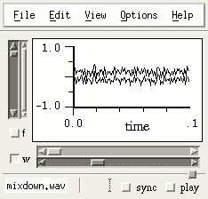

## 23. 编辑音频文件

有许多用于编辑音频文件的工具和应用程序。本章描述了其中一些工具，并提供了剪辑粘贴音频文件、应用效果和过滤器以及在不同格式之间转换音频文件的方法。

### 23.1 处理音频文件中的选择

#### `Snd`

- DEB: `snd`
- RPM: `snd`
- WWW: `http://www-ccrma.stanford.edu/software/snd/`

`Snd` 是一个用于 X 的音频文件编辑环境，其目标是成为音频领域的 `Emacs`（它也使用了 `Emacs` 风格的键绑定）。你可以在 `/usr/doc/snd` 目录下找到它的完整手册；本节解释了如何使用 `Snd` 处理音频文件中的选择。

要在 `Snd` 中打开音频文件，请将要打开的文件名作为参数传递给 `snd`。

在 `Snd` 中打开音频文件 `mixdown.wav`，输入：

```bash
$snd mixdown.wav
```

RET

此命令启动了带有名为 `mixdown.wav` 的 wav 文件的 `Snd`，如图 23-1 所示。

*图 23-1. 加载了文件的 Snd。*

在 `Snd` 中选择音频文件的部分类似于在 `Emacs` 中选择文本；你可以通过鼠标左键点击并拖过某个区域，对你在 `Snd` 中制作的音频文件或录制部分进行标记。你拖过的区域将变为阴影，并被称为“选择区域（selection）”。一旦你选择了音频的音频，你选择的任何效果都将应用于该选择区域。你还可以将正在编辑的音频选择剪切并粘贴到其他音频缓冲区中。

`xwave` 工具（无疑还有许多其他工具）具有类似的能力和功能（参见食谱 23.4 [使用其他音频编辑器]，第 496 页）。

#### 23.1.1 剪辑音频文件的一部分

要剪辑你正在 `Snd` 中编辑的音频文件的某部分，首先通过左键点击并拖动来选择该部分，然后从编辑（Edit）菜单中选择“剪切（Cut）”，类似于裁剪图像文件。

#### 23.1.2 将选择粘贴到音频文件中


通过打开新缓冲区、在目标缓冲区中左键点击，然后从编辑（Edit）菜单中选择“粘贴（Paste）”，将剪切的音频选择粘贴到`Snd`中不同的音频缓冲区中。你最近的选择将粘贴到你在音频缓冲区中点击的位置。

### 23.1.3 混合音频文件

要在`Snd`中将不同的音频文件混合为多个轨道，请从文件（File）菜单中选择“混合（Mix）”，并指定用作各个轨道的文件。

### 23.2 应用音频效果

#### Sound eXchange

DEB: `sox`

RPM: `sox`

WWW: `http://sox.sourceforge.net/`

“Sound eXchange”工具`sox`是一个音频采样翻译器。它从文件或标准输入读取音频，并将音频输出到文件或标准输出，在此期间进行翻译。你可以使用`sox`将音频文件从一种格式转换为另一种格式，或使用特殊效果处理音频。本节描述了可以使用`sox`应用音频文件的一些特殊效果。

在应用效果时，原始文件永远不会被更改。你必须指定一个输出文件，或使用连字符（`-`）来指示标准输出。

将输出格式指定为`-t`选项的参数。每个`sox`命令只能应用一种效果；因此，要向音频文件同时添加回声和混响，你需要执行两个`sox`命令。

每个效果应用的量和电平随每种情况而变化。因此，请将以下食谱仅作为使用选项的指南；对于任何特定的音频文件，你可能需要进行一些实验以达到预期的效果。

几乎所有的音频效果都是通过指定输入和输出文件参数，后跟要使用的效果名称以及该效果接受的任何选项来应用的（有明显的例外，例如更改文件幅度的`-v`选项）。

**注意：** 有关`sox`可应用的音频效果的更多信息，请查看`/usr/doc/sox/`中的各种文件，并阅读`sox`手册页（参见食谱 2.8.4 [从系统读取页面]）。

#### 23.2.1 修改音频文件的幅度

要更改音频文件的幅度，使用`sox`并配合`-v`选项，将音量电平作为参数。低于 1 的数值会降低幅度，较高的数值会增加幅度。

以下是两种使用此方法：

- 将`old.wav`的音量增加一倍并输出，输入：`sox -v old.wav`
- 将`old.wav`的音量减半并输出，输入：`sox -v.5 old.wav`

使用`sox`配合`stat`选项和`-v`，当你尽可能提高音量时，该值非常有用。

尽可能提高`cdr`的音量，创建一个新文件：

```
sox -v25 cdr
```

#### 23.2.2 修改采样率

更改音频文件的采样率，使用`-r`选项后跟要使用的采样率（赫兹）。与`-v`选项一样，为输入文件指定此选项；然后为输出文件指定原始采样率。

将`old.wav`的采样率更改为 7000 Hz 并输出到`new.wav`，输入：

```
sox -r 7000 old.wav
```

为了降低采样率为 44100 Hz 的`bell.wav`的音调，将其写入名为`slowbell.wav`的新文件（同样为 44100 Hz），输入：

```
sox -r 30000 bell.wav -r 44100 slowbell.wav
```

在这个示例中，采样率为 44100 Hz 的以较慢的 30000 Hz 播放，然后将其重采样为输出文件的 44100 Hz，但音调现在与原始不同。

#### 23.2.3 为音频文件添加混响

为音频文件添加混响，使用`reverb`效果。`reverb`取三个参数：输出的音量（其“输出电平”）；混响的时间（毫秒）；以及延迟的长度（毫秒）。你可以指定多个延迟；指定的越多，混响的回叠回声就越明显。

为`old.wav`添加基础混响并输出到文件`new.wav`，输入：

```
sox old.wav new.wav reverb .5 1000 100
```

为`old.wav`添加空间感回声混响并输出到`new.wav`，输入：

```
sox old.wav new.wav reverb 1 1000 333 333 333 333
```

**注意：** 上一个例子产生的声音与 Flying Saucer Attack 乐队的一些录音相似。（你知道他们，对吧？）

#### 23.2.4 为音频文件添加回声

为音频文件添加回声，使用`echo`效果。它以“输入增益”和“输出增益”音量作为参数，以及延迟和衰减，单位均为毫秒。

这里是一些使用它的方法。

- 要为声音文件`old.wav`添加 100 毫秒的回声并将输出写入`new.wav`，请输入：

```
sox old.wav new.wav echo .5 .5 100 .5
```

- 要为声音文件`old.wav`添加 1 秒的回声并将输出写入`new.wav`，请输入：

```
sox old.wav new.wav echo .5 .5 1000 .5
```

- 要为`old.wav`添加“铁罐”（tin-can）回声效果并将输出写入`new.wav`，请输入：

```
sox old.wav new.wav echo 1 .5 5 .5
```

**注意：** `echos`效果的作用与`echo`类似，但它会向声音文件中添加一系列（sequence）回声。

### 23.2.5 为声音文件添加环胶效果 (Flange)

`flanger`效果为声音文件添加环胶效果。它接受的参数包括输入增益（gain-in）和输出增益（gain-out）、以毫秒为单位的延迟和衰减，以及以赫兹为单位的环胶速度。使用`-s`（正弦波）或`-t`（三角波）指定调制类型。

这里有两种使用它的方法。

- 要为文件`old.wav`添加“水下”环胶效果并将输出写入`new.wav`，请输入：

```
sox old.wav new.wav flanger .5 .5 4 .5 1 -t
```

- 要为文件`old.wav`添加听起来有点像“哇哇”踏板的环胶效果并将输出写入`new.wav`，请输入：

```
sox old.wav new.wav flanger .5 .5 .5 1 2 -t
```

### 23.2.6 为声音文件添加相移效果 (Phase)

`phaser`效果为声音文件添加相移。它接受的参数与`flanger`效果相同。

这里有两种使用它的方法。

- 要为文件`old.wav`添加强烈的相移效果并将输出写入`new.wav`，请输入：

```
sox old.wav new.wav phaser 1 .5 4 .5 1 -s
```

- 要为文件`old.wav`添加带相位的“呼吸”效果并将输出写入`new.wav`，请输入：

```
sox old.wav new.wav phaser .5 .5 .5 .9 .5 -t
```

**注意：** 使用大于`.5`的衰减值可能会导致反馈。

### 23.2.7 为声音文件添加合唱效果 (Chorus)

要为声音文件添加合唱效果，请使用`chorus`。其选项包括音量的输入增益和输出增益、以毫秒为单位的延迟和衰减、以赫兹为单位的速度，以及以毫秒为单位的合唱深度。使用`-s`或`-t`指定正弦波或三角波调制。

这里有两种使用它的方法。

- 要为文件`old.wav`添加 100 毫秒合唱效果并将输出写入`new.wav`，请输入：

```
sox old.wav new.wav chorus 1 .5 100 1 1 1 -t
```

- 要为文件`old.wav`添加深层的、“外星人感”合唱效果并将输出写入`new.wav`，请输入：

```
sox old.wav new.wav chorus 1 .5 100 1 5 9 -t
```

### 23.2.8 为声音文件添加震荡器效果 (Vibro-Champ)

`vibro`效果模仿老式 Fender Vibro-Champ 放大器的效果。提供以赫兹为单位的速度（最大 30）作为选项，并指定一个`0`到`1`之间的可选深度值（默认值为`.5`）。

这里是一些使用它的方法。

- 要为文件`old.wav`添加细微的 Vibro-Champ 效果并将输出写入`new.wav`，请输入：

```
sox old.wav new.wav vibro 1
```

- 要为文件`old.wav`添加满载的 Vibro-Champ 效果并将输出写入`new.wav`，请输入：

```
sox old.wav new.wav vibro 30 1
```

### 23.2.9 反转声音文件中的音频

使用`reverse`效果反转声音文件中的声音。

要反转文件`old.wav`中的声音并将输出写入`new.wav`，请输入：

```
sox old.wav new.wav reverse
```

### 23.3 转换声音文件

SOund eXchange (声音交换工具)

DEB: `sox`

RPM: `sox`

WWW: `http://sox.sourceforge.net/`

使用`sox`进行大多数声音文件转换。将输入文件名和要写入的输出文件名作为参数；使用文件扩展名指定输出文件的声音格式（参见附录 B [常规文件后缀]，第 723 页）。

要将文件`new.wav`转换为音频 CD 格式文件，请输入：

```
sox new.wav new.cdr
```

Linux 中的音频软件是一个更新极快的目标，印刷书籍无法跟上它的变化；你可以通过查看 Dave Phillips 的“Linux 音频与 MIDI 软件”来关注最新进展。它提供了可用的最全面、最的 Linux 相关音频软件列表（参见附录 D [进一步感兴趣的参考文献]，第 731 页）。

就像文本编辑器一样，有各种音频编辑器，从简单的编辑器到高级环境都有。下表列出了其中最流行的几个。

#### Audacity

带有频谱图显示器的音频编辑器。以速度快著称。

- DEB: `audacity`
- RPM: `audacity`
- WWW: `http://audacity.sourceforge.net/`

#### Brahms

适用于 kde 的图形化音乐编辑器，其功能包含记谱和钢琴卷帘。

- DEB: `brahms`
- RPM: `brahms`
- WWW: `http://brahms.sourceforge.net/`

#### DAP

用于编辑音频文件的图形化工具。

- RPM: `dap`
- WWW: `http://www.cee.hw.ac.uk/~richardk/`

#### Festival

语音合成系统，可以读取英语（英式和美式）、西班牙语和威尔士语纯文本输入，并将语音作为输出。

- DEB: `festival`
- RPM: `festival`
- WWW: `http://www.cstr.ed.ac.uk/projects/festival/`

#### Freebirth

序列器、贝斯合成器和采样播放器。

- DEB: `freebirth`
- RPM: `freebirth`
- WWW: `http://www.hitsquad.com/smm/programs/Freebirth/`

#### GLAME

被称为“音频界的 gimp”的音频编辑器。glame 是“gnu/Linux Audio Mechanics”的缩写。

- DEB: `glame`
- RPM: `glame`
- WWW: `http://glame.sourceforge.net/`

#### Pure Data

用于实时音频编程的强大系统。

- DEB: `pd`
- WWW: `http://www-crca.ucsd.edu/~msp/software.html`

#### Rosegarden

midi 序列器、音乐符号（记谱）编辑器和音乐作曲编辑器。

- DEB: `rosegarden`
- RPM: `rosegarden`
- WWW: `http://www.rosegardenmusic.com/`

#### Tapiir

受旧磁带延迟效果启发的图形化实时音频效果处理器。

- DEB: `tapiir`
- WWW: `http://www.iua.upf.es/~mdeboer/projects/tapiir/`

#### XWave

一个简单的音频编辑器，执行你可以在 wav 文件编辑器中预期的基本功能。

- DEB: `xwave`
- WWW: `http://www.ibiblio.org/pub/linux/apps/sound/editors/`

## 24. 磁盘存储

基于 Linux 系统上的所有文件和目录都存储在 Linux *文件系统*上，它是一个磁盘设备（如硬盘），经过格式化后以存储目录树（参见第 5 章 [文件和目录]，第 125 页）。

Linux 系统上有两类磁盘存储：固定式和可移动式。*固定存储*指的是牢固连接到计算机系统且不打算经常拆卸的磁盘（除非进行升级）。你的硬盘（有时被称为“硬磁盘”或“固定磁盘”），存储了操作系统、应用软件和用户数据，是固定存储的典型示例。

第二类磁盘存储是*可移动存储*，即为了归档或传输到另一个系统而旨在移除的磁盘。可移动存储的常见示例是软盘（或“磁盘”）和光盘——当你用完后，通常会将存储介质从驱动器槽中取出。

在 Linux 系统上，通过将磁盘*挂载*（mounting）到目录来使用磁盘，这使得磁盘包含的目录树在指定的目录*挂载点*处可用。磁盘可以挂载到系统上的任何目录，但磁盘之间的任何划分都是透明的。这意味着，一个为`/home`、`/usr`和`/usr/local`目录树拥有独立物理硬盘的系统，其看起来和用起来与仅有一个物理硬盘的系统无区别。

系统管理员经常将高容量驱动器挂载到包含大量数据的目录树上（例如拥有许多用户的系统上的`/home`目录树），为了容错性，管理员通常会在一个系统上使用几块物理硬盘——如果发生磁盘故障，只有该磁盘上的数据会丢失（尽管理想情况下可以从备份中恢复）。

本章描述了操作磁盘和存储介质的工具和技术。

### 24.1 列出磁盘可用空间

要查看磁盘剩余多少可用空间，使用`df`。在不带任何选项的情况下，`df`输出所有挂载文件系统的列表。输出六列内容，显示关于每个磁盘的信息：在`/dev`中的设备文件名；系统使用的 1024 字节块数；已使用的块数；可用的块数；设备使用的百分比；以及设备挂载的目录树名称。

要查看系统磁盘上剩余多少可用空间，输入：`$df`

```
Filesystem 1024-blocks Used Available Capacity Mounted on
/dev/hda1 195167 43405 141682 23% /
/dev/hda2 278307 68916 195094 26% /usr
/dev/hdb1 203959 67562 138452 31% /home
```

（注：此处数值根据常见情况进行了微调以保持逻辑性）

### 24.2 列出文件占用空间

要列出文件占用的空间，使用`du`。要指定特定的文件或目录树，请将其作为参数。如果不带任何参数，`du`作用于当前目录。它会为每个子目录输出一行，最后一行显示整个树的总和。

要查看当前目录树的总空间，输入：`du`

```
12 etc
24 projects
27 tmp
1024 .
```

此示例显示了树中的两个子目录：`projects`和`tmp`。`projects`子目录包含三个额外的目录。各个目录的磁盘空间以 kb 为单位显示。

默认情况下，输出单位为 kb，但你可以指定另一个单位：`-k`表示字节，`-m`表示兆字节。

有以下两种使用方法：

- 以字节输出`/usr/local`目录树的占用空间，输入：`$du -k /usr/local`
- 查看`/tmp/cache`用的兆字节数，输入：`$du -m /tmp/cache`

使用`-s`选项（汇总）仅输出包含总和的最后一行。当你只对目录的总磁盘空间感兴趣时，这非常有用。

有以下两种使用方法：

- 仅输出`/usr/local`目录树的总空间，输入：`$du -s /usr/local`
- 以字节输出`/usr/local`目录树的总空间，输入：`$du -s -k /usr/local`

### 24.3 使用软盘

在第一次使用软盘之前，必须对其进行*格式化*，这会在磁盘上创建一个空的文件系统。

要在格式化过的磁盘上读写文件，你需要将软盘挂载到一个空目录上，使其文件系统在指定的目录中可用。通常，Linux 系统有一个空的`/floppy`目录用于此目的（另一个用于挂载文件系统的通用目录是`/mnt`）。

当你将磁盘挂载到目录时，该目录包含磁盘文件系统中的所有文件和目录；当你稍后*卸载*磁盘时，该目录将为空——磁盘上的所有文件和目录仍在磁盘文件系统中，但该文件系统已不再挂载。

当你完成软盘的使用后，必须在从驱动器中取出它之前对其进行卸载。如果不这样做，你可能会损坏或删除其上的某些文件——当你移除磁盘时，`Linux`可能仍在使用挂载的文件（请参阅配方 2.1.2 [关闭关闭系统]，第 27 页）。

接下来的章节将向你展示如何格式化、挂载和卸载软盘。在许多系统中，你需要超级用户权限（superuser privileges）才能执行这些任何操作。

**注意：** 关于描述在`Linux`下使用`ms-dos`（以及 Microsoft Windows）格式化磁盘的配方，请参阅配方 26.1 [使用 dos 和 Windows 磁盘]，第 525 页。


### 24.3.1 格式化软盘

你可以使用`fdformat`对你作为参数传递的软盘设备进行低级格式化。要格式化位于第一个软盘驱动器中的 1.44 mb 软盘，请使用`/dev/fd0H1440`设备作为参数。

要对第一个可移动软盘驱动器中的 1.44 mb 软盘进行低级格式化，输入：

```bash
fdformat /dev/fd0H1440
```

这将擦除磁盘上的所有信息。

一旦磁盘格式化完成，你需要在磁盘上创建一个`Linux`文件系统。

使用`mke2fs`来执行此操作。将软盘驱动器的设备文件名称作为参数——通常是第一个可移动磁盘驱动器，`/dev/fd0`。在执行此命令时，软盘必须在驱动器中，并且其上的任何现有数据都将丢失。

要在第一个可移动软盘驱动器中的软盘上创建`Linux`文件系统，输入：

```bash
mke2fs /dev/fd0
```

**注意：** 你可以使用`superformat`创建 2 mb 的高容量格式化。这会将软盘格式化为超出其正常容量的范围；这是一个漫的过程，但如果你需要在磁盘上存储额外数据，可以考虑使用。

### 24.3.2 挂载软盘

要挂载软盘，请使用带有`/floppy`选项的`mount`命令。

1. 技术上讲，该文件系统是*第二扩展文件系统*（`e2fs`），这是目前`Linux`使用的原生文件系统。
2. 如果你的管理员已为用户访问设置了软盘驱动器文件系统，则此方法有效——参阅配方 A.6.3 [允许用户访问硬件外]，第 718 页。

要挂载软盘，输入：

```bash
mount /floppy
```

要将软盘挂载到特定目录，请使用`mount`并软盘驱动器的设备名称（对于单软盘系统通常为`/dev/fd0`）以及要挂载的目录名称作为参数。

将第一个软盘驱动器中的软盘挂载到`~/tmp`，输入：

```bash
mount /dev/fd0 ~/tmp
```

一旦你挂载了软盘，其内容就会出现在你指定的目录中，你可以对它们使用任何`file`命令。

这里有两种使用此方法。

- 要列出挂载在`/floppy`上的软盘根目录的内容，输入：

  ```bash
  ls /floppy
  ```

- 要列出挂载在`/floppy`上的软盘整个目录树的内容，输入：

  ```bash
  ls -lR /floppy
  ```

**注意：** 你可以在软盘挂载的目录树中进出复制文件，创建和删除目录，以及在任何其他目录树上可以的任何操作。但请记住，在移除它之前，你必须先对其进行卸载。

### 24.3.3 卸载软盘

使用`umount`卸载软盘，并将其挂载的目录名称作为参数。

要卸载挂载在`/floppy`上的软盘，输入：

```bash
umount /floppy
```

**注意：** 如果你当前的工作目录（你所在的目录）位于磁盘目录树的某处，则你无法卸载磁盘。在这种情况下，尝试卸载磁盘将得到`/floppy`文件系统正在使用的错误；切换到一个不在`/floppy`目录树中的目录，然后你就可以卸载磁盘了。

有时当你卸载软盘时，软盘驱动器上的灯会在卸载后亮起并保持几秒钟。这是因为`Linux`有时会将文件的更改保存在内存中，然后再将其写入磁盘；它正在确保软盘上的文件是最新的。

只需等待灯熄灭后再从驱动器中取出软盘即可。

### 24.4 使用数据 cd

与软盘一样，在系统上使用数据 cd（“紧凑光盘”）之前，你必须先将其挂载到一个空目录上。然后从该目录中卸载它，才能从 cd 驱动器中弹出 cd（你也可以使用软件弹出磁盘——参阅配方 22.1.6 [弹出音频 cd]，第 480 页）。

**注意：** 要使用音频 cd，请参阅第 22 章 [音频紧凑光盘]，第 477 页。

### 24.4.1 挂载数据 cd

要在系统上挂载数据 cd，使用带有`/cdrom`选项的`mount`。

在系统上挂载数据 cd，输入：

```bash
mount /cdrom
```

一旦你挂载了数据 cd，其内容就会出现在你指定的目录中，你可以对它们使用任何`file`命令。

要将数据 cd 挂载到特定目录，请使用`mount`并软盘驱动器的设备名称（对于单软盘系统通常为`/dev/fd0`）以及要挂载的目录名称作为参数。

将第一个软盘驱动器中的数据 cd 挂载到`~/tmp`，输入：

```bash
mount /dev/fd0 ~/tmp
```

一旦你挂载了数据 cd，其内容就会出现在你指定的目录中，你可以对它们使用任何`file`命令。

这里有两种使用此方法。

- 要列出挂载在`/cdrom`上的数据 cd 根目录的内容，输入：

  ```bash
  ls /cdrom
  ```

- 要列出挂载在`/cdrom`上的数据 cd 整个目录树的内容，输入：

  ```bash
  ls -lR /cdrom
  ```

**注意：** 你可以在软盘挂载的目录树中进出复制文件，创建和删除目录，以及在任何其他目录树上可以的任何操作。但请记住，在移除它之前，你必须先对其进行卸载。

### 24.4.2 卸载数据 cd

使用`umount`卸载软盘，将其挂载的目录名称作为参数。

要卸载挂载在`/cdrom`上的数据 cd，输入：

```bash
umount /cdrom
```

**注意：** 如果你当前的工作目录（你所在的目录）位于磁盘目录树的某处，则你无法卸载磁盘。在这种情况下，尝试卸载磁盘将得到`/cdrom`文件系统正在使用的错误；切换到一个不在`/cdrom`目录树中的目录，然后你就可以卸载磁盘了。

有时你可能需要转换或对文件进行准备，以便在你的特定打印机上打印，因为并不是所有的打印硬件都能打印相同类型的文件格式。本章中的食谱展示了如何进行操作，例如如何转换 PostScript 文件以便能够在非 PostScript 打印机上正常打印（参见食谱 25.3 [为打印准备文件]，第 518 页）。

本章还展示了如何为打印格式化 PostScript 文件。若要将纯文本转换为 PostScript 并通过添加字体、图形头等对其进行打印增强，请参见食谱 15.2 [将文本输出到 PostScript]，第 359 页。

本章不在书的“文件”部分，因为你可以打印并非于文件中的内容——例如，你可以将另一个工具或系列工具的输出通过给`lpr`，它会将该命令的输出溢打印到打印机。这种用法实际上非常常见。

## 25.1 创建和管理打印作业

在基于 Linux 的系统上打印的传统方法是将想要打印的文件或数据发送一个*打印作业*（print job），发送到相应打印机的*打印池队队列*（spool queue）。打印池队列包含了所有用户发送给它的打印作业；这些作业会在打印机设备可用时依次释放到打印机上。

通过这种方式，Linux 可以同时处理发往同一台打印机的多个打印作业。

下面的食谱展示了如何创建和管理打印作业。在实践中，你可能一直在发送打印作业——因为这是 Linux 中大多数打印操作的方式——而很少使用这些列出或取消打印作业的工具。但有时事情确实会出错，在发生这种情况时知道做什么会有帮助。

510

《Linux 食谱》，第 2 版

### 25.1.1 将打印作业发送到打印机

使用`lpr`将打印作业发送到打印机——将要打印的文件作为参数。（你也可以将命令的输出通过管道交给`lpr`）。`lpr`将指定文件或文本的副本写入指定打印机的打印池队列，以便在打印机可用时发送到打印机。

这里是使用此功能的几种方法。

- 要打印文件`invoice`，输入：

  ```bash
  $ lpr invoice
  ```

- 使用`banner`输入消息并发送到打印机，输入：

  ```bash
  $ banner "Bon voyage!" | lpr
  ```

- 要打印`/usr/doc/HOWTO`目录的详细递归列表，输入：

  ```bash
  $ ls -lR /usr/doc/HOWTO | lpr
  ```

如果你的系统连接了多台打印机，可以使用`-P`选项作为参数指定要发送的打印机。（打印机像用户账户和主机一样有名称，命名它们是管理员的权限；默认打印机通常称为`lp`，代表“line printer”。）

要将文件`nightly-report`发送到名为`statomatic`的打印机，输入：

```bash
$ lpr -P statomatic nightly-report
```

**注意：** `lpr`工具的名称源于“line printer”（线打印机），这是在该程序最初开发时广泛使用的打印硬件类型。

### 25.1.2 打印作业的多个副本

要打印一个打印作业的多个副本，可以将打印副本的数作为`lpr`的`-`选项的参数。

要打印`nightly-report`文件的 12 副本，输入：

```bash
$ lpr -#12 nightly-report
```

### 25.1.3 列出你的打印作业

要列出你的打印作业，请使用`lpq`，即“line printer queue”工具。它输出默认打印机打印池队列中所有打印作业的列表，每个作业占一行，给出其在队列中的排序、发送作业的用户名、打印作业号、作业中的文件名以及要打印的数据大小（单位为字节）。

第 25 章：打印

511

要查看默认打印机的打印池队列，输入：

```bash
$ lpq
```

| Rank | Owner | Job | Files | Total Size |
| :--- | :--- | :--- | :--- | :--- |
| active | groucho | 83 | cigar.ps | 1739030 bytes |
| 1st | harpo | 84 | harp.ps | 499 bytes |
| 2nd | chico | 85 | love.ps | 45576 bytes |

在这个示例中，默认打印机排了三个作业——一个由用户 groucho 发送的，针对文件`cigar.ps`；一个由用户 harpo 发送的，针对文件`harp.ps`；还有一个由用户 chico 发送的，他打印了一个名为`love.ps`的文件。

用户 groucho 的作业是*活动作业*（active job）——这是目前正在打印机上打印的作业。其他作业必须等待此文件打印完成，然后按排序顺序打印。

与`lpr`一样，可以通过`-P`选项的参数指定打印机名称。

要查看名为`statomatic`的打印机的打印池队列，输入：

```bash
$ lpq -P statomatic
```

若仅列出特定用户的作业，可以将用户名作为参数。

要列出用户`harpo`的打印作业，输入：

```bash
$ lpq harpo
```

**注意：** 当没有打印作业时，`lpq`输出“no entries.”

### 25.1.4 取消打印作业

要取消打印作业并将其从打印池队列中移除，请使用`lprm`，即“line printer remove”。误发送了内容到打印机，只需运行无选项的`lprm`即可停止打印。

要取消当前作业，输入：

```bash
$ lprm
```

当`lprm`取消作业时，它会输出已移除的文件名（通常两行）。

512

《Linux 食谱》，第 2 版

你也可以通过作业号取消打印作业。执行此操作时将作业号作为参数。

要取消作业 83，输入：

```bash
$ lprm 83
```

要取消打印池队列中的*所有*打印作业，使用连字符代替作业号。

要取消所有打印作业，输入：

```bash
$ lprm -
```

**注意：** 如果你尝试取消一个活动作业——即已溢到打印机的作业——如果某些页面仍在打印，请不要慌，打印机可能缓存了部分作业。在这种情况下，将打印机离线状态并重置，然后恢复在线（打印机面板上通常有这些按钮）。

## 25.2 你可以打印的其他内容

除了创建打印作业，另一种打印方法是从应用程序打印。

并不是所有应用程序都有打印控制，但某些是，包括 Emacs 和 LyX（参见食谱 15.4 [使用 LyX]，第 378 页）。它们的打印命令本质上是通过`lpr`将打印作业发送到打印机，在此之前会对数据进行格式化或准备。如果你在这样的应用程序中工作并想打印作品，使用内置打印控制比去终端运行`lpr`更方便。

例如，要在 LyX 文档处理程序打印当前文档，从文件菜单选择打印；它为你的打印机创建适当输出并包含该输出的打印作业（参见食谱 15.4 [使用 LyX]，第 378 页）。

某些工具，如`dvips`和`enscript`（参见食谱 15.2 [将文本输出到 PostScript]，第 359 页），也被配置为溢出到打印机。

你可以在打印池队列中查看这些打印作业，并像取消任何打印作业一样取消它们。

第 25 章：打印

513

### 25.2.1 打印打印机测试带

有时测试你的打印机设置以及打印机硬件本身是有用的。使用`lptest`执行此操作。它会生成一个传统的打印机测试图案，包含所有 96 个可打印的 ASCII 字符，每行宽 79 个字符。该图案重复 200 行，其排列方式使得字符与行之间错错一个空格。这种效果像波浪或条纹波纹，因此被称为*波纹图案*（ripple pattern）。

默认情况下，`lptest`输出到标准输出。运行一次以查看它生成的输出是一个好主意，这样你就知道对打印机的输出会有什么预期。

这里是使用该工具的一些方法。

- 要查看`lptest`输出的波纹模式，输入：

  ```bash
  lptest
  ```

- 将测试模式发送到默认打印机，输入：

  ```bash
  lptest | lpr
  ```

- 将测试模式发送到名为`production`的打印机，输入：

  ```bash
  lptest | lpr -Pproduction
  ```

要指定行宽，请将新宽度作为参数提供。

向名为`machine_room`的打印机发送每行 120 个字符的测试模式，输入：

```bash
$ lptest 120 | lpr -Pmachine_room
```

你还可以指定输出的行数；通过提供第二个参数提供新的行数来实现。这在你需要向文件写入一些“虚拟”数据时非常有用。

向文件`testing`写入一个十行长、每行 25 个字符的波纹模式，输入：

```bash
$ lptest 25 10 > testing
```

### 25.2.2 打印 PostScript 文件的特定页面

`PSUtils`

DEB: `psutils`

RPM: `psutils`

WWW: `http://www.ctan.org/tex-archive/support/psutils/`

要仅打印 PostScript 文件的某些页面，使用`psselect`指定这些页面并将输出通过到`lpr`（参见食谱 20.1.2 [从 PostScript 文件中提取页面]，第 452 页）。当你有一个非常大的文件需要打印，并想分段发送到打印机时，这非常有用。

这里是使用该方法的两种方法。

- 打印文件`input.ps`的第 1 到 100 页，输入：

  ```bash
  psselect -p1-100 input.ps | lpr
  ```

- 打印文件`input.ps`的第 1 到 100 页的四份，输入：

  ```bash
  psselect -p1-100 input.ps | lpr -#4
  ```

### 25.2.3 打印图像

打印图像文件最可靠的方法是在`gimp`中查看文件，并选择“文件”菜单中的“打印”选项。这可以让你对打印拥有最大的控制：你可以调整页面大小、方向、亮度以及其他选项。你还可以将其打印到文件（参见食谱 18.3 [使用 gimp]，第 434 页）。

### 25.2.4 打印网页

有几种打印网页的不错方法。

#### 方法 #1

打印网页通常使用 Mozilla 或或其他图形化浏览器。在 Mozilla 中，从“文件”菜单选择“打印”，或者在 Mozilla 显示你想打印的页面时输入`ALT - P`。你可以选择纸张大小、颜色、页面顺序和页边距；你还可以选择打印设备，或将页面打印为 PostScript 文件（参见食谱 33.1 [使用 Mozilla]，第 638 页）。这是常用方法。

#### 方法 #2

要使用`lpr`打印网页内容，可以使用带有`-dump`选项的`lynx`将内容直接传递`lpr`，或者可选通过过滤器或命令。

这里是使用该工具的一些方法。

- 打印 URL`http://chem.example.edu/polymer99.ps`（一个 PostScript 文件），输入：

  ```bash
  $ lynx -dump http://chem.example.edu/polymer99.ps | lpr
  ```

- 打印 URL`http://chem.example.edu/info.txt`（一个文本文件），输入：

  ```bash
  $ lynx -dump http://chem.example.edu/info.txt | lpr
  ```

- 打印 URL`http://chem.example.edu/schedule.txt`（Palatino 加粗字体 20 点宽、10 点高的文本文件），输入（全部写在一行）：

  ```bash
  $ lynx -dump http://chem.example.edu/schedule.txt | enscript -B -f Palatino-Bold @ 20/10 -o - | lpr
  ```

**注意：** 这通常也是一种通过任意数量的过滤器或管道发送网页内容的好的好方法。

#### 方法 #3

在`lynx`中，当处于你想打印的页面时按`P`。这将弹出一个新页面，显示你正在查看的页面 URL，并告诉你它包含的行数以及打印时占用的物理页数。你还将获得四个选项：保存到本地文件、邮件文件、打印到屏幕以及打印到连接到`vt100`终端的打印机。最后一个选项将将其发送到打印机。如果你保存到本地文件，将以你指定的名称向当前目录写入一个纯文本文件。你可以处理并打印该文件。


### 25.2.5 打印 dvi 文件

`DVIPS`

DEB: `tetex-bin`

RPM: `tetex-dvips`

WWW: `http://www.radicaleye.com/dvips.html`

你可以使用 `dvips` 工具直接打印 `dvi` 文件——省略用于指定输出文件的 `-o` 选项，它将把 PostScript 输出直接发送到默认打印机的打印队列。

⇒ 打印 `dvi` 文件 `list.dvi`，输入：

```bash
$ dvips list.dvi
```

下表列出了 `dvips` 用于控制打印输出的一些选项：

- `-A`：仅打印奇数页（`dvi` 文件必须由 `TEX` 生成方可使用此选项）。
- `-B`：仅打印偶数页（`dvi` 文件必须由 `TEX` 生成方可使用此选项）。
- `-b copies`：指定打印副本数——适用于打印多份传单、海报、标志等。
- `-k`：打印裁剪标记。
- `-l last`：指定要打印的最后一页页码。
- `-m`：使用手动进纸器。
- `-p first`：指定开始打印的起始页页码。
- `-r`：反转页面顺序。
- `-t format`：指定纸张大小和格式；有效选项包括“letter”、“legal”、“a4”和“landscape”（横向）（你可以使用两次此选项，例如同时指定“legal”和“landscape”）。

使用 `-m` 选项并配合 `-t` 选项指定横向为纸张格式，对于打印信封非常有用。

⇒ 在默认打印机手动进纸器上的信封上打印文件 `envelope.dvi`，输入：

```bash
$ dvips -m -t landscape envelope.dvi
```

**注意：** 你也可以使用 `lpr` 配合 `-d` 选项打印 `dvi` 文件。

### 25.2.6 打印 Emacs 缓冲区

你可以从 `Emacs` 内部打印缓冲区，可以打印整个缓冲区或仅打印区域。有几种方法。

#### 方法 #1

要在 `Emacs` 中打印当前缓冲区，从菜单栏上“工具”菜单的打印子菜单中选择“打印缓冲区”。打印子菜单上的另一个选项是“打印区域”，它只打印点（point）和标记（mark）之间的文本（参见食谱 10.1.1 [熟悉 Emacs]，第 232 页）。这两个命令都会打印分页分隔的硬拷贝输出，每页顶部的标题显示文件名和当前页码。

#### 方法 #2

要生成并打印缓冲区的 PostScript 图像，使用 `ps-print-buffer` 函数，该函数在打印子菜单中可用。相关函数 `ps-print-region` 输出区域的 PostScript 图像。这些命令对于将缓冲区文本发送到 PostScript 打印机有用。

⇒ 将当前 `Emacs` 缓冲区作为 PostScript 文件发送到默认打印机，输入：

```text
ALT - X ps-print-buffer
```

#### 方法 #3

你还可以通过 `ALT - X` 命令指定任何上述打印函数。此外，`lpr-buffer` 和 `lpr-region` 函数会将缓冲区和区域发送到 `lpr`，而不对文本进行分页或插入标题。

⇒ 这里是使用该工具的方法。

- 打印带有页码和标题的当前缓冲区，输入：`ALT - X print-buffer`
- 打印对文本不做任何额外格式化的当前缓冲区，输入：`ALT - X lpr-buffer`
- 打印当前缓冲区的 PostScript 图像，输入：`ALT - X ps-print-buffer`

### 25.2.7 打印 Info 节点

当你运行 `info`（超文本 Info 查看器）时，可以通过运行 `print-node` 函数打印当前节点。

⇒ 在 Info 中打印当前节点，输入：

```text
ALT - X print-node
```

### 25.2.8 打印终端窗口内容

要打印 X 环境中 `xterm` 窗口的内容，按住 `CTRL` 并左键点击窗口任意位置，然后选择“打印窗口”选项。

此命令将当前窗口中所有文本的副本发送到默认打印机。

## 25.3 为打印准备文件

严格来说，这些属于文件转换，但它们通常被用于打印到某些设备。并不是所有的打印机都能识别所有的输出格式，因此在打印之前有时需要对文件进行转换。

通常，你可以在任何打印机上打印纯文本。然而，大多数图形或图像文件必须转换为 PostScript 或 `eps`（“封装的 PostScript”）。某些应用程序（如 `TEX`）产生 `dvi` 输出；在这种情况下，你应该将其转换为 PostScript 后进行打印。

如果你有一台 PostScript 打印机，你可以直接向其打印 PostScript 文件。如果没有，你将需要将 PostScript 输出转换为你的打印机使用的格式。像 `magicfilter` 这样的过滤程序可以通过替你完成这项工作来使转换变得简单，但它们并不是万灵药，因为你的系统可能使用许多打印过滤器之一。因此，需要下面的配方。

### 25.3.1 准备 PostScript 文件用于打印

#### Ghostscript

DEB: `gs-common`

`gs`

RPM: `ghostscript`

WWW: `http://www.cs.wisc.edu/~ghost/`

如果你没有 PostScript 打印机，可以使用 Ghostscript（`gs`）将 PostScript 转换为你的打印机理解的输出格式。

使用 `-?` 来列出系统上安装的 `gs` 版本可以输出输出的打印机。

第 25 章：打印

519

⇒ 要列出可用打印机格式，输入：`$ gs -?`

RET

```text
GNU Ghostscript 5.10 (1998-12-17)
...more output messages...
Input formats: PostScript PostScriptLevel1 PostScriptLevel2 PDF
Available devices:
x11 x11alpha x11cmyk x11gray2 x11mono lvga256 vgalib t4693d8 tek4696 appledmp ccr lp2563 lbp8 lips3 m8510
oki182 okiibm la50 la70 la75 la75plus sxlcrt deskjet djet500 laserjet ljetplus ljet2p ljet3 ljet4 declj250
cdeskjet cdjcolor cdjmono cdj550 cdj500 djet500c
hpdj uniprint epson eps9mid eps9high epsonc lq850
ap3250 ibmpro bj10e bj200 bjc600 bjc800 ljet3d faxg3
faxg32d faxg4 dfaxhigh dfaxlow pcxmono pcxgray pbm
pbmraw pgm pgmraw pgnm pgnmraw pnm pnmraw ppm ppmraw
pkm pkmraw tiffcrle tiffg3 tiffg32d tiffg4 psmono
psgray jpeg
...more output messages...
$
```

一个典型的 `gs` 安装可以写入 100 多种不同的打印设备，包括 hp LaserJet 4 打印机（`ljet4`）、hp 彩色喷喷打印（`cdeskjet`）和第 4 传真（`tiffg4`）。较新版本的 `gs` 将对新打印机有更好的支持，因此如果你有新款型号的打印机，请确保你安装了最新版本。

`gs` 将要转换的文件作为参数；将要写入输出的设备作为 `-sDEVICE=` 选项的参数，并将要写入的文件名作为 `-sOutputFile=` 选项的参数。

常用的两个额外选项：`-dSAFER`，它可以防止意外删除或覆盖文件；以及 `-dNOPAUSE`，它关闭页码之间的暂停。

转换完成后，你将处于 `gs` 提示符下；输入 `quit` 退出。

⇒ 要将文件 `tiger.ps` 转换为适用于 hp Color Deskjet 500 打印机打印的格式，请输入（全部在一行）：

```bash
$ gs -sDEVICE=cdj500 -sOutputFile=tiger.dj -dSAFER -dNOPAUSE tiger.ps < /dev/null
```

RET

520

《Linux 食谱》，第 2 版

此命令将输出写入文件 `tiger.dj`，你可以通过 `lpr` 将其缓存为打印作业进行打印。

### 25.3.2 准备 dvi 文件用于打印

#### DVIPS

DEB: `tetex-bin`

RPM: `tetex-dvips`

WWW: `http://www.radicaleye.com/dvips.html`

要将文件从 `dvi` 格式转换为 PostScript，使用 `dvips`。它将要转换的文件作为参数；将要写入的 PostScript 文件名作为 `-o` 选项的参数。

⇒ 要将文件 `abstract.dvi` 转换为 PostScript，输入：`$ dvips -o abstract.ps abstract.dvi`

RET

此命令读取 `dvi` 文件 `abstract.dvi` 并将其 PostScript 版本写入文件 `abstract.ps`；原始文件不会被修改。

要向 PostScript 输出写入 `dvi` 文件的某些页面，请将页码或若干页码作为 `-pp` 选项的参数。

⇒ 以下是使用此项的一些方法。

- 要仅从文件 `abstract.dvi` 中输出第 14 和第 36 页到 `abstract.ps`：`$ dvips -pp14,36 abstract.dvi abstract.ps`
- 要仅从 `abstract.dvi` 中输出第 100 页到 `abstract.ps`：`$ dvips -pp100 abstract.dvi abstract.ps`
- 要仅从 `abstract.dvi` 中输出第 5 到第 20 页到 `abstract.ps`：`$ dvips -pp5-20 abstract.dvi abstract.ps`

要指定纸张大小，将页面大小作为 `-t` 选项的参数。

⇒ 要以横向模式将 `abstract.dvi` 输出为 `abstract.ps`：`$ dvips -t landscape -o abstract.ps`

- 要将 `abstract.dvi` 输出到默认打印机：`$ dvips -t pdf abstract.ps`

RET

此命令读取 `dvi` 文件 `abstract.dvi` 并将其 PostScript 版本写入文件 `abstract.ps`；原始文件未更改。

### 25.3.3 准备 pdf 文件用于打印

#### Xpdf

DEB: `xpdf-common`

`xpdf-reader`

RPM: `xpdf`

WWW: `http://www.foolabs.com/xpdf/`

#### Ghostscript

DEB: `gs-common`

`gs`

RPM: `ghostscript`

WWW:

至少有两种方法可以转换并打印 Adobe 的可移植文档格式（pdf），通常以 `.pdf` 文件扩展名标记。

第一种是在 `xpdf`（pdf 查看器）中查看文件，然后点击打印机图标。这并不会将文件发送到打印机，但会在相同目录下创建一个与 pdf 文件相同但扩展名为 `.ps` 的 PostScript 文件。然后你可以使用 `lpr` 打印此文件或将其转换为格式。

第二种是使用 `gs` 包中的 `pdf2ps` 将 pdf 文件转换为 PostScript（然后按照上述 `xpdf` 的方法打印）。`pdf2ps` 需要两个参数：要转换的 pdf 文件名和要写入的 PostScript 文件名。

⇒ 要转换 pdf 文件 `pricelist.pdf`，输入：`$ pdf2ps pricelist.pdf pricelist.ps`

RET

此命令在当前目录写入 PostScript 文件 `pricelist.ps`。

### 25.3.4 准备手册页用于打印

要将手册页转换为适用于打印的输出，使用 `man` 并配合 `-T` 选项，并将 `ps` 作为参数以输出 PostScript。要么将输出通过到 `lpr`（如果你有一台 PostScript 打印机），要么将其保存到文件中，然后针对你的打印机进行转换。

使用方法：

- 要将 `convert` 的手册页打印到 PostScript 打印机：`$ man -Tps convert | lpr`
- 要将 `convert` 的手册页打印到 PostScript 打印机：`$ man -Tps convert | lpr`
- 要以 PostScript 形式预览 `convert` 的手册页：`$ man -Tps convert | gv -`
- 要将 `psbook` 的手册页输出到文件 `psbook.ps`：`$ man -Tps psbook > psbook.ps`

RET

接在上一个示例中，你可以使用 `gs` 将文件转换为你的非 PostScript 打印机可以理解的格式（参见食谱 25.3.1 [准备打印的 PostScript 文件]，第 518 页）。

**注意：** 一个手动的“页”实际上可以包含多个物理页；输出将具有打印它所需的若干页。

### 25.3.5 为打印准备文本

准备用于打印的文本有多种方法。你可以如第 13 章 [文本格式化]，第 305 页所示的那样对文本进行分页并控制其他格式。然后，你可以使用 `enscript` 将文本转换为 PostScript 并进行打印。这有利于使用特定字体打印文本；你还可以选择某些页面进行打印，包括页码范围或仅打印偶数数页。

# 第 25 章：打印

523

在准备电子文本（etexts）进行打印时，有两个值得注意的方法。

### 方法 #1

#### Etext 过滤器

WWW: `http://dsl.org/comp/enscript/`

使用 `enscript` 的 `etext` 过滤器将 etext 转换为 PostScript。这会将一个使用 `etext` 规范编写的纯文本文件（包括 `etext` 风格的斜体，参见食谱 13.9 [下划线文本]，第 327 页）进行斜体转换，并写入 PostScript 文件作为输出。

⇒ 要将 etext `youth.txt` 转换为 PostScript，输入：

```bash
enscript -Eetext -B -f "Times-Roman12" -o youth.ps youth.txt
```

### 方法 #2

#### Txt2html

DEB: `txt2html`

RPM: `txt2html`

WWW: `http://txt2html.sourceforge.net/`

要将纯文本转换为 PostScript 用于打印——无论文本是否是使用 `etext` 规范编写——首先使用 `txt2html` 将文本转换为 HTML，然后从 Web 浏览器中打印该文本，如食谱 25.2.4 [打印网页页]，第 514 页所示。

⇒ 要准备文件 `essays` 打印，输入：

```bash
txt2html essays > essays.html
```

此命令会写入一个新文件 `essays.html`，你可以用 Web 浏览器打印它。

**注意：** 你也可以用 `txt2tex` 将文本转换为 LaTEX（参见食谱 15.7 [使用其他文字处理器和排版系统]，第 391 页）。

524

《Linux 食南》，第二版

# 第 26 章：跨平台转换

525

## 26. 跨平台转换

有时，这是不可避免的——并非你自己的选择，你必须处理来自另一个操作系统的磁盘，或者存储在这些系统的一种有格式的文件。

本章的食谱关于从其他平台转换数据——读取来自 `dos`、Windows 和 `macos` 系统的磁盘，并转换 `dos` 文本和 Microsoft Word 文件。

要转换格式的图像文件，请参见食谱 18.2 [转换图像文件]，第 432 页；要转换格式的音频文件，请参见食谱 23.3 [转换声音文件]，第 493 页。

### 26.1 使用 dos 和 Windows 磁盘

#### Mtools

DEB: `mtools`

RPM: `mtools`

WWW: `http://mtools.linux.lu/`

`mtools` 包提供了一系列工具，方便操作 `ms-dos` 文件。这些工具允许你在不挂载磁盘的情况下使用和操作 `ms-dos` 磁盘（通常是软磁盘，但也支持 Jaz 和 Zip 驱动器）；它们可以处理不同 Microsoft Windows 操作系统使用的 `ms-dos` 格式扩展，包括 Windows `nt`。

以下食谱描述了如何使用该包中的某些工具来获取 `ms-dos` 磁盘的目录列表、在磁盘之间复制文件、删除磁盘上的文件，甚至对其进行格式化。它们用法和语法上与相应的 `ms-dos` 命令相似。

你也可以挂载 `dos` 和 Windows 磁盘（参见食谱 26.3 [挂载 Windows 和 `nt` 分区]，第 529 页）。

#### 26.1.1 列出 dos 磁盘的内容

使用 `mdir` 获取 `dos` 磁盘的目录列表。将 `dos` 使用的要读取磁盘的“驱动器号”作为参数提供。例如，要指定主软磁盘驱动器，使用“A:”作为读取驱动器，并使用“B:”指定副软磁盘驱动器。

⇒ 要获取当前主软磁盘驱动器中 `dos` 磁盘的目录列表，输入：

```bash
mdir a:
```

#### 26.1.2 在 dos 磁盘之间复制文件

使用 `mcopy` 在 `dos` 磁盘间复制文件。

要将文件复制到 `dos` 磁盘，将要复制的文件名和要复制到的磁盘的“驱动器号”作为参数。

⇒ 要将文件 `readme.txt` 复制到主软磁盘驱动器中的 `dos` 磁盘，输入：

```bash
mcopy readme.txt a:
```


要从`dos`磁盘复制文件，提供要复制出的磁盘的“驱动器号”，然后跟上要复制的文件名，不再提供其他参数；`mcopy`将指定的文件复制到当前目录。

**示例：** 要从副软磁盘驱动器中的`dos`磁盘将文件`resume.doc`复制到当前目录，输入：

```
mcopy b:resume.doc
```

## 26.1.3 删除 dos 磁盘上的文件

使用`mdel`删除`dos`磁盘上的文件。将要删除文件的磁盘的“驱动器号”作为参数。

**示例：** 要删除主软磁盘驱动器中`dos`磁盘上的文件`resume.doc`，输入：

```
mdel a:resume.doc
```

## 26.1.4 格式化 dos 磁盘

要格式化`dos`磁盘使用`mformat`。将磁盘的“驱动器号”作为参数。（记住，格式化磁盘时，磁盘上的任何现有信息都会丢失。）

**示例：** 要格式化主软磁盘驱动器中的`dos`磁盘以便供`ms-dos`使用，输入：

```
mformat a:
```

**注意：** 如果你知道`dos`格式需要多长时间，你会惊讶于 Linux 格式化的速度有多快（参见食谱 24.3.1 [格式化软磁盘]，第 504 页）。

## 26.2 使用 Macintosh 磁盘

### Hfsutils

- DEB: `hfsutils`
- RPM: `hfsutils`
- WWW: `http://www.mars.org/home/rob/hfs/`

Apple Macintosh 使用一种名为“层次级文件系统”（或`hfs`）的文件系统。如果你的内核支持`hfs`文件系统，你可以通过`mount`并指定`hfs`为参数来挂载磁盘（参见食谱 24.3.2 [挂载软磁盘]，第 504 页）。

你也可以用`hfsutils`包使用这些磁盘，它包含了一组用于读写`hfs`文件的工具。以下食谱描述了各个工具的使用方法。

### 26.2.1 指定要使用的 Macintosh 磁盘

要使用任何`hfsutils`命令使用 Macintosh 磁盘，你必须先使用`hmount`指定`hfs`文件系统的位置。将存在`hfs`文件系统的 Linux 设备文件名称作为参数提供；这在虚拟上“挂载”了磁盘，以供其他命令使用。

第一个软磁盘驱动器的设备文件为`/dev/fd0`，第二个驱动器为`/dev/fd1`。可以提供任何有效的设备名称，如 scsi 设备或 Zip 磁盘。

**示例：** 要将第一个软磁盘驱动器中的软磁盘作为`hfsutils`的`hfs`卷，输入：

```
hmount /dev/fd0
```

### 26.2.2 列出 Macintosh 磁盘的内容

使用`hls`获取当前通过`hmount`指定的 Macintosh 磁盘的目录列表（参见前面的食谱）。

**示例：** 要获取当前指定的 Macintosh 磁盘的目录列表，输入：

```
hls
```

要列出当前指定的 Macintosh 磁盘中 Desktop Folder 目录的目录列表，请输入：

```
hls 'Desktop Folder'
```

## 26.2.3 在 Macintosh 磁盘之间拷贝文件

使用`hcopy`在当前通过`hmount`指定的 Macintosh 磁盘之间拷贝文件（参见食谱 26.2.1 [指定要使用的 Macintosh 磁盘]，第 527 页）。

要将文件*拷贝到* Macintosh 磁盘，请将要拷贝的源文件名以及 Macintosh 磁盘上目标目录的名称（带引号）作为参数。

**示例：** 要将文件`readme.txt`拷贝到当前 Macintosh 磁盘的`Desktop Folder`目录，请输入：

```
hcopy readme.txt 'Desktop Folder'
```

要*从* Macintosh 磁盘拷贝文件，请提供两个参数：作为带引号参数提供的要拷贝的目录名和文件名，以及要拷贝到的 Linux 目标目录名。记住，macos 使用冒号（`:`）作为路径的分隔符。

**示例：** 要从当前 Mac 磁盘将文件`Desktop Folder:Readme`拷贝到当前目录，请输入：

```
hcopy 'Desktop Folder:Readme' .
```

## 26.2.4 删除 Macintosh 磁盘上的文件

使用`hdel`删除当前通过`hmount`指定 Macintosh 磁盘上的文件（参见食谱 26.2.1 [指定要使用的 Macintosh 磁盘]，第 527 页）。提供要删除的文件路径作为带引号的参数。它会同时删除你所指定文件的资源分支（resource fork）和数据分支（data fork）。

**示例：** 要删除当前 Macintosh 磁盘上的文件`Desktop Folder:Readme`，请输入：

```
hdel 'Desktop Folder:Readme'
```

## 26.2.5 格式化 Macintosh 磁盘

使用`hformat`为 Macintosh 格式化磁盘，这会向磁盘写入一个空的 hfs 文件系统。请提供磁盘驱动器的 Linux 设备文件作为参数；例如，第一个软盘器的设备文件为`/dev/fd0`，第二个驱动器为`/dev/fd1`。

**示例：** 要用 Macintosh hfs 文件系统格式化第一个软盘器中的磁盘，请输入：

```
hformat /dev/fd0
```

如果磁盘当前已分区，此命令将无法工作；请使用`-f`选项*强制*格式化，从而擦除磁盘中包含的任何现有分区和数据。

通过`-l`选项提供磁盘标签作为带引号参数。标签名称不能包含冒号（`:`）。

**示例：** 以下是使用此功能的两种方法。

- 要用 Macintosh hfs 文件系统格式化第一个软盘器中的磁盘，并覆盖现有的 Macintosh 文件系统，请输入：

```
hformat -f /dev/fd0
```

- 要用 Macintosh hfs 文件系统格式化第二个软盘器中的磁盘，并为其指定名为“Work Disk”的卷标签，请输入：

```
hformat -l 'Work Disk' /dev/fd1
```

当磁盘有多个分区时，将要格式化的分区编号作为额外参数。要格式化整个介质，请提供“0”作为要使用的分区。

**示例：** 以下是使用此功能的两种方法。

- 要用 Macintosh hfs 文件系统格式化`/dev/sd2`处的 scsi 磁盘的第二个分区，请输入：

```
hformat /dev/sd2 2
```

- 要用 Macintosh hfs 文件系统格式化`/dev/sd2`处的*整个* scsi 磁盘，覆盖现有的 Macintosh 文件系统并为其指定名为“Joe's Work Disk”的标签，请输入：

```
hformat -f -l "Joe's Work Disk" /dev/sd2 0
```

## 26.3 挂载 Windows 和 nt 分区

如果你的 Linux 内核支持 vfat 文件系统，就可以挂载 Windows 分区；如果你的内核支持 ntfs 文件系统，则可以挂载 nt 分区（只读）。

**示例：** 要将`/dev/hdd1`设备上的 Windows 分区挂载到`/home/roger/mywin`，请输入：

```
mount -t vfat /dev/hdd1 /home/roger/mywin
```

上一个示例中的命令使`/dev/hdd1`上的 Windows 分区在`/home/roger/mywin`目录下对 Linux 可访问。

**示例：** 要将`/dev/hda1`设备上的 Windows nt 分区挂载到`/mnt`，请输入：

```
mount -t ntfs /dev/hda1 /mnt
```

上一个示例中的命令使`/dev/hda1`上的 Windows nt 分区以只读文件系统的形式在`/mnt`目录下对 Linux 可访问。

## 26.4 在 dos 和 Linux 之间转换文本文件

在所有 dos 版本以及后续 Windows 版本中，文本文件通常同时带有回车符和换行符，这两种都是“不可见”的控制字符，用于表示每行的结束。在 Linux 和其他 Unix 系统中，文本文件只有换行符。

在这两个操作系统中，源自另一个系统的文本文件可能会显示不正常——在 dos 和 Windows 中，Linux 文本文件的行可能看起来连在了一起；在 Linux 中，dos 或 Windows 文本文件的每行末尾可能会有“^M”回车字符。

有几种方法可以在这两个系统之间转换文本。

### 方法 #1：Tofrodos

软件包: `sysutils`

`fromdos`和`todos`工具允许你在 dos 和 Linux 之间转换文本。

要将 dos 文件转换为 Linux，删除“^M”换行符，使用`fromdos`。它转换你提供的文件。

要将 Linux 文本文件转换为 dos 格式，使用`todos`。它在行尾添加换行符。

**示例：** 以下是使用此功能的两种方法。

- 要移除`autoexec.bat`文件的换行符，请输入：

```
fromdos autoexec.bat
```

- 要为当前目录下所有的`.tex`文件添加换行符，请输入：

```
todos *.tex
```

**注意：** 这两个命令直接写入指定的文件。要备份原始文件，使用`-b`选项；这会在转换前创建一个扩展名为`.bak`的副本。

### 方法 #2：col

使用`col`过滤回车符，参见食谱 13.9 [在文本中转换字符]，第 310 页。

**示例：** 要过滤`README.TXT`中的回车符并写入新文件`readme.txt`，请输入：

```
col < README.TXT > readme.txt
```

### 方法 #3：tr

另一种将文本转换为 dos 的方法是使用`tr`过滤器删除回车符（参见食谱 13.4 [在文本中转换字符]，第 316 页）。

**示例：** 要过滤`dos-version.txt`中的回车符并写入新文件`unix-version.txt`，请输入：

```
tr -d '\r' < dos-version.txt > unix-version.txt
```

**注意：** 要进行相反操作——将文本转换为 dos，只需用 dos 文本编辑器`edit`打开文件，然后保存并退出即可。这会自动在行尾添加所需的回车符。

## 26.5 转换 Microsoft Word 文件

使用`word2x`将 Microsoft Word 文件转换为可读格式。它可以将文件转换为两种不同的格式：LaTeX 和纯文本。

当原始文档的*布局*（包括格式和字体特征）很重要时，将其转换为 LaTeX。当你只需要文档的完整*文本*时，将其转换为纯文本。`word2x`可以将其输出到标准输出，因此后者的转换适用于管道操作。

Word 文件通常带有`.doc`或`.DOC`扩展名，你不需要指定它。

例如，如果你想要转换的 Word 文件名为`resume.doc`，只需提供`resume`作为源文件即可。

如果你不指定输出文件，`word2x`将将其输出写入一个与基本文件名相同且具有输出格式适当扩展名的文件中。这对于转换同一目录下的大量 Word 文件非常有用——指定如`*.doc`的通配符作为输入且不提供输出名称，将转换所有文件。

你还可以设置输出文件中使用的最大行宽；通过`-w`选项的参数指定该宽度。

下面的食谱描述了如何使用`word2x`将 Word 文件转换为 LaTeX 和纯文本格式。

**注意：** 虽然`word2x`的转换效果不错，但它不会转换嵌入在 Word 文档中的任何图片。

还有其他读取或转换 Word 文件的方法；参见食谱 26.8 [使用其他跨平台转换工具]，第 535 页，获取可用于此目的的其他工具列表。

### 26.5.1 将 Word 转换为 LaTeX

要将 Word 文件转换为 LaTeX 格式，使用`word2x`并向`-f`选项提供`latex`作为参数。

**示例：** 要将 Word 文件`resume.doc`转换为 LaTeX，输入：

```
word2x -f latex resume.doc
```

此命令会创建一个 LaTeX 格式的新文件`resume.ltx`。然后你可以查看、打印或将该文件转换为其他格式——请参见食谱 15.3.3 [处理 LaTeX 文件]，第 374 页。原始的`resume.doc`文件保持不变。

**示例：** 要将当前目录下所有的`.DOC` Word 文件转换为最大行宽为 40 个字符的 LaTeX 文件，输入：

```
word2x -f latex -w 40 *.DOC
```

### 26.5.2 将 Word 转换为纯文本

要将 Word 文件转换为纯文本，使用`word2x`并向`-f`选项提供`text`作为参数。

**示例：** 要将 Word 文件`resume.doc`转换为名为`resume`的纯文本文件，输入：

```
word2x -f text resume.doc resume
```

要将转换结果发送到标准输出，请提供连字符（`-`）作为输出文件。这对于将纯文本转换通过管道传递给处理文本的其他工具非常有用，例如`grep`，一个用于搜索文本的工具（参见食谱 14.1 [在文中搜索单词]，第 333 页）。

**示例：** 要不分大小写地在 Word 文件`resume.doc`的文本中搜索字符串`"linux"`，输入：

```
word2x resume.doc - | grep -i linux
```

这些命令将 Word 文件`resume.doc`转换为文本并输出该文本中所有包含不区分大小写的字符串`"linux"`的行。

原始的`resume.doc`文件保持不变。

### 26.6 从私有格式转换文本

使用食谱 9.3.6 [在二进制文件中列出文本]，第 228 页，输出保存在私有格式文件中的任何文本字符串。这并不总是有效，因为并不是所有的私有格式都以 ascii 字符串的形式保留文本，但通常值得尝试。

**示例：** 要查看文件`HCX1010A.BIN`中的所有 ascii 字符串，输入：

```
strings HCX1010A.BIN | less
```

### 26.7 管理 zip 压缩包

- Unzip
- DEB: `unzip`
- RPM: `unzip`
- WWW: `http://www.info-zip.org/`

zip 文件压缩取一个或多个文件并将它们压缩成一个具有`.zip`扩展名的新文件。这是大多数初学者 Linux 或通用 unix 系统的人在想到“文件存档”时所想到的。但在 unix 世界中，文件存档和压缩是独立的工具，尽管它们通常是并存的。我们制作压缩的 tar 归档（参见食谱 8.5 [管理文件存档]，第 199 页）。然后我们可以用`gzip`或`bzip2`压缩这些归档或其他任何文件（参见食谱 8.4 [使用文件压缩]，第 196 页）。

在与其他操作系统用户发送和接收文件组时，通常使用 zip 压缩包格式。`zip`和`unzip`工具可以创建和提取 zip 压缩包，就像其他操作系统上流行的`pkzip`工具所做的那样。

下面的食谱展示了如何使用这些工具。

#### 26.7.1 压缩文件

使用`zip`创建文件或一组文件的 zip 压缩包。它接受的参数是要创建的 zip 归档名称以及要放入归档中的文件规范。

为归档名称提供`.zip`扩展名是可选的；如果归档已存在，指定的文件将被添加到归档中。

**示例：** 这里有两种使用此方法的方法。

- 要创建一个包含当前目录下所有`.png`文件的 zip 存档文件`zippy.zip`，输入：

```
zip zippy *.png
```

- 要将当前目录下所有的`.tiff`文件添加到现有的 zip 存档文件`zippy.zip`中，输入：

```
zip zippy *.tiff
```

在指定目录时，如果仅给出目录名称，只有该目录（而不包含其内容）会被包含在归档中。指定目录指定通配符将包含其的文件和任何子目录名称，但不会进入这些子目录来包含其中可能存在的任何文件。使用`-r`选项进入这些子目录。

（注：原文此处存在大量重复段落，已根据要求按逻辑处理，不再重复输出）

WWW: `http://sourceforge.net/projects/wvware`

# 第 27 章：提醒

当你花费大量时间处理系统工作时，如果系统能提醒你何时该做其他事情将非常有帮助。你可以让系统为你完成这一点，本章将告诉你如何操作。它描述了提供各种提醒的软件工具——时钟、日历、地址簿以及跟踪预约的工具。

## 27.1 显示日期和时间

使用`date`输出当前的系统日期和时间。

**示例：** 要输出当前的系统日期和时间，输入：

```
date
```

输出示例：

```
Thu Jul 1 10:09:57 EDT 2004
```

输出的默认格式是显示星期几；月份；日期；24 小时制的时间（小时、分、秒）；时区；以及年份。

使用`-u`选项以 gmt 输出当前的日期和时间（“格林尼治标准时间”，现也称为“协调世界时”，或`utc`）。

**示例：** 要输出 utc 的当前日期和时间，输入：

```
date -u
```

输出示例：

```
Thu, 1 Jul 2004 10:09:57 -0400
```

使用`-R`选项按`rfc822`的格式输出日期（参见 Recipe 11.4 [单词列表和参考文件]，第 289 页）：星期几其后是日期、月份名称、年份、时间和以及数字格式的时区。这是邮件消息中使用的日期格式。


⇒ 要输出`rfc822`格式的当前日期和时间，输入：`$ date -R`

```
RET
Fri, 11 May 2001 11:10:29 -0400 $
```

你还可以使用`-d`选项来指定输出的精确字段以及输出顺序。下一个配方中提供了一个实用的示例；更多信息请查阅`date` man 手页（参见 Recipe 2.8.4 [从系统手册中读取页面]，第 46 页）。

`date`工具有很多用于格式化输出的参数，所有参数都以`+`开头。它们有时放在脚本中非常有用。以下配方描述了其中几个。

**注意：** 为了确保你的系统时钟保持尽可能准确，你的系统管理员应该安装`chrony`包；它会根据通过“网络时间协议”从互联网时间服务服务器获取的测量值，定期调整系统时钟的时间。

## 27.1.1 显示一年中的天数

使用带有`%j`格式参数的`date`输出一年中的天数。

⇒ 要显示今年的第几天，输入：`$ date +'%j'`

```
RET
```

要输出特定日期是当中的第几天，请使用`-d`配合`'DD MMM ' +%j`，其中`DD`是日期，`MMM`是月份名称。

⇒ 要输出今年 6 月 21 日是当年的第几天，输入：

`$ date -d '21 Jun' +%j`

```
RET
172 $
```

此命令输出数字 172，表示今年的 6 月 21 日是当前日历年的第 172 天。

## 27.1.2 显示每小时的分钟

要输出每小时的分钟，使用带有`%M`格式参数的`date`。

⇒ 要输出每小时的分钟，输入：

`$ date +'%M'`

```
RET
```

## 27.2 播放语音时间公告

**saytime**

DEB: `saytime`

WWW: http://www.acme.com/software/saytime/

使用`saytime`命令以男声的语音消息形式输出当前系统时间。你必须在系统中安装了声卡，并且必须通过扬声器或其他输出机制将其设置到合适的音量水平，以便你能够听到它（参见 Recipe 21.1 [调整音频控制]，第 463 页）。

⇒ 要听当前的系统时间，输入：

`$ saytime`

```
RET
```

**注意：** 如果你想尝试一下，可以录制另一个声音——比如你自己的声音——并用该声音代替默认声音；使用的音频文件是 Sun `.au` 文件，它们保存在`/usr/share/saytime`目录下。

## 27.3 使用日历

以下配方描述了在 Linux 中显示日历的一些基本工具。

### 27.3.1 显示日历

`cal`工具将日历输出到标准输出。默认情况下，它输出当前月的日历。

⇒ 要输出当前月的日历，输入：`$ cal`

```
RET
```

使用`-y`选项输出当年的日历。

⇒ 这里有两种使用此命令的方法。

* 要输出当年的日历，输入：`$ cal -y`

```
RET
```

* 将当年的日历打印到默认打印机，输入：`cal -y | lpr`

```
RET
```

要输出特定年份的日历，只需提供年份作为选项。

⇒ 要输出 2012 年的日历，输入：`$ cal 2012`

```
RET
2012
January
Su Mo We Th Fr Sa
1 2 3 4 5 6 7
8 9 10 11 12 13 14
15 16 17 18 19 20 21
22 23 24 25 26 27 28 29 30
February
Su Mo We Th Fr Sa
1 2 3 4 5 6 7
8 9 10 11 12 13 14
15 16 17 18 19 20 21
22 23 24 25 26 27 28 29 30
March
Su Mo We Th Fr Sa
1 2 3 4 5 6 7
8 9 10 11 12 13 14
15 16 17 18 19 20 21
22 23 24 25 26 27 28 29 30 31
April
Su Mo We Th Fr Sa
1 2 3 4 5 6 7
8 9 10 11 12 13 14
15 16 17 18 19 20 21
22 23 24 25 26 27 28 29 30 31
May
Su Mo We Th Fr Sa
1 2 3 4 5 6 7
8 9 10 11 12 13 14
15 16 17 18 19 20 21
22 23 24 25 26 27 28 29 30 31
June
Su Mo We Th Fr Sa
1 2 3 4 5 6 7
8 9 10 11 12 13 14
15 16 17 18 19 20 21
22 23 24 25 26 27 28 29 30 31
July
Su Mo We Th Fr Sa
1 2 3 4 5 6 7
8 9 10 11 12 13 14
15 16 17 18 19 20 21
22 23 24 25 26 27 28 29 30 31
August
Su Mo We Th Fr Sa
1 2 3 4 5 6 7
8 9 10 11 12 13 14
15 16 17 18 19 20 21
22 23 24 25 26 27 28 29 30 31
September
Su Mo We Th Fr Sa
1 2 3 4 5 6 7
8 9 10 11 12 13 14
15 16 17 18 19 20 21
22 23 24 25 26 27 28 29 30 31
October
Su Mo We Th Fr Sa
1 2 3 4 5 6 7
8 9 10 11 12 13 14
15 16 17 18 19 20 21
22 23 24 25 26 27 28 29 30 31
November
Su Mo We Th Fr Sa
1 2 3 4 5 6 7
8 9 10 11 12 13 14
15 16 17 18 19 20 21
22 23 24 25 26 27 28 29 30 31
December
Su Mo We Th Fr Sa
1 2 3 4 5 6 7
8 9 10 11 12 13 14
15 16 17 18 19 20 21
22 23 24 25 26 27 28 29 30 31
```

`-j`选项显示从 1 月 1 日开始连续编号的儒日期。

⇒ 输出带有儒日期的当前月日历，输入：`$ cal -j`

```
RET
```

输出特定月份的日历，请提供数字月份和年份作为参数。

⇒ 输出 1945 年 4 月的日历，输入：`$ cal 04 1945`

```
RET
April 1945
Su Mo We Th Fr Sa
1 2 3 4 5 6 7
8 9 10 11 12 13 14
15 16 17 18 19 20 21
22 23 24 25 26 27 28 29 30
```

### 27.3.2 在 Emacs 中显示日历

Emacs 自带日历服务。日历函数在一个新缓冲区中显示一个三个月的日历——它提供了当前月、上个月和下个月，并将光标置于当前日期上。要选择显示的月份和年份，请在日历函数前加上通用参数命令`CTRL -U`。

⇒ 这里有两种使用此命令的方法。

* 在 Emacs 中，显示当前月份和年份的三个月日历，输入：

`$ ALT - X calendar RET`

* 在 Emacs 中，显示 2000 年 8 月的三个月日历，输入：

`CTRL -U`

`ALT - X calendar RET`

`Year (>0): 2010`

`BKSP`

`BKSP 00 RET`

`Month name: Aug`

`RET`

`calendar`工具是一个提醒服务，你可以用它来管理预约。它读取一个`calendar file`，该文件是当前目录下的一个文本文件，包含预约和提醒列表；然后它会输出文件中日期为今天或明天的条目。（如果是周五，它会输出该周末以及下周一的条目。）例如，如果今天是 6 月 16 日星期五，且你在与日历文件相同的目录下运行`calendar`，典型的输出可能如图 27-1 所示。

```
$ calendar
RET
6/16
Finish draft of book
Party at Jack's
Fri
Lunch with Kim and Jim, 12:30
Mon
Book manuscript due
$
```

*图 27-1. 典型的日历输出。*

以下是编写日历文件的配方，包括在自己的日历文件中包含其他日历文件，以及自动发送提醒的方法。

**注意：** `calendar`工具曾是 unix 系统的标准配组件，据报道最早出现在 at&t unix 的第 7 版本中。它在早期就为 bsd 系 unix 进行了重写。虽然这个 bsd 衍生版本是 Debian 系统的标准包含，但`calendar`尚未所有 Linux 发行版中都是标准，其他发行版的用户可能难以找到工具的源码或二进制文件。我建议那些用户下载 Debian `bsdmainutils`包的源码并从那里安装`calendar`。

Emacs 有一个对应的工具，称为“Diary（日记）”。关于此功能的更多信息，请参阅 Emacs Info 文档（参见配方 2.8.5 [阅读 Info 手册]，第 48 页）。

## 27.4.1 创建预约文件

要开始使用`calendar`，你需要创建一个“日历文件”，在其中输入你的预约。它只是一个纯文本文件，可以命名为`calendar`或`.calendar`；后者会使其成为“隐藏”文件，正如配方 5.3.4 [列出隐藏文件]，第 138 页所述。

将每个预约或日历条目单独写一行；文件中的空行会被忽略。当某个预约结束后，请从该文件中删除该条目。日历条目的格式如下：

`日期`

`制表符或空格`

`提醒文本本身`

几乎所有常见的日期格式都能被识别。例如，图 27-2 显示了七月 4 日有效日期列表。

```
7/4
July 4
4 July
Jul. 4
Jul 4
4 Jul.
4 Jul
```

*图 27-2. 七月 4 日的有效日期。*

条目也不局限于某一天；你可以为每周中的某天或特定月份设置条目——“Mon”或“Monday”代表每个周一；“Jun”或“June”代表每个 6 月的第一天（ 1 号）。你可以使用星号作为通配符：“*/13”会提醒你每月的 13 号有某事。

当某行省略日期时，则假设为上一个预约的日期。

例如，假设你的家目录下有一个名为`calendar`的文件，内容如图 27-3 所示。

```
6/16
Finish draft of book
Party at Jack's
6/20
Gallery reading
Fri
Lunch with Kim and Jim, 12:30
Mon
Book manuscript due
```

*图 27-3. 典型的日历文件。*

如果当前是 6 月 16 日星期五，且你在家目录下运行`calendar`，你将得到与图 27-1 相同的输出。

**注意：** 在上一个示例中，派对的条目没有日期——它使用了上一个条目的日期“6/16”。

## 27.4.2 在提醒中包含节日

`calendar`软件包包含了一系列针对各种节日和其他场合的预制日历文件，你可以在自己的日历文件中引用这些文件，以便将它们的条目包含在自己的提醒中。这些预制文件存储在`/usr/share/calendar`。下表给出了每个日历文件的名称及其描述。

| 文件 | 描述 |
| :--- | :--- |
| `calendar.birthday` | 名人的出生去世 |
| `calendar.christian` | 基督教节日 |
| `calendar.computer` | 计算历史上的重要日期 |
| `calendar.history` | 美国历史事件日期 |
| `calendar.holiday` | 标准和冷门节日 |
| `calendar.judaic` | 犹太节日 |
| `calendar.music` | 与音乐相关的日期，几乎全是婴儿潮一代的摇滚乐 |
| `calendar.usholiday` | 美国节日 |
| `calendar.hindu` | 印度教节日 |

要让`calendar`输出这些文件之一的日期与你的日常预约一起，请在你的日历文件中加入以下行，其中`file`是你想包含的特定日历文件的名称：

`#include <file*>`

这些被称为 *包含（includes）*。

```
#include <calendar.usholiday>
#include <calendar.birthday>
```

*图 27-4. 日历包含项。*

例如，要在运行`calendar`时同时输出美国节日和名人的出生去世，你的日历文件应包含图 27-4 所示的两个行。

**注意：** 当然，你可以与其他用户共享自己的日历文件；这对于为小组或组织制作特殊日历非常有用。如果日历文件位于当前目录或`/usr/share/calendar`中，你只需提供文件名；否则，在包含语句中提供其完整路径名。

## 27.4.3 自动发送预约

你可以自动化你的预约服务，使得每次登录或启动新 shell 时都会送达预约和提醒，或者可以让每天早上将当天的提醒邮件给你。

将`calendar`添加到你的`.bashrc`文件中，以便在每次登录或启动新 shell 时输出当天的预约和提醒（参见配方 3.7.3 [使用 启动文件]，第 86 页）。

如果你将日历文件放在家目录以外的目录中，请确保从该目录调用`calendar`（工具）。例如，如果你的日历文件在`~/doc/etc`目录中，你会在`.bashrc`文件中放入如下行：

```
cd ~/doc/etc; calendar; cd
```

要让系统通过邮件发送当天的预约，使用`crontab`调度一个每日 cron 任务运行`calendar`，如果有输出，则使用`mail`邮件给你（参见配方 28.3 [调度命令]，第 557 页）。

要执行此操作，将以下行添加到你的 crontab 文件中（如果没有该文件，只需在家目录某处的名为 crontab 的文本文件中放入此行）：

`45 05 * * 1-5 calendar | mail -s 'Your Appointments' joe@example.org` “45 05 * * 1-5”指定这些命令在每个工作日的凌晨 5:45 运行。行的其余部分是运行的实际命令序列：在你的个人日历上运行`calendar`工具，如果有输出，则将其发送到`joe@example.org`（替换为你的实际邮箱地址，或者如果你在那里检查邮件，则替换为本地系统上的用户名）。

通过运行`crontab`工具并将你的 crontab 文件作为参数，将此新项添加到调度表中。

```
$ crontab crontab
```

**注意：** 命令名称`crontab`与它使用的文件名`crontab`相同。

## 27.5 使用联系人管理器

广义地说，*联系人管理器（contact manager）* 是一段帮助你跟踪未来可能需要联系的人员信息的软件。

过去，人们通常将这些东西的实体称为“rolodex（通讯索引卡）”，顺便提一下，这是此类联系管理工具中的“凯迪拉克”级品牌名，即放置在 20 世纪每位成功商人办公桌顶上的圆形 Rolodex。我听说今天仍有许多人使用它们。

有许多联系人管理器程序可用；以下配方展示了在 Linux 中管理联系信息的两种最佳且最简单的方法。

### 27.5.1 维护自由格式的地址列表

在 Linux 中保留姓名和地址的最简单方法是将它们保存在文本文件中，作为自由格式的地址列表；要查找条目，使用`grep`、`less`和`Emacs`等工具的搜索功能。

当你需要跟踪许多人的姓名和地址信息时，这种方法非常有用，但你并不总是为每个人保留相同类型的信息——也许有时是姓名和电话号码，有时只是邮寄地址，有时是姓名和电子邮件地址。使用自由格式的地址列表，每个条目都包含你拥有的任何信息，并按你喜欢的格式排列。使用你喜欢的分隔行来分隔条目。我恰好使用`###`，但你可以使用任何你觉得方便的字符——只要这个组合不会出现在任何条目的正文内容即可。

例如，假设你有一个名为`rolo`的文本文件，包含三个条目，如图 27-5 所示。

注意，每个条目包含的信息各异，且没有特定的格式。这就是自由格式列表的优势——你不需要按照任何特定顺序输入条目，也不受特定一组“字段”的限制；你甚至可以从电子邮件、网络或其他窗口复制并粘贴文本进去（参见食谱 10.3 [处理文本选择内容]，第 253 页）。

```
Mary Smith
14 Elm St
Centerville, New York
###
Susan Jones - 602 555 1803
(八点后不要打)
###
Prof. Jenkins, 25 College St, Uptown, New York
555-2011 jenkins@example.edu
```

*图 27-5. rolo 文件。*

在这样的文件中查找文本有多种方法。例如，假设你想联系朋友 Susan，需要她的电话号码。

⇒ 要输出文件中包含文本“susan”的行（不区分大小写），请输入：

```bash
$ grep -i susan rolo
RET
Susan Jones - 602 555 1803
$
```

当你需要的信息与你搜索的信息在同一行上时，这种方法非常有效——在这里，姓名`Susan`与电话号码在同一行；然而，输出并没有显示文件中下一行出现的警告信息。那么，如果你搜索的术语和需要的信息在相邻的行上该怎么办呢？

使用`grep`的`-C`选项可以输出匹配行前后的几行上下文。

⇒ 要输出匹配文本“Jenkins”的行及其周围的几行，请输入：


```bash
$ grep -C Jenkins rolo
RET
Prof. Jenkins, 25 College St, Uptown, New York
(914) 555-2011 jenkins@example.edu
$
```

搜索此类文件的另一种方法是在 Emacs 中将其作为缓冲区并使用任何 Emacs 搜索功能。Emacs 的增量搜索函数 `CTRL-s S` 对于此类文件非常有用——即使对于大文件也是如此。如果你在大文件上进行此类搜索，而第一个结果不是正确的记录，只需继续输入 `CTRL-s S` 直到正确的记录出现。如果你以全小写输入搜索字母，Emacs 将不区分大小写地匹配这些字母。

⇒ 这里有两种使用此功能的方法。

• 在 Emacs 中搜索当前缓冲区，查找第一个包含文本“New York”的条目（不区分大小写），输入：`CTRL-s S new york`

• 搜索下一个包含文本“New York”的条目（不区分大小写），输入：`CTRL-s S`

你可以根据需要重复此按键组合，以显示整个缓冲区中所有包含“New York”文本的条目。一旦到达缓冲区末尾，再次输入 `CTRL-s S` 即可循环回到缓冲区开头并从那里继续搜索。（微缓冲区会在你到达缓冲区末尾时提示你，如果你想循环搜索，它会提醒你输入此命令。）

**注意：** 使用较少的方法来审阅和搜索这类文件也很有用——参见食谱 14.11 [搜索你正在阅读的文本]，第 354 页。

## 27.5.2 维护人管理器数据库

`BBDb`

DEB: `bbdb`

RPM: `bbdb`

WWW: `http://bbdb.sourceforge.net/`

Insidious Big Brother Database（危险的老大哥数据库）是一个用于 Emacs 的联系人管理器工具。你可以配合 Emacs 电子邮件和新闻阅读器使用；它将联系信息存储在*记录*中，并允许你搜索匹配正则表达式的记录，以及特定*字段*匹配正则表达式的记录（参见食谱 14.3 [匹配文本模式]，第 335 页）。

有几种方法向数据库中添加记录。使用 `bbdb-create` 函数手动添加记录。（当你运行此命令时，`bbdb` 会提示你输入每个字段的相关信息。）当在 Emacs 内部的邮件读取器中时，输入冒号（`:`）可以显示当前消息作者的记录；如果没有，`bbdb` 会询问是否创建一个。

⇒ 这里有两种使用此功能的方法。

• 从头开始创建一个新的 `bbdb` 记录，输入：`ALT-X bbdb-create` RET

• 为当前电子邮件消息的作者添加新的 `bbdb` 记录，输入：`:`

使用 `bbdb` 函数搜索记录——它接受搜索模式作为参数。

⇒ 输出匹配 `scott` 的记录，输入：

```bash
ALT-X bbdb scott
 RET
```

还有其他函数：`bbdb-name`、`bbdb-company`、`bbdb-net` 和 `bbdb-notes`，它们分别搜索姓名、公司、电子邮件地址和备注。

⇒ 输出电子邮件地址中匹配 `.edu` 的记录，输入：

```bash
ALT-X bbdb .edu
 RET
```

## 27.6 提醒自己事项

有时，为自己做一个提醒是很有用的，这样你下次登录时就能看到它；这些食谱描述了实现此点的最佳方法。

**注意：** 当你想约预约时，请使用食谱 27.4 [管理预约]，第 542 页。

### 27.6.1 提醒自己必须离开

`leave`

DEB: `leave`

RPM: `leave`

WWW: `http://ftp.netbsd.org/pub/NetBSD-current/src/usr.bin/`

使用 `leave` 工具提醒自己何时必须离开。提供你需要离开的时间作为参数，使用 `hhmm` 格式，其中 `hh` 是 24 小时制，`mm` 是分钟。

⇒ 要提醒自己在晚上 8:05 离开，输入：

```bash
$ leave 2005
RET
```

当你不带参数运行 `leave` 时，它会提示你输入时间；如果你直接按 RET，则不设置提醒。这种方法适用于将 `leave` 添加到脚本或 `.bashrc` 中，以便在脚本运行时，你可以交互式地提供离开时间（参见食谱 3.7.3 [使用 Shell 启动文件]，第 86 页）。

**注意：** `leave` 将在给定时间前 5 分钟、1 分钟、该时间本身，在终端屏幕上输出提醒，然后在用户注销前每分钟输出一次。

### 27.6.2 给自己发送电子邮件提醒

给自己发一封短邮件通常有助于提醒自己在下个工作日或下次一次读邮件时做某事；将消息留在收件箱中可以作为完成某事的持续提醒——前提是你不要滥用它并让收件箱充满这类“紧急”邮件！

要快速发送电子邮件提醒，请将你的电子邮件地址（或本地系统的用户名，如果你在当地查看邮件）作为 `mail` 工具的参数。系统会提示你为消息提供主题，如果空间不足以写提醒，你可以在下方编写任意数量的行作为消息正文。单独一行输入 `CTRL-D` 即可发送邮件。

⇒ 例如，如果你在本地系统的用户名是 joe，要给自己发送电子邮件提醒，你会输入：

```bash
$ mail joe
RET
Subject: *会议带文件*
RET
CTRL-D
Cc:
RET
空消息正文；希望没问题
$
```

**注意：** 关于使用 `mail` 工具的更多信息，请参见食谱 32.1 [发送邮件]，第 612 页。

如果你所在的系统直接连接到互联网，那么你可以在离开时为收到的邮件设置自动回复消息，这样人们就知道你不在了。

执行此操作，请使用 `vacation` 工具。

在你的主目录下创建一个名为 `.vacation.msg` 的隐藏文件，编写你想要发送的消息，并包含“From”（发件人）和“Subject”（主题）行。例如，如果你的电子邮件地址是 `cpeterson@example.edu`，那么你的 `~/vacation.msg` 可能包含类似于图 27-6 的内容。

```
From: Dr. Constance Peterson <cpeterson@example.edu> Subject: Regarding your message to Dr. Peterson

Precedence: bulk

I am away from the University for the first week of February. I will return on February 8th and will address your mail then. If your business is urgent, please address Dr. Edwards, at edwards@example.edu.
```

*图 27-6 `.vacation.msg` 文件。*

然后，编辑主目录下另一个名为 `.forward` 的隐藏文件，并在其中放入以下行：

```
cpeterson, "|/usr/bin/vacation cpeterson"
```

这将保存所有收件邮件到你的收件箱，并使用 `vacation` 回复任何发送给用户名 `cpeterson` 的邮件；回复邮件将是你在 `.vacation.msg` 中编写的内容。

然后，当你休假回来时，只需将 `.forward` 文件移动为其他名称即可。

⇒ 要将你的 `.forward` 移动为 `.forward.not`，请输入 `$ mv .forward .forward.not`

**注意：** 你可以将 `.vacation.msg` 文件留在原处，并在下次离开时根据需要对其进行编辑。

如果你运行 `vacation`，最好在离开之前从任何邮件列表中取消订阅。这样一来，你就可以避免每当有人向列表发布消息时，你的消息就会发送给该列表所有订阅者的尴尬了。

## 27.8 回顾你今天的工作

为了帮助记住最近做过的事情，你可以使用 `find` 获取你过去一天内查看过的文件和修改过的列表（参见食谱 7.2 [在目录树中查找文件]，第 172 页）。

⇒ 这里有两种使用它的方法。

• 要列出你主目录树中所有今天访问过的文件（排除目录），请输入：

```bash
$ find ~ -daystart -atime -1 ! -type d
```

• 要列出你主目录树中所有今天修改过的文件（排除目录），请输入：

```bash
$ find ~ -daystart -mtime -1 ! -type d
```

你可以对这个食谱进行变体，以查看你在其他时间做了什么。

⇒ 这里有两种使用它的方法。

• 要列出你主目录树中所有从现在到两天前之间访问过的文件（排除目录），请输入：`$ find ~ -daystart -atime -2 ! -type d`

• 要列出你主目录树中所有在恰好两天前修改过的文件（排除目录），请输入：

```bash
$ find ~ -daystart -mtime 2 ! -type d
```

如果不是按以前的天数来衡量，而是查找在特定日期访问或更改的文件，请使用 `touch` 触两个临时文件：一个使用你想要查找的日期，另一个使用后一天。然后使用 `find` 查找比第一个文件新但不超过第二个文件新的文件。

⇒ 要查找你在 2001 年 9 月 11 日做了什么，请输入：

```bash
$ touch -d "Sep 11 2001" /tmp/911
$ touch -d "Sep 12 2001" /tmp/912
$ find ~ -daystart -newer /tmp/911 ! -daystart -newer /tmp/912
```

这列出了所有在 2001 年 9 月 11 日最后修改的文件。使用 `-anewer` 列出在该天最后访问的文件，使用 `-cnewer` 列出在该天最后更改的文件。创建了两个带有特殊时间戳的临时文件，`/tmp/911` 和 `/tmp/912`。

## 27.9 使用其他提醒工具

下表列出了用于生成提醒的额外工具，包括日历和预约管理器。

| 工具 | 描述 | 安装 |

| :--- | :--- | :--- |

| `ccal` | `cal` 的替代品，输出彩色日历。 | DEB: `ccal` |

| `Evolution` | 包含日历和地址功能的“群软件”套件。 | DEB: `evolution`, RPM: `evolution`, WWW: http://ximian.com/products/evolution/ |

| `Gcal` | 输出多种类型的日历，包括天文日历。 | DEB: `gcal`, RPM: `gcal`, WWW: http://www.gnu.org/software/gcal/gcal.html |

| `KOrganizer` | 用于 `kde` 的预约管理器，内置日历和调度器；使用 `vCalendar` 文件格式。 | DEB: `korganizer`, RPM: `korganizer`, WWW: http://www.kde.org/ |

| `Jpilot` | 在 Palm 桌面上保存名称和地址，包括日记、地址簿、待办列表和制作备录的功能。 | DEB: `jpilot`, RPM: `jpilot`, WWW: http://jpilot.org/ |

| `CLOCK` | 用于 `X` 的模拟钟。 | DEB: `clock`, RPM: `clock`, WWW: http://sourceforge.net/projects/clock/ |

| `Plan` | 图形化日程。 | DEB: `plan`, RPM: `plan`, WWW: http://me.in.de/ |

| `QuickList` | 跟踪任何事情。 | DEB: `quicklist`, RPM: `quicklist`, WWW: http://tinyurl.com/2a9 |

| `Remind` | 提醒服务。 | DEB: `remind`, RPM: `remind`, WWW: http://berlin.de/ |

| `Wmdate` | 在窗口管理器中打印日历。 | DEB: `wmdate`, RPM: `wmdate`, WWW: http://sourceforge.com/ |

| `Xwrits` | 提醒你休息。 | DEB: `xwrits`, RPM: `xwrits`, WWW: http://www.de.com/ |

| `Xcal` | `X` 的原始日历。 | DEB: `xcal`, RPM: `xcal` |

## 28: 调度

有时，指定一个命令或一组命令让它们不是立即运行，而是在其他时间运行是有用的。本章描述了处理这种情况情况的技术。

### 28.1 延迟运行命令

`sleep` 工具除了等待作为参数指定的秒数外什么都不做。这对于响响系统铃、播放声音文件或在你的终端上运行其他命令很有用。

要执行此操作，给 `sleep` 指定秒数，后面跟着分号（`;`）和要运行的命令。由于你输入这些命令的 shell 在命令执行之前（或在你中断整个过程之前）将无法使用，请在你工作终端之外的 `xterm` 或虚拟控制台中输入此命令（参见食谱 2.3 [使用控制和终端]，第 32 页）。

⇒ 这里有两种使用它的方法。

• 要在五秒后响铃，请输入：

```bash
$ sleep 5; echo -e '\a'
```

• 要在 30 秒后宣布时间，请输入：

```bash
$ sleep 30; saytime
```

你还可以以分钟、小时或天为单位给出时间。这样做，请在参数后加上单位，如下表所示。

- s: 秒

- m: 分钟

- h: 小时

- d: 天

⇒ 要在好五分钟后宣布时间，请输入：

```bash
$ sleep 5m; saytime &
```

### 28.2 定时运行命令

使用 `at` 定时运行命令。它接受作为参数的你想运行命令的精确时间，然后它从标准输入读取命令，从 `at>` 提示符开始，直到你单独行输入 `CTRL-D` 为止。它为你给出的命令调度作业，并在指定时间运行它们（参见食谱 3.3 [管理作业]，第 70 页）。命令由默认 shell `/bin/sh` 执行；作为提醒，当你指定命令时，`at` 会警告你这个事实。

⇒ 要在今天下午 5 点五分钟后给自己发封邮件提醒，请输入：

```bash
$ at 17:05
warning: commands will be executed using /bin/sh
at> mail chuck -s "IT'S TIME TO GO!" < /dev/null
at> CTRL-D
job 5 at 2003-08-09 17:05
```

在本例中，用户名为 `chuck`，由 `at` 调度的作业编号为 5。

`at` 工具理解许多时间格式，从月、日、年到小时和分钟（可选 24 小时制，或后跟“AM”或“PM”），以及特殊单词“midnight”（午夜）、“noon”（中午）和“teatime”（茶点时间，后者指下午 4 点）。你可以使用后缀“today”（今天）或“tomorrow”（明天），你可以在时间后使用 `+` 后跟若干分钟、小时、天或周数——例如，“8pm + 2 days”意味着从今晚晚上 8 点两天后运行。因此，若要在午夜的一周后运行命令，请使用“midnight + 1 week”。

⇒ 要调度 `~/bin/clean` 和 `~/bin/tidy` 在明天晚上 9 点运行，请输入：

```bash
$ at 9pm tomorrow
warning: commands will be executed using /bin/sh
at> ~/bin/clean
at> ~/bin/tidy
at> CTRL-D <EOT>
job 6 at 2003-08-09 17:10
```

# 第 28 章：调度

与其从标准输入提供命令，你也可以指定一个文件来运行命令列表。要实现这一点，请将文件名作为 `-f` 选项的参数。

⇒ 让系统在今晚午夜运行文件 `extra.work` 中的命令，请输入：

```bash
$ at -f extra.work midnight
```

**注意：** 此方法不是用于在你的当前 shell 中运行命令，或在你的终端运行命令；要执行其中任一操作，请参见食谱 28.1 [延迟命令]，第 555 页。

如果你想按某些固定间隔运行作业，请改用 `cron`（见下方的食谱 28.3 [调度命令]）。

## 28.2.1 列出调度运行的作业

要列出 `at` 队列中的作业，输入 `atq`。对于每个作业，它会给出作业编号、日期、小时和作业类别。

⇒ 列出所有待处理作业，请输入：

```bash
$ atq
```

## 28.2.2 删除调度运行的作业

要删除已调度运行的作业，请使用 `atrm` 并将作业编号作为参数。

⇒ 删除编号为 3 的作业，输入：

```
atrm 3
```

## 28.3 调度命令

你可以使用系统的 `cron` 机制（“定时运行命令”）调度命令按固定间隔运行。

你调度运行的每个命令都称为 `cron job`。你所有的 cron 作业列表保存在你的“cron 表”中，该表又从你的 `crontab` 文件读取；这是一个文本文件，通常命名为 `crontab`，包含你所有的 cron 作业，每行一个，按如下格式排列：

`minute`

`hour`

`day of month`

`month`

`day of week`

`command`

小时采用 24 小时制；月份和星期以数字或三字母缩写形式给出。时间和日期字段可以包含星号字符（`*`）的值，这表示该字段从第一个可能值到最后一个可能值（包含边界值）。时间和日期字段还可以包含数字范围，单个数字可以用逗号分隔。

要在你的 `crontab` 文件中编写注释，请以井号（`#`）开头；该行将被系统忽略。空行也会被忽略。

例如，一个简单的 `crontab` 文件可能如图 28-1 所示。


```cron
# 这是一个我的示例 crontab 文件。
# 每天正午运行 'foo' 命令。
0 12 * * * foo

# 在 6 月的每天的凌晨 1:23 运行 'bar' 命令。
23 1 * Jun * bar

# 在每周一至周三的下午 4 点半和 5 点，
# 且日号在 1 到 14 之间，运行 'foobar' 命令。
30 16,17 1-14 * Mon-Wed foobar
```

图 28-1。一个简单的 crontab 文件。

下面的 recipe 显示了如何管理 cron 作业。

## 28.3 管理 cron 作业

### 28.3.1 添加 cron 作业

要添加或更改 cron 作业，请对你的 `crontab` 文件进行相应修改，然后使用文件名作为参数运行 `crontab`。此命令会将你现有的 cron 表替换为 `crontab` 文件中包含的内容。

⇒⇒ 在你的 `crontab` 文件 `cron.txt` 中添加一个新的 cron 作业，请输入：

```bash
$ crontab cron.txt
```

RET

### 28.3.2 删除 cron 作业

你通过删除 cron 表来移除 cron 中的作业。通过运行带有 `-r` 选项的 `crontab` 来实现。

⇒⇒ 删除你的 cron 表，请输入：

```bash
$ crontab -r
```

RET

注意：若要仅删除某些 cron 作业或更改 cron 作业，只需修改你的 `crontab` 文件，删除或修改你想要的条目，然后重新添加 cron 表（如前文所述）。

### 28.3.3 列出 cron 作业

要列出你所有的 cron 作业，使用 `crontab` 的 `-l` 选项。（注：原文此处误为 `atq`，根据上下文应为 `crontab -l`）。

⇒⇒ 列出所有 cron 作业：

```bash
$ crontab -l
```

## 28.4 定时观察命令

使用 `watch` 来观察命令的输出。它会定期运行你传递给它的命令。

⇒⇒ 每隔两秒观察目录内容：

```bash
$ watch ls
```

要更改间隔，请将其作为参数提供。

⇒⇒ 每隔十秒观察目录内容：

```bash
$ watch -n 10 ls
```

要高亮显示，使用 `-d` 标志。

⇒⇒ 每隔十秒观察目录内容并高亮差异：

```bash
$ watch -d -n 10 ls
```

注意：有时你会发现运行 `watch` 很好。

# 第 29 章：数学

处理数字的工具和技术是本章的主题。

## 29.1 计算计算

正如预期，Linux 中有很多计算工具。下面的 recipe 描述了如何使用其中两种常用工具；可视化计算器。

### 29.1.1 进行快速算术

对于只需要加、减、乘、除的快速计算，你可以使用 Bash 内置的算术求值功能在 shell 提示符处直接计算。创建一个名为 `calc` 的 shell 脚本（如图 29-1 所示）会让变得更容易。

```bash
#!/bin/sh
echo $(( expression = $ ))
```

图 29-1。calc 脚本。

一旦安装此脚本（参见 Recipe A.3.4 [安装脚本]，第 708 页），你就可以在 shell 提示符处使用它获取任何简单计算的结果。

为此，将要求值的表达式作为参数传递给 `calc`。使用星号（`*`）表示乘法，使用正斜杠（`/`）表示除法；要输出余数，请使用百分号代替斜杠。你可以使用括号分组表达式——这样做时，请务必对它们加引号（参见 Recipe 3.1.3 [引用保留字符]，第 56 页）。

⇒⇒ 这里有一些用法。

- • 输出 50 乘以 10 的结果，输入：

  ```bash
  $ calc 50*10
  ```

  RET

  500

  $

- • 输出 10 加 420 之和乘以 100 的结果，输入：

  ```bash
  $ calc '100*(4*+ 420)'
  ```

  RET

  42400

  $

- • 输出 10 除以 3 的余数，输入：

  ```bash
  $ calc 10%3
  ```

  RET

  1

  $

注意：这是一种追求速度的方法。它在 shell 提示符下快速计算简单的算术方程时非常有用，但它也有几个缺点：它只输出整数；它的操作符有限；而且复杂的表达式必须加引号。尽管如此，如果你正处于 shell 提示符下并需要知道 12342 和 587 的乘积，我认为没有更快的方法了。但对于任何比最简单操作的内容，请参阅下一个食谱，它描述了 `bc`。

### 29.1.2 使用计算器

`bc`

DEB: `bc`

RPM: `bc`

WWW: `http://www.gnu.org/software/bc/`

有很多计算器，适用于 X 或任何终端。其中一个比较老牌的备工具是 `bc`，它是一种支持任意精度数字、脚本、变量、函数和代数语句的计算语言。当你有大量计算要做，或者必须计算带小数的数字时，可以使用它。

输入 `bc` 启动它；然后你可以交互地执行算术运算，就像使用桌面计算器或算盘机一样。

当你运行 `bc` 时，你需要将要评估的每个语句单独输入一行，并在语句末尾输入回车（RET）；你输入内容的评估结果将输出在下一行。你输入的每一行都会被 `bc` 作为算术表达式进行评估。要退出，单独在一一行输入 `quit`。

⇒ 要使用 `bc` 将 42 乘以 17，输入：

```bash
$ bc
RET
bc 1.06
Copyright 1991, 1992, 1993, 1994, 1997, 1998, 2000 Free Software Foundation, Inc.
This is free software with ABSOLUTELY NO WARRANTY.
For details type'warranty'.
42 * 17
RET
714
quit
RET
$
```

在这个示例中，`bc` 在启动时输输了它的版本号和保修信息；然后用户输入了语句“42 * 17”，`bc` 输出了结果（“714”），然后用户输入 `quit` 退出 `bc`。

默认情况下，小数点右侧的数字在输出中会被截断——所以将 10 除以 3 将输出“3”作为结果，通过输入“10%3”输出此操作的余数将输出“1.”但由于 `bc` 是一个任意精度计算器，你可以指定小数点后使用的数字位数。通过指定 `scale` 变量的值来实现；它的默认值为 0。

⇒ 要使用 `bc` 计算 10 除以 3 的结果，并在小数点后保留 20 位数字，输入：

```bash
$ bc
RET
bc 1.06
Copyright 1991, 1992, 1993, 1994, 1997, 1998, 2000 Free Software Foundation, Inc.
This is free software with ABSOLUTELY NO WARRANTY.
For details type'warranty'.
scale=20
RET
10 / 3
RET
3.33333333333333333333
quit
RET
$
```

使用 `-l` 选项启动 `bc` 并设置精度为 20，并加载下表所示的数学函数。

- `s(x)`：输出 `x` 的正弦（`x` 以弧度为单位）。
- `c(x)`：输出 `x` 的余弦（`x` 以弧度为单位）。
- `a(x)`：输出 `x` 的反正切，单位弧度。
- `l(x)`：输出 `x` 的对数。
- `e(x)`：输出 `e` 的 `x` 次方。
- `j(n, x)`：输出 `x` 的整数阶 `n` 贝塞尔函数。

下表描述了你可以用来指定数学运算的符号。

- `expression + expression`：加法：输出两个表达式的和。
- `expression - expression`：减法：输出两个表达式的差。
- `expression * expression`：乘法：输出两个表达式的积。
- `expression / expression`：除法：输出两个表达式的商。
- `expression % expression`：取余：输出两个表达式相除后的余数。
- `expression ^ expression`：幂：将第一个表达式提升到第二个表达式的幂。
- `(expressions)`：将一个表达式或多个表达式组合在一起，改变执行操作的标准优先级。
- `sqrt(expression)`：输出 `expression` 的平方根。

`-q` 选项非常好——它会抑制启动时的版权和保修信息。同时使用此选项和 `-l` 选项启动 `bc` 是运行它的良好方法，你可能想为带有这两个选项的 `bc` 创建一个别名（参见食谱 3.6 [使用别名单词]，第 82 页）：

```bash
alias bc='/usr/bin/bc -ql'
```

## 29.2 输出随机数

要获取随机数，显示 `RANDOM` 变量的内容。它是一个特殊的 shell 变量，输出 0 到 32767 之间的随机整数。

⇒ 要输出随机数，输入：

```bash
echo $RANDOM
```

要获取特定范围内的随机数，使用以下表达式：

```bash
echo $((RANDOM % 10))
```

要获取 1 到 10 之间的随机数，使用以下表达式：

```bash
echo $((RANDOM % 10) + 1)
```

## 29.3 列出序列

使用 `seq` 打印序列。这对于将数字传递给命令非常有用。

⇒ 输出 1 到 7 的序列：

```bash
seq 1 7
```

输出 7 的序列：

```bash
seq 7
```

输出从 9 开始的序列：

```bash
seq 9
```

输出从 -1 到 -20 的序列：

```bash
seq -1 -20
```

要指定非 1 的增量，将其作为第二个参数：

```bash
seq 1 3 14
```

使用 `-w` 选项对数字填充零，使其输出宽度相同。

⇒ 要输出从 9 到 999、增量为 23 的序列，输入：

```bash
seq -w 9 23 999
```

使用 `-s` 选项指定数字之间的分隔符；默认是换行符，每个数字占一行。

⇒ 要输出 1 到 23 的序列并使用空格作为分隔符：

```bash
seq -s ' ' 1 23
```

要将当前目录下所有名为 25 到 75 的文件合并到一个名为 `selected-mail` 的新文件中，输入：

```bash
cat `seq -s " " 25 75` > selected-mail
```

上面的示例将 `seq` 的输出作为 `cat` 的参数（参见食谱 3.1.11 [将命令输出作为参数]，第 65 页）。

## 29.4 寻找质因数

`factor` 工具计算并输出作为参数的数字的质因数。

⇒ 输出 2000 的质因数：

```bash
$ factor 2000
2000: 2 2 2 2 5 5 5
```

## 29.5 转换金额和数字

以下食谱用于各种方式转换数字。

### 29.5.1 在测量单位之间转换金额

使用 `units` 工具将测量值从一个比例转换为另一个。给出两个引号参数：数值及其现有单位名称，以及要转换的目标单位名称。它输出两个值：新单位中的转换后的值，以及一个新单位相当于多少原始测量值。

⇒ 要输出 50 克对应的盎司数，输入：

```bash
$ units '50 grams' 'ounces'
```

RET

1.7636981

/ 0.56699046

$

在这个示例中，输出结果表示 50 克约有 1.7636981 盎司，相反，1 盎司大约是 50 克的 0.56699046 倍。

`units` 工具理解许多不同的单位——从摄氏度、华氏度到磅、公顷、光速以及“烘焙师的一打”。所有理解的单位都存储在一个文本文件数据库中；使用 `-V` 参数输出该数据库在系统中的位置，然后对其进行翻阅或搜索，查看你的版本支持哪些单位。

⇒ 要确定 `units` 数据库的位置，输入：

```bash
$ units -V
```

RET

```text
units version 1.55 with readline, units database in /usr/share/misc/units.dat
```

$

在这个示例中，`units` 数据库位于文件 `/usr/share/misc/units.dat`，通过翻阅该文件可以列出所有的单位数据。

注意：在没有参数的情况下，`units` 会以交互模式运行，首先询问你有什么，然后询问你需要什么。

可以在《测量单位字典》（A Dictionary of Units of Measurement）[`http://www.unc.edu/~rowlett/units/`] 中找到更多测量单位。

### 29.5.2 将阿拉伯数字转换为英文

Bsd-games

DEB: `bsdgames`

RPM: `bsd-games`

WWW: `http://www.ibiblio.org/pub/Linux/games/`

使用 `number` 将阿拉伯数字转换为英文文本。提供一个数字作为参数；如果不提供参数，`number` 将从标准输入读取数字。

⇒ 要输出 100,000 的英文文本形式，输入：

```bash
$ number 100000
```

RET

## 29.6 使用 rot13 加密

你可能会遇到关于 `rot13` 的提及。或者你可能会遇到某些信息——特别是在 Usenet 或旧邮件存档中——内容为 `ybbxf yvxre guvf`。

这是使用 `rot13` 加密编码的文本，之所以得名，是因为字母表中的每个字母都旋转了十三位，使得（在 26 个字母的字母表中）前十三个字母替换为后十三个字母，反之亦然。

因此，在 `rot13` 中，“A”（字母表的第一个字母）变成“N”（字母表的第 13 个字母），“B”变成“O”，“C”变成“P”，以此类推直到：

```text
A B C D E F G H I J K L M N O P Q R S T U V W X Y Z
```

变为：

```text
N O P Q R S T U V W X Y Z A B C D E F G H I J K L M
```

这种根据某些偏移量旋转整个字母表来替换字母的密码类型，现在被称为凯撒密码（Julius Caesar’s cipher），以其最著名的采用者命名。

有两种主要方法（都使用过滤器）来对 `rot13` 文本进行编码和解码。其一种是传统方法，即使用 `tr` 来转置字符，提供一组前 13 个字母作为源字符，另一组后 13 个字母作为目标字符。

第二种方法使用名为 `rot13` 的工具自动完成此过程，它是 bsd-games 包的一部分。该包还包括 `caesar`，这是一个通过对输入进行统计分析来解码通用凯撒密码的工具。

`rot13` 并不是一种通用加密方法——它太容易被破解了——但当你想要临时隐藏某些文本时非常好用，例如笑话的梗或影评中的“剧透”部分。要对文本进行编码，在 X 中选择它，然后通过两个编码过滤器之一发送它，或者直接将其作为输入到任一过滤器。要解码文本中的某些 `rot13` 行，执行相同的操作：选择编码后的文本，然后将其通过任一过滤器（见第 253 页食谱 10.3 [处理文本选择]）；按下 `CTRL-* D` 终止并退出过滤器。

1 根据苏埃的记载，凯撒密码的偏移量为 4。

《Linux 食谱》，第 2 版

### 29.6.1 使用 rot13 编码文本

有几种很好的方法可以使用 `rot13` 对文本进行编码。

#### 方法 #1

使用 `tr` 对某些文本进行 `rot13` 编码，作为参数提供包含大写和小写前 13 个字母的集合，然后第二组提供大写和小写后 13 个字母。

⇒⇒ 以下是使用此方法的几种方式。

- • 对文件 `script` 的内容进行 `rot13` 编码并输出到文件 `secret.script`，输入：

  ```bash
  $ tr [a-mn-zA-MN-Z] [n-za-mN-ZA-M] < script > secret.script
  ```

  RET

- • 输入一些文本并进行 `rot13` 编码，输入：

  ```bash
  tr [a-mn-zA-MN-Z] [n-za-mN-ZA-M]
  ```

- • 要解码文本中的某些 `rot13` 行，执行相同的操作：选择编码后的文本，然后将其通过任一过滤器（见食谱 10.3）；按下 `CTRL-* D` 终止并退出过滤器。

#### 方法 #2

第二种方法使用名为 `rot13` 的工具自动完成此过程，它是 bsd-games 包的一部分。该包还包括 `caesar`，这是一个通过对输入进行统计分析来解码通用凯撒密码的工具。

当公钥被 `gpg` 工具处理时，它将输出一个唯一的函数并对其输入数据进行编码，这种方式无法被解密，除非调用 `gpg` 时使用了私钥。使用 `gpg` 的人们会公开他们的公钥，以便任何其他使用 `gpg` 的人可以使用该人的公钥为特定人员加密数据。一旦加密，除了接收者之外——甚至发送者也无法解密这些数据。只有使用与特定公钥对应的私钥才能解密文本。

因此，要开始使用 `gpg`，你必须首先生成自己的密钥。通过运行带有特殊选项 `--gen-key` 的 `gpg` 命令来实现。

⇒ 要生成自己的密钥对，请输入：

```bash
gpg --gen-key
```

当你运行此命令时，会要求你指定某些内容：使用的算法（推荐使用 dsa/ElGamal）、密钥长度（密钥越长安全性越高，但计算也越慢；许多建议不少于 2,048 位，而较旧的标准是 1,024 位）、你想要交换加密数据的个人姓名和电子邮件地址（你以后可以随时添加），最后是一个特殊的密码短语。这个密码短语就是你加密锁中私钥的钥匙：每当你想要解锁用公钥为你加密的任何内容时，都会使用它。

密码短语的长度应为 32 个字符，字符要多样化（使用数字、符号以及大小写字母），并且它应该是别人无法猜到的东西。

`pgp` 在 20 世纪 90 年代初的热潮中流行起来，它使用了专利算法，因此不是自由软件；而 `gpg` 没有此类限制。

密钥的生成需要一些时间。为了让其他人可以使用你的密钥，请同时使用 `-a` 和 `--export` 选项将其导出为 ASCII 文件。

⇒ 要将你的公钥导出到名为 `alice.key` 的文件，请输入：


```bash
gpg -a --export > alice.key
```

你可以将这些数据提供给任何你想要通过`gpg`通信的人——你可以通过电子邮件将其发送给某人，将其放在网站上等。

要开始通过`gpg`与他人进行安全通信，你还需要导入对方的公钥。通过使用带有`--import`选项的`gpg`，并将包含其公钥的文件作为参数提供来实现。

⇒ 要导入你放在`bill.key`文件中的朋友 Bill 的公钥，请输入：

```bash
gpg --import bill.key
```

此命令将你的朋友 Bill 放入你的`keyring`（密钥环），这是`gpg`已知并可以为其加密的接收者列表。使用`--list-keys`选项列出密钥环中的人员。

⇒ 要列出`gpg`已知的密钥，请输入：

```bash
gpg --list-keys
```

### 29.7.1 使用`gpg`加密数据

要使用`gpg`加密文件，请将接收者的电子邮件地址作为`-e`选项的参数，并将文件的内容发送到其标准输入。

⇒ 为你的同事 Bill（邮箱为`bill@example.net`）加密任务内容，请输入：

```bash
gpg -e bill@example.net < mission
```

此命令将写入一个名为`mission.gpg`的加密二进制文件，该文件只有 Bill 可以解密。

使用`--armor`选项来创建一个`armored`（装甲）文件，即仅使用 7 位 ascii 字符的文件。文件的长度会更长，但很容易在电子邮件正文中传输，或者通过二进制文件无法实现的其他手段传输。

⇒ 为你的同事 Bill 加密任务内容并输出一个装甲文本文件，请输入：

```bash
gpg --armor -e bill@example.net < mission
```

### 29.7.2 使用`gpg`解密数据

使用带有`-d`选项的`gpg`解密用你的公钥加密的数据。将数据发送到`gpg`的标准输入；解密结果将写入标准输出。

⇒ 这里有两种使用此命令的方法：

- 将`secret.and.urgent`文件中的数据解码到标准输出，请输入：

```bash
gpg -d < secret.and.urgent
```

- 将`message.gpg`文件中的数据解码并写入新文件`message.txt`，请输入：

```bash
gpg -d < message.gpg > message.txt
```

### 29.8 绘制数据图

`gnuplot`工具是一个多功能程序，可用于数据可视化、制作 2D 和 3D 图表，以及绘制等高线、表面和函数。它以命令集的形式接受输入，这些命令可以在文件中，也可以在`gnuplot`命令提示符处输入，并输出这些命令对应的图表。它可以从外部文本文件读取数据，并将输出显示在新窗口中或写入 PostScript 文件。输出样式具有高度配置配置。

这是一个具有许多功能的大型程序，我们不会深入介绍；下面的配方将演示几种使用`gnuplot`绘制简单图表的方法。

#### 29.8.1 使用单个数据集制作图表

要将单个数据集绘制成图，请在数据文件中提供 x 轴和 y 轴的值，并按如下方式运行带有`plot`命令的`gnuplot`：`plot "inputfile" using 1:2 with plotstyle`，其中`inputfile`是输入文件名，`plotstyle`指定用于绘图的绘制样式。在`plot`命令之前可以使用任意数量的`set`命令来更改默认设置；这些命令可以在运行`gnuplot`后交互式地输入，也可以写入文件中作为参数调用。

例如，假设你有一个名为`temperature.data`的文件，其中包含两列由制表符分隔的文本。

```bash
set title "Mean Monthly Temperatures for Hawaii, 1905-1938"
set xlabel "Month"
set ylabel "Temperature"
set nokey
set xdata time
set timefmt "%B"
set format x "%b"
set nomxtics
set terminal postscript color
set output "temps.ps"
plot "temperature.data" using 1:2 with linespoints
```

假设你还有一个名为`temperature.gnuplot`的文件，其中包含一组绘制图表的`gnuplot`命令。

⇒ 要处理`temperature.gnuplot`中的命令，请输入：

```bash
gnuplot temperature.gnuplot
```

此命令启动`gnuplot`并运行`temperature.gnuplot`文件中的命令。将生成一个全新的 PostScript 文件`temps.ps`。

#### 29.8.2 使用多个数据集制作图表

要在图表上绘制多个数据集，方法与单个数据集相同，但有一个例外：在数据文件中提供 x 轴的值以及沿 y 轴分布的多个绘图值，并按如下方式运行带有`plot`命令的`gnuplot`：

`plot "inputfile" using 1:plot title titlename with plotstyle` 其中`inputfile`是输入文件的名称，对于每个图表，`plot`是包含绘图数据的列数，`titlename`是其图例中的标题名称，`plotstyle`是要使用的绘制样式。每个`using`语句后面都可以跟一个逗号和下一个图表的`using`语句，直到指定所有图表。

578

《Linux Cookbook》，第 2 版

例如，假设你有一个文件`temperature2.data`，如图 29-5 所示。

| 月份 | 温度数据 |
| :--- | :--- |
| 一月 | 73, 60, 32 |
| 二月 | 73, 61, 33 |
| 三月 | 74, 66, 41 |
| 四月 | 76, 72, 53 |
| 五月 | 78, 77, 62 |
| 六月 | 79, 81, 71 |
| 七月 | 80, 82, 77 |
| 八月 | 81, 82, 75 |
| 九月 | 81, 81, 68 |
| 十月 | 80, 74, 58 |
| 十一月 | 77, 67, 47 |
| 十二月 | 74, 61, 36 |

图 29-5. `temperature2.data`文件。

该文件包含四列文本，由制表符分隔。第一行是注释——在输入数据文件或`gnuplot`命令文件中，任何以井号字符（`#`）开头的行都被视为注释并被`gnuplot`忽略。

现在假设你还有一个文件`temperature2.gnuplot`，如图 29-6 所示。

```bash
set title "Mean Monthly Temperatures for Company Locations"
set xlabel "Month"
set ylabel "Temperature"
set xdata time
set timefmt "%B"
set format x "%b"
set nomxtics
set terminal postscript landscape color
set output "temps2.ps"
plot "temperature2.data" using 1:2 title "Honolulu" with linespoints,
"" using 1:3 title "Tampa" with linespoints, "" using 1:4 title "New York" with linespoints
```

图 29-6. `temperature2.gnuplot`文件。

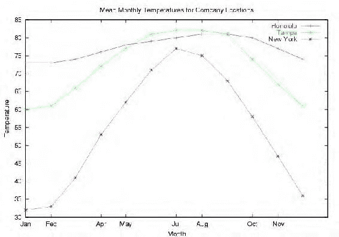

第 29 章：数学

579

这与上一个示例中的命令文件非常相似，不同在于：标题更改了；没有打印关闭图例的命令；输出文件名不同；在最后一行绘图中，第二列和第三列都相对于输入文件中的第一列（月份名称）进行绘图，每个都使用之前的`linespoints`样式，但每个都有自己的图例标签。

⇒ 要处理`temperature2.gnuplot`中的命令，输入：`$ gnuplot temperature.gnuplot` RET

此命令启动`gnuplot`并运行`temperature2.gnuplot`文件中的命令。将写入一个新的 PostScript 文件`temps2.ps`，其看起来类似于图 29-7。（虽然打印的插图是黑白的，但通过此命令创建的实际图像具有彩色图表。）图 29-7. `temps2.ps`文件。

## 29.9 使用其他数学工具

下表列出了 Linux 可用的其他一些流行的与数学相关的工具。

580

《Linux Cookbook》，第 2 版

### Calc

适用于 Emacs 的科学计算器工具。

DEB: `calc`

RPM: `calc`

WWW: `http://www.isthe.com/chongo/tech/comp/calc/`

### Desk Calculator

一种从标准输入读取并写入标准输出的任意精度计算器。`dc`是一个逆波尔表达式（reverse-polish）计算器；也就是说，数字被推入一个后进先出（lifo）的列表，称为“栈”。当你给出一个术运算符号时，`dc`会从栈中弹出数字作为操作数，然后将计算结果推入栈中。

非常用于在脚本和命令行获取计算结果。

DEB: `dc`

WWW: `http://www.cypherspace.org/~adam/rsa/dc.html`

### Dome

计算测地线穹的属性——弦长因子、球顶点坐标等。支持“巴比球”结构和椭圆测地线，并生成纯文本输出以及表格、cad 和光线追踪工具的格式。

DEB: `dome`

WWW: `http://tinyurl.com/2p5b4`

### GnuCash

直观的个人财务应用，用于管理财务（包括银行账户、股票、收入和支出）；它“基于专业会计原则”，以确保计算和报告的准确性。

DEB: `gnucash`

RPM: `gnucash`

WWW: `http://www.gnucash.org/`

### Gnumeric

适用于 gnome 的强大电子表格应用程序，有点让人想起 Excel。

DEB: `gnumeric`

RPM: `gnumeric`

WWW: `http://www.gnome.org/projects/gnumeric/`

第 29 章：数学

581

### Oleo

一个小型 gnu 电子表格应用程序，可以在 X 窗口和终端中运行，具有类似 Emacs 的按键绑定，并可以生成 PostScript 输出。

DEB: `oleo`

RPM: `oleo`

WWW: `http://www.gnu.org/software/oleo/`

### Piechart

利用 gnu 绘图工具（下文）制作图形饼图。

WWW: `http://tinyurl.com/jdi6`

### Plotutils

用于绘制数据绘制的 gnu 程序包，包括 plot 的 gnu 替代品。

DEB: `plotutils`

RPM: `plotutils`

WWW: `http://tinyurl.com/3gd`

### Sc

运行在命令行中的电子表格工具。

DEB: `sc`

RPM: `sc`

WWW: `http://bytes.org/`

### Xcalc

适用于 X 窗口的快速计算器。

DEB: `xcalc`

RPM: `xcalc`

WWW: `http://bytes.org/misc/`

### Xspread

可视化电子表格。

DEB: `xspread`

RPM: `xspread`

WWW: `http://bytes.org/misc/`

582

《Linux Cookbook》，第 2 版

第 30 章：娱乐

583

## 30. 娱乐

### 什么是娱乐？

这是一个经典纸牌游戏、动作游戏、棋类游戏和屏幕娱乐的集合。按照现代标准，它们在感官刺激方面提供的很少。但它们是经典，在过去是大学校园和计算机实验室的主流，仍然可以在任何终端上玩。

关于此游戏的在线信息位于：`http://bytes.org/misc/`

下表列出了 Linux 可用的其他一些流行的与数学相关的工具。（等等，这是游戏章节）。

本章中的配方描述了传统上于 Unix 系统且现在适用于 Linux 的游戏。

### bsd-games

DEB: `bsdgames`

RPM: `bsdgames`

WWW: `ftp://metalab.unc.edu/pub/Linux/games/`

### 30.1 玩经典游戏

下表列出了该包包含的各种游戏，给出了系统名称和描述。

| 名称 | 描述 |
| :--- | :--- |
| `adventure` | 基于肯塔基州一个名为“巨大洞穴”的真实洞穴的文本冒险游戏。 |
| `arithmetic` | 对你进行基础加减法问题的测验，并记录你的作答速度。 |
| `atc` | 空气交通管制模拟。 |
| `backgammon` | 单人或双人双陆棋游戏，带有规则。 |
| `banner` | 以垂直字体输出文本，适合打印大型横幅。 |
| `battlestar` | 奇幻主题的文本冒险游戏。 |
| `bcd` | 将文本过滤为打孔卡片输出。 |
| `boggle` | 流行的文字游戏。 |
| `caesar` | 解密尤利·凯撒的密码。 |
| `canfield` | 纸牌接龙变体。 |
| `cfscores` | 显示你的 canfield 积分。 |
| `countmail` | 告诉你有多少封邮件，但方式非常厌烦。 |
| `cribbage` | 纸牌游戏 cribbage。 |
| `fish` | 儿童纸牌游戏“钓鱼”（Go Fish）。 |
| `gomoku` | 双人五子棋游戏。 |
| `hangman` | 经典的猜词游戏。 |
| `hunt` | 多人网络游戏，目标是猎杀并杀死所有其他玩家。 |
| `mille` | 双手纸牌游戏 Mille Bornes。 |
| `monop` | 大富翁，一种房产管理游戏。 |
| `morse` | 将文本过滤为莫尔斯密码。 |

使用横线代替单词。要将摩尔斯密码解码为纯文本，请使用`-d`选项。

第 30 章：娱乐游戏

585

`number`：将阿拉伯数字转换为英文（参见配方 29.5.2 [将阿拉伯数字转换为英文](https://example.org/converting-an-arabic-numeral-to-english)，第 568 页）。

`phantasia`：一个角色扮演奇幻游戏。

`pig`：将文本过滤为皮格语（Pig Latin）。目前尚没有反向过滤器。

`pom`：告诉你当前的月相阶段。

`ppt`：将文本过滤为纸带丝带输出。

`primes`：输出质数，从 0 开始，到 4,294,967,295 或标准输入给出的数字停止；你也可以作为参数提供起始和结束值。例如，要输出一到十之间的质数，运行命令`primes 1 10`。

`quiz`：对各种学科的知识点和常识进行测验。

`rot13`：加密和解密 rot13 密码（参见配方 29.6 [使用 rot13 加密](https://example.org/using-rot13-encryption)，第 569 页）。

`rain`：在屏幕上显示雨滴的动画。通过向`-d`选项提供毫秒值作为参数来控制延迟。例如，`rain -d 160`是一个值得尝试的设置。

`random`：从输入中输出随机行。

`robots`：一个与杀手机器人战斗的射击游戏。

`sail`：老式海战的角色扮演游戏。

`snake`：在收集钱的同时避开蛇。

`snscore`：显示蛇游戏的高分。

`teachgammon`：双陆棋的游戏说明。

`tetris-bsd`：著名的俄罗斯视频游戏“俄罗斯方块”。

`trek`：太空冒险游戏。

586

`wargames`：受电影《游戏大战》（WarGames）启发的全球核战争游戏：“我们要玩个游戏吗？”

`worm`：“生长的虫”游戏。

`worms`：显示蠕虫在屏幕上蠕动的动画。

`wtf`：解释网络通信中使用的缩写。它并不先进（例如，它甚至不知道什么是 faq），但它知道 lol 是什么。如果它不知道该缩写，它会查看 whatis 能否提供帮助（参见配方 11.4.2 [翻译常用缩写](https://example.org/translating-common-acronyms)，第 292 页）。

`wump`：冒险游戏“猎 W 姆普”（Hunt the Wumpus），可能是经典计算机游戏中最著名的一个。

**注意：** 在 deb 包中，所有包含的程序的原始作者列表位于`/usr/share/doc/bsdgames/AUTHORS`。

## 30.2 通过方言过滤文本

### 语言过滤器 (Talk Filters)

DEB: `filters`

WWW: `http://www.gnu.org/directory/games/GNUTalkFilters.html`

一般来说，*过滤器*是一种作用于标准输入的工具，对其进行某种更改，然后将其传递给标准输出。

有各种工具作为文本的过滤器工作；本配方描述了一组特定的过滤器——那些通过过滤标准输入来赋予文本特定口音或方言的过滤器，旨在幽默。它们被收集在一个名为 Gnu Talk Filters 的包中。

⇒ 要对文件`/etc/motd`中的文本应用 kraut 过滤器，输入：`$ kraut < /etc/motd` RET


此命令将`/etc/motd`文件的内容传递给`kraut`过滤器，其输出发送到标准输出。`/etc/motd`的内容不会改变。

**注意：** 可用的方言过滤器包括`nyc`（它为文本提供“纽约人”方言）和`newspeak`（它将实际说的话翻译成思想警察所认可的、政治正确的语言，正如乔治·奥威尔的小说《1984》中所描述的）。战争即和平！自由即奴役！

一些示例文本以及通过各种过滤器显示的方式保存在文件`/usr/share/doc/filters/SAMPLES`中。

虽然所有给出的过滤器都是幽默的，但你可以编写自己的过滤器，为了某些严肃目的更改输入中的文本模式，例如为出版物的“内部风格”过滤文本。

## 30.3 测试你的打字速度

你可以通过组合几个工具来测试打字速度。要在 shell 提示符下测试打字速度，运行`cat`并输入一些文本，将输出管道到`wc`以获取你输入内容的字数。在测试前后通过列表运行所有命令来运行`date`（参见配方 3.1.7 [运行命令列表](https://example.org/running-a-list-of-commands)，第 63 页）。

*⇒* 要测试你的打字速度，输入：

```
$ date; cat | wc -w; date
```

RET

Mon Aug 11 15:14:06 EDT 2003

*The quick brown fox jumped over the lazy dog.*

RET

CTRL - D

9

Mon Aug 11 15:14:12 EDT 2003

```
$
```

在这个示例中，输出“9”表示用户输入了九个单词（在真实的打字测试中，你希望打字时间更长——至少几百个单词才能获得准确计数）。测试前后的列出的日期显示了所需的时间。

**注意：** 使用`wc -w`获取字数。

## 30.4 显示随机引言

获取随机引言至少有两种方法。

588

《Linux 烹饪指南》，第 2 版

### 方法 #1

Fortune

DEB: `fortune`

RPM: `fortune-mod`

WWW: `http://www.iblio.org/pub/Linux/games/amusements/fortune/`

使用`fortune`输出引言。

*⇒* 要获取 fortune，输入：

```
$ fortune
```

RET

**注意：** 这个古老的程序在 unix 上已经运行了很长时间。

### 方法 #2

在 Emacs 中，你可以使用`yow`函数从 Zippy 漫画中获取随机引言。

*⇒* 要获取 Zippy 的一行内容，输入：

```
$ yow
```

RET

589

9

## 30.5 为文字游戏寻找单词匹配项

以下配方描述了使用各种工具进行文字游戏的方法：字母变位、回文和填字游戏游戏的单词。

### 30.5.1 在文本中寻找字母变位

字母变位（anagram）是指一个单词或短语的字符完全由另一个单词或短语的字符组成——例如，“stop”和“tops”都是“pots”的字母变位。

使用`an`寻找并输出字母变位。提供单词或短语作为参数；`an`将结果写入标准输出。

*⇒* 有两种使用它的方法。

*•* 输出单词“lake”的所有字母变位，输入： `$an lake`

RET

*•* 输出短语“lakes and oceans”的所有字母变位，输入： `$an 'lakes and oceans'`

RET

要限制输出包含给定字符串的变位，使用`-c`选项指定该字符串。

*⇒* 输出短语“lakes and oceans”中包含字符串“seas”的字母变位，输入：

```
$ an -c seas 'lakes and oceans'
```

RET

要打印由给定单词部分字母组成的所有单词，使用`-w`选项。这会输出不是字母变位的单词，因为字母变位必须包含另一个单词或短语的*所有*字母。

*⇒* 输出由单词“seas”字母组成的所有单词，输入：

```
$ an -w seas
```

RET

此命令输出由“seas”中部分或字符组成的所有单词，包括“see”和“as”。

**注意：** 还有其他寻找字母变位的工具，但这个是最好的。

### 30.5.2 在文本中寻找回文

回文（palindrome）是指正读和反向读都相同的单词或短语；例如，“Mom”、“nun”和“Madam, I’m Adam”都是回文。

这里有几个用于寻找回文的 perl “单行命令”。

要输出文件中所有回文的行，可以使用这个简单的 perl 单行命令，并将文件名替换为要检查的`file`：`perl -lne 'map { print if $_ eq reverse } split'` `file`

590 

《Linux 烹饪指南》，第 2 版

这会输出`file`中所有回文的行。若要检查标准输入中的回文，请将`-`指定为文件名。这在管道的末尾非常有用。

*⇒* 若要输出系统字典中的所有回文，请输入：`$ perl -lne 'print if $_ eq reverse' /usr/dict/words` RET

**方法 #2**

要输出文件中忽略空格、标点符号和大小写的情况下的所有回文的行，请使用以下单行命令代替方法 #1 中提供的命令：

```bash
perl -lne '{ $_ = lc; $_ =~ s/\W//g; $_ = reverse; print if $_ eq reverse }' `file`
```

这会输出`file`中所有回文的行（所有空格和标点符号将被删除，所有字母将转换为小写）。

*⇒* 若要输出文件`riddles`中忽略空格、标点符号和大小写的所有回文行，请输入（全部写一行）：`$ perl -lne ' { $_ = lc; $_ =~ s/\W//g; $_ = reverse; print if $_ eq reverse } '` `riddles` RET

## 30.5.3 寻找字谜游戏单词

你可以通过 Linux 系统进行一些操作来帮助解决字谜游戏。

**方法 #1**

寻找字谜游戏单词的一种方法是浏览系统字典文件`/usr/dict/words`以寻找你感兴趣的单词。使用`less`配合`-p`选项从特定点开始查阅——例如某个字母或单词前缀。

*⇒* 这里是使用该方法的两种用方法。

*•* 若要从模式“dog”的第一个匹配项开始浏览系统字典，请输入：

```
$ less -pdog /usr/dict/words
```

RET

*•* 若要从单词“cat”开始浏览系统字典，请输入：`$ less -p"cat" /usr/dict/words` RET

在最后一个示例中，系统字典将加载并从“cat”单词开始，该字符串将在文中被高亮。

第 30 章：娱乐

591 

你也可以使用`look`输出所有以给定字符串开头的单词（参见 Recipe 11.2.1 [列出匹配模式的单词]，第 283 页）。

*⇒* 若要列出所有以“anti”开头的单词，请输入：`$ look anti` RET

**方法 #2**

寻找字谜单词的另一种方法是使用`grep`在字典搜索你需要的模式——如果你知道一个单词的长度，或者在某些位置上有特定字符，你可以搜索所有符合模式的单词。使用`-i`选项进行不区分大小写的搜索。

*⇒* 这里是使用该方法的几种方式。

*•* 若要输出系统字典中所有四个字符、以字母“z”开头并以“a”结尾的单词（不区分大小写），请输入：

```
$ grep -i '^z..a$' /usr/dict/words
```

RET

*•* 若要输出系统字典中所有六个字符、第二个位置为字母“e”、且第四位置为“s”或“o”的单词，请输入：

```
$ grep -i '^.e.[so]..$' /usr/dict/words
```

RET

**注意：** 这些方法也适用于拼字游戏（Scrabble）和其他文字游戏。

在某些系统上，`/usr/share/dict/words`是系统字典存放的位置。

## 30.6 文本剪切 (Cutting Up Text)

“剪切”（cut-up）是对文本物理布局的随机重新排列，其目的是在重新排列中发现独特或有趣的短语。

随机重新排列文本的软件自最早的文本处理工具以来一直存在；这些工具永远不会流行。文学中的剪切技术是由画家布莱恩·吉辛（Brion Gysin）和美国作家威廉·S·巴罗斯（William S. Burroughs）于 1959 年发现的；他们认为这把绘画的蒙太奇技术带入了文字。

“所有的写作实际上都是剪切，”巴罗斯写道。1 “由读到、听到、偶然听到的词组成的拼贴……使用剪刀使得这一过程变得显性化，并且可以扩展和变化。”

这些配方描述了制作文本剪切的几种常见方法。

1 在 William S. Burroughs 和 Brion Gysin 著的《第三精神》（The Third Mind）中（Viking Press, 1978）。

592 

《Linux 烹饪指南》，第 2 版

### 30.6.1 制作简单的文本剪切

你可以编写一个脚本来对文本进行简单的剪切。它演示了`head`、`tail`和`paste`的结合使用。创建一个名为`cutup`的 shell 脚本，如图 30-1 所示（参见 Recipe 3.7 [使用 shell 脚本]，第 84 页）。

```bash
#!/bin/sh

count=`wc -l < $1`
half=`expr $count / 2`
middle=`awk ' if (length($0) > max) max = length($0) END { OFMT = "%.0f"; print max / 2' $1
end=`expr $middle + 1`
head -$half $1
tail -n +end $1 | paste -
```

图 30-1：cutup 脚本。该脚本接收文件名作为输入，进行水平和垂直方向的切割，重新排列部分。原始文件不会被修改。

*⇒* 若要对文件进行剪切，请输入：`$ cutup nova` RET

### 30.6.2 制作随机剪切

dadodo

DEB

WWW: `http://www.org/dadodo/`

Jamie Zawinski 的 dadodo 使用计算机向前一步——它生成结构和字符与提供的文本相似的随机文本。

第 30 章：娱乐

593 

将文件名作为参数；默认情况下，dadodo 将输出到标准输出。该命令将根据文件输出随机文本，直到用户中断。

你可以对文本进行分析并将结果保存到编译数据文件中；当没有输入文本时，可以使用该分析生成随机文本。下表描述了此选项和其他选项。

- `-c *integer`：生成`integer`个句子（默认 0，意味着无限生成）。

- `-l *filename`：加载编译数据并用于生成文本。

- `-o *filename`：将编译数据输出到文件供以后使用。

- `-p *integer`：段落之间暂停`integer`秒。

### 30.6.3 在 Emacs 中制作剪切

Emacs 中的`dissociated-press`函数在一个名为`Dissociation`的新缓冲区中对当前缓冲区进行剪切；原始缓冲区不会被修改。新缓冲区中的文本通过重叠字符或单词来组合部分的随机部分，从而产生（通常）听起来合理的句子。它会偶尔暂停并询问你是否继续分离。

*⇒* 若要从当前缓冲区生成 Dissociated Press 剪切，请输入：ALT-X dissociated-press RET

向`dissociated-press`函数传递正参数以指定重叠的字符数；传递负参数以指定重叠的单词数。

*•* 若要通过三个字符重叠从当前缓冲区生成 Dissociated Press 剪切，请输入：CTRL-U 3 ALT-X dissociated-press RET

Emacs 有一个名为`doctor`的特殊模式，它是著名的`eliza`程序的实现。正如“真正的”心理分析一样，你可以倾诉你的烦恼，而医生会要求你提供更多信息——在这种情况下，费用并不昂贵，而且会话的长短随你意愿。由于“会话”是一个 Emacs 缓冲区（buffer），你可以将其保存到文件中以备后用。

⇒⇒ 在 Emacs 中开始心理分析会话，请输入：`ALT - X doctor RET`

# VII. 网络

## 第 31 章：通信

### 31. 通信

你几乎肯定想要上网或与其他计算机系统进行通信。现在的大多数系统在销售时都配备了连接其他系统的必要硬件，例如`modem`（调制解调器）或网卡。你通过电话线或网络连接这些硬件连接到外部。

本章包含了通过`isp`将你的 Linux 系统连接到互联网、使用传真服务以及通过`modem`串行连接的方法。

关于此主题的更多信息，请参阅*Linux 网络管理员指南*[http://metalab.unc.edu/mdw/LDP/nag/nag.html]。

### 31.1 连接到互联网

#### PPP

- `DEB`: `ppp`

- `RPM`: `ppp`

- `WWW`: `ftp://cs.anu.edu.au/pub/software/ppp/`

连接 Linux 盒子 1 到互联网有多种方法。数字用户线路 (`dsl`) 服务、电电缆调制解调器以及使用`isdn`或模拟`modems`的拨号连接是目前最流行的方法。这些服务各有自己的硬件和软件要求。通常，你通过向互联网服务提供商`isp`订阅来获得这些服务。

有关在基于 Linux 的系统中使用这些服务的最新详细说明，Linux 文档项目 [http://xtldp.org/] 出版的相关 howtos 仍然是权威指南（参见 Recipe 2.8.6 [阅读系统文档和帮助文件]，第 50 页）：

- `ISP Hookup HOWTO`，由 Egil Kvaleberg 编写：http://tldp.org/HOWTO/ISP-Hookup-HOWTO.html

- `DSL HOWTO for Linux`，由 David Fannin 等编写：http://en.tldp.org/HOWTO/DSL-HOWTO/

- `Cable Modem Providers HOWTO`，由 Vladimir Vuksan 编写：http://en.tldp.org/HOWTO/Cable-Modem/

1 计算机有时被称为 *box*（盒子），特别是在描述它的某一个方面时；因此，当你听到关于“Linux box”时，你就知道它是一台运行 Linux 的计算机。这种俚语在 unix 变体用户中特别流行，但人们也会谈论 Windows boxes。

下面的步骤展示了如何设置和使用`ppp`（点对点协议）拨号连接，这长期以来是通过拨号线将计算机连接到互联网的客观标准手段。

#### 31.1.1 设置 ppp

为了为普通的拨号连接配置`ppp`（你的系统被分配动态`ip address`，这是家庭上网的常态），你需要拥有 root（超级用户）权限来编辑`ppp`配置文件，并且你需要来自`isp`的标准连接信息：使用的拨号号码、域名服务器的`ip addresses`以及用户名和密码。

使用这些信息来自定义文件`/etc/chatscripts/provider`，如图 31-1 所示。

```
ABORT
BUSY
ABORT
"NO CARRIER"
ABORT
VOICE
ABORT
"NO DIALTONE"
""
"\p\p+++\p\p"
""
"at"
""
"at"
OK
"ath0"
""
atdt *5551010,,*
ost
ppp
ogin
smith
word
\q *secret*\q
```

*图 31-1。示例`/etc/chatscripts/provider`文件。*

在图 31-1 中，在八行调制调器初始化字符串之后，调制调器被指示拨打 isp 号码`555-1010`。某些系统需要在号码后加一或两个逗号以表示调制调器的暂停；只有当你在此处仅使用电话号码无法建立良好连接时才这样做。

接下来是显示预期的`isp`发送的提示，以及对这些提示的响应字符串。传统上，只显示部分字符串以匹配提示，部分原因是不同系统之间的提示大小写不同。这就是为什么文件中是“ost, ”，“ogin， ”和“word， ”而不是你可能预期的完整提示“host:， ”“login:， ”和“Password:”。

“host:”提示是可选的，被某些`isps`使用，它们的连接线包含服务选择，你必须在输入用户名和密码之前对其进行选择（例如，某些`isps`除了标准的`ppp`外还提供 slip 和 shell 访问）。请根据你的`isp`的指示自定义此行及后续行。如果你的`isp`没有“host”提示，请删除此行。

在这个示例中，用户名`smith`作为对“login:”提示的响应发送，然后将密码“secret”作为密码发送。密码出现在此文件的两个`\q`字符串之间，出于安全考虑，这指示`ppp`在系统日志文件或其他入侵者可能看到的地方显示问号 (?) 而不是实际密码。

接下来，编辑文件`/etc/ppp/peers/provider`，使其看起来像图 31-2。

```
connect "/usr/sbin/chat -v -f /etc/chatscripts/provider"
defaultroute /dev/modem 115200 persist
```

*图 31-2. `/etc/ppp/peers/provider`文件。*

该文件的最后一行应包含你使用的调制调器设备名称和尝试的最大连接速度；图 31-2 使用`/dev/modem`作为调制调器的设备名称，使用`115200` bps 作为最大连接速度，对于典型的 56 k 调制调器来说这是一个很好的值（法则是使用你的调制调器支持的最高连接速度；连接建立后你可以随时降低速度，但无法将速度提高此处给出的数值）。

最后，编辑文件`/etc/resolv.conf`使其看起来像图 31-3，使用`isp`提供的两个域名服务器`ip addresses`。


`search .`
`nameserver <nameserver address 1>`
`nameserver <nameserver address 2>`

*图 31-3. `/etc/resolv.conf` 文件。*

对于两个 `nameserver address` 值，使用 `isp` 提供的域名服务器机器的 `ip address`。第二个是可选的——大多数 `isps` 都有多个指定的域名服务器作为备份，以防第一个系统不可用。

确保你的用户账户拥有 `dialout` 组成员身份；否则，超级用户账户必须启动并停止 `ppp`，这是不推荐的（参见 Recipe A.6.3 [允许用户访问硬件设备]，第 718 页）。

完成这些操作后，你应该能够启动和停止到互联网的 `ppp` 连接。设置 `ppp` 的完整文档位于 `/usr/share/doc/ppp` 目录。

#### 31.1.2 启动 ppp 连接

一旦安装并配置 `ppp`，使用 `pon` 工具启动到互联网的 `ppp` 连接。它通过你的调制调器拨打 `isp` 的号码，发送相应的登录信息并启动 `ppp` 连接。

建立 `ppp` 连接后，你可以按照后续章节所述访问 `www` 或网络服务。

⇒⇒ 要启动 `ppp` 连接，请输入：

```
$ pon
```

**注意：** 要让 `ppp` 在系统首次启动时自动启动，将文件 `/etc/ppp/no_ppp_on_boot` 重命名为 `/etc/ppp/ppp_on_boot`。（你必须是 root 超级用户才能执行此操作。）

#### 31.1.3 停止 ppp 连接

使用 `poff` 工具停止 `ppp` 连接。它断开你的计算机与 `isp` 的连接并挂起调制调器。

⇒⇒ 要停止 `ppp` 连接，请输入：

```
$ poff
```

如果你在 `ppp` 连接已建立时不意外运行了 `pon`（这会发生），`poff` 将无法按预期工作，因为有多个 `ppp` 连接正在运行。使用 `-a` 选项停止所有 `ppp` 连接。

⇒⇒ 要停止所有 `ppp` 连接，请输入：

```
$ poff -a
```

### 31.1.4 查看 ppp 日志

使用 `plog` 输出 `ppp` 日志文件的最后几行。这对于检查 `ppp` 连接首次拨号时的进度非常有用。

⇒ 要查看 `ppp` 日志文件的最新条目，输入：`$plog`

**注意：** 你需要成为 `adm` 组的成员才能查看日志文件（参见方案 A.6.3 [允许用户访问硬件外围设备]，第 718 页）。

### 31.2 传真

#### Efax

DEB: `efax`

如果你有一台 1 类或 2 类传真调制解调器，就可以用 Linux 系统发送和接收传真（facsimile）消息。下面的方案展示了如何使用 `efax` 包来实现，该包专为单用户系统或相对简单的传真配置设计（存在更复杂的传真工具，但它们超出了本书的范围）。

要设置 `efax` 进行传真，请编辑 `/etc/efax.rc` 文件（你必须拥有 root 权限才能进行此操作）。在该文件中指定的重要事项是“DEV”的值，即 `/dev` 中传真或调制解调器的设备名称（这几乎总是“modem”），以及“FROM”和“NAME”的值——即出现在传出传真上的传真号码和组织名称。

**注意：** 除非你是 `dialout` 组的成员，否则在使用必须请求系统管理员获取调制解调器硬件权限（参见方案 A.6.3 [允许用户访问硬件外围设备]，第 718 页）。

更多关于传真的信息请参见 *Fax Server mini-HOWTO*（参见方案 2.8.6 [阅读系统文档和帮助文件]，第 50 页）。

#### 31.2.1 发送传真

使用 `efax` 发送传真。它会拨打你提供的电话号码并发送你指定的文件内容。你可以直接发送纯文本文件或 `tiff` Group 3 格式的文件。你也可以发送其他格式的文件，但必须先将其转换为 `tiffg3` 格式——参见方案 31.2.4 [与传真格式之间的转换]，第 604 页。

使用 `-d` 选项指定传真设备的完整路径（如果你使用连接到系统的调制解调器，通常为 `/dev/modem`），并使用 `-t` 选项接电话号码来指定发送传真的号码。要指定 dtmf 调频拨号，请在电话号码前加“T”；使用逗号字符（`,`）指定拨号序列中的暂停——这对于从程控交换机（pbx）或办公室电话系统拨出电话特别有用。

⇒ 使用 dtmf 调频拨号将文件 `resume.txt` 的副本传真到号码 `555-9099`，输入：

```
efax -d /dev/modem -t T555-9099 resume.txt
```

若要发送多个文件，请按发送顺序将它们作为参数指定。你也可以使用通配符指定文件，但要小心——它们按照 shell 扩展文件名的顺序（即字母顺序）进行发送。如果你有许多文件需要按特定顺序发送，请重命名它们，使其文件名以对应的页码开头。但务必确保每个文件的数字具有**相同位数**——例如，如果你有 11 个文件要传真，不要将它们命名为 `1.fax`、`2.fax` 直到 `10.fax` 和 `11.fax`，因为 shell 会按照 `1.fax`、`10.fax`、`11.fax`、`2.fax`、`3.fax` 直到 `9.fax` 的顺序扩展。在这种情况下，你应该将它们命名为 `01.fax`、`02.fax` 等，这样文件 1 到 9 的文件名位数就与 `10.fax` 和 `11.fax` 相同。

⇒ 使用 dtmf 调频拨号将当前目录下所有 `.fax` 扩展的文件传真到号码 `555-9099`，输入：

```
efax -d /dev/modem -t T555-9099 *.fax
```

另一种方法是创建一个文本文件，其中包含要传真的文件列表，每行一个文件名，并按你想要的发送顺序排列。如果你要发送的文件不在当前目录，请确保使用相对于当前目录的路径编写文件名——例如，如果你想发送位于家目录下的 `header.fax` 文件，而当前目录是 `~/documents/faxes`，则文件应指定为 `~/header.fax`。

⇒ 将文件 `fax.list` 中列出的所有文件传真到号码 `555-9099`，先拨打 `9` 获取外线，并使用 dtmf 调频拨号，输入：

```
efax -d /dev/modem -t T9,555-9099 $(cat fax.list)
```

**注意：** `efax` 工具不会删除它传真的文件。

#### 31.2.2 接收传真

要接收传真，使用带有 `-w` 选项的 `efax`。你可能还需要使用 `-i0=1` 设置调制解调器接听，并使用 `-kZ` 进行重置。`efax` 工具不会删除它传真的文件。

⇒ 将文件 `fax.list` 中列出的所有文件传真到号码 `555-9099`，并将错误重定向到文件，输入：

```
efax -d /dev/modem -kZ -w -i0=1 2>&1
```

#### 31.2.3 自动接收传真

上一个方案中的命令只能接收一份传真；一旦接收传真，`efax` 就会退出。为了运行 `efax` 以接收所有传入的传真消息，使用 Bash `while` 循环，这样在接收到传真后，`efax` 会重新启动，直到你中断它。

⇒ 要自动接收任何传入的传真，输入：

```bash
while true; do efax; done
```

为了查看或打印收到的传真，或者发送你拥有的文件，你必须先将该文件转换为或从 tiff Group 3 (`tiffg3`) 传真格式，这是发送传真文件的标准格式。（不过，你可以使用 `gimp` 或 `display` 查看 `tiffg3` 文件——请参见第 17.1 节 [在 X 中查看图像]，第 407 页）。因此，你通过传真接收的文件将是这种格式，你可能想将其转换为其他格式。

# 31: 通信

605

有几种方法可以实现此操作

## 方法 #1

使用 `efix` 来转换（或“修复”）用于传真的的文件；它会将你想要发送传真的的文件*转换为* `tiffg3` 格式。你也可以用它将收到的传真文件转换为你可以查看或打印的另一种格式。`efix` 工具输出到标准输出，但你可以将其输出重定向到文件以保存。

要转换文件以供传真，请输入 `efix` 后跟要转换的文件名，并将标准输出重定向到包含你传真图像的文件。`efix` 可以读取纯文本、`pbm` 和 `tiff` 文件。

⇒ 要将文件 `chart.pbm` 转换为传真，输入：

```bash
$ efix -i pbm chart.pbm > chart.fax
```

RET

此命令将文件 `chart.pbm` 的副本转换为 `tiffg3` 传真格式，并将其写入名为 `chart.fax` 的文件中。原始 `pbm` 文件未被修改。

## 方法 #2

要将收到的传真文件转换为 PostScript 文件，以便对其进行预览（参见第 17.4.2 节 [预览 PostScript 文件]，第 414 页）或打印（参见第 25.1.1 节 [向打印机发送打印作业]，第 510 页），请使用带有 `-o ps` 选项的 `efix`。

⇒ 要将收到的传真文件 `19990325.001` 转换为 PostScript 文件，输入：

```bash
$ efix -o ps 19990325.001 > received.ps
```

RET

此命令将传真文件转换为 PostScript，并将输出写入名为 `received.ps` 的文件。原始传真文件未被修改。

## 方法 #3

### Ghostscript

DEB: `gs-common` `gs`

RPM: `ghostscript`

WWW: `http://www.cs.wisc.edu/~ghost/`

要将 PostScript 文件转换为传真格式，请使用 `gs` 并指定“tiffg3”作为写入的输出设备。

606

⇒ 要将 PostScript 文件 `resume.ps` 转换为传真格式，输入（全一行）：

```bash
$ gs -q -sDEVICE=tiffg3 -dSAFER -dNOPAUSE -sOutputFile=resume.fax resume.ps < /dev/null
```

RET

此命令将文件 `resume.ps` 的副本以 `tiffg3` 格式写入文件 `resume.fax`，然后你可以将其作为传真发送。原始 PostScript 文件未被修改。

**注意：** 关于使用 `gs` 的更多信息，请参见第 25.3.1 节 [为打印准备 PostScript 文件]，第 518 页。

## 方法 #4

### teTeX

DEB: `tetex-base`, `tetex-bin`, `tetex-doc`, `tetex-extra`

RPM: `tetex`

WWW: `http://www.tug.org/teTeX/`

使用 `dvi2fax` 将由 TEX 生成的 `dvi` 文件转换为“tiffg3”格式以便传真。

它接受的选项可以是 `-hi`（高分辨率，输出为 204x196 dpi，默认值）或 `-lo`（低分辨率，输出为 204x98 dpi）。

将要转换的 `dvi` 文件名作为参数；提供 `.dvi` 扩展是可选的。

⇒ 要将文件 `proposal.let.dvi` 转换为低分辨率传真格式文件，输入：

```bash
$ dvi2fax -lo proposal.let
```

RET

输入的每一页都会写入其单独的文件，按顺序编号并带有 `.fax` 后缀。

## 31.3 使用调制号器拨号

### Minicom

DEB: `minicom`

RPM: `minicom`

使用 `Minicom` 通过调制解调器拨号并连接到另一个系统，当你想连接到 bbs（“公告板系统”）时。它是 X 或控制台的串口通信工具；它类似于 dos 世界中的某些通信工具，如 `Telix` 和 `Procomm`。

输入 `minicom` 运行 `Minicom`。当 `Minicom` 启动时，你将看到一个连接界面，如图 31-5 所示。

*图 31-5. minicom 连接界面。*

底部包含状态栏，显示描述如何获取帮助的消息、当前的调制设置（在此情况下为 57,600 bps，8 数据位，无校验，停止停止）、光标键是否有效（神秘的“NOR”消息）、程序版本（“1.82”）、当前设置的终端仿真（“VT102”）以及当前是否建立了在线连接。

在连接界面上，输入 `CTRL-A z` 获取帮助菜单；在帮助菜单中，你可以按 `P` 设置通信参数、`T` 设置终端设置、`O` 配置 `minicom` 或按 `D` 进入拨号目录。

从连接界面拨号号码，请输入 `ATDT` 后跟要拨号的号码。

⇒ 从连接界面拨号号码：

```bash
ATDT[number]
```

608

## 31.4 使用其他工具

下表描述了你可能觉得好用的其他工具。

DTMF

产生双音多频（“触摸音”），可用于自动。

DEB: `dtmfial`

HylaFAX

用于发送和接收传真的流行客户端-服务器套件。

DEB: `hylax-client`

DEB: `hylax-server`

DEB: `hylax-doc`

RPM: `hylax`

WWW: `http://www.hylax.org/`

609

Lrzsz

提供用于串口线传输文件的 Xmodem、Ymodem 和 Zmodem 协议；基于旧的 rsz 包。

DEB: `lrzsz`

RPM: `lrzsz`

WWW: `http://www.ohse.de/uwe/software/lrzsz.html`

Seyon

旧式的 X 电信工具，类似于 Minicom，具有 Zmodem 支持和脚本编写能力。

DEB: `seyon`

WWW: `ftp://sipb.mit.edu/pub/seyon/`

610

# 32: 电子邮件

## 32.1 电子邮件

在计算机网络中的用户之间发送纯文本消息（或附件文件中的二进制文件）的主要手段称为电子邮件，或 *email*（现在通常更多时候直接称为“mail”）。

邮件在一个名为*邮件用户代理*（简称 mua）的特殊应用程序中发送和接收。大多数代理的运行遵循相同的通用原理：当你启动它时，所有收到的邮件列表将像堆栈一样显示出来，按接收的顺序排列，每行一个数字代表一条消息，上面有作者姓名、主题和日期。选择一个数字将在屏幕上显示其内容，并提供用自己的邮件进行回复的方法，以及编写新邮件的功能。

Linux（以及其他类 Unix 系统）上的默认邮件代理是 `mail` 工具。这就是我们在本章中用于演示如何发送和接收邮件的工具。

它没有配备大多数新版邮件用户代理（muas）上标准的那些花哨功能，而且任何偶尔发送和接收电子邮件的用户无疑都想要学习一种更高级的系统（参见食谱 32.7 [使用其他邮件用户代理]，第 631 页）。

然而，`mail` 在几乎所有基于 Unix 的系统上都是可，它能够实现一些其他应用程序无法完成的强大技巧，而且在关键时刻总是能派上场——通过学习使用它，你可以在你遇到的任何一个基于 Linux 或 Unix 的系统上发送和接收电子邮件。

1.  Unix 世界之外的每个人可能都把其中一种工具称为“电子邮件应用”或邮件程序。

2.  在许多 Linux 系统上，`Mail` 是该工具的同义词。在某些 Unix 系统（如 `aix`）上，该工具的名字是 `mailx`；Linux 将该名称作为额外的同义词。

# 32.1 发送邮件

要使用 `mail` 发送邮件，请将接收邮件的电子邮件地址作为参数提供，然后在提示时输入邮件的主题和正文；在单独一行输入 `CTRL-*-D` 表示消息正文结束并发送邮件。

⇒ 要向 `lisa@example.com` 发送邮件，输入：`$ mail lisa@example.com`

RET

`Subject: Hello`

RET

`Hi there, long time no talk! I'm just learning how to use` RET

`Linux and thought I'd show you how easy it is to send email!`

RET

`CTRL-*-D`

Cc:

RET

你在 `Subject:` 行上输入的文本将显示为邮件的主题，你之后输入的文本行则是消息的正文内容。发送邮件有多种风格；有些模仿纸质信函，带有问候语、结语和签名；另一些只提供签名，还有另一些则这三者全部省略。电子邮件并不总是用于正式的信件；有时它的地位并不高于电报或备忘录，仅用于快速传输简短的非正式消息。

撰写邮件时可用的各种命令请参见食谱 32.1.5 [撰写邮件]，第 616 页。

在单独一行输入 `CTRL-*-D` 以结束消息。然后，`mail` 会提示输入 Cc: 地址——如果你提供了任何地址，邮件消息的“抄送”将发送到这些地址。用逗号分隔多个地址，或者在没有地址时直接按 RET。

当你输入内容时，`mail` 就像任何其他命令行工具一样读取标准输入，因此在这个基础邮件服务中几乎没有直接的编辑能力——使用 `CTRL-*-U` 删除当前行，并使用 `CTRL-*-C`（即连续两次 `CTRL-*-C`）取消输入并完全终止消息。

就这些！没有花哨，没有装饰——但也没有浪费时间的冗余内容。

## 32.1.1 向同一系统上的用户发送邮件

要向同一系统上的另一个用户发送邮件，请提供他们在系统上的用户名而不是电子邮件地址。

⇒ 向本地系统上的用户 `mrs` 发送邮件，输入：`$ mail mrs`

RET

`Subject: Are you going to the party tonight?`

RET

`CTRL-*-D`

Cc:

RET

`Null message body; hope that's ok`

`$`

此命令向本地系统上的用户 `mrs` 发送邮件。邮件本身是空的，但主题是一条短消息，询问用户 `mrs` 是否会参加派对。


**注意：** 除了适合向可能和你共享系统的用户发送邮件外，`mail` 对于给*自己*发送邮件也非常有用，可以作为在终端上给自己提醒的一种方式（参见食谱 27.6.2 [向自己发送邮件提醒]，第 550 页）。

## 32.1.2 发送文件或命令输出

`mail` 工具也用于发送文本文件的内容或命令的文本输出。要实现此操作，将你想要发送的电子邮件地址作为 `mail` 的参数，并使用标准输入重定向操作符将文本重定向作为消息正文（参见食谱 3.2 [重定向输入和输出]，第 67 页）。

⇒ 将文本文件 `traderoutes` 的内容发送到电子邮件地址`sofala@example.com`，输入：

```bash
$ mail sofala@example.com < traderoutes
```

RET

## 32.1.3 发送目录

通过电子邮件发送文件目录有几种不同的方法。从技术上讲，你*仍然*提供了电子邮件地址，因为电子邮件地址的形式为`username@hostname`；当省略`hostname`时，假设为本地主机。

### 方法 #1

使用`mail`发送文件目录，你可以将目录的副本放入归档中（参见食谱 8.5 [管理文件存档]，第 199 页），使用`gzip`压缩存档，然后将该压缩存档文件作为附件发送。这是通常的做法。

### 方法 #2

GNU Shar Utilities

- `DEB`: `sharutils`

- `RPM`: `sharutils`

- `WWW`: `http://www.gnu.org/software/sharutils/sharutils.html`

你也可以创建一个长管道来通过邮件发送目录：使用`tar`将目录副本放入压缩归档中，并将`tar`的输出传给`uuencode`，`uuencode`将二进制文件编码为 ascii 文本，这种文本可以通过明文消息通过邮件传输。然后，将编码后的文本传给`mail`。

⇒ 向`fred@example.org`发送`~/proj/latest`目录树的副本，输入（全部在一行）：

```bash
$ tar -czf - ~/proj/latest | uuencode latest.tar.gz | mail -s "Here is the latest" fred@example.org
```

此命令将目录树作为 uuencoded 的压缩 tar 文件发送在邮件正文中。当收到邮件时，`fred@example.org`应该将邮件内容写入文件，并对其运行`uudecode`。`uudecode`接收 uuencoded 文件作为参数，并将解码后的文件写入当前目录。

⇒ 要解码`latest.uu`的内容，输入：

```bash
$ uudecode latest.uu
```

此命令将在当前目录下写入一个压缩 tar 文件`latest.tar.gz`；要解压它，你需要运行`tar zxvf latest.tar.gz`。

## 32.1.4 发送网页

前一个食谱的变体是使用`mail`和 shell 重定向通过邮件将某些命令的输出发送到地址。以下方法展示了如何使用这种技术将网页作为渲染后的文本或 html 源码发送。

### 方法 #1

Lynx

- `DEB`: `lynx`

- `RPM`: `lynx`

- `WWW`: `http://lynx.browser.org/`

要将网页作为带注释的文本文件发送，将带有`-dump`选项`Lynx`浏览器输出传给`mail`（参见食谱 33.2 [使用 Lynx]，第 643 页）。由于输出是纯文本，你不需要在发送前对其进行编码。

⇒ 这里是使用此方法的两种方式。

* 向地址`reader@example.com`发送包含`http://gutenberg.net/etext98/rmnis10.txt`内容的邮件，输入（全部在一行）：

```bash
$ lynx -dump http://gutenberg.net/etext98/rmnis10.txt | mail reader@example.com
```

* 向地址`reader@example.com`发送包含`http://gutenberg.net/etext98/rmnis10.txt`内容的邮件，且主题为“Some Remences”，输入（全部在一行）：

```bash
$ lynx -dump http://gutenberg.net/etext98/rmnis10.txt | mail -s "Some Reminiscences" reader@example.com
```

### 方法 #2

Wget

- `DEB`: `wget`

- `RPM`: `wget`

- `WWW`: `http://www.gnu.org/software/wget/wget.html`

要发送网页的 html 源码，使用`wget`获取源码，使用`-q`选项抑制消息，并通过为`-O`选项提供参数发送到标准输出；将其传给`mail`（参见食谱 33.5 [从网络获取文件]，第 653 页）。

⇒ 这里是使用此方法的两种方式。

* 向地址`reader@example.com`发送包含`http://gutenberg.net/etext98/`内容的邮件，输入（全部在一行）：

```bash
$ wget -q -O - http://gutenberg.net/etext98/ | mail reader@example.com
```

* 向地址`reader@example.com`发送包含`http://gutenberg.net/etext98/`内容的邮件，且主题为“Directory Listing”，输入（全部在一行）：

```bash
$ wget -q -O - http://gutenberg.net/etext98/ | mail -s "Directory Listing" reader@example.com
```

## 32.1.5 编写邮件

在撰写邮件消息时，有很多特殊的按键可以使用。下表列出了这些按键并描述了它们的功能。

| 快捷键 | 功能 |

| :--- | :--- |

| `CTRL - C` | 取消当前消息并退出 mail 且不发送。 |

| `. RET` 或 `CTRL - D` | 在空行上，执行这两个命令中的任一个都会发送消息并然后退出 mail。 |

| `CTRL - U` | 删除当前行并将光标移到行首。 |

在编写消息正文时，你还可以使用一些特殊命令。它们被称为*波浪号转义*（tilde escapes），因为你通过输入波浪号字符（`~`）来指定它们。

下表列出了其中一些命令并描述了它们的功能。

| 命令 | 描述 |

| :--- | :--- |

| `~! command` | 在 shell 中运行`command`。 |

| `~\| filter` | 将邮件正文通过`filter`管道处理。 |

| `~b address` | 向给定的由逗号分隔的用户名或邮箱地址发送盲抄（BCC）。 |

| `~d` | 将你家目录下的`dead.letter`文件复制到消息正文中。 |

| `~e` | 在默认的文本编辑器程序中编辑消息。（当你退出文本编辑器时，将返回 mail 界面。） |

| `~f number` | 将指定的收到的消息副本插入到消息正文中。消息通过数字或范围指定（例如，“2-4”表示插入从第 2 条到第 4 条的消息）；如果未给出数字，则插入当前收到的消息。 |

| `~F` | 与`~f`相同，但读取带有完整头部的消息。 |

| `~r file` | 将文件`file`的副本插入消息中。 |

| `~w file` | 将正文内容的副本写入到文件`file`中。 |

这些命令每个应该单独占一行输入。

⇒ 要将当前收到的消息的副本插入到你正在写的邮件正文中，然后用默认文本编辑器打开该消息，请输入：

```bash
~ f
RET
~ e
RET
```

## 32.2 接收邮件

在基于 Linux 的系统中，`inbox`是系统上的一个文本文件，你的入站邮件写入其中。它的位置始终由`$MAIL`给出，这是一个特殊的 shell 变量（参见食谱 3.5.6 [更改 Shell 提示符]，第 80 页）。

⇒ 要输出你 inbox 的位置，请输入：

```bash
$ echo $MAIL
```

RET

通常，inbox 位于`/var/spool/mail/`目录，其名称与你的用户名相同——所以，如果你的用户名是`mrs`，你的 inbox 可能是`/var/spool/mail/mrs`。你不应该直接编辑这个文件，因为这样做可能会无意中导致丢失传入邮件。

运行`mail`来读取 inbox 中等待的任何新邮件。如果 inbox 中没有新邮件，`mail`将指示这一点并退出；如果你*有*新邮件在等待，`mail`会输出消息头的列表，每条消息一行，每行包含消息状态（新消息为“N”，之前读过的消息为空）、消息编号、发件人姓名、接收消息的日期和时间以及消息中的行数和字符数。

⇒ 要查看你是否有邮件，请输入：

```bash
$ mail
```

RET

```text
Mail version 8.1 6/6/93.
Type ? for help.
"/var/spool/mail/m": 3 messages 3 new
>N
1 mrs
Mon Sep 6
2 mrs
Tue Sep 7
3 mrs
Wed Sep 8
```

大多数拥有家庭系统的人通过 ISP（互联网服务商）连接到互联网，并使用该系统发送和接收个人邮件。

如果你通过 ISP 使用电子邮箱，你可能有一个远程邮件主机。在这种情况下，入站邮件不会直接发送到你的系统，而是发送到 ISP 的邮件主机；此时，你的系统必须配置为从该主机检索邮件并将其存储在系统中的预期位置。

这种安排被称为`pop mail`，全称为“邮局协议”（Post Office Protocol）”，它是用于将你的入站邮件从 ISP 的邮件主机批量传输到本地机器的协议。你的 ISP 会为你提供配置本地系统使用 pop mail 所需的信息：其邮件服务器的名称和 IP 地址、你在该服务器上的用户名、你的 ISP 电子邮件地址以及你的 ISP 密码。4

另一方面，如果你在网络上使用系统——例如在办公室、学校或其他机构设施中——你可能有一个网络管理员为你设置了内网连接，而这一切都是“自动”完成的。

下面的配方描述了使用远程邮件主机读取邮件的方法。

### 32.3.1 使用 Mozilla 收发邮件

Mozilla

- `DEB`: `mozilla-browser`

- `RPM`: `mozilla`

- `WWW`: `http://www.mozilla.org/`

配置 Mozilla 在远程邮件主机上检索电子邮件消息非常简单。

要执行此操作，从 Tasks（任务）菜单栏中选择`Mail`，并提供你 ISP 电子邮件账户和服务器的 ISP 设置。（在 Edit（编辑）菜单栏上有一个此类选项，`Mail/News Account Settings`。）

然后，要从你的邮件主机获取邮件，点击主邮件窗口中的`Get`按钮。它会要求你输入 ISP 密码，然后邮件主机上等待的所有消息都将被下载。

4 如果要通过你的 ISP *发送* 邮件，你还需要知道 ISP 的`smtp`服务器的名称或 IP 地址，该服务器处理并发送所有出站邮件。这也在本地设置，可以在 Web 浏览器中设置，也可以通过本地的`mta`（邮件传输代理，如`Sendmail`）设置。

622

《Linux Cookbook》，第 2 版

### 32.3.2 获取 pop 邮件

Fetchmail

- `DEB`: `fetchmail`, `fetchmail-common`, `fetchmailconf`

- `RPM`: `fetchmail`, `fetchmailconf`

- `WWW`: `http://catb.org/~esr/fetchmail/`

如果你不想使用 Web 浏览器读取邮件，而是想运行`mail`（包括邮件工具）并用它读取互联网电子邮件，那么你需要运行`fetchmail`。它从你 ISP 的`pop`服务器获取邮件，并将其放在它所属的本地邮件邮箱池目录中，即你的收件箱。然后你就可以从本地的`mail`读取邮件了。

配置通过家目录下的隐藏文件`.fetchmailrc`完成。然后，你只需要设置`fetchmail`，使其在每当你的互联网连接启动时都带有正确的选项运行，并在互联网连接停止时停止运行。（使用`ppp`，这可以通过将 shell 脚本放在`/etc/ppp/ip-up.d`和`/etc/ppp/ip-down.d`目录来实现。）

你可以使用包含在单独包中的`fetchmailconf`来帮助按上述描述的方法配置你的设置。

⇒ 要配置`fetchmail`，输入：

```bash
$ fetchmailconf
```

RET

### 32.4 管理邮件

本节描述的工具和技术对于管理或处理你的邮件非常有用，无论你使用哪种`mail`。这是因为*邮件文件夹*仅仅是一个文本文件，其内容由保存的邮件消息组成；任何可以处理文本的工具都可以用于邮件文件夹。

下面的配方描述了管理和修改你保存邮件的某些常用方法。

#### 32.4.1 查看邮件文件夹

除了在你的`mail`中查看邮件文件夹外，还有其他几种方法可以查看它并读取其内容。某些方法允许对其进行编辑或其他更改。

第 32 章：电子邮件

623

##### 方法 #1

你可以使用`less`查看邮件文件夹，或者在文本编辑器中编辑它们，尽管该文件夹将显示为一个包含该文件夹内所有消息的长滚动条。

⇒ 要在`less`中查看邮件文件夹`~/Mail/rachel`，输入：

```bash
$ less ~/Mail/rachel
```

RET

##### 方法 #2

你可以通过将邮件文件夹作为`-f`选项的参数在`mail`中查看它；它看起来就像在你不带任何选项运行`mail`时收件箱的样子。

⇒ 要在`mail`中查看邮件文件夹`~/Mail/rachel`，输入：

```bash
$ mail -f ~/Mail/rachel
```

RET

##### 方法 #3

Elm

- `RPM`: `elm`

- `WWW`: `http://www.instinct.org/elm/`

你可以通过将文件夹名称作为`-f`选项的参数在`elm`中查看邮件文件夹（参见配方 32.7 [使用其他邮件用户代理]，第 631 页）。与`mail`一样，文件夹将以收件箱在`elm`中通常的方式出现。

⇒ 要在`elm`中查看邮件文件夹`~/Mail/rachel`，输入：

```bash
$ elm -f ~/Mail/rachel
```

RET

如果你将邮件消息保存在许多单独文件夹中，你可以结合`cat`和`elm`来查看所有文件中所有消息的排序列表。

使用`cat`将所有文件夹合并为一个，然后像查看任何文件夹一样在`elm`中查看该文件。

⇒ 要查看你`~/Mail`目录下所有邮件文件夹的内容，输入：

```bash
$ cat ~/Mail/** > allmessages
$ elm -f allmessages
```

RET

这些命令会在当前目录下写入一个新文件`allmessages`，其中包含`~/Mail`中所有邮件文件夹的内容；然后在`elm`中查看该文件。

624

《Linux Cookbook》，第 2 版

**备注：** 要查看显示文件夹中所有消息来源的列表，请使用`frm`；参见配方 32.4.4 [查看你的邮件来源]，第 626 页。

#### 32.4.2 为新邮件设置通知

Biff

- `DEB`: `biff`

- `RPM`: `biff`

- `WWW`: `http://ftp.uk.linux.org/pub/linux/Networking/mail/`

`biff`工具通过打印邮件消息的头信息和前几行在新邮件到达时通知你。

要开启`biff`，使用`y`作为选项。要关闭`biff`以便在新邮件到达时停止接收通知，使用`n`作为选项。与大多数工具不同，`biff`选项不带连字符。

⇒ 要开启`biff`，输入：

```bash
$ biff y
```

RET

有些人会将上述行放在他们的`.bashrc`文件中，以便`biff`在他们所有的 shell 中始终开启状态（参见配方 3.5.6 [更改 shell 提示符]，第 80 页）。

单独输入不带选项的`biff`将告诉你`biff`被设置为`y`还是`n`。

⇒ 要查看`biff`设置为什么，输入：

```bash
$ biff
```

RET

配套工具`xbiff`仅在 X Window 系统中工作（你也可以在 X 中普通的`biff`）。

当你启动`xbiff`时，它会画出一个包含邮箱的窗口，看起来类似于图 32-1。当邮件到达时，`xbiff`会响系统铃，窗口图标颜色反转，邮箱旗帜升起，如图 32-25 所示。

**备注：** `biff`的原始版本以一条狗命名。在 20 世纪 80 年代初伯克利大学的一个计算机实验室里，一个女孩去用电脑时会带着她的狗 Biff 一起。Biff 以在邮递员来送当日邮件时总是对他吠叫而闻名。Biff 在伯克利所有的 bsd unix 黑客中都非常受欢迎，当其中一人 5 Noah Friedman 有另一组可选的“垃圾邮件”图像时，可从 `http://www.splode.com/~friedman/software/packages/index.html` 获取。

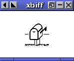

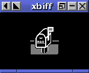


# 第 32 章：电子邮件

## 32.4.3 统计你有多少消息

写了一个邮件通知工具时，他想到了 Biff 和邮递员——因此有了这个名字。（狗 Biff 于 1993 年 8 月去世。）

*图 32-1. xbiff 窗口。*

*图 32-2. 等待邮件时的 xbiff 窗口。*

使用与`Elm`分发的`messages`工具来统计文件夹或文件中邮件消息的数量。提供邮件文件夹名称作为参数；如果不带参数，它将统计收件箱中等待的邮件。

在 Debian 系统上，`messages`随 gnu Mailutils 软件包一起。

### 查看你有多少封等待的电子邮件

输入：

```bash
$ messages
```

RET

### 统计邮件文件夹中的邮件数量

在`~/email/saved`中，输入：

```bash
$ messages ~/email/saved
```

RET

## 32.4.4 查看邮件发件人

查看邮件发件人有两种方法，它们使用了两个名称相似的不同工具。

### 方法 #1

使用随`Elm`发布的`frm`工具来输出邮件的发件人姓名和主题列表。可以将邮件文件夹的名称作为选项；如果不提供选项，`frm`将读取你的收件箱。

**输出显示收件邮件发件人姓名和主题的列表**

输入：

```bash
$ frm
```

RET

**输出显示文件`~/email/saved`中邮件的发件人姓名和主题列表**

输入：

```bash
$ frm ~/email/saved
```

RET

如果你没有邮件，`frm`会提示。

### 方法 #2

`from`工具的工作方式与`frm`类似，但它不输出主题行；而是输出发件人姓名和接收消息的时间。

在 Debian 系统上，`from`随`gnu Mailutils`软件包提供。

**输出你的收件邮件列表，显示发件人姓名以及接收的时间和日期**

输入：

```bash
$ from
```

RET

如果你没有邮件，`from`将不输出任何内容。

## 32.4.5 验证电子邮件地址

使用`vrfy`来确定给定的电子邮件地址是否有效。当你不确定是否有某人的正确电子邮件地址时，这非常有用。如果地址有效，`vrfy`会输出一条表示收件者存在的消息；如果地址无效，`vrfy`会输出一条表示用户未知的消息。

**验证电子邮件地址`user@example.edu`是否有效**

输入：

```bash
$ vrfy user@example.edu
```

RET

使用`-f`选项指定包含电子邮件地址的文本文件；`vrfy`会尝试验证文件中包含的所有电子邮件地址。

**验证文件`net-legends-faq`中包含的所有电子邮件地址**

输入：

```bash
$ vrfy -f net-legends-faq
```

RET

**注意：** `vrfy`依赖于远程系统获取这些信息；在当今高度企业化的互联网时代，越来越多的网站不再向普通公众提供此类信息。然而，它仍然非常值得提一下。

## 32.4.6 搜索邮件存档

你可以像处理任何文本文件一样搜索邮件存档的内容：使用`grep`输出匹配模式的行，或者在文本查看器或编辑器中浏览存档并显示搜索上下文。

### 方法 #1

要搜索邮件存档的文本，按通常的方法使用`grep`（参见第 14 章 [搜索文本]，第 333 页）。

**输出`~/Mail/emily`中所有包含文本“password”的行（不区分大小写）**

输入：

```bash
$ grep -i password ~/Mail/emily
```

RET

### 方法 #2

使用文本查看器或编辑器浏览邮件存档并搜索文本，参见第 9 章 [查看文本]，第 211 页和第 10 章 [编辑文本]，第 231 页。

搜索邮件存档的一种好方法是按主题；`less`工具特别有用，因为搜索词会被高亮显示。

**在`less`中查看当前正在浏览的文件时，高亮所有主题行并将光标移动到下一个**

输入：

```bash
/*^^Subject:.
```

RET

## 32.5 使用邮件附件

`mime`（“多用途互联网邮件扩展”）是一种用于对邮件消息进行编码和对文件进行附件的互联网标准。它被用于通过电子邮件发送图像、音频或其他非纯文本数据。

通常情况下，你使用你的`mu`读取和发送 mime 邮件。下面的食谱展示了在命令行上发送和接收 mime 邮件的方法，当你偶尔使用`mail`工具读取和发送带附件的邮件时非常有用，但在任何合理的`mu`中操作 mime 邮件的内置方法总是比这里描述的技术更简单方便（参见食谱 32.7 [使用其他邮件用户代理]，第 631 页）。

### 32.5.1 读取邮件附件

除了使用你的`mu`之外，读取附件还有两种方法。

### 方法 #1

要读取邮件附件，将消息写入文件，然后使用文件名作为参数运行`metamail`。

`metamail`会列出每个附件并提示你决定是显示该附件、将其写入文件还是跳过它。

**读取邮件附件**

输入：

```bash
$ mail
```

RET

Mail version 8.1 6/6/93.

输入`?`寻求帮助。

```
"/var/spool/mail/m": 1 messages 1 new
>N  1 Photo Dept.  Mon Feb 12 14:37  231/10980 "New Images"
& w1 image.mail
```

RET

```
"image.mail" [New file]
& x
```

RET

```bash
$ metamail image.mail
```

RET

在这个示例中，使用了`mail`工具打开收件箱并将消息写入一个名为`image.mail`的文件；然后使用文件名作为参数运行了`metamail`。

### 方法 #2

使用`mhshow`查看带有 mime 附件的电子邮件消息内容。将包含消息的文件名作为`-file`选项的参数。此命令首先显示邮件头信息，然后逐一显示消息的所有剩余部分。对于任何无法在屏幕上显示的片段，你将获得将其写入文件的选项。

**查看存储在文件`~/Mail/inbox/1`中的多部分邮件内容**

输入：

```bash
$ mhshow -file ~/Mail/inbox/1
```

RET

### 32.5.2 发送邮件附件

要将文件作为邮件发送，使用`metasend`。它会提示用于`To:`、`Subject:`和`CC:`头部字段的值，以及针对每个 mime 附件的以下内容：它的`Content-type:`（描述附件包含的数据类型）、文件名以及要使用的编码类型（如果有，通常建议使用一种）。

**将当前目录下的 jpeg 文件`dream.jpeg`邮件发送到地址`dali@example.org`**

输入：

```bash
$ metasend
To: dali@example.org
Subject: The image you requested
CC:
Content-type: image/jpeg
Name of file containing image/gif data: dream.jpeg
Do you want to encode this data for sending through the mail?
1 -- No, it is already in 7 bit ASCII
2 -- Yes, encode in base64 (most efficient)
3 -- Yes, encode in quoted-printable (less efficient, more readable)
4 -- Yes, encode it using uuencode (not standard, being phased out) 2
```

RET

```
Do you want to include another file too (y/n) [n] ? n
```

RET

```
Delivering mail, please wait...
Mail delivery apparently succeeded.
$
```

下表列出了各种类型文件在 mime`Content-type:`字段中使用的值。

| 内容类型 | 描述 |
| :--- | :--- |
| application/gzip | 使用 gzip 压缩的文件 |
| application/zip | 使用 zip 压缩的文件 |
| application/postscript | PostScript 文件 |
| image/jpeg | jpeg 图像文件 |
| image/png | png 图像文件 |
| audio/basic | 音频文件 |
| audio/mpeg3 | mp3 音频文件 |
| audio/ogg | Ogg Vorbis 音频文件 |
| audio/wav | wav 音频文件 |

## 32.6 使用电子邮件签名

签名文件（通常读作“dot sig”，写为`.sig`）是一个包含你希望出现在邮件和其他在线发布末尾文本的文本文件。它们现在通常不流行，但这里将解释如何使用它们。

有时，人们会在文件中放入自己的姓名、电子邮件地址和一个短句，或者一段 ASCII 艺术（例如使用 figlet 字体编写文本——参见食谱 16.4.1 [输出水平文本字体]，第 401 页）。

你可以在文本编辑器中创建签名文件，就像创建其他文本文件一样。

将文件命名为`.signature`或`.sig`，并将其保存在你的家目录下。

确保你的`.sig`文件长度最多为四行——超过这个长度被认为是非常不体面的。有时第一行仅由两个连字符和一个空格字符（`-- `）组成；许多应用程序在处理消息时会将此字符串识别为`.sig`的开头。

如果你想使用多个签名，可以使用`sigrot`来“轮换”你的各种签名——每当你运行`sigrot`时，它都会从你保存在`.sigrot`目录中选择一个签名文件并将其写入`.signature`。若要在每次登录时都更改你的`.signature`，你可以在`.bash_login`文件中运行`sigrot`（参见第 3 章 [Shell]，第 53 页）。

## 32.7 使用其他邮件用户代理

有些人使用诸如`Mozilla`等 Web 浏览器提供的内置邮件功能，并仅限于此。其他人可能不发送多少邮件，或者除了邮件之外没有其他需求。但有很多 muas（邮件用户代理）可供选择。

下表列出了 Linux 上可用的一些流行的 muas，描述了它们的特殊功能。

### Balsa

在安装了`gnome`的 X 下运行的图形化电子邮件客户端；其界面部分受到了专利软件`Eudora`的启发。

*图 32-3. Balsa.*

### Elm

一种菜单驱动 mua，在 20 世纪 90 年初深受经验丰富的用户的喜爱——它有一些有趣的功能，包括以批量模式向多个地址同时发送邮件的方法，并带有一个将备忘录作为邮件消息发送的工具。近年来，人们对`Elm`的兴趣已大幅下降，大多数新手被建议尝试`Mutt`。

*图 32-4. Elm.*

### Gnus

Emacs 新闻阅读器（预装于`XEmacs`），也可用于读取和发送邮件。它有许多功能，应该吸引`Emacs`爱好者的兴趣——但有一个警告：有些人觉得它太高深！

*图 32-5. Gnus.*

### MEW

在日本开发的 Emacs 邮件和新闻设施，“Emacs 世界中的消息传递”具有许多以复杂方式处理邮件的功能。

*图 32-6. mew *.**

### MH-E

`nmh`的 Emacs 前端。强大且易于使用。

*图 32-7. mh-e *.**

### Mozilla Mail

这款流行 Web 浏览器的熟悉邮件界面。在 X Window 系统中运行，并受新手喜爱。

*图 32-8. Mozilla Mail.*

### Mutt

目前深受许多 Vi 用户喜爱的 mua，是今天 Linux 上流行的 muas 之一。

*图 32-9. Mutt.*

### Nmh

随机邮件处理系统`mh`；它不是单一的邮件程序，而是一组用于操作邮件文件夹和消息的小工具，安装在`/usr/bin/mh`中。它应该吸引那些擅长组合简单工具和操作符来构建复杂命令的人。`nmh`是新的“邮件处理”系统，包含了`mh`工具的重写和改进版本。大多数 Linux 系统将用它覆盖旧的`mh`。

*图 32-10. nmh *.**

### VM

“View Mail”是一个较旧的`Emacs` mua，具有非常丰富的配置。

*图 32-11. vm *.**

### Wanderlust

一种为`Emacs`设计的 mua，旨在方便在多台计算机上读取邮件。

*图 32-12. Wanderlust.*

# 第 33 章：万维网

除了邮件，互联网上最有用的服务就是万维网（`www`，或通常直接称为“Web”）。你一定了解它；它是一个由超文本文档和服务的巨大网络，通过超文本传输协议（`http`）提供。任何人都可以向 Web 发布内容，任何连接了互联网的计算机都可以阅读 Web 上的几乎任何内容。十多年来，它一直在飞速增长。它是新的大众媒体，极有可能是全球最大的公共信息库。


每个人在 Web 上做的事情就是“浏览”它，这意味着使用 Web 浏览器访问发布的文件。由于系统错误，上述文本出现了大量重复，此处已根据要求完成清理翻译。

# 全球维网

Netscape 的浏览器，从最早的 Navigator 版本到后来的 Communicator 系列，在公司内部一直被称为`Mozilla`；这是对 Mosaic 名称的一个幽默双关语，Mosaic 是 20 世纪 90 年代初第一个流行的图形化 Web 浏览器——Netscape 的目标是打造一个“Mosaic 杀手”。

这个术语是我提出的。Mozilla 将其称为`home page`（首页），但这很令人困惑，因为该术语主要指的是个人或组织发布的网站的主页。

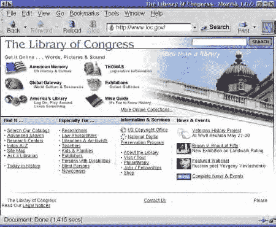

⇒ 以下是使用该功能的一些方法：

* 使用你的默认起始页启动 Mozilla，输入：`$ mozilla`

RET

* 使用 url`http://gutenberg.net/`启动 Mozilla，输入：`$ mozilla http://gutenberg.net/`

RET

一个典型的 Mozilla 窗口如图 33-1 所示，其中加载了美国会图书馆`[http://www.loc.gov/]`的首页。

*图 33-1. Mozilla。*

网页标题和 Mozilla 名称写在 Mozilla 窗口的标题栏中。

Mozilla 窗口顶部的栏被称为`Menu Bar`（菜单栏），包含用于访问其所有主要功能的下拉菜单。其下方的栏被称为`Navigation Bar`（导航栏），包含控制页面导航的按钮。`Navigation Bar`中间的`Location box`（位置框）包含当前加载页面的 url。它还有搜索、打印按钮以及一个样式化的蓝色 M 标志，它可以带你去 Mozilla 首页`[http://www.mozilla.org/]`。

在下方，窗口最大的区域用于显示网页本身。

底部是`Status Bar`（状态栏），它告诉你（以及其他信息）当前 Web 页面或文档的状态。在示例中，状态为`Done`（完成），意味着整个页面已成功加载。

和大多数图形化 Web 浏览器一样，它的用法非常直而了懂。在`Location`对话框中输入 url 以打开该 url，左键点击链接以进行跳转，用该链接的内容替换浏览器窗口的内容。

点击鼠标右键会打开一个特殊的选项菜单，其内容取决于鼠标指针的上下文。如果指针在链接上时你点击右键，你将看到几个处理链接的选项，包括在新窗口中打开它、将其书签以及显示其属性。如果指针在图像上时点击右键，你将看到处理图像的选项，包括查看它（浏览器将图像显示为自己的“页面”）、将其保存为文件以及将其书签。

如果指针在空白区域、纯文本或页面的其他地方时点击右键，你将看到处理当前页面的选项，包括将其书签、查看其 html 源代码或页面信息、重新加载以及保存。

## 33.1.2 使用基础 Mozilla 快捷键

下表列出了 Mozilla 中的基础导航键。

### 导航

| 键位 | 说明 |
| :--- | :--- |
| `ALT -` | 返回上一次访问的 url |
| `ALT -` | 前进到历史记录中的下一个 url。 |
| `CTRL - H` | 打开浏览器历史记录。 |
| `ALT - HOME` | 转到预定义的 Mozilla 起始页（或“首页”）。 |
| `SHIFT - CTRL - L` | 打开一个 url。 |

### 书签

| 键位 | 说明 |
| :--- | :--- |
| `CTRL - B` | 在新窗口中打开你的书签文件。 |
| `CTRL - D` | 将带有当前属性的页面添加到书签文件的底部。 |
| `SHIFT - CTRL - D` | 在书签文件的特定位置添加页面，同时可选择编辑其属性。 |

### 窗口操作

| 键位 | 说明 |
| :--- | :--- |
| `CTRL - N` | 打开一个新的 Mozilla 窗口（参见下文配方）。 |
| `CTRL - W` | 关闭当前 Mozilla 窗口。 |
| `CTRL - Q` | 退出 Mozilla。 |

### 页面查看

| 键位 | 说明 |
| :--- | :--- |
| `ESC` | 停止加载当前页面。 |
| `CTRL - R` | 重新加载当前页面。 |
| `CTRL - U` | 查看当前页面的 html 源代码。 |
| `CTRL - I` | 查看当前页面的文件和服务器信息。 |
| `CTRL -` | 减小字体大小。 |
| `CTRL - +` | 增大字体大小。 |
| `CTRL - E` | 编辑当前页面。 |
| `CTRL - P` | 打印当前页面。 |

### 文本选择

| 键位 | 说明 |
| :--- | :--- |
| `CTRL - A` | 选择页面上的所有文本。 |
| `CTRL - X` | 剪切选中文本。 |
| `CTRL - C` | 复制选中文本。 |
| `CTRL - V` | 粘贴选中文本。 |
| `DEL` | 删除选中文本。 |
| `CTRL - Z` | 撤销上一次文本操作。 |
| `CTRL - Y` | 重做上一次文本操作。 |

### 文件操作

| 键位 | 说明 |
| :--- | :--- |
| `CTRL - O` | 打开文件进行查看。 |
| `CTRL - S` | 将当前页面保存为文件。 |

**注意：** 这些键在某些窗口管理器中可能无法产生预期效果；如果它们对你无效，请尝试使用`CTRL`键代替`ALT`键。

对于 Emacs 粉丝来说，一个很棒的功能是你可以在 Mozilla 的对话框框中使用 Emacs 风格的快捷键进行光标移动（参见配方 10.1.3 [使用基础 Emacs 编辑快捷键]，第 237 页）。

## 33.1.3 创建新的 Mozilla 窗口

同时打开多个 Mozilla 窗口通常很有用——这样可以同时显示多个 Web 页面。有两种方法：一种是创建一个包含链接内容的新窗口，另一种是创建一个包含你的 Mozilla 起始页的窗口。

### 方法 #1

要在新的 Mozilla 窗口中打开链接，请点击链接鼠标中键。当你进行大量“深度浏览”时，将多个链接在各自的窗口中打开可以节省时间。

### 方法 #2

要打开内容为 Mozilla 起始页的新 Mozilla 窗口，输入`CTRL - N`。

## 33.1.4 从 Mozilla 复制链接到剪贴板

要在 Mozilla 中复制链接到剪贴板，右键点击链接然后选择`Copy Link Location`（复制链接位置）。

然后你可以将链接粘贴到其他地方，包括另一个 X 窗口，只需在想要粘贴的地方点击中键即可（参见配方 10.3 [文本选择]，第 253 页）。

**注意：** 要复制 url（例如显示在`Location`对话框中的 url），用左键点击 url 的两侧并拖动。你就可以将其粘贴到其他地方。

## 33.1.5 从 Mozilla 复制邮箱地址到剪贴板

要在 Mozilla 中复制邮箱地址到剪贴板，右键点击地址并选择`Copy Email Address`（复制邮箱地址）。

然后你可以将地址粘贴到其他地方，包括另一个 X 窗口，只需在想要粘贴的地方点击中键即可（参见配方 10.3 [文本选择]，第 253 页）。

## 33.1.6 在 Mozilla 中搜索网页源代码

查找页面命令（参见配方 33.1.2 [使用基础 Mozilla 快捷键]，第 640 页）适用于 Mozilla 中显示的任何页面，包括 html 源代码。这对于搜索显示中不可见的链接或其他文本非常有用。

⇒ 要搜索网页源代码，请执行以下操作：

1. 在网页上输入`CTRL - U`查看其源码。
2. 使用鼠标指针移动到源码窗口。
3. 输入`CTRL - F`在源码中查找文本。
4. 输入要搜索的文本并按`RET`。
5. 输入`CTRL - G`重复搜索。

## 33.2 使用 Lynx

Lynx

DEB: lynx

RPM: lynx

WWW: http://lynx.browser.org/

截至本文编写，古老的 Lynx 仍然是许多 Linux 系统的标准 Web 浏览器；它也是最早提供的 Web 浏览器之一。它不显示图形，但它是阅读超文本的良好界面。

输入`lynx`启动。如果定义了起始页，它将加载（参见配方 33.7 [设置起始页]，第 658 页）。

要打开 url，将其作为参数提供。

⇒ 要查看 url`http://www.whitehouse.gov/`的内容，输入：`lynx http://www.whitehouse.gov/`

RET

### 33.2.1 使用基础 Lynx 快捷键

下表描述了在 Lynx 中有效的一些键盘命令。

正如我那个时代的许多人一样，我是通过`Lynx`第一次看到 Web 的。

《Linux Cookbook》，第 2 版

# 文档内导航

- 在当前文档的链接中向上移动（后退）：`CTRL - N`
- 在当前文档的链接中向下移动（前进）：`CTRL - P`
- 移动到当前文档的`next`行：`CTRL - P`
- 移动到当前文档的`previous`行：`PgDn`或`CTRL - F`
- 向下滚动（向前）到当前文档的下一页：`SPACEBAR`或`+`
- 向上滚动（后退）到当前文档的上一页：`PgUp`或`CTRL - B`
- 移动到当前文档的开头：`CTRL - A`
- 移动到当前文档的结尾：`CTRL - E`

# 文档间导航

- 跳转到 url；`Lynx`会提示你要访问的 url。输入`g`在此行插入上次访问的 url；插入后你可以对其进行编辑。
- 通过编辑当前 url 来跳转；`Lynx`会显示当前 url 并允许你编辑：`G`或`RET`。
- 遵循光标当前选中的超链接：`G`。
- 返回上一个文档：`DEL`。
- 查看会话期间访问的所有文档历史：`Z`。
- 停止下载当前页面：`Z`。

# 信息与帮助

- 显示`Lynx`帮助文件：`H`或`?`
- 显示按键命令完整列表：`K`
- 显示当前文档信息（如`Lynx`中显示的所有文档，输入`=`返回上一个文档）：`=`
- 在当前页面的渲染 HTML 显示和源代码显示之间切换：`\ `
- 显示当前会话中访问过的链接历史：`BKSP`

# 退出 Lynx

- 临时退出到 shell（`CTRL - D`返回）：`!`
- 退出浏览并退出程序；`Lynx`会要求你确认此操作：`q`
- 不经验证退出浏览并退出程序：`Q`或`CTRL - D`

## 33.2.2 从 Lynx 保存网页

使用“打印到本地文件”（Print to local file）选项来保存`Lynx`中网页的渲染内容或 html 源代码文件。

⇒ 这里有两种使用方法：

- 要保存`Lynx`中显示的网页渲染内容，请执行以下操作：
  1. 输入`P`（`print`选项）打开打印选项页面。
  2. 选择`Print to local file`并按`RET`。

- 要保存`Lynx`中显示的网页 html 源码，请执行以下操作：
  1. 输入`*`查看源码。
  2. 输入`p`打开打印选项页面。
  3. 选择`Print to local file`。

## 33.2.3 列出页面中的所有链接


当你想要浏览页面包含的所有链接的超文本列表（经过编号并以 `html` 格式排列，以便列表中的每个成员都是热链接）时，在 `Lynx` 中查看页面时使用列表引用命令。

⇒ 要查看当前页的所有链接列表，按 `L`。

当你输入此命令时，`Lynx` 会加载一个新页面，其中包含你正在查看页面中所有链接列表（称为 `references`）。这个列表让人想起旧的 Internet Gopher 服务，非常适合查看包含“隐藏”链接的页面链接，例如某些图像链接。它也适合为页面包含的链接创建 `html` 注释列表；可以通过上一个配方描述保存链接页面来实现。

## 33.2.4 从 Web 发送文本到标准输出

要输出 `url` 的渲染文本，请使用带有 `-dump` 选项的 `lynx`。这会将给定 `url` 的文本导出到标准输出，你可以将其管道至 `less` 以查看，或使用重定向将其保存到文件。这有助于很多事情，包括查看或格式化来自 Web 的文本。

⇒ 获取 `http://sc.edu/fitzgerald/winterd/winter.html` 的文本并查看，输入（全部在一行）：

```bash
$ lynx -dump http://www.sc.edu/fitzgerald/winterd/winter.html | less
```

```bash
RET
```

一种旧的网络惯例是将斜体词显示在带有下划线内部的 `etext` 中，如 `_this_`；使用 `-underscore` 选项以这种方式输出任何斜体文本。

默认情况下，`lynx` 会对所有超链接进行注释，并在屏幕底部生成带脚注的链接列表。如果你不需要它们，添加 `-nolist` 选项并将仅返回“纯文本”。

⇒ 输出上一个 `url` 的带下划线的纯文本，并将其保存到文件 `winter_dreams`，输入（全部在一行）：

```bash
$ lynx -dump -nolist -underscore http://sc.edu/fitzgerald/winterd/winter.html > winter_dreams
```

```bash
RET
```

要指定 `dump` 的行宽（字符数），请使用 `-width=` 选项给出。默认值为 `80`。你可以对纯文本进行其他操作，例如将其管道至 `enscript` 以设置打印字体。

这些链接由 `-number_links` 选项控制；你也可以通过此选项在普通浏览中开启注释和脚注。

⇒ 以 Times Roman 字体打印上一个 `url` 的纯文本，并将下划线转换为斜体，行宽为 40 个字符，输入（全部在一行）：

```bash
$ lynx -dump -width=40 -nolist -underscore http://sc.edu/fitzgerald/winterd/winter.html | enscript -B -Eetext -f "Times-Roman12"
```

```bash
RET
```

**注意：** 要查看移除 `html` 标签且未对文本进行格式化的 `url` 纯文本，请参见配方 33.9.2 [转换 html]，第 663 页。

你还可以使用 `-dump` 选项打印网页（参见配方 25.2.4 [打印网页]，第 514 页），或将 Web 上的文件传递给另一个命令，例如将 `wav` 音频文件传递给 `sox` 音频处理工具。

## 33.2.5 查看需要授权的站点

要查看需要注册的站点或网页，使用带有 `-auth` 选项的 `lynx`，并将用户名和密码作为参数用冒号（`:`）分隔。

⇒ 使用用户名和密码 `guest` 访问 `http://www.example.com/archive/`，输入：

```bash
$ lynx -auth=guest:guest http://www.example.com/archive/
```

```bash
RET
```

将此与保存文件的选项结合使用是常见的，这样你就可以从通常需要注册的站点获取文件的带注释文本副本。

⇒ 将 `url` `http://www.example.com/archive/` 保存为注释文本文件 `mynews`，输入（全部在一行）：

```bash
$ lynx -dump -number_links -auth=guest:guest http://www.example.com/archive/ > mynews
```

```bash
RET
```

**注意：** 你在命令行提供的用户名和密码参数将记录在你的 `shell` 日志中（参见配方 3.4 [使用你的命令历史]，第 74 页），如果系统上的其他用户查看你运行的进程，他们将看到它们（参见配方 2.7.2 [列出用户所有进程]，第 42 页）。

## 33.2.6 查看 html 选择

要在 `Lynx` 中查看渲染的 `html` 源码，选择源码并使用带有 `-stdin` 选项的 `lynx` 从标准输入读取其起始页。然后将选择的内容粘贴到 `Lynx` 的标准输入中。

如果你有朋友给你发 `html` 格式的邮件，而你无法通过 `mu` 方便地阅读，这个冷为人知的小技巧将让你快乐。

⇒ 要将 `html` 源码选择作为渲染文本，请执行以下操作：

1. 通过左键点击并拖动鼠标指针来选择要渲染的源码（参见配方 10.3 [操作文本选择]，第 253 页）。

2. 在终端中启动 `Lynx`，使其从标准输入读取：

```bash
$ lynx -stdin
```

```bash
RET
```

3. 在运行 `Lynx` 的终端中，点击鼠标中间键以粘贴文本。

4. 在该终端中输入 `CTRL - D` 结束对 `Lynx` 的输入。

当你这样做时，`Lynx` 将渲染并显示 `html` 代码。

**注意：** `Lynx` 在显示代码后仍会运行，此时你必须输入 `Q` 来退出并关闭 `Lynx`。或者，包含 `-dump` 选项让 `Lynx` 将渲染后的 `HTML` 输出到标准输出，然后立即退出。

每当你从流中获取 `HTML` 代码时，你都可以将其管道到 `lynx -stdin -dump` 以将渲染后的代码显示在标准输出。

这种技术也适用于测试任意选择的 `HTML` 代码。

### 33.2.7 在 Lynx 中指定键绑定

你可以在 `Lynx` 中指定特殊的键位绑定，使得移动命令的操作方式与你喜喜欢的编辑器完全一样：使用 `-emacskeys` 选项启用 Emacs 风格的键绑定，使用 `-vikeys` 选项启用 Vi 风格的键绑定。

⇒ 使用 Vi 风格的键位绑定通过 URL `http://nostarch.com/` 启动 `Lynx`，请输入：

```bash
$ lynx -vikeys http://nostarch.com/
```

```bash
RET
```

### 33.2.8 使用鼠标使用 Lynx

要配合鼠标使用 `Lynx`，请给 `lynx` 提供 `-use_mouse` 选项。如果你的 `Lynx` 版本启用了鼠标支持，提供此选项将允许你只需点击鼠标左键即可跟踪链接；在窗口任何地方点击鼠标右键即可返回到上次访问的页面。

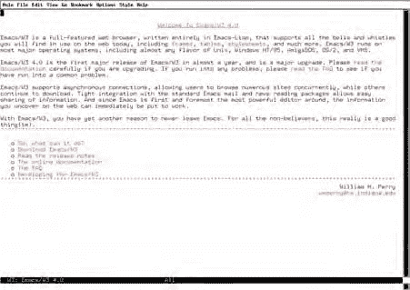

第 33 章：万维网

649

⇒ 使用鼠标通过 `lynx` 浏览 `/usr/share/doc` 目录下的文件，请输入：

```bash
$ lynx -use_mouse /usr/share/doc
```

```bash
RET
```

### 33.3 在 Emacs 中访问 Web

W3

DEB: `w3-el-e21`

RPM: `w3`

WWW: `http://www.cs.indiana.edu/elisp/w3/docs.html`

可以在 Emacs 中获取 Web。目前它非常慢，但可能有其用处。要实现这一点，请使用 `w3-mode`。它的功能很多——你唯一可能想念的功能就是 SSL 支持（尽管这可能即将推出）以及 JavaScript 和 Java 支持（嗯，*你*可能不会想念它们，但会让某些网站变得有些难以使用）。它可以处理框架、表格、样式表以及许多其他 HTML 特性。

*图 33-2. Emacs 中的 w3-mode。*

⇒ 在 Emacs 中加载 `w3-mode`，输入：

```bash
ALT - X w3
```

```bash
RET
```

在新缓冲区中打开 URL，输入 `CTRL - O` 并在微缓冲区（minibuffer）中给出要打开的 URL（留空将打开 `w3-mode` 主页）。中间点击链接以跟踪它，从而在新缓冲区中打开该 URL。

⇒ 这里有两种使用此功能的方法。

• 打开 URL `http://emacs.org/`，输入：

```bash
CTRL - O http://emacs.org/
```

```bash
RET
```

• 打开 `w3-mode` 主页的 URL，输入：

```bash
CTRL - O
```

```bash
RET
```

上一个示例在独立的缓冲区中打开了 `w3-mode` 主页，如图 33-2 所示。

下表描述了在 `w3-mode` 模式下的一些特殊命令。

| 命令 | 说明 |

| :--- | :--- |

| `SPACEBAR` | 跟踪光标处的链接。 |

| `BKSP` | 在当前缓冲区中向下滚动。 |

| `ALT - TAB` | 在当前缓冲区向上向上。 |

| `ALT - S` | 将当前文档的 URL 插入另一个缓冲区。 |

| `CTRL - O` | 将文档保存到本地磁盘（你可以从 `HTML` 源码、格式化文本、`LaTEX` 源码或二进制文件中选择）。 |

| `B` | 打开 URL。 |

| `F` | 在访问过的 URL 历史栈中后移动。 |

| `F` | 在访问过的 URL 历史栈中向前移动。 |

| `i` | 查看当前缓冲区文档的信息（信息在名为 `Document Information` 的新缓冲区中打开）。 |

| `I` | 查看当前缓冲区光标处链接的信息（信息在名为 `Document Information` 的新缓冲区中打开）。 |

| `k` | 将当前缓冲区文档的 URL 放入剪切环（kill ring），并将其变为 `X` 选择（用于将 URL 复制并粘贴到另一个缓冲区或另一个应用程序；参见 Recipe 10.3 [操作文本选择]，第 253 页）。 |

| `K` | 将光标处链接的 URL 放入剪切环并将其变为 `X` 选择（用于将 URL 复制并粘贴到另一个缓冲区或另一个应用程序；参见 Recipe 10.3 [操作文本选择]，第 253 页）。 |

| `l` | 移动上次访问的缓冲区。 |

| `o` | 打开本地文件。 |

| `q` | 退出 `w3-mode`，杀死当前缓冲区并回到上次访问的缓冲区。 |

| `r` | 重新加载当前文档。 |

| `s` | 查看当前缓冲区文档的 HTML 源码（在以 URL 命名的新缓冲区中打开）。 |

| `S` | 查看当前缓冲区光标处链接的 HTML 源码（在以 URL 命名的新缓冲区中打开）。 |

| `v` | 显示当前文档的 URL（URL 显示在微缓冲区中）。 |

| `V` | 显示当前缓冲区光标处链接的 URL（URL 显示在微缓冲区中）。 |

### 33.4 查看 Web 图像

通常你通过在正在使用的浏览器中打开图像来查看 Web 图像，但你也可以无需浏览——方法如下。

#### 方法 #1 Lynx

DEB: `lynx`

RPM: `lynx`

WWW: `http://lynx.browser.org/`

你可以通过将图像 URL 作为 `lynx` 的参数来查看 Web 上的图像（参见 Recipe 33.2 [使用 Lynx]，第 643 页）。图像将由设置好的通过 `lynx` 显示图像的“助手”应用程序显示。

⇒ 查看 URL `ftp://garbo.uwasa.fi/garbo-gifs/garbo01.gif` 图像，输入：

```bash
$ lynx ftp://garbo.uwasa.fi/garbo-gifs/garbo01.gif
```

```bash
RET
```

**注意：** 此方法仅在 X 环境下有效。

你也可以以此方式将图像 URL 作为参数传递给其他浏览器，例如 Mozilla（参见 Recipe 33.1 [使用 Mozilla]，第 638 页）。

#### 方法 #2 ImageMagick

DEB: `imagemagick`

RPM: `ImageMagick`

WWW: `http://www.imagemagick.org/`

Libwww-perl

DEB: `libwww-perl`

RPM: `perl-libwww`

WWW: `http://ftp.ics.uci.edu/pub/websoft/libwww-perl/`

如果你只想查看来自 Web 的图像文件，完全不需要使用 Web 浏览器——相反，你可以使用 `display`，并将想要查看的 URL 作为参数。它使用 `libwww-perl` 软件包中的 `GET`（有时为 `get`）来获取该 URL。

这种方法对于查看你喜爱的网络摄像头图像、查看 `ftp` 站点上的图像或将其放入脚本中特别有用——你不需要启动浏览器、登录或输入任何其他命令。

⇒ 查看 URL `http://waquarium.otted.hawaii.edu/coralcam/ccam.jpg` 图像，输入：

```bash
$ display http://waquarium.otted.hawaii.edu/coralcam/ccam.jpg
```

```bash
RET
```

`-remote` 选项会在已经在运行的显示窗口中打开图像；你可以使用这种方法查看经常更改的图像——例如网络摄像头图像——并自动用最新图像刷新显示。要实现这一点，首先在后台运行 `display`，然后运行 `watch`（参见 Recipe 28.4 [定期监控命令]，第 559 页）。将重新加载之间的秒数作为 `-n` 选项的参数，并将带有 `-remote` 选项的 `display` 和图像 URL 作为引号参数作为监控的命令。

⇒ 查看 URL `http://waquarium.otted.hawaii.edu/coralcam/ccam.jpg` 图像，每 30 秒用网络摄像头的最新图像更新一次，输入：

```bash
$ watch -n 30 'display -remote http://waquarium.otted.hawaii.edu/coralcam/ccam.jpg'
```

```bash
RET
```

在此示例中，第一个 `display` 命令在后台运行，作为该 `shell` 的第三作业，进程号为 29621。要停止查看，在包含 `watch` 命令的终端输入 `CTRL - C`，然后杀死第一个 `display`作业（参见 Recipe 3.3.5 [停止作业]，第 73 页）。

**注意：** 查看图像时，可以使用 `display` 支持的所有图像处理命令，包括调整大小和更改放大率。有关 `display` 的更多信息，请参见 Recipe 17.1 [在 X 中查看图像]，第 407 页。

### 33.5 从 Web 获取文件

Wget

DEB: `wget`

RPM: `wget`

WWW: `http://www.gnu.org/software/wget/wget.html`

使用 `wget`，“Web get”从万维网下载文件。它可以从 `http` 或 `ftp` url 获取文件。它保留文件的原始时间戳，它

比浏览器更小、使用更快，并显示下载进度的视觉化界面。

若要从 Web 获取 `html` 文件并将其保存为渲染后的文本，请使用 `Lynx` ——参见配方 33.2.4 [从 Web 发送文本到标准输出]，第 646 页。

以下子节包含了使用 `wget` 从 Web 获取信息的配方。如需更多关于 `wget` 可以执行的操作示例，请参考其 Info 文档（参见配方 2.8.5 [读取 Info 手册]，第 48 页）。

### 33.5.1 下载 url

要从 Web 下载单个文件，将文件的 `url` 作为参数传递给 `wget`。

⇒ 要下载 `ftp://garbo.uwasa.fi/garbo-gifs/garbo20.gif`，输入：

```bash
wget ftp://garbo.uwasa.fi/garbo-gifs/garbo20.gif
```

此命令下载给定的 `url`，并写入当前工作目录中与原 `url` 相同的文件，即 `garbo20.gif`。

如果你在下载完成前中断了下载，你所获取的文件内容将仅包含 `wget` 在中断前已获取的部分。使用带有 `-c` 选项的 `wget` 可以从断点继续下载。

⇒ 要恢复上一个示例中的 `url` 下载，输入：

```bash
wget -c ftp://garbo.uwasa.fi/garbo-gifs/garbo20.gif
```

**注意：** 为了让 `-c` 选项产生预期效果，你应该在之前运行 `wget` 的相同目录下运行它，该部分下载的文件应该仍然存在。

### 33.5.2 归档整个网站

要归档单个网站，请使用带有 `-m`（“镜像”）选项的 `wget`，它会尽可能按照原始时间戳保存文件，并设置“递归检索”选项以下载所有内容。要指定检索过程中发生错误时的重试次数，请使用带有数字参数的 `-t` 选项——`-t3` 通常适用于跨网络安全检索；使用 `-t0` 指定无限次重试，适用于网络连接*非常*糟糕但你*非常*想要归档某些东西的情况，无论花费多长时间。最后，使用文件名作为参数的 `-o` 选项将进度日志写入文件——如果在归档过程中出现问题，检查它会很有用；一旦归档过程完成且你确认成功，就可以删除日志文件。

⇒ 要镜像 `http://www.example.org/` 网站，允许最多三次文件检索重试，并将错误信息写入名为 `mirror.log` 的日志文件，输入：

```bash
wget -m -t3 http://www.example.org/ -o mirror.log
```

此命令会在当前目录的名为 `www.example.org` 的子目录下，为 `http://www.example.org/` 网站创建一个归档。日志信息被写入当前目录中名为 `mirror.log` 的文件中。


若要继续已中断的归档，请使用 `-nc`（“不覆盖”）选项；它不会检索已经下载的文件。为了让此选项按你预期的方式工作，请确保你处于最初开始归档该网站时所在的目录中。

⇒ 要继续被中断的 `http://www.example.org/` 网站镜像，并确保现有文件不被下载，允许最多三次文件检索重试，并将错误信息写入名为 `mirror.log` 的日志文件，输入：

```
wget -nc -m -t3 http://www.example.org/ -o mirror.log
```

### 33.5.3 归档网站的部分

若仅归档网站的一部分——例如，用户的主页——请使用 `-I` 选项，后跟要归档目录的绝对路径列表；网站上的所有其他目录将被忽略。

⇒ 要归档 `http://example.edu/~jim/` 网站，仅归档 `/~jim` 目录，并将日志信息写入名为 `jim.log` 的文件，输入：

```
wget -m -t3 -I /*~jim http://example.edu/~jim/ -o jim.log
```

此命令归档 `http://example.edu/~jim/` 网站上所有目录名以 `/~jim` 开头的文件。

若仅获取给定目录的文件，请使用 `-r` 和 `-l` 选项（`-l` 选项的参数是从给定层级向下递归的层数）。仅下载给定目录中的文件，请将这些选项与 `--no-parent` 选项结合使用，该选项指定不进入父目录。

使用 `-A` 选项来指定要接受的文件扩展名——例如，使用 `-A txt,text,tex` 仅下载以 `.txt`、`.text` 和 `.tex` 扩展结尾的文件。`-R` 选项的作用类似，但它指定要拒绝且不下载的文件扩展。

⇒ 要下载 `example.org` 上给定目录 `/~jim/papers/` 中仅以 `.gz` 扩展结尾的文件，输入（全部写在一行）：

```
wget -m -r -l1 --no-parent -A.gz http://www.example.org/~jim/papers/
```

### 33.5.4 读取网页的头部信息

所有 Web 服务器在页面请求开始时都会输出特殊的头部（headers），但当你使用浏览器检索 `url` 时通常看不到它们。

这些头部信息包含如 Web 服务器主机的当前系统日期，以及 Web 服务器和操作系统软件的名称和版本。

使用 `wget` 的 `-S` 选项在检索文件时输出这些头部信息；头部信息将输出到标准输出，或者如果使用了则输出到日志文件。

⇒ 要检索 `http://google.com/` 文件并输出头部信息，输入：

```
wget -S http://google.com/
```

此命令将服务器响应头部写入标准输出，并将 `http://google.com/` 的内容保存到当前目录的一个文件中，文件名与原文件相同。

## 33.6 保留浏览器历史记录

`browser-history`

DEB: `browser-history`

RPM: `browser-history`

WWW: `http://www.inria.fr/koala/colas/browser-history/`

许多 Web 浏览器都有“历史记录”功能，记录你访问的网站列表以及访问的时间和日期，但没有哪个工具比 `browser-history` 好用。如果你目前为了记住发现的优质链接而维护一个网络日志（或“博客”），那么一旦安装了这个工具，你就不再需要那样做了。

使用 `browser-history` 维护你访问的所有 Web 网站的历史日志。

你可以在后台启动它，每当你在 Web 浏览器中访问 `url` 时（截至本文编写，它支持 Netscape、Arena 和 Amaya 浏览器，但不支持 Mozilla），它会将名称和 `url` 写入其当前的历史日志中，你可以随时查看。

⇒ 要在每次启动 X 时启动 `browser-history`，请将以下行放入你的 `.xsession` 文件中：

```
browser-history &
```

以下配方展示了使用你的历史日志的方法。

### 33.6.1 查看你的浏览器历史记录

浏览器历史日志保留在你家目录下一个名为 `.browser-history` 的隐藏目录中。本周的历史日志始终称为 `history-log.html`；这是一个可以在 Web 浏览器中查看的 `html` 文件。

⇒ 要使用 `lynx` 查看当前历史日志，输入：

```
lynx ~/.browser-history/history-log.html
```

过去的日志在文件名后附加了年份、月份和周，并且经过了压缩（参见配方 8.4 [使用文件压缩]，第 196 页）。如果你在浏览器中查看它们，可以直接将文件名作为参数而无需解压——大多数浏览器会自动处理这种情况。

**注意：** 如果你有一个起始页，你会发现在其上添加一个指向当前历史日志文件 `~/.browser-history/history-log.html` 的链接非常有用（参见下一页的配方 33.7 [设置起始页]）。

### 33.6.2 搜索你的浏览器历史记录

你也可以使用 `zgrep` 搜索旧的浏览器历史日志。日志记录了你访问的每个网站的 `url` 和标题，你可以搜索其中任何一个——当有人问“你还记得那篇关于某某的好文章吗？”时。

你可以对 `~/.browser-history` 目录下的文件执行 `zgrep` 来查找它。

⇒ 要在你 2000 年访问过的列表找到标题包含“Confessions”一词的任何 URL，请输入：

```
$ zgrep Confessions ~/.browser-history/history-log-2000
```

`RET`

此命令会在你 2000 年的所有日志中搜索文本“Confessions”，并输出包含该内容的行。

658

《Linux 命令行指南》，第 2 版

**注意：** 有关 `zgrep` 的更多信息，请参阅菜谱 14.7.2 [在压缩文件中匹配行]，第 349 页。

## 33.7 设置起始页

*起始页*（start page）是浏览器在不带 URL 作为参数启动时自动加载的 Web 页面。它也是点击浏览器的主页按钮（如果有该按钮的话）时加载的页面。

你可以定义浏览器的起始页。有些人将其设置为喜爱的新闻源或出版物的 URL，而另一些甚至会编写自己的起始页，其中包含经常访问的链接列表、搜索引擎表单等等。

要创建你自己的起始页，只需将其编写为 `html` 文件；你可以将其保存在主目录的某处并提供完整路径名；或者，如果你在本地系统上运行 Web 服务器，可以将其放在服务器 `html` 目录树的某处，并使用 `http` URL 访问。

以下是在 Mozilla 和 Lynx 中定义起始页的方法。

### 方法 #1

#### Mozilla

DEB: `mozilla-browser`

RPM: `mozilla`

WWW: `http://www.mozilla.org/`

要在 Mozilla 中定义起始页，请在“Mozilla 首选项...” （Preferences...）菜单中定义“主页”。

⇒ 要将 Mozilla 中的默认起始页更改为你自己的起始页 `http://localhost/start/`，请执行以下操作：

1. 从菜单栏上的“编辑”（Edit）菜单选择“首选项...”。
2. 在“位置”（Location）框中左点击。
3. 将内容替换为你想要的起始页：

   `http://localhost/start/`

4. 左点击确定按钮。

**注意：** 在 Mozilla 中，每当你不带参数启动它、点击主页按钮或输入 `ALT -HOME` 时，起始页都会加载。

第 33 章：万网

659

### 方法 #2

#### Lynx

DEB: `lynx`

RPM: `lynx`

WWW: `http://lynx.browser.org/`

Lynx 的起始页定义为 `/etc/lynx.cfg` 中的 `STARTFILE`，它可以是任何 URL，包括指向系统上本地文件的 `file://` URL。

你需要超级用户权限来编辑此文件。

• 要将 Lynx 的起始页更改为 URL `http://localhost/start/`，请使用文本编辑器编辑 `/etc/lynx.cfg`，使其包含以下行：

```
STARTFILE:http://localhost/start/
```

**注意：** Linux 发行版通常预先定义 Lynx 起始页为该发行版的主页。例如，在 Debian 系统上，起始文件定义为 Debian 主页 [http://www.debian.org/]。

## 33.8 在文本中列出 URL

使用以下两种方法之一列出文本中的 URL——Web 页面的 `html` 源码、Web 页面的文本或任何文本文件。

要列出某些 Web 页面源码中的 URL，首先使用带有 `-q` 和 `-O` 选项的 `wget` 将源码导出到标准输出（见菜谱 33.5 [从网络获取文件]，第 653 页），然后将其传递到方法之一。

要列出 Web 页面文本而非源码中的 URL，首先使用带有 `-dump` 选项的 `lynx` 将页面内容导出到标准输出，然后将其传递到方法之一。

为了确保不列出重复的 URL，请将输出传递给 `sort` 以仅输出唯一行（见菜谱 13.5 [过滤文本重复行] 中的方法 #2，第 319 页）。

一种方法使用 `grep`，另一种使用 `sed`，两者都使用相同的查找 URL 的正则表达式。该正则相当长，包含了两个字面空格和两个字面制表符；如果你经常使用这些方法之一，你肯定会希望将运行它的命令放在脚本中（见菜谱 3.7 [使用 Shell 脚本]，第 84 页）。

660

《Linux 命令行指南》，第 2 版

### 方法 #1

要在文本中输出 URL 列表（每行一个），使用带有 `-o` 选项的 `grep`，并提供匹配 URL 的正则表达式作为参数。要搜索文本文件，提供文件名作为第二个参数。

⇒ 这里是使用此方法的一些方法。

• 要输出 `/etc/lynx.cfg` 文件中包含的所有 URL 列表，输入（全部在一行）：

```
$ grep -o '\(\(\(http\(s\)\?| *ftp\*| *gopher\*| *telnet\*| *news\):\/\/\| *mailto:\).[*^ SPACEBAR *,;* CTRL -V TAB <"> *]*[*^ SPACEBAR *.,;* CTRL -V TAB <"> *]\)' /etc/lynx.cfg RET
```

• 要输出 URL `http://news.example.com/` 文本中包含的所有 URL 列表，输入（全部在一行）：

```
$ lynx -dump http://news.example.com/ | grep -o '\(\(\(http\(s\)\?| *ftp\*| *gopher\*| *telnet\*| *news\):\/\/\| *mailto:\).[*^ SPACEBAR *,;* CTRL -V TAB <"> *]*[*^ SPACEBAR *.,;* CTRL -V TAB <"> *]\)' RET
```

• 要输出 `http://news.example.com/` `html` 源码中包含的所有 URL 列表，输入（全部在一行）：

```
$ wget -q -O http://news.example.com/ | grep -o '\(\(\(http\(s\)\?| *ftp\*| *gopher\*| *telnet\*| *news\):\/\/\| *mailto:\).[*^ SPACEBAR *,;* CTRL -V TAB <"> *]*[*^ SPACEBAR *.,;* CTRL -V TAB <"> *]\)' RET
```

### 方法 #2

要在文本中输出 URL 列表（每行一个），使用相同正则表达式的 `sed`。要搜索文本文件，提供文件名作为第二个参数。

• 要输出 `/etc/lynx.cfg` 文件中包含的所有 URL 列表，输入（全部在一行）：

```
$ sed -n 's/\(\(\(http\(s\)\?| *ftp\*| *gopher\*| *telnet\*| *news\):\/\/\| *mailto:\).[*^ SPACEBAR *,;* CTRL -V TAB <"> *]*[*^ SPACEBAR *.,;* CTRL -V TAB <"> *]\)//p' /etc/lynx.cfg RET
```

• 要输出 URL `http://news.example.com/` 文本中包含的所有 URL 列表，输入（全部在一行）：

```
$ lynx -dump http://news.example.com/ | sed -n 's/\(\(\(http\(s\)\?| *ftp\*| *gopher\*| *telnet\*| *news\):\/\/\| *mailto:\).[*^ SPACEBAR *,;* CTRL -V TAB <"> *]*[*^ SPACEBAR *.,;* CTRL -V TAB <"> *]\)//p' RET
```

• 要输出 `http://news.example.com/` `html` 源码中包含的所有 URL 列表，输入（全部在一行）：

```
$ wget -q -O http://news.example.com/ | sed -n 's/\(\(\(http\(s\)\?| *ftp\*| *gopher\*| *telnet\*| *news\):\/\/\| *mailto:\).[*^ SPACEBAR *,;* CTRL -V TAB <"> *]*[*^ SPACEBAR *.,;* CTRL -V TAB <"> *]\]//p' RET
```

第 33 章：万网

## 33.9 编写 `html`

超文本标记语言（`html`）是 Web 的标记语言；`html` 文件只是用这种标记语言编写的文本文件。你可以使用任何文本编辑器编辑 `html` 文件，与其他类型的文本文件没有区别（见第 10 章 [编辑文本]，第 231 页）。

以下是此任务的一些特殊方法。

### 方法 #1

#### Mozilla

DEB: `mozilla-browser`

RPM: `mozilla`

WWW: `http://www.mozilla.org/`

使用 Mozilla Composer 编写 `html`。它是最流行的所见即所得 `html` 编辑器之一。你可以在 Mozilla 运行时通过“窗口”菜单选择它，或输入 `CTRL -4` 启动它。

⇒ 要启动 Mozilla Composer，请执行以下操作：

1. 启动 Mozilla（见菜谱 33.1.1 [熟悉 Mozilla]，第 638 页）：

   ```
   $ mozilla
   ```

2. 按 `CTRL -4`。

### 方法 #2

#### Bluefish

DEB: `bluefish`

RPM: `bluefish`

WWW: `http://bluefish.openoffice.nl/`

许多人推崇 Bluefish，这是一款功能齐全、易于使用的 X `html` 编辑器。它具有语法高亮功能，并且可以同时打开 500 个文档。

⇒ 要启动 Bluefish，输入：

```bash
$ bluefish
```

## 方法 #3：GNU Emacs

DEB: `emacsen-common`

`emacs21`

RPM: `emacs`

WWW: `http://www.emacs.org/`

Emacs（参见配方 10.1 [Using Emacs]，第 232 页）有一个用于编辑 `html` 文件的主要模式，称为 `html-mode`。

⇒ 要在缓冲区中启动 `html-mode`，输入：

```bash
ALT -* X html-mode RET
```

`html-mode` 的功能包括插入“骨架”（skeleton）结构。

Emacs 为 `html-mode` 函数提供的帮助文本中包含一个非常短的 `html` 编写教程——查看该函数的文档即可显示该教程。

⇒ 要在 Emacs 中阅读简短的 `html` 教程，输入：

```bash
CTRL -* H f html-mode RET
```

**注意：** 当你在 Emacs 缓冲区中编辑 `html` 文件时，可以在另一个窗口中用 Web 浏览器打开同一个文件——Web 浏览器只读不写它们打开的 `html` 文件，因此你可以在 Emacs 中创建文档的同时在浏览器中查看渲染后的文档。当 Emacs 缓冲区中进行并保存更改时，重新加载浏览器中的文件即可立即看到更改。

### 33.9.1 为图像标签添加参数

#### Imgsizer

DEB: `imgsizer`

WWW: `http://www.catb.org/~esr/imgsizer/`

为了易用性，`html` 图像源标签应该具有 `HEIGHT` 和 `WIDTH` 参数，这些参数指定了标签描述的图像尺寸。通过在页面上所有的图像标签中指定这些参数，该页面上的文字将在图像加载之前显示。如果没有这些参数，浏览器在显示页面任何文本之前必须加载所有图像。

使用 `imgsizer` 自动确定这些值并将其插入 `html` 文件。将 `html` 文件名作为参数。

⇒ 为文件 `index.html` 添加 `HEIGHT` 和 `WIDTH` 参数，输入：

```bash
$ imgsizer index.html
RET
```

### 33.9.2 转换 `html`

有方法可以将 `html` 文件转换为其他格式。你可以将 `html` 转换为纯文本以便阅读，或者转换为 PostScript，你可以查看、打印或也转换为其他格式，包括 `pdf`。

#### 方法 #1：Unhtml

DEB: `unhtml`

WWW: `http://maruhn.com/sec/unhtml.html`

使用 `unhtml` 从文本中移除 `html` 格式。它从标准输入（或指定的文件名）读取，并将输出写入标准输出。

⇒ 有两种使用它的方法：


- 查看移除了 HTML 标签的`index.html`文件，输入：

```bash
$ unhtml index.html | less
RET
```

- 从文件`index.html`移除 HTML 标签并将输出写入名为`index.txt`的文件，输入：

```bash
$ unhtml index.html > index.txt
RET
```

**注意：** 使用`unhtml`从文件中移除 HTML 标签时，不会对文本进行进一步处理。此外，它适用于文件，不适用于 URL。

### 方法 #2：Lynx

- DEB：`lynx`
- RPM：`lynx`
- WWW：`http://browser.org/`

使用`lynx`将 HTML 文件或 URL 保存为*格式化*文本文件，以便结果在`lynx`中查看时像原始 HTML 一样。它还可以保留原始 HTML 中的斜体和超链接信息。

参见配方 33.2.4 [Sending Text from the Web to Standard Output]，第 646 页。

你可以将此`lynx`输出管道到工具进行间距设置，然后发送到`enscript`设置字体。这对于以 typescript 手稿稿格式打印网页非常有用。

⇒ 以 typescript 手稿格式打印 URL `http://example.com/essay/` 的副本（全一行），输入：

```bash
$ lynx -dump -nolist http://example.com/essay/ | pr -d
B
RET
```

**注意：** 在某些情况下，你可能想在打印之前编辑文件，例如网页包含导航栏或其他你在转换为手稿之前想要移除的文本。在这种情况下，你会将`lynx`输出管道到文件，编辑该文件，然后对文件使用`pr`并将其输出管道到`enscript`进行打印。

### 方法 #3：Html2ps

- DEB：`html2ps`
- RPM：`html2ps`
- WWW：`http://www.tdb.uu.se/~jan/html2ps.html`

使用`html2ps`将 HTML 文件转换为 PostScript；当你想要打印带有所有图形和图像的网页，或者想要将整个网站或部分网站转换为 PDF 时，这非常有用。将要转换的 HTML 文件的 URL 或文件名作为选项。使用`-u`选项为超链接锚点文本加下划线；默认不给链接下划线并写入标准输出。

⇒ 有两种使用它的方法：

- 将 URL `http://example.com/essay/` 的 PostScript 副本打印到默认打印机，输入：

```bash
$ html2ps http://example.com/essay/ | lpr
RET
```

- 将 URL `http://example.com/essay/` 的副本写入 PostScript 文件`submission.ps`，且所有超链接带下划线，输入：

```bash
$ html2ps -u -o submission.ps http://example.com/essay/
RET
```

## 33.9 验证 HTML

### Weblint

- DEB：`weblint`
- RPM：`weblint`
- WWW：`http://www.webmaster.bham.ac.uk/weblint/`

使用`weblint`验证 HTML 文件的基本结构和语法。将要检查的文件名作为参数，`weblint`输出它对该文件的任何意见，例如`IMG`元素是否缺少`ALT`描述，或嵌套元素是否重叠。

⇒ 要验证文件`index.html`中的 HTML，输入：

```bash
$ weblint index.html
RET
```

## 33.10 分析你的 Web 流量

如果你有一个网站，无疑会对分析你的 Web 流量产生兴趣：知道哪些页面受欢迎，谁在看它们，他们什么时候看以及从哪里。通过从托管你网站的服务器检索*Web 日志*（Web logs）来实现——这些是服务器编写的纯文本文件，包含你网站每次访问的数据，每行一个。存在工具来分析这些日志；这里是两种此两种简单方法。

### 方法 #1：Analog

- DEB：`analog`
- RPM：`analog`
- WWW：`http://www.analog.cx/`

分析日志最流行的工具是`analog`，它产生一组全面的报告，包括：

- 人通过搜索引擎找到你网站的顶级关键词。
- *引用页*（referrers），即请求计算机访问你页面的页面。
- 请求页面的顶级组织。
- 请求页面的操作系统。
- 网站上流行的目录。
- 网站上流行的文件。

将要分析的日志文件规范作为参数传递给`analog`。

该命令读取你提供的日志并将报告输出到标准输出。输出为 HTML 格式；要么将其管道到浏览器的标准输入进行查看，要么重定向到文件保存。日志文件必须是`analog`可以识别的日志格式，例如流行的 Apache Web 服务器使用的格式；它们也可以经过压缩。

⇒ 有一些使用它的方法：

- 要查看`~/web/logs/2005/www.20050408.gz`（一个 Web 日志文件），输入：

```bash
$ analog ~/web/logs/2005/www.20050408.gz | lynx -stdin
RET
```

- 将`~/web/logs/2005/`目录下所有 Web 日志文件的分析写入当前目录下名为`analog.html`的 HTML 文件，输入：

```bash
$ analog ~/web/logs/2005/** > analog.html
```

你也可以用`grep`搜索你的日志文件。如果日志文件遵循标准格式，你可以使用`cut`过滤掉你不感兴趣的字段，从而输出所需的字段。这在某些任务中非常有用，例如查找访问你某个目录或页面的唯一域名数量，你可以通过`grep`将结果传递给`cut`。

⇒⇒ 要根据`~/private_html/logs/2006`目录下的日志，列出访问你评论页的唯一域名数量，请输入（全部写在一行）：

```bash
$ grep reviews ~/private_html/logs/2006 | cut -f2 -d':' | cut -f1 -d' ' | sort -u | wc -l
RET
```

**备注：** 如果任何日志文件是压缩的，请使用`zgrep`或带有`-z`选项的`grep`。

## 33.11 使用其他浏览器

惊讶的是，Linux 下的浏览器远没有文本编辑器——甚至没有文本查看器多。这对于任何操作系统都是如此，我经常在思考这是为什么；也许“浏览网页”本身是一项相当的活动，很快就会被 Web 阅读器和其他工具取代。无论如何，下表列出了目前适用于 Linux 系统的其他浏览器。

### Amaya

由万维网联盟（World Wide Web Consortium）开发；既是一个图形化 Web 浏览器，也是一个编写 HTML 的所见所得编辑器。

- DEB：`amaya`
- RPM：`amaya`
- WWW：`http://www.w3.org/Amaya/`

### Arena

由万维网联盟开发；一个非常紧凑、符合 HTML 3.0 标准的 X 浏览器。

- RPM：`arena`
- WWW：`http://www.w3.org/Arena/`

### Dillo

非常快速且小型的图形化浏览器。

- DEB：`dillo`
- RPM：`dillo`
- WWW：`http://www.dillo.org/`

### Express

在安装了 GNOME 的 X 下运行的小浏览器。

- WWW：`http://tinyurl.com/32p4d`

### Galeon

基于 Mozilla 的 GNOME 浏览器。

- DEB：`galeon-common`、`galeon`
- RPM：`galeon`
- WWW：`http://galeon.sourceforge.net/`

### Gzilla

X 的图形化浏览器，目前处于开发早期。

- RPM：`gzilla`
- WWW：`http://www.levien.com/gzilla/`

### Links

较新的纯文本浏览器，有些人认为它比 Lynx 好用。

- DEB：`links`
- RPM：`links`
- WWW：`http://artax.netula.com/links/`

### Skipstone

基于 Mozilla 的图形化浏览器，功能丰富。

- RPM：`skipstone`
- WWW：`http://www.skipstone.net/`

### W3m

较新的纯文本浏览器，其功能包括：

- DEB：`w3m`
- RPM：`w3m`
- WWW：`http://www.w3m.sourceforge.net/`

668

Linux Cookbook，第 2 版

## 34. 其他服务

除了 Web 之外，还有许多 Internet 服务。本章将如何使用其中一些服务。

### 34.1 连接到远程主机

要连接到远程主机，请使用其名称或数字 IP 地址作为参数。如果主机可达，系统将提示你使用用户名和密码登录（如果你在那个系统上有账号的话）。

如果主机不可用，你将收到错误信息。这对于检查主机是否宕机很有用。

#### 34.1.1 挂起与远程主机的连接

要挂起与远程主机的连接，在`telnet`命令提示符处输入`z`命令。

⇒⇒ 要临时返回 shell，输入：

```text
telnet> z
RET
[Stopped]
telnet
```

（参见第 73 页“将作业置前台”。）

#### 34.1.2 终止与远程主机的连接

要终止与远程主机的连接并退出`telnet`，在`telnet`命令提示符处输入`q`命令。

⇒⇒ 要终止与远程系统的连接，输入：

```text
telnet> q
RET
Connection closed.
$
```

### 34.2 在远程主机之间传输文件

文件传输协议（`ftp`）是一种在系统间交换文件的方法。使用`ftp`工具通过此协议连接到另一个系统，并将你想要连接的系统名称或数字 IP 地址作为参数。一旦连接，系统将提示你使用用户名和密码登录（如果你在那个系统上有账号的话）。

⇒⇒ 要建立`ftp.example.org`的匿名 FTP 连接，输入：

```text
$ ftp ftp.example.org
RET
Connected to ftp.example.org.
220-Welcome to EXAMPLE.ORG.
220-See file README for more information about this archive archive.
220-
220 FTP server example.org ready.
Name (ftp.example.org:tom): anonymous
RET
331 访客登录成功，将您的电子邮件地址作为密码。
密码：tom@example.edu RET
230-远程系统类型为 UNIX。
正在使用二进制模式传输文件。
ftp>
```

一旦连接并登录，可以使用`cd`和`ls`命令来切换目录并列出远程系统上的文件。

公共系统的标准做法是在其 FTP 主机上有一个`/pub`目录，其中包含了所有对普通公众开放的文件和资源。

⇒ 要切换到远程系统上的`/pub`目录并查看其中的文件，输入：

```text
ftp> cd /pub
RET
250 目录已更改 /pub。
ftp> ls
RET
ftp> ls
200 PORT 命令成功。
150 正在打开文件的 ASCII 连接（918 字节）
total 52048
-rw-rw-r--
1 ftpadmin ftpadmin 1095772 Sep 28 06:32 INDEX.gz
-rw-rw-r--
1 ftpadmin ftpadmin 9521446 Sep 28 06:42 ls-lR.gz
drwxr-xr-x
2 ftpadmin ftpadmin
512 Sep 17 18:23 rec
drwxr-xr-x
3 ftpadmin ftpadmin
512 Sep 17 18:23 sci
drwxr-xr-x
5 ftpadmin ftpadmin
512 Sep 17 18:23 text
226 传输完成，速度为 918 字节/s。
ftp>
```

本示例中，`/pub`目录包含三个子目录（rec、sci 和 text）和两个文件（`INDEX.gz`和`ls-lR.gz`）；许多公共系统在其`/pub`目录中都有类似这些的文件——`INDEX.gz`是其 FTP 站点上所有文件的列表并带有描述，而`ls-lR.gz`是在他们的 FTP 服务器目录树上运行`ls -lR`命令的输出。

接下来的子节描述了如何上传和下载文件。使用`quit`命令退出 FTP 并关闭与远程系统的连接。

#### 34.2.1 向远程主机上传文件

使用`put`命令上传文件；将文件名作为参数。

`put`获取本地系统当前目录下的该文件，并将其副本放在远程系统的当前目录中。

⇒ 要从本地系统的当前目录将文件`latest.rcp`上传到远程系统的当前目录，请输入：

```text
ftp> put latest.rcp
RET
```

*本地*系统的当前目录默认是您运行`ftp`命令时所在的目录。要在您的本地系统上切换目录，请使用`lcd`；它的用法与`cd`命令一样，但它更改的是*本地*目录。

⇒ 要切换到本地系统当前目录的父级目录，请输入：

```text
ftp> lcd ..
RET
本地目录现在为 /home/james/demos
ftp>
```

在本示例中，本地当前目录现在是`/home/james/demos`。

还有其他下载文件的重要命令——使用`i`指定文件以*二进制*格式传输；通常，传输是为文本文件设置的。当你想传输程序、归档、压缩文件或任何非文本文件时，先将传输类型设为`i`。

近年来，大多数公共系统增加了一种安全措施，禁止匿名用户上传到`/incoming`或`/pub/incoming`目录以外的任何地方。

`mput`命令的作用与`put`类似，但它允许您指定通配符。

默认情况下，`mput`会针对每个文件询问是否上传；要关闭此文件提示，在提供`mput`命令之前输入`prompt`。

676

《Linux Cookbook》，第 2 版

此命令是一个开关——再次输入`prompt`即可为会话重新开启文件提示。

#### 34.2.2 从远程主机下载文件

`get`命令的作用与`put`类似，但方向相反——指定远程系统上的一个文件，`get`将其副本保存到本地系统的当前目录中。

同样，在下载非文本文件时先使用`i`。（您也可以用`i`下载文本文件，因此在传输文件之前*始终*设置它是一个良好的习惯；大多数 Linux 系统都配置为在连接后立即将类型设置为`i`。）

⇒ 要下载远程系统当前目录下的文件`INDEX.gz`并将其保存到您的`~/tmp`目录，输入：

```text
ftp> lcd ~/tmp
RET
本地目录现在为 /home/james/tmp
ftp> get INDEX.gz
RET
local: INDEX.gz remote: INDEX.gz
传输了 10942767 字节
ftp>
```

**注意：** `mget`命令的作用与`get`类似但允许通配符；与`mput`一样，除非您先使用`prompt`命令将其关闭，否则会被提示验证每个文件。

### 34.3 使用安全 Internet 服务

#### OpenSSH

- DEB：`ssh`
- RPM：`openssh`
- WWW：`http://www.openssh.com/`

这些涉及安全加密连接的新方法取代了之前食谱中用于连接远程系统以及在远程系统之间传输文件的旧旧方法。当需要或要求增强安全性时，使用它们来替代`telnet`和`ftp`。

您仍然可以使用旧方法，它们对于本地网络可能是没问题的，但在互联网上，安全变体已成为大多数地方的标准——网络不再是十年前那样的避风港，而且实际上，很少有站点允许`telnet`访问。

677

第 34 章：其他 Internet 服务

接下来的食谱描述了如何使用著名的`ssh`（“安全外”）协议的`openssh`实现。`openssh`包包含了旧`rlogin`、`rsh`和`rcp`安全连接工具的现代替代品。

**注意：** 当您第一次使用这些工具之一连接远程系统时，可能会收到一条消息，告诉您已知主机列表中未找到“主机密钥”，并询问是否继续连接——回答“yes”。

#### 34.3.1 向远程主机建立安全 Shell 连接

使用`ssh`安全地连接到远程系统。它在您提供主机名作为参数的远程系统上打开登录连接。

⇒ 要向`arctic.example.org`建立安全连接，输入：

```text
$ ssh arctic.example.org
RET
ernie@arctic.example.org's password: snowshoe
RET
上次登录: Wed Aug 13 11:39:29 EDT 2003
欢迎来到 arctic.example.org!
[ernie@arctic ~]
```

在本示例中，用户名`ernie`通过`ssh`连接到系统`arctic.example.org`，他的密码是“snowshoe”。“`~ $`”是该系统上的 shell 提示符，他可以在那里运行命令，直到通过运行`exit`命令或在 shell 提示符处输入`CTRL-D`退出。


如果您在远程系统上的用户名与本地系统的用户名不同，请使用`-l`指定不同的用户名。

678

《Linux Cookbook》，第 2 版

⇒ 要以远程用户名`scout`向`arctic.example.org`建立安全连接，输入：

```bash
$ ssh -l scout arctic.example.org
```

RET

`scout@arctic.example.org's password:` *`igloo`*

RET

上次登录: Wed Aug 13 13:14:53 EDT 2003

欢迎来到`arctic.example.org`!

您有新邮件。

[scout@arctic ~]

在本示例中，用户以系统用户名`scout`登录`arctic.example.org`，该用户的密码是“igloo”。

### 34.3.2 向远程主机进行安全文件复制

使用`scp`在您的本地系统和远程主机之间进行安全文件复制。它将源文件的名称和目标文件的文件名作为参数。对于本地系统上的文件，按常提供文件名即可；指定远程系统上的文件名时使用这种格式：`user@remote:filename`

对于`user`，提供您在远程系统上的用户名（如果与本地相同，则省略它和后面的`@`符号）。对于`remote`，提供要连接的远程系统主机名，对于`filename`，提供文件在`user`主目录中应名称。

⇒ 要将本地`html`目录下的`index.html`文件复制到您在`arctic.example.org`账户中的`public_html`目录，输入（一行）：

```bash
$ scp local_html/index.html arctic.example.com:public_html/index.html
```

RET

`ernie@arctic.example.org's password:` *`snowshoe`*

RET

`index.html`

`100% |*****************************|`

`2365`

`00:00`

$

在本示例中，用户在两个系统上的用户名都是`ernie`；在`scp`退出之前，屏幕上会显示复制进度。

使用`-r`选项复制整个目录树。

# 第 34 章：其他互联网服务

这里是使用这些功能的一些方法。

* 若要复制`local_html`目录树并将其成为你在系统`arctic.example.org`账户上的`public_html`目录，输入：`: scp -r local_html arctic.example.com:public_html`

* 若从系统`arctic.example.org`上用户`scout`的`public_html`目录复制文件`log.txt`到你本地系统的当前目录，输入：`: scp scout@arctic.example.org:public_html/log.txt log.txt`

在最后一个示例中，该用户在`arctic`上的本地用户名与他在`scout`上的用户名不同。

**注意：** 使用`-v`选项详细显示；这将在文件传输过程中显示相关信息。

## 34.4 阅读 Usenet

Usenet 是一个著名的、庞大的全球讨论板集合，被称为`newsgroups`（新闻组），在其中可以发布、阅读和公开回复消息（称为`articles`文章）。

拥有数以千计这样的新闻组——涵盖家庭维修、烹饪、收藏、家庭酿酒、当地工作以及运行 Linux 上的硬件设置等主题——Usenet 始终是获取技术问题答案的好地方，但不要期望会有柏拉图式的对话；讨论很少超出茶水间闲，寻求者找不到比这多多的内容。网上存在可搜索的存档，其中包含了大部分内容——20 年的闲聊和观点。

2 随时准备好被“喷”（`flamed`），或者你的问题或目的被某些想要展示其广博知识的好斗个人所嘲笑。

3 `http://groups.google.com/`

新闻组按层级命名和组织，层级可以有任意数量的分支。每个分支由一个点字符（`.`）分隔；例如，`comp.os.linux` 新闻组是`comp`层级中`comp.os`分支的一部分。

下表列出了 Usenet “八大”层级，并提供了每个层级一些新闻组的示例。

| 层级 | 说明 | 示例 |

| :--- | :--- | :--- |

| `comp` | 计算 | `news:comp.os.linux.advocacy`, `news:comp.text.tex` |

| `humanities` | 人文学 | `news:humanities.music.composers.wagner` |

| `misc` | 杂项 | `news:misc.consumers.frugal-living` |

| `news` | 与 Usenet 本身相关的新组 | `news.newusers.questions` |

| `rec` | 娱乐 | `news:rec.music.marketplace.vinyl`, `news:rec.food.cooking` |

| `sci` | 科学 | `news:sci.math`, `news:sci.cognitive` |

| `soc` | 社会群体和文化 | `news:soc.culture.usa`, `news:soc.college` |

| `talk` | 聊天闲聊 | `news:talk.environment`, `news:talk.politics.guns` |

还有许多其他层级，但从技术上讲，这八个是唯一认为是 Usenet 正部分的新闻组。虽然`netnews`是包括 Usenet 在内所有新闻组集合的术语，但这些术语经常互换使用。

“替代”层级`alt`也许是所有层级中最受欢迎的——你可能讨论的几乎每个主题（以及许多你可能不想讨论的）在这里都有相应的新闻组。它甚至为无关的内容（non sequiturs）留了位置。

还有关于某些地理区域的主题的层级：例如，`cmh.` 层级用于俄亥俄州哥伦布大都会区的主题；`seattle` 用于华盛顿州西雅图市。因此，虽然`cmh.forsale` 关于在哥伦布大地区出售的物品，但`seattle.forsale` 用于在西雅图及周边地区出售的物品。某些组织也可能存在层级；例如，`gnu` 层级用于有关`gnu` 项目的新闻组，而`bit` 用于热门的`Bitnet` 列表服务邮件列表的重发新闻组。

接下来的“食”描述了用于阅读和向`netnews`（网络新闻）发布文章的工具。

### 34.4.1 选择新闻阅读器

允许你向新闻组阅读和发布文章的应用程序被称为`newsreader`（新闻阅读器）。以下是适用于 Linux 系统的的一些最佳新闻阅读器。

**Gnus**

用于 Emacs 的非常强大且功能齐全的新闻阅读器；也可以读取邮件。

* DEB: `gnus`

* RPM: `gnus`

* WWW: `http://gnus.org/`

**Knews**

用于 X 的图形化新闻阅读器，其功能包括以图形树的形式显示文章线程，以及在慢连接上阅读新闻的选项。

* DEB: `knews`

* RPM: `knews`

* WWW: `http://www.matematik.su.se/~kjj/`

**Mozilla**

内置在`Mozilla`浏览器中的新闻阅读器（历史上，商业新闻浏览器内置了邮件和新闻阅读器，这种功能仍然保留在`Mozilla`浏览器中）。

* DEB: `mozilla-browser`

* RPM: `mozilla`

* WWW: `http://mozilla.org/`

**NN**

较旧（非常流行）的新闻阅读器，设计用于在最短时间内阅读最多的新闻；它的口号是“没有消息就是好消息，但`nn`更好。”

* DEB: `nn`

* RPM: `nn`

* WWW: `http://www.nndev.org/`

**PAN**

为速度设计的 gnome 新闻阅读器，旨在让初学者使用。

* DEB: `pan`

* RPM: `pan`

* WWW: `http://pan.rebelbase.com/`

**NewsSuite**

一组用于 X 的小型工具，通过在你的系统在线时批量下载新闻，方便在离线状态下阅读和编写新闻文章。

* DEB: `peruser`

* WWW: `http://ibiblio.org/pub/Linux/system/news/readers/`

**SLRN**

针对慢连接（如家庭拨号连接）进行了优化。基于`rn`，它是最古老的新闻阅读器之一。

* DEB: `slrn`

* RPM: `slrn`

* WWW: `http://www.slrn.org/`

### 34.4.2 为主题查找新闻组

**NN**

* DEB: `nn`

* RPM: `nn`

* WWW: `http://www.nndev.org/`

使用`nngrep` 查找匹配模式的新闻组名称。这对于查找特定主题组很有用。

* 若要输出所有匹配模式“society”的新闻组列表，输入：`: nngrep society`

使用`-u`选项仅搜索未订阅（`unsubscribed`）组。如果你订阅了许多组，并且只想寻找你尚未订阅的组，这非常有用。

* 若要输出所有匹配模式“society”的未订阅的新闻组列表，输入：`: nngrep society`

在上一个示例中，如果你已经订阅了`alt.society.neutopia`组，该组将不会显示，但其他匹配“society”模式且你未订阅的组将被列出。

**注意**：`nngrep`使用你的`~/.newsrc`文件来获取你已订阅组列表。

## 34.5 显示用户信息

以下工具用于列出互联网上其他用户和系统的活动，显示他们当前是否在线并可能显示关于他们的更多信息。

### 34.5.1 检查用户是否在线

使用`finger`检查给定用户是否在线。作为参数提供给定用户的用户名（如果在本地系统）或其电子邮件地址（如果在远程系统）。

如果他使用的系统启用了`finger`（大多数类 Unix 系统应该启用，但今天出于安全考虑通常会被关闭），该命令将告诉你以下信息：他上次登录的日期和时间；当前是否在线；全名；办公室房间和电话号码；主目录的完整路径；所使用的 shell；是否有待处理的邮件；上一次阅读邮件的时间；最后是他的“计划”，如下文所示。

* 若要 finger 用户`joe@home.example.org`，输入：`: finger joe@home.example.org`

```
[home.example.org]
Login: joe
Name: Joe Smith
Directory: /sp1/joe
Shell: /bin/tcsh
Last login Fri Jan 20 16:38 1989 (PST) on ttypb from work.example.com No mail.
No plan.
```

在这个示例中，`home.example.org`上的用户`joe`目前未登录，上次登录时间是 1 月 20 日，并使用`bsch`壳。

**注意：** 在基于 Unix 的系统上，你可以将信息放在家目录下的一一个名为`.plan`的隐藏文件中，当有人使用`fingers`查询你时，这些文本将会输出。有些人会在他们的`.plan`文件中放入详细信息；在 20 世纪 90 年代初，拥有长篇、散漫的`.plans`是非常流行的。

有时，人们会在`.plan`文件中为特殊事件放置信息——例如，下周末要举办派对可能会在`.plan`文件中写下他家的地址。

## 34.5.2 列出登录系统的用户

要列出当前登录到特定系统的*所有*用户列表，请使用`finger`并指定系统名称（或数字 IP 地址），在名称前加上 at 符号（@`）。

这将列出该系统上当前登录的所有用户。它不会提供每个人的`.plans`，但输出内容包含了每个用户空闲的时间、其连接的位置以及（有时）他正在运行的命令。（输出的特定信息取决于远程系统的操作系统和配置。）

*⇒ 输出当前登录到系统`ap.example.org`的用户，输入：

```bash
$ finger @ap.example.org
```

RET

[ap.example.org]

| 登录 | 姓名 | Tty | 空闲 | 登录时间 | 办公室 |

| :--- | :--- | :--- | :--- | :--- | :--- |

| joe | Joe Smith | q2 | 16:23 | 9 月 27 17:22 (work.example.com) | |

| gopherd | Gopher Client | r4 | 1:01 | 9 月 28 08:29 (gopherd) | |

| friday | Hildy Johnson | r1 | 14 | 9 月 28 09:35 (ap.example.org) | |

| sysop | Admin Account | t2 | 2 | 9 月 28 08:42 (console) | |

$

## 34.6 显示关于主机的信息

这些都是显示连接到 Internet 的主机信息的方法。

### 第 34 章：其他 Internet 服务

### 34.6.1 确定主机是否在线

使用`ping`来确定特定系统当前是否连接到 Internet。它会告诉你 IP 包从你的系统传输到另一个系统并返回所需的时间。

输入`ping`，后跟你想要检查的系统的主机名或数字 IP 地址；如果你的系统在线且被要检查的系统也在线，`ping`应该会持续输出行信息，说明两个系统之间的延迟（以毫秒计）。输入`CTRL - C`来中断它并停止 ping。

*⇒ ping 主机`bfi.org`，输入：

```bash
$ ping bfi.org
```

RET

```
PING bfi.org (209.196.135.250): 56 data bytes
64 bytes from 209.196.135.250: icmp_seq=0 ttl=63 time=190.0 ms
64 bytes from 209.196.135.250: icmp_seq=1 ttl=63 time=159.9 ms
64 bytes from 209.196.135.250: icmp_seq=2 ttl=63 time=160.5 ms CTRL -C
--- bfi.org ping statistics ---
3 packets transmitted, 3 packets received, 0% packet loss round-trip min/avg/max = 159.9/170.1/190.0 ms
```

$

在这个示例中，对主机`bfi.org` ping，在用户输入`CTRL - C`中断它之前，总共发送并接收了三个 ping。只要这些`ping`行在输出，你就知道另一台机器连接到了 Internet（或至少连接到你的`localhost`所连接的同一个网络）。

你真的不需要分析`ping`消息中每一行的信息——唯一有用信息是行尾的数字，它告诉你在访问 Internet、触碰或“ping”该主机并返回需要多少毫秒。越快越好——长度为四或五位数（或更多）的 ping 意味着两台机器之间的连接缓慢。当你中断`ping`时，会输出一些统计数据，包括 ping 给定主机所需的最小、平均和最大毫秒数。在上一个示例中，最大值为 190，最低值为 159.9 毫秒，往返平均为 170.1 毫秒。

**注意：** 如果你自己的系统未在线，`ping`将报告网络不可或找不到主机。

## 34.6.2 追踪到另一个主机的路径

使用`traceroute`追踪从你的主机到另一个主机的路径。将远程主机名称作为参数，`traceroute`将显示你与该主机之间连接的所有系统列表。这对于检查特定主机属于什么 ISP 或什么种连接类型、检查你与主机之间经过的路由以及查看主机是否在线非常有帮助。

*⇒ 追踪你的主机与`whitehouse.gov`之间的路径，输入：

```bash
$ traceroute whitehouse.gov
```

RET

**注意：** 在某些系统上，`traceroute`保存在`/usr/sbin/`中。如果是这样，它不在普通用户的路径中，尽管这些用户仍然可以运行它——只需在运行时指定完整路径名即可，例如`/usr/sbin/traceroute`。

## 34.6.3 获取主机名的 IP 地址

当你知道一个特定主机的名称，并想要找到它对应的 IP 地址时，有几种方法可以尝试。

**方法 #1**

要获取主机的 IP 地址，请`ping`该主机；这将在括号中输出该主机的 IP 地址（参见食谱 34.6.1 [确定主机是否在线]，第 685 页）。

**方法 #2**

使用`host`获取你提供的主机名（作为参数）的主机 IP 地址。

*⇒ 获取`example.net`的 IP 地址，输入：

```bash
$ host example.net
```

RET

**注意：** 取决于远程主机的设置，这种方法可能不起。

**方法 #3**

使用`dig`（“域名信息生成器”工具）来获取主机的 IP 地址。将主机名作为参数以输出关于该主机的信息，包括其 IP 地址，位于标记为`ANSWER SECTION`的部分。

*⇒ 查找`example.net`的 IP 地址，输入：

```bash
$ dig example.net
```

RET

```
...output messages...
;; ANSWER SECTION:
example.net. 1 IN A
64.240.156.195
```

$

在这个示例中，`dig`输出了主机 IP 地址 64.240.156.195。

## 34.6.4 获取 IP 地址的主机名


当你知道一个系统的 IP 地址时，可以确定其完整网络名称，即`fqdn`（“完全限定域名”）。有几种方法可以做到。

**方法 #1**

使用`host`获取你提供的 IP 地址（作为参数）的系统主机名。

⇒ 获取`127.0.0.1`的主机名，输入：

```bash
$ host 127.0.0.1
```

RET

**注意：** 取决于远程主机的设置，这种方法可能不起作用。

**方法 #2**

要查找给定 IP 地址的主机名，请使用带有`-x`选项的`dig`命令。

⇒ 查找对应于 IP 地址`152.2.210.81`的主机名，输入：

```bash
$ dig -x 152.2.210.81
```

RET

```bash
...output messages...
;; ANSWER SECTION:
81.210.2.152.in-addr.arpa. 1 IN PTR
metalab.unc.edu.
```

$

在这个示例中，`dig`输出对应给定 IP 地址的`fqdn`为`metalab.unc.edu`。

## 34.6.5 列出域名的所有者

Internet 域名的*域名记录*包含了注册该域名的组织或个人的联系信息。使用`whois`命令可以查看常见的`.com`、`.org`、`.net`和`.edu`顶级域的域名记录。

仅将域名名作为参数，`whois`将输出拥有特定域名记录的“Whois 服务器”名称。要输出域名记录，请指定作为`-h`参数使用的 Whois 服务器。

⇒ 输出`columbia.edu`的 Whois 服务器名称，输入：

```bash
$ whois columbia.edu
```

RET

要查看`columbia.edu`的域名记录，请使用`whois.educause.net` Whois 服务器并输入：

```bash
whois -h whois.educause.net columbia.edu
```

**注意：** 此命令还会输出处理该域名的名称服务器名称——这对于了解特定网站的托管位置很有帮助。

## 34.7 与其他用户聊天

有多种方法可以在互联网上与其他用户进行交互式聊天，无论他们的平台或操作系统如何。以下配方描述了实现此目的的最常用工具和方法。

## 34.7.1 向另一个用户的终端发送消息

有几种方法可以实现此目的，取决于你是发送给特定用户还是*所有*用户。

### 方法 #1

使用`write`向另一个用户的终端写入消息。将要写入的用户名作为参数。该命令会写入你提供的消息，并在前面带有行头，指示后续内容是来自你的消息，并给出当前系统时间。它还会响起用户终端的铃声。

⇒ 向用户`sleepy`登录的终端发送消息“Wake up!”，输入：

```bash
write sleepy
```

`Wake up!`

`CTRL-D`

$

另一个用户可以通过运行`write`并提供你的用户名作为参数来回复你。传统上，用户用`-o`结束写入消息，这表示他所说的话已经“结束”了，现在轮到对方说话了。当用户认为对话已完成时，他会以“oo”结束一行，意为他已“结束并离开（over and out）”。

### 方法 #2

类似的命令`wall`会向本地系统上的所有其他用户写入文本消息。它接受文本文件作为参数并输出该文件的内容；如果没有参数，它将输出你输入的内容，直到你在单独的一行输入`CTRL-D`为止。它会在消息前加上文本“Broadcast message from *username*”（其中*username*是你的用户名），随后是当前系统时间，并且它会响起它广播所到所有终端的铃声。

⇒ 这里是使用该命令的两种方法。

• 将`/etc/motd`的内容输出到所有登录的终端，输入：`wall /etc/motd`

RET

• 将文本“Who wants to go out for Chinese food?”输出到所有登录的终端，输入：

```bash
wall
```

`Who wants to go out for Chinese food?`

`CTRL-D`

## 34.7.2 拒绝向你终端的消息

你可以控制`write`和`wall`等命令对你终端的写入权限，以免受到打扰。使用`mesg`来实现。它的工作原理类似于`biff`（见配方 32.4.2 [设置新邮件通知]，第 624 页）：不带参数时，输出是否已设置；参数为`y`时允许消息发送到你的终端；参数为`n`时禁止。

所有用户的默认设置都是允许向终端写入消息；不社交的人通常会在`.bashrc`文件中加入`mesg n`行（见配方 3.7.3 [使用 Shell 启动文件]，第 86 页）。

⇒ 这里是使用该命令的一些方法。

• 禁止向你的终端写入消息，输入：`mesg n`

RET

• 输出你终端的当前访问状态，输入：`mesg`

```bash
is n
```

$

在前面的示例中，`mesg`表明目前禁止向你的终端写入消息。

## 34.7.3 与用户直接聊天

**Ytalk**

DEB: `ytalk`

RPM: `ytalk`

WWW: `http://www.iagora.com/~espel/ytalk/ytalk.html`

使用`talk`与另一个用户进行实时交互式聊天。将你想聊天的用户的用户名（或电子邮件地址）作为参数；消息将发送到该用户的终端，指示请求建立连接。

如果那个人随后运行`talk`并提供你的用户名作为参数，你们将连接到`talk`会话中——屏幕将清空，然后你输入的内容将显示在屏幕顶部；另一个用户输入的内容将显示在屏幕底部。

⇒ 向用户`watson@example.edu`请求聊天，输入：`talk watson@example.edu`

RET

此命令向用户`watson@example.edu`发送连接请求。

如果用户未登录或拒绝接收消息，`talk`将输出指示此类情况的消息；但如果用户可用，`talk`将向该用户发送消息请求完成连接，并通知你它正在响起你的分机。

如果该用户未登录，你会收到通知，然后`talk`将退出。如果用户已登录并输入`talk bell@myers.example.org`（在此示例中，如果你的电子邮件地址是这个），你们之间将建立`talk`连接。此时，你的屏幕将清空并看起来像图 34-1。

*图 34-1. 开始 talk 会话。*

你然后可以输入，你输入的内容将显示在你的屏幕和该用户的屏幕上；该用户反过来*也可以*输入——即使在你输入时，该用户输入的内容也会显示在两个屏幕的另一半部分，如图 34-2 所示。

*图 34-2. 进行中的 talk 会话。*

惯例是通过输入`RET`来表示你已经说完某些话，从而将光标移过你屏幕半部分的空白行。某些用户在对话过程中当他们一直输入到他们屏幕部分的底部后，会反复输入`RET`来“清空”他们半部分的屏幕，从而将光标带回空白半部分的顶部。

输入`CTRL-C`结束`talk`会话。

当你输入时，两名用户都能看到字符实时出现；我对互联网交互特性的首次演示，回到过去，当我运行这个命令时！

**注意：** 类似的命令`ytalk`允许多个用户同时连接，并且它包含其他功能；它通常被认为是`talk`的优越替代品。

## 34.7.4 在 irc 上聊天

网络中继聊天（irc）是一个全球聊天系统，可能是互联网上最古老且最大的。要“进入”irc，你需要使用 irc 客户端连接到 irc 服务器。

有几个`irc`网络，每个网络都有自己的服务器和数万用户；就像对无线电一样，`irc`网络有*频道*，通常基于特定主题，你加入频道以与频道内的用户聊天（你也可以向其他用户发送私信）。

下表列出了 Linux 可用的某些 irc 客户端。

**BitchX**

irc 客户端，其功能包括 ansi 转义序列，因此它可以显示 irc 上流行的用于特殊效果的所有字符转义码。尽管从它的名字中可以推断，但它实际上不需要 X 即可运行。

DEB: `bitchx`

RPM: `BitchX`

WWW: `http://www.bitchx.org/`

**EPIC**

功能丰富的 irc 客户端。

DEB: `epic`

RPM: `epic`

WWW: `http://www.epicsol.org/`

**Irssi**

模块化 irc 客户端；注意某些版本只能在带有 gnome 的环境下运行。

DEB: `irssi-common`

RPM: `irssi`

WWW: `http://irssi.org/`

**Xchat**

用于 X 的图形化 irc 聊天客户端。

DEB: `xchat`

RPM: `xchat`

WWW: `http://www.xchat.org/`

**ZenIRC**

Emacs 中极简且无哨（但完全可扩展）的 irc 模式。

DEB: `zenirc`

WWW: `http://www.zenirc.org/`

## 34.7.5 在 icq 上聊天

在 20 世纪 90 年代后期，名为 Mirabilis 的公司发布了一种名为`icq`（“I Seek You”）的 pc 私有程序，用于实时与其他用户通信。从那时起，已经出现了许多使用`icq`协议的免费软件聊天工具。

`icq`的一个优秀特性是你可以维护一个包含电子邮件地址的“联系人列表”，当你运行`icq`客户端时，它会告诉你你的任何朋友是否在线。但与`talk`不同，你无法实时看到其他用户的输入过程——只有在你发送消息后，消息才会显示在用户的`icq`客户端中。

下表列出了目前可用的一些免费软件`icq`客户端。

### LICQ

用于 X 系统的`icq`客户端。

DEB: `licq`

RPM: `licq`

WWW: `http://www.licq.org/`

### MICQ

“Matt 的 icq 克隆版”，一个可以在 shell 中使用的简单`icq`客户端。

DEB: `micq`

RPM: `micq`

WWW: `http://www.micq.org/`

### ZICQ

修改了用户界面的`micq`。

RPM: `zicq`

## 34.7.6 使用 AIM 进行即时消息

AOL 的即时消息器（`aim`）与`write`类似，是为互联网运行设计的——它将消息发送到用户的终端，并通过“联系人列表”功能告诉你你的朋友是否在线。最初，`aim`和类似的服务使用专有格式，但现在有了各种免费软件工具可以配合`aim`使用（尽管你必须在 aol 的`aim`网站注册才能使用它们），而且还有其他新的 im 服务。

下表描述了目前 Linux 可用的各种即时消息（im）工具。

### Everybuddy

一个 im 客户端（现在称为“Ayttm”），可以识别`aim`、`icq`、`Yahoo`和`msn`使用的协议。

DEB: `everybuddy`

RPM: `everybuddy`

WWW: `http://ayttm.sourceforge.net/`

### Gaim

流行的消息客户端，可以识别许多 im 网络使用的协议，包括`aim`、`icq`、`Yahoo`、`msn`、`irc`和`Jabber`。

DEB: `gaim`

RPM: `gaim`

WWW: `http://gaim.sourceforge.net/`

### Jabber

使用基于 xml 协议的免费 im 系统，在 Linux 世界非常流行。

DEB: `jabber`

RPM: `jabber`

WWW: `http://www.jabber.org/`

### Tik

用于`aim`的 tcl/tk 客户端。

DEB: `tik`

RPM: `tik`

WWW: `http://tik.sourceforge.net/`

## 附录 A：管理问题

每个 Linux 系统都有一个`administrator`（管理员），负责安装硬件和软件、维护系统并通常保持系统运行良好。单用户家用 Linux 系统在安装并运行后，很少需要管理——但偶尔的升级或维护任务是必要的。

本附录旨在为那些也将对自己的系统执行管理职责的用户提供参考。虽然完整的管理指南不在本书的涵盖范围内，但本附录的目标是为新的 Linux 管理员指明正确的方向，提供关于如何选择用于 Linux 的计算机、在其上安装 Linux 以及为使用做好准备的建议。

与本书的其他部分不同，本章包含了描述由`root`（超级用户账户）运行的命令的配方。这些命令中的许多*无法*由普通用户运行。这些配方中的示例没有使用书中其他部分使用的“$” shell 提示符，而是使用井号（`#`），这是 root 账户的默认提示符。

如果你是 Linux 管理的新手，你可能想查阅配方 1.6 [如果你需要更多帮助] 第 13 页列出的帮助资源。

### A.1 设置硬件

在过去的日子里，Linux 爱好者必须从各个组件组装计算机系统，因为计算机商店的销售员甚至从未听说过 Linux 或自由软件运动。但现在不再如此了。今天，许多经销商出售预装了 Linux 的完整系统，包括戴尔电脑和`ibm`等公司。

#### A.1.1 确定哪些硬件兼容

由于 Linux 运行在许多不同的计算机上并支持广泛的硬件，而且每个人的需求不同，我不会对购买哪些特定硬件给出过多的建议。（毕竟，系统的变化太快，这种列表永远不会有用。）

不过，在购买硬件之前，请确保它与 Linux 兼容——如果那个廉价的视频采集卡具有仅适用于特定非自由操作系统的专有接口，那么它将毫无用处。

要确定你的硬件是否能在 Linux 下工作，请尝试以下操作：

1. 阅读`Linux Hardware Compatibility HOWTO`（见配方 2.8.6 [阅读系统文档和帮助文件]，第 50 页），这是一份与 Linux 兼容的硬件最新列表。

2. 在提供 Linux 硬件评论和信息的两个网站上搜索：`http://www.linuxhardware.net/`和`http://www.linuxhardware.org/`。

3. 搜索互联网——特别是 Usenet 新组和`linux.com`网站——关于你打算购买的硬件的信息。阅读人们可能写的关于使其在 Linux 上运行的故障报告，这样你就不会写下一个了。

#### A.1.2 设置系统日期和时间

有几种方法可以设置系统日期和时间。第一种简单且适用于所有系统，但依赖操作输入准确的时间；如果你需要或想要更高的准确性，请使用第二种方法描述的工具之一。

**方法 #1**

使用`date`的`-s`选项设置系统日期。将要使用的日期和时间作为参数——在命令运行瞬间，系统日期将被设置为该日期。对长格式的日期加引号。

⇒ 这里有两种使用这种方法。

* 要将系统日期设置为 1994 年 3 月 4 日正午，输入：

```bash
# date -s "Mar 4 12:00 1994"
```

* 要将系统日期设置为下午 4:15，输入：

```bash
# date -s 16:15
```

在上面的第二个示例中，日、月、年没有被设置，它们将保持在运行此命令之前的值。

**方法 #2**

使用以下工具之一将系统日期和时间设置为互联网上远程主机提供的日期和时间。这对于保持你的时间与各种公共时间服务器（例如美国海军运行的服务器）同步非常好。

### Chrony

根据互联网上可用的时间服务器设置日期，并通过定期从这些服务器重新调整系统时间来补偿“漂移”。

DEB: `chrony`

RPM: `chrony`

WWW: `http://chrony.sunsite.dk/index.php`

### Rdate

将系统日期设置为远程主机提供的日期和时间。

DEB: `rdate`

RPM: `rdate`

#### A.1.3 为特定设备指定挂载点

有时为设备设置特殊的挂载点很方便，例如你经常使用的`cd`或软驱，这样当你将该挂载点作为`mount`的参数时，该设备就会自动挂载。

要执行此操作，编辑`/etc/fstab`，使特定的挂载点有一个条目，并在第一列给出设备名称。例如，你可能想在`/etc/inittab`的某处包含图 A-1 中两行的变体。

```bash
/dev/fd0  /floppy  auto  defaults,user,noauto  0  0
/dev/cdrom /cdrom   iso9660 defaults,ro,user,noauto  0  0
```

*图 A-1. inittab 中的用户挂载设备。*

这意味着当任何用户（因为这两个挂载点都有用户访问权限）输入`mount /floppy`时，对应`/dev/fd0`设备（第一个软驱）将挂载到`/floppy`，并且其文件系统类型将自动检测。如果用户输入`mount /cdrom`，则对应`/dev/cdrom`设备的数据光盘将挂载到`/cdrom`，并作为 iso 9660 文件系统。

**注意：** 如果你为`/etc/fstab`中已有的设备指定了特定的挂载点，那么该设备将挂载到你指定的点上——这种方法并不会将你的挂载点限制为文件中指定的设备。

#### A.1.4 制作启动软盘

`boot floppy`（启动软盘）是一张存有可启动 Linux 内核的软盘。拥有一个启动软盘是非常有用的，以防你的`root partition`（根分区）——即你硬盘上包含可启动 Linux 内核的分区——万一发生损坏时可以使用。在紧急情况下，你可以从软盘启动系统，然后挂载你的其他分区。如果你没有启动软盘，你将无手无策。这就是为什么启动软盘有时被称为“救援磁盘”。


要制作启动软盘，你首先需要在你的系统中找到包含你想要让软盘拥有的 Linux 内核镜像文件的文件。通常，在`/boot`目录下会有一个名为`vmlinuz`的压缩内核启动镜像文件。你也可以从你的发行版中获取启动镜像。

以下是使用此方法的两种方式。

- 对于 Debian 系统，你始终可以从以下 URL（给定如下）获取最新 x86 版本的救援镜像（所有内容在同一行）：`ftp://debian.crosslink.net/debian/dists/stable/main/disks-i386/current/images-1.44/rescue.bin`
- 对于 Red Hat 系统，可以通过 ftp（参见菜谱 34.2 [向远程主机传输和传输文件]，第 673 页）从主机`ftp.redhat.com`获取 x86 启动镜像。它被保存在名为`/pub/redhat/linux/*version*/en/os/i386/images/`的目录中，其中`version`是你的 Red Hat 版本号，文件名为`boot.img`（旧版本）或`bootdisk.img`。

要从 Linux 内核镜像制作启动软盘，请使用`dd`命令，将内核镜像的名称作为输入文件，将软盘设备的名称作为输出文件。

要将第一个软盘驱动器中的软盘制作成包含启动镜像文件`bootdisk.img`的启动盘，请输入：

```bash
dd if=bootdisk.img of=/dev/fd0
```

## A.1.5 删除主引导记录

要删除磁盘的主引导记录（`mbr`），请使用`dd`将`/dev/zero`的内容覆盖到磁盘的前 512 字节。

要删除`/dev/hda`的主引导记录，请输入：

```bash
dd if=/dev/zero of=/dev/hda bs=512
```

**注意：** 执行此操作时请务必小心，因为这将导致磁盘无法启动。

人们不断为自由软件运动做出贡献，并将他们的工作发布在网上。这意味着新的软件程序不断被添加到 Linux 发行版中，而现有的程序也在不断改进——为了匹配新硬件的新功能、更快的程序执行、安全更新等。因此，Linux 系统需要保持更新，以获得最新免费软件的益处。

早晚，你都会想要安装更多程序，或者当有带有你所需功能的新版本可用时，想要升级现有的软件。

以下“食谱”用于在你的系统上安装软件。

### A.3.1 获取并安装 Linux 发行版

你可以从本地或在线供应商处，或者从朋友那里通过 CD-ROM 获得 Linux 副本。某些发行版还允许从互联网下载（当然，这只有在你拥有快速互联网连接时才被推荐）。Linux 发行版列表位于附录 D [进一步感兴趣的参考]，第 731 页。

无论你从哪里获取 Linux 副本，请确保你获得的是来自信誉良好发行版的最新版本。如果只提供旧版本，你可能应该放弃：该软件可能无法与你全新的硬件兼容！

如果你更倾向于在线购买副本，推荐的来源是`CheapBytes` [http://www.cheapbytes.com/]。在那里你可以找到各种价格实惠的 CD-ROM Linux 发行版。

安装步骤因发行版而异，安装任何特定发行版和版本的细节超出了本书的范围。然而，该过程通常涉及使用 CD-ROM 提供的工具制作 Linux “启动盘”，或在你的系统上启动 Linux。硬盘会被分区并格式化，Linux 软件会被加载到它们中。许多用户随后会重新编译一个针对他们的需求和硬件定制的 Linux 内核。如果你觉得这很难，或者需要帮助，你应该找到当地的 Linux 用户组并将电脑带到那里——总有一些“极客”（lug）成员特别乐意帮助初学者在电脑上安装 Linux，许多极客还会为此目的定期定的“安装节”（InstallFests），参与活动总是免费的（参见食谱 1.6 [如果你需要更多帮助]，第 13 页）。

### A.3.2 为你的 Linux 发行版安装包

Linux 发行版将软件程序放在`packages`（包）中，这些是单个文件（通常是压缩的），包含了该特定程序所需的所有文件的归档。发行版有一套软件管理系统用于安装和维护包；在安装时，首先会检查该包为了正确运行可能依赖其他包（其`dependencies`依赖项）。

通过这种方式，你可以确保安装在系统上的软件将正常运行。

Linux 世界中两种主要的包格式：Debian 的`deb`格式和 Red Hat 的软件包管理器格式`rpm`。前者用于 Debian 和 Knoppix 发行版；后者由 Red Hat、Mandrake、SuSE 等使用。另一些发行版可能完全不使用包，或者可能使用源码包（参见下文食谱）。

你系统所需的大部分软件将以你发行版的包格式存在，但你并不限于此。你始终可以安装源码包，甚至安装以另一个发行版格式封装的软件：`Debian`长期以来能够通过特殊软件读取并安装`rpm`包，而默认使用`rpm`的发行版（包括`Fedora`和`Red Hat Enterprise`）同样拥有使用`deb`的工具。

我有点老派，因为我不喜欢打包系统与发行版混合，但某些人可能需要这样做。

这些包格式的管理将在附录的后续章节中描述：食谱 A.4 [管理 deb 包]，第 709 页和食谱 A.5 [管理 rpm 包]，第 714 页。

### A.3.3 安装源码包

通常源码包以压缩的 tar 归档形式作为单个文件分发，扩展名为`.tar.gz`或`.tgz`。这些文件的集合通常被称为计算机程序的`sources`（源码）。

这些文件通常放置在`/usr/local/src`中，并解压到自己的目录中。如果是源码发行版，则必须编译软件。通常包目录中名为`INSTALL`或`README`的文件会指示你如何操作。许多源码包附带有一个名为`configure`的脚本，通过运行它来为你的系统配置编译程序。这就像任何文件名一样，仅仅是惯例。没有任何惯例（以及常识）能阻止你给压缩的 tar 文件加上`.EXE`扩展名，或给 Debian `deb`格式文件加上`.rpm`，或者完全省略文件扩展名，然后使用`install`或`all`作为参数运行，取决于软件包特定文档的指示。

要从源码目录编译并安装软件包，你通常输入：

```bash
./configure
# ... 配置消息 ...
make install
# ... 编译消息 ...
# ... 安装消息 ...
```

当你在系统上安装源码包时，被称为是在安装本地软件——文件被保留在`/usr/local`目录树中。二进制文件被放在`/usr/local/bin`，库放在`/usr/local/lib`，手册页放在`/usr/local/man`，文档放在`/usr/local/doc`或`/usr/local/share/doc`中。

### A.3.4 安装 Shell 脚本

当你有一个想要安装在系统的 Shell 脚本时，首先确保脚本文件是可执行的（参见食谱 6.3.6 [使文件可执行]，第 170 页）。通常管理员会将新的 Shell 脚本安装在`/usr/local/bin`目录下。如果你在一个多用户系统上且你是唯一可能运行特定脚本的用户，可以将其放在家目录下的特殊目录中——`~/bin`目录是标准推荐——然后将该目录添加到你的路径中（参见食谱 3.5.7 [添加到你的路径]，第 81 页）。

并不是所有可执行脚本文件都是 Shell 脚本。脚本的第一行包含用于解释和执行脚本的 shell 或其他程序的完整路径名；有时系统上的路径可能与编写脚本时的路径不同，因此你可能需要更改此行。

例如，脚本可能以以下行开头：

```
#!/usr/local/bin/perl
```

此行意味着脚本是用 perl 语言编写的；`#!`之后的文本是 perl 程序的完整路径，在此情况下为`/usr/local/bin/perl`。如果脚本第一行中的工具位置与你系统上的位置不同，它将无法工作（参见食谱 7.5 [查找程序位置]，第 185 页）。例如，如果 perl 在你系统上的位置是`/usr/bin/perl`，你必须编辑此脚本的第一行以匹配该实际位置。

如果你尝试执行此脚本，而系统报告找不到文件，你将不得不更改第一行以对应你系统上 perl 二进制文件的位置。`which`工具将输出此位置。

要找出 perl 在你系统上的安装位置，输入：

```bash
which perl
```

如果此命令返回`/usr/bin/perl`或`/usr/local/bin/perl`以外的路径名，你必须将脚本第一行的位置更改为给定的路径名：

```
#!/usr/bin/perl
```

**注意：** 如果`which`命令的输出为空，意味着你的系统上完全没有安装 perl 程序；在这种情况下，你应该安装 perl 软件以运行该脚本。

# A.4 管理 deb 软件包

### Dpkg

DEB: `dpkg`

或

### Apt

DEB: `apt`

`deb`是 Debian 系统上的原生软件包格式。

这些软件包可以在 http://packages.debian.org/ 找到。

有许多工具可用于`deb`软件包管理。传统上，`dselect`（通过菜单选择软件包）是用于从系统中安装和删除软件的工具。它的界面非常独特，因此需要学习。遗憾的是，正确使用它是一项后天习得技能。建议安装新系统的管理员运行`dselect`并至少重启几次，以确保所有基本软件包及其依赖项都已安装。

`dpkg`工具是 Debian 主要的命令行包管理器（事实上，`dselect`只是它的前端界面），它可以独立地在命令行中运行。接下来的配方将重点描述这种用法。本文还将描述使用来自 Debian“高级软件包工具”（Advanced Package Tool）系统的较新工具`apt-get`的方法；大多数经验丰富的用户倾向于使用`apt-get`。

**注意：** 以下所有操作也可以通过`dselect`程序完成，但本文将不再描述该方法。

### A.4.1 列出 deb 软件包

使用带有`-l`选项的`dpkg`列出已安装的`deb`软件包。单独使用，它会列出系统中当前安装的所有软件包并描述其状态；你可以提供通配符表达式作为参数，列出匹配该模式的软件包（参见配方 5.8 [使用模式指定文件名]，第 153 页）。

以下是使用此的一些方法。

- 浏览系统中所有的`deb`软件包，输入：

```
dpkg -l | less
```

RET

- 列出所有名称以“gimp”开头的已知`deb`软件包，输入：

```
dpkg -l gimp
```

RET

- 列出系统中名称中任何包含“gimp”的`deb`软件包，输入：

```
dpkg -l '*gimp*'
```

RET

要列出特定软件包，请提供其名称。要在已安装软件包中搜索模式，可以将`dpkg -l`的输出通过给`grep`。

以下是使用此功能的两种方法。

- 确定是否安装了`gimp`软件包，输入：

```
dpkg -l gimp
```

RET

- 列出所有名称中包含“gimp”的已安装`deb`软件包，输入：

```
dpkg -l | grep gimp
```

RET

你也可以通过将软件包作为参数传递给`apt-cache`并使用`show`选项获取特定`deb`软件包的摘要。

要获取`gimp`软件包的摘要，输入：

```
apt-cache show gimp
```

RET

### A.4.2 安装 deb 软件包

安装`deb`软件包有两种方法。

**方法 #1**

使用`dpkg`安装`deb`软件包，请将要安装的软件包文件名作为`-i`选项的参数。

要安装`deb`文件`gimp1.2_1.2.3-2_i386.deb`，输入：

```
dpkg -i gimp1.2_1.2.3-2_i386.deb
```

RET

**注意：** 在软件包之前，你必须解决任何冲突或依赖关系。如果检测到问题，`dpkg`将报告该问题并在不安装软件包的情况下退出。

你还可以结合`-i`与`--no-act`标志来测试安装。这将通过所有安装步骤，但不会实际安装任何文件。

**方法 #2**

使用`apt-get`获取并安装软件包，使用`install`选项并将软件包的基名作为参数。运行此命令时，请确保你的 Debian 发行版已就绪。如果你从光盘安装，请将第一张 Debian 光盘放入光驱器；如果通过互联网安装，请确保你的系统在线。

要获取并安装`hello` `deb`软件包的正确文件，输入：

```
apt-get install hello
```

RET

**注意：** 如果存在任何依赖关系，或者软件包与已安装的其他软件包冲突，将呈现一个修复此问题的操作，并提示你确认或取消操作。

### A.4.3 升级 deb 软件包

要升级`deb`软件包，只需安装较新的软件包文件。根据你使用的软件包工具，有两种方法可以。

**方法 #1**

使用`dpkg`升级`deb`软件包，只需再次使用`-i`选项安装它；如果你安装的软件包文件较新，Debian 将自动升级；如果较旧，它将自动降级。

使用`deb`文件`gimp1.2_1.2.4_i386.deb`升级`gimp1.2`软件包，输入：

```
dpkg -i gimp1.2_1.2.4_i386.deb
```

RET

**方法 #2**

使用`apt-get`升级单个软件包或整个系统。使用`apt-get`升级单个软件包，只需再次使用`install`选项安装它，并跟上要升级的软件包名称。

要升级`hello`软件包，输入：

```
apt-get install hello
```

RET

如果你的 Debian 分发源存在比系统中已安装版本更高的版本，此命令将把`hello`软件包升级到可用的最新版本。为了使此新软件包升级正常运行，必须先升级额外的软件包，此命令也将获取并升级这些软件包。在下载任何软件包之前，`apt-get`将显示将安装、替换或其他更改的软件包列表，并首先等待确认。

要将整个 Debian 系统更新到最新状态，请使用带有以下参数的`apt-get`工具。首先，使用`update`参数更新系统的可用软件包列表。然后再次运行`apt-get`，使用`upgrade`参数将所有已安装的软件包升级到它们最新的可用版本，或者在发布 Debian 系统新版本时，使用`dist-upgrade`参数升级到该新版本。

以下是使用此功能的两种方法。

- 将你系统上的所有软件升级到它们的最新版本，输入：

```
apt-get update
apt-get upgrade
```

RET

- 将你的 Debian 系统升级到最新发布版本，输入：

```
apt-get update
apt-get dist-upgrade
```

RET

### A.4.4 移除 deb 软件包

要移除`deb`软件包，使用带有`-r`选项的`dpkg`并提供要移除的软件包名称（不是文件名）。

要移除`gimp1.2`软件包，输入：

```
dpkg -r gimp1.2
```

RET

这会移除软件包但保留任何配置文件。使用`--purge`选项完全消除与软件包相关的所有内容，包括所有配置和设置文件。

要清除`gimp1.2`软件包，输入：

```
dpkg --purge gimp1.2
```

RET

**注意：** 如果彻底清除软件包会破坏依赖关系，`dpkg`将不允许你这样做。不过，你可以强制执行；要获取“强制”选项列表，请运行带有`--force-help`选项的`dpkg`。

### A.4.5 获取 deb 软件包的状态

获取`deb`软件包的状态，使用带有`-s`选项的`dpkg`并将软件包名称（不是文件名）作为参数。这将告诉你软件包名称、安装状态、Debian“优先级”级别和部分。如果软件包已安装，`dpkg`还会提供描述和其他信息。

输出`gimp1.2`软件包的状态，输入：

```
dpkg -s gimp1.2
```

RET

### A.4.6 列出 deb 软件包中的所有文件

使用带有`-L`选项的`dpkg`列出系统中随你安装的特定软件包的所有文件。提供软件包名称（不是文件名）作为参数。

浏览属于`gimp1.2`软件包的所有文件，输入：

```
dpkg -L gimp1.2
```

RET

**注意：** 如果软件包未安装，`dpkg`会对此说明。

### A.4.7 列出文件所属的 deb 包

要确定一个文件属于哪个包，可以将该文件作为参数传递给带有`-S`选项的`dpkg`。

要列出文件`/bin/ls`的包名称，输入：

```bash
dpkg -S /bin/ls
```

### A.4.8 列出 deb 包的依赖关系

要查找一个 deb 包有哪些依赖项，使用带有`-s`选项的`dpkg`，并将包名作为参数。然后使用`grep`显示包含“Depends”的行。这将输出该包运行所需的所依赖的其他包的列表。

要列出`gimp-1.2`包的依赖关系，输入：

```bash
dpkg -s gimp-1.2 | grep Depends
```

### A.5 管理 rpm 包

RPM 软件包管理器

RPM: `rpm`

WWW: `http://www.rpm.org/`

`rpm`，即`rpm`软件包管理器是 Red Hat 发行版以及许多其他流行的 Linux 发行版（包括 Mandrake 和 SuSE）的原生软件包格式。

你可以从`http://rpmfind.net/`和`http://freshrpms.net/`获取 rpm 包，这两个网站都是可搜索的软件包数据库。

rpm 包的管理通过命令行工具`rpm`完成；以下配方描述了它的用法。

4 像 gnu 一样，这是一个递归缩写。

附录 A：管理问题


## A.5.1 列出 rpm 包

使用带有 `-qa` 选项的 `rpm` 列出系统上安装的所有 rpm 包。你可以将此输出通过传递给 `grep` 来搜索特定的包名。

⇒ 这里有两种使用它的方法。

- 要浏览系统上安装的所有 rpm 包，输入：

```bash
rpm -qa | less
```

- 要列出名称中包含字符串“gimp”的所有 rpm 包（不区分大小写），输入：

```bash
rpm -qa | grep -i gimp
```

要列出某个特定的包，请使用带有 `-q` 选项的 `rpm` 并提供包名。

⇒ 要查看是否安装了 `gimp` 包，输入：

```bash
rpm -q gimp
```

## A.5.2 安装 rpm 包

要安装 rpm 包，请使用带有 `-i` 选项的 `rpm` 并提供要安装的包名。

⇒ 要安装 `gimp-1.2.3-9.i386.rpm` 包，输入：

```bash
rpm -i gimp-1.2.3-9.i386.rpm
```

如果一个包未满足依赖关系，`rpm` 将不会安装它；如果已安装了当前或更高版本，它也不会安装该包。使用 `-i` 配合 `--nodeps` 标志可以在即使未满足依赖的情况下安装包。

⇒ 无论是否存在未满足的依赖，要安装 `gimp-1.2.3-9.i386.rpm` 包，输入：

```bash
rpm -i --nodeps gimp-1.2.3-9.i386.rpm
```

## A.5.3 升级 rpm 包

要升级 rpm 包，请使用 `-U` 选项并提供要安装的新版本包文件名。

⇒ 要升级到 `gimp-1.2.3-10.i386.rpm` 包，输入：

```bash
rpm -U gimp-1.2.3-10.i386.rpm
```

## A.5.4 删除 rpm 包

要删除当前安装的 rpm 包，请使用 `-e`（“erase”）选项，并将包名（*不是*文件名）作为参数。

⇒ 要删除 `gimp` 包，输入：

```bash
rpm -e gimp
```

如果其他包依赖于该包，`rpm` 将不会删除它；使用 `--nodeps` 可以覆盖此行为。

⇒ 无论是否存在任何依赖关系，要删除 `gimp` 包，输入：

```bash
rpm -e --nodeps gimp
```

## A.5.5 获取 rpm 包的状态

使用带有 `-q` 选项的 `rpm` 查看 rpm 包是否已安装。提供包名作为参数，而不是文件名。这会显示已安装包的版本号。

⇒ 要确定是否安装了 `gimp` 包，输入：

```bash
rpm -q gimp
```

要获取关于包的一些基本信息（包括简短描述），使用带有 `-qi` 选项的 `rpm` 并将包名作为参数。

⇒ 要显示关于 `gimp` 包的一些信息，输入：

```bash
rpm -qi gimp
```

## A.5.6 列出 rpm 包中的所有文件

使用带有 `-ql` 选项的 `rpm` 列出属于 rpm 包的文件。将包名作为参数。

⇒ 要列出 `gimp` 包包含的所有文件，输入：

```bash
rpm -ql gimp
```

## A.5.7 列出文件所属的 rpm 包

要确定特定文件属于哪个包，将文件名作为参数传递给带有 `-qf` 选项的 `rpm`。

⇒ 要列出文件 `/bin/ls` 所属的包，输入：

```bash
rpm -qf /bin/ls
```

## A.5.8 列出 rpm 包的依赖关系

使用带有 `-qR` 选项的 `rpm` 列出特定 rpm 包的依赖关系。将包名作为参数。

⇒ 要列出 `gimp` 包的依赖关系，输入：

```bash
rpm -qR gimp
```

## A.6 管理用户

本节描述了系统管理员在管理系统用户时需要执行的一些工作。所有这些命令必须由超级用户使用 `root` 账户运行——因为这些命令会编辑系统文件。

### A.6.1 创建用户账户

要创建新用户账户，请使用 `adduser`。它接受用户名作为新账户的参数。它会提示输入默认设置信息，包括用户的全名和使用的初始密码。

⇒ 要创建一个名为 `mary` 的新用户，输入：

```bash
adduser mary
```

**注意：** 默认情况下，用户主目录的名称将与用户名相同。例如，用户 `mary` 将拥有主目录 `/home/mary`。

### A.6.2 查看系统系统中存在哪些用户

`/etc/passwd` 文件包含了系统上所有用户的列表，包括“特殊”用户，例如 *daemons*（守护进程），这些作为后台进程运行的系统程序，不对应于普通登录账户。

文件中的信息是以每行一个用户的形式写入，每行由多个由冒号（`:`）分隔的字段组成。字段如下：用户名；加密后的密码（或者通常是`x`，表示系统使用了 *shadow* 密码文件来增加安全性）；用户 ID (`uid`)；组 ID (`gid`)；用户全名；主目录；以及登录时运行的 shell 或解释器。

要只输出用户名列表，可以通过 `cut` 进行过滤，提供冒号作为字段分隔符，并指定仅输出第一个字段。

⇒ 这里有几种使用它的方法。

- 要获取系统上所有用户的列表，输入：

```bash
cut -d: -f1 /etc/passwd
```

- 要获取系统上所有用户全名的列表，输入：

```bash
cut -d: -f5 /etc/passwd
```

- 要输出自己的全名，输入：

```bash
grep id -u /etc/passwd | cut -d ':' -f5 | cut -d* * -f1
```

**注意：** 这些示例非常适合 shell 脚本。

### A.6.3 允许用户访问硬件外设

某些硬件外设（如 CD 驱动器和声卡）通常需要超级用户权限才能访问。这些设备也有自己的*组*，因此普通用户也可以通过加入这些组来访问它们（参见配方 6.1 [在用户组中工作]，第 163 页）。

普通用户可能想要加入的组包括 `floppy`（软驱驱动器）、`audio`（声卡）以及 `dialout` 和 `dip`（调制调器拨出权限）。

使用 `addgroup` 将用户添加到与硬件设备相关的组中。将要添加的用户名和要加入的组名作为参数。

⇒ 将用户 `doug` 添加到 `audio` 组，输入：

```bash
addgroup doug audio
```

### A.6.4 允许用户挂载驱动器

`/etc/fstab` 文件指定了系统中使用的文件系统的细节，包括可能通过软驱或 CD 驱动器挂载的文件系统。

为了让用户在这些驱动器上挂载磁盘，请确保 `/etc/fstab` 中存在软驱和 CD 驱动器的行，每行都包含 `user` 标志，如图 A-1 所示（参见配方 A.1.3 [为某些设备指定挂载点]，第 701 页）。

以下配方描述了显示正在运行的系统信息的方法。

# 附录 A：管理问题

## A.7.1 显示系统运行时间

要查看系统已运行多久，请使用 `uptime` 工具。当你将其作为命令运行时，它会输出当前时间、系统运行的时间、登录的用户数，以及过去 1、5 和 15 分钟的系统“负载平均值”。

⇒ 要查看系统运行了多久，请输入：

```bash
uptime
3:34pm
up 4:31,
4 users,
load average: 0.01, 0.05, 0.07
```

要获取系统最近重启的时间和日期列表，请将 `reboot` 作为参数传递给 `last`（参见配方 2.6.4 [列出用户上次登录的时间]，第 41 页）。

⇒ 要输出系统重启的时间列表，请输入：

```bash
last reboot
```

**注意：** 一个能够长时间运行而不崩溃或冻死的操作系统是一个优秀的系统，因此对于许多 Linux 用户来说，拥有高 uptime 值是一件自豪的事。听到某些系统连续运行了几个月甚至几年的情况并不罕见——一位 Linux 管理员在互联网上报告了他的一个工作系统，该系统已经连续运行了三年没有重启！

## A.7.2 显示 cpu 类型

有几种方法可以显示 cpu 类型。

### 方法 #1

`/proc/cpuinfo` 文件包含有关系统中央处理器的信息，包括品牌、型号以及以 MHz 为单位的速度。使用 `cat` 输出该文件的内容。

⇒ 要显示系统 cpu 信息，请输入：

```bash
cat /proc/cpuinfo
```

**注意：** 这要求安装特殊的 `/proc` 文件系统，但这已经是 Linux 的标准长时间了。

### 方法 #2

你也可以使用 `uname` 输出系统的 cpu 处理器类型（如 i686、powerpc 等）；使用 `-m` 选项指定。

⇒ 要输出系统的 cpu 处理器类型，请输入：

```bash
uname -m
```

## A.7.3 显示内存使用

使用 `free` 显示系统内存使用。它同时显示物理内存和交换内存，给出系统可用内存、已内存和空闲内存的值。输出以千字节（KB）为单位；使用 `-b` 以字节（byte）为单位，使用 `-m` 以兆字节（MB）为单位。`-t` 关还会显示系统中所有内存类型的总计列表。

⇒ 要以兆字节输出当前系统内存使用报告，并带有一行计算出的总值，请输入：

```bash
free -m -t
```

## A.7.4 显示 Linux 版本

使用 `uname` 工具查看你运行的是什么版本的 Linux。默认情况下，它输出操作系统的名称。

⇒ 要输出操作系统名称，请输入：

```bash
uname
```

使用 `-r` 选项输出操作系统发布版本。

⇒ 要输出操作系统的发布版本，请输入：

```bash
uname -r
```

`-a` 选项非常有用；它可以输出系统的*所有*信息，包括操作系统名称和发布版本、cpu 类型，以及操作系统的日期和版本以及机器主机名。

⇒ 要输出当前系统所有的 `uname` 信息，请输入：

```bash
uname -a
```

## A.7.5 显示发行版版本

安装的发行版版本存储在 `/etc` 中的特定文件中，其名称取决于发行版。这些列在下表中。使用 `cat` 显示该文件的内容。

| 路径 | 发行版 |

| :--- | :--- |

| `/etc/debian-version` | Debian |

| `/etc/fedora-release` | Fedora |

| `/etc/mandrake-release` | Mandrake |

| `/etc/redhat-release` | Red Hat |

| `/etc/SuSE-release` | SuSE |

| `/etc/slackware-version` | Slackware |

⇒ 要输出 Fedora 系统上的发行版版本，请输入：

```bash
cat /etc/fedora-release
```

# 附录 B：常规文件扩展名

文件类型表示文件中数据的类型，通常为文本、图像、音频或二进制。你始终可以使用 `file` 来确定文件包含什么类型的数据（参见配方 8.1.1 [确定文件的类型和格式]，第 187 页）。

下表列出了某些文件类型使用的典型文件名扩展（文件名中最后一个点之后的部分），识别了该扩展名用于什么类型的文件，并描述了特定的格式。

| 扩展名 | 类型 | 描述 |

| :--- | :--- | :--- |

| `.aiff` | 音频 | Apple Macintosh 音频文件。 |

| `.au` | 音频 | Sun Microsystems 音频文件 (8,000 Hz，u-law 压缩)。 |

| `.bmp` | 图像 | Microsoft Windows 位图。 |

| `.bz` | 二进制 | 使用（过时的）`bzip` 压缩的文件。 |

| `.bz2` | 二进制 | 使用 `bzip2` 压缩的文件。 |

| `.cdda` | 音频 | 音频紧光盘格式，用于刻录音频 CD-Rs 和 CD-RWs (44.1 KHz 原生立体)。 |

| `.cgm` | 图像 | 计算机图形元文件格式。 |

| `.cmyk` | 图像 | 原始青、洋、黄、黑字节。 |

| `.eps` | 图像 | Adobe 封装的 PostScript。 |

| `.fax` | 图像 | Group 3 传真格式。 |

| `.fig` | 图像 | TransFig 格式。 |

| `.flc` | 图像 | ascii 艺术动画。 |

| `.fli`, `.fpx` | 图像 | FlashPix 格式。 |

| `.gif` | 图像 | CompuServe 图形交换格式，版本 GIF89a（通常读作“giff”，与“biff”押韵）。 |

| `.gpg` | 数据 | gnu Privacy Guard 加密数据。 |

| `.gray` | 图像 | 原始灰色字节。 |

| `.gsm` | 音频 | 全球移动通信系统 (GSM) 语音文件格式，用于某些语音信箱应用。 |

| `.gz` | 二进制 | 使用 `gzip` 压缩的文件。 |

| `.htm` | 文本 | HTML (“超文本标记语言”)格式。 |

| `.html` | 音频 | Impulse Tracker。 |

| `.jpeg`, `.jpg` | 图像 | 联合图像专家组 (JPEG) 交换格式。 |

| `.latex`, `.ltx` | 文本 | LaTeX 文。 |

| `.me` | 文本 | Troff 文件。 |

| `.mid`, `.midi` | 音频 | 标准 MIDI 文件。 |

| `.miff` | 图像 | ImageMagick MIFF 格式。 |

| `.mod` | 音频 | 模块文件。 |

| `.mp3` | 音频 | MPEG-1 或 -2，第 3 层。 |

| `.ms` | 文本 | Troff 输入。 |

| `.mtm` | 音频 | 模块文件。 |

| `.ogg` | 音频 | Ogg Vorbis 文件。 |

| `.pbm` | 图像 | 黑白位图格式。 |

| `.pcd` | 图像 | Kodak PhotoCD 格式，最大分辨率 512x768 像素。 |

| `.pcl` | 图像 | 页面控制语言格式。 |

| `.pcx` | 图像 | ZSoft IBM 画笔格式。 |

| `.pdf` | 图像 | Adobe 便携文档格式。 |

| `.pict` | 图像 | Apple Macintosh QuickDraw 格式。 |

| `.png` | 图像 | 便携网络图形格式（通常读作“ping”）。 |

| `.pnm` | 图像 | 便携位图格式。 |

| `.ppm` | 图像 | 彩色位图格式。 |

| `.ps` | 图像 | Adobe PostScript 格式。 |

| `.ra` | 音频 | RealAudio 文件。 |

| `.raw` | 音频 | 原始音频数据。 |

| `.rgb` | 图像 | 原始红、绿、蓝字节。 |

| `.s3m`, `.sf` | 音频 | IRCAM SoundFile 格式，用于某些音乐创作软件，如 CSound 和 MiXViews。 |

| `.sgml` | 文本 | SGML (“标准化通用标记语言”)格式。 |

| `.stm`, `.tex` | 音频 | 模块文件。 |

| `.tex` | 文本 | TeX 或 LaTeX 文档。 |

| `.text`, `.txt` | 文本 | 纯文本、无格式文本。 |

| `.tga` | 图像 | TrueVision Targa 图像格式。 |

| `.tif`, `.tiff` | 图像 | 标记图像格式。 |

| `.ult`, `.uni` | 音频 | 模块文件。 |

| `.voc` | 音频 | SoundBlaster VOC 文件。 |

| `.wav` | 音频 | Microsoft RIFF 格式（也叫 WAV）。 |

| `.xbm` | 图像 | X Window 系统位图格式。 |

| `.xm` | 音频 | 模块文件。 |

| `.xml` | 文本 | XML (“扩展标记语言”)格式。 |

| `.xpm` | 图像 | 彩色 X Window 系统位图格式。 |

| `.xwd` | 图像 | 彩色 X Window 系统窗口“转储”文件格式。 |

你的主目录是你存放个人文件的地方。良好的组织能力和一些远见将有助于保持你的“家”整理得井井有序。本附录主要提供了关于如何组织主目录的提示。

你会发现，这里概述的主目录在许多方面与 `/usr/local` 目录树相镜像，而该目录树本身在某种程度上又镜像了系统根目录 `/`；这并非巧合。Linux 目录结构组织良好，非常适合这一目的；我发现主目录以及任何特定项目或“事物”的目录，通常有一些相似的目录和文件：`bin`、`doc` 等、`src`、`tmp`、`THANKS`、`passwd` 等。

你可以按照自己喜欢的方式配置主目录，当然，也可以随时更改它。没有任何规定说“你必须将此类文件存储在此处的目录中”或“你必须有一个 `etc` 之类的目录”。以下是我的做法。

## C.1 使用目录存放个人二进制文件

二进制文件目录本质就是一个存储可执行文件的目录。

为了让 shell 识别它，请将此目录添加到你在 `~/.bashrc` 文件定义的路径变量中。该目录可以命名为任何名称。我倾向于遵循 `bin` 习惯并将其直接放在主目录中：`~/bin`。

⇒ 要创建自己的 bin 目录并将其添加到路径，请执行以下操作：

1. 使用 `mkdir` 在主目录中创建一个 `bin` 目录：

```bash
mkdir ~/bin
```

2. 使用文本编辑器编辑你的 `.bashrc`，更改路径以包含 `~/bin`（参见食谱 3.5.7 [添加到你的路径]，第 81 页）。这是一个用引号括起来、逗号分隔的列表。例如：

```bash
PATH="/usr/local/bin:/usr/bin:/bin:/usr/bin/X11:/usr/games:~/bin:."
```


在你自己的 `bin` 目录中，你可以放置自己设计的脚本和工具。它们由你执行，但系统上的其他用户无法执行。要让所有用户都能执行，超级用户必须将文件放在`/usr/local/bin`，这是系统级的本地二进制文件目录。

**注意：**当前的 shell 不会识别你在`.bashrc`中所做的任何更改；你第一次必须手动运行它，或者直接退出并启动一个新的 shell。

## C.2 使用目录存放个人列表和数据

每个人都有一套包含列表、数据和其他“配置”的个人文件，例如密码、账户和口令、账户信息、地址等。将这些内容放在名为`etc`的目录中是很好的。有些人可能喜欢使用`personal`或`per`代替，但无论名称为何，我发现专门为此类目的设置一个目录非常方便。

这里是存放下表列出的类型的好地方。

- `address`或`addr`：地址簿（参见食谱 27.5.1 [保留免费地址列表]，第 546 页）。
- `appointments`或`contacts`：待办事项列表。
- `todo`或`TODO`：大写的文件名在目录列表中排在最前面。
- `birthdays`：生日列表。
- `calendar`：个人日历文件。你可以根据自己的兴趣保留特殊的日历，例如`calendar.birthdays`或`calendar.wwii`。
- `crontab`：个人 `cron` 表文件（参见食谱 28.3 [调度命令]，第 557 页）。
- `passwd`或`passwords`：个人密码文件。务必更改其权限，让其他人无法查看（参见食谱 6.3.4 [使文件私有]，第 169 页）。
- `quotes`：喜欢的格言。

## C.3 使用目录存放邮件

你可能需要一个目录来存放所有的邮件通信，包括传入和传出的。大多数人使用`Mail`或`mail`作为此目录的；许多电子邮件应用程序使用其中一个作为存储消息的默认值。你可以在这里创建子目录将消息存储在更整洁的文件夹中，例如用于发送邮件的`outgoing`、家庭通信的`family`以及项目邮件的`projects`。

## C.4 使用目录存放项目

在处理某种类型的项目时，将一组文件放在一起有时是理想的。根据你的工作和企业，你可能想为项目创建一个目录——根据你的工作内容选择`jobs`、`projects`、`work`、`drafts`或`research`，并在其中为你正在进行的任何特定项目或任务创建子目录。

程序员通常有一个用于计算机程序源码的`src`目录；你可能想要考虑的其他特殊工作常用目录还包括`photos`或`photographs`、`art`或`images`、`books`以及`music`或`recordings`。爱好者可能会保留`scrapbook`或`craft`目录。这些大类反过来可能包含特定项目的目录，而那些项目目录可能包含自己的用于源文件的`src`目录、用于文档的`doc`、用于感谢的`THANKS`文件等。

## C.5 使用目录存放临时文件

你可能希望有一个目录作为某种“暂池”，用来引入那些可能很快需要处理但不必立即处理的新文件。我不喜欢弄乱主目录，所以有一个`~/tmp`目录来存放这些东西可以保持它的整洁。

当然，你可以将文件保存在系统级的临时目录`/tmp`中，但该目录会被系统定期清理，而且如果你是在多用户系统中，你可能仍然需要一个私有的临时目录（所有用户通常对`/tmp`读写权限）。

# 附录 D 进一步感兴趣的参考文献

本附录列出了你应该了解 Linux 软件和信息的重要来源。

## D.1 Linux 软件和硬件来源

这些是获取软件（包括整个 Linux 发行版）以及关于与 Linux 兼容的硬件信息的来源。

### D.1.1 Linux 发行版

以下是最流行的 Linux 发行版。你可以在 DistroWatch [http://www.distrowatch.com/] 上找到更完整的列表，那里有一张比较它们特性的图表。

- **Debian Gnu/Linux** 由致力于自由软件理念的志愿者开发。[http://debian.org/]
- **Fedora Core** 是旧版 Red Hat Linux 发行版的两个当代后裔之一（另一个是 Red Hat Enterprise Linux）。[http://fedora.redhat.com/]
- **Gentoo Linux** 与其他发行版不同，它仅以源码形式分发——所有二进制文件都为主机系统编译，从而提供了最高的效率。[http://www.gentoo.org/]
- **KNOPPIX** 是一种运行在可启动光光上的上的德国发行版。它使用`deb`作为包格式。[http://www.knoppix.com/]
- **Mandrakelinux** 以安装简单著称，并让你在硬盘的一个分区区上保留原有的操作系统。[http://www.mandrakelinux.com/en/]
- **muLinux** 是一个为旧电脑设计的小型发行版。[http://mulinux.sunsite.dk/]
- **Red Hat Enterprise Linux** 是 Red Hat, Inc. 其流行且成熟发行版的继任者。[http://redhat.com/]
- **Run Up to date Linux Everywhere** (`rule`) 专为需要现代 Linux 但负担不起现代计算机的用户设计。它基于最新的 Fedora Core，但可以在低内存和小型 CPU 的系统上运行。[http://www.rule-project.org/]
- **Slackware Linux** 是仍在发布的最老的 Linux 发行版。[http://slackware.com/]
- **SuSE Linux** 德国设计，现由 Novell 所有，在欧洲非常流行。[http://suse.com/]
- **Turbolinux** 是 UnitedLinux 发行版的变体，是中国最流行的发行版。[http://www.turbolinux.com/]
- **Yellow Dog Linux** 专为 `powerpc` 电脑制造，例如某些 Apple Macintoshes（Debian 和其他发行版也有此类版本）。[http://www.yellowdoglinux.com/]

## D.1.2 Linux 及相关软件存档

这些是 Linux 免费软件以及整个 Linux 发行版的在线资源来源。

**Freshmeat** 包含了数以千计的免费软件软件包的可搜索描述和链接。它还包含一个用于桌面桌面的 GUI“主题”仓库。

[http://freshmeat.net/ and http://themes.freshmeat.net/]

**FSF/UNESCO 自由软件目录** 是一个按类别排序的大型软件包目录。[http://www.gnu.org/directory/]

**Ibiblio Linux Archive**（以前名为`ssite`）是一个非常大的 Linux 软件存档，可能是持续运行最老的存档。它包含一个供下载的完整发行版公共存档。[http://www.ibiblio.org/pub/Linux/]

**Savannah** 托管了不属于 Gnu 项目但仍为自由软件的软件包。[http://savannah.nongnu.org/]

**Linux 科学应用** (`sal`) 是运行在基于 Linux 系统上的科学软件的权威列表。[http://ftp.llp.fu-berlin.de/lsoft/]

**Linux 音频与 MIDI 软件**是基于 Linux 系统的声音和音频的全面指南。[http://linux-sound.org/]

**SourceForge** 是互联网最大的自由软件开发者社区；它为自由软件开发者提供免费资源。[http://sourceforge.net/]

**Sweetcode** 跟踪具有`创新性`的免费软件——而不仅仅是某些本就不无趣的旧专有应用程序的最新免费克隆版。[http://sweetcode.org/]

## D.1.3 Linux 硬件

这些在线资源将帮助你挑选并获取与 Linux 兼容的硬件。

附录 D：感兴趣的参考文献 733

**LinuxHardware.net** 是由用户贡献的兼容 Linux 的硬件数据库。[http://www.linuxhardware.net/]

**LinuxHardware.org** 拥有兼容 Linux 的硬件新闻和组件评测。[http://linuxhardware.org/]

**Linux on Laptops** 拥有笔记本电脑和笔记本机型的最新数据库，以及它们对 Linux 支持程度。[http://www.linux-laptop.net/]

**ResellerRatings** 是一个硬件销售商的消费者数据库，带有评分和评论。[http://resellerratings.com/]

**Price Watch** 是一个销售商库存及其价格的实时数据库。按组件或品牌搜索以获取当前的销售列表。[http://pricewatch.com/]

## D.2 Linux 书籍与指南

这些是对特定主题的完整指南，通常是长篇书籍。

### D.2.1 通用 Linux 指南与说明

这些书籍和在线资源用于学习如何使用 Linux 系统。

Kirch, Olaf, 和 Terry Dawson，`Linux 网络管理员指南`，第二版，`Linux Documentation Project`，2000 年。一本关于 90 年代初管理 Linux 网络的经典早期文本，由 O'Reilly & Associates 在 2000 年修订。[http://tldp.org/LDP/nag2/]

`Linux Gazette`。一份每月出版的网络杂志，致力于“让 Linux 变得更有趣”，多年来由`ssc`出版。它的“更多 2 分钱的小贴士”专栏闻名。[http://linuxgazette.com/]

`Linux HOWTOs`和`mini-HOWTOs`，`The Linux Documentation Project`。关于使用 Linux 各方面著名文档合集。`ldp`还托管了一些较大的、书籍长度的指南。[http://tldp.org/HOWTO/HOWTO-INDEX/]

Merrill, David C.,`The Linux FAQ`，2003 年。包含了关于 Linux 的最常见问题的解答。[http://tldp.org/FAQ/Linux-FAQ/]

Sheer, Paul，`Linux: Rute 用户教程与阐述`，`Prentice Hall PTR`，2001 年。一本 Linux 的完整指南，包含许多关于编程和网络的技术材料。与《Linux 食谱》第二版书籍一样，它是在 Linux 系统上使用`TEX`排版的的（包含`cd-rom`）。[http://rute.sourceforge.net/]

Wirzenius, Lars 等等，`Linux 系统管理员指南`，`Linux Documentation Project`，1993 年。一本关于管理 Linux 系统的经典文本。[http://tldp.org/LDP/sag/]

### D.2.2 Linux 工具与应用指南

这些文档描述了特定的软件程序。

**AWK**

Robbins, Arnold D.,`The GNU Awk 用户指南`，`Free Software Foundation`，1997 年。[http://gnu.org/software/gawk/manual/]

**Dselect**

Bortzmeyer, Stéphane，`Dselect 初学者文档`，`Debian Documentation Project`，1999 年。推荐给`dselect`的首次用户。[http://debian.org/releases/2.1/i386/dselect-beginner.en.html]

**GROFF**

我的`Groff`资源，网站，2002 年。文档和链接合集。[http://www.neverland.ch/groff/]

Corderoy, Ralph，`排版者的文本处理器`，网站，2001 年。[http://troff.org/]

Collver, Ben，`在线 Groff 资源`，网站，未标记。一份庞大的文档列表。[http://tylx.tripod.com/groff-resources.html]

Lesk, M.E.,`tbl`——一个格式化表格的程序，`Bell Laboratories`，1976 年。关于使用`tbl`的极具价值的介绍。[http://www.neverland.ch/groff/tbl.ps.gz]

Provins, Dean Allen，`Groff and Friends HOWTO`。关于使用`groff`的介绍。[http://www.neverland.ch/groff/TheGroffFriendsHowto.ps.gz]

附录 D：感兴趣的参考文献 735

**IRC**

Caraballo, David, 和 Joseph Lo，`IRC 入门`，网站，2000 年。针对初学者`irc`的极佳介绍。[http://irchelp.org/irchelp/new2irc.html]

**PERL**

Kuhn, Bradley M.,`自学 Perl`，网站，2002 年。一个不错但未完成的`perl`教程。[http://www.ebb.org/PickingUpPerl/]

**PostScript**

`Capella 存档出版`，`Capella Archive`，网站，2001 年。`PostScript`的实操教程和库。[http://www.capella.org/]

**SED**

Bonzini, Paolo，`sed`的包，网站，2002 年。`sed`信息的有用合集。[http://sed.sourceforge.net/grabag/]

Pement, Eric，`实用的 sed 单行命令`，网站，2003 年。许多用于编辑和处理文本的命令。[http://www.student.northpark.edu/pement/sed1line.txt]

Pizzini, Ken，`sed`流编辑器，`Free Software Foundation`，1998 年。[http://www.gnu.org/software/sed/]

**TEX 与朋友**

Doob, Michael，`TEX 简介`，网页，1993 年。关于使用`plain TEX`的推荐介绍。[ftp://ctan.tug.org/tex-archive/gentle/]

Grandsire, Christophe，`Metafont 和 LaTeX 资源页`，网站，2003 年。提供了`metafont`的入门教程。[http://metafont.latex.fr/]

Oetiker, Tobias 等，`LaTeX 非短介绍`，网站，1999 年。关于使用`LaTeX`的推荐介绍。[ftp://ctan.tug.org/tex-archive/documentation/lshort/]

Robbins, Arnold，`什么是 GNU: Texinfo`，`Linux Journal`，第 6 期，1994 年。一个入门教程。[http://www.linuxjournal.com/article.php?sid=2840]

Underwood, Rebecca 等，`LaTeX 和 BibTeX 教程与作业`，网站，1996 年。一个关于如何排版文章的良好`LaTeX`教程。在线提供`dvi`格式。[http://www.soe.ucsc.edu/~karplus/80k/latex-tutorial-new.dvi]

### D.2.3 Unix 和 Linux 历史书籍

这些是关于系统及其软件的历史书籍。

Finseth, Craig A.,`文本编辑艺术`，1991 年。文本编辑理论；文本编辑器技术的性描述。[http://www.finseth.com/~fin/craft]

Hauben, Michael 和 Ronda Hauba，`网民：网络的历史与影响`，`ieee Computer Society Press`，1997 年。一部详尽的网络社会史，贯穿其中许多关于`unix`历史的内容。[http://www.columbia.edu/~hauben/netbook/]

Kernighan, Brian W. and Rob Pike, *The Unix Programming Environment*, Prentice Hall Computer Books, 1984.

描述了 unix 的工具哲学以及它为程序员提供的便利。

[http://cm.bell-labs.com/cm/cs/upe/]

Salus, Peter H., *A Quarter Century of UNIX*, Addison-Wesley, 1994. unix 操作系统的完整历史。

Walker, A.N., *The UNIX Environment*, John Wiley and Sons Ltd., 1984. 一次对系统的愉快之旅；其在如此老旧的设备上运行的事实恰恰证明了工具的韧性。

## 附录 D：进一步感兴趣的参考文献 737

## D.3 Linux 新闻与评论

这些是关于 Linux 和自由软件新闻与观点的核心来源。

`Free Software Foundation`的网站既是哲学读物的来源，也是`gnu`项目及其自由软件操作系统的新闻来源。

[http://gnu.org/]

`Linux.Com`提供专题故事、链接以及 Linux 用户组（`lugs`）数据库。[http://linux.com/]

`Linux Journal`是最老的 Linux 纸质杂志。月刊。


[http://linuxjournal.com/]

`Linux Today` 汇总并发布“互联网时间上的 Linux 新闻。”[http://linuxtoday.com/]

`Linux Weekly News` 自 1998 年以来一直关注 Linux 和自由软件运动。[http://lwn.net/]

`Slashdot` 是一个面向 Linux 和自由软件爱好者的流行新闻和讨论网站；新闻迷通常每天会查看几次 Slashdot。[http://slashdot.org/]

# 程序索引

## A

- `atrm`: 557
- `!`: 77
- `audacity`: 496
- `&`: 72, 118
- `aumix`: 474
- `&&`: 64
- `aview`: 418
- `&>`: 69, 98
- `;`: 63, 44
- `alsa`: 32
- `alsa`: 28
- `abrev-mode`: 42
- `abiword`: 35
- `addgroup`: 718
- `adduser`: 717
- `adventure`: 583
- `aee`: 263
- `afterstep`: 117, 120
- `alias`: 83, 84, 87
- `amaya`: 67
- `amixer`: 63, 47
- `an`: 88
- `analog`: 66
- `aplay`: 46
- `apropos`: 44, 67, 72
- `apt-get`: 709, 71
- `arena`: 67
- `arithmetic`: 83
- `ascii`: 228
- `ash`: 92
- `aspell`: 278, 280, 260, 294, 305, 327, 343, 401, 442, 566
- `at`: 556, 586, 587, 719, 720
- `atc`: 583
- `aterm`: 114, 117
- `atq`: 557

## B

- `backmon`: 83
- `banner`: 40, 83
- `basename`: 43, 48
- `bash`: 22, 53, 54, 62, 77, 85, 90, 48
- `bcd`: 584
- `bg`: 72
- `biff`: 624, 690
- `bitchx`: 693
- `bitmap`: 118, 436
- `blackbox`: 120
- `blender`: 436
- `bluefish`: 662
- `boggle`: 584
- `browser-history`: 56
- `bye`: 83

## C

- `cal`: 256, 39
- `calc`: 61
- `calendar`: 41, 42, 45
- `can`: 151
- `canfield`: 584
- `cat`: 153, 163, 190, 216, 217, 226, 256
- `catdoc`: 536
- `ccal`: 553
- `cd`: 132, 133
- `cdcd`: 484
- `cdinfo`: 479
- `cdir`: 479
- `cdparanoia`: 480
- `cdpause`: 478
- `cdplay`: 477, 479
- `cdrecord`: 482, 485
- `cdstop`: 479
- `cdtool`: 477
- `ce`: 232
- `cfscores`: 584
- `chbg`: 418
- `chcase`: 147
- `chgrp`: 166
- `chilight`: 224
- `chmod`: 85, 168, 169, 170
- `chrony`: 538, 701
- `chsh`: 91
- `chvt`: 34
- `ci`: 203
- `clear`: 63, 88
- `cmp`: 191, 192
- `co`: 204
- `col`: 310, 311, 329, 531
- `colcrt`: 227, 329
- `colrm`: 325
- `column`: 323
- `comm`: 24
- `command mode`: 245, 248, 251, 346
- `compare`: 301
- `composite`: 430
- `consolechars`: 400
- `convert`: 431, 432, 446, 447
- `cooledit`: 263
- `count-lines-page`: 294
- `countmail`: 584
- `cp`: 14, 43
- `cribbage`: 84
- `cron`: 52, 57
- `crontab`: 45, 58, 59
- `cse`: 44, 45-80
- `cut`: 164, 324, 667, 717
- `cutup`: 592
- `cvs`: 202

## D

- `dda2wav`: 480
- `deject`: 480
- `dadadodo`: 592
- `date`: 137, 188, 251, 537, 587, 700
- `dc`: 367, 580
- `dd`: 702
- `dedit`: 264
- `def`: 284
- `del`: 150
- `df`: 501
- `dia`: 436
- `diction`: 286, 288
- `diff`: 192, 301, 366
- `diff3`: 193
- `dig`: 687
- `dillo`: 668
- `display`: 407, 412, 416, 427, 603, 604, 651
- `dissociated-press`: 593
- `doctor`: 594
- `dome`: 580
- `dpkg`: 44, 709, 711, 713
- `du`: 183, 502
- `dvi2fax`: 606
- `dvips`: 374, 390, 452, 512, 515

## E

- `e2fsck`: 705
- `e3`: 264
- `echo`: 56, 79, 82, 91, 146, 447, 617
- `ed`: 259, 338
- `ee`: 265
- `efax`: 60
- `efix`: 53, 55
- `egrep`: 38, 42
- `elm`: 22, 63
- `emacs`: 23, 33, 66, 80
- `enlight`: 20
- `exec`: 90, 18
- `exit`: 33, 11
- `evolution`: 95

## F

- `factor`: 567
- `faxon`: 604
- `feh`: 419
- `festival`: 496
- `fetchmail`: 622
- `fg`: 73, 288, 295, 300, 306, 307, 333, 335, 343
- `fgconsole`: 33, 344, 347, 348, 350, 373, 533, 546, 591
- `fgrep`: 335, 336, 627, 659, 667
- `figlet`: 86, 369, 401, 402
- `file`: 187, 211, 471
- `filters`: 586
- `find`: 172, 179, 182, 184, 552
- `find-file`: 235
- `finger`: 683, 684
- `fish`: 584
- `fluxbox`: 120
- `flyspell-mode`: 281
- `fmt`: 228, 305, 308, 343
- `fold`: 312
- `fonter`: 403
- `for`: 143, 146, 148, 192, 193, 207, 428
- `fortune`: 588
- `freax`: 18
- `free`: 43, 720
- `freebirth`: 496
- `frm`: 626
- `from`: 62, 626
- `fromdos`: 530
- `ftp`: 673
- `fv`: 95

## G

- `gnuplot`: 437, 75
- `gomoku`: 584
- `gpg`: 572, 574
- `gpm`: 253
- `gramofile`: 474
- `graph`: 581
- `grep`: 43, 44, 45, 75, 150, 171, 178, 283
- `groff`: 383, 385
- `grog`: 384
- `groups`: 164
- `grunch`: 450
- `gs`: 391, 451, 457, 460, 518, 521, 522, 605
- `gunzip`: 198
- `gv`: 226, 359, 383, 414, 415
- `gzip`: 179, 196, 197, 198, 349, 407, 614

## H

- `hangman`: 584
- `hcopy`: 528
- `hdel`: 528
- `head`: 65, 218, 219, 592
- `hello`: 85
- `hexdump`: 221, 222
- `hexl-mode`: 223
- `hformat`: 529
- `hfsutils`: 527
- `history`: 74
- `hls`: 528
- `hmount`: 527, 528
- `host`: 686, 687
- `hostname`: 36, 37, 38, 54, 63, 671
- `hpcdtoppm`: 446
- `html-mode`: 662
- `html2ps`: 665
- `hunt`: 84, 28, 64

## I

- `imgs`: 63
- `import`: 41, 447, 48
- `info`: 48, 17
- `input`: 46, 28
- `ins`: 24, 83, 84, 133, 136, 140, 153, 166, 168, 182, 184, 504
- `insert mode`: 46, 48
- `insert`: 46, 48, 24, 15, 17, 22
- `isp`: 77, 78, 80

## J

- `jabber`: 695
- `jed`: 232, 267
- `jobs`: 73
- `joe`: 267
- `join`: 323

## K

- `kill`: 74
- `konsole`: 114
- `kraut`: 53
- `ksh`: 17, 19, 23

## L

- `last`: 41, 719
- `latex`: 374, 377, 390
- `le`: 268
- `leave`: 550
- `less`: 44, 45, 50, 69, 75, 183, 193, 211, 218, 222, 223, 227, 228, 287, 297, 306, 327, 346, 354, 399, 464, 46, 48, 90
- `licq`: 94
- `line`: 18
- `links`: 68
- `linux`: 43
- `ln`: 52
- `locate`: 10, 17, 99
- `logout`: 48, 63
- `look`: 26, 83, 84, 133, 136, 140, 153, 166, 168, 182, 184, 504
- `lynx`: 37, 114, 158, 287, 350, 412, 514, 515, 615, 643, 659, 666
- `lyx`: 378, 379
- `LyX`: 512

## M

- `m4`: 261
- `magicfilter`: 518, 703
- `mail`: 545, 550, 611, 612, 613, 614, 616, 617, 619, 622
- `Mail`: 611
- `mailx`: 611
- `man`: 44, 46, 52, 518, 521, 522, 605
- `mced`: 91
- `mcopy`: 526
- `mdir`: 525
- `members`: 165
- `menu-bar-mode`: 235
- `mesg`: 690
- `messages`: 625
- `metamail`: 628
- `metasend`: 629
- `mf`: 404
- `mformat`: 526
- `mhshow`: 629
- `micq`: 694
- `mikmod`: 469
- `mille`: 584
- `minicom`: 606
- `miscfiles`: 290
- `mkdir`: 130, 131, 727
- `mkisofs`: 504
- `mlterm`: 115
- `mogrify`: 421, 422, 425, 427, 429
- `monop`: 584
- `montage`: 430
- `more`: 211, 346
- `morse`: 584
- `mount`: 504, 506, 529
- `mozilla`: 160, 224, 412, 638, 661
- `mp3info`: 472
- `mpg321`: 469, 470, 494
- `mtools`: 525
- `multi-gnome-terminal`: 115
- `mutt`: 634
- `mv`: 65, 144, 146, 153

## N

- `nano`: 69
- `net`: 22
- `ngrep`: 23
- `nl`: 26
- `number`: 54

## O

- `oclock`: 96
- `od`: 221, 222
- `ogg123`: 466, 467, 495
- `oggenc`: 495
- `ogginfo`: 472
- `oleo`: 580
- `organizer`: 53
- `overwrite-mode`: 234, 238

## P

- `pan`: 682
- `passwd`: 38
- `paste`: 322, 592
- `patch`: 192, 196
- `pbmtext`: 447, 448
- `pcdtoppm`: 416, 445
- `pd`: 497
- `pdf2ps`: 521
- `pdksh`: 93
- `pdmenu`: 91, 93
- `perl`: 351, 589
- `phantasia`: 585
- `pig`: 585
- `ping`: 685, 686
- `plan`: 554
- `play`: 466
- `player`: 485
- `playmidi`: 468
- `plog`: 601
- `plot`: 581
- `poff`: 600
- `pom`: 85
- `pon`: 60
- `powershell`: 15
- `ppm`: 27
- `ppt`: 85
- `pr`: 97, 307, 308, 63
- `primes`: 85

## Q

- `quiz`: 585
- `quoted-insert`: 354, 347, 351, 660

## R

- `rain`: 585
- `random`: 585
- `rc`: 94
- `rclock`: 554
- `rcp`: 677
- `rdate`: 701
- `rdjpgcom`: 427
- `rec`: 472
- `remembrance-agent`: 302

## S

- `search-backward-regexp`: 353
- `search-forward-regexp`: 353
- `sed`: 219, 220, 255, 307, 311, 316, 346
- `see`: 198, 199, 413
- `seq`: 565
- `set`: 80, 87, 252
- `seyon`: 609
- `sh`: 85
- `shar`: 189
- `showcfont`: 400
- `showimg`: 419
- `showpicture`: 419
- `shutdown`: 28, 703, 704
- `sigrot`: 631
- `sleep`: 442, 555

## U

- `us`: 632, 81

## 其他

- `sh`: 90
- `script`: 74, 55, 59, 63, 68
- `mode`: 34, 69, 70, 44, 47, 23, 64, 66
- `shell`: 93
- `every`: 14
- `buddy`: 44
- `im`: 69
- `cal`: 53
- `view`: 359, 14, 45
- `immer`: 66
- `numeric`: 80
- `raw`: 37
- `doc`: 90
- `ins`: 59
- `q`: 22
- `del`: 526
- `peak`: 17, 86
- `node`: 17
- `print-buffer`: 17
- `print-region`: 57
- `print-number`: 68, 84
- `print-cat`: 55
- `rec`: 472
- `ls`: 528
- `exec`: 90, 18


`slrn` 682

`rename` 145, 147

`snake` 585

`replace-regexp` 353

`snd` 487

`replace-regular-expression` 328

`snscore` 585

`reset` 36

`sort` 24, 183, 277, 297, 298, 299, 319, 320

`rev` 331

`sox` 466, 481, 488, 493, 494

`rlog` 205

`spell` 275, 281, 286

`rlogin` 677

`splay` 470, 474

`rm` 149, 153, 178, 190

`spline` 581

`rmdir` 149

`split` 189

`rn` 682

`ssh` 677

`robots` 585

`startx` 98

`rosegarden` 497

`states` 366

`rot13` 569, 585

`strfile` 588

`rpm` 45, 714

`strings` 228, 350, 533

`rsh` 677

`style` 286, 288, 289, 293

`rxvt` 115

`suggest` 286

# 程序索引

745

`superformat` 504

`unhtml` 663

`uniq` 277, 297, 298, 299, 319

`units` 82, 567

## T

`universal-argument` 243, 541

`tac` 330

`unset` 80

`tail` 218, 219, 298, 592

`unzip` 533, 535

`talk` 690, 694

`uptime` 43, 719

`tapiir` 497

`uuencode` 614

`tar` 199, 614

`uxterm` 115

`tbl` 385

`tclsh` 91

## V

`tcsh` 94

`teachgammon` 585

`vacation` 51

`Ted` 69

`vi` 45, 47

`tee` 69, 47

`Vi` 70

`telnet` 67, 72

`view` 11

`tetris-bs` 85

`vim` 48, 46

`tex` 72, 74, 75, 99

`vimutor` 48

`text-mode` 34

`vrfy` 24

`the` 27

`tik` 95

`time` 87

`timidity` 68

`todos` 30, 64

`todos-mode` 49

`top` 43

`touch` 30, 176, 189

`tree` 24, 184, 275, 293, 294, 295, 300

`wall` 89, 90, 24, 46, 97, 10, 34, 33

`games` 85, 69

`watch` 59

`tracer` 86

`trace` 55

`trivia` 85

`english` 85

`tw` 277

`twm` 121

`wget` 350, 470, 615, 653, 654, 656

`txt2html` 523, 59

`txt2tex` 393

`whatis` 46, 586

`type` 188

`which` 185, 708

`while` 603

## U

`who` 24, 36, 39, 64

`whoami` 39, 46, 65, 78, 79

`ul` 227

`whois` 688

`umount` 505, 507

`wily` 271

`unalias` 84

`wish` 91

`uname` 720

`wm2` 121

`unexpand` 309

`wmaker` 121

`wmdate` 554

# 程序索引

746

《Linux 食菜指南》，第二版

`wmdate` 554

# 命令列表

- `Xfig`: 458

- `wn`: 282, 284

- `xfontsel`: 104, 397

- `wnb`: 282

- `xli`: 419

- `wnintro`: 283

- `xloadimage`: 419, 420

- `word-search-backward`: 353

- `xls2csv`: 536

- `word-search-forward`: 353

- `xlsfonts`: 397

- `word2x`: 531, 532, 533

- `xmag`: 116

- `wordstar-mode`: 231

- `xmms`: 475

- `workbone`: 485

- `xpaint`: 439

- `workman`: 485

- `xpaste`: 254

- `worm`: 586

- `xpcd`: 415, 445

- `worms`: 586

- `xpdf`: 415, 521

- `wp2x`: 536

- `xset`: 119

- `write`: 689, 690, 694

- `xsetroot`: 118

- `WRITER`: 392

- `xspread`: 581

- `wrjpgcom`: 427

- `xterm`: 101, 109, 295, 398, 518, 555, 559

- `wterm`: 115

- `xwave`: 497

- `wtf`: 586

- `xwd`: 420

- `wump`: 586

- `xwud`: 420

- `wv`: 536

## X

## Y

- `yes`: 65, 151

- `X11R6`: 95

- `yow`: 588

- `xae`: 263

- `ytalk`: 690

- `xbiff`: 624

- `xcal`: 554

- `xcalc`: 581

## Z

- `xcdroast`: 485

- `xclock`: 101, 102, 105

- `zcat`: 257, 385, 449

- `xcolors`: 103, 118

- `zgrep`: 349, 656, 657

- `xcoral`: 272

- `zgv`: 410

- `xdm`: 272, 98

- `vi`: 74, 99

- `inf`: 37

- `edit`: 72

- `zip`: 33, 54

- `less`: 33, 33

- `sh`: 94

- `xf`: 30

- 命令索引: 47

- `echo`: 47

- `file`: 47

- `breaks`: 30

- `margins`: 30

- `phase`: 55

- `group`: 18

- `members`: 18

- `parameters`: 30

- `tags`: 30

- `path`: 33

- `new`: 33

- `colors`: 34

- `session`: 17

- `issues`: 56

- `users`: 30

- `network`: 84

- `image`: 25

- `controls`: 30

- `audio`: 30

- `sound`: 31

- `type`: 17

- `space`: 32

- `fonts`: 362, 403

- `systems`: 51

- `archive`: 63

- `easy`: 263

- `editor`: 263

- `sound`: 586

- `architecture`: 29

- `steps`: 39

- `apt`: 709

- `aee`: 263

- `alsa`: 463, 467

- `9wm`: 120

## A

- `AfterStep`: 96, 100, 108, 117, 120

- `AfterStep xvt`: 114

- `Aa3d`: 435

- `aim`: 694

- `aatv`: 418

- `aip`: 380

# 索引

- 缩写，常见列表：290

- 空中交通管制员模拟：583

- 在 Emacs 中制作缩写：242

- 机场城市代码：290

- AbiWord: 391, 535

- aix: 611

- 绝对文件名：126

- 别名单词，使用：82

- 在 Emacs 中插入重音字符：239

- 删除一个别名：84

- 访问模式：167

- 列出别名：84

- 在 Emacs 中访问 Web：649

- Almquist shell (Ash)：92

- 账户：28

- alsa: 463, 467

- Acme: 271

- 替替操作符：337

- 常见缩写词翻译：292

- 备选项：338

- 活跃客户端：105

- Amaya: 656, 667

- 活跃作业：510

- 美国在线时时消息传递 (aim)

- Ada95: 365

- 添加 cron 任务：558

- 美国物理学会 (aip)：380

- 为图片添加边框：429

- 美国数学学会 (ams)

- 为音频文件添加合声：492

- 《Linux 食谱指南》第 2 版

- 美国物理学会 (aps)：380

- ari: 289

- 美国信息交换码

- 快速进行算术计算

- 交换码 (ascii)：228

- 数量转换：567

- 算术计算：561

- 更改音频文件的振幅：489

- 壳文件：574

- ams: 382

- 在签名中排列 PostScript 页面

- 娱乐：583

- 在文中查找字母变位词：588

- Usenet 文章：679

- Analog：666

- ascii 艺术：400, 435, 436

- 分析文本：293

- 查看 ascii 艺术：418

- 分析你的 Web 流量：666

- ascii 字符集：290

- 动画查看：417

- 查看 ascii 字符集：228

- 为图片做注释：427

- Ash：92

- 匿名 ftp：673

- 宽高比：423

- ansi：346

- 汇编列表：365

- ansi 控制序列：111

- 分配变量：78

- ansi-c 引用：78

- 天文学与天体物理学：380

- at：93, 20, 54

- 单词反义词：85

- atl，在线：90

- Apache：666

- 列出属性：36

- 在窗口中指定属性：97

-向文件追加文本：58

- Audacity: 96

- 选择音频录制：45

- 音频设置：4

- 音频轨道：79

- 关于音频显示：57

- 音频洗牌：41

- 音频播放：34

- 音频暂停：78

- 音频采样：80

- 音频弹出：85

- 音频源：732

- 调整音频设备：63

- 使用工具处理音频：77

- 音频其他工具：200

- 创建归档文件：84

- 管理归档：99

- 音频控制：4

- 相关 Linux 归档：463

- 提取文件文件：201

- 归档当前：464

- 归档整个网站：654

- 归档部分网站：655

- Arena：474

- 查看权限要求的站点：36

# 概念索引

- 自动可读性指数 (ari)：289

- 二进制文件中匹配行：350

- 自动预约交付：545

- 键位绑定：237

- 自动回答命令：99

- 位：65

- 位桶：70

- 提示符：65

- `AutoTrace`: 436

- `BitchX`: 693

- `Aview`: 418

- `Bitmap`: 436

- `awk`: 85, 365, 734

- `bitmaps`: 118

- `Ayttm`: 694

- `Bitnet`: 680

- 黑白，将彩色图像转换为: 427

# B

- `BlackBox`: 120

- `backgammon`: 583

- `Blender`: 436

- linux 的背景和历史: 15

- `blog`: 656

- 后台作业: 70

- `Bluefish`: 662

- 背景，将任务放入： 72

- 身体尺寸: 396

- 退格键下划线: 329

- `Boggle`: 584

- 退格键下划线: 226, 327

- `Bonzini, Paolo`: 735

- 备份，制作: 200

- 小册，排版 PostScript 文档

- `Balsa`: 632

- 在一个: 458

- `bang`: 777

- 小册，打印: 371

- `Banner`: 358

- 书和指南，Linux: 733

- 横幅，输出文本: 402

- 书籍，unix 和 Linux 历史: 736

- `Barcode`: 436

- 启动盘: 706

- 基础文件名: 129

- 启动软盘，制作一个: 702

- `Bash`: 10, 30, 36, 53, 112, 143, 146, 148, 启动: 27, 188, 192, 207, 231, 254, 365, 428, 478, 561, 565, 603

- 边框，为图像添加: 429

- `Bortzmeyer, Stéphane`: 734

- 基础命令和概念: 27

- `Bourne shell`: 53, 85, 92

- 低音，调整: 463

- `Bourne, Steve`: 53

- `Battlestar`: 584

- `Brahms`: 496

- bbs，连接到: 606

- `Browne, Christopher`: 358

- 铃声字符: 80

- 浏览器历史，保留: 56

- `Bell Labs`: 15

- 浏览器历史，搜索: 12

- 边界，边距: 57

- 浏览器历史，查看: 57

- `Berkeley Systems`: 16

- 浏览文件: 57

- 在 X 中浏览图像: 40

- 大层级结构: 09

- 在控制台中浏览图像: 80

- 权利 de 法案: 29

- 浏览照片存档: 15

- 二进制文件: 70

- 二进制文件，使用目录进行个人: 16, 24, 54

- 二进制文件，列出: 27

- 好友列表: 80

- 二进制文件，列出文本: 28

- 缓冲区: 34

- 缓冲区，杀死: 36

- 缓冲区，忽略排序文本: 21

- 缓冲区，访问: 35

- 缓冲区，同时查看多个: 44

- `Bulletin Board System (bbs)`: 553

- cd 驱动器，允许用户挂载: 718

- 将音频刻入 `cd-r`: 82

- cd，挂载一个: 506

- `Burroughs, William S.`: 591

- `cd-rom`: 501

- `cd-rom 驱动器`: 477

- `Cdcd`: 484

# C

- `Cdinfo`: 484

- `C`: 92, 94, 291, 365

- `CDlabelgen`: 484

- C 程序源码，查看: 224

- `Cdp`: 484

- `C++`: 365

- `cdr 驱动器`: 477

- `Cable Modem Providers HOWTO`: 597

- `cdrw 驱动器`: 477

- 电缆调制解调器，使用: 597

- `cds`,使用数据: 506

- `CADUBI`: 436

- `cdtool`: 477

- `Caesar, Julius`: 569

- 文本居中对齐: 312

- `Calc`: 579

- `ChangeLog 文件`: 365

- 算术计算: 561

- 修改文件的修改时间: 189

- 计算器，使用: 562

- 修改文本中的字符: 317

- 日历时: 117

- 切换目录: 132

- 日历文件: 542

- 将文件名更改为小写: 145

- 日历文件，制作: 543

- 修改音频文件的振幅: 489

- 日历文件，包括: 544

- 更改默认 X 终端行为: 110

- 日历，在 Emacs 中显示: 541

- 日历，显示一个: 539

- `calendars`: 539

- 更改文件的所有者: 166

- 使用其他名称调用命令: 83

- 更改文件的权限: 168

- 更改根窗口参数: 118

- 拨打调制调器: 606

- `Camediaplay`: 449

- 更改音频文件的采样率: 490

- `cameras`, 从此处下载图像: 449

- `cancel` 命令: 7

- 更改 shell 提示符: 80

- 取消打印作业: 511

- 更改图像大小: 422

- 取消关机: 704

- 调整音量级别: 465

- `canfield`: 584

- 切换到上次访问的目录: 133

- `Capella Archive`: 735

- 记录日志: 88

- 切换到主目录: 132

- `Caraballo, David`: 735

- 更改默认 shell: 91

- 发送抄送: 612

- 更改密码: 38

- `caret`, 在正则表达式中: 343

- `channels`: 692

- 移除回车符: 310

- 字符单元字体: 396

- 将回车符替换为换行符: 353

- 字符类: 316

- 查看字符集: 228

- `Case Western Reserve University`: 232

- 更改文本中的字符: 317

## 概念索引 (751)

- 文本字符计数: 294

- `Collver, Ben`: 734

- 在文本中删除字符: 318

- 颜色深度: 99

- 扩展字符: 228

- 颜色目录列表: 134

- 留留字符: 56

- 颜色映射: 426

- 行反转字符: 331

- `Color QuickCams`, 从此处捕获图像: 449

- 文本中压缩重复字符: 449


- 318
- 颜色减少: 26
- 字符转置: 62
- 窗口颜色: 103
- 文本中的字符转置: 16
- `Colossal Cave`: 83
- 制作图表: 85
- `column` 列表: 23
- 与用户直接 `column` 文本: 90
- 来自独立的 `column` 文本: 23
- 与其他用户一起 `column` 文本: 88
- 从独立的粘贴 `columns` 文本: 92
- 与用户一起 `columns` 文本: 93
- `Bg`: 122
- `columns`, 列出目录: 38
- 在 `columns` 中输出文本: 70
- 在 `columns` 中放置文本: 14
- 从文本中移除 `columns`: 24
- 命令行编辑键: 54
- 命令行使用基础键: 83
- 在命令行处撤销错误: 56
- 在命令行处输入: 54
- 在 `Vi` 中的命令行: 45
- 命令行，`sgml` 语法: 390
- 命令行检查文件版本: 204
- 在 `Vi` 中插入命令输出: 251
- 子目录: 125
- 选择新闻阅读: 681
- `chords`, 鼠标: 271
- `Command Run On (cron)`: 557
- 向音频文件添加合声: 492
- `command shell`: 53
- `Chrony`: 701
- 命令替换: 65
- 文档类: 378
- 使用其他名称调用命令: 83
- `clear`: 35
- 邮件发送命令的输出: 613
- 清除屏幕: 54, 86
- 重复上命令: 62
- 清除终端屏幕: 35
- 运行一个命令: 36
- `X` 客户端: 101
- 在 `X` 窗口中运行命令: 113
- `Clinton, William Jefferson`: 22
- 在 `Vi` 中运行命令: 251
- 钟，日历: 117
- 延迟运行命令: 555
- `Coleman-Liau formula`: 289
- 定时运行命令: 556

**Linux 食谱指南, 第 2 版**

- 定时查看某个命令: 559
- 虚拟 `consoles`: 32
- *美国合宪法之*
- `commands`, 列出用法: 46
- *美国, The*: 291
- `commands`, 管道: 69
- 查阅词表和帮助文件: 290
- `commands`，运行列表 `*. . . . . . . . . . .*` 63
- `contact manager database`，保留一个 `*. .*` 548
- `commands`，在你找到的文件上运行 `*. . . . . . . . . . . . . . . . . . . . . . . . . . . . . . . . .*` 178
- `contact managers`，使用 `*. . . . . . . . . . . . . . .*` 546
- `context`，在它们的上下文中显示匹配行 `*. . . . . . . . . . . . . . . . . . . . . . . . . . . . . . . . .*` 345
- `commands`，执行一个命令后再执行另一个 `*. . . . . . . . . . . . . . . . . . . . . . . . . . . . . . . . . . .*` 64
- `context`，在 `*. . . . . . . . . . . . . . .*` 中显示匹配项 344
- `commands`，运行一个或另一个 `*. . . . . .*` 64
- `control character`，输入一个 `*. . . . . . . . . . . .*` 55
- `commands`，调度 `*. . . . . . . . . . . . . . .*` 557
- `control characters`，显示 `*. . . . . . . . . .*` 217
- `commands`，从你的历史记录中指定 `*. . . . . . . . . . . . . . . . . . . . . . . . . . . . . . . . . . .*` 76
- `control characters`，在 `Emacs` 中插入 `*. . . . . . . . . . . . . . . . . . . . . . . . . . . . . . . . . .*` 239
- `communications` `*. . . . . . . . . . . . . . . . . . . . . .*` 597
- `control characters`，在 `Vi` 中插入 `*. . . . . .*` 251
- `communications tools`，使用其他 `*. . . . . .*` 608
- `control keys` `*. . . . . . . . . . . . . . . . . . . . . . . . . . . .*` 7
- `compact discs`，音频 `*. . . . . . . . . . . . . . . . . . .*` 477
- `controlling access to files` `*. . . . . . . . . . . . . .*` 167
- `comparing files` `*. . . . . . . . . . . . . . . . . . . . . . .*` 191
- `controlling how the shell checks your mail` `*. . . . . . . . . . . . . . . . . . . . . . . . . . . . . . . . .*` 82
- `compiler` `*. . . . . . . . . . . . . . . . . . . . . . . . . . . . . . .*` 15
- `completion`，`tab` `*. . . . . . . . . . . . . . . . . . . .*` 61, 149
- `controlling power to the system` `*. . . . . . . .*` 27
- `Composer`，`Mozilla` `*. . . . . . . . . . . . . . .*` 638, 661
- `controlling the system bell in X` `*. . . . . . . .*` 119
- `composing mail` `*. . . . . . . . . . . . . . . . . . . . . . . . .*` 616
- `conventional file name extensions` `*. . . . .*` 723
- `compressed file`，查看 `*. . . . . .*` 中的内容 199
- `conventions`，排版 `*. . . . . . . . . . . . . . .*` 6
- `compressed files` `*. . . . . . . . . . . . . . . . . . . . . .*` 196
- `conversions`，跨平台 `*. . . . . . . . . . . . . . .*` 525
- `compressed files`，在 `*. . . . . .*` 中匹配行 349
- `converting a PhotoCD image` `*. . . . . . . . . . . . . .*` 446
- `compressing a file` `*. . . . . . . . . . . . . . . . . . . . . . .*` 197
- `converting amounts and numbers` `*. . . . .*` 567
- `compression speed`，指定 `*. . . . . . . . . . . . .*` 197
- `converting an amount between units of`
- `computer geek` `*. . . . . . . . . . . . . . . . . . . . . . . .*` 25
- `measurement` `*. . . . . . . . . . . . . . . . . . . . . . . . .*` 57
- `concatenating text` `*. . . . . . . . . . . . . . . . . . . . . .*` 56
- `converting an Arabic numeral to English` 66
- `Concurrent Versions (cvs)` `*. . . . . .*` 20
- `configuring X` `*. . . . . . . . . . . . . . . . . . . . . . .*` 68
- `converting an mp3 file` `*. . . . . . . . . . . . . . . . . . . . . . . .*` 94
- `connecting to a remote host` `*. . . . . . .*` 67
- `converting html` `*. . . . . . . . . . . . . . . . . . . . . . .*` 63
- `connecting to the Internet` `*. . . . . . .*` 97
- `converting image files` `*. . . . . . . . . . . . . . . . . . . . . . .*` 32
- `converting Microsoft files` 53
- `converting ogg to another format` 95
- `console font`，在... 中显示字符
- `converting PostScript` `*. . . . . . . . . . . . . . . . . . . . . . . .*` 59
- `converting PostScript to pdf` 60
- `console font`，设置
- `converting PostScript to plain text` 60
- `console fonts`，使用 `*. . . . . . . . . . . . . . . . . . . . . . . . . . . . . . . .*`
- `converting sound files` `*. . . . . . . . . . . . . . . . . . . . . . . . . . . . . . . .*` 263
- `cross-platform conversions` 25
- `Coordinated Universal Time (utc)` 204
- `crossword puzzle`，查找 590, 537
- `Crowther, William` `*. . . . . . . . . . . . . . . . . . .*` 583
- `copying a link to the clipboard from` `Csh` `*. . . . . . . . . . . . . . . . . . . . . . . . . . .*` 10, 92, 365
- `Mozilla` `*. . . . . . . . . . . . . . . . . . . . . . . . .*` 642
- `current directory`，获取...的
- `copying an email address to the clipboard` 133
- `from Mozilla` `*. . . . . . . . . . . . . . . . . . . . . .*` 642
- `current shell`，获取你的... 91
- `copying files and directories` `*. . . . . . . . . . . .*` 141
- `current working directory` `*. . . . . . . . . . . . . .*` 126
- `copying files by a unique parent directory`
- `custom headers`，分页 `*. . . . . .*` 313
- `*. . . . . . . . . . . . . . . . . . . . . . . . . . . . . . . . . .*` 143
- `custom page length`，分页
- `copying files to and from a dos disk` `*. . . .*` 526
- `*. . . . . . . . . . . . . . . . . . . . . . . . . . . . . . . . . . .*` 313
- `copying files to and from a Macintosh disk`
- `custom page width`，分页
- `*. . . . . . . . . . . . . . . . . . . . . . . . . . . . . . . . . .*` 528
- `*. . . . . . . . . . . . . . . . . . . . . . . . . . . . . . . . . . .*` 313
- `copying files with their attributes` `*. . . . .*` 142
- `customizing Vi` `*. . . . . . . . . . . . . . . . . . . . . . .*` 252
- `copying subdirectories` `*. . . . . . . . . . . . . . . .*` 143
- `cut and paste operations` `*. . . . . . . . . . . . . . . .*` 253
- `copyleft` `*. . . . . . . . . . . . . . . . . . . . . . . . . . . . . . . .*` 177
- `cut-ups`，在 `Emacs` 中制作 `*. . . . . . . . . . . .*` 93
- `cut-ups`，制作随机单词 `*. . . . . .*` 92
- `*. . . . . . . . . . . . . . . . . . . . . . . . . . . . . . . . . .*` 66
- `cut-ups`，制作简单文本 `*. . . . . .*` 92
- `Corderoy, Ralph` `*. . . . . . . . . . . . . . . . . . .*` 734
- `cut-ups`，文本 `*. . . . . . . . . . . . . . . . . . . . . . . .*` 591
- `counting a selection of text` `*. . . . . . . . . . . .*` 295
- `Cutils` `*. . . . . . . . . . . . . . . . . . . . . . . . . . . . . . .*` 225
- `counting how many messages you` 584, 625
- `cutting out part of a sound file` `*. . . . . . .*` 488
- `cutting text` `*. . . . . . . . . . . . . . . . . . . . . . . .*` 254
- `counting lines per page in Emacs` `*. . . . . .*` 294
- `cvs` `*. . . . . . . . . . . . . . . . . . . . . . . . . . . . . . . .*` 202
- `counting selected word occurrences in text`
- `*. . . . . . . . . . . . . . . . . . . . . . . . . . . . . . . .*` 300
- `counting text` `*. . . . . . . . . . . . . . . . . . . . . . . .*` 293

**D**

- `counting the characters in a text` `*. . . . . . .*` 294
- `counting the lines in a text` `*. . . . . . . . . . . . .*` 294
- `daemon` `*. . . . . . . . . . . . . . . . . . . . . . . . . . . . .*` 717
- `counting the occurrences of something`
- `dap` `*. . . . . . . . . . . . . . . . . . . . . . . . . . . . . . . . .*` 496
- 295
- 奔跑 227
- 统计文本中的单词数 294
- 数据 `cd`，卸载 507


# 索引

- 统计文本中词汇出现的次数 299
- 数据 `cds` 506
- 显示 CPU 类型 719
- 数据绘图 575
- Cqcam 449
- 显示日期 537
- 文本编辑艺术 (Craft of Text Editing) 736
- 设置系统日期 700
- 骨牌游戏 (cribbage) 584
- Davis, John E. 267
- `cron` 557
- Dawson, Terry 733
- 添加 cron 任务 558
- 显示一年中的 538
- 删除 cron 任务 558
- `dc` 580
- 列出你的 cron 任务 559
- 获取 deb 包状态 713
- cron 表 557
- 安装 deb 包 711
- `crontab` 文件 557
- 列出 deb 包中的所有文件 713
- 754
- Linux 食谱指南 (Linux Cookbook), 第二版
- 查询在线主机 deb 包依赖 85
- 确定 deb 包的命令行选项 14
- 列出 deb 包包含的一个文件 384
- 确定文件所有权 66
- deb 包 13
- 确定两个目录是否有差异 71
- 升级 deb 包 191
- 列出 deb 包 707
- 确定两个文件是否有差异 19
- 列出哪些硬件兼容 09
- 管理 deb 包 99
- Debian 44, 52, 73
- Debian 自由软件指南 (df)
- Debian 字体管理器 43
- Dia 36
- Debian, Red Hat 和其他 Linux 开发小组 85
- 发行版 19
- 检查目录 286
- 在线目录 285
- 《美国独立宣言》 282
- 使用目录 282
- 十三殖民地 (The Thirteen Colonies) 291
- 个人字典 277
- 使用 rot 13 解码文本
- 在字典中查找单词 283
- 解压文件 198
- 差异报告 192, 366
- 使用 `gpg` 解密数据 575
- 使用 `DE` 对文件进行差异补丁 264
- 差异报告 196
- 更改默认 shell 91
- 可视化差异 (diffs) 437
- 单词定义 284
- 数字音频处理器 (`dap`) 496
- 将 X 窗口图标化 107
- 从...下载图像
- 在...上运行命令 555
- 删除计划运行的任务 557
- 《数字千年版权法》(dmca)
- 在文本中删除字符 318
- 删除文件和目录 149
- 数字用户线路 (`dsl`) 597
- 在 dos 磁盘上删除文件 526
- Dillo 668
- 在 Macintosh 磁盘上删除文件 528
- 目录 125
- 删除邮件 619
- 更改目录 132
- 戴计算机 699
- 复制目录 14
- 目录 365
- 向终端拒绝消息 90
- 台计算器 (`dc`) 580
- 查找目录 182
- 确定桌面环境之间的差异 97
- 桌面主题 194
- 732
- 查找最大的目录 183
- 放大桌面部分 16
- 查找最小的目录 183
- 桌面移动 108
- 列出目录 133
- 销毁 X 窗口 108
- 列出隐藏目录 138
- 确定程序类型 188
- 用彩色列出目录 134
- 确定文件类型和格式 187
- 分列列出目录 138
- 概念索引 (Concept Index) 755
- 列出目录树 156
- 显示随机引录 587
- 创建目录 130
- 显示文本 216
- 移动目录 144
- 显示文本的开头 218
- 目录命名 129
- 显示控制台字体中的字符
- 删除目录 149
- 重命名目录 144
- 显示 X 字体中的字符
- 在目录列出中查找文件 182
- 目录排序，对文本排序 322
- 显示变量内容 79
- 目录面板 158
- 显示日期和时间 537

# 目录树与文件

- 目录树 `.*` 125
- 显示一年中的第几天 `.*` 538
- 目录树，在 `.*` 中查找文件 `.*` 172
- 显示发行版版本 `.*` 720
- 目录树，创建一个 `.*` 131
- 显示文本的尾部 `.*` 218
- 目录，切换到上一个
- 显示文本的十六进制值 `.*` 221
- 访问过的 `.*` 133
- 显示 Linux 版本 `.*` 720
- 目录，在 `.*` 中查找最大的文件 `.*` 182
- 显示文本的字面字符
- 目录，在 `.*` 中查找最小的文件 `.*` 221
- `.*` 183
- 显示文本的中间部分 `.*` 219
- 目录，向 `.*` 发送邮件 `.*` 613
- 显示小时内的分钟 `.*` 538
- 磁盘存储 `.*` 501
- 显示字符串之间的文本 `.*` 220
- 磁盘使用，列出文件的 `.*` 502
- 显示工具版本 `.*` 38
- 磁盘，列出 `.*` 空闲空间 `.*` 501
- 显示你的用户名 `.*` 39
- 软磁盘 `.*` 501

# 磁盘与软磁盘

- 区分 TEX 和 LaTeX 文件
- 软磁盘 `.*` 503
- `.*` 373
- 磁盘，软磁盘 `.*` 503
- 发行版，显示版本 `.*` 720
- 显示日历 `.*` 539
- 发行版，为你的安装包
- 在 Emacs 中显示日历 `.*` 541
- `.*` 707
- 显示工具的可用选项 `.*` 37
- Linux 发行版 `.*` 19
- 显示 CPU 类型 `.*` 719
- 发行版，Linux `.*` 731
- 显示系统已运行多久
- DistroWatch `.*` 731
- 已 `.*` 719
- dmca `.*` 22
- 显示关于主机的信息 `.*` 684

# 文档与文档

- DocBook dtd `.*` 380, 382
- 显示关于音频文件的信息
- 文档类 `.*` 375
- `.*` 471
- 文档类型定义 (dtd) `.*` 388
- 显示关于音频 CD 的信息
- 文，系统 `.*` 50
- `.*` 479
- 文档工作站 (dwb) `.*` 286
- 显示关于 mp3 文件的信息
- 域名，列出 `.*` 所有者 `.*` 688
- `.*` 472
- 域名记录 `.*` 688
- 显示关于 ogg 文件的信息
- Dome `.*` 580
- `.*` 472
- Doob, Michael `.*` 376, 735

# DOS 与磁盘操作

- dos `.*` 28, 93, 231, 267, 270, 525
- `.*` 718
- dos 磁盘，在 `.*` 之间复制文件 `.*` 526
- 显示关于用户的信息 `.*` 683
- dos 磁盘，在 `.*` 上删除文件 `.*` 526
- 显示内存使用情况 `.*` 720
- dos 磁盘，格式化 `.*` `.*` 526
- 显示非打印字符 `.*` 217
- dos 磁盘，列出 `.*` 的内容 `.*` 525
- 756
- 《Linux 厨房书》，第二版
- dos 磁盘，使用 `.*` `.*` 525
- unix 早期 `.*` 15
- dos 文本文件，转换 `.*` 530

# Easy 编辑器与 Shell

- Easy Editor (ee) `.*` 265
- 点文件 (dot files) `.*` 133
- easy shell (sh) `.*` 93
- 点 `.*` 34
- 双倍行距 `.*` 30
- 双倍单词 `.*` 28
- echo 到文件 `.*` 24
- echo 远程主机 `.*` 21
- 编辑 url `.*` 20
- 编辑图像 `.*` 19
- 编辑文件 `.*` 18
- 编辑流 `.*` 17
- 编辑平板 `.*` 16
- 编辑文本 `.*` 14
- 编辑行 `.*` 13
- 编辑块 `.*` 12
- 编辑区域 `.*` 11
- 编辑字符 `.*` 10
- 编辑标记 `.*` 9
- 编辑标签 `.*` 8
- 编辑符号 `.*` 7
- 编辑模式 `.*` 6
- 编辑视图 `.*` 5
- 编辑光标 `.*` 4
- 编辑行 `.*` 3
- 编辑列 `.*` 2
- 编辑行 `.*` 1

# 高级操作

- `.*` 47
- `.*` 46
- `.*` 45
- `.*` 44
- `.*` 43
- `.*` 42
- `.*` 41
- `.*` 40
- `.*` 39
- `.*` 38
- `.*` 37
- `.*` 36
- `.*` 35
- `.*` 34
- `.*` 33
- `.*` 32
- `.*` 31
- `.*` 30
- `.*` 29
- `.*` 28
- `.*` 27
- `.*` 26
- `.*` 25
- `.*` 24
- `.*` 23
- `.*` 22
- `.*` 21
- `.*` 20
- `.*` 19
- `.*` 18
- `.*` 17
- 额外行 `.*` 305
- eliza `.*` 594
- Linux DSL HOWTO `.*` 597
- elm `.*` 632
- dtd `.*` 388
- elvis `.*` 245, 265
- DTMF `.*` 608
- 破折号 `.*` 297
- Duggan, Angus `.*` 451
- Emacs `.*` 8, 54, 93, 223, 231, 247, 253, 264
- 哑终端 `.*` 32
- 266, 311, 328, 487, 542, 546, 579, 648
- 哑终端 `.*` 95
- 哑哑数据，写入文件 `.*` 513
- Emacs 缓冲区，打印一个 `.*` 516
- 过滤重复的文本 `.*` 319
- Emacs 缓冲区，同时查看多个
- dvd 驱动器 `.*` 477

# 索引

- `dvds`, 查看：419
- `Emacs diary`: 542
- `Dvgrab`: 449
- `Emacs Lisp`: 93, 366
- `dvi file`, 准备打印：520
- `Emacs Public License`: 17
- `dvi file`, 预览一个 **：413
- `Emacs tutorial`, 运行一个 **：237
- `dvi file`, 打印一个 **：515
- `Emacs`, 在其中访问 Web：649
- `dvi pages`, 提取到 PostScript：452
- `Emacs`, 在其中中统计每页行数：294
- `dwb`: 286
- `Emacs`, 在其中显示日历：541
- `dxf format`: 438
- `Emacs`, 熟悉：232
- `Emacs`, 在其中插入特殊字符：239

## E

- `Emacs`, 在其中列出相关文件：302
- `Emacs`, Lucid：232
- `e2fs`: 504
- `Emacs`, 在其中创建缩写：242
- `E3`: 264
- `Emacs`, 在其中进行切割：593

### 概念索引：757

- `Emacs`, 在其中记录和运行宏
- `Eudora`: 632
- `event number`: 74
- `Emacs`, 在其中搜索和替换：353
- `events`, 历史：74
- `Emacs`, 在其中搜索短语：353
- `Everybuddy`: 694
- `Emacs`, 在其中搜索正则表达式：353
- `Evolution`: 553
- `Emacs`, 在其中增量搜索：352
- `Ewing, Larry`: 20
- `Emacs`, 在其中搜索文本：352
- `Excel`: 580
- `Emacs`, 在其中拼写检查：280
- `Excel, Microsoft`: 536
- `Emacs`, 使用：232
- `exclamation point`, 引用：59
- `Emacs`, 使用基础编辑键：237
- `executable`: 15
- `email`: 611
- `execute permission`: 167
- `email address`, 复制到剪贴板
- `executing a command`: 36
- `from Mozilla`: 642
- `exiting a shell`: 91
- `email addresses`, 验证：627
- `expansion, variable`: 78
- `email reminders`, 发送给自己：550
- `expansions, file name`: 153
- `email signature`, 创建一个 **：631
- `Express`: 668
- `empty file`, 创建一个 **：130
- `extended characters`: 228
- `empty files`, 在目录树中查找
- `extensions, conventional file name`: 723
- `extracting dvi pages to PostScript`: 452
- `empty set`: 335, 336
- `extracting files from an archive`: 201
- `empty string`: 79
- `extracting pages from a PostScript file
- `Encapsulated PostScript (eps)`: 451
- `encoding`: 396
- `extracting PhotoCD images`: 445
- `encoding an ogg file`: 495
- `encoding mp3`: 494

## F

- `encoding text in rot13`: 570
- `encrypting data with gpg`: 574
- `fancy headers`, 使用 ** 输出文本：368
- `end of file (eof)`: 259
- `Fannin, David`: 597
- `faq`: 36
- `format`: 104
- `error`: 18
- `extype`: 67
- `encoding`: 196
- `Fender`: 43
- `character`: 577
- `Fedora`: 98
- `Festival`: 93
- `fetching`: 22
- `etext-style`: 27
- `fields, text`: 323, 324

### 《Linux 食谱》（第二版）

- `fifo`: 135
- `files`: 123, 125
- `Figurine`: 437
- `files and directories`: 125
- `file`: 285
- `files, archiving`: 199
- `file archive, 创建一个 *：200
- `files, browsing`: 157
- `file archives, managing`: 199
- `files, checking in many`: 206
- `file attributes, listing`: 136
- `files, columnating text from separate`: 323
- `file compression, using`: 196
- `files, comparing`: 191
- `file formats`: 723
- `files, compressing`: 197

# 文件操作与管理

- 文件修改时间，更改 `*. . . . . . .*` 189
- 文件，控制访问 `*. . . . . . . . . . . . . .*` 167
- 文件扩展名，常规 `*. . . . . .*` 723
- 文件，转换 Microsoft Word `*. . . . . .*` 531
- 文件名，转换为小写 `*. . . . .*` 145
- 文件，复制 `*. . . . . . . . . . . . . . . . . . . . . . . . . .*` 141
- 文件名，使用模式指定 `*. . . . .*` 153
- 文件，通过唯一的父目录复制
- 文件权限 `*. . . . . . . . . . . . . . . . . . . . . . .*` 167
- `*. . . . . . . . . . . . . . . . . . . . . . . . . . . . . . . . .*` 143
- 文件版本，签入 `*. . . . . . . . . . . . . . . . .*` 203
- 文件，带属性复制 `*. . . .*` 142
- 文件版本，检出 `*. . . . . . . . . . . . . . . . . .*` 204
- 文件，创建 `*. . . . . . . . . . . . . . . . . . . . . . . . . .*` 189
- 文件规格 `*. . . . . . . . . . . . . . . . . . . . . . . .*` 153
- 文件，解压缩 `*. . . . . . . . . . . . . . . . . . . .*` 198


- 文件传输协议（`ftp`）673
- 文件，确定类型和格式 187
- 文件类型，列出 135
- 文件，确定两个文件是否不同 191
- 文件，向文件追加文本 258
- 文件，点文件 138
- 文件，装甲文件 574
- 文件，可执行文件 170
- 文件，更改所有者 166
- 文件，查找 171
- 文件，更改权限 168
- 文件，查找所有匹配模式 171
- 文件，确定所有者 166
- 文件，在目录树中查找 172
- 文件，获取关于文件的信息 187
- 文件，通过访问权限在目录树中查找
- 文件，在文件开头插入文本 174
- 文件，通过更改时间在目录树中查找
- 文件，保留其中一个模式以进行搜索 175
- 文件，通过...在目录树中查找
- 文件，列出磁盘占用情况 502
- 文件，修改时间 176
- 文件，列出权限 168
- 文件，通过名称在目录树中查找
- 文件，列出最后修改时间 188
- 文件，邮寄
- 文件，通过所有者在目录树中查找
- 文件，设为可执行 70
- 文件，设为私有 69
- 文件，通过大小在目录树中查找
- 文件，设为公开 70
- 文件，审阅
- 文件，在列表中查找 82
- 文件，将错误信息重定向到文件 68
- 文件，查找差异 92
- 文件，将输入重定向到文件 67
- 文件，在目录中查找最大的文件 82
- 文件，在列表中查找数量 20
- 文件，将邮件保存到文件 62
- 文件，查找源 44
- 文件，查找目标 54
- 文件，查找差异的百分比 22
- 文件，在名称中查找最小的文件 83
- 文件，使用带空格的文件名 95
- 文件，在文件中查找单词 333

# 概念索引

- 文件，从网络获取 53
- 文件，写入文本 58
- 文件，具有更多名称的 52
- 文件，压缩 34
- 文件，隐藏的 38
- 文件，所有所有者的 53
- 文件，从其他获取文本 111
- 文件，链接 12
- 文件层级 29
- 文件，按排序列出 69
- 文件，递归列出 140
- 文件，定义的 76
- 文件，输出文本 37
- 文件，通过...列出 62
- 文件，过滤重复的 80
- 文件，管理的 18
- 文件，匹配模式的 44
- 文件，移动 71
- 文件，所有的 31
- 文件，所有模式的 93
- 文件，通过...在目录树中查找
- 文件，准备的 18
- 文件，预览的 51
- 文件，查看的 82
- 文件，修改 97
- 文件，查看 105
- 文件，修改的 109
- 文件，查看 113
- 文件，查看 117
- 文件，查看 121
- 文件，查看 125
- 文件，查看 129
- 文件，查看 133
- 文件，查看 137
- 文件，查看 141
- 文件，查看 145
- 文件，查看 149
- 文件，查看 153

# 概念索引

- 为文字游戏查找匹配项 588
- 文件，超越纯文本搜索 348
- 为特定主题查找新闻组 682
- 文件，共享 163
- 在文中查找回文 589
- 文件，显示哪些文件包含匹配行
- 在特定位置查找模式 342
- 仅在特定位置查找模式 347
- 文件，拆分为更小的 189
- 文件，触摸（`touch`） 189
- 忽略空格在文中查找短语 344
- 文件，跟踪修订版本 202
- 文件，传输大文件 189
- 查找质因数 567
- 文件，恢复删除 150
- 在文本中查找相关性 301
- 文件，解压 535
- 查找相似或相关的文本 301
- 文件，世界可读 170
- 查找单词的正确拼写 275
- 文件，世界可写 170
- 查找目录之间的差异 194
- 文件，写保护 169
- 《Linux 烹饪指南》，第二版 760
- 查找文件之间的差异 192
- 字体，控制台 400
- 查找最大的目录 183
- 字体，文本 400
- 查找目录中最大的文件 182
- 字体，使用 395
- 查找列表中的文件数量 184
- 前台作业 70
- 查找两个文件之间的差异百分比 195
- 前台，将作业放入后台 73
- 菜谱的格式 4
- 为任务寻找合适的工具 44
- 格式，确定文件类型 187
- 查找最小的目录 183
- 格式，文件 723
- 查找目录中最小的文件 183
- 格式化 dos 磁盘 526
- 查找程序的位置 185
- 格式化软盘 504
- Finseth, Craig A. 736
- 格式化 Macintosh 磁盘 529
- 格式化文本 305
- 火线接口（`FireWire`） 449
- 换页符 312
- 五子（`Five in a Row`） 584
- 在文本文件中插入换页符 239
- 固定磁盘 501
- 在文本中放置分页符 316
- 固定存储 501
- `Fortran 77` 366
- 标志（`flags`） 36
- 幸运饼，获取一个 588
- 火焰 679
- `fdn` 87
- 法兰效果（`flange`），向声音中添加 91
- 帧（`frame`） 33
- 帧，拆分 44
- 帧，易读性（`Reading Ease`） 89
- 帧，窗口 95
- 软盘 106
- 免费音频播放器 445
- 软盘，格式化 504
- 软盘，挂载 504
- 软盘，挂载 505
- 软盘，卸载 55
- 软磁盘 503
- 软盘驱动器，允许用户 18
- 软盘，允许用户访问 17
- 自由软件基金会（`Free Software Foundation`） 37
- 软盘错误（`floppy-error`） 26, 48, 32
- `Flux` 20
- 自由软件运动，起源 16
- 自由地址，保留 46
- 焦点，窗口 55
- `Free-Net` 608
- `Fog Index` 289
- 免费 475
- 箔（`foils`） 382
- 出生 496
- 免费软件（`freeware`） 20
- 跟随链接 639
- 常见问题 50
- 字体工具，使用其他 403
- 常见问题（`faq`） 13
- 字体查看器（`Font Viewer`） 403
- `Freshmeat` 732
- 字体，在其中输出文本 361
- `Friedmen, Noah` 624
- 字体，在 `xterm` 中调整大小 398
- `fsf` 17, 18, 21, 48, 232
- 字体，在 `X` 中选择 397
- `fsf/unesco` 自由软件目录 732
- 字体，窗口 104
- `ftp` 673
- `Fonter` 403
- `ftp`，匿名 673
- `FontForge` 403
- 富士数码相机 449

# 概念索引

- 全路径名 126
- 获取 `rpm` 包状态 716
- `Fuller, R.Buckminster` 23
- 获取虚拟控制台编号 33
- 完全限定域名（`fqdn`） 687
- `Ghostscript` 391, 451, 457, 460, 605
- 函数，`Emacs` 234
- `gid` 163, 717
- 家具，家具设计 438


- `gimp` 20, 427, 433, 446, 514
- `fvw2` 96, 100, 108
- `gimp`，使用 434
- `fvwm95` 121

## G

- 给文件赋予多个名称 `*. . . . . . .*` 152
- `glame` `*. . . . . . . . . . . . . . . . . . . . . . . . . . . . . . .*` 497
- `Glimmer` `*. . . . . . . . . . . . . . . . . . . . . . . . . . . .*` 266
- `glob expression`（通配表达式） `*. . . . . . . . . . . . .*` 153
- `Gaim` `*. . . . . . . . . . . . . . . . . . . . . . . . . . . . . . . .*` 695
- 全球移动通信系统 (Global System for Mobile Communications)
- `Galeon` `*. . . . . . . . . . . . . . . . . . . . . . . . . . . . . . .*` 668
- `(gsm)` `*. . . . . . . . . . . . . . . . . . . . . . . . . . . .*` 723
- `games, finding matches for word`（游戏，单词匹配） `*. . . . . .*` 588
- 全球热核战争 (Global Thermonuclear War) `*. . . . . . . .*` 585
- `gamma correction`（伽马校正） `*. . . . . . . . . . . . . . . . . . . .*` 427
- `globbing`（通配符匹配） `*. . . . . . . . . . . . . . . . . . . . . . . . . . . . . .*` 153
- `Gcal` `*. . . . . . . . . . . . . . . . . . . . . . . . . . . . . . . . .*` 553
- `glue`（胶水） `*. . . . . . . . . . . . . . . . . . . . . . . . . . . . . . . . .*` 14
- `geek, computer`（极客，计算机） `*. . . . . . . . . . . .*` 25
- `gmt`（格林尼治时间） `*. . . . . . . . . . . . . . . . . . . . . . . . .*` 537
- `general Linux guides and instruction`（通用 Linux 指南与指令） `*. .*` 733
- `gnome` `*. . .*` 97, 115, 157, 264, 580, 632, 638, `General Public License (gnu gpl)`（通用公共许可证） `*. . . . .*` 17, 668, 682
- `generating output from sgml`（从 sgml 生成输出） `*. . . . . . . . . . . .*` 390
- `GNU Awk User’s Guide, The`（《GNU Awk 用户指南》） `. . . . . . . . . . . . .*` 734
- `genesis of the free software movement`（自由软件运动的起源） `*. .*` 16
- `gnu Emacs` `*. . . . . . . . . . . . . . . . . . . . . . . . . . . . .*` 8
- `Gentle Introduction to TEX, A`（《TEX 入门教程》） `*. . . .*` 376, 735
- `gnu file utilities`（GNU 文件工具） `*. . . . . . . . . . . . . . . . . . . . . . . .*` 23
- `Gentoo` `*. . . . . . . . . . . . . . . . . . . . . . . . . . .*` 731
- `gnu General Public License (gnu gpl)`（GNU 通用公共许可证）
- `geodesic domes`（测地圆顶） `*. . . . . . . . . . . . . . . . . . . . . . . . .*` 580
- `*. . . . . . . . . . . . . . . . . . . . . . . . . . . . . . .*` 18, 21
- `geometry, window`（窗口几何学） `*. . . . . . . . . . . . . . . . .*` 102
- `gnu gpl`（GNU GPL） `*. . . . . . . . . . . . . . . . . . . . . . . .*` 17, 18, 21
- `getting a description of a program`（获取程序描述） `*. . . . . .*` 46
- `gnu Image Manipulation Program (gimp)`（GNU 图像处理程序）
- `getting a terminal window in X`（在 X 中获取终端窗口） `*. . . . . . .*` 109
- `*. . . . . . . . . . . . . . . . . . . . . . . . . . . . . . . . . .*` 434
- `getting acquainted with Emacs`（熟悉 Emacs） `*. . . . . . .*` 232
- `gnu Manifesto`（GNU 宣言） `*. . . . . . . . . . . . . . . . . . . . . .*` 290
- `getting acquainted with Mozilla`（熟悉 Mozilla） `*. . . . . . .*` 638
- `gnu Network Object Model Environment`（GNU 网络对象模型环境）
- `getting acquainted with Vi`（熟悉 Vi） `*. . . . . . . .*` 245
- `(gnome)` `*. . . . . . . .*` 97, 580, 632, 668, 682
- `getting and installing a Linux distribution`（获取和安装 Linux 发行版）
- `gnu notation`（GNU 记法） `*. . . . . . . . . . . . . . . . . . . . . . . . .*` 8
- `*. . . . . . . . . . . . . . . . . . . . . . . . . . . . . . . . . . .*` 706
- `gnu Privacy Guard (gpg)`（GNU 隐私卫士） `*. . . . . . . . . . . . . . .*` 572
- `getting files from the Web`（从网络获取文件） `*. . . . . . . . .*` 653
- `gnu Project`（GNU 项目） `*. .*` 17, 19, 97, 121, 286, 680, 737
- `getting information about a file`（获取文件信息） `*. . . . . . . .*` 187
- `getting information about an X window`（获取 X 窗口信息）
- `gnu-style options`（GNU 风格选项） `*. . . . . . . . . . . . . . . . . . . . . . . .*` 37
- `*. . . . . . . . . . . . . . . . . . . . . . . . . . . . . . . . . . .*` 107
- `gnu/Linux` `*. . . . . . . . . . . . . . . . . . . . . . . . .*` 17
- `getting started with LyX`（开始使用 LyX） `*. . . . . . . .*` 379
- `GnuCash` `*. . . . . . . . . . . . . . . . . . . . . . . . .*` 580
- `getting started with TEX and LaTEX`（开始使用 TEX 和 LaTeX） `*. . . .*` 375
- `Gnumeric` `*. . . . . . . . . . . . . . . . . . . . . .*` 580
- `getting the hostname of an ip address`（获取 IP 地址的主机名）
- `Gnuplot` `*. . . . . . . . . . . . . . . . . . . . . . . . .*` 437
- `*. . . . . . . . . . . . . . . . . . . . . . . . . . . . . . . . . . .*` 687
- `Gnus` `*. . . . . . . . . . . . . . . . . . . . .*` 632, 681
- `getting the ip address of a hostname`（获取主机名的 IP 地址） `*. .*` 686
- `Go Fish`（钓鱼游戏） `*. . . . . . . . . . . . . . . . . . . . . . . . . . . . . . . .*` 584
- `getting the name of the current directory`（获取当前目录名称）
- `gocr` `*. . . . . . . . . . . . . . . . . . . . . . . . . . . . . . . . . . .*` 449
- `*. . . . . . . . . . . . . . . . . . . . . . . . . . . . . . . . . . .*` 133
- `going into maintenance mode`（进入维护模式） `*. . . . . . . . . .*` 705
- `getting the name of your current shell`（获取当前 shell 的名称） `*. .*` 91
- `Google Groups`（Google 群组） `*. . . . . . . . . . . . . . . . . . . . . . . .*` 679
- `getting the status of a deb package`（获取 deb 包的状态） `*. . . .*` 713
- `Gopher`（Gopher 协议） `*. . . . . . . . . . . . . . . . . . . . . . . . . . . . . . .` 646, 772
- `The Linux Cookbook, 2nd Edition`（《Linux 教程》第二版）
- `Gozer` `*. . . . . . . . . . . . . . . . . . . . . . . . . . . .` 403, 47
- `gpg, encryption`（使用 gpg 加密） `*. . . . . . . . . . . . . . . . . . . . . . . . . .` 72
- `Haardt, Michael` `*. . . . . . . . . . . . . . . . . . . . . . . . . .` 28
- `gpg, decrypting data with`（使用 gpg 解密数据） `*. . . . . . . . . .*` 575
- `hacker` `*. . . . . . . . . . . . . . . . . . . . . . . . . . . . . . . . .` 15
- `gpg, encrypting data with`（使用 gpg 加密数据） `*. . . . . . . . . . . . . . . . . . .*` 574
- `Hahn, Jane` `*. . . . . . . . . . . . . . . . . . . . . . . . . . . . . . . . . . .`
- `Hahn, Christopher` `*. . . . . . . . . . . . . . . . . . . . . . . . . . . . . . . . . . . . . .`
- `Hahn, Gregory` `*. . . . . . . . . . . . . . . . . . . . . . . . . . . . . . . . . . .`
- `Hahn, Michael` `*. . . . . . . . . . . . . . . . . . . . . . . . . . . . . . . . . . . .`
- `Hahn, Robert` `*. . . . . . . . . . . . . . . . . . . . . . . . . . . . . . . . . . . . . . . .` 376, 735
- `Hahn, Linda` `*. . . . . . . . . . . . . . . . . . . . . . . . . . . . . . . . . . . . . . . . . . .`
- `Hahn, Sarah` `*. . . . . . . . . . . . . . . . . . . . . . . . . . . . . . . . . . . . . . . . . . . .`
- `Hahn, Thomas` `*. . . . . . . . . . . . . . . . . . . . . . . . . . . . . . . . . . . . . . . . . . . . .`
- `Hahn, William` `*. . . . . . . . . . . . . . . . . . . . . . . . . . . . . . . . . . . . . . . . . . . . . . . . .`
- `Haardt, Michael` `*. . . . . . . . . . . . . . . . . . . . . . . . . . .` 286
- 隐藏链接，查看 `*. . . . . . . . . . . . . . . . . .*` 646
- 组，向 `*. . . . . . . . . . . .` 添加成员 `.*` 718
- 分级文件系统 (`hfs`) `*. . . . . . . .*` 527
- 组，列出 `*. . . . . . . . . . . . . . . . . . . . . . . .*` 163
- 在行上高亮显示匹配项 `*. . . . .*` 345
- 组，列出用户的 `*. . . . . . . . . . . . . . . . . .*` 164
- `HISTFILESIZE` `*. . . . . . . . . . . . . . . . . . . . . . . . . .*` 87
- 组，在 `*. . . . . . . . . . . . . . . . . . . . .*` 163
- 历史 `*. . . . . . . . . . . . . . . . . . . . . . . . . . . . . . . . . .*` 62
- 办公软件 `*. . . . . . . . . . . . . . . . . . . . . . . . . . . .*` 553
- 访问过的网站的历史，保留一个 `*. . . . . . . . . . . . . . . . . . . . . . . . . . . . . . . . . . .*` 656
- `Grunch` `*. . . . . . . . . . . . . . . . . . . . . . . . . . . . . .*` 450
- Linux 和自由软件的历史 `*. . . . . .*` 15
- `gsm` `*. . . . . . . . . . . . . . . . . . . . . . . . . . . . . . . . . .*` 723
- 历史，搜索 `*. . . . . . . . . . . . . . . .*` 75
- `Gsumi` `*. . . . . . . . . . . . . . . . . . . . . . . . . . . . . .*` 450
- 历史，从你的导师处指定命令 `*. . . . . . . . . . . . . . . . . . . . . . . . . . . . . . . . . . . . .*` 25
- `*. . . . . . . . . . . . . . . . . . . . . . . . . . . . . . . . . . . .*` 76
- `Gysin, Brion` `*. . . . . . . . . . . . . . . .*` 591
- 历史，使用命令 `*. . . . . . . . . . . . . .*` 74


# 概念索引

- Gzilla 668
- 历史，查看 74
- `HISTSIZE` 87
- Ida 419
- Hitchcock, Alfred 29
- idl 366
- 假期，包含在你的提醒中 544
- ieee 18, 380
- 好莱坞 382
- ieee1394 链接 449
- `HOME` 77, 154
- 如果你需要更多帮助 13
- 家目录 125
- im 服务，使用 694
- 家目录，切换到你的 132
- 图像编辑器，使用其他 435
- 家目录，设置你的 727
- 图像文件，转换 432
- 主页 638
- 图像标签，向添加参数 663
- 水平文本字体，输出 401
- 图像查看器，使用其他 418
- 主机 31
- 图像，打印一个 514
- 主机键 677
- 图像，扫描一个 444
- 主机，判断是否在线 685
- 图像，将文本转换为 47
- 主机，关于 84
- ImageMagick 07, 24
- 主机，追踪到另一个 86
- 历史， 05
- 主机名， 1
- 图像，添加边界到 29
- 图像，调整颜色 25
- 主机名，获取 ip 地址 86
- 样式， 27
- 历史，过滤 58
- 图像，浏览 09
- 图像， 00
- 图像， 22
- 图像， 23
- 图像， 33
- 图像， 37
- 图像， 58, 66
- 图像， 30
- 图像， 30
- 图像， 47
- 图像， 47
- 图像， 61
- 图像， 65
- 图像， 63
- 图像， 60
- 图像， 85
- 图像，变换， 37
- 图像，使用， 46
- 图像的， 66, 37
- 图像的，
- 图像的，标记语言 (http)
- 图像的， 49
- 图像的， 66
- 图像的， 28
- 图像的， 93
- 图像的， 17
- 图像的， 57
- 图像的， 37
- 图像的，
- 53
- 图像的， 53
- 图像的， 23
- 图像的， 27
- 图像的， 27
- 图像的， 22
- 图像的， 33
- 图像的， 1
- 格式化的文本，查看 22
- 图像，旋转
- 图像，
- 图像，
- ， 27
- 图像，扫描 44
- Hunt, 的单词， 58
- 图像，在 X 407
- 图像的，单词， 85
- 图像，查看， 60
- 图像，变换， 37
- 图像，使用， 46
- 图像的， 66, 37

## 输入与音频

- `input levels`，音频设置：463
- `ISP Hookup HOWTO`：597
- `input line`，输入行：54
- `italic font`，斜体字体：395


- `input, redirecting`, 输入，重定向: 67
- `Ivtools`: 437
- `input, redirecting output to another command’s`, 输入并将输出重定向到另一个命令: 69

# J 部分

- `J`
- 在 Vi 中插入命令输出: 251
- 在 Emacs 中插入特殊字符: 239
- `Jabber`: 695
- 在 Vi 中插入特殊字符: 251
- `Japanese characters, displaying`, 日文显示: 264
- 在文件开头插入文本
- `Jargon File`, 术语文件: 291
- 259
- `Java`: 366
- `InstallFests`: 11, 706
- `Javascript`: 366
- 安装 deb 包: 711
- `Jaz drives`: 525
- 安装 shell 脚本: 708
- `jed`: 267
- 安装源包: 707
- `jfif`: 724
- 安装 rpm 包: 715
- `job number`, 任务编号: 70
- 为你的 Linux 安装包
- `job, deleting one scheduled to run`, 任务，删除一个计划运行的任务: 557
- `distribution`, 发行版: 707
- `job, printing multiple copies of a`, 任务，打印多个副本的: 510
- `Instant Messenger, America On-Line`, 即时通讯，美国在线: 694
- `jobs, background`, 后台任务: 72
- `Institute of Electrical and Electronics`, 电气电子工程师学会
- `jobs, cron`, cron 任务: 557
- `Engineers, Inc. (ieee)`: IEEE 协会: 18
- `jobs, foreground`, 前台任务: 73
- `Integrated Services Digital Network (isdn)`, 集成数字网络 (ISDN)
- `jobs, killing`, 杀死任务: 74
- 597
- `jobs, listing those scheduled to run`, 列出所有计划运行的任务: 557
- `interactive spell checking`, 交互式拼写检查: 278
- `jobs, listing your`, 列出你的任务: 73
- `interlaced image`, 隔行图像: 432
- `jobs, managing`, 任务管理: 70
- `Internet`, 互联网: 16
- `jobs, suspending`, 挂起任务: 71
- `Internet Assigned Numbers Authority`, 互联网分配局
- `joe`: 267
- `(iana)`: 27
- `Joe’s Own Editor`, Joe 的编辑器: 67
- `Internet Relay Chat`, 时代聊天: 92
- `John E. Davis’ editor`, John E. Davis 的编辑器: 267
- `Internet Service Provider`, 互联网服务提供: 97
- `join field`, 联合字段: 23
- `internet, other`, 互联网，其他: 67
- `Joint Photographic Group`, 联合摄影小组: 97
- `Internet, connecting to`, 连接互联网: 72
- `Joy, Bill`, 比尔·乔: 24
- `Ion`: 100, 106, 21
- `ip, getting the hostname of`, 获取主机名: 24
- `Julias Case’s cipher`, Julias Case 密码: 53, 84, 92
- `jump scrolling`, 跳跃式滚动: 11
- `justifying text`, 文本对齐: 65
- `Lamport, Leslie`, 斯利·莱姆特: 77
- `LaTeX document templates, using`, 使用 LaTeX 文模板: 376
- 维护拼写单词列表: 277
- `LaTeX Environment, The`, LaTeX 环境: 387
- `kernel`, 内核: 18
- `LaTeX file, determining format of a`, 确定 LaTeX 文件格式: 373
- `Kernighan, Brian W.`, 布莱恩·W·柯尼汉: 15, 736
- `LaTeX file, processing a`, 处理 LaTeX 文件: 374
- `key notation`, 键记法: 8
- `LaTeX for Everyone`, 面面 LaTeX: 735
- `key sequence`, 键序列: 237
- `LaTeX, converting plain text to`, 将纯文本转换为 LaTeX: 393
- `keyring`, 密钥环: 574
- `LaTeX, getting started with`, LaTeX 入门: 375
- `keys for command line editing`, 命令行编辑按键: 54
- `ldp`: 13, 50, 380, 733
- `keys, encryption`, 加密密钥: 573
- `Le`: 268
- 杀死任务: 74
- 了解更多 LyX: 381
- 杀死缓冲区: 236
- `leave, reminding yourself when you have to`, 当需要时提醒自己离开
- 杀死文本: 254
- 550
- `Kincaid formula`, Kincaid 公式: 288
- `left-justifying text`, 文本左对齐: 311
- `Kino`: 438
- `Lesk, M.E.`: 734
- `Kirch, Olaf`, 奥拉夫·基希: 733
- `less`: 76
- `less, searching text in`, 在 less 中搜索文本: 354
- `Knews`: 681
- 让 shell 完成你输入的内容
- `KNOPPIX`: 731
- 61
- `Knuth, Donald E.`, 唐纳德·E·克努斯: 372, 404, 736
- 让用户访问硬件外设

# 柯达 PhotoCD

# Linux 菜谱第 2 版

## 索引

- `Kodak PhotoCD`: 724-718
- `Kodak PhotoCD (pcd)`: 445
- 让用户挂载驱动器: 718
- `Konqueror`: 157
- `lexicons`: 285
- `Konsole`: 114
- `licq`: 694
- `KOrganizer`: 553
- `lifo`: 580
- `Korn, David`: 93
- `LignumCAD`: 438
- `Krecord`: 474
- `LilyPond`: 391
- `Ksh`: 366
- 换行，向文本中添加: 308
- `Kuhn, Bradley M.`: 735
- 行形打印机: 510
- `Kvaleberg, Egil`: 597
- 行，输入长文本: 66-766
- 以特定文本开头的行，匹配 `Linux 工具和应用指南`: 734-343
- `Linux User Group (lug)`: 11, 737
- 以特定文本结尾的行，匹配 `Linux 用户组 (lugs)`: 14-343
- `Linux Weekly News`: 737
- 特定长度的行，匹配: 339
- `Linux, 背景与历史`: 15
- 视图排序后的文本行: 226
- `Linux, 显示版本`: 720
- 在 `Emacs` 中计算每页行数: 294
- `Linux, 发行版`: 19
- 在文本中计算行数: 294
- `Linux, 硬件`: 732
- 仅包含特定字符的行，匹配 `专业领域中的 Linux`: 12-340
- `Linux, 安装`: 10
- 输出随机行: 585
- `Linux, 的到来`: 18
- 显示行的末尾: 217
- `Linux.Com`: 737
- 从 Mozilla 复制链接到剪贴板
- `Linux: R 用户教程与阐述`: 642-733
- 链接，在新窗口中打开: 642
- `LinuxDoc dtd`: 380
- 链接: 152
- `Linuxdoc-Tools`: 358, 376, 388
- 链接: 668
- `LinuxHardware.net`: 700, 732
- 链接，追踪: 639
- `LinuxHardware.org`: 700, 733
- 在页面中列出所有链接: 646
- `Lisp`: 93
- 视图隐藏的链接: 646
- 列表，将一个列化: 323
- `Linux 及相关软件归档`
- 列出磁盘可用空间: 501-732
- 列出文件磁盘占用情况: 502
- `Linux 书籍与指南`: 733
- 列出数字序列: 565
- `Linux 发行版，获取与安装`
- 列出别名: 84-706
- 列出 `deb 包` 中的所有文件: 713
- `Linux 发行版`: 731
- 列出 `rpm 包` 中的所有文件: 716
- `Linux Documentation Project (ldp)`: 13, 50, 380, 733
- 列出用户的所有进程: 42
- 列出文本中的所有单词: 297
- `Linux FAQ`: 733
- 列出系统上的所有进程: 42
- `Linux Gazette`: 733
- 在页面中列出所有链接: 646
- `Linux 指南，指令`: 17
- 列出可用组: 63
- `Linux Journal`: 737
- 列出可用设备: 44
- `Linux Network`: 397
- 列出可用 `TEX`: 397
- `Linux News`: 737
- 列出可用 `deb`: 733
- `Linux System’s`: 11
- 列出可用 `linux`: 733
- `Linux Today`: 737
- 列出可用目录: 333
- `Linux software`: 731
- 以彩色列出可用目录: 334
- `Linux Tree`: 11
- 以列列出可用目录: 138
- 列出目录树: 56
- 列出文件属性: 136
- 列出文件类型: 135
- 列出你的 cron 任务: 559
- 按排序列出文件: 139
- 列出隐藏文件: 138
- 列出你的当前进程: 42
- 仅列出文本中的单词: 298
- 列出你的打印作业: 510
- 列出进程: 41
- 列表与数据，使用目录
- 按名称或编号列出进程: 43
- `personal`: 728
- 在 `Emacs` 中列出相关文件: 302
- `列表邮件列表`: 680
- 列出 `rpm 包`: 715
- 文本的字面量字符
- 列出子目录: 140
- 列出系统活动: 41
- 在二进制文件中显示文本: 228
- 文学编程: 382
- 列出单词的反义词: 285
- `Lix 公式`: 289
- 列出 `dos 磁盘`的内容: 525
- `Lo, Joseph`: 735

# 列出 Macintosh 磁盘内容

- 登录系统 `. . . . . . . . . . . . . . . .*` 29
- `. . . . . . . . . . . . . . . . . . . . . . . . . . . . . . . .*` 528
- 注销系统 `. . . . . . . . . . .*` 31
- 列出存档的内容 `. . . . . .*` 201
- 逻辑页 `. . . . . . . . . . . . . . . . . . . . . . . . . .*` 451
- 列出当前音频设置 `. . . . . .*` 464
- 登录组 `. . . . . . . . . . . . . . . . . . . . . . . . . .*` 163
- 列出文件所属的 `deb` 包
- 日志，`Web` `. . . . . . . . . . . . . . . . . . . . . . . . . . .*` 666
- `. . . . . . . . . . . . . . . . . . . . . . . . . . . . . . . . .*` 714
- `lol` `. . . . . . . . . . . . . . .*` 290, 292, 586
- 列出单词的定义 `. . . . . . .*` 284
- 列出用户所属的组 `. . . .*` 164
- 长行，输入一个 `. . . . . . . . . . . . . . . . . . . . . . . .*` 66
- 列出单词的上位词 `. . . . . . .*` 285
- 长格式选项 `. . . . . . . . . . . . . . .*` 37
- 列出计划运行的任务 `. . . . . . .*` 557
- 有损图像格式 `. . . . . . . . . . . . . . . . . . . .*` 433
- 列出用户最后登录的时间 `. . . .*` 41
- `lp` `. . . . . . . . . . . . . . . . . . . . . . . . . . . . . . . . . . . .*` 510
- 列出组的成员 `. . . . . . . . . .*` 165
- `Lrzsz` `. . . . . . . . . . . . . . . . . . . . . . . . . . . . . . . . .*` 608
- 列出文本中的拼写错误 `. . . . . . . . .*` 276
- `Lsh` `. . . . . . . . . . . . . . . . . . . . . . . . . . . . . . . . . . . .*` 93
- 列出域名的所有者 `. . . .*` 688
- `Lucid Emacs` `. . . . . . . . . . . . . . . . . . . . . .*` 232
- 列出文件的权限 `. . . . . . . .*` 168
- `lug` `. . . . . . . . . . . . . . . . . . . . . . . . . . . .*` 11, 737
- 列出文件所属的 `rpm` 包
- `lugs` `. . . . . . . . . . . . . . . . . . . . . . . . . . . . . .*` 14
- `. . . . . . . . . . . . . . . . . . . . . . . . . . . . . . . .*` 716
- 列出单词的同义词 `. . . . . . . . .*` 284
- `Lynch, Jack` `. . . . . . . . . . . . . . . . . . . . . . . . . .*` 301
- 列出文本中的 `urls` `. . . . . . . . . . . . . . . . .` 659
- `Lynx` `. . . . . . . .*` 158, 253, 615, 637, 654, 658
- 列出工具的使用方法 `. . . . . . . . . . . . . . .*` 46
- `Lynx`，基础浏览快捷键 `. . . . . . . . . . .*` 643
- 列出排序后文本中的单词
- `Lynx`，从 `. . . . . . . . . . .* 保存 `Web` 页面 645
- 按字母顺序 `. . . . . . . . . . . . . . . . . . . .*` 298
- `Lynx`，在 . . . . . . .* 中指定按键绑定 648
- 列出用户活动 `. . . . . . . . . . . . . . . . . . . . . . .*` 39
- `Lynx`，使用 `. . . . . . . . . . . . . . . . . . . . . . . . . . .*` 643
- 列出变量 `. . . . . . . . . . . . . . . . . . . . . . . .*` 80
- `Lynx`，使用鼠标 `. . . . . . . . . . . . . . .*` 648
- 列出文件最后修改时间 `. . . . .*` 88
- `LyX` 登录系统的用户 `. . . . . . . . . . . . . . . . .*` 58, 75, 76, 90
- 列出正在操作的人 `. . . . . . . . . . . . . . . . . . . . . . . . . . . . . . . . . . 84`
- `LyX` 导览 `. . . . . . . . . . . . . . . . .` 81
- 列出在系统上的用户 `. . . . . . . .*` 39
- `LyX`，从 . . . . . . . . . . . . . . . . . . . . . . . 开始 79


# 目录索引

- 列出文本中的单词 . . . . . . . . . . . . . . . . . . .* `97`
- `LyX`，关于 . . . . . . . . . . . . . . . . .` `381`
- 列出匹配模式的单词 . . . . . . . . . . . .* `83`
- `LyX`，使用 . . . . . . . . . . . . . . . . . . . . . . . . . . . .` `378`
- `68`
- Linux 食谱，第 2 版
- `M`
- 邮件，使用目录 . . . . . . . . . . . . . . . . . . .* `728`
- 邮件，使用 `mozilla` 目录 . . . . . . . . . . . . . . . . . .* `621`
- `m4` . . . . . . . . . . . . . . . . . . . . . . . . . . . . . . . . . . . . .* `366`
- `Mac OS X` . . . . . . . . . . . . . . . . . . . . . . . . . . . . .* `16`
- `MAILCHECK` . . . . . . . . . . . . . . . . . . . . . . .* `82, 87`
- Macintosh 磁盘，在 . . . . . . . . . 之间拷贝文件
- 邮件目录 . . . . . . . . . . . . . . . . . . .* `613`
- . . . . . . . . . . . . . . . . . . . . . . . . . . . . . . . . . .` `528`
- 相同系统上的邮件用户 . . . . . .* `613`
- Macintosh 磁盘，删除 . . . . . . .* `528`
- 邮件 `Web` 页面 . . . . . . . . . . . . . . . . . . .* `614`
- Macintosh 磁盘，格式化 . . . . . .* `529`
- 邮件文件或命令输出
- Macintosh 磁盘，列出 .

. . . . . . . . . . . . . . . . . . . . . . . . . . . . . . . . .` `613`

- . . . . . . . . . . . . . . . . . . . . . . . . . . . . . . . . .` `528`
- 维护访问过的 `Web` 站点列表
- Macintosh 磁盘，指定 . . . . . . . . . . . . . .* `527`
- . . . . . . . . . . . . . . . . . . . . . . . . . . . . . . . . .` `656`
- Macintosh 磁盘，使用 . . . . . . . . . . . . . . .* `527`
- 维护模式，进入 . . . . . . .* `71`
- `macos`，. . . . . . . . . . . . . . . . . . . . . . . . . . . .` `11, 34`
- `make`，规则 . . . . . . . . . . . . . . . . . . . . .` `66`
- `macros`，在 `Emacs` 中录制和运行
- 制作启动软盘 . . . . . . . . . . . . . . . . . . . . . . . . . .` `72`
- 制作图表或表格
- 创建安全文件 . . . . . . . . . . . . . . . . . . . . . . . . . . . . . . . . .` `35`
- `Magick Image File`
- 创建目录
- 创建新窗口 . . . . . . . . .` `44`
- 放大桌面部分区域
- 创建树结构
- 创建私有文件 `.- . . . . . . . . . . . . . . . . . . .` `60`
- 将安全文件制作到远程端
- 邮件文件夹，查看 . . . . . . . . . . . . . . . . . . . .` `22`
- 邮件头，显示列表 . . . . . .* `18`
- 邮件文件夹，搜索
- 邮件文件夹
- 邮件文件夹，使用远程主机
- 邮件附件，读取
- 邮件附件，发送
- 邮件附件，使用其他
- 邮件和新闻
- 邮件，撰写 . . . . . . . . . . . . . . . . . . . . .* `61`
- 邮件，计数
- 邮件签名
- 邮件，删除 . . . . . . . . . . . . . . . . . . . . . .* `19`
- 邮件，控制 shell 如何检查 . . . .* `82`
- 邮件，使用目录
- 邮件，使用 `mozilla` 目录
- 创建用户账户
- 邮件用户代理 (`mua`) . . . . . . . . . . . . . . . . . . . . . . . . . . . .* `61`
- 邮件传输代理 (`mta`)
- 制作 shell 会话录屏
- . . . . . . . . . . . . . . . . . . . . .` `88`
- 创建脚本
- 创建空文件
- 制作图像蒙太
- 使用单一数据集制作图表
- 制作和管理打印作业
- 在 `Emacs` 中剪切和运行宏
- 邮件，`Mozilla`

## 邮件与消息

- `mail`，接收 `*` . . . . . . . . . . . . . . . . . . . . . . .* `617`
- `mail`，回复 `*` . . . . . . . . . . . . . . . . . . . . . . .* `620`
- `mail`，保存到文件 `*` . . . . . . . . . . . . . .* `620`
- `mail`，查看发件人 `*` . . . . . . .* `626`
- `mail`，发送 `*` . . . . . . . . . . . . . . . . . . . . . . . .* `612`
- `mail`，恢复删除 `*` . . . . . . . . . . . . . . . . . . . . . .* `619`
- 管理邮件 `*` . . . . . . . . . . . . . . . . . . . . . . .* `622`
- `Emacs` 世界中的消息传递 (`mew`)
- `mew` `*` . . . . . . . . . . . . . . . . . . . . . . . . . . . . . . . .* `63`

## 图形与文本处理

- 使用多个数据集制作图表
- 制作随机单词切分 `*` . . . . . . .* `592`
- 制作简单的文本切分 `*` . . . . . . . . . . . .* `592`
- `X` 窗口最大化 `*` . . . . . . . . . . . .* `106`
- 操作 `PostScript` 文档 `*` . . .* `456`
- 操作 `PostScript` 页面 `*` . . . . . . . . .* `452`
- 操作音频文件中的选择
- 操作文本中的选择 `*` . . . . . . . .* `253`
- 操作 `X` 客户端窗口 `*` . . . . . . . .* `105`

## 系统管理与文件

- `man` 页面 `*` . . . . . . . . . . . . . . . . . . . . . . . . . . . .* `46`
- `man` 页面，为打印做准备 `*` . . . . . . .* `522`
- 管理预约 `*` . . . . . . . . . . . . . . . .* `542`
- 管理 `deb` 包 `*` . . . . . . . . . . . . . . .* `709`
- 管理文件归档 `*` . . . . . . . . . . . . . . . . .* `199`
- 管理文件 `*` . . . . . . . . . . . . . . . . . . . . . . .* `187`
- 管理作业 `*` . . . . . . . . . . . . . . . . . . . . . . . .* `70`
- 管理 `rpm` 包 `*` . . . . . . . . . . . . . . .* `714`
- 管理软件 `*` . . . . . . . . . . . . . . . . . . . . .* `705`
- 管理 `zip` 归档 `*` . . . . . . . . . . . . . . . . . .* `533`
- `mbr` `*` . . . . . . . . . . . . . . . . . . . . . . . . . . . . . . . . .* `702`
- `mcedit` `*` . . . . . . . . . . . . . . . . . . . . . . . . . . . . . . .* `268`
- 主引导记录，删除一个 `*` . . . . . . . .* `702`

## 文本匹配与模式

- 匹配不包含正则表达式的行
- 匹配仅包含某些字符的行
- 匹配行，显示哪些文件包含
- 匹配文本模式 `*` . . . . . . . . . . . .* `335`
- 匹配的行，在对应的上下文中显示
- 匹配的模式，仅显示 `*` . . .*
- 匹配项，在所在行中高亮 `*` . . .* `345`
- 匹配项，在上下文中显示 `*` . . . . . . . .* `344`
- 匹配以特定文本开头的行
- 匹配以特定文本结尾的行

## 数学与科学

- 数学 `*` . . . . . . . . . . . . . . . . . . . . . . . . . .* `561`
- 数学工具，使用其他 `*` . . . . . . .* `579`

## 应用与工具

- `Mandrake` `*` . . . . . . . . . . . . . . . . . . . . . . . .* `19, 731`
- `Matt` 的 `icq` 克隆版 (`micq`) `*` . . . . . . . . . . . . . .* `694`
- `Maxwell` `*` . . . . . . . . . . . . . . . . . . . . . . . . . . . . .* `392`
- `Maplay` `*` . . . . . . . . . . . . . . . . . . . . . . . . . . . . . .* `474`
- `Metafont` `*` . . . . . . . . . . . . . . . . . . . .* `373, 404`
- `Metafont` 和 `TEX`/`LaTEX` 资源页

## 手册与帮助

- 手动进纸器 `*` . . . . . . . . . . . . . . . . . . . . . .* `516`
- 手册页，阅读 `*` . . . . . . . . . . . . . . . . . . .* `46`
- 手册页，搜索 `*` . . . . . . . . . . . . . . . . . . .* `44`
- 菜单 `*` . . . . . . . . . . . . . . . . . . . . . . . . . . . . . . . . . .* `48`
- 菜单栏 `*` . . . . . . . . . . . . . . . . . . . . . . . . . . .* `233`
- 页边铃 `*` . . . . . . . . . . . . . . . . . . . . . . . . . . .* `112`
- `Merrill, David C.` `*` . . . . . . . . . . . . . . . . . . . . . .* `733`
- 页边距，向文本添加 `*` . . . . . . . . . . . . . .* `308`
- 今日消息 `*` . . . . . . . . . . . . . . . . . . . .* `30`
- 测量，不同单位间的金额转换 `*` . . . . . . . . . . . . . . . . . . .* `567`
- 分组成员，列出 `*` . . . . . . . . . . . . . .* `165`
- 内存使用，显示 `*` . . . . . . . . . . . . . .* `720`
- 标记 `*` . . . . . . . . . . . . . . . . . . . . . . . . . . . . . . . . .* `254`
- 消息，统计你有多少条
- 消息，拒绝到你的终端 `*` . . .* `690`
- 消息，发送到另一个用户的

## 组织

- 马省塞理工学院 `*` . . . . . . . . . . . . . . . . . . . . . . . . . . .* `584, 625`
- (`mit`) `*` . . . . . . . . . . . . . . . . . . . . . . . . . . . . . . . .* `16`

## 概念索引

`769`

来自 `.*` `642`

混音器，音频 `.*` `463`

`Mozilla`，将邮箱地址复制到混合音频文件中 `.*` `488`

来自 `.*` `642` 的剪贴板

`mod` 文件，播放一个 `.*` `469`

`Mozilla`，熟悉 `.*` `638`

模态编辑器 `.*` `245`

`Mozilla`，创建一个新窗口 `.*` `642`

模式行 `.*` `234`

`Mozilla`，搜索网页源码调制，在 `.*` `606` 上呼叫

在 `.*` `643` 中

调制调器，允许用户访问 `.*` `718`

`Mozilla`，使用 `.*` `638`

模式，`Emacs` `.*` `234`

`Mozilla`，在单色下使用基本浏览键，将彩色图像转换为 `.*` `640`

`.*` `427`

`Mozilla`，用于邮件 `.*` `621`

垄足游戏 `.*` `584`

`mp3` 编码器 `.*` `494`

等宽字体 `.*` `396`

`mp3` 文件，转换一个 `.*` `494`

蒙太奇，制作图像 `.*` `430`

`mp3` 文件，显示关于月的信息，获取当前的 `.*` `472` 的月相

`.*` `585`

`mp3` 文件，播放一个 `.*` `469`

`Moonlight Creator` `.*` `438`

`mp3`，播放流式 `.*` `470`

`Moonlight3d` `.*` `438`

`mpeg` 视频，查看 `.*` `419`

更多 2 分钱建议 `.*` `733`

`mta` `.*` `621`

将两幅图像融合 `.*` `431`

`mu` `.*` `611`

摩尔斯密码，将文本过滤到 `.*` `584`

`muLinux` `.*` `731`

`Mosaic` `.*` `638`

多 `Gnome` 终端 `.*` `115`

`motd` `.*` `30`

多语言终端 `.*` `115`

挂载点 `.*` `501`

`multics` `.*` `15`

挂载点，为某些设备指定多用途互联网邮件扩展 `.*` `701`

(`mime`) `.*` `628`

挂载数据光盘 `.*` `506`

多会话 `cd-rs`，刻录 `.*` `482`

挂载软磁盘 `.*` `504`

`Muss, Mike` `.*` `685`

## 概念索引

`771`

静音音频设备 `.*` `465`

非打印字符，文本分页 `Mutt` `.*` `634`

使用 `.*` `315` 的

### 我的 `GROFF` 资源 `.*` `734`

`LaTEX` 简短的介绍，The `.*` `376, 736`

新邮件通知，设置 `.*` `624`

## N

`Novell` `.*` `731`

命名管道 `.*` `135`

`nroff` `.*` `366`

文件和目录命名 `.*` `129`

`nroff` 格式化文本，查看 `.*` `224`

`Nano` `.*` `269`

`nt` 分区，挂载 `.*` `529`

国家气象局，`ntfs` 文件系统的城市代码 `.*` `529`

`.*` `290`

空设备 `.*` `70`

`Nautilus` `.*` `157`

空驱动程序 `.*` `467`

`Navigator, Mozilla` `.*` `38`

空字符串 `.*` `79`

美国海军 `.*` `88`

行数 `.*` `26`

数字，转换 `.*` `67`

数字，列出 `.*` `64`

数字，配方 `.*` `92`

某事的发生次数 `.*` `55`

数值，排序 `.*` `38`

新闻，用于工具 `.*` `495`

每用户新闻 `.*` `682`

新闻，`Mozilla` `.*` `681`

`Oetiker, Tobias` `.*` `376, 736`

新闻组 `.*` `779`

新闻组，查找某个主题 `.*` `682`

`Ogg` 音频 `.*` `467`

对象字符 `.*` `449`

换行，删除 `.*` `55`

对象识别 `.*` `44`

`Ogg` 文件，编码一个 `.*` `495`

`Ogg` 文件，播放一个 `.*` `466`

`Ogg` 文件，显示关于 `.*` `472` 的信息

`nextstep` `.*` `117, 120, 121`

`nmh` `.*` `635`

`nn` `.*` `681`

节点 `.*` `48`

节点，转换为另一种格式 `.*` `495`

偏移量 `.*` `22`

文本偏移 `.*` `30`

偏移量，排序 `.*` `35`

偏移量，计数 `.*` `51`

偏移量和注释 `.*` `37`

噪音词 `301`

窥视 `419`

标称黑色 `395`

`Oleo` `580`

标称宽度 `396`

奥林巴斯 `Camedia` `449`

非隔行图像 `432`

在线字典，检查 `285`

非打印字符，显示 `217`

### 在线 `GROFF` `734`

`772`

《Linux 军食指南》，第 2 版

在线，运行 `597`

使用花式标题输出文本 `368`

开放内容 `21`


- `输出带缩进的文本` 370
- `开放声音系统`（`oss/free`）463, 467
- `输出带语言高亮的文本`
- 开源 200
- 365
- `开源倡议组织`（`osi`）21
- 覆盖式下划线 226, 327
- 开源、免费内容与未来
- 被覆盖的文本 330
- 20
- 所有者，在目录树中查找文件
- `openbsd` 16
- 178
- `OpenOffice.org` 392
- 文件所有权，更改 166
- `openssh` 676
- 文件所有权，确定 166
- `OpenType` 403
- 拥有文件 166
- 操作系统 15
- 操作 168
- 美国光学学会（`osa`）380
- 选项，显示工具可用选项 37
- 软件包，`deb` 4
- 选项，长格式 37
- 软件包，为你的 Linux 发行版安装 707
- 奥威尔，乔治 586
- `osa` 380
- 软件包，`rpm` 4
- `osi` 21
- 文本中的分页 312
- `oss/free` 467
- 在文本文件中插入分页符 239
- `oss/Free` 463
- 页面，列出所有链接 646
- 其他互联网服务 671
- 分页器 96, 108, 211
- 其他可以打印的内容 512
- 页面，从 PostScript 文件提取
- 452
- `ouR CLOCK` 554
- `ouR XVT` 451
- 逻辑页面 15
- 输出，重定向 68
- 页面，重定向到多个 62
- 页面，输出自定义文本 37
- 页面，Web 63
- 输出随机数 65
- 分页列，放置文本 14
- 输出水平字体 41
- 仅部分文本 15
- 输出多份文本副本 70
- 带非打印字符的分页 71
- 输出符号 63
- 使用自定义页长度分页 86
- 以方言输出文本 13
- 使用自定义页宽分页 13
- 自定义列输出文本 70
- 使用自定义标题分页 13
- 自定义页面输出文本 62
- 翻页文件 13
- 翻页多个文件 15
- 横向输出文本 22
- 文本中查找回文 89
- 垂直切片（注：原文 vertical slices 应为垂直切片）69
- 通过过滤器输出文本 53
- 输出到 PostScript 59
- 输出带下层的文本 67
- 面板，目录 88
- 打孔纸 74
- 打印带 85
- 个人词典 77
- 父目录 25
- 父目录，通过唯一文件复制 14
- 从文件底部使用文本文件 43
- 使用多个文本文件 15
- 帕斯卡 366
- 使用原始文本 214
- 密码，更改你的 38
- 密码，选择 29
- 密码，一个 211
- 带提示使用文本 13
- 密码，阴影 17
- 使用一组文件的差异
- 将选择粘贴到声音文件中 488
- 从单独文件粘贴文本列 572
- `pg` 322
- `Phantasia` 585
- 粘贴文本 254
- 月相，获取当前
- 使用差异报告补丁文件 585
- 196
- 相位，添加到声音文件 492
- 路径 127
- 菲利普，戴夫 496
- `PATH` 81, 87
- `PhotoCD` 存档，浏览 415
- 路径名 126
- `PhotoCD` 图像，转换 446
- 路径，添加到你的 81
- `PhotoCD` 图像，去除雾气 446
- 模式，查找所有匹配 `*.*` 的文件 171
- `PhotoCD` 图像，提取 `*.*` 445
- 文本模式，匹配 `*.*` 335
- `PhotoCD`，柯达 `*.*` 724
- 模式，文件名 `*.*` 153
- 短语，在文本中搜索 `*.*` 334
- 模式，在特定位置查找 `*.*` 342
- 短语，检查文本是否存在误用的 `*.*` 286
- 模式，仅在特定位置查找
- 短语，无论如何在文中查找
- `*.*` 344
- 间距 `*.*` 343
- 模式，保留一个文件 `*.*` 348
- 钢琴滚谱记法 `*.*` 496
- 暂停音频 CD `*.*` 478
- 《学习 Perl》`*.*` 735
- `pcd` `*.*` 445
- `pico` `*.*` 264, 269
- `pdf` `*.*` 451
- `pid` `*.*` 41
- `pdf` 文件，准备打印 `*.*` 521
- 饼图 `*.*` 581
- `pdf` 文件，预览 `*.*` 415
- 猪圈拉丁语（Pig Latin），将文本过滤为 `*.*` 585
- `pdf`，从 `*.*` 转换 521
- Pike, Rob `*.*` 736
- `pdf`，转换为 `*.*` 521
- 松树 `*.*` 269
- `pdf`，从 PostScript 输入 `*.*` 460
- 管道（pipe）`*.*` 69
- `Pdksh` `*.*` 93
- 流水线（pipeline）`*.*` 69
- `Pdmenu` `*.*` 93
- 流水线（pipelines）`*.*` 23
- Pement, Eric `*.*` 735
- 像素 `*.*` 99
- 摄像头（Pencam）`*.*` 450
- Pizzini, Ken `*.*` 735
- 企鹅（the penguin）`*.*` 20
- `PkTrace` `*.*` 404
- Linux 企鹅（the Linux penguin）`*.*` 20
- 在文本中放置分页符 `*.*` 316
- Perens, Bruce `*.*` 21
- 在分页栏中放置文本 `*.*` 314
- `perl` `*.*` 85, 93, 145, 147, 366, 589, 735
- 在文本中添加下划线 `*.*` 328
- 权限，更改 `*.*` 168
- 纯文本文件，搜索超过 `*.*` 348
- 权限，文件 `*.*` 167
- 纯文本，将 Word 转换为 `*.*` 533
- 权限，列出 `*.*` 168
- 计划（Plan）`*.*` 554
- 774
- 《Linux 食谱 Cookbook》（第二版）
- `Plan 9` `*.*` 94, 120, 271
- `PostScript` 页面，合并 `*.*` 454
- 计划，查看 `*.*` 683
- `PostScript` 页面，从 `dvi` 提取
- 播放器（Player）`*.*` 85
- 播放文件 `*.*` 82
- 播放 `midi` 文件 `*.*` 67
- `PostScript` 页面，操作 `*.*` 52
- 播放文件 `*.*` 59
- `PostScript` 点 `*.*` 63
- 播放声音文件 `*.*` 66
- `PostScript` 工具（Utilities）`*.*` 51
- 播放可听时间 `*.*` 59
- `PostScript`，转换为 `pdf` `*.*`
- 播放 `cd` 文件 `*.*` 77
- `PostScript`，转换为 `pdf` `*.*` 60
- 播放 `Ogg` 文件 `*.*` 49
- `PostScript`，转换为文本 `*.*` 60
- 模式 `*.*` 55
- 模式 `*.*` 52
- 播放游戏 `*.*` 83
- 播放流 `*.*` 70
- 功率（Power），控制系统 `*.*` 77
- 功率（Power）`*.*` 67
- 绘制数据 `*.*` 55
- 价格监控（Price Watch）`*.*` 733
- `*.*` 605
- 质因数，查找 `*.*` 567
- `PostScript` 文件，准备打印 `*.*` 518

# 概念索引

775

- 质数，输出 ... 585
- `PostScript` 文件，预览一个 ... 414
- 打印文件，预览 ... 413
- `PostScript` 文件，打印打印作业的某些页面
- 打印作业，取消一个 ... 511
- ... 513
- 打印作业，发送到打印机 ... 510
- `PostScript` 页面，按签名页编排
- 打印作业，列出你的 ... 510
- ... 455
- 打印作业，创建和管理 ... 509
- 打印机测试条带，打印一个 ... 513
- Provins，Dean Allen ... 734
- 打印机，设置一个 ... 703
- `PS1` ... 80, 87
- 打印 ... 509, 510
- `Psh` ... 93
- 打印 `dvi` 文件 ... 515
- `psutils` ... 451, 459
- 打印打印机测试条带 ... 513
- 心理分析，正在接受 ... 594
- 打印网页 ... 514
- 公有领域 ... 17
- 打印 `Emacs` 缓冲区 ... 516
- 公钥 ... 573
- 打印图像 ... 514
- 标点符号，引用 ... 9
- 打印 `Info` 节点 ... 517
- `Pure Data` ... 497
- 打印 `PostScript` 文件的某些页面
- 将作业放在后台运行 ... 72
- ... 513
- 将作业放在前台运行 ... 73
- 打印作业的多个份数 ... 510
- 将图像放入根窗口 ... 410
- 打印终端窗口的内容
- `Python` ... 263, 366
- ... 518
- 打印，更多关于打印的配方 ... 512
- 打印，为打印准备文件 ... 518
- 私钥 ... 573
- `QCad` ... 438
- 用户权限 ... 28
- 图像量化 ... 427
- 进程 ID（`pid`）... 41
- `A Quarter Century of UNIX` ... 736
- 进程，睡眠 ... 41
- `Quick Image Viewer` ... 419
- 进程，僵尸 ... 41
- `QuickList` ... 554
- 进程 ... 70
- 问答游戏 ... 583
- 进程，列出 ... 41
- 引号，显示随机 ... 587
- 进程，列出用户所有的 ... 42
- 文件名中的引号 ... 132
- 进程，列出系统上所有的 ... 42
- 引用保留字符 ... 56
- 进程，按名称列出 ... 43
- 引用，`ansi` ... 60
- 进程，列出你当前的 ... 42
- 处理一个 `groff` 文件 ... 53
- 处理一个 `L` 文件 ... 74
- 处理一个 `TEX` 文件 ... 74
- 处理一个 `Mail` 系统（...）35
- 处理一个 `RANDOM` 文件 ... 60
- 处理一种类型的 ... 65


- 随机行，输出 ... . 99
- 随机数，输出 ... . 85
- 随机数，查找位置 ... . 18
- 程序，获取...的描述 ... . 46
- `regular expressions` ... . 35
- 用于常见的 `regular expressions` ... . 65
- 在 `X` 中启动的程序 ... . 10
- 项目，使用目录 ... . 72
- `R` 日期 ... . 29
- `R` 字符 ... . 16
- `R` 权限 ... . 67
- `R` 字体 ... . 39
- `R`-brief ... . 28
- `R`-attachment ... . 24
- `R`'s ... ... . . 60
- `Remembrance` ... . 302
- `Remind` ... . 603
- 接收传真 ... . 60
- 自动接收传真 ... . 60
- 接收邮件 ... . 617
- 提醒工具，使用其他 ... . 553
- `recipe` 编号 ... . 3
- `recipes` ... . 537
- 包括节日的 `reminders` ... . 544
- ... 的 `recipes` 格式 ... . 37
- ... 的 `recipes` 准备 ... . 4
- `reminders` ... . 549
- 必须离开时的 `reminders` ... . 8
- 录制 shell 会话 ... . 88
- 录制音频文件 ... . 472
- 录制声音 ... . 463
- 连接远程主机 ... . 671
- 从远程主机下载文件 ... . 243
- 向远程主机安全复制文件 ... . 676
- 录制源，选择音频 ... . 465
- 在 Emacs 中录制并运行宏
- 录制音频文件 ... . 550
- 录制音频文件 ... . 550
- 录制声音 ... . 678

# 概念索引

777

## R

- 记录，文本 *. ... 330
- 远程主机，建立安全 shell
- 记录，黑胶片 *. ... 474
- 连接到 *. ... 677
- 红帽 (Red Hat) *. ... 4, 19, 731
- 远程主机，通过将错误消息重定向到文件挂起连接 *. ... 68
- 一个 *. ... 672
- 重定向输入和输出 *. ... 67
- 远程主机，通过将输入重定向到文件终止连接 *. ... 67
- 一个 *. ... 673
- 将输出重定向到文件 *. ... 68
- 远程主机传输文件时将输出重定向到另一个命令的- *. ... 673
- 输入 *. ... 69
- 远程主机，将文件上传到 *. ... 675
- 将输出重定向到多个地方
- 可移动式存储设备 *. ... 501
- *. ... 69
- 移除 cron 任务 *. ... 558
- 将某些内容重定向到无处 *. ... 70
- 移除 deb 包 *. ... 713
- 引用文件，使用 *. ... 289
- 移除具有特殊名称的文件 *..* 149
- 参考工具 *. ... 275
- 移除主引导记录 (mbr) *. ... 702
- 引用 *. ... 646
- 移除变量 *. ... 79
- 进一步感兴趣的引用 *. ... 731
- 移除别名 (alias) *. ... 84
- 引用变量 *. ... 78
- 移除 rpm 包 *. ... 716
- 引用者 *. ... 666
- 移除回车字符 *. ... 310
- 正则表达式 (regexp)，匹配不包含 的行
- 从文本中删除列 *. ... 324
- *. ... 340
- 移除文件和目录 *. ... 149
- 在 Emacs 中搜索正则表达式 *. ... 353
- 交互式移除文件 *. ... 150
- 正则表达式 (regexps) *. ... 335
- 在不验证的情况下移除文件 *..* 151
- 正则表达式，匹配包含所有的 行
- 移除或替换某些换行符 *. ... 339
- *. ... 310
- 正则表达式，匹配包含任意 的
- 移除 PhotoCD 雾霾 *. ... 446
- 某些 *. ... 339
- 从文本中移除下划线 *. ... 329
- 重命名文件 *. ... 144
- Rolodex *. ... 546
- 使用相同的罗马字体重命名多个文件
- *. ... 395
- 扩展名 *. ... 147
- 根 (root) *. ... 28, 167, 703, 717
- 渲染的 html *. ... 223
- root 账户 *. ... 699
- 检查文本中的重复单词 *. ... 288
- 根目录 *. ... 125
- 重复最后输入的命令 *..* 62
- 根分区 *. ... 702
- 替换文本 *. ... 351
- root 提示符 *. ... 53
- 回复邮件 *. ... 620
- root 窗口 *. ... 95
- 仓库 (repository), rcs *. ... 202
- root 窗口参数，更改
- 请求征稿 (rfc) *. ... 291
- *. ... 118
- 救援磁盘 *. ... 702
- root 窗口，在 *..* 中放入图像 410
- ResellerRatings *. ... 733
- Rosegarden *. ... 497
- 重置终端屏幕 *. ... 36
- rot13 *. ... 585
- 调整 PostScript 文档大小 *. ... 456
- 使用 rot13 加密 *. ... 569
- 调整 X 窗口大小 *. ... 106
- rot13，对 *. 中的文本解码 571
- 调整 xterm 字体 *. ... 398
- rot13，对 *. 中的文本进行编码 570
- 混响 (reverb)，添加声音 *. ... 490
- 旋转图像 *. ... 25
- 反向搜索 *. ... 70
- rpm 包，获取状态 *. ... 73
- 反向增量 *. ... 70
- rpm 包，安装 *. ... 15
- xterm 中的反向回绕 *. ... 12
- rpm 包，列出所有 *. ... 16
- 反转字符 *. ... 30
- rpm 包，移除文件 *. ... 70
- 反转声音的音频 *. ... 43
- rpm 包，升级 *. ... 207
- 版本 (revisions)，跟踪文件 *. ... 20
- rpm 包，管理 *. ... 14
- rfc *. ... 291
- rtf *. ... 269, 390, 536
- rfc82 *. ... 37
- rtf *. ... 92
- 韵律，列出符合 的单词 ... 283
- 规则 (rule) *. ... 731
- 富文本格式 (rtf) *. ... 269, 390, 536
- 更新到最新的 Linux (rule)
- Ripple, David *. ... 584
- *. ... 731
- 文本右对齐 *. ... 311
- 运行命令 *. ... 36
- 从音频 cd 提取数据 *. ... 480
- 在 X 窗口中运行命令 *..* 113
- Rip mp3 *. ... 494
- 在 Vi 中运行命令 *. ... 251
- 涟纹图案 (ripple pattern) *. ... 513
- 延迟运行命令 *. ... 555
- Ritchie, Dennis *. ... 15
- 使用定时器运行命令 *. ... 556
- rn *. ... 682
- 运行 groff 教程 *. ... 385
- Robbins, Arnold *. ... 736
- 运行一组命令 ... 63
- Robbins, Arnold D. ... 734
- 在 X 中运行程序 ... 101
- Rock Ridge ... 483
- 在 X 中运行 shell ... 109
- `roff` ... 383
- 运行 shell 脚本 ... 85
- 778
- 《Linux 厨房指南》第 2 版
- 运行 Vi 教程 ... 247
- screen，重置 ... 366
- 运行 Emacs 教程 ... 237
- Scribus ... 392
- 在你找到的文件上运行命令
- 脚本，电影 ... 380
- ... ... 178
- 脚本，shell ... 84
- 运行完一个命令再运行另一个
- 滚动条 ... 233
- ... ... 64
- 在控制台中滚动文本 ... 34
- 运行一个命令或另一个命令 ... 64
- 在 Emacs 中进行搜索和替换 ... 353
- 运行 shell ... 90
- 搜索并替换文本 ... 351
- 运行 X ... 95
- 在 Emacs 中搜索短语 ... 353
- 自动运行 x  ... 117
- 在 Emacs 中搜索正则表达式 ... 353
- rute ... 733
- 在 Emacs 中增量搜索 ... 352
- Rutten, Rob ... 377
- 搜索邮件存档 ... 627
- 搜索非纯文本文件 ... 348
- 搜索文本 ... 333

### S

- 在文本中搜索短语 ... 334
- `sal` ... 732
- 在文本中搜索单词 ... 333
- Salus, Peter H. ... 736
- 在 Emacs 中搜索文本 ... 352
- 从音频 CD 采样 (`sampling`ing ... 480
- 在 Vi 中搜索文本 ... 354
- 修改音频文件的采样率
- 搜索网页的源代码
- ... 490
- Mozilla ... 643
- `sane` ... 443
- 搜索你正在阅读的文本 ... 354
- 三洋固件 ... 449
- 搜索浏览器历史记录
- Savannah ... 732
- ... ... 657
- 从 Lynx 保存网页 ... 645
- 搜索命令历史
- 将邮件保存到文件 ... 620
- ... ... 75
- `Sc` ... 581
- 海洋方向，PostScript 页面中的
- `scale` ... 563
- ... ... 454
- 调整图像大小 ... 22
- 第二扩展文件系统 (`fs`) ... 504
- `Scanner` Access Now (`ane`) ... 443
- `SECONDS` ... 82
- 列出 `scanner` 设备 ... 43
- 使用 `secure` 网络服务 ... 76
- 测试 `scanner` ... 44
- 安全 (security) ... 44
- 扫描图像 ... 44
- ... 29
- `sed` ... 85
- `SED` 流编辑器 ... 35
- `Der’s Grab-Bag, The` ... 73
- 调度 (`scheduling`) 命令 ... 55
- 查看你的 shell 运行了多久 ... 57
- `scheduling` ... ... ... 82
- `Scheme` ... 66
- Linux 上的科学应用
- 查看系统中存在哪些用户 ... 32
- ... ... 17
- ... ... 59
- 为 `shell` 会话制作打字稿 ... 88
- 操纵文本选择 (`selections`) ... 253
- 发送传真 ... 601
- 使用 `shell` 变量 ... 77
- 发送邮件附件 ... 629
- 修改你的默认 `shell` ... 91
- 向另一个用户发送消息 ... 30
- `terminal` ... 689
- 退出 `shell` ... 91
- 向打印机发送打印作业 ... 510
- 获取当前 `shell` 的名称 ... 91
- 在 X 中运行 `shell` ... 109
- 向同一系统上的用户发送邮件
- 查看 `shell` 运行了多久
- ... ... 613
- ... ... 82
- 从 Web 文本到标准输出
- 启动 `shell` ... 90
- `output` ... 646
- `shell` 的 ... 53
- 给自己发送邮件提醒 ... 550
- 运行 `shells` ... 90
- `Sendmail` ... 621
- 使用其他 `shells` ... 92
- 检查文本中的困难句子 (`sentences`) ... 289
- `ShowImg` ... 419
- 检查文本中的长句子 (`sentences`) ... 289
- 显示邮件头列表 ... 618
- `sequence` 键 ... 237
- 在上下文中显示匹配行
- 音频 `sequencer` ... 496
- ... ... 345
- 记录一个 `session` ... 88
- 在上下文中显示匹配项 ... 344
- 为新邮件设置通知 ... 624
- 仅显示匹配的模式
- 设置控制台字体 ... 400

# Linux 菜谱第 2 版

## 索引

- `*` 347
- 设置系统日期和时间 `*` 700
- 显示哪些文件包含匹配行
- 设置打印机 `*` 703
- `*` 347
- 设置起始页 `*` 658
- Showpicture `*` 419
- 设置硬件 `*` 699
- 随机播放音频 CD 轨道 `*` 479
- 设置 ppp `*` 598
- 关机，取消 `*` 704
- 设置你的家目录 `*` 727
- 在特定时间关机 `*` 704

## 系统管理与工具

### S

- Seyon `*` 609
- 立即关机 `*` 703
- 检查 sgml 文档语法 `*` 390
- 关闭系统 `*` 703
- 编写 sgml 文档 `*` 389
- Sieb `*` 581
- 从 sgml 生成输出 `*` 390
- 签名文件 `*` 631
- 使用 sgml `*` 388
- PostScript 签名 `*` 455
- 影子密码 `*` 717
- 从文本输出符号 `*` 363
- 影子密码 `*` 163
- 空气交通管制员模拟 `*` 583
- 共享文件 `*` 163
- 单倍间距文本 `*` 306
- Sheer, Paul `*` 733
- Skencil `*` 438
- 乐谱排版 `*` 391
- Sketch `*` 438
- shell 提示符 `*` 6, 53, 54
- Skipstone `*` 668
- 更改 shell 提示符 `*` 80
- Slackware `*` 5, 19, 731
- shell 重定向 `*` 67
- Slashdot `*` 737
- 安装 shell 脚本 `*` 708
- 睡眠进程 `*` 41
- 制作 shell 脚本 `*` 85
- 切片 `*` 369
- 运行 shell 脚本 `*` 85
- 查看幻灯片 `*` 417
- shell 脚本 `*` 86
- 幻灯片 `*` 380
- 使用 shell 脚本 `*` 84
- slrn `*` 682
- 780
- smog-分级测试 `*` 289
- html 源代码 `*` 223
- 快照 `*` 142
- 源文件 `*` 141
- Snd `*` 463, 487
- 安装源包 `*` 707
- 套接字 `*` 135
- SourceForge `*` 732
- Sodipodi `*` 438
- 源 `*` 707
- 软链接 `*` 152
- Linux 软件和硬件源
- 软件 `*` 9
- `*` 731
- 软件开发 `*` 11
- 交换空格和制表符字符 `*` 309
- 软件管理 `*` 705
- 空格输入 `*` 7
- 专有软件 `*` 11, 16
- 消除文本中多余的空格 `*` 305
- 软件源 `*` 731
- 文件名中的空格 `*` 131
- 纸牌游戏 `*` 163
- 间距 `*` 305
- 重定向到某些内容 `*` 704
- 查找短语间距 `*` 309
- 排序文本列出文件 `*` 163
- 查看排序文本的行 `*` 417
- 排序文本的排序 `*` 380
- 文本排序的间距 `*` 306
- 目录中的文本排序 `*` 224
- 按数字顺序排序文本 `*` 380
- 按大小写排序文本 `*` 301
- 在 Emacs 中排序文本 `*` 390
- 在 Vi 中排序文本 `*` 306
- 特殊字段 `*` 682
- 在 Linux 中特殊字符 `*` 732
- 插入特殊字符 `*` 306
- 插入特殊字符 `*` 390
- 切剪音频文件部分 `*` 704
- 显示音频文件信息 `*` 463
- 音频文件的挂载点 `*` 703
- 音频文件 `*` 701
- 将选择粘贴到音频文件 `*` 488
- 播放音频文件 `*` 466
- 将命令输出作为音频文件 `*` 488
- 录制音频文件 `*` 472
- 反转音频文件中的音频 `*` 393
- 音频文件转换 `*` 493
- 音频文件编辑 `*` 487
- 从音频文件中处理选择 `*` 103
- 音频文件混合 `*` 488
- 语音合成 `*` 496
- 使用其他音频工具 `*` 474


- 拼写检查 `*` 275
- 音频播放与录制 `*` 463
- 文件拼写检查 `*` 276

# 概念索引

- 声卡，允许用户访问 `*.*` 718
- Emacs 中的拼写检查 `*.*` 280
- SoundTracker `*.*` 469
- 交互式拼写检查 `*.*` 278
- 源文件 `*.*` 64
- 拼写，为 `*.*` 保留单词列表 277
- 源代码 `*.*` 15
- Splay `*.*` 474
- 将文件拆分为较文件 `*.*` 189
- 复制子目录 `*.*` 143
- 打印队列 `*.*` 509
- 替换命令 `*.*` 65
- 表格，转换 `*.*` 536
- 苏埃农斯 (Suetonius) `*.*` 569
- sql `*.*` 366
- 软件包组 `*.*` 22
- 压缩文本中的重复字符
- 太阳微系统 (Sun Microsystems) `*.*` 451
- `*.*` 318
- sunsite `*.*` 732
- ssc `*.*` 733
- 超用户 `*.*` 28, 167
- 栈 `*.*` 580
- 超用户账户 `*.*` 699
- 阶梯效应 `*.*` 703
- 超用户提示符 `*.*` 53
- 理查德·斯托曼 (Richard Stallman) `*.*` 16
- 浏览网页 `*.*` 637
- 标准错误 `*.*` 67
- SuSE `*.*` 731

# 标准泛化标记语言（SGML）

- SuSE Linux `*.*` 19
- (sgml) `*.*` 388
- 挂起与远程的连接
- 标准输入 `*.*` 67
- 主机 `*.*` 672
- 标准输出 `*.*` 67, 68
- 挂起作业 `*.*` 71
- StarOffice `*.*` 357
- svg 格式 `*.*` 438
- 开始菜单 `*.*` 101
- 交换制表符和空格字符 `*.*` 309
- 首页 `*.*` 638, 643
- Sweetcode `*.*` 732
- 首页，设置 `*.*` 658
- 在控制台间切换 `*.*` 33
- `STARTFILE` `*.*` 659
- 在视频模式间切换 `*.*` 117
- 启动 ppp 连接 `*.*` 600
- 符号链接 `*.*` 135
- 启动 shell `*.*` 90
- 符号链接列表 `*.*` 152
- 启动 X `*.*` 98
- 符号链接 (symlinks) `*.*` 152
- 使用启动文件 `*.*` 86
- synergy `*.*` 23
- 状态，`*.*` 的定义文件 366
- 单词的同义词 `*.*` 284
- ascii 立体图 `*.*` 435
- 新思科技 (Synopsys) `*.*` 367
- 海迪·Stettner `*.*` 624
- 列出系统活动 `*.*` 41
- 置顶窗口 `*.*` 108
- 系统提示音 `*.*` 80
- 停止作业 `*.*` 73
- 在 X 中控制系统提示音 `*.*` 119
- 停止 ppp 连接 `*.*` 600
- 系统字典 `*.*` 275
- 停止音频 CD `*.*` 479
- 系统说明书，阅读某页
- 停止 X `*.*` 99
- `*.*` 46
- 存储，磁盘 `*.*` 50
- 系统，控制电源 `*.*` 27
- stormrel, `*.*` 781
- 系统，显示已运行多久 `*.*` 20
- 流媒体，播放 `*.*` 47
- 系统，显示信息 `*.*` 67
- 字符串，之间的 `*.*` 18
- 文本字符串 `*.*` 55
- 列出字符串 `*.*` 20
- `*.*` 中的字符串 `*.*` 33
- 输出字符串 `*.*` 39
- 列出字符串列表 `*.*` 84
- 系统，关机 `*.*` 703
- 系统，关机 `*.*` 70
- 系统，关机 `*.*` 25
- 系统，关机 `*.*` 73
- 测试你的运行速度 `*.*` 587
- 制表符和空格字符 `*.*` 309
- 制表符补全 `*.*` 61, 149
- 显示制表符 `*.*` 217
- TEX `*.*` 328, 358, 372, 458, 733, 735
- TEX，入门 `*.*` 375
- tarball 包
- 区分 tex 和 LaTEX 文件 `*.*` 373
- Tab 窗口管理器 (`twm`) `*.*` 121
- 表格，制作 `*.*` 385
- 在控制台中截图 `*.*` 442
- 使用 EX 模板 `*.*` 376
- 在 x 中截图 `*.*` 441
- 确定 EX 文件格式 `*.*` 373
- 截图 `*.*` 441
- 处理 EX 文件 `*.*` 374
- 查看 EX 字体样本 `*.*` 399
- 磁带存档 `*.*` 200
- 列出可用 EX 字体 `*.*` 398
- Tapiir
- 使用 EX 字体 `*.*` 398
- Linux Cookbook，第二版
- tarballs `*.*` 200

# 概念索引（783）

- `TEX`，使用 `*`：372
- `目标文件` `*`：141
- `TEXbook, The`：372, 736
- `Tbl—一个格式化表格的程序`：734
- `TEXnicians` `*`：373
- `tcl` `*`：367
- `Texinfo` `*`：358, 376, 392
- `tcp/ip` `*`：16
- `text` `*`：209
- `Tcsh` `*`：94, 367
- `输出文本横幅` `*`：402
- `techne` `*`：373
- `显示字符串之间的文本` `*`：220
- `Ted` `*`：269
- `文本剪辑` `*`：591
- `Tektronix 4014` `*`：109
- `制作简单的文本剪辑` `*`：592
- `电话代码` `*`：290
- `文本编辑器` `*`：231
- `打字机` `*`：31
- `使用其他文本编辑器` `*`：263
- 电视调谐器输出，作为 ascii 显示
- `审读文本文件` `*`：213
- `*`：418
- `从底部审读文本文件` `*`：214
- `Telix` `*`：606
- 在 dos 和 之间转换文本文件
- `告知他人你不在` `*`：551
- `Linux` `*`：530
- `使用目录处理临时文件` `*`：729
- `包含文本文件` `*`：261
- `tenex C shell` `*`：94
- `审读多个文本文件` `*`：215
- `终端` `*`：32
- `输出水平文本字体` `*`：401
- `终端模拟器` `*`：109
- `使用文本字体` `*`：400
- `使用其他终端模拟器` `*`：114
- `排字员使用的文本处理器, The .`：734
- `清除终端屏幕` `*`：35
- `给文本添加换行` `*`：308
- `重置终端屏幕` `*`：36
- `给文本添加边距` `*`：308
- `在 X 中进入窗口` `*`：109
- `分析文本` `*`：293
- 打印终端窗口的内容
- `向文件追加文本` `*`：258
- `*`：518
- `文本居中对齐` `*`：312
- `清除终端` `*`：54
- `更改文本中的字符` `*`：317
- `拒绝向你的终端发送消息` `*`：690
- `检查困难句子` `*`：289
- `检查重复单词` `*`：288
- `虚拟终端` `*`：32
- `检查长句子` `*`：289
- 在文件开头插入文本
- `检查误用短语` `*`：286
- `*`：259
- `检查文本可读性` `*`：288
- `文本对齐` `*`：11
- `文本列化` `*`：22
- `将单独文件列化`：23
- `列出所有单词` `*`：97
- `在二进制文件中列出文本`：28
- 从专有格式转换文本
- `仅列出唯一单词` `*`：98
- `列出拼写错误` `*`：76
- `将文本转换为 LaTEX` `*`：93
- `列出文本中的 urls` `*`：59
- `列出文本中的下划线` `*`：32
- `在列出单词` `*`：97
- `统计选定的文本` `*`：95
- `统计文本中的单词出现次数` `*`：98
- `统计文本中选定的出现次数` `*`：53
- `匹配以 * 开头的行` `*`：294
- `统计文本中的字符数` `*`：94
- `统计文本中的行数` `*`：94
- `统计文本中的单词数` `*`：94
- `统计文本中的单词出现次数` `*`：299
- `匹配文本模式` `*`：335
- `裁剪文本` `*`：54
- `对文本行编号` `*`：326
- `用 rot13 解码` `*`：571
- `输出文本的视觉图像` `*`：62
- `删除文本中的字符` `*`：18
- `以方言输出文本` `*`：586
- `判断两个文本是否不同` `*`：191
- `以字体输出文本` `*`：361
- `显示文本` `*`：216
- `分列输出文本` `*`：370
- 显示非打印字符
- `以自定义页面输出文本` `*`：362
- 横向方向输出文本
- `显示文本的开头部分` `*`：218
- `显示文本的结尾部分` `*`：218
- `分垂直片输出文本` `*`：369
- `显示文本的十六进制值` `*`：221
- `输出文本的多份副本` `*`：370
- 显示文本的字面字符
- `输出选定的页面` `*`：371
- `通过过滤器输出文本` `*`：371
- `显示文本的中间部分` `*`：219
- `输出到 PostScript`：359
- `文本双倍行距` `*`：307
- `带有底层输出文本` `*`：367
- `编辑文本流` `*`：255
- `带有花哨标题输出文本` `*`：368
- `消除文本中的多余空格` `*`：305
- `带有缩进输出文本` `*`：370
- `用 rot13 编码` `*`：570
- 带有语言高亮输出文本
- `过滤为摩尔斯密码` `*`：584
- `过滤为皮丁语` `*`：585
- `带删除线的文本` `*`：330
- `过滤掉重复的文本行` `*`：319
- `文本分页` `*`：312
- 只对某些文本进行分页 `*`：315
- `使用非打印字符分页`

# Linux 菜谱，第二版

# 概念索引

- 文本，在 `*` 中查找相关性 301
- 字符 `*` 315
- 文本，查找相似或相关的 `*` 301
- 文本，粘贴 `*` 254
- 文本，格式化 `*` 305
- 文本，浏览 `*` 211
- 文本，来自 PostScript 的 `*` 460
- 文本，通读原始文本 `*` 214
- 文本，在 `*` 中放置分页符 `*` 316
- 三指礼 `*` 28
- 文本，置于分页列中 `*` 314
- ti-30 计算器，模拟的 `*` 581
- 文本，在 `*` 中添加下划线 `*` 328
- tiffg3 `*` 604
- 文本，打印准备 `*` 522
- Tik `*` 695
- 文本，从 `*` 中删除列 `*` 324
- 波浪线转义 `*` 616
- 文本，从 `*` 中移除下划线 `*` 329
- 时间，`*` 的音频输出 `*` 539
- 文本，反转 `*` 330
- 文本，显示 `*` 537
- 文本，反转行的行的 `*` 330
- 时间，管理额外的 `*` 583
- 文本，右对齐 `*` 311
- 时间，设置系统 `*` 700
- 文本，在控制台中滚动 `*` 34
- 时间，在特定的 `*` 关机 `*` 704
- 文本，搜索并替换 `*` 351
- 定时器，在 `*` 上运行命令 `*` 556
- 文本，在 `*` 中搜索短语 `*` 334
- 时间戳，显示 `*` 188
- 文本，在 Vi 中搜索 `*` 354
- 时间戳，文件 `*` 189
- 文本，通过 `*` 搜索 `*` 333
- 标题栏 `*` 95, 106, 108
- 文本，从 Web 发送到标准
- tk `*` 255
- 输出 `*` 646
- Tkpaint `*` 439
- 文本，单倍行距 `*` 306
- 标记，使用 `*` 254
- 文本，排序 `*` 320
- Tom's 窗口管理器 (`twm`) `*` 121
- 文本，按目录顺序排序 `*` 322
- 工具 `*` 36
- 文本，按数字顺序排序 `*` 322
- 工具，显示 `*` 的可用选项 `*` 37
- 文本，忽略大小写排序 `*` 321
- 工具，显示 `*` 的版本 `*` 38
- 文本，忽略空格排序 `*` 321
- 工具，查找 `*` 的位置 `*` 185
- 文本，间距 `*` 305
- 工具，找到正确的 `*` 44
- 工具，压缩重复字符中的
- 工具，列出 `*` 的用法 `*` 46
- `*` 318
- 工具包 `*` 23
- 文本，在 `*` 中转置字符 `*` 316
- 工具 `*` 23
- 文本，三倍行距 `*` 307
- 工具，哲学与 `*` 22
- 文本，下划线 `*` 27
- 工具，`*` 的指南 `*` 74
- 文本，查看 `*` 21
- 顶层节点 `*` 48
- 文本，查看 HTML 格式的 `*` 23
- Valds, Linus `*` 20
- 文本，查看 nroff 格式的 `*` 24
- 文本，查看特殊类型 `*` 60
- 追踪到另一个主机的路径 `*` 86
- 文本，查看带下划线的 `*` 26
- 跟踪文件的修订 `*` 20
- 写入文件 `*` 58
- 文本，查找差异 `*` 19
- 向/从远程主机传输文件 `*` 39
- 轨迹，分割 `*` 74
- 字符转置 `*` 62
- 文本中的字符转置 `*` 16
- 维网网 `*` 637
- 主题，桌面 `*` 732
- `Shell` `*` 380
- 垃圾箱目录 `*` 150
- 第三 Mind `*` 591
- 三音，调整 `*` 463
- Thompson, Ken `*` 155
- 目录的树形图 `*` 156
- 三倍行距文本 `*` 307
- Unicode `*` 115, 263
- troff `*` 383
- unics `*` 15
- TrueType 字体 `*` 403
- 统一资源定位符 (`url`) `*` 637
- tty `*` 31
- 统一资源名称 (`urn`) `*` 134
- ttyl `*` 290
- Uniplex 信息与计算
- Turbolinux `*` 732
- 系统 (`unics`) `*` 15
- 关闭系统 `*` 27
- 美国海军 `*` 288, 700
- 将文本转换为图像 `*` 447
- UnitedLinux `*` 732
- Tux `*` 20
- 测量单位，转换一个
- twm `*` 121
- 之间的数量 `*` 567
- 类型，确定程序的 `*` 188
- 南加州大学-伯克利
- 类型，确定文件 `*` 187
- `*` 16, 624
- typescript，制作一个 `*` 88
- 华盛顿大学 `*` 269
- typescripts `*` 88
- unix `*` 16, 18, 92, 93, 286, 338, 357, 542
- 排版与文字处理 `*` 357
- unix 和 Linux 历史书籍 `*` 736
- 排版乐谱 `*` 391
- unix 与工具哲学 `*` 22
- 排版系统，选择 `*` 358

# UNIX 环境，第…… `*` 286, 736

排版系统，使用其他 `*`…… `*` 391

unix 游戏，玩经典 `*`…… `*` 583

输入控制字符 `*`…… `*` 55

# UNIX 环境

输入长行 `*`…… `*` 66

`*`…… `*` 736

在命令行输入 `*`…… `*` 54

unix，早期的 `*`…… `*` 15

打字速度，测试你的 `*`…… `*` 587

卸载数据 cd `*`…… `*` 507

排版规范 `*`…… `*` 6

卸载软盘 `*`…… `*` 505

Unrtf `*`…… `*` 536

在目录树中查找未使用的文件

## U

`*`…… `*` 176


`uid` *. . . . . . . . . . . . . . . . . . . . . . . . . . . . . . . . .* 717

解压文件 *. . . . . . . . . . . . . . . . . . . . . . . . .* 535

`umax` *. . . . . . . . . . . . . . . . . . . . . . . . . . . . . . . . .* 443

升级 `deb` 包 *. . . . . . . . . . . . . . . . . . . . . . . . . . . .* 711

恢复删除的文件 *. . . . . . . . . . . . . . . . . . . . . . . . .* 150

升级 `rpm` 包 *. . . . . . . . . . . . . . . . . . . . . . . . . . . .* 715

恢复删除的邮件 *. . . . . . . . . . . . . . . . . . . . . . . . .* 619

将文件上传到远程主机 *. . . . . . . . . . .* 675

接受精神分析 *. . . . . . . . . . . . . . . . . . . . . . . . .* 594

`url` *. . . . . . . . . . . . . . . . . . . . . . . . . . . . . . . . . .* 637

底层（underlay），使用 `*` 输出文本 *. . . . . . . . . .* 367

`url`，下载一个 *. . . . . . . . . . . . . . . . . . .* 654

查看下划线文本 *. . . . . . . . . . . . . . . . . . . .* 226

在文本中列出 `urls` *. . . . . . . . . . . . . . . . . . . . .* 659

在文本中转换下划线 *. . . . . . . . . . .* 328

`urn` *. . . . . . . . . . . . . . . . . . . . . . . . . . . . . . . . . .* 134

在文本中放置下划线 *. . . . . . . . . . . . . . . . .* 328

读取 `Usenet` *. . . . . . . . . . . . . . . . . . . . . . . . . .* 679

从文本中移除下划线 *. . . . . . . . . . . . . . . . .* 329

创建用户账户 *. . . . . . . . . . . . . . . . . . . . . . . . .* 717

文本下划线 *. . . . . . . . . . . . . . . . . . . .* 239, 327

用户账户 *. . . . . . . . . . . . . . . . . . . . . . . . . . . .* 28

退格键下划线 *. . . . . . . . . . . . . . . . . . .* 226, 327

列出用户活动 *. . . . . . . . . . . . . . . . . . . . . . .* 39

`etext` 风格的下划线 *. . . . . . . . . . . . . . . . . . . .* 327

用户组文件 *. . . . . . . . . . . . . . . . . . . . . . . . . . .* 163

覆盖式（overstrike-style）下划线 *. . . . . . . . .* 226, 327

用于 Linux 的用户组 *. . . . . . . . . . . . . . . . . . . .* 14

下划线（underscores） *. . . . . . . . . . . . . . . . . . . . . . . . . . . .* 646

用户 ID（`uid`） *. . . . . . . . . . . . . . . . . . . . . . . . . . .* 717

`Underwood`, Rebecca *. . . . . . . . . . . . . . . . . . . .* 736

用户权限 *. . . . . . . . . . . . . . . . . . . . . . . . . . . . .* 28

在命令行处撤销错误

直接与用户聊天 *. . . . . . . . . . . . . . . . . . .* 690

*. . . . . . . . . . . . . . . . . . . . . . . . . . . . . . . . . . . . . . . . .* 62

检查用户是否在线 *. . . . . . . . . . . . . . . .* 683

786

# Linux 食谱，第二版

用户名 *. . . . . . . . . . . . . . . . . . . . . . . . . . . . . .* 28

使用 `Lynx` *. . . . . . . . . . . . . . . . . . . . . . . . . . . .* 643

显示你的用户名 *. . . . . . . . . . . . . . . . . .* 39

配合鼠标使用 `Lynx` *. . . . . . . . . . . . . .* 648

用户管理 *. . . . . . . . . . . . . . . . . . . . . .* 717

使用 `LyX` *. . . . . . . . . . . . . . . . . . . . . . . . . . . . . .* 378

在 `irc` 上与用户聊天 *. . . . . . . . . . . . . . . . .* 692

使用 Macintosh 磁盘 *. . . . . . . . . . . . . . . . . . . .* 527

与其它用户聊天 *. . . . . . . . . . . . . . . . . .* 688

使用邮件附件 *. . . . . . . . . . . . . . . . . . . . .* 628

显示关于用户的信息 *. . . . . . . . . . . . . . .* 683

使用 `Mozilla` *. . . . . . . . . . . . . . . . . . . . . . . . . . . . .* 638

列出在线用户 *. . . . . . . . . . . . . . . . . .* 684

使用 `mozilla` 邮件 *. . . . . . . . . . . . . . . . . . . . .* 621

列出用户正在做什么 *. . . . . . . . . . . . .* 40

使用其他音频光盘工具 *. . . . . . . . . .* 484

列出用户最后登录时间 *. . .* 41

列出在线用户 *. . . . . . . . . . . . . . . . . . . . . .* 608

列出哪些用户存在 *. . . . . . . . . . . . . . . . . . . . . . . . . . . . . . . . . . . . . . . . . . . . . . . . . . . . . . . . . . . . . . . . . . . 35

查看系统用户 *. . . . . . . . . . . . . . . . . . . . . . . . . . . . 35

跨平台转换 *. . . . . . . . . . . . . . . . . . . . . . . . . . . . . . 39

用户使用计算器 *. . . . . . . . . . . . . . . . . . . . . . . . . . . 43

用户使用字体 *. . . . . . . . . . . . . . . . . . . . . . . . . . . . .* 47

用户使用图片 *. . . . . . . . . . . . . . . . . . . . . . . . . . . 49

用户使用列表 *. . . . . . . . . . . . . . . . . . . . . . . 53

用户使用二进制文件 *. . . . . . . . . . . . . . . . . . . . . . . . . . . . 54

用户使用音频 *. . . . . . . . . . . . . . . . . . . . . . . . . . . 57

用户使用终端 *. . . . . . . . . . . . . . . . . . . . . . . . . . . 60

用户使用窗口 *. . . . . . . . . . . . . . . . . . . . . . . . . . . . 62

用户使用浏览器 *. . . . . . . . . . . . . . . . . . . . . . . . . . . . 67

用户使用声音 *. . . . . . . . . . . . . . . . . . . . . . . . . . . . . 74

用户使用编辑器 *. . . . . . . . . . . . . . . . . . . . . . . . . . . . . 77

用户使用命令 *. . . . . . . . . . . . . . . . . . . . . . . . . . . . 74

用户使用邮件 *. . . . . . . . . . . . . . . . . . . . . . . . . . . . 84

用户使用脚本 *. . . . . . . . . . . . . . . . . . . . . . . . . . . . . 86

用户使用联系人 *. . . . . . . . . . . . . . . . . . . . . . . . . . . . . 88

用户使用安全工具 *. . . . . . . . . . . . . . . . . . . . . . . . . . . . . 92

用户使用变量 *. . . . . . . . . . . . . . . . . . . . . . . . . . . . . . . . 99

用户使用参考 *. . . . . . . . . . . . . . . . . . . . . . . . . . . . . . . . 103

用户使用词典 *. . . . . . . . . . . . . . . . . . . . . . . . . . . . . . . . . 108

# 概念索引

- `使用文本字体` ... 400
- `使用 gpg 加密` ... 572
- `使用 gimp` ... 434
- `使用 groff` ... 383
- `使用帮助设施` ... 43
- `使用 im 服务` ... 694
- `使用 Vi` ... 244
- `使用 X 字体` ... 395
- `查看邮件文件夹` ... 622
- `使用你的账户` ... 28
- `查看 TEX 字体样本` ... 399
- `utc` ... 204, 537
- `查看需要授权的站点` ... 647
- `查看动画或幻灯片` ... 417

## V

- `查看 html 选择内容` ... 647
- `V.E.R.A.` ... 291
- `从 Web 上查看图像` ... 651
- `验证 html` ... 665
- `在 Web 浏览器中查看图像` ... 412
- `变量` ... 77
- `在 X 中查看图像` ... 407
- `变量, 分配 *` ... 78
- `查看 C 程序源代码` ... 224
- `变量, 显示 * 的内容` ... 79
- `查看 html 格式的文本` ... 223
- `变量, 引用 *` ... 78
- `查看图像` ... 407
- `变量, 移除 *` ... 79
- `查看排序后的文本行` ... 226
- `变量, 列出` ... 80
- `同时查看多个 Emacs 缓冲区`
- `变量, Shell (shell)` ... 80
- `矢量图形, 将位图转换为 *` ... 436
- `查看 nroff 格式的文本` ... 224
- `验证电子邮件地址` ... 627
- `查看特殊类型的文本` ... 223
- `Verilog` ... 367
- `查看文本` ... 211
- `显示工具版本` ... 38
- `查看 ppp 日志` ... 601
- `垂直切片, 输出 * 中的文本` ... 369
- `查看下划线文本` ... 226
- `vfat 文件系统` ... 529
- `查看你的浏览器历史` ... 657
- `vhdl` ... 367
- `查看你的命令历史` ... 74
- `vhsic 硬件描述语言`
- `视口 (viewport)` ... 108
- `(vhdl)` ... 367
- `vim` ... 271
- `Vi` ... 54, 211, 213, 231, 264, 328, 634, 648
- `Vim` ... 271, 311
- `Vi, 定制 *` ... 252
- `黑胶片` ... 474
- `Vi, 熟悉 *` ... 245
- `获取虚拟控制台编号 *` ... 33
- `Vi, 在 * 中插入输出` ... 251
- `虚拟控制台` ... 322
- `Vi, 在 * 中插入字符` ... 251
- `虚拟桌面` ... 108
- `Vi, 在 * 中运行命令` ... 251
- `Vi, 运行教程` ... 247
- `虚拟现实建模(v)` ... 97
- `Vi, 在 * 中搜索文本` ... 54
- `Vi, 基础键` ... 248
- `虚拟终端` ... 44
- `Visual Basic Applications` ... 367
- `Vibro 效应, 添加到声音文件`
- `视觉蜂鸣 (visual bell)` ... 13
- `视觉图像目录` ... 49
- `视频编辑` ... 33
- `videolinux 设备, 捕获图像` ... 45
- `视频模式, 切换` ... 17
- `video/cms` ... 270
- `视频, * 之间` ... 35
- `音量级别, 修改` ... 45
- `声音文件音量, 修改` ... 89
- `音量,调整` ... 63
- `View Mail(v)` ... 35
- `窗口边界` ... 95, 105
- `窗口宽度, 指定` ... 104
- `窗口边界` ... 668
- `Walker, A.N.` ... 24, 736
- `窗口颜色, 指定` ... 103
- `Wanderlust` ... 636
- `窗口字体, 指定` ... 104
- `WarGames` ... 585
- `窗口几何形状` ... 102
- `Warnock, John` ... 451
- `Window Maker` ... 115, 121, 554
- `图像变形` ... 439
- `窗口管理器` ... 96
- `Washington, George` ... 29
- `窗口管理器, 使用 *` ... 120
- `定期查看命令`
- `窗口轮廓` ... 106
- `窗口大小和位置, 指定` ... 102
- `Web 浏览器` ... 637
- `窗口标题, 指定` ... 105
- `在 Web 浏览器中查看图像` ... 412
- `窗口, 去图标化 *` ... 107
- `Web 浏览器, 使用 *` ... 667
- `窗口, 销毁 *` ... 108
- `Web 日志` ... 666
- `窗口, 获取 * 信息` ... 107
- `Web 页面` ... 637
- `窗口, 图标化 *` ... 107
- `Web 页面, 邮件发送 *` ... 614
- `窗口, 最大化 *` ... 106
- `Web 页面, 打印 *` ... 514
- `窗口, 最小化 *` ... 107
- `Web 页面, 读取 * 的头部` ... 656
- `窗口, 移动 *` ... 106
- `Web 页面, 从 Lynx * 保存` ... 645
- `窗口, 调整大小 *` ... 106
- `Web 页面, 搜索 * 的源码` ... 643
- `窗口, 在 * 中指定属性` ... 105

Web 页面，匹配 `*. . . . . . . . . .*` 中的行 350

Windows 磁盘，使用 `*. . . . . . . . . . . . . . . . . .*` 525

网站，归档整个 `*. . . . . . . . . .*` 654

Windows 密钥 `*. . . . . . . . . . . . . . . . . . . . . . . . . . . . .*` 8

网站，归档部分 `*. . . . . . . . .*` 655

Windows 分区，挂载 `*. . . . . . . . . .*` 529

网站，镜像整个 `*. . . . . . . . . .*` 654

`windows`，在 Emacs 中 `*. . . . . . . . . . . . . . . . . . . .*` 244

网站，维护历史列表的

`windows`，操作 `*. . . . . . . . . . . . . . . .*` 105

`*. . . . . . . . . . . . . . . . . . . . . . . . . . . . . . . . . .*` 656

Windows, 微软 `*. . . . . . . . . .*` 129, 357


Web 流量，分析你的 `*. . . . . . . . . . . .*` 666

windows，粘性 `*. . . . . . . . . . . . . . . . . . . . . . .*` 108

Web，在 Emacs 中访问 `*. . . . . . . . . . . . . . . . .*` 649

Wirzenius, Lars `*. . . . . . . . . . . . . . . . . . . . . . .*` 734

Web，从 `*. . . . . . . . . . . .*` 获取文件 653

向导 `*. . . . . . . . . . . . . . . . . . . . . . . . . . . . . . . . . .*` 25

Web，`*. . . . . . . . . . . . . . . . . . . . . . . . . . . .*` 637

wm2 `*. . . . . . . . . . . . . . . . . . . . . . . . . . . . . . . . . .*` 121

Web，查看来自 `*. . . . . . . . . . . . . . .*` 的图像 651

Wmdate `*. . . . . . . . . . . . . . . . . . . . . . . . . . . .*` 554

weblog `*. . . . . . . . . . . . . . . . . . . . . . . . . . . . . . . . .*` 656

Woods, Don `*. . . . . . . . . . . . . . . . . . . . . . . . . .*` 583

每个 Linux 用户都知道的 `*. . . . . . . . . . .*` 27

字谜游戏，查找 `*. . . . . . .*` 的匹配项 588

本书不会向你展示的 `*. . . . . . . .*` 10

词列表和有用文件，查阅

首先尝试什么 `*. . . . . . . . . . . . . . . . . . . . . . . . . . . . .*` 12

`*. . . . . . . . . . . . . . . . . . . . . . . . . . . . . . . . . .*` 290

# 所见即所得

词列表，用于拼写的 `*. . . . . . . . . . . . . . . . . .*` 277

`wysiwyg` `*. . . . . . . . . . . . . . . . . . . . . . . . . . . . . .*` 25

文字处理 `*. . . . . . . . . . . . . . . . . . . . . . . . .*` 357

What’s GNU: Texinfo `*. . . . . . . . . . . . . . . . .*` 736

文字处理器，使用其他 `*. . . . . . . . . . . . .*` 391

Wheeler-Smith 索引 `*. . . . . . . . . . . . . . . . . .*` 289

字搜索，在 Emacs 中 `*. . . . . . . . . . . . . . . . . .*` 353

本书假设你是谁 `*. . . . . . . . . .*` 9

万维网联盟会 (Word Wide Web Consortium) `*. . . . . . . . .*` 667

通配符字符 `*. . . . . . . . . . . . . . . . . . . .*` 153

Word，转换为 LaTEX `*. . . . . . . . . . . .*` 532

Williams, Peter `*. . . . . . . . . . . . . . . . . . . . . . . . . .*` 20

Word，转换为纯文本 `*. . . . . . . .*` 533

Wily `*. . . . . . . . . . . . . . . . . . . . . . . . . . . . .*` 120, 271

word，查找 `*. . .*` 的正确拼写 275

Winamp `*. . . . . . . . . . . . . . . . . . . . . . . . . . . . . . . . . .*` 475

word，列出 `*. . . . . . . . .*` 的反义词 285

# 概念索引

789

word，列出 `*. . . . . . . . . . .*` 的定义 284

## X

word，列出 `*. . . . . . . . . . .*` 的上位词 285

X client `*. . . . . . . . . . . . . . . . . . . . . . . . . . . . . . . .*` 101

word，列出 `*. . . . . . . . . . .*` 的同义词 284

X clients，操作 `*. . . .*` 的窗口 105

Word, Microsoft `*. . . .*` 129, 391, 525, 531, 535

X clients，自动运行 `*. . . . . .*` 117

word，在文本中搜索 `*. . . . . . . . . . . . . . . .*` 333

X 桌面，放大部分的 `*. . . . . . . . . . . . . . . . .*` 116

WordNet `*. . . . . . . . . . . . . . . . . . . . . . . . . . . .*` 282

WordPerfect `*. . . . . . . . . . . . . . . . . . . . . .*` 357, 536

X Display Manager `*. . . . . . . . . . . . . . . . . . . . .*` 98

X font name `*. . . . . . . . . . . . . . . . . . . . . . . . . . . .*` 395

words，文本中的单词计数 `*. . . . . . . . . . . . . . .*` 294

X font name，选择 `*. . . . . . . . . . . . . . . . . .*` 397

words，列出文本中的所有单词 `*. . . . . . . . . . . . . . . . . .*` 297

X font，显示...中的字符 `*. . . . . . . . . . . . . . . . . . . .*` 398

words，在文本中列出 `*. . . . . . . . . . . . . . . . . . . .*` 297

words，按字母顺序在文本中列出 `*. . . . . . . . . . . . . . . .*` 395

X fonts，列出可用的 `*. . . . . . . . . . . . . . .*` 397

X fonts，显示 `*. . . . . . . . . . . . . . . . . . . . .*` 中的字符 95

words，仅在文本中列出 `*. . . . . . . . . . .*` 98

words，更改默认的 `*. . . . . . . . . . . . . . . . . . . . . . . . . . . .*` 33

words，列出组 `*. . . . . . . . . . .*` 55

words，列出项 `*. . . . . . . . . . .*` 27

X server `*. . . . . . . . . . . . . . . .*` 10

X terminal，在终端的 `*. . . . . . . . . . . . . . . . . . . . . . . . . . . . . .*` 23

X terminal，在终端的 `*. . . . . . . . . . . . . . . . . . . . . . . . . . . . . . . . . .*` 48

X terminal，在终端的 `*. . . . . . . . . . . . . . . . . . . . . . . . . . . . . . . . . . . . . . . . . .*` 98

X window，`*. . . . . . . . . . . . . . . . . . . . . . . . . . . . . . . . . . . . . . . . .*` 95

`wysiwyg` ... 25, 391

`Xmorph` ... 439

`wysiwym` ... 378

`Xpaint` ... 439

790

《Linux 食用指南》，第 2 版

`Xspread` ... 581

## Y

`Xterm` ... 253

`Zawinski, Jamie` ... 592

xterm 字体，调整 ... 398

`ZenIRC` ... 693

`XWave` ... 497

`zicq` ... 694

`Xwrits` ... 554

`Zinf` ... 475

`Xwud` ... 420

zip archives, managing ... 533

Zip codes ... 291

Zip drives ... 525

## Z

zipping files ... 534

Zippy the Pinhead ... 588

yanking text ... 254

Zmodem ... 608

Yellow Dog ... 732

zombie process ... 41

ymmv ... 292

zork ... 583

Ymodem ... 608

Zsh ... 94, 367

# 文档大纲

- 目录
- 第二修订版前言
- 1 绪言
- 2 每个 Linux 用户都应该知道
- 3 Shell
- 4 X Window 系统
- 5 文件与目录
- 6 共享文件
- 7 查找文件
- 8 管理文件
- 9 查看文本
- 10 编辑文本
- 11 语法与参考
- 12 分析文本
- 13 文本格式化
- 14 搜索文本
- 15 排版与文字处理
- 16 使用字体
- 17 查看图片
- 18 编辑图片
- 19 导入图片
- 20 PostScript
- 21 播放与录制音频
- 22 音频光盘
- 23 编辑音频文件
- 24 磁盘存储
- 25 打印
- 26 跨平台转换
- 27 提醒
- 28 任务调度
- 29 数学
- 30 娱乐
- 31 通信
- 32 电子邮件
- 33 世界维网
- 34 其他互联网服务
- 附录 A 管理问题
- 附录 B 常见文件扩展名
- 附录 C 设置你的主目录
- 附录 D 进阶参考
- 程序索引
- 概念索引
