# Linux 酷技巧 2022


复古乐趣：

使用 DOSBox 玩 DOS 游戏

音频专家：

适用于 DJ、音乐家、作曲家的工具

探索专家的秘密

WWW.LINUX-MAGAZINE.COM


在开源生态系统中找到你的位置

OpenSourceJobHub.com

**本 Linux 杂志**特刊向你承诺带来“酷炫的 Linux 技巧”，我们一定会兑现——查看下一页的目录即可看到我们在书中呈现的所有精华。但究竟什么是“技巧（hack）”呢？

在当今 Windows 主导桌面操作系统的世界里，决定使用 Linux 是第一个也是最重要的技巧。此外：

- 如果我可以用它来解决问题或比以前更快地完成某些工作，那么它就是一个技巧。
- 如果它的运行方式出乎意料，那么它肯定是一个技巧。
- 如果它教了我一种使用 Linux 机器的新颖有趣的方法，那么它就是一个技巧。
- 当它让我会心一笑，因为这种做法是显而易见地只有极客 Unix 人才会想到这样处理问题时，我会把它加入我的轶事列表（而且，它确实是一个技巧）。

技巧的定义取决于个人口味，我们为本合集选择的技巧也是如此：许多作者都做了贡献，我们共同汇编了一系列新工具、经典工具的实用插件以及你以前以不同方式使用的软件的有趣案例。我们将技巧组织成九个类别，以便你在回溯搜索时能快速找到它们。

最后一类是“游戏”，因为 Linux 不仅仅关于工作；你有许多方法可以让你的 Linux 机器玩起来。玩游戏就是其中之一。我们当然希望你会喜欢这一期杂志。

Hans-Georg Eßer

主编


所有技巧均已在

Ubuntu 22.04 上测试！


- 技巧 39 VCV Rack 2 合成器 54
- 技巧 41 使用 horcrux 安全分割文件 58
- 技巧 42 OpenSnitch 应用程序 58
- 技巧 43 Parrot OS 桌面 62
- 技巧 74 修复缩进及更多 86

对于我们许多人来说，使用电脑通常意味着处理办公应用程序，即使我们是 Linux 极客。为什么不利用我们的技术技能让办公杂务变得简单呢？


# Obsidian：笔记记录应用

对于喜欢拖延的人来说，Linux 是糟糕的操作系统，因为选择太多。当你做一个选择时，有太多需要学习的东西，这使得推迟到另一个选项变得更容易。在笔记记录应用方面尤其如此，因为拖延者通常也是多产者。记录笔记有很多方法，花时间精炼它们比做决定并开始使用要容易。有命令行工具、Markdown 编辑器、像 Vim 和 Emacs org 这样的编辑器，甚至是简单的文件。这些都有优点，但没有一个可以方便地建立笔记之间的链接并创建日期。这是 Obsidian 开发用以解决的问题，在生产力技巧的世界中它可能会非常有帮助，因为它支持其他主应用程序并且表现特别出色。

Obsidian 是一个基于 Electron 构建的桌面应用程序。它比其他软件消耗更多资源，但它提供了良好的体验、流畅的检查、语法高亮和跨平台兼容性，拥有 Windows、macOS 等其他平台的应用程序。要开始记录笔记，你首先需要创建一个“库（vault）”。库就像文件夹或目录，而 Obsidian 是它的绝佳示例。启动库后，`Ctrl+N` 会创建一个新笔记并开始打字。笔记以 Markdown 格式编写，因此可以在没有任何编辑器的情况下作为原始文本读取，预览按钮可以让你看到它们在外部显示的样子。

关于语法几乎不需要学习什么，除了它是围绕链接构建的。

Obsidian 真正的天才之处在于连接。这些连接通过在库的 Markdown 链接中添加双方框来创建。如果一个页面不存在，可以通过简单的链接同时创建。通过这种方式，你可以快速记录笔记，同时在无需额外努力建立复杂的知识模型。该功能的另一个优点是图谱视图（Graph View）。这是可视化你的笔记的方法，每个笔记显示为一个节点，节点之间的线条说明链接。悬停在单个节点上，可以看到它的连接和关系，随着时间的推移填满屏幕。这一切都是交互式的，也是它们组织的方式，这也是使用 Obsidian 而不是你可能感兴趣的其他笔记工具的真正理由。

> Graham Morrison

1. **Markdown**：你的笔记保存为 Markdown，链接它们的命令来自 SQL 数据库。
2. **库**：笔记集组织在库中，库类似于目录。每个库都是你电脑上的文件夹，方便查看笔记之间的关系。
3. **图谱视图**：突出如何悬停在笔记上查看它有哪些连接，反之亦然。
4. **编辑器**：Markdown 编辑器简单、干净且高效，带有可选的输出预览。
5. **导出**：笔记可以直接发布或编译为 PDF。
6. **帮助**：帮助文档内容充实。

https://obsidian.md/

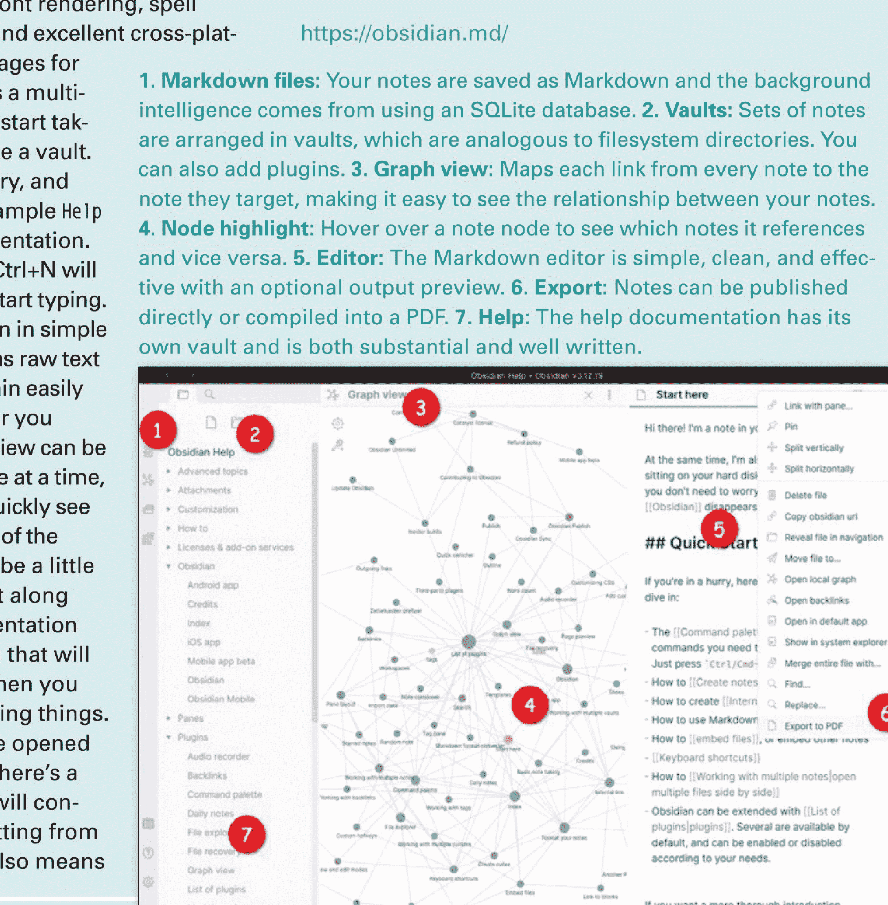

# 办公技巧 2

## Sioyek: 带有 vi 快捷键的 PDF 查看器

Linux 下有很多 PDF 查看器，其中一些很不错，但算不上卓越。特别是 Okular，是我用过的最好的工具之一，因为它是少数几个可以打开 PDF、提供缩放、多页视图，并能以与他人共享的方式注释 PDF 的工具之一。如果你需要管理 PDF 库，内置的编辑器 Calibre 是另一个优秀且更具野心的选择。当你研究某个主题并需要跨多份出版物进行搜索时，它特别好用，尽管 Calibre 的 PDF 查看性能稍逊一些。Sioyek 是一款专门为帮助管理学术论文而开发的 PDF 阅读器，但它同样擅长精美渲染 PDF（尤其当 PDF 包含表单时），以及跨集合进行搜索。

Sioyek 是一个主要为访问学术论文库设计的 PDF 阅读器，但作为通用阅读器也非常出色。


图 1：类 Markdown 风格

- `2` 搜索
- `/` 搜索
- `?` 搜索下一个匹配项
- `n` 跳到下一个匹配项，`N` 回上一个
- 若要用当前术语跳转搜索结果，按 `Enter` 键
- 使用 `R` 进行搜索，等同于在任何文档中展开引用

你可以高亮一段文本，然后在保持原文档打开的同时单独高亮，甚至可以打开另一个引用。这是一个出色的应用程序，具有亮色和深色模式。它对于学术搜索是理想的，同时作为你的 PDF 阅读器也十分完美。

作者：Graham Morrison

https://github.com/ahirm/sioyek

## KeenWrite 技术文本编辑器

现在（可能）写作更好的人比以往任何时候都多。这产生了令人惊叹的、功能丰富的社交媒体帖子、博客文章、文章、教程或任何从未写过的书籍。技术让我们编辑小型文档变得非常容易，但正如我们所知，当你需要组织写作内容、编辑、引用研究结果或搜索可重用的部分时，你通常需要一种更明显的方法。

KeenWrite 是一个具有独特主张的文本 IDE（集成开发环境）。它提供了一种强调 IDE 中“开发”属性的写作体验。它的独特之处（且更像程序员的环境）在于，它是一个 Markdown 编辑器，使用字符串插值来将你编写的内容与呈现和布局分离并进行模块化。

KeenWrite 可以将其值限制在正文中，以将编辑和错误降到最低。

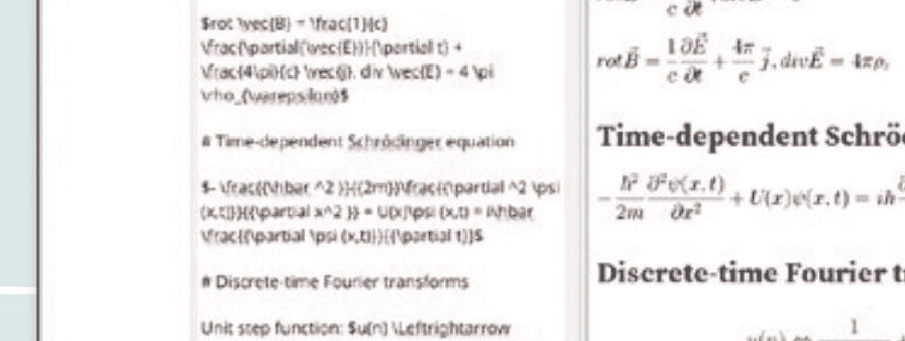

主视图分为三个窗格：中间窗格存放引用，右窗格内容的实时预览，左窗格存放变量。这些变量是插值的关键，因为它们还允许你在 YAML 格式的文档中分配键值，这些键值可以在 Markdown 文档中被引用和插值。一个简单的示例是将书名设置为 Markdown 中的一个变量，而不是设置名称本身。这样书名就可以轻松更改，因为只需要更改字符串名称，而这始终会反映在实时文本预览中。为这些键值对提供的所有功能是非常值得的。

如需测试，请下载 `keenwrite.bin` 文件，赋予可执行权限并运行。

作者：Graham Morrison

https://github.com/DaveJavascript/keenwrite

## AltSearch 扩展：在 LibreOffice Writer 中替换内部搜索工具

文字处理器中很少有功能比搜索工具那么平平无奇。除非你进行密集的编辑，特别是当你的修订涉及格式调整时。那时你会感激有一个功能完备的工具。对于 LibreOffice Writer 来说，可用工具仅强够用，因此我推荐 Alt Find & Replace for Writer 扩展，也称为 AltSearch。

和 LibreOffice 扩展一样，AltSearch 很容易安装。只需从 LibreOffice 扩展商店下载它，并打开“工具 | 扩展管理器”。下次当你需要它时（侧边栏会出现带有绿色图标的图标），AltSearch 允许搜索文档中的任何对象，按标题样式搜索最为有用，甚至允许在不进行剪切和粘贴的情况下替换下方文本，但仅此而已。它的缺点在于功能集中且排序有限。

你可以通过增强 Writer 的默认搜索工具来理解 AltSearch 的必要性。“编辑 | 查找”非常简单，类似于网络浏览器中的查找。它适用于查找单词和短语，但选项有限。你可以从文档的当前位置向前或向后查找、查找全部、区分大小写——仅此如此（1）。

“编辑 | 查找与替换”更通用，但它也相对有限。它可以匹配大小写或搜索哪些

图 1：查找的基础搜索工具。对于许多用途来说，它太简单了。

图 2：查找与替换是查找的改进，但仍然相当基础。

| 查找: | 区分大小写 | 仅全字 |
| 替换: | 查找全部 | 查找上一个 | 查找下一个 | 替换 | 替换全部 |
| - 其他选项 | 当前选择 | 反向替换 | |
| 正则表达式 | 段落样式 | |
| 相似性搜索 | 相似性... | 注释 | |
| 变音敏感 | 属性... | 格式... | 无格式 |

相比之下，AltSearch 提供了更多选项（4）。承认的是，它的菜单和提示中存在一些拼写错误。特别是菜单非常长，以至于可以占据屏幕侧面的整个窗口。然而，大部分菜单包含在线帮助，且 AltSearch 的功能让这种不便变得完全值得。

启动 AltSearch 的主窗口组织得更好，隐藏了部分复杂性。你可以轻松用 AltSearch 删除其内容来替换默认文本。但如果你仔细观察 AltSearch，你会发现几个重要功能。

图 3：导航器对于查找文档中的对象很有用，但与其他工具是分离的。

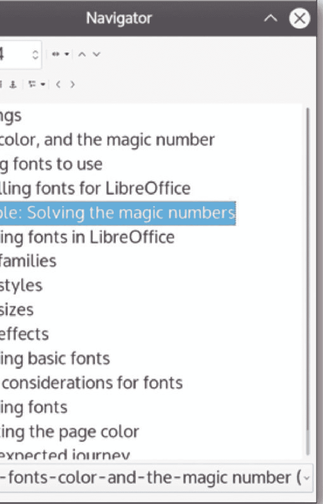


### 图 4：AltSearch 是作为搜索工具的编辑工具。

### 图 5：AltSearch 有用表达式列表。

| 段落开头 | | | |
| 段落结尾 | | | |
| 空段落 | | | |
| 任意字母 [a-z] | | | |
| 任意数字 [0-9] | | | |
| 单词开头 | | | |
| 表格 | | | |
| 手动换行符 | | | |
| 手动列分页符 | | | |
| 手动分页符 | | | |
| 任意空格 (VAR) | | | |
| 自定义连字符 | | | |
| 非连字符符 | | | |
| 由代码插入的 | | | |
| 括号 () | | | |

例如，虽然查找支持正则表达式，但它让用户决定使用哪种。相比之下，AltSearch 选择了一个包含匹配自定义连字符和非连字符符表达式的窗口（图 5）。

同样，这些不仅用于搜索。它们还可以将 AltSearch 变成桌面端相当于 `sed` 命令。例如，如果你保存了一个使用文本布局进行邮件合并的 Writer 文档——它限制了新段落的缩进，即段落间的任何空格。手动添加段落间的空格非常枯燥，但通过 AltSearch，你可以搜索带有 `/` 的段落并替换为换行符和新行 (`\n`)，从而准备章节内的文本。如果你在列表样式需要额外的空格，可以指定该样式。同样，你可以进行此类搜索。

虽然默认工具使用基础段落，AltSearch 的属性不仅支持字符和列表样式，它们还可以搜索这些使用的任何内容，远比基础搜索好得多（图 7）。此外，这些功能通常增加了快速查找项的概率，这在长文档中是非常受欢迎的。

### 图 6：扩展表达式列表。

```
展开两侧的已找到计数
附加标记 // 进行多次替换（在一次操作中）
```


- 字符样式
- 列表样式
- 超链接 - URL 中的子字符串
- 斜体
- 粗体
- **粗体斜体**
- 字体名称（手动修改名称）
- 字体大小
- 字体颜色
- 字体背景（高亮）
- 下划线
- 索引（任意）
- 下标（自动）
- 上标（自动）
- 由大小和转义符定义的索引

已执行并处理以备后用。此函数在书籍或论文等较长的项目中特别有用，在这些项目中，你可能有许多文件需要以相同的方式编辑，因为它们最终将合并成一个文件。

所有这些功能都需要一些时间来学习。在线帮助 [2] 虽然存在，但已有十多年历史，并且比界面内置的帮助详细得细微。例如，AltSearch 本身似乎至少有一个十年的发布周期。长远来看，AltSearch 仍在继续工作，但可能会有一天，最新的 LibreOffice 不再支持它。如果真的发生了这种情况，对于进行严肃编辑的作家来说，这是一个毁灭性的打击。AltSearch 是一个扩展，与以前不同，未来可能会发布适用于 LibreOffice Calc 的版本，作为

相同字符格式（基于光标）

相同字符格式（基于光标）

不换行空格或连字符，通过将其替换为空，并查找单词开头（/）或结尾的字符。

此外，AltSearch 可以执行搜索或替换包含多个段落的地方，或者它可以为搜索定义起点和终点。搜索和替换可以从剪贴板添加，该剪贴板支持多个条目。样式可以替换为另一种相同类型，对象可以重命名以便于导航。

也许 AltSearch 最重要的功能是通过批处理文件进行多次搜索。批处理管理器允许你提供一些基础编辑任务列表，范围从 Writer 中可用的 HTML 转换器到转换日期格式或任何类型的对象到新文件（图 8）。这些只是你可以添加添加到批处理文件中的任务示例。从管理器窗口，你可以打开文本编辑器并根据你的选择构建执行许多功能的文件。完成后，批处理文件可以

> Brucefield

- [1] AltSearch: https://extensions.libreoffice.org/en/extensions/show/alternative-dialog-replace-writer
- [2] 在线帮助：http://macrotjb.libreoffice.org/Help/AltSearch_en.html


| [8] 将所有文本写入新文件 | | |

11

## 在本地安装 draw.io 图表编辑器

Draw.io 多年来作为一个网站已经存在多年了。如果你需要绘制图表或流程图，甚至是电路图，它是不可或缺的。许多用户现在依靠它来制作最新的演示稿、文档项目和项目规划，draw.io 在许多不同类别中的巨大优势使其能够绘制各种图表。你不需要创建自己的图标，从互联网上偷取图像，或依赖模板；只需拖放并绘制符号，将它们连接在一起，并使用 draw.io 出色的样式和注释选项来创建可以保存在本地或在线的免费文件。

但 draw.io 是一个开源项目，你可以在本地计算机上运行它，这非常适合在没有连接的情况下在火车上进行最后时刻的上色。它有 Windows 10.3 的可执行程序、Linux 的 .deb 包以及适用于 Ubuntu 22.04 的 .msi 包。通过该应用程序，你可以在离线状态下创建表。

大量的符号供选择，并且在你绘制的任何图中都嵌入了额外的自定义符号。例如，Google Cloud Platform (GCP) 模板在图表中包含了许多以 GCP 为中心的符号和图层。其他功能包括各种图表、地图、统一建模语言 (UML) 图、流程图以及带有 AWS 基础设施的等轴网络图。

虽然在绘制、文本或排列选项方面没有 Inkscape 强大，但你有足够的工具来创建完美的图表，例如分组、分层和对齐。如果你需要更多控制，可以将其保存为 SVG 文件并在 Inkscape 中编辑。我测试过了，它运行得非常完美。

如果你需要将文件导入 Microsoft Visio，它对 VSDX 有更好的支持。UI 仍然感觉是基于 Web 的，原生桌面小组件会更好，但这是一个重要的应用程序，并且有免费的桌面竞争对手——我想不出有任何 Linux 工具能够生成这种质量的图表，而且没有一个具有同样强大的设计和符号库并能输出许多格式的工具。

创建图表是花费时间的最令人兴奋的事情，这正是 draw.io 如此优秀的原因。它处理了枯燥的部分，这样你就可以花更少的时间绘图，花更多的时间转向实现（或者至少在实现上进行争论）。

该图显示了 draw.io 如何提供：

1. **符号库**：从各种图表图标中拖放。
2. **连接**：组件可以被拖动，它们的连接保持完整。
3. **样式**：在画布上缩放、旋转和分组元素。
4. **样式**：使用颜色。
5. **属性**：选择你的标题样式。
6. **透明度**：我们可以混合你的颜色。
7. **形状类别**：涵盖广泛范围的形状。
8. **自定义库**：包含你的形状，如 GCP 或 AWS。


作者 Graham Morrison

https://diagram.net/

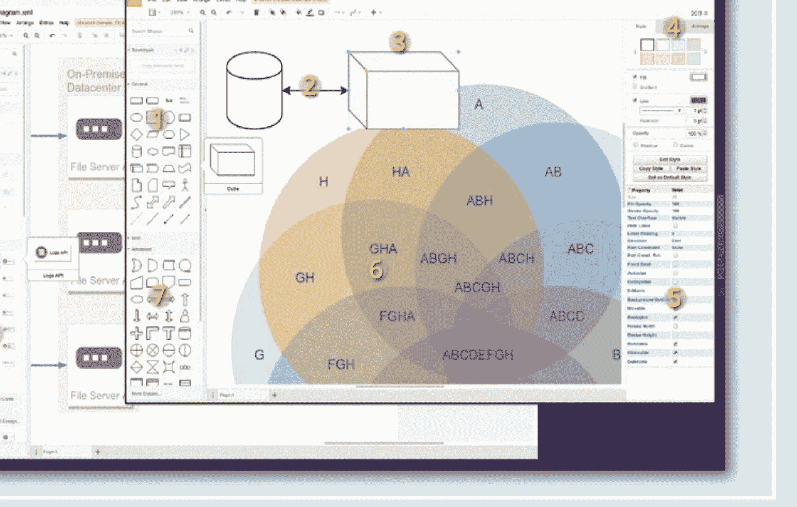

12


# 使用样式创建长文档

我在 LibreOffice Writer 中创建的一些文档是“丢弃型”文档：我写几行，添加一些快速格式，打印文档，然后保存文件或直接关闭程序并丢弃。在那种情况下，使用样式是没有意义的。

但其他你一天创建的文档，在几个月、几年后你会编辑它们，或者创建一个副本添加新文本。这些文档变得越长、结构越复杂（分为章节、节等），使用正确的样式进行格式化就变得越关键。只有为每个标题分配了样式，才能生成目录。

使用样式可以确保整个文档的风格统一：第二页的标题与第 102 页的看起来相同——相同的字体、相同的大小、相同的颜色（如果你对标题做了某些处理）；当你坚持使用样式时，将文档导出为用于出版的格式变得简单得多。

图显示了文档中的两个标题——但只有第二个是真实的标题。当你修改整个标题样式时，只有真实的标题会发生变化，第一个标题将保持不变。

作者 Georg Eiber

## 使用 uvgrep 搜索 Office 文件

如果你喜欢在命令行中工作，可能知道过 `grep` 工具，它允许你搜索文件中的内容。你可以使用简单的搜索模式（如单词或数字），甚至可以让工具忽略大小写并使用正则表达式，正则表达式非常强大，以至于有整本书都在讨论它们。例如，正则表达式：

```
^[0-9]{1,3}-[a-z]*--\$
```

将匹配此模式：

12-abc-12

9-zzzz-9

123-aaa-12

也就是说，该行以一个一到三位数的数字开头，后面跟着一个连字符，然后是一串小写字母（至少一个），另一个连字符，最后是开头的那个数字。正则表达式通过圆括号声明一个组并使用 `\1` 引用它来实现反向引用。如果有更多组，可以使用 `\1`、`\2`、`\3` 等引用。

如果你不熟悉正则表达式，O'Reilly 在他们的网站上有一个很好的交互式教程！

虽然 `grep` 允许搜索文件，但许多应用程序创建的二进制文件是无法“grep”的。LibreOffice 将文档存储在 ZIP 归档文件中。它们通常具有 `.odt`（文本）、`.ods`（电子表格）、`.odp`（演示文稿）等扩展名，这些文件都是标准的 ZIP 存档。

图 1：你可以提取 LibreOffice 文档并检查 XML 代码。

你可以将此文件类型重命名为 `document.zip` 并用默认程序打开——你会发现某些压缩管理器会启动并显示文件夹结构。

图 1 显示了你在 LibreOffice Writer (.odt) 文件内部的内容：ZIP 存档中的第一个文件是 `content.xml`。Writer 中的标题 1 段落在内部存储时（不包含如下行）：

```
<text:text:name="Heading_20_1"
text:outline-level="1">
Example 1
</text>
```

接下来的段落以类似的方式存储：

```
<text:text:name="P1">
这是一份显示 LibreOffice 文档文件结构的示例文档。这是一份显示 LibreOffice 文件结构的示例文档。
</text>
```

由于 XML 文件也是文件，因此可以使用 `grep` 进行搜索。这比每次搜索时都重命名文件、提取并访问内容文件要节省大量精力。

我写了一个工具来自动化这一过程：`uvgrep`（意为“通用 grep”）。它可以搜索 LibreOffice 和 Microsoft Office 文件、PDF 等。你可以从 GitHub 下载它，但你还需要几个辅助程序：

- `llint`：用于解析和格式化 XML，这对于 LibreOffice 文件是必要的；它们倾向于包含极长的行——当你期望看到一点点上下文时，看到的却几乎是整个文档的内容。
- `pdfgrep`：一个用于检查 PDF 文件的独立工具。它通过一次调用即可搜索 PDF、Office 和文本文件。
- `llint` 和 `pdfgrep` 工具默认不安装；在 Ubuntu 上，你可以在 `libxml2-util` 包中找到 `llint`，在 `pdfgrep` 包中找到 `pdfgrep`。如果你还没有它们，可能也需要安装 `git` 包。

```bash
sudo apt install libxml2-utils git grep
git clone //github.com/hgesser/ugrep
make +x ugrep
sudo cp ugrep /usr/local/bin/
```


### 图 2：ugrep 向你展示压缩的 XML 文档。

再次，这些是正则表达式，它们会移除 `<` 和 `>` 之间的所有字符以及前面的空格。如果你添加 `-x` 选项，`ugrep` 就会这样做。

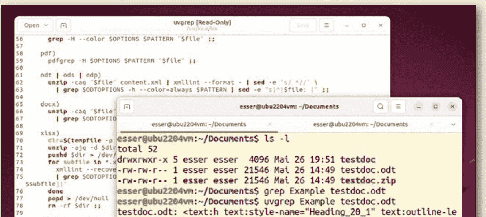

Dropbox 在 2007 年首次出现时是革命性的。它提供的云存储是一个新事物，而拥有一个与他人共享并与其他机器同步的目录这种便利性极具吸引力。邀请新用户增加个人存储容量的趣味化机制让许多人深陷其中。早期采用者获得了回报。

Maestral 与 Linux 桌面环境的集成程度比我们想象的任何官方 Dropbox 云客户端都要好得多。

整个平台充斥着相对开放的 API，众多第三方客户端之一最终提供了 Dropbox 作为 Linux 级别的工具。这种快速的进展和采纳在 2019 年受到了广泛欢迎——那一年有超过 6800 万用户接受了我们的热情，因为大规模采用正是我们现在所精通的。

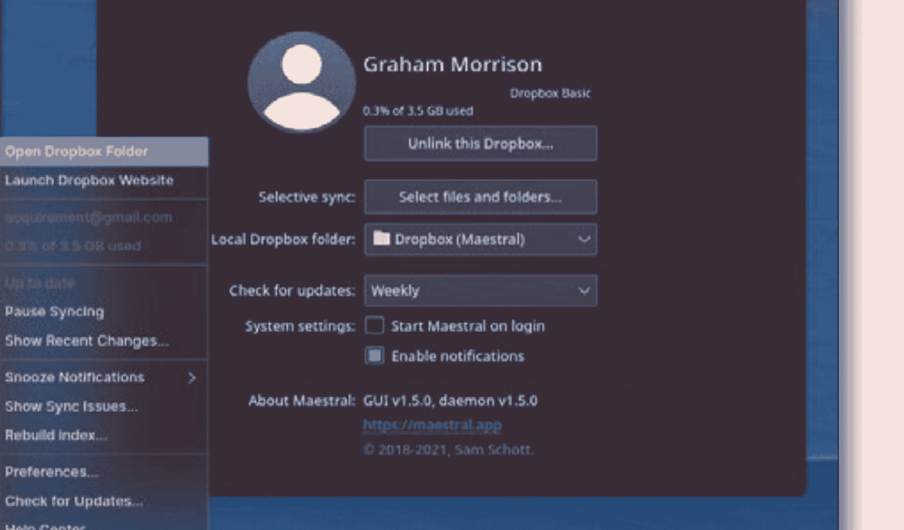

但 Maestral 恰好让我们重新审视对 Dropbox 的热情。它是一个非官方客户端，拥有简洁的 UI，并允许我们访问账户的公共 API。该项目最令人印象深刻的是它既有命令行工具也有 GUI，且可以通过命令行执行所有操作。它提供了暂停和恢复、同步或启动备份的选项，还可以添加应包含或排除的文件，以及桌面通知。GUI 设计精美且易于使用。它的任务图标带有一个右键菜单，可以运行许多你熟悉的相同功能，它是你用过的最好的 Dropbox 客户端。但关键点在于，它需要的资源非常少，且不会轻易占用 CPU，这对于即使 Dropbox 的某些竞争对手的客户端来说也做不到。在 Ubuntu 上，通过 `pip install maestral[gui]` 安装客户端，并从 `~/.local/bin/maestral` 运行二进制文件。

作者：Graham Morrison

分享文件有很多方法，但 Android 和 Apple 设备上的即时（ad hoc）本地文件共享功能已非常流行。在 Linux 上实现这一功能并不容易——因为 Linux 缺少此类功能。LANDrop 是对常规的一种耳目一新的改变。它是一个开源的即时本地文件共享工具，平等支持所有平台，包括 iOS、macOS、Windows 和 Linux。它承诺在不放弃隐私的情况下无缝共享你的文件，通过离线连接甚至使用蜂窝数据提供服务。你不需要担心可能拦截传输的第三方，而且它在保持开源的同时完成了这一切。传输所需的所有数据直接在设备间共享，你的共享对象可见的唯一数据是文件名、日期和 IP 地址。这些都可以关闭。

> 本地传输是一种广泛采用的解决方案。

iOS 和 Android 都有官方应用——后者通过非商店 APK 提供——这使得向朋友传输文件变得简单得多，或者如果你可以的话，可以自己构建包。在 Ubuntu 上，在安装包并运行 LANDrop 应用程序后，文件系统将帮助你它现在正在运行，并可以通过其微小的面板图标进行管理。从该图标，你可以更改设备名称以及你的设备是否可被发现，以及你希望它去往的地方。如果你的“设备可发现性”不需要工作，或者你想诉诸于共享地址（这增加了一份额外操作），那么当你想要发送一个或多个文件时，此选项可用，文件可以在点击“传输”之前在窗口中列出。然后，文件将快速高效地复制到远程设备。

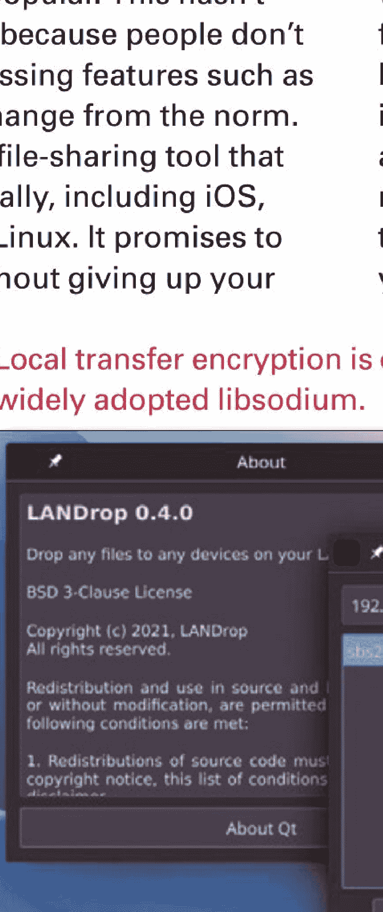

作者：Graham Morrison

https://landrop.app/

### 酷炫 LINUX 技巧 – 2022版

回在对我们大多数人来说互联网要慢得多且更不稳定的年代，下载管理器曾是一种产物。这些是你可以启动以完成下载的独立应用程序，例如获取一个发行版 ISO，或网页上的某个链接。有很多供选择，它们都具有带宽限制或服务器负载、挂起和恢复，以及根据下载类型确定目标文件夹等功能。宽带互联网和现代浏览器的结合在很大程度上用浏览器功能取代了这些需求。因为我们通常运行浏览器，现在在下载时让浏览器运行是可以接受的。

浏览器插件会选择性地监控你的视频播放状态，并提供下载匹配的流视频的服务。

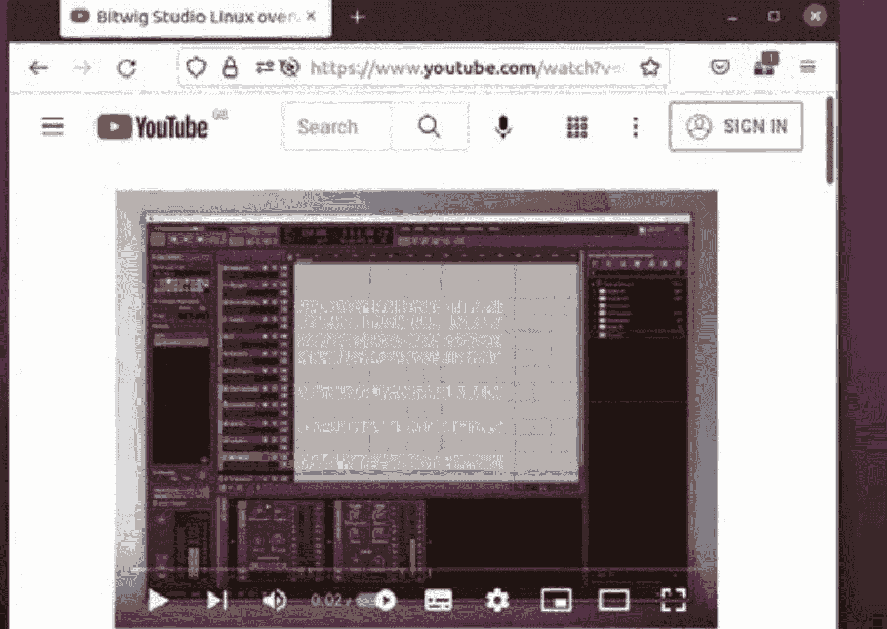

但运行下载管理器仍有很多理由；Xtreme Download Manager (XDM) 将它们整合到一个应用程序中。XDM 是一个现代下载管理器，大多数时候可以使用，并将下载分配到独立的进程和屏幕空间。如果你下载大量文件或对文件类型有复杂的规则，这非常有帮助。对于观看大量视频的人来说，这也是一个非常有用的东西，因为它在下载完成之前还可以缓存那些视频或其本地内容。无需插件，或只需点击一下，就可以从许多不同源下载视频并转换为更具便携性的格式。你可以通过我们的浏览器插件这样做，或者通过监控剪贴板，且下载可以被缓存、保存直到系统关机。

Bitwig Studio Linux

XDM 会一次下载一个文件以最大限度地利用你的带宽，并承诺由于其“分段”技术，将下载加速高达五倍。如果你下载大量文件或对文件类型有复杂的规则，这非常有帮助。对于观看大量视频的人来说，这也是非常有用的，因为它在下载完成之前还可以缓存那些视频或其本地内容。无需插件，或只需点击一下，就可以从许多不同源下载视频并转换为更具便携性的格式。你可以通过我们的浏览器插件这样做，或者通过监控剪贴板，且下载可以被缓存、保存直到系统关机……（此处省略原文重复的段落翻译，遵循要求不重复输出）

EasyNAS 在安装期间启用了 Web 服务器。要实现这一点，在浏览器中调用系统的 IP 地址，后接冒号和端口号（例如 `192.168.1.10:443`）。这将带你进入登录界面，你需要输入 `admin` 用户名和密码。

EasyNAS 打开了一个视觉上漂亮且布局清晰的仪表板，使系统配置可视化。

EasyNAS 以混合镜像的形式提供，大小约为 380MB。关于最低系统要求，开发者建议处理器频率至少为 500MHz。然而，旧的 0.72 可用于 32 位 CPU。

此外，硬件应至少配备 1GB RAM，2GB 或更多对系统运行更有利。硬盘需要至少 20GB 的容量。

NAS 项目本身不满足任何系统要求，但由于各种原因，你将一个网络连接。EasyNAS 缺乏集成 WiFi 网络的能力。从积极方面来说，系统支持多种协议。网络文件系统 (NFS) 可用于仅限 Linux 的环境，而在文件共享方面推荐 SMB 或 Samba。

注意，EasyNAS 需要一个专用的存储区域用于自身。这是第一个硬盘，可以作为网络驱动器的一部分用于存储。因此，NAS 系统至少需要一个物理存储设备——可能取决于所需的 RAID 级别。

驱动器旁边

卷包含逻辑驱动器，用户显示登录系统的用户。要查找每个组的更多信息，请点击“查看详情”。

安装后，文件系统和卷将为空，除非你先对它们进行配置。此外，

用户仅管理员。

启动时，第一个是 GRUB 菜单，你可以在其中选择安装 EasyNAS 或从内部硬盘启动。系统不支持现场模式。

要在存储设备上安装 EasyNAS，该开源变体将引导进入的

在仪表板左侧的垂直侧边栏中，你会找到“存储”（Storage）和“系统”（System），你可以使用它们来配置你的 EasyNAS。

卷管理器（Volume Manager），如果需要，可以使用它来修改设置（图 3）。

## 组和用户

为了简单且安全地使用内存配额，你必须分别通过“系统 | 组管理器”和“用户管理器”来创建组和用户。根据你选择的选项，你将像驱动器设置一样找到“创建组”或“创建用户”链接。先创建组，然后通过在配置字段中选择所需的组将用户分配到组，这将是有帮助的。

要为打算作为 NAS 存储的硬盘创建文件系统，首先打开“存储 | 文件系统管理器”。点击“创建文件系统”后，会弹出一个清晰的对话框，你可以在其中为文件系统分配名称，从系统内置存储设备列表中选择合适的硬盘，并为硬盘指定想要创建的 RAID 级别（图 2）。

此外，你还可以为硬盘设置压缩级别。需要注意的是，在指定 RAID 时，如果你只有一个硬盘，则必须指定 JBOD 级别。文件名应至少包含八个字符。应用设置并点击保存。系统随后会确认新文件系统的创建。

创建用户时，你还可以定义配额并分配权限。完成设置后，该组或用户将显示登录其中的用户总数。

### 图 2：在文件系统管理器中创建新硬盘。

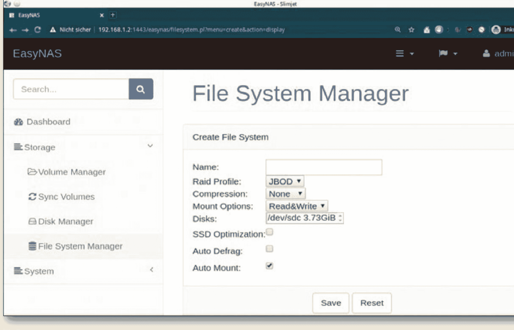

接下来，切换到“存储 | 卷管理器”并创建一个新卷。点击“卷”后，会出现一个不自明的对话框，列出所有基本信息。由于最初不存在用户或组，管理员在对话框中显示为“用户”。如果你在第一步中创建了第一个文件系统，请在此对话框的设置字段中指定用于该卷的文件名。你还需要为卷命名，并在适用时分配权限以便进行访问。

### 图 3：EasyNAS 对所有类别使用相同的对话框，例如显示已创建卷的对话框。

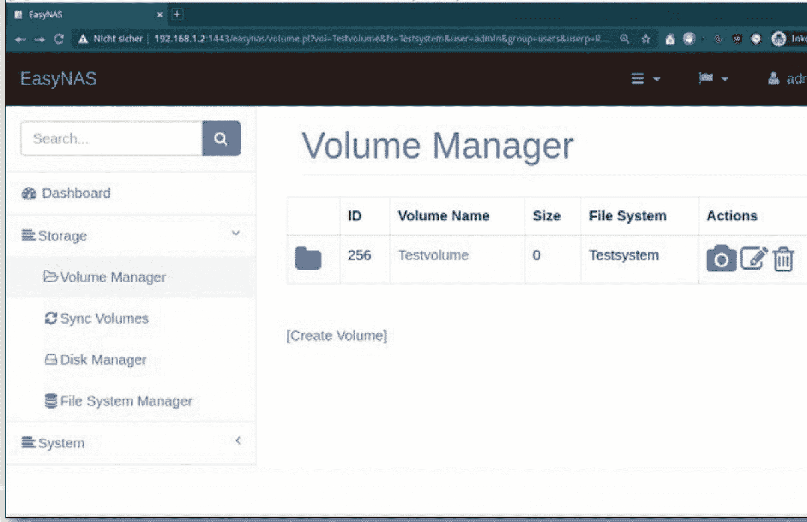

基本设置激活了用户的写权限，而组只有读取权限。如果你创建了配额，你也可以在此对话框中分配配额。完成所有设置后，点击保存到新卷。与创建文件系统类似，该卷现在出现在列表中。

### 图 4：EasyNAS 带有一个虽小但实用的用户管理功能。

要使用相应的协议访问 NAS，你需要先启用该协议。为此，EasyNAS 在左侧侧边栏创建一个新的“文件共享”类别，显示当前的协议。你可以通过滑块启用它们。协议随后无需重启系统即可可用。若要从桌面访问各个卷，请打开相应的桌面管理器并通过 FTP 或 SMB 连接。

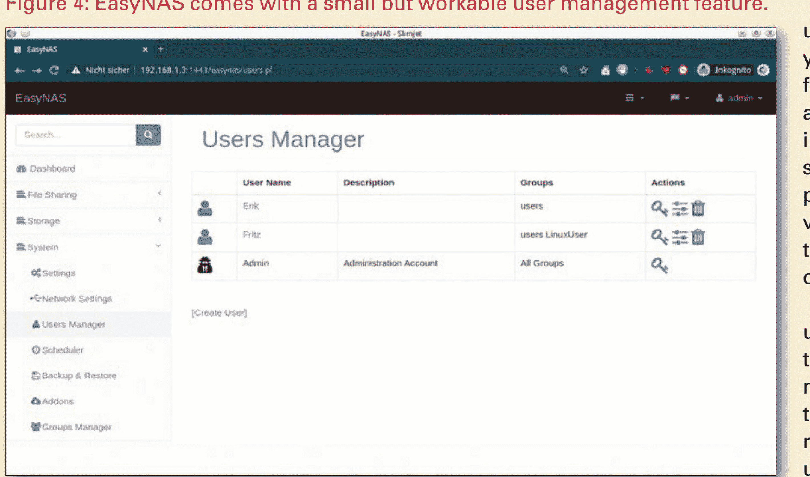

用户。点击“详情”打开用户的详细信息。在“操作”下，你可以管理条目、删除用户或修改设置（图 4）。

在 EasyNAS v1.0.0 中，你会在左侧找到备份与恢复的选项。这些选项允许使用 Btrfs 快照进行备份和恢复。目前，“备份与恢复”无法使用。对于备份，你仍然手动创建数据的副本，或使用桌面文件管理器。

访问 NAS 资源的最后一步是指定你想要使用的协议。EasyNAS 提供了总共八种访问方法，从 Apple 协议到 CIFS/SMB（在 Windows 世界很常见）。SSH、NFS 协议在 Linux 上也可用。你可以在“管理员设置”下启用各个选项。要将其集成到系统，点击右侧的安装按钮。EasyNAS 从互联网下载相应的包并集成，然后显示确认消息。

EasyNAS 提供的网络解决方案完全符合你的预期，可以在 NAS 系统上存储和管理数据。EasyNAS 直观的界面消除了耗时的操作。得益于 openSUSE 和 Btrfs 文件系统，EasyNAS 的基本功能可以进一步扩展。EasyNAS 因其节省硬件的需求而脱颖而出。旧电脑都可以转换为 NAS 存储系统，EasyNAS 适用于无需特殊知识的用户快速设置和使用网络存储。

### 图 5：常见文件管理器显示连接网络存储的简单拨号。

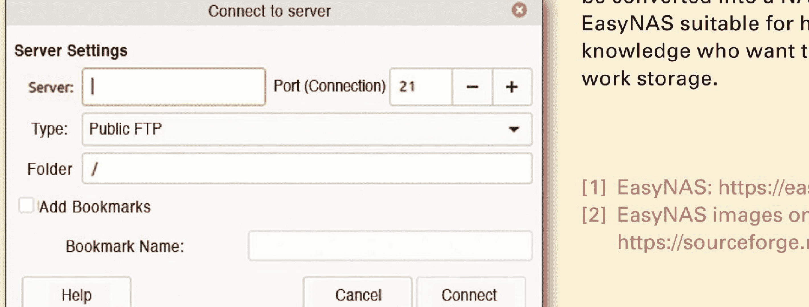

Erik Bärwald

- [1] EasyNAS 镜像：https://easynas.org/
- [2] SourceForge 上的 EasyNAS 镜像：https://sourceforge.net/projects/easynas/files/

自动分配 IP 地址并不意味着它是强制性的。旧的静态网络配置在 2021 年仍然有效。

Linux 提供了几种手动网络配置的方法。传统是通过 `ifconfig` 和 `route`，但现代发行版不再自动安装这些工具。今天的替代方案是使用简单的 `ip` 工具。

路线图是让设备上线、分配 IP，然后添加一些路由（至少是默认路由），并配置 DNS。假设你想在 `eth0` 设备上配置网络，然后使用以下命令（作为 root）：

```bash
ip link set dev eth0 up
```

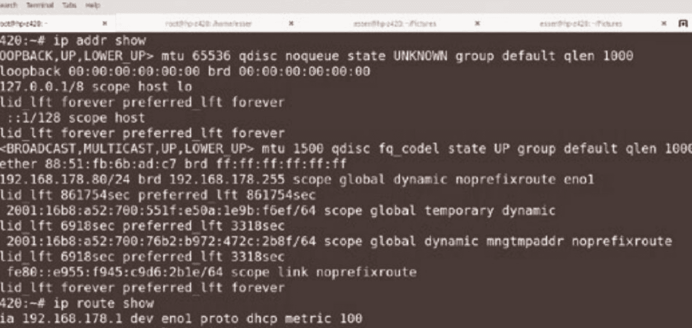

这将设备带入“启用”状态。现在使用以下命令分配 IPv4 地址：

```bash
ip addr add 192.168.1.5/24 dev eth0
```

确保你选择的 IP 与网络上的任何其他项冲突是你的责任。你可能注意到你使用了 CIDR 表示法，`/mask` 允许你在单个命令中同时分配 IP 地址和网络掩码。mask 是子网掩码中的位数，等同于 `ifconfig` 符号中的 `255.255.255.224`。

下一步是添加默认路由：

```bash
ip route add default via 192.168.1.1
```

你需要替换为网关地址，该地址需要与处于同一个子网。你的最后一步是告诉 DNS 服务器使用哪一个：

```bash
echo "8.8.8.8" > /etc/resolv.conf
```

这将设置 DNS 解析器。如果你知道本地 DNS 服务器，请替换它。如果你使用 `resolvconf` 或类似的管理框架，情况会变得复杂。在这种情况下，请参阅主页。

如果你不想配置网络而是想查询当前设置，使用选项显示输出（见图）。

Valentine Sintiny


Network Manager 是命令行工具 `nmcli`（Network Manager 命令行接口的缩写）使用的配置工具。它允许你查询一些信息数据，包括可用的 WLAN 访问点（见图）。

如果你在一个新地方，比如收到了一张带有 SSID 和密码的纸条，你可以使用 `nmcli` 在没有图形界面的情况下连接。通过：

```bash
nmcli dev wifi connect <ssid> password <password>
```

（当然，带有 SSID 和密码）。你不需要使用 `sudo`，因为当你使用 `nmcli` 或任何与 Network Manager 通信的程序时，该工具会连接到一个守护进程并显示已登录网络——对于某些任务，它会请求 root 权限，或者在普通用户身份运行时失败。

有许多子命令（以及 `dev` 和 `connection`）可以配合 `nmcli` 使用。查看主页和 `nmcli-examples` 页面以获取许多示例。

https://www.projects.org/NetworkManager/

Hans-Ger E

在 Hack 46 中提到的整个工具非常适合一次性任务，但如果你想分享一个文件以上的文件，或者想保持隧道开启而无需反复重新协商关键词，那么它就不够完美了。虽然还有其他方法可以实现这一目标，但 `weorf` 使用起来和 `weorf` 一样简单。

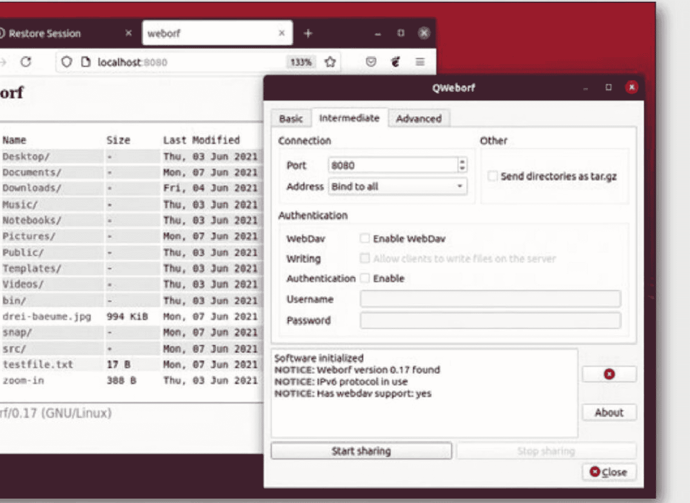

`weorf`（见图）会建立一个简单的 HTTP 服务器，就像以前运行 Apache 来共享 `/srv/www` 的内容一样。这使其变得非常灵活，可以通过 Web 浏览器访问，也可以从几乎任何可以访问网络 WebDAV 的设备，或者通过虚拟根目录和自定义 CGI 脚本访问。使用带有指定端口参数（`-port`）和要共享文件夹参数（`-d dir`）的命令，客户端只需通过正确的端口访问你的 IP 即可。它可以作为守护进程在后台运行，使用证书，处理身份验证，并仅监听特定的 IP 地址。如果该命令为你提供了更多选项（在单独的包中可用），一个方便的 GUI 可以半自动地运行所有这些，增加在本地网络之外进行 NAT 穿透的能力，并将目录以 .tar.gz 格式发送。

作者 Graham Morrison

https://github.com/itlf/weorf


想象你正在使用 SSH 在远程机器上工作，并启动了一个需要一些才能完成的命令（例如构建过程）。如果电脑进入睡眠或网络极其不稳定，SSH 连接将会中断。远程机器会检测并终止该登录会话中的所有进程。

有几种方法可以避免这种情况。一种老技巧是使用 `nohup` 命令在后台运行进程，以应对网络中断和连接丢失做好准备，它们将忽略连接丢失时发送的挂起信号。对于构建过程，那可能可能是：

```bash
nohup <command> &
```

而不是简单的命令。副作用是所有输出将写入一个 `nohup.out` 文件，且脱离连接会话。

我更倾向的解决方案是不使用 `nohup` 或类似的技巧。我使用 `screen` 会话。（如果你的机器没有它，该包专门称为 `screen`）。

当 `screen` 启动时，它会显示一条关于版权和许可的长消息；按回车键通过。然后你就可以像往常一样继续使用 shell。如果你丢失了连接，重新连接到远程机器并运行 `screen -r` 来重新附加到现有会话。


也许你不确定是否有正在运行的 `screen` 会话——`screen -ls` 是一个好用的搜索选项：

有一个 `screen` 在运行中：

```
16712.pts-0-hp-2428 (05/06/2019 11:24:49 AM) (Detached) 1 Socket in /run/screen/0-esser.
```

你可以将登录远程机器并检查 `screen` 会话的过程自动化。创建一个文件——`.bash_login`（如果你还没有的话），并向其中添加以下行：

```
screen -XS /dev/null -S -ls
```

当你登录到一个 `screen` 会话时，你将收到通知（见图）。（Bash 仅在登录会话中执行 `.bash_login`）。

如果你想从运行中的会话中分离，按下 `Ctrl-A`，`D`。你可以用 `screen` 做更多事情——去检查一下其中几个。

```
$ssh -p-2428 user@server
Last login: Mon 6 11:34:58 2019 from 2001:db68:0750:db22:93
1 Socket in /run/screen/0-esser. (05/06/2019 11:33:22 AM) (Detached)
```

在不可信的网络中，我选择使用 `shuttle`。有无数种替代方案，我怀疑这个名字暗示了隧道至少不是根目录。OpenVPN 非常丰实。我需要具有用户权限的 SSH。此外，在建立连接的服务器上必须安装 Python。使用带有指定端口参数（`-port`）和要共享文件夹参数（`-d dir`）的命令，客户端只需通过正确的端口访问你的 IP 即可。

```
sudo shuttle -r <user>:<server>:80
```

然而这意味着如果端口号是 22，应该到达局域网中的其他设备。为了保持局域网可见，我将其定义为

```
sudo shuttle -r -d <user>:<server> -x 192.168.2/24
```

包含在这里。这意味着连接也会通过隧道运行，这并不是自动发生的。除了 DNS 之外，是 `shuttle` 在传输 TCP。

其他协议在网络层和 TUN/TAP 上工作，而 `shuttle` 在应用层工作。它组装 TCP 流，保持状态，并再次放入目标端。这避免了困扰 OpenVPN 等其他工具的 TCP 之上的 TCP 问题（拥塞控制）。该协议定义了丢包限制。如果你通过 TCP 建立隧道，你就会丢失拥塞控制，这可能导致模式。`shuttle` 对此问题是免疫。各种参数可以帮助你排查故障。

### 将 Docker 工具作为过滤器

Unix 哲学认为——Linux 允许我们使用一组简单的工具并以巧妙且富有创意的方式组合它们来解决问题。传统上，这类问题是指需要分析一个或多个输入文件并将其转换为一组输出的任务。

在许多情况下，你实际上通过选取一组命令行并对其进行排列来组合出解决方案，使得第一个工具的输出作为第二个工具的输入，第二个工具的输出作为第三个工具的输入，以此类推。这就是“构建流水线”，这是一个示例：

```bash
cat /passwd | column -t -s: | txt2html --make_tools > passwd.html
```

（当缺少 txt2html 时会失败），请运行以下稍长的命令，它将在一个新的容器中运行：

```bash
grep /var/log/syslog | tail -n 100 | sed -e '\s/sub224#hostname=/g' -e '\s/username=/g' | less
```

```bash
cat /passwd | column -t -s: | docker run -i --rm txt2html --make_tools > passwd.html
```

这条命令行结合了四个工具（grep、tail、sed 和 less）并同时运行它们，将每个工具的输出与下一个工具的输入连接起来。这假设你已经在包含 Dockerfile 的文件夹中使用命令 `docker build --tools` 创建了 Docker 镜像。Docker 会启动该镜像的新实例并在内部运行 txt2html 命令——关键在于 `-i` 选项，它将你的本地标准输入转发到 Docker 容器，并允许转换器读取流水线命令的输出。

- 1. grep 在日志文件 `/var/log/syslog` 中搜索包含系统名的行。它输出这些行同时跳过其他行。

- 2. 输出被传到 tail 进程，删除除了最后 100 行以外的所有内容。

- 3. 接下来，sed 对 tail 的输出执行两次查找并替换操作。为了修改日志条目：真实的主机名和用户名被替换通用名称。这不会从进程流中过滤任何行；它会查看每一行并可能修改它们。

- 4. 最后，输出被传到 less，这是一个分页程序，让你能够查看信息。在 less 中，你可以上下滚动行和页，并进行搜索。

如果你经常需要该工具，那么每次调用工具时都启动一个新的容器并将其删除是没有意义的。相反，请在分离模式下（在后台）启动它：

```bash
docker run --itd --name r_tools tools
```

然后在流水线中使用 Docker 的 exec 命令：

```bash
cat /passwd | column -t -s: | docker exec -i r_tools txt2html --make_tools > passwd.html
```

使用 `--name` 选项指定的名称必须与你在 exec 命令中使用的名称匹配。

那么容器与此有什么关系呢？为了运行命令流水线，流水线的所有组件都必须安装。虽然这显而易见，但你会很快发现运行它们需要某些工具。

例如，简单的过滤器 txt2html 可能无法作为安装包在你的桌面可用，但你可以在 Debian 和 Ubuntu 系统的仓库中找到它。

作者：Hans-Geer Eser

https://metacan.org/dist/txt2html/scripts/txt2html

| daemon | 1 | daemon | bin |
| alice | 2 | alice | bin |
| bob | 3 | bob | bin |
| charlie | 4 | charlie | bin |
| root | 5 | root | bin |
| games | 6 | games | bin |
| mail | 7 | mail | bin |
| null | 8 | null | bin |
| new | 9 | new | bin |
| proxy | 15 | proxy | bin |

发行版交付软件的方式正在发生。新的包格式如 Flatpak 和 Snap 变得越来越流行，容器对于桌面用户来说也变得越来越重要。这有很多原因。开发者希望他们的软件能够快速到达用户，而无需创建账户。某些方法还允许同时安装多个软件版本。沙箱作为安全特性也发挥了作用。

此外，并不是所有的软件都能使用传统的包格式轻松安装并保持更新。对于像 Kali Linux 这样提供成百个高度专业应用程序的发行版来说，尤为如此。许多此类专业应用程序在 Debian 仓库中是不可用的。其他的难以打包，因为它们依赖于过时的库，或者需要 root 权限来安装应用以防与其他程序冲突。

Boxer (1) 是一种为 Kali Linux 开发的基于 Docker 和 DEB 的应用程序，它在 Debian 打包系统中通过容器部署难以打包的应用。开发者创建应用程序的 Docker 镜像，并链接到经典的 Debian 包中。在安装期间，文本继续...]

根据你安装了哪些 Kaberox 格式的内容，请使用列表 1 第 2 行中的命令（图 2）。首先，我测试了 Zenmap，它是 Nmap 端口扫描器的图形前端。Zenmap 依赖于过时的 Python 2 库，这使得在 Debian 及其衍生版上安装任何软件都变得非常痛苦；Python 2 已经从 Debian 仓库中移除。

图 4：当你启动容器时，Kaberox 会在桌面菜单中创建一个项目

### 自定义

为 Kaberox 设置应用程序绝对不是易事。文档详细描述了所需的步骤 [3]。这些步骤包括为更大规模的部署创建并构建相应应用程序的 Docker ，通过 GitLab CI 自动化该过程是有意义的。更多信息请参阅 Kaberox 手册页和 `kaberox_user`。

```
zenmap 1 2 3 4 q
zenmap
Zenmap
```

为了以更小的开销运行 Zenmap，Kali 开发人员为你提供了 `zenmap-kbox` 软件包（列表 1 第 3 行），如安装过程所示，它也会在桌面菜单中创建一个项目（图 4）。你可以同样使用 `cvenant-kbox` 软件包（第 4 行）设置 Cvenant，这是一个带有 Web 前端的基于 NET 的控制框架（图 5）。两者运行得都很好，你会立即注意到它们运行在容器中。Cvenant 会自动启动其 Web 界面。Kaberox 的 Firefox 作为一个完整的 GUI 应用，在测试中运行没有任何问题。

对于 Linux 用户来说，Kaberox 提供了安装难以或无法设置的应用程序的优势。你可能会注意到（如果所有容器都安装了常规 DEB 包）安装时间稍长。通过一点练习，你可以很快地管理简单的应用程序。其他 Debian 衍生版的开发者最终将利用 Kaberox 的技术来保持存在感。

作者：Ferdinand Thommes

Kaberox 的安装时间比传统的 DEB 包长一点。Kaberox 的接力包作为元数据下载为 Docker 镜像并进行设置。然而，一旦启动它们，你就不会发现任何延迟。

- [1] Kaberox: https://github.com/kalinux/tools/kaberox

- [2] 将 Kali 仓库添加到其他 Linux 发行版：https://milosloderv.org/?p=3690

- [3] 文档：https://www.kali.org/docs/development/packaging-apps-kaberox/

Kaberox 还有一个缺点，同样考虑 Flatpak 和 Snap：文件大小。每个只有几 KB 的程序作为容器都会膨胀到 50MB 或更多，因为宿主机系统缺少依赖项（或者在最坏的情况下可能会重复的依赖项），以及容器的开销。由于由于，Kali Linux 没有在它的操作系统镜像中包含这些应用程序。相反，如果需要，你必须手动安装它们。

图 5：在通过浏览器中的容器操作 Cvenant 之前，它需要你多花一点精力。

```
Packaging Applications | Cvenant - Login | xroot
https://127.0.0.1:4433/cvenant/users/login
Kali Kali Tools Kali Docs | Newsletter | Offensive Security | MSKU | Exploit-DB | GHDB
```

# 虚拟化

如果 VirtualBox 虚拟机中安装了增强功能（Guest Additions），你可以使用 VManage 直接在虚拟机上启动程序。以下命令登录名为“Fedora 36”的虚拟机（VM），用户为 tim，密码为 123456。

```
VBoxManage guestctl "Fedora 36" --exe "/usr/bin/gedit --username tim --password 123456 --putenv "DISPLAY=:9"
```

当它启动时，会留下 gedit 文本编辑器。`--exe` 选项用于你想要编辑的程序的完整路径。对于 Windows 虚拟机，你需要输入路径中的文件名，例如 `C:\windows\calc.exe`。对于图形化 X11 应用程序，你可能需要使用 `--putenv` 参数设置环境变量。你也可以在参数中添加参数：

```
VBoxManage guestctl "Fedora 36" --exe "/usr/bin/gedit --username tim --password 123456 --putenv "DISPLAY=:0 edit/arg=/home/tim/brief.txt"
```

参数始终位于两个双横线之后。在示例中，`edit/arg` 表示后面跟着 edit 程序的参数。这里，`just` 就是你想要编辑的文件路径。

guestcontrol 命令在需要时可以提供客机状态的洞：

- `VBoxManage guestcontrol "Windows 11" list all`

除此之外，guestcontrol 还列出了你可以通过 closeprocess 杀掉的进程：

```
VBoxManage guestctl "Fedora 36" --session-id 4022
```

通过 `--session-id`，你提供了会话 ID。guestcontrol 代表正在运行的会话。

作者：Tim Schmann

# 美好的时光：1990 年代的 Linux

许多用户觉得当切换到文本模式（`Ctrl+Alt+F6`）时，Linux 体验就足够了。对于想要尝试的用户，你仍然可以重温旧 Linux 的世界。无论是旧的 Linux 系统、IBM 兼容计算机的旧操作系统，还是老旧的家用电脑，你都可以回到 80 年代。

开发者还创建了 PC 版本，可以在各种 Linux 发行版（包括 Ubuntu）上运行。在树莓派上安装软件需要一些时间来设置。另一个选项是尝试 RetroPie。如果你想回到更久以前，可以安装正确的软件。

- [1] archive.org/

- [2] archive.org/details/linux_distributions

酷炫 Linux 技巧 — 2022

# 虚拟化

图 2：在 archive.org 上寻找旧 Linux。

早期的基于 DOS 的 Windows 版本以及其他 Unix 类系统（如 BSD 或 Solaris）。如果你想回到过去，你可以重温家用电脑。

我发现一个特别有趣的模拟器是 Retro Machine。它不是开源的，并且仅限于电脑游戏（ZX Spectrum）。如果你想玩经典的电脑游戏，请尝试 MAME。在 Ubuntu 上，执行 `apt install gnome-videocarc`（包含 MAME）；它运行得良好。

作者：Hans-Georg Eiefer

- [1] archive.org/

- [3] archoslinux.org/

- [4] en.wikipedia.org/wiki/SunOS

- [5] retrovirtualmachine.org/

- [6] mamedev.org/

# 虚拟化

## 23 使用 Docker 测试替代 CMS

Docker 是专家们所说的“虚拟化”的工具。虽然技术细节非常有趣，但最重要的是你可以在几秒钟内下载并运行复杂软件包的实例。

阅读这些替代方案，但没有什么比实际运行这些系统更能帮助你做出决策了。现在设置一个 CMS 加上所有数据库、新主机，以及大多数操作都需要时间。一旦你决定删除它，很可能会留存一些碎片并浪费你服务器上的空间。

这使得 Docker 对各种应用程序都变得有趣，对于那些考虑切换到不同内容管理系统（CMS）的网站所有来说特别有用。如果你是其中之一，你可能会——

相反，使用 Docker 在家里的电脑上测试你的系统：访问 Docker Hub 并搜索 management。他们为你提供了 WordPress、Maven、Joomla、Drupal、Plone 和 Nuxeo 的官方 Docker 镜像。例如，如果你按照 Docker 的 WordPress 页面所述，在 docker-compose 文件栈中写两行并运行：

```
docker-compose -f stack.yml up
```

即可获得两个镜像（一个包含 Apache 和 WordPress，另一个包含 MySQL 数据库）和一个可以运行的系统——只需通过 http://localhost:8080 登录，选择用户名/密码组合，你就可以使用 WordPress 发布文章了（见图）。

作者 Hans-Geörg Eiß

> https://www.docker.com/

> https://hub.docker.com/_wordpress

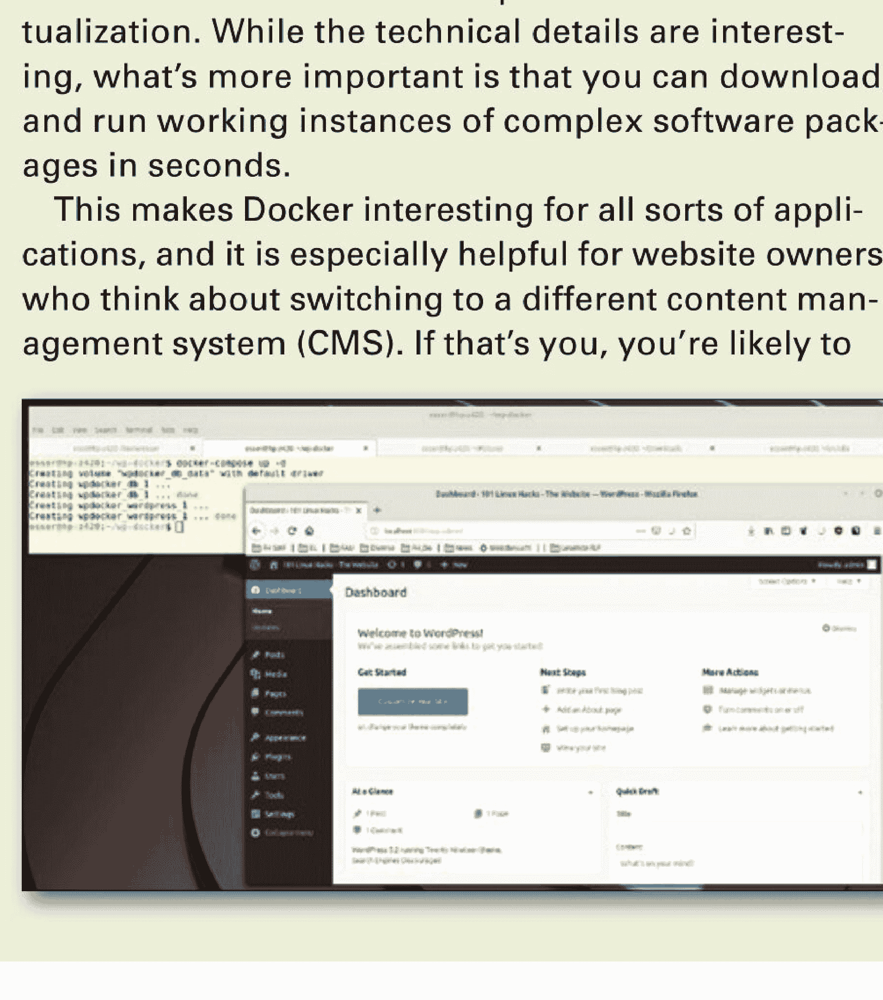

# 访问商店

# shop.linuxnewmedia.com

# 错过了某期吗？

你幸运了。

大多数过往期仍然可用。在它们售完之前立即下单吧！

shop.linuxnewmedia.com


# 立即获取！

使用我们的替代 PDF 版本节省交付时间

## 从不同的 Linux 安装中运行二进制文件

随着仓库以及如 Apt、Zypper、YUM/DNF 等管理工具的出现，软件安装已变得简单；现在只需选择你想要的软件包，让包管理器找出它需要的其他软件包（依赖项）并一次性安装。

遗憾的是，并不是每个应用出现在 Linux 发行版中。例如，图片查看器是我最喜欢的工具之一，它非常简单！但它也很老了，自 1994 年以来就未出现过。它的源代码可用，但有大量的编译工作。对于某些发行版（如 openSUSE），你可以在它们的领域内制作并提供包。对于其他（如 Ubuntu），你做不到。那么直接从 openSUSE 拷贝二进制文件到 Ubuntu 怎么样？

嗯，这可能会导致问题；在许多情况下，尝试运行二进制文件将产生提示缺少库的错误消息。如果你不在目标系统上搜索它们，它们可能缺失，或者安装了错误的版本。

相反，回到源头并在那里搜索库。你可以尝试通过运行 `ldd /usr/bin/xv` 来获取列表（示例：图 1）；现在通过将该文件和 `ldd` 的整个输出作为 zip 的参数列表来构建 zip 压缩包：

```
zip xv.zip /usr/bin/xv $(ldd /usr/bin/xv)`
```


这将产生许多错误信息，因为输出中有更多的名称，但这没关系：它会将它识别的所有内容打包到新的 zip 文件中。将该文件拷贝到目标机器。

在目标机器上，为你的项目创建一个新文件夹，将二进制文件本身解包到该文件夹，并使用以下命令解压：

```
unzip -j xv.zip
```

`unzip` 中的 `-j` 选项将忽略路径信息，因此它会将所有文件释放到当前目录。

### 图 1

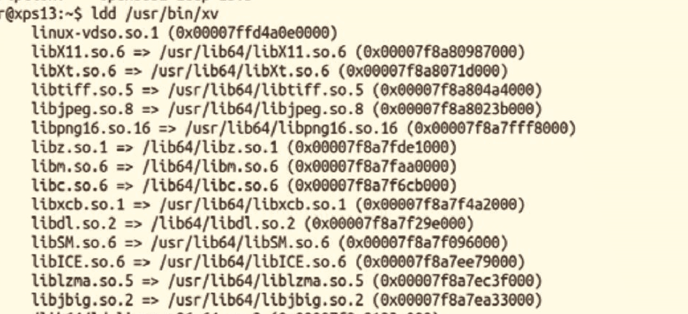

现在你快完成了：启动一个增量过程，将库添加到 `LD_LIBRARY_PATH` 变量中。要启动程序，复制当前目录中的文件并检查错误消息。如果它说缺少 `lib.so`，那么就是这样：你从错误的源拷贝了它。所以（以此为路径）通过设置 `LD_LIBRARY_PATH` 可能会导致另一个（新的）关于某些其他文件的错误消息。例如，下一个可能是：

```
LD_LIBRARY_PATH=./lib ./xv
```

最后启动了。请注意文件名之间必须用逗号分隔，且值在双引号内。对于其他程序，构建命令行可能需要更长时间，如果你想用这种方法在 64 位系统上制作 32 位二进制文件，将会出现问题。至少这可以通过安装 32 位兼容层正常解决。或者另一种方法（移动 64 位二进制文件）在技术上是不可能的。

## 或者使用 LD_LIBRARY_PATH？

如果你了解 `LD_LIBRARY_PATH` 变量，你可以添加加载器将设置为默认文件夹的目录，然后：

```
LD_LIBRARY_PATH=./lib ./xv
```

> 作者 Hans-Geörg

### 图 2

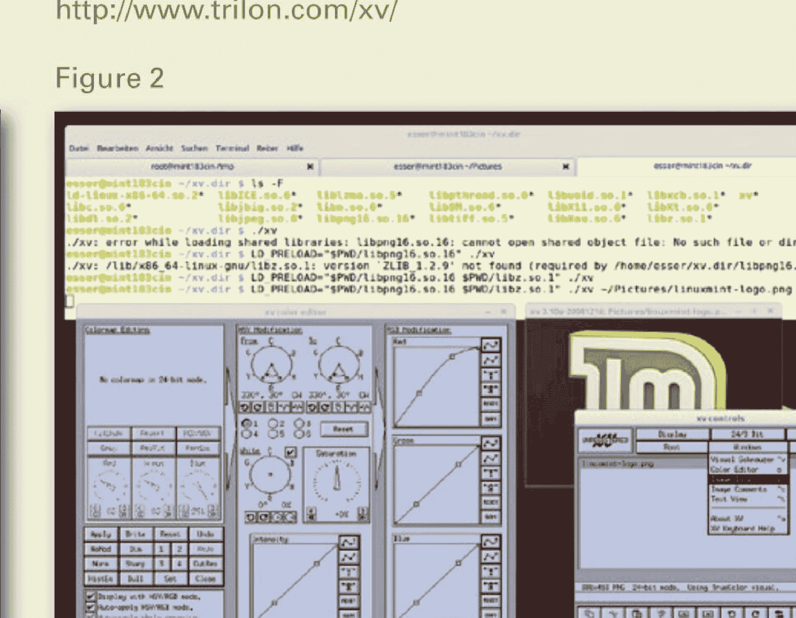

# 保持运行

Linux 不再说“保持运行”，由于它可以显示 CPU、内存、存储和网络统计，这对于网站所有者来说特别有用。

| HACK | |
|---|---|
| HACK 25 | 监控系统 |
| HACK 26 | 管理界面 |
| HACK 27 | 可视化 |
| HACK 28 | 运行状态 |
| HACK 29 | 应用程序 |
| HACK 30 | 磁盘 |
| HACK 31 | 列表 |
| HACK 32 | 进程 |
| HACK 34 | 统计图表 |


# 监控系统

Linux 不再说“保持运行”，由于它可以显示 CPU、内存、存储和网络统计，这对于网站所有者来说特别有用。

当它启动时，默认页面显示三个 CPU、内存、网络使用的图表。在 Ubuntu 上：

```
sudo apt install plasma-systemmonitor kde-desktop
```

# HACK 26

# Guider 性能分析与监控

如果说 KDE Plasma 的系统监器是我们见过最漂亮的监控工具，那么 Guider 可能是最全面的工具的候选者。它并不认为自己是一个监控工具，而是倾向于使用“集成性能分析”这一术语，这是一个很准确的描述。它的功能包括监控、性能分析、可视化、控制、日志、网络和命令行。所有这些功能都可以从命令行启动。

最简单的情况下，你可以运行 `guider --to` 在进程视图中启动该工具，尽管你可能更喜欢图形界面。每种监控模式都带有海量数据，很容易让你的终端过载。例如，工具实现会列出每个系统概览的统计数据。

它还可以通过其他方式测量特定函数的时间和资源消耗、检查调用堆栈并进行信号跟踪。你甚至可以从同一个命令配置调度器以提供更多或更少的 CPU 时间或其 CPU 使用率，尽管这取决于配置。

输出内容很多，你可以选择性将其重定向到 JSON 格式的文件中，或从网络浏览器中查看。线程也可以被追踪、记录，并将其历史记录回放和导出到程序中。在 Guider 内部，你可能想从你喜欢的浏览器或图像查看器查看它们。虽然有很多需要学习，但该工具对于简单的监控来说既直观又用，非常适合那些需要随着知识增长而不断进步的人。

作者：Graham Morrison

https://ipace.github.io/docs/guider.html

Guider 是一个从简单监控到追踪和性能分析的工具。

# HACK 27

# Visual drescue 的进度

许多用户使用 GNU drescue 从文件中恢复数据。然而，结果很难调试，drescue 则以图形化方式处理日志。要使用它，带上文件名参数运行 drescue，它会创建一个映射文件（“File in open map”）。

第一个工具确定磁盘大小并在主窗口中显示所有扇区（见图）。不同的颜色代表了区域处理的完成情况：该工具运行正常（绿色）、有缺陷（红色）、未修剪（黄色）或尚未识别（灰色）。你可以通过鼠标点击接收有关扇区的详细信息：这将打开“扇区检查器”（Block Inspector）对话框，它会显示扇区的属性，以及它和数据最终是如何被记录的。

该工具允许通过程序设置 512 字节的大小，并提供在 drescue 运行时保持显示更新的刷新。在 Ubuntu 和 Linux Mint 上，你只需安装：`install the gdrescue (GNU drescue) and drescue packages.`

作者：Uwe Vollbracht

https://www.github.com/software/drescue https://sourceforge.org/projects/drescue

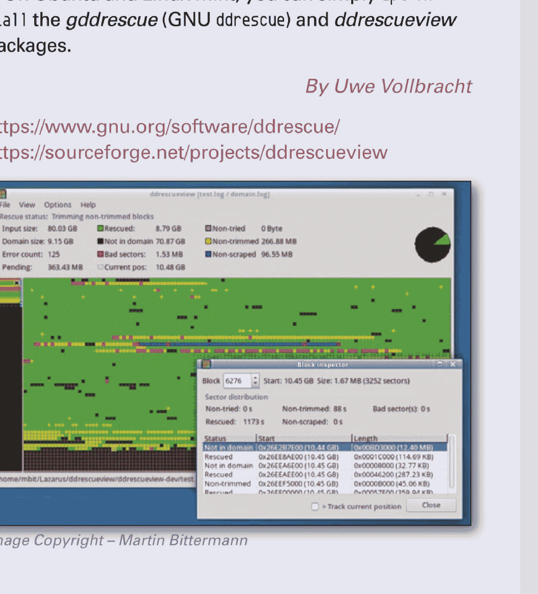

图片版权 – Martin Bittmann

酷炫 LINUX 技巧 – 2022版

# HACK 28

# 使用正确的选项运行 dmesg

`dmesg` 工具显示出现在内核环形缓冲区中的消息，正如其 man 页面中令人叹的选项列表所示，它有多种实现方式。但大多数选项并不有趣，你只需要其中几个。

运行 `dmesg -luxw` 可以查看带有人类可读绝对时间格式 (`-t`) 的用户-内核消息，以及在持续跟踪 (`-w`) 中的优先级前缀 (`-p`)。这导致了如图所示。除非你远程登录到一个具有奇怪设置的终端，否则颜色高亮会自动出现；在这种情况下，你可以尝试强制彩色输出 `--color`。

当我们看着屏幕并等待后续消息时，无法向上滚动。如果你想查看过去的内容，请使用 `-u` 选项：你将看到环形缓冲区的全部内容（从第一行开始），并向下滚动到较后的条目。注意，缓冲区是固定的环形，一段时间后会丢失消息。如果你想将 `dmesg` 输出限制为用户态或内核态消息，请添加 `-v` 选项。

注意，某些信息永远不会进入此缓冲区：请也检查 `/var/log` 中的文件；你的 syslog 服务可能会将某些信息记录到 `/messages, syslog` 或该文件夹中的其他文件中。

作者：Hans-Coge Eiber

# IT 亮点一览

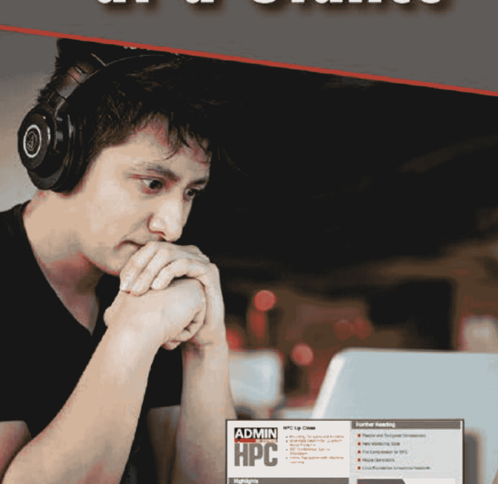

# 管理更新


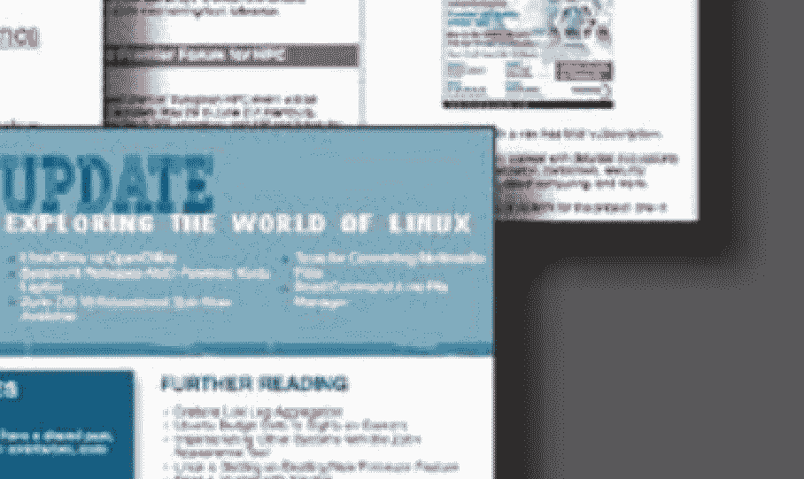


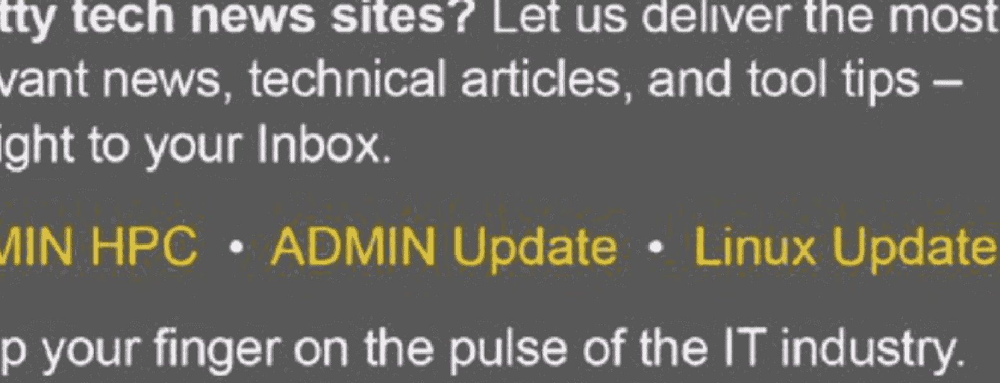

忙于阅读发布稿和技术网站了吗？让我们为你提供最相关的消息、技术文章和技巧——直接送到收件箱。

紧跟 IT 行业脉搏。

HPC：bit/HPC-Update

Linux 更新：bit/Linux-Update

# HACK 29

# 使用 inxi 获取快速配置

每个管理员都知道如何获取他们正在工作的系统信息。CPU 有多少个核心？`/proc/cpuinfo` 要快得多！比起许多工具，你只需要使用一个：`inxi`。它通过包管理器（例如 `apt`, `Debian`, `Ubuntu`）可用。

假设我需要一个通常不工作的报告，调用 `inxi` 而不带任何参数即可获取有关硬件的简单信息，如速度、内存和系统（内核和 shell）。如果我想获取一些细节，`-f` 提供有关视频、分区和功能的信息（图 1）。

如果我想获取特定组件的信息，可以使用 `-c`, `-g` 和 `-s` 分别获取有关 CPU、音频和图形的信息。内存信息详细列在其中。默认值，`inxi` 允许我看到最消耗内存的进程，另一方面，如果我想查看处理器的负载，你还可以结合两者：`inxi -mc` 返回内存和 CPU 状态。

在这份信息详尽的报告最后，我将快速查看外部的情况。

作者：Carly Kühn

https://github.com/inxi/inxi


## 内存详情

以 root 权限运行，需要知道可用多少内存。DDR 模块插入测试机器并收集数据。这是一个相当古老的问题（图）。图 1 所示的 `-c` 参数允许颜色方案。默认颜色方案在浅色背景终端上并不易读，但得益于许多选项 (`-c1` 到 `-c3`)，可以设置可用的方案，我甚至可以谈论 `inxi` 的进程监控。如果我想知道哪个

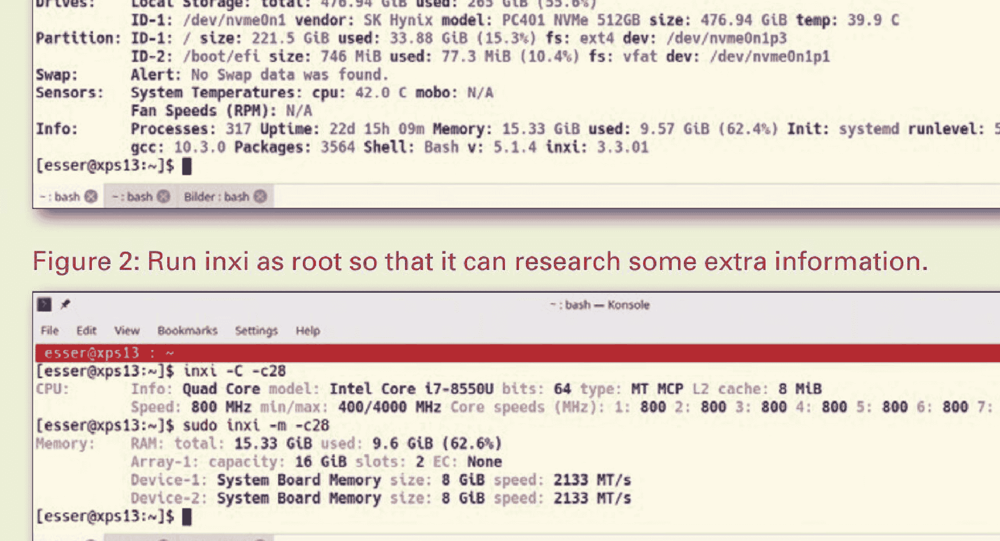

# HACK 30

# 磁盘挂载在哪里了？

如果你喜欢通过添加硬盘而不是更换旧硬盘来延长电脑寿命，你可能会很快丢失对数据类型的追踪。一些基础工具将帮助你获取概述。

`lsblk`（列出块设备）工具显示所有使用的设备和分区。`lsblk` 的默认视图仅包含设备和挂载点（设备在目录树中的位置）。

`lsblk` 的输出有六列。表 1 提供了从它可以获取的信息概述。

使用切换 `lsblk` 可以显示比当前使用的更多的设备。例如，它将显示一系列循环设备（未映射到存储文件的虚拟块设备），如 `/dev/loop0` 到 `/dev/loop-`。

## 文件系统

`-t` 选项显示存在哪些分区以及它们挂载在文件系统的位置。

### 表 1：lsblk

| NAME | 设备名称 |
|---|---|
| MAJ/MIN | 设备的主和扩展号 |
| RM | 0 固定，1 可拆卸设备（如 CD/DVD 驱动器） |
| SIZE | 可读格式的设备存储容量 |
| TYPE | 设备类型（见表 2） |
| MOUNTPOINT | 设备挂载的目录 |

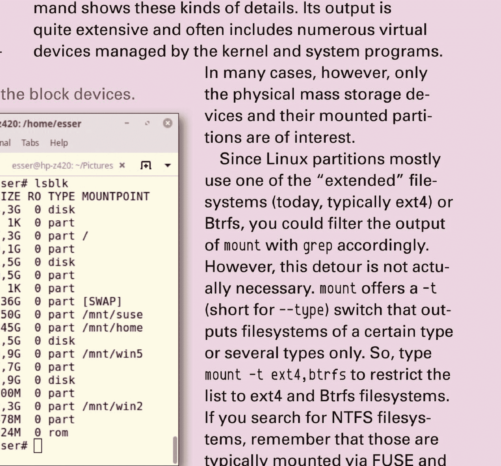

然而，你不知道挂载分区时设置了哪些选项。计数显示了这些细节。它的输出非常详尽，包含了内核和系统程序管理的众多设备。

在许多情况下，物理存储设备和分区是不同的：

由于 Linux 分区使用“扩展”文件系统之一（现在通常是 `ext4` 或 `btrfs`），但通过 grep 运行 `lsblk` 输出提供了一个 `-t`（用于 `--type`）切换，你可以查看内核或服务器文件系统的分区。

如果你需要 NTFS 驱动程序，文件系统类型将是 NTFS（通用文件系统）。因为 NTFS 提供了这么多信息，文件系统类型和软件包提供了更好的选择。如果没有其他选项，你可以从各个文件系统是如何挂载的找到。`find` 命令可以识别文件系统类型及其挂载时的选项。它支持 `-t` 选项，你可以将其用于 `ext4` 文件系统（见图 2）。与 `mount` 不同，`find` 不限于单个分区，而是让你搜索你想要的。

作者：Frank Hoffman

### 表 2：lsblk 设备类型

| Type | Description |
|---|---|
| disk | 硬盘 |
| loop | 循环 |
| lvm | 卷管理器 (LVM) 分区 |
| part | 存储介质上的分区 |


酷炫 LINUNKS-HACKS 2022

## 使用 fswatch 进行系统监控

大多数 Linux 用户可能都使用过 `cron` 来调度命令的运行。这两者各有其用处：`cron` 用于重复事件和单次事件调度。然而，它们都缺乏收集系统信息并通过简单脚本向您反馈的能力。使用 `watch` (1) 和 `fswatch` (2) 来明智地完成这些任务要简单得多。

每个命令运行之间——该间隔显然是为即时排故障而选择的。然而，在始终持续运行的计算机上，将间隔设置为 86,400 会让 `watch` 每天运行一次，设置为 604,800 则与 `cron` 的功能相同。可以使用逗号或句号来编写大时间间隔；最小间隔为 1 秒。`watch` 和 `cron` 的区别在于，如果电脑关闭，你需要重启 `watch`，而这是 `watch` 或 `cron` 都不存在的问题。出于某些原因，间可以用 `--precise (p)` 补充间隔，以确保该间隔是可能需要注意的内容。

### watch

`watch` 的目的是跟踪命令输出随时间变化的情况（图 1）。这可以用于排故障，也可以用于在安装或更新新软件包时跟踪常规系统项。在有限的情况下，它也可以作为 `grep` 的更简单替代品。表 1 显示了其他几个选项。默认情况下，`watch` 每五秒执行一次，除非被关闭或中断。其基本结构是：

`watch` 还支持自定义输出和行为的选项。通过 `--color (c)`，输出将进行彩色编码。通过 `--line (l)`，行会被截断，并通过 `--diff` 高亮显示与不同的最新输出。你还可以通过 `--title (t)` 修改标题文本、当前命令和时间。退出选项多种多样。通过 `--change (g)`，`watch` 在输出发生变化时退出，这可以是一个明显且方便的指示。通过 `--error (e)`，它会在发生噪声时停止，以指示在错误发生后以错误退出，或者等待直到按下任何退出键。

根据命令的内容，`watch` 可能需要包含在标记中。例如，如果命令在管道中运行或使用 `--exec (x)`，它会对自身进行加引号。或者，你可以不使用引号，而是运行一个包含多个命令的进程。

有两个选项用于更改 `watch` 的行为。最重要的是 `--interval SECONDS`。`--interval` 允许你更改默认的 2 秒。

#### 表 1：Watch 的日常用途

| 命令 | 描述 |
|---|---|
| `watch -n 5` | 每五秒显示一次输出 |
| `watch -n 60` | 每 60 秒监控一次 |
| `watch -d -1` | 监控目录的变化 |
| `watch -d '1 | grep job'` | 监控由 job 命令的文件 |
| `watch uname -r` | 监控新内核的安装 |
| `watch -d free -8` | 监控空间的变化 |

### fswatch

`fswatch` 监控目录或文件的变化。Ubuntu 用户可以使用 `fswatch` 软件包来安装它。最简单的方法是在时间上使用 `fswatch` 并编辑文件。既然你想使用 `fswatch`，你需要了解该命令的结构和运行机制。`fswatch` 能够使用几种不同的监控器。在 macOS 上，它使用 FSEvents，即 kqueue 监控器。在 BSD 上，它使用带有 `-fswatch monitor` 选项的内核子系统，保存文件修改的时间。所有监控器提供类似的信息，`fswatch` 的 man 页介绍：

```
echo 60.0:ls -l /watch
total 4
-rw--r--r-- 1 bb 136 Jan 22 13:04:22 distros.txt
-rw--r--r-- 1 bb 0 Jan 22 13:01:53 test.txt
```

图 1：使用 watch 每 60 秒跟踪目录的变化。

#### 表 2：swift xargs

| 操作 | 命令 | 注释 |
|---|---|---|
| 运行 Bash 命令 | `fswatch FILE-PATH` | `xargs -n 1 COMMAND` 通常用于创建、更新或删除文件 |
| 监控多个文件和目录 | `fswatch PATH/*.js` | `xargs -n 1 bash_command` |
| 打印变化文件的绝对路径 | `fswatch PATH` | `xargs -n 1 -I {} echo` |
| 按事件过滤 | `fswatch --event DIRECTORY-PATH` | `xargs -n 1 bash_command` 通常用于更新或删除目录 |

页面具有其自身的优缺点，以及所有的 Bug，这些在帮助页中有描述。你可以使用 `--monitor (-m)` 选项查看监控器列表，并使用 `--name (-n)` 指定使用。然而，输出显示在运行命令的终端中，通常监控器提供的信息很少。

在没有任何选项的情况下，`swatch` 仅记录变化的文件，但其他选项可以添加信息，例如检测到的事件，以及可选的事件检测时间。每个事件都有多个事件类型。`swatch` 事件类型包括：

- Created
- Removed
- Renamed
- Gmodified
- Attrmodified
- MovedFrom
- MovedTo


- `IsFile`
- `Islink`
- `Link`

为了帮助组织输出，你可以使用 `--batch-marker (-c)` 包含每个命令循环，并且 `--print (-p)` 用于确保行与行分开以便阅读。

基本命令结构为：

```
fswatch PATH OPTIONS
```

正如可能需要的路径，你可以使用正则表达式通过 `--include (-i)` 或 `--exclude (-e)` 选择路径。

向右侧，你将看到逐渐增加的消息，直到达到 debug (7)。

在终端中，你可以通过输入 `journalctl -p7` 找到此优先级。info (6) 通常是没问题的。在级别 2 和 8 之间，我们测试中显示的行数自上次启动以来（四天前）少于万行。

测试系统总共存储了跨越四个月的 6 个进程，占用了约 48GB 的磁盘空间。这是一个系统限制，即使你没有设置最大大小限制——但它超过了系统允许的范围。

## 过滤与导出

Journalctl 提供了许多过滤选项：在顶部的“日期 / 时间”中，你可以指定日志显示的时间窗口。如果你还想确切看到你正在寻找的内容，可以使用过滤器进一步缩小到特定的 bug 或进程。例如，如果你想查看来自内核或 Nvidia 的所有错误，在过滤行中输入命令并按下标记的 Filter（过滤）。

主视图的中间标签页通过点击条目列出除匹配日志以外的所有条目。你可以选择在第一个标签页下创建的“显示完整日志”来访问所有日志。

在带有 Ryzen-7 CPU 的 PC 上，查看直到重启后的所有保存日志花了我超过 600 万行的时间。你可以从 Journalctl 的主视图中查询总大小！磁盘上日志的大小（图 2）。

如果你想以其他方式处理日志，或简单地使用“导出过滤后的日志”（Export filtered journal）将其保存到任何路径。如果你只需要显示日志的摘要，通过按下“导出选择”（Export selection）来保存并保存。

## 远程访问

如果你起初好奇为什么 Journalctl 需要库导出功能，例外情况是

> 图 1：Journalctl 最常用的用例是查看当前启动的日志。Journalctl 实时工作，并在运行期间显示入入的消息。

显示当前启动（启用运行时跟随）

> 图 2：中间标签页列出了除...以外的所有日志。当你选择条目后，可以更改显示方向，然后从右侧开始显示。

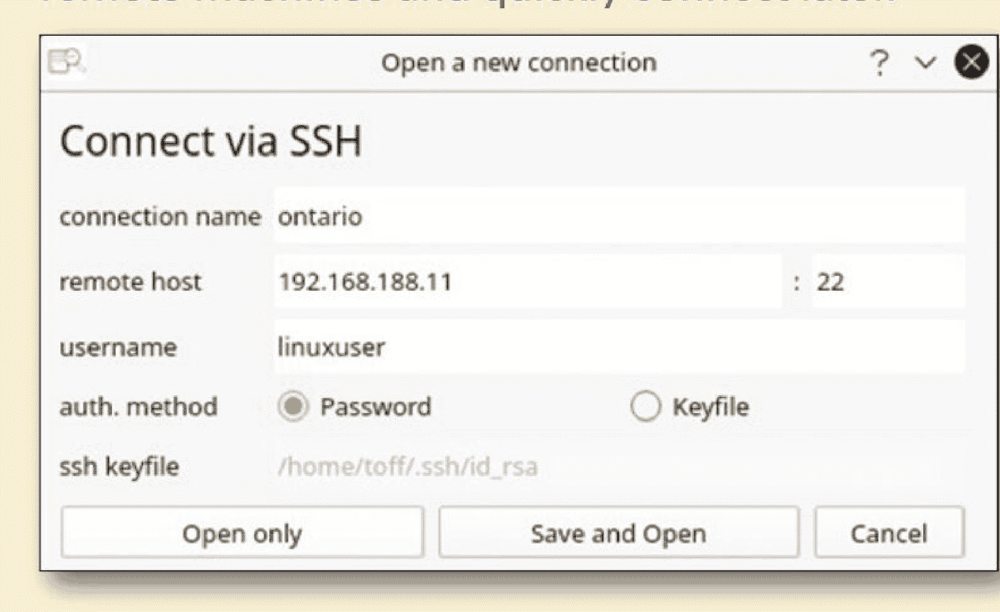

## 持续运行

Qjournalctl 还可以通过 SSH 显示远程计算机的日志。**远程菜单**（Remote menu）提供了通过 SSH 开启连接的命令，以及在你频繁查询系统时访问的凭据。Qjournalctl 支持基于密码的访问，以及使用密钥文件 (3)。

在带有三个标签页的栏下方，主窗口顶部提供了**实时日志**（journal in realtime）和**最新消息**（Latest message）选项。**实时跟随日志**（Follow the journal in realtime）的左侧始终保持灰色。如果你正在查看当前活动启动进程的日志，实时功能会自动启用跟随消息，这在顶部的末尾也有*（实时跟随）*添加。在查看启动进程时，实时功能显然没有意义。但你仍然可以勾选**反向输出**（Reverse output）框来以反序显示日志输出。

图 3：通过 SSH 轻松访问远程机器是一种特别的。你可以保存远程机器的凭据并快速连接。


列表 4 中的行将其截断为 100MB。你也可以丢弃所有超过例如一个月的消息（第 2 行）。在此背景下，Qjournalctl 的唯一查询与日志的总大小有关。你需要在终端中查询服务的健康状况（第 3 行）；使用 `journalctl --verify` 检查单个日志的完整性。

# 结论

对于任何无法掌握所有必要终端命令的人来说，Qjournalctl 都是一个手手的工具。Qjournalctl 便于在日期时间和限制内搜索。在远程计算机上显示日志文件并从保存的列表中选择它们是非常用的。

> 由 Ferdinand Thomas 编写

## 缺失了什么？

Qjournalctl 带来尚未提供执行 journal 在终端中处理的许多管理任务的功能。系统日志的大小以及单个文件的大小来自 `journald.conf` 配置文件。可选情况下，你可以即时截断日志；例如，来自某行的命令

- [1] Qjournalctl: https://github.com/pentix/Qjournalctl/tree/v0.6.3
- [2] DEB Packet: https://github.com/pentix/Qjournalctl/releases/tag/v0.6.3

| 列表 4: 手动操作 |

```
$ journalctl --vacuum-size=100M
$ journalctl --vacuum-time=1month
$ systemctl status system-journal
```


46 酷酷 LINUX 技巧 – 2022


# FOSS LIFE

# 开源面向所有人

新闻 • 职业 • 资源

FOSSlife.org

## 音频

无论你是 DJ、音乐作曲家还是音乐家，Linux 都提供了许多出色的应用程序。建议尝试其中的一些。

| HACK | |

|---|---|

| HACK 33 | projectM 可视化 | 49 |

| HACK 34 | AutoEQ 改进器 | 49 |

| HACK 35 | Knob 音乐库 | 50 |

| HACK 36 | Mixx DJ 软件 | 51 |

| HACK 37 | ChowTape 磁带仿真 | 52 |

| HACK 38 | Surge XT 合成器 | 53 |

| HACK 39 | VCV Rack 2 模块化合成器 | 54 |


# projectM 可视化

# HACK 33

很少有像这样的音频可视化工具工具好用。虽然它们可能会让纯粹的听觉体验变成令人头疼的盛宴，但它们同样可以增强听体验，特别是在派对上。即使对于简单的设备，projectM 也是我过的最好的可视化工具。在音乐可视化器中，它可以是复古的或者是现代的。你甚至可以编辑代码并测试你的 GPU 能向屏幕推入多少像素。该项目包含了来自 MilDrop 的，以及一个包含 4 万个预设的海量库。可以在这些之间切换，还有随机预设，以及创建预设列表和锁定当前所选预设的功能。这是一个极佳的消遣，非常适合派对。

由 Graham Morrison 编写

```
https://github.com/projectM-visualizer
```

通过将项目投影到附近的墙上创建 190 波。

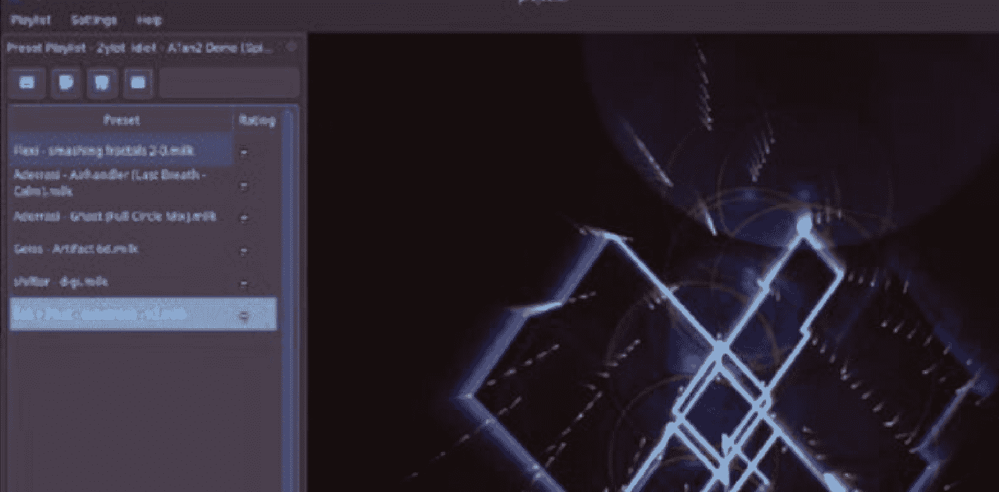

# HACK 34

# AutoEQ 耳机

这是一个极佳的项目，大多数人的耳机音频质量都存在问题。它以一种令人印象深刻且文档齐全的方式来实现，即使是音频也会得到改进。该项目的核心是一个命令行工具，可以监听并分析硬件的频率响应。一组耳机（或扬声器）的频率响应可以可视化图表，显示它们多准确地反映声音，并重现低频（例如），或者人声经常占据的频率，或者高频漂移产生的高频，或者 Miles' 真理的原因？事实是，大多数耳机需要平直声音，夸大高频、中频和高频，但有时它们的设计会不利影响你想要的声音。AutoEQ 可以帮助修复你的耳机音频但不是直接。如之前提到的，它能够测量你耳机的频率响应并创建

由 Graham Morrison 编写

```
https://github.com/jaakopasana/AutoEQ
```

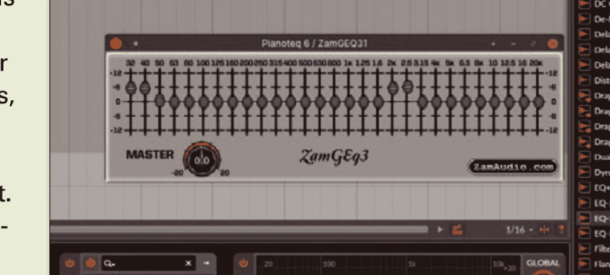

## 音频

## KnobCraft Orm MIDI

在过去的 40 年里，MIDI 规范让物理控制器、硬件合成器、软件合成器、音频应用程序以及许多其他硬件能够相互通信。在 TCP/IP 变得如此流行之前，这对于一个协议来说已经是一项不可思议的成就。然而，特别缺失的是目前缺乏一种良好的方法来组织这些设备。如果你想保存一组 MIDI 设备的数值，并用于计算机驱动的存档和补丁管理，库是必不可少的。MIDI 设备的存储容量和用户界面设计通常非常有限，这使得计算机驱动的存档变得有些复杂。通过硬件进行系统专用数据转储（System-exclusive data dump）是设备内部原始数据的传输，而不是每个设备的 MIDI 数据（后者需要发送回设备以重新激活配置），但如果你想单独保存这些转储数据并进行管理和分类，你就需要一个库。

用户界面对每个设备来说都是相同的。数据转储或补丁（Patches）以网格形式显示，并用颜色区分补丁类别。你可以像使用标签云一样快速地进行过滤、排除或搜索。这意味着你无法在硬件上完成所有工作，但它让管理数千个补丁变得非常简单。选择其中一个将发送到设备进行即时预览，避免了在外部设备上保存数据的需要。如果你无法在补丁内部进行编辑，KnobCraft Orm 可以让你从设备有限的存储和管理解放出来。

KnobCraft Orm 最强大的功能是添加对你喜爱的硬件的支持，即使它不是该应用程序的一部分。这是通过适配器（adaptation）实现的，我们已经准备了许多。适配器是用 Python 编写的，存在于（C++ 编写并编译）的主程序之外。与使用静态语法转换为 JSON 来处理系统专用数据，这种解决方案要强大得多，因为得益于优秀的编程指南，KnobCraft 让你在无需了解 MIDI 规范的情况下轻松处理数据，如果你已经对 MIDI 设备有良好的了解，编写适配器实际上很有趣。适配器变得就像原生设备支持一样，帮助你管理工作室中的每一个设备——这自 2005 年 Ever Sound 驱动程序被放弃以来一直是不可能的。请注意，它的优势之一是跨平台性，这提供了许多不同的编辑器和库，以及插件配置和脚本。它也是自身成功的受害者：数据管理和库功能往往不尽人意，而编辑器提供了一个简单、高质量的 MIDI 库，专注于有限数量的设备并很好地支持它们。这正是名字奇奇的 KnobCraft Orm 所做的：KnobCraft Orm 可以原生与许多设备通信并从中保存，包括 Varia、Virus、Roland 和 Sequential 合成器，以及 RH-808 鼓机和 BCR2000 设备。所有设备的内部数据都可以被捕获、保存并重新发送。

作者：Graham Morrison

```
https://github.com/christofmuc/KnobCraft-orm
```

即使你不被支持，只要你知道位（bit）和字节（byte）的区别，创建你自己的也是简单的。

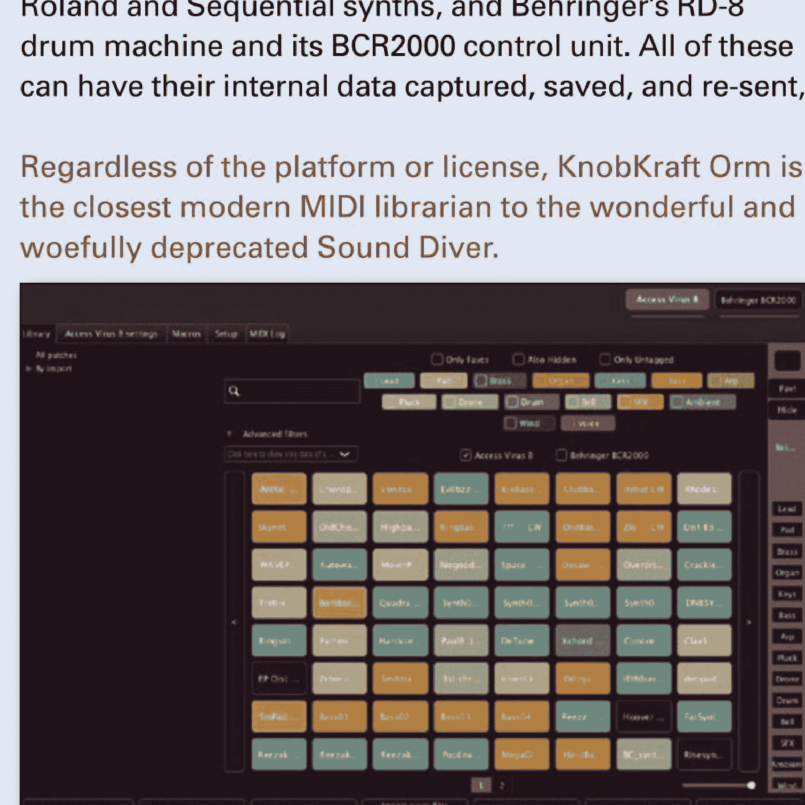

无论平台或许可证如何，KnobCraft Orm 都是极佳且解耦的 Sound Driver 最现代的 MIDI 库。

| 名称 | 颜色 | 数值 |

|---|---|---|

| Pad (打击垫) | 红色 | 0000 |

| Lead (领奏) | 蓝色 | 0001 |

| Organ (风琴) | 橙色 | 0002 |

| Pad (打击垫) | 绿色 | 0003 |

| Bass (低音) | 黄色 | 0004 |

| Brass (铜管) | 粉红色 | 0005 |

| Lead (领奏) | 紫色 | 0006 |

| Drum (鼓组) | 青色 | 0007 |

| Flute (长笛) | 棕色 | 0008 |

| Synth (合成器) | 白色 | 0009 |

| Lead (领奏) | 灰色 | 000A |

| Ambient (氛围) | 金色 | 000B |

| Vesta (维斯塔) | 蓝绿色 | 000C |

酷 Linux 黑客技巧 — 2022 年版

## Mixxx DJ 软件

Mixxx 起于 20 多年前，最初是一个帮助 DJ 组织和播放播放列表的应用程序，它已演变成了一个不可思议的、全现场表演界面，用于缓冲以及专业 DJ 和电台节目主持。你可以通过 `mixxx` 安装它。

它是 Traktor（以及不兼容的）Native Trackors Pro 的有力竞争对手，这两个应用程序都使用相同的用户界面范式。可以在主窗口水平排列一个或多个台（decks），中间有一组虚拟台和控制器。你在这里看到的控制数量取决于台的数量。

“台”（deck）类似于旧黑胶唱机或转盘机，你可以在调音器中并排两个或多个，这样你就可以在它们之间无缝切换。这种配置 Mixxx 至少在 21 世纪是可行的。虚拟台加载一个音频文件进行播放，可以自由地使用几十个台。

音频文件可以根据需要单独加载、拖入或排队。这种配置允许你无缝混合来自各种源的轨道，无论是节拍对齐的还是即兴创作的短曲，并将输出编辑为单个音频文件或将其作为混音或广播的源。

## Surge XT 合成器

我们之前关注过这款软件合成器的版本，仅仅因为它一直在以惊人的速度进行开发和改进。这次也不例外，该项目甚至在名称中添加了“XT”字样，以显示此次更新的重要性。合成器本身是你可以安装的听感最好的软件之一，当然，同样出色的 Vital 也可以随你的意愿进行改变。但 Vital 作为一种强大的波形合成器，在操作方法和音色提取上相当 esoteric in both the ways and in the way you coax sounds out of.

Modulation, where one signal changes the value of another is another key element in synthesizer design because it's used to generate both sounds, such as with ring effect and frequency, and to change the parameters in the same way over time. The middle and lower parts of the main window are dedicated to a matrix of modulation sources and destinations, plus a variety of LFOs, sequencers, and envelopes.

Almost anything can be set to change anything, letting you create huge patches in the same way you can with a modular synthesizer. But unlike, Surge is polyphonic, supports MIDI Poly Expression (MPE), and runs as an VST. It also features several effects that can be added to the sound output, which includes beautiful reverbs and delays, a vocoder, tape, filter, distortion, flangers, chorus, and a Nimbus effect, which is itself inspired by the open-source Mutable Instruments granular effect Eurorack module. It sounds amazing.

Surge is just as capable, and sometimes just as complex and easier to follow. Surge starts in the top of the window, a small panel lets you tune three oscillators. The oscillators are based on the classic sawtooth, square, triangle, and sine shapes, but they can be warped and merged using the width, shape, and position in a lower panel. The slider allows you to display the new shape and off, so you can hear the results easily if you play your keyboard or MIDI device. The amplitude of each of these oscillators is mixed into the another panel with vertical sliders to the right of the oscillators, and includes two not sliders for "oscillator multiplication" to create rich and metallic textures.


Right of these sections the filters are used to change the character on the oscillator sound, either by harmonizing or emphasizing them. Surge has two filters that can be configured in serial or parallel and in other configurations, according to a very adjustable filter sweep. The flow chart approach is used for frequency modulation, and to visualize what it is often difficult to understand and hidden from the user in other synths. The filters and filters themselves seem amazing, and there's a large selection to choose between, including those that sound like the classics from Moog, ARP, and Oberheim, and modern hybrids too.

- 1. 振荡器：你生成的音色基于经典风格的波形。
- 2. 编辑器：改变关于振荡器、滤波器、包络器或混合的几乎所有属性。
- 3. 路由：方便的流程图显示了路径以及如何进行调整。
- 4. 滤波器：两个滤波器可以同时使用，在左右通道上创建奇妙的效果。
- 6. 效果：Surge 包含了一些惊人的效果，并对它们的应用方式具有前所未有的控制力。
- 7. 预设：让你保存整个音色，甚至是针对特定的效果链。
- 8. 调制：动态更改你在此处看到的任何内容的数值。

作者：Graham Morrison

https://github.com/surge-synthesizer/surge


## VCV Rack：模块化合成器

VCV Rack 是一个免费的模块合成器环境，允许你构建和运行虚拟模块合成器。它是一个开源项目，意味着任何人都可以创建和修改自己的模块。该软件非常强大，拥有无限的可能性……

## 密钥大师

Age（读作 "spaghetti" 中的 "aghe"）是一种意料之外的文件加密和解密方法。在 Go 语言中，可以在 GitHub 上找到适用于各种平台的源代码和预编译的二进制文件 [1]。我曾在树莓派上尝试过 Age，但该工具也可以运行在 Linux PC、macOS 和 Windows 上。作者表示，2021 年 6 月的最新发布候选版本“可能实际上就是 v1.0.0 候选版本”。

Age 提供了两种加密文件的方法。使用第一种方案，你可以根据 SSH 密钥创建一个文件（Age 将其称为身份文件），并使用该密钥来加密数据。与 SSH 不同，这是一个对称过程，因此解密时也使用同一个文件。

作为另一种选择，Age 允许使用密码句来加密数据。这种方法的优势是，你可以为每个加密过程想出一个新密码。你信任的人可以使用该密码来解密你的数据——但仅限于你之前使用该密码加密的数据。

让我们来看这两种方法。例如，我将 `/etc/passwd` 文件复制到我的家目录，现在分别用这两种方法进行加密：

首先生成密钥 - 我可以通过 `age-keygen` 完成（见图）。

下一步是使用我生成的密钥加密文件（列表 1，第 1 行）。这会创建一个密码文件。要解密它，请使用列表 1 第 3 行的命令。

### 列表 1：密钥方法

| | 命令 |
|---|---|
| 01 | `$ age-keygen -o age-key.txt` |
| 02 | `$ age --encrypt -i age-key.txt -o pass.age /passwd` |
| 03 | `$ age --decrypt -i age-key.txt -o passwd.age` |

现在我用密码句方法执行相同的操作。我加密文件并给它命名。在执行列表 2 第 1 行所示对应的调用后，Age 会要求我输入所需的密码。如果我不输入，请漏掉 `--passphrase` 参数。

当然，整个过程的安全性取决于对密钥或密码句的谨慎处理。

> 由 Charly Khnst 编写

- [1] Age: https://github.com/FiloSottile/age

`age-keygen` 负责生成密钥文件的任务。

```
pi@keygen- $ age-keygen -o age-key.txt
Public key: age14s7swgvk1mnvqqxp3f00n8uum8wak
rk5gp438nsd445gdqze8k4
pi@keygen- $ age-key.txt
~---- ls -l 1 188 Jul 8 18:57-age-key
```

### 列表 2：密码句方法

| | 命令 |
|---|---|
| 01 | `$ age --passphrase -o pass.age passwd` |
| 02 | 输入密码（留空以自动生成一个安全的）： |
| 03 | 使用自动生成的密码 "release-response-step-brand-wrap-ankle-passphrase-unusual-word-strain" |
| 04 | `$ age --decrypt -o passwd.age` |
| 05 | 输入密码: |

# 安全与隐私

### 使用 horcux 安全拆分你的文件

在万维网之前的时代，早期的 BBS（电子公告系统）很常见，如果你足够幸运，可以通过拨号上网访问互联网，但下载大文件是非常困难的。这有几个原因，但最重要的一点很难维持长时间连接。随着 Usenet 的流行，将大文件拆分成较小文件（稍后可以重新重组或存储在几张软磁盘上）已成为常态。命名精妙的 horcux 是该功能的现代版本，这次专门设计用于帮助你保持文件的安全加密状态。

horcux 是一个命令行工具，旨在提供一种不需要私钥或密码句的安全加密形式。它是通过将文件拆分为可选数量的碎片并带有一定的冗余来实现的。这种冗余允许你从一个小于总数的小文件重构原始文件。例如，你可能会将个人日记分成十份，以便只需其中几份就能重构数据。这种想法是，你可能比记住密码句更容易记住碎片，这样如果你需要访问它，至少可以找回冗余数量。位置可以是物理的，如 USB 盘或光盘，或者是云存储或远程服务器。一个命令即可完成所有这一切，horcux 拆分，horcux 绑定，并在需要时会提示你碎片数量和冗余度。这是一个很棒的主意，希望即使这些碎片被销毁也不会产生同样的后果。

在项目网站上，你可以找到一个包含所有 Linux 发行版静态二进制文件的存档。

Horcux 使用 Shamir 秘密共享（SSS）对拆分的碎片进行加密。

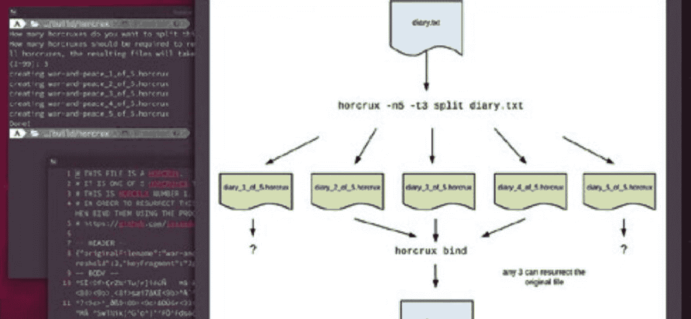

https://github.com/jesseduffield/horcux

由 Graham Morrison 编写

### HACK 42 OpenShift 应用防火墙

应用程序打开与互联网的连接是一个正常过程，通常是完全合法的，但有些程序——开源应用程序——喜欢“向手机汇报”或跟踪用户。在 Linux 上，这通常是可选的，因此你必须激活数据收集。收集到的数据用于遥测功能，并向开发者提供有关用户和在你程序中跟踪的信息。然而，即使是这些程序也不总是请求许可。在 Firefox 中，如果你不想发送数据，则必须退出。

你可以定义规则应该应用于运行中的进程、仅应用于目标 URL，还是应用于要与之连接的域名。

OpenSnitch 将你创建的规则以 JSON 格式保存在 `/etc/openswitch/rules` 文件中，你也可以对其进行编辑。如有必要，你可以将它们保存为 CSV 文件，列出要连接外部主机的应用程序列表，以便使用外部应用程序处理该列表（图 2）。

如果你不配置任何设置，窗口将在 15 秒后关闭，并且 OpenSnitch 将阻止连接。如果你觉得时间条有点短，可能想在偏好设置中延长宽限期，你可以通过应用程序顶部中间的图标访问该设置（图 3）。

通过“弹出窗口”（Pop-up）选项卡，你可以根据需求将默认设置从“拒绝”改为“允许”，设置一个更短的时间而不是默认持续时间，或者延长“始终”选项。如果你需要窗口（例如，因为窗口关闭得比你反应得要快），你可以在主窗口中编辑设置（图 4）。

## 防火墙开启与关闭

在主窗口的标题栏最右侧，你会找到播放按钮，可以通过它开启或关闭防火墙。当你最初需要时间为全球定义规则时，这个按钮变得尤为重要。你可以使用此按钮来利用碎片方便的时间段。

在菜单栏中，你会发现八个选项卡。每一个连接到世界的应用程序（图 5）。节点通常每个设备有一个 socket，OpenSnitch GUI 从中获取数据进行可视化处理。该 socket 的路径为 `/tmp/osni.sock`。

“规则”（Rules）选项卡也列出了已创建的应用程序（图 6）。页面列出了应用程序尝试过的规则以及它们在每个主机上发生的频率。“事件”（Events）选项卡列出了尝试连接的应用程序以及这些尝试的频率。

“地址”（Addresses）选项卡跟踪 URL 和连接频率。就已连接的主机而言同样，“用户”（Users）列表列出了涉及的用户，并记录了用户发起的连接尝试。对于其中任何一项，你都可以通过点击条目来编辑，增加弹出窗口的默认超时时间或调整其他设置。

为了避免在面对许多个体时丢失规则，你也可以在选项卡中过滤条目。在窗口底部，你可以看到当前时间的连接数以及其中有多少个被拒绝（丢弃）。

## 常见问题 (FAQS)

OpenSnitch 可以管理从 Linux 系统连接到主机的任何内容。对于多用户系统，可以为每个用户定义规则。根据开发者的说法，OpenSnitch 偶尔会错过连接；GitHub 上的项目 [7] 解释了这种现象可能的原因，在我的测试中没有遇到此类查询。FAQ [8] 回答了与应用程序框架相关的常见问题。

一旦你创建了所有规则，OpenSnitch 就会在后台静默运行。只有当你安装了会尝试连接外部的新版程序时，才会出现通知。如果你进行了大量的连接，你可能需要通过检查每个进程的出站请求或每个情况下的域名来加固该应用程序的规则，然后确认或拒绝访问。

# 结论

虽然 OpenSnitch 起初可能很烦人，但这意味着它正在正常工作。你可以通过禁用防火墙来临时避免规则请求，然后在你方便的时候定义规则。与安装过程 [9] 相比，开始使用 OpenSnitch 实际上非常简单。

OpenSnitch 对于浏览器、Web 应用或第三方应用程序特别有趣。它有助于严密监控这些连接并在必要时调整规则。你将了解到某些尝试的目的是什么。

总之，OpenSnitch 通过消除初始设置之外的担忧提升了你系统的安全性。

图 5：“事件”选项卡实时列出所有连接。你可以在这里看到 OpenSnitch 到 IP 地址的连接尝试。


由 Ferdinand Tom 编写

- [1 浏览器](https://example.com)
- [2 防火墙](https://example.com)
- [3 规则](https://example.com)
- [4 软件](https://example.com)
- [5 桌面版](https://example.com)
- [6 拦截](https://example.com)
- [7 项目](https://github.com/evilsocket/opensnitch)
- [8 常见问题解答](https://example.com)
- [9 文档](https://example.com)

图 6：规则选项卡列出了已创建的应用程序。页面列出了应用程序尝试过的规则以及它们在每个主机上发生的频率。


酷 LINUX 黑客 — 2022 版本

# 安全与隐私

# 黑客 43

# Parrot OS 桌面安全

# 安全与隐私

图 3：Parrot OS 使用 Calamers 安装器。

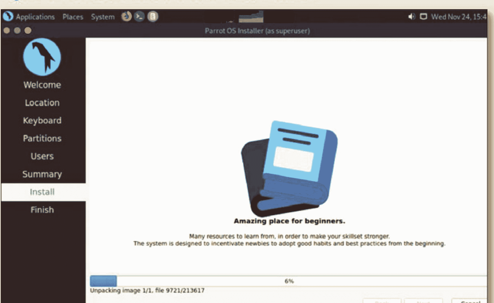

Parrot OS 充满了各种脚本和应用程序，二级菜单包含 14 个项目，包括常用项目、信息收集、漏洞分析、利用工具、密码攻击、平移与欺骗以及逆向工程，还有三级和四级菜单，某些甚至更长。单是条目本身就是教育的开始——谁知道呢，例如，Linux 在我们使用的汽车行业中是多么重要的。

汽车选项？

这仅仅是一个概述。列出 Parrot OS 中包含的所有脚本和程序至少需要 5,000 字，而要完整记录每一个细节那将是一本书了。

然而，Parrot OS 在隐私和安全工具方面真正脱颖而出。其中一些工具，例如比特币钱包、Ricochet 聊天工具和 GNU 隐私助手是由其他项目开发的；而像 OnionShare 或 AnorSurf 则是由 Parrot 项目本身开发的。例如，Parrot OS 同时提供 Tor 和 IP 用于匿名浏览，让用户自行决定使用哪一个。

Parrot OS 本质上提供系列精选的 Linux 安全工具。将所有资源整合在一个菜单中让学习安全变得更加容易。

## 安全便捷性

家庭版（Home Edition）侧重于通过关闭可能漏洞的通道来实现所有系统通信的匿名化，并可以一键保护用户的 IP 地址。它有五个不同的选项，以及一个元数据清理和服务实用。与许多工具不同，家庭版使用了图形界面和嵌入式帮助，帮助那些先验知识的用户。当工具具有 GUI 时，Parrot OS 在私有 man 页面提供菜单。


# 安全与隐私

安全意味着与便利的权衡，Parrot OS 也不例外。为了使用，KDE Plasma 以易用为目标非常方便；然而，任何桌面环境都是另一个可能出现问题的地方。出于原因，安全专家倾向于完全通过命令行工作。此外，Debian Testing 仍然是构建发行版的更安全选择。这些选择的似乎似乎是因为许多用户倾向于更接近的开发环境，并为用户提供访问最新版本的机会（此时 Debian 有时处于两个版本之间）。

## AnorSurf 示例

图 4：AnorSurf 是 Parrot 项目设计的简单应用程序的一个示例。

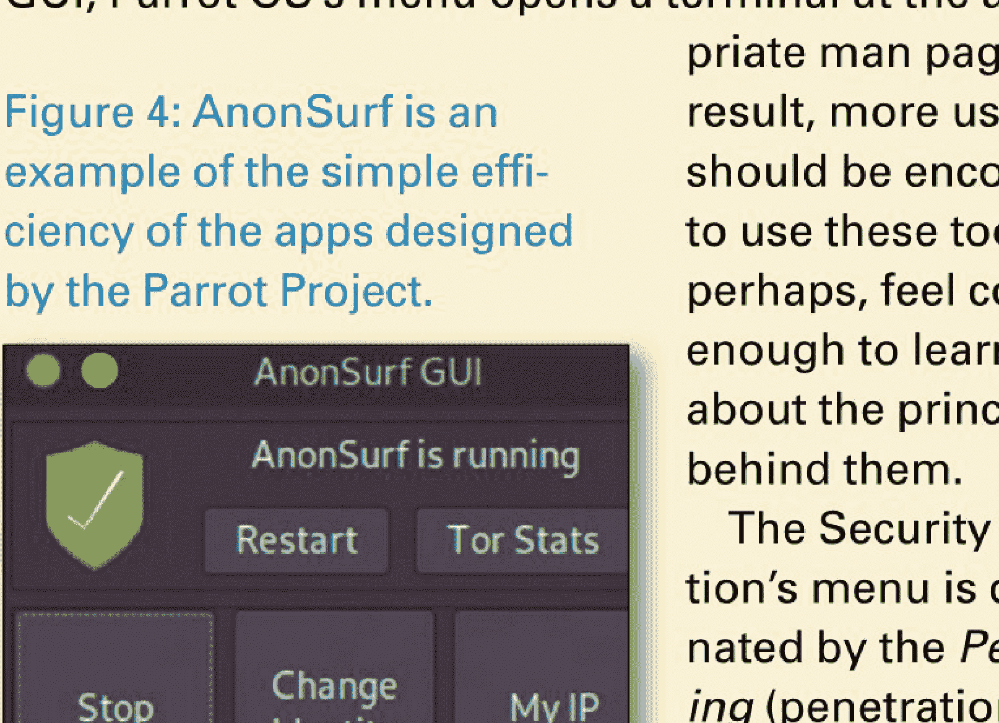

结果是，更多用户被鼓励使用工具，也许足够自信去学习这些工具背后的原理。

安全版（Security Edition）以 Pentest（渗透测试）顶级菜单为主，用于取证调查。该菜单如此……

如果 Parrot OS 没有提供最安全的发行版，它是否提供了比大多数发行版更多的安全保障？Parrot OS 安装了各种隐私和安全工具，其中许多工具易于访问且随插随用。许多操作系统都提供了对隐私和安全的便捷访问。虽然 Parrot 可能比大多数发行版更安全，但它最大的成就就是安全教育，遗憾的是，由于多年来的增长和日益增长的需求，这一点一直很缺乏。Parrot 既提供了基础课程，也提供了一套实用的工具。

> Bryce Field
>
> https://parrotsec.org/
>
> COOL LINUX LINES – HACKED 2022
>
> 63


## 安装并运行浏览器

你喜欢在线搜索电视时，网页充斥着在接下来几个月里持续显示的广告吗？如果不喜欢，你可能想要停止 Google 和其他广告跟踪你。这没那么简单：你需要为你访问的每个网站切换到免费 IP 地址，阻止 Cookie 等。Tor 和 Tor 浏览器结合了所有可用的安全和隐私浏览的技巧。实际浏览器是配置为使用 Tor 网络的启用 Tor 的免费版。

在 Debian/Ubuntu/Mint 上通过 `apt install` 安装 `tor-package`，在 fedora 上安装，并 `linger` 以便从终端运行 `tor` 命令。第一次，你将下载适用于你的平台和语言的最新版 Tor 版 Firefox，检查其签名并启动它。当我在 Ubuntu 22.04 上测试此时，事实证明相当简单 [2]。在你读到本手册时，问题可能已经修复。不要从项目网站下载 `download-browser-linux64.tar.xz`，解压并手动启动 `start-tor-browser.desktop`。

在你点击连接后出现的窗口中，以 Firefox 命名的浏览器将启动。像常一样使用浏览器，并在汉堡菜单中选择“新电路”以使用免费 IP 重新加载当前页面。图中还显示了已访问网站的日志：使用三个 IP 地址访问了一个不存在的页面。

作者 Hans-Georg Eser

- [1] (TOR) 项目：https://www.torproject.org/
- [2] Ubuntu 22.04 错误报告：https://bugs.launchpad.net/ubuntu+torbrowser-launcher/+1967272

## 从硬盘上永久删除文件

当你在文件管理器中删除文件时，它并不会轻易消失。大多数情况下，它会进入回收站，从那里可以快速恢复。如果你清空回收站，数据仍然可以被重构。

在大多数情况下，如果你使用 SSD 而非传统硬盘，这种方法会更复杂，这种方法可以保护你免受安全专家的攻击。

*(注：由于原文文本中存在大量重复段落，译文已根据要求进行了对应处理，并确保逻辑连贯。)*

COOL LINUX HACKS - 2022

## 关闭摄像头和麦克风

摄像头：除了边框上的一个小指示灯外，没有任何可以指示设备正在录制。对于某些设备，程序甚至可以关闭摄像头 LED 灯。

内置麦克风的情况稍有不同。理论上，和摄像头一样，你需要启用内核模块，你可以通过查看 `/proc/` 中的文件轻松地判断：

```bash
$ cat /proc/modules
0 snd_hda_int
1 snd_usb_audio
2 snd_usb_audio
3 snd_usb_audio
```

对于经典的台式电脑，你只需拔掉摄像头和麦克风。这种解决方案对于集成硬件的便携系统并不适用。笔记本电脑和手机通常带有摄像头和内置麦克风。

然而，关闭 `snd_hda_int` 不仅影响麦克风，还会影响。在这种情况下，你需要连接 USB 耳机（带有内置麦克风）——这使用 `snd_usb_audio` 模块。

或者，如果你不再需要，可以禁用摄像头。在 Linux 中，要禁用 `uvcvideo` 内核模块，它通常在启动时自动加载。原则上，你可以通过以下命令手动执行：

```bash
sudo modprobe -r uvcvideo
```

但非常情况下，某些程序已经占用了该模块，导致 `modprobe` 失败并带有“模块正在使用”错误信息，迫使你强制重启并尝试禁用。

你也可以通过 BIOS 或 UEFI 设置来禁用设备。在 BIOS 或 UEFI 级别工作可以提供更高的安全性：理论上，黑名单设备设备永远无法通过具有管理员权限的软件进行还原。

要防止 Linux 系统加载摄像头，请在 `/etc/modprobe.d/` 中的配置文件中添加黑名单条目。你可以自由选择任何名称，例如 `disable-webcam.conf`，并添加：

- blacklist uvcvideo
- 选项
  覆盖次数：2（建议用于硬盘）

# 安全与隐私

## HACK 47 锁定你的屏幕，时刻如此

在某些明显的情况下，你应该锁定屏幕，例如当你在开放式办公室工作时，或者你已经在各种机器上打开了四个带有远程 shell 的终端窗口，而你正准备去午饭时——你不希望你的电脑暴露在外面。

在我读研究生期间，同事之间经常玩一项“例行工作”：互相盯着对方的电脑，寻找未锁定的电脑，并打开像 lockyourscreen.com 这样的网站（见图）。当然，这总比快速安装一个后门 SSH 服务器要好。在危险程度较小的情况下，锁定机器是有意义的：如果你在家里，有一只猫在键盘上走来去，它可能会为 `vi` 编辑器提供恰好的输入，从而对你的配置文件造成破坏。

（然而，猫不太可能进入并保存她的修改）。

每个桌面都有用于锁定屏幕的菜单，但按下某些键要快得多。除了 Linux 之外，我还查看了非 Linux 操作系统的热键，因为这在电脑上非常重要：

- Gnome: `Win+L`
- KDE, Cinnamon 和 Xfce: `Ctrl+Alt+L`
- macOS: `Ctrl+Command+Q`
- Windows: `Win+L`

当然，Linux 桌面允许你将这些热键更改为其他。

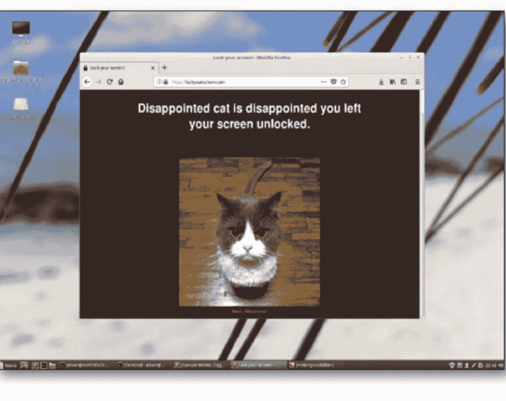

作者：Hans-Geörg Eßer

> https://lockyourscreen.com/

## 使用 crypt 进行快速加密

在将文件作为邮件附件发送或上传到某些云存储服务之前，有许多方法可以对其加密，但大多数方法都需要某种程度的保护，或者包含不必要的步骤。例如，发送 GPG 加密的邮件需要你和接收者都拥有对方的公钥。将文件放在密码保护的 ZIP 压缩中是一个选项，但当你只想发送一个文件时，为什么要创建一个压缩包呢？

命令行工具 `crypt` 提供了一个快速解决方案。它在大多数仓库中可用：在你的机器上运行 `apt install`、`zipper install` 或 `yum install`。

要加密单个文件，运行 `crypt filename` 会要求输入加密密钥（它不会回显你输入的字符），然后就完成了。查看目录，你会发现 `filename` 现在变成了 `filename.crypt`。该程序已覆盖了原始文件的内容。

如果你找到了一个好的密码（在字典中可以生效的），你现在就可以通过不安全的通道传输文件了。接收者在文件上运行 `decrypt crypt` 命令并输入密码——之后文件就恢复了（见图）。为了提高安全性，在发送文件之前去掉 `.crypt` 扩展名使其更难猜测使用了哪种加密算法。

作者：Hans-Geörg Eßer

```bash
$ crypt test.txt
$ decrypt test.txt
```

http://crypt.sourceforge.net

酷炫技巧 – 2022 版

《Linux 杂志》是你进入 Linux 世界的指南。阅读内文，获取你在其他地方找不到的高级信息！

通过以下内容扩展你的 Linux 技能：

- 关于趋势问题的深度文章，包括比特币、勒索软件等！
- 有用工具的操作指南和教程，将节省你的时间
- 故障排除和优化技巧
- 关于开源世界关键进展的独见新闻
- 针对树莓派、Arduino 和其他基于爱好者的系统的酷炫项目

如果你想走得更远并用 Linux 做更多，请立即订阅，不再错过任何一期！立即订阅！

shop.linuxmedia.com/subs


## Shell 技巧 (Shell Hacks)

这是 Linux，所以你预料我们会谈论 shell，不是吗？在窗口中，你可以做很多有趣的事情，足以填满一整期杂志。用大幅改进的版本替换一些经典命令。

| | | |
| :--- | :--- | :--- |
| HACK 49 Tabby 终端模拟器 | HACK 56 标准工具的进度条 | 76 |
| HACK 50 获取新闻滚动 | HACK 57 用 htop 替换 top | 76 |
| HACK 51 命令行上的 Google | HACK 58 用高亮代替 Gre | 77 |
| HACK 52 x 终端文件管理器 | HACK 59 酷炫复古风带回 80 年代 | 78 |
| HACK 53 使用 bat 而非 cat | HACK 60 The fish Shell | 78 |
| HACK 54 plocate 现代搜索工具 | HACK 61 通用解压器 | 79 |
| HACK 55 配置你的 Shell 历史 | HACK 62 启动正确的应用 | 79 |


## SHELL HACKS

## 尝试全能型“Tabby”终端模拟器

我们习惯了看到新的终端模拟器出现，但还没有见过完全成型并准备好即可使用的终端模拟器。这个命名精美的 Tabby 也是如此，但对于你经常命令行上频繁使用的键，而且由于我们的推测，这个名字与其他成熟的项目并不相似。Tabby 从第一天起就几乎完全可用的充分理由是因为它已经以 Terminus 的名称建立。Tabby 希望像 Terminus 一样成为一个现代的终端模拟器。它提供了你 1970 年代默认终端所缺失的便利和功能。这些差异在 Linux 上不会产生巨大影响，但如果你想跨平台使用相同的终端，可能会产生影响。Tabby 可以轻松安装在带有 PowerShell、Cygwin 和 Git Bash 的 WSL 上，以及 Windows、macOS 和 Linux 的二进制客户端上。（Ubuntu 用户可以在仓库中找到它：Debian/Ubuntu 部分：添加仓库，然后安装 `tabby-terminal`）。

使用 Tabby 的另一个原因是方便。从第一次启动开始，只需要很少的设置就可以创建一个功能完备的环境。Tabby 了自己的 SSH 和终端连接管理器，带有 SFTP 和作为串口终端的转发功能，以便更方便地对设备进行操作。主窗口可以分割并在每个标签页上持有多个会话，这对于左手和右手人都是很棒，标签页本身可以嵌套并配置以显示进度和通知。还有一个类似于“引用模式”，无需配置和 KDE。设置全局热键也是如此。你可以通过插件添加功能，并在 Tabby 自己的 SSH 中隐藏秘密。

作者：Charlie Kühhnäst


# 安全与隐私

## HACK 47 锁定你的屏幕，时刻如此

在某些明显的情况下，你应该锁定屏幕，例如当你在开放式办公室工作时，或者你已经在各种机器上打开了四个带有远程 shell 的终端窗口，而你正准备去午饭时——你不希望你的电脑暴露在外面。

在我读研究生期间，同事之间经常玩一项“例行工作”：互相盯着对方的电脑，寻找未锁定的电脑，并打开像 `lockyourscreen.com` 这样的网站（见图）。当然，这总比快速安装一个后门 SSH 服务器要好。在危险程度较小的情况下，锁定机器是有意义的：如果你在家里，有一只猫在键盘上走来走去，它可能会为 `vi` 编辑器提供恰好的输入，从而对你的配置文件造成破坏。

（然而，猫不太可能进入并保存她的修改）。

每个桌面都有用于锁定屏幕的菜单，但按下某些键要快得多。除了 Linux 之外，我还查看了非 Linux 操作系统的热键，因为这在电脑上非常重要：

- Gnome: `Win+L`
- KDE, Cinnamon 和 Xfce: `Ctrl+Alt+L`
- macOS: `Ctrl+Command+Q`
- Windows: `Win+L`

当然，Linux 桌面允许你将这些热键更改为其他。


作者：Hans-Geörg Eßer
> https://lockyourscreen.com/

## 使用 crypt 进行快速加密

在将文件作为邮件附件发送或上传到某些云存储服务之前，有许多方法可以对其加密，但大多数方法都需要某种程度的保护，或者包含不必要的步骤。例如，发送 GPG 加密的邮件需要你和接收者都拥有对方的公钥。将文件放在密码保护的 ZIP 压缩包中是一个选项，但当你只想发送一个文件时，为什么要创建一个压缩包呢？

命令行工具 `crypt` 提供了一个快速解决方案。它在大多数仓库中可用：在你的机器上运行 `apt install`、`zipper install` 或 `yum install`。

要加密单个文件，运行 `crypt filename` 会要求输入加密密钥（它不会回显你输入的字符），然后就完成了。查看目录，你会发现 `filename` 现在变成了 `filename.crypt`。该程序已覆盖了原始文件的内容。

如果你找到了一个好的密码（在字典中可以生效的），你现在就可以通过不安全的通道传输文件了。接收者在文件上运行 `decrypt crypt` 命令并输入密码——之后文件就恢复了（见图）。为了提高安全性，在发送文件之前去掉 `.crypt` 扩展名使其更难猜测使用了哪种加密算法。

作者：Hans-Geörg Eßer

```bash
$ crypt test.txt

$ decrypt test.txt
```


# 酷炫技巧 – 2022 版

《Linux 杂志》是你进入 Linux 世界的指南。阅读内文，获取你在其他地方找不到的高级信息！

通过以下内容扩展你的 Linux 技能：

- 关于趋势问题的深度文章，包括比特币、勒索软件等！
- 有用工具的操作指南和教程，将节省你的时间
- 故障排除和优化技巧
- 关于开源世界关键进展的独家新闻
- 针对树莓派、Arduino 和其他基于爱好者的酷项目

如果你想走得更远并用 Linux 做更多，请立即订阅，不再错过任何一期！
shop.linuxmedia.com/subs


# Shell 技巧

这是 Linux，所以你预料我们会谈论 shell，不是吗？在窗口中，你可以做很多有趣的事情，足以填满一期杂志。用大幅改进的版本替换一些经典命令。

| HACK | 主题 | 页码 |
| :--- | :--- | :--- |
| HACK 49 | Tabby 终端模拟器 | |
| HACK 50 | 获取新闻滚动 | |
| HACK 51 | 命令行上的 Google | |
| HACK 52 | xplr 终端文件管理器 | |
| HACK 53 | 使用 bat 而非 cat | |
| HACK 54 | plocate 现代搜索工具 | |
| HACK 55 | 配置你的 Shell 历史 | |
| HACK 56 | 标准工具的进度条 | 76 |
| HACK 57 | 用 htop 替换 top | 76 |
| HACK 58 | 用高亮代替 Grep | 77 |
| HACK 59 | 酷炫复古风带回 80 年代 | 78 |
| HACK 60 | The fish Shell | 78 |
| HACK 61 | 通用解压器 | 79 |
| HACK 62 | 启动正确的应用 | 79 |


## 尝试全能型“Tabby”终端模拟器

我们习惯了看到新的终端模拟器出现，但还没有见过完全成型并准备好即可使用的终端模拟器。这个命名精美的 Tabby 也是如此，但对于你在命令行上经常使用的键，而且由于我们的推测，这个名字与其他成熟的项目并不相似。Tabby 从第一天起就几乎完全可用的充分理由是因为它已经以 `Terminus` 的名称建立。Tabby 希望像 `Terminus` 一样成为一个现代的终端模拟器。它提供了你 1970 年代默认终端所缺失的便利和功能。这些差异在 Linux 上不会产生巨大影响，但如果你想跨平台使用相同的终端，可能会产生影响。Tabby 可以轻松安装在带有 `PowerShell`、`Cygwin` 和 `Git Bash` 的 `WSL` 上，以及 Windows、macOS 和 Linux 的二进制客户端上。（Ubuntu 用户可以在仓库中找到它：Debian/Ubuntu 部分：添加仓库，然后安装 `tabby-terminal`）。

使用 Tabby 的另一个原因是方便。从第一次启动开始，只需要很少的设置就可以创建一个功能完备的环境。Tabby 自带自己的 SSH 和终端连接管理器，带有 `SFTP` 和作为串口终端的转发功能，以便更方便地对设备进行操作。主窗口可以分割并在每个标签页上持有多个会话，这对于左手和右手人都是很棒，标签页本身可以嵌套并配置以显示进度和通知。还有一个类似于“引用模式”，无需配置和 KDE。设置全局热键也是如此。你可以通过插件添加功能，并在 Tabby 自己的 SSH 中隐藏秘密。

作者：Charlie Kühhnäst

Tabby 提供了各种方法来组织这种混乱。例如，我可以过滤只获取英语新闻或专门的几十种语言新闻。此外，我可以选择新闻类型。如果我想按体育分类，我使用参数 `category=sports`。除了体育，`news.tech` 还接受最好的娱乐、游戏、健康、科学和技术类别。

最后，我可以限制任何时间向我的消息数量。这是通过 `#number` 参数实现的。要查看英语新闻的最后两条消息（见图2），我将使用列表 1 中的调用。

- Sciencealert: 玻璃流横跨数里沙漠，以及它们是如何形成的
- 科学家在阿塔卡马沙漠发现古代生命

## 命令行上的 Google

如果你需要从命令行使用 Google，但只有手机的访问权限，而你又想从搜索结果中复制和粘贴内容，那么这并不是一个好的解决方案。

像 `Lynx` 这样的基于文本的浏览器要好得多。

但还有另一个更强大且能无缝集成到 Google 工作流中的选项：`googler` [1](https://github.com/junur/googler)。许多发行版的软件包仓库中都有该工具，但可以通过几条命令进行安装（2022 年 6 月的版本为 `googler 4.3.2`）。

在最简单的情况下，你可以通过 `googler` 关键词 "Linux" 来开始搜索，如图 1 所示。你可以看到搜索结果的数量。如果你搜索 `googler`，`googler` 会决定要打开的浏览器地址。如果这对你不起作用，或者你想让 `googler` 确定合适的浏览器，你需要通过 `--link-handler` 参数传递程序的名称，例如，如果你使用 `lynx`，则可以使用 `--link-handler lynx`。

默认情况下，`googler` 总是返回 100 条结果；可以通过 `--num` 参数增加或减少数量。然而，如果我使用 `-n 12`，它将只显示最多 12 个月的结果——这非常方便，因为如果你在寻找特定的错误示例，你自然对最近的结果比古老的结果感兴趣。

搜索网站也很有用。例如，如果你想在 Wikipedia 内部搜索，可以使用 `--site wikipedia.org`。图 2 显示了来自 Wikipedia 网站的关于 "Linux" 的术语。

如果你不想在搜索网搜索时留下任何痕迹，请看一眼 `ddgr`！它来自 `googler` 的同一位作者，参数（几乎）相同，但使用的是 DuckDuckGo，因此在当前的数据处理方面更有用。

### 列表 1：安装 googler

```
$ cd Downloads/
$ wget -c https://github.com/junur/googler/archive/refs/tags/v4.3.2.tar.gz
$ tar -xf v4.3.2.tar.gz
$ cd googler-4.3.2/
$ sudo make install
$ cp auto-completion.bash /etc/bash_completion.d/
```

作者 Karl Khnast

- [1] googler: https://github.com/junur/googler
- [2] ddgr: https://github.com/junur/ddgr

**图 1:** `googler` 在编号列表中对搜索词 "Linux" 的显示。

**图 2:** 如果你需要 linux，在网站上搜索的 result。

- linux Wikipedia
Linux 是一个基于 Linux 内核（一种 Unix 操作系统内核）的自由且开源操作系统。

- linux Wikipedia
Linux 是一个 Unix 类内核，用于各种不同操作系统的许多发行版中。

- linux Wikipedia
Linux 是一个自由、单式的、多任务、多用户的 Unix 类操作系统内核。

- linux Wikipedia
Linux 发行版（通常缩写为）是围绕 Linux 内核构建的软件集合中的操作系统。

- History of Linux
Linux 由一名芬兰学生 Linus Torvalds 创建，旨在为他的 PC 创建一个自由的 Unix 操作系统。

- linux Wikipedia
Linux - 英语维基百科，自由百科全书

- linux distribution
Linux 发行版是基于 Linux 内核的一种抽象操作系统，但每个此类发行版都包含许多软件包。

- linux Wikipedia
Linus Torvalds 是一位芬兰软件工程师，他在 1991 年最初为自己的个人电脑创建了 Linux 内核，可以通过自定义选项更改主题中特定文件的颜色。

## xplr 终端资源管理器

尽管我们已经看过了命令行文件管理器，以及由 Miguel Icaza 创建的经典 `Midnight Commander`，但感觉仍有改进空间。`xplr` 可以比 `Midnight Commander` 更强大，但因为它是一个与众不同的管理器，而不是桌面文件管理器，`xplr` 主要是极简且非常快速的。它花费的时间与审阅 `ls` 命令的输出相同，并为你提供相同的信息。然后你可以使用光标或 Vim 绑定在文件和目录列表中移动，按下回车进入目录或退出离开目录。Vim 绑定（如顶部和底部）同样有效，并且有一个通过按下操作的等效模式。

但你不需要是一个 Vim 用户，也不需要对快捷键有惊人的记忆；右下角的一个小面板显示了所有重要的键盘绑定，按下 `?` 将始终显示可用命令完整列表及其作用。`xplr` 速度之快，可以让你执行在命令行中可能需要更长时间的操作。你可以使用 selectbox 选择文件和目录，并在右上角的窗格中查看选中的项目。然后，你可以发布命令将它们移动 (`s`) 或复制 (`c`) 到不同的位置。如果你需要更多功能，例如自定义布局或网络，它本质上是可扩展（hackable）的，拥有插件系统、注释良好的代码以及编辑文档帮助你完成任何你需要。

https://xplr.dev/

作者 Graham Morrison

## 使用 bat 而不是 cat

使用一个简单工具完成一项任务的 Unix 哲学在命令行中仍然活跃且良好，`cat` 是其最好的工具之一（它是如此经典，以至于它包含在 1971 年由 Ken Thompson 和 Dennis Ritchie 开发的“Research Unix”最初版本中，当时“Research Unix”一词在 1978 年首次使用）。众所周知，`cat` 将文件内容打印到标准输出。如果你想逐行查看，请使用 `less`。

`bat` 是一个 `cat` 克隆，带有语法高亮和 Git 集成。它可以自动检测文件类型，并在终端中以彩色高亮显示内容。对于开发者和系统管理员来说，这是一个极大的效率提升。

## plocate 现代搜索工具

使用 `plocate-build`，如果你愿意，甚至创建一个纯文本数据库。无论哪种方式，你通过简单的搜索（图 2）来检查 `plocate` 是否准备就绪。

注意，`plocate` 包含了一些 `locate` 缺失的选项。例如 `plocate` 包含了 `--statistics` 以及 `--stat` (`-c`)，这是一个与不同设备交互的功能，用于与 BSD 和 GNU 版本的 `locate` 兼容。`plocate` 保留的是基础功能，对于几乎任何任务都绰绰有余。

在网络上，可以通过添加多个数据库来修改 `plocate`：`--database PATH` (`-p PATH`)。可以在一个选项中指定多个数据库，数据库的名称之间用冒号（:）分隔。如果你没有多个需要搜索的数据库，这些选项可能不会在主页中提到。

另外两个选项应被视为包含正则表达式：`--regexp` (`-r`) 能够感知标准正则表达式的性能，以及 `--regext` (`-c`)，由于扩展正则表达式较慢且会返回大量结果，这些选项也可能运行缓慢。使用其中一个选项时，正则表达式中的某些特殊符号（如 `*` 或 `?`）将被视为文本。

另一个选项修改搜索结果：`--ignore-case` (`-i`)，其中大小写敏感被覆盖，使得小写字母和大写字母被视为相同，类似于 Unicode 规则，例如德语的 `ß` 等同于 `ss`。此选项可以通过返回更多结果来帮助搜索，但搜索也可以被扩展。例如，一个选项 `--limit NUMBER` (`-N`) 在达到指定数量的提示后停止，并移动实例数量。另一方面，`--wildcard` 允许在不带扩展名的情况下进行搜索，通过直接从目录发射极微地增加了搜索范围。

# 现代命令

随着 `plocate` 最近的发布，`locate` 系列命令似乎已经为未来几年奠定了基础。虽然 `plocate` 具有局限性，但它使用了最新技术并适用于现代计算。例如，在当前的硬件下，在没有符号链接的情况下妥协没有意义了——默认跟踪可以在不产生明显影响的情况下完成。

此外，Linux 在桌面端的兴起增加了对简单性的需求。过去，`find` 命令变得过时了，因为人们假设用户拥有专业知识和耐心去学习它的手册。今天，随着用户的大量增加，简单和效率被视为常态。在搜索方面，这些期望通过 `plocate` 得到了满足，它是用户长期使用的经典命令重写之一。

> 作者：Bruce Byfield

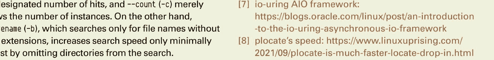

```
/home/bb/share/okular/data/341908.00000000.de-000_Distro_Walk_av_lw.pdf.xml
/home/bb/share/okular/data/341908.00000001.de-000_Distro_Walk_av_lw.pdf.xml
/home/bb/Downloads/Qubes-OS-4.2-x64.iso
/home/bb/work/journalism/2021/10-october/Qubes/copying.jpg
/home/bb/work/journalism/2021/10-october/Qubes/setting.png
/home/bb/work/journalism/2021/10-october/Qubes/desktop.png
/home/bb/work/journalism/2021/10-october/Qubes/domains-on-the-menu.png
/home/bb/work/journalism/2021/10-october/Qubes/menu.jpeg
```


# 酷炫 LINUX 技巧 – 2022版

## Shell 技巧

### 技巧 55：配置你的 Shell

大多数任务都是重复的：你进入目录，用你喜欢的编辑器打开文件，并一次又一次查询你的动态 IP 地址。反复输入所需的命令可能很令人烦恼，但你通常不需要这样做：Shell 会记住你的命令并将它们存储在历史记录中——这是内置的，并且当你在家目录退出 Shell 时会保存。

访问历史记录就像按下箭头键一样简单：每次按键都会回溯时间并显示上一个命令、倒数第二个命令，以此类推。按回车键运行它，或者如果你喜欢可以进行编辑，然后自由输入命令。

如果你请求的命令很远，使用箭头键漫游可能太久了。如果你知道命令或其参数的一部分，请使用手动搜索：只需按下 `Ctrl-R` 并输入你记得的字母。如果你无法进行搜索或当前匹配项不是你要找的，再次按下 `Ctrl-R` 让旧匹配项出现——重复直到你找到想要的正确命令。

搜索或运行命令的另一种方法是运行 `history`：这个 Bash 内置命令显示历史记录以及每个带有数字的条目。你可以通过输入 `!` 后跟数字来运行命令。你还可以在 `!-数字` 命令的前后添加文本，允许你修改命令。在示例中，我们从历史记录条目（`sed` 输入）和自由文本中构建了一个流水线。

Shell 还提供了一个快捷方式 `!!`（针对最后一个命令——当箭头键带回上一个命令时你需要它！）。一个示例是使用 `sudo` 命令以便以特权身份运行。在接下来的示例中，你可以看到一次显示内核环形缓冲器的失败，直到使用 `!!` 成功。

```bash
$ dmesg -t tail -2
dmesg: kernel buffer failed: Operation not permitted
$ sudo !!
sudo dmesg -t tail -2
[sudo] password for user:
[Jun 08 08:28:53 2021] r8152-2.1.4:1.0-enx0e844c2de58: Promiscuous mode enabled
[Jun 08 08:28:39 2021] dex0e0844c2de50 left to: promiscucuous mode
```

命令如何仍然出现在你的历史记录中？取决于你使用 Shell 的频率——以及通常设置为 1000 的 `HISTSIZE` 变量：

```bash
$ export HISTSIZE=2000
```

默认情况下，Shell 会记住最后 1000 行命令。如果你想改进你的 Shell——只需在 `~/.bashrc` 中添加上述行。

### 技巧 58：高亮 grep 输出

`grep` 命令可以高亮输出中匹配你搜索表达式的部分。要实现这一点，你只需要使用 `--color` 选项。事实上，某些 Linux 发行版已经为你设置了它：

```bash
alias grep='grep --color=auto'
```

（以及其他设置）为了升级 grep 并使其输出彩色内容。在输出中看到搜索词非常有用，以至于简单的 `cat` 无法高亮表达式这让我感到困扰。我搜索了它，发现 `grep --color` 会输出所有行但高亮指定的关键词。图 1 显示了一个运行 `dmesg` 的终端，高亮了不忽略大小写的 `eth0` 或 `eth` 的出现情况。

> **图 1：高亮系统日志中的行。**
> 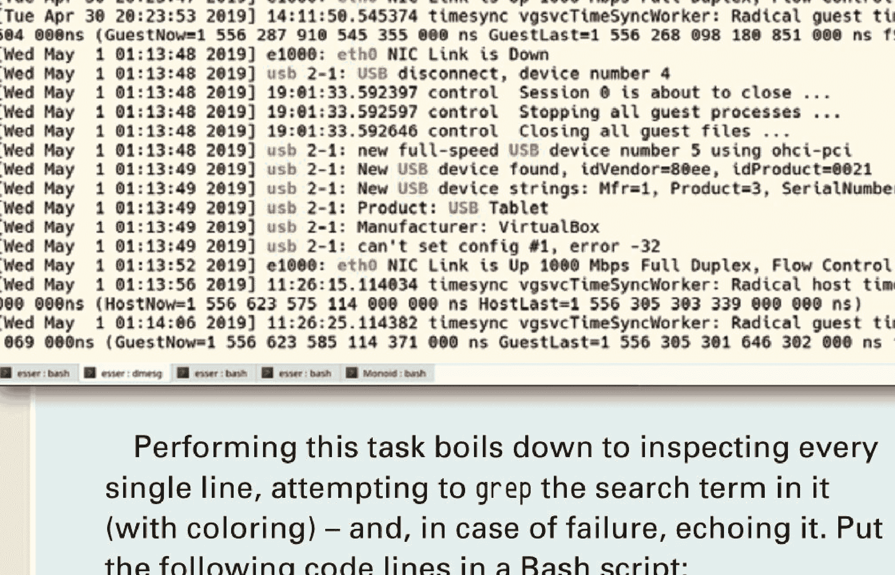

你可以将这个新工具作为过滤器，它也接受文件名参数。将：

```bash
somtool | grep keyword
```

替换为：

```bash
somtool | hl keyword
```

是可以的，但如果你想输出高亮的关键词，可以作为一种“多余使用 cat”的形式，例如：`cat file | hl keyword` 或者通过操作符使用标准输入（`hl |`）。

由于 `hl` 遵循所有选项，你可以使用增强功能，例如搜索正则表达式或使用该工具获取帮助。高亮 USB 和网络连接是执行这项任务的问题：它会高亮每一行，尝试在其中 `grep` 搜索词（带颜色）——并在失败的情况下，回显它。你可以在 bash 脚本中使用以下代码：

```bash
#!/bin/bash
while read -r line; do
  echo "$line" | grep --color "$1"
  echo "$line"
done
```

> **图 2：bash 脚本的简单高亮。**
> 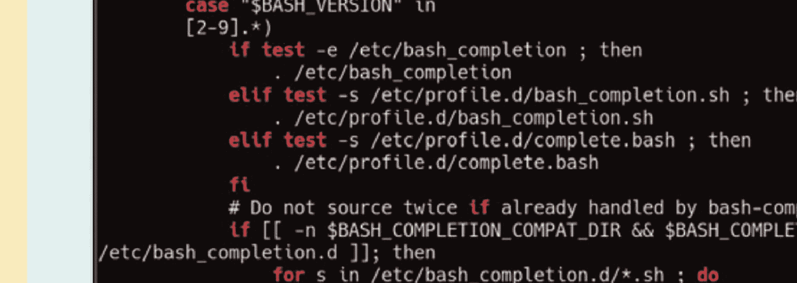

```bash
dmesg | hl -i "usb"
```

这可以用于高亮大小写差异，它匹配所有（以便我们将匹配完整）匹配，但除非——启用正则表达式，并且我们正在寻找 `eth0` 或 `eth` 或 `us`（后面跟着一个字符）。

如果你想构建一个高亮特定语言的脚本，请为其提供一个正则表达式列表。在图 2 中，你可以使用这种方法，但在每个搜索词必须是正则表达式的限制下，它不像一个高亮所有内容的脚本。事实上，`grep` 自身就可以轻松完成这项工作。只需在 `dmesg | grep --color -E "usb|eth0|eth"` 之前添加管道符。

每一行都被匹配，因此 `grep` 不显示任何内容，但只对带有“正确搜索结果”的行进行着色。

> **作者：Hans-Georg Erdt**

---

## Cool Retro Term 带你回到 80 年代

Linux 发行版带有许多终端模拟器供选择：如果你运行 KDE，默认是 Konsole；在 Gnome 上是 Gnome Terminal。大多数其他桌面都有它们自己的特殊程序，有些（如 `xterm`）除了普通的终端程序外，你还可以找到专门的程序，例如 Quake-console 终端，按下按键时它从顶部落下，再次按下时它会升起：Guake（用于 Gnome）和 Yakuake（用于 KDE）就是其中两个。

Cool Retro Term 属于第三类：有趣的终端模拟器。这个应用带回了 80 年代旧式显示器的外观：当然，还有圆角、扫描线以及所有让显示器技术变得可以忍受的特征。甚至有一个选项可以模拟同步问题导致图像跳动。但问题是，你无法获得那些效果，而且如果你喜欢这些东西（比如 8 位家用电脑），那么 Cool Retro Term 会带你回到过去。

该程序允许你编辑每一个单独选项（通过“设置：效果”）或从配置切换。显示的配置是 "Shift Demo"，其他有趣的配置还有 "Default" 和 "Monaco"。页面上有一个 AppImage，在安装 Cool Retro Term 后可以轻松启动它。为了方便，许多发行版——包括 Ubuntu——在它们的仓库中都有相应的包。Mac 和 FreeBSD 也可用。

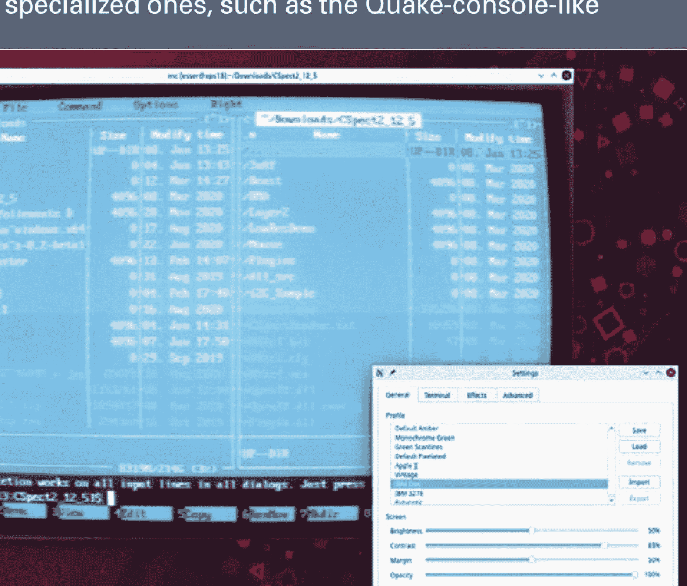

> **作者：Hans-Corg Eer**
> https://github.com/Swordfish90/cool-retro-term

---

## fish shell 技巧

Linux 的默认 shell 是 Bash，但有很多经典的替代方案，如 Zsh 或 Fish。Fish 是另一个 shell，它与所有其他的都不同。

Fish 提供了许多强大的命令行功能。例如，当你开始输入命令时，它会对你的意图给出建议。shell 会以浅灰色显示建议的字母，这样你就知道哪些已经在那里，以及建议意味着什么。

按向上箭头返回之前的历史记录。或者通过搜索，根据你输入的字母查看历史记录中有哪些命令。如果有很多条目，fish 只显示其中几条——获取全部。

通过 `help` 向 fish 查询有关内部命令的信息，它会打开文档：

```bash
esser@4220 > fish -v
fish, version 2.7.1
```

---

# 代码工作

## 目录

| HACK 63 | 使用 lazygit 控制 Git | HACK 69 | 用彩色工具替换 hexdump |
| :--- | :--- | :--- | :--- |
| HACK 64 | 尝试新的 Lapce 代码编辑器 | HACK 70 | 使用 GRV 管理 Git |
| HACK 65 | CudaText 编辑器 | HACK 71 | 从命令行运行 C 代码 |
| HACK 66 | 混合使用 Python 和 Shell 命令 | HACK 72 | 使其交互化 |
| HACK 67 | Textadept 在图形和文本模式下工作 | HACK 73 | 统计项目中的代码行数 |
| HACK 68 | 使用 SystemTap 进行动态代码分析 | HACK 74 | 修复烦人的缩进等问题 |

> 图片 © Viktoriya Sukmanova, 123rf.com

---

## HACK 63：lazygit Git 客户端

Lazygit 起初非常简单。你克隆仓库、提交更改并将更改推送到共享代码库，而无需扰乱文档。它的工作方式就像你使用版本控制系统一样，大多数项目都是这样的，充斥着大量的变基（rebase）和拣选（cherry-picking）。但对于 Git 来说，早晚有一天你疲惫的肌肉记忆会变成错综复杂的结，变得几乎无法解开。那时，你就需要使用某种智能客户端来更好地理解它了。这正是 lazygit 真正开始并接管你的终端的时候，它会将区域填充五六个不同的面板。启动时，lazygit 会让你在查看最新的发布说明之前看一个解释其功能的 YouTube 视频。

尽管有这些面板，如果你使用 Git 有了一段时间，lazygit 很容易理解。左侧五个面板显示当前文件和 git 状态、修改过的提交列表、最近更改以及是否有任何暂存文件（无论来自其他分支）。使用键和光标或 Vim 导航在面板之间移动。选择一个文件将更新代码状态，显示该文件的未暂存和已暂存更改，这是一个显示实际更改的 diff（差异）。这是 lazygit 的最佳功能之一，让你看到 git 仓库的当前状态、正在工作的内容，并让你对已完成和最近完成的内容有直观的感觉。如果你从未工作过仓库，或者已经工作了一段时间了，这个概览都能帮助你重新进入状态。

lazygit Git 客户端最大的优点之一（除了它的名字之外）是，它会对代码仓库进行活跃的重构。

> **作者：Graham Morrison**
> https://github.com/jesseduffield/lazygit

---

## HACK 64：Lapce 代码编辑器

我们总是开玩笑说，为什么这么多编程文本编辑器都在创建，是因为它是程序员理想的项目，特别是当他们切换到新语言时。由于 Rust 似乎是一种流行的语言，因此有很多用 Rust 编写的新编辑器。Rust 似乎也是人们经常提到的语言之一，就像 Arch 用户永远不会忘记提到他们喜爱的 Linux 发行版一样。这一切归功于 Lapce [1]，一个全新的程序员编辑器，它让 Rust 编辑功能变得流畅。但 Lapce 的出现让安装变得非常简单。它实用、快速、简单，并像 Vim 一样使用编辑和命令模式。

Lapce 处于开发早期，但它正日益成为作者的日常工具。主窗口很宽敞，而且运行快速且功能强大。它有四个面板：主编辑器、嵌入式终端、用于垂直提交消息的面板以及更改的文件。这显示了你在 git 仓库或代码中正在工作的内容，或者在你停下来做其他事情时。它是模式化的，这意味着有编辑模式和命令模式。像 Vim 一样，通过 `:` 键打开命令面板；在 Lapce 中，你可以看到可以使用的命令，包括查找文件、更改主题（亮色和深色）以及更改配置的命令。它还处于早期，是桌面编辑的良好选择，未来可能会变得更好。

显示的是 Ubuntu 22.04 Snap 包：这是我们安装的二进制存档 [2]。

> **作者：Graham Morrison**
> - [1] lapce.dev/
> - [2] lapce.dev/#downloads-all

---

## HACK 65：CudaText 编辑器

CudaText 是另一个代码编辑器，但它值得关注，因为它确实提供了一些其他文本编辑器没有的功能。这个文本编辑器并不是为了 NVIDIA 的处理平台 CUDA 设计的（正如其名称暗示那样）。CudaText 是用 Lazarus IDE 和 Pascal 语言编写的编辑器，这种语言对 90 年代的任何计算机学生来说可能都很熟悉。这可能也解释了为什么它是跨平台的。CudaText 现在支持 Windows、Linux 和 macOS。我们还提到了 FreeBSD、NetBSD、OpenBSD、Solaris 和 Haiku。对于这些平台，CudaText 是这些平台上最好的 GUI 驱动文本编辑器。我们现在还提到还有一个额外的 Amiga 版本。如果你想在 Ubuntu 上安装它，只需运行 `snap install cudatext` 即可获取 Snap 包。

CudaText 充满了现代功能。有由 Qt 驱动的标签页 UI、常规编辑器体验、语法高亮、代码折叠、多分屏以及 JSON 配置文件。如果你正在编辑 HTML 或 CSS 文件，还有代码补全和预览功能。但真正的力量来自于它的插件系统，它允许你根据特定任务添加额外选项。它有一个用于代码片段的库、分类器、代码检查器（linter）、差异查看器、合并管理器，以及管理整个项目树的工具。

> **作者：Graham Morrison**
> https://cudatext.github.io

---

## HACK 67：Textadept 支持图形模式和文本模式

没有其他软件类别能像文本编辑器那样提供如此广泛的选择。Textadept 是一个极具前景的种子化且无干扰的设计，且在没有牺牲核心功能的情况下。它支持 Linux、macOS 和 Windows。

Textadept 确实非常成熟：它的开发始于十年前，在过去的十年里，开发者们每两个月就会发布一次版本。

Textadept 可以作为二进制文件在命令行中运行，也可以作为 GUI 应用程序运行。可执行文件大小约为 3MB，可以通过 USB 闪盘运行。这非常小，但它能够塞入极速高亮（支持约 100 种语言）以及更多功能。它的补全非常完整。对于我们这些没有摄影式记忆的人来说，它的功能至关重要。通过 `Ctrl+Enter` 进行自动补全可以处理你正在编辑的文件中的符号。你正在使用的语言符号可以配合 API 文档完美补全。

该编辑器也是键盘驱动的、轻量级且文档完备。一个在许多编辑器中找不到的有趣功能是为每个文件单独更改字体大小（参见文件属性）。如果你从远程更改，还可以运行名为 `textadept-curses` 的 Textadept 终端版本。

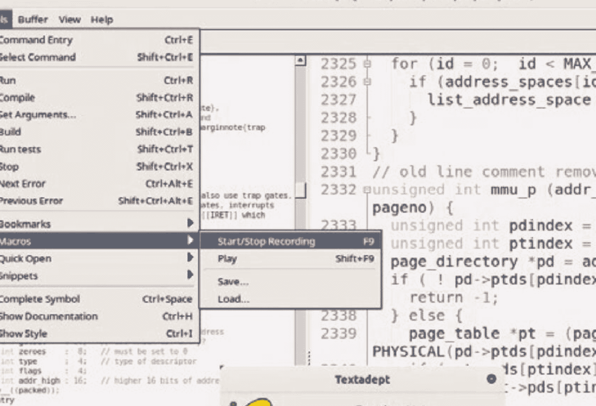

```c
void line(int id, int addr = MAX_ADDR, size) {
    if ((address, size) != _AS_FREE) {
        list_address(id, address);
    }
    int page = addr / 1024;
    int offset = addr % 1024;
    if (page_table[page] == NULL) {
        page_table[page] = malloc(size);
    }
    page_table[page][offset] = id;
    if ((tap % 12) == (PAGE % size)) {
        return;
    }
    return time(id);
}
```


# 运行代码

# 骇客 67

## Textdept 支持图形模式和文本模式

没有其他软件类别能像文本编辑器那样提供如此广泛的选择。`Textdept` 是一个极具前景的种子化且无干扰的设计，且在没有牺牲核心功能的情况下。它支持 Linux、macOS 和 Windows。

`Textdept` 确实非常成熟：它的开发始于十年前，在过去的十年里，开发者们每两个月就会进行一次工作。

`Textdept` 可以作为二进制文件在命令行中运行，也可以作为 GUI 应用程序运行。可执行文件大小约为 3MB，可以通过 USB 闪盘运行。这非常小，但它能够塞入极速高亮（支持约 100 种语言）以及更多功能。它的补全非常完整。对于我们这些没有摄影式记忆的人来说，它的功能至关重要。通过 `Ctrl + Enter` 进行自动补全可以处理你正在编辑的文件中的符号。你正在使用的语言符号可以配合 API 文档完美补全。

编辑器也是直观驱动的、轻量级且文档完备。一个在许多编辑器中找不到的有趣功能是为每个文件单独更改字体大小（参见文件属性）。如果你从远程更改，还可以运行名为 `textdept-curses` 的 `Textdept` 终端版本。


```c
void line(int id, int addr = MAX_ADDR, size) {

    if ((address, size) != _AS_FREE) {

        list_address(id, address);

    }

    int page = addr / 1024;

    int offset = addr % 1024;

    if (page_table[page] == NULL) {

        page_table[page] = malloc(size);

    }

    page_table[page][offset] = id;

    if ((tap % 12) == (PAGE % size)) {

        return;

    }

    return time(id);

}
```

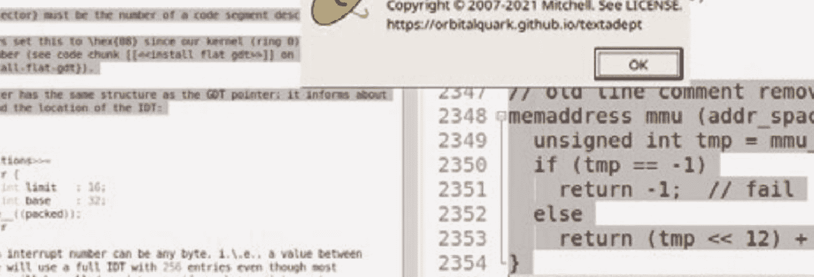

作者：Graham Morrison

https://orbital.github.io/textdept/

# 使用 SystemTap 进行动态分析

# 骇客 68

在多线程程序中，源码中语句的顺序并不等于执行顺序，仅仅查看代码无法揭示程序操作的序列。你需要一些工具进行实时检查，也称为动态分析。

`SystemTap` 是其中一个工具，它的映射是主可执行文件。在 Ubuntu 和 openSUSE 上，你可以在默认仓库中找到 `systemtap`。你需要一个应该构建在发行版中的内核模块。在 Ubuntu 22.04 上，你应该安装 `systemtap-doc`；最新版本包含示例文件，将帮助你学习该工具。在损坏的 `SystemTap` 环境中通过 apt 安装。

`SystemTap` 允许你编写脚本并附加到内核中发生的所有事件。它的设计旨在安全地用于生产系统，例如野外环境中的死锁。

`SystemTap` 能做之一是帮助确定内存泄漏。你可以在 `/usr/share/systemtap/examples` 中找到许多示例。它跟踪函数调用，并计算头部等待锁的时间。运行几秒后停止它；它将在 VirtualBox (43297) 中运行，调用 85557a2b8c216 次，89519 us - 数值越小越好。

如果你有相同的问题，尝试添加 Ubuntu wiki 页面 Debug Symbols 中描述的新探针，`sudo apt install g++* get libdev-dbv-linux-` 并编译 `SystemTap` 源码。

作者：Violet Sinitaysn 和 Hans-Geörg Eisser

https://opensource.ubuntu.org/systemtap/

https://wiki.ubuntu.com/Debug/20Symbol%20Packages

酷酷 LINUX 版 - 2023

# 运行代码


## 使用彩色工具替换 hexdump


## 使用 GRV 管理你的 git 仓库

当以十六进制形式查看二进制文件时，你能够更深入地解码任何位置的字面值。你实际上能够看到模式甚至数据度量，因为我们可以查看数据为何通过内存。这使得十六进制值成为拥有所有字符的实用工具，特别是当文件被存储或可执行文件可能如何工作时。

我们许多人都在命令行使用 `git`，以至于很难想象使用 GUI 来让访问仓库变得简单。从命令行到桌面的上下文切换往往足以中断你的思路或注意力。但有一个非常有用的工具。

## 可运行代码

## 统计项目代码行数

你对代码项目的统计数据感兴趣吗？你可以使用 `wc` 处理源文件来获取行数，但简单的工具无法区分注释和代码。我们建议使用像 `cloc` 类的工具——它能够统计代码行数并为你提供项目概览。这个实用的助手可以统计空行、注释以及代码行（见图）。

`cloc` 将统计分析结果输出到标准输出。`cloc` 解析 Perl 5.6 或更高版本。在 Ubuntu 上，你可以安装该软件包；在其他发行版上，使用 `git clone`。`cloc` 能够超过 250 种编程语言。你可以使用 `cloc --show-lang` 获取完整列表。

## 黑客技巧 73

你可以指定要统计的文件或目录。`cloc` 还能理解压缩的 tar 或 ZIP 文件；该工具可以在你通过 `extract` 解压时提供帮助。该程序还会跟踪文件、目录和存档之间的变化。它的映射列出了各种不同的参数及其示例。

你可以将 `cloc` 的评估结果保存为 CSV、XML 或 YAML 格式，`sql-insert` 将为 SQL 数据库生成 INSERT 语句。

```
$esser@ps13:linux ~/local/src/utils
$esser@ps13:linux$ cloc
  8 files
  8 unique files
  00 ignored.
```

| language | files | blank | comment |
| --- | --- | --- | --- |
| C | 1 | 6836 | 21548 |
| C/C++ | 4 | 752 | 2123 |
| Java | 1 | 452 | 7460 |
| SUM | 8 | 19 | 210 |

github.com/AlDnial/cloc v1.86 Tw0.11 (75.5 files/s, 42787.7 lines/s)

> 作者：Uwe Wahlhardt

## 修复缩进等

一个经典工具是“indentor”（缩进器），它获取源代码并创建一个新版本，其中缩进和花括号的位置遵循固定规则。该家族中的一个示例是 `indent`。Unix 原生版本于 70 年代后期出现，Linux 上的版本最后更新于 1998 年。

对于更灵活的方法，请查看 `uncrustify`；它的功能不仅仅是缩进，你可以通过编写复杂的配置文件来配置它。该程序支持 C、C++、Object、D、Java、Python 等许多语言。要开始使用，软件包内容或网页上有 `uncrustify` 的示例文件。

我找到了一个 openSUSE 软件包并将其用于我所有的代码仓库。可以轻松地从当前版本检查更改：

安装后，获取一个源文件并运行

```
uncrustify -linux cfg testfile.c
```

这将创建一个新的 `testfile`，`uncrustify` 尝试对其进行（自动且完美格式化）并取得了成功，如图所示。

> 作者：Hans-Georg Eißer

`git clone https://github.com/uncrustify/uncrustify.git`

在我的测试中，我将以下命令构建项目：

```
cd uncrustify; make; cd build
make .. sudo make install
```

在 `uncrustify` 文件夹中运行。（在 Ubuntu 上，运行 `apt apt install cmake` 来获取该特定工具。）

https://en.wikipedia.org/wiki/Uncrustify (Unix)
https://uncrustify.sourceforge.net/
https://uncrustify.sourceforge.net/uncrustify.cfg

酷炫 LINUX 黑客技巧 - 2022 版

## 通过特版磨炼你的技能！

从我们的特版库中了解 Shell、LibreOffice、Linux 等更多内容。

《Linux Magazine》团队创建了一系列单行本，让你深入研究感兴趣的话题。
提供纸质版或数字版。

## 查看完整库！
shop.linuxnewmedia.com

# 游戏

你已经工作了几个小时，配置了系统、开发了新程序、完成了演示？现在是游戏时间了。

| | | |
|---|---|---|
| HACK 75 | 运行 Gamebuntu 设置脚本 | 89 |
| HACK 76 | SDLPoP: 波斯之王的克隆 | 89 |
| HACK 77 | Sonic Robo Blast 2 | 90 |
| HACK 78 | Teeworlds 多人平台跳跃游戏 | 90 |
| HACK 79 | 使用 DOSBox 运行旧 DOS 游戏 | 91 |
| HACK 80 | Crispy Doom 克隆 | 93 |
| HACK 81 | UnCiv 策略游戏 | 93 |
| HACK 82 | 空间站 14 | 94 |
| HACK 83 | 探索、扩张、消灭：玩 Ruler 2 | 94 |
| HACK 84 | Lutrs 游戏 | 95 |

# 游戏

## 黑客技巧 76: 运行 Gamebuntu 设置脚本

对于 Linux 玩家来说，这是一个兴奋的时刻，因为有很多工作正在为让 Linux 支持游戏而努力。这无疑主要归功于 Valve，他们在发布 Steam Deck 方面的表现令人惊叹，以及他们的游戏兼容层。还有许多其他调整，这些都是 Raj Saraswat 的心血，他是一位来自印度的 12 岁开发者，同时也负责了《波斯之王》——史上最优秀的 2D 平台和冒险游戏之一。该游戏最初于 1989 年在 Apple II 上发布，由 Jordan Mechner 开发，因几个原因而非常出色。当时的第一个角色动画在那个时代都是领先的。游戏具有超越时代的真实感，这正是游戏成功的原因。你身处一个地下城，有 60 分钟的时间逃生并救援。在数小时的游戏测试中，难度和流行程度经过微调，完美地让任务变得易于上手但不至于简单。寻找出口路过程中的敌人和挑战提供了足够的变性和挑战，让你痴迷其中，正如许多人一样。

Guntu 是一个全面的 Bash 脚本，汇总了与 Linux 游戏相关的所有内容。它是为可能安装某些东西的新用户设计的。虽然原作已经发布，但该系列在现代硬件上继续，硬组版本现在已使用 SDL 进行解构和重建，创建了 POP。它是游戏的完美复制，包括图形、声音、音乐和沉浸感。它对于 30 多年前的一代人和同时玩家来说也是全新的，而且非常好玩。这个版本包含了作弊（跳过关卡、房间导航）和控制器支持，并且尽可能现代化，在游戏进行时增加了视频回放功能，这让年轻一代或也许我们这些拥有相同机智和敏捷操作能力的人更容易上手。

喜欢 Ubuntu 但还不了解，或者想知道应该添加什么来创建一个完美的游戏系统？图形界面首先在窗口顶部显示一个/或引导查找器。点击此按钮将自动安装大量的游戏相关软件。这可能需要一些时间，因为要安装的内容正在增长。它包括诸如 Proton 内核（提供最新的显卡驱动程序）、带有 PulseAudio 效果的 OBS 以及用于麦克风录制的 NoisTorch。对于游戏，Guntu 增加了 Steam 和 Heroic Launcher 来访问你的游戏，以及用于 Windows 游戏的 Wine。前端创建了一个启动器来访问所有已安装内容的面向用户部分。这可能需要一些设置，例如登录 Epic Games Store 或 YouTube Studio，这会迅速成为你访问所有游戏内容的入口，并有力地提醒你 Linux 上可用的游戏软件有多么，而且未来会有更多。

作者：Graham Morrison

https://gitlab.com/rswat09

## 黑客技巧 77: Sonic Blast 2

小刺猬经常出现在开源游戏重制版中。这可能是因为 Sonic 是 1990 年代主机游戏的奇迹，那个十年见证了 Linux 的第二个维度，而且时间还不长到让当年的青少年成为如今的高级开发人员。`Sonic Blast 2` 是这一理论的证明，它不仅将开源与 Sonic 结合，还结合了那个时代的机制。游戏本身完全由粉丝制作，其根源可以追溯到 90 年代后期。它包含超过 25 个完全由社区创建的关卡，具有与原作相同的糖分驱动的平台跳跃风格，但不同的玩法被转换到了三维。而且不仅仅是《超级马里奥 64》那种整洁的多边形三维。

这篇惊人的粉丝同人（游戏类）开发时间几乎和它的灵感来源一样长，但它仍在进行更新。

| 分数 | 0 |
| 时间 | 0-22 |
| 环 | 2 |

如果你玩过 2D 版本，这个游戏会让你感到很熟悉。你可以扮演任何主要角色，他们都有自己的能力，并在这些关卡中穿梭的同时射击其他玩家。你不需要简单地指向移动方向的左或右，而是可以在所有方向移动。这是一种不寻常的机制，感觉像是在玩经典的双玩家坦克游戏，但增加了额外的技巧水平，包括重力、特效和类型。另一个独特元素是漫画风格的抓钩或用手臂荡秋，它可以让你像充满咖啡因的蜘蛛一样穿过关卡，导致了非常独特的玩法。

# 使用 DOSBox 运行旧 DOS 游戏

许多经典游戏都是为 MS-DOS 推出的——想想第一人称射击先驱《Quark》和《毁灭战士》（Doom），以及《猴子岛》等冒险游戏。这些许多游戏可以在互联网存档（Internet Archive）的软件库中找到（图1），但你现在如何玩它们呢？

当然，在真实电脑或虚拟机上安装 MS-DOS 或其免费克隆版本 FreeDOS 是完全可能的。但有一个工具可以简化这一切：`DOSBox` 是一个集成的 PC 和 DOS 模拟器，它可以将你 Linux 设备上的任何文件夹映射到内部的 `C:` 盘。

作为一个例子，让我们运行 1994 年发布的《毁灭战士 2》。首先，从互联网存档下载 Zip 压缩包（Doom2.zip）。创建一个 Doom2 文件夹并将 Zip 文件解压到：

```
cd ~/Downloads
```


mkdir Doom2; cd Doom2

unzip doom2.zip

现在，以当前文件夹（单个点 `.`）作为参数运行 DOSBox 二进制文件：这将使你能够通过模拟 DOS 环境中的 c: 盘访问该文件夹。

```
dosbox
```

一个新窗口打开并启动：熟悉的 `:>` 命令提示符立即出现。你现在可以稍微探索一下环境：输入 `ver` 查看此 DOS 旨在兼容 MS-DOS 5.0，并将向你展示共享文件夹的 DOS 视图（图2）。为了运行《毁灭战士 2》，输入 `doom2`。该游戏（图3）是可以玩的（但当然只有可以免费提供的 demo 演示关卡）。如果你有完整版《毁灭战士 2》游戏的副本，可以将 WAD 文件复制到此文件夹。你可以通过关闭窗口来退出模拟（即使在《毁灭战士 2》或你正在玩的任何游戏活动期间也有效）。或者，离开提示符并输入 `exit` 命令，这将保存你的游戏状态，这是更好的选择。如果你想跳过输入 DOS 命令，可以通过 `-c` 选项及其要启动的命令让游戏自动启动。对于《毁灭战士 2》的例子：

```
dosbox -c doom2
```

图 1：互联网存档上的 MS-DOS 游戏库。

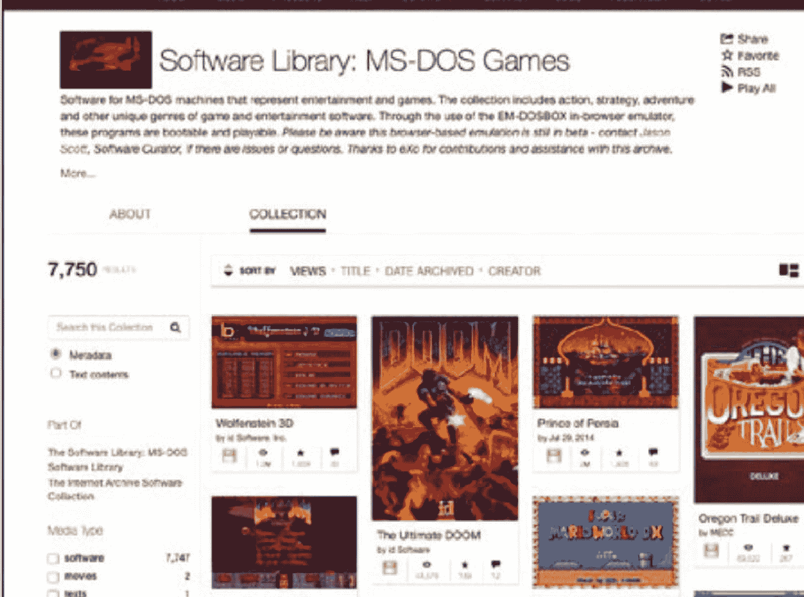

## 全屏

在通常情况下，DOSBox 窗口很小，你无法对其缩放。然而，你可以通过 `Alt + Return` 将其切换为全屏模式。相同的热键可以让你回到窗口模式。在我的测试中

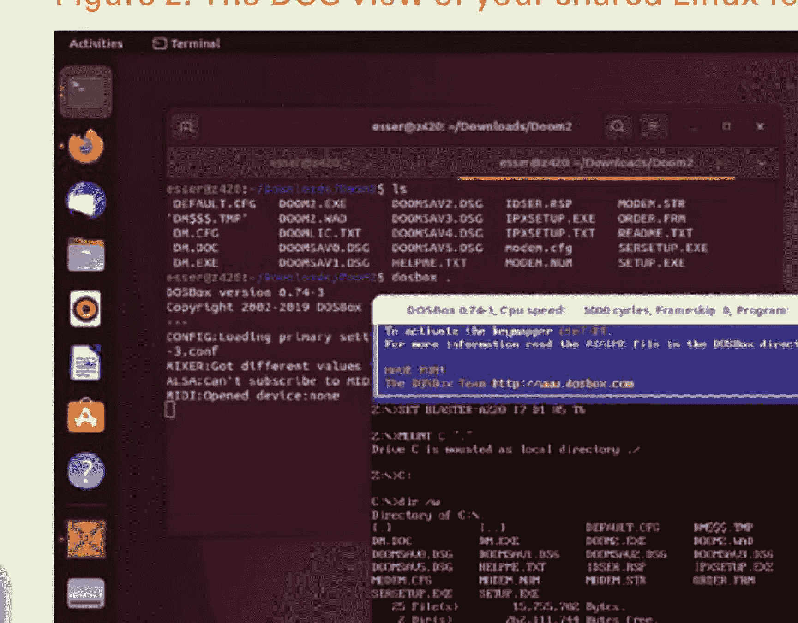

图 3：《毁灭战士 2》。

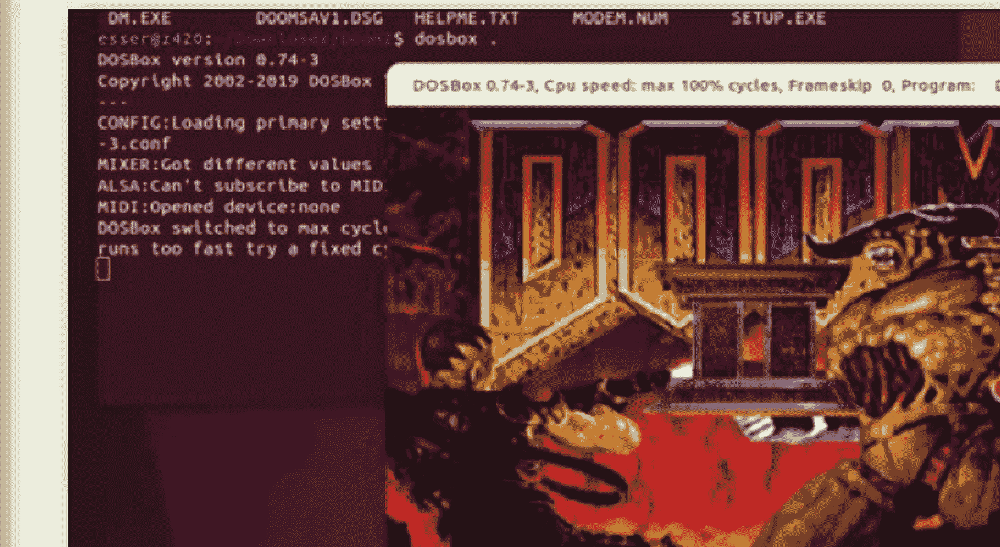

# 游戏

我不认为这个全屏模式很有帮助，因为它会真的填满屏幕，而现代显示器的屏幕与旧 DOS 机器 4:3 的比例不匹配。如果你喜欢全屏选项（或为电脑连接 4:3 的显示器），你也可以从一开始就使用选项以全屏模式运行模拟器：

```
dosbox -fullscreen
```

这仍然允许你通过 `Alt + Return` 切换到窗口模式。

## DOSBox-X

你可以使用 DOSBox-X 获取更好的缩放效果，它是 DOSBOX 的后续版本。目前该项目为 Linux 提供 Flatpak 和 RPM 包（以及 Windows 和 macOS）。在 Ubuntu 上安装它：

```
sudo apt install flatpak

flatpak install flathub com.dosbox-x
```

然后通过运行运行：

```
flatpak run com.dosbox-x
```

或者，你可以从源码编译 DOSBox-X。你需要提供开发工具（编译器），在运行存档中的构建脚本并输入 `sudo make install` 后，你就可以安装 DOSBox-X。该项目有详细的说明，编译需要几分钟。同时安装两个版本并自由调整 DOSBox-X 窗口大小是可以接受的，但这样做时可能会出现宽高比例错误。幸运的是，有一个非常有用的条目：进入菜单并点击“Fit”（自适应）（图4）。这将确保屏幕以 4:3 的比例显示。DOSBox-X 菜单包含其他其他条目。我发现某个条目特别有用，因为它允许 DOS 驱动器上挂载磁盘镜像或 Zip 压缩包。当你想要安装在服务器上分发的软件时，这个 DOSBox-X 选项让你在安装程序运行时选择磁盘（图5）。

虽然 DOSBox-X 专注于玩 DOS 游戏，但许多其他 DOS 软件也能运行。你曾是 DOS 版 Microsoft Word、WordPerfect 或 Lotus 1-3 的用户吗？或者你使用 Borland 的 Turbo Pascal 开发应用程序？这些都是可以在现代机器上使用的更高级的应用程序示例，当你想要加载旧程序时，可以再次访问互联网存档。他们有一个名为“软件库：MS-DOS 游戏与程序”的区域，其中有很多条目。

| DOSBox-X 视频菜单 | DOSBox-X | Turbo Pascal |
|---|---|---|
| Turbo Pascal Directory | | |
| Units Directory | | |
| Source | | |
| Borland Graphics | | |
| Graphics Editor | | |
| Online Assistance | | |

```
mount c: c:\dos

mount d: c:\dos\image.img read-only

C:\
```


## 像素风-Doom 的克隆

Crispy Doom 需要原始的 WAD 文件才能运行游戏，但 demo WAD 是免费的，其他的可以轻松购买或从你的副本中获取。

> 作者 Graham Morrison

https://github.com/fabiangreffrath/crispy-doom

https://github.com/yairm210/UnCiv

如果真实的证明让你有点失望，为什么不用 UnCiv 创建你自己的呢？

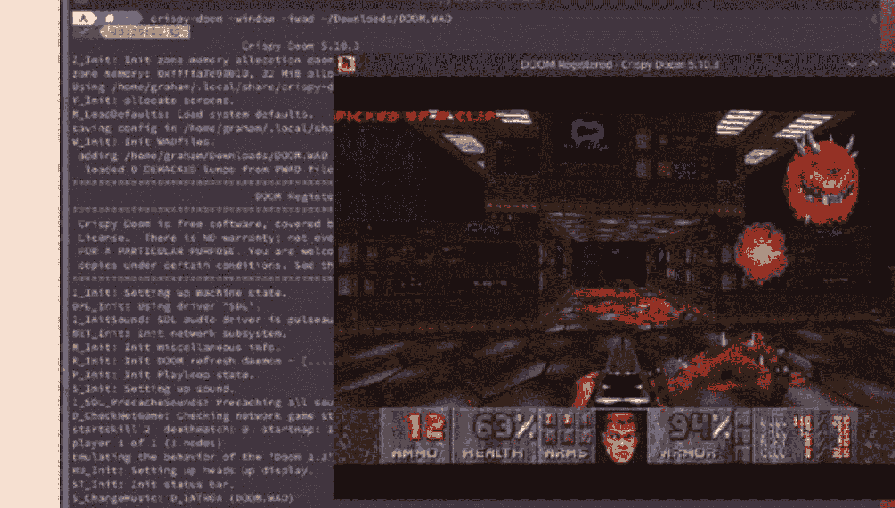


## UnCiv 策略游戏

# 游戏

## 空间站 14 (Space Station 14)

《空间站14》是一款独特的空间站俯视角多人游戏。它是经典游戏《空间站13》的重制版，但这个版本完全开源且仍在开发中。开发者目前处于 Alpha 阶段，对于尝试理解正在发生什么以及整体目标是什么，他们觉得还能够应付。开发者还请求人们测试游戏并为社区贡献力量，因此非常值得尝试一下。

游戏窗口的边缘有一个用于操作的“热栏”、控制快捷键、聊天窗口以及你所持有的物品。

从起开始，这款游戏的感觉有点像《星际太空员》（Among Us）。你位于空间站上并有当前位置，但画面效果非常有效地营造出一种沉浸式的空间站氛围。它让我想起由 Old Mike 和雅达开发的一款名为《Pandora》的游戏，你在一个类似的空间站上并需要生存。《空间站14》中，各种灾难会导致空间站故障，而你和队友必须保持一切正常运转。

> 作者：Graham Morrison

https://spacestation14.io/

## 黑客技巧 82

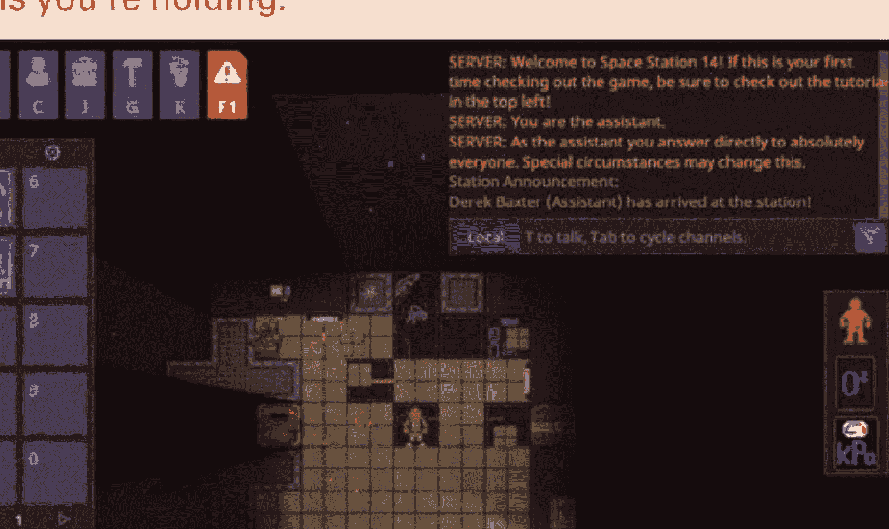

了解其布局和选项，或者你角色的能力。然后你可以在区域之间进行点按点击，并通过移动的聊天窗口与他人进行互动。画面上包含一些元素，特别是在迷雾效果方面，确保了你的角色从自己的视角能看到的内容。


安装完成后，你将需要与其他一起连接到服务器，这将下载该特定游戏使用的资源。然后你选择一个角色来玩。有很多角色可供选择，包括调酒师、厨师、主管和安保。每个角色都有自己的装备和任务。你会发现自己身处在一个巨大的像素化空间站上，那里有大量的区域和圆圈，以及许多其他玩家。

## 黑客技巧 83

## 探索、灭绝：星际霸主 2 (Explore, Extinate: Space Star Ruler 2)

当某人放弃游戏时，他们更适合为代码做些正确的事（参见下文）。一款 2012 年的流行的即时战略游戏（RTS）仍在 Steam 上提供，但其潜行元素非常有限。《星际霸主》已经独立开发了几年。

工作室并没有完全放弃小队并离开玩家，而是决定将游戏和扩展包全部开源。

可以探索和控制的飞船就像你玩其他 RTS 游戏一样。在你玩时，你可以影响可以用于外交的点数，甚至可以设计自己的飞船——影响可以用于外交的点数，你甚至可以设计自己的飞船。游戏非常有趣且精良，正如你对商业游戏预期的那样。

> 作者：Graham Morrison

http://starruler.com/

如果你的系统支持 snaps，你可以通过单个命令 `sudo apt install starruler` 安装该游戏。你可以在 Linux 上免费获得一款多人 RTS 游戏，这并不是什么坏事。

在设定的太空环境中，这款游戏被称为“4X” RTS 游戏，意味着你作为星系统治者的角色是探索七个种族、开发、扩张和消灭。完成这些任务后，你被丢到太空中，在那里你需要管理财务和本地资源来建立帝国。你通过在系统之间抽取资源来绘制资源地图，创建进出口网络。你使用你的舰队来-


酷炫 LINUX 黑客技巧 – 2022 版

## Lutris 游戏平台

到目前为止，Linux 并不是大多数人的首选游戏平台，因为许多有趣且图形效果精良的游戏在其他操作系统上可用。但有了 PlayOnLinux，这第一个商店让为微软系统开发的游戏可以通过免费的操作系统和 Windows 运行环境轻松运行。PlayOnLinux 旨在服务想要在 Linux 上使用 Windows 应用程序的用户。它还集成了许多用于生产的应用程序和程序。

从特殊仓库下载它们；查阅 Wiki 页面上的详细文档 [31]。

然后继续安装 Lutris。许多发行版（如 OpenSUSE、Fedora、Arch Linux、Mage、Slack）都有发行版所有者的支持，或者可以使用适用于 Elementary OS 及其衍生版的独立仓库。开源构建服务（openSOURCE Build Service）是 Debian 系统的良好选择。

随着 Lutris 的发布，现在有了另一种使用 Wine 运行 Windows 游戏并集成了原生 Linux 的解决方案。Lutris 支持通过 Steam 平台发布和管理的游戏，该程序还可以处理提供游戏集的其他数字发行平台。通过这种方式，Lutris 使用了各种集成选项，适用于寻找统一界面的广泛严肃玩家。

网站还提供了通用源代码供下载。对于所有没有原生包或仓库的发行版，在解压缩归档后，可以运行该通用包。Lutris 为该项目主页开发了所有安装方法 [4]。

### 首次启动

当程序第一次运行时，你可能会遇到延迟。毕竟，Lutris 需要在后台完成配置。因为它在很大程度上会管理环境变量。你可能会在左侧看到一个垂直控制栏，其中除了 Lutris 和 Wine 之外，还在 Runners 组中列出了如 Humble Bundle、GOG 和 Steam 等支持的游戏（图 1）。

### 入门指南

当程序第一次运行时，你可能会遇到延迟。毕竟，Lutris 需要在后台完成配置。因为它在很大程度上会管理环境变量。你可能会在左侧看到一个垂直控制栏，其中除了 Lutris 和 Wine 之外，还在 Runners 组中列出了如 Humble Bundle、GOG 和 Steam 等支持的游戏（图 1）。

之后为了向系统添加游戏，你可以在侧边栏的搜索框中输入名称。程序会联系 Lutris 并搜索其数据库。在该区域找到的任何游戏随后都会显示在主窗口的右侧。如果你只在搜索框中输入一个术语或组件名称，程序将列出包含该术语的所有游戏（图：

点击所需的游戏，然后点击现在显示的“安装”按钮。根据游戏提供的平台不同，将弹出多阶段安装对话框。

要进行更详细的设置，点击汉堡菜单——这将打开一个帮助配置进一步选项的上下文菜单。你可以卸载所选游戏或在桌面上创建快捷方式，并在新窗口中，你现在将找到所有可用的 runner。点击 runner 右侧的安装按钮将显示相应的条目。安装完成后，你将看到该游戏已集成到 Lutris 库中。

之后为了向系统添加游戏，你可以在侧边栏的搜索框中输入名称。程序会联系 Lutris 并搜索其数据库。在该区域找到的任何游戏随后都会显示在主窗口的右侧。如果你只在搜索框中输入一个术语或组件名称，程序将列出包含该术语的所有游戏（图：

点击所需的游戏，然后点击现在显示的“安装”按钮。根据游戏提供的平台不同，将弹出多阶段安装对话框。

要进行更详细的设置，点击汉堡菜单——这将打开一个帮助配置进一步选项的上下文菜单。你可以卸载所选游戏或在桌面上创建快捷方式，并在新窗口中，你现在将找到所有可用的 runner。点击 runner 右侧的安装按钮将显示相应的条目。安装完成后，你将看到该游戏已集成到 Lutris 库中。

### 管理 Runners

在新窗口中，你现在将找到所有可用的 runner。点击 runner 右侧的安装按钮将显示相应的条目。安装完成后，你将看到该游戏已集成到 Lutris 库中。

使用 Wine 运行游戏时，通常需要下载 Gecko 和 Mono 包。安装完成后，软件询问你是否为新设置的游戏在桌面或菜单中创建启动。这两个选项在当前 Lutris 会话中不起作用。

### 获取游戏

一旦点击程序窗口中的 Library 组，安装后的游戏将出现在窗口右侧。选择一个游戏并按下 Play 按钮在单独窗口中运行它。

点击 Games 右侧的小三角形打开一个帮助配置进一步选项的上下文菜单。你可以卸载所选游戏或在桌面上创建快捷方式。

### 在线与离线

当你在 Lutris 服务器上创建账户时，你将直接在项目网站上看到 Lutris 集成的超过 13,000 种游戏的详情，而无需通过客户端跳转。点击“游戏 (Games)”选项卡后，它们将以表格形式显示，并可以使用多种不同的选择标准进行筛选。

这将打开一个窗口，你可以在其中配置游戏。在“游戏信息 (Game info)”选项卡中，“运行器 (Runners)”之间，如果游戏不是为 Linux 开发的，则显示要加载的运行器。选择字段显示 Lutris 中激活的运行器。

对话框中的“设置 (Settings)”选项卡根据所选运行器显示不同的配置选项，而“运行器 (Runners)”和“系统设置 (System Settings)”选项卡则修改所选运行器的参数。你也可以在此窗口中调整游戏的运行器。

要保存所有更改，点击窗口中的“保存 (Save)”关闭对话框。任何以此集成的游戏都可以方便地使用。

如有必要，可以在桌面环境菜单中添加。为此，请选择“创建应用程序快捷方式 (Create application shortcut)”或“创建桌面快捷方式 (Create desktop shortcut)”选项。通过这种方式，无需先打开 Lutris 即可启动游戏。

要删除现有的启动器，请使用右键菜单中的“删除 (Delete)”快捷键和删除选项。对于有多个版本的游戏，“安装其他版本 (Install other version)”允许你将其他支持变体之一集成到系统中。

“在 Lutris 中查看 (Look at Lutris)”项目将打开浏览器并指向所选游戏的网页。该页面提供了有关该游戏的更多信息（参见“在线与离线”框）。如果你想更改相应游戏的技术设置，可以访问详细的配置条目。

#### 仅显示已安装的游戏

之前出现在库中的游戏可能会消失，从而使库视图变得更清晰。如果与预期相反，安装未能正常启动，在很多情况下，你会在右键菜单的“显示日志 (Show logs)”条目中找到更多细节（图 4）。如果缺少库文件，安装过程将阻止游戏运行。

随后，你可以使用你发行版的包管理器方便地安装这些库。

要在删除游戏后从列表中移除图标，请点击窗口右上角的汉堡菜单并勾选游戏列表旁的复选框。

## 结论

Lutris 事实证明是一个不绑定于任何操作系统的强大游戏管理器。通过集成运行器——即模拟器和运行环境——Lutris 客户端能够访问超过 13,000 种游戏。该选择界面在窗口中易于使用和配置。

某些功能（如为桌面和环境创建启动器）仍然存在 Bug，但这不太可能降低 Lutris 客户端的使用价值。对于想要玩旧游戏、想在主机上玩的游戏，或想在 Linux 上玩 Windows 游戏的玩家来说，Lutris 是 PlayOnLinux 的有力替代方案。

> 作者：Erik Bärwald

- [1] https://www.lutris.com/en/
- [2] https://lutris.org/
- [3] https://wiki.wine.org/Download
- [4] https://lutris.org/downloads/
- [5] https://lutris.org/game-list/

```
Running gameoderun /home/eric/local/share/lutris/runners/docker/bin/n/home/eric/downloads/bandit-kings-of-ancient-china/KOEI.COM

Initial process started with pid 13382

/home/eric/local/share/lutris/runners/docker/bin: error while: loading libraries: libSDL2-2.0.0: cannot open shared-object file or directory

Monitored process has exited (return code: 32512)

Initial process exited

Exit with returncode 32512
```

# 游戏中心

此外，Lutris 允许你安装到 Lutris 中的游戏——这允许你为所有游戏编写快捷方式。为此，你必须首先了解相关游戏的路径和命令行参数。然后按下 Lutris 客户端左上角的加号按钮。

# 卷首 / 作者

# 为我们撰稿

我们一直在寻找关于 Linux 和 Linux 环境工具的优秀文章。尽管我们会考虑任何主题，但以下主题是我们特别感兴趣的：

- 系统管理
- 有用的技巧和工具
- 安全（包括新闻和技术）
- 产品评论，特别是来自真实世界经验的评论
- 社区新闻和项目

如果你有想法，请将包含大纲、长度预估、背景描述和联系方式的提案发送至 `edit@linux-magazine.com`。你文章的技术水平应与通常在《Linux Magazine》中阅读的内容相当。记住，《Linux Magazine》在许多国家被阅读，因此最好避免可能并非所有读者都能理解的俚语和成语。

在提到未来的日期或事件时要加小心。从你提交到最终稿件到达读者手中，可能会过去好几周。在提交提案或稿件时，请使用有助于我们识别你的信息为文章提案的主题行。我们随时欢迎截图和其他支持材料。

更多信息请参阅：http://www.linux-magazine.com/contact/write_for_us。

## 联系信息

| 角色 | 姓名 |
| :--- | :--- |
| 总编辑 | Hans-Georg Eber |
| 高级编辑 | Lori White |
| 经理 | Jos Casad |
| 本地化与翻译 | Ian Trevis |
| 编辑 | Amy Petit, Aubrey Vaughn |
| 设计 | Dana Friesen, Lara White |

尽管在杂志内容方面已尽谨慎，但出版者对所含信息的准确性或使用这些信息引起的任何后果不承担责任。随文章提供的 DVD 或任何发布的材料风险由用户自担。

版权所有 © 2022 Linux Magazine USA, LLC

未经出版者许可，不得以任何形式全部或部分重制杂志内容、信件、电子邮件、照片、文章、图表，由出版者在全球范围内提供（有限使用除外）。

所有品牌商标均为其所有者的所有。如果我们侵犯了您的版权，我们将接受。

## 作者

| 姓名 |
| :--- |
| Erik Bwald |
| Bruce Byfield |
| Hans-Georg Eber |
| Frank Hoffmann |
| Charlotte Lynch |
| Graham Morrison |
| Valentine Santinis |
| Ferdinand Thomas |
| Uwe Lollhardt |

封面设计
插图来自 Viktoriya Sukhova

市场交流
Gwen Bauer, `gwen@linux-magazine.com`
+49 (0) 8079 77420

客户服务/订阅
美国和加拿大
邮箱：`sales@linux-magazine.com`
电话：1-888-242-2801
（加拿大境内免费）

所有其他国家：
邮箱：`subs@linux-magazine.com`
4840 Billing Parkway, Ste 104,
Lawrence, KS 66046, USA

www.linux-magazine.com
在纽伦堡由 Hoffmann infocomm GmbH 打印。

《Linux Magazine 特刊（ISSN 1757-6369）由 Linux New Media USA, LLC 出，4840
Parkway, Ste 104,
Lawrence, KS 66046, USA。

98 个酷炫 Linux 技巧 —— 2022 版

# 像专家一样思考
Linux Shell 手册 2022 版

此新版包含了用于系统配置和排除故障的最重要工具。

以下是你可以在其中发现的部分内容预览：

- 定制 Bash
- 正则表达式
- systemd
- Bash 脚本
- 网络工具
- 以及更多内容！

在线订购：
shop.linuxnewmedia.com/specials

# 商务桌面替代机

# TUXEDO InfinityBook S 17 - Gen7

Intel Core i7-1260P
Intel Iris Xe 显卡

17 英寸显示屏，15.6 英寸尺寸。
93% 屏占比

翻转合页
增强的人体工程学与散热

73 Wh 电池
运行时间长 16 小时

100%+
Linux

5
 年保修

终身
支持

德国
制造

55
德语
隐私

本地
支持

TUXEDC 18 周年纪念

tuxedocomputers.com
